# 信息建模与关系型数据库 第3版


## 前言

作者：埃里科·弗兰科尼 博士
意大利博尔扎诺自由大学计算机科学教授
KRDB 知识与数据研究中心主任。

我怀着极大的热忱与深深的荣幸，为这本卓越书籍的第三版撰写前言，这是一本全面且发人深省的信息建模与关系型数据库指南，强调了其在企业建模与数据管理领域的深远意义。尤其在本新版中，人们不得不承认书页中所蕴含知识的广度与深度。

本书是理解对象角色建模（ORM）语言及其面向事实的建模方法论不可或缺的资源。ORM 在数据建模领域犹如一座灯塔，提供了严谨且用户友好的方法。本书在严格关注细节的前提下，细致剖析了企业的语义复杂性。作者致力于探索和评估各种概念建模符法相对于 ORM 的优劣，这使本书与众不同，为读者呈现了数据建模范式的全景视图，同时提供了对概念建模的准确理解以及 ORM 优势的证据。

各章阐明了概念建模的细微差别，强调建模语言所需的必要精确性。作为来自基于逻辑的知识表示与推理背景的人，我非常欣赏 ORM 符法的形式严谨性，其中不容歧义和敷衍，这与许多其他（广为人知的）概念建模符法不同。此外，本书不仅描述了建模构造的精确含义，还阐释了这些构造为何存在于该语言中。对其用例的细致分析及其设计方法论在本书中同等重要。

我发现 ORM 提供了一种强大、精确且易于理解的概念建模方法，当然，本书以精确且易于理解的方式呈现 ORM 也同样迷人。如预期所示，与 ORM 相关的面向事实建模方法论在本书中被清晰地详细阐述，并作为本书的另一关键支柱。它指导着对数据语义的理解以及数据结构的设计，这些结构能够真实且正确地反映业务现实与需求。本书也大量关注概念模型与某些数据库结构实现之间的关系，强调正确性和有效性，同时不忽视现实世界 SQL 的复杂性。

本书前几版中所解释的面向事实建模方法论对我的研究产生了重大影响。的确，正是在初读本书之后，我开始着手研究基于经典逻辑的知识表示与 ORM 及其面向事实建模方法论的交叉领域。我也受到本书中讨论的 ORM 语言的文本版本（FORML）的影响。我与特里·哈尔平会面讨论我研究的结果，只为意识到在此之前我还有很多要学！特里是一位谦逊的科学家，每次讨论后，他似乎总是正确的。

特里·哈尔平和托尼·摩根对开发企业建模概念的终生奉献，证实了这项工作的重要性。更新并扩展的覆盖范围，加之各章中嵌入的大量练习，增强了本书的价值。本书紧跟最新版本和趋势，确保读者能够接触到该领域的最新发展。涵盖 ORM、ER、UML、SQL 和 OWL 的内容经过了全面更新，纳入了它们的最新迭代。针对 NoSQL 技术（例如键值、面向列和图数据库）的附加章节已集成到本书的本版中。涵盖 XML 和 JSON 等当代流行数据文件格式的一章已添加。对所有其他章节进行了大量修订，增强了对众多主题的覆盖深度。

最后，我要强调本书对包括数据建模师、数据工程师、数据分析师、企业架构师和程序员在内的多样化受众的相关性，突出其包容性和可访问性。贯穿全书的练习融入为读者提供了交互式且身临其境的学习体验，培养对概念建模的更深入理解。

## 前言

作者：赫尔曼·巴尔斯特斯 博士
荷兰格罗宁根北链合伙人。

我最初于 2005 年在塞浦路斯的一次 ORM 工作坊上首次接触 ORM，该工作坊是 OTM 联合国际工作坊和会议的一部分。我刚刚在 OODB 会议上发表了一篇关于数据联邦的论文，出于纯粹的好奇，我短暂拜访了 ORM 工作坊，想多了解一些 ORM 语言。当我走进去时，特里·哈尔平正在做演示。我对演示期间进行的热烈讨论感到惊讶，不仅对工作坊参与者的热情感到惊讶，也对评论和提问的高质量感到惊讶。我没有只进行短暂拜访，而是在塞浦路斯逗留的剩余时间里都待在了 ORM 工作坊，从那以后我一直是 ORM 的忠实爱好者。

在我在格罗宁根大学担任研究员和副教授的工作期间，我深度参与了诸如统一建模语言（UML）和业务流程建模与标注（BPMN）等语言，试图捕捉信息建模的本质。我与这些被认为是最先进的语言不断斗争，因为我完全无法掌握用这些语言编写的模型究竟意味着什么。我有纯数学（特别是数理逻辑）和计算机科学背景，我希望对自己试图指定的数据和流程模型的语义和完整性有清晰的认识。我也希望看到模型与该模型的实现之间有清晰的联系。在这两方面，我对当时流行的建模语言感到不自在。而且，我不仅在研究中感到这种缺乏精确性和完整性，在教学中也是如此。对学生来说，没有什么比作为老师的你自己并不完全理解的东西更难解释了。

一切都在走进塞浦路斯那次 ORM 工作坊的那一天发生了改变。我花了一段时间才掌握 ORM 的所有细节，但在那之后，我能够以完全的理解和如此精确的方式编写模型，以至于模型可以直接与实现关联起来。即使在今天，我仍然怀着深深的尊重和满足感使用 ORM。

ORM 是一种所谓的面向事实数据建模语言。在 ORM 中，你编写关于我们周围世界的事实。这意味着你指定对象以及这些对象之间的关系，从而得出关于世界的某些陈述。ORM 以这种方式做到这一点，即使是非技术领域专家也能够对其专业领域建模事实。这与 ORM 与关于我们周围世界的自然语言规范之间的密切相似性有关。然而，ORM 也以这种方式做到这一点，你可以以极高的详细程度建模事实，并


(数学上的)精确性。ORM 是一种图形语言，具有直观易懂的表示法。ORM 还配备了一个强大的工具（NORMA），允许对 ORM 模型进行图形化编辑和验证检查。ORM 另一个吸引人的方面是可以将 ORM 模型直接编译为关系数据模型，随后再编译为 SQL。因此，在 ORM 中，你可以直接从建模进入实现阶段。

2008 年，作者 Terry Halpin 和 Tony Morgan 发布了这本精彩书籍的第二版。自那以后我一直在使用它。多年来，我向数百名学生教授过 ORM，并指导过大量硕士和博士生进行涉及 ORM 的研究。这本书以其简单清晰的写作风格著称，涵盖了信息建模的几乎每一个主题。此外，书中大量用 ORM 解释建模理论和实践的示例，使这本书成为任何想要了解信息建模所有细节的人的必读之作。

这本书既具有技术性，又具有哲学性。它具有技术性，因为它提供了大量关于理论、表示法、示例和工具的材料，足以应对信息建模者面临的几乎任何问题。作为额外收获，书中展示了如何从技术上将这些模型实现为关系数据库。但在一定意义上，这本书也具有哲学性，因为它将你带入一个关于表征我们周围世界的挑战性问题的领域。ORM 的核心在于使用语言来捕捉那个世界，以及用于完成这项工作的最佳语言应该是什么样子。

作为一名大学教授，我很高兴能使用 ORM 向学生传授建模知识、撰写研究论文，并指导信息建模领域的硕士和博士生。自 2018 年离开学术界以来，我一直在更偏向工业的层面从事信息建模工作，在实际操作中遇到了一些极具挑战性的建模问题。在涉及数据、业务规则和业务流程建模问题的这些复杂情况下，ORM 提供了我认为否则我将无法获得的解决方案。

Terry Halpin 是 ORM 领域的世界顶尖专家，要想理解 ORM 以及如何应对信息建模，没有比这本书更好的选择了。因此，我完全推荐这本书的第三版给任何对信息建模感兴趣的人。

## 前言

by Dr. Gordon C. Everest, 美国明尼苏达大学 Carlson 管理学院 MIS 与“数据”建模荣休教授。

我很高兴又有机会撰写前言，这次是为本书第三版作序。这再次给了我机会，去说服数据建模领域的人们，存在一种更好的方式。我深信不疑，对象-角色建模（ORM）是进行数据建模的更好方式。我的目标是充分激发你的兴趣，让你认真学习 ORM。这是目前最好的资源。

古希腊哲学家苏格拉底曾建议：“认识你自己”，才能活出有价值的人生。同样，我们可以说“认识你的世界”，即你生活、运作并做出决策的现实。因为没有人能了解自己世界的一切，我们需要对那个世界进行表征，即一个捕捉该世界中事物、关系、活动/流程和规则信息的模型。这种表征由两部分组成：结构和格式的定义（称为 schema），以及与其定义一致的实际存储数据。一系列“数据库”中的信息成为该世界的重要替代品。

我们基于构建的替代数据库，对世界做出决策并关于世界做出决策。这是一项巨大的责任，因此要求我们的数据存储具备高度的完整性、质量和可用性。这需要一种能够捕捉丰富语义的数据建模 schema，而 ORM 是当今最佳选择。

“数据建模”一词经常令人误解。它暗示我们是在对数据建模，但实际上我们是在对用户感兴趣的某个领域中的事物和关系（关系中的对象和角色）建模——即在数据中建模，使用数据结构，这最终会在模型填充数据后成为“数据”模型。

数据建模是信息系统开发的基础——如果你没有把数据库设计做“对”，那么你构建的系统将如同纸牌屋，在未来改进、集成和质量提升不可避免的压力下崩塌。因此，我们需要一种方案来指导数据建模工作，生成能清晰准确地表示用户话语领域、并促进人际沟通、共同理解和质量控制验证的数据模型。生活在并了解用户领域的人必须直接参与建模过程，并由理解设计方法论的数据建模专家提供支持。

这本书是任何认真对待数据建模的人的必读之作，但需谨记：你必须投入足够的时间和精力才能真正理解 ORM。幸运的是，我有一整个学期的学生作为受众——时间足够长，让他们学习和实践 ORM，并深信它是一种更好的方式。有了 ORM，你可以将数据建模技能提升到一个全新的水平。

这本书还考察了基于记录的建模方案：UML、基于 Ted Codd 关系模型的 SQL，以及 Peter Chen 的实体-关系（ER）图及其众多变体——Oracle 中的 Barker、Finkelstein 的信息工程（IE）和 IDEF1X（如 ERwin 中的应用），并新增了关于 XML、JSON 和 NoSQL 中数据结构表示的内容。从 ORM 视角审视这些熟悉的建模方法，能够更深刻地理解其底层本质。

**基于记录的建模方案**使用 *三个* 构造：实体、属性和关系。它们只能直接表示最多二元、一对多的关系。但将属性聚集到实体记录中，才是数据建模中许多问题的根源。规范化是检查我们是否聚合过多的测试，而记录分解是纠正违反范式问题的补救措施。

**规范化**是数据建模的阿喀琉斯之踵。哦，要是能完全避免规范化就好了？仅仅是这个建议就对数据建模的学生和从业者颇具吸引力。好吧，使用 ORM 你可以做到。问题在于，当我们将东西（属性）塞入实体记录或表中时，缺乏对关系的清晰完整定义，导致记录内结构被隐式定义或假设。ORM 强迫你单独考虑并明确定义你宇宙中所有相关对象域之间的关系和约束。

**ORM**仅基于 *两个* 构造：对象和关系（分别对应句子中作为主语或宾语的名词概念和作为谓语的动词概念）。无论是实体还是属性（在关系建模方案中），都基于对象（不要与面向对象技术中的对象混淆）和 ORM 中的角色。对象在与其他对象的关系中扮演角色。因此，对象凭借其在与其他对象的关系中扮演的角色，隐式地拥有属性（描述符或属性）。

在基于记录的建模中，有两种关系：记录间关系（显式定义并使用外键表示），以及属性之间的记录内关系（没有显式定义任何关系的特征，这就是为什么我们需要强制执行规范化规则）。在 ORM 中，所有关系都以同一种构造方式表示。当 ORM 模型是所建模世界的有效表征时，函数依赖和多值依赖被显式定义，因此，“记录”（在关系表中）的生成可以自动化，并能保证结果已规范化（到 5NF）。这是数据建模者的好消息。

ORM 并非取代 ER 图或关系数据库设计；相反，它是一个先行阶段。它可以使我们能够开发并深入理解 ER/关系数据模型，并提供启发和指导。我们构建记录更多是为了系统效率，而非为了人类的便利或理解。过早的记录概念（用于表示实体的属性域集合及其标识符）会阻碍良好的数据建模。ORM 不涉及记录、表或属性。因此，我们不


get bogged down in “表格思维”（参见 https://tdan.com/recognizing-and-treating-tableitis/26060）。使用 ORM，无需进行显式的规范化过程。

This third edition is even more focused on the centrality of data in information systems, and on the importance of semantics. Starting with the realization that users (collectively) know more than we could ever capture in a data model, we must use a data modeling scheme that captures the widest possible range of semantics and expresses this meaning graphically. Semantics is paramount, and ORM goes way beyond any record-based modeling scheme in graphically depicting semantics.

第三版更加侧重于数据在信息系统中的核心地位，以及语义的重要性。从认识到用户（整体）知道的远比我们能在数据模型中捕获的要多这一事实出发，我们必须采用一种能捕获最广泛语义范围并以图形方式表达这种意义的数据建模方案。语义至关重要，ORM在图形描绘语义方面远远超越了任何基于记录的建模方案。

Well, is that sufficient to pique your interest in learning more about ORM? If you are a would-be student of ORM and you take data modeling seriously, I encourage you to invest some time in reading this book. You won’t regret it. You will grow to appreciate ORM and will become a better data modeler for it—just ask any of my thousands of former students. To develop effective and maintainable information systems, we need good data models, and for that we need a good data modeling scheme or methodology. ORM allows us to develop database designs at the highest conceptual level, unencumbered by things that are not of primary concern to user domain specialists. My deep desire is to see more and more database designers using ORM. The systems we build and the world we live in will be better for it. Join me in this journey and enjoy the adventure.

嗯，这足以激发您深入了解 ORM 的兴趣吗？如果您是一位有志学习 ORM 的人，并且认真对待数据建模，我鼓励您花些时间阅读这本书。您不会后悔的。您将学会欣赏 ORM，并因此成为一名更好的数据建模师——问问我的成千上万名前学生就知道了。为了开发有效且可维护的信息系统，我们需要好的数据模型，而为此我们需要一个好的数据建模方案或方法论。ORM 使我们能够在最高概念层面上开发数据库设计，不受用户领域专家不太关心的事项的干扰。我深切希望看到越来越多的数据库设计师使用 ORM。我们构建的系统和我们生活的世界都会因此变得更好。加入我，共同踏上这段旅程，享受这场冒险。

## Preface

## 前言

This book is about information systems, focusing on information modeling and database systems (especially relational database systems, but also covering nonrelational systems). It is written primarily for data modelers and database practitioners as well as students of computer science or information management. It should also be useful to anyone wishing to formulate the information structure of business domains in a way that can be readily understood by humans yet easily implemented on computers. In addition, it provides a simple conceptual framework for understanding what database systems really are as well as a thorough introduction to SQL and other key topics in data management.

本书关于信息系统，侧重于信息建模和数据库系统（尤其是关系型数据库系统，但也涵盖非关系型系统）。本书主要面向数据建模师和数据库从业者，以及计算机科学或信息管理专业的学生。对于任何希望以人类易于理解且计算机易于实现的方式制定业务领域信息结构的人来说，本书也应有所帮助。此外，它还提供了一个简单的概念框架来理解数据库系统到底是什么，并对 SQL 和数据管理中的其他关键主题进行了深入介绍。

A major part of this book deals with *fact-oriented modeling*, a conceptual modeling approach that views the world in terms of simple facts about objects and the roles they play. Originating in Europe, fact orientation is today used worldwide and comes in many flavors, including the Semantics of Business Vocabulary and Business Rules (SBVR). The version of fact orientation described in this book is second-generation *Object-Role-Modeling* (ORM 2), and is based on extensions to the Natural-Language Information Analysis Method (NIAM).

本书的大部分内容涉及*面向事实的建模*，这是一种概念建模方法，它以关于对象及其所扮演角色的简单事实来看待世界。面向事实起源于欧洲，今天已在全球范围内使用，并且有多种形式，包括业务词汇和业务规则语义（SBVR）。本书中描述的面向事实版本是第二代*对象-角色建模*（ORM 2），并基于对自然语言信息分析方法（NIAM）的扩展。

Two other popular notations for information modeling are *Entity-Relationship* (ER) diagrams and *Unified Modeling Language* (UML) class diagrams. For conceptual information analysis, the ORM method has several advantages over the ER and UML approaches. For example, ORM models can be easily verbalized and populated for validation with domain experts, they are more stable under changes to the business domain, and they typically capture more business rules in diagram form.

信息建模中的另外两种流行符号是*实体-关系*（ER）图和*统一建模语言*（UML）类图。对于概念信息分析，ORM 方法相对于 ER 和 UML 方法具有多项优势。例如，ORM 模型可以轻松地口头表述并填充数据以供领域专家验证，它们在业务领域变化时更加稳定，并且通常以图形形式捕获更多业务规则。

However, ER diagrams and UML class diagrams are good for compact summaries, and their structures are closer to the final implementation, so they also have value. Hence, the coverage includes chapters on data modeling in ER and UML, and indicates how ER and UML data models can be easily generated from ORM models.

然而，ER 图和 UML 类图适合紧凑的摘要，并且它们的结构更接近最终实现，因此也有价值。因此，本书涵盖了关于 ER 和 UML 中数据建模的章节，并指示如何从 ORM 模型轻松生成 ER 和 UML 数据模型。

To make the text more approachable to the general reader with an interest in databases, the language is kept simple, and a formalized, mathematical treatment is mostly avoided. Where necessary, relevant concepts from elementary logic and set theory are discussed prior to their application. Most of the material in this book has been class tested in courses for both industry and academia, and the basic ORM method has been taught successfully even at the high school level. The content is modularized, so that instructors wishing to omit some material may make an appropriate selection for their courses.

为了使文本更易于对数据库感兴趣的普通读者理解，语言保持简单，并且大多避免使用形式化的数学处理。在必要时，会在应用相关概念之前讨论初等逻辑和集合论中的相关概念。本书中的大部分材料已在面向行业和学术界的课程中经过课堂测试，基本 ORM 方法甚至在高中阶段也成功教授过。内容已模块化，以便希望省略某些材料的教师可以为其课程做出适当选择。

The first chapter motivates the study of conceptual modeling, and briefly compares the ORM, ER, and UML approaches. It also includes a historical and structural overview of information systems. Chapter 2 provides a structural background, explaining the conceptual architecture of, and development frameworks for, information systems. It introduces a number of key concepts that are dealt with more thoroughly in later chapters, and should be read in full by the reader with little or no database experience.

第一章阐明了学习概念建模的动机，并简要比较了 ORM、ER 和 UML 方法。它还包括信息系统的历史和结构概述。第二章提供结构背景，解释信息系统的概念架构和开发框架。它介绍了若干在后续章节中会更详细处理的关键概念，且应由缺乏数据库经验的读者完整阅读。

Chapter 3 is fundamental. Following an overview of conceptual modeling language criteria and the ORM Conceptual Schema Design Procedure (CSDP), this chapter covers the first three steps of the CSDP. The first step (verbalizing familiar examples in terms of elementary facts) may seem trivial, but it should not be rushed, as it provides the foundation for the model. The rest of this chapter covers the basic graphical notation for fact types, and then offers guidance on how to classify objects into types and identify information that can be arithmetically derived.

第三章是基础章节。在概述概念建模语言标准和 ORM 概念架构设计程序（CSDP）之后，本章涵盖了 CSDP 的前三个步骤。第一步（用基本事实口头表述熟悉的示例）可能看起来微不足道，但不应仓促进行，因为它为模型奠定了基础。本章余下部分介绍了事实类型的基本图形符号，然后提供了如何将对象分类为类型并识别可以算术推导的信息的指导。

Chapter 4 begins the task of specifying constraints on the populations of fact types. The most important kind of constraint (the uniqueness constraint) is considered in detail. Then some checks on the elementarity of the fact types are discussed. This chapter also introduces the join and projection operations at the conceptual level; the relational version of these operations is important in the later work on relational databases.

第四章开始指定事实类型填充约束的任务。最重要的一种约束（唯一性约束）被详细考虑。然后讨论了一些关于事实类型元素性的检查。本章还介绍了概念层面上的连接和投影操作；这些操作的关系版本在后续关于关系数据库的工作中很重要。

Chapter 5 covers mandatory role constraints, including a check for detecting information that can be logically derived. Reference schemes are then examined in some depth. Some of the more complex reference schemes considered here could be skipped in a short course. The CSDP steps covered so far are then reviewed by applying them in a case study, and the logical derivation check is then considered.

第五章涵盖强制角色约束，包括检测可以逻辑推导的信息的检查。然后对引用方案进行了深入探讨。此处考虑的一些更复杂的引用方案在短期课程中可以跳过。然后通过在案例研究中应用迄今涵盖的 CSDP 步骤进行回顾，并接着考虑逻辑推导检查。

Chapter 6 covers value, set comparison (subset, equality, and exclusion), and subtyping constraints. Section 6.6 deals with advanced aspects of subtyping. Though important in practice, the material in this section could be skimmed over in a first reading.

第六章涵盖值、集合比较（子集、等性和排斥）以及子类型约束。第 6.6 节处理子类型的高级方面。尽管在实践中很重要，但本节的内容在初次阅读时可以略读。

Chapter 7 deals with the final step of the CSDP. Less-common constraints are considered (e.g., frequency constraints and ring constraints), and final checks are made on the design. Sections 7.3–7.5 are somewhat advanced, and could be skipped in a short course.

第七章处理 CSDP 的最终步骤。考虑了不太常见的约束（例如，频率约束和环约束），并对设计进行了最终检查。第 7.3–7.5 节较为高级，在短期课程中可以跳过。

Chapter 8 discusses the ER approach, starting with Chen's original notation then moving on to the three most popular notations in current use: the Barker ER notation, the Information Engineering notation, and the IDEF1X notation (actually a hybrid of ER and relational notations). Comparisons with ORM are included along the way.

第八章讨论了 ER 方法，从陈的原始符号开始，然后过渡到当前使用的三种最流行的符号：Barker ER 符号、信息工程符号和 IDEF1X 符号（实际上是 ER 和关系符号的混合体）。过程中包含了与 ORM 的比较。

Chapter 9 examines the use of UML class diagrams for data modeling, including a detailed comparison with ORM. Business rule constructs in ORM with no graphic counterpart in UML are identified and then captured in UML using user-defined constraints or notes.

第九章探讨了使用 UML 类图进行数据建模，包括与 ORM 的详细比较。识别了 ORM 中在 UML 中没有图形对应物的业务规则构造，然后使用用户定义的约束或注释在 UML 中捕获它们。

Chapter 10 considers several advanced aspects of information modeling, such as join constraints, historical fact types, collection types, open/closed world semantics, and higher-order types. The discussion of deontic rules and nominalization is fundamental to understanding the SBVR flavor of fact orientation. This chapter is technically the most challenging in the book, and it could be skipped in an introductory course.

第十章考虑了信息建模的几个高级方面，例如连接约束、历史事实类型、集合类型、开放/封闭世界语义和高阶类型。关于义务规则和名词化的讨论对于理解面向事实的 SBVR 风格至关重要。本章在技术上是本书中最具挑战性的章节，在入门课程中可以跳过。

Chapter 11 describes how a conceptual model may be implemented in a relational database system. The first three sections are fundamental to understanding how a conceptual schema may be mapped to a relational schema. Section 11.4 considers advanced relational mapping aspects, and it could be omitted in a short course.

第十一章描述了概念模型如何在关系数据库系统中实现。前三个部分对于理解概念架构如何映射到关系架构至关重要。第 11.4 节考虑高级关系映射方面，在短期课程中可以省略。

Chapter 12 provides a foundational introduction to relational databases and SQL queries. Section 12.1 covers relational algebra; although not used as a practical query language, the algebra is important for understanding the basic relational operations supported by SQL. Section 12.2 provides an overview of how the relational model of data compares with data models adopted by some relational database management systems. Sections 12.3–12.14 cover the main features of SQL, focusing on versions of Standard SQL as specified by the International Standards Organization, with some attention also paid to commercial SQL systems.

第十二章提供了关系数据库和 SQL 查询的基础介绍。第 12.1 节涵盖关系代数；虽然它不被用作实用查询语言，但代数对于理解 SQL 支持的基本关系操作很重要。第 12.2 节概述了关系数据模型与某些关系数据库管理系统采用的数据模型的比较。第 12.3–12.14 节涵盖 SQL 的主要特征，侧重于国际标准化组织指定的标准 SQL 版本，也对商业 SQL 系统给予了一些关注。

Chapter 13 discusses further aspects of SQL (e.g., data definition, triggers, and stored procedures), and introduces some practical issues such as security, metadata, and concurrency.

第十三章讨论了 SQL 的进一步方面（例如，数据定义、触发器和存储过程），并介绍了安全、元数据和并发等一些实际问题。

Chapter 14 discusses how and when to transform one schema into another schema at the same level (conceptual or logical). Sections 14.1–14.4 examine the notion of conceptual schema equivalence, and ways in which conceptual schemas may be reshaped. As one application of this theory, Section 14.5 specifies a procedure for optimizing a database design by performing conceptual transformations before mapping. Section 14.6 provides concise coverage of normalization theory, including some new insights. Section 14.7 briefly considers denormalization and low-level optimization. Sections 14.8 and 14.9 illustrate the role of conceptual optimization in database reengineering, and conclude with a discussion of data migration and query transformation. Sections 14.4, 14.5, and 14.7–14.9 are of an advanced nature and may be skipped in a short course. In a very short course, the whole chapter could be skipped.

第十四章讨论如何以及何时将同一层次（概念或逻辑）中的一个架构转换为另一个架构。第 14.1–14.4 节探讨概念架构等价性的概念以及概念架构可能重塑的方式。作为该理论的一个应用，第 14.5 节规定了一个通过在映射前执行概念转换来优化数据库设计的程序。第 14.6 节简要介绍了规范化理论，包括一些新见解。第 14.7 节简要考虑了反规范化和低级优化。第 14.8 和 14.9 节说明了概念优化在数据库重构中的作用，并以数据迁移和查询转换的讨论结束。第 14.4、14.5 和 14.7–14.9 节性质较为高级，在短期课程中可以跳过。在非常短的课程中，整个章节都可以跳过。

Chapter 15 broadens the treatment of information systems analysis by examining behavioral aspects of business using process and state models. The two main approaches of process modeling and state modeling are analyzed using their representations in UML. Detailed coverage of process modeling using the BPMN standard is provided, together with a methodology for linking process models and information models.

第十五章通过使用过程和状态模型来考察业务的行为方面，扩大了对信息系统分析的处理。使用 UML 的表示形式，分析了过程建模和状态建模的两种主要方法。提供了使用 BPMN 标准进行过程建模的详细内容，以及将过程模型和信息模型关联的方法论。

Chapter 16 examines various data file formats, including CSV, XML, JSON, YAML, and some other markup languages. In addition to their use for data interchange, XML and JSON are now fully incorporated into the SQL standard as data types. Examples of their use are provided together with a discussion on their mapping from ORM.

第十六章考察了各种数据文件格式，包括 CSV、XML、JSON、YAML 和其他一些标记语言。除了用于数据交换之外，XML 和 JSON 现在已作为数据类型完全纳入 SQL 标准。提供了它们使用示例，并附带了关于它们从 ORM 映射的讨论。

Chapter 17 reviews alternatives to the dominant relational database paradigm, in particular, “NoSQL” databases. The motivations for such systems are discussed and the major database types are described individually. Methods for mapping from an information model to each of these database types are introduced. The chapter concludes with some further ideas on future evolution, including the potential impact of artificial intelligence.

第十七章回顾了主导关系型数据库范式的替代方案，特别是“NoSQL”数据库。讨论了此类系统的动机，并分别描述了主要的数据库类型。介绍了从信息模型到每种这些数据库类型的映射方法。本章以一些关于未来演进的进一步想法结束，包括人工智能的潜在影响。

Chapter 18 examines other modeling aspects and trends. Topics covered include data warehousing, conceptual query languages, schema abstraction mechanisms, further design aspects, ontologies and the semantic web, and metamodeling. Though these topics are important and interesting, they could be omitted in a short course.

第十八章考察了其他建模方面和趋势。涵盖的主题包括数据仓库、概念查询语言、架构抽象机制、进一步的设计方面、本体论和语义网以及元建模。尽管这些主题很重要且有趣，但在短期课程中可以省略。


与 ORM 方法一致，本文采用“菜谱式”方法，包含大量图表和示例。每章开篇都有简要概述，结尾有所涵盖要点的章节摘要，并附有章节注释，以提供要点和进一步参考。

本书的主要特点之一是大量课堂测试过的练习。书末附录了所有引用参考文献的书目，其中还包含 ORM、ER 和 UML（仅限类图）的技术符号和术语表。全面的索引可轻松访问技术主题的解释。

对于熟悉本书第二版的读者，现总结主要差异如下。ORM、ER、UML、SQL、OWL 和 BPMN 的覆盖内容已全面更新，以涵盖其最新版本。添加了大量新材料。现在涵盖了 CSV、XML、JSON、YAML 及其他一些标记语言等各种数据文件格式，并对非关系型数据库（尤其是 NoSQL）进行了更深入的处理。所有前几章均已大幅修订，若干主题得到了更深入的探讨。新增内容导致本书篇幅更大。

全书均采用美式拼写，欧洲作者撰写的两篇前言除外。也采用了美式标点规则，但在引用的项目中，项目分隔符和句子终止符（例如逗号和句号）出现在结束引号之后，而非之前。

## 在线资源

为减少书籍的尺寸和成本，补充材料可从网站 https://www.elsevier.com/books-and-journals/book-companion/9780443237904 下载。共有五个附录。

附录 A 介绍了计算机硬件和软件的发展概况。附录 B 讨论了两种子类型矩阵，用于从显著群体中确定子类型图。附录 C 讨论了 SQL 中的集合比较查询。附录 D 讨论了 SQL 中的排序和极值查询。附录 E 讨论了使用触发器、生成列、存储过程、视图、用户定义函数和通用表表达式在 SQL 中实现派生规则的方法。根据需要可能会添加其他附录。

练习答案包含在两个文件中，一个用于奇数题，一个用于偶数题。奇数题答案公开可用，但偶数题答案受密码保护，以便课堂教师拥有一系列用于课堂讨论的练习。有关 ORM 和其他主题的补充材料可通过书末的“有用网站”部分获取。

进一步的练习和相关教学材料包含在补充在线资源中，这些资源可供将本书用作课程教材的教师使用。这些资源及练习答案密码可供课堂教师在 https://inspectioncopy.elsevier.com/ 获取。

## ORM 软件

ORM 得到多种建模工具的支持。在撰写本文时，Natural ORM Architect (NORMA) 工具对本书讨论的 ORM 2 表示法提供了最完整的支持。NORMA 的免费版本可作为 Microsoft Visual Studio 的开源插件使用，可从 https://ormsolutions.com/ 或 https://sourceforge.net/projects/orm 下载。有关安装和使用 NORMA 的详细信息，请参阅 www.orm.net 资源页面上可下载的 NORMA 实验室。Visual Studio 的免费社区版可从 https://visualstudio.microsoft.com/vs/community/ 下载。

NORMA Professional (NORMA Pro) 具有其他功能，例如多页关系模式和对派生规则的正式支持。有关如何获取 NORMA 专业版许可证的详细信息，请联系 Matt Curland (mcurland@live.com)。

支持不同面向事实建模风格的其他工具包括 CaseTalk、CogNIAM 工具、ActiveFacts 和 Boston。这些工具的链接可在本书末尾包含的“有用网站”部分中找到。

## 致谢

我们衷心感谢 Elsevier 的 Chris Katsaropoulos 和 Palak Gupta 提供的编辑协助。

本书部分内容基于为 _业务规则期刊_、_概念建模期刊_ 撰写的文章，以及早期著作 _概念模式与关系数据库设计_ 各版中的材料，该书此前由澳大利亚普伦蒂斯霍尔和 WytLytPub 出版。该书第一版由 Sijr Nijssen 博士合著，他撰写了最后四章（现已替换）。

本书讨论的 ORM 方法基于我们对 NIAM 方法的修订和扩展，该方法最初形式主要由 Eckhard Falkenberg 博士、Nijssen 和 Robert Meersman 教授开发，并有多位研究人员的其他贡献。本书讨论的部分工作是与当前或前任同事共同开发的，包括 Anthony Bloesch 博士、Linda Bird 博士、Peter Ritson 博士、Erik Proper 博士、Andy Carver 博士和 Herman Balsters 博士。与这些同事以及数百名信息建模学生和从业者合作是一件令人愉快的事情。我们还感谢昆士兰大学和纽蒙特大学允许将部分过去的评估问题纳入练习中。

最后，我们感谢我们的妻子 Norma 和 Gwen，在我们忙于写作任务时表现得如此体谅和支持。

此页故意留空

# 简介

- 章节提纲
- 1.1 信息建模
- 1.2 信息建模方法
- 1.3 历史背景
- 1.4 相关技能
- 1.5 摘要

## 1.1 信息建模

信息为数据赋予意义。不幸的是，名称和数字有时会被误解。这可能代价高昂，正如美国老年人所经历的那样：当政府机构因误读医院表格上的“DOD”为“死亡日期”而非原意的“出院日期”而错误宣称他们死亡时，他们的社会安全福利被取消。

1999 年，NASA 的 1.25 亿美元火星气候轨道器在火星大气层中烧毁。显然，其轨道设置错误源于未能进行简单的单位换算。一个使用美国习惯单位工作的团队将数据发送给另一个使用公制单位的团队，但未进行换算。如果一个人重 180，是否需要进行剧烈节食？如果是 180 磅则不需要，但如果是 180 千克则需要。数据本身还不够。我们真正需要的是信息，即数据的意义或语义。因为计算机缺乏常识，所以我们在使用计算机对现实世界的某些方面进行建模时，需要特别关注语义。

本书为数据库系统提供了一个现代介绍，重点在于信息建模。其核心是一种非常高层次的语义方法，本质上是面向事实的。如果你使用传统或面向对象的方法建模数据库，你会发现面向事实能将你的思维提升到更高层次，阐明你当前的工作方式。即使你是程序员而不是数据库建模师，这种语义方法也为设计数据结构提供了一种自然且强大的方式。

数据库基本上是一组相关数据（例如，公司的人事记录）。当由人解释时，数据库可被视为一组相关事实——信息库。在我们的语义方法语境下，我们通常会使用流行术语“数据库”而不是更技术性的“信息库”。发现支撑业务领域的事实以及适用于这些事实的规则，既有趣又富有启发性。用于捕获这些事实和规则的数据库 *设计* 质量至关重要。正如基于良好建筑图纸建造的房屋更可能安全且便于居住，设计良好的数据库简化了确保其事实正确且易于访问的任务。让我们回顾一下数据库系统的一些基本概念，然后看看如果设计不当会出现什么问题。

每个数据库都对一个 *业务领域* 进行建模——我们使用这个术语来描述任何感兴趣的领域，通常是现实世界的一部分。考虑一个图书馆数据库。当图书馆发生变化时（例如，一本书被借出），数据库会更新以反映这些变化。这项任务可以使用卡片目录手动执行，也可以使用在线目录自动执行，或者两者兼而有之。我们关注的是自动化数据库。有时，这些数据库是通过用通用编程语言（例如 C# 或 Java）编写的专用计算机程序实现的。更多时候，数据库应用程序是使用 **数据库管理系统** (DBMS) 开发的。这是一种用于维护数据库并回答有关数据库查询的软件系统（例如 DB2、Oracle、SQL Server）。同一个 DBMS 可以处理许多不同的数据库。

典型应用程序使用数据库存储持久数据，使用内存对象模型保存瞬态数据，并使用友好的用户界面让用户输入和访问数据。所有这些结构都处理信息，最好从明确揭示领域底层语义的信息模型中导出。某些工具可以使用信息模型自动生成不仅数据库，而且其他类型的模型（对象、逻辑等）和用户界面。

如果应用程序需要维护和检索大量数据，与手动记录保存相比，DBMS 具有许多优势。数据可以通过电子界面（例如屏幕表单）方便地采集，然后快速处理并紧凑地存储在磁盘上。许多数据错误可以自动检测，数据访问权限可以由系统强制执行。人们可以花更多时间在创造性设计上，而不是更适合计算机的例行任务上。最后，使用 *计算机辅助软件工程* (CASE) 工具支持可以促进应用程序软件的开发和文档编写。

就主导就业群体而言，农业时代在 19 世纪末被工业时代取代，而工业时代现在又被信息时代所取代。随着信息爆炸和工业机械化的持续进行，信息工作者的比例正在稳步上升。大多数企业通过利用信息技术实现了显著的生产力提升。想象一下，如果一家报纸公司回到文字处理和电子排版之前使用的方法，还能维持多久。除了创造就业机会外，能够高效与信息系统交互的能力使我们能够利用其信息内容。

虽然大多数员工都需要熟悉信息技术，但这些工作者所需的信息管理任务的数量和复杂性存在巨大差异。最初，大多数技术计算机工作由程序员和系统分析师等计算机专家完成。然而，随着用户-


友好的软件和功能强大、价格低廉的个人计算机导致了计算能力的重新分配。最终用户现在通常执行许多信息管理任务，例如电子表格处理，且对专业计算机专家的依赖最小。

这种趋势是让更多用户“驾驶”自己的计算机系统，而不是依赖专家“司机”，这并没有消除对计算机专家的需求。仍然需要使用C#和Java等语言进行编程。然而，对建模复杂信息系统等高级技能的需求正在增加。

信息系统工程领域包括需求分析、数据库设计、用户界面设计和报告编写等子学科。所有这些子领域都涉及信息。数据库设计阶段选择底层结构来捕获相关信息，因此至关重要。

为了突出良好数据库设计的必要性，请考虑设计一个数据库来存储电影详细信息的任务，例如表1.1中所示的信息。此表的表头有阴影，以帮助将其与数据行区分开。即使表头没有阴影，我们也不将其视为表行。第一行数据是虚构的。

表1.1 关于一些电影的输出报告。

| 电影编号 | 电影标题 | 发行年份 | 导演 | 主演 |
|---|---|---|---|---|
| 1 | Cosmology | 2006 | Lee Lafferty | |
| 2 | Kung Fu Hustle | 2004 | Stephen Chow | Stephen Chow |
| 3 | The Secret Garden | 1987 | Alan Grint | Gennie James<br>Barret Oliver |
| 4 | The Secret Garden | 1993 | Agnieszka Holland | Kate Maberly<br>Heydon Prowse |
| 5 | Crater | 2023 | Kyle Patrick Alvarez | Isaiah Russell-Bailey<br>Mckenna Grace<br>Billy Barratt |

不同的电影可能有相同的标题（例如，《秘密花园》）。因此，使用电影编号来提供简单的标识符。我们以事实的方式来解释数据。例如，电影5的标题是Crater，于2023年发行，由Kyle Patrick Alvarez执导，并由Isaiah Russell-Bailey、Mckenna Grace和Billy Barratt主演。电影1名为Cosmology，没有主演（它是一部纪录片）。这个表是一个输出报告。它提供了一种查看数据的方式。这可能与数据在数据库中实际存储的方式不同。

在表1.1中，每个单元格（行-列槽）可能包含多个值。例如，电影3在第三行第五列的单元格中记录了两位主演。有些数据库允许单元格像这样包含多个值，但在关系数据库中，每个表单元格最多只能包含一个值。因为关系数据库系统在行业中占主导地位，我们的实现讨论侧重于它们。我们如何设计一个关系数据库来存储这些事实？

假设我们使用表1.2所示的结构，每个单元格有一个条目。这里，“?”表示空值（Cosmology未记录主演）。一些DBMS以不同的方式显示空值（例如，“<NULL>”或空格）。为了帮助区分行，我们在它们之间包含了行。但从现在起，我们将省略行之间的线。

表1.2 设计不良的关系数据库表。

| 电影编号 | 电影标题 | 发行年份 | 导演 | 主演 |
|---|---|---|---|---|
| 1 | Cosmology | 2006 | Lee Lafferty | ? |
| 2 | Kung Fu Hustle | 2004 | Stephen Chow | Stephen Chow |
| 3 | The Secret Garden | 1987 | Alan Grint | Gennie James |
| 3 | The Secret Garden | 1987 | Alan Grint | Barret Oliver |
| 4 | The Secret Garden | 1993 | Agnieszka Holland | Kate Maberly |
| 4 | The Secret Garden | 1993 | Agnieszka Holland | Heydon Prowse |
| 5 | Crater | 2023 | Kyle Patrick Alvarez | Isaiah Russell-Bailey |
| 5 | Crater | 2023 | Kyle Patrick Alvarez | Mckenna Grace |
| 5 | Crater | 2023 | Kyle Patrick Alvarez | Billy Barratt |

每个关系表都必须命名。这里，我们将表命名为“Movie”。在继续阅读前，看看你能否发现这种设计的问题。

该表包含冗余信息。例如，电影5名为Crater，于2023年发行，并由Kyle Patrick Alvarez执导的事实显示了三次（每位主演一次）。我们可能尝试通过删除movieTitle、releaseYear和director列中的多余副本来修复这个问题，但这人为地使某些行变得特殊，并引入了空值的问题。

除了浪费空间之外，表1.2的设计还可能导致错误。例如，没有什么能阻止我们为电影2添加一行，标题不同（例如，Kung Fun），发行年份不同，导演不同，还有另一位主演。我们的数据库随后将与业务领域不一致，在业务领域中，一部电影只有一个标题和发行年份，并且只记录一位导演。

正确的设计使用两个关系表（参见图1.1）。表设计以图表形式显示在填充表的上方。在此示例中，电影可以通过其电影编号，或通过其标题、发行年份和导演的组合来标识。在数据库术语中，每个这些标识符都为Movie表提供候选键，这里通过下划线每个标识符来表示。

Movie ( movieNr, movieTitle, releaseYear, director )

Starred ( movieNr, star )

**电影表:**

| movieNr | movieTitle | releaseYear | director |
|---|---|---|---|
| 1 | Cosmology | 2006 | Lee Lafferty |
| 2 | Kung Fu Hustle | 2004 | Stephen Chow |
| 3 | The Secret Garden | 1987 | Alan Grint |
| 4 | The Secret Garden | 1993 | Agnieszka Holland |
| 5 | Crater | 2023 | Kyle Patrick Alvarez |

**主演表:**

| movieNr | star |
|---|---|
| 2 | Stephen Chow |
| 3 | Gennie James |
| 3 | Barret Oliver |
| 4 | Kate Maberly |
| 4 | Heydon Prowse |
| 5 | Isaiah Russell-Bailey |
| 5 | Mckenna Grace |
| 5 | Billy Barratt |

图1.1 表1.1的关系数据库表示。

在这种情况下，我们选择movieNr作为整个数据库中标识电影的主要方式。这里通过双下划线movieNr列来表示，表明它是Movie表的主键。如果表只有一个候选键，则单下划线表示主键。

确保每部电影只有一个标题、发行年份和导演的约束是通过检查每个电影编号在Movie表中只出现一次来强制执行的。确保每部电影都有标题、发行年份和导演的约束是通过检查所有电影都出现在Movie表中，并从标题、发行年份和导演列中排除空值来强制执行的。在架构中，这由虚线箭头捕获（指示如果电影在Starred表中列出，则必须在Movie表中列出），并且不将任何列标记为可选。在关系数据库术语中，这个箭头描绘了一个外键约束，其中Starred表的movieNr列是引用Movie表主键的外键。Starred表的主键是其列的组合，这里通过下划线表示。

这些概念和符号将在本书后面部分详细解释。即使是这个简单的示例，数据库设计也需要小心。在复杂的情况下，设计问题要具有挑战性得多。本书的其余部分主要致力于帮助您应对此类挑战。

数据库设计既是一门科学也是一门艺术。在良好方法的支持下，这个设计过程是一项令人兴奋且智力上令人满意的活动，所生成的数据库应用程序的质量带来了实际的好处。下一节解释了为什么选择对象-角色建模（ORM）作为我们的第一种建模方法。后续章节提供历史背景，并强调基本的沟通技巧。本章以摘要和补充说明部分结束，包括进一步阅读的参考文献。

## 1.2 信息建模方法

当我们为特定业务领域设计数据库时，我们会为其创建一个模型。从技术上讲，被建模的业务领域被称为话语宇宙（UoD），因为它是我们有兴趣进行话语（或谈论）的宇宙（或世界）。UoD或业务领域通常是“现实世界”的一部分。构建一个好的模型需要对我们要建模的世界有良好的理解，因此这是一项理想地适合人而不是机器的任务。主要挑战是清晰、精确地描述UoD。这里需要非常小心，因为此处引入的错误会筛选到软件开发的后续阶段。错误被发现越晚，删除的成本就越高。

建模UoD的人被称为建模者。如果我们熟悉业务领域，我们可以自己进行建模。如果不熟悉，我们应该咨询那些至少共同理解业务领域的人。这些人被称为领域专家或主题专家。建模是建模者与领域专家之间的协作活动。

因为人们自然地（对自己或对他人）使用单词、图片和示例进行交流，所以得出UoD清晰描述的最佳方法是使用自然语言、直观图表和示例。为了简化建模任务，我们尽可能以最小的单位检查信息：一次一个事实。

模型首先应在概念级别表达，使用人们容易处理的概念。图1.1以关系数据库结构的术语描绘了一个模型。这与自然语言相距太远，无法称为概念。相反，关系数据库结构处于逻辑数据模型的级别。存在其他逻辑数据模型（例如，网络、XML模式、datalog和面向对象方法），每个DBMS至少与其中一个对齐。然而，在指定草稿概念设计时，建模者应摆脱实现问题。开发UoD的准确模型本身已经是一项艰巨的工作，而无需同时担心如何将模型转换为所选DBMS特定的数据结构。

实现问题很重要，但在建模的早期阶段应予以忽略。一旦创建了初始概念设计，它可以映射到我们喜欢的任何数据模型的逻辑设计。这使得在多种DBMS上实现和维护同一应用程序变得更加容易。

虽然大多数应用程序涉及过程和数据，但我们将首先关注数据，因为这种视角更稳定，且过程依赖于底层数据。将讨论各种信息建模方法，例如实体-关系（ER）建模、面向事实的建模和面向对象的建模。


任何建模方法都包含一种记号法以及使用该记号法构建模型的程序。为了以科学的方式对数据模型进行初始化，我们需要系统预期管理的数据类型示例。我们称这些示例为*数据用例*，因为它们是系统使用数据的案例。它们可以是输出报告、输入屏幕或表单，并可以以多种方式呈现信息（表格、表单、图表等）。此类示例可能已作为手动或计算机记录存在。有时应用是全新的，或者需要改进的解决方案或适应性调整。如有需要，建模人员通过与领域专家讨论应用领域来构建新示例。

例如，假设我们的信息系统需要输出类似表 1.3 所示的房间日程表。让我们看看建模此内容的一些不同方法。在这个阶段，理解不同方法的细节并不重要。这些概念将在后面的章节中完整解释。

| 房间 | 时间 | 活动代码 | 活动名称 |
| --- | --- | --- | --- |
| 20 | Mon 9 a.m. | ORC | ORM class |
| 20 | Tue 2 p.m. | ORC | ORM class |
| 33 | Mon 9 a.m. | XQC | XQuery class |
| 33 | Fri 5 p.m. | STP | Staff party |
| ... | ... | ... | ... |

ER 建模由 Peter Chen 于 1976 年引入，并且仍然是数据建模中最广泛使用的方法。它以具有属性并参与关系的实体来描绘世界。随着时间的推移，出现了许多 ER 版本。不存在单一的标准 ER 记号法。

不同版本的 ER 可能支持不同的概念，并为相同的概念使用不同的符号。图 1.2 使用一种流行的 ER 记号法，该记号法长期得到 Oracle Corporation CASE 工具的支持。在这里，实体类型显示为带名称的圆角矩形（软矩形）。属性列在实体类型名称下方。井号“#”表示该属性是实体类型主标识符的组成部分，而星号“*”表示该属性是强制性的。这里，省略号“...”表示存在其他属性但其显示被抑制。

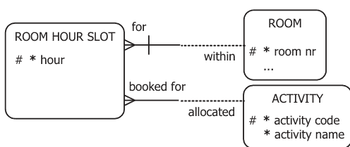

图 1.2 房间调度的 ER 图。

关系显示为连接实体类型的命名线条。仅允许二元关系，关系的每一半显示为实线（强制性）或虚线（可选）。例如，每个 RoomHourSlot 必须有一个 Room，但 Room 是否参与 RoomHourSlot 是可选的。关系一端的横条表示该关系是该端实体类型的组件标识符。例如，RoomHourSlot 通过组合其小时和房间来标识。Room 通过其房间号标识，Activity 通过其活动代码标识。

关系一端的分支或“乌鸦脚”表示该端实体类型的多个实例可以通过该关系与关系另一端的同一实例相关联。缺少乌鸦脚表示该端最多一个实例与另一端的任何给定实例相关联。例如，一个 Activity 可以分配许多 RoomHourSlots，但每个 RoomHourSlot 最多为一个 Activity 预订。

值得称赞的是，这个 ER 图以独立于目标软件平台的方式描绘了领域。例如，将关系端分类为强制性是概念问题。这里没有尝试指定如何实现此约束（例如，使用强制性列、外键引用或对象引用）。然而，ER 图是不完整的（你能发现任何缺失的约束吗？）。而且，从数据用例到模型的转变并不明显。虽然经验丰富的 ER 建模人员可能立即看到需要一个 RoomHourSlot 实体类型，但这一步对初学者建模人员来说可能具有挑战性。

让我们看看面向事实的建模是否能提供一些帮助。我们对面向事实的处理侧重于 ORM。ORM 始于 20 世纪 70 年代初，作为一种语义建模方法，仅从对象（事物）在关系中扮演的角色（部分）的角度来看待世界。例如，你现在正在扮演阅读本书的角色，而本书正在扮演被阅读的角色。ORM 已以多种形式出现，例如自然语言信息分析方法（NIAM）。本书讨论的版本基于 NIAM 的扩展，并由工业软件工具支持。

无论数据用例如何出现，熟悉其含义的领域专家应该能够用自然语言句子表述其信息内容。建模人员的责任是将这种非正式表述转化为一种正式且自然的表述，领域专家能够清楚理解。这两种表述，一种由领域专家提供，由建模人员转化为另一种，构成了 ORM 概念分析程序的步骤 1a 和 1b。这里，我们将示例数据表述为事实实例，然后将其抽象为事实类型。然后添加约束，也许还有推导规则，并通过表述和示例事实群对其进行验证。

为了了解这在 ORM 中是如何工作的，假设我们的系统需要输出类似表 1.3 的报告。我们要求领域专家读出表中包含的信息，然后我们用正式语言重新表述。例如，领域专家可能将表格第一行的事实表述为：星期一上午 9 点，房间 20 已为活动“ORC”预订，该活动名为“ORM 类”。

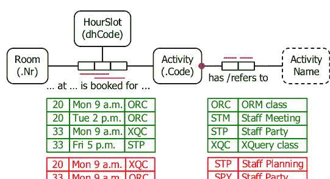

图 1.3 房间调度的 ORM 图，包含示例数据和反例数据。

作为建模人员，我们将其重新表述为两个基本句子，通过确定描述来识别每个对象：编号为“20”的房间在“Mon 9 a.m.”时段槽已为代码为“ORC”的活动预订；代码为“ORC”的活动具有活动名称“ORM 类”。一旦领域专家同意这种表述，我们就从事实实例抽象出*事实类型*（即，事实的类型或种类）。然后我们可以在 ORM 图上描绘此结构，并用示例数据和反例数据（稍后解释）填充它，如图 1.3 所示。

默认情况下，*实体类型*在 ORM 中显示为带名称的圆角矩形（软矩形），并且必须具有引用方案，即人类引用该类型实例的一种方式。简单的引用方案可以在括号中显示（例如，“(.Nr)”或“(.Nr)”），作为相关关联的缩写，即 Room 具有 RoomNr。如字符串类型之类的*值类型*不需要引用方案，并显示为带名称的虚线圆角矩形（例如，ActivityName）。

本书使用 *ORM 2*（第二代 ORM）的记号法，由 natural ORM architect (NORMA) 工具支持，该工具是 Microsoft VisualStudio .NET 的开源插件。以前由 Microsoft Visio for Enterprise Architects 支持的 ORM 版本将对象类型描绘为椭圆，而非软矩形。

除非另有说明，本书中“ORM”一词理解为 ORM 2。当对之前版本的 ORM 进行特定引用时，使用术语“ORM 1”。本书末尾的 ORM 术语表包括 ORM 1 和 ORM 2 记号法的并排比较。

在 ORM 中，*角色*是在*事实类型*（关系或关联）中扮演的部分。关系显示为一个或多个角色框的命名序列，每个角色框连接到其实例扮演该角色的对象类型。图 1.3 包含一个*三元*（三角色）关联，"Room at HourSlot is booked for Activity"，以及一个*二元*（二角色）关联 "Activity has ActivityName"。

与 ER 不同，ORM 在其基模型中不使用属性。所有事实都以对象（实体或值）扮演角色的术语表示。虽然这通常会导致更大的


图表中，无属性方法在概念分析中具有优势，包括简单性、稳定性和易于验证。如果你习惯在 ER 或统一建模语言（UML）中建模（稍后介绍），这种方法起初可能显得奇怪，但请保持开放的心态。

ORM 允许任何元数（角色数）的关系，因此允许一元（单角色）关系。每个事实类型至少有一个谓语读法，对应遍历其角色的一种方式。每个角色排序可以提供任意数量的读法。对于二元关联，正向和逆向谓语读法可以用斜杠“/”分隔显示。如同逻辑中，谓语是带有对象空位的句子。

混合缀记法允许对象术语以各种位置与谓语读法混合（如日语等语言所要求的）。对象占位符由省略号“...”表示（例如，三元谓语“... at ... is booked for ...”）。对于一元后置谓语（例如，“... smokes”）或二元中置谓语（例如，“... has ...”），可以省略省略号。

对于每个事实类型，可以添加带有示例人口的事实表以帮助验证约束。事实表中的每一列与一个角色相关联。角色框旁边的线条描绘内部唯一性约束，指示哪些角色或角色组合必须具有唯一条目。

ORM 模式可以用图形或文本形式表示，一些 ORM 工具可以在两种表示之间自动转换。模型主要通过两种方式与领域专家进行验证：言语化和人口。

例如，三元关联上的唯一性约束言语化为：对于每个 Room 和 HourSlot，该 Room 在该 HourSlot 时最多被预订给一个 Activity；对于每个 HourSlot 和 Activity，在该 HourSlot 时最多有一个 Room 被预订给该 Activity。

三元事实表具有一个满意的人口（每个 Room-HourSlot 组合和每个 HourSlot-Activity 组合都是唯一的）。二元关联上的唯一性约束言语化为：每个 Activity 最多有一个 ActivityName；每个 ActivityName 最多引用一个 Activity。该关联的 1:1 特性通过人口得到说明，其中每个列条目在其列中只出现一次。

Activity 上的实心点是一个强制角色约束，指示 Activity 人口中的每个实例都必须扮演该角色。这言语化为：每个 Activity 都有某个 ActivityName。非强制角色是可选的。由于示例数据并不总是有意义，可能需要额外数据（例如二元事实类型中的 STM）来说明某些规则。Activity 扮演的另一个角色的可选性通过其人口中没有 STM 来显示。

由于 ORM 模式可以用无歧义的句子指定，并由示例支持，因此领域专家完全不需要理解图形记法。然而，建模者发现图表对于思考 UoD（话语宇宙）非常有用。

为了双重检查一个约束，可以提出该约束的反例。附加到事实表上的反行用于测试唯一性约束。例如，三元关联的第一行和反行表明，周一上午 9 点的 20 号房间同时被预订给 ORC 和 XQC 两项活动。这挑战了约束“对于每个 Room 和 HourSlot，该 Room 在该 HourSlot 时最多被预订给一个 Activity”。该约束可以改写为否定形式：在同一 HourSlot 时，同一个 Room 不可能被预订给多个 Activity。反例提供了一个测试用例，以查看这种情况是否确实可能。

具体示例帮助领域专家决定某事是否真的是一条规则。这种额外的验证步骤在领域专家的语言掌握存在逻辑术语使用不准确甚至不正确的情况下非常有用（例如，“each”、“at least”、“at most”、“exactly”、“the same”、“more than”、“if”）。

为了挑战“同一时间最多有一个房间被预订给同一活动”的约束，图 1.3 中三元事实表的第一行和第二个反行表明，周一上午 9 点，20 号房间和 33 号房间都用于 ORC 活动。这种事情可能吗？如果可能（对于某些应用领域确实如此），那么这个约束就不是一条规则，在这种情况下，应该删除该约束并将反行添加到示例数据中。

然而，如果我们的业务不允许同一时间两个房间用于同一活动，那么该约束是正确的，反例被拒绝（尽管可以保留作为示例性反例）。

比较图 1.2 与图 1.3。虽然 ER 图通常比 ORM 图更紧凑，但 ER 模型与自然语言更加疏远，领域专家可能更难以概念化。在这种情况下，将第一个调度事实言语化为三元更自然，但所有具有工业支持的流行 ER 记法都仅限于二元（双角色）关系。

仅限于二元确实会失去表达能力，因为 n 元关联（n > 2）始终可以通过共指或嵌套转换为二元（稍后介绍）。然而，这种转换可能会引入在领域专家看来显得人为的对象类型，这可能阻碍沟通。如果可能，我们应尽量以对领域专家显得自然的方式来制定模型。

ER 记法在捕获约束或业务规则方面不如 ORM 表达能力强。例如，图 1.2 所使用的 ER 记法无法表达活动名称唯一的约束，也无法表达同一小时槽中不可能有多个房间被预订给同一活动的约束。

ER 鼓励在概念分析阶段做出关于相对重要性的决策。有时这可能被视为一种优势。例如，将活动名称视为活动的属性相当自然，因此将名称视为比活动本身不那么重要。

然而，有时对相对重要性的早期区分可能是不利的。例如，不使用图 1.2 中的 RoomHourSlot，我们可以使用 ActivityHourSlot 来模拟信息。哪种选择更可取可能取决于我们可能想要记录的其他类型的信息。然而，由于我们在不知道需要记录哪些其他事实的情况下被迫就此做出决定，我们可能需要以后更改模型的这部分。

一般来说，如果你将一个特征建模为属性，后来发现需要记录关于它的某些信息，你通常被迫将其重新建模为实体类型或关系，因为属性不能有属性或参与关系。

例如，假设我们将 phone 作为 Room 的属性记录，后来发现我们想知道哪些手机支持语音邮件。由于你很少知道未来所有的信息需求将是什么，基于属性的模型本质上是 *不稳定的*。此外，当模型特征更改时，使用该模型的应用程序通常需要重新编码。由于 ORM 本质上对这种更改免疫，它提供了远大的 *语义稳定性*。

我们已经看到，ORM 模型通过言语化和人口两种方式促进验证。属性使得使用示例数据人口变得笨拙。此外，填充可选属性会引入空值，这可能会让非技术人员感到困惑。

虽然 ORM 模型更适合概念分析和模型验证，但如果需要，可以从中生成 ER 视图。即使你决定全程使用 ER，完全忽略 ORM 记法，你也会发现，将 ORM 概念模式设计流程中的建模步骤应用于或调整为 ER 记法，有助于设计更好的 ER 模型。

现在让我们考虑 *面向对象（OO）建模*，一种将数据和行为封装在对象中的方法。虽然主要用于设计面向对象程序代码，但也可用于数据库设计。

存在许多面向对象方法，但最具影响力的是 **统一建模语言（UML）**，它已被对象管理组（OMG）采用。

在其众多图表类型中，UML 包括 *类图* 以指定静态数据结构。类图可用于指定操作以及特定于面向对象代码的低级设计决策（例如，属性可见性和关联可导性）。在剥离此类实现细节后，UML 类图可以被视为 ER 的扩展版本。

图 1.4 显示了我们示例的 UML 类图。为了克服 ER 解决方案中提到的一些问题，调度信息使用了三元关联。由于其面向对象的焦点，UML 不要求为其类提供概念识别方案。相反，假设实体实例由内部对象标识符（oids）标识。

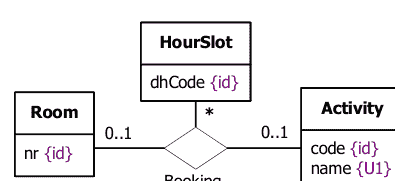

图 1.4 用于房间调度的 UML 类图。


然而，当前版本的 UML 允许通过在属性后附加“{id}”来表示属性值可用作其类中实例实体的 *标识符*（或标识符的一部分）。这可以在映射实现中用于表示关系数据库表中的 *主键* 或可扩展标记语言 (XML) 中的 ID 属性。

UML 还允许以任何语言在花括号或注释中添加用户定义的约束。我们添加了 {U1} 以表示 *替代* 唯一性约束——此符号不是标准的，因此不可移植。三元关系上的唯一性约束由 0..1（至多一个）基数约束捕获。这里“*”是“0..*”的简写，表示“0 个或多个”。属性默认为必填。

这个 UML 模型在多大程度上支持与领域专家进行验证？让我们从自然语言表述开始。虽然通常远非理想，但可以对“has”的隐式使用来从属性构成二元句子，但三元关系又该如何？我们最好只能说类似“预订涉及房间和时间段和活动”这样的话，这几乎没什么用。

如果我们将关联名称替换为混缀谓词，就像我们在 ORM 中所做的那样（例如，“……在……时被预订给……”），这也没有用，因为 UML 关联角色（现在称为关联末端）是无序的。因此，从形式上讲，我们无法知道是应将关联读作“房间在时间段时被预订给活动”，还是“活动在时间段时被预订给房间”，等等。如果同一个类在关联中扮演多个角色（例如，人引荐人给人），情况会更糟。

UML 要求关联角色必须有名称（ORM 允许角色名称，但不强制要求），但角色名称无法构成句子，而句子在自然语言中总是有序的。UML 在事实自然语言表述方面的弱点也适用于约束和推导规则的自然语言表述。

UML 规范（www.omg.org/spec/UML）推荐使用对象约束语言 (OCL) 来正式表达此类规则，但 OCL 的本质过于数学化，非技术领域专家无法用其进行验证。原则上，可以为 UML 设计一种更高级的语言，并可自动转换为 OCL。

由于 UML 中的自然语言表述支持不足，让我们尝试使用样本群体进行验证。这里也没什么运气。首先，基于属性的表示法对多重实例化几乎没用，并且会向基础群体引入空值，以及所有令人困惑的属性。

UML 支持对象图，以便讨论类的单个实例，但这对多重实例化没有帮助。例如，活动代码与名称之间的 1:1 关联性质在图 1.3 的 ORM 事实表中很明显，但通过浏览多个活动对象却较难看出。

原则上，我们可以在 UML 中引入事实表来实例化二元关联，但这对非二元关联行不通。为什么呢？在 UML 中，除非是二元关联，否则无法指定关联的读取方向。因此，事实列与关联角色之间没有像 ORM 中那样明显的连接。我们能做的最好是为每个角色命名，然后使用角色名称作为事实表的表头。但是，由于关联角色的非线性布局，事实列与类图之间的视觉连接会很弱，而且关联的元数越高，情况就越糟。

就其优点而言，UML 在捕获应用程序设计的其他方面（例如，操作、活动、组件打包和部署）方面比 ORM 或 ER 要丰富得多。UML 包含状态机图和活动图等图表，用于捕获业务流程。对业务领域的任何完整规范都需要处理这些动态方面。如果应用程序将以面向对象代码实现，UML 能够更精确地描述要指定的编程代码结构（例如，属性可见性和关联可导航性）。

不过，如果将注意力限制在概念数据建模上，ORM 表示法在表达数据上的业务约束方面比 ER 或 UML 要丰富得多，并且更加正交，较少受变更影响。举个简单的例子，请看表 1.4 的输出报告（评论者和电影 3 是虚构的）。在继续阅读之前，你不妨先尝试自己建模一下。

### 表 1.4 关于电影的另一示例输出报告。

| 电影 | | 导演 | | 评论者 | |
|---|---|---|---|---|---|
| 编号 | 标题 | 姓名 | 出生地 | 姓名 | 出生地 |
| 1 | Crater | Kyle Patrick Alvarez | US | Fred Bloggs Ann Green | US US |
| 2 | Crocodile Dundee | Peter Faiman | AU | Ann Green Ima Viewer Tom Sawme | US GB AU |
| 3 | Star Peace | Ann Green | US | ? ? | ? ? |
| ... | ... | ... | ... | ... | ... |

在 UML 中建模此报告的一种方法如图 1.5 所示。虽然示例报告的群体表明电影标题是唯一的，且一个人只能导演一部电影，但让我们假设领域专家确认情况并非如此。我们应调整样本群体来说明这一点（例如，添加一个新电影 4，标题相同为“Star Peace”，由 Peter Faiman 导演）。

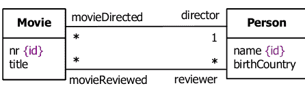

### 图 1.5 表 1.4 的 UML 类图。

假设人们仅通过姓名来标识，Movie 和 Person 类可以如图所示。此处使用角色名称“导演”和“评论者”来区分 Person 扮演的两个角色。同样，也提供了角色名称来区分 Movie 扮演的角色。在此示例中，所有四个角色名称都是必需的。如需要，也可以使用关联名称。

与 Chen 原始的 ER 表示法不同，UML 二元关联通常由无菱形的线条表示。虽然这很方便，但 UML 中对较长关联使用菱形有些不一致，且避免一元关系不太自然。原则上，UML 确实允许将菱形作为二元关联的替代表示法，但在实际中很少见。

相比之下，ORM 将关系描绘为一个或多个角色的序列，每个角色都关联到一个事实表列，这提供了一种统一、通用的表示法，既便于通过自然语言表述进行验证，也便于通过样本群体进行验证。

基数约束表明，每部电影恰好有一位导演，但可能有多位评论者，且一个人可以导演或评论多部电影。但仍缺少一条业务规则。你能发现吗？

图 1.6 在 ORM 中建模了同一领域。这里“has”前面的“◄”反转了正常的从左到右读取方向。UML 模型中缺失的规则通过带圈“X”约束在图形上捕获，该约束位于构成“导演”和“评论”关联的角色对之间。这称为 *互斥约束*。“导演”和“评论”事实类型填充了违反互斥约束的样本数据——即对该约束的 *反例*。

此互斥约束表述为 **没有人导演并评论了同一部电影** 或，反之亦然，**没有电影被同一个人导演并评论**。为与领域专家验证此规则，你应该表述该规则并提供一个反例。例如，在您的模型中，电影 1 是否有可能由 Ann Green 导演且同时由 Ann Green 评论？图 1.6 包含此反例。如果互斥约束确实适用，那么这两个事实中至少有一个必须是错误的。

有些领域专家乐于使用图表，有些则不。有些人擅长理解自然语言规则，有些人则不。但所有领域专家

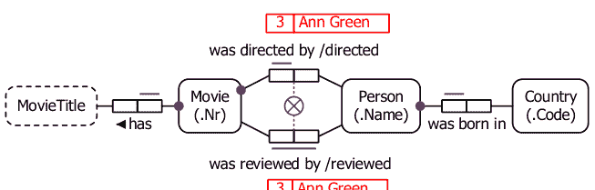

### 图 1.6 表 1.4 的 ORM 模型，包含互斥约束的反例。


擅长使用具体示例。虽然领域专家不必看到图表，但能够直接在图表上实例化任何角色，能让你更清晰地思考规则。

UML 没有通用排他约束的图形表示法，但允许你将约束记录在附加到相关模型元素的注释中。如果某个概念已经是你的建模语言的一部分，那么思考起来会更容易。

由于排他约束表示法不是 UML 语言的内置功能，因此在开发模型时容易遗漏该约束。ER 也是如此。相比之下，ORM 建模过程会提示你考虑此类约束，并允许你可视化并正式捕获规则。ORM 工具随后可以将约束自动映射为可执行代码，以确保规则在实现中得到强制执行。

ORM 图始终将语义域显示为对象类型。图 1.7(a) 中的 ORM 图包括 birthdate 和 deathdate 的角色名称，以方括号形式显示在相关角色旁边。这些角色明显兼容，因为它们都由对象类型 Date 扮演。在 ORM 中，角色名称可像自动生成的属性视图中的属性名称一样使用，也可用于指定属性样式的规则（例如，deathdate > birthdate）。

ER 图通常隐藏属性域。例如，图 1.7(b) 所示 Barker ER 模型中的 birthdate 和 deathdate 属性应基于域 Date，但这在视觉上未体现。在 ER 中，属性域可以在另一文档中列出。

在 UML 类图中，属性域可以列在属性名称和基数（如果显示）之后，如图 1.7(c) 所示。基数 “[0..1]” 表示“至多一个”，因此该属性是可选的且单值的。然而在实践中，只指定语法域或值域（例如，String）的情况比比皆是。

ER 图可能会将人口和海拔显示为 城市 的属性，而关联表可能仅将这些属性的域列为 Integer，尽管将人口与海拔等同是毫无意义的。

概念对象类型，即语义域，提供了概念上的“粘合剂”，将应用模型中的各种组件绑定成一个连贯的图景。即使在关系数据模型的较低层次上，关系模型的创始人 E.F. Codd 也认为：“域是将关系数据库连接在一起的粘合剂”（Codd, 1990, p. 45）。

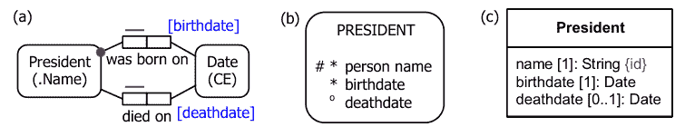

图 1.7 ORM 对象类型是语义域。

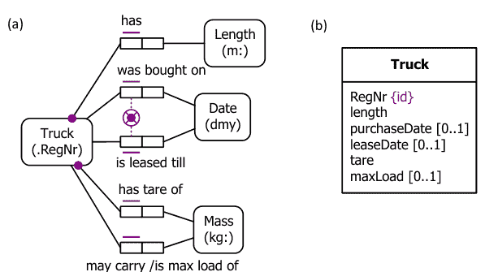

图 1.8 (a) ORM 模型。(b) UML 模型，揭示的细节较少。

ORM 图中的对象类型是语义域，因此模型的 *连通性* 是透明的。ORM 的这一属性对于概念查询也有显著优势，因为用户可以通过浏览其对象类型直接查询概念模型，以建立相关连接。这一概念将在后续章节中进一步阐述。

ER 和 UML 图通常无法表达属性上的或属性之间的相关 *约束*。图 1.8 提供了一个简单示例。注意图 1.8(a) 中 ORM 模型中“X”上方带圆圈的点。这指定了两个约束：该点是对两个角色的析取施加的强制约束（每辆卡车要么被购买，要么被租赁），而“X”表示角色是互斥的（没有卡车既被购买又被租赁）。这两个约束共同提供了一个 *独占或（xor）约束*（每辆卡车恰好扮演其中一个角色）。

与大多数 ER 版本不同，UML 确实提供 *独占或（xor）约束*，但仅限于关联之间。因为图 1.8(b) 中的 UML 模型将这两个事实类型建模为属性而非关联，因此它无法以图形方式捕获该约束（添加注释除外）。再次注意，ORM 图如何揭示语义域。例如，皮重可以与最大载重进行有意义的比较（两者都是质量），但不能与长度相比。在 UML 中，可以通过在属性后附加域名称来使其显式化。在建模过程的各个阶段，让建模人员在一个地方看到所有相关信息都是有帮助的。

ORM 的另一项特性是其对 *子类型* 的灵活支持，包括多重继承，基于正式的子类型定义。例如，子类型 LargeUSCity 可定义为位于国家“US”且人口超过 1,000,000 的 City。如后文所述，子类型定义提供的约束比关于子类型是否互斥或穷尽的声明更强。

原则上，约束种类无限多，因此为了完整性可能需要文本约束语言来补充图表。这对 ER、ORM 和 UML 都适用。然而，ER 和 UML 图未能为许多重要的 ORM 约束包括标准表示法，这使得开发全面模型或对模型进行转换变得更加困难。

例如，假设在电影中，演员可以担任主演或配角，但不能两者兼任。这可以通过两个事实类型来建模：Actor 在 Movie 中担任主演；Actor 在 Movie 中担任配角。“但不能两者兼任”条件在 ORM 中表现为事实类型之间的配对排他约束。或者，这些事实类型可以被一个三元关系替代：Actor in Movie 的角色为 RoleKind {star, support}。

在 ORM 中，转换受到严格控制，以确保一种表示中的约束在替代表示中被捕获。例如，配对排他约束被转换为每个 Actor-Movie 对只有一个 RoleKind 的约束。当相关约束可以可视化时，此类转换背后的正式理论更容易应用。

与 UML 和 ER 不同，ORM 是从语言学基础构建的。为了获得言语化和人口化带来的沟通与领域专家验证的好处，最好使用为此目的而设计的语言。ORM 表示法易于学习，并已成功教授给高中生。

我们并非在这里争辩说 ER 和 UML 没有价值。它们是有价值的。我们只是建议，在使用基于属性的表示法（如 ER、UML 或关系表）之前，考虑使用 ORM 的建模技术及其图形表示法，以促进最初的概念分析。

在与领域专家验证概念模型后，你将其映射到 DBMS 或程序代码等目标以进行实现。在这个较低层次上，你可能更喜欢基于属性的模型，以紧凑地展示事实如何分组为实现结构。对于数据库应用程序，你会想看到表结构、外键关系等等。在这里，关系或对象关系模型提供了一个紧凑的视图，类似于 ER 或 UML 模型。

ORM 模型通常比基于属性的模型占用更多空间，因为它们将每个属性显示为一个关系。这非常适合概念分析，因为我们应该一次验证一个事实类型。然而，对于逻辑设计，我们通常将事实分组为基于属性的结构，例如表或类。在逻辑设计阶段，基于属性的模型比 ORM 模型更有用。例如，关系架构图提供了底层表及其之间外键约束的简单紧凑视图。此外，UML 非常适合面向对象代码的逻辑设计和物理设计，因为它允许在数据模型中体现实现细节（例如，属性可见性和关联导航），并可用于建模行为和部署。

在实际使用了 ER、ORM 和 UML 之后，我们发现 ORM 通常使得一开始就构建正确模型以及随业务领域演变而修改模型变得更加容易。我们非常相信这种方法，以至于将其作为本书大部分建模讨论的基础。一旦你理解了 ORM 的建模原则，就会发现更容易正确理解 ER 和 UML 中的数据建模。


关于建模方法的争论可能会变得激烈，并非所有人都和我们一样确信 ORM 的优点。我们只希望你能客观地审视本书中提出的观点，并考虑使用任何你认为有帮助的内容。

尽管本书侧重于 ORM，但也涵盖了其他常用表示法中的数据建模（例如，ER、IDEF1X、UML 和关系模型）。这些其他表示法也有价值。即使你决定继续使用 ER 或 UML 作为概念分析方法，了解 ORM 也应该能让你成为一名更好的建模师，无论如何。

## 1.3 历史背景

本节简要概述了面向信息系统的计算语言的发展历程，并梳理了数据库系统中使用的主要逻辑数据结构的历史发展。我们先从一个简单的示例开始，来说明语言的层级如何影响提问的难易程度。

表 1.5 总结了**五代计算语言**可能如何被用来请求计算机列出每个行星的名称、质量和卫星（如有），假设信息存储在天文数据库中。代际越高，越接近自然语言，通常需要说的也越少。如今，没有人使用机器码或汇编语言来访问数据库。大多数数据库应用程序使用第四代语言（4GL）编写，可能与第三代语言（3GL）结合使用。

| 代际 | 语言示例 | 相同任务的示例代码 |
| :--- | :--- | :--- |
| 5 | ConQuer | ✓行星 **拥有** ✓质量 **并且可能被** ✓卫星 环绕 |
| 4 | SQL | **选择** X1.planetName, X1.mass, X2.moonName **从** Planet as X1 **左外部连接** Moon as X2 **在** X1.planetName = X2.planetName |
| 3 | Pascal | 类似两页的指令：**对于** i := 1 to n do **开始** write (planetName[i], mass[i]); |
| 2 | 8086 Assembler | 类似多页的指令：ADD1 AX, 1 |
| 1 | 8086 机器码 | 类似多页的指令：00000101 00000001 00000000 |

第三代语言，例如 C# 和 Java，是*过程式*的，强调执行任务所用的过程。使用 3GL 时，我们通常需要指定如何一次一条记录地访问数据。第四代语言，例如 SQL，主要是*声明式*的：人们声明*要做什么*而不是*如何做*。使用 4GL 时，单个语句可以一次性对整个表或行集执行操作。因此，4GL 是*面向集合*的，而非面向记录的。

第五代语言（5GL），例如 ConQuer（一种 ORM 查询语言），允许你以自然的方式指定查询，无需了解用于存储信息的底层数据结构。第五代语言的广泛使用仍在未来。

最初的数据库管理系统在20世纪60年代初开发，最初是简单的文件管理器。已提出各种逻辑数据架构作为指定数据库结构的基础。在层次数据模型中，数据库架构基本上是链接记录类型的树，每种记录类型都有不同的结构（与许多每个节点类型相同的树不同）。

记录可以包含一个或多个字段，每个字段只能保存一个值。记录类型通过父子链接相关联（例如，使用指针），其中父项可以有多个子项，但每个子项只有一个父项。因此，类型结构是树或层次结构。

例如，在图 1.9 中，父记录类型 Department 有两个子记录类型：Product 和 Employee。每个记录类型包含一系列命名字段，此处显示为框，父子链接显示为连接线。为了讨论目的，每个记录类型下方添加了一个记录实例。作为练习，在继续阅读之前，尝试读出此数据库中包含的所有事实。

首先，记录实例中存储了五个事实。为了使这些事实更加明显，图 1.9 包含连接相关字段的弧线，每个事实对应一条弧线。尽管这些弧线是有用的注释，但它们不属于架构表示法的一部分。如果我们熟悉业务领域，可以将这些弧线转化为关系描述。例如，我们可以将这五个事实表述如下：

- 部门 10 位于大楼 69。
- 部门 10 的预算为 $200,000。
- 产品“IS2”的产品名称为“InfoStar 2”。
- 员工 357 的员工姓名为“Jones E”。
- 员工 357 的性别为“F”。

还有更多事实吗？有！父子链接编码了以下两个事实：

- 部门 10 开发产品“IS2”。
- 部门 10 雇佣员工 357。

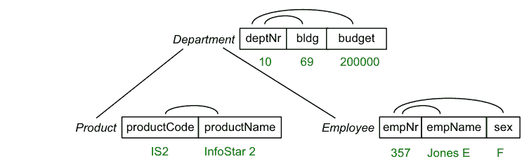

图 1.9 带有示例数据和事实弧线的层次数据库架构。

例如 IBM 的信息管理系统这样的层次数据库管理系统可以高效地管理层次结构（例如，文件目录系统）。然而，为了获取事实而必须显式地在预定义的记录链接上进行导航，这可能有些具有挑战性。如果应用程序本身不具有层次性，复杂性会增加。

假设同一产品可能由多个部门开发。从概念上讲，部门开发产品关联现在是*多对多*。由于父子链接始终是 1 对*多*，因此需要一种变通方法来处理这种情况。

例如，为了记录部门 10 和 20 都开发产品“IS2”的事实，我们可以让两个部门记录实例分别指向产品“IS2”记录实例的独立副本。

虽然类型和实例链接结构是树，但产品“IS2”名为“InfoStar 2”这一事实现在在数据库中出现了两次，因此我们需要控制这种冗余。此外，虽然检索给定部门开发的产品很容易，但检索开发某个产品的所有部门并不容易。

*网络数据模型*是由数据系统与语言会议（CODASYL）数据库任务组开发的。该模型比层次模型更复杂。大多数数据存储在记录中，单个字段可能包含一个值、一组值，甚至一组值集。记录类型通过所有者-成员链接相关联，这些连接的图形可能是一个网络：一种记录类型可以有多个所有者，也可以拥有多种记录类型。

与层次模型一样，事实要么存储在记录中，要么作为记录链接存储。记录类型之间的所有者-成员链接限制为 1:多关联。为了处理多对多关联，如前面讨论的情况，我们可以引入一个新的记录类型（例如，Development），并将其与其他记录类型（在这里是 Department 和 Product）建立多对1关联。

一般来说，在访问路径（例如记录间链接）中编码事实会使应用程序的管理复杂化，并降低其灵活性。例如，新查询必须等到为其添加了访问路径后才能执行，并且随着应用程序结构的演变，内部优化工作可能会被抵消。

部分为了解决此类问题，Edgar “Ted” Codd 博士引入了*关系数据模型*。在他关于该主题的原始1969年IBM研究报告一年后，Codd 为更广泛的读者群发表了修订版（Codd, 1970），他在其中首次主张关系应被规范化，使每个数据条目都是原子的；我们现在称之为第一范式。其他范式是在之后定义的。

关系模型最重要的特点是，*所有事实都存储在表中*，并被视为数学关系。例如，图 1.10 显示了我们应用程序的关系数据库。同样，数据库带有与存储事实对应的弧线注释。注意 Employee 和 Product 表中的额外 deptNr 列。部门 10 雇佣员工 357 并开发产品“IS2”的事实存储在表行本身中。表之间的访问路径不用于指定事实（如层次或网络模型中所允许的那样）。

为了指定查询和约束，表列可以按名称关联。这允许随意指定临时查询，并简化了应用程序的管理。


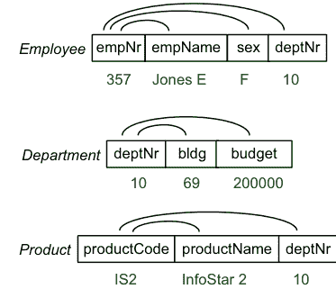

图 1.10 关系数据库中的所有事实都存储在表本身中。

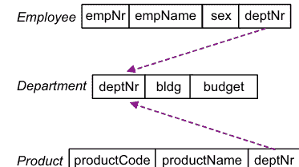

图 1.11 表之间的“链接”表达约束，而非事实。

请注意，表之间指定的约束与访问路径不同。例如，在图 1.11 中，箭头“链接”了 Employee 和 Product 表的 deptNr 列到 Department 表的 deptNr 列。这些“链接”仅仅表达了这样的约束：Employee 和 Product 表中 deptNr 列的任何值也必须出现在 Department 表的 deptNr 列中作为值。这些约束不表达雇佣和产品开发事实。

关系模型在逻辑上比网络模型和层次模型更清晰，但最初性能较差，这导致其接受速度缓慢。然而，到 20 世纪 80 年代末，高效的关系型系统已变得普遍。尽管网络和层次数据库系统今天仍在使用，但关系型 DBMS 往往是开发大多数新数据库应用程序的首选。理想情况下，DBMS 应提供集成的数据字典、动态优化、数据安全性、自动恢复和用户友好的界面。

与关系型数据库一起使用的主要查询语言是 SQL（非正式地称为“结构化查询语言”）和 QBE（示例查询）。许多系统同时支持这两者。

SQL 长期以来一直被接受为国际标准，常用于不同数据库系统之间查询的通信。因此，SQL 是本书中讨论的主要查询语言。

尽管关系型系统对大多数应用程序提供了足够的性能，但对于涉及复杂数据结构（例如，VLSI 设计）的某些应用程序来说，它们效率低下。

最近，XML 也广泛用于不同系统之间的通信，但目前侧重于为电子商务和网页出版等目的共享数据。许多基于 SQL 的 DBMS 现在不仅支持存储 XML 数据，还支持使用 XQuery 等查询语言直接查询 XML 数据。

面向对象数据库、演绎数据库（例如 datalog 系统）以及 OWL（Web Ontology Language）等语言中的本体数据库都存在数据架构。许多关系型系统正在通过面向对象特性进行增强，从而形成对象关系数据库系统。NoSQL 系统因其高效处理大量非结构化数据而日益流行。

## 1.4 相关技能

由于关系型数据库系统仍占主导地位，它们是我们实现讨论的主要焦点，同时也对 XML 和其他系统予以关注。尽管数据库的概念界面仍处于起步阶段，但在更高层次上开发模型更具生产力，可以避免浪费时间去获取很快就会过时的知识和技能。请考虑电子计算器对学校数学课程的影响（例如，移除通用平方根算法）。

从根本上说，有两项技能与与信息系统交互始终相关。这两项技能都涉及就我们特定的应用领域与系统进行通信。请回顾，应用领域在技术上被称为 UoD。这两项要求是：

- 描述 UoD
- 查询关于 UoD 的系统

第一项技能包括描述 UoD 的结构或设计，以及描述其内容或群体：结构方面是唯一具有挑战性的部分。如果您希望将模型添加到系统中，则清晰地描述应用领域至关重要。复杂模型通常应由专家建模人员与领域专家合作编制。本文的主要目的是介绍信息建模的基础知识。如果您掌握了所讨论的方法，就离成为信息系统建模专家不远了。

使用 4GL 发出查询通常很容易，但复杂查询的制定仍可能困难。偶尔，理解系统给出的一些答案可能需要了解系统的工作原理，尤其是其局限性。本书提供了理解关系结构和查询的概念基础，解释了关系查询语言背后的代数，并包括对 SQL 的坚实介绍。

无论信息系统多么先进，如果我们给它一个错误的 UoD 图景，就不能指望从中得到太多有意义的东西。这是垃圾进垃圾出（GIGO）原则的一个方面。大多数数据库应用问题都源于糟糕的数据库设计。本书展示了如何使用自然概念在非常高的层次上对信息进行建模。在对 ER 和 UML 等流行数据建模方法给予应有关注的同时，它还对更高层次的 ORM 方法进行了深入探讨。

概念模式可以映射到当今数据库系统使用的更低级别结构上。这种映射可以使用适当的 CASE 工具自动执行，也可以使用适当的程序手动执行。本书讨论了如何将概念模型映射到关系型数据库系统及其他一些结构（例如 XML schema），以及如何使用查询语言从这些系统中检索数据。它还讨论了其他方法和现代趋势。

## 1.5 摘要

本章介绍了概念建模的动机，并对信息系统进行了简要的历史和结构概述。DBMS 被广泛使用，是面向信息的企业的重要生产力工具。为了有效使用数据库，其数据应正确、完整且能高效访问。这要求数据库设计良好。

设计数据库涉及构建业务领域或 UoD 的正式模型。要做到这一点，需要很好地理解 UoD，并有一种以清晰、明确的方式指定这种理解的方法。ORM 通过使用自然语言、直观图表和示例，并以简单的基本事实为单位检查信息，从而简化了分析和设计过程。通过用对象和角色等自然概念来表达模型，这种面向事实的方法为建模提供了一种真正的概念性方法。

其他有价值的建模方法包括 ER 建模和面向对象建模。在实践中，ER 仍然是数据库设计中最流行的高级方法。尽管存在许多流行的 ER 版本，但 UML 是迄今为止最具影响力的面向对象方法。

虽然 ER 和 UML 模型通常比 ORM 模型更紧凑，但它们在构建、转换或演化概念信息模型方面可能不如 ORM 合适。ER 模型和 UML 类图离自然语言更远，缺乏基于角色的约束表示法的表达能力和简单性，在面对领域演化时不够稳定，更难以用事实实例填充，并且可能隐藏将模型粘合在一起的语义领域的信息。然而，ER 和 UML 模型通过将当前不那么重要的特性表示为属性，更好地突出了所建模领域的主要特征。

在本书中，ORM 被用作我们的基本概念建模方法。ER 模型和 UML 类图也很有用，尤其是用于提供紧凑的摘要，最好作为 ORM 模型的视图来开发。对于数据库应用程序，概念模型通常需要映射到基于属性的逻辑和物理模型。ER 模型提供更接近关系型数据库结构的设计。对于面向对象的应用程序，UML 模型可以包含 ORM 和 ER 方法未涵盖的实现细节以及行为和部署方面。

编程任务通常使用 C# 和 Java 等第三代语言进行编码。第四代数据库语言（如 SQL）在本质上是声明式的，使用户能够声明要做什么，而无需详细说明如何去做，并且是面向集合而非面向记录的。

第五代语言（如 ConQuer）使用户能够直接查询概念模型。层次和网络数据库系统将某些事实存储在记录类型中，将某些事实存储在记录类型之间的链接中。关系型数据库系统将所有事实存储在表中。

各种后关系系统，如面向对象数据库、对象关系数据库、演绎数据库、本体数据库和 NoSQL 数据库，正在工业界获得接受。

无论软件系统变得多么“智能”，人们仍然需要描述 UoD 并就其提出相关问题。

## 本章注释

本书末尾参考书目中包含了参考文献的完整书目条目。Codd (1969, 1970) 引入了关系数据模型。关于这两篇论文的历史讨论，请参见 Date (1998)。Codd (1990) 提出了关系模型的未来发展方向。Chen (1976) 是介绍 ER 建模的经典论文。Kent (2000) 是一本经典书籍的再版，为信息和数据的本质提供了许多洞察。

许多关于 ORM 的论文可在 www.orm.net 和 www.ormfoundation.org 上找到。Simsion and Witt (2005) 对各种数据建模主题提供了易读的覆盖。Booch et al. (1999) 提供了 UML 概述。最新的 UML 规范可在 www.omg.org/spec/UML 上找到。Halpin (2015a) 提供了 UML 和 ORM 中信息建模的比较性回顾。

Date (2000) 对数据库系统的大多数方面提供了清晰的介绍。有关网络和层次 DBMS 的进一步背景内容包含在 Connolly et al. (1999) 的附录 C–E 中。Gorman (1998) 对历史数据模型进行了结构性回顾，并认为现代 SQL 标准本身就是一种数据模型，它比关系模型更接近某些前关系模型。最新版本的 SQL 标准可在 www.iso.org/standard/76584.html 上找到。


本页故意留空

# 信息层级与框架

## 章节大纲

- 2.1 四个信息层级
- 2.2 概念层级
- 2.3 数据库设计示例
- 2.4 开发框架
- 2.5 小结

## 2.1 四个信息层级

一些先进的信息系统被描述为“智能的”。什么是智能，以及机器是否最终会像人类一样智能，都是可争议的问题。在基于艾伦·图灵于1950年提出的测试修订版的图灵智能*测试*中，一块不透明的屏幕被放置在一个典型人类（参见图2.1中的A）与正在接受智能测试的对象之间。人类可以通过计算机（带有用于输入的键盘和用于输出的屏幕）用自然语言就任何想要的话题与对象进行通信。

如果人类无法从对象的回应中判断它是一个智能的人类还是一台机器，那么也许应该将该对象归类为智能。测试中的两个关键条件是使用自然语言，并且讨论话题没有限制。一旦我们限制了语言和讨论话题，就有许多计算机达到人类专家水平的示例（例如，国际象棋、血液疾病诊断、矿产勘探）。此类系统被称为“专家系统”，因为它们在特定领域内的表现与人类专家一样出色。专家系统已通过了针对给定话语宇宙（UoD）的“受限图灵测试”。

人工智能（AI）系统的最新进展使一些系统能够通过不受限的图灵测试。谷歌的LaMDA AI聊天机器人于2022年通过了该测试。后来，OpenAI的ChatGPT也通过了该测试，其基于GPT-4的2023年3月版本可以将图像和文本作为输入（参见https://en.wikipedia.org/wiki/GPT-4）。微软的Bing聊天允许文本和语音输入。

a 图灵的原始测试基于模仿游戏，只要求计算机在构建旨在传达“该男人实际上是一个女人”这一想法的回应方面，至少和男人一样出色。如需进一步讨论，请参见 http://en.wikipedia.org/wiki/Turing_test。


第五代信息系统（5GIS）类似于“用户可定义”的专家系统，因为它允许用户输入话语宇宙（UoD）的描述，然后用自然语言就此进行对话。系统处理其对话部分的效果如何，取决于其用户界面、数据库管理和推理能力有多强。

虽然可取，但当我们与5GIS通信时，它不一定总能以专家水平运行。然而，它必须允许我们以自然的方式与它进行通信。英语和日语等自然语言复杂而微妙。在信息系统能够自由使用不受限的自然语言进行对话之前，还需要多年时间。在此期间，如果系统支持使用自然语言的形式化子集进行对话，我们就应该感到满意。可能存在许多“形式化的自然语言”，一种用于英语，一种用于日语，等等。5GIS应该能够使用人类使用的同一种语言进行回应。例如，假设我们提出了如下查询：

Selena的年龄是多少？

然后我们收到了如下回复：

sanjusai.

除非我们知道该回复是日语中的“30岁”，否则这没有帮助。即使我们能将日语翻译成英语，我们仍然可能误解该回复，因为日本人在出生时不会将人的年龄分配为0岁，而是分配为1岁。因此，日语系统中的30岁对应西方系统中的29岁。除了*共同语言*的要求之外，两个人之间的有效沟通还要求每个人对所使用的词汇赋予*相同的含义*。为了实现这一点，他们应该（a）共享相同的上下文或UoD，以及（b）就该UoD而言使用无歧义的句子进行表达。

以我们的示例为例，关于Selena的年龄是29岁还是30岁的困惑源于不同的年龄惯例，一种是西方的，一种是日本的。自然言语中充满了只能通过上下文来消除歧义的示例。考虑“Pluto is owned by Mickey”。在华特·迪士尼的卡通人物世界中，这是正确的。但是，假设一个不熟悉米老鼠和他的狗Pluto的人在天文学语境下解释了这句话，将“Pluto”理解为指代冥王星小行星——这就造成了严重的沟通失败！向信息系统清晰地描述UoD是至关重要的。

信息系统可以从*四个层级*来看待：*概念层级*、*逻辑层级*、*物理层级*和*外部层级*。概念层级是最基本的，它以人类概念自然地描绘业务领域。在此层级上，UoD的蓝图称为**概念模式**。这描述了业务领域的结构或语法（例如，填充它的对象类型、这些对象扮演的角色以及适用的约束）。

虽然概念模式指示了UoD的结构，但任何给定时间的**概念数据库**都指示了填充UoD特定*状态*的*内容*或实例。因为信息为数据赋予了意义，所以“信息库”这一术语更为合适（van Griethuysen, 1982）。不过，我们将使用更简洁、更流行的术语“数据库”。从概念上讲，数据库是一组表达被认为关于UoD为真的命题的句子。因为句子可能会被添加或删除，数据库可能会从一个状态转换到另一个状态。

然而，在任何特定时间，填充数据库的句子必须分别和共同符合领域特定的语法或设计计划，即概念模式。总结如下：

概念模式指定了概念数据库所有允许状态和转换的结构。

为了强制执行这一定律，我们现在引入第三个系统组件：**概念信息处理器**（CIP）。它监督用户对数据库的更新并回答用户查询。图2.2展示了信息系统的基本概念架构。该图假设概念模式已经存储在系统中。对于每个应用领域，都会输入一个不同的概念模式。

尽管该图可能暗示用户正在直接与CIP交互，但用户与系统的交互是外部的而非概念性的。概念模式不关注用户界面或数据库可以高效维护的物理细节。

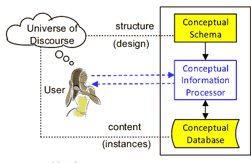

通过在整体架构中包含外部和内部组件来处理这些问题。

当由人们解释时，概念模式和数据库都提供了关于UoD的知识。概念模式与（概念）数据库的组合称为UoD的概念模型。模型或知识库是对UoD的形式化描述，CIP控制模型与人类之间的信息流。一些作者将“模型”一词用于更受限的意义，即“模式”。本书使用“模型”一词来包含模式和填充模式的一组事实。

请记住，领域专家是一个或一组共同熟悉业务领域的人。模型师或概念设计师是一个人或一个团队，通过形式化领域专家的知识来指定概念模式。最终用户使用已实现的系统。对于小型系统，领域专家、模型师和用户可能是同一个人。大型系统可能有多个部分领域专家、一支分析师和设计师团队，以及数千名最终用户。

模型师将概念模式输入系统并对其具有读/写访问权限。通常，大多数用户对模式具有只读能力，但对数据库具有读/写访问权限。可以为不同用户创建不同的界面，以便某些用户只能访问模型的一部分。因此，不同用户可能访问全局概念模式的不同子模式。图2.3总结了这种情况。某些用户可能对数据库具有只读访问权限。

外部模式指定了特定用户或用户组可访问的UoD设计和操作。这里我们指定可以读取、添加或删除哪种事实，以及它们如何显示。出于安全考虑，不同的用户组通常被分配不同的访问权限（例如，确保敏感信息不被公开）。为了用户方便，可以构建视图来隐藏与用户组无关的信息，或者更高效地收集和显示信息。可以设计不同的界面来满足不同专业水平用户的需求，即使他们访问的是相同的底层信息。

概念模式旨在实现清晰沟通，尤其是在模型师和领域专家之间。虽然它们提供了关于UoD的清晰图景，但它们通常是

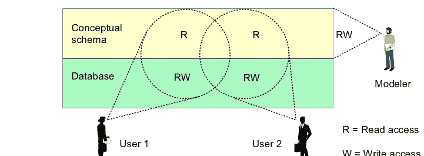

图2.3 对模型的访问。


转换为低层结构以实现高效实现。对于给定的应用程序，会选择合适的逻辑数据模型（例如，关系型、面向对象），并将概念架构映射为一个以该数据模型所支持的数据和操作的抽象结构为术语的 **逻辑架构**。例如，在关系架构中，事实存储在表中，约束使用主键和外键声明等来表达。

逻辑架构现在可以在特定的数据库管理系统（DBMS）中实现为 **物理架构**，例如关系架构可能在 Microsoft SQL Server 或 IBM 的 DB2 中实现。物理架构包括所使用的物理存储和访问结构的详细信息（索引、文件聚集等）。对于同一DBMS，可以做出不同的物理选择，不同的DBMS在可选内容上通常也有所不同，因此可能为同一逻辑架构选择不同的物理架构。系统将外部层级的操作转换为物理层级的操作。逻辑架构和物理架构都位于 *内部层级*。

概念层级的一个优势是它是所有层级中最 *稳定* 的。它不受用户界面或存储和访问技术变化的影响。假设一个概念架构在关系型DBMS中实现，而后来我们希望改用对象数据库。除非讨论领域（UoD）发生了变化，否则概念架构可以保持不变。我们只需应用不同的映射过程，然后迁移数据。

如果一种语言是研究对象，则它被称为 *对象语言*。用来研究它的语言则称为 *元语言*。例如，你可以使用英语作为元语言来研究日语作为对象语言。对象语言可以是它自己的元语言，例如，英语可以用于学习英语本身。任何概念架构都可以表示为一组句子，因此可以被视为一个独立的数据库。

这使我们能够构建一个用于讨论概念架构的 *元架构*。这个概念架构规定了任何概念架构都必须遵循的设计规则（例如，每个角色由恰好一个对象类型扮演）。计算机辅助软件工程（CASE）工具用于协助设计此类元架构的概念架构，以确保建模者输入的架构格式正确或“语法正确”。

说到语法，我们同意同时接受“schemas”和“schemata”作为“schema”的复数形式。虽然“data”是“datum”的复数，但我们将采用常见做法，允许“data”既用作单数也用作复数。书中的第一个练习如下所示。练习答案包含在在线补充材料中。

## 练习 2.1

- 1. 将下列各项分类为 A（外部）、B（概念）或 C（内部）。
- (a) 该级别涉及存储和访问数据的物理细节。
- (b) 该级别关注为单个用户提供方便且授权的数据库视图。
- (c) 该级别关注以根本方式表示信息。

## 2.2 概念层级

在概念层级，人与信息系统之间的所有通信都由CIP处理。这种通信可以分为三个主要阶段：

- 1. 建模者将讨论领域（UoD）的概念架构输入系统。只有当该架构与元概念架构一致时，CIP才会接受该架构。
- 2. 用户通过添加或删除特定事实来更新数据库。只有当更新与概念架构一致时，CIP才会接受该更新。
- 3. 用户查询系统关于讨论领域（UoD）的问题并由CIP回答。只要CIP存储了信息或能够推导出信息，它就可以提供关于概念架构或数据库的信息。

在这些阶段中，CIP 分别充当 *设计过滤器*、*数据过滤器* 和 *信息提供者*。为了处理更新和查询请求，CIP访问概念架构，该架构如图 2.4 所示包含三个主要部分。

一个 *事实*（或事实实例）是业务视为正确的命题。**事实类型**部分列出了数据库中可能表示的事实类型。事实类型表明在讨论领域（UoD）中允许的 *对象* 类型（例如，Employee, Country），它们如何通过数据库中的值来引用（例如，SSN, CountryCode），以及它们的 *关系*（例如，*出生于*、*居住于*）。

**约束**部分列出了事实类型实例集上的约束或限制。*静态约束*适用于数据库的每个状态。例如，假设一个数据库存储关于国家及其人口的信息。尽管一个国家的人口随时间变化，但在任何给定时间，每个国家最多只能记录一个当前人口值。*动态约束*确定数据库状态之间允许的转换。例如，一个人的年龄状态可能从儿童变为成年人，但反之则不可。

约束也称为 *验证规则* 或 *完整性规则*。当数据库与正在建模的讨论领域（UoD）一致时，据说具有完整性。虽然大多数数据库约束可以在概念架构图上以图形方式表示，但有些约束可能需要以其他方式表示（例如，使用概念句子、公式、表格、图表或程序代码）。

**推导规则**部分包含从其他事实推导新事实的规则。不是 *推导事实* 的事实是 *断言事实*（也称为基本事实或基础事实）。推导规则可能涉及 *数学计算* 或 *逻辑推理*。例如，平均分可能通过将各个分数相加并除以其数量来推导。为各种数据类型定义了许多运算符和函数。这允许各种可能的查询，而无需记录每个推导过程。典型的数学设施包括算术运算符，如 +、-、*（乘法）和 /（除法）；集合运算符，如 U（并集）；以及用于计数、求和和计算平均值、最大值和最小值的函数。

| 事实类型 | 约束 | 推导规则 |
| :--- | :--- | :--- |

图 2.4 概念架构的三个主要部分。

除了这些通用推导设施之外，已知需要的特定 *推导事实类型* 可以通过推导规则在架构中定义。一些数学计算的事实类型和几乎所有逻辑推断的事实类型都属于此类。通过逻辑推断推导的事实类型通常涉及使用 **and** 或 **if** 等逻辑运算符的规则。

尽管可推导的事实可以存储在数据库中，但通常最好避免这样做。除了节省存储空间之外，从存储数据中省略推导事实的做法通常使处理更新容易得多。例如，假设我们想定期获得班级中学生的个人年龄（以岁为单位）以及偶尔获得班级的平均年龄。如果我们在数据库中存储平均年龄，那么每次学生加入或退出班级，以及班级中任何个人的年龄增加时，都必须安排重新计算它。

作为改进，我们可以存储学生人数及其个人年龄，并且仅在请求时才推导平均年龄。但这仍然很笨拙。你能想出更好的设计吗？

你可能已经意识到，没有必要存储班级中的学生人数，因为可以使用计数函数来推导。这样避免了每次有人加入或离开班级时都要更新班级规模。此外，甚至没有必要存储学生的个人年龄。计算机系统有内置时钟，可以访问当前日期。如果我们存储学生的出生日期，那么系统可以在请求时通过使用适当的日期减法算法来推导任何学生的年龄。这样，我们就不必担心随着学生长大一岁而更新他们的年龄。

有时，需要的不是当前年龄，而是某个特定日期的年龄（例如，入学、未来体育比赛的年龄分组）。在这种情况下，如果每个人都需要一个单一且稳定的年龄，那么存储它可能是合适的。

在考虑使用逻辑推断的推导示例之前，请注意 *命题* 和 *句子* 之间的区别。命题由陈述句断言，且始终为真或假（但不能两者兼具）。同一命题可以由不同的句子断言，例如，“巴黎是法国的首都”和“法国的首都是巴黎”。

虽然人类可以非常精妙地处理潜在含义，但计算机完全是字面思维：它们处理句子而非含义。如果我们希望计算机建立对我们来说可能显而易见的联系，就必须明确地为其提供建立此类联系所需的背景或规则。

假设数据库中存储了关于兄弟关系和亲子关系的事实。为了简化起见，假设我们想谈论的唯一对象是通过名字来识别的人。我们可以如下列出事实：

- Alan 是 Betty 的兄弟。
- Charles 是 Betty 的兄弟。
- Betty 是 Fred 的父母。


你可以查看这些事实，轻易看出 Alan 和 Charles 都是 Fred 的叔伯。在这样做时，你正在使用对“叔伯”一词的理解。如果我们希望计算机系统能够进行类似的推理，我们需要为其提供一条表达这种理解的规则。例如：

```
Given any X, Y
X is an uncle of Y if there is some Z such that X is a brother of Z and Z is a parent of Y.
```

这可以缩写为

```
X is an uncle of Y if X is a brother of Z and Z is a parent of Y.
```

这条规则是 Horn 子句的一个示例。“if”左侧的子句头部可从右侧陈述的条件推导出来。Horn 子句用于 Prolog 和 Datalog 等语言，使得许多推导规则可以简明地列出。在对象-角色建模（ORM）中，此类规则使用更易读的语法指定，例如，

```
For each Person1 and Person2,
Person1 is an uncle of Person2 if Person1 is a brother of some Person3 who is a parent of Person2.
```

要了解 CIP 的工作原理，让我们看一个示例。该表示法基于一种名为 FORML（形式化 ORM 语言）的文本 ORM 语言。图形版本将在后面的章节中解释。为简单起见，一些约束被省略了。UoD 结构在所示概念模式中列出。

| 项目 | 详情 |
| :--- | :--- |
| 参考方案 | Person.(Firstname); Country.(Code); Year.(CE) |
| 基础事实类型 | F1 Person lives in Country.<br>F2 Person was born in Year.<br>F3 Person is a brother of Person.<br>F4 Person is a parent of/is a child of Person. 角色: parent, child. |
| 约束 | C1 每个 Person 生活在某个 Country 中。<br>C2 每个 Person 最多生活在一个 Country 中。<br>C3 每个 Person 最多在一个 Year 中出生。<br>C4 没有 Person 是其自身的兄弟。<br>C5 没有 Person 是其自身的父母。 |
| 推导规则 | D1 如果 Person1 是某个 Person3 的兄弟，而 Person3 是 Person2 的父母，则 Person1 是 Person2 的叔伯。<br>D2 Person 的 nrChildren = 计算该 Person 的每个 child。 |

参考方案部分声明了感兴趣的对象类型及其引用方式。对象要么是实体，要么是值。实体是通过以某种方式将值（例如，名称）与其关联来引用的真实或抽象事物。这里，我们有三种实体类型：Person、Country 和 Year。在此 UoD 中，人们通过其名字进行标识（在实践中这很少成立！）。国家通过代码进行标识（例如，“CU”代表古巴）。年份通过 CE（公元）值进行标识（例如，第二次世界大战于 1945 年 CE 结束）。年份是时间段，因此它们是实体，而非值。

事实类型部分声明了感兴趣的事实种类。这表明对象类型如何参与关系。在本书中，英文的对象类型名称首字母大写，角色名称以小写字母开头。由于数据库列具有“birthyear”这样的属性名称，您可能会觉得将“Person was born in Year”改写为“Person has Birthyear”更好。

然而，假设我们添加事实类型“Person has Deathyear”。Birthyear 与 Deathyear 之间的形式连接现在被隐藏了。将新事实类型表述为“Person died in Year”揭示了与“Person was born in Year”的语义连接，并使出生年份和死亡年份之间的比较变得有意义（底层域是 Year）。

属性名称常用于 ER、UML 和关系模式中来表达事实，但这可能不自然（比较“Person has deathyear”与“Person died in Year”），并且除非添加诸如“Year”这样的域名，否则是不完整的。

约束部分声明了事实类型上的约束。此处的示例均为静态约束（即，每个约束对于数据库的每个状态都为真）。架构语言中的保留字以粗体显示。约束 C1 意味着对于数据库中引用的每个人，我们都知道他们至少居住的一个国家。C2 表示没有人可以同时居住在多个国家。C3 表示没有人在多于一年中出生；注意，我们可能不知道他们的出生年份。约束 C4 表示没有人是其自己的兄弟，C5 表示没有人是其自己的父母（兄弟关系和亲子关系都是非自反的）。

推导规则部分声明了一条关于叔伯关系的逻辑规则和一个计算任何人孩子数量的函数。叔伯关系规则以关系风格指定，使用事实类型读数。nrChildren 规则使用角色名称以属性风格指定。

在概念级别，数据库中的每个事实都是简单事实或基本事实。基本上，这意味着它不能在不丢失信息的情况下拆分为两个或多个更简单的事实。我们可以将一个事实添加或插入到数据库中，也可以从数据库中删除一个事实。但是，我们不能仅修改或更改事实的一部分。By “fact” 我们指的是“事实实例”而不是“事实类型”。

添加或删除单个事实的操作是基本更新或简单事务。在我们的示例概念查询语言中，添加和删除请求以“add:”和“del:”开头，查询以“list”开头或以“？”结尾。CIP 要么接受更新，要么拒绝它们并指示违规情况。CIP 回答合法查询并拒绝非法查询。

为了解释数据库事务背后的概念概念，我们现在讨论一些 CIP 交互示例。如果这看起来乏味，请记住，我们讨论的是概念级别，而不是用户实际与系统交互的外部级别。在外部级别，用户通常在表单或表格的屏幕版本中输入、删除或更改值。然而，在概念上，我们可以将此类操作视为在传递给 CIP 之前，被翻译为对基本事实的适当删除和添加操作。假设我们现在开始如下填充概念数据库：

- 用户：
- add: Person 'Terry' lives in Country 'US'.
- CIP：
- 已接受

因为 CIP 识别了该句子的类型，并看到未违反任何约束，所以它将其添加到数据库中并回复“Accepted”。如果更新与概念模式不一致，CIP 会拒绝它，并通过口头表述被违反的约束来指示拒绝原因。您现在应该能够跟随以下对话。为节省空间，此处仅列出被违反的约束编号，而不是其口头表述。

- add: Person 'Norma' was born in Year 1950. 被拒绝。C1 被违反。
- add: Person 'Norma' lives in Country 'US'. 已接受。
- add: Person 'Norma' was born in Year 1950. 已接受。
- add: Person 'Terry' is a brother of Person 'Paul'. 被拒绝。C1 被违反。
- add: Person 'Paul' lives in Country 'AU'. 已接受。
- add: Person 'Terry' is a brother of Person 'Paul'. 已接受。
- add: Person 'Paul' is a brother of Person 'Paul'. 被拒绝。C4 被违反。
- add: Person 'Terry' plays Sport 'Judo'. 被拒绝。未知的事实类型

现在假设 Norma 从美国搬到澳大利亚。我们应如何记录此更改？以下是两个错误尝试：

- add: Person 'Norma' lives in Country 'AU'. 被拒绝。C2 被违反。
- del: Person 'Norma' lives in Country 'US'. 被拒绝。C1 被违反。

是否有办法更改 Norma 的居住国家？有。有时，将许多基本更新提交为单个复合事务很方便，甚至是必要的。为演示这一点，我们使用“begin”和“end”作为括号来打开和关闭事务。使用复合事务时，CIP 仅考虑事务的总体或集体效果。即使单独考虑时其某些组件简单更新会被拒绝，CIP 也完全可能接受复合事务。要更改 Norma 的位置，我们如下操作：

```
begin
del: Person 'Norma' lives in Country 'US'.
add: Person 'Norma' lives in Country 'AU'.
end         Accepted.
```

CIP 仅当事务的总体效果与概念模式一致时才接受该事务。用户将此复合事务作为两个基本更新的序列输入。此处指定先删除后添加更自然。但是，CIP 将任何复合事务视为一组更新，忽略了


组件的顺序，并且只关注总体效果。因此，即使添加操作被指定在删除操作之前，也会以相同的结果被接受。

请注意，CIP 不能仅接受复合事务的一部分：这是“全部或不做”的情况。这里有几个更简单的交互示例：

```
add: Person ‘Linda’ lives in Country ‘AU’.           Accepted.
add: Person ‘Selena’ lives in Country ‘AU’.         Accepted.
add: Person ‘Terry’ is a parent of Person ‘Linda’.  Accepted.
add: Person ‘Terry’ is a parent of Person ‘Selena’. Accepted.
nrChildren of Person ‘Terry’?                       2.
list each Person who is a brother of Person ‘Paul’. Terry.
list each Person who lives in Country ‘AU’.         Linda
                                                    Paul
                                                    Selena
list each Person who is an uncle of Person ‘Selena’. No Person.
add: Person ‘Paul’ is a brother of Person ‘Terry’.  Accepted.
list each Person who is an uncle of Person ‘Selena’. Paul.
list each Person who is an aunt of Person ‘Selena’.  Rejected. Unknown fact type.
```

现在假设 UoD 通过添加以下约束而更改：

### C6 每个人都出生于某一年。

我们当前的数据库无法满足此约束。假设我们从空数据库重新开始，尝试添加以下事实。CIP 将如何响应？

```
add: Person ‘Bernard’ is a brother of Person ‘John’.
```

此更新请求被拒绝。它违反了两个约束（C1 和 C6），因为数据库中列出的所有人都必须同时记录其国家和出生年份。第 5 章使用术语“强制性角色”来描述此类约束。

通常，约束列出的顺序无关紧要。但是，如果更新请求违反多个约束，此顺序可能决定在 CIP 配置为最多报告一个违规时，报告哪个约束被违反。在此情况下，CIP 将对先前的请求作出如下响应：“Rejected. C1 violated”。如果 CIP 配置为报告所有约束违规，则将改为响应“Rejected. C1, C6 violated”。作为练习，请自行确认，在添加 C6 后，以下更新请求的处理结果如所示：

```
add: Person ‘Ken’ lives in Country ‘GB’.             Rejected. C6 violated.
begin
  add: Person ‘Ken’ lives in Country ‘GB’.
  add: Person ‘Ken’ was born in Year 1960.
end                                                   Accepted.
add: Person ‘Ken’ was born in Year 1959.              Rejected. C3 violated.
```

```
begin
    del: Person 'Ken' was born in Year 1960.
    add: Person 'Ken' was born in Year 1959.
    add: Person 'Erik' lives in Country 'NL'.
    add: Person 'Erik' was born in Year 1970.
    add: Person 'Ken' is a brother of Person 'Erik'.
end                          Accepted.
```

CIP 使用概念模式来监督数据库的更新并响应问题。请将概念模式的设计师视为“立法者”，将模式本身视为包含 UoD 法律或基本规则的“法典”。CIP 是“执法者”，因为它确保当用户尝试更新数据库时遵守这些法律。像任何友好的警察一样，CIP 也随时应要求提供信息。

每当我们与人或信息系统沟通时，脑中都会有一个特定的 UoD。通常，这涉及真实宇宙的一小部分，例如某个特定企业。在罕见情况下，我们可能会选择虚构的 UoD（例如，由漫画角色居住的世界），或者为我们正在撰写的小说而构建的奇幻世界。虚构的世界可能在逻辑上可能，也可能不可能。

您通常可以依靠自己的直觉来判断什么在逻辑上是可能的。例如，月亮呈绿色的世界是可能的，但月亮同时全身绿色和全身红色的世界是不可能的。可能的世界被称为 *一致的*，而不可能的世界称为 *不一致的*。

作为人类，我们的脑海中携带着海量信息。在我们个人的信念网络中，某处很可能潜伏着一些逻辑矛盾。在大多数情况下，我们的信念网络在全球范围内是否不一致并不重要。然而，在推理特定 UoD 时，一致性是必不可少的。很容易证明，一旦接受逻辑不一致，就可以从中推导出任何东西（包括废话）——这是“垃圾进，垃圾出”（GIGO）原则的极端案例。

基本上有两种垃圾：逻辑垃圾和事实垃圾。不一致的设计包含逻辑垃圾。例如，我们可能会声明两个相互矛盾的约束。一种受 CASE 工具支持并强制执行元规则的良好设计方法可以帮助避免此类问题。通过对数据库强制执行约束，可以防止许多事实错误。例如，声明的约束“每个人最多在一个国家出生”防止我们为某人分配多个出生国家。

即使模式是一致的，并且 CIP 检查数据库与此世界设计一致，仍然有可能向数据库中添加虚假数据。例如，如果我们告诉 CIP 爱因斯坦出生在法国，它可能会接受，尽管爱因斯坦实际上出生在德国。如果我们希望知识库在事实上保持正确，确保我们输入数据库的所有句子都表达实际为真的命题，仍然是我们的责任。

以下练习旨在练习本节讨论的概念，并介绍一些稍后将正式处理的其他约束类型。

## 练习 2.2

- 1. (a) 假设概念模式已存储，CIP 的两个主要功能是什么？
- (b) 概念模式的三个主要组成部分是什么？
- (c) “CIP 将拒绝任何其组件更新操作与概念模式不一致的复合事务”。正确或错误？

- 2. 假设存储了以下概念模式。约束适用于每个数据库状态。C1 表示数据库中提及的每个人都必须记录其健身评级。C3 说明可能的健身值为 1 到 10 的整数。C4 表示没有人可以被记录为多种运动的专家，C5 表示只有当某人也被记录为在同一种运动中参与时，才能记录其为该运动的专家。

参考方案：Person.(Firstname); Sport.(Name); FitnessRating.(Nr)

基本事实类型：
- F1 Person 具有 FitnessRating。
- F2 Person 参与 Sport。
- F3 Person 是 Sport 的专家。

约束：
- C1 每个 Person 都有某个 FitnessRating。
- C2 每个 Person 最多有一个 FitnessRating。
- C3 FitnessRating 的可能值为 1 到 10。
- C4 每个 Person 最多是某个 Sport 的专家。
- C5 每个作为某个 Sport 专家的 Person 也参与该 Sport。

推导规则：
- D1 如果 Person 参与 Sport 'judo' 或 Person 参与 Sport 'karatedo'，则 Person 是武术家。
- D2 Sport 的 nrPlayers = 参与该 Sport 的每个 Person 的计数。

数据库最初为空。用户现在尝试以下一系列更新和查询。对于每个更新，如果更新被接受（基于数据库的累积状态），请圈出字母。在拒绝的情况下，提供原因（例如，说明违反了模式的哪一部分）。对于查询，提供 CIP 的适当响应。

- (a) add: Person 'Ann' 具有 FitnessRating 9。
- (b) add: Person 'Fred' 参与 Sport 'tennis'。
- (c) add: Person 'Bob' 具有 FitnessRating 7。
- (d) add: Person 'Ann' 具有 FitnessRating 8。
- (e) add: Person 'Chris' 具有 FitnessRating 7。
- (f) add: Person 'Fred' 具有 FitnessRating 15。
- (g) add: Person 'Ann' 参与 Sport 'judo'。


- (h) add: 人物 'Bob' 擅长运动 'soccer'。
- (i) add: 人物 'Ann' 擅长运动 'judo'。
- (j) add: 人物 'Ann' 使用语言 'SQL' 进行编程。
- (k) add: 人物 'Ann' 参加运动 'soccer'。
- (l) add: 人物 'Chris' 参加运动 'karatedo'。
- (m) del: 人物 'Chris' 的健康评级为 7。
- (n) begin:
    - add: 人物 'Bob' 的健康评级为 8;
    - del: 人物 'Bob' 的健康评级为 7。
    - end
- (o) add: 人物 'Ann' 擅长运动 'soccer'。
- (p) add: 人物 'Bob' 参加运动 'soccer'。
- (q) 人物 'Ann' 参加运动 'judo' 吗？
- (r) 列出参加运动 'karatedo' 的每个人物。
- (s) 运动 'soccer' 的 nrPlayers 是多少？
- (t) 列出每个武术家人物。
- (u) 列出健康评级的可能值。
- (v) 生命的意义是什么？

3. 在以下模式中，约束适用于数据库，不一定适用于现实世界。虽然每个学生都有婚姻状况，但记录它是可选的（例如，某些学生可能希望将其婚姻状况保密）。约束 C1 结合了两个较弱的约束，因为 “exactly one” 表示 “at least one（即，一些），和 at most one”。

参考方案: Student.(Firstname); Degree.(Code); MaritalStatus.(Name)

- 基本事实类型: F1 学生注册于学位
- F2 学生有婚姻状况

- 约束: C1 **每个** 学生注册于 **精确一个** 学位。
- C2 **每个** 学生拥有 **最多一个** MaritalStatus。
- C3 **MaritalStatus 的可能值为** 'single', 'married', 'widowed', 'divorced'。
- C4 MaritalStatus **转换**: ("1" = "允许")

| 从 \ 到 | single | married | widowed | divorced |
|---|---|---|---|---|
| single | 0 | 1 | 0 | 0 |
| married | 0 | 0 | 1 | 1 |
| widowed | 0 | 1 | 0 | 0 |
| divorced | 0 | 1 | 0 | 0 |

数据库最初为空。用户尝试以下更新和查询序列。对于每个更新，如果被接受，请圈出字母；如果被拒绝，请提供理由。假设问题合法，并提供适当的答案。

- (a) add: 学生 'Fred' 注册于学位 'BSc'。
- (b) add: 学生 'Sue' 有婚姻状况 'single'。
- (c) begin
    - add: 学生 'Sue' 有婚姻状况 'single'。
    - add: 学生 'Sue' 注册于学位 'MA'。
    - end
- (d) add: 学生 'Fred' 注册于学位 'BA'。
- (e) add: 学生 'Fred' 正在学习科目 'CS112'。
- (f) 列出婚姻状况的可能值。
- (g) add: 学生 'Bob' 注册于学位 'BSc'。
- (h) add: 学生 'Sue' 有婚姻状况 'married'。
- (i) begin
    - del: 学生 'Sue' 有婚姻状况 'single'。
    - add: 学生 'Sue' 有婚姻状况 'married'。
    - end
- (j) add: 学生 'Bob' 有婚姻状况 'single'。
- (k) begin
    - del: 学生 'Bob' 有婚姻状况 'single'。
    - add: 学生 'Bob' 有婚姻状况 'divorced'。
    - end
- (l) 学生 'Sue' 注册于学位 'BSc' 吗？
- (m) 列出注册于学位 'BSc' 的每个学生。
- (n) 列出注册于学位 'MA' 的每个学生。
- (o) add: 3 名学生注册于学位 'BE'。

数据库的最终状态是什么？

### 4. 假设以下概念模式。

参考方案: Person(.Firstname)
基本事实类型: F1 人物是男性。
F2 人物是女性。
F3 人物是人物的父母。
约束: C1 每个人物是男性或女性。
C2 没有人物既是男性又是女性。
C3 每个人最多有 2 个父母
    每个 Person2 实例在 Person1 是 Person2 的父母中最多出现 2 次。
C4 没有人物是其自身的父母。
推导规则: D1 如果 Person1 是某个 Person3 的父母，而 Person3 是 Person2 的父母，那么 Person1 是 Person2 的祖父母。

假设数据库已填充以下数据。用户现在尝试以下更新和查询序列。在每种情况下指示 CIP 的响应。

男性: David, Paul, Terry 女性: Alice, Chris, Linda, Norma, Selena

- (a) add: 人物 'Jim' 是男性。
- (b) add: 人物 'Bernie' 是人物 'Terry' 的父母。
- (c) begin
    - add: 人物 'Terry' 是人物 'Selena' 的父母。
    - add: 人物 'Norma' 是人物 'Selena' 的父母。
    - end
- (d) add: 人物 'David' 是人物 'David' 的父母。
- (e) begin
    - add: 人物 'Norma' 是人物 'Paul' 的父母。
    - add: 人物 'Alice' 是人物 'Terry' 的父母。
    - end
- (f) add: 人物 'Chris' 是男性。
- (g) add: 人物 'Chris' 是人物 'Selena' 的父母。
- (h) 哪个人物是人物 'Selena' 的祖父母？

为以下内容制定你自己的推导规则：

- (i) X 是 Y 的父亲；
- (j) X 是 Y 的女儿；
- (k) X 是 Y 的孙女

### 5. 考虑以下概念模式：

参考方案: Employee(.Nr); Department(.Name); Language(.Name)
基本事实类型: F1 员工为部门工作。
F2 员工会说语言。
约束: C1 每个员工为某个部门工作。
C2 每个员工最多为一个部门工作。
C3 每个员工会说某种语言。

- (a) 提供一个更新序列，以添加员工 101 和 102 会说英语并为健康部门工作的事实。
- (b) 编造一些与模式不一致的数据库填充。

## 2.3 数据库设计示例

本节简单概述了概念模式如何在关系数据库系统中实现。该主题将在后续章节中详细介绍。假设一家总部位于英语国家的公司，但部分业务在海外开展。其部分员工可能会说除英语以外的语言，这在与国外客户打交道时有所帮助。该公司希望从人工人事记录系统转向自动化人事记录系统。图 2.5 显示了部分在线人事记录表单的原型示例。为简化起见，仅显示少量详细信息。

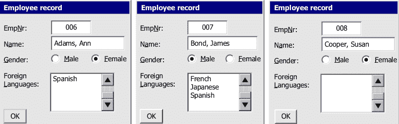

图 2.5 三名员工的人事表单。

要对这个小领域建模，我们首先要对这些表单上的信息进行表述。此时，我们应忽略任何用户界面细节，例如表单上字段的几何定位或快捷键选择（通过下划线字符显示）。在继续阅读之前，请先自行尝试处理第一条员工记录。

即使在概念级别，表述信息也常常有多种正确的方式。以下是从第一条记录中读取相关事实的一种方法：

- 员工编号为 006 的员工，其员工姓名为 "Adams, Ann"。
- 员工 006 的性别为名为 "Female" 的性别。
- 员工 006 会说名为 "Spanish" 的外语。

从示例数据来看，似乎也可以按姓名识别员工，但这通常不是个好主意。首先，员工可以更改姓名（例如，结婚时）。此外，在大型公司中，两名员工可能拥有相同姓名的情况时有发生。假设域专家证实了这一可能性。在这种情况下，示例数据在这方面并不显著。

我们通过将 Gender 视为实体类型（其中 "Female" 是其可能名称之一）并将该员工实例与该性别实例关联，来模拟第一位员工的性别信息。我们可以使用代码（例如 "M"、"F"）而不是名称（"Male"、"Female"）来表示性别。那么第二个事实将读作 "Employee 006 is of Gender 'F'" 或更明确地 "The Employee with employee number 006 is of the Gender with code 'F'"。

由于代码更紧凑且含义明显，让我们使用代码而不是名称作为引用性别的主要方式。如果需要，我们可以添加另外两个事实实例，将性别代码与完整的性别名称关联起来（实际在用户界面中使用）。

建模性别信息的另一种方法是使用一元事实类型（例如，Employee 006 is female）。在本书后面，我们将讨论如何在不同概念化方式之间进行转换，并为你提供选择替代方案的指导。


因为，与性别不同，外语名称没有明显或常见的缩写，因此我们将继续使用名称而非代码来识别语言。如果你对其他两条员工记录进行口头表述，只会发现相同事实类型的不同实例。从实例抽象到类型并添加约束，我们现在可以按如下方式列出概念架构：

- 参考方案：Employee(.Nr); EmployeeName(); Gender(.Code); ForeignLanguage(.Name)
- 基础事实类型：F1 Employee 拥有 EmployeeName。
- F2 Employee 的性别为 Gender。
- F3 Employee 会说 ForeignLanguage / ForeignLanguage 被 Employee 会说。
- 约束：C1 **每个** Employee 都有 **恰好一个** EmployeeName。
- C2 **每个** Employee 的性别 **恰好为一个** Gender。
- C3 **Gender 的可能值为** 'M'、'F'。

在列出参考方案时，我们将 "number" 缩写为 "nr"。这在德语等其他语言中也很有效，因为它们表示“Number”一词的首尾字母也组成 "Nr"。有些人使用源自意大利语 "numero" 的 "no"，但这有时会与否定词 "no" 混淆。还有人使用 "num"。选择权完全在你，许多 CASE 工具允许你声明偏好使用的缩写。如果存在混淆的可能性，应在概念层面避免使用缩写。对象类型参考方案声明中附加到 "EmployeeName" 的空括号表示 EmployeeName 是一个值类型（在此例中为字符串），因此无需参考方案。

为确保模型中使用的术语（例如 "Employee"）被充分理解，应包含每个术语的概念定义，或至少是清晰的描述。此类定义无需在图中显示，但应可在模型报告中访问。

约束 C1 和 C2 实际上各是一对基本约束。短语 "exactly one" 是“至少一个且最多一个”的缩写。这些约束未提及 Employee 会说 ForeignLanguage 这一事实类型。因此，有些员工可能不说任何外语（例如 Cooper），有些可能说多种外语（例如 Bond），许多人可能说同一种外语（例如 Spanish）。这种“默认”情况可以使用以下口头表述明确声明：

> **有可能**同一 Employee 会说 **超过一种** Language
> **并且**同一 Language 被 **超过一个** Employee 会说。

此架构的概念数据库包含三个事实表，每个基本事实类型对应一个表。这种概念方法使架构更易于理解，防止冗余，并简化约束的表达。

一旦设计完成，概念架构可以映射为所选用于实现的通用逻辑数据模型（例如关系型或层次型）所描述的逻辑架构。然后通过将逻辑架构调整为

| empNr | empName | gender |
|---|---|---|
| 006 | Adams, Ann | F |
| 007 | Bond, James | M |
| 008 | Cooper, Susan | F |

| empNr | foreignLanguage |
|---|---|
| 006 | Spanish |
| 007 | French |
| 007 | Japanese |
| 007 | Spanish |

### 图 2.6 图 2.5 的关系型数据库表。

特定 DBMS 来构建物理架构，通过添加索引等方式提升性能。用关系型数据模型指定的架构称为关系型数据库架构，或简称为关系型架构。

关系型数据库包含命名的表，水平分为无名行，垂直分为命名列。行–列位置为一个单元格。每个单元格仅包含一个数据值。图 2.6 显示了图 2.5 中存储在关系型数据库中的数据。Employee 表有三行三列。Speaks 表有四行两列。在命名列时，我们选择将 “employee” 缩写为 “emp”。表的行数随记录的添加或删除而增加或减少，但列数保持不变。

在给定架构中，表必须具有不同的名称。在同一表中，列必须具有不同的名称。列通常被称为 “字段”，尽管该术语有时也用于单元格。列名称也称为属性名称。每个属性都基于某个域，即其条目来源的值池。

例如，如果我们添加一个 manager 列，它将与 empNr 具有相同的域。关系型域的概念类似于我们的对象类型概念，但在实践中，大多数关系型 DBMS 仅支持语法域（如 smallint 的值类型声明），而不支持语义域。

与概念数据库相反，关系型数据库允许将不同类型的事实分组到同一表中。例如，图 2.6 将三个基本事实类型分组到两个表中。Employee 表涵盖事实类型 F1 和 F2，而 Speaks 表涵盖事实类型 F3。

Employee 表的第一行表达了两个事实：员工编号为 006 的 Employee 的 EmployeeName 为 “Adams, Ann”；员工编号为 006 的 Employee 的 Gender 代码为 “F”。通常，关系型数据库中表的每一行包含一个或多个基本事实。此规则的罕见例外可能发生在表仅存储存在性事实（例如国家代码列表）的情况。这种罕见情况将在讨论独立对象类型时稍后介绍。

在使用关系型数据库时，将事实类型分组到表中需要谨慎。本书提供了一种将概念架构映射到关系型架构的简单程序。该程序表明图 2.6 中的表选择是正确的。如果我们将所有三个事实类型都放入一个表中，这将导致类似于前面电影明星示例（表 1.2）中讨论的问题。

关系型数据库基于 E. F. Codd 开发的关系数据模型。表是唯一的数据结构。存储在数据库中带有数据行的表称为基本表。仅存储定义（不存储内容）的派生表称为视图。基本表中不允许重复行。

行或列的顺序无关紧要。例如，表 2.1 重新排序了 Employee 表的列和行，但含义不变（仍存在相同的六个事实）。行顺序无关紧要的原因是每个事实完全包含在单个行中。列顺序无关紧要的原因是每个列都有名称，因此我们知道其值的含义。从某种意义上说，列是“按名称排序”而非按位置排序。

### 表 2.1 列或行的顺序不影响数据的含义。

| Employee: | empName | empNr | gender |
|---|---|---|---|
| | Cooper, Susan | 008 | F |
| | Bond, James | 007 | M |
| | Adams, Ann | 006 | F |

尽管在逻辑层面行和列的顺序无关紧要，但在物理层面顺序确实存在，并且在调整数据库以实现高效访问时需要予以考虑。

查询结果也是表，但是没有名称，并且可能包含重复行。在编写查询时，你可以指定数据显示的顺序，而无需考虑在基本表中存储数据的实际顺序。

我们可以将基本表视为一组行，并将每行视为数据值的序列或元组（或者更严格地说，是属性-值对的元组）。从这个意义上讲，表是一组元组。由于数学关系定义为一组元组，因此每个表都是一个关系——这也就是 “关系型数据库” 名称的由来。

我们已经看到，概念事实在关系型架构中被分组到表中。那么约束呢？关系型系统通常只提供少数几种内置的声明式约束类型。列可以为其表指定为必填或可选。在我们的示例中，Employee 表的所有列都是必填的（每个条目必须是实际值，而不是 null）。这部分捕获了每个员工由 empNr 标识、至少有一个名称，并且至少有一个性别的约束。我们还要求 Speaks 表中列出的每个员工也列在 Employee 表中（这是一个子集或引用完整性约束）。

为限制每个员工最多有一个名称和最多有一个性别，Employee 表中 empNr 列的条目必须唯一（即不允许重复）。这通过将 empNr 声明为 Employee 表的主键来强制实施。

键是不允许重复的最小列组合。在关系型模型中，每个表都有一个主键，它提供访问其行的主要方式。最后，对 gender 值的约束可以通过简单的 check 子句来强制实施。


关系模式在图 2.7 中紧凑地给出。列名放在表名后面的圆括号中，主键加下划线。在这种表示法中，列默认假定为其表的必填列。虚线箭头表示前面提到的子集约束。性别代码的可能值放在花括号中。为简单起见，省略了域。此表示法是逻辑的，而非物理的。声明表和约束的具体语法取决于使用的关系数据库语言（通常是结构化查询语言 SQL 的方言）。

声明模式的过程通常称为数据定义，专为该任务设计的语言组件称为数据定义语言（DDL）。我们的示例足够简单，以至于关系模式可以完全在标准 SQL 的 DDL 组件中指定。但是，通常有些约束需要单独编码。

关系模式可能包含表定义、约束和派生规则。概念模式中的大多数派生规则可以通过在关系数据库管理系统中定义视图（虚拟表）或计算列，或通过编码触发器或存储过程来指定。如果某种查询类型常用且需要派生，则会明确包含在概念模式的派生规则部分中。相比之下，临时查询通过将派生函数和运算符包含在查询语言本身中来处理，以便用户可以在查询表达式本身中表达所需的派生规则。

在 SQL 等关系数据库语言中，表达许多数学和逻辑派生规则（例如，平均值，或从亲子关系推导的祖孙关系）相当容易。一些在 SQL 中难以表达的派生规则可以在其他语言中轻松表达。例如，以下 Prolog 规则以亲子关系递归定义血缘关系：

```
X is an ancestor of Y if X is a parent of Y.
X is an ancestor of Y if X is a parent of Z and Z is an ancestor of Y.
```

SQL 标准支持递归查询，但商业 SQL 对此功能的支持各不相同。不直接支持递归的商业 SQL 通常能够从 SQL 调用其他语言（例如 C# 或 Prolog）来执行所需的递归或其他所需任务。

Prolog 等语言在某些 AI 应用程序中被使用。过去，AI 系统倾向于处理少量实例的大量复杂事实类型，而数据库系统处理大量实例的较少且更简单的事实类型。下一代技术的目标之一是将强大的推理能力与高效的数据库管理相结合。

定义模式后，*数据操作*即可开始。最初为空的表会被填充数据（即，行被*插入*）。随后，行可以被*删除*或*修改*。如果行中一个或多个值发生更改，则该行被修改：在 SQL 语境下，这有时称为“更新”，但我们使用“更新”这一术语来泛指包括插入、删除和修改操作在内的操作。统称这三种操作为*数据维护*。如果约束指定得当，DBMS 会在发生维护操作时自动强制执行它们。

概念上，关系数据库管理系统的行修改操作只是添加或删除基本事实。例如，将图 2.6 中 Employee 表的第三行从 "Adams, Ann" 改为 "Smith, Ann"，仅仅是删除员工 006 名为 "Adams, Ann" 的事实，并添加员工 006 名为 "Smith, Ann" 的事实。当然，在外部级别，用户只需修改表单（如图 2.5 所示）或表格行（如图 2.6 所示）的屏幕版本中的值即可。

数据操作的另一个方面是*数据检索*。这通常涉及三个步骤：用户请求信息；系统搜索数据库和/或模式以定位相关信息，并利用这些信息获得所需结果；然后系统输出该结果。第二阶段可能涉及对数据进行排序和/或推导结果（例如，平均值）。与维护不同，检索操作不会改变数据库。

*数据展示*是指在屏幕上显示信息（屏幕显示）或生成格式化打印输出（报告编写）的特殊技术。我们使用“输出报告”一词来泛指屏幕和硬拷贝报告。

通常，关系数据库应用程序的用户不会直接与存储数据的关系表进行交互。他们通常通过表单界面输入和访问数据。屏幕表单的设计与管理以及安全强制执行等问题，通常构成应用程序开发的重要部分。

出于正确性、清晰性、完整性和可移植性等原因，数据库设计应首先作为概念模式指定，然后再映射到实际数据库模式。

## 2.4 开发框架

信息系统开发涉及至少*四个世界*：主题世界、系统世界、使用世界和开发世界（Jarke 等人，1992 年）。*主题世界*是 UoD（应用领域），即业务领域，通常是现实世界的一部分。*系统世界*是信息系统对 UoD 的模型，因此是一种正式抽象。

*使用世界*是系统将要运行的组织世界，包括系统的用户群体、他们与系统的用户界面、相关活动等。这有时被称为话语环境。*开发世界*涵盖用于开发系统的环境和过程，包括建模人员和程序员、他们的设计方法和依据、项目进度计划等。

系统世界有时被称为“狭义的信息系统”，而四个世界的结合被称为“广义的信息系统”，因为它包括所有相关的人为因素。专注于系统世界的专家被称为“干型”（他们处理正式方面），而专注于其他三个世界的专家被称为“湿型”（他们愿意处理非正式、较软的方面，弄湿双手）。在实践中，干型和湿型方法都需要。

确定*自动化边界*（系统世界将管理主题世界的多少）是一个关键决策。我们应首先确定业务要提供的服务（即，基本业务流程）。然后，针对每一项服务，我们需要决定是完全自动化、半自动化还是手动处理。

为业务领域开发信息系统本质上是一个*问题求解*过程。该通用过程可分解为四个主要阶段：（1）定义问题，（2）制定计划，（3）执行计划，（4）评估结果。最有用的两种通用问题求解策略是将问题分解为若干*子问题*并分别处理，以及先尝试问题的*更简单版本*。

当问题求解过程涉及软件开发时，它被细化为图 2.8 所示的五阶段*软件生命周期*：*指定*（说明软件要做什么），*设计*（决定如何实现），*实现*（编写代码），*测试*（检查是否正常工作），和 *维护*（保持其正常运行）。在这种过程的天真“瀑布”版本中，经过这五个阶段的路径是一个简单的序列。但是，在实践中，该过程通常具有*循环*性质，如虚线箭头所示。

如果在循环的后期阶段检测到变更需求，通常需要返回到较早的某个阶段。此外，大型开发项目通常最好划分为小项目，这些小项目可以进一步划分为组件，每个组件都有自己的循环。图 2.8 右侧的附加循环描绘了进一步的迭代，每个迭代都可以细化为左侧所示的多阶段循环。在这种*迭代*开发方法中，更基本或更关键的组件通常会首先开发，以尽量减少项目整体失败的风险。

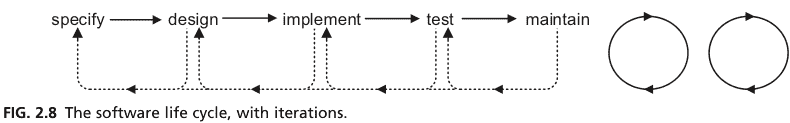


- 可行性研究
- 需求分析
- 概念设计：数据，进程
- 逻辑设计：数据，进程
- 基本物理设计：数据，进程
- 基本外部设计：数据；进程
- 原型设计
- 设计完成
- 生产版本实现
- 测试和验证
- 软件、文档和培训的发布
- 维护

在实践中，这些阶段常常重叠，反馈循环很常见，有些阶段可能会被省略。存在许多详细程序来充实这些阶段。

**可行性研究**确定拟议信息系统的主要目标，并确定哪些组件可以使用已知资源（例如，预算分配和人员）来实现。它检查替代方案的成本效益，并为各种系统组件分配优先级。成本/收益分析可能揭示某些目标不切实际，或者某些目标可以通过改进手工流程而不是使用计算机来最好地实现。

假设项目获批，将进行详细的**需求分析**以确定系统需要做什么。将界定系统的组件，并采访熟悉相关应用领域的人员，包括领域专家、预期用户和决策者。访谈可以通过问卷补充。将审查相关文档（例如，表单、报告、图表、政策手册，甚至待重构的旧系统中的代码）。

如果没有此类文档，将要求领域专家发明要记录的信息示例。通常会使用简单图表来阐明信息系统如何与业务环境交互。将识别并优先排序要支持的主要操作或事务，并对其预期数据量、频率和所需响应时间进行估算。

此需求收集和分析阶段的产出是一份**需求规格说明书**文档，详细说明功能需求、非功能需求（例如，性能）和维护信息（例如，预期的更改）。

此文档应当是*无歧义、完整、可验证*（有方法可以检查需求是否满足）、*一致*（需求之间不相互矛盾）、*可修改*（更改可以轻松安全地进行）、*可追溯*（需求可以追溯到其来源，并在文档的不同版本中可识别）和*可用*（由文档的当前和未来用户使用）。

各种文本和图形符号用于需求规格说明的不同方面。某些面向过程的符号（例如，用例图、上下文图、数据流图）将在后面章节中讨论。对于大型复杂项目，需求分析阶段可能需要数月。由于面向事实的建模使用熟悉示例的口头化来澄清UoD，因此其概念设计方法对于数据需求分析也很有用。

衡量需求活动进展的一种方法采用需求工程的以下三个维度：规格说明（不透明、一般、完整）、表示（非正式、半正式、正式）和协议（个人观点、共同观点）。沿这些维度走得越远，效果越好（Pohl，1994）。

在理解阶段可能重叠的前提下，信息系统生命周期的下一阶段是概念设计。这有时简单地称为“分析”，以将其与后续的逻辑设计和物理设计区分开来。对于大型应用，可以选择更易管理的子问题或组件，指定用于耦合组件的架构，并为每个组件设计概念子模式。随后，这些子模式可以集成到全局概念模式中。在本文中，讨论的问题足够小，我们可以设计整个概念模式，而无需先设计子模式。但是，主设计过程本身被分解为各个阶段。例如，在添加约束之前先识别事实类型。

经验丰富的建模者常常注意到新应用与他们或他人之前设计的应用之间的相似性。在这种情况下，通过明智地重用早期模型中采用的策略，设计工作量可能会大幅节省。例如，如果我们已经建模了大学图书馆系统，现在需要建模视频租赁业务，那么早期模型中有许多特征可以重用。我们可以选择以类似方式识别对象类型“贷款”，并采用或调整早期应用中的几个事实类型。通过将相似的特定概念（例如，“书籍”、“紧凑光盘”）抽象为更通用的概念（例如，“可租赁项目”），更容易将新应用识别为与早期应用相关。

近年来，为促进重用，已开发出大量且不断增长的设计模式和最佳实践工作。有许多资源可供使用，为各种业务领域提供基本设计模式和模板。大型企业资源计划（ERP）商业包可以调整以处理企业的各种功能（例如，订单处理、薪资管理）。为了扩大其重用范围，此类包通常在非常高的抽象级别对实践进行建模，这可能使它们更难应用于具体案例。组件技术、设计模式和ERP包的兴起，见证了从“构建或购买”向“构建和购买和重用”的转变。

多年来，有人提出了许多维度或视角来捕捉信息系统设计的不同方面。对信息系统设计方法的一项经典调查确定了三种设计视角：数据、过程和行为（Olle et al.，1991）。

面向数据的视角关注数据库中存储了哪些类型的数据、哪些约束适用于这些数据以及哪些类型的数据是可推导的。面向过程的视角考察为帮助理解特定业务运行方式而执行的过程或活动。除了描述过程及其执行者之外，还描述了过程与其他组件之间的信息流。

通常，复杂过程会被细化为多个子过程。*面向行为的视角*关注*事件*如何触发动作。通常，活动分析可以重新表述为事件分析，反之亦然。

指定进程执行或“触发”所需的信息和充分条件非常重要。例如，检索账户余额的过程可能由客户请求账户余额的事件触发，并需要来自客户（例如，客户编号和账户类型）以及相关数据库表的信息输入。由于过程与行为之间的界限往往模糊，我们将遵循一种常见做法，将关于过程、事件、操作、活动等的任何讨论捆绑到单一视角中，我们将其称为“过程”。从该角度看，只有*两个主要视角*：数据和过程。已开发了各种技术，例如*工作流模型*，以启用*业务流程建模*，如第15章中所讨论。

几十年前，系统主要从过程视角进行设计，但在许多情况下，这被证明是低效且不可靠的。数据视角成为信息系统开发的主导视角，因为它更根本且更稳定。业务流程在不断变化，但相比之下，底层数据往往只会发生次要变化。最近，面向对象的建模提供了一种结合数据和过程视角的方式，对象封装了数据和操作。不幸的是，这种组合通常在次概念级别指定，因此这种集成并不像看起来那么美好。

如果设计正确，概念模式提供了UoD结构的形式模型。完成这种语义建模后，我们将概念设计执行*映射*到以实现目标的通用数据模型为术语的**逻辑设计**。例如，我们可以将概念模式映射到关系模式。CASE工具可以自动执行此映射。

一旦确定了逻辑设计，就可以进行**基本物理设计**。将逻辑设计调整为正在使用的特定DBMS或编码语言，并指定各种策略（例如，索引或聚类）以提高物理设计的效率。

信息系统的**基本外部设计**涉及确定哪些用户组可以访问哪些类型的数据和操作，并为这些组设计适当的人机交互界面。通常，为不同用户类型构建访问权限表，决定在不同屏幕表单上支持哪些功能，并确定屏幕表单和菜单的布局。外部设计可以包含对内部设计的交叉引用（例如，以显示哪些表单访问哪些表或类）。

除了简单应用之外，生命周期的下一阶段通常涉及**原型设计**。原型是预期产品的简化版本，用于尽早获取用户对设计质量的反馈。它旨在涵盖需求规格说明中的主要功能，但通常省略最终版本所需的大部分错误检查和更细的细节，并且仅使用一小组示例数据。由于在这个阶段，早期反馈比效率更重要，原型


might be coded in a higher-level language than the one(s) ultimately used. For user-interface design, the initial prototypes may simply be drawn on paper: these are called “paper prototypes”. The prototypes are demonstrated to the clients, and their feedback is used to revise the requirements and designs where necessary.

可能最终使用的语言相比，可能采用更高级的语言编写。对于用户界面设计，最初的原型可能只是画在纸上：这些被称为“纸原型”。原型会向客户演示，并根据需要使用他们的反馈来修订需求和设计。

Once a prototype is accepted, the (hopefully) final design of the actual product or component is undertaken. The **implementation** of the internal and external design is now completed by writing the actual code for the production version. The product is now subjected to extensive **testing and validation** (also known as *quality assurance*). The software is run using carefully chosen data and operations to check that it functions as expected. Selected users may then be issued with prerelease versions (e.g., alpha and one or more betas) to help find other errors. Typically, the further advanced the prerelease version, the wider the audience of test users. With some critical applications (e.g., military security systems), correctness proofs might be developed to verify that the system meets its specifications. Finally, the **release** version of the product is made available to the public, along with extensive *documentation* and *training*.

一旦原型被接受，就着手进行实际产品或组件的（希望是）最终设计。通过为生产版本编写实际代码，现在完成了内部和外部设计的**实现**。产品现在要进行广泛的**测试和验证**（也称为*质量保证*）。软件会使用精心挑选的数据和操作运行，以检查其是否按预期运行。然后，选定的用户可能会收到预发布版本（例如，alpha版和一个或多个beta版），以帮助发现其他错误。通常，预发布版本越先进，测试用户群体就越广泛。对于某些关键应用（例如，军事安全系统），可能会开发正确性证明来验证系统是否符合其规格。最后，产品的**发布**版本向公众提供，并附有广泛的*文档*和*培训*。

Software **maintenance** involves modifications to the software after its initial release. Maintenance may be of three main types: *corrective* (eliminate bugs); *adaptive* (alter software to cater for changes in the environment or UoD); and *perfective* (add improvements). Maintenance continues as long as the product is available. The overall development process is often *iterative*, applying the development cycle to one major component at a time rather than trying to build the whole product at once. The earlier errors are detected in the development cycle, the easier they are to fix. The cost of correcting an error at the implementation stage can be orders of magnitude greater than the cost of fixing it at the analysis stage.

软件**维护**涉及软件初始发布后的修改。维护可能有三种主要类型：*纠正性*（消除缺陷）；*适应性*（修改软件以适应环境或UoD的变化）；和*完善性*（添加改进）。只要产品可用，维护就会持续。整个开发过程通常是*迭代*的，一次将开发周期应用于一个主要组件，而不是试图一次构建整个产品。在开发周期中越早发现错误，就越容易修复。在实现阶段纠正错误的成本可能比在分析阶段修复错误的成本高出几个数量级。

Important factors in developing information systems include practicality (is automation really desirable?), correctness, clarity (designs and code should be readable and well documented), efficiency (memory requirements, speed, production costs), portability, maintainability, adaptability, user proofing, and support.

开发信息系统的重要因素包括实用性（自动化真的是可取的吗？）、正确性、清晰性（设计和代码应可读且文档齐全）、效率（内存需求、速度、生产成本）、可移植性、可维护性、适应性、用户防呆性和支持。

Early in the chapter, we saw how information schemas can exist at four different levels (conceptual, logical, physical, and external). The inclusion of the logical level refines the original three-schema architecture developed by an international standards group. This notion of levels provides a vertical way of partitioning an information system’s architecture. It is also useful to provide a horizontal partitioning. One way of doing this is to use the “six friends” Rudyard Kipling referred to in his 1902 story “The Elephant’s Child”: “I keep six honest serving-men … Their names are What and Why and When and How and Where and Who”. If we include a column for each of these six questions and show each of the four levels as a row, we obtain a tabular, *level/perspective framework* with 24 cells.

本章早些时候，我们了解到信息模式可以存在于四个不同的层次（概念、逻辑、物理和外部）。引入逻辑层完善了国际标准组织开发的原始三模式架构。这种层次概念为信息系统架构的垂直划分提供了一种方法。提供水平划分也很有用。实现此目的的一种方法是使用鲁德亚德·卞相（Rudyard Kipling）在其1902年故事《大象的孩子》中提到的“六个朋友”：“我养着六个忠实的仆人……他们的名字叫什么、为什么、何时、如何、何地和谁”。如果我们为每个问题设置一列，并将四个层次中的每一个作为一行，我们就得到一个具有24个单元格的表格式、*层次/视角框架*。

The most influential framework to incorporate both vertical and horizontal partitioning is John Zachman’s framework for information systems architecture (Zachman, 1987). It uses six focus columns for Kipling’s interrogatives, but has five perspective rows instead of four levels. Hence, the *Zachman framework* has 30 cells, as shown in Table 2.2.

最具影响力的同时包含垂直和水平划分的框架是John Zachman的信息系统架构框架（Zachman，1987）。它为Kipling的疑问词使用六个焦点列，但有五个透视行而不是四个层次。因此，*Zachman框架*有30个单元格，如表2.2所示。

### 表 2.2 Zachman framework for enterprise architecture.

| | 数据（什么） | 功能（如何） | 网络（哪里） | 人员（谁） | 时间（何时） | 动机（为什么） |
|---|---|---|---|---|---|---|
| 范围 | | | | | | |
| 企业模型 | | | | | | |
| 系统模型 | | | | | | |
| 技术模型 | | | | | | |
| 详细表示 | | | | | | |

Any systems engineering project needs to consider which of these cells is relevant as well as how to map between the levels.

任何系统工程项目都需要考虑哪些单元格相关，以及如何在层次之间进行映射。

Row 1 (the scope) provides a very high-level view. Row 2 (the enterprise model) corresponds roughly to the conceptual or “owner view”. Row 3 (the system model) is basically the logical level, or “designer view”. Row 4 (the technology model) corresponds to most of the physical level, or “builder view”, with row 5 providing more detail in the “subcontractor” view. Enterprise level aspects appear in various cells.

第1行（范围）提供非常高级别的视图。第2行（企业模型）大致对应概念层或“所有者视图”。第3行（系统模型）基本上是逻辑层，或“设计师视图”。第4行（技术模型）对应大部分物理层，或“构建者视图”，第5行在“分包商”视图中提供更多细节。企业级方面出现在各个单元格中。

This book focuses on column 1 (data) of rows 2 and 3, with some discussion of column 2 (function) and row 3. In practice, projects may involve other cells in this framework. For example, we may need to consider where the system will be deployed, who the stakeholders are, when system components are due, and why some business rules need to be enforced (columns 3–6).

本书专注于第2行和第3行的第1列（数据），并对第2列（功能）和第3行进行了一些讨论。在实践中，项目可能涉及此框架中的其他单元格。例如，我们可能需要考虑系统将部署在哪里、利益相关者是谁、系统组件何时到期，以及为什么需要强制执行某些业务规则（第3-6列）。

Table 2.3 shows an extended four-schema framework based on both the four-schema approach and the Zachman framework. The logical and physical levels are refined into two layers. The persistent layer deals with data that persists between sessions: here we specify the structures to store data in a database (e.g., a relational schema). The transient layer deals with structures to temporarily store data in main memory during a session: the object model may be declared at the logic level as a class diagram and at the physical level as code structures in a programming language such as C# or Java.

表2.3显示了基于四模式方法和Zachman框架的扩展四模式框架。逻辑层和物理层被细化为两个层。持久层处理会话之间持久的数据：在这里我们指定在数据库中存储数据的结构（例如，关系模式）。瞬态层处理会话期间在主内存中临时存储数据的结构：对象模型可以在逻辑层声明为类图，并在物理层声明为C#或Java等编程语言中的代码结构。

### 表 2.3 Extended four-schema framework for system development.

| | 数据（什么） | 功能（如何） | 网络（哪里） | 人员（谁） | 时间（何时） | 动机（为什么） |
|---|---|---|---|---|---|---|
| 概念 | | | | | | |
| 外部 | | | | | | |
| 逻辑-持久 | | | | | | |
| 逻辑-瞬态 | | | | | | |
| 物理-持久 | | | | | | |
| 物理-瞬态 | | | | | | |

Connections between cells should be established, such as we should be able to map (or *forward engineer*) a conceptual model to a logical model and then a physical model, or go back the other way (*reverse engineering*).

应建立单元格之间的连接，例如我们应该能够将（或*正向工程*）概念模型映射到逻辑模型，然后映射到物理模型，或者反过来（*逆向工程*）。

If the application uses separate models for the transient and persistent data, then *object-relational mapping* procedures are required to map between the two layers.

如果应用程序为瞬态数据和持久数据使用单独的模型，则需要*对象关系映射*过程来在两个层之间进行映射。

Many other frameworks have been proposed in industry for architecting an information system. Four of these are now mentioned briefly. Further details on these approaches may be found in the references listed in the chapter notes.

工业界为构建信息系统提出了许多其他框架。下面简要介绍其中四个。有关这些方法的更多细节可参见章节注释中列出的参考文献。

The Object Management Group Model Driven Architecture (MDA) approach includes three levels: Computation Independent Model (CIM), Platform Independent Model (PIM), and Platform Specific Model (PSM). The CIM level is partly conceptual, the PIM level is logical, and the PSM level is physical.

对象管理组模型驱动架构（MDA）方法包括三个层次：计算无关模型（CIM）、平台无关模型（PIM）和平台特定模型（PSM）。CIM层部分是概念性的，PIM层是逻辑的，PSM层是物理的。

The Open Group Architecture Framework (TOGAF) includes four levels or domains (Business, Application, Data, Technology) and provides a detailed Architecture Development Method (ADM) that may be tailored to an organization's needs and employed to manage the execution of architecture planning activities.

开放组架构框架（TOGAF）包括四个层次或领域（业务、应用、数据、技术），并提供详细的架构开发方法（ADM），可以根据组织的需求进行定制，并用于管理架构规划活动的执行。

The International Standards Organization (ISO) Standard Reference Model of Open Distributed Processing (RM-ODP) incorporates five viewpoints: Enterprise, Information, Computational, Engineering, and Technology. RM-ODP consists of 14 standards covering software engineering and enterprise architecture for designing heterogeneous, interoperable IT systems. For the ISO standard, see http://committee.iso.org/sites/tc1sc7/home/projects/flagship-standards/isoiec-10746.html.

国际标准化组织（ISO）开放分布式处理标准参考模型（RM-ODP）包含五个视角：企业、信息、计算、工程和技术。RM-ODP由14个标准组成，涵盖软件工程和企业架构，用于设计异构、互操作的IT系统。有关 ISO 标准，请参见 http://committee.iso.org/sites/tc1sc7/home/projects/flagship-standards/isoiec-10746.html。

The Framework of Information System Concepts (FRISCO) developed by an IFIP working group provides a taxonomy of concepts used in information systems work (Falkenberg et al., 1998). Although not widely adopted, the FRISCO report provides some useful insights into information system development.

由IFIP工作组开发的信息系统概念框架（FRISCO）提供了信息系统工作中使用概念的分类法（Falkenberg et al., 1998）。虽然没有被广泛采用，但FRISCO报告对信息系统开发提供了一些有用的见解。

## 2.5 摘要

An information system for a given application may be viewed from at least *four levels*: conceptual, logical, physical, and external. At each level, the formal model or knowledge base comprises a *schema* that describes the structure or design of the UoD and a database that is populated with the fact instances. Each schema determines what states and transitions are permitted for its database(s).

对于给定应用程序的信息系统可以从至少*四个层次*来看：概念、逻辑、物理和外部。在每个层次上，形式模型或知识库包含描述UoD结构或设计的*模式*以及填充了事实实例的数据库。每个模式确定其数据库允许的状态和转换。

The *conceptual schema* does this in terms of simple, human-oriented concepts. The *logical schema* groups information into structures supported by the generic logical architecture (e.g., relational). The *physical schema* specifies the physical storage and access structures (e.g., indexes) for the specific DBMS or platform being used to implement the application. For the same global conceptual schema, different *external* schemas can be constructed for different user groups depending on what information is to be accessible and how the information is to be displayed.

*概念模式*使用简单的面向人类的概念来做到这一点。*逻辑模式*将信息分组到由通用逻辑架构支持的结构中（例如，关系模型）。*物理模式*指定用于实现应用程序的特定DBMS或平台的物理存储和访问结构（例如，索引）。对于相同的全局概念模式，可以为不同的用户组构建不同的*外部*模式，具体取决于哪些信息可访问以及如何显示信息。


概念式架构包含三个主要部分：*事实类型、* *约束*和 *推导规则*。断言或基础事实是原始的（即，它们不是从其他事实推导出来的）。派生事实是通过对其他事实应用推导规则来计算或推断的。在声明事实类型时，我们指示 *对象类型、* 这些对象是如何被 *引用*的，以及它们扮演什么 *角色*。 *关系*中的每个角色仅由一个对象类型扮演。

最简单的对象类型是 *值*（例如，字符串）。 *实体*是通过其与其他对象（通常是值）的关系来识别的真实或抽象对象。例如，一个国家可以通过其名称来识别。

*静态约束*确定事实类型的允许群体。*动态约束*限制这些群体之间的转换。例如，每个城市最多是一个国家的首都，且没有任何成年人可以变成儿童。

概念式数据库中的每个事实通常是 *基本*的。添加或删除一个事实是一个简单的更新。在 *复合事务*中，可能包含多个简单更新；在这种情况下，约束仅适用于完整更新序列的净效果，而不适用于每个单独的更新。对概念式数据库或概念式架构的更新和查询由 CIP 响应。

每个 DBMS 符合一个 *逻辑数据模型*（例如，网状、层次或关系）。如果选择关系式 DBMS 用于实现，概念式架构将映射到 *关系式架构*，或关系式数据库架构。在此，所有存储的事实都放置在命名的 *表*中，带有命名的列和无名的行。关系表中的每一行通常对应一个或多个基本事实。每个单元格（行-列位置）最多包含一个值。在表中，任何行都不能重复。

关系表的群体可以通过插入、删除或修改行来更改。大多数概念式约束和推导规则可以在关系式 DBMS 语言中表达，或通过与其他语言接口来表达。

*信息系统生命周期*通常涉及以下阶段：可行性研究；需求分析；数据和流程的概念式设计；逻辑设计；基础物理设计；基础外部设计；原型制作；生产版本实现；测试和验证；发布软件、文档和培训；以及维护。后期阶段的反馈可能表明需要重新处理早期阶段。

对早期阶段给予仔细关注可以减少所涉及的总工作量，重复使用之前在类似应用中采用的设计策略也是如此。对于大型项目，通常建议采用迭代开发方法，即在转向另一个组件之前先对一个组件应用生命周期。

存在各种信息系统架构框架。Zachman 框架由五行组成，这些行从不同视角（范围、企业模型、系统模型、技术模型和详细信息）审视系统，以及六列，这些列侧重点不同（数据、功能、网络、人员、时间和动机）。扩展的四模式框架使用相同的六列，但有六行用于概念式、外部、逻辑-持久、逻辑-暂态、物理-持久和物理-暂态视角。其他著名的系统架构包括 TOGAF、MDA 和 RM-ODP。

## 章节注释

关于信息系统的概念式、内部和外部架构的经典讨论载于 van Griethuysen (1982)。一些参与该 ISO 标准工作的人也参与了 FRISCO 报告（Falkenberg 等，1998）。与许多其他作者（例如，Elmasri 和 Navathe，1994）一样，我们认为关系数据模型是一种 *逻辑* 模型而非概念式模型，主要是因为它与自然语言太过遥远。从这个观点来看，关系式架构代表了内部架构的逻辑部分（省略了所选 DBMS 特有的细节以及索引等存储和访问细节）。Codd (1990, pp. 33–34) 提出了对三级架构的替代解释，其中关系数据库的基础关系提供概念式架构，而视图提供外部架构。

需求分析的标准参考是 ANSI/IEEE 标准 830-1984。Olle 等人 (1991) 对信息系统工作的不同方法进行了比较评述。Mylopoulos (1998) 对信息系统建模中的关键问题进行了信息丰富的概述。Pohl (1994) 对需求工程的规范、表示和协议维度进行了详细论述。Bubenko (2007) 为信息系统建模提供了历史视角。

各种业务领域的数据模型模式在多本书中都有提供，包括 Hay (1996, 2006) 和 Silverston (2001a, b)。这些示例模型通常使用本书后面介绍的 ER 符号之一来表示。

Zachman (1987) 介绍了他的架构框架（参见 https://en.wikipedia.org/wiki/Zachman_Framework）。Hay (2003) 对 Zachman 框架进行了广泛讨论，并认为某些行描述符应予以重命名。

可在 www.opengroup.org/togaf/ 和 http://en.wikipedia.org/wiki/TOGAF 在线访问有关 TOGAF 的详细信息。有关 OMG 的 MDA 方法的资源，请参见 http://www.omg.org/mda/。有关 ISO RM-ODP 标准，请参见 http://committee.iso.org/sites/jtc1sc7/home/projects/flagship-standards/isoiec-10746.html。有关 RM-ODP 的更多详细信息，请参见 https://en.wikipedia.org/wiki/RM-ODP 和 https://rm-odp-new.lcc.uma.es/。

此页故意留空

# 概念式建模：初步

### 章节大纲

- 3.1 概念式建模语言标准
- 3.2 概念式架构设计流程
- 3.3 CSDP 步骤 1：从示例到基本事实
- 3.4 CSDP 步骤 2：绘制事实类型并填充
- 3.5 CSDP 步骤 3：精简架构；记录基本推导
- 3.6 总结

## 3.1 概念式建模语言标准

在讨论对象-角色建模 (ORM) 的概念式架构设计流程 (CSDP) 之前，让我们回顾一下 ORM 语言背后的设计原则。其中一些想法之前已提及，但我们在此概括讨论，以便您可以将这些原则应用于一般建模语言的评估。在阅读本书过程中，请考虑这些原则在所讨论的各种语言中是如何体现的。

建模方法（或建模过程）既包括一种语言，也包括描述如何使用该语言构建模型的流程。一种语言具有相关的语法（标记）、语义（含义）和语用（用法）。书面语言可以是图形的（图表）和/或文本的。术语“抽象语法”和“具体语法”有时分别用于区分底层概念（例如，对象类型）及其表示（例如，命名的、柔和的矩形）。

概念式建模以高层次描绘业务领域，使用业务用户熟悉的术语和概念，忽略逻辑和物理层面的方面（例如，用于实现的底层数据库或编程结构）以及外部层面的方面（例如，用于数据输入的屏幕表单）。以下源自多个来源（van Griethuysen, 1982; ter Hofstede, 1993; Bloesch and Halpin, 1996）的标准为评估概念式建模语言提供了依据。

- *表达能力*
- *清晰度*
- *简单性和正交性*
- *语义稳定性*
- *语义相关性*
- 验证机制
- 抽象机制
- 形式基础

语言的 *表达能力* 是衡量其可用于表达什么的指标。一种语言能表达的越多，其表达能力就越强。理想情况下，概念式语言应能够完全模拟概念上相关的关于业务领域的所有细节。这称为 *100% 原则*（van Griethuysen, 1982）。ORM 是一种在概念层面对信息系统进行建模和查询，并在概念层面与其他层面之间进行映射的方法。虽然正在研究用于流程建模的 ORM 扩展，但 ORM 的主要关注点是信息建模（通常称为数据建模），因为数据视角更稳定，并为定义操作提供了形式基础。总体而言，统一建模语言 (UML) 的范围比 ORM 更广，因为 UML 用例、行为和实现图表建模了超越静态结构的方面。然而，对于概念式数据建模，ORM 的图形记法比 UML 类图或实体-关系 (ER) 图具有强大得多的表达能力。

语言的 *清晰度* 是衡量其易于理解和使用的程度的指标。首先，语言应该无歧义。一种语言越具有表达性，就越难以保持清晰度。理想情况下，语言中图表或文本表达的含义应该直观明显。这一理想很少实现。一个更现实的目标是，语言的概念和记法应该易于学习和记忆。为实现这一目标，语言应表现出 *简单性* 和 *正交性*。通过避免属性，ORM 的基于角色的记法得到了简化，但通过用事实实例填充它，仍然易于理解。正交性允许在其含义或值可用的地方使用表达式。ORM 的构造从一开始就设计为正交。例如，ORM 约束可以在任何有意义的情况下使用和组合。如我们稍后将看到，像 UML 这样的语言并非如此。

*语义稳定性* 是衡量在语言中表达的模型或查询在面对业务领域变化时保持其原始意图程度的指标。为了应对业务变化，我们需要对模型或查询进行的改动越多，其稳定性就越差。ORM 中的模型和查询在语义上比 ER 或 UML 更稳定，因为它们不受导致属性重新建模为关系或反之的变化的影响。

*语义相关性* 要求只建模概念上相关的细节。任何与意义无关的方面（例如，实现选择、机器效率）都应避免。这称为 *概念化原则*（van Griethuysen, 1982）。ORM 模型和查询是纯概念式的。相比之下，UML 类模型包括实现方面（例如，属性可见性和关联可导航性）。

*验证机制* 是领域专家检查模型是否与业务领域匹配的方式。例如，静态特征可以通过


verbalization and instantiation, and dynamic features may be checked by simulation. Unlike ER and UML, ORM models are always easily verbalized and populated.

Abstraction mechanisms allow unwanted details to be removed from immediate consideration. This is very important with large models (e.g., wall-size schema diagrams). Because ORM diagrams tend to be more detailed and larger than corresponding ER or UML diagrams, abstraction mechanisms are often used. For example, a global schema may be modularized into various scopes based on span or perspective (e.g., a single page of a data model or a single page of an activity model). Successive refinement may be used to decompose higher-level views into more detailed views. Although not a language issue, tools can provide additional support such as layering and object zoom (see later). Such mechanisms can be used to hide detail, showing just that part of the model relevant to a user's immediate needs. With minor variations, these techniques can be applied to ORM, ER, and UML diagrams. ORM also includes an attribute abstraction procedure to generate ER and UML diagrams as views.

A formal foundation is needed to ensure unambiguity and executability (e.g., to automate the storage, verification, transformation, and simulation of models) and to allow formal proofs of equivalence and implication between models. Although ORM's richer, graphical constraint notation provides a more complete diagrammatic treatment of schema transformations, the use of textual constraint languages can partly offset this advantage. For their data modeling constructs, ORM, ER, and UML may be given an adequate formal foundation.

Language design often involves a number of trade-offs between competing criteria. One well-known trade-off is that between expressibility and tractability: the more expressive a language is, the harder it is to make it efficiently executable (Levesque, 1984). Another trade-off is between parsimony and convenience. Although ceteris paribus, the fewer concepts the better (cf. Occam's razor), restricting ourselves to the minimum possible number of concepts may sometimes be too inconvenient. For example, it is possible to write computer programs in pure binary using just strings of ones and zeros, but it's much easier to write programs in higher-level languages such as C#. As an example from logic, it's more convenient to use several operators such as “not”, “and”, “or”, and “if-then” even though we could use just one (e.g., “nand”). See the chapter notes for further discussion of this example.

One basic question relevant to the parsimony-convenience trade-off is whether to use the attribute concept as a primitive modeling construct. We've already argued in favor of a negative answer to this question. ORM uses relationships instead of attributes to facilitate capturing, validating, and evolving the conceptual schema while still allowing compact attribute-views to be automatically derived for summary or implementation purposes. Traditional ER supports single-valued attributes, whereas UML supports both single-valued and multivalued attributes. We argue later that multivalued attributes are usually inappropriate for conceptual modeling, although they can be useful for logical and physical modeling.

The rest of this chapter provides an overview of ORM’s CSDP and a detailed discussion of the first three steps in this procedure. The ORM approach has been used productively in industry since the mid-1970s. Details of its history can be found in the chapter notes.

## 3.2 概念模式设计流程

When developing an information system, we first specify what is required and produce a design to meet these requirements. We recommend first developing this design at the conceptual level using ORM. This entails describing the structure of the universe of discourse (UoD) formally in terms of an ORM conceptual schema. If an ORM context is understood, we’ll often shorten “ORM conceptual schema” to just “conceptual schema”.

The procedure for designing a conceptual schema small enough to manage as a single unit is referred to as the **Conceptual Schema Design Procedure** (CSDP). Large business domains are first divided into subareas (which may overlap). These subareas are normally prioritized to determine which ones to develop first, and a conceptual *subschema* is designed for each using the CSDP.

With a team of modelers, a consensus on terminology is reached, so the same names are used for the same concepts. Later, the subschemas are *integrated* or merged into a global conceptual schema that covers the whole UoD. This integration is often performed iteratively.

This top-down design approach may be summarized as follows:

- Divide the universe of discourse into manageable subareas.
- Apply the CSDP to each subarea.
- Integrate the subschemas into a global conceptual schema.

For each manageably sized business domain or subarea, the conceptual schema design is performed in **seven steps**, as listed below. Often, all seven steps are performed for each model component as it is discussed with the domain expert, rather than applying step 1 to all components, then step 2 and so on.

1. Transform familiar examples into elementary facts.
2. Draw the fact types, and apply a population check.
3. Check for entity types to be combined, and note any arithmetic derivations.
4. Add uniqueness constraints, and check the arity of fact types.
5. Add mandatory role constraints, and check for logical derivations.
6. Add value, set-comparison, and subtyping constraints.
7. Add other constraints and perform final checks.

A **fact** (or *fact instance*) is a proposition that is taken to be true by users in the business domain. Whether the proposition is actually true in the UoD is of no concern to the information system. Here, “taken to be true” has the sense of epistemic commitment, that is, the business users are prepared to act as if they believed the assertion is true.

A **fact type** is the set of all possible fact instances of a given kind (e.g., Person smokes, or Person was born in Country). The CSDP procedure begins with the analysis of examples of information to be output by, or input to, the information system. Basically, the first three steps are concerned with identifying the fact types.

In later steps, we add constraints to the fact types. Throughout the procedure, checks are performed to detect derived facts and to ensure that no mistakes have been made. The rest of this chapter considers the first three steps in detail.

With large business domains, the preliminary segmentation and final integration add two further stages, resulting in nine steps overall. Although the CSDP is best learned in the sequence of steps shown, in practice we might apply the steps differently. For example, we might add constraints as soon as the fact types are entered, rather than waiting for all the fact types to be entered before adding any constraints.

In the commercial world, there are many existing applications that have been implemented using lower-level approaches, resulting in database designs that may be inconsistent, incomplete, inefficient, or difficult to maintain. Such systems are often poorly documented. These problems can be overcome by **reengineering** the existing applications using conceptual modeling techniques. For example, sample populations from existing database tables can be used as input to the CSDP.

Even without sample populations, an existing database schema can be *reverse engineered* to a tentative conceptual schema by using information about constraints and data types and by making assumptions about the use of names.

The conceptual design can then be validated and completed by communicating with a domain expert. The conceptual schema can then be *forward engineered* by applying a conceptual optimization procedure and mapping to the target database system to provide an improved and maintainable implementation. This reengineering approach is discussed in a later chapter.

## 3.3 CSDP 步骤 1：从示例到基本事实

To specify what is required of an information system, we need to answer the question, *What kinds of information do we want from the system?* Clearly, any information to be output from the system must be stored in the system or be derivable by the system. Our first step is to begin with *familiar examples* of relevant information, and *express these in terms of elementary facts*. As a check on the quality of our work, we ask the following questions. *Are the entities well identified? Can the facts be split into smaller ones without losing information?* This constitutes step 1 of the CSDP.

> CSDP step 1: Transform familiar examples into elementary facts.

For process modeling, it helps to begin with examples of the processes to be carried out by the system. In 1987, such process examples were coined “use cases”, which suggests cases of the system being used. UML recommends such use cases to drive the modeling


流程。虽然过程用例有助于设计过程模型，但在实践中，从这类用例到数据模型的转变往往有些武断，且经常导致需要大量修订的数据模型。

业务流程建模是建模业务领域整体过程的一部分。在实践中，通常先从系统要提供的服务的高层次视图开始，随后再将这些服务细化为描述如何提供这些服务的流程。然而，由于流程通常操作数据，我们认为详细描述这些流程应等到我们对数据有清晰理解后再进行。虽然业务流程建模是后续章节的重点，但我们当前的主要关切是确保高保真数据模型。

如果要正确建立数据模型，应从系统将要交付的数据示例入手。借用UML术语，我们称这些为“数据用例”，因为它们是数据被使用的实例。这只是对20世纪70年代引入ORM架构设计流程的“熟悉信息示例”概念的另一种叫法。如果使用UML的过程用例来驱动建模过程，则应在处理类图之前用数据示例来充实它们。

如果建模的业务领域之前是手工或通过计算机管理的，信息示例很容易获得。否则，我们与领域专家合作提供示例。三种示例类型是输出报告、输入表单和示例查询。这些可能以表格、表单、图表或文本的形式出现。为了以基本事实的形式表述此类示例，我们需要理解什么是**基本事实**。

在日常言语中，事实是关于现实世界的真实陈述。然而，在计算术语中，我们不得不接受数据库中可能存在虚假“事实” [正如我们在结构化查询语言（SQL）等语言中使用“陈述”一词来指代并非真正陈述的内容]。

我们可以将UoD视为一组扮演角色的对象。基本事实是特定对象扮演特定角色的断言。最简单的基本事实断言单个对象扮演给定角色。例如，考虑一个小领域，其中人通过其名进行标识。关于该领域的一个事实可能是：

- 1. Ann 抽烟。

在此，我们有一个对象（Ann）扮演一个角色（抽烟者）。严格来说，我们在标识对象时应更精确（例如，将“Ann”扩展为“名为‘Ann’的人”），但让我们先搁置这一点。在诸如(1)这样的句子中，对象扮演的角色有时被称为句子的属性。在此，基本事实断言某个对象具有某个属性。这也称为一元关系，因为只涉及一个角色。然而，通常关系至少涉及两个角色。例如：

- 2. Ann雇佣Bob。

- 3. Ann雇佣Ann。

在(2)中，Ann扮演雇主角色，Bob扮演雇员角色。在(3)中，Ann是自雇人士，因此同时扮演两个角色。一般来说，基本事实断言特定对象具有某个属性，或者一个或多个对象共同参与一段关系。

此处，“基本”表示该事实不能被“拆分”为（使用相同对象的）更小的信息单元，这些单元共同提供与原始事实相同的信息。基本事实通常不使用逻辑连接词（例如，not、and、or、if）或逻辑量词（例如，all、some）。例如，句子(4)—(9)并非基本事实。

- 4. Ann 抽烟 *和* Bob 抽烟。
- 5. Ann 抽烟 *或* Bob 抽烟。
- 6. Ann 并 *不* 抽烟。
- 7. *如果* Bob 抽烟 *那么* Bob 容易患癌。
- 8. *所有* 抽烟的人都 容易患癌。
- 9. *如果 某个* 人 抽烟 *那么该* 人 容易患癌。

所有这些句子都表达信息。命题(4)是逻辑合取。它应拆分为两个基本事实：Ann抽烟；Bob抽烟。命题(5)是析取，(6)是否定，(7)是条件事实。大多数数据库系统不允许以便捷方式存储此类信息，且无法进行相关推理 [例如，从(5)和(6)的组合推断出Bob抽烟]。对于大多数商业应用，无需存储此类信息。

通常，缺乏正面信息（例如，Ann抽烟）被理解为意味着负面信息（Ann不抽烟）；这是通常的“封闭世界”假设。采用“开放世界”方法时，可以使用负谓词或状态对象类型，并结合合适的约束来明确存储负面信息。例如，谓词“smokes”和“is a nonsmoker”是互斥的，而事实类型Person has SmokerStatus {“S,” “NS”}要求每个人最多拥有一个SmokerStatus的约束。有时，是否存储正面或负面信息的选择取决于哪个占用空间更少，正面和负面之间的界限可能变得模糊（例如，考虑Person dislikes Food和Patient is allergic to Drug）。

诸如(8)和(9)之类的全称量化条件句可以通过子集约束或推导规则来处理。推导规则可以轻松在SQL中指定（例如，通过视图），也可以在Prolog等语言中轻松编码。例如：cancerProne(X) if person(X) and smokes(X)。

基本事实断言对象扮演角色。如何指定这些对象和角色？目前，我们仅考虑基本对象：它们要么是值，要么是实体。值是一个自标识常量，意味着当你在某个上下文中看到该常量写下来时，你总是知道所指代的是什么。因此，值可以直接引用，而无需使用描述来标识它们。

目前，识别两种值（字符串和数字）即可。字符串显示在引号内（例如，“USA”）。数字不带引号表示，通常使用常用的印度-阿拉伯十进制记数法（例如，37或5.2）。数字是由称为数字的字符串表示的抽象对象。例如，数字37由数字“37”表示。我们假设任何信息系统都将字符串和数字作为内置数据类型支持。值以文本形式显示，但在内部由比特串表示。

概念上，**实体**（例如，特定的人或汽车）在信息系统中通过 _限定描述_ 引用。例如，袋鼠在被标识为“名为‘Australia’的国家”的实体上蹦蹦跳跳。实体也可称为“描述对象”。与值不同，有些——事实上大多数——实体会随时间而变化。实体可以是有形对象（例如，名为“Paris”的城市）或抽象对象（例如，课程代码为“CS114”的课程）。我们认为实体和值都是存在于UoD中的对象。面向对象方法则在更严格的意义上使用“对象”一词，这大致对应我们对“实体”的使用。通常，我们只想谈论实体，但引用它们时我们使用值。有时我们想谈论值本身。考虑以下句子：

- 10. Australia有六个州。
- 11. “Australia”有九个字母。

这是逻辑学家所说的 _使用/提及区分_ 的一个例子。在(10)中，单词“Australia”被用来引用实体。在(11)中，单词“Australia”只是被提及，并指代自身。在书面英语中，引号解决了这种区别。在日常交流中，实体通常通过 _专有名词_（例如，“Joe Biden”）或某个限定描述（例如，“美国第46任总统”，或“名为‘Joe Biden’的总统”）来引用。

如果我们从说话语境中知道名称所指代的是什么，专有名词就行之有效。例如，在(10)中，你可能认为“Australia”指代的是名为“Australia”的国家。然而，句子本身并没有告诉你这一点。也许(10)是关于一只名为“Australia”的狗，它有六种情绪（困倦、爱玩、饥饿等）。

由于人类可能误解，而信息系统缺乏添加上下文的创造性，我们采取稳妥方式，要求实体必须通过限定描述清晰标识。首先，描述必须指定所引用实体的种类：**实体类型**。类型是所有可能 _实例_ 的集合。每个实体都是特定实体类型的一个实例（例如，Person，Country）。对于给定的UoD，实体类型Person是我们可能在信息系统生命周期内想要谈论的所有人的集合。请注意，一些作者使用“entity”一词表示“实体类型”。我们有时将“entity”扩展为“entity instance”以避免混淆。考虑句子

- 12. Lee位于10B。

这可能是在谈论马厩里的一匹马，或房间里的一台计算机，等等。通过声明涉及的实体类型，(13)避免了这种指代歧义。此处对象类型名称通过首字母大写来突出显示。

- 13. 患者“Lee”位于病房“10B”。

你可能记得那个老笑话：“问：你听说过那位名叫‘Smith’的木腿男人吗？答：没有——他另一条腿叫什么名字？”在此，回答者误将“Smith”理解为类型为WoodenLeg而非Man的实体。有时，即使声明了实体类型也无法完全澄清事情。考虑句子：


- 14. 患者“Lee”的体温为37。

现在假设UoD中包含两名名为“Lee Jones”和“Mary Lee”的患者。标签“Lee”可能适用于不止一个人。更糟的是，用于表述温度的单位可能存在混淆：37°C是正常体温，但37°F接近冰点！

我们通过包含**引用模式**（即值指代实体的方式）来消除这种歧义。比较以下两个句子：

- 15. 姓氏为“Lee”的患者体温为37摄氏度。

- 16. 名字为“Lee”的患者体温为37华氏度。

避免名字和姓氏重叠可能导致混淆的常用方法是使用更完整的姓名（例如，“Lee Jones”、“Mary Lee”）。在某些情况下，即使这些姓名也可能不是唯一的，必须采用另一种命名约定（例如，PatientNr）。为了避免将“No.”与单词“No”混淆，我们将使用“Nr”或“#”来缩写“Number”。

大多数实体标识符包含三个组件：

- 实体类型（例如，Patient，Temperature）
- 引用模式（例如，Surname，Celsius）
- 值（例如，“Lee”，37）

这是最简单的实体指定方案。我们将在相当长一段时间内将引用方案的讨论局限于这种简单情况。复合识别方案将在后面讨论。

既然我们知道如何指定对象，那么如何指定它们扮演的角色呢？我们使用逻辑**谓词**。在逻辑中，谓词基本上是一个带有*对象空缺*的陈述*句子*。要完成句子，对象空缺或占位符由*对象术语*填充。每个对象术语都引用UoD中的单个对象。对象术语也称为单数项或对象标识符。对于我们而言，值由词汇常量指定（有时前面带有值类型名称），而实体由将值与实体相关联的确定描述指定。考虑以下句子：

- 17. 名字为“Ann”的人吸烟。

在这里，对象术语是“名字为‘Ann’的人”。为便于讨论，此处以*斜体*显示谓词读法。谓词读法可以单独显示为“... 吸烟”，使用省略号“...”作为对象实例的占位符或“对象空缺”。这是一元谓词读法，或者说是带有一个对象空缺的*句子*。它也可以称为属性或一元关系类型。

二元谓词读法是一个带有两个对象空缺的*句子*。信息模型中的大多数谓词都是二元的。考虑这个例子：

- 18. 名字为“Ann”的人雇佣名字为“Bob”的人。

在这里，谓词读法可以单独显示为“... 雇佣 ...”，带有两个对象空缺。请注意，此处对象放置的*顺序*很重要。例如，即使Ann雇佣Bob是事实，Bob雇佣Ann可能是假的。

在ORM中，*谓词由其事实类型而非其谓词读法来标识*。例如，事实类型“Athlete runs Race”和“Person runs Company”有两个不同的名为“runs”的谓词，它们读法相同但含义不同。

三元谓词是一个带有三个对象空缺的句子。例如，Terry在计算机科学系工作了10年的事实涉及谓词“... 在 ... 工作 ... 年”。

n元谓词是一个带有*n*个对象空缺（*n* > 0）的句子。由于顺序很重要，填充后的n元谓词关联到一*n*个对象术语的*序列*，这些术语不必互不相同。*n*的值是谓词的**元数**（或次数）。元数≥2的谓词是多元的。初等事实断言形式为：

Ro<sub>1</sub>...o<sub>n</sub>

的命题，其中 _R_ 是元数为 _n_ 的谓词，o<sub>1</sub>...o<sub>n</sub> 是 _n_ 个对象术语，不必互不相同（如*谓词逻辑*中）。此外，就UoD而言，该命题不能表示为更简单命题的合取式。

为自然起见，我们以*mixfix*（或distfix）形式书写谓词，其中术语可能与谓词读法混合。例如，以下三元事实使用谓词读法“... 移动到 ... 期间 ...”。

- 19. 姓氏为“Einstein”的科学家 *移动* 到国家代码为“USA”的国家 *期间* 公元1933年。

CSDP的第1步涉及将相关信息示例翻译成像这样的句子。作为一个简单的示例，请考虑**表3.1**中的报告。尝试将第一行的信息表示为一个初等事实。为获得帮助，请使用*电话启发法*—想象你必须通过电话传达这些信息。在执行这种从视觉到听觉的转换时，您应该根据实体类型、引用模式和值来指定每个实体，并且还要包括谓词读法。

**表3.1** 某些语言及其设计者。

| 设计者 | 语言 |
|---|---|
| Wirth | Pascal |
| Kay | Smalltalk |
| Wirth | Modula-2 |

在这样的报告中，列标题和表名或标题通常会提示对象类型和谓词。列条目提供值。以下是将第一行翻译为初等事实的一种方法：

- 20. 姓氏为“Wirth”的人设计了名为“Pascal”的语言。

请注意，实体类型和引用模式以名词出现，谓词以动词短语出现。这相当典型。在将第一行翻译为初等事实（20）时，我们从左到右读取该行。如果我们从右到左阅读，则可能会说：

- 21. 名为“Pascal”的语言由姓氏为“Wirth”的人设计。

在颠倒术语顺序时，我们也颠倒了谓词。我们将“was designed by”称为谓词“designed”的*逆*。尽管从语义上讲，我们可能将句子（20）和（21）视为表达相同的事实，但在句法上它们不同。大多数逻辑学家会将此描述为两个不同句子表达同一命题的情况。语言学家喜欢通过说两个句子具有不同的*表层结构*但相同的*深层结构*来描述这种情况。

例如，一种语言分析可能会将深层结构句子描述为由一个动词短语（Design）和各种名词短语（对象术语）组成，每个名词短语以不同的格（例如，Wirth的施事格和Pascal的受事格）与动词相关联，并附带一种方式（过去时）。关于以“正确”方式描绘深层结构（例如，选择哪些原始元素）存在不同的观点，而翻译到深层结构的任务通常很复杂。在实践中，大多数信息系统可以在不深入探讨此类问题的情况下设计。

重要的是，不要将像（20）和（21）这样的句子视为不同且无关的事实。我们处理二元事实类型的方法是选择一种主要的谓词表述方式，但可选择性地允许也显示逆向读法，例如

- 22. 姓氏为“Wirth”的人设计/被名为“Pascal”的语言设计。

这里，斜杠“/”左侧的谓词读法用于从左到右的读法（20）。斜杠右侧的谓词读法用于逆向读法（21）。斜杠在视觉上暗示从左到右阅读时跳过另一个谓词，从右到左阅读时跳到另一个谓词下方。

以不同方式谈论事实类型有助于沟通，并可能改进约束规范。例如，约束口头表述“每种语言都由某个人设计”优于等价的“对每种语言，某个人设计了该语言”。

三元及更长的事实类型有多种可能的顺序，但通常只显示一个谓词读法。

现在考虑表3.2。由于列没有单独的名称，因此更难以口头表述。假设Terry和Tony是男性，Norma和Gwen是女性。在继续阅读之前，尝试用初等事实来口头表述第一行的信息。

已婚夫妇

| | |
|---|---|
| Terry | Norma |
| Tony | Gwen |


也许你已按(23)口头表达了此点。为完整起见，还包含了逆谓词。

- 23. 名字为“Terry”的人 与…结婚 / 与…结婚 名字为“Norma”的人。

请注意，正向谓词与逆谓词相同。这是对称关系的一个示例。此类关系会带来特殊问题（如在后续章节中讨论）。为帮助避免此类问题，在概念层面，任何断言的谓词都不应与其逆谓词相同。

您可以随时改述事实以确保这一点。例如，(24) 通过突出每个伴侣所扮演的不同角色来做到这一点。

- 24. 名字为“Terry”的人 是…的丈夫 / 是…的妻子 名字为“Norma”的人。

另请考虑表 3.3。它类似于之前讨论过的表 3.1，但添加了第三列。在阅读关于表格的讨论之前，请尝试用基本事实来表达表格第一行中的信息。

### 表 3.3 某些编程语言的起源详情。

| 设计者 | 语言 | 年份 |
|---|---|---|
| Wirth | Pascal | 1970 |
| Kay | Smalltalk | 1972 |
| Wirth | Modula-2 | 1979 |

我们最初可能会考虑用句子(25)来表达这些信息，使用三元谓词“…在…设计了…”。您看到任何问题了吗？

- 25. 姓氏为“Wirth”的人 在 公元1970年 设计了名为“Pascal”的语言。

请记住，基本事实必须是简单的或不可约的。在领域（UoD）的上下文中，它不能拆分为两个或更多更简单的事实。句子中出现“and”通常表明该句子可以拆分为更简单的事实。这里没有“and”，但“常识”告诉我们，该事实可以拆分为以下两个基本事实，且无信息损失：

- 26. 姓氏为“Wirth”的人 设计了名为“Pascal”的语言。

- 27. 名为“Pascal”的语言 在 公元1970年 被设计。

这里，“无信息损失”意味着如果我们知道(26)和(27)，那么我们也知道(25)。“常识”一词隐藏了一些正式的概念。将(25)拆分为(26)和(27)的一个充分理由是隐含地理解每种语言只在一年内被设计。如果我们将“was designed in”解释为“其设计在…完成”，则此约束成立。让我们同意这种解释。

如果我们本意是“在…期间对其设计进行过工作”，那么一种语言可能在多年内被设计（例如，Wirth 在1968–69年完成了Pascal的大部分设计，但直到1970年才最终确定其定义）。在这种情况下，如果每种语言只有一个设计者，或者至少每年的设计者集合相同，我们仍然可以证明拆分是合理的。然而，这可能不成立。例如，如果我们将UML作为一种语言包含在内，它在不同年份有不同的设计者。这说明需要明确我们措辞的含义，并努力获得能说明可能情况的示例数据。

ORM方法鼓励为对象类型和谓词使用信息丰富的术语。然而，有时很难想出一个既能准确捕捉含义又简洁方便的术语。在这种情况下，如果对象类型名称或谓词读法的含义可能被误解，则添加*描述性注释*以澄清其含义非常重要。虽然此类注释通常在ORM图中被隐藏，但现代ORM工具允许以多种方式捕获和显示它们。

后续CSDP步骤会添加一些正式检查以检测基本性违规，因此如果我们的“常识”在第1步中失效，我们通常会在后续阶段发现此错误。但目前，让我们凭直觉工作。假设我们将三元拆分为两个二元：人设计了语言；人在…年份完成了设计。这可以接受吗？作为练习，使用表中的数据来证明这种拆分实际上会丢失信息。

在第1步进行大量练习后，您可能希望以缩写形式写下基本事实。首先，您可以删除引入对象类型和引用模式时的“the”和“with”等词。引用模式放在对象类型后面的括号中。

引用模式名称前的点表示在底层值类型名称中，对象类型名称被加在其前面。例如，Language(.Name) 和 Country(.Name) 具有不同的底层值类型 LanguageName 和 CountryName。引用模式名称后的冒号，例如 Height(cm:)，表示基于单位的测量。下一节将更详细地讨论各种引用模式。

您可以缩短对象类型、引用模式和谓词的某些标识符，只要缩写后的读法仍然有意义。在英语中，对象类型名称以大写字母开头。引用模式名称通常以大写字母开头，但可以以小写字母开头，除非大写有意义（例如，“*CE:*”）。

例如，事实(26)和(27)可以更简洁地列为(26a)和(27a)，如下所示。

- 26a. 人(Surname) “Wirth” 设计了 语言(.Name) “Pascal”。

- 27a. 语言(.Name) “Pascal” 在 年份(CE:) 1970 被设计。

如果实体类型的引用方案之前已声明，则在列出事实时可以省略它们。例如，(26)和(27)可以指定为：
引用方案：Person(Surname); Language(.Name); Year(CE:)

事实：
人“Wirth”设计了语言“Pascal”。
语言“Pascal”在年份1970 被设计。

更方便的是，事实类型可以以图表形式显示（见下一节），事实实例可以通过输入值直接输入到相关事实表中。

定义足以捕获任何用自然语言表达的句子的正式语法的任务艰巨，部分原因是引用对象的方式多种多样。例如，请考虑句子“踩到我脚趾的下一个人会倒霉”。

幸运的是，此类句子不会出现在数据库表中，数据库表使用基于简单值的方案来引用对象。ORM能够正式捕获可以在数据库表中表示的任何事实的相关语义。结构化对象术语和谓词提供了逻辑深层结构，与用来表达事实的自然语言（英语、日语等）无关。

通过支持有序的混缀谓词，ORM使得这一深层结构能够以与自然语言的有序混缀特性相协调的表层结构来表达。例如，请考虑图3.1。

| 员工编号 | 部门 |
|---|---|
| 37 | 销售 |

| Jugyo in | Ka |
|---|---|
| 37 | Eigyo |

图 3.1 英语和日语中的同一事实。

这里，两个表格以不同语言传达相同的事实。该事实可以用英语表达为(28)，用日语表达为(29)。为便于讨论，引用模式下划线，谓词斜体。

- 28. 员工编号为“37”的员工 在名为“销售”的部门 工作。

- 29. Jugyo in jugyo in bango “37” wa “Eigyo” to iu namae no Ka ni shozoku suru.

这些可以分析为28a和29a所示的结构，谓词再次斜体。句子具有相同的深层结构。中缀谓词“… works in …”对应混缀谓词“… wa … ni shozoku suru”。

- 28a. 员工(.Nr) “37” works in 部门(.Name) “Sales”。

- 29a. Jugyo in (.Bango) “37” wa Ka (.Namae) “Eigyo” ni shozoku suru.

现在考虑图3.2中的输出报告。尝试用一个或多个基本事实来口头表达其第一行。图3.2(a)中的数据是真实的，而图3.2(b)中的数据是虚构但可能的。假设以下引用方案已预先声明：Politician(.Name); Country(.Code); 以及 Year(CE:)。

| 政治家 | 国家 | 年份 |
|---|---|---|
| George W. Bush | US | 1946 |
| William J. Clinton | US | 1946 |
| John Howard | AU | 1939 |
| Kevin Rudd | AU | 1957 |

| 政治家 | 国家 | 年份 |
|---|---|---|
| George W. Bush | GB | 2003 |
| George W. Bush | IE | 1999 |
| William J. Clinton | IE | 1999 |
| William J. Clinton | IE | 2003 |
| John Howard | IE | 2003 |
| John Howard | US | 2003 |

图 3.2 关于政治家的两份报告。

虽然原则上数据有无限多种可能的解释，但你可能可以猜出其意图含义。我们可以分别从图3.2(a)和(b)中读出所表示的信息，如下列两个事实所示。

- 30. 政治家“George W. Bush” *出生于* 国家“US” 在 年份 1946。

- 31. 政治家“George W. Bush” *访问了* 国家“GB” *在* 年份 2003。

虽然这些事实确实对首行数据的含义提供了正确解释，但其中只有一个事实是基本的。是哪一个？

事实30不是基本的，因为它可以分割为以下事实而不丢失信息。

- 32. 政治家“George W. Bush” *出生于* 国家“US”。

- 33. 政治家“George W. Bush” *出生于* 年份 1946。

用“and”连接两个句子构成这两个句子的逻辑*合取*。直觉上，事实30等同于事实32和33的合取，因此事实30是可分割的（非基本的）。正式上，这是因为政治家列上的唯一性约束——每位政治家只在一个国家出生，且只在一年出生。我们将在后续章节讨论此类约束，并提供规则和启发式方法来帮助确定给定事实是否为基本事实。但目前，让我们凭直觉判断。

事实31是基本的，因为你不能将其视为更简单事实的合取而不丢失信息。例如，如果我们告诉你乔治·W·布什访问了英国（国家代码为“GB”的国家），并且他在2003年出国旅行，这并不意味着他在那一年访问了英国。

在某些情况下，一个无法拆分为两个事实的三元事实可以拆分为三个事实。这里我们可能尝试将事实31拆分为上述两个事实以及第三个事实，即英国在2003年被访问。然而，即使这三个事实也不能保证乔治·W·布什在2003年访问了英国。

正式上，报告(a)和(b)之间的结构差异在于其唯一性约束模式。在报告(a)中，第一列的值必须是唯一的（不重复）。在报告(b)中，只有整行必须是唯一的（单列或任何列对的条目可能重复）。下一节将详细讨论此类模式。


作为另一个示例，请参考表 3.4 显示的报告。在继续阅读前，请先尝试对本表执行步骤 1。

### 表 3.4 存储有关讲师事实的报告

| 姓名 | 出生年份 | 年龄 | 学位 |
|---|---|---|---|
| 亚当斯·JB | 1946 | 46 | BSc, PhD |
| 梁·X | 1960 | 32 | BE, MSc |
| 奥赖利·TA | 1946 | 46 | BA, BSc, PhD |

此表的一个棘手特征是最后一列。该列中的条目是学位集合。请将句子表述为每次仅包含一个学位。对第一行应用步骤 1 后，将得到四个事实，可按如下方式列出。

- 34. 姓名为“亚当斯·JB”的讲师出生于公元 1946 年。
- 35. 姓名为“亚当斯·JB”的讲师年龄为 46 岁。
- 36. 姓名为“亚当斯·JB”的讲师持有代码为“BSc”的学位。
- 37. 姓名为“亚当斯·JB”的讲师持有代码为“PhD”的学位。

此处，实体类型和参考模式为 Lecturer (.Name)、Year (CE)、Age (y) 和 Degree (.Code)。存在三种事实类型：讲师出生于年份；讲师拥有年龄；以及讲师持有学位。实体类型 Year 和 Age 在语义上有所不同。Year 涉及时间上的起点，而 Age 仅仅是一段时间（在此例中，以年为单位计量）。

接下来在表 3.5 中显示了一个更难的示例。这是关于辅导组报告的摘录。在阅读后续讨论前，请先自行对其执行步骤 1。

### 表 3.5 列出辅导分配的输出报告

| 辅导组 | 时间 | 房间 | 学生编号 | 学生姓名 |
|---|---|---|---|---|
| A | Mon. 3 p.m. | CS-718 | 302156<br>180064<br>278155<br>334067<br>200140 | 布洛格斯·FB<br>弗莱彻·JB<br>杰克逊·M<br>琼斯·EP<br>川本·T |
| B1 | Tue. 2 p.m. | E-B18 | 266010<br>348112 | 安德森·AB<br>布洛格斯·FB |
| ... | ... | ... | ... | ... |

对示例进行口头表述涉及解释，因此重要的是示例类型应为我们熟悉，或为协助我们执行步骤 1 的领域专家所熟悉。由于领域专家通常缺乏建模方面的技术专长，我们不应期望他们亲自完成所有步骤 1 工作。只要他们能用自己的术语正确口头表述信息即可。这就是步骤 1a：口头表述信息（可能是非正式的）。

作为建模人员，我们通常需要通过确保事实是基本的且对象标识明确来完善他们的口头表述。这就是 **步骤 1b**：_将信息作为基本事实进行口头表述_。例如，领域专家可能会通过对本报告第一行的信息进行口头表述来执行步骤 1a，如下：

辅导组 A 在周一下午 3 点于 CS-718 房间集合。
学生 302156 属于 A 组，姓名为“布洛格斯·FB”。

然后我们可以通过将这些非正式句子完善为以下四个基本句子来执行步骤 1b：

- 38. 代码为“A”的辅导组于 dhCode 为“Mon 3 p.m.”的时间集合。
- 39. 代码为“A”的辅导组于 roomNr 为“CS-718”的房间集合。
- 40. studentNr 为 302156 的学生属于代码为“A”的辅导组。
- 41. studentNr 为 302156 的学生姓名为“布洛格斯·FB”。

本示例中的许多特征依赖于解释。例如，我们假设 StudentNr 和 StudentName 指代学生，且同一行中的学生编号和学生姓名指代同一名学生。我们还将关联填充为“在……时间集合”、“在……房间集合”、“属于”和“拥有”。报告本身并未告知我们这些信息。我们利用对该情境的背景知识来做出此类假设。关于实体类型和参考方案也做出了决策，例如，我们将 Time 视为由日-小时代码引用的实体类型，而不是引入 Day 和 Hour 实体类型。类似的评论也适用于 Room 和 StudentName。

选择 StudentNr 而非 StudentName 来标识学生。在此方面，报告有所帮助，因为 StudentNr 出现在第一位（左侧），而“布洛格斯·FB”出现于两个不同的学生编号旁，这表明多于一名学生可能拥有相同的姓名。不过，我们仍在做出假设（例如，学生只有一个学生编号，或学生只属于一个组）。

另一个假设是每个辅导组每周只集合一次。我们需要此假设来证明使用分开的事实来表述时间和房间（而不是表述为 TuteGroup 在 Time 在 Room 集合）的合理性。报告中未重复出现 A 组有助于做出此决定，但这仍假设样本在这方面具有代表性。由于初始步骤始终涉及解释，如果我们不熟悉示例，应通过询问领域专家并使用他们熟悉的示例来消除任何疑虑。

虽然我们作为建模人员可能擅长在形式类型级别上表达，但并非所有领域专家都能做到这一点。通过与领域专家熟悉的示例合作，我们可以挖掘他们对 UoD 的隐式理解，而无需强迫他们抽象并表述我们所寻求的相关结构（这可能表述不正确）。

句子 (41) 表达了实体（学生）与值（姓名）之间的关系。在口头表述事实时，**值类型**紧跟在值之前（例如，StudentName “布洛格斯·FB”）。与实体术语不同，值术语没有参考方案。

在处理许多报告时，在口头表述相应事实时，绘制相关字段之间的连接有时很有用。例如，我们可以如图 3.3 所示在表 3.5 的列之间添加链接。对事实类型的这一非正式摘要有助于我们查看是否有遗漏的连接。

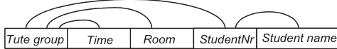

图 3.3 为口头表述的关系绘制连接。

除了表格，表单也是信息示例的常见来源。请考虑图 3.4 所示的输入表单。表单更多用于输入而非输出，但也可两者兼用（例如，前一章中讨论的人事表单）。假设学习 CS114 科目的学生使用图 3.4 所示的表单来表明最多三个关于哪个辅导时间最适合他们的偏好。此输入表单用于帮助决定哪些学生被分配到哪些组，以及最终使用哪些组。如果在确定辅导分配时要考虑此信息，则必须对其进行存储。

| CS114 辅导偏好表单 | | |
|---|---|---|
| 请填写本表单以协助辅导分配。 | | |
| 辅导时长为 1 小时，可在以下时间进行： | | |
| 周一 | 周二 | 周四 |
| | | 上午 10 点 |
| | | 上午 11 点 |
| | | 中午 12 点 |
| | 下午 2 点 | 下午 2 点 |
| 下午 3 点 | | 下午 3 点 |
| 学生编号：....... | | |
| 学生姓氏：................... 首字母：..... | | |
| 辅导偏好 1：......... | | |
| 辅导偏好 2：............... | | |
| 辅导偏好 3：............... | | |

图 3.4 用于收集辅导偏好的输入表单。

让我们假设，先前的输出报告（表 3.5）显示了在考虑所有学生偏好后为 CS114 制定的辅导分配。偏好输入表单缺少分配报告所需的一些信息。例如，它未显示组如何分配给房间和时间。这有助于防止学生输入错误数据（他们直接输入偏好的时间，而不是通过关联组代码间接输入），并允许在同一时间提供多个辅导时段的灵活性。要在此处执行步骤 1，我们首先用一些示例填写表单，如图 3.5 所示。

| CS114 辅导偏好表单 | | |
|---|---|---|
| 请填写本表单以协助辅导分配。辅导时长为 1 小时，可在以下时间进行： | | |
| 周一 | 周二 | 周四 |
| | | 上午 10 点 |
| | | 上午 11 点 |
| | | 中午 12 点 |
| 下午 2 点 | | 下午 2 点 |
| 下午 3 点 | | 下午 3 点 |
| 学生编号：302156... | | |
| 学生姓氏：布洛格斯................ 首字母：FB.... | | |
| 辅导偏好 1：周一下午 3 点........... | | |
| 辅导偏好 2：周四上午 11 点....... | | |
| 辅导偏好 3：................... | | |

图 3.5 填充了示例数据的辅导偏好表单。

这些事实现在可以表述为：Student(.Nr) 302156 的姓氏为“布洛格斯”；Student 302156 的首字母为“FB”；Student 302156 的第一偏好时间为 Time(.dhCode) “周一下午 3 点”；Student 302156 的第二偏好时间为 Time “周四上午 11 点”。

单独来看，输出报告和输入表单只部分揭示了系统所需的信息类型。然而，结合起来，它们可能足够让我们得出 UoD 结构。如果是这样，则认为这组示例具有 **显著性**。

一般而言，一组示例只有在说明所有相关信息类型和约束时，才相对于特定的 UoD 被认为是 **显著** 或充分的。对于复杂的 UoD，具有显著性的示例集很少。在我们当前的示例中，如果学生只能分配到一个组，则表 3.5 在此方面具有显著性。

然而，如果多个组可以在同一时间举行，则表 3.5 在此另一方面不具有显著性。需要一行额外行来显示这种可能性（例如，一行表示 B2 组在周二下午 2 点集合）。

从信息示例中提取事实时，我们需要决定 *应建模哪些方面*。这有助于确定 UoD 的范围。一个有用的启发式方法是提出问题：*哪些部分可能采用不同的值？* 请再次查看图 3.5 中的输入表单。标题部分包含我们可能或可能不希望建模的信息。我们看到的第一个项目是“CS114”。在我们的整体应用中，是否有可能用其他值代替它？如果唯一感兴趣的科目是 CS114，那么答案是“否”。然而，如果我们还希望涵盖其他科目，我们可能需要另一个表单，在此处使用不同的值（例如，“CS183”）。在这种情况下，我们需要在 UoD 中引入 Subject（或某个等效术语）作为对象类型。

不同的大学可能使用不同的术语来表示学习单元。而不是我们的“Subject”，可能会使用“Course”或“Unit”等术语。如果所有领域专家都更喜欢


相同的术语，请使用该术语。如果不同的人为相同概念使用不同的术语，让他们达成一致的标准术语，并记录任何正在使用的同义词。

回到图 3.5 中偏好设置表单的标题，我们看到单词“Tutorial”。这个词会改变吗（例如，改为“Lecture”）？如果我们希望捕捉讲座和教程的偏好，答案是“是”，我们可以将其建模为数据。但让我们假设情况并非如此。表单标题的其余部分包含其他信息（例如，教程时长），但让我们假设这不需要建模。

表单中间部分包含有关教程时间的信息。如果我们的 UoD 只有一个科目（CS114），我们可以将此信息建模为一元事实（例如，Time “Mon 3 p.m.” 可用）。如果我们还需要兼顾其他科目，那么就需要将表单顶部的“CS114”视为数据，并因此将日程表口头化为二元事实（例如，Subject “CS114” 在 Time “Mon 3 p.m.” 处有一个教程时间段）。图 3.6 显示了一个不同科目的已完成教程偏好表单。

在这里，将五个工作日布局为列，使得将时间视为数据更加明显。本节的第一个事实读作：Subject “CS183” 在 Time “Tues 2 p.m.” 处有一个教程时间段。

| 星期一 | 星期二 | 星期三 | 星期四 | 星期五 |
| :--- | :--- | :--- | :--- | :--- |
| | | | 9 a.m. | |
| | | | 11 a.m. | |
| | | | | |
| | 2 p.m. | 3 p.m. | 2 p.m. | |
| | | | | |
| 学号：211780 | | | | |
| 学生姓氏：Smith................ 首字母：J.A... | | | | |
| 教程偏好 1：Tues 2 p.m....... | | | | |
| 教程偏好 2：Thurs 11 a.m....... | | | | |
| 教程偏好 3：Tues 3 p.m....... | | | | |

图 3.6 一个不同科目的已完成教程偏好表单。

如果您将先前的 CS114 示例（图 3.5）的结构重新格式化以与该结构一致，并将两个表单并排放置，您可以通过查看两个表单之间变化的数据（科目代码、时间、学生详细信息）来了解哪些方面需要建模为数据。

在这个更大的 UoD 中，假设学生可以报名参加多个科目，关于学生偏好的事实现在需要考虑科目因素。而不是二元事实，偏好事实被口头化为三元事实。例如：学生 302156 对 Subject “CS114” 在 Time “Mon 3 p.m.” 处的第一教程偏好；学生 211780 对 Subject “CS183” 在 Time “Tues 3 p.m.” 处的第三教程偏好。

教程分配还需要指示相关科目（例如，表 3.5 需要一个显示科目的标题）。然后，教程组将需要一个复合引用方案，同时包含科目代码和组代码。例如，表 3.5 以 CS114 为标题的版本中的第一个事实将读作：Subject “CS114” 的 TuteGroup “A” 在 Time “Mon 3 p.m.” 举行。复合引用方案将在本书后面部分详细讨论。

后来发现，没有一组示例可以对推导规则或子类型定义具有重要意义。在这种情况下，使用领域专家是必不可少的。在当前领域中，我们未提及用于得出教程分配的规则。

如果除了存储关于偏好和分配的信息外，信息系统还需要以接近最优的方式计算分配，同时尊重偏好和其他实际约束（例如，组大小），那么推导规则的设计就成为模式中具有挑战性的方面。虽然这可以自动化，但另一种选择是将任务在人类专家和系统之间分配。高级语言有助于实现此类协作解决方案。

通常，步骤 1 中用于口头化的信息示例适用于业务或应用领域当前的运作方式。从这些示例中，我们可以构建 as-is 模型以反映当前的实践（即现状）。还可能需要一些变化来扩展或改进业务运作方式。例如，我们可能最初为单个科目开发单独的应用程序来管理教程，然后意识到将这些集成到能够处理所有科目的单个应用程序中更好（如前面讨论过的）。

通过包含新数据要求的示例，我们随后能够构建 to-be 模型，该模型反映我们希望未来业务的运作方式。正确理解 as-is 模型有助于设计 to-be 模型。

随着您作为建模师积累更多经验，您将能够从先前的建模项目中汲取经验教训，以帮助发现未来项目改进事物的方法。建模不仅是一门科学。它也是一门艺术，这使得它更加有趣。

一套全面的输出报告（涵盖中间阶段）可能包括输入表单上的所有信息。输出报告通常更容易解释，特别是当输入表单设计不佳时。设计输入表单需要小心，以使其对用户而言清晰且简单。

信息可以以多种方式呈现。除了各种表格和表单外，信息还可以通过各种图表、图形、地图和图以图形方式表达。Harris（1996）讨论了几种呈现信息图形的数百种不同方式。

无论以何种方式呈现，信息始终可以口头化为事实。因为练习有助于提高口头化技能，我们在书中包含了许多多样的示例，以帮助您为在实际情况下执行步骤 1 做好准备。

作为一个简单的图形示例，图 3.7 可能用于显示特定航空公司提供的直飞航班连接信息，箭头指示航班方向。作为练习，在继续阅读前，请先针对此图执行步骤 1。

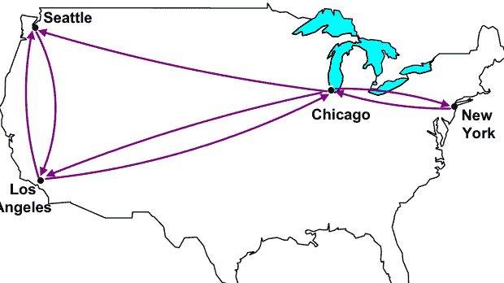

图 3.7 显示城市之间直飞航班连接的图。

现在让我们看看你表现得如何。只有一种实体类型：City（Name）。也只有一种事实类型：City 有飞往 City 的航班。例如，从 Chicago 到 Seattle 的箭头可以口头化为：City “Chicago” 有飞往 City “Seattle” 的航班。谓词中的“to”很重要，因为它传达方向并避免与先前的婚姻示例中的对称性问题。

如果这是一个 as-is 模型，并且我们还想讨论航班连接（例如，说明其持续时间）或包含许多航空公司，我们应该在图表上的箭头添加航班号。这个 to-be 模型导致不同的口头化，您可以自行尝试。后面的练习将回到此示例。

在实践中，一个城市通常可能有多个机场，因此连接直接适用于机场之间，而不是城市之间。机场由机场代码标识（例如，“JFK”和“LGA”分别表示约翰·F·肯尼迪机场和拉瓜迪亚机场，这两个机场服务于纽约）。

机场可以服务于某个城市，而不必位于该城市内。例如，位于新泽西的纽瓦克机场（EWR）也服务于纽约，位于西雅图和塔科马之间的西塔科马机场（SEA）服务于西雅图。我们需要确定业务领域中感兴趣的具体事实类型，并精确地对其进行口头化（例如，Airport services City 是一个与 Airport is located in City 不同的事实类型）。

到这时，您可能对用基本事实来口头化示例的力量有所了解。无论您从哪种类型的示例开始，如果您或助手理解该示例，那么您就应该能够用简单的事实来表达信息。这确实需要练习该技术，但这本身很有趣，不是吗？如果您无法完成步骤 1，那么继续进行设计就没什么意义——要么您不理解 UoD，要么您无法清晰地传达它。


虽然这可能听起来难以置信，但如果你已正确执行步骤 1，那么你就已经完成了 CSDP 中最困难的部分。其余步骤包括对事实类型进行图示和约束。除了检测不寻常约束和推导规则的问题外，一旦你掌握了技巧，通常可以几乎自动地完成那些步骤。然而，对于步骤 1，你始终需要发挥自己的解释能力。

## 练习 3.3

- 1. 假设已理解合适的实体类型和参照方式，以下哪些句子符合我们表达恰好一个初等事实的标准模式？
- (a) Adam likes Eve.
- (b) Bob does not like John.
- (c) Tom visited Los Angeles and New York.
- (d) Tom visited Los Angeles or New York.
- (e) If Tom visited Los Angeles then he visited New York.
- (f) Sue is funny.
- (g) All people are funny.
- (h) Some people in New York have toured Australia.
- (i) Brisbane and Sydney are in Australia.
- (j) Brisbane and Sydney are in the same country.
- (k) Who does Adam like?

- 2. 通过包含对象类型和参照方式的名称，为以下每个句子指出至少两种不同的含义。
- (a) Pluto is owned by Mickey.
- (b) Dallas is smaller than Sydney.
- (c) Arnold can lift 300.

对以下输出报告执行 CSDP 的步骤 1。在用语言表达事实时，你可以仅限于第一行，除非另一行揭示了不同种类的事实。

| 运动员 | 身高 (cm) |
|---|---|
| Jones EM | 166 |
| Pie QT | 166 |
| Smith JA | 175 |

| 运动员 | 身高 (cm) |
|---|---|
| Jones EM | 400 |
| Pie QT | 450 |
| Smith JA | 550 |

| 人员 | 身高 (cm) | 年份 |
|---|---|---|
| Jones EM | 166 | 1955 |
| Pie QT | 160 | 1970 |
| Smith JA | 175 | 1955 |

| 人员 | 身高 (cm) | 年份 |
|---|---|---|
| Jones EM | 160 | 1970 |
| | 166 | 1980 |
| | 166 | 1990 |

| 咨询小组 | 内部成员 | 外部成员 |
|---|---|---|
| Databases | Codd Kowalski | Ienshtein Spock |
| Logic programming | Colmerauer Kowalski Spock | Robinson |

| 学生编号 | 课程 | 评分 |
|---|---|---|
| 1001 | CS112 | 7 |
| 1001 | CS100 | 6 |
| 1002 | CS112 | 4 |
| 1003 | CS100 | 7 |
| 1003 | CS112 | 4 |
| 1003 | MP104 | 4 |

| 父母 | 子女 |
|---|---|
| Ann, Bill David, Fiona | Colin, David, Eve Gus |

| 国家 | 朋友 | 敌人 |
|---|---|---|
| Disland Hades | Oz | Oz Wundrland Hades |
| Wundrland Oz | Oz Disland Wundrland | |

| 苹果 | 澳大利亚 | 六月, 七月, 八月 |
| | 美国 | 十月, 十二月, 一月 |
| | 爱尔兰 | 十月, 十二月 |
| 芒果 | 澳大利亚 | 十一月, 十二月, 一月, 二月 |
| 菠萝 | 美国 | 六月, 七月 |
| | 澳大利亚 | 十月, 十一月, 十二月, 一月 |

## 3.4 CSDP 步骤 2：绘制事实类型并填充

一旦我们已将信息示例转换为初等事实，并执行了质量检查，我们就执行 CSDP 的下一步。首先，我们绘制一个显示所有事实类型的概念模式图。这说明了相关的对象类型、谓词和参照方案。图绘制完成后，我们使用示例数据对其进行检查。

### CSDP 步骤 2：绘制事实类型并应用数据填充检查。

考虑表 3.6 中的示例输出报告。

| 人员 | 车辆 |
|---|---|
| Adams B | 235PZN |
| Jones E | 235PZN |
| Jones E | 108AAQ |

让我们同意，该报告中的信息可以用以下三个初等事实表示，使用“RegNr”来缩写“registration number”：

- 名为“Adams B”的人员驾驶 RegNr 为“235PZN”的车辆。
- 名为“Jones E”的人员驾驶 RegNr 为“235PZN”的车辆。
- 名为“Jones E”的人员驾驶 RegNr 为“108AAQ”的车辆。

在查看相关概念模式图之前，先查看此示例的实例图（参见图 3.8）可能有助于解释问题。

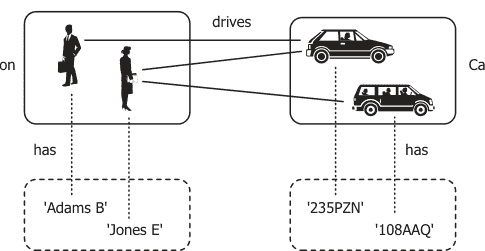

图 3.8 实例图。

实例图说明对象和关系的特定实例。利用本示例中实体的具体性质，卡通图表示实际的人员和车辆。值显示为字符串。人员与车辆之间的特定事实或关系显示为实线。值与实体之间的特定参照显示为虚线。

图 3.9(a) 显示了同一示例的概念模式图，为两个事实类型添加了逆向读取。实例图和概念模式图将实体类型描绘为带有名称的实心软矩形（圆角矩形）。值类型显示为带有名称的虚线软矩形。对象类型的名称写在内部。ORM 的某些版本允许使用椭圆（图 3.9(b)）或硬矩形（图 3.9(c)）代替软矩形。

在实例图中，单个对象被明确描绘（通过图标或文本）。然而，在概念模式图中，单个对象被省略（除非我们在关联表中引用它们）。回想一下，类型是允许实例的集合，我们可以想象对象表示为类型形状内部的点。

在概念模式图中，对象扮演的角色（关系部分）显示为框。可选地，角色可以命名，在这种情况下，角色名称显示在角色框旁边的方括号中，例如，图 3.9(a) 中的“[驾驶员]”。每个谓词描绘为一个或多个角色框的命名连续序列（“连续”意味着框相邻，中间没有间隙）。

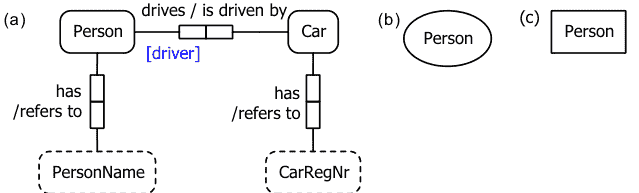

图 3.9 (a) 一个概念模式（不含约束）和（b 和 c）替代形状。

谓词通常从一端排序到另一端，其读取显示在谓词形状旁边。对于二元关系（两个角色），正向和逆向谓词读取都可以显示，用斜杠“/”分隔，如图 3.9(a)。

每个谓词必须至少显示一个读取。如果只显示一个谓词读取，默认情况下，水平谓词从左到右读取，垂直谓词自上而下读取。可以向谓词读取添加箭头提示以指示读取方向。例如，“◄”表示谓词读取是从右到左，“▲”表示读取方向是向上。

每个角色通过一条线连接到恰好一个对象类型，指示该角色仅由该类型的对象扮演。一个完整的概念模式图包括相关约束。我们将稍后了解如何添加这些约束。

用于实体首选识别方案中的关系称为参照或存在性事实（例如，存在一辆车辆，其车辆注册号为“235PZN”）。

所有其他概念模式关系称为初等事实（例如，名为“Adams B”的人员驾驶车辆注册号为“235PZN”的车辆）。

通常，初等事实是实体之间的关系，而参照是实体与值之间的关系。参照在实体世界和值世界之间提供了一座桥梁。简单参照和初等事实都是 _原子事实_ 的示例。

这在图 3.10(a) 中显而易见，其中已添加一个实例来填充每个关系。人员与车辆之间的关系（使用图标描绘）是初等事实。名称“Adams B”与人员之间的关系是参照或存在性事实，注册号“235PZN”与车辆之间的关系也是如此。

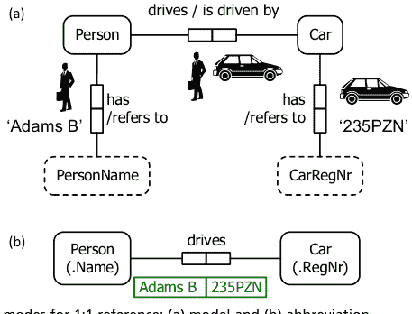

尽管谓词读取“has”可以与事实类型一起使用，但如果有更具描述性、更自然的替代方案，最好避免使用。例如，“Person drives Car”，如果准确，比“Person has Car”更好，后者可能有多种含义（例如，Person owns Car）。

对于本示例，每个人恰好有一个名称，每个人员名称最多指向一个人。每辆车恰好有一个车辆注册号，每个车辆注册号最多指向一辆车。此情况在之前的实例图图 3.8 中显而易见。这两个参照类型中的每个据说提供一个 _简单 1:1 参照方案_。我们将“1:1”读作“one to one”。稍后，我们将了解如何在概念模式图中使用唯一性和强制角色约束来指定此情况。

当存在简单的 1:1 命名约定时，我们通过将其名称附加在 _括号_ 中到实体类型名称来指示 _参照模式_，然后使用值本身在关联的 _事实表_ 中描绘对象实例。忽略其他约束，

图 3.10(a) 中的已填充架构可以通过图 3.10(b) 简洁地显示。除非我们想明确说明引用方案，否则更倾向于这种简洁形式，因为它更贴近我们表述事实的方式，并且简化了图表。如果我们只想显示架构，则省略事实表。

引用模式指示对象（通常是值）引用实体的模式或方式。使用引用模式减少了显式显示值类型的需要。但是，要理解缩写方案，我们需要知道如何在引用模式和值类型之间进行翻译。不同版本的 ORM 对此有不同的方法。现在概述了 NORMA 工具中用于 ORM 2 的方法。

设符号“E (r) → V”表示“具有引用模式 r 的实体类型 E 生成值类型 V”。引用模式可以是流行的、基于单位的（度量）或一般的。NORMA 中预定义了一个流行引用模式的初始列表，包括 Name、name、Code、code、Nr、nr、Id 和 #。加括号时，流行引用模式前面带有一个点“。”。要获得值类型名称，将流行引用模式名称追加到其实体类型的“.”名称中，例如，Product(.Name) → ProductName；Country(.Code) → CountryCode；Song(.Title) → SongTitle；Country(.code) → Countrycode。NORMA 的言语化浏览器自动显示引用类型，例如，Product 具有 ProductName。可以使用格式字符串进行更精细的控制。

ORM 的旧版 VisioModeler 工具在将引用模式名称追加到实体类型名称之前，会将其首字母（如果有）大写，例如，Country(.code) → CountryCode。用于在 Microsoft Visio 中绘制 ORM 图表的 Visio 模板允许你为引用模式选择任何名称，但它不会言语化引用类型。

与流行引用模式对应的值类型仅标识一个实体类型。例如，CountryCode 仅标识国家，GenderCode 仅标识性别。

基于单位的（或度量）引用模式包括内置的物理单位列表（例如，cm、km、mile）和货币单位（例如，USD、EUR），用户可以对其进行扩展。加括号时，基于单位的引用模式后面追加一个冒号“:”。值类型名称是通过将基于单位的引用模式中的冒号替换为“Value”来生成的。例如：（kg：）→ kgValue；（USD：）→ USDValue。

每个单位都基于一个单位类型（或维度），可以选择在冒号后显示。有时，不同的单位基于相同的维度。例如：（kg: Mass）、（lb: Mass）、（USD: Money）、（EUR: Money）。

常规引用模式没有附加标点符号，其名称与值类型名称相同。例如：（ISBN）→ ISBN；（URL）→ URL。这些值类型可以标识多个实体类型（例如，URL 可用于标识 Link 和 Website）。

对于 Date 实体类型，引用模式使用基本日期格式。例如，“Date(mdy)”表示日期值按月—日—年的顺序显示，这在美国很常见，而澳大利亚（dmy）和日本（ymd）则不同。

作为检查，我们应该通过为每个事实类型添加事实表并在相关列中输入值，用一些事实实例填充图表上的每个事实类型。在 ORM 中，事实表只是用于显示事实类型实例的表。术语“事实表”在数据仓库中有不同的用法（参见后文）。同时包含架构和示例数据库的图表称为知识库图表。

考虑表 3.7 中的报告。LicenseNr 条目标识该人员的驾驶执照。图 3.11 显示了用原始数据填充的概念架构，包含两个事实表。当对象类型被简单标识时（如这里所示），事实角色的填充出现在事实表的一列中，该列位于角色旁边。

### 表 3.7 驾驶员详细信息。

| 人员 | 驾驶执照编号 | 驾驶的汽车 |
|---|---|---|
| Adams B | A3050 | 235PZN |
| Jones E | A2245 | 235PZN, 108AAQ |

图表省略了一些约束。每个事实表中至少有一个事实应被言语化，以确保图表有意义。填充架构图表有助于检测图表中的错误，并澄清约束。

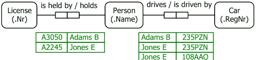

### 图 3.11 表 3.7 的知识库图表（省略约束）。

如今，大多数非吸烟者偏好在无烟环境中工作、旅行、进餐等。因此，对于某些应用，表 3.8 这样的报告是相关的。请在继续阅读前先对该表执行步骤 1。

### 表 3.8 吸烟者和非吸烟者。

| 吸烟者 | 非吸烟者 |
|---|---|
| Arnie Sherlock | Lee Norma Terry |

表达第一行事实的一种方式是：Person(.Firstname) “Arnie” 吸烟；Person(.Firstname) “Lee” 是非吸烟者。这些事实中的每一个都是不同一元事实类型的实例。一元事实类型只有一个角色。知识库图表如图 3.12 所示。这里的两个角色属于不同的事实类型。这通过分隔角色框来表示。

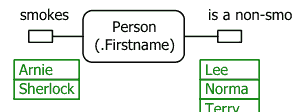

### 图 3.12 表 3.8 的知识库图表（一元版本）。

如果需要，可以通过引入 SmokingStatus 作为另一个实体类型，将两个一元关系转换为单个二元关系，其中代码“S”表示吸烟者，“N”表示非吸烟者。结果，表 3.8 的第一行可以重新表述为 Person(.Firstname) “Arnie” 具有 SmokingStatus(.Code) “S”；Person “Lee” 具有 SmokingStatus “N”。这种方法如图 3.13 所示。

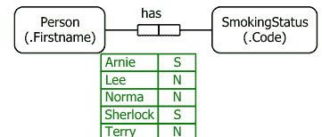

### 图 3.13 表 3.8 的知识库图表（二元版本）。

讨论的每个二元示例都有两个不同的实体类型。涉及不同实体类型的事实类型称为*异质事实类型*。大多数事实类型都属于此类。

但是，图 3.14 显示的事实类型具有一个实体类型——Person。如果事实类型中的每个角色都由相同的对象类型扮演，则我们有一个*同质事实类型*。二元同质事实类型称为*环形事实类型*，因为从对象类型通过谓词的路径循环回到同一对象类型，形成一个环。这里，显示了正向谓词（is husband of）和反向谓词（is wife of）。

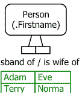

### 图 3.14 带示例填充的环形事实类型。

某些版本的 ORM 将谓词设置为动名词形式（例如，husband of、wife of）。虽然对于某些查询风格有用，但通常更好地使用完整的谓词读法，因为这会导致事实和约束的更好的言语化。

为了使图表更紧凑，如果谓词、对象类型和引用模式的完整版本对用户来说很明显，你可以缩写它们的名称。但是，这种宽松的政策应谨慎使用。ORM 工具通常允许你为模型元素附加描述，这可以补偿此类名称缩写。

除了与人类沟通之外，概念架构还为 UoD 的结构提供正式规范，以便模型可以由计算机处理。因此，我们绘制的架构图必须符合合法架构的形成规则。它们不是非正式的漫画。

现在考虑表 3.9 中的报告。这里，我们有一个*三元事实类型*。引用方案是 Student(.Nr)、Course(.Code) 和 Rating(.Nr)。我们可以将第一行的事实表述为“‘1001’号学生在‘CS100’课程中获得了评级 4”。

### 表 3.9 存储学生成绩的关系表。

| 学生编号 | 课程 | 评级 |
|---|---|---|
| 1001 | CS100 | 4 |
| 1002 | CS100 | 4 |
| 1002 | CS114 | 5 |

在概念架构图上，三元事实类型出现为三个角色框的序列，每个角色框都附加到一个对象类型上，如图 3.15 所示。当在图表上编写三元及更长谓词的名称时，包含占位符，每个占位符由省略号“...”表示。

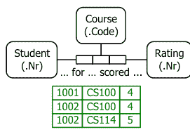

### 图 3.15 表 3.9 的已填充三元事实类型。

图 3.15 包含一个示例填充。无论事实类型的*性*（角色数）有多高，我们都可以轻松地对其进行填充以进行检查。事实表中的每一列都与谓词中的一个角色相关联。

之前的示例将一元关系转换为二元关系。另一种架构转换是**对象化**或**嵌套**。这实际上*将对象之间的关系视为对象本身*。再次考虑表 3.9 的第一行。与其将其表述为单个句子，不如我们可以通过两个句子传达信息：

> 学生“1001”选修了课程“CS100”。
> 此注册导致了评级 4。

这里，“此注册”指回第一句话中提到的特定人员和特定科目之间的注册关系。任何此类注册都可以作为其自身的对象来处理。

将关系转化为对象的行为称为*对象化*或*再化*，并对应于语言上的名词化行为（将动词短语转换为名词）。通过对象化形成的对象称为*对象化关系*。如此形成的对象类型称为*对象化关联*，或*对象化类型*。请回顾，


“关联”表示“关系类型”。第 10.5 节细化了对象化的概念，以区分两种变体：命题式和情境式。

对象化的关联被描绘为围绕被对象化的谓词的带名称的软矩形（参见图 3.16）。对象化关联的名称放在双引号中。对象化关联通常有两个角色，但可能有一个或多个。

嵌套对象的事实列中的条目可以显示为带括号的值对（三元组等）。例如，学生 1001 在 CS100 中的注册在“导致”谓词的事实表中显示为“(1001, CS100)”。请注意，嵌套不等于拆分。图 3.16 不显示两个独立的二元关系。“导致”谓词不能在没有“注册入学”谓词的情况下显示。图 3.15 中的三元关系仍然是基本的。图 3.15 被认为是展开的（或未嵌套的）版本。

第 14 章详细讨论了模式等价性。嵌套版本和展开版本不等价，除非对象化关联所扮演的角色是强制性的。在我们的当前示例中，这意味着每个注册必须有已知的评级。在这种情况下，更倾向于使用展开版本，因为它在绘图和填充方面更简单。如前文所述，如果对象化关联具有可选角色或多个角色，通常更倾向于嵌套。

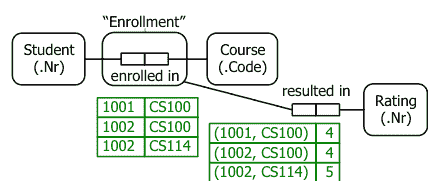

图 3.16 表 3.9 的知识库（嵌套版本）。

| 政治人物 | 国家 | 年份 |
|---|---|---|
| 克林顿 | 澳大利亚 | 1994 |
| 克林顿 | 意大利 | 1994 |
| 克林顿 | 澳大利亚 | 1995 |
| 基廷 | 意大利 | 1994 |


姓氏为 'Clinton' 的政治人物 **在** 公元 1994 年 **拜访** 了名为 'Australia' 的国家。

图 3.17 对第一行的一种表述方式。

例如，假设我们扩展 UoD 以包含注册日期。平面解决方案需要另一个三元关系：学生在日期上注册了课程。使用嵌套解决方案，我们只需添加二元关系：注册发生在日期上。如前文所示，在这种情况下，嵌套解决方案还简化了约束规范，因此更受青睐。

现在考虑图 3.17 中描绘的旅行记录示例。使用电话启发法，建模者将数据的第一行表述为三元事实类型的一个实例：政治家在年份中拜访了国家。示例数据表明，许多政治家可能在许多年份访问许多国家，允许多种嵌套选项。我们可以将“政治家拜访了国家”对象化为“访问”，并添加“访问发生在年份中”。或者，我们可以将“政治家在年份中旅行”对象化为“旅行”，并添加“旅行访问了国家”，或者将“国家在年份中被访问”对象化为“访问”，并添加“访问由政治家进行”。在没有强烈理由选择某一种嵌套方式的情况下，更简单的做法是将其保留为三元关系。

虽然我们通常只为三元及更长的事实类型显示一种读法，但存在许多可能的读法，具体取决于我们遍历角色的顺序。n 元谓词有 n!（n 的阶乘，即 n × n−1 × ... × 1）种读法顺序。因此，三元关系有六种可能的读法顺序，四元关系有 24 种，依此类推。

例如，前面给出的三元事实类型可以由以下任意六种读法之一指定：政治家在年份中拜访了国家；政治家在年份中拜访了国家；国家在年份中被政治家拜访；国家在年份中被政治家拜访；年份包含政治家对国家的访问；年份包含对国家由政治家的访问。一些 ORM 工具还支持任何给定读法顺序的别名读法。

在实际应用中，一种读法通常就足够了。但是，如果我们希望直接查询模式，能够从任何给定角色开始导航会很方便。为了实现这一点，我们需要为每个角色提供一个从该角色开始的读法（后续角色的顺序无关紧要）。因此，对于任何 n 元事实类型，我们最多只需要 n 种读法。这比阶乘 n 少得多。为事实类型的多个读法顺序提供谓词读法也有助于更好地表述约束和推导规则。在实际应用中，通常为二元事实类型提供正向和逆向读法，但只在必要时才为 n 元事实类型提供替代读法。

现在假设我们需要设计一个数据库来存储销售数据，这些数据可以按图 3.18 所示以图形方式显示。这个三维柱状图显示了两款计算机辅助制图产品（代号为 “ACAD” 和 “BCAD”）的销售数据。作为步骤 1 和 2 的练习，在继续阅读之前，请尝试表述销售信息，然后对其进行图式化（在概念模式图上）。

考虑第一个 Q1 柱。熟悉该领域的人可能会将事实表述为：“BCAD 在第一季度的销售额为一百万美元”。这完成了步骤 1a。作为建模者，我们通过将其细化为一个或多个基本事实来完成步骤 1b。在此例中，我们可以将其表述为一个单一的三元关系：“代码为 ‘BCAD’ 的产品在编号为 1 的季度的销售额为 MoneyAmount 1000000 美元”。

我们选择使用数字（例如，1）来标识季度，但如果您喜欢，也可以使用代码（例如，“Q1”）。我们使用对象类型 “MoneyAmount” 而不是 “Sales” 来使底层领域明确化。这清楚地表明，我们可以将销售数字与其他货币数字（例如，成本和利润）进行比较。

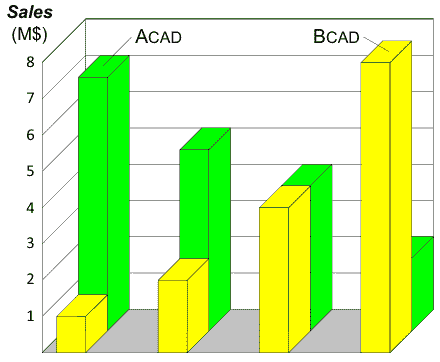

图 3.18 你能表述这个柱状图吗？

假设该图表适用于美国，我们选择 USD（美元）作为货币单位。这使其与其他美元（例如，AUD 代表澳元）区分开来。这是良好的做法，但如果没有混淆危险，您可以简单地将单位显示为 “$”。

与其直接使用 MoneyAmount 作为对象类型，不如通过使用带有扩展引用模式 (USD: Money) 的 Sales 来间接实现，其缩写为 (USD:)。其他每个柱状图也可以类似地表述。这完成了步骤 1。为步骤 2 做准备，我们可以按照以下方式带括号的引用模式列出事实类型：Product(Code) 在 Quarter(nr) 的销售额为 MoneyAmount(USD:)。

现在绘制概念模式图是一项简单的任务。作为检查，我们用一些简单的事实实例对其进行填充。图 3.19 显示了将销售类型化为货币金额的直接和间接方式。作为显示选项，(USD:) 可以扩展为 (USD: Money)。

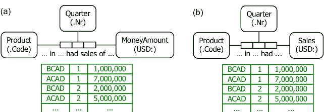

图 3.19 销售数据的概念模式图，包含示例数据。

另一种常见的呈现数字数据的方式是饼图。图例通常提供在图表旁边，以指示每个切片所代表的项目。饼图的每个切片都表示该特定项目占整体的比例。图 3.20 给出了一个示例。在继续阅读之前，请尝试自己对其进行图式化。

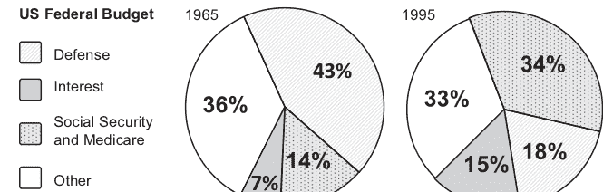

图 3.20 你能对这个饼图进行图式化吗？

将步骤 1a 应用于第一个饼图中的防务切片，我们可以将事实表述为：“在 1965 年，防务消耗了预算的 43%”。为完成步骤 1，我们将其细化为：“在公元 1965 年，名为 ‘Defense’ 的预算项目消耗了预算的 43% 份额”。其他切片表示相同类型的事实，因此我们可以概括为三元事实类型：在年份 (CE) 中：预算项目 (名称) 消耗了预算的份额 (%)。在这里，谓词 “in .... consumed .... of the budget” 在第一个占位符之前具有前置文本，并且有两个相邻的占位符。虽然这种情况相当罕见，但这是合法的混合固定谓词。

这种灵活性使表述比原本更容易。为完成步骤 2，结果模式和示例数据如图 3.21 所示。

为结束本节，让我们回顾一些术语。现在已引入了三个对象术语。实体是 UoD 中我们通过描述来引用的对象。值（例如，字符串或数字）作为数据库表中的条目出现，并且常被用来引用实体。最后，对象之间的关系可以被视为对象本身：这些是对象化关系（或嵌套对象）。

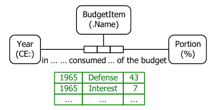

图 3.21 预算数据的概念模式图，包含示例数据。


谓词的“元数”或“长度”有两种常见的表示法。在表 3.10 中，优先的基于拉丁语的表示法（作为主描述符显示）列出了前九种情况。替代的基于希腊语的描述符通常仅限于前五种情况，如所示。在实践中，一个基本谓词很少超过五个角色。

虽然我们应该填充概念模式图以供检查，但事实填充本身并不构成概念模式图的一部分。在以下练习中，不需要进行填充检查。但是，我们强烈建议您用至少一行填充每种事实类型，作为对您工作的检查。

### 表 3.10 按角色数分类的谓词

| 角色数 | 主描述符 | 替代描述符 |
|---|---|---|
| 1 | 一元 | 单元 |
| 2 | 二元 | 二元 |
| 3 | 三元 | 三元 |
| 4 | 四元 | 四元 |
| 5 | 五元 | 五元 |
| 6 | 六元 | ... |
| 7 | 七元 | |
| 8 | 八元 | |
| 9 | 九元 | |

## 练习 3.4

- 1. 下面列出了各人的姓名和性别：
  - 男性：Fred, Tom
  - 女性：Ann, Mary, Sue
  - (a) 用一元事实表示 Fred 和 Ann 的信息。
  - (b) 基于此选择绘制概念模式图。
  - (c) 用二元基本事实表示相同的信息。
  - (d) 基于此选择绘制概念模式图。

注意：在本练习的其余部分，避免使用一元事实。

- 2. 为练习 3.3 中以下问题的事实类型绘制概念模式：(a) 问题 3；(b) 问题 4；(c) 问题 5；(d) 问题 6；(e) 问题 7；(f) 问题 8；(g) 问题 9；(h) 问题 10；(i) 问题 11。对以下输出报表执行 CSDP 的步骤 1 和 2。

| 零售商 | 项目 | 销售数量 |
|---|---|---|
| InfoWare | SQL+ | 330 |
| | Zappo Pascal | 330 |
| | WordLight | 200 |
| SoftwareLand | SQL+ | 330 |
| | Zappo Pascal | 251 |

| 项目 | 零售商 | 销售数量 |
|---|---|---|
| SQL+ | InfoWare | 330 |
| | SoftwareLand | 330 |
| Zappo Pascal | InfoWare | 330 |
| | SoftwareLand | 251 |
| WordLight | InfoWare | 200 |

| 辅导组 | 星期 | 时间 | 房间 |
|---|---|---|---|
| A | 周一（Mon） | 下午 3 点 | 69-718 |
| B | 周二（Tue） | 下午 2 点 | 42-B18 |
| C1 | 周四（Thu） | 上午 10 点 | 69-718 |
| C2 | 周四（Thu） | 上午 10 点 | 67-103 |

- 6. (提示：利用嵌套)

| 课程 | 学分 | 学期 | 注册人数 | 讲师 |
|---|---|---|---|---|
| CS100 | 8 | 1 | 500 | DBJ |
| CS102 | 8 | 2 | 500 | EJS |
| CS114 | 8 | 1 | 300 | TAH |
| CS115 | 8 | 2 | 270 | TAH |
| CS383 | 16 | 1 | 50 | RMC |
| CS383 | 16 | 2 | 45 | PNC |

- 7. 以下交互式投票表用于邮轮俱乐部成员对各种动议（由俱乐部成员提出的提案）进行投票。此示例显示了一名成员选择其投票选项后填写完毕的表格。虽然密码未显示，但它们会被信息系统捕获。执行 CSDP 步骤 1 和 2 来图式化该 UoD。

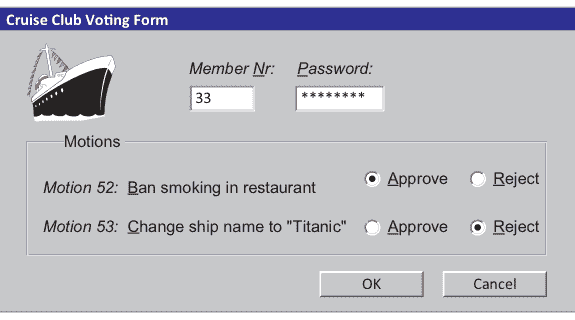

- 8. 假设为实体类型、引用方式和谓词提供了适当的名称，并添加了适当的约束，那么以下哪些概念模式图是合法的？如果不合法，请简要说明错误。

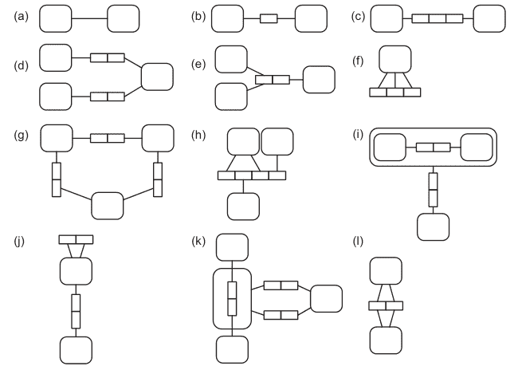

- 9. 以下图表显示了欧元和澳元相对于美元在给定时期内的价值变化。数据可能在每月初记录（此处仅显示部分数据）。对该领域进行图式化。

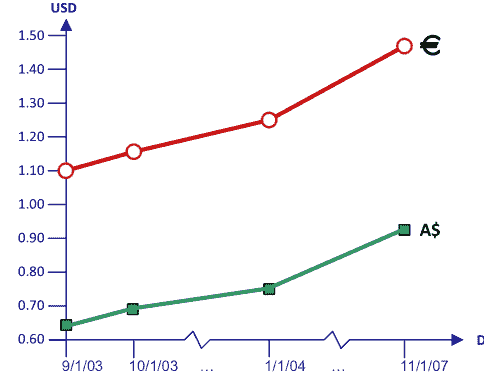

## 3.5 CSDP 步骤 3：精简模式；记录基本推导

在绘制事实类型并执行填充检查后，我们现在进入设计流程的步骤 3。在这里，我们检查是否有一些实体类型应该合并。我们还检查是否有一些事实类型可以通过算术计算从其他事实类型推导出来。

> CSDP 步骤 3：检查应合并的实体类型；
> 记录任何算术推导。

UoD 按类型分类。图 3.22 显示了对象划分为实体（非词汇对象）和值（词汇对象）的基本划分。实体通过确定描述进行标识，并且通常可以改变其状态，而 _值_ 是常量（通常是字符串或数字）。值可能包括可直接在介质上表示的其他对象（例如，声音），但本书忽略了此类可能性。

这些细分是 **互斥的**（即，它们没有共同的实例）。例如，没有字符串可以是实体。将整体划分为互斥部分称为 **分区**。您可以将其视为将派切成片。这些片段是 _互斥的_（它们不重叠）和 _详尽的_（它们共同构成整个派）。

图 3.22 举例说明了如何为特定业务领域将对象类型划分为实体类型和值类型。存在哪些类型的对象取决于 UoD。基本上，如果我们想要记录关于它们的相似信息，对象会被归为同一类型。

对于任何 UoD，其实体总是存在顶层的互斥类型划分：这些被称为 **原始实体类型**。我们可以引入这些原始类型的 _子类型_，尤其是当它们有特定角色时。在 ORM 中，子类型通过箭头连接到其超类型显示。虽然分别显示，但给定实体类型的子类型可能重叠。

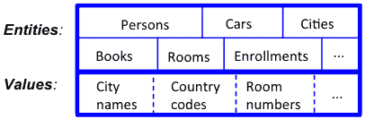

**图 3.22** 将对象划分为实体和值的类型。

但是，_原始实体类型永不重叠_。例如，没有人可以是城市。在概念模式图中，原始实体类型的视觉分隔表明这些类型是互斥的。子类型不一定如此。例如，在图 3.23 中，Person 和 City 是互斥的，但 Manager 和 Woman 不一定互斥。子类型在第 6 章中详细讨论。

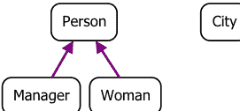

图 3.23 Person 和 City 是原始实体类型，因此互斥。

图 3.24(a) 显示了两个值类型：Surname 和 Cityname。即使这些类型作为顶级类型出现在 ORM 模式图中，它们也可能重叠，如图 3.24(b) 的欧拉图所示。这里，字符串“Denver”和“Columbus”既是姓氏也是城市名称。尽管值类型之间的子类型关系很少显示，但它们可能隐式存在。在极少数超类型扮演感兴趣角色的情况下，我们可能会显式显示连接，如图 3.24(c) 中所示。

设计流程的步骤 3 从检查是否应合并某些实体类型开始。在这个阶段，我们只关心原始实体类型，而不关心实体子类型。因此，如果您发现某些重叠的实体类型，应将它们合并为单一实体类型，或至少引入一个共同超类型（参见第 6 章）。

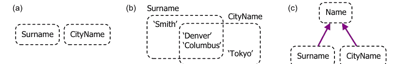

图 3.24 重叠的值类型具有隐式或显式超类型。

例如，请考虑表 3.11，它基于第 1 章讨论的电影应用程序。假设应用步骤 1 和 2 的结果是我们得到了图 3.25 所示的图表。您看出来这个图表哪里出问题了吗？

| 电影编号 | 电影标题 | 导演 | 主演 |
|---|---|---|---|
| 1 | Cosmology | Lee Lafferty | Stephen Chow |
| 2 | Kung Fu Hustle | Stephen Chow | Gennie James, Barret Oliver |
| 3 | The Secret Garden | Alan Grint | ... |
| ... | ... | ... | ... |

图 3.25 将 MovieStar 和 Director 显示为单独的原始实体类型。这意味着这些类型是互斥的（即，没有电影明星可以是导演）。但事实真的是这样吗？我们的示例填充在导演列和主演列中都列出了值“Stephen Chow”。这是否指同一个人？


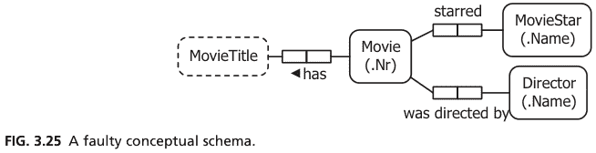

如果有疑问，可以咨询领域专家，对上述问题他会回答“是”。因此，我们必须将电影明星和导演实体类型合并为一个实体类型，如图 3.26 所示。

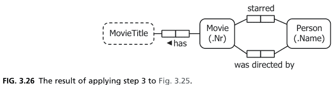

这表明一个人既可以是明星又可以是导演。当然，这并不意味着每个电影明星都是导演。后面的章节将讨论如有需要如何稍后添加子类型。例如，如果有些其他事实仅需为导演记录，我们可以为 Person 形成一个 Director 子类型来记录这些额外事实。

如果希望始终合并实体类型，一种情况是它们具有相同的基于单位的引用模式。在这里，实体被设想为若干单位（例如，千克或美元）的数量。让我们看几个例子。

考虑表 3.12 的输出报告，并假设“$”表示美元。在这里，$50 既是批发价也是加价。在这两种情况下，$50 表示相同的金额，因此批发价和加价重叠。如果总体显著，零售价集合与加价集合不重叠。尽管如此，比较零售价和加价是有意义的，因为它们具有相同的单位（美元）。例如，物品 A1 的零售价是其加价的三倍。

| 物品 | 批发价 ($) | 零售价 ($) | 加价 |
|---|---|---|---|
| A1 | 50 | 75 | 25 |
| A2 | 80 | 130 | 50 |
| A3 | 50 | 70 | 20 |
| A4 | 100 | 130 | 30 |

在对该报告建模时，我们必须揭示最后三列的条目是兼容的，因为它们都表示金额。对这一 UoD 的一种图式化方法如图 3.27(a) 所示。通过为 WholesalePrice、RetailPrice 和 Markup 分配相同的基于单位的引用模式 (USD:)，我们隐式声明它们都基于相同的单位维度。

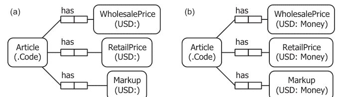

### 图 3.27 基于单位的类型隐式为其单位维度的子类型。

“(USD:)” 中的冒号表示引用模式是基于单位的。在 ORM 2 工具中输入此内容时，我们声明单位维度（通过从预定义列表中选择或添加自己的）。在这里，单位维度是 MoneyAmount（或者简称为 Money）。作为显示选项，单位维度可以显式显示，如图 3.27(b) 所示。

WholesalePrice、RetailPrice 和 Markup 不是原始类型。它们隐式是 MoneyAmount 的子类型。相反，我们可以将这些实体类型折叠到 MoneyAmount 中，并将其区分语义移到谓词读音中，如图 3.28 所示。我们可以保留原实体类型的名称作为角色名称，如所示。

该输出报告满足最后三列值之间的以下数学关系：加价 = 零售价 – 批发价。假设这一点有意义，则加价值可以通过此规则从批发价和零售价中 **推导** 出来。为了最大限度地减少人为错误的机会，我们让系统推导此值，而不是让人工计算。

要指示一个事实类型是派生的，在其谓词读音后追加一个 **星号**。无论派生事实类型是否在图上显示，都应提供其 **派生规则**。在本书中，派生规则以文本注释的形式显示。

派生规则可以用属性风格或关系风格指定。**属性风格**使用角色名称来引用对象类型的属性，通常在 for-each 子句中引用，如图 3.28 所示。对于二元关联，角色名称可以被视为对关联另一端对象类型的属性命名。

如果规则的 **上下文** 在 for-each 子句中声明，此后可以假设。如果未预先声明上下文，可以 **就地** 通过限定名提供，使用编程和 UML 中常见的 **点表示法**（例如，Article.markup）或 **of-表示法**（例如，markup of Article）。在与非技术领域专家验证规则时，of-表示法通常优于点表示法。

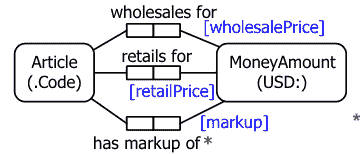

- 对于每个 Article，
markup = retailPrice - wholesalePrice。

图 3.28 图 3.27 的一种替代方案，添加了派生规则。

关系风格则使用谓词读音。例如，使用“iff”表示“当且仅当”，加价规则可以按如下所示以关系风格声明。下标用于区分规则体（“iff”之后）中引入的变量与规则头（“iff”之前）中出现的同一类型（这里是 MoneyAmount）的变量。

```
Article has markup of MoneyAmount iff
Article retails for MoneyAmount1 and Article wholesales for MoneyAmount2 and
MoneyAmount = MoneyAmount1 – MoneyAmount2.
```

为求简洁，关系风格假设规则头中的变量是全称量化的，规则体中引入的变量是存在量化的。因此，规则可以明确表述为：对于每个 Article 和 MoneyAmount，Article 有加价为 MoneyAmount 当且仅当 Article 以某个 MoneyAmount1 零售，且 Article 以某个 MoneyAmount2 批发，并且 MoneyAmount = MoneyAmount1 – MoneyAmount2。

严格来说，等式 markup = retailPrice – wholesalePrice 是加价、零售价和批发价事实类型之间的一种约束，具有一个自由度。其中任意一个都可以从另外两个推导出来。有时我们可能希望输入零售价和批发价，让系统推导加价。在其他时候，我们可能希望输入批发价和加价来推导零售价。我们也可以输入零售价和加价来推导批发价。

如果我们希望系统支持所有这些选择，那么这三个事实类型中的每一个都是半派生的（实例可以被声明或推导），其谓词用“++”标记，而不是“**”（直观上，半个星号）。在实践中这有时很有用（例如，基于利率和还款期探索贷款选项）。

然而，在大多数派生情况下，我们事先决定某个特定事实类型始终是派生的。在这种情况下，派生规则可以明确指定为定义（而不仅仅是方程或双条件），其中派生事实类型使用“define ... as ...”定义为其他事实类型。例如：

```
For each Article, define markup as retailPrice – wholesalePrice.
```

在此定义中，派生事实类型是定义项（需要定义的内容）。原始事实类型（即不根据其他事实类型定义的）称为断言事实类型或基本事实类型。派生事实类型根据其他事实类型（断言或派生）定义。对于算术派生规则，例如我们的示例，属性风格通常更紧凑且可读，因此更受青睐。对于逻辑派生规则（参见第 5.5 节），关系风格通常更可取。

现在考虑表 3.13 的输出报告，它显示了计算机屏幕上窗口的详细信息。在继续阅读之前，尝试对其进行图式化。

### 表 3.13 窗口大小。

| 窗口 | 高度 (cm) | 宽度 (cm) | 面积 (cm²) |
|---|---|---|---|
| 1 | 4 | 5 | 20 |
| 2 | 6 | 20 | 120 |
| 3 | 10 | 15 | 150 |
| 4 | 5 | 5 | 25 |

最后三列中的值是数字。高度和宽度可以有意义地比较，因为两者都是长度：5 厘米的长度可能是高度或宽度的一个实例。因此，高度和宽度可以折叠为实体类型 长度。宽度和面积是否因为都包含值 20 而重叠？不！面积以平方厘米计量，与厘米是不同的单位。然而，20 厘米的长度与 20 平方厘米的面积并不是同一回事。如果我们的最后一列标题为“Perimeter(cm)”，我们可以像以前一样将三个标题折叠为一个实体类型。但因为面积从根本上是一种不同的量类型，我们必须将其分开，如图 3.29(a) 所示。

作为替代方案，高度和宽度事实类型可以使用事实类型 Window(nr) has Height(cm:) 和 Window(nr) has Width(cm:) 进行建模，其中厘米单位基于单位维度 长度。

图 3.29(a) 中面积的派生规则前加了一个单星号，以表示它是派生的而非存储的。规则体包含另一个星号，在此上下文中表示乘法。原则上，面积、高度和宽度中的任意一个都可以从另外两个推导出来。然而，在许多情况下，哪个事实类型是派生的根本没有选择。例如，关于总和和平均值的事实可以从单个案例的事实中推导出来，但除了平凡情况外，我们无法从这些摘要中推导出个别事实。

未存储的派生事实类型是按需派生的（惰性求值），因此派生信息仅在请求信息时计算。例如，如果我们的 Window 模式映射到关系数据库，则 Window 的基表中不包含面积列。计算面积的规则可以包含在视图定义或存储查询中，并且仅在查询视图或执行存储查询时调用。在大多数情况下，更青睐惰性求值（例如，从出生日期和当前日期计算人的年龄）。

同时存储的完全派生事实类型是按更新派生的（急切求值）。有时使用急切求值是因为它提供更好的性能（例如，计算账户余额）。在这种情况下，一旦输入定义事实，信息即被存储，并在每次更新时进行更新。完全派生的事实类型和


存储的项用 *双星号* “***” 标记，如图 3.29(b) 所示。在映射到关系数据库时，会为派生事实类型创建一个列，计算规则被指定为触发器或计算列规则，每当定义列被更新时（包括插入或删除）该规则都会触发。

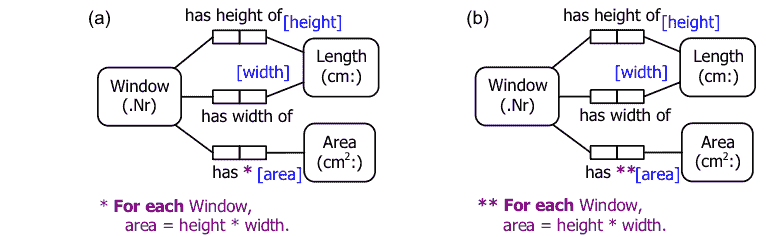

图 3.29 表 3.13 的模式，区域仅派生 (a) 或派生并存储 (b)。

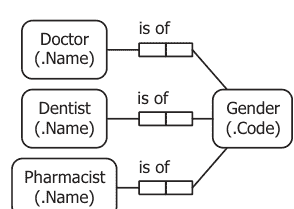

图 3.30 应该将医生、牙医和药剂师合并吗？

现在考虑图 3.30。这可能描述了关于医疗诊所从业人员的 UoD 的一部分。在这里，实体类型 Doctor、Dentist 和 Pharmacist 具有相似的引用模式（名称），但由于这不是基于单元的，这并不是合并类型的理由。如果某人可以兼任这三种工作中的多种，那么实体类型的重叠通常会迫使合并。

然而，假设这些实体类型是互斥的（即，没有人可以兼任多种工作）。在这种情况下，我们仍然需要考虑是否合并实体类型，因为每种类型都记录了 *相同种类的信息*（他们的性别）。

在这种情况下，请问自己这个问题：*我们是否希望在同一查询中列出不同实体类型的相同种类信息？* 例如，我们是否希望提出请求“列出所有从业人员及其性别？”如果是，那么通常应该如图 3.31 所示合并实体类型。如果不是，则可能有理由保持模式不变。第 6.6 节将更详细地探讨这个问题。

即使没有医生可以是牙医，图 3.30 的模式也允许医生和牙医拥有相同的姓名（例如，“Jones E”）。在图 3.31 中，将“(.Name)”与 Practitioner 连用意味着每个 PractitionerName 实例只引用一个 Practitioner。

假设我们添加约束：**每个从业人员最多担任一项工作**。下一章将讨论这种约束的图形表示法。添加此约束后，图 3.31 将禁止任何医生与牙医拥有相同的姓名。如果原始名称有重叠，我们现在需要重命名一些从业人员，以确保他们的新名称不同（例如，“Jones, E1”和“Jones, E2”）。

或者，我们可以选择一个新的简单识别方案（例如，PractitionerNr），或者通过原始姓名和工作的组合来识别从业人员。引用方案在第 5.3 节中有详细讨论。

为了保留不同类型从业人员之间的区别，我们引入了实体类型 Job，并将工作名称限制在集合 {“doctor”, “dentist”, “pharmacist”} 中。这种“值约束”在第 6.3 节中有详细讨论。

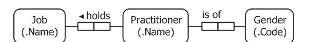

图 3.31 图 3.30 的 UoD 的替代模式。

新模式更简单，因为它用两个二元事实类型替换了三个二元事实类型。如果我们有更多种类的从业人员（例如，针灸师、草药师），节省将更加值得。如果只有两种类型的从业人员（例如，医生和药剂师），两种模式的事实类型数量相同。但即使在这种情况下，新版本通常也更受青睐。如果需要为特定类型的从业人员添加其他信息，应该添加子类型，如第 6 章所述。

在极少数情况下，实体类型可能会重叠，但我们不感兴趣知道这一点，且合并类型很不方便。我们可以保持类型分开，只要声明我们的模型在这方面与现实世界不同。

在执行 CSDP 步骤 3 时，需要询问的相关问题如下。这里，涉及的派生规则具有算术性质。算术派生通常相当明显。逻辑派生可能更难发现，并将在后续步骤中讨论。

- 1. 同一实体可以属于两个实体类型吗？如果是，将实体类型合并为一个（除非此类标识不重要）。
- 2. 两种不同类型的实体可以有意义地比较吗（例如，计算比率）？它们具有相同的单位或维度吗？如果是，要么将实体类型合并为一个，要么将单位分配相同的单位维度。
- 3. 是否为不同实体类型记录了相同种类的信息，并且你是否需要将实体列在一起以获取此信息？如果是，合并实体类型，并在需要时添加事实类型以保留原始区别。
- 4. 事实类型是否可以从其他事实类型算术推导？如果是，添加派生规则。如果在图中包含该事实类型，则如果完全派生用“*”标记，如果半派生用“++”标记。如果派生事实也存储，则追加一个最终星号。

除了 verbalization 和 population 之外，验证模型的第三种方法是查看它是否能够启用 _样本查询_ 的回答，无论是直接从事实人口中还是通过对事实人口进行派生。如果你知道系统必须能够回答什么样的问题，请在 ORM 模型中导航以查看是否可以回答它们。如果不能，你的模式是不完整的，你应该添加回答查询所需的事实类型和/或派生规则。

## 练习 3.5

对以下输出报告执行 CSDP 步骤 1–3。在制定派生规则时，您可以使用任何方便的符号。

- 1.

| 软件 | 分销商 | 零售商 |
|---|---|---|
| Blossom 1234 | InfoWare | PCland |
| | | SoftKing |
| SQL++ | TechSource | PCland |
| WordLight | TechSource | InfoWare |
| | | SoftKing |

- 2.

| 项目 | 经理 | 预算 | 薪水 | 出生年份 |
|---|---|---|---|---|
| P1 | Smith J | 38000 | 50000 | 1946 |
| P2 | Jones E | 42000 | 55000 | 1935 |
| P3 | Brown C | 20000 | 38000 | 1946 |
| P4 | Smith J | 36000 | 50000 | 1946 |
| P5 | Collins A | 36000 | 38000 | 1956 |

- 3.

| 部门 | 预算 | 员工数 | 员工编号 | 薪水 | 薪水总计 |
|---|---|---|---|---|---|
| Admin | 800000 | 2 | E01 | 50000 | |
| | | | E02 | 35000 | 85000 |
| Sales | 900000 | 3 | E03 | 40000 | |
| | | | E04 | 35000 | |
| | | | E05 | 40000 | 115000 |
| Service | 900000 | 2 | E06 | 55000 | |
| | | | E07 | 35000 | 90000 |

- 4.

| 员工 | 项目 | 工时 | 费用 |
|---|---|---|---|
| E4 | P8 | 24 | 400 |
| E4 | P9 | 26 | 300 |
| E5 | P8 | 14 | 200 |
| E5 | P9 | 16 | 220 |
| E6 | P8 | 16 | 240 |
| E6 | P9 | 14 | 220 |

| \multicolumn{2}{c}{女性员工} | \multicolumn{2}{c}{男性员工} |
|---|---|---|---|
| 姓名 | 部门 | 姓名 | 部门 |
| Sue Bright | Admin | John Jones | Sales |
| Eve Jones | Admin | Bob Smith | Admin |
| Ann Smith | Sales | | |

以下摘录自 1996 年奥运会的最终奖牌榜。此处仅列出前五个国家。

| | 金 | 银 | 铜 | 总计 |
|---|---|---|---|---|
| 美国 | 44 | 32 | 25 | 101 |
| 德国 | 20 | 18 | 27 | 65 |
| 俄罗斯 | 26 | 21 | 16 | 63 |
| 中国 | 16 | 22 | 12 | 50 |
| 澳大利亚 | 9 | 9 | 23 | 41 |
| ... | ... | ... | ... | ... |

- (a) 仅使用二元事实类型对其进行图式化。
- (b) 使用三元事实类型对其进行图式化。

对此报告执行 CSDP 步骤 1–3（13 厘米 = 5.25 英寸；9 厘米 = 3.5 英寸）。

| 介质 | 容量 | 推出年份 | 磁盘价格 (美元) | 每 MB 成本 (美元) |
|---|---|---|---|---|
| 13 cm floppy | 160 KB | 1981 | 2.60 | 16.25 |
| 9 cm floppy | 720 KB | 1985 | 3.50 | 4.86 |
| Zip | 100 MB | 1995 | 16.65 | 0.17 |
| CD-R | 650 MB | 1996 | 1.79 | 0.003 |
| DVD-R | 9.4 GB | 2002 | 7.89 | 0.0008 |

## 3.6 总结

以下是任何用于概念建模的语言所期望的理想特征：表达性、清晰性、简单性、正交性、语义稳定性、语义相关性、验证机制、抽象机制和形式基础。

ORM 正是在考虑这些标准的情况下设计的。特别是，其从基模型中省略属性概念，带来了更大的稳定性和简单性，同时通过 verbalization 和 population 促进验证。

在大规模业务领域中，UoD 被划分为便于管理的模块，CSDP 应用于每个模块，并将生成的子模式集成到全局概念模式中。CSDP 本身有七个步骤，其中前三个步骤在本章中讨论了。


## 步骤

- 1a. 将熟悉的信息示例表述为事实。
- 1b. 将这些内容细化为正式的基本事实，并应用质量检查。
- 2. 绘制事实类型，并应用填充检查。
- 3. 检查应合并的实体类型，并记录任何算术派生。

步骤 1 是最重要的。这由数据用例（即领域专家熟悉的相关信息示例，例如表格、表单、图表）所启发。这些内容以基本事实的形式进行表述。领域专家以自然语言句子非正式地将示例表述为事实（步骤 1a）。

建模人员通过将这些内容细化为基本事实（步骤 1b）来完成步骤 1。基本事实是指关于某个对象具有某属性，或一个或多个对象共同参与某些关系的简单断言。就 UoD（应用领域）而言，基本事实不能在不丢失信息的情况下拆分为更小的事实。

基本事实表述为已实例化的逻辑谓词。逻辑谓词是包含对象占位符的陈述句。要完成句子，需用对象术语填充这些占位符。采用简单引用方案时，实体术语是包含实体类型名称、引用模式和值的确定性描述（例如，“姓氏为‘爱因斯坦’的科学家”）。值术语包括值类型名称和文字值（例如，“姓氏‘爱因斯坦’”）。

每个对象占位符对应一个角色（关系中的一部分）。具有一个角色的谓词为一元谓词，具有两个角色为二元谓词，具有三个角色为三元谓词，具有四个角色为四元谓词，具有 n 个角色为 n 元谓词。值 n 为谓词的元数。

在 CSDP 步骤 2 中，我们绘制事实类型并应用填充检查。图 3.32 总结了迄今遇到的图形符号。对象类型描绘为带名称的软矩形（实线表示实体类型，虚线表示值类型）。n 元谓词显示为带名称的 n 个角色框的连续序列。谓词是有序的。谓词读取置于谓词形状旁边。每个角色恰好由一个对象类型扮演，如连接线所示。

简单的 1:1 引用方案涉及实体类型与值类型之间的引用谓词，其中每个实体恰好与一个值关联，每个值仅与一个实体关联。此类方案可通过将引用模式置于实体类型名称旁边的括号中来缩写。

常用引用模式前加点，例如 Country (.Code)。基于单位的引用模式后加冒号，例如 Height (cm:)，后面可能跟单位的维度，例如 (cm: Length)。一般引用模式可与其他实体类型共享其值类型，例如 (URL)。

绘制事实类型后，应通过用至少一个事实对其填充并用自然语言读回进行检查。关联事实表中的每一列均对应特定角色。要讨论与关系对应的对象，可从事实类型形成对象化的关联。这种名词化过程也称为嵌套。

在 CSDP 步骤 3 中，我们检查应合并的实体类型并记录任何算术派生。对于任何给定的 UoD，每个实体都属于所选原始实体类型（例如，Person、Car）中的恰好一个。因此，如果我们绘制了可能具有共同实例的两个实体类型，通常应将它们合并。

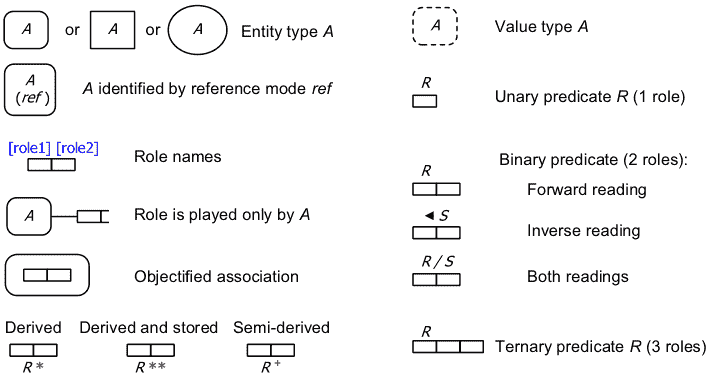

图 3.32 概念图式图中使用的一些基本符号。

即使不重叠，也可以有意义地比较（例如，用于计算比率）的实体类型通常可以合并。如果基于单位，则要么将实体类型合并为一个，要么确保它们的单位具有相同的单位维度。

如果要为不同的实体类型记录同一类信息，通常应将它们合并，并在需要时添加事实类型以保留原始区别。

如果某事实类型可从其他事实类型算术派生，则应以关系风格（使用谓词）或属性风格（使用从角色名称派生的属性）声明适当的派生规则。派生的事实类型可以从图中省略，但如果包含，其派生状态应标记为“*”（简单派生）或“+”（半派生）。如果派生事实也被存储，则在末尾追加一个星号。

## 章节笔记

Bentley（1998）为语言设计提出了以下替代度量标准：正交性、通用性、精简性、完备性、相似性、可扩展性和开放性。其中一些标准（例如，完备性、通用性、可扩展性）可归入表达性。精简性可视为简单性的一个方面。有时还会提到另一个标准，即便利性（语言特性对用户而言有多方便、合适或适当）。我们将便利性视为简单性的另一个方面。

精简性与便利性的权衡由二值命题演算很好地说明，该演算允许 4 个一元和 16 个二元逻辑运算符。所有 20 个运算符都可以用“单一逻辑运算符（例如 nand）”来表示，但虽然这在构建电子元件时可能有用，对于直接的人类交流来说却过于不便。例如，“not p”远比“p nand p”更方便。在实践中，我们使用多个运算符（例如，not、and、or、if-then），因为它们的便利性远大于只需学习 nand 等单一运算符所带来的精简性益处。

在证明关于给定逻辑的元定理时，采取相对精简的立场来处理基础构造通常很方便（例如，仅将“not”和“or”视为原始逻辑运算符，同时将其他构造作为引入的派生项（例如，定义“如果 p 则 q”为“not p 或 q”）。类似考虑也适用于建模语言。

Fillmore（1968）是一篇经典语言学论文，影响了多种建模方法的早期发展。用例规范是 Ivar Jacobson 早期 Objectory 方法的核心，他是 UML 的主要贡献者之一。关于逻辑学家对专有名称和描述的方法概述，请参阅 Haack（1978）第 5 章。Choobineh 等人（1992）讨论了一些启发式方法，以帮助在步骤 1 中解释商业中常用的表单。

虽然有序，但混缀谓词因更自然而被优先采用；你也可以将事实视为命名的（对象，角色）对集合：F(o1,r1)，...，(on,rn))。在此，每个对象 oi 与其在事实 F 中扮演的角色 ri 配对。例如，Wirth 设计 Pascal 这一事实可以指定为 Design{ (姓氏为“Wirth”的人，主动), (名为“Pascal”的语言，受动) }。而不是使用格形容词“主动”和“受动”，还可以使用其他角色名称（例如，“设计者”和“语言”，或“设计”和“被设计”）。通过将对象与角色配对，列出对的顺序无关紧要。这种方法在引用和理念语言（RIDL）（Meersman, 1982）中使用。

在本书中，“line”一词非正式地用于表示“线段”或“边”（在几何中，直线没有起点或终点）。以下注释简要介绍了 ORM 的历史。

在 1970 年代，尤其是在欧洲，进行了大量研究，以为建模信息系统提供高层语义。Abrial（1974）、Senko（1975）等人建模了二元关系。1973 年，Eckhard Falkenberg 将其工作推广到 n 元关系，并决定在概念层面不应使用属性，因为它们涉及“模糊”区分，并且也使图式演变复杂化。后来，Falkenberg（1976）提出了基本 ORM 框架，他称其为“对象-角色模型”。该框架允许 n 元和嵌套关系，但使用箭线描绘角色。

Nijssen（1976）通过引入对象和角色的圆框表示法，并添加语言导向和设计过程来调整此框架，从而提供了一种称为 ENALIM（演进自然语言信息模型）的建模方法（Nijssen, 1977）。采用角色框表示法的主要原因是便于使用示例群进行验证。Nijssen 在比利时 Control Data 领导了一组研究人员，他们进一步发展了该方法，其中包括 Franz van Assche，他将对象类型分为词汇对象类型（LOTs）和非词汇对象类型（NOLOTs）。如今，LOTs 通常称为“值类型”，NOLOTs 称为“实体类型”。Kent（1977）提供了若干语义洞察并澄清了许多概念问题。

Robert Meersman 添加了子类型，并与 Falkenberg 和 Nijssen 一起对 RIDL 查询语言作出了重大贡献。该方法被重命名为“信息分析方法”（NIAM），并由 Verheijen 和 van Bekkum（1982）在一篇论文中总结。多年后，缩写“NIAM”被赋予不同的展开形式，如今被称为“自然语言信息分析方法”。为子类型开发了两种矩阵方法：一种（角色-角色矩阵）由 Dirk Vermeir（1983）开发，另一种由 Falkenberg 等人开发。

在 1980 年代，Falkenberg 和 Nijssen 共同致力于设计流程，并迁至昆士兰大学，在那里该方法得到了进一步完善。正是在那里，Terry Halpin

提供了该方法的第一个完整形式化（Halpin 1989），包括模式等价证明，并进行了多项改进和扩展。1989 年，Nijssen 和 Halpin 合著了一本关于该方法的书。另一本关于该方法的早期书籍由 Wintraecken (1990) 撰写。

20 世纪 90 年代初，Halpin 开发了 NIAM 的扩展版本，称为 Formal ORM（FORM），最初由 ServerWare 的 InfoDesigner 建模工具支持。该产品后来演变为 InfoModeler（最初由 Asymetrix Corp. 开发，随后由 InfoModelers Inc. 开发），再演变为 VisioModeler（由 Visio Corp. 开发）。随后，这项 ORM 技术被重新编码以在 Visio 引擎上运行，首次出现在 Visio Enterprise 中。Anthony Bloesch 和 Terry Halpin 设计了一种名为 ConQuer（Bloesch 和 Halpin，1997）的关联查询语言，该语言在 ActiveQuery 工具中受到支持。Microsoft 于 2000 年收购了 Visio，并修改了其 ORM 解决方案以用于 Visual Studio。

许多研究人员都为 ORM 方法做出了贡献，完整的历史还包括此处未列出的许多人。如今，该方法存在多个版本，但都遵循基本的对象-角色框架。尽管大多数 ORM 拥护者偏爱 n-ary 关系，但有些人更偏爱二进制关系建模（BRM），例如 Shoval 和 Shreiber (1993)。Habrias (1993) 开发了一种面向对象的版本，称为归一化面向对象方法（MOON）。谓项集模型（PSM）主要由 Arthur ter Hofstede、Erik Proper 和 Theo van der Weide（ter Hofstede 等人，1993）开发，并包含复杂对象构造器。De Troyer 和 Meersman (1995) 开发了另一种带有构造器的版本，称为自然对象-关系模型（NORM）。Harm van der Lek 和其他人（Bakema 等人，1994）允许将实体类型视为对象化的谓词，从而产生完全面向通信的信息建模（FCO-IM）。独立于主流 ORM 运动，Dave Embley 和其他人认为在概念建模中使用属性是一个糟糕的主意，因此他们开发了面向对象的系统分析（OSA），该方法包含一个无属性的“对象-关系模型”组件，与 ORM 有很多共同之处（Embley 等人，1992；Embley，1998）。对象管理组（Object Management Group）于 2007 年采用的商业词汇和业务规则语义（SBVR）方法是面向事实方法家族中的最新成员，与 ORM 2 有很多共同之处，因为它同时支持去伦理规则和真理规则。编写本文时，SBVR 规范的最新版本可在 www.omg.org/spec/SBVR/1.5 上访问。

已开发出各种软件工具来支持面向事实方法的不同变体。Control Data 公司 Nijssen、Meersman 和其他人开发的最早工具（例如，IAST、RIDL*）已不再可用。Bloesch、Halpin 和其他人开发了 VisioModeler（已停产但可免费获得）、ActiveQuery（当前不可用）以及 Microsoft Visio for Enterprise Architects 中的 ORM 建模解决方案（Halpin 等人，2003）。FCO-IM 版本由商业工具 CaseTalk（www.casetalk.com）支持。PNA 公司 Nijssen 小组开发了基于 CogNIAM（认知增强 NIAM）的工具，包括各种 iKnow 工具（www.pna-group.com）。Meersman 和其他人开发了基于 ORM 的学术工具，用于指定本体，例如 Dogma Modeler 和 T-Lex（Trog 等人，2006）。

NORMA（Curland 和 Halpin，2010）是一个开源的 Microsoft Visual Studio 插件，为 ORM 2（ORM 的下一代）提供深度支持，可从 https://orms.com/ 或 https://sourceforge.net/projects/orm 下载。有关安装和使用 NORMA 的详细信息，请参阅 www.orm.net/resources。

Clifford Heath 开发了 ActiveFacts（http://dataconstellation.com/ActiveFacts/），这是另一套旨在支持 ORM 2 的工具。

Victor Morgante（https://victormorgante.medium.com/）是多种工具（例如 Boston 和 FactEngine）的主要开发者，这些工具包括对 ORM 2 和其他建模方法的支持（https://www.factengine.ai/）。

# 唯一性约束

### 章节大纲

- 4.1 CSDP 步骤 4 简介
- 4.2 一元和二元上的唯一性约束
- 4.3 较长事实类型上的唯一性约束
- 4.4 外部唯一性约束
- 4.5 元数检查
- 4.6 投影与连接
- 4.7 总结

## 4.1 CSDP 步骤 4 简介

迄今为止，概念模式设计流程（CSDP）一直专注于指定初级事实类型（包括断言和派生）。CSDP 的其余部分主要涉及指定**约束**。约束适用于数据库，可以是静态的或动态的。*静态约束*适用于数据库的每个单独状态，通常可以在模式图上指定，如 CSDP 步骤 4–7 中所述。示例包括唯一性、强制角色、集合比较、值、子类型、频率和环约束。*动态约束*限制状态之间的转换，通常以其他方式表示（例如，状态图），并在步骤 7 中与其他约束一起考虑。
在实践中，我们通常在转到模型的另一部分之前，先捕获与所讨论事实类型相关的所有约束。

本章讨论**唯一性约束**（UCs）。一旦向事实类型添加了 UCs，就会进行检查，以查看事实类型的元数或长度是否正确。有一个简单的唯一性检查，可显示某些类型的事实类型不是初级的，因此应拆分。

> CSDP 步骤 4：添加唯一性约束并检查事实类型的元数。

静态约束通常被描述为“事实类型上的约束”。更准确地说，*静态约束适用于数据库的每个可能状态*。这里，“每个状态”指的是“每一个状态，一次一个”。因此，静态约束适用于事实类型的所有可能*人口*。例如，给定事实类型 *Person(Surname)* 具有 Weight(kg)，让我们添加约束 **每个** Person 有 **最多一个** Weight。图 4.1 显示了两个状态的示例人口。

在信息系统的生命周期内，数据库经历一系列状态。在一个状态中，Smith 被记录体重为 90 kg，Jones 被记录体重为 100 kg（图 4.1(a)）。在较晚的状态中，Smith 的体重仍然相同，但 Jones 通过锻炼或节食减轻了体重（图 4.1(b)）。随着时间的推移，Jones 的体重各不相同，但在每个数据库状态中，最多只有一个体重被记录为 Jones、Smith 或任何其他人的当前体重。

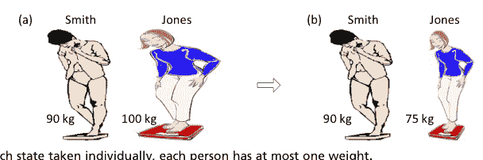

这就是如何解释静态约束“每个人最多有一个体重”。诸如 Person has Weight 之类的事实类型是“快照事实类型”——每个实例都适用于数据库的单个状态或快照。记录历史的一种方法是使用带时间引用的“历史事实类型”，例如，Person had Weight on Date。

本章讨论如何在概念模式图上指定 UCs。每个基础事实类型必须至少分配一个 UC。鉴于基础事实类型上的约束，派生事实类型上的约束通常由派生规则暗示。例如，如果一个窗户最多有一个高度和最多一个宽度，那么派生规则“面积 = 高度 * 宽度”暗示每个窗户最多有一个面积（这是派生事实类型 Window has Area 上的 UC）。

本章的其余部分讨论 CSDP 步骤 4。首先，我们讨论如何在一元和二元谓词上标记 UCs。然后，我们考虑较长谓词上的 UCs。之后，我们研究外部 UCs（这些适用于不同谓词之间）。最后，我们讨论检查我们的事实类型是否具有正确元数（角色数量）的方法。

### 4.2 一元和二元上的唯一性约束

一元事实类型最简单，因此我们先看一下。假设作为健身应用程序的一部分，我们记录哪些人是慢跑者。可以使用一元事实类型来处理此问题，如图 4.2 所示。

为简单起见，我们再次假设可以仅通过姓氏来识别人。包含一个示例人口。从概念角度来看，事实人口是包含以下事实的集合：

- 姓氏为 'Adams' 的人慢跑。
- 姓氏为 'Brown' 的人慢跑。
- 姓氏为 'Collins' 的人慢跑。


假设在记录这些事实后，我们再次看到Adams跑过。忘记我们已经记录了他的慢跑，我们现在尝试以下更新：

**添加：** 姓氏为'Adams'的人慢跑。

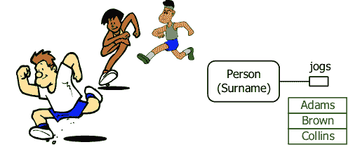

图 4.2 带有样本种群的一元事实类型。

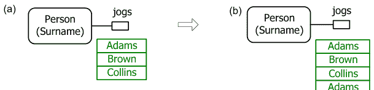

图 4.3 允许此更新吗？

如果接受，此更新可能如图 4.3 所示。数据库是一个变量，其在任何状态下的种群是一组事实。因为“亚当斯慢跑”这一事实已经存在，如果再次添加此事实，种群将保持不变，因为集合对重复不敏感。例如，集合{Adams jogs, Adams jogs}与集合{Adams jogs}相同。集合仅由其成员定义，即使我们多次显示一个成员（即使这不寻常），它们也不会改变。因此，如果我们将图 4.3 中的两个事实表视为实例集合，则它们是等价的。因此，接受此更新没有问题。

然而，从内部视角来看，当将事实添加到数据库时，它通常存储在先前未分配的空间中。因此，接受此更新会导致“亚当斯慢跑”这一事实被存储两次，在不同位置。这是冗余的一个例子。如果发生冗余，数据库是事实的包而不是事实的集合。包或多重集就像集合，只是其成员的重复是有意义的。例如，虽然集合{1}和{1, 1}相等，但包[1]和[1, 1]不同。

避免数据库中的冗余有助于通过简化更新的正确处理来维护其完整性。例如，假设“亚当斯慢跑”这一事实在数据库中存储了两次。如果我们以后想要删除或更改此事实，则需要小心同时对其两个记录实例进行操作。以这种方式控制冗余可能是一件头疼的事，不受控制的冗余可能导致不一致。

避免冗余的第二个原因是节省空间（计算机具有有限的存储能力）。

在实践中，为了更高效地检索信息，我们有时允许在逻辑模式级别进行受控冗余。然而，对于概念模式设计，概念数据库中不允许出现冗余。冗余是基本事实或存在性事实的重复。因为概念事实表的每一行对应一个事实，概念事实表的任何行都不得重复。因此，图 4.3(b) 中的事实表是非法的，因为亚当斯行重复了。

这里，对于数据库的任何给定状态，每个人最多只能被记录为一次慢跑者。结果，事实表列中的每个条目都是唯一的（此列中不得出现重复项）。我们可以通过在事实角色上方或下方放置一个条来显式表示此唯一性约束（UC），如图 4.4 所示。

因为事实角色对应于事实列，角色上的唯一性约束意味着事实列中的条目是唯一的。我们可以通过省略事实表来仅在概念模式图上显示约束。

每个对象角色建模（ORM）断言的事实类型都有跨越它的隐含唯一性约束（UC），因为对于概念数据库的每个状态，每个断言的事实实例都是唯一的。因为每个一元谓词只有一个角色，只能对其应用一个内部唯一性约束。因此，断言的一元谓词上的UC条是隐含的，因此作为显示选项可以省略，如图 4.5(b) 所示。然而，因为二元或更长谓词有多个角色，可能适用于该谓词的唯一性约束模式不止一个。因此，对于非一元谓词，需要明确说明唯一性约束。

对于二元谓词，最常见的情况是唯一性约束仅跨越一个角色，如图 4.6 所示。这表示该角色的事实列中的每个条目必须是唯一的。其他列中允许重复条目。在这里，感兴趣的政治家由其姓名标识，国家由其两个字母的ISO代码标识（例如，“AU”表示澳大利亚）。

在样本事实表中，政治家列中的每个值只出现一次，但国家列中的“US”值重复出现。约束表示，对于所有可能的种群，政治家列中的值是唯一的。因为每个政治家在该列中最多被引用一次，所以他在该事实类型中最多与一个国家关联。

换句话说：每位**政治家**出生于**至多一个**国家。这是约束以正形式正式*口头化*的方式。相同的约束可以以负形式*口头化*为：**不可能同一**位**政治家**出生于**多个**国家。在另一个角色上没有唯一性约束可以*口头化*为：**有可能**同一个**国家**是**多个**政治家的出生地。

图 4.7 显示了示例的实例图。实体被描绘为实体类型内部的点，事实实例显示为连接线。许多政治家可能出生于一个国家，但同一个国家可能是许多政治家的出生地。因此，谓语“...出生于...”被称为*多对一（n:1）*。反向谓语“...是...的出生地”是*一对多（1:n）*。

像图 4.7 这样的实例图常用于逻辑或数学中讨论关系理论。虽然实例图和事实表对于理解和验证约束很有用，但它们不是模式本身的一部分，模式仅关心结构，不关心种群。在概念模式图上，单个角色上的唯一性约束通过将其放置在角色旁边（任一侧）来表示，如图 4.8 所示。

ORM的基于角色的表示法有助于使用样本种群进行验证，因为每个角色对应于相关事实表中的列。第一个角色上的唯一性约束意味着其条目必须是唯一的。第二个角色上没有唯一性约束表示其条目可能重复。

虽然这种表示法易于理解，模式图揭示了事物如何连接，但协助您进行建模任务的领域专家不应该被要求掌握图表表示法。为了验证约束，使用口头化和样本种群更为重要。

对于二元事实类型，三行足以构成*显著种群*，只要您仔细选择数据。如果一个列可以有重复项，给它两个相同的值和一个不同的值。如果一个列是唯一的，使每个值都不同。


图 4.8 每个人最多出生于一个国家。

回到图 4.6，注意其种群是显著的。使用ORM工具，您可以输入这样的样本种群，并将它们与约束的自动口头化一起打印出来，供领域专家验证。

现在考虑图 4.9 所示的示例，涉及政府首脑（例如，总统或总理）。在任何时刻，一位政治家最多可以领导一个国家的政府，每个国家最多有一个政府首脑。因此，政治家列中的条目必须是唯一的，国家列中的条目也必须是唯一的。因此，在这两列上方添加了唯一性约束（UC）。这些约束可以按所示方式口头化。该事实类型的概念模式可以通过删除事实表来获得。

注意反向谓语中*连字符*的使用。当约束被口头化时，这将带连字符的单词绑定到对象类型。因此，右侧的UC口头化为“每个国家最多有一个首脑政治家”，而不是“每个国家有首脑 *至多一个*政治家”。某些ORM工具在自动生成约束口头化时按此方式解释连字符。

如果不包含反向读取，右侧的UC口头化为“最多一个政治家管理*每个*国家”。通常，如果在一个角色上包含一个从该角色开始的谓语读取，该角色上的约束口头化会更好。我们一般建议为二元包含两个谓语读取，但如果每个角色都有仅适用于它的约束，则尤其建议这样做。

对于数据库的任何状态，任何一位政治家都只能被记录为一个国家的政府首脑，反之亦然。因此，此事实类型的任何种群被称为*一对一*（或*1:1*）关系。图 4.10 的实例图最好地说明了这个想法，将姓氏缩写为首字母。


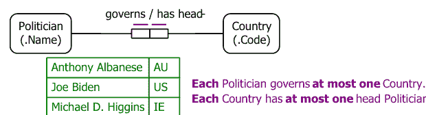

### FIG. 4.9 每列条目必须唯一。

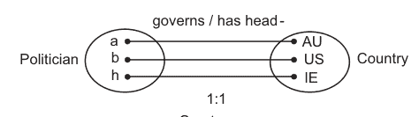

### FIG. 4.10 一对一关系。

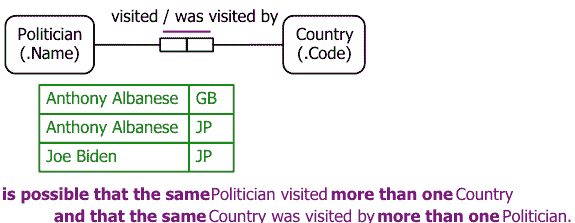

### FIG. 4.11 政客可以访问许多国家，反之亦然。

现在考虑图 4.11 所示的已填充二元事实类型。请注意，事实表中没有整行重复。情况必定如此，因为每行对应一个基本事实，我们不会在数据库中重复事实。

虽然每行都是唯一的，但不能对每个政客都这么说。例如，“Anthony Albanian”在第一列中出现了两次。国家也不是唯一的。例如，“JP”（日本）在第二列中出现了两次。因此，对于这种事实类型，适用于其每一种可能填充的唯一约束（UC）是政客和国家的组合是唯一的。该唯一约束由跨越事实表两列的唯一性条表示。约束的口头表述如下所示。

示例数据表明，一名政客可以访问许多（即至少两个）国家，一个国家可以被许多政客访问。事实填充是一种多对多（或 m:n）关系。图 4.12 显示了实例图。

跨越事实类型中所有角色的 UC 称为 *跨越 UC*。除了表达二元事实类型的 m:n 性质之外，图 4.11 中的 UC 还确保事实类型由一组事实填充（无重复行）。这可以口头表述为“**每个** 政客、国家 **组合在** 政客访问国家 **事实类型的填充中出现的次数最多为一次**”。

每当存在跨越 UC 时，都应与领域专家确认是否要排除事实的多重集（bag）。例如，一名政客可能多次访问同一国家。如果我们希望区分是否访问过某个国家以及访问了多少次，则需要重新建模该情况（例如，通过将二元扩展为包含访问日期的三元）。我们将在 10.3 节详细讨论建模的这些时间方面。

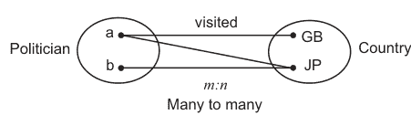

### FIG. 4.12 多对多关系。


### FIG. 4.13 明确显示的简单 1:1 命名约定。

简单 1:1 引用方案通常通过将引用模式名称放在括号中来缩写。然而，我们可以像图 4.13 那样将它们完整列出。这是一种 *存在事实类型*（也称为 *引用类型*）：实例仅用于断言实体的存在。该图仍然不完整；下一章展示了如何添加每个国家都有国家代码的约束。

如果只有一种引用实体类型的方法，则引用类型上的 UC 的强制责任在于用户而非系统。例如，我们必须确保代码为“US”的国家只有一个。如果使用两种 1:1 命名约定（例如，代码或名称），请选择一种作为我们首选的引用方案，并将另一种视为任何其他基本事实类型。

二元谓词可能的四种 UC 模式是：多对多；多对一；一对多；和一对一。迄今为止的每个示例都涉及异构谓词（不同的对象类型）。现在让我们看一些环形谓词（两个角色由相同的对象类型扮演）。为了澄清正在扮演的不同角色，包含反向谓词名称。我们的第一个示例涉及亲子关系（参见图 4.14）。为简单起见，假设我们可以通过人们的名字来识别他们。

如图 4.14 中的示例事实表所示，一个人可能有许多子女。此外，一个人可能有许多父母。列条目不必唯一，但整行必须唯一。因此，UC 跨越整行。将此与母职关系（参见图 4.15）进行对比。


| Tom | Bill |
| --- | --- |
| Tom | Mary |
| Sue | Bill |
| Sue | Mary |

### FIG. 4.14 亲子关系是多对多。

虽然一位母亲可能有许多子女，但每个人只有一位母亲，因此我们按所示标记约束。事实表第二列的条目在该列中必须是唯一的（不一定在整个表中唯一；例如，在她成年后，Mary 也可能成为母亲）。

| Sue | Bill |
| --- | --- |
| Sue | Mary |
| Mary | John |

### FIG. 4.15 每个人只有一位母亲。

图 4.16 所示的下一个示例符合一夫一妻制：在任何时间，每个男人最多有一个妻子，每个女人最多有一个丈夫。因此，每列的条目必须是唯一的。

| Adam | Eve |
| --- | --- |
| Pat | Linda |
| Terry | Norma |

### FIG. 4.16 一夫一妻制是一对一。

作为练习，为以下婚姻习俗绘制模型：一妻多夫制（一名女人可以有许多丈夫，但反之则不成立）；一夫多妻制（一名男人可以有许多妻子，但反之则不成立）；和多配偶制（一名男人可以有许多妻子，一名女人可以有许多丈夫）。

正如本节所讨论的，UC 最好在已填充的架构图上下文中理解。有了这种理解，对于任何给定的事实类型，每个角色都与事实表的相应列相关联。

在逻辑谓词方面，角色框是“对象空穴”。对于此类型的一组关系实例，空穴将扩展为列。用唯一性条标记单个角色意味着相关列中的条目在该列中必须是唯一的（即，该列中不允许有重复项）。

跨越 UC 要求表中的每个事实行都是唯一的。整行约束适用于任何断言的事实类型。如果我们有一个更强的 UC，则整行约束由此隐含，因此是多余的。出于这个原因，除非这是适用的唯一 UC，否则我们绝不会在事实类型上标记整行约束。

有了这种理解，对于任何二元谓词，我们必须从图 4.17 所示的四种约束模式中选择恰好一种。为简洁起见，a 和 b 表示对象变量，“a R’s b” 表示“a 与 b 具有关系 R”。

(a)
R
--
a b
不允许在 a 的列中有重复项。
每个 a 最多与一个 b 具有关系 R。

(b)
R
--
a b
不允许在 b 的列中有重复项。
每个 b 最多与一个 a 具有关系 R。

(c)
R
--
a b
上述两个约束均适用。

(d)
R
--
a b
不允许有重复的 (a, b) 行。
每个 a 可以与多个 b 具有关系 R，反之亦然。

### FIG. 4.17 二元谓词的四种唯一性约束模式。

只要提供一个有意义的示例，谓词上的 UC 只需通过在其事实表中查找重复项即可确定。如果我们不熟悉应用程序，可能不确定填充是否有意义。例如，考虑表 4.1 的输出报告。

### Table 4.1 可信度存疑的输出报告。

| 评审者 | 论文编号 |
|---|---|
| Jones E | 1 |
| Smith JB | 2 |

假设这是会议管理系统的示例输出报告。一项任务是让合格的人员审查（评估适用性）由希望在会议上发表论文的人提交的论文。让我们同意表中的信息可以使用事实类型 Person.(name) reviewed Paper.(nr) 来建模。应指定哪种二元 UC 模式？如果表 4.1 的填充是有意义的，那么我们有一种 1:1 情况，并且约束应标记在每个角色上，如图 4.18 所示。

这意味着每个人最多审查一篇论文（对审查者来说是好消息），每篇论文最多由一个人审查（对提交论文的人来说是坏消息）。


虽然这种安排是可能的，但我们可能会怀疑这种约束模式是否真正是预期的。为了消除我们的疑虑，我们应该 *用英语质疑每个约束，并辅以反例。*

考虑第一列上的 UC。其积极的口头表述是：**每个人最多审查一篇论文**。其等价的消极口头表述是：**同一个人不可能审查多于一篇论文**。要测试此约束，我们问“一个人是否有可能审查多于一篇论文？例如，Smith 是否可以审查论文 2 和 3？”这个反例出现在图 4.19 中扩展事实表的第二行和第三行。

要测试第二列上的 UC，请问“论文是否有可能有多个审查者，例如，论文 1 是否可以由 Jones 和 Adams 审查？”这个反例出现在图 4.19 中扩展事实表的第一行和第四行。如果领域专家对这两项测试都回答“是”，则该事实类型是多对多，我们按图 4.20 所示修改约束。


如果需要，可以为 m:n 情况提供一个更紧凑的数据集，方法是使用元组 (“Smith JB”, 1) 而不是最后两行。这同时测试两个约束。但是，为了测试目的，通常最好一次只测试一个约束，如已讨论。如果两个测试用例中只有一个被接受，最终约束模式将是 n:1 或 1:n。如果两个测试用例都被拒绝，我们将保持 1:1 模式。

请记住，所有关于事实类型的约束都应理解为适用于数据库，而不一定是现实世界。信息系统只能对其领域的形式模型强制执行约束。“现实世界”的约束模式不必与模型（或“记录世界”）相同。

例如，假设模型包含图 4.21(a) 的架构。UCs 断言，对于数据库的每个状态，每个患者被记录为最多拥有一个性别和最多一个电话。现在，在现实世界中，有些患者可能拥有多个电话（例如，家庭电话和商务电话），如图 4.21(b) 的“现实世界架构”所示。


信息系统的设计者决定，不会记录任何患者拥有多个电话。因此，第一个架构（图 4.21(a)）中的约束符合拟在信息系统中实现的预期模型。除非另有说明，当我们提到概念架构时，指的是概念模型的结构（不一定是现实世界）。

尽管如此，在设计概念架构时，我们经常会利用对“现实世界架构”的背景知识。无论如何，UCs 应该至少与现实世界中适用的约束一样严格。对于正在讨论的案例，我们知道在现实世界中，每个人最多只有一个性别。因此，我们应该在架构中强制执行这一点。对于电话事实类型，我们需要有意识地决定是否需要比现实世界约束更强的约束。

## 练习 4.2

1. 对于给定的事实类型，如果所有相关的 UCs 都可以从样本中推导出来，则样本数据相对于 UCs 是显著的。为二元事实类型显示了一个模板。为简单起见，省略了谓词和参照模式的名称。对于每个事实表，在假设提供的数据是显著的情况下，向模板添加 UCs。


2. 在给定部门中，员工由员工编号 “e1”、“e2” 等标识，项目由项目编号 “p1”、“p2” 等标识。为事实类型 Employee works on Project 绘制架构图，并提供相对于以下约束模式显著的数据：

- (a) 1:many
- (b) many:1
- (c) many:many
- (d) 1:1

3. 将相关的 UCs 添加到以下列出的练习问题的概念架构图中。对于其中一些问题，问题中提供的输出报告可能相对于 UCs 不显著。运用常识，你应该能够避免添加可能被较大数据集违反的 UCs。

- (a) Exercise 3.4 Q.1b
- (b) Exercise 3.4 Q.1d
- (c) Exercise 3.4 Q.2
- (d) Exercise 3.4 Q.5
- (e) Exercise 3.5 Q.2
- (f) Exercise 3.5 Q.3

4. 到此刻，你一定觉得需要一个挑战。以下报告摘自某计算机科学系的实际手册。用二元形式表述此报告，绘制事实类型，并添加 UCs。

第一列标题为 “Subject title”，列出了研究生课题的代码和标题。课题与科目并不相同。研究生学生首先注册一个科目（由科目代码标识，例如 CS451）和然后后来为该科目选择一个课题进行学习。科目注册不属于本问题的范围。一个课题可能仅在第 1 学期开设，仅在第 2 学期开设，或贯穿全年开设（进度减半）。

不同学生可能注册同一科目（由科目代码标识）却学习不同课题，这一事实是可能混淆的来源。作为信息建模人员，我们可以做出的最重要贡献之一是建议改进话语宇宙（UoD）本身。在此示例中，我们可以认为，如果将课题视为科目，事情会变得更简单。相关系部最终接受了这一变更。然而，对于本练习，你需要按原样建模。

### 计算机科学研究生课程课题。

| 科目标题 | 教职员工 | 时间 | 先决条件 |
|---|---|---|---|
| AIT: 高级信息技术 | MEO, PNC, TAH | 第 1 学期 | CS315 |
| CLVS: 计算逻辑与验证系统 | JS, PJR | 全年 | 首选 CS260 |
| DBMS: 数据库管理高级主题 | MEO, PNC, RC, TAH | 第 2 学期 | CS315 |
| FP: 函数式编程 | EJS, PAB | 全年 | CS225 CS220 首选 |
| GA: 几何算法 | PDE | 第 1 学期 | CS340 |

注：开设课题取决于教职员工的可用性以及对课题是否有足够需求。在每种情况下，首先提到的教职员工是该科目的负责讲师。首选先决条件在以后的年份可能变为强制性。

## 4.3 较长事实类型上的唯一性约束

本节展示了如何在目数为 3 及以上（包括嵌套版本）的事实类型上指定 UCs。让我们从一个示例开始。图 4.22 显示了形式为 Person scored Rating for Subject 的三元已填充事实类型。为简单起见，假设人员由其姓氏标识。即使我们不熟悉此示例，领域专家提供的样本数据也可以揭示某些约束不适用。


| Adams | 7 | CS112 |
|---|---|---|
| Adams | 6 | CS100 |
| Adams | 7 | PD102 |
| Brown | 6 | CS112 |
| Brown | 7 | PD102 |

### 图 4.22 唯一性约束是什么？

查看事实表时，首先单独考虑每个列。每个列至少有一个重复值。因此，没有任何单独的列具有 UC。如稍后所示，这对于任何基本三元事实类型均成立。

接下来，让我们看看列对。为方便参考，此处列按图中所示顺序编号为 1、2、3。首先从列 1 和 2 开始，请注意

对 (Adams, 7) 是重复的。对于列 1 和 3，每个对都是唯一的。也就是说，每个 (Person, Subject) 组合仅出现在表的一行中。对于列 2 和 3，对 (7, PD102) 是重复的。

在三元中，列配对只有三种方式。如果事实表的数据是显著的，唯一的对唯一性约束是每个 (Person, Subject) 对在表中必须是唯一的。如果熟悉领域，我们通常可以简单地通过常识来判断数据在这方面是否显著。在此示例中，此约束意味着每个 (Person, Subject) 组合最多有一个评级。这符合我们关于 UoD 的背景知识，因此表所建议的 UC 被接受。

样本事实表可以从输出报告（通常代表多个独立事实表的组合）或关于 UoD 的简单事实知识中获得。除非数据足够大或选得当，否则不太可能相对于所有 UCs 完全显著。例如，假设从图 4.22 的表中删除了第 3 行。对于较小的样本，列 1–2 对和列 2–3 对都将不再显示重复项。表随后将为所有三个列对建议一个 UC。除了数据不足外，数据可能因为数据错误（即，某些不正确的值被错误地作为数据输入示例）而无法显著。

因此，我们需要警惕仅依赖一个样本事实表来确定 UCs。我们应该询问任何建议的约束是否真的合理。跨越列 1 和 2 的 UC 意味着 (Person, Rating) 组合最多只能出现在一个科目中。这将禁止某人为两个科目获得相同的评级——这是一个不切实际的限制！同样，列 2–3 对上的建议约束必须作为不切实际的被拒绝（它将阻止两个人为特定科目获得相同的评级）。

UCs 通常可以简单地通过对 UoD 的背景知识来确定。现实世界中的 UCs 通常决定了实际数据库中应考虑的最弱 UCs。如果我们知道事实表是显著的，那么我们可以从中生成约束。

然而，通常我们不会预先知道表是否显著，并且必须使用一些背景知识。如果缺乏此类知识，我们应该就任何可疑约束咨询领域专家，在提出相关问题的同时，添加违反约束的具体事实示例，并询问此类更新是否可接受。

对于三元事实类型，由于不能重复整行，因此始终隐含跨越约束。仅当不存在较短的 UC 时，才应指定此约束。因此，对于我们当前的示例，我们仅标记列 1–3 对的约束，指示每个 (Person, Subject) 对最多分配一个评级。

由于涉及的两个角色框不相邻，因此使用分隔约束栏，如图 4.23 所示。虚线连接约束栏的两个活动部分，指示约束排除虚线下的角色。如果省略虚线，栏将代表两个独立约束，每个端角色一个。如果我们改为将事实类型重新排序为 “Person for Subject scored Rating”，则将有两个相邻角色由未分隔的约束栏跨越。


图 4.23 每个 (Person, Subject) 组合都是唯一的。

术语 n-角色约束 是指跨越 n 个角色的约束。仅跨越一个角色的 UC 是一个 **简单** UC。图 4.23 中的约束是一个双角色约束，因为它跨越了事实类型中涉及的三个角色中的两个。二元事实类型有三种可能的基本约束（两个单角色和一个双角色），从而产生四种可能的情况。后面的一节将演示，*没有（初等的）三元事实类型可以拥有简单 UC*。因此，三元事实类型有四个需要考虑的基本 UC：三个双角色约束和一个三角色约束，如图 4.24 所示。


图 4.24 三元的允许基本唯一性约束。


| Joe Biden | GB | 2022 |
| Joe Biden | GB | 2023 |
| Joe Biden | JP | 2023 |
| Rishi Sunak | JP | 2023 |

图 4.25 具有跨度唯一性约束的三元。

在实践中，三元通常只有一个 UC，要么是针对一个角色对，要么是针对所有三个角色。作为后者的示例，政治家旅行示例在图 4.25 中建模。在这里，许多政治家可能在多年内访问许多国家。这种事实类型被称为“多对多对多”。因为没有整行可以重复，所以我们不能使用此事实类型来记录同一位政治家在同一年多次访问同一国家。如果要记录此情况，请使用不同的模型（例如，用 Date 替换 Year，或添加 Quantity）。

对于三元事实类型，我们应该系统地测试每个双角色 UC 以查看哪些成立。只有当没有双角色约束成立时，才应指定三角色约束。作为练习，请自行检查示例数据对该约束是否有意义。

对于三元关联，只有一种方式可以拥有三角色 UC。有三种方式可以恰好拥有一个双角色约束，有三种方式可以恰好拥有两个双角色约束。最后，有一种方式可以拥有三个双角色约束。因此，三元事实类型可能出现八种不同的 UC 模式。其中四种只涉及一个约束（图 4.24），四种涉及组合（参见图 4.26）。

图 4.26 三元的允许唯一性约束组合。

三元的所有其他约束模式都是非法的（即不允许）。图 4.27 显示了一些示例。前两个示例从根本上是错误的，因为带有简单 UC 的三元事实类型不能是初等的。第三个示例是错误的，因为三角色约束由双角色约束推导出来，因此不应显示。

图 4.27 一些非法约束模式。

| a1 | b1 | c1 | d1 |
| --- | --- | --- | --- |
| a1 | b1 | c2 | d1 |
| a2 | b1 | c2 | d1 |
| a1 | b1 | c1 | d2 |

图 4.28 每个 acd 组合最多出现在一行中。

指定 UC 的这种通用方法适用于任何 arity 的事实类型。图 4.28 显示了一个四元谓词的模板，其 UC 跨越角色 1、3 和 4。这表明每个 acd 组合必须在事实表中唯一，其中 a、c 和 d 分别出现在表格同一行的第一、第三和第四列中。显示了事实表的一小部分但有意义的填充。请自行验证这是否与指示的 UC 一致。

作为四元的示例，请考虑图 4.29。UC 跨越第一、第二和第四个角色，并口头表述为：对于每个 Person1、Person2 和 Language，Person1 判断 Person2 在该 Language 中最多拥有一个 SkillLevel。请注意下标以区分 Person 扮演的不同角色。

后面将展示，四元上的任何 UC 都必须至少跨越三个角色。作为练习，你可能想探索所有可能的情况。或者也许不想！因为初等事实类型很少超过四元，因此这里不讨论五元或更长事实类型的示例。

为了可视化角色与事实表列之间的连接，请将角色框视为放置对象以完成事实的孔。无论事实类型的 arity 是多少，跨角色框组合的 UC 意味着表中出现的该列组合的任何实例都必须仅出现在一行中，因此可以用来标识该行。

因为由 UC 管辖的角色组合提供了解锁事实表中任意行的“密钥”，因此该组合被称为该表的 *键*。这一概念将在关系数据库中使用的（通常是非初等的）表的上下文中稍后详细阐述。


图 4.29 跨越角色 1、2 和 4 的唯一性约束。


图 4.30 注册关联被对象化为嵌套对象类型。

现在，让我们考虑 *嵌套*。在图 4.23 中，科目评分示例以扁平形式给出。假设相反，我们采用嵌套方法，如图 4.30 所示。在这里，每个 (Person, Subject) 注册被视为可能导致评分的对象。例如，Adams 在 CS112 中的注册导致了一个 7。

图 4.23 实际上并不等同于图 4.30，除非添加进一步约束，即每个注册必须有已知评分。这种强制角色约束将在下一章中讨论。

图 4.30 中的 Enrollment 实体类型被称为对象化关联、对象化关系类型、对象化谓词、嵌套实体类型或嵌套对象类型。大多数对象化关联都由 UC 跨越（如图 4.30 所示）。这个跨度 UC 表明每个人可以注册许多科目，相同的科目也可以被许多人注册。二元谓词上的简单 UC 表明每个 (Person, Subject) 注册最多导致一个评分。

第 10.5 节讨论了具有非跨度 UC 的关联的对象化（例如，1:1 关联和 n:1 关联）。虽然目前在 ORM 中是允许的，但此类情况可能违反初等性，并最好以其他方式建模。

## 练习 4.3

- 1. 显示了一个三元事实类型的模板。对于提供的每个事实表，添加 UC，假设填充在这方面是有意义的。


| | | |
|---|---|---|
| a1 | b1 | c1 |
| a2 | b1 | c1 |
| a1 | b2 | c2 |

| | | |
|---|---|---|
| a1 | b1 | c1 |
| a1 | b2 | c2 |
| a2 | b1 | c2 |

| | | |
|---|---|---|
| a1 | b1 | c1 |
| a2 | b2 | c1 |
| a1 | b1 | c2 |
| a1 | b2 | c1 |

| | | |
|---|---|---|
| a1 | b1 | c1 |
| a2 | b2 | c2 |
| a1 | b2 | c2 |
| a2 | b2 | c1 |

- 2. 口头表述然后图示以下报告，标记 UC。

| Department | Staff category | Number |
|---|---|---|
| CS | Professor | 3 |
| CS | Senior Lecturer | 6 |
| CS | Lecturer | 10 |
| EE | Professor | 3 |
| EE | Senior Lecturer | 7 |
| EE | Lecturer | 7 |

- 3.

| Year | Branch | Profit ($) | Total profit ($) |
|---|---|---|---|
| 2007 | New York | 200,000 | |
| | Paris | 90,000 | 290,000 |
| 2008 | New York | 300,000 | |
| | Paris | 150,000 | 450,000 |

- (a) 不使用嵌套，口头表述然后图示此报告。包含 UC。

- (b) 同 (a)，但改用嵌套方法。

## 4.4 外部唯一性约束

迄今讨论的 UC 是内部（谓词内）UC，因为每个都适用于单个谓词中的一个或多个角色。外部（谓词间）唯一性约束适用于来自不同谓词的角色。为了理解这些约束，首先讨论概念连接操作。

考虑图 4.31 中的架构和示例填充。最左侧的事实表明员工 15 驾驶注册号为 PKJ123 和 ABC000 的汽车。最右侧的事实表明汽车 PKJ123 从意大利进口。三元事实表明员工 15 驾驶从意大利进口的汽车 PKJ123。混合修饰谓词读取后的星号表明该三元事实类型是派生的。派生规则前面带有星号。


图 4.31 从二元的概念内连接中派生的复合三元。


图 4.32 图 4.31 所示模型的实例图。

图 4.32 中的实例图可能有助于澄清事情。二元事实显示为连接两个点的线。三元事实对应于从 Employee 到 Country 的连续路径。从 Car 类型开始，这条路径也可以口头表述为 Car 由 Employee 驾驶并从 Country 进口的合取。

派生规则展示了如何通过合并二元来派生三元，Car 作为连接或连接对象类型。定义表达式“Employee drives some Car that was imported from Country”是从 Employee，通过 drives 谓词、Car 类型和 import 谓词，到 Country 的概念路径的正式表述。关键字“that”声明驾驶的汽车必须与进口的汽车 *相同*。换句话说，如果员工驾驶一辆汽车，我们必须使用完全相同的汽车来继续通往 Country 的路径。

连接产生的事实类型是 *复合事实类型*，而不是初等事实类型，因为它本质上是至少两个更简单事实类型的合取。出于这个原因，*连接事实类型通常从 ORM 架构图中排除。如果为了讨论目的而包含，它们可以着色，如图 4.31 所示，以指示它们只是视图。与初等派生事实类型不同，其复合性质可能导致冗余，除非每个连接角色都由简单 UC 覆盖。


例如，如果我们将行 (16, PKJ123) 添加到图 4.31 中的驱动器表，则行 (16, PKJ123, IT) 会添加到三元表中，并且现在在三元表中出现了两次。虽然连接事实类型永远不会作为断言事实类型使用，但连接路径经常出现在约束和查询中，如稍后讨论。

在 ORM 模式中，要从一个谓词导航到另一个谓词，必须经过一个对象类型，并对该对象类型执行 *概念连接*（或 *对象连接*）。默认情况下，连接条件是当我们通过时对象实例保持不变。这称为 *概念内连接*。这类似于关系型自然内连接（参见后续章节），不同之处在于概念连接要求概念对象相同，而不是匹配属性名称和值。ORM 对象类型是概念域，而不是属性。如果我们为连接角色声明了不同的角色名称（参见属性名称），概念连接仍然适用。

就事实表而言，进入连接对象类型的角色的列值必须等于退出该对象类型的角色的列值。图 4.33 描绘了两个谓词 R 和 S，它们共享一个公共对象类型 B。从事实表角度来看，R 和 S 的概念内连接是通过将 R 的行与 S 的行配对（其中 B 列值匹配）并安排最终 B 列在结果中仅出现一次来获得的。


虚线显示行是如何配对的。例如，行 (a1, b1) 与行 (b1, c1) 和 (b1, c3) 配对，得到行 (a1, b1, c1) 和行 (a1, b1, c3)。图 4.34 显示了此连接操作的结果。最终的 B 列是原始 B 列的交集。任何表 R 和 S 的自然内连接表示为“R ⋈ S”或“R natural join S”。“inner”通常被省略并默认假设。


有时还会讨论其他类型的连接（例如，基于等于以外运算符的连接和外连接）。左（右、全）外连接是通过在内连接基础上添加那些（如果有的话）连接列值仅出现在左（仅右、仅其中之一）表中的行，并用 null 填充此类行中缺失的条目来获得的。例如，图 4.31 中二元事实表的左外连接添加了行 (15, ABC000, ?)，其中“?”表示 null。

图 4.33 中表的全外连接包括行 (a2, b2, ?) 和 (?, b4, c4)。外连接在概念层和关系层的查询中经常使用。因为 ORM 中的断言事实类型是基本的，所以它们的事实表不能有 null。我们将外连接的进一步讨论推迟到第 10 章。

考虑表 4.2 中显示的关于高中学生的报告。作为练习，在继续阅读之前，先对该报告的第一行执行步骤 1。

### 表 4.2 关于高中学生的输出报告。

| 学生编号 | 姓名 | 班级 |
|---|---|---|
| 001 | Adams J | 11A |
| 002 | Brown C | 12B |
| 003 | Brown C | 11A |

第一行的信息可以表述为两个基本事实：

学生编号为 '001' 的学生的学生姓名为 'Adams J'。
学生编号为 '001' 的学生所在的班级代码是 '11A'。


### 图 4.35 表 4.2 的填充架构（草稿版本）。

第一个事实关联一个实体和一个值。第二个事实是两个实体之间的关系。在此领域（UoD），学生通过其学生编号标识。如行 2 和 3 所示，两个不同的学生可能拥有相同的学生姓名（例如，“Brown C”）。图 4.35 显示了一个填充的架构图。

让我们同意所提供的填充是有意义的。由此可知，每个学生最多有一个姓名，且每个学生最多在一个班级中。这些唯一性约束（UC）已在架构图中捕获。然而，还缺少一个 UC。是什么？

输出报告在表 4.3 中重现，相关列上方标记了 UC。请注意，姓名和班级的组合是唯一的。假设这是有意义的。虽然学生姓名在高中不必是唯一的，但在学生的班级中是唯一的。虽然有两个名为“Brown C”的学生，但在 12B 班中只能有一个叫这个名字的学生，在 11A 班中也只能有一个叫这个名字的学生。

### 表 4.3 添加到原始表的唯一性约束。

| 学生编号 | 姓名 | 班级 |
|---|---|---|
| 001 | Adams J | 11A |
| 002 | Brown C | 12B |
| 003 | Brown C | 11A |

如果另一个名为“Brown C”的学生加入这些班级之一，则至少需要修改一个姓名，以在该班级内保持它们的区别。例如，我们可以添加额外的首字母或数字（例如，“Brown CT”、“Brown C2”）。

报告的每一行都分为两个基本事实，一个用于姓名，一个用于班级。要在架构上指定姓名-班级 UC，我们需要两个事实类型。UC 适用的角色框通过虚线连接到带圆圈的唯一性栏，如图 4.36 所示。

由于此 UC 涉及不同谓词的角色，它是外部约束或谓词间约束的示例。对单个谓词的约束是内部约束或谓词内约束。因此，有两种 UC：内部唯一性和外部唯一性。


### 图 4.36 已添加外部唯一性约束。

在此示例中，外部 UC 表明，对于每个学生，学生姓名和班级的 *组合* 是唯一的。该约束表述为“给定任何 StudentName 和 Class，最多只有一个 Student 具有该 StudentName 且在该 Class 中”。例如，给定“Adams J”和“11A”，只有一个 StudentNr 与两者共享行（“001”）。给定“Adams J”和“12B”，没有 StudentNr 与两者配对。

理解此约束的简单方法是，如果对两个事实表执行概念（内）*连接* 操作，则生成的表在（姓名，班级）列对上有一个 UC。请注意，当我们连接两个事实表时，我们得到原始报告中的表（表 4.3）。

外部 UC 等效于连接路径形成的派生三元事实类型的第一个和最后一个角色上的内部 UC：StudentName 是 Student *who* 在 Class 中。参见图 4.37。对象类型 Student 是人称的，因此我们更喜欢人称代词 *who* 而不是 “that”。

连接事实类型的中间角色有一个简单的 UC。这等效于二元关系上的两个简单 UC。虽然连接事实类型可能出于讨论目的包含在架构图中，但在基本 ORM 模型中是非法的，因为它们是复合而非基本的事实类型。


### 图 4.37 派生连接事实类型上的等效约束（在基本模型中非法）。


### 图 4.38 此更新将违反外部唯一性约束。

如稍后讨论，三元关系上存在简单 UC 会使其不符合基本事实的条件。所以，不要觉得在常规模型中这样做没问题。

假设我们向当前填充中添加以下事实：学生 ‘004’ 的学生姓名为 ‘Adams J’；学生 ‘004’ 所在的班级是 ‘11A’。如果接受此更新，新的填充将如图 4.38(a) 所示。为测试您的理解，在继续阅读前，请解释为什么这将违反外部 UC。

添加到每个表中的额外行为该约束提供了一个反例，因为对于“Adams J”和“11A”，有两个 StudentNr 条目与这些条目配对（001 和 004）。这违反了给定班级中学生姓名唯一的规则。在 11A 班中，两个学生（001、004）拥有相同的姓名（“Adams J”）。

如果我们在 studentNr 上连接表（虚线指示连接的匹配项），我们将得到图 4.38(b) 中的三元表，它明显违反了 StudentName 和 Class 列上的等效复合 UC。


一般情况在图 4.39 中总结，其中 A、B 和 C 可以是任何对象类型，R 和 S 是谓词。外部 UC 可应用于引用类型的角色，而不仅限于事实类型。这是复合引用方案的基础，如后续章节所述。

作为更复杂的情况，假设人员注册科目，但获得的是科目名次（第 1 名、第 2 名、第 3 名等），而非科目评分。每人在任何给定科目中最多获得一个名次。此外，不允许出现并列（即，每个科目中的每个名次只对应一名学生）。


表 4.4 科目内学生排名（不允许并列）。

| Person | Subject | Position |
|---|---|---|
| Adams J | CS114 | 3 |
| Adams J | CS100 | 10 |
| Adams J | PD102 | 3 |
| Brown C | CS114 | 10 |
| Brown C | PD102 | 5 |

表 4.4 显示了该论域的示例报告。对第一行执行步骤 1 时，我们可以将信息表示为三元关系：人员（姓名）“Adams J”在科目（.代码）“CS114”中位于名次（.编号）3。这导致图 4.40 的模式。请注意重叠的 UC。

或者，也可以这样表达第一行的信息：人员（姓名）“Adams J”注册了科目（.代码）“CS114”；该注册获得了名次（.编号）3。这导致图 4.40(b) 中的嵌套版本。为了与三元关系等价，对象化关联所扮演的角色必须是强制性的。

成就谓词上的简单 UC 捕获了图 4.40(a) 展平版本中跨越前两个角色的 UC。外部 UC 对应于展平版本中跨越最后两个角色的约束——每个（科目，名次）组合都是唯一的。


因此，如果我们将嵌套版本 _展平_ 为三元关系，则任何（科目，名次）对在三元表中最多出现在一行中。为了帮助理解这一点，我们建议向图表中添加事实表。外层谓词的事实表与输出报告相匹配。

图 4.41 中的外部 UC 是 _仅在条件为真时唯一约束_，其中唯一性仅适用于担任政府首脑的政治家。这可以口头表述为 **每个国家中，最多只有一位政治家是该国政府首脑并任职于该国政府。**


图 4.41 仅在条件为真时的外部唯一性约束。

表 4.5 学生同时分配有评分和名次。

| Person | Subject | Rating | Position |
| :--- | :--- | :--- | :--- |
| Adams J | CS114 | 7 | 3 |
| Adams J | CS100 | 6 | 10 |
| Adams J | PD102 | 7 | 3 |
| Brown C | CS114 | 6 | 10 |
| Brown C | PD102 | 7 | 5 |

外部 UC 有时会连接多个角色。例如，三维空间中的一个点可能与 x、y、z 坐标的唯一组合相关联。

从这些示例中可以看出，嵌套往往会产生更复杂的约束图景。对于本示例，更倾向于使用展平版本。但是，如果名次信息是可选的（例如，稍后添加），则更倾向于使用嵌套方法。此类建模选择将在后面详细介绍。

嵌套的另一个原因是避免将同一关联嵌入多个事实类型中。假设我们需要为每位修读任何给定科目的学生记录评分和唯一的科目名次。表 4.5 显示了该情况的示例报告。

我们可以使用两个三元关系来描述该论域，如图 4.42 所示。但是，请注意，一个事实表中出现的所有（人员，科目）组合也必须出现在另一个事实表中。后续章节将展示如何添加此类约束。

或者，我们可以对象化人员与科目之间的注册关联，并将评分和名次谓词附加到此关联上（见图 4.43）。嵌套方法对应于将表格第一行的信息读取为：人员“Adams J”注册了科目“CS114”；该注册获得了评分 7；该注册获得了名次 3。为了表示必须记录评分和名次，需要附加约束（参见下一章）。

如果角色具有简单的内部 UC，则不应将其包含在外部 UC 中。即使存在连接路径以启用声明外部 UC，外部约束也会被更强的简单 UC 所隐含；通常最好省略隐含的约束。


图 4.43 表 4.5 的另一个模式（嵌套版本）。

为了说明这一点，作为练习，你可能希望修改图 4.36 使学生姓名唯一，然后证明外部约束是隐含的。在开始章节练习之前，你应该清楚一个点。当你检查信息样本时，你是在外部级别看到它。通常有许多表现方面可能与你的应用无关。例如，在表格报告中，列或行的顺序通常不是你需要建模的内容。如果信息以非表格方式呈现（例如，图表形式），则总是存在拓扑方面和度量方面，以及可能的其他方面（例如，颜色），这些方面与基本数据一起表示。这些表现的附加方面是否需要建模，这只有领域专家才能决定。为了充分理解这一点，请确保你尝试以下练习中的至少第 2 题。

## 练习 4.4

1. 向以下概念模式图添加 UC：
   (a) 练习 3.4 第 6 题   (b) 练习 3.5 第 4 题

2. 许多制造产品包含零件，而这些零件本身可能是更小零件的产品。其中一种产品的结构如下所示：


   (a) 列出该图中捕获的至少三种不同类型的事实。

   (b) 假设我们只对建模包含事实感兴趣。这些事实也可以按所示方式显示为标记树（层次结构）。为该论域绘制概念模式图，包括 UC，但不使用嵌套。


   (c) 绘制一个使用嵌套的等效概念模式图。

3. 一家汽车经销商维护库存中所有汽车的数据库。每辆汽车通过附在汽车上的车牌上显示的车辆识别号（例如，显示在仪表板上）来标识。对于每辆汽车，经销商记录型号（例如，Saturn SW2）、制造年份（例如，2006 年）、零售价格（例如，18,000 美元）和颜色（例如，深绿色）。由于空间限制，经销商库存中绝不会同时存放多辆具有相同型号、年份和颜色的汽车。经销商还记录任何给定年份内特定型号和颜色的汽车销量。例如，2007 年售出了五辆深绿色 Saturn SW2。绘制概念模式图，包括所有 UC。

## 4.5 元数检查

在 CSDP 的步骤 1 中，我们尝试使用基本事实来表达信息示例。在该阶段，我们依赖对论域的熟悉程度来确定事实类型是简单的还是复合的（可拆分的）。添加 UC 后，可以进行正式检查。本节讨论基于 UC 的检查，下一节讨论投影和连接的概念，这些概念有时可用于执行投影-连接检查。

在熟练掌握概念模式设计之前，我们可能会包含一些过长或过短的事实类型。“过长”意味着事实类型的元数高于其应有值——谓词具有过多的角色。在这种情况下，我们必须将复合事实类型拆分为两个或多个简单事实类型。例如，事实类型“Scientist was born in Country during Year”应拆分为两个事实类型：Scientist was born in Country；Scientist was born during Year。

“过短”意味着某些事实类型的元数过小，导致信息丢失——一个本应是基本的事实类型被拆分了。在这种情况下，拆分产生的事实类型需要重新组合为更高元数的事实类型。


图 4.44 事实类型具有一个或多个键。

例如，假设科学家可能在同一年在许多国家讲演。那么，将事实类型“Scientist lectured in Country during Year”拆分为“Scientist lectured in Country”和“Scientist lectured during Year”就是错误的。这种错误虽罕见，但仍然严重。

对于给定的事实类型，由 UC 跨越的最小角色组合称为该事实类型的“键”。“最小”意味着 UC 内部不包含更小的 UC；如果包含，则它由更小（但更强）的约束隐含，因此不应显示。此类更长的隐含 UC 的角色组合称为“真超键”。但是，由于真超键不是最小的，我们在讨论中不将其计为键。

每个角色都与事实类型的事实表中的一列相关联。除非事实类型是一元的，否则它可能有多个键。考虑图 4.44 所示的情况。这里，二元关系具有两个单角色键，中间的三元关系具有两个双角色键，另一个三元关系具有一个三角色键。

前两个谓词也跨越其整个长度具有隐含 UC，但这些不计为这些谓词的键。角色序列的长度是其包含的角色数量。长度为 1 的键是简单键。所有其他键都是复合键。


我们可以想象应该拆分的一元或二元事实类型，但在实践中，即使是初学者设计师也不太可能语言化其中一个（例如，“姓氏为‘Rumpole’的大律师既吸烟又饮酒”）。因此，可拆分性问题实际上只与三元及更长的事实类型相关。

为帮助在这种情况下决定何时拆分，可以使用所谓的“n–1 规则”：每个 n 元事实类型的键长度至少为 n – 1。如果违反此规则，则事实类型不是初等的，因此应拆分。此规则的各种情况列于表 4.6 中。该证明将在本节后部分略述。

### 表 4.6 三元及更长事实类型的键长度检查。

| 事实类型的元数 | 最小键长度 | 非法键长度 |
|---|---|---|
| 3 | 2 | 1 |
| 4 | 3 | 1, 2 |
| 5 | 4 | 1, 2, 3 |
| n | n − 1 | 1, ..., n − 2 |

从最简单的情况入手，如果三元事实类型具有简单键，则可以拆分它。请考虑表 4.7 中显示的地理数据示例摘录。第一行数据可语言化为：“名称‘Australia’的国家的人口为 26,477,504 人，面积为 7,686,850 平方千米”。“and”的存在表明该事实是可拆分的。然而，假设我们忽略这一语言线索，使用三元关系“国家具有人口和面积”进行建模。

### 表 4.7 国家数据。

| 国家 | 人口 | 面积（平方千米） |
|---|---|---|
| Australia | 26,477,504 | 7,686,850 |
| Germany | 83,294,633 | 356,910 |
| United States | 340,265,309 | 9,372,610 |

我们对 UoD 的了解告诉我们，在任何给定时间，每个国家最多具有人口和面积各一个。因此，事实表的 Country 列上存在唯一约束（UC）。尽管表 4.7 中的人口和面积都是唯一的，但常识表明这并不重要。例如，印度的人口预计很快将等于中国的人口，而且拥有两个面积相同的国家当然是可能的。人口和面积的组合也不一定是唯一的。这使我们只能得到 Country 角色上的简单唯一约束，如图 4.45 所示。


**图 4.45** 此三元关系是复合事实类型，因此可拆分。

让我们应用 *n* − 1 规则。此处键长度为 1，比事实类型的长度少 2。因此，事实类型不是初等的，必须拆分。但 *我们如何拆分它*？对第 1 行的语言化是关于同一国家的两个事实的合取。假设我们对报告的解释正确，则必须如图 4.46 所示将事实类型拆分为两个事实类型。由于公共实体类型是 Country，原始三元事实类型是“按 Country 拆分”。如果我们在第 1 步中正确捕获了报告的语义，则以任何其他方式拆分此事实类型都是错误的。


**图 4.46** 先前的三元关系拆分为这两个初等事实类型。

要了解为什么可拆分性规则在这种情况下有效，请回顾表 4.7。Country 列上的唯一约束意味着，在任何给定的数据库状态下，该列中不会多次列出同一国家。每个国家最多具有人口和面积各一个。因此，对于任何给定国家，如果将该国家的人口和该国家的面积作为独立信息存储，就可以重建该国家在输出报告中的行。由于输出报告的三元事实类型可以在不丢失信息的情况下拆分和重新组合，因此它不是初等的。

如果事实类型违反 *n* − 1 规则，即使其谓词没有“and”之类的连词运算符，它也是较小事实类型的合取。假设我们将先前的三元关系语言化为“具有人口的国家具有面积”。这仍然意味着相同的事情，因此实际上是伪装的合取。同样，三元关系“在日期向客户开具的发票”在其第一个规则上具有唯一约束，可以拆分为两个事实类型：发票向客户开具；发票在日期开具。通常，如果事实类型可以改写为合取，则应拆分它，因为它不是初等的。

在考虑其他示例之前，让我们回顾数据库设计规范化方法中使用的一些术语。对于给定的事实表，设 _X_ 表示单列或列组合，设 _Y_ 表示单列。那么我们说 _Y_ _在 X 上函数依赖_，当且仅当，对于 _X_ 的每个值，_Y_ 最多只有一个值。换句话说，_Y_ 是 _X 的函数_。函数只是多:1 关系（1:1 作为特例）。如果 Y 是 X 的函数，我们说 X 函数决定 Y，记作 X → Y。此约束为 **函数依赖（FD）**。虽然 FD 箭头不用于 ORM 架构中，但 FD 理论提供了理解 UC 的另一种方式。

现在考虑表 4.8 中显示的示例报告，为简单起见，我们假设人们通过其姓氏来识别（在实践中通常不现实）。如果此人口集很重要，则应在此处公开任何函数依赖。学位取决于人，因为对于任何给定的人，只有一个学位。此外，性别是人的函数，因为每个人只有一个性别。你能发现其他任何函数依赖吗？

### 表 4.8

| 人 | 学位 | 性别 |
|---|---|---|
| Adams | BS | M |
| Brown | BA | F |
| Collins | BS | M |

如果人口集很重要，性别是学位的函数，而学位是性别的函数！这合理吗？要回答这个问题，我们需要知道更多关于 UoD 语义的信息。在人口集中发现函数依赖是一个形式游戏。知道这种依赖是否反映 UoD 中的实际约束则不是。假设人口集很重要是循环论证。只有了解 UoD 的人，即领域专家，才能解决这个问题。

在第 14.6 节中，我们将对单个表人口集的依赖的传统处理扩展到表示业务域中实际约束（因此适用于表方案的所有可能人口集）的依赖。以下部分讨论预示了这一扩展。

如果一列函数决定另一列，则这反映了多:1（或 1:多）关联，该关联可以由领域专家赋予有意义的名称。通常，我们会就特定人员的学位和性别事实来解释表格。假设相反，领域专家表示输出报告的第 1 行应读作：“姓氏为‘Adams’的人寻求代码为‘BS’的学位，而代码为‘BS’的学位被代码为‘M’的性别的人寻求。” 在这种不寻常的解释下，我们有关于同一学位的两个事实。因此，我们按学位而不是人来拆分（参见图 4.47）。


**图 4.47** 一个奇怪的 UoD，其中学位和性别互为函数。

如果性别确实是学位的函数，那么任何给定的学位都只限于一种性别（例如，只有男性可以寻求 BS 学位）。如果学位确实是性别的函数，那么给定性别的所有人都寻求相同的学位（例如，所有女性都只寻求 BA 学位）。图 4.47 中的两个 UCs 捕获了学位与性别之间关系类型上的这两个 FD。

虽然这样的 UoD 是可能的，但我们对授予学位机构的了解使得这种解释极不可能。为消除疑虑，我们可以向人口集添加测试行。尽管这最好在概念事实表上完成，但我们也可以使用原始输出报告来测试此示例。例如，如果领域专家接受表 4.9 的人口集与 UoD 一致，那么学位与性别之间就不存在 FD。

### 表 4.9 学位与性别之间任何 FD 的反例。

| 人 | 学位 | 性别 |
|---|---|---|
| Adams | BS | M |
| Brown | BA | F |
| Collins | BS | M |
| Davis | BS | F |

以纯粹正式的方式处理事实表（搜寻 FD）是不切实际的。需要检查的依赖数量随事实类型长度迅速增加。尽管我们对初等事实类型的概念关注限制了此长度，但搜寻 FD 仍可能费力。虽然自动化 FD 检查器可能有用，但这种穷尽式检查不适合人类。我们可以利用对 UoD 的人类知识来绕过这项工作。

作为另一个简单示例，请考虑表 4.10 的输出报告。假设，在领域专家的帮助下，我们将第 1 行表述为：姓氏为“Halpin”的讲师为代码为“CS”的部门工作，该部门位于编号为“69”的大楼中。此事实可拆分吗？如果可以，如何拆分？

### 表 4.10 大学数据。

| 讲师 | 部门 | 大楼 |
|---|---|---|
| Halpin | CS | 69 |
| Okimura | JA | 1 |
| Orlowska | CS | 69 |
| Wang | CN | 1 |

在此，代名词“which”引出了关于部门的非限制性从句，该从句可以单独陈述。因此，这可以改写为两个事实：Halpin 为 CS 部门工作，CS 部门位于 69 号大楼。因此，我们应按部门拆分以获得两个事实类型（图 4.48）。


作为挑战问题，是否也可以按 Lecturer 拆分（例如，Lecturer works for Department，Lecturer works in Building）？下一章讨论的逻辑推导理论表明，按 Lecturer 拆分是不明智的。如果人口数量显著，则每位讲师只为一个部门工作，每个部门仅位于一栋大楼中。如果领域专家确认这些约束，则如图所示将其添加到架构中。

现在概述了 n – 1 规则的证明。键长度小于 n – 1 的 n 元事实类型，在其事实表中至少有两列功能上依赖于此键。通过依次将键与这些列中的正好一列配对来拆分表。通过在此键上进行连接来重新组合，必须生成原始表，因为只能生成一行组合行（否则公共键部分就不是键）。虽然 n 元事实表按这种方式正式拆分，但在实际中，如果某处存在 FD，拆分可能需要在键的一部分甚至非键列上进行（考虑前面的示例）。


### 表 4.11 学生数据.

| Person | Degree | Subject | Rating |
| :--- | :--- | :--- | :--- |
| Adams | BS | CS112 | 7 |
| | | CS110 | 6 |
| | | PD102 | 7 |
| Brown | BA | CS112 | 6 |
| | | PD102 | 7 |
| Collins | BS | CS112 | 7 |

作为四元情况的示例，请考虑表 4.11 所示的报告。假设我们在第 1 步做得不好，并如图 4.49 所示对这种情况进行了架构化。请注意 UC。在这里，我们有一个长度为 4 的事实类型和一个长度为 2 的键。因为有两个角色被排除在此键之外，所以必须拆分事实类型。我们如何拆分它？每个人最多寻求一个学位，但此约束未被双角色 UC 捕获。因此，我们按 Person 拆分。在 FD 理论方面，Person 角色功能上决定 Degree 角色（在图 4.49 中显示为实箭头）。


### 图 4.49 可拆分的四元事实类型（已添加 FD）.

如果涉及这样的 FD，则拆分发生在其源上。因此，四元类型拆分为 Person 上的一个二元（Person seeks Degree）和一个三元（Person for Subject scored Rating）。作为练习，请绘制这些，并确保包含所有约束。在任何正确的 ORM 架构中，_所有 FD 应由 UC 捕获_。因此，FD 箭头不用于最终概念架构图。任何具有长度为 1 或 2 的键的四元类型都会拆分。

现在考虑图 4.50 中填充的架构。假设对 UoD 的这种解释是正确。例如，假设此架构背后的输出报告的第一行确实表达了信息“姓氏为 ‘Adams’ 的人正在寻找代码为 ‘BS’ 的学位，并学习代码为 ‘CS112’ 的科目”。应该拆分此三元类型吗？

与四元示例不同，此三元类型满足 _n_ – 1 规则。_违反 n – 1 规则是可拆分性的充分条件，但不是必要条件。_ 本示例中的三元类型确实会拆分。理解这一点的一种方法是意识到存在一个 _嵌入式 FD_（即未由 UC(s) 捕获的 FD）。在此例中，存在一个从 Person 角色到 Degree 角色的嵌入式 FD，如图 4.50 中以箭头所示。


| Person | Degree | Subject |
|---|---|---|
| Adams | BS | CS112 |
| Adams | BS | CS110 |
| Adams | BS | PD102 |
| Brown | BA | CS112 |
| Brown | BA | PD102 |
| Collins | BS | CS112 |

### 图 4.50 此三元类型可拆分吗？

然而，_每个 FD 都对应于某个谓词上的 UC_，最好将其口头表达。这里，嵌入式 FD 背后的事实类型是 Person seeks Degree。其余信息可以用另一个事实类型来表达。这里，那是 Person studies Subject。

我们可以不谈论 FD 就达到同样的效果，只需回答一个问题：你能用合取来重新表述该信息吗？这种方法之前用于 Country 示例。在我们的当前示例中，与使用现在分词 “seeking” 不同，我们可以将第一行的信息重新表述为：

姓氏为 ‘Adams’ 的人寻求代码为 ‘BS’ 的学位
**并**学习代码为 ‘CS112’ 的科目。

这等同于：

姓氏为 ‘Adams’ 的人寻求代码为 ‘BS’ 的学位
**并**
姓氏为 ‘Adams’ 的人学习代码为 ‘CS112’ 的科目。

这显然是一个合取，Person 为每个合取式所共有。因此，三元类型应在 Person 上拆分为两个二元类型（见图 4.51）。


### 图 4.51 图 4.50 中的三元类型应按此方式拆分。

一般而言，给定一个显著的事实表，如果某列仅功能上依赖于其他列中的一部分，则该事实类型可拆分。“仅一些”意为“一些但不是全部”。此结果对应于规范化理论中的一条基本规则（在 12.6 节中讨论）。在我们的当前示例中，由于 Degree 列仅功能上依赖于 Person 列，因此不应将其与 Subject 信息组合在一个事实类型中。

测试可拆分性的另一种方法是，*执行冗余检查*，以确定某个事实是否在事实表中（不必要地）重复。例如，在图 4.50 中，对 (Adams, BS) 出现了三次。利用我们的语义洞察，我们看到这一对对应于一个感兴趣的事实（Adams 寻求一个 BS 学位）。由于此事实已被重复，因此三元类型不是基本的。

冗余不是可拆分性的必要条件。例如，表 4.9 中的三元类型没有冗余但可拆分。

无论使用哪种方法来发现可拆分性，我们仍然需要将信息表述为更简单事实的合取。请注意，通过将图 4.50 中的三元类型拆分为图 4.51 中的两个二元类型，其中的冗余已被消除。虽然我们可以在输出报告中允许冗余，但应避免在数据库中实际存储的表格里出现冗余。

迄今为止，我们的示例都避免了嵌套事实类型。请记住，嵌套与拆分不同。如果使用嵌套，可以使用以下跨度规则来避免可拆分的事实类型：对象化关联上的 UC 通常应跨越其所有角色。

此规则只是将早期结果调整为嵌套情况。假设对象化谓词仅在其部分角色上具有 UC。如果附加的外部角色在其上具有 UC，当外部谓词被扁平化时，我们将至少有两个角色未被 UC 跨越。

如果附加角色没有 UC，则扁平化会生成一个带有未表示为 UC 的嵌入式 FD 的谓词（考虑图 4.49 和 4.50 的情况）。在两种情况下，扁平化版本都必须拆分，因为它不是基本的。因此，在此意义上要成为基本的，嵌套版本必须遵守跨度规则。

在 ORM 的早期版本中，跨度规则的唯一例外是允许将 1:1 二元类型对象化（例如，Person is husband of / is wife of Person 可对象化为 “Marriage”）。

本书讨论的第二代 ORM 允许无论其 UC 模式如何对任何事实类型进行对象化，在此方面与 UML 相似（例如，n:1 关联可被对象化）。虽然出于实际原因允许此类例外，但它们违反了基本性要求，并且在映射到逻辑模型时需要特殊处理。此外，没有跨度唯一性的对象化通常会使模型比需要的更复杂。

请考虑表 4.12 的输出报告。在此，给定科目的学分以点数计量。第二行上的 “?” 是一个空值，表示未记录实际值（例如，CS109 的讲师可能尚未分配）。

### 表 4.12 科目详情.

| Subject | Credit | Lecturer |
|---|---|---|
| CS100 | 8 | DBJ |
| CS109 | 5 | ? |
| CS112 | 8 | TAH |
| CS113 | 8 | TAH |

请记住，基本事实表不能包含空值（因为你无法记录半个事实）。但是，由于输出报告可以在一个表中组合不同类型的事实，它们通常确实包含空值（表示缺少事实实例）。

现在，让我们扮演一个经验不足——而且不太聪明——的架构设计师，以便我们能从犯下的错误中吸取教训。仅看第一行，我们可能会被诱惑将信息视为一个三元类型：

Subject (.Code) ‘CS100’ worth Credit (.Points) 8 is taught by Lecturer (.Initials) ‘DBJ’.

如果我们现在绘制架构图并填充它，我们将发现一个错误，因为第二行不符合此模式（因为我们不允许在我们的事实

tables)。第二行揭示了需要能够记录某门学科的学分而无需指明讲师。因此，我们将第一行重新表述如下：

学科 (.Code) 'CS100' 的学分 (.Points) 为 8。
该学科由讲师 (.Initials) 'DBJ' 授课。

这解决了第二行的问题，因为我们现在可以将那里的信息简单地表述为“学科 ‘CS109’ 的学分为 5”。采用这种方法，我们现在可以开发图 4.52 所示的图式。

假设报告的种群显著，我们按所示标记 UCs。一个简单的 UC 已添加到对象化关联中。这打破了跨越规则：对象化关联没有比自身更短的键。因此，可能有些地方出错了。由于图式源于我们对步骤 1 的处理，这意味着我们可能在步骤 1 中犯了错误。

再看一下我们为第 1 行列出信息的方式。这里的第二句话是问题所在。在这个 UoD 中，每个学科都有且仅有一个学分值，因此这与谁教授该学科无关。结果是，在指明讲师时无需提及学科的学分值。在 FD 术语中，Credit 和 Lecturer 列均仅功能依赖于 Subject 列。


图 4.52 有缺陷的图式。


图 4.53 图 4.52 的更正后图式。

第一行的信息可以用两个简单的二元事实来表示：
学科 (.Code) 'CS100' 的学分 (.Points) 为 8。
学科 (.Code) 'CS100' 由讲师 (.Initials) 'DBJ' 授课。

这导致了图 4.53 所示的正确图式。请注意，Lecturer 仅依赖于 Subject，而不依赖于 Credit。嵌套图式错误地暗示 Lecturer 同时依赖于两者，因为它将 Lecturer 与对象化关联相关联。在这个示例中，Lecturer 是 Subject 的函数，但这不影响可分割性。即使同一个学科可能有多位讲师，我们也应该使用两个二元事实。正是 Credit 对 Subject 的功能依赖性使嵌套方法不合适。

在这种情况下，很难为对象化关联想出一个自然名称，这种嵌套错误在实践中不太可能发生。但是，当嵌套对象类型有一个自然名称时，就更容易犯此错误。例如，我们可能将事实类型 "Person was born in Country" 对象化为 "Birth"，然后添加事实类型 "Birth occurred on Date"。虽然听起来合理，但这种嵌套违反了跨越规则，通常应替换为未嵌套的二元事实：Person was born on Date。我们将在第 10 章进一步讨论对象化的情况，并提供何时进行对象化的启发式方法。

本节吸取的一个教训是，即使在执行步骤 1 时也要留意 UCs。考虑表 4.13 的输出报告。如果我告诉您种群显著，您将如何建模？

如果您使用了三元事实类型或嵌套事实类型，那就是犯错了！虽然与前面的示例相似，但该表描述的 UoD 更受限。鉴于种群显著，Person 列中没有重复项，这表明在任何给定时间，每个人只能注册一个学科。

表 4.13 学生成绩。

| 姓名 | 学科 | 评分 |
|---|---|---|
| Adams | CS112 | 7 |
| Brown | CS112 | 5 |
| Collins | PD102 | 5 |

例如，这些人可能是您的员工，您正在资助他们的学习，并希望确保他们不会承担过多的学习任务以至于影响工作表现。

由于我们仅存储当前注册的信息，并且每个人只注册一个学科，因此每个人只能获得一个评分。所以，如果我们知道某人注册的学科，并且知道该人获得的评分，那么我们就知道该评分是由该人在哪个学科中获得的。起初，我们可以用三元事实来表示表格第一行的信息：“Person (surname) “Adams” 为 Subject (.code) “CS112” 获得 Rating (.nr) 7”。但是，由于 Person 上存在 UC，我们应将此信息重新表述为合取：

```
Person (Surname) 'Adams' studies Subject (.Code) 'CS112'
and
Person (Surname) 'Adams' scores Rating (.Nr) 7.
```

这导致了一个具有两个二元事实类型的概念图式。由于这个不寻常的 UC，三元事实在该 UoD 的所有可能状态下都与二元事实的合取具有相同的真值。

## 练习 4.5

- 1. 某些事实类型的键如图所示。基于此，哪些事实类型肯定是可分割的？


- 2. 下图提供了城市之间直飞航班的信息。相对于 UC，种群显著。


  - (a) 在设计程序的步骤 1A 中，领域专家将 NW378 箭头上的信息口头表述为：航班 “NW378” 从西雅图飞往芝加哥。假设此解释正确，完成步骤 1 和 2 以绘制此类事实的图式图，并用航班 NW378、NW102、UA123 和 UA246 的数据行填充它。

  - (b) 现在通过添加任何 UC 来完成步骤 4 的第一部分。

  - (c) 事实类型是基本的吗？您怎么知道？

  - (d) 将事实类型拆分为基本事实类型，并用前文提到的相同四个航班的数据填充它们。

- 3. 高管可以在工作时通过一个或多个电话号码联系，在家中通过一个电话号码联系。以下报告提供了示例数据。一位新手建模者注意到此三元表缺少简单键，并基于此决定使用单个三元事实类型进行图式化。评估此方法，并绘制正确的概念图式。

| 高管 | 工作电话 | 家用电话 |
| :--- | :--- | :--- |
| Adams A | 4235402 | 5837900 |
| Adams A | 4235444 | |
| Adams S | 4235444 | 5837900 |
| Brown T | 4235300 | 7578051 |

- 4. 以下表格包含太阳系中一些卫星的数据。

| 卫星 | 行星 | 轨道周期（天） |
| :--- | :--- | :--- |
| Callisto | Jupiter | 16.7 |
| Deimos | Mars | 30.0 |
| Phobos | Mars | 0.3 |

  - (a) 将其图式化为三元事实。这样可以吗？

  - (b) 使用嵌套将其图式化。这样可以吗？

  - (c) 仅使用简单的二元事实将其图式化。这样可以吗？

- 5. 以下表格包含电影出口的信息。假设我们使用四元事实 “Movie exported from Country to Country achieved SalesLevel” 来建模。绘制此方法的图式。这样可以吗？如果不可以，请解释原因。

| 电影 | 产地 | 国家 | 销售级别 |
| :--- | :--- | :--- | :--- |
| Backdraft | US | AU | 高 |
| | | NZ | 低 |
| | | GB | 中 |
| Crocodile Dundee | AU | NZ | 低 |
| | | US | 高 |
| Terminator 2 | US | ? | ? |

## 4.6 投影和连接

上一节表明，拆分未嵌套事实类型的一个充分条件是它拥有跨越少于 n – 1 个角色的 UC。由于这不是拆分的必要条件，在某些情况下需要进一步分析才能做出确定决策。此类分析的核心问题是：事实类型能否重新表述为较小事实类型的合取？

有了一些经验后，我们通常可以相当快速地回答这个问题。本节讨论了一种正式程序，以系统的方式解决这个问题。该程序使用两个称为“投影”和“连接”的操作，它们在关系数据库工作中很重要。连接操作已经讨论过，它涉及通过匹配引用同一对象的值来合并表格以形成新表格（复习第 4.4 节）。

**投影**操作也生成一个表格，但针对单个表格执行。要对表格的一列或多列进行投影，我们 *仅选择感兴趣的列*（删除所有其他列），然后 *确保结果中的每行仅出现一次*（删除任何重复项）。

在符号表示上，进行投影的列在表格名称后的 *斜体方括号* 中列出，并用逗号分隔。例如，*T [a, c]* 是表格 _T_ 上列 _a_ 和 _c_ 的投影。学者们通常将其写作 \(\pi_{a,c}(T)\)，其中 “π” (pi) 是希腊字母 “p”（"projection" 的首字母）。我们更喜欢方括号表示法，因为它鼓励对操作采用自上而下的视角（先找到表格，再选择列）。直观地，我们可以将该操作视为返回整个表格的垂直子集（见图 4.54）。

例如，前面遇到的一个三元事实类型在图 4.55(a) 中重现。其事实表 T1 有六行。在 Person 和 Degree 角色上进行投影，我们得到事实类型 Person seeks Degree，其事实表 T2 如图 4.55(b) 所示。请注意，T2 只有三行，因为投影消除了重复项。在 Person 和 Subject 角色上进行投影，得到事实类型 Person studies Subject，及其事实表 T3。由于 T3 是 T1 键上的投影，它必须与 T1 具有相同的行数（为什么？）。


由于三元关系上的角色由不同的对象类型扮演，默认情况下角色使用对象类型名称的小写形式命名。使用这些角色名作为属性名，事实表可以用关系术语表示为 T1 (person, degree, subject)、T2 (person, degree) 和 T3 (person, subject)。现在可以将两个投影表示为：T2=T1/person, degree/ 和 T3=T1/person, subject/。

在前一节中，三元关系 "Person seeking Degree studies Subject" 被重新表述为合取 Person seeks Degree **且** studies Subject。在这里，逻辑 “and” 运算符在 Person 上对两个二元事实类型执行概念连接：Person seeks Degree；Person studies Subject。由于三元关系等价于二元关系的合取，因此如果将三元关系转换为两个二元关系或反之，都不会丢失信息。因此，无论事实种群如何，三元事实表必须包含与两个二元事实表合起来包含的完全相同的基本事实。用关系术语来说，三元关系等于两个二元投影的（自然内）连接。因此，T1 = T2 \(\bowtie\) T3。请使用图 4.55 所示的种群自行验证这一点。


概念上，情况由以下等价关系总结：

寻求学位并学习科目的人iff 寻求学位且学习科目的人。

这里“iff”是“if and only if”的缩写。投影对应条件句：如果三元为真，则合取为真。连接对应条件句：如果合取为真，则三元为真。任何复合事实都可以始终表述为逻辑合取（使用“and”）。

原则上（尽管在实践中用处不大，如稍后讨论），可以应用以下投影-连接检验来测试事实类型是否为复合（因此可拆分）。


图 4.55 复合事实类型可通过投影拆分，并通过连接恢复。

- 为事实类型提供一个显著事实表。
- 将此表拆分为两个或多个投影。
- 通过自然（内连接）重新组合。
- 如果且仅如果结果与原表相同，则事实类型可以这种方式拆分。

内连接是可接受的，因为概念事实表（因此其投影）不能包含空值。对于刚刚讨论的三元示例，我们选择了一个显著的实例集，因此测试证实了三元的可拆分性。

现在考虑我们熟悉的关于人们为科目评分的三元示例。图 4.56(a) 为其提供了一个显著事实表。假设我们怀疑这个三元可按 Person 拆分。例如，我们可能觉得在这个 UoD 中，以下等价关系成立：

Person 为 Subject 评得 Rating iff Person 评得 Rating 且学习了 Subject。

要测试这种拆分方式，我们可以形成图 4.56(b) 所示的两个二元投影，然后通过按 Person 连接来重新组合。结果如图 4.56(c) 所示。作为练习，请确认此结果。在形成连接时，出现了几个新行（用**粗斜体**标记），这些行不在原始表中。这些新行中的任何一个都足以证明事实类型不能以这种方式拆分（即，按 Person 拆分）。

### (a)


T1:
| Adams | 7 | CS112 |
| Adams | 6 | CS110 |
| Adams | 7 | PD102 |
| Brown | 6 | CS112 |
| Brown | 7 | PD102 |
| Collins | 7 | CS112 |

### (b)


T2:
| Adams | 7 |
| Adams | 6 |
| Brown | 6 |
| Brown | 7 |
| Collins | 7 |

T3:
| Adams | CS112 |
| Adams | CS110 |
| Adams | PD102 |
| Brown | CS112 |
| Brown | PD102 |
| Collins | CS112 |

### (c)


T4:
| Adams | 7 | CS112 |
| **Adams** | **7** | **CS110** |
| Adams | 7 | PD102 |
| **Adams** | **6** | **CS112** |
| **Adams** | **6** | **PD102** |
| Adams | 6 | CS110 |
| Brown | 6 | CS112 |
| Brown | 6 | PD102 |
| **Brown** | **6** | **PD102** |
| **Brown** | **7** | **CS112** |
| Brown | 7 | PD102 |
| Collins | 7 | CS112 |

新行

例如，考虑我们原始表第一行中的事实：姓氏为“Adams”的人为科目 CS112 评得了 7 分。我们试图将此事实拆分为两个独立事实：Adams 评得了 7 分；Adams 学习了 CS112（参见两个投影的第一行）。如果这种拆分是合法的，那么这两个独立事实组合起来必须等同于原始事实。但事实并非如此。Adams 可以获得多个评分并学习多个科目。知道 Adams 得了 7 分，并不能告诉我们 Adams 为哪个科目获得了这个评分。可能是 Adams 的任何科目（CS112、CS110 或 PD102）。

连接投影会导致 Adams 的每个评分与 Adams 的每个科目配对。其中一些行在原始表中不存在，且连接并未告诉我们哪些适用于原始三元。因为我们无法从新三元实例集构建原始三元的实例集，信息已丢失。因此，新的三元事实类型与原始事实类型不等价。所以，原始三元事实类型不能以这种方式拆分。

此投影-连接检验使拟议的等价关系 Person 为 Subject 评得 Rating iff Person 评得 Rating 且学习了 Subject 无效。等价关系的正向条件成立（如果三元则合取）。然而，逆向条件不成立（合取不一定蕴含三元）。仅仅理解事实类型的英文表述应该足以让我们明白，“Person 为 Subject 评得 Rating”在含义上与“Person 评得 Rating 且学习了 Subject”不同，如果我们以纯粹的合取意义来读“and”。发现差异的另一种方法是，图 4.56(c) 中连接上的唯一性约束（UC）比图 4.56(a) 中原始事实类型的 UC 更弱。

如果你运用一些洞察，应该清楚，尝试按 Subject、Rating 或全部三者拆分都是徒劳的。在这种情况下，你可以得出结论：事实类型不可拆分，并将其保留为三元。如果这不清楚，那么你可以使用算法来测试所有可能的拆分方式。你会发现它们都不起作用。

一般来说，对于三元 A-B-C，有四种可能的拆分方式：A-B、A-C；B-A、B-C；C-A、C-B；以及 A-B、A-C、B-C。在第四种情况中，模式图呈三角形；这被称为三向拆分。作为练习，画出这四种可能性。对于三向拆分，连接应分两阶段进行。例如，先连接 A-B 和 A-C（以 A 为公共项）；然后将此连接的 A-B-C 结果与 B-C 连接（以 B 和 C 为公共项）。

测试三向拆分的一个经典例子涉及事实类型 Agent sells Car for Company。即使键跨越整个事实类型，如果推导规则允许从二元推导三元，则事实类型可以拆分为三个二元。此类示例在实践中非常罕见。对于 n 元事实类型，如果 n 向拆分失败（在最终连接中生成新行），则所有其他拆分方式也可以排除：事实类型不可拆分。

虽然有助于理解可拆分性，但投影-连接测试在确定可拆分性方面实际价值不大。问题是它只有在实例集显著时才有效。但要知道实例集是显著的，意味着我们知道所有约束，并已经设计了一个实例集来说明这些约束。如果我们已经知道约束是什么，那么事实类型是否为元素类型就显而易见，因此无需进行任何投影-连接测试。

例如，在图 4.55(a) 中，如果我们已经知道每个人最多只寻求一个学位，那么我们需要分离出底层的二元。在图 4.56(a) 中，没有类似的约束，因为一个人可以获得许多评分。从形式上讲，这是两种情况之间唯一的区别，但这足以让我们在不诉诸繁琐的投影-连接测试的情况下确定可拆分性。

测试可拆分性的最佳方法是与领域专家从语言学角度合作，看事实是否可以表述为合取，并通过精心选择的实例来测试这一点。我们将在 4.6 节中更多地讨论语义依赖性。以防你觉得刚刚花了大量时间学习一个仅具有理论兴趣的投影-连接检验，请不要难过。理解投影和连接操作在概念和逻辑两个层面上是什么非常有用。除了它们对建模的影响外，这些操作在概念和关系查询语言中都被广泛使用，稍后我们将讨论。

## 练习 4.6

- 1. 这里概述了一个三元事实类型的模板。所示实例集是显著的。


- (a) 为此事实类型添加 UC。
- (b) 使用投影-连接测试表明，此事实类型不能拆分为以 C 为公共节点的两个二元。
- (c) 使用投影-连接测试表明，这可以按 B 拆分为两个二元。
- (d) 为此结果绘制模式轮廓。

## 4.7 总结

在 CSDP 的第 4 步中，我们添加 UC 并检查事实类型的目数。UC 有两种类型：内部和外部。内部（或谓词内）UC 适用于同一谓词的一个或多个角色。它被标记为跨越受限角色的横杠。如果角色不相邻，横杠被分开，用虚线连接其活动部分。

冗余是元素事实的重复。因为概念事实表中不允许冗余，每行必须是唯一的。这表示为跨越整个谓词的 UC，除非存在更强的 UC。如果内部 UC 仅跨越另一个内部 UC 所跨越角色的一部分，则前者 UC 蕴含后者 UC，且不应显示被蕴含的 UC。


每个一元谓词在其角色上都有一个 UC，无论是否显示。二元谓词有四种可能性：仅在角色 1 上有 UC；仅在角色 2 上有 UC；在角色 1 上有一个 UC 并在角色 2 上有另一个 UC；以及一个横跨两个角色的 UC。这些情况分别描述为多对一 (n:1)、一对多 (1:n)、一对一 (1:1) 和多对多 (m:n)。

例如，如果每个员工最多为一个部门工作，但许多员工可能为同一部门工作，则谓词“works for”是多对一，并在其第一个角色上具有 UC。在图 4.57 中，R 谓词是 n:1，S 谓词是 m:n。

谓词中的每个角色都与谓词表的一列相关联。仅跨越一个角色的简单 UC 表示其列中不允许有重复项。跨越 n 个角色的 UC 表示从关联列中取出的 n 个条目的每个序列只能在该列序列的一行中出现一次。


设 aRb 和 bSc 为两个事实实例。这些事实的合取 (aRb **和** bSc) 是一个复合事实实例 (aRb **那** bSc)。架构路径 A-R-B-S-C 是 R 和 S 通过公共对象类型 B 的概念（内）连接。此连接的事实表通过将 R 的行与 S 的行配对（B 值匹配），并在结果中仅显示一次 B 列（或列）来获取。在关系术语中，这是一个自然内连接，符号为“⋈”。例如，图 4.57(b) 中的 R ⋈ S 在 A 上连接，并具有集合 {(a1, b1, c1), (a1, b1, c2), (a2, b2, c2)}。

_外部_（或谓词间）UC 通过将不同谓词中的两个或多个角色连接到带圈条 “Θ” 来显示。这表明当将连接操作应用于谓词时，内部 UC 在结果中跨越这些角色。作为图 4.57(b) 中所示约束的示例，一个节目可能最多出现在一个频道上，并且可能出现在不同时间段，但对于任何给定的频道和时间段，最多显示一个节目。

UC 适用于模型，并且必须至少与现实世界中的 UC 一样强。由内部 UC 跨越的角色组合，且其中没有更小的 UC，是其谓词的 _键_。单角色键是 _简单键_。

因为概念谓词是基本的，三元事实类型不能有简单键。它要么有一个三角色 UC，要么有一个或多个双角色 UC。对于具有 n 个角色的谓词，每个内部 UC 至少必须跨越 n – 1 个角色。此 n – 1 规则可作为键长度检查应用。违反此规则是可分割性的充分但非必要条件。

此规则还隐含了以下跨越规则：对象化关联上的 UC 通常必须跨越其所有角色。对 1:1 情况以及第 10 章讨论的其他情况，允许有此规则的例外。

对于给定谓词，令 X 表示一个或多个角色（或列）的组合，Y 表示单个角色（或列）。如果且仅当对于 X 的每个值，Y 最多有一个值，则我们说 X 函数决定 Y，记作 X → Y。在这种情况下，Y 被称为在 X 上函数依赖。

术语“FD”缩写“函数依赖”。如果概念架构正确，则与实际约束对应的所有 FD 都由 UC 隐含。如果存在非隐含的 FD X → Y，则应根据 X 拆分该谓词。

凭借经验，您通常可以使用 UoD 的背景知识来回答以下问题，以确定事实类型是否可拆分：“事实类型能否改写为合取？拆分事实类型是否会丢失信息？”最短键规则和非隐含 FD 的检测提供了简单的方法，以检查我们在此处的直觉是否正确。

表 T 在列 a, c, ... 上的投影，记作 T{a, c, ...}，是通过选择这些列并从结果中删除任何重复行来获得的。如果知道某事实类型有显著人口，则可以使用投影-连接检查来确定该事实类型是否为基本类型。如果怀疑谓词可能以某种方式拆分，则可以通过投影以这种方式拆分其显著表，然后通过自然连接重新组合：如果此时出现新实例，则事实类型不能以这种方式拆分。此测试的理论意义大于实践意义。

## 章节注释

ORM 通过将每个角色描绘为与表列关联的框，使 UC 能够以自然方式描绘，其中约束对人口的影响一目了然。实体关系 (ER) 建模和 UML 使用多种表示法来描绘关联上的内部 UC，即稍后将讨论的“基数约束”或“多重性约束”。ER 和 UML 对属性上的 UC 仅提供部分图形支持。ER 和 UML 均未对外部 UC 提供任何显著支持。

ORM 对函数依赖的概念使用最少，但该概念对许多其他方法至关重要。有关 ER 方法和函数依赖理论的清晰阐述，请参见 Elmasri and Navathe (1994)。

尽管通常只有当谓词具有跨越 UC 时才将其对象化是明智的，但偶尔可能出现移除此限制很有用的情况，如第 10 章所讨论。

# 强制角色

- 章节大纲
- 5.1 CSDP 第 5 步简介
- 5.2 强制角色和可选角色
- 5.3 引用方案
- 5.4 案例研究：紧凑盘零售商
- 5.5 逻辑推导检查
- 5.6 总结

## 5.1 CSDP 第 5 步简介

至今，我们已学习如何从熟悉的信息示例进入概念架构图，其中基本事实类型明确列出，每个上都标记了相关的唯一性约束。我们还学习了如何对架构质量进行一些检查。在实践中，还需要考虑其他类型的约束和检查。

仅次于唯一性约束的是强制角色约束。这些约束指示对象类型的人口必须扮演哪些角色以及哪些角色是可选的。指定强制角色约束后，会检查某些事实类型是否可以从其他事实类型逻辑推导而来。这构成了设计程序的下一步。

> 概念架构设计程序 (CSDP) 第 5 步：添加强制角色约束，并检查逻辑推导

接下来的两节将介绍此步骤。本节讨论了我们在处理强制角色和后续约束时使用的一些基本概念。一旦理解了强制角色，我们将深入研究引用方案，尤其是复合引用——我们将在本章后面进行。

请回顾，类型可以等同于其所有可能实例的集合。这对对象类型和关系类型都适用。对于给定架构，类型是固定或不变的。对于数据库的给定状态和给定类型 T，我们定义 pop(T)，即 T 的人口，为该状态中 T 的所有实例的集合。

我们使用“{ }”表示空集，或空集（没有成员的集合）。当数据库为空时，其每个类型的人口 = {}。随着数据库的更新，人口可能会变化。例如，假设图 5.1 中的三元存储了关于国家在下一届奥运会上获得的奖牌的信息。事实类型和角色已编号以便于引用。

最初，F1 的事实表为空，因为没有已知的体育结果，因此 pop(F1) = {}。现在假设数据库在每次体育赛事后更新，在第一个赛事中，金牌和铜牌由美国获得，银牌由日本获得。事实表的新状态如图 5.2 所示，使用“G”、“S”和“B”分别表示金牌、银牌和铜牌。事实类型的人口现在包含三个事实，并且每次输入新结果时都会进一步增长。

我们还定义了角色的人口。事实类型的每个角色都与其事实表中的一列相关联。列中输入的值引用扮演该角色的对象类型的实例。对于任何角色 r 和数据库的任何状态：

```
pop(r) = population of role r
= set of objects referenced in the column for r
```

通常，被引用的对象是实体，而不是值。例如，在图 5.2 中，pop(r1) = {代码为“US”的国家，代码为“JP”的国家}。角色 r 的估值，记作 val(r)，是其列中输入的值的集合。例如，在图 5.2 中，val(r1) = {“US”，“JP”}。

当没有混淆的可能时，在列出人口时，对象术语可以缩写为常量。基于此理解，在图 5.2 中，pop(r1) = {US, JP}，pop(r2) = {G, S, B}，pop(r3) = {1}。角色人口用于确定对象类型人口。在我们当前的示例中，如果数据库中引用的每个国家都必须扮演 r1，则


图 5.1 奥运会结果的事实类型。


图 5.2 用第一个赛事的结果填充的事实类型。


第一个事件发生后，pop(Country) 从 { } 变为 {US, JP}，pop(CountryCode) 从 { } 变为 {"US", "JP"}. 假设话语域（UoD）仅涉及奥运会，实体类型 Country 是所有可能参加奥运会的国家的集合。

谓词出现在基本事实类型或引用类型（又称存在事实类型）中。引用类型通常缩写为带括号的引用模式。引用类型中的角色称为引用角色。基本事实类型中的角色称为“事实角色”。在完成的概念架构中，每个实体类型至少扮演一个引用角色，并且，除非它被声明为独立（见第 6.3 节），否则至少扮演一个事实角色。通常，实体类型的总体等于其角色总体的并集。除非实体类型是独立的，否则其总体是其事实角色总体的并集。

例如，图 5.3 中的已填充架构指示某些国家在 2020 年测得的面积（平方千米）和二氧化碳排放量（占全球排放量的百分比）。Country 实体类型可能包含许多国家（例如，从阿富汗到津巴布韦），但数据库的这一状态仅列出四个国家。Country 数据库总体中的每个实例都扮演角色 r1、r2 或两者皆扮演。因此，Country 的当前总体是 r1 列或 r2 列中引用的所有实例的集合。

```
We could set this out as:
pop(Country) = pop(r1) ∪ pop(r2)
= {AU, FR, US} ∪ {AU, CN, US}
= {AU, CN, FR, US}
```

这里，“∪”是集合并集的运算符。两个集合的并集是任一或两个集合中所有元素的集合。例如，{1,2} ∪ {2, 3, 4} = {1, 2, 3, 4}。在刚才给出的情况下，澳大利亚和美国出现在两个角色总体中，而中国和法国只出现在一个中。


## 5.2 强制角色和可选角色

考虑表 5.1 的输出报告。患者通过患者编号标识。问号“?”表示空值，表明未记录实际值。例如，患者 002 可能有电话但未记录，或者他/她根本没有电话。不同患者可能拥有相同的姓名甚至相同的电话号码，因此表格总体不具代表性。

我们必须记录每位患者的姓名，但记录电话号码是可选的。图 5.4 显示了这种情况的初步概念模型。概念事实是基本的，因此不能包含空值。表 5.1 中的空值通过在事实类型 Patient has PhoneNr 中省略患者 002 的事实来处理。

在设计流程的第 5 步中，每个角色被分类为强制或可选。当且仅当，对于数据库的所有状态，该角色必须由其对象类型总体的每个成员扮演时，**角色是强制的**；否则，该角色是**可选的**。强制角色也称为 *总角色*，因为它由其对象类型的总体扮演。

### 表 5.1 关于医院患者的详细信息。

| 患者编号 | 患者姓名 | 电话 |
|---|---|---|
| 001 | Adams C | 2057642 |
| 002 | Brown S | ? |
| 003 | Collins T | 8853020 |


### 图 5.4 表 5.1 的已填充架构。

图 5.4 中的四个角色中，哪些是强制的，哪些是可选的？如果图表包含话语域（UoD）的所有事实类型，且其样本总体具代表性，我们可以轻松确定哪些角色是强制的。

然而在实践中，我们大多使用子架构，而非完整或全局架构；且样本总体很少具代表性。在这种情况下，我们应与领域专家确认，相关信息是否必须为对象类型的所有实例记录（例如，是否必须记录每位患者的姓名？）。

考虑患者扮演的两个事实角色。对于所示的数据库状态，这些角色的总体分别是 {001,003} 和 {001,002,003}。如果这些是患者的唯一事实角色，则 pop(Patient) = {001, 002, 003}。拥有姓名的角色由所有记录的患者扮演，而拥有电话号码的角色仅由部分患者扮演。


### 图 5.5 强制角色约束显示为角色线任一端的点。

- 强制：每位患者拥有某个患者姓名。
- 唯一：每位患者最多拥有一个患者姓名。
- 每位患者最多拥有一个电话号码。

假就此而言总体具代表性，姓名角色是强制的，电话号码角色是可选的。

为了明确指示某个角色是强制的，我们在连接角色与其对象类型的线上添加一个 **强制角色点**。该点可放置在角色线的任一端。在图 5.5(a) 中，该点放置在对象类型端。这强化了约束在应用于对象类型总体时的 _全局_ 性质。如果我们将患者实例添加到强制患者角色的总体中，还必须将此实例包含在为患者声明为强制的每个其他角色的总体中。

从这个意义上说，强制角色约束可能超出其谓词产生影响。相比之下，唯一性约束在本质上是 _局部_ 的，仅约束其角色（们）的总体，不对其他谓词产生影响。

在图 5.5(b) 中，强制点放置在角色端。当对象类型的角色线非常接近，以至于如果在对象类型端添加点会不明确指示哪个角色时，这种做法最合适。当对象类型在同一架构页面上扮演大量角色时，可能会出现这种情况。

在图 5.5 中，顶层谓词的第一个角色是强制且唯一的。强制角色约束表述为 **每位患者至少有一个患者姓名**，或 **每位患者有一个** 患者姓名。唯一性约束表述为 **每位患者最多有一个** 患者姓名。结合起来，这些约束表述为 **每位患者恰好有一个** 患者姓名（即，每位记录的患者有一个且只有一个姓名被记录）。通常，_至少一个_ + _至多一个_ = _恰好一个_。

在架构中，如果两个或多个事实角色由同一对象类型扮演，那么单独来看这些角色是可选的，除非标记为强制。例如，在图 5.5 中，Patient has PhoneNr 的第一个角色是可选的。因此，我们可以将患者添加到数据库总体，而无需为该患者添加电话号码。

PatientName 和 PhoneNr 扮演的角色又如何呢？如果这些是这些对象类型在全局架构中扮演的唯一角色，那么这些角色是强制的。除非声明为独立（见第 6.3 节），每个基本对象必须扮演某个角色，每个基本实体必须扮演某个事实角色。因此 _默认情况下，如果基本对象类型只扮演一个角色，或基本实体类型只扮演一个事实角色_（在全局架构中），该角色是强制的。在这种情况下，隐含的强制角色点通常


省略。在图 5.5 中，如果 PatientName 和 PhoneNr 不扮演其他角色，则其角色是隐含强制的。在这种情况下，虽然不推荐，但这些隐含约束可以明确标记，如图 5.6 中最右侧的架构所示。

明确描绘隐含强制角色约束有几个缺点。首先，它使架构演变复杂化。例如，假设明天我们决定添加事实类型 Patient had previously—PatientName；Patient is secondary—PhoneNr。使用隐式方法，这只是对当前架构的添加。但使用显式方法，我们需要删除先前隐含的强制角色约束，并用较弱的约束替换它们（例如，每个 PatientName 是，或曾是，至少一个 Patient 的；每个 PhoneNr 被，或是至少一个 Patient 的辅助号码——这类包含性或约束将在稍后讨论）。

标记隐含强制约束的另一个问题是，这会弱化重要的强制角色约束（即我们需要强制执行的约束（例如，我们必须为每位患者记录姓名））。隐含强制约束会自动强制执行，因此没有实现影响。

如果我们要求对简单强制约束采用显式方法，那么对于析取性强制（包含性或）约束也应如此。但如果析取中涉及的角色位于不同的架构页面上，就没有方便的方法在它们之间标记约束。

显式方法的另一个问题是，它使定理规范复杂化。稍后，我们将考虑一些架构等价定理。在此背景下，隐式方法允许我们独立于全局架构中扮演的其他角色来讨论架构片段，但显式方法会禁止这样做，导致额外的复杂性。

出于这些原因，除非有特殊理由引起人类对隐含约束的注意，否则应避免显式规范。如下一节所述，隐式强制角色规则不适用于子类型；如果它们只扮演一个事实角色，则该角色是可选的，除非标记为强制。

强制角色的总体等于其附加对象类型的总体。图 5.7 描绘了对象类型 A 和附加角色 r 的一般情况。角色 r 可能出现在任何逻元的谓词的任何位置，且 A 可能参与其他谓词。强制角色约束在总体而非类型上强制执行。如果唯一存储的事实是患者 001 的姓名是“Adams C”，那么即使 Patient 类型的更多实例尚未添加到总体中，Patient 扮演的姓名角色仍然是强制的。


角色 r 是强制性的（针对 A 的集群）。
数据库中记录的每个类型 A 的实例也会被记录为扮演 r。
pop(r) = pop(A)


### 图 5.7 角色 r 是强制性的。

UoD（通常是现实世界的一部分）与记录世界或 UoD 的形式模型并非同一事物。与其他约束一样，强制角色约束是对我们模型的断言，并不一定适用于被建模的世界。在当前示例中，患者是否有电话是可选的。这仅仅意味着我们不需要为每个患者记录电话号码。这可能是因为在现实世界中并非每个患者都有电话，或者也许有电话的患者不会提供他们的电话号码。

图 5.8(a) 的现实世界模式涉及学术职位的申请者。就其本质而言，每个人都有且只有一个性别。作为业务决策，要求每个申请人都必须拥有学位。申请人可能有传真号码，也可能没有。图 5.8(b) 显示了实际使用的模型。在这里，申请人可以选择是否记录其性别，但必须提供其学位详细信息。对于此模型，已经做出了（也许是为了避免性别偏见）业务决策，以移除现实世界中适用的强制约束。放宽某些现实世界强制约束的这种相当常见的做法应始终是一个有意识的决策。

不要将强制角色约束解读为“如果一个对象在现实生活中扮演该角色，那么我们必须记录它”。信息系统只能使用我们给它的世界模型——它无法强制执行未在此模型中表达的现实世界约束。

以下检查流程有助于确保我们的强制角色约束正确。对于每个强制角色，它在现实世界中是强制性的吗？如果不是，则将其设为可选。对于每个可选角色，它在现实世界中是可选的吗？如果不是，将其设为可选的理由是什么？当我们讨论子类型时，我们会进一步完善这一点。


如果一个角色在现实世界中是强制性的，
它在模型中可能是可选的。

### 图 5.8 有意地使申请人性别的记录成为可选。

在图 5.8(b) 中，强制约束作用于一个 *非功能角色*（即，未由简单唯一性约束覆盖的角色）。在此情况下，这是可以接受的，因为我们不想雇佣任何没有学位的学者，并且我们会对他们的所有学位感兴趣。

然而，一般来说，你应该 *谨慎向非功能角色添加强制约束*。只有在确定需要该约束时才这样做。此类情况可能导致实现中的复杂性（例如，引用循环），如果可能，最好避免。当然，如果你的应用程序确实需要这样的约束，那么你应该声明它，无论其实现影响如何。

初学者建模者往往在使用强制角色约束时过于严厉，总是如果一个角色在现实世界中是强制性的，就将其设为强制性。然而，在实践中，通常最好将其中一些角色在模型中设为可选，以允许出于某些原因我们无法获得所有信息的情况。作为一般建议，*仅在需要时才将角色设为强制性*。

当一个对象类型扮演多个角色时，在更新数据库以考虑强制角色时需要特别小心。假设我们要将表 5.1 中的一些事实添加到受图 5.5 概念模式约束的数据库中（回顾，记录患者姓名是强制性的，但记录电话号码是可选的）。

假设数据库最初为空，一个未经培训的用户可能会按以下方式操作。

```
*User*                                              *CIP*
add: Patient 001 has PatientName ‘Adams C’.   → accepted.
add: Patient 001 has PhoneNr ‘2057642’        → accepted.
add: Patient 003 has PhoneNr ‘8853020’        → rejected. Violates constraint:
                                              Each Patient has **some** PatientName.
```

要将第三个事实添加到数据库中，我们必须首先记录患者 003 的名字是“Collins T”，或者将此信息与电话事实包含在一个复合事务中。

现在考虑图 5.9 所示的两个报告摘录。这些列出了体育俱乐部维护的示例详细信息。该俱乐部的会员资格仅限于球员和教练。为简单起见，假设成员可以通过姓名来识别。术语“D.O.B.”表示出生日期。加入俱乐部时，每个人都会以球员或教练的身份（可能两者皆是）被分配到一个团队。

团队通过语义代码进行标识（例如，“MR-A”、“BS-B”、“WS-A”分别表示男子橄榄球 A 队、男子足球 B 队和女子足球 A 队），但这些代码的含义未在信息系统中明确存储。会保留每个团队得分总数的记录。每个团队最初被分配零分，即使它还没有任何成员。

作为一个练习，你可能想在查看图 5.10 中的解决方案之前先自行建模。唯一性约束断言，每个成员最多执教一个团队，最多为一个团队效力，最多在一个日期出生，最多在一个日期加入俱乐部，并且每个团队最多有一位教练和最多一个总分。参考：

| 成员 | 出生日期 | 加入日期 |
| :--- | :--- | :--- |
| Adams F | 02-15-1995 | 01-02-2019 |
| Anderson A | 12-25-2009 | 01-02-2019 |
| Brown C | 11-02-1983 | 11-14-2012 |
| Collins T | 02-15-1966 | 05-05-2000 |
| Crystal B | 01-02-2010 | 11-14-2023 |
| Downes S | 11-02-1983 | 06-17-2015 |
| ... | ... | ... |

| 团队 | 积分 | 教练 | 球员 |
| :--- | :--- | :--- | :--- |
| MR-A | 23 | Downes S | Adams F Brown C Collins T ... |
| BS-B | 0 | Collins T | Anderson A Crystal B ... |
| WS-A | 0 | ? | ? |
| ... | ... | ... | ... |

### 图 5.9 体育俱乐部两份报告的摘录。


### 图 5.10 包含“或”约束：每个成员教练或扮演（或两者皆是）。

Date 的 mode “mdy” 表示，为了口头化目的，日期实例采用月-日-年格式——当然，这一概念选择并不排除为内部或外部模式指定其他格式。

Team 上的强制角色点表示每个团队都有一个总分（可能为 0）。Member 上的其他强制角色表示每个成员的出生日期和俱乐部加入日期都已记录。带圈的强制角色点链接到两个角色：这是一个 **包含“或”（离散强制角色）约束**，表示这两个角色的析取对 Member 是强制性的。也就是说，每个成员 *要么* 担任教练 *或* 担任球员 *(或两者皆是)*。

例如，Adams 仅是球员，Downes 仅是教练，而 Collins 既是球员又是教练。一个团队的教练甚至可能为同一团队效力（虽然该集群未对此进行说明）。Team 上缺乏针对“被教练”和“包含”角色的包含“或”约束，这表示有可能了解一个团队而不知道其教练或任何球员。

如果图 5.10 包含 Date 在全局模式中扮演的所有角色，那么 Date 角色的析取也是强制性的（每个日期是出生日期或加入日期）。这可以通过将这些角色链接到包含“或”点来明确显示；然而，此约束是隐含理解的，如果为 Date 添加另一个事实类型，则需要更改显式约束，因此最好保持图形原样。

此 Date 示例说明了前面针对单个强制角色提到的规则的以下概括：默认情况下，原始对象类型扮演的角色的析取是强制性的。如果对象类型是一个 *实体类型*，则其事实角色的析取默认也是强制性的（可以通过声明对象类型为独立来覆盖此默认值；见下一章）。

除了强调需要强制执行离散强制角色的重要情况（例如，教练-球员析取）并简化模式演变之外，此规则还便于绘制模式。例如，*Date* 和 *MoneyAmount* 等对象类型通常具有多个离散强制角色，而明确显示此约束会很混乱（或者如果对象类型出现在单独的模式页面上，甚至可能是不可能的）。

为避免混淆，如果受约束的对象类型是一个子类型，则应明确显示强制角色约束（简单或离散）（参见 *第 6 章*）。

在暗示的（可能是离散的）强制角色约束的情况下，如果*显式标记约束*，即使*向对象类型添加更多角色*（这些额外角色不在约束之内）该约束仍然适用，这样也是可以的。对于 *Date* 等对象类型，这几乎永远不会发生。

一个 *包含“或”*（离散强制角色）约束表示，对象类型集群中的每个实例必须至少扮演一个受约束的角色（并可能全部扮演）。

*图 5.11* 通常指示如何通过将 *n* 个角色链接到带圈点来明确指定角色 *r1*、*r2*、...、*rn* 的析取是强制性的。角色可以出现在谓词中的任何位置，并且谓词不必不同。


### 包含“或”（离散强制角色）约束
角色 r1 .. rn 的包含析取对 A 是强制性的
也就是说，pop(A) 中的每个成员扮演 r1 或 ... rn（或全部）
也就是说，pop(A) 中的每个成员至少扮演 r1、...、rn 中的一个

### 图 5.11 包含“或”约束（角色析取是强制性的）。

包含“或”用于约束的*口头化*。例如，图 5.10 中的包含“或”约束正式口头化为 **每个成员教练某个团队或为某个团队效力**。如同在逻辑和计算中一样，“或”始终以包含意义解释，除非我们另有说明。

包含“或”约束有时适用于同一谓词中的角色。图 5.12 涉及一个小的 UoD，其中人们通过其名进行标识。给出了 ring 二元的示例集群；在这里，每个人扮演两个角色中的一个（或两者）。例如，Terry 是 Alice 和 Bernie 的孩子，也是 Selena 的父母。因为 Person 在模式中扮演另一个角色，所以离散强制角色约束必须明确描绘，要么通过将带圈点连接到 (a) 两个角色的交汇点，或 (b) 两个角色。


作为一个涉及推导的示例，请参考表 5.2。在这里，学生参加测试和考试，总分通过将这两个分数相加计算得出。其模式如图 5.13 所示，包含一个派生事实类型。如果在图上包含派生事实类型，则必须用星号标记，并且其约束会明确显示（尽管这些约束通常是派生的）。派生事实类型上的强制约束意味着总分必须已知；这并不意味着必须存储它。


| Student Nr | Student Name | Test | Exam | Total |
| :--- | :--- | :--- | :--- | :--- |
| 1001 | Adams, A | 15 | 60 | 75 |
| 1002 | Brown, C | 10 | 65 | 75 |
| 1003 | Einstein, A | 20 | 80 | 100 |

Score所扮演的角色命名为“testScore”、“examScore”和“totalScore”，以便以属性样式指定推导规则。总分事实类型上的唯一性约束可从推导规则和其他唯一性约束推导得出（每个学生只有一个测试分数和只有一个考试分数，且总分是这两者之和）。总分事实类型上的强制角色可从推导规则和其他强制角色推导得出（每个学生都有测试分数和考试分数，规则随后提供总分）。

默认情况下，派生事实类型上显示的所有约束都是可推导的。此规则将在后文详细讨论。在极少数情况下，我们可能希望声明带有不可推导约束的派生事实类型。我们将在后文讨论一些示例。

原则上，如果这些约束可以推导，派生事实类型可以不带任何约束地绘制。然而，通常出于讨论目的，会在图上包含派生事实类型，并且明确显示约束很有启发性。

术语“强制角色”在“必须已知”（通过存储或推导）的意义上使用。我们可以讨论派生事实类型和断言事实类型的实例集。对于给定的对象类型 A，A 的实例集 pop(A) 包括 A 中扮演其任何角色（断言、派生或半派生）的所有成员。

派生角色可以是可选的。例如，如果图 5.13 中的测试角色或考试角色是可选的，那么总分角色也是可选的（但仍然是唯一的）。

在大型模式中，一个对象类型可能扮演如此多的角色，以至于将该对象类型的单个形状连接到所有其角色会很尴尬。为解决此问题，模式上可以复制对象类型。在这种情况下，隐式强制析取角色规则适用于对象类型所有重复形状的并集。


图 5.13 这里，派生事实类型上的约束是可推导的。

大型模式通常分为多个页面，同一对象类型或事实类型可能出现在许多页面上，并且也可能在同一页面上复制。为了指示对象类型或事实类型在同一模型中（无论在同一页面还是不同页面）被复制，NORMA 工具会为形状添加阴影。

在图 5.14 中，对象类型 Date 在模型的同一页面上被复制。事实类型 Member has MemberName 在全局模式图的另一页面（此处未显示）上被复制。

在涉及多个模型的大型项目中，有时需要从定义元素的另一个模型中将对象类型或事实类型等元素导入到某个模型中。目前，NORMA 工具没有图形符号来指示模型元素是外部定义的。然而，目前正在研究各种机制，供 NORMA 工具支持对外部引用的管理以及模型的分区。


图 5.14 显示多次的对象类型和事实类型带有阴影。

## 练习 5.2

- 1. 为以下示例输出报告描述的 UoD 指定一个 ORM 模式，该报告基于 2023 年访问的数据。煤和铁矿石储量以兆吨（Mt）计量，即百万公吨。包括唯一性和强制角色约束。

| Country | Reserves (Mt) | |
|---|---|---|
| | Coal | Iron Ore |
| USA | 254,197 | 3,000 |
| Russia | 176,770 | 29,000 |
| Australia | 159,634 | 51,000 |
| China | 149,818 | 20,000 |
| India | 107,726 | 5,500 |
| Germany | 39,802 | ? |
| Ukraine | 37,891 | 6,500 |
| Brazil | 7,270 | 34,000 |

- 2. 列出以下输出报告的概念模式。包括唯一性和强制角色约束。识别任何派生事实类型。

| Subject | Year | Enrollment | Rating | NrStudents | % | Lecturer |
|---|---|---|---|---|---|---|
| CS121 | 2007 | 200 | 7 | 5 | 2.50 | P.L. Cook |
| | | | 6 | 10 | 5.00 | |
| | | | 5 | 75 | 37.50 | |
| | | | 4 | 80 | 40.00 | |
| | | | 3 | 10 | 5.00 | |
| | | | 2 | 5 | 2.50 | |
| CS123 | 2007 | 150 | 7 | 4 | 2.67 | R.V. Green |
| | | | 6 | 8 | 5.33 | |
| | | | 5 | 60 | 40.00 | |
| | | | 4 | 70 | 46.67 | |
| | | | 1 | 6 | 4.00 | |
| CS121 | 2008 | 250 | 7 | 10 | 4.00 | A.B. White |
| | | | 6 | 30 | 12.00 | |
| | | | 5 | 100 | 40.00 | |
| | | | 4 | 80 | 32.00 | |
| | | | 3 | 15 | 6.00 | |

- 3. 一位板球爱好者记录了澳大利亚、印度和新西兰在其比赛中得分的边界球。在板球比赛中，如果球直接越过场地边界而不触地，则记为一个六分。如果球在触地后到达边界，则记为一个四分。无论哪种情况，都认为已经得分了一个边界球。尽管可以通过在三柱门之间跑动来得分 4 分或 6 分，但这种情况不算作边界球，并且不包含在数据库中。显示了来自该信息系统的示例输出报告。在此，“4s”表示“四分球的数量”，“6s”表示“六分球的数量”。对此 UoD 进行建模，包括唯一性约束、强制角色和派生事实类型。使用嵌套。

| Year | Australia | | | India | | | New Zealand | | |
|---|---|---|---|---|---|---|---|---|---|---|
| | 4s | 6s | total | 4s | 6s | total | 4s | 6s | total |
| 1984 | 120 | 30 | 150 | 135 | 23 | 158 | 115 | 35 | 150 |
| 1985 | 112 | 33 | 145 | 110 | 30 | 140 | 120 | 25 | 145 |
| 1986 | 140 | 29 | 169 | 135 | 30 | 165 | 123 | 35 | 158 |

- 4. 显示了用于 1990 年澳大利亚联邦众议院（澳大利亚政治政府的主要机构）选举的信息系统中的报告摘录。表格列出了在此次选举或上次选举中提名候选人的政党的代码和标题（某些政党仅参加了其中一场选举）。对于本练习，将 Independent 视为一个政党。

| PartyCode | Title |
|---|---|
| ALP | Australian Labor Party |
| AD | Australian Democrats |
| GRN | Greens |
| GRY | Grey Power |
| IND | Independent |
| LIB | Liberal Party of Australia |
| NDP | Nuclear Disarmament Party |
| NP | National Party of Australia |
| ... | ... |

显示了 1990 年选举中两个席位（即投票区域）的投票详情快照。此快照是在计票后期阶段拍摄的。每位政治家的票数以及废票数最初均设为 0。在选举期间，投票数字会不断更新。已统计票数的百分比是基于所有选民名单上的人实际投票来计算的。为简化起见，假设每位政治家和每个席位都有唯一的名称。所有州的所有席位均维护数据。

政治家名前面带有星号 (*) 表示现任议员（例如，Fife 是 Hume 席位的现任议员）：将此表示为二元关系。只有在寻求连任时才会记录现任议员。某些席位可能是新的（这些席位没有上次选举的结果）。州通过代码识别（例如，“QLD”表示昆士兰州）。每个州有许多席位（此处未显示）。对此 UoD 绘制概念模式图。包括唯一性约束和强制角色。如果事实类型是派生的，则从图中省略，但为其包含推导规则（可以非正式地指定此规则）。不要尝试任何嵌套。


QLD:
| FADDEN (在册: 69110) | |
|---|---|
| 克罗斯 (AD) | 7555 |
| 弗雷克尔顿 (NP) | 2001 |
| 朱尔 (LIB) | 24817 |
| 海曼 (IND) | 641 |
| 威尔金森 (ALP) | 21368 |
| 无效票 | 1404 |
| 已计票百分比: 84 | |
| 上届选举: | |
| AD 4065; ALP 24481; | |
| LIB 21258; NP 9581 | |

NSW:
| HUME (在册: 70093) | |
|---|---|
| 琼斯 (IND) | 9007 |
| *菲普 (LIB) | 29553 |
| 柯克伍德 (IND) | 507 |
| 马丁 (ALP) | 20554 |
| 罗伯茨 (AD) | 3889 |
| 无效票 | 1309 |
| 已计票百分比: 92 | |
| 上届选举: | |
| AD 2498; ALP 24516; | |
| IND (总计): 2086; | |
| LIB 33687; NDP 1105 | |

## 5.3 引用方案

在涵盖唯一性和强制角色约束后，是时候更深入地考虑引用方案了。使用简单的识别方案时，每个实体通过与单个值关联来识别。例如，一个国家可以使用代码来引用。例如，澳大利亚可以通过确定描述“具有CountryCode ‘AU’的国家”来引用。

我们通常通过在括号中标注值与实体关联的引用模式或方式来缩写简单引用方案，例如，Country(.code)。在实践中，经常会遇到更复杂的引用方案，我们需要在CSDP的第1步（即言语化事实时）就处理它们。

在检查这些更困难的情况之前，让我们更仔细地看看简单引用方案。表5.3包含关于一个小UoD的数据，其中人们可以通过姓氏来识别，每个城市都有唯一名称。

表 5.3 个人详细信息。

| Person | City | Height (cm) | Chest (cm) | Mass (kg) | IQ |
|---|---|---|---|---|---|
| 亚当斯 | 布里斯班 | 175 | 100 | 77 | 100 |
| 布里斯班 | 悉尼 | 182 | 91 | 80 | 120 |
| 柯林斯 | 悉尼 | 173 | 80 | 67 | 100 |
| 达尔文 | 达尔文 | 175 | 95 | 90 | 90 |

图5.15展示了一种对此进行图式化的方式。引用方案被缩写为括号中的引用模式。一些角色名称已添加以供讨论使用。

图5.16重复了该图式，这次明确描绘了引用方案——每个都表现为一个强制的1:1引用类型。例如，在此图式中，每个人恰好有一个姓氏，每个姓氏最多指向一个人。在技术上，这被称为从Person到Surname的单射（或1:1嵌入映射）。


图 5.15 表5.3的概念图式（引用方案缩写）。


图 5.16 表5.3的概念图式（引用方案展开）。

角色上的双唯性条指出示了相邻角色所扮演实体类型的_首选引用方案_（指示_首选标识符_或_主标识符_）。在此示例中，姓氏是识别人的首选方式，厘米值是引用长度的首选方式。

在此例中，引用给定实体类型实例只有一种方式。然而，总的来说，对象角色建模（ORM）允许同一实体类型有多个引用方案；在这种情况下，最终需要从中选择一个作为首选引用方案。

本书中考虑的第二代ORM在显示基于单位的引用模式时附加冒号“:”（例如，cm:），并为每个单位要求一个_单位维度_（例如，Length）。

由于使用基于单位的引用模式时始终可以访问单位维度，因此在阐述事实类型时，可以使用与单位维度所扮演角色相对应的特定对象类型，而非底层单位维度。例如，我们的当前示例可以重新建模，如图5.17(a)所示。ORM工具中单位维度的显示可以随意开/关。开启选择如图5.17(b)所示。


与顶级实体类型不同，值类型可能彼此重叠。例如，在此处Surname和CityName的值域重叠，因为两者都包含字符串“Brisbane”。

假设表5.3中的数据和一种适当的查询语言，请考虑用户与CIP之间的以下对话。

用户：哪个人居住的城市与其姓氏同名？
CIP：达尔文。
用户：哪个人是一个城市？
CIP：无：实体类型Person和City互斥。

比较Person和City的名称是有意义的，因为它们都是字符串。但是，比较人和城市是不明智的——它们是完全不同类型的实体。尽管IQ、质量和长度的值类型都是数值，但质量和长度具有不同的单位，而IQ是无量纲的（即，没有单位）。在概念上，只有当两个以数值引用的实体具有相同的单位（或都没有单位）时，才能对它们进行比较或相加。因此，以下查询没有意义：

- 列出质量等于其IQ的人。
- 列出身高超过其质量两倍的人。
- 列出每个人的身高+质量。

当然，数字本身始终可以比较。此外，身高和胸围都基于相同的域和单位，因此它们兼容。所以以下查询是可接受的。

- 列出其质量数值等于其IQ数值的人。
- 列出其身高数值超过其质量数值两倍的人。
- 列出每个人的身高+胸围。

大多数当前数据库系统对实体及其值之间的区别提供很少或不支持。查询中指定的操作被解释为直接应用于值。例如，假设表5.3的数据存储为关系数据库中的表Athlete（person, city, height, chest, mass, IQ），以下结构化查询语言（SQL）查询是完全合法的：

```
select person from Athlete
where person=city
and mass=iq and chest + mass>height
```

对于表5.3中的数据，此查询返回“Darwin”，尽管从字面上看该查询是荒谬的。查询中评估的比较是在值之间进行的，而不是在实体之间。我们可以通过更好的列名选择来澄清这一点（例如，使用“Surname”和“Cityname”而不是“Person”和“City”）。

值是具有预定义解释的常量，因此不需要显式引用方案。例如，“Brisbane”表示其自身（即，字符串“Brisbane”），并且当不带引号写入时，数字“77”表示数字77（假设使用印度-阿拉伯十进制表示法）。有人可能会声称，当不带引号写入时，像“Brisbane”这样的常量足以识别单个实体。但是，始终需要一些上下文（至少是隐式的）。即使在表5.3中，“Brisbane”也被用来引用一个人和一个城市。

在本书前面，我们了解到实体是通过确定描述来引用的（例如，“名为‘Brisbane’的城市”）。在引用类型的上下文中，如果某个值仅与该类型的一个实体相关，那么可以说该值在某种程度上是该实体的标识符。

如果确定描述中仅使用一个值，则我们有一个简单的1:1引用方案。但是，有时可能需要两个或多个值。在这种情况下，我们有一个复合引用方案。作为示例，请考虑表5.4中如何识别计算机文件。在给定文件夹中，文件可以通过其本地文件名来识别，例如，“flag.vsd”。但是，当涉及多个文件夹时，我们需要将文件夹名称与本地文件名结合起来才能知道我们正在谈论哪个文件。

### 表 5.4 关于计算机文件的详细信息。

| Folder | Filename | Size (kB) |
| :--- | :--- | :--- |
| MyDocs | flag.vsd | 35 |
| MyDocs | orm1.doc | 1324 |
| OzWork | flag.vsd | 40 |

为了反映表5.4中File的两列所暗示的两部分命名约定，我们可以按图5.18所示建模。强制角色和内部唯一性约束声明每个文件恰好位于一个文件夹中，恰好有一个（本地）文件名，并且恰好有一个大小。外部唯一性约束可用于提供复合引用方案，并可如所示进行言语化。

如果File不存在其他识别方案，则外部唯一性约束是人类关于文件交流的首选方式的基础。为了指示这种复合首选引用的选择，使用带圈的双唯性条，如图5.19所示。


对于每个文件夹和文件名，
该文件夹中最多有一个文件具有该文件名。


### 图 5.18 文件具有复合引用方案。

### 图 5.19 用引用和基本事实填充的先前架构。

使用实体图标，引用类型“文件位于文件夹中”和“文件具有文件名”按图所示填充。在“文件具有大小”的事实表中，文件条目以值对形式出现。尽管在图中不明显，这些条目是按（文件夹，文件名）顺序排列的，顺序与引用类型添加到架构中的顺序相同——ORM 工具可根据要求显示此顺序。

如果在文件的确定描述中包含引用谓词，则可以使用任何顺序。例如，“位于文件夹‘MyDocs’且具有文件名‘flag.vsd’的文件” 等同于 “具有文件名‘flag.vsd’且位于文件夹‘MyDocs’的文件”。一般来说，复合引用方案涉及对象到两个或多个值的元组的强制 1:1 映射。

从文本角度，对象类型 A 的复合引用方案可以通过在 A 之后的括号中列出引用类型（并移除开头的 A）来声明。假设引用谓词上的相关唯一性和强制性约束，如果先声明引用方案，则事实可以以缩短形式陈述。例如，示例模型可以按如下方式从文本指定：

引用方案：文件夹 (.名称); 文件 (位于文件夹, 具有文件名); 大小 (kB:)
事实类型：文件 具有 大小
约束：每个文件最多具有一个大小。
每个文件至少具有一个大小。
事实实例：文件 ('MyDocs', 'flag.vsd') 具有 大小 35。
文件 ('MyDocs', 'orm1.doc') 具有 大小 1324。
文件 ('OzWork', 'flag.vsd') 具有 大小 40。

原则上，我们可以使用简单引用方案对文件进行建模，方法是将文件夹名和本地文件名用分隔符（例如 "\\"）连接成一个字符串。例如，文件可以简单地命名为“MyDocs\\flag.vsd”、“MyDocs\\orm1.doc”和“OzWork\\flag.vsd”。这种方法通常不希望，因为它需要额外的推导工作来提取和分组组件，以生成各种报告。我们稍后将详细讨论此问题。的确，如果我们还希望查询文件扩展名（例如，“vsd”、“doc”），则一个三部分引用方案是可取的（使用文件夹名、简单名和文件扩展名）。

识别方案相对于特定的话语宇宙（UoD）而言。通常，在局部上下文中有效的简单方案在更广泛的 UoD 中会失败。在将架构合并到更大的架构时，应牢记这一概念。例如，假设在给定的大学部门中，该部门提供的每个学科都可以通过其标题来识别。例如，考虑表 5.5 中的输出报告，它指示物理学部门在哪些学期提供哪些学科。

### 表 5.5 物理学部门开设课程。

| 学科 | 学期 |
|---|---|
| 电子学 | 1 |
| 力学 | 1 |
| 光学 | 2 |

如果设计仅针对物理学部门的架构，学科与其标题之间存在 1:1 对应关系。因此，此表可以作为事实类型“学科（.标题）在学期（.编号）中开设”来架构化。类似的架构化可用于仅针对数学部门的情况，其示例输出报告如表 5.6 所示。

### 表 5.6 数学部门开设课程。

| 学科 | 学期 |
|---|---|
| 代数 | 2 |
| 微积分 | 1 |
| 力学 | 1 |

但是，现在假设我们需要将部门架构集成到整个大学的总体架构中。针对学科的简单识别方案将不再有效，因为在这个更广泛的 UoD 中，不同的学科可能具有相同的标题。例如，物理学部门提供的力学学科与数学部门提供的力学学科不同。合并的输出报告将如表 5.7 所示。

### 表 5.7 大学学科开设情况。

| 部门 | 学科标题 | 学期 |
| :--- | :--- | :--- |
| 物理学 | 电子学 | 1 |
| | 力学 | 1 |
| | 光学 | 2 |
| 数学 | 代数 | 2 |
| | 微积分 | 1 |
| | 力学 | 1 |
| ... | ... | ... |


### 图 5.20 使用复合引用方案的表 5.7 架构。

第一行可使用复合引用方案以如下方式口头表述：“由名为‘物理学’的部门开设且具有学科标题‘电子学’的学科，在编号为‘1’的学期中开设。此方法在图 5.20 中架构化。

尽管从概念上讲，此图具有启发性，但在实际实现中可能很别扭，需要两个标签（一个用于部门，一个用于标题）来识别一个学科。在这种情况下，通常会引入新的识别方案来提供简单的 1:1 引用。例如，可以为每个学科分配唯一的学科代码，如表 5.8 所示。

### 表 5.8 学科代码提供简单引用方案。

| 学科 | 标题 | 部门 | 学期 |
| :--- | :--- | :--- | :--- |
| PH101 | 电子学 | 物理学 | 1 |
| PH102 | 力学 | 物理学 | 1 |
| PH200 | 光学 | 物理学 | 2 |
| MP104 | 代数 | 数学 | 2 |
| MP210 | 微积分 | 数学 | 1 |
| MA109 | 力学 | 数学 | 1 |


### 图 5.21 使用学科代码作为学科主标识符的表 5.8 架构。

在此输出报告中，学科有两个候选标识符。我们可以通过其代码（例如，“PH102”）或通过组合其部门和标题（例如，“物理学”、“力学”）来识别一个学科。其中之一被选为首选标识符，即引用实体的标准方式。在此情况下，我们通常会选择学科代码作为首选标识符。我们可以通过将学科代码识别方案显示为括号中的引用模式，并用单一唯一性栏显示外部唯一性约束来指示此选择（见图 5.21）。

如果显示带括号的引用模式，则始终将其视为首选引用方案。在此，部门和学科标题谓词被视为与任何其他基本事实类型一样；它们不再被视为引用类型。当然，它们之间的外部唯一性约束仍必须声明。

从两个或多个现有方案中选择首选引用方案不仅仅是一个概念问题。在概念层面，其主要用途是记录有关首选识别方案的任何业务决策，并消除省略引用谓词的缩写引用的歧义，例如，“患者 3452 的体温为 37”。在用实例填充事实表时，这尤其有用。然而，在逻辑层面，首选引用的选择通常具有重大影响（例如，确定表的主键）。

以下是选择首选标识符的一些准则。首先，最小化组件数量。单个学科代码比两个部门和标题值更容易输入。此外，复合标识符在后续数据库实现中会增加额外开销（对复合列进行连接、索引和完整性检查需要更多精力）。

其次，倾向于使用更稳定的标识符。在大学环境中，同一学科在其历史中可能会经历标题变更，有时提供特定学科的部门也会更改。甚至有可能相同的部门—标题组合在不同时间指代不同的学科。然而，学科更改其代码的情况极其罕见，学科代码通常绝不会被重新用于不同的学科。

如果需要为对象保留历史记录，且其标识符随时间变化，则需要额外工作来跟踪这些变化，以便我们知道何时在谈论同一个对象。通过使标识符尽可能稳定，可以将此额外工作降至最低。理想情况下，对象在其整个生命周期中都具有相同的标识符。


### 图 5.22 更广泛环境中的文件标识

application; this is known as a *rigid identifier*. Most organizations choose rigid identifiers such as EmployeeNr, ClientNr, SerialNr for their employees, clients, equipment, and so on.

应用程序；这被称为*刚性标识符*。大多数组织为其员工、客户、设备等选择刚性标识符，如EmployeeNr、ClientNr、SerialNr。

To explain some basic concepts in a friendly way, we’ve used identifiers such as PersonName, Surname, or even Firstname in some examples. However, except for trivial applications, this kind of identification is unrealistic. Often, two people may have the same name. Moreover, people may change their name—women usually change their surname when they marry, and anyone may legally change their name for other reasons. A philosophy lecturer we knew once changed his surname to “What” and his wife changed her surname to “Who”!

为了以友好的方式解释一些基本概念，我们在一些示例中使用了PersonName、Surname甚至Firstname之类的标识符。然而，除了简单的应用程序之外，这种识别方式是不现实的。通常，两个人可能有相同的姓名。此外，人们可能会更改姓名——女性结婚时通常会更改姓氏，任何人都可能因其他原因合法更改姓名。我们认识的一位哲学讲师曾将他的姓氏改为“What”，他妻子将她的姓氏改为“Who”！

As another example, the schema in Fig. 5.22 expands the UoD considered in Fig. 5.19 to enable computer files to be identified across many computers. Here, an artificial FileId is introduced as the preferred identifier to provide a simple, rigid identifier that remains stable even when the file name is changed (a fairly common occurrence). In addition, a human friendly path name is provided as a multipart secondary identification scheme via the external uniqueness constraints.

作为另一个示例，图5.22中的模式扩展了图5.19中考虑的论域，以便在许多计算机上标识计算机文件。这里，引入人工标识符FileId作为首选标识符，以提供一个简单、刚性的标识符，即使文件名更改（这种情况相当常见）也能保持稳定。此外，还通过外部唯一性约束提供了一个人类友好的路径名称作为多部分辅助识别方案。

Concatenating the components of this secondary identification scheme along with separators often leads to very long file names such as “www.myServer.com\c:\MyDocs \flag.vsd”. In practice, many systems would also assign simple internal identifiers for other elements (e.g., folders and drives).

将此辅助识别方案的组件与分隔符连接起来，通常会导致非常长的文件名，例如“www.myServer.com\c:\MyDocs \flag.vsd”。在实践中，许多系统还会为其他元素（例如文件夹和驱动器）分配简单的内部标识符。

A third criterion sometimes used for selecting an identifier is that it be easy for users to recognize. This criterion is mainly used to minimize errors when users enter or access artificial identifiers such as subject or stock-item codes. This effectively endows codes with semantics, at least implicitly. For example, the subject code “CS114” is used in an Australian university for a particular subject in informatics. The first two characters “CS” indicate the discipline area (Computer Science), the first digit indicates the level (first), and the last two digits merely distinguish it from other computer science subjects at the same level. Such a code is less likely to be misread than an arbitrary code (e.g., “09714”).

选择标识符时有时使用的第三个标准是，用户易于识别。该标准主要用于在用户输入或访问人工标识符（如学科代码或库存项目代码）时尽量减少错误。这实际上赋予了代码语义，至少是隐式地。例如，澳大利亚一所大学使用学科代码“CS114”来表示某个特定的信息学学科。前两个字符“CS”表示学科领域（计算机科学），第一个数字表示级别（第一级），最后两个数字仅用于将其与同一级别的其他计算机科学学科区分开。这样的代码比任意代码（例如，“09714”）更不容易被误读。

Such “information-bearing” identifiers are sometimes called “semantic names”. They should be avoided if the semantic relationships involved are unstable because the names would then need changing. In the current example, the semantics are fairly stable—the subject discipline is unlikely ever to change, and the subject level would normally be stable too. The linking of the two letters to discipline (e.g., “MP” for pure mathematics and “MA” for applied mathematics) rather than department is better because disciplines are more stable than departments.

这种“承载信息”的标识符有时被称为“语义名称”。如果涉及的语义关系不稳定，则应避免使用，因为名称则需要更改。在当前示例中，语义相当稳定——学科领域不太可能发生变化，学科级别通常也会保持稳定。将两个字母与学科（例如，“MP”代表纯数学，“MA”代表应用数学）关联，而不是与部门关联，更好，因为学科比部门更稳定。

If semantic names are used, we need to decide whether their semantics are to be explicitly modeled or instead assumed to be understood by users. The semantics of subject codes may be modeled explicitly by including three binaries: Subject is in Discipline; Subject is at YearLevel; Subject has SerialNr. An external uniqueness constraint spans the roles played here by the three components.

如果使用语义名称，我们需要决定是显式建模其语义，还是假设用户理解。学科代码的语义可以通过包括三个二元关系来显式建模：学科在学科领域中；学科处于年级水平；学科具有序列号。外部唯一性约束涵盖了这里由三个组件所扮演的角色。


### 图 5.23 公开学科代码语义的不同方式

Fig. 5.23(a) shows the case where subject code is the preferred identifier. In this case, these three binaries would normally be derived, and appropriate derivation rules specified (e.g., the discipline code may be derived using a substring operator to select the first two characters of the subject code). The external uniqueness constraint is then derivable.

图5.23(a)显示了学科代码作为首选标识符的情况。在这种情况下，通常会派生这三个二元关系，并指定相应的派生规则（例如，可以使用子串运算符从学科代码中选择前两个字符来派生学科代码）。然后可以推导出外部唯一性约束。

An alternative approach is shown in Fig. 5.23(b). Here, the three-part identification scheme is used for preferred reference, and the subject code is derived by concatenation. The major advantage of storing the components separately like this is that it facilitates queries concerning the components. In particular, if we wish to formulate queries for each instance of a reference component, then that component should be stored.

图5.23(b)显示了一种替代方法。在这里，三部分识别方案用于首选引用，学科代码通过连接派生。像这样分别存储组件的主要优点是，它有助于查询有关组件的内容。特别是，如果我们希望为引用组件的每个实例制定查询，则应存储该组件。

The schema in Fig. 5.23(b) makes it easy to query properties for each discipline or year level (e.g., “How many subjects are offered for each discipline?”). As discussed in Section 12.10, the conceptual “for-each” construct corresponds to “group-by” in SQL.

图5.23(b)中的模式使查询每个学科或年级水平的属性变得容易（例如，“每个学科提供多少学科？”）。如第12.10节所讨论，概念上的“对每个”构造对应于SQL中的“分组”。

The model in Fig. 5.23(a) is extremely awkward for such queries because groups can normally only be formed from stored columns. However, a simple code is more compact and offers much better performance for relational joins than a three-part identification scheme.

图5.23(a)中的模式对于此类查询极为别扭，因为通常只能从存储列形成分组。然而，简单代码比三部分识别方案更紧凑，并在关系连接中提供了更好的性能。

Is there a way of having your cake and eating it too? Yes, at least to some extent. In Fig. 5.24, the three components are both derived and stored (as shown by the “***”). This allows fast joins on the subject code and grouped queries on the components.

既想要蛋糕又想吃掉它的方法有吗？有，至少在某种程度上。在图5.24中，三个组件既派生又存储（如“***”所示）。这允许在学科代码上进行快速连接，并对组件进行分组查询。

Semantic codes were often used in legacy systems, with no attempt to expose their semantics as separate components. If these legacy systems have to be retained in their current form, a separate system (e.g., a data warehouse) can be constructed to better support queries on the components. In copying the data from the legacy system to the new system, the codes are transformed into separate component fields.

语义代码经常用于旧系统，没有尝试将其语义作为独立组件公开。如果必须以当前形式保留这些旧系统，可以构建一个独立系统（例如数据仓库）来更好地支持对组件的查询。在将数据从旧系统复制到新系统时，代码将转换为单独的组件字段。


### 图 5.24 三个组件既派生又存储

### 表 5.9 员工详细信息

| EmpNr | Employee Name | Room |
|---|---|---|
| 715 | Adams A | 69-301 |
| 139 | Cantor G | 67-301 |
| 503 | Hagar TA | 69-507 |
| ... | ... | ... |

| 员工编号 | 员工姓名 | 房间 |
|---|---|---|
| 715 | Adams A | 69-301 |
| 139 | Cantor G | 67-301 |
| 503 | Hagar TA | 69-507 |
| ... | ... | ... |

How much of the semantics underlying an information-bearing name should be exposed in a conceptual schema depends on the queries we wish to issue.

概念模型中应公开多少承载信息的名称所蕴含的语义，取决于我们希望发出的查询。

For example, consider the output report shown in Table 5.9. Here, room numbers have the format _dd-ddd_ (where _d_ denotes a digit). The first two digits provide the building number for the room’s building, the third digit indicates the room’s floor (in this UoD no building has more than nine floors), and the last two digits comprise a serial number to distinguish rooms on the same floor.

例如，考虑表5.9所示的输出报告。在此，房间号的格式为_dd-ddd_（其中_d_表示数字）。前两个数字提供房间所在建筑物的建筑编号，第三个数字表示房间所在的楼层（在此论域中，没有建筑物超过九层），最后两个数字构成一个序列号，用于区分同一楼层上的房间。

If we never wish to query the information system about buildings or floors, it’s fine to model rooms using the simple reference scheme Room.(nr). Now suppose instead that we also expect the system to output reports such as the extract shown in Table 5.10. Here, we _are_ interested in buildings, and we want to list the number of rooms _for each_ building. In this case, we must expose at least the building component of the reference scheme for buildings, as in Fig. 5.25.

如果我们从不希望查询关于建筑物或楼层的信息系统，那么使用简单的引用方案Room.(nr)来对房间建模是可以的。现在假设我们还希望系统输出诸如表5.10所示摘录之类的报告。在此，我们_是_对建筑物感兴趣的，并且希望列出_每个_建筑物的房间数量。在这种情况下，我们必须至少公开建筑物引用方案的建筑组件，如图5.25所示。

### 表 5.10 建筑详细信息

| BuildingNr | Building Name | Nr rooms |
|---|---|---|
| ... | ... | ... |
| 67 | Plently | 100 |
| 68 | Chemistry | 100 |
| 69 | Computer Science | 150 |
| ... | ... | ... |

| 建筑编号 | 建筑名称 | 房间数 |
|---|---|---|
| ... | ... | ... |
| 67 | Plently | 100 |
| 68 | Chemistry | 100 |
| 69 | Computer Science | 150 |
| ... | ... | ... |


In the new model, the term “RoomNr” indicates a local room number (e.g., “301”) that identifies a room within a given building. It corresponds to the last three digits in a campus-wide room number such as “67–301”. If we are not interested in querying the system about floors, there’s no need to expose the room number semantics any further.

在新模型中，术语“RoomNr”表示本地房间号（例如，“301”），用于标识给定建筑物内的房间。它对应于校园范围房间号（例如，“67–301”）中的最后三位数字。如果我们不关心查询关于楼层的系统，则无需进一步公开房间号语义。

Now suppose that we wish to query the system about floors; for example, “How many rooms are there on floor 3 of building 67?” To facilitate this, we could expand the reference scheme to three components to expose the floor semantics. One way to model this is shown in Fig. 5.26(a). This divides the previous room number (e.g., “301”) into a FloorNr (e.g., “3”) and a serial number (e.g., “01”).

现在假设我们希望查询关于楼层的系统；例如，“建筑物67的3楼有多少个房间？”为了便于此，我们可以将引用方案扩展到三个组件以公开楼层语义。图5.26(a)展示了一种建模方法。这将以前的房间号（例如，“301”）分为FloorNr（例如，“3”）和一个序列号（例如，“01”）。

If we want to think about floors themselves, rather than just floor numbers, it is better to model Floor as an entity type, as shown in Fig. 5.26(b). Here, Floor plays in the composite reference scheme for Room, and also has its own composite reference scheme.

如果我们想思考楼层本身，而不仅仅是楼层编号，那么最好将Floor建模为实体类型，如图5.26(b)所示。在这里，Floor参与房间的复合引用方案，并拥有其自身的复合引用方案。

Although less convenient, it is possible to use derivation functions to formulate queries about single instances of a reference component without actually storing the component. For example, to list the number of rooms on floor 3 of building 67, we could use the following SQL query: select count(*) from Room where roomNr like ‘67–3%.’ Even though this approach is possible, we still recommend exposing the semantics. If ever in doubt as to whether to expose some semantics, it’s generally better to do so.

虽然不太方便，但可以使用派生函数来查询引用组件的单个实例，而无需实际存储该组件。例如，要列出建筑物67的3楼上的房间数量，可以使用以下SQL查询：select count(*) from Room where roomNr like ‘67–3%.’ 尽管这种方法是可行的，但我们仍建议公开语义。如果对是否公开某些语义存在疑虑，通常最好还是公开。

You should always store a reference component if you wish to query about a group of its instances; for example, “For each floor of building 67, how many rooms are there?” Using the schema of Fig. 5.26(b), this may be formulated in ORM by selecting the path from

如果希望查询其实例组，则应始终存储引用组件；例如，“建筑物67的每一层有多少个房间？”使用图5.26(b)中的模式，可以在ORM中通过选择从…的路径来制定此查询。


Room 到 Building（即，Room 位于属于 Building 的 Floor 上），为 Building 添加条件“= 67”（隐式应用于 BuildingNr），然后请求每个 Floor 的 Floor 和 count(Room)。

在关系级别，查询可以使用 SQL 的 group-by 子句来表述；例如，select floorNr, count(*) from Room where buildingNr=67 group by floorNr。SQL 语言在第 12 章和第 13 章中有详细讨论。

为实体类型选择参考架构是建模的一个重要方面。作为严格指南，实体类型的首选识别方案必须 1:1 将该类型的每个实体映射到一个或多个值的元组（直接或间接）。因此，每个首选参考方案都提供一个注入（强制性，1:1 映射）。例如，在图 5.26 中，每个建筑直接映射到唯一的建筑编号，而每个房间（间接地通过参考谓词）映射到唯一的值三元组（建筑编号、楼层编号、序列号）。

在日常生活中，某些情境下会使用较弱的识别方案。例如，有些人有识别性的绰号（例如，“the Great White Shark” 指的是高尔夫球手 Greg Norman）。然而，在典型应用中并非人人都有绰号，因此绰号不用于首选引用（它们不是强制性的）。

有时会使用 1:many 参考方案。例如，一种植物或动物类型可能有不止一个识别性的普通名称。例如，学名为 *dacelo gigas* 的鸟类物种也可以由以下任何普通名称识别：“kookaburra”、“laughing jackass”、“great brown kingfisher”或 “bushman’s clock”。作为植物学示例，“gorse”和“furze”指的是同一种植物。

在图 5.27(a) 中，普通名称被用作鸟类物种的首选标识符。这一选择由双唯一性约束条表示。包含一个示例人口来说明此参考类型的 1:many 特性。你发现此参考方案有什么问题吗？

此关联不可用于首选引用，因为它不是 1:1。想象一下，如果我们用“kookaburra”在数据库的


一部分中识别鸟类物种，而在另一部分中用“laughing jackass”，会产生什么问题。

在没有像学名这样的标准标识符的情况下，我们怎么知道我们谈论的是同一种鸟类物种？

对于首选引用，我们必须选择一个强制性的 1:1 方案。这样的方案可能已经存在，例如图 5.27(b) 中的 ScientificName。如果不存在，我们在领域专家的帮助下创建一个。这可能是部分人为的（例如，标准普通名称）或完全人为的（例如，BirdkindNr）。无论我们选择什么，都需要让信息系统的用户同意它。

鸟类物种的学名实际上是一个具有两个组分的语义名称。例如，在 *dacelo gigas* 中，“dacelo”是属名，“gigas”是种加词。单靠一个种加词，例如“gigas”或“americana”，无法识别一个物种。例如，*certhia americana*（褐树莺）与 *parula americana*（北绿莺）是不同的鸟类物种。

如果我们希望查询属名或种名，应将命名语义拆分为两部分参考方案，如图 5.28 所示；否则可以使用图 5.27(b) 所示的简单参考方案。


注意，我们仍然可以包含关于普通名称的事实。一旦该架构完全填充，我们可以让用户通过普通名称与系统交互，同时仍然使用科学命名约定来建立身份。

简单的 1:1 命名方案直接将实体与值相关联（例如，科目与科目代码）。在生活中，我们有时通过将实体与其他实体 1:1 关联来识别它们（例如，“1992 年举办的奥运会”、“位于城市‘布里斯班’的仓库”、“负责‘销售’部门的总监”）。此类识别方案可选为主引用，并描绘为强制性 1:1 二元关联（例如，Olympics was held in Year (CE:)）。这些二元关联随后被视为参考类型，而不是基本事实类型。

这种做法很少见。相反，此类二元关联通常被建模为基本事实类型，并选择其他主引用方案，例如 Olympics(.SequenceNr)、Warehouse(.Nr)。或者，可以使用合适的描述性谓词来移除相关实体类型。例如，断言“2020 年的奥运会位于城市‘东京’”可以描绘为实体类型 Year 和 City 之间的二元关联。如果不需要原始引用语义，另一种替代方案是使用简单值引用，但这通常是最后的手段。例如，“Warehouse(.Name ‘Brisbane’)”丢失了该仓库位于城市 Brisbane 的语义。

在大多数复合参考方案中，每个参考谓词都是强制性的，因此同一类型的每个实体都使用相同数量的值进行识别。然而，在现实世界中，我们有时会遇到这样的识别方案：只有部分参考角色是可选的，但它们的析取仍然是强制性的。这被称为 *析取引用*。在这些情况下，同一类型的不同实体可能由不同数量的值引用。例如，考虑图 5.29 所示的植物识别方案。


图 5.29 在植物识别中，某些参考角色是可选的。

某些植物仅通过属名来识别（例如，*agrostis*）。许多其他植物品种通过属名和种名的组合来引用（例如，*acacia interior*）。还有一些通过组合属名、种名和亚种名来识别，其中亚种名本身由级别和下种名标识（例如，*Eucalyptus fibrosa* ssp. *nubila*）。因此，根据植物的种类，识别它可能需要一、二或四个值。

三个角色上的外部唯一性约束表明，每个 (genus, species, infraspecies) 元组最多引用一种植物类型。在 PlantKind 参考方案中，仅属名是强制性的。唯一性约束符号中的“o”表示适用 *外连接语义*（参见第 10.1 节），因此每个属最多有一个仅具有属名的植物类型，每个属-种组合最多有一个没有亚种的植物类型。在关系数据库中，每种植物类型映射到四个值的序列，其中三个值可能为 null，并且每个四元组都是唯一的（将 null 视为任何其他值）。另一个外部唯一性约束声明，(rank, infraname) 对标识亚种。

多年前，当 Peter Ritson 和我们中的一人在 ORM 中正式化析取引用时，我们在外部唯一性标记旁边添加了一个百分号，暗示允许“部分”组件序列。如今，基本外部唯一性符号用于普通引用和析取引用。如果至少一个参考角色是可选的，则我们知道该参考方案是析取的。合法参考方案的最低要求是它提供对一个或多个值序列的强制性 1:1 映射。因此，参考角色的析取仍然必须是强制性的。

从 Plant has Infraspecies 的第一个角色指向 Plant has SpeciesName 的第一个角色的带有子集符号的箭头表示子集约束，即仅在记录物种时才记录亚种。子集约束将在下一章中详细讨论。图 5.29 的参考方案是植物学中实际使用的识别方案的简化版本，其中还需要考虑杂交种和栽培种等复杂情况。生活可能会很复杂！

在实践中，尽量避免将析取参考方案用于首选引用。就当前示例而言，我们应考虑引入一个替代的简单标识符（例如，PlantkindNr）。如果用户同意在日常沟通中使用此标识符，则可以对概念模型进行此更改。如果不同意，我们仍可考虑在逻辑设计中使用它。如果这样做，我们仍需要将析取信息建模为“次要引用”方案。虽然实现起来仍然很复杂，但将析取从主引用移至次要引用简化了大多数实现并提高了性能。

避免析取引用的另一种方法是将引用组件连接成一个名称。由于这使得难以针对单个组件发出查询，因此这在当前示例中不太可行。

避免析取引用的另一种方法是在识别方案中使用特殊默认值。例如，如果我们使用“–”或“#”之类的符号表示“不存在”，则所有引用角色都变为强制性，并且在强制执行唯一性时，此特殊值被视为任何其他值。虽然这种方法在某些情况下可行，但它几乎不符合概念性，如果要求用户社区使用特殊值，或者需要相同的符号适用于不同数据类型（例如数字和字符串），则可能不切实际。

有时，引用链会变得很长。值由常量标识。每个实体直接使用一个或多个对象的序列来引用，这些对象又可以是值或实体。在后一种情况下，引用链以递归方式继续，直到最终引用对象全是值。这样，每个对象最终都由一个或多个值引用，这些值作为输出报告或数据库表中命名列的条目出现。

同一实体的候选标识符被称为同义词。有些人使用“同形异义词”一词来指代指向多个实体的标签。例如，同一个姓氏“Jones”可能指不止一个人。由于“同形异义词”具有不同的语法含义，因此“非标识标签”之类的术语更可取。无论如何，“同形异义词问题”要么通过扩充参考方案直到实现识别来解决（例如，组合姓氏和首字母缩写），要么通过使用完全不同的首选识别方案来解决（例如，社会安全号码）。

在迄今为止的示例中，对象的参考方案在整个架构中是相同的。下一章将检查涉及子类型的一些案例，其中此假设被消除；这导致上下文相关引用。为结束本节，我们考虑变量引用的情况，即在同一应用领域中使用不同的单位来表示相同的物理量。


在澳大利亚，木材的最长长度以米指定，但其宽度和厚度以毫米测量。由于这是澳大利亚建筑行业的标准，木材尺寸报告可能如表 5.11 所示。假设我们想比较不同的线性测量值（例如，哪些尺寸的木材长度是其宽度的 20 倍？）或以标准单位计算体积（例如，木材尺寸 C7 的体积是多少立方米？）。图 5.30(a) 显示了建模此情况的一种方法。

表 5.11 木材详情。

| 木材尺寸 | 长度 (m) | 宽度 (mm) | 深度 (mm) |
|---|---|---|---|
| A4 | 3 | 100 | 100 |
| B7 | 2 | 100 | 75 |
| C7 | 5 | 200 | 100 |


图 5.30 派生单位基于标准单位。

“(mm:)” 后的星号“*”表示毫米（mm）是派生单位，而米（m）是标准单位。图 5.30(b) 显示了单位参照模式的扩展形式，每个单位均基于相同的单位维度（长度）。它还显示了单位之间的转换规则，派生单位位于“=”号左侧。我们使用“维度”一词来包含派生维度（例如，体积 = 长度³）。转换规则方程的两边必须具有相同的维度（例如，长度）或维度表达式（例如，质量/体积）。

同一物理量可能使用多种单位。为减少转换规则的数量，我们选择一个标准单位，仅提供转换到该标准单位的规则（而不是提供每对单位之间的转换）。

ORM 2 认为具有相同基于单位的参照模式的对象类型是兼容的。因此，如果长度和压力出现在同一模型中，使用参照方案 Length(mm:) 和 Pressure(mm:) 将是不正确的，因为这暗示长度和压力基于相同的语义域。为避免此问题，我们需要重命名其中一个参照模式，例如，Pressure (mmHg:)。

作为一种更抽象的方法，我们可以将表 5.11 中的元数据（长度等）建模为数据，如图 5.31 中的填充模型所示。表 5.11 中的第一个事实可以


| A4 | 长度 | 3 |
|---|---|---|
| A4 | 宽度 | 100 |
| A4 | 深度 | 100 |
| B7 | 长度 | 2 |
| B7 | 宽度 | 100 |
| B7 | 深度 | 75 |
| C7 | 长度 | 5 |
| C7 | 宽度 | 200 |
| C7 | 深度 | 100 |

图 5.31 将元数据降级为数据。

然后可以由以下事实表示：木材尺寸“A4”具有属性“长度”，数值为 3；属性“长度”具有单位“m”。仍然需要单位转换规则。这种技术称为 _元数据降级_，因为它将元数据（关于数据的数据）降级为域数据。虽然这种方法非常强大，但对大多数用户来说通常不自然。如果使用，通常应将其转换为更简单的外部架构以供用户交互。

作为将不同单视为值的更简单示例，涉及多种货币的金融应用可能使用复合参照方案 MoneyAmount(is in Currency(.code), has NumericValue()) 来建模金额。

将元数据（类型）降级为数据（实例）有助于尽量减少架构随时间的变化。像图 5.31 这样的抽象模型可用于在不更改数据库架构的情况下添加新属性。例如，医疗应用程序可能使用关联“患者具有属性值”来预期稍后添加新的患者测试。在这种情况下，通常需要额外的关联来控制单元在其上下文中的使用。

有时，我们可能需要处理多个单位系统。例如，当用户逐渐从一个单位系统转移到另一个系统，或合并单独的应用程序时，我们可能需要公制和非公制度量。除了提供转换不同单位的转换规则外，我们还必须小心向与系统交互的人类公开单位（回想一下火星气候轨道器的命运）。

## 练习 5.3

- 1. 希望按物理位置识别仓库。为以下每个上下文设计适当的识别方案：

  - (a) UoD 限于一个郊区。仓库所在的街道以其名称标识。
  - (b) UoD 限于一个城市。每个郊区以其名称标识。
  - (c) UoD 限于一个国家。每个城市都是主要城市，以名称标识。
  - (d) UoD 限于地球。各国以名称标识。
  - (e) UoD 限于银河系。行星以名称标识。

- 2. UoD 限于地球，我们希望存储形式为：仓库有楼面面积；仓库包含物品，数量为某值的事实。问题 1(d) 中讨论的识别方案从实现角度来看是否实用？如果不实用，请提出更好的方案，并通过使用两种方法比较两个事实类型的示例数据来支持您的方案。评论在事实类型之间执行连接（概念或关系）所需的相对工作量。

- 3. (a) 三角形 ABC 由笛卡尔坐标系中的点组成。坐标是纯数字（无单位）。假设任何给定时间只能显示一个形状，且必须是三角形。建模显示的信息。


  - (b) 此处所示地图指示了著名大教堂附近停车场的大致位置。网格上的方格代表街区。建模存储在地图上的停车信息。


- 4. 小型社交俱乐部的成员由其名和姓的组合标识。每个成员至少有一个，最多有三个名。例如，一名成员是 Eve Jones，另一名是 Johann Sebastian Bach，还有一名是 Eve Mary Elizabeth Jones。要求各自的姓名组成部分能够单独访问。为这种情况绘制概念架构图。

- 5. 小型美国健身房的成员体重以磅（lb）记录。每位成员能卧推的重量也有记录，但单位是千克（kg）。需要比较这两个重量，但保留各自的单位。为这种情况指定概念架构。注意 1 lb = 0.454 kg 且 1 kg = 2.205 lb。

- 6. 下表列出了澳大利亚各州酒店中可按不同体积订购的啤酒饮品的常用名称。体积以流体盎司（oz）测量。示例数据具有重要意义。双短横线 “--” 表示该州不出售该体积的啤酒饮品。例如，在昆士兰州恰好可以订购三种不同的啤酒饮品。对该 UoD 进行建模。

| | 4 oz | 5 oz | 6 oz | 7 oz | 8 oz | 10 oz | 15 oz | 20 oz |
|---|---|---|---|---|---|---|---|---|
| Qld | -- | Small beer | -- | -- | Glass | Pot | -- | -- |
| NSW | -- | Pony | -- | Seven | -- | Middy | Schooner | Pint |
| Vic | -- | Pony | Small | Glass | -- | Pot | Schooner | -- |
| SA | -- | Pony | -- | Butcher | -- | Schooner | Pint | -- |
| WA | Shetland Pony | Pony | -- | Glass | -- | Middy | Schooner | Pot |
| Tas | Small beer | -- | Beer or Six | -- | Eight | Pot or Ten | -- | -- |
| NT | -- | -- | -- | Seven | -- | Handle | Schooner | -- |

- 7. 以下报告来自记录驾驶考试结果的系统。一个人可以参加任意多次考试，但同一天不能参加多次考试。通过考试需要最低得分 80 分。有时一个人参加另一次考试只是为了争取更好的成绩。对该 UoD 进行建模。

| 测试 | 日期 | SSN | 姓名 | 分数 | P/F |
|---|---|---|---|---|---|
| 101 | 1/2/00 | 539-31-1234 | Hagar, David Paul | 75 | F |
| 102 | 1/2/00 | 438-12-3456 | Jones, Selena Linda | 85 | P |
| 103 | 1/9/00 | 539-31-1234 | Hagar, David Paul | 80 | P |

## 5.4 案例研究：光盘零售商

以下小型案例研究旨在巩固 CSDP 步骤 1–5 的主要思想。为了获得最大益处，在查看解决方案之前，您应尝试自行解决问题。业务领域涉及一家紧凑盘（CD）零售商


使用信息系统来帮助进行账目和库存控制，并为寻求特定音乐作品和艺术家信息的客户提供专业服务。

图 5.32 说明了光盘所需的音乐信息类型（部分数据为虚构）。每张光盘包含多个单独的音乐项目，称为“曲目”。虽然光盘通常有大约 20 首曲目，但在此示例中仅列出了几首曲目。

| 光盘编号 | 名称 |
|---|---|
| 654321-2 | Special Oldies |

| 艺术家 | 唱片公司 |
|---|---|
| | EMI |

| 曲目编号 | 标题 | 时长 | 歌手 |
|---|---|---|---|
| 1 | Maya's Dance | 225 | Donovan |
| 2 | Wonderful Land | 200 | |
| 3 | King of the Trees | 340 | Cat Stevens |
| 4 | Sultans of Swing | 240 | Mark Knopfler |
| 5 | Seven Wonders | 300 | Stevie Nicks |
| ... | ... | ... | ... |

| 光盘编号 | 名称 |
|---|---|
| 792542-2 | The Other Side of the Mirror |

| 艺术家 | 唱片公司 |
|---|---|
| Stevie Nicks | EMI |

| 曲目编号 | 标题 | 时长 | 歌手 |
|---|---|---|---|
| 1 | Rooms on Fire | 300 | Stevie Nicks |
| 2 | Two Kinds of Love | 250 | Bruce Hornsby, Stevie Nicks |
| ... | ... | ... | ... |

| 光盘编号 | 名称 |
|---|---|
| 836419-2 | Money for Nothing |

| 艺术家 | 唱片公司 |
|---|---|
| Dire Straits | Phonogram |

| 曲目编号 | 标题 | 时长 | 歌手 |
|---|---|---|---|
| 1 | Sultans of Swing | 346 | Mark Knopfler |
| 2 | Walk of Life | 247 | Mark Knopfler |
| ... | ... | ... | ... |

| 光盘编号 | 名称 |
|---|---|
| 925838-2 | Fleetwood Mac Greatest Hits |

| 艺术家 | 唱片公司 |
|---|---|
| Fleetwood Mac | Warner Bros |

| 曲目编号 | 标题 | 时长 | 歌手 |
|---|---|---|---|
| 1 | Say You Love Me | 200 | Chris McVie, Stevie Nicks |
| 2 | Seven Wonders | 300 | Stevie Nicks |
| ... | ... | ... | ... |

在继续阅读之前，尝试将图 5.32 中的信息口述为基本事实。请特别注意涉及的引用方案。

每张光盘都有一个 CD 编号作为其首选标识符。虽然此处未显示，但不同光盘可能具有相同的名称。这里，“CD”以通用意义使用，类似于目录库存商品。零售商可能库存有多张 CD 654321-2 的副本，但就我们的目的而言，这些都被视为同一张 CD。在某些应用程序（例如，汽车销售）中，您确实需要区分同一型号的不同副本，但对于我们的应用程序，这不是要求。

艺术家是一个人或一群人。对于给定的光盘，仅当光盘上大多数曲目由该艺术家演唱时，才会列出主艺术家（此约束由数据录入员强制执行，而非系统）。假设每个艺术家都有一个识别名称，我们使用事实类型 CompactDisc(CDNr) has main-Artist.(Name)；否则，我们必须将 Artist 替换为 ArtistName，因此 CompactDisc(CDNr) has main-ArtistName()。必须记录发行光盘的唱片公司。

该应用的一个挑战性方面是理解“曲目”的含义并确定其识别方案。为澄清术语，您通常需要咨询领域专家。“曲目”一词通常以两种意义使用：光盘上的_物理曲目_和在此曲目上记录的音乐作品（即_作品_）。

在给定光盘的上下文中，曲目通过其曲目编号或光盘上的顺序位置来标识。但此领域中有许多光盘，因此我们需要同时具备光盘编号和曲目编号才能标识一个曲目。在物理意义上使用“曲目”时，第一张光盘报告中涉及“Maya’s Dance”的事实可以口述如下：

位于 CDNr 为 '654321-2' 的 CompactDisc 上且 TrackNr 为 1 的 Track 存储了标题为 'Maya’s Dance' 的作品。

这使用了复合引用方案：Track(is on CompactDisc, has TrackNr)。请注意，事实谓词说的是该标题的“一部作品”，而非“那部作品”。不同的音乐作品可能具有相同的标题。虽然物理曲目仅出现在一张光盘上，但同一作品可能出现在许多光盘上。例如，CD 654321-2 的第 5 首曲目和 CD 925838-2 的第 2 首曲目具有相同的标题，并且很可能是同一部作品。还有两首名为“Sultans of Swing”的曲目，但它们的时长不同，因此不是同一部作品。在罕见情况下，两首标题相同的曲目可能出现在同一张光盘上（此处未显示）。

先前的口述未将 Work 作为实体类型包含在内。我们应该包含它吗？我们需要知道一张光盘上的作品是否与另一张光盘上的作品完全相同吗？只有领域专家才能告诉我们他/她是否想知道这一点。对于我们的解决方案，让我们假设这个问题的答案是“否”。

然而，如果答案是“是”，我们将需要一个 Work 的 1:1 识别方案。Work 的自然引用方案很难找到（即使标题、艺术家和时长的组合可能也不够）。我们可以使用人工标识符（例如，WorkNr），但这可能难以强制执行，因为人类负责在首选引用方案中强制执行约束。

### 表 5.12 光盘的库存数量和建议零售价。

| 光盘编号 | 光盘名称 | 库存数量 | 建议零售价 |
|---|---|---|---|
| 654321-2 | Special Oldies | 5 | 17.95 |
| 792542-2 | The Other Side of the Mirror | 100 | 25.00 |
| 836419-2 | Money for Nothing | 10 | 20.00 |
| 925838-2 | Fleetwood Mac Greatest Hits | 50 | 23.95 |
| ... | ... | ... | ... |

曲目的时长是播放所需的时间。每个曲目恰有一个时长，以秒为单位。大多数曲目有一个或多个歌手。某些曲目可能没有歌手（这些是器乐曲目而非声乐曲目）。

表 5.12 显示了同一应用程序的另一份报告的摘录。它列出了每张光盘的库存数量和建议零售价（美元）。该表在需要时按日更新。光盘的库存数量可能降至零。为简化起见，让我们假设仅记录当前库存和价格数据（无历史记录）。

信息系统所需的第三份报告的摘录显示在表 5.13 中。为简化起见，让我们假设仅保留当前日历运营年份的销售记录（否则，需要包含年份）。对于已过去的每个月，会保留该月光盘销售的售出副本数量和净收入（利润）数据。

为简化起见，这些数据仅限于前面显示的四张光盘。实际上，该表将有数千行和更大的总计。该表按月更新。每日销售数据手动保存，但不属于该应用程序。

对于每个月，如果一张光盘在库存清单上且当月无销售，则为其记录零值。如果一张光盘是当月的新库存商品，则以前月份没有为其记录销售数据（例如，光盘 792542-2 在一月不在库存中）。

### 表 5.13 月度销售数据（仅小样本）。

| 月份 | 光盘编号 | 光盘名称 | 售出数量 | 净收入 |
| :--- | :--- | :--- | :--- | :--- |
| 一月 | 654321-2 | Special Oldies | 0 | 0.00 |
| | 836419-2 | Money for Nothing | 30 | 180.00 |
| | 925838-2 | Fleetwood Mac Greatest Hits | 50 | 400.00 |
| | | | 80 | 580.00 |
| 二月 | 654321-2 | Special Oldies | 5 | 33.50 |
| | 792542-2 | The Other Side of the Mirror | 70 | 630.00 |
| | 836419-2 | Money for Nothing | 15 | 90.00 |
| | 925838-2 | Fleetwood Mac Greatest Hits | 50 | 350.00 |
| | | | 140 | 1103.50 |

这是我们需要建模的最后一份报告。在继续阅读之前，尝试口述这份报告，然后对整个应用程序进行图式化。包括所有唯一性和强制性角色约束，以及推导规则。

您在销售报告方面表现如何？此处的引用方案显而易见。售出数量和净收入的总计显然是推导的。您可能已按如下方式图式化存储事实类型：CompactDisc has CDname(); CompactDisc in Month sold in Quantity; CompactDisc in Month earned Profit。这是可接受的（尽管如后文所示，此后需要添加一个等式约束）。

但是，如图 5.33 所示，将两个三元关系的公共部分嵌套更为合适。此处，“Listing”名称用于对象化关联，记录哪些光盘在哪些月份上架销售。对于每个单独的上架（给定光盘在给定月份），会记录售出数量（可能为零）和赚取的利润（也可能为零）。除了更紧凑的图式外，嵌套解决方案还会导致更高效的关系图式（如后文所述）。

如需要，Profit 和 RetailPrice 实体类型可以替换为 MoneyAmount（美元单位基于货币量纲），并将其特定语义捕获在谓词读取中（例如，Listing earned profit of MoneyAmount）。推导规则以属性样式显示，使用角色名称。

如需要，也可以显示这些规则定义的派生事实类型，如图 5.33 右侧所示。在此情况下，派生事实类型上的强制性角色和唯一性约束被着色为绿色，以指示它们是可推导的。


- 对于每个月，
  totalQuantitySold = sum(listing.nrSold)。

- 对于每个月，
  totalProfit = sum(listing.profit)。

### 图 5.33 对应用程序进行图式化的一种方式。


本案例研究的两个主要观点是：选择和识别对象类型时通常需要谨慎，且样本总体不一定总是有意义。现邀请您尝试下面练习中的更大型架构，该架构涵盖迄今讨论的 CSDP 的所有方面。

## Exercise 5.4

- 1. 以下报告摘自一家澳大利亚旅游公司使用的信息系统。第一个表提供了公司提供的旅游项目的详细信息。每个旅游项目必须提供某种餐食（小吃或主餐）。

| Tour | Tour Description | Snack | Main Meal | Duration (h) | Adult Fare (AUD) | Child Fare (AUD) |
| :--- | :--- | :--- | :--- | :--- | :--- | :--- |
| 1 | Gold Coast Grand Tour | | ✓ | 11 | 50 | 30 |
| 2 | Brisbane City Tour | ✓ | | 3 | 20 | 10 |
| 3 | Rainforest Tour | ✓ | ✓ | 10 | 40 | 22 |
| 4 | Quick Brisbane Tour | ✓ | | 1 | 5 | 2 |
| ... | ... | ... | ... | ... | ... | ... |

所有旅游项目均每日运行。一个旅游项目可能在多个时间出发。特定旅游项目在特定时间出发称为“旅游班次”。下一个表显示了旅游班次计划的摘录。新旅游项目的详细信息（包括其持续时间）可在为该旅游项目分配班次之前记录（例如，雨林之旅尚未确定任何班次）。每个旅游班次至少提供一种语言。 “？”标记表示空值。

| Tour Shift | Language(s) supported | Tour | Departs | Returns | Driver Nr | Driver Name |
| :--- | :--- | :--- | :--- | :--- | :--- | :--- |
| 1A | English | 1 | 8:00 | 19:00 | 4 | Smith, John |
| 2A | English | 2 | 8:30 | 11:30 | 1 | Smith, John |
| 2B | Japanese | 2 | 10:00 | 13:00 | 3 | Kano, Fumie |
| 2C | English, Japanese | 2 | 14:00 | 17:00 | 1 | Smith, John |
| 4A | English, German | 4 | 8:00 | 9:00 | 3 | Kano, Fumie |
| 4B | English, Japanese, Spanish | 4 | 10:00 | 11:00 | ? | ? |
| 4C | French | 4 | 12:00 | 13:00 | 2 | Bell, Michelle |
| ... | ... | ... | ... | ... | ... | ... |

旅游驾驶员的详细信息按如下方式维护。某些驾驶员（例如，驾驶员 5）可能尚未被分配到任何旅游班次。 “？”标记表示空值。

| Driver | Driver Name | Driver's Licence | Sex | Birthdate | Language Fluency |
|---|---|---|---|---|---|
| 1 | Smith, John | 17062925 | M | 1946-02-15 | English, Japanese |
| 2 | Bell, Michelle | 15534110 | M | ? | French |
| 3 | Kano, Fumie | 20130456 | F | ? | English, German, Japanese |
| 4 | Smith, John | 10033021 | M | 1965-03-26 | English, Japanese, Spanish |
| 5 | Jones, Eve | 17765310 | F | 1946-02-15 | English, Japanese, Spanish |

有些旅游项目有固定的参观站点序列，如图所示。这里的带圈数字是停靠编号，表示旅游巴士在各站点停靠的顺序。任何旅游项目都不得重复访问同一站点。站点主要通过站点代码（例如，“MW”）来标识，但也具有唯一名称（例如，“Movie World”）。尽管站点代码在图中未显示，但会在信息系统中记录。

一个站点可能拥有零个或多个感兴趣的设施。在图中，这些设施显示为图标。然而，在信息系统中，每个设施主要通过设施代码（例如，“DN”）来标识，并具有唯一名称（例如，“Dining”）。设施代码和名称列表可能包含尚未由任何旅游站点提供的设施（例如，Horseback Riding）。即使其他潜在旅游站点尚未包含在旅游项目中，也可以记录其代码、名称和设施。例如，我们可能为布里斯班壮丽的南岸记录“SB”和“South Bank”。


为该 UoD 指定一个 ORM 概念架构。包含所有相关事实类型。使用三元事实类型来模拟旅游项目停靠站点序列的信息。包含所有唯一性约束（内部或外部）。包含所有强制性约束（简单或析取）。如果某个事实类型是派生的，请为其提供派生规则。您可以在图中嵌套派生的事实类型，但这不是必须的。不要使用嵌套。忽略任何其他约束（例如，驾驶员不能同时驾驶多个旅游班次，以及支持某种语言的旅游班次上的驾驶员必须精通该语言——您将在后面的章节中学习如何指定此类约束）。不要在概念模型中包含设施图标（仅包含它们的代码和名称）。不要使用子类型（即使您知道如何进行子类型划分——子类型将在下一章中介绍）。

- 2. 提供一个替代的 ORM 架构片段，用于存储旅游项目访问站点序列的数据，使用 *嵌套* 而不是三元。排除其他报告的事实类型。

## 5.5 逻辑派生检查

设计程序的第 3 步包括对基本算术派生的检查——这些通常显而易见（例如，总计）。一旦指定了唯一性和强制性角色约束，我们就处于良好位置来 *检查逻辑派生*——这些可能更难发现，特别是如果在第 1 步中遗漏了一些重要事实。

举个简单的例子，请考虑表 5.14 中所示的报告摘录。您可能还记得上一章中的这个表格，其中已正确建模为两个二元关系。我们现在将故意对其进行错误建模，以说明逻辑派生检查。假设我们将第一行表述为两个事实：讲师 “Halpin” 为部门 “CS” 工作；讲师 “Halpin” 在楼宇 “69” 工作。假设表格在唯一性约束和强制性角色方面是有意义的，这将导致图 5.34 所示的架构。

表 5.14 大学数据。

| Lecturer | Department | Building |
| :--- | :--- | :--- |
| Halpin | CS | 69 |
| Okimura | JA | 1 |
| Orlowska | CS | 69 |
| Wang | CN | 1 |

开始我们的逻辑派生检查，我们问：*对象类型之间是否还有其他感兴趣的关联，尤其是功能性的？* 如果二元关联的至少一个角色具有简单唯一性约束，则该二元关联是 *功能性* 的。该角色的每个列项在功能上决定另一角色的条目。因此，具有简单唯一性约束的角色被称为 *功能性角色*。


图 5.34 表 5.14 的第一个草稿架构。是否还有其他感兴趣的关联？


图 5.35 表 5.14 的第二个草稿架构。哪个事实类型是可派生的？

观察图 5.34，我们注意到以下事实类型也感兴趣：部门位于楼宇中。假设我们将表 5.14 解释为也提供此信息。例如，表格的第一行告诉我们计算机科学系位于 69 号楼。新事实类型是功能性的吗？

从第 2 行和第 4 行我们看到，同一栋楼可能容纳多个部门。然而，总体情况表明每个部门仅位于一栋楼中。假设领域专家验证了这一点。我们现在可能将此事实类型添加到架构中以获得图 5.35。

图 5.35 中部门和楼宇的可选角色允许全局架构中的其他可能性（没有讲师的部门，或没有部门的楼宇），这些未被表 5.14 覆盖。我们现在问自己一个问题：能否从其他事实类型派生出某个事实类型？

观察图 5.35 中的三个二元关系，您可能会怀疑其中一个可以从另外两个派生。这种怀疑有道理吗？如果有，应该派生哪个二元关系？是否有选择？您怎么看？

假设我们决定使关于部门位置的新事实类型可派生，将以下逻辑规则添加到我们的派生规则部分：

```
Department is located in Building iff Department employs some Lecturer
**who** works in **that** Building
```

这将部门位置事实类型视为从部门通过讲师到楼宇的架构路径所形成的复合事实类型在部门和楼宇上的投影。假设领域专家同意该规则适用。现在它是


将部门位置设为派生可以吗？不可以！为什么呢？请回顾以下设计准则：默认情况下，派生事实类型上的所有约束都是可派生的。我们选择的这个派生事实类型也是如此吗？

以我们的示例为例，事实类型“部门位于建筑”上的唯一性约束不可派生。我们如何知道这一点？一种方法是提供一个反例——即一个样本群体，它满足所有约束，除了“每个部门最多位于一个建筑中”的唯一性约束之外。

图 5.36 显示了这样一个群体。如果按所示填充水平二元关系，我们的推导规则将为垂直二元关系生成一个群体，该群体将计算机科学系定位在两个建筑中。

如果我们推导该垂直二元关系，就必须将其上的唯一性指定为需单独强制执行的附加非派生约束——也就是说，当两个水平二元关系中的任何一个更新时，我们需要检查为同一部门工作的所有讲师是否都在同一个建筑中工作。

有时会做出这样的设计决策以加快查询速度，尽管更新变得更加昂贵。然而，通常应遵循默认设计准则，因为这简化了更新。


图 5.36 垂直二元关系上的唯一性约束被违反。

推导部门位置事实类型的另一个问题是，除非我们在雇佣角色上添加一个强制性约束，否则其强制性角色约束无法推导。但也许有些部门没有讲师。例如，如果公共关系部没有雇佣任何讲师，则其位置无法推导。为满足我们的默认准则，唯一可能的派生事实类型选择是 讲师在建筑中工作（参见图 5.37）。

该派生事实类型出现在图中仅用于讨论目的，但通常会被省略，仅陈述推导规则。如果领域专家同意此处所示的推导规则，我们可以推导 讲师在建筑中工作，因为其约束由断言事实类型上的约束所隐含。因为每位讲师恰好为一个部门工作，而该部门恰好位于一个建筑中，因此推导


图 5.37 如果规则适用，派生事实类型上的约束即可推导。

规则暗示每位讲师恰好在一个建筑中工作。因此，派生事实类型上的唯一性约束和强制性角色约束均是隐含的，如其绿色所示。

在这种情况下，我们说唯一性约束是过渡性隐含的。你可能熟悉过渡关系的概念，即如果关系在序列中每对相邻元素之间成立，则它在序列的第一个和最后一个元素之间也成立（例如，如果 x > y 且 y > z，则 x > z）。

同样，函数确定性是过渡性的：如果一组二元关系的每个第一个角色上都有唯一性约束，那么从它们的内连接中投影出的从起点到终点的二元关系，其第一个角色上有一个隐含的唯一性约束。

在图 5.38 中，模式被填充了表 5.14 中的样本事实，以及公共关系（PR）部门位于 2 号建筑这一事实。一条由两个功能性二元关系组成的链从 讲师 通过 部门 到达 建筑，而推导规则定义了这两个二元关系概念连接上的 [讲师, 建筑] 投影。


图 5.38 派生关联是从功能链投影出来的。

为便于说明，显示了对应于基础事实类型上唯一性约束的 FD。在这种情况下，我们可以使用唯一性约束模式（或 FD 链）来帮助选择派生事实类型。

为确保链上不会遗漏任何讲师，我们还要求他们的部门拥有位置。因此，每个扮演雇佣角色的部门也必须扮演拥有位置的角色。这一要求是子集约束的一个示例，并在图 5.38 中描绘为从 部门 的传入角色到传出角色的带有子集符号的虚线箭头。

此子集约束由 部门 上的强制性约束隐含，因此显示为绿色。与 讲师 上的基础强制性约束结合，此子集约束隐含了派生关联上的强制性约束。子集约束将在下一章中详细讨论。

我们总是需要与领域专家确认我们的推导规则在语义上是否正确。仅存在此类约束模式并不保证另一个事实类型是派生的。讲师 和 建筑 之间可以指定无数个关联。除非在 UoD 内它与它们连接路径上的 [讲师, 建筑] 投影在逻辑上等价，否则另一个事实类型无法从工作和位置事实类型派生。

我们还需要确保以下等价关系确实适用：讲师在建筑中工作 当且仅当 讲师为某个位于该建筑的部门工作。例如，Okimura 在位于 1 号建筑的日本系工作，他有可能在另一栋楼（例如 5 号楼）工作吗？如果答案是“是”，那么我们就有了等价关系的反例，因此无法推导关联 讲师在建筑中工作。如果不存在这样的推导规则违反情况，则该关联是可派生的。

为澄清这一点，请注意，如果我们将图 5.38 中的派生事实类型替换为 讲师在建筑中吃午饭，则可能出现相同的约束模式。在大多数学术领域，一些讲师在不同于其工作建筑的建筑中吃午饭是很常见的。在这样的 UoD 中，午餐事实类型不可派生，因为以下推导规则不适用：讲师在建筑中吃午饭 当且仅当 讲师为某个位于该建筑的部门工作。

顺便说一句，图 5.38 中的推导规则可以被“在建筑中工作”谓词与通过连接 部门 谓词的外部角色形成的连接路径投影之间的“配对相等”约束所取替。这种“连接约束”在第 10 章中讨论。

有时，即使事实类型没有强制性角色，也可能被派生。例如，假设一些讲师（例如客座讲师）不为任何部门工作，也不在任何建筑中工作。只要图 5.38 中的推导规则仍然适用，我们仍然可以推导事实类型 讲师在建筑中工作。唯一的区别是 讲师 上的两个强制性角色约束被移除了。当然，在全局模式中，讲师 通常会扮演某个其他强制性角色，但这与推导无关。

现在考虑另一种情况：一些讲师不为任何部门工作，但所有讲师都恰好在一个建筑中工作。例如，假设 Zeno 是一名访问讲师，不


图 5.39 半派生事实类型（并非所有讲师都为某个部门工作）。

半派生事实类型的谓词标有“+”上标（直观地看，半个推导星号）。该符号也显示在推导规则中，如图 5.39 所示，其中包含了一个样本模式群体。这种方法允许我们直接为没有部门的讲师输入建筑事实。此半派生事实类型上的约束是断言的（不再是隐含的）。从概念上讲，半派生事实类型提供了一种方便且紧凑的方式来处理推导规则为单向（“if”）而非“iff”等价关系的情况。

实现半派生事实类型的一种方法是将其替换为 *断言谓词与完全派生谓词的析合*。例如，为了处理没有部门的讲师，我们使用断言事实类型 讲师独立地在建筑中工作。对于有部门的讲师，我们使用推导规则 讲师按部门地在建筑中工作 **当且仅当** 讲师为 **某个** 部门，**该** 部门位于 **该** 建筑。整体推导可以指定为 讲师在建筑中工作 **当且仅当** 讲师独立地在 **该** 建筑中工作 或 按部门地在 **该** 建筑中工作。

作为逻辑编程中经常引用的另一个示例，假设我们对亲子关系的了解不完整，以至于我们知道某人是某人的祖父母，却不知道中间的父母是谁。这种情况可以通过断言的亲子关系事实类型和半派生的祖父母关系事实类型来处理，使用规则 人员₁ 是 人员₂ 的祖父母 **如果** 人员₁ 是 *某个* 人员₃ *的父母*，*谁* 是 人员₂ 的父母。

半派生事实类型也有用于在方程中约束三个或更多数量的情况，并且可以选择哪个数量将被派生。例如，在贷款申请中，我们可能想要输入利率、贷款期限和贷款金额中的任意两个，以查看另一个数字会是多少。

有时我们会遇到既没有强制性角色也没有功能角色的派生关联。考虑图 5.40 所示的模式。它具有两个可选的、多对多


FIG. 5.40 哪些（如果有）多对多关联是可推导的？

关联。你能看出有哪些逻辑推导可能性吗？如果我们有输出报告或示例数据，处理起来会更容易。无论如何，你认为哪些（如果有）关联是可推导的？

对每个组成员的了解比对整个组的了解更精确。因此，如果我们对每个人的语言专长感兴趣，我们应该存储此信息，并根据规则“组擅长语言当且仅当组包含某种语言的专家”来推导组专长。这种方法要求对 Person 扮演的专家角色采用封闭世界方法（如果一个人是某种语言的专家，我们必须记录它）。第 10 章更详细地讨论了“相对封闭”这一概念。

显然，我们无法从组的专长推导出某人的专长。但是，如果我们对每个人的专长不感兴趣呢？在这种情况下，事实类型“Person 是 Language 的专家”应被删除，其余的二元关系均为断言事实类型。

## 练习 5.5

- 1. 在一家计算机公司中，员工通常以其首字母标识，但也拥有唯一姓名。每位员工可访问恰好一台个人电脑（PC）。每台 PC 由某位员工访问。对于每台 PC，我们记录其房间位置、访问它的员工（可能有多个）以及安装在其上的语言（如有），如表所示。

| PC | 房间 | 有访问权限的员工 | 安装的语言 |
|---|---|---|---|
| pc01 | 507 | EFC (Ed Codfish)<br>TAH (Terry Happy) | Pascal, Prolog, SQL |
| pc02 | 507 | NW (Nancy Wirth) | Pascal, Modula-2 |
| pc03 | 618 | PAB (Paul Boles)<br>JC (Joan Coffee) | Hope, Miranda |
| pc04 | 508 | IN (Ima Newie) | |
| pc05 | 508 | PNC (Peter Crusoe) | C#, SQL |
| ... | ... | ... | ... |

每种计算机语言均为三种类型之一（声明式、函数式或过程式），并且安装在 PC 上或拥有专家（或两者兼有）。员工访问的 PC 必须位于其工作所在的房间。下表详细记录了各语言、其类型、每种语言的专家以及每位专家所在的房间。

| 语言 | 类型 | 专家（房间） |
|---|---|---|
| C# | 过程式 | PNC (508), REK (611) |
| Hope | 函数式 | ? |
| Java | 过程式 | JC (618) |
| Modula-2 | 过程式 | NW (507) |
| Miranda | 函数式 | PAB (618), DC (708) |
| Pascal | 过程式 | NW (507), TAH (507) |
| Prolog | 声明式 | JS (407) |
| SQL | 声明式 | EFC (507), PNC (508), TAH (507) |

即将举办一场计算机语言研讨会。最后一个表格中显示的完整研讨会日程表明，演讲者就每种语言讲解的时长（小时，h）以及每种语言类型的总时长。请对这一应用领域（UoD）进行图示，包括唯一性和强制角色约束以及推导。

| 声明式（6 小时） | 函数式（4 小时） | 过程式（6 小时） |
|---|---|---|
| Prolog: JS (3 小时)<br>SQL: PNC (1 小时)<br>TAH (2 小时) | Hope: PAB (1 小时)<br>Miranda: PAB (3 小时) | Modula-2: NW (3 小时)<br>Pascal: NW (2 小时)<br>TAH (1 小时) |

- 2. 下面的报告涉及与本节讨论类似的应用领域，只是部门可能位于多个建筑物中。每位讲师在恰好一栋建筑物工作。有些部门不雇佣任何讲师。请使用三个二元关系对该应用领域进行图示，并注明哪些（如果有）是可推导的。说明任何推导规则。

| 讲师 | 系 | 建筑物 |
|---|---|---|
| Halpin | CS | 69 |
| Okimura | JA | 1 |
| Orlowska | CS | 69 |
| Wang | CN | 1 |
| Yamamoto | JA | 3 |
| ? | PR | 2 |

- 3. 考虑与第 2 题相同的应用领域，只是每个部门都雇佣一名讲师，因此第 2 题表格中的最后一行是非法的。请对该应用领域进行图示，包括推导。

## 5.6 小结

对于数据库的某个给定状态，角色 r 的扩展 pop(r) 是在该状态中被引用为扮演该角色的对象集合。A ∪ B，即集合 A 和 B 的并集，是包含 A、B 或两者中所有元素的集合。空集或空集 { } 没有成员。

实体类型 A 的扩展 pop(A) 是其各角色扩展的并集。基本事实类型的角色称为事实角色。

纯粹用于标识或引用某个对象的关系类型是引用类型；其角色称为引用角色。对于给定状态，事实类型（存储或推导）的扩展是其事实实例集合。

概念模式设计程序的第 5 步要求我们添加强制角色约束并检查逻辑推导。对于对象类型 A，角色 r 是强制的（或全的）当且仅当 pop(A) 中的每个成员都已知扮演 r（对于知识库的每个状态）；否则，该角色是可选的。强制角色由连接到对象类型的角色处的一个大点表示。该点也可以放置在角色末端。

默认情况下，如果原始实体类型在全局模式中只扮演一个事实角色，则该角色是强制的——在这种情况下，点可以省略，因为它是隐含的。模式约束适用于模型，而不一定适用于现实世界。

如果角色在现实世界中是可选的，则在模型中也是可选的。但是，在现实世界中是强制的角色在模型中可能是可选的（例如，信息可能未知或出于隐私原因被省略）。

对象类型 A 的角色析取 r1, ..., rn 是强制的当且仅当 pop(A) 中的每个成员都已知至少扮演其中一个角色（在每个状态中）。这种包含性或，即析取强制约束，由一个圆圈内的点 O 通过虚线与角色连接来表示。

默认情况下，原始实体类型在全局模式中扮演的事实角色的析取是强制的——在这种情况下，点可以省略，因为它是隐含的。但是，如果简单或析取强制角色约束适用于子类型，则应显式显示（见下一章）。

为了简化具有许多角色的对象类型的描绘，对象类型可以在模式页上以及多页上重复。在这种情况下，隐式强制角色析取规则适用于所有重复项的并集。不同的计算机辅助软件工程（CASE）工具使用不同的表示法（例如，用于重复的阴影）。

每个实体类型必须有一个或多个候选引用方案。其中一个被选为首选标识方案，其余的被视为基本事实类型。首选引用方案（也称为主标识符）应尽可能简单和稳定。刚性标识符在整个应用程序生命周期内标识同一对象。首选标识必须为每个实体到一个或多个值的元组提供强制的 1:1 映射。

简单引用方案将每个实体映射到单个值（例如，Subject 到 Subject-Code）。复合引用方案将每个实体类型映射到两个或多个对象类型（例如，Room 到 Building 和 RoomNr）。除嵌套情况外，复合引用的标识方面由外部唯一性约束表示，描绘为带圈的双唯一性条 “⊕”。在析取引用中，同一类型的不同实体的值数量可能不同（例如，Person 到 Surname 和 Firstname 以及可选的 Middlename）。

同一实体的候选标识符称为同义词。当存在多个候选识别方案时，首选引用方案在模式上指示如下：如果简单，使用带括号的引用模式；如果复合，使用 “⊕”。如果引用模式扩展为显式二元关联，则标识角色用双唯一性条标记。

如果对同一数量使用不同单位，则必须对这些单位之间的语义连接进行建模（例如，通过声明单位具有相同维度）。不同单位可以作为引用模式进行建模，或使用 Unit 对象类型。对于任何给定的物理量，通常会选定一个单位作为标准单位；提供转换规则以将派生单位映射到标准单位。

推导事实类型可以从图中省略，但必须指定其推导规则。如果推导事实类型包含在图中，则通常应显示其所有约束。通常，推导事实类型上显示的所有约束均可推导（从其推导规则和其他约束）。

在添加强制角色约束后，应执行逻辑推导检查，以查看某些事实类型是否可以使用逻辑而非算术运算来推导。首先，通过询问“对象类型之间是否存在其他感兴趣的关系，尤其是函数关系？”来检查缺失的事实类型。如果至少有一个角色是函数的（即该角色是简单键），则二元关系类型是函数的。函数角色的每个列项函数地确定另一角色的项。

现在我们问，任何事实类型能否从其他事实类型推导出来？为了帮助决定这一点，请记住，推导事实类型上的约束通常应该是可推导的。如果我们有两个或多个函数事实类型的链，且所有第一角色都有唯一性约束，那么如果该函数二元关系是通过投影这些事实类型的连接而定义的，从链的起点到终点的函数二元关系是可推导的——其唯一性约束是传递式隐含的。在这种情况下，推导事实类型的第一角色是强制的当且仅当链的第一角色是强制的，并且链中每个二元关系的第二角色是链中下一个二元关系第一角色的子集（例如，如果链中每个二元关系的第一角色是强制的）。

推导规则通常应该是双条件的（即其主运算符是“iff”）。如果主运算符是“if”，则事实类型是半推导的。当且仅当对于业务领域的某个状态，其部分实例可能从其他事实推导而来，而部分实例仅仅是断言的，则事实类型是半推导的。半推导事实类型通过在其谓词读数后加上加号 “+” 来指示。

推导事实类型不需要具有简单键。无论是否推导，除非事实类型对应用程序有用，否则应将其从模式中排除。


## 章节笔记

ORM 的某些版本使用全称量词（∀）代替强制角色点，并将其放置在角色连接器沿线而不是一端（例如，De Troyer 等人，1988 年）。如在后续章节中所讨论，实体-关系建模（ER）和统一建模语言（UML）支持大多数情况下的简单强制角色约束，但不支持分离性强制角色约束。ER 的某些版本使用实线表示强制，虚线表示可选（例如，Barker，1990a，b），有些使用双线表示强制（例如，Elmasri 和 Navathe，1994），还有些（包括 UML）使用基数或重数标记，例如 0 表示可选，1（或更多）表示强制。UML 允许将属性声明为强制或可选，但并非所有 ER 表示法都允许这样做。

在讨论分离性引用方案时使用的植物学示例来自 Peter Ritson，他曾与我们中的一人合作开发建模此类方案的方法。有关此主题的技术讨论，请参见 Halpin 和 Ritson（1992）。

本页故意留空

# 值、集合比较和子类型约束

### 章节大纲

- 6.1 CSDP 步骤 6 简介
- 6.2 基础集合论
- 6.3 值约束和独立类型
- 6.4 子集、等式和排斥约束
- 6.5 子类型化
- 6.6 对象类型的泛化
- 6.7 小结

## 6.1 CSDP 步骤 6 简介

迄今为止，我们已经学习如何使用基本事实来口头说明示例，绘制事实类型，标记唯一性约束和强制角色，为派生事实类型指定规则，并使用简单和复杂的引用方案来识别实体。概念模式设计流程（CSDP）的下一步涵盖三种约束：值、集合比较和子类型。集合比较约束本身也分为三种：子集、等式和排斥。

> CSDP 步骤 6：添加值、子集、等式、排斥和子类型约束。

本章详细介绍步骤 6。为阐明约束背后的正式概念，首先回顾一些基础集合论。然后，我们考虑值约束（即，对值类型的限制）。例如，在建模彩色显示器时，我们可能将 ColorCode 的值限制为“R”、“G”和“B”（分别代表红色、绿色和蓝色）。在讨论相关的独立对象概念后，我们考察三种集合比较约束——这些约束声明一个角色序列的填充必须包含于、等于或与另一个角色序列的填充互斥。

之后，我们深入考察子类型化的概念。子类型化允许我们声明类型之间的关系（例如，每个经理都是员工），并细化我们的能力

### 6.2 基础集合论

因为步骤 6 中的约束大量使用集合和集合运算，让我们先回顾一些基础集合论。为提供所需背景的全面摘要，还包括一些之前遇到的思想。

直观地讲，集合是一组定义明确的项目。项目可以是具体的（例如，人、计算机）或抽象的（例如，数字、点），称为集合的*元素*或*成员*。集合本身是抽象的。它们在数量上是确定的，因为每个集合都有确定数量的元素。*类型*是一组可能的项目，被理解为共享某些共同特征（可能未说明）。

集合的成员共同构成集合的*扩展*。虽然集合可以*包含*成员，但它并不*由*这些成员组成。例如，火星卫星的集合是对其成员（福波斯和戴摩斯）之上的一种抽象，因此没有质量或体积等物理属性。虽然集合（与堆不同）不应与其成员等同，但它们由其成员决定，因为当且仅当两个集合具有相同的扩展时，它们才是*相同*的或**相等**的。使用“iff”表示“当且仅当”，*外延定律*可表述如下：

给定任意集合 A 和 B，A = B 当且仅当 A 和 B 具有相同的成员。

因为集合由其成员决定，所以定义集合的一种简单方法是*枚举*或列出集合的元素。在此过程中，花括号用作分隔符，逗号用作项目分隔符（例如，A = {3, 6}）。在此，A 被定义为仅包含元素 3 和 6 的集合。

外延定律的一个结果是，集合通过*重复*其任何成员而保持不变。例如，如果 A = {3, 6} 且 B = {3, 6, 6}，则 A = B，因为两个集合都精确地包含相同的成员（3 和 6）。集合 A 的*基数*，记作 #A，是 A 中不同元素的数量。例如，#{3, 6} = #{3, 6, 6} = 2。

枚举集合时，通常不重复成员。但是，有时允许重复是有用的。例如，在陈述关于集合变量 {x, y} 的一般结果时，包含 x = y 的情况可能会有所帮助。有时成员重复会未被察觉地发生。例如，有些人没有意识到实体集合 {Morning Star, Evening Star} 仅包含一个成员（金星）。当然，值集合 {“Morning Star”, “Evening Star”} 包含两个成员。

如果重复变得有意义，我们就有一个*包*或*多重集*。为区分包和集合，我们使用不同的分隔符。我们对包使用方括号，对集合使用花括号。包的基数等于其元素数量，包括重复项。例如，#[3, 6] = 2，但 #[3, 6, 6] = 3。包的一种用途是用于统计工作收集值。例如，集合 {3, 6, 6} 的平均值为 4.5，但包 [3, 6, 6] 的平均值为 5。包经常与 SQL 等语言一起使用。

外延定律的另一个结果是，列出元素的*顺序*无关紧要。例如，如果 A = {3, 6} 且 B = {6, 3}，则 A = B，因为每个集合都包含相同的成员。包对顺序也不敏感，如 [3, 6] = [6, 3]。如果顺序变得有意义，我们就有一个“有序集合”。

通常，当顺序变得有意义时，重复也变得有意义。在这种情况下，我们有一个*序列*（也称为列表、排列或元组）。因此，序列是有序包。序列通常由圆括号或尖括号分隔，例如，(1, 2) 或 ⟨1, 2⟩。序列 (6, 3, 6) 有三个成员，并与序列 (3, 6, 6) 不同。序列的基数是其成员数量，包括重复项。例如，#(6, 3, 6) = 3。在实践中，使用了几种不同的分隔符表示法。例如，“[”和“]”在 Pascal 中用作集合分隔符，在 Prolog 中用作列表分隔符。

如果完全枚举一个集合，则顺序无关紧要。但是，自然顺序通常提供明显的模式；在这种情况下，部分枚举可以定义集合。例如，十进制数字的集合可以显示为 {0..9}，其中“..”表示缺失的数字。在此，0..9 通常称为*范围*。无限集合可以用一端或两端的“..”来表示。例如，自然数的集合可以显示为 {1, 2, 3..}。

前面的集合定义（完全或部分）枚举了集合的扩展，因此是*外延定义*的示例。集合也可以通过*内涵定义*来定义。在此，*内涵*或含义是使用仅适用于集合成员的属性来声明的。也就是说，给出了一个描述，该描述既是必要条件也是充分条件（即“iff 条件”），用于项目属于集合。

例如，外延定义为 {1, 2, 3} 的集合 A，可以内涵定义为 A = 小于 4 的自然数的集合。此定义可以改写为集合生成符表示法 {x: x 是小于 4 的自然数}，或更简洁地写为 {x: x ∈ N & x < 4}，其中“∈”是“是……的成员”的缩写，N 是自然数的集合。在集合生成符表示法中，竖线“|”可以代替冒号，例如，{x | x < 4}。

某些集合运算结果是命题，而另一些结果是集合。请注意以下*命题形成算子*：=、≠、⊆、⊂、⊇ 和 ⊃。这些分别读作“等于”、“不等于”、“是……的子集”、“是……的真子集”、“是……的超集”和“是……的真超集”。

给定任意集合 A 和 B，如果 A 的每个成员也是 B 的成员，则称 A 是 B 的**子集**。例如，{1, 3} ⊆ {1, 2, 3}。等价定义是，A 是 B 的子集当且仅当 A 没有不在 B 中的成员。这个第二个定义使得很容易看出，*空集*是每个集合的子集。空集或空集没有成员，可以表示为 {} 或 Ø。

每个集合都是其自身的子集。例如，{1, 3} ⊆ {1, 3}。如果 A 是 B 的子集但不等于 B，则称 A 是 B 的*真子集*。例如，{1, 3} ⊂ {1, 2, 3}。如果 B 是 A 的子集，则称 A 是 B 的**超集**；如果 B 是 A 的真子集，则称 A 是 B 的*真超集*。例如，{1, 2, 3} 既是 {1, 3} 的超集，也是其真超集。


两个集合之间的比较关系通常通过欧拉图来描绘。这些图由瑞士数学家莱昂哈德·欧拉（Leonhard Euler, 1707–1783CE）发展而来，具有空间和存在性特征。每个集合都被描绘为椭圆内的一组点。这使得我们可以通过椭圆的空间排列来“看到”集合之间的关系。例如，将椭圆 A 放置在 B 内部表示 A 是 B 的真子集（参见图 6.1）。在这里，我们看到 A 的每个元素也是 B 的元素（因此 A 是 B 的子集）。存在性观点意味着欧拉图中的每个区域都包含一些元素。因此，B 包含一些不在 A 中的元素。因此，A 是 B 的真子集。

要在标准欧拉图中显示 A 是 B 的子集，我们使用两个图的析取，如图 6.2 所示。右侧的图针对 A = B 的情况。

子集关系的概念比真子集关系更有用。部分为了在单个图上描绘此类关系，我们使用假设性欧拉图（HEDs）。在 HED 中，在区域中放置星号表示那里存在某物，而阴影表示该区域为空。如果一个区域未标记，则是否存在任何元素留待未定或视为假设。图 6.3 显示了两个集合之间六种最重要比较的 HEDs。


图 6.1 表示 A 是 B 真子集的标准欧拉图。


图 6.2 标准欧拉图的析取表示 A 是 B 的子集。


图 6.3 集合比较的假设性欧拉图。

图 6.3(a) 显示 *相等* 或 *恒等*（例如，\(A = B = \{1, 2\}\)）。在图 6.3(b) 中，\(A\) 和 \(B\) 是 *不相交* 或 *互斥* 的；也就是说，它们没有共同成员（例如，\(A = \{1\}\), \(B = \{2\}\)）。在图 6.3(c) 中，\(A\) 是 \(B\) 的 *子集*（等价地，\(B\) 是 \(A\) 的超集）。在图 6.3(d) 中，\(A\) 是 \(B\) 的 *真子集*（因此 \(B\) 是 \(A\) 的真超集）。例如，\(A = \{1\}\), \(B = \{1, 2\}\) 和 \(A = \{1\}\), \(B = \{1\}\) 都是子集关系的实例，但只有前者是真子集关系的实例。图 6.3(e) 显示 *重叠*：集合有一些共同成员。图 6.3(f) 显示 *真重叠*：集合既有共同成员又有额外成员。例如，\(A = \{1, 2\}\), \(B = \{2, 3\}\) 和 \(A = \{1\}\), \(B = \{1, 2\}\) 都是重叠的实例，但只有前者是真重叠的情况。

现在让我们考虑 *集合形成运算*，其结果为一个集合。给定任意集合 \(A\) 和 \(B\)，我们定义 \(A \cup B\)（即，\(A\) *并* \(B\)）为包含 \(A\) 或 \(B\) 中所有元素的集合，其中“或”采用包含意义。\(A \cap B\)（即，\(A\) *交* \(B\)）是同时属于 \(A\) 和 \(B\) 的所有元素的集合。这些运算都满足交换律，因此操作数的顺序无关紧要。也就是说，\(A \cup B = B \cup A\) 且 \(A \cap B = B \cap A\)。

*集合差*（或相对补集）运算定义如下：\(A - B\)（即，\(A\) 减 \(B\)）是属于 \(A\) 但不属于 \(B\) 的所有元素的集合。该运算不满足交换律（即，可能出现 \(A - B \neq B - A\) 的情况）。如果令 U = *全集*（即，考虑中的所有元素的集合），我们定义 \(A\) 的 *补集* 为 \(A' = U - A\)。\(A\) 和 \(B\) 之间的 *对称差* 是仅属于 \(A\) 或 \(B\) 中之一的元素的集合（即，并集减交集）。

三种最重要的集合形成运算是并集、交集和差集。这些运算在图 6.4 中通过 *文氏图* 来描绘，以其发明者、英国逻辑学家约翰·文恩（John Venn, 1834–1923 CE）的名字命名。在这里，阴影表示运算的结果。

| 并集 | \(A \cup B\) | |
|---|---|---|
| 交集 | \(A \cap B\) | |
| 差集 | \(A - B\) | |

图 6.4 三种集合形成运算的文氏图。

与欧拉图不同，文氏图中的椭圆总是重叠的。与 HEDs 一样，文氏图采用假设性观点。作为这些运算的示例，如果 \(A = \{1, 2\}\) 且 \(B = \{2, 4\}\)，则 \(A \cup B = \{1, 2, 4\}\)，\(A \cap B = \{2\}\)，\(A - B = \{1\}\)，且 \(B - A = \{4\}\)。

文氏图有时用于讨论两个集合之间的比较。例如，图 6.5(a) 使用线填充和“*”分别表示空区域和非空区域，以指示 A ⊂ B。但是，一旦集合数量超过三个，文氏图就会变得极其难以处理——请参阅图 6.5(b) 中四个集合的文氏图。欧拉图也存在类似的可扩展性问题。第 6.5 节引入了一种用于描绘子类型连接的有向图表示法，它可以在不产生欧拉图和文氏图在这类情况下所造成的线条交错混乱的情况下，关联许多兼容的对象类型。


## 6.3 价值约束和独立类型

值约束指示值类型或角色中允许哪些值，有时也称为“域约束”。仅当值列表至少相当稳定时，才应声明值约束；否则，随着值列表的变化，我们将需要不断更改约束，从而更改模式。

值类型可以通过声明其扩展（一组可能的值）来定义，该扩展由一个或多个枚举或范围组成，并用花括号（大括号）括起来。在模式图中，对象类型值约束通过在值类型本身或由值类型引用的实体类型旁边显示扩展来声明。

图 6.6 显示了几个示例。如果我们列出或枚举所有可能的值，这称为枚举，如图 6.6(a) 所示。如果值可以从第一个到最后一个排列成连续列表（无间隙），我们可以简单地列出第一个和最后一个，中间用“..”隔开，因为我们知道如何填充中间值（参见图 6.6(b) 中的前两个示例）。这称为范围。

如果范围在一端无界，则该端没有值出现。例如，如果我们将 Age 以整数年份来衡量，则值约束为 {0..}。默认情况下，范围被假设为闭区间，因此端点值被包含在内。例如，{50..100} 包含 50 和 100 以及中间的数字。在起始值前插入左括号“(”会排除该值，在结束值后追加右括号“)”会排除该值。如果需要，可以使用方括号明确表示包含（这是默认值）。例如，“(0..100”和“(0..100]”都表示大于 0 且小于等于 100 的正数范围。还可以将枚举和/或范围组合为一个约束，如图 6.6(c) 所示。


图 6.6 对象值约束列出了值类型的可能值。

如果值约束表达式较短，可以在图上完整显示。如果值列表很长，我们可以在对象-角色建模（ORM）工具中输入所有值，但选择仅显示某些前导值。随后的省略号“...”表示后续值的显示被抑制。例如，对于对象类型 WeekDay，我们可能指定值列表 {“Sunday”, “Monday”, “Tuesday”, “Wednesday”, “Thursday”, “Friday”, “Saturday”}，但选择仅显示前两个（参见图 6.7）。虽然列表在图上已被压缩，但需要时可以以完整文本形式显示（例如，通过访问对象类型的属性表）。

现在考虑图 6.8，它是之前讨论过的奥运示例的修改版本，连同第 24 届夏季奥运会最终结果的示例数据。


图 6.7 后续值的显示被抑制。


| 阿根廷 | S | 1 |
|---|---|---|
| 阿根廷 | B | 1 |
| 澳大利亚 | G | 3 |
| 澳大利亚 | S | 6 |
| 澳大利亚 | B | 5 |
| ... | ... | ... |

图 6.8 为 MedalKind 和数量角色声明了值约束。


1988年在韩国首尔举行的奥运会（按国家字母顺序排列）。对于此应用程序，只允许三种奖牌：金牌、银牌和铜牌，分别由代码“G”、“S”和“B”表示。此约束通过在实体类型 MedalKind 旁列出可能值的集合 {“G”, “S”, “B”} 来指定。

在1988年奥运会上，共有237个项目，每个项目颁发一枚金牌、一枚银牌和一枚铜牌（假设没有平局）。同一国家赢得某一类别全部奖牌是可能的（尽管可能性极低）。因此，此处由 Quantity 扮演的角色（我们可以将此角色命名为“奖牌种类数量”）的最大可能值为237，前提是从域中排除了其他可能有更多项目的比赛。

奖牌种类数量的最小可能值是多少？如果我们想记录某个国家在某一类别中未获得任何奖牌，则最低奖牌种类数量为 0。为了减小数据库大小，我们可以只存储实际获胜的事实——这种方法由我们的示例数据所建议。在这种情况下，奖牌种类数量的下限为 1。采用闭世界假设，某个国家赢得0枚金牌的事实可以由该国家未赢得任何金牌的断言事实缺失推导出来。因此，此值约束的取值范围为 {1..237}。

由于 Quantity 在全局架构中可能扮演其他角色，因此 {1..237} 值约束仅适用于 Quantity 在此事实类型中的角色，而不适用于 Quantity 本身。我们称之为角色值约束，而非对象类型值约束。角色值约束通过虚线附加到其适用的角色上显示，如图 6.8 中的 {1..237} 所示。

另一种选择是引入更具体的对象类型（例如，MedalKindQuantity）并将值约束放在其上；然而，此举可能导致表述笨拙，因此角色值约束非常实用。

作为一个要点，显示在带有引用模式的实体类型旁的对象值约束，实际上是值类型所扮演引用角色上的角色值约束。在 NORMA 工具中，可以通过将 ExpandRefMode 切换为 True 以这种方式显式显示。

在此示例中，“Country”表示地球上所有国家的集合，或者也许只是参加奥运会的国家。我们应该为 Country 或 Country 的角色添加值约束吗？这将不切实际，因为国家名称列表太长（例如，161个国家参加了1988年夏季奥运会）且不稳定（例如，1991年原苏联分裂为15个国家）。如果架构重复用于许多比赛，此值约束将需要不断更新。

由于国家列表既大又不稳定，我们不会将 CountryName 的值列表指定为约束（我们将很快看到另一种提供此类列表的方法）。然而，我们可以声明一种句法数据类型作为“值约束”的弱形式。例如，我们可能要求每个国家名称最多为30个字符的字符串。

虽然选择句法数据类型不是建模中最具概念性或最令人兴奋的方面，但在实现模型之前你需要完成它。否则，你将获得系统提供的任何默认数据类型，而这并不总是你想要的。

现在假设我们的奥运会信息系统需要回答以下问题。哪些国家参赛了？哪些国家没有参赛？第一个问题可以通过在图 6.8 的 Country 中添加一元谓词“competed”来解决。参赛国家将全部录入此一元事实类型的单列表中。或者，我们可以明确记录每个未赢得某种奖牌的参赛国家的零。

但第二个问题呢？这实际上是在问：哪些国家存在但没有参赛？此列表通常较小，但可能很大（例如，由于抵制）。因此，我们需要一种方式来记录所有现有国家，无论它们是否参赛。如前所述，将此国家列表放入约束中不明智，因为列表既大又不稳定。虽然架构常常会演变，但我们通常尝试将其设计得尽可能稳定。一种经典策略是对特征进行建模，使更改发生在数据库填充中而非架构本身。对于当前示例，我们如何做到这一点？

你可能会想为 Country 添加一元谓词“exists”。但这样的谓词将适用于架构中的所有对象类型。此外，将“exists”（存在量词）视为谓词存在形式问题。原则上，我们可以通过为 Country 添加另一个一元谓词“did not compete”并在此处存储未参赛者来解决该问题。但这种方法很笨拙——Country 可能扮演多个角色（出生地、位置等），并且为了适应其余国家，哪个角色被否定可能是任意的。

一种更清晰的方法是在 Country 的引用表中列出所有现有国家。一个国家可以出现在此表中，而无需在架构中扮演任何基本事实角色。这样的国家被称为独立，因为它在我们的模型中独立于任何操作而存在。独立实体类型是一种基本实体类型，其基本事实角色（如果有）集体上是可选的。独立值类型可能包含一些不参与任何事实（基本或存在）的值。

术语“独立”不用于子类型。如果独立对象类型扮演某些事实角色，则其角色的析取不是强制性的（隐式或显式）。

为了表示对象类型是独立的，感叹号“!”附加到其名称上。图 6.9 将 Country 描绘为独立。其引用表列出所有现有国家。为了节省空间，仅列出前六个国家。第一个条目可以口头表述为“名称为‘Afghanistan’的 Country 存在”；这是一个引用事实或存在事实。

包含零胜场数。三元中的第一个角色是可选的，因为有些国家不参赛（此处数据为虚构）。如果排除了零胜场（如图 6.8 中所示）并添加了一元“competed”，则此角色与胜场的析取


| 阿富汗 | 阿尔及利亚 | G | 0 |
|---|---|---|---|
| 阿尔巴尼亚 | 阿尔及利亚 | S | 0 |
| 阿尔及利亚 | 阿尔及利亚 | B | 0 |
| 安哥拉 | 阿根廷 | G | 0 |
| 阿根廷 | 阿根廷 | S | 1 |
| 亚美尼亚 | 阿根廷 | B | 1 |
| ... | ... | ... | ... |

### 图 6.9 在此架构中，Country 是一个独立对象类型。

角色将是可选的（并且子集约束将从胜场运行到 competed 角色——子集约束将在稍后处理）。因此，隐含的强制性角色规则不适用于独立对象类型。

独立实体类型的引用方案是强制性的，因此除非某个国家已记录在 Country 的填充中，否则不得将其记录为参赛或获胜。用所有国家的列表完全填充 Country 是一项繁琐的任务；但是，一旦完成，可根据需要将其导入许多应用程序。在实践中，大多数独立对象类型的实例较少。作为一个次要点，Quantity 角色上的值约束可能需要更新以允许更多事件。

如果我们不想了解未参赛的国家，那么作为添加一元“competed”的替代方案，我们可以将 Country 的含义限制为“参赛国家”，将其标记为独立，并仅记录非零胜场。

对象化关联通常是独立的，因为我们通常希望在记录有关关联的其他事实之前先记录关联。例如，图 6.10 中的架构允许我们记录学生已注册某学科的事实，而无需知道该注册产生的评分（例如，在学期末）。


### 图 6.10 对象化关联通常是独立的。


在此示例中，简单对象类型主体（Subject）也是独立的。在这个话语宇宙（UoD）中，关于某个主体我们所知道的可能仅仅是其主体代码。并非所有主体都必须被教授。但是，*简单对象类型很少是独立的*。

在大多数学术领域中，我们需要知道任何主体的标题，而不仅仅是其代码。这种更现实的情况如图 6.11(a) 所示，其中 Subject 不再是独立的，因为它有一个强制事实角色。同样，在我们的奥运示例中，如果所有国家都有代码和名称，并且我们选择代码作为首选引用，那么 Country has CountryName 成为一个强制事实类型，Country 不再是独立的（见图 6.11(b)）。

使用独立对象类型或一元谓词而不是值约束，可以增加灵活性，因为可以在不重新编译架构（及相关表单等）的情况下更改数据。但是，这方面的责任现在掌握在录入数据的人手中，而不是架构设计师手中。通常，此类参考表的写入权限仅授予数据库管理员。

一种名为完全面向通信的信息建模（Fully Communication Oriented Information Modeling，FCO-IM）的 ORM 荷兰版本，将所有实体类型（无论是否独立）视为对象化的谓词。例如，在图 6.12 中，实体类型 Country 被描绘为由值类型 CountryName 扮演的角色的对象化。然后，实体类型的概念可以被视为一种派生构造，而不是基础构造。


## 练习 6.3

- 1. 对以下关于基本粒子的示例报告进行图式化。包括唯一性、强制角色和值约束。将质量的上限设置为 2000 amu

| 家族 | 粒子 | 电荷 | 质量 (amu) |
| --- | --- | --- | --- |
| 轻子 | 中微子 | 0 | 0 |
| | 电子 | - | 1 |
| | 正电子 | + | 1 |
| 介子 | 埃塔 | 0 | 1074 |
| 重子 | 质子 | + | 1836 |
| | 中子 | 0 | 1839 |

- 2. 希望记录所有体育项目的列表，以及每个体育项目被哪些奥运会（如果有的话）纳入。一些体育项目（例如，跑步）已被纳入每届奥运会，一些（例如，柔道）仅在部分奥运会中，而其他项目（例如，冲浪）从未被纳入。对此应用进行图式化。您可以按年份或奥运会编号来标识奥运会。

- 3. 一家名为 SoftMart 的澳大利亚软件零售商维护一个信息系统，以帮助处理发票和库存控制。它最近开始营业，迄今仅完成了少量销售。其库存的软件项目详情如下所示。软件项目通常按项目代码标识，但也具有唯一标题。软件类别正好有三个，按代码标识（SS = 电子表格，DB = 数据库，WP = 文字处理器）。这些类别的全称未被记录。项目的列表价格是该项目当前销售的正常价格。但是，SoftMart 可能以低于当前列表价格的价格出售项目（例如，SoftMart 可能会为批量订单或受青睐的客户提供折扣，且列表价格本身可能随时间变化）。没有规则能够从当前列表价格推导出单价（即对项目副本收取的实际价格）。

| 项目代码 | 标题 | 类别 | 库存数量 | 列表价格 |
| --- | --- | --- | --- | --- |
| B123 | Blossom 123 | SS | 8 | 799.50 |
| DL | DataLight | DB | 10 | 700.00 |
| DB3 | Database 3 | DB | 5 | 1999.99 |
| Q | Quinquo | SS | 6 | 400.00 |
| SQL+ | SQL plus | DB | 4 | 1890.50 |
| TS | TextStar | WP | 5 | 500.00 |
| WL | WordLight | WP | 10 | 700.00 |

客户由客户编号标识，但其姓名和地址的组合也是唯一的。为简单起见，客户姓名被视为单个字符串，地址亦然。客户最多记录一个电话号码。下表显示客户详细信息。

| 客户编号 | 姓名 | 地址 | 电话 |
| --- | --- | --- | --- |
| 001 | StarCorp | 5 Sun St, St Lucia 4067 | 3765000 |
| 002 | Eastpac | 30 Beach Rd, Sandgate 4017 | 2691111 |
| 003 | Dr I.N. Stein | 7 Sesame St, St Lucia 4067 | ? |

客户详细信息可能在客户下订单之前就被记录。一旦下订单，项目将连同发票一起发放给客户。在为报告拍摄数据库快照时，仅已发出四张发票。当客户为发票中列出的项目付款时，会记录付款日期。下表列出了迄今的付款情况。每张发票按其发票编号标识。对于这个简单的练习，假设发票要么全额支付，要么根本不支付。

| 发票编号 | 付款日期 |
| --- | --- |
| 0501 | 10/07/2004 |
| 0502 | 20/07/2004 |
| 0503 | 未付款 |
| 0504 | 未付款 |

以下展示了四张实际发票。未存储给出 SoftMart 地址的发票标题。

SoftMart，46 镓街，布里斯班 4001

发票编号：0501
客户编号：001

日期：03/07/04
客户名称：StarCorp
地址：5 Sun St, St Lucia 4067

| 项目代码 | 标题 | 订购数量 | 单价 | 小计 |
| --- | --- | --- | --- | --- |
| WL | WordLight | 5 | 650.00 | 3250.00 |
| Q | Quinquo | 1 | 400.00 | 400.00 |
| SQL+ | SQL plus | 5 | 1701.45 | 8507.25 |
| B123 | Blossom 123 | 1 | 799.50 | 799.50 |

应付总额：$12956.75

SoftMart，46 镓街，布里斯班 4001

发票编号：0502
客户编号：002

日期：03/07/04
客户名称：Eastpac
地址：5 Beach Rd, Sandgate 4017

| 项目代码 | 标题 | 订购数量 | 单价 | 小计 |
| --- | --- | --- | --- | --- |
| Q | Quinquo | 4 | 400.00 | 1600.00 |
| TS | TextStar | 4 | 500.00 | 2000.00 |

应付总额：$3600.00

SoftMart，46 镓街，布里斯班 4001

发票编号：0503
客户编号：001

日期：10/07/04
客户名称：StarCorp
地址：5 Sun St, St Lucia 4067

| 项目代码 | 标题 | 订购数量 | 单价 | 小计 |
| --- | --- | --- | --- | --- |
| Q | Quinquo | 4 | 350.00 | 1400.00 |

应付总额：$1400.00

SoftMart，46 镓街，布里斯班 4001

发票编号：0504
客户编号：003

日期：10/07/04
客户名称：Dr I.N. Stein
地址：7 Sesame St, St Lucia 4067

| 项目代码 | 标题 | 订购数量 | 单价 | 小计 |
| --- | --- | --- | --- | --- |
| B123 | Blossom 123 | 1 | 799.50 | 799.50 |
| DL | DataLight | 1 | 700.00 | 700.00 |

应付总额：$1499.50

一张发票包含一行或多行的表格，称为“行项目”或“发票行”。每张发票行列出关于订购软件项目一个或多个单位（副本）的详细信息。为简单起见，假设在给定的发票上，相同的项目只能出现在一张发票行上。对于每张发票行，会列出项目代码、标题、订购单位数量和单价。发票行的总费用显示为小计。整张发票的总费用显示为应付金额。

对此 UoD 进行图式化，包括唯一性、强制角色和值约束。使用发票编号和项目代码来标识 LineItem 或发票行。如果一个事实类型是派生的，则从图中省略它，但包括其推导规则。

- 4. 考虑上一个问题，但假设相同的项目可能出现在同一张发票的多行上。设计一个替代标识方案来处理这种情况。（_提示：_ 将此与紧凑光盘示例进行比较。有时您需要根据位置来标识事物。）

- 5. 现在假设还需要记录从供应商处采购的累积记录，其摘录如下表所示。仅保留累积记录（供应商的单个交付未在信息系统中记录）。没有供应商可以是客户。

| 项目代码 | 供应商 | 数量 |
| --- | --- | --- |
| B123 | MacSoft | 7 |
| | TechAtlantic | 3 |
| DL | Microsoft | 11 |
| DB3 | PacificTech | 5 |
| 等等 | | |

- (a) 为该表绘制概念图式。

- (b) 假设该子图式与您对第 3 题的解决方案集成，并且您的库存数量事实类型现在被声明为可推导的。

- (i) 为此方法指定一个推导规则。

- (ii) 在实际业务中，使用此类规则来避免存储库存数量有多实际？进行讨论。

## 6.4 子集、等式和排斥约束

集合比较约束限制了一个角色或角色序列的实例集与另一个实例集之间的关系。在前一节中，我们考虑了两组可能相关的六种方式：子集、等式、排斥、真子集、重叠和真重叠。其中最后三种要求某些对象至少存在于被比较的集合之一中。但是，静态约束必须应用于数据库的每个状态，包括空状态。因此，感兴趣的集合比较约束只有子集、等式和排斥。本节将考察这三种约束。


假设一个健身俱乐部维护一个关于其会员的信息系统，并且表 6.1 是该系统报告的摘录。会员资格包括使用俱乐部普通健身设备（例如，举重房）的权限。但是，俱乐部也有几个壁球和网球场地。为了帮助确保公平使用这些场地，俱乐部有一项政策：会员只能玩这两项球拍运动中的一项。

| 会员 | 性别 | 出生年份 | 运动 | 预订 | 反应时间 (ms) | 心率 (beats/min) |
|---|---|---|---|---|---|---|
| Anderson PE | 男 | 1940 | 网球 | 周一 下午 5 点 | 250 | 80 |
| Bloggs F | 男 | 1940 | | | | |
| Fit IM | 女 | 1975 | 壁球 | | 250 | 70 |
| Hume D | 女 | 1946 | 壁球 | 周二 上午 9 点 | | |
| Jones T | 男 | 1965 | | | 300 | 93 |

会员为这项权利支付额外费用，并且可以选择每周预订一个固定的时间段来使用场地。为简单起见，临时预订和场地分配不包括在讨论域中。作为对会员的服务，俱乐部安排体能测试，以测量任何请求的会员的静息心率和反应时间。为简单起见，假设只保留每个会员的最新结果。

对本示例而言，事实类型、唯一性约束、强制角色和值约束的确定非常简单（参见图 6.13）。为简单起见，我们约定，时间段可以用简单代码标识（例如，“周一 下午 5 点”），而无需分离其日期和时间组件。

然而，本示例还适用另外两个约束。首先，只有选择了某项运动的会员才能预订场地。在架构图中，每个填充预订角色的对象也必须出现在进行角色的填充中。换句话说，预订时间段的会员集合必须是进行运动的会员集合的子集。如图 6.13 所示，我们用**子集约束**标记此约束，并用**带箭头的子集符号**（“⊆”）从子集角色指向超集角色。

我们的示例数据符合此约束，因为 {“Anderson PE”, “Hume D”} ⊆ {“Anderson PE”, “Fit IM”, “Hume D”}。如果我们试图为 Jones 添加预订而不为他添加运动，则会违反此约束。

换句话说，子集约束可表述为 **如果某个会员预订了某个时间段，那么该会员会进行某项运动**。图 6.14 总结了一个角色到另一个角色的子集约束的一般情况。为了使此比较有意义，两个角色必须由相同的对象类型（或其超类型——见后文）进行。

在图 6.14 中，a 是 A 的任意成员。对数据库状态的引用提醒我们，该约束适用于我们的领域模型（不一定适用于现实世界）。因此，“a 执行 r”意味着 a 在我们的模型中执行 r。在事实表中，r2 列中的值集始终是 r1 列中的值集的子集。这些列中是否存在重复值无关紧要；我们比较的是集合，而不是多集。


### 图 6.13 表 6.1 的概念模式。


对于每个数据库状态：
pop($r_1$) \(\subseteq\) pop($r_2$)
如果 $a$ 执行 $r_1$ 则 $a$ 执行 $r_2$

### 图 6.14 两个角色之间的子集约束。


### 图 6.15 应省略隐含的子集约束。

图 6.14 假设 $A$ 执行某个其他角色，并且 $r1$ 和 $r2$ 都是可选的。如果 $r1$ 是强制的，那么指向它的子集约束将是 *隐含* 的，因为 $A$ 的总体将执行 $r1$（参见图 6.15）。一般来说，$A$ 具有强制角色 $r$ 仅当来自 $A$ 的每个角色都有指向 $r$ 的子集约束时。

通常应省略隐含的子集约束。因此，两个角色之间的子集约束通常仅在两个角色都是可选时才指定。此规则不适用于组合子集约束（见后文）。

我们的健身俱乐部应用程序还有一个约束。会员的反应时间被记录，当且仅当其心率也被记录。每个会员要么同时进行这两项体能测量，要么都不进行。这可能是因为俱乐部希望提供均衡的健康状况估计，而不是冒险依赖单一数值。输入测试数据时，使用复合事务来输入这两项指标。

这样的约束称为 **等式约束**，因为对于数据库的任何状态，记录反应时间的人集合等于记录心率的人集合。该约束由带圆圈的等式符号 “=” 描述，通过虚线连接到相关角色（回顾图 6.13）。它断言这两个角色的人口集始终相等。等式约束相当于两个方向相反的子集约束。

图 6.13 中的等式约束可以表示为：对于每个会员，该会员有某个反应时间，当且仅当该会员有某个心率。图 6.16 总结了两个可选角色之间等式约束的概念。

如果两个角色都是强制的，则等式约束是隐含的，因为 pop(r1) 和 pop(r2) 各自都等于 pop(A)。通常应省略隐含的等式约束（参见图 6.17）。


对于每个数据库状态：pop(r1) = pop(r2) a 执行 r1 当且仅当 a 执行 r2

### 图 6.16 两个角色之间的等式约束。


### 图 6.17 应省略隐含的等式约束。

如果一个角色是强制的而另一个是可选的，那么它们之间不可能存在等式约束，因为可能存在这样的状态：只有 A 人口的一部分执行可选角色。如果两个角色都不是强制的，但它们的析取是强制的，那么不存在等式约束；否则，两个角色都将是强制的（为什么？）。

原则上，概念模式中所有强制角色和等式约束都可以由子集约束组替换。然而，在实践中，这会导致架构图凌乱，子集约束线遍布其中。因此，强制角色和等式约束的概念非常方便。

现在，考虑表 6.2 所示的报告摘录。在这个讨论域中，员工可以申请公司停车位或停车费退款，但不能两者都申请。员工也可以两项都不申请（例如，他们可能没有车，或者只是想要更多时间决定）。

对于本报告，不同类型的空值以不同方式显示。“–”值表示“不予记录”（因为选择了另一项）。“？”值仅表示“未记录”：员工 005 的实际值以后仍可能被记录（例如，在该员工购买汽车后）；但是，一旦记录了这样的值，系统就必须禁止另一项。

### 表 6.2 员工详细信息。

| 员工编号 | 员工姓名 | 停车位 | 停车费索赔 ($) |
|---|---|---|---|
| 001 | Adams B | C01 | - |
| 002 | Bloggs F | - | 200 |
| 003 | Collins T | B05 | - |
| 004 | Dancer F | - | 250 |
| 005 | Eisai Z | ? | ? |


### 图 6.18 表 6.2 的概念模式。

图 6.18 显示了本示例的架构。带圆圈的 “X” 符号 “⊗” 指示它连接的角色之间存在 **排斥约束**（X 代表 eXclusion）。这断言对于数据库的每个状态，没有员工可以被记录为同时执行这两个角色。也就是说，这些角色的人口集是 *相互排斥* 的。该约束的文本版本是 **对于每个员工，以下最多只能成立一条**：该员工被分配某个停车位；该员工索赔某项停车费。

图 6.19 形式化了两个角色之间排斥约束的概念：当且仅当它们的交集为空集（即，它们没有共同元素）时，它们的人口集是排斥的。如果两个角色由不同的（原始实体类型，那么它们之间存在隐含的排斥约束（因为实体类型是相互排斥的），并且通常应予以省略。


### 图 6.19 两个角色之间的排斥约束。

只有当两个角色都是可选的并且由相同的对象类型（或可能是超类型——见后文）执行时，才能在两个角色之间断言排斥约束。如果其中一个角色是强制的，那么执行另一个角色的任何对象也必须执行强制角色，因此排斥约束不能适用。但是，这两个角色的析取可能是强制的。


现在考虑图 6.20。在这个简单的应用中，不同性别的已婚伴侣通过他们的名字来识别，并且必须记录他们的出生国家。对于谓词“是丈夫的”，逆谓词名称“是妻子的”也会显示。没有伴侣既可以是丈夫又可以是妻子，因此丈夫和妻子角色是互斥的。此外，每个伴侣要么是丈夫要么是妻子，因此这两个角色是选取式强制的。

综合来看，排他约束和包含或约断言每个伴侣要么是某人的丈夫要么是某人的妻子，但不能两者兼具。这两个约束可以通过将排他符号和强制符号（⊗ 和 ⊙）叠加在一起形成救生圈符号 ⊚ 来一起描绘，并通过虚线连接到相关角色。如果角色是相邻的，则约束连接到它们的连接点，如图 6.20 所示。


### 图 6.20 排他或：每个伴侣是丈夫或妻子，但不能两者兼具。

当排斥与包含或结合时，我们就有了一个 **排他或约束**（也称为 **异或约束**）。每个伴侣扮演 *恰好一个* 受约束的角色。每个伴侣出现在此事实表的一列中，但没有伴侣可以同时出现在两列中。这个排他或约束可表述为：**对于每个伴侣，以下恰好有一项成立：该伴侣是某个伴侣的丈夫；该伴侣是某个伴侣的妻子**。将此与前一章中的亲子二元关系对比，其中每个人是父母或子女或两者兼具——这是包含或的一个案例。

救生圈符号也是一个 *分区符号*，因为它将一个对象类型的人口划分为单独的角色群体。当我们讨论子类型时，将回到分区的概念。尽管排他或约束可以描绘为单个符号，但它实际上是两个约束的正交组合。作为工具选项，它可以显示并表述为两个单独的约束。

子集或等价约束不应与选取式强制角色一起显示。例如，如果图 6.21 左侧模式中的两个约束适用，则角色 r1 是强制的（作为练习，证明此结论）。为清晰起见，应明确显示强制角色；子集约束由此隐含，因此应予以省略（参见图 6.21 右侧模式）。

同样，选取式强制角色之间的等价约束应重绘为两个强制角色。此类重绘规则是实用的。从形式上讲，左侧模式与右侧模式等价。但是，首选右侧版本，因为人们使用起来更简单。

作为重绘的另一种情况，三个或更多角色之间的排他约束可以由单个“⊗”描绘，以连接各角色，而非穷举地标记每对角色之间的排他约束。图 6.22 给出了一个简单示例。在这个宇宙论域中，每个人最多拥有三种恶习中的一种。


### 图 6.21 左侧模式应重绘为右侧模式。


### 图 6.22 在这个宇宙论域中，每个人最多拥有三种恶习中的一种。

在图 6.22 左侧图中，三个排他约束涵盖了三个角色的所有配对方式。四个角色可以以六种方式配对。一般来说，跨 n 个角色的单个排他约束替代了 n(n – 1)/2 个单独的双角色排他约束。跨 n 个角色的等价约束也可以使用单个带圈的等号“=”来指定，而不是多个二元等价约束。不使用跨 n 个角色的子集约束表示法，因为涉及方向性。

尽管角色之间的排他约束很常见，但简单的子集约束和等价约束在概念模式中很少使用（尽管它们在关系模式中经常使用）。遇到“限定”的集合比较约束也很常见，但这些约束通过子类型化来描绘（参见下一节）。

领域通常涉及角色序列之间的集合比较约束（而不仅仅是单个角色之间），这些约束无法通过子类型化来处理。让我们考虑一些示例。表 6.3 列出了关于人员及其拥有或驾驶的汽车的详细信息。为简化起见，假设人员通过其名字来识别，并且每辆汽车通过其车牌上冲印的注册号来识别。如果允许汽车更换车牌，我们需要选择其他标识符（例如，其车辆识别号码或合规牌号码）。

图 6.23 显示了已填充的概念模式。所有权关联是多对多。一个人可以拥有许多汽车，同一辆汽车可以由多人拥有。例如，Fred 和 Sue 是两辆汽车的共同所有者（例如，他们可能是夫妻）。驾驶关联也是多对多。

### **表 6.3** 关于汽车所有者和驾驶者的详细信息。


| 人员 | 性别 | 拥有的汽车 | 驾驶的汽车 |
| :--- | :--- | :--- | :--- |
| Fred | M | 272NCP, 123BOM | 272NCP, 123BOM |
| Sue | F | 272NCP, 123BOM | 272NCP |
| Tina | F | 105ABC | 272NCP |
| Tom | M | | |


### 图 6.23 表 6.3 的已填充概念模式。

请注意，虽然 Fred 和 Sue 都拥有汽车 123BOM，但只有 Fred 驾驶它。也许这是一辆“破车”，Sue 拒绝驾驶它！Tina 拥有一辆汽车但不驾驶它（也许她有私人司机）。Tom 既不拥有也不驾驶汽车。

对于所示人群，人员拥有他们驾驶的每辆汽车。虽然不寻常，但为便于讨论，让我们假设示例数据库在这方面具有代表性。此规则在图 6.23 中由从 Drives 谓词中间到 Owns 谓词中间的 *对子集约束* 指出。它断言，对于每个数据库状态，Drives 事实表中表示的 (Person, Car) 对集合是 Owns 表中列出的对集合的子集。我们可以将每个对视为事实表中某一行的元组值。

对于所示数据库状态，Drives 表有三个对：(Fred, 272NCP)、(Fred, 123BOM) 和 (Sue, 272NCP)。Owns 表有五个对。Drives 表中的每个对也在 Owns 表中；子集约束表明这对于每个数据库状态都成立。此约束可表述为：**如果某人驾驶某辆汽车，那么该人拥有那辆汽车**。另一种表述是：**每个驾驶某辆汽车的人也拥有那辆汽车**。

像往常一样，子集约束的方向很重要。在我们的示例中，如果箭头指向 Drives 事实类型，那将意味着每个拥有汽车的人也驾驶那辆汽车，这完全是另一个约束。

要指示子集约束应用于角色对而非单个角色，箭头的每一端应定位于该对中两个角色的连接点。当对中的角色是相邻时，可以使用此表示法（参见图 6.24）。


从相关事实表来看，下表中列 r3、r4 的投影是上表中列 r1、r2 投影的子集。如果对中的角色不相邻，则使用连接线在它们之间连接。当约束的参数包含两个以上角色时，也使用角色连接器（参见图 6.25）。

一般来说，*元组子集约束* 可以指定在两个兼容的角色元组之间（其对应角色是类型兼容的），其中每个元组是 n 个角色的序列（n ≥ 1）。但是，n 很少大于二。在罕见情况下，角色在比较前可能需要重新排序；在这种情况下，约束可以通过包含相关排列来注释。

现在考虑这样一种情况：人员拥有一辆汽车当且仅当他们驾驶那辆汽车。在这里我们有双向子集约束：这是一个 *对子等价* 约束。在角色对构成整个谓词的此类情况下，我们通常只存储一个事实类型。对于


例如，我们可能存储 Drives 并推导 Owns，或者将两者合并为 IsOwnerDriverOf。但是，如果一个角色对被嵌入到更长的谓词中，则等式约束不等同于推导规则（为什么？）。图 6.26 总结了相邻角色对的相等情况。

排斥约束可在两个或多个角色序列之间指定。举个简单的例子，假设我们想记录人们拥有的汽车和人们想要购买的汽车的信息。显然，没有人会想购买自己已经拥有的汽车。我们可以通过图 6.27 中所示的配对排斥约束来指示这一点。

该约束比仅针对这些谓词第一个角色之间的排斥约束要弱（后者将表示没有车主想购买任何汽车，因此将不允许 Fred 出现在所示的两个事实表中）。虽然我们必须记录每个人的性别，但“拥有”和“想要购买”角色均为可选（甚至可选或）。例如，Linda 既不拥有汽车，也不想购买汽车。


在本节中，已考虑角色序列对之间的集合比较约束，其中每个角色序列来自单个谓词。更一般地，集合比较约束可以定义为由连接不同谓词形成的兼容角色路径之间（连接约束在第 10.1 节中介绍）。

为结束本节，让我们来看看关于集合比较约束的一些一般结果或定理。假设我们从角色序列 rs1 到角色序列 rs2 声明一个元组子集约束，其中每个序列有 n 个角色（n ≥ 1）。这些角色序列现在可能是排斥的吗？

如果两个角色序列都未填充，则子集约束和排斥约束都会平凡地满足。但出于实际原因，我们需要每个概念模式都 *强可满足*（或 *人口一致*）。这意味着用作谓词或约束参数的每个角色序列都可以在某个状态下填充。不需要这些角色序列在同一状态下一起填充。

假设我们用某个序列 a 填充 rs1。子集约束意味着 a 现在也填充 rs2，从而违反排斥约束。在此推理中交换 rs1 和 rs2 表明，如果存在排斥约束，则相反方向的子集约束也不能成立。

这证明了定理 NXS（No eXclusion with a Subset constraint，带子集约束的无排斥），如图 6.28 所示。在这里，长方框描绘一个或多个角色的序列，约束应用于*整个*序列（而不是它们的不同部分）。


等式约束等价于且用于替代两个子集约束。在两个（完整的）角色序列之间，最多可以声明一个集合比较约束。但是，可以在角色序列的不同部分之间声明不同的集合比较约束，例如，第一个角色之间的子集约束和第二个角色之间的排斥约束。两个角色序列之间的子集或等式约束意味着单个角色之间的类似约束。相比之下，单个角色之间的排斥约束意味着包含这些角色的所有序列之间的排斥约束。

这些 *约束蕴含* 结果在图 6.29 中针对角色对进行描绘，使用“⇔”表示“必然蕴含”。在每种情况下，蕴含关系仅为单向。等式约束的结果与子集结果类似。在排斥示例中，如果简单排斥约束在右侧角色之间，则类似结果成立。隐含约束通常应从架构中省略。作为练习，你可能希望证明这些结果。如果在这里遇到困难，尝试为等价主张编造一些反例。例如，如果 pop(r1, r2) = {(a1, b1), (a2, b2)} 且 pop(r3, r4) = {(a1, b2), (a2, b1)}，则 pop(r1) = pop(r3) 和 pop(r2) = pop(r4)，但 pop(r1, r2) != pop(r3, r4)。

本书稍后将提及其他约束蕴含定理。一个重要结果是配对子集约束的目标包含功能角色的情况。例如，图 6.29(a) 中的左侧模式从下方角色对到上方角色对存在配对子集约束。如果我们在上方角色对的左侧角色上添加一个简单唯一性约束，这对下方角色对的左侧角色意味着什么？如果下方谓词是二元的，则该角色也必须是唯一的！作为练习，证明这一点。此结果的一个重要推论是，如果下方谓词比二元长，则在这种情况下必须拆分，因为将存在从第一个角色到第二个角色的隐含函数依赖（FD）。当我们讨论规范化时，第 14.6 节将阐明此结果。

## 练习 6.4

- 1. 一家公司允许部分员工使用一辆或多辆公司汽车。其余员工则获得旅行津贴。以下报告是该方面公司记录的摘录。请对其进行图式化。

| 员工编号 | 员工姓名 | 使用的汽车 | 驾驶执照 | 旅行津贴 ($) |
|---|---|---|---|---|
| 001 | Harding J | 123ABC | A74000 | - |
| 002 | Oh C | 111KOR, 123ABC | A51120 | - |
| 003 | Halpin T | - | - | 200 |

- 2. 图显示了给定 UoD 的概念模式和当前填充。为简单起见，省略了参考方案。事实表出现在其事实类型下方。谓词命名为 R..U。约束命名为 C1..C9。以下每个请求都适用于图中显示的相同数据库填充（即，将每个请求视为使用此填充提出的第一个请求）。


对于每个请求，指示概念信息处理器 (CIP) 的响应。如果请求合法，请写入“accepted”。否则，指示违反的约束（例如，“C2 violated”）。

- (a) add: a1 R b2  (b) add: b4 S c3  (c) add: b1 S c3  (d) delete: b1 S c1
- (e) add: b2 S c2  (f) add: b3 T c3  (g) add: U a2 a1 b2  (h) add: U a1 a2 b2
- (i) begin
  add: a1 R b4
  add: b4 S c1
  end

- 3. 为练习 2.2 第 2 问题中声明的 UoD 绘制概念模式图，并将约束标签 C1..C5 添加到图中标记的相关约束。

- 4. 以下表格记录了各种（虚构）电影的详细信息。对该 UoD 进行图式化。填充不完全有意义，因此请做一些合理的猜测。

| 电影 | 导演 | 主演 | 配角 |
|---|---|---|---|
| Earth Song | Ima Beatle | Bing Crosby Elvis Presley | Neil Diamond Tina Turner |
| Me and my echo Kangaroos | Hugh Who Doc U. Mentary | Hugh Who | |

- 5. 一家软件公司在昆士兰州拥有大量商店，需要详细了解其分布情况。表格显示了部分位置。城市商店位于郊区，而乡村商店位于城镇。城市和城镇名称是唯一的（其他州不予考虑）。对该 UoD 进行图式化，详细展示实体类型 Location 的参考方案。将街道地址建模为值，但将城镇、郊区和城市建模为实体。

| 商店编号 | 郊区 | 城市 | 城镇 | 街道地址 |
|---|---|---|---|---|
| 1 | St Lucia | Brisbane | | Suite 5, 77 Sylvan Rd |
| 2 | | | Strathpine | Unit 3, 1000 Gympie Rd |
| 3 | Sandgate | Brisbane | | 7 Sun St |
| 4 | Clontarf | Redcliffe | | 25 Beach Rd |
| 5 | Sandgate | Cairns | | 25 Beach Rd |

- 6. 此处描述的应用部分基于真实的银行系统，但已做出简化和更改。为了帮助你理解通用识别方案的隐私影响，应用中的所有银行客户和员工均按其税务文件号 (taxNr) 进行识别。因此，所有银行客户和人员都是纳税人。


Oz Bank 需要一个信息系统来管理账户和员工记录，该银行在各个地点设有分支机构。每个分支机构通常通过其分支机构编号进行标识，但也拥有唯一名称。第一个表是 Oz Bank 员工记录的摘录。每位员工在一个且仅一个分支机构工作，并且最多列出一个电话。标记“?”表示 null。标记“...”表示“etc.”（其他实例存在但未在此处显示）。

| 分支机构编号 | 分支机构名称 | 员工税号 | 员工姓名 | 员工电话 |
|---|---|---|---|---|
| 1 | Uni. of Qld | 200 | Jones E | 3770000 |
| | | 390 | Presley E | ? |
| ... | ... | ... | ... | ... |
| 2 | Toowong Central | 377 | Jones E | ? |
| ... | ... | ... | ... | ... |
| 3 | Strathpine | 222 | Wong M | 2051111 |
| ... | ... | ... | ... | ... |

在同一分支机构内，每个账户都有唯一的序列号，但不同分支机构中的不同账户可能具有相同的序列号。账户用户由其 taxNr 标识，但也有姓名，并且可能有电话号码（参见第二个表）。

每个账户都是存折账户。显示了五个存折条目示例。对于每个账户，交易按顺序编号 1、2、3 等等。日期格式为 日/月/年。为简化起见，假设每笔交易要么是存款（DEP），要么是取款（WDL）。在实践中，其他类型的交易也是可能的（例如，利息和费用）。余额列显示交易执行后的账户余额。

虽然余额是可推导的，但为提高效率，一旦推导出余额即存储。例如，这加快了银行客户月度对账单的生成（Oz Bank 拥有几百万客户，每位客户每月平均有几笔交易）。这种“更新时推导（eager evaluation）”决策与我们通常的“查询时推导（lazy evaluation）”策略形成对比。

| 分支机构编号 | 序列号 | 税号 | 姓名 | 电话 |
|---|---|---|---|---|
| 1 | 55 | 200 | Jones E | 3770000 |
| | | 311 | Jones T | 3770000 |
| 1 | 66 | 199 | Megasoft | 3771234 |
| 2 | 55 | 199 | Megasoft | 3771234 |
| 2 | 77 | 377 | Jones E | ? |
| 3 | 44 | 300 | Wong S | 2051111 |

### OZ BANK
分支机构编号: 1, 序列号: 55
分支机构名称: Uni. of Qld
用户: Jones E; Jones T

| 交易编号 | 日期 | 存款 | 取款 | 余额 |
| :--- | :--- | :--- | :--- | :--- |
| 1 | 3/1/90 | 1000 | | 1000 |
| 2 | 5/1/90 | | 200 | 800 |
| 3 | 5/1/90 | | 100 | 700 |

### OZ BANK
分支机构编号: 1, 序列号: 66
分支机构名称: Uni. of Qld
用户: Megasoft

| 交易编号 | 日期 | 存款 | 取款 | 余额 |
| :--- | :--- | :--- | :--- | :--- |
| 1 | 10/2/90 | 2000 | | 2000 |
| 2 | 10/2/90 | | 500 | 1500 |

### OZ BANK
分支机构编号: 2, 序列号: 55
分支机构名称: Toowong central
用户: Megasoft

| 交易编号 | 日期 | 存款 | 取款 | 余额 |
| :--- | :--- | :--- | :--- | :--- |
| 1 | 23/1/90 | 9000 | | 9000 |
| 2 | 7/2/90 | 5000 | | 14000 |
| 3 | 10/2/90 | | 2000 | 12000 |
| 4 | 2/3/90 | | 5000 | 7000 |

### OZ BANK
分支机构编号: 2, 序列号: 77
分支机构名称: Toowong Central
用户: Jones E

| 交易编号 | 日期 | 存款 | 取款 | 余额 |
| :--- | :--- | :--- | :--- | :--- |
| 1 | 3/1/90 | 500 | | 500 |

### OZ BANK
分支机构编号: 3, 序列号: 44
分支机构名称: Strathpine
用户: Wong S

| 交易编号 | 日期 | 存款 | 取款 | 余额 |
| :--- | :--- | :--- | :--- | :--- |
| 1 | 5/1/90 | 100 | | 100 |
| 2 | 12/1/90 | 600 | | 700 |

- (a) 为该 UoD 绘制概念模式图。使用一个表示交易类型的实体类型：TransactionType(.Code) {"DEP", "WDL"}。在图中包含账户余额事实类型；用 "**" 标记它，因为它是可推导的但需要存储。尽可能清楚地表达推导规则。

- (b) 考虑你的概念模式中捕获存款和取款所需信息的片段（仅涉及两个事实类型）。将此子模式转换为一个等效子模式，该子模式使用两个不同的事实类型，完全删除实体类型 TransactionType。

- (c) 在实际银行应用程序中，除了存款和取款之外，还有几种交易类型。在这种情况下，是将交易类型作为对象类型更好，还是扩展 (b) 中提出的替代方法更好？

## 6.5 子类型化

如果对象类型的实例被分类为更具体的类型，则这种专门化类型称为子类型。考虑图 6.30 所示的 Person 类型。为方便讨论，这里填充了八位人物，使用剪贴画形状描绘。记录了每个人的性别和出生国家。Gender 的两个实例由男性和女性的生物符号表示。国家由其地图形状表示（此处仅显示澳大利亚、意大利和墨西哥）。

根据性别，我们可以将 Person 分类为 MalePerson 和 FemalePerson 子类型。我们在图 6.30 中将男性放在左侧、女性放在右侧，因此你可以通过垂直将 Person 类型分为两部分来可视化创建这些子类型。我们还可以根据出生国家将人分类为子类型。在图 6.30 中，这通过将 Person 水平分为 Australian、Italian、Mexican 等来描绘。对于所示人群，有三个澳大利亚人、两个意大利人和三个墨西哥人，下方各层还有其他国籍（此处简单标记为“etc.”）。为简化起见，忽略归化问题，因此此处的“Australian”在“澳大利亚出生”的意义上使用，等等。

在建模中使用子类型的主要原因是声明类型约束（在此情况下，声明一个或多个特定角色仅由给定子类型扮演）。例如，医疗数据库可能记录患者是否接受过包皮环切术，但这仅针对男性患者记录。


FIG. 6.30 按性别或出生地对 Person 进行子类型分类。

子类型化的第二个原因是鼓励模型组件的重用。例如，如果我们已经有一个详细描述对象类型 Employee 的子模式，并且想讨论经理，我们可以将 Manager 声明为 Employee 的子类型，然后仅添加特定于经理的额外详细信息。

如果 Employee 在参考模型中定义，它可以导入到许多不同的模型中，并为每种情况适当专门化。如果对象类型为其定义了行为，则可以像数据方面一样重用该行为。在编程应用程序中，这可以显著减少代码重复。

子类型化的第三个原因是揭示 UoD 中正在使用的分类法或分类方案。然而，在 ORM 中，我们通常避免仅为了暴露分类方案而引入子类型。为什么？首先，分类法通常可以以更经济的方式建模。例如，为表示存在两种性别，我们可以简单地在 Gender (.code) 上添加诸如 {"M", "F"} 之类的值约束。除非我们在应用领域中为男性和女性子类型分配一些特定角色，否则无需引入 Male 和 Female 子类型。

其次，如果我们纯粹为了分类法而使用子类型，子类型的数量可能会迅速失控。例如，假设我们希望根据出生国家对人进行分类。我们只需要事实类型：Person was born in Country。如果我们相反通过引入 Person 的子类型（每个国家一个）来建模，这将导致模式中有近 200 个子类型！

这太疯狂了！如果这些子类型中的一个扮演特定角色，那么我们应该引入它，但如果它不扮演，我们就没有必要。例如，假设我们想记录澳大利亚人是否希望其国家成为共和国，但对其他国籍没有特定的记录内容。在这种情况下，Australian 是我们应该引入的唯一子类型。


FIG. 6.31 欧拉图适用于简单的子类型化（a），但不适用于复杂情况（b）。

本章前面，欧拉图被用来描绘一个集合作为另一个集合的子集。在设计概念模式时，我们通常需要引入子类型，并明确说明哪个是哪个的子类型。欧拉图可用于处理简单情况，例如图 6.31(a)，其中 B 和 C 是 A 的子类型。

将其解释为假设的欧拉图时，A 是否包含 B 或 C 之外的元素这一问题尚不明确。如果 A 确实有更多元素，可以通过在 B 和 C 之外的区域添加星号来显示。如第 8.2 节所述，ER 的 Barker 符号改为使用一种称为“Other”的特殊类型来实现此目的。

欧拉图的好处在于，它们通过将一个集合或类型空间地放置在另一个内部，直观地显示包含关系。这对于简单情况效果很好。然而，在实践中，一个对象类型可能有许多可能重叠的子类型，并且一个子类型可能有许多超类型。

例如，图 6.31(b) 中的子类型模式描绘了以下信息：B、C 和 D 是 A 的子类型，E 既是 C 的子类型也是 D 的子类型。此外，B 与 C 重叠（即它们可能有共同实例），C 与 D 重叠，但 B 和 D 互斥（不能有共同实例）。例如，A = Person；B = Asian；C = Consultant；D = American；E = TexanConsultant。

对于此类情况，欧拉图变得极其复杂。此外，单个子类型可能有许多特定详细信息需要记录，如果子类型节点拥挤地放在超类型节点内部，就根本没有空间来附加这些详细信息。

出于这些原因，欧拉图对于非平凡的子类型化被弃用。我们需要一种简单的表示法，无论情况多么大或复杂，都可以用来显示子类型关系和子类型角色。这是通过将子类型显示在其超类型之外，并使用箭头来描绘子类型-超类型连接来实现的。

基本理念如图 6.32 所示。这里，A 和 B 是对象类型。假设 A = Employee 和 B = Manager。实体类型 Employee 是可能记录事实的所有员工的集合。子类型 Manager 是可能记录事实的所有经理的集合。在任何给定的数据库状态中，pop(Employee) 和 pop(Manager) 分别是实际在数据库中引用的员工集合和经理集合。


图 6.32 B 是 A 的真子类型。

一般来说，当且仅当 pop(B) 始终是 pop(A) 的子集且 A ≠ B 时，B 才是 A 的 **真子类型**。在这种情况下，A 是 B 的 *真超类型*。如果 A = B，则不指定任何子类型连接。基于此理解，在讨论子类型和超类型时，我们通常省略“真”。

形容词“proper”适用于类型关系，但不一定适用于 *人口* 关系。可能存在这样的数据库状态，其中 pop(A) = pop(B)。例如，如果尚未输入关于 A 的任何事实，那么 pop(A) 和 pop(B) 都等于 ∅；在我们的示例中，我们可以选择先输入关于管理者的信息，然后再输入其他员工的信息。

这种表示法比欧拉图不直观，因为子类型显示在其超类型“外部”，尽管子类型中的每个对象实例也必须包含在超类型内部。此外，除非我们添加某种方式来捕捉它，否则关于子类型重叠的信息将会丢失。

这是用箭头而非空间包含来描绘子类型连接的结果。然而，这种不足之处完全被能够方便地表示任意复杂度的子类型模式的能力所抵消，同时仍在每个节点周围留有大量空间用于附加详细信息。

使用此表示法，图 6.31(b) 的欧拉图中所示的复杂子类型模式可以建模为图 6.33 所示。在这里，A 是 B、C 和 D 的 *公共超类型*，E 是 C 和 D 的 *公共子类型*。一般来说，公共超类型至少是其子类型的并集；如果它是其子类型的并集，则其子类型被认为 *耗尽* 了它。在我们的示例中，B、C 和 D 并未耗尽 A。请注意，图 6.33(a) 仅描绘子类型连接。


图 6.33 这是对图 6.31(b) 中子类型连接的另一种建模方式。


图 6.31(b) 包含以下附加信息：$B$ 与 $C$ 重叠，$C$ 与 $D$ 重叠，$B$ 和 $D$ 互斥。因此，如果使用子类型箭头表示法，必须使用其他方式来传达子类型是否互斥。在 ORM 中，一种方法是通过虚线将 *排斥* 符号 “\(\otimes\)” 附加到相关的子类型链接上。

没有排斥符号表明各类型的人口可能重叠。添加此符号后，图 6.33(b) 现在传达了图 6.31(b) 中欧拉图的排斥/重叠信息。

要指示两个或多个子类型对其超类型是 *详尽* 的（即它们的并集等于超类型），*包含或* 约束符号 “\(\odot\)” 通过虚线连接到相关的子类型链接，如图 6.34(b) 所示。此约束既适用于人口，也适用于类型。超类型人口中的每个实例必须出现在至少一个子类型的人口中。

如果结合这两个约束，我们将有一个 *互斥或* 约束，指示超类型被 *划分* 为其子类型，如图 6.34(c) 所示。

隐式地，每个子类型箭头下都有一个派生的、实例级的 1:1 二元关联“是”。子类型排斥和详尽约束对应于超类型在这些关联中所扮演角色上的排斥和包含或（析取强制）约束——因此，选择了这些约束的符号。

在这方面，图 6.34 中的约束可以分别口头表述为 **没有任何 $A$ 是 *两者* $B$ *且* $C$；每个 $A$ 是某个 $B$ 或 $C$；每个 $A$ 都是 *恰好一个* $B$ 或 $C$ 中的一个。**

子类型可能会重叠，尤其是当它们基于不同的分类方案时。例如，在图 6.35 中，子类型 Australian 和 Female 重叠。因为重叠的子类型具有共同元素，所以可以从它们交集中的一个或多个元素形成一个公共子类型。例如，子类型 FemaleAustralian 既是 Australian 的子类型，也是 Female 的子类型。

子类型关系是 *传递* 的：如果 $A$ 是 $B$ 的子类型且 $B$ 是 $C$ 的子类型，那么 $A$ 是 $C$ 的子类型。在这种情况下，$A$ 被称为 $C$ 的 *间接子类型*。例如，在图 6.35 中，FemaleAustralian 是 Australian 的直接子类型，而 Australian 是 Person 的直接子类型。因此，FemaleAustralian 是 Person 的间接子类型。为了说明目的，此间接链接在图表上用星号标记以显示其派生性质。但是，为了避免混乱，间接子类型链接应从图表中省略，因为它们是隐式传递的。


图 6.35 间接子类型连接是隐含的，因此应予以省略。

如果一个子类型有两个或更多直接超类型，这称为 *多重继承*。例如，在图 6.35 中，FemaleAustralian 同时继承自 Australian 和 FemalePerson。一般来说，一个子类型最多是其超类型的交集。如果一个子类型只有一个直接超类型，这称为 *单一继承*。

一个超类型可能有多个直接子类型，一个子类型可能有多个直接超类型，因此一般来说，我们拥有一个 *子类型图* 而不是树。超类型和子类型被称为图的 *节点*。因为箭头提供方向，所以我们有一个有向图。

因为没有类型可以是其自身的真子类型，所以不允许任何循环或回路，无论循环长度如何（图 6.36 显示两个非法循环）。因此，任何类型-子类型关系模式都构成一个 *有向无环图*。

架构中不是任何其他实体类型的真子类型的实体类型被称为该架构的 *原始实体类型*。例如，在图 6.30 中，Person、Gender 和 Country 是原始实体类型。单个概念架构可能有许多子类型图（例如，一个基于 Person，另一个基于 Vehicle）。每个子类型图必须源自恰好一个原始实体类型（可能是一个对象化关联），它是该图的公共超类型，或 *根节点*（或 *顶点*）。


图 6.36 子类型图中不允许存在循环。


图 6.37 子类型图可通过 (a) 特化或 (b) 泛化产生。

子类型图只有一个根，因为原始实体类型是互斥的。相比之下，图中的子类型必然与其超类型重叠，甚至可能相互重叠（例如，Australian 和 Female）。因为根实体类型是互斥的，所以不同子类型图中的实体子类型之间没有重叠。为了加强关于子类型的这些一般概念，在继续之前，你或许可以尝试分节练习中的第 1 题。

子类型图可以通过 *特化* 对象类型为子类型（子类型引入）的自上而下方式产生，如图 6.37(a) 所示。子类型图也可以通过 *泛化* 对象类型到公共超类型并保留子类型以获取特定细节（超类型引入）的自下而上方式产生，如图 6.37(b) 所示。有时，子类型图是由特化和泛化的组合产生的。本节其余部分讨论特化过程，下一节讨论泛化过程。

现在考虑表 6.4 中所示的医院病人记录系统摘录。只有男性有前列腺。在晚年，这个腺体可能引起各种医疗问题。只有女性可以怀孕。在此表中，问号 “?” 是一个普通空值，表示实际值未知。减号 “–” 是一个特殊空值，表示实际值 *不应记录* 在那里。

在考虑子集和排斥约束时，我们遇到过类似的情况。但这里有所不同。在这里，“–”意味着实际值 *由于涉及实体的某些其他条目的特定值而不适用*。

在第一行中，患者 101 不应记录妊娠次数，因为该患者是男性（性别的“M”条目）。女性不应记录前列腺状态。妇女必须记录妊娠次数，即使该数字为零。

与 “–” 不同，“?” 仅表示信息缺失。例如，患者 103 和 104 可能没有电话，患者 105 可能未接受前列腺检查。假设我们如图 6.38 所示对此 UoD 进行图式化。

**表 6.4** 医院患者详情。

| 患者编号 | 姓名 | 性别 | 电话 | 前列腺状态 | 妊娠次数 |
|---|---|---|---|---|---|
| 101 | Adams A | M | 2052061 | 正常 | – |
| 102 | Blossom F | F | 3652999 | – | 5 |
| 103 | Jones E | F | ? | – | 0 |
| 104 | King P | M | ? | 良性增生 | – |
| 105 | Smith J | M | 2057654 | ? | – |


### 图 6.38 表 6.4 的不完整概念模式。

注意可选角色。尽管该模式在一定程度上是正确的，但它无法表达前列腺状态仅记录男性患者、妊娠次数仅记录女性患者的约束。短语“just for”意为“仅针对”（即“只针对所有且仅针对”）。为了捕捉这些约束，我们引入子类型并附加其特定角色，如图 6.39 所示。

子类型 MalePatient 和 FemalePatient 用星号“*”标记，以表明它们是派生子类型（即，通过对其超类型应用派生规则得到的）。

派生规则以图下方的形式子类型定义形式出现。默认情况下，子类型继承其超类型的标识方案，因此无需在此重复。

请记住，角色仅由其附加对象类型的实例扮演。因此，子类型化揭示，仅当患者为男性时，前列腺状态才为已知（对信息系统而言），仅当患者为女性时，妊娠次数才为已知。附加到 MalePatient 的角色是可选的。并非所有男性都需要记录前列腺状态。

然而，附加到 FemalePatient 的角色是强制性的。因此，若患者为女性，则会记录妊娠次数。子类型约束与 FemalePatient 上的强制角色的组合意味着，仅当患者为女性时，才会记录妊娠次数。


- 每个 MalePatient 被定义为性别为‘M’的 Patient。
- 每个 FemalePatient 被定义为性别为‘F’的 Patient。

### 图 6.39 子类型化完成了表 6.4 的概念模式。

在此例中，MalePatient 子类型仅扮演一个角色，且该角色为可选。与原始实体类型不同，如果只有一个角色附加到子类型，则不会默认假设为强制。使用子类型时，任何强制角色约束都必须明确显示（包括分离性情况）。

没有附加特定角色的子类型称为*非活动子类型*。例如，MalePatient 和 FemalePatient 子类型可能仅为了分类目的而引入，以展示患者可以以这种方式分类。在 ORM 中，我们很少使用非活动子类型，因为通常将此类分类方案简单地显示为带有值约束的二元事实类型（例如，图 6.39 使用 Patient is of Gender {"M", "F"}]）或作为一元关系（例如，isMan 和 isWoman 可以作为互斥、分离性强制的一元关系附加到 Patient）。当分类方案涉及多个子类型时，二元形式要整洁得多。

虽然特定事实类型附加到相关子类型，但公共事实类型附加到超类型。在此示例中，姓名、性别和电话详细信息可针对任何患者记录，因此直接附加到 Patient。一般而言，每个子类型继承其超类型的所有角色。尽管子类型在图中绘制于超类型之外，但它完全包含在超类型内部。在图 6.39 中，MalePatient 或 FemalePatient 的所有实例都记录了姓名、性别，以及可能的电话号码。将公共事实类型附加到超类型可避免在所有子类型上重复它。

要确定派生子类型的成员资格，每个派生子类型必须基于其超类型扮演的至少一个角色来定义。在本示例中，性别事实类型用于确定 MalePatient 和 FemalePatient 的成员资格。子类型定义是正式的——它们不仅仅是注释。

运算符“is a”或“is an”用于“is defined as”，而“who”或“that”用于超类型名称之后。对于人，“who”比“that”听起来更自然。限定词“Each”通常位于正在定义的子类型名称之前，如图 6.39 所示。在此，每个 MalePatient 是一个 Patient，但由于派生子类型必须定义明确，因此此“is a”连接必须以某种方式限定。例如，Each MalePatient is a Patient who is of Gender ‘M’。子类型化提供了一种限定可选角色的方法，即简单的集合比较约束。

子类型化也可以用于替代未限定的简单集合比较约束，特别是当子类型扮演许多特定角色时。考虑一个 UoD，其中每个员工开车或乘坐公交车但不两者都做。汽车或公交车会为所有员工记录，公交补贴仅为乘坐公交车的员工记录，驾驶执照号码仅为驾驶员记录。这可以不用子类型进行建模，使用排除、相等和子集约束。作为练习，为此绘制模式，然后尝试一种子类型化方案。

存在不同的子类型化方法。一种解决方案是指定事实类型 Employee drives Car，然后引入子类型 Driver（开车的某辆车的 Employee，附加驾照谓词）和 NonDriver（不开任何车的 Employee，同时附加乘坐公交车和公交补贴谓词）。所需的子类型特定信息越多（例如，乘坐公交车的总里程、驾驶违规），与不使用子类型的替代方案相比，子类型化描述就越整洁。但是请注意，子类型化不能替代复合集合比较约束（两个或多个角色之间的序列）。

小心避免循环定义——不要试图用子类型自身来定义它。例如，假设我们定义 BusCatcher 为乘坐某辆公交车的 Employee，然后将公交谓词附加到该子类型（即，BusCatcher 乘坐公交车）。这指定了乘坐公交车的角色仅由那些扮演乘坐公交车角色的人扮演。这种循环推理并不十分有信息量！在非常罕见的情况下，用于定义子类型的角色可能是引用角色。例如，我们可能只为姓氏以“Z”开头的人记录某些属性。

对于图 6.39 的模式，子类型 MalePatient 和 FemalePatient 是互斥且 collectively exhaustive 的。当满足这两个条件时，子类型被认为构成了其超类型的一个分区。我们可以在假设的欧拉图上显示此情况，如图 6.40(a) 所示。这类似于将派或披萨切成片的过程，如图 6.40(b) 所示。这些碎片不重叠（互斥），且所有碎片合起来构成整个披萨（collective exhaustion）。

我们对子类型名称“MalePatient”和“FemalePatient”的理解有助于我们“看见”一个分区。但是，这些名称对计算机系统来说只是字符串，那么分区在模型中是如何正式捕获的？

回顾图 6.39。MalePatient 和 FemalePatient 之间的互斥关系由它们的定义隐含，连同性别谓词上的唯一性约束（Each Patient is of at most one Gender）。MalePatient 和 FemalePatient 共同穷尽 Patient 的约束由子类型定义、{“M”, “F”} 约束以及性别谓词上的强制角色（Each Patient is of at least one Gender）隐含。因为 ORM 要求派生子类型定义明确，并且对定义谓词的所有相关约束都声明（以图形或文本形式），所以派生子类型上的任何排斥或穷尽约束始终是隐含的。

作为人类，我们可以利用对有意义子类型名称的理解来“看见”子类型是否互斥或穷尽。这种快捷方式取决于对子类型名称的谨慎选择。例如，如果我们不明智地选择子类型名称“Man”和“Woman”来划分 Patient 类型，那么在包含儿童患者或不是患者的成年人的应用领域中，穷尽约束将不适用。

为了清晰起见，通常最好显式地显示子类型排斥和穷尽约束，即使这些约束是隐含的。在复杂的子类型图中，显式显示此类隐含约束会使图表显得杂乱。理想情况下，计算机辅助软件工程（CASE）工具应能够开启或关闭此类约束的显示。


FIG. 6.41 约束已满足，但你能发现问题吗？

由于 MalePatient 和 FemalePatient 是互斥的，且对象类型必须可填充，因此没有对象类型可以同时是两者的子类型，因为这种类型始终为空（没有人同时既是男人又是女人）。一般来说，互斥对象类型不能有共同子类型。

在其他一些建模方法中，可以指定分类谓词或属性（例如，性别），然后引入子类型但不正式定义，并添加相关的互斥和穷尽约束。这种替代方法的问题在于，互斥和穷尽约束比子类型定义要弱。例如，考虑 Fig. 6.41 中已填充的模式。这里声明了分区约束，但删除了子类型定义。示例数据满足所有约束，但仍有问题。你能发现问题吗？

你无疑已经注意到，患者 102（女性）记录了前列腺状态，患者 101（男性）记录了妊娠次数。这毫无意义。

我们需要记录每个患者的性别，无论其子类型角色如何，但如果他们确实扮演子类型角色，我们需要检查他们是否在正确的子类型中。在 ORM 中，通常的做法是根据性别正式定义子类型，然后强制执行该定义。Fig. 6.42 显示了该方法的正确填充模式。

*每个 MalePatient 定义为 性别为 'M' 的 Patient。
*每个 FemalePatient 定义为 性别为 'F' 的 Patient。

FIG. 6.42 子类型定义比分区约束更强。

与性别事实类型上的约束结合，子类型定义不仅确保 Patient 类型被划分为子类型，还确保患者实例出现在正确的子类型中。

请注意，子类型穷尽约束适用于子类型的填充数据，而不一定适用于扮演特定子类型角色的活跃填充数据。在这里，前列腺状态角色对男性患者是可选的，因此 MalePatient 的某些实例（本例中为患者 103）无需扮演此角色。

Fig. 6.41 中模型的问题在于，患者分类法以两种方式表达（通过性别事实类型和子类型），但这两种方式未保持同步。Fig. 6.42 的解决方案使用子类型定义来保持分类法的这两种规范一致。另一种解决方案是仅以一种方式指定分类法，删除性别事实类型，并简单地断言子类型方案而没有子类型定义，如 Fig. 6.43 所示。

一个仅被断言（无派生规则）的子类型称为 *断言子类型*。与派生子类型不同，断言子类型不带星号标记。引入断言子类型相当于将一元谓词（例如 isMalePatient）附加到超类型。使用断言子类型时，任何子类型互斥/穷尽约束都必须显式声明，因为没有子类型定义可以推导出它们。

第三种替代方案是从断言子类型派生分类事实类型，如 Fig. 6.44 所示。尽管这种做法通常更接近面向对象编程中子类型的实现方式，但第一种解决方案（使用用于性别的断言分类事实类型和带定义的派生子类型）更接近关系数据库系统中子类型的最佳实现方式。


但需要记住的主要观点是，如果分类法同时由分类事实类型和子类型捕获，那么这两种方式必须通过派生规则（无论是子类型定义还是事实类型派生规则）保持一致。

有时需要分类谓词。例如，我们可能需要记录员工的薪水，然后用此对员工进行子类型划分。例如，薪水 ≥$80,000 的员工可能被分类为 HighPaidEmployee。在此，仅知道员工属于某个断言子类型，无法派生出其精确薪水。出于此原因以及为了保持一致性，在 ORM 中我们通常更倾向于派生而非断言子类型。


*Patient 的性别当且仅当 Patient 是 MalePatient 且 Gender = 'M'，或者 Patient 是 FemalePatient 且 Gender = 'F'。

FIG. 6.44 从断言子类型成员身份派生性别。

在非常罕见的情况下，子类型可能是半派生的（某些实例可能被派生，某些可能只是被断言）。与由其定义完全确定的派生子类型不同，半派生子类型仅由蕴含规则部分确定。这种罕见情况通常仅发生在我们对派生规则中使用的事实类型的知识不完整时。

例如，在 Fig. 6.45(a) 中，Grandparent 子类型可以被派生，因为我们对亲子事实有完整了解。如果相反，我们对亲子关系的了解不完整，那么我们可能知道某人是祖父母，但不知道其子女或孙辈是谁。Fig. 6.45(b) 使用 Grandparent 的半派生子类型描绘了这种情况。

半派生子类型带有“+”上标（直观上，半个星号），派生规则指定为蕴含规则而非等价规则（通过在子类型名称前插入“derived”或使用“if”代替“iff”来实现）。

现在可以总结专业化（子类型）引入过程如下。这里，“已知子类型”意味着子类型在 UoD 中已知。如果子类型定义向定义谓词添加了限制（例如，Gender “M”、Rating > 3），则子类型定义比集合比较约束更强。该过程是递归的：因为子类型本身可能有可选角色，我们将该过程应用于它，以查看是否需要为其形成子类型。


*每个 Grandparent 定义为 Person，其是某个 Person 的父母，而那个 Person 又是某个 Person 的父母。
*每个派生 Grandparent 定义为 Person，其是某个 Person 的父母，而那个 Person 又是某个 Person 的父母。

FIG. 6.45 派生子类型 (a)，以及半派生子类型 (b)。

## 专业化程序 (SP):

- 指定所有强制角色约束；
- 对每个可选角色：
  - 如果它仅为已知子类型记录。
  - 并且（存在比集合比较约束更强的子类型定义
  - 或另一个角色仅为此子类型记录）
  - 则引入子类型；
  - 附加其特定角色；
  - 声明子类型为派生 (*)、断言或半派生 (*)；
  - 除非子类型是断言的，否则添加子类型派生规则；
  - 将 SP 应用于子类型。

请注意，子类型之间的互斥和穷尽约束应从静态角度解释。例如，因为子类型 MalePatient 和 FemalePatient 是互斥的，在任何给定的数据库状态中，它们的填充数据不能重叠。然而，这并不排除对象在数据库状态之间从一个子类型迁移到另一个子类型。在我们当前的示例中，这种情况不太可能！

然而，我们的下一个示例包括子类型 SeniorLecturer 和 Professor（参见 Fig. 6.46）。SeniorLecturer 和 Professor 是互斥的，意味着没有任何学者可以同时是这两种类型的成员。请注意，某一状态下的高级讲师可以在后续状态中晋升为教授。子类型 SeniorLecturer 和 Professor 被称为角色类型（允许迁移），而非刚性类型（禁止迁移）。这一区别在第 10 章中有更详细讨论。

在此领域，学者恰好具有一个职级（讲师、高级讲师或教授）并具有一个或多个学位。每个教授持有一个唯一的“教授职位”（例如，信息系统），表明他或她管理的研究领域。每个学生最多有一个辅导员，且必须是高级讲师。

对于讲师，未记录任何特殊信息，因此我们不介意为他们引入子类型。子类型定义和职级谓词上的约束表明，SeniorLecturer 和 Professor 子类型是互斥但非穷尽的。互斥约束是隐含的。


*每个 SeniorLecturer 定义为 Academic，且其 Rank 为 'SL'。
*每个 Professor 定义为 Academic，且其 Rank 为 'P'。

FIG. 6.46 子类型是互斥但非穷尽的。


FIG. 6.47 图6.46在假设的欧拉图中的子类型化。

Although subtypes are drawn outside their supertypes, every member of a subtype is also a member of its supertype(s).

虽然子类型被绘制在其超类型之外，但子类型的每个成员也是其超类型（超类型集）的成员。

To clarify this point, Fig. 6.47 depicts the subtyping of Fig. 6.46 by means of an HED; the shaded region is empty. For simplicity, reference schemes for subtype definitions are omitted. Although such diagrams may be used in simple cases for explanatory purposes, they are too awkward for complex cases and are no replacement for our subtyping notation.

为澄清这一点，图6.47通过异构欧拉图（HED）描绘了图6.46的子类型化；阴影区域为空。为求简洁，省略了子类型定义的参考方案。尽管此类图表可用于简单情况下的解释目的，但对于复杂案例过于笨拙，无法替代我们的子类型表示法。

Consider now a UoD peopled just by lecturers and students. Gender and PersonKind (L = Lecturer; S = Student) are recorded for all persons, salary is recorded just for lecturers, and course of study is recorded just for students (see Fig. 6.48(a)). Here, a person may be both a lecturer and a student, as indicated by the many:many constraint. So, the Student and Lecturer subtypes overlap. Although not exclusive, they are exhaustive, given the mandatory role and {"L", "S"} constraint on the personKind fact type.

现在考虑一个仅由讲师和学生组成的领域（UoD）。所有人物都记录性别和PersonKind（L = 讲师；S = 学生），薪水仅记录讲师的，学习课程仅记录学生的（参见图6.48(a)）。在这里，一个人既可以是讲师又可以是学生，如多对多约束所示。因此，Student和Lecturer子类型重叠。虽然不互斥，但它们是穷举的，基于personKind事实类型上的强制性角色和{"L", "S"}约束。

Fig. 6.48(b) displays the subtyping on an HED. Because these subtypes overlap, they may have a common subtype. For example, if some further information was required only for those lecturers studying a course, we could introduce a subtype StudentLecturer (both Student and Lecturer).

图6.48(b)在HED上显示了子类型化。由于这些子类型重叠，它们可能有一个公共子类型。例如，如果仅为那些学习课程的讲师需要进一步信息，我们可以引入一个子类型StudentLecturer（既是Student也是Lecturer）。

Suppose we expanded the UoD to include administrative staff, who may be students but not lecturers. This classification scheme may be depicted by three unaries (studies, lectures, and administers) with an exclusion constraint between the last two. If specific details were required for administrators, we would introduce a third subtype for this. As an exercise, draw a schema diagram and an HED for this situation.

假设我们将领域（UoD）扩展到包括行政人员，他们可能是学生但不是讲师。这种分类方案可以由三个一元（studies, lectures, 和 administers）表示，最后两个之间存在排他约束。如果需要为管理人员提供具体详细信息，我们将引入第三个子类型。作为练习，为这种情况绘制架构图和HED。

The rest of this section focuses on the problem of providing a correct definition for subtypes. Sometimes it is not obvious from an output report what criteria have been used to decide whether some fact is to be recorded. As a simple example, consider Table 6.5. What rule determines when to record a person's favorite group?

本节其余部分聚焦于如何为子类型提供正确定义的问题。有时从输出报告中不明显地看出使用了哪些标准来决定是否记录某个事实。作为简单示例，请考虑表6.5。什么规则决定何时记录一个人的喜爱团体？


- Each Student is defined as a Person who is of PersonKind 'S'.
- Each Lecturer is defined as a Person who is of PersonKind 'L'.

FIG. 6.48 Here, Student and Lecturer are overlapping and exhaustive subtypes.

图6.48 这里，Student和Lecturer是重叠且穷举的子类型。

### Table 6.5 What determines whether we record a person's favorite group?

### 表6.5 什么决定了我们是否记录一个人的喜爱团体？

| Person | Age | Favorite group |
|---|---|---|
| Bill | 17 | Abba |
| Fred | 12 | - |
| Mary | 20 | - |
| Sue | 13 | Dire Straits |
| Tom | 19 | The Beatles |

| 人物 | 年龄 | 喜爱的团体 |
|---|---|---|
| Bill | 17 | Abba |
| Fred | 12 | - |
| Mary | 20 | - |
| Sue | 13 | Dire Straits |
| Tom | 19 | The Beatles |

One pattern that fits the sample data is to record a person's choice of favorite group if and only if the person is aged between 13 and 19 inclusive (i.e., the person is a teenager). This is not the only pattern that fits, however. Maybe favorite group is recorded just for people with odd ages (13, 17, and 19 are odd numbers).

符合样本数据的一种模式是：仅当某人的年龄在13至19岁之间（含头尾，即该人是青少年）时，才记录其喜爱团体的选择。然而，这不是唯一符合的模式。也许仅为年龄为奇数的人（13、17和19是奇数）记录喜爱团体。

While these might be the two most “obvious” patterns, there are infinitely many patterns that are consistent with the data. Just based on age, we could specify any set of natural numbers within the possible age range that included 13, 17, and 19 but excluded 12 and 20 (e.g., {13, 17, 19, 1}, {13, 17, 19, 5, 63} and so on).

虽然这些可能是两个最“明显”的模式，但与数据一致的模式有无限多个。仅基于年龄，我们可以指定可能年龄范围内包含13、17和19但排除12和20的任何自然数集合（例如，{13, 17, 19, 1}、{13, 17, 19, 5, 63}等等）。

A database population is *significant with respect to a constraint* if and only if it satisfies no alternative choice for this constraint (excluding weaker constraints implied by this choice). Obtaining a sample population that is significant with respect to uniqueness constraints can be tedious, but it can be done in a modest amount of time. Unfortunately, no decision procedure exists to automatically churn out the correct subtype definitions.

数据库种群*相对于约束而言是显著的*，当且仅当它不满足该约束的任何替代选择（排除由该选择隐含的较弱约束）。获得关于唯一性约束显著的样本种群可能很繁琐，但可以在适量时间内完成。不幸的是，不存在自动生成正确子类型定义的决策过程。

If we remove the restriction that a computer system has finite memory, then we encounter the problem that for any finite set of data, there will always remain an infinite number of possible patterns that fit the data. This is the basis of the philosophical “problem of induction”.

如果移除计算机系统具有有限内存的限制，那么对于任何有限数据集，将始终存在无限多个符合数据的可能模式。这是哲学上“归纳问题”的基础。

As a scientific example, consider the graph shown in Fig. 6.49. This shows three data points determined from an experiment in which the pressure (p) and absolute temperature (T) of a gas are measured at a fixed volume. What pattern, rule, or law does this suggest to connect pressure and temperature?

作为科学示例，请考虑图6.49所示的图表。这显示了来自实验的三个数据点，在该实验中，在固定体积下测量了气体的压力（p）和绝对温度（T）。这暗示了什么模式、规则或定律来关联压力和温度？

One pattern that fits the data is the linear relationship between pressure and temperature shown by the straight line in Fig. 6.50(a). This shows that when the volume of gas is fixed, its pressure is directly proportional to its absolute temperature. You may recall learning this law of physics in high school. However, the curved line in Fig. 6.50(b) also fits the data. How do we know which (if any) is correct?

符合数据的一种模式是图6.50(a)中直线所示的压力与温度之间的线性关系。这表明当气体体积固定时，其压力与其绝对温度成正比。您可能记得在高中学过这条物理定律。然而，图6.50(b)中的曲线也符合数据。我们如何知道哪个（如果有的话）是正确的？


FIG. 6.49 What pattern matches the data?

图6.49 哪种模式匹配数据？


FIG. 6.50 More than one pattern fits the data.

图6.50 不止一种模式符合数据。

An obvious move is to pick a temperature where the two patterns differ in their pressure reading, and then measure the actual reading. The result is shown in Fig. 6.51(a). Here, the extra data point (the third “×”) fits the straight-line hypothesis, but not the curved line. This counterexample is enough to disprove that curved line. Does this prove that the straight-line law is correct? No. We can always add another curved line to fit the extended data, as shown by the dotted line in Fig. 6.51(b). Indeed, there are infinitely many curved lines that fit the data points. You can keep this process going as long as you like. Any finite set of data is consistent with infinitely many rules. Hence, you can never really prove any scientific law.

一个显而易见的做法是选择一个温度，使两种模式的压力读数不同，然后测量实际读数。结果如图6.51(a)所示。这里，额外的数据点（第三个“×”）符合直线假设，但不符合曲线。这个反例足以否定那条曲线。这是否证明直线定律是正确的？不是。我们可以始终添加另一条曲线来拟合扩展的数据，如图6.51(b)中的虚线所示。确实，有无数条曲线可以拟合这些数据点。你可以随意继续这个过程。任何有限数据集都与无限多条规则一致。因此，你永远无法真正证明任何科学定律。

Returning to our subtype definition problem, it is clear that any subtype data sample is consistent with infinitely many subtype definitions. Instead of getting bogged down in philosophical speculation at this point, you can use the following pragmatic approach to finalizing subtype definitions.

回到我们的子类型定义问题，很明显，任何子类型数据样本都与无限多个子类型定义一致。与其在此阶段陷入哲学思辨，不如使用以下务实方法来最终确定子类型定义。

Look carefully at the data, use “common sense” to spot the simplest pattern, and then check with the domain expert whether this pattern is the one intended. Because the subtyping constraints reflect the decision of the domain expert on what should be recorded for what, the domain expert will always be able to resolve the matter. In a sense, it’s like asking God what the rules are for the universe He/She created.

仔细观察数据，运用“常识”发现最简单的模式，然后与领域专家确认这是否是预期的模式。因为子类型约束反映了领域专家关于应记录什么内容的决策，领域专家始终能够解决这个问题。从某种意义上说，这就像在询问上帝他/她所创造的宇宙的规则是什么。

Although output reports cannot be significant with respect to subtype definitions, input forms such as tax returns or application forms often do provide a significant set of conditional instructions from which the subtyping definitions can be deduced. Typically, such forms include a number of fields to be filled in only by certain kinds of people. To let users know which questions they must answer, instructions are included that reveal the conditions under which the specific details are to be recorded. From these instructions, it is usually fairly easy to determine the subtyping.

尽管输出报告不能相对于子类型定义具有显著性，但诸如纳税申报表或申请表等输入表单通常确实提供了一组重要的条件说明，从中可以推导出子类型定义。通常，此类表单包含一些仅由特定类型的人填写的字段。为了让用户知道必须回答哪些问题，说明中包含了揭示应记录特定细节条件的指令。从这些说明中，通常很容易确定子类型。


FIG. 6.51 Extra data can eliminate a pattern, but other patterns may still fit.

图6.51 额外数据可以排除一种模式，但其他模式可能仍然符合。

- FormNr: 5001
- 1. Age (years): .......
- 2. Nr hours spent per week watching TV: .......
  - If you answered 0 then go to Question 4
- 3. What is your favorite TV channel? .......
- 4. Nr hours spent per week reading newspapers: .......
  - If you answered 0 then Stop (no more answers are required).
- 5. What is your favorite newspaper? .......
  - If you are younger than 18, or answered 0 to question 2 or 4 then Stop (no more answers are required)
- 6. Which do you prefer as a news source?
  - (Check the box of your choice)
  - [ ] Television
  - [ ] Newspaper

- 表单编号: 5001
- 1. 年龄（岁）：.......
- 2. 每周看电视的小时数：.......
  - 如果您回答了0，则跳至第4题
- 3. 您最喜欢的电视频道是什么？.......
- 4. 每周读报纸的小时数：.......
  - 如果您回答了0，则停止（无需再作答）。
- 5. 您最喜欢的报纸是什么？.......
  - 如果您未满18岁，或在第2题或第4题中回答了0，则停止（无需再作答）
- 6. 您更倾向于哪种新闻来源？
  - （勾选您的选择）
  - [ ] 电视
  - [ ] 报纸

FIG. 6.52 A sample media survey form.

图6.52 媒体调查表示例。

As a simple example, consider the media survey form shown in Fig. 6.52. Each copy of the form has a unique form number. Each form is filled out by a different person, and each person fills out only one form. The enforcement of this 1:1 correspondence between people and forms is the responsibility of those conducting the survey rather than the information system itself. This correspondence is left implicit in the model, where people are identified directly by the form number.

作为简单示例，请考虑图6.52所示的媒体调查表。每份表格都有一个唯一的表单编号。每份表格由不同的人填写，每个人只填写一份表格。人与表格之间这种1:1对应关系的执行是调查实施者的责任，而非信息系统本身的责任。在模型中，这种对应关系被隐式保留，其中人物直接由表单编号标识。

The conditional instructions on this form are shown in italics. Everybody must answer questions 1, 2, and 4. Anybody who answers 0 to question 2 is told to skip question 3. Hence, favorite TV channel is recorded just for those who indicate they do watch some TV; let's call this subtype Viewer. People who answered 0 for question 4 are told to skip all later questions. Hence, favorite newspaper (question 5) is recorded just for those who read newspapers; let's call this subtype Reader.

该表单上的条件说明以斜体显示。每个人都必须回答第1、2和4题。任何在第2题中回答0的人都会被告知跳过第3题。因此，仅为那些表示确实看电视的人记录喜爱的电视频道；我们将此子类型称为Viewer。任何在第4题中回答0的人都会被告知跳过所有后续问题。因此，仅为那些读报纸的人记录喜爱的报纸（第5题）；我们将此子类型称为Reader。

People who are younger than 18 or are not both viewers and readers skip question 6. So, the preferred news source is recorded just for adult viewers who are also readers; let's call this subtype MediaAdult. This leads to the schema of Fig. 6.53.

未满18岁或既不是观众也不是读者的人跳过第6题。因此，仅为那些既是观众又是读者的成年人记录偏好的新闻来源；我们将此子类型称为MediaAdult。这导致了图6.53的架构。

Alternatively, an output report from the domain might help with the modeling (see Table 6.6). The sample data have been carefully chosen to be significant with respect to the subtype graph. Given this, and recalling that the “-” sign means “not to be recorded”, we may reason as follows. Age, viewing, and reading figures are recorded for everybody. The set of people for which favorite channel is recorded properly overlaps with the set of people for which favorite paper is recorded, so these correspond to overlapping subtypes. The set of people for which preferred news source is recorded is a proper subset of the previous two sets, so this corresponds to a common subtype.

或者，来自领域的输出报告可能有助于建模（参见表6.6）。样本数据经过精心选择，相对于子类型图具有显著性。在此基础上，并回想“–”符号表示“不予记录”，我们可以如下推理。年龄、观看和读取数据为所有人记录。记录喜爱频道的人员集合与记录喜爱报纸的人员集合适当重叠，因此这些对应于重叠子类型。记录偏好新闻来源的人员集合是前两个集合的真子集，因此这对应于一个公共子类型。


- 每个 Viewer 被定义为观看电视时长 PeriodRate > 0 的 Person。
- 每个 Reader 被定义为阅读报纸时长 PeriodRate > 0 的 Person。
- 每个 MediaAdult 被定义为既是 Viewer 又是 Reader，且 Age >= 18 的 Person。

图 6.53 媒体调查示例的概念模式。

该分析得出了图 6.53 中“菱形”子型图，以及图中每个节点记录的信息。然而，我们只能对实际的子型定义做出合理推测——如果有领域专家可用，应与其核实。

在实践中，报告通常以相同的方式显示不同类型的空值。例如，空格可能同时用于我们单纯未知的“？”和不适用的“–”标记。因此，在决定如何处理之前，应先与领域专家澄清任何空值的含义。

有时，子型特定详细信息出现在单独的报告中，这些报告的标题可能对应于子型或子型组成部分（析取项或合取项）。

表 6.6 媒体调查的输出报告。

| Person | 年龄 (y) | 电视 (h/周) | 报纸 (h/周) | 喜爱频道 | 喜爱报纸 | 偏好新闻 |
|---|---|---|---|---|---|---|
| 5001 | 41 | 0 | 10 | - | The Times | - |
| 5002 | 60 | 0 | 25 | - | The Times | - |
| 5003 | 16 | 20 | 2 | 9 | The Times | - |
| 5004 | 18 | 20 | 5 | 2 | Daily Mail | TV |
| 5005 | 13 | 35 | 0 | 7 | - | - |
| 5006 | 17 | 14 | 4 | 9 | Daily Sun | - |
| 5007 | 50 | 8 | 10 | 2 | Daily Sun | NP |
| 5008 | 33 | 0 | 0 | - | - | - |
| 5009 | 13 | 50 | 0 | 10 | - | - |

**男性患者：**

| 患者编号 | 姓名 | 电话 | 前列腺状态 |
|---|---|---|---|
| 101 | Adams A | 2052061 | 正常 |
| 104 | King P | ? | 良性增生 |
| 105 | Smith J | 2057654 | ? |

**女性患者：**

| 患者编号 | 姓名 | 电话 | 孕产次 |
|---|---|---|---|
| 102 | Blossom F | 3652999 | 5 |
| 103 | Jones E | ? | 0 |

图 6.54 按子型呈现的患者数据。

作为简单示例，前面在表 6.4 中讨论的医院患者数据可能如图 6.54 所示以两个表格报告的形式呈现。子型特定报告的更复杂示例包含在练习中。

为帮助你在没有领域专家的情况下完成本节练习，所提供的数据相对于子型图具有显著性。然而，这是一种人造情况。在设计实际应用时，你很少能拿到以这种方式保证具有显著性的数据。只有领域专家才能提供这种保证，而为此，他或她无论如何都必须了解子型化约束。最好是直接向领域专家询问以获取这些约束。

除所讨论的方法外，在线附录讨论了两种矩阵算法，用于从此意义上具有显著性的总体中推导子型图的配置。虽然假设总体具有显著性是不安全的，但此类程序至少可以用于检查总体是否相对于已知子型图具有显著性。

## 练习 6.5

1. (a) 对于以下每个子型图，假设 A = {1, 2, 3}。为子型提供总体，以完成每个图表的满意模型。


(b) 解释以下每个子型图存在的问题。


**注意：** 在以下问题中，总体相对于子型图具有显著性，“—”表示“不予记录”。

2. 以下表格是某家庭动物的示例周报。为该 UoD 提供概念模式，包括唯一性约束、强制角色、值约束和子型约束。为每个子型包含定义。

| 动物 | 动物种类 | 性别 | 追逐汽车数 | 捕捉老鼠数 |
|---|---|---|---|---|
| Fido | 狗 | M | 12 | - |
| Felix | 猫 | M | - | 1 |
| Fluffy | 狗 | F | 0 | - |
| Tweety | 鸟 | F | - | - |

3. 显示了所得税申报表的一个简化片段。
(a) 为该 UoD 建立图式，假设在第 5 节中，相同的雇主只能出现在一行中。
(b) 修改你对部分 (a) 的解决方案以处理这些变化。相同的雇主可能出现在第 5 节的多行中。对于这些行中的每一行，纳税人都会附上雇主提供的工资和税务报表，其中包括雇主姓名、雇员税务文件号、毛工资以及已扣除的税务分期付款（即已缴税款）。工资和税务报表由序列号标识。


4. 为以下表格建立图式。在此中，一名主管监督一人或多人。你可能会发现绘制一棵显示谁监督谁的树很有帮助。缺失值“_”表示“因其他信息而不适用”。缺失值“---”表示“不存在”。

| 员工编号 | 员工姓名 | 主管 | 吸烟？ | 家庭电话 | 健康奖金 ($) | 公司汽车 |
|---|---|---|---|---|---|---|
| 101 | Brown CA | 102 | N | - | 300 | - |
| 102 | Jones E | 103 | Y | 2053771 | - | - |
| 103 | White TA | --- | N | 2062050 | 500 | 597VTP |
| 104 | Mifune K | 103 | N | 3651000 | 500 | 123KYO |
| 105 | Nelson HF | 102 | N | - | 300 | - |
| 106 | Adams PC | 102 | N | 3719872 | 400 | 321ABC |
| 107 | Wong S | 104 | N | - | 300 | - |
| 108 | Collins T | 104 | Y | - | - | - |
| 109 | Smith JB | 106 | Y | - | - | - |

5. 一家贷款机构记录借款客户的信息。以下报告从该信息系统中提取。客户由 clientNr 标识。婚姻代码为“D”（离婚）；“M”（已婚）；“S”（单身）；“W”（丧偶）。居住代码为：“B”（购房者）；“O”（房主）；“R”（租房者）。

| 客户编号 | 婚姻状况 | 居住状况 | 受赡养人数量 | 房屋价值 ($) | 配偶收入 ($) | 配偶房屋份额 (%) |
|---|---|---|---|---|---|---|
| 103 | M | O | 3 | 100,000 | 40,000 | 50 |
| 220 | M | R | 3 | - | 0 | - |
| 345 | S | O | - | 150,000 | - | - |
| 444 | W | B | 2 | 90,000 | - | - |
| 502 | D | R | 0 | - | - | - |
| 600 | S | R | - | - | - | - |
| 777 | M | B | 0 | 100,000 | 0 | 40 |
| 803 | D | B | 1 | 60,000 | - | - |
| 905 | W | O | 0 | 90,000 | - | - |

每位客户已借一笔或多笔贷款。对于该机构，任何给定贷款只能由一位客户借用。来自同一信息系统的以下报告提供了部分贷款的详细信息。为该 UoD 建立图式。

| 客户编号 | 贷款编号 | 金额 ($) | 期限 (年) |
|---|---|---|---|
| 103 | 00508 | 25,000 | 7 |
| 220 | 00651 | 25,000 | 7 |
| etc. | 00652 | 3000 | 1 |

6. 以下三份报告来自关于我们太阳系中这些天体的信息系统：太阳、肉眼可见的行星及其卫星。行星在大致圆形轨道上绕太阳运行。处于下合的行星正位于地球和太阳之间。如果地球正位于行星和太阳之间，则该行星处于冲日点。缺失值“---”表示“不存在”，“M⊕”表示一个地球质量。一个天文单位（a.u.）等于 150,000,000 km。为其建立图式。

太阳：

| 名称 | 质量 ($M_E$) | 半径 (km) |
| :--- | :--- | :--- |
| 太阳 | 34,000 | 696,000 |

行星：

| 名称 | 卫星数量 | 离太阳平均距离 (a.u.) | 质量 ($M_E$) | 半径 (km) | 轨道周期 (年 天) | 下次下合 | 下次冲 | 大气层（主要气体） |
| :--- | :--- | :--- | :--- | :--- | :--- | :--- | :--- | :--- |
| 水星 | 0 | 0.39 | 0.06 | 2440 | 0年 88天 | 12月 | – | — |
| 金星 | 0 | 0.72 | 0.81 | 6050 | 0年 224天 | 1月 | – | CO₂ |
| 地球 | 1 | 1.0 | 1.0 | 6378 | 1年 0天 | – | – | N₂O₂ |
| 火星 | 2 | 1.5 | 0.11 | 3095 | 1年 322天 | – | 2月 | CO₂ |
| 木星 | 95 | 5.2 | 318.0 | 71,400 | 11年 315天 | – | 9月 | H₂He |
| 土星 | 145 | 9.5 | 95.0 | 60,000 | 29年 167天 | – | 9月 | H₂He |

卫星：

| 名称 | 环绕行星 | 半径 (km) | 轨道周期 (年 天) | 平均视星等 |
| :--- | :--- | :--- | :--- | :--- |
| 月球 | 地球 | 1737 | 0年 27.3天 | −13.0 |
| 福博斯 | 火星 | 6 | 0年 0.3天 | 11.5 |
| 戴莫斯 | 火星 | 4 | 0年 30.0天 | 12.0 |
| 伊欧 | 木星 | 1867 | 0年 1.7天 | 5.5 |
| 等等 | | | | |

## 6.6 对象类型的泛化

前一节讨论了一种专门化过程，其中为更一般的对象类型引入子型，以声明特定角色仅针对这些子型记录。除了这种自上而下的过程外，当我们需要为模型中已出现的对象类型引入超型时，子型图也可能以自下而上的方式产生。

为已存在的对象类型引入超型的过程称为对象类型泛化。因此，泛化是专门化的逆过程。超型是其子型的更一般形式，而子型是其超型（们）的特殊形式。


图 6.55 未应用泛化之前的模式。

CSDP 的第 3 步概述了将现有对象类型（例如，医生、理疗师、药剂师）泛化为更通用类型（例如，执业者）的主要原因。如果原始对象类型具有通用类型未扮演的特定角色，则需要将它们保留为子类型。例如，请参考图 6.55。在此，为每种执业者记录姓名和性别。在这种情况下，通用识别方案（PractitionerId）已暗示执业者类型，但该类型尚未引入。

如果我们希望在查询中一起列出所有执业者，则应引入执业者超类型，将通用角色附加到它上面，并添加一个事实类型以保留分类方案（参见图 6.56）。这假设药剂师、理疗师和医生是互斥的。如果超类型的全局标识符尚不存在（例如，PractitionerId），则应引入一个。

原始模式表明，处方仅由医生开具，仅由药剂师发放。这些约束在新模式中通过为处方谓词使用医生和药剂师子类型来保留。在此，理疗师没有特定角色，因此我们不为他们引入子类型。


- 每个医生被定义为 PractitionerType 为 'doctor' 的执业者。
- 每个药剂师被定义为 PractitionerType 为 'pharmacist' 的执业者。

图 6.56 应用泛化后的模式。

医生、药剂师和理疗师是互斥的，但部分因为它们的共同角色（拥有性别和姓名）而被泛化。在实践中，通常还会记录进一步的共同信息（例如，电话号码、地址、出生日期），这使得这种泛化更加有价值。

然而，如第 3 步所指出的，共享共同角色本身不足以证明泛化的合理性。如果对象类型是互斥的，除非我们希望在同一查询中列出它们的共同详细信息，否则无需对其进行泛化。

对于我们的医疗诊所示例，我们通常希望发出诸如“列出所有执业者的姓名、电话号码和地址”之类的查询。如果所有执业者都有统一的识别方案，泛化将有助于实现这一点。

为澄清这一点，请考虑一家兽医诊所，它记录员工的性别和姓名，以及诊所中治疗动物的性别和姓名。员工通过员工编号标识，但动物通过其他某些方案标识（例如，将动物姓名与其主人的客户编号相结合）。

极不可能我们会在同一查询中一起列出员工和动物的相同信息。因此，员工和动物可以保留为原始对象类型，而无需将它们泛化为 EmployeeOrAnimal。

作为相关示例，请考虑图 6.57 的模式。在此，一个组织记录其员工拥有的汽车（例如，帮助停车场管理员检查汽车是否合法停放）。它还记录其部门拥有的设备（例如，计算机、复印机）。

汽车通过其注册编号标识，设备项目通过项目编号标识。所有权谓词在模式中出现两次。员工和部门是互斥的，但都扮演拥有者角色。汽车和设备是互斥的，但都扮演被拥有者角色。

假设我们将员工和部门泛化为所有者，将汽车和设备泛化为资产。作为练习，在偷看解决方案之前，您可以自己绘制结果模式。

这种泛化的结果显示在图 6.58 中。它相当混乱。所有权谓词现在仅出现一次，位于事实类型“所有者拥有/资产被拥有”中。但模式的其余部分更难以概念化。超类型需要新的标识符，并且需要显式事实类型来将原始识别方案保留为次要引用方案。


图 6.57 是否应泛化对象类型？


- 1. **每个** 资产如果是 **一件** 设备，则由 **至多一个** 所有者拥有。
- 2. **每个** 拥有 **一件** 资产且该资产是 **一件** 设备的 **所有者** 是 **一个** 部门。
- 3. **每个** 拥有 **一件** 资产且该资产是 **一辆** 汽车的 **所有者** 是 **一个** 员工。

**图 6.58** 除非您需要，否则请勿以这种方式泛化图 6.57 中的类型。

我们可以添加事实类型“所有者属于所有者类型”和“资产属于资产类型”，并使用这些来推导子类型，但直接像所示那样断言子类型更简单。在图 6.57 的模式中，员工、汽车、部门和设备隐含为互斥，因为它们是顶级实体类型。子类型之间的排他约束未隐含，因此在图 6.58 中添加了子类型排他约束，以确保没有员工是部门，也没有汽车是设备项目。为允许以后添加其他类型的所有者和资产，排他约束未加强为包含-或约束。

还需要一个额外的文本约束来确保每个设备项目由至多一个部门拥有（如脚注约束所示）。为允许以后添加任何类型的所有权事实类型，我们不添加文本约束来确保仅员工拥有汽车，且仅部门拥有设备。如果需要，可以添加此类额外的文本约束。

在这种情况下，我们是否应泛化互斥对象类型？除非我们希望为通用类型的所有成员提出共同问题（例如，列出所有所有者及其资产），否则不应。如果对象不会在输出报告的同一列中一起列出，则无需对其泛化。共同属性越多，就越有可能提出此类查询。

例如，在银行或保险等许多应用中，客户可能是个人或公司。因为需要在同一查询中为他们访问共同信息，所以将个人和公司泛化为客户（或当事方，或应用程序合适的某个术语）是有价值的。当然，我们仍将个人和公司保留为子类型，以记录特定于它们的详细信息。

如果两个事实类型具有相同的谓词读取和对象类型名称序列，则它们被视为同一事实类型。但是，不同的谓词可以具有相同的名称。这经常发生在诸如“has”和“is of”之类的琐碎谓词中。如果我们不泛化共享共同角色的对象类型，也可能发生这种情况。例如，在图 6.57 中存在两个名为“owns”的谓词。我们可以通过它们包含的事实类型来区分这些谓词（例如，Employee owns Car 与 Department owns Equipment 不同）。在 CASE 工具中，读取相同的谓词可能在内部由代理或扩展名称区分（例如，P56、P57 或 “owns1”、“owns2”）。但是，除了“has”和“is of”等明显情况外，如果我们在模式中重复谓词读取，就应该问自己是否应该泛化。

迄今示例都有排他子类型。重叠类型又如何？请回顾，概念模式中的原始实体类型是互斥的。允许不同实体类型重叠的唯一方法是将它们作为子类型。因此，一般来说，如果我们发现两个原始实体类型确实重叠，则应为它们引入超类型。但是，在罕见情况下，我们可能将现实中重叠的实体类型在我们的模型中描绘为互斥，仅仅是因为我们不关心了解任何重叠。

请考虑图 6.59 所示的模式。这可能是大学模式的一部分。学生通过其学生编号标识，大学员工通过员工编号标识。员工分为学术人员、管理人员或一般员工。只有学术人员可以教授学科，只有学生可以学习学科。除了特定角色外，学生和员工的性别和出生日期都会被记录。在全局模式中，还会为学生（例如，注册模式）和员工（例如，部门）记录其他特定详细信息，并记录其他共同属性（例如，姓名、地址、电话号码）。

如果您沿图 6.59 中间垂直切割，但在两者中都复制 Gender、Date 和 Subject，则左侧子模式处理学生记录，右侧子模式处理员工记录。在过去，通常独立开发此类子系统。如今，许多组织正在将子系统集成到通用系统中，以提供更多信息访问并强制执行正式分离模式之间的约束。


- 每个学术人员被定义为 Job 为 'Ac' 的员工。

图 6.59 学生和员工有一些共同的详细信息。


假设学生和员工是互斥的。尽管它们有共同角色，但我们不太可能希望在同一个查询中为学生和员工列出此类信息。在这种情况下，我们可以保持架构不变。

现在，假设在现实中学生和员工有重叠，所以学生可能是员工。如果我们想建模这种可能性，必须引入一个超类型（例如，人）。但如果我们不关心学生是否是员工，并且对这两种类型没有共同问题，那么我们可以保持架构不变。但是，我们的模型在此方面与现实世界不同。

通过将学生和员工表示为原始类型，我们的模型声明这些类型是互斥的，而实际上它们有重叠。为了避免误解，模型与现实之间任何此类分歧都必须在技术手册和用户手册中明确记录，以便人们得到充分警告。

此类决定不应轻率做出，因为通常有充分理由想要知道某个实例是否同时是两种类型的成员。例如，假设我们想强制执行约束：没有任何教师可以注册他或她正在教授的科目。如果我们希望信息系统为我们强制执行此约束，就必须为它提供一种检测某个学生是否是员工的方法。为此，我们必须引入一个超类型（例如，人），最好配合一个全局识别方案（例如，PersonNr）。

此外，我们可能希望为学生员工记录特定数据（例如，学习假）。在这种情况下，我们还需要将 StudentEmployee 引入为学生和员工的子类型。图 6.60 描绘了这种情况的子类型图。作为练习，通过添加事实类型和子类型定义，将此图扩展到完整架构。性别和出生日期事实类型附加到人。如果包含，关于教师的约束应以文本方式指定。

在之前的情况中，子类型图中的所有子类型都继承其顶级超类型的识别方案。例如，在图 6.60(a) 中，所有人，无论是否为学生和/或员工，都由人员编号标识。

然而，在实践中，我们有时会遇到一种子类型，其首选识别方案与其直接超类型（或超类型组）不同。在这种情况下，我们有一个上下文相关的引用方案，因为对象的首选标识符取决于对其进行考虑的上下文。


图 6.60 泛化和进一步特化后的子类型图。

假设在学生记录的上下文中，我们想通过 StudentNr 识别学生，在员工记录的上下文中，我们想通过 EmployeeNr 识别员工。我们可以在子类型图上通过在子类型节点本身引入上下文相关标识符来指示此选择。

例如，在图 6.60(b) 中，学生由 StudentNr 标识，员工由 EmployeeNr 标识。如果子类型未引入其首选标识符，它必须从其超类型之一（直接或间接）继承其标识符。

实心子类型箭头提供一条通往子类型首选标识符的路径，使用路径上找到的第一个标识符。虚线子类型箭头不提供通往子类型首选标识符的路径，因此子类型要么引入自己的标识符，要么必须通过通往超类型的另一条路径继承其标识符。

例如，在图 6.60(b) 中，学生和员工引入自己的标识符，因此它们仅与人之间有虚线子类型连接。学生员工有两个超类型，并由 EmployeeNr 标识（由实心子类型连接显示），而不是由 StudentNr 标识（虚线连接）。

泛化对象类型的过程如下总结。这里 A 和 B 是最初单独描绘且没有共同超类型的实体类型。

## 泛化过程（GP）：

- 如果 A 和 B 有重叠，或可以比较（例如，计算比率）
- 并且我们希望建模此情况
-
- 或
- A 和 B 是互斥的。
- 并且为两者记录了共同信息。
- 并且我们希望为此信息一起列出 A 和 B。
-
- 然后引入它们的超类型 A ∪ B 及其自身的识别方案；
- 向超类型添加谓词，将成员分类为 A、B；
- 将共同角色附加到超类型；
- 如果 A（或 B）执行某些特定角色
- 然后将其定义为子类型并附加这些角色

应强调，泛化或特化的决定是概念性的。这并不约束我们采用特定方式将生成的子类型图映射到逻辑数据库架构。存在多种映射选项（例如，子类型可以吸收到与其超类型相同的表中，或映射到单独的表）。第 11 章详细讨论了这些映射选项。

## 练习 6.6

- 1. 一家出租车公司记录其员工的以下详细信息：employeeNr、姓名、地址、性别、电话、薪水和体重。它记录其汽车的以下详细信息：regNr、型号、生产年份、成本和体重。它还记录谁开什么车（可选 m:n）。
- (a) 不进行子类型化地对此进行架构设计。使用名为“weighs”的两个谓词。
- (b) 泛化员工和汽车，使“weighs”只出现一次。
- (c) 这些解决方案中哪个更可取？进行讨论。

- 2. 一家医院有关于其员工和患者的信息系统。以下报告摘自其**员工记录**。员工通常由其员工编号标识。每位员工恰好有一个工作：管理员（admin）；医生（doc）；或药剂师（pharm）。寻呼机是一种便携式电子设备，当其号码被拨叫时会发出哔哔声。某些员工被分配了独特的缩写，可用作辅助标识符。标记“--”表示“因其他数据而不适用”。

| EmpNr | Name | Job | Office | PagerNr | Initials |
| :--- | :--- | :--- | :--- | :--- | :--- |
| e10 | Adams A | admin | G17 | – | – |
| e20 | Watson M | doc | 302 | 5333 | MW1 |
| e30 | Jones E | pharm | – | – | – |
| e40 | Kent C | admin | G17 | – | – |
| e50 | Kildare J | doc | 315 | 5400 | JK |
| e60 | Brown C | pharm | – | – | – |
| e70 | Collins T | pharm | – | – | – |
| e80 | Watson M | doc | 315 | 5511 | MW2 |

在以下**患者记录**摘录中，患者通常由其患者编号（PatNr）标识，并被类型为住院患者（in）或门诊患者（out），但不能同时为两者。某些患者被安置在病房。患者可能对各种药物过敏。处方由其 ScriptNr 标识。每张已调配的处方都由医生开具、由药剂师调配并发给患者。每张处方恰好指定一种药物。因为缩写对人类更易记忆，因此在本报告中使用它们；然而，系统使用 EmpNr 作为员工的主标识符。与“--”不同，空白仅表示“未记录”。

人口在强制性角色和子类型图方面具有重要意义。但是请注意，任何患者都可能被调配处方，任何医生都可以开具处方，任何药剂师都可以调配处方。

| PatNr | Type | Ward | Allergies | Script | Prescriber | Dispenser | Drug |
| :--- | :--- | :--- | :--- | :--- | :--- | :--- | :--- |
| p511 | in | 5B | Aspirin<br>Doxepin | 7001 | MW1 | EJ | Warfarin |
| p632 | out | – | | 7132<br>7250 | JK<br>MW1 | CB<br>EJ | Aspirin<br>Paracetamol |
| p760 | in | 4C | Warfarin | 8055 | JK | EJ | Aspirin |
| p874 | in | 5B | | | | | |

- (a) 在现实世界中，*没有任何患者可以是员工*。对此 UoD 进行架构设计。
- (b) 在现实中，患者可能是员工，但我们不感兴趣知道此类事实。模型或系统文档应该做出哪些更改（如果有的话）？
- (c) 在现实中，患者可能是员工。此外，医院要求知晓此类事实。例如，我们可能希望确保没有医生为他自己或她自己开处方。医院愿意用新方案替换员工和患者的旧识别方案。为此情况修改您的架构。
- (d) 在现实中，患者可能是员工，并且我们想知道这一点。但是医院要求在各自上下文中保留 EmpNr 和 PatNr 作为首选标识符。修改您的架构以处理此情况。

## 6.7 摘要

集合由其成员决定，因此顺序和重复无关，例如，{3, 6} = {6, 3, 6}。多重集或 *bag* 使重复变得重要，例如，[3, 6] = [6, 3] 但 [3, 6] ≠ [3, 6, 6]。序列是有序的多重集，例如，(3, 6) ≠ (6, 3)。集合 *A* 是 *B* 的 *子集*（写作 *A* ⊆ *B*），当且仅当 *A* 的每个成员都属于 *B*；在此情况下，*B* 是 *A* 的 *超集*。*A* 是 *B* 的 *真子集*，当且仅当 *A* ⊆ *B* 且 *A* ≠ *B*。*A* 和 *B* 是 *互斥* 或不相交的，当且仅当它们没有共同成员，即它们的 *交集*，*A* ∩ *B* = {}。如果集合有共同成员，它们 *重叠*；如果每个集合还有额外成员，则属于 *真重叠* 的情况。

*CSDP 步骤 6* 添加了任何值、集合比较（子集、等式、排除）和子类型约束。*值约束* 指定值类型或角色的可能值。它可以提供所有值的 *完整列表* 或 *枚举*，例如，{"M", "F"}；*子范围定义*，例如，{1..7}, {"A".. "E"}；或列表和范围的组合。

值约束还可以指示语法数据类型（例如，最多 20 个 Unicode 字符的可变长度文本）。如果基础数据类型是实数（例如，float 或 decimal），方括号/圆括号表示包含/排除端点值。例如，"(0..100]" 表示不超过且包括 100 的正实数。

*独立对象类型* 是原始对象类型，其实例可以独立于执行任何事实角色而存在（事实角色集合是可选的）。独立对象类型的名称后附有 "!"。例如，我们可以为 "Country!" 填充一个参考表，其中包含所有现有国家的名称，即使其中某些国家不参与任何基本事实。原则上，引用独立对象类型成员的值可以改为在值约束中声明；但是，如果这些值可能发生变化或存在许多无法指定为范围的值，则这很笨拙。

*集合比较约束* 限制了角色或角色序列的群体与另一个群体的关系方式。让 *rs1* 和 *rs2* 成为由兼容对象类型扮演的角色序列（由一个或多个角色组成）。从 *rs1* 到 *rs2* 的 *子集约束* 用符号表示


通过该方向的箭头，包括带圈的“⊆”符号。这表示 pop(rs1) ⊆ pop(rs2)。

相等约束等效于双向子集约束。它通过带有圈“=”符号的虚线表示，要求 pop(rs1) = pop(rs2)。两个或多个角色序列之间的排斥约束通过将它们与“⊗”用虚线连接来表示；这意味着它们的扩展必须不相交（互斥）。

如果一组角色是析取性强制且互斥的，这可以通过救生圈符号表示。这个异或约束符号只是包含或约束符号 ⊕ 叠加在排斥约束 ⊗ 上。

如果每个角色序列有两个角色，我们讨论成对子集、成对相等和成对排斥约束。元组子集约束蕴含简单子集约束。简单排斥约束蕴含元组排斥。定理 NXS 指出，没有排斥约束可以与子集约束具有完全相同的参数。

对象类型 A 是类型 B 的（真）子类型，当且仅当 (A ≠ B) 且对于每个数据库状态，pop(A) ⊆ pop(B)。我们通过从 A 到 B 的箭头来表示这一点。如果 A 是 B 的子类型，B 是 C 的子类型，那么传递地暗示 A 是 C 的子类型；此类间接子类型链接通常不应显示。

一个对象类型可能有许多子类型和许多超类型。一组兼容对象类型之间的子类型连接在一个有向无环子类型图中显示。该图恰好有一个根节点（或顶点），它必须是原始对象类型（或，在罕见情况下，对象化的关联）。

在 ORM 中，通常引入子类型以声明某些角色仅由该子类型扮演。引入子类型的过程称为特化。子类型继承其超类型的所有角色，并且通常至少有一个特定角色。默认情况下，子类型继承直接超类型的首选引用方案，因此引用方案不会在子类型上显示。使用子类型（和对象化关联）时，任何强制角色都必须显式显示。

子类型可以是派生的、断言的或半派生的。每个派生子类型必须在等价推导规则中正式定义，使用其超类型的一个或多个角色，例如，每个 FemalePerson 是性别为 ‘F’ 的 Person。派生子类型标记为“*”。使用派生子类型时，必须声明定义谓词上的所有相关约束；这确保了任何存在的子类型排斥“⊗”或全称“⊕”约束都被蕴含。互斥对象类型（例如，Man、Woman）不能有共同子类型。断言子类型仅在没有任何推导规则的情况下断言。半派生子类型可能同时具有派生实例和断言实例；这些罕见子类型标记为“+”并具有条件推导规则。

输出报告通常包含缺失值或空值。如果缺失值意味着“不予记录”（即，由于其他记录的数据而不适用），则指示子类型。本书为此目的使用减号“–”。如果输出报告与子类型图相关，我们可以通过检查“–”标记的模式来确定图。但是，需要背景知识来确定子类型定义，从而确定有意义的子类型名称。输入表单通常提供说明，指示表单中特定条目所需的条件。此类说明可用于推导子类型约束。有时报告已经根据子类型分离，其报告标题提供了关于子类型方案的线索。

如果没有一整套输出报告，我们可能会错误地将对象类型声明为原始类型。然后我们需要引入超类型；此过程称为对象类型泛化，是特化的逆过程。如果对象类型重叠且我们想知道这一点，我们引入一个超类型。如果对象类型互斥但具有共同角色，并且我们想为这些共同信息将它们列在一起，也会引入一个超类型。如果原始对象类型有特定角色，则必须将其保留为子类型。

在某些情况下，子类型需要具有不同于其超类型的首选引用方案。这种上下文相关的引用通过在相关子类型上显示首选引用方案来指示。如果子类型箭头提供通往子类型首选标识符的路径，则显示为实箭；否则，显示为虚箭头。

## 章节注释

并非所有版本的 ORM 都允许独立实体类型。完全面向通信的信息建模 (FCO-IM) (Bakema et al., 1994) 通过将实体类型视为一元的对象化来处理此问题。

大多数 ER 版本不允许在架构图中包含角色序列或属性之间的子集、相等或排斥约束（参见第 8 章）。统一建模语言 (UML) 仅在整个关联之间包含子集约束的图形符号，且仅在角色之间的异或约束上下文中包含排斥约束（参见第 9 章）。实体-关系建模 (ER) 的最新版本以及 UML 都为子类型提供基本支持，但忽略了正式子类型定义或上下文相关引用的需求（参见第 8 章和第 9 章）。

某些 ORM 版本将子类型限制为派生的、活动子类型。某些版本不支持上下文相关引用。PSM 变体采用一种不同的泛化方法，其中超类型使用其子类型的标识方案的析取（例如，参见 ter Hofstede et al., 1993）。虽然这在对重叠子类型执行常见查询时会引入额外的实现问题，但这确实提供了另一种可行的方法。

关于从 ORM 角度讨论子类型的早期工作，Halpin (1995) 中可找到非正式处理，Halpin 和 Proper (1995b) 中可找到正式处理。Halpin (2007b) 提供了针对 ORM 2 更新的早期处理；该文还区分了刚性子类型和角色子类型，这一区别将在第 10.3 节中进一步探讨。Halpin (2009a) 讨论了子类型的一些进一步丰富。Halpin 和 Curland (2013) 讨论了 ORM 的更近期增强功能，包括超类型链接角色上的约束，该主题将在第 10.8 节中讨论。

# 其他约束和最终检查

### 章节大纲

- 7.1 CSDP 第 7 步简介
- 7.2 频率约束
- 7.3 环约束
- 7.4 其他约束和规则
- 7.5 最终检查
- 7.6 总结

## 7.1 CSDP 第 7 步简介

在概念架构设计程序 (CSDP) 的先前步骤中，我们用基本事实口头表述了熟悉的示例，在图表上勾画了事实类型，然后添加了各种约束和推导规则。大多数应用程序包括唯一性、强制角色、值、集合比较和子类型约束。虽然不那么常见，但也可能适用其他类型的约束。其中一些具有图形表示法。其余部分以文本方式指定。一旦所有约束都已指定，就可以进行一些最终检查，以帮助确保我们的信息模型一致且无冗余。这完成了基本的概念架构设计程序。

> CSDP 第 7 步：添加其他约束并执行最终检查

本章详细介绍了第 7 步。接下来的三个部分讨论了一些重要的图形约束（频率约束、环约束、基数约束和值比较约束）。之后，我们考虑了一些必须以文本方式声明的约束。最后，我们检查了一些验证架构一致性且无冗余的方法。

### 7.2 频率约束

设 n 为正整数。要指示事实列中的每个条目必须在其中 *恰好出现 n 次*，将数字 n 用虚线附加到角色上（参见图 7.1）。这是 **频率约束**（又称出现频率约束）的一个示例。如果 n = 1，这等效于唯一性约束——在这种情况下，应使用常用的唯一性条形表示法而不是“1”标记。

与唯一性约束一样，频率约束是对角色的 *局部* 约束，而不是对象类型的 *全局* 约束。图 7.1 中的约束意味着，对于数据库的每个状态，*如果* A 的实例扮演角色 r，则它必须这样做 n 次。它 *不* 意味着 A 的每个实例都必须扮演该角色 n 次。如果角色是可选的，A 的某些实例可能根本不扮演该角色。

频率约束的一个用途是确保，如果记录了详细信息，则必须为枚举类型的所有实例记录这些信息。假设一家公司库存和销售三种计算机驱动器（C = CD 驱动器，D = DVD 驱动器，H = 硬盘驱动器），并且仅在两个城市（悉尼和东京）运营。考虑图 7.2 中所示的概念模型。前两个角色上的唯一性约束（UC）确保每个城市-驱动器种类对只出现在一行中。第一个角色上的频率约束为 3，要求第一列中出现的每个城市都要出现三次。


图 7.1 角色 r 上的简单出现频率约束。


| 悉尼 | C | 3000 |
|---|---|---|
| 悉尼 | D | 2000 |
| 悉尼 | H | 600 |
| 东京 | C | 2000 |
| 东京 | D | 1800 |
| 东京 | H | 300 |

图 7.2 如果记录了库存数据，则会为每个城市和驱动器种类记录。

因此，如果为某个城市记录了任何库存数据，则必须记录所有三种驱动器的数据。同样，第二个角色上的频率约束为 2，确保第二列中的每种驱动器必须出现两次。由于存在唯一性约束，这意味着如果为一种驱动器记录了库存，则必须包含两个城市的数据。


频率、唯一性和值约束的组合确保任何记录的数据均完整涵盖两个城市和驱动器类型。初始填充此事实类型需要复合事务，要求至少添加六个事实。

跨越事实类型两个或多个角色的频率约束称为复合频率约束。在这种情况下，我们通过虚线将频率连接到相关角色（如果将频率数字移得足够靠近受约束角色，这条点线可能会被隐藏）。如果只有两个受约束角色且它们相邻，频率可以通过点线附加到这两个角色的连接处。例如，在图 7.3 中，事实表中每个城市-年份对必须出现三次。鉴于前三个角色上的唯一性约束，表中每个城市-年份对的所有三种驱动器都必须记录销售。请注意，这不要求为两个城市都记录年度销售。示例数据中只包含一个城市，但它满足所有约束。


| 悉尼 | 2007 | C | 10000 |
|---|---|---|---|
| 悉尼 | 2007 | D | 7000 |
| 悉尼 | 2007 | H | 2000 |

图 7.3 年度销售数据可以省略某个城市，但不能省略驱动器类型。


| 悉尼 | 2007 | C | 10000 |
|---|---|---|---|
| 悉尼 | 2007 | D | 7000 |
| 悉尼 | 2007 | H | 2000 |
| 东京 | 2007 | C | 7000 |
| 东京 | 2007 | D | 5000 |
| 东京 | 2007 | H | 1000 |

图 7.4 年度销售数据必须涵盖所有城市和驱动器类型。

图 7.4 通过要求为两个城市以及三种驱动器类型都提供年度销售数据来加强约束。鉴于唯一性约束和值约束，这是通过年份角色上的简单出现频率 6 实现的——作为一个简单的练习，请证明这一点。跨城市-年份的复合频率 3 被省略，因为它是隐含的。跨年份-驱动器类型的复合频率 2 也是隐含的，因此被省略。还可以指定频率范围。使用“≤n”表示最多 n，其中 n ≥ 2。使用“≥n”表示至少 n，其中 n ≥ 1。使用“n .. m”表示至少 n 且最多 m，其中 2 ≤ n < m。较低频率 1 是允许的最小频率，默认情况下即为此值，因为列中的每个条目已经出现一次。由于约束应用于角色的总体，而不是对象类型的总体，因此声明出现频率为零没有意义。可选角色表示对象类型总体中的一些成员可能不扮演该角色。

举例来说，请考虑图 7.5。这是会议应用程序模式的一部分。每位专家至少参加一个小组（由必填角色所示），并审阅最多五篇论文（可能一篇都不审，因为该角色是可选的）。每个有成员的小组至少有四名、最多七名成员。由于 Panel 是独立的，我们可以在为小组分配成员之前记录其存在。每篇被审阅的论文至少有两名审阅者。某些论文可能尚未分配审阅者。原则上，频率约束可以组合值和范围（例如，“1, 5..7”），但在实践中这极为罕见。


图 7.5 最小和最大频率约束示例。


图 7.6 外部频率约束示例。

正如内部唯一性约束可以推广为频率约束一样，外部唯一性约束可以推广为外部频率约束，后者适用于来自不同谓词的角色。例如，一些大学允许学生最多报名两次同一门课程（如果第一次没通过，只允许再参加一次）。这种外部频率约束通过将频率指示器连接到相关角色来显示，如图 7.6 所示。在这些事实类型的上下文中，每个学生-课程组合最多关联两次报名。外部唯一性约束确保每个日期-学生-课程组合最多只有一个报名。

## 练习 7.2

- 1. 下述年度报告提供了四个季度中两种 DBMS 类型（R = 关系型，NR = 非关系型）的信息。为该话语宇宙（UoD）建立图式，包括唯一性、必填角色、值和频率约束。

| 数据库 | 季度 | 销售数量 |
|---|---|---|
| R | 春季 | 50 |
| NR | 春季 | 70 |
| R | 夏季 | 60 |
| NR | 夏季 | 60 |
| R | 秋季 | 80 |
| NR | 秋季 | 40 |
| R | 冬季 | 120 |
| NR | 冬季 | 15 |

- 2. 一家软件零售商维护着关于各种软件产品的数据库。显示了两个示例输出报告。所有软件均征收 20% 的销售税。不含税价不包括此税；含税价包括此税。软件产品的功能是其能执行的任务。“✓”表示产品对该行所列标准的评级（例如，所示两款产品性能均良好）。“?”表示缺失信息。为该 UoD 建立图式，包括唯一性、必填角色、值和频率约束以及任何派生规则。不要嵌套或子类型。使用单个事实类型来模拟产品评级（如性能等）。


- 3. 在 Megasoft 公司，每年开始时，每位销售人员被分配最多三种不同的软件产品在当年的销售（每年不一定相同）。每年年底，每位销售人员报告其当年每个月每种产品销售了多少。系统保存每年每位销售人员被分配销售什么以及该人员每月销售数据的历史数据（如果有数据）。年度销售数据中不得遗漏任何月份。系统保留来往年份的信息。为该场景建立图式，包括值和频率约束。使用嵌套。

- 4. （致谢：本题基于 E. Falkenberg 博士设计的练习，获授权使用。）

以下表格是维护社区和道路信息的系统的示例报告。“–”标记表示“因其他数据而不适用”（参见带星号的注释）。市长由其名和姓的组合标识。一个人只能是一个城市的市长，每个城市恰好有一位市长。每条道路恰好连接两个社区。为该 UoD 建立图式，包括唯一性、必填角色、值、子类型和频率约束。

| 社区 | 人口 | 经度 * | 纬度 * | 面积 ** (km²) | 市长名 | 市长姓 |
|---|---|---|---|---|---|---|
| Astraluna | 900,000 | – | – | 145 | Fred | Bloggs |
| Bradman | 90,000 | +120°50' | +48°45' | 12 | – | – |
| Cupidville | 9,000 | +120°50' | +48°40' | – | – | – |

* 仅对村庄和城镇记录（最多 100,000 名居民）。
** 仅对城镇和城市记录（超过 10,000 名居民）。
*** 仅对城市记录（超过 100,000 名居民）。

| 道路编号 | 道路类型* | 连接社区 1 | 连接社区 2 | 长度 (km) | 平均行程时间*** | 最大坡度 (%)**** |
|---|---|---|---|---|---|---|
| 11,000 | f | Astraluna | Bradman | 25 | 0 h 20 m | – |
| 11,500 | h | Astraluna | Bradman | 22 | 0 h 25 m | 2 |
| 11,561 | p | Bradman | Cupidville | 17 | 0 h 20 m | 2 |
| 11,562 | d | Bradman | Cupidville | 15 | – | 15 |

* f = 高速公路；h = 公路；p = 铺设的次要道路；d = 土路。
** 所有连接均为双向（因此连接顺序无关紧要）。
*** 仅对高速公路、公路和铺设的次要道路记录。
**** 仅对土路、铺设的次要道路和公路记录。

- 5. 一个颁奖机构有一条规定：任何特定人员（通过 PersonNr 标识）对同一奖项（通过 awardNr 标识）最多申请三次。对于每个奖项申请（通过 ApplicationNr 标识），会记录其状态。

- (a) 使用外部频率约束对其进行建模。
- (b) 尝试在不使用申请编号的情况下对其进行建模，而是将“人员申请了奖项”对象化为“申请”。解释这种方法为何失败。


## 7.3 环约束

When two roles in a predicate are played by the same object type, the path from the object type through the role pair and back to the object type forms a “ring”. If the roles are played by subtypes with a common supertype, the path from and back to the supertype also forms a ring. The role pair typically forms a binary predicate that is then called a ring predicate, but may be part of a longer predicate (see the shaded role pairs in Fig. 7.7) or may even come from different predicates in a join path (join constraints are discussed in Chapter 10). A ring constraint may apply only to a pair of roles like this.


### 图 7.7 环约束可能适用于阴影角色对。


### 图 7.8 环二元（可能嵌入于更长的事实类型中）。

In Fig. 7.8, the predicate R might be obtained from a longer predicate by projecting on roles r₁ and r₂, and A might be a supertype of the object types playing r₁ and r₂. For each state of the database, pop(r₁,r₂) is a set of ordered pairs, and hence a relation, of type R. Derived as well as asserted relations are allowed.

Consider the model in Fig. 7.9(a). For simplicity, assume people in this UoD are identified by their first name. Here, each person likes himself/herself. Suppose that in our UoD, this is true for all possible populations—each person who plays the role of liking or of being liked must like himself/herself. In this case, the Likes predicate is said to be locally reflexive (or reflexive over its populations). If we delete just the third row from Fig. 7.9(a), then Bill doesn’t like himself, and the relation is not reflexive. The infix notation “xRy” (read “x R y”) means x bears the relationship R to y. Using R in the general sense discussed above, and using “→” for “implies” and ∀ for the universal quantifier (read as “for each”), we define:

```
R is locally reflexive iff ∀ x,y (xRy → xRx)
R is purely reflexive iff ∀ x,y (xRy → x=y)
```

If we picture an object as a black dot and Likes as an arrow, we can picture this reflexion as a relationship line starting and ending at the same object, as shown at the left of Fig. 7.9(a). A locally reflexive constraint is displayed using a simplified version of this icon (arrow-tip removed), attached to the role pair. A purely reflexive constraint adds a vertical stroke inside the circle, as in Fig. 7.9(b).

Many important relations are reflexive (e.g., =, ≤, is parallel to, implies). A relation that is reflexive over all things in the UoD is said to be globally reflexive (or totally reflexive), that is, for all x, xRx. Of the four examples cited, only “=” is globally reflexive. For example, “implies” is defined for propositions but not for people. When we say “reflexive”, we usually mean locally reflexive. In practice, purely reflexive constraints are rare, and globally reflexive constraints are so rare that object-role modeling (ORM) does not support them.


### 图 7.9 (a) 局部自反约束，(b) 纯自反约束。


### 图 7.10 对称环约束。

Now, consider a UoD where anybody who likes a person is also liked by that person. One satisfying population comprises the three facts: Ann likes Bill; Bill likes Bill; Bill likes Ann (see Fig. 7.10(a)). Here, given any persons x and y, not necessarily distinct, if x likes y then y likes x. If this is always the case, Likes is symmetric. The dot-arrow diagram in Fig. 7.10(a) conveys the idea that if the relationship holds in one direction, it also holds in the other direction. A symmetric constraint is displayed using a simplified version of this icon (arrow-tips removed), attached to the role pair, as shown. We define this notion for any predicate or relation R as follows:

$R$ is $\textbf{对称}$ iff $\forall x,y (xRy \rightarrow yRx)$

### 图 7.11 传递环约束。

Now consider a UoD where, if one person likes a second, and the second person likes a third, then the first person must like the third. In this case, we say that likes is transitive. The definition includes the case where the persons are the same. The populated schema in Fig. 7.11(a) illustrates this property.

The dot-arrow diagram in Fig. 7.11(a) indicates that if a chain of relationships exists, the relationship also applies from the first to the last member of the chain. A transitive constraint is displayed using a simplified version of this icon (arrow-tip removed), attached to the role pair. In general, transitivity may be defined as follows. Here, we use “&” for “and” and give “&” precedence over “→” (so that the & operation is evaluated first). Note that x, y, and z need not be distinct.

```
$R \text{ is transitive iff } \forall x,y,z [(xRy \ \& \ yRz) \rightarrow xRz]$
```

We leave it as an exercise to prove that a relation that is both symmetric and transitive must also be reflexive over its population. A relation that is reflexive, symmetric, and transitive is called an “RST relation” or “equivalence relation”. The classic example of this is the identity relation “=”. The inequality relation “≠” is symmetric only, while the less than relation “<” is transitive only.

Relational properties such as reflexivity, symmetry, and transitivity might be thought of as constraints because they limit the allowable relations. However, such properties are positive and are used more often to derive additional facts than constrain existing facts.

We now consider negative relational properties such as irreflexivity and asymmetry. Given the existence of some facts, such negative properties imply the nonexistence of certain other facts. Such properties are best handled as simple constraints. An example will help clarify things. Look at the populated parenthood fact type in Fig. 7.12 and see if you can spot anything wrong.

### 图 7.12 这里有什么问题？

| Ann | Ann |
| --- | --- |
| Ann | Bill |
| Bill | Ann |
| Bill | Colin |
| Ann | Colin |

The population shown is consistent with the constraints specified. Parenthood is many:many, and each person has at most two parents. But as you no doubt noticed, some of the facts in the table are inconsistent with the real-world concept of parenthood. We need to add more constraints so that the information system is able to reject such erroneous populations.

To begin with, the first fact (Ann is a parent of Ann) has to be rejected because nobody can be his/her own parent. We say that the parenthood relation is irreflexive and define this notion for any relation type R as follows. Here, tilde “~” denotes the logical “not” (i.e., “it is not the case that”) operator.

```
$R$ is irreflexive iff $\forall x ~xRx$
```

In the dot-arrow icon in Fig. 7.13(b), the arrowed arc depicts the relationship from the object to itself, and the bar across it indicates that this is not allowed. An irreflexive constraint is depicted by connecting a simplified version of this icon (with the arrow-tip dropped) to the role pair (if the roles are contiguous, it connects at their junction), as shown in Fig. 7.13(c). This constraint verbalizes as “No Person is a parent of itself”. An alternative notation used in ORM 1 for the irreflexive constraint is “o ir”.


### 图 7.13 亲子关系被声明为非自反的。但仍有问题。

Fig. 7.13(c) adds the irreflexive constraint and reduces the population accordingly. Note that “irreflexive” is stronger than “not reflexive”. For example, if Likes is irreflexive, then nobody likes themselves. If some but not all people like themselves, then Likes is neither reflexive nor irreflexive.

Irreflexivity is an intrarow constraint (i.e., violation of the constraint by a row can be determined by examining that row only). It specifies that no entry may occur in both cells of the same row. This makes the constraint easy and inexpensive to enforce. Note that the parenthood relation is irreflexive but not exclusive. For example, Bill may appear both as a parent of Colin and as a child of Ann.

There are still some problems with Fig. 7.13(c). If we accept the first row, we should reject the second. If Ann is a parent of Bill, then it cannot be true that Bill is a parent of Ann. The parenthood relation is asymmetric. In general, for any predicate R:

R 是 **非对称** iff \(\forall x,y (xRy \rightarrow \sim yRx)\)

That is, if the first object R the second, then the second cannot R the first. Here, if one person is a parent of another, then that other cannot be a parent of the first. To say that a relation is asymmetric is stronger than saying the relation is not symmetric (you may wish to prove this as an exercise). An intuitive icon for asymmetry is shown in Fig. 7.14(b).


An asymmetric constraint is depicted graphically by a simplified version of this icon, without arrow tips, connected by a dotted line to the constrained role pair, as shown in Fig. 7.14(c). With this constraint enforced, the parenthood population is reduced as shown. Fig. 7.14(d) shows another example of the asymmetry constraint, where subtyping is involved. An alternative constraint notation for asymmetry used in ORM 1 is “o-as”.

The irreflexive constraint is omitted from Fig. 7.14(c). Is this a mistake? No. Any relation that is asymmetric must be irreflexive. The proof is left as an exercise (Hint: x and y need not be distinct). The converse does not hold. Some irreflexive relations are not asymmetric (e.g., is a sister of). To avoid implied constraints, do not declare irreflexivity if you have already declared asymmetry.

If we remove the irreflexivity requirement, we obtain the weaker property of antisymmetry. For example, \(\le\) and \(\subseteq\) are antisymmetric but not asymmetric. The intuitive icon in


图 7.15(a) 使用不同颜色的节点来指示对象不同。此图标的简化版本（不带箭头尖端）用于描绘 *反对称约束*，如图 7.15(b) 所示。图 7.15(b) 底部的等价关系表明，不对称性结合了反对称性和非自反性。

```
$R$ is *antisymmetric* iff $\forall x, y [(x \neq y \& xRy) \rightarrow \neg yRx]$
```


图 7.15 反对称性。

在继续讨论亲子关系示例之前，让我们先看看其他一些示例，以澄清迄今讨论的想法。我们的第一个案例涉及记录同义词的系统。一个词的同义词大致与该词具有相同的意思。来自设计不良的同义词书籍的样本如表 7.1 所示。

### 表 7.1 设计不良的同义词表摘录。

| 单词 | 同义词 |
| :--- | :--- |
| abate | diminish, lessen, reduce, decline |
| abbreviate | shorten, reduce, condense |
| : | : |
| condense | compress, consolidate, abridge |
| : | : |
| reduce | shorten, weaken, abate |
| : | : |


图 7.16 (a) 对称且非自反，以及 (b) 不对称事实类型的示例。

假设我们决定将此信息存储在图 7.16(a) 所示的 has-synonym 二元关系中。这是自反的吗？虽然我们可能会争论每个词都是它自己的同义词，但这是一个通常不感兴趣看到的平凡结果。因此，就这种关系而言，让我们同意没有一个词是它自己的同义词。这使得该关系非自反，如内环约束所示。

如果一个词是另一个词的同义词，那么后者也是前者的同义词。因此 has-synonym 是对称的。但表 7.1 违反了此条件。例如，("abbreviate", "reduce") 只按此顺序出现。如果我们查找单词 "reduce"，就不会看到 "abbreviate" 是其同义词之一。这是计算机化同义词系统中应避免的同义词书籍缺陷。如何避免此问题？

一个解决方案是添加约束，即 has-synonym 谓词是对称的。这在图上使用图 7.10 中对称图标的简化版本（不带箭头尖端）来指定，显示为图 7.16(a) 中的外环约束。对称和非自反约束合并为一个图标以节省空间。ORM 1 使用替代的 `O sym` 符号来表示对称约束。

假设已声明对称约束，表当前为空，并尝试以下更新：**添加**：单词 ‘abbreviate’ 有同义词 单词 ‘shorten’。天真的信息处理器会因违反对称约束而简单地拒绝此操作。复杂的处理器可能会接受该事实并自动添加其逆命题：“shorten” 有同义词 “abbreviate”。删除操作将采用一致的方案。尽管此方法有效，但它使表的大小翻倍，因为每对同义词被存储两次，每种顺序一次。

为了节省空间，我们可以只按一种顺序存储每对。图 7.16(b) 中的 post-synonym 二元关系中，第二个单词按字母顺序排在第一个之后。仅按此顺序存储 ("abandon", "leave") 这一对。该关系因此是不对称的，如所示。现在可以使用如下推导规则来推导较大的同义词关系：

```
Word₁ has synonym Word₂   iff       Word₁ has post_synonym Word₂
                                      or
                                      Word₂ has post_synonym Word₁.
```

在 SQL 中，可使用 **并集** 运算符将派生关系定义为基表上的视图。为了速度，两列都可以编入索引。用户可能对基表执行更新，但针对派生关系发出查询。因此，我们有时可以选择在数据库约束或推导规则的术语中捕获 UoD 的某个方面。这里，我们按名称区分了断言和派生事实类型。事实类型也可以是半派生的。

同义性的可推移性如何？这个问题很复杂。你可能熟悉“秃-发悖论”，该悖论基于这样一个说法：每当给秃头男人的头上添加一根头发时，他仍然是秃头（悖论在哪里？）。一个类似的滑坡论证反对同义性可推移性（近似序列最终导致非近似）。此外，同一个词可能有不同的含义，从而导致不同的同义词组。如果我们仍想保留一些可推移性，我们可以包含同义性可推移性的推导规则，限制为推移链的最大长度并相对于组含义。

现在考虑图 7.17 中的婚姻事实类型。丈夫和妻子角色是互斥的。与要求同一行条目之间不相等的非自反约束不同，排斥约束适用于列之间，因此强得多。如果没有条目可以同时出现在两列中，我们就不能有形式为 (a, b) 和 (b, a) 的两行。因此，排斥意味着不对称。此外，不对称意味着非自反。因为它们是隐含的，所以不应该将不对称或非自反约束添加到架构中。

现在，让我们回到图 7.18(a) 中已填充的亲子关系模型。它仍然有一个问题。你能发现吗？让我们同意乱伦在我们的 UoD 中不能发生（如果可以，我们改为声明一个义务规则，如第 10 章所讨论）。如果 Ann 是 Bill 的父母，Bill 是 Colin 的父母，那么 Ann 不能是 Colin 的父母。亲子关系是非可推移的（即，如果一个人是第二个人的父母，第二个人是第三个人的父母，那么第一个人不能是第三个人的父母）。一般来说，对于任何关系类型 R：

> $R$ is intransitive iff \(\forall x,y,z [(xRy \& yRz) \rightarrow \sim xRz]\)

图 7.18(b) 显示了一个表示非可推移性的直觉图标，带有一个穿过禁止跳跃的横条。此图标的简化版本（不带箭头尖端）如图 7.18(b) 右侧所示。图 7.18(c) 表示亲子关系既是非可推移的又是不对称的，通过在单个图标中组合约束。已更改数据以满足约束。


图 7.17 排斥约束意味着不对称，因而也意味着非自反。


图 7.18 亲子关系既是不对称的又是非可推移的。


| a | b |
|---|---|
| b | c |
| a | c |

图 7.19 非自反的函数关系必须是非可推移的。

作为练习，证明非可推移性意味着非自反性（提示：x、y 和 z 不必互不相同）。术语“atransitive”有时用于代替“intransitive”。说一个关系是非可推移的，比说它不是可推移的更强。反对称性、不对称性和非可推移性不是行内约束，因为它们的强制执行需要将问题行与其他现有行进行比较。

如果一个非自反关系包含一个函数角色（而不是 m:n），那么它也必须是非可推移的。图 7.19 通过归谬法说明了此证明。设 R 为第一个角色是函数的非自反关系（即，它具有简单的唯一性约束）。现在，用所示的前两行填充 R。因为 R 是非自反的，所以 a≠b 且 b≠c。假设 R 不是非可推移的。这允许我们添加所示的第三行。因为 b≠c，行 1 和行 3 是不同的行。这意味着 a 两次扮演 R 的第一个角色。但这与唯一性约束矛盾。因此，必须拒绝行 3（通过穿过行 3 的虚线显示）。因此，该关系必须是非可推移的。隐含的非可推移约束通常最好保持隐含；如果显式显示，则着绿色，如图 7.19(c) 所示。如果第二个角色是函数，此含义也适用。

环约束讲完了吗？还没有。看看图 7.18(c) 中的亲子关系数据。所有指定的约束都已满足，但仍有问题。你能发现问题吗？

在这里，Ann 是 Bill 的父母，Bill 是 Colin 的父母，Colin 是 Ann 的父母。这使得 Ann 成为她自己的曾祖父母。虽然转世可能使这成为可能，但让我们假设我们希望从我们的 UoD 中排除这种可能性。我们可以通过声明该关系为非循环来做到这一点。这意味着该关系没有循环（即，通过该关系从一个对象返回自身没有路径）。


| Ann | Bill |
|---|---|
| Fred | Bill |
| Ann | Eve |
| Bill | Colin |
| Colin | Dolly |

图 7.20 在非循环关系中，不允许有环。


使用“∃”（读作“存在某些”）作为存在量词，我们递归地定义路径谓词 P（读作“有路径到”）以给出 R 的传递闭合，然后使用它来定义关系 R 为非循环的：

```
∀x,y (xPy iff [xRy or ∃z (xRz & zPy)])
R is acyclic iff ∀x ~xPx
```

图 7.20(a) 显示了非循环性的直观图标，条形表示不允许循环返回。该图标的简化版本（不带箭头尖端）用于 _非循环约束_ 符号，如图 7.20(b) 所示。ORM 1 使用替代的非循环约束符号 Oac。

循环可能包含一条或多条边。非对称性只是循环中有两条边的非循环性的特例。因为 _非循环意味着非对称_，如果一个角色对被声明为非循环，则不要将其声明为非对称。

在图 7.20(c) 中，父子关系的扩展既是非循环的又是非传递的。两个环约束组合成一个单一图标，如所示。同类二元关系可以显示为图，使用命名节点表示对象，箭头表示关系实例，如图 7.20(d)。这使得给定的扩展是否形成非循环关系在视觉上显而易见。

回顾一下，子类型族的图是有向且非循环的。由于其递归性质，在某些数据库系统中，非循环约束的实施可能代价高昂甚至不可能。在 SQL 中，可以使用递归并集运算符来实现它们，在逻辑编程语言中可以轻松实施。在其他系统中，递归约束检查可能留给数据录入操作员手动完成。

环谓词 R 是 _强非传递的_ 当且仅当 ∀x,y,z[(xRy & yPz) → ~xPz]，其中路径谓词 P（读作“有路径到”）被递归定义以给出 R 的传递闭合。例如，忽略乱伦和转世，关系“人是人的祖先”是强非传递的。强非传递约束通过在非传递图标上添加一个额外的点来描绘（参见图 7.21）。

在所有环约束中，非自反性的实施成本最低。对于非循环等昂贵的约束，_增量检查_（针对当前更新请求的违规情况，假设先前的扩展与约束一致）通常比完全检查便宜得多。


图 7.21 主要环约束之间的关系。

图 7.21 中的欧拉图显示了主要环约束之间的关系。非循环关系的集合是 *非对称关系* 集合的真子集，因此非循环关系必须是非对称的。非传递关系必须是非自反的，而非对称关系既是非自反的又是反对称的。

对称约束可以与非传递或非自反约束结合。环关系的其他属性（例如连通性）可能适用，但在此不予讨论。嵌入式环关系的经典例子是“物料清单”或“零件爆炸”问题（参见练习 4.4），涉及三元关系“产品以数量包含产品”。您被邀请在随后的练习中对此问题提供更完整的解决方案。

## 练习 7.3

- 1. 对于所示的每个谓词，说明以下哪些属性（如果有）成立：自反的、非自反的、对称的、非对称的、传递的、非传递的。

  - (a) 与……年龄相同
  - (b) 是……的兄弟
  - (c) 是……的兄弟姐妹
  - (d) 比……矮
  - (e) 是……的祖先
  - (f) 至少和……一样聪明
  - (g) 住在……隔壁

- 2. 图式化以下报告，该报告指示项目的组成（例如，项目 A 包含两个 B 部件和三个 C 部件）。将“包含”读作“直接包含”（例如，A 不包含 D）。在后续练习中对“包含”采用更一般的读取方式。为了帮助决定环约束，请为包含关系绘制一个带标签的图，使用箭头表示二元包含，并用数量标记数字。

| 项目 | 部件 | 数量 |
|------|------|------|
| A | B | 2 |
| A | C | 3 |
| B | C | 1 |
| B | D | 1 |
| B | E | 3 |
| C | E | 3 |
| C | F | 2 |

- 3. 如果您熟悉谓词逻辑，请证明以下定理。

  - (a) irreflexive(R) & trans(R) → asym(R)
  - (b) R 在其扩展上是自反的，当且仅当 ∀x∀y(xRy ∨ yRx → xRx)。证明这由 sym(R) & trans(R) 得出。

- 4. 图显示了给定 UoD 的概念模式和当前扩展。为简单起见，省略了参考方案。事实表出现在其事实类型旁边。谓词标识为 R..W。约束标识为 C1..C15。


以下每个请求都适用于所示的 **相同** 数据库扩展（即，将每个请求视为对此扩展提出的 *第一个* 请求）。对于每个请求，指示概念信息处理器 (CIP) 的响应。如果请求合法，请写入“接受”。否则，指示违反的约束（例如，“违反 C2”）。

- (a) add: a1 S b1
- (b) add: a3 R b3
- (c) add: V a1 b1 d2
- (d) add: a1 R b2
- (e) add: a1 R b3
- (f) add: a2 S b3
- (g) delete: b3 T c3
- (h) begin
  add: b4 T c1
  add: b4 U c2
  end
- (i) begin
  add: b4 T c3
  add: b4 U c2
  end
- (j) begin
  add: V a1 b2 d2
  add: V a1 b3 d2
  end
- (k) add: d1 W d3
- (l) add: d1 W d1

5. 图式化以下输出报告。在此，“接壤”意味着共享陆地边界。就此而言，澳大利亚等国家没有接壤国家。

| 国家 | 接壤国家 |
|------|----------|
| 澳大利亚 | |
| 比利时 | 法国、德国、卢森堡、荷兰 |
| 法国 | 比利时、德国、意大利、卢森堡、西班牙、瑞士 |
| ... | ... |

6. (a) 非循环性蕴含非对称性和非传递性中的哪些（如果有）？(b) 让自己相信先前给出的非循环性的递归定义是正确的。以图形方式模拟类型 R 的关系，并将事实 xRy 视为从 x 到 y 的有向线。

## 7.4 其他约束和规则

在涵盖了 ORM 中的大部分主要图形约束后，我们现在考虑三种更多的图形约束：对象基数、角色基数和值比较约束。然后我们讨论基本文本约束和推导规则。更高级的图形和文本规则在第 10 章中讨论。

符号“#”表示基数。简单的基数约束通过将“#”前置到基数限制来显示，即“#≤n”（最多 n）、“#=n”（正好 n）、“#≥n”（至少 n）、“#n..m”（至少 n 且最多 m）。

对象基数约束限制了每个数据库状态下对象类型的扩展（成员数量）的基数。图 7.22(a) 中的基数约束“#=12”意味着始终正好有 12 名陪审员。这种等效设置很少见，因为大多数数据库从空状态开始，这将违反约束。

在图 7.22(b) 中，“# ≤100”意味着每个数据库状态中最多有 100 名参议员。对象基数约束适用于类型的扩展而不是类型本身。在很长一段时间内，曾经担任这些职位的陪审员或参议员的总数可能要高得多。

角色基数约束限制了每个数据库状态下角色的扩展的基数。图 7.22(c) 中的角色基数约束“# ≤ 1”意味着始终最多有一名员工担任董事角色。请注意，ORM 基数约束与实体-关系建模（ER）中所谓的“基数”约束不同，后者对应于频率和/或强制角色约束。

基数约束很少包含在图中，因为它们通常由现有的值约束或频率约束蕴含。例如，Gender(.Code) 上的 {‘M’, ‘F’} 值约束蕴含 Gender 上的 “# ≤ 2”。如果最多只有一个元老院，则图 7.23(b) 中元老院的角色上的 ≤100 频率约束蕴含参议员上的 # ≤100 基数约束。然而，请注意，元老院上的 # ≤1 基数约束仍然需要。


在实践中，允许多个议院往往更有用，在这种情况下，我们使用频率约束将每个议院的规模限制在最多100名成员，尽管对议院的基数约束不再适用（参见图7.23(c)）。

析取基数约束将基数限制为符合多个简单基数约束中的至少一个，这些约束作为大括号“{}”内集合的条目列出，条目之间用逗号分隔。例如，#{0,12}表示基数必须为0或12，而#{≤2, 4, 6, 8..10}表示基数必须为0、1、2、4、6、8、9或10。

值比较约束使用六个比较运算符之一（<, ≤, >, ≥, =, ≠）将一个值与另一个值进行比较。该约束由带圈运算符表示，通过从左操作数角色到右操作数角色的点线箭头连接。圆圈上添加了两个点来表示正在比较的两个实例（提醒我们这是实例之间的比较，而不是集合之间的比较）。

= 和 ≠ 值比较约束通常最好用环约束替换（例如，Country borders Country 上的 ≠ 值比较约束可以用非自反环约束替换）。

图7.24中的值比较约束可表述为：对于每个Employee，birthdate < hiredate；对于每个Project，existing enddate ≥ startdate。对于可选属性（例如enddate），“existing”将比较限制为属性实例存在的情况。因此，“existing enddate ≥ startdate”是“如果enddate存在，则enddate ≥ startdate”的简写。因此，如果一个项目没有结束日期，该约束仍然满足（它映射到SQL检查子句check (enddate >= startdate)，仅在计算结果为false时才被违反）。

值比较约束有点像环约束，因为受约束的角色是兼容的（例如，图7.24(a)中被比较的birthdate和hiredate属于同一员工）。与非自反环约束一样，值比较约束的执行成本通常较低，因为它们通常比较表中同一行上的值，而不是比较一组值。

你现在已经了解了几乎所有ORM图形符号。第10章讨论了一些更高级的约束和规则。为更多约束添加大量图形符号可能会使图形语言难以学习，并导致图表杂乱。概念模式图提供了面向人类、明确但通常不完整的UoD结构规范。

未使用预定义图形符号表达的规则可以指定为文本规则，最好使用高级形式语言。在ORM 2中，显示这些文本规则的首选方式是通过脚注，脚注编号标记图表中涉及的模型元素。文本规则（约束、推导规则和子类型定义）本身可以在文本框中显示，作为脚注或出现在图表的其他位置，最好附带切换其显示开关。


图7.25(a)展示了一种显示三条文本规则的方式。规则1声明员工在出生后被雇佣。这与图7.24(a)中的值比较约束相同，但在图7.25(a)中，该约束以文本形式表达。脚注编号1附加到Employee类型的名称上。birth和 hire谓词之间还存在一对互斥约束，但被省略了，因为现在它是隐含的。

规则2表示非高管最多使用一辆公司车。这是一个受限唯一性约束，因为它加强了Employee uses CompanyCar上的唯一性约束，但将其限制为Employee的一个子类型。

规则3表示每位高管必须有权使用一辆公司车。这是一个受限强制角色约束，因为它将Employee的一个可选角色对Employee的一个子类型变为强制性。

图7.25(b)展示了另一种建模受限强制角色约束的方法，即明确将Executive定义为Employee的子类型，并从子类型链接（Executive is an Employee）向Employee uses CompanyCar中的Employee角色添加一个子集约束，以声明每位高管都必须扮演使用公司车的角色。


为结束本节，让我们考虑一个涉及文本约束和其他一些有趣问题的示例。假设我们的信息系统需要维护关于计算机网络的详细信息。在总线网络中，一台或多台计算机工作站（WS）沿着总线或传输线连接到一端的文件服务器（FS）。图7.26提供了这样一个网络的拓扑图（即，它显示哪些计算机连接到哪些计算机，但不显示它们之间的距离或方向模式）。

为简化起见，假设计算机由单个字母标识。记录每个节点的主内存和文件服务器的硬盘容量。我们的任务是设计一个模式来记录内存和连接详细信息，以及其他总线网络的类似详细信息，以便用户可以从这个模型中提取与从实际网络图中提取一样多的信息。在继续阅读之前，请先自行尝试。有许多不同的正确解决方案。

用基本事实表述图表会导致多个事实类型，例如：Node belongs to Network；Node is of NodeKind {‘FS’, ‘WS’}；Node has main memory of Capacity；FileServer has disk of Capacity。引用方案显而易见。对于子类型定义，我们可以使用 **每个FileServer是NodeKind为‘FS’的一个Node**。现在是难点了。我们如何描述节点之间的连接方式？

根据我们选择的原始谓词，有各种选择。如果最初难以用基本句子表达信息，我们可以先随便记下脑海中浮现的任何样本。例如：

- 节点“A”直接连接到节点“F”。
- 节点“F”直接连接到节点“A”。
- 节点“A”间接连接到节点“E”。
- 节点“A”是一个终端节点。
- 每对节点之间最多有一个链接。
- 没有链接将节点连接到其自身。
- 每个节点直接连接到最多两个节点。

让我们暂时抽离问题。关于拓扑需要捕捉的两个基本方面。首先，给定网络中的所有节点都沿着同一条*连续线*环绕（与星型网络、环形网络和花哨循环结构等其他形状相比）。其次，节点*按某种顺序*排列在这条线上。

如果我们将结构的线性视为一种约束，该如何表达节点的顺序？鉴于节点位于一条线上，并且文件服务器位于这条线的一端，让我们首先通过说线从文件服务器开始来为线建立一个*方向*。这避免了与无方向、对称谓词（例如，is directly connected to）相关的潜在冗余问题。

顺序可以按相对顺序或绝对顺序来指定。第一种方法，我们使用一个用于*有向链接*的谓词（例如，is just before）。第二种方法，我们为每个节点分配一个绝对位置（例如，从文件服务器端编号为0、1、2、3、4）。

第一种方法导致图7.27(a)所示的环形事实类型。它使用样本网络的数据进行填充。图7.27(b)显示了一个适用于多个网络的扩展版本。这假设NodeId是一个全局标识符。包含-或约束被明确显示，因为Node在完整模式中扮演其他角色。欢迎添加相关的环约束以及其他事实类型。如果只考虑完整网络，现在可以推导节点的类型（例如，当且仅当节点前面没有节点时，该节点才是文件服务器）。

通过仅为直接的有向链接存储链接信息，我们既减小了数据库的大小，又避免了对称性和传递性的问题。如果需要，可以使用递归规则来推导间接链接的信息，例如：

```
For each Node1 and Node2,
Node1 is before Node2 iff   Node1 is just before Node2
                            or
                            Node1 is just before some Node3 that is before Node2.
```

还存在其他约束。例如，每个网络恰好有一个文件服务器。如果我们使用事实类型Node is in Network，可以将其指定为文本。如果我们改用单独的事实类型，则可以在图形上指定它：Node is the file server for Network；Node is a workstation for Network。


图7.27 (a)一个网络和(b)多个网络中有向链接的事实类型。


然而，无论我们如何选择事实类型，某些约束都必须以文本方式指定。例如，直接链接的节点属于同一网络。如果每个网络都必须是连续的（无间隙），也需要以文本方式声明此约束。我们邀请您以形式化的方式表达此类约束（以及任何其他约束）。

作为练习，尝试使用节点位置编号来建模链接信息，并注意对约束和推导规则的影响。请注意，这种绝对位置方法使在网络中添加或删除节点变得更加棘手，因为需要对位置信息进行全局更改。

例如，如果我们在 F 和 E 之间添加一个节点（假设为 D），那么不仅 D 会被分配位置 2，而且节点 E、C 和 B 都需要将其位置编号加 1。使用我们之前的方法，只需要进行局部更改。交换节点在两种方法中都很简单。作为练习，列出一些示例更新的复合事务。

## 练习 7.4

- 1. (a) 橄榄球联盟球队有 15 个位置，编号从 1 到 15。球队按名称标识。球员有姓名（不一定唯一），并按其在球队中的位置标识。每位球员恰好是一支球队的成员且恰好有一个位置。任何球队的 15 个位置都有可能当前未全部填满。为多支球队指定一个 ORM 模式以存储成员详细信息。（b）现在将 UoD 限制为单一球队，其名称仍必须记录。（c）现在将 UoD 限制为单一球队，其名称不记录。

- 2. 给定公司始终恰好有一名负责人员工，除负责人以外的每位员工都向恰好一名员工汇报。汇报关系是无环的。对此情况进行建模。

- 3. 对关于人类当前年龄类别的以下表格进行建模。展开范围的语义，并包含任何适用的图形约束。

| 年龄类别 | 年龄范围（岁） |
|---|---|
| 儿童 | 0..14 |
| 青年 | 15..24 |
| 成年人 | 25..64 |
| 老年人 | 65..140 |

- 4. 正在进行一项关于肥皂剧的电视调查。本调查的参与者按编号标识。记录他们的性别以及他们观看的肥皂剧。女性可以提名她们观看的所有肥皂剧（如果有的话），但要入选本调查，每位男性都必须指定恰好一部肥皂剧。对此 UoD 进行建模。

- 5. 星形网络有一个位于中心的文件服务器，直接连接到零个或多个工作站。图中显示了一个示例星形网络。对于每个节点，记录计算机的通用类型（PC 或 Mac）。仅对文件服务器记录处理器速度。

任何网络中计算机的最大数量为 20。每个节点到文件服务器的电缆距离（米）显示在每个链接旁边。对此进行建模。


- 6. 参考练习 7.2 中的 Community-Roads UoD，假设道路是连续的，但可能连接超过两个社区。讨论是否适合使用三元事实类型 Road goes from Community to Community。

- 7. 回顾练习 7.3 中的物料清单问题。需要生成一份报告，显示所有层级中包含的零件（例如，应显示 A 包含零件 D 这一事实）。对此进行建模。

- 8. 环形网络有一个中心文件服务器，工作站按环形排列。图中显示了一个示例网络。详情与问题 5 相同，只是不需要度量信息。为此 UoD 指定概念模式。


## 7.5 最终检查

概念模式设计程序通过各种检查（包括通过示例与用户沟通）促进错误的早期发现。还可以执行四项最终检查，以帮助发现可能遗漏的任何错误。这些检查旨在确保内部一致性、外部一致性、无冗余和完整性。我们现在按顺序考虑这些检查。

概念模式是 *内部一致* 的，当且仅当用作谓词或约束参数的每个角色序列在某些状态下都可以被填充。本主题在前一章中已讨论，当时称为“人口一致性”或“强可满足性”。基本上，这意味着在系统填充时，指定的约束彼此之间不矛盾。例如，图 7.28 中的模式有三个故障。你能发现它们吗？


图 7.28 该模式在三个方面人口不一致。

首先，谓词 R 上的频率约束为 2 与唯一性约束冲突；此外，任何超过 1 的频率如果跨越整个谓词，都应被拒绝。其次，A 上的强制角色暗示这些角色之间存在相等约束，因此如果 A 被填充，则排斥约束无法满足（回顾定理 NXS）。

最后，一旦 A 被填充，S 上第一个角色的频率约束为 3 就无法满足。如果满足了，那么 C 将至少包含三个实例（因为 S 的每一行都是唯一的，但这是不可能的，因为 C 是 B 的真子类型，因此最大基数为 2（值约束显示 B 只有三个可能值））。通过实践，通常很容易发现矛盾的约束模式。计算机辅助软件工程（CASE）工具在此方面可以提供帮助。例如，NORMA 工具防止大多数不一致甚至被输入。

概念模式是 *外部一致* 的，如果它与用于开发模式的原始示例和要求一致。如果以前未这样做，我们会用一些示例数据填充模式，并查看人口是否违反了一些约束。如果是，那么在这方面约束 *太强* 了，因为它们拒绝了合法示例。我们应该随后修改模式，通常通过删除或软化一些约束，直到允许人口。

作为简单的示例，请考虑表 7.2。为简化讨论，假设人们可以通过其名进行标识。空值表示 Bob 在寻求 BA 学位，但我们不知道 Bob 的任何科目。

假设我们提出图 7.29 中的模式。假设我们的事实类型正确，我们可能仍会搞错约束。除了直接询问客户关于约束的问题外，我们还通过使用示例数据填充事实表进行检查，如所示。studies 上的唯一性约束断言该列中的每个条目都是唯一的（即，每个人最多学习一门科目）。

表 7.2 学生详细信息。

| 人物 | 课程 | 学位 |
|---|---|---|
| Ann | CS112 | BS |
| Ann | CS100 | BS |
| Bob | ? | BA |
| Sue | CS112 | BA |
| Tom | CS213 | BS |


图 7.29 约束与数据不一致。

然而，此处“Ann”出现了两次。因此，此约束是错误的。示例人口清楚地表明，唯一性约束跨越两列。现在考虑 Person seeks Degree 上的唯一性约束。它断言学位列中的每个条目都是唯一的。但是，条目“BS”出现了两次，条目“BA”也是如此。存在这两种情况中的任何一种都证明此约束是错误的。

这并不意味着正确的唯一性约束应跨越两列：尽管人口与这个较弱的约束一致，但它也与人物列上的唯一性约束一致。

为了在两种可能性之间做出决定，我们向领域专家提出一个适当的问题（例如，同一个人是否可以同时寻求不止一个学位？）。如果答案是否定的，那么我们应该用跨越此事实类型人物列的唯一性约束取代旧的唯一性约束。

最后，请注意，studies 上的强制角色约束被示例数据违反，因为 Bob 在数据库的其他地方被引用但不扮演此角色。因此，此角色应设为可选。图 7.30 显示了完全修正后的模式。


图 7.30 表 7.2 的修正后概念模式。


用原始示例填充模式可能会检测出不应该存在的约束，但这不会自动揭示缺失的约束。换句话说，虽然此检查可以发现约束部分过强的方面，但我们需要重要的示例或背景知识来确定约束部分在其他方面是否 *太弱*。

我们现在检查模式是否没有冗余，方法是确保没有初等事实会出现两次。存储的冗余在第4步中已经讨论过，在元性检查的语境下。我们现在转向 *派生冗余* 的概念。最常见的情况是，当记录的事实可以通过指定的派生规则从其他事实推导出来时。

识别派生事实类型的任务在早前的步骤中已被考虑。例如，文章的加价是通过从零售价中减去批发价来推导的。在这里，存储加价值将是冗余的。如果不存储加价值，则需要在请求时计算它们，这会增加加价查询的响应时间，这是一个缺点。

如果存储加价值，这会占用额外的存储空间。此外，如果文章的批发价或零售价发生变化，未能相应更新加价会导致数据库不一致。如果这种更新异常可能发生，则冗余是“不安全”的。

您可以在派生情况下通过使派生规则由相关更新触发来安排 *安全冗余* 或 *受控冗余*。例如，系统可以配置为每当批发价或零售价更新时自动“重新计算”加价（我们假设加价不可以直接更新；这避免了三个价格之间相互重新计算的额外开销）。这种方法通常用于电子表格。

当相关事实被设置为不可更新时，会出现另一种安全冗余的派生情况。例如，银行账户余额可以在每次交易结束时计算并立即存储。这是“更新时派生”而非“查询时派生”的情况。对派生信息的这种“急切求值”可以显著提高应用程序的性能。

例如，如果一家拥有数百万客户的银行为每位客户生成月度对账单，访问存储的余额可以节省大量重新计算。如果银行从不覆盖任何余额的政策，则这是安全的。如果发现会计错误，它会被保留，但由后来的更正交易进行补偿。这种做法还可以促进审计任务。

我们有时会遇到这种情况，其中存储的事实类型可以作为 *半派生* 事实类型来处理。回顾前一章中的车主-驾驶员示例，即如果一个人开车，那么那个人也拥有那辆车。在图7.31(a)中，此功能由所示的子集约束捕获。

在图7.31(b)中，此功能改由派生规则捕获：**如果Person开车，那么Person拥有Car。** 有些人可能拥有汽车但不驾驶它，因此拥有权事实类型至少必须部分断言。Person事实类型现在是半派生的。这里使用的“**”上标而不是用于半派生的基本“*”上标，表示派生的事实将被立即存储（*急切求值*）。


图 7.31 拥有权事实类型是(a)断言的或(b)急切半派生的。

从实现角度来看，通常最好在子集约束或急切半派生规则的控制下存储整个拥有权关系。这可能会占用更多存储空间，但访问拥有权事实很快。

从 *外部* 视角来看，可以构建用户界面，在添加驾驶员事实时自动添加所需的车主事实，并在删除车主事实时删除驾驶员事实。此类界面可以告知用户其预期操作，并提供取消事务的选项（如果不需要此操作）。

除了存储冗余和派生冗余之外，冗余还可能发生在派生规则集内部。例如，可能有多种方式使用不同的规则来推导一个事实。此外，一些规则可能可以从更基本的规则推导出来。这种情况在形式推理系统中（例如，计算机辅助推理系统）相当常见。

从更广泛的背景来看，冗余有时从信息检索、理解（例如，人际交流）和应对部分系统故障（例如，备份系统）的角度来看非常有用。本书本身也表现出大量的冗余（例如，通过重复重要点）。虽然这使本书更长，但希望这会使其更容易遵循。

概念模式设计程序中的最后一个检查是查看它是否 *完整*，相对于为应用程序指定的原始需求。可以通过逐一审查每个需求并确定概念设计的哪些方面满足了它，以系统地完成此操作。如果发现某些需求未得到满足，则应扩展设计以满足它们。

除了 *第10章* 所涵盖的高级方面之外，这完成了概念模式设计程序。就应用程序开发生命周期而言，仍有几件事要做（例如，将概念设计映射到数据库模式；实现物理和外部模式；测试；以及维护）。但是，生命周期的最关键阶段现在已经考虑过了。最后的练习题很长，涵盖了CSDP的大部分方面。

## 练习 7.5

- 1. 讨论此模式的任何问题（为简单起见，省略了参考方案）


- 2. 从所示的示例输出报告中，一名学生绘制了所示的概念模式图。基本电荷单位（e）是单个质子的电荷。检查原始报告中的数据是否是该模式的合法填充。如果不是，相应地修改模式。

| 粒子 | 家族 | 电荷 (e) |
| :--- | :--- | :--- |
| 中微子 | 轻子 | 0 |
| 电子 | 轻子 | -1 |
| 缪子 | 轻子 | -1 |
| 先子 | 介子 | 1 |
| 卡子 | 介子 | 1 |
| 质子 | 重子 | 1 |
| 中子 | 重子 | 0 |


- 3. 此模式是否存在冗余？如果是，请纠正它。

| | 纽约 | 100 | 300705 |
| Websters | 纽约 | 100 | 300705 |
| Bookland | 纽约 | 50 | 123555 |
| OKBooks | 伦敦 | 200 | 123555 |

- 4. 关于上一个问题，假设现在不同城市的书店可以有相同的名称。例如，以下填充是合法的。为此UoD绘制正确的概念模式图。

| Bookland | 纽约 | 100 | 300705 |
|---|---|---|---|
| Websters | 纽约 | 100 | 300705 |
| Bookland | 纽约 | 50 | 123555 |
| Bookland | 伦敦 | 200 | 123555 |

- 5. 在Prolog中，关系通常部分存储并部分派生。例如，在某一状态下，知识库可能由以下事实和规则组成。讨论此情况，并参照派生冗余的概念。

```
parent_of(ann, bob).
parent_of(bob, chris).
grandparent_of(david, chris).
grandparent_of(X, Y) if parent_of(X, Z) and parent_of(Z, Y).
```

- 6. 一个信息系统需要处理各种颜色，这些颜色分类为原色（P）、二次色（S）或三次色（T）。有三种原色：蓝色、红色和黄色。二次色由恰好两种原色的混合物组成。三次色由恰好三种原色组成。

每种颜色都有一个唯一的、用于识别的商业名称（例如，“forest green”）。原色的商业名称是“蓝色”、“红色”和“黄色”。每种颜色都有蓝色、红色和黄色的百分比（可能为零）。此百分比表示为0..100范围内的整数。例如，forest green是70%的蓝色和30%的黄色，但不含红色。示例输出报告的以下摘录指示了需要访问的信息类型。

| 颜色 | %蓝色 | %红色 | %黄色 | 类别 |
|---|---|---|---|---|
| forest green | 70 | 0 | 30 | S |
| mud brown | 30 | 30 | 40 | T |
| red | 0 | 100 | 0 | P |

要求通过使用派生规则尽可能减小数据库的大小。例如，给定颜色中黄色的百分比应从蓝色和红色的百分比推导出来。对此UoD进行图式化，指示所有约束。陈述每个派生规则——您可以使用明显的缩写（例如，“%B”、“%R”和“%Y”）。只要避免循环，计算黄色百分比的规则可以在制定其他规则时被假设（即，其他规则可以使用术语“%Y”）。


## 7. 需要一个信息系统来管理我们太阳系中各种天体的数据。第一个表显示了一份关于卫星报告的摘录。“？”标记表示未知，“–”标记表示不存在。

| 卫星 | 行星 | 平均半径 (km) | 发现年份 | 是否探索？ | 是否有水冰？ | 大气气体 | 大气百分比 |
|---|---|---|---|---|---|---|---|
| 月球 | 地球 | 1738 | ? | 是 | 是 | Ne | 29.0 |
| | | | | | | He | 25.8 |
| | | | | | | H | 22.6 |
| | | | | | | Ar | 20.6 |
| 戴莫斯 | 火星 | 6.3 | 1877 | 是 | 否 | – | – |
| 福波斯 | 火星 | 11.1 | 1877 | 是 | 否 | – | – |
| 欧罗巴 | 木星 | 1561 | 1610 | 是 | 是 | O2 | 100 |
| 伽尼米德* | 木星 | 2631.2 | 1610 | 是 | 是 | O2 | 100 |
| S/2003 J2 | 木星 | 1 | 2003 | 否 | 否 | – | – |

*我们太阳系中最大的卫星*

在给卫星赋予正式名称之前，将根据特定年份和行星发现卫星的顺序为其分配临时名称（无需深究这些语义）。在此，“已探索”表示该卫星已被来自地球的航天器（载人或无人）勘查。如果卫星有大气层，则仅列出其主要气体。

| 任务 | 卫星 | 首次抵达 | 是否载人 | 类型 | 宇航员 |
|---|---|---|---|---|---|
| 月球2号（苏联） | 月球 | 1959年9月13日 | 否 | 撞击 | – |
| 探测者7号（美国） | 月球 | 1964年7月31日 | 否 | 撞击 | – |
| 月球9号（苏联） | 月球 | 1966年2月3日 | 否 | 着陆器 | – |
| 阿波罗11号（美国） | 月球 | 1969年7月20日 | 是 | 着陆器 | 尼尔·阿姆斯特朗, 巴兹·奥尔德林, 迈克尔·柯林斯 |
| 月球17号（苏联） | 月球 | 1970年11月17日 | 否 | 漫游车 | – |
| 伽利略号（美国） | 欧罗巴 | 1996年10月20日 | 否 | 飞掠 | – |
| 伽利略号（美国） | 伽尼米德 | 1996年11月22日 | 否 | 飞掠 | – |
| 旅行者2号（美国） | 欧罗巴 | ? | 否 | ? | – |

可记录各种卫星有趣特征的详细信息。下一个表显示了此记录中详细信息的一个小摘录。特征长度度量只有两种类型（直径和线性）。

卫星特征的类型并不决定其尺寸类型。例如，一些沟槽地形可能具有铅笔状形状并测量其线性尺寸，而其他沟槽地形可能具有近似圆形形状并测量其直径。此外，仅当记录了特征的尺寸类型时，才记录特征的尺寸。

| 卫星 | 特征 | 特征类型 | 年代 (年) | 尺寸 (km) | 尺寸类型 |
|---|---|---|---|---|---|
| 月球 | 阿里斯塔克斯陨石坑 | 撞击坑 | 300,000,000 | 37 | 直径 |
| | 危海 | 海 | 3,900,000,000 | 563 | 直径 |
| | 静海 | 海 | 3,600,000,000 | 873 | 直径 |
| | 亚平宁山脉 | 山脉 | 3,900,000,000 | ? | ? |
| 伽尼米德 | 阿尔泰峭壁 | 悬崖 | 4,200,000,000 | 507 | 线性 |
| | 尼科尔逊暗区 | 暗区 | ? | 3900 | 直径 |
| | 乌鲁克沟谷地 | 沟槽地形 | ? | 7 | 线性 |
| | 西帕沟谷地 | 沟槽地形 | ? | 10 | 直径 |

下一个表显示了关于宇航员详细信息的摘录。信息系统通过编号识别宇航员，以便允许同名的不同宇航员，并追踪更改姓名的宇航员（在你的解决方案中忽略姓名追踪）。

| 宇航员编号 | 姓名 | 性别 | 国籍 | 首次太空旅行 | 出生 |
|---|---|---|---|---|---|
| 1 | 尤里·加加林 | 男 | 俄罗斯 | 1961 | 1934 |
| 2 | 艾伦·谢泼德 | 男 | 美国 | 1961 | 1923 |
| 3 | 瓦莲京娜·捷列什科娃 | 女 | 俄罗斯 | 1963 | 1937 |
| 4 | 尼尔·阿姆斯特朗 | 男 | 美国 | 1966 | 1930 |
| 5 | 巴兹·奥尔德林 | 男 | 美国 | 1966 | 1930 |
| 6 | 迈克尔·柯林斯 | 男 | 美国 | 1966 | 1930 |
| 7 | 莎莉·莱德 | 女 | 美国 | 1983 | 1951 |
| 8 | 罗多尔福·内里·维拉 | 男 | 墨西哥 | 1985 | 1952 |

下一个表显示了关于我们太阳系中卫星和行星的另一份报告的摘录。天体的名称类型要么是 normal（正式），要么是 temp（临时）。如果记录，天体名称的起源被视为原子值（一段不可解释的字符串）。

| 天体 | 类型 | 名称类型 | 名称起源 |
|---|---|---|---|
| 水星 | 行星 | 正式 | 贸易之神，众神之信使（穿着有翅膀的鞋子） |
| 金星 | 行星 | 正式 | 爱之女神 |
| 地球 | 行星 | 正式 | ? |
| 火星 | 行星 | 正式 | 战神 |
| 木星 | 行星 | 正式 | ? |
| 月球 | 卫星 | 正式 | 地球唯一的卫星 |
| 戴莫斯 | 卫星 | 正式 | 战神阿瑞斯（火星）之子 |
| 福波斯 | 卫星 | 正式 | 战神阿瑞斯（火星）之子 |
| 欧罗巴 | 卫星 | 正式 | 希诸众神的酒侍 |
| 伽尼米德 | 卫星 | 正式 | 阿菲诺尔（推罗国王）之女 |
| S/2003 J2 | 卫星 | 临时 | – |

下一个表显示了关于我们太阳系行星详细信息的报告。2006年，国际天文学联合会取消了冥王星的行星地位，将其与另外四个天体（谷神星、厄里斯、妊神星和鸟神星）一起重新分类为小行星，因此冥王星未出现在该表中。每个行星要么记录其平均地表温度，要么记录其温度范围。每个行星（或卫星—见第一个表）最多可记录四种主要气体。任何可推导的数据都应予以推导。

| 行星 | 平均地表温度 | 温度范围 | | 是否有环？ | 环的数量 | 大气 |
| :--- | :--- | :---: | :---: | :--- | :---: | :--- |
| | | 最小值 | 最大值 | | | |
| 水星 | – | -180°C (-290°F) | 430°C (810°F) | 否 | 0 | O₂ (52%), Na (39%), He (8%) |
| 金星 | 464°C (867°F) | – | – | 否 | 0 | CO₂ (96.5%), N₂ (3%) |
| 地球 | 15°C (59°F) | – | – | 否 | 0 | N₂ (78.1%), O₂ (20.9%) |
| 火星 | – | -125°C (-195°F) | 25°C (77°F) | 否 | 0 | CO₂ (95.3%), N₂ (2.7%) |
| 木星 | -110°C (-160°F) | – | – | 是 | 3 | H₂ (89.8%), He (10%) |
| 土星 | -140°C (-220°F) | – | – | 是 | 7 | H₂ (96.3%), He (3.5%) |
| 天王星 | -214°C (-353°F) | – | – | 是 | 11 | H₂ (82.5%), He (15.2%), CH₄ (2.3%) |
| 海王星 | -200°C (-320°F) | – | – | 是 | 6 | H₂ (79%), He (18%), CH₄ (2.9%) |

随着时间的推移，一些国家可能分裂为其他国家。例如，1991年，苏联（国家代码 SU）分裂为15个独立国家。下一个表显示了用于跟踪此类国家分裂的表的一个小摘录。

| 国家 | 父国家 |
|---|---|
| LV | SU |
| EE | SU |
| RU | SU |

为这个UoD指定一个ORM概念模式。包含所有相关的唯一性、强制性、值、集合比较、子类型（包括子类型定义）、频率、环和值比较约束。如果一个对象类型是独立的，请指明这一点。如果一个事实类型是派生的，请在图中包含它并提供其推导规则。

## 7.6 总结

CSDP第7步添加其他约束并执行最终检查。一个*频率约束*表示列（或列组合）中的条目必须在那里出现恰好*n*次（*n*），最多*n*次（≤*n*），至少*n*次（≥*n*），或者至少*n*次且最多*m*次（*n .. m*）。简单出现频率出现在角色旁边。复合出现频率出现在连接相关角色的线条旁边。

*环约束*只能适用于由相同（或兼容）对象类型扮演的一对角色。角色对可以形成二元谓词，或嵌入到更长的谓词中。设*R*为包含该角色对的关系类型。*R*是（局部）*自反的*（在其全体上）当且仅当对扮演任一角色的所有x，都有xRx。*R*是纯粹自反的当且仅当对所有x，y，若xRy则x=y。

*R*是对称的当且仅当对所有x，y，若xRy则yRx。*R*是传递的当且仅当对所有x，y，z，若xRy且yRz，则xRz。这些正性质往往用于推导而非作为约束。

以下负性质可标记为角色对（或角色连接器）旁的环约束。*R*是非自反的当且仅当对所有x，不成立xRx。*R*是非对称的当且仅当对所有x，y，若xRy，则不成立yRx。*R*是反对称的当且仅当对所有x，y，若x≠y且xRy，则不成立yRx。*R*是非传递的当且仅当对所有x，y，z，若xRy且yRz，则不成立xRz。

关系*R*是无环的当且仅当没有对象可以通过应用一个或多个*R*关系实例循环回自身，因此对所有x，y，不成立xPy，其中路径谓词P被递归定义为给出*R*的传递闭合。

*R*是强非传递的当且仅当对所有x，y，z，若xRy且yPz，则不成立xRz，其中路径谓词P被递归定义为给出*R*的传递闭合。

非对称性和非传递性各自都蕴含非自反性。排他性蕴含非对称性（以及非自反性）。一个非自反的函数关系必须是非传递的。所有环约束的符号均总结在本书末尾的ORM符号词汇表中。

对象基数约束或角色基数约束分别限制对象类型或角色的每个全体的基数。上限n通过“对象类型或角色旁的‘#≤ n’”表示。基数约束很少使用，因为它们通常由现有的值约束或频率约束蕴含。

值比较约束使用 <、≤、>、≥、=、≠ 之一的运算符将一个值与另一个值进行比较。该约束由带圈运算符表示，通过从左操作数角色到右操作数角色的虚线箭头连接。圆圈上的两个点代表被比较的两个实例。此类约束的典型示例是**对于每个雇员，出生日期 < 雇佣日期。**

没有图形符号的约束可以作为文本规则指定。规则中涉及的模型元素用脚注编号标记，规则本身可以在文本框中显示。

受限唯一性约束为给定子类型声明更强的唯一性。受限强制角色约束表明可选角色对于给定子类型是强制性的。

在建模节点之间的连接时，为存储关系选择有向、直接链接。间接链接随后可以递归推导。

在CSDP结束时，会进行最终检查，以确保概念模式在内部上自洽（其约束模式可以在不产生矛盾的情况下被填充）、在外部上一致（与原始数据和条件一致）、无冗余（基本事实不能重复）且完整（涵盖所有要求）。各种派生冗余情况可以安全地管理。


## Chapter Notes

与我们的用法相反，频率约束有时被定义为对象类型群体的成员必须扮演某个角色的次数——此时允许频率为 0，并表示可选。环约束经常在逻辑书籍中讨论，其背景是二元关系理论，但在 ORM 之外的建模方法中很少被讨论。有关 ORM 中环约束的进一步讨论，请参见 Halpin 和 Curland (2011)。

# Entity-Relationship Modeling

### Chapter Outline

- 8.1 ER 概述
- 8.2 Barker 表示法
- 8.3 信息工程表示法
- 8.4 IDEF1X
- 8.5 从 ORM 到 ER 的映射
- 8.6 总结

## 8.1 ER 概述

实体-关系（ER）建模方法以具有属性并参与关系的实体来看待业务领域。例如，某名员工在某个日期出生的事实，由 Employee 实体类型的 birthdate 属性来建模；而某名员工为某个部门工作的事实，则建模为它们之间的一种关系。这种世界观相当直观，尽管统一建模语言（UML）用于面向对象应用建模近年兴起，但 ER 仍然是数据库应用中最流行的数据建模方法。

在第 1 章中，我们主张对象-角色建模（ORM）优于 ER，用于概念分析。然而，ER 使用广泛，其图表适合于紧凑的概述，因此您应至少熟悉一些主流的 ER 表示法。这是本章的主要目的。第二个目标是更深入地了解 ORM 与 ER 相比如何。为了节省解释，我们假设您在前面的章节中已经学习了 ORM 的基础知识，以便我们能够从 ORM 的角度来审视 ER。

ER 方法最初由 Peter Chen 博士在一份有影响力期刊的创刊号中提出（Chen, 1976）。图 8.1 基于该期刊论文中的示例。Chen 的原始表示法使用矩形表示实体类型，使用菱形表示关系（二元或更长）。可以定义属性，但属性不包含在 ER 图中。与 ORM 一样，角色被定义为在关系中扮演的部分。角色名称可选择显示在关系两端（例如，Employee 在 Proj-Work 关系中扮演 worker 角色）。

Chen 使用实体的有序元组形式化了关系，如果使用角色名称，则可以省略顺序（如同关系模型中的属性名称）。虽然在 ER 图中不显示，但关系可能具有属性，但不能在其他关系中扮演角色。因此，对象化关联不被完全支持。


图 8.1 Chen 使用的原始 ER 表示法。


图 8.2 一个歧义的 ER 模式。

角色可以用最大基数 1 或 many 进行标注。例如，从左到右读取，Proj-Mgr 关系是一对多（每个员工管理零个或多个项目，每个项目最多由一个员工管理）。

如图 8.1 所示，Chen 对关系使用名词短语，消除了自然语言化。即使使用动词短语，除非添加额外的标记（例如，箭头）或规则（例如，始终从左到右、从上到下读取），否则关系名称的阅读方向在形式上未确定。例如，是员工管理项目，还是项目管理员工？虽然我们可以使用背景知识来非正式地消除这个示例的歧义，但很容易找到这类关系示例，其方向除了模型的创建者之外，任何人都只能猜测。

如果用于命名关系的动词短语被缩写为一个词（例如，“work”），这个问题会更加严重，不幸的是这仍然是一种相当常见的做法。举个简单的例子，图 8.2 中的 ER 图旨在捕获事实类型 Person killed Animal，还是 Animal killed Person？我们可以通过添加角色名称（例如，“victim”、“killer”）来消除该图的歧义，但没有要求这样做。

同样，如果我们使用对 (a, b) 对图 8.1 中的 Component 关系进行实例化，我们不知道这意味着 a 是 b 的组件，还是反之。要消除这种歧义，我们需要添加角色名称（例如，“subpart”、“superpart”）或使用带有定义方向的动词短语（例如，“is a component of”）。

带双边框的矩形表示弱实体类型。这意味着该实体类型的识别方案包括与另一个实体类型的关系。例如，在图 8.3(a) 中，Dependant 的一个实例可能通过名称 "Eve Jones" 来识别。


并通过 Emp-Dep 关系与员工 007 相关联。在 ORM 中，这是通过共同引用对象类型建模的，如图 8.3(b) 所示。

ER 关系中 Dependant 端的箭头提示表示 Dependant 对 Employee 存在依赖（其存在取决于另一方的存在）。鉴于 Dependant 是弱实体，这基本上是多余的。

一种更好的方法是引入强制角色的概念，如同 ORM 和许多其他 ER 版本（例如，**每个 Dependant 至少是一个 Employee 的 Dependant**）一样。为任何给定角色建立至少一个的最小基数的能力在 Chen 的原始表示法中是不存在的。

随着时间的推移，发展出了许多变体表示法。Chen 的 ER-Designer 工具使用六边形代替菱形。ER 的一个问题是存在太多版本，没有单一标准。在工业界，纯 ER 两种最流行的版本是 Barker 表示法和信息工程（IE）表示法。这两者将在接下来的两节中讨论。

另一种流行的数据建模表示法是 IDEF1X，它是 ER 与关系表示法的混合体，因此不是纯粹的 ER 表示法。尽管如此，许多人仍将 IDEF1X 视为 ER 的一个版本，因此我们在本章中对其进行介绍。

开发 ER 或 IDEF1X 模型的最佳方法是从 ORM 模型派生；我们将在本章后面简要讨论从 ORM 的映射。UML 类图表示法可被视为 ER 的扩展版本，但由于 UML 的重要性，它将在下一章中单独讨论。

### 8.2 Barker 表示法

我们使用“Barker 表示法”来指 Richard Barker 在其经典论述（Barker, 1990a）中讨论的 ER 表示法。该表示法起源于 1980 年代末英国 CACI 公司，后来被 Oracle 公司采用在其计算机辅助软件工程（CASE）设计工具中。Oracle 现在支持 UML 作为 Barker ER 表示法的替代方案。对于数据库应用，许多建模师仍然偏好 ER 而非 UML。Embarcadero 在其 EA/Studio 产品中对 Barker 表示法提供基本支持。尽管存在数十种 ER 方言，但我们认为 Barker 表示法是在工业界广受支持的最佳 ER 表示法。

Dave Hay 是一位经验丰富的建模师，也是 Barker 表示法的拥护者，他认为“UML 与……不适合与业务人员合作分析业务需求”（Hay, 1999b）。虽然 UML 类图并不理想用于数据建模，但 ER 与 UML 一样，都是基于属性的。如第 1 章所讨论，在概念模型中使用属性会增加复杂性和不稳定性，并使通过语言化和示例群体来验证模型变得更加困难。

属性对于逻辑设计非常出色，因为它们允许紧凑的图表直接表示实现数据结构（例如，表或类）。然而，对于概念分析，我们只想了解关于业务的事实和规则，并以句子的形式传达这些信息，以便领域专家能够理解模型。某个事实最终在设计中以属性形式出现，不应是概念性问题。


图 8.4 Barker 表示法中的一个简单 ER 模型。

为 ER 辩护，以属性风格查看概念模式可以帮助获得业务领域的紧凑但仍高层次的视图。因此，我们重视 ER，ORM 的 NORMA 工具目前正在扩展，以提供 ER 图作为底层 ORM 模式的实时视图。

但是，正如 Ron Ross (1998, p. 15) 所说，“业务规则项目的发起人必须对句子签字确认，而不是对图形数据模型。大多数方法学和 CASE 工具与此或多或少背道而驰”。ORM 允许领域专家检查完全语言化并带有示例的 ORM 模型，使验证变得更加容易和安全。

既然我们已经事先表明了立场，让我们来看看 Barker 表示法本身。基本约定在图 8.4 中得到说明。实体类型显示为圆角矩形（软矩形），名称大写。属性写在实体类型名称下方。某些约束信息可能出现在属性名称之前。井号“#”表示该属性是，或是实体类型的主标识符的组成部分。

A “*” 或重点“•”表示该属性是强制性的（即，数据库中该实体类型的每个实例都必须为此属性记录非空值）。圆圈“◦”表示该属性是可选的。一些建模师还使用句号“.”表示该属性不是标识符的一部分。

关系仅限于二元关系（不包括一元、三元或更长关系），并显示为带有关系名称的线，关系名称位于应从中读取该名称的一端。这种名称位置解决了前面提到的歧义方向问题。对于二元关系，可以同时显示正向和逆向读取，分别位于线的两端。这使得 Barker 表示法在关系语言化方面优于 UML。

从 ORM 的角度来看，关系线的每一端（或半条线）对应一个角色。与 ORM 一样，Barker 将角色可选性和基数视为不同的、正交的概念，而不是将它们合并为单一概念（例如，UML 中的基数）。


实线半线表示必需角色，虚线半线表示可选角色。关于基数，鸦脚通过其众多的“趾”直观地表示“多”。没有鸦脚直观地表示“一”。鸦脚表示法由ORM倡导者戈登·埃弗斯特（Dr. Gordon Everest）博士发明，他最初使用术语“倒箭”（inverted arrow）（Everest, 1976），但现在称其为“分叉”（fork）。图8.5展示了与简单必需和唯一性约束的ORM表示法的基本对应关系。


为了使可选性和基数设置能够被言语化，Barker（1990a，第3–5页）推荐以下_关系命名规范_。让 _A R B_ 表示从实体类型 _A_ 到实体类型 _B_ 的中缀关系 _R_。以这样的方式命名 _R_，使以下四种模式中的每一种都能生成一个英文句子：

> **每个A（必须 | 可以）是R（一个且只有一个B | 一个或多个_B复数形式_）**

当第一个角色是必需或可选时，分别使用“必须”或“可以”。当第二个角色的基数为一或多时，分别使用“一个且只有一个”或“一个或多个”。例如，图8.5(a)中的可选性/基数设置言语化为 **每位员工必须是一个且只有一个房间的占用者；每个房间可以被一个或多个员工占用。**

图8.5(b)中ORM模型左侧角色上的约束言语化为 **每位员工占用某个房间；每位员工至多占用一个房间。** 这些约束组合后言语化为 **每位员工恰好占用一个房间。** 右侧角色缺少唯一性约束言语化为 **同一房间可能被不止一名员工占用**，或者（如果不存在逆向读取）为 **不止一名员工可能占用同一个房间。**

关于右侧角色缺少显式必需角色约束，我们不希望明确言语化它，因为它可能不稳定。如果Room不扮演其他事实角色，则该角色由隐含关系为必需（Room未被声明为独立），因此言语化在此处可能会造成混淆。如果Room确实扮演另一个事实角色，并且我们决定某些房间可能空置，我们可以明确声明这一点，即 **某个房间可能没有员工占用** 或 **并非每个房间都必须有某个员工占用。** 如果没有逆向读取可用，可以这样言语化：**没有员工占用某个房间是可能的。**

话说回来，Barker的言语化约定对于中缀二元关系上的基本必需和唯一性约束很好。但它远不如ORM的方法通用，ORM的方法既适用于实例也适用于类型，适用于任何arity的谓词，中缀或混缀，并涵盖更多种类的约束，无需复数化。举个平凡的例子，事实实例“员工‘101’是房间23的一个占用者”不是标准英语，但“员工‘101’占用房间23”是地道英语。

如果二元关联中的每个角色都被分配一个可选/必需和一个多/一，则有16种模式。这些情况的等效Barker ER和ORM图如图8.6所示。其中最后一种情况，即多对多关系的两个角色都是必需的，在Barker ER中被视为非法。

| 约束 | Barker ER | ORM |
| :--- | :--- | :--- |
| n:1 两个角色均可选 | A -> .... -> B | A - - - B |
| 1:n 两个角色均可选 | A .... <- B | A - - - B |
| 1:1 两个角色均可选 | A .... B | A = = B |
| m:n 两个角色均可选 | A -> .... <- B | A = = B |
| n:1 第一个角色必需 | A -> .... -> B | A . - - - B |
| 1:n 第一个角色必需 | A --- -> B | A . - - - B |
| 1:1 第一个角色必需 | A .... B | A . = = B |
| m:n 第一个角色必需 | A -> .... <- B | A . = = B |
| n:1 第二个角色必需 | A -> .... -> B | A - - - . B |
| 1:n 第二个角色必需 | A .... -> B | A - - - . B |
| 1:1 第二个角色必需 | A .... B | A = = . B |
| m:n 第二个角色必需 | A -> .... <- B | A = = . B |
| n:1 两个角色均必需 | A -> --- -> B | A . - - - . B |
| 1:n 两个角色均必需 | A --- -> B | A . - - - . B |
| 1:1 两个角色均必需 | A --- B | A . = = . B |
| m:n 两个角色均必需 | A -> --- <- B | A . = = . B |

图8.6 等效约束模式。

Barker认为非法的环形关联如图8.7(a)所示。虽然罕见，但它们有时在现实中出现，因此在概念层面应被允许，如ORM所允许的那样。

作为练习，你可能希望为图8.7(b)中的ORM关联发明满足的种群。虽然Barker认为这些非法，但至少其中一些模式在Oracle的CASE工具中是允许的。


在Barker表示法中，关系一端的竖线“|”表示该关系是该端实体类型的主标识符的一个组成部分。例如，在图8.8中，Employee和Building具有简单标识符，但Room通过组合其房间号和建筑物来组合标识。


识别条的使用提供了ORM中外部唯一性约束所提供的一些功能。例如，图8.9中的模式是等效的。Room和Building的任何其他属性在ORM中都将被建模为关系。ORM的外部唯一性表示法似乎更直观地传达了每个RoomNr、Building组合是唯一的（即最多引用一个房间）这一概念。但也许我们有偏见。无论如何，此约束（以及任何其他图形约束）都可以自动用自然语言言语化。


图8.10 Barker表示法中的房间调度模型。

有些人将组合标识的条形表示法误读为“1”，因为该符号在许多其他ER表示法中的含义如此。但条形和“#”表示法的主要问题在于它们不能用于声明唯一性约束（见后文）。第二个问题源于将一些事实类型建模为属性而将其他事实类型建模为关系的做法，即为同一基本概念（唯一性）使用两种非常不同的表示法。

第1.2节使用房间调度示例来说明ORM与ER和UML等建模方法之间的几个基本区别。你可能记得，图8.10所示的模式用于在Barker表示法中建模该示例。如果你跳过了第1.2节，可能希望现在阅读它，因为它详细讨论了此示例。该模型中使用属性和仅二元关系限制使得难以为验证目的言语化和填充模式。此外，至少缺少一个约束。

本示例的已填充ORM模式在图8.11中复现（除去第1.2节讨论的反例行）。在这里，事实自然地言语化为一个三元和一个二元，并且可以使用言语化和示例数据轻松检查约束。使用ER模型时，无法对任一事实类型指定右侧唯一性约束，因为Barker表示法不捕获属性或关系上的唯一性约束，除非它们用于主标识。


| 20 | 周一上午9点 | ORC |
|---|---|---|
| 20 | 周二下午2点 | ORC |
| 33 | 周一上午9点 | XQC |
| 33 | 周五下午5点 | STP |

| ORC | ORM类 |
|---|---|
| STM | 员工会议 |
| STP | 员工聚会 |
| XQC | XQuery课程 |

图8.11 房间调度的已填充ORM模型。


以防看起来我们只是在批评基于属性的方法（如ER），我们要重申，我们认为基于属性的模型对于紧凑的概览和更接近实现模型很有用。然而，我们是通过从ORM映射来生成这些模型的，ORM专门用于初始概念分析。这使得更容易从一开始就把模型做对，并随着底层领域的发展对其进行修改。

与ER（以及UML）不同，ORM是从语言学基础构建的，其图形表示法经过精心选择，以利用样本种群的潜力。为了获得言语化和种群的好处，以便与领域专家沟通并由其验证，最好使用为此目的而设计的语言。

ORM的额外好处是其图形表示法可以捕获比流行ER表示法多得多的业务规则。虽然不如ORM丰富，但Barker表示法比许多ER表示法更具表现力。本节其余部分讨论其对高级约束和子类型的支持。

在Barker表示法中，对两个或多个角色的排他约束显示为与角色通过一个小点或圆圈连接的“排他弧”。例如，图8.12(a)包含这样的约束：没有员工可以同时分配到公交卡和停车位。在ORM中，此约束通过点线将“⊗”连接到相关角色来描绘，如图8.12(b)所示。

要声明两个或多个角色是互斥且选择性必需的，Barker表示法使用排他弧，但每个角色都显示为必需（实线）。例如，在图8.13(a)中，每个账户由一个人或一家公司拥有，但不能两者都拥有。


这种记法容易产生误导，因为它违反了语言设计中的正交性原则。单独来看，关联“Person 拥有的 Account”的第一个角色看起来是强制性的，因为使用了实线。但该角色实际上是可选的，因为叠加排他弧将实线的语义改为表示该角色属于一个析取强制性的角色集合。

与此形成对比的是图 8.13(b) 中显示的等效 ORM 模型。在这里，排他约束 ⊗ 与析取强制性（包含或）约束 ⊙ 正交组合，以产生排他或约束，这里通过将一个约束符号叠加在另一个之上形成的“救生圈”符号来表示。

ORM 记法清楚地表明，每个角色都是单独可选的，而排他或约束是包含或约束和排他约束的组合。假设我们修改了业务，使得同一个账户可以同时由个人和公司拥有。仅从模型中移除排他约束，就会留下包含或约束 ⊙，表示每个账户由个人或公司拥有。与 UML 类似，Barker ER 记法甚至没有包含或约束的符号，因此无法绘制此类或实际中出现的许多其他此类情况。

在 Barker 记法中，一个角色最多只能出现在一个排他弧中。ORM 没有这样的限制。例如，在图 8.14(a) 中，没有学生既是族裔又是原住民，也没有学生既是原住民又是移民（这些规则来自澳大利亚的一个学生记录系统）。即使 Barker 记法支持一元关系，这种情况也无法通过排他弧来处理。与 UML 类似，Barker ER 不提供角色序列上排他约束的图形表示法。例如，它无法捕捉图 8.14(b) 中的 ORM 对排他约束，该约束声明写过某本书的人不得评论同一本书。此类规则非常常见。此外，Barker 记法根本无法表示任何 ORM 子集或等价约束，即使是在简单角色上也是如此。

Barker 记法允许指定简单的频率约束。对于任何正整数 n，可以在单个角色旁边写出形式为 = n、< n、≤ n、> n、≥ n 的约束，以指示与扮演另一角色的实例关联的实例数量。例如，图 8.15 中的频率约束“≤2”表示每个人最多有两个父母。在 Barker 记法中，此约束放置在父母角色上，使得从另一个角色开始读取约束就像读取句子一样容易。


图 8.15 (a) Barker 记法和 (b) ORM 中的简单频率约束。

在 ORM 中，约束放置在子角色上，使得可以轻松看到约束对群体的影响（每个人在子角色群体中最多出现两次）。与 Barker 记法不同，ORM 允许频率约束包含范围（例如，2..5）并应用于角色序列。

在 Barker 记法中，子类型使用欧勒图的变体来描绘。实际上，只能显示分区（排他且完备）。例如，图 8.16(a) 表示每个患者是男性患者或女性患者，但不能两者都是。如第 6.5 节所讨论，ORM 使用有向无环图（DAG）显示子类型，并可能使用排他或约束符号来显示分区约束（通常由子类型定义和其他约束隐含）。

欧勒图对于简单情况效果良好，因为它们直观地将子类型显示在其超类型内部。然而，与 DAG 不同，它们对于复杂情况（例如，许多重叠的子类型）无能为力，并且将详细信息附加到子类型上很不方便。出于后一原因，使用 Barker 记法时，有时会从子类型中省略属性。欧勒图的另一个问题是在单个图表上显示多个分区（例如，尝试将 Patient 分区为不仅包括 MalePatient 和 FemalePatient，还包括 InPatient 和 OutPatient）。


图 8.16 (a) Barker ER 和 (b) ORM 中的子类型分区


图 8.17 (a) Barker ER 和 (b) ORM 中的非完备排他子类型。

在 Barker 记法中，如果原始子类型列表不完备，则会添加一个“其他”子类型以使其完备，即使它不扮演任何特定角色。例如，在图 8.17 中，车辆是汽车或卡车或可能是其他东西，而汽车是轿车或旅行车或可能是其他东西。在 ORM 中，除非 OtherCar 或 OtherVehicle 扮演特定角色，否则无需为其引入子类型。

Barker 记法用于子类型的一个主要问题是，它不描绘重叠子类型（例如，Manager 和 FemaleEmployee 作为 Employee 的子类型）或多重继承（例如，FemaleManager 作为 FemaleEmployee 和 Manager 的子类型）。虽然可以通过一些低级技巧在单继承系统（例如，Java）中实现多重继承，但对于概念建模目的，多重继承应简单地直接建模。关于子类型的最后一个比较点是，Barker ER 缺乏 ORM 用于正式子类型定义和上下文相关识别方案的功能。

除了静态约束，Barker ER 还包括一个动态“可变性约束”来标记“非可转让关系”。此约束声明，一旦实体类型的一个实例与一个对象扮演某个角色，它就不能再与另一个对象扮演此角色。这通过受约束角色上的空心菱形表示。例如，图 8.18(a) 声明一个人的出生国家是不可转让的。如图 8.18(b) 所示，ORM 目前不支持此约束。在 ORM 中为其及其他动态约束添加正式支持是一个活跃的研究领域。在实践中，非可转让约束的规范需要确保已实现的模型仍然对授权用户的错误更正保持开放。例如，如果某个澳大利亚人的出生国家被错误地输入为 Austria，则应该可以将其更改为 Australia。我们将在下一章检查 UML 中的可变性属性时进一步讨论此问题。


图 8.18 在 Barker 中声明不可转让性，但在 ORM 中未声明。

好了，这基本上涵盖了 ER 的 Barker 记法。如我们所见，它很好地表达了简单的强制性、唯一性、排他性和频率约束；简单子类型；以及不可转让关系。但是，如果将某个特性建模为属性而不是关系，则可以为其指定的这些约束非常少。

与 ORM 不同，Barker 记法不支持一元、n 元或对象化关联（嵌套）。此外，它缺乏对大多数高级 ORM 约束的支持（例如，子集、多角色排他、环约束和连接约束）。它不包括用于在概念级别指定查询、其他约束和推导规则的正式文本语言。尽管如此，它优于许多其他 ER 记法，并且仍然广泛使用。如果您需要以 Barker ER 记法指定模型，我们建议您先在 ORM 中完成模型，将其映射到 Barker 记法，并记下任何无法在那里图形化表达的规则。

现在我们不给你布置 Barker 记法的练习，而是要等到本章结束，届时我们将介绍使用的主要 ER 记法以及从 ORM 到 ER 的一些映射技术。届时，您可以决定想要练习哪种记法。

## 8.3 Information Engineering Notation

IE 方法起源于 Clive Finkelstein 在澳大利亚和 CACI 在英国的工作，后来由 James Martin 改编。存在不同版本的 IE，没有单一标准。以一种或另一种形式，IE 受到许多数据建模工具的支持，是数据库设计最流行的记法之一。

在 IE 方法中，*实体类型*显示为命名矩形，如图 8.19(a) 所示。*属性*通常显示在实体类型名称下方的隔间中，如图 8.19(b) 所示，但有时也会单独显示（例如，气泡图）。一些版本支持属性上的基本约束，例如 Ma/Op/Unique。

*关系*通常仅限于二元关联，显示为连接实体类型的命名线。关系名称从左到右、从上到下读取。与 Barker 记法一样，半线或线端对应于 ORM 中的角色。


图 8.19 (a) 实体类型和 (b) 带属性的实体类型的典型 IE 记法。


可选性和基数设置通过标注线段端点来指示。要指示某个角色是 *可选*，在线段的另一端放置一个圆圈“O”，表示最小参与频率为 0。要指示某个角色是 *必选*，在线段的另一端放置一条竖线“|”，表示最小参与频率为 1。在尝试了表示“基数”为“many”的不同符号后，Finkelstein 采纳了由 Gordon Everest 博士提出的直观乌鸦脚符号。

在结合最小频率为 0 或 1 的情况下，竖线“|”常用于指示最大频率为 1。在这种安排下，组合“|O|”表示“*最多一个*”，组合“||”表示“*恰好一个*”。这是本节使用的约定。然而，存在不同的 IE 约定。例如，有些约定假设如果未使用乌鸦脚则最大基数为 1，因此仅使用单个“|”来表示“*恰好一个*”。Clive Finkelstein 使用组合“O|”来表示“*可选但将变为必选*”，这实际上是一种动态而非静态约束；这可以与乌鸦脚结合使用。有些约定允许乌鸦脚表示最小（因此也是最大）参与频率为多个。使用 IE 的某个版本时，请检查适用哪种约定。

Fig. 8.20 显示了一个简单的 IE 图及其等效的 ORM 图。使用 IE 时，从左到右阅读关联时，你需口头表述右端的约束符号。这里，每个员工恰好占用一个房间（至少 1 个且最多 1 个）。IE 不一定总是支持逆谓词，但你可以自行添加它们以获得另一个方向的表述，例如，“每个房间由零个或多个员工占用”。与 Barker 表示法一样，引入了实体类型名称的复数形式来处理“many”情况。

IE 表示法与 Barker 表示法相似，都通过标注另一端的角色来显示角色的最大频率。但与 Barker 表示法不同，IE 表示法还在另一端显示可选性/必选性设置。从这个意义上说，IE 类似于 UML（尽管使用的符号不同）。如前所述，二元关联的可选性和基数有 16 种可能的约束模式。Fig. 8.21 以 IE 表示法展示了这些情况，并附带了 ORM 中的等效情况。

Fig. 8.22 展示了 Finkelstein 使用的不同 IE 表示法示例。关联左端的单条竖线表示每台计算机恰好位于一个办公室中。右端角色上的圆圈、竖线和乌鸦脚共同表示每个办公室最终必须容纳一台或多台计算机。尽管这种“*可选转必选*”约束在 ORM 中没有对应项，并且大多数 IE 建模工具不支持，但它可用于细化如何将事实类型分组到实现结构中的决策。


FIG. 8.20 IE 图 (a) 等效于 ORM 图 (b)。

| 约束 | IE 图 | ORM 图 |
| :--- | :--- | :--- |
| n:1 两个角色均可选 | [Diagram] | [Diagram] |
| 1:n 两个角色均可选 | [Diagram] | [Diagram] |
| 1:1 两个角色均可选 | [Diagram] | [Diagram] |
| m:n 两个角色均可选 | [Diagram] | [Diagram] |
| n:1 第一个角色必选 | [Diagram] | [Diagram] |
| 1:n 第一个角色必选 | [Diagram] | [Diagram] |
| 1:1 第一个角色必选 | [Diagram] | [Diagram] |
| m:n 第一个角色必选 | [Diagram] | [Diagram] |
| n:1 第二个角色必选 | [Diagram] | [Diagram] |
| 1:n 第二个角色必选 | [Diagram] | [Diagram] |
| 1:1 第二个角色必选 | [Diagram] | [Diagram] |
| m:n 第二个角色必选 | [Diagram] | [Diagram] |
| n:1 两个角色均必选 | [Diagram] | [Diagram] |
| 1:n 两个角色均必选 | [Diagram] | [Diagram] |
| 1:1 两个角色均必选 | [Diagram] | [Diagram] |
| m:n 两个角色均必选 | [Diagram] | [Diagram] |

FIG. 8.21 IE 和 ORM 中的等效约束模式。


FIG. 8.22 在 Finkelstein 的版本中，圆圈-竖线表示“可选转必选”。

某些建模工具支持 IE 表示法中的 n:1、1:n 和 1:1 关联，但不支持 m:n（多对多）关联。对于此类工具，Fig. 8.21 中的 16 种情况有四种无法直接表示。在这种情况下，您可以通过引入带有到原始实体类型的必选 n:1 关联的“交集实体类型”来间接建模 m:n 情况。例如，两个角色均可选的 m:n 情况可以通过引入对象类型 C 来处理，如 Fig. 8.23 所示。

在 IE 中，这种转换会丢失每个 A-B 组合最多只关联一个 C 的约束（除非我们通过为 C 的主键使用两个外键而降到关系层级；稍后参见 IDEF1X）。在 ORM 中，该约束在概念上被捕获为外部唯一性，使 C 成为共参照对象类型——该转换是一种展平/共参照等价（参见第 14 章）。

例如，m:n 关联 Person plays Sport 可以转换为带唯一性约束的必选 n:1 关联：Play is by Person；Play is of Sport。然而，这种转换通常非常不自然，尤其是当没有记录关于共参照对象类型的其他信息时。因此，任何真正概念性的方法都必须允许直接建模 m:n 关联。

某些 IE 版本支持排他或约束，表示为连接备选项的黑点。Fig. 8.24(a) 描述了每位员工分配到公交卡或停车位，但不能两者都分配的情况。等效的 ORM 模式如 Fig. 8.24(b) 所示。与 ORM 不同，IE 不支持包含或约束。它也不支持简单或复合排斥约束。


FIG. 8.23 将 m:n 关联重新建模为具有 n:1 关联的实体类型。


FIG. 8.24 (a) IE 和 (b) ORM 中的排他或约束。

IE 的子类型化方案各不相同。有时会使用欧拉图，如果需要表示“其他”，则添加一个空白隔间。有时会使用有向无环图，可能包括子类型关系名称和可选性/基数约束。

Fig. 8.25 展示了将 Patient 划分为 MalePatient 和 FemalePatient 的三种不同子类型表示法。对子类型定义或上下文相关引用没有正式支持。多重继承可能支持，也可能不支持，具体取决于版本。

尽管远不如 ORM 表达能力强，但 IE 很好地涵盖了基本约束。其创始人 Clive Finkelstein 是一位和蔼可亲的澳大利亚人，目前仍积极参与 IE 领域。他开发了一套配套的建模过程，将 IE 扩展到企业工程，并将工作与可扩展标记语言 (XML) 相结合。


**FIG. 8.25** 用于子类型化的不同 IE 表示法。

## 8.4 IDEF1X

20 世纪 70 年代，美国空军开始着手开发集成计算机辅助制造 (ICAM) 计划。这是 IDEF 建模语言家族的起源。缩写词“IDEF”原本表示“ICAM DEFINition”，但现在代表“Integration DEFINition”，反映了其在不同建模语言之间交换信息的可能用途。ICAM 项目没有指定一种通用建模语言，而是为不同任务定义了以下语言：

- IDEF0 活动建模
- IDEF1 概念数据建模
- IDEF2 仿真建模

后来，又添加了其他语言，包括：

- IDEF1X 逻辑数据建模
- IDEF3 过程建模
- IDEF4 面向对象软件设计
- IDEF5 企业本体的知识工程
- IDEF1X97 带面向对象扩展的逻辑数据建模


“IDEF1X”这个名称代表“IDEF1 eXtended”。尽管基于概念性IDEF1语言，IDEF1X已改为专注于逻辑数据建模。尽管有些人对此表示遗憾，但IDEF1X的引入实际上宣告了IDEF1的终结。随着时间的推移，IDEF3吸收了IDEF2和IDEF5的大部分内容。如今，IDEF1X是最流行的IDEF语言，得到许多CASE工具的支持，并广泛应用于美国政府部门，尤其是国防部门。其他IDEF语言也在使用，尽管程度较低。

IDEF1X是一种混合语言，将一些概念性概念（例如，实体、关系）与关系数据库构造（例如，外键）相结合。它于1993年被美国国家标准与技术研究院（NIST, 1993）采纳为标准。一种名为IDEF1X97（又称IDEFobject）的后继版本于1998年获得IEEE批准，并于2012年进一步完善为当前版本（https://www.iso.org/standard/60614.html）。该版本为IDEF1X扩展了面向对象特性，以便在面向对象数据库和编程语言中实施，同时保持与IDEF1X用于关系数据库实施的兼容性。这种向后兼容性使IDEF1X97在用于美国政府部门采用方面相对于UML具有一个优势。

但是，IDEF1X97的面向对象扩展不如UML的全面。尽管UML尚未广泛用于数据库设计，但它是目前用于设计面向对象代码的最广泛使用的语言，并且得到许多CASE工具的支持。在撰写本文时，只有少数CASE工具支持IDEF1X97。相比之下，IDEF1X语言的原始（1993）版本继续被非常广泛地用于数据库设计，并且得到许多建模工具的支持。出于这些原因，我们在本节余下部分将注意力限定在原始IDEF1X上。

要建模事实，IDEF1X使用ER的三个主要构造：实体、属性和关系。不幸的是，IDEF1X标准使用术语“实体”来表示“实体类型”，而不是“实体实例”。更不幸的是，这种误用已被一些实践者采用。因此，您可能不得不比您希望的更多地使用“实例”一词，只是为了确保不会被误解。每个实体类型都有一个或多个基于域的属性。域是同一数据类型的命名数据值集合。关系限制为实体类型之间的二元关联。

IDEF1X允许使用至少*三种视图*分阶段开发模型：ER视图、基于键的视图和完全属性视图。这些视图之间的基本差异在表8.1中总结。

### 表 8.1 IDEF1X中的三种不同视图。

| ER视图 | 实体类型 | 未定义识别方案或键 |
| | | 无需指定任何属性 |
| | | 无属性约束（例如，强制） |
| | 关系： | 允许多对多关系 |
| | | 不区分标识/非标识 |
| 基于键的视图 | 包含至少所有基于键的属性 | 将连接关系分类为标识或非标识 |
| 完全属性视图 | 包含所有属性 | |

ER视图可在分析早期使用，但与真正的ER相比表达力非常弱。未为实体类型指定识别方案，且无需声明任何属性。如果指定了属性，则未为其声明任何约束（例如，强制）。

IDEF1X中的ER视图基本上是ER模型的一个不完整草图。原则上，它可以细化为真正的ER模型。不幸的是，IDEF1X没有在概念级别进行细化，而是降至逻辑级别以添加额外细节。任何ER视图都必须解析为基于键的视图，并最终解析为完全属性视图，以完成模型。基于键的视图和完全属性视图在许多方面类似于关系模型。一些支持IDEF1X的CASE工具不支持其ER视图，从这一点开始，我们忽略ER视图。

*在基于键和完全属性视图中，IDEF1X实体类型基本上是关系表，而“关系”是外键到主键引用。* 请回顾，外键是一组一个或多个属性，其值（可能是复合的）必须作为某个主键的值出现。源引用实体（类型）称为*子*，目标或被引用实体（类型）是*父*。关系可以被赋予正向和反向读取，仿佛它们是概念关联或子类型链接。但是，它们最终表示子集约束。实际事实都存储在属性中，与关系模型一样。

实体类型分为标识符独立或标识符依赖。实体类型是*标识符独立*当且仅当其标识符不依赖于其他实体类型。换句话说，其识别方案不包括与另一个实体类型的概念关系。在键的术语中，这意味着*实体类型是标识符独立当且仅当其主键没有一个组件是（完整的）外键*；但是，其主键可能包含仅是外键一部分的属性。否则，实体类型是*标识符依赖*。“标识符独立”和“标识符依赖”这些术语通常缩写为“独立”和“依赖”。这种“独立”概念与ORM中的独立对象类型概念无关。


在IDEF1X中，独立实体（类型）被描绘为硬矩形（直角），其名称写在上方，如图8.26(a)所示。依赖实体类型被描绘为软矩形（圆角），如图8.26(b)所示。

*实体类型的属性列在其矩形内。* 主键属性出现在顶部隔室中。这些提供了实体类型的主识别方案。*备用键*通过附加“(AKn)”来标记，其中 n > 0。这些提供备用识别方案。如果备用键是复合的，则其每个组件都具有相同的 n 值。不同的备用键必须具有不同的 n 值。外键通过附加“(FK)”来指示。属性默认为强制。要显示属性是可选的，附加“(O)”。所有属性都是单值的。

在图8.27中，empNr是Employee的主键。bldgNr, roomNr对为Room提供了复合主键。社保号属性（ssn）是Employee的备用键。在Employee中，对bldgNr, roomNr是一个外键（引用Room的主键）。在Room中，bldgNr是一个外键（引用此处未显示的Building实体类型的主键）。所有属性都是强制性的，fax和phoneNr除外，它们被标记为可选。

在所有视图中，关系仅限于二元关系。在ER视图中，关系是概念关联，可以是“非特定”（多对多）。在基于键和完全属性视图中，每个“关系”要么是“连接”（外键到主键引用），要么是分类（子类型链接）。连接是子实体类型和父实体类型之间“特定”（多对一）的二元关联，其中每个子最多有一个父。


连接关系要么是标识关系，要么是非标识关系。原则上，标识关系是在子的识别方案中概念上使用的关联。实际上，它只是子主键中的外键到父主键的引用。

在非标识关系中，子非键属性包括引用父主键的外键。

所有连接关系都表示为一条带有名称的线，子端有一个点“•”。标识关系显示为一条带有名称的实线，如图8.28所示。在这里，a和b是属性（可能是复合的）。

在标识连接中，每个子实体与恰好一个父实例相关联。这是因为每个子实例都有外键的非空值（在


子表的主键)引用父表。按定义，子表必须是标识符依赖的，如软矩形所示。父表是标识符独立的（如这里所示），除非由其他关系使其依赖。

IDEF1X 允许对关系进行正向和逆向谓词读取。这些读取可以一起书写，如图 8.29(a) 所示，或写在关系线的不同侧，如图 8.30(a) 中稍后所示。

**(a)**

**房间**

| bldgNr (外键) |
| --- |
| roomNr |
| size |
| phoneNr (可选) |

**建筑物**

| bldgNr |
| --- |
| bldgName (候选键1) |
| nrFloors |


图 8.29 IDEF1X 模式 (a) 与 ORM 模式 (b) 等效。

特定连接关系的正向读取始终指向子表，因此也指向圆点“•”。必须提供这种正向或“父表视角”读取。如果提供了逆向或“子表视角”读取，则它指向父表（远离圆点）。如果同时提供了两种读取，则在正向读取后追加斜杠“/”。在图 8.29(a) 中，正向读取是“建筑物包含房间”，逆向读取是“房间位于建筑物中”。子表在左侧，因此正向读取是从右到左。对于非特定（m:n）关系，正向读取始终从左到右阅读（如果关系线是垂直的，则从上到下）。请回顾，m:n 关系仅存在于 ER 视图级别。

等效的 ORM 图在图 8.29(b) 中清楚地说明，关联“房间位于建筑物中”是房间的组合引用方案的一部分。在 IDEF1X 图中，此关联实际上是通过将 bldgNr 包含为房间键的一部分来描绘的，而连接“关系”显示外键引用。我们可以通过讨论父表的主键迁移到子表，将 IDEF1X 讨论部分提升到概念级别（见图 8.30）。

虽然不是合法的 IDEF1X 图，但图 8.30(a) 有助于描绘房间部分由其房间号标识，部分由其与建筑物的关系标识。请与图 8.9 中的 Barker 表示法描绘进行比较。在此级别，关联“房间位于建筑物中”是概念性的。

现在，想象将建筑物的主键副本迁移以完成房间的主键，如图 8.30(b) 所示。此时，我们已降至逻辑级别。房间与建筑物之间的概念关系现在由房间的 bldgNr 属性描绘。我们仍需指出，此属性的任何值也必须作为建筑物的主键值出现，而连接线现在所代表的正是这种外键引用。我们删除了“关系”名称以强调这一点。现在可以将连接线视为外键箭头。

对于识别关系，每个子（实例）都与恰好一个父（实例）关联，如无修饰的实线所示。默认情况下，父与零个或多个子关联，如线末端无修饰的圆点“•”所示。如果熟悉 UML，可将其视为等效于“*”。可以通过在圆点上添加基数约束标记来重写此默认子基数。主要情况如图 8.31 所示，并附带其 ORM 对应项。此处，“P”表示正数（至少 1），“Z”表示零或 1（最多 1）。单个数字（例如，3）表示恰好该数字。也可以指示范围。例如，“2–5”表示至少 2 且最多 5。


图 8.30 建筑物的主键“迁移”成为房间中的外键。

| 子基数 | IDEF1X | ORM |
| :--- | :--- | :--- |
| 0 个或更多 | 子表 •— 父表 | 子表 —— 父表 |
| 1 个或更多 | 子表 •— P — 父表 | 子表 •——— 父表 |
| 0 个或 1 个 | 子表 •— Z — 父表 | 子表 —— 父表 |
| 恰好 n 个 | 子表 •— n — 父表 | 子表 — n — 父表 |

图 8.31 识别关系的主要子基数情况。

要理解这些基数约束，可将其视为应用于键迁移到子表之前存在的概念关系（外键引用上的基数约束几乎毫无意义）。“Z”标记对“最多 1”而言不直观，在 IDEF1X 中，该约束的替代表示法是使用空心圆点“◦”。

非识别关系表示为带名称的虚线。子和父是独立的，除非由其他关系使其依赖。如果虚线未修饰，则每个子（实例）都与恰好一个父（实例）关联，如图 8.32(a) 所示。如果在父一端添加菱形，则每个子最多与一个父关联，如图 8.32(b) 所示。相应的 ORM 图也已显示。

在非识别关系中，子的非键属性（即不在主键中的属性）包括引用父主键的外键。如果外键是强制性的（每个组件都非空），则每个子实例都与恰好一个父实例关联。这被称为强制关系，但实际上意味着（迁移之前）产生外键引用的概念关系的子角色是强制性的。


图 8.33(a) 更详细地描绘了此情况。此处，a 和 b 是简单属性或复合属性。如果外键是可选的（其组件可能全部为空），则每个子实例最多与一个父实例关联。图 8.33(b) 描绘了此情况。在 IDEF1X 中，这称为可选关系。

在强制和可选两种情况下，子的外键的每个实例（如果没有空组件）都必须作为父主键的一个实例出现。这是结构化查询语言 (SQL) 中外键约束的默认含义。对于强制情况，当然不能有空组件。

图 8.34(a) 显示了一个强制性非识别连接关系的示例。此处，每个员工由员工号标识，必须有姓名，并且必须为某个部门工作。每个部门由其代码标识，并且必须有唯一名称。


图 8.34 相同示例，(a) IDEF1X、(b) IE、(c) 关系式和 (d) ORM。

特定员工为特定部门工作这一事实（概念关系）是通过实例化 Employee 的 empNr 和 deptCode 属性（例如，empNr = 101，deptCode = “HR”）来存储的。连接“关系”仅是一个外键引用，表示员工的每个部门代码必须是某个部门的部门代码。

相同示例在图 8.34(b) 中以 IE 表示法显示，在图 8.34(d) 中以 ORM 表示法显示。此处，关联“员工为某个部门工作”被概念性地描绘，而不是通过包含 Employee 的属性。Barker 表示法也是这种情况。图 8.34(c) 以关系式表示法描绘了此情况。此处，关于谁为哪个部门工作的事实存储在 Employee 表中，该表包含引用 Department 表的 deptCode 属性。如果将此与图 8.34(a) 中的 IDEF1X 表示法进行比较，应清楚它们只是同一结构的两种表示法变体。在基于键和完全属性的视图中，IDEF1X 表示法本质上是逻辑表示法，而非概念表示法。

作为非识别关系的另一个示例，在第 1.2 节和第 8.2 节中考虑的房间排程示例在图 8.35(a) 中以 IDEF1X 建模。此情况的 ORM 模型在图 8.35(b) 中重现，不包含事实填充。IDEF1X 模型中的主键和候选键约束对应于 ORM 模型中的唯一性约束。虽然 IDEF1X 模式确实捕获了所有约束，但它是逻辑表示而非概念表示，并且与 ORM 不同，它不便于通过言语化和填充进行验证。

图 8.36 显示了一个更复杂的 IDEF1X 示例，涉及与 ORM 模式中的成对子集约束相对应的复合外键关系。


图 8.35 (a) IDEF1X 和 (b) ORM 中的房间日程示例。

图 8.36 (a) IDEF1X 和 (b) ORM 中的复杂示例。

图 8.37 一个可选的、非标识的“关系”。

图 8.33(b) 中可选的、非标识的“关系”模式的一个简单示例在图 8.37 中所示。在此示例中，员工可选地拥有一个办公室。每个办公室是具有复合标识方案的房间。此处省略了房间与建筑物的关系。更复杂的示例在图 8.38 中所示。这与图 8.36 中的示例类似，只是现在喜欢某部电影或拥有最喜欢的电影是可选的。在 ER 视图或“实体级图”中，所有实体类型均由实心矩形表示，并允许非特定（m:n）关系。每条非特定关系线必须以点结尾，可能带有基数标记。如果未装饰，则假定基数恰好为一。在转向基于键或完全属性的视图时，每个 m:n 关系必须解析为具有两个 n:1 关系的“交集实体类型”。图 8.39 在 IDEF1X 和 ORM 中都展示了一个示例。

交集实体类型有时也被称为“关联实体类型”。尽管从概念上讲，这对应于 ORM 中的共参照对象类型，但在 IDEF1X 中，标识属性必须“迁移”以成为交集实体类型主键内部的外键，因此它必须是标识符依赖的，以软矩形形式出现。这种外键描述有效地将表示降低到关系级别。

虽然这种解析通常显得不自然，但它确实允许向曾经是关系的内容添加属性。例如，我们可能希望记录 Play 的技能等级。在 ORM 和 UML 中，也可以通过简单地允许关系被对象化（作为对象化关联或关联类）来实现此目标，但这种概念替代方案在 IDEF1X 中不允许。

如果 m:n 关系是环形关联，则可以将角色名称前置到迁移外键的名称以便区分。例如，在图 8.40(a) 中，角色名称“subPartNr”和“superPartNr”被前置到“partNr”以消除 Containment 的主键属性歧义。


图 8.38 (a) IDEF1X 和 (b) ORM 中的更复杂示例。


图 8.39 (a) 在 IDEF1X 中，m:n 关系必须解析为 n:1 关系。（b）ORM 中的相同示例。

尽管 IDEF1X 标准在角色名称后使用点，但某些 CASE 工具不支持这种点表示法。不过，可以不使用点而仅使用角色名称来轻松实现区分（例如，可以使用“subPartNr”代替“subPartNr.partNr”）。无论哪种情况，角色名称都应显示为名词短语，以标识属性，即使不追加引用主键的名称。在 ORM 中，对这种情况建模更自然的方式是对象化包含关联，如图 8.40(b) 所示。

在 IDEF1X 中，实体类型可分类为一个或多个互斥 *类别*（子类型）的簇。超类型称为 *泛型实体*（类型）。每个子类型继承其超类型的主键，因此是标识符依赖的。子类型链接称为“_分类关系_”。

与 ORM 子类型化相比，这种子类型化版本非常受限，ORM 允许“簇”内存在重叠类型以及上下文相关引用。实际上，IDEF1X 的子类型化方法将实体类型视为表，“分类关系”仅为外键引用。相比之下，ORM 子类型化纯粹是概念性的，并在实现时可选择不同的映射策略（参见第 11 章）。

然而，IDEF1X 子类型化方法中有两个方面表达的内容超出了简单的外键引用。即完整性和区分符声明。子类型链接显示为在超类型端带有下划线圆圈的线。*单下划线*表示该簇是*不完整*的（即，超类型不仅仅是其子类型的并集）。这意味着超类型的实例集可能包含其任何子类型中不存在的实例。


图 8.40 (a) IDEF1X 和 (b) ORM 中可以使用角色名称。

例如，在图 8.41(a) 中，子类型 TallPerson 和 ShortPerson 是互斥的，但并非共同详尽。一个人可能是中等身高，而不被归类为高个子或矮个子。与 IDEF1X 相反，ORM 经常使用派生子类型，必须根据其超类型所扮演的角色来定义。图 8.41(b) 展示了在 ORM 中建模此情况的一种方式。

在此，将使用人的身高来确定他是否是 TallPerson 或 ShortPerson 的成员。子类型定义以及 Height 上缺少值约束表明这些子类型是互斥但不详尽的。这也可以通过所示的暗示排他约束显式描绘。作为使用身高的替代方案，你可以将可选且互斥的一元属性“is tall”和“is short”附加到 Person 并提供明显的定义。

在 IDEF1X 中，超类型端的双下划线表示该簇是完整的。这意味着超类型是其子类型的并集。因为 IDEF1X 簇的成员也是互斥的，这意味着我们有一个分区。例如，在图 8.42(a) 中，Person 被分区为 MalePerson 和 FemalePerson。


超类型的必填属性可用作区分符，并写在圆圈旁边以指示子类型化的基础。例如，在图 8.42(a) 中，性别被用作区分符，将 Person 分类为 MalePerson 和 FemalePerson。相应的 ORM 架构在图 8.42(b) 中所示。此处显式显示的分区约束由子类型定义和其他约束隐含。

嗯，这基本上涵盖了 IDEF1X 表示法。尽管它是一种广泛使用的标准，尤其是在国防行业，但我们认为它不如 Barker 或 IE 表示法适合概念建模。要在 IDEF1X 中捕获任何细节甚至基本约束，必须将模型解析为本质上是关系模型的形式。此外，IDEF1X 的概念集及其表示法不必要地复杂且难以记忆。对于概念分析和验证，它也存在基于属性的方法的弱点。

尽管存在上述缺点，IDEF1X 仍可由经验丰富的建模人员有效使用，他们通常将连接关系与其迁移来源的概念关系相关联。即便如此，对于这类经验丰富的建模人员，在 IDEF1X 中建模的最佳方式是先构建 ORM 模型，然后将其映射到 IDEF1X，将任何额外的 ORM 约束表示为补充文本或实现代码。某些 ORM 建模工具可以自动执行此映射。

## 8.5 从 ORM 映射到 ER

完全属性 IDEF1X 架构本质上是以不同表示法显示的关系架构。出于此原因，Microsoft 的 ORM Source Model 解决方案将 IDEF1X 视为单纯的不同关系风格。如果您使用该工具，可以通过自动生成关系架构、将绘图样式设置为 IDEF1X，然后将任何额外的 ORM 规则标记为文本注释，从 ORM 架构生成 IDEF1X 架构。

表 8.2 ERmap 过程。

| 步骤 | 操作 |
|---|---|
| 1 | 预处理 ORM 架构（实际或在脑中）<br>1.1 用共参照对象类型替换对象化关联<br>1.2 通过共参照将 n 元关联二元化<br>1.3 将任何互斥一元集二元化 |
| 2 | 将选定的对象类型建模为实体类型，并将其部分 n:1 和 1:1 关联映射为属性 |
| 3 | 将剩余的一元事实类型映射为布尔属性或子类型 |
| 4 | 将剩余的事实类型映射为关联 |
| 5 | 将 ORM 约束映射为 ER 图形约束、文本约束或注释 |
| 6 | 保留子类型，但将子类型定义映射为文本约束 |
| 7 | 将派生事实类型映射为文本派生规则，并将半派生事实类型映射为属性/关联加文本派生规则 |

如果您需要手动从 ORM 生成 IDEF1X 架构，请按照第 11 章讨论的关系映射（Rmap）过程获取关系架构，然后将其以 IDEF1X 重新绘制。从 ORM 到真正的 ER 的映射取决于 ER 方言（例如，它是否支持 n 元关联、多值属性、任何形式的对象化，或派生属性/关联？）。工业 ER 方言通常都不支持这些选项中的任何一项。表 8.2 中的 ERmap 过程为将 ORM 映射到 Barker ER 或 IE 提供了基本准则。


我们以使用 Barker ER 表示法的示例来说明此过程。步骤 1.1 将对象化关联替换为共指对象类型。例如，如果事实类型 Person wrote Paper 被对象化为 Writing，则将其替换为 Writing is by Person 和 Writing is of Paper，如图 8.43 所示。步骤 1.2 通过共指将 n 元谓词二元化。例如，三元 Room at HourSlot is booked for Activity 被替换为形成共指实体类型 RoomBooking，如图 8.44 所示。


图 8.43 步骤 1.1：将对象化替换为共指对象类型。


图 8.44 步骤 1.2：将 n 元事实类型替换为共指对象类型。

步骤 1.3 将任何一组互斥的一元事实二元化。例如，事实类型 Employee is male 和 Employee is female 被单个二元事实 Employee is of Gender 替换，并伴随相关约束转换，如图 8.45 所示。


图 8.45 步骤 1.3：用二元事实类型替换任何一组互斥的一元事实。

在步骤 2 中，我们决定将哪些对象类型建模为实体类型，以及将哪些 n:1 和 1:1 ORM 关联重塑为属性。通常，扮演功能事实角色的实体类型保留为实体类型。在罕见情况下，独立的或扮演显式强制性功能事实角色的值类型映射为实体类型。从实体类型 A 到值类型 B 的功能二元关联（n:1 和 1:1），或到您从不想记录详细信息的实体类型 B，通常映射为 A 的属性。如果您已指定角色名称，这些通常可以用作属性名称，对象类型名称将成为属性的域名。

图 8.46 中的映射说明了步骤 2 的若干考虑因素以及步骤 5（将 ORM 约束映射为 ER 图形约束、文本约束或注释）。


图 8.46 步骤 2：将选定的 n:1 和 1:1 关联映射为属性。


图 8.47 步骤 3：将一元事实映射为布尔属性或子类型。

“{M, F}” 注释是一种文本注释，用于捕获性别代码上的值约束。“{U1}” 注释是一种文本注释，用于指示 ssn 属性上的唯一性约束。这些文本注释都不属于 Barker ER 表示法的一部分。

在步骤 3 中，我们将一元事实映射为布尔属性或子类型。图 8.47 中的示例假设对一元事实采用封闭世界解释。如果不是这种情况，is-smoker 属性将变为可选，并添加 UnknownSmoking 子类型。开放/封闭世界方面在第 10 章中进行了更详细的讨论。

在步骤 4 中，剩余的事实类型被映射为关联。任何 m:n 关联应保持原状，除非目标表示法不支持它们（例如，IDEF1X）。在这种情况下，您可以像前面讨论的那样，用交叉实体类型替换该关联。

在图 8.48 中，n:1 事实类型作为关联保留，因为它关联两个将在映射中保持原样的实体类型。即使不适用 m:n 关联，我们通常也会将 Country 保留为实体类型，因为现在或以后我们可能会为其记录详细信息（例如，国家名称）。

如果 m:n 关联涉及值类型，且 ER 方言不支持多值属性，则将值类型映射为实体类型。图 8.49 提供了一个示例。否则，在可能的情况下，将 m:n 关联转换为多个 n:1 关联（例如，Employee has PhoneNr1；Employee has PhoneNr2，等等）。像这样的概念模式转换在第 14 章中进行了深入讨论。

在步骤 5 中，ORM 中最简单的约束通常以明显的方式映射为基数（强制性和/或基数）约束，如前面所示。更复杂的 ORM 约束在 ER 中没有对应项，因此您需要将这些约束单独以文本形式记录。表 8.3 总结了主要的对应关系。


表 8.3 将主要的 ORM 图形约束映射为 ER（用于步骤 5）。

| ORM 约束 | ER |
|---|---|
| 内部 UC | 最大基数为 1，或 {Un} |
| 外部 UC | 复合主键 (Barker) 或文本约束 |
| 简单强制性 | 最小基数为 1，或文本约束 |
| 含或 | 文本约束（除非在互斥或中） |
| 频率 | 基数或文本约束 |
| 值 | 文本约束 |
| 子集和等价 | 文本约束 |
| 排斥 | Barker 互斥弧，或文本约束 |
| 环约束 | 文本约束 |

在步骤 6 中，子类型被映射为子类型，并在需要时添加相关约束。子类型定义通过区分符和/或文本约束来处理。如果需要，引入一个“其他”子类型以完成划分。如果需要，使用多个图表（例如，当多个分类方案应用于同一超类型时）。图 8.50 显示了一个简单示例。带花括号的值约束和带脚注的约束不属于 Barker ER 表示法的一部分。

在步骤 7 中，我们将派生和半派生事实类型映射。工业级 ER 通常不支持派生的图形表示，因此派生规则以文本注释的形式捕获。图 8.51 提供了一个简单示例。有了这些简短的提示和讨论的示例，您应该有足够的背景手动执行映射。映射过程相当枯燥，最好使用 CASE 工具进行自动化。


对于映射到 IDEF1X，第 11 章讨论的关系映射过程可以基本照用，将关系视为外键引用并进行相关的表示法变体。

## 练习 8.5

- 使用您偏好的 ER 或 IDEF1X 版本建模以下应用领域。我们建议您先进行 ORM 建模，但这取决于您。

一家视频商店拥有一个可出租给客户的录像带库。以下显示了商店使用的信息系统中的六个摘录。为减小本问题的规模，多个方面已被简化或删除。例如，地址显示为单个条目，财务方面被忽略。关于电影的数据可能在商店获得其录像带之前就已记录。每盘录像带包含一部电影的副本，并且是从另一个供应商处购买或租赁的。每盘录像带的状态或状况（良好、OK、差、X）会定期记录。状态“X”表示该录像带已从可借录像带列表中排除。

| Movie | Title | Category | Copy Nr | Purchase date | Lease expiry | Status |
|---|---|---|---|---|---|---|
| AP2K | Apocalypse 2000 | R | 1 | 01/10/2000 | | Good |
| BMF | Batman Forever | M | 1 | | | OK |
| CJ | City of Joy | MA | 2 | | | |
| | | | 2 | | 01/01/2001 | X |
| DS | Donovan Sings | G | 1 | 01/03/1999 | | Good |
| | | | 2 | 01/03/1999 | | OK |
| GHST | Ghost | M | 1 | 06/06/1991 | | X |
| | | | 2 | 07/10/1991 | | Poor |
| | | | 3 | 07/10/1991 | | X |
| GQ | Galaxy Quest | PG | 1 | 01/10/2000 | | OK |
| | | | 2 | | 07/01/2001 | Good |
| MTX | The Matrix | R | 1 | 11/11/1999 | | Good |
| | | | 2 | 11/11/1999 | | Good |
| MTX2 | The Matrix 2 | R | | | | |

对于被排除的录像带，会保留记录以指示其排除原因以及是否已为税务目的核销。以下是一个示例摘录。

| Movie | CopyNr | Comment | Written off? |
|---|---|---|---|
| CJ | 2 | Faulty | Y |
| GHST | 1 | Faulty | N |
| GHST | 3 | Stolen | Y |

下表记录了电影分类的详细信息。

| Category | Description |
|---|---|
| G | 面向普通观众 |
| PG | 建议 15 岁以下人士在家长指导下观看 |
| M | 建议 15 岁及以上成熟观众观看 |
| MA | 面向成熟成年人：对 15 岁以下人士有限制 |
| R | 仅限 18 岁及以上成人 |


对于当前日历年份，会记录哪些电影是最畅销的。

| 月份 | 排名 | 电影 | 标题 |
| :--- | :--- | :--- | :--- |
| 1 | 1 | MTX | The Matrix |
| | 2 | AP2K | Apocalypse 2000 |
| | 3 | DS | Donovan Sings |
| ... | ... | ... | ... |
| 2 | 1 | MTX | The Matrix |
| | 2 | GQ | Galaxy Quest |
| | 2 | DS | Donovan Sings |
| | 4 | AP2K | Apocalypse 2000 |
| ... | ... | ... | ... |

贷款记录关联到客户，客户通过借出时出示的视频店卡上的号码来识别。姓名和地址的组合对客户而言是唯一的。提供电话号码的客户必须注明可以在该电话上联系他们的时间（D = 仅限白天；N = 仅限夜晚；D&N = 白天和夜晚）。客户详细信息可能在他们办理任何贷款之前被记录。

| 客户 | 姓名 | 地址 | 电话 | 联系时段 |
| :--- | :--- | :--- | :--- | :--- |
| 1 | Frog F | 5 Ribbit Rd, Bellevue | 425 555 7000 | N |
| 2 | Jones E | 3 Sun Ave, Spokane | | |
| 3 | Smith J | 520 Pike St, Seattle | 206 555 6789 | D |
| 4 | Jones E | 520 Pike St, Seattle | 206 555 6701 | D |
| 5 | Frog K | 5 Ribbit Rd, Bellevue | 425 555 7000 | D&N |

每个贷款由贷款编号标识，可能涉及多盘磁带。客户可以随时借用磁带，甚至可以在同一天多次借用同一盘磁带（归还后）。贷款中单个录像带的租赁称为贷款条目。虽然贷款条目的归还日期可以从录像带归还和其他数据推导出来，但为了简化问题，你可以忽略这一点。

| 贷款日期 | 贷款编号 | 客户编号 | 客户姓名 | 录像带电影 | 录像带副本 | 归还日期 |
| :--- | :--- | :--- | :--- | :--- | :--- | :--- |
| 10/01/2000 | 9001 | 2 | Jones E | GQ | 1 | ? |
| | | | | MTX | 1 | 10/02/2000 |
| | 9002 | 3 | Smith J | GQ | 2 | 10/01/2000 |
| 10/02/2000 | 9003 | 3 | Smith J | MTX | 1 | 10/03/2000 |
| | | | | DS | 2 | 10/03/2000 |
| | | | | GQ | 2 | 10/03/2000 |
| | 9004 | 4 | Jones E | GHST | 2 | ? |
| 10/03/2000 | 9005 | 1 | Frog F | AP2K | 1 | 10/03/2000 |
| | | | | MTX | 1 | ? |

- 2. 下面的 ORM 模型对大学学术人员信息进行建模。作为挑战性练习，将其映射到你偏好的 ER 或 IDEF1X 表示法中，并包含一些注释以处理高级约束和多重继承。你可能希望在学习第 11 章的关系映射过程之前推迟此任务。


- 每位教师都是教授某门学科的学术人员。
- 每位教授都是职级为“P”的学术人员。
- 每位教学教授既是教师也是教授。

## 8.6 总结

ER 建模方法由 Peter Chen 在 20 世纪 70 年代提出，允许通过关系（例如，人出生在某个国家）或属性（例如，出生日期）来表达事实。

存在数十种不同的 ER 版本，其中最广泛使用的是 Barker 标记法和 IE。

流行的 IDEF1X 方法常被称为 ER 的一个版本，但实际上是 ER 方法和关系方法的混合体，侧重于关系方法。

Barker 标记法使用带有一个或多个属性列表的命名软矩形来表示实体类型。“*”或“•”表示属性是强制性的，“o”表示属性是可选的。所有关系都是二元关系，并显示为命名线。实心半线表示强制性角色，虚线半线表示可选性角色。线末端的乌鸦脚表示基数为“多”，其缺失表示“一”。属性前的井号“#”表示该属性是主标识符的一部分。关系一端的竖线“|”表示该关系是该端实体类型主标识符的组成部分。

跨角色的独占弧表示角色互斥；如果角色线是实心的，则我们有一个异或约束。子类型划分由欧拉图表示，将子类型放置在超类型内部。

在 IE 方法中，实体类型显示为带有属性列表的命名矩形。关系是二元关系，并由命名线表示。线末端的乌鸦脚表示“多”，笔画“|”表示“一”，圆圈“○”表示可选。两笔画“||”表示“恰好一个”。某些 IE 版本将异或约束表示为连接关系线的黑点。IE 存在不同的子类型表示法，一些使用欧拉图，一些使用“是 a”关系线。

IDEF1X 模型可在三个层次上查看。在高级别 ER 视图中，m:n（或“非特定”）关系可以直接显示，但这些关系必须在模型细化为基于键或完全属性视图时，解析为具有两个 n:1 关系的交叉实体类型。如果实体类型的主键包含外键，则该实体类型是标识符依赖的，并显示为命名软矩形。否则，它是标识符独立的，并显示为命名硬矩形。属性列在矩形内部，主键位于顶部区域。备用键通过附加“(AKn)”表示，外键通过附加“(FK)”表示。除非后面跟有“(O)”，否则属性是强制性的。

连接关系是从子到父的外键引用，并在子端带有点“•”的命名线上显示。对于特定的连接关系，其正向名称始终朝向点读取。如果添加了逆向名称，则斜杠“/”将附加到正向读取中。对于非特定关系，正向读取是从左到右（如果线是垂直的，则从上到下）。

除非有标注，否则线末端的基数为 1。点表示“0 个或多个”，但可以通过添加“P”（1 个或多个）、“Z”（0 个或 1 个）或“n”（恰好 n 个）来增强。

从主键属性开始的外键引用是标识关系，并显示为实线。从非键属性开始的外键引用是非标识关系，并显示为虚线；在这种情况下，父端的菱形表示每个子最多关联一个父。

实体类型可分类为一个或多个互斥类别的簇。子类型链接表示为超类型端带有圆圈的分类关系。簇是不完整还是完整，取决于圆圈是单下划线还是双下划线。

ER 或 IDEF1X 模型最好通过从 ORM 模型映射来开发，然后将任何额外的 ORM 约束作为注释。从 ORM 到 ER 的映射主要指南汇总在表 8.2 中。

## 章节注释

存在数十种 ER 表示法，本章讨论的主要表示法在 CASE 工具实现中也存在微小差异。彼得·陈博士 (https://en.wikipedia.org/wiki/Peter_Chen) 仍在该领域活跃，并且是国际 ER 会议指导委员会成员，该会议自 1981 年起每年举办一次，范围已扩大到包括所有形式的概念建模。ER 会议论文集由 Springer (www.springer.com) 出版。

克雷夫·芬克尔斯坦，即“信息工程之父”，在该领域也仍然活跃。芬克尔斯坦（1989）讨论了 IE 的基本概念和历史。芬克尔斯坦（1992）关于使用 IE 提供了实用建议，并论述了实体依赖。有关 IE 方法的简短权威概述，参见芬克尔斯坦（1998）。有关他使用 XML 构建企业门户的工作论述，可见芬克尔斯坦和艾肯（2000）。他的网站可通过 www.ies.aust.com/~ieinfol 访问。有关詹姆斯·马丁使用的 IE 方法，参见马丁（1993）。马丁较新的书籍倾向于改用 UML 表示法，例如，马丁和奥德尔（1998）。然而，在实践中，IE 仍远比 UML 更广泛地用于数据库设计，UML 主要用于面向对象代码设计。

有关 IDEF1X 的进一步细节，参见 Bruce（1992）。IDEF1X97 标准（也称为 IDEFobject）于 1998 年由 IEEE 批准，并于 2012 年进一步细化为当前版本（https://www.iso.org/standard/60614.html）。


# UML 中的数据建模

## 章节大纲

- 9.1 简介
- 9.2 面向对象
- 9.3 属性
- 9.4 关联
- 9.5 集合比较约束
- 9.6 子类型化
- 9.7 其他约束与派生规则
- 9.8 从 ORM 到 UML 的映射
- 9.9 总结

## 9.1 简介

尽管语义信息建模方法在20世纪70年代初期出现，但至今尚无单一方法获得普遍采纳。总体而言，信息系统建模的历史以大量技术和符号为特征，不同方法的拥护者之间偶尔会爆发“圣战”。每年都会提出许多新方法，导致负责教授前沿技术的学者们直摇头。这被称为“YAMA”（又一种建模方法！）或“NAMA”（不是另一种建模方法！）综合征。图 9.1 将其描绘为一座叠叠堆叠的建模方法之山，这与日语中“yama”（山）的含义恰好契合，该汉字中间高两端低。

尽管多样性往往有用，但如果从业者仅使用少数几种标准建模方法——每种方法各自适合其建模范围，并共同覆盖建模各类应用所需的任务——建模行业将受益。这将改善建模人员之间的沟通并降低培训成本。

统一建模语言（UML）的迅速兴起伴随着一种观点，即 UML 本身就是建模任何软件应用的充分方法。一些 UML 拥护者甚至大胆宣称“建模战争已经结束——UML 获胜”。这一说法遭到包括 Dave Hay 在内的几位经验丰富的数据建模者的强烈反对，Hay 认为“不存在‘面向对象分析’这一说法”（Hay, 1999a），只有面向对象设计，并且“UML……不适合与业务人员合作分析业务需求”（Hay, 1999b）。


FIG. 9.1 “YAMA”（又一种建模方法）或日语中的“山”。

截至目前，UML 在工业界主要用于设计面向对象程序代码。尽管它可以用于设计数据库，但 UML 迄今为止在取代实体-关系（ER）建模等其他方法以用于此目的方面几乎没有成功。考虑到 UML 的面向对象侧重点以及关系数据库管理系统（DBMS）的主导地位，这或许并不令人意外。尽管如此，UML 是一种非常重要的语言，未来很可能在数据库设计中变得流行。

UML 基于 Booch 对象建模技术（OMT）和面向对象软件工程（OOSE）方法的结合，由对象管理组（OMG）内的公司和个人联盟进一步开发。它包括许多其他技术的改编（例如，Harel 的状态图）。UML 1.1 版于 1997 年由 OMG 采纳为面向对象分析与设计语言，随后被国际标准化组织（ISO）接受为标准。主要修订版（2.0）于 2005 年由 ISO 采纳，包括基础规范和超结构规范，以及关于对象约束语言（OCL）和图表交换的相关规范。2017 年，UML 2 更新至 2.5.1a 版，并且截至 2024 年，这仍然是当前版本。使用 UML 工具时，请注意供应商支持可能会落后于最新版本。

如后文所述，UML 元模型和符号存在不一致之处，其中一些未解决的问题是根本性的。尽管存在这些问题，UML 是工业界面向对象软件设计中最接近事实标准的东西，因此值得研究。

UML 符号实际上是一组语言，而非单一语言。它包含大量符号，可从中构建各种图表来模拟应用程序的不同视角。UML 1.5 中的九种主要图表类型是：用例（用例图）；静态结构（类图、对象图）；行为（状态图、活动图）；交互（序列图、协作图）；以及实现（构件图、部署图）。UML 2 将这些扩展到了 13 种图表类型，如表 9.1 所示。

### 表 9.1 UML 2 中的 13 种预定义图表类型。

| 结构 | 类 |
| --- | --- |
| | 对象 |
| | 构件 |
| | 部署 |
| | 包 |
| | 合成结构 |
| 行为 | 用例 |
| | 状态机 |
| | 活动 |
| | 交互 |
| | 序列 |
| | 协作 |
| | 交互概览 |
| | 时序 |

这些图表中的一些（例如，协作图）仅适用于设计面向对象程序代码。一些（例如，活动图和用例图）在需求分析中可能有用，而一些（例如，类图）用于概念分析的用途有限，最适合用于逻辑设计。

UML 规范为这些图表类型提供了语法和语义，但尚未提供开发 UML 模型的流程，只是建议模型开发应以用例为驱动、迭代且以架构为中心。各种公司都在推广他们自己的 UML 建模流程。

虽然所有 UML 图表类型都值得学习，但本书主要关注数据库的信息建模。本章讨论 UML 中的数据建模，因此仅考虑静态结构（类和对象）图表。类图用于数据模式。对象图提供了一种有限的手段来讨论数据集群。其他一些 UML 图表类型在第 15 章中讨论。

与 ER 一样，UML 使用属性。如前几章所讨论，属性非常适合逻辑模型，但在执行概念分析时，最好将其建模为关系，因为这有助于验证并最大限度地减少变更的影响。出于这些原因，我们认为开发 UML 数据模型的最佳方法是先进行对象-角色建模（ORM）模型，然后将其映射到 UML。因为 ORM 将用于阐明 UML 中的数据建模概念，为了充分获得这种阐明的好处，您应该熟悉前几章中涵盖的 ORM 概念。

没有哪种语言是完美的，ORM 也不例外。总体而言，UML 为数据和过程建模都提供了一套有用的符号，而 ORM 目前仅专注于数据建模。

### 9.2 面向对象

UML 便于面向对象（OO）代码设计，因为它涵盖了数据和行为建模，并允许您深入研究与 OO 代码相关的物理设计细节。图 9.2 中的类图模拟了一个其实例为屏幕对话框的类。


FIG. 9.2 UML 类示例。

图 9.2 中的类形状包含三个区域。名称区域包括类名以及命名类作者的标记值。属性区域列出了每个属性的可见性、名称和类型。可见性设置“+”、“-”、“#”和“~”分别指示属性是公有、私有、受保护还是包级。这些可见性设置是软件问题，而非概念问题。size 属性已初始化为给定的区域值。操作区域指定类实例中封装了哪些操作。在此示例中，操作可以通过方法来实现，以在特定位置显示对话框，并隐藏对话框。

图 9.3 显示了另一个类图，描绘了 Employee 和 Car 类以及对应 ORM 事实类型 Employee drives Car 的关联。关联由类之间的线条表示。关联左端的角色名“driver”澄清了预期语义（也可以提供关联读法）。关联右端的开放箭头提示是一个可导航性设置，表示需要从员工实例快速访问其汽车实例。这可以通过从员工对象（软件对象）到建模其驾驶汽车的汽车对象的指针来实现。可导航性设置与性能相关的实现问题，而非关于业务领域的概念问题。


FIG. 9.3 可导航性设置要求从 Employee 到 Car 快速访问。

通过省略属性可见性和关联可导航性等实现细节，类图可用于概念分析。以这种方式使用时，类图在某种程度上与 ER 模型相似。但存在源于面向对象视角的显著差异。如果您查看图 9.2 和 9.3 中的类，您会发现缺少什么？


猜到了吧！类中未提供识别方案。在面向对象编程中，对象可以通过其内存地址或内部对象标识符（oids）来标识，因此 UML 不要求基于值的识别方案供人类在交流对象时使用。然而，对于概念分析，必须提供面向人类的参考方案（例如，对话框编号、员工编号、汽车注册号）。

为部分解决此问题，UML 2.5 现在允许你通过将“{id}”附加到属性名称来标记一个属性（例如，属性或关联端）作为其包含类的（部分）标识符。然而，UML 没有标准表示法来声明单值属性为次要标识符甚至唯一。


图 9.4 标识符和唯一性的表示法。

本书使用“{Un}”表示唯一性（n > 0），其中 n 用于消除当相同唯一性约束可能应用于属性组合时的歧义。例如，在图 9.4 中，员工编号和汽车注册号属性分别被标记为员工和汽车的主标识符。这意味着它们是强制性且唯一的。此外，员工姓名和出生日期的组合已被声明为唯一。我们还删除了导航箭头，因为它与业务语义无关。

要求每个类都必须具有基于值的识别方案，这一点将 ORM 和 ER 与 UML 区分开来。ORM 将对象分类为实体（非词汇对象）和值（词汇对象），并要求每个实体由人类用于交流的参考方案来标识。ORM 使用“object”、“entity”和“value”分别表示“对象实例”、“实体实例”和“值实例”，并为所有可能实例的相关集合追加“type”。实体可以以不同方式引用，并且通常会随时间改变其状态。忽略一些微妙之处，值是表示其自身的常量（例如，字符串），因此不需要参考方案。

图 9.5(a) 显式地描绘了 ORM 中的一个简单参考方案。如果实体类型有多个候选参考方案，其中一个可以被声明为首选。实体类型的首选参考方案将其实例中的每一个映射到一个唯一的标识值（或一组值）。在图 9.5(a) 中，参考类型在参考表中显示了一个示例群体（每个角色一列）。在这里，图标用于表示现实世界中的员工实体。

简单参考方案可以通过将参考模式用括号括起来来缩写，如图 9.5(b) 所示，而对象类型的参考表包含值但


图 9.5 ORM 中的简单参考方案，(a) 显式显示，(b) 隐式显示。

无图标。引用作为存在性句子表达，例如，“存在一个员工，其员工编号为 101”。实体实例在其他地方通过限定描述引用，例如，“员工编号为 101 的员工”。

在关系数据库中，我们可以使用首选参考方案来提供基于值的标识，或者改用系统生成的行 ID。在面向对象实现中，我们可以使用 oids（隐藏的、系统生成的对象标识符）。这些选择稍后可以作为注释添加到模型中。然而，为了分析和验证目的，我们需要确保人类在正常交流中有办法识别对象。强制执行首选参考类型的约束是人类（而非系统）的责任。假设人类确实强制执行参考类型约束，则系统可用于强制执行基本事实类型约束。

UML 将实例分为对象和数据值。UML 对象基本上对应 ORM 实体，但假设由 oids 标识。尽管 UML 不要求实体具有基于值的参考方案，但我们应在任何 UML 类中包含基于值的参考，以捕获所有概念语义。UML 数据值基本上对应 ORM 值：它们是常量（例如，字符串或数字），因此不需要 oids 来建立其身份。UML 中的实体类型称为类，值类型基本上是数据类型。请注意，“object”表示“对象实例”，而不是“对象类型”。UML 中的关系实例称为链接，关系类型称为关联。

## 9.3 属性

与其他 ER 表示法一样，UML 允许将关系建模为属性。例如，在图 9.6(a) 中，Employee 类有八个属性。相应的 ORM 图显示在图 9.6(b) 中。

在 UML 中，属性默认是强制性且单值的。因此，员工编号、姓名、职称、性别和吸烟状态属性都是强制性的。在 ORM 模型中，一元谓词“smokes”是可选的（不是每个人都要吸烟）。UML 不支持一元关系，因此将其改为布尔属性“isSmoker”，可能值为真或假。在 UML 中，任何属性的域（即类型）可以可选地在其后显示（前面加冒号）。在此示例中，域仅为 isSmoker 属性显示。默认情况下，ORM 工具通常对一元采用封闭世界假设（CWA），这与 isSmoker 属性为强制性一致。


图 9.6 UML 属性 (a) 显示为 ORM 关系类型 (b)。

ORM 模型还表明，性别和国家通过代码来标识。我们可以通过追加域名在 UML 图中传达一些这些细节，例如，“Countrycode”可以追加到“birthcountry”。

在 ORM 模型中，是否记录 birthcountry、社会安全号码或护照号码是可选的。这在 UML 中通过将 [0..1] 追加到属性名称来捕获（每个员工有 0 或 1 个 birthcountry，和 0 或 1 个社会安全号码）。这是属性多重性约束的一个示例。主要的多重性情况显示在表 9.2 中。如果未明确声明多重性，则假设为 1（恰好一个）。如果需要，我们可以通过将 [1..1] 或 [1] 追加到属性来明确指示默认多重性。

在 ORM 模型中，右侧角色上的唯一性约束（包括之前显式显示的 EmployeeNr 参考方案）表明，每个员工编号、社会安全号码和护照号码最多引用一个员工。UML 没有针对此类“属性唯一性约束”的标准表示法，因此我们使用了我们的 {Un} 表示法。

### 表 9.2 多重性。

| 多重性 | 缩写 | 含义 | 备注 |
| :--- | :--- | :--- | :--- |
| 0..1 | | 0 或 1（最多 1 个） | |
| 0..* | * | 0 到多个（零个或更多） | |
| 1..1 | 1 | 恰好 1 个 | 默认假设 |
| 1..* | | 1 个或更多（至少 1 个） | |
| n..* | | n 个或更多（至少 n 个） | n ≥ 0 |
| n..m | | 至少 n 个且至多 m 个 | m > n ≥ 0 |

UML 2 增加了在多重性声明中指定 {unique} 或 {nonunique} 的选项，但这仅用于声明多值属性或多值关联角色的集合实例是否可以包含重复项，因此不能用于指定单值属性或此类属性组合的实例在类中是唯一的。

UML 没有包含-或约束的图形表示法，因此每个员工拥有社会安全号码或护照号码的 ORM 约束需要以文本形式在附加注释中表达，如图 9.6(a) 所示。此类文本约束可以非正式地表达，或者用工具可解释的某种形式语言表达。在后一种情况下，约束放在花括号中。

在我们的示例中，我们选择用 SQL 语法对包含-或约束进行编码。虽然 UML 为此目的提供了 OCL，但它不强制使用，允许用户选择自己的语言（甚至编程代码）。这当然削弱了模型的可移植性。此外，与 ORM 口头化相比，该约束的可读性通常较差。

ORM 事实类型“员工出生于国家”在图 9.6(a) 的 UML 类图中建模为 birthcountry 属性。如果我们后来决定记录国家的人口，则需要将 Country 引入为一个类，并为了澄清 birthcountry 与 Country 之间的连接，我们可能会将 birthcountry 属性重新表述为 Employee 与 Country 之间的关联。这是对模型的重大变更。此外，任何引用 birthcountry 属性的基于对象的查询或代码也需要重新表述。ORM 通过始终使用关系而不是属性来避免这种语义不稳定性。

引入 Country 类的另一个原因是，可以存储国家列表，而不要求所有这些国家都参与一个事实。在 ORM 中，只需将 Country 类型声明为独立即可。Country 对象类型可以通过包含感兴趣的国家代码（例如，“AU”表示澳大利亚）的参考表来填充。

支持属性的典型论点是这样的：“优秀的 UML 建模者会从一开始就将 country 声明为一个类，预料到以后可能需要记录有关它的信息，或维护一个参考列表”。这个论点是有缺陷的。一般来说，你无法确定以后可能想要记录什么类型的信息，或者某个模型功能会变得多么重要。

即使在头衔和性别的情况下，一个完整的模型也应包含一个关系类型，以指示哪些头衔仅限于哪些性别（例如，“Mrs”、“Miss”、“Ms”和“Lady”仅适用于女性）。在 ORM 中，此类约束可以作为连接子集约束以图形方式捕获，或作为正式 ORM 语言中的约束以文本方式捕获（例如，如果 Person1 拥有一个限制为 Gender1 的 Title，则 Person1 属于 Gender1）。相比之下，属性使用阻碍了相关限制关联的表达（尝试在 UML 中表达和填充此规则）。

ORM 包括用于动态生成 ER 和 UML 图表作为属性视图的算法。这些算法为对象类型分配不同级别的重要性


根据当前角色和约束，将次要事实类型重新显示为主要对象类型的属性。建模和维护是迭代过程。随着我们发现更多全局模型，以及所建模的领域本身发生变化，功能的重要性会随时间而变化。

为促进语义稳定性，ORM 在其基模型中不对相对重要性做出承诺，而是通过视图动态支持这一点。基本事实是信息的基本单位，统一表示为关系，而它们如何被分组为结构并非概念问题。通过使用 ORM 进行分析，你可以鱼与熊掌兼得；如果你想使用 UML 类图，可以使用 ORM 模型来推导它们。


图 9.7 (a) 多值 UML 体育属性描绘为 (b) ORM m:n 事实类型。

在 UML 中建模员工可能参加多种运动的一种方法如图 9.7(a) 所示。在这里，谁打什么运动的信息被建模为*多值属性*“sports”。该属性上的“[0..*]”基数约束指示每个员工可以输入多少种运动。“0”表示某些员工可能没有输入任何运动。UML 对这种情况使用*空值*，就像关系模型一样。空值的存在使用户面临实现而非概念问题，并增加了查询语义的复杂性。“[0..*]”中的“*”表示单个员工的运动数量*没有上限*。换句话说，员工可以参加多种运动，我们不关心具体数量。如果“*”没有下限地使用，这被视为“0..*”的缩写。

等效的 ORM 模式如图 9.7(b) 所示。使用可选的多对多事实类型来代替多值体育属性。如下一节所述，这种方法也可以在 UML 中使用 m:n 关联。

要讨论*类实例群*，UML 使用*对象图*。这些本质上是类图，其中每个对象显示为类的单独实例，并为其属性提供数据值。例如，图 9.8(a) 包含对象图来建模三个员工实例及其属性值。图 9.8(b) 中的 ORM 模型显示相同的示例群体，使用事实表列出事实实例。

对于像这样的简单情况，对象图很有用。但是，如果我们希望为更复杂的情况显示多个实例，它们很快就会变得难以处理。相比之下，事实表可以轻松扩展以处理大型和复杂的情况。

可以使用示例群体轻松澄清 ORM 约束。例如，在图 9.8(b) 中，Plays 事实表中没有员工 101 表明参加运动是可选的，而唯一性约束标记出哪些列或列组合值最多只能出现在一行中。在 EmployeeName 事实表中，第一列的值是唯一的，但第二列包含重复项。在 Plays 表中，每一列都包含重复项，因为只有整行是唯一的。这些群体对于与领域专家检查约束很有用。ORM 的这种通过示例进行验证的特性适用于其所有约束，而不仅仅是强制性角色和唯一性，因为所有约束都是基于角色或类型的，并且每个角色都对应一个事实表列。

作为多值属性的最后一个示例，假设我们希望记录国家旗帜的昵称和颜色。让我们约定，对任何给定旗帜最多记录两个昵称，并且昵称仅适用于一面旗帜。例如，“Old Glory” 和“星条旗”可能被用作美国国旗的昵称。旗帜至少有一种颜色。

图 9.9(a) 显示了在 UML 中建模此问题的一种方法。“[0..2]”指示每面旗帜最多有两个（从零到两个）昵称。“[1..*]”声明旗帜有一种或多种颜色。需要一个额外约束来确保每个昵称最多引用一面旗帜。简单的属性唯一性约束（例如，{U1}）不够，因为昵称属性是集合值的。不仅每个旗帜的昵称集合必须唯一，而且每个集合中的每个元素也必须唯一（第二个条件隐含前一个条件）。这个更复杂的约束以非正式方式在附注中指定。

在此处，属性域被隐藏。昵称元素通常具有数据类型域（例如，String）。如果我们不存储关于国家或颜色的其他信息，也可以选择 String 作为国家和颜色的域（虽然这在次概念层面，因为真实的国家和颜色不是字符串）。但是，因为我们以后可能想要添加关于这些信息，所以最好为它们的域使用类（例如，Country 和 Color）。如果这样做，我们还需要定义这些类。图 9.9(b) 显示了在 ORM 中建模此问题的一种方法。为了口头化表达，我们通过国家来识别每面旗帜。因为国家是实体类型，所以引用方案被明确显示（引用模式仅在引用类型是值类型时才缩写引用方案）。“≤2”频率约束指示每面旗帜最多有两个昵称，而 NickName 角色上的唯一性约束指示每个昵称最多引用一面旗帜。

UML 让我们可以选择将特征建模为属性或关联。对于概念分析和查询，显式关联通常比属性（尤其是多值属性）具有许多优势。这种选择帮助我们用标准记法口头化、可视化并填充关联，并表达涉及“属性所扮演角色”的各种约束，而不是求助于非标准扩展。这不仅适用于简单的唯一性约束，也适用于其他类型的约束（频率、子集、排斥等），这些约束涉及一个或多个角色，包括属性域所扮演的角色（在对应于该属性的隐式关联中）。

例如，如果在 UML 中明确描绘关联 Flag is of Country，则可以通过在此关联的左侧角色上添加“0..1”基数约束来捕捉每个国家最多有一面旗帜的约束。虽然国家和颜色自然地被视为类，但昵称通常被视为数据类型（例如，String 的子类型）。虽然 UML 中的关联可以包含数据类型（不仅限于类），但这有些笨拙；因此在 UML 中，昵称最好保留为多值属性。

偏好关联而不是属性的另一个原因是稳定性。如果我们想要讨论一种关系，在 ORM 和 UML 中都可以将其作为一个对象并简单地将新详细信息附加到它上面。如果我们将特征建模为属性，则需要先将属性替换为关联。例如，考虑图 9.8(b) 中的关联 Employee plays Sport。如果我们需要为这次“玩耍”记录技能等级，我们可以简单地将此关联对象化为 Play，并附加事实类型 Play has SkillLevel。如果“玩耍”特征已建模为关联，可以在 UML 中进行类似操作。但是在图 9.8(a) 中，此特征建模为 sports 属性，在添加关于技能等级的新详细信息之前，需要用等效关联替换它。我们稍后讨论对象化关系类型和关联类。

多值属性的另一个问题是，针对它们的查询需要提取组件，从而使用户的查询过程复杂化。例如，比较使用 ConQuer（一种 ORM 查询语言）表达的查询 Q1、Q2 与其在对象查询语言（OQL，由 ODMG 提出）中的对应项。虽然这个示例很简单，但在复杂结构中使用多值属性会使用户更难以表达他们的需求。

- (Q1) 列出属于 Flag 'USA' 的每个 Color。
- (Q2) 列出具有 Color 'red' 的每个 Flag。
- (Q1a) select x.colors from x in Flag where x.country = “USA”
- (Q2a) select x.country from x in Flag where “red” in x.colors

出于这些原因，多值属性通常应避免在分析模型中使用，尤其是当属性基于类而非数据类型时。如果我们在概念模型中避免多值属性，仍可以在实际实现中使用它们。某些 UML 和 ORM 工具允许使用注释来标注架构，以替代用于将架构转换为实现的映射器的默认操作。例如，图 9.9 中的 ORM 架构可以通过标注 NickName 和 Color 所扮演的角色，使其作为集合映射到映射的 Flag 结构内部，从而为映射做准备。此类注释不是概念问题，可以推迟到映射阶段。

## 9.4 关联

UML 使用布尔属性而不是一元关系，但允许所有其他元数的关系。可选地，每个关联最多可赋予一个名称。关联名称通常以大写字母开头。二元关联描绘为类之间的线条。关联线条可以包含拐角以帮助布局或在需要时使用，例如，对于环形关系。关联角色显示为线端而不是框，但可以赋予角色名称。一旦添加，角色名称不能被隐藏。仅对于中缀二元关联，才能口头化为句子，并且只能通过使用谓词读取（例如，“Employs”）命名关联，并使用可选标记“▶”来表示方向。

图 9.10 描绘了 UML 和 ORM 中的两个二元关联。在 UML 图中，显示关联名称、其方向标记和一些角色名称。在 UML 中，关联名称是可选的，但角色名称是强制性的。如果未提供角色名称，则假定角色的名称是其类的名称（例如，“employee”）。如果两个或多个角色由同一类扮演，则必须为角色赋予不同的名称以区分它们（例如，“buyer”、“acquisition”）。在 ORM 图中，显示正向和逆向谓词读取；其中最多可省略一个。在 ORM 中，角色名称是可选的，它们的显示（在方括号中）可以打开或关闭。


### 图 9.10 (a) UML 和 (b) ORM 中的二元关联。


### 图 9.11 (a) UML 和 (b) ORM 中的三元关联。

在 UML 中，三元及更高元数关联被描绘为通过连线连接到类的菱形，如图 9.11(a) 所示。由于使用了多条连线且没有阅读方向指示器，方向性语言化表述被排除，因此该图无法以句子形式进行交流。这种非线性布局也常常使得用多个实例方便地填充关联变得不切实际，除非我们使用角色名作为列名。再加上显示多个属性群不切实际，由此可见类图对于填充检查的帮助很小。

UML 确实提供了用于实例化的对象图，但这些图仅适合用单个实例填充关联。添加多个实例会导致混乱（例如，Blaha 和 Premerlani, 1998, 第 31 页）。因此，正如 UML 符号指南所指出的，“对象图的使用相当有限”。

前一节讨论了 UML 如何在属性上描绘多重性约束。类似的符号用于关联，相关多重性写在相关角色旁边。图 9.12(a) 将相关多重性约束添加到图 9.10(a) 中。“*”是“0..*”的缩写，意为“零个或多个”，“1”是“1..1”的缩写，意为“恰好一个”，“0..1”意为“最多一个”。如果关联角色未提供多重性，则默认假设为“*”（不同于属性，其中 1 是默认多重性）。


### 图 9.12 (a) UML 多重性约束和 (b) 等效 ORM 约束。

UML 将每个多重性约束置于“远端角色”，即关联的阅读方向上。因此，本示例中的约束意味着：每家公司雇佣零名或多名员工，每名员工由恰好一家公司雇佣，每家公司收购了零家或多家公司，每家公司被最多一家公司收购。

相应的 ORM 约束在图 9.12(b) 中描绘。请回顾，多重性涵盖基数（频率）和可选性。这里，强制角色约束表示每名员工为至少一家公司工作，唯一性约束表示每名员工为最多一家公司工作，每家公司被最多一家公司收购。

为便于比较，图 9.13 用各种符号描绘了 n:1 关联 Moon orbits Planet。图 9.13(a) 中的实例图包含卫星（p = Phobos，d = Deimos，c = Callisto）和行星（v = Venus，m = Mars，j = Jupiter）的示例集群。为便于说明，图 9.13(e) 中的 ORM 图还包含示例对象类型和事实类型。该集群对于多重性约束具有重要意义。每个行星绕恰好一颗卫星运行，同一行星可能被零颗或多颗卫星运行。

UML（图 9.13(b)）和信息工程（图 9.13(c)）方法相似，因为两者都用多重性/基数来表达约束。相比之下，Barker ER（图 9.13(d)）和 ORM（图 9.13(e)）用强制/可选角色捕获某些约束，用基数/唯一性约束捕获其他约束。如后文所示，UML 未能将这两种约束分开，阻止了它以图形方式捕获其本可以处理的各种情况。

对于二元关联，存在四种可能的唯一性约束模式（n:1；1:n；1:1；m:n）和四种可能的强制角色模式（仅左侧角色强制、仅右侧角色强制、两个角色都强制、两个角色都可选）。因此，如果将最大频率限制为一，二元关联共有 16 种可能的多重性组合。图 9.14 中展示了这 16 种情况，包括 UML 和 ORM。


UML 允许使用除零或一以外的整数作为多重性约束，还支持多重性列表或范围（例如，“1..7, 10”）。对于此类情况，ORM 使用频率约束而非唯一性约束。在这方面，ORM 更具表达性，因为它可以将此类约束应用于角色的任意集合，而不仅仅是单个角色。

对于基本 n 元关联，ORM 中的每个内部唯一性约束必须跨越至少 n – 1 个角色。在 UML 中，对 n 元关联中某个角色的多重性约束实际上会约束其他角色的组合集群。例如，图 9.15(a) 是一个三元关联的 UML 图，其中 Room–HourSlot 和 HourSlot–Activity 两对都是唯一的。为简化起见，省略了参考方案。

同一关联的 ORM 描述在图 9.15(b) 中显示。左侧唯一性约束表示 Room–HourSlot 是唯一的（即，对于任何给定的房间和时间段，最多预订一项活动）。右侧唯一性约束表示 HourSlot–Activity 是唯一的（即，对于任何给定的时间段和活动，最多预订一个房间）。本例的扩展版本在第 1.2 节中讨论过，其中 ORM 图通过语言化表述和集群更好地便于约束检查。

由于涵盖了此类 n 元情况，UML 的多重性约束符号比典型 ER 的可选性/基数符号更丰富。然而，在许多涉及 n 元关联的情况下，UML 的多重性符号甚至无法捕获简单的强制角色约束，或高于 1 的最小频率约束。相比之下，ORM 的强制、唯一性和频率约束符号可以捕获任何此类约束，无论是针对角色或角色序列，还是任何元数的谓词。因此，ORM 在这方面要丰富得多。

例如，假设我们修改房间预订示例，以指示所有活动都有一个房间-时间段预订，并且还有唯一名称和识别代码。包含参考方案的修改示例在图 9.16 中同时以 UML 和 ORM 显示。由于 UML 将强制性和唯一性捆绑为单一的多重性概念，因此无法以图形方式捕获每个活动都有一个预订的约束。我们能做的最好是添加注释，如图 9.16(a) 所示。此约束可在 ORM 中使用强制角色约束以图形方式表达，如图 9.16(b) 所示。

### 图 9.14 UML 和 ORM 中等效的约束模式。

| 条件 | UML | ORM |
| :--- | :--- | :--- |
| n:1 两个角色均可选 | A *---0..1 B | A --- B |
| 1:n 两个角色均可选 | A 0..1---* B | A --- B |
| 1:1 两个角色均可选 | A 0..1---0..1 B | A --- B |
| m:n 两个角色均可选 | A *---* B | A --- B |
| n:1 第一个角色强制 | A *---1 B | A .-- B |
| 1:n 第一个角色强制 | A 0..1---1..* B | A .-- B |
| 1:1 第一个角色强制 | A 0..1---1 B | A .-- B |
| m:n 第一个角色强制 | A *---1..* B | A .-- B |
| n:1 第二个角色强制 | A 1..*---0..1 B | A ---.-- B |
| 1:n 第二个角色强制 | A 1---* B | A ---.-- B |
| 1:1 第二个角色强制 | A 1---0..1 B | A ---.-- B |
| m:n 第二个角色强制 | A 1..*---* B | A ---.-- B |
| n:1 两个角色均强制 | A 1..*---1 B | A .--.-- B |
| 1:n 两个角色均强制 | A 1---1..* B | A .--.-- B |
| 1:1 两个角色均强制 | A 1---1 B | A .--.-- B |
| m:n 两个角色均强制 | A 1..*---1..* B | A .--.-- B |


### 图 9.15 (a) UML 和 (b) ORM 中三元关联的约束。


### 图 9.16 (a) UML 借助注释来捕获 (b) ORM 中的强制性约束。

UML 此一缺陷直接源于选择将最小多重性附加到非直接角色。出于同样的原因，UML 多重性约束也无法捕获各种 ORM 频率约束。一般来说，对于任何 n 元（n > 2）关联，如果 ORM 强制或频率约束适用于至少 1 个且至多 n − 2 个角色，则无法通过 UML 多重性约束来捕获。此类情况的示例在图 9.17 中展示。关于此类情况的进一步讨论可见 Halpin (2001)。

与许多 ER 版本不同，UML 和 ORM 都允许将关联对象化为一等对象类型，在 UML 中称为关联类，在 ORM 中称为对象化关联或嵌套对象类型。UML 要求原始关联和关联类使用相同的名称，阻碍了至少其中一种结构的自然语言化表述。相比之下，ORM 嵌套基于语言名词化（动词短语由名词短语对象化），从而允许两者都自然地语言化表述，并对各自采用不同的读法。

尽管 UML 将关联类与其底层关联识别为相同，但它将它们分开显示，通过虚线连接（参见图 9.18a）。每个人可能撰写多篇论文，每篇论文由至少一个人撰写。由于作者身份是 m:n，关联类 Writing 基于人与论文的组合拥有一个主参考方案（例如，由人“Norma Jones”撰写的论文 33）。可选 period 属性存储该人撰写该论文所花费的时间。


图 9.18(b) 显示了该领域的 ORM 模式。对象化关联 Writing 被标记为独立（通过“!”）以指示写作对象可以独立于是否记录其期间而存在。ORM 将 Period 显示为对象类型，而不是属性，并包含其单位。


图 9.17 一些 UML 多重性无法捕获的 ORM 约束。


图 9.18 在 (a) UML 和 (b) ORM 中将 Writing 描绘为对象化关联。


图 9.19 在 (a) UML 和 (b) ORM 中对 n:1 关联进行对象化。

UML 允许将任何关联（二元及以上）对象化为类，而不考虑其多重性约束。特别是，UML 允许对 n:1 关联进行对象化，如图 9.19(a) 所示。虽然在 ORM 2 中这是允许的（参见图 9.19(b)），但这通常是建模不佳的一个例子。例如，鉴于一颗卫星只围绕一颗行星运行，轨道周期可以直接与卫星相关联。除非有其他关于 Orbit 的内容需要记录（例如，离心率），否则我们可以在 UML 中将轨道周期建模为 Moon 的属性，或者在 ORM 中将其建模为 Moon 和 Period 之间的关联（如图 9.19c 所示）。第 10 章提供了在建模中应用对象化的启发式准则。

UML 没有图形表示法来捕获建模为 UML 中所有属性的角色之间的 ORM 外部唯一性约束。然而，用于指代引用的 ORM 外部唯一性约束可以在 UML 中建模。图 9.20(a) 显示了一个 ORM 模型，其中 Account 对象类型通过将其银行与其（局部）账户号码相结合来进行指代引用。

在 UML 中建模这一点的一种方法是使用有限定关联。在这里，UML 不将相关的 ORM 角色或对象类型描绘为属性，而是使用一个类，与一个限定符相邻，通过该限定符建立与相关关联角色的连接。UML 中的限定符是一组一个或多个属性，其值可用于对类进行分区，并描绘为一个矩形框，其中包含其属性。

图 9.20(b) 基于官方 UML 规范中的一个示例。在这里，每个银行账户最多由一个客户端使用，每个客户端可以使用许多账户。属性 accountNr 是关联上的一个限定符，实际上将每个银行分区为不同的账户。


图 9.20 (a) UML 中的有限定关联和 (b) ORM 中的指代引用类型。

图 9.20(b) 中的有限定关联方法适应性较差。例如，如果我们现在想要记录关于账户的某些内容（例如，其余额），我们需要引入一个 Account 类，并且与 accountNr 的连接就不明确了。类似的示例，请参见 Fowler (1997, p. 92)，其中 product 与 Order 一起用于限定订单行关联；同样，这很不幸，因为我们通常会引入一个 Product 类来记录产品数据，然后相关连接就丢失了。

图 9.20(c) 展示了在 UML 中捕获指代引用的更好方法。在这里，accountNr 属性和由 Bank 托管的关联端都标记了“{id}”，指示这两者的组合为 Account 提供了标识符。

ORM 的外部唯一性约束概念，可以应用于一个或多个谓词中的一组角色，为捕获 UML 的所有有限定关联和唯一属性组合以及 UML 图形表示法无法表达的其他情况（例如，具有 m:n 谓词或长连接路径的情况）提供了一种简单、统一的方法。一如既往，ORM 表示法的进一步优势在于通过言语化和多重实例化来促进验证。

## 9.5 集合比较约束

集合比较约束在角色序列的群体之间声明子集、等效或排斥关系。本节比较了 UML 和 ORM 对这些约束的支持。有关 ORM 中这些约束的详细讨论可以在第 6.4 节中找到。

作为扩展机制，UML 允许通过在关联之间虚线箭头旁附加约束标签“{subset}”来指定*整个关联*之间的子集约束。例如，图 9.21(a) 中的子集约束表示，任何主持委员会的人都必须是该委员会的成员。图 9.21(b) 显示了 ORM 中的同一示例。


ORM 具有成熟的形式化，包括模式一致性、等价性和蕴含性的严谨理论。由于用于处理 UML 的正式准则有些不成熟，因此需要小心以避免逻辑问题。例如，考虑我们委员会示例的修改版本，如图 9.22(a) 所示，它来自 UML 规范的早期版本，并添加了引用方案。你发现约束中有什么令人困惑的地方吗？

你可能已经注意到了问题。chair 关联上的多重性约为 1，表示每个委员会必须至少有一位主席。子集约束告诉我们，委员会的主席也必须是该委员会的成员。合起来，这些约束意味着每个委员会必须有成员。因此，我们希望在成员关系关联的 Person 端上看到多重性约束“1..*”（一个或多个）。然而，我们看到的是“*”约束（零或多个），这最好也只是误导。图 9.22(b) 显示了一个等效的、具有误导性的 ORM 模式，其中 Committee 上的上端角色看起来是可选的，但实际上是强制性的。

有人可能会争辩说，保持这些模式不变也是可以的，因为每个委员会至少包含一个人这一约束由其他约束蕴含。然而，尽管隐含约束的显示选项有时可能是个人喜好的问题，但实践经验表明，在这种情况下，最好像图 9.23 那样显式显示隐含约束，而不是期望建模者或领域专家自己弄明白。


图 9.23 现在 (a) UML 和 (b) ORM 中已显式显示所有约束。


图 9.24 从图 9.23 映射的关系模式。

一些 ORM 工具可以检测类似图 9.22(b) 这样的约束模式的误导性，并要求你解决该问题。在这里，人机交互是最佳策略，因为可能存在不止一种错误（例如，子集约束是否正确导致图 9.23，或者可选角色是否正确导致图 9.21？）。

如果图 9.23 中的模式映射到关系数据库，它会生成一个引用循环，因为 Committee 的强制事实类型映射到不同的表（因此每个委员会必须同时出现在两个表中）。关系模式如图 9.24 所示（箭头显示外键引用，一个简单且一个复合，对应于子集约束）。

引用循环有时是不可避免的，但实现起来很棘手。在此例中，循环是因为 pair-subset 约束与 is-chaired-by 上的强制角色约束结合而产生的。鉴于 pair-subset 约束，即使 Committee 是独立的或扮演另一个强制性函数角色，循环也会适用。关系映射在第 11 章中详细介绍。

由于 UML 不允许一元关系，因此 ORM 一元关系之间的子集约束需要以文本方式捕获，使用注释来指定布尔属性之间的等效约束。例如，图 9.25(b) 中的 ORM 子集约束，言语化为 **每个吸烟的患者都容易患癌症**，可以通过图 9.25(a) 中的注释在 UML 中以文本方式捕获。

UML 2 引入了 *子集属性* 修饰符，以指示对于作为属性（一个属性或关联角色）上下文的每个实例，该实例的属性群体（扩展）必须是该实例另一个兼容属性群体的子集。例如，在图 9.26(a) 中为 citizen 角色添加 {subset resident} 表示，一个国家的每个公民都是同一国家的居民。图 9.26(b) 显示了等效的 ORM 模式。


图 9.25 (a) 用于表示 (b) 中一元关系间 ORM 子集约束的 UML 注释。


图 9.26 (a) UML 和 (b) ORM 中的成对子集约束。

ORM 中仍有无法以 UML 子集约束形式图形表示的子集约束情况。例如，图 9.27(b) 中“每个具有第二个名的学生必须具有第一个名”的子集约束，在图 9.27(a) 中被表示为注释，因为相关的 ORM 事实类型在 UML 中被建模为属性，且子集约束作用于学生集合而非名称集合。图 9.25(b) 中的子集约束是另一个例子。

而且，UML 不支持针对仅为关系一部分的参数的子集约束，例如图 9.27(b) 中“只有注册了该课程的学生才能通过该课程考试”的子集约束。图 9.27(a) 通过将三元关系转换为具有指向 TestNr 的二元关联的二元关联类（Enrollment），在 UML 中建模此约束。尽管在这种情况下，关联类提供了处理复合子集约束的良好方式，但有时这种嵌套转换会导致对世界非常不自然的视图。理想情况下，建模人员应能以自然方式看待世界，同时任何降低概念模式清晰度的优化转换都应在底层执行。

作为 UML 中的另一个约束示例，请考虑图 9.28，它是 Blaha 和 Premerlani (1998, 第 68 页) 使用的 OMT 图的 UML 版本，用于说明子集约束（如果某列是表的主键列，则它必须属于该表）。你能发现约束中的任何问题吗？

一个明显的问题是，主键关联上的“1”应该是“0..1”（并非所有列都属于主键），如图 9.29(a) 所示。如果允许表没有列（例如，为了处理表正在构建中的情况），则“*”


图 9.27 (a) 捕获 (b) 某些 ORM 子集约束的 UML 模型。


图 9.28 发现问题了吗？

在定义关联上是可以的；否则应为“1.*”。假设表和列通过 OID 或人工标识符标识，子集约束是有意义的，但该模型可以说是次优的，因为主键关联和子集约束可以替换为 Column 上的布尔 isPKfield 属性。

从 ORM 角度来看，启发式方法引导我们最初使用自然引用方案建模情况，如图 9.29(b) 所示。在此，ColumnName 表示表中列的本地名称。我们简化了现实，假设表可以仅通过其名称标识。外部唯一性约束表明 Column 有两个自然引用方案：名称加表，或位置加表。我们选择了前者作为首选方案，但也可以引入人工标识符。一元谓词指示某列是否是主键或主键的一部分。如果需要，我们可以从路径“Column 在 Table 中”和“Column 是主键列”推导出关联“Column 是 Table 的主键字段”（此时 UML 模型中的子集约束是隐含的）。


此示例中有趣之处在于建模方法的差异。大多数 UML 建模人员似乎假设在初始建模中将使用 OID 作为标识符，而 ORM 建模人员则希望从一开始就暴露自然引用方案，并相应地填充其事实类型。这些不同的方法通常会导致不同的解决方案。

最重要的是，首先提出对领域专家来说自然且易于理解的解决方案，因为模型验证的最关键阶段应在此阶段进行。一旦确定了正确的模型，就可以使用优化指南对其进行增强。

此示例的另一个值得提及的特征是。图 9.29(a) 中的 UML 解决方案使用注释“{ordered, unique}”来指示表由列的有序集合（即无重复的序列）组成。UML 2 允许在有或没有 ordered 属性的情况下指定 unique 属性。默认情况下，ordered=false 且 unique=true。因此，{ordered} 或 {ordered, unique} 任一设置均可用于指示有序集合。无设置，或仅单设置 {unique}，均表示集合（默认）。如果在此上下文中允许 {nonunique}（UML 规范中此点尚不明确），则可以设置 {nonunique} 或 {ordered, non-unique} 来分别指示包或序列。

在 ORM 社区，关于如何在概念层面最佳处理集合类型（例如，集合、有序集合、包、序列）的构造函数的争论已经持续多年。我们的观点是，此类构造函数不应出现在基础概念模型中。因此，图 9.29(b) 中使用 Position 来传达列顺序（顺序的唯一性由 Column 有 Position 上的唯一性约束传达）。保持事实类型基本具有诸多优势（例如，验证、约束表达、灵活性和简单性），因此将构造函数归入派生视图似乎是最佳做法。我们将在第 10 章中详细讨论集合类型。

在 ORM 中，两个兼容角色序列之间的等约束是两个子集约束（各一个方向）的简写形式，并显示为带圈的“=”。此类约束指示角色序列的扩展集必须始终相等。如果对象类型扮演的两个角色均为必填，则它们之间的等约束是隐含的（因此不显示）。UML 没有等约束的图形表示法。对于整个关联，我们可以使用两个单独的子集约束，但这会非常混乱。通常，UML 中的等约束可以作为注释中的文本约束指定。

作为简单示例，图 9.30(b) 中的等约束指示如果测量了患者的收缩压，也会测量舒张压（反之亦然）。换句话说，要么两次都进行测量，要么都不进行。


图 9.30 (a) UML 和 (b) ORM 中的简单等约束。


图 9.31 排他或：每个账户由个人或公司使用，但不同时使用。

这种约束非常常见。较少见的是两个或更多角色序列之间的等约束。图 9.30(a) 在 UML 中将此建模为两个血压读数属性之间的文本约束。

子集约束和等约束使各种类型的模式转换能够以其最一般形式表述，而 ORM 对这些约束更通用的支持使得更多转换可以轻松可视化（例如，参见第 14.2 节中的等价定理 PSG2）。

虽然 UML 不包含纯排他约束的图形表示法，但它确实包含排他或约束，用于指示类的每个实例从指定备选集合中恰好扮演一个关联角色。为指示该约束，“{xor}”置于连接相关关联的虚线旁。基于 UML 规范示例的图 9.31(a) 指示每个账户由个人或公司使用，但不同时使用。为简化起见，引用方案和其他约束已省略。

在 UML 1.3 版之前，“{or}”用于此约束，这具有误导性，因为“or”通常按包容意义解释。等效的 ORM 模型是


如图 9.31(b) 所示，其中专一或约束仅仅是析取性强制角色（包含或）约束（带圆点）与排斥约束（带圈“X”）的正交组合。

虽然当前 UML 规范将 xor 约束描述为作用于一组关联，但我们需要将约束应用于一组角色（关联端），以避免在存在多个共同类时出现歧义。从视觉上看，可以通过将虚线附加到关联的相关端附近来显示，如图 9.32(a) 所示。遗憾的是，UML 对这种定位没有附加任何意义，因此 xor 约束可能会被误解为每家公司必须租赁或购买某辆车辆，而不是意图中的每辆车辆要么被租赁要么被购买的约束，该约束由图 9.32(b) 中的 ORM 架构明确捕获。


图 9.32 专一或约束应作用于关联角色之间。


图 9.33 (a) 没有人写过并审阅过一本书；（b）没有人写过并审阅过*同一*本书；（c）(b) 的 UML 版本。

UML 没有用于排斥或包含或约束的符号。如果考虑为这些约束添加 UML 符号，那么“{x}”和“{or}”分别似乎很合适——这种选择也揭示了“{xor}”的复合性质。UML xor 约束旨在应用于单个角色之间。UML 规范似乎暗示这些角色必须属于不同的关联。如果是这样，UML 无法在环形事实类型的角色之间使用 xor 约束（例如，婚姻关联中的丈夫角色和妻子角色之间）。ORM 排斥约束也涵盖这种情况，以及许多无法在 UML 图形表示中表达的其他情况。举个简单的例子，考虑以下两个约束之间的区别：没有人既写过一本书又审阅过一本书，以及没有人写过并审阅过同一本书。ORM 通过注明约束的确切参数来明确区分这两者（比较图 9.33(a) 与图 9.33(b)）。

图 9.33(b) 中的成对排斥约束可以通过连接到两个关联的带点线的注释在 UML 中表达，如图 9.33(c) 所示。或者，可以将文本约束附加到 Person 类（例如，“bookAuthored 和 bookReviewed 是不相交集”）或 Book 类（例如，“作者和审阅者是不相交集”），但类的选择是任意的。

UML 没有用于属性之间或属性与关联角色之间排斥的图形表示。在这些情况下，排斥约束通常可以作为文本约束来捕获。例如，在图 9.34(a) 中，每个员工要么是终身制的要么是合同直到某个日期的排斥约束可以由所示的文本约束捕获。


图 9.34 在 (a) UML 和 (b) ORM 中建模的排斥约束。

在此，约束在 OCL 中指定。表达式“->isEmpty()”和“->notEmpty()”分别等效于 SQL 中的“is null”和“is not null”。图 9.34(b) 在 ORM 中以图形方式描绘了排斥约束。在 UML 中建模此情况还有其他方式（例如，使用子类型），它们提供了更多以图形方式捕获约束的机会。

## 9.6 子类型

UML 和 ORM 均使用“is-a”语义支持子类型，其中子类型的每个实例也是其超类型的实例。例如，将 Woman 声明为 Person 的子类型意味着每个女人都是一个人，因此 Woman 继承了 Person 的所有属性。给定两个对象类型 A 和 B，如果对于每个数据库状态，A 的扩展集包含在 B 的扩展集中，则 A 是 B 的子类型。对于数据建模，我们关心的子类型只有真子类型。我们说 A 是 B 的真子类型，当且仅当 A 是 B 的子类型，并且存在一种可能的状态，其中 B 的扩展集包含不在 A 中的一个实例。从现在起，我们将使用“子类型”作为“真子类型”的简称。

在 UML 和 ORM 中，专门化是引入子类型的过程，一般化是引入超类型的逆过程。UML 和 ORM 均允许单继承以及多继承（其中子类型具有多个直接超类型）。例如，AsianWoman 可以同时是 AsianPerson 和 Woman 的子类型。在 UML 中，“子类”和“超类”分别是“子类型”和“超类型”的同义词，且一般化也可应用于类之外的事物（例如，接口、用例参与者和包）。本节专注于对象类型（类）之间的子类型。

在 ORM 中，子类型继承其超类型的所有角色。在 UML 中，子类继承其超类型的所有属性、关联和操作/方法。操作实现一个服务，具有签名（名称和形式参数）和可见性，但可以以不同的方式实现。方法是操作的实现，既包括签名，也包括详细说明执行操作的可执行算法的方法体。在继承图中，同一操作可能有多个方法（多态性），而作用域规则确定针对给定类使用哪个方法。如果子类具有与其某个超类型的方法签名相同的方法，则该方法会替换用于该子类（重写）。例如，如果 Rectangle 和 Triangle 是 Shape 的子类，则三个类都可能具有不同的 display 方法。本节专注于数据建模，涵盖静态属性（属性和关联）的继承，但忽略操作或方法的继承。

子类型用于数据建模中，用于断言类型约束、鼓励模型组件复用以及展示分类方案（分类法）。在此语境下，类型约束确保只有相关子类型才能执行子类型特定的角色。

由于子类型继承其超类型的属性，引入子类型时只需声明其特定角色。除了减少代码重复之外，更通用的超类型可能会在其他应用中找到复用。在代码级别，操作/方法的继承增加了通过属性和关联角色继承所获得的复用。使用子类型来展示分类法的用途有限，因为分类法通常可以通过谓词更有效地捕获。例如，事实类型 Person is of Gender {male, female} 隐式地为子类型 MalePerson 和 FemalePerson 提供了分类法。

UML 和 ORM 均使用有向无环图显示子类型。有向图是具有有向连接的节点图，“无环”意味着没有环（真子类型的结果）。图 9.35 显示了 UML 和 ORM 中的子类型模式。从一个节点到另一个节点的箭头表示前者是后者的子类型。UML 使用细箭杆配合开放箭头，而 ORM 使用实心箭杆和箭头。UML 还允许分开的箭杆合并为一个，一个箭头代表所有（例如，E 和 F 是 C 的子类型）。由于子类型关系具有传递性，因此省略间接连接（例如，因为 E 是 C 的子类型，而 C 是 A 的子类型，因此 E 是 A 的子类型，所以无需显示这种隐含连接）。

UML 包含四个预定义约束，用于指示子类型是否互斥或穷尽。如果子类型连接使用分离箭头显示，则约束放置在连接子类型链接的点线旁的花括号中，如图 9.35(a)（顶部）所示。我们假设这条线可能包含拐角，如“互斥”所示，以便指定此类情况。


如果子类型连接是共享的，则约束放置在共享箭头附近，如图 9.35(a)（底部）所示。{overlapping} 和 {disjoint} 选项分别指示子类型重叠或互斥。最初 {complete} 仅表示显示了所有子类型，但现在它表示穷尽（即，超类型等于其子类型的并集）。{incomplete} 选项表示超类型超过其子类型的并集。UML 2.5 将默认值从 {disjoint, incomplete} 更改为 {overlapping, incomplete}。用户可以添加其他关键词。

默认情况下，ORM 子类型可能重叠，且子类型不需要共同穷尽其超类型。ORM 允许使用图形约束指示子类型互斥（连接到相关子类型链接的带圈“X”）、共同穷尽（带圈点）或两者兼而有之（带圈带交叉点），如图 9.35(b) 所示。ORM 的方法是，排斥和全面性约束在扩展集上强制执行，而不是在类型上。重叠“约束”并不意味着扩展集必须重叠，只是它们可能重叠。从 ORM 观点来看，这根本不是真正的约束，因此无需描绘。在 ORM 中，子类型排斥和全面性约束通常由其他约束结合正式子类型定义所暗示。

对于任何子类型图，顶层超类型称为根，底层子类型（没有后代的子类型）称为叶子。在 UML 中，可以通过在相关类名称下方添加“{root}”或“{leaf}”来使其显式化。如果显示整个子类型图，那么这样做意义不大，但如果我们仅显示子类型图的一部分，此表示法则澄清了局部顶层和底层节点是否与全局架构相同。从图 9.36 可知，全局范围内 Party 没有超类型，且 MalePerson 和 FemalePerson 没有子类型。由于 Organization 未标记为叶子，因此它可能有此处未显示的其他子类型。

UML 还允许用省略号“...”代替子类，以指示父类在全局架构中至少存在一个子类，但其在图表上的显示被抑制。目前，ORM 不包括子类型的根/叶子表示法或省略号表示法。


UML 区分 _抽象的_ 和 _具体的_ 类。抽象类不能有任何直接实例，可以通过用斜体书写其名称或在类名下方添加“{抽象}”来表示。抽象类仅通过其后代类实现。具体类可以被直接实例化。这种区别在概念层面似乎关联不大，且在 ORM 中未明确描绘。然而，对于代码设计，这种区别很重要（例如，抽象类提供了一种声明接口的方式，在 C++ 中，抽象操作对应于纯虚操作，而叶操作映射到非虚操作）。有关此主题的进一步讨论，请参见 Fowler (1997, pp. 85–88) 和 Booch et al. (1999, pp. 125–126)。


图 9.36 各方可能还有此处未显示的其他子类型。

与其他 ER 表示法一样，UML 对定义子类型的支持较弱。可在子类型箭头附近标注泛化集（或判别子）以指示分类基础。例如，图 9.37 包含一个“性别”判别子，用于将 Person 特化为 MalePerson 和 FemalePerson。

UML 规范指出，判别子命名的是“超类的子类型划分”。在正式工作中，“划分”一词通常意味着该划分既互斥又完备。在 UML 中，使用判别子并不意味着子类型是完备或全面的，但一些作者认为它们必须是互斥的（Fowler, 1997, p. 782）。如果情况如此，那么在 UML 中似乎无法为一组重叠的子类型声明判别子。

相同的判别子名称可以重复用于多个子类箭头，以表明每个子类都属于同一分类方案。可以通过将箭杆合并以结束于单个箭头来避免这种重复，如图 9.37 所示。

在图 9.37 中，Patient 的性别属性被用作判别子。该属性基于枚举类型 Gendercode，该类型使用 stereotype «枚举» 定义，并将其值列为属性。底部的注释用于确保填充这些子类型的实例具有正确的性别。例如，如果没有这些注释，将阻止我们将 Gendercode 为“f”的患者填充到 MalePatient 中。


图 9.37 性别被用作判别子来划分患者。


图 9.38 随正式子类型定义，隐含子类型约束。

如第 6.5 节所述，ORM 通过要求如果分类法同时由子类型化和分类事实类型捕获，则这两种表示必须同步来克服此问题，即要么从正式子类型定义派生子类型，要么从声明的子类型派生分类事实类型。例如，图 9.38 中的已填充 ORM 模式采用了第一种方法。ORM 分区（互斥和全性）约束现在由子类型定义以及事实类型患者具有性别上的三个约束组合隐含。

虽然图 9.38 中的子类型定义很简单，但在实践中有时需要更复杂的子类型定义。考虑一个具有事实类型 城市位于国家、城市有人口 的模式，并按如下方式定义 LargeUSCity：每个 LargeUSCity 是位于国家 'US' 且 Population > 1000000 的 City。在 UML 中似乎没有方便的方法做到这一点，至少不能使用判别子。我们或许可以添加一个派生的布尔属性 isLarge，并带有 OCL 中的派生规则，然后在 OCL 中添加最终的子类型定义，但这将不如刚才给出的 ORM 定义易读。有关 ORM 中子类型化的更详细讨论，包括上下文相关引用的概念，请参见第 6.5 节和第 6.6 节。子类型的映射在第 11 章中讨论。

## 9.7 其他约束和派生规则

值约束将值类型的填充限制为有限值集，该集可以完全指定（枚举）、通过起始值和结束值指定（范围），或两者的某种组合（混合）。值本身是原始数据值，通常是字符串或数字。

在 UML 中，枚举类型可以建模为类，加 stereotype 枚举，并将其值（有些反直觉地）列为属性。范围和混合可以通过在大括号中声明文本约束来指定，可使用任何正式或非正式语言。例如，请参见图 9.39(a)。


图 9.39 声明为枚举或文本约束的数据值限制。


图 9.40 在 (a) UML、(b) UML 和 (c) ORM 中表达的环约束。

图 9.39(b) 在 ORM 中描绘了相同的值约束。除了枚举、范围和混合之外的值约束可以在 UML 或 ORM 中作为文本约束声明，例如 {committeeSize 必须是奇数}。有关进一步的 UML 示例，请参见 Rumbaugh et al. (1999, pp. 236, 268)。

环事实类型至少由同一对象类型扮演的两个角色组成（直接或通过超类型间接）。环约束对角色对应用逻辑限制。例如，关联 Person is a parent of Person 可能被声明为无环和非传递。

UML 未内置环约束，因此建模者需要将这些约束指定为所选语言中的文本约束或作为注释。在 UML 中，如果文本约束仅适用于一个模型元素（例如，关联），则可以在该元素旁边的大括号中添加，如图 9.40(a) 所示。这里，{无环，非传递} 表示法是非标准的，但假设得到用户支持。

建模工具有责任确保约束在内部与相关模型元素关联，并解释任何文本约束表达式。如果工具无法解释约束，则应将其放在注释（带犬耳折角的矩形）中，不带大括号，以表明这只是注释，并明确链接到相关模型元素，如图 9.40(b) 所示。图 9.40(c) 在 ORM 中以图形方式显示环约束（有关 ORM 中环约束的详细讨论，请参见第 7.3 节）。

连接约束适用于一个或多个角色序列，其中至少一个序列是从通过一个谓词经一个对象类型到达另一个谓词的路径投影而来的。通过一个对象类型从一个角色传递到另一个角色的行为会引发概念连接，因为同一对象实例被声明扮演这两个角色。尽管连接约束在实际应用中经常出现，但 UML 没有为它们提供图形符号。要在 UML 图上声明它们，请在附加到相关模型元素的注释中写入约束或评论。

例如，图 9.41 将评论链接到三个关联。此示例基于大学中的房间调度应用程序，其中各种讲堂和教室内置了设施。示例设施代码为 PA = 个人寻址系统、DP = 数据投影设施、INT = 互联网访问。

如第 10.1 节所述，ORM 对连接约束提供了深度支持。作为集合比较约束参数出现的角色序列可能来自于连接路径上的投影。


图 9.41 作为 UML 中注释指定的连接约束。

例如，在图 9.42 中，子集约束从路径 在 anHourSlot 时段被预订用于需要设施的活动的房间 投影的 Room-Facility 角色对开始。该路径包含在 Activity 上的概念连接。该约束可正式表述为：如果一个在 anHourSlot 时段被预订用于需要某个设施的活动的房间，那么该房间提供该设施。图 9.42 包含三个事实类型的满足填充。这再次说明了 ORM 如何通过样本填充促进验证约束。图 9.41 中的 UML 关联在图上不容易填充。其他连接约束示例在第 10.1 节中讨论。


图 9.42 ORM 中的连接子集约束。

在 UML 中，术语“聚合”用于描述整体/部分关系。例如，一支人员团队是其成员的集合，因此这种成员关系可以建模为 Team 和 Person 之间的聚合关联。在现实世界案例中，可能区分多种不同的聚合形式。例如，Odell 和 Bock（Odell, 1998, pp. 137–165）讨论了六种聚合类型（组件-整体、物体-材料、部分-对象、场所-区域、成员-群组和成员-伙伴关系），Henderson-Sellers（Barbier et al., 2000）也区分了几种聚合类型。

UML 2 关联分为三种：普通关联（无聚合）、共享（或简单）聚合，或复合（或强）聚合。因此，UML 只承认两种聚合类型：共享和复合。某些 ER 版本包含聚合符号（通常只有一种）。ORM 和流行的 ER 方法目前不包含用于聚合的特殊符号。


关于聚合的这些不同立场，某种程度上让人想起人们对待空值的不同建模立场。尽管文献中区分了20多种空值，但关系模型只认识一种空值。Codd的关系模型第2版包括两种空值，而ORM认为空值不应出现在基础概念模型中（因为它断言的所有事实都是原子的）。但让我们回到手头的话题。

在UML中，共享聚合被表示为在关联的“整体”或“聚合”端带有空心菱形的二元关联。组合（复合聚合）用实心菱形表示。例如，图9.43(a)描绘了从Club到Team的组合关联以及从Team到Person的共享聚合关联。

在ORM中（目前没有针对聚合的特殊表示法），这种情况将如图9.43(b)所示进行建模。图9.43(a)是否传达了图9.43(b)未捕获的任何额外语义？在概念层面，怀疑是否有任何额外有用的语义。然而，在实现层面，存在额外的语义。让我们更详细地讨论这一点。


然而，如果我们想讨论这个结果，它应该作为*派生关联*公开。在UML中，派生关联通过在其名称（关联名称或角色名称）前加*斜杠“/”*来表示。*派生规则*可以表示为约束，要么通过依赖箭头与关联连接，要么简单地放在关联旁边，如图9.44(a)所示。*派生属性*也通过在其名称前加“/”来表示。

在ORM中，派生事实类型用尾随星号标记，其派生规则在ORM文本语言中指定（参见图9.44(b)）。在许多情况下，派生规则也可以作为连接子集或连接相等约束进行图示。如本例所示，聚合的派生传递性可以在ORM中捕获，而不需要针对聚合的特殊表示法。

UML规范早期版本声明“两种聚合都定义了传递、反对称关系（即，实例形成有向非循环图）”。但反对称性不意味着非自反性，更不用说非循环性了。此外，传递闭包通常最好通过派生而非断言来实现。这种针对聚合的属性声明似乎在UML 2.2及更高版本中已不存在。

无论如何，需要对聚合施加一些限制，以防止出现图9.45所示的情况。如果一个人是团队的一部分，而团队是俱乐部的一部分，那么说俱乐部是人的一部分就没有意义了。该示例应重新建模，如图9.44(a)所示。


当然，ORM建模人员可能会犯下愚蠢的错误，添加诸如“Club is part of Person”之类的关联，其中“is part of”在非正式的聚合意义下被理解，而这在形式上无法检测。但是，避免这种奇怪的情况似乎不是将聚合添加到ORM形式表示法的充分理由。Club和Person之间存在许多有意义的关联，也存在许多没有意义的关联。然而，在某些情况下，断言非循环性之类的约束很重要，这在ORM中由环约束处理。也就是说，最近已有一些提案，旨在为各种形式的部分-整体关系向ORM添加形式语义。例如，Keet（2006）提议添加多种不同的单体论部分-整体谓词以及四种指称关系。

组合为共享聚合增加了一些语义。首先，它要求每个部分在任何时候最多只能属于一个整体。ORM通过为部分所扮演的角色添加唯一性约束来捕获这一点（例如，参见图9.43(b)中Team所扮演的角色）。在UML中，关联整体端的基数必须为1或0..1。如果基数为1，如图9.43(a)所示，则部分所扮演的角色既是唯一的也是强制性的，如图9.43(b)所示。

作为基数为0..1（即部分可选择地属于整体）的示例，考虑图9.46的环事实类型：Package contains Package。这里，“contains”用于“直接包含”的意思。ORM模型被填充以捕获图9.46(a)中的包包含示例。

UML规范指出“组合实例形成一棵严格的树（或者更确切地说是一片森林）”。从有向无环图到树的这种加强是关联的功能性性质（每个部分最多属于一个整体）的直接结果，因此ORM对此不需要额外的表示法。在此示例中，ORM架构明确包含一个非循环约束。这种直接包含关联在含义上是非传递的（非循环性意味着非自反性，而任何功能性的、非自反的关联都是非传递的）。


图9.46 (a) 直接包含在(b) UML和(c) ORM中建模。

UML允许针对聚合的某些替代表示法。如果一个类是多个类的聚合，关联线可以显示为连接到单个菱形，如图9.47(a)所示。对于组合，部分类可以通过使用角色名称显示为嵌套在整体内部，组件的基数可以显示在右上角，如图9.47(b)所示。

一些作者列出了容易与聚合混淆但不应作为聚合建模的关联类型[例如，拓扑包含、分类包含、归属、附着和所有权（Martin和Odell，1998；Odell，1998）]。例如，Finger belongs to Hand是聚合，但Ring belongs to Finger不是。作者们对列表中应包含的内容存在一些分歧。例如，有些人将归属视为聚合的一种特殊情况，即类与其属性类之间的组合（Rumbaugh等人，1999）。


对于概念建模目的，过分纠结于这种区别可能不值得。关于聚合如何（如果有的话）纳入概念建模阶段，你可以采取不同的立场。你可以决定什么对你最好。本章附注对此提供了进一步的讨论。

现在让我们来看看_初始值_的概念。UML中属性规范的基本语法包括如图所示的六个组件。这里方括号和花括号被用作分隔符（不是用于指示可选组件的BNF符号）。

```
visibility name [multiplicity]: type-expression = initial-value {property string}
```

如果要显示属性，则其名称是唯一必须显示的内容。可见性标记（+、#、–、~ 分别表示公共、受保护、私有、包）是实现问题，将在我们的讨论中忽略。基数之前已讨论过，并在属性的方括号中指定，例如，[1..*]。

对于属性，默认基数为1，即[1..1]。类型表达式指示属性所基于的域（例如，String，Date）。初始值和属性字符串声明可以选择性地声明。属性字符串可用于指定诸如可变性等方面（参见后文）。

可以通过在属性声明中的“=”后面包含值来为属性分配初始值（例如，diskSize=9; country= USA; priority= normal）。编写值所使用的语言是实现问题。

在图9.48(a)中，nrColors属性基于简单域（例如，PositiveInteger）并被赋予初始值1。resolution属性基于复合域（例如，PixelArea）并被赋予初始值(640, 480)。

除非被另一个初始化过程（例如，构造函数）覆盖，否则声明的初始值在创建该类的对象时被赋予。这类似于数据库中的_默认值_概念，在元组插入期间，如果用户未提供值，则属性可以被分配一个预声明的默认值。但是，UML仅在其他上下文中使用“默认值”术语（例如，模板和操作参数），有些作者声称默认值不是UML模型的一部分（Rumbaugh等人，1999，第249页）。


图 9.48 (a) UML 和 (b) ORM 扩展中赋予初始值的属性。

SQL 标准将 **空值** 视为默认值的一种特殊实例，UML 也支持这一点，因为规范指出，“0..1 的多重性提供了空值的可能性：值的缺失”。因此，UML 中的可选属性可用于建模一个特征，当映射到关系数据库时，该特征将显示为默认值为空值的列。推测，对于任何 n > 1，[0..*] 或 [0..n] 的多重性也允许多值属性为空，尽管也可以使用空集合来代替。

目前，ORM 没有对初始/默认值的显式支持。可能的扩展可以允许为 ORM 角色指定默认值。在元级别，我们添加事实类型 Role has default Value。在外部级别，这的实例可以在谓词属性表中指定，或在图上输入（例如，通过将诸如 d: value 之类的注释附加到角色，并最好允许此显示切换开/关）。例如，在图 9.48(b) 中，由 NrColors 扮演的角色被分配默认值 1。当映射到 SQL 时，这应将声明“default 1”添加到 ClipArt.nrColors 的列定义中。

为支持 UML 允许的组合初始值，可以为由复合标识对象类型（共引用或嵌套）扮演的 ORM 角色指定组合默认值。当共引用涉及由相同或兼容对象类型扮演的至少两个角色时，需要一个顺序来消除组合值含义的歧义。例如，在图 9.48(b) 中，由 Resolution 扮演的角色被分配默认组合值 (640, 480)。为确保 640 应用于水平像素计数，480 应用于垂直像素计数（反之亦然），此顺序需要应用于外部唯一性约束的定义角色。ORM 工具通常从输入此约束时选择角色的顺序来确定此顺序。

如果对象类型扮演的所有或大多数角色都有相同的默认值，则允许为对象类型本身指定默认值可能很有用。这可以在 ORM 中通过添加元事实类型 ObjectType has default Value 并提供实例化它的某种表示法来支持（例如，通过对象类型属性表中的条目，或通过用 d: value 注释对象类型形状）。这对应于 SQL 标准中 create-domain 语句允许的 default 子句。请注意，对象类型默认值始终可以改为用基于角色的默认值来表达，但反之则不行（因为默认值可能随角色而变化）。

### 默认通用规范

Halpin 和 Vermeir (1997) 讨论了一个为 ORM 提供对默认信息更大支持的提议，但这超出了 UML 或 SQL 中对默认值的内置支持。默认信息可以通过使用谓词来非正式地建模，以向人类传达此意图。例如，我们可以使用 1:n 事实类型 Medium is default preference for SoftProduct 来指定交付软产品（例如，音乐、视频、软件）的默认介质（例如，“CD”、“DVD”）偏好。

在这种情况下（默认值与实际值重叠），我们还可以将相关事实类型的实例分类为实际或默认（例如，Shipment used Medium）。对于典型情况（事实类型上的唯一性约束跨越 n – 1 个角色），可以通过包含指示默认状态的事实类型来实现（例如，Shipment was based on Choice {actual, default}），从而在数据库中生成额外列以记录状态。虽然这种方法是通用的，但它要求建模者和用户对区分实际值和默认值承担全部责任。

在 UML 中，可以对属性的可变性以及二元关联的角色（端点）施加限制。不清楚可变性是否可应用于 n 元关联的端点。UML 2 认可以下四种可变性值，在给定时间只能应用一种：

- 不受限制
- 只读
- 仅添加
- 仅删除

默认可变性为“不受限制”（允许任何更改）。值“不受限制”以前称为“可变”，而“可变”本身以前称为“无”。其他设置可以显式声明在花括号中。对于属性，花括号放在属性声明的末尾。对于关联，花括号放在关联的相对端，即约束适用的对象实例的一侧。

请记住，在 UML 中，“链接”是关联的实例。术语“只读”（以前称为“冻结”）意味着一旦属性值或链接被插入，就无法更新或删除，并且不能向属性/关联添加其他值/链接（针对受约束的对象实例）。

术语“仅添加”意味着，虽然原始值/链接不能被删除或更新，但可以向属性/关联添加其他值/链接（针对受约束的对象实例）。显然，仅添加只有在属性/关联角色的最大多重性超过其最小多重性时才有意义。术语“仅删除”意味着对于现有属性值或链接，唯一允许的更改是删除它。


图 9.49 属性和关联角色的可变性。

举一个简单但不现实的示例，请参见图 9.49。这里，员工编号、出生日期和出生国家对于 Employee 是只读的，因此无法从其原始值更改。例如，如果我们给员工分配员工编号 007，并将其出生日期输入为 02/15/1946，出生国家输入为“Australia”，那么我们永远无法对其进行任何更改或添加。

对于每位员工，语言集和访问过的国家集是仅添加的。假设对于员工 007，我们最初将其语言设置为 {Latin, Japanese}，访问过的国家设置为 {Japan}。只要员工 007 在数据库中被引用，这些事实就不能被删除。但是，我们可以向这些集合添加内容（例如，以后我们可能添加员工 007 会说德语并访问过印度的事实）。

默认情况下，其他属性是可更改的。例如，员工 007 可能合法地将其姓名从“Terry Hagar”更改为“Hari Seldon”，他想要访问的国家可能从 {Ireland, USA} 更改为 {Greece, Ireland}。

一些传统的数据建模方法也指出了可变性的一些限制。Barker ER 符号包括一个菱形，用于将关系标记为不可转移（一旦实体类型的一个实例与一个对象扮演一个角色，它就不能与另一个对象扮演此角色）。虽然可变性限制可能很有用，但在实践中，它们在数据库环境中的应用是有限的。

原因之一是，输入数据库的事实可能需要更改。对于快照数据，这是常态，但即使对于历史数据，也可能发生更改。最常见的情况是允许纠正错误，这可能是因为我们最初被告知了错误的信息，或者因为我们在输入数据时粗心大意拼写错误或打字错误。

在特殊情况下，我们可能要求某一类错误保留在数据库中（例如，出于审计目的），但通过输入后来的事实来补偿错误进行更正。这种方法对银行交易很有意义（参见图 9.50）。例如，如果一笔 100 美元的存款交易被错误地输入为 1000 美元，则会保留此错误的记录，但一旦发现错误，可以通过 900 美元的银行取款来补偿。余额既是派生的也是存储的，其只读状态通常由基础属性上的只读设置以及派生规则共同暗示。


某些作者允许为类指定可变性，作为为其所有属性和对立关联端声明此内容的缩写（Booch et al., 1999, p. 184）。例如，图 9.50 中的所有 {readOnly} 约束可以被名称“Transaction”下方的单个 {readOnly} 约束所取代。虽然这种表示法更整洁，但很少使用。即使在此示例中，我们可能也希望允许以后添加非冻结信息的可能性（例如，事务可能由零个或多个审计员审计）。


图 9.50 Transaction 的所有属性均为 readOnly。

可变性设置在程序代码设计中很有用。虽然 ORM（侧重于静态约束）尚不支持可变性设置，但正在考虑在扩展中支持动态约束（参见下一章）。从更广泛的角度来看，能够完全建模安全问题（例如，谁有权更改什么）将提供额外价值。

UML 允许为多值属性和关联端指定 {ordered} 和 {unique} 属性。由于 {unique} 默认为 true，使用 {ordered} 表示有序集合（无重复的序列）。例如，图 9.51(a) 展示了在 UML 中建模论文著作权的一种方式。每篇论文都有一份作者列表，每位作者在列表中最多出现一次。

这可以在扁平 ORM 中通过使用 Position 对象类型来存储列表上作者的顺序位置进行建模，如图 9.51(b) 所示。前两个角色上的唯一性约束声明，对于每篇论文，一位作者最多占据一个位置；涵盖第一个和第三个角色的约束表示，对于任何论文，每个位置最多由一位作者占据。文本约束指出，列表位置从 1 开始按顺序编号。


图 9.51 在 (a) UML 和 (b) ORM 中建模的有序集合。

尽管这种三元表示可能显得笨拙，但它易于填充，并有助于任何涉及位置的讨论（例如，论文 21 的第二作者是谁？）。从实现角度来看，仍可选择有序集合结构。

有序集合是集合类型的一个示例。如第 10 章所述，某些 ORM 版本允许以类似于 UML 的方式将集合指定为映射注解，而某些 ORM 版本允许将集合直接建模为一等对象。

UML 2 引入了 *关联重定义* 的概念。该概念既适用于泛化，也适用于关联。其主要用途之一是对涉及超类型的关联所特化的关联指定更强的约束。例如，在图 9.52(a) 中，`executiveCar` 角色重定义了 `assignedCar` 角色，应用了仅适用于高管的更强基数约束。实际上，关联“Executive is assigned CompanyCar”被视为“Employee is assigned CompanyCar”关联的特化。更强的基数约束可以在 ORM 中通过文本约束（如图 9.52(b) 所示）或涉及子类型链接的子集约束来表达（参见第 10.8 节）。

现在让我们考虑 *派生数据*。在 UML 中，派生元素（例如，属性、关联或关联角色）通过在其名称前加上 "/" 来表示。也可以可选地指定 *派生规则*。派生规则可以表示为约束或注释，通过虚线与派生元素相连。这条线实际上是依赖箭头的简写，可选地带有刻板名称 «derive»。


由于涉及约束或注释，可以省略箭头末端（约束或注释被视为源）。例如，图 9.53(a) 包含面积作为派生属性。图 9.53(b) 显示了 ORM 模式。

UML 依赖线也可以完全省略，约束显示在派生元素旁边的花括号中（在这种情况下，建模工具有责任隐式维护图形链接）。图 9.54(a) 中的示例将侄子关系表示为派生关联。为了说明目的，关联端包含角色名。相应的 ORM 模式如图 9.54(b) 所示，派生规则以关系式指定。


虽然精确的角色名并不总是优雅，但在涉及路径投影的派生规则中使用角色名可以促进规则的简洁表达，如这里所示的 UML 模型。通过向 ORM 模式添加角色名，派生规则可以以属性风格紧凑地指定，如下所示：* define uncle of Person as brother of parent of Person。更复杂的派生规则可以非正式地用英语说明，或正式地使用诸如 OCL 之类的语言说明。

ORM 对派生规则的方法的一个优势是它更稳定，因为不受架构更改（例如属性后来被重新建模为关联）的影响。

## 9.8 从 ORM 到 UML 的映射

表 9.3 中的 UML 映射过程为将 ORM 模式映射到 UML 类图提供了基本指南。所选实体类型和值类型映射到对象类和数据类型，包括在关联被替换为属性时的属性域。我们现在来举例说明此过程。

表 9.3 UML 映射过程。

| 步骤 | 操作 |
| :--- | :--- |
| 1 | 将任何互斥一元集二元化 |
| 2 | 将所选对象类型建模为类，并将其部分 n:1 和 1:1 关联映射为属性。若要存储关于值类型的事实，请将其设为类 |
| 3 | 将剩余的一元事实类型映射为布尔属性或子类 |
| 4 | 将其他事实类型映射为关联、关联类或共指类。将对象化的关联映射为关联类或共指类 |
| 5 | 将 ORM 约束映射为 UML 图形约束、文本约束或注释 |
| 6 | 将子类型映射为子类，如有需要，将子类型定义映射为文本约束 |
| 7 | 将派生事实类型映射为派生属性/关联，并将半派生事实类型映射为属性/关联加派生规则 |

步骤 1 将任何互斥一元集二元化，如图 9.55 所示。


图 9.55 步骤 1：用二元事实类型替换任何互斥二元集合。

在步骤 2 中，我们决定将哪些对象类型建模为类，并将哪些 n:1 和 1:1 ORM 关联重新建模为属性。通常，扮演功能事实角色的实体类型会成为类。从实体类型 A 到值类型 B 的功能性二元（n:1 和 1:1）关联，或到您永远不想记录详细信息的实体类型 B 的关联，通常映射为 A 的属性。如果您已指定角色名，这些通常可用作属性名，对象类型名将成为属性的域名。

图 9.56 中的映射说明了步骤 2 中的几个注意事项以及步骤 6（将 ORM 约束映射为 UML 图形约束、文本约束或注释）。用于唯一性的 {U1} 注解不是标准 UML。性别代码上的值约束通过枚举类型来捕获。

在罕见情况下，独立的值类型扮演显式必填角色，或在 1:n 事实类型中扮演功能事实角色的，会映射为类。图 9.57(a) 中的示例处理了我们存储标题–性别限制（例如，标题“Mr”仅限男性）的情况。

图 9.57(b) 中的示例使用多值属性来存储适用于标题的所有性别（例如，标题“Dr.”同时适用于男性和女性）。Title 类可从标题快速访问适用性别，但从性别访问标题较慢。如前所述，应谨慎使用多值属性。


图 9.56 步骤 2：将选定的 n:1 和 1:1 关联映射为属性。


图 9.57 步骤 2：值类型映射到类的罕见情况。

在第 3 步中，我们将一元事实类型映射为布尔属性或子类。图 9.58 中的示例假设对一元事实类型采用通常的闭世界假设（CWA）解释，因此未明确断言吸烟的人被理解为非吸烟者。采用*开放世界方法*（OWA）时，未断言给定人员吸烟意味着不知道该人员是否吸烟。


图 9.58 步骤 3：将一元事实类型映射为布尔属性或子类（CWA 方法）。

如果需要明确记录员工是吸烟者还是非吸烟者，并且对于某些员工这可能是未知的，则修改 UML 类图，使 smokes 属性的基数为 [0..1]，并将 {complete} 约束更改为 {incomplete}。

在 ORM 中建模此情况的一种方法是，用二元事实类型 Employee has SmokerStatus 替换一元事实类型，其中第一个角色具有唯一性约束但没有强制角色约束，并将 SmokerStatus 值类型的数据类型设置为 Boolean。在 NORMA 中执行此操作，请编辑值类型的属性表，将其设置为 Logical: True 或 False。

在第 4 步中，剩余的事实类型被映射为关联。任何 m:n 关联通常应保持原样。在图 9.59 的示例中，n:1 事实类型被保留为关联，因为它关联两个在映射中变成类的实体类型。即使 m:n 关联不适用，我们通常也会将 Country 保留为类，因为现在或以后我们可能会为其记录详细信息（例如，国家名称）。


如果 m:n 关联涉及值类型（例如，Employee has PhoneNr），请看是否可以将 m:n 关联转换为多个 n:1 关联（例如，Employee has PhoneNr1；Employee has PhoneNr2 等）。这类概念模式转换在第 14 章中有深入讨论。如果 n-ary 事实类型中的每个对象类型都应映射到类（例如，它扮演其他功能角色），则将 n-ary 事实类型映射为 n-ary 关联。图 9.60 提供了一个示例。


图 9.61 步骤 4：将 n-ary 事实类型映射为关联类或共指类。

如果三元事实类型中的某个对象类型不应映射到类（通常是该对象位于唯一性约束之外的 m:n:1 唯一性模式），则将其余关联对象化为关联类，并将其角色映射为属性。图 9.61(b) 显示了一个示例。一个不太可取的替代方案是使用共指类而不是关联类，如图 9.61(c) 所示。

对象化关联映射为关联类，如前图 9.18 所示。某些共指案例可以映射为限定关联，但映射到单独的属性或关联，并辅以文本复合唯一性约束，提供了更通用的解决方案。

在第 5 步中，ORM 中最简单的约束通常以明显的方式映射为基数约束，如前面所示。更复杂的 ORM 约束在 UML 中没有图形对应物，因此您需要单独以文本形式记录这些约束。表 9.4 总结了主要的对应关系。连接约束将在下一章中讨论。

表 9.4 将主要的 ORM 图形约束映射到 UML（用于步骤 5）。

| ORM 约束 | UML |
| :--- | :--- |
| 内部 UC | 最大基数为 1，或 {Un} |
| 外部 UC | 限定关联或文本约束 |
| 简单强制 | 最小基数为 1，或文本约束 |
| 包含或 | 文本约束（除非在互斥或中） |
| 频率 | 基数或文本约束 |
| 值 | 枚举或文本约束 |
| 子集和等价 | 子集或文本约束 |
| 排斥 | 文本约束（除非在互斥或中） |
| 环约束 | 文本约束 |
| 连接约束 | 文本约束 |
| 值比较 | 文本约束 |

在第 6 步中，子类型被映射为子类，并添加相关的子类化约束。子类型定义通过判别器和/或文本约束来处理。例如，前面在图 9.38 中考虑的 ORM 模式映射到图 9.37 中的 UML 模式。

在第 7 步中，我们映射派生和半派生事实类型。图 9.53 和图 9.54 中的模式提供了简单示例。

有了这些提示和之前讨论的示例，您现在应该有足够的背景知识亲自手动执行映射。下面的简短练习将让您在此方面进行一些练习。

如果您热衷于使用 UML 进行数据建模，您可能希望使用 UML 来建模其他章节中的许多建模练习。

## 练习 9.8

- 1. 在 UML 中建模以下应用程序。我们建议您先进行 ORM 建模，但这由您决定。

话语宇宙（UoD）基于澳大利亚一家电力公司用于帮助管理向消费者供电的数据库应用程序的一个简化片段。线路链路是连接两个相邻节点（例如，电线杆、柱式箱）的电气馈线或主电源线的一段。

所示图片说明了电力网络的一小部分。这里，三根电线杆（也称为电话杆）输送电力线以供电。房屋是从电力公司接收电力的众多用户之一。


以下输出报告提供了关于线路链路的示例数据摘录。列出的链接类型并不详尽。

| 线路链路 | 链路类型 | 链路类型描述 | 电压 (V) | 电流 (A) | 功率 (kW) | 长度 (m) |
| :--- | :--- | :--- | :--- | :--- | :--- | :--- |
| 33 | OW | 架空导线 | 11,000 | 400 | 4400 | 200 |
| 40 | UGC | 地下电缆 | 11,000 | 400 | 4400 | 150 |
| 55 | ABC | 航空绞合导线 | 415 | 300 | 124.5 | 170 |
| 56 | ABC | 航空绞合导线 | 240 | 200 | 48 | 180 |

以下报告显示了关于线路链路的详细信息，以帮助故障检测和纠正。每条电力线路链路在两端都有一个开关。开关可以远程切换为断开（以中断电路）或闭合。线路状态仅有两个值。

| 线路链路 | 起始节点 | 结束节点 | 状态 | 起始开关 | 结束开关 |
| :--- | :--- | :--- | :--- | :--- | :--- |
| 33 | B | D | OK | 闭合 | 闭合 |
| 40 | D | E | OK | 闭合 | 断开 |
| 55 | F | G | 故障 | 断开 | 断开 |
| 56 | F | G | OK | 闭合 | 闭合 |

以下报告摘录列出了节点及其服务的任何消费者的详细信息。只有带有变压器的节点（即我们记录了变压器类型的节点）才能服务消费者。消费者可能由许多节点服务，并且恰好由一、二或三相供电（与哪个节点供电无关）。

此处显示的变压器类型（PT = 杆上变压器，PMT = 台式变压器，GT = 地面变压器）并非旨在详尽。变压器类型的代码会被存储，但描述不会。

注意：在现实中，消费者只有一个节点用于正常服务，在故障情况下可能还有其他节点用于备份；但是，我们忽略这一改进，因为它的建模需要子类型，而我们在本简单练习中避免使用子类型。

| 节点 | 熔丝数 | 变压器类型 | 服务的消费者 | 供电相数 |
| :--- | :--- | :--- | :--- | :--- |
| B | 3 | PT | ? | ? |
| D | 0 | ? | ? | ? |
| E | 1 | PMT | 3001 | 2 |
| ... | ... | ... | 3005 | 3 |
| ... | ... | ... | ... | ... |
| F | 2 | GT | 5678 | 2 |
| ... | ... | ... | 5700 | 1 |
| ... | ... | ... | ... | ... |
| G | 2 | GT | 5678 | 2 |
| ... | ... | ... | ... | ... |

以下报告摘录列出了消费者遭受电气故障的详细信息。时间戳可以视为单个值（包括日期和时间）。

| 消费者 | 故障类型 | 报告时间 | 修复时间 | 故障原因 |
| :--- | :--- | :--- | :--- | :--- |
| 3005 | 灯光昏暗 | 2006-04-29 09:30 | 2006-04-30 10:45 | ? |
| | 灯光昏暗 | 2007-07-12 17:25 | ? | 电线断落 |
| 5678 | 停电 | 2006-04-30 11:20 | 2006-05-01 6:30 | 雷击 |
| | 冷水 | 2006-04-30 11:20 | ? | ? |


以下报告摘录显示了消费者按季度计量的电能消耗量（千瓦时）。某些消费者（例如，最近的消费者）可能尚未出现在报告中。虽然可以从此处未显示的其他数据中推导出消耗量，但为本练习，假设它只是被存储。

| Consumer | Year | QtrNr | Consumption (kW.h) |
|---|---|---|---|
| 3001 | 2006 | 4 | 1622 |
| | 2007 | 1 | 1500 |
| | 2007 | 2 | 2001 |
| ... | ... | ... | ... |
| 5678 | 2007 | 2 | 2001 |
| ... | ... | ... | ... |

- (a) 为这个 UoD 指定一个 UML 模式，包括约束和推导规则。
- (b) 假设在模型中，Fault 是一个关联类，用于对象化“消费者在某时刻报告故障类型”这一关联。建议为 Fault 提出一个新的识别方案，以提高模型的可用性。

- 2. 用 UML 建模练习 8.5 第 2 题中的学术模式。

## 9.9 摘要

UML 已被 OMG 采用作为面向对象分析与设计的方法。虽然 UML 主要关注面向对象编程代码的设计，但可以通过用户定义的约束来补充其预定义符号，从而用于建模数据库应用。

UML 有 13 种主要图表类型：6 种用于结构（类、对象、组件、部署、包和复合结构），7 种用于行为（用例、状态机、活动、序列、协作、交互概览和时序）。类图本质上是 ER 图的扩展形式。

表 9.5 总结了 UML 和 ORM 中数据结构与实例的基本对应关系。类基本上是实体类型，表示为带有名称的矩形，包含属性和操作等区室。在 UML 中，事实存储在类的属性中，或存储在两个或多个类之间的关联中。

二元关联表示为线条。三元及更高阶关联包含一个菱形。角色名称可以放置在关联端，关联可以命名。

关联可以作为关联类对象化，对应于 ORM 中的嵌套。关联可以被限定以提供一种弱形式的共指。

属性和关联端可以用多重性约束进行标注，以指示可选性和基数（例如，0..1 = 最多一个，1 = 正好一个，* = 零个或多个，1..* = 一个或多个）。属性的默认多重性为 1，而关联端

| ORM | UML |
|---|---|
| 实体 | 对象 |
| 值 | 数据值 |
| 对象 | 对象或数据值 |
| 实体类型 | 类 |
| 值类型 | 数据类型 |
| 对象类型 | 类或数据类型 |
| — { 使用关系类型 } | 属性 |
| 一元关系类型 | — { 使用布尔属性 } |
| 二元关系类型 | 关联 |
| 二元关系实例 | 链接 |
| 嵌套对象类型 | 关联类 |
| 共指 | 限定关联 |

<sup>a</sup>对应概念的覆盖不完整

关联端的默认多重性为 *。有关 UML 和 ORM 之间约束的主要对应关系，请参阅表 9.4。

子集约束仅允许在完整关联之间，并用虚线旁的“{subset}”表示。异或约束用连接相关关联的虚线旁的“{xor}”表示。

子类通过在超类端带有空箭头的线条与其超类相连。子类化可以使用关键字“{complete}”、“{incomplete}”、“{disjoint}”、“{overlapping}”、“{root}”、“{leaf}”进行标注。可以使用判别器（例如，性别）来指示子类图的基础。

整体/部分关联可以使用整体端的小菱形显示为聚合。空心菱形表示共享聚合（一个部分可以属于多个整体），而实心菱形表示组合或复合聚合（一个部分在同一时间最多只能属于一个整体）。

属性可以被赋予初始（默认）值。派生属性和关联通过在名称前加上“/”来指示。属性和二元关联角色可以被赋予可变性设置：不受限制、只读、仅添加、仅删除。

只读意味着，一旦属性值或链接被插入，就不能更新或删除，并且不能向该属性/关联添加其他值/链接（针对受约束的对象实例）。

仅添加意味着，虽然原始值/链接不能被删除或更新，但可以向该属性/关联添加其他值/链接（针对受约束的对象实例）。

多值属性或多值关联端可以用“{ordered}”修饰，以指示作为有序集合实现。在 ORM 中建模这一点的一种方法是显式引入 Position 类型来指示顺序。

关联可以通过将一个关联角色声明为超类所扮演的兼容角色的特殊情况来重新定义。这种方法的一个用途是加强对专用化关联角色的约束。

UML 模型最好通过从 ORM 模型映射并将任何额外的 ORM 约束作为注释来开发。

### 章节注释

UML 规范可在 https://www.omg.org/spec/UML/2.5.1 在线查阅。有关“三位好友”（Booch、Rumbaugh 和 Jacobson）对 UML 的详细讨论，请参见 Booch 等人 (1999) 和 Rumbaugh 等人 (1999)。Jacobson 等人 (1999) 讨论了他们建议的使用该语言的建模过程。Martin 和 Odell (1998) 使用 UML 符号提供了面向对象建模的一般覆盖。Muller (1999) 为数据库建模目的提供了 UML 的详细处理。Blaha 和 Premerlani (1988) 对数据库应用中的 OMT 进行了详尽讨论，尽管其多重性约束的符号与 UML 标准不同。Warner 和 Kleppe (2003) 详细介绍了 OCL。Bennett 等人 (2006) 详细讨论了如何使用 UML 2.0 进行面向对象系统分析与设计。

> 聚合传达了这样的思想：整体本质上是其部分的总和。事实上，它对关联所添加的唯一真实语义是：聚合链接链不能形成环路……一些作者区分了几种聚合，但这些区别相当微妙，可能对于一般建模来说不必要。

关于关联，除了聚合之外，还有很多其他区别可以做出，但不要感到必须这样做。有关主张对 UML 中聚合进行更彻底处理的非常详细的讨论，请参见 Barbier 等人 (2000)。

John Harris 在 InConcept 网站的一个帖子中发表的以下评论，很好地体现了安全问题优先于可变性设置的观点：

> 与其谈论“不可变”数据，不如谈论权限要求。例如，你无法更改你记录的工资，但你的老板可以，无论是因为你加薪了还是因为输入错误。权限可以根据需要复杂或简单，而“不可变”只能是开或关。此外，权限可以应用于新数据的插入和旧数据的删除，而不仅仅是更新。

Siau 和 Halpin (2000) 收集了一批批评 UML 的阅读材料。Precise UML 组织主要由欧洲学者组成，已发表多篇论文，主要旨在为 UML 提供更严谨的语义基础。他们的论文有用集合可从其网站 www.cs.york.ac.uk/puml 访问。

本页故意留空

# 高级建模问题

### 章节大纲

- 10.1 连接约束
- 10.2 义德规则
- 10.3 时态性
- 10.4 集合类型
- 10.5 名词化和对象化
- 10.6 开放/封闭世界语义
- 10.7 高阶类型
- 10.8 涉及子类型的更多约束
- 10.9 摘要

## 10.1 连接约束

本章讨论了几个高级建模主题，并假设读者熟悉对象角色建模（ORM）、Barker 实体-关系（ER）建模和统一建模语言（UML）类图的基础知识。虽然主要关注 ORM，但也对其他方法给予了一些关注。即使在 ER 和 UML 无法为所讨论的功能提供内置支持的情况下，许多想法也可以应用，至少作为扩展，到这些方法中。

本节考察连接约束，首先考虑单个连接路径上的连接约束，然后考虑涉及连接的集合比较约束。虽然考虑这些约束确实是概念模式设计程序（CSDP）第 7 步的一部分，但由于其高级性质，我们将详细讨论推迟到了现在。

概念连接的概念在第 4.4 节中引入，并在第 9.7 节中进一步说明。在对两个或多个角色进行概念内连接时，同一个对象扮演所有角色。在图 10.1(a) 中，存在单个连接路径 Building contains Room that has RoomNr。从语言学角度看，此路径表达式中的代词“that”声明了连接，表明是同一个房间扮演了两个连接角色（此处为讨论目的而着色）。

外部唯一性约束声明，每个 building, roomNr 组合最多适用于一个房间。这等同于在实例化概念连接路径的 (building, room, roomNr) 元组集合上对 building, roomNr 的内部唯一性约束。


图 10.1(b) 显示了 Barker ER 表示法中的相同图式。外部唯一性约束通过组合“#”和“|”来捕获。图 10.1(c) 显示了 UML 版本，其中外部唯一性约束通过组合两个 {id} 标记来捕获。


图 10.1 (a) ORM、(b) Barker ER 和 (c) UML 中的简单概念连接。

在房间示例中，参与概念连接的两个角色对于连接对象类型（Room）都是强制性的。这确保了概念连接是一个内连接。但是，如果参与概念连接的一个或多个角色是可选的，则使用外部唯一性约束需要特别小心。例如，考虑图 10.2 中所示的三个 ORM 图式。


图 10.2 可选角色可能涉及内连接 (a) 或外连接 (b)、(c)。

图 10.2(a) 中的 ORM 图式是 ORM 元图式的一个片段。ORM 要求每个谓词至少有一个读音，但角色是否命名是可选的。在图中，由 RoleName 扮演的角色名为“name”，但其他角色未命名。外部唯一性约束表示角色名称在给定谓词中是唯一的。一个谓词可能有多个未命名的角色，但如果一个角色被命名，则可以通过其名称和谓词的组合来标识它。

这种情况要求对支撑外部唯一性约束的连接路径采用内连接解释。让我们将关联 Role is in Predicate 的谓词标识为 P1，其左角色和右角色分别为 r1 和 r2。让我们也将关联 Role has RoleName 的谓词标识为 P2，其左角色和右角色分别为 r3 和 r4。两个事实类型的内连接产生一个复合三元事实类型，等价于以下关系表方案。

| 角色 ID | 谓词 ID | [角色名称] |
|--------|-------------|------------|
| r4     | P2          | name       |

这种关系表示法使用下划线标示唯一性约束；如果存在多个，主键使用双下划线。可选列用方括号标记。外部唯一性约束表现为复合内部唯一性约束。因为我们只要求在命名的情况下角色在谓词中具有唯一名称，所以图 10.2(a) 中 Role 的角色之间的概念连接是一个内连接，产生所示的单行填充。

使用“?”表示空值，外连接结果将包括四个元组：(r1, P1, ?)、(r2, P1, ?)、(r3, P2, ?) 和 (r4, P2, name)。前两个元组将违反复合唯一性约束，因此此示例不应使用外连接语义。

图 10.2(b) 和 (c) 中的外部唯一性约束通过唯一性条上的内部“o”来描绘。这表明外部唯一性约束具有外连接语义，并附加规定，外连接产生的空值被视为实际值。

因此，每门课程可以由以下模式中的恰好一种引用：课程名称及其部门的组合（如果课程由某个部门提供）；或其课程名称（如果课程未由任何部门提供，例如，由访问讲师提供的课程）。

此类外部唯一性约束用两个句子表述，一个用于内连接语义，另一个用于外连接的附加语义。图 10.2(b) 中的外部唯一性约束表述如下：

- **对于每个 CourseTitle 和 Department**
  最多有一个 Course 具有该 CourseTitle 并由该 Department 提供。

- **对于每个 CourseTitle**
  最多有一个 Course 具有该 CourseTitle 且不由任何 Department 提供。

考虑包含三个课程 C1、C2 和 C3 的示例填充，它们具有相同的标题，分别由物理系、数学系提供，以及未由任何系提供。标题和部门事实类型的连接产生一个复合三元事实类型，等价于以下关系表方案。外部唯一性约束表现为跨越 courseTitle 和 departmentCode 的内部唯一性约束。

| 课程代码 | 课程标题 | [部门代码] |
|------------|-------------|------------------|
| C1         | Mechanics   | PY               |
| C2         | Mechanics   | MA               |
| C3         | Mechanics   | ?                |
| C4         | Mechanics   | ?                |

第四行 (C4, Mechanics, ?) 被拒绝，因为在存在第 3 行的情况下，它违反了未由任何部门提供的课程必须具有不同标题的约束。为了确定约束满足性，第 3 行和第 4 行上的空值被视为普通值，因此被视为相等。这实际上应用了 *外连接语义*。

即使选择性引用方案是识别课程的唯一手段，外连接语义也可能适用，如图 10.2(c) 所示。

仅当受限关系中由该实体类型托管的协角色是强制性时，才可将具有内连接语义的外部约束用于实体类型的首选引用方案，如图 10.2(a) 所示。

在前面的示例中，支撑外部唯一性约束的连接路径仅涉及一个连接。但是在实践中，*连接路径*可能涉及多个内连接或外连接。图 10.3 总结了*连接路径歧义*问题。要找到支撑外部唯一性约束的连接路径，我们需要找到连接角色 r2 和 r9 的路径，从 r2 向右移动，从 r9 向左移动。


图 10.3 连接路径可能需要显式声明连接角色。

我们的选择已加阴影，但 B 和 C 之间有三条可能的路径。我们可以遍历顶部谓词，执行连接 r2 = r3 和 r4 = r9。我们可以遍历隐式支撑子类型连接的中间谓词，执行连接 r2 = r5 和 r6 = r9，或者我们可以遍历底部谓词，执行连接 r2 = r7 和 r8 = r9。

ORM 不以图形方式突出显示相关连接（如这里通过阴影所示）。通常，阴影不够充分，因为路径可能多次遍历同一谓词。一种通用的图形解决方案可以是对用于执行连接的角色进行编号，但这可能导致图表混乱。工具可以提示用户选择连接角色列表，然后在用户控制下切换连接的显示/隐藏。另一种方法是使用文本语言来制定带有多个候选连接路径的约束。NORMA 的专业版提供了对连接路径的正式支持。

对于非 ORM 方法，需要基本的外部唯一性支持，然后连接路径可以像 ORM 那样以图形方式消除歧义，或者如果该方法包含足够强大的形式查询语言，则以文本方式消除歧义。UML 可以使用对象约束语言 (OCL) 进行此类规范，尽管 OCL 表达式对非技术领域专家来说往往晦涩难懂。

就外部唯一性而言，外部频率约束也有底层连接路径。如果连接涉及可选角色，则假定为内连接。例如，图 10.4 中的外部频率约束仅适用于共摄政的政治家，因此表述为 **对于每个 Country，最多有 2 个 Politician 实例，使得该 Politician 是核摄政者并服务于该 Country 的政府。**


图 10.4 涉及一元事实类型的外部频率约束。

请记住，ORM *集合比较约束* 在兼容角色序列之间应用子集、相等或排除约束。有时，这些角色序列中的一个或多个是从连接路径投影的。作为一个简单示例，图 10.5(a) 中的连接子集约束从由 Advisor serves in Country 事实类型组成的角色对，运行到由 Advisor speaks Language 和 Country uses Language 事实类型的第一角色组成的角色对。

该约束意味着，填充 serves-in 谓词的顾问–国家对集合必须是 Advisor speaks Language **由 Country 使用** 的连接路径上顾问和国家角色投影所得的顾问–国家对集合的子集。

图 10.5(a) 中的连接路径涉及 Language 上的概念内连接，等效于扮演其两个角色的实例。换句话说，如果顾问在某个国家服务，那么该顾问必须会说该国家使用的至少一种语言。此约束可在 ORM 中正式表述为 **每个在某个 Country 服务的 Advisor 也会说某个由该 Country 使用的 Language。**

像 ER 一样，UML 没有表达连接子集约束的图形表示法，但确实允许将约束以文本形式表达在附加到相关模型元素（在此例中，三个关联）的注释中，如图 10.5(b) 所示。ER 也可以调整以允许此类注释用法。

图 10.5(c) 显示了本书前面讨论过的另一个示例。该约束可在 ORM 中表述为：**如果某个 Employee 具有某个受限于某个 Gender 的 PersonTitle，那么该 Employee 属于该 Gender。** 示例填充说明了标题-性别限制。

如果将 personTitle 建模为属性，则无法在 UML 中表达标题-性别限制。但是，如果将 PersonTitle 建模为类并为限制附加注释，则可以在 UML 中对其建模，如图 10.5(d) 所示。附加到 Employee 类的注释以 OCL 形式正式捕获标题-性别限制。

连接子集约束在实际应用中经常出现。对于涉及三元关系的更复杂的连接子集，请回顾图 9.42 中的房间设施示例。


FIG. 10.5 在 (a)、(c) 中的 ORM 和 (b)、(d) 中的 UML 中的连接子集约束。

连接相等约束较少见。

图 10.6 中的 ORM 模式包含角色三元组之间的相等约束，其中第一个三元组涉及对对象化关联的连接。此处显示角色编号以澄清约束参数（NORMA 工具仅在输入或选择约束时才显示这些编号）。该约束捕获的规则是：必须为获得小费的那些服务报告小费，并且仅为这些服务报告小费。

图 10.6 中的连接相等约束捕获的规则是：没有人可以评审其所在研究机构的人撰写的论文，这是学术会议中常见的强制规则。为避免图表杂乱，NORMA 工具仅在输入或选择约束时才显示角色编号。约束的口头表述也可用于澄清约束的含义。


FIG. 10.6 连接相等约束。

图 10.7 中的 ORM 模式包含两个角色对之间的连接排斥约束。每个角色对是从涉及对 Person 的连接的路径中投影的。角色对编号为 1.1、1.2 和 2.1、2.2。因为 Institute 扮演的角色出现在两个角色对中，所以它被编号两次。


FIG. 10.7 连接排斥约束。

用于外部唯一性和频率约束的基础连接路径的相同考虑也可能适用于集合比较约束中涉及的每个连接路径。尽管我们已经建模了许多涉及连接集合比较约束的业务领域，但连接类型始终是内连接。外部环约束以及值比较约束也可以涉及连接。对于值比较约束，连接类型始终是内连接。

与其为罕见情况复杂化图形符号，我们建议任何涉及外连接的集合比较或环约束都应使用形式语言以文本方式指定。

连接约束的映射取决于映射目标，通常是数据库管理系统（DBMS）或第三代编程语言（3GL）。商业结构化查询语言（SQL）通常与标准 SQL 不同，在将可空列上的唯一性约束映射时需要特别注意（有关 SQL 的更多详细信息，请参见第 12 和 13 章）。例如，假设我们想在 SQL Server 中实现 Role（roleId, predicateId, roleName）最后两列上的复合唯一性约束。SQL Server 在声明唯一约束时只允许一个空值，但我们想允许多个空值。要为这个复合唯一性约束实现内连接语义，我们需要显式地对其进行编码。涉及的逻辑可以如下列出：

```
check( not exists
(select predicateId, roleName from Role
where roleName is not null
group by predicateId, roleName
having count(*) > 1 ) )
```

### 练习 10.1

- 1. 下列各 ORM 模式均包含示例数据，使用代理标识符以节省空间。在情况 (A) 中（但情况 (B) 中不适用），适用以下约束：对于每个人，最多有一个雇佣结束日期未知（我们拥有其完整的雇佣记录）。关系模式也已显示，使用下划线表示唯一性约束。

- (a) 为每种情况完善关系表的数据。

**Employment_A**

| enr | pnr | startdate | enddate |
|---|---|---|---|
| | | | |
| | | | |
| | | | |

**Employment_B**

| enr | pnr | startdate | enddate |
|---|---|---|---|
| | | | |
| | | | |
| | | | |

- (b) 对于模式 A，(pnr, enddate) 上的唯一性约束适用哪种连接语义（内连接或外连接）？

- (c) 对于模式 B，(pnr, enddate) 上的唯一性约束适用哪种连接语义（内连接或外连接）？

- (d) 为模式 A 指定一个 SQL 检查子句来检查此唯一性约束。

- (e) 为模式 B 指定一个 SQL 检查子句来检查此唯一性约束。


Employment( enr, pnr, startdate, [enddate] )

Employment( enr, pnr, startdate, [enddate] )

- 2. 向以下 ORM 模式添加图形约束，以捕获这样的规则：如果建模方法用于要求特定建模级别的任务，则该建模方法必须支持该级别。


- 3. 向以下 ORM 模式添加图形约束，以确保没有人评审其自己撰写的任何书籍。


## 10.2 义务规则

业务领域受各种 *业务规则* 的约束，这些规则规定了所需的或可取的事务状态或行为。这些规则可能具有不同的 *模态*（例如，真理模态和义务模态）。*真理规则* 施加 *必然性*，业务不能违反，通常是因为某些物理或逻辑定律。例如，每个人最多出生于一个日期；没有产品是其自身的一部分。

迄今我们考虑的所有约束都是真理规则。将它们纳入信息系统的目的不是防止在业务领域中违反这些规则（因为它们在业务领域中不可能被违反），而是确保信息模型准确反映业务领域。

真理规则仅仅防止表示不可能性的数据进入系统。例如，如果信息系统在员工出生事实类型上强制执行唯一性约束，我们就不能为同一员工记录两个出生日期。

*义务规则* 施加 *义务*，这些义务可能会被违反，尽管不应该如此。例如，在大多数文化中，每个人最多与一个人结婚是义务性的，并且通常禁止任何人在任何办公室吸烟。

企业应清晰理解其所有规则，包括义务规则，无论它是否选择强制执行这些规则，或通过自动化系统监控其违规行为。认识到这一需求，ORM 2 和对象管理组的语义业务词汇与规则（SBVR）规范（https://www.omg.org/spec/SBVR）都支持义务规则的制定（OMG, 2019）。尽管 ER 和 UML 目前将其规则规范限制在真理模态，但原则上这些方法可以扩展以适应义务规则。

规则表述可以使用模态逻辑中的任何基本真理或义务模态算子，如表 10.1 所示。这些模态算子被视为命题上的命题形成算子（而非动作）。其他具体语法中可能使用等价读法（例如，“necessary” 可能替换为 “required”，“is obligatory” 可能替换为 “ought to be the case”）。

适用以下 *模态否定规则*：并非必然 p 当且仅当 可能 非 p（∼□p ≡ ∼◇p）；并非可能 p 当且仅当 必然 非 p（∼◇p ≡ □∼p）；并非义务 p 当且仅当 允许 非 p（∼Op ≡ P∼p）；并非允许 p 当且仅当 义务 非 p（∼Pp ≡ O∼p）。

表 10.1 真理和义务模态算子。

| 真理模态 | | 义务模态 | |
|---|---|---|---|
| 读法 | 符号 | 读法 | 符号 |
| 必然 p | □ | 义务 p | O |
| 可能 p | ◇ | 允许 p | P |
| 不可能 p | ∼◇ | 禁止 p | F 或 ∼P |

在 ORM 2 中，每个约束或规则都有一个关联模态，由作为其主算子的逻辑模态算子显式或隐式地确定。在肯定口头表述中，通常假设一种真理模态的必然性（如果未明确指定模态），但可以显式地前置。例如，真理约束 **每个人最多在一个国家出生** 可以显式地口头表述为： **必然地，每个人最多在一个国家出生**。

我们从可能世界语义学的角度解释这个约束，该语义学由索尔·克里普克和其他逻辑学家在 20 世纪 50 年代引入。一个命题是必然真的，当且仅当它在所有可能世界中都是真的。就为给定业务领域声明的静态约束而言，一个可能世界对应于事实模型在某个时间点可能存在的一种状态。上述约束声明，对于事实模型的每种状态，Person 的人口中的每个实例都被建模为最多在一个国家出生。

一个命题是可能的，当且仅当它在某个可能世界中为真。一个命题是不可能的，当且仅当它在任何可能世界中都不为真（即，它在所有可能世界中都为假）。上述约束可以重新表述为负面口头表述 **不可能，同一个人出生于多个国家**。

为避免混淆，在声明义务约束时，应始终明确包含义务模态。考虑以下静态义务约束，以正面和负面两种形式口头表述：（正面） **义务地，每个人最多是另一个人的丈夫**；（负面） **禁止地，同一个人是多个人的丈夫**。

这个义务规则表示一个 *应当* 被满足的条件，同时承认该条件 *可能* 不会被满足。包含义务算子使得该规则比必然性主张要弱得多，因为它允许存在某些状态


关于事实模型中一个人是多个妻子的丈夫的情况。对于这种一夫多妻的情况，了解表明该人有多个妻子的事实很重要。与其拒绝这种可能性，不如允许它，然后通常执行一个操作以最大限度地减少此类情况再次发生的机会（例如，发送消息通知法律机构该情况）。

图 10.8 显示了一些带有真理约束和义务约束的 ORM 架构。以彩色显示时，真理约束为紫罗兰色，义务约束为蓝色。义务约束标记通常包括一个小“o”（表示强制性）。义务环约束使用虚线。


### 图 10.8 带有真理约束和义务约束的某些 ORM 架构。

图 10.8(a) 中的国籍和婚姻事实类型具有跨度唯一性约束，因此是真理意义上的多对多关联。但是，婚姻关联的每个角色都具有义务唯一性约束，因此每个人最多只能有一个配偶是强制性的。

国籍角色上的强制性角色点是一个开放的“o”，因此该强制性约束是义务约束，表明每个人都是某个国家的公民是强制性的。

图 10.8(b) 显示了一个带有义务唯一性约束的 ORM 架构，该约束跨越三元事实类型的前两个角色。其正面表述为 **对每个 Room 和 HourSlot，该 Room 在该 HourSlot 上最多只能预订给一个 Activity 是强制性的**。负面表述为 **相同的 Room 在相同的 HourSlot 上被预订给多个 Activity 是被禁止的**。请注意，在两个架构中，*义务唯一性约束跨越的角色是相关真理约束（显式或隐式）所跨越角色的子集*。如果真理约束已经适用于某个角色集，则对同一角色施加义务约束是没有意义的，因为它不可能被违反。

在图 10.8(c) 中，真理频率约束确保每个人最多有两个父母，真理环约束确保父母关系是无环的，义务环约束使得父母关系必须是强非传递的。

在实践中，大多数业务规则只包含一个模态算子，并且该算子是整个规则表达式的主算子。虽然 ORM 仅限于此类性质的规则，但 SBVR 允许模态算子嵌入到规则表述的任何位置。使用嵌入模态算子（尤其是义务算子）可能会显著增加规则形式化和执行的复杂性。

将规则标记为必要性或义务性的唯一影响是对规则执行策略的影响。执行必要性规则绝不应允许在模型中违反该规则。执行义务规则可能允许不满足规则条件的模型状态，并采取其他补救措施：此处未指定确切要采取的操作，但一个简单的默认值是当更新违反规则时生成一条消息。

无论如何，业务人员首先应该能够在高层次上指定义务规则，而不必在那时承诺如果条件不满足要采取的确切操作；当然，在完善规则以使其完全可操作时，仍然需要稍后指定该操作。

本书末尾的 ORM 术语表列出了 ORM 2 支持的所有真理约束和义务约束的符号。

### 练习 10.2

- 1. 以下哪些陈述对是等价规则陈述对？
- (a) 每个人在最多一个日期死亡是必要的。
  同一个人在多个日期死亡是被禁止的。
- (b) 每个国家至多属于一个地区是必要的。
  同一个国家属于多个地区是不可能的。
- (c) 每个人最多拥有一个社会安全号码是强制性的。
  同一个人拥有多个社会安全号码是被禁止的。
- (d) 任何人都不允许是多个人的丈夫。
  没有人是多个人的丈夫是强制性的。

- 2. 找出以下架构中的任何错误并解释它们为什么是错误。忽略缺少的环约束。

  

- 3. 某个企业使用员工编号来识别员工。所有员工都有姓名，但姓名不一定唯一。所有员工都应该有社会安全号码，但有些人可能没有。保障措施使得同一员工不可能被发放多个社会安全号码。虽然任何两名员工都不应该有相同的社会安全号码，但这种情况是有可能发生的。建模此话语宇宙（UoD）。

## 10.3 时间性

在数据库社区，许多 DBMS 产品已纳入对时间特性的特定支持。可以区分三种基本的时间数据类型（Snodgrass, 2000）：

- 瞬时（时间点，例如，2022 年 6 月 3 日，下午 2:50 UTC）
- 间隔（时间段，例如，3 周）
- 期间（锚定的时间段，例如，2022 年 7 月 1 日 ... 2023 年 6 月 30 日 MST）

对于每种数据类型，可以定义各种时间运算符。例如，应用于有序日期对（例如，今天和你的出生日期）的日期减法（−）会产生一个间隔（例如，你的年龄），而将 overlaps 运算符应用于两个期间会产生一个布尔值（True 或 False），以指示这些期间是否重叠。已定义许多时间运算符（例如，before、after、during），并对指定时间查询和动态规则有用。流行的 DBMS 通常很好地支持 Instant（例如，date、time、datetime、timestamp）。Interval 和 Period 也在某些 DBMS 中明确支持。

在数据库工作中，可以区分两种时间。有效时间表示数据库事实在所建模的业务领域中曾经是、当前是或将会是有效的时间段。相比之下，事务时间表示数据库事实在数据库中被记录的时间段。在数据库表中，有效时间和事务时间通常可以通过额外列捕获（例如，强制性的 startVT 和可选的 endVT 列，或强制性的 startTT 和可选的 endTT）。如果结束事务时间未知，则有时记录为支持的最大时间戳（例如，SQL Server 使用 9999-12-31）。

例如，SQL Server 2016 及更高版本为时间表提供内置支持，时间表包含带有 datetime2 数据类型的两个额外列，用于记录每行的事务时间。虽然这些列通常称为 “ValidFrom” 和 “ValidTo”，但它们测量的是事务时间，而不是上文定义的有效时间。时间表还包含对历史表的引用，用于存储行的先前版本。在没有内置期间支持的情况下，我们可以通过添加开始和结束时间列来添加自己对期间的支持。各种扩展（例如，时空数据筒/叶片）也提供了对时间数据的复杂支持。

不同事实可能以不同的时间粒度（例如，秒、天）记录。时间可以使用不同的日历（例如，公历、儒略历）和不同时区（例如，协调世界时 (UTC)、山地标准时间）来测量。对于大多数建模任务，日历和时区选择被视为隐含理解。

时间扩展已为关系模型以及 ER、ORM 和 UML 等更高级别的数据建模方法提出。基本时间对象类型（例如，Date 或 Period）可以像业务模型中的其他对象类型一样使用，并假设基本时间运算符（例如，−）是预定义的。在本节的其余部分，时间被理解为有效时间，而不是事务时间。


时态对象类型可分为两类：一次性和可重复。一个*一次性时态对象*要么是单个*瞬间*，要么是单个*时间段*，按指定的时态粒度测量（相对于假设的日历和时区）。一些简单示例见图 10.9(a)。例如，爱因斯坦于公元 1879 年出生。从这个意义上说，一年是时间流中的 12 个月时期。同样，一个日期是时间流中的 1 天时期（例如，2023 年 6 月 5 日），一个月是时间流中的大约 30 天时期（例如，2023 年 6 月），一小时是 60 分钟的时期（例如，2023 年 6 月 5 日，上午 9–10 点）。


图 10.9 (a) 一次性和 (b) 可重复时态对象类型示例。

时间是时间流中按指定粒度测量的一个瞬间，例如秒，如 2023-06-05 14:35:27（即，2023 年 6 月 5 日，14 时 35 分 27 秒）。此类对象类型用于记录单个事件发生或将发生的时间（例如，爱因斯坦的出生，或下一届奥运会）。

每个*可重复时态对象*对应一组瞬间或时间段，按指定粒度测量（相对于假设的时区）。一些简单的 ORM 表示示例见图 10.9(b)。这里，工作日是任何一周中排除周末的一天时段（例如，星期一），MonthOfYear 实例是任何一年的月份时段（例如，一月，或第 1 个月），一小时时段是一天中的 1 小时时段。此类对象类型在建模日程（例如，锻炼计划或会议议程）时很有用。

时间段可以通过指定其开始和结束时间到所需的时态粒度（年、月、日、小时等）来更详细地建模。例如，如果时间段是闭合的（我们知道开始和结束时间）且粒度为天，则它们可以在 ORM 中按图 10.10(a) 所示建模，在 UML 中按图 10.10(b) 所示建模。

*时间间隔*（未锚定的时间持续时间）可以作为带有所选粒度单位的简单对象类型来建模。例如，如果我们按年单位测量化石的年龄，这可以在 ORM 中按图 10.11(a) 所示建模，在 UML 中按图 10.11(b) 所示建模。在 ORM 中，冒号“:”表示“y”是给定类型的单位（显示可以扩展为“y: Interval”）。


图 10.10 闭合时间段在 (a) ORM 和 (b) UML 中的建模。


图 10.11 在 (a) ORM 和 (b) UML 中建模时间间隔。

随着业务领域随时间变化，描述它的事实集合也随之变化。无论我们如何在模型中表示事实类型（例如，作为关系或作为属性），为了就其受时间影响方式做出决策，便于区分至少*三种事实类型*：

- *定义性*（实例的真理性属于定义问题，与事件无关）
- *一次性*（每个实例对应一个单一事件）
- *可重复*（实例可能对应多个事件）

*定义性事实*没有时态属性。它们必然因定义而为真，而不是取决于业务领域中的任何事件。图 10.12(a) 显示了定义性事实类型 PolygonShape has NrSides 的 ORM 图，以及样本事实人口。图 10.12(b) 将同一事实类型显示为 UML 类图。

每个*一次性事实*对应一个单一事件。其真理性源自该业务领域中永远不会重复的事件。例如，爱因斯坦出生在德国。这是因为他的出生事件，即发生在公元 1879 年的状态。


图 10.12 在 (a) ORM 和 (b) UML 中的定义性事实类型示例。

无论是否可能存在转世，让我们在图 10.13 所建模的业务领域中忽略此类可能性，其中每位员工恰好有一个出生事件。图 10.13(a) 在 ORM 中描绘了事实类型 Employee was born in Country，以及样本人口。图 10.13(b) 在 UML 中将其描绘为 many:1 关联，图 10.13(c) 在 UML 中将其描绘为单值属性。

每个*可重复事实*对应一组事件，其真理性由一组可重复事件中的任何一个决定。例如，假设员工 101 多次访问比利时。他/她访问比利时这一事实由这些访问中的任何一个为真。由于同一员工可能反复访问同一国家，事实类型 Employee visited Country 被称为可重复。


图 10.13 在 (a) ORM 和 (b 和 c) UML 中的一次性事实类型示例。

图 10.14(a) 在 ORM 中描绘了事实类型 Employee visited Country，以及样本人口。图 10.14(b) 在 UML 中将其描绘为 many:many 关联，图 10.14(c) 在 UML 中将其描绘为多值属性。


图 10.14 在 (a) ORM 和 (b 和 c) UML 中的可重复事实类型示例。

命题（例如，Employee 101 visited Belgium）必须为真或假（因此是真理承载者）。状态（例如，Employee 101 visiting Belgium）是实际的（在实际世界中发生或存在）或不是。状态可能是可能的或不可能的。某些可能的状态可能是实际的（在实际世界中发生）。因此，状态是真理创造者，因为真命题涉及实际状态。与真理的对应论一致，我们认为命题与状态之间的关系是对应关系而非同一性。

定义性事实只能在平凡意义上（如果有的话）被视为对应于状态；因为它们没有时态属性，在这方面不需要特别关注。相比之下，一次性和可重复事实对应于要么是单个事件（一次性）要么是事件集合（可重复）的状态。对于模型中的每个一次性或可重复事实类型，我们需要确定需要什么（如果有的话）时态信息。

首先考虑一次性事实类型。如果事实类型是一次性的，并且我们希望记录其至少某些事实实例的底层事件（使事实实例为真的事件）发生的时间，那么（如果模型中尚未存在）添加一个功能事实类型来记录事件发生的时间。为此，将原始事实类型的一个“键”与所需时态粒度的时态对象类型相关联。这里，“事实类型的键”是指在该事实类型中扮演强制性、功能性角色的对象类型。功能角色由简单的唯一性约束约束。如果我们希望记录原始事实实例中每个实例的事件，则键在该时态事实类型中的角色通常应该是强制性的。

例如，考虑一次性事实类型 Employee was born in Country。假设对于此事实类型的每个实例，我们希望知道底层出生事件发生的时间，粒度为 1 天。键对象类型是 Employee（其角色是强制性的和功能性的），因此添加强制性、功能性事实类型 Employee was born on Date。


图 10.15 添加时态事实类型以记录一次性事实何时“为真”。

此示例包含一个时态事实类型（涉及 Date 等时态对象类型）和一个非时态事实类型（在此情况下为空间事实类型）。这两种事实类型对员工都是强制性的。在其他情况下，这两种事实类型中的一种或两者对员工可能是可选的，相关的 UML 多重性约束变为 0..1。

如果这两种事实类型对员工都是可选的，但只有在已知另一种时才知道其中一种，则应添加相关的子集约束。例如，图 10.16(a) 建模了仅当知道员工出生国家时才知道员工出生日期的情况，图 10.16(c) 建模了仅当知道员工出生日期时才知道员工出生国家的情况。在 ORM 中以图形方式描绘的子集约束在 UML 中使用 OCL 以文本方式捕获，如图 10.16(b) 和 (d) 所示。

我们使用术语“事件”来涵盖点事件（发生在单一时间点的事件，例如，一匹马赢得比赛）和周期事件（发生在非零时间段内的事件，例如，一场摇滚音乐会）。如果一次性事实中描述的事件是周期事件，并且我们希望记录该周期的开始和/或结束时间，则添加所需时态粒度的时态事实类型。


### FIG. 10.16 可选角色在 (a, c) ORM 和 (b, d) UML 之间的子集约束。

As an example, suppose the fact type Employee first visited Country is used to record the event when people first visit various countries, and suppose we always know the date when such visits started but only optionally know when they ended. For example, this could record details about your first visit to Belgium, your first visit to Japan, and so on. Fig. 10.17 shows one way to model this in ORM and UML, objectifying the m:n visit association and attaching fact types for the start date (mandatory) and end date (optional).

举个例子，假设事实类型“员工首次访问国家”用于记录人们首次访问各国的事件，并且我们总是知道此类访问开始的日期，但只可选地知道它们结束的日期。例如，这可以记录你首次访问比利时、首次访问日本等详细信息。图 10.17 展示了一种在 ORM 和 UML 中建模此情况的方法，将 m:n 访问关联对象化，并附加开始日期（强制）和结束日期（可选）的事实类型。


### FIG. 10.17 在 (a) ORM 和 (b) UML 中为时期事件记录一个开放期间。

Alternatively, these two temporal fact types could be replaced by a single fact type linking to Period as a compositely identified object type or class. Yet another alternative is to replace the FirstCountryVisit objectified association by a coreferenced entity type or class, as in Fig. 10.18. This alternative approach is suitable for industrial versions of ER that do not support objectification.

或者，可以将这两个时间事实类型替换为一个单一事实类型，将其链接到作为复合标识对象类型或类的 Period。另一种替代方案是将 FirstCountryVisit 对象化关联替换为共引用实体类型或类，如图 10.18 所示。这种替代方法适用于不支持对象化的 ER 的工业版本。


Now suppose the fact type Employee lived first in Country is used to record where people lived first (e.g., Einstein lived first in Germany). This fact type is n:1 rather than m:n. In ORM and UML, such associations may be objectified, and we may attach the temporal information as previously (see Fig. 10.19(a) and (b)).

现在假设事实类型“员工最初居住于国家”用于记录人们最初居住的地方（例如，爱因斯坦最初居住在德国）。这个事实类型是 n:1 而非 m:n。在 ORM 和 UML 中，此类关联可以对象化，并且我们可以像以前一样附加时间信息（参见图 10.19(a) 和 (b)）。

ORM currently allows objectification of any fact type. This is fine for a unary fact type, as it has a spanning uniqueness constraint (asserted or implied). However, objectification of a binary or longer fact type without spanning uniqueness constraint is best avoided. For example, it might result in fact types that are not atomic, and lead to awkwardness or confusion (Halpin, 2020). Moreover, remodeling to avoid such objections typically results in a better schema. For example, Fig. 10.19(c) is arguably simpler than Fig. 10.19(a). This schema is also easier to emulate in modeling approaches such as Barker ER that do not allow such objectification, as shown in Fig. 10.19(d).

ORM 目前允许对任何事实类型进行对象化。对于一元事实类型，这是可以接受的，因为它具有跨度唯一性约束（声明或隐含）。但是，最好避免对没有跨度唯一性约束的二元或更长事实类型进行对象化。例如，这可能会导致非原子的事实类型，并引起尴尬或混淆（Halpin, 2020）。此外，为了避免此类反对意见而进行的重新建模通常会产生更好的模式。例如，图 10.19(c) 可以说比图 10.19(a) 更简单。这个模式在 Barker ER 等建模方法中也更容易模拟，这些方法不允许此类对象化，如图 10.19(d) 所示。


Now, let's discuss how to record *snapshots of states that can change over time*. Consider a medical clinic where patients are identified by patient numbers, have their birthdate recorded, and optionally have their weight, temperature, and allergies (if any) recorded. Fig. 10.20 models this domain in ORM, UML, and Barker ER.

现在，让我们讨论如何记录*随时间变化的状态的快照*。考虑一家医疗诊所，患者通过患者编号标识，记录其出生日期，并可选地记录其体重、体温和过敏症（如果有）。图 10.20 在 ORM、UML 和 Barker ER 中对该领域进行了建模。


### FIG. 10.20 (a) ORM、(b) UML 和 (c) Barker ER 中的简单患者模式。

The ORM and UML schemas include a derived fact type to compute a patient’s age. A textual derivation rule may be added to compute age from birthdate and current date (in ORM, the latter is obtained from the implicit, predefined fact type Date is today).

ORM 和 UML 模式包含一个派生事实类型，用于计算患者的年龄。可以添加一个文本派生规则，根据出生日期和当前日期计算年龄（在 ORM 中，后者是从隐式预定义事实类型 Date is today 中获得的）。

The fact type Patient was born on Date is a once-only fact type, and hence is *unchangeable* (ignoring the possibility of error correction). Each of the other fact types is *individually changeable* (its individual instances may change over time). The fact type Patient has Weight is *functional* for Patient (at any time, a patient has at most one weight) and is repeatable (patients may gain or lose weight, and later return to their previous weight).

事实类型“Patient was born on Date”是一次性事实类型，因此是*不可更改的*（忽略错误更正的可能性）。其他每个事实类型都是*单独可更改的*（其各个实例可能随时间而改变）。事实类型“Patient has Weight”对于 Patient 是*功能性的*（在任何时候，一个患者最多有一个体重）并且是可重复的（患者可能增加或减轻体重，后来恢复到之前的体重）。

In physics, kg (kilogram) is a unit of mass and weight is a force. In common speech, however, “weight” is typically used to mean mass, and we use it here in that sense, using kg instead of kg wt for the unit.

在物理学中，kg（千克）是质量单位，而重量是力。然而，在日常用语中，“weight”通常用来表示质量，我们在这里也是按此含义使用，使用 kg 而不是 kg wt 作为单位。

The temperature fact type is also functional and repeatable. The allergy fact type is *m:n* (many-to-many) and repeatable (patients may cease to be allergic to a given drug, but later become allergic to it again). The derived age fact type is functional and changeable even though it is not repeatable.

温度事实类型也是功能性和可重复的。过敏事实类型是*m:n*（多对多）并且可重复（患者可能停止对某种药物过敏，但后来又可能对其过敏）。派生年龄事实类型是功能性和可更改的，尽管它不可重复。

Being functional, the age and weight fact types are changeable only at the instance level—an old instance can change only by being replaced by a new instance. The nonfunctional allergy fact type is also *collectively changeable* (its population of instances may change over time by adding new instances or deleting old ones).

由于具有功能性，年龄和体重事实类型仅在实例级别可更改——旧实例只能通过被新实例替换来更改。非功能性的过敏事实类型也是*集体可更改的*（其实例群体可以通过添加新实例或删除旧实例而随时间而改变）。

The individual changeability of the age, weight, temperature, and allergy fact types follows from their *time-deictic* nature. Deixis (Greek for indicating, or point of reference) is the process whereby the referent of a linguistic structure depends on its communication (utterance or inscription) context and may be classified into five basic categories: time, place, person, discourse, and social. For example, the sentence “You are now reading this book” is person deictic (“you”), time deictic (“are”, “now”), and discourse deictic (“this book”).

年龄、体重、体温和过敏事实类型的单独可更改性源于其*时间指示*性质。Deixis（希腊语，意为指示或参考点）是语言结构的指称对象取决于其交流（口语或书面）语境的过程，可以分为五个基本类别：时间、地点、人物、话语和社会。例如，句子“你现在正在阅读这本书”是人物指示（“you”）、时间指示（“are”、“now”）和话语指示（“this book”）。

In time (or temporal) deixis, the meaning of a communication act depends on the time in which it was performed. Temporal deictic references may appear via temporal adverbs (e.g., “now”, “currently”, “today”, “tomorrow”, “yesterday”), tense (e.g., “is eating”, “was eating”, “will eat”), combinations of deictic modifiers and time units (e.g., “last year”, “this week”, “next month”), or other temporal phrases (e.g., “two days ago”, “within a month”). In information modeling, time-deictic aspects of predicates are usually restricted to tense and temporal adverbs.

在时间（或时间性）指示中，交流行为的意义取决于其发生的时间。时间指示性引用可以通过时间副词（例如，“now”、“currently”、“today”、“tomorrow”、“yesterday”）、时态（例如，“is eating”、“was eating”、“will eat”）、指示修饰语和时间单位的组合（例如，“last year”、“this week”、“next month”）或其他时间短语（例如，“two days ago”、“within a month”）出现。在信息建模中，谓词的时间指示性方面通常局限于时态和时间副词。

In Fig. 10.20(a), the birthdate predicate is in past tense (was born on) while the other four predicates are in present tense (has, has, has, is allergic to). Because one cannot change the past, instances of the birthdate fact type are unchangeable. If we wish our information model to remember instances of birthdate facts, these facts also cannot be deleted. In contrast, instances of the four present tense fact types are changeable and may be replaced by other instances. Consider the following fact instance:

- Patient 101 has Weight 80kg

在图 10.20(a) 中，出生日期谓词是过去时（was born on），而其他四个谓词是现在时（has, has, has, is allergic to）。因为无法改变过去，出生日期事实类型的实例是不可更改的。如果我们希望信息模型记住出生日期事实的实例，这些事实也不能删除。相比之下，四个现在时事实类型的实例是可更改的，并可以被其他实例替换。考虑以下事实实例：

- Patient 101 has Weight 80kg

This is shorthand for “Patient 101 currently has Weight 80kg”, which itself is shorthand for “Patient 101 has Weight 80kg at time t, where t is the time at which the sentence was communicated”. Originally, t is a valid time (e.g., the time at which the patient’s weight was actually measured). Typically, the fact is then entered into the information model at some later transaction time and remains there until it either is updated by a more recent measurement or is deleted. From the viewpoint of the information model, the fact really means “When last inspected, Patient 101 had Weight 80kg”. For such reasons, the fact is known as a snapshot fact.

这是“Patient 101 currently has Weight 80kg”的简称，而它本身是“Patient 101 has Weight 80kg at time t, where t is the time at which the sentence was communicated”的简称。最初，t 是有效时间（例如，患者体重实际测量的时间）。通常，该事实随后在某个较晚的事务时间被输入到信息模型中，并保留在那里，直到它被较新的测量更新或被删除。从信息模型的角度来看，该事实的真正含义是“上次检查时，Patient 101 的体重为 80kg”。出于此类原因，该事实被称为快照事实。

In practice, if the delay between valid and transaction times is minor, and the property (e.g., weight, allergy) is reevaluated on a suitably regular basis (which may be very infrequent if the property changes only slowly over time), then business users are willing to treat snapshot facts as if they were current.

在实践中，如果有效时间和事务时间之间的延迟较小，并且属性（例如，体重、过敏）以适当的定期频率重新评估（如果属性随时间缓慢变化，频率可能非常低），那么业务用户愿意将快照事实视为当前事实。

Now, let’s discuss how to record the history of functional, changeable fact types. If a fact type is individually changeable, and we need to maintain a history (full or partial) of its instances, then we should add or adapt a fact type to achieve this, using a temporal object type of the desired temporal granularity.

现在，让我们讨论如何记录功能性、可更改事实类型的历史。如果一个事实类型是单独可更改的，并且我们需要维护其实例的历史（完整或部分），那么我们应该添加或调整一个事实类型以实现此目的，使用所需的时间粒度的时间对象类型。

In ORM and UML, one simple way to do this is to insert into a “key” of the original, snapshot fact type a role that is played by the temporal object type, rephrasing the predicate as appropriate. A key of a fact type is a set of its roles that is exactly spanned by a uniqueness constraint. For example, in Fig. 10.20(a) the key of the weight fact type is the role played there by Patient.

在 ORM 和 UML 中，实现这一点的一种简单方法是将时间对象类型扮演的角色插入到原始快照事实类型的“键”中，并根据需要重新措辞谓词。事实类型的键是由唯一性约束恰好跨越的其角色集合。例如，在图 10.20(a) 中，体重事实类型的键是 Patient 在那里扮演的角色。

Suppose we wish to maintain a history of patient weights where for each patient, at most one weight measurement is performed per day. Because our temporal granularity is 1 day, we choose Date as the object type and insert its relevant role into the binary fact type to produce the ternary fact type Patient on Date had Weight and expand the key uniqueness constraint to cover this role, as shown in Fig. 10.21(a).

假设我们希望维护患者体重的历史记录，其中每个患者每天最多进行一次体重测量。由于我们的时间粒度为 1 天，我们选择 Date 作为对象类型并将其相关角色插入到二元事实类型中，以产生三元事实类型“Patient on Date had Weight”并扩展键唯一性约束以涵盖该角色，如图 10.21(a) 所示。


### FIG. 10.21 在 ORM 中维护患者体重历史的不同选项。

The uniqueness constraint verbalizes as **For each Patient and Date, that Patient on that Date had at most one Weight**. If now or later you may wish to add details about the weight measurement (e.g., who performed the measurement), it is better to introduce a WeightMeasurement type either by objectification (Fig. 10.21(b)) or by coreferencing (Fig. 10.21(c)).

唯一性约束表述为**对于每个 Patient 和 Date，该 Patient 在该 Date 上最多有一个 Weight**。如果现在或将来您希望添加关于体重测量的详细信息（例如，谁执行了测量），最好通过对象化（图 10.21(b)）或共引用（图 10.21(c)）引入 WeightMeasurement 类型。

For easy reference, you could also introduce a measurement number to provide a simple identifier, as in Fig. 10.21(d), which includes an external uniqueness constraint to ensure that the patient and date combination provides a secondary identifier. If you wish to change the rules to allow the same patient to have more than one weight measurement on the same date, the external uniqueness constraint should be removed from Fig. 10.21(d).

为了方便参考，您还可以引入测量编号以提供一个简单标识符，如图 10.21(d) 所示，其中包含一个外部唯一性约束，以确保患者和日期的组合提供次要标识符。如果您希望更改规则以允许同一患者在同一天有多个体重测量，则应从图 10.21(d) 中删除外部唯一性约束。

In UML and Barker ER, it would be unusual to include Date as a class or entity type, so a WeightMeasurement type would normally be used. If no weight measurement number is introduced to identify weight measurements, the schemas shown in Fig. 10.22(a) and (b) may be used.

在 UML 和 Barker ER 中，将 Date 作为类或实体类型包括在内是不寻常的，因此通常会使用 WeightMeasurement 类型。如果未引入体重测量编号来识别体重测量，则可以使用图 10.22(a) 和 (b) 中所示的模式。

In Fig. 10.22(b), the combination of the two {id} markers on the dateTaken attribute and the association end connected to the Patient class indicate a composite identification scheme for WeightMeasurement, corresponding to the external uniqueness constraint in Fig. 10.21(c).

在图 10.22(b) 中，dateTaken 属性上的两个 {id} 标记与连接到 Patient 类的关联端的组合指示了 WeightMeasurement 的复合标识方案，对应于图 10.21(c) 中的外部唯一性约束。


UML假设每个对象由内部代理标识。如果需要，我们可以为WeightMeasurement添加一个测量编号标识符，用于Barker ER和UML。如果日期和患者的组合仍为WeightMeasurement提供次要标识符，那么图10.22(a)中用于捕获此约束的Barker ER标识符表示法将不再可用，因为它仅适用于主标识符；因此，此约束应在其他地方注明。


图10.22 将图10.21(c)重新建模为(a) Barker ER和(b) UML。

图10.22(c)中的UML架构为WeightMeasurement添加了一个测量编号标识符。WeightMeasurement.nr属性上的{id}标记阻止了图10.22(b)中使用的两个{id}标记，以捕获复合唯一性约束，因此此约束现在以文本形式在注释中捕获。

为了维护患者体温的历史，我们可以选择不同的时间粒度。例如，如果我们的粒度为1小时，可以使用事实类型“Patient at Hour had Temperature”。

虽然上述方法允许完整历史（按所需粒度），但它们不要求完整历史。例如，我们不必每天记录患者体重或每小时记录患者体温。

出于比较目的，我们有时需要一个明确定义的*部分历史*（例如，仅当前值和前一个值）。这种情况的基础可以通过使用多个事实类型轻松建模，如图10.23所示的患者体重。完整方法需要额外的文本规则，在更新时将旧当前体重分配给新的前一个体重。


图10.23 在(a) ORM、(b) UML和(c) Barker ER中建模连续体重。

维护非功能事实类型的历史稍微复杂一些，因为它们可能集体和个体地都可更改。例如，请考虑表10.2中显示的国家访问记录摘录。

表10.2 员工访问国家记录摘录。

| EmpNr | CountryCode | startdate | enddate |
| :--- | :--- | :--- | :--- |
| 1001 | US | 2022-01-01 | 2022-01-15 |
| 1001 | NL | 2023-07-11 | ? |
| 1002 | NL | 2022-01-30 | 2022-02-13 |
| 1002 | NL | 2023-06-05 | 2023-06-05 |
| 1002 | BE | 2023-06-20 | ? |

在此UoD中，一名员工可以访问许多国家，一个国家可以被许多员工访问。员工可以在同一天访问多个国家（例如，荷兰和比利时），但没有员工可以在同一天多次访问同一个国家。对于每次访问，开始日期是已知的，但结束日期可能未知（例如，访问可能仍在进行中）。

图10.24展示了对这种访问进行建模的一些尝试，但效果不佳。图10.24(a)在ORM中将Visit建模为对象化关联，图10.24(b)在UML中采用类似方法，将Visit建模为关联类。图10.24(c)在Barker ER表示法中将Visit建模为实体类型。所有这些架构都存在问题。您可以先尝试找出主要问题，再继续阅读。

在图10.24(a)中，事实类型Employee visited Country是非功能的（在此情况下为m:n）且可重复的。例如，事实实例Employee “1002” visited Country “NL”被重复，出现在两行中。但是，跨越事实类型Employee visited Country的角色的唯一性约束要求，此类事实实例在该事实类型的任何群体中最多出现一次。


换句话说，图10.24(a)中的架构无法记录同一员工多次访问同一国家。图10.24中的所有其他变体也是如此——它们假设访问可以通过将访问者与访问的国家相结合来简单标识。这些架构还丢失了这样的约束：如果已知访问的结束日期，则必须在开始日期或之后。我们如何记录国家访问的完整历史？在继续阅读前，请尝试回答这个问题。

解决这个问题至少有三种方法。一种方法是将区分性的时间角色作为标识符的一部分。鉴于每位员工在任何给定日期最多开始访问任何给定国家一次，我们可以通过将访问者、访问的国家和访问的开始日期相结合来标识访问。

图10.25(a)和(b)展示了使用这种方法的两个ORM架构。Visit是一个独立实体类型，因为其在首选参考方案之外的唯一角色是可选的。涉及结束日期角色的外部唯一性约束表示，当存在结束日期时，访问者、访问的国家和结束日期的每种组合最多适用于一次访问。值比较约束确保，如果已知访问的结束日期，则它在开始日期或之后。

这种方法的UML和Barker ER版本如图10.25(c)和(d)所示。两者都没有针对值比较约束或涉及结束日期的外部唯一性约束的图形表示法，但UML在注释中捕获了这些约束。


图10.25 将开始日期作为Visit标识符一部分的架构。

第二种方法是为Visit引入一个简单、可见的标识符，如图10.26所示。当然，之前的两个外部唯一性约束仍然适用，但两者都不提供首选标识符。

在UML中，假设存在隐藏的代理标识符。但是，我们在此使用id作为业务领域中人类用于沟通访问的可见标识符。这需要在UML图中添加id属性，如图10.26(b)所示。

在图10.26(c)的Barker ER解决方案中，添加了一个visit-id属性，用“#”将其标记为主标识符，并从关联线中移除了斜线。Barker ER没有备用标识符的表示法，因此现在两个外部唯一性约束都丢失了。


图10.26 在(a) ORM、(b) UML和(c) ER中引入简单标识符。

第三种方法是将序数作为标识符的一部分。在这里，该数字用于计算同一员工访问同一国家的次数。例如，您第一次访问荷兰与第二次访问荷兰的区别仅在于在确定描述中包含“第一”和“第二”。此访问编号包含在图10.27的模型中。例如，员工1002对荷兰的第一次和第二次访问分别映射到元组(“1002”, “NL”, 1)和(“1002”, “NL”, 2)。

在UML中的第四种方法是将图10.24(b)中的关联端标记为{nonunique}，因此关联的群体是(employee, country)对的多重集。然后，代理id提供访问标识符。虽然允许，但这种方法属于次概念性的，因为访问标识符不再是人类沟通的一部分。


图10.27 在(a) ORM、(b) UML和(c) ER中添加序数以帮助标识访问。

虽然我们现在已经介绍了最常见的时序数据模型模式，但在实践中，可能会出现其他需要进一步分析的复杂情况。到目前为止，我们的约束一直是*静态*的——它们适用于建模业务领域的信息系统的每个状态，可以通过单独检查每个状态来检查（例如，每个人最多在一个日期出生）。

*动态约束*引用至少两个状态，这些状态可能是连续的（例如，没有员工可以被降级）或由一段时间分隔（例如，发票应在开票后30天内支付）。

UML通过图表（例如，状态机和活动图，如后面章节所述）和文本（例如，OCL中的动态规则）都支持动态约束。除了Barker ER中的不可转移设置外，工业ER不支持动态约束。ORM允许将动态规则作为文本注释添加，可以为其提供形式语义。已经提出了各种针对ER和ORM的动态规则扩展，但迄今为止，这些扩展尚未进入流行的建模工具。

我们现在简要概述了一些为ORM添加动态规则支持的方法，最初关注对功能事实类型群体的更新。图10.28中的事实类型用于存储每个员工的*当前*工资。


图10.28 具有功能事实类型的ORM模型。


任何给定时间，一名员工只有一个薪水，但随着时间的推移，一名员工可能拥有多个不同的薪水。假设企业希望强制执行这样一项政策：当员工的薪水被更新时，它绝不能降低。这种对连续状态的动态约束也称为转换约束。

简单的转换约束可以使用具有预定义语义的保留字在文本规则中正式声明。例如，使用“old”和“new”（或“previous”和“next”）分别引用基本事务前后的状态，我们可以用以下任一方式定义一条规则来防止薪水减少。该约束的上下文是对象类型 Employee。

**对于每个 Employee，**
新薪水 >= 现有的 old 薪水。

**Employee 上下文**
新薪水 >= 现有的 old 薪水。

刚才给出的例子涉及对有序量的简单数值比较。当连续状态之间的关系更复杂时，通常可以使用状态转换表或状态转换图来指定。

图 10.29(a) 显示了第 2 章前面考虑过的婚姻状态示例的状态转换表。这里，“1”表示可能的转换，“0”表示不可能的转换。图 10.29(b) 和 (c) 在状态转换图中列出了可能的婚姻状态变更。展示了两种常用的记法。在图 10.29(a) 中，每个状态显示为带名称的水平条，允许的转换描绘为垂直箭头。在图 10.29(b) 中，每个状态显示为带名称的软矩形。

| 来自 \ 到 | 单身 | 已婚 | 丧偶 | 离婚 |
|---|---|---|---|---|
| 单身 | 0 | 1 | 0 | 0 |
| 已婚 | 0 | 0 | 1 | 1 |
| 丧偶 | 0 | 1 | 0 | 0 |
| 离婚 | 0 | 1 | 0 | 0 |


图 10.29 指示可能转换的三种状态转换记法。

鉴于 ORM 事实类型 Employee has MaritalStatus，转换约束也可以作为动态规则以文本方式指定：

```
Context: Employee
in case old maritalStatus =
'single': new maritalStatus = 'married'
'married': new maritalStatus in ('widowed', 'divorced')
'widowed': new maritalStatus = 'married'
'divorced': new maritalStatus = 'married'
end cases
```

另一种可能的方法是允许使用具有预定义语义的保留谓词进行 ORM 扩展。例如，保留谓词“may change to”可以应用于各种对象类型，以约束它们从一个状态到下一个状态的变化。利用这一想法，图 10.30 中的事实表可用于声明可能的婚姻状态转换。这实际上将元数据（在此例中为一个约束）降级为对象数据，从而简化了架构演变，因为对转换规则的更改现在是数据更改而不是架构更改。请注意，之前考虑的薪水规则无法以这种方式指定，因为其公式涉及运算符，而不仅仅是值。


| 单身 | 已婚 |
|---|---|
| 已婚 | 丧偶 |
| 已婚 | 离婚 |
| 丧偶 | 已婚 |
| 离婚 | 已婚 |

图 10.30 使用保留谓词将转换约束作为数据捕获。

现在考虑向非功能事实类型添加事实实例，例如图 10.31 中的 Seating used Table 关联，它显示了餐厅应用程序的一个模型片段。一个 seating 是将一群（一个或多个顾客）分配给一个或多个空闲桌子。


- 对于每个 Table，下一个 seating.startTime > 现有的前一个 seating.endTime。

图 10.31 对非功能历史事实类型的添加施加动态约束。

禁止两个在时间上重叠的 seating 使用同一张表的约束可以由图 10.31 中作为脚注显示的动态规则指定。此动态约束等效于以下静态约束：

```
For each Seating1 and Seating2,
if Seating1 <> Seating2
and Seating1.startTime <= Seating2.startTime
and (Seating2.startTime <= some Seating1.endTime
or not exists Seating1.endTime)
then no Table was used by Seating1 and was used by Seating2.
```

有关更复杂的动态规则示例的详细讨论，这些规则用于状态转换，表达于为 ORM 提出的动态规则语言中，并以日志语义形式正式化，请参见 Balsters and Halpin (2016)。

受保护的转换图允许将表达式作为公式的守卫条件应用于转换。在实践中，使用许多不同的图表和形式化方法来指定各种动态约束。这些包括状态图、活动图、状态网、彩色 Petri 网、基于过程代数的任务结构以及事件-条件-动作（ECA）声明。ECA 语言允许形如 If event then on condition then action1 [else action2] 的语句。这为控制违反约束时要采取的操作提供了一个通用框架。更新是事件的一个示例，约束违反是条件的一个示例。

转换约束的极端版本是使事实不可变（无法更改）。换句话说，一旦输入基本事实，就不能删除它。这种约束最好与我们即将讨论的子类型化的动态方面联系起来考虑。

如前所述，某些动态规则引用的是由指定时期分隔而非连续的状态。在实践中，这些规则中的许多在性质上是义务论的。例如，考虑这样一条规则：发票应在签发后 30 天内支付。假设相关事实类型已在架构中声明，则该规则可正式表示如下：

应当规定：
每个在某个 Date1 被签发的 Invoice
在某个 Date2 被支付
其中 Date2 <= Date1 + 30 天。

作为本节关于建模中时间问题的最后一部分，我们现在转向子类型化的动态方面。这假设你熟悉第 6.5 和 6.6 节中讨论的 ORM 和 UML 中子类型化的静态方面。

本体工程社区的一些提案采用了类型元属性，以确保子类型化方案从本体学角度是格式正确的。例如，Guarino and Welty (2002) 认为本体中的每个属性都应标记为刚性（rigid）、非刚性（nonrigid）或反刚性（antirigid）。

刚性属性（例如，是一个人）必然适用于其所有实例的整个存在期间。非刚性属性（例如，是坚硬的）必然适用于其部分但不是全部实例。反刚性属性（例如，是病人） contingently 适用于其所有实例。然后可以应用元约束（例如，反刚性属性不能涵盖刚性属性）来对子类型化施加限制（例如，Patient 不能是 Person 的超类型）。

Guizzardi 等人 (2004) 提出了一个 UML 配置文件，将类刻板印象化为种类（kinds）、子种类（subkinds）、阶段（phases）、角色（roles）、类别（categories）、角色混合类（roleMixins）和混合类（mixins），并附带一组元约束，以帮助确保 UML 类模型从本体学上格式正确。Guizzardi (2005) 在他的关于概念信息模型本体学基础的博士论文中使用了这个建模配置文件。

尽管上述研究提供了宝贵的贡献，但我们对其在工业信息系统建模中的使用有一些保留。我们与工业数据建模人员的经验表明，七类方案对其中大多数人来说似乎过于繁琐。

我们目前正在为 ORM 2 考虑的一种更简单的替代方案将每个子类型分类为刚性子类型或角色子类型。一个类型是刚性的，当且仅当该类型的每个实例必须在其整个生命周期（在所建模的业务领域中）都属于该类型。示例包括 Person、Animal 和 Book。

相比之下，角色类型的实例在其生命周期（在业务领域中）不必始终是该类型的实例。这里，我们广义地使用“role”，包括对象所扮演的角色（例如，Manager、Student、Patient——假设这些在业务领域中是可变的）以及对象的阶段或状态（例如，Child、Adult、Faulty-Product——假设可变性）。

虽然这种刚性/角色分类方案适用于任何类型，但我们通常只要求对子类型进行此区分（以控制子类型迁移并减少建模人员的分类负担）。例如，图 10.32 在 ORM 和 UML 中将 Dog 和 Cat 描绘为刚性子类型。

为 ORM 建议的刚性记法是子类型名称的方括号括注（紫色用于 alethic；带“o”的蓝色用于 deontic，例如，从男性变为女性可能是可能的但被禁止的）。

NORMA 工具尚不支持使用此记法来分类子类型，但可以非正式地在子类型的 Note 属性中注明。对于 UML，我们选择了一个 rigid 刻板印象。刚性是一种动态约束而不是静态约束，因为它限制状态更改（例如，没有狗可以变成猫）。


图 10.32 在 (a) ORM 和 (b) UML 中描绘的刚性子类型。


在前面，子类型已被断言。如果我们添加事实类型 Animal is of AnimalKind，我们可以利用它来推导 Dog 和 Cat 子类型。如果事实类型 Animal is of AnimalKind 被设为不可变（动物不能改变其种类），那么所推导子类型的刚性现可推导。ORM 尚不支持事实类型的可变性状态。UML 识别四种可变性设置：unrestricted、readOnly、addOnly 和 removeOnly。如果我们从 Animal.kind 属性推导 Dog 和 Cat 作为 Animal 的子类，并将该属性声明为只读，则子类的刚性已隐含。

为避免显式声明角色子类型，ORM 子类型默认可被视为角色子类型。与刚性子类型不同，角色子类型之间的迁移通常是允许的。举个简单的例子，一个人在其一生中的不同时间可能扮演孩子、青少年和成人的角色（参见 Fig. 10.33）。


各种数据模型模式都针对这种历史性子类型迁移。最简单的模式处理线性状态转换。例如，在 Fig. 10.34(a) 中，每个角色都有特定详细信息，我们希望在人从一个角色转到另一个角色时保留这些详细信息（例如，最喜欢的玩具、最喜欢的流行乐队）。

针对这种情况的一个合适模式是：先从一个涵盖所有角色的超类型开始，然后依次细化为更小的合并类型，如 Fig. 10.34(c) 所示。我们称此为递减合并模式。视业务领域而定，最上层超类型可能有一个简单名称（例如，Person）。


另一种方法是使用我们所谓的 *一次性角色扮演模式*，为实际扮演角色创建子类型，如 Fig. 10.35 所示。在此，子类型 PersonAsChild、PersonAsTeenager 和 PersonAsAdult 并非 Person 的子类型，而是对象化关联 LifeRolePlaying 的子类型，其实例对应于某人扮演其中一种角色的情形。时间顺序可以以多种方式添加，例如，通过添加动态约束来限制可能的角色转换，如 Fig. 10.35 所示。


FIG. 10.35 另一种使用角色扮演子类型的方法。

此角色扮演模式可改编为 *可重复角色扮演模式*，允许角色状态图中存在循环，例如，通过在角色扮演对象类型的标识符中包含开始时间或序号来实现，如 Fig. 10.36 所示。


FIG. 10.36 可重复角色扮演模式的两个版本。

Fig. 10.37 展示了 Fig. 10.36(a) 中可重复角色扮演模式的一个具体示例，并附加了针对人 marital status 的动态转换约束。为避免混乱，maritalRolePlaying 和 maritalRole 角色名称的显示被抑制。


For each Person
in case previous maritalRolePlaying.maritalRole =
'S': added value = 'M'
'M': added value in = ('W', 'D')
'W': added value = 'M'
'D': added value = 'M'
end cases.

- 每个 PersonAsSingle 定义上是 MaritalRolePlaying，且其 MaritalRole 为 'S'。
- 每个 PersonAsMarried 定义上是 MaritalRolePlaying，且其 MaritalRole 为 'M'。
- 每个 PersonAsDivorced 定义上是 MaritalRolePlaying，且其 MaritalRole 为 'D'。
- 每个 PersonAsWidowed 定义上是 MaritalRolePlaying，且其 MaritalRole 为 'W'。

FIG. 10.37 带动态规则的可重复角色扮演模式示例。

## 练习 10.3

- 1. (a) 以下摘录来自关于患者血压（BP）的报告。BP 由两个读数确定：收缩压和舒张压，均以汞柱毫米（mmHg）为单位。例如，BP 为 150/95 时，收缩压为 150mmHg，舒张压为 95mmHg。信息系统需要显式捕获 BP 读数的语义。在 ORM 中图示此 UoD，包括任何推导规则。请 _不要_ 引入 BP 测量对象类型。

| 患者编号 | 患者姓名 | BP | 时间 |
|---|---|---|---|
| 101 | John Smith | 150/95 | 2007-05-01 08:30:00 |
| 101 | John Smith | 130/90^a | 2007-05-01 15:30:00 |
| 102 | Ann Jones | 120/80^a | 2007-05-01 08:30:00 |

^a = 最新 BP（即该患者最近测量的 BP）

- (b) 使用对象类型 BP measurement 重新建模此情况，为此类测量引入一个简单标识符。

- 2. 对于以下每个句子，指出哪些部分是时间指示的。

- (a) George W. Bush 是我们的现任总统。
- (b) 我们下个季度将毕业。
- (c) 今天的发票应在 30 天内支付。
- (d) 澳大利亚刚刚赢得了板球世界杯。

- 3. 以下 ORM 架构旨在捕捉人们居住在不同国家的时间细节。一个人可能多次居住在同一国家。我们知道一个人何时开始居住在某个国家，但可能不知道他们何时结束该居住（例如，他们可能仍然住在那里）。

- (a) 解释为什么这种设计较差。

- (b) 提供一个消除该问题的改进 ORM 架构。


- 4. 澳大利亚大学的每位学术人员恰好拥有以下按升序排列的可能职级之一：AL=助理讲师，L=讲师，SL=高级讲师，R=读者，P=教授。任何四个较低职级的学术人员均可晋升至下一个更高职级。高级讲师也可直接晋升为教授。不可能进行其他职级变更。使用 (a) 状态图和 (b) 转换表指定相关转换约束。

- 5. (a) 解释以下每种子类型安排的问题所在。


- (b) 以下架构旨在记录申请某大学就业职位、在该大学受雇或曾是该大学前雇员的人员的详细信息。


一个人可能在大学受雇多次。前雇员可选择加入前雇员协会；尽管他们可能这样做多次，但只有他们最近的加入才感兴趣。然而，大学希望保留关于此类人员的历史记录（例如，为前雇员保留员工和申请人详细信息）。使用 (a) 递减合并模式和 (b) 角色扮演模式修改架构以实现此功能。

## 10.4 集合类型

数据建模方法在对 *集合类型* 的支持方面差异很大。尽管实现目标通常支持此类类型（例如，SQL:2003 支持数组、行类型和包），但高级数据建模方法通常不提供直接支持或仅提供非常有限的直接支持。即使不提供对事实集合的直接支持，也可以使用初级事实来对同一信息进行建模，因此集合类型支持的问题在于便利性而非表达能力。概念建模中最常遇到的以下集合类型：

- 集合（无序，无重复）
- 包或多重集（无序，允许重复）
- 有序集合或唯一序列（有序，无重复）
- 序列（有序包）
- 数组（索引序列）
- 模式

工业 ER 不直接支持这些集合。UML 允许将许多此类集合类型指定为带刻印的类、多值属性或受约束的关联端。尽管大多数 ORM 版本（包括 ORM 2）在“平面”意义上不提供对集合的直接支持，但 ORM 的 Predicator Set Model (PSM) 变体为它们提供了作为一等类型的深度支持（ter Hofstede et al., 1993）。

在逻辑和物理数据结构中使用集合类型是有意义的，但在概念分析中是否应该使用集合类型仍然是一个有争议的问题。添加用于构建各种集合类型的构造函数需要额外的语言特性，不仅可以声明此类结构，还可以操作它们。有了集合选项，建模者现在有更多选择来制定模型、更新或查询。

我们的经验表明，在开发概念模型时，集合类型应谨慎使用，如果非要使用的话。不加纪律地使用构造函数往往会导致错误或不完整的解决方案，或忽略不使用集合的更简单解决方案。回顾我们在第 9.3 节中关于在概念模型中不要使用多值属性的早期建议。

以下论点支持在概念建模中使用构造函数：集合能够产生更紧凑的模型；它们能更好地揭示之间的连接


使用集合的概念模型和物理模型；并且它们允许直接对无名结构进行建模。

以下观点曾被提出，反对在概念模型中将集合类型作为一等类型：集合会使口头化和填充变得复杂；集合常常会使约束复杂化并隐藏其他细节；选择最佳构造器通常很困难；应避免无名结构，因为它们难以引用；并且可以仅通过标注映射过程，在物理模型中将其转换为集合。

主要争议点在于，是否在概念模型中包含无名集合是个好主意。

作为经典示例（Hammer and McLeod, 1981），可将车队视为一组无名船舶。

这可以在 PSM 中使用集合类型进行建模，如图 10.38(a) 所示。

虽然存在各种集合类型的表示法，但此处我们将其描绘为软矩形，集合类型（set、bag 等）以粗体表示。

图 10.38(b) 显示了在 ORM 和 UML 中使用关联，并为每个车队命名的备选扁平模式。

在实践中，车队名称非常有用，使口头化关于车队的事实以及检查约束变得容易。

ORM 模型上的唯一性约束声明每艘船至多属于一个车队。

该约束在 UML 图中也被捕获，因为实心菱形表示组合（强聚合）。

图 10.38(a) 中缺少此约束。

在大多数情况下，使用集合类型使得对集合成员表达约束变得更加困难。

扁平模型中的关联也可以方便地用事实实例填充，以帮助验证约束。

为了快照目的，通过名称（或旗舰）标识车队很方便。

车队成员事实类型可以临时化以维护成员历史记录，可以使用三元“船舶于日期加入车队”和“船舶于日期离开车队”，也可以将历史 m:n 关联“船舶曾在车队中”嵌套为“车队成员”，并添加“车队成员开始于日期；车队成员结束于日期”。

在 UML 中，此历史记录可以使用 ConvoyMembership 作为带有适当日期属性（可能是多值的）的关联类，或使用关联来建模。

使用“车队”一词是否在哲学上正确，以允许船舶离开后车队仍为同一车队，这在实际中兴趣不大。


图 10.38 将车队建模为 (a) 无名集合，和 (b) 有名简单对象。

作为相关示例，考虑团队成员的概念，一个人可以是多个团队的成员，反之亦然。

图 10.39 显示了如何在 ORM 中使用和不使用集合构造器来建模这一点。

在图 10.39(b)，带圈的“[ ]”描绘了*外延唯一性约束*（ter Hofstede and van der Weide, 1994），以声明团队可以由其成员定义（即，不同的团队不能拥有完全相同的成员集合）。

包含了两个团队的示例填充。

集合大括号内的下划线（类似唯一性条）直观地暗示集合是唯一的。

此约束的替代表示法是带圈的“eu”。

图 10.39(a) 中隐含了此约束。

在 B 中使用它允许无名结构而无需引入集合类型。


图 10.39 三种建模团队成员的方式。

Bakema et al. (1994) 提供了此约束的另一种表示法，并认为如果团队在现实中无名，则必须在概念模型中体现这一点，以遵循仅建模概念相关特征的概念化原则。

我们对这一原则采取宽松的解读，鼓励引入能提高模型可用性的标识符。

在图 10.39(c) 中，我们添加了团队代码作为团队的简单标识符，以便于讨论团队。

如果我们绝对不希望两个不同的团队拥有相同的成员，则仍然需要外延唯一性约束，如所提供的反例所示。

此约束的执行成本非常高，因此应仅在必要时使用。

ORM 文献中引用的一个复杂示例，用于证明使用构造器的合理性，涉及化学反应（Falkenberg, 1993）。

这建模了诸如 2H2 + O2 <=> 2H2O 之类的反应。

使用集合类型建模这一点的一种方法如图 10.40(a) 所示。

该模式基于 ter Hofstede et al. (1992) 的解决方案，将反应方程式的每一侧视为化学数量的集合，例如 {(H2, 2), (O2, 1)}。

随后，反应本身在二元输入/输出关联中被捕获。

备选扁平模型如图 10.40(b) 所示。

此处引入了反应编号作为引用反应的便捷方式。

此模型还展示了外延唯一性约束的一个复杂示例。


图 10.40 化学反应建模 (a) 有无名集合，和 (b) 无无名集合。

虽然图 10.40(a) 更紧凑，但其使用集合构造器使得思考变得更加困难。

例如，它缺少图 10.40(b) 中捕获的一个简单约束。

你能发现它吗？

图 10.40(b) 中的唯一性约束确保每种化学物质在每个反应方侧最多出现一次（例如，排除 5H ⇌ 3H + 2H 之类的方程）。

图 10.40(a) 中未强制执行此约束。

例如，我们可以用元组 ⟨{(H, 5)}, {(H, 3), (H, 2)}⟩ 填充输入/输出关联。

基于集合的模型使得此约束更难构思和表达。

在图 10.40(a) 中，反应关联是 m:n（大概其他条件如催化剂和温度可以变化，以使相同的输入试剂产生不同结果）。

如果我们改为要求相同的输入始终产生相同的输出，则此关联变为 1:1。

在图 10.40(a) 中这很容易建模，但在图 10.40(b) 中更难建模。

这是我们遇到的罕见情况之一，即集合上的约束不能轻易作为成员上的约束来建模。

相反的情况（成员上的约束在集合上难以建模）则远为常见。

Falkenberg (1993) 将化学反应建模为对象-角色对的集合的集合。

虽然该模型的结构难以理解，即使对于建模人员更不用说领域专家，Falkenberg 认为，基于一个确定性原则（即一个转换实例必须对应恰好一个对象实例），这是建模此情况的唯一正确方式。

我们的观点是，沟通比确定性更重要，建模同一业务领域通常有许多正确的方式。

尽管似乎没有令人信服的理由在概念模型中将集合类型作为一等公民引入，但我们仍需要某种方式来指定集合，以便在支持此类结构的目标中进行实现。

虽然这可以直接在逻辑模式上完成，但理想情况下，概念层和逻辑层之间应存在双向转换，以便一方的更改可以传达给另一方，从而保持模型同步。

实现这一点的一种简单方法是将集合类型映射指定为纯概念模式的 *注解*，从而产生一个仅由开发者（而非领域专家）使用的带注解概念模式，其唯一目的是控制概念层和较低层之间的映射。

可以为不同的实现目标选择不同的注解。

撰写本文时，尚未最终确定用于此目的的标准注解。

我们通过展示如何使用扁平方法间接建模各种集合类型来结束本节。

图 10.41(a) 使用唯一序列构造器来建模作者的 *有序集合*。

图 10.41(b) 在 UML 中通过对关联端应用 {ordered} 属性来建模此情况（对于此集合，默认假设 {unique}）。

可以在扁平 ORM 中通过引入 Position 对象类型来建模此情况，以存储列表中任何作者的顺序位置，如图 10.41(c) 所示。

前两个角色上的唯一性约束声明，作者对于每篇论文最多占据一个位置；

第一个和第三个角色上的约束表明，对于任何论文，每个位置最多由一位作者占据。

文本约束说明列表位置从 1 开始按顺序编号。


图 10.41 建模有序集合的几种不同方式。

虽然这种三元表示可能显得笨拙，但它易于填充，并有助于任何涉及位置的讨论（例如，论文 21 的第二作者是谁？）。

从实现角度看，仍可选择序列结构；这可以通过本地化更新影响来简化更新。

然而，考虑到逐集处理，位置结构的更新开销并不沉重（例如，要删除第 n 位作者，只需将位置 > n 的位置设置为位置-1）。

建模集合类型时需谨慎。

图 10.42(a) 将每个事实类型与一组有序角色关联，图 10.42(b) 将其扁平化为三元。

在继续阅读前，看看你能否发现这些模式中有什么问题。


图 10.42 你能发现架构 (a) 和 (b) 中的问题所在吗？

两个架构都省略了每个角色仅属于一个事实类型的约束。图 10.42(a) 要求每个角色列表最多属于一个事实类型，但这还不够严格；在这里使用集合列表类型阻止我们以图形方式捕获所需的唯一性约束。图 10.42(b) 中的三元关系不是基本的（唯一性约束适用于其第二个角色）。图 10.42(c) 提供了一个正确的解决方案。

请回顾，袋（多重集）是允许重复元素的无序集合。可以通过使用三元关联和频率对象类型来实现这些袋，以统计每个条目的出现次数。

例如，假设学生 1001 在五次考试中获得的成绩袋为 [A, A, B, B, B]，学生 1002 在三次考试中获得的成绩袋为 [B, B, B]。这可以像图 10.43(a) 所示在平面 ORM 中建模。默认情况下，UML 中的多值关联端表示集合（唯一且无序）。假设这里允许非唯一设置（UML 规范对此问题不清楚），可以通过 {nonunique} 属性指定袋设置，如图 10.43(b) 所示。


| 1001 | A | 2 |
|---|---|---|
| 1001 | B | 3 |
| 1002 | B | 3 |

图 10.43 为每个学生建模成绩袋：(a) ORM 和 (b) UML。

请回顾，序列是有序袋（允许重复元素的有序集合）。例如，一个段落是句子的序列。序列可以在平面 ORM 中使用带有键中“Position”对象类型的三元关联来建模。假设一个彩票按奖品价值降序将奖品颁发给一系列人员，且没有并列。例如，彩票 L1 的奖品可能会颁发给序列 (Ann Smith, Tom Jones, Ann Smith)。这可以使用 Rank 作为位置类型，在平面 ORM 中建模，如图 10.44(a) 所示，并附带示例数据。图 10.44(b) 在 UML 中使用 {ordered, nonunique} 设置对此进行建模，假设这是允许的。


图 10.44 在 (a) 平面 ORM 和 (b) UML 中建模序列。

数组是索引序列。它们可以使用三元关联在平面 ORM 中建模，其中“Position”类型用于索引作为键的一部分。例如，图 10.45(a) 中的 ORM 模型使用 Place 作为位置类型来记录体育赛事中的前三名，假设**不允许并列**。

使用合适的映射注解，这可以映射到体育赛事内部的国家索引数组，从而得到如下所示的对象关系数据库模型：

```
SportEvent ( eventName, results; array[1..3] of Country )
. ‘Mens 100 m freestyle’[1: ‘US’
2: ‘AU’
3: ‘US’]
```


图 10.45 在平面 ORM 中建模体育赛事名次数组（不允许并列）。

图 10.45(b) 显示一个类似示例，涉及额外的唯一性约束（每个国家在任何给定运动中最多拥有一个排名）。同样，不允许并列。这可以映射到唯一数组结构（唯一性通过下划线指示），如下所示：

```
Sport ( sportName, results; array[1..3] of Country )
‘Swimming’ [1: ‘US’
2: ‘AU’
3: ‘CN’]
```

虽然在概念模型中直接使用集合类型可以带来紧凑性，但通常可以找到一个替代的平面模型（无构造器），其便利性可比。使用构造器通常使得表达约束变得更加困难（约束通常发生在成员上，而非集合上）。

因为构造器涉及复合事实，所以填充或验证它们比较笨拙，并且需要更高级的建模技能。即使存在更简单且无需构造器的建模方案，有时仍会使用构造器。看起来更好的做法是将构造器的使用归属于指导后续映射阶段的注解中。

## 练习 10.4

- 1. 在特里铁路中，每列火车由正好一台机车和正好一节车厢列车（铁路车厢的有序集合）组成。每节车厢分为一等座、二等座或三等座。某节车厢可能当前不属于任何列车。列车、车厢和机车均以编号标识。同一台机车可以为多列火车提供动力。

- (a) 同一节车厢可以属于多列火车（例如，早班火车上使用的车厢可用于下午的另一列火车）。但是，同一节车厢列车只能用于一列火车。请在 ORM 中使用集合类型构造器对此进行建模。

- (b) 在不使用集合类型构造器的情况下，建模 (a) 中描述的领域。

- (c) 假设现在每列火车由其组成（即其机车和车厢列车）唯一确定。为了在 (a) 的模型中捕获这一点，是否需要做任何更改？请解释。

- (d) 此额外约束能否在你对 (b) 的解决方案中以图形方式捕获？请回答是或否。

- (e) 领域已更改，使得每节车厢最多属于一列火车。此规则能否作为图形约束（不添加事实类型）添加到你对 (a) 的解决方案中？请回答是或否。

- (f) 重新建模你对 (b) 的解决方案，以确保 (e) 中的规则以图形方式表达。

- (g) 如果 (c) 中的组成约束也适用于你对 (f) 的解决方案，是否需要向该解决方案添加任何进一步的约束？请回答是或否。

- 2. 在板球比赛中，球员可以通过单分、四分或六分得分。有些球员可能会得分为零（鸭蛋）。以下报告摘录列出了每位板球运动员的一袋得分（忽略顺序）。每位板球运动员恰好属于一支球队。请在平面 ORM 中对此进行建模。

| 板球运动员 | 球队 | 得分 |
|---|---|---|
| Don Superman | A | 6, 6, 6, 4, 4, 6, 4, 1, 6, 1, 6 |
| Fred Bloggs | A | 1, 1, 1, 1, 4, 1, 4, 1 |
| Mark Hitter | B | 1, 1, 1, 1, 4, 1, 1 |

## 10.5 名词化与对象化

粗略地说，对象化或嵌套将关系实例视为其自身的一个对象，因此可以像任何其他对象一样讨论它。在 UML 中这称为再化，其中关联的实例被对象化为关联类的实例。ORM 和 UML 中对象化的基本概念分别在第 4 章和第 9 章中讨论过。工业级 ER 通常不提供对象化支持。一些学术版本的 ER 支持对象化，但通常带有限制（例如，对象化的关系可以有属性，但不能参与其他关系）。

本节更深入地考察对象化，首先区分两种名词化，然后考虑对一元事实类型以及具有不跨越所有角色的唯一性约束的二元或更长关联进行对象化。

我们将名词化视为使用与原句中相应动词在形态上相关的名词短语来重新表述陈述句的过程。陈述句可以以不同的方式进行名词化。

一种常见的方法是使用从原动词或动词短语派生的动名词（verbal noun）。例如，“猫王演唱了歌曲《猎犬》”可以名词化为“猫王演唱歌曲《猎犬》”。另一种方法是引入代词或描述来指代原句（例如，“猫王演唱了歌曲《猎犬》”或“猫王演唱歌曲《猎犬》这一事实”）。

在哲学中，通常将由此产生的名词化解释为名称对应的事态或对应的命题。在语言学中，有时还会包含其他替代方案。例如，事态可以区分为事件和情境。

为了信息建模的目的，我们采用哲学方法，忽略更细微的语言区别，并将所有名词化分为仅两个类别。

情境性名词化指的是被建模业务领域中的一种事态或情境。命题性名词化指的是一个命题。我们将事件（瞬时的）和活动（短时或长时的）视为事态的特例。

事态、命题、句子和交际行为之间的关系长期以来一直是哲学争论的问题。在一个极端，有时有人认为事态和命题是相同的。有些人认为逻辑本质上关注句子与事态之间的联系，而另一些人则认为其焦点是作为抽象结构的命题。我们在其中一些问题上的观点是出于建模信息系统的需要而务实地形成的，现予以总结。

我们将命题定义为陈述句被说出或书写时所断言的内容。命题（例如，Elvis sang Hound Dog）必须为真或假（因此是真值承载体）。

直觉上，说一个事态（例如，Elvis’s singing of Hound Dog）为真或假似乎是不对的。相反，事态是实际的（发生在现实世界中，是

case) 或否。一组事态可能是可能的或不可能的。某些可能的事态可能是实际的（在实际世界中发生）。

因此，事态是*真理制约者*，因为真命题涉及实际事态。出于与真理符合论的共鸣，我们将命题与事态之间的关系视为*符合*关系，而非同一性。

尽管自然语言在特定名词化短语指代何物（事态或命题）上可能存在歧义，但其意图通常可从名词化被使用的语境中确定（即用于谈论它的逻辑谓词）。

请参考以下示例：

- Elvis 演唱了歌曲《Hound Dog》 -- 原始命题
- Elvis 演唱歌曲《Hound Dog》的行为很受欢迎 -- 实际事态
- Elvis 演唱了歌曲《Hound Dog》这一事实广为人知 -- 真命题
- Elvis 演唱了歌曲《Hound Dog》是一种错误信念 -- 假命题
- 外面在下雪 -- 原始命题
- 外面在下雪是真的 -- 命题
- 下雪很美 -- 事态

指示代词“that”的前三种用法会导致命题性名词化。在最后一个示例中，“that”与动名词“snowing”连用，用于指代事态（命题并不美丽）。在前两个句子中，“snowing”是现在分词，而非动名词。

如前所述，事态可能实际也可能不实际，命题可能为真也可能为假。在日常言语中，“fact”一词常用来指代真命题，但在 ORM 进行信息建模时，“fact”被用于较弱的含义，即用户所认为的“真命题”（认知承诺）。

图 10.46(a) 展示了 ORM 信息建模中对象化的一个典型案例。在此，事实类型 Country plays Sport 被对象化为对象类型 Playing，而 Playing 本身又参与另一个事实类型 Playing is at Rank。感叹号表示 Playing 是独立的，因此 Playing 实例可以在不参与其他事实类型的情况下存在。


图 10.46 将“国家参与体育项目”作为 Playing 在 (a) ORM 和 (b) UML 中进行对象化。

图 10.46(b) 在 UML 中描绘了相同的示例，其中 Country 和 Sport 之间的关联被重化为关联类 Playing，而等级事实类型被建模为可选属性。

现在，请考虑这个问题：*对象化产生的对象与它们所对象化的关系是否相同？* UML 元模型通过将 AssociationClass 视为 Association 和 Class 的两个子类，对这个问题给出了肯定回答。由于关系通常用命题来形式化，这种肯定的选择可能适用于命题规范化。

然而，我们认为，*信息系统建模中使用的对象化过程通常是情境规范化*，其中名词化所描述的对象是事态而非命题。对于情境规范化，我们对此问题给出否定回答，将事实实例及其对象化所产生的对象实例视为非同一。以下基于图 10.46 中的信息模型，给出支持这一立场的直观论证。

请考虑句子“Australia plays Cricket”所表达的关系实例。显然，这个关系是一个命题，要么为真，要么为假。现在，请考虑限定描述“The Playing by Australia of Cricket”或更严格地说，“The Playing by the Country that has CountryCode ‘AU’ of the Sport named ‘Cricket’”所描述的对象。显然，这个 Playing 对象是一个事态（例如，一项活动）。说“澳大利亚的板球比赛排在第 1 名”有意义，但说“澳大利亚的板球比赛为真或为假”则没有意义。

因此，Playing 实例（The Playing by Australia of Cricket）是一个在本体上与“澳大利亚打板球”这一事实/关系不同的对象。我们的经验表明，在信息系统模型中发现的任何典型对象化示例都是如此。在此情况下，所谓“对象化的关系”与它们所对象化的关系存在 1:1 对应关系，但它们并不与那些关系相同。可以将其与一阶逻辑进行比较，其中谓词公式通常被检查等价性（≡）而非同一性（=）。术语或个体可以是同一的，但不一定等价。

在信息模型中，有时会遇到命题性名词化，其中名词短语指代命题而非事态（例如，“[the fact] 澳大利亚打板球”这一事实是众所周知的；命题“澳大利亚打板球”为真）。一个相关但不同的情况是，名词短语指代交际行为而非命题（例如，“澳大利亚打板球”的断言由唐·布拉德曼提出）。我们将此类情况的讨论推迟到本节末尾。

为了便于对使用对象化的信息模型进行高层次的规则和查询声明，ORM 包括（隐式或显式）*链接事实类型*，用于将对象化结果与已被对象化的关系中的对象进行关联或联系。例如，限定描述“The Playing that: is by the Country that has CountryCode ‘AU’; and is of the Sport that has SportName ‘Cricket’”使用了*链接事实类型* Playing is by Country 和 Playing is of Sport，如图 10.47(a) 所示。


图 10.47 ORM 中的对象化使用链接事实类型进行关系导航。

在内部，链接事实类型将对象化的关联与其组成对象类型相连。默认情况下，链接事实类型的显示被隐藏。如果显示，则使用虚线。外部唯一性约束表示，从附加角色投射的每个 (Country, Sport) 对最多与一个 Playing 对象相关。

为链接谓词分配默认谓词读数，例如“involves”，如果需要，则附加数字以区分指回同一对象类型的链接事实类型（该对象类型在被对象化的事实类型中扮演多个角色）。建模者可以编辑这些默认读数，为链接事实类型提供更有意义的读数，如图 10.47 所示。

图 10.47(a) 中的图表最好理解为图 10.47(b) 中图表的简写。在此，Playing 是一个普通对象类型，通过前面提到的链接事实类型与 Country 和 Sport 对象类型相关联。由圈起来的“=”所描绘的相等约束表示，Country plays Sport 事实类型实例中的 (Country, Sport) 对必须与连接路径 Playing is by Country 和 is of Sport 中从 Country 和 Sport 角色投射的 (Country, Sport) 对的实例相同。为澄清起见，此处显示了相等约束的角色序列号。

类似的分析适用于三元及更长事实的对象化。例如，我们可以将 Country plays Sport in Year 对象化为对象类型 Playing，该类型具有第三个链接事实类型 Playing is in Year，其 year 角色为 Playing 的复合引用方案添加了第三个组件。

关于图 10.47 中的示例，这种等价性可以通过以下三种方式之一引入模型：（1）先从事实类型 Country plays Sport 开始，然后将其对象化为 Playing；（2）先从事实类型 Playing is by Country 和 Playing is of Sport 开始，然后将 Country plays Sport 定义为基于它们的完全派生事实类型；或（3）先从三个事实类型 Country plays Sport、Playing is by Country 和 Playing is of Sport 开始，然后在它们之间断言相等约束（对应于等价性）。无论使用哪种方式，模型片段在内部都按照图 10.47(b) 所示的结构存储。

虽然 ORM 在内部以这种方式处理对象化，但默认情况下，链接事实类型和 1:1 对应关系在图表上不显示。因此，在图表上，对象化通常简单地表现为图 10.46(a) 所示的样子。


像任何二元事实类型一样，链接事实类型可以指定双向谓词读取和角色名称。出于讨论目的，图 10.48 中的示例包括逆向谓词读取、角色名称和示例人口。请注意，获取事实类型上的角色名称（获取方，目标）为链接事实类型中的公司角色提供了角色名称。

ORM 架构可以以关系风格（使用谓词名称）、属性风格（使用角色名称）或两者的混合方式进行导航。从公司导航到收购，使用的链接事实类型很重要。例如，从公司 Visio 出发，可以通过左链导航到其对 InfoModelers 的收购，也可以通过右链导航到其被微软收购。


通过左链导航时，架构路径可表述为“作为收购方的公司在收购中”。通过右链导航，我们有“在收购中被收购的公司”。从收购导航到公司，使用的链接也很重要。通过链接导航时，架构路径可以以关系风格表述为：收购由公司（通过左链导航）；收购属于公司（通过右链导航）。

角色路径也可以以属性风格指定，使用角色名称作为“属性”。例如，要从公司导航到收购，有以下两个不同选项：Company.acquisitionBySelf（通过左链导航）；Company.acquisitionOfSelf（通过右链导航）。要从收购导航到公司，有以下两个不同选项：Acquisition.acquirer（通过左链导航）；Acquisition.target（通过右链导航）。

虽然这些表达式可用于指定投影，但这里我们只是用来指示从对象类型跳转到其某个远端角色所获得的路径。如果将点符号替换为“of-记法”，则组件顺序将反转（例如，不再是 Company.acquisitionBySelf，而是 acquisitionBySelf of Company）。

除了纯关系风格和纯属性风格外，角色路径还可以使用两种风格的混合来指定（例如，在 Date 上发生的 Company.acquisitionBySelf）。从 ORM 角度来看，底层全是关系的。

UML 不直接支持一元关系，而是要求将其重构为属性或子类。ORM 允许将一元关系对象化。考虑一元事实：名为“亚伯拉罕·林肯”的总统去世了。我们可以使用规范化“that death”来对象化这一死亡，并声明以下附加事实：该死亡发生于国家代码为“US”的国家。这种自然的交流方式可以以类似于非一元事实对象化的方式来支持。这种情况的 ORM 模型如图 10.49(a) 所示。对象类型和事实类型均包含示例人口。在这里，一元事实类型“总统去世”由对象类型“死亡”对象化。这种一元对象化使用图 10.49(b) 所示的扩展架构进行内部化。


在这里，死亡是一个正常的实体类型，具有由其与总统之间的单射关系提供的简单引用方案（例如，亚伯拉罕·林肯的死亡可以通过确定描述“总统名为‘亚伯拉罕·林肯’的总统所属的死亡”来引用）。因此，对关系类型进行对象化的结果可以被视为一个实体类型，该类型具有一个引用方案，其引用投影与正在对象化的事实类型承担等效约束。

这种解释并不假设“死亡属于总统”的关系是引用死亡的唯一或甚至首选方式（例如，我们可以引入死亡编号来引用死亡，而不会影响此分析）。

作为情境规范化的一种情况，一元关系的对象化是在 ORM 2 中引入的（ORM 1 中根本不支持一元关系对象化）。被称为完全面向通信的信息建模（FCO-IM）的事实导向版本引入了一元关系对象化，以提供支持存在性事实的另一种方式，并将所有基础对象视为词汇性质。采用这种方法，实体（非词汇对象）是值（词汇对象）所扮演角色的对象化。例如，在图 10.50 中，实体类型“国家”是通过对一元事实类型“国家代码指代一个国家”进行对象化而得出的。


图 10.50 在 FCO-IM 中，非词汇类型对词汇对象类型的角色进行对象化。

虽然 FCO-IM 对对象化的一元关系的方法鼓励在建模中使用自然引用方案，并且有工具支持，但我们个人发现它在处理多重继承、上下文依赖的引用方案以及引用方案变更时不直观且笨拙。尽管如此，一些建模者偏好这种方法，所以也许这是一个主观问题。

ORM 1 允许对 1:1 事实类型以及具有跨度唯一性约束的二元及更长事实类型进行对象化。ORM 2 和 UML 还允许对 n:1（或 1:n）二元关联，以及最长唯一性约束恰好跨越 n-1 个角色的三元或更长关联进行对象化。

我们排除考虑任何具有跨越少于 n-1 个角色的唯一性约束的 n 元关联，因为此类关联是复合的而不是初等的。

虽然 NORMA 允许对没有跨度 UC 的事实类型进行对象化，但我们认为应弃用此做法，因为在填充事实类型或声明独立性时可能会导致混淆，并且通常可以用另一种方式更好地建模（Halpin, 2020）。

我们现在建议将 *事实类型的对象化* 限制为一元事实类型或具有跨度唯一性约束的事实类型。

本书第二版主张对具有多个唯一性约束的事实类型进行对象化，以避免强迫选择一个 UC 作为识别对象化的首选方式。最简单的例子是 *1:1 事实类型的对象化*，例如图 10.51(a) 中显示的当前婚姻示例。图 10.51(b) 显示了 UML 版本。

然而，关联的 1:1 特性意味着 CurrentMarriage 的一个实例可以仅由丈夫或仅由妻子来识别，而非丈夫和妻子的组合。此外，在映射到 SQL 时，每个关系表都必须有一个主键，因此二元事实类型中的一个 UC 需要为此目的被选为首选。

将图 10.51(a) 中的架构输入 NORMA 会生成两个错误。NORMA 自动创建两个 *隐式 1:1 事实类型*，使用事实类型读取“人涉及 / 涉及当前婚姻”将 CurrentMarriage 与 Person 链接起来，从而违反了给定模型中事实类型读取必须唯一的规则。

修复此错误的唯一方法是将隐式事实类型从模型浏览器拖到绘图窗口，然后在事实编辑器或读取编辑器中编辑读取内容。图 10.51(c) 执行此操作，还为 Person 和 Date 添加了引用模式，以及任何人既不能是丈夫又不能是妻子的排斥约束。

第二个错误是 1:1 事实类型中的任何 UC 都未标记为首选，因此 CurrentMarriage 没有首选引用方案。要修复此问题，我们选择 Person 是丈夫的 / 是妻子的 Person 事实类型中的一个 UC，并将其 isPreferredIdentifier 属性从 False 切换为 True。

所选 UC 和隐式事实类型上的相应 UC 然后会以双重唯一性条重新显示。为此选择婚姻事实类型的左侧 UC 会得到图 10.51(c)，该图显示了 NORMA 工具的屏幕截图。

正式来说，Person 中丈夫和妻子角色对与图 10.51(c) 中婚姻事实类型的角色对之间存在等效约束。然而，纯粹出于性能原因，NORMA 工具在内部将 Person 的隐式角色视为“镜像角色”或角色代理，其人口始终与其镜像的角色的人口匹配（在此例中，为婚姻事实类型中的角色）。


图 10.51 对 1:1 关联进行对象化可能会令人困惑。

尽管 CurrentMarriage 现在主要由丈夫识别，但在填充事实类型“当前婚姻发生于日期”时，NORMA 要求使用丈夫和妻子的组合来识别它，如图 10.51(c) 底部所示。这可能会令人困惑，因为事实条目不是原子的，并且与示例人口编辑器处理正常事实类型的方式不一致。

在此示例中，可以在不知道婚姻日期的情况下记录当前婚姻。这可能会困惑那些像图 10.51(a) 那样忽略隐式链接事实类型的用户，他们认为 CurrentMarriage 是一个独立的对象类型，因为其实例可以存在而不参与婚姻日期事实类型。然而，具有多个 UC 的事实类型的任何对象化都不能是独立的，因为在链接事实类型中，它除了在其首选引用方案中的角色之外，还扮演一个强制角色。


图 10.51(d) 是 NORMA 生成的关系模式的截图。NORMA 垂直列出列名，主键列标记为 "PK"。必填列名以粗体显示，可选列名以普通（非粗体）类型显示。图 10.51(c) 中添加的丈夫和妻子角色名改进了为关系映射生成的列名。

为避免混淆和避免非原子事实项，我们认为最好在不进行 1:1 事实类型对象化的情况下重新建模。

对于当前示例，图 10.52(a) 通过丈夫来标识婚姻。图 10.52(b) 通过婚姻编号（例如，结婚证号）来标识婚姻。


类似的评论也适用于带有多个 UC 跨越 n-1 个角色的 n 元（三元或更长）事实类型的对象化。例如，图 10.53(a) 中的三元关联具有重叠的唯一性约束，每个约束跨越两个角色。对前两个角色的约束表示，在每种运动中，每个运动员最多有一个当前排名。对最后两个角色的约束表示，对于每种运动，每个排名最多分配给一个运动员（不允许并列）。

对于给定运动中每个运动员的当前排名，我们记录授予该排名的日期，并可选地记录该奖项所依据的成就。图 10.53(b) 在 UML 中描绘了同一业务领域，其中三元关联被对象化为关联类，奖励日期被建模为属性，成就通过关联建模。


一旦你对三元关系进行了对象化，NORMA 工具要求两个 UC 中有一个为首选，并以双重唯一性条显示首选 UC。在这里，SportRanking 主要由运动员和运动组合标识，但 NORMA 要求运动员、运动和排名来标识每个运动排名，以便事实项不是原子的。为避免混淆和非原子事实项，我们倾向于使用图 10.54 所示方法之一，对带有不跨越 UC 的三元关系进行对象化建模。

现在考虑对象化扮演多个角色的 n:1 事实类型。假设我们需要为每颗卫星记录它环绕的行星以及该轨道的周期。可选地，我们还记录该椭圆轨道一个或两个轴（短轴和长轴）的信息。


图 10.55(a) 在 ORM 中通过将 MoonOrbit 视为 Moon orbits Planet 关联的对象化来建模此案例。图 10.55(b) 显示了 UML 中的等效模型。

如果你在 NORMA 中输入图 10.55(a) 的 ORM 模式，它会在内部创建隐式事实类型，将 MoonOrbit 与 Moon 和 Planet 链接，使用 1:1 链接事实类型 MoonOrbit involves Moon 作为 MoonOrbit 的首选识别方案。无需将链接事实类型拖动到绘图窗口。虽然卫星轨道仅由其卫星标识，但填充周期和轴事实类型既需要卫星也需要行星来标识每个卫星轨道。

图 10.55(c) 显示了 NORMA 从图 10.55(a) 的 ORM 模型生成的关系模式视图。moonName 主键清楚地表明 NORMA 仅通过卫星来标识卫星的轨道。就我们个人而言，我们不喜欢在概念层次隐藏首选识别方案的做法，我们更倾向于在 ORM 中不进行对象化地建模此类案例，使用诸如图 10.55(c) 或 (d) 所示的替代模式。

然而，一些用户可能仍然更喜欢对象化方法而非这些替代方案。对象化一个二元或更长事实，且只有一个 UC 跨越除一个角色外的所有角色，而该对象化扮演其他多个角色，这是唯一可能有正当理由忽略我们“永远不要对象化没有跨越 UC 的关联”的建议的情况。

迄今，我们已讨论了情境名词化意义上的对象化，其中所讨论的对象是一件事情状态（事件、活动等）。虽然在信息建模中相对罕见，但也可能遇到这样的情况：规范化对象要么是一个命题（源自 *命题名词化*），要么是一个 *沟通行为*（例如，某位说话者/书写者的发言或铭文行为）。


```
MoonOrbit
PK : moonName : varchar(30)
planetName : varchar(30)
period : tinyint
majorAxis : int
minorAxis : int
```


图 10.55 我们应该对象化带有多个角色的 n:1 关联吗？

OMG 的 SBVR 规范包括对命题名词化的支持。涉及命题名词化的一个 SBVR 规则示例可以口头表述如下：如果一名服务员从提供一顿饭中赚取一定数额的钱作为小费，该服务员必须报告该事实。

虽然可以将其解释为命题名词化的案例（报告事实而非行为），但出于信息建模目的，无需这样做，因为该规则可以轻松使用情境名词化（报告行为而非事实）来声明，如图 10.56 中以紧凑形式所示。等约束存在于编号为 1.1、1.2、1.3 的三个角色与编号为 2.1、2.2、2.3 的三个角色之间。


图 10.56 将命题规范化替换为情境规范化。

如果规则修改为要求在服务执行后报告，则必须声明报告时限以使规则可操作。在此情况下，可以将相关的时间对象类型添加到模型中，以显而易见的方式满足扩展规则。为求简单，我们建议将所有命题名词化改为建模其对应的情境名词化。

关于沟通行为的建模，当有必要建模这些行为时，最好像建模任何其他业务领域对象一样直接建模它们。例如，在家谱模型中，我们可能不仅关注事情状态的描述，还关注研究人员关于事情状态的断言行为。此类模型可能包含诸如 AssertionAct reported Proposition、AssertionAct was made by Researcher with ConfidenceLevel 等事实类型。这些评论仅涉及信息模型。

对于沟通过程的建模，信息模型应由其他类型的模型（例如，工作流模型）补充，这些模型提供了理解基本业务流程/服务更直观、更直接的方式。

## 练习 10.5

- 1. 就非正式陈述的事实 "Tolkien authored The Lord of the Rings" 而言，将以下每个名词化分类为情境或命题。
  - (a) I know that Tolkien authored The Lord of the Rings.
  - (b) Tolkien's authoring of The Lord of the Rings took years.
  - (c) It's true that Tolkien authored The Lord of the Rings.

- 2. 扩展这些 ORM 模式以展示对象化在底层是如何实现的。


- 3. 重新建模以下 ORM 模式以移除对象化。包含所有约束。


## 10.6 开放/封闭世界语义

在建模业务领域时，人们可以对模型中捕获的知识的完整性持不同立场。*封闭世界假设*（CWA）是假设所有相关事实都是已知的（即，出现在模型中，无论是作为断言事实还是推导事实）并且所有相关业务规则都是已知的。这是数据库的通常假设，并暗示 *否定即失败*（无法找到或证明一个命题意味着它为假）。

例如，考虑图 10.57(a) 中已填充的 ORM 模型。有四名学生（1001–1004），但只有其中两名（1001 和 1003）被建模为智能。使用 CWA，我们可以推断学生 1002 和 1004 不智能。同样，我们可以推断学生 1003 和 1004 不努力工作。使用所示的断言事实和推导规则，我们推断三名学生（1001、1002 和 1003）预期会通过。如果针对事实类型 "Student is expected to pass" 没有其他推导规则，则 **如果** 算子在 CWA 下被解释为 **当且仅当**。因此，学生 1004 不预期会通过。


Student( studentNr, isIntelligent, worksHard )

| studentNr | isIntelligent | worksHard |
|---|---|---|
| 1001 | true | true |
| 1002 | false | true |
| 1003 | true | false |
| 1004 | false | false |

- 如果 Student 是智能的或 Student 努力工作，则 Student 预期通过。

Student_View( studentNr, isIntelligent, worksHard, isExpectedToPass* )

| studentNr | isIntelligent | worksHard | isExpectedToPass* |
|---|---|---|---|
| 1001 | true | true | true |
| 1002 | false | true | true |
| 1003 | true | false | true |
| 1004 | false | false | false |

图 10.57 封闭世界假设要求所有事实都建模。


在闭域语义下，映射到关系数据库时，断言的正事实和隐含的负事实应分组到图 10.57(b) 所示的 Student 表中，对 isIntelligent 和 worksHard 使用强制性布尔属性。

关于通过预期的推导事实可以映射到图 10.57(c) 所示 Student_View 表中的额外 isExpectedToPass 列。与其创建此视图，不如为这些推导事实向基础 Student 表添加一个计算列。与其将一元谓词映射到强制性布尔值，NORMA 工具当前将它们映射到可选的布尔列，因此允许空值。

本书中使用的关系模式表示法下划线标注主键名，并为可选列名添加方括号。因此，NORMA 将图 10.57(a) 中的 ORM 模式映射到以下关系模式：Student( studentNr, [isIntelligent], [worksHard] )。

计划扩展 NORMA 工具，以便对一元谓词的闭域和开放世界语义进行控制，并添加对否定一元谓词的支持。在此期间，如要使用 NORMA 映射到强制性布尔值，请用一个强制性 n:1 事实类型替换一元谓词，该事实类型指向具有布尔数据类型的值类型。例如，用强制性 n:1 事实类型 Student has IsIntelligentStatus 替换 Student is intelligent 事实类型，其中 IsIntelligentStatus 具有布尔数据类型。

重塑一元谓词 CWA 语义的第二种方法是用一个强制性 n:1 事实类型替换一元谓词，该事实类型指向具有恰好两个命名值的实体类型或值类型，例如 Student has IntelligenceStatus(Name) {'Intelligent', 'Unintelligent'}。

建模一元谓词 CWA 语义的第三种方法是添加一个具有否定含义的对立一元谓词（即，其实例等同于原一元谓词的否定实例），例如，对于一元事实类型 Student is intelligent 添加 Student is unintelligent。两个一元谓词之间应用异或约束。

计划为 NORMA 工具添加一种表示法，用于声明一元谓词之间的否定含义。在这种情况下，异或约束是隐含的，模式映射到具有一个布尔列的关系表；否则，此方法映射到具有两列的关系表。

另一个示例，图 10.58(a) 显示了闭域一元事实类型 Country is monolingual（恰好具有一种官方语言）及其示例数据。加拿大（CA）和塞浦路斯（CY）未被记录为单语言，因此 CWA 方法意味着它们不是单语言。图 10.58(b) 用一个强制性 n:1 事实类型替换了一元谓词。

图 10.58(c) 添加了单语言一元谓词的反义一元事实类型 Country is multilingual。如果添加一种正式声明一元谓词含义相反的方法（不同提案正在讨论中），则异或约束的排他性方面是隐含的，两个事实类型都映射到一个布尔列。否则，此方法映射到具有两列的关系表。


开放世界假设（OWA）允许某些相关事实可能未知（作为断言或可推导的事实）。图 10.59 在 OWA 语义下重新模型化了我们的学生示例。

在图 10.59(a) 中，一元谓词的角色框带有虚线，暗示开放性，因此是 OWA 语义。撰写本文时，NORMA 不支持这种 ORM 的 OWA 表示法。

OWA 意味着经典否定（无法找到或证明命题或其否定意味着其真值未知）。例如，如图 10.59(b) 中的基础 Student 表所示，未记录学生 1002 和 1004 是智能的事实仅仅意味着我们不知道他们是否智能。此处我们记录条目“unknown”以指示这一点。在大多数数据库中，此条目将显示为 null。请自行检查，其他“unknown”条目是否源自 OWA 解释。


图 10.59(b) 和 (c) 中显示的关系模式表明，开放世界一元谓词被映射到可选布尔值，其真值被限制为 True。例如，用事实类型 Student has IsIntelligentStatus {true} 替换 Student is intelligent，其中 IsIntelligentStatus 的角色名为“isIntelligent”。

建模一元谓词 OWA 语义的另一种方法是添加一个具有否定含义的一元谓词，并在其角色与原一元谓词的角色之间添加排他约束。例如，添加 Student isUnIntelligent 事实类型，并在其角色与 Student isIntelligent 事实类型的角色之间设置排他约束。但是，如果没有一种正式声明一种一元谓词是另一种一元谓词否定的方法，此方法将映射到具有两列而非一列的关系表。

作为 CWA 和 OWA 之间的折中立场，半闭域世界假设（SWA）允许某些相关事实作为推导事实未知，但作为断言事实不未知。这意味着半正向否定（对于任何断言的事实类型，未能在其中找到事实实例意味着该实例为假；并且无法证明派生事实类型或其否定的实例意味着其真值未知）。此方法仅在事实类型是断言或完全推导（非半推导）时才可使用。

开放世界带否定（OWN）假设允许某些相关事实未知（作为断言或派生事实），但也允许断言否定。与 OWA 类似，OWN 方法也导致经典否定，这是经典逻辑中的常见方法。虽然在数据库中断言负面事实很少见，但在逻辑系统中很常见。OWN 方法只是 OWA 的一个特例。

在 ORM 中支持 OWN 语义的一种方法是允许一元谓词填充正面和负面实例，否定实例前加上波浪号“~”（逻辑中常用于表示“非”（并非如此）运算符），如图 10.60(a) 所示。


| 国家 |
|---|
| code: string [1] {id} |
| isMonolingual: Boolean [0..1] |

| 国家 |
|---|
| code: string [1] {id} |
| languageStatus: LangStatusCode [0..1] |
| <<枚举>> |
| LangStatusCode |
| 单语 |
| 多语 |

| 国家 |
|---|
| code: string [1] {id} |
| isMonolingual: Tchar [0..1] |
| isMultilingual: Tchar [0..1] |
| isMonolingual -> isEmpty() |
| 或 |
| isMultilingual -> isEmpty() |

图 10.60 某些 OWN 建模选项。

支持开放一元谓词否定实例的另一种方法是添加一个具有相反含义的独立一元事实类型（其实例等同于原一元谓词的否定实例）。相反的含义意味着两个一元谓词之间存在排他约束。例如，要记录学生 1002 不智能，请将该学生纳入事实类型 Student isUnintelligent 的扩展集中，其中其角色与 Student isIntelligent 事实类型的角色之间存在排他约束。

第三个选项是用第三种建模方式替换一元谓词。假设我们知道澳大利亚（AU）和美国（US）是单语言，加拿大是多语言，但不知道塞浦路斯的语言状态。这对应 OWN 方法，如图 10.60(a) 中直接建模所示。图 10.60 的其余部分展示了在 ORM 和 UML 中建模此情况的替代方法。

第 11 章详细讨论了各种开放/闭域方法中一元谓词映射的详细过程。

原则上，对各种闭域选项的支持可以扩展到一元事实类型之外，但这将增加相当大的复杂性，尤其是对于非函数事实类型。

## 练习 10.6

- 1. 参照所示 ORM 模型，为 Pat 关于两个命题的适当 true、false 或 unknown（UNK）条目填写以下表格，针对三种指示情况。假设谓词具有适当的解释（例如，对于经典否定，即使以实线而非虚线显示，谓词也是开放世界的）。


| 否定方法 | Pat 是男性 | Pat 是家长 |
|---|---|---|
| 否定即失败 | | |
| 经典否定 | | |
| 半正向否定 | | |


- 2. 对于以下模式，一位建模者坚持应将一元谓词声明为开放世界而非封闭世界。这样做有意义吗？请解释。


## 10.7 高阶类型

本节评估在信息模型中使用高阶类型的适宜性。我们先回顾逻辑中的一些基本概念。一阶逻辑只对个体进行量化，不对谓词进行量化。例如，约束“每个 Person 最多出生于一个 Date”可在一类型逻辑中形式化为：

```
∀x:Person ∃^{0..1}y:Date x was born on y
```

这里，类型 Person 和 Date 出现为一元谓词，“∀”是全称量词（“对每个”），而“∃^{0..1}”是“最多存在一个”量词。量化对象是个体人员和个体日期。一阶谓词只能由个体实例化。

二阶逻辑允许对一阶谓词（以及个体）进行量化。例如，规则“每个非对称谓词也是非自反的”可在二阶逻辑中形式化为：

```
∀R:Predicate (Asymmetric R → Irreflexive R)
```

三阶逻辑允许对二阶谓词进行量化，以此类推。所有阶数高于一阶的逻辑都称为高阶逻辑。因为类型可以用一元谓词形式化，如果类型 A 的一个实例本身就是一个类型，那么 A 就是一个高阶类型。

分类类型是一种用于将另一个类型分类为子类型的对象类型。例如，Gender 可能用于事实类型 Person is of Gender，以将 Person 分类为 MalePerson 和 FemalePerson。

ORM、ER 和关系模型的大多数形式化都基于一阶逻辑。相比之下，UML 引入了 powertypes 的概念，其实例本身可能是类型，因此需要高阶语义。

在信息建模中使用高阶类型似乎有三个主要论点：

- 1. 允许将某些分类类型（例如 AccountType、CarModel）的实例视为类型本身（如 UML powertypes）。
- 2. 直接形式化灵活数据结构的语义，其中属性条目本身可表示集合或一般概念（例如，非第一范式中的对象关系表）。
- 3. 允许在同一模型中指定似乎跨越层级/元层级（或忽略层级区别）的业务规则（例如，只有财务部门可以指定 AccountType 的允许实例）。

由于转向高阶逻辑可能会为形式化和实现建模方法的任务增加相当大的复杂性，因此值得调查是否可以在保持一阶框架的同时实现相同的实际建模目标。我们认为可以。


让我们先解决这个问题：分类类型的实例能否是类型本身？例如，在图 10.61 所示的银行架构中，储蓄账户的 AccountType 实例是否与子类型 SavingsAccount 相同？为了讨论目的，名为“CheckingAccount”和“SavingsAccount”的两个 AccountType 实例分别被描绘为白点和阴影点，子类型已被阴影。

在实践中，我们通常会移除或扩展 AccountType 上的值约束，以允许其他类型的账户（例如 LoanAccount）。无论如何，我们需要解决这个根本问题，可用 ORM 术语表述为：阴影点所表示的 AccountType 实例是否与子类型 SavingsAccount 相同？如果回答是，那么我们就在同一模型中出现了实例即为类型的情况，这使得 AccountType 成为二阶类型。

在 UML 架构中，使用枚举类型要求回答否，因为 UML 将枚举类型视为其实例为字面量的数据类型。然而，如稍后讨论，UML 允许我们使用 AccountType 的 powertype 来重新建模这种情况，这要求回答是。

要使阴影点所表示的 AccountType 实例与子类型 SavingsAccount 相同，事实类型 Account is of AccountType 的语义至少应满足以下必要条件：（1）“is of”谓词表示“是成员”或“是实例”，即 ∈（集合成员关系）和（2）只有 Account 实例才能是 AccountType 实例的实例。

这些条件（合称*同质集合成员*）源自*同一性可辨性*（如果 *a = b*，则 *a* 和 *b* 具有相同的属性）。子类型 SavingsAccount 精确包含业务域中所有可能的储蓄账户——没有其他事物可以是它的实例。如果阴影点所表示的 AccountType 实例实际上是子类型 SavingsAccount，那么只有账户可以与它具有实例关系。

如果我们允许类型 = 实例的解释，则必须使用高阶逻辑进行形式化，并应将同质集合成员语义应用于此类分类关系。如果我们拒绝类型 = 实例的解释，则可以保持一阶逻辑（至少对于此类分类关系的形式化），并可以选择将此类分类关系视为特殊关系并为其提供相关形式语义。

为了标记这种区别，可以为此类分类关联采用特殊的图形或文本修饰。例如，在 ORM 中，可以在为此目的使用的任何谓词的正向读取后附加冒号“:”（基于冒号有时但并非总是用于引入类型的常见用法）。将此建议应用于图 10.61(a) 中的模型将把“is of”替换为“is of:”。

为了为此类分类关系提供最小的、通用的方法，无论我们是否采用类型=实例的观点，都可以使用冒号标记来区分任何此类关系，并赋予其非对称、非传递和局部同质的语义。形式为 *A R B* 的事实类型是*局部同质*的，当且仅当 *B* 用作 *A* 的分类方案，而不用于其他任何类型（因此没有其他类型与 *B* 具有冒号关系）。对于图 10.61 中的示例，这意味着只有 Account 实例才能是 AccountType 实例的实例。为所有此类分类谓词使用相同的谓词读取（例如“is of:”，甚至只是“:”）很方便，除非这会使读取变得别扭。读取的选择取决于语言。

非对称性和非传递性似乎是此处相关的集合成员运算符（∈）的唯一属性。如果我们始终为分类关系使用相同的读取（例如“is of:”），则可以将其视为全局适用的预定义谓词常量（该谓词的所有出现都具有相同的语义）。如果我们将冒号仅保留用于此类同质情况，则在分类方案（例如 Gender）可能应用于多个类型（例如 Person、Dog）的情况下，不得使用它。

请注意，类型扮演的*任何*角色都可用作对其分类的基础。因此，将此类 is-of 关联标记为分类关系的主要原因是强制执行此类关系的形式属性。我们现在可以对此类分类关系进行形式化。图 10.62(a) 描绘了一般情况，假设始终使用相同的谓词读取“is of:”（如果不是，那么不失一般性，首先将每个读取替换为“is of:”）。我们使用“~”表示否定（“不是这种情况”），“&”表示合取（“和”），以及“→”表示蕴含（“蕴含”）。非对称性和非传递性可以独立于对象类型声明，而局部同质性则不同。

对于*一阶逻辑解释*，所有类型都是一阶的，因此其实例是个体而非类型。我们使用小写字母（可能带下标）来遍历个体。对于我们的*高阶逻辑解释*，我们使用大写字母（斜体）来表示任意阶数的类型变量。任何类型的阶数（1、2、3、...）都是隐式的，因为可以通过检查完整架构来推导。如果希望显式显示类型的阶数，可以使用前上标（例如，²B 表示 B 是二阶类型）。


后上标通常用于表示元数，后下标通常用于区分同一类型的变量。忽略跨越元层级的情况，将类型的阶数设置为 1 加上以零个或多个分类关系的连续链并以该类型结束的关系数。

使用 ∃¹ 表示“恰好存在一个”量词，我们现在可以形式化图 10.62(b) 中分类关系的约束，该图具有强制性和唯一性约束。一阶形式化将 AccountType 视为个体类型。

```
First-order formalization
∀x∀y [x is of: y → ~ (y is of: x)]          -- asymmetric
∀x∀y∀z [x is of: y & y is of: z → ~ (x is of: z)]  -- intransitive
∀x∀y [AccountType y & x is of: y → Account x]  -- local homogeneity
∀x [Account x → ∃¹y (AccountType y & x is of: y)] -- mandatory and unique
```

高阶形式化将 AccountType 视为一阶类型的类型，因此将上述表述中的“y”和“z”替换为“Y”和“Z”。或者，高阶形式化可以将任何形式 α is of: β 的表达式（其中 β 是类型变量）替换为 βα，因为它认为在这种情况下 α is of: β 意味着 α 实例化了 β 谓词。

区分此类分类关系的一个动机是促进与包含所谓*powertypes*的 UML 模型之间的转换，UML 特意包含 powertypes 来建模此类分类方案。在 UML 1.4 中，powertypes 被声明为使用 «powertype» 注释的刻板类，但此表示法在 UML 2 中已被弃用。在 UML 2 中，知道一个类是 powertype 的唯一方法是看到它在泛化约束中被引用。

图 10.63 显示了一个常用于说明 powertypes 需求的示例的简化版本，使用 UML 2 表示法。这种分类树的方法在植物学上是错误的，但这与问题无关。让我们假设树可以分类为诸如


橡树、榆树和柳树以这种简单的方式。在此，TreeSpecies 是一个类，类似于图 10.61 中的对象类型 AccountType。

如果“powertype”名称源自幂集的概念（集合 A 的幂集是集合 A 的所有子集的集合），则该术语具有误导性，因为 TreeSpecies powertype 排除了树集合幂集中的许多实例（例如，空集、所有树的集合以及许多其他树集合）。出于此原因，术语“higher-order type”比“powertype”更合适。

无论如何，此图未显式包含诸如 Tree 是 TreeSpecies 的成员（类似于 Account 是 AccountType 的成员）之类的成员关联。我们可以在此将此关联视为隐式，但在实践中通常需要此关联的显式版本，因为我们通常希望知道任何给定树的物种，并且鉴于有数百种树物种，为所有物种引入子类型在图表上将过于奢侈。

在 UML 2 中，冒号“:”前置于 powertype 名称（例如，“:TreeSpecies”）以标注属于基于将超类型与 powertype 相关联的关联所提供的分类方案的所有可能泛化关系集合（称为 GeneralizationSet）的已显示子类型–超类型连接的集合。

如果子类型使用不同的箭头连接到超类型，则 powertype 注释放置在穿过相关子类型连接的虚线旁边（参见 Fig. 10.63(a)）。

如果使用公共箭头，则注释放置在该箭头旁边（参见 Fig. 10.63(b)）。


如果一个类的名称用于泛化集约束中，则我们可知该类是 powertype。我们不能假设任何从类到 powertype 的二元关联都具有这种性质。例如，除了 Tree 是 TreeSpecies 的成员之外，我们可能还有 Person 命名 TreeSpecies 等事实类型。

Fig. 10.64 显示了 UML 2 规范中的一个示例，它提供了一种不同的方式来对我们之前的账户示例进行变体建模。在这里，AccountType 被建模为 powertype 而不是枚举，并且事实类型 Account 是 AccountType 被建模为关联而不是属性。可以在不显式引入任何子类型（SavingsAccount 等）的情况下在模型中包含此关联。在这种情况下，无法正式捕获关联的分类语义，或声明 AccountType 是 powertype。

虽然角色名称“account classifier” *非正式地* 暗示了这些额外语义，但这没有正式效力（UML 规范中的其他示例使用不同的角色名称，如“vehicle category”等）。因此 *我们需要区分分类关联本身*，例如，通过在关系读取（例如，“is of:”）和/或相关关联角色名称后追加冒号。


图 10.64 来自 UML 2.0 Superstructure 规范的 powertype 示例。

即使泛化关系已用相关 powertype 名称进行注释，这并不总是正式保证所需的语义。例如，假设我们将员工分类为兼职或全职，并记录他们偏好的雇佣状态（兼职或全职，如果有的话）。Fig. 10.65 中的 UML 模型在 Employee 和 EmployeeType 之间有两个关联，但没有正式方式知道哪个关联用作子类型成员的基础。


图 10.65 Powertypes 不能保证明确的分类方案。

要解决此问题，我们可以要求注释中包含角色名称，或采用 ORM 实践，提供正式的子类型定义。类型 Employee、ParttimeEmployee 和 FulltimeEmployee 是时间指示性的，因为其意义部分取决于其术语被说出/铭记的时间。

UML 允许泛化注释包含泛化集的名称（推测在涉及 powertype 时前置于 powertype 名称，但 UML 规范未澄清此可能性）。然而，此类名称被视为非正式注释。没有正式要求将这些链接回超类型的属性（属性或远端角色），就像那些使用判别子来指示子类型基础的数据库建模技术所做的那样。

如果我们要在模型中允许高阶类型，哪种高阶逻辑是合适的？当前 ORM 正式化仅使用一阶逻辑、基本算术和袋理解。一旦我们采用高阶逻辑，我们需要允许任何阶（不仅仅是二阶），因为原则上，人们可能始终引入新类型来对现有类型进行分类，无论这些类型是否为一阶。如果我们为高阶逻辑采用标准语义，其中量词可能范围于任何可想象的谓词，我们会丢失一阶逻辑的一些有用属性（例如，完备性和紧致性）。

此外，需要小心以避免一些著名的悖论。*罗素悖论* 考虑所有不是自身成员的集合的集合：这个集合是自身的成员吗？如果是，则不是，如果不是，则是，导致矛盾。

*格里林悖论* 处理自谓性或自语属性（适用于自身的属性）。例如，我们可能会争辩说，非人类的属性本身就是非人类的（因此是自谓性属性），而人类的属性本身不是人类的（因此是非自谓性属性）。如果谓词可以实例化自身，那么使用 N 和 H 分别表示非人类和人类的属性，我们可以将其形式化为 NN 和 ~HH。但是，非自谓性的属性呢？它是自谓性的吗？如果是，则不是，如果不是，则是。无论如何，我们都有矛盾。

为了避免此类悖论，Bertrand Russell 开发了一种类型论，其中类型在层次结构中排序，只有当第二个类型位于层次结构的下一级时，说一个类型是另一个类型的实例才是有意义的。类似地，高阶谓词仅适用于较低阶的谓词或对象。特别是，没有谓词可以适用于同一阶的任何谓词。因此，没有谓词可以适用自身。本质上，悖论通过禁止谓词适用自身，并通过采用类型只能在较低级别上有实例的层次结构来避免。

虽然这似乎是采用高阶逻辑的合理方法，但一些其他版本的高阶逻辑不采用此方法。例如，知识交换格式（KIF）和 ISO 公共逻辑标准都允许谓词实例化自身，因此允许诸如 (R R) 的表达式。

为了使高阶逻辑的实现更易处理，似乎最好采用非标准语义，类似于 Henkin 语义，以限制我们可以对其进行量化的谓词/函数的范围，以保留一阶逻辑的有用属性，如完备性。使用标准语义，一元一阶谓词可以范围于个体域（对象：词汇或非词汇）的幂集。

为了处理分类类型（例如，AccountType），我们希望断言实例是类型，似乎除了允许对声明的分类类型的实例的对象类型进行量化之外，我们不需要超越一阶逻辑的任何扩展（无论这些实例是否已显式声明为子类型）。

作为单独的决定，如果我们希望在同一模型中允许跨元级别（参见后面），我们应该允许对模式中显式声明的任何阶的对象类型（原始或派生）进行量化。如果我们允许这一点，似乎没有令人信服的理由允许对多元谓词进行量化，因此可以将这种放宽视为 Henkin 语义的受限情况。

我们现在概述一种保持一阶逻辑的分类方法。考虑 Fig. 10.66 中的 ORM 架构，这是高阶逻辑支持者会要求 CarModel 是二阶类型（其实例是 Car 的子类型，例如 Toyota Corolla 2022、Dodge Hornet 2023、Chevrolet Corvette 2025）的经典案例。


当我们考虑 Person 和 Car（具体概念）的实例时，我们会想到实际的人或汽车。当我们考虑 CarModel（抽象概念）的实例时，我们通常会想到本质上是汽车设计的抽象——一种汽车结构或规范，例如可以用示意图表示。

对于任何给定的业务域，我们定义 *type* 为 *type* 为 *一个可能的实例集合，其中对于业务域的任何给定状态，type 的正好一个子集是该状态下 type 的种群*。

在任何给定时间，type 的 *population* 是该时间业务域中存在的该 type 的实例集合。时间方面是为了区分那些随时间具有相同 *extension over time* 但在某些时间 *extension at some time* 可能不同的 type（例如，HumanPerson 和 HumanBaby）。

根据外延性原理，集合由其外延定义。因此，除非我们诉诸非良基集合论，否则必须将集合视为固定不变的——它们不能随时间改变。对于任何给定的业务域，type（例如，Person 或 Country）的当前种群可能随时间改变，但 type 本身不会。

鉴于上述 type 的定义，似乎不应将汽车模型的实例视为该模型的可能汽车的集合（一个子类型）。每个 CarModel 实例与此类子类型（隐式或显式）存在 1:1 对应关系，但它并不等同于子类型。据我们看来，此区别始终可以做出。如果是这样，我们可以将此类“分类类型”的实例视为不是 type 的普通个体，因此一阶逻辑就足够了。

假设我们显式引入名为“DodgeHornet2023”的汽车子类型，如 Fig. 10.66 所示。子类型定义提供了子类型与汽车模型实例之间的正式连接。使用 ORM 的标准引用模式语义，


定义中的表达式“CarModel ‘DodgeHornet2023’”是“CarModel that has CarModelName ‘DodgeHornet2023’”的缩写。

假设我们在该车型生产任何汽车之前，将存在性事实"There exists a CarModel that has CarModelName ‘DodgeHornet2023’"添加到信息库中。此时，汽车子类型DodgeHornet2023的扩展为空集。假设在较晚的时间，生产了该车型的1000辆汽车。在该较晚的时间，汽车子类型DodgeHornet2023的扩展包括1000辆汽车。

在任何时候，子类型DodgeHornet2023都包含那1000辆汽车以及将来将生产的该车型的所有其他汽车。因此，将CarModel的一个实例（构想为汽车实例符合的基本车辆结构或设计）视为与（可能）汽车集合处于1:1对应关系是完全合理的。

因此，将“分类类型”（如Car-Model或AccountType）的实例视为一个个体（例如，结构模式）是合理的，该个体在本体上与类型（即一组可能实例的集合）不同。因此，对于此类情况，似乎坚持使用一阶逻辑就足够了。

虽然“AccountType”中的“Type”一词可能暗示其实例本身就是类型，但这更多归因于该类型不幸的命名选择，而非任何根本直觉。

避免分类中高阶类型的第二种方法是避免使用不具信息性的分类方案。“AccountType”这一术语不具信息性，因为它没有提供对账户进行分类的任何依据。原则上，像Account这样的任何对象类型都可以以多种不同方式进行分类，从而导致不同类型的银行账户。例如，我们可以定义AccountKind {Local, National, International}、AccountCategory {Taxable, Nontaxable}等等。这些都是分类方案，我们可能希望在同一模型中使用它们，而“AccountType”和“AccountKind”这样的名称完全没有告诉我们给定分类方案用于将账户归入账户类别所使用的标准。

有人可能会争辩说，置于分类方案上的值约束提供了这个标准，但这要求建模者基于他/她对这些值名称含义的非正式理解来推断该标准，而这种理解对于自动化系统来说并不可正式访问。更重要的是，我们可能希望引入一个分类方案，而不承诺固定的实例集合。

因此，作为一个实际问题，鼓励建模者选择能揭示分类方案基础的有信息性的名称似乎是合理的。如果采用此方法，在分类情况下，类型=实例问题通常会消失。例如，在图10.67中，子类型Savings account是根据其主要功能定义的。名为“Savings”的AccountFunction实例由阴影点表示，明显不等同于子类型SavingsAccount（功能与银行账户并非同一事物）。可以引入其他有信息性的分类方案，例如Account may be used in Region等。同样，我们的Car is of CarModel关系可以重命名为“Car conforms to CarModel”。

用于枚举分类方案的任何二元事实类型都可以用一个或多个一元事实类型替换。例如，而不是Account is of AccountType {Checking, Savings}，我们可以使用事实类型Account is used primarily for savings和Account is used primarily for checking（此时，强制性和唯一性约束由异或约束捕获）。而不是Account is of AccountCategory {Taxable, Nontaxable}，我们可以使用事实类型Account is taxable，并应用CWA来确定非应税账户。这是避免枚举分类方案中高阶类型的另一种方法。


- 每个SavingsAccount是一个具有主AccountFunction 'Savings'的Account。

### 图10.67 具有信息性的分类解释了分类的基础。

在许多情况下，对象类型可用于对多种对象进行分类。例如，图10.68包含两个分类事实类型：Person is of Gender和Animal is of Gender，其中Gender具有由性别代码“M”（男性性别）和“F”（女性性别）标识的两个可能实例。


- 每个MalePerson是一个性别为'M'的Person。
- 每个FemalePerson是一个性别为'F'的Person。
- 每个MaleNonhumanAnimal是一个性别为'M'的NonhumanAnimal。
- 每个FemaleNonhumanAnimal是一个性别为'F'的NonhumanAnimal。

### 图10.68 分类实例未与子类型识别的情况。

在本模型中使用Gender来定义子类型似乎优于使用两个权态类型：PersonType {MalePerson, FemalePerson}和NonhumanAnimalType {NonhumanMaleAnimal, NonhumanFemaleAnimal}。虽然UML允许使用Gender作为属性或非权态类型来建模此案例，但对泛化集名称（例如，“gender”）的任何使用都只是一个非正式注释，与用作分类基础的模型元素没有正式连接。

我们现在考虑高阶类型对集合结构和元层跨越的影响。考虑一个其实例直观上对应于类集容器的分类方案。图10.69包含一个模型，除了某些约束外，在结构上与图10.61中的账户示例相似。


### 图10.69 Team A是否与子类型A-TeamMember相同？

在任何时候将Team A视为不仅仅是一组人似乎很自然。团队概念引入了其他语义（一个成员为共同目标共同工作的社会单元）。虽然阴影点所表示的事物似乎具有这种额外的非正式语义，但子类型A-TeamMember并不如此——在任何时候，其指示似乎都不过是恰好是团队A成员的一组人。

如果这些直觉正确，并且团队成员身份被视为一种分类方案，那么这里是另一个例子，不将子类型与分类方案的实例相同化是合理的。

现在考虑表10.3，这是Fitting（2000）使用的示例的简化版本，用于激励使用高阶模态逻辑的数据库形式化。该表处于非第一范式，允许将未命名的集合作为条目（例如，ColorChoices）。这在某些对象-关系数据库中是允许的。第二，其最后一个属性（列）允许将未命名的集合作为条目，其实例本身看起来就是属性，从而跨越层级/元层级。

### 表10.3 条目可能为个体或属性集合的表格。

| 车辆 | 车型 | 颜色选择 | 空调 | 客户选择 |
|---|---|---|---|---|
| 1 | Ford Escape 2003 | {red, green, black} | 是 | {ColorChoices} |
| 2 | Ford Escape 2003 | {red, green, black} | 否 | {} |
| 3 | Mazda MPV 2004 | {green, sand-mica} | 是 | {ColorChoices, AirConditioning} |

Fitting对这种情况的形式化是高阶的，因为他直接按原样处理结构。这种直接性的代价是深层复杂性和实施噩梦。通过转换为更清晰、更易于实现的一阶模型，可以避免这些缺点。

假设我们记录汽车所选的颜色。添加事实类型Car is of Color，该情况可以由图10.70所示的ORM架构建模。在这里，颜色选择集以通常的规范化方式处理，采用多对多关联。子集约束确保汽车的颜色是其汽车型号可用颜色之一。


### 图10.70 非规范化表一部分的一阶解决方案。

在需要记录关于许多属性的信息，并且这些属性并非全部事先已知的情况下，可以通过引入Attribute作为一阶类型，以及记录其名称和值的事实类型来建模。通过将元数据降级为地面数据，我们保持在一阶。

使用高阶类型的最后一个论点是，允许在同一模型中表达似乎跨越层级/元层级（或忽略层级区别）的业务规则（例如，财务部门负责定义AccountType的可能值）。

如果我们确实希望直接形式化此类情况，那么显然需要高阶类型。然而，作为一种实际替代方案，通常可以用一阶方式处理此类规则，要么将元方面分离到单独的一阶模型中，其中以前的元类型现在是地面类型，要么将元数据降级为地面数据，或者简单地忽略跨层级身份。

作为一个简单的示例，我们可能会在元架构的核心包中构建诸如FactRole is played by ObjectType、BusinessRule has IllocutionaryForce等元事实类型，而在元架构的管理包中，我们包括处理安全和授权等方面的元事实类型，例如（UserGroup has AccessRight to FactType）。在元模型中填充后者元事实类型可能允许我们在不跨越元层级的情况下添加所需类型的规则。

例如，考虑图10.71(a)中的简单业务模型。这里，有两个初等事实类型（F2和F4）和三个存在性事实类型（F1、F3和F5），使用带括号的引用模式以缩写形式描绘。在这种情况下，AccountType的当前值存储在引用表中，而不是在值类型约束中被严格声明。


图 10.71 业务模型 (a) 及其相关元模型片段 (b)。

采用这种方法，AccountType 的单列事实表可以像模型中的其他任何事实表一样处理，包括我们确定谁对哪种事实类型拥有何种访问权限的方式。处理安全性的简化元模型片段如图 10.71(b) 所示。图 10.71(b) 中的元模型位于图 10.71(a) 中业务模型的上一层。这些模型中的每一个都可以单独形式化，可以使用一阶逻辑，也可以使用前面讨论过的用于分类的高阶逻辑扩展。

此图缺少的功能是将业务模型中提到的市场部与作为元模型中出现的用户组的市场部进行标识的能力。似乎没有任何令人信服的业务案例要求正式支持这种标识，因为企业在没有此类支持的情况下似乎也能完美运行（例如，在 SQL 系统中，应用程序表和元表通常是分别访问的）。

## 练习 10.7

- 1. (a) 将所示 ORM 模式表示为 UML 2 类图，并将 PersonType 用作“权类型”。如有需要，引入其他建模元素。
   - (b) 解释 (a) 中方案的缺点。
   - (c) 修订 ORM 模式以提高其信息量，采用一阶语义而非二阶语义。


*每个 MalePerson 是 PersonType 为 ‘MalePerson’ 的 Person。*

- 2. 所示 UML 类图旨在建模如下情形：每个学生目前注册为本科生或研究生（但不能同时是两者），并计划最终成为本科生或研究生（但不能同时是两者）。例如，一些目前的本科生可能计划继续攻读研究生学位，而另一些目前的本科生可能计划永远不攻读研究生学位。


   - (a) 解释在该模式中将 StudentType 用作“权类型”有什么问题。
   - (b) 该模式还缺少一个文本约束。在 ORM 中重新建模该情形（如有需要包括文本约束）以解决这两个缺陷。

- 3. 用不超过 100 个词清晰地解释为什么罗素悖论确实是一个悖论。

- 4. 考虑以下 ORM 模式。


   - (a) 如果子类型是 LaptopModel 的一个实例，那么 LaptopModel 是高阶类型吗？回答是或否。
   - (b) 用不超过 50 个词提供一种解释，使人可以将 LaptopModel 视为一阶类型。

## 10.8 涉及子类型的进一步约束

在图 10.72(a) 中，互斥或约束连接子类型箭头的上部。在 ORM 中，从子类型到超类型的箭头显示一种类型级关系，该关系隐含实例级标识关系，链接子类型和超类型实例。例如，图 10.72(a) 中的互斥或约束被理解为应用于图 10.72(b) 中以虚线显示的实例级链接事实类型的超类型角色。


图 10.72 子类型链接角色的约束。

在此示例中，子类型从其超类型继承首选引用方案，因此这些标识（“=”或“是”）关系构成子类型实例引用方案的一部分，例如，名为“Tom Smith”的成年人员中的男性。

使用公司汽车的角色对员工而言是可选的，但对高管而言是强制性的。图 10.72(c) 以文本约束的形式显示了这一受限强制角色约束。图 10.72(c) 重现了前面在第 9.7 节中讨论过的一个示例。

2013 年，ORM 和 NORMA 进行了扩展，允许其他类型的约束应用于超类型链接角色。其中，这使得受限强制角色约束可以图形化表达，如图 10.72(d) 中的子集约束所示，其解释如图 10.72(e) 所示。NORMA 自动将此子集约束口语化表述如下：

> **如果某个员工是某个高管**
> **那么该员工使用某辆公司汽车。**

通常，包含或约束适用于同一对象类型承载的两个或更多角色。然而，包含或约束可能适用于不同类型承载的角色，只要这些类型兼容（因此可能共享实例）。对于此类情况，我们定义包含或约束如下：对于模型的每个状态，承载受限角色的类型的最小公共超类型的每个实例必须至少扮演一个受限角色。最小公共超类型通常是子类型图的根。

图 10.73(a) 显示了一个示例，其中一个受限角色由 Employee 承载，另一个由 Manager 承载。Employee 和 Manager 兼容，因为 Manager 是 Employee 的子类型。在此，包含或约束意味着每个员工要么向某位经理汇报，要么是管理某位员工的经理。对于一人公司，只有在允许自我管理的情况下才能满足此条件。

图 10.73(b) 显示了以隐式链接事实类型显示的同一示例。包含或约束可口语化如下：

**每个员工向某位经理汇报**
**或者是管理某位员工的某位经理。**

图 10.73(c) 显示了一个涉及不同类型的更现实的包含或约束。在此，一个受限角色是超类型链接角色，如图 10.73(d) 中明确所示。该约束可简单口语化如下：

**每个员工向某位经理汇报或是某位经理。**

如果约束具有义德模态而非真理模态，则会前置相应的义德算子（例如，对口语化的正形式和负形式分别使用“必须”或“禁止”）。


## 10.9 总结

连接约束适用于涉及至少一个概念连接的 ORM 路径上投影的角色。最简单的连接约束适用于单个连接路径。外部唯一性约束属于此类。连接子集约束是两个角色序列之间的子集约束，其中至少一个角色序列是从连接路径投影的。连接相等约束和连接排斥约束也包括至少一个从连接路径投影的角色序列参数。

概念连接可能是内连接或外连接。如果在角色投影中存在连接角色的多条路径，则需要角色序列号来消除预期角色路径的歧义。

真理规则施加不可能被违反的必然性，因此任何试图在信息模型中记录违反真理规则的行为都将被拒绝（例如，每个人最多在一个日期出生）。义德规则指定业务领域中应当遵守但可能被违反的义务（例如，在大多数西方文化中，每个人最多只能有一个丈夫）。违反义德规则的行为可以在信息系统中记录（例如，以便向可能能够就违规行为采取适当措施的相关部门发出通知）。

义德规则的肯定口语化以“必须”开头（而不是隐含的真理“必然”），义德规则的负面口语化以“禁止”开头（而不是真理的“不可能”）。表达“禁止 _p_”等同于“必须 not _p_”和“不允许 _p_”。

有三种基本的时间数据类型：_instant_（时间点）、_interval_（时间段）和 _period_（锚定的时间段）。_Valid time_（有效时间）表示事件在业务领域中发生的时间，而 _transaction time_（事务时间）表示事件在信息系统中被记录的时间。时间可以用不同的 _temporal granularities_（例如，秒、分钟、天）以及相对于不同的 _calendars_（例如，公历、儒略历）和不同的 _time zones_（例如，UTC、MDT）来测量。

事实类型可以是 _definitional_（实例的真理性是定义问题，与事件无关）、_once only_（实例对应单个事件）或 _repeatable_（实例可由一组事件中的任意一个变为真）。对于每个 once-only 或 repeatable 事实类型，我们需要决定需要哪些（如果有的话）时间信息或 _history_（历史记录）。关于 once-only 事实类型（例如，人员出生于国家，人员撰写图书）的时间数据可以通过在键对象类型上添加适当时间粒度的时间事实类型来维护（例如，人员在年出生，编写 (对象化) 起始于日期，编写 (对象化) 结束于日期）。

事实类型可以是 _unchangeable_、_individually changeable_ 或 _collectively changeable_。许多句子是 _time deictic_（其意义及因此真值取决于其被说出或书写的时间）。为了保留可变事实类型（例如，人员具有重量）的历史记录，将时间对象类型插入键中（例如，人员在日期具有重量）或引入相关事件类型（例如，重量测量）。

为了保留与具有跨度唯一性约束的事实类型相关的多个事件的 _history_（例如，人员访问过国家），请执行以下三项操作之一：包含区分性时间角色（例如，访问起始于日期）、引入简单标识符（例如，VisitId）或引入作为标识符一部分的序数（例如，VisitNr）。

_Dynamic constraints_（动态约束）既适用于连续状态之间的转换（例如，婚姻状态的变化），也适用于一段时间内（例如，发票应在开票后 30 天内支付）。转换约束可以以文本形式指定，也可以通过状态转换表或图指定。

_rigid type_（刚性类型，例如，人员、汽车）的实例必须在其整个生命周期内保持在该类型中。_role type_（角色类型，例如，子女、员工）的实例可能在不同时间移入或移出该类型。没有刚性类型可以是角色类型的子类型。子类型之间的迁移（例如，从子女到成年人）是可能的。为了记录对象在角色子类型之间迁移时的历史记录，请使用递减析取模式（例如，图 10.34）或角色扮演模式（例如，图 10.35）。

各种实现目标包括各种 _collection types_（例如，集、多集、有序集、序列和数组）的数据结构。虽然可以通过使用构造函数在概念级别直接建模此类集合，但似乎更可取的是间接建模并简单地将集合类型作为映射注释来调用。引入未命名集合的名称似乎也更方便。

_Extensional uniqueness constraint {_}_（外延唯一性约束 {_}_）可用于声明集合类型由其成员定义。_Ordered sets_（顺序重要，无重复项）例如


作者列表可在 ORM 中使用位置类型建模（例如，Book 由 Person 在 Position 中撰写），并在 UML 中使用 {ordered} 属性。*袋*（顺序无关，允许重复）如成绩列表可在 ORM 中使用频率类型建模（例如，Student 以 Frequency 得分 Grade），并在 UML 中使用 {nonunique} 属性。袋也称为多集。

*序列*（有序袋）如获奖列表可在 ORM 中使用键中的位置类型建模（例如，彩票将 Rank 排名的奖项颁发给 Person），并在 UML 中使用 {ordered, nonunique} 设置。*数组*（索引序列）的建模方式类似。

*规范化* 将动词改写为名词短语。在信息建模中，关系的对象化通常是 *情境规范化*，其中生成的对象是一事态（例如，事件或活动），与被对象化的关系一一对应，但不相同。例如，Person 唱 Song；**那** 唱歌 令人愉快。

在对象化的情况下，ORM 会在其下方创建 *链接事实类型*（例如，唱歌由 Person 执行，唱歌关于 Song）。在罕见的情况下，对象化是 *命题规范化*，其中被讨论的对象是一个命题；这就是 UML 中定义关联类的方式。在信息建模中，命题规范化通常可以由情境规范化取代。

ORM 2 允许将一元事实类型（例如，*总统去世*）对象化（例如，*死亡*）并包含对象化指南以帮助决定何时进行对象化（例如，不要对象化 n:1 关联，除非它可能演变为 m:n 关联，或者对象化类型具有多个直接关联到它的事实类型）。具有跨度唯一性约束的事实类型也可以对象化（例如，Person 会说 Language，且 Person 在 Year 访问过 Country）。ORM 2 还允许对象化具有恰好一个跨越 n-1 个角色（n ≥ 1）的唯一性约束的事实类型，但此类情况最好以其他方式建模。

CWA 假设所有相关事实都是已知的（在模型中以断言事实或推导事实的形式出现），并暗示 *失败即否定*（未能找到或证明一个命题意味着它为假）。OWA 允许某些相关事实未知，并暗示 *经典否定*（未能找到或证明一个命题意味着其真值未知）。

SWA 允许某些相关事实作为推导事实未知，但作为断言事实不未知，并暗示 *半肯定否定*（断言事实类型的缺失实例为假，但未能推导出一个事实实例或其否定意味着其真值未知）。OWN 允许某些相关事实未知，但也允许断言否定；作为 OWA 的一种特例，它暗示经典否定。

目前正在考虑为 ORM 2 中一元事实类型的不同封闭/开放世界风格提供图形记法（例如，虚线表示开放）。即使没有此类记法，也可以通过引入被否定谓词的一元或转换为二元来建模不同方法。在实践中，CWA 和 OWN 是最有用的方法，并可分别使用必填布尔属性和可选布尔属性在 UML 和关系架构中捕获。

一阶逻辑仅量化个体，不量化谓词。高阶逻辑同时量化个体和谓词。*高阶类型* 包括其自身为类型的实例。*分类类型*（例如，性别）用于将另一个类型（例如，人）分类为子类型。UML 允许称为“幂类型”的高阶类型用作分类类型。

例如，在 UML 中，子类型 橡树 可以被视为与幂类型 TreeSpecies 的实例相同，该幂类型用于分类类型 树。高阶类型有时也用于直接建模元结构，并允许跨越层/元层的规则。

高阶逻辑比一阶逻辑复杂得多，难以高效实现。在实践中，通常可以（并且我们建议）在信息建模中避免高阶结构。例如，分类类型的实例可以被视为个体，信息性事实类型可用于分类，不同层级可以在不同模型中处理。但是，如果在信息建模中使用高阶逻辑，我们建议使用受限 Henkin 语义。

从子类型到超类型的箭头显示了一种类型层级关系，这意味着实例层级的标识关系，链接子类型和超类型实例。包含或约束、排他约束和子集约束可能适用于 *实例层级链接事实类型* 的 *超类型角色*。

通常，包含或约束适用于由同一对象类型托管的两个或多个角色。但是，*包含或约束可能适用于由不同类型托管的角色*，只要这些类型兼容即可。

## 章节注释

本章内容广泛，且在技术上是本书中最具挑战性的章节。后续讨论可见以下研究论文，本章的大部分内容基于这些论文。这些论文还包含对相关工作的详细参考。

关于概念连接，参见 Halpin (2002a, 2005c)。关于去序规则，参见 Halpin (2006a, 2007a)。关于数据建模中的时间性问题，参见 Halpin 关于该主题在 *商业规则杂志* (www.brcommunity.com/nphp) 上发表的一系列在线文章。关于集合类型，参见 Halpin (2000b)。关于名词化和对象化，参见 Halpin (2005a, 2008)。关于高阶类型，参见 Halpin (2004a, 2005d)。关于超类型规则及跨不同类型托管角色的包含或约束的进一步约束，参见 Halpin 和 Curland (2013)。

本页故意留空

# 关系映射

## 章节大纲

- 11.1 实现概念架构
- 11.2 关系架构
- 11.3 关系映射过程
- 11.4 高级映射方面
- 11.5 总结

## 11.1 实现概念架构

大多数数据库建模工具允许您使用一种或多种高阶记法（例如，ER、IDEF1X、ORM 或 UML）以及逻辑层记法（例如，关系）来输入数据模型。通常，必须将高阶（概念或半概念）架构映射到逻辑架构，再映射到物理架构，数据库才能被填充和查询。假设您首先在概念层进行建模，实现数据模型的主要步骤如下。

- 设计概念架构
- 根据需要为概念架构添加映射选择的注释
- 将设计映射到逻辑架构（例如，关系或对象关系）
- 根据需要微调逻辑架构（例如，重命名或重新排序一些列）
- 生成物理架构 [例如，在 Microsoft SQL Server 或 IBM DB2 中]
- 创建外部架构（例如，表单、报表）
- 根据需要强制执行安全级别
- 填充数据库
- 发出查询和更新
- 根据需要更新架构

早期章节讨论了如何设计概念架构。本章重点讨论将概念模型映射到逻辑模型。由于关系数据库系统广泛使用，因此逻辑架构采用关系模型。关于关系数据库的基本概念在第 1 章和第 2 章中介绍。第 11.2 节简要总结并扩展了这些要点。第 11.3 节讨论将 ORM 架构映射到关系架构的基本过程。这可以轻松调整以涵盖从 ER 或 UML 等其他记法的映射。如第 8 章所述，从 IDEF1X 映射到关系是微不足道的。

第 11.4 节讨论关系映射的高级方面，包括使用概念注释来覆盖默认映射选择（例如，控制子类型如何映射）。自动映射后，可能需要对表名和列名进行一些微调以满足命名标准，并且可以重新排序列以提高性能。

一旦确定逻辑架构（如果不更早），就会选择目标数据库管理系统 (DBMS)。然后针对特定平台生成物理架构。关于调整物理模型以提高性能的某些方面将在第 14 章中介绍（例如，索引选择和反规范化）。

更新和查询通常使用逻辑查询语言（例如，SQL 或 QBE）执行，或通过定义在逻辑架构之上的外部表单和报告界面执行。外部架构设计的某些方面将在后续章节中介绍。在多用户应用程序中，不同用户组对表、表单和报表的访问权限应由数据库管理员强制执行。第 12 章和第 13 章指示如何在 SQL 中声明表更新、查询和访问权限。

所有主要关系 DBMS 要么直接支持 SQL，要么提供与 SQL 之间的转换设施。某些更高级别的查询语言允许用户直接以维度（用于数据仓库）甚至概念架构构造的形式制定查询。其中一些将在后续章节中讨论。

下一节将使用通用记法总结关系数据库架构中的基本构造。随后的两节将讨论概念到关系架构的基本映射和高级映射。最后一节提供本章摘要。

### 11.2 关系架构

关系架构（或关系数据库架构）是一组关系表定义、约束，以及可能的推导规则。您可能希望回顾第 1.3 节和第 2.3 节，其中讨论了基本概念。单个关系表的结构称为表方案或关系变量。这基本上是一组命名的属性（列），它们的值来自数据域。每个表方案可以由一组未命名的元组（行）数据填充，但填充不属于表方案本身。

表方案存在多种记法。NORMA 工具使用垂直布局，其中列名垂直列出。为节省空间并便于讨论填充，本书通常使用水平布局，其中表名位于带括号的列名列表之前，列名之间用逗号分隔。如需，域名可以在列名之后显示，使用冒号分隔符。


例如，忽略约束，图 11.1(a) 中的 ORM 概念模式映射为表方案 Employee( empNr: EmployeeNr, salary: Money, tax: Money )。此处表名为“Employee”，属性 empNr 基于域 EmployeeNr，属性 salary 和 tax 均基于域 Money。

因为基于单元的引用模式 USD 基于单元维度 Money，ORM 模式也可以如图 11.1(b) 所示。


我们采用的惯例是：表名和域名以大写字母开头，属性名以小写字母开头。这种大小写惯例与 UML 相似，且相当流行。无论你选择哪种大小写惯例，始终如一地使用都将有助于使你的模式更易读。

使用水平布局时，我们通常将表名斜体显示。我们也倾向于将名称组件连接起来，后面的组件首字母大写（例如 empNr），而不是使用下划线或空格等分隔符（例如 emp_nr 或“emp nr”）。正如下一章所讨论的，SQL 标准要求对包含空格字符的名称使用双引号。

建模工具通常允许你控制此类名称的生成方式。例如，NORMA 工具允许你声明“Employee”在列名中缩写为“Emp”，但在表名中不缩写，并且它可以使用角色名来确定列名。你可以选择自己的风格并坚持使用。为了简洁，在列出表方案时通常省略域名，例如 Employee( empNr, salary, tax )。

理论上，关系模型支持语义域，其基本对应于 ORM 概念对象类型。1992 年之前，SQL 标准要求每个属性直接定义在数值或字符串数据类型上。例如：

```
Person ( surname: varchar(20), city: varchar(20), height: smallint, weight: smallint )
```

这可能导致语义上的荒谬，例如比较人与城市或身高与体重。SQL 标准现在允许属性定义在用户定义的句法域上，这些域指定底层数据类型，并可选地指定值列表和/或默认值。标准 SQL 中的底层数据类型支持字符串、数字、日期、时间和位串，但不支持 Money，Money 而是定义为数值数据类型，例如 **decimal**(9,2)。SQL:1999 引入了用户定义类型，可用作语义域。然而，许多商业 SQL 仍不支持用户定义的域或类型，因此从这一点开始，我们通常将忽略域细节。

现在让我们考虑用于在关系模式中指定 _约束_ 的主要记法。后续章节将讨论如何将事实类型分组到表方案中，以及如何更详细地映射约束和规则。

使用水平布局时，关系列上的 **唯一性约束** 通过下划线表示。表的 _超键_ 是一个或多个列的集合，其条目必须是唯一的，从而提供了一种标识表中行的方法。_候选键_ 是一个 _最小_ 超键。换句话说，如果从复合键中删除一个属性，则剩余属性不被唯一性约束所覆盖。如果只有一个候选键，则它自动成为 _主键_。例如，我们可以这样表示 empNr 是 Employee 表的主键：

```
Employee ( empNr, salary, tax )
```

如果存在多个候选键，则必须从中选择一个作为主键。其余的则称为“备用键”或“次要键”。

如果存在备用键，主键将以双下划线表示。例如，假设我们还记录每个员工的姓名和部门，且员工姓名与部门的组合是唯一的。主键和次要键可以这样表示：

```
Employee ( empNr, empName, deptCode, salary, tax )
```

列出列的顺序在语义上无关紧要，因为每个列在其表中都有一个唯一的名称。如果复合键中的列没有按顺序列出，则虚线将连接下划线，以表明适用单一的复合唯一性约束，而不是多个简单约束。例如，前面的 Employee 表方案也可以这样显示：

```
Employee ( empNr, empName, salary, deptCode, tax )
```

不允许空值的列被称为 **强制** _（针对其表）_。允许空值的列被称为 _可选_。对于水平布局，本书采用以下约定：可选列用 _方括号_ 括起；除非标记为可选，否则列在其表中是强制的。这种做法与著名的巴克斯-纳尔范式（BNF）记法一致。例如，因为缴税是可选的，前面的 ORM 模式映射到以下表方案，其中 tax 列为可选（允许空值）：

```
Employee ( empNr, salary, [tax] )
```

该映射在图 11.2 中以示例群体说明。概念群体包括三个初级事实：员工 101 的薪水为 80,000 美元（USD），员工 102 的薪水为 30,000 美元，员工 101 缴纳了 30,000 美元的税。尚未记录员工 102 的任何税务付款。

关系表的每一行表达一个或多个初级或存在性事实。因为两种事实类型都分组到同一张表中，每一行表达一条或两条事实。

第一行记录了关于员工 101 的薪水和税务事实。第二行记录了关于员工 102 的薪水事实。第二行还包含一个空值（此处显示为“？”），表示不存在员工 102 的税务事实。行的显示顺序在语义上无关紧要。

图 11.3(a) 向图 11.1 添加了两个事实类型。现在记录了每个员工的性别以及员工驾驶的任何汽车。角色 r 对对象类型 _O_ 是强制的，仅当


_O_ 扮演的每个其他角色的群体必须是 _r_ 的群体的子集。因此，对象类型的每个可选角色都有一个 _隐含子集约束_ 指向该对象类型的每个强制角色。图 11.3(b) 显示了从 Employee 的每个可选角色到 Employee 的一个强制角色的隐含子集约束（绿色）。强制角色之间隐含相等约束，但这与我们的讨论无关。

如果对象类型扮演的所有角色都映射到同一张表，则其强制角色可以简单地指定为强制列。然而，关系模型通常要求关于同一对象的不同事实存储在不同的表中。一般而言，_通过将强制角色的列设置为其表中的强制列，并从包含该对象类型事实的其他表（如果有）运行子集约束，来捕获强制角色约束。_

如下一节所讨论，驱动事实类型的 _m_:_n_ 性质要求将其映射到与其他三个事实类型不同的关系表。因此，关于 Employee 的信息分布在图 11.3(c) 所示的两个关系表中。此处，强制角色约束仅部分被捕获——没有什么能阻止我们在 Drives 表中输入不出现在 Employee 表中的员工编号。

那么，我们如何映射概念性强制角色约束？

薪水、性别和税的三个 _n_:1 事实类型分组到 Employee 表中。强制性薪水和性别谓词映射到强制列，税角色上的子集约束通过将 tax 作为 Employee 表中唯一的可选列来捕获。驱动事实类型映射到一个单独的表。

为了捕获来自驱动角色的子集约束，我们在关系模式中添加一个从 Drives 表的 empNr 列到 Employee 表的 empNr 列的子集约束。在水平布局中，此子集约束描绘为虚线箭头，如图 11.3(c) 所示。这确保任何列为驾驶汽车的员工也出现在 Employee 表中，其中性别和薪水被强制记录。

在关系术语中，此子集约束是一个 _参照完整性约束_，Drives 表的 empNr 属性是一个 _外键_，它 _引用_ Employee 表的 empNr 属性。在标准关系模型中，外键只能引用主键，但 SQL 也允许外键指向备用键。

关系模型有两个基本的完整性规则。_实体完整性规则_ 要求主键不包含空值（即，主键中的每个列都是其表中的强制列）。_参照完整性规则_ 基本上说，外键的每个非空值必须匹配某个主键的值。关系模型还允许用户定义的约束和推导规则。

为了了解关系模式在实践中可能如何实现，让我们稍微扩展一下我们的示例并将其映射到 SQL。图 11.4 添加了事实类型来记录每个员工的部门和姓名。它还添加了三个除内部唯一性和简单强制约束之外的约束。在给定部门内，员工姓名是唯一的，可能的性别代码是“M”和“F”，并且每个员工最多驾驶三辆汽车。


FIG. 11.4 面向员工的更详细 ORM 模式。

员工姓名和部门上的外部唯一性约束映射为跨越两个属性的复合唯一性约束。在横向布局中，如前所述，这通过下划线标注相关列来表示。性别代码上的取值约束以及每位员工最多驾驶三辆汽车的频率约束，在横向布局中通过用类 ORM 表示法注释表方案来指定，如图 11.5(a) 所示。

大多数 ORM 约束表示法也可以类似方式用于设定关系模式。有时我们会调整这些表示法或引入新表示法（见后）。虽然我们的半图形表示法简洁且相当直观，但商业工具通常使用垂直布局以图形方式描绘关系模式，并辅以存储在属性表或代码中的文本规则。尽管垂直布局占用更多空间，但对于具有许多列的表格而言很方便。

```
(a) Employee ( empNr, empName, deptCode, gender, salary, [tax] ) {M,F}
Drives ( empNr, carRegNr )
<= 3
```

| 员工 | |
|---|---|
| PK empNr | |
| U1 empName | |
| U1 deptCode | |
| gender | |
| salary | |
| tax | |

| 驾驶 | |
|---|---|
| PK, FK1 empNr | |
| PK carRegNr | |

| 员工 |
|---|
| 列名 | 允许空值 |
| empNr | |
| empName | |
| deptCode | |
| gender | |
| salary | |
| tax | [check] |

| 驾驶 |
|---|
| 列名 | 允许空值 |
| empNr | |
| carRegNr | |

FIG. 11.5 关系模式，(a) 为横向布局，(b, c) 为若干垂直布局。

图 11.5(b) 展示了 Visio 描绘相同示例的一种方式。在此，表名列在顶部区域，列名垂直列于下方。必填列以粗体显示，因此 tax 是唯一的可选列。主键列带有下划线并标注“PK”。

如需，主键也可在单独的区域中显示。外键标注为“FKn”（n > 0），箭头描绘了从外键到目标表的子集约束。非主键唯一性约束以“Un”表示。性别上的取值约束和 carRegNr 上的频率约束未在图中显示，但可在关联代码中检查。

图 11.5(c) 展示了 Microsoft SQL Server 描绘相同示例的一种方式。在此，主键列用钥匙符号标记，外键约束描绘为一条关系线，目标端有钥匙符号，源端有“∞”（无穷，表示“多”基数）。列的必填或可选性分别通过允许空值复选标记的缺失或存在来指示。其他约束可在关联代码中检查。

并没有统一采用的用于描绘关系模式的行业标准。在使用特定的计算机辅助软件工程（CASE）工具或 DBMS 时，您需要熟悉其特定的关系表示法。

相同的关系模式可如后文所述以 SQL 指定。保留字以粗体显示，但这不是必须的。为节省书写，基于多个列的域会首先声明（EmpNr 和 Money），且约束名称被省略。自 1999 年起，SQL 的 ISO 标准允许使用类型而不是域来声明。

```
create domain EmpNr smallint;
create domain Money decimal(9,2);
create table Employee (
empNr      EmpNr      not null      primary key,
empName    varchar(30) not null,
deptCode   varchar(5)  not null,
gender     char(1)     not null    check( gender in ('M','F') ),
salary     Money       not null,
tax        Money,
unique ( deptCode, empName ) );
create table Drives (
empNr   EmpNr   not null   references Employee,
carRegNr char(6)  not null,
primary key ( empNr, carRegNr ),
check( not exists
(select empNr from Drives
group by empNr
having count(*) > 3 ) );
```

创建表语句声明了 Employee 和 Drives 表的方案。非空子句表示某列对其表而言是必填的。主键使用主键子句声明。唯一子句指定备选复合键。表间子集约束使用 references 子句声明。检查子句用于声明取值约束和频率约束。SQL 语法的进一步说明载于下一章。

尽管上述 SQL 语法已合法多年，但某些商业 SQL 方言尚不支持所有这些语法。在实践中，关系模式的某些特性可能需要作为过程代码而非声明式来指定。

概念模式包含三个部分：事实类型、约束和派生规则。概念派生规则可使用适当语言指定，可采用关系风格或属性风格表示法。

例如，如图 11.6(a) 所示的模式中，员工的净薪采用 ORM 规则派生：**对每个 Employee，如果存在 tax，则 netpay = salary – tax；否则 netpay = salary。**

如图 11.6(b) 所示，如果将税设为必填且默认值为 0（将“not null default = 0”追加到上述税列的 SQL 代码中），或假设空值在减法中被视为零，则派生规则可简化为简单的减法。下一章将详细讨论 SQL 如何处理空值。


将派生规则映射到关系层级有多种选择。一种选择是在视图（虚拟表）内声明派生规则，例如，create view NetSalary( empNr, netPay ) as select empNr, salary – tax from Employee.

第二种选择是在相关基表中包含一个生成列。在 SQL 标准中，可通过在先前给出的表定义中包含以下定义来实现：netPay generated always as (salary – tax).

并非所有 DBMS 都支持生成列，且某些支持此功能的 DBMS 使用不同的语法。例如，在 SQL Server 中，我们可以直接将 netPay 声明为 (salary – tax).

第三种选择是在相关基表中包含一个触发列。如第 13 章所讨论，表上的触发器指定在列以给定方式更改时自动采取的操作。触发器的语法随 DBMS 而异。假设 Employee 表中包含 netPay 列，则以下触发器可用于 SQL Server 以派生净薪：

```
create trigger DeriveNetPay on Employee
after insert, update as
if update(salary) or update(tax)
begin
    update Employee
    set netpay = salary – tax
end
```

第四种选择是在 *存储过程* 中包含派生规则，该存储过程在需要时调用（见第 13 章）。前文给出的 SQL 示例仅用于概览目的。接下来两章将详细解释 SQL。

一旦关系模式声明完毕，初始数据定义阶段即告结束。然后我们通过添加或删除基本事实，或许一些存在事实（通过插入、删除和修改数据行）来执行数据维护。然后可以执行数据检索以列出感兴趣的基本或派生事实（例如，通过制定适当的 SQL select 语句）。

数据展示和数据安全任务也通常通过创建输入屏幕和输出报表，并向各用户组分配数据访问权限来处理。这些操作将在接下来两章中详细讨论。

## 练习 11.2

- 1. 以下表格包含关于武术俱乐部成员的详细信息。空“？” 表示成员没有电话或在任何武术中均无段位。黑带段位称为 dan 段位，较低段位称为 kyu 段位。

| 成员 | 性别 | 电话 | 武术与段位 |
| :--- | :--- | :--- | :--- |
| Adams B | M | 2052777 | judo 3-dan; karatedo 2-kyu |
| Adams S | F | 2052777 | judo 2-kyu |
| Brown C | F | 3579001 | ? |
| Collins T | M | ? | aikido 2-dan; judo 2-dan |
| Dancer A | F | ? | ? |

- (a) 针对该话语宇宙（UoD）指定概念模式，假设段位（例如，3-dan）可存储为单一值。还有许多其他武术可能。

- (b) 解释所示表格为何不是关系表。

- (c) 鉴于任何具有复合唯一性约束的事实类型都必须作为单独表格存储，将您的概念模式映射为关系模式。加下划线标注键，在方括号中标注可选字段，并显示任


将子集间约束表示为从子集端到超集端的虚线箭头。然后绘制包含上述数据的表作为示例数据。

- (d) 在“嵌套关系数据库”中，数据可以存储在单个表中，如所示，其中 Ranking 是 Member 关系中嵌套的关系。讨论与部分 (c) 的纯关系方法相比，这种方法可能带来的任何优点或缺点。

| 成员姓名 | 性别 | 电话 | 武术 | 段位 |
| :--- | :--- | :--- | :--- | :--- |
| | | | 武术 | 段位 |
| Adams B | M | 2052777 | judo | 3-dan |
| | | | karatedo | 2-kyu |
| Adams S | F | 2052777 | judo | 2-kyu |
| Brown C | F | 3579001 | ? | ? |
| Collins T | M | ? | aikido | 2-dan |
| | | | judo | 2-dan |
| Dancer A | F | ? | ? | ? |

## 11.3 关系映射过程

上一节介绍了用于定义关系模式的通用记号，并讨论了从概念模式到关系模式的简单映射示例。我们现在讨论执行此类映射的一般过程的主要步骤。该过程的高级方面将在第 11.4 节中讨论。

对于给定的概念模式，可能会选择多种不同的关系设计。理想情况下，所选的关系模式应当正确、高效且清晰。正确性要求关系模式与概念模式等效（在关系结构允许的完整性范围内）。高效性意味着对更新和查询具有良好的响应时间，且对存储空间的需求合理。清晰性要求模式相对容易理解和使用。

由于数据的正确性通常比快速响应时间更重要，而正确性需要充分的约束执行，因此通常将简化更新时的约束执行作为高优先级。做到这一点的主要方法是避免冗余。这种策略可能导致设计中出现更多表，如果现在需要额外的表连接，可能会减慢查询和更新速度。为提高效率，我们应尽量将表的数量控制在可接受的限度内。

牢记这些标准，Rmap（关系映射）过程保证无冗余的关系设计，并包含限制表数量的策略。Rmap 扩展并改进了一种称为“最优范式”（ONF）算法的旧映射过程。Rmap 的完整版本包含完全映射所有图形概念约束的细节，超出了本书的范围。然而，该过程的核心步骤将在本节和下一节中介绍。

如后面章节所讨论，如果在应用 Rmap 之前由优化算法对概念模式进行变换，则可能会得到表数量更少的更高效的关系设计，有时还需要使用受控冗余的低级优化来满足关键性能要求。

即使没有这种进一步的优化，Rmap 过程也极其有价值，因为它保证了安全、合理高效的规范化设计。幸运的是，该过程的基本步骤很简单。

冗余是原子事实的重复。原子事实通常是基本事实（例如，名为“爱因斯坦”的科学家出生在名为“德国”的国家），但在罕见情况下可能是存在性事实（例如，存在名为“德国”的国家）。如果我们的概念事实类型是原子的，我们可以轻松避免关系表中的冗余。

通常，关系表中的每一行存储一个或多个基本事实。否则，表行存储单个引用或存在性事实（例如，国家名称查找表）。我们可以通过确保每个事实类型仅映射到一个表，并且其实例仅出现一次，从而自动避免表中的冗余。

为实现此目标，有两条基本规则，如下所示。作为练习，请自己确信，像这样分组事实使得任何事实都无法被重复。

- 1. 具有复合内部唯一性约束的每个事实类型单独映射到一个表，以唯一性约束作为键。
- 2. 附加到同一对象类型的具有功能角色的事实类型被分组到同一表中，以对象类型的标识符作为键。


FIG. 11.7 具有复合内部唯一性约束的每个事实类型单独映射到一个表。

这两条规则展示了如何将事实类型分组为表模式。第一条规则在图 11.7 中得到说明。任何具有跨越两个或多个角色的唯一性约束的非对象化谓词都必须单独映射到一个表。因此，概念模式中的 m:n 二元关系和所有 n 元关系（n ≥ 3）都映射到一个独立的表（除非它们是对象化关联，如稍后讨论）。

每个对象类型根据其引用方案中的组件数量映射到一个或多个属性。如果谓词只有一个唯一性约束，则表的主键是由该约束跨越的属性（或属性集）。否则，一个唯一性约束跨越主键，其余约束跨越备用键。ORM 工具允许您在映射前指定偏好用于主键的约束。

在映射概念模式时，应注意_选择有意义的表名和列名_。在图 11.7 的情况下，该表用于存储概念关系类型的实例，因此通常以与概念谓词读取相似的名称命名。如果涉及的对象类型不同，则通常使用它们的名称或其值类型的名称，或对象类型和值类型名称的连接作为列名。例如，_Drives(_`empNr`_,_ `carRegNr`_)_。

当同一对象的信息分布在多个表中时，通常最好为此对象始终使用相同的列名，除非这会丢失所涉及不同角色的语义之间的重要区别（例如，empNr 也在 Employee 表中用于引用员工）。除了帮助设计人员看到连接外，此做法还可以简化 SQL 标准中自然连接的表述。

但是，如果同一谓词的不同角色由同一对象类型扮演，则必须选择不同的列名以反映所涉及的不同角色。例如，_Contains(_ `superpart`_,_ `subpart`_,_ `quantity_ )_。

第二组规则的典型示例在图 11.8 中说明。回顾功能角色具有简单的唯一性约束。此处，两个功能角色附加到对象类型 _A_。该规则也适用只有一个功能角色或多于两个功能角色的情况。


**图 11.8** 同一对象类型的功能事实类型被分组在一起。

图 11.8 按照我们惯常的方式描绘了强制角色和可选角色（可选列用方括号括起来）。_A_、_B_ 和 _C_ 的标识方案未在此显示，但可能是简单的或复合的。事实类型被分组到一个单一表中，以 _A_ 的标识符作为主键（此处显示为 _a_）。

通常选择 _A_ 的名称作为表名。为避免混淆，最好永远不要为表和列使用相同的名称，因此通常选择 _A_ 的值类型名称作为 _a_。_B_ 和 _C_（或其值类型或角色名称）的名称通常被选为其他列名（此处为 _b_ 和 _c_）。例如，_Employee (_`empNr`_,_ `gender`_,_ [`phone`]_,_ `salary_ , [`tax_] )_。

一旦确定了表分组、下划线键、用方括号标记的可选列以及其他约束（例如，子集、值列表）的映射后，任何派生规则也将被映射，如上一节所讨论。

为帮助理解 Rmap 过程，考虑几个示例将很有帮助。在我们的初始示例中，所有实体类型都有简单标识符，且不存在子类型或对象化关联。


考虑图 11.9 中的概念模式。多对多事实类型映射到一个单独的表（使用规则 1）。一元事实类型是功能性的，因为它具有隐含的唯一性约束。功能性事实类型映射到以 Employee 标识符为键的表（使用规则 2）。

主键有下划线，mobileNr 的可选性由方括号表示。在闭世界假设（CWA）语义下，一元事实类型 Employee is tenured 映射到一个强制性布尔列。目前，NORMA 将所有一元类型映射到可选布尔值；然而，未来计划让 NORMA 区分 CWA、开放世界假设（OWA）和带否定的开放世界（OWN）语义。点线箭头描绘了子集约束，即 Drives 表中引用的每个员工也引用在 Employee 表的主键中（参照完整性）。


现在考虑图 11.10 中的 ORM 模式。注意等式约束，它显示为两个表中 empNr 字段之间的带箭头点线。之所以需要它，是因为 Academic 扮演的两个角色都是强制性的，并且每个都映射到不同的表。等式约束等同于两个方向相反的子集约束。这会导致引用循环，因为每个表都引用另一个表。

从 Qualification.empNr 到 Academic.empNr 的子集约束是一个简单的外键约束，因为它引用主键。但是，从 Academic.empNr 到 Qualification.empNr 的子集约束不是外键约束，因为它只针对主键的一部分。


后者这种子集约束可以通过多种方式强制执行（例如，通过断言、触发器或存储过程）。引用循环通常源于没有简单唯一性约束的强制性角色。由于引用循环的实现需要特别注意，如果可能，应尽可能避免这种概念约束模式。然而，在我们的示例中，每位学术人员至少持有一个学位的业务规则似乎是合理的，因此在此情况下我们保持原样。

在离开此示例之前，关于命名还有几点评论值得提出。表名 "Qualification" 是传达学术人员因其学位而具备资格这一概念的众多可能选择之一。另外两种选择是使用关联名称 ("Holds") 或连接对象类型名称 ("AcademicDegree")。部门列名为 "deptCode"，因为我们预期其他部门事实（此处未显示）将记录在部门表中，并且我们希望避免将 "department" 同时用作列名和表名。同样，学位列名为 "degreeCode" 而不是 "degree"，因为我们可能想要记录关于学位的其他事实（例如，它们的标题）。一般来说，如果列底层的对象类型也将作为另一张表的主键底层，则建议在列名中包含引用方案。

现在考虑图 11.11。在这里，每匹马的性别和体重都有记录。每场比赛最多只有一个获胜者（我们不允许平局）。没有复合键可供规则 1 作用。性别和体重事实类型具有附加到 Horse 的功能性角色。根据规则 2，这两个关联必须分组到以 Horse 标识符为键的同一个表中。同样，时间和获胜事实类型是 race 的函数，并分组到 Race 表中。我们选择列名 "raceTime" 而不是 "time"，主要是因为 "time" 是 SQL 的保留字。最好避免在名称中使用保留字，因为它们需要双引号。我们稍后将提供 SQL 保留字在线列表的链接。列名 "winner" 代替 "horseName" 使用，以更好地传达语义。


## 映射 1:1 关联

现在让我们考虑一些涉及 1:1 事实类型的示例。在图 11.12 的概念模式中，Bankcard 和 Client 共享一个 1:1 关联。如果确定 Bankcard 不会扮演其他功能性角色，通常最好将 1:1 事实类型与其他功能性事实类型分组到同一个表中，如图所示。


```
Client ( clientNr, gender, birthdate, [bankcard] )
```

### 图 11.12 如果 Bankcard 不扮演其他功能性角色，则映射选择

bankcard 列是可选的，但这里空值的缺点通常被所有数据在一个表中的优势所抵消。bankcard 的下划线表示其非空值具有唯一性约束。因为它可能包含多个空值，所以 bankcard 列不能用于标识行，因此不能作为主键。有两个唯一性约束时，我们双重下划线 clientNr 以将其突出为主键。

但是，如果 Bankcard 确实扮演其他功能性角色，则 bankcard 所有权关联应分组到 Bankcard 表中，如图 11.13 所示。请注意，Bankcard 扮演的拥有角色现在是明确强制性的；在之前的示例中，它只是隐式强制性的（因为它是 Bankcard 扮演的唯一角色）。请注意，这个 1:1 关联中只有一个角色是强制性的。在像这样的不对称情况下，通常最好在强制性角色一侧进行分组，如图所示。


```
Client ( clientNr, genderCode, birthdate )
Bankcard ( bankCardNr, clientNr, expirydate )
```

### 图 11.13 如果 Bankcard 扮演另一个功能性角色，则映射选择

为了进一步说明这个想法，请考虑图 11.14 中的概念模式。每位员工主要通过其员工编号来标识，但也有一个唯一的名称（不寻常，但一些部门通过细化先前重复的名称以这种方式工作）。每个部门有一个负责人，该负责人只负责一个部门。因为并非所有员工都是部门负责人，所以负责角色是可选的。


### 图 11.14 负责事实类型在强制性角色一侧分组

因此，Employee 和 Department 之间的 1:1 关联对 Employee 来说是可选的，但对 Department 来说是强制性的。由于通常最好在强制性角色一侧进行分组，这里这意味着在 Department 表中包含 headEmployeeNr 列，如图所示。

NORMA 工具允许您通过编辑其 name 属性来编辑关系模式中生成的列名。例如，我们可以将 "employeeNr"、"employeeName" 和 "departmentCode" 分别缩短为 "empNr"、"empName" 和 "deptCode"。

假设我们改为在可选一侧分组 1:1 关联，通过向 Employee 表添加 deptHeaded 列。这将导致以下关系模式：

Employee ( empNr, [deptHeaded], empName, salary )
Department ( deptCode, budget )

这种替代方案有两个缺点。首先，可选的 deptHeaded 列允许空值（不像强制性的 headEmpNr 列那样）。其他条件相同，应尽可能避免空值。除了占用存储空间外，人们使用它们也往往很不方便。第二个缺点是，我们现在表之间有一个等式约束，而不是仅仅一个子集约束。

原则上，我们可以将涉及 1:1 关联的两个对象类型的所有功能性谓词分组到一个表中。在我们的示例中，这给出了架构 EmployeeDept( empNr, empName, salary, [deptHeaded, deptBudget] )。在这里，将最后两个列括在同一组方括号中，声明一个为空当且仅当另一个也为空。

但是，除了需要两个可选列和一个要求它们一起为空的特殊约束之外，这种分组是不自然的。例如，主键暗示整个表处理的是员工而不是他们的部门。出于这些原因，这种单表方法通常应避免。


现在考虑图 11.15(a)。在这里，每个员工都使用一辆公司车，每辆公司车都分配给一名员工。员工和汽车分别由其员工编号和注册编号标识。员工姓名和汽车型号（例如，Mazda CX5）也会被记录，但可能不是唯一的。在这里，1:1 关联的两个角色都是强制性的，并且每个角色都附加到另一个功能角色的实体类型上。是否应将 1:1 事实类型分组到员工表或汽车表中？

与之前的示例不同，现在在强制角色方面存在对称情况。这里可以做出任意决定。我们可以向左分组，如图 11.15(a) 和 (b) 所示，或者向右分组，如图 11.15(c) 所示。这两种方法都是合理的。


**(b)** Employee( empNr, empName, carRegNr )
Car( carRegNr, carModel )

**(c)** Employee( empNr, empName )
Car( carRegNr, carModel, empNr )

图 11.15 ORM 模式 (a) 可以映射到关系模式 (b) 或模式 (c)。

我们也可以尝试映射到单个表：EmployeeCar( empNr, empName, carRegNr, carModel )。虽然可能，但这不自然，需要对主键做出任意选择。如果在表中记录关于员工（例如，性别）和汽车（例如，购买日期）的其他事实，这会变得更加笨拙。另外，与两表方法相比，还要考虑更改员工所用汽车时的额外更新开销。

那么 1:1 事实类型且两个角色都可选的情况如何？例如，考虑与刚才讨论的 UoD 相同的情况，区别在于只有部分员工被分配公司车，只有部分公司车由员工使用（例如，一些可能保留给重要访客）。推荐采用两表方法。

由于强制角色方面的对称性，我们可以将 1:1 关联映射到员工表，得到 schema Employee( empNr, empName, [carRegNr] )；Car( carRegNr, carModel )；Employee.carRegNr 引用 Car。

或者，我们可以将 1:1 关联映射到汽车表，得到 schema Employee( empNr, empName )；Car( carRegNr, carModel, [empNr] )；Car.empNr 引用 Employee。在这两种设计中，null 的百分比可能不同。在这种情况下，通常首选 null 较少的设计。

另一个选项是三表方法，其中 1:1 关联有自己的表。如果两表方法产生高比例的 null，则此选项更具吸引力。例如，如果只有 1% 的员工和 1% 的汽车可能涉及员工驾驶汽车，我们可以将此事实类型映射到单独的表中，总共得到三个表。

1:1 情况的第四个选项是使用两个表，但在两个表中都包含 1:1 关联，并带有一个特殊的相等约束来控制冗余。关于映射 1:1 事实类型的更详细讨论在章节注释中有引用。我们的默认过程总结在图 11.16 中；这里，“功能角色”指的是基本事实类型中的功能角色（不是引用类型）。

在图 11.16 中，箭头 “$\leftarrow\rightarrow$” 表示 1:1 事实类型应分组到左侧对象类型的功能表中。在情况 (a) 中，右侧对象类型可能扮演此处未显示的非功能角色，1:1 事实类型中的任何角色都可以是可选的或强制性的。第三种情况（没有其他功能角色）很少见，需要在单独的表中选择主键。最后一行涉及对称情况，其中 1:1 谓词的角色都是强制性的或都是可选的，并且两个对象类型都扮演另一个功能角色——在此，我们有分组选择。


```
Each 1:1 fact type maps to only one table:

if   (a) only one object type in the 1:1 predicate has another functional role
         then group on its side
else if (b) both object types have other functional roles
         and only one role in the 1:1 is explicitly mandatory
         then group on its side
else if no object type has another functional role
         then map the 1:1 to a separate table
else   the grouping choice is up to you
```

图 11.16 映射 1:1 事实类型的默认过程。

要理解一些进一步的情况，回顾概念级和逻辑级之间的基本桥梁会有帮助。这在图 11.17 中总结。在图 11.17(a) 中的已填充 ORM 模式里，强制角色模式预计以后会向员工添加其他角色，但不会向性别添加。


图 11.17 概念/逻辑桥梁。

图 11.17(a) 缩写了图 11.17(b) 中显式显示的首选引用方案，后者使用图标来直接描绘女性员工和女性性别。阴影派生关联缩写了从 EmployeeNr 通过员工和性别到 GenderCode 的概念路径。这解开了图 11.17(c) 中关系模式所基于的语义。

请记住，引用谓词上的唯一性约束由人类负责执行。信息系统无法阻止我们将相同的员工编号分配给两个不同的员工，或将相同的员工编号分配给两个不同的员工号码。因此，*对主引用方案的唯一性约束不进行映射*。相反，我们必须在现实世界中执行它们。

但是，假设我们已经执行了主引用约束，系统可以执行事实类型上的约束。例如，它通过确保每个员工编号在该列中只出现一次，从而最多与一个性别代码配对，来强制执行 *员工( empNr, genderCode )* 中的唯一性约束。假设引用类型确实是 1:1，则 empNr 上的此唯一性约束对应于概念事实类型上的唯一性约束（即，**每个员工至多属于一个性别**）。它不会捕获来自引用类型的任何唯一性约束。

## 映射外部唯一性约束

现在让我们考虑映射包含 *外部唯一性约束* 的模式。请记住，此类约束显示为圆形条，如果用于首选引用，则具有双条。在图 11.18 的 ORM 模式中，员工通过组合其姓氏和首字母来标识。由于本示例中的外部唯一性约束是首选引用方案的基础，因此不进行映射。在生成的表方案 Employee( familyName, initials, genderCode ) 中，唯一性约束对应于概念事实类型员工属于性别上的唯一性约束。


图 11.18 复合主标识符和功能性事实类型。

可视化映射的一个好方法如下：

- 在脑海中擦除每个对象类型的标识方案。
- 将事实分组到表中，为现实世界对象的角色使用简单的替代标识符。
- 将每个替代标识符替换为表中用于标识对象的属性。

例如，图 11.17 和 11.18 的概念模式最初都映射到 Employee( e , g )，其含义是员工 e 属于性别 g。在两种情况下，g 然后被替换为 “genderCode”。对于图 11.17，e 被替换为 empNr，但对于图 11.18，e 被展开为 (familyName, initials)，因为标识方案是复合的。由于唯一性约束横跨 e，它也必须横跨替换它的属性组合。

现在考虑图 11.19 的概念模式。这里的结构差异在于事实类型具有复合唯一性约束。我们最初可能会将其映射到表 Drives( e , c )，其中 e 和 c 是员工和汽车角色的替代标识符。将替代标识符替换为实际标识符会产生表方案 Drives( familyName, initials, carRegNr )。由于 e 只是更长键的一部分，因此替换它的员工复合标识符也是如此。


Drives( e , c )      Drives( familyName, initials, carRegNr )

图 11.19 复合主标识符和非功能性事实类型。

现在考虑图 11.20 的概念模式。这与图 11.18 类似，但员工现在有 empNr 作为其主标识符。外部唯一性约束现在适用于两个事实类型，而不是引用类型，因此可以由信息系统映射和强制执行。

如所示，这映射到关系表中横跨姓氏和首字母的唯一性约束（确保每个 familyName，initials 组合只与一个员工编号配对）。表主键 empNr 上的唯一性约束捕获了三个概念事实类型上的三个简单唯一性约束（即，因为每个 empNr 是唯一的，它只与一个姓氏、一组首字母和一个性别代码配对）。


图 11.20 复合次要标识符和功能事实类型。

现在考虑图 11.21 的概念模式。在这里，每个实验课程主要由课程编号标识，并用于特定课程。一旦这些课程预订完成，课程就会分配给学生使用。外部唯一性约束规定，每个学生每门课程最多分配一个课程（例如，实验室资源可能有限）。由于此约束涉及事实类型而非引用类型，因此可以将其映射。

本示例的一个不寻常特点是，将外部唯一性约束应用于包含 m:n 事实类型中某个角色（LabSession is assigned to Student）的一组角色。由于 m:n 事实类型必须单独映射为一个表，因此外部唯一性约束跨越两个关系表。这相当于在两个表的自然连接中跨越 courseCode 和 studentNr 的内部唯一性约束。


图 11.21 涉及 m:n 事实类型的外部唯一性约束。

## 映射对象化关联

现在让我们讨论一些涉及对象化（也称为嵌套）的情况。在图 11.22 中，关联 Employee worked on Project 被对象化为 Work。这个对象化类型扮演一个强制角色和一个可选角色，两者均为功能性。与其他对象类型一样，我们最初将对象化关联视为“黑盒”，在脑中擦除其标识方案。

从这个角度看，概念模式似乎只有两个事实类型，两者都有附加到对象类型 Work 的功能角色。事实类型现在以通常方式分组。因此，这两个事实类型被分组到同一个表中。将嵌套对象类型 Work 可视化为黑盒“ ■ ”会得到表 Work( ■, startdate, [enddate] )。最后，我们将 ■ 解包为其组件属性（empNr 和 projectName），得到 Work( empNr, projectName, startdate, [enddate] )。


图 11.22 带有功能角色的活动对象化关联。

图 11.22 中的值约束表述为 **对于每个 Work，存在** enddate >= startdate。值约束仅当其计算结果为 false 时被违反（就像 SQL 检查子句一样）。这里关系模式上的脚注注释对应于 SQL 检查子句 **检查** (enddate >= startdate)。

现在考虑图 11.23 的 ORM 模式。在这里，员工可能在实际开始日期已知之前被分配到项目。因此，可能会记录对象化关联 Assignment 的一些实例，这些实例（在某些数据库状态下）不执行任何附加的角色。在这个示例中，因为即使是附加角色的析取也是可选的，嵌套对象类型是 _独立_ 的——这由 “Assignment !” 中的感叹号标记。与之前的示例（图 11.22）形成对比，在那个示例中，嵌套对象类型 Work 是活动的，关系模式中的 startdate 列不是可选的。


图 11.23 映射带有功能角色的独立对象化关联。

独立对象类型，无论是否嵌套，在映射时都需要特殊处理，如下所示。

- 将每个独立对象类型以及它扮演功能角色的事实类型（如果有）映射到一个单独的表中，以对象类型的标识符作为主键，所有其他属性均为可选。从独立对象类型的非功能角色（如果有）映射的每个列序列向该主键添加子集约束。

如果我们只想记录员工被分配到特定项目这一事实，我们只输入 empNr 和 projectName 的值。关于项目工作的开始和结束日期的详细信息可以在已知时稍后添加。因为开始日期和结束日期都是可选的，值约束现在表述为 **对于每个 Assignment，现有 enddate >= 现有 startdate.**

图 11.24 显示了对该 UoD 的另一种建模方式。独立对象类型没有附加功能角色，并且单独映射为一个表。m:n 事实类型映射到另一个表。子集约束捕获其可选性。如果我们尝试将所有内容映射到一个表中，这将违反实体完整性（为什么？）。

如果已知分配的开始日期和结束日期，那么结束日期必须在开始日期之后或当天，此约束现在更难表述，无论是在概念层面还是关系层面。此外，图 11.24 的方法将信息分布到更多表中，并要求跨表约束。这通常是不希望的，因为它往往会减慢查询和更新的执行。出于这些原因，图 11.23 的方法通常优于图 11.24 的方法。

图 11.23 和 11.24 的模式允许我们在没有开始日期的情况下记录结束日期。在实际应用中，我们有时会允许这种情况，因为我们的信息可能不完整。例如，我们可能希望记录某人结束项目的日期，但不知道该人何时开始。


图 11.24 映射没有功能角色的独立对象化关联。

在这种情况下，概念模式有时比理想世界所暗示的具有更少的强制角色，因此关系模式可能比完全知识允许的具有更多可选列。

假设，如果我们知道结束日期，那么我们确实知道开始日期。要在图 11.23 中强制执行此约束，请在 ORM 模式上从 “ended on” 谓词的第一个角色向 “started on” 谓词的第一个角色添加子集约束。

此约束可以在关系模式中使用 *嵌套选项括号* 来声明。在这里，我们将 enddate 的选项括号 *放在* startdate 的选项括号 *内部*，给出 Assignment( empNr, projectName, [ startdate, [enddate] ] )。这表示只有在为 startdate 记录了值时，才会为 enddate 记录（非空）值。

要将此约束添加到图 11.24 并不那么容易。在概念层面和关系层面都需要文本约束来声明，对于每个员工、项目对，只有在记录了阶段 “start” 时，才会记录阶段 “end”。

第 14 章详细探讨了“等价”概念模式的概念，并提供了将概念模式转换为提高从 Rmap 获得的关系模式效率的指南。

如果记录了员工在项目工作上的开始日期和结束日期，可以指定一个派生规则来计算工作期间（如果已知，通过用结束日期减去开始日期）。因为每个计算机系统都有内部时钟，概念上存在形式为 Date is today 的一元事实类型。因此，对于仍在做项目的人，我们也可以通过用当前 “today” 值减去开始日期来推导迄今为止在项目上花费的时间。

默认情况下，派生事实不存储。因此，*默认情况下，派生列被排除在基表之外*（即，存储表）中的派生列被排除在关系模式的基表之外。例如，派生规则可以使用视图或存储过程来实现。

在某些情况下，效率考虑可能会促使我们在更新时而非查询时 *在更新时派生* 并存储派生信息。在这种情况下，派生事实类型在概念模式图中标记为 “***”。在关系映射期间，事实类型映射到基表，派生规则映射到由派生规则中引用的基表上的更新触发的规则。

例如，我们可以通过声明适当的生成列或表触发器来实现派生规则（回顾早先的净薪示例）。除了派生规则外，*所有概念约束都应映射*（不仅仅是唯一性和强制约束）。

## 映射子类型

现在让我们考虑 *子类型约束映射*。表 11.1 在第 6 章中早些时候见过。虽然我们没有规则来确定何时记录电话号码，但我们知道前列腺状态可能只对男性患者记录，妊娠情况记录于所有女性患者且仅记录于女性患者。概念模式在图 11.25 中复现。

表 11.1 患者详情。

| 患者编号 | 姓名 | 性别 | 电话 | 前列腺状态 | 妊娠次数 |
| :--- | :--- | :--- | :--- | :--- | :--- |
| 101 | Adams A | M | 2052061 | OK | – |
| 102 | Blossom F | F | 3652999 | – | 5 |
| 103 | Jones E | F | ? | – | 0 |
| 104 | King P | M | ? | 良性增生 | – |
| 105 | Smith J | M | 2057654 | ? | – |


```
Patient ( patientNr, patientName, gender, [phone], [prostateStatus]¹, [nrPregnancies]² )
¹ exists only if gender = 'M'
² exists iff gender = 'F'
```

图 11.25 功能角色上的子类型约束映射到限定可选。

SQL 标准中包含对子类型的一些有限支持，但当前关系型系统通常不直接支持此概念。尽管如此，在当前系统中实现子类型主要有三种方式：吸收、分离和分区。通过 _吸收_，我们 _将子类型再次吸收回（顶层）超类型_（得到 _限定可选角色_），_像往常一样对事实类型进行分组_，然后 _将子类型约束作为文本限定条件添加_，如图 11.25 所示。

要最好地理解此示例，请将概念架构中的子类型可视化为被吸收回超类型 Patient，子类型角色作为限定可选角色附加到 Patient。所有附加到 Patient 的角色都是功能性的，因此所有事实类型都映射到同一张表，如所示。phone、prostateStatus 和 nrPregnancies 属性均为可选，但后两者是有限定条件的。

在限定条件中，“exists”表示该值不为空。限定条件 1 是一个纯粹的子类型约束，表示前列腺状态的非空值记录**仅当**该行的 gender 值为“M”时。有些男性在此处可能记录为空。限定条件 2 既表达了子类型约束（怀孕次数的记录**仅当** gender 为“F”时），也表达了强制角色约束（nrPregnancies 的记录在 gender 为“F”时**当**）。请回忆，“iff”是“if and only if”的缩写。

由于本示例仅涉及功能性事实类型，吸收方法生成的表基本上与原始输出报告一致（除大多数关系型系统仅支持一种空值外）。这种方法的主要优点是将子类型系列的所有功能性谓词映射到单个表中。这通常使相关查询和更新更高效。其主要缺点是会产生空值。

第二种主要方法是分离，它为具有子类型特定功能角色的事实创建单独的表。采用这种方法，图 11.25 的概念架构映射到三个表：一个用于常见事实，一个用于男性特定事实，一个用于女性特定事实。

第三种主要方法是分区，当子类型构成其超类型的一个分区时可使用此方法。因为 MalePatient 和 FemalePatient 是互斥且完备的，所以此方法可在此处使用，生成两个表：一个包含男性患者的事实，另一个包含女性患者的事实。

下一节将讨论这三种方法的相对优劣，并考虑子类型使用与超类型不同的首选识别方案的映射情况。然而，我们的默认方法是在分组之前吸收子类型。

即使采用这种方法，任何由子类型扮演非功能性角色的事实类型也都映射到单独的表，其子类型定义通过指向主超类型表的限定子集约束来表达。

例如，图 11.26 的 ORM 架构添加了可选 m:n 事实类型 FemalePatient attended prenatal clinic on Date。该事实类型映射到一个单独的表，带有限定子集约束“仅当 gender = 'F'”，如所示。如果新事实类型对 FemalePatient 来说是强制性的，则限定条件将读作“仅且仅当”而不是“仅当”。


```
Patient ( patientNr, patientName, gender, [phone], [prostateStatus] 1, [nrPregnancies] 2 )
PreNatalVisit ( patientNr, attendanceDate )
1 exists only if gender = 'M'
2 exists iff gender = 'F'
3 only where gender = 'F'
```

图 11.26 子类型的非功能性事实类型映射到单独的表。

我们现在已经介绍了 Rmap 过程的所有基本步骤。即使您使用 CASE 工具来执行映射，了解映射的工作原理也很好。关系映射过程的基本步骤如下所示。

## Rmap 基本过程：

- 0 将子类型吸收到其顶级超类型中。
  - 在脑海中擦除所有显式的首选识别方案，将组合识别的对象类型视为“黑盒”。
- 1 将每个带有复合 UC [框] 的事实类型映射到单独的表。
- 2 附加到同一对象类型 [圆形-线条-圆形] 的功能角色的事实类型被分组到同一张表中，以对象类型的标识符为键。将 1:1 情况映射到单个表，通常倾向于更少的空值。
- 3 将每个没有功能角色的独立对象类型映射到单独的表。
- 4 将每个“黑盒列”解包为其组件属性。
- 5 映射所有其他约束和派生规则。
  - 功能角色上的子类型约束映射到限定可选列，而非功能角色上的子类型约束映射到限定子集约束。
  - 独立对象类型的非功能角色映射到引用独立表的列序列。

步骤 0 可视为一种准备性的心理练习。擦除所有显式的首选引用方案（即，除括号引用模式外显示的方案）可确保所有剩余的显示谓词（作为框序列）属于事实类型（而非引用类型）。

请回忆，*组合识别的对象类型*要么是嵌套对象类型（对象化关联），要么是共引用对象类型（通过外部唯一性约束标识）。

章节练习中有大量问题可供您练习手动执行映射。作为此练习的准备，现在将考虑一些更大的示例。

图 11.27 显示了第 5 章中讨论的紧凑磁盘案例研究的概念架构。如果您有信心，可以在继续阅读之前先尝试自己将其映射到关系架构。

由于本示例中没有子类型，步骤 0 相当于在脑海中擦除任何显式显示的首选引用方案。只有两个，每个都涉及组合识别的对象类型：Track 和 Listing。

图 11.28 通过删除谓词框并以虚线显示其与对象类型的连接来描绘此擦除过程。对于步骤 1–3，我们将这两个组合识别的实体类型视同任何其他实体类型。

我们现在继续将断言的事实类型分组到表中。为了帮助可视化这一点，我们*将每个映射到同一张表的谓词组套索起来*（参见图 11.28）。我们只套索谓词，不套索对象类型。因为每个事实类型应映射到恰好一张表，*所有谓词都必须被套索*，并且*任何套索都不得重叠*。

在步骤 1 中，我们寻找带有复合唯一性约束的谓词。由于对象化关联现已隐藏，我们只看到了一个这样的谓词：is sung by。因此，我们套索此谓词，表明它单独映射到一张表。

- 每个月，totalQtySold = sum(listing.nrSold)。
- 每个月，totalProfit = sum(listing.profit)。

图 11.27 紧凑磁盘案例研究的概念架构。


图 11.28 引用类型被擦除，事实类型被套索分组。

在步骤 2 中，我们将同一对象类型的功能性事实类型分组。例如，CompactDisc 上附加了五个功能角色，因此这五个事实类型被分组到以 CompactDisc 标识符为键的表中。同样，Track 的两个功能事实类型被一起套索，嵌套对象类型的两个功能事实类型也是如此。

本示例没有 1:1 情况，也没有独立对象类型。我们现在已将所有谓词套索起来，共有四个套索，因此概念架构映射到四张表。

最终关系架构如图 11.29 所示。因为五个功能性事实类型映射到 CD（CompactDisc）表，并且所有涉及的对象都具有简单标识符，所以该表有六列（一列用于键，一列用于每个事实属性）。

其他三个表涉及组合识别的对象类型，该类型被解包为其组件属性（步骤 4）。

```
Sales   (cdNr, monthCode, qtySold, revenue)
        .......
CD      (cdNr, cdName, [artist], company, stockQty, rpp)
        ....^....
Track   (cdNr, trackNr, title, duration)
        ....^....
Vocals  (cdNr, trackNr, singer)
*
* SalesTotals(monthCode, totalQtySold, totalRevenue) ::
        monthCode, sum(qtySold), sum(revenue)
        from Sales
        group by monthCode
```

图 11.29 从图 11.27 的概念架构映射的关系架构。

表的键已经确定，但强制角色约束通过强制列和表间子集/等式约束来强制执行。请注意 Vocals 中 cdNr、trackNr 对到 Track 主键的组合子集约束。最后，两个派生规则被映射（步骤 5）。

如果在写下表方案之前先将事实类型套索分组，则可以在步骤 0 中在脑海中擦除所有首选识别方案（包括引用模式）（从而将所有对象类型视为黑盒），然后在步骤 4 中用其标识属性替换每个列。Rmap 过程的这种替代表述在逻辑上更清晰。如果手动执行 Rmap，您可能会发现复印概念架构并使用彩色铅笔划掉引用类型和套索事实类型很方便。

作为一个复杂的示例，请考虑图 11.30 中的 ORM 架构。这涉及电视频道。请注意，TimeSlot 被建模为共引用实体类型（时间槽被标识为特定日期上的特定小时）。为增加多样性，对象类型 Office 和 Department 被建模为对象化关联。一个电视频道可能在不同的郊区有不同的办事处。对于此 UoD，一个频道在任何给定的郊区可能只有一个办事处。给定的办事处可能有许多部门。


图 11.30 电视频道的 ORM 模式。

例如，某个部门可能是位于郊区 Toowong 的第 9 频道办公室的广告部门。或者（也许更自然地），对象类型 Office 和 Department 可以被建模为共指对象类型。然而，这不会改变映射。

Program 上的外部唯一性约束表明，一个频道在给定时间只能播放一个节目。作为练习，在继续阅读前，尝试自己映射这一点。首先在脑海中擦除引用类型并圈出应该分组在一起的事实类型，然后再写下关系模式。

图 11.31 隐藏了 Time、Office 和 Department 的识别谓词，并将事实类型圈分为组。1:1 关联必须与 Channel 和 Program 分组，因为它们具有其他功能角色，但 Frequency 和 Title 则不需要。

详细的关系模式如图 11.32 所示。Office 的标识符展开为两个属性，而 Department 的键展开为三个（两个用于 Office，一个用于 DepartmentKind）。还要注意表间唯一性约束。这表明，在 Program 和 ProgTime 表之间执行自然连接时，将跨越三个列 channelNr、progDay 和 progHour 的唯一性约束。换句话说，对于任何给定的频道和时间，最多只有一个节目正在播放。

注意关系模式中众多的等价约束。这些会导致可能难以实现的引用循环。众多的强制角色也意味着大量数据必须在单个事务中输入。如前所述，为了最小化引用循环，除非绝对必要，否则不应向非功能角色添加强制角色约束。

作为可选练习，您可以考虑应从图 11.30 中移除哪些强制角色约束效果最佳。

以下练习包含许多问题，供您练习关系映射。表名和列名的选择由您决定，但您可以考虑前面讨论过的命名指南。

| 关系 | 属性 |
|------|------|
| Survey | ( channelNr, surveyNr_category, rating ) |
| Channel | ( channelNr, frequency, [worth] ) |
| Ownership | ( channelNr, companyName ) |
| Company | ( companyName, assets ) |
| Program | ( progCode, progTitle, channelNr ) |
| ProgTime | ( progCode, progDay, progHour ) |
| Office | ( channelNr, suburb, yearOpened ) |
| Department | ( channelNr, suburb, deptKind, nrStaff, [nrVacancies] ) |

图 11.32 从图 11.30 的模型映射而来的关系模式。

从概念模式到关系模式的映射有点像做 CSDP（概念模式设计程序）步骤 1 的逆过程。如果给出关系表，请尝试为表和列选择名称，以便在需要执行概念模式设计程序（CSDP）步骤 1 时更容易进行。请记住，表基本上只是事实的集合。

## 练习 11.3

- 1. 使用 Rmap 过程将以下概念模式映射到关系模式。使用描述性的表名和列名。下划线标出键，并将任何可选列括在方括号中。标明任何子集或等价约束。


- 2. 对以下概念模式执行 Rmap。


- 3. (a) 给定 UoD（应用领域）的概念模式如图所示。一位新手设计师将 likes 和 costs 事实类型映射到一个表中：Likes（woman, dress, cost）。借助一小组样本人口，解释为什么这个表设计得很糟糕。对女性使用代理 w1, w2, ...，对连衣裙使用 d1, d2, ...。
   (b) 对概念模式执行 Rmap。


- 4. 在给定的 UoD 中，每位讲师至少拥有一个学位，并且可选地在一个或多个机构任教过。每位讲师恰好有一个识别姓名，并且最多有一个绰号。每个学位通常由其代码标识，但也有一个唯一的标题。有些学位可能没有被任何讲师持有。每个机构由其名称标识。还记录了讲师的性别和出生年份，以及其学位被授予的年份。
   (a) 一位新手设计师为该 UoD 开发了以下关系模式。借助示例数据，解释为什么这些表设计得很糟糕。
Lecturer ( lecturerName, gender, degreeCode, degreeTitle )
Qualification ( degreeCode, yearAwarded )
   (b) 为该 UoD 绘制概念模式。
   (c) 对你在 (b) 中的答案执行 Rmap。

- 5. 为以下情况向你的概念模式添加约束，然后执行 Rmap。
   (a) 练习 3.5，问题 2。
   (b) 练习 3.5，问题 3。

- 6. 对练习 6.3，问题 3 的 Invoice 概念模式执行 Rmap。

- 7. 对练习 6.4，问题 6 的 Oz Bank 概念模式执行 Rmap。

- 8. 考虑一个海军 UoD，其中水手由 sailorNr 标识，船舶由 shipNr 标识，尽管两者都有名称（不一定唯一）。我们必须记录每个水手的性别、军衔和出生日期，以及每艘船舶的重量（吨）和建造日期。每艘船只能有一位船长，反之亦然。为以下情况指定该 UoD 的概念模式和关系模式。
   (a) 每位船长指挥一艘船，但有些船可能没有船长。
   (b) 每艘船都有船长，但有些船长可能不指挥船。
   (c) 每位船长指挥一艘船，且每艘船都有船长。
   (d) 有些船长可能不指挥船，且有些船可能没有船长。

- 9. 考虑一个 UoD，学生在其中选修科目，随后为每门科目的一项或多项测试获得分数。使用嵌套在概念上对其进行图式设计，然后执行 Rmap。
   (a) 假设所有选课都有分数。
   (b) 假设在任何分数已知之前就记录了选课。

- 10. 对图 6.46 中的概念模式执行 Rmap（在映射前吸收子类型）。

- 11. 参考图 6.53 中的 MediaSurvey 概念模式。
   (a) 对此模式执行 Rmap（吸收子类型）。
   (b) 列出一个替代关系模式，为子类型图中的每个节点设置单独的表。哪种模式更可取？

- 12. (a) 对练习 6.5，问题 3(a) 的 Taxpayer 概念模式执行 Rmap。
   (b) 对练习 6.5，问题 3(b) 的 Taxpayer 概念模式执行 Rmap。

- 13. 对练习 6.5，问题 6 的 SolarSystem 概念模式执行 Rmap。

- 14. 对图 7.5 中的概念模式执行 Rmap（Panel 是一个独立对象类型）。

- 15. 对练习 7.3，问题 5 的 CountryBorders 概念模式执行 Rmap。

- 16. 对显示的 IT Company 模式执行 Rmap。


- 17. 对显示的 University 模式执行 Rmap。注意 Degree 是复合标识的（例如，UCLA 的 Ph.D. 和 MIT 的 Ph.D. 被视为不同的学位）。Student 也是复合标识的（当你完成映射时，你会体会到使用 StudentNr 会好得多！）。

代码 “y”、“n”、“PT”、“FT”、“int” 和 “ext” 分别缩写 “yes”、“no”、“part-time”、“full-time”、“internal” 和 “external”。


- 18. 对以下概念模式执行 Rmap。忽略 Year 和 Date 之间的隐含语义连接。


*每个 TopDirector 定义上是执导过一部获得过奖项的 Movie 的 Person。*

- 19. 一家人寿保险公司维护关于其客户的信息系统。以下信息样本从该系统的一个片段中提取。为简单起见，省略了若干数据项（例如，客户的姓名和地址），本题可忽略这些项。每个客户由其客户编号（ClientNr）标识。

下表使用这些缩写：Emp. = 雇佣（EA = 他雇；SE = 自雇；NE = 未就业）；Acct = 会计；NS = 非吸烟者；S = 吸烟者。一些客户由其他客户（介绍人）推荐办理保单（这使得介绍人有权获得我们 UoD 之外的特殊福利）。值 “?” 是普通空值，表示“未记录”（例如，不存在或未知）。值 “-” 表示“不适用”（因为某些其他数据）。


| 客户编号 | 推荐人 | 出生日期 | 吸烟状况 | 雇佣状态 | 职业 | 工作电话 | 记账公司 |
|---|---|---|---|---|---|---|---|
| 101 | ? | 15/2/46 | NS | EA | 讲师 | 3650001 | – |
| 102 | ? | 15/2/46 | S | SE | 建造师 | 9821234 | Acme |
| 103 | 101 | 1/1/70 | NS | NE | – | – | – |
| 104 | 103 | 3/4/65 | S | EA | 画家 | ? | – |
| 105 | ? | 1/1/70 | NS | SE | 画家 | 2692900 | ? |

为每位客户保存主要疾病（如有）记录；每位客户的每种疾病都注明一个康复比例和治疗医院。客户 101–105 的摘录如下。

| 客户编号 | 疾病 | 康复程度（%） | 治疗医院 |
|---|---|---|---|
| 102 | 中风 | 90 | Wandin Valley |
| | 糖尿病 | 80 | Burrigan |
| 103 | 糖尿病 | 95 | Wandin Valley |

每位客户选择一种保险保额（目前为 $25,000、$50,000 或 $100,000），并为该保额支付月保费。保费由保额、年龄和吸烟状况决定，如下表所示。该费率表存储在数据库中（不是由公式计算得出）。该费率表不时可能会发生变化，包括所收取的保费、提供的保额，甚至年龄组。每个年龄组/保额组合的吸烟者和非吸烟者的保费始终都包含在内。为简化起见，仅存储费率表的最新版本（不保留之前费率表的历史记录）。此外，付款必须一次为期 1 年，并计算为付款日期时相关当前保费的 12 倍（使用付款日期时客户的年龄）。计算机系统有一个内部时钟，可从概念上视为提供始终最新的事实类型“日期为今天”的实例。您可以在推导规则中使用“today”作为已初始化的日期变量。

| 年龄（岁） | 非吸烟者：25,000 保额 | 非吸烟者：50,000 保额 | 非吸烟者：100,000 保额 | 吸烟者：25,000 保额 | 吸烟者：50,000 保额 | 吸烟者：100,000 保额 |
|---|---|---|---|---|---|---|
| 21–39 | 5.00 | 7.50 | 12.50 | 6.50 | 10.50 | 18.50 |
| 40–49 | 6.50 | 10.50 | 18.50 | 10.00 | 17.50 | 32.50 |
| 50–59 | 13.00 | 23.50 | 34.00 | 24.00 | 45.50 | 88.50 |
| 60–69 | 36.50 | 70.50 | 138.50 | 57.50 | 112.50 | 222.50 |

尽管费率表中未显示，但年龄组主要由年龄组编号标识（目前范围为 1..4）。假设所有客户都已通过填写如下表格支付了 12 个月的费用（此练习中省略了姓名和地址等详细信息）。前四个字段由保险代理机构填写，其余由客户填写。任何先前付款的记录都在 UoD 范围之外。

客户编号：......... 日期：..........
保险保额：$ .........
未来 12 个月保险的付款：$ ................
付款方式（请勾选一项）：☐ 现金   ☐ 支票   ☐ 信用卡
如果使用信用卡付款，请填写以下内容：
☐ Visa   ☐ Mastercard   ☐ Bankcard
卡号：[ ][ ][ ][ ][ ][ ] [ ][ ][ ][ ][ ] [ ][ ][ ][ ]
卡片过期日期：[ ][ ]/[ ][ ]

选择合适的代码来缩写付款方式和卡片类型。每张信用卡最多由两位客户使用（例如，夫妻）。在实践中，卡片类型可以从卡号的起始数字推导出来，但请为此问题忽略这种可能性。

- (a) 为此 UoD 指定概念模型。包括**所有**图形约束和任何值得注意的文本约束。包括子类型定义和推导规则。如果应存储某个推导事实类型，请在图中用“***”标记，以表示它既是推导的也是存储的

- (b) 客户的付款应仅推导、仅存储，还是两者兼有？讨论做出此决定所涉及的实际问题。

- (c) 将概念模型映射为关系模式，在保持子类型约束的同时吸收子类型。用下划线标记键，并用方括号标记可选列。包括**所有**约束。作为可选练习，映射任何推导规则。

## 11.4 高级映射方面

上一节讨论了默认关系映射过程（Rmap）的主要步骤。此过程的步骤 0 可按此处所示进行细化。本节按顺序讨论这些细化，并澄清一些细节。如果需要，第一次阅读时可以安全地跳过本节。

### Rmap 步骤 0：

- 0.1 转换相反的一元谓词；基于其开放/闭合语义映射一元谓词。
- 0.2 在脑海中擦除所有引用（首选标识）谓词。将复合标识的对象类型视为“黑盒”。
- 0.3 为子类型指示任何吸收覆盖（分离或分区）。
- 0.4 识别必须存储的任何推导事实类型。
- 0.5 为对称 1:1 案例指示映射选择。
- 0.6 考虑使用人工标识符、连接标识符或强制默认值来替换任何分离式引用方案。
- 0.7 为任何没有跨度唯一性约束的对象化关联指示所需的映射选择。

作为步骤 0.1 的背景，请参见第 10.6 节中关于开放/闭合世界语义的讨论。两个含义相反的一元谓词（例如，“Person is male”，“Person is female”）应替换为单个闭合世界一元谓词（例如，“Person is male”）或一个强制二元谓词（例如，“Person is of Gender {‘M’, ‘F’}”）。

此后，互斥的一元谓词应替换为一个二元谓词。例如，在图 11.33(a) 中，一元谓词的析取是可选的，因此某些应用程序可能正在等待决定。在图 11.33(b) 中，一元谓词被转换为一个单一的二元谓词，其中应用程序的状态由代码标识（S=Succeeded，F=Failed，P=Pending）。此转换被理解为在 Rmap 的其余部分之前作为预处理阶段自动执行。


图 11.33 用二元谓词替换互斥的一元谓词。

映射的最终结果显示在图 11.33(b) 的底部。为进行分析，您仍可使用原始概念模型。

其余的一元谓词根据其开放/闭合世界假设进行映射。图 11.34 显示了一个简单示例，其中情况 (a)、(b) 和 (c) 分别对应闭合世界、简单开放世界和 OWN。通常，Person 会承担其他强制角色而不独立。在实践中，导致强制布尔值的 CWA 和导致可选布尔值的 OWN 是最有用的情况。

(a) CWA:
Person ! (.Firstname) smokes [isSmoker] -> Box: Bill
Ann
Bill
Colin
否定的隐式存储（Ann 和 Colin 不吸烟）
=> Person ( [firstname], isSmoker )
这要求显式存储否定

(b) OWA:
Person ! (.Firstname) smokes [isSmoker] -> Box: Bill
Ann
Bill
Colin
未知 Ann 或 Colin 是否吸烟
=> Person ( [firstname], [isSmoker] )
这禁止显式存储否定

(c) OWN:
Person ! (.Firstname) smokes [isSmoker] -> Box: Bill
Ann
Bill
Colin
~ Colin
Colin 不吸烟。
未知 Ann 是否吸烟。
=> Person ( [firstname], [isSmoker] )
这允许显式存储否定

图 11.34 未对象化的一元谓词的基本映射模式。

(a) CWA:
"Smoking !"
Person ! (.Id) smokes [isSmoker] began on [startdate] Date (mdy)
=> Person ( [personId], isSmoker, [smokingStartdate]¹ )
¹仅当 isSmoker = true 时不为 null

(b) OWA:
"Smoking !"
Person ! (.Id) smokes [isSmoker] began on [startdate] Date (mdy)
=> Person ( [personId], [isSmoker], [smokingStartdate] )

(c) OWN:
"Smoking !"
Person ! (.Id) smokes [isSmoker] began on [startdate] Date (mdy)
=> Person ( [personId], [isSmoker], [smokingStartdate]¹ )
¹仅当 isSmoker = true 时不为 null

图 11.35 对象化的一元谓词的基本映射模式。

图 11.35 展示了如何映射对象化的一元谓词，其中情况 (a)、(b) 和 (c) 分别对应闭合世界、简单开放世界和 OWN。此映射通过将附加到“吸烟”的功能事实类型直接附加到


Person，将角色名称 "startdate" 重命名为 "smokingStartdate"，然后按常规进行映射，从而得到一张表而不是两张。如果附加角色是强制性的，则适用简单的变体（例如，在 CWA 情况下将 "only if" 替换为 "iff"）。

步骤 0.2 涉及在脑中擦除任何引用谓词，并将对象化的关联视为简单的对象类型。前一节讨论了典型情况。图 11.36 描绘了一种特殊情况。在这里，每届奥运会都由其举行年份来标识。共有三种事实类型（Athlete competes in Games；Athlete was born in Year；City hosts Games held in Year）和一种引用类型（Games is held in Year）。


图 11.36 游戏由单一的显式引用类型标识。

必须显式地显示引用类型，因为 Year 是实体类型，而非值类型。hosts 事实类型的一个实例是：名为 "Sydney" 的城市举办了在公元 2000 年举行的奥运会。

通过单一的显式引用类型来标识对象类型的情况很少见。要映射此情况，首先在脑中擦除引用类型，留下三种事实类型以便分组到表中。作为练习，请自行尝试映射，然后将答案与图 11.36 所示的解答进行核对。

默认情况下，子类型为映射目的被吸收到其根超类型中。虽然子类型约束仍然被映射（作为可选列或表间子集约束上的限定条件），但吸收通常会导致子类型的任何功能角色与根超类型的功能角色分组在一起。在步骤 0.3 中，我们可能希望覆盖此默认设置。让我们考虑一些示例，从通常的情况开始，即子类型继承其顶级超类型的首选引用方案。图 11.37 描绘了带有功能角色的简单子类型图。为简单起见，省略了引用方案和子类型定义。如前一节所讨论的，与节点关联的功能事实类型分组到表中有三种基本方式：吸收、分离和分区。


图 11.37 我们如何映射由子类型扮演的功能事实类型？

第一个选项是在分组之前将子类型再次吸收回超类型。例如，假设 A、B 和 C 扮演的所有角色都是功能性的（即，它们具有简单的唯一性约束）。在这种情况下，我们只生成一张表（子类型约束表达为可选子类型属性上的限定条件）。这种吸收默认设置有两个主要优点：需要多个节点属性的查询（无需连接）性能更好，子类型约束通常易于指定且强制执行成本低（无需连接）。

子类型吸收的主要缺点如下：只属于一个子类型的对象需要 null 值；超类型的功能表更大（更多列）；关于仅一个子类型的查询需要限制；仅查看一个子类型不太方便（需要投影和限制）。通常，优点大于缺点。请注意，子类型的任何非功能角色都映射到单独的表，因此不受我们子类型映射选择的影响。

第二个选项，分离，将直接附加到每个对象类型节点的功能角色分组到单独的表中，每个节点一个表。在这里，A 的功能谓词映射到一张表（公共属性），B 特有的属性映射到另一张表，C 特有的属性映射到第三张表。分离的主要优点是最大限度地减少 null 值，并且关于每个子类型的查询速度快。其主要弱点是需要多个节点属性的查询较慢（需要连接）以及向子类型表插入数据较慢（子类型约束现在指定为限定子集约束，因此需要访问超表来强制执行）。

第三个选项是水平分区 A 的实例。通常只有在 B 和 C 构成 A 的分区时才应考虑（即，它们是互斥且穷举的：B ∩ C = {}; B ∪ C = A）。在这种情况下，一张表保存 B 的所有功能谓词（包括附加到 A 的谓词），另一张表保存 C 的所有功能谓词。但是，如果 B 和 C 未穷举 A，则需要为 A - (B ∪ C) 单独建立一张表。

如果 B 和 C 重叠，则关于 B ∩ C 的事实会产生冗余，并且必须加以控制。这种分区选项偏离了将每种事实类型仅分组到一张表的常规做法，并且往往仅在分布式或联合数据库环境中有用。

分区超类型的主要优点如下：最大限度地减少 null 值；关于 B（或 C）所有属性的查询速度快；子类型约束通常不需要编码（因为隐含）或编码起来很简单（例如，带/不带性别字段的 Man 和 Woman 表）。其主要缺点如下：关于所有 A，或 B 和 C 的查询变慢（需要连接）；除非 B 和 C 构成 A 的分区，否则非常别扭；如果 B 和 C 互斥，通常需要表间访问来强制执行此约束。

所讨论的标准可以帮助我们决定是否覆盖默认的吸收选项。覆盖决策可以从 CASE 工具的选项列表中选择。对于较大的子类型图，映射选择会迅速增加，因为可能会使用三种选项的混合。

为了澄清前面讨论的某些内容，让我们看一些示例。图 11.38 中的 ORM 架构回顾了前面章节讨论过的患者示例。三种基本映射选择显示在图 11.38 的底部。使用吸收时，所有事实类型都分组到单个表中，子类型约束表现为可选列上的限定条件（only if 条件捕获子类型，iff 条件同时捕获子类型和强制性角色约束）。


| 选项 | 架构 |
|------|------|
| 吸收 | Patient ( patientNr, patientName, gender, [phone], [prostateStatus] 1, [nrPregnancies] 2 )<br>1 not null only if gender = 'M'<br>2 not null iff gender = 'F' |
| 分离 | MalePatient ( patientNr, prostateStatus )<br>Patient ( patientNr, patientName, gender, [phone] )<br>FemalePatient ( patientNr, pregnancyCount )<br>1 only where gender = 'M'<br>2 exactly where gender = 'F' |
| 分区 | MalePatient ( patientNr, patientName, [phone], [prostateStatus] )<br>FemalePatient ( patientNr, patientName, [phone], pregnancyCount )<br>*Patient( patientNr ) = MalePatient( patientNr ) union FemalePatient( patientNr ) |

图 11.38 吸收、分离和分区映射选项。

总体表中。子类型约束表现为子集约束上的限定条件（在此情况下为外键引用）。在子集约束限定条件中，**仅当** 子句仅捕获子类型约束，而 **精确当** 子句同时覆盖子类型和强制性角色约束。

使用分区时，公共事实类型被下推到子类型表中，这些表还包含这些子类型的特定事实类型。表键之间的排斥约束确保每个患者仅映射到其中一个表。包含一个视图定义，通过合并两个表的键来列出所有患者。性别信息现在非正式地记录在表名中。如果需要，可以创建一个视图来形成包含所有 Patient 详细信息的单个表，并从表名派生性别。

虽然刚刚讨论的三种选择通常是仅使用的选项，但可以混合搭配选项，例如，为男性患者吸收前列腺事实类型，但为女性患者保留一个单独的怀孕次数表。

如果要添加前面在图 11.26 中考虑过的 m:n 产前诊所出席事实类型，它将映射到其自身的单独表中，无论选择哪种子类型映射选项。请回顾，吸收选择仅吸收对子类型具有功能性的事实类型。

现在考虑图 11.39 中的概念架构。在这里，学者有三个等级之一（L = Lecturer，SL = Senior Lecturer，P = Professor）。学生只能由高级讲师辅导，学术主席职位仅由教授担任。因为子类型不构成 Academic 的分区，我们通常会选择吸收或分离来映射它们。作为练习，请在继续阅读前亲自尝试这两种选项。


图 11.39 高级讲师和教授扮演特定角色。

在辅导谓词中，附加到 SeniorLecturer 的角色不是功能性的。因此，无论我们选择吸收还是分离，此谓词都映射到单独的表中。此外，由于为 m:n，degrees 事实类型也映射到单独的表。因此，在子类型映射中我们唯一的选择是是否将等级和主席事实类型分组在一起。使用吸收时，我们会这样做（参见图 11.40(a)）。使用分离时，我们不这样做（参见图 11.40(b)）。请注意为 Professor 子类型指定子类型和强制性角色约束的不同方式。


现在让我们将注意力限制在子类型图中节点的功能谓词的映射上，因为将其他谓词映射到带有限定子集约束的独立表中是简单直接的。

以多重继承为例，请参考图 11.41。此图还展示了显示 ORM 图表 ER 视图的一种方式。在此，所有属性均为单值。为紧凑起见，下划线标注属性表示其对应的 ORM 二元事实类型为 1:1 性质，例如 "椅子"。nrKids（子女数量）上缺少强制角色点表示记录该属性对女性学者而言是可选的。


假设我们决定为每个子类型创建独立表。这将产生图 11.42 中的关系模式。请注意，从 FemaleProfessor.empNr 到 Professor.empNr 和 FemaleAcademic.empNr 的限定子集约束是隐含的。

出于效率考虑，我们采用默认策略，在可能的情况下针对根超表指定限定子集约束。只要先创建根表，表创建的顺序即无关紧要，且模式更易于更改。


可以采用混合方法。例如，如果我们将 FemaleProfessor 和 Professor 吸收入 Academic，但将 FemaleAcademic 特有的角色映射到独立表，则可得到图 11.43 中的关系模式。请注意，限定条件 2 捕获了两个子类型约束。其他混合方式也是可能的，但这足以说明问题。


第 6.6 节讨论了上下文相关引用方案的尴尬情况，其中子类型可能拥有不同于其超类型的首选识别方案。让我们简要讨论如何映射此类情况。

请回顾，子类型的直接超类型直接与子类型相连（即，连接路径上没有中间子类型）。每个子类型有一个或多个直接超类型。子类型与其直接超类型之间的连接，如果提供通往子类型首选标识符的路径，则显示为实箭头。如果子类型连接显示为虚箭头，则子类型要么引入其自身的首选引用方案（这称为上下文相关引用），要么通过与另一个超类型的子类型连接来获取其识别方案。

在映射中，附加到实体类型的所有特定角色都要求对象类型由其首选引用方案进行标识。此要求避免了在实际中可能出现的一些极其复杂的引用约束。

如果两个重叠的子类型具有相同的首选引用方案，且一方不是另一方的子类型，则它们必须拥有一个具有该首选引用方案的公共超类型（否则，创建它）。这对于避免日后出现冗余是必需的。

例如，假设我们将 FemaleStudent(StudentNr) 和 PostGradStudent (StudentNr) 视为 Person(.nr) 的直接子类型。将 personNr 映射到两个子类型的表中，将会为子类型的交集中 personNr 与 studentNr 的关联事实创建冗余。因此，不允许此模式。相反，我们插入中间超类型 Student(.nr)，将其作为 Person(.nr) 的子类型，以及 FemaleStudent 和 PostGradStudent 的超类型，它们现在从 Student 继承其识别方案（Student 用于建立 personNr 与 studentNr 之间的对应关系）。

此处我们将讨论限制在子类型分离选项（为每个子类型特定的功能角色创建独立表），并假设所有引用方案均为简单（非复合）。对于每个首选引用模式不同于根的子类型，我们按照以下总表程序定义其“总表”（如有）。

### 总表程序：

```
if the object type has a mandatory disjunction of one or more functional roles
all of which map to the same table
then the table to which its functional roles map is its total table
else if it has a mandatory nonfunctional role
then select one of these roles arbitrarily;
the table to which this role maps is its total table
else { all roles are optional }
if the object type is independent or is a subtype with separation mapping option
then its table is the total table
else if the object type plays only functional roles or only one role
all of which map to the same table
then the table for this is its total table
else the object type has no total table.
```

基本思想是，对象类型的总表包含其完整人口（即，它包括对象类型人口中的所有实例）。如果对象类型确实拥有总表，则该程序将找到它。在以下内容中，在存在总表的地方，我们基本上忽略对象类型的其他表（其他表以通常方式通过外键链接到主表）。

根超类型表以通常方式计算。将根超类型的首选引用作为额外属性复制到每个子类型的总表中，该子类型“引入”了图中的不同首选引用方案；如果引入子类型没有总表，则为其创建一个引用表（仅用于存储连接对象类型人口中两个标识符的事实）。

在关系层面指定具有不同主引用方案的对象类型之间的子类型链接时，使用根引用方案；如果对象类型具有相同的引用方案，则使用该共同引用方案。

这些指南最好通过示例来理解。请参考图 11.44 中的模式。在此，所有子类型均为断言而非派生。成绩优异的学生常被聘来担任一些辅导工作。如果已知，将记录此类学生承担的辅导小时数。在实际中，关于每个节点可能存储许多其他事实类型。在学生记录子模式中，学生通过其学生编号（studentNr）进行标识。在员工记录子系统中，所有员工均通过员工编号（employeeNr）进行标识。一名学生可能也是员工，我们想知道这种情况何时发生。如果还不存在，我们引入一个人员编号（personNr）以便在全局模式中识别人员。对于学生员工，我们有三个可能的标识符：personNr、studentNr 或 employeeNr。

在此示例中，我们在 StudentEmployee 特定角色的上下文中，选择 employeeNr 作为学生员工的首选标识符。此选择由从 StudentEmployee 到 Employee 的实子类型箭头所示（指示通往子类型首选标识符的路径）。从 StudentEmployee 到 Student 的子类型连接是虚线，因为这不提供通往子类型标识符的路径。来自 Student 和 Employee 的子类型连接也是虚线，因为这些子类型引入了新的引用方案，优先于其 Person 超类型的引用方案。


图 11.44 具有不同引用方案的子类型图。

```
Student ( studentNr, personNr, degree, ... )
Person ( personNr, ... )
Employee ( empNr, personNr, deptCode, ... )
StudentEmployee ( empNr, tutePeriod, ... )
1 only where personNr in Student.personNr
```

图 11.45 图 11.44 的关系映射，选择子类型分离。

为映射每个子类型选择子类型分离时，三个超类型中的每一个都有一个与其功能表相同的总表。子类型图中节点的功能事实类型映射到图 11.45 所示的四个表中。在此，省略号“...”表示图 11.44 中省略的任何其他（功能）属性。

如果 StudentEmployee 中有其他强制列，则 tutePeriod 变为可选。请注意，personNr 未包含在 StudentEmployee 表中，因为这避免了重复 Person(.Nr) has StudentNr() 的任何实例。存在其他映射选项，例如，我们可以将 StudentEmployee 吸收入 Employee。

如第 10.8 节所述，从子类型到超类型的箭头显示类型级关系，该关系隐含链接子类型和超类型实例的实例级身份关系。因此，图 11.44 中的四个子类型到超类型连接可理解为图 11.46 中显示的隐式链接事实类型。例如，从 StudentEmployee 到 Employee 的子类型链接隐含链接事实类型 StudentEmployee 是 Employee。Student 与 Person 之间以及 Employee 与 Person 之间的隐式 is-关联使我们能够表达诸如“员工编号 23 的员工是人员编号 507 的人员”以及“人员编号 507 的人员是学生编号 300 的学生”之类的事实。


图 11.46 通往新引用方案的子类型链接被视为基础事实类型。

从 StudentEmployee 到 Student 的链接事实类型可视为派生关联，等同于从 StudentEmployee 通过 Person 到 Student 的更长路径，如图 11.46 中包含的派生规则所示。

默认情况下，不存储派生事实类型。相反，使用其派生规则按需计算派生值。除了节省存储空间外，这种“按需派生”（惰性求值）方法确保每次请求派生信息时，它都基于存储数据的最新值。但是，有时，


相同的推导需要在大量稳定数据上多次执行。在这种情况下，存储派生信息通常更高效，以便以后可以立即访问，而无需重新计算。通常，在这种情况下采用“驱动式更新”（急切求值）方法，即一旦基础数据更新，就会计算并存储派生信息。回顾练习 6.4 中的银行余额示例。

在映射过程的步骤 0.4 中，任何要存储的派生事实类型都应包含在架构图中，并标记为“***”，同时声明推导规则。然后，事实类型应以正常方式分组到表中，并映射推导规则。例如，图 11.47(a) 中的 Window 架构使用默认映射，因此其基本表中不包含 area 列。但是，图 11.47(b) 中的 area 事实类型标记为“***”以供存储，因此它映射到基本表列。

计算 area 的规则可以包含在插入和更新触发器、生成的列声明、视图或存储过程中。存储派生数据时需要小心。例如，除非相关基础数据每次更新时都会触发推导规则，否则派生值可能会过时。


| 窗口 |
|---|
| PK 窗口编号 |
| 高度 |
| 宽度 |

*对于每个窗口，面积 = 高度 × 宽度。*


| 窗口 |
|---|
| PK 窗口编号 |
| 高度 |
| 宽度 |
| 面积 |

**对于每个窗口，面积 = 高度 × 宽度。**

图 11.47 派生事实类型可以延迟求值 (a) 或急切求值 (b)。


图 11.48 PlantKind 具有析取引用方案。

对于对称的 1:1 二元关系（角色均可选或均必需，且两个对象类型都有其他功能角色），我们可以选择如何映射该 1:1 二元关系。应在步骤 0.5 中记录此映射选择（例如，通过注释或选项选择），并在步骤 2 映射事实类型时遵循该选择。

在罕见情况下，概念架构可能包含析取式优先引用方案（通过两个或多个角色的强制析取进行标识，其中至少有一个角色是可选的）。在图 11.48 中，PlantKind 以这种方式标识（该植物命名惯例在第 5 章中讨论过）。当映射到关系架构时，此类方案可能难以处理。

例如，图 11.48 中的概念架构映射到以下关系架构。这违反了关系实体完整性规则，因为主键可能包含空值。我们将 infraRank 和 infraName 放在同一对方括号内，以表明该限定符同时适用于 *两者*，并且如果其中一个为空，则另一个也为空。将这两者都放在 species 的可选括号内，表示它们只有在 species 非空时才能赋予非空值。

```
PlantKind   ( genus.[species.[infraRank, infraName]], author )
DisplayedIn ( genus.[species.[infraRank, infraName]], museum )
```

尽管关系模型禁止这样做，但大多数关系数据库系统（允许没有主键的表）都允许这样做，并且相关的唯一性约束可以通过过程或断言来强制执行。但是，通过修改概念架构以用非析取引用替换析取引用，通常可以获得更简单的实现。在步骤 0.6 中，我们将考虑此类替换。

替换析取引用方案有三种基本方法：人工标识符、连接标识符或使用特殊默认值。让我们使用这个植物学示例简要地看看这三种替代方案。第一个选项是为 PlantKind 引入一个新标识符（例如，PlantKindNr），从而导致以下关系架构。

```
PlantKind ( plantKindNr, genus, [ species, [infraRank, infraName] ], author )

DisplayedIn ( plantKindNr, museum )
```

此方法有两个主要优点：主键没有空值，且表连接更快（现在仅基于 plantKindNr）。人工标识符选项并非全是好消息。PlantKind 中的次要键仍然具有可选字段。此外，由于此次要键使用自然引用方案，这通常是用户希望看到的内容（而不是人工的 PlantKindNr）。例如，要查找博物馆中展出了哪些植物种类，我们现在需要连接表格，因为我们想查看自然植物名称。

更简单的解决方案是将标识符先前分开的各个部分连接成一个名称。这导致了非常简单的关系架构：

```
PlantKind ( plantKindName, author )

DisplayedIn ( plantKindName, museum )
```

如果不需要列出或分组标识符的先前分离部分，此简单架构是最佳解决方案。但是，如果我们想要发出诸如“哪个物种拥有最多植物种类？”之类的查询，现在没有简单的方法来做到这一点。

第三个选项是保持引用方案的原始组件分开，但通过在没有实际值时使用特殊默认值，使每个组件都成为必填项。例如，植物种类 *金合欢 内部* 可以存储为元组 (“金合欢”, “内部”, “nil”, “nil”) 使用 “nil” 作为特殊默认值（不同于 null）来表示该植物种类在 infraRank 和 infraName 上没有实际值。图 11.48 中的概念架构已修改，使 PlantKind 的 species 和 infraspecies 断言成为必填项，删除子集约束，并将 “nil” 添加到 Rank 的任何值列表中，例如 {“ssp”, “var”, “forma”, “n-ssp”, “n-var”, “n-forma”, “nil”}。将获得以下关系架构（值列表已省略）：

```
PlantKind ( genus, species, infraRank, infraName, author )

DisplayedIn ( genus, species, infraRank, infraName, museum )
```

在这种情况下，默认值 “nil” 不太可能与实际值混淆。但是，在某些情况下，可能会出现此类混淆（例如，默认分数为 0），用户则可能需要承担区分默认值和实际值的责任。此外，忽略空值的 bag 函数不会忽略 nil。

对映射过程步骤 0 的最终完善（步骤 0.7）处理的是对象化断言未被唯一性约束覆盖的情况。某些版本的 ORM 禁止这样做，因为这违反了元素性。如第 10.5 节所讨论，我们也倾向于避免此类情况。

但是，如果允许，则在执行过程的分组部分之前需要一些预处理。

在嵌套的 1:1 情况中，应在分组时倾向于其中一个角色。例如，假设图 11.49 中的架构用于建模一夫一妻制社会中的当前婚姻。此架构违反了元素性。它可以拆分为两种事实类型：一种关于婚姻，另一种关于婚姻年份。如果 Person 未扮演其他功能角色，我们可以将其映射到图 11.49 所示的任一表方案。对于此类 1:1 情况，必须做出选择（例如，通过选择其中一个唯一性约束作为主键）。

如果对象化断言中只有一个角色是功能性的，则它会自动被选为主键。例如，在一妻多夫制社会中，一个男人最多只能与一个女人结婚，但反之则不然，丈夫列将被选为主键（妻子将不再是键）。

尽管步骤 0.7 有相关规定，但通常应通过重新建模来避免嵌套，从而避免没有跨越唯一性约束的对象化关联。回顾图 10.52，它展示了针对正在讨论的婚姻案例的两种做法。图 10.54 和 10.55 说明了如何在不使用对象化的情况下重新建模一些其他案例。


在关系映射中确定列和约束后，您可能希望考虑更改表中 *列的顺序*。尽管关系模型将列顺序视为无关紧要，但在实践中，列顺序会对可读性和性能产生影响。CASE 工具会为您选择一个顺序，但您可以覆盖它。

通常，最好先包含主键列，如果列是组合标识对象类型的组成部分或具有强语义亲和性，则应将它们组合在一起。在这种情况下，通常更倾向于自上而下的顺序（例如，buildingNr, roomNr


而非 roomNr、buildingNr)。对于此类复合情况，将值较少的属性放在前面在某些情况下有助于加速连接。类似的评论也适用于复合索引。如果将可选列放在最后，某些系统的表现也会更好。

## 练习 11.4

- 1. 将下列每个 ORM 模式映射到关系模式。使用水平表示法。使用下划线标注键，对可选列使用方括号，并声明任何文本约束。实线一元表示封闭世界，简单虚线表示开放世界，围绕“~”的虚线表示 OWN。GraduationLevel 代码的含义如下：STD = 标准，CL = cum laude，MCL = magna cum laude，SCL = summa cum laude。


- (e) 同 (d) 但 OWA 一元：[symbol] 首先毕业

- (f) 同 (d) 但 OWN 一元：[symbol] 首先毕业

- 2. 假设政府首脑由其所领导的国家标识，并记录其薪水和出生国家。对此建立模式并执行 Rmap 映射。

- 3. 请参阅练习 6.6 第 2 题中的医院 UoD。对部分 (a) 的概念模式执行 Rmap 映射，然后讨论部分 (b)、(c) 和 (d) 映射中可能的任何变化。

- 4. 考虑一个 UoD，其中人员由其姓氏、第一个名和（如果存在）第二个名的组合标识。还会记录每个人的体重以及他们参与的体育项目（如果有）。
  - (a) 为该 UoD 建立模式。
  - (b) 对此执行 Rmap 映射，使用给定的人员识别方案。
  - (c) 引入 personNr 作为主标识符。对新概念模式执行 Rmap 映射。
  - (d) 反之，将姓氏和名连接为单个姓名。对此执行 Rmap 映射。
  - (e) 反之，引入“nil”作为没有第二个名的默认值。对此执行 Rmap 映射。
  - (f) 你更喜欢哪个？

- 5. 考虑功能事实类型：Flight(.Nr) departs Airport(.Code)。假设航班出发的事实通过将 Flight departs Airport 关联对象化为“FlightDeparture”并附加事实类型 FlightDeparture 发生于 Time(hm) 来建模。
  - (a) 绘制概念模式。
  - (b) 对模式进行去嵌套。
  - (c) 对其执行 Rmap 映射。

## 11.5 总结

概念模式通常通过将其映射到逻辑模式（例如关系模型）、对其进行细化，然后生成内部模式和外部模式（包括访问权限）来实现。随后可以对数据库和模式进行更新和查询。

关系（数据库）模式是表定义（存储的基表或派生视图）、约束和推导规则的集合。_table scheme_ 是从 _domains_ 中取值的带名称的 _attributes_（列）集合。由最小唯一性约束覆盖的每个列或列集是 _candidate key_。键使用下划线标注。每个表行由其 _primary key_ 标识（如果存在另一个键，则使用双下划线）。_entity integrity_ 规则要求主键不能有空值。可选列允许空值，并用方括号括起来。例如：_Employee_( empNr, empName, address, gender, [phone] )。

强制角色映射到非可选列，子集约束来自包含该对象类型事实的任何其他表。_referential integrity constraint_ 是从外键到某个主键的子集约束。表之间的子集约束显示为点箭头。还使用其他约束表示法。

关系映射过程（Rmap）将每个事实类型分组到一个表中，使用两个基本思想：带有复合唯一性约束（例如 _m_:_n_ 关联或三元关联）的每个事实类型映射到单独的表；附加到同一对象类型的具有功能角色的事实类型分组到同一表中，并以该对象类型的标识符为键。

_basic Rmap procedure_ 可总结如下。将子类型吸收到其最高超类型中。在脑海中擦除所有首选识别方案，将复合标识的对象类型视为“黑盒”。将每个带有复合 UC 的事实类型映射到单独的表。将附加到同一对象类型的具有功能事实角色的事实类型分组到同一表中，并以该对象类型的标识符为键。将 1:1 情况映射到单个表，通常倾向于更少的空值。将没有功能事实角色的每个独立对象类型映射到单独的表。将每个“黑盒列”展开为其组件属性。映射所有其他约束和推导规则。功能角色上的子类型约束映射为带限定的可选列，非功能角色上的子类型约束映射为带限定的子集约束。

如果对象类型的总体包含在一个表中，则称为该对象类型的总表。有关详细信息，请参阅 _total table procedure_。

_Rmap step 0 procedure_ 中高级映射方面可总结如下。转换相反的一元，然后根据其开放/封闭世界语义映射一元。在脑海中擦除所有引用（首选识别）谓词。将复合标识的对象类型视为“黑盒”。为子类型指示任何吸收覆盖（例如分离或分区）。识别必须存储的任何派生事实类型。为对称 1:1 情况指示映射选择。考虑使用人工或连接标识符或强制默认值来替换任何分离引用方案。在需要的情况下，为任何没有跨度唯一性约束的对象化关联指示映射选择。

## 章节注释

许多数据库教材讨论将 ER 模式映射到关系模式（例如 Batini et al., 1992）以及将 UML 类图映射到关系模式（例如 Blaha and Premerlani, 1998）。开发原始 Rmap 版本的旧 ONF 算法的映射扩展由 Peter Ritson 和 Terry Halpin 共同开发。本章讨论的 Rmap 版本包括若干修订，以适应 ORM 2 的新功能，例如更多对象化和开放/封闭世界语义的选项。

本页故意留空

# 关系语言

### 章节大纲

- 12.1 SQL：关系代数
- 12.2 关系数据库系统
- 12.3 SQL：历史和结构概述
- 12.4 SQL：标识符和数据类型
- 12.5 SQL：选择列、行和顺序
- 12.6 SQL：连接
- 12.7 SQL：in、between、like 和 is null 运算符
- 12.8 SQL：并和简单子查询
- 12.9 SQL：标量运算符和袋函数
- 12.10 SQL：分组
- 12.11 SQL：相关和存在性子查询
- 12.12 SQL：递归查询
- 12.13 SQL：更新表群体
- 12.14 总结

## 12.1 SQL：关系代数

上一章讨论了如何设计概念模式并将其映射到关系模式。本章讨论如何在关系数据库管理系统（DBMS）中实现关系模式，然后用数据填充其表。要从生成的数据库中检索信息，我们需要发出查询。在实践中，最流行的查询语言是 SQL（通俗但不正确地称为“结构化查询语言”）和 QBE（查询示例）。这两种语言至少部分基于一种称为关系代数的正式查询语言，本节将讨论该语言。先学习这种代数可以澄清基本查询操作，而不会被商业查询语言的特定语法分散注意力。

掌握关系代数后，我们可以定义“关系数据库系统”真正的含义。随后的章节将深入讲解 SQL，从基础入手，经过中级概念直至高级概念。虽然我们关注 SQL 标准，但还将包含一些关于商业 SQL 方言的额外细节。我们从关系代数开始。

在关系数据模型中，所有事实都存储在表（或关系）中。通过应用关系代数操作，可以从现有表形成新表。这些操作产生的表可以命名并存储，使用关系


作业。由 Codd 定义的原始关系代数包含八个*关系运算符*：四个基于传统集合运算（*并*、*交*、*差* 和 *笛卡尔积*），另外四个是特殊运算（*选择*、*投影*、*连接* 和 *除*）。关系代数现在还包含一个 *重命名* 运算符，用于为查询结果的表方案定义别名。这九个关系运算符中的每一个都是作用于表的表形成运算符。例如，两个表的并本身就是一个表。

关系代数包含六个*比较运算符*（=, <>, <, >, <=, >=）。这些是在术语上形成命题的运算符。例如，“x <> 0”断言 x 不等于零。它还包含三个*逻辑运算符*（`**且**`，`**或**`，`**非**`）。这些是在命题上形成命题的运算符（例如，x > 0 `**且**` x < 8）。因为代数不包括算术运算符（例如，+）或函数（例如，`**计数**`），所以它比 SQL 的表达能力弱。此处忽略了对代数提出的包含这些及其他运算符的扩展建议。

表达关系代数存在许多不同的表示法。我们与常见学术表示法之间的比较将在后面给出。为了简化讨论，我们通常会使用非正式术语来代替严格的关系术语（例如，使用“表”和“行”代替“关系”和“元组”）。

## 并、交和差

当且仅当两个表具有相同数量的列且对应列基于相同的域（列名可以不同）时，这两个表才是*并兼容*。将表视为行的集合，传统的集合运算（并、交和差）可以定义在并兼容的表之间。


图 12.1 概念架构映射为两个表。

考虑图 12.1 中的概念架构。为简化起见，假设在这个小话语宇宙（UoD）中，人们通过其名来标识。我们记录了人们吃的食物以及他们喜欢的食物的相关事实。关系架构包含所示的两个表。这些表的填充可能恰当重叠，甚至可能不相交。因此，关系架构中不存在表间约束——这种情况相当不寻常。

图 12.2 包含示例数据。表 *A* 和 *B* 的 **并** 是属于 *A* 或 *B*（或两者）的所有行的集合。我们将其写作 “A ∪ B” 或 “A **并** B”。假设我们希望将每个人与他们吃或喜欢的食物配对。这可以简单地指定为表 Eats ∪ Likes 的并。图 12.2 包含此查询表达式及其结果（未命名）表，该表包含 Eats 表中的所有行以及 Likes 表中的所有行。与任何表一样，重复行被排除，因此同时出现在 Eats 和 Likes 表中的行在结果中只出现一次。

请注意，“Eats ∪ Likes”是一个表达式，用于描述如何根据存储在数据库中的表（即基本表）推导结果；它不是表名。我们可以将查询结果称为结果表、答案表或派生表。表中行的顺序无关紧要，因为我们处理的是集合。实际查询语言（如 SQL）提供以任何首选顺序显示行的方式。

**Eats：**

| 人 | 食物 |
| :--- | :--- |
| 安 | 披萨 |
| 安 | 菠菜 |
| 比尔 | 披萨 |

**Likes：**

| 人 | 食物 |
| :--- | :--- |
| 安 | 巧克力 |
| 安 | 披萨 |
| 比尔 | 披萨 |
| 比尔 | 牛排 |

Eats ∪ Likes ⇒

| 人 | 食物 |
| :--- | :--- |
| 安 | 披萨 |
| 安 | 菠菜 |
| 比尔 | 披萨 |
| 安 | 巧克力 |
| 比尔 | 牛排 |

图 12.2 两个表的并是出现在其中一个表（或两个表）中的行的集合。

Eats ∩ Likes ⇒

| 人 | 食物 |
| :--- | :--- |
| 安 | 披萨 |
| 比尔 | 披萨 |

图 12.3 两个表的交是两个表共有的行的集合。

表 _A_ 和 _B_ 的 **交** 是 _A_ 和 _B_ 共有的行的集合。我们将其写作 “_A_ ∩ _B_” 或 “_A_ **交** _B_”。例如，要列出人们既吃又喜欢的食物的相关事实，我们可以将其指定为两个基本表 Eats ∩ Likes 的交（见图 12.3）。

我们定义表之间的 **差** 操作如下。_A_ − _B_ 是属于 _A_ 但不属于 _B_ 的行的集合。我们也可以将其写作 _A_ **减** _B_，或 _A_ **除** _B_。例如，表达式 Eats − Likes 返回人们吃了但不喜欢的食物的详细信息（见图 12.4(a)）。

与普通集合论一样，并操作满足交换律（即操作数顺序无关紧要）。因此，对于任意表 _A_ 和 _B_，都有 _A_ ∪ _B_ = _B_ ∪ _A_。同样，交操作也满足交换律，即 _A_ ∩ _B_ = _B_ ∩ _A_。然而，差操作不满足交换律，因此 _A_ − _B_ 可能不等于 _B_ − _A_。例如，Likes − Eats 返回喜欢某种食物但不吃它的人的相关信息（见图 12.4(b)）。请将此与之前的结果进行比较。

(a) Eats - Likes →

| 人 | 食物 |
| :--- | :--- |
| 安 | 菠菜 |

(b) Likes - Eats →

| 人 | 食物 |
| :--- | :--- |
| 安 | 巧克力 |
| 比尔 | 牛排 |

图 12.4 (a) A – B 是 A 中但不在 B 中的行的集合；(b) B – A。

## 笛卡尔积（不限连接）

在数学中，集合 A 和 B 的笛卡尔积定义为所有有序对 (x, y) 的集合，其中 x 属于 A，y 属于 B。例如，如果 A = {1,2} 且 B = {3, 4, 5}，则 A 和 B 的笛卡尔积为 {(1,3), (1, 4), (1, 5), (2,3), (2, 4), (2, 5)}。我们将此乘积写作 “A × B”（读作“A 叉 B”）。此定义也适用于表，尽管行的有序对 (x, y) 被视为乘积表中的单行，该表继承相应的列名。

因此，如果 A 和 B 是表，A × B 通过将 A 的每一行与 B 的每一行配对来形成。这里“配对”意味着“在前追加”。表达式 “A × B” 也可以写作 “A times B”。笛卡尔积也称为“交叉连接”或“不限连接”。因为 A × B 将 A 的每一行与 B 的所有行配对，如果 A 有 n 行，B 有 m 行，则表 A × B 有 n × m 行。因此，A × B 中的行数是 A 和 B 行数的乘积。由于配对的行被串联为单行，A × B 中的列数是 A 和 B 列数之和。

让我们看一个简单的示例。在图 12.5 中，A 是一个 3 × 2 表（即 3 行 × 2 列），B 是一个 2 × 1 表。因此，A × B 有六个（3 × 2）行，每行有三个（2 + 1）列。包含列名 a1、a2、b1 的标题行不计入此计算。在此示例中，行之间已绘制虚线以帮助阅读。请注意，对于任何表 A 和 B，笛卡尔积 A × B 都存在；不要求 A 和 B 是并兼容的。

如果将元组视为值的有序序列来定义笛卡尔积，则 × 运算符不满足交换律（即 A × B 不必等于 B × A）。这是数学中的常规处理方式。然而，在关系数据库中，每个列都有唯一名称，因此元组可以被视为（无序）的属性-值对集合（行中的每个值都与其列名相关联）。从这个意义上说，列被认为是“按名称排序”。以这种方式看待元组时，× 运算符满足交换律。

为澄清这一点，请计算图 12.5 示例中的 B × A。尽管结果表的列按 b1、a1、a2 的顺序显示，且值相应排序，但其信息与 A × B 相同，因为每个值都可以关联到其列名。例如，B × A 的第一行可表示为 {(b1, 7), (a1, 1), (a2, 2)}，其等价于 {(a1, 1), (a2, 2), (b1, 7)}，后者表示 A × B 的第一行。一旦列被唯一命名，其物理顺序就没有语义意义。


如同标准集合论中一样，并、交和笛卡尔积运算都满足*结合律*。例如，\( A \cup (B \cup C) = (A \cup B) \cup C \)。由于不会产生歧义，此类情况下可以省略括号。例如，表达式 “\( A \cup B \cup C \)” 是被允许的。在迄今所考虑的四个表运算中，差运算是唯一不满足结合律的；也就是说，\( A - (B - C) \) 可能不等于 \( (A - B) - C \)。作为练习，使用文氏图来验证这些说法。

| A: | a1 | a2 |
|---|---|---|
| 1 | 2 |
| 3 | 4 |
| 5 | 6 |

| B: | b1 |
|---|---|
| 7 |
| 8 |

| A × B ⇔ | a1 | a2 | b1 |
|---|---|---|---|
| 1 | 2 | 7 |
| 1 | 2 | 8 |
| 3 | 4 | 7 |
| 3 | 4 | 8 |
| 5 | 6 | 7 |
| 5 | 6 | 8 |

图 12.5 A × B 将 A 的每一行与 B 的每一行配对。

| 人员: | 名 | 性别 |
|---|---|---|
| Fred | M |
| Sue | F |

| 人员 × 人员 ⇔ | 名 | 性别 | 名 | 性别 |
|---|---|---|---|---|
| Fred | M | Fred | M |
| Fred | M | Sue | F |
| Sue | F | Fred | M |
| Sue | F | Sue | F |

图 12.6 这个笛卡尔积有什么问题？

回顾一下，表的列名必须唯一。如果 A 和 B 没有共同的列名，则 A × B 使用 A 和 B 的简单列名。如果 A 和 B 不同但有一些共同列名，则 A × B 中的对应列通过使用*限定名*（带前缀 “A” 或 “B”）来唯一引用。然而，如果 A 和 B 是相同的（即，我们希望形成一个表与其自身的笛卡尔积）呢？

请考虑图 12.6 中的人员 × 人员表。这违反了表中列名必须唯一的规则。在这种情况下，仅使用限定列名也无法解决问题，因为我们会有两个名为 “Person.firstname” 的列和两个名为 “Person.gender” 的列。

通过为表定义*别名*来克服此问题。例如，我们可以使用 “Person2” 作为表的替代名称，并如图 12.7 所示形成乘积。如果需要，我们可以使用两个别名 “Person1” 和 “Person2” 来指定乘积 Person1 × Person2。如果我们需要比较不同行上的值，则可能需要将一个表乘以其自身。别名也可以简单地用于节省书写（通过引入更短的名称）。如后面所述，我们的 **定义别名** 表示法是关系代数中 **重命名** 运算符在简单情况下的替代语法。

```
define alias Person2 for Person
Person × Person2 =>
```

| 人员.名 | 人员.性别 | 人员2.名 | 人员2.性别 |
|---|---|---|---|
| Fred | M | Fred | M |
| Fred | M | Sue | F |
| Sue | F | Fred | M |
| Sue | F | Sue | F |

图 12.7 使用表别名将一个表乘以其自身。

## 关系选择

我们现在考虑 Codd 引入的四个表运算。其中第一个是选择（或限制）。不要将其与 SQL 的 select 命令混淆。在关系代数中，选择运算仅选择满足指定条件的行。从直观上看，我们可以将该运算视为返回一个水平或行子集，因为它从原始表中返回零行或多行（参见图 12.8）。

选择运算可以使用形式为 *T* where *c* 的表达式来指定。在这里，*T* 表示一个表表达式（即值为表的表达式），*c* 表示一个条件。选择运算仅返回条件求值为 True 的那些行，过滤掉条件求值为 False 或 Unknown 的行。“where *c*” 部分称为 where 子句。

这种表示法鼓励自上而下的思考（在担心行之前先找到相关表），并且与 SQL 语法一致。替代表示法 σ*c*(*T*) 常用于学术期刊中。“σ” 是 sigma，即希腊字母 “s”（是 “selection” 的首字母）。


图 12.8 关系代数中的选择运算。

在图 12.9 中，Player 表存储了关于网球运动员的详细信息。要仅列出男性网球运动员的详细信息，我们可以按所示制定此选择，从而给出所示结果。在此，选择条件仅是等式：gender = 'M'。将 "M" 与单引号一起使用表示该值就是字符 'M'。引用字符串值（如 'David'）时也使用单引号。数值不应加引号。尽管选择产生的表没有名称，但其列名与原始表相同。

| 姓名 | 性别 | 身高 |
|---|---|---|
| David | M | 172 |
| Norma | F | 170 |
| Selena | F | 165 |
| Terry | M | 178 |

Player where gender = 'M' =>

| 姓名 | 性别 | 身高 |
|---|---|---|
| David | M | 172 |
| Terry | M | 178 |

图 12.9 选择运算挑选满足条件的行。

Player where (gender = 'F') and (height < 170) =>

| 姓名 | 性别 | 身高 |
|---|---|---|
| Selena | F | 165 |

图 12.10 此查询中需要括号吗？

条件 *c* 可以包含六个*比较运算符*中的任何一个：=（等于）；<>（不等于）；<（小于）；>（大于）；<=（小于或等于）；以及 >=（大于或等于）。有时，表运算的结果是一个空表（参见 空集）。例如，没有行满足 Player **where** height > 180 中的条件。

如果条件不涉及与空值的比较，则它们是布尔表达式——它们求值为 True 或 False。如果条件包含与空值的比较，则改用三值逻辑，因此条件可能求值为 True、False 或 Unknown。SQL 中也是如此。无论哪种情况，选择运算仅返回条件为 true 的那些行。任何条件求值为 false 或 unknown 的行都会被过滤出。

除了比较运算符之外，条件还可以包含三个*逻辑运算符*：**and**、**or**、**not**。和往常一样，**or** 运算符是包含性的。作为练习，制定一个查询来列出身高低于 170 厘米的女性详细信息。参考 Player 表，看看您是否可以得出结果，然后使用图 12.10 检查您的答案。为帮助可读性，保留字为粗体。

图 12.10 中的查询使用了括号来明确运算顺序。然而，对于复杂表达式，大量括号会使事情看起来非常混乱（参见 LISP）。与几种编程语言（例如 Pascal）不同，大多数查询语言（例如 SQL）赋予*比较运算符高于逻辑运算符*的优先级。因此，运算符 =, <>, <, >, <=, >= 在求值时优先于 **not**、**and** 和 **or**。我们在关系代数中也做出同样的选择，因为这减少了复杂表达式所需的括号数量。明白了这一点，图 12.10 中的查询可以更简洁地重写为：

Player where gender = 'F' **and** height < 170

为进一步减少对括号的需求，代数采用了计算语言（如 Pascal 和 SQL）中常用的逻辑运算符优先级约定。先求 not，再求 and，最后求 or。表 12.1 运算符优先级约定（1 表示最先）。

| 优先级 | 运算符 |
|---|---|
| 1 | =, <>, <, >, <=, >= |
| 2 | not |
| 3 | and |
| 4 | or |

例如，假设我们想要身高高于 175 厘米或低于 170 厘米的男性详细信息。图 12.11(a) 中的查询看起来应该适用于此，但得到了错误的结果。为什么？

```
(a) Player where gender = 'M'
and height > 175 or height < 170
```

| 姓名 | 性别 | 身高 |
|---|---|---|
| Selena | F | 165 |
| Terry | M | 178 |

```
(b) Player where gender = 'M'
and (height > 175 or height < 170)
```

| 姓名 | 性别 | 身高 |
|---|---|---|
| Terry | M | 178 |

图 12.11 除非使用括号，否则 and 在 or 之前求值。

因为 and 运算符在 or 之前求值，该查询被解释为 Player where (gender='M' and height>175) or height<170。请注意，换行对查询的意义没有影响。因此，结果包括任何身高低于 170 厘米的人的详细信息（包括女性）。

图 12.11(b) 中的查询通过在高度条件周围加上括号来纠正此问题，以便在 and 运算符之前求值 or 运算符。

要获取身高超过 175 厘米的男性或身高至少 170 厘米的女性的详细信息，可以使用图 12.12 中显示的任一查询。在图 12.12(b) 的查询中，括号是多余的，因为 and 运算符无论如何都会在 or 运算符之前求值。如果不确定是否需要括号，请加上。

```
(a) Player where gender = 'M' and height > 175
or gender = 'F' and height >= 170
```

| 姓名 | 性别 | 身高 |
|---|---|---|
| Terry | M | 178 |
| Norma | F | 170 |

```
(b) Player where (gender = 'M' and height > 175)
or (gender = 'F' and height >= 170)
```

图 12.12 两个等价查询；如有疑问，请加上括号。


图 12.13 显示了三个等效查询，用于列出既不高于 172 厘米也不低于 168 厘米的球员信息。运算符优先级确保图 12.13 中的查询 (a) 表示 Player where (not (height>172)) and (not (height<168))。请注意，六个比较运算符可以分为三组对立符号：=, <>; <, >; 和 >=, <=。因此，图 12.13(a) 中的查询可以用图 12.13(b) 中更简短的查询替换。

- (a) Player where not height > 172 and not height < 168
- (b) Player where height <= 172 and height >= 168
- (c) Player where not (height > 172 or height < 168)

| 姓名 | 性别 | 身高 |
|---|---|---|
| David | M | 172 |
| Norma | F | 170 |

图 12.13 三个等效查询。

德·摩根定律，以著名逻辑学家 Augustus De Morgan 命名，如下所示。这里，p 和 q 表示任何命题或逻辑条件。

```
not (p and q) ≡ not p or not q
not (p or q) ≡ not p and not q
```

这些定律在二值逻辑和三值逻辑中都成立，因此可以安全地用于空值。使用第二条定律，可以轻易看出图 12.13(c) 中的查询与图 12.13(a) 中的查询等效。

## 关系投影

下一个表操作，称为 **投影**，在第 4 章中介绍过。该操作涉及从表中选择一列或多列，然后消除可能产生的任何重复行。据说它产生一个垂直子集或列子集。图 12.14 说明了对两列的投影。


仅选择列 a 和 b。消除结果中的任何重复行。

图 12.14 关系代数中的投影操作。

我们可以将投影操作表示为 _T_ [_a,b, ..._]，其中 _T_ 是表达式，_a, b, ..._ 是所需列的名称（此列列表称为 _投影列表_）。为了限定投影列表，我们使用方括号而不是圆括号，因为后者在查询中有其他用途（例如，更改运算的求值顺序）。将方括号“[ ]”斜体化有助于将其与用于限定可选项（或袋）的“[ ]”以及在选择列后指示额外任务（重复消除）的用法区分开来。

替代符号 \(\pi_{a,b...}(T)\) 在学术期刊中很常见。“\(\pi\)” 符号是 pi，即希腊字母“_p_”（“projection”的首字母）。与 SQL 类似，此符号在表格之前列出所需列。我们偏好的符号则鼓励自顶向下思考，即在列出列之前先识别相关表格。

| 姓名 | 性别 | 身高 |
|---|---|---|
| David | M | 172 |
| Norma | F | 170 |
| Selena | F | 165 |
| Terry | M | 178 |

| 姓名 | 性别 |
|---|---|
| David | M |
| Norma | F |
| Selena | F |
| Terry | M |

| 性别 |
|---|
| M |
| F |

图 12.15 投影涉及选择列并删除任何重复项。

图 12.15 基于表 _Player_ (name, gender, height) 给出了两个示例。在单个基本表上进行投影时，如果所选列包含候选键，则不会产生重复行。否则，可能会出现重复项。例如，仅选择 gender 列会得到袋 [“M”, “F”, “F”, “M”]。要完成投影，需消除重复值，得到集合 {“M”, “F”}。如果对所有列进行投影，我们将得到同一个表。例如，Player [name, gender, height] 与 Player 是同一个表。

投影中不得重复提及同一列。例如，Player [name, name] 是非法的（为什么？）。投影也可以用于以不同顺序显示列。例如，Player [height, gender, name] 会反转顺序。由于结果中列出了唯一的列名，这不会改变含义。

如果关系架构完全规范化，则基本表具有并兼性（union compatible）的情况相当少见（之前考虑的 Eats 和 Likes 表是例外）。因此，\(\cup, \cap,\) 和 – 操作几乎专用于因投影而变得并兼的结果表。

我们现在来看一些稍微困难的示例。为了方便讨论此类情况的逐步方法，我们使用 **关系赋值** 操作。由于内容可能会变化，表方案可以被视为 _变量_。事实上，表是关系代数中允许的唯一变量类型。关系赋值操作与代数本身严格分开，类似于编程语言中的赋值。使用符号 “:=” 表示“变为”或“被赋值为”，我们可以写出如下形式的赋值语句。

```
table variable := table expression
```

这是一条指令，先对右侧的表达式求值，然后将其值放入左侧命名的变量中。如果该变量之前有值，旧值将被新值替换。例如，如果 X、A 和 B 是表值，则语句 “X := A := B” 表示 X 被赋值为 A – B。其他一些符号使用 “=” 或 “←” 代替 “:=”。

一旦在关系赋值中命名，结果表就可以在后续表达式中像基本表一样使用。例如，要将高个男性球员的详细信息存储在名为 “TallMalePlayer” 的表中，我们可以进行以下三个赋值。要列出这些详细信息，我们现在可以直接查询 TallMalePlayer。

```
MalePlayer := Player where gender = 'M'
TallPlayer := Player where height > 175
TallMalePlayer := MalePlayer ∩ TallPlayer
```

作为更困难的示例，请考虑图 12.16 中的 UoD。我们如何在关系代数中表述以下查询：哪些非欧洲国家说法语？在继续阅读前，请先自己尝试一下。


| 语言 | 国家 |
|---|---|
| Dutch | Belgium |
| Dutch | Netherlands |
| English | Australia |
| English | Canada |
| French | Belgium |
| French | Canada |
| French | France |

| 国家 | 地区 |
|---|---|
| Australia | Australasia |
| Belgium | Europe |
| Canada | North America |
| France | Europe |
| Netherlands | Europe |

图 12.16 概念和关系架构，包含示例数据。

我们可以分步表述查询，在过程中使用中间表来获得最终结果表。例如：

```
NonEuroCountry := (Location where region <> 'Europe') [country]
FrenchSpeakingCountry := (SpokenIn where language = 'French') [country]
FrenchSpeakingNonEuroCountry := NonEuroCountry ∩ FrenchSpeakingCountry
```

这里，我们的第一步是找出非欧洲国家：{Australia, Canada}。然后我们找出说法语的国家：{Belgium, Canada, France}。最后，我们对这些国家取交集，得到结果：{Canada}。

以这种方式表述查询称为 *逐步表述*。分步操作有时可以让表述困难查询变得更容易。然而，使用单个表达式来表述查询可以节省一些书写。例如，刚才考虑的三个赋值语句可以替换为以下内容：

```
FrenchSpeakingNonEuroCountry :=
    (Location where region <> 'Europe') [country] ∩
    (SpokenIn where language = 'French') [country]
```

分配给 FrenchSpeakingNonEuroCountry 的冗长表表达式被称为 *嵌套表述*，因为它将一个或多个查询嵌套在另一个查询中。对于复杂查询，我们可能在脑海中或在某处潦草记下逐步表述，然后将其转换为嵌套表述。一般来说，任何可以通过一系列关系代数查询提取的信息，都可以在单个关系代数查询中指定。

请注意，投影不分配于交换。换句话说，给定表 A 和 B 以及投影列表 p，可能出现 (A ∩ B)[p] ≠ A[p] ∩ B[p]。例如，以下查询与前一个查询不等效（为什么？）。

```
((Location where region <> 'Europe') ∩ (SpokenIn where language = 'French')) [country]
```

此查询非法，因为 ∩ 的表操作数不兼容。即使 A 和 B 兼容，投影也不一定分配于 ∩ 或 −。如果 A 和 B 兼容，投影确实分配于 ∪，即 (A ∪ B)[p] = A[p] ∪ B[p]。作为练习，你可以尝试证明这些结果。

## 关系连接

概念级别的对象连接在第 4.4 节中介绍，以帮助澄清外部唯一性约束的含义。我们现在考虑两个表（或同一表的两个出现）之间的关系连接操作，该操作使用比较运算符（=, <, >, <>, <=, >=）比较表中的属性值。

存在多种连接操作，这里仅讨论其中一些。任何连接操作中被比较的列必须定义在同一域上；它们不需要具有相同的名称。在需要区分具有相同本地名称的连接列时，我们使用它们的完全限定名。

设 Θ（theta）表示任何比较运算符（=, < 等）。那么，表 A 和 B 在属性 a（来自 A）和 b（来自 B）上的 Θ-*连接* 等于笛卡尔积 A × B，仅限于 A.a Θ B.b 的那些行。我们按如下所示编写此内容。另一种学术符号在花括号中显示。

```
(A × B) where c    {or A >< c B}
```


用于表达表间属性比较的条件 c 称为连接条件。连接条件可能是复合的（例如，a1 < b1 and a2 < b2）。由于笛卡尔积，结果表的列数等于 A 和 B 的列数之和，但由于选择操作，其行数通常远少于连接表行数的乘积。

在大多数连接中，使用的比较运算符是 =。此时 Θ-连接称为等值连接。因此，A 和 B 的等值连接，即将 A 中列 a 的值与 B 中列 b 的值相等，是限制在 A.a = B.b 的行上的 A × B。如果连接列在每个表中的名称不同，则无需用表名限定它们。我们按如下方式编写此连接。通常，连接条件可能包含多个等式。

```
(A × B) where A.a = B.b
or
(A × B) where a = b   { if a, b occur in only one of A, B }
```

让我们考虑一个示例。图 12.17 包含一个简单的概念模式及其对应的关系模式。


图 12.17 ORM 模式 (a) 映射到关系模式 (b)。

图 12.18 给出了一个示例数据集。

**员工：**
| empNr | empName | gender |
|---|---|---|
| 001 | Haggar, T | M |
| 002 | Wong, S | F |
| 003 | Jones, E | F |
| 004 | Mifune, K | M |

**驾驶：**
| empNr | carRegNr |
|---|---|
| 001 | ABC123 |
| 003 | ABC123 |
| 003 | TAH007 |

图 12.18 图 12.17 模式的示例数据集。

在编写查询之前，请先熟悉数据库的结构和内容。从模式中可以看到，员工通过员工编号标识，并且必须记录其姓名和性别。一名员工可以驾驶多辆汽车，同一辆汽车可以由多名员工驾驶。该数据集不具代表性，因为它不包含同一姓名适用于多名员工的情况。但是，它确实说明了驾驶汽车是可选的（员工 002 和 004），一名员工可以驾驶多辆汽车（员工 003），并且同一辆汽车可以由多名员工驾驶（汽车 ABC123）。

现在考虑以下查询：“列出每个驾驶汽车的员工的员工编号、姓名和汽车。”

我们可以通过图 12.19 中的等值连接来指定此操作，该连接通过将表的 empNr 属性相等来连接表。为了帮助解释这一点，已在基表之间添加了虚线，以指示哪些行在其 empNr 值上匹配。只有 Employee 表中的第一行和第三行能够找到匹配项。第三行（003）找到两个匹配项。请自行检查结果。

由于这些连接列具有相同的本地名称“empNr”，因此使用限定名称来区分查询和连接结果中的列。连接列不必具有相同的（非限定）名称，但必须属于同一域。例如，如果 Drives 表中的员工编号列名为“empId”，则连接条件可以指定为“empNr = empId”。

| empNr | empName | gender |
|---|---|---|
| 001 | Hagar, T | M |
| 002 | Wong, S | F |
| 003 | Jones, E | F |
| 004 | Mifune, K | M |

| empNr | carRegNr |
|---|---|
| 001 | ABC123 |
| 003 | ABC123 |
| 003 | TAH007 |

(Employee × Drives) where Employee.empNr = Drives.empNr

| Employee.empNr | empName | gender | Drives.empNr | carRegNr |
|---|---|---|---|---|
| 001 | Hagar, T | M | 001 | ABC123 |
| 003 | Jones, E | F | 003 | ABC123 |
| 003 | Jones, E | F | 003 | TAH007 |

图 12.19 等值连接。

等值连接包含每个连接属性生成的两个匹配列（注意两个 empNr 列）。如果这些列在 UoD 中引用同一事物（通常确实如此），那么其中一列是冗余的。在这种情况下，如果删除其中一个匹配列（通过对除要删除的列以外的所有列进行投影），我们不会丢失任何信息。图 12.20 中执行了此操作。

(Employee × Drives)
where Employee.empNr = Drives.empNr
[Employee.empNr, empName, gender, carRegNr]

| Employee.empNr | empName | gender | carRegNr |
|---|---|---|---|
| 001 | Hagar, T | M | ABC123 |
| 003 | Jones, E | F | ABC123 |
| 003 | Jones, E | F | TAH007 |

图 12.20 通过对等值连接进行投影来删除重复列。

如果用于连接的列在两个表中都有相同的名称，则在连接结果中使用非限定名称。结果表被称为原始表的自然内连接。由于“内”默认被假设，自然内连接可以简单地表达为自然连接（外连接将在后面讨论）。这在实践中是最常见的连接操作。表 A 和表 B 的自然连接可以写成 A ⋈ B，或用文字表述为“A 自然连接 B”。这可以总结如下。

- 计算 A ⋈ B：
- 形成 A × B
- 对于同时出现在 A 和 B 中的每个列名 c
- 应用限制 A.c = B.c
- 删除 B.c
- 将 A.c 重命名为 c

无需命名连接列，因为这些是两个表中名称相同的列（并且当然这些列必须基于同一域）。为了帮助记忆领结形“⋈”表示法，请注意“⋈”看起来像是一个叉“×”加上两条垂直线，这表明自然连接是笛卡尔积加上另外两个操作（选择公共列值相等的行，然后进行投影以删除冗余列）。图 12.21 显示了我们驾驶示例的自然连接。请注意，empNr 列只出现一次且是非限定的。


如果表没有公共列名，则自然连接简单地是笛卡尔积。与笛卡尔积一样，自然连接满足结合律：(A ⋈ B) ⋈ C = A ⋈ (B ⋈ C)。因此，形式为 A ⋈ B ⋈ C 的表达式没有歧义。

被连接的表可能有零个、一个或多个公共列。在任何情况下，自然连接都限制于所有公共属性在两个表中都具有相同值的那些行。A ⋈ B 中的列数等于 A 和 B 的列数之和减去两个表共有的列数。

为了说明基于多个属性的自然连接，请考虑图 12.22 中的 UoD。首先检查概念模式。在银行分支机构内，账户可以通过其本地账户编号来标识。但是，不同分支机构中的不同账户可能具有相同的本地账户编号。因此，在全局范围内，银行通过分支机构和账户编号的组合来标识账户。客户通过全局客户编号标识，并有一个姓名（不一定是唯一的）。并非所有客户都需要账户。关系模式包含在图 12.22 中。


图 12.22 账户具有复合标识方案。

请注意图 12.22 中显示的表之间的子集和等式约束。连接通常（但不总是）跨越此类约束链进行。简单连接可以在 clientNr 上执行，复合连接可以在 branchNr-accountNr 对上执行（这些对标识账户）。图 12.23 显示示例数据。

| branchNr | accountNr | balance |
|---|---|---|
| 10 | 54 | 3000.00 |
| 10 | 77 | 500.55 |
| 23 | 54 | 1000.00 |

| clientNr | clientName |
|---|---|
| 1001 | Jones, ME |
| 1002 | Jones, TA |
| 2013 | Jones, ME |
| 7654 | Seldon, H |
| 8005 | Shankara, TA |

| branchNr | accountNr | clientNr |
|---|---|---|
| 10 | 54 | 1001 |
| 10 | 54 | 1002 |
| 10 | 77 | 2013 |
| 23 | 54 | 7654 |

图 12.23 银行模式的示例数据集。

图 12.24 中的两个查询使用自然连接来显示账户的用户和余额。第一个查询通过同时连接 branchNr 和 accountNr 来匹配账户。要添加客户姓名，第二个查询还通过连接 clientNr 来匹配客户。

在极少数情况下，连接中会使用等式以外的比较运算符。作为一个简单的示例，请考虑图 12.25 中的 Drinker 和 Smoker 表。这些表可能源于将 Patient 的子类型映射到单独表格的决定。

假设我们想要一个饮酒者和吸烟者对的列表，其中饮酒者和吸烟者是不同的人。这可以通过所示的 <>-连接来表述。在这里，比较运算符是“<>”。请注意，因为饮酒者和吸烟者有重叠，某些患者可能会出现两次（顺序不同）。同样，可以定义 <-连接、->连接、<=-连接和 >=-连接。


### (a) Account ⋈ AcUser

| branchNr | accountNr | balance | clientNr |
| :--- | :--- | :--- | :--- |
| 10 | 54 | 3000.00 | 1001 |
| 10 | 54 | 3000.00 | 1002 |
| 10 | 77 | 500.55 | 2013 |
| 23 | 54 | 1000.00 | 7654 |

### (b) Account ⋈ AcUser ⋈ Client

| branchNr | accountNr | balance | clientNr | clientName |
| :--- | :--- | :--- | :--- | :--- |
| 10 | 54 | 3000.00 | 1001 | Jones, ME |
| 10 | 54 | 3000.00 | 1002 | Jones, TA |
| 10 | 77 | 500.55 | 2013 | Jones, ME |
| 23 | 54 | 1000.00 | 7654 | Seldon, H |

图 12.24 使用自然连接的两个查询。

**饮酒者：**
| patient | liver |
| :--- | :--- |
| Bloggs, F | OK |
| Smith, S | poor |
| Stoned, IM | bad |

**吸烟者：**
| patient | lungs |
| :--- | :--- |
| Bloggs, F | bad |
| Stoned, IM | bad |

(Drinker × Smoker) 其中 Drinker.patient <> Smoker.patient [Drinker.patient, Smoker.patient]

| Drinker.patient | Smoker.patient |
| :--- | :--- |
| Bloggs, F | Stoned, IM |
| Smith, S | Bloggs, F |
| Smith, S | Stoned, IM |
| Stoned, IM | Bloggs, F |

图 12.25 θ-连接示例。

迄今讨论的连接类型统称为*内连接*。我们也可以有*外连接*，用于包含各种带有空值的情况。外连接基本上是内连接，当连接条件不满足时，会用空值填充额外的行。例如，给定图 12.23 所示的数据集，Client **左外连接** AcUser 的结果包括一行，用于指示客户 8005 的名为“Shankara, TA”，但没有使用任何账户（此行上 branchNr 和 accountNr 为空）。左外连接包括左表（即连接运算符左侧的表）中的所有客户，无论他们是否列在右表中。外连接将在 SQL 部分稍后详细讨论。

## 关系除法

我们接下来考虑的关系运算是关系**除法**。表 *A* 除以表 *B* 只有在 *A* 的列数多于 *B* 时才有意义。假设表 *A* 有两组列，*X* 和 *Y*，而表 *B* 有一组列 *Y*。换句话说，*X* 是 *A* 中不存在于 *B* 中的列集合。我们假设 A 和 B 中 Y 列之间存在有序关系，因此我们知道 B 中的哪个列对应 A 中的哪个列。

A ÷ B 的结果通过限制为 A 中那些相关的 Y 条目包含 B 的所有行条目的 X 条目来形成。表达式 A ÷ B 也可以写成 A divide-by B。图 12.26 显示了一个简单示例，其中属性域用 X1、X2、Y1 表示。


图 12.26 用于解释关系除法的简单示例。

虽然不常用，但除法运算在列出与另一个表表达式中至少所有行相关的行时很有用（例如，谁能提供我们库存清单上的所有项目？）。

作为实际示例，假设表 Speaks (country, language) 存储了哪些国家说（即使用）哪些语言的事实。图 12.27 中的大表显示了一个示例集。现在考虑查询：哪些国家说加拿大所说的所有语言？要回答这个问题，我们首先使用表达式 Speaks where country = ‘Canada’ [language] 找出加拿大所说的所有语言。这将返回表 {English, French}。然后，如所示，用此结果除以 Speaks 表，以获得最终答案 {Canada, Dominica}。


图 12.27 关系除法的实际示例。

## 重命名

回顾图 12.7，我们为表名定义了一个别名。关系赋值也可用于提供新表名，但不能用于更改属性名。为此，我们需要重命名运算符。关系代数表达式可包含之前讨论的任何关系运算（并集、投影、选择、连接等），本质上是返回表的查询。通常，将重命名运算符应用于关系表达式时，返回的表具有相同的行（相同的数据集），但表名或列名不同。

重命名运算符的正式语法使用希腊字母“ρ”（rho）。如果 Rexp 是返回带有表方案 R(a1, ..., an) 的表的关系表达式，则以下表达式返回带有表方案 S(b1, ..., bn) 的表。其下方的表达式使用我们的替代语法。

```
ρS(b1, ..., bn) Rexp
```

```
define S(b1, ..., bn) as Rexp
```

如果省略属性列表 (b1, ..., bn)，则该操作仅提供一个新表名。在这种情况下，如果 Rexp 仅为表名，则使用定义别名表示法（例如，define alias Person2 for Person）更自然，如图 12.7 所示。

作为简单示例，请考虑表方案 Person (personName, age, genderCode) 和 Drives (personName, carRegNr)，其中 Drives.personName 是指向 Person 表的外键。以下声明可用于定义 WomanDriver 表，为人名属性仅使用“name”而非“personName”。

```
define WomanDriver ( name, carRegNr ) as
Employee ⋈ Drives
where age >= 18 and genderCode = 'F'
[personName, carRegNr]
```

定义后，WomanDriver 表可在后续查询中使用，就像任何其他表一样。这类似于 SQL 中的视图（见后续章节）。

## 查询策略

这完成了关系代数中的所有主要运算符。表 12.2 指示本书采用的运算符优先级。比较运算符具有最高（且相同）优先级，因此首先求值。接下来求值逻辑运算符（先 not，然后 and，最后 or）。然后求值关系选择和投影操作（相同优先级）。最后，求值其他六个关系运算符（并集、交集、差集、笛卡尔积、自然连接和除法）（相同优先级）。优先级相同的运算符从左到右求值。括号中的表达式首先求值。某些系统对关系运算符采用不同的优先级约定。

表 12.2 运算符优先级（1 = 最高）。

| 优先级 | 运算符类型 | 运算符 |
|---|---|---|
| 1 | 比较 | =, <>, <, >, <=, >= |
| 2 | | not |
| 3 | 逻辑 | and |
| 4 | | or |
| 5 | 关系 | selection (... where ...), projection ...[ a, b] |
| 6 | | ∪ - × ⋈ ÷ |

为了帮助在关系代数中制定查询，以下*查询策略*很有用：

- 用自然语言表述查询，并理解其含义。
- 询问哪些表包含所需信息。
- 如果你有表数据，先自己回答查询，然后回顾自己的思维步骤。
- 将查询分解为步骤或子问题。
- 如果结果列来自不同的表，则在这些表之间声明连接。
- 如果需要关联同一表中的两行，请使用别名或重命名定义执行自连接。
- 若要更改结果中的任何表名或列名，请使用重命名定义。

我们的第一步是用自然语言表述查询，确保我们理解查询的含义。接下来，确定哪些表包含回答查询所需的信息。信息可能位于单个表中，也可能分布在两个或多个表中。如果要列出的列来自不同的表（或同一表的不同副本），则通常必须在这些表之间指定连接。这些连接可以是任何类型：内连接或外连接、自然连接或 θ 连接、或交叉连接（笛卡尔积）。

除了涉及 \(\cup, \cap, \text{or}, -\) 的某些情况外，关系代数在必须访问不同表以确定结果时需要连接，即使结果列来自同一表。SQL 引入了子查询，在结果列来自同一表时可以用子查询代替连接。

让我们使用银行账户数据库来看一个示例。为了减少翻页，图 12.28 中重现了数据库。现在考虑查询：哪些客户拥有余额超过 700 美元的账户？在以关系代数表述此查询之前，我们应确保理解自然语言查询的含义。在某些情况下，我们可能需要向最初提出查询的人询问以澄清含义。例如，我们是只想要相关客户的客户编号，还想要他们的姓名？让我们假设我们也想要客户姓名。

| branchNr | accountNr | balance |
|---|---|---|
| 10 | 54 | 3000.00 |
| 10 | 77 | 500.55 |
| 23 | 54 | 1000.00 |

| clientNr | clientName |
|---|---|
| 1001 | Jones, ME |
| 1002 | Jones, TA |
| 2013 | Jones, ME |
| 7654 | Seldon, H |
| 8005 | Shankara, TA |

| branchNr | accountNr | clientNr |
|---|---|---|
| 10 | 54 | 1001 |
| 10 | 54 | 1002 |
| 10 | 77 | 2013 |
| 23 | 54 | 7654 |

哪些客户拥有余额超过 700 美元的账户？

图 12.28 此查询如何用关系代数表述？


查看表格，我们现在可以看到，这三个表都是必需的。Account 表存储余额，Client 表存储客户名称，AcUser 表指示谁使用哪个账户。

由于我们有示例数据，可以先尝试回答英文查询，检查我们所做的工作，最后尝试用关系代数的形式语言来表达这一点。如果我们亲自来回答这个请求，可能会去 Account 表，仅选择余额超过 $700 的行。这得出了账户 (10, 54) 和账户 (23, 54)。然后我们可能会查看 AcUser 表，看看谁使用这些账户。这得出了编号为 1001、1002 和 7654 的客户。现在我们查看 Client 表来找出他们的姓名（“Jones, ME”、“Jones, TA”、“Seldon, H”）。因此，我们的答案是 {(1001, “Jones, ME”), (1002, “Jones, TA”), (7654, “Seldon, H”)}。

回溯并概括我们的步骤，我们发现，通过匹配账户（branchNr 和 accountNr）连接了 Account 和 AcUser 表，并通过在 clientNr 上连接与 Client 表关联。由于这些属性在各表中具有相同的名称，我们可以使用自然连接。我们可以在关系代数中这样表示：

```
(Account where balance > 700) [ branchNr, accountNr ]
>< AcUser
>< Client [ clientNr, clientName ]
```

这不是表达查询的唯一方法。例如，使用自顶向下的方法，两个连接都可以在选择或投影之前完成，因此：

```
(Account >< AcUser >< Client
where balance > 700
[ clientNr, clientName ])
```

请注意，查询可以分布在多行上，以使其更易读。一个有用的语法检查是确保你拥有相同数量的开括号和闭括号。尽管这两个查询在逻辑上等价，但如果按所示的求值顺序执行，第二个查询效率较低，因为它涉及一个更大的连接。

关系代数可用于指定等价查询之间的转换规则，以获得最优高效，或者至少是更高效的表达式。SQL 数据库系统包含查询优化器，以便在执行前将查询转换为优化形式。因此，在实践中，我们通常以易于我们思考的方式来制定查询，而不是担心效率问题。

由于关系代数系统在实践中不使用，因此在做代数练习时可以忽略效率问题。但是，对于 SQL 中的复杂查询，实际优化器并不完美，你可能需要调优查询以达到所需的性能。在某些情况下，手动调优复杂查询可以大幅减少其执行时间（例如，从几小时减少到几分钟）。

作为我们的下一个示例，让我们回到前面提到的 Speaks 表。考虑查询：列出共享共同语言的每一对国家。例如，一对是澳大利亚和加拿大，因为它们都将英语作为官方语言。在查看提供的解决方案之前，你不妨先尝试自己解决此问题。作为提示，*如果你需要关联同一表的不同行，则需要自连接。* 此外，请回顾，将表与其自身连接需要表别名。

解决方案如图 12.29 所示。首先，我们为 Speaks 表定义了两个别名，“Speaks1”和“Speaks2”。你可以将此视为表的两个不同副本，如所示。通过使用原始表名，我们只需一个别名即可。请检查以确保你理解解决方案。请注意，我们不应该对此查询使用自然连接（为什么？）。

| 国家 | 语言 |
| --- | --- |
| Australia | English |
| Belgium | Dutch |
| Belgium | French |
| Canada | English |
| Canada | French |
| Cuba | Spanish |
| Dominica | English |
| Dominica | French |

```
define alias Speaks1 for Speaks
define alias Speaks2 for Speaks
(Speaks1 Speaks2)
where Speaks1.language = Speaks2.language
and Speaks1.country < Speaks2.country
[Speaks1.country, Speaks2.country]
```

| Speaks1.国家 | Speaks2.国家 |
| --- | --- |
| Australia | Canada |
| Australia | Dominica |
| Belgium | Canada |
| Belgium | Dominica |
| Canada | Dominica |

图 12.29 需要自连接来列出具有共同语言的国家对。

```
Sales ( cdNr, monthCode, qtySold, revenue )
↓
CD ( cdNr, cdName, [artist], company, stockQty, rrp )
↓
Track ( cdNr, trackNr, title, duration )
↑
Vocals ( cdNr, trackNr, singer )
```

图 12.30 紧凑光盘零售商 UoD 的基表架构。

作为几个更困难的示例，我们回到前面在书中讨论过的紧凑光盘零售商 UoD。基表的关系架构如图 12.30 所示。作为练习，在查看提供的解决方案之前，尝试将以下英文查询形式化为关系代数。这些查询比我们之前的示例难得多。请回顾，一月和二月的月份代码分别是“Jan”和“Feb”。

- (a) 列出每张紧凑光盘的 CD 编号和名称，该光盘要么在一月和二月每个月的销量都超过 20 份，要么没有时长超过 300 秒的曲目。
- (b) 谁演唱了一首时长至少 250 秒的曲目，并且在二月销售数量超过其当前库存数量的每张紧凑光盘上都有演唱？

(a) 的关系代数查询如 QA 所示。需要交集，因为每个月（即一月和二月）的销量都必须大于 20。作为练习，解释为什么不能使用“和”或“或”来完成。并集用于“或”，因为选项不在同一行上。减法用于强制执行关于无曲目的条件。连接提供 cdName。

```
(QA) ( Sales where monthCode = 'Jan' and qtySold > 20 [ cdNr ]
∩
Sales where monthCode = 'Feb' and qtySold > 20 [ cdNr ]
∪
( Track [ cdNr ] − Track where duration > 300 [ cdNr ])
⨯
CD ) [ cdNr, cdName ]
```

查询 QB 形式化了 (b) 的查询。交集处理“和”操作，而关系除法用于强制执行“每个”要求。

```
(QB) ( Vocals ⨯ Track ) where duration >= 250 [ singer ]
∩
( Vocals [ singer, cdNr ]
÷
( Sales ⨯ CD ) where monthCode = 'Feb' and qtySold > stockQty [ cdNr ] )
```

此类查询最好先注意整体结构（例如，一个并集），然后再处理每个部分。这些查询不寻常，因为需要频繁使用 ∪、∩ 和 −。在使用这些运算子时，请确保操作数兼容——这通常意味着必须先进行投影。

有时，查询需要连接多个表。在这种情况下，如果你要连接 n 个表，请记住指定 n − 1 个连接。例如，图 12.28 的查询连接了三个表，因此需要两个连接。

在所涵盖的表操作中，只有五个是原始的（即，不能用其他操作定义）。虽然在哪些被视为原始操作上存在一些选择，但通常的列表如下：∪、−、×、选择和投影。其他三个（∩、>< 和 ÷）可以用这五个操作来定义（证明留作练习）。说到练习，你一定迫不及待要在一些问题上尝试你的关系代数技能了。所以，它们如下。

## 练习 12.1

- 1. 某个 UoD 的概念架构如下所示。“Computer”用作“计算机类型”的缩写

  

- (a) 将其映射为关系架构。然后用以下数据填充表：
  - Ann 使用 P2。
  - Fred 使用 P2 和 Mac，并拥有 P2。
  - Sue 使用 P3，并拥有 P1。
  - Tom 拥有 Mac。

给定此架构和数据库，用关系代数形式化以下查询并给出结果。使用 ∪、∩、− 和 [ ]。

- (b) 列出拥有或使用计算机的学生。
- (c) 列出使用计算机但不拥有该类计算机的学生。
- (d) 列出使用计算机但不拥有任何计算机的学生。
- (e) 列出拥有计算机但不使用计算机的学生。
- (f) 列出拥有计算机但不使用该类计算机的学生。
- (g) 列出使用计算机并拥有该类计算机的学生。
- (h) 列出使用计算机并拥有计算机的学生。
- (i) 列出由某个学生使用但没有学生拥有的计算机。
- (j) 列出由某个学生拥有但没有学生使用的计算机。

- 2. (a) 如果 A 是一个 200 × 10 的表，B 是一个 300 × 10 的表，在什么条件下（如果有的话）以下操作是定义的？
  - (i) A ∪ B (ii) A ∩ B (iii) A − B (iv) A × B

- (b) 如果 A 是 200 × 10，B 是 100 × 5，A × B 的大小是多少？

- 3. 学生数据库的关系架构和示例数据如下所示。学生由其学号标识。两个学生可能拥有相同的姓名。所有学生都有姓名、学位、性别和


出生年份已记录，并可选地记录科目（例如，一个学生可能在选择要学习的科目之前先注册一个学位）。科目由科目代码标识。两个科目可能具有相同的标题。对于每个科目，我们记录其标题和学分。有些科目可能不被学习（例如，PY205 可能是一个新批准的科目，将在下一年引入）。

该架构仅适用于一个学期，因此可以忽略学生重修科目的可能性。科目选课在学期初输入，评分在学期末分配（因此评分是可选的）。将下列各项表述为单个关系代数表达式。

```
Student ( studentNr, studentName, degree, gender, birthYear )
Enrollment ( studentNr, subjCode, [rating] )
Subject ( subjCode, title, credit )
```

| studentNr | studentName | degree | gender | birthYear |
|---|---|---|---|---|
| 861 | Smith J | BSc | M | 1967 |
| 862 | Jones E | BA | F | 1965 |
| 863 | Brown T | BSc | M | 1950 |

| subjCode | title | credit |
|---|---|---|
| CS113 | Databases | 8 |
| PD103 | Logic | 10 |
| PY205 | Xenoglossy | 5 |

| studentNr | subjCode | rating |
|---|---|---|
| 861 | CS113 | 7 |
| 861 | PD102 | 5 |
| 862 | PD102 | 7 |
| 863 | CS113 | 4 |
| 863 | PD102 | 5 |

- (a) 列出科目 CS113 的代码、标题和学分。
- (b) 列出 1960 年后出生的男学生的学号、姓名和学位。
- (c) 列出名为 "Brown T" 的学生所学科目的代码。
- (d) 列出至少在一门科目中获得 7 分的学生的学号和姓名。
- (e) 列出所有在名为 "Logic" 的科目中获得 5 分的学生的学号和姓名。
- (f) 列出学习所有列出科目的学生的学号和学位。
- (g) 列出注册了 BSc 学位或在 PD102 中获得 7 分评分的学生的学号、姓名和性别。
- (h) 列出 1970 年前出生且在标题为“Databases”的科目中获得至少 5 分的男学生的学号、姓名和出生年份。
- (i) 使用重命名定义以下表，以便在后续查询中引用：TopRatedDatabaseStudent (name, genderCode)。

### 4. 下表包含将就各种宗教话题进行辩论的学生详细信息。对于这个应用领域，学生由其名字标识。每个辩论团队必须由恰好两名同宗教、异性别的成员组成。

将下列各项表述为单个关系代数查询。

| firstname | gender | religion |
|---|---|---|
| Anne | F | Buddhist |
| Betty | F | Christian |
| Cathy | F | Hindu |
| David | M | Christian |
| Ernie | M | Buddhist |
| Fred | M | Hindu |
| Gina | F | Christian |
| Harry | M | Buddhist |
| Ian | M | Christian |
| Jane | F | Christian |
| Kim | F | Hindu |

- (a) 列出所有非佛教徒女性的姓名和宗教。
- (b) 列出印度教男性或基督教女性的姓名和性别。
- (c) 列出所有可能的辩论团队，先提及女性后提及男性。例如，一个团队由 Anne 和 Ernie 组成。

### 5. (a) 将以下概念架构映射到关系架构。


使用你的架构，将下列各项表述为关系代数。

- (b) 找出所有年薪超过 25,000 美元或参与项目“5GIS”的女性员工的姓名和薪水。
- (c) 列出参与所有预算至少为 100,000 美元的项目的员工的姓名和性别。

### 6. Employee 表存储每位员工的员工号和姓名、其工作的部门以及入职年份。Department 表指示每个部门的经理和预算。每位员工最多管理一个部门（必须是其工作的部门）。

Employee ( empNr, empName, deptName, startYr )
Department ( manager, deptName, budget )

- (a) 为该应用领域绘制概念架构图。
- (b) 谁在会计部门工作，并在 1970 年之前加入公司？
- (c) 员工 133 所在部门的预算是多少？
- (d) 列出部门经理及其入职年份。
- (e) 哪些员工不是部门经理？
- (f) 给出预算超过 50,000 美元的部门的经理的员工号、姓名和入职年份。
- (g) 哪些员工在公司工作的时间比其部门经理更长？

### 7.
- (a) 使用 - 定义 \( A \cap B \)。
- (b) 设关系 \( A \) 具有属性 \( x, y \)，关系 \( B \) 具有属性 \( y, z \)，且两个 \( y \) 属性定义在同一域上。使用 \( \times \)、选择和投影定义自然内连接操作 \( A \bowtie B \)。
- (c) 设 \( A \) 具有属性 \( x, y \)，\( B \) 具有属性 \( y \)，且两个 \( y \) 属性定义在同一域上。使用 \( \times \)、\( - \) 和投影定义 \( A \div B \)。

### 8. 在以下架构中，一个人由姓和名的组合标识。

Person ( surname, forename, gender, weight )
Plays ( surname, forename, sport )

- (a) 哪些女性练习柔道？
- (b) 哪些体重在 70..80kg 范围内的男性练习柔道或空手道？
- (c) 哪些体重超过 50kg 的女性练习柔道但不练空手道？
- (d) 谁既练习柔道又练习合气道？不要使用连接。
- (e) 谁既练习柔道又练习合气道？请使用连接。

### 9. 以下关系架构涉及练习 6.3 中的软件零售商应用领域。类别代码为：DB=数据库；SS=电子表格；WP=文字处理器。


将下列各项表述为关系代数中的单个查询。

- (a) 列出每位客户的 customerNr，该客户对至少一项软件商品的收费低于标价，但未购买任何文字处理器。
- (b) 列出每位客户的姓名，该客户购买了库存清单上所有电子表格的至少一份副本。
- (c) 列出每位客户的 customerNr，该客户购买了库存中所有文字处理器的一份副本，但从未购买过数据库。
- (d) 列出那些在同一张发票上购买了电子表格和文字处理器的客户的 customerNr。

## 12.2 关系数据库系统

我们现在可以将关系 DBMS 定义为一种 DBMS，它将关系表作为其唯一基本数据结构，并支持选择、投影和连接操作，而无需指定物理访问路径。支持关系代数所有八个表操作的关系系统被称为关系完备的。这并不要求为这些任务提供八个不同的操作符；相反，这些八个操作必须能够用系统提供的表操作来表示。

两种主要的关系语言是 SQL 和 QBE，其中 SQL 最为重要。大多数 SQL 系统都是关系完备的。支持关系模型所有方面（包括域以及两个基本完整性规则：实体完整性和参照完整性）的系统有时被称为“完全关系”。数据的关系模型本身也在不断发展。

对于关系模型第 1 版，Codd 提出了关系 DBMS 应满足的 12 条基本规则。这些规则可概括如下：

- 1. 所有信息都表示在关系表中。
- 2. 所有数据均可使用表名、主键值和列名来访问。
- 3. 必须提供对缺失信息（null 值，与数据类型无关）的系统支持。
- 4. 关系架构本身也表示在表中，并以与数据库相同的方式可访问。


- 5. 必须提供一种关系查询语言，支持数据定义、视图定义、数据操作、完整性约束、授权以及事务边界（begin、commit 和 rollback）。
- 6. 提供了对视图可更新性的基本支持。
- 7. 提供了逐表检索和更新操作。
- 8. 应用程序在逻辑上不受内部存储或访问方法变化的影响。
- 9. 应用程序在逻辑上不受基本表的信息保存性变化的影响。
- 10. 完整性约束必须能够在查询语言中定义，并在系统表中存储。
- 11. DBMS 具有分布独立性。
- 12. 如果支持逐记录处理，则不能使用它来绕过面向集合查询语言中声明的约束。

由 Codd（1990）提出的关系模型第 2 版包含 333 条规则，包括对两种缺失信息的支持。尽管一些提议的修订有价值，但其他修订有争议，而且任何商业 DBMS 都不太可能尝试满足所有这些规则。在实践中，SQL 语言本身在关系 DBMS 标准化工作中已比关系模型更具影响力。

有些 SQL 系统在 Codd 最初的 12 条规则方面是完全关系的，但大多数仅对域提供弱支持。例如，许多系统要求将身高和体重定义为数值数据类型，从而允许诸如 "height = weight" 的比较。

在 SQL-89 中，并集操作只允许在 `select` 语句之间进行，而不允许在表表达式之间进行，并且没有显式提供 $\cap$、$-$ 和 $\bowtie$（自然连接）的单独操作符（尽管可以用其他 SQL 原语来表达）。

1992 年，SQL 标准得到实质性改进，所有表操作符均已明确包含在 SQL-92 中（例如，$\cap$、$-$ 和 $\bowtie$ 分别称为 "intersect"、"except" 和 "natural join"）。声明约束的能力也得到了实质性改进。SQL:1999 中添加的特性包括触发器、用户定义数据类型、对象标识符、数组值字段、递归并集和过程控制结构。

SQL 标准的最新版本 ISO/IEC 9075-1:2023 于 2023 年 6 月批准（参见 https://www.iso.org/standard/76584.html），但其中一些特性在商业系统中仍不受支持。有关 SQL 标准的更多细节将在后面的章节中讨论。

关系 DBMS 提供的查询设施比前关系 DBMS 更高级，但最初速度较慢。因此，它们最初被用于决策支持和低容量在线应用。如今，它们的性能已大幅提升，甚至在大规模在线事务处理（OLTP）应用中也占主导地位。

SQL 产品（例如，DB2、Microsoft SQL Server、Oracle）在大型关系系统中占主导地位。最初，许多较小的关系系统（例如，Access、Paradox、FoxPro）使用 QBE 或 Xbase 的一个版本作为其主要查询语言。如今，大多数关系系统（无论大小）都提供良好的 SQL 支持，并将基本 QBE 支持作为更简单查询的替代方案提供。

除了关系代数操作之外，关系 DBMS 还提供排序、算术、分组和格式化等进一步功能。大多数系统还提供用于创建外部接口（例如，屏幕表单）、报表编写和安全性的强大工具。尽管有这些生产力优势，任何数据库应用程序的成功仍然关键地取决于数据库设计。

## 12.3 SQL：历史和结构概览

本章余下部分将侧重于 SQL。完整覆盖本身就需要一本大书，因此省略了该语言的许多高级特性。本节假设读者熟悉关系模式和关系代数的主要操作，如前面所讨论的。本节简要介绍 SQL 的历史和结构概览。

在 Codd 博士关于关系数据模型的经典论文发表后（Codd, 1970），开发了一些早期原型以提供关系 DBMS，包括用于查询和更新关系数据库的语言。1974 年，Don Chamberlin 和 Raymond Boyce 发表了一篇关于一种名为 "SEQUEL"（结构化英文查询语言）的语言的论文，该语言由 IBM 圣何塞研究实验室的一个团队作为其 System R 关系原型的接口来实现，该项目也称为 System R。到 1977 年，这种语言的修订版本（SEQUEL/2）已由 IBM 定义并大部分实现。在 20 世纪 70 年代末，发现 "SEQUEL" 是一个现有商标，因此该语言被重命名为 "SQL"。尽管 "SQL" 经常被发音为 "SEQUEL"，但官方发音简单为 "ess-cue-ell"。

System R 项目从 1971 年持续到 1979 年，后来演变为一个分布式数据库项目（System R*）。利用其 System R 项目积累的经验，IBM 构建了其第一个商业关系 DBMS，称为 SQL/DS，于 1981 年发布。其第二个具有高度影响力的 SQL 产品，称为 DB2，于 1983 年发布。

由于 SQL 语言在 20 世纪 70 年代的研究论文中已被广泛宣传，其他公司开始开发自己的系统。关系软件公司（后来更名为 Oracle 公司）实际上于 1979 年发布其商业 SQL 产品，抢先 IBM 进入市场。1982 年，美国国家标准学会（ANSI）开始对该语言进行标准化工作。第一个 SQL 标准于 1986 年完成，称为 SQL-86。

1987 年，ANSI SQL-86 标准被国际标准化组织（ISO）采纳。1989 年，一个更全面的标准 SQL-89 被 ANSI 和 ISO 同时采纳。该标准定义了基础的 Level 1 版本和更丰富的 Level 2 版本，并包含关于完整性增强的附录（包括声明式实体完整性和参照完整性）。

1992 年，下一版标准（即 SQL-92）得到 ANSI 和 ISO 批准。由于其篇幅庞大（超过 600 页），它被定义为三个级别：入门级、中级和完全级。SQL:1999 于 1999 年 12 月 8 日批准。SQL:1999 在引入面向对象特性（例如，对象标识符和引用、数组值字段以及过程控制结构）方面与早期版本有显著不同。SQL 现在是对象关系型的，而非纯粹关系型。由于篇幅原因，SQL:1999 标准（ANSI 1999）被分为五个独立部分：框架；基础；调用级接口；持久存储模块；主机语言绑定。仅基础部分就包含 1151 页。

标准的下一版本 SQL:2003 出现在 2003 年。一个重要的新增内容是首次出现对 XML 的支持，但也包括对许多其他领域的增强。到这时，标准已增长到九个部分，仅基础部分就超过 1300 页。在 SQL:2003 开发期间，XML 领域也在不断发展。为了反映最新的 XML 概念，SQL 标准中单独处理 XML 的部分（有时称为 "SQL/XML"）于 2006 年进行了修订，以允许用户导入、存储和操作 XML 数据；它还支持使用 XML 查询语言 XQuery，其他部分则保持 2003 年的修订版。

2008 年，SQL 标准进行了修订，以支持光标定义之外的 order by 子句，而非触发器、truncate 语句和 fetch 子句。2011 年的进一步修订增加了对时间数据（例如，period）的支持，以及对窗口函数和 fetch 子句的增强。2016 年，SQL 标准进行了修订，以支持行模式匹配、多态表函数以及存储在字符串字段中的 JSON 数据的操作。2019 年，SQL 标准进行了修订，增加了第 15 部分关于多维数组（MDarray 类型和操作符）。

SQL 标准的最新版本（ISO/IEC 9075:2023）于 2023 年 6 月正式通过（https://www.iso.org/standard/76584.html）。此次修订增加了许多可选特性（唯一约束中的空值、字符串填充函数等）、对 JSON 的更深入支持，以及第 16 部分：属性图查询（SQL/PGQ）。有关 SQL:2023 的更多详细信息，另请参见 SQL:2023 - Wikipedia。

目前，大多数商业 DBMS 已实现了 SQL:1999 中添加的许多特性（例如，触发器、行类型和大对象），以及后来版本中添加的一些特性。然而，任何商业系统都不太可能实现 SQL:2023 的所有特性。商业方言对其从标准中实现的某些特性使用自己非标准的语法，并且还有自己未包含在标准中的扩展。这种重叠在图 12.31 中有所描绘，其中方言 A 和 B 表示 SQL 的商业版本（例如，DB2 和 Microsoft SQL Server）。

商业 SQL 系统正在逐渐用标准语法替换其大部分非标准语法，同时保留大部分替代语法以实现向后兼容。当某个特性在标准语法和非标准语法中都受支持时，应使用标准语法。这使您的 SQL 代码更具可移植性，也更容易被其他 SQL 用户理解。


图 12.31 标准 SQL 与商业方言之间的适当重叠。

本章重点介绍 SQL 标准版本，但也包含一些关于商业实现的细节。

SQL 语言非常庞大。为了帮助理解它，SQL 有时被非正式地分类为以下子语言：数据定义语言 (DDL)；数据操纵语言 (DML)；数据控制语言 (DCL)；以及数据过程语言 (DPL)。DDL 包含用于创建、修改和删除各种数据库对象的语句，例如表和视图（例如，**创建表**、**修改表**、**删除表**、**创建视图**、**删除视图**）。DML 包含用于查询和更新数据库的语句（例如，**查询**、**插入**、**更新** 和 **删除** 语句）。DCL 用于安全性，控制谁拥有对数据库对象的何种访问权限（例如，**授权** 和 **撤销** 语句）。

前三个子语言本质上是声明式的，即语句用于声明要做什么，而不是如何做。然而，DPL 是一种过程语言，支持分支、循环和其他编程结构（例如，if 和 while 语句）。此分类仅为近似（例如，create view 语句包含 select 查询，create trigger 语句可能包含过程代码）。我们的重点主要放在 DML（本章）和 DDL（下一章）上。

## 12.4 SQL：标识符和数据类型

对于给定的架构，某些数据库对象（如基表、视图、域、触发器、规则和约束）由名称标识。列通过将其（局部）名称附加到其表名来标识，使用“点表示法”。这区分了不同表中具有相同局部名称的列。例如，表 Subject (subjectCode, title, credit) 和 Book (isbn, title) 的第二列分别标识为“Subject.title”和“Book.title”。在 SQL 中，所有名称（包括局部名称）都称为标识符，尽管局部名称仅在有限上下文中提供标识。

在 SQL-89 中，标识符最多限制为 18 个字符，且所有字母必须为大写。从 SQL-92 开始，标识分为常规标识符或限定标识符。常规标识符是最多 128 个字符的字符串，第一个字符必须是字母（“a”...“z”，“A”...“Z”）。每个后续字符必须是字母、数字（“0”..“9”）或下划线（“_”）。此外，保留字不能用作常规标识符。但是，可以将保留字用作标识符的一部分。例如，“note”可以作为标识符，尽管它包含保留字“not”。

Microsoft SQL Server 允许最多 128 个字符的标识符，但也允许第一个字符为“_”、“#”或“@”，后续字符为“#”、“@”或“$”。它使用 "#" 来开启临时对象的名称，并使用 "@" 来开启变量名。某些商业系统允许最多 255 个字符的标识符。

一些示例显示在表 12.3 中。第三行中的名称不能用作常规标识符，因为它们以数字开头或包含非法字符（例如，空格或括号）。第四至第六行中的名称分别首次在 SQL-92、SQL:1999 和 SQL:2003 中作为保留字引入。

### 表 12.3 哪些名称可以用作常规标识符？

| 是否允许作为（常规）标识符？ | SQL-89 | SQL-92 | SQL:1999 | SQL:2003 |
|---|---|---|---|---|
| A, R2D2, CUSTOMER_NR | 是 | 是 | 是 | 是 |
| a, This_is_a_long_identifier, CustomerNr | 否 | 是 | 是 | 是 |
| 2B, CUSTOMER NR, SPEED(MPH) | 否 | 否 | 否 | 否 |
| date, first, level | 是 | 否 | 否 | 否 |
| before, row, trigger | 是 | 是 | 否 | 否 |
| multiset, xml, bigint | 是 | 是 | 是 | 否 |
| bit | 是 | 否 | 否 | 是 |

由于保留字列表随每个新标准而增长，现有应用程序中的标识符在后期可能变得非法。例如，表 12.3 显示许多单词在 SQL-92、SQL:1999 和 SQL:2003 中首次成为保留字。不同的 SQL 方言可能会从其保留字列表中省略某些单词，同时添加其他单词，这使得方言之间的可移植性更加困难。部分为了避免此类问题，SQL-92 标准引入了限定标识符。

限定标识符是用双引号界定（即括起来）的最多 128 个字符的字符串。双引号内可以使用任何字符，以及保留字。例如，以下是合法的限定标识符：“customer nr”、“speed (km/h)”、“& ^%!!”、“date”、“group”。与常规标识符不同，限定标识符区分大小写（即，大写字母不等同于小写字母）。例如，限定标识符“invoiceNr”、“InvoiceNr”和“INVOICENR”不相等，但常规标识符 InvoiceNr 和 INVOICENR 相等。

在 SQL 中，字符串常量由单引号界定。例如，'USA' 可能是 countryCode 列中的值。某些商业 SQL 允许使用双引号，例如 "USA"。这种做法应予以劝阻，因为它与现在用于限定标识符的双引号的标准用法冲突。

在 Microsoft SQL Server 中，命令“set quoted_identifier on”确保双引号仅用于限定标识符，禁止将其用于界定字符串常量。SQL Server 还允许方括号（[...]）作为双引号（“...”）的替代。

原先保留的单词在后续版本中可能不再保留。例如，名称 avg、between、exists 和 sum 在 SQL:1999 中从保留字降级为非保留关键字。关键字是具有预定义含义的单词。保留字是不能用作常规标识符的关键字。

如前所述，保留字可以嵌入标识符中。假设一列要存储教程组的名称。因为 group 是保留字，所以不能直接使用这个（未加引号的）作为列名。但是，我们可以添加引号将其变为限定标识符，或者将“group”包含在更长的常规标识符中（例如，“group”、TuteGroup、GroupName）。

可以通过检查给定 SQL 方言的关键字列表（尤其是其保留字）来初步了解其与标准的比较情况。在本书涉及 SQL 的地方，关键字通常通过加粗显示来区分。其他系统通常使用大写，例如，“SELECT”。

输入到表列中的值属于为该列声明的数据类型。表 12.4 列出了 SQL 标准一些旧版本的标准数据类型。在此，方括号表示可选组件。所有 SQL 方言至少支持字符串类型和数值类型。

### 表 12.4 标准数据类型。

| 标准 | 引入/撤销 | 类别 | 数据类型 |
|---|---|---|---|
| SQL-89 | 引入： | 固定长度字符串 | char, character (n), char (n) |
| | | 精确数值 | smallint |
| | | | int |
| | | | numeric(p [, s]) |
| | | | decimal (p [, s]) |
| | | 近似数值 | float [p] |
| | | | real |
| | | | double precision |
| SQL-92 | 引入： | 可变长度字符串 | varchar (n), character varying (n) |
| | | 国家字符串 | national character (n), national character varying (n) 和 nchar(n) 等短形式 |
| | | 位字符串 | bit (n) |
| | | | bit varying (n) |
| | | 日期时间 | date {year, month, day} |
| | | | time {hour, minute, second} |
| | | | timestamp {date and time} (time 和 timestamp 可以有时区或无时区) |
| | | 间隔 | year-month periods day-time periods |
| SQL:1999 | 引入： | 大对象 | clob (n) {character large object} |
| | | | nclob (n) {national character large object} |
| | | | blob (n) {binary large object} 和各种更长的替代方案 |
| | | 布尔类型 | boolean |
| | | 行类型 | row ( field-definition [...] |
| | | 集合类型 | data-type array(n) |
| | | 用户定义类型 (UDT) | |
| | | 引用类型 | ref ( UDT ) |
| SQL:2003 | 引入 | 精确数值 | bigint |
| | | 集合类型 | data-type multiset |
| | | xml 数据 | xml |
| | 撤销 | | bit (n) |
| | | | bit varying (n) |


SQL:2016 和 SQL:2023 增加了更多数据类型，例如，tinyint（0-255），datetime（yyyy-mm-dd hh:mi:ss 格式），text（最大 2GB 的可变长度字符串），ntext（最大 1GB），以及 JSON（JavaScript Object Notation）数据。

在标准中，"char(n)" 表示值作为长度为 n 字符的固定长度填充字符串存储。如果值的字符数少于 n 个，则会追加空格以填充长度。如果未指定大小 (n)，则将其视为仅有一个字符的字符串。varchar(n) 类型的值作为最多 n 个字符的字符串存储。如果值较短，则在不添加额外空格的情况下存储。varchar(n) 字符串还有一个“字符串结束”标记，其大小因不同实现而异。在估计所需存储空间时必须考虑这一点。对于长度变化不大的短字符串，char(n) 可能是首选。

SQL-92 允许声明各种国家字符集。使用 "nchar" 或等效语法变体表示字符从指定的国家字符集中选取。这意味着字符编码使用 Unicode，通常每个字符需要两个字节的存储空间，而不是编码标准英文字符和符号时常见的每个字符一个字节（通常称为 ASCII 代码，该名称源自标准制定机构）。

对于 numeric 数据类型，精度 p 是数字中包含的最大位数，标度 s 是小数点后的位数。例如，声明为 numeric(6, 2) 的列允许 -9999.99 到 +9999.99 范围内的值。decimal 类型类似于 numeric 类型，但实现有时可能提供大于 p 的精度。许多系统将 numeric 和 decimal 实现为同一类型。integer（包括 smallint 和 bigint）数据类型仅允许整数（不允许分数）。三种近似数值数据类型允许以指定精度将非常大或非常小的数存储为尾数乘以 10 的幂。缩写 char、dec、int 和 nchar 可扩展为 character、decimal、integer 和 national character。

SQL-92 及后续标准直接支持位字符串以及时间点和时间间隔。除非指定 with time zone 选项，否则时间为本地时间。该选项包括与 UTC（协调世界时，曾被称为格林威治标准时间 (GMT)）的偏移量。提供了各种时间运算符（例如，通过用一个时间点减去另一个时间点来计算间隔）。

在 SQL:1999 中，所有预定义数据类型都称为预定义类型。如表 12.4 所示，SQL:1999 增加了四种预定义类型：字符大对象、国家字符大对象、二进制大对象和 Boolean（真或假）。此外，SQL:1999 允许行类型、用户定义类型（UDT）、引用类型和集合类型。行类型基本上是字段序列，可用作定义表的基础。UDT 由其名称标识，可能包含方法规范列表。如果基于单一预定义类型，则称为不同类型。如果指定为属性定义列表，则称为结构化类型。SQL:1999 允许的唯一集合类型构造函数是 array。SQL:2003 标准增加了对 multiset（包）作为集合类型、大整数（bigint）以及显著地，xml 作为 SQL 中的公认数据类型的支持（我们将在后续章节中再讨论 xml 类型）。

目前，大多数商业 SQL 支持所有 SQL-89 数据类型；几乎所有额外的 SQL-92 数据类型；部分额外的 SQL:1999、SQL:2003、SQL:2016 和 SQL:2023 数据类型；以及一些非标准数据类型。

存在许多差异。例如，Oracle 将 varchar 视为 char，并使用 varchar2 表示标准 varchar。SQL Server 包含许多额外数据类型，例如 money、smallmoney 和 uniqueidentifier。大多数标准类型的范围通常由实现定义而非标准化。例如，smallint 的范围通常但不总是 -32,768..32,767。

## Exercise 12.4

- 以下哪些是合法标识符，在哪个 SQL 标准中（如果转换为大写）？
  - (a) Payroll#
  - (b) PayrollNr
  - (c) "Payroll#"
  - (d) 1994Tax
  - (e) Tax in 1994
  - (f) "Tax in 1994"
  - (g) Tax_in_1994
  - (h) Deposit_in_$
  - (i) Mass_(kg)
  - (j) Order
  - (k) WorldWideWebIdentifier
  - (l) count

## 12.5 SQL: 选择列、行和顺序

回顾，关系代数包括以下八个表运算：并集、交集、差集、笛卡尔积、选择、投影、连接和除法。所有这些操作（以及其他操作）都可以使用 SQL 强大的 select 语句来表达。本节讨论如何使用 SQL 执行关系投影和选择以及包投影和行排序。

首先，让我们看看如何选择列。考虑一个小型 UoD，其中人们通过其 firstname 进行标识。表 12.5 为表方案 Person（firstname、gender、starsign、birthyr）提供了示例数据。

通过对所有列进行投影，可以检索整个表。在关系代数中，这可以表示为 Person 或 Person [firstname, gender, starsign, birthyr]。在 SQL 中，表达如下：

```
select * from Person
```

这里，星号“*”表示“所有列”，可以读作“一切”或“全部”。from 关键字后跟的表名指示要从中检索数据的表。执行此命令时，结果是一个未命名表，具有与原始 Person 表相同的列名和内容。

如果只需要部分列，则应列出相关列（用逗号分隔），而不是“*”。如果列包含键，则结果中不会出现重复行，因此结果对应于这些列的关系投影（例如，参见 Fig. 12.32）。为了提高可读性，SQL 查询通常分布在

表 12.5 存储个人详细信息的关系表

| 优先级 | 运算符 |
|---|---|
| 1 | =, <>, <, >, <=, >= |
| 2 | 非 |
| 3 | 与 |
| 4 | 或 |

```
select firstname, starsign
from Person
```

| 名字 | 星座 |
|---|---|
| Bob | 双子座 |
| Eve | 水瓶座 |
| Fred | 双子座 |
| Norma | 白羊座 |
| Selena | 金牛座 |
| Terry | 水瓶座 |

图 12.32 对包含键的列进行投影。

```
(a) select gender, starsign
from Person
```

| 性别 | 星座 |
|---|---|
| M | 双子座 |
| F | 水瓶座 |
| M | **双子座** |
| M | 白羊座 |
| F | 金牛座 |
| M | 水瓶座 |

```
select all gender, starsign
from Person
```

| 性别 | 星座 |
|---|---|
| M | 双子座 |
| F | 水瓶座 |
| M | 双子座 |
| M | 白羊座 |
| F | 金牛座 |
| M | 水瓶座 |

```
(b) select distinct gender, starsign
from Person
```

| 性别 | 星座 |
|---|---|
| M | **双子座** |
| F | 水瓶座 |
| F | 白羊座 |
| F | 金牛座 |
| M | 水瓶座 |

图 12.33 distinct 限定符可用于删除重复行。

many lines（例如，使用新行来启动 from 子句）。除了限定（带引号）标识符或字符串常量外，字母写法的大小写无关紧要。我们大多数时间使用小写，但表名以大写字母开头。许多组织对大小写的使用有自己的详细标准。

如果所选列不包含键，则结果中可能出现重复行。例如，图 12.33(a) 中的查询返回一个包（多重集）而非集合，因为（“M”、“双子座”）出现了两次。此操作可称为包投影。

有时包含重复项很有用（例如，列出体操比赛中评委给出的所有分数）。您可以通过在选择列表前使用限定符 all 来明确请求包含重复行，但这在 SQL 中默认就是这样。因此，形式为 select all a,b,... from T 的查询等同于 select a,b,... from T。

要消除重复项，请在选择列表前包含限定符 distinct。这确保显示的行互不相同，从而提供关系投影。因此，distinct 限定符将一组行转换为一组不重复的行。例如，图 12.33(b) 中的查询消除了重复的 ("M", "双子座") 行。

列按选择列表中指定的顺序显示。如果使用 "*"，则所有列均按原始表中的相同顺序显示。因此，命令 "select * from Person" 只是 "select firstname, gender, starsign, birthyr from Person" 的简写。

一般来说，关系代数的关系投影 T/a, b,.../ 可以通过以下形式的 SQL 语句表达：

```
select distinct a,b,... from T
```

我们可以使用以下扩巴科斯-瑙尔范式（EBNF）表示法来总结迄今为止涵盖的 select 语句部分。符号 "::=" 可读作“是定义为”。在此表示法中，方括号中的项目是可选的。表达式 "[,...]" 表示前一个结构可以重复任意次，其出现之间用逗号分隔。竖线 "|" 用于分隔替代项。默认情况下，"|" 具有最小范围（即，它仅适用于紧邻的术语）。关键字以粗体显示。此处显示的 select 查询的最后一行称为 from 子句。从逻辑角度来看，最好在选择列表之前指定 from 子句，但语言语法不允许这样做。

```
select-list ::= columnname [,...]
select-query ::= select [all | distinct] select-list | *
                 from tablename
```

现在，让我们看看如何在 SQL 中选择行。关系选择（或限制）是选择满足指定条件的那些行的操作。在 SQL 中，此操作的语法基本上与本章前面使用的关系代数语法相同。where 子句添加到 select 语句中，位于 from 子句之后，指定的条件称为搜索条件。

不要将关系选择运算与 select 语句本身混淆，后者也用于执行其他操作。表 12.6 中列出的关系代数和 SQL 表达式是等价的。例如，图 12.34 中的查询可用于列出我们先前 Person 表中提到的水瓶座人员的详细信息。


### 表 12.6 关系代数与 SQL 的等价表述

| 关系代数 | SQL |
|---|---|
| T where c | select * from T where c |
| T where c [a, b, ...] | select distinct a, b, ... from T where c |


### 图 12.34 WHERE 子句用于仅选择水瓶座。

请注意，字符串“Aquarius”包含大写和小写字符的混合。假设这是表中存储的方式，但查询中 starsign 被输入为大写，即，

```
select * from Person
where starsign = 'AQUARIUS'
```

除非系统已配置为在比较之前将字符串转换为相同大小写，否则不会匹配，因为字符串“AQUARIUS”不同于“Aquarius”。要在 SQL-92 及以后版本中使字符串比较不区分大小写，要么声明按此方式操作的排序规则，要么使用字符串函数转换大小写。例如，给定字符串表达式 s，折叠函数 upper(s) 和 lower(s) 分别返回 s 的大写和小写版本。因此，以下查询将检索水瓶座，而不管列条目中“Aquarius”字母使用何种大小写：

```
select * from Person
where upper(starsign) = 'AQUARIUS'
```

尽管许多商业 SQL 方言（如 SQL Server）支持标准的 upper 和 lower 字符串函数，但某些方言提供了其他控制字符串常量大小写敏感性的方法。

图 12.35 中的示例说明了三个新功能。表方案 Actor (surname, firstname, gender) 的示例数据包括姓氏“D’Abot”，其中包含单引号作为字符之一。如前所述，字符串常量由单引号分隔。要在这种字符串中嵌入单引号，我们需要告知 SQL 该引号是字符串的一部分而非结束符。为此，我们使用两个相邻的单引号来表示嵌入的单引号。

| surname | firstName | gender |
|---|---|---|
| Bardot | Brigitte | F |
| D'Abot | Maryam | F |
| D'Abot | Tony | M |

```
select *, 'This isn''t hard' as comment
from Actor
where surname = 'D''Abot'
```

| surname | firstName | gender | comment |
|---|---|---|---|
| D'Abot | Maryam | F | This isn't hard |
| D'Abot | Tony | M | This isn't hard |

### 图 12.35 两个单引号嵌入一个单引号，而“as”引入别名。

以下 **插入** 语句可用于向表中添加第二行数据：**insert into Actor values ('D''Abot', 'Maryam', 'F')**。请注意，这在“D’Abot”中使用了两个单引号。虽然查询时可能仅显示为“D’Abot”，但在 SQL 语句中使用该值时必须使用两个单引号。例如，请注意搜索条件：surname = 'D''Abot'。

关于该查询需要注意的第二点是，*我们可以将常量作为 select 项包含在内*。此处 **select** 列表包含字符串常量“This isn’t hard”。请再次注意使用两个单引号来嵌入单引号。作为 **select** 列表中项包含的任何常量都将包含在查询返回的每一行中。在我们的示例中，返回了两行。

该示例说明的第三个方面是，关键字“as”*可用于为 **select** 项引入别名*。此别名将在结果表中作为该项的列名出现。该示例为添加到 **select** 列表中的字符串常量引入了别名“comment”。在实践中，**select** 项的别名主要用于为更复杂的表达式提供简单名称，如前所述。

搜索条件可包括项、比较运算符（=、<>、<、>、<=、>=）和逻辑运算符（**not**、**and**、**or**）。某些 SQL 方言允许使用除“<>”以外的符号表示“不等于”（例如，“~=”、“!=”）。SQL Server 还包含“!<”表示“不小于”和“!>”表示“不大于”，它们分别等价于“>=”和“<=”。出于可移植性考虑，应避免此类非标准符号。采用与关系代数相同的优先级约定。因此，除非括号另有规定，*比较运算符在逻辑运算符之前求值*，逻辑运算符按 **not**、然后 **and**、最后 **or** 的顺序求值。

请考虑图 12.36 中的查询。它列出了 1950 年以后出生且为水瓶座或双子座的人的姓名和星座。如果省略了括号，条件将被解释为 starsign = 'Aquarius' **or** (starsign = 'Gemini' **and** birthyr > 1950)。这有所不同，因为这也会列出年长的水瓶座（在此例中为 Terry）。

如果存在空值，选择操作会变得稍微复杂一些。请考虑关系方案 **Employee** (<u>empNr</u>, empName, dept, [carType])。在此，carType 列是可选的。有些员工可能不开车，即使开车，也许也没有记录。图 12.37 为此表提供了示例数据以及两个查询及其结果。假设我们想知道谁开福特汽车，谁不开。我们可以将这些问题表述为图 12.37 中的查询。尽管在现实中，每个员工要么开福特汽车，要么不开，但员工 1002 和 1005 却不出现在任何查询结果中。你能明白这是为什么吗？

```
select firstname, starsign
from Person
where (starsign = 'Aquarius' or starsign = 'Gemini')
and birthyr > 1950
```

| firstname | starsign |
|---|---|
| Bob | Gemini |
| Eve | Aquarius |
| Fred | Gemini |

### 图 12.36 需要括号才能在 and 之前求 or。

员工表：

| empNr | empName | dept | carType |
|---|---|---|---|
| 1001 | Thompson, E. | Sales | Ford |
| 1002 | Jones, E. | Sales | ? |
| 1003 | Smith, F. | R&D | Toyota |
| 1004 | Adams, A. | Sales | Ford |
| 1005 | Dennis, A. | Admin | ? |

(a)

```
select empNr, empName
from Employee
where carType = 'Ford'
```

| empNr | empName |
|---|---|
| 1001 | Thompson, E. |
| 1004 | Adams, A. |

(b)

```
select empNr, empName
from Employee
where carType <> 'Ford'
```

| empNr | empName |
|---|---|
| 1003 | Smith, F. |

### 图 12.37 当条件为真时选择行（而非假或未知）。

就空值而言，SQL 基于三值逻辑运算。条件的求值结果可能为 true、false 或 unknown。更准确地说，条件是已知为真、已知为假或未知。当比较项中包含空值时，任何比较运算符（=、<>、< 等）的求值结果均为 unknown。请考虑员工 1002 的行，其中 carType 记录了一个空值（此处显示为“？”）。对于图 12.37(a) 中的查询，条件为“null = Ford”；对于图 12.37(b) 中的查询，条件为“null <> Ford”。在这两种情况下，条件的求值结果均为 unknown。

WHERE 子句执行的选择操作仅返回求值为 true（即已知为真）的行。求值为 false 或 unknown 的行会被过滤掉。因此，在两个查询中都会过滤掉员工 1002 和 1005（Jones 和 Dennis）的行。过滤掉未知值有助于避免不必要的假设。如前所述，SQL 提供了一个用于检测空值的特殊函数。

现在，让我们讨论如何控制结果表中列和行的顺序。列按其在 select 列表中出现的顺序显示。因此，如果需要不同的列顺序，只需重新排列 select 列表即可。但是，行的显示顺序可以通过 **order by** 子句来控制。如果使用，**order by** 子句必须位于 **select** 语句的末尾。**select** 列表中的一个或多个列（按名称或在 **select** 列表中的位置标识）可用作排序条件。

对某一条件的排序默认为升序。您也可以通过向列标识符追加 **asc** 来显式指定升序。要指定降序，必须追加 **desc**。对于数值，“升序”意味着较小的数字排在前面。例如，1 < 3 < 7，因此 1、3、7 为升序。对于字符串值，“升序”意味着排序序列中较早的字符串排在前面。粗略地说，通常按字母顺序较早的单词排在前面。

```
select empNr, empName
from Employee
order by empName
```

| empNr | empName |
|---|---|
| 1004 | Adams, A. |
| 1005 | Dennis, A. |
| 1002 | Jones, E. |
| 1003 | Smith, F. |
| 1001 | Thompson, E. |

```
select empNr, empName
from Employee
order by empName asc
```

### 图 12.38 按员工姓名升序列出员工。

作为一个简单示例，图 12.38 中的每个查询都可用于按字母顺序列出员工。虽然极其不推荐，但在 **order by** 子句中可使用“2”来代替“empName”，因为 empName 是 **select** 列表中的第二个项（它不必是基表的第二列）。使用位置编号会带来问题：如果稍后修改 **select** 列表，会使查询更难理解，并且这是 SQL 标准中不推荐的特性（即以后版本可能会将其删除）。因为需要时可以使用 **asc** 来引入结果列名称，因此绝对不必为了排序而使用位置编号。所以，请勿使用它们。

字符串按字符排序序列进行排序。例如，如果使用 ASCII，则空格（“ ”）在数字（0..9）之前，数字在大写字母（A..Z）之前，大写字母在小写字母（a..z）之前。例如，在 ASCII 中，“M2” < “MY” < “Ma” < “Ma Kettle” < “MacTavish” < “Zen” < “apple”。然而，其他排序序列可能与此不同。例如，在 EBCDIC 中，小写字母在大写字母之前，大写字母在数字之前。

**order by** 子句可以被视为将行集转换为行序列的一种方式。出于排序目的，空值被视为相等，并且取决于实现，它们要么小于所有非空值（如 SQL Server 中），要么大于所有非空值。请考虑以下查询：

```
select carType from Employee
order by carType
```

这将返回序列“Ford”、“Ford”、“Toyota”，两个空值可能位于前面或后面，具体取决于实现。

如果用于排序的列没有唯一性约束，则可以通过指定更多列在其重复值内获得进一步的排序，如 in the


order-by子句。在 **order by** 子句中首先列出的条件首先排序。对于任何特定列，可以应用升序或降序选项。例如，形式如下的查询。

```
select * from T order by a, b desc
```

首先按 *a* 升序对行进行排序，然后每组具有相同 *a* 值的行按 *b* 降序排序。例如，参见图 12.39。这里女性被列在前面，因为“F” < “M”，在每个性别内部，姓名以逆字母顺序显示。

```
select firstname, gender
from Person
order by gender, firstname desc
```

| 名 | 性别 |
| --- | --- |
| Selena | F |
| Norma | F |
| Eve | F |
| Terry | M |
| Fred | M |
| Bob | M |

### 图 12.39 基于两个条件的排序。

注意在图 12.39 中，**desc** 具有 *最小作用域*，仅应用于 firstname，而不应用于 gender。如果要求两者都按降序排列，则应使用 gender **desc**、firstname **desc**。如果 **order by** 列表中的某项既未由 **asc** 也未由 **desc** 选项修饰，则默认始终假定 **asc**。因此，若要按性别升序再按姓名排序，可以只使用 gender, firstname，因为这被视为 gender **asc**、firstname **asc** 的缩写。为了测试您的理解，请看看是否能预测图 12.40 中查询的结果，然后用所示表格核对您的答案。

```
select starsign, firstname, gender, birthyr
from Person
where starsign <> 'Taurus'
and starsign <> 'Aries'
order by starsign, gender desc, birthyr
```

| 星座 | 名 | 性别 | 出生年 |
| --- | --- | --- | --- |
| Aquarius | Terry | M | 1946 |
| Aquarius | Eve | F | 1967 |
| Gemini | Bob | M | 1967 |
| Gemini | Fred | M | 1970 |

### 图 12.40 如果在 order-by 项后未指定顺序，则假定为 asc。

您答对了吗？行首先按 starsign 升序排序，因为在 starsign 之后默认假定 **asc**（参见第 1 列）。然后，与女性具有相同星座的男性按第二条件列在女性之前（参见第 1、2 行），因为这是按性别降序排列。最后，对于相同星座和性别的行，年长者按第三条件（按出生年份升序排列）排在前面（参见第 3、4 行）。**order by** 子句可以通过包含隐含的排序选项来显式指定：

```
order by starsign asc, gender desc, birthyr asc
```

让我们使用术语 *colname* 表示列名，使用 *col* 表示列规范（按名称或编号）。迄今所涵盖的 **select** 语句部分的语法可用 EBNF 总结如下。虽然可以在 *select* 项后立即引入列别名而无需使用 **as**，但在这种情况下最好包含 **as**，因为这有助于可读性。

```
select [all | distinct] * | colname | constant [[as] column-alias] [,...]
from tablename
where condition
order by col [asc | desc] [...]
```

## 练习 12.5

1. 下表涉及 Modula-2 中提供的语句。在“extra”列中，值“Y”和“N”分别表示该语句是否属于 Pascal 之外或已包含在 Pascal 中。将以下每个请求表述为单个 SQL 查询。

| 类型 | 结构 | 额外 |
| :--- | :--- | :--- |
| assignment | simple | N |
| procedure call | simple | N |
| if | structured | N |
| case | structured | N |
| for | structured | N |
| while | structured | N |
| repeat | structured | N |
| loop | structured | Y |
| with | structured | N |
| exit | simple | Y |
| return | simple | Y |
| empty | simple | N |

- (a) 列出每个语句的类型。
- (b) 列出表中的所有信息。
- (c) 列出所有语句的类型和结构。
- (d) 列出每个语句的类型，以及它是否为额外语句。
- (e) 列出语句的可能结构值。（避免重复）
- (f) 哪些语句是结构化语句？
- (g) 哪些简单语句是 Pascal 之外的语句？
- (h) 列出那些属于 Pascal 之外的语句的类型和结构。
- (i) 按字母顺序列出已在 Pascal 中找到的语句类型。
- (j) 列出所有语句的类型和结构，从简单语句开始。
- (k) 列出所有语句的类型和结构，从结构化语句开始，并按字母顺序列出相同结构的语句。
- (l) 列出所有语句的类型、结构和额外状态，优先列出属于 Pascal 之外的语句。具有相同额外状态的语句应从简单结构开始列出，相似结构的语句按逆字母顺序显示。
- (m) 按字母顺序列出既不是结构化语句也不是 Pascal 之外的语句的类型。
- (n) 按逆字母顺序列出那些要么是 Pascal 之外的结构化语句，要么是简单语句的类型。
- (o) 如同 (n)，但不考虑 exit 语句，并包含每个语句的结构。首先列出所有结构化语句，按逆字母顺序，随后是简单语句，按逆字母顺序。

## 12.6 SQL: 连接

我们已了解如何从单个表中选择和排序列和行。但是，假设单个查询所需的信息分布在多个表中。SQL 提供两种主要方法来访问此类信息。第一种使用关系 **连接**，在本节中讨论。第二种涉及子查询，将在后面的章节中介绍。

表之间的 **交叉连接**（笛卡尔积）将一个表的所有行与另一个表的所有行配对。在 SQL-89 中，交叉连接通过在 **from** 子句中列出表，并使用一个 **逗号** “，”作为笛卡尔积运算符（关系代数中的 ×）来指定。**条件连接**（Θ-join）仅选择笛卡尔积中满足指定条件的行。在 SQL-89 中，条件在 **where** 子句中指定。因此，表 12.7 中的查询表达式是等价的。

| 连接类型 | 关系代数 | SQL-89 |
| --- | --- | --- |
| 交叉连接 | A × B | select * from A, B |
| 条件连接 | A × B where A.a Θ B.b | select * from A, B where A.a Θ B.b |

SQL-89 语法有缺点。首先，它无法区分连接条件（表间比较）和非连接条件（同一基础行上的表内比较），而是将它们混在一起放在单个 **where** 子句中。

其次，它将逗号用于交叉连接操作。这不直观，并且赋予逗号不同的含义。第三，它不为外部连接等操作提供直接支持，而外部连接可能出现在实际查询中。

出于这些原因，SQL-92（及更高版本）为各种连接使用特殊语法。除了支持 SQL-89 语法外，较新的标准还为以下类型的连接包含特殊符号（此处，“—”后的任何文本均为注释）：

- 交叉连接
- 限定连接：
  - 条件连接 -- on 子句
  - 列表连接 -- using 子句
- 自然连接
- 并连接

限定连接和自然连接可进一步分为以下类型：

- 内连接 -- 这是默认值
- 外连接：
  - 左
  - 右
  - 全

这些连接的新旧语法在表 12.8 中总结。在此总结中，如果表 A 和 B 具有任何公共列（具有相同的本地名称），这些列统称为“c”。对于列表连接，“c1, ...”表示一个或多个这些公共列。SQL-89 语法的一些条目包含并集和子查询，将在后面的章节中解释。

### 表 12.8 SQL-92 及更高版本中的连接，与 SQL-89 相比。

| 连接类型 | 来自 SQL-92 及更高版本的新语法 | SQL-89 语法 |
| --- | --- | --- |
| 交叉 | select *<br>from A cross join B | select *<br>from A, B |
| 条件 | select *<br>from A join B<br>on condition | select *<br>from A, B<br>where condition |
| 列表 | select *<br>from A join B<br>using (c1, ...)<br>-- c1, ... are unqualified | select A.c1, ..., ... -- omit B.c1, ...<br>from A, B<br>where A.c1 = B.c1 and ...<br>-- join columns are qualified |
| 自然内连接 | select *<br>from A natural [inner] join B<br>-- join column in result is c | select A.c,... -- omit B.c<br>from A, B<br>where A.c = B.c<br>-- join column in result is A.c |
| 左外连接 | select *<br>from A natural left [outer] join B<br>-- join cols are unqualified;<br>-- nulls generated for nonmatches<br>-- to join on fewer cols use:<br>A left [outer] join B using (c1, ...)<br>-- to join cols with different names:<br>A left [outer] join B<br>on condition | select A,... omit B.c<br>from A, B<br>where A.c = B.c<br>union all<br>select c1, ..., '?', ...<br>from A<br>where c not in<br>(select c from B)<br>-- for composite c, use exists with a<br>-- correlated subquery.<br>-- fewer or different cols cases<br>-- are not shown here |


| 右外连接 | select * from A natural right [outer] join B -- 其他情况：参见左连接 | select B.c, ... -- 省略 A.c ... -- 其余同左连接， -- 但交换 A 和 B |
| --- | --- | --- |
| 全外连接 | select * from A natural full [outer] join B -- 其他情况：参见左连接； -- 很少使用 | 左外连接和右外连接的并集 |
| 并联 | select * from A union join B -- 很少使用 | select A.cols, ' ', ... -- ' ' 并 B.col from A union all select ' ', ..., B.cols -- ' ' 并 A.col from B |

| 名字 | 身高 |
| --- | --- |
| Dick | 72 |
| Necito | 70 |
| Pat | 68 |
| Scot | 72 |

| 名字 | 身高 |
| --- | --- |
| Linda | 60 |
| Mary | 62 |

| 男性.名字 | 女性.名字 |
| --- | --- |
| Dick | Linda |
| Dick | Mary |
| Necito | Linda |
| Necito | Mary |
| Pat | Mary |
| Pat | Linda |
| Scot | Linda |
| Scot | Mary |

```
select Male.firstname, Female.firstname
from Male cross join Female
<->
```

图 12.41 列出所有可能的男性-女性配对。

大多数 SQL 方言现在都支持交叉连接和限定连接（包括外连接）的新语法，但有些尚不支持自然连接的新语法。现在让我们逐一考察这些新的连接表示法。

对于交叉连接，可以使用交叉连接语法代替逗号。这种语法最好仅用于不受限制的连接（完整笛卡尔积）。例如，图 12.41 显示了男性和女性网球选手的详细信息。该查询列出了混合双打团队可能的男性-女性配对。在实际应用中，交叉连接相当少见。

更常见的是条件连接。新语法在 from 子句中包含连接运算符，在 on 子句中包含连接条件。图 12.42 显示了一个关系模式、一个示例数据集以及一个条件连接查询，用于检索每位女性员工及其部门的名称。为帮助阅读，最好缩进 on 子句，如所示。查询中提到的每个列只出现在其中一个表中，因此无需使用表名限定列名。在这种情况下，连接沿图 12.42 所示的外键引用进行。虽然连接通常涉及外键引用，但不一定如此。我们只需要连接的列基于相同的域即可。

列列表连接匹配两个表中具有相同本地名称的指定列的值。新语法在 from 子句中使用 join 关键字，并在 using 子句中列出相关列。

作为示例，请考虑以下架构。这在语义上与前一架构等效，但对某些列名做出了不同的选择。两个表中的部门代码均用“deptCode”表示，本地标识符“name”同时用于部门名称和员工名称。

Department ( deptCode, name )
Employee ( empNr, name, deptCode, gender )

现在，考虑前一个查询：列出每位女性的姓名及其部门名称。我们如何针对这个新架构制定此查询？这两个表共有两个本地列名：“deptCode”和“name”。在这里，我们希望仅对部分共用名称的列进行等值连接（仅“deptCode”，而非“name”）。用于连接的共用列名列在 using 子句中，如所示。连接仅使用一列。为消除歧义，选择列表中的列名由其表名限定。

```
select Employee.name, Department.name
from Employee join Department
using (deptCode)
where gender = 'F'
```

您可能已经意识到，前两个架构中的列命名选择并非理想。如果不同表中的两列旨在表示同一事物，最好尽可能在这些表中给列相同的名称。虽然非正式，但这使得更容易看到表之间的预期语义连接，尤其是没有外键引用的表。对于讨论中的架构，“deptCode”可以统一用于部门代码，员工和部门的名称可以区分为“empName”和“deptName”，如下所示：


使用这个新架构，之前考虑的条件连接查询需要限定连接中使用的列名，因为它们的非限定名称出现在两个表中。这给出了：

```
select empName, deptName
from Employee join Department
on Employee.deptCode = Department.deptCode
where gender = 'F'
```

对于新架构，列列表查询不需要对列名进行任何限定，如所示。

```
select empName, deptName
from Employee join Department
using (deptCode)
where gender = 'F'
```

您可能已经注意到，前两个查询中的基础连接操作现在是 *自然连接*，因为我们正在对 *所有* 同名列进行等值连接（在这种情况下只有一个这样的列：deptCode）。

如在关系代数中所讨论，*自然内连接*执行等值连接以匹配所有具有相同本地名称的列，然后删除这些列的额外副本。在 SQL-89 中，自然内连接通过首先形成笛卡尔积（**from** 子句中列出的表），然后在 **where** 子句中指定任何连接条件，并使用 **select** 列表过滤掉不需要的重复列来指定。在 SQL-92（及更高版本）中，自然内连接可以通过在 **from** 子句的 **join** 前插入 **natural** 或 **natural inner** 来简单声明（限定连接和自然连接默认为内连接）。

新记法有三个主要优点：它更具描述性；**natural join** 运算符为关系代数的 **natural inner join** 运算符（\(\bowtie\)）提供直接支持；并且通常更简洁。例如，刚才考虑的查询可以更简洁地重新表述为：

```
select empName, deptName
from Employee natural join Department
where gender = 'F'
```

无需显式声明连接条件 Employee.deptCode = Department.deptCode，因为使用 **natural** 以及 **from** 子句中列出的表的唯一共用列名是“deptCode”这一事实已暗示了这一点。随着查询中自然连接数量的增加，这种新记法的简洁性更加明显。例如，请考虑以下关系架构。

```
Employee ( empNr, empName, deptCode , gender )
(M,F)
Drives ( empNr, carRegNr )
Car ( carRegNr, carModel )
```

假设我们要列出每位开车的员工的编号和姓名以及其汽车的型号。查看架构，信息分布在三个表中。如图 12.43 所示，我们可以通过匹配 empNr 连接 Employee 和 Drives 表，并通过匹配 carRegNr 连接 Car 表（连接值以粗体显示）。使用自然连接的特殊语法，可以如所示简单地表述此操作。

| 员工编号 | 员工姓名 | 部门代码 | 性别 |
|---|---|---|---|
| 001 | Hagar T | DV | M |
| 002 | Wong S | DV | F |
| 003 | Jones E | MK | F |
| 004 | Mifune K | SL | M |

| 员工编号 | 车辆注册号 |
|---|---|
| 001 | ABC123 |
| 003 | ABC123 |
| 003 | TAH007 |

| 车辆注册号 | 车型 |
|---|---|
| ABC123 | Ford |
| PKJ900 | Ford |
| TAH007 | Saturn |

```
select empNr, empName, carModel
from   Employee natural join Drives
       natural join Car
```

| 员工编号 | 员工姓名 | 车型 |
|---|---|---|
| 001 | Hagar T | Ford |
| 003 | Jones E | Ford |
| 003 | Jones E | Saturn |

图 12.43 三个表自然连接的投影。

目前，大多数 SQL 方言（包括 SQL Server）都不支持自然连接语法。相反，通常使用条件连接语法来处理自然连接。例如，图 12.43 中的查询可以重新表述如下：

```
select Employee.empNr, empName, carModel
from   Employee join Drives
on Employee.empNr = Drives.empNr
join Car
on Drives.carRegNr = Car.carRegNr
```

或者，可以按以下方式使用 SQL-89 语法：

```
select Employee.empNr, empName, carModel
from   Employee, Drives, Car
where Employee.empNr = Drives.empNr
and   Drives.carRegNr = Car.carRegNr
```

当使用自然连接运算符时，选择列表中的任何连接列都必须用其本地（非限定）名称表示。如果使用其他语法（例如，条件连接或 SQL-89 语法）指定自然连接，则必须限定连接列。


虽然实际中的大多数连接都是自然内连接，但有时应避免使用自然连接。自然连接操作不能用于连接名称不同的列。例如，它无法在图 12.42 的查询中连接 dept 和 deptCode。此外，如果 **from** 子句中的不同表包含不应相等的同名列，则不得使用自然连接操作。例如，考虑我们列表连接示例的表架构：Department (deptCode, name)；Employee (empNr, name, deptCode, gender)。

Department 和 Employee 之间的自然连接将不仅相等 deptCode，还会相等 name。结果中的任何行都会将员工姓名与部门名称相等，这是没有意义的。

有时，我们确实希望在多个列上对两个表进行自然连接。例如，回顾关系代数部分讨论的以下架构。

```
Account (branchNr, accountNr, balance)
          |
          v
AcUser (branchNr, accountNr, clientNr)
          |
          v
Client (clientNr, clientName)
```

要列出所有账户的余额和客户详细信息，需要对账户（复合标识符）进行复合连接，对客户进行简单连接。这可以使用自然连接语法指定为：

```
select * from Account natural join AcUser natural join Client
```

或作为条件连接：

```
select Account.branchNr, Account.accountNr, balance,
Client.clientNr, clientName
from Account join AcUser
on Account.branchNr = AcUser.branchNr
and Account.accountNr = AcUser.accountNr
join Client
on AcUser.clientNr = Client.clientNr
```

对于条件连接、列表连接和自然连接，除非明确指定外连接，否则连接默认指内连接（稍后讨论）。在这些情况下，inner 可以明确声明（例如，inner join 或 natural inner join）。如果声明了 natural，则不得包含 on 子句或 using 子句。如果连接表达式中包含三个或更多表，连接通常按从左到右的顺序求值。连接顺序也可以通过插入括号来控制。因为自然内连接满足结合律，所以顺序不影响实际结果。

作为更复杂的示例，请考虑图 12.44 中的关系架构。在第一个表中，“mgrEmpNr”表示部门经理的员工编号（如果有经理的话）。对子集约束表示，员工管理某个部门的前提是他或她在该部门工作。此约束上的 (2,1) 项目列表标记用于指示在与 (empNr, deptCode) 比较之前，将值对重新排序为 (mgrEmpNr, deptCode)。


图 12.44 关于员工的关系架构。

现在考虑以下查询：对于每个有经理的部门，列出其代码和名称，以及其经理的员工编号和姓名。

我们必须在 Department 和 Employee 表之间匹配员工编号。部门代码也必须匹配，但我们需要指定这一点吗？不需要，因为如果部门表中引用的经理与 Employee 表中的员工相同，那么部门代码的匹配由架构中的约束隐含（为什么？）。查询可以使用以下条件连接来制定。自然连接无法工作，因为连接列的名称不同。

```
select Department.deptCode, deptName, mgrEmpNr, empName
from   Department join Employee
on     mgrEmpNr = empNr
```

迄今为止，我们已经讨论了表 12.8 中列出的八种连接中的四种。还有三种外连接，以及一种并集连接。并集连接很少使用，此处不再赘述。外连接可以是左外连接、右外连接或全外连接。左外连接和右外连接在商业应用中很常见。给定两个表 A 和 B，它们的左/右/全外连接是通过先计算它们的内连接，然后添加左/右/两个表中在内连接中没有匹配的行，并用空值填充以填补结果表中的额外列来形成的。

图 12.45 提供了自然左外连接的简单示例。查询列出所有员工（包括不开车的员工）的员工编号、姓名和汽车注册号（如果有）。所示的两种写法在 SQL-92（及更高版本）中都是合法的。第一种使用自然连接语法，但大多数 SQL 方言目前尚不支持该语法。第二种写法使用条件外连接语法，通常是受支持的。

自然内连接对两个驾驶员（员工 001 和 003）产生所示的三行。员工 002 和 004 在 Drives 表中没有匹配项。左外连接添加了它们的行，并为汽车注册号填充空值。我们将空值显示为“？”。有些系统改为将其显示为空白或“NULL”。许多系统允许选择希望如何显示空值。

| empNr | empName | deptCode | gender |
|---|---|---|---|
| 001 | Hagar T | DV | M |
| 002 | Wong S | DV | F |
| 003 | Jones E | MK | F |
| 004 | Mifune K | SL | M |

| empNr | carRegNr |
|---|---|
| 001 | ABC123 |
| 003 | ABC123 |
| 003 | TAH007 |

```
select empNr, empName, carRegNr
from Employee natural left outer join Drives
<=>
select Employee.empNr, empName, carRegNr
from Employee left outer join Drives
on Employee.empNr = Drives.empNr
```

| empNr | empName | carRegNr |
|---|---|---|
| 001 | Hagar T | ABC123 |
| 002 | Wong S | ? |
| 003 | Jones E | ABC123 |
| 003 | Jones E | TAH007 |
| 004 | Mifune K | ? |

图 12.45 自然左外连接的两种等效写法。

虽然条件连接语法要求连接列使用限定列名，但在显示结果表时，某些系统（例如 SQL Server）足够智能，可以从列标题中省略表限定（如图 12.45 所示）。有些系统支持一种替代外连接语法，该语法是在外连接成为 SQL-92 标准一部分之前引入的。这种语法通常具有不同的语义，除非不支持标准语法，否则绝不应使用。

SQL-92 及更高版本是正交的。任何允许值的地方，任何返回该值的表达式也是允许的。这使得语言更易于使用，并提高了单个查询的表达能力。然而，许多商业系统并非完全正交，并且通常对外连接查询施加限制（例如，最多允许一个外连接，或外连接之后不允许其他连接）。对于此类系统，有时有必要将单个标准查询制定为一系列查询，使用中间表存储过程中的结果。

右外连接与左外连接类似。全连接是左外连接和右外连接的并集。对于左/右/全连接，默认假设 outer，因此可以省略（例如，natural left join 或 left join）。外连接不满足结合律，因此在对三个或更多表进行外连接时要小心连接顺序。如前面所述，旧的 SQL-89 语法可以通过并集和子查询来模拟外连接。

当必须比较同一表的不同行时，需要将表与自身连接。此类自连接在第 12.1 节中已讨论。请回顾，这需要为表引入别名。在 SQL 中，临时别名可以在 from 子句中作为元组变量在其所别名的表之后声明。该变量可以分配表中的任何行，有时被称为“相关变量”、“范围变量”或“表标签”。为了清晰起见，可以使用 as 来引入别名。

图 12.46 提供了一个简单示例。基础表 Scientist 存储各位科学家的姓名和性别，查询列出不同性别的科学家对。别名 S1 和 S2 在 from 子句中声明。要理解自连接，请将 S1 和 S2 视为原始基础表的副本，如图所示。条件连接对性别执行 <>-连接（以确保不同性别），并对 PersonName 执行 <-连接（以确保每对只出现一次，而不是按两种顺序出现）。


| 姓名 | 性别 |
|---|---|
| 玛丽·居里 | 女 |
| 皮埃尔·居里 | 男 |
| 托马斯·爱迪生 | 男 |
| 艾达·洛夫莱斯 | 女 |

| 姓名 | 性别 |
|---|---|
| 玛丽·居里 | 女 |
| 皮埃尔·居里 | 男 |
| 托马斯·爱迪生 | 男 |
| 艾达·洛夫莱斯 | 女 |

| 姓名 | 性别 |
|---|---|
| 玛丽·居里 | 女 |
| 皮埃尔·居里 | 男 |
| 托马斯·爱迪生 | 男 |
| 艾达·洛夫莱斯 | 女 |

```
select S1.personName, S2.personName
from Scientist as S1 join Scientist as S2
on S1.gender <> S2.gender
and S1.personName < S2.personName
```

| S1.personName | S2.personName |
|---|---|
| 玛丽·居里 | 皮埃尔·居里 |
| 玛丽·居里 | 托马斯·爱迪生 |
| 皮埃尔·居里 | 艾达·洛夫莱斯 |
| 托马斯·爱迪生 | 艾达·洛夫莱斯 |

图 12.46 自连接用于列出不同性别的科学家对。

部分 SQL 版本还提供“create synonym”命令，用于声明永久别名定义。不过，这不是标准的一部分。以简化形式，SQL 查询的 **from** 子句语法可用 BNF 总结如下（对于花括号中的备选项，恰好需要一个）：

```
from table [ [ as ] alias ]
[ , | cross join table [ [ as ] alias ]
| natural [ inner | { left | right | full } [ outer ] ] join table [ [ as ] alias ]
| { inner | { left | right | full } [ outer ] ] join table [ [ as ] alias ]
{ on condition | using ( col-list ) }
| union join table [ [ as ] alias ]
[ ... ] ]
```

在编写 SQL 查询时，通常适用关系代数中讨论的准则。首先，用英语清楚地说明查询内容。然后尝试亲自解决该查询，观察自己的操作过程。最后，将步骤形式化为 SQL。这通常包括以下步骤。

需要的信息位于哪些表中？在 **from** 子句中指定这些表。您想要哪些列，顺序如何？在 **select 列表**中指定这些列（如有需要可加限定）。如果 **select 列表**不包含键，并且您希望避免重复行，请使用 **distinct** 选项。

如果需要 n 个表，请指定 n – 1 个连接条件。您想要哪些行？在 **where** 子句中指定搜索条件。您希望行以什么顺序排列？使用 **order by** 子句。

SQL-92 引入的新连接语法很方便，但在功能方面几乎没有增加新内容。最有用的表示法是条件连接和自然连接（包括内连接和外连接）。

如果您使用的 SQL 版本不支持新语法，则应格外小心，详细指定连接条件，并在需要时限定列名。

任何 SQL 语句都可以包含注释。这些注释可用于说明、文档，或仅仅是为了调试而注释掉一些代码（执行时会忽略注释）。

在 SQL-92 中，注释以两个连续的连字符“--”开头，并在行末结束。除了这些单行注释外，SQL:1999 引入了多行注释，以“/*”开始，以“*/”结束。SQL Server 支持这两种注释风格。示例如下：

```
-- This query retrieves details about the employees who drive a car
select *     -- select all the columns
from Employee natural join Drives
/* If the natural join syntax is not supported,
then omit “natural”, and specify the join condition in an on-clause */
```

## 练习 12.6

- 1. 本题涉及练习 12.1 中讨论的学生数据库。其关系模式如下所示。请用 SQL 编写以下查询。

```
Student ( studentNr, studentName, degree, gender, birthYear )
↑
Enrollment ( studentNr, subjCode, [rating] )
↙
Subject ( subjCode, title, credit )
```

- (a) 按学位升序列出学生的 studentNr、姓名、学位和出生年份。对于同一学位的学生，先显示年龄较大的。

- (b) 对于每个名为“Smith J”的学生，列出其 studentNr 以及正在学习的科目代码。

- (c) 列出所有学习 CS113 的学生的 studentNr、姓名和性别。

- (d) 列出 studentNr 为 863 的学生所学科目的标题。

- (e) 列出在标题为“Logic”的科目中获得 5 分评级的男学生的 studentNr、姓名和学位。按姓名字母顺序显示。

- (f) 列出所有至少有一名攻读学士学位（BSc）的男学生获得 7 分评级的科目的代码和学分。先显示学分较高的科目，学分相同的科目按代码字母顺序排列。确保结果中没有重复行。

- (g) 列出所有科目的代码和标题，以及获得的评级（如有）。

- 2. 所示关系模式是处理俱乐部成员和团队的应用程序片段。请用 SQL 编写以下查询。

```
Team   ( [teamName], [captain], [coach] )
Member ( [memberNr], memberName, gender )
```

- (a) 列出团队以及其队长的成员编号和姓名。
- (b) 谁（成员编号）同时是同一团队的队长和教练？
- (c) 谁（成员编号）是某个团队的队长且也是某个团队的教练？

为记录谁在哪个团队中比赛，使用以下表结构：
PlaysIn ( [memberNr, teamName ] )

- (d) 该表与其他两个表之间适用哪些表间约束？

- 请用 SQL 编写以下查询。
- (e) 列出所有成员的详细信息以及他们所参加的团队（如果有）。
- (f) 列出所有成员的详细信息以及他们执教的团队（如果有）。
- (g) 谁（memberNr）参加柔道团队但不是该团队的队长？
- (h) 谁（memberNr 和姓名）参加由女性教练执教的团队？

## 12.7 SQL：in、between、like 和 is null 运算符

本节将探讨 SQL 在搜索条件中提供的四个特殊运算符（不包括 =、< 等比较运算符）：in；...between...and...；like；以及 is null。这些运算符有时也被称为函数，它们用来表达的条件在 SQL 标准中称为“谓词”。

函数是指接受零个或多个值作为参数，并返回单个值作为结果的实体。您可能从数学或编程中了解函数，例如 cos(x) 或 sqrt(x)。正如这些示例所示，在语法上，函数通常由函数标识符表示，后跟其参数，参数通常包含在括号中。

如果函数执行的操作不需要对所有参数加括号来表示，我们通常将其描述为涉及运算符和操作数，而不是函数和参数。根据运算符出现在操作数之间、之前、之后还是混合其中，运算符可以用中缀、前缀、后缀和混缀表示法表示。例如，2 和 3 的和可以表示为：

- sum (2, 3)          -- 函数
- 2 + 3               -- 中缀运算符
- + 2 3               -- 前缀运算符
- 2 3 +               -- 后缀运算符
- sum of 2 and 3      -- 混缀运算符

我们即将讨论的四个运算符用于表达搜索条件。前三个返回 True、False 或 Unknown 值，而 **is null** 运算符返回 True 或 False。我们的初步介绍侧重于这些运算符的 SQL-89 版本。SQL-92 及以后版本的扩展将在后面提及。我们的大多数示例基于 Person 表，此处再次列出为表 12.9。

### 表 12.9 存储个人详细信息的关系表

| 名 | 性别 | 星座 | 出生年 |
|---|---|---|---|
| 鲍勃 | 男 | 双子座 | 1967 |
| 伊娃 | 女 | 水瓶座 | 1967 |
| 弗雷德 | 男 | 双子座 | 1970 |
| 诺玛 | 女 | 白羊座 | 1950 |
| 塞琳娜 | 女 | 金牛座 | 1974 |
| 特里 | 男 | 水瓶座 | 1946 |

假设我们想要出生于 1950 年、1967 年或 1974 年的人的姓名和出生年份。下面的 SQL 查询展示了请求此信息的一种方法。作为练习，请检查这将返回四行。

```
select firstname, birthyr from Person
where birthyr = 1950 or birthyr = 1967 or birthyr = 1974
```

想象一下，如果涉及十几个或更多年份，以这种方式表述请求会有多么繁琐。部分为了简化此类情况，SQL 包含一个 **in** 运算符来处理多重集成员资格，从而也处理集合成员资格。使用这个中缀运算符，上述请求可以更简洁地表述为：

```
select firstname, birthyr from Person
where birthyr in (1950,1967,1974)
```

在此，搜索条件是 birthyr 值是包含 1950、1967 和 1974 值的多重集中的成员。这些值的编写顺序无关紧要，即使有重复值也不影响。一般来说，如果 x 某个表达式（例如列名），而 a、b 等是数据值（例如数值或字符串常量），则此处左侧所示的 SQL 条件等同于右侧所示的数学表达式：x in ( a, b ... ) 表示 x ∈ [ a, b ... ]

我们使用 **in** 代替“∈”，并使用圆括号“( )”代替方括号“[ ]”作为多重集分隔符。因为集合可以看作没有重复值的多重集，所以 **in** 运算符也可用于集合成员资格。与许多编程语言不同，SQL 允许多重集或集合包含字符串（不仅限于数字）。例如，以下查询列出了水瓶座和金牛座的人（伊娃、塞琳娜和特里）：

```
select firstname from Person
where starsign in ('Aquarius','Taurus')
```


要指示表达式的值 *不* 属于一个袋或集合，可将逻辑 **非** 运算符与 **在** 运算符一起使用。与普通比较运算符一样，SQL 赋予 **在** 运算符高于逻辑运算符的优先级（与大多数编程语言不同）。在 SQL 中，条件 “not (x in S)” 可更简洁地写作 **非 x 在 S**。更好的是，SQL 还允许 **不在** 表示 “∉”，因此可更自然地写作 **x 不在 S**。

```
x not in ( a, b ... ) means x ∉ [ a, b ... ]
```

例如，要获得那些未在 1950、1967 或 1974 年出生的人的姓名和出生年份，可使用以下查询（结果为 Fred 和 Terry）：

```
select firstname, birthyr from Person
where birthyr not in (1950,1967,1974)
```

有时，我们希望确定表达式的值是否出现在某个值范围内。在数学中，若要表示某个变量 x 的值在 a 到 b 的范围内，通常将其写作 a <= x <= b。这种写法在 SQL 中是非法的。相反，我们可以说 a <= x 且 x <= b。对于示例人群，以下查询返回除 Terry 外所有人的姓名和出生年份。

```
select firstname, birthyr from Person
where 1950 <= birthyr and birthyr <= 1974
```

作为指定范围成员资格的另一种方式，SQL 提供了三元混缀运算符 “...between...and...”，其定义如下所示，其中 x、a 和 b 可以是标量表达式：

```
x between a and b means a <= x and x <= b
```

例如，前面的查询可改写为：

```
select firstname, birthyr from Person
where birthyr between 1950 and 1974
```

请注意，与普通英语不同，SQL 中的 **之间** 具有 *包含* 含义。例如，1950 和 1974 均包含在给定范围内。

还要注意，此处 **和** 仅为混缀运算符的一部分；它不是逻辑运算符。如前所述，<= 运算符可用于对字符串和数字进行排序。因此，字符串可用作操作数。例如，以下查询返回袋 (“Bob”, “Eve”, “Fred”).

```
select firstname from Person
where firstname between ‘Bob’ and ‘Fred’
```

可借助 **非** 运算符表示不在某个范围内，该运算符的优先级低于 **之间**，且可置于 **之间** 一词之前。因此，以下各条件均等价于 x < a 或 x > b。

```
x not between a and b not ( x between a and b ) not x between a and b
```

**非之间** 写法更易读。例如，以下查询仅返回元组 (‘Terry’, 1946)。

```
select firstname, birthyr from Person
where birthyr not between 1950 and 1974
```

在纯关系模型中，列值是原子的。但是，SQL 提供了多种访问字符串值中子字符串的方式。特别是，**匹配** 运算符可用于字符串的 *模式匹配*。SQL-89 中条件的一般形式可用 BNF 表示如下：

```
char-col [not] like quoted-string [escape quoted-char]
```

在此，char-col 是基于字符串数据类型的列名。带引号的字符串是由单引号括起来的字符串，可能包含 *通配符*。您可能熟悉在操作系统级别使用通配符匹配文件名（例如，Microsoft Windows 中的 “*”）。

在没有转义子句的情况下，SQL 为百分号 “%” 和下划线 “_” 赋予以下特殊含义，前提是它们出现在由 **匹配** 操作处理的带引号字符串中：

- % 表示零个或多个字符
- _ 表示任意单个字符

“%” 通常更有用，但如果字符在字符串中的位置很重要，则需要 “_”。图 12.4.7 基于表 12.9 提供了几个示例。**匹配** 运算符的优先级高于逻辑运算符，因此 “x not like s” 表示 “not (x like s)”。

```
select distinct starsign from Person
where starsign like 'A%'
```

| 星座 |
|----------|
| 水瓶座 |
| 白羊座 |

```
select distinct starsign from Person
where starsign like '%a%'
```

| 星座 |
|----------|
| 水瓶座 |
| 金牛座 |

```
select distinct starsign from Person
where starsign like '_a%'
```

| 星座 |
|----------|
| 金牛座 |

```
select firstname from Person
where name not like '%e%'
```

| firstname |
|-----------|
| Bob |
| Norma |

请注意，“%” 和 “_” 仅在 like 条件的上下文中被解释为通配符。例如，以下查询返回空集。没有行满足该条件，因为如果使用 “=” 代替 like，则表达式 “A%” 将被按字面意思理解。

```
select starsign from Person
where starsign = 'A%'
```

如前所述，要在字符串中包含单引号，需使用两个单引号。例如，针对先前考虑过的表结构 Actor ( surname, firstname, gender )，以下查询返回每个姓氏以 “D” 开头的演员：select surname from Actor where surname like 'D%'.

要了解匹配运算符的一些有用示例，请考虑表 12.10，它指示在给定大学中哪些学科在哪个学期开设。示例人群较小，以节省空间。

在该大学，学科代码的含义如下：前两个字符表示学科领域（例如，“CS” 表示计算机科学，“PD” 表示哲学），第三个字符表示年级水平（例如，“1” 表示一年级水平）。

### 表 12.10 显示所开设学科和学期的关系表。

| 学科 | 学期 |
|---|---|
| CS112 | 1 |
| CS112 | 2 |
| PD102 | 1 |
| PD102 | 2 |
| CS225 | 2 |
| CS314 | 1 |

在查看答案之前，尝试自行拟定以下查询。

- 列出计算机科学学科。
- 列出一年级水平学科。
- 列出高于第一级且在学期 2 中开设的学科。

按顺序，查询如下：

```
select distinct subject from Offering where subject like 'CS%'
```

```
select distinct subject from Offering where subject like '__1%'
```

```
select distinct subject from Offering
where subject not like '__1%' and semester = 2
```

另一种常被解释为具有结构的字符串示例是人名。通常，会记录一个人的姓氏以及一个或多个名或首字母缩写（例如，“Smith, James” 或 “Smith JB”）。在西方文化中，“surname” 和 “first name” 术语常用于姓氏和名。在一些国家（例如，日本），姓氏排在前面。

假设我们希望区分人名的这两个部分。一种实现方法是包含两个列，一个用于姓氏，另一个用于名（或首字母缩写）。然后系统便知晓该结构，并可单独访问姓名的每个部分（这对 SQL 的 **分组** 功能尤其有用）。

或者，我们可以只使用一个列来存储全名，然后使用 **匹配** 运算符来区分这两部分——这样姓名结构就变成了派生而非存储。

### 表 12.11 有关网球选手的关系表。

| personName | gender | height |
|---|---|---|
| Smith, James | M | 180 |
| Smith, Sue | F | ? |
| Smithers, James | M | 175 |
| James, Susan | F | 170 |

例如，考虑表 12.11，它提供了混合双打网球比赛中选手的详细信息。尝试以下查询，然后核对您的答案。

- 列出姓氏为 “Smith” 的人员详细信息
- 列出名为 “James” 的人员详细信息

按顺序，查询如下：

```
select * from Player where personName like 'Smith, %'
```

```
select * from Player where personName like '%, James'
```

使用 **匹配** 运算符的条件可选地包含一个 *转义字符*。如果选用，它可用作引导字符，以使 “%” 和 “_” 按字面意义而非通配符进行解释。例如，图 12.48 中的查询列出名称中包含下划线字符的星舰。此处，“\” 用作引导字符；任何未出现在被检查字符串中的字符均可使用。某些 SQL 方言通过其他通配符扩展了 **匹配** 运算符的功能。例如，SQL Server 使用 [] 来包含一系列字符，并使用 [^] 来排除字符。

虽然空值可以显示（例如，作为 “?”），但不能与通常的比较运算符一起使用。相反，使用一种特殊的后置布尔 IS NULL 运算符。该运算符置于其操作的列名之后。如果列值为空，则返回 True，否则返回 False。例如，Player 表上的以下查询返回 “Smith, Sue”，因为她的身高未知：


| 舰船名称 | 最大速度 |
| --- | --- |
| Alpha_1 | warp 5 |
| Enterprise | warp 8 |
| Epsilon_33 | warp 7 |
| Galactica | warp 5 |

```
select shipName from Starship
where shipName like "%/_' escape '\\'"
```

| shipName |
| --- |
| Alpha_1 |
| Epsilon_33 |

图 12.48 此处，"\\'" 用作转义字符，以检测下划线。

```
select personName from Player
where height is null
```

表达式 "height = null" 和 "height = ?" 均不被允许。要指定某值不为空，请在列名或单词 **空** 前使用逻辑 **非** 运算符。例如，此处所示的任一查询均返回其他三名球员的姓名。

```
select personName from Player where not height is null
select personName from Player where height is not null
```

使用 "col" 表示列，SQL-89 中空值比较的 BNF 语法如下：

```
col is [ not ] null
```

虽然 **is null** 运算符总是返回真或假，但其他比较运算符在参数之一为空值时返回未知。假设我们想要身高介于 170 和 175 厘米之间（包含边界）的球员姓名。以下查询仅返回两个姓名："Smithers, James"、"James, Susan"。

```
select personName from Player
where height between 170 and 175
```

尽管 Sue Smith 的身高在现实世界中可能在此范围内，但她被排除在此结果之外。系统不知道她的身高，因此在她的情况中不会将条件求值为真。假设现在我们想要身高不在 170..175 范围内的球员姓名。以下查询仅返回一个姓名："Smith, James"。

```
select personName from Player
where height not between 170 and 175
```

请注意，Sue Smith 也被排除在此结果之外。就系统而言，在她的情况下，条件 "height between 170 and 175" 的真值既不是真也不是假，而是未知。

只有当行满足搜索条件时，即该条件对该行为真时（系统已知），该行才包含在结果中。如果条件为假或未知，则该行从结果中排除。

作为极端示例，以下查询返回除 Sue Smith 以外的所有球员。

```
select personName from Player
where height = 170 or height <> 170
```

| p | 非 p |
| --- | --- |
| 1 | 0 |
| 0 | 1 |
| ? | ? |

| p | q | p 与 q |
| --- | --- | --- |
| 1 | 1 | 1 |
| 1 | 0 | 0 |
| 1 | ? | ? |
| 0 | 1 | 0 |
| 0 | 0 | 0 |
| 0 | ? | 0 |
| ? | 1 | ? |
| ? | 0 | 0 |
| ? | ? | ? |

| p | q | p 或 q |
| --- | --- | --- |
| 1 | 1 | 1 |
| 1 | 0 | 1 |
| 1 | ? | 1 |
| 0 | 1 | 1 |
| 0 | 0 | 0 |
| 0 | ? | ? |
| ? | 1 | 1 |
| ? | 0 | ? |
| ? | ? | ? |

图 12.49 三值逻辑真值表（1 = 真，0 = 假，? = 未知）。

对于 Sue Smith 的行，该条件中的每个比较都求值为未知，对未知应用或运算符仍返回未知。任何条件的真值均按照三值逻辑求值，如图 12.49 所示。此处，"1"、"0" 和 "?" 分别表示值 "真"、"假" 和 "未知"。

虽然 SQL-89 和 SQL-92 仅允许一种空值，但 Codd (1990) 在关系模型的 "版本 2" 中提出了一种四值逻辑，以允许两种未知（适用和不适用），但这未获得广泛认可。

本节介绍的四个运算符的 SQL-89 语法摘要如下。此处，"expn" 表示一个表达式，如列名或常量（或由算术运算符 +、-、*、/ 等连接的这些内容的组合……参见后文）。

```
expn [not] in (constant-list)
expn [not] between expn and expn
char-col [not] like quoted-string [escape quoted-char]
col is [not] null
```

此外，SQL-89 允许将 in 运算符与子查询一起使用，并在搜索条件中使用量化比较和 exists 量词（参见后文）。SQL-92（及更高版本）显著扩展了搜索条件中允许的表达式和运算符的种类。

例如，SQL-92 允许将行值表达式（例如，值的元组）作为任何比较器（例如，=、in）的左参数，并包含 unique、match 和 overlaps 谓词。unique 用于检查子查询返回的每个无空值行是否唯一，match 用于检查一行是否与子查询返回的某一行匹配，overlaps 用于测试两个日期时间周期是否重叠。

SQL:1999 更进一步，添加了 similar、distinct 和 type 谓词，用于搜索条件。similar 允许通过正则表达式比较字符串，distinct 测试两个行值是否不同，type 测试用户定义类型值表达式是否符合用户定义类型规范。不同的 SQL 方言对这些标准谓词的支持有所不同。但是，所有 SQL 方言现在都支持本节讨论的 SQL-89 语法。

## 练习 12.7

- 1. 下表包含计算机语言的数据。用 SQL 编写以下查询。
- (a) 哪些语言是在 1959 年、1975 年或 1979 年发布的？
- (b) 哪些语言是在 1959–1979 年期间发布的？
- (c) 哪些语言未记录发布年份？
- (d) 列出任意 Goodo 语言的名称和发布年份。
- (e) 列出以 “OL” 结尾的任意语言的名称。
- (f) 列出任意 Pascal 语言的名称和发布年份。
- (g) 列出长度为五个字符的语言名称。
- (h) 列出第二个字符为 “o” 的语言名称。
- (i) 列出包含字母 “O” 或 “o” 的任意语言的名称。
- (j) 列出不以 “P” 开头且发布于 1959 年之后、1979 年之前的语言的名称和发布年份。
- (k) 列出要么长度为六个字符且最后一个或倒数第二个字符为 “a”，要么长度为五个字符且以 “OL” 结尾的语言名称。

| 标题 | 发布年份 |
| --- | --- |
| FORTRAN | 1957 |
| ALGOL | 1958 |
| COBOL | 1959 |
| Logo | ? |
| Pascal | 1971 |
| Prolog | 1972 |
| SQL | ? |
| Modula | 1975 |
| Modula 2 | 1979 |
| Goodo Pascal 1.0 | 1983 |
| Goodo Pascal 2.0 | 1984 |
| Goodo Pascal 3.0 | 1985 |
| Goodo Prolog | 1986 |

- 2. 假设在后来的年份中，发布了以下标题的计算机语言：Modula_3；Oberon_2；Ada%93；COBOL%93。编写一个 SQL 查询，列出所有标题包含下划线或百分号的语言。

## 12.8 SQL：并查询与简单子查询

本节讨论了 **select** 查询可作为更大型 **select** 查询组件使用的两种方式。首先，我们探讨如何在 SQL 中指定并、交和差操作。接下来，我们了解 SQL 中的基本子查询。让我们从并操作开始。基本语法如下所示。保留字 “union” 只允许出现在 **select** 查询之间，而不允许出现在表名之间。

```
select-query
union [ all ]
select-query
...
```

这些 **select** 查询必须具有并兼容性（即，列数相同，且对应列基于兼容的数据类型）。默认情况下，返回一个集合，即各个 **select** 查询返回表的并集，并删除任何重复行。要返回多重集，请指定 **all** 以包含重复行。请注意，这与 SQL **select** 列表语法相反，后者默认返回多重集，并使用 **distinct** 删除重复项。

SQL:1999 允许在 **union** 之后显式声明 **distinct** 选项；如果省略，则默认假定为该选项。SQL Server 支持 “union all” 语法，但不支持 “union distinct” 语法，因为除非添加 **all**，否则它总是从 **union** 中删除重复项（因此添加 “distinct” 是多余的，即使它可能澄清默认行为）。

例如，图 12.50 中的查询列出每个是美国人或驾驶福特汽车的人。第一个 **select** 查找美国人（“JimO”、“Lance”），第二个 **select** 查找福特驾驶员（“Colleen”、“Lance”），而 **union** 包含任一或两个中间结果中的人员。尽管 Lance 出现在两个表中，但在最终并集中只出现一次，因为默认情况下会删除重复项。

如果需要 **重复项**，则必须在 **union** 之后指定 **all** 选项，从而生成一个多重集。例如，之前查询中的 **union all** 会导致 Lance 在结果中出现两次。一般来说，如果某行在一个结果表中出现 m 次，在另一个结果表中出现 n 次，则它在结果的多重集并中出现 m + n 次。

由于最终结果中的列标题来自并中的第一个查询，因此此处出现标题 “shortName”。尽管可以用其他方式编写此查询（参见后文的子查询），但并操作提供了合并兼容结果表的最自然方法。

由于基表很少具有并兼容性，因此并运算符主要用于通过投影使其具有并兼容性的派生表，如本示例所示。**union** 操作可以在查询中多次应用。如果使用 **order by** 子句，则它必须位于并中的最后一个查询之后。例如，追加子句 **order by** shortName 可将结果排序为 “Colleen”、“JimO”、“Lance”、“Walter”。


| 短名 | 国籍 |
|---|---|
| Colleen | 爱尔兰人 |
| JimO | 美国人 |
| Lance | 美国人 |
| Norma | 澳大利亚人 |
| Terry | 澳大利亚人 |
| Walter | 美国人 |

| 驾驶员 | 车型 |
|---|---|
| Colleen | Ford |
| JimO | Honda |
| Lance | Ford |
| Lance | Honda |
| Terry | Saturn |

谁是美国人或驾驶福特汽车？

```
select shortName from Person
where nationality = 'American'
union
select driver from Drives
where carModel = 'Ford'
```

| 短名 |
|---|
| Colleen |
| Lance |
| Walter |
| JimO |

图 12.50 默认情况下，并集消除重复项。

在 SQL-92（及更高版本）中，可以添加 **对应的** 选项以指定用于并集的公共列。例如，如果图 12.50 中的 driver 改名为 “shortName”，则查询可声明为 **select * from Person union corresponding by (shortName) Drives**。此选项尚未被大多数 SQL（包括 SQL Server）支持。

现在考虑查询：谁驾驶福特、霍顿或本田（即，谁至少驾驶这些车型之一）？虽然我们可以使用两个并集来表述此查询，但只需扫描 Drives 表中的行一次即可回答该查询。因此，使用 **或** 运算符更简单（也更高效），如下所示：

```
select driver from Drives
where carModel = 'Ford' or carModel = 'Holden' or carModel = 'Honda'
```

当 **并集** 运算符的操作数不相交（即互斥）时，即使只涉及一个基表，有时也会使用 **并集** 运算符向输出添加描述。例如，考虑图 12.51 中的 Expert 和 Novice 表。假设我们想要列出柔道选手的姓名，并附加标签以指示谁是专家，谁是新手。为了获取姓名，我们可以将针对柔道专家的 **select** 查询与针对柔道新手的另一个 **select** 查询进行并集操作。然后，我们可以通过在相关 **select** 列表中包含字符串 “expert judoka” 和 “novice judoka” 来识别专家和新手柔道选手。

我们可以通过引入 “judo level” 作为标签的别名来改进这一点。这为标签提供了有意义的列标题，并允许我们将标签缩短为仅 “expert” 和 “novice”，如所示。请注意在 “judo level” 中使用双引号以允许嵌入空格。

Expert:
| 人员 | 运动 |
|---|---|
| Ann | aikido |
| Ann | judo |
| Bill | judo |
| John | bujotsu |

Novice:
| 人员 | 运动 |
|---|---|
| Ann | karatedo |
| Bill | karatedo |
| Cathy | aikido |
| Cathy | judo |
| David | kendo |

select person, 'expert' as "judo level"
from Expert
where sport = 'judo'
union
select person, 'novice' as "judo level"
from Novice
where sport = 'judo'
order by "judo level", person

| 人员 | 柔道水平 |
|---|---|
| Ann | expert |
| Bill | expert |
| Cathy | novice |

图 12.51 常量可与并集一起用于指示行的来源。

当操作数不相交时，在并集中添加描述性字符串的技术很实用，但如果操作数重叠，则用处不大。当将字符串值添加到行中时，原本重叠的行会变得不相交（因为这些值不同）。因此，此类行在并集中会出现多次。

在 SQL-92（但不是 SQL-89）中，提供了 **交集** 运算符用于 *集合交集*，**差集** 运算符处理 *集合差集*。这些运算符的工作方式与 **并集** 运算符类似。它们只允许在返回并兼容表的 **select** 查询之间使用。除非指定了 **all** 选项，否则将从结果中删除重复项。

请参阅图 12.50 中的表 *Person*( shortName, nationality ) 和 *Drives*( driver, carModel )。现在考虑查询：哪些美国人驾驶福特汽车？这意味着，谁是美国人且驾驶福特汽车？由于国籍事实和车型事实分别位于不同的表中，此逻辑“与”运算符可以自然地通过表交集运算符来实现，如下所示，结果为 {“Lance”}。

```
select shortName from Person
where nationality = 'American'
intersect
select driver from Drives
where carModel = 'Ford'
```

同样，查询 “哪些美国人不驾驶福特汽车？” 可以按如下所示表述为集合差集，结果为 {“JimO”, “Walter”}。

```
select shortName from Person
where nationality = 'American'
except
select driver from Drives
where carModel = 'Ford'
```

与并集和交集不同，差集运算符不满足交换律。例如，将前一查询中的操作数顺序颠倒会得到 {“Colleen”}，因为颠换后的查询含义不同，即 “哪些福特汽车驾驶员不是美国人？”

如果在 **交集** 或 **差集** 之后使用 **all** 选项，则分别返回多重集交集或多重集差集。通常，如果某行在一个表中出现 _m_ 次，在另一个表中出现 _n_ 次，则它在多重集交集中出现 min(_m_, _n_) 次，在多重集差集中出现 max(_m - n_, 0) 次。

虽然所有主要的商业 SQL 方言都支持 **并集** 运算符，但几种尚未支持 **交集** 和 **差集** 运算符。正如我们现在所讨论的，这两个运算符可以使用子查询来模拟，因此它们的缺失并不意味着功能损失。

SQL **子查询** 类似于关系代数嵌套公式中的组件查询。虽然 SQL 子查询本身也是查询，但必须用括号括起来（不同于被并集的 **select** 查询），并且其使用存在一些限制。理想情况下，语言应当是正交的——无论何处合法的值或结果，返回该值或结果的表达式都应合法。然而，在 SQL-89 中，子查询仅允许在其结果合法的少数几个位置使用。虽然 SQL-92 删除了这些限制，但很少有商业 SQL 是完全正交的。

子查询是嵌入另一查询中的带括号的 **select** 查询。设 Θ 表示比较运算符之一 (=, <>, >, <, <=, >=)。在 SQL-89 中，子查询仅在以下三种上下文中合法：

- expression [not] **in** (subquery) -- 成员子查询
- expression Θ [all | some | any] (subquery) -- [量化] 比较子查询
- exists (subquery) -- 存在性子查询

**成员子查询** 位于 **in** 运算符之后。在 SQL-89 中，成员子查询必须是 **singleton** 查询（即，它必须返回单列）。这与将 **in** 运算符用于值的多重集（列只是垂直显示的值的多重集）是一致的。在 SQL-92 中，**in** 运算符前面可以是行值表达式，在这种情况下，子查询可以返回多列表。

**比较子查询** 位于比较器（例如 =）之后。如果比较器由量词 **all**、**some** 或 **any** 之一修饰，则这是 _量化比较_。在 SQL-89 中，比较子查询必须返回单列；如果比较未量化，子查询必须返回单个值。这与比较运算符的常规用法一致。在 SQL-92 中，比较器前面可以是行值表达式，在这种情况下，子查询可以返回多列表，或者如果未量化，则返回行值。**存在性子查询** 出现在 **exists** 量词之后，可以返回任何表。

在 SQL-92 中，子查询可以用于其他位置（例如，**from** 子句和 **check** 子句），只要其结果表在该处有意义（即正交性）。**From** 子句中的子查询需要为派生表指定别名，即使不需要也一样。语法如下：

```
... **from** (subquery) [**as**] _alias_
```

SQL Server 支持 **from** 子句中的子查询，但不支持 **check** 子句中的子查询。某些 SQL 方言将子查询支持限制为上述三种 SQL-89 情况，每种情况都将子查询嵌入到外部查询的 where 子句中，如下所示：

```
select ...     -- outer query
from ...
where ...
    (select ... -- subquery
    from ... )
```

如果子查询是自包含的（即，它不引用外部查询），则称为 **非相关子查询**。在这种情况下，它会先被求值，并在处理外部查询之前被其结果（例如，值的多重集）所取代。相比之下，**相关子查询** 引用其外部查询。本节仅考虑简单的非相关成员子查询和比较子查询。存在性子查询和相关子查询将在后面介绍。

Country:
| 国家名称 | 人口 |
|---|---|
| Australia | 26,477,504 |
| India | 1,428,627,663 |
| Netherlands | 17,618,299 |
| USA | 340,265,309 |

Mountain:
| 山脉名称 | 国家名称 |
|---|---|
| Kosciuszko | Australia |
| Mana | India |
| McKinley | USA |
| Rainier | USA |

图 12.52 部分国家及其山脉（如有）。

现在让我们考虑 **成员子查询**。条件 *expression in (subquery)* 当且仅当表达式的值包含在子查询结果中时返回 True。如果子查询返回空集，则该条件的求值结果为 unknown。外部查询结果仅包含条件求值为 True 的行。

为了讨论一些示例，请参阅图 12.52 中显示的表。假设存在从 Mountain.countryName 到 Country.countryName 的子集约束。反向约束不适用（例如，荷兰没有山脉）。为节省空间，仅显示了各国的部分山脉。

考虑查询：哪些山脉位于人口超过 1 亿的国家？我们可以先查找人口符合条件的国家，然后再查找这些国家中的山脉。这可以用 SQL 如下表示：

```
select mtName from Mountain
where countryName in
    (select countryName from Country
    where population > 100000000)
```

先对子查询求值，得到多重集 (“India”, “USA")。在用此中间结果替换子查询后，再对外部查询求值，最终得到三座山脉的列表：Mana、McKinley 和 Rainier。当然，也可以改用连接来表述此查询。作为练习，你可以尝试这样做。


子查询可以嵌套（即，其搜索条件可以包含子查询）。为提高可读性，子查询应始终缩进。嵌套层级越深，缩进应越大。

通常，使用子查询的查询可以被连接查询替换，反之亦然。有些连接无法用子查询重新表述。特别是，如果选择列表包含多个表的列，则必须使用连接（如果选择列来自同一表的不同副本，则必须使用自连接）。

例如，以下查询无法重新表述为子查询（结果表将包含哪些列？）。

```
select * from Country natural join Mountain
```

现在考虑我们软件零售商 UoD 的关系模式，它在练习 6.3 中讨论过，并在图 12.53 中重现。


图 12.53 发票应用程序的关系模式。

假设我们想要发出如下查询：列出记录运输名为“Quinquo”的产品的每张发票的客户编号、客户姓名和发票编号。你可以在继续阅读之前先尝试用 SQL 自己实现一下。

需要选择客户姓名、客户编号和发票编号，但它们并不都出现在同一个表中。因此，我们必须在查询中包含一个连接，以便将它们汇集到结果表的同一行中。

查看模式，我们需要的最小连接是按 customerNr 将 Customer 和 Invoice 表连接起来。表之间的其余导航可以使用子查询完成，因为我们不需要在最终结果的选择列表中包含这些表的任何其他列。这种方法导致了一个包含一个连接和嵌套子查询的表述，如下所示：

```
select customerNr, customerName, invoiceNr
from Customer natural join Invoice
where invoiceNr in
(select invoiceNr from LineItem
where itemCode in
(select itemCode from Item
where title = 'Quinquo')
```

或者，我们可以用连接替换任何子查询。例如，以下表述使用三个连接，没有子查询：

```
select customerNr, customerName, invoiceNr
from       Customer natural join Invoice
natural join LineItem
natural join Item
```

如果您的 SQL 方言不支持自然连接语法，请改用条件连接语法或旧 SQL-89 连接语法。

作为子查询的否定示例，以下查询列出没有山脉的国家。对于给定的人口，这将导致只有一个国家，即荷兰。

```
select countryName from Country
where countryName not in
(select countryName from Mountain)
```

能否用内连接替换否定子查询？不能！但是，你可以用外连接替换它。例如，上述查询可以重新表述为：

```
select countryName
from Country natural left outer join Mountain
where mtName is null
```

该查询也可以使用集合差操作来表述，如下所示：

```
select countryName from Country
except
select countryName from Mountain
```

要列出有山脉的国家，可以使用以下查询：

```
select countryName from Country
where countryName in
(select countryName from Mountain)
```

这执行集合交集，相当于：

```
select countryName from Country
intersect
select countryName from Mountain
```

因此，当只需要单个列时，在子查询中使用 **in** 和 **not in** 可以在 SQL-89 中表述集合交集和集合差操作。要进一步讨论这一点，请回顾前一节中的 Person (shortName, nationality) 和 Drives (driver, carModel) 表。为方便起见，这些表的示例人口在图 12.54 中重复。

| 短姓名 | 国籍 |
|---|---|
| Colleen | 爱尔兰的 |
| JimO | 美国的 |
| Lance | 美国的 |
| Norma | 澳大利亚的 |
| Terry | 澳大利亚的 |
| Walter | 美国的 |

| 驾驶员 | 车型 |
|---|---|
| Colleen | Ford |
| JimO | Honda |
| Lance | Ford |
| Lance | Honda |
| Terry | Saturn |

图 12.54 两个关系表。

请回顾，以下查询分别用于列出开福特汽车的美国人和不开福特汽车的美国人：

```
select shortName from Person
where nationality = 'American'
intersect
select driver from Drives
where carModel = 'Ford'
```

```
select shortName from Person
where nationality = 'American'
except
select driver from Drives
where carModel = 'Ford'
```

对于不支持 intersect 或 except 运算符的方言，这些查询可以使用成员子查询重新表述，如下所示：

```
select shortName from Person
where nationality = 'American'
and shortName in
(select driver from Drives
where carModel = 'Ford')
```

```
select shortName from Person
where nationality = 'American'
and shortName not in
(select driver from Drives
where carModel = 'Ford')
```

如果要获取多列表的交集或差集，此技术在 SQL-89 中不起作用。但是，可以将 exists 量词与子查询一起用于处理此类情况，如稍后所述。在 SQL-92 中，多列情况可以使用成员子查询来处理，因为 in 运算符适用于行值表达式。

现在，假设我们尝试使用以下查询列出不开福特汽车的美国人。这是正确的吗？在继续阅读之前，请自己算出结果表。

```
select shortName
from Person join Drives on shortName = driver
where nationality = 'American' and carModel <> 'Ford'
```

此查询的结果同时列出了 JimO 和 Lance。该查询有两个原因不正确。如表述所示，该查询实际上询问的是开非福特汽车的美国人。这与预期查询截然不同。Lance 被错误地包含，因为他开本田（尽管他也开福特）。Walter 被错误地排除，因为他不开车。在任何行中都从不匹配指定值的条件，与在某行中匹配不同值的条件截然不同。

子查询可以与 union 运算符一起用于模拟外连接。例如，考虑查询“列出每个员工的 empNr 和姓名以及他们的车型（如果有）”。在 SQL-92 语法中，可以这样表述：

```
select Employee.empNr, empName, carModel
from Employee left outer join Drives on Employee.empNr = Drives.empNr
```

在 SQL-89 语法中，可以这样重新表述。这里，字符串常量“？”（如果需要，用空格填充）用于模拟 null 值，因为标准禁止 null 作为选择项。但是，包括 SQL Server 在内的许多方言确实允许我们说“select null ...”，这有时很方便。

```
select Employee.empNr, empName, ' ? '
from Employee, Drives
where Employee.empNr = Drives.empNr
union
select Employee.empNr, empName, ' ? '
from Employee
where empNr not in
(select empNr from Drives)
```

本节其余部分讨论 *量化比较子查询*。请回顾，比较子查询可用于表述以下形式的条件：

```
expression Θ [all | some | any] (subquery)
```

其中 Θ 是比较运算符（例如，=，>），而 all、some 和 any 是量词。如果没有量词，子查询必须返回单个值，这可以通过使用函数来保证（见下一节）。如果使用了这样的量词，则我们有一个量化比较子查询。量词的含义如下：

- some 表示 *至少一个*
- any 表示 *至少一个*
- all 表示 *每个*（逐个取）

因此，以下等价关系成立：

```
in ≡ = some ≡ = any
not in ≡ <> all
```

为避免混淆，应使用 in 和 not in 代替其等价的量化比较，并且应始终使用 some 代替 any。在 SQL 中，some 和 any 被视为同义词。但是，英语中不一定如此。例如，在英语中，“<> any” 表示 “not in”，但在 SQL 中不是！为了理解这一点，请自己计算以下查询的结果。

```
select countryName from Country
where population <> any (select population from Country)
```

在评估子查询后，我们可以将条件表述为 “population <> any (190000000, 1000000000, 16000000, 270000000)”。在英语中，“<> any” 表示 “=none”。由于每个人口都等于其自身，我们预期不会返回任何行。但是


query 返回所有群体，因为每个群体都不等于某个（即，至少一个）群体，并且 SQL 将 “<> any” 视为 “<> some”。
作为量化比较的正确用法，请考虑以下查询：哪个国家的人口最多？可以如下表述。

```
select countryName
from Country
where population >= all (select population from Country)
```

请记住，all 被解释为逐个的 “each, taken individually” 而非集体的。查询结果正确列出了印度。如下一节所述，也可以使用 max 函数来重新表述搜索条件为 population=(select max(population) from Country)。然而，如稍后所述，量化比较也可以处理某些不适合使用函数的情况（例如，组极值）。

## 练习 12.8

1. 数据库用于存储饮食信息。提供了关系模式和示例群体。体重（或者更准确地说，质量）以千克为单位。


| person | weight | gender |
|---|---|---|
| Ann | 70 | 女 |
| Bill | 70 | 男 |
| Humphrey | 150 | 男 |
| Sue | 60 | 女 |

| foodName | foodClass |
|---|---|
| 苹果 | 水果 |
| 牛肉 | 肉类 |
| 鸡肉 | 肉类 |
| 橙子 | 水果 |
| 豌豆 | 蔬菜 |
| 土豆 | 蔬菜 |

| person | foodName |
|---|---|
| Ann | 苹果 |
| Ann | 牛肉 |
| Ann | 土豆 |
| Bill | 苹果 |
| Bill | 土豆 |
| Humphrey | 苹果 |
| Humphrey | 牛肉 |
| Humphrey | 鸡肉 |
| Humphrey | 橙子 |
| Humphrey | 豌豆 |
| Humphrey | 土豆 |
| Sue | 苹果 |
| Sue | 鸡肉 |
| Sue | 橙子 |
| Sue | 豌豆 |

对于此数据库，请使用 SQL 制定以下每个查询。

- (a) 谁是男性或体重超过 60kg 的人？
- (b) 谁是男性或吃豌豆的人？
- (c) 谁是女性且体重超过 60kg？
- (d) 谁是女性且吃土豆？
- (e) 谁体重超过 60kg 但不吃牛肉？
- (f) 列出所有体重相同但性别相反的人的配对。
- (g) 谁吃蔬菜？
- (h) 列出那些至少吃一种肉类的男性的姓名和体重。
- (i) 谁吃除了肉类以外的某种食物？
- (j) 谁是素食者（即，谁不吃肉）？
- (k) 列出所有进食者的姓名、体重和性别，将每个人标识为素食者或食肉者，先列出素食者，然后按性别排序（女性优先），再按体重，最后按姓名。

2. 请考虑以下关系模式和示例群体（为简单起见，假设学术人员按其姓氏标识）。


**BornIn：**

| academic | country |
| :--- | :--- |
| Everest | 美国 |
| Smith | 美国 |
| Meersman | 比利时 |

**Attended：**

| academic | conference |
| :--- | :--- |
| Everest | ER-99 |
| Everest | ORM-1 |
| Meersman | ORM-1 |
| Meersman | CAiSE-00 |

**HeldIn：**

| conference | country |
| :--- | :--- |
| CAiSE-00 | 瑞典 |
| DAMA-00 | 美国 |
| ER-99 | 法国 |
| ER-00 | 美国 |
| ORM-1 | 澳大利亚 |

用 SQL-89 制定查询 (a)–(f)：

- (a) 对于会议与会者，列出其姓名、出生国和出席的会议。
- (b) 同 (a)，但包括所有学术人员。
- (c) 对于出席过会议的学术人员，列出其姓氏及其会议的名称和地点。
- (d) 同 (c)，但包括列出的学术人员未出席的会议。
- (e) 列出在举办过会议的国家出生的学术人员的姓名和出生国，以及在那里举办的会议。
- (f) 同 (e)，但包括所有国家（每个附加国家将有出生详情或会议详情，但不会两者都有）。

(g)–(l) 用 SQL:1999 制定查询 (a)–(f)，利用其额外的连接运算符。

## 12.9 SQL：标量运算符和袋函数

标量是一个数据值（例如，数字、字符串或日期）。本节简要讨论了 SQL-89 中可用的标量运算符和袋函数，以及后续版本中包含的一些其他运算符和函数。

在 SQL-89 中，标量运算符是四个算术运算符 +、-、* 和 /。作为一元运算符，+ 和 – 提供数字的符号（例如，+3 或 –3）。如果省略，则默认为 +（例如，3 = +3）。作为二元运算符，+ 和 – 执行加法和减法。二元运算符 * 和 / 执行乘法和除法；它们没有一元版本。每个都是数字上的数形成运算符。其操作数可以作为列名、常数、函数调用，或由这些通过使用算术运算符和可能的括号组成的表达式出现。标量表达式可用作选择列表或搜索条件中的项目。

让我们首先使用这些运算符在 SQL 中提供一个简单的计算器功能来计算算术表达式的值。我们只需在数据库中包含一个只有一行的虚拟表，然后将表达式作为该表选择列表中的唯一项包含进去。一些 DBMS 有内置的虚拟表，但让我们通过发出命令 create table C (c char) 创建自己的表，然后用虚拟值 “c” 填充此表；因此 insert into C values (“c”）。我们现在可以使用此表进行简单的计算。作为一个平凡的例子，要计算将 2 加到 3 和 4 的乘积所得的和，我们可以发出以下查询。

```
select 2 + 3 * 4 from C -> 14
```

对于此类计算，C 的内容不被访问，因此无关紧要（除了将 C 限制为一行，以便所需的值只显示一次）。在 SQL Server 中，from 子句是可选的，因此你可以简单地使用 select 2+3 * 4 而无需创建虚拟表。算术运算符遵循通常的优先级惯例。乘法和除法优先级最高，加法和减法次之。同一级别上的运算符是左结合的（即，按它们出现的顺序从左到右求值）。括号可用于覆盖此求值顺序（带括号的表达式在外部运算之前求值）。例如：2 + 8/2 * 4 = 18。

对于精确数值数据上的除法运算，SQL 标准将结果的精度（小数点后的位数）留作实现定义。在许多 SQL 方言中（包括 SQL Server），此精度为 0，因此如果操作数是整数，除法运算符执行整数除法，例如，

```
select 14/3 from C -> 4
```

可以通过将一个操作数设为实数来获得真除法。例如：

```
select 14.0/3 from C -> 4.666666
```

在某些方言中，这显示为 4.666666E+000。这里，“E”读作“乘以 10 的幂”，因此上述值读作“4.666666 乘以 10 的 0 次方”。因为 10^0 = 1，此结果归结为仅 4.666666。

SQL-92 引入了 **cast** 函数，以便将数据重新强制转换或转换为另一种类型的数据（有一些限制）。这可以用于控制除法结果的精度。例如，在 SQL Server 中，以下查询结果为 4.67。结果是四舍五入（如本例所示）还是截断取决于实现。

```
select cast(14.0/3 as numeric(9,2)) from C → 4.67
```

当算术操作数类型不同时，结果通常被强制转换为 “较大” 类型。例如，通过包含一个实数操作数，除法结果被强制转换为实数。当涉及列名而非常数时，通过乘以 1.0 来实现转换为实数（例如，**select 1.0 * quantity/2**）。

两个相同类型数字之间的算术运算结果（例如，**smallint**）可能被强制转换为较大类型（例如，**integer**）以避免可能的溢出问题。由于并非所有 SQL 方言的行为都相同，你应该检查自己方言的数值计算规则。

作为使用标量运算符的一个实际示例，请考虑表方案 *LineItem* (invoiceNr, itemCode, qty., unitPrice)。对于发票 502，如果单价高于 100 AUD，可以按以下方式请求澳大利亚元中的项目和行合计，假设单价以美元存储且汇率为 1 AUD = 0.70 USD。

```
select itemCode, qty * unitPrice/0.70 as lineTotalAUD
from LineItem
where invoiceNr = 502
and unitPrice/0.70 > 100   -- unitPrice > 100 AUD
```

SQL-92 引入了另一个标量运算符，“||”，用于 *连接字符串*（字符字符串或位字符串）。例如，假设我们使用表方案 *Pupil* (pupilNr, surname, firstname, gender, [iq]) 来存储学生数据。图 12.55 显示了一个示例群体（“?”表示空值），以及一个查询，用于以通常方式列出每个学生的全名，以及其 IQ 高出平均值多少。

| pupilNr | surname | firstname | gender | iq |
|---|---|---|---|---|
| 103 | Adams | Ann | 女 | 120 |
| 101 | Brown | Tom | 男 | 120 |
| 106 | Brown | Chris | 女 | 100 |
| 102 | Collins | Don | 男 | ? |
| 104 | Dancer | Ernie | 男 | 95 |
| 105 | Evans | Ann | 女 | 115 |

```
select firstname || ' ' || surname as fullname,
       iq - 100 as iqDelta
from Pupil
order by fullname
```

| fullname | iqDelta |
|---|---|
| Ann Adams | 20 |
| Ann Evans | 15 |
| Chris Brown | 0 |
| Don Collins | ? |
| Ernie Dancer | -5 |
| Tom Brown | 20 |

图 12.55 使用 “||” 运算符进行字符串连接（有时呈现为 “+”）。


一些方言（包括 SQL Server）使用 "+" 而非 "||" 作为串联运算符。在结果中，每个 fullname 显示为 firstname、一个空格和 surname 的串联。这假设 firstname 和 surname 列使用 varchar 数据类型定义。如果这些列使用固定长度 char 类型，fullname 组件之间会出现额外空格，使 surname 对齐。Don Collins 的 IQ 差值未知，因为他的 IQ 未知，并且如果任何操作数为 null，标量操作将返回 unknown。

SQL-92 将 +、-、* 和 / 运算符的使用扩展到日期、时间和间隔（例如，一个日期减去另一个日期会产生一个间隔）。SQL:1999 将字符串串联运算符的使用扩展到大对象字符串（clobs、nclobs 和 blobs）和数组。表 12.12 显示了主要运算符的优先级顺序。

SQL-89 提供以下五个袋函数：count、sum、avg、max 和 min。每个函数作用于行袋并返回单个标量值。在 SQL-89 中，count、sum 和 avg 的返回值必须是数字，而 max 和 min 的返回值可以是数字或字符串。请记住，袋（bag）或多重集（multiset）是一种重复（但不是顺序）有意义的集合。每个函数都以袋作为其参数。对于 count，该参数可以是表（行的袋）或列（数据值的袋）；对于其他函数，它必须是列。表 12.13 总结了这些情况。distinct 选项也可以与 max 和 min 函数一起使用，但显然没有效果。

| 优先级 | 运算符类型 | 运算符 |
|---|---|---|
| 1 | 算术/时间 | * / |
| 2 | | + – |
| | 字符串/数组 | || |
| 3 | 比较 | = <> < > <= >= in between like null |
| 4 | 逻辑 | not |
| 5 | | and |
| 6 | | or |
| 7 | 关系 | union intersect except |

| 袋函数 | 结果 |
|---|---|
| count (*) | 袋中的行数 |
| count ([distinct] colname) | 列中 [distinct] 值的数量 |
| sum (numeric-expn) | 袋中 numeric-expn 值的总和 |
| sum ([distinct] colname) | 列中 [distinct] 值的总和 |
| avg (numeric-expn) | 袋中 numeric-expn 值的平均值 |
| avg ([distinct] colname) | 列中 [distinct] 值的平均值 |
| max (expn) | 袋中 expn 值的最大值 |
| min (expn) | 袋中 expn 值的最小值 |

SQL-92 和 SQL:1999 没有引入新的袋函数，但 SQL:2003 中添加了更多。商业方言通常支持更多袋函数（例如，SQL Server 包含 stdev 和 stdevp 函数来计算标准差）。

调用函数只需命名它并将其参数放在名称后面的括号中即可。在 SQL-89 中，参数必须是以下类型的表达式：列名、常量，或由列名和常量使用算术运算符（可能加上括号）组成的算术表达式。除非关键字 distinct 放在括号内紧跟表达式之前，否则任何重复值都将包含在计算中。

函数调用可以包含在选择列表中。在这种情况下，选择列表中的每个其他项也必须包含函数调用，除非该项是常量或正在执行分组（见后文）。

sum 和 avg 函数需要数值表达式，而 max 和 min 接受数字或字符串表达式。count（*）将 null 视为实际值。所有其他函数调用在计算结果之前会删除 null。如果参数袋为空（最初为空或因为删除了 null），count 返回 0，其他函数返回 null。

count 函数有两种用法。count（*）返回指定表中的行数，而 count（colname）返回命名列中的值的数量。如果在袋函数中指定了 distinct，则排除任何重复项。如果需要重复项，可以使用关键字 all；但是，由于这是默认值，通常会被省略。出于明显原因，向 max 或 min 添加 distinct 没有效果。

以下查询基于图 12.55 中的 Pupil 表显示了几个示例。在第三个示例中，where 子句用于在调用函数之前过滤掉不需要的行。

```
select count ( * ) from Pupil   → 6
select count ( distinct gender ) from Pupil → 2
select count ( * ) from Pupil
where iq > 100   → 3
```

sum 函数返回列中值的总和，avg 返回这些值的平均值。例如：

```
select sum ( iq ) from Pupil   → 550
select sum ( distinct iq ) from Pupil → 430
select avg ( iq ) from Pupil   → 110
```

请注意此处排除了 null。因为 Don Collins 的 IQ 未知，只有五个 IQ 值需要考虑。因为这些值总和为 550，所以它们的平均值为 110。

如果 avg 函数的参数是精确数值，SQL 标准将结果的精度留给实现定义。例如，以下查询返回的结果取决于所使用的 SQL 方言。

```
select avg ( distinct iq ) from Pupil → 107.50   – in some SQLs
→ 107     – in SQL Server
```

在 SQL Server 中，此处的精度为 0，因此平均结果中的小数部分会丢失。要包含小数部分，可以将参数乘以 1.0 以将其强制转换为 real。例如：

```
select avg ( distinct 1.0 * iq ) from Pupil → 107.500000
```

max 和 min 函数分别返回最大值和最小值。如果数据类型是字符串而不是数字，这些值是根据字符排序中的序数位置计算的。例如：

```
select max ( iq ) from Pupil → 120
select min ( iq ) from Pupil → 95
select max ( surname ) from Pupil → Evans
```

在 SQL-89 中，袋函数只能在选择列表（或在 having 子句中——见后文）中调用。例如，考虑请求“谁的 IQ 高于平均学生 IQ？”以下表述是非法的：

```
select firstname, surname from Pupil
where iq > avg (iq) → Error!
```

相反，我们需要如下将函数调用嵌入到子查询中。此查询正确地在其结果中列出 Ann Adams、Tom Brown 和 Ann Evans。

```
select firstname, surname from Pupil
where iq >
(select avg( iq ) from Pupil )
```

以下 SQL 查询给出了更多示例。第一个查询计算最高 IQ 和最低 IQ 之间的差值。第二个查询确定最高 IQ 与最低 IQ 的比率（注意乘以 1.0 以确保包含小数部分。同样，在第三个示例中，要计算最高 IQ 和最低 IQ 的平均值，除数是 2.0 而不是 2。第四个示例列出了那些 80% 的 IQ 大于最小 IQ 90% 的学生。作为练习，解释为什么在 SQL-89 中将搜索条件表示为 "0.8 * IQ > 0.9 * (select min(IQ) from Pupil)" 是错误的。

```
select max( iq ) - min(iq) from Pupil → 25
select 1.0 * max(iq) / min(iq) from Pupil → 1.263157
select ( max(iq) + min(iq) ) / 2.0 from Pupil → 107.500000
select firstname, surname from Pupil
where 0.8 * iq >
( select 0.9 * min(iq) from Pupil ) → Ann Adams
Tom Brown
Ann Evans
```

此示例说明，在 SQL-89 中，与函数调用不同，算术表达式可以用作搜索条件中要比较的项。

我们的下一个示例还说明，内置函数可以将算术表达式作为参数。考虑以下关系模式：Window(windowNr, height, width)。以下查询可用于列出高度超过宽度的量最大的那些窗口的详细信息。

```
select * from Window
where height - width =
( select max( height - width ) from Window)
```

SQL-92 和 SQL:1999 扩展了可作为袋函数参数的表达式范围。例如，sum 和 avg 可应用于间隔类型，max 和 min 可应用于用户定义类型。虽然 SQL-92 和 SQL:1999 没有添加更多袋函数，但它们添加了许多标量函数。例如，SQL-92 引入了以下标量函数，每个函数接受零个或多个参数并返回一个标量：bit_length、char_length、octet_length、case、cast、collate、convert、translate、current_date、current_time、current_timestamp、current_user、session_user、system_user、user、extract、lower、upper、position、substring 和 trim。大多数方言支持其中一些函数以及他们自己的一些其他标量函数。

lower 和 upper 函数返回参数的大写和小写版本，而 cast 函数将参数转换为另一种数据类型。这些示例之前已给出。substring 函数返回字符串的一部分，使用语法 substring ( string-expn from start-posn [for length])。例如：

```
select substring(surname from 2 for 3)
from Pupil
where surname = 'Adams' → dam
```

一些方言为该函数使用非标准语法。例如，SQL Server 使用逗号而不是 from 和 for 关键字，例如 substr (surname, 2, 3)。

case 函数非常有助于为不同情况安排不同的输出。条件放在 when 之后，其返回选项放在 then 之后，并且 else 子句用于指定所有条件都失败时的返回选项。例如：

```
Query:
select firstname, surname,
case
when iq > 100 then 'above average IQ'
when iq = 100 then 'average IQ'
when iq < 100 then 'below average IQ'
else 'IQ is unknown'
end
from Pupil
```

| firstname | surname | result |
|---|---|---|
| Ann | Adams | 高于平均 IQ |
| Tom | Brown | 高于平均 IQ |
| Chris | Brown | 平均 IQ |
| Don | Collins | IQ 未知 |
| Ernie | Dancer | 低于平均 IQ |
| Ann | Evans | 高于平均 IQ |


这涵盖了 SQL 中最重要的标量运算符和函数。其他标量函数的讨论可参见章节注释中引用的参考文献。

## 练习 12.9

- 1. 本题引用了练习 12.8 中使用的 Diet 数据库。表架构为：Eater( person, weight, gender)、Eats( person, foodName) 和 Food( foodName, foodClass)。为以下各项编写 SQL 查询：
  - (a) 体重超过 100kg 的男性有多少人？
  - (b) 有多少种不同的体重？
  - (c) 男性的体重总和是多少？
  - (d) 女性的平均体重是多少？
  - (e) 吃牛肉的人中体重最重的是多少？
  - (f) 对接下来的两个问题，各给出两个等价解，一个使用函数，另一个使用 "all" 或 "some" 量词。
  - (g) 哪些女性比每个男性都轻？
  - (h) 列出体重至少等于一个男性的那些女性的姓名和体重。

- 2. 图中所示的 Log 表由一家五金店用来记录原木详情。其模式为 Log( code, diameter, len, mass, cost_price, retail_price)。原木的直径、长度（此处称为“len”）、质量和价格分别以 cm、m、kg 和 $ 为单位。用 SQL 表述以下内容。

| code | diameter | len | mass | cost_price | retail_price |
| :--- | :--- | :--- | :--- | :--- | :--- |
| 2A | 15 | 2 | 10 | 4.00 | 7.00 |
| 3B | 20 | 3 | 20 | 6.00 | 9.50 |
| 5C | 20 | 5 | 30 | 9.00 | 13.00 |
| 5D | 20 | 5 | 25 | 8.00 | 2.00 |

  - (a) 列出所有原木的绝对加价（即零售价–成本价）。
  - (b) 列出每个原木的体积（立方米），列标题为“Volume (cubic m)”。体积公式为 V=πD²L/4，π 近似为 3.14。每个体积表示为固定点数，截断至三位小数。
  - (c) 列出长度为 5 m 的原木的密度（即质量/体积），单位为 kg/m³。使用适当的标题，并将每个密度显示为截断至两位小数的固定点数。
  - (d) 哪个原木的相对加价最高（使用比率 R.P./C.P.）？
  - (e) 哪个原木的长径比低于平均值？在输出中包含该比率（无量纲，两位小数）。

- 3. 图书馆使用以下数据库模式来记录图书详情。作者通过姓名标识，图书通过其国际标准书号（ISBN）标识。示例数据如下。

```
Book   ( isbn, title, publisher, yrPublished, nrCopies )
           ^
WrittenBy( isbn, authorName )
           :
Author   ( authorName, gender, nationality )
```

| isbn | title | publisher | yrPublished | nrCopies |
|---|---|---|---|---|
| 101 | Databases | Possum | 1985 | 4 |
| 202 | SQL Primer | Hall | 1984 | 4 |
| 246 | Databases | West | 1980 | 1 |
| 345 | dBase III | West | 1986 | 1 |
| 400 | Modula 2 | Possum | 1986 | 4 |
| 444 | Advanced SQL | Hall | 1986 | 2 |
| 500 | Informatics | Hall | 1986 | 2 |

用 SQL 表述以下查询。

  - (a) 澳大利亚男性作者有哪些？
  - (b) 列出 1984-1986 年期间出版的图书标题，按标题排序。（解释“dBase III”在结果中的位置。）
  - (c) 列出标题中包含“SQL”的所有图书的详细信息，按最近出版的先后顺序显示。
  - (d) 谁写了一本名为“Databases”并在 1980 年出版的图书？
  - (e) 列出至少有一位澳大利亚作者的所有图书的 ISBN 和标题。
  - (f) 列出由 Hall 在 1986 年出版的名为“Informatics”的任何图书的作者姓名和国籍。
  - (g) 列出澳大利亚男性作者和美国女性作者的姓名，并附上合适的描述符，澳大利亚男性作者排在前面。

| isbn | authorName |
|---|---|
| 101 | Brown J |
| 101 | Collins T |
| 202 | Adams A |
| 246 | Smith JB |
| 345 | Jones S |
| 400 | Smith JA |
| 444 | Adams A |
| 500 | Brown J |
| 500 | Smith JA |

| authorName | gender | nationality |
|---|---|---|
| Adams A | F | Aussie |
| Brown J | M | Aussie |
| Collins T | M | Kiwi |
| Jones S | F | American |
| Smith JA | M | Aussie |
| Smith JB | M | American |

- 4. 为本节讨论的 Pupil 表指定以下 SQL 查询。
  - (a) 在单个列中列出女学生的姓名，姓氏在前，后跟逗号、空格和名，例如，“Adams, Ann”。
  - (b) 列出学生总数以及已知 IQ 的学生人数。
  - (c) 列出每个已知 IQ 的学生的 pupilNr、surname、firstname 和 gender，将性别指定为名称（“Female”或“Male”）而非代码（“F”或“M”）。

## 12.10 SQL：分组

有时，我们希望将表的行划分为若干个 *groups*，并显示适用于每个整体组的属性。SQL 提供了一个 **group by** 子句，可包含在 **select** 语句中以检索此类分组数据。*每个 group 是一组具有 **group by** 子句中列出的分组条件相同值的行。最终查询结果最多为每个组包含一行。*

图 12.56 说明了按列 *a* 分组的情况。这里有三个 groups，每个 *a* 值对应一个。结果可能包含 *a* 的某个组属性或函数，在此描绘为 *f(a)*。


图 12.56 将具有相同列 a 值的行划分为 groups。

由于最终结果仅为每个组包含一行，因此 **select** 列表只能包含组属性。

换句话说，对于每个组，每个 **select** 项目只有一个值。为确保这一点，每个组属性必须是分组条件（用于分组的列名）、函数调用（例如 **count (*)**）、常量，或由这些项组成的表达式（例如 2 * groupcol）。SQL 中 **group by** 查询的基本语法如下：

```
select group-property1, ...
from ...
[where ...]
group by group-criterion1, ...
```

表 12.14 将用于帮助解释上述大部分概念。关系模式为 *Particle (particleName, family, charge, mass)*。为了帮助可视化按 family 分组，行已按 family 排序，并在 groups 之间添加了空行。每个粒子的电荷以基电荷为单位给出。基电荷是质子的电荷，等于 1.6 × 10⁻¹⁹ C。电子的质量为 9.1 × 10⁻³¹ kg。每个粒子的质量表示为电子质量的倍数。

### 表 12.14 某些原子粒子。

*Particle:*

| particleName | family | charge | mass |
| :--- | :--- | :--- | :--- |
| neutrino | lepton | 0 | 0 |
| mu neutrino | lepton | 0 | 0 |
| electron | lepton | -1 | 1 |
| mu - | lepton | -1 | 207 |
| pi 0 | meson | 0 | 264 |
| pi + | meson | 1 | 273 |
| pi - | meson | -1 | 273 |
| K + | meson | 1 | 966 |
| K - | meson | -1 | 966 |
| K 0 | meson | 0 | 974 |
| eta | meson | 0 | 1074 |
| proton | baryon | 1 | 1836 |
| neutron | baryon | 0 | 1839 |
| lambda | baryon | 0 | 2183 |
| sigma + | baryon | 1 | 2328 |
| sigma 0 | baryon | 0 | 2334 |
| sigma - | baryon | -1 | 2343 |
| xi - | baryon | -1 | 2585 |
| xi 0 | baryon | 0 | 2573 |

考虑以下查询：列出各 family 以及每个 family 中的粒子数量。可按如下所示用 SQL 表述。在本节中，结果表的列标题下方用短划线下划线（这在大多数 SQL 中很常见）。

```
select family, count(*)
from Particle
group by family
```

| family | count(*) |
| :--- | :--- |
| baryon | 8 |
| lepton | 4 |
| meson | 7 |

在此，**group by** 子句表示粒子要被 *grouped* 为 families（即，具有相同 family 名称的粒子被放在同一个 group 中）。然后，对每个 **group** 整体应用 **select** 列表中的 *items*。

如果使用 **count (*)**，则返回 group 中的行数。在此情况下，我们有 8 个 baryon、4 个 lepton 和 7 个 meson。如果 **select** 列表中使用的是列名以外的表达式，某些 SQL 会将表达式用作结果中的列标题（如这里所示），而另一些（包括 SQL Server）则会省略列标题。通常最好在表达式后使用 **as** 子句来提供自己的标题。


在许多版本的 SQL 中，使用 **group by** 会导致默认排序，相当于匹配的 **order by** 子句（例如，在这种情况下为 **order by family**）。但是，这不是 SQL 标准的一部分。**group by** 子句的语法是：

```
group by col-name [, ...]
```

同一组的成员必须在 **group by** 子句中指定的所有列上具有匹配的值。

下一个示例将粒子分组，使其具有相同的家族名称和相同的电荷。

```
select family, charge, count(*) as tally
from Particle
group by family, charge
order by family, charge
```

| 家族 | 电荷 | 计数 |
| :--- | :--- | :--- |
| 重子 | -1 | 2 |
| 重子 | 0 | 4 |
| 重子 | 1 | 2 |
| 轻子 | -1 | 2 |
| 轻子 | 0 | 2 |
| 介子 | -1 | 2 |
| 介子 | 0 | 3 |
| 介子 | 1 | 2 |

如果使用多个列进行分组，则指定这些列的顺序与结果内容无关。这是因为必须形成相同的组集。例如，如果按属性 a、b 或 b、a 进行分组，则值为 a=a1、b=b1 的组与值为 b=b1、a=a1 的组相同，以此类推。

但是，如果行顺序基于组顺序，则结果中行的顺序可能不同。例如，以下查询返回与前一个查询相同的行，但顺序不同。您可以调整 **order by** 子句以更改顺序：

```
select family, charge, count(*) as tally
from Particle
group by charge, family
order by charge, family
```

| 家族 | 电荷 | 计数 |
| :--- | :--- | :--- |
| 重子 | -1 | 2 |
| 轻子 | -1 | 2 |
| 介子 | -1 | 2 |
| 重子 | 0 | 4 |
| 轻子 | 0 | 2 |
| 介子 | 0 | 3 |
| 重子 | 1 | 2 |
| 介子 | 1 | 2 |

如果 **select** 列表中的函数调用用作排序条件，则应该为它引入别名，以便可以在 **order by** 子句中按名称引用它。例如，以下查询列出每个家族及其最轻粒子的质量，并按该最小质量排序。作为不希望的替代方案，可以按其在 **select** 列表中的位置引用它（例如，**order by 2**）。

```sql
select family, min (mass) as minMass
from Particle
group by family
order by minMass
```

| 家族 | minMass |
| :--- | :--- |
| 轻子 | 0 |
| 介子 | 264 |
| 重子 | 1836 |

使用 group by 子句意味着 `select` 列表中的项目将应用于每个组整体，每组只返回一个值。因此，`select` 列表中提到的任何列必须是分组列，或者必须作为内置函数的参数出现在其中（例如，前述查询中的 family 和 mass）。因此，在进行分组时，将未分组的列作为 `select` 列表中的完整项包含在内是没有意义的，而且事实上是非法的。例如：

```sql
select family, mass from Particle  -- Error!
group by family
```

因为同一家族可能包含质量不同的几个粒子，这个请求很荒谬（我们应该选择哪个质量？）。不过，我们可以使用内置函数（例如 `min (mass)` 或 `avg (mass)`）来获取与质量相关的单个分组值，就像我们在前一个查询中所做的那样。

虽然 `select` 列表不得包含任何未分组的列，但按未在 `select` 列表中提及的列进行分组是合法的。例如，以下查询列出每个家族的最小质量，但不列出名称。

```sql
select min (mass) as minMass
from Particle
group by family
```

| minMass |
| :--- |
| 0 |
| 264 |
| 1836 |

在 `select` 语句中，可以包含 `where` 子句，以便在形成组和应用函数之前过滤掉不需要的行。合理的是，`where` 子句必须放在 `group by` 子句之前。例如，以下查询列出每个家族及其未带电粒子的平均质量。为了适应诸如 SQL Server 等会对平均值进行截断的方言，质量已通过乘以 1.0 强制转换为实数，并使用 `cast` 函数仅显示小数点后两位数字。注意，将标量函数应用于袋函数是合法的，例如 `cast (avg (...))`。但是，将袋函数应用于袋函数是非法的，例如 `min (avg (...))`。

```sql
select family, cast (avg (1.0*mass) as decimal (6,2)) as avgUnchargedMass
from Particle
where charge = 0
group by family
```

| 家族 | avgUnchargedMass |
| :--- | :--- |
| 重子 | 2232.25 |
| 轻子 | 0.00 |
| 介子 | 770.65 |

有时，我们希望只关注满足特定条件的组。就像 **where** 子句可用于对单个行施加搜索条件一样，**having** 子句可用于对单个组施加搜索条件。在这种情况下，**having** 子句必须紧跟在与其在逻辑上相关的 **group by** 子句之后。语法是：

```
group by col-name [, ...]
having group-condition
```

搜索条件的常规规则适用。条件中可以包含逻辑运算符和比较运算符。每个比较都将组的某个属性（例如 min (mass)）与常数或另一个组属性进行比较。（虽然罕见，但可以在没有关联 **group by** 子句的情况下包含 **having** 子句；在这种情况下，整个表被视为一个组。）作为简单示例，以下查询列出粒子数超过四个的家族以及每个家族的粒子数。虽然允许在 **having** 子句中使用别名（例如 tally）很有意义，但在许多 SQL（例如 SQL Server）中不允许这样做。

```
select family, count (*) as tally
from Particle
group by family
having count (*) > 4
```

| 家族 | 计数 |
|--------|-------|
| 重子 | 8 |
| 介子 | 7 |

下一个示例更难。为了帮助澄清其工作原理，已添加数字 1 到 6 以指示处理查询行的顺序。这些数字不是查询的一部分。请自行跟踪步骤，以确保您遵循此顺序。关于 **having** 子句，请注意带电轻子被包括在内（未带电且质量为零的轻子被 **where** 子句过滤掉），而带电重子被排除（它们的最大质量超过 2000）。

仅考虑带电粒子，按相同的家族名称形成组，其中组中最轻粒子的质量高于 0，组中最重粒子的质量低于 2000。列出每个组的家族名称、粒子数和最大质量，并按成员较多的组优先显示。

```
5 select family, count (*) as chargedTally, max(mass) as maxChargedMass
1 from Particle
2 where charge <> 0
3 group by family
4 having min (mass) > 0 and max (mass) < 2000
6 order by chargedTally desc
```

| 家族 | chargedTally | maxChargedMass |
|--------|--------------|----------------|
| 介子 | 4 | 966 |
| 轻子 | 2 | 207 |

分组的一个平凡用途只是避免重复。例如，以下查询可用作 select distinct family from Particle 的替代方案：

```
select family from Particle
group by family
```

| 家族 |
| --- |
| 重子 |
| 轻子 |
| 介子 |

现在假设我们发出以下查询。结果将是什么？

```
select family from Particle
group by family
having count (*) = 4
```

将此与前一个查询进行比较，您可能会觉得每个家族的计数将为 1，因此不会返回任何行（即结果是空集）。不！当 group by 子句执行其工作时，每个组仍然包含其所有成员（它们当然都具有相同的组值）。having 子句现在会过滤掉不满足其搜索条件的那些组。最后，select 列表决定列出哪些组属性。组首先被排序为三个家族，其中两个家族被排除（重子和介子），最后只列出剩余组（四个轻子）的家族名称“轻子”。

作为分组的进一步应用，让我们考虑如何处理简单关系除法的情况。图 12.57 显示了一个 SQL 查询，用于以前在图 12.27 中通过关系除法处理的示例。在这里，列名“language”被双引号括起来，因为它是保留字。

虽然 SQL 没有提供关系除法运算符，但我们通过如所示的分组来实现相同的效果。第一个子查询生成（“英语”、“法语”），因此 where 子句在形成组之前过滤掉荷兰语和西班牙语行。

| 国家 | 语言 |
| --- | --- |
| 澳大利亚 | 英语 |
| 比利时 | 荷兰语 |
| 比利时 | 法语 |
| 加拿大 | 英语 |
| 加拿大 | 法语 |
| 古巴 | 西班牙语 |
| 多米尼卡 | 英语 |
| 多米尼卡 | 法语 |

哪些国家会说加拿大所说的所有语言？

```
select country from Speaks
where "language" in
(select "language" from Speaks
where country = 'Canada')
group by country
having count (*) =
(select count(*) from Speaks
where country = 'Canada')
```

| 国家 |
| --- |
| 加拿大 |
| 多米尼卡 |

图 12.57 分组可用于执行关系除法。


由于Speaks上的唯一性约束，一个国家所说的加拿大语言的数量现在是该国家分组中的行数。因此，having条件的左侧count (*)分别为澳大利亚、比利时、加拿大和多米尼卡返回值1、1、2、2。第二个子查询计算结果为2，因此整体查询返回加拿大和多米尼卡。

此方法可通过使用distinct选项来适应相关列关联不唯一的情况。例如，考虑关系模式Localization (productCode, "language")和LanguageUse ("language", country, nrSpeakers)。查询“哪些产品被本地化到至少1000万人说的语言所在国家的所有语言中？”在having子句的子查询中需要使用count (distinct ("language"))而不是count (*)。如稍后所述，这种分组方法可以扩展以处理涉及关系除法所覆盖之外的集合比较的查询。

我们现在已经涵盖了SQL select语句的大部分基本工作。到目前为止涵盖的BNF语法可总结如下。与此处显示的语法不同，SQL标准实际上允许没有group by子句的having子句（实际上意味着“按无列分组”），但语义有问题，因此我们将忽略此选项。

```
select [all | distinct ] * | expression ([ as ] column-alias )[ ,...]
from table ([ as ] alias )
   [| cross join table ([ as ] alias )
   | natural [ inner | { left | right | full } [ outer ] ] join table ([ as ] alias )
   | [ inner | { left | right | full } [ outer ] ] join table ([ as ] alias )
       { on condition | using ( col-list ) }
   | union join table ([ as ] alias )
       [...] ]
[ where col-condition ]
[ group by colname [ ,...]
   [having group-condition ] ]
[ union | intersect | except ... ]
[ order by col [ asc | desc ] [ ,...] ]
```

在关系代数的九个表操作中，我们已经讨论了五种一般情况（投影、选择、笛卡尔积、$\Theta$-连接和并集）以及三种特殊情况（交、差和除）的等效SQL表达。关系代数的重命名操作通过视图处理（参见后续章节）。交、差和除的一般情况可以使用连接来处理，也可以使用相关子查询和存在性子查询，如下一节所述。

## Exercise 12.10

- 1. 此问题引用了练习12.9中讨论的图书馆数据库。关系模式在此重复。


- 2. 假设ISBN基于字符数据类型。为以下请求编写SQL查询。

  - (a) 每种性别有多少位作者？
  - (b) 将作者按相同性别和国籍分组，指示每组有多少人，较大的组排在前面。
  - (c) 仅考虑1980年后出版的书籍，列出出版商及其在图书馆中的图书副本总数。
  - (d) 对于每本每本书平均图书馆副本数高于两本的出版商，显示最早出版年份。
  - (e) 列出1986年之前出版且拥有多于一位作者的每本书的ISBN和作者数量。
  - (f) 将关注点限制为由Hall或Possum出版的书籍的男性作者，列出每种国籍的此类作者数量，该国籍的此类作者数量至少等于图书馆中ISBN为“444”的图书的副本数量。

- 3. 膳食数据库的关系模式如所示（样本人口请参见练习12.8）。用SQL编写以下查询


  - (a) 谁吃所有的食物？
  - (b) 哪些食物被所有吃食者吃掉？

## 12.11 SQL：相关和存在性子查询

本节通过考虑相关子查询和存在性子查询，扩展了第12.8节的子查询工作。之前讨论的子查询是简单的非相关子查询。非相关子查询只计算一次，用其结果替换，然后运行外部查询。相比之下，_相关子查询_将其搜索条件与外部查询中命名表的每一行关联起来，并实际上为每个外部行重新计算（参见图12.58）。


由于重复计算，相关子查询有时运行缓慢。然而，它们显著扩展了可以表示为单个SQL查询的查询范围，非常值得掌握。让我们将相关子查询内部的条件称为相关条件。该条件通常采用以下形式：

```
a \Theta b
```

其中，_a_ 是一个_内部列_（在子查询的_from_子句中列出），_b_ 是一个_外部列_（在外部查询的_from_子句中列出），而\(\Theta\) 是一个_比较器_（例如，=, >）。

为避免歧义，_a_ 或 _b_ 的列名可能需要由表名限定。基本情况在表12.15中总结。默认假设局部作用域，因此通常可以不限定_a_（除非它出现在两个内部表中）。但是，如果 _a_ 和 _b_ 具有相同的非限定名称，我们需要通过用其外部表名限定 _b_ 来区分它。如果外部表与内部表同名，请为其引入别名以与内部表区分开来。

| 情况 | 情形 | 声明 |
|---|---|---|
| 1 | _a_ 仅是内部表中某列的名称，_b_ 仅是外部表中某列的名称 | _a_ \Theta _b_ |
| 2 | _a_、_b_ 是相同的列名，但位于不同表中；_T_ 是外部表的基本名称 | _a_ \Theta _T.b_ |
| 3 | 内部表和外部表具有相同的基本名称；_X_ 是为外部表引入的别名 | _a_ \Theta _X.b_ |

例如，考虑表模式_Human_（firstname, gender, height）。为简单起见，假设该UoD中的人可以通过其firstname来识别。图12.59提供了样本人口，以及一个相关子查询，用于检索身高（厘米）高于_其_性别平均水平的人的姓名和身高。在英语中，相关通常通过_代词_（如“their”、“his/her”、“its”和“that”）来表达。在此上下文中，代词有效地充当对象变量。

| 名字 | 性别 | 身高 |
| :--- | :--- | :--- |
| Ann | 女 | 160 |
| Bill | 男 | 180 |
| Carol | 女 | 170 |
| David | 男 | 175 |
| Emily | 女 | 165 |
| Fred | 男 | 170 |

```
select firstname, height
from Human as X
where height >
(select avg(height)
from Human
where gender = X.gender)
```

| 名字 | 身高 |
| :--- | :--- |
| Bill | 180 |
| Carol | 170 |

列出身高高于其性别平均水平者的姓名和身高：相关代词

图12.59 具有相同基本名称的内部表和外部表之间的相关性。

此处，表名“Human”同时出现在内部查询和外部查询的from子句中。因此，为了区分内部表中的gender列和外部表中的gender列，为外部表引入了别名X。这使我们能够将相关条件指定为“gender = X.gender”，而不是“gender = gender”（当然，这始终为真）。在此，X被称为相关变量。您可以将X视为Human表的额外副本。

或者，您可以将其视为遍历Human表行的元组变量，如图12.60所示。尽管SQL语法面向集合，但SQL查询是一次处理一行的。在此，X 依次被分配Human表的每一行，经历六种状态（在此示例中），每种状态都包含一行。对于这些状态中的每一种，都会评估内部查询，计算当前分配给X的性别的平均身高。如果您熟悉编程语言，这应该让您想起一个for循环。

| 名字 | 性别 | 身高 |
| :--- | :--- | :--- |
| Ann | 女 | 160 |
| Bill | 男 | 180 |
| Carol | 女 | 170 |
| David | 男 | 175 |
| Emily | 女 | 165 |
| Fred | 男 | 170 |

图12.60 在外部查询中，X 依次被分配六行中的一行。

让我们逐步执行该查询。在外部层级，我们从第一行开始，因此 X 被分配元组（“Ann”, “F”, 160）。因此，在外部层级，gender = “F” 且 height = 160。换句话说，X.gender = “F” 且 X.height = 160。在子查询中，相关条件“gender = X.gender”现在变为“gender = “F””。因此，子查询返回女性的平均身高，对于给定数据为165。

外部查询中的条件现在变为“160 > 165”，即假。因为第一行不满足条件，因此被过滤掉，所以Ann被排除在结果之外。


在外层级别，我们现在进入第二行，因此 X 被赋值为元组 ("Bill", "M", 180)。因此，X.gender = "M" 且 height = 180。在子查询中，条件 "gender = X.gender" 变为 "gender = 'M'"。因此，子查询返回男性的平均身高，即 175。外层查询中的条件现在变为 "180 > 175"，结果为真。因此，Bill 的 firstname 和 height ("Bill", 180) 被包含在结果中。

同样，我们在外层级别依次处理第 3、4、5、6 行，每次都重新计算子查询。Carol 被接受（170 > 165 为真），但其他人被拒绝（因为条件 175 > 175、165 > 165 和 170 > 175 均为假）。因此，最终结果仅列出 Bill 和 Carol 的 firstname 和 height，如前文在图 12.59 中所示。

现在考虑表结构 Employee (empNr, empName, pay, [bossNr])，其中 pay 存储周薪，bossNr 是该行员工的上级雇员的员工编号。外键约束 bossNr 引用 empNr 也适用。示例数据如表 12.16 所示。

### 表 12.16 谁挣到至少是其上司 80% 的薪水？

| empNr | empName | pay | bossNr |
|---|---|---|---|
| 1 | Davis, J | 1000 | ? |
| 2 | Jones, E | 900 | 1 |
| 3 | Smith, J | 700 | 1 |
| 4 | Brown, T | 780 | 2 |

考虑查询：谁挣到至少是其上司 80% 的薪水？先使用示例数据尝试回答这个问题：员工 1 被排除，因为他/她没有上司。员工 2 挣到其上司薪水的 900/1000 或 90%，员工 3 挣到 70%，员工 4 挣到 780/900 或 86.67% 的上司薪水。因此，结果应列出员工 2 和 4。

我们如何用 SQL 编写可适用于任意数据集的查询？在继续阅读前，你不妨先自己试一下。

问题中包含代词 "his/her" 是一个线索，表明该查询可以使用关联子查询来表述，如后文所示。E 用于表示外层级别的员工。虽然不需要，但第二个别名 B 已被使用，以帮助指示内层员工是上司。

```
select empNr
from Employee as E
where pay >=
(select 0.8 * pay
from Employee as B
where B.empNr = E.bossNr)
```

作为替代方案，你可以使用自连接来表述查询，如下所示：

```
select E.empNr
from Employee as E join Employee as B
on E.bossNr = B.empNr
and E.pay >= 0.8 * B.pay
```

为了帮助你理解连接方法，以下列表显示在对 E.empNr 进行最终投影之前，连接形成的行。

| E empNr | E empName | E pay | E bossNr | B empNr | B empName | B pay | B bossNr |
|---|---|---|---|---|---|---|---|
| 2 | Jones, E | 900 | 1 | 1 | Davis, J | 1000 | ? |
| 4 | Brown, T | 780 | 2 | 2 | Jones, E | 900 | 1 |

正如本例所示，计算关联子查询基本上等同于计算连接，因此在表述关联子查询时需要小心，以避免性能不可接受。

现在，让我们考虑存在性子查询。在谓词逻辑中，命题“存在一只青蛙”可以表述为“∃x Fx”。这里，“∃”是存在量词，意思是“至少存在一个”，“x”是代表某个对象的个体变量，“F ...”缩写了谓语“... 是一只青蛙”。

SQL 中的存在性子查询有些类似。它出现形式如下的存在性条件中：

```
exists ( subquery )
```

这里，exists 代替“∃”用作存在量词，而 subquery 实际上是一个范围于子查询返回行的元组变量。exists 量词可被视为一个布尔函数，如果子查询返回一行则返回 True，否则返回 False。

exists 量词前可以加逻辑非运算符。可能的情况如下所示。“一行”意味着“至少一行”。因为系统始终知道是否返回了一行，所以适用简单的两值逻辑——存在性条件的求值结果为 True 或 False，绝不会为 Unknown。

- exists ( subquery )
  - → True -- 子查询返回一行
  - → False -- 子查询未返回任何行
- not exists ( subquery )
  - → True -- 子查询未返回任何行
  - → False -- 子查询返回一行

存在性子查询可用于 where 子句中的搜索条件，从而形成以下形式的总体查询：

```
select ...
from ...
where [ not ] exists
( select * ...)
```

因为在子查询结果中，仅行的存在性才重要，所以在存在性子查询的选择列表中通常直接使用“*”而不是列列表。

在 SQL-92 之前，存在性子查询是唯一可以返回多列的子查询，因为在 SQL-89 中，成员子查询和比较子查询都必须返回单列。某些 SQL 方言仍然有此限制。

让我们看一下使用图 12.61 中填充架构的一些示例。Member 表存储武术俱乐部成员的详细信息。Ranked 表指示成员在哪些武术中达到了什么级别（如果有的话）。在黑带级别以下，使用 kyu 级别，而 dan 级别用于黑带级别。

Member ( memberNr, memberName, gender )
Ranked ( memberNr, art, rank )

### 图 12.61 武术俱乐部成员及其级别（如果有）

| memberNr | memberName | gender |
|---|---|---|
| 1 | Adams, Ann | F |
| 2 | Brown, Ann | F |
| 3 | Halpin, John | M |
| 4 | Halpin, Terry | M |

| memberNr | art | rank |
|---|---|---|
| 2 | kendo | 3 kyu |
| 3 | judo | 2 dan |
| 3 | karatedo | 6 dan |
| 4 | judo | 1 dan |
| 4 | karatedo | 3 kyu |

考虑查询：谁（成员编号和姓名）至少在一种武术中是黑带？我们可以如所示使用存在性子查询在 SQL 中表述此查询。这也是一个关联子查询，因为子查询条件引用了外层表（Member）。由于外层表与内层表（Ranked）名称不同，无需为其引入别名。存在性条件检查成员是否在 Ranked 表中有一行 dan 级别。

```
select memberNr, memberName
from Member
where exists
(select * from Ranked
where memberNr = Member.memberNr
and rank like '% dan')
```

| memberNr | memberName |
|---|---|
| 3 | Halpin, John |
| 4 | Halpin, Terry |

同样的查询也可以使用成员查询来表述，例如，

```
select memberNr, memberName
from Member
where memberNr in
 (select memberNr from Ranked
 where rank like '% dan')
```

要列出*没有*黑带的成员，只需在之前的查询中将 *不存在* 替换为 *存在*，将 *不在* 替换为 *in*。以下查询对此也有效吗？

```
select memberNr, memberName
from Member natural join Ranked
where rank not like '% dan'
```

无疑你已经意识到，这样做会失败，因为它同时也返回同时拥有 dan 级别和非 dan 级别的成员。作为更复杂的示例，假设俱乐部成员是通过组合其姓氏和名字来标识的。此架构的填充数据如图 12.62 所示。

### 图 12.62 成员具有复合引用架构。


| surname | firstname | gender |
|---|---|---|
| Adams | Ann | F |
| Brown | Ann | F |
| Halpin | John | M |
| Halpin | Terry | M |

| surname | firstname | art | rank |
|---|---|---|---|
| Brown | Ann | kendo | 3 kyu |
| Halpin | John | judo | 2 dan |
| Halpin | John | karatedo | 6 dan |
| Halpin | Terry | judo | 1 dan |
| Halpin | Terry | karatedo | 3 kyu |

现在考虑查询：谁没有柔道级别？存在性子查询解决方案很简单，同时匹配姓氏和名字：

```
select surname, firstname from Member
where not exists
 (select * from Ranked
 where surname = Member.surname
 and firstname = Member.firstname
 and art = 'judo')
```

| surname | firstname |
|---|---|
| Adams | Ann |
| Brown | Ann |

虽然我们可以使用成员子查询来实现这一点，但在 SQL-89 中逻辑会变得更复杂，因为我们不能将列名对（此处为 surname, firstname）作为 *在* 运算子的参数。在以下查询中，surname 列使用 *在* 运算子进行比较，而 firstname 则通过关联进行匹配：


```
select surname, firstname from Member
where surname not in
    (select surname from Ranked
     where firstname = Member.firstname
     and art = 'judo')
```

对于此类情况，存在性解决方案更易于理解。

另一种解决此查询的方法是使用连接运算符将名称部分组合成单个字符串（请回顾，某些方言使用“+”代替“||”）：

```
select surname, firstname from Member
where surname || firstname not in
    (select surname || firstname from Ranked
     where art = 'judo')
```

在高级 SQL 补充（附录 C）的集合比较查询语境中，进一步讨论了相关子查询和存在性子查询的示例。

## 练习 12.11

- 1. 图 12.55 中提供了表方案 Pupil (pupilNr, surname, firstname, gender, [iq]) 的一个数据集。用 SQL 表述以下查询：
  - (a) 哪个人的智商最高？
  - (b) 每个性别中谁的智商最高？
  - (c) 列出每对男性和女性，其中两性智商相同。

- 2. 对于在图 12.62 中讨论的 Member 和 Ranked 表，用 SQL 表述以下内容。
  - (a) 谁持有级位？
  - (b) 哪些性别持有级位？
  - (c) 谁未排名？
  - (d) 谁不持有级位？

- 3. 以下架构涉及练习 12.1 中考虑的学生数据库的一部分。用 SQL 指定以下查询。

  Student ( studentNr, studentName, degree, gender, birthYr )
  Result ( studentNr, subjCode, [rating] )

  - (a) 列出没有任何 7 分成绩的每个学生的学号和姓名。（使用子查询。）
  - (b) 相同问题，但使用连接代替子查询。（提示：7 是最高评分。）

## 12.12 SQL: 递归查询

层次结构数据在商业中非常常见。一些常见示例包括包含部门和子部门的组织结构，以及涉及组件子组件的物料清单信息。递归提供了一种强大的方式来查询此类结构。

在 SQL 中，递归查询涉及三阶段过程：

- 1. 创建初始结果集（有时称为 *锚*）。
- 2. 将进一步查询的结果递归添加到初始结果集中。
- 3. 对累积结果执行最终查询。

递归通常需要某种终止条件。在此，终止是隐式的：当第 2 阶段没有更多结果可添加时，递归结束。特定的 SQL 实现可能提供控制递归最大深度的设施，以避免无限循环。

创建初始结果集涉及 *公共表表达式*（CTE）的概念，首次引入于 SQL:1999。公共表表达式可被视为作用域紧随其后的查询的视图定义。下一章讨论 *视图*，本质上是存储在系统中的名为 **选择** 的语句。视图的结果可视化为表，尽管此类表通常在物理上并不存储。CTE 的基本语法为：

```
with cte-name [ ( col-list ) ] as cte-query-definition
query-statement
```

col-list 不是必需的，因为 cte-query-definition 返回不同的列。紧随 **with** 子句的 query-statement 使用 cte-query-definition 的结果，引用 cte-name。任何其他查询尝试引用此 CTE 都会失败，与视图定义不同。此构造在 SQL 中有其他用途，但我们在此关心其在形成递归查询中的作用。递归查询的锚部分可涉及使用标准 SQL 集运算（*并集*，*交集*，和 **差集**）组合结果的多个子查询，但为简单起见，此处假设只有一个查询。

一旦形成锚结果，递归结果将使用 SQL 的 **并全部** 操作添加。在每个阶段，查询的递归部分将累积结果作为输入，运行查询，并将结果添加到结果集中。此过程持续到不再产生更多结果。通常，当层次结构中没有更多未探索的节点时发生这种情况。

递归 CTE 的骨架如下：

```
with cte-name [ ( col-list ) ] as anchor-query-definition
union all
recursive-query-definition
query-statement
```

为了使其更具体，我们将看一个简单示例。图 12.63 显示了一个存储组织中部门层次结构信息的表架构，连同示例数据集。

如图 12.63(b) 所示，此组织有三个部门级别。我们可能希望编写利用层次结构中固有父子关系的各种查询，而递归查询是做到这一点的自然方式。鉴于图 12.63 中场景的简单性，使用递归查询可能显得大材小用，但我们可以轻松演示基本特性。

| 部门 ID | 部门名称 | 总员工数 | 父部门 |
|---|---|---|---|
| 101 | 管理层 | 3 | ? |
| 201 | 销售部 | 2 | 101 |
| 202 | 生产部 | 6 | 101 |
| 301 | 销售部 - 西区 | 2 | 201 |
| 302 | 销售部 - 中区 | 3 | 201 |
| 303 | 销售部 - 东区 | 4 | 201 |


图 12.63 (a) 表架构和数据 (b) 部门层次结构。

我们将先按层级逐级列出部门，以说明结果如何生成。以下是查询：

```
with myCTE (deptId, deptName, parentDept, "level") as
(
 select anchor.deptId, anchor.deptName, anchor.parentDept, 1 as "level"
 from Dept as anchor
 where parentDept is null
 union all
 select child.deptId, child.deptName, child.parentDept, "level" + 1
 from Dept as child join myCTE as parent
 on child.parentDept = parent.deptId
)
select deptId, deptName, "level" from myCTE
```

执行时，查询产生以下结果：

| 部门 ID | 部门名称 | 层级 |
|---|---|---|
| 101 | 管理层 | 1 |
| 201 | 销售部 | 2 |
| 202 | 生产部 | 2 |
| 301 | 销售部 - 西区 | 3 |
| 302 | 销售部 - 中区 | 3 |
| 303 | 销售部 - 东区 | 3 |

此处，“层级”列指示层次结构中的相对深度，以 1 作为顶层（“层级”在此为分隔标识符，因为它是 SQL 中的公认关键字）。
我们通过指定 parentDept 为 null 将最顶层作为锚，因此锚元组为 <101, ‘管理层’, null, 1>。下一层级，我们现在寻找 deptId 为 101 的部门。**并全部** 操作添加元组 <201, ‘销售部’, 101, 2> 和 <202, ‘生产部’, 101, 2>。
CTE 递归部分中的连接现在可以添加销售部下的部门。生产部没有子部门，因此连接不产生结果。添加三个销售部子部门后，连接不再有其他可能性（因为没有部门的父 deptId 为 301、302 或 303），因此递归结束。

执行 CTE 后的 select 语句时，它会为 myCTE 创建结果集，然后应用其自身查询，在此例中仅提取递归 CTE 生成的三个列。
当然，最终结果取决于作用于 CTE 结果的查询，且不必列出所有 CTE 行。
例如，以下递归查询查找层次结构中特定点下方的员工总数——同样，我们采用了顶部节点，但通过对定义锚的查询进行简单更改，本可采用层次结构中的任意点。

```
with myCTE (deptId, totalStaff, parentDept) as
(
 select anchor.deptId, anchor.totalStaff, anchor.parentDept
 from Dept as anchor
 where parentDept is null
 union all
 select child.deptId, child.totalStaff, child.parentDept
 from Dept as child join myCTE as parent
 on child.parentDept = parent.deptId
)
select sum(totalStaff) as totalStaff from myCTE
```

这将产生预期结果：

| 总员工数 |
|---|
| 20 |

显然，我们本可使用更简单的查询生成此特定结果，但总体而言，递归使我们能够以其他方式难以（或笨拙地）实现的方式对层次结构进行查询。大多数商业 SQL 方言支持 CTE 和递归，但细节可能与我们在此给出的轮廓有所不同。

## 12.13 SQL: 更新表数据

通常，数据库表数据的“更新”可能涉及三种关系运算中的任何一种：向表中插入一行、从表中删除一行，或修改一个或


一行中的更多值。在 SQL 中，修改操作称为“更新”，因此该术语有时被用于此限制义。

让我们先考虑如何向表中**插入行**。为此，SQL 提供了两种基本形式的**插入**语句。第一种向表中添加一*单行数据*。其 SQL-89 语法为：

```
insert into tablename [ ( col-list ) ]
values (constant-list)
```

如果未列出列，则必须为所有列提供值。字符串必须用单引号分隔。空值可以输入为**空值**。SQL-92 引入了以下形式的**插入**语句：**插入到** *表名* **默认值**。这会添加一行，其中每个列都被赋予其默认值（可能为**空值**）。如果任何列没有默认值，则会出错。SQL:1999 增加了用于构造函数和覆盖的选项。

作为简单示例，请考虑表方案 *员工*（empNr, surname, firstname, gender, [phone], [email]）。假设一名名为“Eve Jones”的新女性员工被分配了员工编号 715。要将这些新员工详细信息添加到表中，可以使用以下任何一条命令。

```
insert into Employee
values ( 715, 'Jones', 'Eve', 'F', null, null )
```

或

```
insert into Employee ( empNr, surname, firstname, gender )
values ( 715, 'Jones', 'Eve', 'F' )
```

商业系统还提供用于从文件快速批量加载数据的命令（例如，以分隔 ASCII 格式）。用户的数据输入通常通过屏幕表单而不是直接向表格进行。由于表单或表格之间的约束，单行插入可能要求在同一事务中插入其他数据。事务是一系列 SQL 语句，由**提交**语句终止：

```
commit [work]
```

如果未提交，事务可能会被取消，即：

```
rollback [work]
```

SQL:1999 允许在事务中包含一个或多个*保存点*。然后，工作可以回滚到特定的保存点，而不是回滚整个事务。释放保存点相当于对保存点之前的事务部分进行临时提交。许多 SQL 厂商尚不支持保存点。

**插入**语句的最强大形式允许我们一次向表中插入*多行*。其基本语法为：

```
insert into tablename [ ( col-list ) ]
select-query
```

这将插入子查询返回的行集。这有许多用途，例如复制表，或临时存储连接结果以加快后续查询。例如，请考虑前面在图 12.63 中图示的软件零售商数据库。现在，假设我们想要运行许多关于数据库产品销售的查询。为此，我们可以创建一个名为“DBSales”的适当表，然后填充它，如下所示：

```
insert into DBSales
select *
from Invoice natural join LineItem natural join Item
where category = 'DB'
```

为了分析给定期间（例如，1 周）的目的，可以忽略对基础基表的更新。现在可以在 DBSales 上制定查询，而无需承受原始连接的性能开销。这种方法用于数据仓库。现在，让我们考虑如何删除行。在 SQL 中，**删除**语句用于从表中删除某些或所有行。删除后，表结构仍然存在（直到相关的 drop table 命令）。**删除**语句的基本语法为：

```
delete from tablename
[where condition]
```

基于我们的零售商数据库，这里有两个示例：

```
delete from Item -- deletes all rows from the Item table
delete from Item
where category = 'DB' -- deletes all the database item rows from Item
```

接下来，让我们考虑如何更新行（即，更改现有行中的一个或多个值）。在 SQL 中，**更新**语句用于修改行。其基本语法如下所示。在 SQL-89 中，expression 必须是标量表达式，或 null 或 default。标量表达式可以包含列名、常量和标量运算符。

```
update tablename
set colname = expression [, ...]
[where condition]
```

例如，请考虑表方案 Employee（empNr, ..., job, salary）。以下语句为所有收入低于 50,000 美元的建模人员增加 5% 的薪水：

```
update Employee
set salary = salary * 1.05
where job = 'Modeler'
and salary < 50000
```

由于 insert、delete 和 update 命令具有批量更新功能，因此拥有撤销（回滚）和安全性（例如，授予相关访问权限）的设施至关重要。

## 12.14 摘要

关系模型的数据操纵方面包括关系代数和关系赋值（:=）。除了在表达条件时使用逻辑和比较运算符外，代数还包括九个基本表操作。比较运算符优先于逻辑运算符，逻辑运算符优先于表运算符。

表 12.3 列出了运算符的六个优先级：=, <>, <, >, <=, >=; not; and; or; selection (where ...) and projection ([ ]); 最后是 union \(\cup\), intersection \(\cap\), difference \(-\)（在 SQL 中称为 except）, Cartesian product \(\times\), natural join \(\bowtie\), and division \(\div\)。可以使用括号来覆盖此顺序。左侧显示了学术期刊中常见的符号，右侧显示了我们的符号。

```
\sigma_c(T) \equiv T \text{ where } c
\pi_{a,b,...}(T) \equiv T [a,b,...]
A \bowtie_c B \equiv (A \times B) \text{ where } c
```

同一优先级别的运算符是左结合的（按它们在表达式中出现的顺序从左到右求值）。我们的优先级约定旨在最大限度地减少括号的使用，并且比一些其他通用约定更强。如果有疑问，或者纯粹为了清晰起见，请随意添加额外的括号。

关系 DBMS 以关系表作为其唯一的基本数据结构，并支持关系选择、投影和连接，而无需指定访问路径。

表运算符在图 12.64 中以可视方式总结。选择、投影和连接存在许多不同的符号。

比较和逻辑运算符的规律是众所周知的。表 12.17 列出了表运算符的大部分主要规律。其中一些尚未讨论；它们的证明留作简单练习。这里 \(A, B\), 和 \(C\) 是表，\(c\) 是条件，\(p\) 是属性投影列表。

可以陈述各种其他分配律；但是请记住，\([\) 不分配给 \(\cap\) 或 \(-\)。

SQL 是关系 DBMS 中使用的主导语言，多年来已标准化了各种版本，最新的是 SQL:2023。大多数商业 SQL 方言支持所有 SQL-89、SQL-92 和 SQL:1999 中的一些附加功能，以及他们自己的一些特殊功能。

诸如表和列之类的数据库对象可以使用标准标识符或分隔标识符（允许双引号内的任何字符）命名。数据库字段可以根据预定义的数据类型（例如，varchar(20)）定义。

### 并集


$A \cup B$

### 交集


$A \cap B$

### 差集


$A - B$

### 笛卡尔积

| 1 | 2 | 3 |
|---|---|---|
|   |   |   |

×

|   |   |
|---|---|
|   |   |

=

| 1 |   |
|---|---|
| 1 |   |
| 2 |   |
| 2 |   |
| 3 |   |
| 3 |   |

### 选择


$T \text{ where } c$

### 投影


$T [a, b]$

| a |   | A |
|---|---|---|
| 1 |   | A |
| 1 |   | B |
| 2 |   | C |
| 2 |   | A |
| 3 |   | B |

### 自然连接

|   | 1 |   |   |
|---|---|---|---|
|   | 2 |   |   |
|   | 3 |   |   |
|   | 1 |   |   |
|   | 2 |   |   |
|   |   |   |   |

### 除法

图 12.64 关系代数的八个基本表操作。


表 12.17 关系运算的主要定律。

| Law | Expression 1 | Operator | Expression 2 |
|---|---|---|---|
| 交换律： | A ∪ B | = | B ∪ A |
| | A ∩ B | = | B ∩ A |
| 结合律： | A ∪ (B ∪ C) | = | (A ∪ B) ∪ C |
| | A ∩ (B ∩ C) | = | (A ∩ B) ∩ C |
| | A ⋈ (B ⋈ C) | = | (A ⋈ B) ⋈ C |
| | A ⋈ (B ⋈ C) | = | (A ⋈ B) ⋈ C |
| 分配律： | A ∪ (B ∩ C) | = | (A ∪ B) ∩ (A ∪ C) |
| | A ∩ (B ∪ C) | = | (A ∩ B) ∪ (A ∩ C) |
| | (A ∪ B) 其中 c | = | A 其中 c ∪ B 其中 c |
| | (A ∩ B) 其中 c | = | A 其中 c ∩ B 其中 c |
| 如果 A、B 兼容： | (A ∪ B) [p] | = | A [p] ∪ B [p] -- 对 ∩ 不成立 |
| 导出律： | A 其中 c1 其中 c2 | = | A 其中 c1 and c2 |
| 延迟投影： | A [p] 其中 c | = | (A 其中 c) [p] |

SQL:1999 添加了用户定义类型、行类型、引用类型和数组。SQL:2003 添加了对多集（bags）作为集合类型的支持，以及 bigint 和 xml 数据类型。

SQL:2016 添加了对行模式匹配、多态表函数以及存储在字符串字段中的 JSON 数据操作的支持。SQL:2019 添加了对多维数组（MDarray 类型和运算符）的支持。

SQL:2023（https://www.iso.org/standard/76584.html）修订版添加了许多可选特性（唯一约束中的空值、字符串填充函数等）、对 JSON 的更深层支持，以及对属性图查询（SQL/PGQ）的支持。

用于查询的 SQL select 语句具有以下基本语法。

```
select [all | distinct] * | expression [[as] column-alias] [,...]
from table [[as] alias]
[. | cross join table [[as] alias]
| natural [inner | left | right | full] [outer]] join table [[as] alias]
| [inner | [left | right | full] [outer]] join table [[as] alias]
{ on condition | using (col-list) }
| union join table [[as] alias]
[,...]]
[where col-condition]
[group by colname [,...]
[having group-condition]]
[union | intersect | except ...]
[order by col [asc | desc] [,...] ]
```

select 列表选择结果列，from 子句声明源表和连接，where 子句用于筛选行，group by 子句形成行组，having 子句用于筛选组，order by 子句确定行的顺序。

子查询是外部查询内部的带括号的 select 查询。如果子查询中有引用外部查询的条件，则它是关联子查询。exists 量词后的子查询是存在性子查询。如果子查询返回一行，则 exists 条件为真，否则为假。带有嵌入式子查询的三种最常见的条件形式如下所示，其中 Θ 是比较运算符。

- expression [not] in (subquery) -- 成员子查询
- expression Θ [all | some | any] (subquery) -- [量化] 比较子查询
- exists (subquery) -- 存在性子查询

可以使用 insert、update 和 delete 语句更改表数据，其基本语法如下。

```
insert into tablename [ ( col-list ) ]
{values (constant-list) | select-query}

update tablename
set colname = expression [, ...]
[where condition]

delete from tablename
[ where condition ]
```

## 章节注释

关系代数在大多数数据库教材中都有介绍，例如 Elmasri 和 Navathe (1994)、Date (2000)。已提出算术运算符、集合函数、半连接和其他运算符来扩展关系代数，例如 Date (2000)，第 6.7 节。作为关系代数的替代方案，可以使用关系演算，例如 Date (2000)，第 7 章。Codd (1990) 提出了关系模型第 2 版，包含 333 条规则，但这并未获得显著采用。

SQL 标准由国际标准化组织（www.iso.org）发布。本书出版时，当前版本（SQL:2023）为 ISO/IEC 9075-2:2023；请参见 https://www.iso.org/standard/76584.html，并按 Preview 按钮浏览公开可用的信息性章节。有关 SQL-92 标准的清晰、详尽介绍，请参见 Date 和 Darwen (1997)；有关 SQL:1999，请参见 Melton 和 Simon (2002)。

Chamberlin 和 Boyce (1974) 描述的原始 SEQUEL 语言本身基于一种名为“SQUARE”的早期关系语言。Chamberlin (1998) 对 DB2 提供了非常易读的介绍，其中第 1.3 节勾勒了 SQL 权威的早期历史，包括解释为什么 SQL 允许基表中有重复行。

有关 SQL 中多种高级查询的可读且实用的讨论，请参见 Celko (1999, 2000, 2004, 2005) 的系列图书。Date 和 Darwen (1998) 提供了对 SQL 的深入批评以及面向对象关系数据库的替代理论基础。

有关 SQL 基础知识的最新介绍以及如何将 SQL 与不同的 DBMS（例如 Oracle、MySQL、PostgreSQL 和 SQL Server）配合使用，请参见 Taylor (2018) 和 Zhao (2021)。有关 Oracle 直到 11g 版本的全面介绍，请参见 Greenwald 等人 (2013)。

许多书籍涵盖了 SQL Server，例如 Syverson 和 Murach (2023)。SQL Server Pro Magazine（以前称为“SQL Server Magazine”）是 SQL Server 技术文章的良好来源（www.sqlmag.com）。

# 其他数据库特性

- 章节大纲
- 13.1 SQL：宏观视图
- 13.2 SQL：定义表
- 13.3 SQL：视图
- 13.4 SQL：触发器
- 13.5 SQL：例程
- 13.6 更多数据库对象
- 13.7 事务和并发
- 13.8 安全和元数据
- 13.9 摘要

## 13.1 SQL：宏观视图

在上一章中，我们查看了用于检索数据（select...）和修改数据（insert...、update...、delete...）的结构化查询语言（SQL）语句。这组语句传统上被称为数据操纵语言（DML）。我们现在将注意力转向 SQL 的其他方面。我们将查看用于定义数据库架构各种元素的语句，这些语句使用 SQL 的一个子集，传统上被称为数据定义语言（DDL）。

表当然对任何架构都至关重要，但我们还将讨论几种其他类型的数据库对象及其在实现概念架构中的作用。特别是，视图和触发器等数据库对象通常用于实现最初可能在概念级别定义的约束和派生规则。

可扩展标记语言（XML）的广泛采用主要得益于其在结构化数据交换中的应用。然而，这也产生了对关系数据和 XML 数据之间更好集成的相应需求。后一章将讨论 SQL 标准如何被调整和扩展以添加与 XML 相关的功能，以及非 SQL 数据操纵（例如 XQuery 中的操作）如何在关系框架中得到容纳。

### 13.2 SQL：定义表

#### 创建表

*基表* 的数据居住在数据库中（与我们将在稍后查看的结果表和视图不同）。在填充之前，必须先创建基表。从 SQL-92 开始，基表（以及数据库的其他方面）在使用 **创建架构** 语句创建的 *数据库架构* 范围内定义。架构可以使用 **删除架构** 语句删除。商业 SQL 通常提供创建新数据库的不同语法（例如，**创建数据库**）。

在 SQL 标准中，表使用 **创建表** 语句创建。除此之外，大多数数据库管理系统（DBMS）提供图形界面，供用户通过输入文本和选择选项来创建表。表定义的主要部分是列的列表，为每个列标识列名、其数据类型以及列中是否禁止 *空值*（即，该列是强制性的）。还可以为某些列声明约束。

**创建表** 语句的 SQL-89 语法可总结如下。在此，*字面量* 表示数值或字符串常量，*列列表* 表示由逗号分隔的一个或多个列名的列表，*唯一列列表* 表示已被集体声明为主键或唯一的列列表。如果约束适用于单个列，则可以在列定义的末尾声明。多列约束必须在表定义的末尾声明。**检查** 子句限于仅涉及表中一行的条件。

```
create table tablename (
  colname data-type [ not null ]
                [ default { literal | null | user } ]
                [ primary key | unique ]
                [ references tablename ]
                [ check (col-condition-on-same-row) ]
[,...]
[, primary key (col-list) ]
[, unique (col-list) ]
[, foreign key (col-list) references tablename [ (unique-col-list) ] [,...] ]
[, check (table-condition-on-same-row) [,...] ])
```

SQL-92 扩展了此语法。约束可以通过在其定义开头插入 **约束** *约束名称* 来命名。这有助于生成有意义的错误消息和删除约束。**检查** 子句条件可以跨越多行或多个表。一般约束可以使用 **创建断言** 声明（主要用于表间约束）。

外键约束可以包含完全/部分匹配条件和引用操作。约束可以声明为立即或延迟。受约束数据类型的宏可以使用 **创建域** 语句声明。


SQL:1999 走得更远，例如，可以使用 **of** 子句声明表为用户定义类型，该类型之前已用 **create type** 语句声明为行类型。可以使用 **under** 子句定义子表以引用超表。

商业 SQL 方言通常支持所有 SQL-89 功能，可能使用一些不同的语法。它们倾向于仅支持标准较新版本（如 SQL:2019 和 SQL:2023）中的部分新语法。约束名称和参照操作得到广泛支持，但断言和无限制的 **check** 子句很少得到支持。大多数厂商还提供自己的额外功能和语法。

让我们以软件零售商数据库的关系模式声明为例。该模式的图形版本如图 13.1 所示。接下来给出了 SQL-92 语法中的模式声明。您可以根据需要将其调整为适用于自己的 SQL 方言，也可以按需添加约束名称。


图 13.1 软件零售商数据库的关系模式。

```
create schema SoftwareRetailer;
create table Customer (
customerNr smallint not null primary key,
customerName varchar(20) not null,
address varchar(40) not null,
phoneNr varchar(10),
unique (customerName, address) );
create table Item (
itemCode char(4) not null primary key,
title varchar(20) not null unique,
category char(2) not null check (category in ('DB','SS','WP')),
stock smallint not null default 0,
listPrice decimal(6,2) not null );
create table Invoice (
invoiceNr smallint not null primary key,
customerNr smallint not null references Customer,
issueDate   date   not null,
paidDate date );

create table LineItem (
invoiceNr   smallint   not null   references Invoice,
itemCode    char(4)    not null   references Item,
qty         smallint   not null,
unitPrice   decimal(6,2) not null,

primary key ( invoiceNr, itemCode ) );
```

```
create assertion each_invoice_has_a_line_item
check ( not exists
(select * from Invoice
where invoiceNr not in
(select invoiceNr from LineItem)) );
```

注意四个表间子集约束（等式约束展示了其中两个）。除非我们稍后使用 alter table 或 create assertion 语句添加这些表间约束，否则表的创建顺序很重要。为了尽量减少此类后续添加的需求，应尽可能在引用表之前创建被引用表。在我们的示例中，这意味着要在 Invoice 表之前创建 Customer 表，并在 LineItem 表之前创建 Item 表。

默认情况下列是可选的，但可以使用 not null 声明为必填。SQL 要求主键列声明为 not null。主键隐含唯一约束，但也可以显式声明其他列或列列表，其含义是非空值唯一。例如，如果可选的 phoneNr 列改为声明为 unique，则实际电话号码在该列中最多出现一次，但该列中可以有许多 null 值。在某些商业系统中，这种情况下 null 可能被视为一个值，在这种情况下，phoneNr 列中最多只能有一个 null 值。

外键使用 references 子句声明，指示被引用表，后面可选地跟引用列列表，该列表必须已声明为主键或唯一。如果未给出引用列列表，则假定主键为目标。

软件零售商模式图形版本中的等式约束相当于 LineItem.invoiceNr 和 Invoice.invoiceNr 之间两个方向上的两个子集约束——一个参照循环。从 LineItem.invoiceNr 到 Invoice.invoiceNr 的子集约束是外键约束，因为目标是主键。因此，可以使用引用的 references 子句进行声明，如所示。但是，从 Invoice.invoiceNr 到 LineItem.invoiceNr 的子集约束不是外键约束，因为其目标只是复合主键的一部分。

从 SQL-92 开始，可以使用 create assertion 语句声明此约束，如所示。在不支持断言的 SQL 方言（如 SQL Server）中，可以通过其他方式编码断言（例如，使用 check 约束、触发器或存储过程）。我们将稍后详细讨论参照完整性。

check 子句指定必须满足的条件。值约束通常使用 check 约束实现。仅当 check 约束的条件计算结果为 false（非 true 和非 unknown）时，才会违反该约束。有些人发现这与 select 语句中的 where 子句相比不太直观，where 子句必须计算结果为 true（非 false 和非 unknown），行才会被包含在结果集中。

可以使用 default 子句声明默认选项。如果用户插入行而未指定列的值，则系统会自动为该列插入定义的默认值。在 SQL-89 中，仅允许的默认值为字面量值、user 或 null。如果可选列没有 default 子句，则假定 null 为默认值。SQL-92 将可能的默认值扩展为包括无参函数 current_user、session_user、system_user、current_date、current_time、current_timestamp。SQL:1999 添加了 current_role、current_path 以及任何隐式类型的值规范（例如，用于处理集合类型）。

下面是一个在 SQL 中决定在何处声明约束的建议过程，如果您希望尽量减少按键次数，可能会发现它很有用：

- 如果约束仅适用于一个表
  - 或为外键约束
- 如果它仅适用于一个列
  - 则随列声明它
  - 否则在表定义末尾声明它
- 否则使用断言（或触发器等）声明它

SQL:2003 添加了另一个列选项来处理标识列的创建，其列语法为

```
colname data-type [ generated { always | by default } as identity ]
[ ( start with start-value | increment by increment-value |
{ maxvalue value | no maxvalue } | { minvalue value | no minvalue } |
{ cycle | no cycle } [ , ... ] ) ]
```

表中最多只能有一个标识列，其数据类型必须是标度为零的数值类型（例如，integer）。当将行插入表中时，系统会根据相当复杂的选项集生成序列中的下一个值。如果指定了 always，则尝试向标识列插入值会导致错误。如果指定了 by default，系统会在未提供值时生成一个值；否则，将使用提供的值。如果随后删除行，其标识值不会被重复使用。

start with 和 increment by 的默认值均为 1，除非显式指定其他值。增量值可以是正数或负数。序列可能的最大值和最小值取决于实现，除非定义了特定的 maxvalue 或 minvalue，否则将采用这些值。一旦达到或超过 **maxvalue**（递增时）或 **minvalue**（递减时），序列将停止且不再生成更多值。根据起始值和增量大小之间的关系，序列可能正好落在 **maxvalue** 或 **minvalue** 上，也可能不会。

除非指定了 **cycle** 选项，否则序列不会循环回去并重复已生成的值。如果指定了 **cycle**，则在递增时序列会在 **maxvalue** 处停止并重置为 **minvalue**，递减时则反之。起始值可以位于这两个值定义的范围内的任何位置。

大多数实现都支持标识列，尽管不一定使用 SQL 标准语法。生成的值在表中唯一的保证使其很有吸引力，可用作主键。在表的自然主键笨拙的情况下（例如，多个 **varchar** 列的组合），通常会引入标识列作为代理键。

SQL:1999 标准允许基于现有表定义创建表。该功能在 SQL:2003 中得到改进，以便更精确地控制新表中应包含或排除的列。基本语法如下。

```
create table new-tablename like existing-tablename
[ { including identity | excluding identity } |
{ including defaults | excluding defaults } |
{ including generated | excluding generated } [...] ]
```

**create table ... like ...** 语句的结果是一个空表，与原始表具有相同的列名、数据类型和空性。现有表和新表之间不建立依赖关系。这些选项指定对“特殊”列应采取什么操作。

## 维护参照完整性

现在让我们更详细地讨论 *参照完整性* 的概念。回顾一下，参照完整性是子集约束的特例。以下关系模式大纲显示了一个典型案例，其中 *S.a* 是引用 *R.a* 的外键。基本上，如果 *S.a* 中的每个值要么作为 *R.a* 的值出现，要么为 null，则子集约束得到满足。

```
R ( a b , ... )
  ^
  |
S ( a c , d, ... )
```

子集约束可能以以下任何一种方式被违反：

- (1) 向 S 插入带有不在 R.a 中的值的 S.a 的行
- (2) 更新 S 的行，将 S.a 的值替换为不在 R.a 中的值


- (3) 从 R 中删除一行，其中 R.a 的值也是 S.a 的一个值

- (4) 更新 R 中的一行，将也是 S.a 中一个值的 R.a 值替换掉

与其将子集约束声明为“S.a 引用 R.a”，不如通过编写触发器代码来处理这四种情况中的每一种，以强制执行该约束。触发器基本上是为单个表定义的一段过程代码，每当该表上发生指定类型的事件（插入、删除或更新）时，就会执行某些操作。我们将在本章稍后详细介绍触发器。SQL:1999 包含了一种功能齐全的过程触发器语言，其能力相当于典型的第三代编程语言。

虽然触发器对于强制执行规则（例如约束或派生规则）非常有用，但如果系统支持规则的声明式版本，则通常优先采用声明式方法。首先，规则的声明式版本更容易理解，因此也更容易与领域专家进行验证。其次，声明式版本比过程式版本更简短、更容易编写。例如，与相应触发器的代码相比，声明“S.a 引用 R.a”微不足道。最后，系统通常可以比过程式代码更好地优化声明式代码。话虽如此，仍有许多情况是触发器或存储过程提供了让系统执行某些操作的唯一方法。直到最近，参照动作都属于这一类别。

参照动作是在响应违反参照完整性约束时采取的操作。在 SQL-89 中，如果尝试的更新（插入/删除/更新）违反了外键约束，则该更新会被简单地拒绝；换句话说，不采取任何操作。在 SQL-92 中，可以在 REFERENCES 子句末尾声明适当的参照动作，以将更新和删除操作的这种“无操作”默认值替换为其他选项。SQL-92 还允许 MATCH 子句，并提供完全或部分选项以更精细地控制 NULL 匹配。SQL:1999 添加了简单选项，以允许显式声明匹配的默认选项，但除此之外，它对 REFERENCES 子句使用相同的语法，其完整语法为

```
references table [ ( col-list ) ]
[ match { full | partial | simple } ]
[ delete-action [ update-action ] | update-action [ delete-action ] ]

where delete-action has the syntax:

on delete { no action | cascade | set null | set default }

and update-action has the syntax:

on update { no action | cascade | set null | set default }
```

如果尝试使用插入、删除或更新操作更改数据库，而该操作将违反参照约束，则默认的无操作选项会拒绝该更改。其他三个参照动作选项接受该更改，但也会采取一些补偿操作以保持数据库一致。级联选项将更改传播到所有引用的外键值；置空将相关的外键值设置为 NULL；设为默认值将相关的外键值设置为列默认值。例如，考虑以下关系模式：

```
CarModel ( model, manufacturer )
Car ( carRegNr, model )
Drives ( empNr, carRegNr)
```

这里，我们有两个子集约束的链。假设两个约束都声明了“删除级联”。如果我们尝试从 CarModel 表中删除型号“Ford T”，则删除操作会被接受。但是，如果 Car 表中有任何型号为“Ford T”的行，它们也会被删除，进而导致 Drives 表中任何匹配注册号的行也被删除。

SQL-92 引入了 MATCH 运算符作为布尔运算符，用于测试元组是否属于一个元组集合，即 (a₁, ..., aₙ) ∈ {(b₁, ..., bₙ), ...}？除了其布尔特性外，它是 IN 运算符的推广，并可用于形式 (a₁, ..., aₙ) match [unique] [full | partial | simple] (subquery) 的搜索条件。UNIQUE 选项要求元组精确匹配一行。默认情况下，或如果声明了 SIMPLE，当所有值 a₁..aₙ 匹配或其中一些为 NULL 时，匹配操作返回 True；否则返回 False。如果指定了 FULL，当所有值 a₁..aₙ 匹配或全部为 NULL 时，匹配操作返回 True；否则返回 False。如果指定了 PARTIAL，当所有非 NULL 值匹配时，匹配操作返回 True；否则返回 False。MATCH 运算符也可以以类似的方式用于 REFERENCES 子句。尽管 SQL-89 的 REFERENCES 子句语法得到广泛支持，但大多数 SQL 方言对 SQL-92 或 SQL:1999 中的进一步参照语法支持较少。

## 修改表定义

创建基表并填充数据后，我们可能希望更改其定义。在 SQL-89 中这是不可能的，但 SQL-92 允许使用 ALTER TABLE 语句更改表方案。SQL:1999 对此做了微小扩展以适应列作用域。每个更改都需要单独的语句。基本语法如下：

```
alter table tablename
add [ column ] col-defn
| alter [ column ] colname set default-defn | drop default
| drop [ column ] colname restrict | cascade
| add table-constraint-defn
| drop constraint constraint-name restrict | cascade
```

如果指定了限制模式且该列在约束或视图定义中被引用，则不允许删除列。级联选项会导致其他定义也被删除。商业 SQL 通常不支持用于删除列或约束的限制模式或级联选项。

虽然标准禁止更改列的数据类型，但一些方言允许将列的数据类型更改为“更大类型”，例如将 roomNr 列的 char(2) 更改为 char(4)。许多供应商不支持某些更改操作，例如删除列。为了简化自动表创建，一些供应商倾向于在 ALTER TABLE 语句中添加大多数表约束。以下示例不言自明：

```
alter table Person
add column email_address varchar(20)
```

```
alter table Person
add foreign key starsign references starsignPeriod
```

SQL-92 允许使用 DROP TABLE 语句从数据库中删除表（包括其数据）。虽然 SQL-89 不允许这样做，但所有供应商都支持。语法为：

```
drop table tablename cascade | restrict
```

如果指定了限制模式且该表在约束或视图定义中被引用，则不允许删除表。级联选项会导致其他定义也被删除。大多数商业 SQL 在这里不需要级联/限制。

作为迈向用户定义类型的第一步，SQL-92 引入了用于创建、修改和删除语法域的语句。定义域后，可以在列定义中使用它。例如：

```
create domain Money as decimal ( 9, 2 )
create domain Gendercode as char
constraint ValidGendercode check ( value in ( 'F', 'M' ) )
create domain Centimeters as smallint check ( value > 0 )
create domain Kilograms as smallint check ( value > 0 )
```

```
create table Employee (
empNr    smallint   not null primary key,
gender   Gendercode not null,
salary   Money      not null,
tax      Money,
height   Centimeters,
weight   Kilograms )
```

这些域仅仅是其定义的宏或缩写。因此，诸如“select * from Employee where height = weight”这类无意义的查询仍然合法。但是，SQL:1999 确实支持真正的用户定义类型，并具有强类型检查。例如，如果我们用以下类型定义替换先前的 Centimeters 和 Kilograms 域定义，条件“height = weight”将生成错误。如果你只想比较数字，而不是高度和重量实体，可以使用 CAST 函数将其转换为兼容的数据类型。“最终”声明的意思是该类型不能有真子类型。


create type Centimeters as smallint final
create type Kilograms as smallint final

Centimeters 和 Kilograms 是基于预定义标量类型定义的，但被视为与其基类型不同，并被称为“distinct 类型”。SQL:1999 还允许涉及多个属性的用户定义结构化类型。在 SQL:1999 中，数组类型和行类型可以在表定义中引入。SQL:1999 及以后版本的类型定义功能非常丰富，但目前尚未得到广泛支持。此处无法详细讨论它们，但这里有一个示例：

```
create table Voter (
    voterId smallint primary key,
    preferences smallint array[3],
    address row( streetAddress varchar(20),
    cityname varchar(20),
    zip row( main char(5), ext char(4))))
```

## 13.3 SQL: 视图

除了定义基表之外，SQL 还允许我们定义视图，或称“虚拟表”，它们本质上是命名的派生表。它们的定义被存储，但内容不被存储。通过视图定义，对视图的查询和更新会自动翻译为对基表的等效查询/更新。因此，与您可能创建以暂时存储结果的工作表不同，视图始终是最新的。

视图有许多用途。出于安全原因，可以允许特定用户组访问视图，但不访问其基础基表。它们还可以用于隐藏不需要的详细信息、简化查询或更新、实现派生规则，并以最小影响允许重建基表。它们的主要限制是某些视图无法更新，且对视图的查询有时会降低性能。关于使用视图和生成列实现派生规则的更多讨论，可参见随书附带的网站。

使用 create view 语句创建视图。SQL-89 语法如下：

```
create view viewname [ ( col-list ) ] as
select-query
[ with check option ]
```

由于视图的结果是派生表，视图中的 select 语句可以引用其他视图以及基表。事实上，从 select 语句的角度来看，对表的查询和对视图的查询几乎没有区别。

SQL-92 允许将 check 选项限定为 local 或 cascaded，SQL:1999 允许视图为递归视图，并可基于用户定义的类型。虽然 SQL-89 不允许删除视图，但 SQL-92 允许，语法如下：

```
drop view viewname { restrict | cascade }
```

如果指定了 **限制** 选项，则如果视图在另一个视图或约束中被引用，该视图不会被删除。如果指定了 **级联** 选项，则视图以及引用它的任何视图或约束都将被删除。包括 SQL Server 在内的许多方言目前尚不支持这两个选项。虽然标准不提供 **修改视图** 语句，但一些方言（包括 SQL Server 的 T-SQL）提供。与删除视图并重新创建相比，修改视图的一个优点是，与视图相关的任何权限都将被保留。

用于定义视图的 **查询** 有一些限制，但具体细节取决于 SQL 方言。通常，不允许使用 **排序** 子句或任何 **并集**、**交集** 或 **除外** 运算符。*可更新视图* 可用于插入、删除或修改行。可更新视图适用更多限制（后文详述）。

考虑用于存储学者详细信息的表方案 *Academic*（empNr, empName, dept, [ gender, grade ]）。表 13.1 包含一些数据。dept 列存储学者的系所代码（例如，CS = Computer Science，MA = Mathematics），grade 列是学者的职称（例如，Lec = Lecturer，Prof = Professor）。例如，要检索计算机科学系的女教授，我们请求：

```
select empNr, name from FemaleCompScientist
where rank = 'Prof'
→ Rolland, C
```

### 表 13.1 关于学者的基表。

| empNr | empName | dept | gender | grade |
| :--- | :--- | :--- | :--- | :--- |
| 101 | Aldave, L | CS | F | Lec |
| 102 | Jones, E | MA | ? | Lec |
| 103 | Codd, E | CS | M | Prof |
| 104 | Rolland, C | CS | F | Prof |

以下语句可用于创建仅关于女性计算机科学家的视图。存储此定义后，我们现在可以假设与视图对应的表确实存在，如表 13.2 所示。

```
create view FemaleCompScientist ( empNr, name, rank ) as
select empNr, empName, grade from Academic
where dept = 'CS' and gender = 'F'
```

### 表 13.2 一个视图。

| empNr | name | rank |
| :--- | :--- | :--- |
| 101 | Aldave, L | Lec |
| 104 | Rolland, C | Prof |

处理此查询时，会访问视图定义并用其自动将查询转换为对基础基表的以下等效查询。然后处理基表查询以生成结果：

```
select empNr, empName
from Academic
where dept = 'CS' and gender = 'F'
and grade = 'Prof'       → Rolland, C
```

该视图仅基于单表的投影和选择。让我们来看一个基于连接的更难的情况。考虑表方案 ParentOf（parent, child）。示例人口如图 13.2 所示。为简单起见，假设人们通过其名字进行标识。

现在考虑查询：Fred 的祖父母是谁？为了方便回答问题，图 13.2 包含一个图，其中从一个节点到另一个节点的虚线箭头表示第一个是第二个的父母。从 Fred 开始，我们可以轻松找到 Chris 作为 Fred 唯一的记录父母，然后向上查找 Chris 的父母。因此，答案是集合 {Ann, Bill}。我们也可以使用表格遵循此过程。可以使用成员子查询在 SQL 中轻松表达该查询，如下所示：

```
select parent from ParentOf
where child in
  ( select parent from ParentOf
    where child = 'Fred' )
```

但现在假设我们经常想要在不同场合列出不同人的祖父母。我们可以通过为 GrandparentOf（grandparent, grandchild）关系定义一个视图来节省一些工作，如下所示：

```
create view GrandparentOf ( grandparent, grandchild ) as
select A.parent, B.child
from ParentOf as A join ParentOf as B
on A.child = B.parent
```

| parent | child |
| :--- | :--- |
| Ann | Chris |
| Ann | David |
| Bill | Chris |
| Bill | David |
| Chris | Ernie |
| Chris | Fred |
| David | Gina |
| Gina | Helen |


### 图 13.2 Fred 的祖父母是谁？

### 表 13.3 基于连接的视图。

| grandparent | grandchild |
|---|---|
| Ann | Ernie |
| Bill | Ernie |
| Ann | Fred |
| Bill | Fred |
| Ann | Gina |
| Bill | Gina |
| David | Helen |

此视图定义涉及自连接上的投影，其中我们将祖父母的子女与孙辈的父母进行匹配。表 13.3 显示了虚拟人口，可使用命令 select * from GrandparentOf 列出。

可以使用 select * from GrandparentOf where grandchild = 'Fred' 列出 Fred 的祖父母。可以使用其他人的姓名代替“Fred”来请求任何其他人的祖父母。虽然该视图显然对查询很有用，但也可以用于更新吗？

如前一章所述，可以使用 insert 命令将行插入基表。假设我们尝试向视图插入一行，如下所示：

```
insert into GrandparentOf
values ( 'Bernie', 'Selena' )
```

对视图的更新必须转换为对基表的等效更新。但是，因为我们不知道中间父母（即 Selena 的父母），在这种情况下，我们所能期望的最好结果是向 ParentOf 表添加以下两行：

ParentOf:

| parent | child |
|--------|-------|
| Bernie | ? |
| ? | Selena |

但这是不可接受的，因为它并没有真正告诉我们 Bernie 是 Selena 的祖父母。事实上，这两行无论如何都不会满足视图定义，因为它们不满足连接条件 A.child = B.parent。由于这里两个值都是 null，该条件求值为 unknown，因此行（“Bernie”，“Selena”）被排除在视图之外。所以，GrandparentOf 视图是不可更新的。

SQL-92 对哪些视图可更新施加了许多限制（比逻辑上所需的更多）。特别是，可更新视图不得包含连接、union（或 intersect 或 except）、distinct 选项和 group by 子句。SQL Server 通过在视图上使用 instead-of 触发器绕过了许多此类限制（后文详述）。


即使没有连接，如果视图排除了其搜索条件中使用的列，也会出现类似的空值问题。例如，假设我们尝试在 FemaleCompScientist 视图上执行以下插入操作：

```
insert into FemaleCompScientist
values ( 105, 'Bird', 'L', 'Lec' )
```

如果允许此更新，"Bird, L" 是否包含在结果中？根据我们之前的视图定义，如果接受该更新，它将转换为 Academic 表中插入以下行：(105, “Bird, L”, null, null, “Lec”)。新行不符合视图定义，因为条件 ( dept = 'CS' and gender = 'F' ) 的计算结果为未知。因此，如果接受更新，它不是视图的一部分！

最好拒绝任何不满足视图定义的更新。这是通过在视图定义中追加“with check option”来完成的。例如，以下视图可用于计算机科学教授：

```
create view CSProfessor ( empNr, name, dept, rank ) as
select empNr, empName, dept, grade
from Academic
where grade = 'Prof' and dept = 'CS'
with check option
```

以下对该视图的更新尝试将产生所示结果。

```
insert into CSProfessor
values ( 106,'Wirth N','CS','Prof' ) → accepted
insert into CSProfessor
values ( 107,'Russell B','MA','Prof' ) → rejected
update CSProfessor
set rank = 'Lec'
where empNr = 103 → rejected
```

迄今为止我们考虑的视图类型基本上是针对一个或多个基表的预定义查询。查询结果不存储在视图中，仅存储查询定义。对视图的后续查询会与视图定义中的查询合并，组合查询会在基表上运行。这确保了结果始终与基表的内容保持最新，但如果视图被频繁查询，可能效率低下。

另一种选择是执行为视图定义的查询并缓存结果。现在，视图表示存储在物理存储中的实际数据结构，而不仅仅是数据结构的定义。这称为 _物化视图_。此类视图在效率方面有明显优势，但基表中数据的后续更改可能导致视图与“真实”数据越来越不一致。支持物化视图的商业系统通常会提供某种机制来定期刷新它们。

SQL:2003 为 create table 语句添加了一个新选项，以允许基于 select 语句的结果创建表。这提供了与物化视图有些相似的功能。基本语法是：

```
create table tablename as select-statement
{ with data | with no data }
```

如果意图是在创建时用数据填充表，则必须指定 with data 选项。如果不指定，将创建带有适当列但无数据的空表。更好的描述是物化查询表，因为新表与底层查询表达式之间未建立依赖关系。表最初填充后，查询表达式中的表的更新不会自动反映到新表中。

## Exercise 13.3

### 1. 指定创建以下关系模式的 SQL DDL 语句。

Movie ( movieCode, title, categoryCode ) { G, PG, M, MA, R }
VideoTape ( movieCode, copyNr, purchaseDate, status, [comment, writtenOff] ) { Good, OK, Poor, X } { Y, N } writtenOff 仅当 status = 'X' 时存在
LoanItem ( loanNr, movieCode, copyNr, cost, [returnDate] )
Loan ( loanNr, issueDate, cardNr )
Customer ( cardNr, customerName, address )

### 2. 显示了一个概念子模式、其关系表和示例数据。

ParentOf:

| parent | child |
|--------|-------|
| Ann | Chris |
| Ann | David |
| Bill | Chris |
| Bill | David |
| Bill | Ernie |
| Chris | Fred |
| David | Gina |
| Gina | Helen |

BrotherOf:

| brother | sibling |
|---------|---------|
| Ian | Ann |
| John | Ann |
| Ken | Bill |
| Bill | Ken |
| David | Chris |
| Ernie | Fred |
| Fred | Ernie |

是父母关系
Person (姓名)
是兄弟关系

- (a) 完成以下推导规则：Person₁ 是 Person₂ 的叔叔（伯父、舅舅或姨父）如果 …
- (b) 在 SQL 中将此规则指定为视图 *UncleOf* ( uncle, child )。
- (c) 使用视图，用 SQL 编写查询“谁是谁的叔叔？”。
- (d) 在不使用视图的情况下，用 SQL 编写 (c)。
- (e) 用 SQL 编写：谁被记录为有父母但没有叔叔？

### 3. 以下架构显示了存储有关维修技术员及其能够修理的装配类型信息的数据库的一部分。不同的技术员可能擅长修理不同的装配。装配可能是其他装配的部分，当然，除非它们是顶级装配。


- (a) 以最方便的 SQL 形式为此架构创建表。假设 empNr 是某个唯一整数，assemblyCode 是某个唯一 10 字符字符串，complexityNr 是整数，firstName、lastName 和 certificationRef 是适当长度的 varchar 字符串。isTopLevel 和 hasReport 是反映布尔条件的标志。对于此练习，将 certificationRef 简单地指定为唯一列。
- (b) 表的创建顺序重要吗？
- (c) Technician 和 Assembly 表都可能表示层次结构（你怎么能看出？）。Technician 层次结构顶部节点和 Assembly 层次结构顶部节点的区别特征是什么？

### 4. 鉴于 Q1 中定义的架构，我们希望识别具有高级技能的技术员。
- (a) 为所有能够处理复杂度 6 或更高的装配的技术员定义一个视图。该视图应仅列出技术员的 firstName 和 lastName，以及 assemblyCode 和 complexityNr。
- (b) 此视图可更新吗？请解释你的理由。

### 5. 你是否同意或不同意关于普通 SQL 视图的以下陈述？请解释你的理由。
- (a) 视图创建可以使用 select 语句查询的临时表。
- (b) 与视图关联的 select 语句不得引用其他视图。
- (c) 定义大量视图会对数据存储产生额外需求。
- (d) 在恰好一个基表上定义的视图总是物化的。
- (e) 视图可以像表一样查询，但更新受到更多限制。

## 13.4 SQL: 触发器

触发器提供了改变表数据的又一种方式。虽然直到 SQL:1999 才被纳入标准，但商业方言多年来一直在使用触发器。除了强制执行约束外，触发器还可用于执行其他操作，包括计算派生列、在其他表中维护审计或汇总数据，以及发送电子邮件等启动外部操作。

触发器指定了一组 SQL 语句，当表（或在我们稍后将讨论的某些情况下的视图）上发生给定事件时，这些语句将自动执行。导致触发器执行的事件可以是尝试在表中插入新行、删除现有行或更新现有行。触发器操作可以指定在相关操作（插入、更新或删除）发生前立即或发生后立即执行。

可以在表上定义多个触发器。所有 BEFORE 触发器将在对表执行任何操作（包括约束检查）之前执行。这提供了一个机会来检查即将发生的操作并在必要时对其进行修改。所有 AFTER 触发器将在执行约束检查和操作之后、任何更改提交之前执行。这提供了一个机会来检查已进行的更改并在需要时回滚相关事务。不同的供应商可能提供在存在多个 BEFORE 触发器时指定触发器序列的设施，AFTER 触发器亦然。

在触发器主体中，可以引用一个或两个过渡表的内容。这些表包含触发器事件正在影响的行。过渡表的列与触发器所基于的表的列定义匹配。对于删除触发器，有一个包含正在删除的行的旧过渡表。对于插入触发器，有一个包含正在插入的行的新过渡表。更新触发器既有一个包含更新前行数据的旧过渡表，又有一个包含更新后行数据的新过渡表。在更新情况下，旧过渡表中的每一行都会在新过渡表中有一个对应的行。过渡表仅在触发器持续期间存在，不能从触发器外部访问。

触发器操作可以指定在行级或语句级发生。在前一种情况下，操作针对过渡表中的每一行发生。在后一种情况下，操作仅在触发器事件发生时发生一次。根据触发器是在行级还是语句级定义，触发器代码可以访问过渡变量，这些变量可以是旧/新过渡表中的单个行，也可以是完整的过渡表。


在 SQL:1999 中，创建和删除触发器的语句具有以下语法：

```
create trigger triggername
{ before | after } { insert | delete | update [ of col-list ] } on tablename
[ referencing { old | new } { row } [ as ] correlation-name |
{ old | new } table [ as ] table-alias [ , ...] ]
[ for each { row | statement } ]
[ when ( condition ) ]
triggered-SQL-statement
drop trigger triggername
```

虽然大多数 SQL 方言都支持触发器，但它们不一定符合刚才显示的创建触发器的标准语法。例如，SQL Server 目前不支持 before 触发器。

除 before 和 after 触发器外，SQL:2003 还引入了第三种触发器：instead of 触发器。顾名思义，触发器操作是代替触发事件执行的。instead of 触发器的一个重要应用是拦截对视图的修改尝试，并将其替换为对视图所基于的表（或表）的一组适当的修改。

作为示例，我们可以回到之前定义的 FemaleCompScientist 视图。

```
create view FemaleCompScientist ( empNr, name, rank ) as
select empNr, empName, grade
from Academic
where dept = 'CS' and gender = 'F'
```

请回顾，基表 Academic 包含列 (empNr, empName, dept, gender, grade)。

尝试向视图中插入新行，例如：

```
insert into FemaleCompScientist
values ( 105, 'Bird', 'L', 'Lec' )
```

这将会失败，因为我们没有 dept 和 gender 列的值；空值条目将违反视图定义。然而，我们可以使用 instead of 触发器来拦截尝试的插入，并代替在基表中进行正确的插入，如下所示：

```
create trigger AddFCS
instead of insert on FemaleCompScientist
referencing new row as Inserted
for each row
insert into Academic ( empNr, empName, grade, dept, gender )
select empNr, empName, rank, 'CS', 'F'
from Inserted
```

我们从 *新过渡变量* 的 empNr、empName 和 rank 列中获取 empNr、empName 和 grade 的适当值。我们已经从视图定义中知道，dept 和 gender 的值必须分别为 “CS” 和 “F”。这使我们能够将新行正确插入 Academic 基表。随后在视图上执行 **查询** 命令将显示插入似乎已成功，新行现在出现在视图中。

## 练习 13.4


- 1. 从 Competence 到 Technician 的外键引用通常由 **引用** 子句实现。假设省略了该子句，请使用 SQL 触发器创建等效功能以防止参照完整性违规（仅需要 **限制**）。
- 2. certificationRef 的值如果存在必须是唯一的，但某些 SQL 实现不允许唯一列中有多个空值。与其将 certificationRef 列指定为唯一，不如编写一个触发器，以确保非空值是唯一的，但允许有多个空值。
- 3. 不定时，装配体的 complexityNr 可能会上调或下调，但每次只能调整一个级别。例如，complexityNr 为 6 时，只能更改为 5 或 7。请编写一个更新触发器，以限制单次更新中对 complexityNr 的更改最多为一个级别。
- 4. 现场会生成详细说明在装配体中发现的故障的报告。这些报告存储在架构为 *报告* ( reportId, assemblyCode, reportDoc ) 的表中，其中 reportId 和 reportDoc 的数据类型分别为 **整数** 和 **大对象**。如果后来发现报告不反映真实故障，则可以删除该报告。为提高效率，我们希望在 Assembly 表中为任何有报告的装配体设置一个标志。请为 Report 表编写一个触发器，以维护 Assembly 表中的 hasReport 标志。

## 13.5 SQL: 例程

SQL 标准使用通用术语 *例程* 来描述可以从其他代码调用的代码体——这涵盖了函数、过程以及用户定义数据类型的方法。

### 用户定义函数 (UDFs)

我们先来看看函数，简单来说，它们是返回结果的代码体。

SQL 标准定义了大量内置函数，用于计算对数、生成随机数、将字符串转换为全大写或全小写等等。

它们可以在 SQL 代码中的任何合适位置使用。

定义新函数来封装可能被重复使用的代码片段也非常方便。

在 SQL 中，函数可以返回给定数据类型的标量（单个）值。

SQL:2003 标准将该概念扩展到包括返回表的函数。

创建函数的基本 SQL:2003 语法如下。

```
create function functionname ( [ parameter-list ] )
returns { data-type | table col-name data-type [,...] }
function-body
```

parameter-list 是一个（可能为空的）由参数名、参数类型对组成的逗号分隔列表。返回值的 data-types 可以是任何合法的 SQL 类型。函数体可以由任何有效的 SQL 语句组合组成，但必须包含一个 **返回** 子句，用于返回 **返回** 子句中指定类型的参数。可以使用 **删除函数** *函数名* 删除 UDF。

商业 DBMS 可能会施加其他限制。例如，在 SQL Server 中，UDF 不能使用在用相同参数多次调用函数时会产生不同结果的 SQL 语句。此类语句的示例包括获取当前时间和生成随机数。SQL Server 还禁止 UDF 中的副作用，因此，例如，函数不能用于更新基表。

以下示例展示了一个适用于 SQL Server 的标量 UDF，它接受货币金额（定义为十进制值）和货币符号作为参数，并返回一个由货币符号与金额的字符串版本拼接而成的字符串。SQL Server 使用 “+” 进行字符串拼接，而非标准的 "||"。

```
create function moneyString ( @amount decimal( 9, 2 ), @symbol char ( 1 ) )
returns varchar ( 11 )
return @symbol + cast ( @amount as varchar(10) )
```

定义后，函数通常可以在任何可以使用返回类型值的地方使用。因此，以刚才给出的示例为例，我们可以在任何合法使用 varchar(11) 值的地方调用 moneyString()。

### 存储过程

存储过程（通常简称为 “sprocs”）是从其他代码中显式调用的代码体。

在本节中，我们假设过程体是用 SQL 编写的，但过程操作也可以用其他语言（如 “C”）编写，然后从 SQL 调用。

存储过程可以（并且通常会）产生副作用，例如在执行期间更新表。

将代码封装在存储过程中的有几种潜在的好处。

**模块化。** 存储过程中的代码可以在其他代码中轻松重用。维护良好的存储过程库在开发新应用程序时是宝贵的资源。模块化还有助于确保一致性。例如，业务规则可以在存储过程中实现一次，并根据需要调用，而不是在不同地方以略有不同的方式实现相同的规则。相同的论点也适用于可维护性。如果需要更改，只需在一个地方应用。只要保持之前的接口，调用存储过程的其他程序就不需要知道所做的任何更改。

**安全性。** 存储过程的用户只能使用过程提供的功能。以这种方式限制访问极大地减少了对数据库造成损害的可能性，无论是故意的还是意外的。授予存储过程用户的权限可以与访问任何基表的权限不同，因此任何操作只能在过程上下文中执行。例如，对 “Orders” 表的所有修改都可以通过存储过程来渠道化，该过程对可进行的更改施加业务规则和其他约束，而不是授予用户对基表的直接访问权。

**性能。** 存储过程通常被编译、优化并缓存，以便在需要时使用。细节因实现而异，通常会提供对基本语法的扩展，以解决诸如在使用情况发生变化时需要重新编译和优化等问题。存储过程还可以减少网络流量：与其在应用程序中构建查询并将生成的 SQL 通过网络传输，不如只需将参数传递给存储过程。

创建和删除存储过程的基本语法如下。

```
create procedure procedurename
( [{ | in | out | inout } parmname parmtype [...] ] )
procedure-body

drop procedure procedurename
```

存储过程接受零个或多个参数。每个参数可以指定为 in（向过程提供外部值）、out（过程将其结果提供给外部）或 inout（输入参数可能由过程修改以供外部访问）。和往常一样，商业系统可能与标准语法有所不同。例如，在 SQL Server 中，存储过程的任何参数都被视为 in 参数，除非它们明确标记为 out，并且没有 inout 选项。


存储过程体由任何合法的 SQL 语句组合构成。存储过程可以调用其他过程，并且过程可以递归调用自身。实现可能会对允许的嵌套级别数量施加限制，例如，SQL Server 允许最多 32 级嵌套。存储过程也可以从触发器中调用，这既具有自动调用（当相关触发事件发生时）的优势，又具有存储过程提供的模块化。例如，我们可能希望在多种不同情况下应用相同的约束，可以通过让多个不同的触发器调用同一个存储过程来实现。

存储过程中需要注意的一条 SQL 语句是 return 语句。一旦遇到 return，存储过程会立即退出，因此 return 通常与测试条件的分支相关联，例如“如果 x 成立则 return，否则……”。尽管实现不一定强制执行，但推荐的做法是使用与 return 语句关联的值来指示状态。通常，返回码为零表示“一切正常”，而非零值用于指示已遇到的特定错误条件。存储过程执行的任何计算结果应通过 out 参数返回，而不是使用返回值。

## Exercise 13.5

以下架构展示了数据库的一部分，该数据库保存有关维修技术人员及其有资格修复的装配类型的信息。不同的技术人员可能擅长修复不同的装配。


- 1. 编写一个存储过程，将新行插入 Technician 表，如果成功则返回结果零。如果新行会在技术人员—主管层次结构中创建循环，则不应执行插入，且过程应返回结果代码 99。使用递归来检查层次结构中的循环。您可以假设没有层次结构会超过 10 级深度。

- 2. 大多数商业系统都提供一个函数，用于返回表更新中使用的最后一个标识值。Technician 表中的 empNr 列将是标识列的典型应用。编写一个存储过程，向 Technician 表添加新行，并以 **输出** 参数形式返回为新行生成的标识值。

- 3. 假设我们有一个具有架构 Currency ( code, symbol, rate ) 的表，其中 code 标识特定货币，symbol 是单个 Unicode 字符，rate 是转换率。编写一个函数，以货币代码和十进制数作为参数，并返回一个字符串，该字符串由提供的数字乘以货币代码对应的汇率，然后附加到相应的货币符号组成。例如，如果 Currency 表包含一行 ("USD", "$", 2.0)，给定参数 "USD" 和 100.00，该函数应返回 "$200.00"。返回的金额应有两位小数。

## 13.6 更多数据库对象

### 序列

在 SQL 中，序列是一种数据库对象，它会自动生成一系列值；请注意，这里的“序列”一词与其在 XQuery 中的用法含义完全不同，这一点我们将在后面看到。序列对象首次出现在 SQL:2003 中，并且在需要生成唯一键值时非常有用。在数据库内部而不是在外部应用程序中生成唯一值，可以减少在性能和并发等方面出现问题的可能性。某些 SQL 实现可能会预先计算序列中的下一个值，并缓存这些值以供立即使用。

在某些方面，序列类似于表中的标识列。然而，与标识列不同，序列不绑定到特定表，序列值在数据库内是唯一的，而不是在表内是唯一的。序列可以使用以下语法创建。

```
create sequence sequence-name
[ as data-type | start with start-value |
increment by increment-value |
maxvalue value | no maxvalue
minvalue value | no minvalue |
cycle | no cycle [ ... ] ]
```

数据类型必须是小数位数为零的数值类型（例如，integer）。这些选项与前面讨论过的标识列的选项类似。序列的一个额外功能是，某些实现还允许零增量，因此序列实际上成为一个全局常量值。

从序列获取下一个值的标准语法是：

```
next value for sequence-name
```

但某些实现可能会对此有所变体。它们还可能提供一些在不生成新值的情况下访问最后生成的序列号的方法，例如：

previous value for sequence-name

SQL 还定义了 drop sequence 和 alter sequence 命令，但由于它们的工作方式显而易见，我们在此不作讨论。

### 索引

索引通常是键值的有序二叉树，带有指向存储数据的完整记录位置的指针。由于索引仅与物理建模相关，而与逻辑建模无关，SQL 标准永远不会提及它们。然而，大多数商业系统允许用户显式创建和删除索引，使用类似 create [ unique ] index indexname on tablename ( index-column [ asc | desc ] [...] ) 和 drop index indexname 的语法。优化器使用索引来提高性能，并可能自行创建和删除索引。如果支持，唯一索引选项提供了一种强制执行唯一性约束的方法。然而，大多数唯一性约束最好使用主键或唯一性声明来声明，尽管可选列上的唯一性约束通常需要触发器。索引通常会为主键和外键自动创建。

索引可以显著提高查询性能，尤其是对于大型表，因为索引通常允许在主内存中进行随机访问，而不是顺序磁盘访问。某些商业系统还可以允许将所选索引指定为聚集索引。这在索引列中的值的逻辑序列与行在物理上存储的顺序之间建立了对齐，从而可能在检索行数据时提供更好的性能。显然，如果表有多个索引，只能选择一个作为聚集的基础；通常，这将是主键列上的索引。

尽管通过索引可以提高查询效率（因此可能也能提高约束强制执行性能），但这也要付出代价。索引可能会减慢表的更新速度，因为对数据的任何更改不仅涉及基表的更改，还涉及已定义的任何索引的更改。然而，取决于具体情况，这种权衡可能仍然是可接受的。各个 DBMS 可能提供多种不同类型的索引，选择索引的策略也可能因 DBMS 而异。由于本书主要关注概念建模和逻辑建模，因此不会进一步讨论索引策略。

### 游标

游标本质上是一种提供对预指定 *查询* 语句结果逐行访问的机制。结果会一直保留，直到游标被使用（在此期间，游标被认为处于打开状态）。使用游标是一个四个阶段的过程。

- 1. 游标被 *声明*，这定义了 *查询* 语句和游标的操作模式。
- 2. 游标被 *打开*，此时关联的 *查询* 语句被执行并形成临时结果表。
- 3. 应用程序通常逐行浏览结果表，以 *获取* 任何所需操作所需的数据。
- 4. 当应用程序完成工作时，游标被 *关闭*，这会导致原始 *查询* 语句的结果被删除。

将这些步骤直接从应用程序控制是一种相当常见的做法。这是游标以操作迟缓而闻名的原因之一，这一点将在后面更详细地讨论。

大多数厂商都支持游标声明的基本 SQL-92 语法，如下所示。标准的后续版本添加了一些细节，但这些细节并未影响基本 SQL 游标概念。

```
declare cursor-name [ sensitive | insensitive ] [ scroll | no scroll ] cursor
for select_statement
    [ for { read only | update [ of column_name [, ... ] ] } ]
```

可选地，游标可以声明为 *只读*（如果不需要更新，这将提高性能）或 *用于更新*，可能限制为特定列。声明为 *不敏感* 的游标会制作要使用的数据的临时副本，所有数据请求都从此临时表中回答。因此，不能对基表进行修改。如果省略 *不敏感*，或选择了 *敏感* 选项，则对基表所做的更改可能会在后续获取中反映出来。*滚动* 选项指定应为游标启用一系列导航操作。如果省略，或选择了 *无滚动* 选项，则游标仅限于获取结果集的下一行。定义游标后，即可将其打开。语法再简单不过了：

```
open cursor-name
```

open 子句没有选项可更改 *查询* 语句；它只是执行关联游标声明中已定义的语句。它还将游标定位在结果集的第一行之前。给定一个打开的游标，可以从 *查询* 语句产生的结果中获取数据。

```
fetch [ [ *下一个* | *前一个* | *第一个* | *最后一个* | { *绝对* | *相对* } ] from ] cursor-name
into target-specification [, ... ]
```

在导航选项中，*下一个* 从当前游标位置获取下一行；*前一个* 获取前一行；*第一个* 和 *最后一个* 分别获取结果集的第一行和最后一行；*绝对* 按结果集中的行号检索一行；而 *相对* 在结果集中将游标向后或向前移动指定数量的行。如果没有任何


导航选项在 **fetch** 子句中指定，默认情况下为 **next**。如果游标声明未包含 **scroll**，则唯一可用的选项是 **next**。在这种情况下，如果我们想移动到前一行，则必须关闭游标、重新打开它，然后反复 **fetch** 直到到达所需的行。

目标规格因数据被获取到的环境而略有不同。主要限制是等待接收值的变量数量必须与游标关联的 **select** 语句产生的列数相同。关闭游标与打开游标一样简单。

```
close cursor-name
```

游标关闭后，其结果集将变得未定义。游标会在所包含的事务结束时自动关闭，即使没有显式使用 **close** 命令。以下代码片段说明了典型的游标操作系列。此处的宿主语言是“C”。

```
/* variables dnum etc. will have been declared previously */
exec sql declare c1 cursor for
select deptno, deptname, mgrno from tdept
where admrdept = 'A00';

exec sql open c1;

while ( SQLCODE==0 ) {
  exec sql fetch c1 into :dnum, :dname, :mnum;
  /* --
  -- do something interesting with the values
  --
  */
}

exec sql close c1;
/* carry on */
```

游标以性能差著称。造成这种情况的一个原因是，它们常用于检索数据以供在与数据库系统不同的服务器上运行的应用程序使用。这需要应用服务器进行一些处理来构建游标并将其提交给数据库服务器。更重要的是，网络开销（双向的序列化、传输和反序列化）会在操作中引入显著延迟。可以通过将游标移动到数据库服务器上的存储过程来部分缓解此问题。更好的解决方案是从集合操作而非逐行操作的角度重新思考数据需求，利用数据库服务器固有的关系能力。

## 13.7 事务和并发

对 DBMS 中数据的操作都包含在事务中。事务可能由许多单独的操作组成，从某种意义上讲，这些操作可以被视为一个原子活动单元。为了保持数据库的完整性，我们可以就接受或不接受活动单元的结果做出明确的决定。相应的数据库操作是 **commit**，它使结果永久化，以及 **rollback**，它中止活动并删除事务的结果，使数据库恢复到事务开始前的状态。在某些情况下，**commit** 或 **rollback** 会被隐式执行，具体取决于程序是正常终止还是异常终止。

如果数据库系统一次只处理一个事务，这种机制就足以维护完整性。我们可以将这种理想情况称为 *串行* 执行。然而，一个现实的数据库系统预计会有许多并发用户，每个用户都在执行自己的独立事务。因此，多个用户很可能在数据库的同一部分工作，例如，向同一表中写入和读取数据。虽然我们可以预期事务内部的完整性，但当事务重叠时，会出现一些潜在问题。以下情况是可能的。

**脏读**（也称为未提交读）。事务1 修改表中的一行。事务2 在事务1 执行 commit 之前读取该行。如果事务1 随后执行 rollback，则事务2 将读取一行，但实际上该行从未真正存在。

**不可重复读**。事务1 从表中读取一行。事务2 修改该行，或者将其删除，然后执行 commit。如果事务1 尝试再次读取该行，它会发现该行已更改，甚至可能完全消失！

**幻读**。事务1 读取满足搜索条件的一些行。然后事务2 创建一些与事务1 使用的搜索条件匹配的行。如果事务1 尝试使用相同的搜索条件再次读取行，它将获得原始结果加上一些神秘出现的其他行。

事务之间的交互可以通过对资源加 *锁* 来控制。想要使用资源（例如行或表）的事务可以获取锁，从而成为该资源的临时所有者。其他事务必须等待第一个事务释放锁后，才能竞争同一资源。典型序列如图 13.3 所示。

锁主要有两种：*共享* 和 *独占*。当事务想要读取一些数据但不希望其他事务更改它时，通常会获取共享锁。该资源可以与具有相同意图的其他事务共享。当事务想要修改资源，并希望在操作完成前阻止其他事务向资源写入或从资源读取时，通常会获取独占锁。商业系统可能对这两种主要锁有许多微妙不同的变体。

- 1. 应用程序 A 和 B 连接到数据库
- 2. 应用程序 A 开始更新表 1
  - update Table1 set num = 0
  - where alpha = 'R'
- 3. 应用程序在相关行上获取独占锁 (X)
- 4. 应用程序 B 尝试检索所有行
  - select * from Table1
- 5. 应用程序 B 可以检索前两行，但必须等待 alpha = R 的行
- 6. 应用程序 A 提交，锁被删除
- 7. 应用程序 B 现在可以检索 alpha = R 及以后的行

**表 1：**
| alpha | num |
|---|---|
| P | 1 |
| Q | 2 |
| R | 3 |
| S | 4 |
| T | 5 |

**表 1：**
| alpha | num |
|---|---|
| P | 1 |
| Q | 2 |
| R | 0 |
| S | 4 |
| T | 5 |

图 13.3 典型的锁定序列。

显然，锁定可能会影响事务完成业务的速度，因为它们在争夺资源。在此，存在一种权衡：在事务之间获得更好的隔离性但性能降低，或者隔离性降低但性能更好，如图 13.4 所示。


图 13.4 隔离性与性能。

选择将取决于应用程序的性质，因此 SQL 标准定义了多个隔离级别，代表此光谱上的不同点。标准隔离级别总结于表 13.4。在最高级别 SERIALIZABLE 下，我们可以将事务视为一次一个地串行运行，尽管在性能方面会有一定代价。

表 13.4 标准隔离级别。

| 隔离级别 | 脏读 | 不可重复读 | 幻读 |
|---|---|---|---|
| 未提交读 | 可能 | 可能 | 可能 |
| 已提交读 | 不可能 | 可能 | 可能 |
| 可重复读 | 不可能 | 不可能 | 可能 |
| 可串行化 | 不可能 | 不可能 | 不可能 |

大多数数据库供应商至少支持其中一些隔离级别，但不一定使用相同的名称。例如，DB2 将这四个相同级别称为 UNCOMMITTED READ、CURSOR STABILITY、READ STABILITY 和 REPEATABLE READ（其中最后一个与标准相比尤其令人困惑）。其他供应商可能提供其他隔离级别。

应用程序可以为连接指定所需的隔离级别。如果未指定级别，DBMS 将假设一个默认级别，例如 READ COMMITTED，它在隔离性和性能之间代表了一个合理的折衷。暂时切换到不同的隔离级别以提高隔离性或性能也可能合适。例如，从只读表中读取数据的应用程序可以暂时降级到 READ UNCOMMITTED 级别以提高性能——在这种情况下，不会影响隔离性，因为在未被并发更新的表上不会发生脏读。

实际的 DBMS 还必须处理锁定的许多副作用。其中之一是死锁情况。事务1 需要资源 A 和 B，并成功获取 A 上的锁。同时，需要相同两个资源的事务2 已经获取 B 上的锁。结果是，事务1 无法继续，因为它正在等待 B，而事务2 无法继续，因为它正在等待 A。大多数 DBMS 都有内置后台进程来检测死锁情况。通常，死锁情况会通过回滚其中一个事务自动解决。另一个潜在问题是设计不良的应用程序获取锁并不合理地长时间保留它。同样，可以包含自动进程来检测此类条件并回滚有故障的事务。

## 13.8 安全和元数据

本节简要介绍数据库管理员需要熟悉的两个主题：SQL 中的安全性和元数据。让我们先从安全性开始。只有经过授权的用户才能对数据库执行操作，数据库才是安全的。每个系统用户都分配有一个用户标识符 (AuthID)。拥有或创建数据库的用户对其拥有所有访问权限，并可以向其他用户授予和撤销其上的访问权限。


SQL 提供 GRANT 语句，用于向用户授予各种权限。SQL-92 语法如下：

```
grant all privileges |
select | insert [ ( col ) ] | update [ ( col ) ] | delete | usage | references [ ( col ) ] [...]
on object
to user-list [ with grant option ]
```

其中 object 可以是 [table] tablename、domain domainname 等。用户列表可以包含 public，即所有用户。SQL:1999 扩展了该语句，以支持“角色”（用户组）。如果包含 with grant option，则用户列表有权将相同的权限授予其他用户。例如，以下语句授予所有用户对 Stock 表的读取访问权限：grant select on Stock to public。以下语句授予授权 ID 为 "Mgr" 的用户对 Stock 表的读取权限，以及更新 price 列中值的权限：grant select, update(price) on Stock to Mgr。可以使用 REVOKE 语句删除权限：

```
revoke [ grant option for ] privilege-list
on object
from user-list [ restrict | cascade ]
```

例如，要撤销先前授予的更新权限，请使用 revoke update( price ) on Stock from Mgr。GRANT 或 REVOKE 语句中的表名可以是基本表或视图的名称。授予对视图的访问权限而不授予对基本表的访问权限，是强制安全性的一种便捷方式。RESTRICT 和 CASCADE 选项尚未得到广泛支持。

除数据库权限外，商业系统还提供对与数据库服务器及 DBMS 实例相关的操作的控制。一个服务器可能包含多个实例，一个实例可能支持多个单独的数据库。通常，角色按层级排列，层级较低的角色拥有的权限少于层级较高的角色。例如，较低级别的管理员可以执行维护和实用程序操作，但无法访问数据库中存储的数据。

现在，让我们转到元数据（关于数据的数据）。SQL 系统会自动维护一组系统表，其中包含关于数据库架构本身（例如，基本表、视图、域、约束和权限）的信息。在商业 DBMS 中，此类表通常被统称为“系统目录”等名称。SQL-92 在不同的意义上使用“目录”一词（用于指环境中的架构集合）。商业系统的系统表还包括优化器使用的物理信息（例如，关于索引的信息）。拥有系统表访问权限的用户可以使用 SQL 查询这些表（就像查询应用表一样）。

自 SQL-92 起，SQL 标准在名为 DEFINITION_SCHEMA 的特殊架构中，使用表和断言来定义元数据。这为元数据提供了参考模型，但并无意在任何商业实现中以这种方式实现——实现模拟其存在即可。

元数据的预期访问方式是通过在另一个名为 INFORMATION_SCHEMA 的架构中定义的 _视图_。INFORMATION_SCHEMA 中的视图是根据 DEFINITION_SCHEMA 中的模型定义的。大多数视图都定义了授予给 **public** 的 **select** 权限，但未授予其他权限，因此这些视图不可更新。随着标准后续版本中添加了触发器等新功能，这些架构也得到了扩展。

为符合标准，DBMS 应该支持这些视图，许多流行的 DBMS 至少正在努力这样做。商业系统可能仍然使用其自身的特定名称（例如，SysTables、SysCatalog 等）和结构来存储元数据。这些通常提供与标准架构等效的功能，但在详细语法上有一些差异。

作为一个简单示例，以下查询使用标准 Columns 视图来请求 Customer 表中的列数：

```
select count ( * ) from Columns
where table_name = 'CUSTOMER'
```

为了了解商业系统之间可能存在的差异，SQL Server 中的等效查询可能如下所示：

```
select count ( * ) from sys.Columns
where object_id = object_id ( 'CUSTOMER', 'U' )
```

而在 DB2 中我们可能会看到：

```
select count ( * ) from sysibm.Columns
where table_name = 'CUSTOMER'
```

## 13.9 总结

基本表架构可以使用 *create-table 语句* 来定义，其主要语法如下：

```
create table tablename (
  colname data-type   [ not null ]
                              [ default literal | null | user ]
                              [ primary key | unique ]
                              [ references tablename ]
                              [ check (col-condition-on-same-row) ]

      [...]
      [, primary key ( col-list ) ]
      [, unique ( col-list ) ]
      [, foreign key ( col-list ) references tablename [ ( unique-col-list ) ] [...] ]
      [, check (table-condition-on-same-row) [...] ] )
```

除了通过定义来创建表（如刚才所示）之外，表还可以使用 **like** 根据另一个表创建，或使用 **as** 作为 select 查询的结果创建。还存在用于更改和删除表等任务的其他 SQL 语句，其他类型的数据库对象也有等效的 alter 或 drop 语句。

视图可以使用 create-view 语句创建，语法如下：

```
create view viewname [ ( col-list ) ] as
      select-query
[ with check option ]
```

视图定义用于将对视图的查询转换为对基本表的等效查询。有些视图不可更新（例如，涉及连接的视图）。

触发器用于响应给定表或视图上下文中的特定事件。当检测到指定事件时，将执行触发器中的代码体。触发器可以检查导致事件的数据，以确定适当的操作方案。创建触发器的基本语法如下：

```
create trigger triggername
  { before | after } { insert | delete | update [ of col-list ] on tablename
  [ referencing { old | new } [row] [ as ] correlation-name |
        { old | new } table [ as ] table-alias [, ...] ]
  [ for each { row | statement } ]
    [ when ( condition ) ]
  triggered-SQL-statement
```

例程是显式调用的代码体，与本质上是事件驱动的触发器不同。UDF 返回标量或表结果。创建函数的基本语法如下：

```
create function functionname ( [ parameter-list ] )
      returns { data-type | table col-name data-type [...] }
      function-body
```

存储过程能够执行比函数更广泛的活动（例如更新表），并且是封装 SQL 代码的标准方式。存储过程通常用于将数据库与可能造成损害的用户操作“隔离”。创建存储过程的基本语法如下：

```
create procedure procedurename
      ( [ { in | out | inout } parmname parmtype [...] ] )
      procedure-body
```

数据库架构可以包含其他类型的对象。序列用于自动生成唯一标识符。索引可用于提高查询性能。游标可用于提供逐行处理。

实际数据库系统包括处理并发的措施，通常基于选择性锁定资源以避免事务之间的干扰。更高隔离性和更高吞吐量之间的首选位置可以在语句级别或连接级别指定。

数据库安全性围绕两个主要概念展开。用户根据指定的凭据进行身份验证，以确认其身份。权限——执行某些类型操作的权利——可以授予特定个人或组，也可以从中撤销。

元数据——关于数据库系统本身的信息——存储在各种表中，以供系统内部使用。也可以查询这些信息，尽管标准做法是不鼓励直接访问这些表，而是使用系统视图。

本章结束了对现代关系数据库系统主要特性的基础介绍。SQL 的其他一些方面在书中其他章节的相关主题背景下进行了探讨。更高级的 SQL 方面包含在在线附录 C 中，章节笔记提供了更多细节。虽然了解相关的 SQL 标准提供了良好的基础，但学习这门语言最简单的方法是通过使用它，这需要发现所选 SQL 方言与标准之间的差异。幸运的是，大多数商业 DBMS 都提供广泛的在线资源，可协助你在这方面的学习。

## 章节笔记

SQL 标准已被国际标准化组织（ISO）采纳为 ISO/IEC 9075。本书出版时，当前版本（SQL:2023）为 ISO/IEC 9075-2:2023；请参见 https://www.iso.org/standard/76584.html，并按“预览”按钮获取更多详细信息。由于标准体积庞大（总共数千页），因此被拆分为多个部分。第 2 部分（基础）与本章最相关。

大多数商业数据库系统使用的 SQL 语法往往与 SQL 标准语法有些许不同。有关使用 Oracle、MySQL、PostgreSQL 和 SQL Server 等不同 DBMS 的 SQL 的最新介绍，请参见 Taylor (2018) 和 Zhao (2021)。许多书籍都介绍了 SQL Server，例如 Syverson 和 Murach (2023)。SQL Server Pro Magazine 是有关 SQL Server 技术文章的良好来源（www.sqlmag.com）。大多数商业系统都提供可以多种方式搜索的在线帮助。


此页故意留空

# 模式转换

### 章节大纲

- 14.1 模式等价与优化
- 14.2 谓词特例化与泛化
- 14.3 嵌套、共指与扁平化
- 14.4 其他转换
- 14.5 概念模型优化
- 14.6 规范化
- 14.7 反规范化与低级优化
- 14.8 重工程
- 14.9 数据迁移与查询转换
- 14.10 小结

## 14.1 模式等价与优化

前几章讨论了如何在概念模型层面对应用程序结构进行建模，并将其映射到逻辑模型，以便在关系数据库系统中实现。尽管大部分设计和映射可以自动化，但人类仍需执行概念模型设计程序（CSDP）步骤 1，因为验证现实世界中的相关事实涉及人类理解。鉴于在模拟话语宇宙（UoD）时这一初始步骤的非正式性质，人们经常提出描述同一现实的不同方式，这并不令人惊讶。

因此，同一业务领域可能由多个概念模型进行建模。此外，同一概念模型可以以不同方式映射到逻辑模型，无论是选择不同类型的逻辑模型（例如，对象关系型），还是覆盖默认映射选择（例如，选择单独的子类型表或反规范化）。最后，同一逻辑模型在物理模型中可能有多种实现方式（例如，不同的索引选择）。

为了帮助您从如此多样的设计中进行选择，本章探讨了模型可以转换的各种方式以提供替代方案，然后提出了优化选择的指南。在此过程中，我们将介绍一些关于模型转换和规范化的理论，以确保对底层概念有正确的理解。我们将从概念层面开始，然后过渡到逻辑层面和物理层面。示例将说明这些理念也可以用于对证明不令人满意的现有应用程序进行重工程。

本节其余部分通过一个示例，对模型转换和优化进行了简单介绍。前几章介绍了一些建模选择。例如，我们可以将三元事实类型以扁平化或嵌套形式建模。基本上，两个概念模型当且仅当在一个中可以建模的任何话语宇宙状态或转换也可以在另一个中建模时，才是 **等价** 的。

作为简单示例，请参考表 14.1 所示的医疗报告。在此表中，相应列中的勾选标记表示患者是否吸烟或饮酒。由于这些“恶习”可能损害健康，医生通常对这些信息感兴趣。在查看提供的解决方案之前，请先尝试为表 14.1 建立模型。

图 14.1(a) 显示了该话语宇宙的一个概念模型，并附带示例数据。在此，使用了两个可选的一元谓词来表示吸烟-饮酒事实。在表 14.1 中，缺少勾选标记可能表示患者不吸烟/不饮酒（封闭世界方法），或者仅仅表示我们不知道（开放世界方法）。您需要与领域专家确定此处的意图。为方便讨论，我们假设意图是采用封闭世界语义。

| 患者编号 | 患者姓名 | 吸烟？ | 饮酒？ |
|---|---|---|---|
| 1001 | Adams, A | | ✓ |
| 1002 | Bloggs, F | ✓ | ✓ |
| 1003 | Collins, T | | |


图 14.1 模型化的两种方式（表 14.1）。

对该领域的另一种建模方式是将吸烟和饮酒谓词泛化为单一二元谓词，引入对象类型 恶习 {S = 吸烟, D = 饮酒} 以保持区别，如图 14.1(b) 所示。直觉上，大多数人会认为图 14.1 中的两个模型是等价的。从形式上讲，可以通过将 恶习 作为“虚拟对象类型”引入图 14.1(a) 的模型，并指定每个模型的谓词如何翻译为另一个模型的谓词，来支持这一直觉。例如，第一个模型中表达的事实可以使用以下翻译在第二个模型中表达：

- 患者吸烟当且仅当患者沉溺于恶习 ‘S’
- 患者饮酒当且仅当患者沉溺于恶习 ‘D’

并且第二个模型中的事实可以使用以下翻译在第一个模型中表达。与模型一样，这些翻译可以映射为谓词逻辑公式。然后可以使用形式逻辑来证明模型等价。

- 患者沉溺于恶习当且仅当患者吸烟且恶习具有恶习代码 ‘S’
- 或
- 患者饮酒且恶习具有恶习代码 ‘D’

刚才考虑的等价是上下文等价的一个示例，因为它为原始模型添加了定义上下文。它还要求正式承认“虚拟对象类型”（例如，恶习 在第一个模型中隐式存在）。这一概念称为“对象相对性”，因为它有效地允许“对象在于观察者的眼睛”。这允许将经典逻辑证明技术应用于此类情况。

接下来的几节将讨论一些定理，这些定理可以帮助我们判断两个模型是否等价。这些定理还可以帮助我们将一个模型转换为替代模型，该替代模型要么等价，要么至少接近等价（有时我们可能希望通过添加或删除信息来稍微增强或削弱我们的模型）。这种重塑模型的行为被称为概念模型转换。


图 14.2 统一建模语言（UML）中的模型等价示例。

尽管概念转换是在对象角色建模（ORM）中指定的，但它们可以翻译为其他建模符号。例如，之前的等价（不含定义上下文）可以如图 14.2 所示在统一建模语言（UML）中表达，使用“$\Leftrightarrow$”表示“等价于”。使用 ORM 可以以图形方式捕获更多复杂转换，而无需用文本约束补充图表。但是，如果您想在非 ORM 符号中工作，您应该能够将转换定理翻译为您首选的符号，而不会遇到太多麻烦。

了解模型转换有助于我们了解可能的不同设计选择。此外，如果两个独立开发的模型需要完全或部分集成，我们通常需要解决每个模型模拟共同话语宇宙特征的方式之间的差异。为此，我们需要知道一种表示形式是否可以转换为另一种，以及如果可以，如何转换。

概念模型转换的另一种用途是将原始概念模型重塑为直接映射到更高效实现的模型。此过程称为 **概念模型优化**。例如，图 14.1(a) 中的概念模型映射到单个表。采用封闭世界解释，我们可以使用图 14.3(a) 中所示的表方案。为方便讨论，包含了示例数据。但是，因为“沉溺于”事实类型是 m:n，图 14.1(b) 中的模型映射到两个表，如图 14.3(b) 所示。同样，包含了示例数据。

(a)
Patient(patientNr, patientName, isSmoker, isDrinker)

| 1001 | Adams, A | N | Y |
|---|---|---|---|
| 1002 | Bloggs, F | Y | Y |
| 1003 | Collins, T | N | N |

(b)
Patient(patientNr, patientName)

| 1001 | Adams, A |
|---|---|
| 1002 | Bloggs, F |
| 1003 | Collins, T |

Indulges(patientNr, vice)

| 1001 | D |
|---|---|
| 1002 | S |
| 1002 | D |

图 14.3 基于图 14.1 中概念模型的关系模型。

对于许多应用程序，单表解决方案更高效。它使我们能够在不需要表连接的情况下列出有关患者的所有信息。它还避免了为强制执行子集约束（例如，在添加恶习事实或删除患者时）所需的任何跨表访问。因此，在将图 14.1(b) 中的模型传递给常规 Rmap 过程之前，可以通过将其转换为图 14.1(a) 中的模型来对其进行优化。

但是，如果我们希望记录的恶习集经常变化，两表解决方案可能更可取，因为它可以适应此类变化而无需更改模型本身。执行此类优化的指南将在本章后面给出。如果优化后的概念模型仍无法提供高效映射，则可能需要一些反规范化，如第 14.7 节中所述。

在重工程中，优化应用于现有数据库。因此，在模型本身转换之后，我们还有额外的 *数据迁移* 任务，以使用原始数据库中存储的信息填充新模型。如果没有自动化协助，这项任务可能既冗长又乏味。


假设使用结构化查询语言 (SQL) 数据库，下面是一种将图 14.3(b) 中已填充的两表模型转换为图 14.3(a) 中单表模型的基本方法。首先，使用以下语句向 Patient 表添加一个可选的 isSmoker 列：

```
alter table Patient
add column isSmoker char check (isSmoker in ('Y','N'))
```

此时，isSmoker 列填充为 null。检查约束未被违反，因为其求值结果为 unknown（而非 false）。现在，添加适当的 “Y” 或 “N” 值以指示谁吸烟：

```
update Patient
set isSmoker = case
	when patientNr in
		(select patientNr from Indulges where vice = 'S')
	then 'Y'
	else 'N'
end
```

现在，将 isSmoker 列设为必填：

```
alter table Patient
add constraint isSmokerNonNull check (isSmoker is not null)
```

同样，向 Patient 表添加 isDrinker 列，更新其填充内容，最后删除 Indulges 表。在实际中，数据迁移的最高效方式可能取决于所使用的数据库管理系统 (DBMS)。与刚才讨论的简单示例相反，更典型的做法是保持原数据库不变，创建一个新架构，将数据迁移到其中，然后删除原数据库（参见第 14.9 节）。

至此，我们对架构等价性和优化的基本概念进行了高级介绍。后续章节将进一步阐述这些概念，同时简要介绍规范化理论。

## 14.2 谓词专化与泛化

前一节指出，相同的 UoD 结构可以用不同的等价架构来描述，并讨论了将一个架构重塑为另一个架构的转换。本节考虑一类被称为 **谓词专化** 的架构转换及其逆运算 **谓词泛化**。

如果两个或多个谓词可被视为更一般谓词的特殊情况，那么只要原有的区别能以某种方式保留，我们就可以用更一般的谓词来替换它们。例如，如果将图 14.1(a) 的架构转换为图 14.1(b) 的架构，我们就将吸烟和饮酒 *泛化* 为沉溺于一种恶习，其中恶习有两种具体情况。如果沿相反方向转换，我们就将沉溺于一种恶习专化为两个谓词，每种情况对应一个。

谓词专化与泛化的概念与对象类型专化和泛化相似，只是很少在谓词之间指定子类型连接（为此，谓词必须被对象化）。

如果值约束或频率约束表明谓词具有有限数量的情况，则该谓词可被专化。值约束的示例更常见，因此我们先考察这些示例。饮酒者-吸烟者示例提供了一个说明，其中 Vice 具有值约束 {“S”, “D”}。另一个示例是，回顾图 14.4(a) 中复现的奥林匹克运动会架构。

正好有三种奖牌，因此三元谓词可专化为三个二元谓词，每种奖牌对应一个，如图 14.4(b) 所示。你可以将从架构 (a) 到架构 (b) 的转换可视化为将对象类型 MedalKind 吸收到三元谓词中，以将其划分（或专化）为三个二元谓词。因此，这种转换也称为对象类型吸收。

从 (b) 到 (a) 的逆转换通过提取对象类型 MedalKind 将三个二元谓词泛化为三元谓词——这可称为对象类型提取。在恶习示例中，一个二元谓词专化为一元谓词。在运动会示例中，一个三元谓词专化为二元谓词。一般来说，当一个具有 n 个值的对象类型被吸收到谓词中时，得到的 n 个专化谓词每个比原谓词少一个角色（因为对象类型已被吸收）。

虽然等价性以图示形式阐述以帮助理解，但图表到谓词逻辑存在正式映射，实际的等价性证明就是在此基础上完成的（Halpin, 1989b）。从这个意义上，结果可称为定理。这个一般结果在图 14.5 中给出。


图 14.5 中的架构等价性称为谓词专化/泛化定理 1 (PSG1)。谓词 R 和 S 分别具有 m + 1 个角色和 m 个角色，其中 m ≥ 1。对象类型 A1 ... Am 和 B 不一定互异。B 的值类型具有 n 个值 b1,..., bn。如果 m = 1，则存在二元谓词与 n 个一元谓词之间的转换；如果 m = 2，则存在三元谓词与 n 个二元谓词之间的转换；依此类推。从左到右的转换通过吸收对象类型 B 将谓词 R 专化为 n 个谓词 S1 ... Sn。从右到左的逆转换通过提取 B 将较短的谓词泛化为较长的谓词。作为练习，绘制 m = 1、2 和 3 的情况图。

定理 PSG1 成立与是否添加了其他约束无关。但是，向其中一个架构添加的任何约束都必须转译为另一个架构上的等价附加约束。例如，图 14.4(a) 中的唯一性约束转译为图 14.4(b) 中的三个较短的唯一性约束。这是 PSG1 推论的一个实例（使用 “UC” 表示“唯一性约束”，并将 “spans” 理解为“正好跨越”）。

如果 R 中的 UC 跨越 B 的角色和其他角色的组合，

则 UC 跨越 S1 ... Sn 中这些其他角色的专化；反之亦然。

图 14.6 说明了最常见的情况，即 R 是一个三元谓词，其 UC 跨越 B 的角色和另一个角色。但是，该结果也适用于更长的谓词。图 14.4 中的运动会示例是图 14.6 中等价性的一个实例，其中 B = MedalKind，n = 3，且 B 的角色包含在复合唯一性约束中。

然而，如果更一般谓词 R 中 B 的角色未包含在唯一性约束中会怎样？因为 R 是基本谓词，其其他角色必须由唯一性约束跨越；该约束将被转换为专化谓词之间的互斥约束。


每个 Si 对应于 B = bi 的 R

图 14.6 左侧的 UC 等价于右侧的 UCs。


图 14.7 左侧的 UC 等价于右侧的排斥约束。

一元互斥提供了这种情况的最简单示例。例如，假设公司中的员工最多只能担任一个职位（经理、职员或秘书）。可以使用一元互斥重新表述此情况，如图 14.7 所示，假设谓词之间有适当的转换。为便于实现，通常更偏好二元版本（例如，其关系架构简化了对员工职位的更新，以及对允许职位列表的架构更新）。一元谓词的数量越大，一元解决方案就越差（为什么？）。

另一个示例，这次是关于二元互斥，如图 14.8 所示。为简单起见，省略了引用方案。这里，任务代码 ‘A’ 和 ‘R’ 分别表示撰写和审阅。请注意，表述某人不能同时充当同一本书的作者和审阅者有两种替代方式。


图 14.8 左侧的 UC 等价于右侧的排斥约束。

这两个示例说明了以下 PSG1 定理第二推论中一元（m = 1）和二元（m = 2）情况。该结果也适用于更长的谓词（参见图 14.9）。这里，排斥约束意味着值行不能出现在多个 Si 事实表中。

如果 UC 跨越 R 中除 B 的角色外的所有角色，

则 S1 ... Sn 相互排斥；反之亦然。

在架构转换的罕见情况下，一个架构中的图形约束可能在另一个架构中没有对应的图形约束。在这种情况下，约束应在另一个版本中以文本约束的形式表达。


图 14.9 左侧的 UC 等价于右侧的排斥约束。

例如，考虑图 14.10 中的两个架构。代码 “A” 和 “S” 分别表示“助理”和“主管”。为简单起见，省略了引用方案。某人可能监督一个项目并协助另一个项目。


1 每个项目在职位 'S' 中最多使用一个员工。

图 14.10 模式 (a) 中的文本约束在 (b) 中表现为图形约束。

假设谓语之间有适当的翻译，模式 (a) 中的唯一性约束翻译为模式 (b) 中的排他约束，且 (b) 中的顶层唯一性约束是隐含的。

(b) 中的较低唯一性约束声明每个项目最多有一个主管。这不能表示为三元上的图形约束，因为它是受限唯一性约束（如第 7.4 节讨论的那样）。为了确保等价性，此项作为文本约束“每个项目在职位 'S' 中最多使用一个员工”添加到左侧模式中。

如果项目扮演其他功能角色，通常会优先选择右侧模式的二元方法，因为其关系版本简化了该监督约束的强制执行。如果项目没有其他功能角色，三元方法可能更受青睐，因为它映射到单个表。

由于模式变换定理通常应用于全局模式中的子模式，必须注意保留任何强制性角色约束（隐式或显式）。

例如，在图 14.4 中，如果国家不扮演其他角色，则其在模式 (a) 中的角色及其在 (b) 中的角色的析取是隐式强制性的。如果国家在全局模式中扮演另一个角色，并且必须为其记录至少一个奖牌结果，则这些简单和析取的强制性角色（包含性或）约束必须显式显示（参见图 14.11）。


图 14.11 (a) 中的强制性约束映射到 (b) 中的包含性或约束。

这说明了我们对定理 PSG1 的第三个推论：

如果 Ai 的角色（或角色析取）在 R 中是强制性的，则其专门化角色的析取是强制性的，反之亦然（1 ≤ i ≤ m）。

“（或角色析取）”的加入涵盖了 Ai 在 R 中扮演多个角色的罕见情况（A1 ... Am 不一定互不相同）。另请注意，我们对隐式强制性角色约束的约定使得诸如 PSG1 之类的定理可以在不假设全局模式中扮演其他角色的情况下进行指定。

现在考虑图 14.12(a)。在这里，国家的获奖角色是可选的（这意味着国家在一元或更长的事实类型中扮演另一个角色，但它有一个频率约束为 3）。因此，如果为某个国家记录任何获奖结果，则所有三个获奖结果（金牌、银牌和铜牌）都是必需的。要在图 14.12(b) 中表达这一点，我们在国家扮演的获奖角色之间添加一个相等约束。这是定理 PSG1 的以下第四个推论的一个实例：

如果 R 是一个三元，其 UC 仅跨越 B 的角色和另一个角色，则向这个其他角色添加频率约束 n 等同于在该角色的专门化版本上添加相等约束。


图 14.12. (a) 中的频率约束映射到 (b) 中的相等约束。

现在考虑图 14.13(a)，国家在全局模式中再次扮演另一个角色，但现在其获奖角色是强制性的。强制性、频率、唯一性和值约束共同确保每个国家必须为每种奖牌类型记录其奖牌统计数字，因此图 14.13(b) 具有三个强制性角色。此示例说明了定理 PSG1 的以下第五个推论：

如果 R 是一个三元，其 UC 仅跨越 B 的角色和另一个角色，则向这个其他角色添加强制性角色约束和频率约束 n（B 的可能值的数量）等同于使该角色的每个专门化版本都强制性。


图 14.13. 添加强制性角色和频率约束的影响。


图 14.14 定理 PSG1 的第五个推论。

此推论在图 14.14 中得到说明。它由前两个推论隐含，因为跨越一组析取性强制性角色的相等约束暗示这些角色中的每一个都是强制性的。

## 其他类型的谓词专门化/泛化

作为第二个等价定理的介绍，请考虑图 14.15。两个模式为汽车拉力赛应用程序的片段提供了替代模型。拉力赛中的每辆车有两名车手（一名主车手和一名备份车手），每个人恰好驾驶一辆车。图 14.15(a) 中的模式通过将对象类型 DriverStatus 吸收到 drives 谓语中，并将其专门化为主车手和备份车手谓语，转换为图 14.15(b) 中的模式。反向变换将特定车手谓语泛化为一般谓语，通过提取对象类型 DriverStatus。由于这个对象类型出现在不同的事实类型中，因此此等价性不符合 PSG1 的模式。

请注意约束是如何转换的。(a) 中的外部唯一性约束表示每辆车最多有一名主车手和最多一名备份车手。这在图 14.15(b) 中通过 Car 的角色上的唯一性约束来捕获。图 14.15(a) 中 drives 谓语上的唯一性约束对应于图 14.15(b) 中 Driver 的角色上的唯一性约束。图 14.15(a) 中 driver status 谓语上的唯一性约束由图 14.15(b) 中的排他约束捕获。

图 14.15(a) 中 Car 的角色上的强制性角色和频率约束要求图 14.15(b) 中 Car 上的两个强制性角色约束。最后，图 14.15(a) 中 Driver 上的强制性角色约束在图 14.15(b) 中通过包含性或约束（此处作为排他性或约束的一部分显式显示）来处理。


图 14.15 drives 谓语通过吸收 DriverStatus 进行专门化。

此示例说明了我们的第二个谓词专门化/泛化定理（PSG2）及其四个推论（参见图 14.16）。术语“LHS”和“RHS”分别缩写为“左侧模式”和“右侧模式”。在我们的示例中，A、B 和 C 分别对应 Driver、DriverStatus 和 Car；相等约束由 Driver 上的两个强制性角色约束隐含。


每个 $S_i$ 对应于 $R$，其中 $T$ 限制为 $B = b_i$

推论 1：如果 A 的角色在 LHS 中是强制性的，则 A 的角色在 RHS 中的析取是强制性的，反之亦然。


推论 2：如果外部 UC 在 LHS 中跨越 B 和 C 的角色，则 UC 应用于 RHS 中 C 的每个角色，反之亦然。


推论 3：如果 C 的角色在 LHS 中是强制性的，则 C 的角色在 RHS 中的析取是强制性的，反之亦然。


推论 4：RHS 中 C 的角色上的相等约束暗示 LHS 中 C 的角色上的频率约束 n。如果相等约束适用且 RHS 中 C 的每个角色都有 UC，则这等同于 LHS 中 C 的角色上的频率约束 n 结合 LHS 中 B 和 C 的角色上的外部 UC（从而扩展了推论 2）。


定理 PSG2 可以从早期结果推导出来。例如，在图 14.6 的 RHS 中添加跨越 A 的角色的排他约束，使 A 的角色在 LHS 中唯一，导致这个复合事实类型分裂为两个二元，如图 14.16 的 LHS 中所示。第 14.4 节考虑了这个定理的两个更通用版本。

有时，我们可能希望将一个模式转换为另一个不完全等价的模式。例如，假设在我们的汽车拉力赛应用中，我们将每辆车限制为最多两名车手，但不以任何有意义的方式对车手进行分类（例如，作为主车手或备份车手）。让我们也移除车手只能驾驶一辆车的约束。这种情况在图 14.17 中得到图式化。


图 14.17 可以对谓语进行专门化吗？

虽然没有 DriverStatus 对象类型，但图 14.17 中的频率约束表明每辆车最多有两名车手。这使我们能够引入一个人工区别来将谓语专门化为两种情况，如图 14.18 中所示。

由于这种区别在原始模式中不存在，图 14.18 中显示的替代方案与原始模式不等价。事实上，它们更强——每个都隐含原始模式，但原始模式并不隐含它们。

请注意图 14.18 中谓语中连字符的使用，用于将形容词短语绑定到其对象术语。这改善了事实类型和约束的言语化。四个事实类型是：Car has Driver-A、Car has Driver-B、Car has first-Driver，和 Car has second-Driver。当 NORMA 工具生成约束言语化时，它将形容词绑定到对象名词。例如，图 14.18(b) 中的上层唯一性约束言语化为“每辆 Car 最多有一个 first Driver”。没有连字符，言语化默认为“每辆 Car first 最多有一个 Driver”。

图 14.18(b) 中的模式实际上比图 14.18(a) 中的模式更强。如果图 14.17 中的 Car 角色是强制性的，则图 14.18(a) 中的 Car 角色是析取性强制性的，且图 14.18(b) 中的顶层 Car 角色是强制性的（然后隐含子集约束）。


图 14.18 加强图 14.17 中模式的两种方式。


图 14.19 图 14.17 和图 14.18(b) 中模式的 UML 版本。

在一个关于汽车而非驾驶员的其他事实被存储的业务领域中，为避免在映射模式时为汽车-驾驶员事实生成单独的表，可以选择其中一种替代方案（专用谓词是函数性的而非 m:n）。在实践中，通常会选择图 14.18(b) 中的模式。

图 14.19(b) 显示了这种选择的 UML 版本，使用注释表示子集和互斥约束。图 14.19(a) 显示了图 14.17 的 UML 版本。

从图 14.17 中的原始模式转换为图 14.18 中的模式之一，通过添加信息来增强模式。反向转换通过丢失信息来削弱模式。任何此类添加或丢失信息的转换都应是客户（正在为其建模业务领域的客户）可以接受的有意识决策的结果。

此示例说明了我们的第三个专门化/泛化定理（PSG3），如图 14.20 所示。注意使用“ => ”表示“implies”，因为此结果是模式蕴含而非等价。在实践中，该转换通常是


每个 S_i 对应 R 的一个实例。

**推论 1：** 如果等式约束适用于 LHS 中 A 的角色，则 RHS 中的频率约束增强为 n，反之亦然。


**推论 2：** 在 RHS 中为 B 的角色添加 UC（唯一性约束），在 LHS 中等同于为 B 的角色添加 UCs（使 S 的关系变为 1:1）并将互斥约束增强为 B 的角色上的互斥约束。


图 14.20 PSG3：左侧模式蕴含右侧模式。

从右到左执行（增强模式），如果 n = 2，则从 S2 的第一个角色向 S1 的第一个角色添加子集约束。还指定了该结果的一些推论。

这涵盖了关于谓词专门化和泛化的最重要结果。注意，定理要求通用谓词和专用谓词之间存在适当的翻译。需要人工为新谓词提供自然读数并确认翻译成立。

### 练习 14.2

- 1. 使用（a）一元关系和（b）二元关系对以下表进行图式化。

| 男性员工 | 女性员工 |
|---|---|
| Halpin, T Morgan, T | Jones, E Smith, A |

- 2. 一个公司委员会必须决定是否增加员工培训的预算。以下表格显示了委员会成员对此问题的当前观点。使用（a）一元关系和（b）二元关系对此进行图式化。

| 赞成 | 反对 | 未决定 |
|---|---|---|
| Alan | Betty | Chris |
| David | Eve | Fred |
| Gearty | | |

- 3. 以下表格是输出报告的摘录，显示特定公司销售的软件产品的季度销售额。
  - (a) 使用三元关系对此进行图式化。
  - (b) 将你的解决方案转换为使用二元关系的等效方案。

| 软件 | 季度 | 销售额 ($) |
|---|---|---|
| DataModeler | 1 | 200,000 |
| | 2 | 500,000 |
| | 3 | 500,000 |
| | 4 | 700,000 |
| WordLight | 1 | 90,000 |
| | 2 | 150,000 |
| | 3 | 155,000 |
| | 4 | 200,000 |

- 4. 一个大使馆维护关于其员工外语掌握程度的详细信息。以下表格是该系统的摘录。
  - (a) 使用二元关系对此进行图式化。
  - (b) 将此转换为三元关系。

| 语言 | 专家 | 新手 |
|---|---|---|
| Arabic | | Smith, J |
| Dutch | Bruza, P<br>Proper, HA | |
| French | Rolland, C | Bruza, P |

- 5. 将选拔大学辩论队，每队四名学生，每个年级（1...4）一名学生。任何学生不得参加超过一个队。学生通过学号标识，但也记录其姓名。辩论队由代码标识。
  - (a) 使用 YearLevel 作为对象类型对此 UoD 进行图式化。
  - (b) 通过吸收该对象类型转换你的模式。

- 6. 保存员工记录，显示每个员工的员工号、姓名以及最多两个电话号码。
  - (a) 以自然方式对此进行图式化。
  - (b) 将此映射到关系模式。
  - (c) 现在要求将所有信息映射到单个关系表。转换概念模型以使此成为可能。
  - (d) 重新映射你修订后的概念模型。
  现在每个电话都应分类为工作电话或家庭电话。每个员工最多可以记录一个工作电话和一个家庭电话。
  - (e) 相应地修改你对 (a) 的解决方案。
  - (f) 重新映射此内容。
  - (g) 相应地修改你对 (c) 的解决方案。
  - (h) 重新映射此内容。

- 7. 以下概念模型旨在描述同一 UoD，但每个都无法捕获另一个中的某些约束。向模式 (1) 添加文本约束，向模式 (2) 添加图形约束以获得等效性。代码 “chr”、“sec” 和 “ord” 分别缩写 “chairperson”（主席）、“secretary”（秘书）和 “ordinary member”（普通成员）。


- 8. 考虑以下学术 UoD。每个科目由其代码标识，但也有唯一标题。每个科目最多有三个作业（可能没有），编号为 1、2 和 3。每个科目只有在有第一个作业的情况下才有第二个作业，并且只有在有第一个和第二个作业的情况下才有第三个作业。每个作业恰好有一个截止日期。虽然不同科目的作业可能在同一天到期，但没有科目有多个作业在同一天到期。

在科目内，截止日期的时间顺序可能与作业的数字顺序不同（例如，由于软件问题，CS400 作业 1 的截止日期被推迟到 CS400 作业 2 的截止日期之后）。
  - (a) 通过向模式添加约束（图形，如需要还有文本）来对此进行建模。

    参考方案：Subject(.Code)
    Assignment (has AssignmentNr(), is for Subject)
    事实类型：
    Subject has SubjectTitle()
    Assignment is due on Date(mdy)

  - (b) 将此映射到关系模式，包括所有约束。

  - (c) 通过将 AssignmentNr 吸收到其中，对 (a) 中的 is-due-on 谓词进行专门化。

  - (d) 将此映射到关系模式，包括所有约束。

  - (e) 假设在每个科目中，作业截止日期的时间顺序必须与其数字顺序匹配。这如何影响 (c) 和 (d) 的答案？

## 14.3 嵌套、共指和扁平化

人类可能以不同的方式思考宇宙。一种建模选择是是否以对象类型的术语表示某个特征，如果是，如何表示。上一节讨论了如何通过谓词专门化和泛化来吸收或提取对象类型。具有复合标识方案的对象类型可以明确地描绘为嵌套对象类型或共指对象类型。如果我们不想以对象类型的术语考虑此特征，可以使用扁平化方法通过谓词对其进行建模。本节考虑嵌套、共指和扁平化方法之间的转换。

让我们从一个熟悉的示例开始。表 14.2 中的报告可以以三种方式建模，如图 14.21 所示。图 14.21(a) 中的模式采用扁平化方法，使用三元事实类型。在图 14.21(b) 中的模式中，Enrollment 是一个共指对象

表 14.2 学生结果的关系表。

| 结果： | 学号 | 科目 | 评分 |
|---|---|---|---|
| | 1001 | CS100 | 4 |
| | 1002 | CS100 | 4 |
| | 1002 | CS114 | 5 |


图 14.21 通过（a）扁平化、（b）共指和（c）嵌套对表 14.2 进行建模。

在此示例中，嵌套或共指对象类型只扮演一个事实角色，并且该角色是强制性的。在这种情况下，无论我们是嵌套、共指还是扁平化，关系映射都是相同的。在此情况下，每个都映射到表方案 Result (studentNr, subjectcode, rating)。因此，我们可以选择最吸引我们的三种方法中的哪一种。尽管此选择部分是主观的，但有一些指南可能有帮助。

首先，让我们考虑在嵌套和共指之间进行选择。无论情况如何，这两种方法始终具有相同的关系映射。选择看起来最“自然”的方法。如果在思考现实世界时，你首先“看到”一个关系，然后想要讨论它，那么嵌套可能是最佳选择。基于此，更多的人可能会嵌套 Enrollment 而不是对其进行共指。但是，将可见对象视为对象化关系通常显得不自然。例如，考虑表 14.3，它提供了公司内部各部门年度报告长度的详细信息。

表 14.3 部门年度报告长度。

| 年份 | 部门 | 报告长度（页） |
|:---|:---|:---|
| 1993 | Research | 40 |
| 1993 | Sales | 25 |
| 1993 | Support | 40 |
| 1994 | Research | 67 |
| ... | ... | ... |


因为你可以手持一份报告（或至少一份报告的副本），自然而然会首先将其视为一个对象，随后再思考如何识别它。在这种情况下，我们同时使用年份和部门对其进行核指，如图14.22(a)所示。图14.22(b)中的嵌套方法将报告视为部门与年份之间的关系。作者认为这不自然，但由于两者映射方式相同，你可以选择更符合你口味的一种。


如果用于复合标识的对象类型中至少有一个是值类型，那么核指通常比嵌套更自然。回顾以下核指示例：Subject（由Department提供，具有SubjectTitle）。我们也可以通过将“部门提供带有SubjectTitle的学科”的关联对象化来对其进行建模，但这似乎不自然。另一个例子，考虑复合引用方案Account（位于Branch，具有AccountNr）。


出于效率考虑，我们有时会引入一个新的简单标识符来替换复合标识符，例如Subject(.code)。在此情况下，先前的引用类型将成为基本事实类型。例如，在图14.23(a)中引入了报告编号来标识年度报告。我们可以使用简单的序列号（例如，1、2、...），或者使用人类可以从中推导语义的编码编号（例如，“RES-2008”、“SAL-2008”、...）。虽然不自然，但即使Report仍然是对象化的，也可以为其引入一个简单标识符，如图14.23(b)所示。

图14.23(a)包含关系类型：Report is for Year（报告针对年份）；Report is by Department（报告由部门提供）。这些在图14.22(a)中是引用类型，但现在是基本事实类型。例如，两个事实实例可能是：Report “RES-2008” is for Year 2008（报告“RES-2008”针对年份2008）；Report “RES-2008” is by Department “Research”（报告“RES-2008”由部门“研究”提供）。如果此类引入标识符的语义基础不稳定，则可能更倾向于使用简单序列号（例如，假设部门经常拆分、合并或重命名）。然而，如果语义基础稳定，此类“携带信息”的标识符可以通过减少在对象信息分布在多个表中时执行关系连接的需求来带来效率提升。

例如，假设有一个表用于存储表14.3中的数据，并额外添加一列reportNr，而另一个单独的表用于存储m:n事实类型Employee.(nr) authored Report.(nr)。如果使用像“RES-2008”这样有意义的报告标识符，大多数用户会满足于列出此第二个表，因为这足以让他们推断出年份和部门。然而，如果使用简单序列号，大多数用户也会希望列出年份和部门，这需要连接到第一个表。另一个例子是，在列出结果时考虑使用学科代码（例如，“CS115”）。

如果引入了新标识符，新模式就不再与原模式严格等价。例如，图14.23中的模式比图14.22中的模式更严格。任何模式的强化或弱化都应源于建模者的有意识决策。然而，在核指方法和嵌套方法之间转换（如图14.22所示）可以被视为等价变换。


名为N/CR（嵌套/核指）的一般定理在图14.24中给出。在此，对象化的谓词R具有n个角色，其中n至少为2。对象类型A1...An不一定互不相同。尽管图中未显示，我们假设嵌套对象类型和核指对象类型至少有一个附加角色。

如果对象类型的事实角色的析取是可选的，则该对象类型为独立的。如果独立，则必须通过在名称后附加“!”来显式标记。例如，请回顾图14.21(b)和(c)，并假设在得知任何结果之前记录入学情况。现在必须从评级关联中删除强制性角色约束，并将Enrollment对象类型重命名为“Enrollment!”。如后面所示，为了保持扁平化方法，图14.21(a)中的模式需要进行更重大的更改。

只要嵌套对象类型或核指对象类型只扮演一个事实角色，且该角色为强制性，我们就可以将其转换为一个单一的扁平化事实类型。请回顾图14.21中的示例。在这种情况下，通常推荐扁平化方法，因为它能提供更简单的图表，更容易表达，有时还能避免关于谓词哪部分应被对象化的任意决定。

当三元或更长的谓词只有一个唯一性约束，且该约束覆盖了除一个角色外的所有角色时，由该UC覆盖的子谓词提供了对象化的最佳选择。这是我们在图14.21中的选择。原则上，我们可以选择任何子谓词进行对象化。例如，假设在图14.25(a)中，我们对象化包含第一个和第三个角色的子谓词，而不是前两个角色。这将产生图14.25(b)中显示的笨拙模式。

需要外部UC来捕捉扁平化版本中的UC（即，每个学生每门学科最多获得一个评级）。还要注意，外部谓词上的UC是复合的。尽管它与其他方案映射到相同的关系模式，但图14.25(b)对于人类来说更难以理解。


如果三元或更长的谓词具有重叠的UC，那么任何对象化最好基于其中之一。然后，扁平化版本中的每个其他UC均由外部UC捕捉。请参阅图4.40和4.41中的先前示例。

在存在重叠UC时，存在多个“自然”的子谓词对象化选择。如果三元或更长的谓词具有覆盖性UC（例如，Lecturer visits Country in Year），情况也是如此。在此，我们可以对象化任何三个角色对：角色1和2；角色1和3；或角色2和3。除非有关于子谓词的其他事实，否则扁平化事实类型提供了更简单的方法。

图14.26显示了N/F（嵌套/扁平化）等价定理的三元版本。在此，A、B和C不一定互不相同。假设嵌套对象类型S中的角色上存在覆盖性UC。通常，一个UC覆盖R中的A和B角色；这等同于T上第一个角色上的UC。为了等价，谓词必须由where子句中显示的条件正式相关。

在图14.26中，如果一个UC覆盖R的所有角色，那么一个UC覆盖T的两个角色。我们没有在图中陈述此推论，因为每个谓词都有一个隐含的、覆盖其全部长度的UC。回顾，为了普遍性，用于描绘定理的模式可能会省略与变换无关的约束。


推论：一个UC恰好覆盖R的A、B角色，当且仅当一个简单的UC覆盖T的第一个角色。R中关于A、C（或B、C）角色的二元UC，等同于嵌套版本中关于A、C（或B、C）角色的外部UC，分别对应。


图14.26 N/F：嵌套版本等价于扁平化版本。

我们的等价定理说明了不同版本中谓词之间的正式连接，但没有说明一个模式中使用的谓词名称如何帮助选择另一个模式中使用的不同谓词名称。计算机辅助软件工程（CASE）工具可以生成建议名称，但人类通常可以提供更自然的名称（参见关系映射中的表名生成）。

在选择标识符时，我们应该确保其背景含义与变换规则要求的正式连接一致。这仍然留下了许多可能性。例如，在图14.25(a)中，我们可以使用“... enrolled in ... obtaining ...”代替“... for ... scored ...”。

请注意，由于嵌套始终可以被核指取代，我们可以指定与任何N/F定理类似的CR/F（核指/扁平化）等价定理。例如，考虑转换图14.21中的两个模式。但是，为了节省空间，我们将反扁平化讨论限制在嵌套上。

三元嵌套/扁平化等价可以推广到任意高于二元的扁平化事实类型。请注意，嵌套始终会引入一个额外角色（由对象化的关联扮演）。如果我们对n元谓词的m个角色进行对象化，则外部谓词将有n – m + 1个角色。如图14.27(a)所示，为了简洁，省略了其他对象类型和角色连接器。

请回顾，基本谓词的每个UC必须至少覆盖除一个角色外的所有角色。如果一个UC恰好覆盖谓词的除一个角色外的所有角色，并且我们基于此UC进行对象化，则嵌套版本中的外部谓词将有两个角色，且其第一个角色上有一个简单UC（图14.27(b)）。


对于长谓词，嵌套可能需要应用多次，如图 14.28 所示，其中四元谓词在两个阶段中二元化。为简单起见，省略了其他对象类型和角色链。我们之前看到如何将一元谓词转换为二元谓词。嵌套或共引用可用于将 n 元谓词转换为二元谓词。因此，原则上，任何领域都可以仅用二元谓词进行建模。但是，非二元谓词通常使应用能够以更自然、更方便的方式进行建模。


在迄今的示例中，对象化关联只扮演一个强制角色。在这种情况下，扁平化通常更可取。但是，如果该角色是可选的呢？例如，假设我们通过允许评级列中有空值来修改我们之前的表 14.2（参见表 14.4）。在此人口中，没有针对科目 CS100 的评级。也许该科目的最终考试尚未举行，或者其评分尚未完成。在这个应用领域，可以记录一个人在知道学生在该科目获得的评级之前就注册了某个科目的事实。

表 14.4 评级最终确定前可以记录注册。

| 学生编号 | 科目 | 评级 |
|---|---|---|
| 1001 | CS100 | ? |
| 1002 | CS100 | ? |
| 1002 | CS114 | 5 |

由于概念级不允许空值，我们无法将此建模为单个三元谓词。但是，我们可以使用两个事实类型——一个用于注册，一个用于评级。图 14.29(a) 显示了这种扁平化方法，连同示例人口。


图 14.29 使用 (a) 扁平事实类型和 (b) 嵌套对表 14.4 进行建模。

图 14.29(a) 中的对子子集约束表示，学生只能在其注册的科目中获得评级。如果此图是包含 Student 和 Subject 其他角色的模型的一部分，则二元事实类型中的角色可能是可选的；如果不是，则应将其标记为强制。

此应用领域还可以使用嵌套或共引用对象类型进行建模，如图 14.29(b) 所示。对象化关联所扮演的角色现在是可选的。对象化谓词对应图 14.29(a) 中的二元谓词。

如果在全局模式中 Enrollment 不扮演其他角色，则它是独立的，如附加的 "!" 所示。在嵌套中这并不罕见。任何独立对象类型，无论是简单的、嵌套的还是共引用的，都应通过在其名称后附加 "!" 显式声明为独立。图 14.30 使用共引用对象类型重新对示例进行建模。


图 14.30 使用共引用对象类型对表 14.4 进行建模。

当涉及两个或更多扁平事实类型时，嵌套版本和扁平版本之间的等价称为 N/Fm（嵌套/扁平化为多个事实类型）。我们的示例所说明的子集模式仅是此定理的许多情况之一，但因为它是最常见的情况，我们将其列在图 14.31 中。


图 14.31 另一种嵌套/扁平化等价。

在此情况下，我们通常倾向于嵌套版本，因为它更紧凑并且直接映射到仅一个表。相比之下，如果将扁平版本传递给我们的标准 Rmap 过程，则会生成两个表。尽管如此，扁平化方法非常自然，并且易于用自然语言表述。如果出于这些原因您偏好扁平化方法，那么您的 CASE 工具以这种方式显示它，但为您提供以与嵌套版本相同的方式将其映射到单个表的选项，那将很好。但是，当前 CASE 工具通常不提供这种灵活性。因此，在这种情况下，嵌套方法通常更可取。

在图 14.31 的扁平版本中，S 谓词与由 R 的前两个角色组成的子谓词兼容（它们由相同的对象类型 A 和 B 扮演）。这种兼容性使得嵌套成为可能。对于这种子集情况，两者人口中的任何 (a, b) 对子都必须属于 S 的人口。因此，我们对 S 进行对象化，并添加到 C 的可选连接以处理 R 事实。

请记住，在我们的 CSDP 中，每当不同谓词具有兼容的角色序列（两个或更多角色）时，我们都应问自己这些[子-]谓词的人口必须重叠到何种程度。如果它们之间存在集合比较（子集、等价或排斥）约束，则必须声明它。

现在可能发生的嵌套转换类型部分取决于存在何种类型的集合比较约束（如果有）以及是否在完整谓词中出现其他角色。在总结整体过程之前，让我们看看更多示例。

考虑表 14.5 所示的输出报告。这可以用两个扁平事实类型进行建模，如图 14.32(a) 所示。注意两个角色对之间的等价约束。只有当该学生在该科目中记录了考试分数时，才会为学生在科目中记录作业分数，反之亦然。

表 14.5 学生作业和考试分数。

| 科目： | CS102 | | CS115 | |
|---|---|---|---|---|
| 学号 | 作业 | 考试 | 作业 | 考试 |
| 1001 | 17 | 65 | 15 | 58 |
| 1002 | 20 | 79 | 20 | 67 |
| 1003 | 15 | 60 | 12 | 55 |

兼容的子谓词可以读作“在……中做了作业”和“在……中做了考试”。由于它们的人口必须相等，我们可以对它们的合取“在……中做了作业和考试”进行对象化。图 14.32(b) 的嵌套版本使用措辞“在……中接受了评估”。通过如图所示附加两个特定谓词来处理特定分数。由于等价约束，这两者都是强制的。

当传递给标准 Rmap 过程时，图 14.32(a) 中的模式映射到两个表，而图 14.32(b) 中的嵌套版本映射到一个表，因此每当对象化上附加了两个或更多功能角色时，通常偏好嵌套版本。


更一般的 N/Fm 等价结果显示在图 14.33 顶部，下方列出并说明了四个推论。这可以进一步推广到 n 个谓词（n≥2）以及任何高于 1 的元数的兼容子谓词。对象类型 A...D 不必互异。只要[子-]谓词兼容，就可以始终通过对其析取进行对象化来执行嵌套。

图 14.33 中的谓词 T 是逻辑析取，因此可以使用“或”来连接兼容[子-]谓词的语言化表达。就人口而言，图 14.33 中的对象化关系 T 是兼容[子-]关系的并集，即 T = R[a,b] ∪ S[a,b]。

假设我们删除图 14.32(a) 中的等价约束。如果不存在其他集合比较约束，我们用包含性“或”约束替换图 14.32(b) 中的两个强制角色约束：每个评估包括作业或考试分数或两者兼有。扁平版本中的唯一性约束对应于嵌套版本中的简单 UC（参见图 14.33 中的推论 1）。

从 S 的前两个角色到 R 的前两个角色添加对子子集约束，等同于从 V 的第一个角色到 U 的第一个角色添加子集约束。在析取强制约束的上下文中，这意味着 U 变为强制（参见推论 2）。就人口而言，这也意味着 T 关系变为 R[a,b]，因为如果一个集合是第二个集合的子集，则它们的并集就是第二个集合。将此与图 14.31 的结果进行比较。

where Rabc iff (a,b)Uc, and Sabd iff (a,b)Vd where T = R[a, b] ∪ S[a, b]

### 推论：
- (1) 对 R[a,b] 的二元 UC 等同于对 U 的第一个角色的 UC，而对 S[a,b] 的二元 UC 等同于对 V 的第一个角色的 UC。
- (2) 从 S[a,b] 到 R[a,b] 的对子子集约束使 U 变为强制。
- (3) R[a,b] 和 S[a,b] 之间的对子等价约束使 U 和 V 变为强制。
- (4) R[a,b] 和 S[a,b] 之间的对子排斥约束在嵌套版本中在附加角色之间添加排斥约束。


图 14.33 更一般的嵌套/扁平化等价。


双向子集约束是一个等式约束。因此，在图 14.33 中在 $R[a,b]$ 和 $S[a,b]$ 之间添加等式约束，会使嵌套版本中的 $U$ 和 $V$ 都成为必填项。图 14.32 提供了一个示例。

如果图 14.33 中 $R[a,b]$ 和 $S[a,b]$ 之间存在排斥约束，并且我们决定进行嵌套，则必须在嵌套版本中在附加角色之间添加排斥约束。例如，假设对于任何给定科目，学生可以获得实际成绩或名义成绩中的一种，但不能同时获得两者（名义成绩可能基于在另一所大学修读的类似科目中的表现而授予）。作为练习，请用扁平版本和嵌套版本对其进行图式化。

如果一个关系是更长关系的投影，则称其为 *部分*；否则，称其为 *完整*。有时，我们会遇到一种情况：一个完整关系必须是另一个关系的子集。例如，请考虑表 14.6。这里，“？”是普通空值。在此 UoD 中，我们想知道学生通过了哪些科目，但不关心他们的实际评分。

### 表 14.6 学生注册和通过情况（如果已知）。

| 学生 | 注册的科目 | 通过的科目 |
|---|---|---|
| 3001 | CS100, CS114, MP105 | CS100, CS114 |
| 3002 | CS114, MP105 | CS114 |
| 3003 | CS100, CS114 | ? |

图 14.34(a) 使用扁平方法对此进行图式化。我们可以通过对象化注册，然后使用一元谓词指示哪些注册导致了通过，来对此进行嵌套，如图 14.34(b) 所示。默认情况下，扁平版本映射到两个关系表，而嵌套版本映射到一个。因此，在这种情况下，通常首选嵌套版本。您可以自行决定在映射一元谓词时采用开放世界还是封闭世界方法。


### 图 14.34 表 14.6 的 ORM 模式：(a)（扁平版本）和 (b)（嵌套版本）。

图 14.35 中的 **重叠算法** 总结了 N/Fm 等价性的主要情况。这展示了当两个或多个事实类型包含兼容角色序列（每个至少包含两个角色）时如何进行嵌套。为简单起见，图表仅显示两个具有兼容角色对（阴影）的谓词。谓词可能具有其他角色。

### 重叠算法


```
case ? constraint of
↑ : ~ P's population must be a subset of Q's, but need not equal Q's
    objectify Q;
    if Q is partial then attach rest of its predicate via mandatory extra role;
    if P is partial then attach rest of its predicate via optional extra role
    else attach optional unary "is-P"
↓ : reverse of previous case
↔ : ~ P's population must equal Q's
    if P or Q is partial
    then objectify the single predicate "P and Q";
    attach rest of their predicates via mandatory extra role(s)
    else replace both by the single predicate "P and Q"
⊗ : ~ P's population is mutually exclusive with Q's
    objectify "P or Q";
    if P is partial then attach rest of its predicate via extra role
    else attach as unary "is-P";
    similarly for Q;
    mark the attached roles as exclusive and disjunctively mandatory
: ~ no constraint; proper overlap is possible
    as if ⊗ but omit exclusion constraint
end
```

### 图 14.35 当存在兼容子谓词时，用于嵌套的重叠算法。

设 P 和 Q 为兼容的 [子-]谓词。嵌套操作取决于 P 和 Q 的集群之间允许的重叠程度。在任何给定情况下，此重叠条件通过将标记为 “?” 的配对连接替换为配对子集（任一方向）、配对等式或配对排斥约束，或者不添加任何约束（允许适当重叠）来指定。

在图 14.35 中，从 P 到 Q 的向上子集约束表示为 “↑”，向下子集约束显示为 “↓”，等式约束显示为 “↔”。请记住，如果谓词嵌入到更长的谓词中，则该谓词是部分的。

这五种情况基于明确显示的集合比较约束。如果存在等式约束，则必须指定它。因此，在此上下文中，显示子集约束被视为意味着不存在等式约束。在任何情况下，列出的五种情况中恰好有一种会适用。

作为 “↑” 情况的示例，请考虑从图 14.29 到图 14.30 的转换。这里，Q 是完整的注册谓词，而 P 是部分谓词，包含事实类型“学生在科目中获得评分”的前两个角色。

作为 Q 是部分的 “↑” 情况的示例，请将图 14.29 中的注册谓词替换为三元谓词：学生在日期注册科目。图 14.30 中的嵌套版本现在必须通过添加必填二元谓词：注册发生于日期 来修改。作为 P 和 Q 都是完整的情况示例，请考虑图 14.34(a) 到 (b) 的转换。

作为 “↑” 情况的示例，请考虑将图 14.32(a) 重塑为 (b)。这里，P 和 Q 都是部分，且它们的合取被重新表述为“在科目中接受评估”。作为 P 和 Q 都不是部分的 “↑” 情况示例，请从图 14.32(a) 中删除分数信息，以得到两个二元谓词：学生在科目中完成作业；学生在科目中完成考试。等式约束使这些可以被替换为单个二元谓词：学生在科目中完成作业和考试（或学生在科目中接受评估）。如果需要，可以为前一组二元谓词指定派生规则。

作为 P 和 Q 都是部分的 “⊗” 情况示例，请回忆图 14.33 中的这个互斥选取实例：学生在科目中获得实际成绩；学生在科目中获得名义成绩。这可以通过对象化“学生在科目中接受评估”并附加必填的互斥选取来建模：导致实际成绩；导致名义成绩。

作为 P 和 Q 都是完整的情况示例，请考虑选取：学生通过科目；学生未通过科目。假设我们将这些谓词的选取（即，学生通过或未通过科目）对象化为“学生在科目中接受评估”。现在可以通过附加以下一元谓词的互斥选取来对该 Assessment 对象类型进行分类：是通过；是未通过。作为练习，请绘制这些示例。

虽然互斥选取情况可以通过这种嵌套方式进行转换，但这很少是最佳的建模替代方案。有时扁平版本更可取，有时谓词概化转换更合适。例如，刚才引用的通过/未通过示例可以使用三元谓词“学生在科目中获得结果（‘通过’、‘未通过’）”来建模。另外，实际/名义成绩示例的嵌套解决方案可以使用 PSG2 进行转换，以用“有成绩；成绩类型为 {‘实际’、‘名义’}”替换互斥选取。

在重叠算法的最后一种情况下，P 和 Q 之间不适用集合比较约束，因此它们的集群可以适当重叠。例如，假设对于任何给定的学生和科目，我们可能有预测成绩、实际成绩或两者皆有。这可以通过两个扁平事实类型建模：学生在科目中有预测成绩；学生在科目中有实际成绩。

我们可以通过对象化“学生接受科目评估”并附加必填的包含性选取来对此进行嵌套：有预测成绩；有实际成绩。与之前的互斥选取情况一样，其他建模替代方案可能更可取。

如果 P 和 Q 是键（每个都由 UC 精确覆盖）并且使用了 Rmap 过程，那么在映射之前将重叠算法应用于扁平情况可以减少关系表的数量。在这种情况下，特别是对于子集和等式情况，通常首选嵌套（或等效的核参照解决方案）。

## 练习 14.3

- 1. 考虑事实类型“城市在年份有人口”。人口数据每年只汇总一次。人口可能上升、下降或保持不变。
  - (a) 使用扁平方法对此进行建模。
  - (b) 现在使用嵌套方法。
  - (c) 现在使用核参照方法。
  - (d) 你更喜欢哪种解决方案？
  - (e) 使用对象化城市和人口之间关联的嵌套方法。说明这比你对 (b) 的解决方案更好还是更差。

- 2. 考虑事实类型：花朵在城市月份开放。请注意，花朵在同一城市可能开花超过 1 个月。
  - (a) 将其建模为扁平事实类型。
  - (b) 显示三种替代嵌套解决方案。

- 3. 使用 (a) 扁平、(b) 嵌套和 (c) 核参照方法对以下表格进行图式化。你觉得哪种最自然？

| 软件标题 | 发行号 | 大小 (Mb) |
|---|---|---|
| DataModeler | 1 | 3 |
| DataModeler | 2 | 5 |
| DataModeler | 3 | 5 |
| WordLight | 1 | 5 |
| ... | ... | ... |

- 4. 假设员工通过其姓氏和首字母进行标识，并且每人恰好为一个部门工作。原则上，我们可以使用三元事实类型“姓氏和首字母属于为部门工作的员工”来建模这一点。
  - (a) 绘制扁平事实类型。这自然吗？
  - (b) 请改为对此进行嵌套。这自然吗？
  - (c) 现在使用核参照。这自然吗？
  - (d) 我们现在决定主要通过员工编号来标识员工，但仍要求姓氏和首字母提供备用标识符。对此进行建模。

- 5. 以下概念模式涉及最近的奥运会。
  - (a) 对此进行 Rmap 映射。
  - (b) 通过嵌套转换概念模式。
  - (c) 对你 (b) 的解决方案进行 Rmap 映射。
  - (d) 你更喜欢哪种概念模式？


6. The following is an extract from a yearly report giving test results of reaction time (in milliseconds) and resting heart rate (in beats per minute) for members of a health club. As the table indicates, the club may gain or lose members during the year.
(a) Schematize this using two flat ternaries.
(b) Transform this by nesting.
(c) Which schema do you prefer?

| Month | Member | Reaction time | Heart rate |
|---|---|---|---|
| Jan | Jones, E | 250 | 80 |
| | Matthews, S | 320 | 120 |
| | Robinson, S | 300 | 100 |
| Feb | Jones, E | 250 | 75 |
| | Matthews, S | 300 | 100 |
| Mar | Anderson, P | 250 | 80 |
| | Matthews, S | 280 | 85 |
| ... | ... | ... | ... |

7. The following table indicates the rooms and times for lectures in various subjects. Schematize this using (a) flat, and (b) coreferenced approaches.

| Subject | Time | Room |
|---|---|---|
| CS213 | Mon 3 p.m. | B19 |
| CS213 | Wed 9 a.m. | A01 |
| CS213 | Wed 10 a.m. | A01 |
| EN100 | Mon 3 p.m. | F23 |
| EN100 | Tue 3 p.m. | G24 |
| ... | ... | ... |

8. The report shown indicates student performance in subjects in one semester. Once a student fails a subject, the subject cannot be passed by the student in that semester. As students pass or fail subjects these results are recorded. It is possible that a student might have neither passed nor failed a subject taken (e.g., the exam is yet to be held).

- (a) Schematize this UoD using three binaries.
- (b) Transform this by nesting, with two attached unaries.
- (c) Transform the two unaries into a binary.
- (d) For this UoD, is it possible that the null for Adams AB might be updated to an actual value? What about the null for Casey J?

| Student | Subjects taken | Subjects passed | Subjects failed |
|---|---|---|---|
| Adams AB | CS100, CS114, MP104 | CS100, CS114 | ? |
| Brown SS | CS114, MP102 | CS114 | ? |
| Casey J | CS100, CS114 | ? | CS100, CS114 |

- 9. The following table is an extract from an output report concerning the finals of a recent judo competition. For each weight division, the four clubs that made it to the finals are recorded, together with the results for first and second places. For a given weight division, a club can obtain at most one place. No ties are possible.
- (a) An information modeler schematizes this in terms of three fact types: Club is finalist in Event; Club wins Event; Club is second in Event. Set out this conceptual schema.
- (b) Transform the winner and second-place predicates into a single ternary.
- (c) Transform this schema into an equivalent nested version.
- (d) Assuming complete information, show an alternative nested solution by assigning the places “3A” and “3B” to the clubs that didn’t get first or second in the event.
- (e) Transform this to a flattened fact type.
- (f) Which solution do you prefer?

| Event | Finalists | Winner | Runner-up |
|---|---|---|---|
| Lightweight | Budokan, Judokai, Kodokan, Zendokan | Kodokan | Judokai |
| Middleweight | Budokan, Judokai, Kodokan, Zendokan | Kodokan | Zendokan |
| Heavyweight | Budokan, Kanodojo, Kodokan, Mifunekan | Mifunekan | Kodokan |

10. The following examples are extracts of output reports from an information system about media channels. Each channel (TV or radio) has a unique, identifying call sign. Some radio channels broadcast using frequency modulation (FM), whereas others use amplitude modulation (AM). All TV channels are rated in the range 1...7 in three categories on two surveys. Channels are either commercial (com) or owned by the government (govt). All commercial radio channels have their audience composition assessed (see the sample pie charts). The mark “-” means “inapplicable because of other data”.

Schematize this, including uniqueness, mandatory role, value, subtype, and frequency constraints. Provide meaningful names and definitions for each subtype. If a fact type is derived, omit it from the diagram but provide a derivation rule. Do not nest. Minimize the number of fact types in your schema (if necessary, use transformations).

| Call sign | Ownership | Company | % share | Head office |
|---|---|---|---|---|
| ATQ8 | com | MediaCo | 100 | Brisbane |
| CTQ3 | com | MediaCo | 50 | Brisbane |
| | | TVbaron | 50 | Sydney |
| TVQ3 | govt | – | – | – |

| Call sign | Ownership | Company | % share | Head office | Modulation | Music played |
|---|---|---|---|---|---|---|
| 4BZ | com | MediaCo | 100 | Brisbane | FM | rock country |
| RB3 | govt | – | – | – | AM | – |
| STR5 | com | MediaCo OzRadio | 30 70 | Brisbane Cairns | AM | country |
| 4AA | govt | – | – | – | FM | – |

| Channel | Survey | News | Drama | Sport | Totals |
|---|---|---|---|---|---|
| ATQ8 | A | 5 | 3 | 3 | |
| | B | 4 | 4 | 3 | 22 |
| CTQ3 | A | 5 | 3 | 4 | |
| | B | 5 | 4 | 5 | 26 |
| TVQ3 | A | 3 | 4 | 4 | |
| | B | 2 | 4 | 5 | 22 |


## 14.4 Other Transformations

The previous two sections covered the most useful conceptual schema transformations. In this section, several other transformations of lesser importance are considered briefly.

Recall PSG2, our second predicate specialization/generalization theorem (Fig. 14.16). This may be generalized further by removing constraints. First note that removing the UC on A's role in R corresponds to removing the UCs on A's roles in each of the Si predicates (see Fig. 14.36). In the absence of additional internal UCs, the R and Si binaries will be many:many. As an example, let A = Car, B = Status ("company", "private"), C = Employee, T = has, R = is used by, S1 = is provided for, and S2 = is privately used by. Allow the same employee to use many company cars and many private cars, and vice versa.


Now suppose the equality constraint is weakened to an upward subset constraint. The T predicate must be retained because there may be instances of A that do not play R, and hence T will not in general be derivable from the Si. Moreover, subtypes must now be introduced for the specialized predicates (Fig. 14.37). The exclusion constraint over the subtype roles is omitted because it is implied by the subtype definitions.


For example, consider the car UoD just discussed, where some cars might not yet be used. In this case, the subtypes are CompanyCar and PrivateCar. Cases that require one of these more general forms of PSG2 usually invoke some of the corollaries stated for the original version of the theorem (Fig. 14.16).

Suppose each employee uses at most one company car and at most one private car. An external UC is now required between the Status and Employee roles in the left-hand version, and a simple UC must be applied to each role of Employee in the right-hand version. As an exercise, draw both schema versions for this UoD and prove that a frequency constraint of ≤2 is implied on the role played by Employee in the left-hand version.

If an object type in an m:n binary has two values, the fact type can be converted to a functional one by converting the object type to one that allows concatenated values. A simple example is shown in Fig. 14.38. The transformation from left to right is called *value concatenation*, and the inverse transform is *value separation*. In this example, a physician may be trained in medicine, acupuncture, or both. Allowing the both-case to be recorded as a concatenated value (med-acu) is a “quick and dirty” way of effectively creating a set object type (in this case, DisciplineSet).

Appropriate translation rules are needed to license the transformation (e.g., Physician is trained in Discipline ‘med’ iff Physician is needed in DisciplineSet in {‘med’, ‘med-acu’}). Moreover, the open/closed-world approach adopted should be the same for both. For example, if the left-hand version has a closed-world interpretation, then the code ‘med’ in the right-hand version means “medicine only”.


Although sometimes used as a quick fix, this kind of transformation rapidly becomes unwieldy as the number of atomic values increases because a list of n atomic values leads to 2^n − 1 concatenated values (e.g., if we added herbalism and physiotherapy to give four atomic disciplines, we now have 15 concatenated disciplines). In such cases, if functional predicates are required, it is better to replace the binary with n unaries, one for each value, before mapping.

Alternatively, if the target system supports set-valued fields (e.g., a nested relational or an object-oriented database), a mapping to a set-valued structure is possible.

In the presence of a pair-subset constraint, a binary may be *contracted* to a unary; conversely, the unary may be *expanded* to a binary (see Fig. 14.39). Note that the UC on the first role of R is implied by the other constraints (as an exercise, prove this).


作为左侧模式的示例，考虑以下事实类型（S 排在前面）：Politician is a member of Party；Politician is a minister in Party。因为人只能在自己的政党中担任部长，因此有一个从部长到成员事实类型的对子子集约束。在右侧版本中，部长事实类型被收缩为一元：Politician is a minister。在这里，部长的政党可以使用规则 Politician is a minister in Party iff Politician is a member of Party and a minister 来推导。

在此情形下，通常优先选择收缩而非扩展。然而，如果要被收缩的二元事实类型是 1:1 的，则其二唯一性约束可以作为文本约束捕获在一元版本中。例如，假设以下事实类型出现在图 14.39 的 S 和 R 位置：Politician is a member of / includes Party；Politician leads Party。因为每个政党最多只有一位领导人，因此下方二元上有一个额外的 UC，使其成为 1:1。现在，假设我们将此二元收缩为一元 Politician is a leader。二元版本中的额外 UC 在一元版本中表现为文本约束：Each Party includes at most one Politician who is a leader。在撰写本文时，ORM 正在扩展，以使用“unique-where-true”约束以图形方式捕获此类文本约束（参见章节注释）。

前面的章节已展示如何吸收对象类型以专业化谓词，以及如何通过展平移除嵌套和共引用的对象类型。除这些情况外，建模者有时会从事实类型中消除一个实体类型，使用先前用于引用该实体类型的对象类型来表述关联（不过，通常不这样做更方便）。


Lecturer holds degree with DegreeCode iff Lecturer holds Degree that has DegreeCode.

### 图 14.40 实体类型消除/引入的简单示例。

图 14.40 提供了一个使用简单引用方案的示例。从左侧版本转换到右侧版本会消除实体类型 Degree。这会削弱模式，因为实体类型及其引用方案丢失了。该转换使用左侧谓词来定义右侧谓词。这是一种蕴含关系，而非等价关系。从右到左的逆向转换引入了一个实体类型。在几乎所有情况下，都优先选择左侧版本，因为它具有更丰富的形式语义。此转换有时与另一个与其功能相关的对象类型的共引用对象类型一起执行。图 14.41 提供了一个示例。在这里，房间通过结合其本地房间号和建筑物来标识。请注意等式约束；如果 Employee 的办公室角色是强制性的，则隐含此约束。


### 图 14.41 功能性、共引用的情况；(a) 通常优于 (b)。

图 14.41(a) 通常优于图 14.41(b)，理由有二。首先，它便于添加有关房间的其他事实（例如，Room has Size(m²:)）的模式更改。其次，从房间的角度思考很自然，且复合识别方案清晰明了。一般而言，除非你认为不会再为其记录更多细节且移除它不会丢失清晰度，否则不要消除实体类型。

如果你确实决定消除一个复合标识的实体类型，请确保它仅是功能谓词的目标。例如，图 14.41(a) 包含事实类型 Employee works in Room。假设我们现在将此关联设为 m:n，以应对员工可能拥有一个以上办公室的某些特殊情况。例如，如果员工必须将办公室从一个建筑物搬到另一个建筑物，他/她可能会在每个建筑物中被分配一个办公室，以便在搬迁完成之前高效地在两个地点工作。现在，像图 14.41(b) 那样消除 Room 将是错误的，因为这两个关联现在是 m:n，丢失了哪个房间号对应哪个建筑物的信息。

这涵盖了信息建模中实际相关的主要概念模式转换。存在其他转换，但我们无空间在此讨论。稍后将在反规范化和非关系映射的背景下讨论处理复合（非元素）事实类型的某些转换。

## 练习 14.4

- 1. (a) 每位员工使用一到两个电话号码，每个电话号码由一名员工使用。每个电话号码被分类为工作电话或家庭电话。没有员工可以拥有相同分类的两个电话号码。使用以下实体类型对此进行建模：Employee、PhoneNr 和 PhoneType。
- (b) 通过吸收 PhoneType 提供一个替代模式。
- (c) 现在假设某些电话可能未被任何员工使用。相应地修改你对 (a) 的回答。
- (d) 通过专业化 uses 事实类型提供一个替代模式。

- 2. (a) 考虑以下事实类型：Person is of Gender {‘m’, ‘f’}；Person is a parent of Person。记录每个人的性别。同一个孩子的父母必须性别不同。有些人可能未被记录为父母或子女。对此进行建模。
- (b) 通过专业化 parenthood 事实类型提出一个替代模式。

- 3. (a) 每个人至少拥有一个 PersonType {"lecturer", "student"}。讲师也可能是学生。假设所有人均由 PersonNr 标识。使用多对多事实类型对此进行建模。
- (b) 将其转换为包含一个功能事实类型的模式。
- (c) 使用一元事实类型提供一个替代模式。
- (d) 人们现在可以被分类为以下任何或全部身份：lecturer、student、driver。你将如何最佳建模？

- 4. (a) 考虑以下事实类型：Employee works for Department；Employee heads Department。每位员工恰好为一个部门工作，并且最多领导一个部门（即他/她工作的那个部门）。每个部门都有员工，并且最多有一位负责人。使用给定的两个事实类型对此进行建模。
- (b) 提出一个将 heads 事实类型收缩为一元的替代模式。
- (c) 哪个模式更可取？进行讨论。

- 5. 下表指示某些对象在三维空间中的位置（x、y 和 z 为笛卡尔坐标）。任何给定时间，只有一个对象可以占据同一位置。
- (a) 使用三个二元事实类型对此进行建模。
- (b) 提出一个使用 Position 作为实体类型的替代模式。
- (c) 提出一个使用 AxisType {'x', 'y', 'z'} 作为对象类型的替代模式。为什么这个替代模式更差？

| 对象 | x | y | z |
|---|---|---|---|
| A | 3 | 1 | 0 |
| B | 3 | 1 | 2 |
| C | 0 | 1 | 2 |

## 14.5 概念模式优化

前面的章节讨论了如何将概念模式转换为等效的或至少可接受的替代方案。概念模式优化涉及将概念模式转换为映射到更高效（理想情况下是最高效）实现的替代概念模式。第 14.1 节给出了一个简单示例。现在讨论了执行此类优化的指南。

优化概念模式时需考虑的四个**主要因素**是 _目标系统_、_查询模式_、_更新模式_ 和 _清晰度_。目标系统是用于实现的 DBMS 或其他平台。在这里，我们假设它是集中式关系系统。查询模式包括系统需要回答的问题类型以及关于这些问题预期频率和优先级的统计信息。更新模式包括对数据库预期插入、删除和修改的类型、频率和优先级。

查询的响应时间通常比更新更关键，因此作为第一个标准，我们可能会尝试最小化“聚焦查询”（即那些


高优先级或高频的查询）。这里的清晰度是指建模者充分理解模式所传达语义的难易程度。

在执行优化过程之前，应完成并验证全局概念模式。任何映射选择（例如，针对 1:1 情况或子类型）也应予以声明。然后对整个模式运行该过程。ORM 模式的完整优化过程有些复杂，因此此处仅给出其主要组件的概述。

虽然默认过程可以在无需人工干预的情况下执行，但通常允许建模者在其额外洞察揭示出其他因素（使转换适得其反）时覆盖建议的转换，从而获得更好的结果。

本章前面介绍了几种优化策略。总体而言，该过程包含两个主要阶段：

- 转换以减少映射表的数量（步骤 1 和 2）

- 转换以简化单个表（步骤 3–5）

由于慢查询倾向于涉及连接或子查询，默认策略是尝试减少涉及连接或子查询的聚焦查询的数量。优化过程的步骤 1 和 2 针对主要情况（涉及两个或更多表）通过转换来减少这些查询中涉及的表的数量。由于需要检查表间约束的更新也往往代价高昂，该策略通常还能提升更新性能。

请回顾，谓词中的复合键涉及跨越两个或多个角色的 UC。因为映射算法将具有复合键的谓词映射到独立的表，基本策略是减少概念模式中（相关的）复合键事实类型的数量。有两种主要情况有潜力实现这一点：兼容键可以统一，而非功能角色可以替换为功能角色。让我们逐一考虑。

步骤 1 旨在统一兼容的复合键（参见图 14.42）。作为准备，步骤 1.1 包含两个操作。作为其第二个操作的示例，请考虑具有以下事实类型的模式：Company in State has staff of Gender {'m', 'f'} in Quantity；Company in State has Budget。基于 Company–State 的兼容键是通过吸收 Gender 将四元专门化为两个三元而形成：Company in State has male staff in Quantity；Company in State has female staff in Quantity。

步骤 1.2 和 1.3 确保涉及 n 个兼容复合键的每个模式都被替换为单个谓词（n≥2）。之前的章节中讨论了几个示例。与原始模式映射到 n 个表不同，嵌套版本仅映射到一个表。

如果嵌套导致概念模式的清晰度下降，建模者可能更倾向于不进行嵌套。理想情况下，建模者随后可以选择是否将嵌套作为 Rmap 的不可见预处理阶段自动执行。如果这看起来更自然，任何嵌套对象类型都可以重新编写为核心引用对象类型。

### 1.1 将仅扮演单一强制角色的对象化谓词扁平化


如果可以通过将低基数对象类型吸收到具有 3 元键的谓词中来形成另一个兼容的复合键，则执行此操作


### 1.2 如果 n 个非功能整体谓词形成兼容、复合、互斥键，并且与所有其他（子）谓词不兼容，则通过提取基数为 n 的对象类型将它们概括为单个更长的谓词


### 1.3 对任何兼容复合键的模式应用重叠算法（参见图 14.35；有时 ⊗ 和无约束情况最好保持原样。）

图 14.42 优化步骤 1：统一兼容的复合键。

步骤 2 检查同时具有功能角色和非功能角色的对象类型，并通常试图用可与前者分组到同一表中的功能角色来替换后者（参见图 14.43）。

步骤 2.1 的大部分内容涉及使用枚举对象类型或频率约束进行谓词专门化。之前讨论过几个示例。带有受限 UC 的谓词概括情况很少见（例如，回想图 14.10）。

步骤 2.2 对于模式 (a) 的第一个情况使用带有其第二个推论的 PSG3（参见图 14.20）。模式 (a) 的第二个情况极为罕见，在早期转换中被忽略了。

作为示例，请考虑事实类型 Official holds Position {'president', 'secretary', 'treasurer'}。我们可以将其转换为三个一元：Official is president；Official is secretary；Official is treasurer。假设每个职位最多由一名官员担任，我们还需要在每个一元上添加声明 # ≤ 1 的角色基数约束。

步骤 2.2（模式 (b)）的最后阶段使用 PSG2 及其第二个推论。作为示例，请考虑图 14.15 的主驾驶员和备份驾驶员 UoD，并添加功能事实类型 Car is of CarModel。专门化 drives 谓词使所有信息可以映射到单个 Car 表，而不是 Driver 表和 Car 表。

### 2.1 对于每个对象类型 A 具有附加简单键和二元键的情况，其中二元键的另一个角色由 B 扮演：


- 如果 R 是二元
-   如果 B 具有值 b1,..., bn（且 n 较小）
-       则将 R 专门化为 n 个一元，或将 B 替换为 B' {b1, b2, both}（如果 n = 2）
-           使键（们）变为简单
-       否则如果 A 在 R 中的角色具有频率约束 n 或 n（且 n 较小）
-           则将 R 专门化为 n 个互斥二元，简单键为 A
-           否则如果 A 只有一个功能角色
-               且谓词是兼容的、成对互斥的二元
-               则将两者概括为带有受限 UC 的单个三元
-   否则 -- R 是三元
-       如果 B 具有值 b1,..., bn（且 n 较小）
-           则吸收 B，将 R 专门化为 n 个简单键为 A 的二元。

### 2.2 对于每个对象类型 A 具有附加功能角色，以及连接到对象类型 B 的 1:n 二元谓词 R 的情况：


- 如果 B 没有其他功能角色（参见 (a)）
-   如果 A 在 R 中的角色具有频率约束 n，或 n（且 n 较小）
-       则将 R 专门化为 B 的角色互斥的 1:n 1 二元
-       否则如果 B 具有值 b1,..., bn（且 n 较小）
-           则考虑将 R 专门化为 n 个一元
-   否则如果 B 正好还有一个更多的功能谓词，链接到 C {c1,..., cn}
-       且等式约束跨越 B 的功能角色
-       且外部 UC 跨越 B 的共角色（参见 (b)）
-       则通过吸收 C，将 R 专门化为 B 的角色互斥的 1:n 1 二元
-           (这是带有推论 2 的 PSG2：参见图 14.16)

图 14.43 优化步骤 2。

作为练习，绘制模式并执行映射。步骤 2.2 完成了减少映射表数量的优化策略。

在进行步骤 3 之前，让我们通过考虑一个可以进行大幅优化的示例来巩固前四个步骤。图 14.44 描绘了计算机科学系研究生课程作业的概念模式。这个 UoD 首次在练习 4.2 中介绍。

成对子集约束反映了这样一个事实：学生注册一门科目后，会为其选择一个主题。每个主题有一名负责讲师，最多有两名（其他）共同讲师。

作为练习，将图 14.44 中的模式映射到关系模式，然后用图 14.45 中的解决方案检查你的解决方案。

如果你做对了，应该得到了六个表。注意表间约束。关系模式中叠加在“X”上的“O”表示一个


图 14.44 该次优模式映射为六个表。

- **联合讲授** ( topiccode, colecturer )
- **研究生主题** ( topiccode, topicTitle, headLecturer, period )
- **实际先决条件** ( topiccode, actualPrereq )
- **偏好先决条件** ( topiccode, preferredPrereq )
- **主题选择** ( studentNr, subjectCode, topicCode )
- **注册** ( studentNr, subjectCode )

图 14.45 从图 14.44 映射而来的关系模式。

PGtopic.topicCode（即，PGtopic.topicCode 是 ActualPrerequisite.topicCode 和 PrefPrerequisite.topicCode 的不相交并集）。普通的“x”表示联合讲授和 PGtopic 中的主题-讲授者对是互斥的。其他约束都很简单。

假设该领域的一个聚焦查询如下：列出所有主题（代码和标题），以及它们的主讲教师、联合讲授者、实际先决条件和偏好先决条件。设另一个聚焦查询如下：列出学生、他们注册的科目以及他们为这些科目选择的主题（如有）。利用图 14.45 的关系模式，第一个查询涉及四个表的连接，第二个查询涉及两个表的复合外连接。因此，这些查询运行速度会很慢。


图 14.46 通过优化图 14.44 得到的概念模式。

将优化步骤 1 和 2 应用于图 14.44 的概念模式，会产生三个主要变化，如图 14.46 所示。

步骤 1.2 通过提取对象类型 PrereqKind {"actual", "preferred"}，将两个先决条件二元关系推广为一个三元关系。步骤 1.3 使用重叠算法将注册和主题事实类型嵌套。步骤 2.1 将 colecturer 谓词专门化为两个互斥的二元关系，仅按 Topic 键控。如果我们还要求：一个主题若有 colecturer2，则必须有 colecturer1，则可将此作为子集约束添加。作为练习，重新映射图 14.46 中的模式，然后与图 14.47 所示的解法核对。

```
PGtopic ( topicCode, topicTitle, period, headLecturer, [colecturer1], [colecturer2] )
{ sem1, sem2, yr }
Prerequisite ( topicCode, subjectCode, prereqKind )
{actual, preferred}
Enrollment ( studentNr, subjectCode, [topicCode] )
```

图 14.47 从图 14.46 映射而来的关系模式。

优化后的关系模式仅有三个表：一个用于三元关系，一个用于嵌套，一个用于主题的五个功能性二元关系。“≠”符号表示：在同一行中，headLecturer、colecturer1 和 colecturer2 的任何非空值都必须互不相同。该关系模式使聚焦查询的执行速度大大加快，并且对更新的约束执行也更简单。

现在我们来考虑优化过程中的最后几步（3、4、5）。与之前的步骤不同，这些步骤不会减少表的数量。步骤 3 在图 14.48 中说明。其目的是减少自连接，被称为表宽度准则（TWG），因为它指示何时更宽的表（更多列）可能更可取。

图示的模式等价性之前已讨论过。如果对象类型 A 扮演功能角色，则转换为二元关系的操作已在步骤 2.1 的最后阶段完成。即使 A 没有功能角色，如果将其专门化为二元关系可以避免聚焦查询中的自连接，那么这样做仍然可能值得。


每个 S<sub>i</sub> 对应于 R，其中 B = b<sub>i</sub>，

- 3 对于上述三元模式，如果对 R 的聚焦查询需要在不同元组之间进行比较，并且 b<sub>1</sub>、...、b<sub>n</sub> 的值很少且相当稳定，则吸收 B，将 R 专门化为 n 个功能性二元关系。

图 14.48 优化步骤 3：表宽度准则。

作为步骤 3 的示例，假设我们想查看 2021–2023 三年期内各学位全日制大学学费的变化情况。让我们用三元关系 Degree in Year had FulltimeFee 来建模，该关系对前两个角色施加唯一性约束，对第一个角色施加频率约束 3，并对 Year 的角色施加值约束 {2021...2023}，如图 14.49 所示。假设我们将此映射为关系模式 FulltimeFee ( degree, feeYear, Fee )，并在关系级别强制执行频率和值约束。

该表的示例数据片段如图 14.49 所示。设一个示例聚焦查询为：BS 全日制学费在三年期内增加了多少？请通过观察表格自行回答此问题。

| 学位 | 费年 | 费用 |
|---|---|---|
| BS | 2021 | 5000 |
| BS | 2022 | 5000 |
| BS | 2023 | 5500 |
| MBA | 2021 | 7000 |
| MBA | 2022 | 7300 |
| MBA | 2023 | 7700 |


BS 学位全日制学费在 3 年内增加了多少？

```
SQL code for query: select New.fee - Old.fee
from FullTimeFee as Old cross join FullTimeFee as New
where Old.feeYear = 2021 and Old.degree = 'BS' and
New.feeYear = 2023 and New.degree = 'BS'
```

图 14.49 此查询需要自连接，因为它比较不同的行。

可通过先使用 TWG 转换模式来避免此类连接。应用 PSG1 的一个变体，其中值约束应用于角色而非对象类型，三元关系专门化为三个概念二元关系：Degree had 2021- FulltimeFee；Degree had 2022- FulltimeFee；Degree had 2023- FulltimeFee。

在这里，Degree 的角色是功能性的，并通过等式约束关联。如果在全局模式中，Degree 的学费信息是强制性的，则这些角色是强制性的（这隐含了等式约束）。如果 Degree 没有其他功能角色，则这三个概念二元关系映射到一个表：FulltimeFee ( degree, fee2021, fee2022, fee2023 )

如果 Degree 有其他功能角色，则优化本应在步骤 2.1 中执行，额外的功能事实类型将映射到同一表。

图 14.50 展示了概念模式，并说明了更宽的表如何使查询仅需比较同一行上的值即可完成，这比之前的查询容易得多。


| 学位 | 2021学费 | 2022学费 | 2023学费 |
|---|---|---|---|
| BS | 5000 | 5000 | 5500 |
| MBA | 7000 | 7300 | 7700 |

BS 学位全日制学费在 3 年内增加了多少？

```
SQL code for query: select fee2023 - fee2021
from FullTimeFee
where degree = 'BS'
```

图 14.50 转换后的模式带来了更高效的查询。

此示例简单而明确，但生活并不总是如此简单。如果费用年份范围很大，转换生成的额外列数可能过高。例如，假设我们必须记录 1984...2023 期间的费用。将三元关系专门化将生成 50 个二元关系，并导致一个包含 51 列的关系表：FulltimeFee( degree, fee1984, ..., fee2023 )。

如此多的二元关系会使概念模式变得混乱（尽管可将灵活的 CASE 工具设置为显示隐藏在映射中的优化三元关系）。非常宽的关系表在查看（需大量水平滚动）和打印时也会很不方便。出于这些原因，一旦值约束的基数超过合理数量（例如，5），三元事实类型可能更受青睐。

值约束的稳定性也很重要。在许多情况下，这样的约束已知是稳定的（例如，gendercode 的 {"m", "f"}）。但是，有时值约束会随时间变化。例如，假设要记录从 2001 年到当前年的所有年份的费用，或者仅记录最近三年期的费用。二元方法


每年都需要对事实类型和关系列进行更改。在这种情况下，可能更倾向于使用三元方法，因为不需要结构更改（年份更改仅针对数据行，而非表结构本身）。

优化步骤3的表述反映了查询效率与表显示便捷性和模式演进之间的这种权衡。尽管可以将默认选择集成到自动优化器中，但建议与人类建模人员进行交互，以确保最佳权衡。

优化过程的最后几步（4和5）涉及独占角色（参见图14.51）。

- 4. 将每组_n_个独占一元（_n_ ≥ 2）泛化为功能二元，通过提取具有_n_个值的对象类型。


- 5. 如果_A_在与_C_的_n_个1:many谓语中扮演独占的功能角色，且_C_没有其他功能角色，则用两个二元替换这些_n_个谓语，通过提取_B_ {_b_<sub>1</sub>, ...,_b_<sub>_n_</sub>}，如PSG2的左侧所述。


### 图14.51 优化步骤4和5：独占角色的进一步方面。

步骤4很简单。附加到同一对象类型的不同一元映射到同一表的不同列。如果这些一元是独占的，我们可以全部用一个映射到仅一列的功能二元来替换它们。此外，将排他性约束转换为唯一性约束，使其可以简单地由表的主键约束强制执行。回顾图14.7，其中三个独占一元（雇员是经理；雇员是职员；雇员是秘书）被替换为功能二元“雇员具有等级 {'M', 'C', 'S'}”。

步骤5帮助我们决定在应用定理PSG2时何时倾向于谓语泛化。这与其他优化一起，通过我们的下一个示例来说明。考虑图14.52所示的概念模式。

图14.52中的逆谓语唯一性约断言，一个团队每种性别只能有一名球员。这个概念模式映射到七个表。作为练习，你可以先自行验证这一点，然后再继续阅读前优化概念模式。


### 图14.52 此未优化的概念模式映射到七个表。

将重叠算法（步骤1.3）应用于图14.52底部的三元，生成图14.53中的中间嵌入式子模式。然后（步骤5）将其转换为包含在优化概念模式（图14.54）中的嵌入模式。对嵌套的这种修改不改变表或列的数量，但确实简化了必须强制执行的约束模式。


### 图14.53 图14.52左下角三元的中间转换。

在步骤2.1的最后阶段，图14.52中的子类型PlayingCountry（通过其超类型）附加了一个功能角色，并在复合UC中扮演一个角色，因此将两值的UniformItem吸收，将三元专门化为两个功能二元。请注意由推论应用产生的约束模式。

在步骤2.2的第一阶段，supplies谓语上的频率约束用于将其专门化为两个功能二元。步骤2.2的第二半部分用于吸收对象类型Gender，将团队成员关系谓语专门化为二元，其中Team现在具有功能角色，可以映射到与Team的其他功能事实类型相同的表。Player和Judge角色上的独占或约束的包含或组件在全局模式中是隐含的，因此在关系映射中被忽略。

此示例未调用步骤3和4。如前所述，步骤5将原始嵌套转换为另一种嵌套。

这就完成了基本优化过程。优化版本中所有约束的生成由底层转换定理及其推论严格确定。在没有这种正式基础的情况下，在转换此类模式时很容易丢失一些约束。

虽然UML和商业版本的ER对于总结模式很有用，但通常缺乏说明许多复杂转换所需的详细信息（例如，析取式强制约束或成对排他约束），除非辅以文本约束。如图14.55所示，优化的概念模式仅映射到三个表，从而将表的数量减少了四个。

```
Country   ( countryCode, countryName, [judge1, [judge2], [shirtcolor, pantscolor]^1 )
Team      ( teamName, countryCode, [malePlayer, femalePlayer]_ )
Wins      ( countryCode, playYear, winKind, quantity )

^1 exists iff countryCode in Team.countryCode
```

### 图14.55 从图14.54映射的关系模式。

列集之间的排他性由"⊗"表示。同一行值之间的较弱排他性约束由"≠"表示。同一方括号中的配对属性意味着任何限定符都适用于每个属性，并且如果其中一个为null，那么另一个也为null（颜色属性的此约束由其限定符隐含）。

此处讨论的模式优化过程不包括关于如何映射子类型和对称1:1事实类型的决策，因为这些不会改变概念模式本身。然而，如第11章所讨论，这些映射选择可以对所获得的关系模式的效率产生重大影响。请记住，优化过程假设目标系统是关系型DBMS，至少是指表格列中的每个条目要么是原子值，要么是null。如果允许多值字段（如SQL:2003及以后），可以使用其他设计来避免表连接，从而导致进一步的可能优化（参见第14.7节）。

## 练习14.5

- 1. 考虑一个概念模式，其中与Department (code)关联的唯一事实类型是Department at Level {UG, PG} has students in Quantity。这里，“UG”和“PG”分别是“undergraduate”和“postgraduate”的缩写。Department扮演的角色具有2的频率约束。设一个聚焦查询为：计算机科学系的研究生与本科生入学比率是多少？

  - (a) 绘制概念事实类型，并将其Rmap。

  - (b) 优化概念（子）模式，并将其Rmap。

  - (c) 虽然每个系主要由其代码（例如“CS”）标识，但每个系还有一个唯一名称（例如“Computer Science”），现在强制记录。

  - (d) 入学人数现在是可选的，但如果记录了任何人数，则UG和PG人数都是必需的。绘制新的概念模式并将其Rmap。

  - (e) 优化新的概念模式，并将其Rmap。

- 2. 以下概念模式涉及宇航员职位的申请人。申请人接受能力测试（C=认知，A=情感，P=动作），并且对各种任务的表现也进行测量。


  - (a) 将其Rmap。

  - (b) 优化概念模式。

  - (c) 将你优化后的概念模式Rmap。

- 3. 考虑以下概念模式（见下一页）。假设Project-Programmer-Class子模式可以简单地按快照方式处理（即，仅记录这些事实类型的当前数据）。

  - (a) 将其Rmap。

  - (b) 优化概念模式。

  - (c) 将你对(b)的答案Rmap。

  - (d) 如原始概念模式所示，每个项目通常必须有一名初级程序员和一名高级程序员。但是，假设现在程序员在项目期间或之后可能会被升职甚至降职类别（初级、高级）。简要讨论你将从实际业务角度如何处理这种情况，以及你对原始和优化后的概念模式建议做出哪些更改（如果有的话）。


## 14.6 规范化

从以原子事实类型表示的概念模式到涉及表类型的关系模式的映射过程是一种去概念化过程。这种方法主要有助于健全设计，因为它强调从示例入手，使用自然语言，并以所建模的现实世界对象为思考对象。


使用*基本事实*的优势显而易见：以简单单元工作有助于确保每个事实正确；约束更容易表达和检查；避免了空值；冗余控制更加便利；模式更容易修改（一次一个事实类型）；并且相同的概念模式可以映射到不同的逻辑数据模型（因此关于将事实类型分组在一起的决定可以推迟到映射阶段）。

如今，许多数据库设计师会先进行概念设计，无论是采用 ORM、实体-关系（ER）建模还是 UML 表示法，然后对其应用映射过程。在过去，代替概念建模，许多关系数据库设计师使用一种称为**规范化**的技术。有些人至今仍在使用这种技术，即使只是为了细化从概念设计映射而来的逻辑设计。

如果 ORM 概念模式正确，则 Rmap 生成的表设计已经完全规范化，因此 ORM 建模人员实际上不需要学习规范化就能使其设计正确。

然而，简要了解规范化是值得的，部分是为了巩固良好设计的方面，部分是为了方便与使用规范化方法的其他建模人员进行沟通。本节余下部分概述了规范化过程。

规范化有两种技术：*综合*和*分解*（有时称为“分析”）。两者都只在关系级别上操作，并从完整的关系属性集以及这些属性上的依赖集（例如函数依赖 FD）开始。请回顾，如果 X 和 Y 是简单或复合属性（一个或多个列标题的集合），我们说 X *函数决定* Y（写作 X → Y），当且仅当对于 X 的每个值，最多有一个 Y 值。

在任何现实的业务领域中，如果我们只是简单地列出属性和依赖项列表，就很容易得到一个错误的模型，因为概念建模的优势和保障措施被移除了（例如，通过口头化和填充进行验证）。此外，规范化中考虑的依赖项集通常非常有限，因此许多 UoD 约束被简单地忽略。

综合技术和分解技术的输出都是一组表方案，每个方案都保证处于某种“范式”中。我们将稍后详细了解范式。综合算法基本上通过为原始依赖项寻找最小、缩减、规范覆盖来将属性分组到表中。冗余 FDs（例如，传递 FD）被删除，冗余源属性（“→”左侧的那些）被删除，具有相同源属性的 FD 被放在同一个表中。相对于其指定的依赖项和属性类，综合算法保证一种具有最少表数量的设计，其中每个表都处于基本键范式（EKNF）（此概念的定义请参见后文）。

例如，给定 FD {empNr → gender, empNr → birthdate, empNr → job, job → salary, empNr → salary}，综合生成两个表：R1( empNr, gender, birthdate, job )；R2( job, salary )。虽然这个示例很简单，但对于更复杂的情况，综合算法的执行非常艰巨，最好交给计算机处理。显然，CSDP 中的派生事实类型检查以及 Rmap 中的基本事实类型分组与综合方法密切对应。

尽管综合常在学术界教授，但从业者很少使用，部分原因在于其高度技术性，但主要原因是它在实践中几乎无用。综合的主要问题是它假设其输入是一个正确的全局属性和依赖集。然而，在实践中，这样的输入很少可用，确定这样的输入往往比通过其他方式确定正确设计更困难。出于这些原因，从这一点开始我们基本上忽略综合技术。

规范化（无论是通过综合还是分解）的另一个问题是它无法更改属性集。因此，除了忽略涉及其他类型约束的变换之外，规范化错过了可能通过允许变换更改属性而产生的语义优化机会。

例如，FD 集 (department → budget, (department, gender) → nrStaff) 综合为两个表方案，R1(<u>department</u>, budget) 和 R2(<u>department</u>, gender, nrStaff)。但是，规范化无法将 FD 集转换为 (department → budget, department → nrMaleStaff, department → nrFemaleStaff)，这将导致单表设计 R(<u>department</u>, budget, nrMaleStaff, nrFemaleStaff)。请将此与刚才讨论的 ORM 模式优化方法进行比较。

此类考虑表明，单独使用规范化作为设计方法是不充分的。然而，将规范化作为对概念建模的检查有时可能有所帮助。在积极方面，通过将其范围限制为一个小但重要的约束类，并忽略语义变换，规范化理论家已经确立了几个有趣的结果。

与综合不同，规范化的分解方法是一种迭代方法，逐步将设计不良的表拆分为更小的表，直到最终它们摆脱某些更新异常，并且它不提供表数量最少的保证。但是，分解方法更为人所知，一些建模人员发现其原则对于纠正不良的关系设计很有用。本节余下部分侧重于分解方法，并与 ORM 进行了一些比较。为了帮助可能按顺序以外阅读本节的读者，之前处理过的一些基本概念将简要回顾。

从正确的 ORM 概念模式 Rmap 映射而来的关系模式已经完全规范化。但是，假设在概念化或映射过程中出现了一些错误，或者关系模式是直接设计而未使用概念模式。现在，某些表设计可能不安全，因为某些概念约束没有被强制执行。如果在通过插入、删除或修改行来更新表时违反了概念约束，则该表设计被认为包含更新异常。

概念引用类型上的约束由人类负责。只有人才能确保首选引用方案实际上确实能从现实世界实体集到数据值集（或数据元组集）提供正确的 1:1-into 映射。当实体类型仅扮演一个事实角色、该角色不是功能性的，并且该实体类型的一个实例更改其首选标识符时，需要特别小心。

例如，假设 City 仅出现在 m:n 事实类型 RussianTour(.Nr) visits City (.Name) 中。在 20 世纪 90 年代初，当时被称为“列宁格勒”的城市恢复了其原始名称“圣彼得堡”。作为一个练习，讨论如果只将部分“列宁格勒”实例重新命名所产生的一些问题。

假设首选引用方案已经得到强制执行，信息系统本身通常应该强制执行所有事实类型约束。因此，对（以及之间）概念事实类型的所有约束都应该在关系模式中捕获。规范化过程确保这些约束中的大部分都已捕获。特别是，它旨在消除任何冗余的可能性（基本事实的重复）。如果一个事实在数据库中被复制，当事实发生变化时，就需要更新它的每个实例；否则，数据库将变得不一致。

从可能不好的表设计开始，规范化过程应用规则将其逐步细化为更高的“范式”，直到完全规范化。让我们将注意力限定在通过将表拆分为更小的表来消除表问题的那些范式上。存在许多这样的范式。按可接受性的递增顺序，主要范式是第一范式（1NF）、第二范式（2NF）、第三范式（3NF）、基本键范式（EKNF）、Boyce/Codd 范式（BCNF）、第四范式（4NF）、第五范式（5NF）和域键范式（DKNF）。我们将逐一讨论这些范式。


图 14.56 基于规范化级别的表分类。

不处于第一范式的表被称为“未规范化”或处于非第一范式（NFNF = NF²）。处于更高范式的表也处于其较低范式（例如，3NF 表也处于 2NF 和 1NF）。因此，表可以如图 14.56 所示分类。表的最高范式（hNF）是其最深的规范化级别。


最初的三个范式最初由 E. F. “Ted” Codd 提出，他创立了关系数据模型。其他范式后来被引入以处理其他情况。这些改进归功于多位研究人员的工作，包括 Codd、R. Boyce、R. Fagin、A. Aho、C. Beeri 和 J. Ullman。其他范式也已被提出（例如，水平范式和嵌套范式），但此处不再讨论。

只有当表的属性均为单值且固定时，该表才被规范化，即处于**第一范式**（**1NF**）。换句话说，1NF 表具有固定数量的列，并且行列位置中的每个条目都是简单值（可能为空）。本书中到目前为止几乎每个表都是 1NF。

表可能通过以下两种方式之一违反 1NF（因此成为 NF² 表）：具有多值属性（例如，条目是集合、数组甚至关系的集合），或允许不同行具有不同数量的属性。

作为第一种违规的示例，请参阅表 14.7。虽然该 Student 表中的前两列仅存储原子值，但 Car 列存储值的集合，Result 列存储 (course, rating) 对的集合。

要在关系数据库中对其进行建模，需要将结构展平为三个表：Student( studentNr, gender )、Drives( studentNr, car ) 和 Scores( studentNr, course, rating )。因此，1NF 关系通常称为*平面关系*。

表 14.7 嵌套关系结构。

| studentNr | 性别 | Car.regNr | Result.course | Result.rating |
|---|---|---|---|---|
| 1001 | F | ABC123 PKJ155 | CS100 CS114 PD102 | 6 7 6 |
| 1002 | M | | CS100 MA104 | 5 |

不过，可以直接使用不符合第一范式的关系来对该结构进行建模。例如，我们可以使用以下*嵌套关系*方案：Student ( studentNr, gender, Car( regNr ), Result( course, rating) )。

在此，第三列中的一个条目本身就是一个关系（这里，是一组汽车注册号）。同样，Result 列中的每个条目也是一个关系（具有 course 和 rating 属性）。由于这种方法背后的逻辑数据模型允许关系嵌套于关系之内，因此它被称为*嵌套关系模型*。

由于嵌套表不符合 1NF，因此它不是关系表（即，不符合关系数据模型）。尽管纯粹的嵌套关系系统尚未产生任何重大商业影响，但许多主要的关系 DBMS 已演变为支持 NF² 表的对象关系系统，如下一节所述。虽然不符合 1NF 的表可能处于其他某种奇特的“范式”中，但通常将其称为“未规范”。

表 14.7 中的 Car 等集合值字段有时被称为“重复属性”，而 Result 等存储分组值集合的字段有时被称为“重复组”。该术语可以通过允许只有一个值的退化组来包含重复属性的概念。使用这种略有误导的术语，我们可以说 1NF 表没有重复组。

未规范表的另一个示例是 Pascal 和 Modula 等语言中使用的“变体记录类型”。在此，同一记录类型中不同的“行”可能包含不同的字段。例如，图 14.57 中的 figure 记录类型旨在存储有关彩色几何图形的详细信息。附带一个示例数据填充。该记录类型包括 figureId、color 和 shape（圆形、菱形、三角形）的公共字段。

| figureId | 颜色 | 形状 | 属性1 | 属性2 | 属性3 |
|---|---|---|---|---|---|
| | | 圆形 | 半径 | | |
| | | 菱形 | 边长 | 角度 | |
| | | 三角形 | 边1 | 边2 | 边3 |
| F1 | 红色 | 圆形 | 15 | | |
| F2 | 红色 | 菱形 | 10 | 30 | |
| F3 | 蓝色 | 三角形 | 40 | 30 | 50 |
| ... | | | | | |

图 14.57 变体记录类型，附带示例数据填充。

该记录类型的其余字段因形状而异（圆形为半径；菱形为边长和角度；三角形为三条边）。这提供了一种在不使用子类的情况下实现受限子类型概念的方法，这在现代面向对象编程语言中很常见。

表的键是由显式唯一性约束跨越的一组或多组属性。在此，“显式”排除了由内部更短唯一性约束暗示的任何 UC；因此，键由“最小” UC 跨越。对于给定关系，如果属性属于关系的某个键（主键或次键），则该属性是*键属性*。*非键*属性既不是键也不是复合键的一部分。

例如，考虑关系方案 City( cityNr, cityname, statecode, population, [mayor] )。在此，cityNr 是主键，(cityname, statecode) 是备用键。因此，cityNr、cityname 和 statecode 是键属性。虽然唯一，但 mayor 属性不是键，因为它是可选的。由于它们不属于键，population 和 mayor 是非键属性。

尽管通常使用关系（元组的固定集合）来定义范式及相关依赖，但我们应使用*关系方案*来定义它们，因为我们希望表结构对每种可能的填充都表现出所需的质量（这要求对某些高阶范式的定义进行修订）。本着这一思路，我们对关系方案上的函数依赖（FD）作如下定义。给定关系方案的属性 X 和 Y，X 函数决定 Y（X → Y）当且仅当，对于表方案的*任何可能*填充，X 的每个值都只对应一个 Y 值。属性 X 和 Y 可能是复合的。要判断业务领域是否可能存在某种填充，需要领域专家的理解（这是一个非正式的语义问题，而非语法问题）。

只有当表方案符合 1NF 且每个非键属性都（函数）依赖于整个键（而不仅仅是其一部分）时，它才处于**第二范式**（**2NF**）。如果表已规范化，则至少符合 1NF。例如，图 14.58(a) 中的表符合 2NF，因为 gender 和 birthdate 都是 student number 的函数。在此，studentNr 发出的 FD 以箭头表示。

图 14.58(b) 中的表符合 1NF 但不符合 2NF，因为非键属性 height 在函数上依赖于 athleteName，而后者只是复合键的一部分。请注意冗余：Jones E 身高为 180 cm 这一事实被记录了两次。


图 14.58 表 (a) 符合 2NF，但表 (b) 不符合。

为避免冗余，我们将原始 Athlete 表拆分为两个较小的表，如图 14.59 所示。该图同时显示了示例的概念模式和关系模式（假设运动员的信息是强制性的）。


图 14.59 图 14.58(b) 的概念模式和正确的关系模式。

如果您正确地以基本事实的方式对图 14.58(b) 进行文字化描述，则会直接得到此概念模式，关系模式将通过 Rmap 自动得出。

要以三元关系的方式对图 14.58(b) 进行文字化描述，您必须是个真正的新手，但假设您确实这么做了。CSDP 提供的检查（尤其是步骤 4 和 5）会提示您将三元关系拆分为两个二元关系。

如果您在应用 CSDP 时不谨慎，可能会在关系模式中得到三元关系。此时，您可以查找仅来自键一部分的 FD，并使用 2NF 规范化规则来纠正错误。即使在此级别，您也应从 FD 背后的功能事实类型来思考。

请记住，如果事实类型是基本的，则所有 FD 都由 UC 暗示。Rmap 保留了此属性，因为它仅将具有共同键的功能事实类型分组在一起。因此，如果在关系模式中发现一个未由 UC 暗示的 FD，则说明之前出了问题。由于 UC 暗示 FD，每个非键属性都在函数上依赖于关系的任意键。请注意，要确定关系的 hNF，我们需要知道相关依赖是什么（例如，键和 FD），或者拥有可从中推断出这些依赖的大量填充数据。

尽管将规范化到 2NF 解决了原始 Athlete 表中的冗余问题，但这会降低那些现在需要同时访问两个新表的查询的效率。例如，如果我们想要所有曲棍球运动员的姓名和身高，2NF 设计意味着必须搜索两个表并匹配它们的 athleteName 字段。这种效率损失是每种规范化改进（每种都涉及拆分）所共有的，但通常会因消除冗余而带来的更高数据完整性程度而得到补偿。

例如，如果我们需要将 Jones E 的身高改为 182 cm，但仅在原始 Athlete 表的第一行中记录此更改，那么我们现在就会有两个不同的身高值。对于更严重的示例（例如，国防、医疗、商业），这种不一致可能会造成灾难性后果。

如下一节所述，我们有时会通过引入受控冗余来反规范化以加快查询速度。虽然此时的冗余是安全的，但控制冗余的成本高于完全规范化的表（在完全规范化的表中，只需强制执行键约束即可消除冗余）。简而言之，规范化往往使更新更高效（通过使约束更容易强制执行），但会减慢那些现在需要额外表连接的查询速度。

给定属性 X 和 Y（可能是复合的），如果 X → Y，那么对 X 的更新可能导致对 Y 的更新。在关系中，一组属性是*相互独立的*当且仅当没有属性（函数）依赖于其他任何属性。然后这些属性可以彼此独立更新。


图 14.60 表 (a) 符合 3NF，表 (b) 符合 2NF 但不符合 3NF。

只有当表方案符合 2NF 且其*非键属性相互独立*时，它才处于**第三范式**（**3NF**）。因此，在 3NF 表中，没有 FD 可以由两个 FD 传递暗示，其中一个 FD 是两个非键属性之间的 FD。例如，图 14.60(a) 中的表符合 3NF，因为 gender 和 birthdate 之间没有依赖关系。


然而，图 14.60(b) 中的表不符合 3NF，因为 population 取决于 birth-country，而这两者都是非关键属性。请注意，population 对键具有传递依赖关系（studentNr 决定 birthcountry，而 birthcountry 决定 population）。该表表现出冗余：美国人口为 301,139,947 这一事实被显示了两次。为避免这种冗余，非关键属性之间 FD 所依据的事实类型被拆分到另一个表中，如图 14.61 所示，该图展示了示例的 ORM 和关系模式。


图 14.61 图 14.60(b) 的概念模式和正确的关系模式。

现在考虑图 14.62 中的表，它是第 5.5 节中用于说明 CSDP 中逻辑推导检查的示例的修改版本。如果此 CSDP 步骤已正确执行，则从 Rmap 得到的任何表中都不可能出现一个非关键属性到另一个非关键属性的 FD。在第 5.5 节的原始示例中，我们将此表拆分为两个表，一个对应事实类型 Lecturer works for Department，另一个对应事实类型 Department is located in Building，推导出事实类型 Lecturer works in Building 当且仅当 Lecturer works for a Department that is located in Building。

Lecturer ( 姓氏, 部门, 楼宇 )

| 姓氏 | 部门 | 楼宇 |
|---|---|---|
| Halpin | CS | 69 |
| Okimura | JA | 1 |
| Orlowska | CS | 69 |
| Wang | ? | 1 |
| Zelewski | ? | 2 |

图 14.62 函数依赖 surname → building 所依据的事实能否通过传递推导？

然而，如果这个双条件语句中“iff”的“only if”部分未得到满足，则两表设计会丢失信息。例如，假设 Wang 和 Zelewski 不为任何部门工作（例如，他们可能是访问讲师）。这种情况由图 14.62 中表格的最后两行表示，使用“？”表示空值。如果我们如前所述将表拆分为两个表，则将无法推导出关于 Wang 和 Zelewski 在哪里工作的事实。

规范化的早期工作假设不会出现空值，但这一假设往往不成立。如果我们同意 Codd (1990, p. 201) 的观点，即在应用关于 FD 的规则时应忽略空值，那么图 14.62 中所示的 FD 仍然存在；然而，将此表分解为两个表是错误的，因此此规范化步骤可能是不安全的。处理此类问题的最安全方式是在概念层面。

比尔·肯特 (Bill Kent, 1983) 对第二和第三范式的完善原则进行了精妙总结：“非关键字段必须提供关于键、整个键、仅关于键的事实”。应将最后一次出现的“the key”替换为“a key”来细化此原则。

Codd 在 2NF 和 3NF 工作中，根据属性是否属于候选键，将属性分类为“主属性”或“非主属性”。我们现在使用“关键属性”和“非关键属性”这两个术语来表示这些概念。因此，关键属性属于某个键（主键或备用键），而非关键属性不属于任何键。

因此，从某一意义上讲，3NF 的定义确实允许传递依赖，前提是中间属性是一个键。考虑图 14.63 中的表。它有两个键。我们可以认为，函数依赖 countryCode → population 是由函数依赖 countryCode → countryName 和 countryName → population 传递推导而来的。或者，我们可以认为 countryName → population 是由 countryName → countryCode 和 countryCode → population 推导而来的。然而，该关系仍然符合 3NF，因为非关键属性之间没有 FD。图的左侧显示了 ORM 模式。

| 国家（国家代码，国家名称，人口） |
|---|---|---|
| AU | 澳大利亚 | 26477504 |
| CA | 加拿大 | 38829398 |
| US | 美国 | 340265309 |

图 14.63 函数依赖 countryCode → population 是一种无害的传递依赖。

设 X 和 Y 为同一表的属性（可能是复合属性）。如果且仅当 X 包含 Y，则函数依赖 X → Y 是平凡的。例如，表方案 Student( studentNr, gender ) 有六个平凡函数依赖：studentNr → studentNr，(studentNr, gender) → studentNr，等等。如果且仅当不存在仅来自 X 部分到 Y 的函数依赖，则函数依赖 X → Y 是全函数依赖（而非部分依赖）。

一个全且非平凡的函数依赖称为初等函数依赖。考虑图 14.64 中关于美国城市人口（2023 年数据）的表。该表有三个从主键 cityNr 开始的初等函数依赖，以及两个从备用键 (cityName, stateCode) 开始的初等函数依赖。该表中的一些非初等函数依赖包括 cityNr → cityNr 和 (cityName, stateCode ) → cityName。我们通常避免显示非初等函数依赖，因为它们显然由初等函数依赖推导而来。

| 城市（城市编号，城市名称，州代码，人口） |
|---|---|---|---|
| 1 | Portland | OR | 632309 |
| 2 | Portland | ME | 68085 |
| 3 | Seattle | WA | 684451 |

图 14.64 五个初等函数依赖：三个来自 cityNr，两个来自 (cityName, stateCode)。

如果存在从某个键到表中某个属性的初等函数依赖，则该键是一个 *初等键*。仅当某个属性属于某个初等键时，它才是初等键属性。例如，图 14.64 中的城市表有两个初等键，cityNr 和 (cityName, stateCode)。我们现在可以定义下一个更强的范式，该范式被提出作为对 3NF 的改进（Zaniolo, 1982）。

一个表方案处于 **初等键范式（EKNNF）** 的当且仅当条件是，其所有初等函数依赖均始于整个键或终止于初等键属性。换句话说，对于每个形式为 X → Y 的全非平凡函数依赖，要么 X 是一个键，要么 Y 是（某个初等键的一部分）。例如，图 14.64 中的 City 表处于 EKNNF。如果表的主键包含其所有列，则该表自动处于 EKNNF，因为它没有初等函数依赖；例如：Enrollment( studentNr, subjectCode )。

现在考虑图 14.65(a) 中的 OfficialLanguage 表，该表记录了各国正式使用的语言。国家可以通过其代码或名称来识别。此表有两个复合键：(countryCode, language)；(countryName, language)。主键用双下划线标记；由于其属性不相邻，添加了虚线连接器以指示这是一个单一的复合键，而不是两个简单的键约束。次要键用单下划线标记。

由于 OfficialLanguage 表没有非关键属性，它自动符合 3NF。然而，它存在明显问题（例如，代码为“CA”的国家名为“Canada”这一事实被重复了）。


图 14.65 (a) 符合 3NF 但不符合 EKNNF 的表。(b) Rmap 提供了正确的模式。

发现这种糟糕设计的一种方法是注意到该表不符合 EKNNF。存在从 countryCode 到 countryName 的函数依赖，以及从 countryName 到 countryCode 的函数依赖（由表上方的箭头描绘）。这些初等函数依赖来自键的部分而非整个键，并且它们不终止于初等键属性，因为复合键都不是初等键。因此，该表不符合 EKNNF。

通过将表拆分为图 14.65(b) 所示的两个 EKNNF 表来避免冗余：Country( 国家代码, 国家名称 )；LanguageUse( 国家代码, 语言 )。原始表方案中遗漏的两个函数依赖现在由 Country 表中的键约束捕获，冗余被消除。通过对所示 ORM 模式进行 Rmap 也能得到相同的设计。如果语言事实类型对 Country 不是强制性的，则将关系模式中的等式约束替换为从 LanguageUse.countryCode 到 Country.countryCode 的简单子集约束。

下一个范式以 Raymond Boyce 和 Edgar Codd 命名，他们将其作为对 3NF 的改进提出。Heath (1971) 更早给出了一个等价定义。一个表方案处于 **Boyce–Codd范式（BCNF）** 的当且仅当条件是 _其所有初等函数依赖均始于整个键_（即，对于任何全非平凡函数依赖 X → Y，X 必须是一个键）。例如，关系方案 _学生_ ( studentNr, gender, birthdate ) 处于 EKNF，因为其所有初等函数依赖均始于 studentNr 键。只有当关系至少具有两个重叠的候选键时，它才可能处于 3NF（或 EKNF）但不处于 BCNF（Vincent and Srinivasan 1994）。

现在考虑图 14.66(a) 中的表。它与前一个表类似，只是记录了该国实际使用该语言的人口百分比（此处加拿大的数据为虚构的）。现在这些键是初等键，因为它们函数决定 percentUsage 属性。由于 countryCode 和 countryName 之间的函数依赖现在终止于初等键属性，该表处于 EKNF。但该表与前一个表具有相同的冗余。

该表不符合 BCNF，因为表上方所示的函数依赖不始于整个键。例如，存在函数依赖 countryCode → countryName，但 countryCode 只是 (countryCode, language) 键的一部分。通过将表拆分为图 14.66(b) 所示的两个 BCNF 表来避免冗余。


图 14.66 (a) 符合 EKNF 但不符合 BCNF 的表。(b) Rmap 提供了正确的模式。

该设计通过对所示 ORM 模式进行 Rmap 自动获得。与以前一样，如果语言使用事实类型是可选的，则将等式约束更改为子集约束。


在前面两个示例中，具有重叠键的表必须拆分。有时，允许重叠键。回顾第 4 章中的示例，其中学生在各科目中被分配唯一位置，且没有并列。这导致以下 BCNF 表方案：

```
Enrollment( studentNr, subjectCode, position )
```

之前的范式仅考虑函数依赖（FDs）。下一个范式由 Ronald Fagin（1977）提出，并考虑多值依赖（MVDs）。对于给定的具有属性 X、Y 和 Z（可能是复合属性）的关系，若 Y 的值集仅由 X 决定（与 Z 的值无关），则称 X 多重决定 Y（记作 X -> Y）。在这种情况下，Y 被称为对 X 多值依赖或多依赖；在这种情况下，Z 也将对 X 多依赖。FD 是 MVD 的一种特例，即当依赖值集为单元素集时。当且仅当 X 包含 Y，或 X 与 Y 共同包含关系中的所有属性时，MVD X ->> Y 才是平凡的。

例如，先前在图 14.58(b) 中讨论过的 Athlete 表现在在图 14.67(a) 中重现，这次显示了非平凡的 MVD athleteName ->> sport。如图 14.67(b) 中的 ORM 模式所示，MVDs 通常源于 m:n 关联。尽管由于其嵌入式 FD（它甚至不在 2NF 中），这种糟糕的设计会更早被发现，但一些具有 MVDs 的关系处于 BCNF 却仍然存在冗余问题。为了解决此类情况，我们现在考虑下一个范式。

| 运动员姓名 | 运动项目 | 身高 |
|---|---|---|
| Jones E | 曲棍球 | 180 |
| Jones E | 网球 | 180 |
| Smith T | 网球 | 170 |


图 14.67 (a) 中的 MVD athleteName ->> sport 源于 (b) 中的 m:n 关联。

当且仅当关系处于 BCNF 且其所有非平凡依赖均为函数依赖（单值依赖）时，该关系才处于第四范式（4NF）。因此，4NF 关系不能包含任何不是 FD 的非平凡 MVD。基本上，每个非函数 MVD 都需要为其单独建立一个表。

考虑图 14.68(a) 中的 Lecturer 表。它处于 BCNF，因为它是“全键”。该表不在 4NF 中，因为 language 和 sport 各自对 surname 多依赖（但不函数依赖）。MVDs 在表上方以双箭头形式描绘。假设三元关系表示 Lecturer 从事 Sport 并说 Language，该表表现出冗余。Halpin 从事柔道和空手道，并说英语和日语的事实被重复了。为了避免此问题，该表被拆分为两个 4NF 表（通过对 ORM 模式进行 Rmap 得到），如图 14.68(c)所示。

| 讲师 ( 姓氏, 运动, 语言 ) |
|---|
| 哈尔平 | 柔道 | 英语 |
| 哈尔平 | 空手道 | 英语 |
| 哈尔平 | 柔道 | 日语 |
| 哈尔平 | 空手道 | 日语 |
| 卡弗 | 柔道 | 英语 |

| 讲师 ( 姓氏, 运动, 语言 ) |
|---|
| 哈尔平 | 柔道 | 英语 |
| 哈尔平 | 空手道 | 英语 |
| 哈尔平 | 柔道 | 日语 |
| 哈尔平 | 空手道 | 日语 |
| 卡弗 | 柔道 | 英语 |


图 14.68 (a) 处于 BCNF 但不在 4NF 中的表；(b) 有争议的 MVDs；以及 (c) Rmap 结果。

现在，让我们删除该 Lecturer 表的第四行，以获得图 14.68(b) 中较小的 Lecturer 表。注意 MVD 旁边的问号。如果严格应用 Fagin 对 MVD 的定义，则该关系（此处为四元组集合）不表现出这些 MVD。根据 Fagin（1977），对于关系 R(X, Y, Z)，MVD X → Y 成立的当且仅当条件是：只要 (x, y1, z1) 和 (x, y2, z2) 是 R 的元组，则 (x, y1, z2) 和 (x, y2, z1) 也是。根据此定义，如果 MVD surname → sport 适用，则元组 (“Halpin”, “karatedo”, “English”) 和 (“Halpin”, “judo”, “Japanese”) 的存在要求元组 (“Halpin”, “judo”, “English”) 和 (“Halpin”, “karatedo”, “Japanese”) 的存在。但其中第二个元组不存在（我们刚刚删除了它）。同样，由于缺少此元组，MVD surname → language 不适用。但是，即使没有这些 MVD，该表仍显示事实冗余（Halpin 从事柔道并说英语的事实仍然出现了两次）。

在实践中，重要的是关系方案设计良好，而不论其当前填充是否满足某个所需依赖。如果有人生成了图 14.68(b) 中的表，则根据 Fagin 的定义，该表将没有非平凡的 MVD，但如果三元关系表示 Lecturer 从事 Sport 并说 Language，则设计仍然有缺陷，因为它允许事实冗余。

出于此类原因，我们采用我们称之为语义 4NF 的概念，它将 MVD 与基础事实类型的含义联系起来。如果图 14.68(b) 中的三元关系表示 Lecturer 从事 Sport 并说 Language，那么存在语义 MVD surname → sport，因为就基础事实类型 Lecturer 从事 Sport 而言，运动集仅由讲师决定（不考虑语言）。同样，存在语义 MVD surname → language。

假设相反，三元关系表示 Lecturer 在以 Language 进行时从事 Sport。例如，Halpin 可能只有在以英语进行时才练习柔道。在这种情况下，三元关系是原子的，因此无法在不丢失信息的情况下拆分。因此，通常无法仅通过检查其填充来确定表是否设计良好。你还需要知道数据的含义。

ORM 的 Rmap 过程禁止将两个或多个具有复合 UC（例如，m:n 关联）的事实类型分组到同一表方案中，而不论当前填充情况如何。ORM 中的真理、静态约束概念指*任何可能的填充*，原则上需要声称此类约束必须适用的领域专家对业务领域的理解。虽然样本填充可以揭示约束的缺失，并提供约束存在的线索，但它们不能保证此类约束确实适用——此类保证是领域专家的责任。

可以证明，当存在 FD 时，BCNF 等同于无冗余；当存在 FD 和 MVD 时，4NF 等同于无冗余（Vincent 和 Srinivasan, 1993）。此外，如果关系方案处于 BCNF 且某个键是简单键，则它也处于 4NF（Date 和 Fagin, 1992）。

下一个范式也源于 Fagin（1979），并基于*连接依赖*（JDs）。如果关系可以通过其某些投影的连接在不丢失信息的情况下重建，则该关系具有连接依赖。如果这些投影之一就是表本身，则这是一个平凡的连接依赖。

当且仅当对于每个非平凡的连接依赖，每个投影都包含原始表的一个键时，表才处于**第五范式（5NF）**。当且仅当每个 JD 都是键约束的结果时，表才处于**投影-连接范式（PJNF）**。任何所有键均为简单键的 3NF 关系方案也处于 PJNF（Date 和 Fagin 1992）。5NF 和 PJNF 通常被视为等价，但可以区分一些微妙差异以表明 PJNF 是一个更强的概念（Orlowska 和 Zhang, 1992）。

作为基于键的连接依赖的示例，Employee( empNr, birthdate, gender ) 等于投影 Emp1( empNr, birthdate ) 和 Emp2( empNr, gender ) 的连接。原始表和两个较小的表均处于 5NF。由于当关系模式的所有表方案都处于给定范式时，该关系模式即处于该范式，因此仅包含 Emp1 和 Emp2 表的关系模式是一个 5NF 模式。这说明 5NF 本身并不保证模式在表数量方面是最小的。

非基于键的非平凡连接依赖很少，因此 4NF 表几乎总是也处于 5NF。用于 5NF 测试的基础理论已包含在 CSDP 步骤 4 的投影-连接检查中，因此我们在此仅作简要讨论。用于讨论该概念的经典示例在图 14.69(a) 的 SellsFor 表中描绘。提供了一个小样本填充，以表明唯一的唯一性约束是可能的最弱约束（请自行验证）。

从概念上讲，此三元事实类型可表示为 Agent 销售 Cartype 给 Company。三个二元投影背后的事实类型可表示为 Agent 销售 Cartype；Agent 代表 Company；Company 制造 Cartype。任何将此三元拆分为*两个*二元的尝试都会导致信息丢失。例如，从 Smith 是 Foord 的代表，且 Foord 制造四轮驱动（4WD）这一事实，并不能得出 Smith 销售 4WD 的结论。


但是，SellsFor 表的填充确实等于三个二元投影的连接（请自行确认）。因此，我们可以将这个特定的表填充拆分为三个二元表填充，而不会丢失信息。

| agent_cartype | company |
| --- | --- |
| Jones E 轿车 | Foord |
| Jones E 四轮驱动 | Foord |
| Jones E 轿车 | Yotsubashi |
| Smith J 轿车 | Foord |


- Sells( agent_cartype )
- Represents( agent_company )
- Makes( company_cartype )

图 14.69 (a) 这是一个 5NF 表吗？(b) 映射到架构 (c) 的可能 ORM 架构。

但是，由于数据库填充会不断更新，如果我们要将表架构拆分为三个二元表架构，我们需要知道这个连接依赖适用于所有可能的、完整的填充。换句话说，这个样本填充在这方面是否有意义？如果是，图 14.69(b) 中所示的派生规则适用。

检查这是否是实际业务规则的唯一方法是询问领域专家。让我们假设它*不*是一条规则。例如，现在可以删除图 14.69(b) 中 SellsFor 表的第一行。如果规则适用，请自行检查此删除应被拒绝。在这种情况下，三元事实类型是基本的，应保持原样。如果派生规则不适用，SellsFor 表*架构*已经处于 5NF。

如果派生规则*确实*适用，如图 14.69(b) 所示，则需要强制执行此规则，但 SellsFor 三元中的键约束无法做到这一点（例如，它允许删除第一行）。为了避免这个问题，4NF 三元应拆分为三个 5NF 二元，如图 14.69(c) 所示。如果 ORM 架构中的一些角色是强制性的，则需要添加一些表间约束。原始三元也可以定义为从新表的连接中派生的视图。

有论点认为（例如，Kent 指出），当图 14.69(a) 中的 SellsFor 等关系架构是基本的时，存在一种“不可避免的冗余”。例如，代理“Jones E”销售轿车这一“事实”在行 1 和行 3 中重复。然而，这种“冗余”是无害的，因为它是派生的而不是存储的。虽然元组（“Jones E”、“轿车”）被存储了两次，但代理“Jones E”销售轿车这一事实只能通过派生规则 Agent sells Cartype **当且仅当** Agent sells Cartype for Company 来获得。

迄今讨论的七个范式是严格有序的。每个更高范式都满足较低范式。回顾，“⊂”表示“是真子集”。令“5NF-rels”表示第五范式中所有可能关系的集合，以此类推。严格顺序现列出如下（按正常程度递减排列）：

5NF-rels ⊂ 4NF-rels ⊂ BCNF-rels ⊂ EKNF-rels ⊂ 3NF-rels ⊂ 2NF-rels ⊂ 1NF-rels

本质上，通过规范化到 5NF 可以简化表更新，因为它确保三种依赖（FDs、MVDs 和 JDs）将自动由键约束（即每个表中的唯一性约束）强制执行。FD 是 MVD 的特例，而 MVD 又是 JD 的特例。如 Fagin 所指出，BCNF 确保所有 FD 都由键约束隐含，4NF 确保所有 MVD 都由键约束隐含，5NF 确保所有 JD 都由键约束隐含。

接下来我们考虑的范式是域键范式 (DKNF)，它由 Fagin (1981) 引入。如果且仅当表架构的所有约束都可表示为域依赖或键依赖时，该表架构处于 DKNF。域依赖为给定属性指定一组可能的值。这基本上为属性声明一个数据类型（例如，varchar(20)）或一个值约束（例如，{“M”, “F”}）。键依赖是跨表架构中一个或多个属性的唯一性约束。如果所有域都是无限的，则任何 DKNF 表架构也处于 5NF。

对于关系数据库架构处于 DKNF，其每个表架构都应处于 DKNF，并且应无表间约束，或仅包含易于强制执行的“简单”表间约束，例如包含依赖（子集约束）。

DKNF 设计易于理解，其约束通常可以由 DBMS 高效强制执行。然而，不幸的是，生活并非如此简单。许多其他类型的约束在实际应用中经常出现，即使将其纳入关系架构会违反 DKNF，也需要强制执行。

作为一个简单示例，图 14.70 显示了概念架构及其关系映射。表架构 Person 不处于 DKNF，因为它包含域和键依赖之外的两个约束。第一，从 manager 到 personNr 的子集约束是一个难以处理的包含依赖。第二，“personNr ≠ manager”约束强制执行了报告关联的非自反性。整个架构不处于 DKNF，因为其 Person 架构不处于 DKNF，并且由于排他约束（没有人编写并审阅了同一本书）。


图 14.70 关系架构不处于 DKNF。

虽然后图 14.70 中的关系架构不处于 DKNF，但其每个表架构都处于 5NF。额外的约束未包含在 5NF 的定义中，因此不违反它。任何有效的 ORM 架构（其中每个声明的事实类型都是原子的），如果使用我们的 Rmap 过程进行映射，都会产生 5NF 关系架构。

正如此示例所示，ORM 实际上通过考虑其他类型的约束而超越了 5NF。尽管这种丰富的表达和映射约束支持可能导致违反 DKNF 的架构，但这是一种优势而不是劣势，因为此类违反对于捕捉相关业务规则是必需的。

遇到规范化到 5NF 或 DKNF 无法完全捕捉相关约束的情况非常常见。表 14.8 列出了一个修改版的笨拙但经典的示例。在这个 UoD 中，讲师被分配了恰好一门课程，且这是他们唯一可以教授的课程。

表 14.8 一个不寻常且笨拙的示例。

| Lecturer | Course | Student |
| --- | --- | --- |
| Halpin | CS113 | Brown A |
| Rose Nijssen | CS102 | Brown A |
| Rose Nijssen | CS113 | Smith J |
| Rose | CS102 | Smith J |
| Halpin | CS113 | Wang J |
| Bloggs | CS226 | ? |

null 表示 Bloggs 不教授分配的课程（例如，因为注册人数太少）。对于他们选修的每门课程，学生都有恰好一位讲师。同一门课程可能有多位指定讲师。由于其奇怪的约束模式，这个示例在第一次尝试时不容易用基本事实来表述。我们邀请您在继续阅读前先尝试一下。

图 14.71(a) 描绘了一个初始概念架构。如果这是全局架构，则强制性角色约束由对子集约束隐含。更重要的是，二元上的唯一性约束与对子集约束结合时有其他含义。你能发现这些吗？

对子集约束表明讲师只能教授其分配的课程，但二元上的唯一性约束表明每位讲师最多被分配一门课程。因此，讲师最多只能教授一门课程。所以，三元的第一个角色到第二个角色存在一个 FD，如图 14.71(b) 所示。由于三元具有隐含的跨越 UC，隐含的 FD 暗示了第一个和第三个角色之间的 UC。此外，由于三元中有第三个角色，事实类型现在不能是基本的。这是图 14.72 中概述的一般规则的一个示例。包含两个推论，我们将在示例中使用其中一个。您可以将证明这些推论作为一项练习。


如果事实类型是基本的，则其所有 FD 都是其 UC 的结果。如果存在另一个 FD，那么从语义上讲，该 FD 的基础是另一个事实类型，它是来自原始事实类型的对子集约束的目标。如果在概念级别表达这一点，我们知道原始事实类型不是基本的，我们应该删除相关角色（如图 14.72 所示）。

图 14.72 中的三元符合此模式，但其最后两个角色之间有一个额外的 UC（对于每门课程，一名学生只有一位讲师）。为了在删除角色后保留此约束，必须在新架构的课程和学生角色之间添加一个外部 UC（参见图 14.73）。


这个额外移动的一般要求在图 14.72 中作为第一个推论指定。当修正后的概念模式经 Rmap 映射后，我们得到两个带有两个表间约束的表方案（图 14.73）。

假设我们不是从概念上处理表 14.8，而是使用前面讨论的规范化理论为它开发一个关系模式。我们可以从一个单一的三元关系开始：Teaches( lecturer, course, [student] )。假设现在有人告诉我们所有约束，或巧妙构建一个足够大的种群，从中可以推断出约束。我们注意到 (lecturer, student) 和 (course, student) 上存在两个组合唯一性约束。因为 student 是可选属性，所以这两个都不能用作主键，因此我们知道有问题。的确，我们知道该表不属于 BCNF，因为我们有函数依赖 lecturer → course，而 lecturer 不是键。

此时，我们将表拆分为两个表：Assigned( lecturer, course ) 和 Instructs( lecturer, student )。这是我们在图 14.73 中通过反概念化得到的同两个表。然而，本节讨论的规范化理论对这两个表间约束没有任何说明。我们必须自己弄清楚这些约束。

我们讨论的最后一种规范范式是第六范式 (6NF)，它由 Chris Date 等人在 20 世纪 90 年代末提出，主要用于简化时态数据库的实现。关系模式属于 6NF 当且仅当它不满足任何非平凡连接依赖。6NF 表方案自动属于 5NF 和 DKNF。直观地说，6NF 表方案包含主键和至多一个其他属性。因此，6NF 表的每一行只包含一个原子事实。回顾一下，原子事实要么是初等事实，要么是存在性事实。

例如，5NF 表方案 Person( name, gender, height, weight, maritalStatus ) 可分解为以下 6NF 表方案：Person( name, gender )；Person( name, height )；Person( name, weight )；Person( name, maritalStatus )。这使得存储时态信息变得更加容易，例如某人拥有特定身高、特定体重或特定婚姻状况的期间。

作为一个平凡的例子，表方案 Person( name ) 也属于 6NF，因为它的每一行只包含一个存在性事实（例如，存在一个名为“Joseph Robinette Biden Jr”的人）。

可以发明更多规范范式来适应更多约束，但将注意力集中在概念层面清理设计缺陷肯定更好，因为人类可以更容易地运用对 UoD 的语义理解。

如下节所述，有时为了达到可接受的性能，有必要对关系模式进行反规范化。这是当前示例的一个可能选项。请注意，与键约束不同，表间约束的执行开销很大。例如，强制执行外部唯一性约束实际上要求每次向任一表插入一行时都进行表连接。此外，列出谁在教谁什么的查询需要表连接。

另一种设计是通过将图 14.71(a) 中的原始 ORM 模式映射为图 14.74(a) 所示的关系模式来获得的。对子子集约束隐含了三元关系在 (lecturer, student) 上的另一个键约束，因此可以省略。

尽管该三元关系已反规范化，但它是安全的，因为其有问题的函数依赖由对子子集约束和二元关系中的键约束强制执行。现在，我们可以在不进行表连接的情况下列出谁在教谁什么。如果这是应用程序的重点查询，则可能更倾向于这种设计。


图 14.74 一些反规范化选项。

稍微修改一下示例，假设讲师必须教授分配给他们的课程（因此表 14.8 中的空值不会发生）。图 14.71(a) 发生了变更，使 Lecturer 的两个角色都成为强制性角色，子集约束变为相等约束；图 14.73 也发生了变更，使 Lecturer 的两个角色都成为强制性角色，关系子集约束变为相等约束。

如果规范化的两表设计性能不佳，我们可以将设计反规范化为它们的自然连接组成的单表，如图 14.74(b) 所示。在将图 14.71(a) 的子集约束替换为相等约束后，可以通过在三元关系的前两个角色上投影来检索分配事实，但仍需考虑分配二元关系上的唯一性约束。在反规范化的三元关系中，此约束无法作为唯一性约束来强制执行，因此需要一个单独的约束来强制执行函数依赖 lecturer → course。只要强制执行这个额外约束（例如，作为 SQL 中的用户定义约束），单表设计就是安全的。与之前一样，替代键约束是隐含的，因此被省略。

关系语言的进步使得指定非基于键的约束（例如函数依赖）变得更加容易。然而，在选择最终的关系设计时，需要将强制执行此类约束的开销考虑在内。一般来说，我们应该先尝试完全规范化的设计，并在相关时使用概念优化来改进它。如果性能仍然不可接受，可控反规范化是一个选项。

## 练习 14.6

- 1. 给定 UoD 的概念模式如图所示。这里列出了初学者为该 UoD 部分设计的一些表方案。请简要说明，从规范化理论的角度，每个表方案为何未完全规范化。

- (a) Parenthood ( parentName, gender, Child( childName, gender ))
- (b) Teaches ( person, subjectTutored, [subjectLectured] )
- (c) ParentOf ( parent, child, genderOfParent, genderOfChild )
- (d) Tutor ( tutorName, subject, [child] )
- (e) 使用 Rmap 生成正确的关系模式。


- 2. (a) 问题 1 的概念模式在现实世界约束方面不完整。例如，同一孩子的父母必须性别不同，但未捕获此约束。将父母谓词替换为 mother 和 father 谓词，以开发包含此约束的更完整模式（提示：包括子类型化）。
- (b) 对 (a) 的解决方案应用 Rmap。

- 3. 假设在开发概念模式时，您指定了以下事实类型：Manager supervises Trainee on Project。假设没有经理是实习生，并且所有对象仅按名称标识。适用以下约束：没有经理可以在多个项目上监督同一实习生。
- (a) 将其绘制为三元事实类型，包括该约束。
- (b) 现在您检查这些对象类型之间是否有其他感兴趣的函数事实类型，并发现每位经理最多监督一个项目。将此事实类型添加到您的模式中，然后添加适用的任何集合比较约束。
- (c) 该三元关系是初等的吗？如果不是，请说明原因并更正模式。
- 现在添加以下业务规则：给定项目上的每位实习生仅对该项目有一位主管。将此约束添加到您的模式中。
- (d) 对 (d) 的答案进行 Rmap 映射。
- (e) 由于性能不佳，该关系模式被认为不理想。使用可控反规范化，提出一个替代关系模式。

## 14.7 反规范化与底层优化

应用概念优化过程，随后进行 Rmap 过程，可确保一个无冗余且应当相当高效的关系模式。要测试此逻辑模式的性能，应使用真实的数据集，在目标 DBMS 上将其实现为内部模式。在此阶段，通常应为所有主键和外键，以及在重点查询中起重要作用的任何其他列创建索引。


对于大型表，索引可以大幅提升性能，因为它们通常可以全部或部分加载到主内存中，并且其条目被组织成允许快速检索的结构（例如，二叉树）。有时，索引可能会减慢更新速度，因为当对基表进行相关更改时，必须更新索引，但即使有更新，索引也可以加速多种约束检查（例如，确保键是唯一的）。索引有多种类型（例如，聚集索引、非聚集索引），索引方案通常因厂商而异。

为了加速或便于某些复杂查询，可以使用工作表（预声明的或临时的）（例如，用于保存中间结果，这些中间结果可能通过连接多个表获得，在基值更新前可能被重复使用多次）。预声明的工作表在会话开始时填充，用于保存可在会话期间视为稳定的中间结果；这些临时表在会话结束时被删除。临时工作表类似，但在会话期间创建，并在不再需要时可在会话结束前被删除。

另一种流行的选择是使用物化视图——这些是根据其定义自动填充数据的视图，并且在其基表更新时按需自动更新。对物化视图的支持因 DBMS 而异；在 SQL Server 中，它们称为索引视图。

不同的 DBMS 提供其他调整内部模式的手段（例如，对相关数据的存储进行聚集）。此外，由于没有完美的查询优化器，实际查询本身的形式可能会影响（有时是严重影响）性能。在某些旧版优化器中，仅仅更改连接条件中表列出的顺序就可能导致响应时间的显著变化。在大多数情况下，您可以使用 DBMS 提供的性能调优协助来比较执行计划并选择最佳方案。

如果数据已预先检查完整性，在执行批量更新（例如，从运营数据库加载数据仓库）时，考虑禁用约束检查。您也可以将昂贵的约束检查推迟到执行批量更新之后。虽然大多数数据库应用程序可以完全使用 4GL 开发，但考虑用 3GL（例如 C#）编写一些模块，以加速关键方面或获得更好的控制（例如，在 3GL 中检查无环约束通常比在 SQL 中使用递归联合更快）。

对于少数特定应用程序，关系型 DBMS 系统可能无法提供所需的性能，可能需要一种不同类型的 DBMS（例如，对象数据库）。

由于现实应用程序通常要求用户通过外部接口（例如，屏幕表单）而非直接在基表上执行数据更新，因此需要决定在表级和表单级各进行多少约束检查。在客户端-服务器网络中，我们需要决定在客户端和服务器端各完成多少工作。约束通常同时在用户界面和 DBMS 中实现。在屏幕表单上实现约束可以尽早检测数据输入错误。在 DBMS 上实现约束可确保无论用户界面如何都会检查它们。在非集中式数据库系统中，决定如何复制数据以减少通信开销时需要格外小心。对这些问题的适当讨论超出了本书的范围。

如果在进行上述内部模式优化后系统性能仍不可接受，则可能需要对基关系模式进行 *反规范化*。通常，这涉及引入 *受控冗余* 以减少聚焦查询所需的表连接数量。这会减慢更新速度（冗余事实必须保持一致），并使系统更难以使用，但可以显著减少查询响应时间。

任何反规范化决定都应仔细记录，并且必须强制执行适当的子集或相等约束来控制冗余，除非反规范化版本仅用于查询而不用于更新（例如，数据仓库）。

举一个简单的例子，请考虑以下关系子模式，它是从我们的软件零售商示例中提取的。

```
LineItem ( invoiceNr, itemCode, qty, unitPrice )
Item ( itemCode, itemTitle, category, stock, listPrice )
```

假设我们经常需要列出指定发票的明细项，包括物品标题。使用前面给出的模式，这需要连接两个表。如果表非常大，仅为了获取物品标题而访问第二个表可能会大大减慢速度。为了避免这种情况，我们可以通过在 LineItem 表中插入标题的额外副本来进行反规范化。这意味着事实类型“物品具有标题”现在映射到两个表。为了控制这种 *表间冗余*，我们在表之间添加如所示的子集对约束：

```
LineItem ( invoiceNr, itemCode, itemTitle, qty, unitPrice )
Item ( itemCode, itemTitle, category, stock, listPrice )
```

新的 LineItem 表已反规范化到 1NF，因为它包含 FD itemCode → itemTitle，而 itemCode 只是其主键的一部分。尽管约束模式更复杂，但现在可以通过仅访问 LineItem 表来执行查询。带星号的唯一性约束和 FD 都由其他约束推导（为什么？），因此不需要指定。主键和候选键约束开销较小，但子集对约束可能开销较大。它不是外键约束，但在 SQL 标准中可以声明为以下断言：

```
create assertion LineItem_itemCode_itemTitle_pair in_Item
check (not exists
    (select * from LineItem
    where itemCode not in
        (select itemCode from Item
    where itemTitle = LineItem.itemTitle)))
```

在大多数 DBMS 中，不支持断言，因此此约束通常使用触发器来实现。每当从 Item 表中删除或重命名（代码或标题）物品，或在 LineItem 表中插入或重命名物品时，都需要检查子集约束。由于物品很少被删除或重命名，子集约束的主要开销涉及验证对 LineItem 表的插入。对于某些应用程序，额外的更新开销可能是提高查询性能的值得付出的代价。

或者，在 Item 表上显式声明推导的约束 **唯一**( itemCode, itemTitle )，从而得到以下模式：


虽然这会增加一些不必要的开销（额外的约束由任一候选键约束推导），但它使我们能够将表间子集约束简单地声明为外键约束（因为其目标已声明为唯一）。


前面的示例通过在不同表中两次存储物品标题事实来进行反规范化。另一种反规范化技术是嵌入对非键属性的函数依赖事实，从而违反 3NF。例如，图 14.75(a) 中的概念模式默认映射到图 14.75(b) 中的规范化关系模式。

来自 roomNr 到 phoneNr 的 FD 由 Room 表中的主键约束有效地强制执行，但列出员工电话号码的查询需要连接。为了加速此查询，我们可以通过将电话事实嵌入 Employee 表来反规范化到 2NF，如图 14.75(c) 所示。由于许多员工可能共享同一房间，此反规范化模式存在表内冗余。例如，如果员工 1 和员工 2 共享拥有 phoneNr 4251234567 的房间 200，那么房间 200 拥有此电话号码的事实被存储了两次。为了控制这种冗余，我们需要强制执行 FD roomNr → phoneNr。由于这不再由键约束强制执行，我们需要单独指定它。在 SQL 标准中，可以使用以下断言：

```
create assertion eachRoomHasAtMostOnePhoneNr
check( not exists
(select roomNr from Employee
group by roomNr
having count(distinct phoneNr) > 1))
```

如果不支持断言（这很可能），则可以通过 Employee 表上的插入和更新触发器来强制执行嵌入式 FD。

正如这些示例所示，反规范化可以加速查询，但可能会减慢更新。因此，性能存在权衡。一般来说，除非反规范化是获得所需性能的唯一方法，否则不要反规范化。如果您确实决定反规范化，并且数据库将用于更新，请确保通过编码相关约束来控制反规范化。

现实世界的应用程序有时会使用非常糟糕的数据库设计。特别是，新手建模者引入不受控制的冗余（例如，忽略上述反规范化模式中的子集对约束和嵌入式 FD）并不罕见。下一节讨论了一个重工程示例，说明（在其他方面）如何通过应用概念建模技术来改进此类糟糕设计。

如果您使用对象关系型或面向对象的 DBMS，您可以选择使用复杂类型反规范化到 NF^2。例如，SQL:1999 及以后版本允许将数组类型和行类型用作列，这些列本身可以作为外部列的数组或行结构的组件进行嵌套。SQL:2003 及以后版本支持多重集。请回顾前一章中的 Voter 表示例。一些 DBMS 已经支持这些集合类型。这为您提供了更广泛的映射选择，需要谨慎使用。

举一个简单的例子，图 14.76(a) 在两个规范化表中建模了图书详细信息，使用 position 列显式存储每位作者在图书作者列表中的位置。一本书最多允许 10 位作者，其中一些或全部可能未被记录。

(a) Book ( isbn, publisher )

AuthoredBy ( isbn, authorName, position )

{1..10}

(b) Book ( isbn, publisher, authorList: array[10] of authorName )

图 14.76 使用 (a) 规范化表或 (b) NF^2 表建模作者列表。


通过将作者列表作为数组值列，图 14.76(b) 中的非规范化表方案允许将所有详细信息捕获到一个表中。虽然此方案可能看起来更可取，但需要格外小心来强制执行约束。例如，数组中的条目必须唯一。最佳选择取决于应用程序的查询/更新模式。例如，规范化方案更容易列出给定作者的所有图书。

在表设计中使用集合类型时需要格外小心，尤其是在强制执行约束方面。我们将在后续章节中就此再说几句话。鉴于商业 DBMS 对此类对象关系扩展目前缺乏统一的方法，我们在此不再详述对象关系 DBMS。

除了非规范化之外，一种称为 *分片* 的技术常用于提升超大型表的性能。例如，一个覆盖全美的 PhoneBook 表将包含数亿行。为了加快速度，我们可以将此表分区为 50 个较小的表，每个州一个表（如有需要，还可以进一步分区为更小的区域）。这些较小的表结构相同，表名提供州信息。

如果这个过程听起来很熟悉，那也没错。这只是谓词专门化的一个示例，如前几章所讨论。无论如何，如果你只想查询或更新某个州的电话详细信息，可以在该州的表上执行此操作。与试图处理全国范围的表相比，这能提供更好的性能。如果你需要一次处理多个州，可以基于较小表的并集为其创建一个视图。

某些 DBMS 能够使用此类视图实现良好的性能。例如，如果你在每个表中包含一个用于州代码的列，并添加一个检查约束以确保正确的州代码，SQL Server 可以在并集视图中使用此信息，仅考虑查询中提到的州的基表。关于这种技术（基于按月分区交易）的良好讨论，请参见 Seidman (2000)。

物理优化技术在不同 DBMS 之间差异很大。例如，Oracle 的 *物化视图* 支持与 Microsoft SQL Server 的 *索引视图* 支持有所不同。不同系统支持不同类型的 *索引方案*（例如，聚集、哈希表），Microsoft SQL Server 甚至提供一个调整向导，以根据大量事务样本做出最佳索引选择。有关物理优化的详细建议应在特定 DBMS 的联机文档中提供。

## 练习 14.7

- 1. 以下关系模式用于存储学生及其成绩的详细信息。有针对性的查询如下：列出所有选修 CS114 的学生的 studentNr 和姓名。由于有超过 50,000 名学生，而且平均每人选修超过 20 门科目，表非常大。非规范化该模式以提高查询性能，并讨论此操作可能的任何缺点。

Student ( studentNr, studentName, degree )
Result ( studentNr_subjectCode, [rating] )

- 2. (a) 包括推导在内，对此 UoD 进行图式化。请注意，外部唯一性约束可跨任何连接路径声明。如果适用任何子集约束（可能来自连接），请指定它们。确保所有事实类型都是基本的。
- (b) 对你的解决方案进行 Rmap。
- (c) 讨论非规范化关系模式是否更合适。

## 14.8 再工程

虽然概念建模是开发新应用的最佳方法，但也可用于重塑现有系统以更好地满足需求。替换或修订（可能是彻底的）现有信息系统有三个主要原因。

首先，当前系统可能对 UoD 提供了错误的模型，要么是不准确（错误信息），要么是不完整（缺失信息）。错误或缺失的事实类型、约束和推导规则可能源于最初的建模不佳。例如，模式可能断言行星绕卫星运行，允许人们拥有多个出生日期，或从忽略闰年多出一天的简单公式推导年龄。

此类错误也可能源于模型未能跟上 UoD 的变化。例如，基于七点数字评分等级记录学术成绩的系统，如果评分方案被五点字母等级取代，就会过时。

其次，现有系统可能效率低下。它可能太慢（例如，查询中需要太多表连接），太大（例如，太多空值占用空间），或难以演进（例如，过时的规则被硬编码到程序代码中，而不是建模为表中的数据）。也许硬件平台本身已过时需要更换，或者外部接口对用户来说很笨拙。

最后，现有系统可能不清楚。这也使其难以维护或演进。当今许多遗留系统是在逻辑甚至物理层面设计的，并没有为它们制定概念模式。它们可能完全使用 3GL 开发，没有基础设计方法，文档很少或很差，并且充斥着具有误导性或晦涩难懂的标识符。

通常，三种原因的组合会导致信息系统需要再工程或重构，以便其所有者（例如，一家公司）在当今市场上保持竞争力。公司甚至可能再工程其开展业务的方式。虽然重构的需求有时被用作裁员的借口，但对此需求的创造性响应可以带来业务及其支持信息系统质量和效率的重大提升。在此，我们仅考虑再工程数据库系统的问题。该过程可分为四个阶段，如图 14.77 所示。


图 14.77 再工程数据库的四个步骤。

第一阶段，概念化或逆向工程，涉及从原始数据库开发应用程序的初始概念模式。这可以通过将 CSDP 应用于数据库，将其视为一组输出报表来简单完成。语言化阶段通常比较直接，因为表提供了最容易解释的输出报表类型。通常，数据库至少有一个不完整的逻辑模式可用，并且该模式中的约束（例如，主键和外键约束）可用于以相当自动的方式帮助推导一些约束。

如果数据库不是关系型的，一些表间连接可能需要作为事实类型进行语言化。通常，在领域专家的协助下，会识别出一些未指定的其他约束。

第二阶段，转换，涉及修改原始概念模式以适应原始数据库中未建模的 UoD 变化，和/或如前几节所讨论的优化概念模式。

第三阶段，映射或正向工程，将我们带入逻辑模式。如果使用关系数据库系统，我们可以使用 Rmap 过程来完成此操作。第四阶段，数据迁移，将原始数据库中存储的事实复制到新数据库。这既涉及转换也涉及复制，因为涉及的一些事实类型将被分组到不同的表结构中（回忆第 14.1 节中的患者数据示例）。如果最后两个阶段更新原始数据库（而不是仅仅生成新数据库），则整个再工程过程称为往返工程或简称“往返”。

大部分再工程过程可以自动化，尤其是在阶段 1 提供非常详细的数据库模式时。但是，还需要人工交互来确保


一个完整而优雅的结果。尽管我们的讨论局限于逻辑和概念级别，对应用程序进行重新工程化还涉及外部级（例如，修订用户界面）和物理级（例如，重新调优）的工作。

现在通过一个详细示例说明四个基本的重新工程化阶段。作为该过程的主要输入，图 14.78 显示了一个关系模式以及每个表的两行数据（为节省空间，右侧显示为元组）。

| 关系模式（部分约束缺失）： | 示例数据（无重要性） |
|---|---|
| Committee ({cteeCode, chairPerson, [budget] }) | ('Prog', 'Adams, Prof. A.B.', '?') |
| | ('Org', 'Bloggs, Dr F.', '10000') |
| Person ({ personName, affiliation, [email] }) | ('Adams, Prof. A.B.', 'MIT', '?') |
| | ('Pi, Dr Q.T.', 'UQ', 'pi@uq.au') |
| Rated ({ referee_paperNr, rating }) | ('Adams, Prof. A.B.', 43, 8) |
| | ('Pi, Dr Q.T.', 5, 4) |
| Referees ({ personName, paperNr }) | ('Adams, Prof. A.B.', 43) |
| | ('Knot, Prof. I.M.', 43) |
| Authored ({ personName, paperNr, paperTitle }) | ('Sea, Ms A.B.', 5, 'EER models') |
| | ('Pi, Dr Q.T.', 43, 'ORM dialects') |
| Presents ({ author_paperNr }) | ('Pi, Dr Q.T.', 43) |
| | ('Knot, Dr I.M.', 61) |
| Paper ({ paperNr, paperTitle, status }) | (5, 'EER models', 'undec') |
| | (43, 'ORM dialects', 'accept') |
| AcceptedPaper ({ paperNr, [pageLength] }) | (43, 14) |
| | (75, ?) |
| AcPaperDiags ({ paperNr, diagramKind, qty }) | (43, 'tbl', 3) |
| | (43, 'fig', 5) |
| PaperSlot ({ slotNr, stream_hr, [bldgNr, roomNr], [paperNr] }) | (1, 'A', 9, 69, '110', 43) |
| | (2, 'B', 9, 50, '110', ?) |
| Room ({ bldgNr, roomNr, roomType, area }) | (69, '110', 'lec', 100) |
| | (50, '110', 'lab', 120) |
| LabOrLecRm ({ bldgNr, roomNr, [nrPCs], [nrSeats] }) | (69, '110', ?, 350) |
| | (50, '110', 40, ?) |

图 14.78 原始数据库模式及部分示例数据。

假设这种设计用于记录关于一天计算机会议的详细信息，但其性能较差，主要是因为常见查询需要的表连接数量较多。

此外，应用程序开发人员认为架构的某些部分笨拙甚至不安全。例如，Committee 表中的 budget 列适用于整个委员会，而不适用于该委员会的特定主席（每个委员会最多有两位主席）。人们怀疑这并非表格中唯一的非规范化特征。

由于您在概念建模方面的专长，您受聘为该应用程序提供一个概念模型，以便能够清晰、完整地了解业务领域。此外，如果可能，您还被要求提供一个既规范化又高效的新关系设计。

在实践中，重新工程化通常需要与领域专家对话以澄清 UoD，特别是为了识别缺失的约束。为了帮助您尝试逆向工程阶段，图中描绘了唯一性、取值、互斥和频率约束。但是，省略了其他约束（例如，子集约束，以及由于反规范化导致的未隐含函数依赖）。有些缺失的约束是“显而易见”的，其他约束可以从下面的简要描述中识别出来。

另外，示例数据行使您能够应用 CSDP 第 1 步。这些行并未提供显著，甚至合法的数据填充（例如，如果数据库仅由这些数据组成，表之间的子集约束将被违反）。

缩写代码的含义如下：Prog = Programming；Org = Organizing；undec = undecided；tbl = table；fig = figure；lec = lecture；lab = laboratory。作者提交论文，随后将其发送给评审进行评分。确定哪些论文被接受的方法在此未建模。

可关于被接受的论文保留各种统计数据（页数、表数和图数），部分用于帮助出版会议论文集。如果为论文保留统计数据，则必须记录所有三个数字。

一篇被接受的论文可以在会议上由其一位或多位作者发表。哪些作者发表论文可能在论文被接受之前都不确定。会议议程包含最终分配给被接受论文的时段。每个时段为 1 小时。时间采用军用时间计量（例如，14 = 下午 2 点）。为了在同一天安排更多论文，可以并行运行两个流（A 和 B）（因此两个论文时段可能具有相同的时间）。

房间目录用于帮助将时段分配给房间；房间面积单位为平方米。只有讲堂或实验室可用于论文演示。座位数仅为讲堂记录，PC 数量仅为实验室记录。在偷看解决方案之前，请尝试为该应用程序提供一个概念架构。包括所有约束（包括原始关系模式中缺失的约束）。在此过程中，将显而易见一些表存在冗余问题。这些表是哪些？

将您的解决方案与图 14.79 中提供的解决方案进行比较。如果您掌握了所有约束，可以为自己鼓掌庆贺。


- 每个 AcceptedPaper 是 Status 为 'accept' 的 Paper。
- 每个 LabOrLecRoom 是 RoomType 为 {'lab', 'lec'} 的 Room。
- 每个 Lab 是 RoomType 为 'lab' 的 Room。
- 每个 LecRoom 是 RoomType 为 'lec' 的 Room。

图 14.79 逆向工程得出的概念架构。

表分组与 Rmap 生成的不同，例如，两个 Committee 事实类型被错误地分组到同一表中，尽管其中一个是非功能性的。因此，原始 Committee 表容易出现 Committee has budget of MoneyAmt 类型事实的冗余问题。同样，Authored 表通过包含 Paper has PaperTitle 类型事实而出现冗余。因此，原始设计以不受控制的方式对关系模式进行了反规范化。

虽然 ORM 架构看起来复杂，但概念化澄清了 UoD，例如，PaperSlot 表的语义在 ORM 架构中更容易理解。现在详细语义以图形方式显示，我们更有能力以受控方式探索优化可能性。

作为重新工程化的第二阶段，使用概念优化过程将概念架构转换为 Rmaps 到更高效关系模式的架构。将您的解决方案与图 14.80 进行比较。将 chairperson 和 diagram 谓词专业化为功能二元谓词是简单直接的。


- 每个 AcceptedPaper 是 Status 为 'accept' 的 Paper。
- 每个 LabOrLecRoom 是 RoomType 为 {'lab', 'lec'} 的 Room。
- 每个 Lab 是 RoomType 为 'lab' 的 Room。
- 每个 LecRoom 是 RoomType 为 'lec' 的 Room。
- 每个 AcceptedAuthoring 是 (Person authors AcceptedPaper)。

图 14.80 优化后的概念架构。

在嵌入 referee 和 author 谓词时，我们本可以将这些互斥但兼容的谓词合并。尽管这种替代方案会减少一个表，但嵌入这些互斥谓词会降低可读性并导致尴尬的约束模式。

即使图 14.80 中的嵌入也会导致尴尬的口头表述。原始的四个谓词展平似乎比两个嵌入更自然。理想情况下，CASE 工具应允许建模人员为清晰起见选择展平显示，并可选择在隐藏的预处理阶段进行嵌入以进行标准映射。

下一阶段是映射图 14.81 中的优化概念架构。作为练习，在查看图 14.81 中的解决方案之前，请先尝试自己完成。请注意，最终关系模式仅包含七个表（与原始的 12 个表相比），完全规范化，并捕获了所有原始约束以及原始模式中缺失的约束。

最后，执行数据迁移。此转换的主要方面涉及根据原始关系类型定义新关系类型。完成此操作后，数据迁移可以自动执行。图 14.81 为每个新表显示一行转换后的数据。


图 14.81 最终关系模式。

## 练习 14.8

- 1. 以下关系模式旨在记录学者和学科的详细信息，但其性能较差，主要是因为常见查询需要许多连接。此外，开发人员发现 Academic 表及其 qualified


该约束难以思考。这个约束表明在 Academic 表的每一行中，最后三列中恰好有一个非空值。

列“dept_where_lec”表示该学者任职的系（如果有），“dept_where_sen_lec”表示该学者担任高级讲师的系（如果有），“dept_where_prof”表示该学者担任教授的系（如果有）。以下是各表的一行示例（“？”表示 null）：

```
Subject: ("CS115", 8)
Teaches: (30572, “CS115”)
Academic: (30572, ?, “Computer Science”, ?)
AwardedBy: (30572, “PhD”, “UQ”)
AwardedIn: (30572, “PhD”, 1990)
```

```
Subject   ( subjectCode, credit )
           ^
Teaches   ( empNr, subjectCode )
           ≤ 2
Academic  ( empNr, [dept_where_lec]^1, [dept_where_sen_lec]^1, [dept_where_prof]^1 )
           ^
AwardedBy ( empNr, degree, university )
           ^
AwardedIn ( empNr, degree, yr )

1 means non-null in {dept_where_lec, dept_where_sen_lec, dept_where_prof}
```

为改进模型的性能和清晰度，请使用以下步骤对模型进行重构。

- (a) 将关系模式逆向工程为 ORM 模式。包含所有约束。
- (b) 优化概念模式以准备关系映射。
- (c) 通过将新概念模式映射到关系模式来进行正向工程。包含所有约束。
- (d) 使用提供的示例数据填充新关系模式。

## 14.9 数据迁移与查询转换

数据迁移是重构的第四阶段，有时会具有挑战性。当原始数据库中填充了大量数据时，通常不切实际地手动将数据转换并重新输入到新数据库模式中。虽然大多数 DBMS 提供工具来协助数据迁移，但这些工具通常只处理简单的数据转换，因此您需要为更复杂的情况编写自己的转换。此类数据转换通常用 SQL 编写，尽管如果数据以 XML 形式提供，也可以使用 XSLT。

数据迁移完成后，旧数据库上的任何存储查询都需要重新编码，以便在新数据库上执行等效查询。本节通过一个小型重构示例说明了数据迁移和查询转换的任务。本节末尾的练习为您提供了一个更大的示例供自行尝试。

图 14.82(a) 展示了关于武术俱乐部的关系模式片段。在武术（例如柔道和空手道）中，恰好有两种等级：dan（黑带等级）和 kyu（低于黑带）。ClubNrRankedPlayers 表存储了关于某些俱乐部中拥有多少 dan 和 kyu 等级球员的事实。例如，元组（“KDK”，dan，300）和（“KDK”，kyu，250）意味着俱乐部代码为“KDK”的俱乐部拥有 300 个 dan 等级和 250 个 kyu 等级。


### 图 14.82 (a) 原始关系模式和 (b) 重构后的关系模式。

假设原始数据库有一个存储查询，用于列出每个俱乐部的代码和名称，以及黑带球员的数量（如果已知）。此查询可在 SQL 中表述为查询 Q1。

```
Q1: select Club.clubCode, clubName, nrPlayers as nrDanGrades
from Club left outer join ClubNrRankedPlayers
on Club.clubCode = ClubNrRankedPlayers.clubCode
and ClubNrRankedPlayers.rankType = 'dan'
```

现在假设在重构原始数据库时，这两个表方案被图 14.82(b) 中的等效单表方案所取代。此优化基于第 14.2 节讨论的谓词专业化变换。

假设原始模式称为 MartialArts1，新模式称为 MartialArts2。我们现在可以使用以下 SQL 命令将数据从原始两个表迁移到新表中。

```
insert into MartialArts2.Club
select Club.clubCode, clubName, cityname, ClubDans.nrPlayers, ClubKyos.nrPlayers
from MartialArts1.Club left outer join MartialArts1.ClubNrRankedPlayers as ClubDans
on Club.clubCode = ClubDans.clubCode
and ClubDans.rankType = 'dan'
left outer join MartialArts1.ClubNrRankedPlayers as ClubKyos
on Club.clubCode = ClubKyos.clubCode
and ClubKyos.rankType = 'kyu'
```

原始查询 Q1 现在可以重新表述以适用于新数据库，如 Q2 所示。

```
Q2: select clubCode, clubName, nrDanGrades
from Club
```

即使是这个简单的示例，您也可以看出编写数据迁移代码可能需要一些思考。在实践中，情况可能比这复杂得多。以下练习涵盖了数据重构过程的大多数方面，包含几个更具挑战性的数据迁移任务。本练习（以及所有其他奇数编号问题）的解答可在线获取。

## 练习 14.9

- 1. 所示的 SQL Server 图描述了汽车零售商用于记录汽车和销售详细信息的关系数据库模式 CarSale1 的主要方面。开发人员不完全理解该模式，并怀疑该模式的某些方面不完整甚至不安全。此外，数据库存在性能问题，主要是因为常见查询所需的表连接数量。


这些表最初由现已离开应用团队的某人缺乏设计纪律地随意拼凑而成。您被要求提供一个既规范化又高效的新关系设计。

尽管该模式包含一些主键声明，但缺少需要强制执行的若干约束。此外，由于反规范化，它包含一些非蕴含函数依赖（FD）。一些缺失的约束是“显而易见”的，其他一些约束可以从以下不完整的描述中推断出来。此外，为每个表提供了一些数据行，以便您可以应用 ORM CSDP 步骤 1。示例数据并不完全具有代表性（即，并非所有约束都可从中推断出来）。

对于本应用领域，每辆汽车由车辆识别号码（vin）标识，且恰好有一种颜色（由代码标识）。汽车型号分为后轮驱动（bwd）、前轮驱动（fwd）、四轮驱动（4wd）或全轮驱动（awd）。每种汽车颜色都有一个唯一的名称，并且可选择记录其 RGB（红、绿、蓝）成分。每位客户最多记录两个电话号码。

杂志对汽车型号评分所使用的标准没有限制，但每个评分必须在 1...7 范围内（评分越高越好）。客户是否为汽车零售商的员工不予考虑。包含本问题示例数据的 SQL Server 数据库可在线获取。

- (a) 原始模式中的哪些表方案未完全规范化？请简要说明导致其反规范化的设计缺陷。

- (b) 将关系模式逆向工程为 ORM 概念模式。在此阶段，请*不要*关注效率或优化。您的 ORM 模式应在去冗余且所有事实类型均为原子的基础上，在其他方面直接反映原始关系模式中所做的设计决策。*包括所有约束*（图形或文本形式），即适用于应用领域的所有约束，包括原始关系模式中省略的那些约束。

请用 SQL 编写以下查询：

- (c) 对于每个被评测的汽车型号，列出其 ID、评测其的杂志以及其经济性评分（如果已知）。

- (d) 对于每个已完成汽车销售且是西班牙语初学者或专家的员工，列出其员工编号、姓名和性别，以及其销售总额（即，他们通过汽车销售为公司赚取的总金额）。

- (e) 对于每种红色和绿色度量相等颜色的汽车，列出其车辆识别号码、颜色代码、汽车型号 ID 和驱动类型。

标准现已限制为“安全”、“经济性”、“性能”和“风格”的值。

- (f) 将 ORM 模式转换为“优化的概念模式”，以最大限度减少应用 Rmap 过程时得到的表数量。

- (g) 将您优化的 ORM 模式正向工程为新关系模式 CarSale2。确保所有表和列都命名良好。在关系模式图中标注所有约束，根据需要使用脚注编号和文本框。值约束应出现在相关列名称后面的花括号中。


- (h) 外部唯一性约束，即每个 RGB 强度组合最多只能应用于一个 Color，在大多数数据库管理系统中无法作为唯一子句指定，但可以使用触发器来编码。编写适当的触发器代码以强制执行此约束。

- (i) 现在编写 SQL 代码，执行填充 CarSale2 架构所需的数据迁移。

- (j) 使用你的新 CarSale2 架构，重新表述 (c)、(d) 和 (e) 中的查询。

## 14.10 摘要

当且仅当概念架构模型相同的应用领域时，它们才是等价的。可以执行各种架构转换，将概念架构重塑为等价或可接受的替代方案。

谓词专门化将谓词分解为两个或多个特例，通常是通过吸收一个枚举对象类型来实现。例如，关联“Person is of Gender {‘M’,‘F’}”可通过吸收 Gender 专门化为“Person is male”和“Person is female”。

逆转换，谓词泛化，通常涉及从谓词中提取一个枚举对象类型。谓词专门化/泛化（PSG）还可以通过考虑具有频率约束 n 或 ≤n 的角色的 n 个案例来执行。例如，在其第二角色上具有频率约束 2 的关联“Person is a parent of Person”可专门化为“Person is parent1 of Person”和“Person is parent2 of Person”。

嵌套对象类型可使用嵌套/共指转换（N/CR）与共指对象类型互换。任一表示形式都可通过展平为一个或多个事实类型来替换。例如，考虑嵌套 Enrollment(Student enrolled in Subject) results in Rating。如果结果是强制性的，则可将其展平为三元关系 Student for Subject scored Rating。如果结果是可选的，则展平方法需要一个额外的二元关系 (Student enrolled in Subject)，该二元关系由三元关系上的对子子集约束来约束。

重叠算法指示如何为兼容的子谓词执行嵌套，具体取决于它们之间的约束（子集、相等、互斥等）。参见图 14.35。还存在其他架构转换。转换可能将图形约束转换为文本约束（或反之）。

虽然嵌套和共指方法具有相同的关系映射，但许多其他等价概念架构的案例在经过标准 Rmap 过程后会产生不同的关系架构。将概念架构转换为另一个以产生更高效关系映射的过程称为概念架构优化。

许多优化操作旨在减少关系表的数量，通常是通过将非功能谓词专门化为功能谓词（可与另一个功能事实类型分组到同一表中），或使用嵌套（或共指）来统一兼容的复合键。这对于减少聚焦查询所需的表连接数量特别有用。谓词专门化有时用于用同一行上的列比较替换同一表中行之间的比较，从而消除执行查询所需的自连接。

对设计正确的概念架构进行 Rmap 会自动生成一个安全、无冗余的关系架构，其中通过将具有相同键的功能事实类型分组来减少表的数量。与此反概念化方法相反，规范化提供了一组规则，通过考虑属性之间的依赖关系来实现合理的表设计。

基于综合的规范化输入一组属性和一些基本依赖关系，并将属性分组到表中，其目标是最小化满足这些依赖关系所需的表的数量。基于分解的规范化应用规则将设计不良的表拆分为两个或多个表，以努力确保某些基本依赖关系由表的键约束所蕴含。

这种分解方法识别出若干种范式。如果表具有固定数量的列且所有值均为原子值，则该表处于第一范式（1NF）。非键属性既不是键也不是键的一部分。在 2NF 表中，每个非键属性都完全函数依赖于整个键。在 3NF 表中，非键属性之间不存在 FD。

如果 X 包含 Y，则 FD X → Y 是平凡的；如果该 FD 要求 X 的全部（而不仅仅是部分），则是完全的。基本 FD 是完全且非平凡的。基本键是指对某个其他属性具有基本 FD 的键。在 EKNF（基本键范式）表中，每个基本 FD（如果有）来自整个键或终止于基本键内部。在 BCNF（Boyce-Codd 范式）表中，每个基本 FD 都始于整个键。

如果表中 Y 值的集合仅依赖于 X，则存在多值依赖（MVD）X ↠ Y。如果 X 包含 Y，或 X 和 Y 共同包含表中的所有属性，则 MVD X ↠ Y 是平凡的。4NF 表是 BCNF 表，其中所有非平凡依赖都是 FD。因此，每个非功能 MVD 都需要为其单独建立一个表。为了将此概念正确地应用于表架构，我们将其增强为语义 4NF，其中语义 MVD X ↠ Y 仅当对于底层事实类型的所有可能填充，Y 值的集合仅依赖于 X 时才适用。

如果表与其某些投影的连接等价，则该表具有连接依赖（JD）。如果这些投影之一是表本身，则 JD 是平凡的。如果对于每个非平凡 JD，每个投影都包含原始表的一个键，则表处于 5NF。5NF 形式通常称为“PJNF”（投影-连接范式），尽管这些概念之间存在一些细微差别。

如果事实类型是基本的，则其所有 FD 都是其 UC 的结果。如果存在另一个 FD，其底层是由原始事实类型上的元组子集约束来定位的另一个事实类型，这随后需要删除角色（参见图 14.72）。

如果表的约束仅为域约束和键约束，则该表处于域键范式（DKNF）。如果关系架构中的所有表都处于 DKNF，并且表间约束要么不存在要么简单（例如，通常为外键约束的包含依赖），则该关系架构处于 DKNF。在实践中，正在建模的应用领域中通常存在更复杂的约束，因此 DKNF 对于完整模型来说往往不够。

如果且仅当表的所有连接依赖都是平凡的时，该表处于 6NF。6NF 表的每一行存储恰好一个原子事实。

这九种范式可按正规程度递增顺序列出：1NF、2NF、3NF、EKNF、BCNF、4NF、5NF、DKNF 和 6NF。更高级别的范式满足所有较低级别的范式。一般来说，规范化忽略了我们在概念和关系层面都考虑过的各种约束。

完成概念优化和映射后，物理架构应进行 *调优*（例如，通过添加索引、工作表或物化视图）。还会对在何处强制执行约束做出各种选择（例如，在数据库和/或在屏幕表单中）。如果性能仍然不佳，可能需要通过 *受控冗余* 对某些基表进行 *反规范化*，以减少对连接的需求。

如果现有的数据库应用程序不令人满意，可能需要对其进行 *重工程*。这种重塑可能涉及四个主要步骤：将现有数据库架构概念化（或 *逆向工程*）为概念架构；通过转换对其进行 *优化*；将其 *映射*（或 *前向工程*）到改进的数据库架构；并迁移原始数据以填充新数据库。一旦 *数据迁移* 完成，通常需要 *查询转换* 来将基于旧架构的存储查询转换为新架构上的等价查询。

## 章节注释

架构等价性已在关系模型（例如，Kobayashi, 1990）、ER 模型（例如，D’Atri 和 Sacca, 1984）、扩展 ER 模型（例如，Batini 等人, 1992）和 UML（例如，Blaha 和 Premerlani, 1998）中得到研究。为了使我们的处理保持直观，某些技术问题已被略过。关于 ORM 中架构转换的更正式处理，可参见 Halpin (1989b, b) 和 Halpin 与 Proper (1995a)。有关某些概念架构等价性的形式证明，请参见 Halpin (1989b)。Halpin、Carver 和 Owen (2007) 讨论了进一步的归约转换和其他 ORM 约束（例如，unique-where-true 约束）。

大多数架构优化工作集中在次概念级别。Date (2000) 清晰地讨论了关系级别的各种优化方面。关于在随机生成的等价内部架构上评估适应度函数的架构优化方法，请参见 van Bommel 和 van der Weide (1992)。

Kent (1983) 提供了规范化的简单介绍。经典论文包括 Codd (1970)、Fagin (1977, 1979, 1981)、Rissanen (1977) 和 Zaniolo (1982)。在 Fagin 的原始 DKNF 论文 (Fagin, 1981) 中，“key”一词的含义是“超键”，因此 UC 可能由其内部的更小 UC 蕴含。Fagin 使用“relation schema”和“database schema”分别指我们所称的“table schema”和“relational schema”。有关 6NF 及其在时态数据库中的应用的更多详细信息，请参见 Date 等人 (2014)。

Date 和 Fagin (1992) 讨论了某些高级范式的简单充分条件。语义依赖和语义 4NF 的扩展归功于 Carver 和 Halpin (2008)。Aho 等人 (1979) 提供了连接依赖（包括功能和多值依赖）的一般研究。有关演绎范式的早期论文，请参见 Thalheim (1984)。有关范式的彻底分析，请参见 Vincent (1994)。Thalheim (1994) 提供了范式及其与 ER 建模关系的深入正式处理。Date (2000) 的第 11 和 12 章涵盖了规范化的主要方面，并提供了大量相关文献参考。


此页故意留空

# 进程与状态建模

### 章节大纲

- 15.1 建模动态行为
- 15.2 进程与工作流
- 15.3 进程理论基础
- 15.4 状态模型
- 15.5 在UML中建模信息动态
- 15.6 业务流程标准倡议
- 15.7 业务流程模型与符号
- 15.8 标准进程模式
- 15.9 进程模型、数据库和ORM
- 15.10 决策模型与符号
- 15.11 总结

## 15.1 建模动态行为

在本书中，我们一直主要关注理解信息结构。这具有非常实际的应用价值：如果我们想要构建业务信息系统，准确定义我们打算使用的信息至关重要。我们已经看到信息如何被建模，以及如何利用建模获得的知识作为存储和操作信息的基础。当然，建模本身并不确定哪种信息能满足业务需求。例如，客户信息系统是否应包含每个客户的鞋码？对于鞋类零售商来说，这可能是重要信息，但对汽车保险公司来说可能无关紧要。无论选择的范围如何，我们已经看到可以生成所需业务信息的非常精确的定义。

信息模型对信息将如何使用做出最少的假设。这是非常有意为之：企业可能会发现，原本为某一目的设计的信息实际上对其他目的也有用。某些实现选择可能在概念层面以下做出，例如反规范化数据库架构以提高查询性能。然而，通常希望拥有一个反映信息本身内在结构且对信息使用保持中立的信息模型。

这的一个副作用是，信息模型并未提供信息动态（即信息创建、修改和删除之间的时间关系）的完整规范。要完整表示这些方面，我们需要一些额外的规范。

我们可以用一个例子来说明这一点。图15.1显示了一个信息模型的片段。在实践中，Data1、Data2和Data3中的每一个都可能代表一组复杂的数据，但这对我们在此处的目的并不重要。让我们假设，我们的业务有三项活动：CollectData1、CollectData2和CollectData3，它们分别导致创建Data1、Data2和Data3。这些活动各自所需时间相同，在所需资源方面成本也相同。我们还假设，只有当Data1和Data2都满足某些标准时，我们的业务才对Data3感兴趣；否则，不需要Data3。平均而言，90%的案例满足Data1标准，10%的案例满足Data2标准。


图15.1 一个简单的信息结构。

现在，让我们考虑Data1、Data2和Data3所代表的信息如何演变的问题。鉴于业务场景，在尝试收集Data1和Data2之前收集Data3似乎并不合理，因此我们可以立即排除CollectData1、CollectData2和CollectData3的一些可能顺序。其余选项如下：

- (a) 先执行CollectData1，然后执行CollectData2，如果需要，再执行CollectData3。
- (b) 先执行CollectData2，然后执行CollectData1，如果需要，再执行CollectData3。
- (c) 同时执行CollectData1和CollectData2，如果需要，再执行CollectData3。
- (d) 并行执行CollectData1、CollectData2和CollectData3，接受我们将进行一些额外的不必要的工作。

我们可以通过考虑平均100个案例来比较这些备选方案。对于选项(a)，我们执行100次CollectData1操作。平均而言，90%的案例满足Data1标准，因此我们接着执行90次CollectData2操作。平均而言，10%的案例满足Data2标准，因此我们最终执行9次CollectData3操作。总成本将是100 + 90 + 9 = 199个单位。

对于选项(b)，我们执行100次CollectData2操作。平均而言，10%的案例满足Data2标准，因此我们接着执行10次CollectData1操作。平均而言，10%的案例满足Data1标准，因此我们最终执行9次CollectData3操作。总成本将是100 + 10 + 9 = 119个单位。

对于选项(c)，我们执行100次CollectData1操作和100次CollectData2操作。平均而言，9%的案例同时满足Data1和Data2标准，因此我们最终执行9次CollectData3操作。总成本将是100 + 100 + 9 = 209个单位。

最后，对于选项(d)，我们执行100次CollectData1操作、100次CollectData2操作和100次CollectData3操作。我们最终得到相同的九个案例，但这次成本为300个单位。图15.2总结了这些结果。

从这一分析中，我们可以看出选项(b)可能成本最低。然而，我们的业务可能已经决定服务速度比最低成本更重要，并且可能更倾向于选项(d)，尽管成本更高。事实上，公司可能选择提供多个选项，将成本与速度之间的选择传递给客户。

即使像这样简单的例子也可以得出一些一般性结论。首先，信息可能以多种不同的方式演变，这些差异对企业可能非常重要；在刚才给出的例子中，不同的选项导致了不同的成本和不同的处理时间。其次，信息结构与信息使用之间的关系是一对多：单一的信息结构有可能以多种方式使用，但特定的活动序列始终与一个特定的信息结构相关。第三，我们不能仅通过考虑信息结构（如图15.1所示）来定义业务活动（如图15.2所示）。虽然信息结构模型是必要的，但它不提供足够的信息来完全指定一个信息系统，因为我们还需要知道信息将如何使用的一些事情。


图15.2 替代处理策略。

这种关注点分离被证明是信息建模的一个有用方面。企业经常会根据感知到的机会或威胁来审查和修订其活动。在“结构”视图和“行为”视图之间具有一定程度的正交性，可以最大限度地减少变更的涟漪效应。例如，企业可以在“最低成本”和“最短时间”策略之间切换，而不一定需要对信息模型进行任何更改。

虽然仅信息结构并不能完全指定活动排序，但它可能对信息创建的顺序施加某些约束。如果我们以关系模式的形式查看信息结构，这很容易看出。图15.3给出了一个示例。


图15.3 关系模式。

对于这个模式，除非我们先前记录了涉及的Employee和Item，否则无法输入关于Fitting的信息。同样，除非Item已经被记录，否则无法输入Test。这些约束可从表之间的外键引用中识别出来。但是，对于tester信息存在较弱的顺序约束：该列是可选的，因此我们可以创建一个Test记录，并将tester的值留空。被引用的Employee只需在添加tester信息时存在，这可能是在创建Test记录之后的一段时间。相应的约束也适用于信息的删除。例如，当我们仍然有与该Employee相关的Fitting记录时，我们可能不希望删除Employee。对于tester列，外键引用可能会指定为on delete set null，这将允许我们删除在Test中仍被引用的Employee行，并将任何现有的指向Employee表的tester引用设置为null。

尽管这种约束并不能完全确定我们创建、更新或删除信息的顺序，但在我们采用的任何建模方法来定义信息行为时，都必须遵守这些约束。本章主要关注两种通常用于建模行为（有时称为动态）方面的方法：进程建模和状态建模。

### 15.2 进程与工作流

对企业来说，管理其业务流程始终很重要。无论是剧烈还是微妙的流程变更，都是用来保持一个


使业务高效且具竞争力（Hammer 和 Champy，1993）。任何中大型企业都可能拥有一套全面的流程，用于定义其打算如何开展活动。旨在获得诸如 ISO 9000 系列等标准质量认证的公司需要此定义。除此之外，这些质量标准要求组织定义其流程，并保存其执行的充分记录。

拥有一组定义的业务流程并不一定意味着对自动化的承诺。直到 20 世纪下半叶，流程自动化的机会一直受到可用技术的限制，手动流程非常普遍。今天，拥有一些自动化支持更为普遍。我们可以大致区分几个自动化级别，如表 15.1 所示。

| 级别 | 特征 |
| :--- | :--- |
| Level 0 | 流程定义、执行和记录保存均手动完成。 |
| Level 1 | 与 Level 0 相同，但流程执行记录在基于计算机的信息系统中维护。 |
| Level 2 | 与 Level 1 相同，但流程设计由基于计算机的工具支持。 |
| Level 3 | 在 Level 2 的基础上，加上至少部分流程活动的自动化。 |

组织可能在不同级别拥有不同的流程，但总体趋势是流程向 Level 3 迁移。在 Level 3 的极端一端，我们拥有所有活动都自动化的流程，这一局面得益于越来越多可用于支持面向服务架构的技术。

我们还可以根据所涉及活动的结构和可重复性对流程进行分类。有些流程是即席的：所涉及的活动不是预定义的，因此，显然，其顺序也无法预定义。与预定义结构不同，即席流程通常受一组规则的约束，这些规则定义了允许哪些活动类型、活动如何启动或结束等等。

目前对流程建模的大部分兴趣都与更结构化的活动安排有关，有时称为框架流程。单独框架的流程定义明确，但流程定义仅执行几次，也许只执行一次。一个示例是项目计划，它通常定义一组详细的活动及其排序，但不太可能在未经修改的情况下在任何其他项目中重复使用。松散框架的流程（有时也称为“行政流程”）有定义的活动和协调规则，但可以在一定限度内灵活地更改活动及其排序。紧密框架的流程（有时也称为“生产流程”）具有高度可预测的活动和始终如一遵循的稳定协调规则。

松散框架和紧密框架流程的一个重要特征是它们通常可重复。这使得对其自动化的投资成为一个有吸引力的提议，因为开发成本可以通过更好地控制流程执行所带来的潜在节省来证明是合理的。在本章剩余部分，我们将假设我们正在处理此类流程。

与流程建模相关的一个常见术语是 *workflow*。工作流的原始重点是业务活动的机械化，在历史上，这涉及在进件篮和出件篮之间传递纸质文档。因此，工作流及其在工作流系统中的体现非常强调执行。最近，人们认识到工作流是与业务信息的系统处理相关的一组更大关注点的一部分。在许多情况下，工作流一词可以与业务流程建模互换使用，但工作流通常意味着稍低层次的观点，主要处理操作和技术问题。

相比之下，业务流程建模更强调对流程的定义，并假设流程设计最终可以映射到某种实现。这些关注点贯穿于整个流程生命周期：流程定义和设计自然先于其以技术形式的实现及其后续运行，但它们之间的关系是循环的，因为业务流程会根据不断变化的业务情况进行审查和修订。

图 15.4 概括了整体情况，但值得注意的是，重叠部分是模糊的，而且这些术语的定义在不同人或组织之间差异很大。


图 15.4 业务流程建模和工作流。

对流程建模通常涉及将其分解为活动，这些活动合起来旨在产生对业务有价值的特定结果。看待流程结构的一种方式是将其视为活动的分层组装——一个树——如图 15.5 所示。不允许循环；流程元素（任何级别）不能包含自身，但同一活动可以在树的多个位置出现。

活动树的根节点代表流程本身。叶节点表示活动的最小单元（没有更低级别的更细粒度活动分解），在大多数方法论和工具中，这些节点有特殊名称，例如“活动”、“任务”、“基本业务流程”等等。中间节点也可能有特殊名称，例如“块”或“子流程”。在本章中，我们分别采用“流程”、“子流程”和“活动”术语，用于流程结构的顶层、中间层和底层。在某些方法论和工具中，实际工作被假设发生在顶层和中间节点内；在其他方法论和工具中，这些节点仅作为将叶节点分组为方便集群的机制存在，而叶节点被假定包含所有实际工作。


图 15.5 活动层次结构。

显然，我们可以同时拥有业务活动模型和与业务同一领域相关的信息结构模型，因此应该可以在两者之间建立某种关系。大多数流程建模方法主要关注控制流问题，对于流程使用、产生或修改的信息却有惊人少的论述。我们将在本章后面查看一些示例。

为了建立流程活动与其使用、产生或消耗的信息之间的连接，我们需要更详细地审查流程结构。具体来说，我们需要建立流程结构中“活动”级别如何与信息模型中的可识别元素对齐。我们稍后将回到活动的详细排序和控制，但目前我们的关注点是流程的 *structure*。


图 15.6 主流程定义结构。

图 15.6 显示了包含流程定义主要结构的模型片段。流程可以包含任意数量级别的子流程，但不允许循环。我们使用特殊术语“活动”表示层次结构的最低级别，并假设流程定义（任何级别）将包含子流程、活动或两者兼而有之。同一类型的活动可能在同一流程中出现多次。例如，“Charge Customer’s Credit Card”活动可能在同一流程的各个阶段出现，因此可能直接包含在多个父节点中。子流程定义也适用类似考虑。

每个流程、子流程和活动都可以有多个实例。图 15.7 显示了流程元素定义与其实例之间的关系。每个实例都是相应定义的一次执行。特定的活动实例总是在特定流程实例的上下文中运行，尽管流程实例可能包含同一活动的多个实例。因此，ProcessInstance 和 ActivityInstance 之间的关系是一对多，而不是 ProcessDefinition 和 ActivityDefinition 之间的多对多关系。活动的当前行为可以用状态值指示。相应的定义不具有这种动态行为，因为它们只是存在。


图 15.7 流程元素的定义和实例。


图 15.8 资源的定义和实例。


活动需要资源才能开展有益工作。活动定义通常会标识所需的资源类型。相关资源类型的实例与正在运行的活动实例相关联。一个资源实例可能满足多个资源类型的需求。有些资源，例如电力，可能会被活动消耗。其他资源可能只是被使用一段时间，然后释放以供其他活动使用。

图 15.8 显示了资源与进程结构的关系。为简化起见，图 15.8 将资源显示为与活动关联。如前所述，如果进程和子进程定义指定实际工作，则资源定义也可以与这些关联（同样，资源实例可以与进程和子进程实例关联）。“角色”和“组织单元”是资源定义的示例，但还有许多其他可能性。特定资源实例可能满足多个资源定义。例如，个人可能既是“3级经理”，又是“抵押贷款专家”。

值得注意的是，资源分配与信息结构一样，往往会被以流程控制为中心的建模方法轻视。进程元素与组织单元之间的关系支持也往往较弱，有些方法中提供的唯一机制是将活动分配到“泳道”中（泳道将在本章后面再次讨论）。

我们不再过多讨论资源和组织关系，因为我们主要关注进程的信息方面。活动定义将指定要执行的工作，但就我们的目的而言，更重要的是关注进程修改或访问的数据。如果信息结构（业务对象及其关系）已在 ORM 中定义，这将对应于对相关对象类型和事实类型的引用，如图 15.9 所示。这些对象类型和事实类型的实例用于执行相应活动的实例。ObjectTypeInstance（或 FactTypeInstance）当然只是 Object（或 Fact）；“实例”一词保留在术语中，以强调模型两侧之间的区别。如前所述，如果进程和子进程包含实际工作定义，对象类型和事实类型也可以与它们相关联。


图 15.9 事实类型、对象类型及其实例。

在最基础的层面上，对象角色建模（ORM）中的信息操作可以归结为添加或删除事实的实例。在稍高一点的层面上，我们可能希望根据信息在特定活动上下文中是被创建、读取、更新还是删除来指定数据使用情况。图 15.10 显示了在特定活动上下文中使用事实类型（或其实例）的可能方式，其中“C”、“R”、“U”和“D”分别代表 Create、Read、Update 和 Delete。同样，如果需要，这些概念也可以扩展到进程和子进程。

我们可能还希望指定，出于安全或其他类似考虑，应明确拒绝某个特定活动使用某个特定事实类型。一元 isDenied 事实类型允许进行此指定。

进程的层次结构可用于定义信息范围。出于空间原因，此处未予说明，但我们可以想象在子进程级别指定事实类型的使用，这些用法可能会“向下渗透”到其后续的较低级别进程。这样就避免了仅在活动级别指定数据范围的需要。类似于 isDenied 事实类型的机制也可以发挥作用，以防止在必要时较低级别元素继承其父范围。


### 15.3 进程理论基础

进程建模是一项推动许多技术人员构建自动化系统以支持进程定义、执行、管理等的应用。目前流通的工具和技术可能已有上百种，而且不断有新的出现。不幸的是，这些方法中的大多数都基于对进程特征的模糊直觉，导致其相关语义往往是猜测的结果。如果我们有从业务模型推导信息系统元素的雄心，这是一个不幸的情况，因为我们的模型没有提供确定的基线。由此产生的问题促使人们对以更正式的方式定义进程产生了兴趣。正式性不一定需要在业务层面暴露，但我们需要确保业务模型建立在坚实的基础上。

在这方面引起最多关注的技术是使用 Petri 网。它们最初定义于 Carl Adam Petri 于 1962 年的博士论文中。它们立即引起了理论家的兴趣，但花了更长时间才找到实际用途。Petri 网现在被应用于许多领域，基本概念已以多种方式扩展。本节简要地介绍了如何使用它们来表示业务过程。有关 Petri 网更详细处理的参考文献在章节注释中给出。

从根本上说，Petri 网是一种在某些节点上带有可变标记的二分图。有两种节点类型：*场所* 和 *迁移*。场所和迁移通过有向弧连接。可能的连接是场所到迁移或迁移到场所，但绝不是场所到场所或迁移到迁移。Petri 网用于表示动态情况，但随着情况的发展，图的结构不会改变。相反，不同的条件由网络中场所处 *标记* 的不同排列来标记。特定的标记配置有时被称为网络的 *状态*—“状态”在这里并不与本章后面讨论的状态机中的含义完全相同。标记根据某些规则在场所处创建或从场所处移除。标记不能存在于迁移处。图形上，场所通常显示为大的空心圆；标记显示为小的实心圆；迁移显示为矩形或粗条。图 15.11 显示了一个带有网络某些场所标记的简单 Petri 网。

如果迁移在其每个输入场所都有一个标记，则称该迁移为 *可触发*。*可触发* 的迁移可以 *触发*，在这样做时，它会从每个输入场所消耗一个标记，并在每个输出场所产生一个标记。对于图 15.11 所示的配置，迁移 t1 是 *可触发*，但 t2 和 t3 不是（t3 在其所有输入场所上都没有标记）。迁移 t1 触发后的结果情况如图 15.12 所示。一个标记已从 p1 移除，并在 p2 添加了一个新标记。

概念上，标记在迁移处被消耗或创建。迁移可以有输入场所（从场所出发的弧指向迁移）或输出场所（指向场所的弧远离迁移）。相对于某个迁移，同一个场所既可以是输入场所，也可以是输出场所。在图 15.11 中，迁移 t1 以 p1 作为输入场所，以 p2 作为输出场所。场所 p3 对于 t3 既是输入场所也是输出场所。


图 15.11 简单 Petri 网。


图 15.12 迁移 t1 触发后的图 15.11 网络。


图 15.13 迁移 t2 或迁移 t3 触发后的图 15.12 网络。

现在，t2 和 t3 都处于 *可触发* 状态。因为 p2 上只有一个标记，所以 t2 和 t3 中只有一个可以 *触发*。在基本 Petri 网中，这种情况是不确定的，因为我们无法预先决定哪个迁移会触发。向场所 p2 添加更多标记也无法解决问题，因为迁移 t2 和 t3 仍将争夺每个标记。然而，在这种情况下，无论哪个迁移触发，结果状态都相同。如果 t2 触发，它会消耗 p2 上的标记并在 p4 产生一个标记。如果 t3 触发，它会消耗 p2 和 p3 上的标记，并在 p3 和 p4 产生标记。最终结果如图 15.13 所示。此时，没有更多迁移处于 *可触发* 状态，活动停止。

要使用 Petri 网，必须将其元素映射到现实世界。通常，标记被视为对象（人员、货物、机器）、信息条件或对象状态；场所代表缓冲区、通道、地理位置、条件或情况；迁移代表事件、运输或转换。在业务过程建模的特定情况下，迁移通常被视为代表业务活动，而场所和标记的组合决定了活动何时执行。

Petri 网的基本构造可以组合成更方便的形式，以提供用于建模业务过程的构建块。某些构造出现频繁，能够将这些构造插入模型而无需重复其构成的基本 Petri 元素是很有用的。进程通常需要在 at 拆分为并行分支。


在某个时间点，然后在稍后的时间点协调分支，例如等待前序平行分支上的活动完成后再继续。在流程模型中，“拆分”（Split）和“合并”（Join 或 Merge）的各种形式都很常见。两者都有两种类型：OR 和 AND。OR-拆分会沿一条路径或另一条路径发送令牌，而 AND-拆分会沿多条路径发送令牌。同样，OR-合并预期令牌会在多个分支之一到达，而 AND-合并预期令牌会在所有分支到达。图 15.14 显示了高级元素及其在基本 Petri 网中的等效构造。高级构造所用的记法来源于 YAWL：一种基于 Petri 网的工作流语言。需要特别注意的是，OR-拆分在其基本 Petri 网形式中是非确定性的。为了使其在业务建模中更有用，我们假设存在一个业务规则（或规则集），可以将令牌引导至适当方向。


有了这些构造，我们就可以开始组装复杂度不断增加的网络。例如，图 15.15 展示了如何使用 Petri 网定义一些经典的循环构造。


图 15.15 (a) “重复-直到”循环。(b) “当-做”循环。

标准 Petri 网允许我们构建动态行为模型，但在流程建模方面存在一些不足。由基本构造生成的网络对于现实情况来说变得过大且笨拙，并且难以表示细粒度的业务信息。为此，已提出多种扩展，以使 Petri 网在业务环境中更有用。

第一个想法是使用不同类型的令牌。在基本 Petri 网中，令牌都是同一种类。如果我们保留库/变迁网络但允许多种令牌类型，就打开了新的可能性。例如，我们可以使变迁的触发取决于令牌类型和值。从概念上讲，我们可以将不同的令牌类型视为不同颜色的令牌，因此以这种方式扩展的网络被称为彩色 Petri 网。

第二个重要想法是提供以层次方式组织网络的方法。我们已经从其他视角见过这一概念。对于 Petri 网，我们有包含子网络的网络，可能嵌套多层。在高层，我们可以将子网络（可能对应于子流程）表示为单个块，从而允许我们在复杂网络中选择性地隐藏细节。

第三个扩展引入了时间维度。活动通常被建模为变迁，但在基本 Petri 网中，变迁被视为瞬时发生。我们可以通过对令牌加时间戳来提供更真实的仿真，从而获得关于其时间演化的信息，并允许变迁具有延迟，以表示在现实世界中执行活动时时间的流逝。

图 15.16 显示了一个处理投诉流程的层次网络示例，该网络使用不同类型的令牌来表示正在处理的不同案例。

已为业务流程提出了其他几种候选形式主义。其中之一是使用状态机，稍后将讨论。没有单一的状态机形式主义，但已有几种状态机框架被正式定义，尤其是由 David Harel 定义（参见 Harel 和 Politi，1998）。如果我们从具有正式描述的状态机开始，就可以在此基础上构建其他继承形式化基础的构造。


图 15.16 处理投诉的流程。


图 15.17 并行拆分模式：(a) Petri 网和 (b) Pi 演算。

另一种受到相当多关注的方法是使用过程代数，最突出的例子是 Milner（1999）定义的 Pi 演算。在这些方法中，一系列代数表达式取代网络，成为定义流程结构的基础。由于篇幅限制，我们这里不会详细介绍，但下面的示例大致展示了这种方法的风味。举一个简单的例子，我们可以采用常见的工作流模式：并行拆分。（我们将在本章后面更详细地讨论此模式及其他模式。）图 15.17 使用 Petri 网和 Pi 演算展示了该模式的等效规范。

目前还没有一致意见，认为代数方法相对于 Petri 网等其他方法是否具有显著优势。它们在业务层面当然完全没有用处，但其更可能的位置是隐藏在提供更用户友好界面的工具的外壳之下。

## 15.4 状态模型

“状态”一词在建模中有几种不同的用法。一种用法涉及特定领域中对信息所做的更改。信息处理器可以在事实存储中添加或删除事实，或修改现有事实。在任何此类更改之后，我们可以说事实存储处于与之前不同的状态。从这个意义上说，信息模型（或其等效实现）的可能状态数量太多，无法计数。这种单个状态没有以名称或其他指定方式标识，因此该术语通常用于与某个更新相关的前后语境中。

“状态”术语的另一种用法与信息变更无关，而是与行为变更有关。举个简单的例子，假设我们有一个计数特定事件发生次数的设备。当达到一定数量时，它会执行某个操作，然后等待重置。闹钟就是此类设备的一个实际例子。

在设备计数期间，其信息状态随着计数更新而不断变化。但是，在达到限制值之前，其行为保持一致。从信息角度来看，该设备会有许多状态（例如，每个计数值对应一个状态），但从行为角度来看，它只能处于三种状态之一。

- 1. 计数事件并将总数与预定义限制进行比较。
- 2. 执行定义的操作。
- 3. 等待用户重置信号。

在电子计算机的早期，人们认识到，行为状态描述为定义和构建能够以看似复杂的方式对环境变化作出反应的自动机提供了一种便捷的方法，这些反应系统因此被统称为状态机。20 世纪 50 年代出现了两种替代公式，以其发明者的名字命名，即摩尔机（Moore machines）和米利机（Mealy machines）。它们的排列略有不同，但能力相似——事实上，摩尔机可以转换为等效的米利机，反之亦然。图 15.18 从高层次展示了这两种方法。

两种方法都存储与机器当前状态相关的信息。当前状态与机器输入的组合决定是否发生状态变更。这两种方法的主要区别在于，摩尔机的输出与机器处于特定状态有关，而在米利机中，输出由该状态下的输入决定。因此，对于米利机，输出变化往往与状态变化相关联。

我们可以用口香糖自动售货机作为例子来说明两者之间的一些区别。该机器只出售一种商品，售价 15 美分（15¢）。机器接受 5 美分（镍币）或 10 美分（一角硬币）的硬币，但如果投入超额金额，不找零。


图 15.18 (a) 摩尔机。(b) 米利机。

机器有一个重置按钮：如果在出货前按下，已投入的金额将被退还，机器返回其初始状态（状态 0）。一旦投入足够的金额，机器会自动发放商品并重置，准备好为下一位顾客服务。我们将忽略各种实际问题，例如口香糖售完、机构卡住、如果在完成前放弃购买尝试而超时等。

图 15.19 显示了售货机的摩尔机模型。状态显示为带有状态名称标签的方框。为方便起见，这里的状态名称被选择为代表当前交易中已投入的总金额，因此可能的状态为 0、5、10 和 15。


图 15.19 作为摩尔状态机的售货机模型。

我们忽略投入超额金额的情况，因此 15¢（售价）是我们需要考虑的最大值。该状态还显示机器在该状态下采取的操作，要么是 Passive，如果正在等待更多资金，要么是 Vend，如果资金已足够


插入。状态节点之间的链接表示状态之间的转换。转换由引起转换的事件标记。状态 15 和状态 0 之间的转换没有关联事件，因为一旦状态 15 中的活动完成，它就会自动发生。同样，为简单起见，我们使用插入的金额来标识事件，因此可能的输入是镍币 (N) 或 10 美分硬币 (D)。

我们将状态 0 作为初始状态。在此状态中，可能的事件是 N 或 D，分别将我们带到状态 5 或状态 10。从状态 5 开始，事件 N 或 D 分别将我们带到状态 10 或状态 15。从状态 10 开始，无论哪种硬币输入（N 或 D）都会将我们带入状态 15。在状态 5 和状态 10 中，重置会将机器返回到状态 0。在状态 0、状态 5 和状态 10 中，售货机处于被动状态，但一旦进入状态 15，它就会产生输出（一些口香糖）。从状态 15 到状态 0 的转换未标记事件，因为当状态 15 中的活动完成时，转换会自动发生。

图 15.20 将同一台售货机表示为 Mealy 状态机。我们有相同的状态，但没有与状态关联的输出（Passive 或 Vend）。相反，输出与状态之间的转换相关联，这些转换既标记了引起转换的事件，也标记了该转换中产生的输出。


图 15.20 将售货机建模为 Mealy 状态机。

状态机描述在几十年来一直是一种流行的指定和实现自动机的方法；在日常生活中，我们可以看到许多以数字手表、手机、录像机等形式出现的示例。但是，长期以来，人们一直认为状态机的扩展性不佳，因为需要处理所有变量组合所需的状态数量会爆炸式增长。在朴素的状态机解释中，所需状态的总数量级与每个涉及变量的不同值的数量之积相同。例如，如果我们有三个变量，其可能值分别为 3、4 和 5，那么可能的状态数量为 3 × 4 × 5 = 60，以覆盖所有可能的值的组合。当然，某些组合可能实际上与同一状态相关联，但考虑到典型业务系统中涉及的大量变量，基于状态的描述似乎是徒劳的。

大卫·哈雷尔（David Harel）做出了重大贡献，他指出状态描述可以以更高效的方式组合，并可以按层次结构排列，从而避免状态转换图被细节淹没。关键概念是，可以定义状态来表示其他（子）状态的组合，这样我们就可以将某些状态视为一个组，而不必单独处理它们。

例如，我们可能有图 15.21(a) 所示的情况。状态 U 和状态 V 都有到另一个状态 W 的相似转换。通过将 U 和 V 放入复合状态 X 中，我们只需显示从 X 到 W 的单个转换，而不是 U 和 V 到 W 的单独转换。小的实心圆及其源自的线条表示状态机启动时进入默认状态的初始转换。图 15.21(b) 显示图 15.21(a) 的复合等效形式。状态机从状态 X 开始。进入状态 X 时，它会立即转换到状态 U。因此，在图 15.21 显示的两种情况下，状态机都从状态 U 开始。这称为 OR 组合，因为在复合状态 X 中，我们只能处于状态 U 或状态 V。


图 15.21 状态的 OR 组合：(a) 分解和 (b) 组合。

第二种组合形式允许状态包含多个区域。这些区域被视为正交的，因为状态转换可以在各个区域中独立演变。图 15.22 显示了一个简单示例。图 15.22(a) 中的状态具有复合名称，以便更容易查看复合变体和分解变体之间的关系。在图 15.22(b) 中，引入了具有两个区域 R 和 T 的新状态 S。非正式地，R 和 T 可以可视化为 S 的子状态。在这种情况下，关键区别在于当我们进入状态 S 时，其两个区域都变为活动状态，区域 R 中有一个默认转换到状态 U，区域 T 中有一个默认转换到状态 X。在组合变体中，区域 R 中的状态 U 和区域 T 中的状态 X 的组合等效于分解变体中的状态 U-X。例如，在组合变体中接收事件 J 在区域 R 中没有效果，但在区域 T 中会导致转换到状态 W。这等效于分解变体中从状态 U-X 到状态 U-W 的转换。


图 15.22 状态的 AND 组合 (a) 分解和 (b) 组合。

这种方法有时被称为 AND 组合，因为我们在区域 R 中处于一个状态，在区域 T 中处于一个状态。另一种看待方式是将其视为 OR 组合的 AND 组合（因为在任何正交区域中，我们一次只能处于一个状态）。

图 15.22(b) 显示的另一个功能是使用与从状态 V 到状态 U 的转换相关联的守卫。守卫条件必须计算为“真”才能启用转换。结果是，除非我们在区域 T 中处于状态 Y，否则事件 F 不会触发区域 R 中的转换。这与图 15.22(a) 中状态 V-Y 和状态 U-Y 之间的等效转换一致。

虽然 OR 组合和 AND 组合带来的节省在简单示例中可能微不足道，但在较大的模型中可能变得非常重要。例如，在图 15.22(b) 中，区域 R 有两个子状态，区域 T 有三个子状态。如果这些分别增加到四个子状态和五个子状态，正交版本将有 (4 + 5) = 9 个节点，而非正交版本将有 (4 × 5) = 20 个节点。

重要的是要认识到，状态模型主要用于定义给定范围内的控制点。状态模型本身不定义应采取的任何操作。但是，可以将操作定义链接到状态模型，以确定应采取操作的（相对）时间。

主要可能性是，操作作为从一个状态到另一个状态的特定转换的一部分发生（Mealy 语义），或在特定状态中发生（Moore 语义）。在状态内部，我们可以进一步区分在进入状态后立即执行、在状态期间某个时候执行或在退出状态前立即执行的操作。

到目前为止，我们已经探讨了一些以通用方式描述信息动态的基本理念。迄今讨论的基于过程和状态的模型的特征，可以在许多处理该领域的方法论和工具中找到。为了提供更具体的示例，我们转向最广泛使用的建模方法之一：统一建模语言（UML）。

## 15.5 在 UML 中建模信息动态

UML 包括一系列不同的图表类型——UML 版本 2 中共有 13 种（比 UML 版本 1 中可用的九种有所增加）。图 15.23 显示了图表类型范围；带虚线框的只是摘要超类型，而不是实际的图表类型。

UML 通过类图支持信息建模，并且在某种程度上也通过对象图支持。这些内容已在本书其他部分详细介绍，我们不会在此再次讨论。UML 还拥有多种可用于建模行为的图表类型。


图 15.23 UML 2 图表类型。

图 15.23 所示的四种交互图主要与软件开发相关，在业务建模中的应用有限。序列图和通信图描述对象实例之间传递的消息。交互概览图是活动图的一种专门变体——我们将在稍后更详细地讨论活动图。时序图显示各系统元素之间交互的详细时序，主要仅与实时系统相关。

与业务建模最相关的类型属于行为图的范畴。我们首先简要地看一下用例图。用例描述与所讨论系统相关的一个或多个参与者执行的一系列连贯操作。参与者可以是人或机器，但按照惯例，两者在图形上均表示为火柴人图标。用例描述通常从


特定演员——即主体演员——的视角。用例图不包含上述描述，本质上只不过是演员与用例之间关系（有时也是用例与用例之间关系）的列表，以图形而非表格形式展现。一个简单示例见图 15.24。

图 15.24 中的椭圆表示用例。这些用例通常用动词短语命名，以概括用例中执行的操作。可选的矩形边界表示系统，这略有误导，因为用例描述的是演员与系统之间的交互（即，用例并不“在”系统内）。

UML 标准描述了基本概念的各种扩展。例如，某些可能出现在多个用例中的共享活动可以提取为单独的用例，并通过«包含»关系引用。某些仅在异常情况下发生的活动可以分离为不同的用例，并通过«扩展»关系引用。


图 15.24 自动柜员系统的简单用例图。

演员和用例可以视为类，并利用子类型来展示演员之间以及用例之间的层次关系。然而，这些及其他细化往往带来的问题多于解决的问题，应谨慎使用。用例的有价值部分在于用例描述中包含的实际行为信息，但奇怪的是，UML 并未定义这一部分。

一个常见的错误是将用例等同于业务流程。这在非常小的系统中可能成立，但在大多数大型企业中，跨职能的业务流程横跨许多组织单元。这使得单个演员（即描述用例的视角所属者）不太可能看到整个流程。更有可能的是，用例描述的是流程的一个片段，如图 15.25 所示（请注意，此图*并非* UML 用例图！）。

描述中存在重叠的用例（如图 15.25 中的 UC2 和 UC3）应当相互印证。如果不一致，则需要进一步调查。流程覆盖中的空白（如图 15.34 中 UC3 与 UC4 之间）也需要调查。也许我们缺少某个用例？或者我们对流程的理解不正确？


虽然用例有助于发现业务信息的一些动态方面，但它们不够严谨，不能作为我们的主要建模工具，最好被视为通往更全面、更精确的业务模型道路上的一个步骤。剩下的两种 UML 行为图类型可用于建模动态业务行为，我们将更详细地介绍其中的一些特性。

## 活动图

活动图主要关注一组相关活动内的控制流。UML 未定义粒度级别，因此每个活动的范围由建模者自行决定。这使得活动图既可用于高层描述也可用于低层描述，但也将定义活动边界的责任放在了其他权威方。在 UML 中，活动被视为由原子动作组成。活动可以被中断，但动作不能，这意味着对活动的任何中断都必须发生在动作之间的边界上。本章前面已经看到过活动的控制流链接，因此 UML 活动图被视为记录业务流程的候选记号法也就不足为奇了。活动图的底层语义在 UML 1 和 UML 2 之间发生了变化。在 UML 1 中，活动图被视为一种特殊的状态机描述，并与 UML 状态图共享大量术语。在 UML 2 中，活动图的语义被重新对齐，以更接近 Petri 网的语义。

活动图由若干通过带箭头的线条（有向边）连接的节点组成。节点主要有三种类型：动作节点、对象节点和控制节点。动作节点表示正在执行的某项工作，显示为圆角矩形。矩形通常包含动作的名称；还可以可选地添加其他信息，此处不予考虑。对象节点显示为直角矩形，表示一种对象类型，例如可能从一个活动传递到另一个活动的业务实体（如发票）。通常只有在需要对传递的对象给予特别考虑时才会显示对象节点；活动对业务对象的常规使用被默认存在。活动边沿的“流”要么是控制标记，表示控制权从一个活动转移到另一个活动，要么是对象。由于边是有向的，不假设流的方向，尽管图表通常按惯例布局，使主要流从左到右或从上到下。

控制节点是协调活动图中流的抽象活动节点，有多种子类型。初始节点用实心圆表示，代表活动图的起点。可以有多个初始节点。有两种最终节点。活动最终节点显示为靶心符号，一个活动图可以有多个这样的节点。一旦活动最终节点接收到一个标记，整个活动立即终止，即使其他路径中还有其他活动的控制标记。流最终节点显示为圆圈中的“X”，销毁到达它的任何标记，而不影响任何其他并发流。

决策节点由菱形表示，具有一个输入边和一个或多个输出边。到达输入边的标记只会从输出边中的一条离开（即，异或）。为了控制这一点，输出边带有方括号内表示的守卫条件。守卫条件应当完整且互斥，以确保标记流不会意外停止或重复。可以通过指定守卫条件 [else] 来提供默认分支。

用于决策节点的菱形也用于合并节点。合并节点执行与决策节点互补的操作，将输入边上的多个备选流汇合。到达任何输入边的标记都会被提供给输出边。到达输入边的标记之间没有同步。

分叉节点将一个流拆分为多个并发流。它显示为一条实心横条，具有一个输入边和两个或多个输出边。到达输入边的每个标记都会被复制并提供给每个输出边。输出流之间不存在隐含的排序。

汇合节点用于合并并行流路径。汇合的记法与分叉相同，只是汇合有多个输入边和一个输出边。可选的汇合表达式确定如何组合传入标记以生成输出标记。默认是“and”，意味着汇合会等待每个输入边都到达一个标记后，才在输出边上产生一个标记（即，同步）。

UML 2 规范不要求图中引入的分支必须平衡。换句话说，由决策或分叉引入的多条路径不一定需要通过互补的合并或汇合来重新组合。虽然这在定义流程时提供了最大的灵活性，但也可能给不谨慎的人带来微妙的陷阱，并导致不健全的流程定义。

图 15.26 展示了一个简单销售流程的活动图示例。该图基于 UML 规范中给出的示例，稍作修改以包含我们讨论的功能示例。尽管修改后的图在语法上仍然合法，但它代表了一种不安全的流程设计，我们将在稍后看到。


### 图 15.26 简单销售流程的活动图。

该图表自解释性强，但并非唯一，其含义是相同的流程可以以多种略有不同的方式描绘。例如，紧随其后的合并点和分叉点本可合并为一个合并/分叉结构，该结构将表现为一条粗条，具有两条进入边和两条离开边。以这种方式合并合并点和分叉点可以使图表略显整洁，但不会影响语义。

流程的执行可以通过追踪图表所代表的流程的特定实例中的令牌流动来模拟。令牌在初始节点产生。客户下订单，订单由公司销售部门接收。第一个决定是接受或拒绝订单。两个守卫条件，[rejected] 和 [accepted]，是互斥的。如果令牌选择 [rejected] 分支，它会立即到达汇合点并出现在其输出边上。订单关闭后，令牌到达活动终止节点，该节点立即结束流程实例。如果令牌选择 [accepted] 分支，则处理订单。当令牌到达分叉点时，会生成两个令牌。上令牌导致订单发货，下令牌触发一系列操作以向客户开票并最终收款。

上下两个分支没有隐含的时序约束，因此其中任何一个都可能率先完成。随后的合并点会等待两个分支上的令牌都到达后，才发出自己的单个令牌。这立即分叉为另外两个分支。上分支上的令牌到达我们之前讨论过的汇合点，并导致订单关闭。下分支上的令牌到达一个决策点。如果客户是新客户，则将其添加到客户数据库中，但对于现有客户，令牌会被流程终止节点立即消耗。

图表中的第二个分叉不平衡（没有对应的合并点），但我们会消除下分支中的令牌，因为它最终到达一个流程终止节点。这确保了将客户添加到数据库不会干扰订单的关闭。然而，该设计不可靠，因为下分支与上分支存在竞争。一旦订单关闭，一个令牌就会到达活动终止节点并立即终止流程，而不论另一个分支中令牌的状态如何。这可能导致新客户未被添加到数据库，与流程设计者的初衷相悖。

活动图的另一项功能是支持泳道。泳道是可选的，但可用于指示职责分离、资源使用、地理分布等特征。与其他功能一样，UML 中并未定义泳道的确切含义；其解释留给活动图的使用者。图 15.27 显示了添加了泳道的图 15.26 中的流程模型。在图 15.27 中，泳道用于指示谁执行动作（客户或销售职员）。发票对象由双方使用，因此显示在泳道边界上。可以定义多个正交泳道。例如，一个轴可以代表组织单元，另一个轴可以代表资源类型。结果类似于一种文氏图，动作被放置在合适的泳道交集中。然而，这很快会变得难以绘制，并且可能令人困惑。


### 图 15.27 带有泳道的活动图。

活动图还支持动作的层次化组合/分解。这种结构化活动在一级可以被视为单一动作，但可根据需要展开以显示其下属活动的细分。活动可以以这种方式嵌套到任何有用的层级。

在考虑活动图与活动可能产生或消耗的数据之间的关系时，需要牢记图表的主要目的是说明活动序列。图表只能以有限的方式显示以对象形式在活动之间传输的数据，如图 15.27 中的 Invoice 对象所示。这些对象是瞬态的，并在活动序列终止时消失。


没有直接的方式来展示活动与任何类型持久数据的关系。UML 确实提供了一个听起来有前途的带有 «datastore» 刻板印象的元素，但它用于指示特定类型的内部缓冲区，如图 15.28 所示，并且仍然仅代表瞬态数据。

图 15.28 显示了在活动之间传输的对象，使用替代的“针”表示法来指示该对象。传输是间接的，对象在 datastore 中缓冲，以便后续活动使用。UML 还提供了另一种带有 «commonBuffer» 刻板印象的缓冲区，区别在于 «datastore» 传输对象的副本，以便同一对象可以被多次检索。

活动图还有几个其他功能，我们在此无法一一讨论。示例包括系统元素之间的信号、用于触发活动的事件、中断和可中断活动区域的定义等。其中许多功能在软件定义中可能很有用，但在概念建模中相关性较低。

## 状态机图

在 UML 版本 1 中，状态机图被称为状态图，并与活动图紧密对齐，以至于活动图可以被视为一种特殊的状态图。在 UML 版本 2 中，状态机图和活动图的位置更加独立。

UML 状态机图与其他状态图表约定具有许多相同的主要组成部分。状态通常显示为圆角矩形。状态的名称可以以自由形式显示在矩形内部、矩形的单独隔层中，或作为附加到矩形的名称标签显示，如图 15.29 所示。

状态通过转换相互连接，转换表示为有向线。这些线通常始于一个状态的边界，止于另一个状态的边界；我们稍后将讨论一些特殊情况。转换可以始于同一状态并止于同一状态，且特定状态对之间可以存在多个转换。


### 图 15.30 (a) 简单复合状态。(b) 正交状态。

状态可以是简单状态或复合状态。复合状态内部包含其他子状态。如果一个状态具有活动子状态，则包含状态也处于活动状态。被划分为多个区域的复合状态称为正交状态。图 15.30 展示了简单复合状态（恰好包含一个区域）和正交状态（在此例中，包含两个区域）的示例。

图 15.30 中的小黑节点是表示各自状态初始条件的特殊伪状态。在一个区域内，任何时候只能有一个子状态处于活动状态，因此图 15.30(a) 中的状态可以处于 S1、S2、S3 或 S4 状态。相比之下，图 15.30(b) 中的状态可以处于 S1 或 S2 状态，同时处于 S3 或 S4 状态。状态还可以包含嵌套状态机——称为子机状态机——它们在语义上等同于复合状态。子机是封装常见行为以供复用的一种便捷方式。

动作可以在状态的三个时间点之一执行：

- (a) 进入状态时，表示为 entry / action
- (b) 在状态期间（可能在循环中持续进行），表示为 do / action
- (c) 退出状态时，表示为 exit / action。

所有这些均为可选。“期间”动作不会在任何进入动作完成之前开始，并且将在任何退出动作开始前完成或中止。这确保了进入动作始终在其他任何事情之前执行，而退出动作始终在其他任何事情之后执行。在状态内执行的动作对应于前面讨论过的摩尔机语义。如果需要，可以通过在状态符号的状态名称隔层下方的隔层中列出动作，在状态机图上显示动作，如图 15.31 所示。


### 图 15.31 显示状态动作。


图 15.32 带标签的迁移。

状态之间的迁移可以带有一个由最多三部分组成的标签。通常的表示法为 e [g] /a，其中

- e 标识引起迁移的触发事件（该事件可能带有参数）。
- g 是一个守护表达式，用方括号括起来。
- a 标识一个或多个动作的列表，前面带有一个“斜杠”字符。

这三个组件都是可选的，因此零个、一个、两个或全部三个组件都可以存在。图 15.32 显示了一个带有全部三个组件的典型迁移。

如果未指定事件，则在前一状态中的动作完成后，迁移被启用（完成迁移）。如果指定了守护表达式，则必须将其评估为“真”，迁移才会被执行。守护表达式在迁移即将被执行的时点进行评估。如果其评估结果为“假”，则不会执行迁移，即使它已由事件启用。如果在迁移上指定了动作，则这些动作将在进入目标状态之前完成。这对应于前面讨论过的梅利机语义。因此，UML 状态机可以呈现出摩尔机、梅利机或两者兼有的特征。

状态机一次处理一个事件，并采用运行至完成语义。这意味着，只有在前一个事件的处理完全完成后，才会识别和处理一个事件。这简化了状态机，因为它永远不会陷入在处理事件时处于某种中间配置的情况（例如，正处于从一个状态到另一个状态的迁移途中）。事件不一定会导致迁移，因为事件可以在状态内部被识别和处理。事件也可以在特定状态中被识别但延迟。延迟事件会被保存并传递给下一个状态，在那里必须要么接受，要么再次延迟。这一过程持续下去，直到事件不再延迟，或在该处触发迁移。

UML 定义了若干个可以作为迁移源或目标的伪状态。表 15.2 列出了每个伪状态使用的表示法。

初始伪状态是通向复合状态默认状态的单个迁移的源。每个区域最多可有一个初始伪状态。最终伪状态表示其包含区域的完成。当区域的所有包含区域都完成时，该区域的包含状态被视为完成。如果状态机中包含的所有区域都完成，则整个状态机终止。这相当于销毁与状态机关联的对象（编程意义上的销毁）。

### 表 15.2 UML 伪状态。

| 符号 | 伪状态 | 入口迁移 | 出口迁移 |
|---|---|---|---|
| ● | 初始 | 不允许。 | 一个。不允许守护条件和触发器。 |
| ◎ | 最终 | 一个或多个。 | 不允许。 |
| ○ | 入口 | 一个或多个。 | 一个或多个。不允许触发器。 |
| ⊗ | 退出 | 一个或多个。 | 一个或多个。不允许触发器。 |
| • | 汇合 | 一个或多个。 | 一个或多个。不允许触发器。 |
| ◇ | 选择 | 一个或多个。 | 一个或多个。不允许触发器。 |
| | 分叉 | 一个。 | 两个或多个。不允许守护条件和触发器。 |
| | 同步 | 两个或多个。不允许守护条件和触发器。 | 一个。不允许守护条件和触发器。 |
| (H) | 浅层历史 | 一个或多个。 | 一个。不允许触发器。 |
| (H*) | 深层历史 | 一个或多个。 | 一个。不允许触发器。 |
| X | 终止 | 一个或多个。 | 不允许。 |

入口点提供了进入状态机或复合状态的途径，该状态机或复合状态指向封闭区域内的特定状态。封闭状态关联的入口动作会在进入封闭状态的迁移之前执行。进入退出点的迁移意味着从封闭状态机或复合状态退出。封闭状态的任何退出行为都会在从封闭状态退出的迁移之后执行。入口点和退出点可以显示在状态边界内或状态边界线上。

汇合伪态用于合并多个迁移和/或将一个迁移拆分为若干分支，每个分支都有不同的守护条件。后一种情况称为静态条件分支。选择伪态是动态条件分支——它会动态评估其出口迁移上的守护条件，以反映在同一运行至完成步骤中执行的动作的结果。

分叉伪态拆分指向不同正交区域中状态的迁移。联合伪态执行互补操作，合并源自不同正交区域中状态的迁移。

进入一个 *深层历史* 伪态将恢复复合状态及其所有子状态最近一次活动的配置。进入一个 *浅层历史* 状态类似，只是不会恢复任何子状态的配置。

复合状态最多可以有一个深层历史伪态和一个浅层历史伪态。无论哪种情况，如果复合状态先前未处于活动状态（即，它没有历史记录），则将采用来自历史状态的出口迁移。

进入一个 *终止* 伪态意味着包含状态机的执行被终止。这相当于销毁与状态机关联的对象——再次说明，这里的“销毁”是指编程意义上的销毁。

在分层状态机中，同一时间可以有多个状态处于活动状态。如果嵌套状态处于活动状态，则其父状态及其所有祖先状态一直到顶级状态也都处于活动状态。任何区域中最多只能有一个活动状态。正交状态可以在其每个区域中有一个活动状态。进入正交状态意味着进入其每个区域（显式进入或默认进入）。同样，退出正交状态意味着退出其所有区域。

有时隐藏复合状态的分解会很方便；隐藏选定的细节可以将注意力集中在更大的问题上。带有隐藏分解的复合状态在图形上通过向状态添加一个小图标来表示，该图标看起来像两个水平放置的状态并带有一条连线，如图 15.33 所示。支持状态建模的工具通常会提供某种方便的机制来扩展回复合状态的详细视图。以这种方式隐藏细节不会改变状态模型，只改变其显示方式。


图 15.33 带有隐藏分解的状态。

我们略略掠过 UML 中定义状态机的一些更精细的细节。例如，有些情况可能导致非确定性结果。一个示例是两个退出同一状态的迁移，由同一事件触发，但具有不同的守护条件。如果守护条件重叠，使得两者都评估为“真”，则两个迁移都被启用，但只有其中一个会触发。在这种情况下，选择触发哪个迁移的算法由实现确定。如果迁移分支上的守护条件设定得使得所有守护条件同时评估为“假”是可能的，则该模型被视为格式不正确。针对后一种情况的一个简单补救措施是包含一个带有守护条件 [否则] 的分支，当所有其他分支的守护条件都评估为“假”时，将选择该分支。另一个复杂领域是处理具有大量嵌套子状态的状态机中的事件。给定事件可能与多个子状态相关，但决定哪个子状态实际处理该事件并非一件琐事。


需要注意的最后一点是，与活动图一样，UML 状态机没有持久数据的直接表示，因此无法显示特定数据库项是否在任何特定状态下被使用、修改或创建。了解这一点的唯一方法是检查每个状态中操作的代码。

状态机在某些 UML 用户中非常流行，但这些用户大多集中在要么由实时约束主导，要么需要对外部事件高度敏感的应用领域。在典型的业务信息系统中，时间约束不那么苛刻，因此处理延迟更可能令人恼火，而不是致命。从历史上看，业务系统也较少关注响应性。事实上，早期的批处理系统几乎谈不上具有响应性。随着向在线处理转变的趋势日益明显，响应性变得越来越重要。

关于在业务应用中使用状态机的非正式报告表明，业务人员认为基于状态的描述不如基于流程的描述直观。另一个似乎属实的事实是，大量业务软件开发人员不熟悉状态机的基本概念。不过，状态机确实提供了一些强大的功能，特别是能够从合适构建的模型生成应用程序代码的能力。下一节讨论了一种依赖状态建模来提供可执行规范的行为方面的方法。

## 可执行 UML

顾名思义，可执行 UML 是 UML 的一种方言，专注于一种建模风格，其结果是可以编译和执行的模型（Mellor and Balcer, 2002）。它基于早期 Shlaer-Mellor 方法和标准 UML 的思想融合。可执行 UML 模型围绕三个核心概念构建：使用 UML 类图指定结构方面（如数据）；使用状态机图指定动态行为和控制；以及使用动作语言指定操作。

使用类图和状态图与标准 UML 非常接近，但有一些详细差异。目前，UML 没有为动作语言定义任何表示法或语法，尽管有规范规定此类语言必须支持的语义。结果是，每种可执行 UML 变体都有自己的语言。标准化动作语言的提案目前正在对象管理组（OMG）内进行。

分析的第一阶段将不同的关注点分离到不同的建模领域中。一个领域包含一组内聚的概念，无需详细了解其他领域即可考虑。领域通过桥梁相互连接，解决领域间所需的通信。

一个领域中的假设可以形成另一个领域的需求。例如，与业务相关的领域可能假设存在具有某些特征的通信网络。这些业务领域假设有助于通信网络领域的需求。

桥梁允许关注点分离，因此，例如，业务领域中的元素可以在不考虑任何技术领域细节的情况下开发和完善。这也使系统设计更加健壮。例如，对技术领域的修改不一定会影响业务领域，因此如果能定义合适的桥梁，我们就可以“拔掉”一个技术实现并“插入”另一个不同的实现，而不会影响业务。

领域中所需的功能可以以任何想要的方式建立。此处假设这是通过用例分析完成的。用例描述中包含的信息可以被分析以确定一组初始类。随着设计的进展，初始类定义可能会被多次扩展和完善。

类图中类之间的关联的处理方式与标准 UML 略有不同。每个关联都被赋予唯一标识符，关联端使用动词短语命名，而不是标准 UML 中的名词短语。类以通常方式定义操作。这些操作通常计算并返回某个值，或者创建、删除或修改某个对象（或可能是这些的组合）。类的每个实例（即对象）都有生命周期。对于某些类，其实例的行为不会变化。对象被创建，它以固定方式响应任何刺激（调用其操作之一），最终消失——这不是很有趣的生命周期。

其他类的行为会随时间变化，取决于对象已响应的事件历史。对于这些类，可以定义状态机来建模其生命周期。大多数可执行 UML 实现中的状态机采用 UML 规范中定义的可能性子集。例如，动作通常被封装为在进入状态时执行的过程（标准 UML 允许其他可能性）。

这些过程在动作语言中定义。该语言的抽象级别高于 C# 或 Java 等标准编程语言，以消除对特定软件平台的依赖。动作语言语句在概念上是并发的，因为关于如何串行化这些语句的决定留给了模型编译器。同样，数据访问、持久性、分布等问题在动作语言中未指定。

动作语言中可以指定的唯一直接操作就是对模型元素本身的操作。在编译模型时，动作语言规范可以映射到所需架构。原则上，相同的模型因此可以用于嵌入式系统、Web 服务、分布式应用程序等。

可执行 UML 已在各种应用中成功应用。其中大多数是非常适合基于状态规范的实时应用。少量供应商提供相关产品，这些供应商倾向于专注于响应式系统市场。然而，似乎没有理由认为这些概念不同样地适用于一般业务系统，因此当前的关注可能只是反映历史市场定位，而非技术方法固有的特性。

## 15.6 业务流程标准倡议

20 世纪 90 年代末，人们越来越有兴趣支持业务活动的自动化，旨在用更一般和系统的方式构建业务导向系统，以取代存在的各种临时方法。尽管可以使用 UML 活动图，但其描述面向对象软件的主要目的使其在表达业务概念方面不尽令人满意。因此，21 世纪初出现了几项旨在制定定义业务活动标准的倡议。

| 组织 | 倡议 |
|---|---|
| BEA | 用于 Java 的进程定义 (PD4J) - 后来并入 BPEL |
| IBM | WSFL - 后来并入 BPEL |
| Microsoft | XLANG - 后来并入 BPEL Windows 工作流基础 (WWF) |
| 业务流程管理倡议 (BPMI) | 业务流程建模符号 (BPMN) (后来与 OMG 合并 - 见下文) |
| 结构化信息标准促进组织 (OASIS) | 业务流程执行语言 (BPEL) |
| 对象管理组 (OMG) | 业务流程定义元模型 (BPDM) 业务流程成熟度模型 (BPMM) |
| 工作流管理联盟 (WfMC) | XML 进程定义语言 (XPDL) 工作流 XML 协议 (Wf-XML) 工作流应用程序编程接口 (WAPI) 工作流 WfMC 参考模型 |
| 万维网联盟 (W3C) | Web 服务编排描述语言 (WS-CDL) Web 服务编排接口 (WSCI) Web 服务对话语言 (WSCL) Web 服务定义语言 (WSDL) |

表 15.3 列出了活跃于流程相关领域的部分组织及其参与的倡议。这些努力集中在三个主要方向。

元模型。尽管人类通常通过某种符号来查看流程设计，但流程自动化需要构建可以在结构中导航的数据结构和过程。在工具和组织之间传递流程设计，如果有一个通用的元模型来确保一致性，将会促进这种传递。该领域的一项主要提案是业务流程定义元模型 (BPDM)。


**执行。** Web 服务的快速增长导致对以可执行形式表达业务流程的统一方式的需求。基本 Web 协议是无状态的，但业务流程可能需要分布式参与者之间进行长时间的对话。解决这一问题的一种方法是拥有一种针对业务流程执行引擎的专用编程语言。该领域的一项领先提案是业务流程执行语言 (BPEL)。

**符号。** 大多数流程模型都使用某种形式的流程设计图形化表示。这通常采用流程图的形式，显示排序、分支等等，可能带有额外的注释，以指示相关功能，例如资源的使用和组织结构。图形语法（包括符号和连接规则）因不同的表示法而异。也许更重要的是，语义也有所不同。例如，菱形在两种不同的表示法中可能看起来相似，但在每种表示法中都有微妙不同的含义。通用的表示标准将简化员工培训，使流程设计更易于理解，并减少语义差异的范围。该领域的一项领先提案是业务流程建模表示法 (BPMN)，它随着时间的推移，发展成为流程建模的支柱。我们将在后面详细介绍 BPMN。

BPDM 旨在以独立于任何特定表示法或流程建模方法的方式表示业务流程元素。元模型的概念旨在提供与流程建模相关的概念词汇，明确定义概念的含义以及一个概念如何与另一个概念关联。

BPDM 支持业务流程的两种互补视角：“编排”和“编舞”。编排主要关注*什么*发生以及*何时*发生，通常在某些基于流的表示法中定义（尽管表示法本身被认为超出了 BPDM 的范围）。编舞描述了业务实体如何在流程中协作，考虑到实体可能是独立的并且可能有自己的内部流程。编舞的重点在于流程中角色扮演者的职责以及它们之间的交互。

BPDM 元模型基于“元对象设施”（MOF），MOF 也支撑 UML 和其他一些 OMG 标准。除了为概念定义提供基准外，MOF 还支持一种 XML 语法，可用于在工具和组织之间传输业务流程模型。BPDM 的一个明显缺点是缺乏标准的业务友好型表示法，因此提出了 BPMN 来承担此角色。

BPEL 旨在扩展 Web 服务标准，以明确支持业务流程。它被设想为一种使用 XML 语法的编程语言。最初版本名为 BPEL4WS，基于 Microsoft 的 WSFL 和 IBM 的 XLANG 方法。合并版本重命名为 WS-BPEL，或简称为 BPEL。BPEL 可应用于抽象流程定义，但其主要应用被视为可执行业务流程的定义。

BPEL 假定存在一个或多个定义 Web 服务接口的 Web 服务定义语言 (WSDL) 文件。WSDL 是一个单独的标准，除了支持 BPEL 之外，还用于其他目的。

由于 BPEL 的混合继承，实现者有时可以在可能产生相同效果的替代结构之间进行选择。在某些情况下，有必要使用语言的块结构部分。在其他情况下，有必要使用语言的基于图的部分。一些结构的语义非常微妙，可能会产生流程实现者未预料到的效果。

块结构元素的一个后果是，某些可以在面向图的方法中表达的流程结构无法以块结构形式表达，并且可能需要一些重新建模。图 15.34 显示了一个非结构化流程及其可能的重构方式之一。要实现块结构形式，必须将任何循环结构安排为循环只有一个入口点和一个出口点。我们将在第 15.4 节中更详细地探讨流程结构。


图 15.34 (a) 非结构化流程。(b) 结构化等效体。

### 15.7 业务流程模型和表示法

业务流程建模表示法的原始规范由 BPMI 制定，正如名称所示，旨在直接提供一种系统的方式来定义业务流程，使业务社区和技术专家都能够理解和使用。它定义了一种图形语法，用于以类似流程图的风格绘制流程图，这种风格易于理解。这使得可以从业务角度验证流程描述，而这是同时期提出的其他技术语言无法实现的。

2005 年，BPMI 的资产被 OMG 接管，BPMN 的开发在其管理下继续。由于 OMG 现有的 BPDM 标准缺乏便捷的表示法，自然的演进是将两个标准合并在一个略微修改的名称下：业务流程模型和表示法（仍然是 BPMN！）。新的 BPMN 2.0 版本于 2011 年获得批准，并于 2013 年成为 ISO 标准。它现在是主导的流程建模标准，并有效地吸收了其他倡议中的有用部分，包括 BPEL 的流程执行关注点。BPMN 支持三种不同的流程视角：

- **编排** 从拥有流程的业务实体的角度描述一系列活动。假设该流程包含在单个池中。
- **协作** 描述两个或多个流程参与者之间的交互，显示为单独的池。交互被识别为池之间的消息流。池的内部细节无需显示。
- **编舞** 以不同的格式描述参与者之间的交互，并主要集中在消息流上。

编排和协作使用一组通用的图表约定。编舞图使用不同的样式，并且使用范围要小得多，因此本章将不再进一步讨论。

池包含三种主要类型的对象：活动、事件和网关。这些对象由连接对象链接，连接对象有三种类型。序列流显示在流程中执行活动的顺序（序列），表示为带有实心箭头的实线。序列流还可以携带额外标记，以指示流是条件流还是默认流。序列流标识控制流，并不一定意味着物质或信息的流动。消息流显示不同流程中参与者之间的消息交换，表示为带有非实心箭头的虚线。关联用于将数据、文本等与流对象连接，表示为带有可选开放箭头的点线。这些关联的一个用途是显示活动的输入和输出。

活动表示在流程中执行的工作，在 BPMN 中表示为圆角矩形。活动可以嵌套，子活动的详细信息被隐藏。复合活动通过在活动符号上添加“+”图标来标识。BPMN 使用“任务”一词表示没有较低级别分解的原子活动。可以将各种其他图标添加到基本活动形状，以指示其他类型的活动，例如循环、事务性、补偿、临时（未定义任何内部活动的排序）、多实例（活动的多个实例可以并行执行）等等。在某些限制下，这些可以组合起来表示诸如循环临时补偿活动之类的事物。

事件表示流程中发生的事情，用圆形符号表示。主要有三种子类型：开始事件使用单线圆，中间事件使用双线圆，结束事件使用粗线圆。可以在圆内添加图标，以更精确地指示事件类型，例如消息、计时器、错误等等。

流的拆分和合并可以使用菱形网关符号显示。该符号可以携带额外图标，以指示拆分或合并的性质。


变体包括 *独占或*（如果未显示图标，则为默认值）、《与》、《包含或》和 *复杂*（其中拆分或合并条件由表达式决定）。

图 15.35 显示了一个典型的 BPMN 流程图。所示流程始于收到贷款申请（作为消息标识）。贷款评估活动后，控制流转到以下三个活动中的一个。这些活动均为复合活动；此处不显示内部详情。最后的独占或网关将拆分的路径汇合，流程结束。在转介案例中，与申请人审核关联的有一个时间事件。如果在给定期限内未完成审核，则将其升级由主管处理。升级后的审核流程在流中也存在分支，但子流程不使用网关，而是对序列流使用决策，并隐式汇合流。升级后的审核子流程还显示了对贷款批准和贷款拒绝的复合活动定义的复用。


图 15.35 一个 BPMN 图。

## 15.8 标准流程模式

由 van der Aalst、ter Hofstede 和其他人识别出大约 20 个工作流模式，对建立业务流程建模的共同基础做出了重要贡献。这些模式此后为描述替代性流程建模符号、方法论和工具的特征提供了宝贵的基准。表 15.4 使用（大多为）BPMN 符号对原始工作流模式进行了总结。所使用的编号系统没有特殊意义。

### 表 15.4 标准流程模式。

| 编号 | 模式 | 描述 |
|---|---|---|
| 1 | 序列 | \(\rightarrow\) 活动 1 \(\rightarrow\) 活动 2 \(\rightarrow\) 活动 3 \(\rightarrow\) 等等

序列是最简单的模式。它表达了一项活动紧随另一项活动的概念，因此在图中，活动 2 在活动 1 完成时开始，活动 3 在活动 2 完成时开始，以此类推。 |
| 2 | 并行拆分 | \(\rightarrow\) 活动 1 \(\rightarrow\) (+) \(\rightarrow\) 活动 2 \(\rightarrow\) 等等
&emsp;&emsp;&emsp;&emsp;&emsp;&emsp;&emsp;&emsp;&emsp;&emsp;&emsp;&emsp;&emsp;&emsp;&emsp;\(\rightarrow\) 活动 3 \(\rightarrow\) 等等
(流程可能拆分为多于两条路径)

在并行拆分模式中，由前一项活动完成释放的令牌被拆分为多个令牌，可能在 AND 网关处拆分，从而启用多个后续活动。在此图中，活动 2 和活动 3 之间没有定义的顺序。 |
| 3 | 同步 | \(\rightarrow\) 活动 1 &emsp;&emsp;&emsp;&emsp;&emsp;&emsp;&emsp;&emsp;&emsp;&emsp;&emsp; (+) \(\rightarrow\) 活动 3 \(\rightarrow\) 等等
(流程可能来自多于两条路径的合并)
&emsp;&emsp;&emsp;&emsp;&emsp;&emsp;&emsp;&emsp;&emsp;&emsp; /
\(\rightarrow\) 活动 2

在同步中，来自多个分支的令牌合并，可能在网关处合并，以便在所有前置分支均收到令牌后发出一个令牌。在此，活动 1 和活动 2 均必须完成后，活动 3 才能执行。 |
| 4 | 独占选择 | \(\rightarrow\) 活动 1 \(\rightarrow\) (X) \(\rightarrow\) 活动 2 \(\rightarrow\) 等等
&emsp;&emsp;&emsp;&emsp;&emsp;&emsp;&emsp;&emsp;&emsp;&emsp;&emsp;&emsp;&emsp;&emsp;&emsp;&emsp;\(\rightarrow\) 活动 3 \(\rightarrow\) 等等
(流程可能拆分为多于两条路径)

独占选择是一个决策点，执行线程将在此选取多个备选分支中的一个。分支决策通常由业务规则或规则集定义。其中一个分支可被指定为默认分支。在此图中，活动 1 后可跟随活动 2 或活动 3，但只会执行其中之一。 |
| 5 | 简单合并 | (流程可能来自多于两条路径的合并) 活动 1 -> X -> 活动 3 -> 等等。活动 2 -> X.

简单合并是两个或多个备选分支无需同步即汇合的点。假设仅有一个前置分支处于活动状态（后续模式处理合并多个活动分支的情况）。在此图中，活动 1 或活动 2 必须完成，活动 3 才能执行。 |
| 6 | 多选 | 活动 1 -> O -> 活动 2 -> 等等.
                          -> 活动 3 -> 等等.
                       (流程可能拆分为多于两条路径)

在多选中，控制线程基于选择性分歧到多个并行分支。分支决策通常由业务规则或规则集定义。其中一个分支可被指定为默认分支。在此图中，活动 1 后可跟随活动 2、活动 3，或两者皆跟随。 |
| 7 | 同步合并 | 活动 1 -> O -> 活动 3 -> 等等.
                    活动 2 -> O.
                 (流程可能来自多于两条路径的合并)

同步合并表示在并行分支上启动的活动完成。一个或多个前置分支可以处于活动状态。所有处于活动状态的前置分支必须完成，后续活动 3 才能执行。这假设网关知道哪些前置活动预计会完成（有时称为“结构化工作流”假设）。在此图中，活动 1 或活动 2 必须完成（如果已启动），活动 3 才能开始。 |
| 8 | 多重合并 | 
---
活动 1 --> 活动 3 --> 等等。
活动 2 --> 活动 3
(流程可能来自多于两条路径的合并)

多重合并是多个备选分支的无同步汇合。多个分支可以处于活动状态。当任何前置活动完成时，将执行后续活动。如果多个分支完成，后续活动将被执行多次。在此图中，活动 1 或活动 2 必须完成，活动 3 才能执行，并且对于每个完成的前置分支，都会启动活动 3 的新实例。 |
| 9 | 歧识器 | 
---
活动 1 --> X --> 活动 3 --> 等等。
活动 2 --> X
(流程可能来自多于两条路径的合并)

歧识器在 m 个备选分支中有一个完成后，提供同步汇合。一个或多个前置分支将处于活动状态。任何前置活动分支的完成都会将令牌转发给后续活动。后续分支的完成将被忽略。在此处所示的异或网关位置使用复杂网关，将允许 n-out-of-m 汇合：表达式将确定哪些路径必须汇合。在此，活动 1 或活动 2（或两者）必须完成，活动 3 才能执行。 |
| 10 | 任意循环 | 
---
活动 1 --> X --> 活动 2 --p1--> 活动 6
                  |            |
                  v            v
                  活动 3   活动 4 --> 活动 5 --> 活动 5 --> X --> 等等。
                                        ^            |
                                        |____________|
                                        p2

任意循环活动在重复的活动循环中具有多个入口或出口点。此模式支持在无需特殊循环构造的情况下对流程进行非结构化重复。在“按块结构化”的建模语言中，这不可能实现。在此，活动 4、5 和 6 形成一个循环，可以在点 p1 或 p2 进入。 |
| 11 | 隐式终止 | ![图表：活动 n、活动 m、活动 r 通向结束事件或网关] 隐式终止指定，当流程终止时，任何子流程也应终止。其意图是，终止时不应有活动的活动，不存在可被激活的活动，且流程未发生死锁。在 BPMN 中，通过确保流程中每个控制线程都以结束事件结束来指定此情况（如此图所示）。 |
| 12 | 多实例，无同步 | ![图表：活动 x 拆分为活动 y.1、y.2、y.3] 同一活动的多个实例被并行启动，无需在完成时重新同步。每个活动实例独立于其他实例运行。这不同于并行拆分，因为所有实例均为同一活动。在此，活动 y.1、y.2 和 y.3 均为活动 y 的独立实例。此图（以及其他多实例图）偏离 BPMN 符号，以使模式更加明显。 |
| 13 | 具有先验设计时知识的多实例 | ![图表：活动 x 拆分为 y.1、y.2、y.3 并汇合到活动 z] 同一活动的多个实例被并行启动，并意图在完成时重新同步。实例数量在定义流程时已知。每个活动实例（如此处所示的活动 y.1、y.2 和 y.3）独立于其他实例运行，但后续活动（如上述活动 z）不能触发，直到每个实例均完成。注意：这不同于并行拆分/合并，因为这些均为同一活动的实例。 |


| 序号 | 模式 | 描述 |
|---|---|---|
| 14 | 具有先验运行时知识的多个实例 | 活动 x → 定义实例数 → 活动 y.1、活动 y.2、活动 y.3 → 活动 z<br><br>同一活动的多个实例并行启动，完成后旨在重新同步。所需的实例数量由流程本身确定，可能只有在实例必须执行的最后一刻才确定。活动的每个实例（例如此处显示的活动 y.1、y.2 和 y.3）与其他实例独立运行，但后续活动（例如活动 z）只有在每个实例都完成后才能触发。 |
| 15 | 无先验知识的多个实例 | 活动 x → 活动 y.1、活动 y.2、活动 y.3、定义实例数 → 活动 z<br><br>同一活动的多个实例并行启动，完成后旨在重新同步。所需的实例数量在并行实例执行过程中由流程本身确定，只有在最后一个实例完成后才知道。活动的每个实例（例如此处显示的活动 y.1、y.2 和 y.3）与其他实例独立运行，但后续活动（例如活动 z）只有在每个实例都完成后才能触发。 |
| 16 | 延迟选择 | 活动 1 → 网关 → 活动 2 / 活动 3（流程可分为多于两条路径）<br><br>延迟选择涉及单个控制线程分成两个或多个线程，所有线程都可能并发执行。只有一个分支会完成，但哪个分支会完成在分拆后才会知道。这可以被视为备选分支中活动之间的“竞赛”。一旦在某个分支中做出决定，其他备选方案会立即撤销。此处图中网关的特殊标记是“事件型分支”的BPMN表示法。 |
| 17 | 交错并行路由 | [图：活动 1 -> 执行 A2 和 A3（活动 2、活动 3） -> 网关 -> 活动 4/5 -> 活动 6]<br><br>此模式支持活动的部分顺序，还包括阻止某些活动并行运行的约束。在此，活动 1 之后是按任意顺序（但非同时）执行的活动 2 和活动 3，接着是并行执行的活动 4 和活动 5，最后是活动 6。“执行 A2 和 A3”活动的属性必须适当设置（例如，其子活动在 BPMN 中必须定义为顺序）。“执行 A2 和 A3”上的波浪号是临时活动的 BPMN 表示法。 |
| 18 | 里程碑 | [图：活动 m -> 网关 -> 活动 n ... 活动 s]<br><br>里程碑表示，当流程的另一个分支通过某个点后，流程某个分支中的活动无法启动。在此，活动 m 完成后，无法执行活动 s。在 BPMN 中难以准确建模，因为它依赖状态而非活动触发。有人提出了一些变通方法，但这些方法无法完全体现该意图。 |
| 19 | 取消活动 | [图：活动 1 -> 活动 2/3 -> 取消符号 -> 结束]<br><br>取消活动模式表明，流程已推进到某个点，清楚某个特定活动应被取消。在此，活动 2 之后创建的事件会导致发送一条消息，使活动 3 在所示点退出。此处图中事件上使用的符号表示错误。 |
| 20 | 取消案例 | 活动 1<br>活动 2<br>活动 3<br>活动 4<br>活动 5<br>取消 A3<br>捕获<br>抛出<br>N<br><br>流程实例的推进清楚表明，正在进行的某个特定案例应被取消。这与前一模式类似，但这里取消的是完整案例（及其所有相关活动），而不仅仅是一个活动。如果案例代表整个流程，我们可以使用终止事件，它会终止所有正在进行的活动。 |

原始工作流模式侧重于控制流方面。Russell 及其同事（Russell et al., 2016）将类似分析应用于工作流数据模式，他们定义了五大模式类别：数据可见性（7 个模式）、内部数据交互（6 个模式）、外部数据交互（12 个模式）、数据传输（7 个模式）和数据路由（7 个模式）。这些模式说明了当前工作流工具如何处理许多与数据相关的功能。尽管未声明功能列表详尽无遗，但这些模式可能代表了在流程数据上下文中需要考虑的合理概念目录。

由于数据模式是通过考察当前实践获得的，它们实际上是在软件实现中通常处理流程数据的方式的表述。然而，这里我们主要关注概念层面的流程建模。这对应于 ORM 信息模型与其在（例如）关系型数据库管理系统中的实现之间的区别。对文档化数据模式的考察表明，其中几个主要是实现模式的抽象，而非信息使用模式。

例如，我们可以考虑两个活动 A 和 B，它们之间存在依赖关系。活动 B 需要活动 A 创建的某些信息，因此活动 A 的实例在时间上早于对应的活动 B 实例是自然而然的。无论我们是从纯概念层面考虑流程，还是查看实现，这一点都成立。

如果活动在某些面向对象软件语言中实现，一种标准方法是在活动 A 实例中创建某个对象，然后将其传递给对应的活动 B 实例；换言之，我们可以说活动 A 将数据推送给活动 B。如果两个活动在相同内存空间中运行，这可以通过传递相关对象的引用来完成；否则，可能需要对对象进行序列化的额外步骤。

从概念角度看，这些最后的细节无关紧要。活动 A 是否将对象“推送”给活动 B，活动 B 是否从活动 A“拉取”对象，或者是否确实涉及任何“对象”，纯粹是实现问题。从概念立场来看，我们当然需要关注活动在数据方面的权利和责任，但我们明确不希望实现问题与流程定义纠缠在一起。

流程元素（任何层次）以三种主要方式使用数据：（a）计算对流程有价值的结果，（b）确定行动方案，（c）作为指导流程活动的信息，例如，作为流程中参与人员的参考材料。我们的主要需求是定义数据作用域：哪个活动需要哪个数据项以及出于什么目的。如果我们有自动化构建支持业务流程的自动化系统的雄心，这显然至关重要。即使我们的雄心更适度，例如仅向实现者提供检查清单，这似乎仍然是流程定义的一个重要方面。

从高层次角度看，我们可以根据活动对数据项的使用是仅限于读取数据项还是还可以修改它来进行分类。如果允许修改，我们可以进一步区分创建新数据、修改现有数据或删除现有数据的能力。（也可以预测此类信息的其他用途，例如识别应授予特定用户角色的数据权限，但这超出了本章的范围。）相比之下，我们在概念层面*不*希望指定的功能类型包括以下内容。

## 通信机制

- 不同层级之间（流程、子流程、活动）
- 不同元素之间（例如，活动到活动）
- 流程元素与环境之间

## 数据传输机制

- “推送”（向流程元素显式发送数据）
- “拉取”（流程元素请求数据）
- 按值传递与按引用传递
- 是否加锁
- 是否转换
- 等等

这些问题在很大程度上超出了业务流程模型的范围，因此我们不在此详细讨论。当然，仅靠业务模型并不包含足够信息来确定详细机制（这是刻意如此）。我们所拥有的是识别低级原子活动与低级数据操作和查询操作之间关系的能力。


## 15.9 进程模型、数据库和 ORM

我们并不局限于仅在此层级上进行操作，因为如前所述，我们可以将低级元素的集合组合为高级元素，直到达到更便捷的表达层级。然而，这仍然使实现处于约束不足的状态，因为对于相同的概念设计，将数据与进程关联可能有多种方式。在备选方案之间的选择在某种程度上与概念元素正交。例如，我们是在构建一个独立系统，还是在网络上运行的分布式系统？我们打算支持多少用户？我们是否关心可用性和可扩展性等问题？所需的附加信息可以被称为系统的*技术架构*，它更关注工程方面。原则上，给定系统的技术架构定义，我们应该能够从业务模型中生成所需的系统元素。我们在可执行 UML 等示例中已经看到这如何运作。未来，我们可以期望类似的想法作为概念建模的自然外延而被广泛采用。

BPMN 为流程描述提供了标准的记法和语义。它支持定义业务流程的执行，但也可用于在纯概念层级（实现独立）上定义流程。同样，ORM 支持在概念层级进行信息建模，因此我们有能力以一致的方式定义业务信息和业务活动。但是，尽管 BPMN 和 ORM 都能产生有效的业务模型，但这两种方法在基本形式中都不会互相引用。在本节中，我们将看到这两种观点如何协调。

BPMN 标准提供了两个与数据相关的元素，以及将它们与活动关联的能力，如图 15.36 所示。

| 数据对象 | 表示进程实例运行期间存在的临时数据。当进程实例终止时，数据对象会消失。 |
| --- | --- |
| 数据存储 | 表示在进程外部持久化存储的信息项。当进程实例终止时，信息仍然保留。请注意，引用的是某个数据存储中的信息项，而不是整个数据存储或任何特定的数据存储。 |

图 15.36 BPMN 中的数据选项。

由于 ORM 模型通常指定的是旨在存储的信息（而不是使用后即丢弃的临时变量），因此 BPMN 数据对象与 BPMN-ORM 关联无关。这使得数据存储引用成为在 BPMN 模型中表示持久化信息的唯一方式。

BPMN 数据存储引用通过数据关联与活动（通常是任务）相关联。在 BPMN 中，关联通常用于将工件与流程元素相关联，并用单条点线表示（虚线有不同的含义）。关联可以带有箭头以显示关联的方向性，但就数据存储而言，此语义在 BPMN 规范中略显模糊。对数据库的访问通常是请求-响应周期，因此箭头将指示什么尚不确定。因此，明智的做法是使用没有箭头的关联。

为数据存储引用提供的唯一文本记法是其名称，该名称可以显示在图标内部或附近。仅凭一个名称显然不足以定义适当的 ORM 关联。一个可能的 BPMN 兼容补充是使用链接到数据存储的文本注释，可用于向 BPMN 图表添加任意文本。文本注释没有重大限制或格式要求，因此可以建立一种约定，以一种精确定位关联 ORM 模型中相关区域的方式描述活动与数据存储之间的关联。然而，这会给 BPMN 图表增加相当多的杂乱。

这穷尽了 BPMN 中的图形选项，但数据关联还具有在 BPMN 图表上未显示的属性。其中之一是"分配"，它识别源到目标传输中涉及的一个或多个数据元素。从潜在上讲，这提供了一个可以存储对 ORM 模型引用的点，但这些引用仅在用于管理流程模型的 BPMN 工具中可见，而对从业务角度查看流程图形表示的任何人都不可见。此类属性旨在促进流程自动化，与概念层级建模的相关性很小。

一种替代方法是在 BPMN 模型和 ORM 模型之间引入一个中间阶段，形成进程-信息桥（PIB）。然后，数据存储引用可以指向包含相关 ORM 关联的 PIB 元素。一个数据项可以在进程中的多个活动中使用，因此这也提供了一个解决一对多关系的位置。图 15.37 显示了相关的图形记法。


接下来，我们可以转向关系的 ORM 端。在 ORM 中（与实体-属性模型相对），实体的属性（特性）被解绑，并可以通过单独的事实类型来寻址。“实体”是通过事实类型的集合在映射过程中形成的，该映射产生一个由映射定义类型的新模型（例如，关系模型）。

尽管 ORM 中实体的解绑潜在地提供了活动与信息之间关系的更细粒度定义，但对于我们所考虑的这种交叉引用来说，它不一定方便。活动可能需要将关于实体的所有信息一起处理，而不是作为孤立的事实。例如，更新存储的人员数据的代理人可能希望同时显示特定员工的所有相关信息。与引用单个事实类型相比，如果将事实类型按与主要实体类型相关的便捷捆绑包进行排列，将会简单得多。

实现这一点的简单方法是将事实类型分组为关系，按照 Codd 最初表达的含义。ORM 中已有设施可通过 Rmap 过程从 ORM 模型生成规范化关系。在概念模型中，没有事先承诺采用关系数据库解决方案，但这并不重要，因为规范化关系可以在其他类型的数据结构（如 XML 和 JSON）中实现；有关更多详细信息，请参见第 16 章。

因此，可以通过简单使用关系的（唯一）名称来对信息模型中一组事实类型进行便捷的数据引用。在进程执行期间访问特定数据项将需要关系名称加上在关系中唯一的键值。同一活动在进程的不同实例（执行）中可能访问关系的不同实例。但是，仅需要关系的名称即可定义进程模型与信息模型之间的关联。

这种方法将在进程模型和信息模型之间创建一组层次链接，如图 15.38 所示。


每个 PIBRef 将包含以下内容：

- 指示此处预期的 CRUD 访问类型的指示器。通常的访问将是只读，其中活动不应更改数据，或者完全访问，其中活动可以查看数据并可能也更改它。这些可以用单个字母（R 或 F，其中 F 是 CRUD 的缩写）表示。在不太可能需要更多特异性的情况下，则可以使用 CRUD 的各个单个字母。

- 使用关系名称识别此处涉及的 ORM 元素。同一个 PIBRef 中可以使用多个关系。例如，一项活动可能涉及从一个关系读取并更新另一个关系。


每组 PIBRef 访问/关系值很可能只出现在一个 PIBRef 中——同一个 PIBRef 可以在过程模型中重复使用，因此无需重复。但是，如果意外引入重复，也不会有害，只是略显浪费。总体方案如图 15.39 所示。


图 15.39 PIB 总体方案。

为说明上述一些观点，我们可以查看一个示例过程模型。图 15.40 说明了使用 BPMN 的一个简单投诉处理过程。记录投诉后，会联系客户确认收件，并联系相关部门评估投诉。评估后，客户将以某种方式获得补偿，或者会寄送一封标准信件来说明解决方案。案件详情将被存档，以便将来查询，随后流程终止。

为具体说明过程与信息之间的关系，我们将以 SendStandardLetter 活动为例；其他任何活动都可以绘制相应的图。我们将假设活动可用适当的资源和手动服务，如打印、装信封和加盖邮戳，并重点关注信息使用情况。图 15.41 显示了一个信息模型片段，包括可能与 SendStandardLetter 活动相关的事实类型。


图 15.40 简单的投诉处理流程。


图 15.41 与 SendStandardLetter 信息相关的 ORM 模型片段。

此处我们假设信件主要由“模板”文本组成，客户信息、案件参考和日期将插入到相应的位置。为识别相关事实，活动需要标识两个主要对象：一个 Case 和一个 LetterType。从 Case 中，我们可以唯一标识 Client，进而标识 Client 的 Title、Name 和 Address。从 LetterType 中，我们可以识别出构成信件正文的适当文本。假设当前日期可从活动环境中获得。这些信息足以让活动创建并发送标准信件。

图 15.42 显示了信息的关系视图。这可以用作定义过程与信息之间必要桥接的基础。

从过程角度看，必要的链接由图 15.40 的过程模型中的 SendLetter 数据存储引用提供。SendStandardLetter 活动需要对 LetterType、Client 和 Case 关系具有读取访问（R）权限，但对 Client-WasSentLetterOnDate 关系具有完全访问（F）权限。相关的 PIB 可以在合适的编辑工具中定义，如图 15.43 所示。这显示了四个关系，最后一个关系是


图 15.42 SendStandardLetter 信息的关系视图。


图 15.43 在编辑工具中定义的 SendLetter PIB。

展开以显示其属性。这个特定工具还允许在过程上下文中使用替代名称。

此类 PIB 文件（可能以 XML 或 JSON 表示）本身就是一项有用资源。它提供了概念层面上过程与信息之间的可追溯性。该结构可用于回答诸如哪些活动依赖于给定关系，或哪些活动创建给定事实类型的实例等查询。这有助于在着手实施之前确保系统设计一致。

## 15.10 决策模型和表示法

简单决策可以使用适当的网关构造在 BPMN 中定义，但对于更复杂的决策（例如评估影响贷款申请批准的许多因素），这变得不可行。为满足这一需求，OMG 创建了一种名为决策模型和表示法（DMN）的新标准。该标准的首个版本于 2015 年提出，但已经过多次修订，并预计将随着时间的推移继续发展。DMN 旨在与 BPMN 一起用于涉及复杂决策的过程。

决策的基础是对给定输入数据与预定义业务逻辑进行评估。涉及许多因素的决策可以分解为一组子决策，组合后得出最终结果。DMN 提供一种图形表示法，以显示数据（包括中间结果）和决策逻辑块的关联。在此，图表仅显示为方便人类而组织逻辑的方式。决策的真正定义在于块中包含的业务逻辑。DMN 提供两种表达此逻辑的方式：决策表和一种特殊表达式语言。

决策表显示一组输入/输出条件，指示特定输入集产生的输出。表包含输入值的所有可能组合。表的一行包含输入值、相应输出和可选注释的列。如果更方便，可以通过交换行和列来更改表格的方向。

作为替代方案，DMN 提供一种名为易于理解的表达式语言（Friendly Enough Expression Language，FEEL）的语言，用于定义业务逻辑。声称其“足够友好”，以便非技术业务人员理解。它提供一组运算符和函数，可用于指定如何从输入数据组合中得出结论。这些被组织为“框表达式”，在复杂情况下可以嵌套。

决策逻辑通过一种特殊的“业务规则”活动类型从 BPMN 调用。虽然逻辑可能很复杂，但结果通常非常简单，例如仅一个“是”或“否”值。过程后面的活动可以使用决策结果来影响所走路径，可能使用适当的网关元素。

因为 DMN 是 BPMN 的补充，从概念建模角度不需要额外处理。图 15.44 概述了组合 ORM、BPMN 和 DMN 的一般方法。


图 15.44 DMN 应用概述。

广义上讲，来自 ORM 模型的相关信息使用上述讨论的过程-信息桥接方法汇总在一起。业务规则活动在过程的适当点调用决策。在该点应用的决策逻辑用 DMN 表示，引用作为决策输入的可用信息并定义决策结果（该结果可能持久存储，也可能不持久存储）。DMN 仍然是一个相对年轻的标准，未来还可以预期进一步修订。

## 练习 15.10

- 1. 我们将以非常有条理的方式制作一系列橱柜！首先，我们将选择一个计划并获取所需的木材。接下来，我们将根据计划将部件布置在木板上。我们将切割部件并组装它们。这将需要我们检查接头的配合情况，并在必要时进行调整，然后再将它们粘合在一起。最后，我们将把橱柜打磨光滑，涂上油漆，然后进行下一个橱柜的制作。我们在车间里有以下资源：锯子、尺子、铅笔、砂纸、油漆、螺丝刀、凿子和胶水。
  - (a) 使用任何合适的表示法绘制制作橱柜的过程结构。
  - (b) 识别每个活动所需的资源。
  - (c) 资源会被消耗吗？
  - (d) 过程是否存在应暂停的点？
  - (e) 这些活动中是否可以有多个并行实例？

- 2. 以下图示展示了两个工作流设计。左侧的工作流是无结构的。右侧的工作流旨在将左侧工作流重构为适合块结构工作流语言的形式。假设 w 和 x 的值分别由活动 D 和 F 设置。这两个工作流是否等效？


## unstructured


## structured


3. 一家公司有规划新产品的流程。管理层制定产品战略。销售部门从市场中识别产品需求。完成这些工作后，销售部门为新产品制定提案。

提案完成后，销售部门进行市场测试，然后估算可能的销量。同时，财务部门估算成本，然后要么从现有资金中预留预算，要么与公司银行建立贷款额度。完成这些工作后，财务部门为新产品制定财务计划。

当财务计划和销量估算可用时，管理层进行可行性研究。如果可行性评级良好，生产部门进行生产规划，流程结束。如果可行性评级差，则重新评估产品概念的可行性。

如果产品概念被判定不可行，流程结束。如果产品仍被判定可能可行，则要求销售部门制定新的提案。

为上述场景绘制 BPMN 风格的流程图。在泳道中显示销售、管理、财务和生产部门。仅使用以下符号：

- ○ 开始
- ◌ 结束
- [ ] 活动
- ♦+ AND 分割或合并
- ♦X 互斥-或 分割或合并
- → 序列流

4. 以下架构显示与制造物品测试相关的信息


(a) 鉴于此架构，在创建业务对象的序列上是否存在任何隐含约束？

(b) 从业务流程的角度来看，我们可以对这个信息模型说些什么？

5. 假设我们有一个由两个开关控制的吹风机：SW1 控制电机速度，SW2 控制加热元件。开关的可能位置如下所示。


SW1 有三个位置，SW2 有两个位置。假设开关不能超过其范围（例如，如果开关已经完全向上，“上”无效）。

使用 “上” 和 “下” 作为两个开关的输入事件，显示了一个可能的 Moore 状态机。


- (a) 从常识的角度来看，这个模型看起来合理吗？
- (b) 使用复合状态生成一个等效图。假设起始位置是 Heat=Cool, Fan=Off。
- (c) 在复合状态图中添加一个 “旋涡” 开关，具有三个位置：Off, Medium, 和 High。假设起始位置是 Swirl=Off。
- (d) 如果不使用复合状态，图会是什么样子？

### 15.11 摘要

ORM 提供了一种强大的方法和符号，用于在概念（即实现无关）级别捕获信息的结构。从 ORM 模型中，可以推断出信息动态的某些部分顺序。例如，与主对象类型相关的强制事实类型的信息必须在该对象类型实例化时或之前可用。主事实类型之间的引用必须以一种维护参照完整性的方式排序——在数据库系统中，这些通常表现为外键引用。

然而，这些有限的约束远远不足以定义一个流程。需要其他形式的表达来明确定义企业在执行其活动时的意图。业务流程模型提供了一种方法；状态模型提供了另一种。ORM 也不提供表达流程元素的其他方面（例如涉及的资源）的任何方法。这并非对 ORM 的批评：只是描述一个企业涉及许多方面，超出了其所使用信息的结构。

显然，可以从许多不同的视角考虑企业，但这些不同的观点必须得到调和，因为它们最终是同一业务系统的表达。仅使用 ORM 来模拟这些不同的视角，就像试图使用 UML 模拟面向对象系统但只限于使用类图一样。这意味着业务建模需要一种多视角方法。然而，结合不同视角并不意味着使用独立的模型，因为我们实际上是在谈论同一共同模型上的不同视图。

过程模型和状态模型都可以用来表达行为方面。它们所体现的技术以类似的方式演进，因为它们响应了同样的压力，例如需要处理庞大复杂的活动集合。UML 同时包含活动和状态建模，但由于其主要面向定义软件工件，因此其在业务建模中的应用受到限制。

标准在流程建模中变得越来越重要。非正式标准，例如广为人知的工作流模式，帮助建立了对业务流程重要特征的更好理解。更官方的标准，例如 BPMN 和 DMN，正在帮助促进各类企业采用流程建模。

### 章节注释

Rummler 和 Brache（1995）、Burlton（2001）及许多其他人描述了捕获业务流程定义的方法论，Hammer（1997）及其他人强调围绕流程重组企业。Havey（2005）对几种业务流程建模方法进行了广泛概述。van der Aalst 和 van Hee（2004）对工作流作了很好的介绍。David Harel 对状态建模做出了许多宝贵贡献；参见例如 Harel 和 Politi（1998）。业务流程的系统建模仍然是信息技术领域备受关注的领域。在诸如对象管理组（OMG）和万维网联盟（W3C）等组织中，几项标准化倡议仍在继续，包括业务流程模型和符号（BPMN）、业务流程定义元模型（BPDM）、业务流程成熟度模型（BPMM）、决策模型和符号（DMN）、业务动机模型（BMM）以及许多其他，包括 Web 服务领域的相关倡议。OMG 标准（BPMN、DMN 等，以及 UML）的最新公开信息可在 www.omg.org 上找到。OMG 成员还可以访问每个标准的最新进行中的工作。与流程编排和流程编舞相关的相关 W3C 标准可在 www.w3c.org 上访问。Eriksson 和 Penker（2000）讨论了使用 UML 进行业务建模。Lassen 和 van der Aalst（2006）以及 Ouyang 等人（2006）讨论了将工作流流程转换为 BPEL 的技术。许多文章使用了 van der Aalst、ter Hofstede 等人定义的“经典”工作流模式，并且有一个工作流模式网站（www.workflowpatterns.com）。这提供了带有 Petri 网导向的详细描述。Morgan（2006）中提供了关于状态建模和 ORM 的更多讨论。

# 数据文件格式

### 章节大纲

- 16.1 外部数据结构
- 16.2 XML
- 16.3 JSON
- 16.4 其他标记语言
- 16.5 XML、JSON 和 ORM
- 16.6 摘要

## 16.1 外部数据结构

前几章隐含假设数据将存储在某种数据库系统中，例如关系数据库。在本章中，我们考虑如何以独立于特定类型数据存储的方式表示数据。当我们需要在不同系统之间传输数据时，这可能是必要的。如果传输发生在同一种系统的两个系统之间，我们可以利用系统内置的任何功能。例如，我们可以使用服务器到服务器的复制机制，或者将在一台服务器上制作的备份恢复到另一台服务器。但是，这些方法通常在两个不同的系统之间不起作用，即使它们属于同一大类。例如，在 SQL Server 上制作的备份副本无法在 Oracle 系统上恢复。我们还需要意识到不同类型系统之间的可能交换，例如数据库管理系统和电子表格之间。

一种广泛使用且历史悠久的方法是使用逗号分隔值，通常称为“CSV 文件”。这是一种简单的文件格式，用于以纯文本格式存储表格数据。在 CSV 文件中，每行文本代表一条记录，每条记录中的字段由逗号分隔。这种结构大致相当于关系数据库中单个表中的值。制表符分隔值是近亲；顾名思义，这里字段之间的分隔符是制表符而不是逗号。如果数据本身包含分隔符字符（逗号、制表符、换行），则需要引号或转义等额外措施。

CSV 文件的主要优点是其简单性。文件可以用任何文本编辑器打开和编辑，结构易于理解，即行和列（尽管由于不同行中不同的字段长度，列可能不明显）。各种应用程序广泛支持 CSV 文件，包括电子表格、编程语言和数据库。它们相当紧凑，因为它们主要由数据和一组最少的分隔符字符组成。因为它们包含


没有关于数据可能如何存储的信息，它们仍然是在不同种类系统之间进行简单数据传输的流行选择。此类文本文件在配备适当查询设施时也可用作简单数据库，例如 UNIX 环境中备受推崇的 AWK 语言。

然而，这种缺乏结构的特点同样限制了格式的表达能力。没有内置方法可以包含关于数据或文件本身的元数据。无法定义数据类型。最重要的是，无法表达即使是中等复杂度的结构或关系。

为解决这些问题，人们对更复杂的表示形式产生了兴趣。两种主要替代方案应运而生：可扩展标记语言 (XML) 和 JavaScript 对象表示法 (JSON)。两者均被广泛使用，尤其是在系统间传输结构化数据方面，尽管它们也可以各自作为信息存储。它们共享一些共同特点。

- 1. 它们基于文本。像 CSV 文件一样，XML 和 JSON 文件可以使用简单的文本编辑器打开和编辑。但是，结构的复杂性可能使这变得艰巨。很容易在编辑时出现导致结构无效的错误，并且如果不按适当方式排列，就很难可视化结构。出于这个原因，通常会使用对表示法约束敏感的特殊编辑器。不过，结果仍然只是文本，可以使用标准设施存储和检索。

- 2. 它们具有层次结构。元素可以包含其他元素（递归地），这导致数据被包含在树状结构中。即使原始数据不是自然层次结构，情况也是如此。不可避免的后果是可能出现数据重复，这需要在数据存储或使用数据的应用程序中进行管理。

- 3. 它们使用“带括号”的表示法。数据元素包含在匹配的开始和结束分隔符对中，例如 <x>、(x)、[x] 或 {x}。嵌套元素必须完全包含，因此 < x < y >> 可能有效，但 << x > y > 绝对无效。

- 4. 它们是非确定性的，意味着同一数据结构可以以不同但同样有效的方式表示。例如，在 XML 中，数据项可以作为属性值或元素内容出现。在这两者之间的选择可以由一些高层次非特定策略或数据的预期用途指导，但这并未被任何语言约束或工具强制执行。这与关系场景中规则化规则的应用不同。

尽管 XML 和 JSON 都是基于文本的，但在结构化查询语言 (SQL) 术语中，它们也可以被视为与 BLOB、DATETIME 等并列的复杂数据类型，并且两者都已在 SQL 标准中被采用。XML 于 SQL:2003 中作为数据类型添加。JSON 通过 SQL:2016 中的文本操作引入，并作为 SQL:2023 中的数据类型。使用内置数据类型而非文本有一些优势。验证更简单，某些操作更高效，并且在输入或输出需要为 XML 或 JSON 形式时，可以避免转换开销。在本章中，我们将主要关注如何使用 XML 和 JSON 来表示结构化数据。

## 16.2 XML

XML 是万维网联盟 (W3C) 制作的一系列标准中的关键成员。1.0 版本首次出现于 1998 年，1.1 版本随之于 2004 年出现。随后的几次修订纠正了勘误并提供了澄清。使用 HTML（本身于 1993 年引入）的 WWW 系统的发展暴露了对一种语言的需求，该语言能提供更强大的方式来表示结构化数据，以支持跨不同系统和平台的无缝数据交换、转换和互操作性，同时还允许扩展以针对特定应用定制语言。

还有几个与 XML 相关的标准。除了 XML 本身（及其与 SQL 的关系）之外，本章的主要讨论将限于以下内容：

**XPath。** 这是一种表达式语言，提供了一种对 XML 树中节点进行层次寻址的方法。除了对 XML 的树结构进行建模之外，数据模型还包括原子值、函数项和序列。

**XQuery。** 这是一种查询语言，旨在广泛适用于多种类型的 XML 数据源，包括结构化和半结构化文档、关系数据库和对象存储库。XQuery 智能地使用 XML 的结构来表达针对所有这些类型数据的查询，无论数据是物理上存储在 XML 中，还是通过中间件视为 XML。

这两者都依赖于 XQuery 和 XPath 数据模型。该模型定义了查询处理器输入中包含的信息以及 XQuery 和 XPath 语言中表达式的所有允许值。两种语言都已扩展以支持 JSON 以及 XML。

特定话语宇宙 (UoD) 的数据结构可以通过架构定义。XML Schema 标准提供了一种定义 XML 文档结构、内容和语义的方法。它取代了早期用于定义结构的文档类型定义 (DTD)。可以根据架构验证 XML 文档，以确保其结构一致。与 SQL 一样，XML 定义了多种数据类型，尽管这些类型并不完全对应。SQL 规范（第 14 部分）定义了 XML Schema 与 SQL 数据类型之间的映射，但 XML Schema 是一个复杂的话题，本章将不详细探讨。

### XML 结构

关系数据和 XML 数据之间至关重要的区别在于，XML 结构本质上是层次结构。这是将结构表示为嵌套在其他项目中的项目的结果。图 16.1 使用一个简单的项目列表来说明这一点。XML

```
<p><q><r><t></t>
```


图 16.1 层次结构：(a) 带嵌入项目的列表。(b) 作为层次结构的解释。

具有更复杂的语法，但原理是相同的。如图所示，将一个项目嵌套在另一个项目中的自然解释是，被包含的项目变为包含项目的子项。

有趣的是，早期的层次数据库系统曾商业上取得成功——IBM 的 IMS 是一个突出的例子——但在后来的发展面前被超越。这些早期层次系统的僵化程度证明在与替代方案（尤其是关系模型）相比缺乏竞争力，因此它们变得过时。XML 不旨在模仿这些早期系统，但层次概念似乎具有某种引人注目的特点，就是挥之不去。表 16.1 总结了关系结构和 XML 结构之间的一些差异。

表 16.1 关系和 XML 结构化数据之间的一些差异。

| 特性 | 关系型 (SQL) | 基本 XML |
|---|---|---|
| 主要结构 | "平"集合 | 层次结构 |
| 数据排序 | 行顺序无意义 | 节点有序 |
| 主要访问机制 | 集合操作 | 通过层次结构导航 |
| 数据类型 | 始终类型化 | 类型化或非类型化 |
| 缺失值 | NULL | 缺失或空元素 |

大多数操作系统的目录结构提供了一个熟悉的层次结构示例。即使在图形界面中，我们也已习惯于一种“文件夹”系统，该系统可以包含其他“文件夹”和称为“文件”的叶节点的组合。文件系统类比在这里尤其相关，因为用于导航 XML 结构的 XPath/XQuery 表达式类似于用于在非图形用户界面 (GUI) 环境中导航目录结构的文本命令。基本层次结构概念在图 16.2 中显示。


我们将从节点 Q 开始导航，节点 Q 为我们的路径表达式提供“上下文”。节点 Q 可能位于我们考虑的层次结构顶部，在这种情况下，它可以被视为代表整个 XML 文档。除了这种特殊情况，我们始终可以从 Q 向上一级到达节点 P，即 Q 的 *父节点*。如果 Q 有 *兄弟节点*（也具有父节点 P 的节点），我们可以横向导航。如果 Q 有 *子节点*，我们可以向下导航。上/横向/下移动的某种组合可以将我们带到一个新节点。一旦到达那里，新选定的节点可以成为其他导航的上下文。

大多数时候，我们将关注 XML 元素之间的关系，例如，我们可能想了解所有“包含在”元素 Q 中的元素（即，它们是节点 Q 的后代节点）。但我们可能还想了解具有某个特定属性的所有元素、与某个特定命名空间相关的所有元素，等等。所有这些可能的维度在 XPath/XQuery 中称为 *轴*，语言提供了一种复杂的记法，用于沿着各种轴组合进行精确导航的定义。不幸的是，完整的记法有点笨拙。幸运的是，有涵盖主要可能性的简写形式记法，我们将专注于这些。

在 XML 中，节点或“元素”通过一对命名标记（开始标记和结束标记）来标识。节点可以有零个或多个属性，这些属性列在开始标记中。每个打开的标记在列出标记的所有内容后，最终都必须关闭。以下 XML 表达式显示了一个示例：

```
<movie movieNr="1"> <title> Cosmology </title> </movie>
```

在这里，我们有一个名为“movie”的标记，带有一个名为 movieNr 的属性，该属性包含数据。它包含另一个名为 title 的标记，该标记本身包含一些数据。结束标记重复标记名称，前面加有一个 *正斜杠* 或 *斜杠* 字符。可选地，不包含其他元素的元素可以仅在任何属性后跟一个单个正斜杠字符来关闭，如下所示。

```
<movie movieNr="1" />
```

关于将数据放在属性还是元素内容中的选择指南有点模糊。广义上讲，属性应该用于节点的固有属性，但这有待解释。可以肯定的是，以下表示在语法上与第一个同样有效。

```
<movie title="Cosmology"> <movieNr> 1 </movieNr> </movie>
```

在许多情况下，找到相关节点或节点的路径就足以从 XML 中提取相关数据。所需路径可以使用 XPath 表达式来指定。为提供一些具体示例，我们将回到第 1 章中的 *电影* 示例。在那里，我们看到了报告的内容如何作为关系表来捕获。清单 16.1 显示了类似信息（与第 1 章示例中的数据略有不同）。初始标记仅将此标识为 XML 文档。此清单比例如 CSV 文件中的等效呈现要冗长得多，但这是实现表示复杂数据结构所需的表达能力所必须付出的代价。

```
<?xml version="1.0" encoding="UTF-8"?>
<movies>
    <movie movieNr="1">
        <title>Cosmology</title>
        <released>2006</released>
        <director>Lee Lafferty</director>
    </movie>
    <movie movieNr="2">
        <title>Kung Fu Hustle</title>
        <released>2004</released>
        <director>Stephen Chow</director>
        <star gender="M">Stephen Chow</star>
    </movie>
    <movie movieNr="3">
        <title>The Secret Garden</title>
        <released>1987</released>
        <director>Alan Grint</director>
        <star gender="F">Gennie James</star>
        <star gender="M">Barret Oliver</star>
    </movie>
    <movie movieNr="4">
        <title>The Secret Garden</title>
        <released>1993</released>
        <director>Agnieszka Holland</director>
        <star gender="F">Kate Maberley</star>
        <star gender="M">Heydon Prowse</star>
    </movie>
    <movie movieNr="5">
        <title>The Da Vinci Code</title>
        <released>2006</released>
        <director>Ron Howard</director>
        <star gender="M">Tom Hanks</star>
        <star gender="M">Ian McKellen</star>
        <star gender="F">Audrey Tautou</star>
    </movie>
    <movie movieNr="6">
        <title>Cast Away</title>
        <released>2000</released>
        <director>Robert Zemeckis</director>
        <star gender="M">Tom Hanks</star>
    </movie>
</movies>
```

### 清单 16.1 XML 中的电影信息。

导航相对于 XPath 序列中的给定节点。基本导航记法类似于常规文件系统。句点或全角句点 “.” 表示“当前节点”，“..” 表示“当前节点的父节点”。没有进一步限定的斜杠或 solidus 字符 “/” 表示“下移一级”；“ // ” 表示下移任意级别。除非名称前缀为 “@”，否则名称被视为引用元素，在这种情况下，它们引用属性。在路径的任何步骤中，都可以在方括号中引入谓词。这将过滤生成的节点，因此只有谓词为“真”的节点才会被包含。表 16.2 显示了使用这些概念的一些典型表达式。

### 表 16.2 示例路径表达式。

| Expression | Result |
| :--- | :--- |
| 查找所有导演<br>/movie/director | <director>Lee Lafferty</director><br><director>Stephen Chow</director><br><director>Alan Grint</director><br><director>Agnieszka Holland</director><br><director>Ron Howard</director><br><director>Robert Zemeckis</director> |
| 查找每部电影的一位主演<br>/movie/star [ 1 ] | <star gender="M">Stephen Chow</star><br><star gender="F">Gennie James</star><br><star gender="F">Kate Maberley</star><br><star gender="M">Tom Hanks</star><br><star gender="M">Tom Hanks</star> |
| 查找所有带有女主演的电影的标题<br>/movie/star [ @gender = "F" ] /.. / title | <title>The Secret Garden</title><br><title>The Secret Garden</title><br><title>The Da Vinci Code</title> |
| 查找所有由 Tom Hanks 主演的电影的发行年份<br>/movie [ star = "Tom Hanks" ] / released | <released>2006</released><br><released>2000</released> |

现在我们对如何在 XML 层次结构中移动有了一些了解，可以考虑如何查询 XML 数据。在简单情况下，路径表达式的结果可能就足够了，但一般来说，我们需要更强大的表达式。XQuery（一种用于操作 XML 值的语言）满足了这一需求。粗略地说，XQuery 与 XML 数据的关系，就像 SQL 与关系数据的关系一样。与 SQL 类似，XQuery 是声明式的。它表达要应用的数据源和处理规则，但不指定生成结果的显式过程。

XQuery 是一种函数式语言，因此我们必须用函数术语来说明我们想要做什么。大多数软件开发人员都熟悉函数的概念。一个函数有一个名称、零个或多个输入参数，以及一个计算要返回的某个结果的函体。从函数式编程的角度来看，函数的参数可以是常量，也可以是其他函数产生的结果（即，参数可以是对另一个函数的调用）。现在，我们有另一个层次结构：向提供...的函数提供结果的函数，等等。这个 *函数* 层次结构可能是动态建立的，并且可能与 *数据* 层次结构没有直接关系。函数层次结构的顶层计算我们所寻求的结果；较低级别的函数向其父函数提供结果，以（最终）使顶层计算成为可能。XQuery 定义了 100 多个内置函数，但商业系统可能尚未实现所有这些函数。

XQuery 允许从多个来源合并信息并重新构造以产生新结果。XQuery 中此类最常见的表达式称为 FLWOR 表达式，名称来源于表达式中可能出现的子句类型的首字母：**for**、**let**、**where**、**order by** 和 **return**。FLWOR 表达式是 SQL 中 *select* 语句的 XQuery 等效形式。

FLWOR 表达式中的子句是用 *元组* 来定义的。元组是通过在 **for** 和/或 **let** 子句中将变量绑定到值来创建的，因此每个 FLWOR 表达式必须至少包含一个 **for** 或 **let** 子句。两者的区别在于，**for** 遍历表达式中的项，为每个项生成一个元组，而 **let** 为表达式的整个结果生成一个元组。作为一个简单示例，以下 FLWOR 表达式产生与表 16.2 中最后一个路径示例相同的结果。美元符号 “$” 表示 XQuery 中的变量。

```
for $m in movie
where $m/star = “Tom Hanks”
return $m/released
```

作为一个稍微复杂一些的示例，让我们假设我们想要反转源 XML 的层次结构。对于我们的电影 XML 片段，我们可以在每个演员下列出该演员主演的电影，而不是在每部电影下列出主演。实现此目的的 XQuery 表达式可能如下所示：

```
for $s in distinct-values(movie/star)
order by $s descending
return
<starring>
<actor>{ $s }</actor>
<movies>{ for $m in movie where $m/star = $s return $m/title }</movies>
</starring>
```

在这里，我们使用了 distinct-values() 函数来确保每个演员只出现一次，并按演员名称降序对结果进行排序。查询包含 *构造函数*，由内部表达式周围的大括号指示，用于构建元素内容。计算查询将产生以下结果：


<starring>
<actor>Tom Hanks</actor>
<movies>
<title>The Da Vinci Code</title>
<title>Cast Away</title>
</movies>
</starring>
<starring>
<actor>Stephen Chow</actor>
<movies>
<title>Kung Fu Hustle</title>
</movies>
</starring>
...etc.

当然，我们并不局限于使用单个 XML 文档或片段。假设我们有包含电影评论的 XML 数据，如清单 16.2 所示。

评论通过唯一的 movieNr 引用与电影相关联。在标准 SQL 中，如果我们希望显示每部电影的标题及其评分，可以使用连接。在 XQuery 中也可以做同样的事情。

```
<review reviewNr="1">
<movieNr>4</movieNr>
<rating>4</rating>
<comments>Classic story</comments>
</review>
<review reviewNr="2">
<movieNr>5</movieNr>
<rating>4</rating>
<comments>Great movie!</comments>
</review>
<review reviewNr="3">
<movieNr>5</movieNr>
<rating>5</rating>
<comments>Superb</comments>
</review>
<review reviewNr="4">
<movieNr>5</movieNr>
<rating>1</rating>
<comments>Not my kind of movie</comments>
</review>
```

清单 16.2 电影评论 XML。

下面是执行等效内连接的一种方法。

```
for $m in movie
where some $r in review satisfies( $m/@movieNr = $r/movieNr )
return
<reviewscore>
{ $m/title, $m/released }
{ for $r in review where $m/@movieNr = $r/movieNr return $r/rating }
</reviewscore>
```

该查询除了标题外还包含发行年份，以避免同名电影之间的歧义。“where some ... satisfies (...)”结构是一种存在性量词测试，因此只能获得已有评论的电影结果。该查询产生以下结果：

```
<reviewscore>
<title>The Secret Garden</title>
<released>1993</released>
<rating>4</rating>
</reviewscore>
<reviewscore>
<title>The Da Vinci Code</title>
<released>2006</released>
<rating>4</rating>
<rating>5</rating>
<rating>1</rating>
</reviewscore>
```

要获得等效的外连接（同时包含没有评论的电影），只需在查询的第二行中省略存在性量词测试即可。

作为 XQuery 的最后一个示例，我们将展示 SQL 中聚合或多重集函数的等效物，包括 sum()、count()、avg()、max() 和 min()。假设我们想为每部电影生成一个摘要元素，显示评论总数和平均评分作为属性。下面的查询是一种生成所需结果的方法。

```
for $m in movie
return
<reviewsummary total = "{ count ( review [ movieNr = $m/@movieNr ] ) }"
avg = "{ avg ( review [ movieNr = $m/@movieNr]/rating ) }" >
{ $m/title, $m/released }
</reviewsummary>
```

在这里，我们使用了 XQuery 函数 count() 和 avg()，它们的工作方式与 SQL 中的对应函数类似。对于空元素列表（在此例中为没有评论的电影），count() 函数返回零，avg() 函数返回空结果。运行该查询会产生以下 XML 片段：

```xml
<reviewsummary total="0" avg="">
<title>Cosmology</title>
<released>2006</released>
</reviewsummary>
<reviewsummary total="0" avg="">
<title>Kung Fu Hustle</title>
<released>2004</released>
</reviewsummary>
<reviewsummary total="0" avg="">
<title>The Secret Garden</title>
<released>1987</released>
</reviewsummary>
<reviewsummary total="1" avg="4">
<title>The Secret Garden</title>
<released>1993</released>
</reviewsummary>
<reviewsummary total="3" avg="3.33333333333333">
<title>The Da Vinci Code</title>
<released>2006</released>
</reviewsummary>
<reviewsummary total="0" avg="">
<title>Cast Away</title>
<released>2000</released>
</reviewsummary>
```

XQuery 还有许多其他功能，更完整的描述需要单独成书。章节注释中包含了一些进一步信息来源的参考。

我们还可以使用标准编程语言处理 XML 值。大多数语言都有可用的库函数，允许将 XML 处理器纳入程序。有两种类型。第一种通常称为 DOM 处理器，它将完整的文档对象模型（Document Object Model）加载到内部程序结构中。之后，可以使用各种函数在模型中导航，以提取程序中的单个标记和属性或列表。由于整个 DOM 都在内存中，这既方便又相当高效，但可加载的 XML 文件大小会有一定上限。

另一种通常称为 SAX 处理器（Simple API for XML，简单 XML API）。它使用一种基于事件的不同策略来处理 XML 文件。在读取 XML 文档时，每个重要项目（例如开始标记）都会发送到程序中，以便以后使用或立即处理。关键的区别在于，整个文档不需要存储在内存中，因此文档大小没有上限。

缺点是，难以执行需要在模型各个部分之间来回引用的操作。

## SQL/XML

SQL:2003 将 XML 引入为一种新的内置数据类型。XML 数据是强类型的，因为 XML 值被假定为与文本字符串形式的表示不同的树状数据结构。XML 类型可以在允许其他 SQL 类型的任何地方使用，例如在表列中、作为例程的参数、作为变量等。虽然关系数据和 XML 数据都是结构化的，但它们之间存在一些显著差异。表 16.3（重复自表 16.1）列出了几个关键点。

### 表 16.3 关系结构化数据与 XML 结构化数据的一些差异。

| 特性 | 关系型 (SQL) | 基本 XML |
|---|---|---|
| 主要结构 | “平面”集合 | 层次化 |
| 数据排序 | 行顺序无关紧要 | 节点有序 |
| 主要访问机制 | 集合操作 | 层次结构导航 |
| 数据类型 | 始终有类型 | 有类型或无类型 |
| 缺失值 | NULL | 缺失或空元素 |

XML 数据可以存储在数据库中的文本列（即 char、varchar 或 clob）中，也可以存储在数据类型为 xml 的列中。如果保留文档的文本保真度很重要（文档可能包含与数据结构无关的文本），或者 XML 始终作为完整文档输入和检索，则可能更倾向于使用文本表示。然而，将数据存储在 XML 列中，可以在数据库内而非中间层应用程序中高效处理 XML 数据。

除了 XML 数据类型，SQL:2003 标准还引入了一些相关功能，例如新的 XML 运算符、函数以及 SQL 概念与 XML 概念之间映射的规则。大多数厂商广泛支持这些功能或其等效物，但将附加的 XML 功能集成到不同的预先存在的框架中的需求，不可避免地导致了语法细节上的某些差异。XML 支持是厂商之间激烈竞争的领域，这也可能会产生各种非标准扩展。由于需要与其他标准（例如 XQuery）互操作，情况变得更加复杂。幸运的是，这种竞争仅限于为将 XML 与 SQL 集成而提供的各种运算符、函数等。管理 XML 数据结构的标准是在 SQL 之外定义的，因此从一个数据库系统到另一个数据库系统，XML 值本身的表现相当一致。

2006 年，SQL 标准中涉及 XML 的部分（第 14 部分）经过了修订和扩展，以整合 SQL/XML 功能（该功能后来被称为 SQL/XML）。（该标准有时被称为 SQL:2006，但这有些误导，因为只有 XML 部分在 2006 年进行了修订。）在必要时，这里将使用 SQL/XML:2006 来专门区分较新版本。

在 SQL/XML:2006 中，xml 数据类型基于 XQuery 数据模型。a 合法值要么是 null（表示没有任何 XML），要么是 XQuery 数据模型的任何合法值。XQuery 数据模型的实例是零个或多个项的序列，这些项要么是定义的数据类型之一的原子值，要么是一个节点。共有七种节点：文档、元素、属性、文本、命名空间、处理指令和注释。xml 数据类型可以采用可选修饰符，以便更精细地定义 XML 结构。通用序列结构由 xml(sequence) 表示。

包含恰好一个文档节点的序列被称为 XML 内容，类型修饰符为 xml(content)。一种特殊的内容是文档节点包含恰好一个元素节点（加上可能的注释和处理指令节点），这被称为 XML 文档，类型修饰符为 xml(document)。

可以为 xml(content) 和 xml(document) 添加一个次要修饰符，以指示内容或文档是否可以同时包含有类型和无类型的元素（any）、仅包含无类型的元素（untyped），或仅包含由架构定义的元素（架构名称）。如果定义了架构，则元素和属性节点保证符合架构有效。这些区别在图 16.3 中进行了总结。如果未指定修饰符就使用类型 xml，则对这些更专业子类型的任何默认假设都取决于具体实现。


图 16.3 XML 数据类型修饰符。


SQL:2003 标准引入了 is document 谓词，用于测试 XML 表达式是否为文档。基本语法是：

```
xmlexpression is [ not ] document
```

虽然该谓词的语法自 SQL:2003 以来保持不变，但由于 SQL/XML:2006 与 XQuery 数据模型重新对齐，其含义发生了一定程度的转变。新增了三个谓词：is content、xmlexists 和 is valid。is content 谓词用于测试 XML 表达式是否为合法的 XML 内容，语法如下：

```
xmlexpression is [ not ] content
```

若要测试表达式是否包含有效的 XML，可以使用 xmlexists 谓词。语法（稍作简化）如下：

```
xmlexists ( XQuery-expression
    [ passing value-expression
    [ as identifier ] { by ref | by value } ] [...] )
```

如果 XQuery 求值结果为 null（可能作为参数从 SQL 传递），则谓词结果为未知。对于非 null 值，如果 XQuery 求值返回空序列，则谓词值为 false；否则结果为 true。以下示例展示了如何在 select 语句中使用 xmlexists，以检索给定城市中客户的 "id" 值，客户详细信息存储在 xml 类型的列中。

```
select c.custid from customer as c
    where xmlexists ( ' $d/*:customerinfo/*:addr [ *:city = "Salt Lake City" ] '
    passing info as "d" )
```

is valid 谓词用于检查 XML 值是否符合给定的 XML 架构。有效性评估的细节较为复杂，此处不再赘述。简化的语法是：

```
xml-value-expression is [ not ] valid
    [ identity-constraint-option ]
    [ according to xmlschema { uri | registered-name } ]
    [ valid-element-clause ]
```

xml-value-expression 将根据所选命名空间标识的架构进行检查。如果未指定，则每个元素将根据其命名空间关联的架构进行验证。如果指定了，架构可以通过 URI 或其注册名称来标识。可选的 identity-constraint-option 和 valid-element-clause 参数允许对架构检查应如何执行进行更详细的指定。

SQL:2003 标准引入了多个内置 XML 运算符。其中一个运算符 xmlroot 可用于修改 XML 表达式的版本和 standalone 属性，但该运算符已在 SQL/XML:2006 中移除，因此此处不再介绍。

我们将首先介绍的两个 SQL/XML 操作是 xmlparse 和 xmlserialize，它们在 XML 的结构化表示和字符串表示之间进行双向转换。xmlparse 操作接收一个 SQL 字符串表达式并生成等效的 XML 结构。一个参数定义该字符串表达式是预期表示文档还是内容。自 SQL:2003 以来，基本语法一直保持一致。

```
xmlparse ( { document | content } stringexpression
[ { preserve | strip } whitespace ] )
```

该操作的结果可以赋值给 xml 类型的变量，或存储在 xml 列中。xmlparse 处理空白字符的精确方式受详细规则约束，此处不再讨论。

xmlserialize 操作执行 xmlparse 的逆操作，生成给定 XML 表达式的字符串版本。SQL 标准不强制规定生成字符串的精确格式，但要求对 xmlserialize 生成的字符串再次执行 xmlparse 应能还原原始 XML 表达式。换句话说，给定名为 myXmlData 的 XML 文档，以下结构：

```
xmlparse ( document ( xmlserialize ( document myXmlData as varchar ( max ) ) ) )
```

应生成与 myXmlData 相等的结果。xmlserialize 的原始 SQL:2003 语法在 SQL/XML:2006 中进行了扩展。

```
xmlserialize ( { document | content } xmlexpression as SQL datatype
[ version string ]
[ including xmldeclaration | excluding xmldeclaration ] )
```

结果的 SQL 数据类型可以是任何 SQL 字符串类型（例如 char、varchar），但序列化后的 XML 通常很长，因此字符大对象 (clob) 类型可能是常见的选择。可选地，including xmldeclaration 会在结果前加上 XML 声明 `<?xml version="1.0" encoding="UTF-8"?>`；默认值为 excluding xmldeclaration。XML 版本也可以单独指定；目前仅限于 "1.0"。

SQL:2003 中引入的 xmlconcat 操作在 SQL/XML:2006 中得到了保留。它只是连接一组 XML 表达式，生成一个新的 XML 表达式。

```
xmlconcat ( xmlexpression [, ...] [ returning { content | sequence } ] )
```

可选的 returning 子句是在 SQL/XML:2006 中添加的。如果省略，返回 content 还是 sequence 是隐式的，取决于具体实现。

SQL:2003 标准定义了多个“发布”函数，用于从 SQL 表达式生成 XML 表达式。这些函数在 SQL/XML:2006 中得到了扩展，并新增了函数。此处，我们仅介绍 SQL/XML:2006 中的函数定义。

**xmlelement** 函数用于从给定参数集创建 XML 元素。请回顾，XML 元素的基本形式为：

```
<tagname optionalAttributes> optionalElementContent </tagname>
```

例如，表示客户的元素可能如下所示：

```
<cust custid = "1234"> Widgets Inc </cust>
```

如有需要，可以通过为 tagname 添加命名空间前缀来进一步限定，此时还必须指定命名空间 URI。**xmlelement** 函数根据提供的参数构造单个 XML 元素，并将其作为 **xml** 值返回。此处显示的是字符串的基本语法。还有一个用于二进制字符串的变体，此处不予考虑。

内嵌的 xmlnamespaces 和 xmlattributes 函数可在给定元素的上下文中选用，用于向元素添加所需的命名空间声明或属性。元素内容由一个可选的表达式列表定义，因此可以创建空元素。同样可选的是 returning 子句，我们之前已经见过。

```
xmlelement ( name xmlelementname
 [ , xmlnamespaces (namespace-declaration-item [...] ) ]
 [ , xmlattributes ( attributevalue [as attributename ] [,...] )
 [ , elementcontent [...
 [ option { null on null | empty on null | absent on null | nil on null | nil on no content } ]
 [ returning { content | sequence } ] )
```

content 选项需要进一步说明。在 SQL 中，缺失的可选值会被明确标记为 **null**。这不是 XML 认识的值，尽管 null 对于 SQL xml 数据类型是合法的。根据所需结果，缺失的值可以在 XML 中通过简单省略相关元素，或包含不含值的元素开始/结束标签来指示。如果需要等效于 null 的显式指示器，进一步的选项是“XML Schema For Instances”命名空间中规定的“nil”机制。该命名空间通常通过如下声明引入：

```
xmlns:xsi = "http://www.w3.org/2001/XMLSchema-instance"
```

按照惯例使用 xsi 前缀，但也可以替换为其他前缀。定义此前缀后，XMLSchema-instance 中定义的 nil 属性可以设置为 True。

```
<myElement xsi:nil = "true"></myElement>
```

以这种方式标记的元素可能没有任何元素内容，但仍可携带其他属性。SQL:2003 标准承认了 xsi:nil 选项，但未规定如何在与 **xmlelement** 等操作结合使用时指定它。SQL/XML:2006 对这些选择提供了严格控制，如表 16.4 所总结。

### 表 16.4 处理 null 和 nil 的选项。

| 选项 | 对 SQL null 应用函数时的结果 |
|---|---|
| null on null | null SQL 值导致 null XML 值 |
| empty on null | null SQL 值导致空 XML 元素 |
| absent on null | null SQL 值导致没有元素（即空序列） |
| nil on null | null SQL 值导致标记为 xsi:nil = "true" 的 XML 元素 |
| nil on no content | 正在创建且没有子项的元素标记为 xsi:nil = "true" |

作为 **xmlelement** 使用的一个简单示例，请考虑一个纯关系型的 Customers 表（其中不含 XML）。我们可以以下述方式生成包含关系数据和表示所选客户信息的 XML 的混合结果表：

```
select c.id,
xmlelement( name "cust", xmlattributes (c.id as "custid"), custName) as Xcust
from Customers as c where custid = 1234
```

这将生成如下结果：

| id | Xcust |
|---|---|
| 1234 | <cust custid = "1234"> Widgets Inc </cust> |

其中 Xcust 列包含的数据为 xml 类型。对 xmlelement 的调用可以嵌套，从而在元素中创建元素，产生 XML 特有的层次结构。

xmlforest 函数是将 xmlconcat 应用于 xmlelement 结果序列的一种便捷方式：它从表达式列表生成一组元素。元素可以显式或隐式命名。与 xmlelement 类似，对 xmlforest 的调用也可以嵌套。基本语法如下：

```
xmlforest ( [ xmlnamespaces ( namespace-declaration-item , ), ]
elementvalue [ as elementname ] [,...]
[ option { null on null | empty on null | absent on null | nil on null | nil on no content } ] ]
[ returning { content | sequence } ])
```

参数的使用方式与 xmlelement 相同。例如，

```
select o.orderId,
xmlelement( name "order", xmlforest ( o.custName as "customer", o.date ) ) as Xorder
from Orders as o
where orderid > 9800
```


将生成如下结果：

| orderid | Xorder |
|---|---|
| 9876 | `<order>`<br>`<customer> Widgets Inc </customer>`<br>`<date> 2007-12-12 </date>`<br>`</order>` |
| 9877 | `<order>`<br>`<customer> Thingummy Co </customer>`<br>`<date> 2007-08-15 </date>`<br>`</order>` |

如果保留 SQL 名称中的大小写很重要，应将其别名设为分隔标识符。在某些实现中，常规标识符可能会映射为全大写。例如，刚才示例中的 _date_ 元素可能会显示为 `<DATE> ... </DATE>`，而不是 `<date> ... </date>`。

可在 SQL Server 中生成等效的结果表，如下所示：

```
select o.orderid,
(select o.custName 'customer', o.date 'date'
from orders as o
for xml path ('order'), type) as Xorder
from orders as o
where orderid > 9800
```

SQL Server 使用各种 **for xml** … 构造将关系数据转换为 XML。**for xml path** 变体可完全控制如何按列逐列生成 XML 结构。**type** 参数指定结果应为 **xml** 类型，而非其字符串等效物。

回到 SQL/XML，**xmlagg** 函数是一个聚合函数，类似于 SQL 的 `sum`、`avg` 等。它从给定的值集中返回单个值，该值集必须是 `xml` 类型表达式的结果。生成的 `xml` 值将被串联以生成单个 `xml` 值。可选地，可以使用 `order by` 子句在串联前对结果进行排序，其语法与 SQL 类似。在串联前会丢弃生成的任何 null 值。如果表达式的所有结果均为 **null**，或者值集为空，则 **xmlagg** 函数的结果为 `null` 值。基本语法如下：

```
xmlagg ( XML-value-expression [ order by sort-specification ]
[ returning { content | sequence } ] )
```

作为 `xmlagg` 函数的示例，假设我们有一个“Orders”表，并希望按客户分组，为每个客户显示该客户下每个订单的一个元素。为简单起见，我们假设订单和客户都由简单的 ID 值表示。可按如下方式构建结果：

```
select xmlelement
 ( name "Customer", xmlattributes ( o.custid as "customerid" ),
 xmlagg ( xmlelement ( name "order", o.orderid )
 order by o.orderid ) ) as XcustOrders
from Orders as o
group by o.custid
```

这将生成类似以下结果的表：

| XcustOrders |
|---|
| <Customer customerid = 1234> <order>AB123 </order> <order> CD456 </order> </Customer> |
| <Customer customerid = 5678> <order> BC345 </order> </Customer> |
| 等等。 |

xmlpi 函数生成单个 XQuery 处理指令节点，如下所示：

```
xmlpi ( name target [ , string-expression ] [ returning { content | sequence } ] )
```

目标标识符（名称）不能是 'xml'（任意大小写组合），字符串表达式不能包含子字符串 '?>'。xmlcomment 和 xmltext 函数也很简单，各自只需生成相应类型的节点。以下是这些函数的使用示例。

- xmlpi ( name "Warning", "Turn off now" ) 生成 `<?Warning Turn off now?>`
- xmlcomment ( "This is my comment" ) 生成 `<!-- This is my comment -->`
- xmltext ( "Here is my text" ) 生成 `Here is my text`

xmldocument 函数返回文档节点（由 XQuery 数据模型定义），其内容为给定的 XML 值。这对于将任意 XQuery 序列转换为 XML 文档很有用。

```
xmldocument ( xmlvalue [ returning { content | sequence } ] )
```

提供了一个单独的转换函数 xmlcast，用于在 XML 值之间进行转换。其工作方式与标准 SQL cast 函数相同，只不过所涉及的数据类型中至少有一个必须是 xml。也可以在 xml 的子类型之间进行转换，但需遵循某些规则，此处不再赘述。请注意，在 XML 值与字符串之间来回转换，与使用 xmlparse 和 xmlserialize 函数不同。

与 **valid** 谓词类似，**xmlvalidate** 函数确保给定的 XML 表达式符合相关架构定义。与 **valid** 谓词一样，可选择显式指定架构。但是，与 **valid** 谓词不同，**xmlvalidate** 函数还会持续将类型信息注释到 XML 表达式中。语法如下：

```
xmlvalidate( { document | content | sequence } xmlexpression
[ according to xmlschema { uri | registered-name } ]
[ valid-element-clause ] )
```

前面已了解如何在 **xmlelement** 和 **xmlforest** 函数的上下文中使用 **xmlnamespaces** 函数。**xmlnamespaces** 的更完整语法如下：

```
xmlnamespaces ( { XML-namespace-URI as namespace-prefix |
default XML-namespace-URI | no default } [,...] )
```

**default** 选项将命名空间定义应用于任何嵌套元素，除非被较低级别的 **no default** 覆盖。同样，**no default** 选项可被较低级别的 **default** 覆盖。**default** 和 **no default** 选项在 **xmlnamespaces** 参数列表中最多可各指定一次。

SQL:2003 标准引入了一套广泛的映射规则，用于定义 SQL 实体如何从 SQL 映射到 XML（以及反之亦然）。规则规范非常详细，且某些方面依赖于具体实现，因此此处不再介绍所有细节。大体而言，SQL 数据类型会映射到 XML Schema 中定义的最接近的等效类型。可使用 XML Schema 的 Facet 和注解来指示某些区域中的差异。例如，基本的 XML Schema 不区分 **character varying** 和 **character large object**，而在 SQL 中它们是不同的类型。SQL 中的分隔标识符按定义映射，保留字符的大小写。常规标识符无法保证保留大小写。

对会在 XML 中生成非法名称的字符会进行特殊处理。常用技术是将字符替换为 _xNNNN_ 或 _xNNNNNN_，其中 N 为十六进制数字，NNNN 或 NNNNNN 是该字符的 Unicode 表示。标识符映射有两种变体：*部分转义* 和 *完全转义*。两者之间的关键区别在于对非首冒号以及以字母“xml”（任意大小写组合）开头的标识符的处理。表 16.5 中的示例总结了这些差异。

### 表 16.5 将 SQL 标识符映射到 XML

| 模式 | SQL 标识符 | XML 名称 |
| :--- | :--- | :--- |
| 部分转义 | xmlthing | xmlthing |
| | XMLTHING | XMLTHING |
| | :ab:cd | _x003A_ab:cd |
| 完全转义 | xmlthing | _x0078_xmlthing |
| | XMLTHING | _x0058_xmlthing |
| | :ab:cd | _x003A_ab_x003A_cd |

## 使用 XQuery

SQL/XML:2006 引入的最重要特性之一是能够将 XQuery 集成到现有的关系数据库框架中——这是将 SQL/XML 转向 XQuery 数据模型的关键推动力。需要注意的一点是：如果您有 SQL 背景，就需要记住，与 SQL 不同，XQuery 区分大小写，因此在指定表达式时需要小心。还要牢记，在 SQL/XML 中，我们操作的是 XML 值而非其序列化表示。因此，例如，我们并非试图文本处理“尖括号”，尽管这些符号在表示供人类阅读的结构时可能很有用。

最后，我们将探讨 SQL/XML 中提供的一些有助于将 XQuery 集成到关系框架中的机制。其中最重要的是 xmlquery 函数，它允许从 SQL 上下文中评估 XQuery 表达式。仅靠 SQL 无法操作 XML 文档的部分内容：整个文档被视为单个值。借助 xmlquery 函数，可以查询 XML 文档内部，从而使 XML 数据能够参与 SQL 查询，并且可以对返回的 XML 值应用 SQL 处理（例如，使用 order by 对结果进行排序）。xmlquery 的基本语法如下。参数的使用方式与我们在其他函数中已见过的等效项相似。

```
xmlquery ( XQuery-expression
[ passing [ { by ref | by value } ] XML-query-argument [...] ]
[ returning { content | sequence } ]
[ { by ref | by value } ]
[ { null on empty | empty on empty } ] )
```

另一个函数 xmltable 提供了一种将 XQuery 结果集成回 SQL 的有用方法。通常，XQuery 表达式会返回一个序列，但通过使用 xmltable，我们可以执行 XQuery 表达式并将值作为表返回。返回的表可以包含任何 SQL 数据类型的列，包括 XML，尽管插入到 xmltable 中的 xml 列的值必须是带有单个根节点的格式正确的数据。基本语法如下：

```
xmltable ( [ xmlnamespaces ( namespace-declaration-item [...], ]
row-pattern [ passing [ { by ref | by value } ] XMLQuery-argument [...] ]
columns { { colname for ordinality |
colname datatype [ by ref | by value ] path column-pattern }[...] } )
```

row-pattern 定义了一个生成元素序列的表达式。该序列中的每个元素都将成为结果表中的一行。columns 子句列出了列定义以及用于在 row-pattern 的每个元素中查找列值的路径表达式。for ordinality 选项创建一个带有行自动序号引用的列，因此第一行是 1，第二行是 2，以此类推。此处显示了一个示例。这假设我们有一个名为 movieXML 的 xml 值，其内容为


与讨论 XQuery 时使用的示例类似。如果此 xmltable 函数调用包含在 select 语句中，则传递的值可以从表中的合适 XML 列中选择。

```
xmltable ('//movies'
passing movieXML
columns
"Seqno" for ordinality,
"MovieNr" int path '@movieNr',
"Movie Name" varchar (50) path 'title',
"Release Year" char(4) path 'released'
"Director" varchar(50) path 'director' )
```

生成的表将具有以下形式，并且可以像通过其他方式生成的表一样进行别名处理等等。

在这种情况下，自动生成的 SeqNo 列和检索的 MovieNr 列中的值巧合地相同。如果 XML 数据的顺序不同，SeqNo 列将保持不变，但 MovieNr 列（以及其他检索的列）将反映 XML 元素的顺序。

| 序号 | 电影编号 | 电影名称 | 发行年份 | 导演 |
|---|---|---|---|---|
| 1 | 1 | Cosmology | 2006 | Lee Lafferty |
| 2 | 2 | Kung Fu Hustle | 2004 | Stephen Chow |
| 3 | 3 | The Secret Garden | 1987 | Alan Grint |
| 4 | 4 | The Secret Garden | 1993 | Agnieszka Holland |
| 5 | 5 | The Da Vinci Code | 2006 | Ron Howard |

## 练习 16.2

以下架构展示了数据库的一部分，该数据库保存了关于维修技术人员及其有资格维修的装配类型的信息。不同的技术人员可能擅长维修不同的装配。


- 1. 使用现代数据库系统提供的功能，将维修数据库的内容转换为三个 XML 文档，即每个表一个 XML 文档。

- 2. 使用 XPath 和 XQuery 表达式，利用一个或多个 Technician、Competence 和 Assembly XML 文档生成以下结果。将结果生成 XML 文档或 XML 片段均可。

    - (a) 列出所有主管，并在每个主管下列出向他们汇报的所有技术人员。Supervisor 和 Technician 元素应将 empNr 作为属性，并将 'firstName' || ' ' || 'lastName' 的连接作为元素内容。

    - (b) 以层级形式列出装配（即，顶级装配将包含子装配，子装配又包含其自身的子装配，以此类推）。将 assemblyCode 作为每个元素的内容显示。

    - (c) 列出所有复杂度代码为 5 或更高且带有报告的装配。按 complexityNr（降序）和 assemblyCode（升序）对列表进行排序。

    - (d) 对于每个技术人员，列出他们有资格维修的装配类型。将每个装配的 complexityNr 作为属性包含在内。

    - (e) 列出所有技术人员，并在每个技术人员下附带 certificationRefs 元素。在技术人员没有 certificationRef 的情况下，使用 xsi:nil = "true"。对于存在的每个 certificationRef，显示相关的 assemblyCode。

    - (f) 列出没有任何技术人员有资格维修的所有装配。

- 3. 使用现代数据库系统提供的功能，将问题 2 中查询产生的每个 XML 结果转换为关系表。

## 16.3 JSON

JSON 代表 JavaScript 对象表示法，清晰地描述了其起源和功能。与 XML 类似，JSON 是一种基于文本的格式，使不同系统之间的数据交换变得非常容易。每个系统可以以其自身的内部形式存储数据以实现高效处理，但这些内部表示不需要相同。JSON 最初由 Douglas Crockford 在 2000 年代初定义为一种数据交换格式，但随后被广泛采用为表达数据结构的便捷方式，并得到大多数编程语言的支持。一个早期的“信息性”标准（Crockford, 2006）之后是 2013 年的第一个国际标准（ECMA-404）。JSON 的语法非常简单，是 JavaScript 语法的略作修改的版本。主要有两种结构元素。

- 1. 键值对集。冒号字符分隔键和值，如下所示：
- “givenName” : “Alan”,
- “familyName” : “Turing”

键由双引号括起来。连续项之间用逗号字符分隔，集合由大括号括起来。集合中项的顺序无关紧要。这种集合因其 JavaScript 起源而被称为“对象”。

- 2. 包含有序值集合的数组。值之间用逗号字符分隔。数组由方括号括起来。

引号外的空白字符（空格、制表符、换行符等）被忽略。值可以是字符串、数字、布尔值、特殊值 null，或结构化类型（对象和数组）之一。大致准则是：数组用于相似项的集合，对象用于单个项目的属性集合。

JSON 语法与 JavaScript 略有不同，JavaScript 不需要带引号的键，并允许其他可能的值，例如函数，但整体风格相似。这使得 JavaScript 中的 JSON 处理非常直接，该语言具有处理 JSON 文本的内置函数。JSON.parse() 将文本表示转换为 JavaScript 对象结构，JSON.stringify() 将 JavaScript 对象结构转换为文本。其他面向对象语言也提供类似功能。JSON 中一个明显的缺失是任何表达注释的能力。这是其设计者的刻意选择，但一直是许多用户的沮丧来源。

这种直接处理相对于 XML 是一个明显的优势，XML 需要更复杂的解析器将文本处理为内部表示，并且只能间接访问数据值。

实体的嵌套（例如，对象包含对象）以与 XML 非常相似的方式产生层级结构，但 JSON 还提供数组，这在 XML 中没有直接等价物。与 XML 类似，JSON 文件可以用简单的文本编辑器打开和编辑。合理使用空白字符有助于提高人类可读性，但也可使用对 JSON 结构敏感的专用编辑器。JSON 文件通常比同等数据的 XML 表示更紧凑。

XML 和 JSON 之间的另一个区别在于数据类型的处理方式。XML（如同 SQL）在架构中指定了广泛的数据类型范围。JavaScript 是一种动态类型语言，这一点也体现在 JSON 中，JSON 只有三种标量数据类型：字符串、数字和布尔值（加上 null，它如同 SQL 一样表示值的缺失）。数字可以是整数或浮点数，布尔值为 true 或 false。

许多语言（不仅仅是 JavaScript）都提供 JSON 支持。一旦 JSON 文件加载到所选语言中，就可以使用该语言的标准功能以通常方式对数据进行操作，例如遍历集合的成员。从加载 JSON 文件创建的对象结构中提取数据需要使用正在使用的宿主语言（如 JavaScript、Python、C# 等）编写代码。严格来说，JSON 指的是文本格式，因此一旦加载，它就不再是 JSON，而是一种适合该语言的结构。语法可能因语言而异，单引号和双引号可能有不同的约定，等等。数据操作通常在该内部结构上进行，而不是在 JSON 文本上。每种语言还会提供一些函数来执行逆过程，以输出内部结构的文本表示。不同语言可能通过在输出中引入额外的空白字符来稍微更改格式。这不会更改数据，但这意味着如果在不同编程语言之间移动，结果可能不完全相同。

与 XML 类似，JSON 文件可以使用架构精确描述。JSON Schema 规范描述了 JSON 文档的结构、约束和验证规则。JSON Schema 本身采用 JSON 格式编写。它使用 JSON 对象来描述其验证的数据结构。这意味着 JSON Schema 文档本身也可以被验证。可以定义对象的预期属性，每个属性都有其自身的验证规则和数据类型。这包括数值属性的最大值和最小值、字符串的最大长度和最小长度、正则表达式模式，以及 email 或 URL 等特殊格式。数组属性可以指定数据类型以及项目的最大数量和最小数量。JSON Schema 包含许多我们此处不予介绍的其他功能。该规范经过持续审查和更新，且可免费获取。有许多可用于根据特定架构验证 JSON、生成 JSON 架构、从架构生成代码等的工具。与 XML 架构一样，此处不深入介绍完整细节。

为了说明 JSON 的一般特性，我们可以使用之前在清单 16.1 中作为 XML 示例介绍过的电影信息。清单 16.3 以 JSON 格式显示了相同的信息。movies 对象包含一个单个电影数组（列表）。数组项通过索引访问，因此第一部电影是 movies[0]（数组索引从零开始）。数组中的每个电影项都是一个对象，包含标题、导演等属性。属性本身也可以是对象或数组，例如 stars 属性包含星对象列表。可以通过键名访问对象属性。

```
{
 "movies": [
 {
 "movieNr": 1,
 "title": "Cosmology",
 "released": "2006",
 "director": "Lee Lafferty"
 },
 {
 "movieNr": 2,
 "title": "Kung Fu Hustle",
 "released": "2004",
 "director": "Stephen Chow",
 "stars": [
 {
 "name": "Stephen Chow", "gender": "M"
 }
 ]
 },
 {
 "movieNr": 3,
 "title": "The Secret Garden",
 "released": "1987",
 "director": "Alan Grint",
 "stars": [
 {
 "name": "Genni James", "gender": "F" },
 {
 "name": "Barret Oliver", "gender": "M" }
 ]
 }
 ]
},
```


### 清单 16.3 JSON 格式的电影信息。

```json
{ "movieNr": 4,
"title": "The Secret Garden",
"released": "1993",
"director": "Agnieszka Holland",
"stars": [
{ "name": "Kate Maberley", "gender": "F" },
{ "name": "Heydon Prowse", "gender": "M" }
]
},
{
"movieNr": 5,
"title": "The Da Vinci Code",
"released": "2006",
"director": "Ron Howard",
"stars": [
{ "name": "Tom Hanks", "gender": "M" },
{ "name": "Ian McKellen", "gender": "M" },
{ "name": "Audrey Tautou", "gender": "F" }
]
},
{
"movieNr": 6,
"title": "Cast Away",
"released": "2000",
"director": "Robert Zemeckis",
"stars": [
{ "name": "Tom Hanks", "gender": "M" }
]
}
]}
```

与 XML 和 XQuery 不同，JSON 没有专门的查询语言。相反，使用宿主编程语言的通用功能来处理数据。我们需要牢记，一旦 JSON 文件被加载，它就不再是 JSON，而是一个在宿主语言上下文中具有意义的结构。为了提供提取所需数据值的具体示例，我们可以使用与之前 XML 示例相同的查询，如表 16.2 所示。这里我们将使用 Python 来表达查询，但其他语言遵循类似的方法。第一步是借助预提供的 json 库将 JSON 文件加载到 Python 字典中。

```python
import json
# Open JSON file
theFile = open('movies.json')

# load JSON object into Python dictionary
data = json.load(theFile)

# Iterate over the json object
for item in data['movies']:
    # code fragment goes here
```

现在，我们可以遍历字典的内容来提取（在此示例中打印）所需数据。表 16.6 中的代码片段假设紧接在上述 Python 代码之后。

### 表 16.6 示例 Python 代码片段。

| Expression | Result |
|---|---|
| 查找所有导演
print(item['director']) | Lee Lafferty
Stephen Chow
Alan Grint
Agnieszka Holland
Ron Howard
Robert Zemeckis |
| 查找每部电影的一位主演
starList = item.get('stars')
if starList is not None:
    print (starList[0]) | {'name': 'Stephen Chow', 'gender': 'M'}
{'name': 'Gennie James', 'gender': 'F'}
{'name': 'Kate Maberley', 'gender': 'F'}
{'name': 'Tom Hanks', 'gender': 'M'}
{'name': 'Tom Hanks', 'gender': 'M'} |
| 查找所有有女主演的电影标题
starList = item.get('stars')
if starList is not None:
    for star in starList:
        if star['gender'] == "F":
            print (item['title']) | The Secret Garden
The Secret Garden
The Da Vinci Code |
| 查找所有汤姆·汉克斯主演电影的上映年份
starList = item.get('stars')
if starList is not None:
    for star in starList:
        if star['name'] == "Tom Hanks":
            print (item['released']) | 2006
2000 |

从某些方面来看，JSON 文件（以及用于加载和处理该文件的相应程序）可被视为一个小型数据库，尽管可能缺少完整数据库系统所期望的许多功能，例如事务、并发等等。然而，JSON 格式已被证明非常有用，以至于它被用作完整数据库系统的基础，通常称为文档数据库。这些通常被归类为一种“NoSQL”数据库，并在第 17 章中详细讨论。

## SQL/JSON

鉴于 JSON 的广泛使用，SQL 标准需要扩展以容纳 JSON，方式与其之前容纳 XML 相同。SQL:2016 提供了对存储在字符型列（通常为 **varchar**）中的文本形式 JSON 的支持。由于时间压力，未能充分定义 JSON 作为一种数据类型，但这在 SQL:2023 中得以完成，因此数据可以存储在数据类型为 **json** 的列中。几家供应商之前已预见到这一点，但他们的解决方案不一定相互兼容，也不一定与 SQL:2023 标准兼容。然而，所有供应商始终遵守 JSON 的标准定义。**json** 数据类型有两个直接优势。

- 1. 值可以自动验证为格式正确的 JSON。像 **varchar** 这样的数据类型本身不了解 JSON 结构，因此需要额外的函数来确定文本是否表示有效的 JSON 值。
- 2. 值可以通过将 JSON 文本转换为内部操作的二进制形式来更高效地处理，从而避免相对昂贵的字符串处理。二进制版本还需要更少的存储空间。

SQL/JSON 数据模型涵盖 SQL/JSON 项和 SQL/JSON 序列。序列是项的有序列表。项可以是以下任何一种：

- SQL/JSON 对象：成员的无序集合，每个成员是一个键值对，值组件是一个 SQL/JSON 项。
- SQL/JSON 数组：元素的有序列表，每个元素是一个 SQL/JSON 项。
- SQL/JSON 标量：非空值，其类型是标准 JSON 类型之一（字符串、数字或布尔值）或日期时间。
- SQL/JSON null（不同于 SQL null）。

由于结构项（对象和数组）可以嵌套，JSON 文本可以表示任何所需复杂程度的数据。

值可以以通常的方式插入到 **json** 列中。假设我们有以下表定义：

```sql
create table movies (
movienr int primary key,
moviedata json
)
```

```sql
insert into movies values (3,
'{ "title": "The Secret Garden",
"released": "1987",
"director": "Alan Grint",
"stars": [
  { "name": "Gennie James", "gender": "F" },
  { "name": "Barret Oliver", "gender": "M" }
])
})
```

但是，我们不一定非要以这种方式拆分数据。例如，清单 16.2 中的所有电影数据都可以作为单个值输入到 json 列中。

SQL:2023 提供了多种用于处理 JSON 值的函数。这些函数分为两类。SQL/JSON 检索函数作用于 SQL/JSON 数据，并将值作为 SQL 数据或 SQL/JSON 数据返回。SQL/JSON 构造函数从 SQL 数据或 SQL/JSON 数据返回 SQL/JSON 值。

虽然 JSON 支持已添加到 SQL:2016，但直到 SQL:2023 才包含 json 数据类型。在此期间，几家供应商引入了对该数据类型及其相应函数的个别解释。其结果是不同系统之间存在一些差异，包括以下几点：

- 1. 某些 SQL/JSON 函数完全缺失，尽管可能可以通过更迂回的方式获得类似结果。
- 2. 提供了与 SQL/JSON 函数同名但语法不同的函数。
- 3. 函数与 SQL/JSON 定义具有相同的主语法，但不支持 SQL:2023 中定义的某些可选子句。

希望未来这一情况会得到规范化。SQL:2023 中的主要 SQL/JSON 查询函数如表 16.7 所示。

| 操作符 | 功能 |
| :--- | :--- |
| json_query() | 从指定的 JSON 文本中返回对象或数组 |
| json_value() | 从指定的 JSON 文本中返回标量值 |
| json_exists() | 如果在指定的 JSON 文本中找到数据，则返回 true。 |
| json_table() | 将指定 JSON 文本的已识别部分转换为关系表。 |

某些系统可能提供诸如 json_extract() 之类的替代方案，它提供与 json_query() 类似的功能，以及 json_contains()，可用作 json_exists() 的替代品。

这些查询运算符使用路径语言定位 JSON 数据的相关部分。原则上这类似于将 XPath 与 XML 数据一起使用，但 JSON 路径语言的语法更接近 JavaScript。

路径从相关 JSON 文本的根开始。根将是一个对象或数组，并表示为“美元”符号（$）。路径显示从根开始的步骤。


在 JSON 文本中使用 *访问器* 指定所需元素（或元素）：方括号（`[]`）用于数组中的元素，句点或“点”（`.`）用于对象的成员。JSONPath 的 ECMAScript 语言规范也允许对象成员的括号表示法，但 SQL/JSON 不支持。星号（`*`）用作通配符字符，表示数组中的所有元素或对象中的所有成员。为了说明这些概念，假设我们有一个名为 videos 的表中 movie 列的清单 16.3 中的 JSON 文本。

此文本包含一个名为 movies 的单个对象。该对象的值是六个元素的列表。列表中的每个元素都是带有“title”、“director”等成员的对象。我们可以使用以下查询获取所有电影名称列表。

```sql
select json_query(movie, '$.movies[*].title') from videos
```

要从根开始构建路径，我们首先添加 movies 成员（此级别中唯一的成员）。接下来，我们为 movies 数组的所有元素添加通配符规范。最后，我们从每个数组元素添加 title 成员。所有路径表达式都以这种方式工作，尽管它们可能复杂得多。

JSON 路径表达式可以在两种模式下使用：*宽松* 和 *严格*。*宽松* 模式是默认模式，它提供对某些结构问题的自动处理。如果路径表达式中的对象访问器找到的是数组而不是对象，则数组将转换为序列，然后对象访问器应用于序列的每个元素。如果数组访问器找到的不是数组的值，则该值将转换为单元素数组。如果这些机制无法处理错误，则返回一个空的 SQL/JSON 序列。

在 *严格* 模式下，会报告结构错误而不尝试纠正。这对于识别路径表达式为何返回意外结果很有用。

json_query 的目的是从 JSON 文本中返回一个提取项。这将是一个包含其他项的结构项（数组或对象）。要返回标量值，使用 **json_value**。它与 json_query 具有类似的语法，但路径必须标识单个项。请考虑以下两个查询：

```sql
select json_query(movie, '$.movies[*].movieNr') from videos
select json_value(movie, '$.movies[*].movieNr') from videos
```

第一个将返回电影编号列表，但第二个将返回 null，因为结果不是标量值。可以将 json_value 返回的标量转换为适当的 SQL 数据类型。例如：

```sql
select json_value(movie, '$.movies[0].movieNr returning decimal(5,2)') from videos
```

返回一个标量值（因为此查询仅指定第一个数组项），并强制转换为指定的 SQL 类型。如果未指定转换，则返回值的类型为系统默认值（通常是 varchar）。

如果返回 null，我们可能想知道原因。有三种可能性：null 可能是从正在查询的 JSON 文本中检索到的，指定的值不存在，或者发生了某些错误。所有这些情况的默认行为都是返回 null，但我们可以使用可选子句来区分它们，以处理“on empty”和“on error”情况。例如，以下查询将返回文本“Not found”，因为我们指定了数据中不存在的数组索引。并非所有系统都支持此类可选子句。

```sql
select json_value(movie, '$.movies[8].movieNr' default 'Not found' on empty) from videos
```

我们可以使用 json_exists 来检查特定项是否存在。在这种情况下，如果项存在则返回值为 1，如果不存在则返回 0。例如：

```sql
select json_exists(movie, '$.movies[*].director') from videos
```

将返回 1，指示至少找到一次指定的项，但是：

```sql
select json_exists(movie, '$.movies[*].producer') from videos
```

将返回 0，因为我们的电影对象不包含 producer 成员。

json_exists 的一个有用应用是在创建检查约束以确保 JSON 数据包含某些必需元素。可以使用进一步的谓词来检查项是否是（或不是）JSON 值、数组、对象或标量，但我们不会在此深入探讨这些细节。

虽然 json_query 可以从 JSON 文档返回结果，但结果仍以 JSON 格式保留。为了与其他操作保持一致，我们可能更希望以标准 SQL 表的形式获得结果。这是 json_table 提供的功能，它从 JSON 文档中提取数据并将其作为关系表返回。以下是一个基于常规电影数据的简单示例。

```sql
select jt.Title, jt.Director from videos as v,
json_table (v.movies, '$.movies[*]' columns(
Title varchar(20) path '$.title',
Director varchar(20) path '$.director'
)) as jt
```

SELECT 语句识别由 json_table 函数创建的别名 JSON 表（“jt”）中的列。函数的第一个参数指定 JSON 源，在此例中为 videos 表的 movies 列。第二个参数定义 JSON 文本中的起点，在此例中为 movies 数组。列列表定义列名、SQL 数据类型和当前上下文中的路径（在此例中为先前定义的起点）。结果是一个简单的 SQL 表。

| 标题 | 导演 |
|---|---|
| 宇宙学 | Lee Lafferty |
| 功夫足球 | Stephen Chow |
| 秘密花园 | Alan Grint |
| 秘密花园 | Agnieszka Holland |
| 达·芬奇密码 | Ron Howard |
| 失落世界 | Robert Zemeckis |

可以通过使用“嵌套”列来包含 JSON 文本不同层级中的数据。在我们的数据中，电影的任何明星名称都位于电影标题下方的层级。以下示例展示了如何合并这些层级。

```sql
select jt.* from videos as v,
json_table (v.movies, '$.movies[*]' columns(
Title varchar(20) path '$.title',
Released int path '$.released',
nested path '$[*]'
columns (
Starring varchar(20) path '$.name')
)) as jt
order by Released
```

同样，这会生成一个标准 SQL 结果表。

| 标题 | 发行年份 | 主演 |
|---|---|---|
| 秘密花园 | 1987 | Gennie James |
| 秘密花园 | 1987 | Barrett Oliver |
| 秘密花园 | 1993 | Kate Maberley |
| 秘密花园 | 1993 | Heydon Prowse |
| 失落世界 | 2000 | Tom Hanks |
| 功夫足球 | 2004 | Stephen Chow |
| 宇宙学 | 2006 | NULL |
| 达·芬奇密码 | 2006 | Tom Hanks |
| 达·芬奇密码 | 2006 | Ian McKellen |
| 达·芬奇密码 | 2006 | Audrey Tautou |

以这种方式生成的表可以参与所有常规表操作，例如与数据库中其他（非 JSON）表的连接操作。`json_table` 的一个可能用途是创建视图，以便对 SQL 开发人员隐藏数据的 JSON 源。

还有一个 SQL/JSON 检索函数，即 `json_serialize`。它以 JSON 值作为输入，并返回一种 SQL 字符数据类型（通常是 `varchar`）的 JSON 文本。如果“原始”JSON 值是以非供人类可读性的二进制形式存在，这很有用。某些实现还可能包含“pretty”选项以生成格式良好的文本。

迄今为止我们考虑的操作都假设数据库中存储了一些 JSON 值，并希望以各种方式提取其中的全部或部分。SQL/JSON 还定义了构造函数，用于从非 SQL/JSON 值构建 SQL/JSON 项。

其中最明显的是 `json_parse`，它以文本输入并将其转换为 JSON 序列。这基本上是 `json_serialize` 的逆操作。如果输入文本不是格式良好的 JSON，将返回错误。`json_scalar` 函数很简单：它从非 JSON 值创建一个 JSON 值。例如，数据类型为 `int` 的 SQL 值将被转换为 JSON 数字。


更有趣的是构建 JSON 结构元素、对象和数组的函数。构造函数可以嵌套，因此我们可以构建任意复杂度的 JSON 值。这些函数在表 16.8 中进行了总结。

表 16.8 SQL/JSON 结构构造函数。

| 运算符 | 功能 |
| :--- | :--- |
| json_object() | 从给定的名称-值对列表创建一个 SQL/JSON 对象 |
| json_array() | 从给定的值列表创建一个 SQL/JSON 数组 |
| json_objectagg() | 从给定的行集合创建一个 SQL/JSON 对象 |
| json_arrayagg() | 从给定的行集合创建一个 SQL/JSON 数组 |

这些函数有许多选项，我们将通过示例探讨其中一些选项。图 16.4 中的关系表显示了有关代理及其项目分配的一些数据。SQL 数据类型中，员工编号和 rate 为 int，其他列为 varchar。空格表示 SQL null。我们假设，最终我们希望创建一个单个 JSON 对象，其中包含每个代理的单独对象，包括他们可能拥有的任何项目分配。

**代理：**

| 编号 | 名 | 姓 | 工作电话 | 家庭电话 | 办公室 |
|---|---|---|---|---|---|
| 101 | Alice | Andrews | 222-1234 | 222-9876 | Boston |
| 232 | Bob | Brown | 555-6789 | | Portland |
| 397 | Carol | Codd | 777-4321 | 777-6789 | Durham |
| 468 | Dave | Dunk | | | |

**项目：**

| 员工编号 | 项目名称 | 费率 |
|---|---|---|
| 101 | Mallard | 1 |
| 101 | Grebe | 2 |
| 232 | Grebe | 3 |
| 232 | Plover | 1 |
| 232 | Bittern | 2 |

图 16.4 代理和项目数据。

创建对象非常简单。以下查询定义了一个带有员工编号和办公室成员的对象结构，然后将其应用于 Agent 表的每一行。

```
select json_object('empNr' value nr, 'office' value office) from Agent
```

结果：

```
{"empNr": 101, "office": "Boston"}
{"empNr": 232, "office": "Portland"}
{"empNr": 397, "office": "Durham"}
{"empNr": 468, "office": null}
```

一些 json_object 的实现将 value 关键字替换为逗号。结果中一个丑陋的特征是最后一个对象中的 null。更自然的 JSON 表示将完全省略此成员。SQL/JSON 定义了一个可选的 absent on null 子句来实现此目的，但并非所有实现都支持它。我们可能能够通过基于域知识提供更有意义的内容来找到变通方法。例如，如果我们知道 Dave Dunk 没有记录办公室的原因是他经常移动，因此他的办公地点是变动的，我们可以替换掉 null。

```
select json_object('empNr', nr,
'office', case when office is not null then office else 'varies' end)
from Agent
```

结果：

```
{"empNr": 101, "office": "Boston"}
{"empNr": 232, "office": "Portland"}
{"empNr": 397, "office": "Durham"}
{"empNr": 468, "office": "varies"}
```

显而易见，此查询可以扩展以包含名和姓的单独成员，但另一种方法是创建一个 name 成员，其中包含每个名称组件的对象。这可以通过在 name 成员中嵌套其他 json_object 构造函数来完成。

电话信息稍微复杂一些，因为该成员不是单值的。我们假设需要一个数字列表，每个数字由一个对象表示。可以通过以下方式将对象构造函数嵌套在数组构造函数中来生成它。

```
select json_array( json_object('type' value 'home', 'number' value homePhone),
json_object('type' value 'work', 'number' value workPhone) )
from Agent
```

结果：

```
[{"type": "home", "number": "222-9876"}, {"type": "work", "number": "222-1234"}]
[{"type": "home", "number": null}, {"type": "work", "number": "555-6789"}]
[{"type": "home", "number": "777-6789"}, {"type": "work", "number": "777-4321"}]
[{"type": "home", "number": null}, {"type": "work", "number": null}]
```

要整合此信息，我们可以在前面的对象中引入一个 phones 成员，并在其中嵌套上述数组构造。我们与之前一样存在 null 问题。如果 absent on empty 子句不可用，我们可以创建一个更复杂的 SQL 查询来从 JSON 结果中删除 null 成员，但就当前目的而言，我们将接受这些 null。

迄今未介绍的函数是对象聚合和数组聚合构造函数。我们可以使用 Project 表来说明这些函数。json_objectagg 函数需要一个键值对，如以下示例所示：

```
select empNr, json_objectagg(projName, rate)
from Project group by empNr
```

结果：

```
101 {"Grebe": 2, "Mallard": 1}
232 {"Grebe": 3, "Plover": 1, "Bittern": 2}
```

在此处，每个组生成的对象都有一个组中每个项目的成员。这与 json_object 不同，json_object 会为每个项目提供一个单独的对象。

创建聚合数组的工作方式类似，但只需要识别要列出的值。这会给出一个数组，其中包含组中每个项目的一个元素。

```
select empNr, json_arrayagg(projName)
from Project group by empNr
```

结果：

```
101 ["Mallard", "Grebe"]
232 ["Grebe", "Plover", "Bittern"]
```

为了实现全面 Agent 对象的目标，json_arrayagg 构造函数看起来最合适。这可以通过将其嵌套在主对象结构的 projects 成员中，集成到更大的查询中。

为了创建所需的最终 JSON 结构，包含上述元素的行可以聚合在一起，以在一个外围对象中形成代理列表，如以下查询所示。

```
select json_object ('Agents', json_arrayagg(
    json_object(
    'empNr' value nr,
    'name', json_object('given' value givenName, 'family' value familyName),
    'phone', json_array(
    json_object('work' value workPhone),
    json_object('home' value homePhone))),
    'office', case when office is not null then office else 'varies' end,
    'projects', (select json_arrayagg(projName)
    from Project p where p.empNr = a.nr group by p.empNr))))
from Agent a
```

以下清单显示了组合结果，稍作格式化以使结构更加明显。

```
{"Agents": [
{"empNr": 101,
"name": {"given": "Alice", "family": "Andrews"},
"phone": [{"work": "222-1234"}, {"home": "222-9876"}],
"office": "Boston",
"projects": ["Mallard", "Grebe"]
},
{"empNr": 232,
"name": {"given": "Bob", "family": "Brown"},
"phone": [{"work": "555-6789"}, {"home": null}],
"office": "Portland",
"projects": ["Grebe", "Plover", "Bittern"]
},
{"empNr": 397,
"name": {"given": "Carol", "family": "Codd"},
"phone": [{"work": "777-4321"}, {"home": "777-6789"}],
"office": "Durham",
"projects": null
},
{"empNr": 468,
"name": {"given": "Dave", "family": "Dunk"},
"phone": [{"work": null}, {"home": null}],
"office": "varies",
"projects": null
}
] }
```

## 16.4 其他标记语言

顾名思义，像 XML 这样的标记语言通过在原始信息中添加某种额外的标记来指示其功能或目的。从历史上看，标记的主要应用在出版行业，在那里它（至今仍）用于显示应对作者文本应用的处理方式，以将其转换为适合打印的正确格式布局。在数据库上下文中，我们可以将标记视为元数据。

与 JSON 精神相近的语言是 YAML。它最初代表“又一种标记语言”，但随后出现了对名称的其他解释。YAML 是 JSON 的超集，带有一些额外功能，并且有可在 YAML 和 JSON 之间双向转换的实用程序。YAML 的主要动机是提供一种比 JSON 更具“人类可读性”的格式，特别是避免大量使用括号（圆括号、方括号或花括号）。嵌套可以通过使用空格以类似于 Python 语言的方式缩进项目来指示。这减少了常见键盘错误的可能性。

YAML 的一些简要特性包括：

- 项目通过在父节点下方缩进子节点来嵌套。
- 键值对由冒号分隔，但不需要引号。
- 列表中的新项目由连字符指示。
- 可以自由使用包括字符串、数字和布尔值在内的标量值。
- 字符串不需要引号，但如果需要可以使用（例如，如果需要将数字视为字符串）。
- 注释可以用井号字符指示（转换为 JSON 时会剥离注释）。
- 提供了其他命令来控制输出中文本的布局（例如，抑制换行）。


# 这是一个 YAML 文档
movies:
  - movieNr: 1
    title: Cosmology
    released: '2006'
    director: Lee Lafferty
  - movieNr: 2
    title: Kung Fu Hustle
    released: '2004'
    director: Stephen Chow
    stars:
      - name: Stephen Chow
        gender: M
  - movieNr: 5
    title: The Da Vinci Code
    released: '2006'
    director: Ron Howard
    stars:
      - name: Tom Hanks
        gender: M
      - name: Ian McKellen
        gender: M
      - name: Audrey Tautou
        gender: F
...

YAML 是相对较短的文档中明确表示数据结构的流行选择。两个示例是包含应用程序数据的配置文件和结构化消息的交换。它不广泛用于大型数据集合。其易用性部分归功于对数据值背后意图的自动决策，这可能导致意外后果。例如，一些解析器可能会将未加引号的值 **否** 解释为布尔值 *假*，这可能并非原始意图。

最熟悉的标记语言可能是 *HTML*，用于定义网页的结构。与 XML 不同，HTML 中的标签是预定义的，并在 HTML 标准中具有特定含义。在 Web 使用的早期，HTML 也被用作一种相当薄弱的识别数据结构某些方面的方法，但这显然是不令人满意的。像 XML 一样，HTML 对作者来说可能显得笨拙且别扭，已经开发出几种替代方案。一些示例包括以下内容。

- 名字可爱的 *Markdown* 是一种轻量级语言，用于向文本文档添加格式指示。标记的文档可以在各种应用程序中用于生成 PDF 等出版格式，并转换为其他格式，例如完整的静态网站。但是，它在表达数据结构方面的能力显然是有限的。

- *AsciiDoc* 是用于结构化文档的基于 XML 的 DocBook 格式的纯文本等效物。文档可以使用文本编辑器简单创建，然后渲染为所需的最终格式，例如 PDF、HTML 和许多其他格式。

- *MediaWiki* 是另一种为易用性而设计的轻量级语言。顾名思义，它是为创建 Wiki 页面而开发的，也是 Wikipedia 的基础。与其他此类语言一样，其文档可以重新处理为许多其他格式，包括 HTML。

这些语言中的大多数的主要目的是定义文档的结构，而不是数据的结构。虽然存在一定的重叠，但当有更好的替代方案可用时，使用这些语言进行数据描述并无迫切需要。因此，我们将在本章中不再进一步探讨它们。

### 16.5 XML、JSON 和 ORM

值得考虑的一个问题是，对象角色建模 (ORM) 是否可以像用于设计关系模式那样，用于设计 XML 模式或 JSON 模式。答案当然是“是的”，但存在一些在关系情况下不相关的其他注意事项。

如前所述，ORM 模型可以表示为 XML，这确实是 NORMA 工具使用的默认文件格式。一般结构可以概述如下：

```
<ORMModel>
  <Objects>
    <Object id = 123 ...> </ObjectType>
    <Object id = 456 ...> </ObjectType>
      ...
  </Objects>
  <Facts>
    <Fact id = 321 ...>
      <FactRole id = 789 ...> </FactRole>
      <FactRole id = 987 ...> </FactRole>
    </Fact>
      ...
  </Facts>
  <Constraints> ... </Constraints>
    ...
  <ORMDiagram> ... </ORMDiagram>
</ORMModel>
```

每个项目都有一个唯一标识符 (UUID)，这些标识符用于将项目相互关联。例如，扮演事实角色的对象可以从角色实体使用其 UUID 进行引用。

尽管此结构捕获了 ORM 模型的所有细节，但它不提供良好的数据模型模板。一些内容，例如图表信息，在定义数据结构时无关紧要，*.orm 文件中的项目（如对象类型和事实类型）的表示方式旨在便于建模操作，而不是数据传输。相反，需要的是从 ORM 模型到 XML 模式的映射，以容纳相关数据。

从 ORM 模型到关系模式的映射在第 11 章中讨论过。Rmap 过程只有少数几种可能的选项，例如如何处理子类型。该过程在很大程度上是自动的，两个不同的开发人员映射相同的 ORM 模型通常会生成相同的关系模式。但是，XML 的情况则不同。

第一个问题是，XML 迫使我们将数据表示为层次结构，即使 ORM 模型中不存在自然层次结构。这是元素嵌套于元素之内的后果，而这正是 XML 的固有特性。请考虑图 16.5 中显示的微型 ORM 模型。


图 16.5 学生-课程关系。

一种选择是在 Students 下嵌套 Courses。

```
<Model>
  <Student name = "Alice" ...>
    <Course id = "CS101" .... ...</Course>
    <Course id = "CS104" .... ...</Course>
  </Student>
  <Student name = "Bob" ...>
    <Course id = "CS101" .... ...</Course>
  </Student>
</Model>
```

但是，在 Courses 下嵌套 Students 同样有效。

```
<Model>
  <Course id = "CS101" ...>
    <Student name = "Alice" .... ...</Student>
    <Student name = "Bob" >.... </Student>
  </Course>
  <Course id = "CS104" ...>
    <Student name = "Alice" .... ...</Student>
  </Course>
</Model>
```

我们还可以考虑更接近关系风格的东西，带有学生列表、课程列表和链接 Enrolment 元素列表。

```
<Model>
<Students>
<Student name = "Alice" ...> ... </Student>
<Student name = "Bob" ...> ... </Student>
</Students>
<Courses>
<Course id = "CS101" ...> ... </Course>
<Course id = "CS104" ...> ... </Course>
</Courses>
<Enrolments>
<Enrolment student = "Alice" course = "CS101"> ... </Enrolment>
<Enrolment student = "Alice" course = "CS104"> ... </Enrolment>
<Enrolment student = "Bob" course = "CS101"> ... </Enrolment>
</Enrolments>
</Model>
```

哪种更可取无法从 ORM 模型中推断，因为选择取决于外部因素，例如数据的预期用途和访问模式。

第二个问题是，XML 提供了两种存储数据的选项：作为元素属性的值或作为元素的内容。上述示例将学生姓名显示为属性，但以下是一个同样有效的替代方案：

```
<Student>
<Name>Alice</Name>
...
</Student>
```

在决定使用哪种选项时没有硬性规则，尽管已经提出了各种指导方针，例如仅将属性保留用于元数据。属性有一些限制，在某些情况下会使元素更可取，例如多值数据或具有内部结构的数据，但对于简单的标量值，可以使用任一办法。

尽管我们一直在描述 XML 的情况，但类似的问题也出现在 JSON 中，它也提供了关于如何表示数据的选择。这一切意味着，两个不同的开发人员映射相同的 ORM 模型可能会生成非常不同的 XML 模式（或 JSON 模式）。

要生成关系结构的 XML 呈现，可以遵循易于自动化的系统化过程。

每个关系表将映射到 XML 中的一个元素类型，该类型可以带有复数标签名（例如 <Employees>）。每个主要元素类型将嵌套在适当命名的根节点下。这些主要元素将包含相关类型的子元素列表。表中的行将映射到带有单数标签名（例如 <Employee>）的子元素，嵌套在其父元素（例如 <Employees>）下。关系列映射到其相关子元素的属性。可以为每个子元素添加 UUID 属性，以便轻松识别和交叉引用。

结果是一个与上述示例中“关系”风格相似的 XML 文件。即使这不是首选格式，它也可能是一个很好的第一步。一旦我们有了 XML 文件，就可以使用适当的代码将其转换为替代 XML 结构，也许可以使用可扩展样式表语言转换 (XSLT)。

如果我们需要直接从 ORM 模式生成 XML 文件，可以通过添加一些额外步骤来调整上述方法。首先，我们遵循 Rmap 过程来确定与 ORM 模式对应的关系结构。接下来，我们将上述过程应用于此关系结构以定义 XML 模式元素。最后，我们需要将 ORM 模式中的任何所需约束添加到 XML 模式。当从数据库生成数据传输文件时，不需要此最后一步，因为我们可以假设适当的约束已经应用于数据。

映射到 JSON 模式可以遵循类似的过程。表变为 JSON 对象，行变为父类型中的嵌套对象列表，列值显示为嵌套对象中的键值对。

### 16.6 摘要

XML 是基于标准通用标记语言 (SGML) 的一系列标记语言的成员。基于 SGML 的其他语言包括 HTML，尽管它现在已有所偏离其原始基础。XML 最初是为易于解析而设计的，主要在 Web 应用程序的上下文中，但现在已确立为描述数据结构的通用工具，独立于任何特定的数据容器。它已成为许多应用程序的内置功能，尽管其存在可能不明显。例如，Microsoft Office 文件（如 *.docx、*.pptx 和 *.xlsx）的当前格式基于 XML，而用于创建和管理对象关系模型的 NORMA 工具在其 *.orm 文件格式中使用 XML。

XML 的一个关键特性是其可扩展性。与 HTML 不同，它不假设预定义的标签名称，因此可以设计模式以满足任何所需场景。如果有必要，可以将模式以机器可读的形式记录，以便可以针对模式定义验证 XML 文档以确保其一致性。继承自 SGML 的原始模式定义方法使用了 DTD，它们以自己的语言表达。现代用法已转向在 XML 本身中表达模式，使用 XML 模式定义 (XSD) 或更简单的替代方案 Relax NG。


XML定义由万维网联盟（W3C）控制。XML家族中还有几个其他W3C标准。除了XML Schema外，我们已经较为深入地讨论了XPath和XQuery。这些标准允许以一种方式查询XML数据，该方式大致对应于**select**语句在查询SQL表中的用法。其他W3C标准包括以下内容：

XSLT (Extensible Stylesheet Language Transformations) 是一种基于XML的语言，用于将XML文档转换为不同的XML架构，或转换为完全不同的格式（例如PDF）。

XLink (XML Linking Language) 提供了在XML文档中创建内部和外部链接，并将元数据与链接关联的方法。

XPointer基于XPath，支持对XML文档内部结构进行寻址。这可用于创建相当于关系型数据库中外键的内容。

XHTML是HTML的一个更严格版本，其语法符合XML规范。

SVG (Scalable Vector Graphics) 是一种描述二维矢量图形的语言，可实现平滑缩放以适应不同的显示分辨率。

W3C及其他机构制作了许多其他基于XML的标准，示例可能多达数百个，此外还有数不清的私有应用。这使得XML可能是在数据库系统之外定义结构化数据最成熟的方法。

XML是一种文本格式，虽然可以使用文本处理操作对其进行处理，但使用对所表达的数据结构敏感的处理操作更为有效。数据库系统最初将XML作为文本格式使用，但人们认识到其价值后，便将其作为SQL标准中的本地数据类型加以纳入。大多数数据库供应商都添加了存储XML数据、操作XML数据，以及在XML与关系型表结构之间相互转换的功能，有时还包括非官方SQL标准的一部分的专有扩展。

JSON是一种比XML略年轻的语言。它最初被开发为一种相对轻量的Web服务器与浏览器之间的通信语言，使用标准浏览器设施而非辅助插件。这使得JavaScript成为定义标记语言的明显起点，因此JavaScript对象成为该表示法的基础。

JSON受欢迎的一个主要因素是与XML相比的简洁性和易于处理的特性。它是一种更紧凑的格式，减少了数据传输所需的带宽；鉴于其创建的原因，这是一个重要因素。它也更适合与Web相关的技术，例如在应用程序开发中。不过，与XML相比，它的表达能力略逊一筹。它不支持命名空间，并且在需要精确定义数据类型的应用程序中不适用。然而，它作为文档数据库中主要结构化原则的采用，以及其作为本地数据类型纳入SQL，表明它足够健壮，可以满足广泛现实场景的需求。

XML和JSON将在可预见的未来继续共存，因为一个不能直接替代另一个。将XML描述为重量级、JSON描述为轻量级的数据存储之外的数据结构化解决方案很诱人，但这模糊了两者各自的一些重要特性。当然，存在一个广阔的中间地带，其中两者都能有效地使用，而两者之间的任何选择都将基于数据结构能力以外的因素。

## Chapter Notes

SQL标准已被国际标准化组织（ISO）采纳为ISO/IEC 9075。副本可从ISO或通过国家标准化组织（如ANSI）订购。由于标准的体量（总计数千页），该标准被分为几个部分。第2部分（基础）和第14部分（SQL/XML）与本章最为相关。

相关的XML标准正在通过W3C推进。完整详情（包括标准本身的当前版本）可在www.w3c.org上找到。标准文档并不特别易读，但有大量更易读的教程信息可供参考。XQuery尤其在许多数据库从业者中仍相对陌生，但它似乎在利用异构数据方面将变得越来越重要。Walmsley (2015)和Melton and Buxton (2006)中提供了有用的介绍。

JSON作为数据格式出现比XML晚，但现在已确立为数据管理中不可或缺的组件。Basset (2015)中提供了JSON的简短介绍。由于起源于JavaScript，其标准化属于ECMA，即同一负责JavaScript语言规范（有时也称为ECMAScript）的机构。Flanagan (2020)对JavaScript进行了全面描述。标准副本和进一步详情可在www.ecma-international.org上找到。JavaScript和JSON分别在标准ECMA-262和ECMA-404中涵盖。后者也已被采纳为ISO标准（ISO/IEC 21778）。JSON Schema仍在制定中，但最新状态可在www.json-schema.org上找到。有关JSONPath的更多详情，请参阅Gössner and Bormann (2021)。

主要关系型数据库现在已包含XML和JSON功能，但由于不同实现之间存在差异，供应商的文档通常是最有用的资源。大多数商业系统提供可以以多种方式搜索的在线帮助。

This page intentionally left blank

# NoSQL及其他非关系型数据库

### Chapter Outline

- 17.1 NoSQL运动的兴起
- 17.2 键值存储
- 17.3 面向列的数据库
- 17.4 文档数据库
- 17.5 图形数据库
- 17.6 其他非关系型数据库
- 17.7 总结

## 17.1 NoSQL运动的兴起

在E.F. Codd于1970年发表开创性的关系型论文（Codd, 1970）之后，直到20世纪80年代商业关系型数据库系统才广泛可用。从那时起，它们已成为主导的数据存储模型。电子表格、文本文件等其他数据资源在较小规模中使用，但对于大规模数据，关系型系统一直占据主导地位。

NoSQL运动始于2010年代，作为对关系型方法所感知缺陷的回应而出现（Leavitt, 2010）。值得注意的是，“NoSQL”并不是一个特别好的名称选择。关键点实际上并不在于结构化查询语言（SQL）。事实上，一些NoSQL供应商努力提供尽可能类似于SQL的语言。相反，NoSQL方法依赖于非关系型数据模型来提供其独特功能。有人建议将“NoSQL”解释为“Not Only SQL”，但这将包括每种数据库，使其完全失去意义。

推动该运动的力量并非源于关系型模型本身的失败，而是源于技术总体演进所揭示的新挑战和新机遇。以下趋势尤其相关：

- 数据存储成本大幅下降。在20世纪80年代，由于涉及的硬件昂贵，人们一直专注于最大限度地减少存储需求。如今，消费者通常可以获得包含千兆字节免费数据存储空间的服务，这在早些时候是不可想象的。减少存储的动力降低，导致数据库规模持续增长。
- 现在对数据价值有了更深刻的认识。即使是个人与其电子邮件地址之间经过验证的关系这样简单的东西也具有现金价值。这激励组织尽可能收集大量数据，即使该信息似乎没有直接用途。
- 关系型数据库是在“客户端-服务器”为主导的信息系统架构时代演进而来的。这自然导致了服务于有限内部利益的数据库。如今，大多数组织都认识到在组织内部以及与客户、供应商、合作伙伴等外部之间在不同系统间传输数据的优势。这得益于eXtensible Markup Language（XML）和JavaScript Object Notation（JSON）等交换格式，如第16章所述。
- 自1990年首次亮相以来，互联网已增长了几个数量级。快速可靠的网络连接如今普及，大多数地区都视连接性为理所当然。许多网站（及其支持的数据库）拥有数百万用户，而不是20世纪80年代被视为大型用户群的几百个用户。
- 大多数组织的日常运营现在都依赖于某种信息技术（IT）平台，该平台促进了组织内外的数据交换。一般数据使用量呈爆炸式增长。很大程度上，这得益于当今智能手机的广泛使用。换言之，大多数人随时随身携带计算机和通信设备，不再需要绑定在静态业务系统上。例如，街道地图的出版几乎已经崩溃，因为大多数人现在会通过手机获取相关地图（访问远程数据库）。

随着这些趋势的演变，数据库系统面临着新的挑战和机遇。应对这些挑战引发了关于组织数据资源的最佳方式的疑问，或许需要偏离长期以来作为标准的关系型模型。

在深入探讨NoSQL之前，回顾一些选定的数据库特征将很有用，以便为后续讨论提供背景。本章中，我们假设与选择数据库解决方案可能相关的某些重要因素在所有候选方案中都处于平衡状态。这些包括安全性、安装便捷性、文档、供应商声誉、支持等特性。我们在此将重点放在讨论关系型数据库与非关系型数据库区别时重要的方面。

### 关系型模型

显而易见的起点是关系型模型。许多NoSQL支持者将其描述为定义特定类型的数据库系统，但这并不完全正确。所建模的是信息的结构，而非系统的结构。关系型数据库是为了满足关系型结构的需求而演进的，而不是反过来。关系型模型捕获信息集合中的关系 in


这是一种自然而合乎逻辑的方式，如前面章节中详细说明的那样。关系模型的表达通常被称为关系模式。

有一个特性值得特别关注。关系模式捕获了信息的内在结构，但对信息将如何（或可以如何）使用一无所言。中立的立场引导关注信息是什么，而不是信息的作用是什么。取决于观点，这可以被视为优势，也可以被视为劣势。

如果假设模式已经得到适当的规范化，那么我们可以确定不必要的重复已被避免，因为每条信息只出现一次。当我们考虑信息可能如何使用时，这提供了最大灵活性，因为它未针对有利于任何特定使用类型的方向进行优化。我们随后可能会选择偏离纯粹的规范化模型，以在某个方向上优化性能。遗憾的是，在给定情况下优化一个因素通常会使其他因素次优化，因此保持中立立场是一个有用的起点。

对关系模式进行非规范化最常见的原因是提高特定使用场景中的性能。不同关系中的值可以组合以产生任何所需的结果，但这涉及在计算上相对昂贵的连接操作。可以通过组合相关关系来避免连接，实际上是预先连接它们，而不是等待查询。然而，尽管这降低了查询成本，但它使更新变得更昂贵，因为需要管理非规范化引入的重复信息。

确定最佳策略需要了解预期的数据流量。举几个例子，在线目录可能更新不频繁但查询量很大，而日志应用程序可能有很多更新但查询很少。性能问题在 NoSQL 数据库中占据重要地位，正如我们稍后将看到的。

许多 NoSQL 平台宣称缺乏模式是一大优势。定义任何类型的数据库模式确实可能涉及大量工作，例如识别要容纳的数据、理解其与业务的相关性、在相互竞争的需求之间进行仲裁等等。NoSQL 供应商的网站通常包括示例，展示在合理的时间内创建任意数据结构可以多么容易，无论系统中的节点是否失败或遇到问题。


- 分区容忍性：分布式系统应在发生网络分区时继续运行，即系统中的节点由于网络故障或其他问题而相互分离。

换句话说，CAP 定理提出，在任何给定时间只能同时满足三个保证中的两个。这意味着，高可用且分区容忍的系统必须牺牲一致性；高一致性且分区容忍的系统必须牺牲可用性；高可用且高一致性的系统必须牺牲分区容忍性。

如果数据库未分区，则它可以同时保持一致性和可用性（有时称为 CA 数据库）。这正是传统拥有大型中央服务器（即单节点系统）的数据库的情况。如果数据库被分区，则它可以优先保证一致性（CP）或优先保证可用性（AP）。考虑一个分布式系统，如图 17.4 所示；仅两个节点就足以说明这一点。


图 17.4 一个简单的分布式系统。

对一个节点所做的更新可以通过网络连接，带有一定延迟地传输到另一个节点。两组用户最终都可以看到一致的数据。但如果发生故障，例如 Node 1 和 Node 2 之间的网络连接丢失，则存在两种可能性：

- (a) 阻止访问一个节点。这保证了工作节点上的一致性，但删除了对另一节点用户的可用性（CP 选项）。
- (b) 允许访问两个节点。系统对所有用户保持可用，但一个节点上的更新无法到达另一个节点，从而丢失一致性（AP 选项）。

这个例子显然很平凡，但它说明了在分布式系统中必须考虑的平衡。没有单一的正确答案，因为选择取决于应用程序旨在服务的目的。金融系统可能更喜欢一致性，但社交媒体平台可能更喜欢可用性。不同的分布式系统可能在牺牲一些一致性以换取一些可用性之间探索不同的妥协。

## ACID 和 BASE

传统数据库通常遵循一组称为 ACID 的原则，该缩写词来自 Atomic（原子性）、Consistent（一致性）、Isolated（隔离性）和 Durable（持久性）术语（Gray and Reuter, 1993）。

- 原子性：事务中的所有操作必须要么全部成功完成，要么完全不执行。如果在事务执行期间任何操作失败，则整个事务将中止并回滚到其先前状态。

- 一致性：数据库在每个成功事务后必须从一个一致状态过渡到另一个一致状态。所有数据完整性约束在每个事务前后都必须保持。

- 隔离性：并发事务不会相互干扰执行。每个事务都应仿佛独立执行，而不影响其他正在进行的事务。

- 持久性：一旦事务成功完成（“提交”），则对数据库所做的任何更改即使在系统故障的情况下也应持久保留。

ACID 观点高度重视一致性，使其非常适合可靠数据至关重要的传统事务数据库系统。分布式系统的兴起促进了对一种不同视角的兴趣，称为 BASE，来自 Basically Available、Soft state 和 Eventually consistent 术语（Pritchett, 2008）。

- 基本可用意味着系统应始终可以处理请求，即使系统正在经历某种故障或停机。

- 软状态指数据的不同副本不需要始终处于完全一致状态。

- 最终一致性意味着在给予足够时间后，数据差异最终将得到调和。

BASE 观点通过允许数据副本之间的临时不一致性，高度重视可用性胜过一致性。这显然比 ACID 要求更宽松，但对于分布式系统更为相关。

数据库可以通过采用各种技术和机制来同步分布式系统中多个节点上的数据，以确保一致性。CP 数据库使用的一些常见方法包括以下内容：

- 共识协议：CP 数据库通常使用共识协议，例如 Paxos 或 Raft，在节点之间就数据更新的顺序和有效性达成一致。这些协议通过在提交更改之前要求多数或一致同意，确保系统中的所有节点达到一致状态。

- 两阶段提交：在分布式事务中，可以使用两阶段提交协议来协调多个节点之间更改的提交或回滚。它确保所有参与节点同意提交事务或中止事务，从而保证系统范围内的一致性。

- 法定人数和副本：CP 数据库通常使用复制来在不同节点上维护多个数据副本。法定人数用于确定读取或写入操作需要多少个节点同意以确保一致性。通过要求一定数量的副本参与操作，CP 数据库可以在返回结果之前确保所有副本一致。

- 同步和锁：CP 数据库可能使用同步机制，例如分布式锁或乐观并发控制，以防止对共享数据的并发访问和修改。这些技术确保冲突更改被串行化并按一致顺序应用。

- 数据版本控制和冲突解决：CP 数据库通常采用数据版本控制或时间戳来跟踪更改，并在发生并发更新时解决冲突。通过为数据分配唯一版本或时间戳，可以根据预定义规则或策略检测和解决冲突。

当然，实现一致性可能会引入延迟并可能降低可用性，尤其是在网络分区或故障期间。CP 数据库采用的特定机制和权衡取决于其设计以及应用程序所需的一致性级别。

## 可用性

分布式系统中的可用性是指系统即使在某些部分发生故障时仍能响应客户端请求的能力。这一点很重要，因为使用分布式架构的主要原因之一是提高可用性和容错能力。

在分布式数据库中，可以采用多种方法来提供高可用性，确保系统在故障或网络分区的情况下仍保持运行和可访问。以下是实现高可用性的一些常见技术：

- 复制涉及在分布式数据库的不同节点上创建多个数据副本。通过在不同位置设置副本，即使某些节点失败，系统仍可继续处理读写请求。复制还提高了容错能力，因为即使一个或多个节点不可用，数据副本仍然可用。

- 数据分区（或分片）涉及将数据集划分为更小的子集并将其分布到多个节点上。每个节点负责特定的数据分区。通过分布数据，系统可以并行处理更大量的请求，从而提高可用性和可扩展性。

- 负载均衡技术将传入请求分布到分布式数据库的多个节点，确保工作负载均匀分布。这有助于防止任何单个节点因请求过载，通过避免瓶颈和优化资源利用率来提高可用性。

- 故障检测和恢复机制对于高可用性至关重要。节点可以定期检查其他节点的健康状况并检测故障。检测到故障后，系统可以采取适当措施，例如将副本提升以替换失败节点或重新分布数据。自动故障检测和恢复将停机时间降到最低，确保持续可用性。

- 冗余和故障转移：冗余涉及拥有多个可以执行相同功能的节点或组件。在发生故障时，故障转移机制可以重定向


向健康节点发送请求或激活备用副本。冗余和故障转移策略通过将故障对系统运行的影响降到最低，提供容错能力并提高可用性。

通过结合这些技术，分布式数据库可以确保对数据的持续访问和不间断运行，即使在面临故障或网络中断时也能实现高可用性。所采用的具体方法取决于数据库系统的设计、要求以及所需的可用性级别。

## NoSQL 的优势

比较不同供应商的关系型数据库系统时，很明显它们有许多共同之处。这毫不奇怪，因为它们都基于相同的基本逻辑概念。然而，NoSQL 数据库并非如此。每个 NoSQL 数据库都是为填充特定利基市场而设计的，因此不同系统之间存在广泛的差异。如我们稍后将看到，这些可以归类为广泛的家族，但它们都拥有一套共同的存在动机。这些动机分为三大类：应对大量数据、提升性能以及实现更敏捷的数据库开发流程。

如前所述，数据库不断扩大的趋势非常明显。出于实际考虑，这意味着实施“横向扩展”策略，在多台计算机上支持数据库，从而引发上述讨论的所有分布式系统问题。

在关系型数据库中进行分布并不那么容易，许多 NoSQL 方法旨在提供使用相对廉价的通用硬件进行扩展的方式，通常是以某种方式对数据库进行分区。这也使得云计算架构非常适合大数据系统，所有云服务提供商都提供托管的 NoSQL 解决方案。

NoSQL 系统通常提供调整一致性与可用性之间权衡边界的选项，以便在预期应用程序类型的条件下，系统尽可能一致且尽可能可用。特定的应用领域可能提供可以利用的特殊功能，以在该给定上下文中改进一致性或可用性。

尽管硬件成本的下降使得尽量减少存储空间的重要性降低，但在数据量非常大时，它仍然可能变得重要。某些 NoSQL 方法提供压缩数据和以高效方式存储稀疏数据的方式，既可以减少存储空间，也可以提升性能。然而，这必须与由于缺乏规范化而不可避免产生的重复数据所需的增加存储空间相权衡。

处理大型数据库也会引发性能问题。这对任何类型的数据库来说始终是一个关注点，但一种在小型数据库中可能表现可接受的方法，在更大的系统中可能完全不可接受。在分布式系统中进行横向扩展的需求也提供了提升性能的机会。例如，可以通过将一部分查询指向持有相同数据副本的其他服务器来减轻服务器负载。

在关系型系统中，为了提升特定类型查询的性能，对数据库进行反规范化是非常普遍的，其主要方式是避免表之间连接带来的性能惩罚。在大多数 NoSQL 系统中，这是一个标准功能，尽管将结构称为“反规范化”可能会产生误导，因为它从一开始可能根本就没有经过规范化。

当然，了解预期流量对于最大化性能至关重要，尤其是读取数据库与写入数据库的相对频率。NoSQL 系统通常面向读多写少的场景。数据库记录可以通过某种形式的相对静态数据批量加载来写入。这也缓解了一致性问题：如果没有写入，数据库就不可能变得不一致！

NoSQL 数据库声称的另一项效率优势是系统管理的简化（以及成本降低）。这可能源于内置自动化，用于处理传统上需要专业技能和复杂手动流程的各种管理任务。示例包括自动分片、数据分布和复制、更易于部署以及更易于系统配置。

敏捷开发方法在系统开发的各个领域都获得了流行。它们承诺快速交付初始可工作系统、能够及时响应开发过程中发生的变化，并通过早期识别问题来降低风险。

一些 NoSQL 产品将数据库模式定义为沉重的负担，并将没有模式作为一种主要敏捷优势来推广。通常引用的示例是向现有数据库临时添加新数据元素。然而，这并不像看起来那么独特。使用诸如以下命令扩展关系型数据库也很简单：

```
create table MyNewTable ..., and
alter table MyOldTable add myNewColumn ...
```

当我们考虑删除或修改现有结构时，情况会更加困难。这的影响取决于数据库是旨在支持单个应用程序（例如手机应用）还是多个应用程序（有时称为集成数据库）。

后一种情况在业务系统中更为典型。这两种风格在图 17.5 中有示意。

在应用数据库中，应用程序开发人员和数据库开发人员通常是同一个人。这使得应用程序的变化容易反映为数据库结构的相应变化，反之亦然。然而，对于集成数据库，事情可能不会那么简单，因为为了适应一个应用程序而进行的数据库更改可能要求对其他应用程序进行更改。没有某种模式，管理数据库完整性将变得非常困难。缺乏任何权威的


图 17.5 应用数据库与集成数据库。

对数据结构的引用也会使一般应用程序开发变得不必要地困难且容易出错。

NoSQL 数据库通常以与其外部使用直接匹配的形式存储数据，例如使用业务文档的结构。这通常以第 16 章中描述的交换格式相同的方式进行编码，JSON 是一种常见选项。面向对象应用程序代码与关系型数据库之间的接口通常通过某种对象关系映射层来实现，在某些 NoSQL 系统中可以消除这种所谓的“阻抗失配”。

关系型表的定义要求为每个列分配特定的数据类型。NoSQL 数据库通常用于涉及非结构化或即时数据、或者数据具有高度可变性的情况，因此动态类型可能更可取。

## NoSQL 数据库的潜在缺点

由于其灵活性和可扩展性，NoSQL 数据库在某些用例中获得了流行。然而，它们也有一些需要考虑的缺点。以下是与 NoSQL 数据库相关的一些常见缺点：

- 缺乏标准化的查询语言：与使用 SQL 作为标准化查询语言的关系型数据库不同，每个 NoSQL 数据库都有其自身独特的查询语言或应用程序编程接口（API）。这会使在不同 NoSQL 数据库之间切换或将其与现有系统集成变得困难。缺乏标准化导致与 SQL 数据库相比用户社区更小，这可能使查找支持和资源更具挑战性。

- 数据重复和反规范化：NoSQL 数据库通常会反规范化数据以提升性能并实现水平扩展。这意味着数据可能会在多个记录或集合中重复，从而增加存储要求。更重要的是，在反规范化结构中维护数据一致性可能涉及额外的复杂性。

- 缺乏数据完整性约束：与关系型数据库不同，关系型数据库通过诸如主键、外键和唯一


索引，NoSQL数据库通常缺乏确保数据一致性和强制实施数据实体之间关系的内置机制。这使得开发人员负责在应用程序级别处理数据完整性。

- 缺乏成熟的工具和生态系统：尽管NoSQL数据库已经存在一段时间了，但与关系型数据库相比，它们通常拥有不够成熟的工具和生态系统。这可能导致社区支持较小、开发框架有限以及第三方集成较少。
- 学习曲线和开发人员专业知识：使用NoSQL数据库可能要求开发人员学习新概念、查询语言和数据建模技术。这可能会增加学习曲线以及对专业知识的需求，尤其是在从关系型数据库环境迁移时。
- 有限的事务一致性保证：某些NoSQL数据库为了高可用性和分区容错性（遵循CAP定理）而牺牲了强一致性保证。这意味着在某些故障场景下，所做的权衡可能导致最终一致性或数据过时。由于某些NoSQL数据库使用最终一致性模型，不一致数据的风险也有所增加。

需要注意的是，这些缺点的影响可能因应用程序的特定用例和要求而异。NoSQL数据库在某些场景下表现出色，例如处理大量非结构化或半结构化数据、实时数据处理以及高度可扩展的系统，但它们可能并非所有类型应用程序的最佳选择。

总之，NoSQL数据库提供了一系列优势，使其成为处理大量多样化数据的组织的有吸引力的选择。它们的灵活性、可扩展性和高性能使其非常适合大数据应用、物联网（IoT）和实时分析。但是，在选择NoSQL数据库之前，仔细考虑组织和应用领域的具体要求至关重要。

## 17.2 键-值存储

键-值数据存储是一种因其灵活性和可扩展性而越来越流行的NoSQL数据库类型。与传统关系型数据库不同，键-值存储对大部分数据不使用固定模式。相反，数据以键值对集合的形式存储，其中键用于唯一标识数据，值为实际数据。这种数据存储特别适用于需要快速、高效的数据访问和检索的应用程序。

当今市场上有许多可用的商用键-值数据存储，此外还有不宣传为键-值存储但提供类似功能的其他产品。Redis是一种内存数据结构存储，用于数据库缓存、消息代理和实时分析。它以速度和多功能性著称，通常被用作分布式缓存。RiakKV是一种高可用性分布式键-值数据存储，设计为容错且可扩展。Apache HBase是一种构建在Hadoop分布式文件系统（HDFS）之上的开源分布式键-值存储。它专为大规模、随机读写大数据而设计，并遵循Google的BigTable方法。Amazon DynamoDB是由Amazon Web Services（AWS）提供的完全托管的键-值数据存储。它提供数据复制、静态加密和灵活的索引选项等功能。

键-值存储的主要特征是其概念上的简单性。它们基于*哈希*这一众所周知的技术，提供一种一致的方式来访问可能不一定具有常规格式的数据值。值存储在专用结构中，其内部细节可以由用户暂时忽略。值与唯一键关联，该键提供了一种在结构中定位值的方法。使用哈希函数，给定一个键，可以直接或间接（通过某种形式的指针）访问相关值。

许多编程语言都支持这种结构。术语因语言而异，此类结构可能被描述为Hash Maps、Hash Tables、Dictionaries、Associative Arrays等。术语的使用也不一致，因此精确定义仅在特定语言的上下文中才有相关性。例如，Python使用术语*字典*来引用包含键值对的结构。在较新版本的Python中，项目按键值排序，但这在其他语言的等效结构中未必成立。JavaScript可以简单地使用JSON风格的对象来实现相同目的。尽管语法有所不同，所有这些程序化方法都支持大致等效的操作范围，例如：

- 插入项（键，值）
- 更新值（键，新值）
- 删除项（键）
- 检索值（键）
- 测试存在性（键）

大多数语言允许存储的值的类型可以是该语言可表达的任何内容，从简单类型（数字、字符串等）到可能具有自身内部结构的项目，例如对象、列表，甚至是更多字典。尽管此类结构可以在程序内使用，但无法直接从程序外部访问，如果需要在外部使用，必须以某种形式（例如JSON）导出。

程序中的数据在程序终止时显然会消失，因此键-值存储在持久存储中提供了等效功能。这也使得数据可以从许多不同的程序中访问（假设有合适的语言绑定）。

我们可以使用关系型数据库来近似实现一个键-值数据库，使用单个表，其定义方式与以下SQL片段类似：

```
create table myKV (
  theKey varchar(20) primary key,
  theValue BLOB
)
```

这里假设键是最多20个字符的字符串，但可以使用任何SQL数据类型。此处的值是BLOB数据类型，用于包含数据库不解析的无区分二进制数据。在某些SQL方言中，BLOB可以替换为其他类型，例如varbinary()。

键-值存储与关系型数据库的不同之处在于，它们仅专注于完整数据单元的高效存储和检索。数据存储可以忽略数据单元的内部结构，将其视为单个项目。这消除了对复杂查询的支持需求，因为所需的基本操作仅是写入和读取单个数据单元。数据存储不再负责理解信息的内部值、数据类型和结构。该责任现在下放给使用它的应用程序。对内部数据结构的任何更改，添加或删除值，对数据存储没有影响，尽管它们显然会在任何关联的应用程序中产生影响。

除了使存储和检索更高效外，这种扁平结构还大大简化了数据存储的设计和实现，因为其模式可以非常简单。但是，重要的是要记住，对详细模式的需求并没有完全消失——它只是从数据存储转移到了应用程序。

尽管键-值存储擅长快速检索数据单元，但某些存储还提供对单元内数据值进行特定操作的方式，例如向字符串追加内容、向列表推送元素，以及获取排序集中排名最高的成员。如果数据单元的内容以JSON或XML等结构化形式编码，则可以提供相应的设施以适当的方式查询内容。

键-值存储非常适合分布式部署，其流行度的提升与云计算作为可行平台的出现几乎非巧合。数据存储可以通过在许多服务器上水平分区来几乎无限扩展，每个服务器处理自己的键和值子集。可以通过复制来提高弹性和性能，以便多个副本可以保存在不同的服务器上，并通过适当的负载均衡机制访问。

分布式并不适用于所有情况；某些键-值存储设计为保存在内存中，以提供最快的检索速度。固态磁盘比旧硬盘快约100倍，但RAM的速度快几个数量级。分布式对内存存储来说更成问题，但可以找到混合解决方案。例如，内存存储可以用于在基于应用程序的键和基于服务器的键之间提供查找，然后可以使用该键来访问分布式键-值存储。

在所有情况下，都需要对键的设计进行一些考虑。显然，这需要提供唯一值，并且必须在数据存储的整个生命周期内一致生成。最好使键尽可能紧凑，前提是能够充分标识相关数据单元。使键在一定程度上可读对人类友好可用于故障排除，只要不影响效率。在


分布式系统中，键还必须指示要访问的分区。这可以通过使键更复杂来实现，这与计算机通过文件路径唯一标识文件的方式大致相同。键几乎肯定会被索引以实现快速检索。在某些情况下，如果可以通过不同方式查找值，提供辅助索引可能也很有用。

如前所述，NoSQL数据库之间存在很大的多样性，这一点当然也适用于键值存储。各个系统都有其自身的特性，但大多数流行的键值存储都有某些共同特征。

- 简单性：键值存储通常提供简单的数据模型，数据作为键值对存储，使其易于理解和使用。它们不需要复杂的架构或复杂的表结构，可以轻松集成到现有应用程序中。

- 高性能：键值存储设计用于高速数据访问和低延迟操作。这部分是因为它们使用简单的数据结构并避免复杂的连接或索引。它们还倾向于尽量减少磁盘I/O，使用内存缓存，并优化数据结构和算法以实现快速的基于键的查找。

- 可扩展性：键值存储可以通过将数据分布到多个节点来轻松进行水平扩展。它们支持分片和分区技术来处理大型数据集，并且可以随着时间的推移而优雅地增长。这使它们成为需要处理大量数据并需要高可用性的应用程序的不错选择。

- 复制和容错：键值存储通常提供复制机制以确保高可用性和容错性。它们在多个节点或分区中存储数据的冗余副本，并在节点故障时提供服务的自动重新平衡。

- 灵活的数据模型：大多数键值数据存储可以存储多种数据类型，包括结构化、半结构化和非结构化数据。这使它们适用于存储用户配置文件、传感器数据、会话数据以及需要多种类型和格式的物联网应用程序。

显然，键值存储提供了一些可以在某些类型的应用程序中利用的优势，但我们必须将这些优势与在其他情况下可能使键值存储不太合适的特征相权衡。

- 数据存储中通常不支持临时查询或复杂查询，例如查找具有特定特征的数据或不同键值对之间数据的连接。任何此类操作都必须在数据存储外部的应用程序代码中执行。

- 对作为键值对值的存储数据进行操作的机会有限。数据检索通常旨在高效地检索作为单元的值。这也可能使得对数据中某个元素的修改效率较低，因为必须将整个值作为完整的数据块来处理。

- 与关系型数据库不同，键值存储的结构没有标准。在一个键值产品和另一个键值产品之间几乎没有专业知识转移的机会，因为每个产品都使用其自己的专有函数和方法论。

- 键值存储通常不具备提供关系型系统通常关联的ACID属性支持的能力。事务通常限于对单个数据单元的操作。

- 在数据存储中对数据进行验证或应用约束的范围有限。同样，此类操作必须在数据存储之前或在检索为单元之后由应用程序代码执行。

确定合适的键值存储，甚至是否应该使用键值存储，在很大程度上取决于每个案例的特定要求。键值存储非常适合需要从大量相似单元中快速访问单个复杂数据单元的应用程序。一些典型的用例包括以下内容：

- *缓存。* 频繁访问的数据可以存储在键值数据存储中以实现更快的检索。这可以帮助提高应用程序性能并减少延迟。例如，电子商务网站可以使用键值数据存储来缓存热门产品的产品信息，以便网站可以快速提供服务而无需每次都查询传统数据库。

- *会话管理。* 键值数据存储在需要在多个请求或多个服务器之间维护用户会话的应用程序中很有用。登录信息和购物车内容等值可以保留以便在需要时快速检索。

- *存储用户偏好。* 用户偏好可以作为键值对存储，从而实现用户偏好的轻松检索和更新。这在用户需要能够自定义其体验或用户偏好需要在多个设备之间共享的应用程序中很有用。

- *内容管理。* 数字内容如今已普遍存在。这包括文本、图像、视频、文档和其他多媒体资源。应用程序可能需要将多种类型的媒体收集到一个集合中，该集合可以作为单个单元存储和检索，这非常适合键值存储。

## 17.3 列式数据库

列式数据库与关系型数据库的主要区别在于数据的组织和存储方式，而不是数据的逻辑结构。关系型数据库在表中存储信息，按行和列组织。表可以看作是关于特定类型实体的信息，每行代表该类型的单个实体，列包含与该实体类型相关的值。行通常被描述为记录，相关列值被描述为该记录的字段。主要关注点是管理记录，因此将这种类型的数据库描述为面向行是合理的。

如果需要查询特定数据，数据库必须扫描表中的所有行以找到相关信息。这可以借助索引来实现，但对于拥有数百万条记录的大型数据库，可能会又慢又低效。

相比之下，列式数据库在列中存储数据，每列代表表中的单个属性或字段。这意味着特定属性类型的值被一起存储在一个列中，无论它们属于哪些记录。

当数据库被查询特定数据时，数据库只需扫描相关列，而不是表中的每一行。这可以快得多且更高效，尤其是在处理大型数据集和聚合等操作时。

有几种列式数据库系统可用，包括以下内容：Amazon Redshift与其他AWS产品具有出色的集成性。它提供动态扩展并自动执行许多系统管理活动。还有几种开源系统可用。PostgreSQL是一个著名的基于行的数据库，但它也有一个列存储选项，当你想要只使用一个数据库来同时支持列存储和行存储时很有用。MariaDB是另一种支持行存储和列存储的流行开源数据库。Apache Cassandra是一种设计用于在许多通用服务器上处理大量数据的列式数据库。

| id | name | diet | weight |
|---|---|---|---|
| 1 | Alice | 无麸质 | 68 |
| 2 | Bob | | 92 |
| 3 | Carol | | |
| 4 | Dave | 纯素 | 66 |
| 5 | Edna | | 78 |

图17.6 饮食数据。

图17.6显示了一个简单的示例。这不代表任何特定的数据库产品；它仅旨在说明概念。假设我们有关于个人及其饮食偏好的信息。关系型表可能如下所示（空单元格对应关系型术语中的NULL）。

如果我们将其序列化到物理存储中，它可能看起来如下：

```
1, Alice, glutenfree, 68, 2, Bob, NULL, 92, 3, Clare, NULL, NULL, 4, Dave, vegan, 66, 5, Edna, NULL, 78
```

图17.7显示了相同信息在列式数据库中的样子，假设使用显式标识符。


| 姓名： | 1 | Alice |
| | 2 | Bob |
| | 3 | Carol |
| | 4 | Dave |
| | 5 | Edna |

| 饮食： | 1 | glutenfree |
| | 4 | vegan |

| 体重： | 1 | 68 |
| | 2 | 92 |
| | 4 | 66 |
| | 5 | 78 |

图 17.7 面向列的饮食数据。

图 17.7 中的示例以单独的表格形式排列，以便与关系型版本进行比较，但也可以将“姓名”、“饮食”和“体重”表可视化为面向列数据库中的行，如图 17.8 所示。从这个角度来看，可以看出这种表示中的行可以包含可变数量的列。

| 行键 | 值 |
|---|---|
| name | (1, Alice), (2, Bob), (3, Clare), (4, Dave), (5, Edna) |
| diet | (1, glutenfree), (4, vegan) |
| weight | (1, 68), (2, 92), (4, 66), (5, 78) |

图 17.8 以行形式表示的饮食数据。

在这种情况下，将数据序列化到物理存储中可能如下所示：

```
1, Alice, 2, Bob, 3, Clare, 4, Dave, 5, Edna, 1, glutenfree, 4, vegan, 1, 68, 2, 92, 4, 66, 5, 78
```

在这样简单的层面上，我们无法看到持久存储中数据布局的具体细节。这很大程度上取决于所考虑的具体数据库。即便如此，很明显，在一种情况下，检索会找到实体的并置信息，而在另一种情况下，会找到属性的并置信息。另一种说法是，面向行的检索获取实体的属性值，而面向列的检索获取属性的实体值。

考虑从这些信息中查找平均体重的查询。关系型情况需要先检索每一行以及行中的体重列值，然后才能计算平均值。在面向列的情况下，我们只需检索图 17.8 所示表格中的体重行，即可获得计算所需的所有值。因为从持久存储中检索数据是操作中最耗时的部分，这表明面向列的方法在某些类型的查询上具有显著更好的性能潜力。性能可能是这种数据库最重要的推动因素，尤其是在数据库变大时。在面向列的数据库中，数据量的增加会导致行变大，而不是行数增加，因此这些表有时被称为“宽表”。

重要的是要记住，面向列数据库的独特特征是信息的物理存储方式。从概念角度来看，我们仍然可以以传统方式思考数据库，但会发现与标准规范化关系型数据库相比，某些类型的操作更高效，而另一些则效率较低。在某些情况下，面向列数据库可以使用标准 SQL 进行查询，这使得“NoSQL”标签有些多余。

面向列的优势仅在查询操作一列或少量几列时才有效。涉及多个列的查询从单个列的信息本地化中获益较少。如果多个列经常一起使用，可以通过将列分组为列族来添加另一层组织。例如，与单个客户详细信息相关的列（如姓名、地址、出生日期等）可以分组到“个人”列族中。这可以用于确保相关列在数据库中并置。

面向列为高效存储信息提供了额外的机会。来自一个面向行的列（在面向列数据库中可视化为一行）的所有数据都是同一种类型，从而可以对值应用各种压缩类型。一个明显的例子是，当列包含许多重复项时，例如 URL 或产品名称。在某些情况下，可能可以将列充分压缩以适应内存以供直接访问，从而显著提高响应时间。压缩很有用，因为面向列数据库通常用于非常大的数据集。此外，不需要允许 NULL。面向行数据库中的空单元格在其面向列的对应物中根本不需要存在。

面向列模式的设计不仅需要考虑要存储的信息，还需要考虑数据库将如何使用以及未来如何演变。向数据库添加新列非常简单——它可以直接附加到现有列上，而不会影响任何现有查询。其他类型的模式更改可能更麻烦。如果设计针对不再适用的预期场景进行了优化，查询模式的更改也会降低数据库的有效性。在面向列的情况下，设计有效的索引方案也更加困难。

面向列数据库明显偏向于提高读取操作（SQL 中的 select）的效率。insert（新实体）、update（现有实体的属性）和 delete（现有实体）等操作通常较慢，因为信息在物理存储中是分布的。此外，读取操作仅针对某些类型的查询有所改进。请考虑以下两个 SQL 查询：

```
**select avg(weight) from Person**
**select * from Person**
```

在面向列数据库中，第一个查询会更快，但第二个查询会比面向行的对应项更慢（显然，差异仅在大型数据集中才有意义）。通常，面向行的操作或涉及许多列的操作在面向列数据库中会更慢，因此不适合事务型应用程序。

面向列数据库中表之间的连接比面向行的情况更复杂，且性能可能较低。一种替代策略是考虑数据库的使用模式，并定义一个“预连接”相关表的模式。这显然需要额外的控制来确保不可避免产生的重复数据的完整性，但新表随后可以像任何其他表一样，就列式布局进行处理。这里的风险是，如果使用模式不如预期，此优化会导致数据库性能非常差。

面向列数据库的一大优势是其处理非常大数据集的能力。其结构非常适合分区。一个明显的第一步是垂直分区数据库，以便不同的列（或可能是列族）可以挂载到不同的服务器上。不需要每个服务器都属于同一类型。访问频率较低的列可以挂载到性能较弱的服务器上。

在每个垂直分区内，还有横向进一步分区的选项。可以将列拆分为分片，这些分片同样可以挂载到单独的服务器上。需要一些额外的努力来将查询定向到相关的分片，但这提供了大幅扩展容量的潜力。

提高性能的另一个措施是复制：相同数据的副本可以存储在多个服务器上，这些服务器可以独立访问。这需要某种自动化负载平衡机制，以便在服务器之间均匀分配查询。复制中的一个关注点是保持（应该是）相同数据的不同副本之间的一致性。但是，如前所述，面向列数据库最适合于更新很少但查询频繁的情况。由于在这样的情况下更新很少，因此在合适类型的应用程序中，一致性问题可能很容易管理。

以下特征总结了需要面向列数据库的应用程序中可能重要的功能：

- 涉及大量数据，相当于更传统面向行表中的数百万行。
- 高效利用存储很重要，例如在处理大量稀疏或重复数据时。
- 数据库操作主要由查询主导，加载后数据很少（如果有的话）发生更改。
- 查询通常使用聚合函数，如 avg()、count()、min()、max() 和 sum()。
- 每个单独的查询仅涉及少量几列。

如果我们想要找到一个通用术语来描述面向列数据库的应用，最合适的可能是“分析型”，通常缩写为 OLAP（联机分析处理）。面向列不适用于事务型


系统，通常缩写为 OLTP（在线事务处理）。典型应用示例如下：

- 数据仓库和数据集市：这些通常用于从现有数据中提取洞察。输入通常是通过从事务系统提取数据并将其重新组织为更合适的格式来创建（或更新）的。信息的添加不是逐行进行的，而是通过批量加载，这可能非常高效。

- 科学研究：科学研究应用可能涉及大型数据集上的复杂查询，使得面向列的数据库成为自然选择。研究人员可以使用这些数据库快速高效地分析数据，从而专注于研究而非数据管理。

- 金融交易：金融交易应用通常需要实时访问大量数据。面向列的数据库专为处理此类数据而设计，使交易员能够快速准确地访问信息。

- 历史数据分析：存储的数据可以使用各种统计和逻辑方法及技术进行建模和分析，以获取各种类型的洞察，例如描述性、探索性、预测性、诊断性和指导性观点。

## 17.4 文档数据库

在第 3 章中，我们讨论了如何分析报告和其他文档，并用基本事实类型来表达它们。在 ORM 中对这些事实类型（连同相关约束）进行建模，将产生一个可作为数据库架构基础的模型。文档数据库采用不同的方法，直接使用文档的原始结构进行存储，因此，顾名思义，这类数据库由文档集合组成。由于不需要对文档进行预分析，似乎可以在无需任何准备的情况下，将任何类型的文档添加到任何集合中。原则上，这承诺了极大的灵活性，但在实践中，需要一定程度的控制，才有希望在数据库的整个生命周期内使其保持可管理。

可用的文档数据库系统有多种，包括以下这些：MongoDB 是最受欢迎的文档数据库之一。它以灵活的类 JSON 文档存储数据，并支持动态架构。Couchbase 是一个分布式 NoSQL 数据库，提供高性能和可扩展性。它通常用于需要实时数据更新、缓存和移动端同步的应用。

CouchDB 是一个开源文档数据库，侧重于易于复制和冲突解决。Amazon DocumentDB 和 Google Firestore 等云服务提供商也提供文档数据库。最后，MarkLogic 是一个支持灵活架构设计的 NoSQL 数据库，以 XML 或 JSON 文档存储数据。它通常用于需要复杂数据建模和查询的应用。本章中的示例基于 MongoDB，尽管其他文档数据库系统具有我们将讨论的大致相同的功能。

文档通常使用 JSON 的结构功能来表示，之前在第 16 章中已描述过。内部，信息存储可能采用 BSON，一种带有额外元数据的二进制 JSON 形式，可加快数据扫描速度并减少存储需求，但我们将忽略此细节。

文档数据库由集合组成。每个集合包含相似类型的文档：例如，Products、Orders、Customers 等等。每个文档可以包含多个字段，但字段中的数据不必像规范化关系数据库中那样是单值的——字段可以包含一个结构，而该结构又可以包含其他结构，依此类推。这些概念与其关系型对应物之间存在大致对应关系，如表 17.1 所示。

表 17.1 关系型数据库与文档数据库概念比较。

| 关系型数据库 | 文档数据库 |
|---|---|
| 表 | 集合 |
| 行 | 文档 |
| 列 | 字段 |

为了说明此类结构的一些特性，以下示例展示了假设的 Contracts 集合中的两个文档：

```
Contracts: [
  {
    _id: ObjectId("6481d941f682789c3b8d71ef"),
    contractRef: 9876,
    activeDate: "Jan 1 2024",
    customerId: "DE876",
    staffAllocation: [ { person: "Alice123", hours: 15 },{ person: "Bob456", hours: 35 } ]
  },
  {
    _id: ObjectId("64820117f682789c3b8d71f0"),
    contractRef: 8765,
    startDate: "Jan 12 2024",
    customerId: 2024002,
    staffAllocation: {
      marketing: [ { person: "Carol999", hours: 5 } ],
      operations: [ { person: "Bob456", hours: 5 }, { person: "Dave666", hours: 30 } ]
    },
    contractType: "FP"
  }
]
```

本示例需注意的六点可总结如下：

- 1. _id 字段已自动生成，用于为每个文档提供唯一标识符。为简化起见，我们将在后续示例中忽略此功能。
- 2. 不同文档中同名字段的名称不必一致。第一个文档中的 activeDate 字段和第二个文档中的 startDate 字段可能指代相同的业务概念，但它们的字段名称不同。
- 3. 同一字段在不同文档中的数据类型不必相同。customerId 字段在第一个文档中是字母数字类型，但在第二个文档中是数字类型。
- 4. 字段可以是多值的，还可以包含其他文档，如两个文档中的 staffAllocation 所示。
- 5. 集合中每个文档的内部结构不必相同。staffAllocation 字段在第一个文档中是一个列表，但在第二个文档中是一个包含多个列表的对象（在 JSON 意义上）。
- 6. 同一集合中的不同文档不必包含相同的字段。contractType 字段出现在第二个文档中，但在第一个文档中缺失。

这种灵活性有时被宣称为文档数据库相对于关系型替代方案的一大优势，在关系型数据库中，表中的每一行（相当于集合中的每个文档）都有固定结构，每个列（相当于文档中的每个字段）都有定义的数据类型。虽然这种灵活性使得添加文档时无需担心任何架构，但在这种未受控的数据库上进行其他操作几乎变成了无法管理的任务。即使是检索特定字段的值这样简单的事情，也可能需要检查集合以确定字段名称的所有变体，从而编写足够健壮的查询。在上面的示例中，列出所有合同开始日期将需要查询 startDate 和 activeDate（以及可能使用的任何其他名称变体）。

可以向集合添加验证器，以将其包含的文档限制在可接受的结构中。这可以包括对必填字段、数据类型、值范围等的检查。实际上，验证器可以为单个关系型表提供类似架构的东西。

文档的写操作是原子的，因为文档要么完整写入，要么完全不写入。涉及多个文档的写操作可以是事务性的，但这需要额外的努力。必须为每个更新创建一个会话，然后将这些会话合并，使得所有更新要么一起完成，要么完全不完成。无论集合是物理上存储在同一服务器上还是分布在多个服务器上，情况都是一样的。此类操作对性能有很大影响，一般建议尽可能调整架构以避免这种情况。例如，与其对集合 A 和集合 B 进行事务性更新，不如定义一个新的 AB 集合，以便更新可以由单个写操作处理。

### 链接数据

插入、检索和管理单个文档相对简单，但在任何现实的数据库中，几乎肯定需要将不同的文档链接在一起。这可以看作是关系型数据库中外键引用的等价物。在文档数据库中有两种实现方式。为了举例，假设我们有（高度简化的）关于学生及其大学课程成绩的文档。

链接课程和学生与客户的第一种方法是嵌入。通常，如果 Document1 需要链接到 Document2，可以通过将一个文档嵌套在另一个文档中来实现。在此示例中，我们假设 Course 文档包含 Student 详细信息。

```
{
 "Courses": [
 {"_id": "DB102",
 "courseName": "Databases",
 "creditValue": 15,
 "Students": [
 {"studentId": "12345", "name": "Abby Akbar", "grade": 3.4},
 {"studentId": "67890", "name": "Bill Briggs", "grade": 3.2}
 ],
 },
 {"_id": "SW101",
 "courseName": "Python",
 "creditValue": 10,
 "Students": [
 {"studentId": "12345", "name": "Abby Akbar", "grade": 3.8}
 ]
 }
 ]
}
```

同样也可以使用标准 JSON 结构将课程列表嵌入到 Student 文档中。哪种更可取取决于数据的预期用途。在这种情况下，尽管我们有两种不同类型的信息（课程和学生），但最终只会得到一个文档集合：要么是课程（如上所示），要么是学生，具体取决于我们如何决定嵌入文档。

很明显，以这种方式嵌入数据会导致冗余，相当于关系型数据库中的反规范化。鉴于硬件成本下降，对额外存储空间的需求可能是可以接受的。更严重的问题是保持一致性。在上面的示例中，如果我们发现 Abby Akhbar 的姓名可能拼写错误，我们必须找到所有可能包含的 Course 文档


她的姓名以进行必要的更改。如果不严格执行此操作，结果将是一个非常难以管理的不可靠数据存储。相反，如果我们将 Courses 嵌入到 Students 中，更新 Course 详细信息将涉及访问所有 Student 文档。

*嵌入* 的替代方法是 *引用*。此概念与关系数据库中外键引用的使用方式更为接近。使用与上面相同的示例，我们可以将 Course 文档和 Student 文档放入不同的集合中，如以下示例所示。

```
{
  "Courses": [
    {"_id": "DB102",
    "courseName": "Databases",
    "creditValue": 15},
    {"_id": "SW101",
    "courseName": "Python",
    "creditValue": 10}
  ]
}
{
  "Students": [
    {"_id": "12345",
    "name": "Abby Akbar",
    "courses": [ {"courseId": "DB102", "grade": 3.4},
                 {"courseId": "SW101", "grade": 3.8} ] },
    {"_id": "67890",
    "name": "Bill Briggs",
    "courses": [ {"courseId": "DB102", "grade": 3.2} ] }
  ]
}
```

这里，两个集合分别包含 Course 文档列表和 Student 文档列表。学生与课程之间的关系是通过 Student 文档引用 Course 文档标识符来记录的。这避免了前一个示例中的数据冗余，但引入了其他问题。例如，如果我们想要获得学生获得的学分总值，则必须读取额外的 Course 文档以获取必要信息。这大致相当于关系系统中的连接。

Courses 与 Students 之间的关系是多对多（因此在上面的示例中，Student 文档需要包含对多个 Course 文档的引用）。我们可以通过创建一个新的 Course-Student 文档来解决这个问题，相当于关系系统中的关联表。然而，这可能会被视为一种不自然的产物而被拒绝。考虑到现实世界中的纸质等价物，Course 文档和 Student 文档的存在很合理，但 Course-Student 文档不太可能存在。

在设计文档数据库时，选择嵌入还是引用取决于在几个竞争因素之间找到合适的平衡。

首先，我们需要识别重要的文档类型。如果从零开始，我们可以开发一个对象角色模型 (ORM) 来澄清与我们关注点相关的信息结构。从中，我们可以使用关系映射（如*第 11 章*中所讨论）来推导一组可以用适当 JSON 格式表示的候选文档类型。或者，我们可能希望根据预先存在的文档来设计，如果它们有其他形式（CSV、XML、...），则将其重新指定为 JSON 格式。

下一组决策高度依赖于文档的预期用途。总的来说，我们希望文档大小恰如其分，不要过大。这可能表明某些候选文档应拆分以提高性能（单个文档可能存在数据库强制的大小限制，但这通常足够大，无需担心）。在考虑文档之间的关系时，我们需要知道数据上常规 Create、Read、Update、Delete（CRUD）操作的相对频率。Read 操作占主导地位是很常见的，但并非总是如此。

如果考虑两种以某种方式相关的文档类型 A 和 B，以下是一些可能相关的场景类型。

- 如果 A 和 B 经常一起查询，请考虑将 A 嵌入到 B 中，或将 B 嵌入到 A 中（以性能最优者为准）。
- 长列表效率低下，因此如果将 B 嵌入到 A 中会导致长长的 B 列表，请改为考虑引用。
- 如果 B 很少单独查询，请考虑将 B 嵌入到 A 中。
- 如果 B 嵌入到 A 中，但 B 与许多其他文档类型关联，请改为考虑引用。
- 如果 B 嵌入到 A 中，并且 B 的更新频率远高于 A，请改为考虑引用。

## 分区

文档数据库中的分区通常指水平分区。类似于垂直分区的方法可以通过拆分文档类型来创建两个新文档类型，每个包含原始文档字段的不同子集，但这属于原始数据库设计的固有部分。水平分区可以基于文档的任何部分，但选择取决于数据库的预期使用方式。每个分区（或称为“分片”）可以保存集合中文档的一个子集，并且在物理上与其他分片不同。一个关键决策是选择用作分布基础的字段或字段。与其他方面一样，这将取决于数据库的预期使用模式。例如，如果查询经常集中于特定年份内的数据，那么为每个年份分配单独的分片并使用相关日期字段作为分布基础可能是合适的。

集合中的每个文档都会根据相关字段分配一个 *分片键* 值。应选择分片键以在分片之间均匀分布数据，防止热点并确保性能平衡。数据库中的每个分片都维护将分片键值范围映射到特定分片的元数据。执行操作时，数据库客户端会将分片键值包含在发送到集群的查询或命令中。这是由专用路由器处理的，它检查分片键，确定执行操作需要涉及哪些分片，然后制定在相关分片上执行查询的计划。

假设查询涉及多个分片，路由器会根据分片负责的分片键范围将查询部分发送到相应的分片。每个分片在本地执行其查询部分，并将包含其特定子集的部分结果返回给路由器。一旦路由器收到所有分片的结果，就会将它们合并以形成完整的结果集。这可能涉及排序、合并以及应用任何其他查询操作（例如，过滤）以匹配原始查询条件。最后，路由器将合并后的结果集发送回客户端应用程序，提供查询结果的统一视图，仿佛它是在单个非分片数据库上执行的一样。

收集和合并分布式结果显然会带来性能损耗，因此分片键的选择需要仔细考虑。理想情况下，分区应设计为大多数查询可以定向到集群中的单个分片。

## 索引

与关系数据库一样，文档数据库可以使用索引来提高查询性能，通过创建允许高效数据检索的数据结构。与架构设计的其他方面一样，为索引制定清晰的策略很重要。虽然索引可以提高查询性能，但也会影响写入性能并增加存储需求。

应检查使用数据库的应用程序，了解使用的查询类型及其相对频率。根据操作的数量和类型，可以确定合适的索引类型。有几种类型可用，包括：

- 单字段索引：最基本的索引类型，查询基于单个字段。
- 复合索引：在多个字段上创建，将它们组合成单个索引。
- 多键索引：单独索引数组元素。

还有其他类型的索引用于更专业的应用，例如文本、地理空间和哈希索引。

索引是通过操作来创建的，指定要索引的集合和字段，以及可能需要的任何其他选项，例如在后台创建索引以最大限度地减少中断。例如，我们可以在 Courses 集合的 courseName 字段上创建单字段索引，如下所示：

```
db.Courses.createIndex( { courseName: 1 } )
```

这里，数字 1 表示索引应按升序排列；降序将由 –1 参数表示。

在文档数据库中，也需要仔细处理更新和删除。与关系数据库不同，文档数据库不强制执行引用完整性或级联删除。开发人员需要确保更新和删除操作正确执行，不留下孤立数据或破坏关系。

引用完整性是通常与关系数据库相关的概念，其中表之间的关系使用外键来维护和强制执行。在文档数据库中（遵循 NoSQL 数据模型），引用完整性并未以相同方式原生提供。但是，可以采用类似引用完整性的模式和机制来确保文档之间的数据一致性和关系。如上所述，嵌入和引用可以提供一定程度的完整性。其他措施可以包括：

- 事务：允许对不同文档进行多个原子操作，以确保受影响文档之间的数据一致性。虽然事务不强制执行引用完整性，但可以帮助保持相关文档之间的数据一致性。
- 触发器和钩子：允许在特定数据库操作（如插入、更新或删除）之前或之后运行自定义逻辑。这些可用于实现自定义引用完整性检查，并确保相关文档在数据修改操作期间保持一致。
- 应用程序代码：数据库外部的应用程序代码可以添加额外功能，以确保在将数据修改持久化到数据库之前，其符合所需的关系和完整性约束。

## 数据库查询

由于其 NoSQL 属性，文档数据库不包含熟悉的 SQL select 语句。然而，它们确实在其自身的查询语言中提供了等效功能。我们将以 MongoDB 为例（https://www.mongodb.com）及其 MQL 查询语言。该语言通过允许执行选择、投影、过滤、排序和聚合等操作的函数提供类似功能。在这里，我们将查看一些简单示例，以了解可用的范围。


选择是通过 find() 函数处理的，该函数包含以 JSON 对象表示的查询条件。例如，我们按如下方式在 Courses 集合中查找相关文档：

```
db.Courses.find( { creditValue: { $gt: 12 } } )
```

在此示例中，$gt 是一个查询运算符，用于指定“大于”，因此该函数将返回 credit 值大于 12 的 Courses。其他常见的查询运算符包括 $eq、$ne、$gt、$lt、$in、$exists 等。

投影允许使用投影在查询结果中包含或排除字段。使用一个参数来指定要包含（1）或排除（0）的字段。

```
db.Courses.find( {}, { courseName: 1, _id: 0 } )
```

在此示例中，将返回课程名称，但相关的 _id 字段将被隐藏。

查询结果可以根据一个或多个字段进行排序。sort() 方法指定要排序的字段和排序顺序，可以是升序（1）或降序（-1）。

```
db.Courses.find( ).sort( { creditValue: -1, courseName: 1 } )
```

聚合提供了执行数据转换和计算的功能。聚合函数可以以简单的方式应用，如下所示。

```
db.Courses.aggregate( [ $avg { "$creditValue" } ] )
```

这提供了所有 Courses 的平均 creditValue。但是，aggregate 函数比这强大得多，因为它可以包含一个“管道”，即一组操作，使得一个操作的输出成为下一个操作的输入。这允许组合分组、求和、排序、平均值等复杂操作。典型的序列可能是：

```
$project -> $match -> $group -> $sort
```

嵌套在 aggregate() 函数中。

总体而言，我们可以看到可用功能与关系型系统提供的功能相似，尽管实现方式不同。文档模型的吸引力在于数据表示的灵活性以及分区的可能性。与此相对，必须考虑的问题包括维护复制数据一致性的需求以及涉及多个文档的事务的复杂性。

当要存储的数据可以被视为共享共同主题或目的的值的组时，文档数据库是一个明显的选择。当数据库用于存储传统业务文档（如对账单、申请表、规格说明等）的电子等效物时，当然也是这种情况。

文档数据库受欢迎的其他应用领域包括：
- 内容管理系统 (CMS)，用于存储和管理各种类型的材料，例如用于支持网站和其他应用程序的文章、图像、视频和元数据。
- 目录管理，也可以是目录或列表，例如商业目录、房地产列表和在线市场，这些都可以从在单个数据库中存储多种数据结构的能力中受益。
- 存储用户配置文件和偏好设置，以在社交网络、在线论坛和流媒体平台等应用程序中实现个性化体验。
- 管理医疗保健信息，例如患者记录、病历、测试结果和治疗计划，这些都构成界定明确的信息单元。
- 电子商务平台，用于管理产品目录、用户配置文件、客户评论和订单历史记录，同时提供灵活性以适应不断变化的产品属性和关系。

## 17.5 图数据库

图数据库使用属性图模型来表示和存储数据。基本图结构由节点和关系（边）组成。每个节点代表一个实体、对象或数据点，每个关系代表两个节点之间的连接或关联。

节点是属性图的基本单元。每个节点可以有一个或多个属性，用于存储与节点关联的数据属性或特征。例如，在社交网络图中，一个节点可以代表一个人，而节点属性可以包括与该人相关的属性。

关系定义节点之间的连接或关联。它们表示实体之间的链接或交互。关系也可以具有属性，以提供关于连接的其他信息。例如，在社交网络图中，关系可能代表人与人之间的“友谊”连接，而关系属性可以包括建立友谊的日期。

属性是与节点和关系关联的键值对。它们存储与相应节点或关系相关的特定属性或数据值。例如，表示人的节点可能具有“名称”、“年龄”和“电子邮件”等属性。

与关系型数据库相比，图数据库具有多种优势，尤其是在处理高度连接和复杂的数据结构时。在关系型数据库中，可以通过遵循中间表之间的关系来想象一对表之间的连接。但是，如果两个表相距很远（即，存在许多中间表），那么查询就会变得复杂，多次连接的成本可能非常高。在图中遍历关系是直接操作，这使得对高度连接数据的查询非常快。随着图的大小增长，图数据库保持一致的性能，使其成为具有不断扩展关系的应用程序的可扩展解决方案。

图数据库通常具有灵活的模式，允许节点和关系在没有严格约束的情况下具有不同的属性。这种适应性在数据模型随时间演变的场景中很有好处，因为可以在不更改整个模式的情况下进行更改，而在关系型数据库中这可能很麻烦。数据点之间的关系直接存储，使得当关系是应用程序的主要关注点时，数据模型更加直观且更易于处理。它们还以高效的方式表示层次结构数据结构（在某些领域很常见）。

图数据库中的模式灵活性使其非常适合数据模型可能更改、关系动态且应用程序需要数据表示适应性和敏捷性的场景。但是，更灵活的模式意味着数据库中的约束较少，因此结构和约束可能需要通过应用程序逻辑来定义，而不是通过数据库本身强制执行的集中式模式定义。

在数据库产品方面，Neo4j 通常被认为是市场领导者，部分原因是其早期采用和强大的生态系统。Amazon Neptune 也因其与其他 AWS 服务的集成而具有显著的影响力。其他图数据库，如 ArangoDB、JanusGraph 和 Stardog，拥有各自的利基市场和用户群，其中一些可以与其他类型的 NoSQL 系统（如文档和面向列的数据库）集成。

为了提供图数据库功能的一些具体示例，我们将使用 Neo4j (www.neo4j.com)。其底层图处理引擎经过优化，可以高效地遍历和导航图，使图遍历和模式匹配操作既快速又可扩展。它使用一种名为 Cypher 的语言来编写图查询并执行通常的 CRUD 操作。企业版提供了用于商业操作的高级设施，但我们将重点放在社区版提供的设施上。

与其他类型的 NoSQL 数据库不同，图数据库不适合水平分区。整个数据库驻留在单个服务器上，因此随着数据库的增长，服务器必须进行垂直扩展。可以通过提供服务器集群来提高性能，以便将不同的读取操作导向集群中的不同服务器来共享负载，但更新是通过主节点进行的，主节点随后将更改复制到集群中的其他服务器。在服务器内部，Neo4j 支持 ACID 事务以确保数据完整性和一致性。

尽管关系型数据库和图数据库在高层次上存在一些相似之处，但在细节层面上差异相当大。在关系型情况下，最基本的元素是表，而在图情况下，则是节点。然而，这些对应于不同种类的概念。关系型表与特定类型的对象相关，但图节点与类型的实例相关。节点类型的概念在图数据库中当然存在；在 Neo4j 中，它被称为“标签”。

可以假设具有相同标签的所有节点都具有相似属性。如果属性值未知（或不相关），关系型数据库将在表格的相应单元格中保留 NULL。在图数据库的等效情况中，该属性根本不会存在（即，不存储 NULL）。


当我们考虑对象之间的关系时，也存在一种等价的二分法。在关系型数据库中，这在表级别通过外键引用来定义，可能用于“连接”或“链接”表以实现多对多关系。这在类型级别上确立了关系。在图数据库中，关系在节点之间的实例级别上定义，这不依赖于类型的多重性，因此实例之间的关系就是简单的关系。

这对数据库中可以容纳的关系类型产生了影响。在关系型情况下，所有实例（表中的行）都必须遵守相同的关系结构，但在图数据库情况下，具有相同标签的不同节点可以具有不同的关系。将此与关系型系统相比，就好比表中的每一行都可以有自己的单独外键引用，与表中其他行不同。图方法为表达复杂关系提供了很大的灵活性，但也使得允许后续探索这些关系所需的文档变得复杂。

另一个区别在于数据类型的处理方式。SQL 定义了一系列数据类型，表列中的所有值都被限制为特定类型，例如 int、char、float 等等（或者如果值缺失，可能为 null）。在 Neo4j 社区版中，节点和关系的属性并未预先限制为特定数据类型。值具有类型（字符串、整数等等），但属性没有，因此，例如，一个属性可能保存一个整数值，后来被更新为字符串值。

## 图数据库查询

在图数据库中，数据查询涉及通过指定与所需数据匹配的节点和关系模式来从图中检索信息。图数据库通常拥有针对图遍历和模式匹配优化的专用查询语言，而 Neo4j 提供一种名为 Cypher 的语言。

图数据库中的查询通常涉及匹配特定的节点和关系模式。Cypher 可用于指定模式、基于属性过滤节点，以及基于某些条件包含或排除关系。可以使用 match 关键字检索数据，它大致相当于 SQL 中的 select。以下查询返回特定 Customer 节点的所有属性。

```
match ( c:Customer {customerID:"ABCDE"} ) return c
```

可以使用索引来根据指定属性加快节点和关系的查找速度，尽管这通常会导致更新变慢。

Cypher 查询可以包含基于节点和关系属性的条件。这允许以类似于 SQL 的方式，基于与节点和关系关联的属性值来过滤数据，例如，通过使用 where 子句。结果也可以以类似于 SQL 的方式组织，例如，通过使用 order by 子句。还可使用聚合函数来跨节点和关系汇总数据，同样类似于 SQL，使用诸如 count()、sum() 和 avg() 之类的函数。

图数据库的一个特别优势是图遍历的便捷性，它涉及通过关系从一个节点导航到另一个节点，以查找符合特定条件或模式的数据。节点之间的路径可以指定为固定长度或带有指定限制的可变长度。提供了一个函数库来实现许多图算法，例如广度优先搜索和深度优先搜索、最短路径、页面排名等。这类查询在关系型数据库中实现起来要困难得多。

在将数据写入关系型数据库之前，必须首先用表对其进行填充，而这些表又是根据某种模式创建的。图数据库不需要这种准备工作，因为节点和边缘可以根据需要简单地添加。在某种意义上，我们可以说图数据库的模式是从对其执行的创建、更新和删除操作中涌现出来的。

这不应过度推广。完全临时的方法可能导致数据库产生不可靠的结果且无法维护。模式的重要好处之一是，它为给定的应用领域定义了词汇表，使所有参与者都能以一致的方式进行沟通。例如，我们可以在图数据库中拥有以下事实：

- Holmes – WATCHED -> Watson
- Holmes – OBSERVED -> Watson
- Holmes – NOTICED -> Watson
- Holmes – RECOGNIZED -> Watson

这些记录中的每一条都可能是某个事件的合理记录。以这种方式列在一起时，问题显而易见，但在实践中，各个条目可能由不同的人在不同时间录入，他们可能不了解已录入的其他数据。我们能否查询数据库来确认 Holmes 见过 Watson？根据这些数据，不能！

## 填充图数据库

在 SQL 中，对象通过 insert 语句创建，该语句将相关值添加到表中。关系也以相同的方式创建，即通过在源表中插入目标键，因此不需要单独的 insert 操作。在图数据库中，节点和关系是独立的项目，因此需要单独创建。

```
merge ( :Customer { customerId: "ABCDE" } )
```

这将创建一个带有 Customer 标签（即节点类型）和给定属性的节点。可以在任何后续查询中使用 customerId 属性来识别单个节点。关键字 create 可以代替 merge 使用，区别在于如果匹配的节点已经存在（在此例中，是具有相同 customerId 的 Customer 节点），merge 不会执行任何操作，而 create 会引入重复节点。可以添加约束来强制执行属性值的唯一性。添加约束会自动在唯一属性上创建索引。

```cypher
create constraint cust_id_uniq for (c:Customer)
require c.customerID is unique
```

在关系型数据库中，值的缺失由相关表单元格中的 null 指示。在图数据库中，null 略有不同的解释。属性没有 null 作为值；null 只是表示属性不存在。这意味着对于节点和关系的属性，不存在和 null 是等价的。可以将属性约束为非 null，在 Neo4j 中这相当于说它必须存在。

```cypher
create constraint cust_existence for (c:Customer)
require c.customerID is not null
```

对属性结合唯一性和存在性约束，大致相当于关系型数据库中的主键。

相同的 merge 或 create 关键字用于插入关系。Cypher 表示法允许指定关系的方向，如以下示例所示：

```cypher
merge (:Customer {customerID:"ABCDE"}) -[:PURCHASED]-> (:Order {orderID:12345})
```

这将创建指定的 Customer 和 Order 节点，以及它们之间的指向 PURCHASED 关系。在两个现有节点之间添加关系需要略有不同的策略。我们首先通过查询数据库来查找相关节点，然后在创建关系时使用对这些节点的引用，如以下示例所示。

```cypher
match ( c:Customer { customerID:"ABCDE" } )
match ( o:Order { orderID:12345 } )
merge ( c ) - [ :PURCHASED ] -> ( o )
```

对于大型数据集，可以使用批量插入方法在单个事务中插入多个节点和关系。还提供了用于从外部源（例如 CSV 文件或其他数据库）批量导入数据的实用工具。

## 更新和删除

最常见的更新操作之一是修改节点和关系的属性。可以通过查询找到相关的节点或关系，并将更新应用于查询结果。与创建一样，批量更新方法可以用于在单个事务中更新多个节点和/或关系。以下示例显示了在图数据库中更新数据的简单 Cypher 示例：

```cypher
match ( c:Customer { companyName: "Tamale Spice" } )
set c.country = "Mexico"
```

在此示例中，变量 c 绑定到特定的 Customer，然后将其 country 属性设置为指定值。如果属性值已存在，则将被新值替换。


如果属性不存在，将创建它。通过移除现有属性，可以将其完全删除。这相当于在关系数据库中将相关表单元格设置为 null。

```
match ( c:Customer { companyName: "Tamale Spice" } )
remove c.country
```

使用适当的过滤条件，可以删除完整的节点（或一组节点）以及所有关联属性。

```
match ( c:Customer )
where c.country = "Mexico"
delete c
```

这将导致删除位于墨西哥的所有客户数据，当然：

```
match ( x ) delete x
```

可能会删除数据库中的所有节点，因此确保过滤条件正确非常重要。

## 与关系数据库的比较

表 17.2 列出了两种数据库类型的一些比较（以 Neo4j 作为图数据库的代表）。

### 表 17.2 关系数据库与图数据库的比较。

| 关系数据库 | 图数据库 |
|---|---|
| 表 | 标签 |
| 行 | 节点 |
| 列 | 节点或关系属性 |
| 主键 | 节点属性的唯一性约束 |
| 外键 | 关系 |
| “连接”或“链接”表 | 关系：列变为关系的属性 |
| 静态数据类型 | 动态数据类型 |

为了说明两种方法在结构上的差异，我们可以查看一个典型的客户-订单-产品场景。这类似于众所周知的 “Northwind” 示例数据库，但这里仅显示少数几个属性，以使模型更加紧凑。

图 17.9 显示了表结构的片段。OrderDetails 连接表用于解决 Orders 和 Products 之间存在的多对多关系。

| 客户 | | 订单 | | 订单明细 | | 产品 |
|---|---|---|---|---|---|---|---|
| PK | customerId | PK | orderId | PK1 | orderId | PK | productId |
| | customerName | | customerId | PK2 | productId | | productName |
| | region | | orderDate | | quantity | | unitPrice |
| | ... | | ... | | ... | | ... |

图 17.9 客户-订单-产品关系结构。

图 17.10 显示了包含相同信息的此结构的图数据库等效形式。为清晰起见，显示了每个元素关联的属性。请注意，在 Orders 和 Products 之间不需要 OrderDetails 节点类型。在图模型中，每个 Order-Product 组合是一个单独的关系，关联的 quantity 值只是该关系的一个属性。


图 17.10 客户-订单-产品图结构。

假设我们需要知道所有订购过产品“Tofu”的客户的名称。在关系情况下，我们可以使用以下查询在 SQL 中表达这一点：

```
select distinct customerName from Customers
join Orders on Customers.customerId = Orders.customerId
join OrderDetails on Orders.orderId = OrderDetails.orderId
join Products on OrderDetails.productId = Products.productId
where Products.productName = "Tofu"
```

在这里，distinct 关键字用于避免重复，如果同一客户订购了该产品多次。等效的 Neo4j 查询可以用 Cypher 语言表达如下：

```
match ( c:Customer ) - [ :PURCHASED ] -> ( :Order ) - [ :ORDERS ] -> ( p:Product )
where p.productName = "Tofu"
return distinct c.companyName
```

在 Cypher 查询中，变量 c 和 p 分别绑定到带有 Customers 和 Products 标签的节点。Orders 节点或两个关系不需要绑定。

## 将 ORM 映射到图数据库

第 11 章讨论了将 ORM 模型映射到关系结构，并介绍了一种名为 Rmap 的系统化过程，以生成无冗余的关系设计。现在我们将考虑针对图数据库的等效方法的可能性。

图 17.11 显示了一个简单的 ORM 模型（稍后将讨论，约束已省略）以及一个显示节点标签的可比图模型。撇开图形表示法中显而易见的差异不谈，很明显，两种模型在结构上非常相似。

在此简单级别，ORM 模型可能被视为图模式的直接定义。不幸的是，当我们深入细节时，事情变得更加复杂。第一个困难是，图数据库只能表示二元关系。


图 17.11 简单 ORM 和图结构的比较。

任何其他元数的 ORM 事实类型必须在图模型中映射到结构上不同的内容。

一元事实类型可以以相当直接的方式映射到图属性（通常是节点属性）或二元关系。三元或更高阶事实类型必须重新映射到二元关系，可能涉及一个 ORM 事实类型的多个二元关系。这可能需要额外的约束来保留原始 ORM 模型的意图。

然而，这引出了下一个困难，即图数据库通常提供非常有限的约束选项。在 Neo4j 中，唯一的选项是唯一性约束和非空约束（尽管企业版中提供了更多选项）。可以通过在构建创建或更新语句时小心谨慎来保持适当的结构，从而可能绕过这些限制，但对于许多 ORM 约束，唯一现实的解决方案是在应用程序中实现约束，而不是在数据库中实现。

功能上的最终区别是子类型的概念。当然可以用图形式表示子类型概念，例如：

```
( :Species ) – [ :IS_MEMBER_OF ] -> ( :Genus ) – [ :IS_MEMBER_OF ] -> ( :Family ) ...
```

但该关系与其他类型的关系没有任何区别。在决定是否可以将子类型合并到一个标签下，或者是否更倾向于使用不同的节点标签时，会出现关于吸收、分离和分区的类似考虑。ORM 子类型关系中涉及的任何约束都面临与 n 元关系相同的问题，可能需要在相关应用程序代码中强制执行。

尽管存在这些困难，ORM 模式与图模式之间的相似性仍然很强，并且可以概述一种针对 ORM 到图映射的系统化过程，我们可以将其称为 Gmap。这可以遵循与 Rmap 过程类似的路径，遵循一系列步骤，将结果强制转换为适当的形式。

这最好通过一个具体示例来说明。第 11 章讨论了将 Rmap 过程应用于多个模型，包括此处作为图 17.12 复现的 TV 频道模型。这可以为两种方法之间的有用比较提供基础。该模型显示了任何可能的 Gmap 过程都必须容纳的若干特性。

任何一对一事实类型都可以通过合并两个对象类型来解决，使其中一个成为另一个的属性。哪个对象类型应被视为“父”通常从模型中很明显，但在某些情况下必须做出任意选择。在此模型中，我们可以将 Frequency 设为 Channel 的属性，将 ProgramTitle 设为 Program 的属性。这基本上与 Rmap 过程中的策略相同。


图 17.12. TV 频道的 ORM 模式（来自图 11.30 的重复）。

ORM 模型中的 TimeSlot 对象类型具有复合标识符：Day 和 Hour。在图数据库中复制复合标识符可能比较困难，因此可能需要引入替代标识符。在此情况下，我们可以通过连接 Day 和 Hour 来形成 timeSlotCode，但这并非必要，因为 TimeSlot 仅在特定 Program 的上下文中才相关。

带有跨度唯一性约束的事实类型将在图模型中成为关系。对于三元或更高阶约束，必须选择作为关系两端的最佳标签，因为图模型中的关系只能是二元的。其他角色将成为关系的属性。对于该模型中的四元事实类型，我们可以在 Survey 和 Channel 之间设置关系，并将 Category 和 Rating 作为属性。

对象化的事实类型也映射到关系，任何功能依赖的事实类型都指示关系的属性。这将适用于本例中的“Office”和“Department”。两个对象化事实类型之间的功能依赖引入了进一步的复杂性，将稍后讨论。

附加到同一对象类型的功能角色的事实类型可以分组到同一节点类型（标签）中，成为“父”的属性。在此模型中，Money-Amount 对象类型可以成为 Channel 节点的“worth”属性和 Company 节点的“assets”属性。

迄今的结果在图 17.13 中总结。在此图中，暂定的节点标签以粗体显示，节点和关系的属性以斜体显示，以便更清楚地区分。


图 17.13 TV 频道模型的初始修改。

我们可以立即看到一个问题。关系必须在两个节点之间，不能在关系和节点之间。我们可以通过将 DepartmentKind 关系移动到 Suburb 来解决此问题。请记住，图模式永远不会被显式创建，因为它只是数据库中创建的节点及其关系标签的高级别摘要。


我们可以拥有多个具有相同 Suburb 标签但名称不同的节点。这允许一个频道位于多个郊区，多个频道位于同一个郊区。同样，一个郊区可以拥有多种部门类型，同一种部门类型也可以位于多个郊区。图 17.14 展示了一个小示例。


图 17.14 频道、郊区和部门节点示例。

最终图模式如图 17.15 所示。原始 ORM 模型中的所有数据项均记录为节点或关系的属性，所有事实类型均明确作为关系或通过结构隐含地覆盖。


图 17.15 TV 频道模型的图模式。

我们还需要考虑 ORM 模型中指定的约束。由于图数据库等效方案中可用的约束选项非常有限，这可能会带来问题。通过精心构建修改结构的语句，存在一些变通的可能性，但这并不总是可行。

强制性约束可以在一定程度上通过要求（例如，标签的属性不为空）来强制执行，但如果在创建相关节点时属性值未知，这可能会很麻烦。

Neo4j 中提供唯一性约束，可在适当情况下使用。在上述模型中，Company、Channel、Survey 和 Program 的标识属性可以定义为唯一。这意味着，例如，标签为“Channel”且 ChannelNumber 属性等于“1”的节点只能有一个。但是，不应对 Suburb、Department 或 TimeSlot 这样做，因为这些标签可以拥有具有相同属性的多个节点，如图 17.14 所示。这些节点可以通过与其他节点的关系实例不同来相互区分。

Channel 角色与 TimeSlot 角色之间的外部唯一性约束更难处理。我们需要确保对于给定频道，TimeSlot 只能关联到一个 Program，尽管相同的 TimeSlot 可以被其他频道用于其自身的节目。Neo4j 中没有约束可以表达这一点，但我们可以使用以下策略来指定特定 Program 与特定 TimeSlot 之间创建 IS_SHOWN_IN 关系：

- 1. 使用查询查找显示指定节目的频道。
- 2. 使用查询查找该频道在指定时间段内显示的任何节目。
- 3. 如果结果为 null，则在 Program 和 TimeSlot 之间创建 IS_SHOWN_IN 关系。

ORM 拥有非常丰富的约束语言，尝试编写复杂的 Cypher 代码来捕获 ORM 模型的完整意图可能并不划算。在这种情况下，将约束委托给应用程序代码，而不是试图在数据库中强制执行，可能更好。

从这个示例可以清楚地看出，ORM 与图数据库之间存在密切的亲和性，这也许并不奇怪，因为 ORM 模型本身就是一个图。图数据库为更关注关系而非数据处理的应用提供了关系型系统的有用替代方案。它们与关系型系统共享许多可扩展性问题，但可以通过复制服务器提供高可用性。

将 ORM 模型转换为图数据库可以以系统化的方式进行，从而保留 ORM 模型的大部分意图，尽管在处理约束时可能需要一些创造性。对于特定的图数据库系统，可以自动化 Gmap 过程来生成架构设计，可能包括一些（用适当语言编写的）代码来处理约束等问题。

图数据库最重要的特性可能是它们能够跟踪连接的数据网络中的链接，或许可以跨越长长的连接链。

许多常见问题可以表述为对数据空间的搜索，并且有众所周知的算法可以高效地执行此操作。这些功能使图数据库成为以下应用领域的热门选择：

- 对社交网络数据及其他人际关系进行建模和查询。
- 通过分析用户的偏好和活动，为系统用户创建推荐。
- 通过分析实体之间的连接，识别欺诈行为模式。
- 构建表示实体之间语义关系的知识图谱。
- 分析犯罪调查中个人、组织和事件之间的连接。

## 17.6 其他非关系型数据库

概念架构可以映射到各种逻辑数据模型。第 11 章中讨论的 Rmap 过程假设应用程序平台是集中式关系型 DBMS。如本章前面所述，指定映射到其他类型 DBMS 的其他过程是一项相当简单的任务。

尽管关系型 DBMS 长期占据商业市场的主导地位，但存在许多替代方案。这些方案包括基于层次或网络数据模型的旧系统，以及如前面讨论过的新替代方案。虽然纯关系型 DBMS 适合大多数商业应用，但它们可能不是计算机辅助软件工程（CASE）工具、计算机辅助设计工具（例如 VLSI 设计、机械工程、建筑）、文档处理、空间数据库、专家系统、科学数据库（例如基因工程）和通信管理等专业应用的理想选择。请注意，这些大多数应用涉及复杂对象，并且可能最多只占数据库应用的 10%。

对于复杂应用，对纯关系型 DBMS 的不满有许多原因。它们可能太慢——主要是因为需要太多表连接，因此在处理复杂对象时性能不佳。它们以不自然的方式对对象进行建模（例如，关于单个对象（如人）的信息可能分布在多个表中——对于复杂对象情况会更糟）。它们依赖于基于值的标识符。它们不便于复用（例如，不直接支持子类型化）。对于困难任务（例如，特殊规则和行为），它们需要访问过程语言，这导致与声明式、基于集合的关系型查询语言之间存在“阻抗失配”。它们可能不支持图像（图标、图片、地图等）、音轨、视频等二进制大对象（BLOB）。

### 面向对象

对象数据库（ODB）或面向对象数据库（OODB）包含各种面向对象特性。从历史上看，ODB 研究借鉴了四个领域的相关进展：编程语言、语义数据模型、逻辑数据模型和人工智能。

在编程语言方面，出现了对用户可定义抽象数据类型和持久数据的需求。面向对象编程范式始于 1962 年的 Simula 和 1972 年的 Smalltalk。如今，存在许多面向对象编程语言（例如 Eiffel），许多传统编程语言也获得了面向对象扩展（例如 C++ 和 C#）。

一些面向对象特性源自语义数据建模，正如我们所知，它以对象及其关系为基础对现实进行建模，并包含子类型化（例如 ORM、UML 和扩展实体关系（ER）建模）等概念。还从逻辑数据模型工作（网络、层次、关系，尤其是嵌套关系模型）中借鉴了各种想法。最后，一些概念从人工智能中改编，其中框架等结构用于知识表示。

DBMS 必须具备哪些特性才能算作“面向对象”？对此没有普遍认可的答案。关于此问题的一篇经典论文（《OODBMS 宣言》）在第一届面向对象与演绎数据库国际会议上发表（Atkinson 等人，1990）。为了将 ODBMS 与 OO 编程语言区分开来，确定了 DBMS 的五项基本特性，然后添加了面向对象特性，其中八项被认为是基本特性，五项是可选特性（参见表 17.3）。让我们简要看一下该提案中的基本面向对象特性。

### 表 17.3 《OODBMS 宣言》中的功能列表（Atkinson 等人，1990）。

| DBMS 特性 | 基本 OO 特性 | 可选 OO 特性 |
|---|---|---|
| 持久性 | 复杂对象 | 多重继承 |
| 二级存储 | 对象标识 | 类型检查和推理 |
| 并发 | 封装 | 分布式 |
| 恢复 | 类型或类 | 设计事务 |
| 临时查询设施 | 继承 | 版本 |
| | 重写和后期绑定 | |
| | 计算完备性 | |
| | 可扩展性 | |

*复杂对象* 由构造函数从更简单的对象构建而成。宣言提议，这些构造函数应至少包括集合、列表和元组，并且应是正交的（可以以任何顺序、递归地应用）。例如，一个对象可能是元组的集合的集合的列表。构造函数在关系模型中不是正交的（只允许原子值的元组集合）或嵌套关系模型中也不是（例如，顶层构造必须是集合）。复杂对象的概念被认为很重要，因为它允许我们以直接、自然的方式对复杂结构进行建模。

*对象标识* 的基本思想是，对象应由系统生成的对象标识符（OID）标识，而不是由其属性的值标识。这是


与关系模型形成鲜明对比的是，例如，元组由其主键值标识。

除此之外，OID 可以帮助跟踪那些外部、基于值的标识可能随时间变化的对象。这可能是因为简单的重命名。例如，电视频道 0 变为频道 10，或者一名女性在结婚后更改其姓氏。更彻底的是，引用方案本身可能会改变（例如，由学号标识的学生变为由工号标识的员工）。

在面向对象意义上的对象标识符在一定程度上克服了这一问题，因为它们是严格标识符（即，它们始终引用同一对象）。它们由系统生成、不可重用、不可更改，且通常是隐藏的。在 ODB 系统中，它们可能被实现为代理（逻辑标识符或自增计数器，通过索引映射到物理地址）、带类型的代理（这使得类型之间的迁移变得笨拙），或作为结构化地址。

封装涉及将对象的操作和数据捆绑在一起，对对象的正常访问通过其操作接口进行，且实现细节被隐藏。例如，雇佣、解雇和晋升员工被视为对 Employee 的操作，并与其封装在一起。操作的实现通常称为“方法”。

封装包含这样的理念：如同在概念模式中，对象应按类型或类进行分类。此外，应提供某种形式的继承机制（例如，以便子类型可以继承其超类型的数据和操作）。子类型可能有一个与其超类型函数之一同名的函数的专用版本。在这种情况下，当对子类型调用操作时，专用版本通常会覆盖更通用的版本。

例如，彩色等边三角形的显示过程可能与多边形的通用显示过程不同。有多种覆盖选项可供选择。

计算完整性要求意味着任何可计算函数都可以在数据操纵语言中表达（如果需要，通过调用编程语言）。可扩展性要求意味着用户可以定义自己的类型，系统应像支持其内置类型一样支持这些类型。

部分是作为对 OODB 宣言的回应，一组学术界和工业界的研究人员提出了替代性的“第三代 DBMS 宣言”（Stonebraker et al., 1990）。在这里，他们将层次结构和网络系统称为第一代，将关系系统称为第二代。根据这一方案，第三代 DBMS 被视为下一代。

该宣言规定了下一代 DBMS 应遵循的三项基本原则和 13 项详细主张（见表 17.4）。该提议本质上主张用面向对象特性扩展现有的关系系统，并有效地为当今的对象-关系数据库系统奠定了基础，我们将稍后讨论这些系统。

### 表 17.4 Stonebraker et al. (1990) 提出的下一代 DBMS 特性。

| 基本原则 | 详细主张 |
| :--- | :--- |
| 1. 除了传统数据管理服务外，下一代 DBMS 还将支持更丰富的对象结构和规则。 | 1.1 下一代 DBMS 必须具有丰富的类型系统。<br>1.2 继承是个好主意。<br>1.3 函数（包括数据库过程、方法和封装）是个好主意。<br>1.4 只有在没有用户定义的主键时，才应由 DBMS 分配记录的唯一标识符。<br>1.5 规则（触发器、约束）将成为未来系统的主要特性。它们不应与特定函数或集合相关联。 |
| 2. 下一代 DBMS 必须涵盖上一代 DBMS。 | 2.1 基本上所有对数据库的程序化访问都应通过非过程化的高级访问语言进行。<br>2.2 应至少有两种方式来指定集合：一种使用成员枚举，另一种使用查询语言指定成员资格。<br>2.3 可更新的视图是必不可少的。<br>2.4 性能指标与数据模型几乎无关，不得出现在其中。 |
| 3. 下一代 DBMS 必须对其他子系统开放。 | 3.1 下一代 DBMS 必须可从多种高级语言访问。<br>3.2 各种 X 的持久化 X 是个好主意。它们将全部由单个 DBMS 通过编译器扩展和（多多少少）复杂的运行时系统支持。<br>3.3 无论好坏，SQL 都是星际数据语言。<br>3.4 查询及其结果应是客户端与服务器之间最低级别的通信。 |

尽管支持若干面向对象特性，但该组反对以这种方式实现它们，以否定关系方法所取得的关键进步。例如，在关系系统中，所有事实都存储在表中。相比之下，在层次结构、网络和对象数据库系统中，某些事实可能被指定为结构之间的链接，访问数据时需要指定导航路径。

因此，面向对象查询通常需要指定访问路径。尽管路径表达式通常比关系查询更紧凑，但它们对现有导航链接的依赖可能使临时查询难以高效执行。

例如，考虑图 17.16 中图示的 UoD。学生要么持有学位，要么正在寻求学位（或两者皆有）。排他性约束禁止学生重新注册他们已持有的学位。仅对当前学生记录科目，这由子集约束所示。由于这不是等式约束，学生可以在选择科目之前注册学位。


*每个 Subject 的 LectureNr 值从 1 开始依次递增。

### 图 17.16 关于大学记录的 ORM 模式。

该模式的此方面也可以通过引入子类型 CurrentStudent 来对等地建模，并向其附加可选的 takes 角色，使用定义：每个 CurrentStudent 是寻求某个学位的 Student。

每个科目由其科目代码标识，但也有唯一的标题。对于某些科目，可能有讲座计划。它列出了各次讲座中讨论的主题。例如，CS114 的第 10 次讲座可能会讨论关系投影、关系选择和自然连接。脚注中的文本约束限定了（并隐含了）外部唯一性约束，要求每个科目内的讲座从 1 开始编号。

图 17.16 的概念模式（除去一些约束）可能大致按如下方式在 ODB 模式中指定，使用基于对象定义语言 (ODL) 的语法，如 Cattell 和 Barry (2000) 所规定。

```
class Student {
attribute unsigned long studentNr;
attribute string studentName;
attribute set<string> degreesHeld;
attribute string currentDegree; };

class CurrentStudent extends Student {
relationship set<Subject> takes
inverse Subject::is_taken_by; };

class Subject {
attribute string subjectCode;
attribute string title;
attribute unsigned short credit;
relationship set<CurrentStudent> is_taken_by
inverse CurrentStudent::takes;
relationship list<Lecture> has
inverse Lecture::is_for; };

class Lecture {
attribute unsigned short lectureNr;
relationship Subject is_for
inverse Subject::has;
attribute set<string> topics; };
```

尽管可读，但这个面向对象模式是不完整的，需要为概念模式中的额外约束编写附加代码。我们可以在 UML 类图中显示它，并将额外约束放在注释中（例如，异或、配对排斥和子集约束）。一般来说，面向对象模式最好作为 ORM 模式的抽象来开发。

请注意，OO 类对应于从概念模式中抽象的主要对象类型。因此，它们为构建应用程序的屏幕表单提供了有用的基础。封装涉及添加通用操作以及特定于类型的操作（例如，可以向 Student 添加 graduate 操作）。

ODB 方法的一个问题是它将太多层次混合在一起——OO 模式包含概念、逻辑和物理元素。它还涉及关联的冗余指定。例如，考虑事实类型 Student takes Subject。在 OO 模式中，这被指定了两次：一次在 CurrentStudent 上，又一次在 Subject 上。

在指定 OO 模式时，使用了反向关联来声明 CurrentStudent 与 Subject 之间以及 Subject 与 Lecture 之间的双向对象链接。这使得查询可以使用路径表达式向两个方向指定。如果链接变为单向，则会失去这种灵活性。请注意，在关系模型中不存在这种导航问题，尽管许多查询当然需要连接。虽然连接可能会降低速度，但对它们的使用没有限制，因为它们不需要事先设置链接。相比之下，ODB 方法通过在查询中将使用的链接“硬连线”来获得其效率。这使得优化临时查询变得困难。

当模式演变时，依赖于模式本身中的预声明访问路径来实现效率的问题会加剧。我们可能需要重新设置导航路径以针对新情况进行优化，而不像当前关系系统那样简单地依赖系统优化器来完成工作。

这并不是说 ODB 是个坏主意，或者复杂对象不应该在实现层面以这种方式建模。许多复杂结构用关系术语建模很笨拙。但是，我们应该能够以一种简洁的方式指定此类结构，而不诉诸低级机制。

与 ODB 不同，关系数据库基于单一数据模型，该模型形式上基于谓词逻辑。此外，关系 DBMS 目前占主导地位，许多系统正在扩展以解决前面提到的几种缺陷。此类扩展的关系数据库系统通常称为对象-关系数据库 (ORDB) 系统。这些本质上是通过添加对许多 OO 功能的支持来扩展的关系 DBMS，例如额外的数据类型（空间、图像、视频、文本 ...）、构造子（数组、集合 ...）和


继承。一些主要的商业系统通过允许插入模块来支持扩展数据类型。这些模块可能由供应商或第三方开发。这些模块被称为“关系扩展器”、“数据刀片”或“数据卡匣”。

SQL 标准已逐步大幅扩展，以包含若干面向对象特性（例如，用户定义的类型和函数、封装、对 oids 的支持、子类型化、触发动作以及计算完备性），以及演绎特性（例如，递归并集）。

鉴于关系型 DBMS 的庞大已安装基数、对这些产品的持续扩展、将应用程序移植到新数据模型的成本以及 SQL 标准的广泛采用，下一代 DBMS 很可能会从当前的关系型产品演化而来。就像印度教吸收了威胁其存在的其他宗教的特性一样，关系模型很可能吸收面向对象信仰中有趣的特性，而不会被其取代。

SQL-based DBMSs 中正在进行的所有转换是否实际可取仍有争议。虽然使用扩展数据类型（空间、视频等）显然是进步，但在许多情况下使用构造器（数组、袋等）是可疑的，因为它们会使针对临时查询和更新设计高效数据库变得更加困难，并且会使编写优秀优化器的工作复杂化。

有关许多 OO 特性如何被移植到关系模型上的详细批评，请参见 Date (2000) 和 Date 和 Darwen (1998)。无论如何，关系型和对象关系型系统目前在商业上占据主导地位，其他竞争者如对象数据库系统正努力获得任何显著的市场份额。

SQL 包含数组、行类型和多集。接下来的挑战之一是对这类集合进行建模，并提供映射算法以高效实现它们。各种构造器（例如，用于集合、袋、序列和模式）已被添加到某些版本的 ORM 和 ER 中。此外，ORM 和 UML 都允许将某些类型的集合表示为概念模式上的映射注解。尽管在概念模型中使用集合类型可以便于映射到等效的实现结构，但在概念层直接对复杂对象进行建模通常要困难得多，并且通过言语化和填充来验证它们极其笨拙。复杂对象也往往被过度使用，而更简单的解决方案被忽略。有关集合类型的进一步讨论，请参见第 10 章。

如今，许多应用程序是使用 C# 或 Java 等第三代语言（3GL）来指定用于瞬态内存存储的对象模型，并使用 SQL 来指定用于持久存储的关系型或对象关系型数据库。由于数据必须在对象模型和关系模型之间移动，大量精力花费在对象关系映射上。使用 NORMA 等工具从 ORM 模型生成对象模型和关系模型，简化了创建对象关系映射过程的工作。

## 演绎数据库系统

Prolog 等逻辑编程语言是基于一阶谓词逻辑的声明式语言。事实和推导规则（包括递归规则）可以简洁地声明，并内置回溯支持。

Datalog 结合了关系数据库系统和逻辑编程语言安全子集的特性。与 Prolog 不同，Datalog 中的查询保证在有限时间内执行。Datalog 已被用于自然语言处理以及作为演绎数据库系统的查询语言。

演绎数据库提供以声明式管理复杂数据的优雅而强大的方法，尤其是对于通过递归推导出的信息。这使它们具备带有内置回溯和对递归规则出色支持的强规则强制机制。例如，isAncestorOf 关系可以从基础 parent 关系及以下两个 Horn 子句规则推导出来：

```
X isAncestorOf Y :- X isParentOf Y.             (basis clause)
X isAncestorOf Y :- X isParentOf Z, Z isAncestorOf Y. (recursive clause)
```

这里，规则头和规则体之间的“:-”表示“if”，规则体中的逗号“,”表示“and”。规则头中的单个变量被假定为全称量化，规则体中引入的变量被假定为存在量化，因此这些规则等同于以下谓词逻辑公式：

```
∀x,y ( x isAncestorOf y if x isParentOf y )
∀x,y [ x isAncestorOf y if ∃z(x isParentOf z and z isAncestorOf y) ]
```

相比之下，SQL-92 根本无法表达递归查询。SQL:1999 引入了递归并集算子，但其语法更复杂，且执行不具备内置回溯。

已开发出各种基于或受 Prolog 或 Datalog 启发的演绎数据库系统，例如 LogiQL（Halpin 和 Rugaber，2015）和 [Soufflé](https://github.com/souffle-lang)。LogiQL 由 LogicBlox 开发，但自 2014 年 12 月 LogicBlox 被 Predictix 收购以来已不再可用。Soufflé 是一种开源的、并行的逻辑编程语言，包含针对并行 C++ 编写的解释器和编译器。

RelationalAI 正在开发一种极其强大的编程语言，该语言支持演绎数据库特性以及知识图，预计发布时间约为 2024 年中期。该系统名为 RAI，基于云，其语言称为 Rel，因为其数据结构以关系（有序元组的集合）为中心。

祖先关系的递归规则 ∀x,y [ x isAncestorOf y if ∃z(x isParentOf z and z isAncestorOf y) ] 可以通过以下定义在 Rel 中表达：def isAncestorOf(x, y): exists((z) | isParentOf(x, z) and isAncestorOf(z, y))。

作为 Rel 强大功能的一个示例，RelationalAI 的一个程序员团队编写了一个 Rel 程序，该程序可自动将 NORMA 工具免费公共领域版本中捕获的 ORM 模型转换为 Rel 中的结构。此转换能够映射极其复杂的 ORM 模型，并能捕获 ORM 中基本上所有真言约束。在撰写本文时，不支持义务约束。

本节其余部分简要概述了 Rel 语言的主要逻辑特性，并使用示例说明如何制定约束。表 17.5 总结了 Rel 语言支持的命题之间的基本*逻辑运算符*。每个运算符都支持多种语法。这里，“implies”用于命题逻辑的*实质蕴含*运算符，因此“p implies q”等价于“not p or q”。

这与英语中“if p then q”的含义有显著不同，因为一个假命题在实质上蕴含任何命题，而一个真命题在实质上被任何命题蕴含。例如，命题“Earth is a star”在实质上蕴含命题“Earth has 10 moons”，而命题“Mars is a star”在实质上蕴含命题“Mars is a planet”。

### 表 17.5 Rel 语言中基本逻辑运算符摘要。

| 符号 | 含义 |
|---|---|
| not | 不是这种情况 |
| and | 且 |
| or | 包含或 |
| implies | 蕴含 |
| xor | 排他或 |
| iff | 当且仅当 |

我们将使用图 17.17 中的 ORM 模式来说明如何在 Rel 中制定必要角色约束和唯一性约束。约束表述以“ic”（即“完整性约束”）开头，后跟涉及的各个变量的括号列表，然后是大括号“{}”中的详细约束表达式。

假设 ORM 事实类型 Country 具有 CountryName 已使用二元谓词 hasCountryName 在 Rel 中声明，ORM *必要角色*约束 **每个** Country 都有 **某个** CountryName 可表示如下：

```
ic (c) { Country(c) implies hasCountryName(c, _) }
```

头变量 c 被全称量化，下划线字符“_”表示匿名变量，因此约束表达式等同于以下谓词逻辑公式：

```
∀x [Country(x) → ∃y(x hasCountryName y)].
```


Country 在 Country 中关于 CountryName 的内部唯一性约束可以通过将谓词声明为函数来声明，如下所示：

```
ic () requires function(hasCountryName)
```


图 17.17 一些唯一性和强制角色约束。

Country has CountryName 中 CountryName 角色的唯一性约束可以这样声明：

```
ic (c1, c2, n) requires (hasCountryName(c1,n) and hasCountryName(c2,n)) implies c1 = c2
```

假设三元事实类型已声明，其组合唯一性约束可以如下声明：

```
ic (c, y, p1, p2) requires
(inYearHadPopulation(c, y, p1) and inYearHadPopulation(c, y, p2)) implies p1 = p2
```

State 的组合引用方案中的外部唯一性约束可以这样声明：

```
ic (s1, s2, c, sc) requires
(isInCountry(s1,c) and hasStateName(s1,sc) and
isInCountry(s2,c) and hasStateName(s2,sc))
implies s1 = s2
```


图 17.18 更多约束。

图 17.18 中的 ORM 架构包含几种其他类型的约束。示例 (a) 中的包含-或约束确保每个求职者要么合格，要么有推荐人（或两者兼有）。这可以用 Rel 这样表达：

```
ic (p) requires JobApplicant(p) implies (isQualified(p) or hasReference(p))
```

示例 (b) 中的异或约束确保我们太阳系中的每个行星要么是内行星，要么是外行星，但不能两者皆是。这可以用 Rel 这样表达：

```
ic (p) requires Planet(p) implies (isAnInnerPlanet(p) xor isAnOuterPlanet(p))
```

示例 (c) 中的值约束限制了底层引用类型 Gender has GenderCode 中 GenderCode 的值。示例 (d) 中的值约束将 IQ 值限制在 0..300 范围内。这些约束可以这样制定：

```
ic (g, gc) requires hasGenderCode(g,gc) implies (gc = "M" or gc = "F")
ic (x, y) requires hasIQNr(x,y) implies (x >= 0 and x <= 300)
```

示例 (e) 和 (f) 中的排斥约束表明，没有人可以同时撰写和评审同一本书，也没有人可以评审由在同一大学任教的人所撰写的论文（评审者也在该大学任教）。(f) 中关于连接路径上排斥约束的图表是 NORMA 工具的截图。这些约束可以这样制定：

```
ic (p, b) requires reviews(p, b) implies not authors(p, b)
```

```
ic (p1, p2, u, pr) requires (authors(p1, pr) and lecturesAt(p1, u) and reviews(p2, pr)) implies not lecturesAt(p2,u)
```

图 17.19 中的 ORM 架构包含更多约束。示例 (a) 中的等价约束确保患者有舒张压读数当且仅当患者有收缩压读数。这可以使用匿名变量在 Rel 中这样表达：

```
ic (p) requires hasDiastolicBP(p, _) iff hasSystolicBP(p,_)
```

示例 (b) 中的内部频率约束确保每个评审者最多被分配三篇论文进行评审。它可以这样制定：

```
ic (r, n) requires isAssignedNrPapers(r, n) implies n <= 3
```

示例 (c) 中的组合频率约束确保没有学生可以在同一课程中注册超过两次。可以这样制定。这里，“def”前置了 inCourseHasNrEnrollments 关系的定义或推导规则，该规则使用内置 count 函数。约束使用了派生的三元关系。

```
def inCourseHasNrEnrollments(s, c, n):
n = count[{e}: isanEnrollmentByStudent(s, e) and isanEnrollmentInCourse(e, c)]
ic (s, c, n) requires inCourseHasNrEnrollments(s, c, n) implies n <= 2
```


示例 (d) 中的外部频率约束确保对于每个国家，最多有两位政客既在其政府中又是摄政者。这个约束可以使用 count 函数来制定，或者也可以简单地这样制定：

```
ic (p1, p2, p3) requires
(isaCoregent(p1) and servesOnGovtOf(p1, c) and isaCoregent(p2)
and servesOnGovtOf(p2, c) and isaCoregent(p3) and servesOnGovtOf(p3, c))
implies p1 = p2 or p1 = p3 or p2 = p3
```

环约束在 Rel 中易于指定。人们认识自己的自反环约束可以表示为：ic(p) requires Person(p) implies knows(p,p)。没有人是自己父母的非自反环约束可以表示为：ic (p) requires not isaParentOf(p, p)。兄弟姐妹关系的对称约束可以这样指定：ic (p1,p2) requires isaSiblingOf(p1, p2) implies isaSiblingOf(p2, p1)。没有人是自己父母的非对称环约束可以这样表示：ic (p1,p2) requires isaParentOf(p1, p2) implies not isaParentOf(p2, p1)。

isOlderThan 关系的传递性可以这样制定：ic (p1, p2, p3) requires (isOlderThan(p1, p2) and isOlderThan(p2, p3)) implies isOlderThan(p1, p3)。直接优先关系上的非传递性约束可以这样制定：ic (e1,e2,e3) requires (directlyPrecedes(e1, e2) and directlyPrecedes(e2, e3)) implies not directlyPrecedes(e1, e3)。

祖先关系可以这样定义：def isanAncestorOf(p1, p2): isaParentOf(p1, p2) or isaParentOf(p1, p3) and isanAncestorOf(p3, p2)。祖先关系上的非循环约束可以这样指定：ic (p) requires not isanAncestorOf(p, p)。

图 17.20(a) 中的成对子集约束确保每个通过课程的学生也注册了该课程。这可以用 Rel 这样表达：ic (s, c) requires passedCourse(s, c) implies enrolledInCourse(s, c)。

图 17.20 中连接路径上的子集约束确保每个在某个国家任职的顾问必须至少会说一种在该国使用的语言。这个约束可以这样表达：

```
ic (a, c) requires servesInCountry(a, c) implies
(speaksLanguage(a, l) and isaLanguageUsedBy(l, c))
```


这些简单示例大致展示了 Rel 在建模 ORM 约束方面的表达能力。大型、高度复杂的 ORM 模型也可以映射到 Rel 结构中。

## 其他数据库品种

专用数据库品种有时被用来处理某些类型的应用程序。_空间数据库_ 需要高效管理空间数据，例如地图（道路、土地等）、二维设计（电路、城镇规划等）和三维设计（医疗操作可视化、分子结构、航路等）。它们为空间数据类型（点、线、多边形等）、空间运算符（重叠、包含、相交等）和空间索引（R 树、四叉树等）提供内置支持。这允许高效地制定和处理空间查询，例如，拟议购物中心 5 公里内有多少房屋？哪些航班飞越大洛杉矶地区？哪些图表与图表 37 相似？

以前，专用系统用于空间数据，而关系型 DBMS 用于字母数字数据。当前趋势是在同一系统中管理标准数据和空间数据。地理信息系统 (GIS) 的典型应用可能按以下方式进行：输入交通事故的标准数据；显示道路地图以突出事故地点；然后用此来确定需要采取额外预防措施的区域（例如，雷达测速）。

历史上，GIS 厂商采用了三种主要方法：混合方法（空间文件存储中的地理关系对象被赋予可以在关系表中引用的标识符）；集成方法（空间和非空间数据存储在关系表中）；面向对象方法（所有数据存储在 ODB 中）。更近期，许多空间数据库应用程序以及使用非标准数据的其他应用程序已使用对象关系技术实现。


虽然时间只有一个维度，不同于空间的三个维度，但高效管理*时间信息*并非易事。如果需要维护关于对象的历史记录而非快照记录，时间将在建模中占据重要地位。

如前文*第 10 章*所讨论，可采用多种方法来对时间进行建模。在某些情况下，我们只需在概念模式中加入 Time 和 Period 等对象类型，并像其他对象类型一样对它们进行映射。可能需要区分事务活动时间（系统记录事实时）和有效时间（事实在所建模 UoD 中为真时）。通常，我们需要使用时间关系（如 before 和 after）及时间操作（例如，计算两个时间点之间的间隔）。

SQL 标准目前仅对时间数据提供基本支持，有时普通关系数据库无法高效实现时间方面的内容。对于此类应用，有时会使用被称为“时间数据库系统”的特殊 DBMS；它们内置了对自动时间戳和各种时间运算符的支持。

大多数关于时间数据库的工作都集中在随时间维护应用对象的相关历史，并假设概念模式本身是固定的。再上升一层，如果允许概念模式本身随时间变化，问题将变得更加复杂。这是模式演进问题的一个方面。

再上升一层，我们可能会允许概念元模式本身随时间变化（例如，我们可能在后期决定允许概念模式语言中为复杂对象类型提供构造器）。这种更高阶演进的管理已在演进型信息系统的研究中得到探讨。该主题为讨论*第 18 章*中的元建模提供了一种动机。

本章前面讨论了集中式和分布式数据库。*联邦数据库*提供了另一个维度。它们处理多个不同数据库系统之间需要进行数据共享的情况，这些系统可能是异构的（例如，有些是关系型的，有些是面向列的，有些是键值型的，等等）。在这种框架下，各个系统保持其本地自治，并按需与其他系统通信。由于异构问题需要在不同数据模型之间进行转换，联邦系统的控制并非易事。

联邦数据库的兴趣因云计算的兴起而加速。大多数组织发现，管理一组异构数据库可能是一件头疼的事，但通过将功能外包给云服务提供商，这可以得到极大缓解。通常提供三种服务级别：

- *基础设施即服务（IaaS）* 基于专用或虚拟硬件提供基本的处理、存储和网络功能。这本质上在云服务中复制了内部数据中心。用户仍需负责标准管理功能。

- *平台即服务（PaaS）* 将管理基础设施资源的责任转移给云服务提供商。用户无需再担心操作系统更新、硬件维护等问题。可以从服务提供商处轻松且逐步获取额外容量，使用户能够专注于安装和维护应用程序。

- *软件即服务（SaaS）* 包含上述所有功能，同时还承担软件应用程序的责任，包括许可、软件更新等。在这种情况下，云服务提供商控制应用程序，用户只需支付访问费用。

基于云的方法打开了几种其他重要的可能性。其一是无服务器数据库的概念。可以照常定义数据库，但服务器硬件已被吸收进广泛的云功能中。这提供了传统在服务器上安装数据库的所有功能，此外还有一些额外优势。这些优势包括更高的弹性、按需自动扩展、更简单的资源管理以及按需付费定价。

组织通常会在数据仓库中存储大量数据，以便进行进一步处理。在云环境下，这一理念可扩展为数据湖的概念。这一名称源自这样一个比喻：一个充满未经处理水的湖泊，可以取水并以多种方式处理，使其适合消费。数据湖是一种存储大量原始“raw”形式数据的存储库。这与数据仓库不同，因为它没有模式；任何必要的模式都可以根据要满足的需求按需创建。可以使用软件工具来开发必要功能，例如从数据湖中的 CSV 文件和电子表格创建新的 SQL 数据库。

已创建了各种文件格式以满足特定条件，未来无疑还将定义更多格式。Avro 是面向行格式的一个示例，适用于压缩数据。文件中的每条记录包含二进制数据，外加一个 JSON 头部，用于定义如何解析二进制数据以提取各个字段。Parquet 是面向列格式的一个示例，适用于带有嵌套值的大型数据集。同一列的值被存储在一起，并组织成行组以便高效处理。同样，文件中包含元数据，以便高效地定位数据。

通过低代码开发，可以在云环境中轻松创建数据库。创建者无需编写代码（也许是 SQL）来定义结构，只需从一系列选项中进行选择即可。构建所需结构的详细操作可以自动化并对用户隐藏。诸如创建记录的用户、最后修改日期等有用字段可以自动添加到表中。这种方法的一个示例是 Microsoft Dataverse，它是一个基于云的数据平台。这允许用户使用 Microsoft Power Platform 工具在无需技术知识的情况下创建与数据相关的应用程序。

如前文第 16 章所讨论，XML 和 JSON 是支持系统化描述结构化数据方法的表示法，其中任何一种都有可能为数据库系统奠定基础。如我们已经看到，JSON 为文档数据库方法提供了基础。已开发出一些 XML 数据库的示例，但这些示例尚未被广泛采用。XML 的一般使用形式是单个 XML 文档，尤其是用于在异构系统之间交换结构化数据。XML 现在被包含为 SQL 中的一种数据类型，XML 数据的处理可以在关系框架内完成，从而降低了单独为 XML 构建数据库的吸引力。

虽然 XML 和 JSON 都是文本表示法，但文本不太适合在业务领域以人类可视化的方式呈现信息。在这两种情况下，模式最好是先使用 ORM 等高级语言进行建模，然后将模型映射到所需的较低级别表示法。关于将 ORM 映射到 XML 模式的讨论，请参见 Bird 等人（2000）。

## 人工智能

自 20 世纪 50 年代首次提出“人工智能（AI）”这一短语以来，它一直被宣传为一项可能彻底改变技术的突破。早期的人工智能方法主要基于这样一种观点：知识可以通过系统化程序使用数据值来表示为逻辑表达式。尽管报告了一些成功，但构建此类系统被证明很困难，且生成的系统通常不足以处理现实世界数据。

在 20 世纪 90 年代，注意力开始转向“连接主义”方法。系统不是以人为中心地分析数据以识别逻辑关系，而是在应用领域数据上进行训练。这在训练数据中形成了一个内部模式模型，然后可以将其应用于新数据。这种方法的一个特点是，可能不容易解释系统是如何得出某个特定结果的。但这与人类的运作方式并无不同。例如，大多数母语者会产生可以被判断为语法正确的结果，即使该人可能无法解释所遵循的语法“规则”。

当这些想法应用于非常大的数据集时，取得了重大进步。这为稳健性问题提供了解决方案：如何处理各种各样的情况。与其费力地分析可能出现的每种情况，不如让一个非常大的数据集包含可能出现的所有情况的示例。可以将复杂的学习算法应用于数据，以构建一种有时被称为“通用人工智能”的能力。所需的大量计算由非常大的数据库（包括本章前面讨论的各种数据库）和专用处理器支持，以高效执行许多重复操作。

尽管通用人工智能前景广阔，但它尚未成为数据库创建和管理中的常规功能。所有主要供应商都在大力投资其应用，此外还有许多专注于特定功能的初创公司。在此，我们将只描述人工智能具有明显相关性的一些领域，并在某些情况下已有应用。


- **架构设计。** 从给定领域的自然语言描述生成初始架构设计。在关系型情况下，可强制执行严格规范化。

- **查询设计。** 针对给定的数据库类型和架构，使用适当的技术语言编写查询，以返回以自然语言表达的结果。

- **应用设计。** 针对以自然语言描述的应用程序，基于给定的数据库架构生成设计。这可能包括桌面和移动端变体。

- **数据库管理。** 自动执行通常由数据库管理员（DBA）执行的例行操作。这些任务可包括索引创建和更新、针对不断变化的使用情况进行查询调优、性能评估和优化等。

- **数据清洗。** 历史数据常因原始数据采集相关的问题而饱受困扰，这些问题可能阻碍后续分析。可通过对典型问题的训练来避免或修复这些问题。

- **代码生成。** 可根据非技术语言中的意图描述生成技术代码（采用特定语言）。此功能在某些开发环境中已作为“副驾驶”功能投入运行。

- **架构迁移。** 随着数据库用途的演变，可能会发现原先设想的架构已不再合适。迁移至替代架构是一个复杂过程，可借助自动化来辅助。

- **高级分析。** 可处理数据中与业务相关的信息，以发现通过传统查询不易察觉的模式和趋势。

上述提到的各类 AI 应用程序通常依赖对提示词的响应，该提示词定义了 AI 所需关注的焦点。当前，创建合适的提示词是一项技能，但这一技能本身随着时间的推移必将变得可由 AI 处理。AI 无法确定的唯一领域是什么对用户相关，什么不相关（在 ORM 语境中通常称为 UoD），以及用户对 UoD 中对象如何关联的看法。从某种意义上说，UoD 可被视为无法归约为其他任何内容，且在没有用户知识的情况下无法定义的终极提示词。显然，AI 代理必须理解 UoD 才能有效工作，但这些信息如何提供呢？ORM 架构提供了一种明显的解决方案。当然，可以通过非正式话语来描述 UoD，但此类描述饱受众所周知的歧义之苦。为企业创建 ORM 架构有时是一个痛苦的过程（内部政治、方向不明确等），但最终回报是对业务意图的明确描述。一旦企业采用此架构，它就可以作为后续 AI 处理诸多方面的基础。

## 17.7 摘要

关系型数据库最早出现在 20 世纪 70 年代，并在 20 世纪 80 年代和 90 年代成为主导的数据管理形式。除了固有的技术优势外，其广泛采用还很大程度上得益于不同供应商产品之间的相似性。这使得对该技术的投资成为一种低风险选择，无论是对企业的部署还是对个人的职业发展而言。自推出以来，已有许多替代方案的提案，但该技术及其关联语言 SQL 一直在不断发展。SQL 标准已扩展到包含许多竞争方法的功能，以满足对替代方案的感知需求。

但是，关系型数据库有一种不易改变的固有特性，即其采用客户端–服务器模型，由单个服务器为许多客户端提供资源。增大数据库规模需要增大服务器规模，通常成本会以不成比例的方式增加。除非数据可以分区为非交互子集，否则将数据库分布到多个服务器上并不实用。关系型数据库最初出现时，这并非严重问题，因为数据量通常较低。近年来，大型数据集变得普遍，这是 NoSQL 运动增长的主要推动因素之一。

次要因素是许多利基应用的出现，专用架构可为其带来某些优势。从某种意义上说，这是对关系型系统应用中立方法的反应。优化某一因素并非总是有利，因为它总会涉及对其他因素的降级优化，因此追求性能提升通常意味着缩小解决方案的适用范围。

当今，许多组织使用混合数据库技术，通常包括一个或多个关系型数据库，并辅以针对选定应用领域的其他方法。基于云的设施的增长大大促进了这一趋势，降低了部署和管理各类多样化数据资源的门槛。我们可以预期，这一趋势在可预见的未来将继续下去。

# 其他建模方面和趋势

### 章节大纲

- 18.1 简介
- 18.2 数据仓库和 OLAP
- 18.3 概念查询语言
- 18.4 架构抽象机制
- 18.5 进一步的设计方面
- 18.6 本体论和语义网络
- 18.7 元建模
- 18.8 摘要

## 18.1 简介

第 2.4 节概述了信息系统生命周期。迄今为止，我们一直关注处理数据概念设计和逻辑设计的阶段。我们了解了如何使用对象-角色建模（ORM）、实体-关系建模（ER）或统一建模语言（UML）执行概念数据建模，并应用 Rmap 算法将概念架构映射到关系型数据库架构。我们讨论了使用结构化查询语言（SQL）和可扩展标记语言（XML）进行数据库操作，对业务流程和状态进行了建模，并应用了概念架构转换和较低级别的优化，以提高关系型设计的效率。

本章讨论与信息系统建模和查询相关的其他方面和最近趋势。我们将涵盖大量内容，因此对每个主题的论述必然简要。您可以使用章节注释中的参考资料深入探讨所考察的领域。

第 18.2 节简要介绍了数据仓库和联机分析处理。第 18.3 节讨论了一些用于查询信息系统的非常高级的语言。第 18.4 节概述了执行架构抽象的某些方法，使建模者能够通过隐藏其他细节来关注各个方面。

### 18.2 数据仓库和 OLAP

大多数商业信息系统都是为了支持许多用户每天进行大量事务处理而构建的。示例包括银行、保险和订单处理系统。这些联机事务处理（OLTP）系统通常需要针对其大部分预定义的事务范围（尤其是更新事务）实现快速吞吐量。为提高性能，历史数据在达到一定年龄后通常会被归档，从而减少用于日常操作的数据集大小。

单个组织可能拥有多个 OLTP 系统（例如采购、销售、库存、客户记录），这些系统可能使用不同类型的数据库管理系统（DBMS）或其他软件应用程序实现，且此类系统之间的耦合可能很弱甚至不存在。

随着时间的推移，企业意识到其各个系统中包含的集体信息对于分析市场趋势和改进业务流程具有巨大潜力。然而，由于临时分析查询（例如，聚合多表连接和嵌套相关子查询）的性能较差且界面复杂，其 OLTP 系统不适合高管执行此任务。

此外，集成或历史数据不足使得某些查询根本无法实现。部分为了解决为分析目的集成前关系型系统数据的问题，IBM 提出了“信息仓库”的概念。尽管性能问题推迟了这一想法多年的接受，但比尔·英蒙（Bill Inmon，1993）后来提出的“数据仓库”方案得到商业界的热烈接受，如今大多数大公司都拥有数据仓库。

数据仓库是一个面向企业、集成化、包含历史数据的数据库，其中的信息从各个数据源提取，旨在支持管理层对业务进行分析。在分析过程中，它是只读的。由于分析所寻求的模式和趋势通常缓慢演变，且允许一定的不精确性，更新会按照商定的时间表（例如每周）批量执行。

为大型企业构建数据仓库可能是一项耗时的任务。为尽快发挥效益，数据仓库通常是逐个主题领域地以迭代方式构建的。随着主题领域被添加到数据仓库中，它们可用于加载数据集市（参见图 18.1）。


图 18.1 数据被抽取到数据仓库，然后加载到数据集市。

数据集市是一个较小的“部门仓库”，专注于一个主题领域，通常比数据仓库包含更多汇总数据和更少详细数据。对于在单一主题领域内进行分析的最终用户，数据集市提供了一种适应其需求的更简单模型，且较小的数据量通常会带来更好的性能。

存在许多不同的数据仓库构建方法。有时，数据集市会先被构建，并用于逐步构建数据仓库。然而，如果分析查询可能跨越多个主题领域，则必须建立总体企业架构以建立适当的连接。

有人主张，数据仓库应实现为完全规范化的关系模型，直接基于企业数据模型，不包含汇总数据，将任何反规范化和汇总推迟到从仓库加载的数据集市中（e.g., Moody and Kortink, 2000）。然而，当前的做法通常确实在数据仓库中包含反规范化和汇总数据（Silverschotz, 2001a）。Jukik (2006) 对替代方法提供了不错的概述。

在将数据抽取到数据仓库之前，应确定业务分析需求，并识别相关的数据源。数据源可能包括运营数据库，以及电子表格和旧系统。应移除数据源中与分析需求无关的任何细节。例如，商店的电话号码和街道地址可能不感兴趣，但其城市可能感兴趣。剩余数据现在需要被转换以移除错误（applying integrity rules）。例如，一个包含许多“F”和“M”条目的 genderCode 字段可能包含少量的“D”、“G”、“J”或“N”实例。假设这些是拼写错误，你能猜出预期的字母吗？（Hint: look at the keyboard.）

我们还必须确保同一类型的所有事实都以相同的方式表示。作为一个平凡的例子，客户的出生日期可能在一个源中记录为“DOB”字段中的字符串，而在其他地方则作为基于日期数据类型的“birthdate”列。一旦数据被“cleansed”，它就会被转换为数据仓库中的统一表示（typically a relational database）。

为便于分析历史趋势，应在所需的粒度（e.g., daily, weekly, or monthly）下包含适当的时间数据。例如，假设一个运营数据源存储以下事实类型：Employee manages Store。随着时间的推移，一家商店可能会有不同的经理。为了保留这些变更的历史记录，在将商店管理事实加载到数据仓库时，可以将加载日期插入到键中，以填充历史事实类型 Employee on Date managed Store。时间建模的基本方面已在第 10.3 节中讨论。

为提高查询性能，数据集市（and usually the data warehouse）经常包含派生数据和反规范化结构。作为派生数据的一个简单示例，假设一个运营源存储事实类型 Customer was born on Date。对于人口统计分析，我们可能关心产品偏好如何受客户年龄的影响。在这种情况下，在数据集市中存储客户的年龄，甚至仅年龄组，而不是其出生日期，可能更合适，使用例如 Customer on Date belonged to AgeGroup 这样的事实类型。当事实类型被逐步更新时，会插入快照日期。

一个更典型的包含派生和反规范化的示例是用于分析销售趋势的数据集市。此类集市的 ORM 概念模型（simplified）如图 18.2 所示。在这个话语宇宙（UoD）中，公司从位于同一国家（e.g., the United States）的不同城市的众多商店进行销售。一个城市通过组合其名称和州来标识（e.g., Portland, Oregon, differs from Portland, Maine）。

州被分组为区域（e.g., Oregon and Washington belong to the Northwest region）。销售的商品具有唯一代码和标题，并属于一个类别（e.g., Developer Tools）。行项目通过给定发票上的行号来标识，并记录商品的销售以及该商品的数量和单价。每个行项目的行总额通过将数量乘以单价得出，然后存储。

为支持随时间进行的销售分析，每个日期的月份数、季度数和年份都会被派生并存储。虽然这里使用了日历年，但也可以使用财政年，或两者兼用。在图 18.2 中，被派生并存储的事实类型被标记为“**”，但为简单起见，省略了派生规则。

使用默认的 Rmap 算法，该概念模式映射到以下六个表方案：Lineitem( invoiceNr, lineNr, itemCode, quantity, unitPrice, lineTotal ); Invoice( invoiceNr, saleDate, storeNr ); Item( itemCode, itemTitle, category ); Store( storeNr, stateCode, cityName ); StateLocation( stateCode, region ); TimeDimension( saleDate, saleYear, QuarterNr, MonthNr )。然而，为提高查询性能，决定将关系模式反规范化为四个表方案，如图 18.3 所示。


图 18.2 销售数据集市的概念模式（derivation rules omitted）。


图 18.3 用于图 18.2 模型的反规范化关系星型模式。

Item 和 TimeDimension 表是规范化的，但 Sale 和 Store 表不是。Sale 表被反规范化为 1NF，因为 saleDate 和 storeNr 在功能上依赖于 invoiceNr，而 invoiceNr 只是主键的一部分。Store 表被反规范化为 2NF，因为 region 在功能上依赖于 stateCode，这是一个非键属性。

以这种方式反规范化的决定通过标注概念模式来指示，如图 18.2 所示。在这里，*关键对象类型* 被 *着色*。当且仅当对象类型的首选标识方案用作表的主键时，它才是关键对象类型。在图形上，每个关键对象类型形成一棵树的根，其中每个节点是一个对象类型，每条边是一个功能性（n:1 或 1:1）谓词。

例如，从 Store 对象类型出发，我们沿功能链向下遍历到叶对象类型 CityName 和 Region，收集沿途的所有事实类型，以便根据 Store 的标识符将它们分组到一个单一表中。

如果功能链遇到关键对象类型（或叶对象或非功能性谓词），则停止。例如，从 LineItem 开始，我们收集其所有功能事实类型以及 Invoice 的那些，但无法超过 Date、Store 或 Item，因为这些是关键对象类型。这导致了图 18.3 中的 Sale 表。

反规范化的 Sale 和 Store 表包含嵌入的功能依赖（e.g., stateCode → region），但无需强制执行这些依赖，因为它们已在数据集市所源自的运营表中得到强制执行。由于运营表用于基础更新，而不是数据集市，因此以这种方式反规范化数据集市是可接受的。减少表的数量消除了对许多连接的需求，从而实现更快的查询。

图 18.3 的模式由一个中央表（Sale）组成，通过外键连接到外部表（Item, Store, and TimeDimension）。这被称为 *星型模式*，因为中央表可以被视为星形模式的中心，其外部表成为“星的点”。在数据仓库术语中，*中央表* 被称为 *事实表*，而外部表是 *维度表*。由于所有表都包含事实，因此“事实表”一词在这里相当不合适。此外，ORM 使用“事实表”来表示原子事实表。为避免混淆，我们将使用更具描述性的“中央表”，而不是在此语境中更流行的“事实表”。

有些方法要求中央表的主键包含其维度表的所有键。这将要求将图 18.3 中 Sale 表的 (invoiceNr, lineNr) 键扩展为超键 (invoiceNr, lineNr, itemCode, saleDate, storeNr)。从纯逻辑的角度来看，这不是必需的，因为连接可以在非键属性上进行。

如果某些维度表本身也被用作其他星型的中央表，则整个模式称为“雪花模式”。一组具有共享维度表的星型模式有时被称为“星系”。

数据仓库和数据集市用于 *online analytical processing (OLAP)* 和 *data mining*。OLAP 术语由 E.F. Codd 引入，用于描述面向决策支持的多维汇总数据交互式分析（Codd et al., 1993）。数据挖掘

涉及对数据的更深入分析，通常使用复杂的统计技术和用于检测模式的复杂算法。如今，许多用于OLAP和数据挖掘的工具正在使用。每个主题本身都值得一本书。本节其余部分简要介绍OLAP。

OLAP有三种主要方法。每种方法都使用基础数据以及聚合数据（例如，销售数字可能在各个级别求和和分组）。多维OLAP（MOLAP）将基础数据和聚合数据都存储在多维结构中，而不是表中。关系OLAP（ROLAP）将基础数据和聚合数据都存储在关系表中。混合OLAP（HOLAP）将基础数据存储在关系表中，将聚合数据存储在多维结构中。某些DBMS，例如Microsoft SQL Server，支持这三种OLAP。

用于OLAP的多维结构通常称为立方体。在几何中，立方体是一个三维盒状结构。在OLAP理论中，立方体可以拥有任意多个维度。立方体提供了一种直观的方式来可视化和浏览数据，以及快速访问聚合数据。让我们考虑一个简单的示例。

参考图18.3中的星型模式，假设我们想要列出2020年至2022年每个地理区域和每个物品类别的销售单位数量。作为练习，你可能希望为此编写SQL查询。你需要执行四个表的自然连接；按saleYear、region和category分组；并计算sum(qty)。表18.1显示了可能结果的摘录，假设只有两个类别（SW = 软件，HW = 硬件）和四个地区（N = 北部，S = 南部，E = 东部，W = 西部）。支撑此表的事实类型是四元关系：地区中的年份销售了特定类别的物品，数量为NrUnits。结果的完整表格将包含24行（每年八行）；此处仅显示前九行。

| 年份 | 地区 | 类别 | 销售单位数 |
|---|---|---|---|
| 2020 | N | SW | 10000 |
| 2020 | N | HW | 500 |
| 2020 | S | SW | 12000 |
| 2020 | S | HW | 330 |
| 2020 | E | SW | 7500 |
| 2020 | E | HW | 440 |
| 2020 | W | SW | 12000 |
| 2020 | W | HW | 350 |
| 2021 | N | SW | 14500 |
| ... | ... | ... | ... |

图18.4显示了使用立方体显示数据的另一种方式。这里，自变量（年份、地区和类别）作为构成立方体边缘的维度出现，而因变量或度量（销售单位数）的值出现在相关单元格中。此处仅显示了构成立方体前半部分的12个单元格中的软件销售数据。你可以想象旋转立方体以查看其另一面，从而看到硬件销售数据。


图18.4 销售单位数的立方体描绘（此处仅显示软件数据）。

OLAP立方体可能比此示例复杂得多。对于任何一组独立维度，可能存在多个度量（例如，销售单位数和收入）。这些不同的度量通常统称为*度量维度*。此外，每个独立维度通常都有*层次结构级别*。例如，位置维度可能在其顶级具有地区，由第二级的州组成，第三级为城市，第四级为商店。同样，时间维度可分解为年份、然后是季度、然后是月份，最后是日期。最后，物品维度可分解为类别，然后是物品。

因此，我们的数据市示例可用于构建具有三个独立分层维度（位置、时间和物品）以及一个用于UnitsSold和Revenue度量的因变量的立方体。立方体结构的妙处在于，它使得所有层次结构级别的度量聚合值能够高效地存储和访问。

分析立方体时，你可以选择汇总或*上卷*这些聚合值（例如，将城市销售数据上卷为地区销售数据）。你也可以*下钻*到更细的粒度。此外，你可以通过取立方体的一个子立方体来随意*切片和切块*该立方体。例如，如果将图18.4中的物品类别限制为软件，你将得到立方体的前向切片。

由于这些优势，数据市中的星型模式常用于创建各种立方体以便于分析。SQL Server提供向导以简化立方体创建任务，并支持一种名为*多维表达式（MDX）*的语言来查询立方体。

在MDX中，**select**语句指定一个结果集，该结果集包含从立方体返回的多维数据子集。select子句指定查询轴（允许0到128个轴），from子句确定将查询哪个立方体，可选的where子句确定在切片轴上使用哪些成员或元组以限制返回的数据。

作为简单示例，假设SalesCube基于前面讨论的层次化位置、时间和物品维度。以下MDX查询将生成一个二维网格，列出华盛顿州在2020年前三个季度的软件销售单位数和收入。

```
select { [Measures].[UnitsSold], [Measures].[Revenue] } on columns,
{ [Time].[2020].[Q1] : [Time].[2020].[Q3] } on rows
from SalesCube
where ( [Item].[SW], [Location].[N].[WA] )
```

在MDX中，花括号用于分隔序列，方括号可用于分隔标识符或值。点表示法用于沿层次结构向下移动。请注意，Time已钻取到季度，Location已钻取到州。冒号":"用于指示范围（类似于英语中的".."）。上述查询的结果网格有两列，分别用于销售单位数和收入，以及三行，分别对应2020年前三个季度。

不同的OLAP工具工作方式不同。从SQL:1999开始，包含对立方体和上卷的支持，因此希望未来某些OLAP功能将更加标准化。全面覆盖MDX需要再用一两章，因此此处不再赘述。有关SQL Server 2022中MDX的详尽介绍，请参阅MDX Language Reference (MDX) - SQL Server | Microsoft Learn。

MDX查询可能非常复杂，Microsoft SQL Server提供一种名为English Query的非常高级的语言，最终用户可以使用它生成MDX查询。基于自然语言的查询将在下一节中讨论。

## 18.3 概念查询语言

信息系统可以在四个层次中的任意一个进行建模：概念、逻辑、物理和外部。原则上，它也可以在这些级别中的任何一个进行*查询*。然而，在实践中，尽管概念建模广泛使用，但在概念级别查询系统的情况相对较少。相反，查询通常使用表单在外部级别构建，或使用类似SQL的语言在逻辑级别构建，或使用编程语言在物理级别构建。

在外部级别，基于表单的查询（QBF）使用户能够直接在屏幕表单上输入查询，即在表单字段中输入适当的值或条件。这种基于表单的界面非常适合简单的查询，其中查询范围在单个表单上可见且不涉及复杂操作。但是，这不能用于表达复杂的查询。此外，保存的QBF查询可能会随着外部界面的发展而迅速过时。出于这些原因，QBF对于严肃的工作来说过于局限。

对于关系数据库，SQL和查询示例（QBE）更具表达性。然而，复杂的查询，甚至那些在自然语言中易于表达的查询（例如，谁不说超过一种语言？），对于非技术用户来说，在这些语言中表达可能很困难。此外，SQL或QBE查询通常需要更改，如果


概念模式或内部模式的相关部分发生了变化，即使查询的含义未改变。最后，关系查询优化器忽略了许多来自约束知识的语义优化机会。

面向对象和对象关系型DBMS的查询语言面临类似问题。它们的额外结构（例如，集合、数组、袋和列表）常常导致用户表述和系统优化两方面的复杂性增加。例如，对象查询语言（OQL）通过各种导航函数以及组合和扁平化结构的函数扩展了SQL，从而迫使用户直接处理信息在内部的存储方式（Cattell and Barry，2000）。在物理层面，可使用编程语言直接访问内部结构（例如，使用指针和记录），但这种用于查询表述的非常低级的方法完全不适合最终用户。

目前有多种商业SQL查询生成器工具可供用户使用，用户无需任何SQL知识即可轻松创建SQL查询。它们提供拖放或点击式界面，使非技术用户能够快速构建SQL查询。一些工具还提供图表环境，可将SQL查询结果保存为图表、报表和仪表板。有关其中几种工具的详细信息可访问9 Best SQL Query Builder & Generator Tools (2023)（guru99.com）和www.activequerybuilder.com/。

一些商业工具允许用户直接用英语输入查询，然后将其翻译为SQL或MDX等语言的数据库查询。早期此类工具常常面临歧义、表达能力以及生成的SQL代码正确性等问题。我们所考察的大多数自然语言输入工具都要求你花费大量精力建立词典，以将概念术语与底层数据库结构关联起来，而且它们中的大多数在处理自然语言输入方面做得并不完美。考虑到自然语言固有的歧义性和复杂性，这并不奇怪。

英语查询（English Query）采用了一种解决歧义问题的方法，该工具多年前曾包含在Microsoft SQL Server中，但现已不可用。当你用英语输入问题时，它会重新表述以指示所采用的解释。有时，会给出多种重新表述，你可以选择传达你意图含义的那一种。

当然，可理解的问题种类是有限的，并且你需要花费时间在语义模型与数据库结构之间建立连接。例如，如果你想在外键到主键引用之外的表之间进行连接，则需要事先显式添加该连接。此外，生成的SQL可能不如你自己构建的高效。

但是，完成所有这些工作后，你就可以使非技术最终用户能够用普通英语查询数据库。尽管常见、可预测的查询最好通过预写过程来提供，但英语查询（English Query）对临时查询尤其有用。例如，参考前一节的数据集市模式，并假设设置得当，问题“哪个地区的商店最多？”可能会生成以下SQL代码：

```
select top 1 with ties dbo.Store.region as “Region”, count(*) as “count”
from dbo.Store
where dbo.Store.region is not null
group by dbo.Store.region
order by 2 desc
```

除了返回商店最多的区域外，此查询还返回这些区域中的商店数量，这可能不是我们想要的。而且，**where**子句和**order by**子句都是多余的。但对于无法表述SQL查询的非技术用户来说，这些都是小问题。对于OLAP应用程序，英语查询（English Query）也用于生成MDX查询。例如，引用前一节讨论的SalesCube，问题“列出单位销量最多的三个项目”可能会导致重新表述为“显示单位总销量最高的三个项目”以及以下MDX查询：

```
select { Measures.[UnitsSold] } on columns,
topcount([Item].[ItemCode].members, 3, Measures.[UnitsSold] ) on rows
from [SalesCube]
```

正如这些示例所示，自然语言自由输入有望让任何会写的人都能使用数据库。随着语言识别技术的成熟，它还将让任何会说的人都能使用数据库。然而，在该技术变得完全可靠之前，我们还有很长的路要走。

已提出多种**概念查询语言**，允许用户直接在概念模式本身上表述查询。这些语言提案大多是学术研究项目，最多只有原型工具支持，通常基于ER模式（例如，ERQL、Super、Hybris）或演绎模型（例如，CBQL）。这些语言对新手用户来说常常具有挑战性，并且它们使用属性会使查询暴露于不稳定性之中，因为随着应用模型的演变，属性可能演变为实体或关系。

通过采用不同的方法，**基于概念模式的查询**可以一劳永逸地消除歧义和繁琐的词典准备问题。在这里，用户通过选择现有概念模式中的路径来发出查询，而不是使用自由文本输入，因此不会产生歧义。如后文所述，如果使用ORM概念模式，则无需预声明任何连接路径，因为ORM对象类型是所有连接所基于的语义域。由于ORM在其基础概念模型中是无属性的，它还避免了基于属性的查询的不稳定性问题，后者在属性演变为关系时需要重新表述（见后文示例）。此外，ORM唯一的数据结构是关系类型，提供了一个基于句子的简单框架。出于这些原因，我们认为ORM概念查询技术比任何现有方法都具有最大的潜力。

第一个重要的基于ORM的查询语言是参考与理念语言（Reference and Idea Language，RIDL），这是一种兼具声明式和过程式方面的混合语言（Meersman，1982；Meersman等人，1984）。RIDL是一种文本语言，用于在NIAM（面向事实建模的早期版本）中定义、填充和查询模型。它在布鲁塞尔大学控制数据研究实验室开发，是有史以来首个真正实现的概念查询语言。让我们来看一些RIDL示例。考虑一个军事概念模式，包含以下事实类型：军官拥有军衔；军官出生于年份。在RIDL中，这些事实类型通常声明为：军官拥有军衔；军官出生于年份。要查找哪些军士出生于1950年之前，可以使用以下RIDL查询：

```
LIST Officer (having Rank 'sergeant' AND born-in Year < 1950)
```

在RIDL中，保留字大写。为了说明RIDL的过程式方面，以下查询列出了出生于1950年之前且军衔相同的军官对：

```
FOR EACH o1, o2 IN Officer born-in Year < 1950 DO
 IF Rank OF o1 = Rank OF o2
 THEN LIST o1, o2
 END-IF
 END-FOR
```

原始RIDL软件将RIDL查询映射为内部语句，这些语句可在一些早期控制数据计算机上直接执行。后来，RIDL的数据定义部分在RIDL*工具中以图形方式实现，但查询组件未得到支持。

另一种ORM查询语言是信息结构和访问描述语言（Language for Information Structure and Access Descriptions，LISA-D）。虽然非常富有表现力，但对最终用户来说在技术上具有挑战性，并且目前缺乏工具支持（ter Hofstede等人，1996）。

与ORM一样，面向对象系统建模（OSM）方法避免将属性用作基本构造。基于这种方法，为图形查询语言OSM-QL开发了一个学术原型（Embley等人，1996）。对于任何给定的查询，用户选择概念模式的相关部分，并使用限制对生成的子模式图进行注释以表述查询。否定通过添加频率约束“0”来处理，析取通过子类型-并集算子引入。投影通过单击相关对象节点，然后单击标记为输出的按钮来完成。

另一种ORM查询语言是ConQuer（该名称源自“CONCeptual QUERy”）。ConQuer比OSM-QL更具表现力，并且对新手用户更易于使用。其工具实现将概念查询转换为各种后端DBMS的SQL查询，且无需用户熟悉概念模式或ORM图形表示法。ConQuer的第一个版本在InfoAssistant中发布（Bloesch和Halpin，1996）。来自此版本的反馈促使对语言和用户界面进行了重新设计，以提高表现力和可用性，从而开发出名为ActiveQuery的工具（Bloesch和Halpin，1997）。典型查询可以通过用鼠标单击对象并添加条件来构建。ActiveQuery技术后来被微软收购。


对ConQuer技术的基本了解有助于深入洞察概念查询环境。ConQuer语言及其工具支持旨在实现表达性、清晰性、简洁性、语义稳定性和语义相关性。这些设计原则在第3.1节中有所说明。ConQuer查询只能应用于ORM架构。使用软件工具，可以直接输入ORM架构，或者改为从现有的逻辑架构（例如，关系或对象关系架构）进行逆向工程。虽然逆向工程是自动的，但人工的一些改进可以提高可读性（例如，为谓词生成的默认名称并不总是像人类提供的那样自然）。

尽管ConQuer查询基于ORM，但用户不需要熟悉ORM或其表示法。ConQuer查询以文本（大纲）形式列出（基本上是连接对象的谓词树），底层约束被隐藏，因为它们对查询的意义没有影响。

使用ActiveQuery，用户无需事先了解架构即可构建查询。打开模型时，用户会看到一个对象选择列表。当将对象类型拖动到查询窗格时，另一个窗格显示该对象在模型中扮演的角色。用户拖动感兴趣的任何关系。单击这些关系中的某个对象类型会显示其角色，用户可以拖动感兴趣的角色，以此类推。通过这种方式，用户可以快速声明穿越信息空间的查询路径，而无需事先了解底层数据结构。用户也可以最初拖动多个对象类型。然后使用底层模型的结构来自动推断穿越信息空间的合理路径，这称为点对点查询。

要显示的项目用复选标记“✓”指示。这些复选标记可以根据需要打开/关闭。查询路径可以通过使用运算符和条件以多种方式限制。举个简单的例子，假设一家公司在世界各地的几个城市设有分支机构。现在，考虑查询：列出每个居住在分支机构52所在城市的员工。这可以在ConQuer中这样表示：

```
Q1   ✓Employee
   └─ lives in City
   └─ is location of Branch 52
```

查询的这种隐式形式可以展开以揭示引用方案（例如，EmployeeNr、BranchNr），并且可以在“52”之前包含一个等号。因为任何ConQuer查询都对应于穿越ORM架构的合格路径，其中所有对象类型和谓词都定义明确，所以查询的意义基本上是透明的。ActiveQuery还会生成查询的英文表述，以防有任何疑问。这确保了语义清晰度。

因为ORM对象类型是语义域，它们充当语义“胶水”来连接架构。这不仅有助于强类型，还促进了穿越信息空间的查询导航，使连接能够以最自然的方式可视化（回顾第4.6节）。查询Q1的底层ORM架构片段显示在图18.5中的阴影路径内，同时还包含City的标识方案。


图18.5 只有阴影路径与查询Q1相关。

注意City在此查询中被用作连接对象类型。如果改用属性，查询表述将变得更加笨拙。如果允许复合属性，我们可以使用 List Employee.empNr where Employee.city = Branch.city and Branch.branchNr = 52。如果不允许，我们可能不得不使用 List Employee.empNr where Employee.cityName = Branch.cityName and Employee.stateCode = Branch.stateCode and Employee.country = Branch.country and Branch.branchNr = 52。除了笨拙之外，这两种基于属性的方法都违反了语义相关性原则。因为City的标识方案与问题无关，用户不应被迫显式地处理它。

即使我们有一个工具允许我们直接在ER或OO模型中制定查询，并且该工具显示当前对象类型的属性以供可能合并到查询中（类似于ActiveQuery显示突出对象类型的角色的方式），这也无法像ORM那样揭示直接连接。例如，检查Employee.city不会告诉我们它与Branch.city之间存在某种连接。

在关系级别，我们有两个表，Employee( empNr, countryCode, stateCode, cityName, ... ) 和 Branch( branchNr, countryCode, stateCode, cityName, ... )。因为这些表中的城市属性之间没有外键引用来关联，自由文本查询工具依赖于将连接显式地预先输入词典，这是一个有风险的假设。自动揭示所有连接可能性的唯一方法是使用域本身作为连接性的基础，这是ORM的一个显著特征。

因为ConQuer查询基于ORM，只要其含义持续有效，它们就会继续产生所需的结果。换句话说，如果问题的英文含义仍然适用，您永远不需要更改ConQuer查询。特别是，ConQuer查询不受应用程序典型更改的影响，例如添加新事实类型或更改约束或某些功能的相对重要性。这确保了语义独立性（即，当那些更改对意义没有影响时，概念查询与底层结构的更改无关）。这比基于属性的方法具有更大的语义稳定性。

举个简单的例子，假设在我们的模型中，每个员工都由员工编号标识，且恰好有一个性别和最多一个头衔。在现实中，一名员工可能有多个头衔（例如，“Dr.”、“Prof.”、“Sir”），但我们决定最多记录其中一个。

现在假设我们要列出有头衔的员工及其性别。这方面的ORM架构和ConQuer查询如图18.6(a)所示。从Employee延伸的两个分支之间存在隐式 **and**。图的其余部分显示了等效的UML类图、关系架构和SQL查询。SQL代码不仅是次概念性的（空值是实现细节），而且不稳定，因为对标题关系的概念约束进行简单更改也需要更改代码。


例如，假设我们更改业务规则，允许为同一员工记录多个头衔，并且我们还决定记录列出头衔所需的任何顺序（例如，组合“Prof. Dr.”应该那样列出，而不是“Dr. Prof.”）。从ORM角度来看，这种新情况如图18.7(a)所示。标题关联上的唯一性约束从n:1放宽到m:n，并添加了标题优先级事实类型。这些架构更改对ConQuer查询没有影响，其含义仅涉及阴影事实类型，而不涉及它们的约束和不涉及附加事实类型。因为阴影路径的语义不变，原始ConQuer查询的含义相同，因此可以重用。


对于基于属性的方法，业务更改需要对模型和查询进行重大更改。图18.7的其余部分显示了新的UML架构、新的关系架构和新的SQL查询。需要实质性更改，因为关于头衔的事实现在存储在关联中而不是属性中。第10.1节讨论了另一种情况，即必须使用关联而不是标题甚至性别属性来重新建模事实，以记录某些头衔（例如，“Sir”）限制于特定性别的情况。相比之下，ConQuer查询仍然有效；唯一变化的是从查询自动生成的SQL代码。

OO查询方法通常比ER或关系方法更成问题，因为事实被分组到结构中的额外选择很多，用户必须暴露这些结构才能提出问题。此外，随着业务领域的发展，这些结构可能会为了维持性能而发生巨大变化。

在现实世界中，讨论领域（UoD）变化经常发生，需要更改数据库结构。修改存储查询的代码需要更多工作。如果我们在逻辑级别工作，维护工作量可能非常大。我们可以通过在概念级别使用ORM工作并让工具处理低级转换来最大限度地减少对模型和查询的更改影响。

ActiveQuery工具尽可能使用对ORM约束的了解生成语义优化的SQL查询，以产生更高效的代码。例如，如果标题角色实际上是强制性的，则之前ConQuer查询生成的SQL在两种情况下都将简化为 select empNr, gender from Employee。该工具还可以为不同的后端生成不同的代码，以适应它们对SQL标准的不同支持，有时会在临时表上生成查询链，以使查询能够运行。

刚才给出的简单示例说明了ConQuer如何实现语义清晰度、相关性和稳定性。让我们简要看看它的语义强度或表达性。该语言支持常见的比较器（=、<、in、like等）、逻辑运算符（and、or、not）和集合函数（count、sum等），以及用于概念左外连接的模态运算符（possibly）。子类型/超类型连接作为“is”谓词出现。

例如，假设在ORM模型中Manager是Employee的子类型，以下查询Q2要求：列出每位经理及其汽车（如果有），条件是这些经理不在分支机构52工作。

```
Q2 ✓Manager
   | is Employee
   |    | possibly drives ✓Car
   |    | not works at Branch 52
```

该语言是完全正交的，并支持任意相关性，必要时使用带下标的变量（例如，Person1、Person2）来区分同一对象类型的不同实例。作为一个简单的相关性示例，请考虑查询：“谁监督一名与主管居住在同一城市但出生于不同国家的员工？”假设ORM模型中有出生和监督事实类型，查询


Q3 展示了在 ConQuer 中表达此内容的一种方式。

```
Q3 ✓Employee1
   |-- lives in City1
   |-- was born in Country1
   |-- supervises Employee2
         |-- lives in City1
         |-- was born in Country2 <> Country1
```

当对象类型出现多次时，ActiveQuery 会自动附加下标以区分各次出现。你可以通过等同下标来等同实例（例如，City1）。更一般地说，你可以使用比较器来比较实例（例如，Country2 <> Country1）。在 SQL 中尝试一下。这并不难，但你得承认在 ConQuer 中更简单！

作为最后一个示例，假设 ORM 模型包含 m:n 事实类型 Employee has Rating。现在，考虑查询“列出每个分支以及其那些最大个人评级超过其分支平均值的员工”（请记住，员工可能有多个评级）。查询 Q4 展示了如何在 ConQuer 中实现这一点，说明了在 for-子句中使用袋函数。

```
Q4 ✓Branch
   |-- employs ✓Employee
         |-- achieves Rating
               |-- max(Rating) for Employee >
               |   avg(Rating) for Branch
```

在关系级别，需要两个表：Employee( empNr, branchNr, ...); Achieves ( empNr, rating )。此查询的 SQL 如下所示。这很棘手，尤其是分支编号之间的最终关联，即使是经验丰富的 SQL 程序员也可能会遇到困难。等效的 ConQuer 查询对于即使只有最少语言经验的大多数最终用户来说也很容易。这在一定程度上表明，像 ConQuer 这样的语言有潜力赋能最终用户。

```
select max(X1.branchNr), X2.empNr
from Employee as X1, Achieves as X2
where X1.empNr = X2.empNr
group by X2.empNr
having max(X2.rating) >
       (select avg(X4.rating)
       from Employee as X3, Achieves as X4
       where X3.empNr = X4.empNr
       and X3.branchNr = X1.branchNr)
```

ActiveQuery 允许你定义派生谓词并存储这些定义。这些派生谓词（或“宏”）随后可以像其他查询中的基础谓词一样使用。子类型可以被视为派生对象类型，其定义由 ConQuer 查询提供。例如，子类型 MalePatient 的群体可以通过执行以下 ConQuer 查询获得：查找性别为 'M' 的每个 Patient。鉴于其通用性，ConQuer 可以被改编为一种非常高级的语言，用于指定派生规则。

约束可以被视为一种检查：查询违反约束是否返回空集。因此，约束也可以用查询来表达。语言中可以提供各种更高级的构造，使其比 SQL 提供的不存在检查查询形式更自然。虽然这里没有空间详细介绍，但应该清楚这种方法非常强大。

ORM 丰富的图形约束表示法仍需要由文本语言补充，以充分覆盖业务领域中存在的各种约束和派生规则。虽然 ORM 的图形约束可以自动转化为自然语言表述，但输入文本语言（如 ConQuer）可用于定义其他业务规则，并自动映射到 SQL。虽然 ActiveQuery 工具当前已不再可用，但 NORMA 工具的工作正在进行中，旨在扩展 ORM 的 FORM L 文本语言，赋予其 ConQuer 的表达能力。这应该能为概念建模（包括事实类型、约束和派生规则）以及概念查询提供一种非常高级的文本语言。

## 18.4 模式抽象机制

有时，我们可能会被 ORM 模式图（甚至 UML、ER 或关系模式）中捕获的细节程度淹没。尽管如此，在开发、转换或映射模式时，这些细节非常重要。ORM 表示法已精心设计以便于这些任务。如我们所见，图表可以自然地转化为自然语言表述并填充事实实例，其基于对象角色的表示法允许以直观方式表达许多约束，而其对象类型揭示了将模式粘合在一起的语义域。所有这些都有助于建模者获得完整正确的图景，并以严谨的方式转换模型，同时正式控制信息损失或收益。

但是，模式开发完成后，我们有时可能希望隐藏一些信息，以快速概览或专注于某些方面。特别是当模式庞大复杂时更是如此。因此，需要抽象机制来将不需要的细节从直接考虑中移除。本节概述了几种更有用的做法。章节注释提供了进一步研究这方面的参考。

一种明显的抽象策略是模块化。在这里，完整的模式被“分割”为若干大小合适的模块或子模式。实现此目的的一种方法是为不同的建模视角使用不同的模式。例如，UML 使用类图和对象图用于数据视图，使用状态图和活动图用于行为视图，等等。此外，你可以使用纯概念模式进行分析，并使用带注释或修改过的概念模式用于设计视图。

在给定的建模视角内，全局模式仍可能太大，无法一次方便地检查，尽管墙大小的模式有时对于看到深远连接非常有用。划分全局模式图的一种简单方法是叠加网格，将模式分区为独立的单元格。

然而，允许模块重叠通常更有用，例如，同一对象类型可能出现在多个模块中。这种技术还允许基于语义分组来构建模块时具有更大灵活性。一种有用的技术是将全局模式划分为*可复用子模式*，这些子模式可以稍后导入到其他模式或项目中。最流行的技术是将给定模式划分为*页面*。每个页面都应赋予有意义的名称，并包含合理数量的紧密耦合的建模元素。

可以使用各种方式来指定模块之间的连接，例如超链接、注释和边框叠加（参见：路线图目录）。电子浏览比纸质浏览提供了更大的可能性（例如，滚动、放大和缩小、超文本导航），但还需要考虑标准页面上的打印文档。

对于大型应用程序，原始模式可能由不同团队作为独立模块开发，稍后进行整合。然后，对*模式整合*过程需要格外小心。特别是，必须确保全局一致性，要么通过就术语、约束和规则的统一处理达成一致，要么通过指定适当的翻译。理想情况下，基本架构框架将在开发早期达成一致，所有建模者将通过解决同义词和同音词问题来为词语赋予相同的含义。

例如，如果同一对象类型在一个模块中被称为“Subject”，在另一个模块中被称为“Course”，那么将选择其中之一作为标准术语，并用它替换另一个术语。如果不同模块中的不同对象类型或事实类型被赋予相同的名称或读法，则必须更改其中之一。只要它们唯一指代，备用名称和读法可以作为别名存储。

应达成全局识别方案和约束的一致意见。在必要时，可通过子类型支持上下文识别，并可添加文本约束以强化给定上下文中的全局约束（例如，受限强制角色和受限唯一性约束）。对于某些应用程序（例如，联合数据库），可能倾向于相关模块之间的部分整合，而不是全局整合。

另一种有用的抽象机制由*显示切换*或*分层*提供。例如，当角色名称和选定的约束或派生规则类不是立即感兴趣时，可以将其切换关闭，以获得更简单的图景。例如，在 ORM 模式上，我们可以关闭值列表、环约束、频率约束、集合比较约束、文本约束和派生规则的显示，以专注于唯一性和强制角色约束。每个约束类可以被视为一个约束层，建模者可以随时选择查看哪些层。一种极端的选项是关闭所有约束。

子类型显示可以以多种方式抑制。我们可以隐藏子类型定义规则或图形约束（例如，互斥和全性）。我们可以只隐藏部分子类型，


最好能以某种方式表明还有其他项存在（例如，使用省略号或第 9 章讨论的 UML 注释之一）。我们也可以将子类型折叠到其顶层超类型中。根据模型类型，可以隐藏各种其他建模元素（例如，参考方案或属性）。当需要更多细节层时，可以再次切换显示。虽然这种分层概念可以调整用于纸质输出（例如，使用一系列叠加透明片或逐步详细的打印输出），但理想情况下应与计算机辅助软件工程（CASE）工具进行交互式利用。

另一种抽象机制是对象类型缩放。在此，建模者选择感兴趣的对象类型，使显示聚焦于该对象类型及其直接邻域。该对象类型将连同其所有事实类型一起显示。通过为缩放指定逻辑半径（例如，以谓词单位），邻域可以扩展到包含第一级缩放中的对象类型的事实类型，以此类推。

ActiveQuery 使用此机制逐步向用户展示模型，为当前高亮的对象类型显示一谓词半径的邻域。NORMA 工具也为此目的提供上下文窗口，允许扩展至多达三个谓词长度。

一个简单的例子将有助于说明抽象的一些基本方法。图 18.8 描绘了一个小型应用程序的 ORM 模式。在此，电影由编号标识，尽管其标题和导演的组合也是唯一的。某些电影是相互基于的。例如，西部片《七勇士》是基于一部早期日本电影《七武士》。

当可用时，会记录电影的总票房数据，如果已知，也会记录净利润。此应用程序中关注的唯一人物是电影导演和电影明星。我们记录他们的出生国家，如果已知，还记录他们的出生日期。还会记录电影制作所在的国家以及其任何出口国家。

作为一项心理练习，想象一次关闭图 18.8 上的约束类型显示（先是环，然后是集合比较，然后是强制角色，最后是唯一性），以通过剥离约束层来可视化抽象。


图 18.9 描绘了对象类型 Person 的缩放，逻辑半径为 1，因此只显示直接连接到 Person 的事实类型。为了突出显示缩放的对象类型，使用较粗的线条表示它。试着想象一下对 Country 的缩放；这将显示三个事实类型，其中一个也包含在 Person 缩放中。


图 18.9 放大查看 Person 对象类型。

另一种尤其适用于大型 ORM 模式的抽象机制是基于主要对象类型的细化级别。这可以与属性抽象结合使用，以提供 ER 模式或 UML 类图。

在开发概念模式时，将所有对象类型视为平等是有用的，因为对象类型的相对重要性取决于它在全局模式中扮演的所有角色。然而，一旦模式完成，这些信息即可获得，并可用于确定哪些是最重要的，即主要对象类型。Campbell 和 Halpin（1993）开发了一种用于确定 ORM 模式中主要对象类型的程序，并将其用作生成外部用户界面默认屏幕表单的基础（因为应用程序屏幕基本上使用户能够对主要对象执行操作）。

一旦确定了主要对象类型，ORM 图就可以提升到更高的抽象级别。例如，我们可以选择仅显示主要事实类型（即，至少有两个角色由主要对象类型扮演的那些事实类型）。对于大型模式，该图本身可以经过相同的程序，产生更高级别的抽象，以此类推，直到获得顶层视图。只要完全详细的模式可访问，这种自下而上的抽象就可以反转，允许将顶层视图逐步细化到详细的底层。

图 18.8 中的详细模式图有六个对象类型：Movie、MovieTitle、Person、MoneyAmount、Country 和 Date。直觉上，这些在该领域中并不都同样重要。哪些是主要对象类型？除了使用直觉，你还可以使用约束模式来帮助决定。特别是，强制角色和唯一性约束是相关的。如果对象类型具有显式强制角色，则它是主要的。通常，扮演功能角色的对象类型也是主要的，但这不总是成立（例如，即使 MovieTitle 的角色是功能性的，它仍然是次要对象类型；其角色仍然只是隐式强制的）。

确定主要对象类型有一些更细致的要点，但这足以了解基本思路。根据前面的推理，图 18.8 只有两个主要对象类型：Movie 和 Person。图 18.10 通过仅显示主要事实类型来提供应用程序的一个概览。


图 18.10 仅显示主要事实类型。

与其隐藏，次要事实类型如果需要，可以通过主要对象类型的属性来查看。尽管这种属性观点隐藏了结构信息（例如，域和某些约束），但得到的 ER 或 UML 图提供了一个有助于快速概览的紧凑图片。图 18.11 显示了当前示例的 UML 类图。与大多数 ER 表示法不同，UML 允许在需要时指定属性域，缺失的约束（这里是析取强制、子集、排他、外部唯一性和非对称约束）可以记录在注释中，尽管代价是失去紧凑性。

请注意，此处以属性（单值和多值）而非与 Country 类的关联形式显示国家信息。这是因为在原始 ORM 模式中，Country 是次要对象类型。如果 Country 相反扮演显式强制角色或未已吸收的功能角色，它将成为主要类型，我们会将其显示为一个类。这通常是这种情况（例如，我们通常同时存储国家的代码和名称）。


图 18.11 从图 18.8 抽象得出的 UML 类图。

基于属性的图表可以通过隐藏所有属性来使其更紧凑。例如，图 18.12 在 UML 和 Barker ER 表示法中都仅显示了主要事实类型。同样，某些 ORM 约束缺失（包含-或和非对称约束）。通过使用 ORM 实际生成此类图表，或详细的 UML 和 ER 图，我们可以保留 ORM 的优点（例如，用于验证和完整性），并在需要时仍拥有紧凑视图。


图 18.12 在 (a) UML 和 (b) Barker ER 中显示的主要事实类型。

## 18.5 进一步的设计方面

我们已经了解数据模型如何在概念级别（例如，使用 ORM 模式）和逻辑级别（例如，使用关系模式）指定。整个信息系统生命周期包括其他任务，如第 2 章所讨论。第 15 章讨论了如何使用 UML 和业务流程建模与符号（BPMN）来指定业务流程。本节简要概述了其他设计任务，例如将流程与数据相关联、组织大型模型以及指定用户界面。

假设我们需要为由信用合作社运营的自动取款机（ATM）设计一个信息系统。作为需求分析阶段的一部分，我们确定系统的四个主要功能是使客户能够进行存款、取款和转账（例如，从储蓄账户到支票账户）以及获取账户余额的打印输出。在 UML 中，这些功能中的每一个都可以视为用例，并包含在用例图中，以提供系统支持的流程概览。然后，我们可以在 UML 的一组活动图或 BPMN 的工作流图中细化这些功能。

假设当客户将信用卡插入 ATM 时，系统会检查该卡是否属于本机构，如果是，则从卡中访问客户的标识符（客户编号）。同一账户可能由多个客户使用（例如，夫妻联名账户），每个客户都有不同的客户编号。这样，系统可以跟踪哪个客户实际进行任何给定的交易。

假设在绘制 ValidateClient 和 GetBalance 流程图时，我们看到验证客户并打印请求余额的综合流程涉及


两个来自客户端的输入数据流（clientNr, accountType）和一个发往客户端的输出数据流（balance）。如果我们将信用合作社的账户数据库系统视为与 ATM 分离的系统，则可以将其视为另一个参与者，它实际上会响应从 ATM 发送的请求（例如，SQL 查询）来提供余额详细信息。

在此类高层视图中，关于数据存储的结构或进程如何查找相关数据，几乎不提供或根本不提供细节。由于这些细节至今尚未定义，进程图通常无法为对数据视图的建模提供充分的基础。尽管如此，它们在澄清 UoD 以及识别应包含在应用程序屏幕菜单中的功能方面仍有用处。确实，带有直观图标的普通卡通图在需求分析早期阶段，对建模者与领域专家之间的沟通也非常有用。

原则上，进程模型可以逐步细化为暴露底层事实类型的基本事务。然而，对于数据密集型系统，这种方法实在太耗时，并且往往不稳定，因为业务流程变化的速度通常远快于底层数据。为了加速数据建模过程，我们应该使用数据用例对其进行 seeding，并应用诸如 ORM 概念模式设计流程 (CSDP) 之类的建模程序。如果示例已存在，请使用它们。如果不存在，请与领域专家一起坐下来生成它们。这些示例可以是表格、表单、图表或任何其他形式。到现在，你应该已经具备口头表达能力，能够正确地在上述任何形式上执行 CSDP 步骤 1，而且由于客户在实例级别工作更容易，这是最安全的方法。此外，通过这样做，你已经开始为客户想要的外部屏幕和报告制作原型了。

```
D1: Account ( clientNr, accountType, balance )
P1: select balance from Account
where clientNr = &1
and accountType = &2
```

你能发现这种设计中的潜在问题吗？如果你为 D1 绘制概念模式，问题最容易被发现。如图 18.13 所示。每个账户有一个或多个用户，并且恰好有一个账户类型（例如，L= 贷款，C= 支票账户，S1= 主储蓄账户，S2= 其他储蓄账户）。这没问题。问题在于 Account 的识别方案。虽然 clientNr 和 accountType 的组合确实可以在此领域中识别出一个账户，但不应将其用作首选引用，因为 (clientNr, accountType) 对与账户之间并非 1:1 的关系。


图 18.13 账户的首选引用方案不安全。


```
D1': Account ( accountNr, accountType, balance )
AccountUse ( accountNr, clientNr )
```

```
P1': select balance
from Account inner join AccountUse
on Account.accountNr = AccountUse.accountNr
and clientNr = &1 and accountType = &2
```

图 18.14 账户的首选引用方案现在是安全的。

例如，假设你配偶的 clientNr 是 1001，你的是 1002，并且你们共享一个主储蓄账户（类型=“S1”）。这个联名账户可以通过 (1001, “S1”) 和 (1002, “S1”) 来引用。这不适合用作首选引用。例如，D1 使用的 Account 表将接受集合 {(1001, “S1”, 9000), (1002, “S1”, 0)}。但这意味着同一个账户有两个不同的余额，这显然不合理。显而易见的解决方案是引入另一个首选标识符（例如，accountNr），如图 18.14 所示。该图还包含新的关系模式（D1′）和计算余额的新过程（P1′）。

此示例已简化（例如，练习 6.4 讨论了余额如何从账户事务中派生），但它确实说明了概念建模如何促进正确的数据设计，以及除非进程所依赖的数据结构被准确定义，否则详细的进程规范几乎没有用处。

在实践中，通过检查与此用例或会计系统相关用例（例如，余额对账单）关联的其他数据示例，使用 accountNr 作为首选引用应该是显而易见的。如第 5.3 节所讨论的，特定上下文中的引用方案可能不适合全局应用程序。在与领域专家讨论数据用例时，请牢记这一点。

尽管严谨的进程模型最好建立在数据模型之上，但对进程的概览可以作为数据建模的前导非常有用，尤其是当应用程序规模较大或仅被模糊理解时。首先清晰地了解应用程序的功能通常很有帮助。

从总体目标出发，可以使用各种图表系统地指定应用程序的主要功能和进程。这种分析有助于将领域划分为大小可管理的连贯模块，并有助于在不存在信息示例时指定信息示例。此时，可以将 CSDP 步骤 1 应用于每个模块。


图 18.15 医院信息系统的功能树。

可以使用功能树以自上而下的方式列出功能需求。例如，图 18.15 列出了医院信息系统的功能。四个主要功能编号为 1..4。每个功能都被细化或分解为若干个较低级别的功能，编号为 1.1，等等。

例如，功能 3 被细化为功能 3.1 和 3.2。这可以进一步细化，例如，功能 3.1 被细化为功能 3.1.1、3.1.2 和 3.1.3。为了帮助将树形图适应单张纸，这一第三级垂直布局而不是水平布局。诸如 Microsoft Visio 中的 Org-Chart 解决方案等工具允许对此类图表进行非常灵活的布局。其他三个主要功能可以以类似方式细化。可以使用其他类型的图表来显示功能之间的依赖关系，这有助于决定如何将功能分组为进程。

指定进程之间信息流的一种常见方法是使用数据流图。尽管数据流图发明于 UML 用例图之前很久（后者目的有些相似），但在实践中，数据流图往往更有用（Jeyaraj and Sauter, 2007），并且仍然很流行。

通过分解进程，某一层级的数据流图可以细化为若干个较低层级的图表，以此类推。作为这种细化的前导，我们可以以上下文图的形式指定一个非常高层级的视图。


图 18.16 药房子系统的上下文图。

上下文图提供了信息系统与环境之间交互的概览，将系统视为单个进程，并忽略任何数据存储。我们医院应用程序中药房模块的上下文图如图 18.16 所示。外部代理以带阴影的方框表示。未显示物质流，但某些数据流可能与物质流相关联（例如，药品供应详细信息）。

在较低详细级别上，图 18.17 显示了药房系统片段的数据流图。这可以进一步细化（例如，将进程分解为计算总计、打印订单表等进程）。

然而，由于此类细化耗时、有些武断且缺乏数据集检查的保障，因此指定低级数据流通常没有多大意义。总的来说，一旦应用程序的需求清晰并且识别出大小可管理的模块，建模工作最好专注于获取一组信息示例并应用 CSDP。一旦指定了概念模式，逻辑模式就通过应用映射过程（例如 Rmap）获得。


图 18.17 药房子系统部分的数据流图。

现在可以为各类用户开发外部模式了。用户通过与外部界面的交互，最终执行需求分析阶段指定的原始功能。因此，以自然反映这些功能的方式设计外部界面非常重要。

根本而言，当用户与信息系统交互时所发生的一切，无非是添加、删除、检索或推导基本事实。原则上，我们可以用这两个更新操作和两个查询操作来指定过程视角。但对于人类来说，这种粒度太细，难以高效处理。

我们需要一种方法将这些基本操作分组为更大的单元。通常可以自然而然地认为操作是针对重要对象（如患者和库存项目）执行的。从ORM模式中抽象的主要对象类型（见上一节）与这些对象类型密切对应，因此为定义操作提供了良好的基础。UML类图或ER图中更重要的类或实体类型也提供了另一个不错的选择。

现在可以生成一组通用的外部更新操作，包含三种类型：添加对象、删除对象和修改对象。可以生成一些通用查询操作（例如，列出关于对象的所有事实），但特定查询需要对相关事实类型（存储或推导）进行适当选择。

用户通过外部界面（通常是屏幕表单或菜单）执行此类操作。对于每个屏幕，我们需要考虑内容（包括哪些事实类型和操作）、格式（屏幕如何显示）和用途（用户如何调用操作）。如已讨论，屏幕内容的默认决策可以基于主要对象类型上的操作。例如，如果Patient是医院系统的一个主要对象类型，则需要为其提供一个屏幕，至少包含添加Patient、修改Patient、删除Patient和显示Patient等操作。

与概念表和逻辑表不同，表单的内容可能会重叠。这种外部层面的冗余方便地允许用户在需要时执行操作，而无需切换屏幕。例如，考虑m:n事实类型Doctor treated Patient。使用Doctor屏幕时，我们可能会查询该医生治疗了哪些患者。在Patient屏幕上，我们可能会查询哪些医生治疗了该患者。在概念和逻辑模式中，此类事实仅存储一次。只要外部屏幕已正确关联到底层数据结构，这种重叠就是安全的。关于使用ORM模式生成屏幕表单和事务的讨论，参见Campbell and Halpin (1993)。

尽管一个应用程序只有一个（全局）概念模式，但可能有多个外部模式。不同的用户组可能具有不同的授权级别，可以在访问权限表中指定。这可以在概念级别（例如，对于每个事实类型，哪些组拥有读取、添加、删除权限）或逻辑级别（例如，对于每个表或列，哪些组拥有读取、插入、删除、更新权限）完成。

关于屏幕表单选项的访问，通常最好只向用户显示其有权选择的选项。和往常一样，屏幕选项的访问权限可以作为表中的数据进行软编码，而不是在过程中硬编码。这样可以在更改访问权限时避免重新编译表单，并简化通用代码的重用。作为整体安全性的一部分，需要密码，并且用户有权更改自己的密码。

除了访问权限之外，用户的能力水平也可能不同。设计应用程序屏幕以优化各类用户执行任务的方式，是人机交互（HCI）设计的重要方面。

可以使用多种类型的界面。例如，与用户的对话可以使用自然语言、简短问题、命令行、菜单、表单、表格、图表、图像或声音。输入设备包括键盘、鼠标、操纵杆、触控笔和麦克风。

一般来说，用户界面应该易学且易用。为实现这一目标，界面应具备一致性、简洁性、结构性、高效性，并适应用户。让我们逐一探讨这些方面。

界面的一致性意味着所有组件在显示格式和操作上使用相同的基本约定。这能促进正迁移（学会如何使用一个屏幕有助于使用其他屏幕），并避免负迁移。一致性可以在不同级别实现，例如在单个屏幕内、在应用程序内、在同一公司的应用程序之间，以及与外部标准保持一致。例如，如今许多Windows应用程序的开发都符合Microsoft的用户界面指南。

界面的简洁性意味着使用直观，且用户付出的努力最少。每个屏幕应提供适量的相关信息（例如，限制一次性看到的菜单选项数量）。不要让屏幕杂乱。为了允许从单个屏幕直接执行许多操作，应从永久屏幕显示中移除除主要选项外的所有选项，允许用户根据需要开启额外选项。例如，使用下拉菜单、弹出窗口（例如，用于查找代码）和状态行帮助（以及弹出详细帮助）。为了方便在屏幕内部和之间导航，可以考虑使用方向键移动，并允许窗口和菜单层叠或平铺。

界面的高效性意味着选项可以快速且直观地选择。图形用户界面（GUI）提供了一种更直观的操作方式，尤其是涉及图形或复杂布局时；在这里，“所见即所得”（WYSIWYG）非常重要。但是，基于键盘的快捷方式（例如，热键）有时更快，应该为有经验的用户提供。

菜单设计对效率有重大影响。菜单有多种形状和大小（全屏、下拉、弹出、环形、按钮栏等）。它们提供了应用程序的大部分（如果不是全部）操作。同一菜单上的选项应在语义上相关。

菜单或屏幕之间的导航需要规划（状态图对此有帮助），尤其是对于使用超链接在一个位置到另一个位置导航的基于Web的应用程序。图18.18显示了一些导航模式。超链接访问通常是循环的。


此外，应遵循以下原则：按使用频率递减顺序排列菜单选项。变化颜色和字体，但不要过度。对于选项，使用直观图标或简洁明了的文本描述（大多为小写）。允许通过鼠标点击或热键选择选项，并支持撤销操作。

使界面适应用户，方法如下。仅显示与用户相关的内容。为普通用户提供简单操作流程，为有经验的用户提供快捷方式。允许用户根据个人喜好配置环境。提供分级上下文相关帮助：状态行上的简短消息、弹出窗口中的详细帮助。尽早捕获错误，并提供简短和详细的错误消息。提供在线教程、用户手册、技术支持和培训课程。

如果你使用一些你觉得特别直观的软件包，请仔细研究其界面设计，看看是否可以将其优点应用到自己的界面中（只要不侵犯版权即可！）。一旦开发出原型界面，就让典型用户进行测试，并利用他们的反馈进行改进。

这只是对几个主题的快速浏览，每个主题本身都足以写一本书。确实，有整本书专门讨论界面设计；过程建模存在许多改进，包括一些非常技术性的方法，试图将这些模型与数据模型正式集成。在这方面的一些有趣工作在章节注释中有参考。各种方法和工具也常用于相关任务，如项目管理（例如，甘特图和PERT图）、测试、性能度量、文档和版本控制。


## 18.6 本体论与语义网

从词源学上看，“本体论”一词意味着存在的研究。在哲学中，本体论是形而上学的一个分支，关注存在的根本本质，探讨诸如“非物质的事物是否存在？”、“物体在改变时是否仍保持自身同一性？”等深层问题。信息学界后来采用了“本体论”这一术语，通常将其用于指代某个业务领域的概念模型，该模型通过遵循某组标准构造来便于共享该领域的信息。

随着互联网的兴起，数百万份文档现在可以通过万维网轻松访问。2001年，为了简化不同Web文档之间信息的共享或组合，互联网创始人蒂姆·伯纳斯-李爵士（Sir Tim Berners-Lee）提出了一种语义网的新愿景，作为当前Web的延伸，“信息被赋予明确定义的意义，从而更好地使计算机和人类能够协同工作”（Berners-Lee et al., 2001）。主要思想是为文档添加全局标识符和结构（例如，使用统一资源标识符和嵌入式标签），以揭示将要共享内容的底层语义，并使其对自动化代理可访问。

1999年，万维网联盟（W3C）发布了资源描述框架（RDF）语言的首个版本，作为基于XML的标准，用于捕获Web资源的元数据（例如，谁撰写了一份Web文档）。美国国防高级研究计划局（DARPA）在美国开展了通过标记标签为语言添加自动可访问意义的其他工作，开发出了DARPA代理标记语言（DAML）。怀有类似目标，欧盟（EU）的研究人员开发出了本体推理层（OIL）。2001年，美欧联合工作将OIL中的许多概念整合到DAML中，形成了DAML+OIL语言，并于2002年底提交给W3C。

2004年，W3C采用了RDF Schema（RDFS），它将RDF扩展为一种简单的本体语言，并推荐了Web本体语言（OWL），OWL融合了DAML+OIL和RDFS的许多方面，具有主要基于描述逻辑的更简洁的形式语义，并且目前是开发语义网本体的最流行语言。图18.19总结了各层之间的依赖关系，其中上层依赖于下层。

| 语义网应用 |
| --- |
| OWL |
| RDF + RDFS |
| XML + XSD 数据类型 |
| Unicode + URIrefs |

图 18.19 语义网的基础层。

## RDF 和 RDFS

RDF模型本质上是有向图，其中每个节点要么是资源，要么是文字，每个有向弧表示节点之间的二元关系。资源基本上是实体实例或逻辑谓词。

RDF 1.0 通过 *统一资源标识符（URI）* 引用来标识资源。URI 是 *统一资源定位符*（URL）或 *统一资源名称*（URN）。URL（例如，http://www.orm.net）包括网络访问类型（例如，http 表示超文本传输协议）加上用于定位资源的网络地址。URN（例如，urn:isbn:1-55860-672-6）包括命名空间（例如，ISBN 表示国际标准书号）加上在该命名空间内标识该资源的名称。与 URL 不同，URN 不提供在 Web 上定位资源的方法。URL 和 URN 都是全局标识符，因此在不同文档中使用时，它们引用同一资源。

URI 引用（或 URIref）是一个 URI，后面可选地跟一个片段标识符，例如，URI 引用 https://www.w3.org/TR/rdf-primer/#basicconcepts 由 URI https://www.w3.org/TR/rdf-primer/、一个“#”分隔符和片段标识符 basicconcepts 组成。用于 URIrefs 的字符串由 Unicode 字符组成。

图 18.20 展示了一个作为图形描述的简单 RDF 1.0 模型。在此，我们将资源节点表示为带名称的软矩形；文字表示为带名称的硬矩形；关系表示为从主体节点到客体节点的带名称箭头。该图旨在表达这样的语义：存在一本由 ISBN 1-55860-672-6 标识的图书，由一位名为“Terry Halpin”的人撰写。

RDF 将信息作为简单的 *语句* 来捕获，每个语句表示为一个 *三元组*（主体、谓词、对象）。主体和谓词是资源，因此由 URIref 标识。对象可以是资源或文字。文字可以是未类型化的（如这里所示）或类型化的（将值与数据类型配对，该数据类型本身由指向标准 XML Schema 数据类型的 URIref 标识）。每个谓词包含一个谓词读取，例如 authored_by。由于相同的谓词读取在不同上下文中含义不同，因此需要一个 URIref 为谓词赋予唯一含义。


图 18.20 左侧的资源节点表示单个图书和单个人物。然而，右侧的资源节点表示类型 Book 和 Person。类型谓词将实例与类型相关联，表示“是……的一个实例”。RDF 还允许描述资源集合（例如，集合和列表），并且 RDF 图可以使用 RDF/XML 序列化为 XML 格式。

如图 18.20 中的示例所示，RDF 图允许是实例或类型的节点，并允许表示实例之间关系或实例与类型之间关系的弧。RDF 还允许类型之间存在关系（例如，Woman is_a Person）。RDF 甚至允许声明类型是其自身的实例（例如，Class is_of_type Class），这可能导致诸如罗素悖论之类的形式问题。此外，没有任何谓词被赋予特殊语义，因此 is_an_instance_of 关系和 is_a_subtype_of 关系的处理方式与 has_name 关系相同（除了使用的 URI 字符串不同）。因此，无法基于对某些谓词特殊属性的了解（例如 is_a_subtype_of 的传递性）进行推理。

RDFS 在 RDF 的基础上提供对类和子类化的内置支持。例如，资源可以被类型化为类（使用 rdfs:Class），并且预定义谓词 rdfs:subClassOf 被定义为传递。对于给定的谓词，扮演主体和客体角色的实例集合分别称为域和值域。RDFS 允许通过分别限制谓词的域（使用 rdfs:domain）和值域（使用 rdfs:range）来对谓词进行类型化。还可以使用 rdfs:member 属性指定集合中的成员身份。

尽管有这些改进，RDFS 既表达力不足（例如，它无法将关联限制为非 m:n，也无法通过合并现有属性来表达复杂属性），又表达力过强（例如，与 RDF 一样，它允许声明 Class 是其自身的实例，且其底层逻辑是不可判定的）。

2014年，RDF 升级为 RDF 1.1，RDFS 升级为 RDFS 1.1。这两项标准都使用国际化资源标识符（IRI）来标识资源。URI 使用 ASCII 字符，而 IRI 使用通用编码字符集（Unicode/ISO/IEC 10646）来支持非英文字符。

有关 RDF 1.1 的详细入门指南，参见 https://www.w3.org/TR/rdf11-primer/。RDFS 1.1 标准可访问 http://www.w3.org/TR/2014/REC-rdf-schema-20140225/。2023 年，W3C 发布了 RDFS 1.2 的工作草案（参见 https://www.w3.org/TR/rdf-schema/。

## OWL 及其子语言

与 RDFS 类似，OWL 仅限于二元事实类型（没有 n 元或一元）。OWL 具有比 RDFS 更简单的形式语义，既不允许 RDFS 中的某些自由，同时又增加了捕获更多约束的能力。OWL 用于指定业务领域的本体模式（称为术语框或 Tbox），而 RDF/XML 用于标记符合要求的实例数据（事实群称为断言框或 Abox）。


由于 Web 上的信息通常不完整，OWL 采用*开放世界假设*（找不到或无法推断某个命题并不意味着该命题为假）。OWL 于 2004 年 2 月被 W3C 批准为推荐标准。2009 年 10 月，W3C 推荐了该语言的重大升级，称为*OWL 2*，之前的版本被重命名为*OWL 1*。2012 年 12 月，OWL 2 的第二版被推荐，并且仍然是当前版本（参见 https://www.w3.org/TR/owl-2-overview/）。

OWL 1 有三种风格：OWL Lite、OWL DL 和 OWL Full。OWL Lite 是 OWL DL 的子集，而 OWL DL 本身又是 OWL Full 的子集。*OWL Lite* 用于所有约束都简单的基本分类层次结构。它基于描述逻辑*SHIF(D)*，具有较低的形式复杂性，并且是可判定的。OWL Lite 只能表达简单约束，并且只支持简单推理（例如，基于传递性的推理）。*OWL DL* 在保持可判定性的同时表达能力更强，并且基于描述逻辑*SHOIN(D)*。OWL DL 包含 OWL Full 的所有构造，但限制了其使用。OWL DL 是一阶逻辑的片段，因此不允许在同一模型中将一个类声明为另一个类的实例。*OWL Full* 表达能力更强，允许所有 RDF 表达式，包括允许一个类作为它自身的实例。OWL Full 是不可判定的，超出了一阶逻辑。尽管具有不可判定性，OWL Full 仍然无法表达 ORM 中可表达的一些重要约束（例如，无环性）。

OWL 2 引入了三种作为 OWL DL 子集的新子语言：OWL 2 EL、OWL 2 QL 和 OWL 2 RL。*OWL 2 EL* 旨在为大型本体论上的基本推理任务提供良好的性能，并基于提供存在量化但不提供全称量化的*EL*描述逻辑家族。*OWL 2 QL* 旨在为大型本体论上的基本查询提供良好的性能，这些查询可以通过将其重写为标准关系查询语言（如 SQL）中的查询来实现。*OWL 2 RL* 旨在为使用规则语言（例如直接在 RDF 三元组上运行的规则扩展数据库技术）管理本体论提供良好的性能。

## OWL 1 中的基数限制

默认情况下，所有关系类型都是可选且*m:n* 的。OWL Lite 允许将事实角色声明为强制性，并使用 minCardinality 和 maxCardinality 限制将事实类型指定为*n:1*、1:*n* 或 1:1。图 18.21 通过将这些限制与 ORM 中的等效表示相关联来解释其含义。ORM 事实类型*A R B*被图示为 RDF 图，其中主题节点和对象节点被假设为类。谓词 *R* 从 *A* 指向 *B*。

OWL 本身没有图形表示法，因此事实类型及其限制是文本声明的（参见后面的示例）。将 minCardinality 为 1 的 *R* 限制意味着 *A* 的每个实例在该关系类型中与至少一个 *B* 的实例一起参与。在 ORM 术语中，*R* 的第一个角色是强制性的。在 OWL DL 和 OWL Full 中，可以指定大于 1 的 minCardinality（在 ORM 中，这在强制性约束上添加了频率约束）。


图 18.21 ORM 与 OWL 中基数限制之间的一些对应关系。

将 minCardinality 设置为 0 表示该角色是可选的。将 maxCardinality 限制为 1 意味着 A 的每个实例在该关系类型中与最多一个 B 的实例一起参与。在 ORM 术语中，R 的第一个角色具有简单的唯一性约束。在 OWL DL 和 OWL Full 中，可以指定大于 1 的 maxCardinality（在 ORM 中，这将唯一性约束替换为频率约束）。

将 maxCardinality 限制为 0 意味着被讨论的类（我们称之为类 C）的每个实例（可能在查询中）在该关系类型中不与任何 B 的实例一起参与。在 ORM 术语中，这可以通过如所示的子类型定义显式处理，也可以简单地作为条件包含在 ORM 查询中。例如，我们可以将戒酒者定义为不饮酒的人。

作为一些基数声明的示例，以下 OWL 代码声明 hasFaxNr 谓词是可选的且为 n:1。

```xml
<owl:Restriction>
<owl:onProperty rdf:resource="#hasFaxNr"/>
<owl:minCardinality rdf:datatype="&xsd;nonNegativeInteger">0</owl:minCardinality>
</owl:Restriction>
<owl:Restriction>
<owl:onProperty rdf:resource="#hasFaxNr"/>
<owl:maxCardinality rdf:datatype="&xsd;nonNegativeInteger">1</owl:maxCardinality>
</owl:Restriction>
```

当最小基数和最大基数相同时，作为快捷方式，该值可以分配给 cardinality 属性。因此，将 owl:cardinality 设置为 0 表示禁止，将其设置为 1 表示恰好一个。

## OWL 语法

从现在开始，我们对 OWL 的讨论涉及 OWL 2，表 18.2 列出了用于以文本形式表示 OWL 2 本体论的五种具体语法。RDF/XML 是 OWL 2 符合性工具必须支持的唯一语法，但它难以阅读且编写繁琐。OWL/XML 也是为 XML 工具处理而设计的，因此阅读和编写也很痛苦。函数语法旨在揭示 OWL 本体论的正式结构，并且技术用户可以阅读。

为了总体可读性，[*Manchester 语法*](https://www.w3.org/TR/owl2-manchester-syntax) 和 [*Turtle*](https://www.w3.org/TeamSubmission/turtle/) 语法（Terse RDF Triple Language）对非技术人员来说比其他三种语法要容易得多。尽管很流行，Turtle 不是 OWL 工作组的产物。Manchester 语法通常比 Turtle 语法稍微容易阅读，并且以一种方式结构化，以便一次性指定大量 OWL 语句。

## 表 18.2 OWL 2 的具体语法。

| OWL 语法 | 状态 | 用途 |
| :--- | :--- | :--- |
| RDF/XML | 必需 | 工具间交换 |
| OWL/XML | 可选 | 便于 XML 工具处理 |
| Manchester 语法 | 可选 | 便于读写 OWL DL 本体论 |
| 函数语法 | 可选 | 揭示本体论的正式结构 |
| Turtle | 可选，非官方 | 便于读写 RDF 三元组 |

作为所有五种语法的简单示例，表 18.3 中的语句可用于声明 Biden 是一位政治家（即当前文档中引用的 Biden 个体是当前文档中引用的 Politician 类的实例），并且每位政治家都是一个人（即 Politician 类是 Person 类的子类）。

总体而言，我们认为 Manchester 语法是向非技术人员传达典型本体论的五种语法中最方便的一种。从现在开始，我们通常将用 Manchester 语法来表述 OWL 示例。我们现在使用 Manchester 语法讨论 OWL 2 的一些基本功能。

命名空间前缀可以作为缩写声明，使用形式为 Prefix: *namespacePrefix*: *IRI* 的前缀命令。前缀“rdf:”、“rdfs:”、“owl:”和“xsd:”是预定义的。本体论文档中使用的每个用户定义的前缀必须在本体论文档中恰有一个前缀声明，例如 Prefix: owl: Prefix: gup: https://www.galacticUni.edu/programs#。如果未提供前缀，则假设当前文档是命名空间。

| OWL 语法 | “Biden 是一位政治家”；“每位政治家都是一个人” |
| :--- | :--- |
| RDF/XML | `<Politician rdf:about="Biden" />`<br>`<owl:Class rdf:about="Politician">`<br>`<rdfs:subClassOf rdf:resource="Person" />`<br>`</owl:Class>` |
| OWL/XML | `<ClassAssertion>`<br>`<Class IRI="Politician" />`<br>`<NamedIndividual IRI="Biden" />`<br>`</ClassAssertion>`<br>`<SubClassOf>`<br>`<Class IRI="Politician" />`<br>`<Class IRI="Person" />`<br>`</SubClassOf>` |
| Manchester 语法 | `Individual: Biden`<br>`Types: Politician`<br>`Class: Politician`<br>`SubClassOf: Person` |
| 函数语法 | `ClassAssertion(:Politician :Biden)`<br>`SubClassOf(:Politician :Person )` |
| Turtle | `:Biden rdf:type :Politician .`<br>`Also: :Biden a :Politician .`<br>`:Politician rdfs:subClassOf:Person .` |

文字常量由双引号分隔（例如，“64”），并且可以带类型（例如，“64”^^xsd: integer）。可以通过在名称前加上“Individual:”来声明个体，后面可选地跟随适用于它的属性声明。例如，个体所属的类可以列在“Types:”之后。一个个体可以同时属于许多类，例如 Individual: Biden Types: Politician, MalePerson。

可以在“Class:”之后声明类，并使用“SubClassOf”将其声明为某个（通常是其他）类的子类，例如 Class: Politician SubClassOf: Person。在 OWL 中，子类关系是自反的（因此每个类都是其自身的子类）和传递的（因此如果 A 是 B 的子类，且 B 是 C 的子类，那么 A 是 C 的子类）。这与 ORM 中的子类型关系不同，ORM 中的子类型关系出于效率原因仅用于真子类型（因此是非自反的）且是直接的（因此是非传递的）。

关联个体的二元事实可以通过将主题声明为个体，然后在“Facts:”之后列出该语句的谓语和对象来指定。可以使用逗号分隔符列出一个或多个事实。例如，我们可以这样声明 Terry 是 Norma 的丈夫且 Terry 是 Selena 的父亲：Individual: Terry Facts: isHusbandOf Norma, isFatherOf Selena。Manchester 语法允许使用“some”表示存在量化符。因此，我们可以这样声明 Terry 是某个人的父亲：Terry isFatherOf some Person。


二元谓词的域是其主语必须所属的类，二元谓词的值域是其宾语必须所属的类。在 Manchester 语法中，谓词可被声明为 ObjectProperty，其域和值域分别在 “Domain:” 和 “Range:” 之后指定。例如：

```
ObjectProperty: isFatherOf
Domain: MalePerson
Range: Person
```

谓词可被指定多个域和值域，在这种情况下，主语必须属于谓词所有域的交集，宾语必须属于谓词所有值域的交集。

## 一些 OWL 2 分类学

图 18.22 展示了 OWL 2 中几个概念的 UML 类图。该图基于 [https://www.w3.org/TR/owl2-syntax/](https://www.w3.org/TR/owl2-syntax/)。我们在 RDF 讨论中称作“资源”的内容，在 OWL 中称为“实体”。OWL 实体可以是命名个体、类、属性（二元谓词）或数据类型。这与 ORM 和 ER 中“实体”术语的用法不同，在 ORM 和 ER 中，所有实体都是非词汇个体（而不是类型或类）。


图 18.22 基本 OWL 2 概念的类图（基于 OWL 2 规范）。

在 OWL 中，实体由 IRI 标识，但与某些方法不同，OWL 不采用唯一名称假设（UNA）。因此，在 OWL 中，同一实体可以被分配不同的 IRI，即使在同一文档中也是如此。因此，图 18.22 中 entityIRI 上的基数约束 1 应改为 1..*（1 个或多个）。如前所述，OWL 包含 SameAs 谓词，以指示两个不同的 IRI 何时表示同一实体（例如，DownUnder SameAs Australia）。

文字（如名称或数字等数据值）不被视为个体。这种做法与形式逻辑不同，在形式逻辑中，文字也算作个体。只有 OWL 个体（而非文字）可以是 OWL 类的成员。

OWL 谓词是将主语个体（实例）映射到宾语个体的有向二元关系类型。OWL 包含一个名为 owl:Thing 的预定义通用类，它包含所有个体。它还预定义了空类 owl:Nothing，该类没有成员。默认情况下，所有 OWL 谓词都有不受限制的域和值域（等于 owl:Thing）。

对象属性是将实体与实体相关联的二元谓词。数据属性是将实体与文字相关联的二元谓词。例如：

```
ObjectProperty: wasBornIn
DataProperty: hasName
Individual: Einstein
Facts: wasBornIn Germany, hasName "Albert Einstein"^^xsd:string
```

以下极端 OWL 谓词（“属性”）是预定义的。owl:topObjectProperty 是所有对象属性的类，因此是一个二元谓词，将模型中的所有个体与模型中的所有个体相关联（其扩展是笛卡尔积 owl:Thing × owl:Thing）。每个对象属性都是该属性的子属性。owl:topDataProperty 是所有数据属性的类，因此是一个二元谓词，将所有个体与所有文字相关联。每个数据属性都是该属性的子属性。owl:bottomObjectProperty 是空对象属性，因此是每个对象属性的子属性。owl:bottomDataProperty 是空数据属性，因此是每个数据属性的子属性。

注解属性是提供关于本体、语句或 IRI 的非正式文档注解的二元谓词。例如，rdfs:comment 注解属性用于提供注释，如本示例所示：

```
Class: Moon
Annotations: rdfs:comment "Natural satellite of a planet or other celestial body."
```

其他预定义的注解属性如下所示：

- rdfs:label 注解属性用于提供人类可读的标签。
- rdfs:seeAlso 注解属性用于提供一个 IRI 及另一个 IRI，其中后者提供关于前者的附加信息。
- rdfs:isDefinedBy 注解属性用于提供一个 IRI 及另一个 IRI，其中后者提供前者的定义。
- 带有 owl:deprecated 注解属性且值等于 "true"^^xsd:boolean 的注解用于指定某个 IRI 已弃用。
- owl:versionInfo 注解属性用于提供一个 IRI 及描述该 IRI 版本的字符串。
- owl:priorVersion 注解属性指定所含本体先前版本的 IRI。
- owl:backwardCompatibleWith 注解属性指定与当前版本的所含本体兼容的所含本体先前版本的 IRI。
- *owl:incompatibleWith* 注解属性指定与当前版本的所含本体不兼容的所含本体先前版本的 IRI。

OWL 工具通常支持 *本体解析*—即将用特定语法编写的本体文档转换为 OWL 本体的过程。取决于所使用的语法，本体解析器可能需要知道哪些 IRI 用于哪种类型的实体（例如，谓词是对象属性、数据属性还是注解属性？）。例如，wasBornIn 是对象属性还是数据属性？这些类型信息可以从声明中提取—声明是将 IRI 与实体类型关联的公理（例如，ObjectProperty: wasBornIn）。

## 比较个体、类、数据类型和谓词

OWL 预定义了 *owl:sameAs* 和 *owl:differentFrom* 谓词，分别用于个体之间的“=”和“≠”（因此它们的值域和域均为 *owl:Thing*）。这些谓词用于声明同一文档或不同文档中的两个 IRI 是指向同一还是不同个体，例如，

```
Individual: Elvis SameAs: TheKing
DifferentFrom: Donovan
```

OWL 预定义了 *owl:equivalentClass* 谓词用于等同两个类或类表达式。在 Manchester 语法中，这称为“EquivalentTo”，例如，

```
Class: Human
Class: Person EquivalentTo: Human.
```

在 Manchester 语法中，EquivalentTo 也可用于定义 *数据范围*。例如，数据类型 RatingNr 可被限制为 {1..7}，即 Datatype: RatingNr EquivalentTo: integer[>=1, <=7]。

在 Manchester 语法中，DisjointWith 谓词用于声明两个类（或类表达式）互斥，例如，

```
Class: Cat DisjointWith Dog.
```

预定义类 *DisjointClasses* 是其成员两两互斥（即每对成员类都是不相交的）的类。在 Manchester 语法中，在两个或多个类描述之前加上“DisjointClasses:”表示它们互斥（即没有共同的实例）。这提供了一种高效的方式来声明多个类是两两不相交的。

在 ORM 中，顶级实体类型默认假设为互斥。例如，在图 18.23(a) 的 ORM 模式中，如果 Person、Car 和 Dog 不是子类型，则它们被假设为不相交。然而，在 OWL 中，这种不相交性需要显式声明，如图 18.23(b) 的第一个语句所示。


```
DisjointClasses: Person, Car, Dog
ObjectProperty: drives
Domain: Person
Range: Car
ObjectProperty: owns
Domain: Person
Range: Dog
```

图 18.23 在 (a) ORM 和 (b) OWL（Manchester 语法）中声明某些事实类型。

使用 DisjointClasses 的单个语句等同于使用 DisjointWith 为每对声明不相交性的更冗长的方法。Domain 和 Range 规范将谓词限制在所指示的对象类型上。

给定以下语句：

- Individual: Adam Types: Man
- Individual: Eve Types: Woman
- DisjointClasses: Man, Woman

我们可以推断：

- Individual: Adam DifferentFrom: Eve

在 Manchester 语法中，SubPropertyOf 谓词可用于声明一个谓词的所有（主语，宾语）实例必须是另一个谓词的实例。一旦资源被声明，你可以一次列出其所有属性。例如，你可以将父子关系谓词及其超属性、域和值域一起声明，如下所示：

- ObjectProperty: isFatherOf
- SubPropertyOf: isaParentOf
- Domain: MalePerson
- Range: Person

在 Manchester 语法中，DisjointWith 谓词可用于指示二元谓词的扩展必须互斥。这相当于 ORM 中的成对排除约束。例如，禁止同一个人既撰写又审阅同一本书的排除约束可指定如下：

- ObjectProperty: authored
- Domain: Person
- Range: Book
- ObjectProperty: reviewed
- Domain: Person
- Range: Book
- DisjointWith: authored


如果超过两个谓词互斥，则在 DisjointProperties 标题后直接列出它们会更高效，例如，

```
ObjectProperty: gotFirstPlaceIn
ObjectProperty: gotSecondPlaceIn
ObjectProperty: gotThirdPlaceIn
DisjointProperties: gotFirstPlaceIn, gotSecondPlaceIn, gotThirdPlaceIn
```

如果两个谓词必须始终拥有相同的实例种群，则它们被认为是（实质上）等价的。这等同于在两个方向上都声明 subPropertyOf 关系。在 Manchester 语法中，谓词之间的等价性通过在 EquivalentProperties 标题后列出谓词来声明。

例如，一个 ORM 对相等约束，用于确保人们驾驶一辆车当且仅当他们拥有这辆车（该约束实际上适用于某些出租车公司），可以这样指定：EquivalentProperties: owns, drives。

等价属性的另一个用途是在同一文档（或不同文档）中支持谓词读法的同义词，例如，EquivalentProperties: worksFor, isEmployedBy。等价属性的第三个用途是为派生谓词指定推导规则。

## 功能性、逆向、强制和键关系

默认情况下，所有 OWL 谓词都是可选的且为多对多（m:n）。尽管用于等同和区分个体的预定义谓词具有不受限制的域和范围，但用户定义的谓词通常至少明确声明一个域和一个范围。在 ORM、ER 和 UML 等信息建模方法中声明的关系始终如此。

图 18.24(a) 描绘了两个 ORM 事实类型。事实类型“Politician was born in Country”是一个多对一（n:1）关联（每个政客最多出生在一个国家，且许多政客可能出生在同一个国家）。两个角色都是可选的，因为我们的知识可能不完整。事实类型“Politician heads/is headed by Country”是 1:1（每个政客最多领导一个国家，且每个国家最多由一个政客领导）。

图 18.24(b) 使用 Manchester 语法描绘了 OWL 中的 ORM 模式。OWL 令人困惑地使用“property”一词来表示谓词。因此，n:1 谓词被称为功能属性。功能谓词被声明为对象属性，然后通过将 Functional 作为其特征之一来声明其功能性。了解功能属性使 OWL 工具能够进行有用的推断。例如，给定：

```
Individual: Terry
Facts: wasBornIn TheLuckyCountry, wasBornIn Australia
```

我们可以推断：

TheLuckyCountry SameAs Australia。

ORM 将基本事实类型视为一个或多个类型化谓词的集合。在图 18.24(a) 中，政府首脑事实类型有一个向前的谓词读法“heads”以及一个从 Country 指向 Politician 的逆向谓词读法“is headed by”（斜杠“/”分隔向前和逆向读法）。


```
ObjectProperty: wasBornIn
Domain: Politician
Range: Country
Characteristics: Functional
ObjectProperty: heads
Domain: Politician
Range: Country
Characteristics: Functional, InverseFunctional
InverseOf: isHeadedBy
```

图 18.24 (a) ORM 和 (b) OWL Manchester 语法中的 n:1 和 1:1 关联。

OWL 允许你使用 owl:inverseOf 谓词将一个谓词声明为另一个谓词的逆向。在 Manchester 语法中，你将“InverseOf:”前置到逆向谓词，例如，ObjectProperty: isaChildOf InverseOf: isaParentOf。

功能性和逆向功能性声明在所有上下文中全局应用于谓词。然而，OWL 基数约束仅在局部上下文中局部应用于正在引入的域类。基数限制的这种局部性与信息建模中的通常方法有显著不同。

*OWL 不允许为数据属性声明逆向，部分原因是它从不允许字面量作为谓词的主语。这很不幸，因为我们可能希望谈论字面量。*

考虑数据属性 Person misspelt Word。OWL 不允许我们声明其逆向 Word wasMisspeltBy Person。此外，OWL 不允许我们断言事实类型 Word is a synonym for Word。为了在 OWL 中绕过此类问题，你不得不采取变通方法，例如将 Word 视为实体类型而非值类型（字面量类型）。

考虑事实类型 Person is in Country 和 City is in Country。在 ORM、ER 和 UML 等信息建模方法中，这两个 is in 谓词会被视为不同的谓词/关系/关联。然而，在 OWL 中，我们可以通过为它们分配相同的 IRI，将它们视为同一谓词的不同出现。

*OWL 不允许将数据属性声明为逆向功能性。在实践中，许多数据属性要么是 1:1，要么是 1:n，因此要求对字面量所扮演的角色施加唯一性约束。尽管我们不能将对字面量所扮演角色的唯一性约束声明为逆向功能性特征，但我们可以在 OWL 2 中使用 HasKey 声明来指定此类约束。*

在图 18.24(a) 中，政客通过姓名被识别，国家通过国家代码被识别。ORM 图表使用括号化的引用模式紧凑地描绘了这一点，但在内部，这些被展开为单射（强制性，1:1）引用关系 Politician has PoliticianName 和 Country has CountryCode。

不幸的是，HasKey 功能只部分满足了为实体类型指定识别方案（简单或复合）的需求，因为 HasKey 仅捕获数据属性的逆向功能性特性。

为该功能选择的名称“HasKey”有些具有误导性，因为它比关系数据库中的“键”概念要弱。为了完全捕获识别方案，我们需要明确声明数据属性既是功能性的也是强制性的。

在 Manchester 语法中，每个 Politician 都有姓名的强制性角色约束通过使用 SubClassOf 属性来表达，声明 Politician 是在 hasPoliticianName 谓词中扮演主语角色且 minCardinality 为 1（或更多）的事物的子类，如下所示：

```
Class: Politician
SubClassOf: hasPoliticianName min 1.
```

类似地，可以使用 max 1 声明 maxCardinality 为 1，这是声明谓词为功能性的另一种方式。如果 minCardinality = maxCardinality，可以使用 exactCardinality 同时设置两者。例如，Politician 的 1:1 引用方案可以在 OWL 2 中声明如下：

```
Class: Politician
SubClassOf: hasPoliticianName exactly 1.
HasKey: hasPoliticianName
DataProperty: hasPoliticianName
Domain: Politician
Range: PoliticianName
```

作为复合识别方案的示例，请考虑图 18.25(a) 中的 ORM 模式。这里，每个建筑通过其建筑编号被识别，每个房间通过将其本地房间号与建筑结合来识别。


```
(b) Class: Room
SubClassOf: isInBuilding exactly 1.
SubClassOf: hasRoomNr exactly 1.
HasKey: isInBuilding, hasRoomNr
ObjectProperty: isInBuilding
Domain: Room
Range: Building
DataProperty: hasRoomNr
Domain: Room
Range: RoomNr
Class: Building
SubClassOf: hasBuildingNr exactly 1
HasKey: hasBuildingNr
DataProperty: hasBuildingNr
Domain: Building
Range: BuildingNr
```

图 18.25 一个 Room 具有复合引用方案的 ORM 模式。


图 18.26 受限强制性角色约束和受限唯一性约束。

现在，请考虑图 18.26(a) 中的 ORM 模式。在事实类型 Employee drives Car 中，drives 谓词是可选的且为多对多。FORML 中的两个文本约束添加了受限强制性角色约束（参见约束脚注 1）和受限唯一性约束（参见约束脚注 2）。在这里，drives 谓词仅相对于 NonExecutive 是功能性的，而不是 Employee。我们不应将 drives 声明为 FunctionalProperty，因为那将适用于所有员工（以及 OWL 模型版本中 drives 谓词的任何其他主语）。这些受限约束可以在 OWL 中使用合格基数限制来声明，如图 18.26(a) 所示，使用 Manchester 语法。

在实践中，很少遇到 minCardinality = 0 和 minQualifiedCardinality = 0 的显式声明，因为这些是默认适用的，因此可以忽略。然而，将最大基数设置为零确实有一些用途。设置 maxCardinality = 0 意味着主语类表达式 A 的每个实例通过谓词 R 不与任何对象实例相关。

设置 maxQualifiedCardinality = 0 意味着主语类表达式 A 的每个实例通过 R 不与指定范围 B 的任何实例相关。这些限制主要用于定义子类，在此时通常使用合格版本。图 18.27(a) 和图 18.27(b) 总结了相应的 ORM 模式。图 18.27(c) 提供了一个具体示例，图 18.27(d) 显示了 OWL 代码。


图 18.27 将 maxCardinality=0 和 maxQualifiedCardinality=0 用于子类化。


除了1以外的精确基数限制是允许的。例如，以下OWL 2代码可用于声明Asimov恰好撰写了506本书。

```
ObjectProperty: authored
Domain: Person
Range: Book
Individual: Asimov
Types: Person
authored exactly 506 Book
```

数据库系统通常通过国家代码或国家名称来标识国家。许多国家名称包含嵌入空格（例如，“Czech Republic”），因此不能直接用作IRI（尽管使用下划线或连字符替换空格的修改后的名称可以）。

在实践中，许多OWL本体使用无意义的自动生成标识符作为IRI，这与某些关系数据库设计师更喜欢为其表架构使用人工代理键类似。人类可读的标签可以使用rdfs:label注解属性与IRI关联，并且诸如Protégé（http://protege.stanford.edu/）之类的OWL软件工具可以配置为显示标签而不是IRI，以使本体更具可读性。

数据模型中指定的约束不会被翻译成OWL中的实际约束，而是被理解为基于开放世界语义的逻辑命题，其中某些个体可能没有名称。例如，Politician的子类限制“hasPoliticianName min 1”仅表示每个政治家都有一个政治家姓名——它不要求系统知道那个代码是什么。

## 并集、交集和补集

回顾一下，集合A和B的并集是A或B或两者中所有元素的集合。并集运算符在OWL的所有版本中都受支持，除了OWL Lite，并且可以应用于类或数据范围（例如，数据类型或其他文字集合）。并集产生的复杂类表达式或数据范围表达式可以在任何可以使用简单类或数据范围的地方使用。两个或多个类的并集包含在至少一个类中出现的所有个体。在Manchester语法中，并集运算符作为“or”出现，置于中缀位置。这是一个包含或运算符。例如，我们可以定义一个有前途的学生，即要么聪明要么勤奋（或两者兼备）的学生，如下所示：

```
Class: PromisingStudent EquivalentTo: BrightStudent or IndustriousStudent
```

这意味着BrightStudent和IndustriousStudent是PromisingStudent的子类。可以推断关于超类成员关系的结论。例如，给定Individual: Hermione Types: BrightStudent, IndustriousStudent，我们可以推断Individual: Hermione Types: PromisingStudent。

在OWL中，可以通过向并集操作添加不相交类声明来声明一个类分区。在Manchester语法中，要声明两个或多个不相交（即互斥）的类，只需在前面加上“DisjointClasses:”。将此添加到包含或运算符会产生一个异或运算符。例如，我们可以定义Party为一个人或一个组织，但不能是两者，如下所示：

```
DisjointClasses: Person, PrivateCompany, PublicOrganization
Class: Party EquivalentTo: Person or Organization
```

两个以上类的分区可以以类似方式指定，例如：

```
DisjointClasses: Person, PrivateCompany, Organization
Class: Party EquivalentTo: Person or PrivateCompany or PublicOrganization
```

作为声明分区的替代方法，OWL支持不相交并集运算符。在Manchester语法中，这是通过使用“DisjointUnionOf:”来实现的。例如，刚才讨论的分区可以更简洁地声明如下：

```
Class: Party
DisjointUnionOf: Person, PrivateCompany, PublicOrganization
```

回顾一下，集合A和B的交集是同时在A和B中出现的所有元素的集合。在OWL中，交集运算符可以应用于类或数据范围，并且交集产生的复杂类表达式或数据范围表达式可以在任何可以使用简单类或数据范围的地方使用。在Manchester语法中，交集运算符作为“and”出现，置于中缀位置。例如，以下OWL代码的最后一行将类StudentEmployee定义为Student和Employee的交集，而Student和Employee本身都是Person的子类。

```
Class: Person
Class: Student SubClassOf: Person
Class: Employee SubClassOf: Person
Class: StudentEmployee EquivalentTo: Student and Employee
```

将此示例与以下声明进行对比，该声明基于官方OWL 2入门手册中的示例。在这里，类Grandfather只是被断言，而不是被定义。相反，它只是被限制为包含在（而不是等同于）Man和Parent类的交集中。并非所有父辈的男人都是祖父。

```
Class: Grandfather SubClassOf: Man and Parent
```

回顾一下，集合A的补集是全集中不在集合A中的所有元素的集合。在OWL中，补集运算符可以应用于类或数据范围，并且结果的复杂类表达式或数据范围表达式可以在任何可以使用简单类或数据范围的地方使用。

类的补集包含不属于该类的每个个体。在Manchester语法中，补集运算符作为“not”出现。例如，类NonHuman可以定义为类Human的补集，如下所示：

```
Class: Human
Class: NonHuman EquivalentTo: not Human
```

以下类NonDriver的定义是另一个示例：

```
Class: Person
Class: Driver EquivalentTo: Person and drives min 1 Car
Class: NonDriver EquivalentTo: Person and not Driver
```

迄今为止的所有示例都使用了类。在OWL 2中，并集、交集和补集操作也可以应用于数据范围。例如：

```
Datatype: StringOrInteger EquivalentTo: xsd:string or xsd:integer
Datatype: PassGradeNr EquivalentTo: GradeNr and not FailGradeNr
```

## 自反的、反自反的、对称的、反对称的和传递的谓词

在OWL中，所有属性都是二元谓词。如果域和值域相同或兼容，可以比较主体和客体实例。在ORM中，此类谓词称为环谓词，专门适用于它们（或更一般地，适用于兼容角色对）的约束称为环约束。

ORM包含多种环约束的图形表示法，其中一些只是简单定义（例如，反自反、反对称），而其他则是递归定义（例如，非循环、强非传递）。OWL 2仅支持以下五种针对环谓词的限制：自反、反自反、对称、反对称和传递。其中，OWL 1仅支持对称和传递。与ORM不同，OWL允许将环谓词的限制仅应用于对象属性表达式，而不应用于数据属性表达式。

关系R当且仅当R域中的每个个体事物都与自身具有R关系时是自反的。如果域是owl:Thing，唯一可能是自反的谓词是恒等关系“=”。

OWL允许通过将对象属性表达式特征化为自反属性来声明其为自反。在Manchester语法中，我们将“Reflexive”声明为特征。例如，如果每个人都认识他/她自己，则“knows”谓词可以声明为自反，如下所示：

```
ObjectProperty: knows
Domain: Person
Range: Person
Characteristics: Reflexive
```

基于此，可以进行以下推断：

```
Individual: Einstein
Types: Person
-> Individual: Einstein Facts: knows Einstein.

Individual: Terry
Facts: knows Tony
-> Individual: Terry Types: Person
   Individual: Tony Types: Person
```

作为具有并集域的示例，以下isAsOldAs谓词声明断言每个Person、每个Cat和每个Dog都与自身年龄相同。

```
ObjectProperty: isAsOldAs
Domain: Person or Cat or Dog
Characteristics: Reflexive
```

环谓词R当且仅当没有个体可以与自身具有R关系时是反自反的。例如，父母关系是反自反的，因为没有任何事物可以成为自己的父母。OWL对象属性表达式通过将其特征化为反自反属性来声明为反自反。要在Manchester语法中做到这一点，我们将“Irreflexive”声明为特征。例如，isaParentOf谓词被声明为反自反，如下所示。然后，任何断言某人是他/她自己的父母都会使OWL本体不一致。

```
Class: Person
ObjectProperty: isaParentOf
Domain: Person
Range: Person
Characteristics: Irreflexive
```

环谓词R当且仅当对于任意x和y（不一定不同），如果xRy则yRx时是对称的。例如，兄弟姐妹关系是对称的，因为如果一个人是另一个人的兄弟姐妹（兄弟或姐妹），那么第二个人也是第一个人的兄弟姐妹。

OWL对象属性表达式通过将其特征化为对称属性来声明为对称。在Manchester语法中，我们将“Symmetric”声明为特征，例如，isaSiblingOf可以在OWL中声明为对称，如下所示。为了完整起见，该谓词的反自反特性也被声明。

```
Class: Person
ObjectProperty: isaSiblingOf
Domain: Person
Range: Person
Characteristics: Symmetric, Irreflexive
```

在OWL中，如果一个谓词被声明为对称，并且我们断言其一个事实实例，那么可以推断其逆关系。例如，如果我们现在添加声明。


个体：Romulus 事实：isaSiblingOf Remus

我们可以推断

个体：Remus 事实：isaSiblingOf Romulus.

在ORM中，将谓词约束为对称意味着所断言的事实群体必须是对称的。例如，如果我们断言Romulus是Remus的兄弟姐妹，那么我们也必须断言Remus是Romulus的兄弟姐妹（两个事实都存储）。然而，在OWL中，你可以只断言其中一个事实并推断另一个事实。要在ORM中做到这一点，你将提供一个用于推断逆关系的推导规则，而不是将事实类型约束为对称。

例如，在ORM中，你可以将事实类型“Person is a sibling of Person”声明为半派生（semiderived），意味着其部分实例可能被断言，部分可能被推导，并使用以下规则推导逆关系事实：如果Person2是Person1的兄弟姐妹，则Person1是Person2的兄弟姐妹。在这种情况下，你将把兄弟姐妹关系事实类型约束为非自反的，但不是对称的。

环形谓词R是非对称的，当且仅当，对于每个个体x和y（不一定不同），如果xRy，则yRx不成立。换句话说，如果关系成立，则其逆关系不成立。例如，父母关系是非对称的，因为如果一个人是另一个人的父母，那么第二个人不能是第一个人的父母。

OWL对象属性表达式通过将其特征化为非对称来声明为非对称。要在Manchester语法中做到这一点，我们将“非对称”声明为一个特征。例如，isaParentOf谓词可以在OWL中声明为非对称，如下所示。

```
Class: Person
ObjectProperty: isaParentOf
Domain: Person
Range: Person
Characteristics: Asymmetric
```

请注意，如果谓词是非对称的，它也自动是非自反的（考虑x = y的情况的非对称定义）。尽管非对称性蕴含非自反性，但逆命题不成立。例如，isaSiblingOf是非自反的，但不是非对称的。

如果已声明上述非对称约束，并且我们断言Ann是Bill的父母，那么任何尝试添加Bill是Ann的父母的事实的行为都会使OWL本体论不一致。

环形谓词R是传递的，当且仅当，对于每个个体x、y和z（不一定不同），如果xRy且yRz，则xRz也成立。例如，祖先关系是传递的，因为如果一个人是另一个人的祖先，而第二个人是第三个人的祖先，那么第一个人是第三个人的祖先。

忽略轮回，祖先谓词实际上是非循环的（对象永远无法通过应用一个或多个祖先事实循环回自身）。与ORM不同，OWL不支持非循环约束。然而，OWL确实允许将对象属性表达式声明为传递，通过将其特征化为传递。要在Manchester语法中做到这一点，我们将“传递”声明为一个特征。例如，isanAncestorOf谓词可以声明为传递，如下所示。为完整起见，该谓词的非对称性质也被声明。

```
Class: Person
ObjectProperty: isanAncestorOf
Domain: Person
Range: Person
Characteristics: Transitive, Asymmetric
```

在OWL中，将祖先谓词声明为传递并不要求其所有实例都必须被断言。例如，如果你将谓词声明为传递，并断言Ann是Bill的祖先，且Bill是Chris的祖先，那么OWL引擎可以推断Ann是Chris的祖先。

## OWL 2中的枚举类型

请回顾，OWL允许你通过对已声明的类或数据类型进行运算来指定新类或数据类型的内涵（即意义）来定义它们。指定类型成员的必要条件和充分条件的类型定义被称为该类型的内涵定义。例如，StudentEmployee和PassGradeNr的内涵定义可以按如下所示在Manchester语法中声明，假设引用的类型（Student、Employee、GradeNr、FailGradeNr）之前已声明。

```
Class: StudentEmployee
EquivalentTo: Student and Employee
Datatype: PassGradeNr
EquivalentTo: GradeNr and not FailGradeNr
```

类型的所有可能实例的集合被称为该类型的外延。如果一个类或数据范围由已知的有限项集组成，则可以通过枚举（即列出）这些项来定义它。例如，EvenDigit可以内涵地定义为{x | x 是能被 2 整除的数字}，也可以外延地定义为{0, 2, 4, 6, 8}的成员。通过枚举其外延来定义的类型被称为枚举类型，其定义被称为外延定义。在Manchester语法中，使用通常的集合表示法来指定外延，使用花括号作为集合分隔符，逗号作为元素分隔符，例如。

```
Class: Weekday EquivalentTo: { Monday, Tuesday, Wednesday, Thursday, Friday }
Datatype: EvenDigit EquivalentTo: { 0, 2, 4, 6, 8 }
```

## 谓词上的“值”限制

OWL宽松地使用术语“值”，意指单个实体或文字值。基于这种理解，一个具名类或（未命名的）类表达式可以被定义为某个谓词的主语，该谓词的范围被限制为包含以下三种选项之一：(1) 某个特定值；(2) 指定类或数据范围中的某个值；(3) 仅来自指定类或数据范围的值。我们依次考虑这些情况。

在Manchester语法中，通过二元关系R与值v相关的所有元素的集合简单地表示为“R value v”。作为选项(1)的示例，如果我们将Gender视为两个个体（male和female）的枚举类，则以下OWL代码将MalePerson定义为具有男性性别的人的类。

```
ObjectProperty: hasGender
Domain: Person
Range: Gender
Class: Gender
EquivalentTo: { male, female }
Class: MalePerson
EquivalentTo: Person and hasGender value male
```

在Manchester语法中，通过R与指定子范围D中的某个值相关的所有元素的集合简单地表示为“R some D”。作为选项(2)的示例，以下OWL代码将CarDriver定义为驾驶汽车的人的类。

```
ObjectProperty: drives
Domain: Person
Range: Vehicle
Class: Car
SubclassOf: Vehicle
Class: Driver
EquivalentTo: Person and drives some Car
```

在Manchester语法中，仅（如果有的话）通过R与指定子范围D中的某个值相关的所有元素的集合简单地表示为“R only D”。作为选项(3)的示例，基于驱动谓词和Car子类的先前声明，以下OWL代码将CarOnlyDriver定义为仅驾驶汽车的人的类。此子类型包括那些根本不驾驶任何车辆的人。

```
Class: CarOnlyDriver EquivalentTo: Person and drives only Car
```

## OWL 2中的属性链

OWL 2允许你通过将两个或多个对象属性事实组合成链来推导新的对象属性事实，其中一个事实（除最后一个事实外）的对象位置的实体也是下一个事实的主语。在关系数据库工作中，这相当于对两个基本关系执行等值连接，然后投影到链中的第一个和最后一个属性。在OWL中，等值连接操作被称为*组合*操作，组合两个或多个谓词的表达式称为*属性链*。

为说明这一概念，请考虑一个业务领域，其中每个人最多在一个城市出生（例如，有些人可能在村庄出生），并且每个城市恰好位于一个国家。使用Manchester语法在OWL中指定此架构的一种方法如下：

```
ObjectProperty: wasBornInCity
Domain: Person
Range: City
Characteristics: Functional
ObjectProperty: isLocatedInCountry
Domain: City
Range: Country
Class: Person SubClassOf: wasBornInCity max 1
Class: City SubClassOf: isLocatedInCountry exactly 1
```

现在，假设我们还想知道人们出生在哪个国家。在ORM中，我们可以添加半派生事实类型“人在国家出生”，允许某些实例被断言，其他实例使用推导规则“人在国家出生，如果人在某个城市出生，而该城市位于那个国家”来推导。

在OWL 2中，我们可以通过声明wasBornInCountry谓词为由wasBornInCity和isLocatedInCountry谓词组成的属性链的起点和终点投影所形成的谓词的子属性来指定推导规则。在Manchester语法中，属性链使用符号“o”作为*组合运算符*放置在链中相邻谓词之间，并列在标头“SubPropertyChain:”之后。当前示例可以通过添加以下OWL代码在Manchester语法中指定：

```
ObjectProperty: wasBornInCountry
Domain: Person
Range: Country
SubPropertyChain: wasBornInCity o isLocatedInCountry
```

子属性声明只是适用于任何满足模型的简单蕴含。OWL不关心如何实际实现蕴含的选择。属性链可以组合多个相同的谓词。例如，祖父母关系事实可以通过组合两个父母关系事实来推导，如下所示。

```
ObjectProperty: isaGrandparentOf
SubPropertyChain: isaParentOf o isaParentOf
```


如果亲缘事实知识不完整，我们可能希望通过添加以下声明来简单地断言一些祖辈关系事实。

```
ObjectProperty: isaGrandparentOf
  Domain: Person
  Range: Person
```

由多于两个谓词出现组成的属性链也是允许的。例如，以下声明使得基于三个相关亲缘事实可以推导出曾祖辈关系事实。例如，已知爱德华七世是乔治五世的父亲，乔治五世是乔治六世的父亲，乔治六世是伊丽莎白二世的父亲，我们可以推断出爱德华七世是伊丽莎白二世的曾祖父。

```
ObjectProperty: isaGreatGrandparentOf
  SubPropertyChain: isaParentOf o isaParentOf o isaParentOf
```

作为包含三个不同谓词的属性链的示例，以下声明捕获了这样的推导：如果某人驾驶一辆汽车，而该汽车属于某特定公司制造的车型，则该人驾驶的是由该公司制造的汽车。

```
ObjectProperty: drives
  Domain: Person
  Range: Car
ObjectProperty: isOfCarModel
  Domain: Car
  Range: CarModel
ObjectProperty: isMadeBy
  Domain: Car
  Range: CarModel
ObjectProperty: drivesCarMadeBy
  SubPropertyChain: drives o isOfCarModel o isMadeBy
```

在处理属性链公理时，OWL 包含正式限制，以避免可能导致可判定性问题的循环推理。我们现在考虑一个示例。一般来说，叔伯是父母的兄弟或姑姑的丈夫。亲生叔伯关系可定义如下：给定人员 x 和 y，如果 x 是 y 父母的兄弟，则 x 是 y 的亲生叔伯。现在假设我们还定义兄弟关系如下：给定人员 x 和 y，如果 x 是 y 子女的亲生叔伯，则 x 是 y 的兄弟。这些推导规则可在 OWL 中按以下方式指定。

```
ObjectProperty: isaBirthUncleOf
  SubPropertyChain: isaBrotherOf o isaParentOf
ObjectProperty: isaBrotherOf
  SubPropertyChain: isaBirthUncleOf o isaChildOf
```

请注意，兄弟关系的推导规则调用了亲生叔伯谓词，而后者本身又依赖于兄弟关系。因此，组合后的推导规则涉及一个恶性循环。在 OWL 中，这种属性链组合是非法的。

## OWL 本体论与典型数据库之间的一些差异

在 OWL 2 中，命名个体由 IRI 标识。OWL 2 还允许未命名或 *匿名个体*（对应 RDF 中的空白节点），这些个体可在给定本体论中通过以下划线开头的本地 *nodeID* 引用，例如 *_:x* 或 *_:p1*。以下示例断言台湾有一位女总统的存在，使用 nodeID _:p1 表示此人。

```
Individual: _:p1
Types: Woman
Facts: isPresidentOf Taiwan
```

在关系数据库中，个体通常由简单名称或复合名称标识，因此如上述的存在性断言通常不受支持，尽管我们可以存储暗示它们的特定事实，例如蔡英文是女性且是台湾总统。

从逻辑角度看，IRI 对应于个体常量，而非关系数据库中通常意义上的名称。为了说明 OWL 对基于 IRI 的识别方案的处理与数据库系统中使用的基于值的识别方案有何不同，请考虑以下声明：

```
DataProperty: hasCountryCode
  Domain: Country
  Range: xsd:string
Class: Country
  SubClassOf: hasCountryCode exactly 1
Individual: Australia
  Types: Country
  Facts: hasCountryCode "AU"
Individual: Germany
  Types: Country
```

在此，我们断言德国是一个国家，但未明确提供其国家代码。在信息模型或关系数据库中，这将不被允许，因为我们声明每个国家都有一个国家代码，这被实现为完整性约束，禁止没有国家代码的国家存在。

相比之下，OWL 允许这样做，因为声明每个国家都有一个国家代码仅被 *简单地解释为一个命题，而非约束*。该命题在逻辑中可形式化为 ∀x(Country x → ∃y x hasCountryCode y)。由于我们断言德国是一个国家，系统推断德国有一个国家代码，但该代码当前未知。OWL 允许这样做，因为它采用开放世界语义并允许未命名个体。

另请注意，如果我们添加数据属性 hasCountryName，OWL 无法在 hasCountryCode 或 hasCountryName 关系之间选择一种作为首选引用方案，因为主键与备选键之间的任何区别都丢失了。

InverseFunctional 声明适用于任何类型的个体（命名个体、匿名个体以及存在性由存在量化暗示的个体）。但是，HasKey 声明的唯一性方面仅适用于命名个体（由 IRI 明确命名的个体）。假设我们以通常方式声明对象属性 wasBornInCountry 和数据属性 hasCountryCode，然后添加以下声明。

```
Class: Country
  SubClassOf: hasCountryCode exactly 1
  HasKey: hasCountryCode
```

我们现在可以断言朱莉娅·吉拉德（澳大利亚前总理）出生在某个拥有国家代码 "GB" 的国家，而无需知道该国的名称，如下所示：

```
Individual: JuliaGillard
  Facts: wasBornInCountry _:c1
Individual: _:c1
  Facts: hasCountryCode "GB"
```

现在，假设我们发现英国的国家代码是 "GB"（由 ISO 根据全称 "The United Kingdom of Great Britain and Northern Ireland" 选定）。使用 TheUK 作为英国的直观 IRI，我们现在可以断言英国的国家代码是 "GB"，如下所示：

```
Individual: TheUK
  Facts: hasCountryCode "GB"
```

有人可能会期望，推断朱莉娅·吉拉德出生在英国是正确的，这可以表示为：

```
Individual: JuliaGillard
  Facts: wasBornInCountry TheUK
```

但是，这一事实并不成立！这是因为 Country 的 HasKey 声明仅适用于命名个体（那些明确断言了 IRI 的个体），同时允许朱莉娅·吉拉德出生在许多未命名的国家中。

## OWL 中的否定事实与一元事实

与 OWL 将 "not" 用作类和数据范围的补运算符的方式类似，OWL 使你能够通过声明 *NegativePropertyAssertion* 来明确断言命题的 *否定*。Manchester 语法在个体的 Facts 槽中使用逻辑 **非** 运算符，置于相关谓词-对象对之前。考虑 ORM 事实类型 Scientist was born in Country。这纯粹用于记录哪些科学家出生在哪个国家。假设我们知道牛顿出生在英格兰，并且虽然我们不知道爱因斯坦出生在哪里，但我们知道他没有出生在英格兰。OWL 允许我们按以下方式同时断言正面和否定事实：

```
ObjectProperty: wasBornIn
  Domain: Scientist
  Range: Country
  Characteristics: Functional
Individual: Newton
  Facts: wasBornIn England
Individual: Einstein
  Facts: not wasBornIn England
```

将此方法与典型数据库的闭世界方法形成对比，在典型数据库中，任何既未断言也未推导的事实都被假定为假。上一示例否定了一个对象属性。数据属性也可以以类似方式否定。例如，将 IQ 视为数字，我们可以断言爱因斯坦的 IQ 不等于 100，如下所示：

```
DataProperty: hasIQ
  Domain: Scientist
  Range: xsd:nonNegativeInteger
  Characteristics: Functional
Individual: Einstein
  Facts: not hasIQ 100
```

OWL 采用开放世界假设，因此如果一个事实既未断言也未隐含，则它是未知的。Hercule Poirot、Captain Hastings 和 Inspector Japp 是阿加莎·克里斯蒂小说中的角色。*一元事实*（例如，Poirot 抽烟）及其 *否定*（例如，Hastings 不抽烟）必须在 OWL 中重新建模为二元关系，这些关系将主体与对象关联，对象要么是布尔值（true 或 false），要么是具有两种可能性的状态值（例如，"Smoker"、"NonSmoker"）。

例如，以下 OWL 声明断言 Poirot 抽烟，Hastings 不抽烟，并将 Japp 是否抽烟留作 *未知*。在 ORM 中，此示例将使用一元事实类型 Person smokes 在开放世界否定语义下建模。

```
DataProperty: isaSmoker
  Domain: Person
  Range: xsd:boolean
```


特性：函数式
个体：Poirot
事实：isaSmoker true
个体：Hastings
事实：isaSmoker false
个体：Japp
类型：Person

## 外部唯一性约束的连接语义

带有*内连接*语义的外部唯一性约束可以通过在引用类上使用复合HasKey属性在OWL中简单地声明。回忆图18.25，其中每个房间通过将其本地房间号与其建筑物组合来标识，并使用了以下OWL代码作为复合引用方案。

```
Class: Room
SubClassOf: isInBuilding exactly 1
SubClassOf: hasRoomNr exactly 1
HasKey: isInBuilding, hasRoomNr
```

在OWL中捕获*具有外连接语义的外部唯一性约束*需要更多工作。通常，这将涉及*为不扮演相关可选角色的实例引入子类，然后为该子类声明HasKey属性*。为了确保HasKey声明生效，必须为引用的实例包含IRI。

图18.28复现了第10.1节中的一个示例。外部唯一性约束具有外连接语义，并附加规定外连接产生的null值被视为实际值。因此，除了按课程代码标识外，由系提供的每门课程还可以通过其课程标题和系的组合来引用，例如，（力学，PY）和（力学，MA）。未由任何系提供的每门课程可以按其代码或标题进行标识。

| PY101 | 力学 |
| MA202 | 力学 |
| NDC3 | 力学 |
| NDC4 | 力学 |

| PY101 | PY |
| MA202 | MA |

ft1 left outer join ft2

课程（courseCode, courseTitle, [departmentCode]）

| PY101 | 力学 | PY |
| MA202 | 力学 | MA |
| NDC3 | 力学 | <空值> |
| NDC4 | 力学 | <空值> |

图18.28 (a) 具有外连接语义的外部唯一性约束; (b) 关系模式。

向课程NDC4添加与课程NDC3相同的标题“力学”将违反外部唯一性约束。假设对象属性和数据属性以通常方式声明，外部唯一性约束的外连接语义可按如下所示用Manchester语法捕获。子类NonDepartmentalCourse已添加用于未由任何系提供的课程，并将hasCourseTitle声明为其HasKey属性。

```
Class: Course
SubClassOf: hasCourseTitle exactly 1 xsd:string
SubClassOf: hasCourseCode exactly 1 xsd:string
HasKey: hasCourseCode
```

```
Class: Department
SubClassOf: hasDepartmentCode exactly 1 xsd:string
HasKey: hasDepartmentCode
```

```
Class: NonDepartmentalCourse
EquivalentTo: Course and (isOfferedBy max 0 Department)
HasKey: hasCourseTitle
```

如果添加图18.28中所示的测试数据，这将违反HasKey条件，即非系部课程可以按其标题进行标识，因为两个非系部课程NDC3和NDC4将具有相同的标题“力学”。

## 将ORM映射到OWL

近期研究工作已探讨将ORM、UML和ER中的概念模型映射到OWL以及其他基于描述逻辑的语言。OWL 2的直接形式语义基于描述逻辑SROIQ(D)。ORM的大部分可以干净地映射到这些描述逻辑，从而便于使用基于DL的高效定理证明器来检查ORM架构的一致性，并与其他语义网络应用实现互操作性。与OWL 2不同，ORM具有干净的一阶形式化，因此避免了类型作为实例的问题。然而，某些ORM结构和约束无法在OWL中捕获。这既有好处也有坏处。

积极的一面是，ORM能够以自然的方式捕获业务领域中常见但流行描述逻辑无法捕获的几种复杂现实方面。因此，ORM能够实现典型业务领域的更高保真模型。

消极的一面是，ORM表达能力如此之强，以至于其底层逻辑稍微超出了一阶逻辑的可判定片段。这使得难以实现诸如架构可满足性等方面的高效自动化检查（例如，在包含数百万个约束的非常大的架构中，检查没有任何约束相互矛盾）。

这是表达能力与可处理性之间权衡的又一例子。语言越具表达能力，就越难以高效验证用其表达的模型的逻辑一致性。因为我们应当确保模型准确反映其意图模拟的业务领域，因此在像ORM这样的语言中捕获预期语义、在可能的地方应用高效自动化检查，并对其余部分使用启发式技术，似乎是合理的。

无法翻译为SROIQ(D)且因此无法翻译为OWL DL的ORM特性示例包括：跨越多个角色（同一关系或不同关系中的角色）的唯一性和频率约束、涉及多角色参数的集合比较约束、无环环约束以及义务约束。DLRI_{ifd}描述逻辑添加了对标识符和函数依赖约束的支持，因此它可以捕获跨越多个角色的内部唯一性约束以及外部唯一性约束。

与ER和UML不同，ORM是无属性的，因此更容易与RDF、RDFS、OWL和描述逻辑关联，后者也以关系形式表示所有事实。尽管RDF和OWL仅使用二元关系，但将一元和n元事实类型转换为二元形式是微不足道的事，如前几章所述。因此，二元ORM中的事实和事实类型到这些语义网络语言的映射相当明显。

映射中丢失的唯一方面是目标语言底层逻辑中没有对应项的那些ORM约束和推导规则。这些可以作为辅助注释中的明确自然语言表述进行映射。

ORM中的原子事实类型是在不同模型之间共享语义的理想语义单元。这样的单元不受约束，允许不同模型应用不同约束而不改变事实类型的语义。例如，事实类型Person drives Car在一个模型中可能是可选的且m:n，但在另一个模型中可能是强制性的且n:1。使用基于事实的方法而不是基于属性的方法有助于这种交换。这也是OMG的SBVR方法用于交换业务规则语义之所以采取面向事实方法的原因之一。

## 18.7 元建模

建模涉及构建业务领域的模型。*元建模*涉及构建模型的模型——这次被建模的事物本身就是模型。正如递归是逻辑中最优雅、最强大的概念之一，元建模也是概念建模中最优美、最强大的概念之一。本节使用一个简单示例来传达基本思想。

数据库存储来自业务领域的事实实例，而其概念模型对领域的*结构*进行建模。图18.29回顾了我们对信息系统的基本视图，其中数据库符合概念模型中规定的规则。基本上，DBMS是一个用于管理各种数据库的系统；对于建模某些UoD的每个数据库，它检查每个数据库状态是否与该UoD的概念模式中指定的结构一致。


图18.29 数据库必须符合概念模型的结构。

除此之外，概念建模工具是用于管理概念模式的系统。本书中每个有效的模式图都可被视为该系统的输出报告。诀窍在于将模式视为这种更高级别系统的一个实例。只要我们能够将图表用自然语言表述为原子事实，就可以使用CSDP为这种概念模式开发概念模式。然后我们就会有一个概念*元模型*（关于模式的模式）。

假设表18.4是电影数据库输出报告的一部分。数据库的其他报告提供更多信息（例如，人们的出生地）。

### 表18.4 从电影数据库中提取的一个报告。

| 电影编号 | 标题 | 导演 | 主演 |
|---|---|---|---|
| 1 | 荒野 | Tony O'Connor | |
| 2 | 西雅图的困倦 | Anne Withanee | Ima Dozer<br>Anne Withanee |
| 3 | 荒野 | Anne Withanee | Paul Bunyip |


图18.30 表18.4的概念架构。

本报告的概念子架构如图18.30所示。Person上的包含-或约束被明确显示，因为Person在全局架构中扮演其他角色（例如，如先前部分的图18.8所示）。


在这种情况下，图 18.29 中的信息系统架构仍然适用，但用户是信息建模人员，数据库存储概念模式，UoD 是关于概念模式的，概念信息处理器通过检查概念模式是否满足元元概念模式中指定的结构，来确保只有有效的概念模式被放入数据库中。

与为 ORM 概念模式开发完整的元模式不同，让我们在此将讨论限于图 18.30 等简单示例，忽略嵌套、子类型化、推导以及除唯一性约束和强制角色约束之外的所有约束。如果你是元建模的新手，起初可能会觉得有点奇怪。作为挑战，请使用图 18.30 作为示例报告执行 CSDP 步骤 1。

元建模与普通建模类似，只是被建模的事物本身就是一个模型。你可以先粗略描述图 18.30，例如："它包含两个实体类型（Movie 和 Person）以及一个值类型（MovieTitle）。""was directed by" 谓词的第一个角色是强制性的，并且具有唯一性约束，等等。这种口头表述传达了信息，但我们需要用原子事实来表达。例如，使用 "ObjectKind" 表示 "对象类型的种类"，我们可以说："名为 'Movie' 的 ObjectType 属于名为 'Entity' 的 ObjectKind。"

在前面的章节中，我们看到同一个 UoD 可以以不同方式建模。这里也同样适用，因为图 18.30 中的信息可以有多种不同的方式口头表述为原子事实。例如，考虑名为 "starred" 的谓词的两个角色都由同一个唯一性约束覆盖的信息。你会如何用原子事实来说明这一点？

使用此类图形化应用程序时，你常常会发现想谈论某个对象（例如约束），但该对象在图中没有名称。你会自然而然地通过指向它来向身边的人指出它，但这种做法在通过电话向他人传达信息时没有帮助。

在这种情况下，引入人工名称（或代理）来标识对象通常很方便。图 18.31 就是这样做的，其中每个约束都被赋予一个标识约束编号。为方便起见，我们还引入了角色编号和谓词编号（尽管我们可以通过谓词中的位置来识别角色，并通过扩展的事实类型读取来识别谓词）。


图 18.31 添加了代理以标识约束、角色和谓词。

如果使用读取来识别谓词，则需要使用对象类型名称扩展它们（例如，为了区分 Movie starred Person 中的 starred 谓词与 Play starred Person 中的 starred 谓词，或者 Horse runs Race 中的 runs 谓词与 Person runs Barbershop 中的 runs 谓词）。在这些示例中，两个 "starred" 谓词具有相同的含义，而两个 "runs" 谓词具有不同的含义。我们可以扩展元模型来捕捉这一区别，但为简单起见，我们在此忽略该问题。

图 18.32 所示的元模式只是众多可能解决方案中的一种。为便于理解，它使用与图 18.31 所示概念模式相对应的数据库（或事实集）进行填充。在这里，"UC" 和 "MR" 分别是 "uniqueness constraint" 和 "mandatory role" 的缩写。


图 18.32 使用图 18.31 的模式填充的概念元模式。

唯一性约束是内部还是外部，可以通过检查其角色是否来自同一谓词来推导。强制约束是简单约束还是析取约束（包含或），可以通过检查它是否跨越多个角色来推导。为简单起见，图表省略了这些推导。

请记住，本讨论中忽略了其他约束。为简单起见，每个谓词只存储一个读取，并且忽略嵌套。此解决方案还忽略了引用模式隐含的引用类型。如果你开发了替代元模式，请不要忘记执行填充检查。

图 18.32 中的元模式实际上包含我们原始示例中不存在的功能（例如，子类型化和其他类型的约束）。因此，它不足以捕获自身。作为一项非平凡的练习，你可以扩展元模式，直到它能够捕获任何 ORM 模式。例如，你可以通过添加事实类型 ObjectType is a subtype of ObjectType 来捕获子类型链接。要测试完整的 ORM 元模式，你应该能够用它自身对其进行填充。

元建模不仅限于概念模式。任何明确定义的形式系统都可以进行元建模。除了用于管理给定的形式系统外，还可以开发元模型以允许不同形式系统之间的翻译（例如，ER、ORM 和 UML）。这有时被称为元元建模。

由于 ORM 具有更强的表达能力，因此在 ORM 中捕获 UML 或 ER 中的数据模型相对简单。虽然不那么方便，但也可以在相反的方向上进行工作。首先，UML 的图形约束表示法可以通过选择语言（例如 OCL）中的文本约束来补充。此外，UML 元模型本身具有内置的可扩展性，允许在基于 UML 的存储库中捕获许多特定于 ORM 的约束。

例如，图 18.33(a) 中的 ORM 模型包含四个约束，C1..C4。虽然唯一性约束可以很容易地在 UML 中表示为多重性约束，但子集约束和排斥约束在 UML 中没有图形对应物。图 18.33(b) 所示的 UML 元模型片段通过 constraintNr、constraintType 和 elementNr 属性以及作为子类型的 SetCompConstraint 及其 argLength 属性扩展了标准 UML 元模型。

完整的 UML 元模型非常庞大，因此我们只包含了与示例相关的片段。属性 constraintType 存储约束类型（子集、排斥、强制性等）。SetCompConstraint 表示集合比较约束（子集、相等或排斥），argLength 是约束每一端的参数长度或角色数（关联端）。

这个元模型片段在 ORM 中可能最容易理解。

图 18.33(c) 显示了一个基于图 18.33(a) 的带示例填充的 ORM 元模型片段。现在可以将四个 ORM 约束存储为表 18.5 中所示的对象-关系。子集（SS）和排斥（X）约束记录了它们的参数长度。现在可以通过用此数字“除以”角色列表来推导这两个约束的实际参数。因此，子集约束的参数是简单角色 r4 和 r2，而排斥约束的参数是角色对 (r1, r2) 和 (r3, r4)。现在可以使用约束类型来确定适当的语义。

虽然这个简单的示例说明了基本思想，但将完整的 ORM 元模型转换为 UML 的扩展版本是复杂的。例如，如图 18.33(b) 中的 UML 元模型片段所示，UML 关联必须至少有两个角色（关联端），因此必须引入人工构造来处理一元关系。

下面的练习包括几个问题，以磨练你的元建模技能。


图 18.33 在 ORM 和扩展 UML 中建模 ORM 集合比较约束。

### 表 18.5 用于存储 ORM 约束的元表。

| 约束编号 | 约束类型 | 角色 | 参数长度 |
|---|---|---|---|
| C1 | UC | r1, r2 | |
| C2 | UC | r4 | |
| C3 | SS | r4, r2 | 1 |
| C4 | X | r1, r2, r3, r4 | 2 |

## 练习 18.7

- 1. 设计一个概念元模式（采用 ORM、UML 或 ER），用于存储简单的 SQL 模式，其中每个表最多只有一个主键（可能没有）。主键可以是组合主键（多列），但每个外键引用简单（单列）主键。表通过简单名称标识。列按位置排序，可以是可选的或强制性的。主键中的每个列都是强制性的，但无键表中的所有列都可以是可选的。忽略域和所有其他约束（例如，列集上的唯一性约束


除主键外）。例如，您的元模式应能够存储以下架构：

```
Employee ( empNr, empName, salary, [taxPaid] )
     ^
     |
Drives ( empNr, carRegNr )
```

- 2. 将问题 1 的答案映射到关系元模式。
- 3. 显示了一个示例 UML 类图。


为受限于以下特性的简化 UML 类图在 ORM 表示法中指定一个元模式。类仅具有属性（例如，无操作）。属性具有可见性（+=公共，#=保护，-=私有，~=包）和多重性（*=0 或更多，0..1=0 或 1，1..*=1 或更多，1=恰好 1）。关联可以是二元或 n 元。不允许关联类或限定关联。关联端具有多重性（*=0 或更多，0..1=0 或 1，1..*=1 或更多，1=恰好 1）。角色名是强制性的（无论是否显示）。可添加到子类化方案的唯一约束是不相交和完整。不允许派生属性或派生关联。不允许注释。不允许聚合。

不允许其他图形约束（例如，{ordered}、{xor}、{subset}）或文本约束。忽略我们的扩展（例如，{P}、{U1}）。忽略数据类型。忽略实例群和呈现方面（例如，布局，或功能显示是否被抑制）。您的元模式应能够存储像所示的单个类图。

- 4. 为 Barker ER（如第 8.2 节中讨论）在 ORM 表示法中指定一个元模式。您的元模式应能够存储像所示的单个 Barker ER 图。


5. 为确定性有限状态自动机在 ORM 中指定一个元模式。所示过渡图中描绘了两个确定性自动机示例。每个状态显示为一个带名圆圈。起始状态附有一个无输入（未标记）箭头。每个自动机具有一个或多个接受状态，显示为带名双圆圈。状态之间的转换显示为从一个状态到下一个状态的带标记箭头，标记命名导致状态转换的动作（或动作析取）。


转换序列仅在以接受状态结束时才可接受（格式正确）。接受状态不能是起始状态。示例中只有一个接受状态，但您的元模式应允许多个接受状态。有限状态自动机是确定性的，当且仅当对状态应用的每个动作只有一个可能的结果状态。您的元模式应能够存储像所示示例那样的单个过渡图的信息内容。

6. 在*非确定性*有限状态自动机中，对给定状态执行给定动作可能导致多种不同转换之一（我们无法预先知道将对状态应用动作的任何特定发生情况发生哪种转换选项）。例如，在以下示例中，对状态 *s_0_* 执行的动作 *a* 有时可能导致转换到状态 *s_1_*，另一时间可能导致转换到状态 *s′_1_*。修改您对 (a) 的答案以适应非确定性自动机。


## 18.8 小结

*OLTP* 系统用于典型的涉及频繁更新和查询的数据库应用。*数据仓库*仅从在线来源按计划基础更新，并以只读模式由管理层用于企业范围趋势分析。*数据集市*是从数据仓库派生的部门子集，但专注于单一主题领域。数据集市常因性能原因进行非规范化，并通常基于“*星形模式*”结构，包含由维表引用的一个中心“事实”表。数据仓库和数据集市用于 *OLAP* 和数据挖掘。通常使用星形模式来构建多维结构，或称为 *立方体*，其中包含可跨各种维度（包括时间）访问的基础和汇总度量。

正如信息系统可以在不同层次建模，它们也可以在不同层次查询。概念查询语言允许以自然语言（例如，English Query）或通过在概念模式上选择和约束路径（例如，ConQuer）来制定查询。概念查询工具自动将这些高级查询转换为诸如 SQL 之类的低级语言中的查询。基于属性自由模型（例如 ORM）的概念查询在模式演变时要稳定得多。

对于大型复杂模式，需要 *抽象机制* 来隐藏非即时相关的细节。模块化将全局模式划分为大小合适的子模式。约束层和文本规则可根据需要开启和关闭。我们可以对选定的对象类型进行放大或缩小，指定要显示其邻域的多少。

主要对象类型可根据其在全局模式中的重要性（例如，由于具有显式强制角色）来标识，并可对“次要”事实类型（即没有主要对象类型扮演的两个角色的那些类型）的显示进行抑制。该视图可通过聚焦于其主要事实类型等方式进一步细化。这种自下而上的抽象可反转为自上而下的细化。

次要事实类型也可以按主要对象类型的属性来显示。在这种情况下，ER 图和 UML 类图可作为 ORM 图的抽象生成。尽管此类抽象适合于紧凑的概览，但详细的 ORM 图最适合于开发、转换和演变概念模式。

尽管数据模型是任何信息系统应用的基础，但也需要指定 *过程模型* 以指示对数据的允许 *操作* 并设计 *外部界面*。为此，可使用各种图表和表示法来补充数据模型图。

在早期阶段，卡通等非正式图表有助于澄清 UoD，*功能树* 和 UML *用例图* 可用于提供系统需求概览。*数据流图* 也可用于描绘进程、代理和信息存储之间的信息流。但是，在某个阶段，需要在进程和数据之间建立正式连接。为此，可使用 *数据用例* 来确定进程可能绑定的数据模型（例如，通过在 *主要对象类型* 上定义 *操作*）。这也可用于为外部界面生成默认屏幕表单的内容（操作）。可以对这些屏幕的格式和使用做出一些默认决策。

HCI 的设计通常需要人类进行仔细规划。需要控制不同用户组的访问权限。用户的能力水平也可能不同。为了使 *用户界面*（UI）易于学习和使用，界面应具有一致性、简单性、结构性、高效性，并适应用户。在大多数情况下，GUI 更可取。*菜单* 设计需要提供高效导航，并需要各种级别的在线和脱机帮助。

在信息建模中，“本体论”一词用于专门为与其他模型共享而设计的概念模型。“语义网”一词指未来的增强型网络，其中互联网上的文档以这种方式结构化，以便自动代理能够提取其语义。语义网应用通常构建在 OWL 之上，OWL 本身又构建在 RDF 和 RDF Schema 之上，使用 XML Schema 进行带标记的文本表示和数据类型。

RDF 将信息分解为可表示为简单（主语、谓语、宾语）三元组的原子单元，用于表示二元关系，并使用 *URI* 为三元组中主语、谓语和宾语节点的资源提供全局标识符。对象节点也可以由文本值（类型化或非类型化）实例化。

RDF 和 RDFS 表达能力较弱（可捕获的约束非常少），但也过于宽松，允许有问题的断言（例如，一个类可以是其自身的实例）。由于 Web 上的信息通常不完整，OWL 采用 *开放世界*


假设。OWL Lite 和 OWL DL 基于描述逻辑，这些描述逻辑位于可计算的一阶逻辑可判定片段中。OWL Full 与 RDFS 具有相同的宽松性。

2009 年，W3C 推荐了 OWL 语言的一个重大升级，即 OWL 2。2012 年，OWL 2 的第二版被推荐，并且仍然是当前版本（参见 https://www.w3.org/TR/owl-overview/）。OWL 2 可以表达 ORM 模型的大多数方面，但不足以捕获几个 ORM 特性，例如涉及多角色参数的集合比较约束、非循环环约束和德式约束。

OWL 模型可以用多种语法文本形式表示（例如，RDF/XML、OWL/XML、Manchester 语法、Functional 语法和 Turtle），但缺乏图形表示法。要充分利用 OWL，最好首先在 ORM 等概念语言中捕获本体论，然后将其映射到 OWL 或更合适的描述逻辑，并注意映射过程中丢失的约束。

通过将概念模式视为示例数据库状态，CSDP 可用于开发概念元模式。CASE 工具可以使用它来确保仅输入有效的概念模式。元建模活动，即建立模型的模型，还有助于阐明并在不同形式主义之间进行转换。

## 章节注释

关于数据仓库和 OLAP 的文献非常丰富。Date (2000, 第 21 章) 包含决策支持的清晰概述。Inmon (1993)、Kimball (1996) 和 Silverston (2001a,b) 提供了关于数据仓库的实用建议和示例。Jukik (2006) 提供了建模数据仓库替代策略的有用概述。数据清洗的 gendercode 示例由 Scot Becker 提出——谢谢 Scot！有关 SQL Server 2022 中 MDX 的详细内容，请参阅 MDX 语言参考 (MDX) - SQL Server | Microsoft Learn。有关 Microsoft OLAP 架构的详细内容，请参阅 Logical Architecture (Analysis Services - Multidimensional Data) | Microsoft Learn。

Bloesch 和 Halpin (1997) 对概念查询原型（如 ERQL、Super、Hybris 和 CBQL）进行了简要回顾。Ozsoyoglu 和 Wang (1993) 调查了一些其他图形数据库查询语言。有关几种 SQL 查询生成器的详细信息，可访问 9 Best SQL Query Builder & Generator Tools (2023) (guru99.com) 和 www.activequerybuilder.com/。

RIDL 语言最初与 Control Data 的 IAST 工具配合用于 NIAM，这是信息建模的第一个真正的 CASE 工具（Meersman 和 Van Assche, 1983）。RIDL 语言的完整描述见 Meersman 等人 (1984)，有关 RIDL 的进一步讨论可见 Meersman (1982) 和 Verheijen 和 van Bekkum (1982)。有关 ConQuer 的进一步讨论，见 Bloesch 和 Halpin (1996, 1997) 以及 Halpin (1998)。

有关 ORM 内模式抽象的更多细节，见 Campbell 和 Halpin (1994a)、Campbell 等人 (1996) 及其各种参考文献。Campbell 和 Halpin (1993) 讨论了从主要对象类型生成默认外部形式的过程。

McLeod (2000) 为扩展 UML 中的用例图和活动图提供了有用的建议。有关建模信息系统过程方面的传统方法的实用建议，见 Barker 和 Longman (1992) 以及 Barker (1990a,b)。Shoval 和 Kabeli (2000)、Halpin 和 Wagner (2003)、Dietz 和 Halpin (2003) 以及 Morgan (2007) 讨论了整合数据和流程的一些有前途的方法。

Shneiderman (1992) 和 Dix 等人 (1993) 提供了关于 HCI 设计的广泛讨论。Microsoft 产品和技术的广泛文档可于 https://learn.microsoft.com/en-gb/docs/ 查阅。在搜索字段中输入“用户界面指南”以获取 Microsoft 推荐的 UI 指南。

RDF、RDFS 和 OWL 的规范可在 www.w3.org 上找到。有关 OWL 2，见 https://www.w3.org/TR/owl-overview/。描述逻辑的标准参考文献是 Baader 等人 (2003)。有关将 ORM 映射到 OWL 和描述逻辑的讨论，见 Keet (2007)。基于 ORM 的本体论工具示例见 Trogl 等人 (2006)。我们关于本体论建模和语义网的讨论主要源自 Halpin 关于本体论建模的一系列 15 部分文章（见 www.orm.net/resources）。该系列包括许多 Turtle 语法和 Manchester 语法中的 OWL 示例。

有关 ORM、Barker ER 和 UML 元模型的比较，见 Halpin (2004b)。UML 2 的元模型包含在可于 https://www.omg.org/spec/UML 访问的在线 UML 规范中。单击最新版本的抽象语法部分，以查看元模型各个部分的图表。

## ORM 术语表

本术语表列出了对象角色建模 (ORM) 中使用的关键术语和符号，并简要解释了它们的含义。有关其他技术术语的简明解释可在第章摘要中找到。可使用索引访问有关技术术语的更多详细信息。

**真理约束：** 对模型的所有状态必然成立的约束。

**元数：** 关系中的角色数（一元 =1，二元 = 2，三元 = 3，等等）。

**断言事实：** 仅被断言而非从其他事实推导的事实；也称为原始事实或基本事实。

**断言子类型：** 仅被断言的子类型（未由子类型定义所定义）。

**可断言角色：** 角色是一种事实类型，要么被断言，要么半推导。

**关联：** 关系类型，通常涉及至少两个角色。

**原子事实：** 基本事实或存在事实。

**基本事实：** 原始事实（不从其他事实推导）。也称为断言事实。

**复合事实类型：** 相当于较小事实类型合取的事实类型。

**概念模式：** 应用领域（UoD）结构的概念视图。一种指定对象类型、事实类型、子类型、约束、推导规则以及可能状态和转换的设计。

**概念模式设计程序 (CSDP)：**

- 0. 将 UoD 划分为可管理的子部分
- 1. 将熟悉的示例转换为基本事实，并应用质量检查
- 2. 绘制事实类型，并应用实例检查
- 3. 检查应合并的实体类型，并记录算术推导
- 4. 添加唯一性约束，并检查事实类型的元数
- 5. 添加强制角色约束，并检查逻辑推导
- 6. 添加值、集合比较（子集、等效、排斥）和子类型约束
- 7. 添加其他约束并执行最终检查
- 8. 将子模式集成到全局概念模式中

**约束：** 对可能或允许的状态（静态约束）或转换（动态约束）的限制。

**复合标识对象类型：** 共引用对象类型或嵌套对象类型。

**共引用对象：** 通过两个或多个引用类型组合来标识的对象；因此其标识方案涉及外部唯一性约束。

**数据库：** 相关事实实例的可变集合。

**德式规则：** 义务，即应当遵守（但可能被违反）的规则。

**推导规则：** 声明一种事实类型如何从其他事实类型推导的规则。

**推导事实：** 使用推导规则从其他事实类型推导出的事实。

**推导子类型：** 使用子类型定义从其他对象类型推导出的子类型。

**基本事实：** 断言对象具有某属性，或一个或多个对象参与某关系，且该事实在不丢失信息的情况下不能拆分为具有相同对象类型的更简单事实。对一系列对象应用原子谓词。

**实体：** 通过与其他对象关联来引用的对象（例如，具有 CountryCode 'AU' 的 Country）；不是值；通常，实体可能随时间发生变化；实体要么是原子的，要么是嵌套的（即对象化关系）；在顶层，实体被划分为原始实体类型，可从此定义子类型。

**存在事实：** 断言对象存在（例如，存在具有 CountryCode 'AU' 的 Country）；也称为引用。

**事实：** 相关业务社区视为真的命题，其中命题是基本的或存在的（而不是约束或推导规则）。

**事实角色：** 基本事实类型中的角色。

**事实类型：** 事实的种类，包括对象项以及谓词或存在量词之一。

**扁平化：** 在不嵌套的情况下重述。

**功能事实类型：** 具有功能角色的事实类型。

**功能角色：** 具有简单唯一性约束的角色。

**泛化：** 从一个或多个特定案例形成更一般的情况；特化的逆运算。

**独立对象：** 可以在不参与任何基本事实的情况下存在的对象。

**独立对象类型：** 可能包含仅被断言存在的实例的原始对象类型。独立对象类型所扮演的基本事实角色的析取是可选的。

**实例：** 一个单独的出现（类型的一个特定成员）。

**强制角色：** 对象类型中扮演该角色的所有实例都必须扮演的角色；也称为全体角色。

**模态：** 表达命题的方式。在 ORM 2 中，模态要么是真理模态（表达必然性或可能性），要么是德式模态（表达义务或许可）。

**嵌套对象：** 扮演某个角色的关系（也称为对象化关系）。

**对象：** 感兴趣的事物；对象可以是实体或值。


**对象化：** 将关系视为对象；也称为嵌套。严格来说，ORM 2 中的对象化区分了由对象化形成的对象和原始关系，因此涉及情境性而非命题性名词化。

**对象-角色建模（ORM）：** 概念建模方法，通过对象扮演角色来描绘业务领域；它提供图形和文本语言，用于口头化和查询信息以及各种设计和转换过程。

**人口：** 数据库特定状态下存在的实例集合。

**谓语：** 带有对象空位的命题，例如，“... 为 ... 工作”。

**原始对象类型：** 不是另一个对象类型子类型的对象类型。

**引用：** 用作引用或标识对象（或提供部分标识）的首选方式的关系。

**引用模式：** 单个值引用实体的模式或方式；用于缩写简单引用方案，例如 (Code)、(kg)。

**引用角色：** 引用中的角色（存在性事实）。也称为存在性角色。

**关系：** 涉及一个或多个对象的属性或关联。

**刚性子类型：** 其实例在整个生命周期内必须保留在该类型中的子类型（例如，Person）。

**Rmap：** 关系映射过程。

**角色：** 对象在关系中扮演的部分（一元、二元、三元等）。

**角色子类型：** 其实例在生命周期内可能离开该类型的子类型（例如，Child）。

**半派生事实类型：** 事实类型，其中某些实例可从其他实例推导而来，而其他实例则可能仅被断言。

**半派生子类型：** 子类型，其中某些实例可使用推导规则推导而来，而其他实例则可能仅被断言。

**子类型：** 正确包含在另一个对象类型中的对象类型（例如，Woman 是 Person 的子类型）。

**类型：** 可能实例的集合。

**唯一性约束（UC）：** 约束所覆盖的角色或角色序列中不允许重复；对单个谓语的唯一性约束是内部 UC，而对不同谓语中角色的唯一性约束是外部 UC。

**话语域（UoD）：** 业务领域（我们想要讨论的世界方面）。

**值：** 由常量标识的不可变对象。在本书中，值要么是字符串，要么是数字；有时称为标签。

以下符号术语表涵盖了 ORM 2 中的主要图形符号。它基于归 Terry Halpin 所有的标准 ORM 2 符号术语表，并经许可使用。

| 构造和示例 | 描述/注释 |
| :--- | :--- |
| **实体类型**<br>Country or Country or Country | 命名软矩形、命名硬矩形或命名椭圆。软矩形形状是默认值。 |
| **值类型**<br>CountryCode or CountryCode or CountryCode | 命名、虚线软矩形（或硬矩形或椭圆）。 |
| **具有常用引用模式的实体类型**<br>Country(.Code) Course(.Code) Company(.Name) Building(.Nr) | 对值类型的单射引用的缩写，例如<br>Country —(has / is of)— CountryCode |
| **具有基于单位的引用模式的实体类型**<br>Height (cm:) Mass (kg:) Salary (USD:) Price (EUR:)<br>Height (cm: Length) Salary (USD: Money) Price (EUR: Money) | 对引用类型的缩写，例如<br>Height —(has / is of)— cmValue<br>可选地，可以显示单位类型（如对面所示）。 |
| **具有常规引用模式的实体类型**<br>Book (ISBN) Website (URL) | 对引用类型的缩写，例如<br>Book —(has / is of)— ISBN<br>Website —(has / is of)— URL |
| **独立对象类型**<br>Country ! CountryCode ! | 该类型的实例可以存在，而无需扮演任何基本事实角色。 |
| **外部对象类型**<br>Address^ | 此表示法是暂定的，且不受 NORMA 支持。 |
| **谓语（一元、二元、三元等）**<br>smokes [ ] was born in [ ][ ] ... speaks ... well [ ][ ]<br>... played ... for ... [ ][ ] ... in ... on ... ate ... [ ][ ][ ] | 1个或多个角色框的有序集合，至少带有一个谓语读法。如果显示，对象占位符用“…”表示。如果未显示占位符，一元使用前缀表示法。二元使用中缀表示法。三元等使用混缀表示法。 |
| **重复类型或谓语形状**<br>Person [shadowed] StateCode [dashed shadowed] was born in [ ][ ] | 如果对象类型或谓语形状显示多次（在同一页面或不同页面上），则会被阴影化。 |
| **一元事实类型**<br>Person ▭ smokes<br>Person ▭ smokes [isSmoker] | 将角色框附加到对象类型形状意味着只有该对象类型的实例才能扮演该角色。角色名称可以添加在方括号中。 |
| **二元事实类型**<br>Person was born in Country<br>Person [employee] employs Company [employer]<br>Person made Product<br>Person reports to / manages Person<br>Car drives Person | 默认情况下，谓语读法（二元或更长）从左到右或从上到下读取。箭头尖端用于显示不同的读取方向。角色名称可以显示在其角色旁边的方括号中。二元的正向和逆向读法可以一起显示，并用“/”分隔。 |
| **三元事实类型**<br>Person [player] ... played ... for ... Country ... introduced ... to ... Sport<br>Person<br>Food Cat<br>Date ... on ... ate ... Cat ... Food ... Date<br>[Cat] ate [Food] on [Date] | 角色名称可以添加在方括号中。箭头尖端用于反转默认的左右或从上到下的读取顺序。除正向和逆向以外的读取顺序使用命名占位符显示。 |
| **四元事实类型**<br>City Date<br>Person ... in ... on ... ate ... Food | 上述关于三元情况的注释也适用于此。还允许具有更高元数（角色数量）的事实类型。 |
| **对象化（又称嵌套）**<br>"Enrolment !"<br>Student enrolled in Course<br>resulted in Grade<br>[ Enrolment ! ] | 注册*事实类型被对象化为实体类型，其实例可以扮演角色。在此示例中，对象化类型是独立的，因此我们可以在获得成绩之前了解注册情况。对象化对象类型也可以在没有其定义组件的情况下显示，使用包含小型谓语形状的对象类型形状，如所示。*此处使用澳大利亚拼写。* |
| **一元事实类型上的内部唯一性约束（UC）**<br>Diagram: Person - smokes | 这些示例是等效的。默认情况下，假设事实类型使用事实集合（而非事实多集）填充，因此不允许重复整个事实。 |
| **二元事实类型上的内部 UCs**<br>Diagrams: Gender/Person/Country and Language/Person/Country | 示例显示四种可能的模式：<br>1:n（一对多）；<br>n:1（多对一）；<br>m:n（多对多）；<br>1:1（一对一）。 |
| **三元事实类型上的内部 UCs**<br>Diagrams: Team/Competition/Place and Person/Country/Sport | 第一个示例有两个双角色 UC：顶部 UC 禁止平局。另一个 UC 确保每个团队在每次竞赛中最多获得一个名次（虚线将其角色从 UC 中排除）。第二个示例具有跨度 UC（多对多）。对于 n 元（n > 2）事实类型要为原子，其上的每个 UC 必须至少跨越 n-1 个角色。 |
| **简单强制角色约束**<br>Diagrams: Person and Country | 示例约束意味着每个人都出生在某个国家。强制角色点可以放在角色连接器的任一端。 |
| **包含或约束**<br>Diagram: Visitor, Passport, WorkVisa, Person | 包含或约束也称为析取强制角色约束。约束显示为连接受约束角色（或由同一对象类型托管的相邻角色的连接点）的圆点。第一个约束意味着模型中引用的每个访客必须持有护照或工作签证（或两者皆有）。第二个示例意味着每个人都是某人的父母或某人的子女（或两者皆有）。 |


| Construct and Examples | Description/Notes |
| :--- | :--- |
| **首选内部 UC**<br>国家 —[拥有 / 属于]— 国家代码 | UC 上的双条表示它构成首选引用方案的基础。 |
| **外部 UC（内连接语义）**<br>州 —拥有—> 州代码<br>州 —位于—> 国家(.代码)<br>州 —拥有—> 州名 | 双条表示受限角色为另一端对象类型提供首选引用。<br>在此，每个州主要通过其国家和州代码的组合来标识。每个国家和州名的组合也仅适用于一个州。 |
| **外部 UC（外连接语义）**<br>课程(.代码) —拥有—> 课程标题<br>课程(.代码) —由……提供—> 系(.代码)<br>课程 —拥有—> 课程标题<br>课程 —由……提供—> 系(.代码) | 唯一性条穿过的内部“o”表示外部 UC 具有外连接语义，并附加规定外连接产生的空值被视为实际值（有关进一步讨论请参见第 10.1 节）。<br>双唯一性条表示 UC 用于首选引用方案。<br>NORMA 工具尚未支持内部“o”表示法。 |
| **对象类型值约束**<br>性别(.代码) {'M', 'F'}<br>评级(.编号) {1, 2, 3, 4, 5, 6, 7}<br>评级(.编号) {1..7}<br>年级(.代码) {'A'..'F'}<br>年龄(年:) {0..}<br>负整数 {-..1}<br>及格分(%) {50..100}<br>正分(%) {0..100}<br>负温度 (°C:) {-273.15..0}<br>极端温度 (°C:) {-100..-20, 40..100}<br>SqlChar {'a'..'z', 'A'..'Z', '0'..'9', '_'} | 允许的值可以指定为离散值列表和/或值范围。前两个示例指定枚举值列表。<br>默认情况下，范围包含端点值。<br>圆括号排除端点值。<br>方括号显式声明包含，例如对 PositiveScore 的约束也可以指定为 {[0..100]}。<br>还可以指定多个值约束组合。 |
| **角色值约束**<br>人(.姓名) 拥有 年龄(年): {0..}<br>{0..140} | 与对象类型值约束相同，但连接到受限角色。在此，人的年龄最多为 140 岁。 |
| **子集约束**<br>易患癌症<br>注册于<br>人 课程 成绩<br>吸烟 ... 为 ... 获得 ... | 箭头从子集端指向超集端（例如，如果一个人吸烟，那么该人易患癌症）。<br>两端的角色序列必须兼容。<br>连接到两个角色的连接点约束该角色对。 |
| **连接子集约束**<br>说 语言(名称) 常用于<br>顾问.(编号) 国家.(代码)<br>在……服役 | 超集端受限角色对从涉及语言概念连接的角色路径投影而来。该约束声明，如果顾问在某个国家服役，则该顾问必须会说该国常用的一种语言。 |
| **互斥约束**<br>已婚 人 撰写 图书<br>丧偶 评论 | 这些互斥约束意味着没有人既已婚又丧偶，也没有人既评论又撰写同一本书。<br>互斥可应用于两个或多个兼容角色序列之间，可能涉及连接。 |
| **异或约束**<br>男 学者 有任期 日期<br>女 有合同至<br>配偶<br>是……的丈夫 / 是……的妻子 | 异或约束仅仅是包含或约束与互斥约束的合取。前两个示例说明每个学者是男性或女性但不能两者都是，并且是有任期的或在某个日期之前有合同的但不能两者都是。<br>第三个示例说明每个配偶是某个配偶的丈夫或妻子但不能两者都是。<br>事实类型的 1:1 特性假设一夫一妻制。 |
| **相等约束**<br>具有 收缩压-<br>患者 o 血压<br>具有 舒张压- | 该约束意味着只有当患者的舒张压被记录时，其收缩压才会被记录，反之亦然。<br><br>相等约束可应用于两个或多个兼容角色序列之间，可能涉及连接。 |
| **派生事实类型及推导规则**<br>[languageSpoken]<br>人 说 语言<br>说* NrLanguages<br><br>*对于每个人，<br>nrLanguages = count(languageSpoken). | 事实类型要么是声明的，要么是派生的，要么是半派生的。<br><br>派生事实类型用星号 "*" 标记。提供了推导规则。双星号 "**" 表示派生且存储（急切求值）。 |
| **半派生事实类型及推导规则**<br>是……的父母<br>人 +<br>人1 是人2 的祖父母<br>如果人1 是某个人3 的父母<br>而该人3 是人2 的父母。<br><br>是……的祖父母 + | 如果事实类型的一些实例可推导，而一些实例可以简单声明，则该事实类型为半派生。它用 "+" 标记（半个星号）。<br>"++" 表示半派生且存储（对派生实例进行急切求值）。 |
| **子类化**<br>人 (.编号)<br>学生 (.编号) 员工 (.编号)<br>学生 员工 讲师 | 所有子类型均为真子类型。<br><br>箭头从子类型指向超类型。实箭头指向子类型的首选标识符路径（例如，此处学生员工主要由其员工编号标识）。<br><br>虚箭头表示超类型具有不同的首选标识符。 |
| **子类化约束**<br>动物 团队成员 人<br>狗 猫 选手 教练 男性 人 女性 人 | X 表示子类型互斥。点表示超类型等于子类型的并集。组合（异或约束）表示子类型对超类型进行分区（互斥且穷尽）。 |
| **子类型推导状态**<br>人 男性人 祖父母+<br>是……的父母<br>*每个男性人是性别为 'M' 的人。<br>+每个派生的祖父母是某人的父母的父母的人。 | 子类型可以是声明的、派生的（用 "*" 表示）或半派生的（用 "+" 表示）。<br>如果子类型是声明的，则没有附加标记且没有推导规则。<br>如果子类型是派生的或半派生的，则提供推导规则。 |
| **内部频率约束**<br>人 是陪审团成员 12<br>陪审团 在 / 包含 专家组<br>专家 4..7 <=5 >=2 论文 审查 / 被审查<br>部门 ... 在 ... 在 ... 拥有员工 ... 数量 2 年 性别 | 这限制了角色或角色序列的出现实例在每个人口中出现的次数。此处，每个陪审团恰好有 12 名成员；每个包含专家的专家组包含至少四名且最多七名专家；每位专家最多审查五篇论文；每篇被审查的论文至少由两位专家审查；并且每个在四元关系中记录有员工数量的部门和年份组合出现两次（每种性别各一次）。 |
| **外部频率约束**<br>注册 由 学生发起 (<=2)<br>注册 在 课程中 | 该示例约束具有以下含义。在此上下文中，每个学生和课程的组合最多对应两个注册（即，学生最多可在同一课程中注册两次）。 |
| **值比较约束**<br>项目 在 日期 开始 结束于 [enddate] | 该示例约束表述为：<br>**对于每个项目，现有 enddate >= startdate。** |
| **对象基数约束**<br># ≤ 1<br>[总统] [联合国安理会成员]<br>#(0, 5.15] | 这些示例约束确保在任何给定时间最多有一位总统，并且联合国安理会成员数量要么为零，要么至少五名且最多十五名。 |
| **角色基数约束**<br>[政客] 是总统 [ ]<br># ≤ 1 | 该示例约束确保最多有一位政客是总统（在任何给定时间）。 |
| **环约束**<br>图示：A ... 非自反 ... 自反（局部） ... 纯自反 ... 非对称 ... 对称 ... 反对称 ... 传递 ... 不传递 ... 强不传递 ... 无环 ... 非对称 + 不传递 ... 无环 + 不传递 ... 无环 + 强不传递 ... 对称 + 非自反 ... 等等。<br>例如，[对象类型] 是 [图示] 的直接子类型。 | 如果对于所有 x 和 y，xRy 意味着 xRx，则环谓词 R 是局部自反的。例如，“认识”在局部上是自反的，但在全局上不是。自反、对称和传递属性也可以通过半派生而非通过约束声明事实类型来强制执行。<br>该示例约束 ORM 中的子类化关系为无环（无法通过子类化连接链形成环路）和强不传递（没有对象类型 A 既可以是另一类型 B 的直接子类型，又可以是 B 的间接子类型，其中间接子类型意味着存在由两个或多个子类化关系组成的从 A 到 B 的链）。<br>环约束仅在兼容且一方不由另一方蕴含时才可组合。ORM 工具确保仅允许合法组合。 |
| **对象化显示选项**<br>图示：学生 "注册!" 课程 注册于 由 是在 | 在内部，链接事实类型将对象化的关联与其组件对象类型连接起来。默认情况下，会抑制链接事实类型的显示。如果显示，则使用虚线。 |


## UML 术语表

本术语表列出了第 9 章中讨论的 UML 数据模型（类图）中使用的关键术语和符号。

- **聚合**：在整体-部分关系中是“整体”的类。
- **关联**：涉及两个或更多关联角色的关系类型。
- **关联类**：既是关联又是类的关联；ORM 中的对象化关联。
- **关联端**：对应 ORM 中的角色。
- **属性**：对象的属性；可以是单值或多值。
- **可变性**：属性或角色值可能的变化方式：无限制、只读、仅添加、仅删除。
- **类**：对象的类型（参见 ORM 实体类型）。
- **集合属性字符串**：对属性或关联角色的注释，指示要使用的集合类型。例如，{ordered}、{nonunique} 和 {ordered, nonunique} 分别指定有序集、包和序列。
- **组合**（_组合聚合_）：每个部分最多属于一个整体。
- **数据值**：标量常量；数据类型实例；自标识（参见 ORM 值）。
- **派生元素**：从其他属性或关联计算或推导出的属性或关联。
- **泛化**：从一个或多个类形成更一般的类（超类）。
- **链接**：关系实例——ORM 中的一个事实。
- **多重性**：同一对象在属性或关联中可能关联的实例数量。
- **对象**：通常可以改变其状态的事物；类的实例；由 oid 标识（参见 ORM 实体实例）。
- **Oid**：对象标识符；系统生成的用于引用对象的常量。
- **限定关联**：一个类通过限定符与另一个类关联的关联。
- **共享聚合**：一个部分可能属于多个整体。
- **特化**：从更一般的类形成一个或多个特定类（子类）。
- **状态**：对象在某一时点的属性。
- **子集约束**：限制一个关联的实例集是另一个关联的子集。
- **异或约束**：角色（关联端）之间的互斥或约束。

| 构造及示例 | 说明/注释 |
| :--- | :--- |
| **义务约束**<br>唯一性 ○<br>强制性 ○ ◎<br>子集、相等、排他 ⊆ ≡ ⊗<br>频率 ° f<br>非自反 ◌ 非循环 ◌<br>非对称 ◌ 非对称非传递 ◌<br>非传递 △ 非循环非传递 ◌<br>反对称 ◌ 对称 ◌<br>强非传递 △ 等等。<br>例如，[图：人是某人的父母] | 与真理约束不同，义务约束形状着色为蓝色而非紫色。大多数包含“o”表示“强制性”。义务环约束使用虚线。<br><br>在父母关系示例中，真理频率约束确保每个人最多有两个父母，真理环约束确保父母关系是非循环的，而义务环约束使得父母关系必须是强非传递的。 |
| **文本约束**<br>新受雇 [员工 (.Nr)] 被分配到¹ [项目 (.Name)]<br>¹ 每个新受雇的员工最多被分配一个项目。 | 没有图形表示的一阶约束可以在 FORML 2 语言中以文本形式表达。此示例使用脚注来捕获受限唯一性约束。 |
| **派生约束**<br>例如：<br>○ —<br>—<br>⊖<br>⊗<br>◌ | 派生约束着色为绿色。<br><br>此表示法在 Visio ORM 图形模板中受支持，但目前在 NORMA 中不受支持。 |


多重性：
- 0 个或更多
- 0..1 0 个或 1 个
- 1..* 1 个或更多
- 1 恰好 1 个
- n..m 至少 n 个且至多 m 个
- 默认属性多重性 = 1
- 默认关联角色多重性 = *


本页故意留空

## ER 术语表

本术语表列出了第 8 章中讨论的 Barker ER 表示法、ER 的信息工程表示法和 IDEF1X 表示法中使用的关键符号。

### Barker ER 表示法

实体类型 A
属性
a1 .. a4

* a1
* a2
* a3
o a4

= 主标识符 [组件]
* = 强制性属性
o = 可选属性

A 通过关系 R1 与 B 相关

反向：
B 通过关系 R2 与 A 相关

强制性角色
______

可选角色
..........

多对一
>---------

关系 R 是 A 的识别方案的一部分

互斥弧

A 最多扮演
这些角色之一

A 恰好扮演
这些角色之一

A 被划分为 B 和 C

即：
B 和 C 是 A 的子类型
B 和 C 互斥
B 和 C 合起来穷尽 A

不可转让关系

### 信息工程表示法

实体类型 A
属性 a1 .. a3

| A |
|---|
| a1 |
| a2 |
| a3 |


A 通过关系 R 与 B 相关

0 个或更多
0 个或 1 个
1 个或更多
恰好 1 个

例如：


每个人恰好占用一个房间。
每个房间由 0 个或更多人占用。

互斲或


每个 A 与 B 或 C 中恰好一个扮演 R

A 被划分为
子类型 B 和 C

| B |
|---|
| C |

或


### IDEF1X 表示法

### 实体类型

A
[矩形]

标识符独立

B
[圆角矩形]

标识符依赖

| 员工 | | |
|---|---|---|
| empNr | ...... | 主键 |
| empName | | |
| ssn (AK1) | ...... | 备用键 |
| fax (O) | ...... | 可选 |
| roomNr (FK) | ...... | 外键 |

### 连接关系

●─────── 标识性

● - - - - 非标识性

●─────── 0 个或更多

● Z ──── 0 个或 1 个

● P ──── 1 个或更多

● n ──── 恰好 n 个

[子项: a (FK), b] ●── R ── [父项: a]

父项通过关系 R 与子项相关

[子项] ● - - - [父项]

每个子项恰好有一个父项

[子项] ● - - - ◇ [父项]

每个子项最多有一个父项

```
[A]
  ○
 / \
B   C
```

不完全、互斥子类型簇

```
[A]
  ◯
═══
 / \
B   C
```

完全、互斥子类型簇

本页故意留空

## 有用网站

https://www.elsevier.com/books-and-journals/book-companion/9780443237904.
本书的 Morgan Kaufmann 网站；包含在线附录。

### 面向事实的建模（一般）

- www.orm.net. Terry Halpin 的 ORM 网站。
- www.ormfoundation.org. ORM 基金会网站
- https://geverest.umn.edu/. Gordon Everest 的网站。包含指向 ORM 讲座的链接。
- https://everestdm.blogspot.com/. Gordon Everest 关于数据建模的博客。
- www.pna-group.com. PNA Group：面向事实建模的荷兰咨询公司。

### 面向事实的建模工具

- NORMA (ORM2 工具)。https://ormsolutions.com/ 或 https://sourceforge.net/projects/orm。有关安装和使用 NORMA 的详细信息，请参阅 www.orm.net 上的资源页面。
- NORMA Pro 具有多页关系模式和正式推导规则支持等附加功能。有关详细信息，请联系 Matt Curland，电子邮件 mcurland@live.com。
- 本书中大多数 ORM 模式图是使用 www.orm.net/ORM2_Draw2v25.zip 上提供的 Visio 图形模板和文件模板绘制的。这些文件是免费的，但需要标准版或专业版 Microsoft Visio 才能运行。
- CaseTalk (FCO-IM 工具)。https://www.casetalk.com。
- 基于 CogNIAM 的 iKnow 工具。www.pna-group.com。
- ActiveFacts (ORM 2 工具)。http://dataconstellation.com/ActiveFacts/。
- Boston。https://www.factengine.ai/。

### 业务规则、数据管理和数据架构框架

- www.brcommunity.com/index.php. 业务规则杂志。
- www.dama.org/. DAMA 国际组织。
- https://en.wikipedia.org/wiki/Zachman_Framework. Zachman 框架。
- https://zachman-feac.com. Zachman 国际组织和 FEAC 研究所。
- www.opengroup.org/togaf/. 开放组架构框架。
- http://committee.iso.org/sites/jtc1sc7/home/projects/flagship-standards/isoiec-10746.html. ISO RM-ODP 观点框架。


## IDEF1X, SQL, XML, RDF, JSON, and OWL

- www.iso.org/standard/60614.html. IDEF1X的最新版本。
- www.wiscorp.com/SQLStandards.html. 旧版SQL标准等免费下载。
- http://sqlzoo.net. SQL、XML等基础教程。
- www.w3.org/RDF/. 关于资源描述框架(RDF)的W3C网站。
- www.w3.org/2001/sw/wiki/RDFS. 关于RDF Schema的W3C网站。
- www.w3.org/TR/owl2-overview. 关于OWL 2的W3C网站。
- www.w3.org/XML/. XML及相关标准。
- www.iso.org/standard/76584.html. SQL标准(ISO/IEC 9075)的最新版本。
- 按预览按钮查看详细信息。
- www.ecma-international.org/. JavaScript和JSON标准。

## UML, OCL, MDA, and SBVR

- www.uml.org. 关于UML的OMG网站。
- https://www.omg.org/spec/UML/2.5.1. UML规范的最新版本。
- https://www-st.inf.tu-dresden.de/ocl/. 关于对象约束语言的门户网站。
- https://www.omg.org/mda/. 模型驱动架构。
- https://www.omg.org/spec/SBVR/1.5. OMG网站上的SBVR规范。
- https://en.wikipedia.org/wiki/Semantics_of_Business_Vocabulary_and_Rules. 关于SBVR的维基百科文章。

## 工作流建模

- www.workflowpatterns.com. 工作流模式资源合集。
- www.workflowpatterns.com/yawl/. 用于工作流建模的免费YAWL工具和文档。
- www.oasis-open.org. BPEL标准的原始主页。
- www.omg.org. 此处可查找有关BPMN及相关标准的最新信息。

## 参考文献

带有星号“*”标记的条目可在 www.orm.net 上在线访问。

Abrial, J., 1974. 数据语义。在: Klimbie, J., Koffeman, K. (编), 数据库管理. North-Holland, 阿姆斯特丹, 第1–60页。

Aho, A., Beeri, C., Ullman, J., 1979. 关系数据库中连接的理论。ACM数据库系统事务, 4(3), 297–314页。

Atkinson, M., Bancilhon, F., DeWitt, D., Dittrick, K., Maier, D., Zdonik, S., 1990. 面向对象数据库系统宣言。在: Kim, W., Nicolas, J.-M., Nishio, S. (编), 第一届推理与面向对象数据库国际会议(DOOD)论文集. Elsevier, 1989年12月, 第40–57页。

Baader, F., Calvanese, D., McGuinness, D., Nardi, D., Patel-Schneider, P. (编), 2003. 描述逻辑手册. 剑桥大学出版社。

Bakema, G., Zwart, J., van der Lek, H., 1994. 完全面向通信的NIAM。在: Nijssen, G.M., Sharp, J. (编), NIAM-ISDM 1994会议工作文件, 阿尔伯克基, 新墨西哥州, 第L1–35页。

Balsters, H., Halpin, T., 2007. ORM中的数据联合建模。在: Meersman, R., Tari, Z., Herrero, P. 等(编), 迈向有意义的互联网系统2007: OTM 2007研讨会. Springer LNCS 4805, 维拉莫拉, 第657–666页。

Balsters, H., Halpin, T., 2008. ORM中动态规则的形式语义。在: Meersman, R., Tari, Z., Herrero, P. 等(编), 迈向有意义的互联网系统2008: OTM 2008研讨会. Springer LNCS 5333, 墨西哥蒙特雷, 第699–708页。

Balsters, H., Halpin, T., 2016. ORM中动态约束和推导规则的形式语义。国际信息系统建模与设计杂志, 7(2). IGI全球。

Balsters, H., Carver, A., Halpin, T., Morgan, T., 2006. ORM中动态规则建模。在: Meersman, R., Tari, Z., Herrero, P. 等(编), 迈向有意义的互联网系统2006: OTM 2006研讨会. Springer LNCS 4278, 蒙彼利埃, 第1201–1210页。

Barbier, F., Henderson-Sellers, B., Opdahl, A., Gogolla, M., 2000. UML中的整体-部分关系: 一种新方法。在: Siau, K., Halpin, T. (编), 统一建模语言: 系统分析、设计与开发问题. Idea Group, 宾夕法尼亚州赫希。

Barker, R., 1990a. CASE*Method: 实体关系建模. Addison-Wesley, 沃金厄姆。

Barker, R., 1990b. CASE*Method: 任务与交付成果. Addison-Wesley, 沃金厄姆。

Barker, R., Longman, C., 1992. CASE*Method: 功能与过程建模. Addison-Wesley, 沃金厄姆。

Basset, L., 2015. JavaScript对象表示法简介. O'Reilly Media.

Batini, C., Ceri, S., Navathe, S., 1992. 概念数据库设计: 实体关系方法. Benjamin Cummings, 加利福尼亚州红木城。

Bennett, S., McRobb, S., Farmer, R., 2006. 面向对象系统分析与设计, 第三版. McGraw Hill, 伯克郡。

Bentley, J., 1998. 小型语言。在: 更多编程珍玺. Addison-Wesley, 马萨诸塞州雷丁。

Berners-Lee, T., Hendler, J., Lassila, O., 2001. 语义网. 科学美国人, 2001.

Bird, L., Goodchild, A., Halpin, T., 2000. 对象-角色建模与XML架构。在: 概念建模—ER2000, 第19届ER会议论文集. Springer LNCS 1920, 第309–322页。

Blaha, M., Premerlani, W., 1998. 数据库应用的面向对象建模与设计. Prentice Hall, 新泽西州。

Bloesch, A., Halpin, T., 1996. ConQuer: 一种概念查询语言。在: ER'96: 第15届概念建模国际会议论文集. Springer LNCS 1157, 第121–133页.*

Bloesch, A., Halpin, T., 1997. 使用ConQuer-II的概念查询。在: ER'97: 第16届概念建模国际会议论文集. Springer LNCS 1331, 第113–126页.*

Booch, G., Rumbaugh, J., Jacobson, I., 1999. 统一建模语言用户指南. Addison-Wesley, 马萨诸塞州雷丁。

Bruce, T., 1992. 设计高质量数据库: 实用信息管理与IDEF1X. Dorset House, 纽约。

Bubenko, J., 2007. 从信息代数到企业建模与本体论——信息系统建模的历史视角。在: Krogstie, J., Opdahl, A., Brinkkemper, S. (编), 信息系统工程中的概念建模. Springer, 柏林, 第1–18页。

Burton, R., 2001. 业务流程管理: 从流程中获利. Sams Publishing.

Campbell, L., Halpin, T., 1993. 概念到外部映射的自动化支持。在: Brinkkemper, S., Harmse, F. (编), 第四届下一代CASE工具研讨会论文集. 特文特大学信息学备忘录 93-32, 第35–51页。

Campbell, L., Halpin, T., 1994a. 概念架构的抽象技术。在第五届澳大利亚数据库会议论文集中, 基督城(1月). 世界科学, 新加坡。

Campbell, L., Halpin, T., 1994b. 关系数据库的逆向工程。在第五届下一代CASE工具研讨会论文集中, 乌得勒支(6月).

Campbell, L., Halpin, T., Proper, H., 1996. 带抽象的概念架构: 使平面概念架构更易理解。数据知识工程, 20(1), 39–85页.*

Carver, M.A., Halpin, T., 2008. 原子性与规范化。在: Halpin, T., Krogstie, J., Proper, H. (编), EMMSAD2008论文集. CEUR, 蒙彼利埃. 2008年6月.

Carver, A., Halpin, T., 2013. ORM中子类型上的引用方案规约。在: Demey, Y.T., Panetto, H. (编), 迈向有意义的互联网系统2013: OTM 2013研讨会. Springer LNCS 8186, 第457–466页。

Cattell, R., 1991. 对象数据管理. Addison-Wesley, 马萨诸塞州雷丁。

Cattell, R., Barry, D. (编), 2000. 对象数据标准: ODMG 3.0. Morgan Kaufmann, 旧金山。

Celko, J., 1999. 数据与数据库: 实践中的概念. Morgan Kaufmann, 旧金山。

Celko, J., 2000. Joe Celko的SQL高手之道: 高级SQL编程, 第二版. Morgan Kaufmann, 旧金山。

Celko, J., 2004. Joe Celko的SQL高手之道中的树与层次结构. Morgan Kaufmann, 旧金山。

Celko, J., 2005. Joe Celko的SQL编程风格. Morgan Kaufmann, 旧金山。

Chamberlin, D., 1998. DB2通用数据库完全指南. Morgan Kaufmann, 旧金山。

Chamberlin, D., Boyce, R., 1974. 在: SEQUEL: 一种结构化英语查询语言。1974年ACM SIGMOD数据描述、访问与控制研讨会论文集, 密歇根州安娜堡。

Chawdhry, P., 1992. NIAMEX——一种NIAM编译器和EXPRESS预处理器。在: EXPRESS用户组会议论文集, 1992年10月.

Chen, P., 1976. 实体-关系模型——迈向数据的统一视图. ACM数据库系统事务, 1(1), 9–36页。

Choobineh, J., Mannino, M., Tseng, V., 1992. 数据库分析与设计的基于表单的方法。计算机协会通讯, 35(2), 108–120页。

Codd, E., 1969. 大型数据库中存储关系的可推导性、冗余性与一致性。IBM研究报告 RJ599, 1969年8月19日.

Codd, E., 1970. 面向大型共享数据库的关系数据模型。计算机协会通讯, 13(6), 377–387页。

Codd, E., 1990. 数据库管理的关系模型: 版本2. Addison-Wesley, 马萨诸塞州雷丁。

Codd, E., Codd, S., Salley, C., 1993. 向用户-分析师提供OLAP(联机分析处理): 一项IT任务. Arbor Software Corporation. 可在 www.arborsoft.com/essbase/wht_ppr/coddToc.html 在线访问。

Connolly, T., Begg, C., Strachan, A., 1999. 数据库系统, 第二版. Addison-Wesley.

Control Data, 1982. IAST: 信息分析支持工具。参考手册, Control Data出版物 60484610号.

Creasy, P., 1989. ENIAM——一种更完整的概念架构语言。在第15届超大型数据库会议论文集中, 阿姆斯特丹。

Crockford, D., 2006. JavaScript对象表示法(JSON)的应用/JSON媒体类型。可在: https://www.ietf.org/rfc/rfc4627.txt 获取。

Curland, M., Halpin, T., 2010. ORM 2的NORMA软件工具。在: Soffer, P., Proper, E. (编), CAiSE论坛2010, LNBIP 72. 2010. Springer-Verlag, 柏林海德尔堡, 第190–204页。

Curland, M., Halpin, T., 2012. ORM模型的增强化言语化。在: Herrero, P., Panetto, H., Meersman, R., Dillon, T. (编), 迈向有意义的互联网系统2012: OTM 2012研讨会. Springer LNCS 7567, 第399–408页。

Curland, M., Halpin, T., Stirewalt, K., 2009. ORM的角色演算。在: Meersman, R., Herrero, P., Dillon, T. (编), 迈向有意义的互联网系统2009: OTM 2009研讨会. Springer LNCS 5872, 第692–703页。

Cuyler, D., Halpin, T., 2003. 对象-角色建模的元模型。在: EMMSAD’03: 第八届IFIP WG8.1系统分析与设计中建模方法评价国际研讨会论文集, 奥地利费尔登(6月).

Czejdo, B., Elmasri, R., Rusinkiewicz, M., Embley, D., 1990. 扩展实体-关系模型的图形数据操作语言。IEEE计算机, 1990, 26–37页。

D’Atri, A., Saccà, D., 1984. 数据库架构的等价性与映射。在: 第十届超大型数据库国际会议论文集, VLDB, 新加坡, 第187–195页。

Date, C., 1998. 关系模型的诞生: 第1–3部分。在: 智能企业. 第1卷. Miller Freeman, Inc., 加利福尼亚州圣马特奥. 10月–12月刊。

Date, C., 2000. 数据库系统导论, 第七版. 第1卷 Addison-Wesley, 马萨诸塞州雷丁。

Date, C., Darwen, H., 1997. SQL标准指南, 第四版. Addison-Wesley, 马萨诸塞州雷丁。

Date, C., Darwen, H., 1998. 面向对象/关系数据库的基础: 第三份宣言. Addison-Wesley, 马萨诸塞州雷丁。

Date, C., Fagin, R., 1992. 关系数据库中保障更高范式的简单条件。ACM TODS, 17(3), 465–476页。

Date, C., Darwen, H., Lorentzos, N., 2014. 时间与关系理论——关系模型和SQL中的时态数据库. Elsevier-Morgan Kaufmann, ISBN: 9780128006313.

De Troyer, O., 1991. OO二进制关系模型: 一个真正的面向对象概念模型。在: 高级信息系统工程: CAiSE-91论文集. Springer LNCS 498, 特隆赫姆。

De Troyer, O., 1993. 论数据架构转换。博士论文, 布拉班特天主教大学, 蒂尔堡。

De Troyer, O., Meersman, R., 1995. 面向对象数据建模语义的逻辑框架。在: OOER’95: 面向对象和实体-关系建模论文集. Springer LNCS 1021, 澳大利亚黄金海岸, 第238–249页。


De Troyer, O., Meersman, R., Verlinden, P., 1988. RIDL*在CRIS案例中：NIAM的工作台。收录于：Olle, T., Verrijn-Stuart, A., Bhabuta, L.（编），《信息系统生命周期中的计算机辅助：CRIS-88论文集》。North-Holland，阿姆斯特丹。

Delaney, K., 2000. 索引视图介绍。收录于：《SQL Server杂志》第15期。Duke Communications，第32–37页。www.sqlmag.com。

Denning, P., Metcalfe, R.（编），1997. 《超越计算：未来五十年的计算》。Springer-Verlag，纽约。

Dietz, J., Halpin, T., 2003. 结合DEMO与ORM——互利效益的调查。收录于：EMMSAD'03：第8届IFIP WG8.1系统分析与设计建模方法评估国际研讨会论文集，奥地利维尔登（6月）。

Dix, A., Finlay, J., Abowd, G., Beale, R., 1993. 人机交互。Prentice Hall，纽约。

Elmasri, R., Navathe, S., 1994. 数据库系统基础，第二版。Benjamin/Cummings，加州红木城。

Embley, D., 1998. 对象数据库管理。Addison-Wesley，马萨诸塞州雷丁。

Embley, D., Kurtz, B., Woodfield, S., 1992. 面向对象系统分析。Prentice Hall，新泽西州恩格尔伍德克利夫斯。

Embley, D., Wu, H., Pinkston, J., Czejdo, B., 1996. OSM-QL：一种基于演算的图形查询语言。技术报告，杨百翰大学计算机科学系，犹他州。

Eriksson, H., Penker, M., 2000. 使用UML进行业务建模。John Wiley。

Everest, G., 1976. 用共同示例说明基本数据结构模型。收录于：第五届德州计算系统会议论文集，德州奥斯汀，IEEE计算机学会出版物，加利福尼亚州长滩，第39–45页。

Everest, G., 1986. 数据库管理：目标、系统功能与管理。McGraw-Hill。

Everest, G., 1994. 教授NIAM/OR建模的经验。收录于：第2届NIAM-ISDM会议论文集，新墨西哥州阿尔伯克基。

Everest, G., 2020. 识别与治疗“表格症”（tay-bul-eye-tusd）：一种专业数据建模人员普遍患有的疾病，通常称为“表格思维”。TDAN。可访问：https://tdan.com/recognizing-and-treating-tableitis/26060。

Fagin, R., 1977. 关系数据库的多值依赖与一种新范式。ACM数据库系统期刊，2(3)。

Fagin, R., 1979. 范式与关系数据库运算。收录于：1979年ACM SIGMOD数据管理国际会议论文集，波士顿。

Fagin, R., 1981. 一种基于域和键的关系数据库范式。ACM数据库系统期刊，6(3)，387–415页。

Falkenberg, E., 1976. 信息建模概念。收录于：Nijssen, G.（编），《数据库管理系统中的建模》。North-Holland Publishing，阿姆斯特丹。

Falkenberg, E., 1993. DETERM：确定性事件调控实体-关系建模。收录于：实体-关系方法—ER'93。Springer LNCS 823，第230–241页。

Falkenberg, E., Oei, J., 1994. 面向对象角色建模视角下的元模型层次结构。收录于：Halpin, T., Meersman, R.（编），第一届对象角色建模国际会议（ORM-1）论文集，澳大利亚磁岛，第218–227页。

Falkenberg, E., Hesse, W., Lindgreen, P., Nilson, B., Oei, J., Rolland, C., Stamper, R., Van Assche, F., Verrijn-Stuart, A., Voss, K., 1998. 信息系统概念框架：FRISCO报告（Web版）。IFIP。可通过匿名ftp在线获取：ftp://ftp.leidenuniv.nl/pub/rul/fri-full.zip。

Fillmore, C., 1968. 论格。收录于：Bach, E., Harms, R.（编），《语言理论中的普遍性》。Holt, Rinehart and Winston，纽约，第1–88页。

Finkelstein, C., 1989. 信息工程导论。Addison-Wesley，马萨诸塞州雷丁。

Finkelstein, C., 1992. 信息工程：战略系统开发。Addison-Wesley，马萨诸塞州雷丁。

Finkelstein, C., 1998. 信息工程方法论。收录于：Bernus, P., Mertins, K., Schmidt, G.（编），《信息系统架构手册》。Springer-Verlag，德国柏林，第405–427页。

Finkelstein, C., Aiken, P., 2000. 使用XML构建企业门户。McGraw-Hill，纽约。

Fitting, M., 2000. 数据库与高阶类型。收录于：Lloyd, J., 等（编），《计算逻辑—CL2000》。Springer-Verlag，第41–52页。LNAI 1861。

Flanagan, D., 2020. JavaScript：权威指南，第七版。O'Reilly Media。

Fowler, M., 与Scott, K.合著，1997. UML精粹。Addison-Wesley。

Gilbert, S., Lynch, N., 2002. Brewer猜想与一致、可用、分区容错Web服务的可行性。ACM SIGACT新闻。ACM计算机协会，33(2)，51–59页。

Gorman, M., 1998. 好消息，关系数据模型已经死掉了！。http://www.wiscorp.com/SQLStandards.html#sql1999readings。

Gössner, S., Bormann, C., 2021. JSONPath—JSON的XPath。可访问：www.ietf.org/archive/id/draft-goessner-dispatch-jsonpath-00.html。

Gray, J., Reuter, A., 1993. 分布式事务处理：概念与技术。Morgan Kaufmann，ISBN：1-55860-190-2。

Greenwald, R., Stackowiak, R., Stern, J., 2013. Oracle精要，第五版。O'Reilly Media, Inc。

Guarino, N., Welty, C., 2002. 使用OntoClean评价本体论决策。CAM 45(2)，61–65页。

Guizzardi, G., 2005. 结构概念模型的本体论基础。CTIT博士论文系列，第05-74号，荷兰恩斯赫德。

Guizzardi, G., Wagner, G., Guarino, N., van Sinderen, N., 2004. UML概念模型的本体论良好基础剖面。收录于：Persson, A., Stirna, J.（编），第16届高级信息系统工程国际会议（CAiSE2004）论文集。Springer LNCS 3084，第112–126页。

Haack, S., 1978. 逻辑哲学。剑桥大学出版社，伦敦。

Habrias, H., 1993. 规范化面向对象方法。收录于：《微型计算机百科全书》第12卷。Marcel Dekker，纽约，第271–285页。

Halpin, T., 1989a. 维恩图与SQL查询。澳大利亚计算机杂志，21(1)，27–32页。

Halpin, T., 1989b. 信息系统的逻辑分析：面向数据视角的静态方面。博士论文，昆士兰大学。

Halpin, T., 1989c. 概念模式的上下文等价性。收录于：高级数据库系统研讨会论文集，日本信息处理学会，京都，第47–54页。

Halpin, T., 1990a. 概念模式与关系数据库。收录于：Srinivasan, B., Zeleznikov, J.（编），《90年代的数据库：第1届澳大利亚数据库会议论文集》。World Scientific，新加坡，第45–56页。

Halpin, T., 1990b. 概念模式优化。收录于：第13届澳大利亚计算机科学会议论文集。莫纳什大学，墨尔本。

Halpin, T., 1991a. 全局概念模式优化。收录于：Srinivasan, B., Zeleznikov, J.（编），《90年代的数据库：第2届澳大利亚数据库会议论文集（2）》。World Scientific，新加坡。

Halpin, T., 1991b. 模式转换的面向事实方法。收录于：MFDBS-91数据库与知识库系统理论基础国际会议论文集。Springer LNCS 495，罗斯托克。

Halpin, T., 1993. 什么是基本事实？收录于：第1届NIAM-ISDM会议论文集，乌得勒支。*

Halpin, T., 1995. 子型化：概念与逻辑问题。收录于：Ross, R.（编），《数据库通讯》第23卷第6期。Database Research Group, Inc，第3–9页。*

Halpin, T., 1998. 概念查询。收录于：Ross, R.（编），《数据库通讯》第26卷第2期。Database Research Group, Inc，波士顿。（1998年3/4月）。*

Halpin, T., 1998–99. 从ORM视角看UML数据模型：第1–10部分。收录于：《概念建模杂志》。InConcept，美国明尼阿波利斯。*

Halpin, T., 1999. UML与ORM中的数据建模再探。收录于：EMMSAD'99：第4届IFIP WG8.1系统分析与设计建模方法评估国际研讨会论文集，德国海德尔堡（6月）。*

Halpin, T., 2000a. 面向事实建模与面向对象建模的集成。收录于：Siau, K., Rossi, M.（编），《新千年的信息建模》。Idea Group，宾夕法尼亚州赫希。

Halpin, T., 2000b. UML与ORM中的集合建模。收录于：EMMSAD'00：第5届系统分析与设计建模方法评估国际研讨会论文集，瑞典基斯塔。*

Halpin, T., 2000c. 一个ORM元模型。收录于：《概念建模杂志》第16卷。InConcept，明尼苏达州明尼阿波利斯。*

Halpin, T., 2000d. Barker ER的一个ORM元模型。收录于：《概念建模杂志》第17卷。InConcept，明尼苏达州明尼阿波利斯。*

Halpin, T., 2001. 用ORM概念补充UML。收录于：Siau, K., Halpin, T.（编），《统一建模语言：系统分析、设计与开发问题》。Idea Group Publishing，宾夕法尼亚州赫希，第168–185页。

Halpin, T., 2002a. 连接约束。收录于：Halpin, T., Krogstie, J., Siau, K.（编），第七届CAiSE/IFIP-WG8.1系统分析与设计建模方法评估国际研讨会论文集，加拿大多伦多，第121–131页。

Halpin, T., 2002b. UML与ORM中的信息分析：一项比较。收录于：Siau, K.（编），《数据库研究高级专题》第1卷。Idea Publishing Group，宾夕法尼亚州赫希，第307–323页。

Halpin, T., 2004a. 信息建模与高阶类型。收录于：Grundspenkis, J., Kirkova, M.（编），CAiSE'04研讨会论文集第1卷。里加技术大学，第233–248页。

Halpin, T., 2004b. ER、ORM和UML数据模型的元模型比较。收录于：Siau, K.（编），《数据库研究高级专题》第3卷。Idea Group，宾夕法尼亚州赫希，第23–44页。

Halpin, T., 2005a. 对象化。收录于：Castro, J., Teniente, E.（编），CAiSE'05研讨会论文集第1卷。FEUP，第519–532页。

Halpin, T., 2005b. ORM 2。收录于：Meersman, R., Tari, Z., Herrero, P. 等（编），《迈向有意义的互联网系统2005：OTM 2005研讨会》。Springer LNCS 3762，塞浦路斯，第676–687页。

Halpin, T., 2005c. 概念连接路径上的约束。收录于：Krogstie, J., Halpin, T., Siau, K.（编），《信息建模方法与方法论》。Idea Group，宾夕法尼亚州赫希，第258–277页。

Halpin, T., 2005d. 高阶类型与信息建模。收录于：Siau, K.（编），《数据库研究高级专题》第4卷。Idea Publishing Group，宾夕法尼亚州赫希，第218–237页。

Halpin, T., 2005e. UML与ORM中的信息建模：一项比较。收录于：Khosrow-Pour, M.（编），《信息科学与技术百科全书》第3卷。Idea Group，宾夕法尼亚州赫希，第1471–1475页。

Halpin, T., 2006a. 业务规则移动性。收录于：Latour, T., Petit, M.（编），CAiSE'06研讨会论文集。那慕尔大学出版社，第383–394页。

Halpin, T., 2006b. 对象角色建模（ORM/NIAM）。收录于：《信息系统架构手册》第二版。Springer，海德尔堡，第81–103页。

Halpin, T., 2007–2009, “时序建模：第1–7部分”，业务规则杂志，第8和9卷。可访问：www.BRCommunity.com 和 www.orm.net 上的建模问题页面。


Halpin, T., 2007a. 业务规则的方式。在：Siau, K.（编），系统分析与设计、数据库和软件开发的研究问题。IGI Global，宾夕法尼亚州赫尔希，第 206–226 页。

Halpin, T., 2007b. 再探子类型化。在：Pernici, B., Gulla, J.（编），CAiSE’07 工作坊论文集。第 1 卷。Tapir 学术出版社，第 131–141 页。

Halpin, T., 2007c. 面向事实的建模：过去、现在与未来。在：Krogstie, J., Opdahl, A., Brinkkemper, S.（编），信息系统工程中的概念建模。Springer，柏林，第 19–38 页。

Halpin, T., 2008. 关系的对象化。在：Siau, K.（编），数据库研究的高级主题。IGI Global，宾夕法尼亚州赫尔希。

Halpin, T. 2009-2013，‘本体建模：第 1–15 部分’，业务规则杂志，第 10–14 卷。可在 www.BRCommunity.com 和 www.orm.net 的建模问题页面上查阅。

Halpin, T., 2009a. 子类型化的丰富概念化。在：Halpin, T., Krogstie, J., Proper, H.（编），信息系统建模的创新：方法与最佳实践。IGI Global，宾夕法尼亚州赫尔希，第 1–16 页。

Halpin, T., 2009b. 对象-角色建模。在：Liu, L., Ozsu, M.T.（编），数据库系统百科全书。Springer-Verlag，柏林。

Halpin, T., 2010. 对象-角色建模：原则与优势。在：信息系统建模与设计国际期刊。第 1 卷第 1 期。IGI Global，第 32–54 页。

Halpin, T. 2014-2018，‘逻辑数据建模：第 1–14 部分’，业务规则杂志，第 15–19 卷。可在 www.BRCommunity.com 和 www.orm.net 的建模问题页面上查阅。

Halpin, T., 2015a. UML 和 ORM 中信息建模的比较综述。在：Khosrow-Pour, M.（编），信息科学与技术百科全书，第三版。信息科学参考出版社，美国宾夕法尼亚州赫尔希，第 1622–1630 页。

Halpin, T., 2015b. 对象-角色建模基础。Technics 出版社，新泽西。

Halpin, T., 2016. 对象-角色建模练习册。Technics 出版社，新泽西。

Halpin, T., 2019. 参考方案建模。在：IGI Global（编），信息系统建模与设计的新视角。赫尔希，第 227–254 页。

Halpin, T., 2020. 对象化与原子性。可在 www.orm.net 的建模问题页面上查阅。

Halpin, T., Curland, M., 2006. ORM 2 的自动化言语化。在：Meersman, R., Tari, Z., Herrero, P., 等（编），迈向有意义的互联网系统 2006：OTM 2006 工作坊。Springer LNCS 4278，蒙彼利埃，第 1181–1190 页。

Halpin, T., Curland, M., 2011. 环约束的增强支持。在：Meersman, R., Dillon, T., Herrero, P.（编），迈向有意义的互联网系统 2011：OTM 2011 工作坊。Springer LNCS 7046，赫索尼苏，第 309–318 页。

Halpin, T., Curland, M., 2013. ORM 的最新增强功能。在：Demey, Y.T., Panetto, H.（编），迈向有意义的互联网系统 2013：OTM 2013 工作坊。Springer LNCS 8186，第 467–476 页。

Halpin, T., Girle, R., 1981. 演绎逻辑，第二版。Logiqpress，布里斯班。

Halpin, T., Proper, H., 1995a. 数据库模式转换与优化。在：Papazoglou, M.（编），OOER’95 论文集。Springer LNCS 1021，第 191–203 页。*

Halpin, T., Proper, H., 1995b. 对象-角色建模中的子类型化与多态性。数据与知识工程，15，251–281。*

Halpin, T., Ritson, P., 1992. 面向事实的建模与空值。在：Srinivasan, B., Zeleznikov, J.（编），第 3 届澳大利亚数据库会议论文集。World Scientific，新加坡。

Halpin, T., Rugaber, S., 2015. LogiQL：面向智能数据库的查询语言。CRC Press，佛罗里达州博卡拉顿。

Halpin, T., Vermeir, D., 1997. 信息系统中的默认推理。在：数据库应用语义。Chapman and Hall，伦敦，第 423–441 页。

Halpin, T., Wagner, G., 2003. ORM 中反应式行为的建模。在：概念建模—ER2003，第 22 届 ER 会议论文集，芝加哥，2003 年 10 月。Springer LNCS。

Halpin, T., Weber, G., 2012. 基于形式与事实的建模。在：Bider, I., 等（编），BPMDS 2012 和 EMMSAD 2012。Springer LNBIP 113，第 285–299 页。

Halpin, T., Wijbenga, J., 2010. FORM 2。在：Bider, I., 等（编），企业、业务流程与信息系统建模。Springer-Verlag，柏林海德尔堡，第 247–260 页。LNBIP 50。

Halpin, T., Evans, K., Hallock, P., MacLean, W., 2003. 使用 Microsoft® Visio 进行企业架构师的数据库建模。Morgan Kaufmann，旧金山。

Halpin, T., Carver, A., Owen, K., 2007. ORM 中的约简转换。在：Meersman, R., Tari, Z., Herrero, P., 等（编），迈向有意义的互联网系统 2007：OTM 2007 工作坊。Springer LNCS 4805，维拉莫拉，第 699–708 页。

Hammer, M., 1997. 超越再造：以流程为中心的组织如何改变我们的工作和生活。Collins。

Hammer, M., Champy, J., 1993. 企业再造：商业革命宣言。Harper Business Books。

Hammer, M., McLeod, D., 1981. 基于 SDM 的数据库描述：一种语义数据库模型。ACM 数据库系统事务，6，351–386。

Harel, D., Politi, M., 1998. 用状态图建模反应式系统：Statemate 方法。McGraw-Hill。

Harris, R., 1996. 信息图形：全面图解参考。Management Graphics，佐治亚州亚特兰大。

Havey, M., 2005. 商业流程建模精要。O'Reilly Media, Inc.

Hay, D., 1996. 数据模型模式：思维惯例。Dorset House，纽约。

Hay, D., 1999a. 不存在面向对象分析。在：DataToKnowledge 通讯，第 27 卷第 1 期。Business Rule Solutions, Inc.，德克萨斯州休斯顿。

Hay, D., 1999b. 面向对象与信息工程：UML。在：Reiner, R.（编），《数据管理通讯》。第 9 期（1999 年 6 月），可在 www.tdan.com 上在线查阅。

Hay, D., 2003. 需求分析。Pearson Education，新泽西。

Hay, D., 2006. 数据模型模式：元数据地图。Morgan Kaufmann。

Heath, I., 1971. 关系数据库中不可接受的文件操作。在：1971 年 ACM SIGFIDET 数据描述、访问与控制研讨会论文集，圣地亚哥，加利福尼亚州。

Hohenstein, U., Engels, G., 1991. 基于实体-关系的查询语言的形式语义。在：Kangassalo, H.（编），第 9 届 ER 会议论文集。Elsevier Science，阿姆斯特丹。

Inmon, W., 1993. 构建数据仓库。John Wiley and Sons，纽约。

Jacobson, I., Booch, G., Rumbaugh, J., 1999. 统一软件开发过程。Addison-Wesley，马萨诸塞州雷丁。

Jarke, M., Mylopoulos, J., Schmidt, J., Vassiliou, Y., 1992. DAIDA：演进式信息系统的环境。ACM 信息系统事务，10 (1)，1–50。

Jeyaraj, A., Sauter, V., 2007. 系统建模与验证工具效果的实证调查。CACM 50 (6)，63–67。

Jukic, N., 2006. 数据仓库项目的建模策略与替代方案。CACM 49 (4)，83–88。

Keet, C., 2006. 对象-角色模型中的部分-整体关系。在：OTM 2006 工作坊论文集。Springer LNCS 4278，第 1118–1127 页。

Keet, C., 2007. 将对象-角色建模语言 ORM2 映射到描述逻辑语言 DLR^ifd。KRDB 研究中心技术报告 KRDB07-2，意大利博查诺-博尔扎诺自由大学计算机科学学院。

Kendall, K., Kendall, J., 1988. 系统分析与设计。Prentice Hall，新泽西州恩格尔伍德克利夫斯。

Kent, W., 1977. 信息中的实体与关系。在：Nijssen, G.（编），1977 年 IFIP 数据库管理系统建模工作会议论文集。North-Holland 出版社，法国尼斯，第 67–91 页。

Kent, W., 1983. 关系数据库理论中五种范式的简明指南。CACM 26 (2)，120–125。

Kent, W., 1991. 对象引用、标识与存在的严格模型。面向对象程序设计，1991，28–36。

Kent, W., 2000. 数据与现实，第二版。The 1st Books Library。

Khoshafian, S., Copeland, G., 1990. 对象标识。在：Zdonik, S., Maier, D.（编），面向对象数据库系统选读。Morgan Kaufmann，加利福尼亚州圣马刁，第 37–46 页。

Kimball, R., 1996. 数据仓库工具包。John Wiley and Sons，纽约。

Kobayashi, I., 1990. 谓词系统之间的变换与等价性。在：法日演绎数据库与人工智能研讨会论文集。INRIN，索菲亚安提波利斯。

Kulkarni, K., 2006. SQL:2003 概述。www.wiscorp.com/SQL2003Features.pdf。

Kurzweil, R., 2005. 奇点临近：当人类超越生物学。Penguin Group，纽约。

Lassen, K., van der Aalst, W., 2006. WorkflowNet2BPEL4WS：将非结构化工作流程转换为可读 BPEL 的工具。在：BETA 工作论文系列，WP 167。埃因霍温理工大学，埃因霍温。

Leavitt, N., 2010. NoSQL 数据库能否兑现其承诺？IEEE 计算机，43 (2)，12–14。

Levesque, H., 1984. 知识表示与推理中的基本权衡。在：CSCSI-84 论文集，安大略省伦敦，第 141–152 页。

Ling, T., Tompa, F., Kameda, T., 1981. 关系数据库的改进第三范式。ACM 数据库系统事务，6 (2)，329–346。

Mark, L., 1988. 二进制关系模型。技术报告 UMIACS-TR-88-67，马里兰大学。

Martin, J., 1993. 面向对象分析与设计原理。Prentice Hall，新泽西州恩格尔伍德克利夫斯。

Martin, J., Odell, J., 1998. 面向对象方法：基础，UML 版。Prentice Hall，新泽西州上塞德尔河。

McCreary, D., Kelly, A., 2014. 理解 NoSQL。Manning Publications。

McLeod, G., 2000. 超越用例。在：EMMSAD'00：第 5 届 IFIP WG8.1 国际系统分析与设计建模方法评估研讨会论文集，瑞典基斯塔。

Meersman, R., 1982. RIDL 概念语言。研究报告，国际信息分析服务中心，比利时控制数据公司，布鲁塞尔。

Meersman, R., Van Asche, E., 1983. 以语义网为术语对生产数据库进行建模和操作。在第 8 届 IJCAI 会议论文集中。Morgan Kaufmann。

Meersman, R., De Troyer, O., Ponsaert, F., 1984. RIDL 用户指南。Control Data Corp，布鲁塞尔。

Mellor, S., Balcer, M., 2002. 可执行 UML：模型驱动架构的基础。Addison-Wesley。

Melton, J., Buxton, S., 2006. 查询 XML：XQuery、XPath 和 SQL/XML 上下文。Morgan Kaufmann。

Melton, J., Simon, A., 2002. SQL: 1999 理解关系语言组件。Morgan Kaufmann。

Milner, R., 1999. 通信与移动系统：π-演算。剑桥大学出版社。

Mok, W., Embley, D., 1996. 将概念模型转换为面向对象数据库设计：实际性、属性和特殊性。在第 15 届国际概念建模会议论文集中。Springer LNCS 1157，第 309–324 页。


Moody, D., Kortink, M., 2000. 从企业模型到维度模型：数据仓库和数据集市设计方法论. 在: DMDW'00: 数据仓库设计与管理国际研讨会论文集, 报告 25. Swiss Life IT R&D, 苏黎世.

Morgan, T., 2006. ORM 中状态机的一些特性. 在: Meersman, R., Tari, Z., Herrero, P., 等 (编), 面向有意义的互联网系统 2006: OTM 2006 研讨会. Springer LNCS 4278, 蒙彼利埃.

Morgan, T., 2007. 业务流程建模与 ORM. 在: Meersman, R., Tari, Z., Herrero, P., 等 (编), 面向有意义的互联网系统 2007: OTM 2007 研讨会. Springer LNCS 4805, 维拉莫拉.

Muller, R., 1999. 聪明人的数据库设计. Morgan Kaufmann, 旧金山.

Mylopoulos, J., 1998. 革命时代的信息建模. 信息系统 23 (3/4), 127–155 (Pergamon, 埃克塞特).

Nijssen, G., 1976. 下一代数据库管理系统的粗略架构. 在: Nijssen, G. (编), 1976 IFIP 数据库管理系统建模工作会议论文集. North-Holland 出版社, 弗罗伊登施塔特, 德国, 第 1–24 页.

Nijssen, G., 1977. 概念模式概念中的当前问题. 在: Nijssen, G. (编), 1977 IFIP 数据库管理系统建模工作会议论文集. North-Holland 出版社, 尼斯, 法国, 第 31–66 页.

Nijssen, G., 1994. 一般分析程序：通用信息学的最新进展. 在: 第 2 届 NIAM-ISDM 会议论文集, 阿尔伯克基, 新墨西哥州.

NIST, 1993. 信息建模集成定义 (IDEF1X). FIPS 出版物 184, 美国国家标准与技术研究院. www.sdcit.iit.nist.gov/∼ftp/idef1x.trf.

Odell, J., 1998. 使用 UML 进行高级面向对象分析与设计. Cambridge University Press 和 SIGS Books, 纽约.

Olle, T., Hagelstein, J., Macdonald, I., Rolland, C., Sol, H., van Assche, F., Verrijn-Stuart, A., 1991. 信息系统方法论：理解框架, 第 2 版. Addison-Wesley, 沃金厄姆, 英国.

OMG, 2019. 业务术语和业务规则语义 (SBVR) 规范. 在线可用: https://omg.org/spec/SBVR.

Orlowska, M., Zhang, Y., 1992. 理解第五范式 (5NF). 澳大利亚计算机科学通讯 14, 631–639.

Ouyang, C., van der Aalst, W., Dumas, M., ter Hofstede, A., 2006. 从 BPMN 进程模型到 BPEL Web 服务. 在: 第 4 届国际 Web 服务会议 (ICWS) 论文集. IEEE 计算机学会, 芝加哥.

Ozsoyoglu, G., Wang, H., 1993. 基于示例的图形数据库查询语言. 计算机 26 (5), 25–38.

Petri, C.A., 1962. 与自动机的通信. 博士论文, 达姆施塔特技术大学.

Petronias, I., Loucopoulos, P., 1994. 基于事实模型中的时间维度. 在: ORM-1 会议论文集. 昆士兰大学计算机科学系.

Pohl, K., 1994. 需求工程的三个维度：框架及其应用. 在: 信息系统. Pergamon, 埃克塞特, 第 243–258 页.

Pritchett, D., 2008. Base: ACID 的替代方案. Queue 6 (3), 48–55.

Proper, H., 1994. 演变应用领域概念建模理论. 博士论文, 奈梅亨大学.

Redmond, E., Wilson, J.R., 2012. 七周七数据库. Bookshelf, The Pragmatic.

Rissanen, J., 1977. 关系的独立分量. ACM 数据库系统事务 2 (2), 317–325.

Ritson, P., Halpin, T., 1993a. 一对一谓词映射到关系模式. 在: Orłowska, M., Papazoglou, M. (编), 数据库研究进展：第 4 届澳大利亚数据库会议论文集. World Scientific, 新加坡, 第 68–84 页.

Ritson, P., Halpin, T., 1993b. 完整性约束映射到关系模式. 在: 第 4 届 ACIS 论文集, 布里斯班 (9 月), 第 381–400 页.

Rochfeld, A., Morejon, J., Negros, P., 1991. E-R 模型中的互关系链接. 在: Kangassalo, H. (编), 第 9 届 ER 会议论文集. Elsevier Science, 阿姆斯特丹.

Ross, R., 1998. 业务规则概念. Business Rule Solutions, Inc, 休斯顿, 德克萨斯州.

Rumbaugh, J., Jacobson, I., Booch, G., 1999. 统一建模语言参考手册. Addison-Wesley, 里丁, 马萨诸塞州.

Rummler, G., Brache, A., 1995. 改进绩效：如何管理组织结构图中的空白区域, 第 2 版. Jossey-Bass 出版社.

Russell, N., van der Aalst, W., ter Hofstede, A., 2016. 工作流模式：权威指南. MIT Press, 剑桥, 马萨诸塞州.

Sadalage, P., Fowler, M., 2013. NoSQL 精要. Addison-Wesley.

Seidman, C., 2000. 创建水平分区视图. 在: SQL Server 杂志, 第 14 期. Duke Communications, 第 51–53 页.

Senko, M., 1975. 信息系统：记录、关系、集合、实体和事物. 信息系统 1 (1), 3–13. 1995 年 1 月, Pergamon Press.

Shneiderman, B., 1992. 用户界面设计, 第 2 版. Addison-Wesley, 里丁, 马萨诸塞州.

Shoval, P., Kabeli, J., 2000. 信息系统的功能和面向对象分析与设计——一种集成方法论. 在: EMMSAD’00：第 5 届 IFIP WG8.1 系统分析与设计中建模方法评估研讨会论文集, 基斯塔, 瑞典.

Shoval, P., Shreiber, N., 1993. 数据库逆向工程：从关系到二元关系模型. 数据与知识工程 10, 293–315.

Shoval, P., Gudes, E., Goldstein, M., 1988. GISD：概念数据库设计的图形交互系统. 信息系统 13 (1), 81–95.

Siau, K., Halpin, T. (编), 2000. 统一建模语言：系统分析、设计与开发问题. Idea Group, 哈里斯堡, 宾夕法尼亚州.

Silverston, L., 2001a. 数据模型资源书. 第 1 卷 John Wiley, 纽约.

Silverston, L., 2001b. 数据模型资源书. 第 2 卷 John Wiley, 纽约.

Simson, G., Witt, G., 2005. 数据建模基础, 第 3 版. Morgan Kaufmann.

Snodgrass, R., 1990. 时态数据库：现状与研究方向. SIGMOD 记录 19 (4), 83–89.

Snodgrass, R., 2000. 在 SQL 中开发面向时间的数据库应用. Morgan Kaufmann, 旧金山.

Stonebraker, M., Rowe, L., Lindsay, B., Gray, J., Carey, M., Brodie, M., Bernstein, P., Beech, D., 1990. 第三代数据库系统宣言. ACM SIGMOD 记录 19 (3).

Sundblad, S., Sundblad, P., 2002. 可扩展 Microsoft.NET 应用程序设计模式. Sundblad and Sundblad ADB-Arkitektur AB, 乌普萨拉, 瑞典. 电子版在线可用: www.2xsundblad.com/.

Syverson, B., Murach, J., 2023. 开发者用 Murach's SQL Server 2022. Mike Murach & Associates Inc, 弗雷斯诺, 加利福尼亚州.

Taylor, A., 2018. 傻瓜 SQL, 第 9 版. For Dummies (Wiley 品牌), 纽约.

ter Hofstede, A., 1993. 数据密集型领域中的信息建模. 博士论文, 奈梅亨大学.

ter Hofstede, A., van der Weide, T., 1994. 复杂对象角色建模技术中的面向事实. 在: Halpin, T., Meersman, R. (编), 第 1 届国际对象角色建模会议 (ORM-1) 论文集, 磁岛, 澳大利亚, 第 45–59 页.

ter Hofstede, A., Proper, H., van der Weide, T., 1992. 复杂应用领域中的数据建模. 在: Loucopoulos, P. (编), CAiSE'92：第四届高级信息系统工程国际会议论文集. Springer LNCS 593, 第 364–377 页.

ter Hofstede, A., Proper, H., van der Weide, T., 1993. 信息模型描述与操作概念语言的形式定义. 信息系统 18 (7), 489–523.

ter Hofstede, A., Proper, H., van der Weide, T., 1996. 查询表述作为信息检索问题. 计算机期刊 39 (4), 255–274.

Thalheim, B., 1984. 关系的演绎基础. 在: MFSSS-84 论文集. Springer LNCS 215, 柏林海德堡, 第 226–230 页.

Thalheim, B., 1994. 实体-关系建模基础. Springer, 海德堡.

Thomsen, E., Spofford, G., Chase, D., 1999. Microsoft OLAP 解决方案. John Wiley, 纽约.

Trog, D., Verreecken, J., De Leenheer, P., Meersman, R., 2006. T-Lex：基于角色的本体工程工具. 在: Meersman, R., Tari, Z., Herrero, P. 等 (编), 面向有意义的互联网系统 2006: OTM 2006 研讨会. Springer LNCS 4278, 蒙彼利埃.

van Bommel, P., van der Weide, T., 1992. 减少概念模式转换的搜索空间. 数据与知识工程 8, 269–292.

van der Aalst, W., van Hee, K., 2004. 工作流管理：模型、方法与系统. MIT Press.

van Griethuysen, J. (编), 1982. 概念模式与信息基的概念和术语. ISO TC97/SC5/WG3, 艾因霍温.

Verheijen, G., van Bekkum, J., 1982. NIAM：一种信息分析方法. 在: 信息系统设计方法论：比较综述, IFIP WG8.1 工作会议论文集. North Holland 出版社, 荷兰诺德韦克霍特, 第 537–590 页.

Vermeir, D., 1983. 概念模式中的语义层次和抽象. 信息系统 8 (2), 117–124.

Vincent, M., 1994. 关系数据库设计中范式的语义辩护. 博士论文, 莫纳什大学.

Vincent, M., Srinivasan, B., 1993. 关系数据库中第四范式的冗余与辩护. 国际计算机科学基础杂志 4 (4), 355–365.

Vincent, M., Srinivasan, B., 1994. 关于属于 3NF 但不属于 BCNF 的关系模式的说明. 信息处理快报 48, 281–283.

Walmsley, P., 2015. XQuery, 第 2 版. O'Reilly Media, Inc.

Warmer, J., Kleppe, A., 2003. 对象约束语言, 第 2 版. Addison-Wesley, 波士顿, 马萨诸塞州.

Wintraecken, J., 1990. NIAM 信息分析方法：理论与实践. Kluwer, 德芬特, 荷兰.

Zachman, J., 1987. 信息系统架构框架. IBM 系统期刊 26 (3), 276–292.

Zaniolo, C., 1982. 关系数据库模式设计的新范式. ACM 数据库系统事务 7 (3), 489–499.

Zhao, A., 2021. SQL 口袋指南, 第 4 版. O'Reilly Media, 塞巴斯托波尔, 加利福尼亚州.


## 索引

注：页码后跟 f 表示图，t 表示表。

### 符号和数字

- * (星号)
- 用于 Barker 符法中的属性, 312
- 用于派生事实类型, 32–33
- 用于派生子类型, 246
- 用于欧拉图, 319
- 作为乘法符号, 32–33
- “ (双引号)
- 用于 SQL 中的分隔标识符, 571
- 用于有依据的关联名称, 89–90
- ... (省略号), 用于值类型定义, 67
- ! (感叹号), 用于独立对象类型, 503
- -(连字符) 在谓词中, 116
- [] (斜体方括号), 用于投影, 152
- – (减号), 用于空值, 270–271
- % (百分号), 作为 like 运算符通配符, 597
- + (上标加号), 434
- ? (问号), 用于空值, 162
- _ (下划线), 作为 like 运算符通配符, 597
- 1,1 关联, 10
- 其关系映射, 495–500
- 1,1 到映射 (单射), 173
- 1,n 关系, 122
- 1,1 关系, 116
- 1NF (第一范式), 735
- 2NF (第二范式), 737
- 3NF (第三范式), 738
- 4GL (第四代语言), 19
- 4NF (第四范式), 743
- 5GIS (第五代信息系统), 28
- 5GL (第五代语言), 20
- 5NF (第五范式), 745
- 6NF (第六范式), 750
- 100% 原则, 60

### A

- Abox (断言框), 967
- 吸收, 522
- 用于子类型约束关系映射的吸收方法, 506
- UML 中的抽象类, 376
- 抽象语法, 59
- 语言的抽象机制, 61
- 架构抽象机制, 952
- 访问权限, 30
- 最终用户的, 30
- 在 SQL 中, 641
- 用户组表, 963
- ACID. 参见 原子性、一致性、隔离性和持久性 (ACID)
- 动作节点, 795–796
- 动作, 800
- ActiveQuery, 946, 950–952
- 活动, 781, 809
- 图, 798
- ActivityHourSlot, 11
- ActivityInstance, 780
- 非循环约束, 288, 927
- 临时方法, 907
- 自适应类型, 53
- AddOnly, 386
- ADM. 参见 架构开发方法 (ADM)
- 聚合函数, 840
- UML 中的聚合, 380
- 农业时代, 2
- Aho, A., 735, 771
- AI. 参见 人工智能 (AI)
- 真值约束, 924
- 真值环约束, 411
- 关系代数, 543
- 别名
- as 子句用于, 623
- 用于表, 543
- all 选项
- count 包函数, 616
- 带有量化比较子查询的, 606
- 子查询, 609
- 带有并运算符的, 603
- alter table 语句, 570, 650, 654
- alter view 语句, 657
- 备用键
- 在 IDEF1X 中, 327–328
- 在关系架构中, 484
- Amazon DocumentDB, 895
- Amazon DynamoDB, 886–887
- Amazon Redshift, 891
- 亚马逊网络服务 (AWS), 886–887
- 美国国家标准学会 (ANSI), 568
- 祖先关系, 927
- AND 组合, 792
- 注释属性, 973
- 注释, 440
- 对象化类型, 89–90
- ANSI. 参见 美国国家标准学会 (ANSI)
- 反刚性属性, 430–431
- 反对称关系, 283–284
- ANY 选项, 550
- AP. 参见 优先可用性 (AP)
- Apache Cassandra, 891
- Apache HBase, 886–887
- 应用程序代码, 902
- ArangoDB, 905
- 架构开发方法 (ADM), 55
- SQL 中的算术运算符, 614
- 元数
- 键长度检查, 124
- 命名, 124, 139
- 谓词的, 68, 89
- 投影-连接检查, 139
- 数组类型, 656
- 人工标识符, 368–369
- 人工智能 (AI), 27, 931–932
- as 子句, 623
- 现状模型, 79–80
- 用于指定顺序的 asc 选项, 581–582
- AsciiDoc, 868
- 断言事实, 32–33, 101–102
- 断言子类型, 250
- 断言框 (Abox), 967
- 赋值操作, 548–549
- 副讲师 (AL), 435
- UML 聚合中的关联, 380
- 关联类, 394
- 属性 vs., 392
- 二元, 397
- 派生, 382
- 其多重性约束, 394
- n 元, 393
- 限定, 394
- UML 中的关联重定义, 389, 389f
- UML 中的关联, 358–365
- 关联数组, 887
- IDEF1X 中的关联实体类型, 334
- 关系代数中的结合律, 543
- 星号 (*), 100, 172, 189, 246
- 用于 Barker 符法中的属性, 312
- 用于派生事实类型, 32–33
- 用于派生子类型, 246
- 用于欧拉图, 319
- 作为乘法符号, 32–33
- 非对称约束, 283
- 非对称谓词, 982–985
- 非对称属性, 984
- 非对称环约束, 927
- 非对称性蕴含非自反性, 286
- ATM. 参见 自动柜员机 (ATM)
- 原子性、一致性、隔离性和持久性 (ACID), 880–882
- 原子事实, 85
- 属性多重性约束, 353
- 推导规则的属性样式, 100
- 属性唯一性约束, 353–354
- 属性, 45
- 基于属性的方法, 317
- Barker 符法, 312
- UML 中的可变性, 386, 387f
- 带有属性的实体类型, 321f
- IDEF1X, 327–328
- 信息工程符法, 321
- 视为...的次要事实类型, 956
- 在 UML 中, 384
- AU. 参见 澳大利亚 (AU)
- 澳大利亚 (AU), 460
- 自动化系统, 469
- 自动柜员机 (ATM), 957
- 自动化边界, 49
- 可用性, 878, 882–883
- Avg() 函数, 840–841
- avg 包函数, 616–617
- group by 子句, 622
- Avro, 930
- AWS. 参见 亚马逊网络服务 (AWS)

### B

- 巴克斯-瑙尔范式 (BNF), 484–485
- 错误数据, 125
- 包, 212
- 分隔符, 595–596
- 成员资格, 595
- 包函数, 614–620, 840
- avg, 616–617
- cast, 625–626
- count, 616–617
- 带有 distinct 选项的, 616
- group by 子句, 622
- lower, 619
- max, 616
- min, 616
- substring, 619
- sum, 616–617
- upper, 616
- Barker, Richard, 311
- Barker ER 符法, 311–321, 387, 425
- 可变性约束, 320
- 中的组合标识, 315f
- 等效约束模式, 314f
- 欧拉图, 319
- 异或约束, 318
- 中的异或约束, 317f
- 频率约束, 318
- 中的非法环关联, 315f
- 关系的命名规范, 313
- 中的非穷举、互斥子类型, 320f
- 不可转让关系, 320
- 中的房间排程模型, 316f
- Barker 符法中的简单 ER 模型, 312f
- 中的简单排他约束, 317f
- 中的简单频率约束, 319f
- 中的子类型划分, 319f
- 子类型化, 319
- 基础事实, 32–33
- 基表, 45–46, 648
- 基本外部设计, 52
- 基本物理设计, 52
- 基本可用、软状态和最终一致性 (BASE), 880–882
- 批量插入方法, 908
- BCNF. 参见 博伊斯-科德范式 (BCNF)
- 概念设计的行为导向视角, 52
- Beeri, C., 735
- Bentley, J., 108
- 最佳实践, 51
- SQL 中的 BETWEEN AND 运算符, 594–602
- 双条件推导规则, 101
- bigint, 573–574
- 二元上的唯一性约束, 112–122
- 练习, 123
- UML 中的二元关联, 358
- 二元事实类型, 448, 470
- 二进制大对象 (BLOB), 916
- 二元谓词
  - 在概念架构图中, 114
  - 定义, 67
  - 上的唯一性约束, 157
- 二元-一元收缩, 716
- BLOB. 参见 二进制大对象 (BLOB)
- 血压 (BP), 434
- BNF. 参见 巴克斯-瑙尔范式 (BNF)
- Booch 对象建模技术, 348
- 布尔属性, 347, 392
- 布尔列, 457
- 布尔数据类型, 457
- 布尔值, 413
- 博伊斯-科德范式 (BCNF), 742
- Boyle, Raymond, 568, 645, 735, 742
- BPDM. 参见 业务流程定义元模型 (BPDM)
- BPEL. 参见 业务流程执行语言 (BPEL)
- BPEL4WS, 807
- BPs. 参见 血压 (BP)
- 桥接, 805
- 业务领域, 2, 694
- 业务建模, 793–794
- 业务流程定义元模型 (BPDM), 806–807
- 业务流程执行语言 (BPEL), 807
- 业务流程建模和符号 (BPMN), 807–810, 819, 957
  - 数据存储引用, 820
  - 样式流程图, 827–828
- 业务流程建模, 52, 62, 778, 784, 810, 818
- 业务流程标准化倡议, 806–808
- 业务规则活动, 826
- C
- C#, 805, 922
- 缓存, 890
- Campbell, L., 955, 962–963, 1004
- 业务流程的候选形式体系, 786
- 候选标识符, 180
- 关系架构中的候选键, 484
- CAP 定理. 参见 一致性、可用性、分区容错性定理 (CAP 定理)
- 汽车模型, 468
- 基数约束, 291
  - 在 IDEF1X 中, 330
- 集合的基数, 212
- 火车车厢, 443


- 笛卡尔积
  - 结合律，543
  - 概述，542–543

- SQL 中的级联选项，653–654, 657

- CASE。另见 计算机辅助软件工程（CASE）

- case 包函数，616

- cast 函数，655–656

- 目录，管理，904

- IDEF1X 中的类别（子类型），335

- IDEF1X 中的分类关系，328, 335, 463

- 分类类型，461

- CD。另见 光盘（CD）

- CE。另见 公历（CE）

- 关系数据库中的单元格，3

- 集中式数据库系统，929

- Chamberlin, Don，568, 645

- Barker ER 中的可变性约束，320

- UML 中的可变性，386, 387f

- 可变性设置，388

- char 数据类型，573–574

- 字符，573

- 字符串，65
  - 连接运算符，616
  - 排序，580

- check 子句
  - 用于约束，46
  - 限制，651
  - 其中的子查询，648

- check 约束，651。另参见 check 子句

- 子句

- Chen 的原始表示法，309

- Chen, Peter，7, 15, 25, 309, 310f; 311, 344

- 编舞，809

- CIM。另见 与计算无关的模型（CIM）

- CIP。另见 概念信息处理器（CIP）

- 密码，905

- 圆圈双唯一性条，176

- 圆圈等号符号，226–227

- 圆圈唯一性条，133

- 清晰度
  - 语言，60
  - 语义，947

- 类图，12

- UML 中的类，352

- 经典否定，458

- 闭世界假设（CWA），352, 456

- 闭世界语义，456–460
  - 练习，460–461

- 基于云的方法，930

- CMS。另见 内容管理系统（CMS）

- CODASYL。另见 数据系统与语言会议（CODASYL）

- Codd, E.，16, 21, 25, 45–46, 57, 381, 539–540, 544, 566–568, 601, 645, 735, 739–740, 742, 771, 821, 875, 940–941

- 代码创建，932

- 协作，809

- 集合类型，436–443, 573–574
  - 反规范化与，756
  - 练习，443

- 事务的集体效应，36

- 彩色 Petri 网，786

- 面向列的数据库，890–895

- 列
  - 在 SQL 中选择，570
  - 必填，46
  - 顺序，46
  - 在关系数据库中，45–46

- 合并实体类型，34–35。
  - 另参见 对象类型的泛化

- 注释
  - 在 ORM 中，452
  - 在 SQL 中，593

- commit 语句，640

- 公历（CE），34–35

- 公用表表达式（CTE），637

- 通信行为，421, 455

- 通信机制，818

- 通信过程，455

- 关系代数中的交换律，642

- 紧凑光盘零售商，192–197
  - 练习，197–199

- 比较运算符，540
  - 连接操作（使用比较运算符），550
  - 求值顺序，578
  - 概述，545
  - 选择操作（使用比较运算符），551

- SQL 中的比较子查询，606

- 补集，980–982

- 完整性，297–298

- 复杂对象，917

- UML 中的复合聚合，381, 381f

- 复合频率约束，926–927

- 复合标识，422

- 复合键，484

- 复合状态，800, 803

- 复合唯一性约束，925

- 复合标识的对象类型，508

- UML 中的组合聚合，381, 381f

- 组合实例，383

- 组合操作，986–987

- 复合事实类型，130

- 复合频率约束，275

- 复合出现频率，306

- 复合引用方案，176, 194
  - 候选标识符，180
  - 刚性标识符，180–181
  - 语义名称，181–182

- 组合事务，36

- 与计算无关的模型（CIM），55

- 计算完备性，918

- 计算机系统，33

- 计算机辅助软件工程（CASE），2, 31, 85, 248, 298, 311, 702, 916, 953–954

- 概念分析，12

- 概念数据库，29

- 概念设计，30, 51

- 概念事实，162

- 概念信息处理器（CIP），29, 236

- 概念内连接，131, 401

- ORM 中的概念连接，129, 131

- 概念级，6, 29
  - 与其他级别，32–39

- 概念模型，30, 122, 438

- CSDP，62–63
  - 语言标准，59–62

- 概念查询语言，943–952
  - ConQuer，946
  - English Query，944
  - 参考与想法语言（RIDL），945–946

- 概念模式，29–31, 916
  - 访问权限，30
  - 概念数据库，29
  - 概念查询语言，943–952
  - 约束，229
  - 推导规则部分，35
  - 三个主要部分，32f

- 概念模式设计，114

- 概念模式设计过程（CSDP），59, 62–63, 111, 159, 211, 273, 401, 513, 681, 958
  - 奥运会结果的事实类型，160f
  - 填充第一个事件结果的事实类型，160f
  - 步骤 1（从示例到基本事实），63–81
    - 不同主题的已完成教程偏好表，78f
  - 练习，81–82
  - 概念模式设计过程（CSDP）（续）显示城市之间直达航班连接的图，80f
  - 英文和日文中的相同事实，72f
  - 关于政客的两份报告，73f
  - 步骤 2（绘制事实类型并填充），83–94
    - 练习，94–96
  - 步骤 3（精简模式；注意基本推导），97–105
    - 练习，105–106
    - 有缺陷的概念模式，99f
    - 待售文章的货币详情，99t
    - 重叠的值类型，隐式或显式超类型，98f
    - 将对象划分为实体和值类型，97f
    - 人和城市的原始实体类型，因此互斥，98f
    - 应用步骤的结果，99f
    - 基于单元的类型，100f
  - 步骤 4，111–112
    - 各州单独考虑，112f
  - 步骤 5，159–161
  - 步骤 6，211–212
  - 步骤 7，273

- 概念模式图，84
  - 绘制事实类型，83–94
  - 派生事实类型，32–33
  - 填充，83–94

- 概念模式等价，771

- 概念模式优化，684, 719–730
  - 主要因素，719
  - 步骤 1：统一兼容的复合键，720
  - 步骤 2：同时具有功能性和非功能性角色的对象类型，721
  - 步骤 3：表宽指南（TWG），724
  - 步骤 4 和 5：排他性角色，727

- 概念模式转换，683, 715–718。另参见 谓词的特化与泛化
  - 二元-一元收缩，716
  - 实体类型消除/引入，717
  - 一元-二元扩展，716
  - 值连接/分离，716

- 基于概念模式的查询，945

- 概念化原则，60, 438

- 重构的概念化阶段，759

- UML 中的具体类，376

- 具体语法，59

- 并发，673–675
  - 死锁，675
  - 脏读，673
  - 隔离级别，674
  - 锁，673
  - 不可重复读，673
  - 幻读，673

- SQL 中的条件连接，583, 587

- 数据系统与语言会议（CODASYL），21

- 冲突解决，882

- 连通性，17

- IDEF1X 中的连接关系，328

- ConQuer，946

- 共识协议，881

- 一致性、可用性、分区容忍性定理（CAP 定理），879–880

- 接口一致性，963

- 约束 constraint-name，648

- 约束蕴含，234–235

- 约束选项，844

- 约束表述，133, 406

- 约束，32, 101, 111, 211, 273
  - 等式，224–235
  - 排他或约束，234
  - 排他或约束，229
  - 练习，296–297
  - 对相等约束，232–233
  - 对排斥约束，233
  - 对子集，231, 232f
  - 与规则，291–296
  - 部分，35
  - 子集，224–235
  - 子类型化，474–476
  - 元组子集约束，232
  - 在 UML 中，378–390

- 构造函数，443, 838–839

- 内容管理系统（CMS），890, 903

- 上下文相关引用，188, 266

- 上下文图，961, 961f

- 规则的上下文，100

- 上下文相关标识符，267

- 上下文相关引用方案，527

- 概念模式的上下文等价，683

- 连续线，294

- 控制节点，795–796

- 受控冗余，300

- 语言的便利性，61

- 转换规则，189

- 共指/展平（CR/F）等价定理，702

- 共指对象类型，324。另参见 复合引用方案

- 共指，697–710

- 纠正类型，53

- SQL 中的相关子查询，629–636

- 相关变量，591

- 与并运算符的对应选项，604

- 成本效益分析，32

- Couchbase，895

- CouchDB，895

- Count () 函数，840–841

- count 包函数，616–617
  - group by 子句，622

- 反例，11, 201

- CP。另见 优先一致性（CP）

- 创建、读取、更新、删除（CRUD），900

- create assertion 语句，648, 650–651

- create database 语句，648

- create domain 语句，648

- create schema 语句，648

- create table 语句，570, 648, 661

- create trigger 语句，570

- create type 语句，649

- create view 语句，570, 656

- 交叉连接，583

- CRUD。另参见 创建、读取、更新、删除（CRUD）

- CSDP。另参见 概念模式设计过程（CSDP）

- CSV 文件，831–832, 908

- CTE。另参见 公用表表达式（CTE）

- 立方体，941

- SQL 中的游标，670–672

- 客户详情，222

- 客户信息系统，773

- CWA。另参见 闭世界假设（CWA）

- Cypher 查询，906, 910

- Cyrus (CY)，457

## D

- DAGs。另参见 有向无环图（DAGs）

- DAML。另参见 DARPA 代理标记语言（DAML）

- DARPA。另参见 国防高级研究计划署（DARPA）

- DARPA 代理标记语言（DAML），965


- 虚线子类型箭头, 267
- 数据, 1
- 清洗, 932
- 定义, 47
- 数据关联, 820
- 数据控制语言 (DCL), 570
- 数据定义语言 (DDL), 47, 570, 647
- 修改表语句, 650, 654
- 修改视图语句, 657
- 检查子句, 648, 651
- 检查约束, 651
- 列, 650
- 创建断言语句, 648, 650–651
- 创建数据库语句, 648
- 创建域语句, 648
- 创建架构语句, 648
- 创建表语句, 648, 661
- 创建类型语句, 649
- 创建视图语句, 656
- 不同类型, 656
- 默认子句, 385–386
- 删除架构语句, 648
- 删除表语句, 655
- 删除触发器语句, 664
- 删除视图语句, 570
- 外键, 650
- 维护参照完整性, 652–654
- 匹配运算符, 654
- 引用子句, 650
- 参照操作, 653
- 查询语句, 651
- 结构化类型, 656
- 唯一约束, 650
- 数据文件格式
- 外部数据结构, 831–832
- JSON, 853–866, 868–871
- 标记语言, 866–868
- ORM, 868–871
- XML, 833–852, 868–871
- 数据过滤器, 32
- 数据流图, 961
- 数据湖, 930
- 数据维护, 48
- 数据操纵, 48
- 数据操纵语言 (DML), 570, 647
- 数据集市, 895, 937, 937f, 939f
- 数据迁移, 684, 759, 765–767
- 数据挖掘, 940–941
- 数据模型, 60, 347, 405, 957
- 数据分区, 882
- 数据模式, 817
- 数据呈现, 48
- 数据过程语言 (DPL), 570
- 数据投影设施 (DP 设施), 379
- 数据属性, 973
- 数据检索, 48
- 数据传输机制, 818
- 数据类型
- 在 SQL 中, 570–574, 572t
- 语法, 218
- 数据用例, 64
- 数据版本控制, 882
- 数据仓库, 895, 936–943
- 概念设计的面向数据视角, 51
- 数据库 (DB), 222
- 数据库管理员 (DBA), 932
- 数据库社区, 413
- 数据库设计示例, 42–48
- 列或行的顺序, 46t
- 三名员工的人员表单, 43f
- 关系数据库表, 45f
- 关系架构, 47f
- 数据库设计的重要性, 1–2
- 数据库管理系统 (DBMS), 31, 348, 407–408, 482, 539, 648, 685, 831, 932, 936
- 优点, 2
- 定义, 2
- 关系数据库表, 45f
- 数据库产品, 905
- 数据库查询, 902–904
- 数据库架构, 648
- 数据库系统, 1, 673
- 数据库类型, 928–931
- 数据库工作, 413
- 数据库, 1–2, 39–40, 113, 458, 819–825
- Datatalog, 923
- 概念设计的面向数据视角, 51
- 死亡日期 (DOD), 1
- 出院日期, 1
- DB. 另见 数据库 (DB)
- DBA. 另见 数据库管理员 (DBA)
- DBMS. 另见 数据库管理系统 (DBMS)
- DCL. 另见 数据控制语言 (DCL)
- 死锁, 675
- 十进制数据类型, 573
- 决策逻辑, 825
- 决策模型和符号 (DMN), 825–826
- 决策节点, 796
- 声明式语言, 19
- 规范化的分解方法, 732
- 去概念化, 731
- 演绎数据库, 23, 923–928
- deepHistory 伪状态, 802
- 默认子句, 385–386
- UML 中的默认值, 381
- 国防高级研究计划署 (DARPA), 965
- 被定义项, 101–102
- 确定描述, 66
- 指示性修饰语, 421
- 引用子句的删除操作, 653
- 删除操作, 653
- 删除语句, 570, 641
- SQL 中的分隔标识符, 571
- 德摩根定律, 547
- 反规范化与低级优化, 752–757
- 复杂类型, 756
- 受控冗余, 300
- 分片, 757
- 索引, 752
- 物化视图, 753
- 表间冗余, 754
- 表内冗余, 756
- 工作表, 753
- 义务约束, 410
- 义务算子, 411
- 义务规则, 409–412
- 练习, 408–409
- 义务唯一性约束, 411
- 存款 (DEP), 237
- 推导规则, 32–33, 65, 97–105, 200, 378–390
- Horn 子句, 34
- 节, 35
- 在 UML 中, 382, 389
- UML 中的派生关联, 382
- UML 中的派生属性, 382
- 派生列，关系映射和，505
- UML 中的派生数据, 389
- 派生事实类型, 32–33, 101–102, 201–202
- 断言事实类型, 32–33, 101–102
- 急切求值事实类型, 300
- 延迟求值, 102
- 逻辑推导检查, 199–205
- 关系映射, 500–502
- 半派生事实类型, 300
- 派生事实类型的按查询派生 (延迟求值), 102
- 派生事实类型的按更新派生 (急切求值), 102–103
- 派生冗余, 300
- 派生规则, 170
- 派生子类型, 246
- 派生表。另见 视图
- 转换规则的派生单位, 189

## E

- **降序** 选项，用于指定顺序, 581
- 被描述对象, 66
- 描述逻辑, 965
- 设计过滤器, 32
- 设计模式, 51
- 设计数据库, 5–6
- 确定性, 202
- 确定性原则, 439
- 开发框架, 48–55
- 系统开发的扩展四架构框架, 54
- “菱形”子类型, 257
- 词典, 887
- 差操作, 540–541
- 维表, 940
- 有向无环图 (DAGs), 244, 319, 374
- 脏读, 673
- IDEF1X 中的判别符, 336
- 集合的不相交, 215
- 不相交并运算符, 981
- 析取, 706
- 析取基数约束, 292
- 析取强制角色约束, 167
- 析取引用, 187
- 显示切换, 953
- distfix (又称 mixfix) 形式, 68
- distinct 关键字, 910
- **不同值** 选项, 659
- 袋函数与, 616
- 在选择列表之前, 592
- 不同类型, 573–574, 656
- distinct-values ( ) 函数, 838–839
- 分布式数据库, 878–879, 929
- 分布式系统, 878
- 关系代数中的分配律, 642
- 分隔约束条, 125
- 除操作, 556
- DKNF. *另见* 域键范式 (DKNF)
- DML. *另见* 数据操纵语言 (DML)
- DMN. *另见* 决策模型和符号 (DMN)
- 文档数据库, 857, 895–904, 896
- 数据库查询, 902–904
- 索引, 901–902
- 链接数据, 898–900
- 分区, 900–901
- 文档类型定义 (DTDs), 833
- 文档, 53
- DOD. *另见* 死亡日期 (DOD)
- DodgeHornet2023, 469
- 域约束, 216
- 域依赖, 747
- 领域专家
- 定义, 6
- 将示例翻译成基本事实和, 30
- 域键范式 (DKNF), 747
- 域, 45, 804, 967
- 双引号 ("), 90
- 用于 SQL 中的分隔标识符, 571
- 用于对象化关联名称, 89–90
- IDEF1X 中的双下划线, 336
- 双唯一条, 174
- 双星号 ****, 102–103
- DP 设施. *另见* 数据投影设施 (DP 设施)
- DPL. *另见* 数据过程语言 (DPL)
- 删除函数 function-name, 666
- **删除架构** 语句, 648
- **删除表** 语句, 570, 655
- **删除触发器** 语句, 664
- **删除视图** 语句, 570
- DTDs. *另见* 文档类型定义 (DTDs)
- 动态行为, 773–776
- 动态约束, 32, 111, 427


### E

- 桉树纤维种, 187
- 欧拉图, 214
- 欧勒, 莱昂哈德, 214
- 欧盟 (EU), 965
- 基于事件的策略, 841-842
- 事件-条件-动作 (ECA), 430
- 埃弗雷特, 戈登, 313, 322
- 示例集, 77
- examScore, 169
- SQL 中的 EXCEPT 运算符, 567, 606, 610, 657
- 感叹号 (!), 用于独立对象类型, 503
- 排斥约束, 15, 224-235, 926
- 练习, 235-239
- 成对排斥约束, 233
- 角色序列之间的集合比较约束, 230
- 互斥一元, 688
- 异或约束 (xor 约束), 17, 229, 371, 926
  - 巴克表示法, 317f; 318
  - 在 UML 中, 371
  - 信息工程表示法, 324, 324f
- 异或运算符, 981
- 可执行 UML, 804-805, 819
- 执行, 807
- ORM 中的穷尽约束, 243
- 存在性事实类型, 84, 118
- SQL 中的存在性子查询, 606, 629-636
- 存在量词, 601
- 专家系统, 27
- 语言的可表达性, 60-61
- 不含税价格, 277
- 扩充巴科斯-瑙尔范式 (EBNF), 576
- 扩展四模式框架, 54
- 可扩展标记语言 (XML), 13, 325, 573-574, 647, 832-852, 855, 866, 868-871, 876, 930-931, 935
  - 内容, 843
  - 数据类型, 842-843
  - 数据库, 930-931
  - 文档, 843
  - 元素, 835
  - 文件, 832, 841-842
  - 层次结构, 837
  - SQL/XML, 842-850
  - 使用 XQuery, 851-852
  - XML 结构, 833-842
- 可扩展样式表语言转换 (XSLT), 872
- 集合的外延, 212
- 集合的外延定义, 213
- 外延唯一性约束, 438
- 外部一致性, 297-298
- 外部约束, 133
- 外部频率约束, 276, 276f; 927
- 外部接口, 962
- 外部级, 29
- 外部模式, 30
- 外部唯一性约束, 129-137, 425, 691, 701, 915, 925-926
  - 由二元的概念内连接导出的复合三元, 130f
  - 练习, 138-139
  - 外部唯一性约束, 133f; 135f
  - 模型的实例图, 130f
  - 连接事实类型, 134f
  - 关于高中学生的输出报告, 132f
  - 已填充的模式, 132f
  - 关系映射, 500-502
  - 同时被分配评级和职位的学生, 136f
  - 表的自然内连接产生的表, 131f
  - 真时唯一外部唯一性约束, 136f
  - 添加到原始表的唯一性约束, 133f

### F

- 事实编辑器, 450
- 事实实例, 35, 62, 450
- 面向事实的建模, 6, 50-51
- 事实角色, 161
- 事实表, 10, 85-86, 131, 940
- 事实类型, 9, 32, 35, 63, 83, 123, 913
  - 断言的, 32-33, 101-102
  - 二元的, 448, 470
  - 可变的, 420
  - 复合的, 130
  - 定义性的, 477
  - 派生的, 32-33
  - 急切求值, 300
  - 异构的, 88
  - 同构的, 88
  - 读取, 450
  - 环, 88
  - 半派生的, 300
  - 三元的, 89
  - 一元的, 87
- 法金, R., 735, 743-745, 747, 771
- 故障转移, 882
- 故障检测, 882
- 容错, 878
- FCO-IM. 参见 完全面向通信的信息建模 (FCO-IM)
- FD. 参见 函数依赖 (FD)
- 可行性研究, 50
- 联合数据库, 929
- FEEL. 参见 友好表达式语言 (FEEL)
- 第五代信息系统. 参见 5GIS (第五代信息系统)
- 第五范式 (5NF), 745
- 第五代信息系统 (5GIS), 28
- 第五代语言 (5GLs), 19f, 20
- 文件格式, 930
- 文件服务器 (FS), 294
- 文件系统, 834
- ORM 中的最终检查, 297-302
- create type 语句的 final 选项, 655-656
- 财务部, 472
- 金融交易, 895
- 花金斯坦, 克雷夫, 321-322, 323f; 325, 346
- 第一范式 (1NF), 735
- 一阶形式化, 464
- 一阶逻辑解释, 464
  - 量化, 461
- 计算机语言的五代, 19
- 平面模型, 437
- 展平（未嵌套）的 ORM 图, 90
- 展平, 概念模式转换与, 697-710
- 灵活数据, 461
- 流程最终节点, 796
- FLWOR 表达式, 838
- 外键约束, 5
  - 在 DDL 中, 486
  - 在 IDEF1X 中, 327-328
- 分叉节点, 796
- 分叉伪状态, 802
- 正式 ORM 语言 (FORML), 34
- FORML. 参见 正式 ORM 语言 (FORML)
- 表单接口, 48
- 正向工程, 55
- 概念模式的正向工程, 759
- 正向再工程, 63
- 化石, 414
- 四轮驱动 (4WD), 745
- 第四代语言 (4GLs), 19
- 第四范式 (4NF), 743
- 碎片化, 757
- 信息系统概念框架 (FRISCO), 55
- 频率约束, 274-276, 318, 686, 690-691
  - 练习, 276-278
  - 外部的, 276, 276f
  - 最小和最大, 276f
  - 销售数字, 275f
  - 简单出现频率约束, 274f
  - 库存数字, 274f
- 频率范围, 275-276
- 友好表达式语言 (FEEL), 825
- FRISCO. 参见 信息系统概念框架 (FRISCO)
- from 子句, 576, 585, 587, 589, 592
  - 基础, 539
  - 用于连接, 550-555
  - 子查询, 558
- Frozen. 参见 只读
- FS. 参见 文件服务器 (FS)
- 全外连接, 590
- 完全面向通信的信息建模 (FCO-IM), 408, 449
- 函数层次结构, 837-838
- 函数树, 960
- 函数依赖 (FD), 141-142, 732
  - BCNF, 742
  - 定义, 235
  - EKNF, 741
  - 嵌入的, 145
  - 2NF, 737
  - 3NF, 738
  - 与唯一性约束, 145
- 函数属性, 976
- 函数角色, 199
- SQL 中的函数, 569

### G

- 星系, 940
- 垃圾, 事实 vs. 逻辑, 38
- 垃圾进垃圾出 (GIGO), 24, 38
- 通用人工智能, 931
- 一般引用模式, 86
- 泛化, 373-374
- 对象类型的泛化, 261-267
  - 依赖上下文的引用方案, 266
  - 练习, 267-269
- 谓词的泛化. 参见 谓词的特化和泛化
- 泛化过程 (GP), 267
- 泛化关系, 466
- GeneralizationSet, 465, 470-471
- 生成的列, 656
- IDEF1X 中的泛型实体 (超类型), 335
- 地理信息系统 (GIS), 928
- GIGO. 参见 垃圾进垃圾出 (GIGO)
- GIS. 参见 地理信息系统 (GIS)
- 全局自反约束, 280
- 词汇表
  - ER, 1023-1026
  - ORM, 1007-1018
  - UML, 1019-1022
- GMT. 参见 格林尼治标准时间 (GMT)
- 良好数据库设计的必要性, 3
- Google Firestore, 895
- GP. 参见 泛化过程 (GP)
- grant 语句, 570
- 图数据库, 904-916
  - 与关系数据库的比较, 909-910
  - ORM 到图数据库的映射, 911-916
  - 填充, 907-908
  - 查询, 906-907
  - 更新和删除, 908-909
- 图形表示法, 405, 407
- 图形用户界面 (GUI), 834, 964
- 格林尼治标准时间 (GMT), 573
- 格雷林悖论, 467
- 地面变换器 (GT), 396
- group by 子句, 622, 624, 659
- 分组, 622-628
- GT. 参见 地面变换器 (GT)
- 有守卫的转换图, 430
- GUI. 参见 图形用户界面 (GUI)

### H

- Hadoop 分布式文件系统 (HDFS), 886-887
- 哈尔平, T., 25, 59-60, 109-110
- 哈里斯, J., 399
- 哈里斯, R., 79
- 散列, 887
- 哈希映射, 887
- 哈希表, 887
- having 子句, 626, 628
- 海, 大卫, 57, 311-312
- HCI. 参见 人机交互界面 (HCI)
- HDFS. 参见 Hadoop 分布式文件系统 (HDFS)
- 表头, 3
- 医疗信息, 904
- HEDs. 参见 假设欧拉图 (HEDs)
- 异构事实类型, 88
- 层次数据库系统, 834
- 层次状态机, 803
- 层次数据模型, 20
- 高层数据建模方法, 436
- 高阶形式化, 464
- 高阶逻辑解释, 464
- 高阶类型, 461-473
  - 练习, 473-474
- 最高范式 (hNF), 734
- 历史数据分析, 895
- 历史事实类型, 112
- hNF. 参见 最高范式 (hNF)
- HOLAP. 参见 混合 OLAP (HOLAP)
- 同构事实类型, 88
- 同构集合成员, 463
- 同形异义词, 188
- 钩子, 902
- 水平布局表示法, 482
- 水平范式, 735
- 水平分区, 879, 900-901
- 恐怖子句, 34
- HourSlot-Activity, 361
- 人机交互界面 (HCI), 963
- 混合 OLAP (HOLAP), 941
- 逆谓词中的连字符, 116
- 假设欧拉图 (HEDs), 214

### I

- IaaS. 参见 基础设施即服务 (IaaS)
- IBM. 参见 信息管理系统 (IBM)
- ICAM. 参见 集成计算机辅助制造 (ICAM)
- IDEF 建模语言, 325
- IDEF1X, 325-337
  - 替代键, 327-328
  - 关联实体类型, 334
  - 属性, 327-328
  - 基数约束, 330
  - 分类关系, 335
  - 中的复杂示例, 333f
  - 图, 329
  - 判别符, 336
  - 实体, 326
  - 外键, 327-328
  - 泛型实体, 335
  - IDEF 建模语言, 325


- 标识符依赖实体类型, 327, 327f
- 标识符独立实体类型, 327
- 识别关系, 328
- 交叉实体类型, 333
- 强制关系, 331
- 非识别关系, 328, 331
- 可选关系, 327–328, 331
- 主键, 327–328
- 关系, 328
- 房间调度示例, 333f
- 子类化, 335
- 三种视图, 326, 326t
- IDEF1X. 参见“面向信息建模的集成定义 (IDEF1X)”
- IDEFobject 326
- 巴克表示法中的识别栏, 315
- IDEF1X 中的标识符依赖实体类型, 327
- IDEF1X 中的标识符独立实体类型, 327, 327f
- SQL 中的标识符, 570–574
  - 带分隔符的, 848
  - 常规的, 848
  - 保留字, 562
- IDEF1X 中的识别关系, 328, 330
- 标识列, 651
- 集合的恒等, 215
- if 语句, 570
- 阻抗失配, 916
- 内部和外部设计的实现, 53
- 隐含约束
  - 相等约束, 224–235
  - 排他约束, 224–235
- 隐含子集约束, 485–486
- SQL 中的 in 运算符, 594–602
- 非活动子类型, 247
- 包含或约束符号, 243, 926
- 包含角色约束, 167
- 独立实体类型, 219
- 独立对象类型, 219–221
  - 已定义, 216–221
  - 练习, 221–224
  - FCO-IM, 221
  - 值约束, 216–221
- 独立值类型, 219
- 索引视图, 753
- 索引, 670, 752
- 索引创建, 901–902
- 间接子类型, 243
- 单独框架的进程, 777
- 工业时代, 2
- 工业数据建模人员, 431

- 工业 ER, 427, 436
- 工业信息系统建模, 431
- ER 的工业版本, 418
- 不等关系, 281
- 信息 vs. 数据, 1
- 信息基, 1–2, 29
- 信息工程 (IE) 表示法, 311, 321–325, 360
  - 属性, 321
  - 共指对象类型, 324
  - 图, 322f
  - 实体类型, 321
  - 等效约束模式, 323f
  - 排他或约束, 324
  - 交叉实体类型, 324
  - 强制角色, 322
  - 可选角色, 322
  - 关系, 321
  - 子类化方案, 325, 325f
- 信息层次
  - 概念层, 32–39
  - 数据库设计示例, 42–48
  - 开发框架, 48–55
  - 练习, 39–42
- 信息管理系统 (IBM), 21
- 信息建模, 1–6, 409, 446, 773
  - 设计不佳的关系数据库表, 4t
  - 关于电影的输出报表, 3t
  - 关系数据库表示, 5f
- 信息提供方, 32
- 信息系统, 19, 27, 29f, 48, 62, 122, 172, 183, 192–193, 237, 304, 347
  - 广义上, 49
  - 生命周期, 935
  - 狭义上, 49
- 信息系统工程, 3
- 信息系统生命周期, 935
- 信息技术 (IT), 876
- 信息仓库, 936
- “承载信息的”标识符, 181–182
- 信息分类方案, 469
- InfoStar 2 (IS2), 21
- 基础设施即服务 (IaaS), 929
- 继承机制, 918
- UML 中的初始值, 384
- 注入, 173
- Inmon, Bill, 936
- 内连接, 402–403, 555
- 输入表单
  - 作为事实示例的来源, 63–81
  - 用于定义子类型, 270–271
- insert 语句, 570, 907
  - 用于向表中添加行, 578
  - 更新表数据, 639–641
- 实例图, 83, 83f, 115
- 实例
  - ORM 中, 60
  - UML 中, 335
- 引用组件的实例, 184
- INT access. 参见“互联网接入 (INT access)”
- 整型数据类型, 573
- 集成计算机辅助制造 (ICAM), 325
- 集成定义, 325
- 面向信息建模的集成定义 (IDEF1X), 481
- 完整性
  - 实体完整性, 486
  - 参照完整性, 486
- 完整性规则, 32
- 智能, 27
- 集合的内涵定义, 213
- 交互图, 793
- 内部一致性, 297–298
- 内部频率约束, 926
- ORM 中的内部唯一性约束, 925
- 国际标准化组织 (ISO), 55, 348, 568
- 国际化资源标识符 (IRIs), 967
- 互联网接入 (INT access), 379
- 物联网 (IoT), 886
- 解释约束, 133
- 解释唯一性约束, 129
- 交叉实体类型
  - IDEF1X 中, 333
  - 信息工程表示法, 324
- 交运算
  - 关系代数中, 540–541
  - SQL 中, 980–982
- 交运算符, 567, 606, 610, 657
- 不传递约束, 927
- ORM 中的谓词内唯一性约束, 129
- 逆谓词, 322
- 发票行, 224
- IoT. 参见“物联网 (IoT)”
- IRIs. 参见“国际化资源标识符 (IRIs)”
- 非自反约束, 282
- 非自反谓词, 982–985

- 非自反属性, 983
- 非自反性, 283
- SQL 中的 is null 运算符, 594–602
- IS2. 参见“InfoStar 2 (IS2)”
- ISO. 参见“国际标准化组织 (ISO)”
- 隔离级别, 674
- IT. 参见“信息技术 (IT)”

## J
- JanusGraph, 905
- JavaScript 对象表示法 (JSON), 832, 853–866, 868–871, 876, 896, 930–931
  - 示例 Python 代码片段, 857t
  - 文件, 832, 855, 857
  - 路径表达式, 860
  - 架构规范, 855
  - SQL/JSON, 858–866
- JDs. 参见“连接依赖 (JDs)”
- 连接条件, 551
- 连接约束, 401–407
  - 练习, 408–409
  - 连接相等约束, 406f
  - 连接排斥约束, 407f
  - UML 中, 378, 379f
- 连接依赖 (JDs), 745
- 连接相等约束, 406
- 连接排斥约束, 407
- 连接事实类型, 130, 134
- 连接节点, 796
- 连接伪状态, 802
- 外部唯一性约束的连接语义, 992–993
- SQL 中的连接, 583–593
  - 条件连接, 583
  - 交叉连接, 583
  - 自然内连接, 587
  - 自然连接, 587
  - 自连接, 591
- 连接运算, 151–156
  - 复合事实类型, 153f
  - 练习, 156
  - 原始三元, 154f
  - 投影运算, 152f
  - ORM 中的连接子集约束, 380f
- JSON. 参见“JavaScript 对象表示法 (JSON)”
- json_arrayagg 构造函数, 865
- json_objectagg 函数, 864–865
- 连接点伪状态, 802

## K
- Kent, W., 25, 109, 740
- 键属性, 736
- 键依赖, 747
- 键长度检查, 139–149
  - 复合事实类型, 141f
  - 修正后的架构, 148f
  - 国家数据, 140t
  - 练习, 150–151
  - 有缺陷的架构, 148f
  - 已填充的概念架构, 144f
  - 四元事实类型, 145f
  - 学生数据, 144t
  - 科目详情, 147t
  - 三元可分割, 145f
- 键对象类型, 939f, 940
- 键, 139
  - 备用键, 484
  - 候选键, 484
  - 已定义, 46
  - 主键, 484
  - 真超键, 139
  - 次要键, 484
- 键值数据库, 887–888
- 键值存储, 886–890
- KIF. 参见“知识交换格式 (KIF)”
- Kipling, Rudyard, 53
- 知识库, 30, 86–87, 87f
- 知识交换格式 (KIF), 467
- 已知子类型, 251

## L
- 信息结构和访问描述语言 (LISA-D), 946
- 笔记本电脑模型, 474
- 外延律, 212
- 宽松模式, 860
- 分层, 953
- 派生事实类型的惰性求值, 102
- 左外连接, 590
- 角色序列长度, 139
- 库函数, 841
- 救生圈符号, 229
- SQL 中的 like 运算符, 594–602
- 明细行, 224
- 链接数据, 898–900
- UML 中的链接, 374–375
- LISA-D. 参见“信息结构和访问描述语言 (LISA-D)”
- 字面量, 972
- 负载均衡技术, 882
- 局部约束, 274
- 局部同质关系, 463
- 局部自反约束, 279–280, 280f
- 锁
  - 排他锁, 673
  - 共享锁, 673
- 锁定, 881
- 逻辑编程语言, 923
- 逻辑数据模型, 6
- 逻辑推导检查, 199–205
  - 练习, 205–206
- 逻辑设计, 52
- 逻辑垃圾, 38
- 逻辑推理, 32–33
- 逻辑层, 29
- 逻辑模态算子, 410
- 逻辑运算符, 540, 545, 924
- 逻辑查询语言, 482
- 逻辑架构, 30–31, 44–45
- LogiQL, 923
- 较长事实类型的唯一性约束, 124–128
  - 练习, 129
- 松散框架的进程, 777
- 低代码开发, 930
- lower 标量函数, 619
- lparse 函数, 849

## M
- m:n 事实类型, 142
- m:n 关系, 117, 122, 333
- 机器代码, 19
- 维护, 48, 53
- 主要事实类型, 1003
- 主要对象类型, 955
- 强制列, 486
- 强制约束, 691, 915
- IDEF1X 中的强制关系, 331
- 强制角色, 162–170, 163f
  - CD 零售商, 192–197
  - 约束, 10, 159, 689
  - CSDP 步骤 5, 159–161
  - 信息工程表示法中, 322
  - 逻辑推导检查, 199–205
  - 可选角色, 162–170
  - 引用方案, 173–190
- 子类型链接的强制符号, 229
- 多对多 (m:n) 关系, 117, 122, 333
  - 父母关系, 119f
- 多对一 (n:1) 关系, 115
- 映射
  - ORM 架构到关系架构的映射, 481–482
  - 从 ORM 到 ER, 337–341
  - 从 ORM 到 UML, 390–395, 394t
  - 再工程阶段, 759
- MariaDB, 891
- Markdown, 868
- MarkLogic, 895


标记语言, 866–868

马丁, 詹姆斯, 321, 346, 383

匹配运算符, 654

实质蕴含运算符, 924

物化视图, 660, 753

数学计算, 32–33

最大袋函数, 616

最大频率约束, 276

MDA. 另见 模型驱动架构 (MDA)

MDX. 另见 多维表达式 (MDX)

米利机, 788

测量参考模式, 86

MediaWiki, 868

兆吨 (Mt), 171

集合成员, 212

SQL 中的成员子查询, 606–607

菜单设计, 964

合并节点, 796

消息流, 809

元对象设施 (MOF), 807

元数据, 189–190, 429, 675–677

元语言, 31

元建模, 806, 994–998

元模式, 31, 472, 995

元类型, 472

Microsoft Dataverse, 930

角色子类型间的迁移, 432

米尔纳, 罗宾, 787

最小袋函数, 616

最小频率约束, 276, 322

减号 (–), 用于空值, 270–271

混缀形式, 68

模态, 69

模态否定规则, 410

模型浏览器, 450

模型驱动架构 (MDA), 55

模型验证, 12

建模者, 6, 30

建模方法, 6–19, 409
- 用于房间调度的实体-关系图, 7f
- 关系数据库中的事实存储在表本身中, 22f
- 计算机语言的五代, 19t
- 带有示例数据和事实弧的分层数据库模式, 20f
- 表之间的“链接”表达约束, 22f
- 用于房间调度的对象-角色建模, 9f, 15f
- 关于电影的示例输出报告, 14t
- 用于房间调度的简单数据用例, 7t
- 用于房间调度的统一建模语言, 12f, 14f

UML 中的信息动态建模, 793–805
- 活动图, 795–799
- 可执行 UML, 804–805
- 状态机图, 799–804

修改操作, 48

模块化, 952

MOF. 另见 元对象设施 (MOF)

MOLAP. 另见 多维联机分析处理 (MOLAP)

金额对象类型, 913

MongoDB, 895

自动售货机的摩尔机模型, 789

电影世界 (MW), 198

movieXML, 851–852

Mt. 另见 兆吨 (Mt)

多维表达式 (MDX), 942

多维联机分析处理 (MOLAP), 941

子类型的多重继承, 244

多个正交泳道, 798

多重度, 386

UML 中的多重度约束, 359

多重集, 113, 212, 573–574

UML 中的多值属性, 355

多值依赖 (MVDs), 743

集合的互斥性, 215

互斥子类型, 241

MVDs. 另见 多值依赖 (MVDs)

MW. 另见 电影世界 (MW)

myXmlData, 845

## N

UML 中的 n 元关联, 450

n 元事实类型, 140, 144, 155

n 元谓词, 68

NAMA. 另见 不是另一种建模方法 (NAMA)

国家字符, 573

自然内连接, 587

关系代数中的自然内连接, 553, 587
- 在 SQL 中, 587

自然连接, 567, 587

自然语言信息分析方法 (NIAM), 8

自然语言, 11, 28

自然 ORM 架构师 (NORMA) 工具, 9

自然语言化, 363

导航, 837

nchar 数据类型, 573

OWL 中的否定事实, 991–992

作为失败的否定, 478
- 经典, 458
- 半正则, 459

Neo4j, 905

嵌套/共指 (N/CR) 等价定理, 700

嵌套/展平 (N/F) 等价定理, 701

嵌套/展平为多个事实类型 (N/Fm), 704

嵌套表述, 550

嵌套范式, 735

将注册对象作为嵌套对象类型, 128f

嵌套关系模型, 735

SQL 中的嵌套子查询, 608–609

嵌套, 89, 128
- 在概念模式图中, 89
- 概念模式转换, 697–710

网络数据模型, 21

N/Fm. 另见 嵌套/展平为多个事实类型 (N/Fm)

NFNF. 另见 非第一范式 (NFNF)

NIAM. 另见 自然语言信息分析方法 (NIAM)

空属性, 846

无操作选项, 用于引用子句删除动作, 653

带子集约束的无排除 (NXS), 234

节点, 904

名词化, 444–455
- 练习, 455–456
- 命题名词化, 444
- 情景名词化, 444

非空值匹配, 654

非第一范式 (NFNF), 734

非功能角色, 166

IDEF1X 中的非标识关系, 328, 331

非键属性, 736

非关系数据库, 916–932
- 人工智能, 931–932
- 数据库品种, 928–931
- 演绎数据库系统, 923–928
- 面向对象, 916–922

不可重复读, 673

非刚性属性, 430–431

Barker ER 中的不可转让关系, 320, 427

NORMA 工具, 406, 431, 922

规范化, 731–751
- 博伊斯-科德范式 (BCNF), 742
- 分解方法, 732
- 域-键范式 (DKNF), 747
- 基本键范式 (EKNF), 741
- 第五范式 (5NF), 745
- 第一范式 (1NF), 735
- 第四范式 (4NF), 743
- 最高范式 (hNF), 734
- 非第一范式 (NFNF), 734
- 投影-连接范式 (PJNF), 745
- 第二范式 (2NF), 737
- 第六范式 (6NF), 750
- 综合方法, 732
- 第三范式 (3NF), 738

NoSQL 数据库, 905
- ACID, 880–882
- BASE, 880–882
- 优点, 883–885
- CAP 定理, 879–880
- 面向列的数据库, 890–895
- 分布式数据库, 878–879
- 文档数据库, 895–904
- 图数据库, 904–916
- NoSQL 运动的发展, 875–886
- 键值存储, 886–890
- 非关系数据库, 916–932
- 潜在缺点, 885–886
- 关系模型, 876–878

不是另一种建模方法 (NAMA), 347

非运算符, 596

介于...和... 运算符, 596

与存在量词, 601

in 运算符, 601

is null 运算符, 594–602

like 运算符, 597

nrChildren 规则, 35

n:1 关系, 115

n 角色约束, 126

n-1 规则, 140, 144

空值
- is null 运算符, 594–602
- 缺失符号, 270–271
- 问号, 162

空集, 159–160

UML 中的空值, 385

数字, 65

数码, 65

数值数据类型, 573

n 向拆分失败, 155

NXS. 另见 带子集约束的无排除 (NXS)

## O

ORM 中的对象基数约束, 291

对象约束语言 (OCL), 13, 348, 404

对象数据库 (ODB), 916–917, 922

对象定义语言 (ODL), 920–921

对象指示符, 67

UML 中的对象图, 349

对象空穴, 120

对象标识符 (OID), 917–918

对象标识, 917–918

ORM 中的对象连接, 131

对象语言, 31

对象管理组 (OMG), 12, 348, 804

对象建模技术 (OMT), 348

对象节点, 795–796

关注对象, 34–35

面向对象, 349–352, 916–922
- 下一代 DBMS 特性, 919†

面向对象代码设计 (OO 代码设计), 349

面向对象数据库 (OODB), 23, 916–917

面向对象建模 (OO 建模), 6, 12

面向对象编程, 351

面向对象软件设计, 348

面向对象软件工程方法 (OOSE 方法), 348

面向对象系统建模 (OSM), 946

对象属性, 973

对象查询语言 (OQL), 358, 944

对象关系数据库系统 (ORDB 系统), 23, 442, 921–922

对象关系映射, 55, 922

对象相对性, 683

对象-角色建模 (ORM), 5–6, 8, 34, 59, 114, 174, 217, 280, 309, 401, 481, 683, 782, 868, 900, 935
- 中的复杂示例, 333f
- 中的组合标识, 315f
- 中的等效约束模式, 323f
- 中的异或约束, 317f
- 中的非法环关联, 315f
- ORM 中的连接子集约束, 380f
- 从 ORM 到 ER 的映射, 337–341
- 从 ORM 到 UML 的映射, 390–395, 394†
- ORM 到图数据库的映射, 911–916
- 模型, 820
- 中的非穷尽互斥子类型, 320f
- Barker 独占弧未处理的 ORM 排除约束, 318†
- ORM 到图的映射, 912
- 用于房间调度的填充 ORM 模型, 316†
- 中的房间调度示例, 333†
- 模式, 448
- 中的简单排除约束, 317†
- 中的简单频率约束, 319†
- 中的子类型划分, 319†

谓词中的对象项, 67

对象吸收, 686

对象类型提取, 686

对象类型概化, 261

对象类型群体, 160–161

对象类型, 71, 88, 107, 170
- 上下文相关引用方案, 266
- 练习, 267–269
- 概化, 261–267
- 基于主要对象类型的细化级别, 955

对象类型值约束, 216

对象类型缩放, 954

对象化, 89, 444–455
- 方法, 453
- 练习, 455–456

对象化关联, 128, 220, 363
- 定义, 89–90
- 关系映射, 502–505

对象化事实类型, 913

对象化关系, 89–90

对象, 962
- 复杂, 917
- 实体, 34–35
- 嵌套, 90
- 值, 34–35

扮演角色的对象, 64

ObjectTypeInstance, 781

ORM 中的出现频率约束, 275

OCL. 另见 对象约束语言 (OCL)

ODB. 另见 对象数据库 (ODB)

ODL. 另见 对象定义语言 (ODL)

of 子句, 649

OIDs. 另见 对象标识符 (OIDs)

OID/对象标识符, UML 依赖于, 351

OIL. 另见 本体推理层 (OIL)

OLAP. 另见 联机分析处理 (OLAP)

奥运会信息系统, 215


- OMG. 参见 对象管理组 (OMG)
- OMT. 参见 对象建模技术 (OMT)
- 一次性角色扮演模式, 433
- on 子句, 用于连接, 585
- SQL 中的 On delete cascade, 654
- 一对多 (1:n) 关系, 115
- 一对一事实类型, 912
- 一对一 (1:1) 关系, 116, 117f
- 联机分析处理 (OLAP), 894-895, 936-943
- 联机事务处理 (OLTP) 系统, 567, 894-895, 936
- 本体数据库, 23
- 本体, 430, 965-994
- 本体推理层 (OIL), 965
- OODBMS 宣言（The）, 918
- OOSE 方法。参见 面向对象软件工程方法 (OOSE 方法)
- 开放世界假设 (OWA), 392, 458, 968
- 带否定的开放世界 (OWN), 459
- 开放世界语义, 456-460
  - 练习, 460-461
- 最优范式 (ONF), 491
- 优化, 684
- IDEF1X 中的可选角色, 331
- 可选角色, 162-170
  - 练习, 171-172
- ER 中的可选角色
  - Barker 表示法, 313
  - 信息工程表示法, 322
- OQL. 参见 对象查询语言 (OQL)
- 或
  - 排他或约束, 229
  - 包含或约束符号, 243, 926
- OR 组成, 791
- 编排, 809
- ORDB 系统。参见 对象-关系数据库系统 (ORDB 系统)
- order by 子句, 580, 657, 945
- 列和行的顺序, 579-580
- UML 中的有序集, 213, 370, 440
- ORM. 参见 对象-角色建模 (ORM)
- ORM 2. 参见 第二代 ORM (ORM 2)
- ORM 词汇表, 1007-1018
- 正交组合, 371-372
- 正交性, 60
- OSM. 参见 面向对象系统建模 (OSM)
- Barker ER 中的其他子类型, 319
- 外连接, 555
  - 语义, 187
  - 在关系代数中, 132
  - 在 SQL 中, 610-611
- 输出报表, 3, 48
- 重叠算法, 708, 710
- 集合的重叠, 256
- 重叠
  - 集合, 256
  - 子类型, 242
- OWL DL, 968
- OWL Full, 968
- OWL Lite, 968
- OWN. 参见 带否定的开放世界 (OWN)

### P

- PA 系统。参见 个人地址系统 (PA 系统)
- PaaS. 参见 平台即服务 (PaaS)
- 台式变压器 (PMT), 396
- 配对相等约束, 203, 232-233
- 配对排他约束, 233, 373
- 配对子集约束, 231, 232f, 704, 927
- 纸面原型, 52-53
- 带括号的引用模式, 180
- 语言的简洁性, 61
- 部分关系, 708
- 分区, 97, 981
- 分区, 900-901
- 患者号 (PatNr), 268
- 患者记录, 268
- PatNr. 参见 患者号 (PatNr)
- 模式
  - 递减析取, 432
  - 角色扮演, 433
- 模式匹配, like 运算符用于, 597
- PC. 参见 个人计算机 (PC)
- 百分号 (%), 作为 like 运算符的通配符, 597
- 完成体类型, 53
- 周期事件, 417
- 持久层, 54
- 个人地址系统 (PA 系统), 379
- 个人计算机 (PC), 205
- PersonAsAdult, 433
- PersonAsChild, 433
- PersonAsTeenager, 433
- 佩特里, 卡尔·亚当, 783
- 彼得里网, 783-787
- 幻影, 673
- 电话信息, 864
- 物理级, 29
- 物理优化技术, 757
- 物理模式, 31
- 物理磁道, 194
- π-演算, 787
- PIB. 参见 进程-信息桥 (PIB)
- PIM. 参见 平台无关模型 (PIM)
- PJNF. 参见 投影-连接范式 (PJNF)
- 位点, 783
- 平台即服务 (PaaS), 929-930
- 平台无关模型 (PIM), 55
- 平台相关模型 (PSM), 55
- 大量技术, 347
- PMT. 参见 台式变压器 (PMT)
- 点事件, 417
- 点对点查询, 947
- 架空变压器 (PT), 396
- 多重关系, 410-411
- PolygonShape, 415
- 多态性, 374
- 流行引用模式, 86
- 实例集, 10, 63, 87
  - 一致性, 234, 298
  - 国家, 161
  - 角色, 160
  - T, 159
- 后关系数据库
  - 演绎数据库, 923-928
  - 分布式数据库系统, 878-879
  - 可扩展标记语言 (XML) 与, 935
  - 联邦数据库, 929
  - 对象数据库 (ODB)，或面向对象数据库 (OODB), 916-917
  - 对象-关系数据库 (ORDB), 921-922
  - 空间数据库, 928
  - 时序数据库系统, 929
- 后同义二元, 285
- PostgreSQL, 891
- 电线杆, 395
- UML 中的幂类型, 461
- PR. 参见 公共关系 (PR)
- 语用学, 59
- SQL 中的预定义类型, 573-574
- 谓词逻辑, 68
- 谓词, 67, 84, 594
  - 二元, 67
  - 混缀, 68
  - n 元, 68
  - 对象项, 67
  - 四元, 107
  - 环, 88
  - 表层结构 vs. 深层结构, 69
- 谓词专用化/概化定理 1 (PSG1), 687
- 谓词专用化/概化定理 2 (PSG2), 692
- 谓词专用化/概化定理 3 (PSG3), 694-695
- 谓项集模型 (PSM), 436
- 首选标识符, 174, 180
  - 复合引用方案, 176
  - 析取引用方案, 175-176
  - 选择准则, 180
  - 简单引用方案, 173
- 首选引用方案, 174, 176
- 主标识符, 174
- 主键, 46
  - 列, 452, 650
  - 定义, 489
  - 在 IDEF1X 中, 327-328
  - 在关系模式中, 489
- 原始实体类型, 97, 219, 244
- 原始对象类型, 263
- 原始事实, 32-33
- 原始谓词, 294
- 优先可用性 (AP), 880
- 优先一致性 (CP), 880
- 归纳问题, 254
- 问题求解过程, 49
- 过程式语言, 19
- 进程元素, 818
- 进程-信息桥 (PIB), 820
- 进程-信息桥方法, 826
- 进程实例, 780
- 进程建模, 63-64, 782, 819-825, 958
  - BPDM (业务过程定义元模型), 806
  - BPMN (业务过程建模符号), 807-810
  - 业务流程标准倡议, 806-808
  - 决策模型和符号, 825-826
  - 进程理论基础, 782-787
  - 动态行为建模, 773-776
  - UML 中的信息动态建模, 793-805
  - 进程模型, 数据库和 ORM, 819-825
  - 进程和工作流, 776-782
  - 标准进程模式, 810-819
  - 状态模型, 788-792
- 面向进程的符号, 50-51
- 概念设计的面向进程视角, 51
- 进程理论, 基础, 782-787
- 编程语言, 917
- 投影-连接范式 (PJNF), 745
- 投影, 547
- 投影-连接检查, 153
- 投影运算, 151-156
  - 复合事实类型, 153f
  - 练习, 156
  - 原始三元, 154f
  - 投影运算, 152f
- Prolog, 923
- 专有名词, 66
- 集合的真重叠, 215
- 真超键, 139
- 真超集, 213
- 真超类型, 242
- 属性链, 986-988
  - 在 OWL 2 中, 986-989
- 对象的属性, 64
- 命题形成算子, 213
- 命题化, 444
- 命题 vs. 句子, 33
- 原型设计, 52-53
- 伪状态, 800-801
- PT. 参见 架空变压器 (PT)
- 公共关系 (PR), 202
- 纯反射约束, 279-280

### Q

- QBE. 参见 示例查询 (QBE)
- UML 中的限定关联, 365
- 限定连接, 585
- 限定名, 543
- 质量保证, 53
- 量化比较, 606
- 量化比较子查询, 611
- 四元情况, 144
- 四元事实类型, 145f
- 查询
  - 点对点查询, 947
  - 递归查询, 637-639
  - 关系代数查询, 561
  - 语义优化 SQL, 950
- 示例查询 (QBE), 22-23, 539, 943-944
- 表单查询 (QBF), 943
- 查询设计, 932
- 查询优化器, 559
- 查询策略, 557-562
- 查询转换, 765-767
- 问号 (?), 用于空值, 162
- 法定人数, 881

### R

- 范围变量, 591, 967
- RDF. 参见 资源描述框架 (RDF)
- RDFS. 参见 资源描述框架架构 (RDFS)
- 阅读编辑器, 450
- "只读", 386, 388f
- 现实世界, 122
  - 唯一性约束, 500
- 恢复机制, 882
- 递归查询, 637-639
- 冗余, 113, 300, 882
  - 关系映射中避免, 492
  - 表内, 756
  - 表间, 754
- 概念模型再工程, 63, 684, 758-764
  - 概念化阶段, 759
  - 数据迁移, 759
  - 正向工程, 759
  - 映射阶段, 759
  - 逆向工程, 759
  - 步骤, 758-759
  - 转换阶段, 759
- 参考与理念语言 (RIDL), 945-946
- 引用链, 188
- 引用事实, 84
- 开放分布式处理参考模型 (RM-ODP), 55
- 引用模式, 67, 71, 74, 85-86
  - 一般, 86
  - 流行, 86, 107
  - 基于单元, 86
- 引用方案, 34-35, 85, 173-190, 357
  - 缩写, 174f
  - 复合引用, 176
  - 依赖上下文的引用, 188, 266
  - 析取引用, 187
  - 练习, 190-192
  - 说明, 174f
  - 强制, 1:1 引用类型, 173
  - 首选引用, 176
  - 先前填充了引用和基本事实的模式, 177f
- 值约束参考表, 351-352
- 引用类型, 118, 573-574
- references 子句, 650
  - 删除动作, 653-654
  - SQL-89 语法, 654
  - 更新动作, 653
- 引用, 899
- 参照动作, 653
- 参照循环, 367
- 参照完整性, 46, 902


- 约束, 486
- 维护, 652-654
- 规则, 486
- 引用角色, 161
- 基于主要对象类型的细化级别, 955
- 自反谓词, 982-985
- 自反属性, 982-983
- 自反环约束, 927
- SQL 中的常规标识符, 571
- 重化, 89-90, 444
- 关系模式, 736-737
- 关系代数, 539-562
  - 笛卡尔积, 542-543
  - 查询策略, 557-562
  - 关系除法, 555-556
  - 关系连接, 550-555
  - 关系投影, 547-550
  - 关系选择, 544-547
  - 重命名, 556-557
  - 并、交和差, 540-541
- 关系赋值操作, 548-549
- 关系数据库, 3, 45-46, 352, 831, 904, 908, 921-922
  - 案例, 906
  - 与...的比较, 909-910
  - 关系数据库与图数据库的比较, 909t
  - 客户-订单-产品图结构, 910f
  - 客户-订单-产品关系结构, 910f
  - 包含一个, 45
  - 模式, 44-45
  - 系统, 539, 566-568
  - 除, 567
  - 交, 567
  - 自然连接, 567
- 关系数据模型, 21
- 关系数据库管理系统, 916, 921-922
- 关系除法, 555-556
  - 在 SQL 中, 627
- 关系连接, 550-555
- 关系语言历史和结构概述, 568-570
  - 关系代数, 539-562
  - 关系数据库系统, 566-568
- 关系映射 (Rmap), 337, 482, 698
  - 关系映射的高级方面, 482
  - 高级映射方面, 519-535
  - 1,1 关联, 495-500
  - 概念模式, 481-482
  - 派生事实, 505
  - 析取引用方案, 532-533
  - 外部唯一性约束, 500-502
  - 有意义的表名和列名, 493
  - 对象化关联, 502-505
  - 过程, 491-513
  - 关系模式, 482-490
  - 子类型, 505-513
- 关系模型, 22, 355, 876-878
- 关系 OLAP (ROLAP), 941
- 关系运算符, 539-540
- 关系投影, 547-550
- 关系模式, 44-45, 482-490, 877
  - 属性, 482
  - 约束, 484
  - 其中的推导规则, 489
  - 水平布局表示法, 482
  - 强制角色及, 484-485
  - 表方案, 482
  - 唯一性约束, 484
  - 垂直布局, 487
- 关系选择, 544-547
- 推导规则的关系风格, 101
- RelationalAI, 923
- 关系, 904
  - Barker 表示法, 312
  - IDEF1X, 328
  - 信息工程表示法, 321
  - 对象化, 364
- 相关事实, 430
- "RemoveOnly", 386
- 重命名运算符, 556-557
- 重命名, 556-557
- 副本, 881
- 复制, 882
- 需求分析, 50
- 需求规格说明, 50
- SQL 中的保留字, 571
- 资源描述框架 (RDF), 965-967
- 资源描述框架模式 (RDFS), 965-967
- 资源, 972
- 限制选项, 654
  - alter table 语句中, 654
  - drop table 语句中, 655
  - drop view 语句中, 657
- 受限强制角色约束, 293, 475
- "受限图灵测试", 27
- 受限唯一性约束, 293, 689
- 可复用子模式, 953
- 设计策略复用, 56
- 策略复用, 51
- 逆向工程, 55, 759
- 逆向再工程, 63
- revoke 语句, 570, 676
- RIDL. 参见 参考和构想语言 (RIDL)
- SQL 中的右外连接, 591
- 刚性标识符, 180-181
- 刚性属性, 430-431
- 刚性子类型, 431
- 环关联, 315
  - Barker 表示法中的非法关联, 315
  - 在 IDEF1X 中, 334
  - 在 ORM 中, 357-358
- ORM 中的环约束, 279-289, 279f, 927, 982
  - 反对称, 283-284
  - 非对称, 283
  - 欧拉图, 289
  - 练习, 289-290
  - 非传递, 286
  - 非自反, 282
  - 在 ORM 中, 379
  - 对称, 280f
  - 传递, 281f
  - 在 UML 中, 378, 378f
- 环事实类型, 88
- 环网, 297
- 环谓词, 279, 982
- Ritson, Peter, 187-188, 209
- RM-ODP. 参见 开放分布式处理参考模型 (RM-ODP)
- Rmap. 参见 关系映射 (Rmap)
- (Rmap)
- Rmap 算法, 935, 938
- ROLAP. 参见 关系 OLAP (ROLAP)
- 角色, 162
  - 基数约束, 291
  - 派生角色, 170
  - 事实角色, 161
  - 功能角色, 199
  - 强制角色, 162-170, 163f, 322
  - 非功能角色, 166
  - 扮演角色的对象, 64
  - 可选角色, 162-170, 322
  - 群体, 160
  - 引用角色, 161
  - 全部, 162
  - 值约束, 218
  - Chen ER 中的角色名, 309
  - 在 IDEF1X 中, 334
  - 在 ORM 中, 358
  - 在 UML 中, 358, 383
  - 角色子类型, 431
  - 角色类型, 431
- rollback 语句, 673
- "RoomNr", 184

- 子类型图的根节点, 270
- UML 中的根超类型, 522
- Ross, Ron, 312
- SQL 中的例程, 666–668
- 行, 574–582
  - 在 SQL 中选择, 574–582
  - 数据行, 3
  - 在 SQL 中分组, 622
  - 在 SQL 中排序, 579–580
  - 类型, 656
- RST 关系, 281
- Russell-Bailey, Isaiah, 3
- 罗素悖论, 467

## S

- SaaS. 参见 软件即服务 (SaaS)
- 安全冗余, 300
- 示例查询, 105
- SAX 处理器, 841–842
- SB. 参见 南岸 (SB)
- SBVR. 参见 业务词汇和规则语义 (SBVR)
- 词汇和规则 (SBVR)
- 可扩展性, 878
- 可缩放矢量图形 (SVG), 872
- 标量运算符
  - 用于字符串连接, 615
  - 优先级, 614–620
- 横向扩展策略, 878
- 纵向扩展策略, 878
- 模式抽象机制, 952–957
  - 显示切换, 953
  - 分层, 953
  - 模块化, 952
  - 对象类型缩放, 954
  - 基于主要对象类型的细化级别, 955
- 模式设计, 932
- 模式集成, 953
- 模式迁移, 932
- 模式优化, 730
- 模式转换
  - 概念模式优化, 719–730
  - 概念模式转换, 715–718
  - 数据迁移和查询转换, 765–767
  - 反规范化和低级优化, 752–757
  - 嵌套、共指和扁平化, 697–710
  - 规范化, 731–751
  - 谓词特化和泛化, 685–695
  - 概念模式再工程, 758–764
  - 模式等价和优化, 681–685
  - 定理, 689
- 科学研究, 895
- SEA. 参见 西雅图-塔科马机场 (SEA)
- 西雅图-塔科马机场 (SEA), 80
- 搜索条件, 576
- **between ... and ... 运算符**, 596
- **in 运算符**, 601
- **is null 运算符**, 594–602
- **like 运算符**, 597
- 第二等价定理, 691
- 第二代 ORM (ORM 2), 9, 147
- 第二范式 (2NF), 737
- 第二个谓词特化/泛化定理 (PS2), 692
- 次要键, 484
- 次要修饰符, 843
- 安全
  - 外部模式与, 48
  - 在 SQL 中, 675–677
  - 原因, 30
- 关系代数中的选择操作, 544
- 选择查询, 570
- SELECT 语句, 570, 574, 651, 656, 670–671
  - 多集函数, 614–620
  - 选择列, 574–582
  - 选择顺序, 574–582
  - 选择行, 574–582
  - 交叉连接, 585
  - 分组行, 622
  - 自然内连接, 587
  - 排序列, 579–580
  - 排序行, 579–580
  - 递归查询, 637–639
  - 标量运算符, 614–620
  - 搜索条件, 578
  - 子查询
    - 相关, 629–636
    - 存在性, 606
    - 成员资格, 606
- **并运算符**, 657
- 自连接
  - 在关系代数中, 724
  - 在 SQL 中, 591
- 语义方法, 347
- 语义清晰度, 947
- 语义代码, 182–183
- 语义数据建模, 917
- 语义域, 16
- 语义独立性, 948
- 语义名称, 181–182
- 语义第四范式, 744
- 语言的语义相关性, 60, 948
- 语义稳定性, 12, 60, 948
  - 与 ConQuer, 946
  - 语言的, 60
  - ORM 的, 12
- 语义网, 965–994, 965f
- 语义优化的 SQL 查询, 950
- 语义, 1
  - 语言的, 59
- 业务词汇和规则语义 (SBVR), 409–410
- 半封闭世界假设 (SWA), 459
- 半派生事实类型, 203–204, 300
- 半派生子类型, 251
- 半正否定, 459
- 句子, 33, 69
  - 命题与句子, 809
  - 表层结构 vs. 深层结构, 69
- 子类型关系映射的分离方法, 507, 522–523
- SEQUEL. 参见 结构化英语查询语言 (SEQUEL)
- 序列, 213
  - 流, 809
  - 角色序列之间的集合比较约束, 230
  - 在 SQL 中, 669–670
- 服务器到服务器复制机制, 831
- 无服务器数据库, 930
- 会话管理, 890
- 集合比较约束, 211, 224, 365–373, 405
  - 基本集合论, 212–216
  - CSDP 步骤 6, 211–212
  - 对象类型的泛化, 261–267
  - 在角色序列之间, 230
  - 子集、等式和排斥约束, 224–235
  - 子类型化, 239–258
  - 值约束和独立类型, 216–221
- 集合构造子, 439
- **引用子句删除操作的设置默认值选项**, 653–654
- 集合形成操作, 215
- 集合成员, 595
- **引用子句删除操作的设置空值选项**, 653–654
- 事实集, 113
- 面向集合的语言, 19
- 集合论, 408–409
  - 多集, 403
  - 集合的基数, 403
  - 不相交或互斥, 403
  - 集合的元素或成员, 402
  - 相等或同一性, 403
  - 欧拉图, 403
  - 集合的外延, 402
  - 集合的外延定义, 403


- HEDs, 403
- 集合的内涵定义, 403
- 外延律, 402
- 有序集合, 403
- 集合重叠, 403
- 真子集, 403–404
- 集合差, 404
- 集合形成运算, 403
- 超集, 403–404
- 文氏图, 404
- 集合并运算符, 161
- SGML。参见 标准通用标记语言 (SGML)
- 分片, 879, 882
- UML 中的共享聚合, 381
- 重要示例集, 77
- 二元事实类型的重要实例群, 116, 121f
- 简单 1:1 引用方案, 176
- 简单业务模型, 472
- 简单基数约束, 291
- 简单键, 139
- 匹配运算符的简单选项, 653
- 简单子查询, 603–612
- 简单转换, 35
- 简单唯一性约束, 126
- 简洁性, 60
  - 接口的简洁性, 963
- 子类型的单一继承, 244
- 单一主题代码, 180
- IDEF1X 中的单下划线, 335
- UML 中的单值属性, 61
- 单数项, 67
- 情境名词化, 444
- 第六范式 (6NF), 750
- smallint 数据类型, 573
- 快照事实, 421
  - 类型, 112
- 雪花模式, 940
- 社会安全号码属性 (ssn 属性), 328, 412
- 软件即服务 (SaaS), 930
- 软件生命周期, 49, 49f
- 实心子类型化箭头, 444
- “some” 量词, 620
- Soufflé, 923
- SP。参见 专门化过程 (SP)
- 跨度规则, 147
- 跨度唯一性约束, 118, 419
- 空间数据库, 928
- 谓词的专门化与泛化, 685–695
  - 种类, 691–695
  - PSG1 (谓词专门化/泛化定理 1), 687
  - PSG2 (谓词专门化/泛化定理 2), 692
  - PSG3 (谓词专门化/泛化定理 3), 694–695
- 子类型的专门化, 251
- 专门化过程 (SP), 252
- 专用数据库品种, 928
- 可拆分性, 140
- 拆分
  - n-1 规则, 140, 144
  - 嵌套, 89, 128, 697–710
  - 投影-连接检查, 139
  - 可拆分性冗余检查, 140
- 电子表格 (SS), 222, 831
- SQL。参见 结构化查询语言 (SQL)
- SS。参见 电子表格 (SS)
- ssn 属性。参见 社会安全号码属性 (ssn 属性)
- 标准通用标记语言 (SGML), 871
- 标准过程模式, 810–819, 811–817f
- 标准编程语言, 805
- 转换规则的标准单位, 189
- 星型网络, 296
- 星型模式, 940
- Stardog, 905
- 状态图, 799
- 状态机, 788, 804
  - 描述, 790
  - 图, 799–804
  - Mealy 机, 788
  - 自动售货机的 Moore 机模型, 789
- 状态模型, 788–792
- 业务流程模型和符号, 808–810
- 业务流程标准倡议, 806–808
- 决策模型和符号, 825–826
- 过程理论的基础, 782–787
- 动态行为建模, 773–776
- UML 中的信息动态建模, 793–805
- 过程模型、数据库和 ORM, 819–825
- 过程和工作流, 776–782
- 标准过程模式, 810–819
- 状态模型, 788–792
- 状态转换图, 428
- 状态, 799
- 静态约束, 32, 35, 111
- 逐步公式, 550
- 刻板图样, 431
- Stonebraker, M., 918, 919f
- SQL 中的存储过程, 667–668
  - 模块性, 667
  - 性能, 667
  - 安全性, 667
- 严格模式, 860
- SQL 中的字符串常量, 577
- 强非传递性约束, 288
- 强可满足性, 298
- 结构化英语查询语言 (SEQUEL), 568
- 结构化查询语言 (SQL), 22–23, 46, 64, 175–176, 212, 285, 331, 354, 407–408, 539, 647, 832, 875, 922, 935
  - in, between, like, 和 is null 运算符, 594–602
  - 宏观视角, 647
  - 视图和触发器, 647
  - 选择列、行和顺序, 574–582
  - 相关和存在性子查询, 629–636
  - create table 语句, 661
  - 数据类型, 570–574
  - 数据库, 685
  - 数据库对象, 669–672
    - 游标, 670–672
    - 索引, 670
    - 序列, 669–670
  - 定义表, 648–656
  - 分组, 622–628
  - 标识符, 570–574
  - 交集运算符, 657
  - SQL 中的连接, 583–593
  - 差集运算符, 657
  - 查询生成器工具, 944
  - 递归查询, 637–639
  - 例程, 666–668
    - 存储过程, 667–668
    - UDFs, 666
  - 标量运算符和多集函数, 614–620
  - 安全性和元数据, 675–677
  - 服务器, 848
  - SQL-86, 568
  - 语法, 648, 656
  - SQL-92, 568–569
  - SQL/XML, 842–850
    - 标准, 922
  - 子查询
    - 比较, 606
    - 相关, 629–636
    - 存在性, 606
    - 存在性, 629–636
    - 成员性, 606
    - 量化比较, 606
  - SQL 中的三值逻辑, 579
  - 事务和并发, 673-675
  - 触发器, 663-665
  - 并集和简单子查询, 603-612
  - 并集运算符, 657
  - 更新表群体, 639-641
  - 视图, 656-661
  - with 子句, 637
- 结构化类型, 573-574, 656
- 主题专家, 6
- 主题世界, 48
- 子机器状态机, 800
- SQL 中的子查询
  - 比较, 606
  - 相关, 629-636
  - 存在性, 606
  - 成员性, 606
  - 量化比较, 606
- 子模式, 51
  - 概念的, 661
  - 大型应用, 953
- 子集
  - B 的子集, 213
  - 约束, 188, 203, 224-235
  - 练习, 235-239
  - 连接路径上的子集, 928
  - 完整性, 46
  - 真子集, 213
  - 属性, 367
- substring 函数, 619
- 子类型，由子句定义, 649
- 子类型化, 17, 239-258, 373
  - 断言的, 250
  - 约束, 474-476
  - 基础集合论, 212-216
  - CSDP 步骤 6, 211-212
  - 对象类型的泛化, 261-267
  - 子集、等性和排他约束, 224-235
  - 子类型化, 239-258
  - 值约束和独立类型, 216-221
  - 定义, 246
  - 派生的, 246
  - 菱形的, 257
  - 欧拉图, 214
  - 练习, 258-261
  - 穷尽约束, 250
  - 图, 244-245
  - 非活动的, 247
  - 间接的, 243
  - 已知的, 251
  - 映射, 523, 525
  - 多重继承, 244
  - 真子类型化, 242
  - 关系映射, 505-513
  - 根节点, 244
  - 半派生的, 251
  - 单一继承, 244
  - 自顶向下与自底向上方法, 245
  - UML 中的子类型化, 373-378
- 连续状态上的动态约束, 428
- sum 多集函数, 616-617
- 真超键, 139
- 超集, 213
- 超类型, 335
  - IDEF1X 中的泛化实体, 335
  - 真超类型, 242
- 句子的表层结构, 69
- 代理标识符, 501
- SWA。参见 半封闭世界假设 (SWA)
- 对称 1:1 案例及关系映射, 537
- 对称约束, 280-281, 927
- 对称谓词, 982-985
- 对称属性, 983
- 同步, 881
- 同义词, 77-78
  - 标准术语, 77-78
  - 传递性, 281
- 语言的语法, 59
- 规范化的综合方法, 732
- System R 项目, 568
- SQL 中的系统表, 676
- 系统世界, 48
- 收缩压, 371
## T
- 表, 539-540, 648-656
  - 用于别名, 543
  - alter table 语句, 654
  - 基表, 648
  - 更改表, 654-656
  - create table 语句, 661
  - 创建表, 648-652
  - drop table 语句, 655
  - 标签, 591
  - 维护参照完整性, 652-654
  - 物化查询表, 661
  - 方案, 482
  - 更新表群体, 639-641
  - 视图, 656-661
- 表方案, 402-403
- 表宽度准则 (TWG), 724
- 税务文件号 (taxNr), 236
- taxNr。参见 税务文件号 (taxNr)
- 分类学, 240
- Tbox。参见 技术框 (Tbox)
- 系统的技术架构, 819
- 电话启发法, 68
- 电话杆。参见 电线杆
- 时态数据库系统, 929
- 时态粒度, 414, 950-951
- 时态信息, 929
- 时态运算符, 413
- 时态性, 413-434
- 临时别名, 591
- 临时节点标签, 913
- ter Hofstede, Arthur, 110, 810, 830
- 终止伪状态, 803
- 术语框 (Tbox), 967
- 三元关联言语化, 10
- 三元事实表, 10
- 三元事实类型, 89, 125, 129, 140
- 三元谓词, 68
- 测试, 53
- testScore, 169
- ORM 中的文本约束, 354, 440, 688
- 文本推导规则, 420
- 文本规则, 292-293
- 开放组架构框架 (TOGAF), 55
- “第三代数据库管理系统宣言”, 918
- 第三代编程语言 (3GL), 407-408
- 第三代语言 (3GL), 19, 922
- 第三范式 (3NF), 738
- 第三个专门化/泛化定理 (PSG3), 694-695
- SQL 中的三值逻辑, 597, 601
- 严密框架的过程, 777
- 时间
  - 事务时间, 413, 421, 477, 929
  - 有效时间, 413, 421, 477, 929
- 时态指示事实, 420-421
- TimeSlot 对象类型, 913
- 未来模型, 820
- TOGAF。参见 开放组架构框架 (TOGAF)
- 标记, 783
- 全角色, 162
- 关系映射的全表过程, 684
- 完全自反约束, 280
- totalScore, 169
- 轮班, 197
- 需求规格说明的可追溯性, 825
- 语言的可处理性, 61
- 事务, 673-675
  - 复合, 36
  - 简单, 35


- 事务时间, 413, 421, 477, 929
- 转换, 17–18
  - 重构阶段, 759
- 瞬态层, 54
- 转换, 783, 801
  - 约束, 428
  - 表, 663
  - 时间, 413
- ORM 中的传递约束, 281, 428–429, 927
  - 事实表, 429
  - 受保护的转换图, 430
  - 状态转换图, 428
- 传递谓词, 982–985
- 传递环谓词, 984
- 树种, 464–465
- 触发器, 902
- 真理构成者, 445
- 元组, 838
  - 变量, 591
- 元组子集约束, 232
- 图灵测试, 27, 28f
- TWG. 参见表宽指南 (TWG)
- 两阶段提交, 881
- 双向转换, 439
- 类型, 159

### U

- UCs. 参见唯一性约束 (UCs)
- UDFs. 参见用户定义函数 (UDFs)
- UDT. 参见用户定义类型 (UDT)
- Ullman, J., 735
- UML. 参见统一建模语言 (UML)
- UML 术语表, 1019–1022
- UNA. 参见唯一名称假设 (UNA)
- 一元项上的唯一性约束, 112–122
  - 习题, 123
- 一元事实
  - 在 OWL 中, 991–992
  - 类型, 87, 112, 911
  - 带示例填充, 113f
- 一元谓词, 67
- 一元关系, 64
- under 子句定义子类型, 649
- 下划线 (_), 作为 like 运算符通配符, 597
- 统一建模语言 (UML), 9–10, 35, 59, 309, 347, 401, 481, 683, 792, 801, 935
  - 聚合, 380
  - 关联类, 363
  - 关联重定义, 389, 389f
  - 关联, 358–365
  - 可变性, 386, 387f
  - 复合聚合, 381, 381f
  - 组合聚合, 381, 381f
  - 约束和推导规则, 378–390
  - 默认值, 384
  - 推导规则, 382, 389
  - 派生属性, 382
  - 派生数据, 389
  - 判别符, 376
  - 枚举符, 378, 378f
  - 互斥或约束, 371
  - 习题, 395–397
  - 初始值, 384
  - 链接, 379
  - 映射过程, 391f
  - 从 ORM 到 UML 的映射, 390–395, 394f
  - 信息动态建模, 793–805
  - 多重性约束, 359, 417
  - 多值属性, 358
  - 表示法, 348
  - 空值, 355, 385
  - 面向对象, 349–352
  - 有序集合空值, 370
  - ORM 对应关系, 398t
  - 模式, 423
  - 集合比较约束, 365–373
  - 共享聚合, 381
  - 规范, 441
  - 状态机图, 799
  - 子类型化, 373–378
  - UML 2 中的类型, 349t
  - UML 2 规范, 796
  - 值约束, 378
- 统一资源标识符 (URI), 966
- 统一资源定位符 (URL), 966
- 统一资源名称 (URN), 966
- 并集, 540–541, 980–982
  - SQL 中的并集连接, 659
  - 两个集合的并集, 161
  - 并集操作
    - 结合律, 543
    - 交换律, 542
    - 对集合, 163
    - 对表, 541
  - SQL 中的并集运算符, 285, 604, 606, 657
  - 并集子查询, 603–612
- SQL 中的唯一约束, 648
- 唯一标识符 (UID), 869
- 唯一名称假设 (UNA), 972
- 匹配运算符的 unique 选项, 654
- 唯一性约束 (UCs), 10, 111, 357, 915
  - 在应用模型中, 122f
  - CSDP 步骤 4 概览, 111–112
  - 外部, 129–137
  - 在第一角色上, 115f
  - 二元项的四种唯一性约束模式, 120f
  - 函数依赖 (FDs) 与, 142
  - 内部, 925
  - 键长度检查, 139–149
  - 在更长事实类型上, 124–128
  - 存疑意义的输出报告, 120t
  - 投影和连接, 151–156
  - 现实世界, 157
  - 跨度规则, 147
  - 对于三元项, 126f
  - 测试示例, 122f
  - 对一元和二元项, 112–122
  - 在一元基础谓词上, 115f
  - 言语化, 163
- 真时唯一约束, 136
- 基于单位的引用模式, 86, 99
- 单位维度, 174, 189
- 单位类型, 86
- 协调世界时 (UTC), 573
- 话语宇宙 (UoD), 6, 23, 27, 123, 160–162, 221, 276, 395, 540, 681, 777, 833, 938
- 未知项 (UNK 项), 460
- 引用子句的 update-action, 653
- SQL 上下文中的 "更新", 48
- 更新语句, 570, 641
- 更新表填充, 639–641
- upper 标量函数, 616
- URI. 参见统一资源标识符 (URI)
- 使用世界, 48–49
- 用户便利性, 30
- 用户定义函数 (UDFs), 666
- 用户定义类型 (UDT), 573–574
- 用户偏好, 890, 904
- 用户配置文件, 904
- using 子句, 585–586, 589

### V

- 值串联/分隔, 716
- 值约束, 216–221, 686, 926
  - 基本集合论, 212–216
  - CSDP 步骤 6, 211–212
  - 习题, 221–224
  - 对象类型的泛化, 261–267
  - 子集、等式和排斥约束, 224–235
  - 子类型化, 239–258
  - 在 UML 中, 378
  - 值约束与独立类型, 216–221
- 值, 64, 93, 97, 176
  - 默认值, 385–386
  - 已定义, 34–35
  - 条目 vs. 值, 97
  - UML 中的初始值, 384
  - 谓词上的限制, 986
  - 分隔, 716
  - 基于值的引用方案, 352
- 值类型, 9, 75, 84
- Van der Aalst, Wil, 810, 830
- Varchar 数据类型, 573–574, 858
- 文氏图, 215
- 言语化, 10, 168, 357
  - 事实的言语化, 88
- 垂直布局, 487
- 垂直分区, 878, 900–901
- 视图
  - 修改视图语句, 657
  - 创建视图语句, 656
  - 定义, 45–46
  - 删除视图语句, 570
  - 索引, 745
  - 在 IDEF1X 中, 311
  - 在 SQL 中, 656–661
  - 物化, 660
  - 可更新, 657

### W

- W3C. 参见万维网联盟 (W3C)
- WDL. 参见撤回 (WDL)
- 弱实体类型, 定义, 309, 311f
- Web 本体语言 (OWL), 23, 936, 965
  - 基数限制, 968–970
  - 函数、反向、强制和键关系, 976–980
  - 个体、类、数据类型和谓词, 974–976
  - 将 ORM 映射到, 993–994
  - 否定事实和一元事实, 991–992
  - 本体和典型数据库, 989–990
  - OWL 2 分类法, 972–974
  - OWL 2 中的属性链, 986–989
  - 自反、非自反、对称、非对称和传递谓词, 982–985
  - 及子语言, 967–968
  - 语法, 970–972
  - 并集、交集和补集, 980–982
  - 谓词上的 “值” 限制, 986
- Web 服务定义语言 (WSDL), 808
- 重量测量, 422
- 湿世界, 49
- “所见即所得” (WYSIWYG), 964
- where 子句, 576, 583, 587, 592, 651, 945
- while 语句, 570
- with 子句, 637
- 含税价格, 277
- SQL 中的 with time zone 选项, 573
- 撤回 (WDL), 237
- 字处理器 (WP), 222
- 工作流, 52, 776–782
- 查询工作表, 656, 753
- 工作站 (WS), 294
- 万维网联盟 (W3C), 833, 965
- WP. 参见字处理器 (WP)
- WS. 参见工作站 (WS)
- WSDL. 参见 Web 服务定义语言 (WSDL)

### X

- XHTML, 872
- XLink. 参见 XML 链接语言 (XLink)
- XML. 参见 可扩展标记语言 (XML)
- xmlagg 函数, 848–849
- xmlattributes 函数, 846
- xmlcast, 849
- xmlcomment 函数, 849
- xmlconcat 操作, 845, 847
- xmldocument 函数, 849
- xmlelement 函数, 846–848, 850
- xmlforest 函数, 847, 850
- XML 链接语言 (XLink), 872
- xmlnamespaces 函数, 846, 850
- xmlparse, 845
- xmlpi 函数, 849
- xmlquery 函数, 851
- XML 架构, 833–834, 844, 850, 931
- XML 架构定义 (XSD), 871
- xmlserialize, 845
  - 函数, 849
  - 操作, 845
- 用于转换的 XML 样式表语言 (XSLT), 871
- xmltable, 851
- xmltext 函数, 849
- xmlvalidate 函数, 850
- xml-value-expression, 844
- xor 约束. 参见 互斥或约束 (xor constraint)
- XPath, 833
  - 数据模型, 833
- XPointer, 872
- XQuery, 833, 837–838, 841–842
  - 数据模型, 833
  - 求值, 844
  - 函数, 840–841
- XSD. 参见 XML 架构定义 (XSD)
- XSLT. 参见 可扩展样式表语言转换 (XSLT)

### Y

- 另一种建模方法 (YAMA), 347, 866–867
- 又一种工作流语言 (YAWL), 785

### Z

- Zachman 框架, 53–54
  - 用于企业架构, 54
- Zachman, John, 56–57

## 第三版

## 信息建模和关系数据库

特里·哈尔平 和 托尼·摩根

信息建模和关系数据库，第三版，提供了对信息建模方法的全面覆盖，包括对象-角色建模 (ORM)、实体-关系 (ER) 建模和统一建模语言 (UML)。它展示了如何将使用这些方法开发的模型映射到各种关系和非关系数据库系统，包括文档数据库、面向列的数据库、图数据库和演绎数据库。过程和状态建模、本体建模和元建模也已涵盖。对于此新版，ORM、ER、UML、SQL、OWL 和 BPMN 的覆盖已彻底更新，以包含其最新版本。已添加大量新材料。现在涵盖了 CSV、XML、JSON、YAML 和其他一些标记语言等各种数据文件格式，并对非关系数据库（尤其是 NoSQL）提供了更深入的处理。本书的主要特色之一是大量已在课堂中充分测试的练习。本书面向任何关心数据库准确性和有效性的人，例如系统分析师、信息建模师、数据库设计师和管理员以及程序员。

## 主要特色

- 提供对对象-角色建模最深入的覆盖，包括针对 ORM、ER、UML、OWL 和 BPMN 建模最新版本的本书彻底更新。
- 包含对关系数据库概念以及 SQL、XML、信息建模、数据交换和架构转换最新发展的清晰覆盖。
- 许多主题提供了案例研究和大量已在课堂中测试的练习。
- 包含关于数据文件格式和 NoSQL 数据库的全新章节。

## 关于作者

特里·哈尔平博士（BSc, DipEd, BA, MLitStud, PhD）在国际上被公认为对象-角色建模领域的权威专家。他的学术生涯包括在澳大利亚大学担任高级讲师和访问教授，以及在美国和马来西亚大学担任计算机科学教授。他的行业经验包括在微软等多家公司从事多年数据建模技术工作。他后来在 LogicBlox 担任研究科学家，并为欧洲空间局担任数据建模顾问。他撰写了 200 多篇技术出版物和九本书，并获得了 DAMA 国际教育成就奖和 IFIP 杰出服务奖。

托尼·摩根博士（BA, BSc, MSc, PhD）在创建和交付软件系统所涉及的实际问题方面拥有广泛经验。他曾与 EDS 和 Unisys 等公司合作，与英国和欧洲的一系列政府和商业组织合作。他的学术活动包括在美国和亚洲大学担任计算机科学教授期间，在本科和研究生阶段进行教学。他主要的技术兴趣是利用模型驱动开发来构建提供真实业务价值的信息系统。

