# 信息安全治理和管理：CISO 和决策者的框架和工具集

致 Beba

## 作者简介

安德烈·沃尔奇科夫是信息安全治理和项目管理领域的顾问。他在安全项目管理方面拥有 30 年经验，曾负责瑞士日内瓦大型金融机构 Pictet Group 的新技术和 IT 变更管理。在 Pictet，他还负责数据隐私和数据保护领域的合规项目。此前，他曾担任 IT 部门的信息安全、合规及内部解决方案部门负责人。他还曾担任项目负责人，同样负责信息技术架构、新技术、方法和标准的引入。此前，他曾担任研究助理、业务分析师和软件开发人员。

安德烈是日内瓦大学经济与管理学院安全治理领域的受邀演讲者，也是多个重要国际会议上公认的演讲者。他毕业于数学和 IT 专业，拥有日内瓦经济与管理学院的 MBA 学位，并且是主要国际 IT 和安全协会的成员。

## 引言

*为什么还要写一本关于信息安全治理的书？*

信息安全（IS）已成为企业和社区在数字化转型、商业模式变革、网络威胁和合规要求背景下的重大问题。IS 已进入决策者的议程，不再被视为纯粹的技术学科。近年来，大量关于良好治理重要性的建议使 IS 受益匪浅。但对董事会和高级官员来说，治理 IS 并非易事，他们的许多问题仍悬而未决。如何根据公司的实际需求评估 IS 的充分性？如何对不同举措和投资进行优先级排序？如何理解复杂的安全控制世界？最后，管理层应向安全官提出哪些问题，在治理背景下他们各自的职责又是什么？

安全官了解治理的重要性，以及治理在拉近运营与战略的关系中所必须发挥的作用。如今，他们的职责已不仅仅是凭借有限的资源对抗网络威胁和反复发生的事件。在这种新背景下，他们必须成为公司发展的主要参与者，并推广一种新的安全理念，使其成为价值链中的合作伙伴。但是，若没有高级官员的支持、参与和对安全问题的理解，要在确保运营的同时处理战略问题是不可能完成的任务。

本书有助于填补这一空白。本书从层次化方法入手，将 IS 治理和管理活动划分为三个层级（战略层、战术层和运营层），使理解各层级的职责范围变得更加容易。该框架提供了一种解读路径，能够立即聚焦治理的主要领域并提出正确的问题。

国际标准化组织（ISO）、美国国家标准与技术研究院（NIST）、信息及相关技术控制目标（COBIT）、信息技术基础设施库（ITIL）等标准记录了 IS 管理和治理的良好实践，尤其提出了应当实施的控制措施或保护措施，但并未给出实施建议。本书也填补了这一空白。基于三层控制建模，将 IS 治理和管理活动的主要领域归组，并介绍了它们的工具和系统化方法。

以下是安全治理的主要问题：

- **责任：** 不能再将 IS 完全委托给信息技术（IT）服务部门。企业领导者已经参与进来，不仅是因为网络安全威胁、机密数据盗窃或高昂的运营成本，还因为监管要求。因此，IS 必须得到妥善管理，衡量其对公司的贡献，明确其责任，并将其成本保持在可控范围内。

- **定位：** 安全必须为公司和业务的战略发展做出贡献。然而，尽管意识到良好治理的必要性，现实往往大相径庭：与业务目标的战略对齐薄弱、管理层漠不关心、缺乏基于风险的投资决策，以及不考虑投资回报就仓促实施技术解决方案。

- **理解：** 尽管 ISO 2700x 等标准规定了安全管理体系必须满足的要求，但这还不够。决策者需要能够以更综合的方式可视化安全及其组成部分，从而提出正确的问题，并轻松评估现有控制措施的充分性。

本书提出了一个用于建模 IS 管理和治理主要活动的框架。这一模型可用于任何安全子域，如网络安全、数据保护、访问权限管理、业务连续性等。书中提供了工具和示例，使各类管理人员能够承担其职责。管理层和董事会成员将找到有助于他们更好地理解 IS、提出好问题或要求适当报告的内容。安全管理人员将找到承担其角色所需的工具，从而满足公司和客户的需求。本书主要面向信息安全经理（首席安全官 [CSO]、首席信息安全官 [CISO]）、高级管理人员（首席执行官 [CEO]、首席运营官 [COO]）、IT 经理（首席信息官 [CIO]）、首席风险官（CRO）、董事会成员，以及任何参与安全计划治理或管理的业务经理或项目经理。本书回答了“如何做”的问题，并作为与标准互补的工具和实用方法库而具有价值。后面的章节中，许多示例将说明这些概念。

本书不是标准的解释指南。其他书籍专门讨论这些标准。本书也不是技术参考书，它不会提供建议。

关于最新技术或待实施的工具或操作控制的详细解释。

## 本书的结构是什么？

本书分为12章。以下是各章摘要。

第1章 安全治理 涵盖了信息系统治理和管理的原则及良好实践。文中指出了管理与治理之间的区别以及职责划分。介绍了后续章节中将开发工具的主要活动。

第2章 安全治理控制框架 提出了一种称为三层控制框架（TLCF）的三层安全控制定位概念：战略（治理）、战术（管理）和运营（技术措施）。前两层由构建模块或关键控制活动组成：战略、政策、组织、风险管理、项目管理、报告、资产管理、合规和指标。介绍了这些模块各自的特点和目的。重点在于此类模型的实用性，将该框架与标准进行映射，包括 ISO 27001/2，并将框架应用于网络安全或数据隐私等特定安全领域。

第3章 控制框架用例 介绍了将 TLCF 作为自我评估治理实践的工具的使用示例。展示了如何将同一框架应用于不同的安全领域，以及如何将其调整以满足每家公司的需求。

第4章 战略 致力于作为每个安全计划基础的战略开发方法和工具。以下概念进行了详细讨论：安全战略及其内容；定义与业务目标一致的战略的过程和工具；建立和开展战略开发项目；以及在识别安全计划改进举措时呈现和使用战略的方式。

第5章 政策 从实践角度处理信息系统的政策和内部监管框架的制定。在指出内部监管框架目标后，本章重点关注构成该框架的不同类型文件、政策的结构和内容，以及制定政策和文档框架的过程。

第6章 组织 描述了信息安全管理体系（ISMS）的一部分的主要职能、角色和职责。今天的背景要求员工、安全官及其团队的职责和个人资料发生变化。根据公司的特点和信息系统的定位，展示了最合适的组织结构。

第7章 风险管理 处理安全风险的管理。风险缓解是每个安全计划存在的理由。因此，能够正确识别、评估和处理安全风险至关重要。介绍了务实有效的管理安全风险所需的方法和工具，主题如下：具有实用建议的风险管理流程；在公司中建立风险管理概念；风险识别、分析、评估和处理方法；以及风险沟通和报告的最佳方法。

第8章 项目管理 讨论核心治理和管理活动。项目的管理必须确保适当的安全水平以及为实现既定目标而执行举措。指导安全计划或 ISMS 是安全官的责任，但必须由管理机构监督。重点放在管理方法和工具上，如何制定满足业务需求的安全计划，项目管理中的基本工具以及项目审查周期。管理项目的一个重要工具是控制目录，文中对此进行了讨论，并提出了一些建立该目录的建议和工具。

第9章 安全指标 致力于设计和实施在治理过程中使用的指标和关键绩效指标（KPIs）。指标是评估信息系统的态势（能力）、投资回报率或安全计划实现既定目标进展的指标。指标一直是 CISO 面临的挑战，因为衡量投资有效性的合理需求与寻找可靠指标的困难任务相矛盾。本章介绍了可使用的主要指标类型，以及用于其有效设计的方法或工具。

第10章 报告与监督 针对治理和其他利益相关者的需求，讨论安全沟通主题。报告的目的是根据关键指标展示安全状况及其演变。提出了一种建立报告系统的方法，该系统能够回答诸如“我们的安全状况如何？”、“其演变如何？”或“我们的支出是否合理？”等问题。它还可作为制定安全计划目标的参考。

第11章 资产管理 侧重于企业信息资产的管理和保护。如果不知道要保护什么，就不可能有效治理或务实管理安全计划。这不仅涉及业务流程中的数据及其流动，还涉及访问信息的其他所有媒介和手段，例如网络、服务器或应用程序。本章介绍了有效管理所有信息资产的方法和工具，包括如何开发和使用资产清单。

第12章 合规 提供了管理安全与法律和监管框架合规性的工具。了解适用于业务的法律和监管安全框架以及如何遵守它是治理的必备条件。法律和监管框架包括公司因其活动而受约束的所有法律或法规。本章提出了一种创建监管参考、合规映射和差距分析的方法。它还涉及合规项目的管理。

## 本书应如何阅读？

从头到尾阅读本书是获得对可用于治理和管理安全计划的所有工具和方法的全面了解的最佳方式。尽管如此，它的设计使各章可以独立阅读。因此，您可以从最感兴趣的主题开始，然后稍后再回头阅读其他内容。我们建议按顺序阅读第2章和第3章以及第9章和第10章，以便受益于一些先决概念。

本书的内容旨在让广大受众能够理解，并可立即应用于日常安全的治理和管理。我们的目标是使复杂主题更易于理解，更重要的是，引导读者穿越往往枯燥的安全控制和良好实践基准的迷宫。文中介绍的方法、工具和示例不一定需要照搬。它们旨在激发安全官及其公司治理过程中的主要参与者的创造力。

## 第1章
### 安全治理

作为数字经济中的重要资源，信息必须得到保护。公司意识到确保其可用性、保密性和完整性的重要性。然而，仅靠技术安全措施已不再足够。高层管理人员正在寻找确保与公司需求相符的保护水平的方法。他们还必须更好地控制与信息安全相关的成本，同时遵守法律和监管框架。

安全治理必须在组织的各个层面得到执行。但许多人仍然不太清楚安全治理到底是什么，其主要目标是什么，以及如何在组织现有结构中进行整合。本章提供了以下问题的答案：

- 全球背景下信息安全背后的问题是什么？
- 高级官员应就安全治理提出哪些问题？
- 我们今天看到哪些趋势？
- 信息安全治理到底包括什么？
- 不充分的安全治理如何对公司产生不利影响？
- 如何识别良好的安全治理？
- 治理与管理有何区别？
- 信息安全治理是否有任何特定标准？

### 全球背景下信息安全背后的问题是什么？

### 1.1 信息安全对企业的重要性

信息如今以多种格式存在；它存储在不同的媒介上，并通过不受控制的网络交换。然而，它是经济和日常交易的重要资源。因此，企业必须确保信息的可用性（用于其预期用途）、保密性（可被授权者利用）、完整性（防止未经授权的更改）以及真实性。

信息安全（IS）目前通过确保不仅可靠运营，还提供质量差异化的新机会，对业务发展做出了重大贡献。它越来越多地被视为价值创造者或新商业模式下运营的促进者。其附加价值包括提供可靠且安全的交换、确保安全的数据传输、实现远程受保护访问、确保服务的可用性，以及以受控和安全的方式提供外包流程的可能性。更传统地讲，它保护公司的 know-how 和声誉，降低运营风险，并确保符合法律和监管框架。它不再被视为可以委托给专业服务的纯技术学科。安全正成为高层管理人员的关注重点，并越来越多地在公司最高责任层面进行监督。这不仅是法律法规的要求，也是许多希望改善成本控制和保护系统投资回报的公司的现实。它不再是附属活动，因为企业寻求优化投资并确保已部署的 IS 措施的适当性。管理层和董事会还参与制定 IS 目标并监督其对业务目标的附加价值。无论是客户、合作伙伴、供应商、员工还是股东，所有利益相关者都关心安全问题。

*高级官员应了解安全治理的哪些内容？*

因此，高管和董事会成员必须更好地熟悉 IS 问题，以便充分承担其新的责任。如果他们对以下问题没有答案，或者答案是否定的，那么组织内部就需要重新审视 IS 治理实践：

-   董事会是否定期了解 IS 风险及已采取的措施？
-   管理层或直线经理是否参与 IS 发展的战略决策？
-   谁来定义 IS 战略、政策和指导方针？
-   谁负责数据保护及相关措施？
-   我们是否知道哪些业务流程受到高 IS 风险的威胁，以及是否正在采取措施减轻这些风险？
-   保密数据存储在哪里以及如何处理？谁对数据隐私保护负责？
-   我们的 IS 是否适应业务的实际需求？
-   业务部门是否是决定其运营相关 IS 措施的委员会成员？
-   我们是否知道 IS 支出是否合理以及其投资回报率如何？

如果可以证明安全在实现战略目标和降低相关风险方面发挥作用，那么它就可以得到高级管理人员的关注，并在价值链中占据一席之地。安全至关重要，但问题在于需要什么成熟度水平：换句话说，需要多少以及什么水平的 IS 才足够？其贡献率，尤其是其成本，因此必须可衡量。然而，除非董事会和管理层参与设定目标并监控安全计划的交付成果，否则无法实现这一点。

### 我们今天看到哪些趋势？

多项研究强调了管理层对 IS 重要性认识的积极演变。然而，仍然注意到技术手段往往以无组织的方式、层层叠加部署，以应对可见威胁。董事会和管理层不参与或无法理解 IS 背后的真正问题，因此，他们将此任务委托给决策权有限、因此行动手段也有限的机构。IS 投资的回报并未系统评估。优先考虑技术解决方案，而不进行必要的组织调整。角色和职责往往定义不清，资源不足，决策未做出，目标和信息架构未明确建立，这导致精力流失、成本增加，以及管理层和负责部署保护措施的团队的挫败感。这反过来导致治理机构的误解，他们对措施的适当性以及与实际风险相关的成本缺乏足够的可见性，导致为应对可见威胁而竞相寻找技术解决方案，但没有任何真正的控制手段。

以下观察可能描述了许多忽视 IS 领域治理重要性的公司：

-   缺乏对 IS 战略及其与业务战略一致程度的认识。
-   高级管理人员忽视 IS 的问题和关注点。
-   缺乏对 IS 绩效或安全投资回报率（ROSI）的正式评估流程。
-   往往优先考虑技术解决方案，而不调整组织结构。
-   管理人员参与风险处理优先级排序不足。
-   缺乏 IS 架构设计要求。

根据 PwC（*《2018年信息安全现状全球调查》*）[来源：PwC，CIO 和 CSO，2018年信息安全现状全球调查，2017年10月18日]：“大多数企业董事会并未积极塑造其公司的安全战略或投资计划。只有44%的受访者表示其企业董事会积极参与其公司的整体安全战略”。董事会对整体安全的参与程度估计如下：45%参与安全预算，44%参与整体安全战略，39%参与安全政策，36%参与安全技术，1%参与当前安全和隐私风险的审查。

根据 EY 的第19次全球信息安全调查 2016–2017 [EY - 第19次全球信息安全调查 2016-2017]，73%的公司担心移动设备上用户意识和行为不佳，86%表示其网络安全职能无法完全满足其组织的需求，86%的受访者表示需要多出多达50%的预算。

这些观察让我们相信，许多公司尚未建立真正的 IS 治理。其背后有许多原因；我们的目标不是列出它们，而是提出工具以促进实施适应各公司实际情况的治理流程。但首先，让我们更仔细地审视治理和管理活动，以便更好地理解我们所谈论的内容以及其重要性。

*信息安全治理意味着什么？*

### 1.2 信息安全治理

安全治理是公司治理不可分割的一部分。请记住，术语 *治理* 并没有单一或普遍接受的定义。它可以概括为旨在通过满足所有利益相关者的需求来实现公司设定的目标的一系列活动和责任。从这个角度来看，我们显然可以得出结论，治理的相同原则可以应用于公司的任何其他职能部门、业务线或地理单元。因此，我们可以谈论信息系统的治理以及公司特定部门或子公司的治理。IS 及其治理体系因此是公司整体治理体系不可分割的一部分。

根据《信息技术相关控制目标》（CobIT）5，《企业IT治理与管理业务框架》（第6章），治理可定义如下：

> 治理确保评估利益相关者的需求、条件和选项，以确定需要实现的目标、平衡且商定的企业目标；通过优先排序和决策设定方向；并根据商定的方向和目标监控绩效和合规性。

此时应注意，要使公司从适当的治理中受益，董事会和管理层需要制定战略或定义公司目标，以让所有责任层级参与，无论是在决策过程中还是在运营执行中。事实上，治理不仅仅是董事会的抉择和决策。它影响层级中的所有层级，使公司能够快速做出决策并在业务运营中应用。治理流程因此贯穿公司所有活动，并在所有层级传播，从层级顶部的战略决策到运营，方向双向进行。治理涵盖推动业务的管理行为、决策结构和流程。

与公司治理一样，信息系统治理也有多种定义。我们在此提及其中一个，我们认为它很重要，因为它强调了安全治理的强制性：

> 信息安全治理是指指导和控制组织的流程，以在组织的作为（信念、行为、能力及行动）中建立并维持安全文化，将充分的安全视为开展业务的不可谈判的要求。["企业安全治理（GES）实施指南", Jody R. Westby, Julia H. Allen, 卡内基梅隆大学软件工程研究所 2007]

因此，信息系统治理不应被视为附属或与公司其他部分孤立的活动，而应被视为整体治理中保护资产和降低风险的重要组成部分。利益相关者应将安全视为公司为妥善开展其活动所需的一套措施。这不仅仅是技能、技术、解决方案或计划和程序的问题；它必须是业务目标，并且是每位员工的永久性关注点。

根据信息安全研究所，*信息安全管理人员指南*，ITGI 2008，安全治理必须有助于以下五个目标：

- 1. 将信息安全与业务战略进行战略对齐，以支持组织目标。
- 2. 通过执行适当的措施管理并降低风险，将信息资源潜在影响减少到可接受水平，实现有效的风险管理。
- 3. 通过优化信息安全投资以支持组织目标，实现价值交付。
- 4. 通过高效有效地使用信息安全知识和基础设施，实现资源管理。
- 5. 通过衡量、监控和报告信息安全治理指标以确保实现组织目标，实现绩效衡量。

所有高管对既定安全计划的参与和承诺显然是公司获得符合其需求的安全保障的*必要条件*。因此，真正的问题是如何通过适当的组织和满足其需求的治理体系来管理信息系统问题。信息系统已不能再被简化为单纯的技术措施集合。安全措施必须融入业务流程，依赖于既定计划，并符合法律和监管框架。这不仅是良好实践，也是公司管理层的必要要求，他们负责确保公司价值得到充分保护（图1.1）。

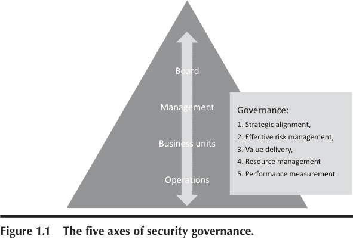

顺便说一下，遵守标准的要求并不保证质量。在不适当的层级做出安全决策、政策和指令不适用、责任未由有足够权力行动的人员履行的公司，不能声称拥有充分的治理和安全。以下是（非详尽的）信息系统治理低效或不适当实践的示例清单：

- 部署信息系统措施或控制的责任集中在单一部门。
- 业务部门经理认为信息系统是首席信息安全官（CISO）/首席信息官（CIO）的专属责任，由他们确保适当的保护水平。
- 董事会不参与战略信息系统决策并将此责任委派出去，认为自己没有资格发表意见。
- 信息系统负责人没有手段确保安全政策和指令的充分性和执行。
- 业务举措和变革项目未被评估以确保其符合安全战略或识别安全风险。
- 董事会没有关于信息系统状态、其充分性以及现有措施有效性的报告。它无法评估安全对业务的附加价值。
- 安全负责人感到自己既不受上级倾听也不受支持。他们的职权被削减为应对新威胁或在反复事件后恢复局面的行动。
- 等等。

治理机构对信息系统问题的参与不足反映了治理不充分。仅有高效的技术团队和复杂的工具是不够的，无法确保长期保护。信息系统措施如果不将其整合到业务运营中、不赋予所有员工权力、且未获得业务部门经理的支持，就无法部署。如果没有高级管理层的支持，首席信息安全官或高级信息安全主管及其团队将继续以有限资源应对可见威胁，而无法采取整体性和更主动的方法。

## 不充分的安全治理如何对公司产生不利影响？

最后，不充分的安全治理如何影响公司目标？即使高级管理人员认为自己与信息系统无关，也需要自问这个问题。表1.1总结了在缺乏充分信息系统治理的情况下，对业务目标可能产生的一些负面影响。

善治意味着将充分的安全视为公司繁荣的前提。如果信息系统目标未被定义，就无法分配足够的资源。在这些条件下，期望的保护水平无法实现、衡量或得到支持。治理的成熟度要求信息系统由具有足够权力和权威的领导者指导，包括决策、问责和分配必要资源。在这种环境中，安全可以通过与业务进行战略对齐、实施适当的措施（控制）以将资产相关风险维持在可接受水平，以及有效管理分配的资源，来促进公司目标的实现。

## 表1.1 缺乏充分信息系统治理时对业务目标的负面影响

| 业务目标 | 缺乏充分安全治理时的可能负面影响 |
|---|---|
| 开发新业务模式 | 运营所需的保护水平不足 |
| 保护公司声誉 | 了解安全对交易和数据隐私重要性的客户的负面看法 |
| 遵守法律和监管框架 | 面临罚款以及客户和合作伙伴信任的丧失 |
| 保持公司文化和价值 | 安全意识丧失和风险增加 |
| 成本控制 | 对安全相关成本的控制力丧失 |
| 安全措施与业务需求的对齐 | 已实施措施的不充分（过多或过少） |
| 运营风险管理 | 对可能影响运营的安全风险的控制力丧失 |

## 如何识别良好的安全治理？

有效的安全治理具有以下特征：

- *整个公司参与：* 需要保护的资产已知，且安全水平已定义。业务部门认为信息系统不可或缺。安全措施支持业务运营。
- *职责已定义：* 董事会和管理层参与安全计划决策过程。业务部门经理验证

支持其运营、项目和开发战略的安全措施。数据和流程负责人已确定并正常运作。信息安全专家根据既定的战略和政策实施该计划。

- **保护水平取决于风险偏好：** 信息安全风险得到评估并系统化处理。风险偏好已明确，针对公司所有活动（包括运营和变革项目）均实施了主动的风险管理。信息安全控制措施得到管理并与风险相关联。
- **安全得到积极管理：** 为满足组织需求，已制定安全战略、政策和指南。待保护资产已识别，职责已明确。管理层根据重复的评估和决策过程分配充足资源。职责在各层级均已明确。报告系统支持决策过程并基于关键指标。已建立事件管理体系。员工接受培训并具有风险意识。安全计划得到监督、审计并根据公司需求进行调整。

*治理与管理之间有什么区别？*

### 1.3 信息安全管理

谈到安全治理时，我们经常倾向于将其与管理或运营管理混淆。任命首席信息安全官、设立访问权限管理团队，或召开委员会决定与信息系统活动规划相关的某些问题，并不构成改进或建立治理。相反，如果在没有要求严格监督和管理其实施的情况下制定政策和指南，就无法达到期望的安全水平。因此，公司必须能够为其安全计划设定目标并确保目标得以实现（治理），同时确保计划有效实施的手段（管理）。

安全管理与安全治理之间的区别并不十分清晰。简单来说，管理涵盖安全计划的实施和监督，而治理则提供战略导向并确保其正确执行。

为说明这一点，我们可以使用 CobIT 5 框架提出的方案（图 1.2）。治理包括称为 Evaluate（基于业务需求和管理反馈的安全状态）、Direct（提供指导）和 Monitor（监督）的活动。管理部分包括与安全计划相关的活动：Plan、Build、Run 和 Monitor。管理反馈至

一般来说，治理包括决策，而管理确保控制措施的实施。信息安全管理体系（ISMS）实施信息安全措施或控制，并为向决策机构报告目的提供监控。如果我们列出从定义战略到执行安全运营或控制的活动清单，我们会发现实际上更合适将其中一些归类为治理（例如，战略制定），另一些归类为管理（例如，监控或报告）。考虑到标准中提出的 ISMS 的主要活动，我们可以大致将治理和管理的能力领域示意化，如图 1.3 所示。

必须记住，治理和管理职责存在于几乎每项安全计划活动中。

> **示例**
> 
> 战略不能仅由董事会或管理层成员在没有业务经理、首席信息安全官甚至运营经理参与的情况下进行验证。要使其得到应用，必须为所有人所接受并被视为计划中不可或缺的一部分。另一方面，确保日常运营也需要董事会参与，以确保安全措施已得到充分部署（例如通过审计）。在这两个极端之间，所有其他活动都需要治理者和信息系统管理者双方的关注。

> *好的，但所有这些在标准中已经定义得很清楚并解释过了！*
> 
> *为什么不直接遵循它们呢？*

### 1.4 使用安全标准

我们可能会问：为什么不简单地应用信息安全标准或最佳实践建议来建立良好的治理？信息安全领域的标准、指南或良好实践基准确实不可或缺且极其有用。然而，它们必须按其本意使用：作为一套帮助构建安全计划的建议。借用建筑领域的类比，这些标准可以与提供建筑基本组件但不能替代建筑师工作的技术建筑标准相比较。安全计划是一套基本组件、控制措施或信息安全措施，它们属于满足公司特定需求的既定架构的一部分。

我们在此的目标不是详细解释不同的标准。关于标准已出版了一些优秀书籍，标准本身的非常明确的文本也可以参考。读者如果尚未熟悉，建议熟悉这些内容；这将进一步促进其对本书其余部分的理解。尽管如此，我们仍将对一些可能有助于信息安全治理系统开发的标准进行简要说明。

最广泛使用的国际信息安全标准由以下组织发布：国际标准化组织（ISO）、美国国家标准与技术研究院（NIST）、信息系统审计与控制协会（ISACA）及其 CobIT 和信息技术基础设施库（ITIL）。在某些特定信息安全领域还存在其他标准、建议或良好实践基准，例如 NIST 网络安全框架（CSF）。标准在呈现建议的方法上有所不同：NIST 呈现并系统化了一份控制目录，ISO 2700x 系列在信息安全管理体系开发方面更注重流程，而 ITIL 则以专业出版物的形式呈现面向服务的最佳安全实践。一些指令或合规框架可能由监管机构发布（如瑞士的 Finma、香港金融管理局，或美国金融部门的证券交易委员会 [SEC]），或由特定行业的协会或利益团体发布。一些法规已被纳入直接影响公司信息安全流程的法律（例如欧盟的《通用数据保护条例》[GDPR]）。

几乎每项标准都包含信息安全不同领域的通用建议，从治理和技术基础设施到更复杂的活动或控制措施，如风险管理、访问权限管理或事件管理。它们都提到了安全系统必须满足的要求，但并未说明应如何构建或实现特定控制的指南。事实上，满足标准要求的方式有很多：我们将简要介绍用于建立安全架构的 SABSA 框架以及本书中经常引用的 ISO 2700x 标准系列。

### Sherwood 应用业务安全架构（SABSA）

SABSA 方法 [《企业安全架构》，白皮书，John Sherwood、Andrew Clark 和 David Lynas，2009] 并不是前面提到的意义上的标准。它不提供运营控制的目录或建议。其目标是提供一个框架，用于根据业务需求建立安全架构，从而更容易为关键业务运营设计保护措施。为避免在缺乏自上而下的合理依据的情况下，基于战术控制或解决方案的累积构建信息系统，SABSA 提出基于战略目标定义安全架构。这使得运营控制能够基于实际业务需求来定义。

## 表1.2 基于六种视图的架构

| 视图 | 架构 |
|---|---|
| 业务视图 | 上下文安全架构 |
| 架构师视图 | 概念安全架构 |
| 设计师视图 | 逻辑安全架构 |
| 建造者视图 | 物理安全架构 |
| 工匠视图 | 组件安全架构 |
| 服务经理视图 | 安全服务管理架构 |

该框架采用分层方法，由基于六种视图的六种不同架构组成（表1.2）。

在构建每一种架构时，还需要处理涉及什么（what）、为什么（why）、如何（how）、谁（who）、何处（where）以及何时（when）的过程区域，以理解每一层的上下文及其与其他层的关系。这种分层方法与过程区域相结合，形成了一种业务安全架构，它以两种方式提供完整的可追溯性：

- 1. 从业务需求到安全控制（*完整性：我们是否识别了所需的一切*），以及
- 2. 从组件架构（安全控制）到业务需求（*业务合理性：每个组件是否都可追溯到相关的业务需求？*）（图1.4）。

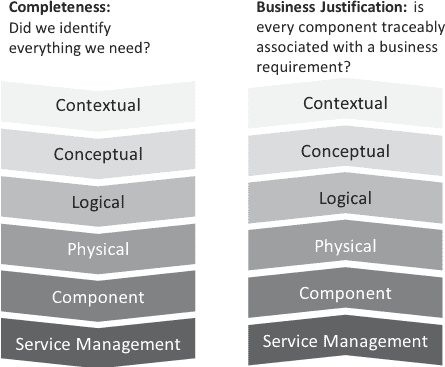

## 图1.4 控制的可追溯性。

这仅仅是根据每家公司的具体情况和实际需求来满足标准和法规要求的不同方式的一个示例。信息安全管理体系（ISMS）的复杂性取决于许多因素，包括行业领域、公司规模和复杂性，以及其风险偏好。

## 是否存在针对信息安全治理的具体标准？

## ISO 27014 信息安全治理

©ISO 经美国国家标准协会（ANSI）代表国际标准化组织许可，改编自ISO/IEC 27014:2013。保留所有权利。

2013年发布的ISO 27014标准完全致力于信息安全的治理。其摘要中强调，良好的治理不仅对于确保符合法律法规框架至关重要，而且对于保护组织的资产和声誉也至关重要。该标准提及负责监督信息安全并确保既定目标得以实现的治理机构。它还强调了治理机构、管理层以及负责实施运营的人员之间联系的重要性：“此外，有效的信息安全治理可确保治理机构收到以业务背景呈现的、关于信息安全相关活动的报告。这使得能够就信息安全问题做出相关且及时的决策，以支持组织的战略目标。”

根据该标准，治理机构最终对组织的决策和绩效负责。其主要目标必须是确保安全计划有效、与业务目标和战略保持一致，并满足利益相关者的需求。

该标准首先提出了一些概念，其中包括上述良好信息安全治理的特征：战略一致性、价值创造、问责制、安全充分性、投资决策过程以及标准合规性。然后，它列出了六项原则，以指导组织建立治理流程。这些原则如下：

- *原则1：* 建立组织范围内的信息安全。
- *原则2：* 采用基于风险的方法。
- *原则3：* 确定投资决策的方向。
- *原则4：* 确保符合内部和外部要求。
- *原则5：* 营造积极的安全环境。
- *原则6：* 审查与业务成果相关的绩效。

这些原则最终转化为五个治理流程，治理机构、执行管理层和利益相关者参与其中。这些流程的流向和相互依存关系如图1.5所示。

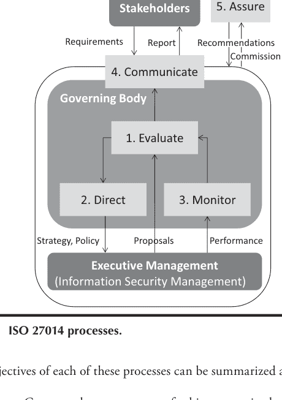

## 图1.5 ISO 27014流程。

这些流程各自的目标可概括如下：

1. *评估*：将安全计划当前取得的成就与设定的目标进行比较。这样可以识别并沟通需要改进之处，并为“指导”流程提供方向。
2. *指导*：发布有关战略和安全目标的指导方针。这些指导方针可能涉及资源、优先活动、政策和风险偏好。
3. *监控*：使治理机构能够评估战略目标的实现程度。
4. *沟通*：基于评估流程的要素，该流程允许治理机构与利益相关者之间交换信息。
5. *保证*：识别治理和运营中需要改进的领域。治理机构可以下令进行独立审计或审查。

该标准还提到了流程输入的一些基本要素，以促进决策。责任在于治理机构和信息安全管理部门（图1.6）。因此，对于流程1（评估），治理机构必须确保业务举措考虑安全要求（战略、策略和指导方针），信息安全管理部门必须确保ISMS支持业务目标，并提出改善信息安全状况的项目。

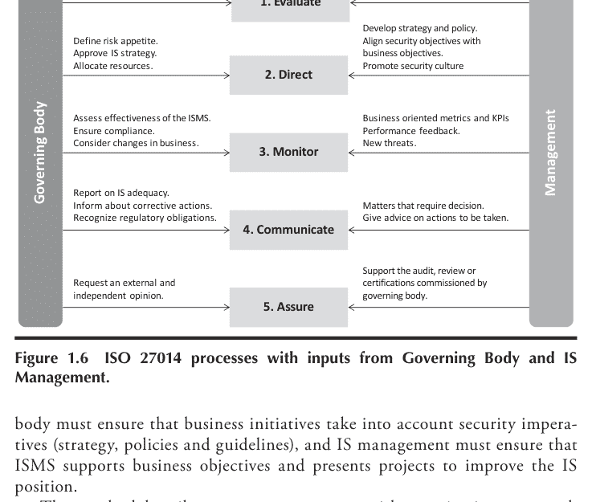

图1.6 ISO 27014流程及治理机构与信息安全管理部门提供的输入。

该标准对治理流程的描述不过分详细，允许公司以自身方式采用这些流程。因此，它可以用作识别公司治理流程中潜在差距的参考。

专门讨论指标的章节将展示如何评估一个计划或治理体系。我们只需提及，这是每位企业领导者都迫切期望的。问题不应仅仅是“我们的安全是否充分？”还应包括“我们的治理体系是否恰当？”因此，对于信息安全治理、管理和计划开发，并不存在单一或公认的模式或方法论。这样的目标需要深入分析公司的具体特征、商业模式和背景环境。标准非常有用，可以帮助界定行动范围，但最终仍由董事会、管理层和CISO来决定如何以最佳方式指导和监督信息安全计划，使其适合每个组织的具体需求。

### 1.5 结论

在当今环境中，信息安全是业务的重要组成部分。尽管如此，我们今天仍然看到，在一些组织中，信息安全的治理没有受到领导层和董事会的应有重视。责任当然由不同角色共同承担。

在本章中，我们介绍了信息安全治理的基本要素、主要问题和特征。理解治理与管理之间的区别，有助于识别公司内部可能需要调整的职责。

标准和良好实践基准未作详细介绍，因为许多著作已经对其进行了非常完整的论述。然而，其中一些在治理方面值得更多关注，我们已在本章中简要介绍。它们将在全书的示例中使用，尤其是与下一章将要介绍的框架相关的示例。

许多书籍从不同角度探讨信息安全的治理问题，对于负责开发或审查该领域流程的读者来说，查阅这些书籍无疑是非常合适的。

### 2.1 三层控制框架

不同术语指代用于保护信息保密性、可用性和完整性的手段：措施、控制、保护、反制措施等等。我们将使用“控制”一词，其先验上可以视为所有其他常用术语的同义词。

控制可以分为不同的类别；例如：

- 按性质：监管、物理、技术、人员
- 按安全域：信息、物理（安全）、人员
- 按受保护目标：信息系统、物理场所、人员完整性
- 按特征：预防性、纠正性、检测性
- 等等。

当我们查看安全标准建议时，立即出现的问题是：如何按责任级别对各种控制进行分解？董事会成员不可能被期望阅读标准以识别其负责的控制。因此，我们需要一个模型，将控制按不同的责任级别分组，以便在治理过程中快速识别谁负责什么。

**示例**

在 ISO 27001 中，A.9 访问控制，以下控制目标可从问责制的不同层级来考虑：

- A.9.1.1 访问控制政策（应由董事会负责）。
- A.9.2.5 用户访问权限审查（应由业务部门负责）。
- A.9.2.2 用户访问授权（应由 IT 运行负责）。

由于今天的安全责任本质上由组织中的多个行为者共同承担，我们需要一个模型，使我们能够快速识别以下三类垂直控制：治理（方向、保证）、管理（指导、监督）和运营（技术控制或流程）。这使得更容易识别负责机构以及治理和管理过程中的任何差距。今天仍然并不少见，运营或技术控制是在应对事件或克服可见威胁时实施的，而不考虑管理或治理层面的影响。这通常会导致资源浪费、不同利益相关者之间产生误解以及与业务需求的对齐不佳。第一章中提到的 Sherwood 应用业务安全架构（SABSA）框架可以帮助建立安全架构，促进运营控制与业务需求保持一致地实施。然而，这种方法也需要较高的治理成熟度。

**示例**

以基于业务角色（基于角色/规则的访问控制 [RBAC]）建立新的身份和访问管理（IAM）系统为例。建立此类系统意味着要考虑不同层级的控制，而不仅仅是技术层面的控制。仅仅安装一个软件解决方案，自动从人力资源（HR）数据库向目标平台授权用户权限是不够的。角色管理中预期的责任组织也必须考虑在内，同时在此领域制定具体政策，定义监督或事件管理的问责制。确实存在一个必须遵守的控制层级和垂直分配系统。该控制层级可表述如下（非穷尽）：

| 级别 | 控制（节选） | 责任 |
|---|---|---|
| 治理 | 政策、组织 | 治理机构 |
| 管理 | 风险管理、项目管理 | 首席信息安全官（CISO）或 IAM 负责人 |
| 运营 | 角色和权限管理、访问定期认证 | 业务 |
| 技术 | 事件管理、监控 | IT 运行 |

这种控制组的垂直分配在建立信息系统治理和管理方面至关重要。它强调了在不同层级共享责任的必要性，这是建立充分安全性的前提条件。每个责任层级都必须关注信息系统。在此背景下，任何重大的系统调整，例如刚才观察到的，都可能对治理、管理、运营或技术控制产生影响。然而，技术控制中的某些变更，例如更换入侵检测系统，很可能对指导方针或风险管理几乎没有影响或没有影响。尽管如此，信息系统治理和管理任何变更的范围都应始终进行审查。

### 为什么不使用标准？

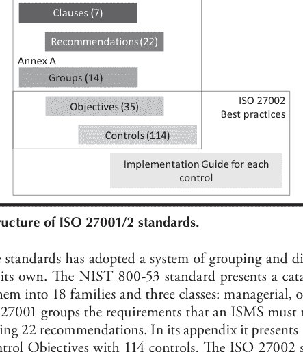

**图 2.1 ISO 27001/2 标准的结构。**

每个标准都采用了各自的控制分组和分配系统。NIST 800-53 标准提供了一个控制目录，并将其分为 18 个族和三个类别：管理性、运营性和技术性。ISO 27001 将信息安全管理体系必须满足的要求分为七个条款，包含 22 项建议。在其附录中，它列出了 14 个组，包含 25 个控制目标和 114 项控制。ISO 27002 标准（信息安全控制实务准则）重申了目标和控制，并为每个控制添加了良好实践指南（图 2.1）。

可以做出以下观察：

- 分组以及组、控制目标和控制本身的命名会随着版本的不同而演变。
- ISO 中的组和目标并不指同一责任级别。例如，A.5“信息安全政策”/A.5.1“信息安全管理的管理方向”与 A.13“通信安全”/A.13.1“网络安全管理”不在同一责任级别。
- 有些组指的是通用控制或流程（例如，A.6“信息安全的组织”），而其他组则提及与保护手段相关的控制（例如，A.10“密码学”）。

这完全可以理解。事实上，为了避免不必要的复杂性，标准力求以尽可能小的格式呈现控制的完整性，或许是以牺牲控制目标的某种垂直（层级）和水平（域）分布为代价的。呈现的形式主义不是面向治理，而是面向流程的完整性。从一个版本到另一个版本的更改或内容调整主要归因于威胁或保护技术的演变。

因此，提出除标准之外对控制进行额外分组方法的重要性就在于此。我们需要一个更简单的模型，允许将治理、管理、运营控制整合为整个信息安全管理体系或特定安全域（移动性、IAM、连续性）或技术（加密、云）的构建模块。这将使决策者能够立即关注影响他们的控制集。事实上，正如我们在 IAM 示例中刚刚展示的那样，无论所观察系统的范围如何，一些控制目标都必须考虑。这些控制目标是：战略、政策和指导方针、安全组织、风险管理、安全项目管理、报告和监督、资产管理、合规性和指标。

### 这种框架的主要目的是什么？

该框架应使管理者和安全从业人员能够就信息系统的整体治理、特定安全域或信息系统重大变更期间提出相关问题。这些问题如下：

1. 我们有战略吗？
2. 我们是否已制定政策？
3. 我们的安全组织是否充分？
4. 风险是什么以及如何管理？
5. 我们的信息系统项目如何管理？
6. 报告和监督系统是否充分？
7. 哪些资产（数据、应用程序等）受到影响，谁负责它们？
8. 我们是否符合法律和监管框架？
9. 我们是否有指标或关键绩效指标（KPI）来跟踪我们的保护系统是否充分？

**示例**

假设一家公司希望将业务线的部分运营外包到外部提供商的云上。该举措或项目显然不仅仅是技术问题，需要管理层批准。公司面临的安全风险也必须考虑。管理层应提出的问题如下：

1. 我们在云计算领域有战略吗？
2. 我们的安全政策应如何随此次变更而演进？
3. 我们的安全组织是否合适？谁负责：IT 还是业务线？
4. 其产生的安风险是什么？
5. 应实施或调整哪些具体控制？

- 6. 这一变更之后，是否需要重新审查我们监控控制有效性的体系？
- 7. 涉及哪些数据或应用程序？
- 8. 这对我们遵守法律法规框架有何影响？
- 9. 我们需要监控哪些指标来衡量解决方案的充分性？

在其他变更中，也很容易找到引发同样问题的例子，这凸显了信息治理过程中任何责任主体所关注的核心问题。

## 该模型的组成部分是什么？

沿着上述思路，对于治理机构和安全管理部门必须确保的基本控制措施，我们可以将其分为九个组成部分，如下所示（图2.2）：

- 1. 战略
- 2. 政策
- 3. 组织
- 4. 风险管理
- 5. 信息系统项目组合管理
- 6. 报告与监督
- 7. 资产管理
- 8. 合规
- 9. 度量指标

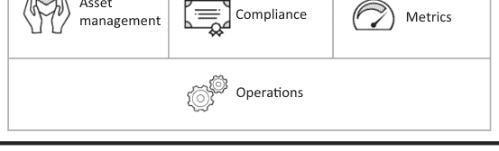

图2.2 信息安全治理框架的组成部分。

还可以增加第十个组成模块——运营，尽管它并不直接构成治理与管理的主要活动。该模块包含的控制措施为良好治理提供了基本要素，如运营监控、度量指标、所处理数据的性质等。运营层面可被视为安全项目的一个功能实例。

## 这些模块之间是否存在层级或功能依赖关系？

最后，这些模块之间是否存在层级关系，我们能否确立功能上的相互依赖？答案是“存在”。不了解法律法规框架，就无法管理安全项目；不事先建立安全度量指标，也无法开发报告系统。

模型模块之间的主要相互依赖关系如下：

- 1. 战略是安全项目的前提。
- 2. 政策和指导方针取决于战略方向。
- 3. 组织（角色与职责）的设立旨在反映战略和政策。
- 4. 管理风险需要了解风险偏好、政策、战略选择以及需要保护的资产。
- 5. 报告与监督应基于组织（或目标受众），并使用度量指标和关键绩效指标。
- 6. 运营流程提供了识别需保护资产所需的关键知识。
- 7. 对法律法规框架的遵守取决于运营流程、公司背景、需保护的数据以及度量指标。

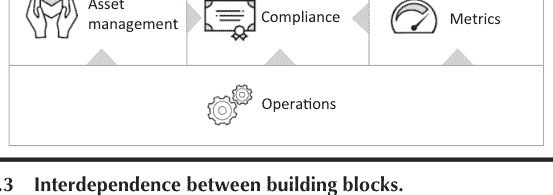

图2.3 各模块之间的相互依赖关系。

- 8. 度量指标和关键绩效指标通过观察运营来确定。
- 9. 最后，安全项目基于战略、风险和报告结果进行管理，并且必须符合法律法规框架。

这种相互依赖关系在图2.3中进行了示意。

## 示例

> 在身份与访问管理（IAM）领域，*战略*确定了我们要构建的系统的目标：例如，在基于业务角色设定权限的前提下，将用户访问权限的分配委托给业务部门。该战略将用于制定*政策*和访问权限指导方针，包括基于角色的方法以及业务部门的参与。*组织*描述了流程中的角色和职责。*运营*涉及访问权限授予流程和机制的有效实施。这些流程将使我们能够识别需保护的数据（资产）、对法律法规框架的暴露程度（例如个人数据保护）（*合规*），以及我们所需的*度量指标*。为满足项目管理需求，将建立*报告与监督*体系，并使用先前定义的度量指标。最后，通过实施和改进系统中的所有控制措施来管理*信息系统项目*。

## 如何根据公司中的层级责任对控制措施进行分类？

该模型的各组成模块之间同样存在层级关系。与业务一致的安全战略显然由高层管理和董事会负责。风险管理或度量指标的建立很可能由安全负责人负责。安全运营或技术控制则归于安全或IT运营部门。所有层级的控制措施都有助于保护资产。因此，这些层级可以如下表示（图2.4）：

- *战略层：* 该层级包括所有旨在为安全项目提供总体方向的治理控制：战略、政策和组织。
- *战术层：* 该层级包括所有旨在建立和管理安全项目的管理控制：风险管理、项目组合管理、报告与监督、资产管理、合规和度量指标。
- *运营层：* 该层级涵盖安全项目中的所有运营和技术控制。

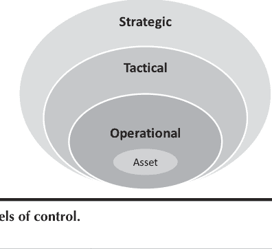

图2.4 控制层级。

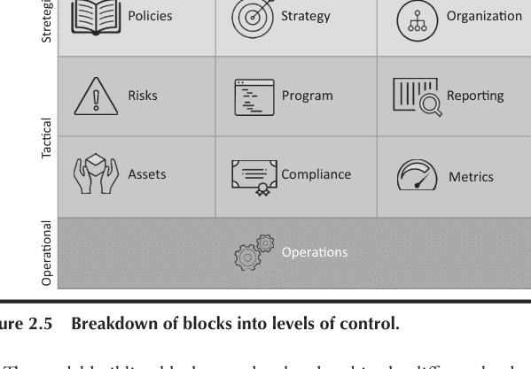

图2.5 将各模块分解到不同的控制层级。

因此，模型中的各组成模块可以按照图2.5所示放入不同的层级。

这种三层表示法使我们能够根据控制措施的性质和主要责任层级将其家族区分开来：治理、管理和运营。所有参与建立和运行安全项目的人员都可以轻松地在这三个层级中找到自己的位置。董事会和业务部门负责人主要参与战略层，首席信息安全官和职能经理处于战术层，而安全专家则处于运营层。

观察优秀实践标准和基准的要求，所有建议或控制措施都可以归入其中一个层级（ISO 27001推荐的控制措施将在本章末尾与模型的各模块进行映射）（图2.6）。这种分解使我们能够提出一个聚焦于每个层级主要活动的框架，并提供工具来分析我们在模型每个模块中的实践充分性。

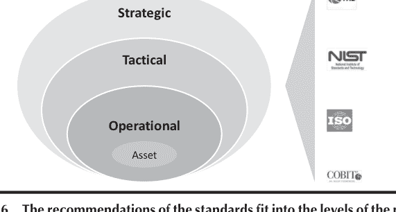

图2.6 标准建议适配到模型层级中。

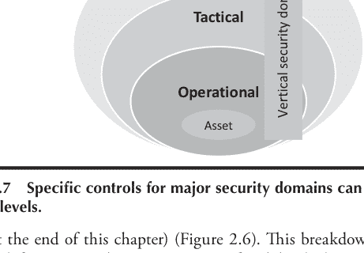

图2.7 主要安全领域的特定控制也可以分布在三个层级中。

人员安全、身份与访问管理（IAM）、网络安全、移动性、数据隐私等主要领域的安全控制同样可以分布在这三个层级中（图2.7）。因此，该模型既可以应用于整个信息安全管理体系（ISMS），也可以应用于特定的安全领域。

### 2.2 战略层

战略层包含模型的三个主要组成模块：战略、政策和组织（图2.8）。这是高层管理者承担最大责任的三个领域。

资产管理、合规或度量指标等），他们将无法对投资、新项目或控制措施调整做出明智的决策。因此，良好的治理需要一个高效且透明的战术层。

### 2.4 运营层

运营层包含所有运营安全措施、流程或控制。我们常说的安全系统的实例化或功能实现。美国国家标准与技术研究院（NIST）等标准提供了运营系统中应包含的所有控制的全面目录（图2.10）。

该层级的控制措施是为了根据战略和内部规章框架，在特定的安全组织（战略层）内保护公司资产而设立的。其主要目标是在信息系统项目框架内缓解风险；其有效性会被衡量；它们是报告与监督的对象；它们按照法律法规框架保护资产（战术层）。运营控制不应以层层叠加高度创新技术解决方案的无序方式进行部署。必须在信息系统项目和既定计划的框架内，以最佳性价比满足公司需求。

任何运营措施或控制都必须满足以下要求：

- 它必须由其所应对的风险的存在来证明其合理性。
- 它由特定人员或实体负责。
- 它响应业务战略或业务方表达的需求。
- 它已经过测试。
- 其有效性是可衡量的。

### 模型各模块的目的是什么，它们包含哪些内容？

### 2.5 模型组成模块的主要功能

最后，每个组成模块的功能是什么，它们如何促进更好的信息系统治理？它们包含哪些内容？这些将在后续章节中详细分析，并介绍建立相应控制措施的工具和方法论。首先，让我们回顾一下每个模块在信息系统治理体系中的角色。

**图2.10** 运营层。

#### 2.5.1 策略

第一个模块涉及为整个安全系统制定策略。特定的安全领域也可以从与其整体安全策略保持一致的自身策略中受益。

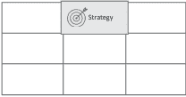

拥有信息安全（IS）愿景使公司更容易在 IS 项目和具体运营控制措施的各种可用选项中进行选择。所有参与者都应熟悉该愿景，并将其工作与组织认为重要的目标保持一致。这种方法别无选择。事实上，没有策略的安全系统将通过堆砌针对新威胁的保护技术或为遵守审计建议而制定的临时流程来构建。这最终会对成本产生负面影响，不会被管理层理解，并且效率低下。

安全策略包括公司希望其 IS 项目在近期采取的方向。它也可以由主要安全领域制定（例如，网络安全策略、连续性、人力资源等）。策略完全由公司的管理层或董事会负责，但安全经理或经授权的委员会可能会提出建议。

与任何策略一样，安全策略以相对简短的文档形式呈现，包含两个基本要素：在几年内实现愿景或目标以及为实现目标而必须采取的举措。

### 策略（简化）示例

国际管理学院

IS 必须在业务发展的背景下确保我们的数据和运营得到保护：提供适应新技术、国际背景的课程，与专家和国际机构合作，将我们的 IT 运营外包（云），并在欧盟国家开设新子公司。为在 3 年内实现这一目标，IS 将作为独立于 IT 的实体组织，设立 CISO，并由校长和董事会负责。应采取以下行动：

- 制定新的章程、安全政策和组织
- 修订安全指南并制定新的文件框架
- 基于信息所有权和不同单位相关的风险实施安全组织，包括合规性和保密性要求
- 成立中央单位监控威胁并管理事件（Security Operations Center）

业务计划或项目组合经常被误认为是策略。仅因为一家公司为即将到来的时期编制了安全项目清单，通常由审计发现或可预见的威胁驱动，就不能自称拥有策略。策略必须源于项目，而不是相反。

战略举措因此仍然是需要在较长或较短期限内实现的目标。显而易见的是，资源将主要用于解决事件和恢复生产。然而，策略的实现将导致事件的逐步减少和成本优化。

战略举措可作为在年度计划中制定路线图或更具体项目的驱动因素（更多内容见第 8 章，项目管理）。这些高层级举措或目标有截止日期，需要定期审查。它们主要作为制定更具体项目或计划的支持。

### 示例

目标“盘点敏感数据并描述数据所有者的职责”可能导致多个项目：

- 制定敏感数据保护政策或指南
- 对企业数据进行分类和分级
- 将数据责任转移到业务部门
- 制定数据清单

安全策略应明确包含业务开展方式的可预见变化和新技术，如有可能应制定明确的路线图。

以下要素应成为安全策略的一部分：

- 外部环境和业务背景。
  - 回顾背景并解释为何应调整安全策略和定位。
- 法律和监管框架及其影响。
  - 回顾所需合规的主要领域，并提及对新法规所需调整。
- 威胁、漏洞、技术和风险偏好的变化。
  - 针对威胁采取立场非常重要，尤其由于技术、商业模式和风险偏好的演变。公司可以在策略中以选择的形式表明立场，例如“不外包机密数据”或“等待技术成熟”等。
- 企业文化。
  - 回顾根据公司文化及其相对于竞争对手的地位必须驱动 IS 决策的基本标准。
- 与某些业务举措或策略明确对齐的要求。
  - 当公司因业务策略的新方向（如新服务、新市场、并购等）而需要快速适应时，安全必须跟进并适应。

由 CISO 推动的 IS 策略应使管理机构能够回答以下关键问题：

- IS 策略是否涵盖业务的所有优先事项？
- 安全策略是否被业务部门经理很好地理解？

> **标准中如何引用策略**
>
> 术语 *strategy* 并未以此类方式在国际标准化组织（ISO）或 NIST 标准中使用。ISO 主要谈论“组织的背景”，而在 NIST 中则是“规划”（请参阅本章末尾的模型与标准映射）。

策略的制定将在第 4 章（策略）中讨论。

#### 2.5.2 政策

称为 *Policies* 的模块主要涉及内部监管框架。政策是高层级的内部监管文件。它们将策略转化为更具约束性的条款。该模块还涉及内部监管框架最低层级的文件，如指南、标准或程序。

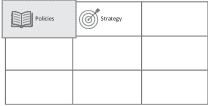

内部监管框架重要性的原因显而易见。让我们回顾一下在当前背景下支持 IS 政策的其他论点。

### 对扩展企业的支持

扩展企业被理解为在全球化市场中活跃并使用流程数字化技术的组织。这些流程分布在价值链中的多个参与者之间。商业模式的变化、业务多样性、地理分布、先进的外包或活动委托、强交互以及与供应商共享数据只是表征扩展企业的几个例子。在这种背景下，IS 面临重大挑战，必须得到明确的内部监管框架支持。

### 治理和管理组成部分

制定 IS 政策是把安全议题纳入决策者和其他利益相关者议程的非常有效方式。经过讨论、由直线经理验证并由董事会签署的政策被证明是治理的非常有用的工具。所有利益相关者都对此高度关注，因为它有助于将 IS 项目更紧密地锚定在其需求上：

- 董事会可能要求定期报告，以便就 IS 项目的演进和投资做出决策。
- 业务部门经理可以依靠政策和指南来确保安全满足其需求。
- 安全官将使用政策来加强控制并证明投资合理。
- 审计员将能够依靠政策来评估运营的合规性。
- 负责实施安全控制的团队需要内部监管框架来指导其活动。
- 最后，政策和指南可用于提高意识，并作为全体员工的行为准则。

### 反映业务需求

政策是与业务一起为业务及其需求制定的。它经过管理层的验证、理解并得到支持。然而，不同业务模式的不同业务部门可能具有不同的风险偏好，因此需要不同的安全政策。

### 要求建立文件框架

政策及其基础文件，即指南和程序，必须成为企业范围的文件框架的一部分。这有助于内部规章的可访问性和理解。政策和内部监管文件将根据图形规范在内网上提供，易于理解、访问和搜索。

经所有利益相关者验证的内部规章应使管理机构能够回答以下关键问题：

- 我们是否制定了适用于所有活动的安保规章？
- 我们的内部规章是否经过审查，由谁审查以确保其完整和准确？
- 我们的规章是否适应业务部门的需求？
- 政策和指南是否被所有员工很好地理解？
- 谁负责我们内部监管框架的演进？

下列 ISO 27001 建议直接与政策和内部监管框架相关。

要求

5.2 政策

参考控制目标和控制措施（附件 A）：

- A.5 信息安全政策
- A.6.2.1 移动设备政策
- A.6.2.2 远程办公
- A.9.1.1 访问控制政策
- A.10.1.1 密码控制使用政策
- A.13.2.1 信息传输政策和程序
- A.14.2.1 安全开发政策
- A.14.2.5 安全系统工程原则
- A.15.1.1 供应商关系信息安全政策
- A.17.2.1 规划信息安全连续性

用于制定内部监管框架的政策和文件的方法将在第 5 章（政策）中介绍。

#### 2.5.3 组织

术语“组织”将用于描述 ISMS 上下文中与职责和职能相关的所有要求。这不仅仅是指 ISO 27014 中规定的管理机构或执行管理，还包括旨在确保 IS 计划运营的所有安全职能、角色和职责。组织要求必须在安全政策中予以表述。

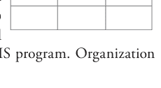

**EXAMPLE**

正式化的事件管理流程被所有标准以及众多行业法规所推荐，尤其是在银行业，通过许多国家的金融部门控制和监管机构。几乎所有这些法规都要求董事会和高层管理确保存在事件管理流程、他们得到通知，并在特别重要的事件发生时通知监管机构。

因此应建立专门的安全组织来管理事件，具有以下职能：

- 中央登记和事件分发服务
- 事件负责人或负责解决和跟进纠正措施的人员
- 委员会（如需要）以决定事件的严重程度和跟进（沟通、危机管理）

如今建立安全组织已不再局限于任命一名 CISO。安全不同领域的职责分散在整个公司。CISO 的角色在近年发生了显著变化。在 1990 年代，他们是 IT 部门内用户访问权限团队的负责人，具有技术人员特征。如今，他们领导跨学科团队，负责保障业务流程并创造附加价值。他们的活动范围非常广泛，从保障运营到沟通、确保意识、安全风险管理、整体计划管理以及向董事会报告。

现代安全管理最重要的是协调每个人的努力。人力资源部门很可能负责监控和减轻与人为风险相关安全风险。业务部门将被要求列出其运营特有的安全风险。IT 系统工程师将负责设备和基础设施的基础配置。新的安全组织不仅应考虑新的需求，例如将灾难恢复计划（DRP）整合到业务连续性中或人类和网络威胁的演变，还应考虑在整个公司范围内指导 IS 计划的整体问题。

安全组织可以采取不同的形式。没有一种理想的模式适合所有企业。尽管如此，认识到确保良好治理所需的几个职能是很重要的。职能分配给个人的情况在很大程度上取决于组织的规模、其特殊性和所涉及的风险。安全执行官或 CISO 可以位于 IT 部门内部或外部，并且可能负责一个安全专家团队，负责其职责范围内的全部或部分安全职能。

领导者将确保没有利益冲突，并且决策能够得到充足资源实施。主要的错误之一是任命一名 CISO，其没有足够的权限在不系统咨询董事会或管理层的情况下做出决策。组织变革与项目具有同等优先级。有效的安全组织将有助于实现战略目标。

尽管 IS 组织在不同公司之间可能存在很大差异，但已看到从运营向治理、风险和合规（GRC）转变的趋势。安全团队和 CISO 的定位具有重要作用。

#### 2.5.4 风险管理

分析和处理。忽视风险或对其隐含接受是任何 IS 计划的主要危险之一。

安全风险的最终责任在于董事会。来自不同业务部门的运营经理对其运营中的安全风险负责。作为安全运营经理，CISO 也对其部门内的风险负责（例如，控制的有效性或安全运营的失败）。他们的角色还包括为业务部门识别和管理安全风险提供支持。

安全风险是公司运营风险的一部分，尽管它们具有必须考虑的一些特征。例如，由于在组织内部观察事件的困难，定量评估方法通常无法应用。另一方面，习惯于观察安全威胁趋势的人相对容易将风险在小、中、大等简单量表上进行分级。专门讨论 IS 风险的章节将展示一种实用的分析方法。

安全风险评估和新兴趋势是指导 IS 计划的关键指标。对于缓解措施不再足够或适应性较差的不断增加的风险，必须明确作为优先事项处理。

**EXAMPLE**

> 如果我们发现网络安全风险在一段时间内不断增加，同时安全控制的有效性或成熟度水平下降，例如“入侵检测系统”或“用户意识”，那么这两个指标可能足以做出决定，增加投资以改进入侵检测系统，以确保风险水平与企业风险偏好一致。IS 计划随后应包括一项举措，以提高相关控制的效率或成熟度，从而降低风险。

第 7 章：风险管理将详细说明如何获得这些指标。法律法规要求的演变以及新威胁的出现使董事会意识到需要良好的安全风险管理，并以其完全参与作为最终对报告批准和建立缓解措施负责。因此，他们需要在风险管理过程中采取积极立场，以获得以下关键问题的答案：

- 我们是否知道哪些网络安全风险可能影响业务，它们如何被评估，以及缓解的优先事项是什么？
- IS 风险管理是如何组织的？
- 与上一个时期相比，风险如何演变以及原因是什么？同期相关控制如何演变？
- 安全风险、用于缓解的措施以及定期报告是否由业务部门负责人或其风险经理验证？
- 什么是高风险，我们是否有短期缓解计划？
- 我们是否已采取一切必要措施以促进最重要的风险的缓解？

> 直接与风险管理相关的 ISO 27001 建议如下：
>
> **要求：**
>
> 6.1   应对风险和机遇的措施  
> 8.2   信息安全风险评估  
> 8.3   信息安全风险处理

第 7 章（风险管理）将重点介绍一种方法和工具，用于出于 IS 治理目的管理风险。

#### 2.5.5 计划管理

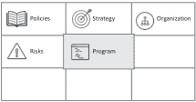

根据信息和相关技术控制目标（CobiT）5，同样适用于安全的管理活动被定义为“*计划、构建、运行并监控活动，以与管理机构设定的方向保持一致，实现企业目标。*”

CISO 及其团队的主要活动包括实施和管理安全控制。除了运营控制（“运行”模式）外，安全计划还包括旨在提高现有控制有效性或部署新控制的举措和项目（“变更”模式）。

为了能够很好地治理，了解现有的控制措施及其有用性（保护目标）以及其有效性至关重要。管理层和管理机构必须能够以目录或清单的形式可视化所有控制措施，其中包含责任和成熟度水平的概念。该目录被用作安全计划和风险管理流程的主要工具之一，并作为内部和外部审计的支持。

运营措施或控制措施不能在没有安全战略、政策、组织和风险管理以及安全计划支持的情况下部署。最成功优化其安全资源的公司是那些基于其战略实施运营控制的公司，并且

风险偏好，并遵循相关政策和指南，首先依据法律法规框架保护被识别为关键或机密的数据。

要使安全项目有效，该模块的活动必须基于模型中所有其他模块的交付物。策略为整体信息安全目标提供指导，使项目保持对重点内容的关注；风险管理明确需应对的主要威胁；报告与监督提供当前状态与期望状态之间差异以及既定目标进展的信息；合规性则提供安全项目必须应对的法律法规框架发展动态。

指导委员会或治理机构应与安全执行官协作，按照既定频率审查目标并调整项目。信息安全项目的管理由CISO负责，应使治理机构和管理层能够获得以下关键问题的答案：

-   我们部署了哪些安全控制措施，它们如何帮助降低我们的风险，由谁负责？
-   是否存在控制监测流程，其结果如何呈报给管理层？
-   控制措施的成熟度如何演变，是否符合风险处理决策的要求？
-   控制改进项目的路线图是什么？
-   业务部门的代表如何验证安全项目的优先级？
-   在管理层还可以做些什么来促进信息安全项目的实施和改进？

与安全项目管理直接相关的ISO 27001建议如下：

要求：
4.4 信息安全管理体系
6.2 信息安全目标及实现目标的规划
7.1 资源
7.4 沟通
8.1 运行策划和控制
10 改进

参考控制目标和控制措施（附录A）：
A.12.1.3 容量管理
A.18.2.2 与安全政策和标准的一致性
A.18.2.3 技术合规性审查

第8章（项目管理）将专门讨论管理信息安全项目的基本方法和工具。

#### 2.5.6 安全指标

信息安全治理需要可靠的指标作为决策支持。指标用于报告中；它们量化风险、评估趋势和控制有效性、计算投资回报等。它们还可以设定阈值以预警趋势，从而预防事件发生。

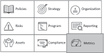

然而，衡量安全性并不容易，主要原因是缺乏可测量的事件或事故。例如，我们无法准确知道针对类似我们公司的入侵尝试有多少次、属于什么类型，尤其是这些尝试是否成功。同样难以判断入侵防护系统是否捕获了所有尝试。还有其他许多类似的情况。另一方面，纯技术性和广泛可用的指标，例如已阻止的病毒或攻击数量，或已配置最新更新的服务器数量，并不能向治理机构提供有关防护系统整体性能的相关信息。基本指标通常需要进行汇总或聚合，才能向管理层传达有用的信息，例如与风险演变相比的保护水平变化、近期实施安全解决方案投资的实际回报、对网络攻击抵御能力的提升水平、意识项目的有效性，或者上次渗透测试后弥补差距所采取措施的完整性。

安全是少数没有自己标准或测量技术的领域之一，与消费（千瓦/小时）、效率（市盈率）、收益率等众所周知的指标不同。高级管理人员习惯于财务指标或衡量业务营业额的演变。因此，管理层和CISO必须共同找到一种方法来衡量用于治理目的的安全状况。

第9章中开发的衡量安全的方法和工具将使治理机构和管理层能够获得这些关键问题的答案：

-   从治理角度看，我们有哪些指标可用于衡量安全状况？
-   我们的指标是否适合报告目的，是否已经过利益相关方验证？
-   我们是否拥有法律法规框架要求的指标？
-   我们如何改进指标以满足治理和管理需求？
-   我们如何评估自身的安全态势，以及与竞争对手相比如何？

与安全指标和KPI直接相关的ISO 27001建议如下：

要求：
9 绩效评估
9.1 监视、测量、分析和评价
9.2 内部审核

参考控制目标和控制措施（附录A）：
A.12.7.1 信息系统审计控制

第9章（安全指标）将专门讨论从治理角度制定安全指标的方法和工具。

#### 2.5.7 报告与监督

报告、监督或监测系统对于良好的治理至关重要。最重要的是，它使安全执行官能够从整体视角呈现信息安全状况；将投资、控制措施和风险联系起来；并运用关键指标来解释安全项目如何促进业务发展以及资源如何分配。

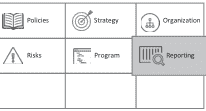

该模块汇集了为公司所有利益相关方编写信息安全报告的方法和工具。审计发现和建议以及特别委托编写的报告也包括在内。

安全报告流程由CISO负责，由董事会或治理机构发起。该流程必须提供决策支持，并使治理机构能够获得以下关键问题的答案：

-   我们的信息安全项目有多么适宜？
-   风险如何演变，我们正在采取什么措施来缓解这些风险？
-   我们控制措施的有效性如何演变？
-   我们在信息安全方面的关键投资是什么？
-   最重要的控制变更项目（新建或改进现有控制措施）、其目标以及计划实施的路线图是什么？
-   管理层和治理机构如何帮助解决信息安全问题（或痛点）？
-   与安全相关的成本有哪些，我们如何控制这些成本？

与其他所有方面一样，没有一种统一的报告模板适用于所有企业。内容和形式将取决于业务的性质、规模和多样性以及所处的行业。监管框架要求进行安全报告，以促进决策并使董事会能够履行职责。安全报告和仪表板不仅面向治理机构，也为所有利益相关方带来价值：

-   对于不同业务部门，它们必须展示旨在促进其目标实现的各个安全项目的成果。
-   对于客户和合作伙伴，它们必须传达有关控制措施成熟度的信息。
-   对于员工和安全运维专家，它们必须呈现经治理机构验证优先级的战略举措路线图。

术语*沟通*通常用于强调传播信息、提高认识或共享信息的重要性。在我们的上下文中，报告涉及并包括与利益相关方的沟通，使安全及其相关活动更加透明。教育或提高认识意义上的沟通是安全运维或运营控制的一部分。

> 与报告流程直接相关的ISO 27001标准建议如下。
> 
> 要求：
> 9.3 管理评审
> 
> 参考控制目标和控制措施（附录A）：
> A.18.2 信息安全评审

第10章（报告与监督）将专门讨论编写安全报告的方法和工具。

#### 2.5.8 资产管理

更广泛安全框架内的资产管理为内部数据保护政策和指南以及相关风险的评估和处理提供了基础。涉及不同隐私类别数据的风险对业务的影响不尽相同。

如果不知道保护优先级，就无法提供充分的安全保障。因此，重要的是对资产进行分类、识别资产所有者、为每类资产建立保护规则，并建立资产清单。

管理层了解公司的数据，但可能对数据处理相关的风险认识不足。IT 资产管理通常涉及使用专用工具在配置管理数据库（CMDB）中盘点硬件和软件基础设施组件。除配置跟踪流程外，这些清单无法提供有关各种组件的性质、关键性或保密性的信息。数据库或服务器的内容通常被系统管理员忽略。这些主要是系统架构技术层的清单。应用程序或功能层级的特征，尤其是数据的保密性，往往未被披露。

公司的资产管理活动必须提供决策支持，并使治理机构能够获得以下关键问题的答案：

- 我们了解我们的资产吗？
- 我们的资产是如何分类的？
- 按类别/资产/上下文，我们的政策和保护指南是什么？
- 我们的资产所有者是谁？
- 各种流程如何使用机密数据，机密数据的主要流向是什么？

与资产管理直接相关的 ISO 27001 建议如下：

参考控制目标和控制措施（附录 A）：
A.8 资产管理

第 11 章（资产管理）将完全致力于资产管理所需的方法和工具。

#### 2.5.9 合规

公司活动受全球和行业法律法规的约束。信息安全尤其受到这一法律和监管框架的影响，尤其是数据保护。因此，安全治理的优先事项之一是理解这一法律和监管框架并确保安全计划的符合性。与法律和合规部门的合作在此领域尤为重要。

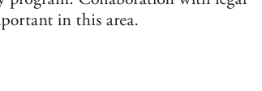

## 示例

欧洲通用数据保护条例（GDPR）对处理欧洲公民个人数据的所有公司都有要求。这些要求对信息安全计划有重大影响。

未遵守法律和监管框架不仅使公司面临制裁风险，还可能对其声誉、整体安全态势和良好商业行为产生负面影响。与内部规章一样，在员工日常活动中提高其对法律、监管和规范要求的认识非常重要。对这一框架的认识有助于理解和接受信息安全的限制。出于这些原因，必须建立现行法律法规的参考体系（制图、文档、演示等），使其可供全体员工使用。

合规管理活动使治理机构和管理层能够获得以下关键问题的答案：

- 我们是否知道法律和监管框架如何影响我们的信息安全计划？
- 我们是否知道合规的程度以及需要填补的差距？我们是否建立了信息安全合规地图？
- 我们的内部规章是否已适应法律和监管框架的要求？
- 我们如何让员工了解法律和监管框架？

与合规直接相关的 ISO 27001 建议如下。

要求：
4. 组织的背景
5.2 政策（致力于满足与信息安全相关的适用要求）
10.1 不符合和纠正措施

参考控制目标和控制措施（附录 A）：
A.18 合规

第 12 章（合规）将完全致力于合规管理流程的方法和工具。

直接涉及运营层面的 ISO 27001 标准建议如下。

要求：

- 7.3 意识
- 7.4 沟通
- 7.5 文件化信息

参考控制目标和控制措施（附录 A）：

- A.7 人力资源安全
- A.8.3 媒体处理
- A.9.2 用户访问管理
- A.9.3 用户责任
- A.9.4 系统和应用程序访问控制
- A.10 密码学
- A.11 物理和环境安全
- A.12 运营安全
- A.13 通信安全
- A.14 系统获取、开发和维护
- A.15 供应商关系
- A.16 信息安全事件管理
- A.17 业务连续性管理的信息安全方面
- A.17.1.3 验证、审查和评估信息安全连续性
- A.17.2 冗余

在接下来的章节中，这一层面将不再进一步展开，因为技术或运营控制并非本书的主要目标。然而，在提及控制目录作为良好信息安全计划管理的重要工具时，我们仍会参考运营控制。

## ISO 27001 与 TLCF 之间的映射是什么？

### 2.6 ISO 27001 与 TLCF 之间的映射

标准之间的映射实际上意义不大，主要是因为它们在呈现方式、方法和目标上的差异。存在许多标准之间的映射工具可供查阅。NIST 还发布了其标准与 ISO 之间控制措施的映射。

表 2.1 显示了 TLCF 区块与 ISO 27001 建议之间的对应关系。由于 TLCF 并非良好实践的集合，此映射的目的是使读者能够将 ISO 控制目标归入前面介绍的区块。

## 表 2.1 TLCF—ISO 27001/2 映射

| 三层控制框架 | ISO 27001 要求 | ISO 27001 控制目标和控制措施（附录 A） |
|---|---|---|
| 战略 | 4.1, 4.2, 4.3, 4.4 |  |
| 政策 | 4.4 5.2 | A.5 A.6.2.1, A.6.2.2 A.9.1.1 A.10.1.1 A.14.2.1, A.14.2.5 A.15.1.1 |
| 组织 | 5.1, 5.3 7.2, 7.3 | A.6 |
| 风险管理 | 6.1.1, 6.1.2, 6.1.3 8.2, 8.3 | A.6.2.1 |
| 项目管理 | 6, 6.1, 6.2 7.1, 7.4 8.1 10 | A.12.1.3 A.18.2.2, A.18.2.3 |
| 报告与监督 | 9.3 | A.18.2 |
| 资产管理 |  | A.8 |
| 合规 | 4, 5.2, 10.1 | A.18 |
| 指标 | 9, 9.1, 9.2 | A.12.7.1 |
| 运营 | 7.3 7.4 7.5 | A.6.2.2 A.7 A.9.1.2, A.9.2, A.9.3, A.9.4 A.10.1.2 A.11.1, A.11.2 A.12 A.13 A.14 A.15 A.16 A.17 |

## 表 2.2 与 IS 治理相关的其他活动及其映射到 TLCF 区块

| 其他安全活动 | 映射到 TLCF 区块 |
|---|---|
| 审计 | 指标 |
| 培训和意识 | 运营 |
| 外包 | 垂直领域 – 所有区块 |
| 人力资源安全 | 垂直领域 – 所有区块 |
| 安全架构 | 运营 |
| 应用安全 | 政策 运营 |
| 网络安全 | 垂直领域 – 所有区块 |
| 职责分离 | 政策 组织 |
| 变更管理（获取、开发） | 政策 运营 |
| 危机管理、沟通 | 组织 运营 |
| 监控和监督 | 指标 运营 |
| 数据隐私 | 垂直领域 – 所有区块 |

许多 ISO 27001 控制目标出现在“政策”区块的原因是许多控制目标明确要求这一点。

一些标准的建议将分布在 TLCF 模型的各个区块中，因为它们涉及整个安全领域（例如，访问控制）。

其他可能被考虑但在标准中未明确提及的活动已在表 2.2 中列出，并映射到 TLCF 的构建模块。

## 第3章 控制框架的使用案例

三级控制框架（TLCF）并非旨在取代信息安全（IS）标准或任何其他良好实践清单或基准。正如上一章所述，所有标准中的建议都可以纳入该模型的构建模块中，但模型本身并未提供新的建议。因此，应将其作为一种补充工具，使决策者能够聚焦于关键事项，并就信息安全治理流程提出正确的问题。TLCF 主要用作评估实践过程中的支持工具，以及从治理角度解读建议的框架。我们的首要意图是，通过围绕模型的主要模块提供一个发人深省的框架，让管理者和治理机构更容易理解各项标准。

本章将回答以下问题：

- TLCF 模型能提供什么，其潜在用途是什么？
- 有哪些典型的使用案例？

*该模型的潜在价值是什么？*

### 3.1 模型使用案例

可以将 TLCF 模板应用于整个信息安全管理体系（ISMS）或某个特定的安全领域，从而对治理和管理实践进行系统化描述。它可以作为观察标准的框架，也可以作为一种模型，将 ISMS、特定安全领域、新技术或变更背景下的所有活动进行归类。在变更管理或治理实践自我评估期间，它还可以用于支持讨论或头脑风暴。

因此，TLCF 模型可用于在各种场景下、从不同角度观察安全治理实践。我们已经看到了一些应用示例，但请注意，在所有需要治理实践的安全领域中都可以使用该模型。一般而言，需要特定战略、政策或组织（角色和职责）的安全系统，具有特定风险的安全系统，以及受特定法律和监管框架约束的安全系统，都可以从 TLCF 框架的角度进行分析（图 3.1）。

此类系统可以分为以下类别（非完整列表）：

- 1. 按安全领域划分：
    - 身份和访问管理
    - 基础设施、电信和网络、应用程序
    - 业务连续性
    - 物理安全
    - 人员安全

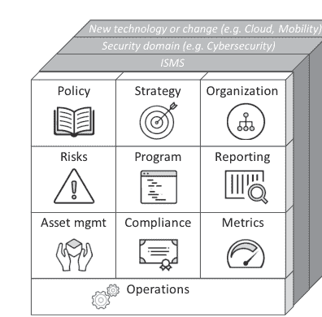

图 3.1 TLCF 模型的应用领域。

- 2. 按威胁性质划分：
    - 网络安全
    - 数据隐私
- 3. 按技术划分：
    - 云计算
    - 虚拟化
    - 移动化
    - 消费者化
    - 流程数字化
- 4. 按地理或组织单位划分

TLCF 模型可以用于以下三种情况：

- 1. *治理自我评估。* 顾名思义，其目的是综合呈现特定系统的治理实践实施情况，并提出变更建议，而不一定需要经过审计。

> **示例**
>
> 网络安全态势可以作为治理实践自我评估的对象，以确保运营控制能够获得所有必要的治理和管理支持：战略、政策、组织、风险、计划、资产管理、合规、指标和报告。

- 2. *对治理的影响——主动式方法。* 这种方法旨在针对新系统或重大变更，提前建立良好的治理实践。

> **示例**
>
> 在建立新的外包人力资源管理系统时，很可能需要处理治理方面的问题：战略、政策、组织、数据保护、风险、计划和监督。随后，对新系统特征进行分析，以识别治理要求，并将其分配到 TLCF 的各个模块中。

- 3. *对治理的影响——被动式方法。* 这种方法是在运营控制发生变更后，审查模型九个构建模块中的实践。

以下是一些可用于推动信息安全系统治理实践讨论的问题示例。每个模块的行动计划列在第三列中。

| 模块 | 问题 | 行动计划 |
|---|---|---|
| 战略 | 我们是否拥有与业务目标保持一致的安全战略？ 管理层对安全问题的理解程度如何？ 安全执行经理在制定业务战略方面的参与程度如何？ | 根据业务经理与首席信息安全官（CISO）之间将开展的讨论，审查安全战略 使安全计划与业务目标保持一致 |
| 政策 | 我们的安全政策和指南是否符合业务部门的需求？ 我们是否具备监督指南有效实施的手段？ 政策是否说明了所有员工的责任以及疏忽可能导致的后果？ 我们是否已经建立了内部法规的文档框架？ 谁负责提出对政策和指南的调整建议？ 我们的安全政策验证流程是什么？ | 审查政策和指南的文档框架，并提高其可读性 |
| 组织 | 我们是否已经在信息安全治理中分配了职责？ 安全官及其团队的职位设置是否有助于考虑业务部门的需求？ 我们是否设立了有权对安全政策和指令的例外及变更作出裁决的委员会？ 安全官如何与业务部门就安全目标进行双向沟通？ | 每个业务线必须指定一名安全代表，参加季度安全项目审查会议 |
| 风险 | 安全风险管理是否融入公司的运营风险管理理念？ 业务部门风险管理人员参与安全风险分析的程度如何？ 我们是否建立了经过所有业务线验证的安全风险清单？ 我们是否拥有用于衡量不同安全控制绩效的指标和关键绩效指标（KPI）？ 我们是否已经建立了安全风险处置计划？ | 无需改进 |
| 计划管理 | 董事会、管理层和业务部门负责人在确定安全优先事项方面的参与程度如何？运营经理如何参与安全计划优先级的确定？业务部门是否参与制定安全业务计划？技术解决方案的所有支出是否都经过风险和成本效益分析论证？目标是否定义清晰？我们是否拥有运营控制清单，其中包含职责、成熟度级别和有效性测试计划？我们是否已经建立了员工意识培训计划，以提高员工对资产保护的认识？ | 建立委员会，对信息安全计划和项目进行验证 |
| 报告 | 我们是否拥有面向管理层、董事会和业务部门的信息安全报告系统？报告系统是否包含有关信息安全状况、高风险、合规性和成熟度差距，以及所采取措施有效性的相关信息？ | 无需改进 |
| 资产管理 | 我们是否已经识别、分类并划分数据类别？我们是否知道数据所有者是谁？如何确保数据所有者对隐私性、可用性和完整性的要求被纳入安全计划？ | 定义数据类别和分类，并将其登记到目录中 为每个类别/业务线识别数据所有者 |
| 合规 | 我们是否了解适用于信息安全的法律和法规？如何向员工传达法律和监管框架？我们是否已经建立了合规计划？ | 建立员工意识培训计划，使员工了解影响安全的法律和监管框架 |
| 指标 | 我们是否了解信息安全的直接成本、间接成本和分析成本（按活动计算）？我们是否拥有用于衡量各种安全控制绩效的指标？我们如何衡量员工接受有关威胁和防护手段培训的程度？业务线如何参与安全指标的验证？ | 无需改进 |

这一过程展示了如何将 TLCF 框架用于安全治理实践的自我评估或头脑风暴。这种方法基于回答一组涵盖所有治理活动的关键问题，然后制定改进建议。

### 3.3 对治理的影响——主动式方法

主动式方法从模型所有构建模块的角度，对某个特定领域（例如网络安全）进行分析。为了进行说明，我们以数据隐私领域的一个示例为例，尽管同样的方法也可以应用于任何其他领域。

在数字经济中，个人数据保护已经成为许多监管机构关注的问题。欧洲共同体制定了全面的指南，以保护其成员国公民的个人数据——《通用数据保护条例》（GDPR）。许多其他国家也制定了类似法规，例如《瑞士数据保护法》或《新加坡个人数据保护法》，这里只举两个例子。

以下列表总结了 GDPR 中对信息安全产生影响的要求。这些要求不应与其他要求混淆，例如，被遗忘权

被遗忘权、处理的合法性、画像分析或明确同意等，这些并不直接涉及信息系统，而是合规和法务部门的职责，因此在此示例中不予考虑。

GDPR 关于可能影响信息系统或信息安全管理体系的个人数据保护的建议如下列出。

- **1. 个人数据识别、分类和分级**

个人数据是指公司为其运营所使用和处理的客户、供应商、员工或任何其他人的数据。法规要求公司识别此类个人数据，包括“高度敏感数据”例如遗传、生物识别、健康相关等的使用和处理。因此，能够对这些数据进行分类（客户、员工、供应商等）并根据保密性标准（例如，机密、公开）对其进行分级非常重要，这将使能够实施适当的保护措施。

内部监管框架随后规定了根据其分类以及处理或存储的上下文如何保护这些数据。

- **2. 个人数据清单**

公司必须拥有个人数据清单、处理这些数据的服务器和应用程序，以及个人数据流的描述（哪个流程使用哪些数据）。这些系统根据其托管或处理的数据的分类进行分类，从而更易于建立与这些数据相关的特定风险管理并创建相关指标。

- **3. 保护个人数据的措施**

公司必须能够证明存在根据数据分类、存储方式和处理方式（访问、传输、销毁、变更管理或备份）保护个人数据的控制措施或手段。

所实施的数据保护计划应不仅包括运营控制，还应包括独立审计、隐私影响评估（PIA）程序、人力资源控制以及培训和意识计划。应使用加密等保护技术以避免在不需要时暴露数据（例如，在开发环境中）。

- **4. 数据保护设计**

个人数据处理必须从一开始就设计为提供诸如应客户请求删除个人数据（被遗忘权）、客户访问其个人数据以及可移植性（以电子形式提取数据）等功能。

- **5. 数据保护中的组织和职责**

安全组织必须到位，并在信息技术（IT）、人力资源、业务部门、决策中包含数据保护职责

|  |  |
|---|---|
| 指标 | 更新指标和 KPI 以促进数据隐私风险评估 |
| 运营 | 在需要时实施加密以保护个人数据 调整数据泄露事件响应计划及相关程序（职责、数据处理者向数据控制者报告、向当局的通知义务等）。维护内部事件和泄露登记册 更新数据隐私培训和意识计划 实施控制措施以在未经授权访问时使数据无法理解 |

### 3.4 影响治理——一种反应性方法

每次运营控制发生变化时，都必须验证其与战略和战术层级控制之间的相互依赖关系。换句话说，我们必须确保治理活动和工具能够适应新的运营控制。由事件、审计发现或可见威胁引发的变更请求通常发送给运营经理，他们有时会缩小变更范围、忽视治理的必要性，或根本没有手段要求相应调整战略或战术层级的控制。

> **示例**
> 
> ISO 27001 标准建议以下控制措施：
> A.13.1.3 网络隔离：“信息服务、用户和信息系统组应在网络上进行隔离。”
> 
> 为了使网络隔离为公司增加价值，它必须解决业务部门的需求或将不同保密等级的资产或基础设施分开的需求。这涉及做出战略决策并调整安全策略，以考虑网络不同部分运营商的风险偏好差异。

许多运营控制措施如果没有战略导向或政策和指南的调整，就无法得到正确实施。即使在标准或审计发现中未明确说明，审视运营变更对治理流程的影响也非常重要。变更经理随后可以使用 TLCF 模板来展示变更对战略和战术控制的影响。

### 示例

假设审计发现指出 USB 闪存驱动器缺乏加密解决方案。这是可能暴露机密数据的弱点。经过分析，公司决定不为 USB 设备实施加密解决方案，因为它有其他保护手段，包括在单个工作站上阻止 USB 端口，以及如果有人需要在 USB 设备上存储信息则必须经过支持服务的义务。这被认为足以降低风险。尽管如此，公司监管框架并未明确提及此流程，必须相应调整。

为说明这种方法，使用该模型时可称为 *反应性* 或 *自下而上*，我们将以网络安全为例。

网络安全是一套用于对抗来自网络空间对基础设施和企业资产的恶意攻击威胁的控制措施。今天的公司由于对信息技术和数字化的高度依赖、国家法律往往不适合国际环境、暗网中恶意攻击手段极其丰富以及连接设备的爆炸式增长而变得更加脆弱。攻击的类型也在发生变化：它们现在更具针对性，恶意人员需要的技术知识越来越少。这些攻击是一组可能威胁公司生存的运营风险。因此，治理机构必须对其演变保持足够的了解。

与其他任何安全领域一样，网络威胁保护系统必须集成到整个信息系统计划中。网络安全不应被视为一组孤立的技术措施。打击网络威胁需要存在战略、政策、组织、风险管理、控制管理计划、报告系统、待保护资产清单、关于法律和监管框架合规性的可见性，以及衡量计划充分性的指标和度量。

公司为抵御网络威胁而实施的控制措施不仅涵盖检测和保护能力，还涵盖攻击后的恢复能力。威胁快速变化的背景意味着必须监控控制措施的有效性，以便相应调整。管理层经常询问其公司是否得到充分保护，其安全状况与同行业其他公司相比如何，以及未来如何改进。另一方面，公司考虑建立具有特定职责的网络防御战术领域以更好地管理其计划是完全合理的。

## 运营控制变更后调整治理实践的示例

假设一家公司想要评估其抵御网络威胁的保护能力。管理层已将此项目委托给 IT 部门，并期望收到一份报告，说明当前成熟度水平、所需成熟度水平以及应采取哪些行动来弥补差距。

可使用 NIST 网络安全框架（CSF）标准来评估公司的当前网络安全态势。该标准的主要目的是识别网络防御领域的所有基本运营控制措施。通过根据该标准的建议评估其控制措施的成熟度，公司将能够提出改进举措。包含所有控制措施的 NIST CSF 框架核心包括以下内容：

- 五大主要功能，统称网络安全保护控制，称为 IDENTIFY、PROTECT、DETECT、RESPOND 和 RECOVER（图 2.11）
- 每个功能细分为许多类别
- 每个类别包含一定数量的子类别或要求

这些子类别的完整列表可在 NIST 出版物《改进关键基础设施网络安全框架》附录 A 中找到，版本 1.1，国家标准与技术研究院。2018 年 4 月 16 日。

纯粹的治理和管理控制措施在 IDENTIFY 功能的类别中有所提及。其他功能主要包含运营控制的要求。乍一看，管理层对这些控制措施对治理流程的影响了解较少。因此，突出运营控制在战略和战术层面的可能影响非常重要。

假设将现有控制措施的成熟度评估与标准的要求进行比较，结果在每个子类别旁边列出了表 3.1 中呈现的六项发现。

建议及其对 TLCF 模型各模块实践的影响已在表 3.2 中进行了总结。发现 1 和 2 直接与 CSF 的资产管理和风险管理战略类别相关，也涉及 TLCF 的战略、风险和资产管理模块。其他建议不仅在运营层面有影响，在我们的模型中也在战略和战术层面有影响，包括战略、政策和计划。我们不会在此示例中深入介绍建议的细节，因为它们必须根据公司的具体情况制定。尽管如此，重要的是要注意，最终面向运营控制的发现也对战略和战术控制有影响。

## 表3.2 建议对TLCF模块的影响

| 发现 | 建议 | TLCF影响 |
|---|---|---|
| 1. 并非所有系统都已编目或分类 | 定义分类和资产清单。包含数据流 | 资产管理 [插图] |
| 2. 风险偏好未明确定义，也未用事实指标表述 | 定义网络风险的风险偏好和KRI | 风险 [插图] |
| 3. 未使用加密。数据流未分类 | 根据保密分类定义加密策略。按照策略要求，为所有需要保护的流量安装加密保护 | 策略 [插图] |
| 4. 没有自动化的数据泄漏防护 | 根据风险和投资回报，决定是否强制安装自动数据泄漏防护系统 | 战略 [插图] |
| 5. 对于关键流程的恢复时间，没有明确的方向或SLA。测试仅基于所有功能的恢复 | 针对被视为业务关键流程的恢复要求制定指南。定期安排关键流程的恢复测试时间 | 策略 [插图] |
| 6. 没有计划中的大规模网络攻击测试 | 制定大规模网络攻击恢复测试的时间表 | 计划 [插图] |

## 第4章

### 战略

新的运营控制措施通常是在事件、新威胁、新法规或审计发现之后建立的。这种被动应对的方式并不能构成战略。从长远来看，利益相关者无法理解安全的作用、目标以及投资回报。*安全战略*一词常常与*项目路线图*或*业务计划*相混淆，后者通常是一系列旨在降低风险的项目清单。虽然这很重要，但它不是战略；战略是一组应达成特定战略目标的项目。那么这个目标是什么？我们需要理解的是安全活动如何以及在多大程度上促进业务发展。

被动姿态会使安全管理层边缘化，并限制他们只能在管理层之外扮演技术角色。再加上一堆昂贵的技术解决方案杂乱无章，这种方法难以吸引业务部门经理的注意力。如果没有展示向公认目标进展的基准衡量，这种模式将难以长期为继。安全经理常常难以引起决策者的关注，也难以证明其投资的合理性。如果他们无法解释安全为何以及如何帮助实现业务目标，就没有理由认为安全工作必不可少。同样重要的是，安全管理层及其团队必须理解其工作所指向的目标。

一个能通过项目路线图支撑业务举措并朝目标迈进的安全计划，可以吸引决策者的注意力，并防止安全被视为“必要的恶”或成本中心。如今，越来越多的人确信，在数字经济中，安全对于业务发展至关重要。技术和威胁在不断变化，商业模式也是如此。这种演变迫使首席信息安全官（CISO）争取更多资源，但这些努力似乎并未得到充分的重视。原因往往在于缺乏一项在公司范围内传达的、定义明确的安全战略。

对于是否有必要制定战略，存在不同观点。有人可能会争辩说，制定带有遥远目标的安全战略毫无用处，因为安全只能以被动模式运作。然而，专业机构近期的研究和调查表明，专注于战略、治理和风险的安全组织，其成熟度高于仅专注于运营的组织。

管理层询问CISO“你对某某技术有什么战略？”并不罕见。为新技术的战略下定义并不是CISO的职责；相反，受益于该技术的公司或业务部门必须与CISO或其团队共同制定战略。安全部门可以提供相关风险分析，并建议调整控制措施，以确保技术能够在良好条件下部署。安全战略必须跟随业务战略，而不是相反。

### 示例

如果事先没有讨论业务或信息技术（IT）需求，安全团队成员或CISO就无法回答“我们对云计算的战略是什么？”这样的问题。这种战略取决于多种因素：数据类型、相关的流程和应用、预期用途、存储位置、适用的监管框架等。公司必须首先在可能使用外部云基础设施的前提下制定其变革项目。然后安全团队可以基于风险分析提出控制措施，最后双方共同定义战略。

安全战略是治理的重要工具，尽管CISO常常忽视这一点，而偏向于在局部决定的技术安全解决方案。如果没有战略，这些解决方案本身可能会被误解，更重要的是，它们无法实现保护资产这一真正的目标，而这正是业务所需。治理机构需要了解目标才能做出决策。安全战略提供了一个长期框架、计划或路线图，使运营解决方案得以落实。因此：

- 安全战略是一项经公司管理层批准的计划，展示为实现目标（未来状态）而对当前安全状态所做的修改。
- 它为公司的所有安全举措和项目提供指导。

战略是安全治理的首要使命。它必须优先于其他一切来制定。它锚定安全计划，所有治理构建模块都受其影响。但战略并非一成不变；它必须随着技术变革、业务方向、环境和监管框架的变化、与外部合作伙伴的关系和背景、新商业模式等而演进。与战略目标相关的项目路线图将作为整个安全计划的框架得到维护。

> _战略应包含什么？_

### 4.2 安全战略的内容

安全战略的表述方式不止一种。有许多形式和内容各异的示例。然而，战略的基本要素是使命、背景、角色与职责、目标和举措（图4.1）。

_使命_是一个简短的陈述，回顾安全的主要目标、主要职能及其对业务目标的贡献。

_背景_描述了理解战略所必需的若干要素，特别是：

- 公司保护其资产，尤其是数据保密性、可用性和完整性的意愿
- 鉴于公司特点、业务领域、运营环境、风险偏好以及适用的法律法规框架，必须遵守的安全要求
- 战略作为未来任何安全举措基本指南的作用，以及提醒决策时应遵循的原则
- 对组织当前状况、主要挑战和未来发展的评论

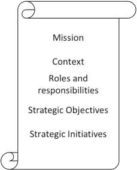

**图4.1** 安全战略的关键要素。

《角色与职责》部分是对治理原则、安全项目管理角色与职责的提醒，以及安全组织必须根据组织的[content]
《角色与职责》部分是对治理原则、安全项目管理角色与职责的提醒，以及安全组织必须根据组织的[content]
《角色与职责》部分是对治理原则、安全项目管理角色与职责的提醒，以及安全组织必须根据组织的客观和举措进行调整这一事实。

未来一段时期的战略目标或愿景应明确提及。它们以流程成熟度和对业务目标的支持程度来表述。安全必须将自身定位为公司发展中的关键参与者，并制定明确的方向及其未来定位。这将使所有利益相关者更好地理解将导致这一结果的举措。

将导致既定愿景的战略安全举措应明确列出，并包括：

- 对业务目标的贡献描述
- 其关键交付成果（预期结果）
- 其贡献如何衡量（通过一些关键点指标来监控其向目标演进的情况）

尽管看似简单，但这对任何 CISO 来说都是一项相对复杂的练习。事实上，他们不能独自、孤立地制定战略。另一方面，并没有公认的模型来定义战略，这意味着战略对不同的人有不同的含义。CISO 通常不会被邀请讨论业务战略，而业务战略本身往往也没有以足够明确和可衡量的方式传达。“孤立”方法的危险在于可能交付一份与业务目标没有明显联系的安全项目路线图。因此，大多数业务经理不会将其理解为战略，因为它与他们的需求不一致，也无法满足他们对技术变革以发展业务并提供更好客户服务的需求。

以下是实现这一目标的系统化方法。

*战略开发项目的主要步骤是什么？*

### 4.3 定义战略的方法

制定战略时常见的错误是仅列出与传统上驱动安全项目要素相对应的项目：审计发现、漏洞和威胁、已知风险以及监管限制。战略必须明确考虑这些要素，但要具有说服力，它必须明确提及并针对业务目标，原因如前所述。这种与业务战略的对齐不仅对安全经理来说是一个挑战，对所有技术人员来说也是一个挑战。

参与制定安全战略的团队由来自业务部门的人员组成。这些专家负责传达战略方向并评估运营中的安全方面。他们应根据其对业务部门战略愿景的了解、对运营的了解以及其在 IS 方面的 demonstrated 兴趣来选择。

项目负责人最好是 CISO 或其代表。他们也可以是外部顾问，但必须在安全经理的密切监督下工作。

战略开发项目包括四个阶段，其目的是提供定义战略所需的所有要素：

- 1. 确立 IS 如何更好地支持业务战略（变革）
- 2. 确立 IS 如何更好地支持业务运营（运行）
- 3. 定义 IS 愿景和举措以提高整体 IS 效能
- 4. 归类举措并制定项目路线图
- 5. 制定战略
- 6. 传达 IS 战略

#### 4.3.1 支持业务战略的举措

作为第一步，能够感知公司的需求、变革举措、IS 预期和“宠爱项目”非常重要。

- 了解业务当务之急及其成功因素。
- 了解战略项目，并可能推断出未明确传达的其他战略方向。
- 识别安全可以带来价值的举措和目标。
- 识别被认为阻碍实现业务目标的安全规则。
- 确定安全如何有助于实现业务目标。
- 与业务部门一起定义将用于衡量 IS 与业务目标相适应的指标。

> **示例**
>
> 人力资源服务有一个战略目标，即发展其互联网招聘服务。安全可以通过多种方式为这一目标做出贡献，包括设置个人数据保护控制、集成第三方应用提供商提供的身份验证组件等等。对此类举措的支持也可以使具有类似需求的其他业务部门受益，例如定义不同身份验证方法的集成架构。

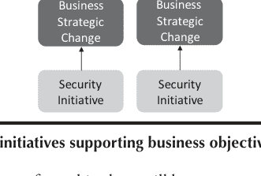

**图 4.3** 支持业务目标（变革）的[content]
《角色与职责》部分是对治理原则、安全项目管理角色与职责的提醒，以及安全组织必须根据组织的客观和举措进行调整这一事实。

未来一段时期的战略目标或愿景应明确提及。它们以流程成熟度和对业务目标的支持程度来表述。安全必须将自身定位为公司发展中的关键参与者，并制定明确的方向及其未来定位。这将使所有利益相关者更好地理解将导致这一结果的举措。

将导致既定愿景的战略安全举措应明确列出，并包括：

- 对业务目标的贡献描述
- 其关键交付成果（预期结果）
- 其贡献如何衡量（通过一些关键点指标来监控其向目标演进的情况）

尽管看似简单，但这对任何 CISO 来说都是一项相对复杂的练习。事实上，他们不能独自、孤立地制定战略。另一方面，并没有公认的模型来定义战略，这意味着战略对不同的人有不同的含义。CISO 通常不会被邀请讨论业务战略，而业务战略本身往往也没有以足够明确和可衡量的方式传达。“孤立”方法的危险在于可能交付一份与业务目标没有明显联系的安全项目路线图。因此，大多数业务经理不会将其理解为战略，因为它与他们的需求不一致，也无法满足他们对技术变革以发展业务并提供更好客户服务的需求。

以下是实现这一目标的系统化方法。

*战略开发项目的主要步骤是什么？*

### 4.3 定义战略的方法

制定战略时常见的错误是仅列出与传统上驱动安全项目要素相对应的项目：审计发现、漏洞和威胁、已知风险以及监管限制。战略必须明确考虑这些要素，但要具有说服力，它必须明确提及并针对业务目标，原因如前所述。这种与业务战略的对齐不仅对安全经理来说是一个挑战，对所有技术人员来说也是一个挑战。

参与制定安全战略的团队由来自业务部门的人员组成。这些专家负责传达战略方向并评估运营中的安全方面。他们应根据其对业务部门战略愿景的了解、对运营的了解以及其在 IS 方面的 demonstrated 兴趣来选择。

项目负责人最好是 CISO 或其代表。他们也可以是外部顾问，但必须在安全经理的密切监督下工作。

战略开发项目包括四个阶段，其目的是提供定义战略所需的所有要素：

- 1. 确立 IS 如何更好地支持业务战略（变革）
- 2. 确立 IS 如何更好地支持业务运营（运行）
- 3. 定义 IS 愿景和举措以提高整体 IS 效能
- 4. 归类举措并制定项目路线图
- 5. 制定战略
- 6. 传达 IS 战略

#### 4.3.1 支持业务战略的举措

作为第一步，能够感知公司的需求、变革举措、IS 预期和“宠爱项目”非常重要。

- 了解业务当务之急及其成功因素。
- 了解战略项目，并可能推断出未明确传达的其他战略方向。
- 识别安全可以带来价值的举措和目标。
- 识别被认为阻碍实现业务目标的安全规则。
- 确定安全如何有助于实现业务目标。
- 与业务部门一起定义将用于衡量 IS 与业务目标相适应的指标。

> **示例**
>
> 人力资源服务有一个战略目标，即发展其互联网招聘服务。安全可以通过多种方式为这一目标做出贡献，包括设置个人数据保护控制、集成第三方应用提供商提供的身份验证组件等等。对此类举措的支持也可以使具有类似需求的其他业务部门受益，例如定义不同身份验证方法的集成架构。

**图 4.3** 支持业务目标（变革）的[content]
《角色与职责》部分是对治理原则、安全项目管理角色与职责的提醒，以及安全组织必须根据组织的客观和举措进行调整这一事实。

未来一段时期的战略目标或愿景应明确提及。它们以流程成熟度和对业务目标的支持程度来表述。安全必须将自身定位为公司发展中的关键参与者，并制定明确的方向及其未来定位。这将使所有利益相关者更好地理解将导致这一结果的举措。

将导致既定愿景的战略安全举措应明确列出，并包括：

- 对业务目标的贡献描述
- 其关键交付成果（预期结果）
- 其贡献如何衡量（通过一些关键点指标来监控其向目标演进的情况）

尽管看似简单，但这对任何 CISO 来说都是一项相对复杂的练习。事实上，他们不能独自、孤立地制定战略。另一方面，并没有公认的模型来定义战略，这意味着战略对不同的人有不同的含义。CISO 通常不会被邀请讨论业务战略，而业务战略本身往往也没有以足够明确和可衡量的方式传达。“孤立”方法的危险在于可能交付一份与业务目标没有明显联系的安全项目路线图。因此，大多数业务经理不会将其理解为战略，因为它与他们的需求不一致，也无法满足他们对技术变革以发展业务并提供更好客户服务的需求。

以下是实现这一目标的系统化方法。

*战略开发项目的主要步骤是什么？*

### 4.3 定义战略的方法

制定战略时常见的错误是仅列出与传统上驱动安全项目要素相对应的项目：审计发现、漏洞和威胁、已知风险以及监管限制。战略必须明确考虑这些要素，但要具有说服力，它必须明确提及并针对业务目标，原因如前所述。这种与业务战略的对齐不仅对安全经理来说是一个挑战，对所有技术人员来说也是一个挑战。

参与制定安全战略的团队由来自业务部门的人员组成。这些专家负责传达战略方向并评估运营中的安全方面。他们应根据其对业务部门战略愿景的了解、对运营的了解以及其在 IS 方面的 demonstrated 兴趣来选择。

项目负责人最好是 CISO 或其代表。他们也可以是外部顾问，但必须在安全经理的密切监督下工作。

战略开发项目包括四个阶段，其目的是提供定义战略所需的所有要素：

- 1. 确立 IS 如何更好地支持业务战略（变革）
- 2. 确立 IS 如何更好地支持业务运营（运行）
- 3. 定义 IS 愿景和举措以提高整体 IS 效能
- 4. 归类举措并制定项目路线图
- 5. 制定战略
- 6. 传达 IS 战略

#### 4.3.1 支持业务战略的举措

作为第一步，能够感知公司的需求、变革举措、IS 预期和“宠爱项目”非常重要。

- 了解业务当务之急及其成功因素。
- 了解战略项目，并可能推断出未明确传达的其他战略方向。
- 识别安全可以带来价值的举措和目标。
- 识别被认为阻碍实现业务目标的安全规则。
- 确定安全如何有助于实现业务目标。
- 与业务部门一起定义将用于衡量 IS 与业务目标相适应的指标。

> **示例**
>
> 人力资源服务有一个战略目标，即发展其互联网招聘服务。安全可以通过多种方式为这一目标做出贡献，包括设置个人数据保护控制、集成第三方应用提供商提供的身份验证组件等等。对此类举措的支持也可以使具有类似需求的其他业务部门受益，例如定义不同身份验证方法的集成架构。

**图 4.3** 支持业务目标（变革）的[content]
《角色与职责》部分是对治理原则、安全项目管理角色与职责的提醒，以及安全组织必须根据组织的客观和举措进行调整这一事实。

未来一段时期的战略目标或愿景应明确提及。它们以流程成熟度和对业务目标的支持程度来表述。安全必须将自身定位为公司发展中的关键参与者，并制定明确的方向及其未来定位。这将使所有利益相关者更好地理解将导致这一结果的举措。

将导致既定愿景的战略安全举措应明确列出，并包括：

- 对业务目标的贡献描述
- 其关键交付成果（预期结果）
- 其贡献如何衡量（通过一些关键点指标来监控其向目标演进的情况）

尽管看似简单，但这对任何 CISO 来说都是一项相对复杂的练习。事实上，他们不能独自、孤立地制定战略。另一方面，并没有公认的模型来定义战略，这意味着战略对不同的人有不同的含义。CISO 通常不会被邀请讨论业务战略，而业务战略本身往往也没有以足够明确和可衡量的方式传达。“孤立”方法的危险在于可能交付一份与业务目标没有明显联系的安全项目路线图。因此，大多数业务经理不会将其理解为战略，因为它与他们的需求不一致，也无法满足他们对技术变革以发展业务并提供更好客户服务的需求。

以下是实现这一目标的系统化方法。

*战略开发项目的主要步骤是什么？*

### 4.3 定义战略的方法

制定战略时常见的错误是仅列出与传统上驱动安全项目要素相对应的项目：审计发现、漏洞和威胁、已知风险以及监管限制。战略必须明确考虑这些要素，但要具有说服力，它必须明确提及并针对业务目标，原因如前所述。这种与业务战略的对齐不仅对安全经理来说是一个挑战，对所有技术人员来说也是一个挑战。

参与制定安全战略的团队由来自业务部门的人员组成。这些专家负责传达战略方向并评估运营中的安全方面。他们应根据其对业务部门战略愿景的了解、对运营的了解以及其在 IS 方面的 demonstrated 兴趣来选择。

项目负责人最好是 CISO 或其代表。他们也可以是外部顾问，但必须在安全经理的密切监督下工作。

战略开发项目包括四个阶段，其目的是提供定义战略所需的所有要素：

- 1. 确立 IS 如何更好地支持业务战略（变革）
- 2. 确立 IS 如何更好地支持业务运营（运行）
- 3. 定义 IS 愿景和举措以提高整体 IS 效能
- 4. 归类举措并制定项目路线图
- 5. 制定战略
- 6. 传达 IS 战略

#### 4.3.1 支持业务战略的举措

作为第一步，能够感知公司的需求、变革举措、IS 预期和“宠爱项目”非常重要。

- 了解业务当务之急及其成功因素。
- 了解战略项目，并可能推断出未明确传达的其他战略方向。
- 识别安全可以带来价值的举措和目标。
- 识别被认为阻碍实现业务目标的安全规则。
- 确定安全如何有助于实现业务目标。
- 与业务部门一起定义将用于衡量 IS 与业务目标相适应的指标。

> **示例**
>
> 人力资源服务有一个战略目标，即发展其互联网招聘服务。安全可以通过多种方式为这一目标做出贡献，包括设置个人数据保护控制、集成第三方应用提供商提供的身份验证组件等等。对此类举措的支持也可以使具有类似需求的其他业务部门受益，例如定义不同身份验证方法的集成架构。

**图 4.3** 支持业务目标（变革）的[content]
《角色与职责》部分是对治理原则、安全项目管理角色与职责的提醒，以及安全组织必须根据组织的客观和举措进行调整这一事实。

未来一段时期的战略目标或愿景应明确提及。它们以流程成熟度和对业务目标的支持程度来表述。安全必须将自身定位为公司发展中的关键参与者，并制定明确的方向及其未来定位。这将使所有利益相关者更好地理解将导致这一结果的举措。

将导致既定愿景的战略安全举措应明确列出，并包括：

- 对业务目标的贡献描述
- 其关键交付成果（预期结果）
- 其贡献如何衡量（通过一些关键点指标来监控其向目标演进的情况）

尽管看似简单，但这对任何 CISO 来说都是一项相对复杂的练习。事实上，他们不能独自、孤立地制定战略。另一方面，并没有公认的模型来定义战略，这意味着战略对不同的人有不同的含义。CISO 通常不会被邀请讨论业务战略，而业务战略本身往往也没有以足够明确和可衡量的方式传达。“孤立”方法的危险在于可能交付一份与业务目标没有明显联系的安全项目路线图。因此，大多数业务经理不会将其理解为战略，因为它与他们的需求不一致，也无法满足他们对技术变革以发展业务并提供更好客户服务的需求。

以下是实现这一目标的系统化方法。

*战略开发项目的主要步骤是什么？*

### 4.3 定义战略的方法

制定战略时常见的错误是仅列出与传统上驱动安全项目要素相对应的项目：审计发现、漏洞和威胁、已知风险以及监管限制。战略必须明确考虑这些要素，但要具有说服力，它必须明确提及并针对业务目标，原因如前所述。这种与业务战略的对齐不仅对安全经理来说是一个挑战，对所有技术人员来说也是一个挑战。

参与制定安全战略的团队由来自业务部门的人员组成。这些专家负责传达战略方向并评估运营中的安全方面。他们应根据其对业务部门战略愿景的了解、对运营的了解以及其在 IS 方面的 demonstrated 兴趣来选择。

项目负责人最好是 CISO 或其代表。他们也可以是外部顾问，但必须在安全经理的密切监督下工作。

战略开发项目包括四个阶段，其目的是提供定义战略所需的所有要素：

- 1. 确立 IS 如何更好地支持业务战略（变革）
- 2. 确立 IS 如何更好地支持业务运营（运行）
- 3. 定义 IS 愿景和举措以提高整体 IS 效能
- 4. 归类举措并制定项目路线图
- 5. 制定战略
- 6. 传达 IS 战略

#### 4.3.1 支持业务战略的举措

作为第一步，能够感知公司的需求、变革举措、IS 预期和“宠爱项目”非常重要。

- 了解业务当务之急及其成功因素。
- 了解战略项目，并可能推断出未明确传达的其他战略方向。
- 识别安全可以带来价值的举措和目标。
- 识别被认为阻碍实现业务目标的安全规则。
- 确定安全如何有助于实现业务目标。
- 与业务部门一起定义将用于衡量 IS 与业务目标相适应的指标。

> **示例**
>
> 人力资源服务有一个战略目标，即发展其互联网招聘服务。安全可以通过多种方式为这一目标做出贡献，包括设置个人数据保护控制、集成第三方应用提供商提供的身份验证组件等等。对此类举措的支持也可以使具有类似需求的其他业务部门受益，例如定义不同身份验证方法的集成架构。

**图 4.3** 支持业务目标（变革）的[content]
《角色与职责》部分是对治理原则、安全项目管理角色与职责的提醒，以及安全组织必须根据组织的客观和举措进行调整这一事实。

未来一段时期的战略目标或愿景应明确提及。它们以流程成熟度和对业务目标的支持程度来表述。安全必须将自身定位为公司发展中的关键参与者，并制定明确的方向及其未来定位。这将使所有利益相关者更好地理解将导致这一结果的举措。

将导致既定愿景的战略安全举措应明确列出，并包括：

- 对业务目标的贡献描述
- 其关键交付成果（预期结果）
- 其贡献如何衡量（通过一些关键点指标来监控其向目标演进的情况）

尽管看似简单，但这对任何 CISO 来说都是一项相对复杂的练习。事实上，他们不能独自、孤立地制定战略。另一方面，并没有公认的模型来定义战略，这意味着战略对不同的人有不同的含义。CISO 通常不会被邀请讨论业务战略，而业务战略本身往往也没有以足够明确和可衡量的方式传达。“孤立”方法的危险在于可能交付一份与业务目标没有明显联系的安全项目路线图。因此，大多数业务经理不会将其理解为战略，因为它与他们的需求不一致，也无法满足他们对技术变革以发展业务并提供更好客户服务的需求。

以下是实现这一目标的系统化方法。

*战略开发项目的主要步骤是什么？*

## 4.3 定义战略的方法

制定战略时常见的错误是仅列出与传统上驱动安全项目要素相对应的项目：审计发现、漏洞和威胁、已知风险以及监管限制。战略必须明确考虑这些要素，但要具有说服力，它必须明确提及并针对业务目标，原因如前所述。这种与业务战略的对齐不仅对安全经理来说是一个挑战，对所有技术人员来说也是一个挑战。

参与制定安全战略的团队由来自业务部门的人员组成。这些专家负责传达战略方向并评估运营中的安全方面。他们应根据其对业务部门战略愿景的了解、对运营的了解以及其在 IS 方面的 demonstrated 兴趣来选择。

项目负责人最好是 CISO 或其代表。他们也可以是外部顾问，但必须在安全经理的密切监督下工作。

战略开发项目包括四个阶段，其目的是提供定义战略所需的所有要素：

- 1. 确立 IS 如何更好地支持业务战略（变革）
- 2. 确立 IS 如何更好地支持业务运营（运行）
- 3. 定义 IS 愿景和举措以提高整体 IS 效能
- 4. 归类举措并制定项目路线图
- 5. 制定战略
- 6. 传达 IS 战略

### 4.3.1 支持业务战略的举措

作为第一步，能够感知公司的需求、变革举措、IS 预期和“宠爱项目”非常重要。

- 了解业务当务之急及其成功因素。
- 了解战略项目，并可能推断出未明确传达的其他战略方向。
- 识别安全可以带来价值的举措和目标。
- 识别被认为阻碍实现业务目标的安全规则。
- 确定安全如何有助于实现业务目标。
- 与业务部门一起定义将用于衡量 IS 与业务目标相适应的指标。

> **示例**
>
> 人力资源服务有一个战略目标，即发展其互联网招聘服务。安全可以通过多种方式为这一目标做出贡献，包括设置个人数据保护控制、集成第三方应用提供商提供的身份验证组件等等。对此类举措的支持也可以使具有类似需求的其他业务部门受益，例如定义不同身份验证方法的集成架构。

**图 4.3** 支持业务目标（变革）的[content]
《角色与职责》部分是对治理原则、安全项目管理角色与职责的提醒，以及安全组织必须根据组织的客观和举措进行调整这一事实。

未来一段时期的战略目标或愿景应明确提及。它们以流程成熟度和对业务目标的支持程度来表述。安全必须将自身定位为公司发展中的关键参与者，并制定明确的方向及其未来定位。这将使所有利益相关者更好地理解将导致这一结果的举措。

将导致既定愿景的战略安全举措应明确列出，并包括：

- 对业务目标的贡献描述
- 其关键交付成果（预期结果）
- 其贡献如何衡量（通过一些关键点指标来监控其向目标演进的情况）

尽管看似简单，但这对任何 CISO 来说都是一项相对复杂的练习。事实上，他们不能独自、孤立地制定战略。另一方面，并没有公认的模型来定义战略，这意味着战略对不同的人有不同的含义。CISO 通常不会被邀请讨论业务战略，而业务战略本身往往也没有以足够明确和可衡量的方式传达。“孤立”方法的危险在于可能交付一份与业务目标没有明显联系的安全项目路线图。因此，大多数业务经理不会将其理解为战略，因为它与他们的需求不一致，也无法满足他们对技术变革以发展业务并提供更好客户服务的需求。

以下是实现这一目标的系统化方法。

*战略开发项目的主要步骤是什么？*

## 4.3 定义战略的方法

制定战略时常见的错误是仅列出与传统上驱动安全项目要素相对应的项目：审计发现、漏洞和威胁、已知风险以及监管限制。战略必须明确考虑这些要素，但要具有说服力，它必须明确提及并针对业务目标，原因如前所述。这种与业务战略的对齐不仅对安全经理来说是一个挑战，对所有技术人员来说也是一个挑战。

参与制定安全战略的团队由来自业务部门的人员组成。这些专家负责传达战略方向并评估运营中的安全方面。他们应根据其对业务部门战略愿景的了解、对运营的了解以及其在 IS 方面的 demonstrated 兴趣来选择。

项目负责人最好是 CISO 或其代表。他们也可以是外部顾问，但必须在安全经理的密切监督下工作。

战略开发项目包括四个阶段，其目的是提供定义战略所需的所有要素：

- 1. 确立 IS 如何更好地支持业务战略（变革）
- 2. 确立 IS 如何更好地支持业务运营（运行）
- 3. 定义 IS 愿景和举措以提高整体 IS 效能
- 4. 归类举措并制定项目路线图
- 5. 制定战略
- 6. 传达 IS 战略

### 4.3.1 支持业务战略的举措

作为第一步，能够感知公司的需求、变革举措、IS 预期和“宠爱项目”非常重要。

- 了解业务当务之急及其成功因素。
- 了解战略项目，并可能推断出未明确传达的其他战略方向。
- 识别安全可以带来价值的举措和目标。
- 识别被认为阻碍实现业务目标的安全规则。
- 确定安全如何有助于实现业务目标。
- 与业务部门一起定义将用于衡量 IS 与业务目标相适应的指标。

> **示例**
>
> 人力资源服务有一个战略目标，即发展其互联网招聘服务。安全可以通过多种方式为这一目标做出贡献，包括设置个人数据保护控制、集成第三方应用提供商提供的身份验证组件等等。对此类举措的支持也可以使具有类似需求的其他业务部门受益，例如定义不同身份验证方法的集成架构。

**图 4.3** 支持业务目标（变革）的[content]
《角色与职责》部分是对治理原则、安全项目管理角色与职责的提醒，以及安全组织必须根据组织的客观和举措进行调整这一事实。

未来一段时期的战略目标或愿景应明确提及。它们以流程成熟度和对业务目标的支持程度来表述。安全必须将自身定位为公司发展中的关键参与者，并制定明确的方向及其未来定位。这将使所有利益相关者更好地理解将导致这一结果的举措。

将导致既定愿景的战略安全举措应明确列出，并包括：

- 对业务目标的贡献描述
- 其关键交付成果（预期结果）
- 其贡献如何衡量（通过一些关键点指标来监控其向目标演进的情况）

尽管看似简单，但这对任何 CISO 来说都是一项相对复杂的练习。事实上，他们不能独自、孤立地制定战略。另一方面，并没有公认的模型来定义战略，这意味着战略对不同的人有不同的含义。CISO 通常不会被邀请讨论业务战略，而业务战略本身往往也没有以足够明确和可衡量的方式传达。“孤立”方法的危险在于可能交付一份与业务目标没有明显联系的安全项目路线图。因此，大多数业务经理不会将其理解为战略，因为它与他们的需求不一致，也无法满足他们对技术变革以发展业务并提供更好客户服务的需求。

以下是实现这一目标的系统化方法。

*战略开发项目的主要步骤是什么？*

## 4.3 定义战略的方法

制定战略时常见的错误是仅列出与传统上驱动安全项目要素相对应的项目：审计发现、漏洞和威胁、已知风险以及监管限制。战略必须明确考虑这些要素，但要具有说服力，它必须明确提及并针对业务目标，原因如前所述。这种与业务战略的对齐不仅对安全经理来说是一个挑战，对所有技术人员来说也是一个挑战。

参与制定安全战略的团队由来自业务部门的人员组成。这些专家负责传达战略方向并评估运营中的安全方面。他们应根据其对业务部门战略愿景的了解、对运营的了解以及其在 IS 方面的 demonstrated 兴趣来选择。

项目负责人最好是 CISO 或其代表。他们也可以是外部顾问，但必须在安全经理的密切监督下工作。

战略开发项目包括四个阶段，其目的是提供定义战略所需的所有要素：

- 1. 确立 IS 如何更好地支持业务战略（变革）
- 2. 确立 IS 如何更好地支持业务运营（运行）
- 3. 定义 IS 愿景和举措以提高整体 IS 效能
- 4. 归类举措并制定项目路线图
- 5. 制定战略
- 6. 传达 IS 战略

### 4.3.1 支持业务战略的举措

作为第一步，能够感知公司的需求、变革举措、IS 预期和“宠爱项目”非常重要。

- 了解业务当务之急及其成功因素。
- 了解战略项目，并可能推断出未明确传达的其他战略方向。
- 识别安全可以带来价值的举措和目标。
- 识别被认为阻碍实现业务目标的安全规则。
- 确定安全如何有助于实现业务目标。
- 与业务部门一起定义将用于衡量 IS 与业务目标相适应的指标。

> **示例**
>
> 人力资源服务有一个战略目标，即发展其互联网招聘服务。安全可以通过多种方式为这一目标做出贡献，包括设置个人数据保护控制、集成第三方应用提供商提供的身份验证组件等等。对此类举措的支持也可以使具有类似需求的其他业务部门受益，例如定义不同身份验证方法的集成架构。

**图 4.3** 支持业务目标（变革）的[content]
《角色与职责》部分是对治理原则、安全项目管理角色与职责的提醒，以及安全组织必须根据组织的客观和举措进行调整这一事实。

未来一段时期的战略目标或愿景应明确提及。它们以流程成熟度和对业务目标的支持程度来表述。安全必须将自身定位为公司发展中的关键参与者，并制定明确的方向及其未来定位。这将使所有利益相关者更好地理解将导致这一结果的举措。

将导致既定愿景的战略安全举措应明确列出，并包括：

- 对业务目标的贡献描述
- 其关键交付成果（预期结果）
- 其贡献如何衡量（通过一些关键点指标来监控其向目标演进的情况）

尽管看似简单，但这对任何 CISO 来说都是一项相对复杂的练习。事实上，他们不能独自、孤立地制定战略。另一方面，并没有公认的模型来定义战略，这意味着战略对不同的人有不同的含义。CISO 通常不会被邀请讨论业务战略，而业务战略本身往往也没有以足够明确和可衡量的方式传达。“孤立”方法的危险在于可能交付一份与业务目标没有明显联系的安全项目路线图。因此，大多数业务经理不会将其理解为战略，因为它与他们的需求不一致，也无法满足他们对技术变革以发展业务并提供更好客户服务的需求。

以下是实现这一目标的系统化方法。

*战略开发项目的主要步骤是什么？*

## 4.3 定义战略的方法

制定战略时常见的错误是仅列出与传统上驱动安全项目要素相对应的项目：审计发现、漏洞和威胁、已知风险以及监管限制。战略必须明确考虑这些要素，但要具有说服力，它必须明确提及并针对业务目标，原因如前所述。这种与业务战略的对齐不仅对安全经理来说是一个挑战，对所有技术人员来说也是一个挑战。

参与制定安全战略的团队由来自业务部门的人员组成。这些专家负责传达战略方向并评估运营中的安全方面。他们应根据其对业务部门战略愿景的了解、对运营的了解以及其在 IS 方面的 demonstrated 兴趣来选择。

项目负责人最好是 CISO 或其代表。他们也可以是外部顾问，但必须在安全经理的密切监督下工作。

战略开发项目包括四个阶段，其目的是提供定义战略所需的所有要素：

- 1. 确立 IS 如何更好地支持业务战略（变革）
- 2. 确立 IS 如何更好地支持业务运营（运行）
- 3. 定义 IS 愿景和举措以提高整体 IS 效能
- 4. 归类举措并制定项目路线图
- 5. 制定战略
- 6. 传达 IS 战略

### 4.3.1 支持业务战略的举措

作为第一步，能够感知公司的需求、变革举措、IS 预期和“宠爱项目”非常重要。

- 了解业务当务之急及其成功因素。
- 了解战略项目，并可能推断出未明确传达的其他战略方向。
- 识别安全可以带来价值的举措和目标。
- 识别被认为阻碍实现业务目标的安全规则。
- 确定安全如何有助于实现业务目标。
- 与业务部门一起定义将用于衡量 IS 与业务目标相适应的指标。

> **示例**
>
> 人力资源服务有一个战略目标，即发展其互联网招聘服务。安全可以通过多种方式为这一目标做出贡献，包括设置个人数据保护控制、集成第三方应用提供商提供的身份验证组件等等。对此类举措的支持也可以使具有类似需求的其他业务部门受益，例如定义不同身份验证方法的集成架构。

**图 4.3** 支持业务目标（变革）的[content]
《角色与职责》部分是对治理原则、安全项目管理角色与职责的提醒，以及安全组织必须根据组织的客观和举措进行调整这一事实。

未来一段时期的战略目标或愿景应明确提及。它们以流程成熟度和对业务目标的支持程度来表述。安全必须将自身定位为公司发展中的关键参与者，并制定明确的方向及其未来定位。这将使所有利益相关者更好地理解将导致这一结果的举措。

将导致既定愿景的战略安全举措应明确列出，并包括：

- 对业务目标的贡献描述
- 其关键交付成果（预期结果）
- 其贡献如何衡量（通过一些关键点指标来监控其向目标演进的情况）

尽管看似简单，但这对任何 CISO 来说都是一项相对复杂的练习。事实上，他们不能独自、孤立地制定战略。另一方面，并没有公认的模型来定义战略，这意味着战略对不同的人有不同的含义。CISO 通常不会被邀请讨论业务战略，而业务战略本身往往也没有以足够明确和可衡量的方式传达。“孤立”方法的危险在于可能交付一份与业务目标没有明显联系的安全项目路线图。因此，大多数业务经理不会将其理解为战略，因为它与他们的需求不一致，也无法满足他们对技术变革以发展业务并提供更好客户服务的需求。

以下是实现这一目标的系统化方法。

*战略开发项目的主要步骤是什么？*

## 4.3 定义战略的方法

制定战略时常见的错误是仅列出与传统上驱动安全项目要素相对应的项目：审计发现、漏洞和威胁、已知风险以及监管限制。战略必须明确考虑这些要素，但要具有说服力，它必须明确提及并针对业务目标，原因如前所述。这种与业务战略的对齐不仅对安全经理来说是一个挑战，对所有技术人员来说也是一个挑战。

参与制定安全战略的团队由来自业务部门的人员组成。这些专家负责传达战略方向并评估运营中的安全方面。他们应根据其对业务部门战略愿景的了解、对运营的了解以及其在 IS 方面的 demonstrated 兴趣来选择。

项目负责人最好是 CISO 或其代表。他们也可以是外部顾问，但必须在安全经理的密切监督下工作。

战略开发项目包括四个阶段，其目的是提供定义战略所需的所有要素：

- 1. 确立 IS 如何更好地支持业务战略（变革）
- 2. 确立 IS 如何更好地支持业务运营（运行）
- 3. 定义 IS 愿景和举措以提高整体 IS 效能
- 4. 归类举措并制定项目路线图
- 5. 制定战略
- 6. 传达 IS 战略

### 4.3.1 支持业务战略的举措

作为第一步，能够感知公司的需求、变革举措、IS 预期和“宠爱项目”非常重要。

- 了解业务当务之急及其成功因素。
- 了解战略项目，并可能推断出未明确传达的其他战略方向。
- 识别安全可以带来价值的举措和目标。
- 识别被认为阻碍实现业务目标的安全规则。
- 确定安全如何有助于实现业务目标。
- 与业务部门一起定义将用于衡量 IS 与业务目标相适应的指标。

> **示例**
>
> 人力资源服务有一个战略目标，即发展其互联网招聘服务。安全可以通过多种方式为这一目标做出贡献，包括设置个人数据保护控制、集成第三方应用提供商提供的身份验证组件等等。对此类举措的支持也可以使具有类似需求的其他业务部门受益，例如定义不同身份验证方法的集成架构。

**图 4.3** 支持业务目标（变革）的[content]
安全举措。

本阶段的预期成果将是

- 1. 对业务战略目标的了解
- 2. 一份可为实现业务战略目标做出贡献的安全举措清单
- 3. 用于衡量安全与战略目标相适应的程度的指标（图 4.3）

业务战略往往未定义或表述不清，尽管它们通过举措、新项目、愿景或战略评审会议的结果得以表达。因此并不奇怪，企业战略或业务战略的文件并不存在；充其量只有大量提及它的文件或演示文稿。

在下文中，我们将把公司的业务战略视为整体，或其业务部门或分部的战略，而不涉及业务的复杂性。安全战略的方法将相同。

Sherwood 应用业务安全架构（SABSA）框架提倡企业方法，这非常值得称赞，也肯定是更可取的：

> “企业概念意味着组织被视为单一实体，而非相互合作的单位集合。特别是，这一概念体现了端到端业务流程的理念。”

尽管如此，按业务部门逐一进行的方法也有强化安全地位的优点，并且不会削弱稍后在整合练习中将赋予的“企业”视角。

识别业务举措并列出支持性安全举措的主要步骤如下：

- 1. 准备：设定目标、时间安排和交付成果。
- 2. 编制一份问卷，允许识别战略业务举措以及可以帮助的安全举措。
- 3. 绘制战略业务举措。与业务部门代表举行会议，澄清其战略举措。
- 4. 整合战略业务举措并起草其下属的安全举措。

在开始审阅业务战略之前，仔细选择将进入指导委员会和团队（业务部门代表）的专家，定义目标，并召集委员会和团队进行启动会议，在会上介绍目标、方法和方法。

项目经理与业务部门代表共同收集战略方向的会议应非常仔细地准备。业务部门通常没有明确的战略或路线图。这就是为什么项目准备会议非常重要，而管理层和董事会的支持在此方面至关重要。部门经理坚持认为安全是应置于业务关注之外并集中于技术保护的支持并不少见。在这种情况下，介绍预期利益的演示可能非常有用。另一个危险可能来自业务部门经理，他们因误解安全战略项目的含义而委派没有足够业务目标知识或无法传达所有相关信息的人员参与工作。这就是为什么了解公司现实的项目负责人的作用极其重要。

编制一份问卷，应反映目标；即列出战略业务举措以及安全如何为每项举措增加价值。问卷可以根据业务背景、其特征或我们已有的知识以不同方式编制。然而，为了提高效率并保持此类咨询方法的吸引力，应保持简单有效的方法。这最终是一项应被视为对各方都有益的交流。

以下是问卷示例：

- 1. 贵部门的使命是什么？
- 2. 您是否已为未来一段时期定义了战略目标？对于每个目标，请列出信息安全可以提供帮助以实现它的期望。
- 3. 您是否已启动项目，或是否有实现这些目标的路线图？如果有，请列出它们，并为每个项目注明信息安全的期望。
- 4. 实现目标的主要挑战是什么？对于这些挑战中的每一个，您如何看待安全的附加价值？
- 5. 您未来几年的活动中有何机会？信息安全可能有何附加价值？
- 6. 您是否了解竞争对手采用的类似成功战略？是否有任何特定的安全组件（工具、流程、组织）可以帮助？

战略举措以及安全工作的贡献可概括如下：

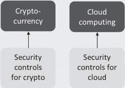

## 4.3.2 支持业务运营的举措

制定安全战略的第二阶段包括提出安全举措，以弥合流程成熟度方面已察觉的差距，从而支持运营业务需求。

人们常说，安全措施并不完全适应业务需求，甚至妨碍日常运营。因此，审查公司的安全战略是一个机会，可以更好地界定安全工作可做出的改变，以改善这种看法。

### 示例

许多员工经常表示需要通过外部平台使用新的沟通和数据共享方式。他们的问题“为什么我们不能使用这些方式进行专业数据交换？”很可能会从 CISO 那里得到这样的回答：“因为我们的数据是保密的，我们的政策不允许这样做。”事实上，CISO 不应这样回答，而应提出以下问题：“你们愿意在外部平台上共享哪些数据或文档？”用户的回答当然不会是“所有内容！”

因此，必须细化政策，并根据内容分类实施允许或阻止这种共享的控制措施。如果与相关的业务专业人员一起进行风险和成本效益分析，可能会同意全面禁止！不同之处在于，在后一种情况下，决策将由业务单元自己做出，而不是由信息安全人员做出。

在此阶段，项目负责人将倾向于识别可以改进的安全流程，以更好地支持当前的业务运营。

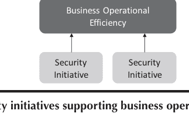

**图 4.4 支持业务运营的安全举措（运行）**

该阶段的预期成果将是

- 1. 业务运营效率目标
- 2. 从业务运营角度看安全成熟度差距
- 3. 为支持业务目标而分组的举措（图 4.4）

制定支持业务运营的安全举措的主要阶段如下：

- 1. 建立安全服务的成熟度模型。
- 2. 使用成熟度模型进行差距分析。
- 3. 将改进点整合为举措。

### 4.3.2.1 建立安全服务的成熟度模型

从业务线获得有关安全控制措施有效性和实用性的反馈的机会很少，必须加以充分利用。建立安全服务成熟度模型将使项目负责人能够了解业务负责人对现有安全控制措施是否充分的看法。因此，我们应提出一份问卷和成熟度评估工具，系统性地记录他们对安全措施充分性的看法。

成熟度评估工具将在第 9 章（安全度量）中更详细地介绍。可以使用 ISO 15504（信息技术——过程评估）过程成熟度等级标准的变体来确定用户对安全解决方案的满意程度（图 4.5）。

- 1. 不完整：不存在或定义不清。
- 2. 已执行：偶尔使用（临时性）。
- 3. 已建立：组织范围内的标准（可用）。
- 4. 可预测：与满足组织需求保持一致。
- 5. 优化：组织专注于持续改进。

对于每个被评估的安全服务，将建立以下三项评估标准：

### 安全流程及其对业务需求的适用性

- 业务流程中安全控制措施的有效性
- 安全流程中对法律法规合规性的考虑
- 身份和访问权限管理
- 连续性管理
- 物理安全
- 变更管理流程、采购与开发
- 外包和供应商管理

### 技术

- 互联网和外部通信
- 办公文档保护系统
- 应用程序和 IT 资源的访问
- 安全解决方案对新技术的适应性

上述主题并非业务部门问卷中可涵盖的所有内容的详尽清单。这里的目标不是再制定一种评估安全流程的方法，而是提出一种务实的方法，以快速识别与当前运营相关的改进点。这项工作本身不应构成持续改进的障碍。业务代表没有太多时间讨论安全问题。初次会议的结果可能有助于在定期战略审查期间改进问卷。

### 4.3.2.2 使用成熟度模型进行差距分析

识别安全成熟度水平认知差距的会议是发起建设性对话的绝佳时机。不同的主题和问题必须被理解和讨论。因此，不建议将问卷发送给不同的专家，并希望他们在没有任何解释或讨论的情况下发回成熟度图表。业务单元应理解，这项工作旨在提供相关信息，以制定或审查安全战略。他们应该愿意投入时间，并希望获得投资回报。

### 4.3.2.3 将改进点整合为举措

差距分析的第一个结果可以是按主题和业务单元分类的重要差距表（图 4.7）。一旦与业务负责人的会议能够建立这种映射，下一步就是选择业务单元之间差距最大的主题。

然后将主题分组为举措。以下示例显示了整合为三项举措的改进点。

### 示例

- 1. *审查政策和指南*，涉及与外部通信方安全交换文档以及移动中机密数据的可访问性（例如，个人数据加密），并建立相应的运营控制措施。
- 2. *在业务单元中确立安全责任*：让文档所有者管理办公文档的访问权限。
- 3. 计划由业务单元经理进行*访问权限认证*。

| 主题 | BU 1 | BU 2 |  |  |  |  |  |  | BU m |
|---|---:|---:|---:|---:|---:|---:|---:|---:|---:|
| 主题 1 | 4 | 12 | 6 | 4 | 12 | 4 | 12 | 6 | 4 / 12 |
| 主题 2 | 2 | 4 | 2 | 6 | 2 | 5 | 4 | 9 | 6 / 2 |
| … | 9 | 6 | 5 | 6 | 4 | 4 | 6 | 5 | 6 / 12 |
| … | 6 | 12 | 8 | 4 | 12 | 6 | 12 | 2 | 12 / 9 |
| … | 9 | 5 | 4 | 6 | 2 | 4 | 5 | 9 | 6 / 4 |
| … | 4 | 12 | 12 | 4 | 12 | 4 | 12 | 6 | 4 / 12 |
| … | 4 | 4 | 9 | 6 | 2 | 2 | 4 | 9 | 6 / 2 |
| … | 12 | 6 | 5 | 6 | 12 | 12 | 6 | 12 | 6 / 12 |
| … | 6 | 4 | 4 | 4 | 9 | 6 | 8 | 4 | 4 / 9 |
| 主题 n | 8 | 5 | 2 | 6 | 2 | 9 | 5 | 8 | 6 / 5 |

**图 4.7** 带有估计“重要性”的安全服务成熟度差距示例

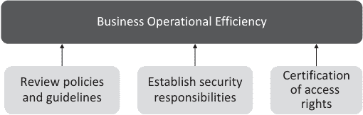

**图 4.8** 支持业务运营的安全举措

与所有参与者进行一次总结会议对验证结果非常有益。这样，参与者可以就各自单位内部决定的举措发表意见。支持业务运营的安全举措可概括如下（图 4.8）。

## 4.3.3 提高信息安全有效性的举措

安全作为 IT 内部或外部的企业或职能单元，也必须确保自身效率的提升。可以通过观察风险演变、成熟度差距、审计发现、优势、劣势、机会和威胁（SWOT）分析、技术演进、组织变革、法规、资源可用性等来确立信息安全愿景和战略举措。

该阶段的预期成果将是

- 1. 信息安全愿景
- 2. 实现这一愿景的战略举措（图 4.9）

为业务举措做出贡献是一个重要目标。然而，如果安全部门不具备所需的能力、缺乏促进治理和管理的组织架构以及足够的流程成熟度，它就无法指望成为可靠的合作伙伴。在 CISO 领导下的安全委员会应评估安全状况、设定目标，并选择能够实现这些目标的举措。设定信息安全战略目标有多种方式：

**SWOT 分析。** 对以下不同领域的优势、劣势、机会和威胁进行审视，例如控制措施的有效性、技术解决方案、组织与流程、财务与成本、人为因素、外部环境、法律和监管框架，并与类似行业部门进行比较，已经能让我们很好地了解潜在的改进点。

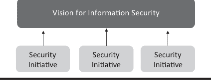

图 4.9 支持提升成熟度目标的安全举措

**成熟度模型。**成熟度模型可用于展示当前流程与期望流程之间成熟度水平的差距。现有许多模型，通常以相关标准为基础。同一行业的专业咨询公司或顾问也能够提供企业间基准的概览。

**审计发现。**审计建议是推动和论证新的安全举措的重要因素。董事会和管理层通常对这些建议抱有高度信心。

**风险评估。**风险评估流程有助于识别现有控制措施的薄弱点，从而帮助确定目标和更具战略性的举措。

**新技术。**人们对新技术的需求日益增加，安全工作必须将这一点考虑在内。一些合理的请求需要快速适应（例如使用不同的通信方式或消费化技术），而另一些请求则代表着根本性的范式转变，需要采用更恰当的手段（例如数字化、金融科技或区块链）。

对安全态势的分析可能会得出与业务部门访谈期间已经发现的成熟度差距相同的结论。此外，涉及安全特有监管框架、基础设施和应用程序安全，或某些技术控制措施的差距，只有安全专家才能识别。

## 示例

继续采用金融机构的示例，假设安全团队已经确定了以下两项应在短期内实施的举措：

- 包含具体组织层面内容的网络安全指南
- 访问权限的配置

在此情况下，之前确定的身份与访问管理举措以及访问权限配置，将整合为一项统一的身份与访问管理举措。

## 4.3.4 举措分组与项目路线图制定

到目前为止确定的举措可能存在重叠（例如业务目标与安全目标之间的重叠）。因此，目标是制定一份经过优化或整合的举措清单，以支持业务和信息系统（IS）的战略目标。这些举措还可以进一步分解为项目，并以路线图的形式呈现。

他们希望将应用基础设施和存储的管理外包给第三方云的程度。

**成功标准：**能够在外部云中部署解决方案，并具备明确且得到保障的安全基线

## 5.3 将安全责任委派给业务部门

**目标：**将某些控制措施转交给业务部门，以优化资源和运营效率。在此背景下，以下责任将优先处理：

- 访问权限分配、定期核查以及更新请求的责任
- 管理与业务部门流程相关的安全风险

**成功标准：**缩短提供访问权限所需的时间

## 5.4 定义网络安全政策

**目标：**为公司制定网络安全政策。董事会接受该政策后，安全部门将确保起草更低层级的指南和文件，以建立网络威胁防护体系。

**成功标准：**所有业务部门以及公司各部门、IT 部门和人力资源部门都将了解网络威胁以及防范网络攻击的手段。将建立有效的控制措施，以根据待定义的服务级别协议（SLA）确保运营具备充分的韧性。

## 5.5 身份与访问管理

**目标：**通过应用基于角色或业务规则的管理原则，以更加自动化的方式管理公司资源的身份和访问权限。为业务部门提供自行核查其员工访问权限的机会。

**成功标准：**业务部门负责人能够执行年度访问权限认证。在其他条件不变的情况下（相同数量的操作人员提出相同数量的请求），新员工访问权限的响应时间和分配时间应缩短 10%。

安全举措所支持的战略目标如下所示：

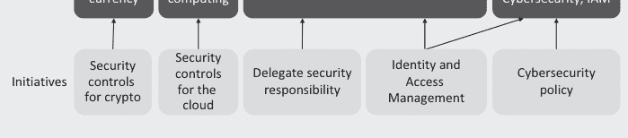

安全战略应如何传达？

## 4.4 安全战略沟通

在编制战略文件时，应避免仅仅将安全举措描述为防范威胁。这会给人一种禁止而非强化的感觉。我们知道，安全控制措施旨在降低风险，但它们也有助于创造部署新解决方案的条件。因此，最好使用积极的措辞，说明安全措施有助于实现战略目标，而不是使用强调其局限性的消极措辞。应强调安全措施能够实现什么，而不是罗列它们能够防止、减少或禁止什么。

## 示例

安全贡献可以通过两种方式表达。

| 消极方式 | 积极方式 |
|---|---|
| 降低因 PC 丢失或被盗导致数据泄露的风险 | 在确保 PC 内容机密性的同时，促进移动办公 |
| 禁止未经授权访问应用程序 | 通过优化访问权限，保护公司的机密和重要信息 |
| 降低针对 Web 服务器的网络攻击风险（DoS——拒绝服务） | 提高基础设施的韧性，并确保持续为 Web 客户提供服务 |
| 禁止发送包含机密数据的消息 | 在确保数据机密性的同时，促进通信手段的使用 |

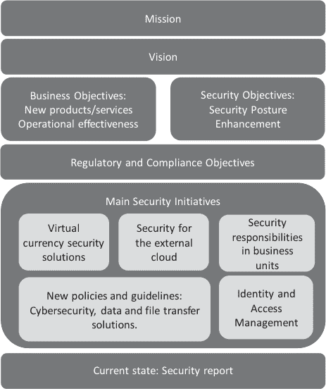

**图 4.12** 安全战略的简单展示。

“战略”文件是进行更详细展示或说明的起点。在年度会议或企业活动中，可以用更加直观的方式呈现战略举措或目标。图 4.12 中的示例是在一页上展示安全战略。

## 4.5 结论

建立正式的公司安全战略对于安全治理至关重要。这一步不应被低估，因为它会影响将要实施的安全流程、组织、活动和控制措施。战略文件很重要，但形成该文件的过程更加重要，因为这一过程能够加强所有利益相关者之间的协作，并使所取得的成果获得正当性。

为了保持务实的导向，通常没有必要完成所有列出的步骤。一些管理人员或董事会成员可能已经非常清楚其安全计划需要实现的目标，因此不需要在业务部门之间进行分析和达成共识，尤其是因为这一过程可能会无意中为各部门争夺安全或 IT 资源提供机会。

本章介绍的制定安全战略的流程和工具，只是该领域可采取方式的一个示例。重要的是，在建立和修订安全战略时采用正式的方法。这将带来更好的治理，将安全问题列入决策者的议程，并通过所有利益相关者围绕共同目标展开协作，加强优先级排序。

## 第5章

## 政策

安全政策和较低层级的指令巩固了运营中用于保护公司资产的原则。它们应包含所有信息系统用户在工作过程中需要遵守的指令。政策和指令还可作为审计人员进行合规性检查的参考。因此，它们是信息安全（IS）治理的重要层级。

所有利益相关者都要求制定明确的安全规则。管理层需要一个能够使合作伙伴放心、促进部署一致安全架构，并消除负责设置技术控制措施的工程师疑虑的监管框架。安全负责人一致认为，高层级政策和运营指令对于任何安全计划的成功都至关重要。然而，在当前环境下制定安全法规，对安全管理人员而言是一项挑战。业务多样性、地理分布、不同的法律法规、外包运营、与供应商之间的相互依赖、客户多样性以及新技术，只是所谓的*扩展型企业*的部分特征。

本章将回答以下问题：

- 什么是内部监管框架？
- 政策、指南和标准之间有什么区别？
- 监管框架文件应如何组织？
- 安全政策包含哪些内容，其结构是怎样的？
- 如何建立文档框架？

## 5.1 内部监管框架原则

内部监管框架可以定义为一套对公司运营施加规则的政策、指南和低层级指令。就安全而言，该框架涵盖了所有关于行为、设置和使用控制措施以保护公司资产的保密性、可用性和完整性的政策、指南和标准。在解释如何制定和维护内部规章之前，让我们回顾以下关键点。

内部监管框架是一种治理工具。它将保护资产的某种战略愿望转化为对公司流程更具约束力且可直接适用的条款。它应反映业务需求并支持其运营。它必须与业务部门共同制定以满足其需求，并经过验证且完整（无遗漏或歧义）。它必须为管理层所理解、认可并得到支持。如果没有规章制度，运营部门（包括信息技术 [IT]）会对保护要求和控制措施做出主观解释，这将削弱整体架构和保护系统。

> **示例**
> 
> 有时，在某些主题缺乏明确指南的情况下，人们可能会倾向于提倡使用 ISO 27001/2 等标准，尤其是为负责实施运营控制的安全专家服务。显然这种捷径是不可接受的，因为标准并未倡导如何满足要求。如前所述，每个要求的解决方案因公司背景而异。因此，内部监管框架的完整性很重要。标准可作为参考，以确保所有领域都已涵盖。

监管框架文件必须涵盖所有安全指令，并且对每位员工都易于获取。它们应在内联网上以易于理解的结构或框架提供，便于按不同标准进行查阅和检索。内部监管框架需要根据既定流程定期审查和调整。一个或多个委员会必须负责其验证、发布和调整。监管框架的主要特征是应具有可实施性、现实性、一致性、全面性、可执行性、指导性、文件化以及可访问性。

政策（高层级文件）必须保持中立，不受用于实施的产品或技术解决方案的影响。它必须对技术变化具有抵抗力，并在一段时间内保持稳定。安全政策必须基于对公司风险相关安全态势的描述，明确表达要求。实际意义上，这意味着在最高管理层被认为有用的原则必须明确表达，而不是保持模糊留下疑问的余地。

### 示例

最好使用以下措辞：

> “为保护我们的数据和资源，我们主张在所有控制流程中系统地应用最小权限原则——只有真正需要机密或保密数据来开展其运营活动的个人才会被授予访问权限”

而不是以下措辞：

> “为保护我们的数据和资源，我们主张应用集中化和基于规则的访问权限管理。”

董事会及其管理层必须验证政策，对其负责并保证其应用。所有安全控制或计划改进举措都将基于经治理机构接受或验证的政策或指南。

*政策、指南和标准之间有什么区别？*

## 5.2 监管框架文件的分类

内部监管框架文件可以按不同方式分类。以下是在公司中最常见的分类方法。

### 5.2.1 按文件性质或层级分类

政策作为顶层文件，涵盖管理层和董事会设定的要求和目标。为了使其得以实施，它们应辅以更具解释性的文件，这些文件可能被称为指南、标准或程序。层级分类允许它们根据文件抽象程度或范围进行组织。这种表示如图 5.1 所示。政策前可能有一个非常特殊的文件称为章程。安全章程是一个适用于整个公司的单一文件，其中包含最高层级的意图声明，并表达董事会和管理层的意愿。这份简短的文件（一到两页）为安全提供愿景，提出全球目标，表达风险偏好，为安全组织设定指导方针，并为安全计划管理提供明确授权。被视为董事会和管理层的财产，它由其代表签署，并使其在实施中承担责任。

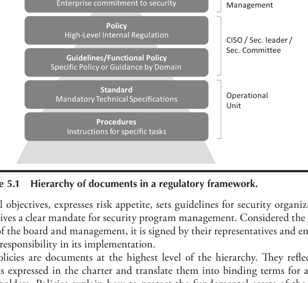

### 图 5.1 监管框架中文件的层级。

政策是层级中最高级别的文件。它们反映章程中表达的愿望，并将其转化为对所有利益相关者的约束性条款。政策解释如何保护公司的基本资产，指导每个人的安全工作，并确保法律和监管合规。一般而言，它们由以下组成部分构成：

- 上下文的解释
- 政策的存在理由
- 一般原则
- 范围及其接收者
- 安全管理系统的治理要求
- 内部监管框架
- 安全系统管理的组织、所有安全领域所有行为者的主要职能和职责，包括用户责任，以及各领域的安全态势描述

政策由董事会和管理层验证，但仍属于安全委员会和首席信息安全官的财产。

指南、指令或功能性政策是总结流程、业务部门或特定领域安全要求的文档。它们还可能包含对某些政策概念的更详细解释，例如数据所有者的责任、技术或产品的使用方式（互联网、移动设备、云计算）、员工行为准则等等。内部监管框架中这一层级的文件不涉及特定技术或产品的名称，并由负责监督的首席信息安全官和安全委员会负责。

*标准* 将政策和指南的要求转化为系统用户可操作的条款。这些是与顶层要求相关的具体指令，例如基线安全规范、系统安全配置、使用移动设备的说明、加密系统或文档保护、密码规则、应急程序等等。这些文件由运营部门负责人（业务部门负责其运营相关的说明）或 IT 部门负责制定并拥有，以确保系统安全。

*程序* 或最低层级的文件可以看作是“配方”。这些是技术文件，详细规定运营程序（例如加固、加密、密码恢复等程序）。它们由负责相关产品或程序的人员负责并拥有。

### 示例

为了说明监管文件各层级之间的差异，我们将使用两个例子：身份和访问权限管理以及数据保护。

### 身份和访问权限管理

安全章程：
“我们主张集中管理并监督访问权限 ...”

在政策或功能性政策层级：
“访问权限是基于业务角色分配的 ... 业务角色由业务部门经理建立 ... 角色建立在最小权限原则之上（足以执行特定任务） ... 数据所有者验证数据访问请求 ... 组织、角色和职责如下 ...”

在标准层级（运营）：
“在获得员工经理和人力资源部门授权后，操作员在不同平台上触发权限授予流程。”

## 数据保护

安全章程：

> “我们的数据必须根据其机密级别受到保护……”

在政策或功能政策层面：

> “数据分类如下……按类别划分的数据保护规则如下……任何处理高度机密数据的应用程序都必须使用强身份验证系统……”

在标准层面（操作）：

> “要使用强身份验证开发应用程序，应使用以下标准……”

内部监管文件的层级分类在安全文献中最常被提及。我们可以认为文件数量与其层级成反比，因此形成金字塔形。

### 5.2.2 按业务单元或业务部门分类

拥有多个独立或地理分布业务单元的大型公司可以为其单元选择不同的监管框架。制药行业的研发和销售可能没有相同的风险偏好。前者处理机密数据，因此可以采取一系列后者无法接受的保护措施。

因此，内部监管要求在同一个公司内部可能有所不同。这称为安全监管框架的隔离或差异化。尽管其简单，但隔离监管框架会遇到困难，因为使用相同的IT基础设施。以应用服务器的虚拟化为例。如果公司的IT架构在物理架构中没有考虑数据分类级别，那么同一台物理服务器可能托管不同机密级别的应用服务器。这可能会妨碍或至少使访问权限或可用性法规的隔离变得非常困难。当IT基础设施由风险偏好不同的业务单元共享时，仅针对风险偏好最低的单元调整的单一政策将损害其他单元。

理论上，我们可以按业务单元、业务部门、地理分布等制定不同的内部法规（图5.2）。

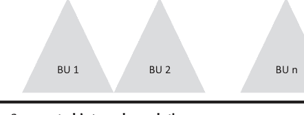

图5.2 隔离的内部法规。

**示例**

随着个人生产力应用程序和智能手机、平板电脑或笔记本电脑等移动设备的普及，内部法规可以根据每个单元的风险偏好授权使用这些设备（自带设备，BYOD）。在手表制造商的装配部门，这些设备可能会被禁止，但在市场营销和销售部门则可能被授权。

### 5.2.3 按域分类

许多安全域，如身份和访问管理（IAM）、移动性、IT开发、人员风险或新技术，可能需要一套从政策到技术流程的内部监管文件。在这种情况下，必须包含第三个维度，即跨所有业务单元的特定域监管（图5.3）。

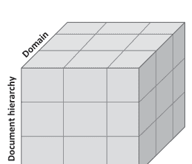

图5.3 三维监管框架。

**示例**

IAM流程在同一公司的不同组织单元之间可能有所不同，特别是在重大重组、合并或收购之后。因此，与此活动相关的政策、指南和标准可能在各单元之间有所不同。

关于移动设备使用的内部法规也可能因风险偏好、数据特征、使用中应用等而因公司单元而异。

地理单元可能在不同立法下运作，因此使用适应其运营流程的指南。

*内部监管框架文件应如何组织？*

### 5.3 内部法规的文档框架

每个公司都需要一个从政策到流程的内部法规文档框架。此框架的设计非常重要，因为它有助于理解法规并使其被员工接受，加强治理，并允许负责人轻松维护。前面介绍的矩阵或三维文档框架适用于具有多样化业务单元和风险偏好的大型公司。较小的公司显然不需要开发此类结构，只需一份总结业务运营规则的文件和一套IT标准即可满足。

我们经常看到的错误是不同层次文件的积累，有时重叠，几乎没有空间留给更正式组织的文档框架。因此，明确每种类型文件在公司或业务单元中的位置非常重要，从而促进文件在公司内网中的可访问性。

如果不需要在业务单元之间区分政策或指南，则按层级分类就足够了。需要根据业务性质隔离政策的公司可以使用简化版的三维模型，如图5.4所示。

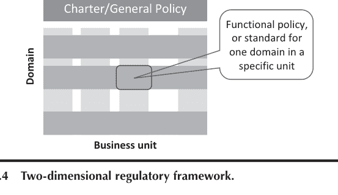

图5.4 二维监管框架。

安全章程和总体政策对整个公司仍然是唯一的。同一政策中，不同业务单元在安全政策、风险偏好、组织或背景方面可能存在一些差异，前提是这些差异得到清晰呈现。在域和单元的交叉点，将找到针对特定单元（例如销售）的特定域（例如移动性）的不同级别的文件。如果必须为特定域制定政策，我们可以使用术语*功能政策*。

当需要在特定域中制定非常高层的规则集时，功能政策非常有用。以下是目标域的一些特征，可用于决定是否为其建立特定的功能政策或调整总体安全政策：

- 背景的一些特殊性（内部或外部）
- 风险、威胁和漏洞的特定性质
- 法律和监管框架的具体特征
- 安全组织中的特征方面（角色和职责）
- 特定域的概念和术语
- 要实施的控制措施的特殊性

> **示例**
> 
> 网络安全、个人数据保护和IAM可以被视为特定领域或安全域，值得拥有自己的功能政策。

*安全政策中包含什么，它是如何构建的？*

### 5.4 安全章程和政策的内容

接下来，我们将更详细地了解章程和政策（或功能政策）的内容。没有普遍认可的模式或框架被认为是安全政策的最佳选择。每个组织都可以根据其需求设计其政策文件。然而，可以就政策的内容和形式提供一些一般性建议。它们旨在使其更易读、更全面，并最终对组织中的所有利益相关者更有用。前面已经陈述了一些主要大纲。我们现在将看到它们如何具体转化为文件。

### 5.4.1 安全章程的内容

表达公司保护其财产的主要安全取向的最高级别文件可能采用不同的名称，如章程、行为准则、意向声明等。它传达了管理层对安全的有力承诺，并阐述了赋予它的任务。安全章程描述了公司在信息安全方面的主要目标，而不具体说明如何实现这些目标。它通过提及业务行为背景、遵守法律和监管框架、对员工道德行为的要求、公司的价值观和文化、安全保护原则和个人责任，表达了管理层对其保护系统的承诺。主要章节及其内容摘要如下。

**引言或背景**

- 介绍公司的背景和主要问题、其制约因素以及保护其价值观的重要性
- 提醒公司的文化以及为什么支持安全工作
- 表达拥有适当安全系统的意愿
- 公司保护资产包括个人信息（客户、员工、供应商等）的责任

**范围与目标受众**

- 介绍章程的范围及其面向的对象
- 特别提及文档框架的重要性及其在管理安全计划中的实用性

**高层职责**

- 战略角色和职责的概要介绍：数据所有者、治理机构、执行安全管理、员工职责等

**应提及的一些原则**

- 保护公司价值观
- 风险管理
- 员工权利与责任

**管理目标**

- 安全治理和组织目标
- 安全管理目标及对公司运营的参与

## 5.4.2 安全策略的内容

策略或功能性策略陈述了整体安全或特定领域安全的广泛方向和指导原则。安全策略有很多示例。以下是一些主要章节的总结，仅作为示例，并非详尽无遗。

### 引言或背景
- 公司的内外部环境，以及安全策略在实现业务目标方面的问题和重要性
- 策略的目的、覆盖范围及其存在的原因
- 高层级要求的宣告

### 范围和目标受众
- 本策略的范围——面向谁，谁应执行
- 策略所依据的原则（法规和规范框架）
- 策略的目的以及发起人或所有者的意愿

### 策略在内部法规框架中的定位
- 如有必要，提醒内部法规的文档框架以及本策略的（层级）定位

### 原则
- 列举策略的基本原则（策略力求实现的目标）

### 策略声明
- 制定策略目标的高层级声明
- 解释每项声明的理由、其存在的意义以及应如何应用（不涉及具体实施方式）

### 组织、角色与职责
- 信息安全的治理与管理
- 主要职能和职责：董事会、委员会、管理层、安全团队和CISO、业务部门及其安全代表、IT和运营、数据所有者以及安全专家
- 所有员工的责任以及他们遵守策略的义务
- 负责、问责、咨询和知情（RACI）矩阵，总结所有相关职能的职责

### 特定领域的指导方向

如果无需制定具体的功能策略，某些安全领域或域的高层级指导可以包含在总体策略中。
- 风险管理概念
- 人员安全
- 资产定义及其保护要求
- 物理安全（实体安全）
- 数据保护、数据隐私
- IT安全（采购、配置、变更管理、使用、外包）
- 业务连续性
- IAM
- 合规性
- 事件管理
- 报告系统
- 针对特定领域的额外解释（例如，如果是网络安全功能策略，则包括网络攻击类别）

### 不合规时的纪律处分

### 评审流程

### 术语表
- 解释一些特定术语以提高清晰度

*文档框架是如何建立的？*

## 5.5 建立法规框架的流程

最后，我们应如何构建或评审内部法规框架？制定策略、指南或标准的步骤是什么？我们可以使用模板吗？最重要的是，如何确保框架是完整的？

这些问题有多种答案。但请记住，基于预定义示例或模板构建文档框架并不可取，因为这会削弱安全治理。如果管理层认为文档框架毫无用处，那么还不如不建立，而不是将其作为借口。高级管理人员需要参与并在不同层面验证策略内容。法规框架的文档还必须服务于所有员工的日常工作。因此，它必须由所有利益相关者设计并接受。

以下是一些务实的步骤，既适用于法规框架的构建，也适用于其修订。

### 1. 准备
1.1 理解业务背景和战略，特别是不同业务部门的风险偏好和安全需求。理解现有框架及其是否部分适用。
1.2 理解哪些资产需要保护。如有必要，与业务部门合作绘制数据、流程和应用图谱。如果尚未完成，则根据公司标准或临时分类（例如，公开、受限、机密）对这些资产进行分类。
1.3 审查安全风险目录、风险评估和相关控制措施。如有可能，建立与主要风险相关的控制成熟度图谱。
1.3 决定是否在不同部门之间隔离总体策略。如果公司从事具有不同风险偏好的业务，则应将各部门视为采用不同方法制定其法规框架的公司。
1.4 定义法规框架的架构（基于前面解释的三个维度或其他维度）。决定如何访问法规框架。
1.5 确定谁将参与法规框架的制定；理想情况下，他们应是管理层、业务部门和IT的代表。确保管理层和董事会认为他们拥有将成为章程和公司总体安全策略的文件。

### 2. 策略制定
2.1 讨论并决定安全治理和管理的组织与职能（更多内容见第6章“组织”）。
2.2 与负责实施安全控制的团队以及负责业务部门运营的团队一起，识别法规框架中需要澄清的重要点。这种自下而上的方法至关重要，因为最终将赋予未来策略合法性。这可以通过问卷或在战略中开发的安全流程成熟度模型来完成（见前一章）。
2.3 与团队成员合作制定章程和总体安全策略。使用前面章节提出的布局。
2.4 让业务部门和IT验证章程和策略。这非常重要，因为章程和策略应得到运营部门的全力支持。遵循SMART规则（具体、可衡量、可达成、现实和有时限）。
2.5 确保策略得到董事会和管理层的验证。

### 3. 制定功能策略或指南
3.1 组建一个由参与特定安全领域运营管理的人员组成的团队，这些领域需要特定的功能策略（例如网络安全、IAM、连续性、移动性或数据保护）。确保该策略得到领导者或负责其未来应用的人员的支持。
3.2 按照总体策略的方式继续制定功能策略（2.1–2.5）。

### 4. 建立标准

在建立内部标准时，可以使用ISO 27001（及其附录A）作为核对清单，以验证法规框架的完整性和覆盖范围。

表5.1提出了内部法规框架中涉及ISO 27001要求的文档定位建议。当然，标准必须遵循策略、指南或功能策略的建议，并为运营提供其他必要的指示。如果表5.1中未具体提及某项要求，则由更高层级的文档处理。例如，“A.11物理和环境安全”及所有更低层级的要求将包含在物理安全功能策略文档中。

以下是在法规框架制定过程中是否已采取所有预防措施的核对清单。

- 1. 我们的内部法规文档是否具有良好的粒度水平？
  
  业务特征决定了正确的粒度水平。对于所有运营职能均由内部控制的企业，高粒度（细节少）可能就足够了。
- 2. 我们是否覆盖了所有主题？
  
  如果没有，请找出差距，传达这些差距，并计划纠正措施。这主要涉及未来主题，如关于新技术或威胁的法规。内部项目规划或用于制定新法规文档的项目路线图对审计和所有利益相关者非常有用。我们还可以利用变更项目来包含功能策略或缺失流程的制定。
- 3. 我们能否优化法规框架，并最终删除、精简或重组某些文档？
  
  在制定新的功能策略之前，先看将其纳入现有策略或指令中并加以更新是否更好。例如，有关个人数据保护的策略可以整合到现有数据保护策略中。
- 4. 我们的内部法规是否最新且所有人都能访问？我们是否为所有法规框架文档建立了评审流程和职责？

最后，请记住，一个对业务部门、IT以及公司和人力资源职能没有感知价值的文档框架没有存在的理由。确保其充分性的最佳方式是在意识培训期间、启动新的变更项目时，或在安全部门与业务部门之间的协调会议中，系统性地并尽可能频繁地将其提交给关键利益相关者。

## 表 5.1 在处理 ISO 27001 标准要求的内部监管框架中的文档定位

| ISO 27001 参考控制目标（附录 A） | 在框架中的定位 |
|---|---|
| A.5 信息安全方针 | 内部监管框架 |
| A.6 信息安全组织 | 方针 |
| A.6.2 移动设备和远程办公 | 指南/职能方针 |
| A.7 人力资源安全 | 指南/职能方针 |
| A.8 资产管理 | 指南/职能方针 |
| A.8.2 信息分类 | 方针 |
| A.8.3 介质处理 | 标准/规程 |
| A.9 访问控制 | 指南/职能方针 |
| A.9.2.1 用户注册和注销 | 标准/规程 |
| A.9.2.2 用户访问权限配置 | 标准/规程 |
| A.9.2.3 特权访问权限管理 | 标准/规程 |
| A.9.2.4 用户秘密认证信息管理 | 标准/规程 |
| A.9.2.5 用户访问权限审查 | 标准/规程 |
| A.9.2.6 移除或调整访问权限 | 标准/规程 |
| A.9.3 用户职责 | 方针 |
| A.9.4 系统和应用程序访问控制 | 标准/规程 |
| A.10 密码学 | 标准/规程 |
| A.11 物理和环境安全 | 标准/规程 |
| A.12 运行安全 | 标准/规程 |
| A.13 通信安全 | 标准/规程 |

## 表 5.1（续）在处理 ISO 27001 标准要求的内部监管框架中的文档定位

| ISO 27001 参考控制目标（附录 A） | 在框架中的定位 |
|---|---|
| A.14 系统获取、开发和维护 | 标准/规程 |
| A.15 供应商关系 | 指南/职能方针 |
| A.16 信息安全事件管理 | 标准/规程 |
| A.17 业务连续性管理的信息安全方面 | 指南/职能方针 |
| A.18 合规性 | 方针/指南 |

## 5.6 结论

本章介绍了内部监管框架的重要性及其不同特征，并介绍了建立或修订该框架的系统方法。显然，这并不是一套必须不惜一切代价严格遵循的固定配方，而是我们可以据以开展工作的原则，因为每个组织的需求各不相同。然而，必须牢记建立这一框架的目标：汇集所有指令，以便于实施保护策略。公司可以为其较低层级的方针和文档采用不同的形式或文档框架，但这些内容必须完整、一致，并满足所有利益相关方的需求。

## 6.1 信息安全（IS）中的角色和职责

如前所述，治理与安全管理之间不存在明确的界限。再次审视战略与运营之间连续性的示意图（见第 1 章图 1.3），我们可以说，治理任务通常分配给以下职能：

- 董事会
- 安全委员会
- 业务部门管理层（包括首席信息官 [CIO]）

而运营管理任务则由以下职能分担：

- CISO 及其团队
- 安全运营管理（图 6.1）

*董事会*是公司治理的最高机构，因此也是信息安全治理的最高机构。董事会对风险及为降低风险而采取的行动负责，负责验证战略，确保资源得到负责任的使用，并作为绩效报告和审计的优先接收者。监控绩效是其面向利益相关方所承担的职责之一。对董事会而言，遵守法律和监管框架应当是良好管理的结果，而不应成为其自身目标。

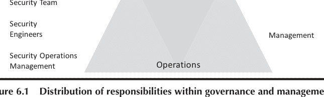

图 6.1 治理与管理中的职责分配。

安全委员会可以根据需要成立并承担各种职责：制定或验证战略和方针，确定计划的优先级，就需要战略决策的问题作出决定，或在所有安全计划决策过程中代表董事会和管理层。这些委员会可以采取不同形式，通常由业务部门、公司职能部门和人力资源（HR）职能部门、信息技术（IT）管理层以及 CISO 的代表组成。

业务部门经理通常在协调和支持作为既定战略组成部分的安全计划方面发挥重要作用。由于该战略是与业务部门共同针对其需求制定的，部门经理会积极参与在各自部门内传播和支持安全文化。CISO 在协调安全工作并从战略上使安全与业务部门和管理层的需求保持一致方面所发挥的作用，有助于实现这一目标。

CISO 及其团队在公司的安全组织中发挥着至关重要的作用，因为他们集中了大部分管理和安全运营活动。近年来，人们越来越认识到 CISO 及其团队的重要性和职责。他们拥有更高的可见度，承担更多战略职责，更加注重治理和风险，并且越来越多地向 IT 以外的部门以及 C 级高管进行报告。

### 示例

在当前需要更严格地控制成本，同时确保信息安全符合监管要求或技术发展的背景下，CISO 越来越多地受邀参与战略决策，并向 IT 之外的机构报告。

技术变革、新的业务模式以及流程数字化给公司带来了新的挑战。人们越来越多地为 CISO 提出新的职责，这些职责不仅涉及与新技术相关的安全风险缓解，也涉及治理领域。其中包括：

- 向治理机构、委员会和业务部门报告并开展安全沟通
- 提出安全战略
- 制定监管框架
- 实施安全控制措施并进行计划管理
- 安全风险管理（识别、评估和处置）
- 为所有利益相关方制定安全意识计划
- 监控（威胁、漏洞、合规性和控制措施的有效性）

运营经理和安全专家属于负责运行安全控制措施、工具及其他技术解决方案的团队。他们主要负责：

- 基础设施安全（网络、服务器、工作站和端点）
- 设备管理（防火墙和入侵防御/检测系统 [IPS/IDS]）
- 安全信息和事件管理（SIEM）
- 安全运营中心（SOC）
- 事件管理
- 身份和访问管理

ISO 27014 标准规定了信息安全治理中的两个主要机构：治理机构和执行管理层。正如第 1 章所述，它们在治理流程中共同开展工作。治理机构本质上承担决策角色。它可以由管理层成员、董事会成员或业务部门经理组成。安全委员会也可以承担这一角色。执行管理层的职责可以由信息安全经理以及 CISO 及其团队承担。

### 示例

以 ISO 27014 标准中的“监控”（实现战略目标）为例。该流程需要若干输入，其中一些应由治理机构负责，包括：

- 评估信息安全管理活动的有效性。
- 确保符合内部和外部要求。
- 考虑不断变化的业务、法律和监管环境，以及它们对信息风险可能产生的影响。

然而，在实践中经常可以发现，CISO 及其团队承担了这些原本旨在支持决策的任务，因为管理层认为他们最具资质。ISMS 的有效性由安全专家自行评估，合规程度由 CISO 评价，而变更需求的提出既没有正式的风险分析，也没有对投资回报进行评估。显然，这不利于治理机构承担其安全职责。

治理机构与信息安全管理层之间的协作，也可以通过一个迭代过程来示意，该过程旨在持续改进现有控制措施与公司需求之间的一致性（图 6.2）。治理机构根据公司目标设定安全目标。这些目标随后会对信息安全计划产生决定性影响，而该计划由 CISO 负责。公司将部署控制措施以满足保护需求。CISO 将监控控制措施的有效性，并向治理机构报告；治理机构随后可以调整高层目标，如此循环往复。

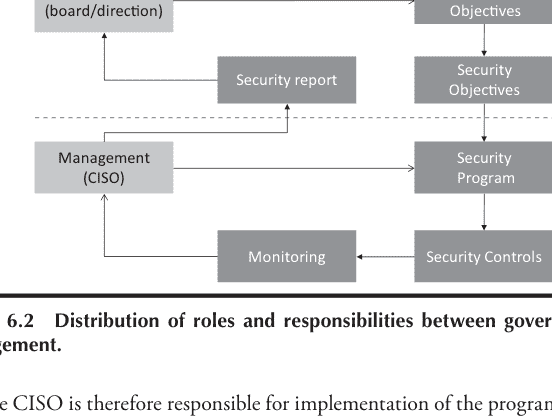

**图6.2** 治理与管理之间的角色和职责分配。

因此，CISO负责计划、控制措施和运营的实施。战略、风险偏好和安全政策仍由治理机构负责。将战略转化为信息安全目标，再转化为行动计划和控制措施的责任由CISO承担。

我们还可以通过应用于三级控制框架（TLCF）模型的RACI（负责、问责、咨询和知情）矩阵来总结信息安全治理与管理中的主要职责（表6.1）。

**表6.1 TLCF各模块中不同治理机构的职责**

| R：负责 A：问责 C：咨询 I：知情 | 董事会 | 管理层 | CISO及团队 | IT | 人力资源 | 业务部门 |
|---|---|---|---|---|---|---|
| 战略 | A | I | R | C | C | C |
| 监管框架 | I | A | R | C | C | C |
| 章程 | A | I | R | C | C | C |
| 政策 | I | A | R | C | C | C |
| 指南 | I | A | R | C | C | C |
| 标准 | I | I | A | R | R | R |
| 风险管理 | A | I | R | C | C | C |
| 计划管理 | I | A | R | C | C | C |
| 报告与监督 | A | I | R | C | C | C |
| 资产管理 | I | A | C | R | R | R |
| 合规管理 | A | I | R | C | C | C |
| 指标与KPI | A | I | R | C | C | C |

表6.2给出了前面确定的治理职能应承担职责的另一种表述。以“战略对齐”目标为例，董事会的作用是“为可证明的对齐设定方向”，而CISO的作用是“制定安全战略，监督安全计划和举措”。董事会在绩效衡量中的作用是“为安全有效性报告设定方向”。

**表6.2 不同信息安全治理机构之间的职责分配**

| 管理层级 | 战略对齐 | 风险管理 | 价值交付 | 绩效衡量 | 资源管理 | 整合 |
|---|---|---|---|---|---|---|
| 董事会/受托人 | 为可证明的对齐设定方向 | 为适用于所有活动和法规合规的风险管理政策设定方向。 | 为安全活动成本和受保护信息价值的报告设定方向。 | 为安全有效性报告设定方向。 | 为知识和资源利用政策设定方向。 | 为承担流程整合的政策设定方向。 |
| 高级管理人员 | 制定流程，将安全与业务目标相结合。 | 确保所有活动中的角色和职责都包含风险管理。监督法规合规性。 | 要求对安全举措和受保护信息的价值进行业务案例研究。 | 要求提供监控和指标以报告安全活动。 | 确保知识获取和效率指标的流程。 | 监督所有管理流程职能和整合计划。 |
| 指导委员会 | 审查并协助安全战略，并整合各方努力，以确保业务部门经理和流程负责人支持整合。 | 识别新兴风险，推广业务部门安全实践，并识别合规问题。 | 审查并就安全举措在服务业务职能方面的充分性以及以已启用服务形式交付的价值提出建议。 | 审查并就安全举措实现业务目标的程度提出建议。 | 审查知识获取和传播的流程。 | 识别关键业务流程和管理保证。指导服务提供方。指导整合工作的保证。 |
| 首席信息安全官 | 制定安全战略，监督安全计划和举措，并与业务部门经理和流程负责人保持联络以实现持续对齐。 | 确保风险和业务影响评估，制定风险缓解策略，并执行政策和法规合规性。 | 监控安全资源的利用效率和有效性、声誉以及信任的交付。 | 开发和实施监控、指标收集、分析和报告方法。指导并监督安全。 | 开发知识捕获与传播的方法。制定有效性和效率指标。 | 与其他管理流程职能保持联络。确保识别并解决差距和重叠。 |

来源：《信息安全治理：董事会和高层管理指南》，第2版，IT治理研究所，2006年

最后，无论治理和管理机构如何设置，都必须牢记其权限范围。在小公司中，同一人可能身兼数职，而在大型组织中，可能会有整个团队来承担。

*安全官的角色将如何演变？*

## 6.2 对CISO及其团队的新要求

技术控制措施至关重要，是任何安全计划（也称为信息安全计划）的基础。然而，在构建该体系时采用被动方法并不能保证最佳保护，尤其是在今天，随着新业务模式的发展、活动扩展到公司边界之外以及新的通信手段的出现。在组织CISO及其团队的活动时，需要一种新方法，特别是在制定战略、在设立安全计划时整合业务部门、提高控制措施对业务部门需求的适应性，以及积极主动地应对风险。其原因是多方面的。

技术无法快速适应新威胁，这些威胁不仅来自网络空间，也来自公司内部，其原因包括新的通信技术和IT消费化、活动扩展以及第三方服务的整合。公司边界不再僵化，活动扩展的趋势给安全管理者带来了新的挑战。为适应这一演变，CISO必须改进其规划，并通过采用基于公司现实的计划来证明其举措的合理性。

这种新环境要求重新审视安全团队的组织。运营安全团队的活动需要更深入地融入业务运营，并且需要比纯技术更广泛的技能。这些变化将为CISO及其团队带来更高的认可，并使他们成为业务发展讨论中的合作伙伴。安全团队将不再仅由保护技术专家组成。其在整体组织中的定位将取决于公司特征和实际需求。在最复杂的情况下，它不仅需要确保技术运营和部署，还需要处理风险和架构，同时确保与业务部门和治理的有效协调。

对安全的要求正在不断提高。当前环境、数字经济技术演进以及经济合作伙伴之间的相互依赖，对安全官及其团队日益增长的要求起到了重要作用。董事会和管理层要求CISO提供最佳保护，并为业务部门交付切实的价值，但预算却停滞不前。CISO的职位也在从IT部门内部的技术管理者转变为更直接向公司最高层或C-level汇报的高管角色。

尽管CISO职责的这种演变无疑是令人鼓舞的，但并不总是伴随着对基础组织的必要调整。董事会和管理层经常要求CISO及其团队承担更多责任，却没有进行必要的投资和资源调整。企业安全治理的相对不成熟显然与此有关。这导致CISO和安全团队常常被新任务压得喘不过气来。他们继续与日益复杂的威胁作斗争，却无法满足在战略、治理和主动风险管理方面加强关注度的期望。

传统上专注于运营的CISO及其团队现在必须扩展其活动范围，更多地参与管理各项举措，以实现更好的治理、合规以及与业务目标的对齐。他们的安全职责范围正在扩大，现在从战略延伸到运营。在战略、需求和业务要求这一连续体与当前网络威胁和员工IT消费化背景下需要加强的运营保护之间，这种“巨大差距”将在未来加剧（图6.3）。

显而易见，如果资源不变，安全团队无法在主动管理风险的同时确保运营平稳运行并满足战略需求。在这种情况下，有两种可能：

- 1. 调整安全组织，增加资源，以确保对治理、战略和风险提供更大支持，或
- 2. 通过改变现有团队的需求规格，将安全运营外包或委托出去。

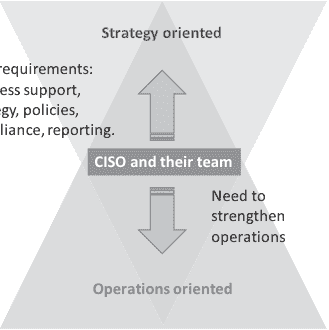

**图 6.3** CISO 职责的演变。

许多公司将安全运营外包服务作为安全即服务（SaaS 或 SecaaS）提供。然而，这种安全运营的外包只有在特定条件下才可行。为了在经济上划算，成熟度必须很高，满足以下条件：

- 安全运营已得到良好建立和优化
- 控制措施有效
- 服务基于服务级别协议（SLA）
- 所有运营均遵守既定标准
- 基础设施已适配，访问权限得到保障
- 有定期的监控（跟进）流程。报告系统已定义并基于稳定的指标
- 安全运营的管辖权仍保留在内部。变更仅由内部运营经理发起
- 风险场景已建立并受监控
- 外包框架中制定的指标也可用于向治理机构报告
- 外包运营必须可审计，尤其是在合规性、连续性、商定的控制措施或保护敏感数据的手段方面
- 外包不会降低保护水平
- 其他活动的组织不会因外包而削弱。释放的资源可以改变职能并处理其他任务

因此，CISO 的职责有两个主要极点。安全组织将取决于他们在运营—战略或治理、风险与合规（GRC）轴上的位置，如图 6.3 所示。这两种取向的一些关键特征将在以下段落中介绍。

*安全团队的职责将如何演变？*

## 6.3 安全团队的角色与职责

安全团队的传统活动可分为两大类：安全工程和安全运营。无需过多细节，这两类包含以下活动。

安全工程：

- 应用安全
- 威胁与漏洞管理
- 项目与新技术中的安全

安全运营：

- 基础设施安全（配置、网络、端点）
- 管理安全组件
- 监控、设备管理和 SOC（安全运营中心）
- 事件管理与调查
- 身份与访问管理

如今的安全团队通常承担所有这些活动，为 IT 部门提供巨大的附加值。许多书籍和标准提供了关于运营级安全管理目标和最佳实践的更多细节。

对 CISO 及其团队的新需求也可以分为两类。第一类涉及 *业务关系* 取向，包括旨在加强治理机构、业务部门和安全运营之间联系与协调的活动。它涉及将战略整合到运营中，并确保治理与业务部门这一方与实施控制的团队另一方之间有更好的双向沟通。第二类可称为 *主动风险管理*，包括在变化的环境中提供更好风险分析和处理的所有活动，考虑新技术、新业务模式和工作方法、用户赋权或消费化、活动外包、云计算、移动技术等。

业务关系中所包含的主要新需求可总结如下。

*业务沟通、安全账户管理与营销：* 业务经理通常不愿与技术背景人员讨论安全风险，因为他们认为这不是他们的专业领域。IT 将暴露在互联网上、容易成为黑客攻击目标的服务器进行打补丁这一事实，并不能为 IT 资源的使用者提供有价值的信息。然而，如果告诉他们该服务器提供的服务可能因入侵而不可用，这可能会让他们更加重视安全论点。此外，业务部门有 CISO 团队可以满足的特定安全需求：针对特定情境的培训或意识提升、与其具体运营相关的风险识别和安全控制、指南和标准等。这些服务非常有价值，但它们需要特定的安全资源，如账户管理或客户关系管理。安全营销也是促进治理的一项活动：使用正确的工具、在正确的层面传达安全附加值。讲述通过安全获得收益的成功案例，使其以更好的定位融入决策过程。“内部安全”或“从安全角度设计”可能成为向客户和合作伙伴提供的服务的质量标签。

*战略与业务对齐：* 在上一章中，我们讨论了制定安全战略并使其与业务需求保持一致的重要性。实际上，定期监测业务方向和需求有助于安全对齐。通过客户经理或业务部门代表作为安全倡导者，或反之亦然，建立信息交流机制，只会带来好处。

*业务报告与指标：* 良好的治理需要基于可靠的关键绩效指标，以易于理解的语言表达趋势的安全报告。仅仅呈现保护系统产生的原始指标（如已应用补丁的数量）已远远不够。应当监测安全如何帮助业务实现其目标的趋势。这将在关于报告和指标的章节中更详细地讨论。

*意识提升与支持：* 意识提升一直是 CISO 及其团队的主要任务之一。然而，仅仅重复指南已不再足够。这一领域的需求也在变化，业务部门现在需要针对他们最关心主题的支持会议。仅针对最终用户的标准化意识培训可能无法与关键高管和其他决策者产生足够共鸣。意识提升工作必须更专注于实际工作现实，并结合对日常活动的支持。

*合规与项目组合管理：* 安全始终部署控制措施以满足特定法规、审计报告、客户请求等。项目组合管理必须包含监管要求，并通过能为业务带来价值的举措对其进行平衡。良好的治理关注安全项目组合，并全面审视所有要求，无论是内部还是外部的、审计发现、新威胁还是合作伙伴的请求。保持与需求和路线图的清晰映射，使企业能够理解安全项目之间的联系及其对共同目标的贡献。

安全不再是发展的障碍，而是成功因素。对安全团队的新需求主要导致他们更深入地参与变更管理，尤其是在预测和缓解新风险（主动风险管理）方面。

*策略管理：* 管理作为治理基础组成部分的监管框架仍由安全团队负责。CISO 团队有责任维护策略，并帮助包括 IT 在内的业务部门根据公司需求维持其标准。频繁变化的例外请求通常表明策略和指南不充分。

*第三方与外包风险管理：* 许多公司外包其活动，或在价值生产链中依赖外部服务提供商。安全团队被要求像保护内部资源一样保护共享数据和资源。这对安全专家来说是一个非常困难的局面，因为事后几乎无法保护这些运营。因此，安全团队必须参与选择过程，并参与主动风险分析。它可以帮助选择合作伙伴、应用推荐的保护标准、进行审计和尽职调查。

*主动风险评估：* 与新项目和业务举措相关的风险评估服务受到高度赞赏。这是安全团队能够展示其对变革过程贡献的少数场合之一。

### 示例

使用云服务并搭配第三方供应商提供的应用程序，对业务部门来说是一个有吸引力的解决方案。然而，如果这项举措在没有安全团队支持的情况下进行，几乎可以肯定的是，在投产前的审计或风险分析会发现新的漏洞。安全团队事先进行的风险分析可以揭示风险并提出潜在解决方案。

*安全架构：* 建立并加强结合技术和基于策略流程的安全架构，将是未来几年安全团队最受欢迎的能力之一。从公司策略和目标或业务举措出发，安全架构师将为负责建立技术控制的团队制定标准和概念。安全架构师具有双重角色。他们不仅能够识别风险并向治理机构传达，还能提供最符合企业环境的解决方案。一旦做出决定，架构师会制定概念和标准，并参与解决方案的设计。架构师和工程师还参与项目，确保概念和标准得到遵守。他们在论坛中代表安全，并参与公司架构师小组的工作。

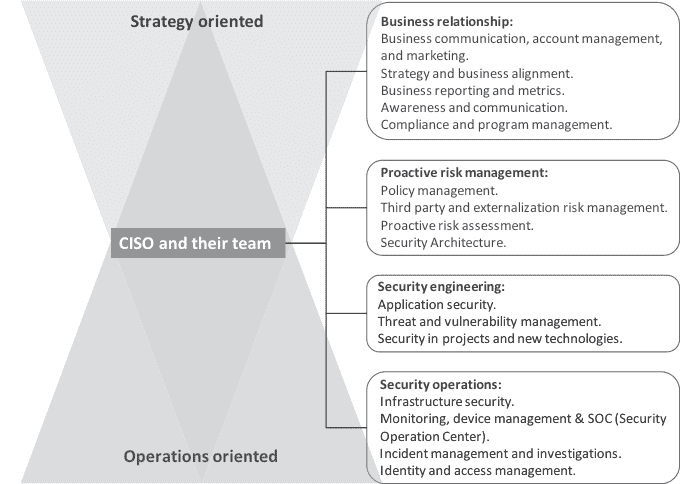

**图 6.4** CISO及其团队的职责集合。

在说了这么多之后，传统的面向运营的活动以及更接近战略、风险和治理领域的新的活动在图 6.4 中以示意图的方式展示。

> 新任务——好的，但需要覆盖哪些新领域？

## 6.4 CISO及其团队的新职责领域

除可在安全服务中看到的定性变化外，尤其是 CISO 及其团队的某种纵向演进，与安全相关的一些新领域正在地平线上出现，这些领域很可能会影响安全服务规范。其中包括网络安全、人力风险与调查、欺诈管理，以及个人数据保护（数据隐私）领域服务。

### 网络安全

安全和 IT 团队自然负责实施网络威胁防护措施。必须部署的防护措施通常超出了企业的范围。因此，CISO 必须积极参与讨论论坛，与国家（政府）协调机构合作，并报告观察到的事件。

### 人力风险管理与调查

众多统计数据、调查以及各行业最近发生的事件表明，主要威胁并非来自孤立的黑客，而是来自具有内部共谋的先进持续性威胁（APTs）或在疏忽的安全设备上打开的门（例如，打开电子邮件中的附件文件导致恶意代码安装），以及恶意员工。人力风险管理包括建立新的控制措施以检测异常活动的先兆信号。人力风险应在专门的人力资源部门中处理，但调查或筛查技术技能通常在安全服务中被寻求。

### 欺诈管理

欺诈企图可以以不同形式表现出来。新的通信手段、个人数据的可用性以及新技术显然为恶意人员提供了机会。这些大多是通过利用业务运营来勒索金融资产、机密信息或任何种类的利益的企图。故意违反内部规则（可能称为违规）只有在利益实现得到证明后才可被视为欺诈。与人力风险一样，欺诈管理应由安全服务之外提供。然而，仅就调查或取证问题而言，安全专家在该领域的需求将日益增加。他们还必须制定特定的指标或控制措施来检测欺诈企图。

### 数据隐私

无论是法规要求还是企业自身要求，对机密或个人数据的保护措施都会影响信息安全。第 3 章已给出一些这种影响的例子。就安全组织而言，法规要求的新职责主要涉及数据处理者、数据控制者、数据所有者以及数据保护官（DPO）。

*主要的安全组织结构是什么？*

## 6.5 安全组织结构

安全组织结构反映了公司希望给予其安全团队的角色。该结构还决定了其实现既定目标的能力。不同职能的定位会影响安全专家招聘的策略以及安全官本人/她自己的地位。

没有一种适用于所有公司的最优或唯一的安全组织。因此，提出理想模型的任何尝试都是不可能的。公司的行业、规模和特征将决定负责安全的团队的定位和职责。每个安全组织配置都有其自身的逻辑，因此了解每个配置的特征和优势很重要。安全团队向最高战略层级的演进不应成为目标本身，而应源于公司与其环境相符的意愿。

安全组织通常可归类为以下四种原型之一：

- 1. 面向运营的安全
- 2. IT 安全
- 3. 企业安全
- 4. 分布式安全

### 6.5.1 面向运营的安全

面向运营的安全以技术和运营控制为重点（图 6.5）。该结构通常集成在 IT 运营中。

在这种组织中，安全官及其团队负责保护 IT 基础设施，选择最合适的技术并控制成本。其主要目标是限制事件数量（如安全设备故障和不可用）并打击新的威胁和漏洞。安全官通常没有 CISO 的头衔。他们在安全技术方面被咨询，参与 IT 项目以保护 IT 资源和数据，但与 IT 之外没有联系。他们有时会被邀请对业务举措的技术方面发表评论。

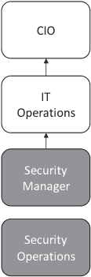

**图 6.5** 面向运营的安全。

### 6.5.2 IT 安全

IT 安全是一个处理 IT 层面的功能性政策和安全标准、技术解决方案向项目集成以及应用安全的组织。章程和总体安全政策不属于其权限范围。可以找到两个团队：一个是负责安全解决方案、概念和技术的 IT 工程部门；另一个负责运营，如前面所述。这种组织通常在所有安全技术领域具有高度集中的技能（图 6.6）。

最高级别的安全组件，如企业目录、强身份验证技术和系统、应用安全概念和标准等，都是其职责的一部分。安全工程师被系统要求作为支持参与 IT 项目。安全风险在 IT 风险的背景下进行管理。合规方面在 IT 特定项目中以与其他开发或变更项目相同的方式处理。

安全经理可能拥有 CISO 的头衔，即使这不是真正的 C 级。他们直接向 CIO 汇报，可能负责工程或安全运营团队。在某些配置中，他们是 IT 管理委员会的成员并参与技术发展的决策。CISO 与 IT 之外的联系很少，除非被询问与安全相关的技术。他们可能与企业的风险经理作为安全风险专家保持功能关系。他们为 CIO 和其他 IT 管理者提供建议，但不是公司战略委员会的成员。

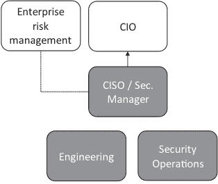

**图 6.6** IT 安全。

### 6.5.4 分布式安全

在非常大的组织中，出于成本、运营效率以及使专业知识更接近运营的考虑，通常最好建立一个具有分布式能力中心的安全组织。该组织涵盖了前面提到的企业安全的功能，但安全团队仍留在各个业务单元中，采用矩阵组织，并在 CISO/CSO 与地方官员之间建立汇报关系（图 6.8）。

这种组织形式在当前背景下可能是最自然和现实的。通过委员会或管理机构的强有力治理可以弥补 CISO 在安全团队中直接权威的部分丧失。然而，这种配置不仅需要治理的高成熟度，还需要内部监管框架中形式化安全文化。

> 未来的技能需求是什么？

## 6.6 安全概况

在新技术、新商业模式和更严格法规的影响下，安全组织将在未来几年发生变化。因此，有必要回顾一下在不同安全组织中肯定需要的一些技能。

每个安全组织都需要多种技能。首先，需要定义安全组织的结构模型，然后，确定可能缺乏的技能以及如何重新定义每位员工的角色。良好的平衡

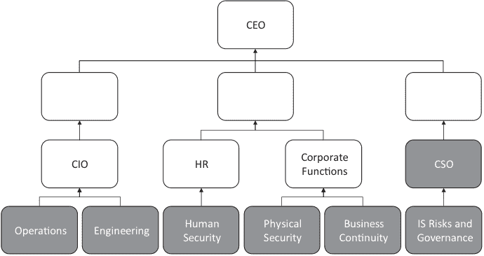

**图 6.8** 分布式安全。

需要在技术技能、风险管理专业知识、对威胁和漏洞的预见能力、对业务前景的兴趣、沟通技巧等方面取得平衡。如果安全组织的成熟度需要朝着与业务部门和战略更紧密对齐的方向发展，那么就必须在安全团队中灌输客户服务文化。

修订或建立适当的安全组织并非易事。因此，重要的是将所有利益相关者纳入讨论，并将这项任务视为公司项目或倡议来推进。以下是一些如今看来至关重要的角色，请注意，多个职能可由同一个人担任。

### 安全管理员

该角色拥有出色的技术技能，并注重运营质量。他们接受过防护技术的专门培训，和/或在系统基础设施领域有实践经验。他们的主要目标是通过设置技术屏障来确保边界和基础设施的保护。

### 安全工程师

安全工程师根据提供给他们的规格说明，寻找最佳的技术（可能还包括组织）解决方案。他们关注标准的质量以及所实施解决方案的效率和灵活性。在技术解决方案方面，他们的角色与安全架构师有所重叠。他们通常没有非常广泛的业务理解。在企业和IT部门选择不同的数据与基础设施安全保护方案时，这种角色作为顾问的需求很大。大多数情况下，他们专注于特定的安全技术或领域，如应用安全、系统和数据库安全、访问管理、企业目录等。他们作为安全解决方案的顾问，积极参与IT项目。

### 安全协调员

安全协调员在分布式安全组织（参见前文）中充当不同团队之间的促进者。他们的主要职责是解释信息系统风险与治理、运营或工程之间的要求和观点。他们通常属于IT部门，但由于其职责，他们与所有其他团队，特别是CISO有大量联系。他们主要关注政策和标准及其在业务流程中的解释和应用。这种角色接受过安全所有领域的培训并具备相应经验，且拥有出色的沟通技巧。

### 人员安全分析师

为了正确评估和处理人力资源风险，许多公司使用经过专门培训的分析师进行筛查和行为研究与分析。他们关注欺诈模型和其他法律指标，以识别风险行为。

### 职责扩展的CISO

在当今公司中，由于信息安全、物理安全、人员安全和业务连续性有着相似且经常重叠的保护目标，它们之间的融合趋势日益明显。因此，CISO 可以发展为负责这四个领域的 CSO 职位，并拥有专门的团队。这通常源于公司希望为所有涉及保护资产完整性、可用性和机密性的领域建立一个集中管理系统，同时实现更好的监控和报告。这显然意味着 CSO 职位应独立于 IT 部门，并与其他 C 级高管同级，直接向 CEO 或董事会汇报。他们与 CRO（首席风险官）有着特殊的关系。

### 安全代表

安全代表是充当业务发言人的角色，同时在风险和信息系统领域保持深厚专长。他们的主要职责是使业务和信息系统紧密合作，并消除信息系统阻碍业务发展的形象。他们向业务部门传达安全方面的关切和展望，反之，向安全团队呈现业务目标，从而促进两种视角的融合（图 6.9）。

他们与业务经理和 CISO 保持着特殊关系。他们既是业务方也是安全方项目团队或委员会的成员；他们负责针对业务的宣传或支持会议，并确保请求的跟进。这个角色传统上由 CISO 担任，但正如我们稍后将看到的，这取决于他们在安全组织中的位置、安全服务的成熟度，当然还有公司规模。安全代表可以有不同的头衔，如安全客户经理、业务安全负责人、业务信息安全官（BISO）、安全协调员等。

### 第三方安全协调员

业务运营越来越不局限于公司的基础设施之内。与外包服务的提供商和实施者进行安全协调正成为一个主要关注点。在这种情况下，协调员的职责是确保遵守安全规则，并在必要时调整这些规则。他们还负责评估风险并提出缓解措施。

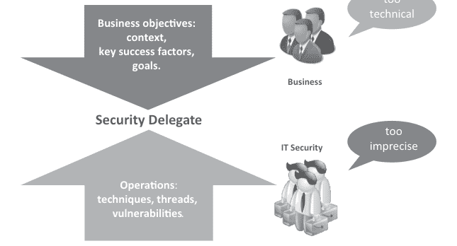

*图 6.9 安全代表的作用。*

为了能够承担新的要求以及之前提到的那些要求，特别是随着安全服务向更具战略性的职位发展，许多公司可能会出现以下列表中的新职能。

### 安全架构师

安全架构师的职责是确保如前所述的安全架构的发展。他们必须熟悉业务运营，同时也要对技术能力有透彻的了解。他们的主要职责是在运营环境中评估风险。业务部门经理对现有控制措施不够熟悉，因此无法正确评估剩余风险。安全架构师必须能够根据业务表达的功能需求和期望的成熟度水平要求，提出包含政策、标准和技术解决方案的安全解决方案。他们的职责范围在很大程度上取决于其职位。在任何情况下，他们都应该是公司架构委员会的成员。

### 数据保护官

数据保护官（DPO）自然会在最熟悉已实施的数据保护控制措施的安全专家队伍中找到。他们的主要职责是了解数据是如何被处理的，并能够确定现有的保护措施是否符合监管要求。这个职位必须独立于层级结构，并具有自主权，例如直接向董事会或监管机构汇报。它也可以外包。

## 第7章：风险管理

风险是商业中固有的部分，每一位企业高管都在关注如何降低风险。某些风险的影响可能带来严重后果，对公司构成重大威胁。由于安全项目所提供的保护的本质属性，安全风险管理至关重要。风险分析和缓解是任何安全项目存在的理由。有时，意见分为两派：一派认为安全风险无法精确衡量，另一派则相反，认为可以通过非常精细的方法来精确衡量。本章介绍一种务实的安全风险管理方法，将其作为安全项目治理和管理的基本要素。

本章回答了以下问题：

- 风险管理如何促进安全治理？
- 安全风险管理流程是什么？
- 为什么风险管理概念很重要？
- 如何识别、分析、评估和处理风险？
- 如何呈现和监控风险？

*什么是信息安全风险？*

效应是对预期的偏离。它可以是正面的、负面的，或两者兼有，并且可以应对、创造或导致机遇与威胁。

目标可以有不同的方面和类别，并可在不同层级上应用。

风险通常用风险源（3.4）、潜在事件（3.5）、其后果（3.6）及其可能性（3.7）来表达。

安全风险是企业运营风险的一部分。其他风险类别包括财务、法律、人事、合规、声誉等。安全风险场景及其潜在影响众多，几乎不可能提供所有安全风险场景的全面清单。因此，每家企业都必须根据自身背景和特点，设计适合其需求的风险管理体系。

通过分析和应对安全风险，企业可以优化运营成本。如果企业认为安全风险管理并非强制要求，只需实施标准技术保护即可，那么它不仅要承受法律和监管框架规定的处罚，还会削弱其整体安全态势，无法优化安全相关开支，并面临潜在的严重损害。

遗憾的是，无法针对安全风险的后果投保。虽然在某些条件下，可以针对网络安全风险导致的不可用或勒索影响提供赔偿，但这通常无法适用于所有场景。保险单通过支付保费来覆盖特定风险，但这意味着风险、其后果和保费金额必须可以明确界定。由于安全风险相关的条件和后果多种多样，没有保险单能提供这种服务。

风险管理应尽可能覆盖更多场景。如果某项风险未被识别，并不意味着它不存在。相反，这项风险将被默认接受，这可能带来严重后果。固有风险可以在不采取任何措施的情况下被接受，但这必须是有意识地决定。

董事会最终对企业承担的风险负责。首席信息安全官（CISO）及其团队通常负责安全风险管理，但最终批准风险报告和缓解计划的是董事会。由此产生的决策属于他们。

安全风险的范围不断变化，许多新的风险场景尚未被识别。新的业务模式和技术变革带来了企业并不总能应对的新威胁。

## 安全风险管理如何促进治理？

### 7.2 风险与治理

安全风险管理的目标是分析和呈现风险状况，从而能够确定优先级并改进缓解措施。通过风险管理，CISO 和信息安全专业人员有机会影响决策，并提高其工作附加值的可见性。不幸的是，为了降低成本，许多高管同意简化风险管理，借口是情况不会随时间变化、风险早已为人所知，而且无论如何，增加这些非生产性任务也不会改善安全性。因此，他们不愿让运营专家参与，不愿加深对业务风险的了解，也不愿进行系统性的识别或分析。管理者本身往往也因对投资回报存疑，而不愿为正式风险管理流程的实施提供资金。这种态度对企业在实际中面临的危险视而不见。

### 示例

信息安全领域风险的性质和强度正在发生变化。专业公司的研究和调查每年都显示出不同的趋势，这些趋势通常与技术变化和业务模式变化相关。例如，近年来与内部威胁或业务伙伴相关的安全风险肯定有所增加。高级持续性威胁（APT）或通过防护系统无法检测的入侵针对特定企业的威胁，已经取代了传统黑客的威胁。严重依赖机器人技术或在运营中使用自动化解决方案的企业，无疑更容易受到网络威胁。此类例子不胜枚举。

因此，在当前背景下，风险管理者被赋予了越来越多的责任。董事会、管理层、业务部门经理、审计人员、外部合作伙伴和客户都希望确信，存在一个经过验证且有助于企业保护资产的正式风险管理流程。

如果有任何能够影响决策的因素，那就是制定一项风险方针，其中包含背景、评估标准，以及关于风险演变的清晰易懂的报告。这些方面最终可能会在带来价值的全面风险方法与不受支持且几乎无效的方法之间产生差异。

为了使风险管理为业务增值并促进信息安全治理，应基于以下原则建立正式流程：

- 1. *制定安全风险管理方针和概念：* 定义风险管理的框架和概念，并确定背景、标准和风险偏好。定义风险管理流程及其角色与职责。
- 2. *识别风险：* 建立分类风险清单，包含每项风险的所有必要信息。所有风险场景都应涵盖在已识别的风险中。
- 3. *分析风险：* 理解现有控制措施并确定风险级别。
- 4. *评估风险：* 将风险级别与公司标准进行比较并设定优先级。确定（决定）期望的风险级别。
- 5. *处理不可接受的风险：* 确定风险处理方案并执行风险处理计划。
- 6. *建立风险监控、报告和沟通体系：* 为所有利益相关者建立报告和风险沟通计划。

下文将对每项原则及其实现方法进行更详细的说明。在建立正式风险管理流程时，我们将依据标准的建议，特别是 ISO 31000 和 27005。

许多针对信息技术（IT）和安全风险管理的标准、良好实践、方法、框架和工具可供参考，它们提供了带有具体指南的方法论框架。这里的目的不是介绍或比较它们。这些信息广泛可得，请读者自行熟悉。下面列举一些较为知名的：

- *ISO 31000：* 风险管理——指南，2018 年。提供风险管理的原则和指南。
- *ISO 31010：* 风险管理——风险评估技术，2009 年。
- *ISO 27005：* 2018 年信息技术——安全技术——信息安全风险管理。提供信息安全风险管理的指南。
- *RISK IT：* 信息系统审计与控制协会（ISACA），2009 年。它是信息及相关技术控制目标（CobIT）在 IT 风险管理方面的补充。
- *OCTAVE（运营关键威胁、资产和漏洞评估）：* 卡内基梅隆大学软件工程研究所（SEI），2001 年。面向计算机安全风险，特别是漏洞和威胁的分析。
- *EBIOS（安全需求表达与安全目标识别）：* 国家信息系统安全局（ANSSI），2010 年。信息系统安全风险管理。
- *企业风险管理：与战略和绩效整合，* COSO（反虚假财务报告委员会发起组织委员会），2004 年，2017 年更新。

我们现在将介绍一种实施正式风险管理流程的务实方法。

*我们应如何管理风险？*

## 7.3 风险管理过程

我们首先要指出，如前所述，标准或良好实践在识别风险管理流程需求时非常有用。然而，必须牢记，该流程首先服务于企业，以便针对其最重要的风险制定措施。流程必须保持简单、易懂，并为所有利益相关者接受。风险管理流程确实可能变得非常复杂。如果大型企业能够承受采用严格方法论的代价，那么大多数企业则因成本而无法做到。另一方面，每家企业都可以接受主要原则，从而在其背景下尽可能完善其信息风险管理流程。

ISO 31000 标准提出了一套实施风险管理的原则、概念和流程。其通用概念使其能够适应每个组织的风险管理需求。它还指出，风险管理必须考虑多种因素，如公司目标、背景、结构、活动、流程、职能、项目、产品和服务以及特定资产和做法。

ISO 27005 标准专门涉及信息安全风险管理，因此是 ISO 27001/2 和 ISO 31000 原则的延伸。其附录包含实施该流程的建议，特别是：

- 附录 A：定义信息安全风险管理过程的范围和边界。
- 附录 B：资产识别与价值评估以及影响评估。
- 附录 C：典型威胁示例。
- 附录 D：漏洞及漏洞评估方法。
- 附录 E：信息安全风险评估方法。
- 附录 F：风险修改的约束条件。

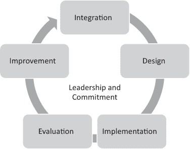

**图 7.1**  **ISO 31000 风险管理框架的主要组成部分。**

附件的标题足够明确，无需额外评论。它们对于以下将要介绍的各个步骤都极其有用。

ISO 31000 标准对风险管理提供了通用建议。（© ISO 改编自 ISO/IEC 31000:2018，经美国国家标准学会（ANSI）代表国际标准化组织许可。保留所有权利。）

第 4 章（原则）列出了每个组织为使其风险管理流程有效必须满足的要求。

第 5 章（框架）介绍了风险管理及其整合到重要活动和职能中的框架所必需的组成部分（图 7.1）。这些组成部分可概括如下：

- **领导力和承诺：** 高层管理应展示领导力和承诺、对风险管理的责任以及监督。
- **整合：** 在组织现有的结构和背景下整合风险管理。
- **设计：** 理解背景，阐明风险管理承诺，定义角色和职责，分配资源，建立沟通。
- **实施：** 风险管理框架的实施。
- **评估：** 定期评估风险管理框架的有效性。
- **改进：** 监控和调整风险管理框架。

第 6 章（流程）通过图 7.2 中呈现的活动描述了风险管理流程。这些活动将在下文中更详细地引用。

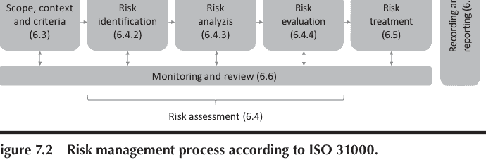

图 7.2 根据 ISO 31000 的风险管理流程。

*为什么风险管理政策很重要？*

## 7.4 建立风险管理政策

风险政策描述了风险管理为何必要以及公司将如何处理。它主要服务于以下两个目标：

- 1. 建立公司的风险管理框架和流程。
- 2. 定义风险管理背景。

### 示例

在 ISO 31000 中，这两个目标中的第一个包含在框架中，第二个是风险管理流程中的第一步。根据该标准，背景设定有四个关键要素：外部背景、内部背景、风险管理背景和风险标准。关于信息安全，ISO 27005 标准指出，背景必须提及风险评估、影响和接受的标准。

公司的通用安全政策通常无法充分解释背景和风险管理流程。因此，应作为对通用政策的补充，定义专门的信息安全风险管理政策。该政策可能有不同的名称，例如安全风险管理概念、框架或指南。

政策的制定可以借鉴标准或良好实践指南。为简单起见，风险管理政策应至少包含以下要素：

- 背景：考虑公司目标以及其开展活动所处的背景（内部和外部）。对于信息安全，应提及信息的重要性及其保护。
- *风险定义（安全风险）：* 风险的含义、风险的不同类别，特别是安全风险是由威胁利用漏洞产生的事实。
- *目标和原则：* 公司风险管理目标的明确陈述，尤其是如何实现这些目标。
- *范围：* 定义政策的范围，无论是职能还是地理范围。其持续时间和有效性也应提及。
- *法律方面：* 政策将涵盖的法律和监管依据。
- *框架：* 阐明风险管理活动应如何流动并解释流程以及负责人员。
- *风险分类：* 为监控、汇总/合并和报告目的更好地分配风险。
- *风险偏好：* 以定量或定性形式表达公司愿意承担的风险水平。风险态度表达其是否愿意面对某些风险以及如何面对。它对定性和定量标准给出精确定义。

### 示例

定性标准包括诸如：“公司只有在其风险管理流程允许将新风险维持在董事会定义为可接受的水平时，才会从事新活动。”之类的陈述。

定量标准意味着诸如：“公司只有在其风险管理流程允许其将风险维持在由概率和影响阈值定义的‘中等’水平以下时，才会从事新活动。”之类的陈述。

如果公司能够计算出某些风险实现所导致的所有损失（运营损失），那么它可以设定一个阈值，超过该阈值风险将不再可接受。

如果损失/总收入比率 >x%，则风险将不再可接受。

- *风险管理中的角色和职责：* 应定义每个组织单位的角色和责任：特别是董事会、业务部门负责人（职能、地理和公司）、控制和审计机构、负责运营风险管理的团队、各种决策委员会、CISO 和信息安全团队。
- *风险管理流程：* 定义流程使公司能够更好地管理风险管理活动。应描述每个活动的职责、目标和预期结果。沟通包括报告系统，必须提及其实践、内容、展示方法、接收者和发布频率。
- *文档和风险属性：* 风险文档涉及风险的呈现方式（例如清单、风险图）以及与每个风险相关联的信息（见后文）。
- *评估方法和风险图：* 目标是定义风险如何被评估，特别是特定时期内可能性或发生次数的计算、影响类别以及风险值的计算。

### 示例

如果公司选择根据以下公式分配风险值：

风险值 = 可能性 × 影响

可能性等级定义为 1—罕见，2—不太可能，3—可能，4—很可能，5—几乎确定，影响为 1—低，2—轻微，3—中等，4—重大，5—极端，则风险可根据其价值按严重程度分类：

| 风险值 | 分类 |
|---|---|
| 1–3 | 低风险 |
| 4–6 | 中等风险 |
| 8–12 | 高风险 |
| 15–25 | 极高风险 |

并在以下矩阵中可视化：

| 可能性 \ 影响 | 1 — 低 | 2 — 轻微 | 3 — 中等 | 4 — 重大 | 5 — 极端 |
|---|---:|---:|---:|---:|---:|
| 5 — 几乎确定 | 5 | 10 | 15 | 20 | 25 |
| 4 — 很可能 | 4 | 8 | 12 | 16 | 20 |
| 3 — 可能 | 3 | 6 | 9 | 12 | 15 |
| 2 — 不太可能 | 2 | 4 | 6 | 8 | 10 |
| 1 — 罕见 | 1 | 2 | 3 | 4 | 5 |

- *特殊情况的考虑：* 公司必须说明希望如何处理某些风险或事件：例如，可能具有非常高的影响但概率非常低的风险、高风险、被视为主要风险（顶级风险）等。
- *关于风险管理流程的具体说明：* 可以在政策中设定非常明确的标准，以帮助管理人员和风险官决定如何处理特定风险案例。

### 示例

公司可以规定何时接受、避免、降低或转移风险。

要求以特定方式对事件进行分类，有助于其在公司范围内进行整合。通过在事件管理（泄漏、丢失、错误、故障、欺诈等）中建立标准和分类法，公司将能够更好地评估已采取的纠正措施，对趋势变化做出反应并进行沟通。

评估矩阵的呈现标准以及可能性和影响计算的标准也可以建立（见风险评估部分）。

*风险如何被识别、分析、评估和处理？*

## 7.5 风险识别

风险识别旨在实现以下目标：

- 识别威胁和漏洞、潜在影响的领域及其性质，以及风险事件的原因和情况。
- 建立可能对公司实现目标产生影响的风险清单或列表。
- 确定风险之间是否存在相关性（依赖性）。

风险识别不仅应在定期风险审查期间进行，还应在每个新项目、变更请求、集成新合作伙伴或供应商、战略变化等时进行。了解在此步骤中需要保护哪些资产至关重要（见第 11 章资产管理）。

首先，必须识别可能产生风险的所有事件和情况。存在两种基本方法：自上而下和自下而上。

在自上而下的方法中，我们从对已知威胁和漏洞的分析开始，或标准中提出或风险识别方法提出的威胁和漏洞。我们问自己它们是否可以被视为我们背景下对我们资产的风险。许多方法和工具提供非常全面的问卷以促进风险识别过程。然而，识别所有可能的风险情景并不是很有用。凭借对公司的了解，我们可以迅速关注在我们背景下相关的那些。

## 示例

ISO 27005 的附录 C 包含威胁示例，附录 D 包含可用于识别风险的漏洞。风险可以通过组合威胁和漏洞来识别（风险是利用漏洞的威胁）。例如，将威胁“未经授权使用设备”与漏洞“访问权限分配错误”组合，可识别出风险“恶意人员访问未授权数据”。

自下而上的方法通过基于经验和运营的风险场景来识别风险。由安全运营专家、业务单元运营经理和员工观察到的威胁和漏洞会导致风险场景的形成。

## 风险分类

正式的分类法或分类允许公司将性质相似的风险分组以便更好地分析，并促进报告。这可以使用前面介绍的标准建议来完成。工业部门的分类，例如金融行业的巴塞尔 III、软件开发的 SEI（软件工程研究所）、信息安全风险的国家标准与技术研究所（NIST）800-30，或 ISACA 的 Risk IT 用于 IT 风险，也可供使用。识别风险类别的其他方法包括专业公司的专业知识、根据可能受影响的公司目标进行分类、公司其他部门已有的分类法等。然而，出于务实的原因，有时更明智的做法是以这些建议为起点来构建自己的分类法，并确保没有遗漏大类。

## 示例

安全风险分类的例子不胜枚举。以下是第一级分类：

- 1. 盗窃或欺诈（内部、外部）
- 2. 因疏忽导致的数据泄露（包括数据存储介质或移动设备的丢失）
- 3. 安全系统的不合规
- 4. 基础设施和/或服务的不可用性
- 5. 保密性和数据保护
- 6. 人为风险
- 7. 业务连续性和服务可用性
- 8. 流程和组织
- 9. 操作错误

如前例中所述的风险“恶意人员访问未授权数据”可归类为 1. 盗窃或欺诈（内部、外部）。

在此分类中，网络安全风险被归入多个类别。如果公司希望按领域对风险进行分类，可以轻松使用类别如网络安全、访问权限等。在这种情况下，前面提到的风险应细分为两个：“外部恶意人员访问未授权数据”——归入网络安全，以及“内部恶意人员访问未授权数据”——归入访问权限。

## 风险清单

建立安全风险清单的目的是定义并列出将在后续阶段分析的所有风险。它对整个流程至关重要，因为它为风险沟通、分析和报告提供了基础。

识别安全风险的方法多种多样，包括前面介绍的规范和标准。应结合使用自上而下和自下而上的方法来整合多个来源。下面我们简单回顾几种可以应用于识别风险并建立全面风险清单的务实方法。

- **组合威胁和漏洞：** 如前例所述，我们可以通过组合资产的威胁和漏洞来识别风险。这是一种自上而下的方法。
- **利用内部专业知识：** 通过召集来自不同专业领域的人员并就潜在安全风险展开讨论，可以识别出不同的场景。这结合了自上而下和自下而上的方法。
- **利用审计和专业公司的专业知识：** 审计员和安全咨询公司可以帮助制定初始的风险或风险场景清单。众多专业协会也为其成员发布了该领域的最佳实践。这有助于识别大部分风险。
- **利用安全领域趋势研究：** 这些研究由专业公司发布，可很好地洞察安全风险。许多对公司目标或业绩产生影响的事件可能被识别为风险。

## 风险的分离与聚合

在识别风险和整合清单的过程中，最大的问题之一是混合了不同风险层级和重叠的风险。

风险层级可以定义为使用威胁和漏洞场景描述风险时的详细程度。风险数量过大难以管理。建议在能够提出指标来评估其可能性和影响的情况下，将风险场景聚合到最高层级。事实上，层级越低，找到良好指标就越容易。需要在易于测量的众多风险与在治理层面易于理解但难以测量的少数高层级风险之间权衡利弊。

风险重叠意味着多个风险在威胁、漏洞和潜在影响方面相似。这种情况会使风险的分析和处理复杂化，并且不会提供有关所需保护的额外信息，因为相同的控制措施对不同风险的作用效率不同。

## 示例

风险“1. 因疏忽导致的数据泄露”涵盖了许多场景，可以细分为以下较低层级风险：

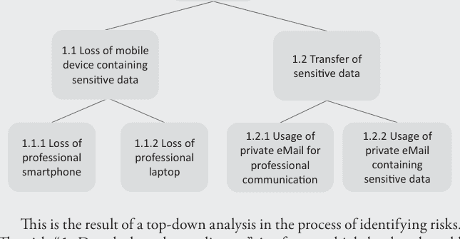

这是识别风险过程中自上而下分析的结果。风险“1. 因疏忽导致的数据泄露”层级非常高，可被视为类别而非风险。较低层级的两个风险 1.1 和 1.2 分离良好，将具有不同的关键风险指标（KRIs）。风险 1.1.1 和 1.1.2 很可能属于同一风险的两个场景，其分析不会为应部署的控制措施带来新信息。风险 1.2.1 和 1.2.2 重叠，但由于可以关联特定的指标（业务数据泄露事件）而具有价值。在这种情况下，最好保留其中一个场景。

因此，我们可以减少（优化）清单中包含的风险数量，并保留以下三个风险，它们都将归类在“因疏忽导致的数据泄露”类别下：

- 包含敏感数据的移动设备丢失
- 敏感数据的传输
- 使用包含敏感数据的私人电子邮件

## 风险描述

每个已识别的风险都由一系列属性描述，这些属性将在分析、评估、处理和监控过程中使用。清单中所有风险应使用相同的属性类别。表 7.1 列出了最常用的一些属性。

识别风险的过程不应是一次性练习，而应是一个迭代过程，因为第一次尝试并不能保证检测到所有风险。此外，许多风险经理认为他们单独负责识别和描述风险以及旨在减轻其影响的控制措施的质量。其他人也必须参与其中，尤其是业务和 IT 代表，采用自上而下和自下而上的方法，以确保风险清单尽可能全面，同时具有高层级但可测量的风险。

## 7.6 风险分析

风险分析具有多重目的。它应能够在风险实现后进行影响评估，估计其在给定时间段内发生的概率或频率，并整合能够对风险进行定性的指标，同时考虑到旨在减轻风险的控制措施。从治理角度来看，风险分析的目的是提供足够的相关要素，以促进对如何处理风险的决策。

负面影响风险价值的因素是作用于漏洞的威胁，这些漏洞最终使公司资产暴露。降低风险的因素包括公司为保护资产、抵御威胁和减少漏洞而实施的所有控制措施。风险价值是两个极值之间的平衡点（图 7.3）。

风险分析是为了告知董事会和管理层损失的可能性以及安装适当保护的必要性。使风险经理任务特别困难的是需要解释风险价值如何

## 表 7.1 风险属性

| 属性 | 内容 |
|---|---|
| 分类 | 根据所选分类法的风险类别 |
| 名称 | 指代事件或情况的简短句子 |
| 描述 | 风险的明确描述 |
| 目标 | 可能受风险影响的资产、物理位置、目标或流程 |
| 后果 | 风险实现时潜在影响的描述 |
| 固有风险 | 无现有控制措施下的风险评估 |
| 可能性 | 在给定期间内风险发生的概率估计 |
| 影响程度 | 影响的估计 |
| 价值 | 根据风险评估方法计算出的数值 |
| 控制措施 |  |
| 现有控制措施 | 旨在减轻风险的现有控制措施清单 |
| 控制效率 | 针对特定风险每项控制措施的效率 |
| 残余风险 | 存在控制措施下的风险评估 |
| 可能性 | 在给定期间内风险发生的概率估计 |
| 影响程度 | 风险实现时影响的估计 |
| 价值 | 根据风险评估方法计算出的数值 |
| KRI | 用于衡量可能性和影响程度的关键风险指标清单 |
| 行动 | 如果根据风险偏好认为不可接受，则减轻风险的行动 |
| 计划风险 | 存在控制措施且所有行动完成后风险的评估 |

### 表 7.1（续）风险属性

| 属性 | 内容 |
|---|---|
| 可能性 | 在给定期间内风险发生的概率估计 |
| 影响程度 | 风险实现时影响的估计 |
| 价值 | 根据风险评估方法计算出的数值 |
| 风险所有者 | 对风险管理负责的个人或团队 |
| 截止日期 | 风险将被降低到期望水平的计划日期 |

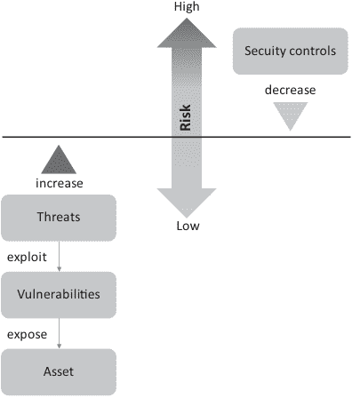

由影响它的众多因素计算得出。管理层习惯于处理绝对数字：营业额的增减、盈亏比率等。他们还期望对安全风险的演变有明确的指标，特别是希望了解其计算方式。问题不在于理解安全风险是否存在，而在于能够证明其价值是如何计算的。当风险水平在投资后仍随时间保持稳定时，任务变得复杂。我们知道这源于负面

## 表 7.2 估计安全风险概率的标准

| 可能性 | | 内部或外部可观察事件的频率 |
|---|---|---|
| 几乎确定 | 5 | 年度或月度发生 |
| 很可能 | 4 | 过去一年内曾发生且将再次发生 |
| 可能 | 3 | 在我们或其他组织中至少发生过一次 |
| 不太可能 | 2 | 在组织内从未发生过 |
| 罕见 | 1 | 可能发生但迄今未发生 |

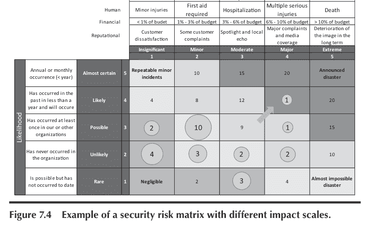

## 图 7.4 不同影响尺度的安全风险矩阵示例。

我们显然可以使用任何尺度，但重要的是尽可能接近公司对其他类型风险的标准。我们甚至可以进一步使用与公司其他运营风险相同的尺度，说明事件在内部和外部都被观察到。

## 风险影响

风险具有不同类型的影响。我们可以仅限于财务影响，也可以考虑其他类型，例如声誉、人员、法律或监管影响。与概率一样，影响的估计也可以在 1 到 5 的尺度上进行。图 7.4 中展示了具有四种不同风险影响尺度的风险矩阵。风险价值的计算公式为 Value = Likelihood × Impact。

## 控制措施的有效性

风险可在缓解控制措施应用之前或之后被观察到。固有风险是指尚未被现有控制措施缓解的风险。残余风险是在应用控制措施后同一风险的状态。控制措施要么作用于降低威胁发生的可能性（例如入侵检测系统），要么作用于漏洞（例如加密）。也可以引入期望风险的概念，即在部署补充控制措施后寻求的风险水平。

100% 有效的控制系统会将风险降至 0。相反，完全无效的控制系统对固有风险没有任何影响。因此，如果我们能确定控制措施的有效性在 0 到 1 之间，则风险计算公式可如下：

Value of residual risk = Value of inherent risk × (1 – effectiveness of controls)

为了便于理解风险分析，可以在风险属性中提供额外的解释以证明或解释其评估。

## 风险分析的定量方法

许多书籍专门研究风险分析的定量方法。我们不打算在此介绍，因为这不是我们的目标。尽管如此，让我们提及因素分析信息风险（FAIR）方法 [Measuring and Managing Information Risk: A FAIR Approach, Jack Freund, Jack Jones, Elsevier 2015]。每项风险分析中的基本问题是如何准确、客观地计算风险的衡量标准。

FAIR 方法背后的总体思路是提出一种将风险分解为因素（FAIR 本体论）然后测量这些因素以量化风险的方法。FAIR 本体论“代表了一种风险运作模型，通过描述构成风险的因素及其相互关系来表示。这些关系然后可以用数学方式描述，这使我们能够根据这些因素的测量和估计来计算风险”。

如果我们假设风险分析是为了向决策者提供未来损失潜力的信息，那么风险可以分解为如图 7.5 所示的因素。

根据同一来源，因素定义如下：

- *损失事件频率：* 在给定时间范围内，损失因威胁主体行为而实现的可能频率。
- *威胁事件频率：* 在给定时间范围内，威胁以可能导致损失的方式行动的可能频率。
- *接触频率：* 在给定时间范围内，威胁主体与资产接触的可能频率。

## 示例

在其一般的安全风险管理政策或概念中，公司已定义了一种根据可能性和影响评估和呈现风险的方法。它还定义了允许根据四类对风险进行分类的阈值：低、中、高和极高。高或极高风险将优先处理。

公司的风险管理政策规定：“所有高和极高风险应立即报告给首席风险官，并纳入向董事会提交的半年报。对于高风险，必须在三个月内提交补救行动计划。极高风险在任何情况下都不会被接受，需要立即行动并制定详细的处理计划。CISO 负责提出行动建议及其后续跟进。如果极高风险无法降低，维持风险活动的决定由董事会作出。”

风险评估选项根据风险价值或严重程度如下所示。

| 风险值 | 严重程度 | 描述 | 行动 |
|---|---|---|---|
| 15 – 25 | 极高风险 | 不可接受的风险。必须定期跟踪和审查。在董事会和管理层层面报告 | 需要立即行动：转移、避免或降低。由 CISO 跟踪并报告。 |
| 8 – 12 | 高风险 | 可能不可接受的水平。必须持续监控并向风险委员会报告。 | 行动计划是强制性的，由 CISO 和/或地理单元负责人负责。 |
| 4 – 6 | 中等风险 | 需要关注且需每年审查。在 CISO 层面和安全委员会报告。 | 定期跟进行动以及风险责任的分配。 |
| 1 – 3 | 低风险 | 不需要特殊行动但必须每年审查。 | 除现有控制措施外不计划任何行动。 |

对于高风险，公司必须在 CISO 或区域经理的责任下制定行动计划。

可能出现无法满足决策所需条件的情况，风险需要进一步分析。这主要可能发生在最初被视为高风险的风险上。在这种情况下，负责决定如何评估风险的人员可能会要求提供其可能性和/或影响的进一步细节。

## 7.8 风险处置

在识别、评估和排序之后，风险处置考虑所有选项以应对被视为不可接受的风险。处置计划必须考虑控制措施的成本/收益、其降低可能性或影响的能力、监控和报告要求、截止日期和责任。

从治理角度看，此步骤应回应诸如用于比较不同风险处置方案的标准、规划、资源可用性、成本/收益分析、长期风险降低潜力、处置监控等问题。

### 示例

管理层经常向风险经理提出以下问题：“尽管我们进行了所有安全投资，为什么风险水平仍然保持不变？”

公司中的整体安全风险水平通常随时间保持稳定，甚至在特定情况下恶化，尽管进行了投资并不断努力改进控制措施。这种情况的原因是安全计划滞后于威胁、漏洞以及内外部环境的变化。如果不是这样，每个公司迟早都会降低其风险水平。

为了能够解释为什么风险状态不如预期，必须对处置计划的绩效以及有关威胁、漏洞和环境的指标进行彻底跟进。

风险处置是架构师、工程师和安全专家能够展示其全部专业知识的领域。如果所选方案需要缓解或降低风险，他们将能够设计控制措施来降低威胁或漏洞发生的概率。这些控制措施可能是技术性的或组织性的，涉及政策或指南、意识、监控等。

不同的风险处置选项可分为四大类：接受、规避、转移或降低。

### 风险接受

接受风险通常是由于风险降低成本的考虑，该成本往往可能超过预期收益甚至风险本身的影响。在这种情况下，公司可以决定在风险实现时承担潜在损害。甚至可以针对非常具体和明确的风险（例如网络攻击后的财务损失）购买保险单。因此，不会计划降低风险的措施，但无疑会高度监控风险的演变，以便在发生概率增加时能够采取行动。

### 风险规避

并非所有风险都能避免。可以避免的风险是仅与可以推迟或停止的流程或服务相关的风险。在这种情况下，如果降低风险的成本过高，公司可能决定暂停该活动，从而避免随之而来的风险。

> **示例**
> 
> 如果供应商保护机密数据的措施不足，可以放弃IT开发或服务的外包。

### 风险转移

由于与机密性、完整性和可用性相关的风险的本质，转移信息安全风险极其困难。例如，保险单可以承保与自然事件相关的损害，但不能承保因数据保护缺陷而造成的形象损失。外包转移了与此活动相关的风险，但对客户的最终责任仍由母公司承担。通常，具有重大影响且概率较低的操作风险（例如具有财务影响的事件）可能转移给专业保险公司。

### 风险降低

风险降低仍然是信息安全团队的关键活动之一。预防性控制措施将降低风险发生的可能性（例如防病毒），而保护性控制措施（例如加密）则降低潜在影响。如果残余风险水平仍然不可接受，则应在威胁和漏洞保持不变的情况下，通过行动计划将其降低到期望水平。

### 如何呈现和监控风险？

## 7.9 报告、沟通和风险监控

为了完成风险管理流程，重要的是能够监控风险和行动计划的演变，以事实为基础进行沟通，并为利益相关者和负责风险评估和排序的委员会生成报告。以下小节介绍了多种呈现风险状态的方法，可用于报告、沟通和监控。

### 环境、威胁和漏洞的演变

为了更好地理解风险状态，我们必须深入了解可能影响风险的因素的演变。表7.3提出了一种呈现对安全风险产生负面影响的最具代表性的内外部因素演变的方法。“对风险的负面影响”列提供了因素负面程度的指示。“趋势”列表示在一段时间内观察到的演变。“评论”列包含理解水平和趋势所需的所有附加信息。

### 风险映射

*风险映射*通常指如前所述的所有风险及其属性的表示。这是一种以紧凑形式表示所有风险及其主要特征的方法。风险管理工具提供了这些映射的各种展示方式，通常可根据每家公司的需求进行配置。最常见的形式是表格，其中每一行对应一个风险，列通常包含属性，如表7.1所示。风险状态（固有、残余或预期）通常由三列表示：可能性、影响和级别。

### 高和非常高风险的状态

高和非常高的风险通常受到高级管理层的特别关注，因为它们是公司的优先事项。可以采用各种策略来呈现这些风险，但最重要的是展示其演变以及为处置这些风险而计划采取的行动的完成水平。表7.4给出了此类呈现的示例。“趋势”列展示了风险的总体演变。

### 表7.3 对风险产生负面影响的因素

| 因素 | 负面影响力程度 | 趋势 | 评论 |
|---|---|---|---|
| 网络威胁 | 高 | ↗ | 网络威胁的总体演变。 |
| 漏洞 | 中 | → | 漏洞的总体状态和演变。事件。 |
| 意识薄弱 | 低 | ↗ | 员工意识水平。示例。 |
| 人为风险 | 低 | ↘ | 关于人为风险总体演变和主要挑战（例如人员流动）的评论。 |
| 韧性 | 中 | → | 事件或攻击后的恢复能力。 |
| 资源缺乏 | 中 | ↗ | 关于实现风险缓解目标所需资源可用性的评论。 |

### 热力图

为了能够呈现所有残余风险的位置，我们通常使用热力图的一种变体。图7.6中的示例展示了风险分布，并标明了具有相同值的风险数量。如果附有风险描述及其趋势的参考信息，这种呈现方式会很有用。

出现在热力图四个角的风险情况存在不同的名称。这些情况应该很少见，但应在风险管理政策或概念中更好地解释其处置，尤其是具有潜在极端影响的情况。

### 表7.4 高风险监控示例

| 风险 | 残余级别 | 趋势 | 关键指标 | 措施 | 状态 | 计划级别 |
|---|---|---|---|---|---|---|
| 外部欺诈 | 高 | ↗ | • 尝试次数 • 遭受的损害 • 反应时间 | • 意识提升 • 指南修订 • 检测手段 • 外部协调 | 按计划 60% | 中 |
| 第三方入侵 | 高 | ↑ | • 渗透测试结果 • 外部统计 | • 意识提升 • 漏洞消除 • 预防改进 | 按计划 50% | 中 |
| Web服务器攻击 | 高 | ↑ | • 渗透测试结果 • 服务器更新级别 | • 升级配置 | 延迟20% | 中 |
| DDoS（分布式拒绝服务） | 极高 | ↗ | • 同行业观察 | • 迁移至DNS提供商保护 | 紧急 | 中 |

| 可能性 / 影响 | 轻微 1 | 次要 2 | 中等 3 | 重大 4 | 极端 5 |
|---|---|---|---|---|---|
| 几乎确定 5 | 可重复的小事故 | 10 | 15 | 20 | 已宣布的灾难 |
| 很可能 4 | 4 | 8 | 12 | 16 | 20 |
| 可能 3 | 3 | 6 | 9 | 12 | 15 |
| 不太可能 2 | 2 | 4 | 6 | 8 | 10 |
| 罕见 1 | 可忽略 | 2 | 3 | 4 | 几乎不可能的灾难 |

图 7.6 热力图示例。

### 7.10 结论

风险管理目前已是一门成熟的学科。许多专门著作都致力于此，应加以参考，特别是对于定量方法的深入了解。然而，就安全风险管理而言，必须采取一些预防措施，以使该流程为计划的治理增加价值：识别并合理化需要分析的风险数量；关注将证明和解释风险水平的关键风险指标（KRIs）；如果可能，采用与其他公司运营风险相同的标准；并连贯地呈现风险状态。安全风险管理流程是治理不可或缺的工具，必须为所有人所理解和接受。它是任何安全计划的主要驱动因素之一，因此是一个基本流程。

## 第 8 章：计划管理

信息安全（IS）治理必须基于健全的流程。首席信息安全官（CISO）仅提出保护措施并以日益增长的威胁为依据进行论证已不再足够。如今比以往任何时候都更重要的是，导致控制措施实施的流程必须为所有利益相关者所理解和接受。结果本身是不够的。安全控制传统上是为应对威胁、降低事件风险或确保法规合规而设立的。这种可以描述为机会主义或自下而上的方法已不再可持续，因为管理者无法控制成本或长期规划。

因此，建立安全计划管理流程或信息安全管理体系（ISMS）对任何决策者都至关重要。引入一个基于迭代流程的管理系统，涉及管理机构和业务部门，可确保决策的质量，尤其是所有利益相关者的支持。

本章提供了以下问题的答案：

- 安全计划是什么？
- 如何建立计划？
- 计划的组成部分是什么？
- 管理计划的基本工具是什么？
- 计划审查周期在实践中如何运作？

### 8.1 安全计划

对安全计划这一术语的定义有多种解释或建议。在下文中，安全计划包括公司为保护其资产而部署的所有措施，尤其是根据三层模型进行的战略、战术和运营控制，更一般地说，与信息安全相关的所有活动、监管框架和流程。

安全计划管理包括对现有控制措施的指导和监督、运营活动、变更项目、规划和协调。安全计划的管理对应于标准 ISO 27001 中提出的 ISMS 的定义。因此，这两个称呼可以互换，通常指代同一事物。

安全计划满足战略以及内部和外部监管框架的要求。它按照既定的组织进行，包括管理机构决定的旨在提高成熟度的风险处理和项目。运行安全计划是首席信息安全官的主要职责。他们必须首先确保所有控制措施的正常运行，然后执行前面定义的战略安全举措。

按照正式化流程进行计划管理至关重要。证明安全降低风险很重要，但建立对流程本身的信任更为重要。事实上，对结果的信心取决于对流程的信任。因此，处理一个风险是可以的，但证明所有风险都已识别，并且其处理已规划，则更好。因此，以持续改进的迭代流程形式管理计划并涉及决策机构，对于有效治理至关重要。这种确保没有任何事情被放任自流的能力会让高级官员产生信心。这也让审计员、监管机构和所有利益相关者感到安心。

安全计划的设计建立了一个良性循环，包括解决问题、风险降低和优先级排序，从而实现持续改进并防止相同违规行为的再次发生。高级管理人员和董事会成员期望现有的 ISMS 或安全计划能够根据战略和政策保护公司。

安全计划活动由文件化的流程指导。为了让计划为所有利益相关者所接受，它必须基于标准建议或审计发现，并必须在整合以下目标的流程中决定改进点：风险缓解、与业务需求保持一致、整合新技术、响应审计发现、提高成熟度等。今天的安全团队仍然设置一些安全控制措施，这些措施并不总是经过论证或作为决策流程的一部分正式接受。控制措施，通常是技术解决方案，是针对可见威胁而安装的，超出了既定的规划或架构。这正是安全项目路线图作为监督和管理工具的重要性所在。

*如何建立安全计划？*

### 8.2 计划审查周期

构建迭代的安全计划审查周期是激活关于安全的管理决策以使将要采取的行动合法化的唯一途径。计划审查周期构成了 ISMS 的核心。

建立审查周期或良性循环显然可以从“计划-执行-检查-行动”持续改进的概念开始，该概念最初由 Walter Shewhart 提出，并由 W. Edwards Deming 推广，特别是在 ISO 9001 中，该标准致力于质量和持续改进。我们提出一个简化周期，由三个流程组成：Decide、Do 和 Monitor，以及三个交付成果：Plan、Metrics 和 Feedback（图 8.1）。

可以按如下方式描述周期的主要组成部分：

**决策：** 决策流程包括针对特定时期计划目标的所有决策步骤。其目的是根据 Monitor 流程提供的要素建立或验证举措或改进项目的路线图。

主要参与者是管理机构和首席信息安全官。管理机构可以采取不同的形式，例如优先级委员会、安全委员会或其他。他们必须有权做出决定、优先排序举措并分配资源。

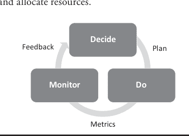

图 8.1 安全计划审查周期。

**计划：** 决策流程的结果是下一期的 ISMS 业务计划。计划主要由两种类型的项目组成：

- 维护或加强控制和风险处理的项目（Maintain）
- 提供新服务的项目（Change），例如战略要求的项目（见后文）

**执行：** 执行流程根据决策流程中确定的目标执行 ISMS 计划。这不仅包括战略中规定的项目或举措，例如，还包括改进当前流程和控制的目标、财务目标或与安全计划相关的任何其他目标。

计划实施的主要参与者是首席信息安全官、安全团队、信息技术（IT）运营和管理，以及所有从事安全控制的员工。

**指标：** 该流程的结果将使用指标和关键绩效指标（KPI）进行评估，并将促进 Monitor 流程中做出的观察。指标用于报告目的。

**监控：** 该流程包括监督、评估计划结果并编制将在决策流程中使用的报告。它汇集了决策所需的所有要素。使用指标对决策者进行评估和报告主要是首席信息安全官及其团队的责任。

**反馈：** 由用于决策的报告组成：

- 战略举措完成情况报告
- 风险报告（及处理计划）
- 成熟度报告（及改进计划）
- 路线图或项目进展报告

### 示例

管理机构已决定将部分安全职责转移给业务部门（参见第 4 章《战略》中的示例）。在首席信息安全官的主持下制定了计划；随后开始实施，导致某些控制措施的修改，特别是与身份和访问权限管理相关的控制措施，以及某些例外情况的授权。用于衡量完成程度的指标将是通常用于监控项目进展的指标。在这种变更中，还可以衡量运营效率，特别是负责管理访问权限的团队负担的减轻。这些 KPI 将作为 Monitor 流程中产生的报告的一部分。在计划的下一次审查中，管理机构将能够决定是否继续执行该战略。

此时应当指出，只有在新安全项目有充分理由的情况下才能启动，这些理由包括需要处理风险、改善安全态势或流程成熟度、响应审计发现或实施战略举措。ISMS不仅仅是一套运行控制措施；它首先是一种持续改进的系统性方法，以确保公司资产得到最佳保护。可以使用ISO 27001标准，其中包含了制定ISMS及其评审周期所需的良好实践。在制定安全项目时，应当考虑标准所倡导的以下关键原则：

-   安全组织背景（战略与战略对齐）
-   管理层支持与ISMS框架内的组织安排
-   政策与法规框架的重要性
-   风险管理：识别、评估和处理
-   基于风险分析的规划和目标设定
-   资源提供
-   意识与沟通
-   控制措施的建立与管理
-   绩效评估
-   持续改进与不符合项管理

如前所述，安全项目评审周期包含了ISO 27001在《信息安全管理体系要求》中的建议。其附录A——参考控制目标与控制——中的控制目标更具体地涉及构成ISMS一部分的控制措施，并体现在后续将讨论的控制目录中。

参照三层控制框架（TLCF）模型，这些构建块提供了建立ISMS所需的所有要素（图8.2）。

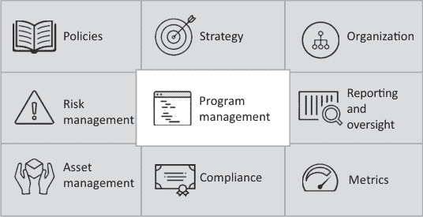

**图8.2 项目管理层使用其他构建块的输入。**

下面讨论其他构建块如何对项目管理做出贡献。

*战略：* 战略目标和举措是“决策”过程中决策的基本组成部分。为项目设定的优先级必须考虑这些目标。

*政策：* 法规框架规定了安全项目的要求。其文件包含必须遵守的规则以及如何实施控制措施的指示。

*组织：* 项目管理包括定义治理机构、委员会、CISO及其团队、IT部门以及所有其他利益相关方的角色和职责。必须在“决策”、“执行”和“监控”三个过程中明确职责。

*风险管理：* 管理过程突出了公司资产面临的主要危险。这使得在项目内规划控制措施的强化成为可能。

*报告与监督：* 该构建块的活动，生成“决策”过程所需的全部报告，同时也属于“监控”过程的一部分。

*资产管理：* 资产管理控制通过其对风险管理过程的贡献，间接参与项目的管理。了解需要保护的资产、相关职责及其分类，是安全项目内任何决策不可或缺的来源。

*合规性：* 合规性构建块提供所有差距分析以及弥补差距的整改建议。它同时处理外部和内部法规框架。审计发现也属于该构建块。

*指标与KPI：* 提供“监控”过程中报告所需的全部指标。

让我们更仔细地看看制定一个务实的ISMS评审周期所需的工具。

*管理项目的基本工具有哪些？*

## 8.3 安全项目的基本工具

最后，安全项目由什么组成，其主要工具有哪些？在第2章中曾指出，控制措施集可以按不同方式分类，尤其是按TLCF模型提出的三个责任层级。安全标准采用了不同的方式来呈现安全控制措施的全貌并伴随相应分类。安全项目中还有其他要素，包括所有治理和管理活动，这些也可以被视为控制措施。因此，安全项目由所有安全控制措施组成。安全项目或ISMS的管理意味着建立并持续改进一套适应公司需求的控制措施体系。

每家公司都已经有一个信息安全项目。我们需要知道的是它是否适应公司的需求和背景，如果不是，则如何改进。首先要做的是参考标准，以确保其要求已以某种方式得到考虑。ISO 27001/2标准可能是验证项目完整性的最佳来源。

如果我们更仔细地审视标准中关于安全项目评审周期的建议，它们都强调以下四个基本组成部分：

1.  规划改进
2.  识别控制措施
3.  评估结果的指标或指标集
4.  用于规划目的的报告

因此，我们可以认为计划（1）和控制措施目录（或清单）（2）是安全项目的主要工具。后面将提供更多细节。指标（3）和报告（4）将在专门章节中详细讨论，此处不再展开。

### 计划

计划体现在项目路线图中。该路线图的作用是帮助理解优先级，并为有关改进控制措施和实施变更的决策提供支持。一个易于理解且将在安全项目评审周期中接受审查的路线图，是治理的主要工具之一。计划中的项目可按其为控制措施带来的改进类型进行归类：

1.  旨在维护现有控制措施及其有效性水平的项目（“维护”项目）
2.  旨在引入新控制措施的项目（“变更”项目）

“维护”类安全项目通常不会引入架构或所用技术的变化。它们旨在保持保护水平或实现必要的改进，以更好地应对不断演变的威胁或漏洞。另一方面，“变更”项目则引入新控制措施或重大变更。这些可能包括为满足新需求而增加的控制措施、引入新的

**图8.3** 安全项目计划中的项目路线图。

### 示例

**来源：** 战略举措。

**描述：** 为内部物理和逻辑访问引入智能卡。

**依赖性：** 在应用层面调整认证系统。调整物理访问点的控制措施。

**成果：** 员工轻松访问应用程序和办公场所。节省员工时间，并节省帮助台用于密码重置时间的10%。通过引入强认证降低内部和外部欺诈风险。与保护机密数据的最佳实践和法规保持一致。

图8.3给出了路线图展示的示例。

### 控制目录

良好治理要求了解现有的安全保护措施、安全专家的日常活动和关注事项，以及改进目标和计划。问题在于如何在ISMS背景下呈现所建立的所有控制措施，以便将其用于治理，并供所有参与制定或修订安全项目的人员使用。

我们将使用术语*控制目录或控制清单*来指代一种提供所有已部署安全控制措施信息的工具。在提出设计此类目录的系统化方法之前，让我们首先回顾其主要用途和期望特性。控制目录可用于多种不同目的：

*项目管理：*如前所述，安全项目或ISMS的管理主要涉及调整已建立的控制措施（维护）或演进或引入新控制措施（变更）。了解影响，尤其是计划（Plan）的各个项目将对哪些控制措施产生作用以及出于何种目的，可确保更好地管理、规划和实施正确的资源。每个控制措施的特性都通过其成熟度或有效性水平加以记录，从而更好地管理优先级。

*治理与管理监督：*为了解其决策的影响，治理机构必须全面了解现有控制措施。关于风险处置的决策将涉及与之相关的控制措施。然而，如果安全负责人无法简明扼要地展示与风险和期望改进相关的控制措施，就无法做出明智的决策。

*审计：*在许多公司中，频繁的审计请求是现实存在的。这些请求不仅来自监管机构或内部审计师，还来自希望更好了解其合作伙伴安全态势的客户或供应商。这些耗时的审计涉及安全和IT各个领域的员工，而使用安全控制目录可以简化此类审计。实际上，审计师的首要任务是发现现有控制措施、了解谁负责这些措施，尤其是它们是否经过测试，以及其成熟度或有效性水平。不同的审计师会向同一批内部员工提出类似请求，这非常耗时。包含控制措施关键信息的目录将有助于审计师的工作，并有助于降低每次审计的间接成本。

*内部组织：*建立控制目录有助于更好地理解运营安全管理领域的角色和职责。每个控制措施都明确了责任，从而使安全组织和管理流程更加清晰。

因此，控制目录由一系列安全控制措施（或保护手段）组成，每项控制措施都有若干属性，例如：

- 描述
- 负责人或部门的名称
- 测试频率
- 上次测试日期
- 当前成熟度
- 期望（目标）成熟度
- 目标成熟度的解释（理由）

目录中呈现的控制措施不应包含产品名称或已部署的技术。这对于保持可持续性非常重要。显然，可以依据标准（如ISO 27001/2或NIST）来编制目录，尤其是参考它们对控制措施的分类方式。ISO 27001中提出的方法很有意思，因为它能够开发出相对简短的控制目录。当使用标准时，公司目录会针对标准中的每项建议或控制目标，明确所建立的控制措施的属性。

## 示例

根据ISO 27002建立的控制目录格式（摘录）。控制措施在两个层面上呈现（控制和控制指南）。

| 领域 | 负责方 | 测试频率 | 测试日期 | 当前成熟度 | 期望成熟度 |
|---|---|---|---|---|---|
| 控制目标 |  |  |  |  |  |
| 控制 |  |  |  |  |  |
| 控制指南 |  |  |  |  |  |
| ... |  |  |  |  |  |
| 13 通信安全 |  |  |  |  |  |
| 13.1 网络安全管理 |  |  |  | 3 | 3 |
| 13.1.1 网络控制 | 网络部门 | 月 |  | 2 | 2 |
| 日志记录 |  |  |  |  |  |
| 系统认证 |  |  |  |  |  |
| 连接限制 |  |  |  |  |  |
| 13.1.2 网络服务安全 | 业务单元 | 月 |  | 1 | 3 |
| 加密 |  |  |  |  |  |
| 13.1.3 网络隔离 | 网络部门 | 月 |  | 1 | 3 |
| 13.2 信息传输 |  |  |  | 3 | 3 |
| 13.2.1 信息传输策略 | 安全团队 | 年 |  | 2 | 3 |
| 13.2.2 信息传输协议 | 安全团队 | 年 |  | 2 | 3 |
| 13.2.3 电子消息传递 | 安全团队 | 年 |  | 2 | 3 |
| 13.2.4 保密协议 | 安全团队 | 年 |  | 2 | 3 |
| ... |  |  |  |  |  |

控制措施需要经过测试并衡量其成熟度（详细信息请参见第9章：安全度量）。控制指南详细说明了构成控制措施的具体实践（例如，日志记录是网络控制语境中的一项实践）。控制目标的成熟度水平是各控制措施成熟度的平均值。

在开发目录时，必须注意使其规模保持相对较小，以方便使用和维护。控制措施显然可以非常详细地表达。控制措施的粒度越细，目录越完整，但就更难以维护和用于治理目的。目标不是详细列出IS领域所做的每件事，而是呈现具有相同目标的一组连贯的控制措施。

选择所需详细程度的一个标准是，为了风险分析和处置而引用的控制措施。风险或风险场景越详细，所引用的控制措施就需要越详细。

## 示例

如果风险或风险场景被标记为“未经授权的设备连接到网络……”，那么我们需要控制目录级别的“连接限制”控制措施，以便将其与风险关联并评估其有效性。然而，如果风险包含多个场景并被标记为“不当网络使用”，那么“网络控制”控制措施（级别1）可以涵盖为缓解各种IT网络风险场景而部署的所有手段。

开发控制目录的一种务实方法可能是仅呈现一层控制措施，但将它们按组织安全域分组。这种方法尝试按责任区域呈现所有控制措施，这有助于理解ISMS。

| 领域 | 负责方 | 测试频率 | 测试日期 | 当前成熟度 | 期望成熟度 |
|---|---|---|---|---|---|
| 1. 风险管理 |  |  |  |  |  |
| 概念、策略和流程 | CISO | 年 |  | 2 | 3 |
| ... |  |  |  |  |  |
| 2. 沟通与意识 |  |  |  |  |  |
| 意识培训 | CISO | 年 |  | 2 | 3 |
| ... |  |  |  |  |  |
| 3. 身份与访问管理 |  |  |  |  |  |
| 策略与流程 | IAM团队 | 年 |  | 3 | 4 |
| 访问权限认证 | IAM团队 | 年 |  | 2 | 4 |
| ... |  |  |  |  |  |
| 4. 连续性 |  |  |  |  |  |
| BCM | BCM | 年 |  | 3 | 4 |
| 灾难恢复 | IT | 年 |  | 2 | 4 |
| ... |  |  |  |  |  |
| 5. 基线IT安全 |  |  |  |  |  |
| 配置管理 | IT运维 | 月 |  | 2 | 3 |
| ... |  |  |  |  |  |
| 6. 事件管理 |  |  |  |  |  |
| 策略、流程 | IT | 年 |  | 2 | 3 |
| ... |  |  |  |  |  |
| 7. 网络安全 |  |  |  |  |  |
| 网络安全控制 | 网络部门 | 月 |  | 3 | 4 |
| ... |  |  |  |  |  |
| 等。 |  |  |  |  |  |

无论控制目录采用何种形式，都应牢记其作为治理和IS管理工具的主要用途。它强化了责任，允许监控成熟度的演变，是风险分析的参考，并促进了审计师的工作。

*项目评审周期在实践中如何运作？*

## 8.4 信息安全管理体系的评审周期

正如我们刚刚看到的，ISMS需要在优先级管理中建立一个迭代过程。项目评审周期主要在进行年度计划或IS业务计划时使用。以下是在制定IS项目年度业务计划时使用项目评审周期的示例（图8.4）。

我们首先需要一组报告，这些报告告诉我们安全项目的状况。这组报告可称为*安全状态*，包括在监控（Monitor）过程中以及作为反馈（Feedback）的一部分生成的下列项目：

- 1. *风险报告*，最重要的是，说明因风险分析而需要进行的处置。
- 2. *控制措施成熟度报告*。该报告呈现了期望成熟度与当前成熟度之间的差距，并突出需要必要且紧急的改进。
- 3. *项目状态报告*，尤其是计划在本期间完成的程度。

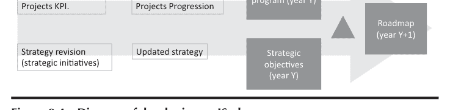

图8.4 制定IS计划的示意图。

大多数公司已采用系统化的方法来指导安全活动。这一过程值得进一步正式化，例如建立论坛或决策委员会来管理优先级。本章介绍的几个步骤和工具可以启发安全经理和管理机构采用类似方法，以改进安全计划管理流程。

## 第9章

## 安全度量

安全度量缺乏标准并非偶然。信息安全（IS）本身没有自身的维度或特性。一家公司的“安全规模”可以通过其财务影响——即成本——来衡量，但如果不同时衡量利润、灵活性、附加业务价值、资产保护等其他方面，则是不够的。这背后有几个因素，包括安全活动的多样性（从战略层到运营层）、无法划定其范围（技术、人员、应用、物理等），以及度量单位或被度量对象的问题。事件、风险水平、泄漏、威胁、损失等对不同的人意味着不同的东西。

然而，度量安全对于良好治理至关重要。高级管理层最终对安全负责，他们需要包含稳定的安全充分性关键点指标（KPIs）的报告。公司需要一种务实的方法来监控安全对策的有效性，以便调整其计划并决定安全投资，而这些投资需要通过某种量化收益度量来证明（解释）其合理性。监管框架也要求提供度量指标。

本章介绍用于治理和管理目的而开发安全度量的主要工具或实践。它们将用于报告、仪表板或针对治理机构的专题研究，以帮助其基于确凿事实做出决策。示例中会展示一些具体的度量指标。

本章还回答了以下问题：

-   为什么度量安全很困难？
-   可以使用哪些类型的度量？
-   基本的财务度量有哪些？
-   我们能否使用一些建模来估算 ROSI 或更好地评估变更的影响？

我们如何回答“我们的安全状况如何”这个问题？
是否有更务实的方法来度量安全？
如何设定安全目标并衡量目标进展？
如何度量运营有效性？
我们如何了解安全的真实成本？
我们如何与同行进行比较？

### 9.1 为什么度量安全很困难？

人们普遍认为，管理层和董事会并未获得相关或期望的信息，以评估安全防护的整体水平、安全投资回报或成本效益比。安全被视为实现业务目标的手段，但不断增加的投资在高级管理人员中滋生了挫败感和误解。

由于“要了解我们的安全状况应该度量什么？”这个问题得不到答案，许多人认为安全终究是一份保险单，其年度保费保护公司免受意外的打击。显然事实并非如此。此外，公司倾向于降低保费，同时希望灾难永远不会发生，或者即使发生，保险覆盖也足够。许多首席执行官或官员很想走这条捷径。不幸的是，ISMS 不能与保险相提并论。保险保护众多被保险人免受数量有限且覆盖范围明确的事故影响，而公司的安全保护的是单一被保险人，免受无数事故的影响，却不评估这些事故的可能性、影响或如何赔偿。

> **示例**
> 
> 因服务不可用（由于网络攻击或自然危害）造成的财务损失可以投保，但公司无法为失去客户信心、丢失机密数据或窃取工业机密投保。

在安全领域，没有普遍接受的指标来衡量现有控制措施的充分性。事件观察（或未观察到的事件）或检查技术安全设备生成的统计数据（例如，被阻止的病毒或入侵尝试的数量）无法让人对安全的充分性形成判断。在“充分安全”下允许多少起事件、什么类型的事件？如果没有观察到任何事件怎么办？这使得难以精确度量安全投资的有效性。

公司不共享其漏洞和事件的数据或统计信息，因为这些信息会带来负面形象。一些案例会被媒体报道，但不会提供本可以让人得出成本或所利用漏洞相关结论的细节。此外，也没有用于匿名交换统计数据的通用定义或术语。*事件、攻击、损失、投资*等术语对不同的人意味着不同的东西。因此，很难比较可用数据，因为没有方法或度量校准标准。

容易获得的指标往往无法回答高管们提出的问题。安全设备会产生大量活动痕迹，例如已应用的补丁、检测到的漏洞、警报、入侵尝试、防病毒工具处理的电子邮件量、认证错误、系统访问迹象、权限变更等。日志管理解决方案能够关联这些痕迹、生成报告，从而确保符合法律和规范性要求。然而，高层级度量需要额外努力来关联和汇总这些不同的指标。它们必须提供有关预期结果或有益于公司的改进信息。

> **示例**
> 
> 为了判断投资新的身份和访问管理（IAM）系统是否合理，统计一段时间内权限变更的次数没有意义；相反，我们应该检查是否减少了延迟、优化了可用资源的使用，或减少了错误数量。

*好的，但我们能做什么？可以使用哪些不同的度量？*

尽管准确度量安全存在困难，但仍可使用多种方法来获得务实的指标或度量，这里将予以介绍。首先说明，度量可分为两大类：定量度量（用公认的度量单位表示）和定性度量（用主观评价表示）。

> **示例**
> 
> 在风险管理概念中，财务损失类别阈值可以按预算的百分比设定，如第7章（风险管理）所述。这意味着我们能够计算风险事件的实际损失，例如网络攻击的后果。这些是定量度量。然而，其可能性无法根据一段时间内的事件数量来计算，因为我们无法获得这些信息。然后我们可以基于主观估计，用定性度量（罕见、不太可能、可能、很可能或几乎确定）来表达。

度量 IS 的不同策略可归为以下类别：

-   *财务度量*关注安全控制投资的财务影响。
-   *建模*允许基于模型（而非真实值）做出投资决策。
-   *安全状态评估（度量）*涉及使用各种定性评估工具，对整体安全状态或特定领域（例如网络安全、连续性或应用安全）进行评估。
-   *基于假设的度量*根据我们想要证明（或无法证明）的内容来引导度量过程。
-   *态势或成熟度评估*与标准或监管框架相比较，是一种关于成熟度水平的定性度量，与良好实践的标准或基准进行比较。审计可归入此类别。
-   *运营度量*衡量安全活动的运营有效性。
-   *目标进展度量*是建立度量或 KPIs，以衡量向既定目标的进展程度。
-   *成本分析*对不同安全类别中的成本进行分析，通常为治理提供高度相关的指标。
-   *基准比较*允许在类似公司之间进行度量。

这些类别将在下文展开讨论。

### 9.2 财务度量

IS 领域的财务度量有助于评估保护解决方案中的投资机会。简单来说，如果安全投资的成本低于潜在损失（固有风险），则被认为是合理的。反之，则完全没有道理。请注意，这种推理没有考虑事件发生的概率。

年度损失期望（ALE）是对风险影响所导致的潜在年度损失的评估。该评估可能涉及所有风险或仅涉及某些场景。与风险相关的问题一样，概率度量存在问题（参见前面的示例）。再次提醒，除非同时评估风险发生的概率，否则单独计算 ALE 毫无意义。

ALE 度量通常与*总拥有成本（TCO）*相关联，其思想是比较两者的趋势或演变。TCO 对于安全而言相对容易计算。它包括安全或 ISMS 计划中的所有成本、硬件、软件和人力资源（另请参阅后面关于

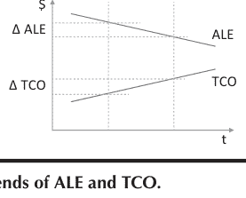

## 图 9.1 ALE 和 TCO 的预期趋势

成本分析）。TCO 回答了“安全成本是多少？”这个问题。TCO 为高级管理人员所熟知，他们习惯于比较收益和费用的演变，包括与安全相关的费用。

单独的安全投资带来的收益——经济增加值（EVA）——由于前面提到的原因难以计算，但可以通过观察 ALE 和 TCO 的变化间接计算。这两种趋势均在图 9.1 中呈现。安全投资的附加价值即可表示为：

EVA = ΔALE / ΔTCO

为了使安全投资具有成本效益，EVA 始终应 <1。确实，如果根据此公式 EVA > 1，则安全投资（TCO）不足以弥补潜在损失。如果 EVA = 1，则安全成本仅勉强弥补潜在损失的演变。

这里表达的 EVA 可视为与安全投资回报率（ROSI）相同。有多种工具或方法可根据特定安全流程或控制措施的损失和投资分析来计算 ROSI。

这些方法的主要困难在于，损失的估计必须与其发生概率相关联，适用于所有业务部门和所有已部署的控制措施，这可能非常不准确。精确的计算方法需要多年统计数据，其中包括事故的精确数据、其类型以及所产生损失的估计。而这仅针对直接损失的估计。间接损失（如客户流失或声誉受损）则更难估计。显然，企业在不断变化的生产环境中同时跟上新技术，无法有效管理如此庞大的数据量。

正如刚才所述，试图为所有安全投资计算安全投资回报率（ROSI）是非常困难的，甚至是不可能的。另一方面，对于防火墙、入侵检测系统、杀毒软件等要素或孤立的技术保护设备而言，相对容易计算。在此过程中界定范围和确定测量的目的至关重要。

在讨论测量领域的界定和 ROSI 的评估之前，必须了解安全控制提供的益处。作个类比，车辆制动系统的益处是显而易见的。然后我们可以量化故障成本并估算 ROSI，这可能非常高。如果没有关于附加价值的这些问题的答案，我们就无法设计指标并计算 ROSI。

### 示例

为了计算强身份验证的利润或附加价值，我们可以取与基于简单用户 ID 和密码的身份验证相比系统附加值的增加量。该附加价值可通过欺诈风险的降低或负面经济影响的降低来计算。用于评估威胁或漏洞的指标，例如包括能够轻松访问应用程序的人数增加或暴露的应用程序数量。对于财务影响，我们可以使用专业机构的数据泄露成本调查，并在公司的特定背景下进行估计或外推。

但真的有必要准确计算 ROSI 吗？更重要的是能够基于风险分析评估其规模。我们现在将重点放在基于事件发生概率及其影响估计来计算 ROSI。为了估计事件的总成本，显然有必要了解其影响并估计修复损失的总成本。为了估计影响，我们可以使用有关损失的出版物或任意设定成本。同样可以根据不同的报告或专业研究来估计概率。

## 9.2.1 基于风险分析的 ROSI 计算

补救措施获得的收益是固有风险（无安全控制）和残余风险（设置补救措施后）之间的差额。如果我们认为补救措施会改变发生概率（P）（例如，由于杀毒软件或入侵检测等措施，攻击发生的概率会降低），则风险影响（或 ALE）可按如下方式计算：

Impact of the inherent risk = Cost of incident × P(inherent risk)

Impact of the residual risk = Cost of incident × P(residual risk)

收益可表示为：

Benefit (EVA) = Impact of inherent risk − Impact of residual risk

ROSI 为：

ROSI = Benefit − Cost of countermeasures

因此与管理层的讨论将围绕发生概率的计算；换句话说，如何分析风险。应该能够说明所采取的安全措施如何改变发生概率和/或影响程度。

## 9.2.2 保护能力指数

如果我们知道按其发生概率加权的固有风险（*IR*）的影响以及按其概率加权的残余风险（*RR*）的影响，则可以使用称为 *保护能力*（*PC*）的指数，表示为：

PC = (IR − RR) / IR

如果指数趋向于 1，则保护能力为理想。这将发生在残余风险的影响非常小（或趋向于 0）或固有风险与残余风险之间的差异非常大的情况下。该指标背后的思想是对现有的保护手段或风险缓解程度赋予价值。如果我们知道降低风险的运营成本或控制成本，就能够随着投资的演变跟踪我们的保护能力的演变。*IR − RR* 差额代表风险降低能力。

这引发了几个思考。首先，只有与所分析风险影响直接相关的运营成本才应予以考虑。换句话说，我们只需要关注降低所分析风险的控制措施。理想情况下，*PC* 将按风险计算。随后，可能可以将多个风险的指数汇总为一个具有平均保护能力的指数。

通过结合控制措施的运营成本指标和按风险划分的保护能力指数，我们将能够呈现风险图，突出显示关系：运营成本 − 保护能力（图 9.2）。这还将指出运营成本高但保护能力低的风险（右下区域）。

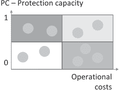

**图 9.2** 根据其保护能力和运营成本的风险分布。

### 示例

分布式拒绝服务（DDoS）网络安全风险或旨在通过查询饱和使 Web 服务器不可用的攻击将通过相对昂贵的控制措施来缓解，只要发生概率或影响大幅降低，这些控制措施就可能是合理的。在这种情况下，尽管运营成本高，保护能力仍接近 1。该风险将在图 9.2 中位于右上角。

计算机数据丢失的固有风险影响非常高，但备份降低了这种可能性，因此残余风险非常小。因此，保护能力接近 1（非常高），而运营成本相对较低。因此该风险将在图 9.2 中位于左上角。

*我们能否使用一些建模来估计 ROSI 或更好地评估变化的影响？*

## 9.3 建模

许多学科使用模型来表示现实，以便模拟或观察系统的行为，进行“如果”分析，或推断决策的影响。

所有涉及新投资的变革项目都以增加成本的设置阶段为特征，随后是运营阶段，届时实际成本（按生产价值单位计算的运营成本）会下降。成本演变建模不仅可以直观地看到拟议解决方案的 ROI，还可以考虑到初始投资后直至盈亏平衡（BE）点的 *timeframe*（图 9.3）。在新解决方案启动期间，设置成本会增加到运营成本中。由于新解决方案投入运营后成本会下降，在摊销项目执行成本后，经过一段时间后将达到 BE 点。我们在这里谈论的是 ROI 的 *timeframe*。

这种方法使得能够根据预期收益规划支出。为了使此类建模成为可能，重要的是预测当前解决方案（现状）的运营成本演变、项目成本以及

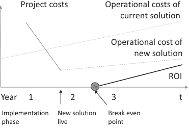

图 9.3 运营成本建模。

图 9.4 ROI 的置信区间。

新解决方案的运营成本。因此，ROI 将计算为当前解决方案（现状）与新解决方案之间运营成本的差异。

这种模型的另一个优点是其仿真能力。我们可以通过改变项目成本和运营费用演变等参数来观察盈亏平衡点的变化以及 ROI 的演变。在缺乏准确测量数据的情况下，这将突出趋势并显示 ROI 置信区间（图 9.4）。

存在大量需要盈利能力建模的 IS 变更项目，例如设立负责运营和安全监控的团队、引入新的入侵检测系统、引入新的身份认证方式等。所有这些案例都涉及确定实际成本的演变或新解决方案与旧解决方案相比的成本效益比。

**示例**

新基于角色的访问权限管理系统将

- 提高授权效率
- 自动将权限传播到目标平台
- 以规律频率验证权限
- 为新需求提供更大的灵活性

基于以下数据可以进行简单的 ROI 计算：项目成本、新解决方案的年度运营成本，以及处理相同访问权限量（相同结果）的当前解决方案的年度运营成本。运营成本将通过劳动力成本、基础设施成本和间接成本（如错误）相加获得。由于难以准确估计新解决方案的运营效益，可以做出一些假设和模拟，以得出如图 9.4 所示的 ROI 置信区间。

*我们能否回答“我们的安全状况如何？”这个问题？*

## 9.4 衡量安全状态

安全计划的态势、能力和成熟度是能够以简洁和标准化的方式呈现安全状态的手段的同义词。回答“我们的安全状况如何？”这一需求促使安全管理人员开发不同的度量和展示工具。治理需要简单、标准化的方式来可视化安全状态。作个类比，风险分析使我们能够了解我们的“敌人”（威胁），而安全态势使我们能够了解我们的“武器”（控制措施的质量）。

正如前面提到的，符合标准并不意味着拥有足够的安全性。然而，在某些条件下，不同的标准或最佳实践可以用于评估安全态势。标准列出了所需的过程，但未提出评估标准或符合性等级。也没有关于如何满足要求的建议。

**示例**

ISO 27002 中的控制目标 A.8.3 媒体处理建议实施控制措施以“防止存储在媒体上的信息被未经授权披露、修改、移除或销毁”。标准提出了目标和最佳实践，但没有说明应如何实施。该过程在企业中可以具有不同的成熟度等级，从“不存在”到“优化”，包括所有中间等级。

一些标准提供了评估安全等级的标准。ISO 15408——信息技术安全评估标准（通用标准）可实现计算机系统或产品的 fiy安全认证。满足某一等级要求的系统也满足较低等级的要求。软件工程研究所提出的“Measures for Managing Operational Resilience”，Allen, Curtis, SEI, 2011 中提出了类似的衡量韧性的方法。如果韧性满足某一等级的要求，包括之前等级的要求，则被评估为处于该等级。

### 9.4.1 成熟度模型

成熟度模型通常根据数值尺度评估流程。国际标准化组织（ISO）27001 或美国国家标准与技术研究所（NIST）等标准可用于建立将评估成熟度的流程或控制目标清单。成熟度模型随后为每个流程提出数值尺度上的评估标准。存在许多数值尺度的示例，例如 ISO/国际电工委员会（IEC）15504 信息技术——流程评估（图 9.5）提出的尺度。

分配流程或控制目标成熟度值的评估标准必须设计为避免任意选择的风险。它们必须足够明确，尤其是无歧义。因此，成熟度模型的质量取决于为每个被评估流程或目标提出的评估标准的质量。ISO 27001 标准中控制目标 5 信息安全政策的评估标准示例见表 9.1。

图 9.5 根据 ISO 15504 的不同流程成熟度等级。

**表 9.1 成熟度评估标准示例**

| 评估目标 | 评估标准 0：不完整，1：已执行，2：受控，3：已建立，4：可预测，5：优化中 | 成熟度等级 |
|---|---|---|
| 信息安全政策 | 0: 没有安全政策 1: 存在一些正式指示并得到应用 2: 安全政策正式存在并覆盖整个 IS 3: 安全政策存在，其应用受控 4: 安全政策得到应用并更新 5: 安全政策定期根据风险和业务单元需求进行调整 | 2 |

**图 9.7** 与假设相关的指标。

为了便于指标定义，一种策略是将初始假设细分为子假设，然后根据这些子假设定义指标，以便能够证实或驳斥它们（图 9.7）。

存在不同的基于假设的测量方法，例如“麦肯锡诊断方法”、目标-问题-度量（GQM）（《目标问题度量方法》，Basili, Caldiera, Rombach，马里兰大学，1994）。

**示例**

为确保在重大事件后灾难恢复程序中考虑所有关键流程，决定检查服务等级协议（SLA）是否已定义并经过测试。

| 假设/目标 | 子假设 | 指标 |
|---|---|---|
| 关键流程的恢复时间有明确的 SLA | 所有关键流程均正式识别 | 已识别的关键流程数量/关键流程总数 |
|  | 所有已识别的关键流程均有恢复时间 SLA | 缺乏足够 SLA 的关键流程数量 |
|  | 恢复测试包括所有关键流程 | 特定期间内测试的关键流程数量 |

*安全目标是如何设定的，其进展如何衡量？*

## 9.6 衡量安全目标的进展

平衡计分卡（BSC）是跟踪绩效并推进支持业务战略目标的流行工具[《平衡计分卡：将战略转化为行动》，Robert S. Kaplan, David P. Norton, Harvard Business Review Press, 1996]。作为一种众所周知的管理工具，它为建立和传达结果提供了正式基础。它可用于监控安全绩效，从而帮助将安全定位为与其他业务单元平等的合作伙伴。作为监控安全目标的工具，它还可以促进管理层对安全问题的认识。

仅靠财务绩效无法提供评估一个单位对公司合并结果贡献所需的所有信息。BSC 方法提倡根据以下四个视角设定的目标进行基准比较：运营、客户关系、发展（学习与成长）和财务。四个视角必须有助于支持公司的战略和愿景（图 9.8）。每个视角都关联一个核心问题，以指导用户选择将应用的目标和绩效指标。

安全领域 BSC 的最佳实践特别提到将目标与业务目标保持一致的重要性。如前所述定义的安全战略应在制定测量目标及其相关指标时作为高层参考。战略目标可以在每个 BSC 视角中通过更详细的目标来补充。以下是针对安全治理 BSC 开发的一些建议。

**运营视角：**“我们如何改进安全流程？”

我们将进行测量以改进安全流程的绩效，更好地支持业务并与公司战略保持一致。我们将衡量流程效率和相关成本。

图 9.8 平衡计分卡中的四个视角。

*客户视角：* “安全应如何被我们的客户感知？”

我们将重点关注影响内部或外部客户的安全流程，或支持以客户为中心的业务流程的活动。安全运营必须被我们的客户视为对其自身成功的贡献者。

*演进视角：* “我们如何提升应对威胁的能力并为业务机会做出贡献？”

我们将衡量自身的准备和培训水平，以支持业务演进所带来的变化。在此背景下，前面所述的成熟度目标可能很有用。

*财务视角：* “安全如何有助于提升公司的财务绩效？”

我们将衡量安全投资的回报或财务目标。由于直接衡量安全投资回报率（ROSI）较为困难（如前所述），我们可以专注于提升有助于业务流程财务绩效的控制措施有效性的目标。

安全治理平衡计分卡（BSC）的一个示例在第 10 章（报告与监督）中呈现。

许多著作涉及开发安全平衡计分卡的问题。它们包含平衡计分卡的指导和批判性分析，以及 DOs 和 DON’Ts 的回顾。最大的关注必须放在目标选择及其相关指标上。没有可以提出的标准衡量方法。目标可以通过战略、风险分析、成熟度研究或审计发现来识别。目标不应过度增加，每个目标的指标数量应限制在三到四个。平衡计分卡方法也可用于安全组织的一部分或安全领域的特定方面。

*如何衡量运营有效性？*

### 9.7 衡量运营绩效

安全运营可视为安全计划框架内设立的控制措施。例如，安全运营中心（SOC）通过入侵检测技术、数据防泄漏解决方案、控制台或事件跟踪等方式监控威胁状态。运营绩效可以通过数字、比率和趋势进行衡量和展示。运营效率指标可作为风险管理和成熟度分析的补充指标。表 9.2 显示了运营效率领域的一些指标和趋势示例。

**表 9.2 运营效率衡量示例**

| 测量目标 | 指标 | 趋势 ↗ 更好 ↘ 更差 |
| --- | --- | --- |
| 意识 | 受训于高风险的员工百分比 | ↗ |
| 解决审计发现的效率 | 解决审计发现的平均延迟 | ↘ |
| 配置管理 | 已修补系统数/待修补系统数 | ↘ |
| 事件处理 | 事件平均解决时间 | ↗ |
| 事件处理 | 开展的具体分析次数 | → |
| 事件处理 | 具体分析的平均工作量 | ↘ |
| 安全组件不可用率 | 安全组件停机时间 | ↗ |
| 身份与访问管理 | 处理变更访问权限请求的平均延迟 | → |
| 身份与访问管理 | 错误率 | → |
| 变更项目中的安全支持 | 检测到的不合规次数/项目数 | ↗ |
| 警报处理 | 平均检测和响应时间 | ↗ |
| 应用安全 | 修复漏洞的平均时间 | ↘ |

*我们如何得知安全的真实成本？*

### 9.8 安全成本分析

如上所述，安全成本或总拥有成本（TCO）可以成为治理的重要指标，特别是如果它与公司整体费用演变、员工数量、风险演变、产生成本的因素等其他因素相关时。对董事会经常提出的“安全花费多少？”这一问题的准确回答，需要考虑所有不同的实际成本。仅引用一个数字是不够的；必须对其进行解释并与许多其他要素联系起来，以便真正清晰。

安全支出必须根据成本会计原则进行分析。为此，每项安全支出应记录在以下类别之一中：

- 人工、间接费用、安装、折旧（直接成本）
- 使用的内部服务（间接成本）
- 所涉及的 IS 服务（根据提供的 IS 服务）
- 向公司其他部门分摊费用的关键

可以使用公司其他部门已在实践中的成本会计方法。这样，安全成本（支出）就可以使用相同的标准进行分析，并以管理层和董事会熟悉的格式呈现。成本或支出可以根据后续可能进行的分析目标以不同方式进行分配。例如，如果我们想了解外部服务（咨询）成本占总体成本的比例，就必须将其记录在专门的费用账户中。然后我们可以突出以下关系或分析：

- 成本在不同类别（直接、间接）中的分布
- 各类别成本的明细和演变
- 与其他指标（如营业额变化、员工数量、威胁演变等）相比的支出变化
- 与业务或地理单元相关的支出分布
- 多年来的支出演变
- 按提供的服务领域（IS、连续性、SOC、物理安全、IAM 等）划分的支出

这里不会讨论成本会计技术，因为有许多专业著作专门论述它们。成本会计是一门允许进行全部或部分成本计算的学科，是企业管理的基石和主要工具。为了能够呈现有意义的报告，必须根据我们想要的呈现方式收集数据。分析成本的呈现示例将在第 10 章（报告与监督）中给出。

> *我们如何与他人进行比较？*

### 9.9 基准测试

基准测试一词指的是比较提供相同服务的公司或其各自流程，以获得潜在改进的见解。会产生一套量化比较指标，有助于决策和目标定义。比较同一行业的公司是一种被企业高管广泛认可的技术。它使得衡量和比较不同战略的结果成为可能。然而，除了比较公开的财务结果外，很难在运营领域比较公司，特别是信息系统流程，因为有关事件或保护手段的数据并未公开。

尽管如此，在安全领域仍有几种方法可实现基准测试分析。不同专业公司就网络安全或某些流程的成熟度等特定主题进行的调查或研究包含相关信息，可评估他人正在做什么。他们还拥有关于客户实践的知识库。这些数据是保密的，但它们可以提供匿名基准测试服务。

主题研讨会或会议也是交流和比较不同公司实践的场所。在这些会议上经常进行调查，结果会提供给参与者。一些公司同意相互分享有关安全流程的信息，特别是如果它们处于同一行业。这不仅可以比较和澄清战略方法，还可以交流解决问题的经验。

同一行业的企业协会经常对成员的做法进行研究并分享这些信息。首席信息安全官（CISO）论坛或协会提供了进行小型调查的机会，提供他人正在做什么的信息。外部审计师也是了解其他公司实践的信息来源。他们不能传输机密数据，但在与审计发现相关的评论中可能会提及在其他地方观察到的某些趋势。与一项发现相关时，他们可能会提到公司与在其他地方观察到的平均水平相比如何。公司还可以委托专家对安全服务的定位与在其他公司的类似服务进行比较研究。

### 9.10 结论

拥有可靠的指标是良好治理的必要条件。安全也不例外。监管框架也要求公司在决策过程中拥有可靠的指标。

开发安全指标并不容易；它需要管理者和负责指标开发、汇总和维护的人员付出努力，这些指标必须服务于预先设定的目标。最应避免的是试图利用现有指标的相反做法。指标用于在监督和报告过程中提供事实要素，正如我们在下一章将看到的那样。因此，更安全的做法是尝试回答那些

管理者以他们理解的语言，使用众所周知的工具或方法提出要求，例如财务指标、建模、成熟度或态势、基于目标或假设的指标、衡量目标进展情况、运营指标以及成本核算。

即使安全无法被精确衡量，出于治理决策的目的，也可以对其进行监控和监督。同样重要的是，在报告和监督流程中运用这些指标并听取相关意见之后，维护并加强一整套指标。

## 第10章：报告与监督

良好的治理依赖于基于关键指标的报告，以评估信息安全（IS）的充分性、安全计划管理的质量、成本或安全投资回报（ROSI），以及目标的进展情况。首席信息安全官（CISO）/首席安全官（CSO）提供的安全报告常常被管理层认为过于技术化，他们无法从中找到决策所需的相关信息。另一方面，管理层往往无法清楚表达他们需要在报告中看到什么，导致安全报告应包含哪些内容存在某种模糊性。

安全的价值常常被以不同的方式看待。对于专业人员来说，针对某些威胁部署防护就足以证明投资的合理性，而管理层则希望投资能够以数字或可理解的比率形式呈现结果。报告方法必须加以调整，以业务术语呈现安全活动，例如风险降低、投资回报（ROSI）、对业务发展的贡献等。因此，找到一种标准化的方式来呈现安全数据，使管理层能够跟进安全计划并做出投资决策，至关重要。

在本章中，我们介绍一种面向管理层和董事会的报告与监督方法，它基于各种度量与指标。这些报告的制定将以回答以下问题为导向：“我们现在是否比去年更安全？”、“我们的安全支出是否合理？”以及“我们应该改进什么，以及如何改进？”

本章回答了以下问题：

-   安全报告的目的是什么？
-   什么是战略指标？
-   安全报告系统的主要组成部分有哪些？
-   如何呈现安全成本？
-   安全报告与安全仪表板之间有什么区别？

*安全报告的目的是什么？*

### 10.1 报告对治理的重要性

安全的最终责任在于董事会。这就是为什么他们需要包含稳定指标的报告，以呈现特定时间点的安全状态。报告与监督的目的是为治理机构提供所需的所有相关信息，使其能够判断特定时间点的安全状态，并提供指导。第8章（计划管理）中介绍了一些指导安全计划的基本要素。作为报告与监督活动的一部分所产生的信息有时被称为*战略指标*。所有这些信息不必集中在一份文件中提供。CISO或管理层可以利用这些资源向所有利益相关者传达安全状态：董事会、管理层、员工、客户、业务部门、通讯员和审计师。

诸如“我们的安全支出是否合理？”、“我们的安全状况如何？”或“我们的安全成本由哪些部分构成？”等问题不仅合理；它们是迈向更好治理的自然演进的一部分。安全的充分性问题至关重要，是每一位公司高管的主要关切之一。

公共统计或调查很少能为安全投资需求提供答案，因为风险无法在公司环境之外进行评估。不准确的财务论证会损害安全的可信度，并削弱安全团队与公司业务部门之间的关系。因此，报告应包含指标以及普遍接受的计量单位，如成本、事件、风险、预算、战略、年度目标等。

安全管理人员越来越多地向公司更高层级汇报，并且通常是在信息技术（IT）部门之外（见第6章，组织），这一事实也加剧了对报告的需求。他们必须知道如何向管理层解释安全投资的战略和理由，如果可能的话，使用业务语言并具有全局视角。他们不仅汇报成本/收益，还通过阐述对组织的益处，汇报较长期的发展战略方向。

高级管理人员习惯于分析公司的高层指标——亏损、收益、比率、经济事件、销售目标等——以进行预测或理解特定情况。安全是基础设施或支持的一部分，因此他们对现有对策的整体有效性的报告或反馈更感兴趣。他们寻求理解成本的演变。他们对某个孤立流程或组件的运营指标或ROSI计算兴趣不大。由于他们关注的是增加收入、降低成本、改进产品或服务以及成本控制，因此安全报告只有采用同样的方法和同样的语言，才会被纳入考虑：战略和职能的对齐、实现绩效目标、改进或控制合规性、团队绩效、创新以及对客户的附加价值。

*那么，什么是战略指标？*

### 10.2 安全报告系统的组成部分

战略指标是高层指标，或指标或运营指标的聚合，用于报告安全状态或管理安全计划。这些指标从不同视角向治理机构呈现信息安全状况。回答“我们有多安全？”这个问题并不容易。这就是为什么将通过更具体的问题来间接回答，这些问题的答案提供了关于安全状态的战略指标或报告要素。这些具体问题如下。

1.  **战略**
    -   信息安全如何促进公司战略的实现？
    -   战略举措的进展情况如何？
2.  **风险**
    -   我们的主要风险是什么，它们如何演变？
    -   风险缓解计划的进展情况如何？
3.  **态势**
    -   我们的安全态势如何，我们的防护能力如何？
    -   哪些流程/控制措施需要改进，为什么？
4.  **合规与审计**
    -   我们的合规差距是什么？
    -   我们正在采取什么措施来弥补？
    -   审计发现问题的整改状态如何？
5.  **计划**
    -   安全计划的基本原则是什么？
    -   计划中各个项目的状态如何？
6.  **治理**
    -   我们的治理状况如何，需要哪些改进？
7.  **安全成本**
    -   我们的安全成本由哪些部分构成？
    -   它们如何演变？
8.  **安全目标**
    -   我们的目标是什么，我们是否实现了？
    -   下一时期的目标是什么？

以下是对IS治理机构进行报告与监督所需的战略指标的描述。具体的度量和指标不会详细说明，因为它们是第9章的主题。如前所述，报告需求与运营指标的建立之间存在非常强的依赖关系。事实上，正是报告或监督的需求将决定所需的指标。让我们再次指出，安全报告与监督可以涉及公司整体安全，也可以仅涉及某个领域、地理单元或业务线。在呈现指标时，构成这些指标的所有要素或度量都必须可用。这将提供额外的解释，使报告能够被正确理解。

> **示例**
>
> 不能简单地声称某项风险自上次评估以来有所增加。我们必须能够通过关键风险指标（KRI）或事实观察来解释，例如类似公司中观察到的事件数量增加、威胁或漏洞增加、引入了新技术等。

报告要素或战略指标相互依赖。例如，如第8章所述，安全计划直接依赖于战略、风险、态势和合规。这种依赖性以及用于制定指标的主要度量、KPI或其他论据如图10.1所示。该图展示了主要度量如何用于报告目的（从左到右）。它还展示了这些要素之间的依赖关系。换句话说，它回答了“哪些要素被用来建立安全报告的战略指标？”这个问题。

每个报告与监督过程的目的是为安全系统设定目标。这些目标不仅包括改进安全计划和控制措施，还包括财务和治理目标。

#### 10.2.1 战略

安全战略及其包含的举措应每年进行审查（见第4章）。战略举措也是第8章所定义的安全计划“计划”路线图的一部分。在报告框架中评估举措的进展（图10.2）非常重要，因为它可能影响治理机构希望确定的优先事项。在呈现报告时，可能会出现关于潜在延迟原因、资源缺乏甚至战略方向改变的问题。这就是为什么CISO应随时准备好能够解释上一时期项目进展的论据。同一类型的报告也将用于安全计划审查流程，特别是第8章中介绍的“监控”活动。

图 10.1 报告系统组件及相关指标。

图 10.2 战略举措进展的关键指标示例。

### 前提条件

策略基于正式流程，该流程定义需求、业务单元的战略方向、安全流程和控制措施的感知成熟度，以及改进安全计划的必要性。详情请参见第 4 章。

## 10.2.2 风险

如第 7 章所述，风险管理流程包括向负责风险处理规划的机构报告。报告包括所有风险及其属性的映射、热力图、影响风险的因素表，以及自上次修订以来主要事件、趋势和变化的评论。

为监督或项目调整目的进行的报告可以用风险状态的简化呈现方式进行。在这种情况下，我们建议使用包含风险趋势或演变的热力图以及包含行动计划和进展状态的高风险矩阵（图 10.3）。

该呈现突出了最重要的风险、其处理计划和趋势。可以附带评论，特别是如果这有助于理解为何高风险具有“负面”趋势。

### 示例

分布式拒绝服务（DDoS）风险因最近几个月发生的众多事件以及来自同一行业公司以勒索要求阻止服务的企图而变得非常高。解决方案是使用域名系统（DNS）提供商提出的具有清洗能力的保护方法。该解决方案在攻击者流量到达公司网络之前将其阻止。在实施此类保护之前，必须进行小型研究，以查看是否可以使用混合解决方案（可能更便宜），即继续利用本地保护工具结合 DNS 提供商提出的工具。

### 前提条件

要生成此风险报告要素，风险管理流程必须包括第 7 章中介绍的处理计划的制定。风险管理流程中使用的指标和关键风险指标不会在报告中呈现，但在需要额外信息时将提供。

## 10.2.3 态势

安全态势报告旨在引起决策者对现有保护能力薄弱点的关注。态势可以通过不同方式进行评估，例如，

### 示例

基于 NIST 网络安全框架（CSF）的成熟度模型展示。

无论选择何种模型来呈现安全态势，都应附带支持性文件，以便更好地理解当前和期望成熟度之间的差异。因此，前述示例中的合规成熟度差距可能是由于公司所在地理区域的新法规造成的。

我们还应注意，基准测试结果可能会影响成熟度评级。如果我们查看之前的网络安全示例，基准测试研究可能表明成熟度水平低于竞争对手，这可能会影响公司的竞争力。因此，期望的成熟度水平必须与竞争对手保持一致。

### 前提条件

要报告安全态势，我们必须拥有流程有效性指标、控制成熟度评估、审计发现结果，以及可能对整体信息系统或特定领域的基准测试。有关这些要素的更多详细信息，请参见第 9 章：安全指标。

## 10.2.4 合规与审计

合规差距分析已确定修复审计发现的项目的优先级。这些项目已纳入第 8 章所述的项目规划中，并且是强制性的。审查这些项目或优先级不应成为报告和监督的一部分，因为这是其他论坛或委员会的责任。治理报告所需的是修复这些发现的进展或可能的延迟。例如，此处可以呈现的高层指标包括未修复发现数量或延迟补救措施与新审计发现数量相比的演变。图 10.4 中的示例显示了修复安全审计发现延迟的演变。

**图 10.4** 审计发现整改延迟。

汇总趋势的图表应始终附带评论或解释。在前面的示例中，修复审计发现的延迟可能表明资源不足、优先级冲突或治理在设定目标时应解决的其他问题。

### 前提条件

要报告安全合规性和审计发现，我们必须拥有合规差距分析指标、合规项目进展情况以及审计发现和补救计划。

## 10.2.5 项目

如第 8 章所示，安全项目由一组运营控制措施和包含项目路线图的改进计划组成。这些项目动员资源，其目标必须得到证明（解释）。通过其项目，安全实现以下目标：战略举措的部署、风险缓解、保护系统态势（能力）的改善、合规性强化以及审计要求的纠正措施实施。因此，报告的前四个要素，加上控制有效性指标和正在进行项目的状态，将使能够呈现项目组合以及项目状态。图 10.5 显示了安全项目一部分的项目来源的展示示例。

图 10.5 安全项目项目来源的展示示例。

### 前提条件

要报告治理情况，我们必须拥有根据 TLCF 框架进行的自我评估分析以及/或审计发现或董事会或管理层委托的专业顾问研究的其他结果。

## 10.2.7 安全成本

安全支出控制中的成本核算原则已在第 9 章：安全指标中介绍。如果公司已接受成本分摊标准，则可以从不同方面展示安全支出。关于安全支出的数据，可能结合营业额趋势或员工人数等其他指标，将使董事会或管理机构更好地分析安全成本的影响并提出调整建议。

关于总体安全成本的报告可能包括以下战略指标：

- 按类别划分的成本
- 各类别成本的演变
- 与其他指标相比的成本演变，例如营业额演变、员工人数、总体预算等。
- 在其他业务或地理单元之间的费用分摊
- 按提供的服务分摊费用（信息系统、业务连续性、安全运营、物理安全、身份和访问管理 [IAM] 等）

以下是展示这些不同要素的一些示例。

### 1. 按类别划分的成本

直接安全成本由安全团队的活动产生。它们可分为人工、间接费用以及摊销或折旧。间接成本是归属于安全但并非直接由安全团队活动产生的成本。示例包括与安全相关的 IT 运营（项目、基础设施和运营）、人力资源（HR）服务、企业职能或通用服务。这些成本往往因缺乏突出显示这些成本的会计方法而被公司低估或忽视。然而，它们有时代表重要数字。通常情况下，100% 的间接成本不受 CISO 控制，因为它们由其他部门产生并归属于安全。

安全成本分配的示例在图 10.7 中呈现。分配成本的方式各不相同，但应尽可能使用公司其他业务部门使用的现有标准。根据

**Figure 10.7** *安全成本分解示例。*

根据报告的目的，也可以呈现不同详细程度。我们因此可以详细列出不同类别的所有成本；例如，人力成本可以细分为员工薪资和顾问费用相关成本、IT 服务相关支出、设置控制措施的项目成本或安全基础设施成本等。由于该分解取决于每个组织的具体情况，因此在此不会更详细地讨论。

### 2. 多个期间的成本演变

监控安全成本趋势使其更容易进行分析并与其它业务成本相关联。每个显著变化都应提供解释。图 10.8 中的示例显示折旧增加，可能由于重要安全基础设施的实施所致。

**Figure 10.8** *直接成本的演变。*

**Figure 10.10** *安全成本重新分配关键在于内部服务消费者。*

即使安全成本不能总是与“收益”挂钩，其呈现仍然相当相关。附加价值的概念极其重要，但如前所述，这一价值是通过风险处置和对战略举措的支持来体现的。管理层知道安全带来什么，但并不总是知道其成本包含哪些内容。这种成本核算可以提供相关答案。

### 先决条件

为了能够呈现真实成本，需要安全服务方面的成本核算数据。经过少量调整，实行成本核算的公司在为安全治理需求提供这些数据和报告方面不会有任何问题。

## 10.2.8 安全目标

前文提到的不同报告要素或战略指标将使董事会和管理层能够评估信息系统的总体演变并为下一阶段设定目标。这不是对计划、战略或风险管理的审查，而是监督工作后对所有活动的调整。

修订和设定新目标的主要工具之一是信息系统平衡计分卡（BSC），如第 9 章：安全指标所述。鉴于其中提及的目标具有战略性和整体性，在监督背景下使用它尤其被推荐。基于前文所述，这样的 BSC 可以如 图 10.11 所示呈现。目标和衡量进展的指标将在报告会议结束时确定，并将作为信息系统管理各领域调整的指导。

| 视角 | 目标 | 指标 |
|---|---|---|
| **财务** | 审查技术成本如何归属于信息系统。  建立按服务划分的安全成本分解。  掌握预算与实际支出之间的差距。 | 成本报告。  按安全服务划分的成本。  安全成本。 |
| **运营** | “极高”风险必须在 6 个月内降低。  将移动工作者的例外情况和/或特殊权限数量减少 50%。  缩短解决审计发现所需的时间。超过 3 个月的延迟不应超过发现问题的 10%。 | 风险缓解进展。  每年允许移动用户的例外数量。  延迟 > 3 个月数 / 发现问题数。 |
| **客户** | 减少支持业务举措的项目延迟。  审查安全战略以更好地与业务需求保持一致。 | 项目进展。  安全战略经业务部门委员会验证。 |
| **发展** | 对全体员工进行数据保护教育。  为业务部门定义安全政策适应计划。 | 意识培训参与率。  业务部门关于监管框架适当性的调查结果。 |

**Figure 10.11** *信息系统平衡计分卡示例。*

### 先决条件

以 BSC 形式建立的目标的进展衡量。先前呈现的所有安全报告项目。

## 10.3 仪表板

仪表板经常与报告混淆，区分这两种方法很重要。报告，其要素如前所述，是审查管理实践的过程，而仪表板主要是在线实时监控某些事件或指标的工具。这两种方法互为补充。仪表板通常用于跟踪运营事件，而报告则按既定频率为审查目的而编制。

安全仪表板可以由各种指标组成，便于监控安全系统。它可能包括：

- 项目进展
- 事件演变
- 内部规章违规的跟进
- 访问权限的统计数据或指标
- 按信息系统服务（运营、项目、支持、调查、研究等）划分的工作量分布
- 可能影响风险评估的内部或外部事件或事故
- 调查或取证分析的数量
- 意识培训的跟进
- 根据预先制定的计划对安全控制测试的跟进
- 威胁监控趋势

仪表板是指标的汇总，通常为一到两页，面向 CISO 或负责监督安全计划的委员会。文献中存在许多仪表板示例，我们的目标并非进一步开发它们。图 10.12 显示了仪表板示例。

**Figure 10.12** *安全仪表板示例。*

## 10.4 结论

安全报告流程满足监管机构的安全监督需求。它还作为一种沟通工具，加强了所有利益相关者之间的安全文化。本章介绍的少数高层指标传达了安全状况和计划管理的总体信息。这些指标基于第 9 章中开发的指标。与报告不同，仪表板被用作监控运营的工具。这两种方法互为补充，只要它们提供决策所需要素，公司就可以交替使用它们，以决定安全计划的演变。然而，其内容必须事先得到董事会和管理层的认可，因为它们将成为治理工具。安全报告的方法不得偏离公司为其他业务部门制定的既定标准。它必须融入文化并提供相关信息以确保适当的治理。

## 第 11 章：资产管理

在不精确了解要保护的对象或价值的情况下，有效保护或充分安全是不可能的。标准和许多作者都提到，在信息安全管理体系（ISMS）的背景下，编制资产清单是首先要做的事情。这确实很重要，尽管没有清单的公司通常已建立保护系统。当然，这是不推荐的，原因我们稍后会看到。良好的治理需要正式的资产管理，因为它优化了保护系统。风险管理流程基于对公司资产的威胁和漏洞。了解资产的价值并决定如何保护它们是风险评估和处理的必要前提。政策和标准应参考机密性和敏感性资产类别，并规定在不同情况下对其保护必须适用的规则。

资产管理需要一个基本工具，那就是资产清单。在许多人看来，这一清单是一个成本高昂、资源密集且规模庞大的噩梦。因此应务实地构建，以为业务和安全流程增添价值。区分 IT 基础设施或组件清单与待保护资产清单也很重要。与风险管理一样，需要务实的方法来关注核心要素。

本章提供了以下关键问题的答案：

- 什么是信息资产？
- 为什么管理资产很重要？
- 什么是资产清单，它有什么用途？

*信息资产是什么？为什么管理资产很重要？*

## 11.1 信息资产管理

根据 ISO 55000—资产管理 标准，资产是指“对组织具有潜在或实际价值的项目、事物或实体”。(©ISO Adapted from ISO/IEC 55000:2014 with permission of the American National Standards Institute (ANSI) on behalf of the International Organization for Standardization. All rights reserved.) 从信息安全（IS）治理的角度来看，资产是指公司所拥有且具有价值的任何信息或访问该信息的手段。信息资产可以以各种形式存在，例如电子数据、通信信息、信息所驻留的介质（数据库、文件、服务器或移动设备）、使其可访问的应用程序，或信息流经的网络。这些不同的手段也应被视为资产。因此，信息必须作为内容与其作为容器的介质或访问手段一起受到保护。这正是信息安全一直以来的做法，只是对类别或不同类型资产的关注程度或区分程度有所不同。为了更好地理解公司的不同信息资产，我们可以先将其分类。并非要穷举，我们可以区分以下类别：

- 所有介质上的数据（数据库、纸质、办公文件等）
- 应用程序或软件（内部开发或采购）
- 硬件和设备（笔记本电脑、服务器、移动设备、U盘）
- 作为信息流支持的网络
- 基础设施（作为信息可用性的手段）
- 人（员工和第三方知识）

信息安全领域的所有标准都对资产管理提出了建议。国际标准化组织（ISO）27001/2 标准在其控制目标和控制措施中提及了这一点。例如，A.8 部分 资产管理 涵盖了以下控制目标和控制措施：

*资产责任* (A.8.1)，其目标是“识别组织资产并定义适当的保护责任”，具体控制措施如下：

- 资产清单 (A.8.1.1)
- 所有权 (A.8.1.2)
- 资产可接受使用 (A.8.1.3)
- 资产归还 (A.8.1.4)

*信息分类* (A.8.2)，其目标是“确保信息根据其对组织的重要性获得适当的保护级别”，具体控制措施如下：

- 信息分类 (A.8.2.1)
- 信息标识 (A.8.2.2)
- 资产处理 (A.8.2.3)

依赖边界保护已不再可行。如果一家公司开展不同业务并采用隔离的安全策略，如第 5 章所述，那么可以肯定风险承受能力和所需保护标准也会有所不同。在这种情况下，如果不知道要保护哪些资产、它们如何分类以及在何种上下文中使用，就无法实施不同的安全策略。

经常情况下，组织在没有可行性研究或扩大对资产及实际保护需求的了解的情况下调整其安全策略。资产通常未根据其关键性和保密性进行分类，这使得制定安全策略的任务更加随意。这种做法可能导致策略不匹配并产生适得其反的效果。理解数据不仅仅是识别和盘点。为了制定可适用的策略，组织需要了解其数据生命周期，包括数据是如何创建的、涉及哪些流程和流转、在何处存储以及如何销毁。这些分析往往不完整，特别是由于缺乏明确定义的责任。

在不同标准和专业文献中可以找到的各种资产保护建议中，有三个概念至关重要，值得突出强调。它们是资产分类、资产保护的政策和标准，以及资产问责。以下关于这三个概念的解释旨在促进对信息资产治理和管理背景下某些务实做法的理解。

### 11.1.1 资产分类

我们反复提到根据不同标准对数据和其他公司价值进行分类的重要性。在安全方面，这意味着建立资产保密性和关键性的不同等级。保密等级用于定义资产可见性或可访问性的不同类别，而关键等级主要涉及其可用性和完整性。通常，不同资产等级之间没有直接相关性。“高度保密”的数据可能不被视为“高度关键”，反之亦然。

### 示例

客户档案作为包含其所有个人数据的记录，在银行机构中被视为高度保密，而可能并不非常关键（可随时获取），因为当前操作通常使用与个人数据无关的标识符或客户编号进行。另一方面，应用服务器或股票交易应用程序以及汇率数据或与第三方交易的数据将被视为运营的关键，即使它们并不敏感。

公司需要的分类级别数量不仅取决于保密性、可用性、完整性、法律和监管要求或对公司的价值等客观标准，还取决于公司根据资产类别和类型应用差异化保护的能力或意愿。资产分类还必须反映公司根据风险偏好以差异化方式保护它们的能力和意愿。如果没有必要对“敏感”和“非常敏感”数据进行不同保护，那么就不需要保留这两种保密等级。一个就够了。

### 11.1.2 资产保护标准

应为每个资产类别并根据资产使用的上下文定义保护措施。例如，重要的是要明确在何种上下文和需求下可被视为保密的应用程序可以使用，或可移动介质如何使用以及用于何种需求。在制定政策和资产保护标准时，建议使用 ISO 27001/2 等标准作为潜在适用控制措施的清单。标准在此领域提出的各种建议通常可归为五类：数据隐藏、访问控制、资产处置、监督以及可用性和完整性保证。

- 1. *数据隐藏：* 数据隐藏技术用于在丢失或被盗的情况下使数据无法使用。它们包括加密或使数据失真技术，降低数据价值，防止未经授权人员使用，并在发生重大事件时保护公司免受处罚或投诉。此处的加密密钥管理与保护至关重要，必须由安全官密切监督。

直接适用于此保护类别的 ISO 27001/2 控制目标和控制措施是 密码学 (A.10)、密码控制使用政策 (A.10.1.1) 和 密钥管理 (A.10.1.2)。

- 2. *访问控制：* 管理访问权限的政策、标准和技术旨在将资产的暴露仅限于在履行职责时需要访问的人员。这样，公司可以防止未经授权的访问并降低恶意人员威胁的可能性。

直接适用于此保护类别的 ISO 27001/2 控制目标是 信息安全政策 (A.5)、访问控制 (A.9)、访问控制的业务需求 (A.9.1)、用户访问管理 (A.9.2)、用户责任 (A.9.3)、系统和应用程序访问控制 (A.9.4)、安全区域 (A.11.1) 和 网络安全管理 (A.13.1)。

- 3. *资产处置：* 公司必须制定删除政策，处理运营和法定归档不再需要的数据。这些措施旨在限制暴露于事件的范围，并减少投诉和法律问责。

直接适用于此保护类别的 ISO 27001/2 控制目标包括：信息安全策略（A.5）、介质处置（A.8.3）、设备的安全处置或重用（A.11.2.7）、资产归还（A.8.1.4）以及可移动介质管理（A.8.3.1）。

- 4. *监督：* 资产使用必须受到定期监督，以识别不当使用模式。该领域的具体措施包括监控、日志记录、日志关联、告警以及保护日志信息。授权人员对机密资产的使用也可能受到监督。

直接适用于此保护类别的 ISO 27001/2 控制目标包括：信息安全策略（A.5）、日志记录与监控（A.12.4）、运行软件控制（A.12.5）以及事件管理（A.16）。

- 5. *可用性与完整性保障：* 公司资产必须可用且无缺陷，以确保业务运营的顺畅运行。该领域的具体措施包括备份（数据和软件）、基础设施可用性、灾难恢复、业务连续性以及场所可用性。事件发生后的恢复技术也属于此类别。

直接适用于此保护类别的 ISO 27001/2 控制目标包括：信息安全策略（A.5）、设备（A.11.2）、备份（A.12.3）、网络安全管理（A.13.1）、业务连续性管理的信息安全方面（A.17）以及信息备份（A.12.3.1）。

因此，内部监管框架必须根据资产分类及其使用环境，定义应适用的标准或保护规则。可以采用不同的方法来呈现和记录这些标准。以下是一种适用于大多数企业的方法。假设一家公司定义了三个保密类别：

- 1. *机密：* 仅限组织内特定人员访问
- 2. *内部使用：* 所有员工均可访问
- 3. *公开：* 可公开访问

表 11.1 显示了一个示例（节选），该示例按资产类型和保密类别呈现规则或保护标准。资产类型与分类交叉处的方框可以包含保护规则，或引用在其他地方记录的相同规则。这些规则（标准）必须考虑资产使用的环境，并提出应采用的保护措施。

### 表 11.1 根据不同分类制定的资产规则或保护标准

| 资产类型 |  | 应用程序 | 办公文档 | 数据库 | 可移动介质 |
|---|---|---|---|---|---|
| 类别 |  | A | B | C | D |
| 机密 | 1 | 规则 A.1 | 规则 B.1 | 规则 C.1 | 规则 D.1 |
| 内部使用 | 2 | 规则 A.2 | 规则 B.2 | 规则 C.2 | 规则 D.2 |
| 公开 | 3 | 不适用 | 规则 B.3 | 不适用 | 不适用 |

### 示例

基于表 11.1 中提出的呈现方式，办公文档（B 列）的保密规则可总结如下（简化）：

规则 B.1：归类为“机密”的办公文档必须系统性地加密或存档在受保护的文件夹中。在公司外部不得查阅这些文档。

规则 B.2：供内部使用的文档不得对外传播。这些文档必须保存在公司内部为此目的提供的文档库系统中。可以在公司外部查阅。

规则 B.3：公开文档不得包含供内部使用或机密的信息。内容不应提及公司。

内部策略必须根据资产的特征或使用环境，明确确立资产分类标准。例如，包含机密数据的办公文档必须被视为机密；计算机服务器根据其承载数据库的分类进行归类；应用程序根据其处理数据的类别进行归类。

## 11.1.3 资产管理中的角色与职责

对资产的正式责任是良好风险管理和适当控制措施的保证，这些控制措施根据策略中建议的风险偏好和措施制定。我们在这里讨论的是职能责任，而非技术或行政责任，例如数据库管理员（DBA）或应用支持。资产的职能管理者更关注资产在业务流程中的质量和正确使用，而非技术问题。数据所有者或应用所有者拥有资产的语义知识，是架构师和信息技术（IT）开发人员的主要沟通对象。

### 示例

IT 服务器承载数据库和应用程序。在许多数据中心，“服务器”资产由系统工程师负责，他们的首要任务是确保服务器及其底层应用程序和数据库的可用性。数据和应用程序的机密性和完整性（质量）责任往往没有得到明确界定。DBA 或应用程序开发人员不能被视为这些相应资产的“所有者”。他们通常不了解所承载数据的语义，也不了解应用程序的功能方面。这些资产的所有权必须由业务部门或出于运营需求使用这些资产的人员来定义。在所有涉及这些资产的变更项目（如服务器虚拟化、补丁、应用程序测试或外包）中，都必须咨询这些职能管理者。

许多公司已经建立或正在评估建立中央数据问责职能的可能性。其目标是确保数据在 IT 架构环境中受到监督并且其使用得到控制，并确保策略和控制措施的充分性。对于这类职位，目前没有普遍接受的名称或明确定义的规范，但可能是首席数据官（CDO）、数据保护官（DPO）、数据架构师或其他职位。在分配这些职责时，必须确保负责人拥有足够的权力和独立性来履行职责。这类职位可以提供专业知识，并协助首席信息安全官（CISO）、治理机构和业务高管更有效地管理资产和安全计划。

资产清单是资产管理的主要工具之一。下一节将介绍建立和使用资产清单的一些建议、方法和工具。

*什么是资产清单，它有什么用途？*

## 11.2 资产清单

我们直截了当地说：即使待保护的资产尚未被正式识别，安全计划也可能存在。换句话说，公司不会等到识别并正式记录其资产之后才建立保护系统。企业领导者不言而喻地知道要保护哪些价值，并已采取相应控制措施。医院管理者知道患者数据是机密的，必须加以保护；工业家知道制造秘密很有价值；银行家知道客户记录和自身声誉必须受到保护。那么，为什么还要担心识别公司资产？为什么要建立资产清单？

答案很简单。如果没有按照敏感度（机密性）、关键性和其他标准进行分类的正式资产清单，公司就无法优化其保护系统。没有资产清单的安全计划要么过于昂贵，要么效率低下。如果不知道要保护哪些资产、它们在哪里以及如何使用，保护就无法有的放矢，因此无法优化。这样的系统要么极具限制性且昂贵，因为理论上需要对所有资产应用最大程度的保护；要么效率低下，因为不适合保护那些值得高度保护的非常敏感的资产。它无法适应当今的经济模式和技术挑战。

> **示例**
> 
> 将不同关键性类别的应用服务器分组或虚拟化到同一物理服务器上，不利于实施差异化的可用性策略。灾难恢复计划（DRP）将无法优先提供关键流程和应用程序的运营恢复。恢复速度将减慢，因为它将应用于整个基础设施，这可能会导致公司韧性系统的削弱。

资产清单或资产登记册是组织内所有具有价值且值得保护的资产的列表，如前文所定义。它包含每个资产的必要信息，有助于风险管理和选择缓解措施。从此类清单内容中得出的数量数据和统计数据也有助于就采用哪些控制措施进行决策。资产清单还能明确确立资产保护和管理方面的责任，并满足监管要求。此处不展开讨论资产清单的不同技术格式，因为从治理角度来看它们并不重要。尽管如此，将要提到的概念可能对清单编制项目有用。

没有任何标准明确规定清单中的资产应附带哪些属性，因为属性的多样性取决于公司希望如何使用它们。然而，如果参考刚才所说的内容并牢记标准的建议，基本属性可列出如下：

- 资产的唯一标识符
- 资产名称
- 描述
- 类别或类型——由内部自行定义
- 保密类别

-   关键性等级
-   所有者或责任方（个人或部门）
-   个人数据（Y/N）
-   其他敏感数据（Y/N）——待定义
-   位置
-   是否被第三方使用（Y/N）
-   对其他相关资产的引用——依赖关系链接（例如应用程序链接到服务器或数据库）
-   引用使用该资产的业务单元和流程

资产所有者的概念至关重要。事实上，对其负责的人员或单位也负责属性以及维护库存中包含的信息。该所有者还应负责更新库存以及对其负责的资产的使用。为了能够决定为资产分配哪种分类，资产所有者可以制定详尽的示例列表（例如提供个人数据的列表，如姓氏、名字、地址等）以及分类规则。分配给资产的分类可能因不同标准而异，例如上下文，并且可能与时间相关。例如，包含战略决策的内部文件可能被归类为“机密”，直到决策被传达，在这种情况下它可以移至“有限访问”类别。

## 资产清单应如何编制？

编制资产清单并非易事。内容没有预定义的标准或模板，也没有被普遍认可的工具或方法用于其开发。仅提及 *清单* 或 *登记册* 这一术语就会引发反应，从“无用”到“不可或缺”，取决于组织的成熟度。然而，在威胁和监管框架不断演进的当前状态下，问题已不再是是否需要清单，而是如何以务实的方式制定它，以便安全计划和安全治理能够充分利用它。很可能大多数组织已经拥有清单的基本要素或以应用程序列表或 IT 组件形式存在的初步格式。

许多名为 ITAM（IT 资产管理）的自动化工具会评估所有基础设施资产（硬件、软件和数据库）以用于配置或许可目的。这些解决方案在建立 IT 基础设施清单方面具有非常详尽的优势。然而，它们通常不提供有关分类、责任以及资产在业务运营中的使用的信息。这些基础设施清单，也称为配置管理数据库（CMDB），可作为提取的起点，用于构建更高级别的信息系统资产清单，然后再通过前面提到的属性进行补充。资产清单也可以以非常务实的方式编制为列表，随着资产被识别、分配给某人的责任并赋予分类而逐步手工填写。

许多公司提供用于绘制业务运营中使用的数据、应用程序或其他资源映射的工具。这些通常是为满足与数据保护法规相关的合规需求而提供的解决方案。问卷被发送给部门经理，目的是记录其运营中使用的所有资产。这种普查方法的成果是在不同公司流程中进行数据映射（个人或机密）。它不仅用于识别资产，更重要的是了解其使用情况，这将促进风险分析和适当保护措施的实施。

与基于 IT 基础设施系统性清单的传统清单相比，这种方法可以提到许多优点。CMDB 包含有关基础设施、网络和数据存储库的大量技术信息。这是一张快照，不能提供数据的来源、其实际使用情况，尤其是不同业务单元使用数据所带来的风险。

> **EXAMPLE**
> 
> 包含在用于客户跟踪的客户关系管理（CRM）中的电子邮件地址也可能被市场部门使用。像 CMDB 这样经典且静态的资产清单会引用 CRM 数据库，但无法自动对其进行分类或突出显示其数据被其他业务单元使用的情况。

个人数据保护法规或数据隐私原则越来越多地要求公司证明其控制敏感数据流的能力。建立个人数据映射将有助于满足这一要求，同时还能实现更准确的隐私影响评估（PIA）和与个人数据处理相关的风险分析。它还有助于了解数据生命周期：数据如何收集、来自哪些来源、哪些操作依赖于它们、它们临时存储在哪里、哪些业务角色可以访问它们、哪些系统和应用程序使用它们、它们存放在哪里以及如何销毁。

> **EXAMPLE**
> 
> 《欧洲通用数据保护条例》（GDPR）第 30 条要求公司建立“处理活动记录”，以了解个人数据实际是如何处理的。目标是能够回答问题“为什么收集这些个人数据？”和“哪些流程需要这些数据？”

这种数据映射可以被视为使用机密或个人数据的应用程序或流程的清单，其属性包括流程名称、使用的资产（应用程序）、收集和处理的数据以及使用原因或理由。这将随后回答有关公司资产“如何”和“为什么”被使用的问题。

## 清单的目的是什么？

表 11.2 显示了应用程序（作为资产）在不同业务单元的流程中如何使用的一个示例。每个业务职能可以细分为多个流程，这些流程由不同的应用程序支持并在不同的业务单元中使用。一个应用程序可以在多个流程中使用（例如企业资源规划 [ERP]）。

用于构建此映射的信息可以来自资产清单，只要应用程序的属性包含对其使用的流程和业务单元的引用即可。这种应用程序映射例如突出了人力资源流程在所有业务单元中使用 A3 应用程序的事实。如果该应用程序被归类为“机密”，则有必要审查其使用的标准，特别是与其相关的保护措施的充分性（如访问权限或底层数据库的加密）。清单还应包含资产之间的依赖关系链接，使能够理解哪些资产相互绑定（应用程序、数据库和服务器），从而促进风险或法规影响的分析（图 11.2）。

清单还可用于跟踪资产保护的当前水平。如果政策和标准规定应根据其分类对资产应用哪些控制措施（见前文），那么我们就可以根据其遵守这些规则的程度来确定清单中每个资产的质量。这使得能够更好地分析与被认为保护不足或未根据内部监管框架要求获得充分保护的资产相关的风险。图 11.3 中的示例显示了保护不足的资产根据其分类和使用量（频率或用户数量）的定位。这有助于管理机构或优先排序委员会就引入纠正措施做出决策。与使用广泛且被归类为机密的保护不足资产相关的风险应作为优先事项处理。

可以引用资产清单使用的许多其他示例。公司管理机构和管理层应充分了解安全计划管理可以从信息资产清单中获得的好处。因此，他们应赞助并鼓励安全经理编制清单的努力。对此类工具的益处缺乏了解往往是拒绝拨出必要预算用于其开发的原因，这反过来削弱了保护系统，阻止了控制措施的优化，并最终增加了风险和安全相关成本。

## 表11.2 资产（应用程序）/流程映射示例

| 功能 | 流程 | 业务单元1 | 业务单元2 | 业务单元3 | … | 业务单元n |
|---|---|---|---|---|---|---|
| 生产 | 采购 |  | A1 |  |  |  |
| 生产 | 控制 | A1 |  |  |  |  |
| 生产 | 库存管理 |  |  | A1 |  |  |
| 生产 | 库存管理 |  |  |  |  | A2 |
| 生产 | 生产 |  | A2 |  |  | A2 |
| 生产 | 生产 |  |  | A2 |  |  |
| 公司职能 | 人力资源 | A3 | A3 | A3 | A3 | A3 |
| 公司职能 | 人力资源 | A3 |  |  |  |  |
| 公司职能 | 风险 | A4 | A4 | A4 | A4 | A4 |
| 公司职能 | 财务 |  |  | A2 |  |  |
| 公司职能 | 财务 |  |  |  | A2 |  |
| 公司职能 | 财务 |  | A2 | A2 |  |  |
| 公司职能 | 法律与合规 |  |  | A4 | A4 |  |
| 公司职能 | 法律与合规 | A4 | A4 |  |  |  |
| 关系管理 | 客户关系管理 | A5 |  | A5 |  | A5 |
| 关系管理 | 供应商 |  | A5 | A5 |  |  |
| 关系管理 | 支持 |  |  |  | A5 |  |
| 关系管理 |  | A6 | A6 | A6 | A6 | A6 |
| 关系管理 | 合同 | A2 |  |  |  |  |
| 销售 | 营销 |  |  |  | A5 |  |
| 销售 | 营销 |  | A5 |  |  |  |
| 销售 | 销售 |  | A5 | A5 |  |  |
| 等等 |  |  |  |  |  |  |

本章提供了以下关键问题的答案：

- 什么是法律法规框架？
- 适用于安全性的外部法规有哪些不同类别？
- 如何管理 IS 合规性？

### 法律法规框架的含义是什么？

## 12.1 法律法规框架

公司往往对其所在行业适用的外部法规，尤其是在其运营所在国家与安全相关的外部法规，一无所知或信息错误。在欧洲、亚洲或美国的多个法律框架下运营，会使适用法律的问题成倍增加。如果我们再加上这样一个事实：欧盟的不同成员国除了适用联盟的法规外，还有自己的法规，那么不同执法选择的范畴就进一步扩大了。在某些情况下，欧洲法律或法规只是成员国法律或法规的基础。由于这些地方法规具有相当描述性的性质，存在一定模糊性，因此往往难以解释这些可能更为严格的地方法规。这导致其在适用方式上存在不确定性。诸如*充分保护*或*滥用对待*等术语确实很常见，并使解释不同法规时本已存在的困难更加复杂。

依赖律师或专业顾问是当前常见的做法，哪怕只是为了决定在哪种情况下适用哪部法律或法规。不同类型的文件（例如在欧洲立法中）并不便于理解。因此，通常“指令”只向成员国规定目标，而不具体说明如何实现这些目标，而“条例”则给出更具体的指示。此外，指令不能取代当地法律。不同法律法规之间错综复杂的关系交织在一起，是企业在普遍管理合规性时所面临困难的一个例子。这种情况不仅在欧盟内部复杂，也适用于所有跨境运营的公司。

在展开管理合规计划这一主题之前，让我们指出法律法规框架中的不同法规类别。

*法律框架*一词指适用于企业的法律。这些法律可以是通用的（如法典甚至宪法），也可以是针对特定行业的（如银行或金融部门的法律、劳动法等）。跨国公司必须遵守其运营所在的不同国家的所有法律。

*监管框架*指某个行业的所有指导方针和通告（例如金融机构、医疗部门、运输等领域的法规）。该术语还包括第5章中阐述的内部监管框架。外部法规通常由行业监管机构发布。它们不被视为法律，但可能非常严格，并对业务流程产生重大影响。

*规范框架*一词可能指专业社区普遍接受的标准和良好实践。它们不像法律那样具有约束力，而是作为商业环境中的质量参考。一个国家的整个经济领域通常会强制规定必须遵守的行为规则。本书中提到的IS标准都属于这一类。

员工对法律法规框架的了解不仅保护公司免受可能的制裁，还能让员工更好地理解与其日常活动相关的约束。例如，为保护个人数据而采取的措施，必须在法律框架的更广泛背景下理解，而不仅仅与内部法规相关。因此，建立一个内部参考体系或制定一个有关适用于组织的外部法律法规框架的意识计划至关重要。这种对法律法规框架的引用和解释可以采取不同形式，例如在内网上发布摘录或参考资料，调整内部法规以纳入外部引用，或组织关于法律法规框架的意识培训。这样，员工可能需要像熟悉内部法规一样熟悉这些内容。

### 适用于安全性的外部法规有哪些不同类别？

## 12.2 影响安全性的外部法规类别

许多法律和法规包含影响IS的条款。我们无法对它们一一分析，但可以将它们划分为在许多法律框架中可能有效的不同类别。虽然没有普遍接受的分类，但以下是暂定的列表：

- 数据保护
- 电子签名
- 保存与归档
- 劳动法
- 操作风险管理法规
- 普通法
- 消费者权益
- 行业法规

*数据保护*包括与数据保护问题相关的所有法规，尤其是个人数据（数据隐私）的保护。举例来说，欧洲《通用数据保护条例》（GDPR）规定了欧洲公民个人数据的处理规则。根据该条例，所有处理欧洲公民数据或在欧盟运营的公司都必须遵守其中规定的原则。不同国家也有类似的法规或法律，例如香港的《个人数据（隐私）条例》、加拿大的《个人信息保护和电子文件法》（PIPEDA）或瑞士的《联邦数据保护法》（FADP）。这一类别包括所有旨在保护宪法保障的个人隐私和权利的法律。

个人数据保护法规保护数据处理对象（无论是自然人还是法人）的权利。简而言之，这些法规旨在确立以下原则（摘录）：

- 所有数据处理必须符合相称性原则，具有合法性。
- 数据只能出于特定目的并按照法律规定进行处理。
- 个人必须知晓对其数据进行的收集和处理目的。
- 必须获得当事人的同意（且该同意可被撤销）。

IS和IT直接受此类法律的影响，因为它们必须确保数据的正确处理、防止泄露、意外变更和未授权数据处理。一些法律有相对技术性的要求，以确保符合这些保护原则，特别是在禁止未授权人员访问、转移、传播、使用、记录等方面。如果个人数据的处理外包给第三方，则必须按照与流程所有者执行时相同的监管约束进行。只有在外包所涉数据的当事人明确同意，且没有其他法规禁止的情况下，才能进行这种转移。还可能存在其他要求，例如个人访问其个人数据的权利。许多法规中隐私设计的要求规定，个人数据的保护必须嵌入系统中，这对软件开发有直接影响。还可能存在关于数据处理者、数据控制者、数据所有者、治理机构或数据保护官（DPO）职能的组织要求。

在第3章第3.3节“对治理的影响——主动方法”中，我们展示了一个示例，说明GDPR法规对公司安全系统的影响。影响分析的细节将在后续展开。

电子签名法规包括管理电子签名认证服务提供者认可要求的法律，以及接受交易中电子签名的规则。在管理公钥基础设施（PKI）或围绕该技术的服务时，IS和IT可能会受到影响。法规通常会规定电子签名使用的要求或限制。

*保存与归档* 涵盖了规范数据和文档记录以及电子保存的法律和法规。除公认的会计准则和规则外，这些法规还规定了保存条件，尤其涉及完整性（不可伪造、真实性）、对数据修改尝试的可视性需求、保存程序的文档记录、可用性——授权人员的访问、归档数据与当前数据的分离、组织——归档领域中的角色和职责等。

IT 和 IS 主要受这些法规影响，因为公司有义务确保不可修改的数据载体的可用性，提供电子签名技术以证明记录证明系统的真实性，例如时间戳、提供监督的日志文件保存解决方案，以及在保存格式需要更改时提供迁移解决方案，从而确保所保留文档的可访问性等。

*劳动法* 主要包括有关工作场所人格保护、员工个人数据保护、人权保护、健康保护、个人完整性、工作条件、场所可达性等的法律和法规。某些行业法规可能会施加更严格或更具体的规则，特别是关于工作场所的监督或控制、私人电子邮件的使用和查阅规则、卫生法规等。IT 和 IS 受这些法规影响，尤其涉及员工的身体保护、其完整性、其健康、通信的使用和控制以及工作场所行为的监控。

*运营风险管理* 法规要求对保护业务运营、消费者、环境和经济合作伙伴承担更负责任的行为。巴塞尔 III 和《萨班斯-奥克斯利法案》（SOX）是其中的一部分。巴塞尔 III 旨在对银行和金融机构的运营风险管理施加更严格的做法。安全和 IT 间接受影响。行业法律或法规可能对某些组织施加更严格的要求。例如，瑞士金融市场监管局 Finma 已发布关于运营风险管理的指令——“银行的运营风险”（FINMA-Circular 08/21）。其附件 3 规定了九项原则，其中包含银行必须满足的要求以保护客户识别数据（CID）。

*普通法*，如宪法、义务法典、民法典、刑法典等，可能包含影响 IS 的条款。它们包括关于隐私保护、文件和会计文件的保存、未经授权访问数据和计算机系统、数据恶化、计算机欺诈、窃听和通信记录、通信间谍活动、违反电信秘密等的条款。

*消费者和商业权利* 也受到诸如垃圾邮件禁止、电子商务义务、商业秘密保护、运输和数据传输安全、消费者保护等的法规保护。例如，巴哈马中央银行已发布关于电子银行业务的法规。

*行业法规。* 法律和监管框架包括在特定国家内工业部门监管机构发布的所有指令（参见卢森堡金融部门监管委员会的例子）。我们已经在银行业提到了其中一些，但在所有其他部门也存在，特别是健康、运输、贸易和原材料运输、生产等领域。这些法规对 IS 的影响可能很大。一些当局还发布了良好实践指南，这些指南不一定是法律，但为受影响的公司设定了良好实践标准。例如，新加坡金融管理局发布了一份题为 *技术风险管理指南* 的文件，其目标是“促进采用健全的做法和流程来管理技术”。

*信息系统合规应如何管理？*

## 12.3 合规管理流程

人们常认为安全和 IT 合规是一个技术问题，只要有良好的工具来证明所需控制措施已到位就足够了。事实上，许多供应商提供治理风险和合规（GRC）解决方案，可帮助公司实现这一目标。这些是集成合规管理、政策文档、库存和风险管理、控制引用以及事件管理等技术和工具的平台。这些解决方案无疑非常有用，尤其是在有管理层支持的情况下，但仅靠它们是不够的。遵守法律和监管框架通常需要组织上的调整，正如我们在许多例子中已经看到的那样。GRC 工具的有效实施往往很复杂，这正是由于这些领域缺乏严格的过程和责任定义。

困难还在于，安全领域的合规性非常经常由首席信息安全官（CISO）或首席信息官（CIO）单独负责，他们不仅需要理解法规的要求，还需要实施合规管理流程。如第 6 章：组织中所述，安全官与法律官之间在法律能力、理解、视野和责任方面往往仍存在差距。

合规很少只影响一个业务单元；它涉及整个公司。这不是零散地应对以填补空白，而是采用贯穿所有部门的持续改进过程。合规服务必须在涉及核心业务的法规以及直接与安全或 IT 相关的法规方面发挥主导作用。高层管理人员必须保持知情并感到有责任。他们必须充当知情的赞助人，促进不同部门之间的有效合作。因此，公司必须采用系统化的方法和重复性流程来识别合规风险并分析其在整个组织中的潜在影响。

采用我们在本书中列出的标准中的目标可以帮助公司使其 IS 符合法律和监管框架。IS 主要关注以下方面的合规要求：

- 管理和治理以确保安全计划的持续改进
- 风险管理，包括不合规风险
- 通过建立标准推荐的运营控制措施来保护资产免受威胁
- 访问权限管理以确保信息可供有权访问的人使用

合规通常被视为压在企业身上的沉重负担。然而，对合规差距采取系统化管理方法可以提升公司形象并成为持续改进的手段。具有规划和流程方法的合规管理应能够显示出明显的积极效果。

> **EXAMPLE**
>
> 安全相关标准中的要求已包含应遵循的良好实践，例如基线安全配置、风险管理、资产管理、数据分类、访问控制、政策定义、事件管理等。按照标准具有一定流程成熟度的安全系统不应存在重大的合规差距。

以下几点建议与 IS 管理有关，但也可应用于其他领域。合规管理流程可概括为四个步骤：

1. 创建法律和监管框架的参考指南。
2. 开展影响评估和差距分析。
3. 处理差距。
4. 审计和监控合规性。

让我们更详细地了解这一流程及其工具。

## 12.3.1 法规清单

拥有一个直接适用于信息系统的法律和监管框架的参考或清单，有助于沟通和增强意识。其形式可以从最简单的（表12.1）到更完整的形式，包括法律条款、保护对象、法规详细描述、受影响的公司单位（业务或地域）、法律发布机构或监管机构等信息。

前面的示例展示了面向信息系统或IT的法律和监管框架参考的架构，但也可以为整个公司建立参考，在这种情况下，将包含按地区和/或业务单位的适用性标准。

## 12.3.2 影响评估与差距分析

必须针对每项法规进行差距分析和影响评估，如有可能，还应按业务单位和/或地理区域进行。这项分析必须非常谨慎地进行，可能需要多位专家参与才能准确识别差距。律师习惯于解读法律条款，审计师了解实践是否合规。然而，通过简化的合规映射，法律和监管框架需要让所有利益相关者都能访问和理解。

**表12.1 监管框架清单的简化格式示例**

| 领域 |  |  |
|---|---|---|
| ID | 名称/描述 | 参考 |
| **数据保护** |  |  |
| GDPR | 欧洲通用数据保护条例 | https://www.eugdpr.org/ |
| FADP/LPD | 联邦数据保护法（FADP） | https://www.admin.ch/opc/en/classified-compilation/19920153/index.html |
| **电子签名** |  |  |
| … |  |  |
| 等 |  |  |
| … |  |  |

### 示例

GDPR差距分析需要多种技能。律师和合规官应当能够回答诸如此类的问题：

- 公司是否在涉及范围内？
- 与客户的合同文件是否合规？
- 公司是否在进行客户画像分析？
- 供应商或第三方的数据是否受法规影响？

另一方面，他们可能无法对个人数据处理、数据所有权、技术保护措施等发表意见。为此需要征询公司中其他岗位人员的意见。

采用系统化的差距分析方法至关重要。可以针对每项法规设计一份问卷，涵盖其关键要点。这种方法可以让不同岗位的人员回答与他们相关的实践问题。提出封闭式问题并给出明确答案有以下几个好处。首先，它能够以非常明确的方式表达实践的合规程度。其次，它让组织中的其他员工能够了解他们可能不太熟悉的领域的法规实践和影响。最后，它加快了不合规分析的过程，否则该过程可能非常不精确，有时甚至不完整。表12.2是一个在关键要点上总结差距的示例。

如果某个问题无法回答，或者要求仅部分满足，答案中可以包含特殊标记并建议进一步调查。问题应引用法规条款，并提供理解目标所需的所有说明。如果某个问题的答案是否定的（实践不合规），则应提及补救所需的行动。问题的布局、呈现方式和清晰度起着非常重要的作用。它们应尽可能贴近法规的要求，同时让广泛的受众能够理解。将问题按法规的关键要点或主要要求进行划分，有助于不同岗位的人员参与，并形成对法规的总体理解。

### 表12.2 识别合规差距的问题示例（GDPR）

| 关键要点 | 同意 |
|---|---|
| 问题 | 客户能否撤回先前给予的同意？ |
| 说明 | 根据第7条，已同意使用其个人数据的客户必须拥有明确说明的方法，使其能够撤回同意 |
| 回答 | 否 |
| 需要采取的行动 | 采用同意撤回程序，并将其告知客户 |

许多咨询公司、GRC解决方案提供商和专业协会已经提供了此类问卷或工具来促进差距分析。例如，信息系统审计与控制协会（ISACA）和能力成熟度模型集成（CMMI）研究所为GDPR法规提供了一份自我评估和差距分析问卷。

可以利用该问卷的结果进行差距分析。目标是建立一份优先级清单，然后将其纳入安全计划管理中的项目，如第8章"计划管理"所述。差距可以通过不同的方式呈现和传达；例如，使用类似于表12.2所示的形式。差距分析还有助于识别特定于法规的风险或不合规风险，例如在数据保护法规情况下的客户或第三方风险。

隐私影响评估（PIA）是识别、分析和处理与公司服务和产品以及公司运营系统相关的隐私风险的过程。进行这些分析是为了识别法规或最佳实践对个人数据（数据隐私）保护的影响，或者确保个人数据按照公司政策进行处理。这种做法旨在在变更或引入新服务的背景下降低监管风险。最重要的是，它有助于更好地了解收集和使用了哪些个人数据、用途是什么，以及数据处理是否符合合法性原则。英国信息专员办公室（ICO）在《进行隐私影响评估：实践守则》中发布了一个良好实践示例。

## 12.3.3 差距处理

弥合差距可能需要重大调整，并可能影响TLCF中的所有构建模块。在实施技术解决方案之前，必须特别注意调整政策和标准，因为内部监管框架必须反映外部要求。第3章"控制框架用例"第3.3节"对治理的影响——一种主动方法"中给出了GDPR法规影响的示例。

有时，遗留系统无法适应新的法规。例如，隐私设计（privacy by design）的概念可能无法在遗留系统中得到体现。此类例外应明确反映在内部政策和法规中。尽管如此，仍应引入合规计划和额外的控制措施。合规项目应融入战略举措，成为带来可感知质量的发展的一部分，而不仅仅是满足监管机构的简单措施。明确制定并辅以额外措施的例外情况将被审计师和客户接受。

## 12.3.4 审计与合规监控

内部和外部审计为治理、管理和信息系统运营提供了坚实的支持。征求外部意见并让系统接受评估，其好处显而易见。参考第1章中介绍的ISO 27014，审计使治理机构能够在"保证"（Assure）流程中履行监督职责。安全官也利用审计结果来提高现有信息安全管理体系的成熟度，并在治理机构面前为各项举措提供依据。最后，安全运营经理利用审计结果来改进控制措施。然而，必须注意确保审计项目经过规划以涵盖优先主题（例如审查潜在低成熟度的安全流程），并且后续的审计结果由安全官及其团队进行讨论和接受。

审计在影响分析和识别监管框架差距方面也可以发挥重要作用。审计师可能会被要求在审计过程之外对合规性发表意见。事实上，组织可能会寻求审计公司作为顾问提供建议。审计师在审计期间无权向客户提供建议，但如果他们以顾问身份受聘，则可以提供建议。此类顾问的附加价值在于，他们不仅作为法规专家，而且作为审计过程中所用评估标准的专家提供建议。这种双重能力使组织能够优化合规工作。

## 12.4 结论

良好的信息系统治理需要高效的合规管理流程。外部法规的复杂性在未来几年将不断增加，这要求合规管理具备高水平的成熟度和组织性，尤其是对于跨国运营的公司。可以采用不同的方法，类似于本章介绍的方法。无论如何，必须引入重复的法规监控和持续适应过程，作为适应公司需求的合规性的唯一保证。充分的合规需要公司内不同职能人员以及外部专家的参与。从长远来看，对GRC解决方案的无知或盲目信任很少能带来可行的解决方案。与计划管理或安全风险一样，合规管理需要采取务实的方法。在依赖外部专业知识的同时，对提出的解决方案保持批判态度，并调动内部技能，从长远来看会有所回报。

## 进一步阅读

### 第 1 章：安全治理
- Krag Brotby, “信息安全治理：一种实用的开发与实施方法”, Wiley, 2009
- Alexandre Fernandez-Toro, “信息安全管理，ISO 27001 和 ISO 27002 的实施”, Eyrolles, 2012
- Todd Fitzgerald, “信息安全治理简化”, CRC Press, 2012
- Richard O’Hanley and James S. Tiller, “信息安全管理手册”, CRC Press, 2013
- S.H. von Solms and R. von Solms, “信息安全治理”, Springer, 2009
- Marko Cabric, “企业安全管理”, Butterworth-Heinemann, 2015
- Tony Campbell, “实用信息安全管理”, Apress, 2016
- Michael E. Whitman, Herbert J. Mattord, “信息安全管理”, Cengage, 2016
- Charles Sennewald and Curtis Baillie, “有效安全管理”, Elsevier, 2015
- “2018 年信息安全状况调查全球报告”, PwC, 2018. http://www.pwc.com/gx/en/issues/cyber-security/information-security-survey.html
- “泽字节时代：趋势与分析”, Cisco, 2016. www.cisco.com/c/en/us/solutions/collateral/service-provider/visual-networking-index-vni/vni-hyperconnectivity-wp.pdf
- Rassoul Ghaznavi-Zadeh, “企业安全架构——自上而下的方法”, ISACA Journal, 2017. https://www.isaca.org/Journal/archives/2017/Volume-4/Pages/enterprise-security-architecture-a-top-down-approach.aspx
- Jean Jacques du Plessis, Anil Hargovan, Mirko Bagaric, “当代公司治理原则”, Cambridge University Press, 2011
- “信息安全治理，董事会和执行管理层的指导”, IT Governance Institute, 2006.
- “信息安全治理，信息安全经理的指导”, IT Governance Institute, 2008.
- Michael Fitzgerald, “安全与业务：财务基础”, CSO Online, 2008, http://www.csoonline.com/article/394963/security-and-business-financial-basics?page=1
- Daniel E. Greer, Jr., “数据安全经济与战略”, Verdasys, 2011.
- Shon Harris, “信息安全治理指南”, TechTarget, 2018. http://searchsecurity.techtarget.com/tutorial/Information-Security-Governance-Guide
- Jody R. Westby and Julia H. Allen, “企业安全治理 - 实施指南.” Software Engineering Institute, Carnegie Mellon University, June 2007.
- Pauline Bowen, Joan Hash, and Mark Wilson, “信息安全手册：管理者指南”, NIST, 2006. https://csrc.nist.gov/publications/detail/sp/800-100/final
- COBIT 5: 企业 IT 治理与管理的业务框架, ISACA, 2012
- 企业安全架构, 白皮书, John Sherwood, Andrew Clark & David Lynas, 2009
- ISO/IEC 27014: 信息技术 — 安全技术 — 信息安全治理, ISO/IEC 2013

### 第 2 章：控制框架
- NIST 特刊 800-53 第 4 版: https://nvd.nist.gov/800-53/Rev4
- ISO/IEC 27001: 信息技术 — 安全技术 — 信息安全管理体系 — 要求, ISO/IEC 2013
- ISO/IEC 27002: 信息技术 — 安全技术 — 信息安全控制实施准则, ISO/IEC 2013

### 第 4 章：战略
- John P. Pironti, “开发信息安全与风险管理战略”, ISACA Journal, 2010
- Chris McClean, “建立值得业务考虑的治理、风险和合规战略”, Forrester, 2012
- Ed Ferrara and Andrew Rose, “创建能够创造真实业务价值的安全战略”, Forrester, 2014
- Martin Whitworth, “构建更好安全战略的六个步骤”, Forrester, 2016
- ISO/IEC 15504: 信息技术 - 过程评估, ISO/IEC 2012
- “开放信息安全管理成熟度模型”, The Open Group, 2011

### 第 5 章：政策
- Tom Scholtz, “创建企业信息安全章程的最佳实践”, Gartner, 2014

### 第 6 章：组织
- “精通 CIO 的新业务高管角色——来自 2018 年 CIO 议程报告的见解”, Gartner, 2018. https://www.gartner.com/imagesrv/cio-trends/pdf/cio_agenda_2018.pdf
- “2018 年 CISOs 担忧什么”, A Ponemon Institute Survey, 2018. https://www.opus.com/resource/2018-ciso-survey-ponemon-institute/
- Andrew Rose, “建立战略安全项目和组织”, Forrester, 2013
- Christopher McClean, “为成功构建你的安全实践”, Forrester, 2015
- Taryn Aguas, Khalid Kark, and Monique François, “新的 CISO 引领战略安全组织” Deloitte Review, Deloitte, 2016

### 第 7 章：风险管理
- Jack Freund and Jack Jones, “衡量和管理信息风险：FAIR 方法”, Elsevier, 2015
- Evan Wheeler, “安全风险管理：从零开始构建信息安全风险管理计划”, Elsevier, 2011
- “董事会在有效风险监督中的关键作用”, Ernst & Young, 2013
- Devassy Jose Tharakan, “保护信息 - CIO 和 CISO 的实用策略”, ISACA Journal, 2016
- Christopher McClean, “定义并阐明风险管理的作用”, Forrester, 2016
- ISO 31000: 风险管理 — 指南, ISO 2018
- “Risk IT 框架”, ISACA, 2009

### 第 8 章：项目管理
- Mark Rhodes-Ousley, “信息安全”, McGraw Hill, 2013
- Jason Andress, Mark Leavy, “构建实用的信息安全计划”, Elsevier, 2017
- Joseph Opacki, “构建安全文化：为什么安全意识不起作用以及应该怎么做”, ISACA Journal 2017. https://www.isaca.org/Journal/archives/2017/Volume-4/Pages/building-a-security-culture.aspx
- Laura Koetzle and Renee Murphy, “开发你的信息安全管理体系”, Forrester, 2017
- Christopher McClean, “定义路线图以加速你的安全计划”, Forrester, 2015

### 第 9 章：安全指标
- Lance Hayden, “安全指标：衡量安全和保护数据的实用框架”, McGraw Hill, 2010
- Andrej Volchkov, “如何从治理角度衡量安全”, ISACA Journal, 2013. https://www.isaca.org/Journal/archives/2013/Volume-5/Documents/How-to-Measure-Security-From-a-Governance-Perspective_jrn_English_0913.pdf
- Ed Ferrara, “不要让你的高管感到无聊——用他们能理解的语言与他们交流”, Forrester, 2011
- Bill Brenner, “企业谈 IT 安全支出：投资回报率在哪里？”, CSO Online, 2010. http://www.csoonline.com/article/518764/companies-on-it-security-spending-where-s-the-roi-
- Scott Berinato, “几个优秀的信息安全指标”, CSO Online, 2005. http://www.csoonline.com/article/220462/a-few-good-information-security-metrics
- Bruce Schneier, “安全投资回报率：事实还是虚构？”, Computerworld, 2008. http://www.computerworld.com/s/article/9114021/Security_ROI_Fact_or_fiction_
- Michael Cobb, “衡量风险：安全专业人士指南”, InformationWeek Reports, 2012. http://reports.informationweek.com/abstract/15/8840/Risk-Management/strategy-measuring-risk-a-security-pro-s-guide.html
- “The Open Group 发布信息安全管理成熟度模型”, The Open Group, 2011. http://www.opengroup.org/news/press/open-group-releases-maturity-model-information-security-management.
- ISO/IEC 15408-1:2009, 信息技术安全评估准则 http://www.iso.org/iso/iso_catalogue/tc/catalogue_detail.htm?csnumber=50341
- Julia H. Allen, Pamela D. Curtis, “管理运营韧性的措施”, Software Engineering Institute, 2011.
- Steve Dickson, “如何衡量网络安全投资的投资回报率”, ITSP Magazine, 2018. https://www.itspmagazine.com/from-the-newsroom/how-to-measure-the-roi-of-cybersecurity-investments
- Daniel E. Greer, Jr., “数据安全经济与战略”, Verdasys, 2011.
- Derek Slater, “安全指标：关键问题”, CSO Online, 2012. http://www.csoonline.com/article/455463/security-metrics-critical-issues
- “Forrester 的身份和访问管理成本模型”, Forrester, 2015. https://www.forrester.com/report/Forresters+Identity+And+Access+Management+Cost+Model/-/E-RES130561#
- 安全指标, Cigref, 2007. https://www.google.ch/search?q=indicateurs+s%C3%A9curit%C3%A9+cigref&ie=&oe=
- ISO 27004 信息技术 - 安全技术 - 信息安全管理 - 测量, ISO/IEC 2009

### 第 10 章：报告与监督
- “连接各点：董事会网络安全监督的主动方法”, KPMG, 2014. https://home.kpmg.com/cn/en/home/insights/2015/12/connecting-the-dots-201512.html
- Ed Ferrara, “确定信息安全资产和负债的价值 - 信息安全经济学 102”, Forrester, 2012
- Andrew J. Sherman, “收获无形资产：在公司知识产权中发现隐藏收入”, AMACOM, 2012
- Andrew Rose, “CISO 手册 - 向董事会汇报”, Forrester, 2013

## 第11章. 资产管理

- “ISO 55000:2014 资产管理 — 概述、原则和术语” https://www.iso.org/obp/ui/#iso:std:iso:55000:ed-1:v2:en
- “ICS 中的资产清单和安全管理”，Home / Blog / ICS 中的资产清单和安全管理，INCIBE 2016. https://www.certsi.es/en/blog/asset-inventory-and-security-management-ics
- “GDPR 第30条解决方案简报，GDPR 第30条合规性的实用指南”，TrustArc，2018. https://info.trustarc.com/gdpr-article30-solutions-brief.html
- Heidi Shey, John Kindervag, “了解您的数据以创建可操作的政策”，Forrester, 2013
- Dejan Kosutic, “如何根据 ISO 27001 处理资产登记（资产清单）”，27001 Academy, 2018. https://advisera.com/27001academy/knowledgebase/how-to-handle-asset-register-asset-inventory-according-to-iso-27001/

第三方和外包风险管理，124
职责，122–125
在网络安全中，125–126
在数据隐私中，126
演变，119–120
在欺诈管理中，126
在信息系统治理和管理中，115
在人力风险管理与调查中，126
作用，38，113，122–125
CISO，参见 首席信息安全官 (CISO)
CMDBs，参见 配置管理数据库 (CMDBs)
CMMI，参见 能力成熟度模型集成 (CMMI)
特雷德韦委员会发起组织委员会，139
普通法，235
沟通，45
业务，122–123
合规
和 CISO，123–124
影响安全的外部法规，领域，233
普通法，235
消费者和商业权利，235
数据保护，233–234
电子签名，234
劳动法，235
运营风险管理，235
保存和归档，235
行业法规，236
对于 IS，46–47
法律和监管框架，232–233
管理流程，236–237
审计和合规监控，241
缺口分析，238–240
影响评估，238–240
法规清单的创建，238
处理缺口，240–241
问题，61
安全报告，207–208
配置管理数据库 (CMDBs)，46，226–227
消费者和商业权利，235
联系频率，154
控制目录，171–175
在审计中，172
开发，174–175
在治理和管理监督中，172
在内部组织中，172
安全控制列表，172–173
在项目管理中，172
控制框架，安全治理，21–49
层次结构，23
ISO 27001 与 TLCF 之间的映射，49–52
模型构建模块，功能，32
资产管理，45–46，217–230
合规，46–47，231–242
运营层，48–49
组织，37–39，111–134
政策，35–37，95–110
项目管理，41–43
报告和监督，44–45，199–216
风险管理，39–41
安全指标，43–44
策略，33–35
运营层，32
战略层，30–31
战术层，31–32
三层，22–30
控制，层次结构，23
成本，用于安全
分析，182，195–196
报告，210
按类别分解成本，210–211
按服务分配成本，212–213
几个时期内成本的演变，211–212
与其他指标相比的安全成本演变，212
将安全成本重新分配给其他业务部门，212
成本会计，195
加密货币存储基础设施和密钥保护，92
CSF，参见 网络安全框架 (CSF)
网络安全，66，125–126
网络安全框架 (CSF)，12，48–49，67
与框架比较后的发现，68
网络安全政策，92
仪表板，214–215
数据分析，241
数据库管理员 (DBAs)，223

- 数据隐藏，221
- 数据映射，228
- 数据所有者，223
- 数据隐私，126
- 数据保护，233–234
- 数据保护官 (DPO)，133–134
- DBAs，参见 数据库管理员 (DBAs)
- DDoS，参见 分布式拒绝服务 (DDoS)
- 决定流程，165
- 资产处置，222
- 分布式拒绝服务 (DDoS)，185，204
- 分布式安全，130
- 文档框架
  - 用于内部规章，102–103
  - 用于风险，143
- 执行流程，166
- DPO，参见 数据保护官 (DPO)
- 经济增加值 (EVA)，183，184
- 电子签名，234
- 企业方法，81
- 企业安全，129
- EVA，参见 经济增加值 (EVA)
- 需求表达和安全目标识别 (EBIOS)，139
- 扩展企业，95
- 信息风险因子分析 (FAIR) 方法，153–154
- FAIR 本体，153–154
- 数据保护联邦法 (FADP)，234
- 反馈，166，175，200
- 财务指标，182，182–184
  - 保护能力指数，185–186
  - 基于风险分析的 ROSI 计算，184–185
- 欺诈管理，126
- 缺口分析，238–240
- 缺口处理，240–241
- GDPR，参见 通用数据保护条例 (GDPR)
- 通用数据保护条例 (GDPR)，61–63
- 目标-问题-度量 (GQM)，192
- 治理，4
  - 益处，5
  - 定义，5
  - 信息系统，4–9
  - 职责，10
  - 与风险，137–139
  - 与业务目标，8
  - 特征，8–9
  - 定义，5
  - 五个轴，6
  - 低效/不适当，示例，7
  - 与管理对比，9–11
  - 目标，6
  - 自我评估，55，56–61
- 治理风险和合规 (GRC)，236
- GQM，参见 目标-问题-度量 (GQM)
- GRC，参见 治理风险和合规 (GRC)
- 指南，97
- 热力图，159，164，205
- 文件层级，在监管框架中，98
- 人力风险管理与调查，126
- 人力安全分析师，132
- IAM，参见 身份和访问管理 (IAM)
- 身份和访问管理 (IAM)，23，28，92–93，101–102
- 影响评估，238–240
- 信息资产管理，218–220
  - 分类，220–221
  - 保护标准，221–223
- 信息安全 (IS)；另见 业务安全，2–4
  - 治理，4–9
  - 机构，职责分配，117–118
  - 与业务目标，8
  - 特征，8–9
  - 定义，5
  - 五个轴，6
  - 框架，26–28（另见 三层控制框架 (TLCF)）
  - 低效/不适当，示例，7
  - 与管理对比，9–11
  - 目标，6
  - 职责，10
  - 重要性，3–4
  - 问题，2–3
  - 管理，9–11
  - 与治理对比，9–10
  - 职责，10
  - 计划，175
  - 监管机构，12
  - 风险，135–136

- 标准，11–12
  - ISO 27014，16–18
  - ISO/IEC 27000 系列，14–16
  - 组织，12
  - SABSA 方法，12–13
- 信息安全管理体系 (ISMS)，11，14，16，18，21，165–168，175–177
- 信息系统审计和控制协会 (ISACA)，12，138，240
- 固有风险，184，185
- 国际标准化组织 (ISO)，12
- 清单
  - 资产，224–230
  - 法规，238
- IS，参见 信息安全 (IS)
- ISACA，参见 信息系统审计和控制协会 (ISACA)
- ISMS，参见 信息安全管理体系 (ISMS)
- ISO，参见 国际标准化组织 (ISO)
- ISO 15408，188
- ISO 15504，189
- ISO 27001，14–15，22，24，65，189
  - 与 TLCF，49–52
- ISO 27001/2，24，218–219，221–222
- ISO 27005，138，139，219
- ISO 27014，16–18，114
  - 目标，17
  - 原则，16
  - 流程，17–18
- ISO 31000，138，139–141，219
- ISO 31010，138
- ISO 55000:2014，218，219
- ISO 55001:2014，219
- ISO 55002:2014，219
- ISO/IEC 27000 系列，14–16
- ITAM（IT 资产管理），226
- IT 工程，128
- IT 安全，128
- 关键绩效指标 (KPIs)，25，27，43，166，176
- 关键风险指标 (KRIs)，147，150，154，164，202
- KPIs，参见 关键绩效指标 (KPIs)
- KRIs，参见 关键风险指标 (KRIs)
- 劳动法，235
- 法律框架，232–233
- 难度等级，154
- 日志管理解决方案，181
- 损失事件频率，154
- 损失幅度，154
- 成熟度模型，189–191，205
- 指标，166
- 模型构建模块，安全治理，32
  - 资产管理，45–46，217–230
  - 合规，46–47，231–242
  - 运营层，48–49
  - 组织，37–39，111–134
  - 政策，35–37，95–110
    - 关于业务需求，36
    - 用于文件框架，36–37
  - 治理和管理组件，36
  - 对扩展企业的支持，35
  - 项目管理，41–43
  - 报告和监督，44–45，199–216
  - 风险管理，39–41
  - 安全指标，43–44
  - 策略，33–35
- 建模，运营成本，182，186–187
- 监控流程，166
- 国家标准与技术研究所 (NIST)，12，32，35，189
- NIST，参见 国家标准与技术研究所 (NIST)
- NIST 800-30 标准，145
- NIST 800-53 标准，23–24，41
- 规范框架，233
- 运营层，IS，48–49
- 运营关键威胁、资产和漏洞评估 (OCTAVE)，138
- 运营指标，182
- 运营绩效，测量，194–195
- 运营风险管理法规，235
- 运营经理，113–114
- 以运营为导向的安全，127–128
- 组织，安全
  - CISO 和团队
    - 新的责任领域，125–126
    - 新需求，115–121
    - 运营，121
    - 策略和业务需求，121
  - 定义，111

- IS, 37–39
  - profiles, 130–131
    - CISO with extended responsibilities, 132
  - data protection officer, 133–134
  - human security analyst, 132
  - security administrators, 131
  - security architect, 133
  - security coordinators, 131
  - security delegates, 132, 133
  - security engineers, 131
  - third-party security coordinators, 132–133
  - questions for, 59
  - roles and responsibilities in ISMS, 112–115
  - structures, 126–127
    - distributed security, 130
    - enterprise security, 129
    - IT security, 128
    - operations-oriented security, 127–128
- Oversight and reporting, for security, 44–45
  - components of, 201–202
    - audit, 207–208
    - compliance, 207–208
    - governance, 209–210
    - posture, 204–207
    - program, 208–209
    - risks, 204
    - security costs, 210–213
    - setting objectives, 213–214
    - strategy, 202–204
  - dashboards for, 214–215
  - for governance, 44–45
  - need for, 200–201
  - purpose of, 200–201
  - questions for, 60
- Personal data, GDPR recommendations on
  - categorization, 62
  - classification, 62
  - identification, 62
  - incident management, 63
  - inventory of, 62
  - protection
    - by design, 62
    - measures, 62
    - organization and responsibilities in, 62–63
  - regulations, 234
  - risk management for, 63
  - third parties, liability of, 63
- Personal Data (Privacy) Ordinance, Hong Kong, 234
- Personal Information Protection and Electronic Documents Act (PIPEDA), 234
- PIA, see Privacy impact assessment (PIA)
- Plan, 166
- Plan—Do—Check—Act cycle, 165–166
  - deliverables
    - feedback, 166
    - metrics, 166
    - plan, 166
  - processes
    - decide, 165
    - do, 166
    - monitor, 166
- Policies, for security
  - content of, 105–106
  - documentation framework for internal regulations, 102–103
  - internal regulatory framework, 36
  - documentary framework, establishment of, 36–37
  - extended enterprise, support for, 35
  - governance and management component, 36
  - and ISO 27001 Standard, 109–110
  - for needs of business, 36
  - principles, 96–97
  - questions for, 58
  - segregation/differentiation of, 100–101
  - three-dimensional, 101
  - regulatory framework, process of establishment, 106–108
  - regulatory framework documents, classification of
    - by business unit/business sector, 100–101
    - by nature/hierarchy, 97–100
    - by security, technology, or process, 101–102
- Posture/maturity evaluation, 182
- Preservation and archiving laws, 235
- Primary loss magnitude, 154
- Privacy impact assessment (PIA), 240
- Proactive risk management, 122, 124
- Probability of action, 154
- Probability of risk occurrence, 151–152
- Procedures, 97, 99
- Program management, 41–43, 60
  - review cycle of ISMS, 175–177
  - security program, 164–165
  - review cycle, 165–168
  - tools of, 168–175
- Protection capacity index, 185–186
- Protection standards, information asset management, 221–223
  - access control, 221
  - availability and integrity assurance, 222
  - data hiding, 221
  - disposal of assets, 222
  - privacy classes, 222–223
  - supervision, 222
- Quantitative methods of risk analysis, 153–154
- Questionnaire for TLC F block, 57
- RBAC, see Role/rule based access control (RBAC)
- Regulatory framework, for security, 232–233
  - documents, classification of
    - by business unit/business sector, 100–101
    - by nature/hierarchy, 97–100
    - by security, technology, or process, 101–102
  - internal, 35–37
    - documentary framework, establishment of, 36–37
  - extended enterprise, support for, 35
  - governance and management component, 36
  - and ISO 27001 Standard, 109–110
  - for needs of business, 36
  - principles, 96–97
  - questions for, 58
  - segregation/differentiation of, 100–101
  - three-dimensional, 101
  - process of establishment, 106–108
- Regulatory framework inventory, 238
- Reporting and oversight, security
  - components of, 201–202
    - audit, 207–208
    - compliance, 207–208
    - governance, 209–210
    - posture, 204–207
    - program, 208–209
    - risks, 204
    - security costs, 210–213
    - setting objectives, 213–214
    - strategy, 202–204
  - dashboards for, 214–215
  - for governance, 44–45
  - purpose of, 200–201
  - need for, 200–201
  - questions for, 60
- Residual risk, 184, 185
- Resilience, 188
- Return on investment (ROI), 183–184
  - calculation, 187
  - confidence interval for, 187
  - timeframe of, 186
- Return on security investments (ROSI), 183, 184
  - calculation of, 184–185
- Review cycle of ISMS, 175–177
- Risk level, 147
- Risks, 135
  - analysis, 148, 151
    - controls, effectiveness of, 153
    - of impact, 152–153
    - probability of risk occurrence, 151–152
    - quantitative methods of, 153–154
  - appetite, 142
  - assessment, 143, 154–155
  - attributes, 149–150
  - categorization, 142
  - context, threats, and vulnerabilities, evolution of, 158
  - definition of, 142
  - description, 148
  - documentation, 143
  - framework of policy for, 142
  - and governance, 137–139
  - heat-map, 159, 164
  - high and very high risks, 158–159, 160
  - identification, 144–145
    - description, 148
    - security risk inventory, establishment of, 146
    - separate and aggregate risks, 147–148
    - taxonomy/classification, 145–146
  - impacts, 152–153
  - information security, 135–136
  - legal and regulatory aspect of policy for, 142
  - management, 39–41
    - goal of, 137
    - human, 126
  - for personal data, 63
  - policy, 141–144
  - proactive, 122, 124
  - process, 139–141, 142, 143
  - roles and responsibilities policy for, 142
  - third-party and externalization, 124
  - mapping, 143, 158
  - negative influencing factors, 158
  - objectives and contexts, 142
  - principles, 142
  - questions, 59
  - scope of policy for, 142
  - skepticism, 151
  - special cases, policy for, 143
  - treatment, 156
    - acceptance of risk, 156–157
    - avoidance of risk, 157
    - reduction of risks, 157
    - transfers risks, 157
  - value, 148, 150
- ROI, see Return on investment (ROI)
- Role/rule based access control (RBAC), 23
- ROSI, see Return on security investments (ROSI)
- SABSA, see Sherwood Applied Business Security Architecture (SABSA)
- Sarbanes–Oxley Act (SOX), 235
- Secondary loss event frequency, 154
- Secondary loss magnitude, 154
- Secondary risk, 154
- Sectoral regulations, 236
- Security, 2–3; see also Information security (IS)
  - governance, 4–9
    - control framework, 21–49
    - versus management, 9–11
  - measurement, 179–182
  - operation outsourcing services, 120
  - program, 11, 164–165
    - review cycle, 165–168
    - tools of, 168–175
  - regulatory bodies for, 12
  - risk assessment, 40–41
  - risks, 39
  - standards, 11–12
  - strategy, 33–35
- Security administrators, 131
- Security architect, 133
- Security committees, 113
- Security coordinators, 131
- Security cost analysis, 195–196
- Security delegates, 132, 133
- Security engineers, 131
- Security index, 191
- Security marketing, 123
- Security metrics, 43–44, 61
  - assumption-based metrics, 182, 191–192
  - benchmarking, 182, 196–197
  - cost analysis, 182, 195–196
  - financial metrics, 182, 182–184
  - protection capacity index, 185–186
  - ROSI calculation based on risk analyses, 184–185
  - goals, measuring progress for, 182, 193–194
  - modeling, 182, 186–187
  - operational performance measurement, 182, 194–195
  - security measurement, difficulty of, 180–182
  - state of security measurement, 182, 188
    - maturity models for, 189–191
    - security index for, 191
- Security Operation Center (SOC), 194
- Security responsibility delegation, to business units, 92
- Security risk matrix, 152
- Security specialists, 113–114
- Security strategy, 71–74
  - communication, 93–94
  - content, 74
  - context, 75
  - governance and organization, 75
  - information security mission, 74
  - strategic security initiatives, 75–76
  - methodical approach to define, 76–77
    - business initiatives, 77
    - grouping initiatives, 79
    - security initiatives to improve maturity, 78–79
    - security initiatives to support business operations, 77–78
  - strategy formulation, 79
  - project to formulate, 80
    - business change initiatives, 80–83
    - initiatives grouping, 90, 91
    - security initiatives for controls maturity improvement, 89–90
    - security initiatives supporting business operations, 84–89
    - strategy formulation, 90–93
- Self-assessment, governance of, 55, 56–61
- Sherwood Applied Business Security Architecture (SABSA), 12–13, 22, 81
- Singapore Personal Data Protection Act, 61
- Skepticism, risks, 151
- SOC, see Security Operation Center (SOC)
- SOX, see Sarbanes–Oxley Act (SOX)
- Standards, 97, 99
- State of security, 175
  - maturity models for, 189–191
  - measurement, 182, 188–191
  - security index for, 191
- Strategic indicators, 200

- 战略
  - 问题，58
  - 安全系统，33–35
- 优势、劣势、机会与威胁(SWOT)分析，56
- 监督，222
- 瑞士数据保护法，61
- SWOT 分析，89
- TCO，参见总拥有成本(TCO)
- 安全团队
  - 新要求，115–121
    - 意识与支持，123
    - 业务沟通、安全账户管理和市场营销，122–123
    - 业务报告与指标，123
    - 合规与计划管理，123–124
    - 运营，121
    - 政策管理，124
    - 主动风险评估，124
    - 安全架构，124–125
    - 战略与业务需求，121、123
    - 第三方与外包风险管理，124
  - 职责，122–125
    - 网络安全方面，125–126
    - 数据隐私方面，126
    - 演变，119–120
    - 欺诈管理方面，126
    - 信息系统治理与管理方面，115
    - 人员风险管理与调查方面，126
  - 角色，113、122–125
- 第三方云基础设施使用，风险评估，92
- 第三方安全协调员，132–133
- 威胁能力，154
- 威胁事件频率，154
- 三维监管框架，101
- 三级控制框架(TLCF)，22–30
  - 应用领域，54
  - 优点，54–56
  - 作为头脑风暴工具，57
  - 组成部分，26–27
    - 分解，29
    - 功能，32–49
    - 层级/功能依赖，27–28
    - 相互依赖关系，27–28
  - 分类，28–30
  - 组成部分的功能，32–49
    - 资产管理，45–46、217–230
    - 合规，46–47、231–242
    - 运营层，48–49
    - 组织，37–39、111–134
    - 政策，35–37、95–110
    - 计划管理，41–43
    - 报告与监督，44–45、199–216
    - 风险管理，39–41
    - 安全指标，43–44
    - 战略，33–35
  - 对治理的影响
    - 主动式方法，55、61–65
    - 被动式方法，55、65–71
  - 在治理自我评估中，55、56–61
  - 控制层级，23
  - ISO 27001 标准与，49–52
  - 运营层，28–29、32、48–49
  - 目的，25–26
  - 问卷，57、58–61
  - 治理机构的职责，116
  - 标准
    - 建议，30
    - 使用，23–25
  - 战略层，28–29、30–31
  - 战术层，28–29、31–32
  - 使用案例，54–56
- TLCF，参见三级控制框架(TLCF)
- 安全计划的工具，168–175
  - 控制目录，171–175
  - 计划，169–171
- 总拥有成本(TCO)，182–183
- 二维监管框架，103
- 价值、风险，148、150
- 漏洞，154
