# 信息安全治理：CISO 与决策者的框架与工具集

献给 Beba

延伸阅读

索引

## 关于作者

Andrej Volchkov 是信息安全治理和计划管理领域的顾问。他拥有 30 年的安全计划经理经验，曾在总部位于瑞士日内瓦的大型金融机构皮捷集团（Pictet Group）负责新技术和 IT 变更管理。在皮捷集团内部，他还负责过数据隐私和数据保护领域的合规项目。此前，他曾担任 IT 部门的安全、合规及内部解决方案部门的负责人。他还曾担任项目负责人，负责信息技术架构、新技术、方法和标准的引入。在此之前，他还担任研究助理、业务分析师和软件开发人员。

Andrej 是日内瓦大学经济与管理学院安全治理领域的受邀讲师，并在一些主要的国际会议上担任演讲嘉宾。他毕业于数学和 IT 专业，拥有日内瓦经济与管理学院的 MBA 学位，是多个国际 IT 和安全协会的成员。

## 引言

为什么又写了一本关于信息安全治理的书？

在数字化转型、业务模式变化、网络威胁和合规要求的背景下，信息安全（IS）已成为企业和社区面临的主要问题。信息安全已进入决策者的议程，不再仅仅被视为一门技术学科。近年来，它从关于良好治理重要性的许多建议中受益。但对于董事会和高层管理人员来说，治理信息安全并非易事，他们的许多问题没有得到解答。如何在考虑公司实际需求的情况下，评估信息安全的充分性？

本书提供了一个用于信息系统（IS）管理与治理主要活动的建模框架。该模型同样适用于任何安全子域，例如网络安全、数据保护、访问权限管理、业务连续性等。它提供了各种工具和示例，使各类管理者能够履行其职责。管理人员和董事会成员将发现能够帮助他们更好地理解信息系统、提出良好问题或要求适当报告的要素。安全经理将找到必要的工具来承担其职责，从而满足公司及其客户的需求。

本书主要目标读者是信息安全经理（首席安全官 [`CSO`]、首席信息安全官 [`CISO`]）、高级执行官（首席执行官 [`CEO`]、首席运营官 [`COO`]）、IT 经理（首席信息官 [`CIO`]）、首席风险官（`CRO`）、董事会成员，或任何其他参与安全计划治理或管理的业务经理或项目经理。它回答了“如何做？”类的问题，并作为标准补充的工具库和务实方法论具有参考价值。随后的章节中通过许多示例阐述了相关概念。

本书并非针对标准的说明性指南，其他书籍专门负责这些标准。它也不是技术参考书。它不会提供关于最新技术的建议，也不会对要实施的工具或运营控制进行详细解释。

## 本书的结构是怎样的？

本书分为 12 章。以下是各章节的摘要。

### 第 1 章 安全治理

涵盖了信息系统治理与管理的原则和良好实践。书中说明了管理与治理之间的区别，并明确了职责的划分。书中介绍了主要的活动，并在后续章节中为这些活动开发了相应的工具。

### 第 2 章 安全治理控制框架

提出了一个三级安全控制定位概念，称为三级控制框架（`TLCF`）：战略层（治理）、战术层（管理）和操作层（技术措施）。前两个级别由构建模块或关键控制活动组成：策略、策略、组织、风险管理、计划管理、报告、资产管理、合规性和指标。书中介绍了这些模块中每个的特征和目的。重点在于该模型的实用性，将此框架与相关标准（包括 `ISO 27001/2`）进行映射，并将该框架应用于网络安全或数据隐私等特定安全领域。

### 第 3 章 控制框架用例

展示了将 `TLCF` 作为自评估治理实践工具的示例。书中说明了如何将这一框架应用于不同的安全领域，以及如何根据每家公司的需求对其调整。

### 第 4 章 战略

专注于策略开发方法和工具，这是每个安全计划的基础。本章详细讨论了以下概念：安全策略及其内容；定义与业务目标对齐策略的流程和工具；建立并执行策略开发项目；以及在识别安全计划改进倡议时展示和使用策略的方法。

### 第 5 章 策略

从实务角度处理信息系统策略和内部监管框架的制定。在指出内部监管框架的目标后，本章重点关注构成该框架的不同类型文档、策略的结构和内容，以及策略和文档框架的流程。

### 第 6 章 组织

描述了信息安全管理体系（`ISMS`）组成的主要功能、角色和职责。当前的背景要求员工、安全官及其团队的职责和特征发生变化。书中根据公司的特征和信息系统的定位展示了最合适的组织结构。

### 第 7 章 风险管理

涉及安全风险的管理。风险缓解是每个安全计划存在的意义。因此，能够正确地识别、评估和处理安全风险至关重要。通过以下主题介绍了实施实且有效的安全风险管理所需的方法和工具：具有实践建议的风险管理流程；在公司内部建立风险管理概念；风险识别、分析、评估和处理的方法论；以及风险沟通与报告的最佳方法。

### 第 8 章 计划管理

讨论了核心治理和管理活动。计划的管理必须确保适当的安全水平，并执行各项计划以实现既定目标。引导安全计划或 `ISMS` 是安全官的职责，但必须接受治理机构的监督。重点在于管理方法和工具、如何制定满足业务需求的安全计划、计划管理中的关键工具以及计划的评审周期。管理计划的关键工具之一是控制清单，书中对其进行了讨论，并为该清单的建立提供了一些建议和工具。

### 第 9 章 安全指标

专注于设计和实施用于治理过程的指标和关键绩效指标（`KPIs`）。指标是用于评估信息系统态势（能力）、投资回报率或安全计划实现既定目标进展的依据。对于 `CISO` 来说，指标一直是一项挑战，因为衡量投资有效性的合法需求与寻找可靠指标的艰巨任务之间存在矛盾。本章介绍了可以使用的指标的主要类型，以及有效设计这些指标的工具或方法。

### 第 10 章 报告与监督

针对治理需求和其他利益相关者的安全通信问题。报告的目的是根据关键指标展示安全状况及其演变。介绍了一种建立报告系统的方法，能够回答诸如“我们的安全如何？”、“演变如何？”或“我们的支出合理吗？”等问题。它也作为建立安全计划目标的参考。

### 第 11 章 资产管理

重点关注企业信息资产的管理和保护。如果不知道需要保护什么，就不存在有效的治理或务实的计划管理。这不仅涉及数据及其在业务流程中的流，还涉及所有其他访问媒介和手段，例如网络、服务器或应用程序。本章介绍了有效管理所有信息资产的方法和工具，包括如何开发和使用资产清单。

### 第 12 章 合规

提供了管理安全对法律法规框架合规性的工具。了解哪些法律法规安全框架适用于业务以及如何合规，对于治理至关重要。法律法规框架包含了公司因其活动而约束的所有法律或法规。本章提出了创建监管参考、合规性映射和差距分析的方法。它还涉及了合规项目的管理。

应该如何阅读本书？

要广泛了解所有用于治理和管理安全计划的工具和方法，最好的方法是从头到尾读完这本书。尽管如此，本书的设计使得各个章节可以独立阅读。因此，你可以从最感兴趣的话题开始，以后再回来其他章节。我们建议按顺序阅读第 2 章、第 3 章，以及第 9 章和第 10 章，以从一些前提概念中获益。

本书的内容旨在让广大读者都能理解，并立即应用于日常安全的治理和管理中。我们的目标是让复杂的话变得易于理解，最重要的是，引导读者穿过往往是枯燥的安全控制和良好实践基准的“迷宫”。书中介绍的方法、工具和示例并不非要逐照复制。它们是为了激发公司内部安全官以及公司治理过程中主要参与人员的创造力。

# 第 1 章：安全治理

作为数字经济中的重要资源，信息必须受到保护。公司意识到确保信息可用性、机密性和完整性的重要性。然而，仅靠技术安全措施已经不再足够。高级管理人员正在寻找方法，以确保与公司需求相匹配的保护水平。他们必须在遵守法律和法规框架的同时，更好地控制与信息安全相关的成本。

安全治理必须在组织的各个层面得到执行。但许多人仍然并不理解什么是安全治理，它的主要目标是什么，以及它应该如何整合到组织的现有结构中。本章提供了对以下问题的回答：

- 全球背景下信息安全背后的问题是什么？
- 高级官员对安全治理应该问哪些问题？
- 我们今天看到了哪些趋势？
- 信息安全治理到底包含什么？
- 不安全治理如何对公司产生不利影响？
- 如何识别良好的安全治理？
- 治理与管理之间有什么区别？
- 是否有特定的信息安全治理标准？

## 全球背景下信息安全背后的问题是什么？

### 1.1 信息安全对业务至关重要

信息现在以多种形式存在；存储在不同的介质上，并通过不受控制的网络进行交换。然而，它是经济和日常交易的生存资源。因此，公司必须确保信息的可用性（用于其预期用途）、机密性（仅供授权人员利用）、完整性（防止未经授权的更改）和真实性。

信息安全（IS）目前正通过确保可靠的运行以及创造新的质量化差异机会，为业务发展做着重大贡献。它越来越多地视为新业务模式中的价值创造者或运营促进者。其附加值包括提供可靠安全的交换、确保数据安全传输、实现受保护的远程访问、确保服务的可用性，并提供以受控安全的方式包流程的可能性。从更传统的角度来看，它保护了公司的专业技术和声誉，降低了运营风险，并确保符合法律和法规框架。它不再被认为是一个可以委托给专门服务的技术学科。安全正日益成为高管关注的焦点，并越来越多地在公司责任的最高层受到监督。这不仅是法律法规的要求，也是许多渴望改进成本控制和保护系统投资回报的公司的现实需求。它不再是一项辅助性活动，因为公司正在寻求优化投资并确保所部署信息安全措施的充分性。管理层和董事会还参与了制定信息安全目标，并监督其对业务目标的价值。无论他们是客户、合作伙伴、供应商、员工还是股东，所有利益相关者都关注安全问题。

## 高级官员对安全治理应该了解什么？

因此，执行官和董事会成员必须更好地熟悉信息安全问题，以便他们充分承担新职责。如果他们对以下问题没有答案，或者答案是“否”，那么确实需要审查组织内部信息安全治理的实践：

- 董事会是否定期获得信息安全风险和所采取措施的信息？
- 管理层或职线经理是否参与了有关信息安全发展的战略决策？
- 谁定义了信息安全战略、政策和指南？
- 谁负责数据保护及相关措施？
- 我们是否知道哪些业务过程受到高信息安全风险的威胁，以及正在采取什么措施来缓解这些风险？
- 机密数据存储在哪里以及如何处理？谁负责数据隐私保护？
- 我们的信息安全是否适应业务的真实需求？
- 业务部门是否为决定其运营相关信息安全措施的委员会成员？
- 我们是否知道信息安全支出是否合理以及其投资回报率是多少？

如果能够证明安全在实现战略目标和降低风险方面发挥了作用，那么它就能获得高管的关注，并在价值链中占据一席之地。安全是至关重要的，但问题在于需要什么种成熟程度：换句话说，多少什么水平的信息安全才足够？因此，它的贡献率，特别是成本，必须是可衡量的。然而，除非董事会和管理层参与设定目标并监控安全计划的交付物，否则无法实现这一点。

## 我们今天看到了哪些趋势？

多项研究强调了管理层对信息安全重要性意识的积极演变。然而，仍然注意到，技术手段往往以无组织的方式、分层部署，以克服可见的威胁。董事会和管理层没有参与，或者无法理解信息安全背后的真实问题，因此他们将此任务交给决策权较小、因此行动手段较少的机构。信息安全的投资回报没有得到系统性的评估。人们优先考虑技术解决方案，而不进行必要的组织调整。角色和责任往往没有定义清楚，资源匮乏，决策未做出，目标和信息架构没有明确建立，这导致了能量流失、成本增加，以及管理层和负责部署保护措施团队的挫败感。这反过来导致了治理机构的误解，他们对措施的充分性和与真实风险相关的成本缺乏足够的可见性，导致盲目寻找技术解决方案来应对可见威胁，但没有任何真正的控制手段。

以下观察结果可能是许多忽视信息安全领域治理性的公司的特征：

- 缺乏信息安全战略及其与业务战略结合程度的意识。
- 高管对信息安全问题和担忧的无知。
- 缺乏对信息安全绩效或安全投资回报（ROSI）的正式评估流程。
- 往往在不调整组织结构的情况下，优先考虑技术解决方案。
- 经理在风险处理的优先级排序中缺乏参与。
- 信息系统（IS）缺乏架构设计需求。

根据普华永道（《2018 年全球信息安全状况调查报告》）[源：PwC, CIO and CSO, The Global State of Information Security® Survey 2018, October 18, 2017] 的显示：“大多数公司董事会并未主动制定其公司的安全策略或投资计划。只有 44% 的受访者表示，其公司董事会积极参与公司的整体安全策略。”董事会在整体安全方面产生的影响估计如下：安全预算占 45%，整体安全策略占 44%，安全政策占 39%，安全技术占 36%，而对当前安全和隐私风险的审查仅占 1%。

根据安永（EY）第 19 次全球信息安全调查报告（2016–2017）[EY - 19th Global Information Security Survey 2016-2017]，73% 的公司担心移动设备周围的用户意识和行为薄弱，86% 的人表示其网络安全部门无法完全满足组织需求，86% 的受访者表示他们需要增加高达 50% 的预算。

这些观察让我们相信，许多公司尚未建立真正的信息系统治理。这背后有许多原因；我们的目标不是列出这些原因，而是提出一些工具来促进适应每家公司实际情况的治理流程的实施。但是，让我们先观察治理和管理活动，以更好地理解我们所谈论的内容，以及为什么它很重要。

## 信息安全治理意味着什么？

### 1.2 信息安全治理

安全治理是公司治理中不可或缺的一部分。请记住，“治理”一词没有单一的或公认的定义。它可以被总结为一系列活动和责任，旨在通过满足所有利益相关者的需求来实现公司设定的目标。从这个角度来看，我们显然可以得出，相同的治理原则适用于公司的任何其他职能部门、业务线或地理单元。因此，我们可以谈论信息系统治理以及公司特定部门或子公司的治理。因此，信息系统及其治理体系是公司全球治理体系不可或缺的一部分。

根据信息和相关技术控制目标（`CobIT`）5，《企业 IT 治理与管理的业务框架》（第 6 章），治理可以定义如下：

治理确保对利益相关者的需求、条件和选择进行评估，以确定要实现的平衡且共识的企业目标；通过优先级排序和决策设定方向；并根据共识的方向和目标对绩效和合规性进行监控。

在此阶段需要注意的是，为了公司从适当的治理中获益，董事会和管理层需要采取策略或定义公司目标，以涉及所有级别的责任，无论是在决策过程中还是在执行操作中。事实上，治理不仅关乎董事会的选择和决策。它影响层级中的所有级别，使公司能够快速决策并将其应用于业务运营中。因此，治理流程贯穿公司的所有活动并扩展到所有层面，从高层级的战略决策到操作层，双向进行。治理涵盖了驱动业务的管理行为、决策结构和流程。

与公司治理一样，信息系统治理也有多种定义。我们在这里提到一个我们认为很重要的定义，因为它强调了安全治理的强制性：

信息安全治理是一个引导和控制组织的过程，使其在组织行为（信念、行为、能力和行动）中建立并维持安全文化，将充分的安全视为业务经营中不可妥协的要求转变 Governing for Enterprise Security (GES) Implementation Guide”, Jody R. Westby, Julia H. Allen, SEI Carnegie Mellon University 2007]

因此，信息系统治理不应被视为独立于公司整体之外的附属活动，而应被视为保护资产和缓解风险的整体治理不可或缺的一部分。信息系统治理应被视为一种满足公司需求，而非仅仅是措施。这不仅仅是技能、技术或计划和程序的问题；它必须是每位员工关注的目标。

根据信息安全学会（ISI）的《信息安全经理指南》（`ITGI` 2008），安全治理必须为以下五个目标做出贡献：

1. 信息安全与业务战略的对齐以支持组织目标。
2. 有效风险管理：通过执行适当措施管理风险并将对信息的影响降低到可接受水平。
3. 价值交付：通过优化信息安全投资来实现组织目标。
4. 资源管理：高效地利用信息安全知识和基础设施。
5. 绩效衡量：通过监控和报告信息安全治理指标来确保目标的实现。

执行层对定义的安全计划的参与和承诺，显然是公司从量身定制的安全中获益的必要条件。因此，真正的问题是如何通过适当的组织和符合需求的治理体系来管理信息系统问题。信息系统不再仅仅被简化为一组技术措施。安全措施必须整合到业务流程中，依赖于定义的计划，并符合法律法规。这不仅是良好的做法，也是管理层的要求，他们负责确保公司价值得到充分保护（[图 1.1]）。

```

```

图 1.1 安全治理的五个维度轴。

遵循标准要求并不保证质量。如果一家公司的安全决策层级不足、政策和指令不适用、责任未由有权的人行使，它就无法拥有良好的治理和安全。以下是低效或不当信息系统治理的典型示例（非详尽）：

- 部署信息系统措施或控制的责任集中在一个单一部门。
- 业务部门经理认为信息系统是首席信息安全官（`CISO`）/首席信息官（`CIO`）的专属责任，由他们来确保正确的保护水平。
- 董事会不参与战略性信息系统决策，并将责任推卸，认为自己没有足够的发表意见。
- 信息安全官没有手段确保安全政策和指令的充分性和应用。
- 业务倡议和变更项目未经过评估以确保其符合安全策略或识别安全风险。
- 董事会没有关于信息安全（IS）状况、充分性以及现有措施有效性的报告。他们无法评估安全为业务带来的增值。
- 安全人员认为他们的意见没有得到上级的倾听或支持。他们的特权被缩减为应对新威胁或在反复事件发生后恢复现场的行动。
- 等此类推。

治理机构对信息安全事务的参与不足，反映了治理的不完善。仅依靠高效的技术团队和尖端工具不足以确保长期保护。如果不将信息安全措施整合到业务运营中，如果不赋能所有员工，并且不获得业务部门经理的支持，信息安全措施就无法部署。如果没有高层支持，`CISOs` 或高级信息安全执行人员及其团队将继续用有限的资源对抗显而易见的威胁，而无法采取整体且更具主动性的方法。

### 不完善的安全治理会如何对公司产生不利影响？

最后，不完善的安全治理如何影响公司目标？高管们即使他们认为自己并不关注信息安全，也需要问自己这个问题。图表 1.1 总结了在缺乏适当信息安全治理的情况下，对业务目标可能产生的负面影响。

**表 1.1 缺乏适当信息安全治理对业务目标的负面影响**

| 业务目标 | 安全治理不力时的可能负面影响 |
| --- | --- |
| 开发新业务模式 | 运营所需的保护水平不足 |
| 保护公司声誉 | 意识到交易和数据隐私安全性的客户产生负面意见 |
| 符合法律和法规框架 | 面临罚款并失去客户和合作伙伴的信任 |
| 维护公司文化和价值观 | 安全意识丧失且风险增加 |
| 成本控制 | 失去对安全相关成本的控制 |


# 安全治理与管理

## 安全措施与业务需求的对齐

| 安全措施与业务需求的对齐 | 实施的措施不当（过多或过少） |
| :--- | :--- |

| 运营风险管理 | 失去对可能影响运营的安全风险的控制 |
| :--- | :--- |

良好的治理意味着将适当的安全视为公司繁荣的前提。如果没有定义信息安全目标，就无法分配足够的资源。在这些情况下，无法实现、衡量或支持预期的保护水平。治理的某种程度的成熟要求信息安全必须由拥有足够权力和权威的领导指导，包括决策、问责和分配必要的资源。在这种环境中，安全可以通过与业务进行战略对齐、实施适当的措施（控制）将资产相关风险维持在可接受水平，并有效管理分配的资源，为公司目标做出贡献。

## 如何识别良好的治理？

有效的安全治理具有以下特征：

- **全公司参与**：已知需要受保护的资产，并定义了安全水平。业务部门认为信息安全是不可或缺的。安全措施支持业务运营。
- **职责明确**：董事会和管理层参与安全计划的决策过程。业务部门经理验证支持其运营、项目和发展策略的安全措施。识别并确保数据和流程所有权运行。信息安全专家根据定义的策略和计划实施计划。
- **保护水平取决于风险偏好**：对信息安全风险进行评估和系统化处理。定义风险偏好，并针对所有公司活动（包括运营和变更项目）建立主动风险管理机制。管理信息安全控制。
- **安全得到积极管理**：全公司参与：已知需要受保护的资产，并定义了安全水平。业务部门认为信息安全是不可或缺的。安全措施支持业务运营。

## 治理与管理之间的区别是什么？

谈论安全治理时，我们往往容易将其与管理混淆。

### 1.3 信息安全管理

安全治理与管理之间的区别并不十分明显。简单来说，管理涵盖实施和监控，而治理提供战略导向并确保其执行。信息安全管理体系（`ISMS`）实施信息安全措施或控制，并为报告目的提供监控。

为了说明这一点，我们可以使用 `CobIT5` 框架提出的方案（`Figure 1.2`）。治理包括三个活动：`Evaluate`（基于业务需求的安全状态）、`Direct`（提供导向）和 `Monitor`（监督）。管理部分包括与计划相关的活动：`Plan`（计划）、`Build`（构建）、`Run`（运行）和 `Monitor`（监控）。管理对治理的反馈是这一过程的关键点之一。确实应该是 `CISO` 来确保计划的实施并向治理汇报。他或她负责战略方向（或新业务方向）的双向通信以及运营指标报告。

```
（图 1.2）
```

图 1.2 根据 `CobIT5` 的治理与安全管理区别 [A Business Framework for the Governance and Management of Enterprise IT”, ISACA, 2011]。

通常来说，治理包括决策，而管理确保控制的实施。如果建立了策略和指南但没有严密的监控和管理，就无法实现预期的保护水平。因此，公司必须能够为其安全计划设定目标并确保其实现（治理），同时确保手段（管理）。考虑到标准等提出的 `ISMS` 主要活动，我们可以粗略概述治理与管理的权限领域，如图 1.3 所示。

```
（图 1.3）
```

图 1.3 治理与管理之间的职责分配。

请记住，治理和管理的职责存在于几乎每一个安全活动中。

一项策略不能仅通过董事会成员或管理层来验证，必须有业务经理、`CISO` 甚至运营经理的参与。为了使策略得以实施，它必须被所有人接受，并被视为计划中不可或缺的一部分。另一方面，确保日常运营的安全也需要董事会的部分参与，以确保安全措施已得到充分部署（例如，通过审计）。在这两个极端之间，所有其他活动都需要信息系统（`IS`）的治理者和管理者的共同关注。

行吧，所有这些内容在标准中已经有了充分的定义和解释了！为什么不直接遵循这些标准呢？

## 1.4 使用安全标准

我们可能会问：为什么不直接应用 `IS` 标准或最佳实践建议来建立良好的治理？在 `IS` 领域，良好的标准、指南或最佳实践基准确实是不可或缺且极其有用的。然而，它们必须回归其初衷：即作为一组帮助构建安全计划的建议。如果与建筑领域进行类比，这些标准可以比作技术施工标准，它们提供了建筑的核心组件，但不能取代建筑师的工作。安全计划是一系列核心组件、控制措施或 `IS` 措施，它们构成了一个满足公司特定需求的定义架构。

我们这里的目标不是详细解释不同的标准。关于标准已经出版了一些优秀的书籍，也可以参考标准本身非常明确的文本。我们邀请读者熟悉这些内容，如果他们还没有熟悉的话；这将进一步有助于他们对本书其余部分的理解。尽管如此，我们仍对某些在开发 `IS` 治理系统时可能有用的标准进行简要说明。

最广泛使用的国际 `IS` 标准由以下机构发布：`国际标准化组织` (`ISO`)、`美国国家标准与技术研究院` (`NIST`)、`信息系统审计与控制协会` (`ISACA`) 及其 `CobIT` 和 `信息技术基础库` (`ITIL`)。在某些特定的 `IS` 领域，还存在其他标准、建议或最佳实践基准，例如 `NIST 网络安全框架` (`CSF`)。这些标准在呈现建议的方法上有所不同：`NIST` 呈现并系统化了一个控制措施目录，`ISO 2700x` 系列在开发 `ISMS` 方面更侧重于过程，而 `ITIL` 则以专业出版物的形式呈现了面向服务的安全最佳实践。某些指令或合规框架可能由监管机构（如瑞士的 `Finma`、`香港金融管理局`或美国金融领域的`证券交易委员会` [`SEC`]）或由特定行业的协会或利益集团发布。某些法规已吸收为直接影响公司 `IS` 流程的法律（例如欧盟的《通用数据保护条例》[`GDPR`]）。

几乎每种标准都包含了 `IS` 不同领域的通用建议，范围涵盖从治理和技术基础设施到更复杂的活动或控制措施，如风险管理、访问权限管理或事件管理。它们都提到了安全系统必须满足的要求，但没有规定应如何构建，也没有提供实现特定控制措施的指南。事实上，有许多方法可以满足标准要求：我们将简要介绍用于建立安全架构的 `SABSA` 框架，以及本书中经常引用的 `ISO 2700x` 标准族。

### 谢尔伍德应用型业务安全架构 (SABSA)

`SABSA` 方法 [`Enterprise Security Architecture, White Paper, John Sherwood, Andrew Clark & David Lynas, 2009`] 并不是上述那种意义上的标准。它没有为运营控制提供目录或建议。它的目标是提供一个框架，根据业务需求建立安全架构，这使得为关键业务运营设计保护措施变得更加容易。为了避免在没有上层依据的情况下根据积累的战术控制或解决方案来构建 `IS` 系统，`SABSA` 提议基于业务目标定义安全架构。这允许根据实际需求定义运营控制。

该框架由基于六种视角的不同架构组成（见表 1.2）。

**表 1.2 基于六种视角的架构**

| 视角 | 架构 |
| :--- | :--- |
| 业务视角 | 上下文架构 |
| 架构师视角 | 概念安全架构 |
| 设计师视角 | 逻辑安全架构 |
| 构建者视角 | 物理安全架构 |
| 技术人员视角 | 组件安全架构 |
| 服务经理视角 | 安全服务架构 |

每种架构都通过解决什么、为什么、如何、谁、何地以及何时的问题进一步形成，以理解每个层及其与其他层之间的关系。这种分层方法结合过程领域，通过两种方式提供了完整的可追溯性：

1. 从业务需求到安全控制（完整性：我们识别了所有需要的东西吗）
2. 从组件架构（安全控制）到业务需求（业务合理性：每个组件是否都关联了业务需求？）

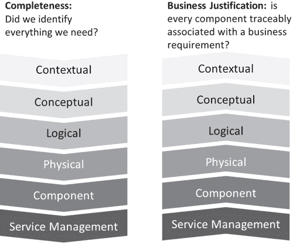

图 1.4 控制的可追溯性。

`ISO/IEC 27000` 系列包含了 `IS` 领域近 30 项参考。它们由 `ISO` 和 `国际电工委员会` (`IEC`) 联合发布。这里列出对 `IS` 治理有用的主要标准：

- **`ISO 2700x` 系列（节选）：**
  - `ISO 27001` 信息安全管理体系 要求
  - `ISO 27002` 信息安全控制规范
  - `ISO 27004` 监测、测量、分析和评价
  - `ISO 27005` 信息安全风险管理
  - `ISO 27014` 信息安全治理

- **其他处理信息安全的 `ISO` 标准（节选）：**
  - `ISO 15408` IT 安全评估准则
  - `ISO 18045` IT 安全评估方法论
  - `ISO 15504` 3 过程评估

`ISO 27001` 标准可用于 `ISMS` 的认证。然而，符合标准本身并不能保证足够的安全。除了对安全流程的认可外，认证还可能功于强制公司对其计划提出基础性问题，如果能以谨慎的态度以及构建适应公司背景和需求的计划的意愿来进行，这将是有益的。通过基于标准建立基础 `IS` 流程，安全人员可以更好地管理复杂性，改进沟通并让利益相关者放心。

为了说明标准的使用，让我们以 `ISO 27001` 建议为例，两家具有不同背景的公司以两种不同的方式应用它们。两家公司将使用完全不同的 `IS` 措施对给定的过程达到相同的成熟度。

### 示例

两家公司，一家小型家族企业（A 公司）和一家大型银行（B 公司），旨在根据 `ISO 27001` 标准建议 `A.8` “资产管理”，建立其资产的有效管理。

在附录 A 的控制目标 8 中，`ISO 27001` 将建立资产管理系统的建议归在一起。它基本上说明公司应该（抽象地）：

1. 对所有资产进行清单并分配所有者。这些包括信息（数据）、应用程序、服务器或数据仓库。
2. 对资产进行分类（根据价值、法律要求、敏感性和关键性），并在分配访问权限时考虑这些因素。
3. 定义、记录并实施适当使用资产的规则。

这两家公司主要区别在于规模和行业领域。即使没有预先分析，我们也可以很容易猜到，A 公司只有少数文件或目录包含如客户记录或生产秘密等真正的机密数据。没有涉及机密数据的复杂数据处理。另一方面，生产资产（机器或数控软件）对公司的生存至关重要。

B 公司拥有涉及机密和关键数据的复杂数据处理。它必须为内部和外部的不同用户配置以及许多客户端应用程序提供这些数据的访问权限。不同的业务操作也使用相同的数据。

A 公司对托管机密和关键数据的少数文件或数据库进行了相对简单的盘点，并为它们分配了相对高级别的所有者（首席运营官 [`COO`] 或运营经理）。信息被分为两类：(1) 机密和 (2) 非机密。类别 1 的访问权限授予了一组限制人员，类别 2 授予了所有员工。数据的可用性由备份系统确保，机密性由加密系统确保。处理这些数据的应用程序的访问权限授予了一组限制人员。

对于 B 公司来说，资产清单要完整得多：它包含了所有的应用程序、服务器和主要的机密数据流。清单中项目的属性是：所有者和隐私密级。数据的分类更为详尽：(1) 机密、(2) 受限（特定小组可访问）和 (3) 公开。传统的银行应用程序可能很少与单一类数据相关，因为它们同时使用了机密数据和公开数据。数据的责任或所有权分散在几个人之间，可能每个业务单元或地理位置分配一人。访问权限管理系统涉及复杂的工作流，以允许多个数据所有者进行验证。还有一个系统用于追踪那些拥有大量机密数据访问权限的人员。法规可能防止同时访问多个应用程序或机密数据源（职责分离）。安全控制或措施还包括不仅针对静态数据（数据库）还针对传输中数据的数据加密系统。

这只是根据每家公司的特殊性和实际需求来满足标准和法规要求的不同方法的一个示例。信息安全管理体系（`ISMS`）的复杂性取决于许多因素，包括行业领域、公司规模和复杂性以及其风险偏好。

## 信息安全治理有特定的标准吗？

(©ISO 经美国国家标准协会 (`ANSI`) 代表国际标准化组织许可，从 `ISO/IEC 27014:2013` 改编。保留所有权利。) 2013 年发布的 `ISO 27014` 标准完全致力于信息安全（`IS`）的治理。在它的概述中，它回顾了良好治理的重要性，不仅是为了确保符合法律和法规框架，而且是为了维护组织的资产和声誉。它指的是负责监督信息安全并确保实现既定目标的治理机构。它还强调了治理机构、管理层与负责执行操作的人员之间联系的重要性：“此外，有效的信息安全治理可确保治理机构接收相关的报告——在业务背景下进行构建——有关信息安全相关的活动。这使得就信息安全问题做出恰当且及时的决策，以支持战略目标。”

根据该标准，治理机构最终负责监督信息安全并确保目标的实现。

该标准首先提出了一些概念，其中我们发现了上述良好治理的特征：战略对齐、价值创造、问责、安全到位、投资决策和合规性。它随后列出了指导组织建立治理的原则：

- 原则 1：建立全组织的信息安全。
- 原则 2：采用基于风险的方法。
- 原则 3：设定投资方向。
- 原�则 4：确保符合内部外部要求。
- 原则 5：营造安全积极的环境。
- 原则 6：根据结果审查绩效。

这些原则最终被转化为五个治理过程，涉及治理机构、管理层和利益相关者的参与。这些过程的流程和相互依赖关系如图 1.5 所示。

```
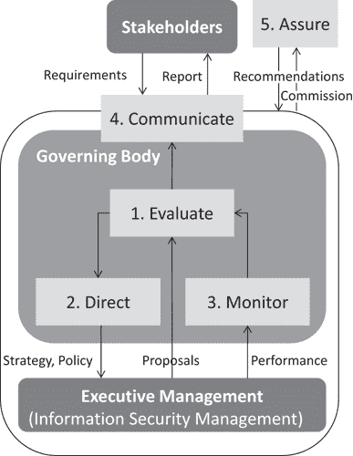
```

图 1.5 `ISO 27014` 过程。

这些每个过程的目标可以总结如下：

1. **评估 (`Evaluate`)**：将安全计划的现状与既定目标进行比较。这允许识别并沟通改进点，并为“指导”过程提供方向。
2. **指导 (`Direct`)**：就战略和目标发布指南。这些指南可能涉及资源、活动优先级、政策和风险偏好。
3. **监控 (`Monitor`)**：使治理机构能够评估目标的实现程度。
4. **沟通 (`Communicate`)**：基于评估过程元素，此过程允许治理机构与利益相关者之间交换信息。
5. **保证 (`Assure`)**：识别治理和操作方面的改进领域。治理机构可以启动审计或审查。

该标准还提到了便于决策的一些关键要素。责任在于治理机构和信息管理层（如图 1.6 所示）。因此，对于过程 1（评估），治理机构必须确保业务计划考虑到安全需求（战略、政策和指南），信息管理层必须确保 `ISMS` 支持业务目标，并提交改进信息安全状况的项目。

```

```

图 1.6 具有治理机构和信息管理层输入的治理过程。

该标准在描述治理过程时没有过多的细节，让公司能够以自己的方式采纳。因此，它可以作为参考，用以识别公司治理过程中的潜在差距。

本章节专门介绍指标，将展示如何评估一个程序或一个治理系统。我们只需提到，这是每位业务领导者都迫切需要的。问题不应仅仅是“我们的安全性足够吗？”，而也应该是“我们的治理体系有多合适？”因此，在信息系统（`IS`）治理、管理和程序开发方面，并没有单一或被一致认可的模型或方法论。这种目标需要对公司的特定特征、业务模式和背景进行彻底分析。相关标准非常有用，可以帮助定义行动范围，但最终仍取决于董事会、管理层和 `CISO` 找到引导和监督信息系统计划的最佳方法，以使其能够符合每个组织的特定需求。

在当今的环境下，信息安全是业务的一个重要部分。尽管如此，我们今天仍然看到，在某些组织中，信息系统的治理并没有获得领导者和董事会应有的关注。这一责任无疑由不同的参与者共同分担。

在本章中，我们介绍了信息系统治理的核心要素、其主要问题和特征。理解治理与管理之间的区别，有助于识别公司内部职责的潜在调整。

我们没有详细介绍良好实践的标准和基准，因为许多著作已经对它们进行了非常全面的阐述。然而，其中某些在治理方面值得更多关注，我们在本章中简要介绍了它们。它们将贯穿于各个示例中，特别是与下一章将介绍的框架相关。

许多书籍从不同角度处理信息系统治理问题，对于那些负责该领域流程开发或审查的读者来说，查阅这些书籍无疑是合适的。

## 安全治理控制框架

为了建立有效的治理和管理流程，管理性控制应当被建模或分组为易于识别的区块。在标准中，特定于治理活动通常与操作实践并列出，这使得高层执行人员难以阅读。因此，拥有一个简单的模型，在建立信息安全管理体系（`ISMS`）时展示管理层参与的主要领域，将是非常有用的。这种模型还有助于促进业务领导者参与影响信息系统（`IS`）的变更管理过程。拥有这样一个模型将更易引导与管理层的讨论，以结构化的方式审查实践，讨论新机会，最重要的是让每个人（包括那些在组织内建立适当安全方面发挥作用的安全专家）都参与进来。

本章提供了以下问题的答案：

- 我们所说的安全“控制”是指什么？
- 如何展示和突出管理性控制？
- 如何按层级责任对控制进行分组？
- 三级控制框架（`TLCF`）每个层级的特征是什么？
- 每个构建模块的作用是什么？它们包含什么内容？
- `TLCF` 与安全标准之间的映射关系是什么？

如何展示和突出管理性控制？如何按责任层级对控制进行分组？

不同的术语指代用于保护信息机密性、可用性和完整性的手段：措施（`measure`）、控制（`control`）、保护（`protection`）、应对措施（`countermeasure`）等。我们将使用 `control` 一词，从原则上它可以作为其他常用术语的同义词。

控制可以分为不同的类别；例如：

- 按性质：监管、物理的、技术、人员
- 按安全领域：信息、物理（安全）、人员
- 按保护目标：信息系统、物理场所、人员完整性
- 按特征：预防性、纠正性、检测性
- 等等。

当我们查看安全标准的建议时，随之产生的问题是：如何根据责任级别对各种控制进行拆分？不能期望董事会成员阅读标准来识别他们职责范围内的控制。因此，我们需要一个模型，将控制分组在不同的责任级别下，以便快速识别在治理过程中谁负责什么。

在 `ISO 27001` 的 `A.9 访问控制` 中，可以从责任归属的不同层面考虑以下控制目标：

- `A.9.1.1` 访问控制策略（应由董事会负责）。
- `A.9.2.5` 用户访问权限审查（应由业务部门负责）。
- `A.9.2.2` 用户访问权限配置（应由 `IT` 运营负责）。

由于今天的安全责任本质上是由组织中的几个参与者共同分担的，我们需要一个模型，允许我们快速识别以下三类垂直控制：治理（导向、保证）、管理（引导、监督）和操作（技术控制或流程）。这有助于识别负责机构以及治理和管理过程中的任何漏洞。在今天，看到为了应对事件或克服显性威胁而实施操作性或技术控制，而不担心对管理层或治理层面的影响，这并不罕见。这通常会导致资源浪费、利益相关者之间的误解以及与业务需求的错位。第 1 章提到的谢尔伍德应用业务安全架构（`SABSA`）框架可以帮助建立符合业务需求的操作控制实施架构。然而，这种方法也需要高水平的治理成熟度。


# 以基于业务角色的基于角色/规则的访问控制（`RBAC`）的新身份和访问管理（`IAM`）系统为例

建立这样的系统意味着考虑不同层级的控制，而不仅仅是技术层。仅仅安装一个自动从人力资源（`HR`）数据库向目标平台配置用户权限的软件解决方案是不够的。还必须考虑角色管理中预期的职责划分，以及制定该领域的特定策略，定义监督或事件管理的问责制。这确实存在一个必须被遵守的控制层级和垂直分配体系。这种控制层级可以如下所示（不完全列）：

| 层级 | 控制（节选） | 责任 |
| --- | --- | --- |
| 治理 | 策略、组织 | 治理机构 |
| 管理 | 风险管理、计划管理 | 首席安全官（`CISO`）或 IAM 负责人 |
| 操作 | 角色和权限管理、访问定期认证 | 业务部门 |
| 技术 | 事件管理、监控 | IT 运营 |

这种控制组的垂直分布对于建立信息系统（`IS`）治理和管理至关重要。它强调了在不同层面分担责任的必要性，这是建立充分安全的前提。每个层级的责任都必须关注信息系统。在这种背景下，系统的任何重大调整（如刚才观察到的那样）都可能对治理、管理、运营或技术控制产生影响。然而，技术控制中的某些变化（例如用另一个入侵检测系统取代现有系统）可能对指南或风险管理产生很小或没有影响。尽管如此，仍应对对 `IS` 治理和管理的任何更改进行审查。

每种标准都采用了其自身的一套分组和分配控制措施的方法。`NIST 800-53` 标准提供了控制目录，并将其分为 18 个族和三类：管理类、运营和技术。`ISO 27001` 将信息安全管理体系（`ISMS`）必须满足的要求分为七个条款，包含 22 条建议。在它的附录中，它展示了 14 组，其中包含 25 个控制目标和 114 个控制措施。`ISO 27002` 标准（信息安全控制实践规范）重申了目标和控制措施，并为每项控制添加了良好实践的指南（图 2.1）。

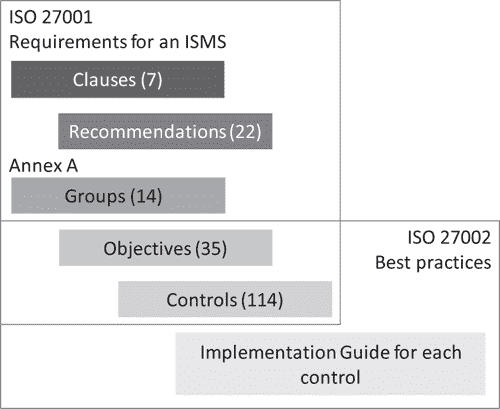

图 2.1 ISO 27001/2 标准结构。

可以得出以下观察结果：

- 组、控制目标以及控制措施本身的分组和命名随着版本的更新而演变。
- ISO 中的组和目标指的并非相同的责任级别。例如，`A.5` “信息安全策略”/`A.5.1` “信息安全管理方向”的责任级别与 `A.13` “通信安全”/`A.13.1` “网络安全管理”不在同一水平。
- 某些组涉及的是通用控制措施或过程（例如 `A.6` “信息安全组织”），而另一些则提到与保护手段相关的控制措施（例如 `A.10` “密码学”）。

这是完全可以理解的。事实上，为了避免不必要的复杂性，标准寻求以尽可能小的格式展示控制措施的完整性，这可能以牺牲控制目标的某些垂直（层级）和水平（领域）分布为代价。呈现的形式化并非面向治理，而是面向过程的完整性。从一个版本到另一个版本的更改或调整主要是由于威胁或保护技术的演进。

这正是提出标准之外的其他控制措施分组方法的重要性所在。我们需要一个更简单的模型，允许将治理、管理和运营控制整合为构建块，用于构建整个 `ISMS` 或特定的安全领域（移动性、`IAM`、连续性）或技术（加密、云云）。这将允许决策者立即关注影响他们的控制措施集。事实上，正如我们刚才在 `IAM` 示例中所示，无论所观测系统的范围如何，某些控制目标都必须被考虑。这些控制目标是：策略、策略和指南、安全组织、风险管理、安全计划管理、报告与监督、资产管理、合规性和指标。

此类框架应该允许管理人员和安全从业人员针对整个 `IS` 治理、特定安全领域或重大 `IS` 更改提出相关的恰当问题。这些问题如下：

1. 我们有策略吗？
2. 我们建立策略了吗？
3. 我们的安全组织足够吗？
4. 风险是什么，如何管理？
5. 我们的 `IS` 程序是如何管理的？
6. 报告和监督系统足够吗？
7. 哪些资产（数据、应用程序等）受了影响，谁对它们负责？
8. 我们符合法律和法规框架吗？
9. 我们有指标吗？

在 `IAM`（身份与访问管理）领域，`Strategy`（策略）规定了我们想要构建的系统目标：例如，将用户访问权限的分配委托给业务部门，前提是根据业务角色建立权限。该策略将用于开发 `Policies`（策略文件）和访问权限指南，包括基于角色的方法以及业务部门的参与。`Organization`（组织）描述了流程中的角色和职责。`Operations`（运营）涉及授予访问权限的流程和机制的有效实施。这些流程将使能够识别需要保护的数据（资产）、对法律法规框架的暴露情况（例如个人数据保护）（`Compliance` 合规性），以及我们所需的 `Metrics`（指标）。将建立一个用于程序管理的 `Reporting and Oversight`（报告与监督）系统，并使用之前定义的指标。最后，`IS Program`（信息系统计划）将通过实施和改进系统中所有的控制措施来进行管理。

## 如何根据公司的层级责任对控制进行分类？

该模型中的构建模块之间也存在层级关系。与业务保持一致的安全策略显然是高级管理层和董事会的责任。风险管理或指标的建立很可能是安全官的责任。安全运营或技术控制将由安全或 IT 运营部门负责。

所有级别的控制都有助于保护资产。因此，这些层次可以如下所示（图 2.4）：

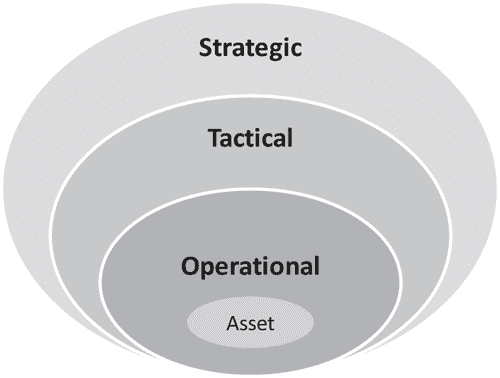

图 2.4 控制级别。

- **战略层 (Strategic)**：此层包含所有旨在为安全计划提供整体方向的治理控制：`Strategy` 策略、`Policies` 策略文件和 `Organization` 组织架构。
- **战术层 (Tactical)**：此层包含所有旨在建立和管理安全计划的管理控制：`Risk management` 风险管理、`Program management` 计划管理、`Reporting and oversight` 报告与监督、`Asset management` 资产管理、`Compliance` 合规性以及 `Metrics` 指标。
- **运营层 (Operational)**：此层涵盖了安全计划内的所有操作性控制和技术性控制。

因此，模型的构建模块可以放在不同的层次中，如图 2.5 所示。

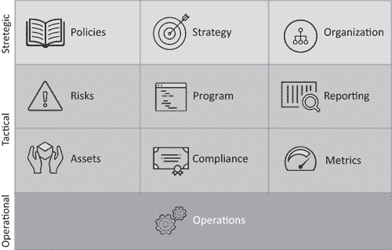

图 2.5 模块到控制级别的划分。

这种三层表示法允许我们根据性质和主要责任层次将控制族进行分开：`Governance` 治理、`Management` 管理和 `Operations` 运营。所有参与建立和运行安全计划的执行者都能轻松地识别自己属于这三个层次中的某一个。董事会和业务部门负责人将主要参与战略层，`CISO`（首席安全官）和职能经理将参与战术层，安全专家将参与运营层。

遵循标准和良好实践基准的要求，所有的建议或控制措施都可以放在这些层次之一一个（`ISO 27001` 建议的控制措施将在本章末尾与模型的模块进行映射）（图 2.6）。这种划分让我们能够提议一个侧重于每个层次主要活动的框架，并提供工具来分析我们在模型每个模块中实践情况的充分性。

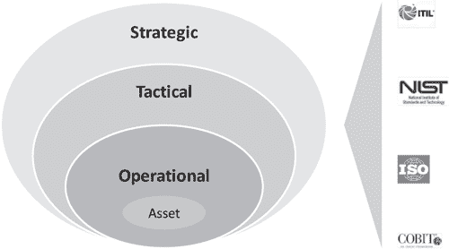

图 2.6 标准建议符合模型的各个层次。

人员安全、`IAM`、网络安全、移动安全、数据隐私等主要领域的安全控制措施也可以分配到这三个层次中（图 2.7）。因此，该模型可以应用于整个信息系统，也可以应用于特定领域。

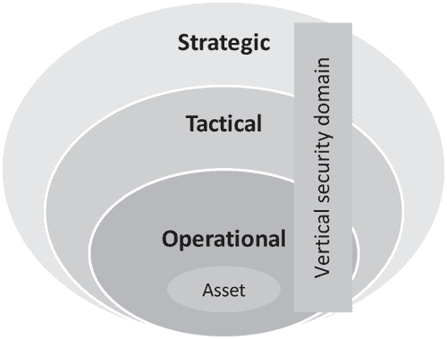

图 2.7 主要领域的特定控制可以分配到三个层次中。

战略层包含三个构建模块：`Strategy` 策略、`Policies` 策略文件和 `Organization` 组织架构（图 2.8）。这些是高管人员责任最大的领域。


图 2.8 战略层。

此层次的控制直接影响战术和运营层。反之亦然。如果不参考战略层，就无法做出重大变更。新策略或业务的变化（例如数字化）需要对运营层的控制措施进行调整。安全威胁也需要在战略层进行重新定位，因为它并不是一门纯的技术学科。

战术层涵盖所有可以归属于管理的主要活动和职责。由于策略和策略的实施需要在 `ISMS`（信息安全管理体系）内部署控制措施，因此“战术”一词似乎更合适。在此层次将活动分组为构建模块，使得能够突出整个信息系统或特定领域的安全主轴（图 2.9）。

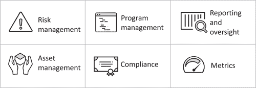

图 2.9 战术层。

此层次的所有控制都取决于上一个层次所给出的方向。一旦确定了战略方向，将根据系统化的方法对安全计划进行审查或调整。因此，我们应该谈论安全计划的管理过程。反之亦然。如果管理层或董事会对战术层活动（如风险管理、有效性、资产管理、合规性或指标）缺乏了解，他们将对投资和新项目做出明智决策。良好的治理需要高效且透明的战术层。

运营层包含所有操作性安全措施、流程或控制。我们通常称之为安全系统的功能实现。标准，例如美国国家标准技术研究院（`NIST`），提供了构成运营系统的全部控制措施的完整目录（图 2.10）。


图 2.10 运营层。

## 它的有效性是可以衡量的。

### 模型模块的作用是什么？它们包含什么内容？

最后，每个构建块的功能是什么？它们如何贡献于更好的信息系统（`IS`）治理？它们包含什么内容？接下来的章节将进行详细分析，并介绍用于建立构成这些块的控制措施工具和方法。首先，让我们回顾一下每一个在信息系统治理体系中的角色。

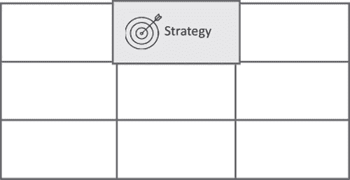

#### 策略

第一个区块涉及为整个安全系统制定策略。特定的安全领域也可以从其与整体安全策略对齐的特定策略中受益。

对信息系统拥有愿景可以使公司更容易在信息系统计划和特定运营控制措施的各种选项中做出选择。所有参与者都应该熟悉这一愿景，并使其努力与组织公认为重要的目标保持一致。这种方法没有替代方案。事实上，一个没有策略的安全系统将通过堆砌针对新威胁的防护技术或为了符合审计建议而采取的临时流程来建立。这最终将对成本产生负面影响，无法被管理层理解，而且效率低下。

安全策略包含了公司希望信息系统计划在不久将来采取的方向。它也可以由主要的安全领域（例如：网络安全策略、连续性、人力资源等）制定。策略完全由公司管理层或其董事会负责，但可能由安全经理或授权负责此目的的委员会提出建议。

与任何策略一样，安全策略的形式为一份较短的文件，呈现出两个核心要素：几年内要实现的愿景或目标，以及为了实现该目标必须采取的倡议。

> **国际管理学院**
>
> 信息系统必须确保在业务发展的背景下保护我们的数据和运营：在国际背景下提供适应新技术的课程、与专家和国际机构合作、将 IT 运营外包（云）以及在欧盟国家开设新子公司。为了在 3 年内实现这一目标，信息系统将组织作为一个独立于 IT 的实体，并由一名 `CISO` 向校长和董事会负责。应采取以下行动：
>
> 1. 制定新的章程、安全策略和组织架构
> 2. 修订安全指南并开发新的文档框架
> 3. 基于信息所有权和不同部门相关的风险实施安全组织，包括合规性和机密性要求
> 4. 建立监控威胁和管理事件的中央部门（安全运营中心）

业务计划或项目组合经常与策略混淆。仅仅因为公司为未来一段时间编制了一份安全项目清单（通常由审计结果或可预见的威胁驱动），并不能自称拥有策略。策略必须是项目的源头，而不是反过来。

因此，战略性倡议仍然是中长期内要实现的目标。显而易见，资源将主要投入到解决事件和恢复生产。然而，策略的实现将导致事件的逐步减少和成本优化。

战略性倡议是建立路线图或年度计划中更具体项目的驱动力（更多请参见第 8 章：计划管理）。这些高层倡议或目标有截止日期，并需要定期进行审查。它们主要作为开发更具体的计划或项目的支持。

##### 示例

“对敏感数据进行清单并描述数据所有者的职责”这一目标可能会导致几个项目：

- 制定关于保护敏感数据的政策或指南
- 企业数据的分类和分级
- 业务部门内数据责任的转让
- 开发数据清单

安全策略应明确包含业务行为和新技术的预见性变化，并在可能的情况下定义路线图。

以下元素应成为安全策略的一部分：

1. **外部环境和业务背景。** 回顾背景并解释为什么应该调整安全策略和定位。
2. **法律和法规框架及其影响。** 回顾所需的合规性主要领域，并提到针对新规章需要进行的调整。
3. **威胁、漏洞、技术和风险偏好的变化。** 针对威胁采取姿态至关重要，特别是考虑到技术、业务模式和风险偏好的演变。公司可以在其策略中以选择的形式采取立场，例如“不向外外包机密数据”或“等待技术成熟”等。
4. **企业文化。** 回顾根据公司文化及其相对于竞争对手的位置必须驱动信息系统决策的关键标准。
5. **与某些业务倡议或策略明确对齐的要求。** 当公司必须因为业务策略的新方向（如新服务、新市场、合并收购等）而快速调整时，安全必须遵循并适应。

由 `CISO` 推动的信息系统策略应使治理机构能够获得这些问题的答案：

- 信息系统策略是否涵盖了业务的所有优先事项？
- 业务部门经理是否充分理解了安全策略？

#### 标准中如何引用策略

“策略”一词在国际标准组织（`ISO`）或 `NIST` 标准中并未直接这样使用。`ISO` 主要谈论“组织背景（context）”，而在 `NIST` 中，它是“规划”（参见本章末尾的模型与标准的映射关系）。

策略的建立将在第 4 章（策略）中讨论。

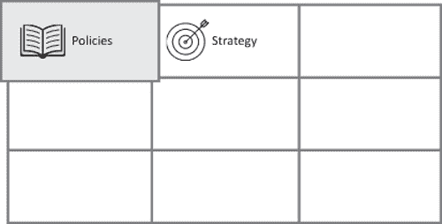

#### 策略文件

名为“政策”的区块主要关于内部监管框架。政策是高层内部监管文件。它们将策略转化为更具限制性的条款。该区块还涉及内部监管框架最低层次的文档，如指南、标准或程序。

内部监管框架重要的原因是显而易见的。让我们回顾一下在当前背景下支持信息系统政策的其他论点。

##### 治理与管理组件

信息系统（`IS`）策略的制定是将安全纳入决策者及组织内其他利益相关者议程的非常有效的方法。一项经过讨论、部门经理验证并由董事会签署的策略证明是治理中非常有用的工具。所有利益相关者对此此都有浓厚兴趣，因为它有助于让信息系统计划更贴近他们的需求：

- 董事会可能要求定期报告，以便其就信息系统计划的演进和投资做出决策。
- 业务部门经理可以依靠策略和准则来确保安全满足他们的需求。
- 安全人员将使用策略来加强控制并为投资提供理由。
- 审计人员将能够依靠策略来评估运营的合规性。
- 负责实施安全控制的团队需要内部监管框架来指导其活动。
- 最后，策略和准则可用于提高意识，并作为所有员工的行为准则。

##### 反映业务需求

策略的建立是基于业务并为了业务及其需求。它得到了管理层的验证、理解和支持。尽管如此，具有不同业务模式的不同业务部门可能有不同的风险偏好，因此需要不同的安全策略。

##### 强制建立文档化框架

策略以及作为指南和程序的底层文件必须是企业级文档框架的一部分。这有助于获取和理解内部规章。策略和内部法规文件将根据视觉识别系统发布在内网上，确保其易于理解、易于访问和可搜索。

经过所有利益相关者验证的内部法规应使治理机构能够获得这些关键问题的答案：

- 我们是否有适用于我们所有活动的安全法规？
- 我们的内部法规是否经过了审查，由谁审查的，以确保其完整性和准确性？
- 我们的法规是否适应了业务部门的需求？
- 所有员工是否都理解了策略和准则？
- 谁负责我们内部法规框架的演进？

以下 `ISO 27001` 建议与策略和内部法规框架直接相关。

**参考控制目标和控制（附录）：**

- `A.5` `信息安全策略`
- `A.6.2.1` `移动设备策略`
- `A.6.2.2` `远程办公`
- `A.9.1.1` `访问控制策略`
- `A.10.1.1` `密码控制使用策略`
- `A.13.2.1` `信息传输策略和程序`
- `A.14.2.1` `安全开发策略`
- `A.14.2.5` `安全系统工程原则`
- `A.15.1.1` `供应商关系信息安全策略`
- `A.17.2.1` `信息安全连续性规划`

第 5 章（策略）将介绍开发内部法规框架的策略和文档的方法。

### 2.5.3 组织

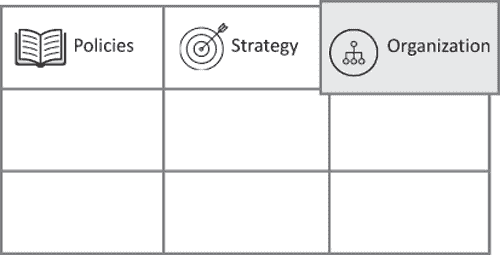

“组织”一词将用于描述信息安全管理体系（`ISMS`）背景下与职责和功能相关的所有要求。这不仅涉及 `ISO 27014` 中指定的治理机构或执行管理层，还包含了所有旨在确保信息系统计划运行的安全功能、角色和职责。组织要求必须在安全策略中制定。

所有标准以及许多行业法规（特别是在银行业，通过许多国家的金融部门控制和监管机构）都建议建立正式的事件管理流程。几乎所有这些法规都要求董事会和高级管理层确保存在事件管理流程，确保他们知情，并在发生重大事件时通知监管机构。

因此，应该建立专门的安全组织来管理事件，具备以下功能：

- 中央注册和事件派发服务
- 事件所有者或负责纠正措施的解决和后续的人员
- 委员会（如需要），决定事件的严重程度和后续（通信、危机管理）

今天建立安全组织已不仅限于任命一名 `CISO`。安全不同领域的职责分散在整个公司。`CISO` 的角色在近年来发生了巨大变化。在 20 世纪 90 年代，他们是 `IT` 部门内用户访问权限团队的技术负责人。今天，他们领导负责确保业务流程安全并增加价值的多学科团队。他们的活动范围非常广泛，从确保运营安全到通信、提高意识、风险管理、整体计划管理以及向董事会报告。

现代安全管理主要意味着协调大家的努力。人力资源部门很可能负责监控和缓解与人为风险相关的安全风险。业务部门被要求列出特定于其运营的安全风险。`IT` 系统工程师将负责设备和基础设施的基础配置。新的安全组织不仅应该考虑新需求（例如在业务连续性中集成灾备计划 `DRP` 或人类和网络威胁的演变），还应该考虑整个公司信息系统计划的引导问题。

安全组织可以采取不同的形式。没有适用于所有业务的理想模型。尽管如此，确保良好治理所需的若干功能是重要的。向个人分配功能很大程度上取决于组织的规模、其特殊性以及涉及的风险。安全执行官或 `CISO` 可以位于 `IT` 部门内部或外部，并且可能也可能直接领导一个负责其部分或全部安全功能的专家团队。

领导者将确保没有利益冲突，并确保决策有足够的资源实施。主要的错误之一是任命一个没有足够决策权的 `CISO`，让其在没有系统咨询董事会或管理层的情况下做出决策。组织变更与项目具有同等优先级。有效的安全组织将有助于实现战略目标。

尽管信息系统组织在公司之间差异很大，但正看到从运营向治理、风险和合规（`GRC`）的转变。安全团队和 `CISO` 的定位在这一演变中起着重要作用。传统上转向运营的信息系统组织（即使技术起着极其重要的作用）从长期来看也无法有效应对所有威胁。相反，专注于主动风险管理和业务需求的组织更有可能带来感知价值并更有效地利用可用资源。


建立适当的安全组织将允许治理机构获得这些关键问题的答案：

- 我们是否有涵盖所有必要功能的信息系统组织？
- 组织是否经过了审查，由谁审查的，以确保没有漏洞？
- 我们的组织与竞争对手或类似公司相比如何？
- 业务部门经理是否理解安全组织？他们是否参与了或在不同的决策机构中代表代表？
- 我们组织的主要缺点是什么？如何修复？

与安全组织直接相关的 ISO 27001 建议如下。

### 体系

- 5.3 组织角色、职责和权限
- 7.2 能力

### 参考控制目标和控制措施（附录 A）：

#### A.6 信息安全组织

不同信息安全组织机构的特征、建立安全组织的方法和工具、最佳实践以及务实的实施方法将在第 6 章（组织）中详细介绍。

## 2.5.4 风险管理

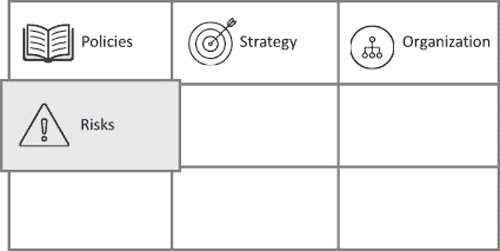

风险缓解是任何安全计划存在的意义。归在此区块下的所有活动都将致力于风险管理过程，包括识别、分析、处理和报告，作为信息系统（IS）治理的重要支持。

风险分析允许安全组织根据风险偏好、策略和策略确定优先事项。安全治理的核心关注点之一必须是确保安全风险的有效管理，特别是它们的识别、分析和处理。忽视风险或对其进行隐含接受是任何信息系统计划的主要危险之一。

安全风险的最终责任在于董事会。不同业务部门的运营经理拥有其运营中的安全风险。作为安全运营经理，`CISO` 也负责其所在部门的风险（例如控制措施的有效性或安全运营的失败）。他们的角色还为业务部门安全风险的识别和管理提供支持。

安全风险是公司运营风险的一部分，尽管它们具有某些必须考虑的特征。例如，由于难以观察组织内部的事件，定量评估方法往往无法应用。另一方面，对于习惯于观察安全威胁趋势的人来说，通过简单的尺度（如小、中、大）对风险进行分类相对容易。专门介绍信息系统风险的章节将展示分析这些风险的务实方法。

安全风险评估和新兴趋势是引导信息系统计划的关键指标。对于缓解措施不再充分或适应性差的日益增加的风险，必须明确作为优先事项。

### 示例

如果我们发现网络安全风险在一段时间内增加，同时安全控制（如“入侵检测系统”或“用户意识”）的有效性或成熟度水平下降，那么这两个指标可能足以做出决策，投入更多资金改进入侵检测系统以确保风险水平与企业的偏好一致。随后，信息系统计划应包含一项旨在提高相关控制措施效率或成熟度的倡议，以降低风险。

第 7 章：风险管理将详细说明如何获取这些指标。

法律法规要求的演变以及新威胁的出现，使董事会意识到需要进行良好的安全风险管理，并要求全面参与，因为他们对批准报告和建立缓解措施负有最终责任。因此，他们需要在风险管理过程中采取积极立场，以获得这些关键问题的答复：

- 我们是否知道哪些安全风险会影响业务、它们是如何被评估的，以及缓解它们的优先事项是什么？
- 信息系统风险管理是如何组织的？
- 与上一时期相比，风险是如何演变的？为什么？在同一时期相关的控制措施是如何演变的？
- 安全风险、用于缓解风险的措施以及定期报告是否经过业务部门负责人或其风险经理的验证？
- 什么构成了高风险？我们是否有短期缓解风险的计划？
- 我们是否正在采取一切必要措施来促进最重要风险的缓解？

ISO 27001 直接相关风险管理的建议如下：

### 体系

- 6.1 应对风险和机会的措施
- 8.2 信息安全风险评估
- 8.3 信息安全风险处理

第 7 章（风险管理）将重点介绍用于信息系统治理风险管理的方法和工具。

## 2.5.5 项目管理

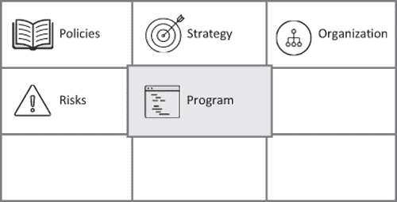

计划管理涵盖所有确保安全控制作为信息安全管理体系（ISMS）部分有效部署的活动。ISO 27001/2 或 NIST (800-53) 等标准对这些控制进行了良好的概述。

根据信息和相关技术控制目标（CobIT）5，同样适用于安全的管理活动定义为“与治理机构设定的方向一致的计划、构建、运行和监控活动”。

`CISO` 及其团队的主要活动包括实施和管理安全控制。除了运营控制（“运行”模式）外，安全计划还包括旨在提高现有控制措施有效性或实施新控制措施的倡议和项目（“变更”模式）。

为了能够良好治理，了解现有的控制措施及其用途（保护目标）以及有效性至关重要。管理和治理机构必须能够以目录或清单的形式可视化所有控制措施，其中包含责任概念和成熟度水平。该目录被用作安全计划和风险管理过程的主要工具之一，并作为内外部审计的支持。

如果没有安全策略、策略、组织和风险管理的支持，以及安全计划，就无法部署运营措施或控制。在优化安全资源方面成功的公司是那些根据其策略和风险偏好实施运营控制，并根据法律法规保护数据的公司。

为了使安全计划有效，该区块的活动必须基于模型中其他区块的交付物。策略提供了整体信息系统目标的指导，使计划专注于核心；风险管理指出了要应对的主要威胁；报告和监督提供了当前状态与目标状态之间的差异，以及目标的进展；合规提供了安全计划必须解决的法律法规发展信息。

指导委员会或治理机构与安全执行官合作，按照定义的频率审查并调整计划。信息计划的管理由 `CISO` 负责，应使治理机构和管理层获得这些关键问题的答复：

- 我们有哪些安全控制措施？它们如何有助于缓解风险？谁负责它们？
- 是否有控制监控流程？结果如何呈现给管理层？
- 控制的成熟度如何演变？是否符合风险处理决策的要求？
- 控制改进项目的路线图是什么？
- 安全计划的优先级是否经过业务部门代表的验证？
- 在管理层面还可以做什么来促进信息系统计划的实施和改进？

ISO 27001 直接相关安全计划管理的建议如下：

### 体系

- 4.4 信息安全管理系统
- 6.2 信息安全目标及实现计划
- 7.1 资源
- 7.4 沟通
- 8.1 运营规划与控制
- 10 改进

### 参考控制目标和控制措施（附录 A）：

- `A.12.1.3` 容量管理
- `A.18.2.2` 安全策略和标准的合规性
- `A.18.2.3` 技术合规性审查

第 `8` 章（`计划管理`）将专门介绍管理信息安全计划的核心方法和工具。

### 2.5.6 安全指标

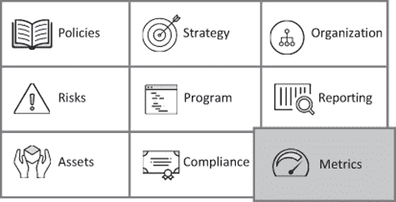

信息安全治理需要可靠的指标作为决策支持。指标被用于报告中；它们可以量化风险、评估趋势和控制有效性、计算投资回报等。它们还允许设置阈值来预警趋势，从而防止事件发生。

尽管如此，衡量安全并非易事，主要是因为缺乏可衡量的事件或事故。例如，我们无法确切知道有多少次尝试入侵与我们类似的公司，它们的类型是什么，特别是这些尝试是否成功。要了解入侵防护系统是否捕获了所有尝试也是困难的。还有许多类似的例子。另一方面，纯粹技术性的且广泛获取的指标（例如防止的病毒数量或攻击数量，或配置了最新更新的服务器数量）并不能为机构提供关于防护系统整体性能的相关相关信息。基本指标通常必须经过编制或汇总，以向管理层传递有用信息，例如：保护水平与风险演变的对比情况、近期实施安全解决方案的实际投资回报、抗网络攻击韧性水平的提升、意识计划的有效性，或在完成上次渗透测试后填补漏洞所采取措施的完整性。

安全是少数几个没有自身标准或测量技术的领域之一，这与消耗（`kW/h`）、效率（`价格/收益比`）、产量等其他知名指标形成对比。高级经理习惯于财务指标或衡量业务营业额的演变。因此，管理层和首席信息安全官（CISO）必须找到一种出于治理目的而衡量安全的方法。

第 `9` 章中开发的安全衡量方法和工具将允许治理机构和管理层获得这些关键问题的答案：

- 我们拥有哪些指标可以让我们从治理的角度来衡量安全？
- 我们的指标是否适用于报告目的，是否经过了利益相关者的验证？
- 我们是否拥有法律和监管框架要求的指标？
- 我们如何改进指标以满足治理和管理需求？
- 我们如何评估我们的安全态势，以及如何与竞争对手相比？

ISO `27001` 直接相关的安全指标和关键绩效指标（KPI）建议如下。

#### 要求：

- `9` 性能评价
- `9.1` 监测、测量、分析和评价
- `9.2` 内部审计

### 参考控制目标和控制措施（附录 A）：

- `A.12.7.1` 信息系统审计控制

第 `9` 章（`安全指标`）将专门介绍从治理角度制定安全指标的方法和工具。

### 2.5.7 报告与监督

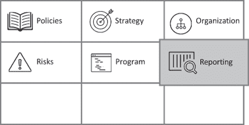

报告、监督或监控系统对于良好的治理至关重要。最重要的是，它允许安全执行官从整体视角展示信息安全的状况；将投资、控制和风险联系起来；并使用关键指标解释安全计划如何促进业务发展以及资源是如何分配的。

此章节分组了为所有公司利益相关者开发信息安全报告的方法和工具。还包括审计发现和建议，以及专门委托的报告。

安全报告流程是 `CISO` 的责任，由董事会或治理机构发起。它必须提供决策支持，并允许治理机构获得以下关键问题的答案：

- 我们的信息安全计划是否合适？
- 风险是如何演变的，我们采取什么措施来缓解它们？
- 我们控制有效性是如何演变的？
- 我们在信息安全方面的主要投资有哪些？
- 最重要的控制变更项目（新控制或对现有控制的改进）、其目标以及计划实施的路线图是什么？
- 管理层和治理机构如何帮助解决信息安全问题（或痛点）？
- 安全成本是多少，我们如何控制这些成本？

与其他所有部分一样，没有一种适用于所有业务的单一报告模板。内容和形式取决于业务的性质、规模、多样性以及其所属行业。监管框架要求安全报告有助于决策并使董事会能够履行其职责。安全报告和仪表板并非仅供治理机构。它们也为所有利益相关者带来价值：

- 对于不同的业务部门，它们必须展示旨在助力实现目标的各种安全项目的成果。
- 对于客户和合作伙伴，它们必须传达有关控制成熟度的信息。
- 对于员工和安全运营专家，它们必须展示经过治理机构验证的具有优先战略倡议路线图。

“沟通”一词通常用于强调传播信息、提高意识或共享信息的重要性。在我们的语境下，报告涉及并包括与利益相关者的沟通，以使安全及其相关活动更加可见。教育或提高意识意义上的沟通属于安全运营或运营控制的一部分。

ISO `27001` 标准直接相关的报告过程建议如下。

#### 要求：

- `9.3` 管理评审

### 参考控制目标和控制措施（附录 A）：

- `A.18.2` 信息安全审查

第 `10` 章（报告与监督）将专门介绍制定安全报告的方法和工具。

### 2.5.8 资产管理

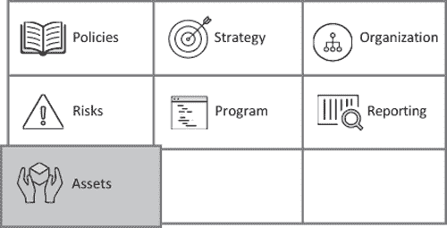

更广泛的安全框架下的资产管理为内部数据保护政策和指南以及评估和处理相关风险提供了基础。涉及不同隐私级别的数据风险对业务的影响并不相同。如果不知道保护优先级，就无法提供适当的安全。因此，对资产进行分类、识别资产所有者、为每类资产建立保护规则以及建立资产清单是重要的。

管理层了解公司的数据，但可能对其处理方式相关的风险了解不足。IT 资产管理通常涉及使用专用工具在配置管理数据库（`CMDB`）中对硬件和软件基础设施组件进行清单。除了配置跟踪过程，这些清单并没有提供有关各种组件性质、重要性或机密性的信息。系统管理员通常忽略数据库或服务器的内容。这些主要是系统架构技术层的清单。应用程序的特征或功能级，特别是数据的机密性往往是不公开的。

公司的资产管理活动必须提供决策支持，并使治理机构能够获得这些关键问题的答案：

- 我们了解自己的资产吗？
- 我们的资产是如何分类的？
- 按类别/资产/上下文，我们的策略和保护指南是什么？
- 我们的资产所有者是谁？
- 各种流程是如何使用机密数据的？机密数据的主要流向是什么？

ISO 27001 直接与资产管理相关的建议如下：

### 参考控制目标和控制措施（附 A）：

- `A.8 资产管理`

`第 11 章（资产管理）`将完全致力于资产管理所需的方法和工具。

## 2.5.9 合规性

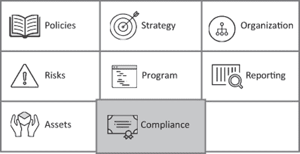

公司活动受全球及行业法律法规的约束。信息安全（IS）特别受到这一法律法规框架的影响，尤其是数据保护。因此，安全治理的优先任务事项之一是理解这一法律法规框架，并确保安全计划的符合性。在此领域，与法律和合规部门的协作尤为重要。

### 示例

欧洲《通用数据保护条例》（`GDPR`）对所有处理欧洲公民个人数据的公司都提出了要求。这些要求对信息安全计划产生了重大影响。

未能遵守法律法规框架不仅会导致公司面临制裁，还可能对其声誉、整体安全态势和良好的业务行为产生负面影响。与内部规定一样，提高员工在日常活动中对法律、法规和规范性要求的意识非常重要。对这一框架的认识有助于对信息安全限制的理解和接受。由于这些原因，建立一套现行的法律法规参考体系（制图、文档、演示等）并供所有员工使用是至关重要的。

合规管理活动使治理机构和管理层能够获得这些关键问题的答案：

- 我们了解法律法规框架如何影响我们的信息安全计划吗？
- 我们了解我们的合规程度以及需要填补的差距吗？我们是否建立了信息安全合规地图？
- 我们的内部规定是否适应了法律法规框架的要求？
- 我们如何让员工意识到法律法规框架？

ISO 27001 直接与合规性相关的建议如下。

#### 要求：

- `4 组织环境`
- `5.2 政策（满足信息安全相关要求的承诺）`
- `10.1 不符合项和纠正措施`

### 参考控制目标和控制措施（附 A）：

- `A.18 合规`

`第 12 章（合规）`将完全致力于合规管理过程的方法和工具。

## 2.5.10 运营层

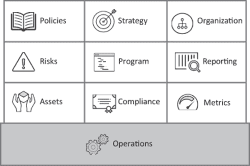

最后，运营层包含了为了防止威胁和减轻风险而建立的技术控制。它们通常被认为是公司数据的第一防线。这是构成功能性安全系统的控制措施集。

以标准中的例子为例，NIST 发布了一个名为网络安全框架（`CSF`）的最佳实践库，详细描述了在网络防御系统中部署的控制措施。控制分为五个主要功能（图 2.11）。为了简单起见，我们可以说后四个功能——保护（Protect）、检测（Detect）、响应（Respond）和恢复（Recover）涵盖了运营层面的控制或措施，而识别（Identify）功能则将与战略方向相关的治理和管理活动整合在一起。

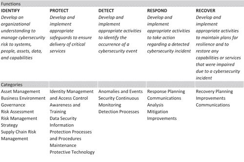

图 2.11 NIST 网络安全框架（`CSF`）。（提高关键基础设施网络安全的框架，1.1 版本，美国国家标准技术研究院。2018 年 4 月 16 日。）

ISO 27001 标准中直接涉及建议如下。

#### 要求：

- `7 组织要素`
- `7.4 沟通`
- `7.5 文档信息`

### 参考控制目标和控制措施（附 A）：

- `A.7 人员安全`
- `A.8 媒体处理`
- `A.9 用户安全`
- `A.93 责任`
- `A.9 访问控制`
- `A.10 密码学`
- `A.11 物理和环境安全`
- `A.12 运营安全`
- `A.13 通信安全`
- `A.14 系统采购、开发与维护`
- `A.15 供应商关系`
- `A.16 信息安全事件管理`
- `A.17 业务连续性信息安全`
- `A.17.1 信息安全性的验证、评审与评估`
- `A.17.2 冗余`

这一层级将在后续章节中进一步阐述，因为在提到控制措施作为良好的信息安全管理工具时，我们会引用运营控制措施。

## ISO 27001 与 TLCF 之间的映射是什么？

### 2.6 ISO 27001 与 TLCF 的映射

标准之间的映射并没有真正的意义，主要是因为它们的呈现方式、方法和目标存在差异。许多映射工具可以参考。NIST 也发布了其标准与 ISO 之间的映射。

表 2.1 显示了 TLCF 模块与 ISO 27001 的对应关系。由于 TLCF 不是最佳实践的集合，该映射的目的是让读者将 ISO 控制目标分组到之前提到的模块中。许多 ISO 27001 控制目标出现在“策略”模块中，是因为这是有明确要求的。

表 2.1 TLCF 与 ISO 映射

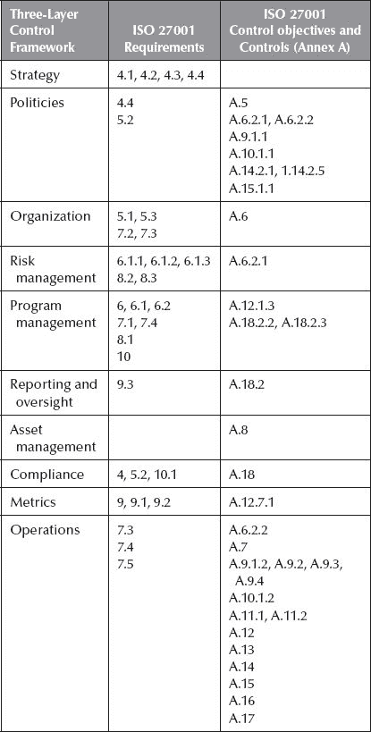

某些标准的建议将跨越 TLCF 的所有模块，因为它们涉及整个安全领域（例如访问控制）。

其他可能考虑到但在标准中未明确列出的活动列在表 2.2 中，并给出了与 TLCF 模块的映射。

表 2.2 与信息治理相关的其他活动及其 TLCF 模块映射

| 其他安全活动 | TLCF 模块映射 |
| --- | --- |
| 审计 | 测量 |
| 培训与意识 | 运营 |
| 外包 | 垂直领域——所有模块 |
| 人员安全 | 垂直领域——所有模块 |
| 安全架构 | 运营 |
| 应用安全 | 策略运营 |
| 网络安全 | 垂直领域——所有模块 |
| 职责分离 | 策略组织 |
| 变更管理（采购、开发） | 策略运营 |
| 危机管理、沟通 | 组织运营 |
| 监控与监督 | 测量运营 |
| 数据隐私 | 垂直领域——所有模块 |

运营控制措施将在后续章节中详细介绍，因为我们在提到控制措施作为良好的信息安全管理工具时包含了它们。

### 2.7 结论

信息安全治理需要管理层和董事会的参与。为了便于理解标准的要求，有必要以简化的形式呈现并分组为同质模块。在本章中，我们介绍了将安全控制分组为三个责任层级的方法。每个构建模块都展示了构成它的活动以及这些活动旨在涵盖的目标。

TLCF 模型并非良好实践的基准，其本身并不提供任何标准或安全治理参考性著作中未包含的建议。它的主要用途在于对与信息系统（IS）治理相关的复杂的活动领域进行分组和简化化的呈现。

在接下来的章节中，我们将介绍三级控制框架的用例。随后的章节将介绍实现每个构建块中所设目标的方法和工具。

# 第 3 章

## 控制框架用例

三级控制框架（TLCF）并非用于取代信息安全（IS）标准或任何其他资产清单或良好实践基准。正如上一章所示，所有标准的建议都可以融入该模型的构建块中，但模型本身并不提供新的建议。因此，它应该被用作一种辅助性工具，使决策者能够关注核心内容，并对 IS 治理过程提出正确的问题。TLCF 主要作为评估实践过程中的支持工具，并作为从治理角度解读建议的网格。我们的主要意图是通过提供围绕模型主要区块的、发深思考的框架，让管理人员和管理机构更容易阅读这些标准。

本章提供了对以下问题的回答：

- TLCF 模型提供了什么，其潜在用途是什么？
- 一些典型的用例？

### 3.1 模型用例


通过将 TLCF 模板应用于整个信息安全管理体系（ISMS）或特定的安全领域，可以对治理和管理实践进行图表化。它可以作为标准的观测网格，并作为一个在 ISMS、特定安全领域或新技术或变更背景下对所有活动分组的模型。它还可以用于支持变更管理期间或治理实践自评估的讨论或头脑风暴。

因此，TLCF 模型可用于各种场景和从不同角度观察安全治理实践。我们已经看到过它的应用示例，但请记住，它可以用于所有需要治理实践的安全领域。通常来说，需要特定策略、策略或组织（角色和职责）的安全系统、具有特定风险的系统以及具有特定法律法规框架的系统，都可以从 TLCF 框架视角进行分析（`Figure 3.1`）。

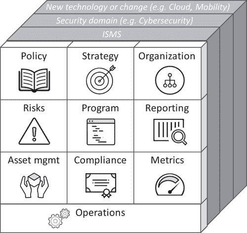

图 3.1 TLCF 模型的应用领域。

此类系统可以分为以下几类（非穷举列表）：

1. **按安全领域划分**：
   - 身份与访问管理
   - 基础设施、电信与网络、应用程序
   - 业务连续性
   - 物理安全
   - 人性安全

2. **按威胁性质划分**：
   - 网络安全
   - 数据隐私

3. **按技术划分**：
   - 云计算
   - 虚拟化
   - 移动性
   - 消费化
   - 流程数字化

4. **按地理或组织单位划分**

TLCF 模型可用于以下三种情况：

1. **治理自评估**。正如名称所示，其目标是提供关于给定系统治理实践执行情况的综合视图，并提出更改，而不一定需要通过审计。
   *示例*
   网络安全态势可以作为自评估治理实践的主题，以确保运营控制从所有必要的治理和管理支持中受益：策略、策略、组织、风险、计划、资产管理、合、指标和报告。

2. **对治理的影响——主动方法**。这种方法旨在新系统建立或重大变更之前，建立良好的治理实践。
   *示例*
   当建立一个新的全新的外包人力资源管理系统时，极可能需要处理治理方面：策略、策略、组织、数据保护、风险、计划和监督。随后对新系统特征的分析将识别治理需求，并将其分配到 TLCF 区块中。

3. **对治理的影响——响应方法**。这种方法包括根据运营控制的变更，审查模型中九个构建块的实践。
   *示例*
   作为内容保护（运营控制）手段的办公文件加密系统如果不审查其对模型九个区块的影响，就无法正确实施。可能需要对指南、加密密钥管理组织、风险、部署进度、办公文件分类以及对法规要求的遵守情况进行审查。

### 3.2 治理自评估

治理实践的自评估可以针对整个 ISMS、特定的安全领域，或作为业务或地理实体的一部分进行。这种分析可以通过使用标准中的所有建议并评估其的成熟水平来实现。例如，这在审计中完成。然而，我们正在寻找一种不那么麻烦、限制较少的方法，让管理层根据几个关键问题判断系统的治理实践。

TLCF 模型的模板使得这种内省成为可能，并有助于识别要改进的主要点。该模型可以用不同的方式使用：在头脑风暴会议期间、在重大项目的初始阶段、在关于安全策略的管理层安全意识研讨会上，或在负责规划重大安全计划的委员会会议期间。

每个模型构建块都有一系列用于关注讨论的问题（`Figure 3.2`），这些问题根据观测领域进行了调整。可以使用标准的建议、法规、成熟模型的要求或任何处理安全治理良好实践的文档或研究来制作一份便于头脑风暴的问卷。

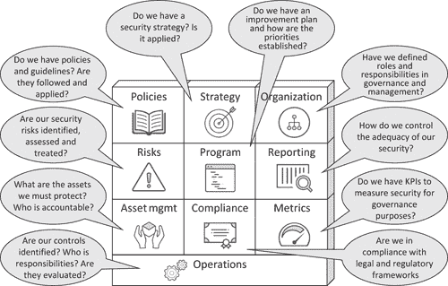

图 3.2 每个 TLCF 区块的问卷。

使用像 TLCF 这样的模型激发关于 IS 治理的创造性思维或头脑风暴，可能比成熟模型（通常基于一个或多个标准）或优势、优势、机会和威胁分析等传统方法更有益。所提的问题旨在引发思考过程，并对那些经常不在决策者议程上的主题引发讨论，因为该模型突出了 IS 在战略和战术层面的关键责任领域。此类讨论的结果可以是一份包含对模型九个区块改进建议的报告。

在讨论期间，参与者将受邀对他们看到的可能弱点或差距发表意见，并提出解决建议。随后将对不同的建议进行讨论，按模型区块进行整合，并作为未来的行动计划呈现（`Figure 3.3`）。

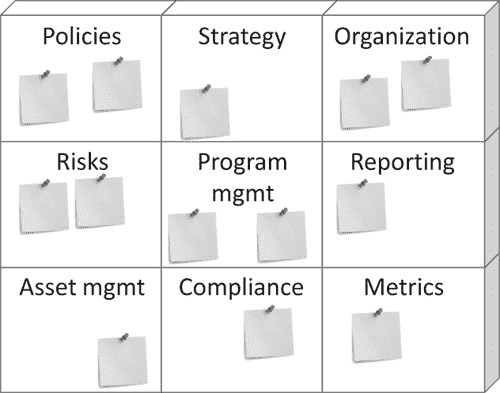

图 3.3 作为头脑风暴工具的 TLCF 模板。

以下是用于促进 IS 系统治理实践讨论的问题示例。每个区块的行动计划位于第三列。

该过程是使用 TLCF 框架作为安全治理实践自评估或头脑风暴部分的示例。这种方法基于回答涵盖所有治理活动的一系列关键问题，然后建立改进建议。

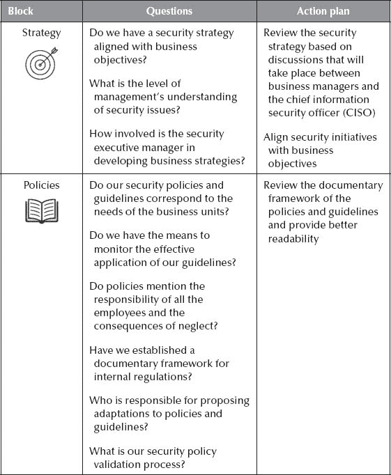
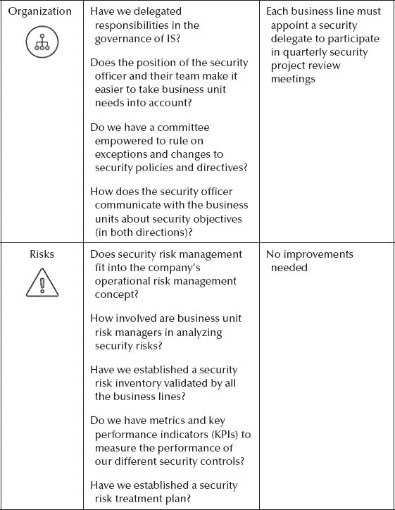
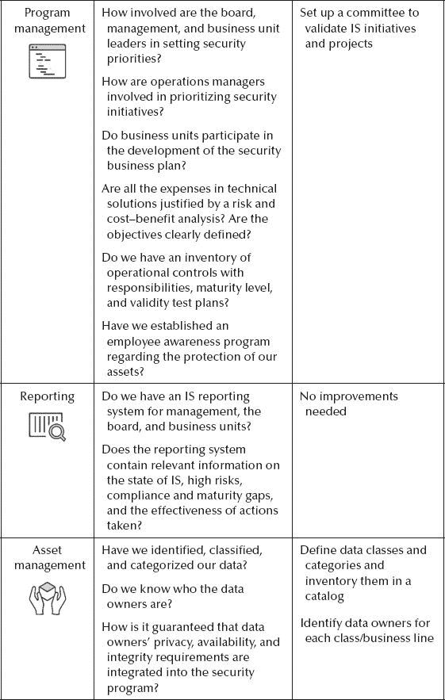
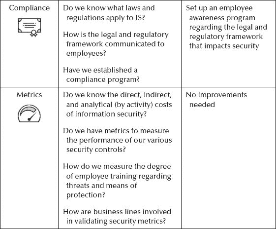

## 3.3 对治理的影响——主动方法

主动方法从所有模型构建组件的视角出发对特定领域（例如网络安全）进行分析。为了说明这一点，让我们以数据隐私领域的一个为例，尽管同样的方法也可以适用于任何其他领域。

在数字经济中，个人数据保护已成为许多监管机构关注的主题。欧洲共同通过了全面的指南来保护其国家公民的个人数据——即《通用数据保护条例》（`GDPR`）。许多其他国家也有类似的法规，例如瑞士《数据保护法》或新加坡《个人数据保护法》，仅举两例。

下列表总结了影响信息系统（IS）的 `GDPR` 要求。这些要求不应与其他要求混淆，例如被遗忘权、处理的合法性、画像分析或显式同意，这些要求并不直接涉及信息系统，而是合规和法律部门，因此在本例中将不予以考虑。

`GDPR` 关于可能影响信息系统或信息安全管理体系（ISMS）的个人数据保护建议列如下：

### 1. 个人数据的识别、分类和分级

个人数据是公司在运营中使用和处理的客户、供应商、员工或任何人员的数据。法规要求公司识别此类个人数据，包括对“高度敏感数据”的使用和处理，如遗传、生物识别、健康相关数据等。因此，对这些数据进行分类（客户、员工、供应商等）并根据机密性标准（如机密、公开）进行分级非常重要，这样就可以实施适当的保护。

内部监管框架随后规定如何根据数据的分类及其处理或存储的背景来保护这些数据。

### 2. 个人数据清单

公司必须拥有一个人数据清单、处理这些数据的服务器和应用程序，以及个人数据流描述（哪些流程使用了哪些数据）。这些系统根据其托管或处理的数据分类进行分级，从而更容易建立与这些数据相关的特定风险管理并创建相关指标。

### 3. 保护个人数据的措施

公司必须能够根据数据分类、存储模式和处理方式（访问、传输、销毁、变更管理或备份），证明保护个人数据的控制或措施的存在。

实施的数据保护计划不仅应包括操作控制，还应包括独立审计、隐私影响评估（`PIA`）程序、人力资源控制以及培训意识计划。应使用加密等保护技术，以避免在不需要的情况下暴露数据（例如在开发环境中）。

### 4. 设计数据保护

个人数据的处理从一开始就必须经过设计，以提供功能，如根据客户请求删除个人数据（被遗忘权）、客户访问其个人数据以及可移植性（以电子形式提取数据）。

### 5. 数据保护的组织与责任

必须建立安全组织，并在信息技术（`IT`）、人力资源、业务部门、决策机构、管理层和董事会导致数据保护职责。应定义特定职，如数据处理者、数据控制者、数据所有者数据保护官（`DPO`）。公司必须能够证明其合规性，董事会应对个人数据保护负相应责任，并向其直接汇报。

### 6. 与个人数据相关的风险管理

公司要求管理与保护个人数据相关的风险，并向董事会报告以决定采取的适当措施。

### 7. 第三方的责任

在外包的情况下，能够从存储和处理的视角确保个人数据的安全至关重要。第三方还必须遵守相关法规。

### 8. 事件管理

事件必须通过包括检测、修复和防止未经授权访问数据的特定措施在流程中进行管理。公司有义务向监管机构报告具有特定重要事件。

基于这些要求，可以在所有的 `TLCF` 模块中建立强制性的信息系统控制。这使得更容易规划不同背景的人员参与合规项目。

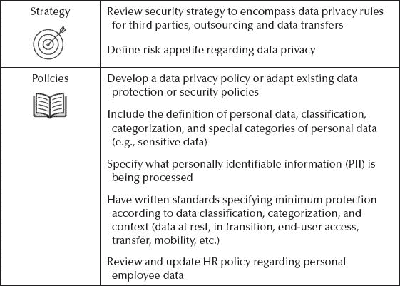
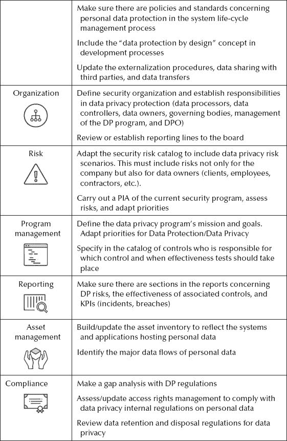
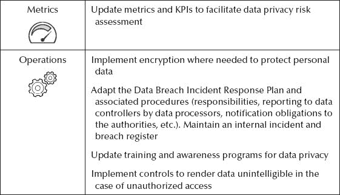

## 3.4 对治理的影响——反应方法

每当操作控制发生变化时，验证它们与战略和战术层面控制的相互依赖关系都很重要。也就是说，我们必须确保治理活动和工具适应新的操作控制。由于事件、审计发现或可见威胁引起的变更请求通常发送给操作经理，他们有时会缩小变更范围，忽略治理的必要性，或者根本没有办法要求相应调整战略或战术级控制。

### 示例

`ISO 27001` 标准建议以下控制措施：

`A.13.1.3 网络隔离：“信息服务组、用户和信息系统应在网络上进行隔离。”`

为了使网络隔离为公司增加价值，它必须满足业务部门的需求，或将不同机密类别的资产或基础设施分离的需求。这涉及做出战略决策并调整安全策略，以考虑网络不同部分运营人员风险偏好的差异。

如果没有战略导向或策略及准则的调整，许多操作控制无法正确实施。即使在标准或审计发现在没有规定，检查操作变更对治理过程的影响也是非常重要的。变更经理随后可以使用 `TLCF` 模板来展示变更对战略和战术控制的影响。

### 示例

假设某项审计发现 USB 闪盘缺少加密解决方案。这是一个可能导致机密数据暴露的漏洞。分析后，公司决定不为 USB 设备实施加密解决方案，因为它有其他保护手段，包括禁用单个工作站的 USB 端口，以及当有人需要在 USB 设备上存储信息时，有义务通过支持部门处理。这被认为足以降低风险。然而，公司的监管框架没有清楚地提到这一流程，必须进行相应的调整。

为了说明这种方法（在使用模型时，可以称为反应性方法或自下而上的方法），我们将以网络安全为例。

网络安全是一系列旨在对抗网络空间基础设施和企业资产的恶意攻击威胁的控制措施。由于对信息技术的高度依赖、数字化进程、国家法律往往不适应国际背景、暗网上恶意攻击手段的极高可用性以及连接对象的爆炸，如今的公司变得比以前要脆弱得多。攻击的类型也在发生变化：它们现在更具针对性，恶意人员所需的技术知识也越来越少。攻击是一系列可能威胁公司生存的运营风险。因此，治理机构必须对其演变保持足够的关注。

与任何其他安全领域一样，网络威胁防护系统必须集成到现有的信息安全（IS）计划中。网络安全不应被视为一组孤立的技术措施。应对网络威胁需要策略、政策、组织、风险管理、控制管理计划、报告系统、受保护资产清单、对法律和法规框架合规性的可见性，以及衡量计划充分性的指标和标准。

公司实施的用于防御网络威胁的控制措施涵盖了检测和保护的能力，还包括攻击后的恢复能力。威胁快速变化的背景意味着控制措施的有效性必须经过监控，以便进行相应的调整。管理层经常询问公司是否得到了充分保护、其安全水平与同行业其他公司相比如何，以及未来如何改进。另一方面，公司考虑建立一个具有特定职责的网络防御战术领域以更好地管理其计划，也是完全正当的。

## 根据运营控制措施的变化调整治理实践的示例

假设一家公司想要评估其对网络威胁的防护能力。管理层将此项目委托给 IT 部门，并预期收到报告，说明当前的成熟度水平、所需的成熟度水平以及应采取哪些行动来缩小差距。

可以使用 NIST 网络安全框架（CSF）标准来评估公司当前的网络安全态势。该标准的主要目的是识别网络防御领域的所有基本运营控制。通过评估其控制措施相对于标准建议的成熟度，公司能够提出改进倡议。包含所有控制措施的 NIST CSF 框架核心部分包括：

- 五个网络安全防护控制措施的主要功能，称为 `IDENTIFY`（识别）、`PROTECT`（保护）、`DETECT`（检测）、`RESPOND`（响应）和 `RECOVER`（恢复）（图 2.11）
- 每个功能细分为许多类别
- 每个类别包含一定数量的子类别或要求

这些子类的完整列表可以在 NIST 出版《改进关键基础设施网络安全框架 1.1 版》（美国标准与技术研究院，2018 年 4 月 16 日）附录 A 中找到。

纯粹的治理和管理控制出现在 `IDENTIFY` 功能的类别中。其他功能主要包含对运营控制的要求。从表面上看，管理层对这些控制措施对治理过程的影响了解较少。因此，强调运营控制措施在战略和战术层面的可能影响是重要的。

让我们假设对现有控制措施与标准要求的成熟度评估得出了如表 3.1 所示每个子类别旁边的六项发现。

### 表 3.1 与 NIST CSF 框架对比后的发现

| 功能 | 类别 | 子类别 | 发现 |
| :--- | :--- | :--- | :--- |
| `IDENTIFY` | 资产管理 | `ID.AM-5`: 资源（例如硬件、设备、数据、时间、人员和软件）根据其分类、关键性和业务价值进行优先级排序 | 1. 并非所有系统都已清单或分类 |
| | 风险管理策略 | `ID.RM-2`: 确定并明确表达组织风险承受能力 | 2. 风险偏好未根据事实指标明确定义或表达 |
| `PROTECT` | 数据安全 | `PR.DS-2`: 传输中的数据受保护 | 3. 未使用加密。数据流未分类 |
| | | `PR.DS-5`: 实施了防止数据泄露的保护 | 4. 没有自动的数据泄露防护 |
| | 信息保护过程和程序 | `PR.IP-9`: 响应计划（事件响应和业务连续性）和恢复计划（事件恢复和灾难恢复）已到位并接受管理 | 5. 对于关键流程恢复时间没有明确的指南或服务水平协议。测试完全基于所有功能的恢复 |
| `RECOVER` | 恢复计划 | `RC.RP-1`: 在网络安全事件期间或之后执行恢复计划 | 6. 没有针对大规模网络攻击的计划测试 |

这些建议及其对 TLCF 模型模块实践的影响总结在表 3.2 中。发现 1 和 2 直接与 CSF 的资产管理和风险管理策略类别相关，也涉及 TLCF 的策略、风险和资产管理模块。其他建议的影响不仅在运营层面，还涉及我们模型中的战略和战术层面，包括策略、政策和计划。我们不会在该示例中详细介绍建议的细节，因为这些必须根据公司的背景来制定。尽管如此，重要的是，这些最终指向运营控制的发现对战略和战术控制也有影响。

### 表 3.2 建议对 TLCF 模块的影响

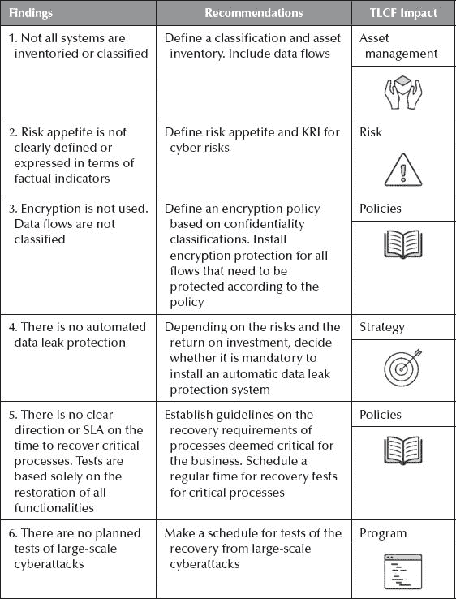

因此，任何旨在改变控制运营层的项目都必须考虑其对治理以及战略和战术层面控制的影响。只有治理控制和工具的垂直整合，才能为公司提供所需的信息安全保障。

## 3.5 结论

我们展示了 TLCF 模型在治理实践自评估、预测变化（主动方法）以及预测变化对战略和战术层面影响（反应性方法）方面的用例。评估变化对治理、风险和合规活动的影响，不应只是安全官和管理层的关注点，也应该是所有负责安全控制领域变更人员的职责。

该模型还可以用于为在信息系统治理中担任职能但不熟悉标准和良好实践基准的人员，提供战略和战术层面控制措施的简化演示。

新的运营控制往往是在事件发生、新威胁出现、新法规制定或审计发现之后建立的。这种反应式方法并不构成一种策略。从长远来看，利益相关者并不理解安全的作用、目标以及投资回报率。“安全策略”这一术语经常与项目路线图或业务计划混淆，后者通常由一系列旨在降低风险的项目列表组成。尽管这很重要，但它并不是策略，策略是一组应当实现特定战略目标的项目集合。那么这个目标是什么？我们需要理解的是安全活动如何以及在多程度上对业务发展做出贡献。

# 安全策略的必要性

## 反应式 vs. 战略性

反应式的姿态会让安全执行管理人员边缘化，并将他们限制在管理之外的技术角色上。由于一堆昂贵技术解决方案的雪上加霜，这种方法无法吸引业务部门经理的注意力。如果缺乏显示迈向共识目标进展情况的基准，从长远来看是不可持续的。安全经理往往难以引起决策者的关注并为他们的投资提供合理由。如果他们无法解释安全为何以及如何帮助实现业务目标，就没有理由认为安全工作是必不可少的。同样重要的是，安全执行管理人员及其团队必须理解他们努力所针对的目标。

一个通过通往目标的项目路线图来支持业务倡议的安全计划，可以引起决策者的注意力，并防止安全被视为“必要的恶”或成本中心。如今，人们越来越相信，在数字经济中，安全对于业务发展至关重要。技术和威胁在变化；业务模式也是如此。这种演变迫首席信息安全官（`CISO`）寻求更多资源，但这些努力似乎没有得到充分的认可。原因通常是缺乏一种在公司范围内传达定义的安全策略。

本章提供了以下问题的答案：

- 什么是安全策略，它的目的是什么？
- 策略应该包含什么？
- 策略开发项目的主要步骤有哪些？
- 应该如何制定策略？
- 应该如何展示策略？

## 什么是安全策略，它的目的是什么？

### 4.1 安全策略

总的来说，策略是对目标的声明，包括实现目标的方法。因此，安全策略必须呈现出“新”安全的轮廓，以更好地为业务目标做出贡献。如果没有基本目的的这一方面，安全策略将无法被理解。

每项活动都需要方向，为我们的所工作赋予意义和目的。这种目的以及实现该目的的协调行动被称为策略。“策略”一词被用于不同的语境：军事、政治、商业、游戏等。它们都包含一个特定的目的和实现该目的的手段，但在形式和内容上有本质区别，因为它们被不同的参与者为了不同的目的而使用。游戏策略更多关于如何或通过哪些步骤实现一个已知目标，而商业策略更多关于公司产品在市场或客户细分中的定位。

一个定义了未来状态及其与未来几年业务目标对齐情况，并具有可量化目标以证明其附加值的安全策略，将使所有利益相关者支持其努力。需要注意的是，信息安全（`IS`）策略可以在多个层面建立。全球策略可以由不同领域的策略支持，例如网络安全策略、外包策略、云服务策略等。

创建策略是任何安全官的首要任务之一：引导他们走向。然而，为了获得支持，策略必须用每个人都能理解的语言来表达。

**示例**

一个通过通往目标的项目路线图来支持业务倡议的安全计划，可以引起决策者的注意力，并防止安全被视为“必要的恶”或成本中心。

一个通过通往目标的项目路线图来支持业务倡议的安全计划，可以引起决策者的注意力，并防止安全被视为“必要的恶”或成本中心。

一个通过通往目标的项目路线图来支持业务倡议的安全计划，可以引起决策者的注意力，并防止安全被视为“必要的恶”或成本中心。

一个通过通往目标的项目路线图来支持业务倡议的安全计划，可以引起决策者的注意力，并防止安全被视为“必要的恶”或成本中心。

一个通过通往目标的项目路线图来支持业务倡议的安全计划，可以引起决策者的注意力，并防止安全被视为“必要的恶”或成本中心。

一个通过通往目标的项目路线图来支持业务倡议的安全计划，可以引起决策者的注意力，并防止安全被视为“必要的恶”或成本中心。

一个通过通往目标的项目路线图来支持业务倡议的安全计划，可以引起决策者的注意力，并防止安全被视为“必要的恶”或成本中心。


# 安全策略与业务对齐

一个通过通往目标的项目路线图来支持业务倡议的安全计划，可以引起决策者的注意力，并防止安全被视为“必要的恶”或成本中心。

一个定义了未来状态及其与未来几年业务目标对齐情况，并具有可量化目标以证明其附加值的安全策略，将使所有利益相关者支持其努力。

## 策略应该包含什么？

### 4.2 安全策略内容

安全策略可以用多种方式表达。有很多形式和内容各异的示例。然而，策略的核心要素是`使命`、`背景`、`角色与职责`、`目标`和`倡议`（参见`图 4.1`）。

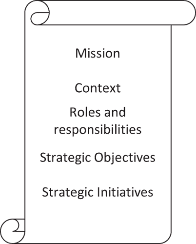

**图 4.1 安全策略的关键要素。**

任务宣言是一个简短的陈述，回顾了安全的主要目标、其主要功能以及对业务目标的贡献。

背景描述了理解该策略所必要的若干要素，特别是：

- 公司对保护其资产的愿望，特别是数据的机密性、可用性和完整性
- 考虑到公司的特征、所属行业、运营环境、风险偏好以及其运营的法律和监管框架，所提出的安全紧迫性需求
- 策略的作用：作为任何未来安全倡议的基本准则，并对应指导任何决策的原则进行提醒
- 对组织当前状况、主要挑战和未来发展的评述

“角色与职责”部分提醒了治理原则、管理安全计划的角色和职责，以及安全组织必须适应组织目标和倡议的事实。

应当明确提到未来阶段的战略目标或愿景。这些目标是根据流程的成熟度和对业务目标的支持来制定的。安全必须将自己定位为公司发展的关键参与者，并制定明确的方向及其未来定位。这将使所有利益相关者能够更好地理解通往该目标的倡议。

战略安全倡议将通向建立既定愿景，应清晰地列举并包含：

- 其对业务目标的贡献的描述
- 其关键交付物（预期结果）
- 如何衡量其贡献（通过一些监控其向目标演进的关键点指标）

尽管表面看起来简单，但对于任何 `CISO` 来说，这都是一项相当复杂的任务。事实上，他们不能独自、孤立地由自己来制定策略。另一方面，目前还没有一种被广泛接受的模型来定义策略，这意味着策略对不同的人有不同的含义。`CISOs` 并不经常被邀请讨论业务策略，而业务策略往往没有以足够明确和可衡量的方式进行沟通。“孤军奋战”模式的危险在于，可能交付出一份与业务目标没有明显联系的安全项目路线图。因此，大多数业务经理不会将其理解为策略，因为它将与他们的需求不一致，也无法满足他们通过技术变革来发展业务并提供更好客户服务的愿望。

以下是实现这一目标的系统化方法。

## 4.3 制定策略的方法

在制定策略时，一个常见的错误是仅列出对应于传统驱动安全计划的要素的项目：审计发现、漏洞和威胁、已知风险以及监管限制。策略必须明确考虑到这些要素，但为了具有说服力，由于上述提到的原因，它必须明确地提到并针对业务目标。这种与业务策略的对齐不仅对安全经理是一个挑战，对所有技术人员来说也是如此。

许多因素影响着安全策略的制定。它们可以归类如下：

- 业务运营策略和需求
- 外部因素，包括法律监管框架、公司运营环境以及与外部合作伙伴合作相关的限制
- 弥补信息系统成熟度差距的紧迫需求
- 风险缓解

制定策略的过程可以总结如 `Figure 4.2` 所示。

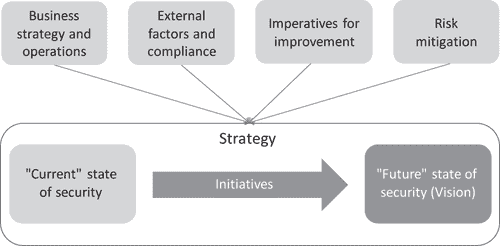

**图 4.2 安全策略制定流程。**

除了传统的业务部门，`IT` 部门、公司实体、人力资源 (`HR`) 以及其他部门应被视为制定安全策略的伙伴。

为了能够定义目标（安全愿景）和实现这些目标的倡议，必须考虑许多因素。接下来将介绍每一步的主要步骤、工具和预期结果。我们不会详细制定项目管理最佳实践，因为这不是我们的目标；而是必须建立战略指导委员会，其首要作用是为项目提供支持、对目标和资源做出决策，并监控向既定目标的进展。它应该由具有较高决策权的人员组成，例如首席风险官 (`CRO`)、首席信息官 (`CIO`) 以及一个或多个主要业务部门的代表。

参与制定安全策略的团队由来自业务部门的人员组成。这些专家负责传递战略方向并评估运营中的安全方面。他们的选择应基于对业务部门战略愿景的了解、对运营的了解以及对信息系统的兴趣。

项目负责人理想情况下是 `CISO` 或其代表。也可以是外部顾问，但在安全经理的密切监督下工作。

策略制定项目由四个阶段组成，其目的是为定义提供所需要素：

1. 确定信息系统可以做什么以更好地支持业务策略（变革）
2. 确定信息系统可以做什么以更好地支持业务运营（运行）
3. 定义提升整体效能的信息系统愿景和倡议
4. 对倡议进行分组并建立项目路线图
5. 制定策略

### 4.3.1 支持业务策略的倡议

作为第一步，能够感知公司的需求、变革倡议、信息系统预期以及“个人项目”是非常重要的。

- 理解业务紧迫需求及其成功因素。
- 理解战略项目，并可能推导出未明确沟通的其他战略方向。
- 识别安全可以带来价值的倡议和目标。
- 识别阻碍业务目标的安全规则。
- 确定安全如何有助于业务目标的实现。
- 与业务部门共同定义使用哪些指标来衡量信息系统相对于业务目标的充分性。

此阶段的预期结果是：

1. 对业务战略目标的认知
2. 一份有助于实现业务战略目标的安全倡议列表
3. 用于衡量安全相对于战略目标的充分性的指标（`Figure 4.3`）

#### 示例

`HR` 服务有一个战略目标，即开发其互联网招聘服务。安全可以以不同的方式有助于这一目标，包括建立个人数据保护控制、集成第三方应用程序供应商提供的身份验证组件等。对此类倡议的支持对具有类似需求的其他业务部门也有益，例如定义不同身份验证方法的集成架构。

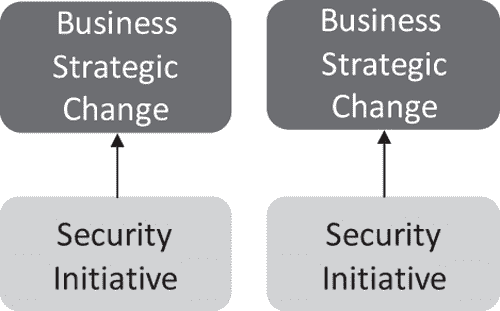

**图 4.3 支持业务目标的安全倡议（变革）。**

业务策略通常没有被定义或明确阐述，尽管它们通过倡议、新项目、愿景或策略审查会议的结果表现出来。因此，一份名为“企业战略”或“业务策略”的文件不存在并不令人意外；最理想的情况下，存在大量提到它的文档或演示文稿。

在下文中，我们将公司的业务策略视为一个整体，或者其某一个业务部门或分支的策略，而不涉及业务本身的复杂性。安全策略的方法也是一致的。

舍伍德应用业务安全架构（SABSA）框架提倡企业级方法，这种方法非常值得赞赏且无疑是更优的：“企业概念意味着组织应被视为一个单一实体，而不是一系列协作单元的集合。特别是这一概念涵盖了端到端业务流程的内涵。”尽管如此，按业务单元为单位进行的方法具有加强安全态势的优点，并且不会削弱“企业”视角，这种视角将在随后的整合工作中予以体现。

识别业务倡议并列出支持它们的安全倡议的主要步骤如下：

1. **准备**：设定目标、时间表和交付物。
2. **编制**问卷调查，以便识别战略性业务倡议以及可以提供帮助的安全倡议。
3. **映射**战略性业务倡议。与业务单元代表召开会议，明确他们的战略倡议。
4. **整合**战略性业务倡议并起草底层的安全倡议。

在开始审查业务策略之前，要仔细选择将参加指导委员会和团队的专家（业务单元代表），定义目标，并召集委员会和团队召开启动会议，在会议上介绍目标、方法和时间。

项目经理与业务单元代表合作收集战略方向的会议应该经过非常仔细的准备。业务单元通常没有定义良好的策略或路线图。这就是为什么项目准备会议非常重要，而且在这方面，管理层和董事会的支持至关重要。部门经理认为安全是一项应该保持在业务关注之外的支持工作，并专注于技术保护，这种情况在并不并不罕见。在这种情况下，展示预期的益处可能会非常有帮助。另一个危险可能来自业务单元经理，他们误解了安全策略项目的含义，委派了对业务目标缺乏足够知识或职位无法传递所有相关信息的人员来此工作。这就是为什么一个对公司情况了如指掌的项目负责人角色至关重要。

编制一份应反映目标的问卷；即起草一份战略性业务倡议列表，以及安全如何为其中的每项倡议增加价值。问卷可以根据业务背景、其特征或我们已有的知识以不同的方式编制。然而，为了效率并保持这种咨询式方法的吸引力，应该保持简单有效的方法。这根结底是一种应被视为对各方都有益的交换。

以下是问卷的示例：

1. 你们部门的任务是什么？
2. 你是否已经为未来阶段定义了战略目标？对于每个目标，列出有助于实现该目标的信息安全预期。
3. 你是否已经启动了项目，或者是否有实现这些目标的路线图？如果是，请列出它们并为每个项目注明信息安全的预期。
4. 实现你们目标的主要挑战是什么？对于这些中的每一个，你如何看待安全的增值？
5. 你们未来几年的活动中有哪些机会？信息安全的增值是什么？
6. 你是否意识到竞争对手采取了类似的成功策略？是否有任何特定的安全组件（工具、流程、组织）可以帮助？
7. 独立于你自己的目标，安全控制或指南应如何变化以适应你的业务背景（你尚未定义策略，但你知道这是必不可少的）？
8. 你是否预见到你的产品和服务发生剧烈变化，需要调整技术或安全组件？

预先建立的问卷将在与业务单元代表的会议期间作为共同线索。坚持明确阐述业务目标的优先级。关于安全如何帮助业务单元实现其策略的建议将在后提出。如果业务单元只有模糊的目标，对信息安全（IS）的影响将更加严重。

重要的是重申，这不是关于业务策略的头脑风暴会议。如果单元无法制定他们的变更策略，这仅意味着没有策略，他们的运营将继续使用现有流程。对当前运营的安全贡献将在第二阶段：“业务运营的安全倡议”中讨论。

问卷的结果可以用摘要表的形式呈现，包含业务单元的战略目标、他们对安全贡献的愿景以及所需的完成时间。

#### 示例：金融机构

| 战略目标 | 支持目标的业务倡议 | 截止日期 | 安全贡献 |
| :--- | :--- | :--- | :--- |
| 1. 提供包括加密货币在内的金融产品 | 1.1 建立加密货币策略。1.2 定义并实施包括加密货币的产品。 | 1 年 | 在安全控制中整合区块链和密钥保护问题 |
| 2. 在云端外包客户关系管理（CRM）运营 | 2.1 建立外包策略。2.2 将目前内部的设施部署到外部提供商。 | 6 个月 | 进行风险评估并建立必要的控制；部署云所需的安全控制 |

### 4.3.2 支持业务运营的倡议

安全策略开发的第二阶段包括提出安全倡议，以弥补流程成熟度方面的感知差距，以支持业务运营需求。

人们经常说安全措施并不适应业务需求，甚至阻碍了日常运营。因此，审查公司的安全策略是一个更好地定义安全可以做哪些改变以改进这种认知的机会。

#### 示例

许多员工经常表示通过外部平台使用新的通信和数据共享手段。他们的问题“我们为什么不能使用这些手段进行专业数据交换？”可能会收到首席安全官（`CISO`）的这种回答：“因为我们的数据是机密的，我们的政策不允许。”事实上，与其这样回答，`CISO` 应该问以下问题：“你们愿意在外部平台分享哪些数据或文档？”然后用户的回答肯定不是“全部！”

因此，必须完善策略并建立相应的控制措施，根据内容的分类来允许或阻止这种共享。如果与相关的业务专业人员一起进行风险和成本效益分析，可能会达成一项通用禁止规定！区别在于，在后的情况下，决定将由业务部门自身做出，而不是由 `IT` 人员做出。

在此阶段，项目负责人将倾向于识别可以改进的安全流程，以更好地支持当前的业务运营。

此阶段的预期结果将：

1. 业务运营效率目标
2. 从业务运营角度的安全成熟度差距
3. 支持业务目标的分组倡议（图 4.4）

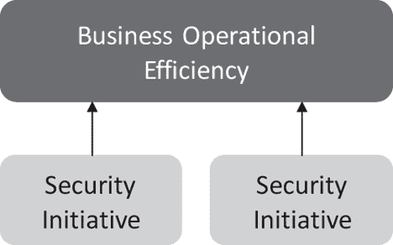

**图 4.4 支持业务运营的安全计划（运行）。**

#### 引言

建立支持业务运营的安全计划的主要阶段如下：

1. 建立安全服务的成熟度模型。
2. 使用成熟度模型进行差距分析。
3. 将改进点整合为倡议。

##### 4.3.2.1 建立安全服务的成熟度模型

从业务部门获取关于安全控制措施有效性和易用性的反馈的机会非常少，必须高效利用。建立安全服务的成熟度模型将允许项目负责人收集业务领导者对现有安全控制感知充分性的意见。这就是为什么我们应该提出一份问卷和成熟度评估工具，以系统地记录他们对安全措施感知充分性的意见。

成熟度评估工具将在第 9 章（安全指标）中详细介绍。可以使用 `ISO 15504`（信息技术 - 过程评估）过程成熟度等级量的变体来确定用户对安全解决方案的满意程度（图 4.5）。

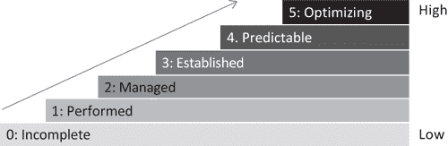

**图 4.5 成熟度等级。**

1. 不完整：不存在或定义模糊。
2. 已执行：偶尔使用（临时）。
3. 已建立：全组织范围的标准（可用）。
4. 可预测：与组织的需求一致。
5. 持续优化：组织侧重于持续改进。

对于每个被评估的安全服务，将建立以下三个评估标准：

* 当前成熟度
* 期望成熟度
* 优先级（1. 低，2. 中等，3. 高）

前两个允许我们衡量感知差距重要性，而第三个则有助于确定其优先级。这三个标准使得计算一个名为 `Importance` 的指标成为可能如下（图 4.6）：

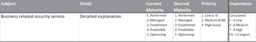

**图 4.6 安全服务的成熟度模型。**

```
Importance = (Desired maturity - Current maturity) × Priority
```

期望变更重要性将在 0 到 12 之间。这允许我们设定一个阈值，根据该阈值考虑业务需求。重要性较高的话题需要尽可能详细地解释出现这种情况的原因。

**示例**

假设我们提交了两个主题/安全服务由业务部门进行评估（见下）：

1. 待评估的安全服务
2. 策略和指南的可访问性

**图 4.7 安全服务的成熟差距与“重要性”。**

主题被分为以下各项措施：

**示例**

1. `审查关于安全交换的策略和指南以及数据加密。`
2. `建立安全职责：让业务部门管理访问权限。`
3. `对访问权限进行计划。`

与所有参与者的会议将非常有益。通过这种方式，参与者可以对自己的措施发表意见。支持业务运营的安全措施可以总结如下（图 4.8）。

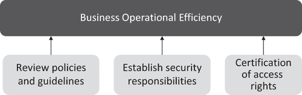

**图 4.8 支持业务运营的安全措施。**

### 4.3.3 改进信息安全的措施

安全作为 `IT` 内部或外部的部门，必须确保自身的效率。信息系统的愿景和战略措施可以通过观察风险演变、成熟差距、审计发现、优势、机会和威胁（SWOT 分析）、技术演变、组织变更、资源可用性，以及与相似行业进行比较来建立。这为我们提供了关于改进改进点的很好的思路。

此阶段的预期结果是：

1. 信息安全愿景
2. 实现该愿景的战略措施（图 4.9）


**图 4.9 支持改进目标的安全措施。**

贡献业务措施是一个重要目标。然而，如果安全部门没有足够的能力、治理和管理以及足够的流程成熟度，就无法成为可靠的合作伙伴。在 `CISO` 领导下的安全委员会应该评估安全状态，设定目标并选择可能的措施。设定信息战略目标的方法有：

- **SWOT 分析。** 对不同领域的优势、劣势、机会和威胁进行检查，例如控制有效性、技术解决方案、组织和流程、财务和成本、人员因素、外部环境、法律监管框架。
- **成熟模型。** 成熟模型可以显示当前流程与理想流程之间的差距。许多模型并且通常基于标准。专业的咨询公司或顾问还可以提供同行业公司的基准概述。
- **审计发现。** 审计建议是新安全措施的重要动力和依据。董事会和管理层对这些建议非常有信心。
- **风险评估。** 风险评估过程有助于识别现有控制措施的缺陷，从而有助于定义目标和更多的战略措施。
- **新技术。** 新技术的需求日益增加，安全必须考虑到这一点。一些合理的请求需要快速适应（例如使用不同的通信手段或消费化），另一些代表基础范式转移的需求需要更合适的手段（例如数字化、`fintech` 或 `blockchain`）。

对安全态的分析可能会导致与业务部门采访时记录相同的成熟差距发现。此外，还可以识别特定于安全的监管框架差距。

#### 示例

以我们的金融机构为例，假设安全团队确定了以下要在短期内实施的两个措施：

- 具有特定组织方面的网络安全指南
- 访问权限配置

在这种情况下，之前确定的身份访问管理和访问权限配置将被整合。

### 4.3.4 措施的分组与项目路线图的建立

到目前确定的措施可能会重叠（例如在业务和安全之间）。因此，目标是制定一个优化的措施列表以支持战略目标。这些措施还可以拆分为项目，并以路线图的形式呈现。

此阶段的预期结果是：

1. 支持战略目标的安全措施和项目（图 4.10）
2. 措施路线图（时间规划）（图 4.11）

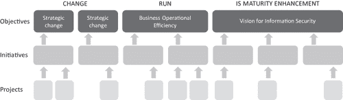

**图 4.10 措施和安全项目集。**

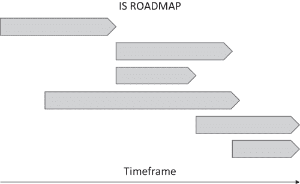

**图 4.11 信息项目路线图。**

### 4.3.5 策略制定

建立了所有元素，我们终于能够制定安全策略。有很多安全策略设计和演示案例可以借鉴；然而，通过关注表达的业务需求来展示我们的策略是明智的。

如果我们总结 4.2 中列出的策略组成部分并采用本章范围内使用的示例，可以将策略总结如下。我们不会制定使命、背景和职责，因为它们特定于每个组织。战略目标和战略安全措施将基于本章范围内使用的示例。

#### 示例

1. 使命
2. 背景
3. 职责
4. 战略目标

安全确保资产安全，并积极参与业务发展。特别是，它有助于实现以下业务目标：

1. 引入包含 `加密货币` 的新金融产品
2. 将某些应用程序基础设施和存储外包给云提供商
3. 通过调整允许业务部门自主控制访问权限，并调整数据传输领域的策略、程序和工具，来提高所有业务部门的运营效率

5. 战略安全措施

针对上述目标的未来战略安全措施可以总结如下：

#### 5.1 为加密货币建立安全控制

**目标**：提供安全组件以引入使用加密货币的金融产品和服务

**成功标准**：实体能够轻松地按需提供加密货币的产品和服务

#### 5.2 评估使用第三方云基础设施的风险并提出安全措施

**目标**：建立风险分析机制，并为公司提供一套具有可衡量关键准标准的政策和指南，使业务部门能够快速且明智地决定是否以及在何种程度上将应用程序基础设施和存储的管理外包给第三方云。

**成功标准**：能够在外部云中根据定义的且有保障的安全基准部署解决方案的能力。

#### 5.3 将安全职责下放给业务部门


## 目标
将某些控制措施转移至业务部门，以优化资源配置和运营效率。在此背景下，以下责任将获得优先处理：

- 分配访问权限、定期验证和更新请求的责任
- 与业务部门流程相关的安全风险管理

## 成功标准
缩短提供访问权限的时间周期。

## 5.4. 定义网络安全策略

### 目标
为公司制定网络安全策略。一旦策略获得董事会批准，安全部门将确保起草更层级的指南和文件，以构建一套网络威胁防护体系。

### 成功标准
所有业务部门以及公司部门、IT 和人力资源部门都将意识到网络威胁以及防范网络攻击的方法。将实施有效的控制措施，以确保根据定义的服务水平协议（`SLAs`）具备足够的运营韧性。

## 5.5. 身份与访问管理

### 目标
通过基于角色或业务规则的管理原则，以更自动的方式管理公司资源的身份和访问权限。为业务部门提供自行验证其员工访问权限的机会。

### 成功标准
业务部门负责人能够执行访问权限的年度认证。在其他条件保持不变（相同数量的操作员对应相同数量的）的情况下，新员工访问权限的响应时间和权限分配时间应减少 10%。

安全倡议所支持的战略目标如下所示：

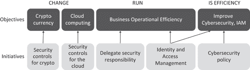

## 应该如何沟通安全策略？

### 4.4 安全策略沟通
在准备策略性文档时，避免仅将安全倡议表述为针对威胁的防御。这会给人一种禁令感而非强化感。我们知道安全控制是为了降低风险，但它们也有助于为部署新解决方案创造条件。因此，最好使用积极的词汇，说明安全措施有助于实现战略目标，而不是指出其局限性的负面词汇。强调安全措施使什么变得可能，而不是列举它们阻止、减少或禁止了什么。

### 示例
安全贡献可以用两种方式来表达。

| 负面方法 | 积极方法 |
| --- | --- |
| 减少因电脑丢失或被盗导致的数据泄露风险 | 通过确保电脑内容的机密性为工作提供便利 |
| 禁止非法访问应用程序 | 通过优化访问权限保护公司的机密和重要信息 |
| 减少针对 Web 服务器的网络攻击风险（`DOS`——拒绝服务） | 基础设施的韧性并确保对客户的持续服务 |
| 禁止发送包含机密的信息 | 在确保数据机密性的同时便利通信手段的使用 |

“策略”文档是更详细演示或说明的起点。战略倡议或目标可以在年度会议或公司活动上以更视觉化的方式展示。图 4.12 中的示例是单页安全策略的展示。

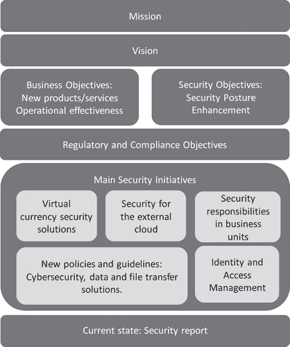

**图 4.12** 安全策略的安全展示。

## 4.5 结论
建立正式的公司安全策略对于安全治理至关重要。这一步不应被低估，因为它影响着将实施的安全流程、组织、活动和控制措施。策略文档本身很重要，但制定该策略的过程更为重要，因为它加强了所有利益相关者的协作，并使取得的结果具有合法性。

为了保持务实导向，通常不需要执行所有列出的步骤。某些经理或董事成员可能已经非常清楚他们的安全计划需要的目标，因此不需要在业务部门之间进行分析和达成共识，特别是这样做可能会无意中为部门竞争安全或 IT 资源提供机会。

本章介绍的制定安全策略的流程和工具只是可行方案的一种示例。

# 身份与访问权限管理

## 安全章程
“我们提倡对访问权限进行集中化管理和监督……”

## 策略与功能策略
“访问权限根据业务角色分配…… 业务角色由业务部门经理建立…… 角色的构建基于`最小特权`原则（足以执行特定任务）…… `数据所有者` 数据访问请求…… 组织、角色和职责如下……”

## 标准级（操作层）


“当员工经理和人力资源部门给出授权后，操作人员将在不同平台上触发特权配置流程。”

### 数据保护

### 安全章程（Security Charter）
“我们必须根据数据的机密程度对其进行保护……”

### 在策略或功能策略层面
“数据分类如下……各类别的数据保护规则如下……任何处理分类为高度机密数据的应用程序必须使用强身份验证系统……”

### 在标准层面（操作）
“为了使用强身份验证开发应用程序，应采用以下标准……”

内部管理制度文件的层级分类在安全文献中被频繁提及。我们可以认为文档的数量与其层级成反比，从而形成一个金字塔。

## 5.2.2 按业务部门或业务领域分类

拥有多个独立或地理分布的业务部门的大型公司，可以为其各个部门选择不同的监管框架。制药行业的研发和销售部门可能具有不同的风险偏好。前者处理机密数据，因此可以采取一系列后者无法接受的保护措施。

因此，内部法规的要求在同一家公司内部可能存在差异。这被称为安全监管框架的分离或差异化。尽管这看似简单，但分离监管框架会遇到困难，因为它们使用了相同的 IT 基础设施。以应用程序服务器的虚拟化为例。如果公司的 IT 架构没有将数据分类分级作为其物理架构的一部分，可能会出现同一台物理服务器托管不同机密级别应用程序服务器的情况。这可能会阻止访问权限或可用性方面法规的隔离，或至少使其变得非常困难。当 IT 基础设施被具有不同风险偏好的业务部门共享时，适用于最低风险偏好部门的单一策略将对其他部门产生不利。

从理论上讲，我们可以根据业务部门、活动领域、地理分布等制定不同的内部法规（图 5.2）。

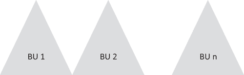

图 5.2 分离的内部法规。

### 示例
随着个人生产力应用以及智能手机、平板电脑或笔记本电脑等移动设备的出现，内部法规可以根据每个部门的风险偏好，授权使用此类设备（自带设备 [BYOD]）。这些设备在手表制造商的组装部门可能会被禁止，但在营销和销售部门可能会被授权。

## 5.2.3 按领域分类

许多安全领域，如身份和访问管理（IAM）、移动性、IT 开发、人员风险或新技术，可能需要一套从策略到技术程序的内部监管文件。在这种情况下，必须包含第三个维度，即跨越所有业务部门的特定领域的监管（图 5.3）。

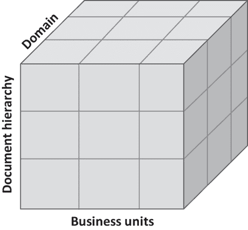

图 5.3 三维监管框架。

### 示例
IAM 流程在同一公司内的不同组织单元之间可能不同，特别是在重大重组、合并或收购之后。因此，与此活动相关的策略、指南和标准在不同单元之间可能存在差异。

关于移动设备的内部法规也可能根据风险偏好、数据特征、使用的应用程序等在不同公司单元之间有所不同。

地理单元可能在不同的法律下运行。

## 如何组织内部法规？

## 5.3 内部法规的文档框架

每家公司都需要一个从策略到程序的文档框架。该框架的设计非常重要，因为它有助于理解和接受。之前提出的矩阵适用于部门多样化的大型公司。

我们经常看到的错误是不同层级的文档堆积，有时它们重叠且余地极小。因此，清晰地定义公司内部每种类型文档的位置是非常重要的，从而便于访问和维护。

在不需要在业务单元之间区分策略的情况下，通过层级分类就足够了。公司可以使用三维模型的简化版本，如图 5.4 所示。

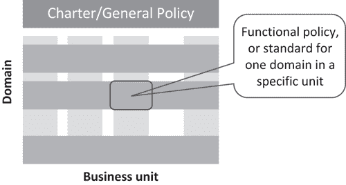

图 5.4 二维监管框架。

安全章程和通用策略对于整个公司是唯一的。在同一策略中可能存在安全策略、风险偏好或背景的差异，只要它们呈现清晰。在领域与单元的交叉点，会找到针对特定领域（例如移动性）的特定单元（例如销售）的不同层级文档。如果需要为特定领域制定策略，我们可以使用功能性策略术语。

当特定领域需要一套非常高级的规则时，功能性策略非常有用。以下是用于判断是否建立特定功能性策略的一些领域特征：
- 背景的某些特殊性（内部或外部）
- 风险、威胁和漏洞的特定性质
- 法律和监管框架的特定特征
- 安全组织中的特征方面（角色和职责）
- 领域特定的概念和术语
- 实施控制措施的特殊之处

### 示例
网络安全、数据保护和 IAM 可以被视为需要自己的功能性策略的特定领域或安全领域。

## 5.4 安全章程和策略的内容

在下文中，我们将更详细地查看章程和策略（或功能性策略）的内容。没有公认的最佳安全策略模型。每家组织都可以根据其需求设计其策略文档。然而，关于策略的内容和形式有一些通用建议。这些建议旨在使其更具读性、更全面，并最终对所有利益相关者更有用。一些主要大纲已经阐述。现在我们将查看它们如何具体地转化为文档。

### 5.4.1 安全章程的内容

表达公司保护其资产的主要安全导向的最高级文档可能有不同的名称，如 `Charter`（章程）、`Code of Conduct`（行为准则）、`Statement of Intent`（意图声明）等。它传达了管理层对安全的坚定承诺，并制定了相应的授权。安全章程描述了公司在信息安全（`IS`）方面的目标，但不规定如何实现这些目标。它通过参考业务行为背景、对法律法规框架的遵守、对员工伦理行为的要求、公司的价值观和文化、安全保护原则以及个人责任，表达了管理层对其保护系统的承诺。主要章节及其内容摘要如下。

#### 引言或背景
- 介绍公司的背景和主要问题、其局限性以及对价值观保护的重要性
- 提醒公司文化以及支持安全工作的原因
- 表达建立完善安全系统的意愿
- 公司对资产（包括个人信息：客户、员工、供应商等）保护的责任

#### 范围与目标读者
- 介绍章程的范围以及适用对象
- 特别说明文档框架的重要性及其在管理安全计划中的用处

#### 高级职责
- 战略角色和职责的概述介绍：`data owners`（数据所有者）、`governing bodies`（治理机构）、`executive security management`（执行安全管理）、`employee responsibilities`（员工职责）等

#### 应提及的一些原则
- 保护公司价值观
- 风险管理
- 员工权利与职责

#### 管理目标
- 安全治理和组织目标
- 安全管理目标以及对公司运营的参与

### 5.4.2 安全策略的内容

策略或功能性策略规定了整体安全或特定领域的安全宏观导向和指导原则。安全策略有很多例子。以下是主要章节的摘要，作为示例，并不意味着已无详尽。

#### 引言或背景
- 公司的内部外部背景，安全策略对于实现业务目标的问题和重要性
- 策略的目的、涵盖领域以及存在的理由
- 发布高级要求

#### 范围与目标读者
- 本策略的范围——适用对象以及谁应该执行它
- 策略依据的原则（法律和规范框架）
- 策略的目的以及策略发起者或所有者的意愿

#### 策略在内部法规框架中的定位
- 必要时，提醒内部法规的文档框架以及该策略的（层级式）定位

#### 原则
- 列举策略的基本原则（策略试图实现的内容）

#### 策略陈述
- 规定策略的高级陈述
- 解释每条陈述的理由、其 `raison d’être`（存在意义）以及应如何应用（不提及具体执行方法）

#### 组织、角色与职责
- 信息安全的治理与管理
- 主要功能和职责：`board of directors`（董事会）、`committees`（委员会）、`management`（管理层）、`security team`（安全团队）与 CISO（首席安全官）、`business units`（业务部门）及其安全代表、`IT` 与 `operations`（运营）、`data owners`（数据所有者）以及 `security specialists`（安全专家）
- 所有员工的职责以及遵守策略的义务
- 总结所有参与职能职责的负责、认可、咨询和通知（`RACI`）矩阵

#### 各特定领域的导向
- 某些领域的顶级指导
- 风险管理概念
- 人性安全
- 物理安全
- 数据保护
- IT 安全（采购、配置、使用）
- 业务连续性
- `IAM`（身份访问管理）
- 合规性
- 事件管理
- 报告系统
- 违规情况下的纪律处分

#### 流程
- 术语表
- 某些术语的解释

## 如何建立文档框架？

## 5.5 建立法规框架的过程

这些问题有多个答案。但请记住，不要基于预定义的示例或模板来构建框架，因为这会削弱安全性。高层管理人员需要参与并验证将成为策略的内容。法规框架文档还必须为所有员工履行任务提供服务；因此，它必须经过所有利益相关者的设计和接受。

### 1. 准备
1.1 理解业务背景和战略，特别是关于风险偏好和安全需求。了解现有框架以及是否经过调整。
1.2 了解哪些资产需要保护。必要时，与业务部门协作绘制数据、流程和应用的映射。如果尚未分类，根据公司标准或临时分类（例如：`public`、`limited`、`confidential`）对这些资产进行分类。
1.3 审查安全风险目录、风险评估及相关的控制措施。可能，建立与主要风险相关的控制措施成熟度映射。
1.4 决定是否在不同部门之间分离通用策略。如果公司从事具有不同风险偏好的业务，则这些部门应被视为具有差异化法规框架开发方法的公司。
1.5 定义法规框架的架构。决定如何访问法规框架。

### 2. 策略制定
2.1 讨论并决定安全治理与管理的组织和功能。
2.2 与负责实施安全控制的团队以及负责业务运营的团队协作，识别法规框架中需要澄清的关键点。这可以通过问卷或作为战略一部分的安全过程成熟度模型来实现。
2.3 与团队协作建立章程和通用安全策略。
2.4 让业务部门和 IT 部门对章程和政策进行验证。这非常重要，因为章程和政策应该获得运营部门充分支持。遵循 SMART 原则（具体、可衡量、可达成、现实和时间限制）。
2.5 确保政策经过了董事会和管理层的验证。

### 3. 开发功能性策略或指南
3.1 组建一个团队，参与特定安全领域的运营管理，这些领域需要特定的功能性策略（例如：网络安全、身份与访问管理 IAM、业务连续性、移动性或数据保护）。确保该策略获得负责其未来应用的领导者或负责人员的支持。
3.2 按照开发通用策略（2.1–2.5）的方法继续开发功能性策略。

### 4. 建立标准

在建立内部标准时，可以使用 `ISO 27001`（及其 `附录 A`）作为清单，以验证监管框架的完整性和覆盖范围。

表 5.1 展示了在处理 `ISO 27001` 要求的内部监管框架中，文档定位的建议。当然，标准必须遵循策略、指南或功能性策略的建议，并为运营提供其他必要的指令。如果表 5.1 中未具体提到某项要求，将由高级别的文档处理。例如，“A.11 物理和环境安全”以及所有低级要求将包含在《物理安全功能性策略》文档中。

表 5.1 处理 ISO 27001 标准要求的内部监管框架中的文档定位

| ISO 27001 引用控制目标（附录 A） | 在框架中的位置 |
| --- | --- |
| A.5 信息安全策略 | 内部监管框架 |
| A.6 信息安全组织 | 策略 |
| A.6.2 移动设备与远程办公 | 指南 / 功能性策略 |
| A.7 人力资源安全 | 指南 / 功能性策略 |
| A.8 资产管理 | 指南 / 功能性策略 |
| A.8.2 信息分类 | 策略 |
| A.8.3 介质处理 | 标准 / 流程 |
| A.9 访问控制 | 指南 / 功能性策略 |
| A.9.2.1 用户注册与注销 | 标准 / 流程 |
| A.9.2.2 用户权限配置 | 标准 / 流程 |
| A.9.2.3 特权访问权限管理 | 标准 / 流程 |
| A.9.2.4 用户秘密身份验证信息管理 | 标准 / 流程 |
| A.9.2.5 用户访问权限审查 | 标准 / 流程 |
| A.9.2.6 访问权限的移除或调整 | 标准 / 流程 |
| A.9.3 用户责任 | 策略 |
| A.9.4 系统和应用访问控制 | 标准 / 流程 |
| A.10 密码学 | 标准 / 流程 |
| A.11 物理和环境安全 | 标准 / 流程 |
| A.12 运营安全 | 标准 / 流程 |
| A.13 通信安全 | 标准 / 流程 |
| A.14 系统获取、开发和维护 | 标准 / 流程 |
| A.15 供应商关系 | 指南 / 功能性策略 |
| A.16 信息安全事件管理 | 标准 / 流程 |
| A.17 业务连续性管理中的信息安全方面 | 指南 / 功能性策略 |
| A.18 合规性 | 策略 / 指南 |

以下是开发监管框架期间是否采取了所有预防措施的清单。

1. 我们的内部监管文档粒度水平是否良好？
   业务特性定义了正确的粒度水平。对于一个所有运营功能都在内部控制的企业来说，高粒度（较少细节）可能就足够了。
2. 我们涵盖了所有主题吗？
   如果没有，请识别差距、进行沟通并计划纠正措施。
3. 我们能够优化某些文档定位吗？
4. 我们的内部监管文档是否到位？

图 6.1 治理与管理中的职责分配。

董事会是公司治理的最高机构，因此也是信息系统（IS）治理的最高机构。它对风险以及为降低风险所采取的负责，验证策略，确保资源被负责任地使用，并是绩效报告和审计的优先接收方。监控绩效是其对利益相关者履行职责的一部分。对于董事会而言，遵守法律和法规框架应源于健康的管理，而不应其本身就是目标。

可以根据需要建立安全委员会，并承担各种职责：建立或验证策略和政策、确定倡议的优先级、决定需要战略决策的问题，或在所有安全计划的决策过程中代表董事会和管理层。这些委员会可以采取不同的形式，通常由业务部门、公司和人力资源（HR）职能、信息技术（IT）管理以及 `CISO` 代表组成。

业务部门经理在协调和支持作为定义策略一部分的安全倡议方面通常发挥着重要作用。由于策略是根据业务部门的需求开发的，因此部门经理积极参与在其所属部门内传播和支持安全文化。`CISO` 在协调以及从战略上使安全与业务部门及管理层的需求保持一致方面的作用为这一目标提供了帮助。

`CISO` 团队在公司的安全组织中起着至关重要的作用，因为他们完成了大部分管理和安全运营活动。近年来，`CISO` 及其团队的重要性和责任得到了越来越多的认可。他们具有更高的可见性，承担了更多的战略责任，更注重治理和风险，并且越来越多地向 IT 之外及高管（C-level）人员汇报。

### 示例

在当前需要紧紧控制成本同时确保信息系统符合监管要求或技术发展的背景下，`CISOs` 越来越多地被邀请参与战略决策并向 IT 之外的机构报告。

技术变迁、新业务模式和流程数字化给公司带来了新挑战。`CISO` 被越来越多地提出新的职责，不仅涉及与新技术相关的安全风险缓解，还涉及治理领域。这些包括：

- 向治理机构、委员会和业务部门进行报告和安全沟通
- 提议安全策略
- 开发法规框架
- 实施安全控制和计划管理
- 安全风险管理（识别、评估和处置）
- 为所有利益相关者制定意识培训计划
- 监控（威胁、漏洞、合规性和控制效率）

运营经理和安全专家是负责运行安全控制、工具和其他技术解决方案的团队成员。他们主要负责：

- 基础设施安全（网络、服务器、工作站和终端）
- 设备管理（防火墙和入侵防御/检测系统 `IPS/IDS`）
- 安全信息和事件管理 (`SIEM`)
- 安全运营中心 (`SOC`)
- 事件管理
- 身份和访问管理

`ISO 27014` 标准规定了信息治理中的两个主要主体：治理机构和执行管理层。正如第 1 章所述，它们在治理过程中共同行动。治理机构本质上具有决策作用。它可能由管理层、董事会或业务部门经理组成。安全委员会也可以承担这一角色。执行管理的任务可以由信息系统经理和 `CISO` 及其团队承担。

### 示例

让我们以 `ISO 27014` 标准中的“监控”（实现战略目标）为例。这一过程需要若干项输入，其中某些应是治理机构的职责，包括：

- 评估信息安全管理活动的有效性。
- 确保符合内部和外部要求。
- 考虑不断变化的业务、法律和监管环境及其对信息风险的潜在影响。

然而，在实践中经常发现是 `CISO` 及其团队负责了这些旨在协助决策的任务，因为管理层认为他们最胜任。`ISMS` 的有效性是由安全专家自己进行评估的，合规程度由 `CISO` 评估，而变更需求则在没有正式风险分析或投资回报率评估的情况下被提出来。这显然没有鼓励治理机构承担其安全职责。

治理机构与信息系统管理之间的协作也可以通过一个迭代过程进行示意化，该过程旨在持续改进所有控制与公司需求之间的对齐（图 6.2）。治理机构设定源自公司目标的安全目标。这些目标随后对信息系统计划产生决定性影响，而该计划由 `CISO` 负责。将部署控制以满足保护需求。`CISO` 将监控控制的有效性并向治理机构汇报，治理机构随后可以调整高级目标，以此类推。

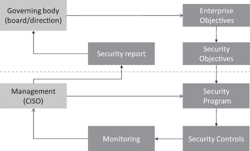

图 6.2 治理与管理之间的角色与职责分配。

因此，`CISO` 负责计划、控制和运营的实施。策略、风险偏好和安全策略仍然是治理机构的职责。将策略转化为信息系统目标，然后转化为行动计划和控制是 `CISO` 的职责。

我们还可以通过应用于三级控制框架（`TLCF`）模型的责任、负责、咨询和知情（`RACI`）矩阵，来总结信息系统治理和管理中的主要职责分工（表 6.1）。

表 6.1 TLCF 模块中不同治理机构的职责

| R: 负责 | A: 负责人 | C: 咨询 | I: 知情 | 董事会 | 管理层 | CISO 及团队 | IT | HR | 业务部门 |
| :--- | :--- | :--- | :--- | :--- | :--- | :--- | :--- | :--- | :--- |
| 策略 | | A | I | R | C | C | | | |
| 法规框架 | | A | I | R | C | C | | | |
| 章程 | | A | I | R | C | C | | | |
| 策略 | | A | I | R | C | C | | | |
| 指南 | | A | I | R | C | C | | | |
| 标准 | | I | A | R | R | R | | | |
| 风险管理 | | A | I | R | C | C | | | |
| 计划管理 | | A | I | R | C | C | | | |
| 报告与监督 | | A | I | R | C | C | | | |
| 资产管理 | | A | C | R | R | R | | | |
| 合规管理 | | A | I | R | C | C | | | |
| 指标与 KPI | | A | I | R | C | C | | | |

前述识别的治理职能应承担的职责的另一种表示方法见表 6.2。如果我们以“战略对齐”为目标，董事会的角色是“设定可证明的对齐方向”，而 `CISO` 的角色是“制定安全策略，监督安全计划和倡议”。董事会在绩效衡量方面的角色是“设定安全有效性报告方向”。

表 6.2 不同信息系统治理机构之间的职责分配

| 管理层 | 战略对齐 | 风险管理 | 价值交付 | 绩效衡量 | 资源管理 | 整合 |
| :--- | :--- | :--- | :--- | :--- | :--- | :--- |

## 信息安全治理职责

| 角色 | 对齐 | 风险管理与合规 | 成本与价值 | 有效性 | 知识与资源 | 流程集成 |
| :--- | :--- | :--- | :--- | :--- | :--- | :--- |
| 董事会/信托人 | 为可证明的对齐设定方向。 | 为适用于所有活动和监管要求的风险管理政策设定方向。 | 为安全活动成本和受保护信息价值的报告设定方向。 | 为安全性报告设定方向。 | 为知识管理和资源利用政策设定方向。 | 为确保流程集成的政策设定方向。 |
| 高管 | 建立流程将安全与业务目标相结合。 | 确保所有活动中的角色和职责包含风险管理。监控监管合规。 | 要求安全计划的业务案例研究以及受保护信息的价值。 | 要求对安全活动进行监控和指标报告。 | 确保知识获取流程和效率指标。 | 提供所有管理流程职的监督和整合计划。 |
| 指导委员会 | 审查并协助安全战略和整合工作，确保业务部门经理和流程所有者支持整合。 | 识别新兴风险，促进业务部门安全实践，并识别合规问题。 | 审查并建议安全计划服务业务功能的充分性，以及在已服务方面的交付价值。 | 审查并建议安全计划满足业务目标的程度。 | 审查知识获取和传播的流程。 | 识别关键业务流程和管理保证供应商。指导保证集成工作。 |
| 首席信息安全官 | 开发安全战略，监督安全计划和计划，并与业务部门经理和流程所有者联系以保持持续对齐。 | 确保风险和业务影响评估，制定风险缓解策略，并执行政策和监管合规。 | 监控安全资源的利用和有效性、声誉以及信任交付。 | 开发并实施监控、指标收集、分析和报告方法。指导并监控安全活动。 | 开发知识获取和传播的方法。开发有效性和效率指标。 | 与其他管理流程职联系。确保识别并解决差距和重叠。 |

**来源**: *Information Security Governance: Guidance for Boards of Directors and Executive Management*, 第 2 版, IT Governance Institute, 2006.

最后，无论治理和管理机构如何设立，必须始终考虑到它们的特权范围。在小型公司中，几项功能将由同一个人承担，而在较大的组织中，可能会有整个团队。

## 安全官的角色将如何演变？

### 6.2 对 CISO 及其团队的新需求

技术控制是必不可少的，构成了任何安全计划（也称为安全计划实例）的基础。然而，在构建该系统时的被动方法并保证最佳保护，特别是在今天新业务模式的发展、扩展到公司边界之外活动以及新通信手段的背景下。在组织 `CISO` 及其团队的活动方面需要一种新方法，特别是在制定战略、建立安全计划时整合业务部门、改进控制对业务部门需求的适应性，以及针对风险的主动方法。其原因是多方面的。

技术无法快速适应不仅来自网络空间而且来自公司内部的新威胁，这些威胁源于新的通信技术和 IT 消费化、活动范围扩展以及第三方服务的整合。公司边界不再是僵化的，活动扩展的趋势为安全经理创造了新挑战。为了适应这种演变，`CISOs` 必须改进他们的规划，并通过采用基于公司现实的计划来证明其项目的合理性。

这种新背景要求对安全团队的组织进行审查。运营安全团队的活动需要更多地集成到业务运营中，并具备比技术更广泛的技能。这些变化将带来对 `CISOs` 及其团队的更大认可，并接受他们成为业务发展讨论的伙伴。安全团队将不再仅由保护技术专家组成。它在整个组织中的定位将取决于公司的特征和实际需求。在最复杂的情况下，它不仅确保技术运行和部署，还将处理风险和架构，同时确保与业务部门和治理的有效协调。

对安全的需求日益增加。当前的背景、数字经济中的技术演变以及经济伙伴之间的相互依赖关系，对安全官及其团队日益增长的需求起着重要作用。董事会和管理层要求 `CISOs` 在预算停滞的背景下提供最佳保护并为业务部门交付真实的价值。`CISO` 的职位也正在从 IT 内部的技术经理转变为直接向公司最高层或 C-level 汇报的执行角色。

尽管 `CISO` 职责的这种演变无疑令人鼓舞，但并不总是伴随着底层组织的必要修订。董事会和管理层往往要求 `CISO` 及其团队承担更多责任，而没有必要的投资和资源调整。企业安全治理的相对不成熟确实与此有关。这导致 `CISOs` 和安全团队经常被新任务淹没。他们继续与日益复杂的威胁斗争，未能满足人们对更加关注战略、治理和主动风险管理的预期。

传统上关注运营的 `CISO` 及其团队现在必须扩展他们的活动，更多地参与计划管理中，以实现更好的治理、合规以及与业务目标的对齐。他们的安全职责范围正在扩大，现在涵盖从战略到运营。在当前网络威胁和员工 IT 消费化的背景下，战略、需求与业务要求之间连续体中的“巨大差距”以及对运营保护的必要加强将在未来加剧。

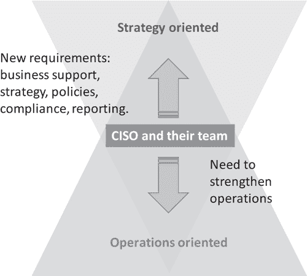

图 6.3 `CISO` 职责的演变。

显而易见，在资源没有变化的情况下，安全团队无法在主动风险的同时确保运行并满足战略需求。在这种情况下，有两种可能：

1. 通过增加资源来调整安全组织，以对治理、战略和风险提供更大的支持，或
2. 通过更改现有团队的需求规范来外包或委托安全运营。

许多公司提供安全运营外包服务，即安全即服务 (`SaaS` 或 `SecaaS`)。然而，这种安全运营的外包仅在某些条件下才是可能的。为了在经济上可行，其成熟水平必须很高，满足以下条件：

- 安全运营已建立并经过优化
- 控制是有效的
- 服务基于服务水平协议 (`SLAs`)
- 所有操作中都遵守了定义的标准
- 基础设施已适配，且访问权限是安全的
- 有定期的监控（跟进）流程。定义了报告系统，并基于稳定的指标。
- 安全运营的管辖权保留在内部。变更仅由内部运营经理发起。
- 建立了风险场景并对其进行监控。
- 在外包框架中开发的指标也可向管理机构报告。
- 外包运营必须是可审计的，特别是关于对标准的合规性、连续性、约定的控制措施或保护敏感数据的手段。
- 外包不会降低保护水平。
- 其他活动的组织不会因外包而削弱。释放出的资源可以改变性质并处理其他任务。

因此，`CISO`（首席安全官）拥有两个主要的责任极。安全组织的形态取决于他们在“运营–策略”或“治理、风险与合规（GRC）”轴上的位置，如图 6.3 所示。下文将介绍这两种取向的一些关键特征。

### 6.2.1 面向策略和业务需求的安全组织

在面向 GRC 极的安全组织中，重点是战略对齐、风险管理、合规性以及对业务目标的支持。在报告、投资回报率指标、培训和意识方面的成熟度通常较高。安全代表在业务论坛和委员会中占有一席之地，并就与新技术不断演变的安全风险相关的问题定期接受咨询。在这样的配置下，`CISO` 通常向 IT 部门之外汇报，其团队负责策略、合规和风险。安全运营要么外包，要么由集成到工程、运营或基础设施的 IT 团队承担。

### 6.2.2 面向运营的安全组织

在面向运营的组织中，`CISO` 和安全团队通常位于 IT 部门内部，`CISO` 直接向 `CIO` 或更低级别的领导汇报。他们与业务部门互动的机会极少，不参与策略辩论，且大多数时候关注安全的运营和技术方面。他们的主要使命是负责安全工具和技术的部署、优化和监控。负责这些团队的 `CISO` 具有相同的背景和深厚的技术知识。

这种组织的优点在于高水平的技术性、对安全工具的精通，以及选择最佳解决方案和整合不同技术的能力。缺点是由于与业务需求接触很少，`CISO` 及其团队仍然局限于自己的舒适区，并且没有采取战略变革倡议的冲动。这种倾向导致了危险：安全继续被视为一种“说不”的服务，并且很难与热衷于新通信模式（消费化）的员工达成共处之道。业务部门往往不得不向外部供应商寻求为其与供应商或客户的通信或交换需求提供更简单的解决方案。

### 示例

运营安全团队可能不会被征求关于为业务部门集成区块链解决方案手段的意见，除非他们从上级获得了特定的授权。支持变更不是他们的职责范围，特别是在面向生产优化、功能性结果和降低成本的 IT 大背景下。

## 安全团队的责任将如何演变？

### 6.3 安全团队的角色与职责

安全团队的传统活动可以分为两组：安全工程和安全运营。在不涉及过多细节的情况下，这两组包括以下活动。

#### 安全工程
- 应用安全
- 威胁和漏洞管理
- 项目和新技术安全

#### 安全运营
- 基础设施安全（配置、网络、终端）
- 安全组件管理
- 监控、设备管理和 SOC（安全运营中心）
- 事件管理与调查
- 身份访问管理

如今的安全团队通常承担所有这些活动，为 IT 部门提供了巨大的附加值。许多书籍和标准对运营级安全管理的目标和最佳实践提供了更多详细信息。

对 `CISO` 及其团队的新需求也可以分为两组。第一组涉及业务关系导向，涵盖了加强管理机构、业务部门与安全运营之间联系与协调的活动。它涉及将策略整合到运营中，并确保治理与业务部门、以及实施控制措施的团队之间有更好的双向通信。第二组可以称为主动风险管理，涵盖了在不断变化的背景下提供更好的风险分析和处理的所有活动，这些活动考虑了新技术、新业务模式和工作方法、用户赋能或消费化、活动外包、云计算、移动技术等。

业务关系中涵盖的首要新需求可以总结如下。

#### 业务通信、安全账户管理和营销
业务经理往往不愿意与具有技术背景的人讨论安全风险，因为他们认为这并不是他们的专业领域。IT 将修补一个暴露在互联网上并成为易受黑客攻击目标的服务器，这一事实并不能为 IT 资源的提供者提供有价值的信息。然而，如果他们被告知服务器提供的服务可能由于入侵而无法使用，这可能会导致他们更加关注安全论点。此外，业务部门有 `CISO` 团队可以满足的特定安全需求：特定背景的培训或意识、与其特定业务相关的风险识别和安全控制、指南和标准等。这些服务非常有价值，但它们需要特定的安全资源，如账户管理或客户关系管理。安全营销也是一种促进治理的活动：通过正确的工具在正确的水平传达安全的附加值。讲述通过安全获得收益的成功案例，使其能够以更好的定位整合到决策过程中。“内部安全”或“从安全角度进行设计”可能成为向客户和合作伙伴提供服务的某种质量标签。

#### 策略与业务对齐
在上一章中，我们讨论了开发安全策略并将其与业务需求对齐的重要性。事实上，对业务方向和需求的定期监控可以促进安全对齐。通过账户经理或业务部门代表（作为安全倡导者）或反之来建立信息交换的手段将大有益处。

#### 业务报告与指标
良好的治理需要基于可靠的关键性能指标的安全报告，并用易懂的语言表达趋势。仅仅展示保护系统产生的原始指标（例如补丁的数量）是不够的。应该监控的是安全如何帮助业务实现其目标。这将在报告和指标章节中进行更详细的讨论。

#### 意识与支持
提高安全意识一直是 `CISO` 及其团队的主要任务之一。然而，仅仅回顾准则已经不再足够了。该领域的需求也在发生变化，业务部门现在需要侧重于其首要关注话题的支持会议。仅针对终端用户的标准化意识培训课程可能无法与关键高管和其他决策者产生足够的共鸣。敏性化（意识提升）工作必须更多地关注工作实际情况，并对日常活动提供支持。

#### 合规性与计划管理
安全部门一直通过部署控制措施来满足特定的法规、审计报告、客户需求等。计划管理必须包含监管要求，并将其与能为业务带来价值的倡议相平衡。良好的治理负责安全计划，并将所有要求放在全局视角进行考量，无论是内部还是外部的、审计发现、新威胁还是合作伙伴请求。与需求和路线图保持清晰的映射关系，使企业能够理解安全项目是如何关联的，以及它们是如何为共同目标做出贡献的。

安全不再是开发的障碍，而是一个成功因素。对安全团队的新需求主要导致他们更深入地参与变更管理，特别是在预测和缓解新风险方面（主动风险管理）。

#### 策略管理
将监管框架作为治理的基础组成部分进行管理仍掌握在安全团队手中。`CISO` 团队负责维护策略并帮助业务部门（包括 IT）根据公司需求维护其标准。频繁的例外请求通常表明策略和指南不完善。

#### 第三方与外部化风险管理
许多公司在价值生产链中外包其活动或依赖外部服务提供商。安全团队被要求保护共享数据和资源，就像保护内部资源一样。对于安全专家来说，这是一个非常困难的处境，因为事后确保此类操作的安全几乎是不可能的。因此，安全团队必须参与选拔过程并参与主动风险分析。这有助于伙伴的选择、推荐的保护标准的应用、审计以及尽职调查。

#### 主动风险评估
与新项目和业务倡议相关的风险评估服务非常受推崇。这是安全团队能够证明其对变更过程做出贡献的少数机会之一。

### 示例
使用云服务结合第三方供应商提供的应用程序对于业务部门来说是一个很有吸引力的解决方案。然而，如果这项倡议在没有安全团队支持的情况下进行，几乎可以肯定，在投入生产之前的审计或风险分析将揭示新的漏洞。安全团队提前进行的风险分析可以暴露风险并提出潜在的解决方案。

#### 安全架构
建立和加强结合技术和基于策略的流程的安全架构将是未来几年安全团队中最受期待的能力之一。从公司的策略、目标或业务倡议出发，安全架构师将为负责设置技术控制团队建立标准和概念。安全架构师具有双重角色。他们不仅可以识别并向治理机构传递风险，还可以提供最符合公司背景的解决方案。一旦做出决定，架构师就会制定概念和标准，并参与解决方案的制定。架构师和工程师还对项目做出贡献，并确保概念和标准得到遵守。他们在论坛中代表安全，并参与公司架构师小组的工作。

在说了上述内容后，传统的以操作为导向的活动与接近策略、风险和治理极的新活动在图 6.4 中示意性所示。

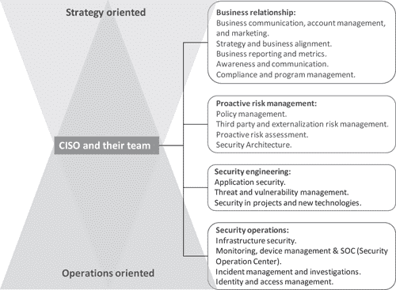

图 6.4 `CISO` 及其团队的职责集合。

## 新任务——好的，但必须涵盖哪些新领域？

### 6.4 CISO 及其团队的新责任领域
除了安全服务中可见的性质变化（特别是 `CISO` 及其团队的特定垂直演进）外，与安全相关的新领域正出现在眼前，这些领域极有可能影响安全服务规范。这些包括网络安全、人为风险与调查、欺诈管理以及个人数据保护服务（数据隐私）。

#### 网络安全
安全和 IT 团队自然负责实施网络威胁防护措施。必须实施的防护往往超出了企业的范围。因此，`CISO` 必须积极参与论坛，与政府协调部门合作并报告观察到的事件。

#### 人为风险管理与调查
大量的统计、调查和各行业的事件表明，主要威胁并非来自孤立的黑客，而是来自具有内部配合的高持续性威胁 (`APT`)、疏忽的安全设备（例如打开邮件附件导致恶意代码安装）以及恶意员工。人为风险的管理包括建立新的控制以检测异常活动的先兆信号。人为风险应在特定的人力资源部门处理，但安全服务通常寻求调查或筛选技术技能。

#### 欺诈管理
欺诈尝试可能以不同的形式表现。新的通信手段、个人数据的可用性和新技术的无疑为恶意分子提供了机会。这些大多是利用业务运营勒索财务资产、机密信息或任何形式利益的尝试。故意违反内部规则（可能被称为违规）在证明利益已实现之前不能被视为欺诈。与人为风险一样，欺诈管理应在安全服务之外提供。尽管如此，由于调查或取证问题，安全专家在该领域的需求正在增加。他们还必须建立特定的指标或控制来检测欺诈尝试。

#### 数据隐私
机密或个人数据的保护措施（无论是法规要求还是业务自身）都会影响信息安全。这种影响的示例已在第 3 章给出。在安全组织方面，法规要求的新责任主要涉及 `数据处理者`、`数据控制者`、`数据所有` 以及数据保护官 (`DPO`)。

### 6.5 安全组织结构
安全组织结构反映了公司希望赋予安全团队的角色。这种结构也决定了其实现既定目标的能力。不同功能的定位会影响招聘安全专家的策略，以及安全官本人所处的位置。

没有适用于所有公司的最佳或唯一安全组织模式。因此，试图呈现一个理想模型是不可能的。公司的部门、规模和特征将决定负责安全团队的定位和职责。每种安全组织配置都有其自身的逻辑，因此理解每种模式的特征和优势至关重要。安全团队演进到最高战略水平不应是目标本身，而应该是公司根据其背景主观意愿而产生的结果。

安全组织通常可以归类为以下四种类型之一：

1. 面向运营的型安全
2. IT 安全
3. 企业级安全
4. 分布式安全

#### 面向运营的型安全

面向运营的型安全的特点是关注技术和运营控制（图 6.5）。这种结构通常集成在 IT 运营中。

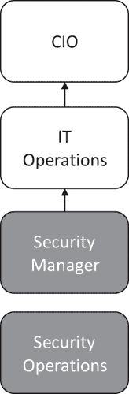

图 6.5 面向运营的安全。

在这样的组织中，安全官及其团队负责保障 IT 基础设施的安全，选择最合适的技术并控制成本。他们的主要目标是限制事件数量（例如安全设备故障和不可用），并对抗新的威胁和漏洞。安全官通常没有 `CISO` 的头衔。他们在安全技术方面接受咨询，参与保护 IT 资源和数据的 IT 项目，但在 IT 之外没有联系人往来。他们有时会被邀请对业务倡议的技术方面发表意见。

#### IT 安全

IT 安全是一个负责处理 IT 级别的功能性策略和安全标准、将技术解决方案集成到项目中以及应用安全的组织。其章程和通用安全策略不属于其权限范围。可以发现两类团队：一组是 IT 工程部门的一部分，负责安全解决方案、概念和技术；另一组负责如之前介绍的运营工作。这样的组织在所有安全技术领域通常具有高度集中的技能（图 6.6）。

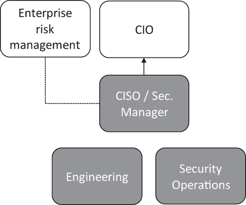

图 6.6 IT 安全。

最高级别的安全组件，如公司目录、强身份验证技术和系统、应用安全概念和标准等，属于其职责范围。安全工程师被系统地要求参与 IT 项目以支持。安全风险在 IT 风险的背景下进行管理。合规性方面在 IT 特定项目中的处理方式与所有其他开发或变更项目相同。

安全经理可能持有 `CISO` 头衔，即使它不是真正的 C 级。他们直接向 `CIO` 汇报，可能负责工程或安全运营团队。在某些配置中，他们是 IT 管理委员会的成员，并参与技术发展的决策。`CISO` 在被问及安全相关技术外，在 IT 之外极少接触。他们可能作为安全风险专家与企业的风险经理建立职能关系。他们向 `CIO` 和其他 IT 经理提供建议，但不属于公司战略委员会的一部分。

#### 企业级安全

如果一家公司愿意将安全提升到战略层面，并像对待 IT 一样作为合作伙伴纳入解决业务需求的范围，那么我们称这种组织为企业级安全。IS 功能（包括关注风险和治理的部门）有助于创造业务机会。安全旨在支持业务部门，积极关注其需求和技术，就与新机会相关的安全风险担任顾问，并主动贡献力量，以解决与合规相关的问题，例如个人数据保护（数据隐私）。

这样的安全组织积极处理策略、业务机会背景下的主动风险管理、架构、合规性、各层级的意识计划、治理需求的报告和指标、策略以及与业务部门的积极沟通（图 6.7）。


图 6.7 企业级安全。

此类组织中的安全团队向 `CISO` 或 `CSO` 汇报，后者在 IT 之外担任真正的 C 级职位。`CISO` 向 `CEO` 或首席风险官 (`CRO`) 汇报，并在公司层面拥有权威和可见性。他们处于战略委员会，并管理涵盖整个组织安全计划的预算。

正如上一章提到的，这样的组织可以将其他安全领域结合在一起，例如物理安全、人员安全和业务连续性。它还可以负责大规模项目，或指导大型公司不同地理地区的安全团队。

#### 分布式安全

在大型组织中，出于成本、运营效率以及让专业知识更贴运营的考虑，建立分布式能力中心的安全组织通常是更好的。这种组织涵盖了前面提到的企业级安全的特征，但安全团队留在各个业务部门中，采用矩阵式组织并在 `CISO/CSO` 与当地官员之间建立汇报关系（图 6.8）。


图 6.8 分布式安全。

这种形式的组织在当前背景下可能是最自然且现实的。通过委员会或治理机构进行强有力的治理，可以补偿安全团队中直接 `CISO` 权威的某些损失。然而，这种配置不仅需要高水平的治理成熟，还需要在内部监管框架内正式形成安全文化。

### 安全技能画像

未来需要哪些技能？受新技术、新业务模型和更严格的法规的影响，安全组织在未来几年内将发生变化。因此，回顾一些在不同安全组织中肯定需要的技能是有帮助的。

每种安全组织都需要多种技能。首先，需要定义安全组织的结构模型，然后确定可能缺失的技能以及如何重新定义每位员工的角色。需要在技术技能、风险管理专业知识、威胁和漏洞领域的预判能力、对业务前景的兴趣、沟通技能等之间找到良好的平衡。如果安全组织的成熟度需要向与业务部门和战略更对齐的方向演进，则必须在安全团队中灌输客户服务文化。

审视或建立适当的安全组织并不容易。因此，将所有利益相关者纳入讨论并将此任务视为一个公司项目或倡议是重要的。以下是目前认为至关重要的某些画像，注意多个功能可以由一人担任。

#### 安全管理员

#### 安全工程师
安全工程师根据向其提交的规范寻找最佳的技术（可能包括组织层面）解决方案。他们关注标准的质量以及所实施解决方案的效率和灵活性。在技术解决方案方面，他们的角色与安全架构师有所重叠。他们通常对业务的理解并不十分广泛。在选择不同方案来保护数据和基础设施时，这种类型的人才作为业务和 IT 领域的顾问非常受欢迎。他们通常专精于某些安全技术或领域，例如应用安全、系统和数据库安全、访问管理、企业目录等。他们经常以安全解决方案顾问的身份积极参与 IT 项目。

#### 安全协调员
安全协调员作为分布式安全组织的一部分（见前文），充当不同团队之间的协调促进者。他们的主要角色是解释信息系统（IS）风险与治理、以及运营或工程之间的需求和观点差异。他们通常属于 IT 部门，但由于职责需要，他们与所有其他团队（特别是 `CISO`）有大量接触。他们主要关注政策和标准及其在业务流程中的解释和应用。此类人才在所有安全领域都拥有培训和经验，并具备良好的沟通能力。

#### 人员安全分析师
为了正确评估和处理 HR 风险，许多公司聘用经过培训的分析师进行筛选、行为研究和分析。他们关注欺诈模型和其他法律指标，以识别风险行为。

#### 具有扩展职责的 CISO
由于保护目标相似且经常重叠，公司内部信息安全、物理安全、人员安全和业务连续性之间的关系日益紧密。因此，`CISO` 可能会演变为 `CSO` 职位，负责这四个领域并配备专门团队。这通常源于公司希望建立一个集中化的管理系统，涵盖所有涉及资产完整性、可用性和机密性的领域，并实现更好的监控和报告。这显然意味着在 IT 部门之外设立一个 `CSO` 职位，且与其他企业级高管处于同一水平，直接向 `CEO` 或董事会汇报。他们与 `CRO`（首席风险官）有着特殊的联系。

#### 安全代表
安全代表是担任业务发言人，同时在风险和信息系统（IS）领域保持深厚专业知识的人。他们的主要角色是将业务和信息系统结合起来，消除信息系统是业务发展阻碍的刻板印象。他们向业务部门传达安全关注和前景，反之，向安全团队展示业务目标，从而促进两种愿景的融合（图 6.9）。


图 6.9 安全代表的角色。

他们与业务经理和 `CISO` 拥有特权关系。他们是业务方和安全方项目组或委员会的成员；他们负责特定业务的安全意识或支持会议，并确保请求的跟进。这一角色传统上由 `CISO` 承担，但正如我们以后将看到的，这取决于他们在安全组织中的职位、安全服务的成熟度，以及公司的规模。安全代表可以有不同的职称，例如安全账户经理、业务安全负责人、业务信息安全官 (`BISO`)、安全协调员等。

#### 第三方安全协调员
业务运营已不再局限于公司内部基础设施。与外包服务提供商和实施者的安全协调正成为一个主要关注的问题。在这种背景下，协调员的角色是确保符合安全规则。

#### 安全架构师
安全架构师的角色是确保上述安全的开发。他们必须熟悉业务运营，但也要对技术能力有深入了解。他们的主要角色是评估运营背景下的风险，并根据功能需求和预期的成熟水平提出安全解决方案。他们的职责范围很大程度上取决于职位。在任何情况下，他们都应该是架构委员会的成员。

#### 数据保护官
`DPO` 自然会出现在最熟悉数据保护的安全专家中。他们的主要职责是理解数据是如何处理的，并评估现有保护措施是否符合监管要求。该职位必须独立于层级结构并具有自主性，例如直接向董事会或机构汇报。也可以外包。

此处讨论的各种简介与安全团队功能之间的对应关系可以如图 6.10 所示示意。


图 6.10 新技能与安全功能。

## 6.7 结论

在新技术、新业务模式和更严格法规的影响下，安全组织在未来几年将发生变化。负责安全运营和项目管理的人也将寻求新的技能。每家公司的战略和背景将定义最合适的安全组织。在治理中发挥重要作用的决策者和董事会需要将安全组织视为实现其战略的主要参与者。

# 风险管理如何贡献于安全治理？

- 什么是安全风险管理流程？
- 为什么风险管理概念很重要？
- 如何对风险进行识别、分析、评估和处理？
- 如何呈现和监控风险？

## 什么是信息安全风险？

### 7.1 信息安全风险

根据 `ISO 31000` (`ISO 31000:2018`，风险管理——准则)，安全风险可以定义为“不确定性对目标的影响”。

影响是偏离预期的结果。它可以是正面的、负面的或正负兼有，并可以应对、创造或导致机会和威胁。

目标具有不同的方面和类别，并可以应用于不同的层面。

风险通常通过风险源（`3.4`）、潜在事件（`3.5`）、后果（`3.6`）和可能性（`3.7`）来表达。

安全风险是公司运营的一部分。其他类型的风险包括财务、法律、人员、合规、声誉等。安全风险场景和潜在影响的极多样性使得几乎不可能提供所有安全风险场景的完整清单。因此，根据其背景和特殊性，每家公司都必须设计适用于其需求的自身风险管理系统。

通过分析和处理安全风险，公司可以优化其运营成本。如果一家公司认为风险管理并非强制性，而实施标准的技术保护就足够了，那么它不仅会面临法律和监管框架提供的制裁，还会削弱其整体安全态势，无法优化与安全相关的支出，并使其面临潜在的重大损害。

遗憾的是，无法针对安全风险的后果投保保险。在某些条件下，虽然可以针对网络安全风险背景下的服务不可用或勒索的影响提供赔偿，但通常对所有场景都是不可行的。保险单通过支付费用来涵盖某些风险，但这意味着风险、其后果以及费用金额是可以定义的。由于与安全风险相关的条件和后果多种多样，没有哪些保险单能提供这种服务。

风险管理应该涵盖尽可能多的场景。如果一个风险没有被识别，并不意味着它不存在。相反，这种风险将处于默认接受，可能会导致戏剧性的后果。固有风险可以在不采取任何措施的情况下接受，但必须有意识地这样做。

董事会对会对公司承担的风险负责最终责任。首席信息安全官（`CISO`）及其团队通常负责安全风险管理，但最终批准风险报告和缓解计划的是董事会。产生的决策归他们所有。

安全风险的光谱在不断变化，许多新的风险场景尚未被识别。新的业务模式和技术变化带来了新的威胁，公司并不总是为此做好了准备。

## 安全风险管理如何贡献于治理？

### 7.2 风险与治理

安全风险管理的目标是分析和呈现风险状态，以便优先排序并改进缓解措施。通过风险管理，`CISOs` 和信息安全专业人员有机会影响决策，并增加其努力价值的可见性。遗憾的是，为了降低成本，许多执行人员同意以此为由简化风险管理。

### 示例

信息安全风险的性质和强度正在发生变化。可以参考许多信息技术（`IT`）和安全风险管理的标准、良好实践、方法、框架和工具，它们提供了带有特定指南的方法论框架。这里的目标不是介绍或比较它们。这些信息广泛可用，邀请读者自行熟悉。

为了让风险管理为业务增加价值并促进信息安全治理，应该根据以下原则建立正式流程：

1. `拥有安全风险管理政策和概念`：定义风险管理的框架和概念，并建立背景、标准和风险偏好。定义风险管理流程，明确角色和职责。
2. `识别风险`：拥有的分类风险清单，包含关于每个风险的所有必要信息。
3. `分析`：理解现有控制措施并确定风险水平。
4. `评估风险`：将风险水平与公司标准进行比较并设定优先级。确定（决定）期望的风险水平。
5. `处理未接受的风险`：识别风险处理方案并执行风险处理计划。
6. `拥有风险监控、报告和沟通系统`：为所有利益相关者建立报告和风险沟通计划。

后续将对每个原则及其实现方法进行更详细的解释。建立正式风险管理流程时，我们将依靠标准的建议，特别是 `ISO 31000` 和 `27005`。

- **OCTAVE** (Operationally Critical Threat, Asset, and Vulnerability Evaluation): Software Engineering Institute (SEI), Carnegie Mellon University, 2001. 计算机安全风险与漏洞分析。
- **EBIOS** (Expression des Besins et Identification des Objectifs): National Agency for the Security of Information Systems (ANSSI), 2010. 信息系统风险管理。
- **Enterprise Risk Management**: Integrating with Strategy and Performance, COSO (Committee of Sponsoring Organizations of the Treadway Commission), 2004, 2017。

我们现在介绍实施正式风险管理过程实用方法。

## 我们应该如何管理风险？

### 7.3 风险管理过程

让我们注意到，前面提到的标准或良好实践对于识别风险管理需求非常有用。但必须记住，该过程的首要目的是为公司设定最重要的风险措施。过程必须保持简单、易懂并被所有利益相关者接受。风险管理过程确实可能变得复杂。大型公司可以负担得起采用严格方法的费用，但大多数公司则无法承受其产生的成本。另一方面，每家公司都可以接受主要原则，使其信息风险管理过程在范围内尽可能完整。

`ISO 31000` 标准提供了一套原则、概念和实施风险管理的过程。这些通用概念使其适用于组织的风险管理需求。它还规定，风险管理必须考虑若干因素，例如公司目标、背景、结构、活动、流程、项目、产品以及特定的资产和实践。

`ISO 27005` 标准专门处理信息安全风险管理，因此它是 `ISO 27001` 和 `ISO 31000` 的扩展。其附录包含了实施该过程的建议，特别是：

- **附录 A**：定义信息安全风险管理过程的范围和边界。
- **附录 B**：资产识别与评估及影响分析。
- **附录 C**：典型威胁示例。
- **附录 D**：漏洞及评估方法。
- **附录 E**：信息安全风险评估方法。
- **附录 F**：风险修改限制。

附录的标题足够明确，不需要额外的注释。它们对于将介绍的所有步骤都极其有用。

`ISO 31000` 标准给出了风险管理的通用建议。（©ISO 改编自 `ISO/IEC 31000:2018`，经美国国家标准协会 (`ANSI`) 代表国际标准化组织许可。）

第 4 章（原则）规定了每个组织为了使其风险管理过程有效而满足的要求。

第 5 章（框架）介绍了风险管理及其整合到重要活动和功能中的框架组件（图 7.1）。这些组件可以总结如下：

- **领导与承诺**：高管理层应展示领导与承诺、对风险管理的责任以及监督。
- **整合**：在组织现有结构和背景下整合风险管理。


图 7.1 `ISO 31000` 的主要组件

- **设计**：理解背景、明确风险管理、定义角色和职责、分配资源、建立沟通。
- **实施**：风险管理的实施。
- **评价**：定期评估其有效性。
- **改进**：监控并调整风险管理。

第 6 章（过程）通过图 7.2 所示的活动描述了风险管理过程。


图 7.2 根据 `ISO 31000` 的风险管理过程

## 为什么风险管理政策很重要？

### 7.4 建立风险管理政策

风险政策描述了为什么风险管理是必要的以及将如何处理。它主要服务于两个目标：

1. 建立风险管理框架和过程。
2. 定义管理背景。

### 示例

在 `ISO 31000` 中，这些目标的第一个包含在框架中，第二个是风险管理的第一步。根据该标准，背景设定有四个关键要素：外部背景、内部背景、风险管理背景和风险标准。关于信息安全，`ISO 27005` 标准指出背景必须提到风险评估、影响和接受。

公司的通用安全政策并没有完全解释背景和风险管理过程。因此，应该制定特定的安全风险管理政策作为通用政策的补充。该政策可能有不同的名称，例如安全风险管理概念、框架或指南。

政策的制定可以从标准或良好实践中获得灵感。为了简单起见，风险管理政策应包含以下内容：

- **背景**：考虑公司的目标及其开展活动的背景（内部和外部）。对于信息安全，应提到信息及其保护的重要性。
- **风险定义（安全风险）**：什么是风险、不同类型的风险，特别是安全风险源于威胁利用漏洞。
- **目标与原则**：明确说明公司的风险管理目标，特别是如何实现这些目标。
- **范围**：定义政策的范围，无论是功能性的还是地理性的。还应提到其持续时间。
- **法律层面**：政策将涵盖的法律和法规依据。
- **框架**：澄清风险管理活动如何流转，并说明流程和负责人。
- **风险分类**：为了监控、聚合/合并和报告目的的风险分配。
- **风险偏好**：以定量或定性的方式表达公司愿意承担的风险水平。风险态度表达了其是否愿意面对某些风险，如果是，则如何应对。它对定性和定量标准提供了精确定义。

### 示例

定性标准包括此类表述：“只有当风险管理过程允许新风险维持在董事会定义的认可水平内时，公司才参与新活动。”

定量标准意味着此类表述：“只有当风险管理过程允许将其风险维持在由概率和影响阈值定义的‘中等’水平以下时，公司才参与新活动。”

如果公司能够计算由于某些风险发生导致的所有损失（运营损失），那么它就可以在风险不再被接受的地方设定阈值：

```


如果损失/总收入的比例 >x%，则该风险将不再被接受。


# 风险管理中的角色与职责

应当定义每个组织单元的角色和职责：特别是董事会、业务部门负责人（职能、地域和公司）、控制和审计机构、负责运营风险管理的团队、各种决策委员会、`CISO` 以及信息安全团队。

## 风险管理流程

定义流程能够使公司更好地治理风险管理活动。应当描述每项活动的职责、目标和预期结果。沟通由一套报告体系组成，必须提到其目标、内容、呈现方式、接收者和发布频率。

## 文档与风险属性

风险文档涉及风险的呈现方式（例如清单、风险地图）以及与每种风险相关的信息（见后文）。

## 评估方法与风险矩阵

其目标是定义如何评估风险，特别是在给定范围内概率或发生频率的计算、影响类别以及风险值的计算。

### 示例

如果公司选择按照以下公式分配风险值：

`Value of risk = Likelihood × Impact`

| 概率程度 | 影响程度 |
| :--- | :--- |
| 1—罕见 | 1—低 |
| 2—不太可能 | 2—轻微 |
| 3—可能 | 3—中等 |
| 4—可能 | 4—主要 |
| 5—几乎确定 | 5—极端 |

那么可以根据其值对风险进行严重程度分类：


并在以下矩阵中可视化：


## 特殊情况的考虑

公司必须指定其希望如何处理某些风险或事件：例如，具有极高影响但概率极低的风险、高风险、被视为主要的风险（顶级风险）等。

## 有关风险管理流程的特定说明

策略中可以设定非常明确的标准，以帮助经理和风险官决定如何处理特定的风险案例。

### 示例

公司可以规定何时接受、避免、减少或转移风险。

要求以某些方式对事件进行分类有利于全范围的整合。通过在事件管理（泄露、损失、错误、故障、欺诈等）中建立标准和分类法，将能够更好地评估现有的纠正措施、应对趋势变化并进行沟通。

还可以建立评估矩阵的呈现标准以及概率和影响计算的标准（见风险评估章节）。

# 如何识别、分析、评估和处理风险？

## 7.5 风险识别

风险识别旨在实现以下目标：

- 识别威胁和漏洞、潜在影响区域及其性质，以及风险事件的原因和情况。
- 建立可能影响公司实现其目标的风险清单或列表。
- 确定风险之间是否存在相关性（依赖关系）。

风险识别不仅应在定期风险审查期间进行，还应对每个新项目、变更请求、新合作伙伴或供应商的整合、战略变更等。在这一步骤，知道要保护哪些资产至关重要（见第 11 章资产管理）。

首先，必须识别所有事件和情况……有两种基本方法：自上而下和自下而上。

### 自上而下方法

在自上而下的方法中，我们从已知的威胁和漏洞开始。有很多方法和工具可用。例如，`ISO 27005` 提供了风险识别的示例。

### 示例

`ISO 27005` 包含了风险识别的示例。

### 自下而上方法

在自下而上的方法中，我们根据经验识别风险。许多标准为此提供了示例。

## 风险分类

正式的分类法允许公司将性质相似的风险分组并对其进行更好的分析。可以使用之前介绍的标准来实现，例如：

- 针对金融行业的 `Basel III`
- 针对软件开发的 `SEI`（软件工程研究所）
- 针对信息安全的 `NIST 800-30`
- 针对 IT 风险的 `ISACA`

然而，出于实用考虑，将这些建议作为起点有时更为谨慎。

### 示例

分类的示例无数。以下是一个一级分类：

1. 盗窃或欺诈（内部、外部）
2. 数据泄露（包括数据或移动设备丢失）
3. 安全系统不合规
4. 基础设施或服务不可用
5. 机密性和数据保护
6. 人为风险
7. 业务连续性和服务可用性
8. 流程与组织
9. 运营错误

在这种分类中，网络安全风险被分为几类：网络安全、访问权限等。在这种情况下，之前提到的风险应细分为：

- `外部恶意人员访问未授权数据`（在网络安全类）
- `内部恶意人员访问未授权数据`（在访问权限类）

利用审计和专业机构的专业知识：审计机构和安全咨询公司可以帮助制定初始风险清单或风险场景清单。许多专业协会也会为其成员发布该领域的良好实践。这有助于识别大多数风险。

利用关于安全领域趋势的研究：这些研究由专业机构发布，并对安全风险提供了深刻的见解。许多对公司目标或结果产生影响的事件可能被识别为风险。

## 风险的分离与聚合

在识别风险和整合清单的过程中，最大的问题之一是不同风险水平的混合以及风险的重叠。

风险水平可以定义为使用威胁和漏洞场景描述风险时的详尽程度。大量的风险难以管理。建议在最高水平上对风险场景进行聚合，只要能够提出相应的指标来评估其发生的概率和影响。事实上，级别越低，越容易找到良好的指标。必须在“拥有许多易于衡量的风险”与“拥有少数在治理层面易理解但难以衡量的高级风险”之间进行权衡。

风险重叠意味着若干项风险在威胁、漏洞和潜在影响方面是相似的。这种情况增加了风险分析和处理的复杂性，并且没有提供所需保护的额外信息，因为相同的控制措施以不同的效率作用于不同的风险。

### 示例

风险“1. 因疏忽导致的数据泄露”包含了许多场景，并可以细分为以下较低的风险：


这是风险识别过程中自上而下分析的结果。“1. 疏忽导致的数据泄露”风险级别非常高，可以被视为类别而非单一风险。较低级别的两个风险 `1.1` 和 `1.2` 分离得很充分，并且将具有不同的关键风险指标（`KRIs`）。风险 `1.1.1` 和 `1.1.2` 可能是同一个风险的两个场景，它们的分析对于应部署的控制措施不会带来任何新信息。风险 `1.2.1` 和 `1.2.2` 存在重叠，但由于它们可以关联特定的指标（业务数据泄露事件），因此很有价值。在这种情况下，保留这两个场景中的一个更好。

因此，我们可以减少（优化）清单中所包含的风险数量，保留以下三个风险，它们都将归类在“疏忽导致的数据泄露”类别下：


## 风险描述

每个已识别的风险通过若干属性进行描述，这些属性将用于分析、评估、处理和监控过程。清单中包含的所有风险应使用相同的属性类别。表 7.1 列出了许多最常用的属性。

**表 7.1 风险属性**

| 属性 | 内容 |
| --- | --- |
| 分类 | 根据所选分类法划分风险类别 |
| 名称 | 指代事件或情况的短句 |
| 描述 | 对风险的明确描述 |
| 目标 | 可能受风险影响的资产、物理位置、目标或流程 |
| 后果 | 风险发生时潜在影响的描述 |
| 固有风险 | 在没有现有控制措施下的风险评估 |
|   发生概率 | 在给定时期风险发生概率的估计 |
|   影响水平 | 对影响的估算 |
|   量值 | 根据风险评估方法计算的值 |
| 控制措施 |  |
|   现有控制措施 | 旨在减轻风险的现有控制措施列表 |
|   控制效率 | 每一项控制措施针对特定风险的控制效率 |
| 剩余风险 | 存在现有控制措施下的风险评估 |
|   发生概率 | 在给定时期风险发生概率的估计 |
|   影响水平 | 风险发生时影响的估算 |
|   量值 | 根据风险评估方法计算的值 |
| 关键风险指标 (KRI) | 用于衡量风险和影响的指标 |
| 措施 | 当风险被认为不可接受时采取的措施 |
| 计划风险 | 考虑现有控制措施后的风险评估 |
|   发生概率 | 在给定时期风险发生概率的估计 |
|   影响水平 | 风险发生时影响的估算 |
|   量值 | 根据风险评估方法计算的值 |
| 风险所有者 | 对风险负责的个人或团队 |
| 截止日期 | 风险降低至预期水平的日期 |

风险识别过程不应是一个一次性的工作，而是一个迭代过程，因为无法保证在第一次尝试就能发现所有风险。此外，许多风险经理认为自己独自负责识别和描述风险以及减轻影响的控制措施。其他人也应该参与，特别是业务代表，通过采用自上而下和自下而上的方法，确保风险清单尽可能包含高级且可衡量的风险。

## 7.6 风险分析

风险分析目的目的。它可以实现风险发生后的影响评估、给定时期发生概率或频率的估计，并汇总对风险进行定性的指标。从治理的角度来看，风险分析的目的是为处理风险提供足够的要素。

对风险价值产生负面影响的因素是暴露资产的威胁。降低风险的因素包括公司为保护资产、应对威胁和减少漏洞而实施的所有控制措施。风险价值是两个极端之间的平衡点（见图 7.3）。


**图 7.3 风险价值。**

分析风险是为了让董事会和管理层了解可能性以及建立适当保护的必要性。对于风险经理来说，特别困难的任务是解释如何根据许多影响因素计算风险的价值。管理层习惯处理绝对数字：营业额的增加或减少、利润率等。他们还期望获得安全风险演变的清晰指标，特别是想知道这些指标是如何计算的。问题不在于是否存在安全风险，而在于能够证明其价值是如何计算的。当尽管有了投入但风险水平保持稳定时，任务变得复杂。我们知道这是由于在一段时间内威胁或漏洞的负面演变，但如何用真实的 `KRI` 来解释呢？

对不可能的风险管理增值（尤其是风险分析）的怀疑态度，应该通过简单易于理解的风险衡量方法来反驳。由于风险分析不可避免地会影响重大决策，因此它不能保持主观性。因此，依赖一些事实性指标是关键的，尽管涉及许多专家这一事实本身可能提供了足够的客观性保证。即使是不完善的，简单的安全风险评估模型也能提供一种共同语言，并引发大量贡献者的讨论，最终将产生可用于决策过程的信息。

### 风险发生的概率

事件发生的概率可以通过其在一段时间内的潜在发生次数来表示。例如，如果某类型的事件每周发生一次，那么可以说它很快发生的概率很高。

### 示例

根据相关事件的频率评估风险的发生概率。

| 概率 | 几乎确定 |
| --- | --- |
| 几乎确定 | 每周 |
| 可能 | 每月 |
| 有可能 | 每年 |
| 不可能 | 1 - 5 年 |
| 罕见 | < 5 年 |


评估安全风险发生（或与风险相关的事件）概率的主要困难恰恰在于发生次数的缺失。我们知道它可能发生，但无法根据之前的发生情况推断其概率。例如，即使我们的 Web 服务器没有受到拒绝服务（`DOS`）攻击，我们也知道这种风险存在，但不知道它的概率。尽管如此，提供一个估计是至关重要的。高级持续威胁（`APT`）入侵或内部欺诈的概率是多少？

在信息安全领域评估事件发生的概率本质上意味着依赖外部数据、供应商或咨询公司的统计数据、专业报告或与相似行业的接触。因此，我们提出了一个评估安全风险事件概率的量表，如表 7.2 所示。

**表 7.2：估计安全风险概率的标准**

| 概率 | | 内部或外部观测事件的频率 |
| --- | --- | --- |
| 几乎确定 | 5 | 每年或每月发生 |
| 可能 | 4 | 在过去一年内发生过且将发生 |
| 有可能 | 3 | 在我们或其他组织中至少发生过一次 |
| 不可能 | 2 | 在组织内从未发生过 |
| 罕见 | 1 | 可能发生但迄今尚未发生 |

显然我们可以使用任何量表，但尽可能接近公司对其他类型风险的标准是非常重要的。我们甚至可以采用与公司其他运营风险相同的量表，并说明这些事件在内部和外部都被观测到。

### 风险影响

风险具有不同类型的影响。我们可以局限于财务影响，也可以考虑其他类型，例如声誉、人员、法律或监管影响。与概率一样，影响的估计可以采用 1 到 5 的量级。图 7.4 显示了一个具有四种不同风险影响尺的风险矩阵。风险值使用公式 `Value = 概率 × 影响` 计算。


**图 7.4：不同标准的风险矩阵示例。**

#### 控制的有效性

风险可能在控制部署之前或之后被观察。固有风险是应用控制后的风险状态。剩余风险是寻求的风险水平。控制作用于降低概率（例如入侵检测）或作用于漏洞（例如加密）。一个 100% 有效的控制系统会将风险降低到 0。相比之下，完全无效的控制对固有风险没有影响。因此，如果我们能够确定控制的有效性，风险计算可以如下：

`固有风险 × (1 - 有效性)`

### 风险分析的定量方法

许多书籍专门用于介绍风险分析的定量方法。我们不打算在这里介绍它们，因为这不是我们的目标。尽管如此，让我们提一下信息风险因子分析（`FAIR`）方法[Measuring and Managing Information Risk: A FAIR Approach, Jack Freund, Jack Jones2015]。`FAIR` 方法背后的通用思想是提出一种将风险分解为因素的方法（`FAIR` 本体论），然后通过衡量这些因素来量化风险。`FAIR` 本体论“通过描述构成风险的因素及其关系，表示风险运作的模型。这些关系随后可以用数学方式描述，从而允许我们根据这些因素的测量和估计来计算风险”。

如果我们假设分析风险是为了告知决策者未来的潜在损失，那么风险就可以分解为若干因素，如图 7.5 所示。

**图 7.5：FAIR 本体论。**

根据同一来源，因素定义为：

- 损失事件频率：在给定的时间范围内，由于威胁主体的行为导致损失实际发生的可能频率。
- 威胁事件频率：在给定的时间范围内，威胁以可能导致损失的方式发生的可能频率。
- 接触频率：在给定的时间范围内，威胁主体与资产接触的可能频率。
- 动概率：一旦发生接触，威胁主体对资产采取行动的概率。
- 漏洞：威胁主体的行为导致损失的概率。
- 威胁能力：威胁主体的能力。
- 难度：威胁主体必须克服的困难程度。
- 损失规模：事件导致的主要和次级损失的可能规模。
- 主要损失规模：直接由事件导致的主要利益相关者损失。
- 次级风险：由于次级利益相关者对主要事件产生反应而导致的主要利益相关者损失暴露。
- 次级损失事件频率：具有次级影响的主要事件百分比。
- 次级损失规模：与次级利益相关者反应相关的损失。

### 7.7 风险评估

通过应用基于 `KRI` 定义的风险偏好标准和阈值，对风险进行评估，以确定剩余风险的可接受性。在风险评估期间，应考虑所有的风险影响，即使是超出负责评估的实体边界的影响。有时，这需要补充调查。

# 从治理的角度来看，风险评估应为采取的行动提供所需的信息。为了确保委员会、董事会或管理层能够正确解读风险价值和潜在影响，风险人员提供评估风险所需的所有信息是至关重要的。

### 示例

在管理安全风险通用策略或概念中，公司定义了一种根据可能性和影响来评估和展示风险的方法。它还定义了阈值，将风险分为四类：低、中、高和极高。高或极高风险将优先处理。

公司的风险管理策略规定：“所有高和极高风险都应立即向首席风险官报告，并包含提交给董事会的报告中。对于高风险，必须在三个月内提交修复行动计划。在任何情况下都不接受极高风险，必须立即采取行动并制定详细的处置计划。`CISO` 负责提出行动建议并跟进。如果极高风险无法降低，则维持风险活动的决策权在董事会手中。”

风险评估方案根据风险值或严重程度展示如下：


对于高风险，公司将采取减轻其影响的策略。

对于高风险，公司将采取减轻其影响的策略。

对于高风险，公司将采取减轻其影响的策略。

对于高风险，公司将采取减轻其影响的策略。

### 7.8 风险处理

在识别、评估和确定优先级之后，风险处理将考虑所有选项。

### 7.9 报告、沟通与风险监控

为了完成风险管理流程，监控风险的演变和行动计划、以事实为基础进行沟通并为利益相关者和负责风险评估的委员会编制报告至关重要。

| 资源缺乏 || 中等 | ↗ | 关于实现风险缓解目标所需的资源可用性的说明。 |
| || || | |

## 风险映射

“风险映射”（Risk mapping）一词通常意味着按照前述提议，对所有风险及其属性进行表示。它是一种以紧凑形式表示所有风险及其主要特征的方法。风险管理工具提供了这些映射的多种展示形式，这些形式通常可以根据每家公司的需求进行配置。最常见的形式是表格，其中每一行对应一种风险，列通常对应各项属性，如表 7.1 所示。风险状态（固有风险、剩余或预期风险）通常由三列表示：可能性、影响和水平。

## 高风险和极高风险状态

高风险和极高风险通常受到高级管理层的特别关注，因为它们是公司的优先考虑事项。可以采取不同的策略来展示这些风险，但最需要展示的是它们的演变过程以及针对其计划处理措施的执行水平。此类展示的示例见表 7.4.。`Trend`（趋势）列展示了风险的总体演变。

### 表 7.4 高风险监控示例

| 风险 || 剩余水平 | 趋势 | 关键指标 | 措施 | 状态 | 计划水平 |
| --- | --- | --- | --- | --- | --- | --- |
| 外部欺诈 || H | ↗ | • 尝试次数•遭受的损害•响应时间 | • 意识提升•修订准则•检测手段•外部协调 | 按照计划完成 60% | M |
| 第三方入侵 || H | ⟶ | • 渗透测试结果•外部统计 | • 意识提升•消除漏洞•改进预防措施 | 按照计划完成 50% | M |
| Web 服务器攻击 || H | ⟶ | • 渗透测试结果•服务器更新水平 | • 升级配置 | 延迟完成 20% | M |
| DDoS（分布式拒绝服务） || E | ↗ | • 同行业观察结果 | • 迁移至 DNS 服务商保护 | 紧急 | M |

## 热力图

为了能够展示所有剩余风险的位置，我们通常使用热力图的变体。图 7.6 所示的示例展示了风险的分布，并指示了具有相同数值的数量。如果这种展示方式伴随着对风险描述及其趋势的引用，将是非常实用的。


**图 7.6 热力图示例。**

热力图四个角的风险案例有不同的名称。这些情况应该是罕见的，但应该在风险管理政策或概念中更好地解释其处理方法，特别是那些具有潜在极端影响的情况。

## 7.10 结论

风险管理目前是一项成熟的学科。许多专业著作已致力于该领域并应当予以参考，特别是在深入了解定量方法方面。然而，对于安全风险管理，必须采取一些措施，使该过程为计划的治理增加价值：识别并合理化需要分析的风险数量；关注将证明并解释风险水平的 `KRIs`（关键风险指标）；如果可能，采用与公司其他运营风险相同的标准；并连贯地展示风险状态。安全风险管理过程是治理不可或缺的工具，必须被每个人理解和接受。它是任何安全计划的主要驱动力之一，因此是一项基础流程。

# 第 8 章

## 计划管理

信息安全（IS）治理必须基于健全的流程。首席信息安全官 (`CISO`) 提出保护措施并用日益增加的威胁来证明其合理性已不再足够。今天，比以往任何时候都更需要采取措施，确保该过程为计划的治理增加价值：识别并合理化需要分析的风险数量；关注将证明并解释风险水平的 `KRIs`；如果可能，采用与公司其他运营风险相同的标准；并连贯地展示风险状态。安全风险管理过程是治理不可或缺的工具，必须被每个人理解和接受。它是任何安全计划的主要驱动力之一，因此是一项基础流程。

安全计划活动受记录在案流程指导。为了让一个计划被所有利益相关者接受，它必须基于标准的建议或审计发现，并且必须包含在一个整合了以下目标的流程内决定的改进点：风险缓解、业务需求对接、新技术的集成、响应审计发现、提高成熟度等。如今的安全团队仍然会建立一些安全控制，但这些措施并不总是经过正当证明，或作为决策过程的一部分被正式接受。控制（通常是技术解决方案）是为了应对定义规划或架构之外的可见威胁而安装的。这就是安全项目路线图作为监督和管理工具变得日益重要的之处。

## 如何建立安全计划？

### 8.2 计划评审周期

构建一个迭代的安全计划评审周期，是激活安全管理决策的唯一途径，从而使将要采取的行动合法化。计划评审周期构成了信息安全管理体系（ISMS）的核心。

建立评审周期或良性循环显然从沃尔特·休哈特（Walter Shewhart）最初提出、爱德华·德明（Edward Deming）推广、特别是在致力于质量和持续改进的 ISO 9001 标准中盛行的持续改进“计划-执行-检查-处理”（Plan-Do-Check-Act）概念开始。我们建议一个由三个流程组成的简化周期：`Decide`（决策）、`Do`（执行）和 `Monitor`（监控），以及三个交付物：`Plan`（计划）、`Metrics`（指标）和 `Feedback`（反馈）（见图 8.1）。


**图 8.1 安全计划评审周期。**

该周期的主要组件描述如下：

*   **Decide（决策）**：`Decide` 过程包含了针对特定计划目标的所有决策步骤。目的是根据 `Monitor` 过程提供的要素，建立或验证一系列议程或改进项目的路线图。
    主要参与者是治理机构和 `CISO`。治理机构可以采取不同的形式，例如优先级委员会、安全委员会或其他。他们必须拥有决策、确定议程优先级和分配资源的权限。

*   **Plan（计划）**：`Decide` 过程的结果是下一阶段的 ISMS 业务计划。`Plan` 主要由两类项目组成：
    - 维护或加强控制及风险处理的项目（`Maintain`，维护）
    - 提供新服务的项目（`Change`，变更），例如策略所需的项目（见后文）

*   **Do（执行）**：`Do` 过程根据 `Decide` 过程中确定的目标执行 ISMS 计划。这不仅包括策略中列出的项目或计划，还包括改进当前流程和控制、财务目标或任何与安全计划相关的目标。
    实施计划的主要参与者是 `CISO`、安全团队、信息技术（IT）运营和管理层，以及参与安全控制的所有员工。

*   **Metrics（指标）**：该过程的结果将使用指标和关键绩效指标（`KPIs`）进行评估，并将有助于 `Monitor` 过程中的观察。指标用于报告。

*   **Monitor（监控）**：该过程包括监督、评估计划结果以及编制将在 `Decide` 过程中使用的报告。它汇集了决策所需的所有要素。使用指标进行评估并向决策者报告主要是 `CISO` 及其团队的责任。

*   **Feedback（反馈）**：由用于决策的报告组成：
    - 战略计划达成情况的报告
    - 风险报告（及处理计划）
    - 成熟度报告（及改进计划）
    - 路线图或项目进展的报告

### 示例

治理机构已决定将某些安全职责转移给业务部门（参见第 4 章“策略”中的示例）。在 `CISO` 的指导下制定了一项计划；随后开始实施，导致了某些控制的修改，特别是与身份和访问权限管理以及某些异常授权相关的控制。用于衡量实现程度的指标将是通常用于监控项目进展的指标。还可以衡量此类变更中的运营效率，特别是负责管理访问权限的团队负载的减轻。这些 `KPIs` 将作为 `Monitor` 过程中产生的报告的一部分。在下一次计划评审中，治理机构将能够决定是否继续执行这一策略。

在此，应当指出，只有当新的安全项目具有处理风险的需求、改进安全态势或流程成熟度、响应审计发现或实施战略计划的合理性时，才能启动。ISMS 不仅仅是一组操作控制。它本质上是一种持续改进的系统化方法，以确保公司资产得到最佳保护。可以使用包含开发 ISMS 及其评审周期所需的良好实践的 ISO 27001 标准。在开发安全计划时，应考虑该标准倡导的以下关键原则：

*   安全组织背景（策略和战略对齐）
*   ISMS 框架内的管理支持和组织架构
*   政策和法规框架的重要性
*   风险管理：识别、评估和处理
*   基于风险分析的计划和目标设定
*   资源的提供
*   意识与沟通
*   控制的建立与管理
*   性能评价
*   持续改进和不符合项的管理

前述的安全计划评审周期涵盖了《信息安全管理体系要求》中包含的 ISO 27001 建议。附录 A——参考控制目标和控制——中包含的控制目标，更具体地涉及到作为 ISMS 一部分的控制措施，并体现在后文将讨论的控制目录中。

参考三级控制框架（`TLCF`）模型，这些构建模块提供了建立 ISMS 所需的所有要素（见图 8.2）。


**图 8.2 计划管理使用其他构建模块的输入。**

以下讨论了其他构建模块如何对计划管理贡献：

*   **Strategy（策略）**：战略目标和议程是 `Decide` 过程中决策的基本组成部分。为计划确定的优先级必须考虑这些目标。
*   **Policies（策略）**：法规框架为安全计划设定了要求。其文件包含了必须遵守的规则以及如何实施控制的说明。
*   **Organization（组织）**：计划管理包括定义治理机构、委员会、`CISO` 及其团队、IT 以及所有其他利益相关者的角色和职责。职责必须在 `Decide`、`Do` 和 `Monitor` 三个过程中进行定义。
*   **Risk management（风险管理）**：管理过程突出了对公司资产的主要危险。这使得在计划内加强控制成为可能。
*   **Reporting and oversight（报告与监督）**：该模块的活动（产生 `Decide` 过程中所需的所有报告）也是 `Monitor` 过程的一部分。
*   **Asset management（资产管理）**：资产管理控制通过对风险管理过程的贡献，间接参与计划管理。了解受保护资产、相关职责及其分类是安全计划内任何决策不可或缺的来源。

## 合规性

`Compliance` 块提供了所有的差距分析以及用于填补差距的补救建议。它涵盖了外部和内部监管框架。审计发现也是该块的一部分。

## 指标与 KPI

作为 `Monitor` 过程的一部分，提供报告所需的所有指标。

让我们更仔细地看看实现务实的 ISMS 评审周期所需的工具。在管理该计划时，哪些是核心工具？

## 8.3 安全计划的核心工具

最后，一个安全计划由什么组成，它的主要工具是什么？在第 2 章中提到，控制集可以以不同的方式分类，特别是按照 `TLCF` 模型提出的三个责任级别。安全标准采用了不同的方式来呈现安全控制的完整体系，并辅以分类。安全计划中还包含其他元素，包括所有的治理和管理活动，这些活动也可以被视为控制。因此，一个安全计划由所有的安全控制组成。安全计划或 `ISMS` 的管理涉及建立并不断改进一套适应公司需求的控制体系。

每家公司已经都有一个 `IS` 计划。我们需要了解的是它是否适应公司的需求和背景，如果不适应，该如何改进它。第一要务是咨询标准，以确保已以某种方式考虑了它们的要求。`ISO 27001/2` 标准可能是验证计划完备性的最佳来源。

如果我们仔细研究标准中关于安全计划评审周期的建议，它们都强调了以下四个核心组成部分：

1. 规划改进
2. 识别控制措施
3. 评估结果的指标或指标
4. 用于规划的报告

因此，我们可以将计划 (1) 和控制目录（或清单）（2) 视为安全计划的主要工具。后续将给出更多细节。指标 (3) 和报告 (4) 将在相应的章节中详细讨论，在此不再展开。

### 计划

计划体现在项目路线图中。该路线图的作用是促进理解优先事项，并为有关改进控制和实施变更的决策提供支持。一个易于理解且作为安全计划评审周期的一部分进行评审的路线图是治理的主要工具之一。属于计划的项目可以根据它们为控制措施带来的改进类型进行分类：

1. 旨在维护现有控制及其有效性水平的项目（“维护”项目）
2. 旨在引入新控制措施的项目（“变更”项目）

“维护”类安全项目通常不会引入对所用架构或技术的更改。它们旨在维持保护水平，或为了更好地应对不断演变的威胁或漏洞带来所需的改进。另一方面，“变更”类项目会引入新的控制措施或重大变更。这些可能包括为了满足新需求的控制措施、新技术的引入、架构变更或新的保护领域。这两类项目的起源如下（见表 8.1）：

**表 8.1 安全项目类型及其驱动因素**

| 类型 | 起源 |
| --- | --- |
| 维护 | 审计发现、风险处理、合规差距、事件、威胁或漏洞的演变、渗透测试结果或弹性测试结果 |
| 变更 | 新技术、业务策略、业务模式、立场变化、系统变更、成熟度差距 |

“维护”类安全项目通常不会引入对所用架构或技术的更改。它们旨在维持保护水平，或为了更好地应对不断演变的威胁或漏洞带来所需的改进。另一方面，“变更”类项目会引入新的控制措施或重大变更。这些可能包括为了满足新需求的控制措施、新技术的引入、架构变更或新的保护领域。

安全项目的路线图是通信的重要元素。它可以以不同的方式呈现，但需要包含以下信息：

- **请求来源**：请求的来源使项目具有背景化。
- **描述**：简短的描述有助于理解项目目标。
- **规划与依赖**：图表化的表示易于理解与其他项目的依赖以及截止日期。
- **结果**：应对对项目的结果或交付物进行总结。

**示例**

- **来源**：战略计划。
- **描述**：用于内部和逻辑访问的智能卡。
- **依赖**：应用层身份验证系统的适配。物理访问点的控制适配。
- **结果**：员工方便访问应用程序和场所。节省员工时间并减少 10% 的密码重置支持时间。通过引入强身份验证降低内部欺诈风险。与保护敏感数据的最佳实践和法规保持一致。

路线图的展示示例见图 8.3。


**图 8.3 安全计划的项目路线**

### 控制目录

良好的治理需要了解保护措施、安全专员的活动和日常关注，以及目标和改进计划。问题在于如何呈现 `ISMS` 背景下建立的所有控制措施，以便治理和所有参与制定或修订安全计划的人员使用。

我们将控制目录或控制清单表示提供所有安全控制信息的工具。在提出设计此类目录系统方法之前，让我们先回顾其主要目的和特征：

- **计划管理**：如前所述，安全计划或 `ISMS` 的管理主要涉及调整已有的控制（维护）或新控制的演变或引入（变更）。了解影响，特别是计划项目将作用于哪些控制以及出于什么目的，可以确保更好地管理、规划和实施资源。
- **治理与管理监督**：为了了解决策的影响，治理机构必须对现有控制有概览。处理风险的决策将涉及与之相关的控制措施。

## 审计

定期审计请求在许多公司都是现实。这些请求不仅来自监管机构或内部审计师，还来自希望更清晰地了解合作伙伴安全态势的客户或供应商。这些涉及安全和 IT 多个领域员工的耗时审计可以通过安全控制措施目录来简化。事实上，审计员的首要任务是发现现有的控制措施、由谁负责、特别是这些措施是否经过了测试，以及它们的成熟度或有效性水平。不同的审计员会对同一批内部员工提出相似的请求，这非常耗费时间。一个包含控制措施关键信息的目录将方便审计员的工作，并有助于减少每项审计的间接成本。

## 内部组织

建立控制目录有助于更好地理解运营安全管理领域的角色和职责。每项控制措施都定义了责任，这使得安全组织和管理流程更加清晰。

因此，控制目录由安全控制措施列表（或保护手段）组成，每项措施都具有若干属性，例如：

- 描述
- 负责人（人员或部门）名称
- 测试频率
- 上次测试日期
- 当前成熟度
- 预期（目标）成熟度
- 目标成熟度的说明（理由）

目录中提供的控制措施不应包含产品名称或部署的技术。这对于保持可持续性非常重要。显然，可以使用标准来制定目录，例如 `ISO 27001/2` 或 `NIST`，特别是它们如何对控制措施分类。`ISO 27001` 中提出的方法非常有趣，因为它使得开发一个相对短的控制目录成为可能。当使用标准时，公司目录规定了标准中每项建议或控制目标设置的控制属性。

### 示例

根据 `ISO 27002` 建立的控制目录格式（摘）。控制措施以两个级别（控制和控制指南）呈现。


对控制措施进行测试和成熟度衡量（详情见 `第 9 章：安全指标`）。控制指南提供了作为控制组成部分的实践细节（例如，日志是网络控制背景下的项实践）。控制目标的成熟度是控制成熟度的平均值。

在开发目录时，必须注意保持其规模较小，以便使用和维护。控制措施显然可以描述得非常详细。控制措施的粒度越细，目录越完整，但对于治理目的来说，维护和使用将越困难。目标不是详细列出信息安全（IS）领域所做的一切，而是呈现具有相同目标的连贯控制措施分组。选择所需细节程度的一个标准是参考用于风险分析和处理的控制措施。风险或风险场景越详细，需要的参考控制措施就越详细。

### 示例

如果风险或风险场景被标记为“未经授权的设备连接到网络……”，那么我们将在控制目录层级需要 `连接限制` 控制措施，以便将其与风险关联并评估其有效性。然而，如果风险涵盖多个场景并被标记为“不当的网络使用”，那么 `网络控制` 控制（11 级）就可以涵盖所有用于缓解各种 IT 网络风险场景的部署手段。

开发控制目录的务实方法可能是只呈现一个级别的控制措施，但将它们在组织安全领域中进行分组。这种方法尝试按责任领域呈现所有控制措施，这有助于理解信息安全管理体系（ISMS）。

### 示例


无论控制目录采用何种形式，都应记住其作为治理和信息管理工具的主要用途。它强化了责任制，允许监控成熟度的演进，作为风险分析的参考，并方便了审计员的工作。

# 程序评审周期在实践中是如何运作的？

## 8.4 ISMS 评审周期

正如我们刚刚所看到的，ISMS 需要在优先级管理中建立一个迭代过程。程序评审周期主要用于制定年度计划或信息安全业务计划。以下是在为信息安全计划制定年度业务计划的背景下，使用程序评审周期的示例（图 8.4）。

我们必须拥有一组报告来告诉我们安全程序的状态。这组报告可以称为安全状态，由 `Monitor` 监控过程中产生并作为 `Feedback` 反馈的一部分，由以下项目组成：

1. 风险报告，最重要的根据风险分析结果所需处理措施的规范。
2. 控制成熟度报告。该报告展示了预期成熟度与当前成熟度之间的差距，并突出了必要且紧迫的改进。
3. 项目状态报告，特别是该期间计划的完成程度。

风险报告将告诉我们需要计划哪些处理来缓解重大风险。控制成熟度报告将使我们能够根据风险缓解所需的处理措施，优先考虑控制措施的改进。最后，项目状态报告将帮助我们根据新的背景、战略变化以及下一阶段的其他强制要求，决定继续进行还是重新调整某些项目的优先级。由于资源有限，重新调整某些项目的优先级并不罕见，但这必须由熟悉项目组合的治理机构或规划委员会来完成。

编写这些报告的责任属于 `CISO` 及其团队。这些报告是使用 `Do` 执行过程中产生的指标或 `KPIs` 生成的，特别是以下内容：

- 事件和趋势
- 控制成熟度评估
- 审计发现
- 来自法律和法规框架的合规性差距
- 项目（计划的一部分）进度指标

安全策略不是固定不变的，可能会根据业务背景或其演变而改变或调整。必须在 `Monitor` 监控过程中对策略进行评审。项目状态报告必须由下一阶段的战略导向或修订后的策略进行补充。修订策略的责任属于专门为此任务组的委员会，但需要获得董事会或作为治理机构的委员会的批准。

今年目标与实际成就之间的差距在 `Decide` 决策过程中确定。将根据这一差距以及策略中提出的新需求制定新计划（或新目标）。制定计划的责任可能属于治理机构或委员会。必须确保获得新计划的支持，以便被所有利益相关者接受。

图 8.4 中的图表总结了如何使用程序评审周期及其元素为信息安全计划制定年度计划。


**图 8.4 信息安全计划的图。**

## 8.5 结论

安全治理要求安全官制定出一项保护公司资产的计划。制定计划的过程与最终结果同样重要，因为内部和外部利益相关者需要知道，缓解风险和实施安全策略是涉及决策者的过程的结果。它使他们能够通过一个涉及决策步骤的正式化过程，从识别目标到实现目标来溯源安全工作。

大多数公司已采用系统化的方法来指导安全活动。这一过程需要更正规化，通过论坛或决策委员会来管理优先级。本章介绍的少数步骤和工具可以启发安全经理和治理机构建立类似的的方法的方法，以改进安全计划管理流程。

## 安全指标

安全衡量缺乏标准并非偶然。信息安全（IS）本身没有其所属的维度或特征。公司的安全“规模”可以通过其财务影响——即成本——来衡量，但如果不衡量其他方面（利润、灵活性、增加的业务价值、资产保护等），将是不够的。这背后有几个因素，包括安全活动的多样性（从战略层面到操作层面）、无法界定其范围（技术、人员、应用、物理等）以及测量单位或被测量对象的问题。事件、风险水平、泄露、威胁、损失等对不同的人来说意味着不同的含义。

然而，衡量安全对于良好的治理至关重要。对安全负最终责任的高层管理要求包含安全充分性稳定关键点指标（KPI）的报告。公司需要一种务实的方法来监控安全防御措施的有效性，以便他们调整计划并决定安全投资，而这些投资需要通过对收益的某种定量衡量来证明合理性（解释）。监管框架也要求指标。

本章介绍了用于治理和管理目的开发安全指标的主要工具或实践。它们将用于报告、仪表板或针对治理机构的专项研究，帮助他们根据硬性事实做出决策。示例将介绍一些特定的指标。

本章还回答了以下问题：

- 为什么衡量安全如此困难？
- 可以使用哪些措施？
- 基础财务指标有哪些？
- 我们是否可以使用某些建模来估算 `ROSI` 或更好地评估变化的影响？
- 我们如何回答“我们的安全状况如何”这个问题？
- 是否有更务实的方法来衡量安全？
- 如何设定安全目标并衡量迈向这些目标的进展？
- 如何衡量操作的有效性？
- 我们如何知道安全的真实成本？
- 我们如何与他人比较？

### 9.1 为什么衡量安全如此困难？

人们普遍认为，管理层和董事会没有获得相关或所需的信息，以便他们评估安全防护的整体水平、安全投资回报率或成本效益比。安全被视为实现业务目标的手段，但不断增加的投资在高级经理中滋生了挫败感和误解。

对于“应该衡量什么来知道我们的安全状态？”这个问题没有答案，许多人认为安全终究是一份保险单单，其年度保费保护公司免受糟糕意外的影响。显然，情况并非如此。此外，公司倾向于降低保费，同时希望灾难永远不会发生，或者如果发生了，承保范围也是足够的。许多首席执行官或官员都倾向于采取这种捷径。遗憾的是，`ISMS` 不能与保险相比。保险保护许多被保险人免受有限的、覆盖范围定义良好的事故，而公司的安全则是保护单个被保险人免受无数事故，且不对这些事故的概率、影响或如何赔偿进行评估。

**示例**

由于服务不可用（由于网络攻击或自然灾害）导致的财务损失可以购买，但公司无法对客户信任的丧失、机密数据的丢失或工业机密的窃购买保险。

在安全领域，没有普遍接受的指标来衡量现有控制的充分性。事件观察（或其缺失）或检查技术安全设备生成的统计数据（例如停止的病毒数量或尝试入侵的次数）都无法对安全的充分性形成意见。在“充分的安全”下，允许发生多少事件以及什么类型的事件？如果没有观察到任何事件怎么办？这使得很难精确地衡量安全投资的有效性。

公司不共享关于漏洞和事件的数据或统计数据，因为这些信息传达了负面形象。某些案例在媒体上报道，但没有提供能够对涉及成本或被利用的漏洞得出结论的细节。对于匿名交换统计也没有通用的定义或术语。事件、攻击、损失等术语对不同的人意味着不同的含义。因此，很难比较可用数据，因为没有方法或测量校准标准。

易于获取的指标通常无法回答高级高管的问题。安全设备产生大量的活动痕迹，例如已应用的补丁、检测到的漏洞、警报、入侵尝试、杀毒工具处理的电子邮件数量、身份验证错误、系统访问迹象、权限更改等。日志管理解决方案能够关联这些痕迹，生成报告，从而确保符合法律和规范要求。然而，高级指标需要额外的努力来链接和汇总这些不同的指标。它们必须提供关于对公司有利的预期结果或改进的信息。

**示例**

为了确定投资新的身份和访问管理（`IAM`）系统是否合理，计算一段时间内进行的权限更改次数没有意义；相反，我们应该检查是否减少了延迟、优化了可用资源的使用，或减少了错误数量。

### 可以使用哪些措施？可以使用哪些不同的衡量方法？

尽管准确衡量安全很困难，但可以使用几种方法来获得务实的指标或衡量，并将在这里介绍。让我们首先提到，指标可以分为两大板块：定量指标（用通用接受的计量单位表示）和定性指标（用主观评价表示）。

**示例**

作为风险管理概念的一部分，可以根据预算的百分比设定财务损失类别阈值，正如第七章（风险管理）所示。这意味着我们能够计算风险事件的实际损失；例如，网络攻击的后果。这些是定量指标。然而，其可能性无法根据一段时间内的事件数量来计算，因为我们没有这些信息。我们随后可以根据主观估计，通过定性指标（罕见、可能、可能、可能或几乎确定）来表示它。

衡量信息安全（IS）的各种策略可分为以下几类：

-   财务指标：关注安全控制投资的财务影响。
-   建模：允许基于模型而非真实值来做出投资决策。
-   安全状态的评估（衡量）：使用各种定性评估工具，对整体安全状态或特定领域（例如网络安全、业务连续性或应用安全）的安全状态进行评估。
-   基于假设的指标：根据我们想要证明（或无法证明）的内容来指导衡量过程。
-   与标准或监管框架对比的态势或成熟度评估：一种关于与标准或良好实践基准相比的成熟度的定性指标。审计可归此类类。
-   运营指标：衡量安全活动的运营有效性。
-   目标进展指标：建立指标或关键绩效指标（KPI），以衡量实现设定目标的进展程度。
-   不同安全类别的成本分析：通常为治理提供高度相关的指标 string。
-   基准比较：允许在相似的公司之间进行衡量比较。

这些类别将在下文中进行阐述。

## 9.2 财务指标

信息安全领域的财务指标有助于评估保护解决方案的投资机会。简单来说，如果安全投资的成本低于潜在损失（固有风险），则认为投资是合理的；反之，则完全不合理。请注意，这种推理没有考虑事件发生的概率。

年度化损失期望（`ALE`）是对风险影响导致的潜在年度损失的评估。这种评估可能涉及所有风险，也仅涉及某些场景。与风险一样，衡量概率存在问题（参见上一个示例）。再次提醒，如果没有对风险发生概率进行评估，单独计算 `ALE` 是没有意义的。

`ALE` 的衡量通常与总成本（`TCO`）联系在一起，其理念是比较这两个值的趋势或演变。安全 `TCO` 的计算相对容易。它包含了安全计划或信息安全管理体系（ISMS）内的所有硬件、软件和人力资源成本（另见后文成本分析章节）。`TCO` 回答了“安全成本是多少？”的问题。高级管理人员非常理解 `TCO`，他们习惯于比较收益以及包括安全在内的支出演变。

仅安全投资带来的收益（EVA）由于上述原因很难计算，但它通过观察 `ALE` 和 `TCO` 的变化来间接计算。这两个趋势都呈现在[图 9.1]。


**图 9.1 `ALE` 和 `TCO` 的预期趋势。**

安全投资的增加值可以表示为：

`EVA = ΔALE / ΔTCO`

为了使安全投资具有效益，`EVA` 应始终 `<1`。事实上，根据该公式，如果 `EVA > 1`，则安全投资（`TCO`）不足以补偿潜在损失。如果 `EVA = 1`，则安全成本仅勉强补偿潜在损失的演变。

表达的 `EVA` 可以视为安全投资回报率（`ROSI`）。存在多种工具或方法基于特定安全过程或控制的损失投资分析来计算 `ROSI`。

这些方法的主要困难在于，损失的估计必须与所有业务部门和所有部署控制的发生概率相关，这可能非常不准确。准确的计算方法需要多年的统计数据，包括事件的精确数字、其类型以及产生损失的估计。而且这还是针对直接损失的估计。间接损失（如客户损失或声誉损失）更难估计。对于企业而言，在不断变化的生产环境中，在跟上新技术步伐的同时，有效地管理如此海量的数据显然是不可能的。

由于上述原因，尝试为所有安全投资计算投资回报率（`ROSI`）非常困难，甚至是不可能的。另一方面，对于防火墙、入侵检测系统、防病毒软件等元素或孤立的技术保护设备，这种计算相对容易。在这个过程中，划定范围和识别衡量的目标是关键。

在讨论衡量领域的界定和 `ROSI` 的评估之前，理解安全控制提供的收益至关重要。打个比方，车辆制动系统的益处是显而易见的。我们可以量化故障的成本并估计 `ROSI`，其值可能会非常高。如果没有这些增加值问题的答案，我们就无法设计指标并计算 `ROSI`。

### 示例

为了计算强认证的利润或增加值，我们可以取与基于用户 ID 和密码认证相比的系统增加值的增长。这种增加值可以通过减少欺诈风险或减少负面经济影响来计算。例如，评估威胁或漏洞的指标包括轻松访问应用程序的人数增加或暴露应用程序数量增加。对于财务影响，我们可以使用专业机构的数据泄露调查成本，并在公司的特定背景下进行估计或外推。

但是，真的有精确计算 `ROSI` 吗？基于风险分析来评估其规模更为重要。我们现在将重点放在根据事件发生的概率及其影响的估计来计算 `ROSI`。为了估计事件的总成本，显然有必要知道其影响并估计修复损害的总成本。为了估计影响，我们可以使用关于损失的出版物或任意设定一个成本。也可以根据不同的报告或专门的研究来估计概率。

### 9.2.1 基于风险分析的 ROSI 计算

从应对措施中获得的收益是固有风险（未设置安全控制）与残余风险（设置应对措施后）之间的差异。如果我们认为应对措施改变了发生的概率（`P`）（例如，由于防病毒软件或入侵检测等措施，攻击发生的概率降低），则风险影响（或 `ALE`）可以如下计算：

`固有风险的影响 = 事件成本 × P (固有风险)`

`残余风险的影响 = 事件成本 × P (残余风险)`

收益可以表示为：

`收益 (EVA) = 固有风险的影响 - 残余风险的影响`

`ROSI` 则为：

`ROSI = 收益 - 应对措施成本`

因此，与管理层的讨论将围绕计算发生概率；换句话说，即如何分析风险。应该能够展示所采取的安全措施如何改变发生概率和/或影响水平。

### 9.2.2 保护能力指数

如果我们知道固有风险（`IR`）按发生概率加权的影响以及剩余风险（`RR`）按概率加权的影响，就可以使用一个名为保护能力（`PC`）的指数，其表达式为

`PC = (IR - RR) / IR`

如果该指数趋于 1，则保护能力是理想的。当剩余风险的影响非常小（或趋于 0），或者固有风险与剩余风险之间的差异很大时，这种情况就会发生。该指标背后的理念是为到位保护措施或风险缓解程度赋予一个值。如果我们知道运营成本或降低风险的控制成本，我们就能随着投资的演进，跟踪保护能力的演变。`IR - RR` 的差值代表了风险降低能力。

这引发了几点思考。首先，应该只考虑与所分析风险的影响直接相关的运营成本。换句话说，我们只需要关注能够降低所分析风险的控制。理想情况下，`PC` 将按风险进行计算。随后，可能可以将多个风险的指数汇聚成一个具有平均保护能力的指数。

通过结合控制运营成本指标和按风险划分的保护能力指数，我们能够展示一张风险地图，突出显示以下关系：`运营成本 – 保护能力`（图 9.2）。这将指出那些运营成本高但保护能力低的风险（右下区域）。


**图 9.2 根据保护能力和运营成本的风险分布。**

### 示例

分布式拒绝服务（`DDoS`）网络安全风险或通过查询使 Web 服务器不可用的攻击将通过昂贵的控制来缓解，只要发生概率或影响大幅降低，这些成本可能是合理的。在这种情况下，尽管运营成本很高，保护能力也将接近 1。该风险将位于图 9.2 的右上角。

计算机数据丢失的固有风险影响极大，但备份降低了这种可能性，因此剩余风险非常小。因此，保护能力接近 1（非常高），且运营成本较低。因此，该风险将位于图 9.2 的左上角。

我们是否可以使用建模来估算 `ROSI` 或更好地评估变化的影响？

## 9.3 建模

许多学科使用模型来代表现实，以模拟或观察系统的行为、进行“假设如果”分析，或推断决策的影响。

所有涉及新投资的变化项目其特点是：有一个增加成本的设置阶段，随后是运营阶段，其中实际成本（按单位产价值的运营成本）会减少。成本演变建模使得不仅能够视觉化预期解决方案的 `ROI`，还能在考虑初始投资的情况下可视化盈亏平衡（`BE`）点的时间范围（图 9.3）。在启动新解决方案期间，设置成本会被加入运营成本中。由于新解决方案一旦投入运行成本就会减少，在摊销项目执行成本后，经过一段时间将达到 `BE` 点。我们在这里讨论的是 `ROI` 的时间范围。


**图 9.3 建模运营成本。**

这种方法能够根据预期收益计划支出。为了使这种建模成为，预测当前解决方案（`status quo`）运营成本的演变、项目成本以及新解决方案的运营成本至关重要。因此，`ROI` 将计算为当前解决方案（`status quo`）与新解决方案之间运营成本的差值。

此类模型的另一个优势是它的模拟能力。我们可以通过改变项目成本和运营支出演变等参数，观察 `BE` 点的变化和 `ROI` 的演变。在缺乏准确测量的情况下，这将突出趋势以及 `ROI` 的置信区间（图 9.4）。


**图 9.4 ROI 的置信区间。**

许多信息项目需要盈利建模，例如建立负责运营和安全监控的团队、引入新的入侵检测系统、引入新的身份验证手段等。所有这些情况都涉及确定新旧解决方案的成本效益比。

### 示例

一个新的基于角色的访问管理系统将：

- 提高授予权限的效率
- 自动将权限传播到目标
- 按固定频率验证权限
- 为需求提供更大的灵活性

基于以下数据进行简单的 `ROI` 计算：项目成本、新解决方案的年度运营成本以及结果的年度运营成本。由于很难准确估算新解决方案的运营收益，可以进行一些假设和模拟，以获得如图 9.4 所示的置信区间。

## 9.4 衡量安全状态

安全计划态势、能力和成熟度是同义词，意味着以简洁且标准的方式呈现安全状态。回答“我们的安全如何？”的问题促使安全经理开发不同的衡量和展示工具。治理需要简单、标准化的方式来视觉化安全状态。类比来看，分析风险让我们理解“敌人”（威胁），而安全态势让我们理解“武器”（控制措施的质量）。

如前所述，符合标准并不意味着具有充分的安全。然而，不同的标准或良好实践可以在某些条件下用于评估态势。标准展示了所需的流程，但没有提出评估标准或符合性等级。也没有关于如何满足要求的建议。

### 示例

`ISO 27002` 中的控制目标 `A.8.3` 介质处理建议“防止存储在介质上的信息未经授权的泄露、修改、删除或破坏”。该标准介绍了目标和良好实践，但没有给出应如何实施的指示。这一过程在不同公司中具有不同的成熟度水平，从“不存在”到“优化”，涵盖了所有中间水平。

### 9.4.1 成熟度模型

成熟度模型通常根据数值量表对过程进行评估。可以使用国际标准化组织（`ISO`）`27001` 或美国国家标准技术研究院（`NIST`）等标准来建立需要评估成熟度的过程列表或控制目标列表。然后，成熟度模型会根据数值量表对每个过程提出评估标准。存在许多数值量表的示例，例如 `ISO`/国际电工委员会（`IEC`）`15504` 信息技术——过程评估所提出的（见图 9.5）。


**图 9.5 根据 `ISO` `15504` 的不同过程成熟度级。**

为过程或控制目标分配成熟度值的评估标准必须经过设计，以避免任意选择的风险。它们必须足够明确，而且重要的是不能有歧义。因此，成熟度模型的质量取决于为被评估的每个过程或目标所提出的评估标准的质量。`ISO` `27001` 标准中控制目标 5 “信息安全策略”的评估标准示例见[表 9.1]。

**表 9.1 成熟度评估标准示例**

| 评估目标 || 评估标准 |
| --- | --- |
| 0: 不完整，1: 已执行，2: 已管理，3: 已建立，4: 可预测，5: 持续优化 | 成熟水平 |
| 信息安全策略 || 0: 没有安全策略 1: 存在某些正式指令并已应用 2: 安全策略正式存在并涵盖整个信息系统 3: 安全策略存在，且其应用受到控制 4: 安全策略已应用并更新 5: 安全策略根据业务部门的风险和需求进行定期调整 | `2` |

支持成熟度模型的工具使得可以在多个粒度级别上评估目标，然后在最高水平上计算平均值。[图 9.6] 中的示例显示了根据受 `ISO` `27001` 启发的成熟度模型对一级控制目标进行评估的结果。


**图 9.6 表示控制成熟度的示例。**

存在多种方法或工具来衡量安全计划的成熟度，例如 The Open Group 的“开放信息安全管理成熟度模型 (O-ISM3)”或 ISACA 的“信息安全成熟度评估的新方法”。大型咨询公司也提供它们自己的成熟度测量模型。软件工程学院 2016 年的“CERT 韧性管理模型 (CERT-RMM)”允许评估涵盖安全、业务连续性和 IT 运营的韧性或确保业务连续性的能力。

成熟度模型可以作为公司内部的多层级通信工具，因为它能够证明并支持安全计划中包含的倡议。这种“为什么”的信息对于至关重要，特别是对于负责合规的团队（例如 IT 部门）。

成熟度评估的范围可以限制在公司部门或安全领域。例如，可以评估分公司安全管理过程的成熟度。我们还要注意，使用成熟度模型进行评估的过程与风险评估一样，是一个让业务领导者、风险经理、审计师或其他专家参与，并讨论和比较安全问题观点的机会。

### 9.4.2 安全指数

指数在不同领域中用于聚合其组件的指标或值。它们主要用于展示趋势（股票指数、房地产指数、价格演变指数等）。作为聚合体，它们隐藏了底层的细节。因此，尽管组成指数的两个股票价格演变相反，股票指数仍可能保持稳定。安全指数能够总结各种指标：风险、运行有效性、成本等。然而，指数只有在聚合相同类型的指标或测量值时才有意义。安全风险指数可以根据以下公式构建：

$$\text{Risk}\,\text{index} = \frac{\text{所有风险的}\text{权重}}{\text{风险}}\text{权重}}$$

其中 $权重 = \text{概率} \times \text{影响}$。当然，也可以创建其他安全指数，例如聚合不同要求的成熟度指数、网络攻击后的恢复能力指数等。

这里应该指出，无论创建何种安全指数，只有当构成它的指标基于稳定的评估标准进行定量或定性建立时，它才有意义。此外，它可以指示趋势，但无法建议改进点，必须在其组件内部寻找。例如，如果安全指数与上一个时期相比负面演变，我们必须寻找新的风险并理解它们出现的原因。

是否存在更务实的安全衡量方法？

### 9.5 基于假设的指标

平衡计分卡（BSC）是一种用于跟踪绩效并推动支持业务战略目标实施的流行工具[The Balanced Scorecard: Translating Strategy into Action, Robert S. Kaplan, David P. Norton, Harvard Business Review Press, 1996]。作为一种著名的管理工具，它为结果的建立和沟通提供了正式依据。它可用于监控安全性能，从而帮助将安全定位为与其他业务部门平等的伙伴。作为一种监控安全目标的工具，它还可以促进管理层对安全问题进行关注。

仅凭财务表现无法提供评估部门对公司合并结果贡献所需的全部信息。BSC 方法主张根据以下四个维度的目标进行基准比较：运营、客户关系、演进（学习与增长）和财务。这四个维度必须有助于支持公司的战略和愿景（图 9.8）。每个维度都关联一个核心问题，以指导用户选择将应用的目标和绩效指标。


**图 9.8 平衡计分卡的四个维度。**

安全领域的 BSC 最佳实践特别提到了目标与业务目标保持一致的重要性。早早定义的安全战略在开发衡量目标以及与之相关的指标时，应作为高层参考。战略目标可以通过 BSC 每个维度中更详细的目标来补充。以下是为安全治理开发 BSC 的一些建议。

### 运营视角：“我们如何改进我们的安全流程？”

我们将通过衡量来改进安全流程的性能，以更好地地支持业务并与公司战略保持一致。我们将衡量流程效率和相关成本。

### 客户视角：“我们的客户如何看待安全？”

我们将把目标和指标聚焦在影响内部或外部客户的安全流程上，或在支持以客户为中心的业务流程的活动上。安全运营必须被客户视为其自身成功的贡献者。

### 演进视角：“我们如何提高对威胁的反应能力，并为业务机会做出贡献？”

我们将衡量准备工作和培训水平，以支持业务演进带来的变化。在此背景下，前述的成熟度目标可能非常有用。

### 财务视角：“安全如何贡献于提高公司的财务表现？”

我们将衡量安全投资回报率（ROSI）或财务目标。由于很难直接衡量 ROSI（如前所述），我们可以关注那些提高控制措施有效性的目标，这些措施对业务流程的财务表现做出了贡献。

安全治理 BSC 的一个示例见于第 10 章（报告与监督）。

许多著作涉及了开发安全 BSC 的问题。它们包含了对 BSC 的说明和批判性分析，以及对“要做”和“不要做”的审查。必须关注目标及其相关指标的选择。没有可以建议的标准衡量方法。可以使用战略、风险分析、成熟度研究或审计发现来识别目标。目标不应过度增加，每个目标的指标数量应限制在三到四个。BSC 方法也可以用于安全组织的一部分或安全的特定领域。

## 如何衡量运营效能？

9.7 衡量运营性能

安全运营可以转化为安全计划框架内建立的控制。例如，安全运营中心（SOC）通过入侵检测技术、数据泄露解决方案、控制台或事件跟踪来监控威胁状态。运营性能可以通过图表、比例和趋势进行衡量和展示。运营效率指标可以作为风险管理和成熟度分析的补充指标。表 9.2

安全成本或 TCO（如上所述）可以是治理的一个重要指标，特别是当与其他因素相关时，例如公司总支出的演变、员工人数、风险演变、产生成本的因素等。准确回答董事会经常提出的问题“安全花费了多少？”需要考虑所有不同的实际成本。仅引用一个数字是不够的，必须对其进行解释并与其他元素建立联系，以便于清晰。

安全支出必须根据成本会计原则进行分析。为了实现这一点，每项安全支出应记录在以下类别：

- 人力、间接费用、设施、折旧（直接成本）
- 使用的内部服务（间接成本）
- 涉及的信息服务（根据提供的 IT 服务）
- 向其他部门分摊的标准

可以使用公司其他部门已经在使用的成本会计方法。这样，安全成本（支出）就可以按照相同的标准进行分析，并以管理层和董事会熟悉的格式展示。成本或支出可以用不同的方式进行分配，考虑到以后可能进行的分析目标。例如，如果我们想知道外部服务成本占总成本的比例，它们将必须记录在专门的支出账户中。然后我们可以突出以下关系或分析：

- 不同类别之间的成本分布
- 各类成本的细节和演变
- 支出与其他指标（如营业额变化、员工人数变化、威胁演变等）的对比
- 与业务或地理单元相关的支出分布
- 多年来支出的演变
- 按提供的服务领域划分的支出（IT、连续性、SOC、物理安全、IAM 等）

这里将不再讨论成本会计技术，因为有很多专门的著作介绍了这些内容。成本会计是一门允许全面或部分成本计算的学科，是企业管理的基础和主要工具。为了能够提供有意义的报告，必须根据我们想要呈现的类型来收集数据。第 10 章（报告与监督）将提供分析性成本展示的不同示例。

## 我们如何与他人进行比较？

## 9.9 标准管理

标准管理（Benchmarking）术是指比较提供相同服务的公司或其流程，以获得对潜在改进的洞察。通过产生一组量化的比较指标，有助于决策和目标的制定。比较同一行业内的公司是一项广泛的技术，深受公司高管青睐。它使得衡量和比较不同策略的结果成为可能。然而，除了比较公开财务结果外，很难在运营领域比较公司，特别是 `IS processes`，因为有关事件或保护手段的数据是不公开的。

尽管如此，仍有几种方法能够在安全领域进行标准分析。不同专业机构针对网络安全或某些流程成熟度等特定主题开展的研究或调查，包含了相关信息，使我们能够了解他人的做法。他们还拥有关于客户实践的知识库。这些数据是机密的，但它们可以提供匿名化的标准管理服务。

主题研讨会或会议也是交流和比较不同公司实践的场所。这些会议经常进行调查，并将结果提供给参与者。一些公司相互共享安全流程的信息，特别是当它们处于同一行业时。这不仅能够对战略方法进行比较和澄清，还能交流解决问题的经验。

同一行业的公司商业协会经常对其成员的实践进行研究并分享这些信息。首席信息安全官（`CISO`）论坛或协会提供了开展微调查的机会，提供有关他人做法的信息。外部审计师也提供了有关其他公司实践的信息来源。他们不能传输机密数据，但可能会在与审计发现相关的评论中回想起在其他地方观察到的某些趋势。结合某项发现，他们可能会提到公司与其他处观察到的平均水平相比如何。公司还可以委托专家开展一项关于安全服务相对于其他公司类似提议的定位的研究。

### 9.10 结论

拥有可靠的衡量和指标是良好治理的 `sine qua non`（必要条件）。安全也不例外这一规则。监管框架也要求公司在决策过程中拥有可靠的指标。

开发安全指标并非易事；它需要管理者以及负责指标开发、聚合和维护的人员投入努力，这些指标必须服务于先行的目标。最重要的是应该避免试图利用现有指标的对立方法。指标被用于在监督和报告过程中提供事实性元素，正如我们在下一章中看到的。因此，更安全的做法是使用他们能够理解的语言，通过通用的工具或方法（如财务指标、建模、成熟度或态势、基于目标或假设的指标、衡量目标进展的指标、运营指标和成本会计）来尝试回答他们提出的问题。

即使安全无法被准确衡量，也可以为了治理决策目的对其进行监控和监督。

# 第 10 章

## 报告与监督

良好的治理依赖基于指标的报告来加强安全。基于指标的报告和监督旨在展示信息安全（`IS`）的充分性、安全计划的质量以及目标的进展。`CISO` 或 `CSO` 提供的安全报告对管理层来说往往过于技术，导致他们无法在报告中找到所需内容。安全的价值往往被感知不同。对于专家来说，实施保护措施这一事实足以证明投资的合理性，而管理层希望投资的回报能用数字表达。报告方法必须调整，以用业务术语呈现安全活动，例如风险降低、投资回报率（`ROSI`）等。因此，找到一种呈现安全数据的标准方法至关重要，这将使管理层能够遵循战略。

我们在本章介绍了一种适用于管理层和董事会的基于各种指标的报告与监督方法。这些报告的开发将通过回答此类问题来指导，例如：“我们比去年安全吗？”、“我们的支出合理吗？”以及“我们应该改进哪些以及如何？”

本章提供了以下问题的答案：

- 安全报告的目的是什么？
- 战略指标是什么？
- 安全报告系统的主要组成部分是什么？
- 如何呈现安全成本？
- 安全报告和安全仪表之间的区别是什么？

### 10.1 安全报告的目的是什么？

安全的最终责任在于董事会。这就是为什么他们需要包含展示特定时期安全状态的稳定指标的报告。报告和监督的目的是为治理机构提供判断特定点安全状态所需的所有信息，并提供指导。引导安全计划的一些基本要素已第 8 章（计划管理）中介绍。作为报告和监督活动的一部分的信息有时被称为战略指标。所有这些信息不必在一个文档中提供。`CISO` 或管理层可以使用这些资源向所有利益相关者沟通安全状态：董事会、管理层、员工、客户、业务部门、通讯人员和审计师。

诸如“我们的安全支出合理？”、“我们的安全如何？”的问题不仅是合理的，而且是向良好治理演进的一部分。安全充分性的问题至关重要，是每位公司官员关注的主要问题之一。

公共统计或调查对于投资安全的需求提供的答案寥寥无，因为风险无法在公司背景之外进行评估。不准确的财务论证会损害安全性的信誉，并削弱安全团队与公司业务部门之间的关系。因此，报告应该包含各项指标，以及全球通用的衡量单位，例如成本、事件、风险、预算、策略、年度目标等。

由于安全人员越来越多地在公司更高层进行汇报，且往往在信息技术（IT）部门之外汇报（参见第 6 章“组织”），对报告的需求也随之增加。对于他们来说，了解如何向管理层解释安全投资的策略和理由至关重要，如果可能，应使用业务语言并从整体视角进行说明。他们不仅报告成本/收益，还通过阐述对组织的益处来报告更长期的战略发展轴。

高级管理人员习惯于分析公司的高级指标——损失、收益、比率、经济事件、销售目标等——以做出预测或理解特定状况。安全是基础设施或支持工作的一部分，因此他们对现有对措施整体有效性的报告或反馈更感兴趣。他们试图理解成本的演变。他们对孤立过程或组件的运营指标或 `ROSI` 计算不感兴趣。由于他们的关注点是增加收入、降低成本、改进产品或服务以及成本控制，只有当安全报告采用相同的方法和语言时，它们会被考虑：战略与职能对齐、实现绩效目标、改进或控制合规性、团队表现、创新以及为客户创造的价值。

那么，什么是战略指标？

## 10.2 安全报告系统的组成

战略指标是高级指标，或者是指标或运营指标的聚合，用于报告安全状态或管理安全计划。这些指标从不同维度向治理机构展示了信息安全状况。回答“我们有多安全？”这个问题并不容易。这就是为什么它将通过更具体的问题间接回答，这些问题的答案提供了关于安全状态的战略指标或报告要素。这些具体问题如下所示。

### 1. 策略
- 信息安全（IS）如何有助于实现公司策略？
- 战略计划进展如何？

### 2. 风险
- 我们的主要风险是什么？它们是如何演变的？
- 风险缓解计划进展如何？

### 3. 态势
- 我们的安全态势是什么？我们的保护能力是什么？
- 哪些流程/控制需要改进？为什么？

### 4. 合规与审计
- 我们的合规性缺口是什么？
- 我们正在做什么来修复它们？
- 审计发现的修复状态如何？

### 5. 计划
- 安全计划的基本原则是什么？
- 计划方案中的项目状态如何？

### 6. 治理
- 我们的治理如何？需要哪些改进？

### 7. 安全成本
- 我们的安全成本由什么组成？
- 它们是如何演变的？

### 8. 安全目标
- 我们的目标是什么？我们实现了吗？
- 下一阶段的目标是什么？

接下是对信息安全治理机构进行报告和监督所需的战略指标的描述。具体的衡量和指标将不再详细介绍，因为它们是第 9 章的主题。如前提到的，报告需求与运营指标的建立之间存在非常强的依赖关系。事实上，是报告或监督的需求定义了所需的指标。让我们再次注意，安全报告和监督可以涉及公司整体安全，也可以仅涉及某一个领域、一个地理单元或一个业务部门。当展示指标时，构成指标的所有元素或数据必须是可用的。这将提供额外的解释，使报告能够被正确理解。

### 示例

不能简单地说明自上次评估以来风险增加了。我们必须能够通过关键风险指标(`KRIs`)或事实观察来解释它，例如在类似公司中观察到的事件数量增加、威胁或漏洞的增加、新技术的引入等。

报告要素或战略指标之间是相互的。例如，正如第 8 章所示，安全计划直接依赖于策略、风险、态势和合规性。这种依赖关系以及用于阐述指标的主要指标 `KPIs` 或其他论据如[图 10.1]所示。该图显示了主要指标如何用于报告目的（从左到右）。它还显示了这些元素之间的依赖关系。换句话说，它回答了“哪些元素被用于建立安全报告的战略指标？”


**图 10.1 报告系统组件和相关指标。**

每个报告和监督过程目的是为安全系统设定目标。这些目标不仅包括改进安全计划和控制，还包括财务和治理目标。

### 10.2.1 策略

安全策略及构成策略的计划应每年审查一次（参见第 4 章）。战略计划也是第 8 章所定义的安全计划“计划”路线图的一部分。在报告框架中对计划进展进行总结（[图 10.2]）是重要的，因为这可以影响治理机构想要建立的优先事项。在提交报告时，可能会出现关于潜在延迟原因、缺乏资源甚至策略方向改变的问题。这就是为什么 `CISO` 应该随手可用的论据来解释上一阶段的项目进展。这种类型的报告将作为安全计划审查过程的一部分，特别是在第 8 章所示的“监控”活动中。


**图 10.2 战略计划进展的关键指标示例。**

### 前提

策略基于一个正式流程，该流程定义了需求、业务部门的战略导向、安全流程和控制的感知成熟度，以及改进安全计划的要求。更多细节请参见第 4 章。

### 10.2.2 风险

正如第 7 章所述，风险管理过程包括向负责风险处理计划的机构汇报。报告包含了所有风险及其属性的映射、热图、影响风险的因素表，以及自上次修订以来主要事件、趋势和变化的注释。

出出于监督或计划调整目的的报告，可以通过风险状态的简化展示来实现。在这种情况下，我们建议提供一个带有风险趋势或演变的热图，以及一个包含行动计划和进展状态的高风险矩阵（[图 10.3]）。


**图 10.3 显示高风险演变的热图和矩阵。**

这种展示突出了最重要的风险、其处理计划及其趋势。其旁边可以附带注释，特别是当注释对于理解为什么高风险呈现“负面”趋势很重要时。

### 示例

由于近几个月发生的众多事件以及同行业公司试图通过勒索索阻断服务的尝试，分布式拒绝服务（DDoS）的风险已变得非常高。解决方案是使用由域名系统（DNS）提供商提出的具有清洗（scrubbing）能力的保护方法。该解决方案在攻击者流量到达公司网络之前将其拦截。在进行此类保护之前，必须进行一项小型研究，以确定是否可以使用混合方案（这种方案可能更便宜），即继续利用本地保护工具，并结合 DNS 提供商建议的工具。

### 前提条件

为了能够生成此风险报告要素，风险管理过程必须包含第 7 节所示的处置计划制定。风险管理过程中使用的指标和 `KRIs` 将不会在报告中列出，但如果需要额外信息，可以提供。

### 10.2.3 态势 (Posture)

安全态势报告旨在引起决策者对现有保护能力弱点的关注。态势可以通过不同的方式进行评估，例如：

- 使用成熟度模型
- 通过基准研究，比较相似公司控制措施的有效性
- 强制进行外部审计

后两种方案建议用于评估某些流程（例如网络安全态势审计或评估），但不适用于重复性的报告和监督。

为了展示态势并能够以重复的方式进行重新评估，最好使用第 9 节（指标）中介绍的成熟度模型。模型的选择取决于向管理机构报告时所需的期望的抽象级别或关注点。第 8 节所示的控制措施目录可能已经包含了对当前和期望成熟度的评估。在这种情况下，在报告中使用这些数据可能更为合适。

### 示例

基于 NIST 网络安全框架（CSF）的成熟度模型展示。


无论选择何种模型来展示安全态势，都应配以支持性文件，以便更好地理解当前成熟度与期望成熟度之间的任何差异。因此，前一个示例中的合规成熟度差距可能是由于公司所在地地理区域的一项新法规导致的。

我们还会注意到，基准测试结果可能会影响成熟度评分。如果我们看看之前的网络安全示例，基准研究可能表明成熟度水平低于竞争对手，这可能会影响公司的竞争力。因此，期望的成熟度水平必须与竞争对手保持一致。

#### 前提条件

要报告安全态势，我们必须拥有流程有效性指标、控制措施成熟度评估、审计发现结果，以及可能针对整体信息系统或特定领域的基准测试。有关这些元素的更多细节，请参见第 9 节：安全指标。

### 10.2.4 合规与审计

合规差距分析已确定了修复审计发现的项目优先级。这些项目包含在第 8 节所示的项目计划中，并且是强制性的。审查这些项目或优先级不应是报告和监督的一部分，因为这是其他论坛或委员会的责任。治理报告需要的是修复这些发现的进展或可能出现的延迟。例如，可以在此处展示的高级指标包括未修复发现或延迟修复的数量与新审计发现数量相比的演变情况。`Figure 10.4` 显示了修复安全审计发现的延迟演变情况。


**图 10.4 审计发现修复的延迟。**

总结趋势的图表应始终附带注释或解释。在先前的示例中，修复审计发现的延迟可能表明资源匮乏、优先级冲突或治理层在设定目标时应当解决的其他问题。

#### 前提条件

要报告安全合规和审计发现，我们必须拥有合规差距分析指标、合规项目进展，以及审计发现和修复计划。

### 10.2.5 程序 (Program)

如第 8 节所示，安全计划由一组操作控制措施和一个带有项目路线图的改进计划组成。这些项目动员了资源，其目标必须经过合理的说明（解释）。通过该计划，安全实现了以下目标：战略倡议的部署、风险缓解、系统态势（能力）的提升、合性的强化以及实施审计要求的纠正措施。因此，报告的前四个要素，辅以控制措施有效性的指标和正在进行项目的状态，将能够展示项目组合及其状态。`Figure 10.5` 展示了项目来源的示例。


**图 10.5 展示安全计划来源的示例。**

如果某些项目由于策略、风险缓解、成熟度改进或合规以外的原因而被触发（例如确保新子公司的安全、搬迁、外包、备份中心等），也必须提及这些原因。

这里的目标不是展示项目进度，因为这是由其他委员会处理的。然而，如果计划交付过程中出现反复问题，例如由于长期缺乏资源或优先级变化导致的延迟，必须明确提出这些问题。

#### 前提条件

策略、风险、态势、合规、操作有效性指标以及正在进行项目的状态。

### 10.2.6 治理

在报告时展示治理的优缺点不仅是高成熟度的标志，也是持续改进的沟通与协调手段。第 3 节提议了三级控制框架（TLCF）模型的不同用例。因此，自评估的结果可以用于报告治理的充分性。此类分析关键点的展示示例见 `Figure 10.6`。


**图 10.6 治理自评估关键发现示例。**

#### 前提条件

要报告治理情况，我们必须根据 `TLCF` 框架拥有自评估分析，以及由董事会或管理层委托的审计发现或其他专家研究结果。

### 10.2.7 安全成本

控制安全支出的成本会计原则在第 9 节：安全指标中介绍。如果公司接受了成本分摊标准，则可以从不同维度展示安全支出。有关安全支出的数据，可能结合营业趋势或员工人数等指标，将使董事会或治理机构能够更好地分析安全成本的影响并提出调整。

整体安全成本报告可能包括以下战略指标：

- 按类别划分的成本
- 各类别成本的演变
- 与与其他指标相比的成本演变（如与营业、人数、总预算等的演变相比）
- 各业务或地理单元之间的费用分摊
- 按提供的服务划分费用（信息系统、业务连续性、安全运营、物理安全、身份和访问管理 [IAM] 等）

以下是展示这些不同元素的示例。

## 1. 按类别划分成本

直接安全成本由安全团队的活动产生。它们可以细分为人工成本、管理费用以及摊销或折旧。间接成本是归因于安全但并非由安全团队活动直接产生的成本。例如与安全相关的 IT 运营（项目、基础设施和运营）、人力资源 (HR) 服务、公司职能或通用服务。由于缺乏突出这些成本的会计方法，这些成本在公司中往往被低估或被忽视。然而，它们有时代表了重要的数字。通常情况下，100% 的间接成本都在 `CISO` 的控制范围之外，因为它们是由其他部门产生并归类于安全的。

安全成本分配的一个示例请见图 10.7。分配成本有多种方法，但应尽可能使用公司内部其他业务部门所使用的现有标准。根据报告目的，也可以展示不同程度的详细信息。因此，我们可以列出所有类别的成本；例如，人工成本可以细分为与员工工资和顾问费相关的成本，IT 服务相关费用可以细分为设置控制措施的项目成本或安全基础设施成本等。这种细分将不再进行详细讨论，因为体取决于每个组织的具体情况。


**图 10.7 安全成本细分示例。**

## 2. 多个期间的成本演变

监控安全成本趋势有助于分析这些趋势并将其与其他业务成本建立相关性分析。应对对每种重大变化提供解释。图 10.8 中的示例显示了折旧费的增加，这可能是由于实施了某个重要的安全基础设施。


**图 10.8 直接成本的演变。**

## 3. 安全成本与其他指标的演变对比

将安全成本的进展与其他类别的财务成本进行比较，通常非常有启发性。例如，图 10.9 显示了安全预算与 IT 预算的相对进展。


**图 10.9 安全与 IT 预算的进展对比。**

## 4. 安全成本重新分配到其他业务部门

可以应用成本分配键将安全成本重新分配到其他业务部门（图 10.10）。存在多种成本驱动因素来建立这些重新分配键：例如，员工人数或工作站数量，可能根据安全服务的“消费水平”标准进行加权等。


**图 10.10 内部服务消费者的安全重新分配成本键。**

### 示例

如果 `HR` 和 `General Services` 部门的人数相同，那么安全服务的成本分配键对于这两个实体可能是不一样的。由于 `HR` 是安全服务的更大“消费者”（数据保护、加密、支持等），其消费量可以使用较高的权重系数进行核算。

## 5. 按服务分配成本

安全成本也可以按提供的服务进行分配，例如对业务倡议的支持、基础设施安全、IAM、业务连续性、支持等。通过将所有安全服务细划为功能区域，并为成本分配管理提供相同的标准 KPI，就可以了解每项安全服务的成本。这在外包某些服务时（例如安全即服务 [`SecaaS]`、访问管理等）可能很有意义。因此，之前的报告示例可以原封不动地转化为按 IS 服务的成本分配。

即使安全成本并不总能与“收益”联系起来，安全成本的展示也至关重要。增值的概念极其重要，但如前所述，这种价值是通过风险处理和对战略倡议的支持被感知的。管理层知道安全带来了什么，但并不总是知道成本中包含了哪些内容。这种成本会计可以提供相关的答案。

### 前提

为了能够展示真实成本，需要安全服务的成本会计数据。对于实行成本会计的公司，只需经过微调，就能轻松根据安全治理的需求提供这些数据和报告。

## 10.2.8 安全目标

不同的报告元素或战略指标将使董事会和管理层能够评估信息系统的整体演变，并为下一阶段设定目标。这不是对计划、策略的审查，而是根据监督对所有活动进行调整。修订和设定目标的主要工具之一是信息系统平衡计分卡 (`BSC`)，如第 9 章“安全指标”中所示。由于目标具有战略性和整体性，特别推荐在监督背景中使用它。根据前述陈述，这样的 `BSC` 可以如图 10.11 所示展示。用于衡量进展的目标和指标将在报告结束时建立，并将作为所有领域调整的指南。


**图 10.11 信息系统平衡计分卡示例。**

### 前提

以 `BSC` 形式衡量目标的进展。之前的所有报告项目。

## 10.3 仪表盘

仪表盘经常与报告混淆，区分这两种方法非常重要。前述报告是审查管理实践的过程，而仪表盘主要是针对特定事件的实时监控工具。这两种方法互为补充。仪表盘通常用于跟踪运营事件，而报告则根据固定频率为审查目的准备。

安全仪表盘可以由各种指标组成，便于监控安全系统。它可能包括：

- 项目进展
- 事件演变
- 违反内部规定的跟踪
- 访问权限的统计或指标
- 按 IS 服务划分的工作负载（运营、项目、支持、调查、研究等）
- 可能影响风险评估的内部或外部事件或事故
- 调查或取证分析的数量
- 意识培训课程
- 根据预定计划的安全控制跟踪
- 威胁监控趋势

仪表盘是指标的聚合，通常只有一两页，供 `CISO` 或负责监督安全计划的委员会使用。文献中有很多仪表盘示例，我们的目标并不是进一步开发它们。图 10.12 展示了一个仪表盘示例。


**图 10.12 安全仪表盘示例。**

## [10.4 结论]

安全报告流程满足管理机构对安全监督的需求。它还作为一种通信工具，并加强了所有利益者之间的安全文化。本章介绍的少数高级指标传达了关于安全状态和计划管理的整体信息。这些指标基于第 9 章开发的衡量标准。与报告不同，仪表板（dashboards）被用作监控操作的工具。两种方法是互补的，公司可以相互使用，只要它们能为安全计划演变的决策提供必要的要素。然而，它们必须事先获得董事会和管理层的认可，因为它们将成为一种治理工具。安全报告的方法不能偏离公司为其他业务部门建立的既定标准。它必须整合到文化中，并提供相关信息以确保适当的治理。

# 第 11 章

## 资产管理

如果不能精确了解要受保护的对象或价值，就无法实现有效的保护或充分的安全。许多标准和作者都提到，在信息安全管理体系（ISMS）的背景下，制定资产清单是首要任务。这确实非常重要，尽管没有清单的公司通常也有一套保护系统。当然，由于我们稍后看到的原因，这种做法是不推荐的。良好的治理要求正式的资产管理，因为它可以优化保护系统。风险管理过程基于威胁和企业资产的漏洞。了解资产价值并决定如何保护它们是风险评估和处置的必要先决条件。策略和标准应引用机密性和敏感性资产类别，并规定在不同背景下保护这些资产时必须遵守的规则。

资产管理需要一个关键工具，那就是资产清单。在许多人看来，这种清单是一个成本高昂、资源密集型的巨大“怪物”。因此，应该务实地构建它，为业务和安全流程增加价值。此外，将 IT 基础设施或组件的清单与受保护资产的清单区分来也很重要。与风险管理一样，需要务实的方法关注核心。

本章提供了这些关键问题的答案：

- 什么是信息资产？
- 为什么管理资产很重要？
- 什么是资产清单，它的用途？

## 什么是信息资产？为什么管理资产很重要？

### 11.1 信息资产管理

根据 `ISO 55000` 标准——资产管理，资产是“对组织具有潜在或实际价值的项目、事物或实体”。（©ISO 经美国国家标准协会 (ANSI) 代表国际标准化组织许可，根据 ISO/IEC 55000:2014 改编。保留所有权利。）从信息安全（IS）治理的角度来看，资产是公司拥有的且具有价值的任何信息或访问这些信息的手段。信息资产可以以多种形式存在，例如电子数据、传输的信息、承载信息的介质（数据库、文件、服务器或移动设备）、访问这些信息的应用程序，或传输这些信息的网络。这些不同的手段也应被视为资产。因此，必须作为内容保护信息，同时将其所在的介质或访问手段作为容器进行保护。这确实是信息安全一直以来的做法，只是对不同类别或不同类型的资产关注重点或区别有所不同。为了更好地理解公司的不同信息资产，我们可以从将它们分类开始。在不自称完全详尽的情况下，我们可以区分出以下类别：

- 所有介质上的数据（数据库、纸质、办公文件等）
- 应用程序或软件（内部开发或购买）
- 硬件和设备（笔记本电脑、服务器、移动设备、USB）
- 作为信息流支持的网络
- 基础设施（作为确保信息可用性的手段）
- 人员（员工和第三方的知识）

信息安全领域的所有标准在其控制目标和控制中都提到了它。例如，`A.8` 资产管理包含了以下控制目标和控制：

资产责任 `8.1`，其目标是“识别组织资产并定义责任”，特定的控制措施包括：
- 资产清单 `8.1.1`
- 所有权 `8.1.2`
- 资产的可接受使用 `8.1.3`
- 资产归还 `8.1.4`

信息分类 `8.2`，其目标是“确保信息根据其重要性获得适当水平的保护”，特定的控制措施包括：
- 信息分类 `8.2.1`
- 信息标记 `8.2.2`
- 资产处理 `8.2.3`

介质处理 `8.3`，其目标是“防止介质上的信息被未经授权的泄露、修改、移除或破坏”，特定的控制措施包括：
- 可移动介质管理 `8.3.1`
- 介质处置 `8.3.2`
- 物理介质传输 `8.3.3`

ISO 还发布了另外三个标准，在更广泛的背景下制定了资产管理领域的原则和最佳实践。这些是：

- `ISO 55000:2014` 资产管理——概述、原则和术语
- `ISO 55001:2014` 资产管理——管理体系——要求
- `ISO 55002:2014` ISO 55001 应用指南

`ISO 31000` 和 `27005` 标准提出的风险管理过程建议从资产开始，然后识别可能被这些威胁利用的威胁和漏洞，得出公司应该实施的风险和控制。标准的其他章节，特别是与策略相关的章节，引用公司资产来定义其使用规则、责任、风险偏好、处理原则和保护措施。

在当前环境下，资产管理变得越来越重要，这不仅是因为法规的要求，还因为保护方法范式转移的必然要求。数据在公司边界外可访问的性意味着，现代保护系统应在更接近数据的地方实施，以便在任何情况下保护它们，同时保持足够的灵活性并适应业务不断变化。网络分区、蜜罐和类似的攻击隔离技术只是现代保护系统中所采用措施的一个一个示例（见图 11.1）。仅基于边界防御的安全系统已不再可行。


**资产的近距离保护。**

很多情况下，组织在调整其安全策略时，并没有进行可行性研究，也没有扩大其对资产及实际保护需求的的了解。资产往往没有根据其重要性和机密性进行分类，这使得制定安全策略的任务变得更加毫无章法。这种做法可能导致策略不匹配，并可能产生适得其反的效果。理解数据不仅仅是识别和盘点。为了制定适用的策略，组织需要了解其数据的生命周期，包括数据是如何创建的、涉及了哪些流和流程、存储在何处以及如何被销毁。这些分析通常被证明是不完全的，特别是由于对这些方面缺乏明确的责任划分。

在不同标准和专业文献中可以找到的所有资产保护建议中，有三个概念至关重要且值得强调。这些分别是：资产分类、资产保护的策略与标准，以及资产问责制。下文结合这三个概念的解释旨在有助于理解在信息资产治理和管理背景下的某些务实做法。

## 11.1.1 资产分类

我们反复提到过根据不同标准对数据和其他公司价值进行分类的重要性。从安全的角度来看，这意味着建立不同级别的资产机密性和重要性分类。机密性分类用于定义资产可见性或可访问性的不同类别，而重要性分类则主要关注其可用性和完整性。通常情况下，不同资产类别之间没有直接的相关性。“高度机密”数据可能不被视为“高度重要性”，反之亦然。

### 示例

客户的文件作为包含其所有个人数据的记录，在银行机构中被认为是高度机密的，但它可能并不非常重要（可以随时访问），因为目前的业务通常是使用与其个人数据无关的标识符或客户编号进行的。另一方面，应用程序服务器或股票交易应用程序，以及关于汇率或与第三方交易的数据将被认为对运营至关重要，即使它们并不十分敏感。

公司需要的分类级别数量不仅取决于机密性水平、可用性、完整性、法律和法规要求或对公司价值的客观标准，还取决于公司根据资产的类别和类型实施差异化保护的能力或意愿。资产分类还必须反映公司根据风险偏好以差异化方式保护资产的意愿和能力。如果不需要对“敏感”和“非常敏感”数据进行差异化保护，那么就没有必要维护这两个机密性分类。只保留一个就够了。

## 11.1.2 资产保护标准

应该根据每种资产类别和资产使用的背景定义保护措施。例如，明确在使用被视为机密的应用程序时的背景和需求，或者何时以及为了何种需求可以使用可移动存储介质是非常关键的。建议在制定策略和资产保护标准时，使用 `ISO 27001/2` 等标准作为可能适用控制措施的清单。标准在该领域提出的不同建议通常可以归为五类：数据隐藏、访问控制、资产处置、监督以及可用性与完整性保障。

1. **数据隐藏**：数据隐藏技术用于在数据丢失或被盗时使数据无法使用。它们包括加密或去敏技术，以降低数据价值，防止未经授权的人使用，并保护公司免受重大事件后可能引发的罚款或投诉。加密密钥的管理和保护在这里至关重要，必须由安全人员进行严密监督。

`ISO 27001/2` 直接适用于此保护类别的控制目标和措施包括 `密码学` (`A.10`)、`加密控制的使用策略` (`A.10.1.1`) 和 `密钥管理` (`A.10.1.2`)。

2. **访问控制**：管理访问权限的策略、标准和技术旨在将资产的暴露仅限于那些履行职责时需要访问资产的人。通过这种方式，公司可以防止未经授权的访问并降低恶意人员发动威胁的可能性。

`ISO 27001/2` 直接适用于此类别的控制目标包括 `信息安全策略` (`A.5`)、`访问控制` (`A.9`)、`业务需求` (`A.9.1`)、`用户管理` (`A.9.2`)、`用户责任` (`A.9.3`)、`系统和应用程序访问控制` (`A.9.4`) 以及 `安全区域` (`A.11`)。

3. **资产处置**：公司必须对不再需要的数据制定删除策略。这些措施旨在减少暴露在事件面前和法律投诉。

`ISO 27001/2` 直接适用于此类别的控制目标包括 `信息安全策略` (`A.5`)、`介质处置` (`A.8.3`)、`设备的安全处置或重复利用` (`A.11.7`)、`资产归还` (`A.8.1`) 以及 `可移动介质的管理` (`A.8`)。

4. **监督**：资产的使用必须接受定期监督以识别不当用法。该领域的特定措施包括监控、日志记录、日志关联、告警以及保护信息。授权人员对机密资产的使用也应受到监督。

`ISO 27001/2` 直接适用于此保护类别的控制目标包括 `信息安全策略` (`A.5`)、`日志与监控` (`A.12.4`)、`操作软件控制` (`A.12.5`) 以及 `事件管理` (`A.16`)。

5. **可用性与完整性保障**：公司资产可用且无缺陷，以确保业务运营的顺利进行。该领域的特定措施包括数据和软件备份、基础设施的可用性、灾难恢复、业务连续性和场地的可用性。事件后的恢复技术属于此类。

`ISO 27001/2` 直接适用于此保护类别的控制目标包括 `信息安全策略` (`A.5`)、`设备` (`A.11.2`)、`备份` (`A.12.3`)、`网络安全管理` (`A.13.1`)、`业务连续性管理的信息安全方面` (`A.17`) 以及 `信息备份` (`A.12.3.1`)。

因此，内部监管框架必须根据资产分类及其使用背景定义要应用的标准或保护规则。可以采用不同的方法来展示和记录这些标准。假设公司定义了三个隐私级别：

1. `机密`：仅供组织内某些人员访问
2. `内部使用`：所有员工均可用
3. `公开`：公众可访问

[表 11.1] 展示了按资产类型和机密性分类展示规则或保护标准的示例（节选）。资产类型与分类交叉单元格可能包含保护规则，或对其他处记录的相同规则的引用。这些规则（标准）必须考虑资产使用的背景，并提出要应用的保护措施。

**表 11.1 根据分类的资产规则或保护标准**

| 资产类型 | | 应用 | 办公文档 | 数据库 | 可移动介质 |
| --- | --- | --- | --- | --- | --- |
| 分级 | | A | B | C | D |
| --- | --- | --- | --- | --- | --- |
| 机密 | 1 | Rule A.1 | Rule B.1 | Rule C.1 | Rule D.1 |
| 内部使用 | 2 | Rule A.2 | Rule B.2 | Rule C.2 | Rule D.2 |
| 公开 | 3 | 不适用 | Rule B.3 | 不适用 | 不适用 |
| | | | | | |

### 示例

根据`在表 11.1`中提出的演示，办公文档（`B` 列）的机密性规则可以总结如下（简化版）：

- `Rule B.1`：分类为“机密”的办公文档必须进行系统加密或存储在受保护的文件夹中。在公司外部不得进行查阅。
- `Rule B.2`：内部使用的文档不能向外传播。它们必须保留在公司内部，存在此目的提供的文档库系统中。可以在公司外部进行查阅。
- `Rule B.3`：公开文档不得包含内部使用或机密信息。内容不应提及公司。

内部策略必须根据资产的特征或使用背景明确地建立资产分类标准。例如，包含机密数据的办公文档必须被视为机密资产，计算机服务器根据其托管数据库的分类进行分类，而应用程序则根据其所处理的数据类别进行分类。

## 11.1.3 资产管理中的角色与职责

对资产的正式责任划分是良好风险管理的保障，并根据策略中建议的风险偏好和措施设置了适当的控制。我们在这里讨论的是功能性责任，而不是技术或管理上的责任（例如数据库管理员 `DBAs` 或应用程序支持）。资产的功能性经理更多关注资产在业务流程中的质量和恰当使用，而不是技术问题。数据所有者或应用程序所有者拥有资产的语义知识，是架构师和信息技术（`IT`）开发者的特权对话者。

### 示例

IT 服务器托管数据库和应用程序。在许多数据中心，“服务器”资产由系统工程师负责，他们的首要任务是确保服务器及其底层应用程序和数据库的可用性。对于数据和应用程序的机密性和完整性（质量），责任往往并不明确。`DBAs` 或应用程序开发者不能被视为这些相应资产的“所有者”。他们通常忽略了托管数据的语义以及应用程序的功能层面。这些资产的所有权必须由业务部门或根据运营需要使用它们的人员定义。在所有涉及其资产的变更项目（如服务器虚拟化、补丁、应用程序测试或外包）中，必须咨询这些功能性经理。

许多公司已经建立或正在评估建立中央数据问责函数的可能性。目标是确保数据在 `IT` 架构背景下得到监督，且其使用得到控制，并确保策略和控制的充分性。这类人员配置尚没有通用的名称或明确的规范，但它可能是首席数据官（`CDO`）、数据保护官（`DPO`）、数据架构师或其他人员。在分配这些责任时，必须确保负责人具有足够的权限和独立性来履行职责。此类人员可以提供专业知识，并协助首席信息安全官（`CISOs`）、治理机构和业务高管更有效地管理资产和安全计划。

清单是资产管理的主要工具之一。下一节将介绍关于建立和使用资产清单的一些建议、方法和工具。

## 什么是资产清单，它有什么用途？

## 11.2 资产清单

让我们直率地说：即使受保护的资产尚未被正式识别，安全计划也可能存在。换句话说，公司不会在建立保护系统之前才去识别并正式记录其资产。业务领导者直觉地知道需要保护哪些价值，并已经实施了控制措施。医院管理者知道患者数据是机密的必须受到保护；工业家知道制造秘密是有价值的；银行家则知道客户记录及其声誉必须受到保护。那么，为什么要担心识别公司资产，又为什么要建立清单呢？

答案很简单。如果没有根据敏感性程度（机密性）、关键性和其他标准分类的正式资产清单，公司将无法优化其保护系统。没有资产清单的安全计划要么过于昂贵，要么是的。如果不知道确切要保护哪些资产、它们在哪里以及如何使用，保护将变得没有针对性，因此无法优化。这种系统要么是非常严格且昂贵的（因为被要求对所有资产应用最大化保护），要么是低效的（因为它不适用于保护那些需要高强度保护的高度敏感资产）。它无法适应当今的经济模型和技术挑战。

### 示例

在同一物理服务器上对不同关键性级的应用程序服务器进行分组或虚拟化，不利于实施差异化的可用性策略。灾难恢复计划（`DRP`）无法优先提供关键流程和应用程序的运营恢复。恢复速度将变慢，因为它将适用于整个基础设施，这可能导致公司韧性系统的削弱。

资产清单或资产注册表是前文定义的对组织具有价值并值得保护的所有资产的列表。它包含了有关每个资产的必要信息，有助于风险管理和缓解措施的选择。从此类清单内容中派生的数量数据和统计数据有助于对所应用的控制做出决策。清单还能够明确建立资产保护和管理的责任，并满足监管要求。这里将不会介绍资产清单的不同技术格式，因为从治理角度来看这些并不重要。尽管如此，提到的概念在清单编制项目中可能会有用。

没有任何标准规定资产清单应伴随哪些属性，因为属性的多样性取决于公司想要如何使用它们。然而，如果我们参考上述内容并记住标准的建议，基本属性可以列出如下：

- 资产唯一标识符
- 资产名称
- 描述
- 类别或类型——内部定义
- 机密级别
- 关键性级别
- 所有者或责任人（人员或部门）
- 个人数据（是/否）
- 其他敏感数据（是/否）——内部定义
- 位置
- 第三方使用（是/否）
- 对其他相关资产的引用——依赖关系（例如链接到服务器或数据库的应用程序）
- 使用该资产的业务部门和流程

资产所有者的概念至关重要。事实上，负责该资产的个人或单位也负责资产清单的属性以及维护其中包含的信息。该所有者还应该负责更新清单以及对其所负责资产的使用。为了能够为资产分配合适的分类，资产所有者可以编制详尽的示例列表（例如提供个人数据列表，如姓、名、地址等）以及分类规则。分配给资产的分类可能会根据不同的考量标准（如背景）而变化，并可能具有时间性。例如，一份包含战略决定的内部文档在决策公布之前可能被分类为“机密”，一旦决策公布，就可以被移动到“限制访问”类别。

## 应如何编制资产清单？

编制资产清单并非易事。对于其内容，没有预定义的标准或模板，对于其开发也没有通用的工具或方法。根据组织成熟度的不同，“清单（inventory）”或“注册（register）”一词的出现会引起从“毫无用处”到“不可或缺”的反应。然而，在当前威胁和监管框架演变的现状，问题不再是是否需要清单，而是如何以务实的方法进行编制，以便安全计划和安全治理能够充分利用其价值。很有可能，大多数组织已经拥有清单的基本元素，或者以应用程序列表或 IT 组件的形式存在初步格式。

许多被称为 `ITAM`（IT 资产管理）的自动化工具会对所有基础设施资产（硬件、软件和数据库）进行配置或许可评估。这些解决方案的优点是在建立 IT 基础设施清单方面非常详尽。然而，它们通常不提供关于分类、责任以及资产在业务运营中使用情况的信息。这些基础设施清单（也称为配置管理数据库 `CMDB`）可以作为提取的起点，以构建更高层级的信息系统（IS）资产清单，然后通过前述属性进行完善。资产清单也可以以非常务实的方式编制，表现为列表，随着资产被识别、分配给某人负责并赋予分类，逐步进行手动填写。

许多公司提供用于映射业务运营中使用的数据、应用程序或其他资源的工具。这些通常是为了满足与数据保护法规相关的合规性需求的解决方案。问卷被发送给部门经理，目标是记录其运营中使用的所有资产。这种普查方法的结果是跨越不同公司流程的数据映射（个人或机密数据）。它将不仅用于识别资产，更重要的是理解它们的使用情况，这将有助于风险分析和实施适当的保护。

与基于 IT 基础设施系统盘的传统清单相比，这种方法可以提到许多优点。`CMDB` 包含大量关于基础设施、网络和数据存储器的技术信息。这是一个快照，无法提供数据的来源、实际用途，特别是不同业务部门在使用数据时相关的风险。

### 示例

用于客户跟踪的客户关系管理（`CRM`）中包含的电子邮件地址也可以供营销部门使用。像 `CMDB` 这样传统的静态资产清单会引用 `CRM` 数据库，但无法自动对其进行分类，或突出其他业务部门对其数据的使用情况。

个人数据保护法规或数据隐私原则日益要求公司证明其控制敏感数据流的能力。建立个人数据映射将有助于满足这一要求，同时也能够对与个人数据处理相关的风险分析进行更准确的隐私影响评估（`PIA`）。它还将帮助理解数据生命周期：数据是如何收集的、从哪些来源收集、哪些操作依赖于数据、临时存储在何处、哪些角色有访问权限、哪些系统和应用程序使用它们、存放在何处以及如何被销毁。

### 示例

欧盟《通用数据保护条例》（`GDPR`）第 30 条要求公司建立“处理活动记录”，以理解个人数据实际上是如何被处理的。目标是能够回答“为什么要收集这些个人数据？”以及“哪些流程需要这些数据？”的问题。

这种数据映射可以被视为使用机密或个人数据的应用程序或流程清单，其属性包括流程名称、使用的资产（应用程序）、收集和处理的数据，以及使用的理由或依据。这将回答关于公司资产“如何”以及“为什么”被使用的问题。

## 清单的目的是什么？

`Table 11.2` 显示了应用程序（作为资产）如何作为不同业务部门流程的一部分使用的示例。每个业务功能可以细分为多个由不同应用程序支持并在不同业务部门使用的流程。一个应用程序可以用于多个流程（例如，企业资源计划 [`ERP`]）。

**表 11.2 资产（应用程序）/流程映射示例**


用于构建此映射的信息可以源自资产清单，前提是应用程序的属性中包含对使用它们的流程和业务部门的引用。这种应用程序映射突出了例如 HR 流程在所有业务部门都使用 `A3` 应用程序的事实。如果该应用程序被分类为“机密”，则有必要审查其使用标准，特别是与其相关的保护措施的充分性（如访问权限或底层数据库的加密）。清单还应该包含资产之间的依赖链接，以便理解哪些资产是关联的（应用程序、数据库和服务器），从而有助于分析风险或监管影响（`Figure 11.2`）。


**图 11.2 资产之间的引用链接。**

清单还可以用于跟踪资产保护的当前水平。如果策略和标准规定了根据其分类（见前文）应对资产应用哪些控制措施，那么我们就可以根据清单中资产对这些规则的合规水平进行定性。这使得更好地分析根据内部监管框架要求被认为保护不足或未获得适当保护的资产相关的风险。`Figure 11.3` 中的示例显示了根据分类和使用量（频率或用户数量）划分的保护不足资产的位置。这有助于治理机构或优先级委员会在引入纠正措施方面做出决策。与广泛使用且被分类为机密的保护不足资产相关的风险应被视为优先事项。


**图 11.3 保护不足资产的分布示例。**

还可以引用许多其他使用资产清单的示例。公司治理机构和管理层应该充分意识到，安全计划管理从信息资产清单中获得的益处。因此，他们应该赞助并鼓励安全经理努力编制这些清单。对此类工具益处的无知，往往是不愿为其开发提供必要预算的原因，这反过来削弱了保护体系，阻碍了控制措施的优化，最终增加了风险和安全相关成本。

## 11.3 结论

信息资产管理过程涵盖了安全计划管理和治理中的一系列核心活动。它可以被视为风险管理和建立安全控制的前提条件。这在当前背景下尤为如此，因为数据交换（通常是机密的）已经跨越公司边界，或成为新业务模式的一部分。资产清单是回答每个治理机构关于公司核心价值的使用和保护等问题的本质工具之一。

本章对如何有效且务实管理公司信息资产提供了一些见解。资产的识别以及根据机密性和关键性进行的分类，使得编制清单成为可能，该清单将迅速成为风险分析和影响分析的无价工具和来源，并作为从运营部门到治理机构及审计人员所有利益相关者的参考。市场上已有多种清单工具和方法。然而，明确定义并记住该清单应帮助实现的目标至关重要。这是其长期被接受和有效使用的前提。

# 第 12 章 合规

每家公司都在一个法律和监管框架内运营，遵守该框架是公司官员的一个主要关注点。普遍接受的事实是，由于各种原因，监管压力近期日益增大，对公司预算的负担也越来越重。大型企业有专门的团队负责合规，并与法律部门紧密合作。那么，这与信息安全（IS）治理有何关系？在治理中，控制措施保护公司资产，并因此满足治理机构的需求。信息技术（IT）和 `IS` 受到法律和监管框架影响的原因有很多。

个人数据通过多个渠道流动。新业务模式通常基于对个人数据的收集和利用，这可能会损害许多公司。其中一些公司甚至不知道这种做法已不再被容忍。法律已经出台，人们对个人数据的滥用日益持敌对态度。因此，公司的合规和隐私团队关注的是确保对受托数据进行负责任的使用。

IT 或自动化数据处理是一个受近期监管变化影响巨大的领域，特别是在数据保护、处理和存档方面。合规通常要求对数据处理程序进行调整，这主要影响了 IT 和 `IS`。

我们不会列出影响不同国家 `IS` 的法规，这超出了本书的范围。这些法规的参考可以在其他著作中找到。我们的目标是介绍管理和治理 `IS` 合规的理念和工具，这些工具可以适用于任何公司的任何法规。

本章对这些关键问题提供了答案：

- 什么是法律和监管框架？
- 适用于安全的外部监管有哪些不同类别？
- 如何管理 `IS` 合规？

## 什么是法律和监管框架？

### 12.1 法律和监管框架

公司对适用于安全的外部监管往往一无所知或信息有误。在欧洲、亚洲或美国的多个国家工作会增加许多关于适用法律的问题。如果再加上欧盟内部不同国家有自己的法规这一事实，法律执行选择的范围就会进一步扩大。在某些情况下，欧洲法律仅提供当地法规的基础。由于这些法律具有描述性，存在某种模糊性，因此解释它们往往很困难。“充分的保护”或“滥用待遇”等术语确实很常见，并加剧了已经存在的困难。

依赖律师或专业顾问是目前的做法，至少为了能够决定在什么情况下适用哪种法律或法规。不同类型的文件（例如在欧洲立法中）不利于理解。因此，很多时候，`directives`（指令）对成员国施加目标，但没有规定如何实现，而 `regulations`（法规）提供了更具体的指示。此外，指令不能取代当地法律。这种与不同法律和法规之间错综复杂的关系的交织，是公司在泛管理合规时面临的困难的例子。这种情况不仅在欧盟内部复杂，也适用于所有跨国运营的公司。

在开发管理合规计划的主题之前，让我们先指出构成法律和监管框架的不同法规类别。

**法律框架**（legal framework）指的是适用于业务的法律。这些法律可以是通用的（如法典甚至宪法），也可以是特定活动领域的（如银行或金融部门的法律等）。跨国公司必须遵守其运营的所有不同国家的法律。

**监管框架**（Regulatory framework）指的是业务行业的所有指南和通告（例如金融机构、医疗部门、运输等的法规）。该术语还包括在第 5 章中开发的内部监管框架。**外部监管**（External regulations）通常由活动行业的监管机构颁布。它们不被视为法律，但具有很强的限制性，并对业务流程产生重大影响。

**规范框架**（normative framework）可能指专业社区普遍接受的标准和良好实践。它们不像法律那样具有约束力，但在业务背景下被用作质量参考。一个国家的整个经济部门通常施加必须遵守的行为规则。书中提到的所有 `IS` 标准都属于这一类别。

员工对法律和法规框架的了解不仅可以保护公司免受可能的制裁，还能让员工更好地理解与其日常活动相关的限制条件。例如，保护个人数据所采取措施必须在法律框架更广泛的背景下进行理解，而不仅仅是相对于内部章制度。因此，建立一个内部参考系统，或针对适用于组织的外部法律法规制定意识培训计划是至关重要的。这种对法律法规框架的引用和解释可以以不同的形式存在，例如：在内网上发布节选内容或引用、针对外部引用调整内部章制度，或组织有关法律法规框架的意识培训会议。员工可能被要求对这些内容的熟悉程度达到与内部章制度相同的水平。

## 安全的外部法规有哪些类别？

### 12.2 影响安全的外部法规分类

许多法律和法规都包含影响信息系统（IS）的条款。我们无法分析所有条款，但可以将它们分类为在许多法律框架下可能有效的不同类别。目前没有全球通用的分类方法，但以下是一个初步清单：

- 数据保护
- 电子签名
- 保护与归档
- 劳动法
- 运营风险管理法规
- 普通法
- 消费者权利
- 行业法规

### 数据保护

数据保护涵盖了所有与数据保护问题相关的法规，特别是个人数据的保护（数据隐私）。举例来说，欧盟《通用数据保护条例》（`GDPR`）规定了欧洲公民个人数据的处理。根据该条例，所有处理欧洲公民数据或在欧盟境内运营的公司都必须遵守其中列出的原则。不同国家也有类似的法规或法律，例如香港的《个人资料（隐私）条例》加拿大的《个人信息保护和电子文件法》（`PIPEDA`）或瑞士的《联邦数据保护法》（`FADP`）。此类类别包含了所有旨在保护宪法保障的个人隐私和权利的法律。

个人数据保护法规保护数据处理主体（无论是自然人还是法人）的权利。简而言，它们旨在建立以下原则（节选）：

- 所有数据处理必须根据比例原则且具有合法性。
- 数据只能为了特定目的并根据法律规定进行处理。
- 个人必须对其数据被收集的情况和处理目的知情。
- 必须由相关人员同意（并可以撤回）。

信息系统（IS）和信息技术（IT）直接受此类法律的影响，因为它们必须确保数据的妥善处理，防止泄露、意外更改和未经授权的数据处理。某些法律具有相对技术性的要求，以确保符合这些保护原则，特别是在禁止未经授权的人员访问、传输、通信、使用、记录等方面。如果将个人数据处理外包给第三方，则必须按照与由流程所有者执行时相同的监管约束进行。只有在其数据属于该次外包范围的人员已给出明确合规，且在没有其他法规禁止的情况下，才能进行此类传输。可能还存在其他要求，例如个人对其个人数据的访问访问权。许多法规中对“设计即隐私”（privacy by design）的要求规定，必须将个人数据保护嵌入到系统之初中，这对软件开发具有直接影响。组织性要求还可能涉及数据处理者、数据控制者、数据所有者、治理机构或数据保护官（`DPO`）职能。

在第 3 章第 3.3 节“对治理的影响——一种主动方法”中，我们展示了一个说明 `GDPR` 法规对公司安全系统影响的示例。影响分析的细节将在后文中介绍。

### 电子签名

电子签名涵盖了规范电子签名认证提供者认可要求的法律，以及在交易中接受电子签名的规则。在管理公钥基础设施架构（`PKI`）或围绕该技术的服务时，IS 和 IT 可能会受到影响。法规通常对电子签名的使用规定要求或限制。

### 保护与归档

保护与归档涵盖了规范数据和文档记录及电子保留的法律法规。除了通常接受的会计标准和规则外，这些法规还规定了保存条件，特别是关于完整性（不可伪造性、真实性）、对数据修改尝试的可见性需求、保存程序的记录、可用性（授权人员的访问）、归档数据与当前数据的分离、组织性（归档领域的角色和职责等）。

IT 和 IS 受到这些法规的影响，主要是由于公司有以下义务：确保不可修改的数据载体/介质的可用性，提供电子签名技术以证明记录证明系统的真实性（如时间戳）、提供用于的日志文件保存解决方案，以及在保留格式需要更改时提供迁移解决方案以确保留存文档的可访问性等。

### 劳动法

劳动法主要包括涉及工作场所人格保护、员工个人数据保护、人权保护、健康保护、个人完整性、工作条件、场所无障碍等的法律法规。某些行业法规可能会实施更严格或更具体的规则，特别是关于对工作场所的监督或控制、私有邮件的使用和咨询规则、卫生法规等。IT 和 IS 受到这些法规的影响，特别是关于对员工的物理保护、其完整性、其健康、通信的使用和控制以及对工作场所行为的监控。

#### 运营风险管理法规

运营风险管理法规要求在保护业务运营、消费者、环境和经济伙伴方面采取更有负责任的行为。《巴塞尔协议》（`Basel III`）和《萨班斯-奥克斯利法案》（`SOX`）就属于此类。《巴塞尔协议》旨在对银行和金融机构的运营风险管理实施更严格的实践。安全和 IT 受到间接影响。行业法律或法规可能对某些组织实施更严格的要求。例如，瑞士金融监管局 `Finma` 发布了关于运营风险管理的指令——“银行的运营风险”（`FINMA-Circular 08/21`）。其附件 3 规定了银行必须满足的九项原则，以保护客户识别数据（`CID`）。

### 普通法

普通法（如宪法、义务法典、民法、刑法等）可能包含影响信息系统（IS）的条款。它们包括关于隐私保护、文档和会计文档保存、未经授权访问数据和计算机系统、数据损坏、计算机欺诈、窃听和记录通信、通信间谍、违反电信秘密等条款。

消费者和企业权利还受到各项法规的保护，例如垃圾信息禁止、电子商务义务、贸易秘密保护、运输和数据传输安全、消费者保护等。例如，巴哈斯银行已发布了关于电子银行服务的规定。

## 行业法规

法律和监管框架包含了特定国家内工业部门控制机构发布的所有指令（参见卢森堡 `Financial Sector Supervisory Commission` 的案例）。我们已经在银行部门中提到了其中一些规定，但它们也存在于所有其他部门，特别是在健康、交通、贸易和原材料运输、生产等领域。这些法规对信息系统（IS）的影响可能是巨大的。某些机构还会发布有关良好实践的指南，这些指南不一定是法律，但为受影响的企业设定了良好实践标准。例如，新加坡货币局发布了一份名为《技术风险管理指南》的文件，旨在“促进用于管理技术的良好实践和流程的采用”。

## 如何管理信息系统的合规性？

### 12.3 合规管理流程

人们通常认为安全和 IT 合规性是一个技术问题，认为有良好的工具来证明所需的控制措施已到位即可。事实上，许多供应商提供了治理、风险和合规（`GRC`）解决方案，可以帮助公司朝着这一目标移动。这些平台集成了合规管理、策略文档、清单和风险管理、控制引用以及事件管理的技术和工具。这些解决方案无疑有用，特别是如果获得管理层的支持的话，但仅靠它们是不够的。对法律和监管框架的遵守通常需要进行组织调整，正如我们在许多例子中看到的那样。`GRC` 工具的有效实施通常非常复杂，这正是是因为这些领域对流程和责任缺乏严格的定义。

困难还源于安全领域的合规性往往是首席信息安全官（`CISO`）或首席信息官（`CIO`）的唯一责任，他们不仅要理解法规的要求，还要实施合规管理流程。正如第 6 章“组织”中提到的，安全人员与法律人员之间在法律能力、理解、远见和责任方面往往存在差距。

合规性很少影响单个业务部门；它触及整个公司。这并不是碎片化地反应以填补漏洞，而是采用跨所有部门的持续改进流程。合规服务不仅在影响核心业务的法规方面必须主主作用，在直接与安全或 IT 法规方面也应如此。必须让高级管理人员保持知情并感到负责。他们必须作为知情的赞助者，并促进不同部门之间的有效合作。因此，公司必须采用方法论方法和重复流程来识别合规风险并分析跨整个组织的潜在影响。

采用我们在本书中列出的标准中的目标可以帮助公司使其信息系统符合法律和监管框架。信息系统主要涉及以下领域的合规要求：

- 管理和治理，以确保安全计划持续改进
- 风险管理，包括不合规风险
- 通过建立标准建议的操作控制保护资产免受威胁
- 访问权限管理，以确保有权的人可以使用相关信息

合规性通常被视为压给企业的重要负担。尽管如此，采取系统的方法管理合规缺口可以有利于公司形象，并作为持续改进的手段。具有规划和流程方法的合规管理应该能够产生显著的积极影响。

### 示例

安全相关标准中的要求已经包含了应当遵循的良好实践，例如基准安全配置、风险管理、资产管理、数据分类、访问控制、策略定义、事件管理等。一个根据标准具有一定流程成熟度的安全系统不应该有严重的合规缺口。

接下来的几项建议涉及信息系统管理，但也可以应用于其他领域。合规管理流程可以总结为四个步骤：

1. 创建法律监管框架的参考指南。
2. 进行影响评估和缺口分析。
3. 处理缺口。
4. 审计和监控合规性。

让我们更详细地查看这一过程及其工具。

### 12.3.1 法规清单

拥有直接适用于信息系统的法律监管框架的参考或清单有助于沟通和意识。它的范围可以从最简单的`(表 12.1)` 到更完整的形式，包括法律条文、保护对象、法规的详细说明、受影响的公司部门（业务或地区）、法律颁发机构、监管机构等信息。

**表 12.1 监管框架简化格式示例**


上一个示例显示了信息系统或 IT 法律监管框架参考的方案，但也可以为整个公司建立参考，在这种情况下将包含按地区和/或业务部门划分的适用标准。

### 12.3.2 影响评估和缺口分析

必须对每项法规进行缺口分析和影响评估，并尽可能按业务部门和/或地区进行。这种分析应该非常谨慎，并且可能需要许多专家参与以准确识别缺口。法律人员习惯解释法律条文，审计人员则了解实践是否合规。然而，法律监管框架需要通过简化的合规映射图让所有利益相关者能够获取并理解。

### 示例

`GDPR` 缺口分析需要多种技能。法律人员和合规人员应该回答此类问题：

- 公司是否涉及？
- 与客户的合同是否合规？
- 公司是否在进行客户画像？
- 来自供应商或第三方的数据是否受法规影响？

另一方面，他们可能无法对个人数据处理、数据所有权、技术保护措施等发表意见。需要征求公司其他背景的人员。

采用系统的方法进行缺口分析至关重要。每项法规可以使用问卷，触及其要点。这种方法将允许不同背景的人员回答他们相关的实践。提出封闭式问题并给出清晰的答案出于几个原因是有利的。首先，它能够以非常明确的方式表达实践的合规程度。它还让组织中的其他员工了解他们可能不太熟悉的法规实践和影响。最后，它加速了不合规分析过程，否则这种分析可能会非常不精确且有时不完整。`表 12.2` 是总结要点缺口的示例。

**表 12.2 识别合规缺口的问题示例 (GDPR)**

| 关键要点 | 同意 |
| --- | --- |
| 问题 | 客户是否可以撤回其之前提供的同意？ |
| --- | --- |
| 解释 | 根据 `Article 7`，同意使用其个人数据的客户必须有一个清晰解释的方法，使其能够撤回其同意 |
| 答复 | 否 |
| 所需行动 | 采用一套撤回同意的程序并将其告知客户 |
| | |

许多咨询公司、GRC 解决方案提供商和专业协会已经提出了此类问卷或工具以促进缺口分析。例如，信息系统审计与控制协会 (`ISACA`) 和能力成熟模型集成 (`CMMI`) 学院为 `GDPR` 法规提供了一份自评估和缺口分析问卷。

可以使用此问卷的结果进行缺口分析。目标是建立一个优先级列表，然后将其作为安全计划管理的一部分纳入项目中，正如第 8 章“计划管理”中所示。缺口可以通过不同的方式进行展示和沟通；例如，使用类似于`表 12.2` 是识别、分析和处理与公司服务、产品以及公司运营的系统相关的隐私风险的过程。进行这些分析是为了识别法规或最佳实践对个人数据保护（数据隐私）的影响，或确保个人数据按照公司政策进行处理。这种做法旨在降低变更或引入新服务背景下的监管合规风险。最重要的是，它有助于更好地了解收集和使用了哪些个人数据、出于什么目的，以及数据处理是否符合合法原则。英国信息专员办公室 (`ICO`, UK) 在《进行隐私影响评估：行为规范》中发布了一份良好实践规范示例。

### 12.3.3 处理缺口

填补缺口可能需要大量的调整，并可能影响 `TLCF` 中的所有构建模块。在实施技术解决方案之前，必须特别注意策略和标准的调整，因为内部监管框架必须反映外部要求。`GDPR` 法规的影响示例见第 3 章“控制框架用例”，第 3.3 节“对治理的影响——主动方法”。

有时，遗留系统无法适应新法规。例如，“设计隐私”的概念可能不会被遗留系统遵守。此类异常应当得到处理。

### 12.3.4 审计与合规监控

内部和外部审计为治理、管理和合规提供了坚实支持。在任何情况下，必须引入一种监控法规并持续适应的重复过程，作为适应公司需求的合规性的唯一保证。

## 12.4 结论

良好的信息系统治理需要一个高效的合规管理流程。外部法规的复杂性在未来几年将会增加，这要求合规管理具有高水平的成熟度和组织性，特别是对于跨国运营的公司而言。可以采用与本章介绍类似的方法。

# 参考文献

- Alexandre Fernandez-Toro, 《信息安全管理：ISO 27001 与 ISO 27002 实施》，Eyroles, 2012
- Todd Fitzgerald, 《简化的信息安全治理》，CRC Press, 2012
- Richard O’Hanley and James S. Tiller, 《信息安全管理手册》，CRS Press, 2013
- S.H. von Solms and R. von Solms, 《信息安全治理》，Springer, 2009
- Marko Cabric, 《企业安全管理》，Butterworth-Heinemann, 2015
- Tony Campbell, 《实务信息安全管理》，Apress, 2016
- Michael E. Whitman, Herbert J. Mattord, 《信息安全管理》，Cengage, 2016
- Charles Sennewald and Curtis Baillie, 《有效的安全管理》，Elsevier, 2015
- 《2018 年全球信息安全状况调查》，普华永道, 2018. `http://www.pwc.com/gx/en/issues/cyber-security/information-security-survey.html`
- 《泽塔字节时代：趋势与分析》，思科, 2016. `www.cisco.com/c/en/us/solutions/collateral/service-provider/visual-networking-index-vni/vni-hyperconnectivity-wp.pdf`
- Rassoul Ghaznavi-Zadeh, 《企业安全架构——自上而下的方法》，ISACA 杂志, 2017. `https://www.isaca.org/Journal/archives/2017/Volume-4/Pages/enterprise-security-architecture-a-top-down-approach.aspx`
- Jean Jacques du Plessis, Anil Hargovan, Mirko Bagaric, 《当代企业治理原则》，剑桥大学出版社, 2011
- 《信息安全治理：董事会与执行管理层指南》，IT 治理协会, 2006.
- 《信息安全治理：信息安全经理指南》，IT 治理协会, 2008.
- Michael Fitzgerald, 《安全与业务：财务基础》，CSO Online, 2008, `http://www.csoonline.com/article/394963/security-and-business-financial-basics?page=1`
- Daniel E. Greer, Jr., 《数据安全的经济与策略》，Verdasys, 2011.
- Shon Harris, 《信息安全治理指南》，Tech Target, 2018. `http://searchsecurity.techtarget.com/tutorial/Information-Security-Governance-Guide`
- Jody R. Westby and Julia. Allen, 《企业安全治理：实施指南》，卡内基·梅隆大学软件研究所, 2007.
- Pauline Bowen, Joan Hash, and Mark Wilson, 《信息安全手册：经理指南》，美国国家标准技术研究院 (NIST), 2006. `https://csrc.nist.gov/publications/details/sp/800-53/final`
- `COBIT 5: IT 治理与管理的业务框架`, ISACA, 2012
- 企业安全架构，白皮书，John Sherwood, Andrew Lynas, 2009
- `ISO/IEC 27014: 信息技术 — 安全技术 — 信息安全治理`, ISO 2013

### 第 2 章：控制

- NIST 特别出版 `800-53 rev 4`, `https://nvd.nist.gov/800-53/Rev4`
- `ISO/IEC 27001: 信息技术 — 安全技术 — 信息管理系统 — 要求`, ISO 2013
- `ISO/IEC 27002: 信息技术 — 安全技术 — 信息控制准则`, ISO 2013

### 第 4 章：策略

- John P. Pironti, 《开发信息安全与风险管理》，ISACA 杂志, 2010
- Chris McClean, 《构建符合业务需求的治理、风险与合规》，Forrester, 2012
- Ed Ferrara and Andrew Rose, 《创建一个构建真实价值的策略》，Forrester, 2014
- Martin Whitworth, 《迈向更好策略的六步》，Forrester, 2016
- `ISO/IEC 15504: 信息技术 - 过程评估`, ISO/IEC 2012
- 《开放信息安全成熟度模型》，开放集团, 2011

### 第 5 章：策略

- Tom Scholtz, 《创建企业安全章程的最佳实践》，Gartner, 2014

### 第 6 章：组织

- 《精通新型业务高管 CIO：来自 2018 年的洞察》，Gartner, 2018. `https://www.gartner.com/images/rov/trends/agenda_2018.pdf`
- 《2018 年 CISO 关注的问题》，Ponemon 学院, 2018. `https://www.opus.com/resource/2018-ciso-survey-ponemon-institute/`
- Andrew Rose, 《构建战略性安全计划与组织》，Forrester, 2013
- Christopher McClean, 《构建成功的安全实践》，Forrester, 2015
- Taryn Aguas, Khalid Kark, and Monique François, 《领导战略组织的新型 CISO》，德勤评论, 德勤, 2016

### 第 7 章：风险管理

- Jack Freund and Jack Jones, 《衡量与管理风险》，Elsevier, 2015
- Evan Wheeler, 《从零开始构建风险管理》，Elsevier, 2011
- 《董事会在有效监督中的作用》，安永信, 2013
- Devassy Tharakan, 《面向 CIO 的信息保护》，ISACA 杂志, 2016
- Christopher McClean, 《定义风险管理》，Forrester, 2016
- `ISO 31000: 风险管理 — 指南`, ISO 2018
- 《风险框架》，ISACA

### 第 8 章：计划管理

- Mark Rhodes-Ousley, 《安全》，McG Hill, 2013
- Jason Andress, 《构建信息安全计划》，Elsevier, 2017
- Joseph Opacki, 《建立安全文化的替代方案》，ISACA 杂志, 2017. `https://www.isaca.org/Journal/archives/2017/Volume-2/Pages/building-a-culture`
- Laura Koetzle and Renee Murphy, 《制定安全路线图》，Forrester, 2017
- Christopher McClean, 《加速你的安全计划》，Forrester, 2015

### 第 9 章：安全指标

- Lance Hayden, 《衡量安全的实用框架》，McG Hill, 2010
- Andrew Jaquith, 《消除恐惧、不确定怀疑》，Addison Wesley, 2007
- Jeff Pollard, 《消除安全的迷雾》，Forrester, 2016
- Ed Ferrara, 《衡量安全运营的有效性》，Forrester, 2015
- Mukul Pareek, 《安全与风险的标准评分》，ISACA 杂志, 2017. `https://www.isaca.org/Journal/archives/2017/Volume-2/standardized-scoring-for-security-metrics`
- Sanil Bakshi, 《IT 性能指标》，ISACA 杂志, 2016. `https://www.isaca.org/Journal/archives/2016/Volume-6/performance-metrics-for-it`
- Andrej Volchkov, 《从治理角度衡量安全》，ISACA 杂志, 2013. `https://www.isaca.org/Journal/archives/2013/Volume-5/Documents/How-Measure-Security-From-Governance-Perspective_en_913.pdf`
- Ed Ferrara, 《不要让你的高层感到无聊——用他们听懂的语言交流》，Forrester, 2011
- Bill Brenner, 《企业安全投入：回报率在哪里？》，CSO Online, 2010
- Scot Berinato, 《几个有效的信息安全指标》，CSO Online, 2005

### 第 10 章 报告与监督

- “连接点点：董事会网络安全监督的主动方法”，毕马威, 2014. `https://home.kpmg.com/cn/en/home/insights/2015/12/connecting-the-dots-201512.html`
- Ed Ferrara, “确定信息安全资产与负债的价值 - 信息安全经济 102”, Forrester, 2012.
- Andrew J. Sherman, “收获无形资产：挖掘贵公司知识产权中的隐藏收入”, AMOCON, 2012.
- Andrew Rose, “CISO 手册 - 向董事会汇报”, Forrester, 2013.

### 第 11 章 资产管理

- `ISO 55000:2014` 资产管理 — 概述、原则和术语。`https://www.iso.org/iso/iso:55000:ed-1:en`
- “ICS 中的资产盘点与安全管理”, Home / INCIBE 2016 资产盘点与安全管理。`https://www.sites.com/blog/asset-inventory-and-security-management`
- “GDPR 第 30 条解决方案，GDPR 第 30 条实务指南”, TrustArc, 2018. `https://info.trustarc.com/gdpr-article30-solutions-brief`
- Heidi Shey, John Kinder, “了解你的数据以创建可操作策略”, Forrester, 2013.
- Dejan Kosutic, “如何根据 27001 处理资产清单（资产盘点）”, 27001 Academy, 2018. `https://advisor.com/27001academy/knowledge/how-to-handle-asset-register-asset-inventory-accounting-to-iso-27001/`

# 索引

- 风险接受，`156`（第 7 章）–`157`（第 7 章）。
- 访问控制，`22`（第 2 章），`49`（第 4 章），`221`（第 11 章）。
- `ALE`，见 `年度损失预期 (ALE)`。
- 风险分析，`148`（第 7 章），`151`（第 7 章）。
- 控制的有效性，`153`（第 7 章）。
- 影响，`152`（第 7 章）–`153`（第 7 章）。
- 风险发生的概率，`151`（第 7 章）–`152`（第 7 章）。
- 定量方法，`153`（第 7 章）–`154`（第 7 章）。
- `年度损失预期 (ALE)`，`182`（第 9 章）–`184`（第 9 章）。
- 资产盘点，`224`（第 11 章）–`230`（第 11 章）。
- 资产管理，`45`（第 4 章），`60`（第 3 章），`217`（第 11 章）。
- 信息，`218`（第 11 章）–`220`（第 11 章）。
- 分类，`220`（第 11 章）–`221`（第 11 章）。
- 保护标准，`221`（第 11 章）–`223`（第 11 章）。
- 其中的角色与职责，`223`（第 11 章）–`224`（第 11 章）。
- 资产清单，`224`（第 11 章）–`230`（第 11 章）。
- 其中的角色与职责，`223`（第 11 章）–`224`（第 11 章）。
- 基于假设的指标，`182`（第 9 章），`191`（第 9 章）–`192`（第 9 章）。
- 属性风险，`149`（第 7 章）–`150`（第 7 章）。
- 审计，`44`（第 2 章），`56`（第 3 章），`66`（第 3 章），`164`（第 8 章）。
- 监控，`241`（第 12 章）。
- 安全报告，`207`（第 10 章）–`208`（第 10 章）。
- 审计，`90`（第 4 章）。
- 可用性与，`222`（第 11 章）。
- 风险规避，`157`（第 7 章）。
- `BSC`，`193`（第 9 章）–`194`（第 9 章）。
- `巴塞尔`，`235`（第 12 章）。
- 基准分析，`196`（第 9 章）。
- 董事会，`1`（第 2 章），`5`（第 2 章），`7`（第 2 章），`29`（第 4 章），`36`（第 4 章），`112`（第 6 章）。
- `BSC`，`80`（第 4 章），`81`（第 4 章）。
- 业务沟通，`122`（第 6 章）–`123`（第 6 章）。
- 业务运营，`84`（第 4 章）–`87`（第 4 章）。
- 缺口分析，`88`（第 4 章）–`89`（第 4 章）。
- 改进点转化为，`88`（第 4 章）–`89`（第 4 章）。
- 关系，`122`（第 6 章）。
- 业务部门经理，`113`（第 6 章）。
- 能力模型集成（CMMI），`84`（第 4 章），`188`（第 9 章）–`189`（第 9 章）。
- 控制目录，`171`（第 8 章）–`175`（第 8 章）。
- 在审计中，`172`（第 8 章）。
- 在开发中，`174`（第 8 章）–`175`（第 8 章）。
- 在治理与管理监督中，`172`（第 8 章）。
- 在组织内部中，`172`（第 8 章）。
- 安全控制措施列表，`172`（第 8 章）–`173`（第 8 章）。

- 业务报告与指标，123
- 合规与计划管理，123–124
- 运营，121
- 策略管理，124
- 主动风险评估，124
- 安全架构，124–125
- 策略与业务需求，121, 123
- 第三方与外部化风险管理，124
- 职责，122–125
- 在网络安全中，125–126
- 在数据隐私中，126
- 演变，119–120
- 在欺诈管理中，126
- 在信息治理与管理中，115
- 在人员风险管理与调查中，126
- 角色，38, 113, 122–125
- CISO，*参见* 首席信息安全官 (CISO)
- CMDBs，*参见* 配置管理数据库 (CMDBs)
- CMMI，*参见* 能力成熟模型模型集成 (CMMI)
- 萨班德威委员会赞助组织，139
- 通用法律，235
- 通信，45
- 业务，122–123
- 合规与 CISO，123–124
- 外部影响安全的领域，233
- 用法律，235
- 消费者与业务权利，235
- 数据保护，233–234
- 电子签名，234
- 劳动法，235
- 运营风险管理，235
- 保护与归档，235
- 针对信息系统的行业法规，46–47
- 法律与监管框架，232–233
- 管理流程，236–237
- 审计与合规监控，241
- 差距分析，238–240
- 影响评估，238–240
- 法规清单的创建，238
- 处理差距，240–241
- 问题，61
- 安全报告的，207–208
- 配置管理数据库 (CMDBs)，46, 226–227
- 消费者与业务权利，235
- 联系频率，154
- 控制目录，171–175
- 在审计中，172
- 开发，174–175
- 在治理与管理监督中，172
- 在内部组织中，172
- 安全控制列表，172–173
- 在计划管理中，172
- 控制框架，安全治理，21–49
- 层级结构，23
- ISO 27001 与 TLCF 的映射，49–52
- 模型块的功能，32
- 资产管理，45–46, 217–230
- 合规，46–47, 231–242
- 运营层，48–49
- 组织，37–39, 111–134
- 政策，35–37, 95–110
- 计划管理，41–43
- 报告与监督，44, 199–216
- 风险管理，39–41
- 安全指标，43–44
- 策略，33–35
- 运营层，32
- 战略层，30–31
- 战术层，31–32
- 三级控制框架 (TLCF)，22–30
- 控制层级结构，23
- 成本，安全分析，182, 195–196
- 关于的报告，210
- 按类别成本明细，210–211
- 按服务成本分配，212–213
- 多个期间的成本演变，211–212
- 与其他指标的安全成本演变，212
- 安全成本到其他单元的重新分配，212
- 成本会计，195
- 加密货币存储基础设施与密钥保护，92
- CSF，*参见* 安全框架 (CSF)
- 网络安全，66, 125–126
- 网络安全框架 (CSF)，12, 48–49, 67
- 与框架对比后的结果，68
- 网络安全策略，92
- 仪表板，214–215
- 数据分析，241
- 数据库管理员 (DBAs)，223
- 数据隐藏，221
- 数据映射，228
- 数据所有者，223
- 数据隐私，126
- 数据保护，233–234
- 数据保护官 (DPO)，133–134
- DBAs，*参见* 数据库管理员 (DBAs)
- 风险，143
- 处理过程，166
- DPO，*参见* 数据保护官 (DPO)
- 经济增加值 (EVA), 183, 184
- 电子签名，234
- 企业方法，81
- 企业安全，129
- EVA，*参见* 经济增加值 (EVA)
- 安全需求表达与目标识别 (EBIOS)，139
- 扩展企业，95
- 信息风险因素分析 (FAIR) 方法，153–154
- FAIR 本体论，153–154
- 联邦数据保护法 (FADP), 234
- 反馈，166, 175, 200
- 财务指标，182, 182–184
- 保护能力指数，185–186
- 基于风险分析的 ROSI 计算，184–185
- 欺诈管理，126
- 差异分析，238–240
- 差距处理，240–241
- GDPR，*参见* 通用数据保护条例 (GDPR)
- 通用数据保护条例 (GDPR), 61–63
- 目标-问题-指标 (GQM)，192
- 治理，4
- 收益，5
- 定义，5
- 信息系统的，4–9
- 机构职责分配，117–118
- 以及风险，137–139
- 以及业务目标，8
- 特性，8–9
- 定义，5
- 五个维度，6
- 低效/不恰的示例，7
- 与管理，9–11
- 目标，6
- 自我评估的，55, 56–61
- 治理风险合规 (GRC)，236
- GQM，*参见* 目标-问题-指标 (GQM)
- GRC，*参见* 治理风险合规 (GRC)
- 指南，97
- 热图，159, 164, 205
- 监管框架的层次结构，98
- 人员风险管理与调查，126
- 安全分析师，132
- IAM，*参见* 身份访问管理 (IAM)
- 身份访问管理 (IAM)，23, 28, 92–93, 101–102
- 影响评估，238–240
- 信息资产管理，218–220
- 分类，220–221
- 保护标准，221–223
- 信息安全 (IS)；*另见* 安全
- 业务，2–4
- 治理，4–9
- 机构职责分配，117–118
- 以及业务目标，8
- 特性，8–9
- 定义，5
- 五个维度，6
- 框架，26–28 (另见 三级控制框架 (TLCF)
- 低效/不恰的示例，7
- 与管理，9–11
- 目标，6
- 职责，10
- 重要性，3–4
- 问题，2–3
- 管理，9–11
- 与治理，9–10
- 职责，10
- 计划，175
- 监管机构，12
- 风险，137–139
- 标准，11–12
- ISO 2700，14–16
- ISO/IEC 27000，12
- 组织，12–13
- SA，4
- 信息安全管理 (IS)，4–9
- 信息安全管理 (IS)，4
- 信息安全管理 (IS)，11, 14, 16, 18, 21, 24, 26, 28, 29, 31, 33, 36, 38, 41, 43, 45, 48, 49, 51, 52, 54, 55, 56, 58, 61, 63, 64, 66, 68, 69, 71, 73, 75, 76, 78, 79, 81, 83, 84, 86, 88, 89, 91, 92, 93, 95, 96, 98, 100, 101, 102, 104, 105, 106, 108, 109, 111, 113, 114, 116, 117, 118, 119, 120, 121, 123, 124, 126, 127, 128, 129, 131, 132, 133, 134, 135, 136, 137, 138, 139, 140, 141, 143, 144, 145, 146, 147, 148, 149, 150, 151, 152, 153, 154, 155, 156, 157, 158, 159, 160, 161, 162, 163, 164, 165, 166, 167, 168, 169, 170, 171, 172, 173, 174, 175, 176, 177, 178, 179, 180, 181, 182, 183, 184, 185, 186, 187, 188, 189, 190, 191, 192, 193, 194, 195, 196, 197, 198, 199, 200, 201, 202, 203, 204, 205, 206, 207, 208, 209, 210, 211, 212, 213, 214, 215, 216, 217, 218, 219, 220, 221, 222, 223, 224, 225, 226, 227, 228, 229, 230, 231, 232, 233, 234, 235, 236, 237, 238, 239, 240, 241
- ISO/IEC 27000 系列，14–16
- ITAM（IT 资产管理），226
- IT 工程，128
- IT 安全，128
- 关键性能指标 (KPIs), 25, 27, 43, 166, 176
- 关键风险指标 (KRIs), 147, 150, 154, 164, 202
- KPIs, *参见* 关键性能指标 (KPIs)
- KRIs, *参见* 关键风险指标 (KRIs)
- 劳动法，235
- 律师，238
- 法律框架，232–233
- 难度等级，154
- 日志管理解决方案，181
- 损失事件频率，154
- 损失规模，154
- 成熟度模型，189–191, 205
- 指标，166
- 模型构建模块，安全治理，32
- 资产管理，45–46, 217–230
- 合规性，46–47, 231–242
- 运营层，48–49
- 组织，37–39, 111–134
- 策略，35–37, 95–110
- 基于业务需求，36
- 针对文档框架，36–37
- 治理与管理组件，36
- 支持扩展企业，35
- 计划管理，41–43
- 报告与监督，44–45, 199–216
- 风险管理，39–41
- 安全指标，43–44
- 策略，33–35
- 建模，运营成本，182, 186
- 监控过程，166
- 美国标准与技术研究院 (NIST)，12, 32, 35, 189
- NIST, *参见* 美国标准与技术研究院 (NIST)
- NIST 800-30 标准，145
- NIST 800-53 标准，23–24
- 规范性框架，233
- 运营层，IS，48–49
- 运营关键威胁、资产与漏洞评估 (OCTAVE)，138
- 运营指标，182
- 运营性能测量，194–195
- 运营风险管理，235
- 运营经理，13–14
- 运营导向的安全，127–128
- 组织，安全
- CISO 及团队的新责任领域，125–126
- 新需求，115–121
- 运营，121
- 策略与业务需求，121
- 定义，111
- IS 与，37–39
- 概况，130–131
- 具有扩展职责的 CISO，132
- 数据保护官，133–134
- 安全分析师，132
- 安全管理员，131
- 安全架构师，133
- 安全协调员，131
- 安全代表，132, 133
- 安全工程师，131
- 第三方安全协调员，132–133
- 相关问题，59
- ISMS 中的角色与职责，112–115
- 结构，126
- 分布式安全，130
- 企业安全，129
- IT 安全，128
- 运营导向的安全，127–128
- 报告与监督，44–45
- 安全组件，201–202
- 审计，207–208
- 合规性，207–208
- 治理，209–210
- 风险态势，204–207
- 计划，208–209
- 安全成本，210–213
- 设定目标，213–214
- 仪表板，214–215
- 用于治理，44–45
- 需要，200–201
- 目的，200–201
- 相关问题，60
- 个人数据，GDPR 建议
- 类别化，62
- 分类，62
- 识别，62
- 事件管理，63
- 清单，62
- 设计即保护，62
- 措施，62
- 组织与职责中的，62–63
- 法规，234
- 风险管理针对，63
- 第三方的责任，63
- 香港个人数据（隐私）条例，234
- 《个人信息保护和电子文件法》(PIPEDA)，234
- PIA, *参见* 隐私影响评估 (PIA)
- 计划，166
- 过程
- 决策, 165
- 执行, 166
- 监控, 166
- 安全策略
- 内容，105–106
- 内部规章的文档框架，102–103
- 内部规章框架，36
- 文档框架的建立，36–37
- 对扩展企业的支持，35
- 治理与管理组件，36
- 以及 ISO 27001 标准，109–110
- 针对业务需求，36
- 原则，96–97
- 关于……的问题，58
- 隔离/差异化，100–101
- 三维的，101
- 监管框架的建立过程，106–108
- 监管框架文档的分类
- 按业务单元/业务部门，100–101
- 按性质/层级，97–100
- 按安全、技术或过程，101–102
- 态势/成熟度评估，182
- 保存与归档法律，235
- 主要损失规模，154
- 隐私影响评估 (PIA)，240
- 主动风险管理，122, 124
- 的概率，154
- 风险发生的概率，151–152
- 程序，97, 99
- 程序管理，41–43, 60
- ISMS 的审核周期，175–177
- 安全计划，164–165
- 审核周期，165–168
- 工具的，168–175
- 保护能力，185–186
- 保护标准，信息资产管理，221–223
- 访问控制，221
- 可用性和完整性，222
- 数据隐藏，221
- 资产的处置，222
- 隐私类别，222–223
- 监督，222
- 风险分析的定量方法，153–154
- TLCF 块的问卷，57
- RBAC，见 `基于角色的访问控制 (RBAC)`(index.xhtml#see23)
- 安全监管框架，232–233
- 文档，分类
- 按业务单元/业务部门，100–101
- 按性质/层级，97–100
- 按安全、技术或过程，101–102
- 内部，35–37
- 文档框架的建立，36–37
- 对扩展企业的支持，35
- 治理与管理组件，36
- 以及 ISO 27001 标准，109–110
- 针对业务需求，36
- 原则，96–97
- 关于……的问题，58
- 隔离/差异化，100–101
- 三维的，101
- 建立过程，106–108
- 监管框架清单，238
- 报告与监督
- 安全组件，201–202
- 审计，207–208
- 合规性，207–208
- 治理，209–210
- 风险态势，204–207
- 计划，208–209
- 风险，204
- 安全成本，210–213
- 目标设定，213–214
- 策略，202–204
- 仪表板，214–215
- 治理，44–45
- 目的，200–201
- 需要，200–201
- 关于……的问题，60
- 剩余风险，184, 185
- 韧性，188
- 投资回报率 (ROI), 183–184
- 计算，187
- 置信区间，187
- 时间范围，186
- 安全投资回报率 (ROSI), 183
- 计算，184
- ISMS 的审核周期，175–177
- 风险等级，147
- 风险，135
- 分析，148, 151
- 控制措施的有效性，153
- 影响，152–153
- 风险偏好，142
- 评估，143, 154
- 分类，142
- 语境、威胁与漏洞的演变，158
- 定义，142
- 描述，148
- 策略框架，142
- 以及治理，137–139
- 热图，159, 164
- 高风险与极高风险，158–159, 160
- 识别，144–145
- 描述，148
- 安全风险清单的建立，146
- 分离与聚合风险，147–148
- 分类法/分类，145–146
- 影响，152–153
- 信息安全，135–136
- 政策的法律与监管方面，142
- 管理，39–41
- ……目标，137
- 人员的，126
- 针对个人数据，63
- 政策，141–144
- 主动的，122, 124
- 过程，139–141, 142, 143
- ……的角色与职责政策，142
- 第三方与外包，124
- 映射，143, 158
- 负面影响因素，158
- 目标与背景，142
- 原则，142
- 问题，59
- ……的政策范围，142
- 怀疑态度，151
- 特殊情况，政策，143
- 处置，156
- 风险接受，156–157
- 风险回避，157
- 风险降低，157
- 风险转移，157
- 价值，148, 150
- ROI，*参见* 投资回报率 (ROI)
- 基于角色的访问控制 (RBAC)，23
- ROSI，*参见* 安全投资回报率 (ROSI)
- SABSA，见 谢伍德业务安全架构 (SABSA)
- 《萨班斯-奥克斯利法》(SOX)，235
- 次级损失频率，154
- 次级损失幅度，154
- 次级风险，154
- 行业法规，236
- 安全，2–3; 参见信息安全 (IS)
- 治理，4–9
- 控制框架，21–49
- 对比管理，9–11
- 测量，179–182
- 运营服务，120
- 计划，11, 164–165
- 周期，165–168
- ……的工具，168–175
- 监管机构，12
- 风险评估，40–41
- 风险，39
- 标准，10–11
- 策略，33–35
- 安全管理员，11, 13
- 安全委员会，13
- 安全工程师，11
- 安全指数，19
- 安全营销，23
- 安全指标，43, 44
- 安全指标，44, 61
- 基准测试，82, 91
- 成本分析，95, 96
- 财务指标，82, 84
- 保护能力，85, 86
- 基于风险的计算，84, 85
- 衡量进展，82, 93
- 建模，82, 93
- 运营性能，82, 87
- 安全状态，82, 94
- 安全风险，82, 95
- 安全单位，82, 95
- 安全运营，82, 95
- 自评估，治理的，55, 56
- 谢伍德业务安全架构 (SABSA)，12–13, 22, 81
- 新加坡个人数据保护法，61
- 怀疑态度，风险，151
- SOC，*参见* 安全运营中心 (SOC)
- SOX，见《萨班斯-奥克斯利法》(SOX)*参见* 萨班斯-奥克斯利法》(SOX)
- 标准，97, 99
- 安全状态，175
- 成熟度模型对于 189–191
- 测量, 182, 188–191
- 安全指数对于, 191
- 战略指标, 200
- 策略
- 针对, 58
- 用于安全系统, 33–35
- 优势、劣势、机会与威胁 (SWOT) 分析, 56
- 监督, 222
- 瑞士数据保护法, 61
- SWOT 分析, 89
- TCO, *见* 总拥有成本 (TCO)
- 安全团队，
- 方面的新需求, 115–121
- 意识与支持, 123
- 业务沟通、安全账户管理以及营销, 122–123
- 业务报告与指标, 123
- 合规与程序管理, 123–124
- 运营, 121
- 策略管理, 124
- 主动风险评估, 124
- 安全架构, 124–125
- 策略与业务需求, 121, 123
- 第三方及外包风险管理, 124
- 职责, 122–125
- 在网络安全中, 125–126
- 在数据隐私中, 126
- 演变, 119–120
- 在欺诈管理中, 126
- 在信息系统治理与管理中, 115
- 在人员风险管理与调查中, 126
- 角色, 113, 122–125
- 第三方云基础设施使用的风险评估, 92
- 第三方安全协调员, 132–133
- 威胁能力, 154
- 威胁事件频率, 154
- 三维监管框架, 101
- 三级控制框架 (TLCF), 22–30
- 适用领域, 54
- 效益, 54–56
- 作为头脑风暴工具, 54
- 构成, 26–27
- 分解, 29–30
- 功能, 32–49
- 层级依赖, 27–28
- 相互依赖, 27–28
- 分类, 28–30
- 功能性组件, 32–49
- 资产管理, 45–46, 217–230
- 合规, 46–47, 231–242
- 运营层, 48–49
- 组织, 37–39, 115–134
- 策略, 35–37, 95–110
- 程序管理, 41–43
- 报告与监督, 44–45, 199–216
- 风险管理, 39–41
- 安全指标, 43–44
- 策略, 35
- 治理影响
- 主动式方法, 55–61
- 被动式方法, 55–71
- 在治理评估中, 55, 56
- 控制层级, 23
- ISO 27001 标准及其, 49–52
- 运营层, 28–29, 48–49
- 目的, 25–26
- 问卷针对, 57, 58
- 治理机构在职责中的, 116
- 标准
- 建议, 30
- 使用, 23–25
- 战略层, 28–29, 30
- 战术层, 28–29, 31–32
- 用用例, 54–56
- TLCF, *见* 三级控制框架 (TLCF)
- 安全程序工具, 168–175
- 控制目录, 171–175
- 计划, 169–171
