## 信息安全手册

## 前言

我们正生活在一个尖端技术时代，世界每天都面临着各种挑战。当前的 COVID-19 大流行是一个具有挑战性的场景，整个世界完全依赖技术来维持日常生活的运转。技术在生活的每个领域都在不断发展，从医疗保健到教育，从政府到私营部门，从商业到个人等。技术在生活中各处的这种大规模介入也提高了对安全与保障的需求。安全比以往任何时候都更加重要。最近，全球对多个在线平台的多种网络安全威胁进行了审查，这些平台正在帮助人们在疫情期间继续日常生活。

本书旨在收集和发表与保持当前技术安全的不同安全方法相关的创新理念、新兴趋势、实施经验和用例。总体而言，本书旨在收集与计算机安全、网络安全、网络安全等相关的理念，以及这些理念如何为研究人员和现有文献做出贡献，以帮助增强安全性。本书的组织如下。

### 图书组织

### 第 1 章：SC-MCHMP：面向无线传感器网络的基于评分的簇级混合多信道 MAC 协议

## WSN (Wireless Sensor Network) 应用与 MAC 协议设计

WSN (`wireless sensor network`) 的潜在应用包括智能空间、环境检测、机器人研究和医疗系统。在设计 WSN 时，需要考虑高效能源。由于传感器节点的数据传输，WSN 中会发生碰撞，并且由于传感器节点的过量数据传输，SINK 节点的流量更高。MAC (`medium access control`) 机制管理着资源消耗的重要分配。现有 MAC 协议中，单信道用于使用 WSN 进行数据传输。此外，WSN 在严酷环境中的部署会导致链路质量以及节点状态出现意外变化。由于节点状态以及链路质量的变化，每个传感器节点的端到端延迟也会发生变化。然而，传感器节点使用受限能源供电，且该能源用于延长网络的生命周期。本文提出了一种新的简单路由机制，即簇级多信道混合 MAC 协议 (`SC-MCHMP`)，用于解决这些问题；它利用多信道 MAC 过程，包括 TDMA 活动 (`time division multiple access`) 对节点进行排序，以及 FDMA (`frequency division multiple access`) 用于无碰撞交换，CSMA/CA (`Carrier Sense Multiple Access/Collision Avoidance`) 用于数据传输。该方法最大限度地降低了能源消耗并减少了节点开销，实现了无碰撞传输。计算分数的方法和基于分数的路由选择增加了网络生命周期并提高了网络性能。

### 第 2 章：软件定义网络 (SDN) 安全问题

软件定义网络 (`SDN`) 是一种网络方法，可使网络管理员通过一个 (`logically`) 集中控制器快速响应。它可能改变经典网络基础设施的局限性。SDN 打破了垂直集成，并将控制平面 (`controller`) 与转发流量的数据平面 (`switches`) 分离开来。SDN 的主要思想是将数据平面/转发平面与控制平面解耦，控制器在控制平面中控制和管理驻留在转发平面上的设备。集中控制的控制平面使 SDN 具有灵活性和可编程性，并能控制网络流量流。控制平面和数据平面被解耦，这可以通过 SDN 控制器和交换机之间的编程接口来理解。网络管理员可以通过自己的程序来管理和控制网络及数据包处理功能。

### 第 3 章：使用自适应神经模糊推理逻辑在无线传感器网络中进行聚类

无线传感器网络是移动自组网络的强大类别，为技术和人类之间提供了简便高效的通信。无线传感器网络被广泛用于其提供的结果，其中包括减少人工工作量。传感器在所需区域分组部署，节点从周围环境收集数据，并通过多节点通信将其发送到汇聚节点。这一过程涉及节点在个体层面上的大量能量耗散，导致网络早期失效。为了解决这个问题，在分层路由协议中提出了聚类概念。聚类过程也缺乏效率，因为簇头是随机选择的。适当选择簇头可能是一种有效且合理的方法，用于调节能源消耗并延长网络寿命。本文提出了一种基于神经模糊逻辑的高效技术，以改善能源消耗和网络性能。明智地选择簇头将有助于数据传输效率，提高功能以确保紧急情况下的网络寿命。自适应神经模糊逻辑有助于训练参数，以满足成为簇头的要求。候选簇头参数根据训练数据进行测试，并选择合适的一个作为簇头。所提出的技术在不同网络案例中进行了测试，并在分组投递率方面取得了良好效果。

### 第 4 章：大数据安全

大数据在过去几十年中获得了流行，并为多个应用领域做出了贡献，其中它改变了现有业务的形态；与分析相关的每一件事都以不同的方式呈现在我们面前。长期以来，个人一直使用 Google 提出问题，例如大数据在商业中的应用以繁荣发展，它如何帮助组织取得成功，哪些大数据技术为此目的受到青睐，以及其他几个相关问题。关于大数据，已经说了和写了很多，然而，这个术语本身仍然未得到解释。公平地说，我们尚未建立一个普遍接受的定义，例如：大数据意味着它很大，这个想法又引出了另一个问题：它有多大，如何衡量；是以太字节、PB 甚至更多？因此，为了消除这种歧义，有必要定义大数据。大数据应用的炒作基于其应用以及为不同复杂问题提供解决方案。然而，安全始终是一个主要问题，尤其是在数据方面。组织也担心大数据中的安全问题。本章将详细阐述大数据的安全问题。

### 第 5 章：通过专家蜂窝网安全基础设施防止 DOS/DDOS 攻击

今天，拒绝服务 (`DOS`) 和分布式拒绝服务 (`DDOS`) 攻击在互联网上迅速增加。DDOS 攻击用于使网络基础设施和服务过载。此类攻击会导致跨网络的服务不可用。蜜罐可以用于确保跨网络服务的持续可用性。蜜罐被定义为一种陷阱，它模拟、注意并记录攻击者的整体活动，并高效地防止攻击。通过这种方式，恶意数据不会路由到生产服务器。本文的主要目的是通过专家蜂窝网安全基础设施防止 DOS/DDOS 攻击。在本文中，软件仿真工具 `DDOSSim` 用于通过防御机制识别和模拟 DDOS 攻击。

### 第 6 章：使用聚类算法对 IDS 进行高效特征分组以检测已知/未知攻击

在本文中，分析了各种特征分组技术，使用各种机器学习方法来研究其准确性。可以监控实时流量以检测网络攻击，这可以用于监控外流流量和入侵流量。主要目的是识别网络攻击，以提供面向未来的软件解决方案，从而减少误报并构建更安全的网络。外流流量检测网络内部的攻击以及数据从网络流出的情况，而入侵检测系统将监控网络中传入的数据包，从而监控网络内部和外部的所有流量，并为现有系统提供更好的解决方案。`snort` 中的规则也将针对更好的检测目的进行优化。在本文中，提出了一种算法以增强检测入侵的机会，并将在内部和外部网络中执行高效和优化的数据传输。所提出的工作将通过学习未来的攻击模式，为 IDS 添加一个信任参数。这项工作可以进一步扩展到应用层级，其中去中心化节点可以添加到区块链技术中，以在新连接和相邻节点之间建立信任。

### 第 7 章：PDF 恶意软件分类器——综述、未来方向与推荐方法论

恶意软件继续对网络世界构成重大威胁。文本文件是使用恶意软件感染各种系统最常用的载体。在此过程中，为了实施攻击，入侵者试图将恶意代码与良性文本数据合并。由于其兼容性和轻量化特性，PDF（可移植文档格式）是共享文档最广泛使用的文件方式。在当今世界，攻击者正在使用尖端方法来混淆隐藏在文档文件中的恶意软件。因此，恶意软件检测分类器很难有效地识别文本。为了了解其设计和工作流程，我们调查了不同类型的基于学习的 PDF 恶意软件分类器。此外，我们还描述了 PDF 文档，以便我们可以了解恶意软件的工作原理。最后，我们基于文献调查进行了推荐方法论，并为更好的分类结果指定了未来方向。本工作是论文的扩展。

### 第 8 章：医疗网络物理系统的关键认证方案

网络物理系统（CPS）为医疗从业者、研究人员和工业人士开辟了创新讨论的进一步方向。它是一个广泛的领域，整合并提供计算、通信和控制技术的深度协作。医疗 CPS 是一个从健康监测演变而来的感知术语，显然是其子领域。医疗 CPS 与 CPS 的其他子领域一样，使用传感技术进行可靠的数据采集，并广泛依赖无线传感器网络（WSN）领域进行数据传输、存储和控制。这些数据通过可穿戴或可植入医疗设备获取，随后由医疗从业者用于诊断和开具与患者健康状况相关的处方。因此，它被视为 CPS 领域的一个重要主题。在过去二十年中，由于 CPS 中开放式无线网络，数据安全已成为研究人员的主要关注点。然而，已经提出了几种关键认证方案作为可能的解决方案，以加强数据保护类型，应对现有系统中的漏洞。但由于 CPS 相关技术的快速发展，新的挑战不断演变，为测试关键认证方案的多种设计变体创造了进一步的考量。本章详细分析了认证方案，并比较了它们在性能、存储和计算需求方面的效率。最后，它还突出了每种保护方案在医疗 CPS 中应对可用网络攻击的优缺点。

### 第 9 章：勒索软件攻击：威胁与不同检测技术

当我们谈论网络安全时，造成重大损害的威胁之一是勒索软件。这种攻击是许多恶意软件攻击中的一种；还有蠕虫和病毒等其他各种攻击，但勒索软件是网络上流行且最危险的威胁之一。勒索软件不是一种新型攻击；它只是随着时间的推移而迅速演变，根据研究，随着演变，各种检测技术也随之演变，机器学习和深度学习是使检测变得更好的方法。此外，我们还看到支付方式在攻击系统中起着重要作用；在本文中，我们了解系统训练中的分析阶段，并了解从攻击开始到结束的链路或路径；如果有人想要中断攻击，那么链路或条件应被中断。

### 第 10 章：安全管理系统（SMS）

在当前的信息技术时代，大多数公司、行业和政府部门已经使用计算机网络自动化了其系统。这些网络主要存储组织的“数据”以供进一步处理和后续使用。在信息安全背景下，即公司信息的最终保障，核心利益是保护并热忱地保存信息，同时，在需要时保证信息的可用性是一项更大的挑战。因此，网络管理员需要一个系统来定位现有设施，以覆盖数据和网络资源。本章探讨了安全管理系统（SMS），它是一套基于风险管理和风险评估组件的综合策略和程序；它通过分析相关风险来审视所有关键业务流程。随后，它执行控制措施以防止信息受到内部和外部攻击（威胁），并确保信息得到妥善保护，风险得到消除。这些威胁不仅源于怀有恶意目标的人，也源于意外事件，例如某人下载了木马或无意中删除或移动了关键文件。定期检查是最后一步，用于根据新技术和新的外部数据保护方式，调整和组织到位的策略。实施系统（例如 ISO/IEC 27001）的本质基于组织管理模型计划-执行-检查-处理（PDCA）框架，该框架嵌入了云功能，以在必要程序中实现有效性和效率。

### 第 11 章：基于行人和车辆检测的自动路灯控制系统

自动路灯控制系统是一种优于普通传统路灯的系统，旨在高效节能。自动路灯控制系统利用先进的自动化技术来照亮道路。该系统的主要考量是找出能源使用量，并在车辆通过道路时避免浪费电力，因为夜间旧式路灯系统会浪费 30–40% 的能源。当车辆或行人通过道路时，该系统将以高强度开始照明，反之，灯光将处于暗淡状态。技术的进步意味着在这个先进的世界中，它正变得环保。路灯自动化技术的进步是路灯的最佳利用以及生产更高效设备的新技术。这种技术进步使得不再需要人力资源。自动化在世界经济和我们的日常活动中发挥着重要作用。我们的实施工作表明，自动路灯控制系统能产生有益的结果，其中电力得到最优和高效的利用。带有微控制器的自动路灯在检测到汽车或行人时，通过向微控制器发送红外信号来指导路灯，微控制器随后对路灯执行必要的响应。因此，我们可以高效利用电力来点亮路灯。当没有检测到汽车或行人时，灯光将保持暗淡。自动路灯系统使用 8051 微控制器 AT89S52 来构建该系统，该系统根据道路上检测到的对象进行操作，并对路灯执行必要操作，以决定是否开启/关闭灯光。

### 第 12 章：基于哈希函数与数字人格的成本导向电子投票系统

民主是强大且权威政府的基石。公平、自由且透明的选举对于在民主政府中选举出称职的领导人至关重要。但由于传统选举系统被操纵，进行自由选举是最具挑战性的任务。因此，系统的安全性和选民身份的真实性是主要问题。本章介绍了一种高效且安全的电子投票系统。我们通过选民 ID 和生物识别指纹来验证选民的合法性。系统的安全性通过特定域上的 `VPN` 实现。通过自动计数过程生成充分且有效的结果。还会发送确认消息以确保选民满意。所提系统增强了投票方案的机密性、完整性和认证；它还降低了成本并提高了投票过程的效率，通过图形化表示动态更新结果。这种方法提高了选民的满意度，并建立了对选举系统的信任。

### 第 13 章：基于区块链的供应链系统，使用带有 IoT-RFID 的智能聊天机器人

区块链是一种点对点分布式账本技术，提供信任和不可篡改性。区块链上的数据经过加密保护，并确保透明度、可追溯性和快速更新。人工智能是以智能且更智慧的方式模拟人类过程。聊天机器人帮助我们提供客户服务和客户满意度。IoT 意味着不同设备连接在一起以交换信息。RFID 标签用于追踪和验证产品。RFID 标签包含关于产品的数字化存储信息。主要问题是可追溯性，以及如何利用这些技术来确保产品的原始性并追踪产品的旅程。为了确保所有这些，我们使用所有这些技术：区块链、人工智能和 IoT，以确保供应链中产品的安全性、透明度和可追溯性。我们将使用 RFID 标签来验证产品，并使用 AI 聊天机器人来提供客户服务。数据将在区块链网络上加密并保护。这一切都表明，区块链与供应链结合可以带来良好结果。该系统将更高效地确保所有产品，并保持数据的机密性。

## 编辑传记

`Noor Zaman Jhanjhi (NZ Jhanjhi)` 目前在马来西亚泰勒大学创新与技术学院计算机科学与工程学院担任副教授、智慧社会 5.0 中心 \[CSS5\] 主任以及网络安全集群负责人。他主要在数据科学的网络安全领域指导大量研究生。网络安全研究集群与全球多家机构和专业人士有广泛的研究合作。Jhanjhi 博士是多家知名期刊的副编辑和编辑助理委员会成员，包括 IEEE Access 期刊、PeerJ 计算机科学，以及全球多家 IEEE 会议的程序委员会成员，同时也是知名索引期刊的客座编辑。他是一系列 Q1 期刊的活跃评审人，并被 Publons (Web of Science) 全球评为前 1% 的评审人。他曾获得 IEEE Access 2020 年度杰出副编辑奖。他在 WoS/ISI/SCI/Scopus 上有大量高索引发表物，截至 2021 年上半年，其集体研究影响因子超过 300 分。他拥有国际专利，并编辑/撰写了由世界一流出版社出版的 20 多本研究书籍。他拥有丰富的指导和共同指导研究生的经验，大量博士和硕士生在他的指导下毕业。他是全球多所大学的外部博士/硕士论文考官/评审员。他已成功完成 20 多项国际资助研究项目。他曾担任多家国际会议的主旨演讲者，在全球举办过多场网络研讨会，并主持过国际会议会议。他的研究领域包括：网络安全、IoT 安全、无线安全、数据科学、软件工程、无人机。

`Khalid Hussain` 从马来西亚理工大学获得计算机科学博士学位。他在国内外拥有总计 31 年的教学、工业和行政经验。除了科学研究活动外，他在高等教育领域拥有深厚的行业背景以及学术质量认证经验，他曾担任巴基斯坦高等教育委员会的学术认证（国家计算机教育认证委员会）召集人超过十年，并为拉合尔大学计算机科学与信息技术系的两个项目获得了五次 NCEAC 认证。他还曾为巴基斯坦国家计算机教育认证委员会 (NCEAC) 评估其他大学的计算机课程。迄今为止，他已评估了多达 31 所大学。他有教授先进技术课程的经验，包括高级网络、密码学与网络安全、操作系统、研究方法、云计算，以及其他本科和研究生课程、毕业项目和论文指导。

Dr. Khalid Hussain 是网络安全领域的活跃研究人员。他是多家知名索引期刊的评审人。他在 ISI 索引和影响因子研究期刊、IEEE 国际会议上发表了多篇研究论文、三本书和一本书章节。他已成功完成超过 `06` 项国家和国际资助的应用研究项目。他还曾担任全球多家会议的主旨演讲者。他还主持过国际会议会议并在国际上进行过会议演讲。他具有很强的分析、解决问题、人际交往和沟通能力。他的研究兴趣领域包括：网络安全、无线传感器网络 (WSN)、物联网 (IoT)、移动应用开发、自组网络、云计算、大数据、移动计算和软件工程。

**Azween Abdullah (Senior Member, IEEE)** 长期以来一直致力于研究、教学、咨询以及为其所服务的机构提供行政支持。他是斯坦福大学和麻省理工学院的专业发展校友，工作经验包括在高等教育机构担任学术人员 30 年，以及在两所高等教育机构担任研究与学术事务主任、教育咨询服务副总裁，并在商业公司担任软件工程师、系统分析师、计算机软件开发人员以及 IT/MIS 咨询和培训人员，共计 15 年。Azween Abdullah 博士名下拥有多项专利，并积极担任多家高影响力技术期刊的专家评审和编辑委员会成员。在加入泰勒大学之前，Azween Abdullah 博士曾在马来西亚莫纳什大学和佩特罗纳斯理工大学担任教职人员。他还担任马来西亚科学技术大学的兼职研究教授。他在指导下培养了 12 名博士生和 10 名硕士生，并获得了国际和本地研究资助，总额超过 700,000 马来西亚林吉特。他是英国计算机学会会员，以及 IEEE 和 ACM 的成员。Azween Abdullah 博士的一般研究兴趣包括网络安全与可信计算、计算形式模型，以及生物启发式和量子计算。他为一些技术公司提供内容开发咨询，并开展了关于网络化和量子安全等新兴领域的研究。他曾作为外部顾问参与马来西亚多个政府和半政府组织，目前与多家政府关联公司和行业合作，推动网络安全能力建设。他还在各种技术期刊和会议论文集上发表了 150 多篇论文，并在多个重要国际会议、行业峰会和论坛上发表技术演讲。

**Mamoona Humayun**，沙特阿拉伯萨卡卡，计算机与信息科学学院。Mamoona Humayun 获得中国哈尔滨工业大学计算机体系结构博士学位。她在国际上拥有 12 年的教学和行政经验。她指导过多篇硕士和博士论文。她的研究兴趣包括全球软件开发、需求工程、知识管理、网络安全和无线传感器网络。她是一系列期刊的活跃评审人。

**João Manuel R. S. Tavares** 于 1992 年毕业于葡萄牙波尔图大学机械工程专业。他于 1995 年和 2001 年分别获得波尔图大学电气与计算机工程硕士和博士学位，并于 2015 年获得机械工程博士后学位。他目前是机械工程与工业工程科学与创新研究所的高级研究员，以及波尔图大学工程学院机械工程系的副教授。他是 40 多本书籍的合编辑，以及 35 多个书籍章节和 600 多篇国际及国内期刊和会议文章的合著者。他持有三项国际专利和两项国家专利。他曾担任多个国际及国内期刊和会议的委员会成员。他是《计算机视觉与生物力学讲义》（Springer）丛书的联合创始人和联合编辑。他曾担任多篇硕士和博士论文的（联合）指导教师，以及多个博士后项目的指导教师。他作为研究人员和科学协调员参与了许多科学项目。他的主要研究兴趣包括计算机视觉、医学影像、计算力学、科学可视化、人机交互和新产品开发。他是《生物力学与生物医学工程中的计算机方法：成像与可视化》（Taylor & Francis）的创始人兼主编，以及包括 CompIMAGE、ECCOMAS Vip IMAGE、ICCEBS 和 BioDental 在内的国际会议系列的联合创始人和联合主席。更多信息可在 [www.fe.up.pt/tavares](http://www.fe.up.pt) 上找到。

## 贡献者

**Hasnat Ahmed**

计算机科学与信息技术系

拉合尔大学伊斯兰堡分校

巴基斯坦伊斯兰堡

**Faraz Ahsan**

计算与技术系

阿巴辛大学

巴基斯坦伊斯兰堡

**Nuzhat Akram**

巴拉尼科学学院萨希瓦尔校区

PMAS 干旱农业大学 RWP

旁遮普省，巴基斯坦

**Abdulellah A. Alaboudi**

计算机科学学院

沙克拉大学

沙特阿拉伯王国沙克拉

**Amjad Ali**

计算机科学系

CUI

巴基斯坦拉合尔

**Mustansar Ali Ghazanfar**

东伦敦大学

英国伦敦

**Tariq Ali**

计算机科学系

CUI

巴基斯坦萨希瓦尔

**Saud Altaf**

助理教授

信息技术大学学院

PMAS-Arid 大学拉瓦尔品第，巴基斯坦

**Divya Anand**

计算机科学与工程学院

勒夫利专业大学

印度法格瓦拉

**Prikshat Angra**

计算机科学与工程学院

勒夫利专业大学

印度旁遮普邦法格瓦拉

**Jyotir Moy Chatterjee**

助理教授（IT）

LBEF

尼泊尔加德满都

**Umar Draz**

计算机科学系

UoS

巴基斯坦萨希瓦尔

**Seema Gaba**

讲师

计算机科学与工程系

昌迪加尔大学

印度莫哈利

**J Gitanjali**

信息技术工程学院

维洛尔理工学院大学

印度维洛尔

**Radhika Gupta**

讲师

计算机科学与工程系

Cognizant 班加罗尔，印度

**Mamoona Humayun**

助理教授

信息系统系

计算机与信息科学学院

杰夫大学

沙特阿拉伯王国萨卡卡

**Khalid Hussain**

巴拉尼学院

旁遮普省，巴基斯坦

**Saleem Iqbal**

助理教授

信息技术大学学院

PMAS-Arid 大学拉瓦尔品第

巴基斯坦拉瓦尔品第

**NZ Jhanjhi**

副教授兼主任

CSS5 计算机科学与工程学院（SCE）

泰勒大学

马来西亚雪兰莪

**Kashif Naseer Qureshi**

高级助理教授

计算机科学系

巴哈里亚大学伊斯兰堡

巴基斯坦伊斯兰堡

**Kavita**

计算机科学与工程系

昌迪加尔大学

印度莫哈利

**Muazzam A. Khan**

计算机科学系

QAU

巴基斯坦伊斯兰堡

**Shehneela Khan**

计算机科学系

VU

巴基斯坦拉合尔

**R. Pradeep Kumar**

电气电子工程专业学生

维洛尔理工学院大学

印度维洛尔

**Sripada Manasa Lakshmi**

计算机科学与工程系

科纳鲁拉克希迈亚教育基金会

印度安德拉邦冈图尔瓦德斯瓦拉姆

**Mehwish Malik**

电气工程与计算机科学学院

NUST

巴基斯坦伊斯兰堡

**Muhammad Junaid Nazar**

讲师

计算机科学系

COMSATS 大学伊斯兰堡

巴基斯坦阿托克

**Baibhav Pathy**

学生

电气电子工程

维洛尔理工学院大学

印度维洛尔

**Sowjanya Ramisetty**

计算机科学与工程系

KG Reddy 工程与技术学院

印度海得拉巴

**Ravishanker**

计算机科学与工程学院

勒夫利专业大学

印度旁遮普邦法格瓦拉

**Zia ur Rehman**

信息技术大学学院（UIIT）

皮尔·梅尔·阿里·沙阿干旱农业大学（PMAS-AAUR）

巴基斯坦拉瓦尔品第

**Muhammad Talha Saleem**

巴拉尼科学学院萨希瓦尔校区

PMAS 干旱农业大学联合体

## University RWP

Rawalpindi, Pakistan

**Kashif Sattar**

助理教授

University Institute of Information Technology

PMAS-Arid University Rawalpindi

Rawalpindi, Pakistan

**Rakhi Seth**

National Institute of Technology

Raipur, India

**Shahida**

Arid Agriculture University Barani Institute of Sciences

Sahiwal, Pakistan

**Khurram Shahzad**

Department of Computer Science and Information Technology

The University of Lahore

Islamabad, Pakistan

**Aakanksha Sharaff**

National Institute of Technology

Raipur, India

**Awadhesh Kumar Shukla**

School of Computer Science and Engineering

Lovely Professional University

Phagwara, India

**Monica Sood**

Department of Computer Science & Engineering

Chandigarh University

Mohali, Punjab, India

**R Sujatha**

副教授

School of nformation Technology Engineering

Vellore Institute of Technology University

Vellore, India

**M N Talib**

Papua New Guinea University of Technology

Lae, PNG

**Imran Taj**

高级团队负责人，项目管理办公室

Information Systems Branch

Ministry of Attorney General and Public Safety Sector

BC Public Service

British Colombia, Canada

**Noor ul-Ain**

Barani Institute of Sciences Sahiwal Campus

JV of PMAS Arid Agriculture University RWP

Rawalpindi, Pakistan

**Hina Umbrin**

Barani Institute of Sciences Sahiwal Campus

JV of PMAS Arid Agriculture University RWP

Rawalpindi, Pakistan

**Khalid Hussain Usmani**

教授

Department of Computer Science

Barani Institute of Sciences

Sahiwal, Pakistan

**Sahil Verma**

Department of Computer Science and Engineering

Chandigarh University

Mohali, India

**N.S. Vishnu**

School of Computer Science and Engineering

Lovely Professional University

Phagwara, India

**Sobia Wassan**

Department of Business School

Nanjing UniversityJiangsu, China

**Sana Yasin**

Department of CS

UO Okara

Punjab, Pakistan

### 1 SC-MCHMP: Score-Based Cluster Level Hybrid Multi-Channel MAC Protocol for Wireless Sensor Network

Sowjanya Ramisetty, Divya Anand, Kavita, Sahil Verma, and Abdulellah A. Alaboudi

#### 1.1 Introduction

能源效率在传统的 WSN 中起着重要作用，旨在提高网络寿命，同时满足服务质量（QoS）的要求，例如延迟和带宽条件，这些要求不太重要。然而，现有的 WSN 多媒体实现（例如高速公路上的车辆流量，用于战场情报）需要可靠性和现实地检测事件的能力。大量信息在短时间内产生，导致更高的信道竞争程度和更高的数据包碰撞可能性。然而，WSN 是为各种 MAC 协议设计的，旨在提高能源效率、可扩展性和吞吐量。WSN 的各种医疗保健实现产生突发流量，产生更低的延迟、更高的吞吐量和更高的交付率。WSN 无法使用单信道提供可靠且准时的数据传输，因为存在碰撞和受限带宽，且具有更高的数据速率要求。因此，过去几年中支持 WSN 内突发流量的研究人员被多信道通信所吸引。

当 WSN 的实施全面时，节点密度（单位面积内的节点数）会增加。这种方法在设计 MAC 层协议时带来了新的挑战。使用单一频率（信道），单个性能受到使用各种传统 MAC 协议的单信道限制的影响。此外，通过提出各种多信道 MAC 层协议，提高了 WSN 性能。与整个交通条件集内的单信道 MAC 协议相比，发现多信道 MAC 协议能源效率较低。由于网络密度增加时发生的干扰，单信道协议无法提供有效的实质性结果。为了在各种交通条件下实现更高的性能和能源效率，设计有效的多信道 MAC 协议至关重要。干扰的影响以及通过在各种频率信道上调度干扰传输来断言无线介质的影响，通过有效的方法（即多信道通信）得到缓解，以提高吞吐量。

WSN 在能源消耗方面面临重大挑战，这影响了 WSN 的寿命。因此，数据收集、数据聚合和数据传输需要额外的能量。即使传感器节点处于睡眠状态且未处理时，能量也会耗尽。因此，通过要求高效的节能路由方法，构建了考虑端到端延迟和成本函数的低功耗平衡集群。集群成员接收到的数据由集群内部通信中的每个簇头（CH）聚合，然后通过中继节点将数据转发到沉节点。集群内部通信在集群中进行，其中每个节点收集数据并将其发送到相应的 CH。感知到的聚合数据通过路由过程传输到沉节点，其中找到预定路径。

WSN 面临着名为能源消耗的重大挑战，这影响了 WSN 的寿命。因此，数据收集、数据聚合以及数据传输需要额外的能量。即使传感器节点处于睡眠状态或未处理时，能量也会耗尽。因此，通过要求高效的节能路由方法，构建了考虑端到端延迟和成本函数的低功耗平衡集群。集群成员接收到的数据由集群间通信中的每个簇头（CH）聚合，然后通过中继节点将数据转发到沉节点。集群内部通信在集群中进行，其中每个节点收集数据并将其发送到相应的 CH。感知到的聚合数据通过路由过程传输到沉节点，其中找到预定路径。

## 数据聚合与无线传感器网络

特定情境下的数据组合由无线传感器网络（WSNs）中的数据聚合所涉及。聚合的主要目标是通过减少资源消耗（如电池电量或带宽）以及传输数据包来延长网络寿命。此外，数据聚合过程还会影响服务质量要求，包括数据准确性、延迟、容错性和安全性 \[7\]。由于 WSNs 的广泛应用，需要围绕数据聚合采用节能程序。因此，节能程序和算法的应用发挥着重要作用 \[8,9\]。

数据聚合通过一种广为人知的方法实现，即在多个集群中对传感器节点进行分类，并在每个集群中选择一个簇头（CH）来聚合任务。簇头通过轮换节点来确保节点之间的负载分布。最近，聚类协议受到了多位研究者的广泛关注。一种称为聚类的高效方法提高了可扩展性和负载平衡，并延长了 WSN 的寿命 \[10,11\]。此类方法假设节点将相应数据发送到基站（BS）；然而，由于长距离数据传输，这是一种能源效率低下的方法。为了解决此类问题，某些节点允许在多个跳数中依赖相应数据向基站传输 \[12\]。由于某些控制数据包用于路由构建并被重传，此阶段存在一定的电力浪费。

无线传感器节点是智能基础设施的重要因素，具有结构更简单、成本更低且适合广泛部署场景的特点。因此，它完成了智能电网监控的实现 \[13,14,15\]。智能电网、环境监测、监控操作、家庭和工业自动化 \[16,17,18\]，以及包括移动社交网络在内的社交网络 \[19,20,21\]，是 WSNs 的各种应用。网络中包含处理能力、数据存储和无线传输资源受限的小型传感器 \[22,23\]。受限能量是 WSNs 的重大限制 \[24,25,26\]。在各种实现中，能量补充在实际和可行性上都不切实际。设计一个寿命更长的节能应用系统是复杂的 \26,[27\]。已对 WSNs 中的路由算法优化 \[28\]、数据融合 \[29\]、MAC 优化 \[30\] 以及结合多个层级的跨层优化技术进行了大量研究 \[31\]。MAC 优化被归类为重要方法之一。著名的 MAC 优化方法通过周期性地关闭传感器节点的工作单元 \31,[32,33,34,35\] 来实现。在关闭（睡眠）模式下，工作单元的能耗比工作（活动）状态低一个数量级。节点必须保持在睡眠状态更长时间以节省能量。

## 提议的 SC-MCHMP 协议

提议的 SC-MCHMP 协议通过引入多个有效参数（如节点 ID、剩余能量水平、距离、延迟、RSSI（接收信号强度指示器）、RDR（剩余传输比率）和节点的 ETX（预期传输次数））来增强路由协议的转发节点选择方法，从而选择合适的转发节点。基于上述参数，协议为每个传感器节点估计并分配一个分数。分数是描述传感器节点稳定性的因素。节点的高分表示该节点具有高稳定性。剩余能量、邻居之间的距离、节点延迟和 RSSI 是可以通过交换路由协议的控制数据包直接从节点提取的主要参数。RDR 和 ETX 等参数在运行时估计，并根据节点数据传输进行评估。这些估计值随后进行交换，并最初与 1 跳邻居节点进行比较，相应地更新节点的路由表。在数据传输期间，节点交换表信息并计算用于分数计算的邻居当前值。

* 我们为 WSNs 提出了一种优化协议，以提高 QoS 并改善网络能源优化。
* 提议的协议在降低网络开销的同时实现了高数据传输率。
* 使用提议的协议，网络端到端延迟可降低高达 60%。
* 提议的协议将传感器节点的能量耗散水平保持在非常低的水平。
* 该协议通过使用多个有效参数选择合适的邻居来改进转发节点选择过程。
* 使用混合 MAC 协议可确保无碰撞的数据传输，即使在突发流量中也是如此。

### 1.2 文献综述

引入了各种聚类方法，用于在节点之间分配负载以及应对能源受限问题。该领域中一个重要的经典分布式程序是 LEACH \[36\]。该方法包括设置阶段和稳态阶段。在设置阶段，每个节点都尝试以一定概率成为簇头。在稳态阶段，每个簇成员将感知数据传输到相应的簇头。随后，每个簇头在数据聚合过程中将数据传输到基站。电池电量较少的节点有机会担任簇头角色，这是因为每个节点成为簇头的机会是独立地取决于概率值。因此，它不能确保簇头的合适分布。

LEACH 的应用被用作提出改进方法（如 LEACH-C \[37\]、集中式聚类算法以及 LEACH-E \[38\] 和 LEACH-B \[39\] 分布式聚类程序）的标准，这些方法借助节点的剩余能量和各种相关标准来专注于降低能耗。作者在 \[40\] 中以均匀尺寸组织了网络。每个簇包含一个簇头、下一个簇头和一组传感器节点。根据传感器节点接收到的数据选择簇头，并由基站将网络划分为簇。为创建一组剩余能量高于阈值的合格继任者，以便在下一级担任簇头的任务。此方法使传感器节点拥有额外的电源维护。

## Fog-Enabled VANET Schemes

There are two fog-enabled VANET schemes; one is SIVNFC (Secure intelligent vehicular network using fog computing) and the other is SOLVE (localization system frameworks) \[41\]. The authors provide an overview of FANET, with its routing techniques, routing protocols and cloud computing \[42\] applications. A number of challenges and solutions are also addressed.

## Energy-Effective Clustering Approach

The authors present an energy-effective clustering approach for the heterogeneous WSNs (EEHC), depending upon the weighted election probability of every single node to be a CH in \[43\]. Electing the appropriate CHs distributive alongside heterogeneity hierarchical WSNs is the objective. Ultimately, it achieves reasonable outcomes \[44\].

## Distributed Randomized Clustering Technique

Article \[45\] proposes a distributed randomized clustering technique to generate a CH hierarchy. The node's energy increases by increasing the number of levels. Therefore, it causes a longer delay in the algorithm.

## DEECIC Clustering Technique

Selecting the smaller set of the nodes, considering the tasks of CH where the entire network is covered, is the main objective of DEECIC \[46\]. An exclusive ID assignment technique, dependent upon the information of every single local node, is developed by it. It keeps the network coverage during the network lifetime extension using 2-hop intra-cluster communication in addition to a good load distribution among the nodes.

## Dynamic Enforcement of Permissions

In \[47\], the proposed model has analyzed the dynamic enforcement of permissions to a specific application based on the defined context, without the intervention of users. According to the functional groups, profiles have assigned to different applications using this model, and a set of permissions with some associated context is contained in these profiles.

## Traffic Data Analysis Using LSTM and CNN

In \[48\], the time and spatial-based traffic data is used and is extracted based on LSTM and CNN networks for improving the model accuracy. The near-term traffic details, including the speed, are detected using the attention-based model, which is essential to predict the flow future value.

## Clustering and Routing Approaches

Guo et al. \[49\] implements a clustering method using a medium access control (MAC) approach using a random contention model. An extended delay-based technique for reducing the consumption of energy, as well as the response period within routing, is presented by Enokido et al. \[50\]. A data-aggregation approach for decreasing the communication collision probability, as well as for increasing the energy-saving effects of the nodes, is presented by Hsieh et al. \[51\]. Service providers could perhaps flexibly and easily deliver their software and services to meet unique demands of a variety of services, including virtual and augmented reality, video gaming, e-health, and several others \[52\]. The amalgamative sharp WSN algorithm \[53\] is introduced to show the performance based on information transfer, routing, processing time, and energy calculation. For better results, the ML algorithms are adopted with the proposed algorithm. Results show the performance of the ASWSN algorithm.

## Adaptive Fuzzy-Clustering Technique

An adaptive fuzzy-clustering technique wherein the fuzzy c-means protocol is implemented for balancing the clusters, wherein the cluster-based routing is performed, is described by Mohammad et al. \[54\]. In \[55\], a secure and lightweight IoT-based framework is contributed as a technology based on WSNs. The proposed security approach based on a COOJA simulator is compared with the existing security solutions like SIMON and SPECH.

## Hybrid Logical-Security Framework

In \[56\], the hybrid logical-security framework (HLSF) is proposed to provide the data confidentiality and authentication in IoT. A lightweight cryptographic mechanism is used by HLSF for unique authentication. The security level is improved, and the better functionalities of a network are provided by implementing energy-efficient schemes.

## Machine-Learning Techniques in Healthcare

In \[57\], a comprehensive review of the machine-learning techniques application are presented for big data analysis in healthcare. The existing techniques advantages and drawbacks are highlighted, in addition to the different research challenges.

## Optimal Routing Approach

An optimal routing approach on behalf of WSN using optimum energy consumption is discussed by Huang et al. \[58\]. Low Energy Adaptive Clustering Hierarchy (LEACH) protocol \[59\] is the primary model wherein several benefits are derived among the entire existing techniques; these include energy efficiency, load balancing among the clusters, and the enhanced throughput by simple design.

## Energy-Efficient Hierarchical Cluster-Based Routing

This paper proposes an energy-efficient hierarchical cluster-based routing technique on behalf of WSN distributive. The selection of CHs is done at the edges of the trees, depending on the efficient local data, which is the major challenge in this method while constructing a routing tree. The CH decision-making technique uses various criteria, including the residual energy of every single node and the distance toward the BS alongside the developed routing tree. The decision of becoming a CH is decided by every single node. The suitable CHs are joined by the common nodes. A reduction in the control packets is done, which in turn saves the power within every single sensor node \[60\]; this is done by combining the routing and clustering essential approach.

## E-Voting and Blockchain Technology

The basic process of \[61\] E-voting, IOT with blockchain financing, and blockchain technology helps for providing the highest performance in rural areas. The \[62\] characteristics and techniques of some chaotic maps used to encrypt images were reviewed. Also, for images like boat, airplane, peppers, lake, and house, chaotic encryption is applied and analyzed; a comparative study of the different protocol evaluates in increasing the throughput and network efficiency \[63\].

## Delay Constrained Energy-efficient Multi-hop Routing Algorithm (DCEMRA)

By implementing efficient routing within WSNs, this paper proposes a novel Delay Constrained Energy-efficient Multi-hop Routing Algorithm (DCEMRA). A novel method termed as the delay-constrained reliable routing technique, where the energy consumption is reduced with the construction of the effective clusters exclusive to the increase in the end-to-end delay, is introduced in this approach. The introduction of the novel computing approaches is done in this model to find the distance amid the cluster members, as well as CHs, a single CH toward another CH, and the CHs toward the sink node. Furthermore, this method obtains the optimal shortest path by investigating the maximum-paths having a shorter distance, and the best shortest path with the help of a reducing factor is found by applying the rules. Additionally, the best, as well as the most suitable, paths out of the overall shorter paths, considering energy, distance, and delay parameters, are found by following the rules. Including the enhancement of the reliability, packet delivery ratio, network lifetime, and the reduction within energy consumption & delay \[64\] is the main benefit in this routing protocol.

## Artificial Neural Network for Protection Against Dual Attacks

The concept of Artificial Neural Network (ANN) is used as a deep learning technique for protection against dual attacks for GHA and BHA, in addition to the method of swarm-based Artificial Bee Colony (ABC) optimization \[65\].

底层协议要求满足严格的要求，以在 IoMT \[66\] 中提供无缝且互操作的通信。多媒体传感器的异构性使得互操作成为一项挑战性任务。本文对 IoMT 中现有协议栈进行了全面回顾，以了解 IoMT 中互操作和无缝通信所面临的挑战，并分析了其在多媒体流应用中的可行性。

### 1.3 提出的工作

本文针对多跳 WSNs 中突发流量以及高数据速率带来的挑战；在敌对环境中，巨大的数据包必须传输到最终目的地。然而，传感器节点的能量受限，且用于延长网络寿命。为了解决所有这些问题，我们引入了一种基于分数的簇级多信道混合 MAC 协议（`SC-MCHMP`），该协议利用包含 `FDMA` 和 `TDMA` 的多信道 MAC 过程实现无碰撞交换，并使用 `CSMA/CA` 进行数据交换；当整体流量发送到汇聚点时，这增强了网络的吞吐量。所提出的协议使用节点 ID、剩余能量水平、距离、延迟、`RSSI`、`RDR`（剩余传输比率）和 `ETX` 值，根据链路和路由的分数筛选出最佳节点，该分数由上述所有参数计算得出。为了保持汇聚点接口处于接收模式，并且每个接口只有一个邻居处于发送模式，信道分配模型进行了调整以优化汇聚点接收。因此，信道分配方法始终允许汇聚点接收数据帧。`SINK` 是必须首先激活的节点，它位于网络创建、信标传播和邻居发现阶段的深度零处。使用 `SINK` 广播一种通过多跳方式传播以覆盖整个网络节点的信标。使用位图来表示邻居，以避免使用长控制消息交换邻居数据导致网络过载。每个节点借助本地传播顺序构建一个代表网络中所有节点的位图。传播顺序中具有相同索引的节点地址与位图的每个索引对应。当一个节点接收到来自另一个节点的信标后，将其视为邻居。每个节点都包含信标中相应 1 跳邻居的位图，以构建 2 跳邻居列表。在接收到各自邻居的所有信标后，构建相应的 2 跳邻居列表。每个节点都包含信标中相应 1 跳和 2 跳邻居的位图，以构建 3 跳邻居列表。邻居数据的交换以有效方式进行，排除了碰撞，借助位图编码实现轻量开销，并在 TDMA 模式下传输信标。当所有节点准备好通过竞争信道的相同节点进行通信时，使用 `CSMA/CA` 技术访问介质并发送数据。一旦相应 3 跳邻域中地址最小且未分配信道的节点准备就绪，该节点将进行相应的信道分配。完成信道分配技术以了解选择信道机会的节点，通过一个位图进行公告，该位图用于表示所有节点。节点选择信道后，在信标帧中广播。

#### 1.3.1 路由机制的过程

路由机制包含四个阶段:-

*   `1-hop discovery`

*   `Metric calculation`

*   `Link score evaluation`

*   `Source selection`

##### 1.3.1.1 1-Hop Discovery

在 1 跳发现阶段，每个传感器节点都会向其他节点发布包含单个节点 ID 的 `HELLO` 消息。每个传感器节点存储各自邻居的数据，并在接收“Hello”消息后构建邻居列表。使用较小尺寸的“Hello”消息计算每对传感器节点之间的 `ETX`。

##### 1.3.1.2 Metric Calculation

度量计算需要来自邻居节点的数据。在度量计算阶段，每个节点都会向相应节点发送一条消息。该消息包含节点 ID、剩余能量水平、距离、延迟、`RSSI`、`RD`（剩余传输次数）和 `ETX` 值。对每条消息进行检查，并将数据存储在邻居表中。每个节点计算每个邻居的路由参数，并将参数存储在邻居表中。在接收到来自邻居节点的新消息后，邻居表会持续更新。

##### 1.3.1.3 Link Score Calculation

链路分数和路由分数是包含的两个分数，其中两个邻居节点之间的单个链路称为链路分数，路由路径中链路分数的总和称为路由分数。链路分数的应用可以作为 `RD`（剩余传输次数）值和 `RD` 值的反向。下面给出的 Equations (1.1) 和 (1.2) 分别表示链路分数 `Clk` 和路由分数 `Crt`。

$S\_{link}(i,j){\\ = \\mspace{1mu}}\_{RD\_{ij}}^{\\underline{1}}$(1.1)

*S**r**o**u**t**e* = *m**i**n*{*S**r**o**u**t**e* + *S**l**i**n**k*}(1.2)

其中 `Slink` 为链路的分数

`Sroute` 表示相应路由路径中节点^(*n*) 的路由分数。使用 Equation (1.2) 获取最小值作为路由分数。对于汇聚点节点，固定为零的最小路由分数。计算路由分数所需的迭代次数较少。在计算参数并确定最优分数后，计算作为下一跳候选节点的相应邻居节点的路由分数。每个传感器节点在更新分数后会公告最优分数。

##### 1.3.1.4 Source Selection

每个节点更新每个相应邻居的分数分数，并找到最优分数。经过多次迭代后，分数更新完成，并选择具有最优路由分数的邻居作为转发感知数据的父节点。根据各自的路由分数更新所有传感器节点，以确定路由路径。

#### 1.3.2 CSMA/CA

`IEEE 802.11` 标准为 `WLAN` 定义了一种分布式协调功能（`DCF`），用于共享介质访问，该功能依赖于 `CSMA/CA` 协议。由于节点无法同时检测信道和传输数据，因此不应用碰撞检测。当节点监听信道时，确定用于传输的节点。使用两种方法执行载波侦听，其中物理载波侦听检测无线干扰上的活动，而 `DCF RTS/CTS` 访问模式用于执行虚拟载波侦听。

#### 1.3.3 TDMA

带宽的分配在多个站之间进行，具体取决于 `TDMA` 中的时间。在发送数据时，时间分配由每个站单独完成，各站在分配的时间槽内传输相应的数据。每个站都应知道各自时间槽的开始时间以及时间槽的位置。`TDMA` 要求各站之间进行同步。

#### 1.3.4 FDMA

通过在 `FDMA` 中划分可用带宽来获得多个频段。每个站分配一个频段来发送数据，该频段在整个持续时间内被预留。剩余频率的较小频段用于分隔各站的频段。`FDMA` 将各个低带宽信道的负载合并，并借助高带宽信道进行传输。

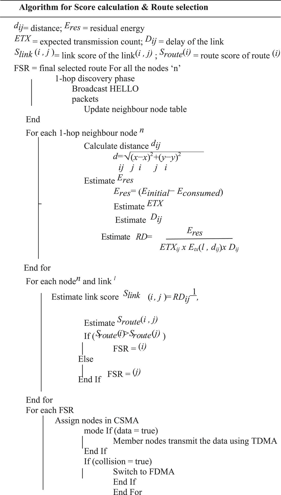

### 1.4 结果与讨论

`Network Simulator-2` 用于使用仿真补丁文件实现此方法。实验验证是通过使用 `NS-2` 进行的。一个开放的网络仿真程序提供了开源选项，并在数据包级别工作。用户具有使用名为 `Tcl` 脚本语言的输入参数的可执行命令。用户将 `Tcl` 脚本的名称作为 `NS` 可执行命令的 `NS-2` 输入参数提供。在大多数情况下，会创建仿真跟踪文件。

仿真后，`NS-2` 的输出可能是基于文本的或基于动画的。使用 `nam` 和 `xgraphs` 等工具以图形或交互方式解释这些结果。用户提取适当的基于文本的信息子集以分析特定网络性能，并将其转换为可能的演示。

在本仿真中，使用 21 个传感器节点进行聚类和路由。如仿真所示，此方法优于以前的方法。

仿真中使用的系统参数如 表 1.1 所示。此方法使用应用流量作为 `CBR`（`恒定比特率`），并支持网络中的流量控制。路由协议作为 `AOMDV`，并用于网络内的路由。`DEEH-CH`、`DCEMRA` 和 `SC-MCHMP` 是用于执行网络结果的路由技术。在考虑数据包大小为 1024 字节的情况下，传输速率为 1024 字节/0.1 毫秒，最大速度为 35 米/秒，总仿真时间为 20 秒。

表 1.1 拟议网络仿真表

| 网络参数 || 值 |

| --- | --- |

| 应用流量协议 || `CBR` |

| --- | --- |

| 传输速率 || 1024 字节/0.1 毫秒 |

| 无线范围 || 250 米 |

| 数据包大小 || 1024 字节 |

| 信道数据速率 || 40 Mbps |

| 最大速度 || 35 毫米/秒 |

| MAC 协议 || `MAC/802\_11`, `MAC/CSMA/CA`, `Mac/TDMA`, `MAC/FDMA` |

| 路由协议 || `AOMDA` |

| 网络仿真时间 || 20 秒 |

| 仿真中使用的节点数量 || 21 |

| 网络区域 || 500 × 500 |

| 路由方法 || `DEEH-CH`, `DCEMRA`, `SC-MCHMP` |

端到端延迟与仿真时间如 图 1.1 所示，其中包括对比拟议协议 `SC-MCHMP` 和以前的技术（如 `DCEMRA` 和 `DEEH-CB`）。`SC-MCHMP` 在节点间通信的端到端延迟减少方面表现更佳。多信道分配使用 `CSMA` 或 `CA`、`TDMA` 模式实现，与以前的方法相比，该方法的延迟降低了 25%。路由的最大得分（在 `SC-MCHMP` 中，延迟越低得分越高）确保所选路径的延迟更少，并且更多的数据包在短时间内被传输。

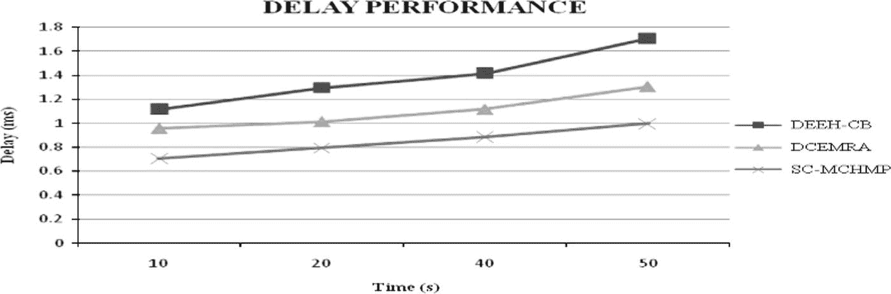

图 1.1 延迟性能。

能量消耗的仿真结果如 图 1.2 所示，其中显示了能量水平比与仿真时间的图表。基于拟议协议，与现有方法（如 `DCEMRA` 和 `DEEH-CB`）相比，能量节约减少时损耗比会改善。来自 `CH` 节点向 `SINK` 的无碰撞数据传输导致能量消耗和能量水平降低 28%。由于延迟减少和重传次数减少，能量消耗少于现有协议。

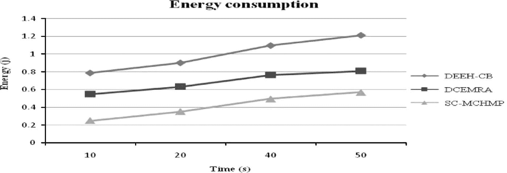

图 1.2 能量消耗。

网络性能在 图 1.3 中讨论，其中展示了仿真时间与吞吐量的图表。在此方法中，网络性能得到改善，数据节约量超过以前的方法。本文包括平均 34 Kb/s 的吞吐量。与早期方法相比，数据传输专门针对损耗进行，网络运行有效。`SC-MCHMP` 始终建议延迟更少且无干扰的路径。数据包在传输过程中对目标节点的传输大多不受干扰，这大大提高了吞吐率。

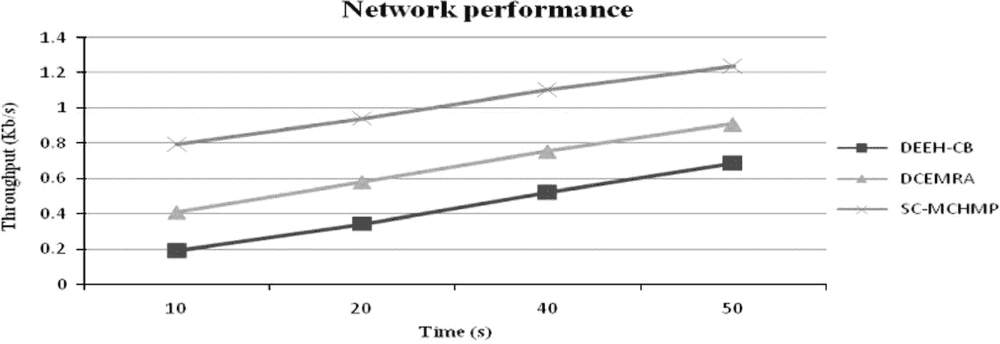

图 1.3 网络性能。

网络寿命与节点数量如 图 1.4 所示。`SC-MCHMP` 由于优化的能量消耗和 `SNs` 之间更高的负载平衡，相较于现有方法（即 `DEEEH-CB` 和 `DCEMRA`）改善了网络寿命性能。由于发送和接收节点的变化，网络寿命实现了 13% 的改善。由于 `SC-MCHMP` 中能量消耗比率降低，网络寿命在优化能量消耗的情况下得到改善。

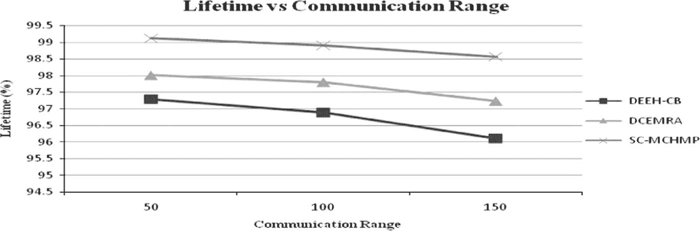

图 1.4 网络寿命与通信范围。

网络寿命与通信范围的特征如 图 1.5 所示。与以前的技术（如 `DEEEH-CB` 和 `DCEMRA`）相比，在此拟议方法中，使用较低的通信范围增强了网络寿命。此 `SC-MCHMP` 方法在整体通信范围内具有可比性能。通过提高一般通信范围，网络寿命提高了 24%。与其他技术相比，随着节点间距离的增加，网络寿命增加。拟议的 `SC-MCHMP` 方法在所有不同的通信范围内提供相似的性能。与以前的协议相比，用于得分计算的 `RSSI` 估计为所有环境提供了可行的路径。

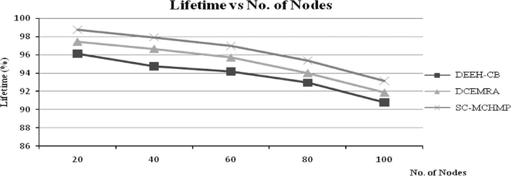

图 1.5 网络寿命与节点。

### 1.5 结论

## 一种基于新型评分的簇级多信道混合 MAC 协议

本文提出了一种名为 `SC-MCHMP` 的新型基于评分的簇级多信道混合 MAC 协议，用于在严重大气条件下部署无线传感器网络（WSNs）时选择路由路径。在此方法中，传感器节点之间会出现长端到端延迟以及不平衡的能量消耗问题。该方法计算剩余投递比率 `RDR`，以捕捉单位延迟下预期的额外传输次数。此外，该方法反映了每个传感器节点转发数据包的能力。数据传输将采用得分最佳的路由。通过混合 MAC 协议，确保了簇内和簇间通信之间的无忧数据传输。为验证协议的稳定性，该协议在不同网络负载和动态网络约束下进行了测试。与其他当代技术相比，基于混合 MAC 环境的 `SC-MCHMP` 实现了更长的网络寿命、更小的能量消耗和更强的网络性能。

## 参考文献

1.  Demirkol, I., Ersoy, C., Alagoz, F. (2006). 无线传感器网络的 MAC 协议：一项综述. IEEE Communications Magazine, 44(4), 115–121.

2.  Hanjagi, A., Srihari, P., Rayamane, A.S. (2007). 基于 GIS 和 GPS 的公共医疗信息系统：Shiggaon 的案例研究. In: GIS for Health and the Environment. Lecture Notes in Geoinformation and Cartography. Springer, Berlin, Heidelberg, 243–255.

3.  Yang, X., Ling, W., Jia, S., Yanyun, G. (2018). 移动无线传感器网络的混合 MAC 协议设计. IEEE Sensors Letters, 2(2), 1–4.

4.  Nguyen, V., Oanh, T.T.K., Chuan, P., *et al*. (2018). 基于马尔可夫模型的 VANETs 自适应多信道 MAC 协议综述. IEEE Access, 6, 16493–16514.

5.  Laouid, A., Abdelnasser, D., Ahcène, B., *et al*. (2017). 一种用于平衡无线传感器网络能量消耗的分布式多路径路由算法. Ad Hoc Networks, 64, 53–64.

6.  Gajendran, E., Vignesh, E.J., Prabhu, B. (2017). 密集无线传感器网络的随机簇头选择策略. International Journal of Multidisciplinary Research and Modern Education, 3(1), 414–420.

7.  Ozdemir, S., Xiao, Y. (2009). 无线传感器网络中的安全数据聚合：全面概述. Computer Networks, 53, 2022–2037.

8.  Albath, J., Thakur, M., Madria, S. (2013). 无线传感器网络的能量约束聚类算法. Ad Hoc Networks, 11(25), 12–25.

9.  Khediri, S.E., Nasri, N., Wei, A., Kachouri, A. (2014). 基于 LEACH 的无线传感器网络聚类新方法. Procedia Computer Science, 32, 1180–1185.

10.  Younis, O., Heed, F.S. (2004). 无线传感器网络的混合、节能、分布式聚类方法. IEEE Transactions on Mobile Computing, 3, 366–379.

11.  Yu, J., Qi, Y., Wang, G., Gu, X. (2012). 非均匀节点分布无线传感器网络的基于簇的路由协议. International Journal of Electronics and Communications, 66, 54–61.

12.  Gu, X., Yu, J., Yu, D., Wang, G., Lv, Y. (2014). ECDC：一种面向无线传感器网络的节能覆盖感知分布式聚类协议. Computers & Electrical Engineering, 40, 384–398.

13.  Wang, Z., Chen, H., Cao, Q., *et al* (2017). 实现无线传感器网络的容错位置屏障覆盖. Computer Networks, 112(1), 314–328.

14.  Chen, Z., Ma, M., Liu, X., Liu, A., Zhao, M. (2017). 提高无线传感器网络协作通信的可靠性. Symmetry, 9(209), 1–22.

15.  Zhou, M., Zhao, M., Liu, A., *et al* (2017). 传感器网络中移动目标跟踪的快速高效数据转发方案. Symmetry, 9(11), 269.

16.  Zhang, Y., He, S., Chen, J. (2016). 可充电传感器网络中通过动态感知和路由优化数据采集. IEEE/ACM Transactions on Networking, 24(3), 1632–1646.

17.  Tang, J., Liu, A., Zhao, M., Wang, T. (2018). 基于聚合签名的传感器网络数据采集信任路由. Security and Communication Networks. Article ID 6328504, 1–30.

18.  Wang, Z., Liao, J., Cao, Q., Qi, H., Wang, Z. (2014). 混合方向传感器网络中实现 k-屏障覆盖. IEEE Transactions on Mobile Computing, 13(7), 1443–1455.

19.  Pu, L., Chen, X., Xu, J., Fu, X. (2016). D2D 雾计算：一种基于网络辅助 D2D 协作的节能激励感知任务卸载框架. IEEE Journal on Selected Areas in Communications, 34(12), 3887–3901.

20.  Hu, X., Chu, T.H.S., Leung, V.C.M., *et al*. (2015). 移动社交网络综述：应用、平台、系统架构和未来研究方向. IEEE Communications Surveys & Tutorials, 17(3), 1557–1581.

21.  Chen, X., Pu, L., Gao, L., Wu, W., Wu, D. (2017). 利用大规模 D2D 协作实现节能移动边缘计算. IEEE Wireless Communications, 24(4), 64–71.

22.  Dai, H., Wu, X., Xu, L., *et al* (2015). 能量收集传感器网络中随机事件捕获的实用调度. International Journal of Sensor Networks, 18(1/2), 85–100.

23.  Liu, X. (2015). 无线传感器网络中多种需求的部署策略. IEEE Transactions on Cybernetics, 45(10), 2364–2376.

24.  Dong, M., Liu, X., Qian, Z., *et al* (2015). 新兴移动网络的 QoE 保障价格竞争模型. IEEE Wireless Communications, 22(4), 50–57.

25.  He, S., Gong, X., Zhang, J., Chen, J. (2014). 基于曲线的无线传感器网络屏障覆盖部署. IEEE Transactions on Wireless Communications, 13(2), 724–735.

26.  Liu, Y., Dong, M., Ota, K., Liu, A. (2016). 主动信任：无线传感器网络中的安全可信路由. IEEE Transactions on Information Forensics and Security, 11(9), 2013–2027.

27.  Liu, X., Dong, M., Ota, K., *et al* (2016). 网络物理系统中的服务定价决策：博弈论的洞察. IEEE Transactions on Services Computing, 9(2), 186–198.

28.  Dong, M., Ota, K., Liu, A., Guo, M. (2016). 无线传感器网络中可靠性约束下寿命和传输延迟的联合优化. IEEE Transactions on Parallel and Distributed Systems, 27(1), 225–236.

29.  Xu, J., Liu, A., Xiong, N., Wang, T., Zuo, Z. (2017). 社交网络物理系统中的综合协同过滤推荐. International Journal of Distributed Sensor Networks, 13(12), 1–17.

30.  Li, T., Liu, Y., Gao, L., Liu, A. (2017). 基于协作的雾计算智能感知任务模型. IEEE Access, 5, 21296–21311.

31.  Lai, S., Ravindran, B., Cho, H. (2010). 无线传感器网络中的异构法定人数基础唤醒调度. IEEE Transactions on Computers, 59(11), 1562–1575.

32.  Chao, C., Lee, Y. (2010). 无线传感器网络的基于法定人数的节能 MAC 协议设计. IEEE Transactions on Vehicular Technology, 59(2), 813–822.

## 2 软件定义网络（SDN）安全问题

33. Tsai, C.H., Hsu, T.W., Pan, M.S., *et al*. (2009). Cross-layer, energy-efficient design for supporting continuous queries in wireless sensor networks: A quorum-based approach. Wireless Personal Communications, 51(3), 411–426.

34. Jiang, J.R. (2008). Expected quorum overlap sizes of quorum systems for asynchronous power-saving in mobile ad hoc networks. Computer Networks, 52(17), 3296–3306.

35. Ekbatanifard, G.H., Monsefi, R., Yaghmaee, M.H., *et al*. (2012). Queen-MAC: A quorum-based energy-efficient medium access control protocol for wireless sensor networks. Computer Networks, 56(8), 2221–2236.

36. Heinzelman, W.R., Chandrakasan, A., Balakrishnan, H. (2000). Energy-efficient communication protocol for wireless microsensor networks in system sciences. In: *Proceedings of the 33rd Annual Hawaii International Conference on System Sciences*, Maui, HI, USA, 8, 8020.

37. Heinzelman, W.B., Chandrakasan, A.P., Balakrishnan, H. (2002). An application-specificprotocol architecture for wireless microsensor networks. IEEE Transactions on Wireless Communications, 1, 660–670.

38. Chen, B., Zhang, Y., Li, Y., Hao, X., Fang, Y. (2011). A clustering algorithm of cluster-headoptimization for wireless sensor networks based on energy. Journal of Information and Computational Science, 11, 2129–2136.

39. Tong, M., Tang, M. (2010). LEACH-B: An improved LEACH protocol for wireless sensornetwork. In: *Wireless Communications Networking and Mobile Computing(WiCOM), 6th International Conference*, IEEE, Chengdu, China, 1–4.

40. Bajaber, F., Awan, I. (2011). Adaptive decentralized re-clustering protocol for wireless sensor networks. Journal of Computer and System Science, 77, 282–292.

41. Hussain, S.J., Muhammad, I., Jhanjhi, N.Z., Khalid, H., Mamoona, H. (2021). Performance enhancement in wireless body area networks with secure communication. Wireless Personal Communications, 116(1), 1–22.

42. Datta, D., Dhull, K., Verma, S. UAV Environment in FANET: An Overview. CRC Press, Taylor & Francis Group.

43. Kumar, D., Aseri, T.C., Patel, R. (2009). EEHC: Energy efficient heterogeneous clustered scheme for wireless sensor networks. Computer Communications, 32, 662–667.

44. Katiyar, V., Chand, N., Soni, S. (2010). Clustering algorithms for heterogeneous wireless sensor network: A survey. International Journal of Applied Engineering Research Dindigul, 1, 273–274.

45. Bandyopadhyay, S., Coyle, E.J. (2003). An energy efficient hierarchical clustering algo-rithm for wireless sensor networks. In: INFOCOM Twenty-Second Annual Joint Conference of the IEEE Computer and Communications, IEEE Societies, San Francisco, CA, USA, 3, 1713–1723.

46. Liu, Z., Zheng, Q., Xue, L., Guan, X. (2012). A distributed energy-efficient clustering algo-rithm with improved coverage in wireless sensor networks. Future Generation Computer System, 28, 780–790.

47. Shahid, H., Humaira, A., Hafsa, J., Mamoona, H., Jhanjhi, N.Z., AlZain, M.A. (2021). Energy optimised security against wormhole attack in IoT-based wireless sensor networks. CMC-Computers Materials & Continua, 68(2), 1966–1980.

48. Vijayalakshmi, B., Ramar, K., Jhanjhi, N.Z., *et al*. (2020). An attention based deep learning model for traffic flow prediction using spatio temporal features towards sustainable smart city. IJCS Wiley, 34, 1–14.

49. Guo, P., Jiang, T., Zhang, K., Chen, H.-H. (2009). Clustering algorithm in initialization of multi-hop wireless sensor networks. IEEE Transactions on Wireless Communications, 8(12), 5713–5717.

50. Tomoya, E., Makoto, A., Takizawa, M. (2015). Energy-efficient delay time-based process allocation algorithm for heterogeneous server clusters. In: *IEEE 29th International Conference on Advanced Information Networking and Applications*, Gwangiu, South Korea, 279–286.

51. Hsieh, M.Y. (2011). Data aggregation model using energy-efficient delay scheduling in multi-hop hierarchical wireless sensor networks. IET Communications, 5(18), 2703–2711.

52. Shafiq, M., Ashraf, H., Ullah, A., Masud, M., Muhammad, A., Jhanjhi, N.Z., Humayun, M. (2021). Robust cluster-based routing protocol for iot-assisted smart devices in WSN. CMC-Computers Materials & Continua 67(3), 3505–3521.

53. Sowjanya, R., Kavita, Verma, S. (2019). The amalgamative sharp WSN routing and with enhanced machine learning. Journal of Computational and Theoretical Nanoscience (JCTN), 16(9), 3766–3769.

54. Shokouhifar, M., Jalali, A. (2017). Optimized sugeno fuzzy clustering algorithm for wireless sensor networks. Engineering Applications of Artificial Intelligence, 60, 16–25.

55. Batra, I., Verma, S., Kavita, Mamoun, A. (2019). A lightweight IoT based security framework for inventory automation using wireless sensor network. IJCS Wiley, 33, 1–16.

56. Batra, I., Verma, S., Kavita, *et al* (2020). Hybrid logical security framework for privacy preservation in the green internet of things*. MDPI*\- Sustainability, 12(14), 5542.

57. Jan, M.A., Dong, B., Jan, S.R.U., *et al*. (2021). A comprehensive survey on machine learning-based big data analytics for IoT-enabled smart healthcare system. MONET, Springer, 1.

58. Huang, R., Zhu, J., Yu, X.-T. (2006). The Ant-based Algorithm for the data gathering routing structure in sensor networks. In: *Proceedings of the Fifth International Conference on Machine Learning and Cybernetics*, Dalian, China, 4473–4478.

59. Heinzelman, W.R., Chandrakasan, A., Balakrishnan, H. (2000). Energyefficient communication protocol for wireless microsensor networks. In: *Proceedings of IEEE 33rd Annual Hawaii International Conference on System Sciences*, Maui, Hawaii, USA, 1–10.

60. Sabet, M., Naji, H.R. (2015). A decentralized energy efficient hierarchical cluster-based routing algorithm for wireless sensor networks. AEU-International Journal of Electronics and Communications, 69(5), 790–799.

61. Singh, P., Verma, S., Kavita. (2019). Analysis on different strategies used in blockchain technology. Journal of Computational and Theoretical Nanoscience (JCTN), 16 (10), 4350–4355.

62. Ghosh, G., Kavita, Verma, S., Jhanjhi, N.Z. (2020). Secure surveillance system using chaotic image encryption technique. IOP Science, 993, 012062.

63. Srivastava, A., Verma, S., Kavita, Jhanjhi, N.Z., Malhotra, A. (2020). Analysis of Quality of Service in VANET. IOP Science.

64. Selvi, M., Velvizhy, P., Ganapathy, S., Khanna, N.H., Kannan, A. (2019). A rule based delay constrained energy efficient routing technique for wireless sensor networks. Cluster Computing, 22(5), 10839–10848.

65. Saeed, S., Jhanjhi, N.Z., Naqvi, M., Humayun, M., Ponnusamy, V. (2020). Analyzing the performance and efficiency of it-compliant audit module using clustering methods. In: Industrial Internet of Things and Cyber-Physical Systems: Transforming the Conventional to Digital, IGI Global, 351–376.

66. Humayun, M., Jhanjhi, N., Alruwaili, M., Amalathas, S.S., Balasubramanian, V., Selvaraj, B. (2020). Privacy protection and energy optimization for 5G-aided industrial internet of things. IEEE Access, 8, 183665–183677.

## Muhammad Junaid Nazar, Saleem Iqbal, Saud Altaf, Kashif Naseer Qureshi, Khalid Hussain Usmani, and Sobia Wassan

## CONTENTS

1. 2.1 引言

2. 2.2 SDN 中的潜在异常

3. 2.2.1 未授权访问

4. 2.2.2 恶意应用程序

5. 2.2.3 网络操纵

6. 2.2.4 流量转移

7. 2.2.5 拒绝服务 (DoS)

8. 2.2.6 配置问题

9. 2.2.7 数据泄露

10. 2.3 安全分析与研究挑战

11. 2.3.1 SDN 安全分析

12. 2.3.2 场景

13. 2.3.2.1 场景 1

14. 2.3.2.2 场景 2

15. 2.3.2.3 场景 3

16. 2.3.3 研究挑战

17. 2.4 结论

18. 参考文献

DOI: [`10.1201/9780367808228-2`](https://doi.org/10.1201/9780367808228-2)

### 2.1 引言

软件定义网络 (SDN) 是一种网络方法，它使网络管理员能够通过（逻辑上）集中控制器快速响应。它可能改变经典网络基础设施的局限性。SDN 打破了垂直集成，并将控制平面（`controller`）与转发流量的数据平面（`switches`）分离开来。SDN 的核心思想是将数据平面/转发平面与控制平面解耦，其中控制器控制和管理位于转发平面上的设备。集中控制的控制平面对 SDN 有利，因为它灵活、可编程，并且对网络流量流具有控制权。控制平面和数据平面是解耦的，这可以通过 SDN 控制器和交换机之间的编程接口来理解。网络管理员可以通过自己的程序来管理和控制网络及数据包处理功能。

在经典网络中，硬件设备上实现了不同的算法来监控和控制数据流、管理路由路径，并确定网络中不同设备的连接。通常，用于路由网络流量的定义规则和算法应用于硬件组件，如专用集成电路 (`ASIC`) \[1\]。SDN 原则的一个重要意义是关注网络策略与这些策略在流量转发和硬件中的实现之间的分离。这种分离对于灵活性至关重要，它将网络分解为可控的部分，在网络中创建并引入新的抽象，并简化和促进网络管理、创新和演进 \[1\]。

控制器和交换机之间数据平面和控制平面的隔离可以通过定义良好的编程接口来实现。数据平面设备由 SDN 控制器通过定义良好的应用程序编程接口 (`API`) 控制。API 的一个显著示例是 OpenFlow \1,[2\]。OpenFlow 是一种用于控制器和交换机之间通信的协议。启用 OpenFlow 的交换机包含一个名为流表的表，该表处理数据包转发规则并为通信提供安全通道。在流表中，每个流规则匹配流条目并执行保证的操作，即将流转发到目标或控制器、丢弃数据包、修改流量等。控制器指示启用 OpenFlow 的交换机表现得像交换机一样，而路由器执行流量整形、负载平衡等角色，而 OpenFlow 和 SDN 开始于学术实验 \[3\]。

在当前网络设备实现的场景下，流表在 SDN 中起着重要作用。每个 OpenFlow 交换机都有一个由控制器计算的数据路径，流表由网络流的预定义规则集组成。控制器生成流规则并将其安装到流表中，流表由三部分组成：(1) 匹配模式；(2) 与匹配模式关联的操作；(3) 统计信息。统计信息部分包含优先级、空闲超时、硬超时、数据包和字节计数器等。在各种攻击中，溢出攻击针对数据平面转发设备的流表，以溢出流表并丢弃数据包。如果流表被恶意攻击者破坏，其性能会受到故障流表的影响，例如定义规则中的操纵和冲突以及资源耗尽。这些流规则由控制器使用主动或被动方法生成或设置 \[4\]。

SDN 的架构在 图 2.1 中介绍。有必要强调一种编程模型，它不假设在物理上集中，尽管系统是（逻辑上）集中 \[5\]。事实上，确保足够的适应性、性能、可靠性和可扩展性水平很重要。SDN 的代际级别组织大纲以物理分布控制平面 \5,[6\]。

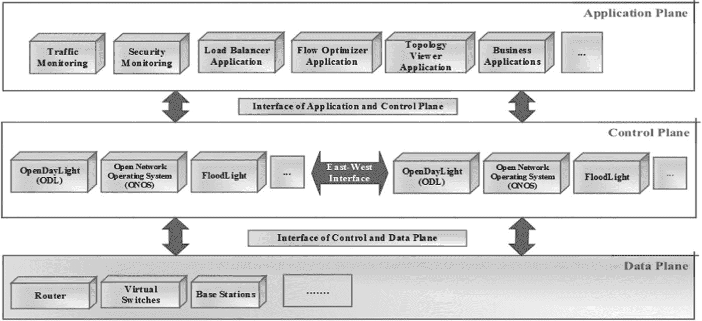

图 2.1 软件定义网络架构。

软件定义网络存在影响数据流行为的异常和安全问题；该问题通过保护控制器和交换机来解决。重点关注不同的异常，包括影响整个网络的流表溢出攻击。目的是介绍 SDN 中安全问题的定义、架构、安全性和解决方案，概述最近的研究和开发，并定义攻击如何在网络设备中造成中断。图 2.2 说明了 SDN 安全的概述，并指示异常的类别、其解决方案以及使用 SDN 框架增强 SDN 安全性。

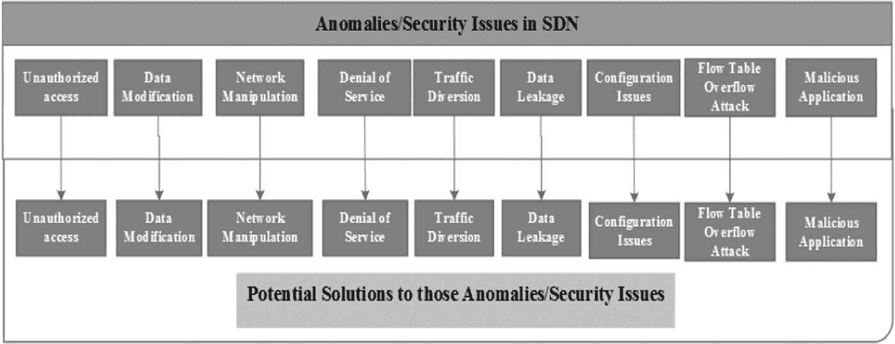

图 2.2 软件定义网络中异常概述。

图 2.3 代表了 SDN 架构的特定特征，这些特征可能通过呈现漏洞或增强网络安全性来影响 SDN 的安全性。图 2.3 说明了 SDN 的六个特征；有一个（逻辑上）集中控制器、网络超 visor、交换机管理集群、网络服务、虚拟化网络和集中监控单元。每个特定控制器的实例是控制器集的主控制器或主控制器，转发设备以主从方式分组。网络服务包括业务应用程序，如路由、负载均衡器和用于网络管理、拓扑查看器、流优化器应用程序等的第三方应用程序。控制器和交换机管理集群以主从方式包含。监控单元包括数据库和分析部分，其中统计信息被维护、监控，并保存在数据库中。其余两个特征包括网络超 visor、实现层和启用 OpenFlow 的交换机。

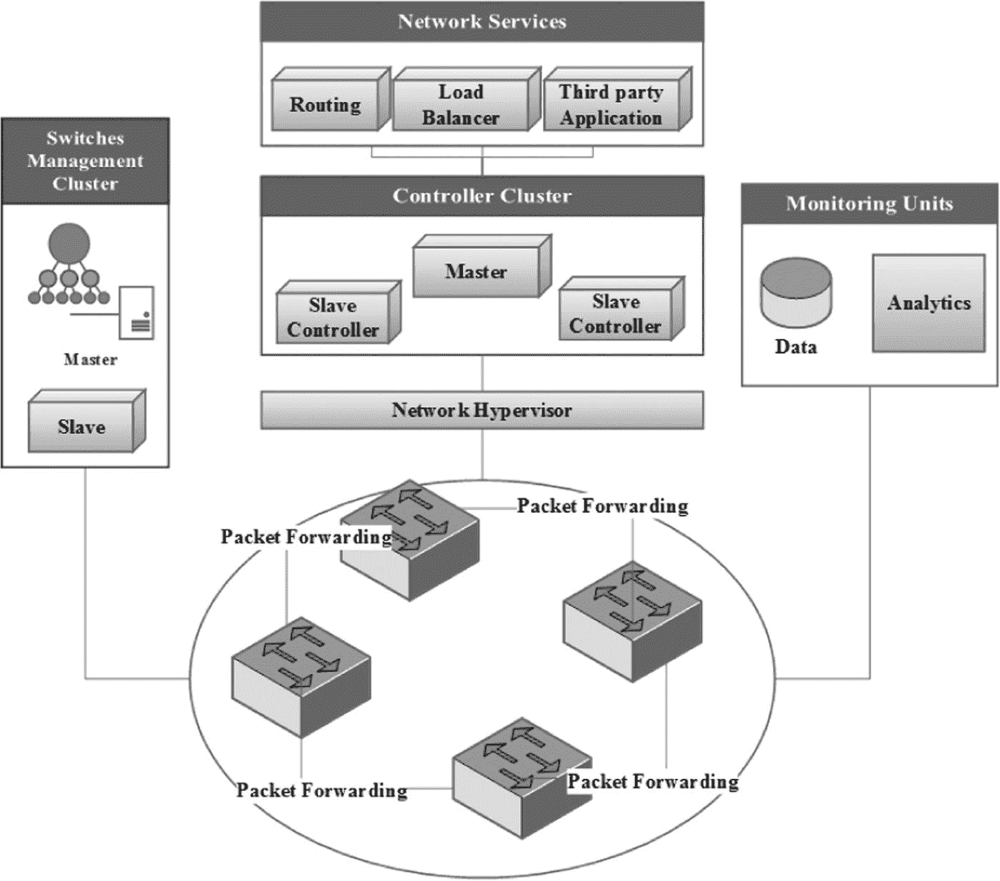

图 2.3 软件定义网络的特征。

在 SDN 中建模异常的目的是识别那些源于数据平面的异常。受损交换机可能表现出随机行为，即修改数据包、丢弃流量或将流量从定义路径转移到另一条路径。它可能会向控制器发送错误的统计报告，这些报告从交换机收集以隐藏恶意行为。事实上，这种不当行为由任何恶意活动引起，该活动通过错误路径将数据包报告和数据包转发到错误目标。恶意攻击者可以在交换机中制造不当行为并控制网络。转发异常可能源于网络设备或硬件故障、配置错误或软件缺陷。图 2.4 显示了影响 SDN 应用、控制和数据平面的各种异常和安全问题的树状表示。拒绝服务（DoS）是一种常见攻击，既影响经典网络，也影响 SDN 的所有层。流表泛洪攻击是一种 DoS 攻击，它在注入恶意流规则后丢弃数据包并转移网络流量，使交换机走上非原始路径。

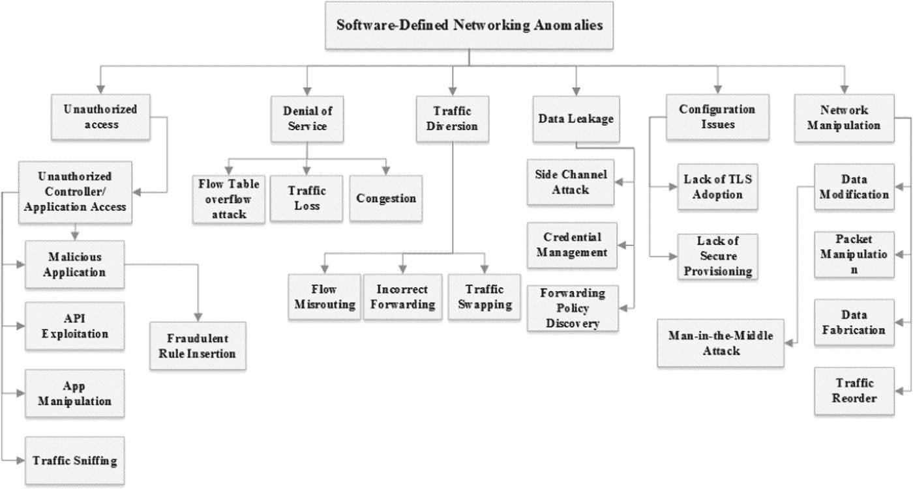

图 2.4 SDN 攻击和安全问题的树状表示.

### 2.2 SDN 中的潜在异常

与 SDN 相关的一些异常和安全问题已在图 2.5 中确认。与解决方案相关的研究已分类并在文献中呈现，如 表 2.1 所示，并将解决方案与 SDN 的相应平面进行对比。

表 2.1 针对 SDN 中各种异常的解决方案研究工作比较

| 研究工作 | SDN 平面 | SDN 中的异常 |
| --- | --- | --- |
| | 应用平面 | 北向接口 | 控制平面 | 南向接口 | 数据平面 | 未授权访问（即，控制器/应用） | 数据泄露 | 网络操纵 | 流量转移 | DoS（即，流表泛洪等） | 配置问题 |
| | | | | | | | | | | | |
| *FSL (2008)* \[28\] | **✓** | | **✓** | | **✓** | | | | | | | **✓** |
| *Ristenpart et al. (2009)* \[29\] | | | | | **✓** | | **✓** | | | | | |
| *FlowChecker (2010)* \[23\] | **✓** | | **✓** | | **✓** | | | | | | | **✓** |
| *VAVE (2011)* \[30\] | | | **✓** | | **✓** | | | | | | **✓** | |
| *ProtoGENI (2011)* \[31\] | | | **✓** | | **✓** | | **✓** | | **✓** | | **✓** | |
| *CPRecovery (2012)* \[32\] | | | **✓** | | **✓** | | | | | | **✓** | |
| *FortNOX (2012)* \[9\] | **✓** | | **✓** | | | | **✓** | | | | | |
| *VeriFlow (2012)* \[26\] | **✓** | | **✓** | **✓** | **✓** | | | | | | | **✓** |
| *NICE (2012)* \[19\] | **✓** | | **✓** | | **✓** | | | | | | | **✓** |
| *Kruetz et al. (2013)* \[33\] | | | **✓** | | **✓** | | **✓** | | **✓** | | **✓** | |
| *STRIDE and Attack Modelling Method (2013)* \[34\] | | | **✓** | | **✓** | | | | **✓** | | **✓** | |
| *Benton et al. (2013)* \[18\] | | | **✓** | | **✓** | | | | **✓** | | **✓** | |
| *Shin et al. (2013)* \[35\] | | | **✓** | | **✓** | | | **✓** | | | **✓** | |
| *Othman et al. (2013)* \[7\] | **✓** | | **✓** | | **✓** | | **✓** | | **✓** | | | **✓** |
| *Yu at al. (2013)* \[36\] | **✓** | | **✓** | | **✓** | | **✓** | | **✓** | | | |
| *PermOF (2013)* \[37\] | **✓** | | **✓** | | | | **✓** | | **✓** | | | |
| *AVANT-GUARD (2013)* \[38\] | | | **✓** | | **✓** | | | | | | **✓** | |
| *NetPlumber (2013)* \[27\] | | | **✓** | | **✓** | | | | | | | **✓** |
| *FLOVER (2013)* \[24\] | | | **✓** | | **✓** | | | | | | | **✓** |
| *Wang et al. (2013)* \[39\] | **✓** | | **✓** | | | | | | | | | **✓** |
| *Smeliansky (2014)* \[40\] | | | **✓** | | | | | | | | | **✓** |
| *Ding et al. (2014)* \[41\] | **✓** | | **✓** | | **✓** | | | | | | | |
| *AuthFlow (2016)\*\*\*\*\*\*\*\** | **✓** | | **✓** | | **✓** | | **✓** | | **✓** | | **✓** | |
| *Li et al. (2014)* \[42\] | | | **✓** | | | | **✓** | | **✓** | | | |
| *Payless (2014)* \[14\] | | | **✓** | | | | | | | | | |
| *Operation Checkpoint (2014)* \[43\] | **✓** | **✓** | | | | | **✓** | | **✓** | | | |
| *OpenSample (2014)* \[22\] | | | | | **✓** | | | | | **✓** | | |
| *Entropy based (2014)* \[44\] | | | **✓** | | | | | | | **✓** | **✓** | |
| *ROSEMARY (2014)* \[10\] | **✓** | | **✓** | | | | **✓** | | | | | |
| *LegoSDN (2014)* \[11\] | **✓** | | **✓** | | | | **✓** | | | | | |
| *FLOWGUARD (2014)* \[45\] | **✓** | | **✓** | | **✓** | | | | | | | **✓** |
| *FlowVisor (2014)* \[46\] | | | **✓** | | | | | | | | | |
| *Planck (2014)* \[12\] | | | **✓** | | | | | | **✓** | | | |
| *SE-Floodlight (2015)* \[47\] | **✓** | | **✓** | | **✓** | | **✓** | | | | | |
| *FloodGuard (2015)* \[48\] | | | **✓** | | **✓** | | | | | | **✓** | |
| *Tommy et al. (2015)* \[49\] | | | **✓** | | **✓** | | | | | | **✓** | |
| *FlowRanger (2015)* \[50\] | | | **✓** | | | | | | | | **✓** | |
| *Chi et al. (2015)* \[51\] | | | | | **✓** | | | | | **✓** | | |
| *SPHINX (2015)* \[15\] | | | **✓** | | | | | | **✓** | | | |
| *FlowMon (2015)* \[52\] | | | | | **✓** | | | | | **✓** | | |
| *AuthFlow (2016)* \[53\] | **✓** | | **✓** | | **✓** | | **✓** | | **✓** | | **✓** | |
| *Qian et al. (2016)* \[4\] | | | | | **✓** | | | | | | **✓** | |
| *LineSwitch (2016)* \[54\] | | | **✓** | | | | | | | | **✓** | |
| *Aleroud et al. (2016)* \[55\] | | | **✓** | | | | | | | | **✓** | |
| *FADE (2016)* \[56\] | | | | | **✓** | | | | | **✓** | | |
| *FTGuard. (2017)* \[57\] | | | | | **✓** | | | | | | **✓** | |
| *Xu et al. (2017)* \[58\] | | | | | **✓** | | | | | | **✓** | |
| *Zhou et al. (2018)* \[59\] | | | | | **✓** | | | | | | **✓** | |
| | | | | | | | | | | | |

#### 2.2.1 未授权访问

未经授权的访问归因于控制器访问或未经身份验证的应用程序。集中式控制器是 SDN 的主要特征之一。问题是重新配置网络或 SDN 框架中被任何未经授权的实体损坏的元素。各种研究中针对未经授权的访问定义了不同类型的异常，包括恶意应用程序、API 利用、APP 操纵和流量嗅探。控制器向应用程序提供抽象，以便应用程序可以完成网络状态的读取/写入。上述四种异常类型可能会危及应用程序，以获取网络资源的访问权限，从而操纵、嗅探和利用整个网络的操作。为了提高网络的有效性并消除控制器的瓶颈，\[7\] 的作者描述了一种混合控制模型，该模型保护分布式控制模型。在 \[7\] 中，在通常条件和情况下，网络的控制是集中式的，但如果网络负载很重，网络设备会代表控制器向其他网络设备安装流规则。作者提出了签名算法，用于从网络设备到另一台设备的流请求的安全传输。

#### 2.2.2 恶意应用程序

控制器充当应用程序与数据平面之间的抽象层，因为控制平面和数据平面之间存在抽象。第三方应用程序已由 SDN 启用并纳入架构 \[8\]。同样，效率较低的应用程序可能会无意中存在漏洞。此类异常的解决方案是建立应用程序与控制器之间的可信连接，以安全地交换控制消息。在 \[9,10,11\] 中提出了多种解决方案。在 \[9\] 中，作者提出了与该安全问题相关的安全强制内核。基于角色的身份验证系统由 `FortNOX` 实现，用于确定每个应用程序的安全授权。`FortNOX` 处理流规则插入时可能出现的冲突，接受和拒绝取决于安全授权。在 \[10\] 中，提出了安全、强健且高性能的网络操作系统（`NOS`）。\[11\] 的主要目的是提高控制器对恶意应用程序的灵活性。在 \[11\] 中，提出了隔离层，以避免应用程序因控制器崩溃而崩溃。应用程序、事务系统和容错层之间的隔离层识别并克服导致崩溃的操作。

#### 2.2.3 网络操纵

网络操纵发生在控制平面中。被攻击者破坏的 SDN 控制器会生成错误数据，从而对整个网络发起其他攻击。不同的研究使用了不同的网络操纵术语。流量修改、数据包操纵和流量伪造是网络操纵的类型。交换机被恶意破坏以修改数据包/流量内容。网络操纵与其类型之间的关系是：控制器被攻击者破坏以生成错误数据，对数据平面发起其他攻击，这些攻击可能是流量修改、数据包操纵和流量伪造。

1. `Data modification` 是指从源到目的地转发的数据流量的更改。在 SDN 中，修改可能由恶意交换机在网络中发生。流量内容可能由恶意交换机更改，无论是数据包的有效载荷还是开销。针对此类攻击的可能解决方案是安全技术，例如加密技术；例如，单向哈希函数保证数据流量的可靠性，但在 SDN 中，针对控制器的检测系统比那些机制更有用。例如，通过 `Planck` \[12\] 中的流量镜像以及将数据流量转发到收集器，可以在各种交换机上检查整个数据包的真实性。控制器将拓扑和流规则共享给收集器，以便收集器可以识别流的输入和输出端口。它计算网络中每个交换机的数据包摘要，并将这些数据包发送到检测系统以检查完整性。检测系统比较不同交换机之间的摘要数据包，以避免假阴性，例如，生存时间和校验和。

    1. `Man-In-The-Middle Attack` 是一种数据修改类型。当攻击者能够使用 `ARP Spoofing` 渗透整个网络时，就会发生这种情况。攻击者可以嗅探、修改甚至停止数据流量。当网络或通信端点没有身份验证机制时，可能会发生这种情况。一个网络高管，`LiteVisor` \[13\] 用于 `OpenFlow`，被认为缺乏适当的隔离技术 \[14\]，这将允许攻击者发起数据修改攻击。

2. `Traffic Fabrication` 是指恶意交换机可以生成任意数据包，然后这些数据包可以转发到数据平面或控制平面。流量伪造的可能解决方案是流保存，可以在数据平面中使用，但它不会检测丢弃数据包的交换机并插入相同数量的虚假数据包。为了更有效，此解决方案可以与改进的流量检测相结合。框架 `Sphinx` \[15\] 允许管理员对流强制执行约束并验证网络范围内的不变量。一个示例是虚假 `ARP` 消息，用于识别 `Sphinx` 并维护 `MAC` 地址到 `IP` 绑定列表。该虚假流量可能用于控制平面中的 `DoS` 攻击。在这种情况下，可以使用速率限制方案来控制请求数量。

3. `Packet Manipulation` 是指攻击者修改通过被破坏交换机的数据包。数据包操纵可以使用解密错误阻止通信；但是，它可能受到任何加密技术的保护。

4. `Flow Reorder` 意味着，通常情况下，流量顺序可能由恶意交换机更改，但在路由器、延迟和内容方面仍然有效。在网络流量延迟方面，不间断重传 `TCP` 数据包会降低吞吐量 \[16\]。此类异常的可能解决方案与流量修改类似。数据包顺序将由检测系统检查，以保持从每个交换机摘要的数据包的有序列表。

#### 2.2.4 流量重定向

流量转发是一种数据平面攻击，攻击者会攻破所有网络元素以转发或重定向流量流，从而实现窃听。流量转发攻击的解决方案是使用强加密来保护网络元素和网络的通信通道。流量误路由、错误转发和数据包交换也是流量转发攻击，只是在研究工作中采用了不同的命名约定。交换机可能会被攻击者攻破，从而命令数据包在不确保设置流规则的情况下进行转发。例如，OpenFlow（OF）交换机由控制器编程，用于将数据包从端口 1 转发到端口 3，但攻击者修改了程序，命令将数据包转发到端口 4。这将中断整个转发和交换系统。这种不当行为可以通过采用反应式方法而不是主动式方法来解决。在这种情况下，当交换机接收到一个流时，它会通过发送指定命令及其关于流表的响应来接收控制器的指令。但是，如果交换机之前已填充流规则（包括过期的规则），交换机就不会向控制器生成消息。这将中断整个交换系统，并可能导致无限循环。这些术语指的是同一种攻击，并且在表 2.1 中也有描述。

#### 2.2.5 拒绝服务攻击（DoS）

这是最常见的一种攻击类型，可能会影响 SDN 的所有平面。DoS 可能导致 SDN 服务中断或减少。DoS 攻击的解决方案是在控制平面应用数据包丢弃技术和速率限制。作为控制器与转发设备之间的通信路径，控制器可能会被攻击者填充的数据包淹没，攻击者想要完全控制流规则，并使其对合法用户不可访问。该攻击也可以在数据平面通过流表淹没来实现，结果是内存可用性受限 \[17\]。此外，欺诈规则插入和修改也已导致 DoS，如 \[18\] 所述。交换机流表淹没也称为流表溢出攻击，控制器-交换机通信淹没在 DoS 中有描述。当攻击者攻破并淹没控制器和交换机，且交换机可能会随机丢弃数据包时，DoS 也会导致数据流量丢失和延迟。

1.  `Overflow Attack` 是一种 DoS 的交换机流表淹没攻击类型，会导致控制器和交换机都变得脆弱。当流表溢出时，交换机无法接收更多流条目，控制器也不会回复适当客户端的请求。安装新规则会导致数据包丢失，因为这涉及使流条目失效，从而导致流表溢出 \[4\]。流表可能因控制器上的恶意应用程序攻击或数据包攻击而溢出。

    1.  `Attack on control plane as of Malicious Application`: 控制器是 SDN 网络的主要部分，负责决定网络数据包以及流表中匹配或不匹配的流条目。控制器会为每个数据包或流在流表中安装新规则。恶意应用程序在部署到控制器后会发起攻击，以处理所有消息。这种攻击的解决方案是在安装控制器之前谨慎评估应用程序。Kostic 等人 \[19\] 预期了一种测试应用程序的方法。当从交换机接收到消息时，恶意应用程序会启动一个无限循环来安装多个流规则。大量新规则可以插入并置换源 IP 和目标 IP，以溢出流表。

    2.  `Attacks from packets`: 攻击既有内部攻击也有外部攻击，外部攻击者发起的攻击具有弹性方法来发起 DoS 攻击。攻击者可以生成并发送大量数据包到控制器，导致为相应数据包安装新规则并耗尽流表。数据包头中的源端口和目标端口字段会进行置换，以在 `Scapy` \[20\] 中构建数量的 UDP 数据包，并以用户定义的速率发送流数据包。

2.  `Data Loss`: 恶意交换机可能会以选择性方式随机丢弃数据流量。这可能发生在数据平面交换机或路径上的任何攻击。在数据包丢失中，流路径上每个交换机的统计数据很有用，并应用流守恒原则，即入站流量必须等于出站流量。该原则应用于每个流，并提供最精确的准确性；这样，我们可能准确检测丢失的流量。然而，会遇到两个困难：1）有效数据包丢失是因为拥塞，2）不同交换机之间的计数器同步。有效数据包丢失的意义在于准确测量拥塞。拥塞可能导致数据包丢失，如果已知丢失数据包的数量，那么它就消除了模糊性；超过这个数量，任何丢失的数据包都被视为有缺陷。如果目标是实现实时流量的丢失检测，那么评估丢失数据包的数量并非直接任务。其次，关联计数器需要在相应交换机上获取可靠的全局计数器快照。每个流接收到的数据包是 SDN OpenFlow 中的众所周知实现 \[21\]。控制器使用 OpenFlow 的 `stats_request` 消息来查询流统计信息，交换机使用 `stats_reply` 消息来查询每个流中包含的字节数和接收到的数据包数量。在 \[22\] 中，100 毫秒的控制循环正在实现拥塞的实时检测。

3.  `Traffic Delay`: 网络中的恶意活动可能会增加网络流量的抖动和延迟，这将对时间敏感的数据流量构成极大挑战。此外，TCP 流量流中的延迟会导致错误超时和不必要的重传，并影响吞吐量 \[9\]。有一种可能的解决方案来监控网络中的延迟，提供实时延迟，并比较交换机之间数据包的到达时间以解决此问题。Chowdhury 等人 \[14\] 提出了 `PayLess`，这是一个用于 SDN 的监控框架，用于收集流统计信息并提供给控制器和不同级别的收集。它显示了监控准确性和网络开销之间的权衡。

#### 2.2.6 配置问题

对于网络异常/漏洞的检测，与网络安全相关的协议和策略正在不断开发。许多策略和协议将应用于 SDN 的平面和架构。在 SDN 中，强制实施已开发的策略（例如传输层安全（`TLS`））是必不可少的，并且将继续如此。网络不同组件之间的接口可能会显示出关于多供应商设备互操作性以及跨新接口的控制/数据通信的重大漏洞。SDN 提供了动态创建流规则和策略的功能，以及使用 `API` 对网络进行编程的能力。针对多个应用程序之间网络策略冲突问题的解决方案已在 `19,23,24,[25,26,27]` 中提出。`NICE` `[19]` 已被提出，其中通过结合模型检查和符号执行来测试 `OF` 应用程序。二进制决策图已在 `[23]` 中提出，用于测试特定流表内的交换机内部配置错误。同样，`[24]` 使用模理论和断言集来验证流策略。在 `[25]` 中，作者提出了一种使用静态分析诊断网络配置问题的方法。`[26]` 通过建模图并在流规则到达网络之前中断它们来研究不变量，从而检测了路由表、路径等中的循环。`[27]` 也是一种用于实时检查策略的工具，它逐步检查不断变化的状态。进一步部署实验可以估计网络特征与理论模型之间的关联和差距。

#### 2.2.7 数据泄露

对于数据包处理，OpenFlow 交换机规范 `[2]` 中解释了多种可能的操作。这些操作包括数据包丢弃、转发和发送到控制器。通过数据包处理时序分析，攻击者决定对特定类型的数据包应用哪种操作。例如，网络数据包的入站和出站时间将短于控制器上的处理时间。攻击者可以通过发现交换机的主动和被动配置来实现这一点。SDN 中的另一个开放挑战是凭据的存储，这些凭据必须是安全的，例如多个逻辑网络的证书和密钥。数据泄露中描述了旁路攻击和安全机制凭据管理。旁路攻击发生在 SDN 的数据平面上。攻击者可以攻破交换机并获取任何系统实现或来自目标资源的安全信息。`OF-Config` 在 `OF` 启用的交换机之上启动多个 OpenFlow 逻辑交换机。不同的客户被分配了逻辑实体，这些逻辑网络与凭据相关联，例如证书和密钥。如果这些凭据没有被安全地存储，那么攻击者可以攻破它们并导致数据泄露。解决方案是使用强加密算法来保护网络的元素和资源。

表 2.2 说明了可能影响 SDN 架构所有平面的安全功能不当使用情况。该表显示了与 SDN 平面相关的 SDN 攻击分类。

 表 2.2 与 SDN 平面相关的攻击分类 

| SDN 安全攻击 || 受影响的 SDN 平面 |

| --- | --- |

|  || 应用平面 || 应用-控制器接口 || 控制平面 || 控制器-数据接口 || 数据平面 |

| 数据修改 ||  ||  || **✓** || **✓** || **✓** |

| --- | --- | --- | --- | --- | --- |

| 未经授权的控制器访问 ||  ||  || **✓** || **✓** || **✓** |

| 未经授权的应用程序 || **✓** || **✓** || **✓** ||  ||  |

| 旁路攻击 ||  ||  ||  ||  || **✓** |

| 网络操纵 ||  ||  || **✓** ||  ||  |

| 流量劫持 ||  ||  ||  ||  || **✓** |

| API 利用 || **✓** || **✓** ||  ||  ||  |

| 凭据管理 ||  ||  ||  ||  || **✓** |

| 流表溢出攻击 ||  ||  ||  ||  || **✓** |

| 恶意应用程序 || **✓** || **✓** || **✓** ||  ||  |

| 配置问题（缺乏安全配置和 TLS） || **✓** || **✓** || **✓** || **✓** || **✓** |

| 流量嗅探 ||  ||  || **✓** || **✓** || **✓** |

|  |

### 2.3 安全分析与研究挑战

#### 2.3.1 SDN 安全分析

几项 SDN 安全分析引领了这项研究 `18,31,33,34,35,40,41,46,[60,61,62]`。这些文献建立了 SDN 框架中元素之间的关系，以引入新的漏洞。然而，最近的分析识别了 SDN 中安全性的增强。我们知道 `OpenFlow` 是 SDN 的协议和通用技术，`[34]` 通过 STRIDE 威胁探索 `[63]` 完成了对 `OF` 协议的分析。

所述安全分析相对地在表 2.1 中呈现，涉及 SDN 层及其在不同研究工作中提供的解决方案。`OpenFlow` 和 SDN 框架支持应用程序通过协议修改交换机中的网络状态。因此，与控制平面和数据平面以及数据-控制接口相关的问题，虽然罕见 `[1,33,60]`，但凸显了第三方托管应用程序的安全威胁。

#### 2.3.2 场景

##### 2.3.2.1 场景 1

网络流量正被恶意应用程序劫持。据发现，网络流量可能会改变路径以到达目的地。这可能通过恶意应用程序插入欺诈性规则来实现。`OF` 启用的交换机使用控制器定义的流规则转发全部流量。攻击者攻破了控制器以访问应用程序，通过添加新规则或修改现有规则，使现有应用程序变得恶意。通过这些修改后的规则，流表中的流表项可能会改变，并且由于攻击，方向也会改变。

##### 2.3.2.2 场景 2

在 SDN 转发平面的流量劫持分析中，由于链路故障，网络流量流量也可能改变其路径。在数据平面中，当链路发生故障或出现故障时，`OF` 启用的交换机会更改来自源的流量的路径。交换机可以将受任何原因或链路故障影响的流量故障转移到另一条路径。控制器计算多条路径并预先建立它们；当发生链路故障时，它可以采用新路径到达目的地。这是一般故障，并将网络流量导向其他路径。

##### 2.3.2.3 场景 3

在拥塞情况下，当来自控制器的数据过多时，链路会发生拥塞。这可能导致网络流量丢失和吞吐量降低，并且由于 DoS 攻击而导致链路拥塞。攻击者发送过多的恶意流量以使 `OF` 启用的交换机过载。在 SDN 中，每个交换机记录出站链路的路径负载信息。如果控制器使用主动方法计算路径并且链路上发生拥塞，典型的影响将是数据包丢失，但数据包可能会由于控制器预先计算/预先建立的路径而改变路径以到达目的地。

#### 2.3.3 研究挑战

## SDN 网络流量管理与安全研究挑战

在 SDN 而非经典网络中，网络流量管理是通过动态分析、预测和规范传播数据行为来优化网络及其性能的一个非常重要的主题。高效的网络管理需要改进资源利用率，以在面对大规模数据中心需求时实现系统的最佳性能。关于 SDN，存在一些开放的研究挑战和问题，如下所示。

1.  在 SDN 转发平面中，以较少干扰和低通信开销实现高效且快速的故障恢复。
2.  高效管理大数据，从时间相关统计、用户行为和局部性的角度分析网络流量。
3.  监控网络流量，以在控制器收集网络统计信息时识别如何降低网络开销。
4.  在存在单个控制器且发生丢包的情况下，可靠地更新和控制大规模 SDN 网络中的网络信息。
5.  使用多个控制器，在整个网络中可靠地更新分布式网络的信息，并实现实时更新和互同步开销。
6.  在主/主控制器发生故障的情况下备份控制器，以实现鲁棒性。
7.  数据平面和控制平面的动态负载均衡，以利用灵活的全局和控制视图并避免单个集中式控制器的瓶颈。负载均衡能够实现网络流量统计的准确和高效获取。

### 2.4 Conclusion

本章将 SDN 中的网络安全分类为可通过其架构特性进行改进的有前途方向。描述了通过 SDN 对网络安全的漏洞和小幅度改进；它们被认为比经典网络更成熟。尽管如此，仍然强调了各种研究问题，并提出了若干与网络安全攻击（特别是破坏 SDN 的攻击）相关的解决方案。本章专门针对 SDN 安全问题和异常，即由于攻击者的任何恶意活动（例如拥塞、攻击或链路失败）导致数据包丢失，有时数据包会更改出口端口或采用自己的方向到达目的地。

还识别了一种 DoS 攻击类型，其中数据包泛滥导致流表溢出。识别的流量转移是一种攻击，通过更改控制器上的流表中的流规则和条目来破坏交换机 \[64\]。在对 SDN 安全进行研究时，使用不同的方法来解决 SDN 中的安全问题和异常，并比较解决方案的研究工作，以及在上述表格中对工作和目标 SDN 平面进行分类。通过实施从网络部署开始的安全技术并利用可编程和动态的 SDN 特性，软件定义网络可能比经典网络更安全。为了高效检测攻击，未来研究目标中需要进一步改进基于 SDN 的网络安全，其中应探索流量转移攻击和端口扫描参数。

## References

1.  Bera, S., Misra, S., & Vasilakos, A. V. (2017). Software-defined networking for internet of things: A survey. IEEE Internet of Things Journal, 4(6), 1994–2008.
2.  Open Network Foundation. \[Online\]. Available: [`www.opennetworking.org/`](https://www.opennetworking.org).
3.  Al-Tam, F., & Correia, N. (2019). On load balancing via switch migration in software-defined networking. IEEE Access, 7, 95998–96010.
4.  Alayda, S. (2021). Terrorism on Dark Web. Turkish Journal of Computer and Mathematics Education (TURCOMAT), 12(10), 3000–3005.
5.  Almrezeq, N. (2021). Cyber security attacks and challenges in Saudi Arabia during COVID-19. Turkish Journal of Computer and Mathematics Education (TURCOMAT), 12(10), 2982–2991.
6.  Fawcett, L., Scott-Hayward, S., Broadbent, M., Wright, A., & Race, N. (2018). Tennison: A distributed SDN framework for scalable network security. IEEE Journal on Selected Areas in Communications, 36(12), 2805–2818.
7.  Champagne, S., Makanju, T., Yao, C., Zincir-Heywood, N., & Heywood, M. (2018, July). A genetic algorithm for dynamic controller placement in software defined networking. In Proceedings of the Genetic and Evolutionary Computation Conference Companion (pp. 1632–1639).
8.  SDN Dev Center: Unlock networking innovation. \[Online\]. Available: [`h17007.www1.hpe.com/in/en/networking/solutions/technology/sdn/devcenter/index.aspx#.WttQjYhubIU`](http://h17007.www1.hpe.com).
9.  Birkinshaw, C., Rouka, E., & Vassilakis, V. G. (2019). Implementing an intrusion detection and prevention system using software-defined networking: Defending against port-scanning and denial-of-service attacks. Journal of Network and Computer Applications, 136, 71–85.
10.  Akin, E., & Korkmaz, T. (2019). Comparison of routing algorithms with static and dynamic link cost in software defined networking (SDN). IEEE Access, 7, 148629–148644.
11.  Humayun, M., Jhanjhi, N. Z., Alruwaili, M., Amalathas, S. S., Balasubramanian, V., & Selvaraj, B. (2020). Privacy protection and energy optimization for 5G-aided industrial internet of things. IEEE Access, 8, 183665–183677.
12.  Humayun, M., Niazi, M., Jhanjhi, N. Z., Mohammad, A., & Mahmood, S. (2020). Cyber security threats and vulnerabilities: A systematic mapping study. Arabian Journal for Science and Engineering, 45(4), 3171–3189.
13.  Yang, G., Yu, B. Y., Kim, S. M., & Yoo, C. (2018). LiteVisor: A network hypervisor to support flow aggregation and seamless network reconfiguration for VM migration in virtualized software-defined networks. IEEE Access, 6, 65945–65959.
14.  Chowdhury, S. R., Bari, M. F., Ahmed, R., & Boutaba, R. (2014). PayLess: A low cost network monitoring framework for Software Defined Networks. In Proceedings of the IEEE/IFIP Network Operations and Management Symposium (pp. 1–9).
15.  Dhawan M. (2015). SPHINX: Detecting security attacks in software-defined networks. Ndss ’15, 8–11.
16.  Aujla, G. S., Chaudhary, R., Kumar, N., Kumar, R., & Rodrigues, J. J. (2018, May). An ensembled scheme for QoS-aware traffic flow management in software defined networks. In Proceedings of the 2018 IEEE International Conference on Communications (ICC) (pp. 1–7). IEEE.
17.  Latah, M., & Toker, L. (2018). A novel intelligent approach for detecting DoS flooding attacks in software-defined networks. International Journal of Advances in Intelligent Informatics, 4, 2018.
18.  Zhao, C., & Liu, F. (2018). DDoS attack detection based on self-organizing mapping network in software defined networking. In Proceedings of the MATEC Web of Conferences (p. 01026). EDP Sciences.
19.  Canini, M., Venzano, D., & Pereˇ, P. A NICE way to test OpenFlow applications.
20.  Scapy. \[Online\]. Available: [`scapy.readthedocs.io/en/latest/`](http://scapy.readthedocs.io).
21.  Protocol, V. (2014). OpenFlow switch specification. Open Networking Foundation.

22. Suh, J., Taekyoung, T., Dixon, C., Felter, W., & Carter, J. (2014). OpenSample: A low-latency, sampling-based measurement platform for commodity SDN. In Proceedings of the 2014 IEEE 34th International Conference on Distributed Computing Systems (pp. 228–237).

23. Han, Y., Rubinstein, B. I., Abraham, T., Alpcan, T., De Vel, O., Erfani, S., ... & Montague, P. (2018). Reinforcement learning for autonomous defence in software-defined networking. In International Conference on Decision and Game Theory for Security (pp. 145–165). Springer, Cham.

24. Son, S., & Porras, P. Model checking invariant security properties in OpenFlow.

25. Yao, H., Mai, T., Xu, X., Zhang, P., Li, M., & Liu, Y. (2018). NetworkAI: An intelligent network architecture for self-learning control strategies in software defined networks. IEEE Internet of Things Journal, 5(6), 4319–4327.

26. Khurshid, A., Zou, X., Zhou, W., Caesar, M., & Godfrey, P. B. (2013). VeriFlow: Verifying network-wide invariants in real time. 2013.

27. Kazemian, P., Chang, M., Zeng, H., Varghese, G., McKeown, N., & Whyte, S. (2013). Real time network policy checking using header space analysis. In Proceedings of the 10th USENIX Conference on Networked Systems Design and Implementation (pp. 99–111).

28. Hinrichs, T., Gude, N., Mitchell, J., Shenker, S., & Berkeley, U. C. (2009). Expressing and enforcing flow-based network security policies. (pp. 1–20).

29. Ristenpart, T., & Tromer, E. (2009). Hey, you, get off of my cloud: Exploring information leakage in third-party compute clouds. In Proceedings of the 16th ACM Conference on Computer and communications security (pp. 199–212).

30. Yao, G., Bi, J., & Xiao, P. (2011). Source address validation solution with OpenFlow / NOX Architecture. In Proceedings of the 2011 19th IEEE International Conference on Network Protocols (pp. 7–12).

31. Li, D., Hong, X., & Bowman, J. (2011). Evaluation of security vulnerabilities by using ProtoGENI as a launchpad. In Proceedings of the 2011 IEEE Global Telecommunications Conference - GLOBECOM 2011.

32. Fonseca, P., Bennesby, R., Mota, E., & Passito, A. (2012). A replication component for resilient OpenFlow-based networking. In Proceedings of the 2012 IEEE Network Operations and Management Symposium (pp. 933–939).

33. Kreutz, D., Ramos, F. M. V., & Verissimo, P. (2013). Towards secure and dependable software-defined networks. In Proceedings of the Second ACM SIGCOMM Workshop on Hot Topics in Software Defined Networking (pp. 55–60).

34. Kl, R., & Smith, P. (2013). OpenFlow: A security analysis. In 2013 21st IEEE International Conference on Network Protocols (ICNP).

35. Shin, S., & Gu, G. (2013). Attacking software-defined networks: A first feasibility study. In Proceedings of the Second ACM SIGCOMM Workshop on Hot Topics in Software Defined Networking (pp. 165–166).

36. Christianson, B., Malcolm, J, Stajano, F., Anderson, J., & Bonneau, J. (2013). Security Protocols XXI. In 21st International Workshop.

37. Wen, X., Chen, Y., Hu, C., & Wang, Y. (2013). Towards a secure controller platform for OpenFlow applications. In Proceedings of the Second ACM SIGCOMM Workshop on Hot Topics in Software Defined Networking (pp. 171–172).

38. Shin, S., Yegneswaran, V., Porras, P., & Gu, G. (2013). AVANT-GUARD: Scalable and vigilant switch flow management in software-defined networks. In Proceedings of the 2013 ACM SIGSAC Conference on Computer & Communications Security (pp. 413–424).

39. Hutchison, D. (2013). Cyberspace Safety and Security. In 5th International Symposium.

40. Smeliansky, R. L. (2014). SDN for network security. In Proceedings of the 2014 International Science and Technology Conference (Modern Networking Technologies) (MoNeTeC).

41. Yi, A., Crowcroft, J., Tarkoma, S., & Flinck, H. (2014). Software defined networking for security enhancement in wireless mobile networks. Computer Networks, 66, 94–101.

42. Li, H., Member, S., & Li, P. (2014). Byzantine-resilient secure software-defined networks with multiple controllers in cloud. In Proceedings of the IEEE Transactions on Cloud Computing (pp. 1–12).

43. Scott-Hayward, S., Kane, C., & Sezer, S. (2014). OperationCheckpoint: SDN Application Control. In Proceedings of the 2014 IEEE 22nd International Conference on Network Protocols.

44. Abou El Houda, Z., Hafid, A. S., & Khoukhi, L. (2019). Cochain-SC: An intra-and inter-domain DDoS mitigation scheme based on blockchain using SDN and smart contract. IEEE Access, 7, 98893–98907.

45. Hu, H., Ahn, G., Han, W., & Zhao, Z. (2014). Towards a reliable SDN firewall. In Proceedings of the 2014 Open Networking Summit Research Track (ONS 2014).

46. Ge, M., Hong, J. B., Yusuf, S. E., & Kim, D. S. (2018). Proactive defense mechanisms for the software-defined Internet of Things with non-patchable vulnerabilities. Future Generation Computer Systems, 78, 568–582.

47. Porras, P., Cheung, S., Fong, M., Skinner, K., & Yegneswaran, V. (2015). Securing the software-defined network control layer. In Proceedings of the Network and Distributed System Security Symposium.

48. Hu, D., Hong, P., & Chen, Y. (2017, December). FADM: DDoS flooding attack detection and mitigation system in software-defined networking. In Proceedings of the GLOBECOM 2017-2017 IEEE Global Communications Conference (pp. 1–7). IEEE.

49. Chin, T., & Mountrouidou, X. (2015). Selective packet inspection to detect DoS flooding using software defined networking (SDN). In Proceedings of the 2015 IEEE 35th International Conference on Distributed Computing Systems Workshops.

50. Fung, C. (2015). FlowRanger: A request prioritizing algorithm for controller DoS attacks in software defined networks. In Proceedings of the 2015 IEEE International Conference on Communications (ICC) (pp. 5254–5259).

51. Chi, P. W., Kuo, C. T., Guo, J. W., & Lei, C. L. (2015). How to detect a compromised SDN switch. In Proceedings of the 2015 1st IEEE Conference on Network Softwarization (NetSoft).

52. Kamisinski, A., & Fung, C. (2015). FlowMon: detecting malicious switches in software-defined networks. In Proceedings of the ACM CCS Workshop on Automated Decision Making for Active Cyber Defense 2015 (pp. 39–45).

53. Menezes, D., Mattos, F., Carlos, O., & Bandeira, M. (2016). AuthFlow: Authentication and access control mechanism for software defined networking. Annals of Telecommunications, 71, 607–615.

54. Ambrosin, M., Member, S., Conti, M., Member, S., De Gaspari, F., & Poovendran, R. (2016). LineSwitch: Tackling control plane saturation attacks in software-defined networking. In Proceedings of the IEEE/ACM Transactions on Networking (pp. 1–14).

55. Aleroud, A. (2016). Identifying DoS attacks on software defined networks: A relation context approach. In Proceedings of the 2016 IEEE/IFIP Network Operations and Management Symposium (pp. 853–857).

56. Pang, C., Jiang, Y., & Li, Q. (2016). FADE: Detecting forwarding anomaly in software-defined networks. In Proceedings of the 2016 IEEE International Conference on Communications (ICC).

57. Zhang, M., Bi, J., Bai, J., Dong, Z., Li, Y., & Li, Z. (2017). FTGuard: A priority-aware strategy against the flow table overflow attack in SDN ∗. In Proceedings of the SIGCOMM Posters and Demos (pp. 141–143).

58. Xu, T., Gao, D., Dong, P., Foh, C. H., & Zhang, H. (2017). Mitigating the table-overflow attack in software-defined networking. In Proceedings of the IEEE Transactions on Network and Service Management (pp. 1–12).

59. Zhou, Y., Chen, K., Zhang, J., Leng, J., & Tang, Y. (2018). Exploiting the vulnerability of flow table overflow in software-defined network: attack model, evaluation, and defense. Security and Communication Networks (pp. 1–15).

60. Zhang, Q. Y., Wang, X. W., Huang, M., Li, K. Q., & Das, S. K. (2018). Software defined networking meets information centric networking: A survey. IEEE Access, 6, 39547–39563.

61. Li, F., Cao, J., Wang, X., & Sun, Y. (2017). A QoS guaranteed technique for cloud applications based on software defined networking. IEEE Access, 5, 21229–21241.

62. Son, J., & Buyya, R. (2018). A taxonomy of software-defined networking (SDN)-enabled cloud computing. ACM Computing Surveys (CSUR), 51(3), 1–36.

63. Au, N. N. H., & Pham, V. H. (2019). Toward a trust-based authentication framework of Northbound interface in software defined networking. In Proceedings of the Industrial Networks and Intelligent Systems (p. 269). Springer Nature.

64. Hussain, K., Hussain, S. J., Jhanjhi, N. Z., & Humayun, M. (2019). SYN flood attack detection based on Bayes Estimator (SFADBE) for MANET. In Proceedings of the 2019 International Conference on Computer and Information Sciences (ICCIS) (pp. 1–4). IEEE.

## 3 Clustering in Wireless Sensor Networks Using Adaptive Neuro-Fuzzy Inference Logic

Seema Gaba, Radhika Gupta, Sahil Verma, Kavita, and Imran Taj

## CONTENTS

1. 3.1 Introduction

2. 3.2 Related Work

3. 3.3 Proposed Work

4. 3.4 Simulation Results

5. 3.5 Conclusion and Future Scope

6. References

DOI: [10.1201/9780367808228-3](https://doi.org/10.1201/9780367808228-3)

### 3.1 Introduction

众多无需任何集中式支持即可运行的自组织网络应用，诱使许多研究人员研究该领域。无线传感器网络是最著名的自组织网络类型，被广泛应用于许多领域。这些网络被称为自组织网（ad-hoc networks）。创建这些网络的主要目的是随时随地向最终用户提供服务 \[1》。缺乏基础设施或集中式协调，使移动自组织网络（MANETs）因部署成本、复杂性以及最重要的是时间要求降低而具有优势。除这些原因外，MANET 还适用于紧急情况，例如自然灾害或人为灾难、军事冲突、紧急医疗情况以及商业解决方案等。MANET 根据网络和应用需求引入其分支。这些网络成功的主要原因是即时部署。除此能力外，传感器网络的成功还取决于信息的可用性、信息类型、信息质量、适用性持续时间 \[2\] 以及其他一些细节。将收集到的信息发送到基站以实现网络部署目的非常重要。这类网络在许多领域都有应用，包括医疗和军事领域。因此，由于资源受限、带宽有限以及其他一些限制，数据传输必须具有鲁棒性和容错性；为了高效的数据传输，网络应具备容错能力并拥有更长的生命周期。网络寿命最终取决于网络中各个节点的能量利用情况。在一项研究中，作者讨论了当工业化达到顶峰时可能出现的挑战。安全性和可用性被列为这些挑战之一，构成了无线传感器网络（WSNs）未来的研究方向。由于传感器依赖电池供电，必须明智地使用 \[3\] 该电力，以防止不必要的消耗。在之前的研究中，聚类被视为一种可靠的节省节点能量、从而提高网络寿命的解决方案。聚类概念减少了 \[4\] 基站从每个节点接收到的信息量，并通过将网络组织成连接的层次结构来提供受控的负载均衡。聚类可能采用单跳 \[5\] 或多跳通信。聚类网络常常遭受热点问题，即靠近基站的簇头由于数据转发负载而过早失效。这些数据转发节点的失效会导致网络覆盖漏洞。然而，可以通过不同的方法在不同环境中使聚类具有能量感知能力。关注点在于簇头的选择。低能耗自适应聚类层次（LEACH）是传感器网络中最著名的路由协议之一；它采用聚类概念。在此协议中，\[6\] 簇头是基于概率值选择的。能量较低 \[7\] 或距离汇聚节点较远的节点可能会被选为簇头。簇头需要具备更强的能力，以从其成员处收集信息 \[8》、对其进行过滤，并将其发送到汇聚节点。因此，已有大量工作致力于克服 LEACH 的不足。一项研究结合了 LEACH、移动汇聚节点和其他要点，以利用 LEACH 并改进簇头选择。本文提出了一种基于模糊逻辑的技术，以提供更精细的簇头选择。模糊推理系统是一种决策系统，它从模糊输入（即不确定参数）中得出输出。该逻辑基于 IF-THEN 规则，并利用从用户处获取的信息进行高层次推理。模糊逻辑为解决动态网络 \[9\] 中的主要不确定性提供了可调支持，这些不确定性会导致故障和过载。自适应神经模糊是一种人工神经网络，其中神经自适应学习技术提供了一种模糊建模方法，用于学习特定数据集。基本来说，神经模糊是使用训练数据对名为 Sugeno 的模糊推理系统进行调优。它结合了人工神经网络的学习能力和模糊推理系统的显式知识表示。该系统的关键特征包括使用输入输出模式来调整推理规则系统。收集信息后，推理系统会被训练以识别模式并相应地行为。总之，我们需要一个训练数据集来应用神经模糊逻辑。在无线传感器网络 \[10\] 领域，自适应神经模糊逻辑已被用于各种目的。调优后的 Sugeno 模糊逻辑可用于传感器网络中的数据聚合、感知和远程环境监测等过程。例如，\[11》提出了一种基于 ANFIS 的算法，用于监测传感器网络中的温度采集。主要优势是，与 Mamdani 模糊类型相比，使用 ANFIS 可以在准确性方面取得更好的结果。ANFIS 技术还用于优化网络参数，例如计算内部包间隔、测量延迟周期等。少数研究表明，当输入参数不超过五个时，ANFIS 能取得良好效果。更多的输入可能会导致计算复杂度，从而导致计算延迟。考虑到这一结果，本文采用少于五个参数。

ANFIS 取得的成功结果可以基于其提供结果的鲁棒性。ANFIS 具有高度泛化的机器学习技术或神经网络能力。ANFIS 可以接受清晰输入值，以隶属函数和模糊规则的形式表示，并为推理目的生成模糊规则的清晰输出。

本文其余部分组织为对使用模糊逻辑的无线传感器网络现有工作的综述，随后是所提出的技术以及不同网络的仿真结果。论文的最后一部分涵盖了本领域的结论和未来工作。

### 3.2 相关工作

Dhananjay Bisen 等人（2018 年）致力于通过减少不必要的 hello 消息广播来改进 AODV 路由协议的性能。他们使用 Mamdani 模糊推理系统和自适应神经模糊推理系统（ANFIS）来计算 hello 传输的最优间隔。节点的能量水平和移动速度被用作推理系统的输入。所提出的技术很有帮助，但不能应用于传感器网络，因为 AODV 不是传感器的路由协议。可以与 LEACH 等路由协议一起检查，以用于传感器网络。

K. P. Vijayakumar 等人（2018 年）的作者使用了模糊方法来保护网络免受干扰攻击。模糊方法使用两个网络指标作为输入，即分组投递比和接收信号强度，以检测干扰。作者表示，与真实检测率相比，模糊方法在检测干扰方面能取得更好的结果。

Thanga Aruna Muthupandian et al. (2017) 提出了一种关于传感器网络中转发节点（簇头）选择技术的调查。除了簇头论文外，作者还介绍了为数据传输选择下一个节点的方法，以将数据跨节点发送到基站。作者提出了一种基于模糊逻辑和自适应神经模糊逻辑的比较研究，依据的网络参数包括分组投递率、距离、流量、能量等。

Mohammad Shokouhifar, Ali Jalali (2017) 为无线传感器网络提出了一种名为 `LEACH-FS` [12] 的新型能量优化路由算法。为了在构建高效簇时保持一致性，该算法结合使用模糊 c-means 方法和蜂群算法来调整模糊规则。模糊系统为网络选择合适的簇头。提供给模糊推理的输入包括到汇的距离、剩余能量以及到簇质心的距离。人工蜂群算法用于自动调整规则。这种自动调整消除了手动加载规则的需求。

S. A. Sahaaya et al. (2017) 提出了一种增强型区域稳定、基于模糊逻辑的簇头选举算法 (`ZSEP-E`) [13]，适用于无线传感器网络。模糊逻辑输入包括剩余能量、密度以及网络中到汇节点的距离。区域划分算法形成三个区域，其中两个区域具有相同能力的同质传感器节点。节点不具备位置感知，也未设置为移动。此外，节点的初始能量被分类为低、中、高，表明簇头作为节点的选择具有静态性；能量高的节点最有可能被选为簇头。基于模糊规则的优化被列为未来工作的范畴。

B. Baranidharan et al. (2016) 提出了一种用于簇式网络的分布式负载均衡技术。作者表示，负载均衡起着重要作用，使网络能够更长时间地运行。模糊方法用于选择簇头。Mamdani 推理系统的输入参数包括剩余能量、邻居数量最多以及到基站的距离。簇大小被设置为不等，以便靠近基站的簇头能够更长时间地运行，同时保持簇较小。为了推进这项工作，本文在每次数据传输后实时检查参数，实验了神经模糊概念。

Julie (2016) 提出了一种人工智能技术：使用自适应神经模糊推理系统，形成神经模糊能量感知聚类方案 (`NFEACS`) [14]。利用 `ANFIS` 的神经网络特性，对信号强度和能量进行训练。因此，根据测试数据与这两个因素的训练数据中发现的错误，选择模糊逻辑簇头。此处汇的位置是集中式的。如果将节点度等一个或多个参数用于训练集数据，则可以获得更精细的结果。

M. Selvi, R. Logambigai et al. (2016) 本文提出了一种用于聚类的模糊时序逻辑。该过程的不同之处在于，形成了两个中继节点，称为簇头 [15] 和超级簇头。超级簇头在簇之间执行路由，而簇头在簇内传输数据。模糊规则组合在决策中已被证明无效。然而，该工作未考虑流量控制和拥塞控制等指标，这导致服务质量得到改善。

Zahra Beiranvand et al. (2013) 提出了一种节能算法，即改进的 `LEACH` (`I-LEACH`) [16]，该算法在选择合适的簇头时，除了考虑能量和到汇节点的距离外，还考虑位置和邻居节点数量。然而，一旦部署，网络保持静态，即本工作未考虑自组织传感器网络的移动性因素。

Hakan Bagci et al. (2013) 提出了一种模糊方法，以解决网络中的热点问题。该算法 [17] 形成不同大小的簇，靠近汇节点的簇大小较小，从而减少簇内工作。本工作未考虑传感器的移动性因素，这可能会产生更高效的结果。

Krasimira Kapitanova et al. (2012) 在传感器网络中使用基于模糊规则的推理系统进行鲁棒事件检测。然而，作者表示，很难调整规则库呈指数级增长的大小。与使用精确值相比，更倾向于使用模糊值来处理不确定性。如果我们有足够的数据集可以用现有规则进行训练，则可以管理较大规则库的问题。这可以通过应用人工智能与模糊逻辑来实现。这就是本文试图使用自适应神经模糊逻辑实现的内容。

Safdar AbbasKhan et al. (2012) 作者为传感器网络中的故障检测实现了模糊推理系统的另一种应用。网络中的每个节点都有自己的模糊模型，该模型基于一组规则。规则集的输入是邻居节点的传感器测量值。基于此，输出节点的实际测量值。根据实际测量值与模糊输出测量值之间的差异，将节点判定为故障。故障节点参与数据传输可能导致安全漏洞和网络关闭。因此，作者使用模糊逻辑提供了一种更好的方法。

Hasung-Pin Chang et al. (2012) 提出了一种名为跨层节能协议 (`CEEP`) [18] 的混合通信协议，旨在通过跨层优化概念最大限度地减少网络中来回的信息交换。混合路由通过结合反应式和主动式方案来实现，从而在区域内实现主动路由，在区域之间实现反应式路由。作者在网络中只有两个区域，如果网络更大，这可能会产生额外开销。在这种情况下，即使是区域内路由也可能导致到达汇（可能位于另一个区域）的延迟。

Sudip Misra et al. (2010) 提出了一种简单的最小时间节能协议，带有一级数据收集 (`LEO`) [19]。该协议具有主动性质，并进行了修改，使每个节点仅包含其邻居的信息。在最靠近汇节点的节点上进行一级聚合。协议提供一条路由，该路由从能量较高且距离汇较近的节点传输数据所需时间更少。然而，本工作未考虑移动性和安全性等因素。

Hoda Taheri et al. (2012) 本文提出了一种用于传感器网络聚类的能量感知分布式动态聚类协议。作者根据剩余能量选择临时簇头，然后对一组节点应用模糊逻辑，以检查节点作为簇头的适用性。本文提出使用 if-then Sugeno 模糊规则来最终选择簇头。如果考虑其他网络参数，该工作可以提供更可靠的结果。

Toleen Jaradat et al. (2013) 提出了一种用于传感器网络的基于模糊逻辑的跨层路由。模糊推理系统输入三个参数：剩余电池寿命、链路质量和节点传输功率。这些参数的 if-then 规则组合的输出是一个节点，即下一个中继节点。每次，模糊逻辑都会选择下一个节点，该节点将通信数据。

Nimisha Ghosh 等人（2017）针对无线同质传感器网络提出了一种节能路由方案，并使用了移动收集器 \[20,21,22,23,24,25,26,27,28,29,30,31,32\]。粒子群优化（PSO）和蚁群优化（ACO）等遗传算法被应用于结果优化。主要思路是使用模糊逻辑从网络中的簇中选择簇头。移动收集器从这些簇头收集信息并将其传输到汇聚节点。LEACH 路由协议得到了改进，不再在每一轮中选择簇头，而是按需选择。这种按需选择将减少早期做法中每轮产生的开销。此处用于模糊逻辑的语言变量包括节点度、丢包概率和节点中心性。基于这些变量，计算节点成为簇头的概率值。PSO 用于优化隶属函数，以获得更好的范围输出（概率）。

### 3.3 拟议工作

拟议技术旨在通过改进网络性能参数和分组投递率来优化网络效率，从而优化网络能耗。神经模糊逻辑用于帮助选择合适的簇头。拟议工作的算法如下：

步骤 1. 读取节点总数和初始能量。

步骤 2. 将簇和簇头初始化为 1。

步骤 3. 检查节点的能量值是否发生变化/更新。

步骤 4. 对网络中的所有节点形成簇。如果满足能量约束，则检查此条件 `c(i)<=(P/(1-P*mod(r,(1/P))))` 并增加候选簇头计数。这里 `c(i)` 是每个节点在 0 到 1 之间的随机值，`P` 和 `r` 分别是簇头概率和迭代次数。

步骤 5. 存储簇头 ID 和能量，并计算到基站的距离。

步骤 6. 使用 `1-(10*log10(distance.^error_rate))` 计算每个候选节点的分组丢失，这里 `distance` 是候选簇头与簇中其他成员之间的距离。

步骤 7. 将所有选定的候选簇头的输入能量、到汇聚点的距离和分组丢失值输入模糊模型。

步骤 8. 用训练数据检查测试数据（输入神经模糊模型的簇头参数）。如果需要输出，则通过调整能量和距离来训练参数。

步骤 9. 计算最小距离路径以执行路由。

步骤 10. 检查所需结果。

### 3.4 仿真结果

该算法使用 MATLAB 脚本语言在 Matrix Laboratory (MATLAB®) 中实现。表 3.1 表示所采用的仿真参数。网络随机部署在 `M*M` 尺寸的区域内，包含 `n` 个节点和一个汇聚节点。最初，每个节点具有 `2J` 的能量。节点间通信设置的最小距离为 `30 m`。

表 3.1 仿真指标

| 仿真指标 |

| --- |

| 参数 | 值 |

| 区域 | 200 m * 200 m |

| 能量电平 | 2J |

| 移动模型 | 随机航点 |

| 节点数量 | 可变 |

| 阈值距离 | 30 m |

| 迭代次数 | 可变 |

实验在不同迭代次数下对不同节点数量进行了运行。图 3.1 表示情况 1（50 个节点运行 25 次迭代）的能耗图。可以从图中看到，在第 25 次迭代时，仅消耗了 32% 的能量，68% 的能量仍然保留。分组投递率是另一个重要的网络性能参数，也针对 50 个节点在 25 轴上的情况进行了记录。表 3.2 表示情况 1 获得的分组投递率值。

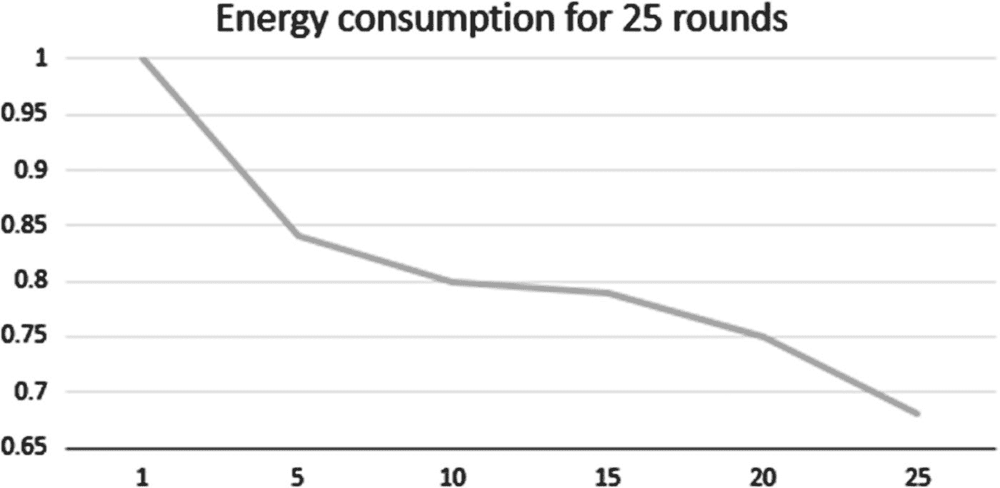

图 3.1 50 个节点 25 轴的能耗。

表 3.2 情况 1 的分组投递率

| 轴 | 分组投递率值 |

| --- | --- |

| 1 | 1 |

| 2 | 1 |

| 3 | 1 |

| 4 | 1 |

| 5 | 1 |

| 6 | 1 |

| 7 | .996 |

| 8 | .991 |

| 9 | .985 |

| 10 | .98 |

| 11 | .976 |

| 12 | .97 |

| 13 | .965 |

| 14 | .96 |

| 15 | .957 |

| 16 | .953 |

| 17 | .95 |

| 18 | .948 |

| 19 | .945 |

| 20 | .94 |

图 3.2 表示情况 1 中 50 个节点的分组投递率图。此情况下获得的平均分组投递率为 97.58%。

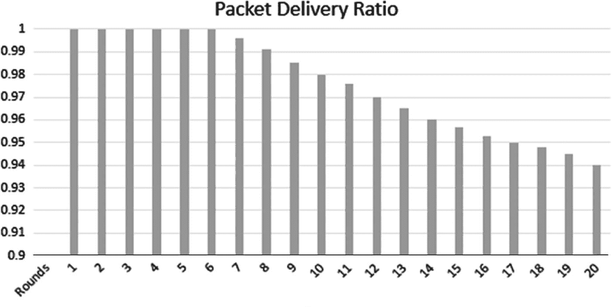

图 3.2 情况 1 的分组投递率。

仿真再次针对情况 2 运行，包含 50 个节点和 50 次迭代。图 3.3 表示此情况下的能耗图。可以从图中看到，在第 50 次迭代时，消耗了 75% 的能量，25% 仍然剩余。此情况下获得的分组投递率值显示在 表 3.3。

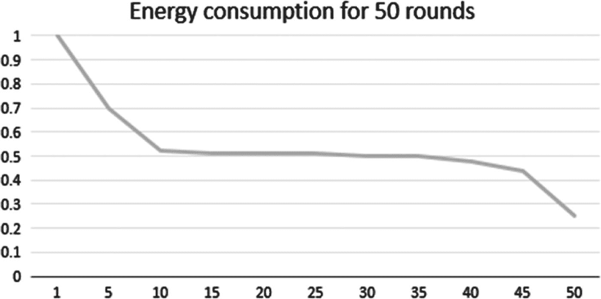

图 3.3 50 个节点 50 轴的能耗。

表 3.3 情况的分组投递率

| 轴 | 分组投递率值 |

| --- | --- |

| 1 | 1 |

| 2 | 1 |

| 3 | 1 |

| 4 | 1 |

| 5 | 1 |

| 6 | 1 |

| 7 | .998 |

| 8 | .998 |

| 9 | .997 |

| 10 | .997 |

| 11 | .996 |

| 12 | .995 |

| 13 | .995 |

| 14 | .9945 |

| 15 | .994 |

| 16 | .994 |

| 17 | .993 |

| 18 | .991 |

| 19 | .991 |

| 20 | .99 |

图 3.4 表示情况 2 中 50 个节点的分组投递率图。在能量利用率为 75% 时获得的平均分组投递率为 99.59%。

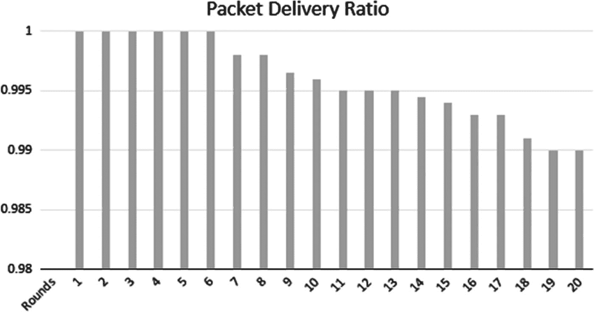

图 3.4 情况 2 的分组投递率。

情况 3 包含 100 个节点，仿真运行了 25 轴。图 3.5 表示此情况下的能耗图。可以从图中看到，在第 25 次迭代时，消耗了 45% 的能量，55% 仍然保留。

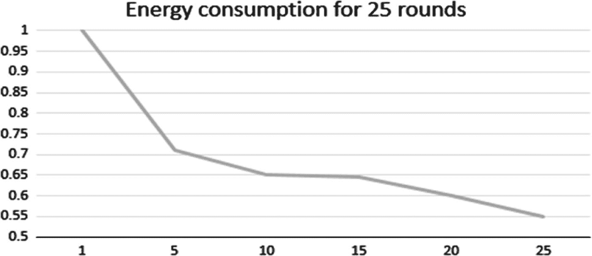

图 3.5 100 个节点 25 轴的能耗。

表 3.4 表示情况 3 获得的分组投递率值。

表 3.4 情况 3 的分组投递率

| 轴 | 分组投递率值 |

| --- | --- |

| 1 | 1 |

| 2 | 1 |

| 3 | 1 |

| 4 | 1 |

| 5 | 1 |

| 6 | 1 |

| 7 | .998 |

| 8 | .998 |

| 9 | .9965 |

| 10 | .996 |

| 11 | .995 |

| 12 | .995 |

| 13 | .995 |

| 14 | .9945 |

| 15 | .994 |

| 16 | .993 |

| 17 | .993 |

| 18 | .991 |

| 19 | .99 |

| 20 | .99 |

图 3.6 表示情况 3 中 100 个节点的分组投递率图。在能量利用率为 45% 时获得的平均分组投递率为 99.61%。接下来是测试 100 个节点运行 50 次迭代。

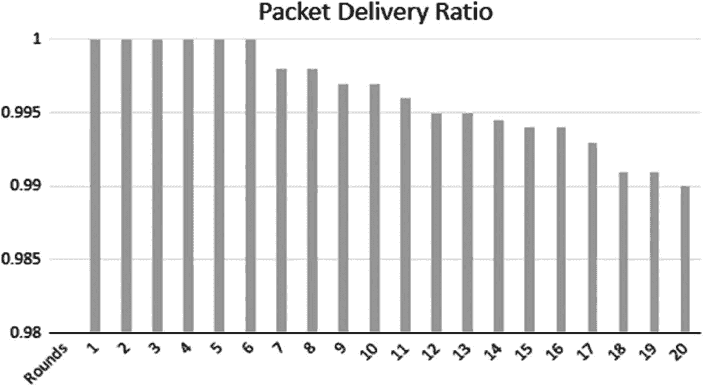

图 3.6 情况 3 的分组投递率。

图 3.7 表示情况 4 的能耗图。图显示在 100 个节点的第 50 次迭代时几乎完全消耗了能量。

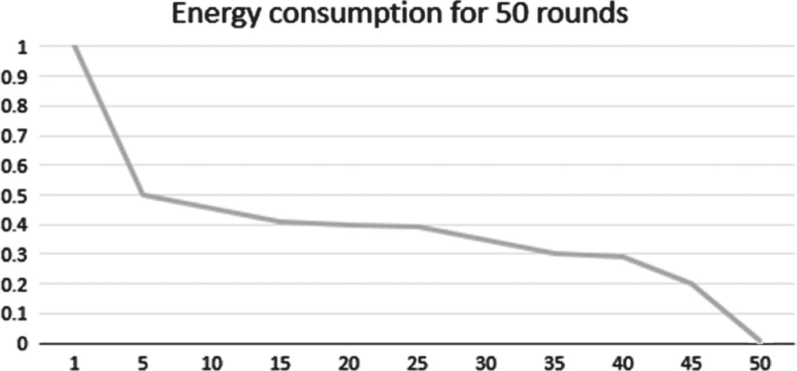

图 3.7 50 轮 100 个节点的能耗.

在 图 3.8 中，图表显示了案例 4 中 100 个节点的分组投递率。在能量利用率为 99.8% 时获得的平均分组投递率为 99.54%。

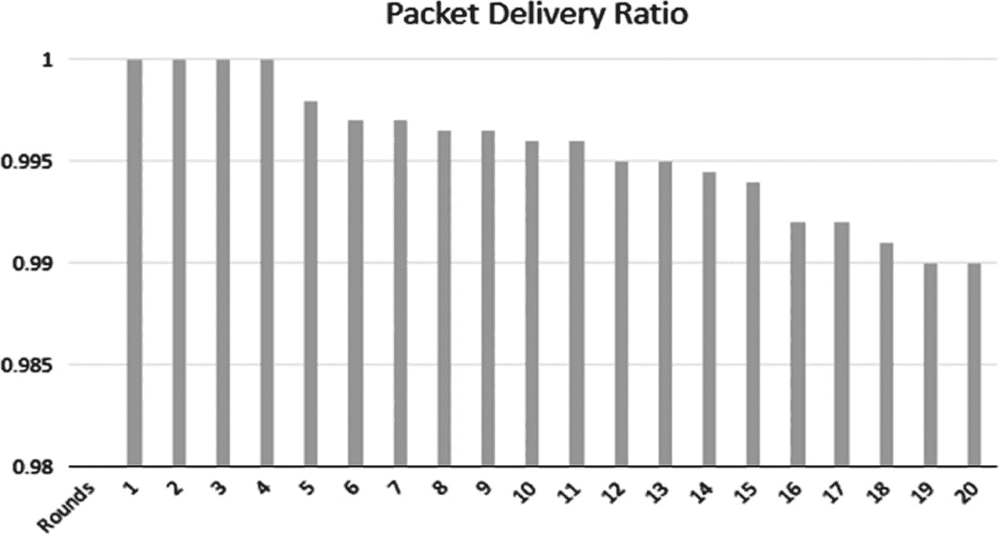

图 3.8 案例 4 的分组投递率.

表 3.5 案例 4 的分组投递率

| 轮次 || 分组投递率的值 |

| --- | --- |

| 1 || 1 |

| --- | --- |

| 2 || 1 |

| --- | --- |

| 3 || 1 |

| --- | --- |

| 4 || 1 |

| --- | --- |

| 5 || .998 |

| --- | --- |

| 6 || .997 |

| --- | --- |

| 7 || .997 |

| --- | --- |

| 8 || .9965 |

| --- | --- |

| 9 || .9965 |

| --- | --- |

| 10 || .996 |

| --- | --- |

| 11 || .996 |

| --- | --- |

| 12 || .995 |

| --- | --- |

| 13 || .995 |

| --- | --- |

| 14 || .9945 |

| --- | --- |

| 15 || .994 |

| --- | --- |

| 16 || .992 |

| --- | --- |

| 17 || .992 |

| --- | --- |

| 18 || .991 |

| --- | --- |

| 19 || .99 |

| --- | --- |

| 20 || .99 |

表 3.5: 图表显示，在能量完全消耗时，获得的分组投递率为 99.54%，而当仅消耗 32% 的能量时，获得的分组投递率结果也很好，为 97.58%。不同案例的性能指标值、能量利用率和分组投递率在 表 3.6 和 3.7 中给出。

表 3.6 50 个节点的性能参数

| 节点数 = 50 |

| --- |

| 迭代次数 || 能量消耗 (%) || 分组投递率 (%) |

| 25 || 32 || 97.58 |

| --- | --- | --- |

| 50 || 75 || 99.59 |

表 3.7 100 个节点的性能参数

| 节点数 = 100 |

| --- |

| 迭代次数 || 能量消耗 (%) || 分组投递率 (%) |

| 25 || 45 || 99.61 |

| --- | --- | --- |

| 50 || 99.8 || 99.54 |

分组投递率的最大值为 99.61%，在能量消耗为 45% 时获得。在能量利用率为 45% 时，获得了良好的结果；因此，仍有超过 50% 的能量被保留。

### 3.5 结论与未来展望

无线传感器网络以数千个节点的规模部署；因此，聚类被认为是在通信过程中保存节点能量的最佳方式之一。所提出的工作旨在改进网络中簇头的选择。使用自适应神经模糊逻辑以一种方式在网络中包含人工行为，即数据与一组已训练的数据进行测试以符合要求。模糊推理系统基于规则集工作，将其与人工智能（ANFIS）相结合可以提供更优化的结果，这些结果在我们的实验中根据所考虑的指标获得。仿真结果表明，这里考虑的两个参数都取得了良好的结果。然而，网络的效率不仅基于这两个参数。正如我们所提到的，其他作者已将此技术与其他参数一起使用；例如，延迟、吞吐量也可以对网络性能测试做出贡献。考虑更多指标可能会带来更优化和改进的结果。然而，如果使用模糊方法，多个网络指标可能会使拥有更大的规则库变得困难，但可以测试规则库负载优化的技术。此外，移动性是一个重要因素，它可以成为神经模糊逻辑的一部分，以获得更好的结果。

## 参考文献

1.  H. Hasani 和 S. Babaie, 基于模糊逻辑的自私节点检测在自组网中，Neural Computing and Applications 3, 1–12, 2018.

2.  A. Abuarqoub, M. Hammoudeh, B. Adebisi, S. Jabbar, A. Bounceur, 和 H. Al-Bashar, 移动无线传感器网络的动态聚类与管理，Computer Networks, 117, 62–75, 2017.

3.  Mian Ahmad Jan, Bin Dong, Syed Rooh Ullah Jan, Zhiyuan Tan, Sahil Verma, 和 Kavita, 基于机器学习的大数据分析用于 IoT 启用的智能医疗系统的全面综述 MONET, Springer, 2021.

4.  X. Liu 和 Xuxun, 无线传感器网络中聚类路由协议综述，Sensors, 12(8), 11113–11153, 2012.

5.  K. Akkaya 和 M. Younis, 无线传感器网络路由协议综述，Ad Hoc Networks, 3(3), 325–349, 2005.

6.  E. G. Julie, S. Tamilselvi, 和 Y. H. Robinson, 基于 WSN 的节能虚拟骨干路径基于集群路由协议的性能分析，Wireless Personal Communications 91(3), 1171–1189, 2016.

7.  H. Yaser, S. Ali, N. Z. Jhanjhi, M. Humayun, A. Nayyar, 和 M. Masud, 模糊方法在分布式组件故障检测中的作用，CMC-Computers Materials & Continua 67, (2), 1979–1996, 2021.

8.  Y. G. Ha, H. Kim, 和 Y. C. Byun, 基于集群的无线传感器网络中节能火灾监测，International Journal of Distributed Sensor Networks, 2012, 2012.

9.  M. Humayun, N. Z. Jhanjhi, 和 M. Z. Alamri, 基于 IoT 的 E-Health 应用智能安全节能方案：综述，International Journal of Computer Science and Network Security 20(4), 55–74.

10.  I. Batra, S. Verma, Kavita, U. Ghosh, J. J. P. C. Rodrigues, G. N. Nguyen, A.S.M. Sanwar Hosen, 和 V. Mariappan, 绿色物联网中隐私保护的混合逻辑安全框架，MDPI-Sustainability 12(14), 5542, 2020.

11.  I. J. Su, C. C. Tsai, 和 W. T. Sung, 基于自适应模糊逻辑的无线传感器网络中区域温度系统监测与计算，Applied Soft Computing 12(5), 1532–1541, 2012.

12.  S. Hafsa, H. Ashraf, H. Javed, M. Humayun, N. Z. Jhanjhi, 和 M. A. AlZain, "基于 IoT 的无线传感器网络中针对虫洞攻击的节能安全”，CMC-Computers Materials & Continua 68(2), 1966–1980, 2021.

13.  S. A. Sahaaya, A. Mary, 和 J. B. Gnanadurai, 基于模糊逻辑的无线传感器网络中簇头选举的增强区域稳定选举协议，International Journal of Fuzzy Systems, 19(3), 799–812, 2017.

14.  S. Soobia, et al 使用聚类方法分析 IT 合规审计模块的性能和效率，载于《工业物联网和物理网络系统：将传统转变为数字》论文集。IGI Global, 351–376, 2020.

15.  M. Selvi, R. Logambigai, S. Ganapathy, L. S. Ramesh, H. K. Nehemiah, 和 K. Arputharaj, WSN 中节能路由的模糊时间方法，载于《国际信息学与分析会议论文集》，1–5, 2016.

16.  Z. Noor, L. T. Jung, F. Alsaade, 和 T. Alghamdi, 无线传感器网络 (WSN)：路由安全、可靠性和能源效率，Journal of Applied Sciences 12(6), 593–597, 2012.

17.  H. Mamoona, N. Z. Jhanjhi, M. Alruwaili, S. S. Amalathas, V. Balasubramanian, 和 B. Selvaraj, 5G 辅助工业物联网中的隐私保护与能源优化，IEEE Access 8, 183665–183677, 2020.

18.  H. Chang, 面向沉穴的无线传感器网络中的混合智能协议，载于《2012 国际信息安全与智能控制会议论文集》，57–60, 2012.

19.  S. Maryam, H. Ashraf, A. Ullah, M. Masud, M. Azeem, N. Z. Jhanjhi, 和 M. Humayun, WSN 中 IoT 辅助智能设备的强健基于集群的路由协议，CMC-Computers Materials & Continua 67(3), 3505–3521, 2021.

20. N. Ghosh, I. Banerjee, 和 R. S. Sherratt, On-demand fuzzy clustering and ant-colony optimisation based mobile data collection in wireless sensor network, Wireless Networks 1–17, 2017.

21. H. S. Jawad, M. Irfan, N. Z. Jhanjhi, K. Hussain, 和 H. Mamoona, Performance enhancement in wireless body area networks with secure communication, Wireless Personal Communications 116(1), 1–22, 2021.

22. P. Rani, Kavita, S. Verma, 和 N. G. Nguyena, Mitigation of black hole and gray hole attack using swarm inspired algorithm with artificial neural network, IEEE Access 30, 2020.

23. B. Vijayalakshmi, K. Ramar, N. Z. Jhanjhi, S. Verma, M. Kaliappan, K. Vijayalakshmi, Kavita, U. Ghosh, 和 S. Vimal, An Attention Based Deep Learning Model For Traffic Flow Prediction Using Spatio Temporal Features Towards Sustainable Smart City, IJCS,Wiley, 2021.

24. S. Kar, S. Das, 和 P. K. Ghosh, Applications of neuro fuzzy systems: A brief review and future outline, Applied Soft Computing, 15, 243–259, 2014.

25. A. Tatar, A. Barati-Harooni, A. Naja\_-Marghmaleki, B. Norouzi-Farimani, 和 A. H. Mohammadi, Predictive model based on an\_s for estimation of thermal conductivity of carbon dioxide, Journal of Molecular Liquids 224, 1266–1274, 2016.

26. S. Verma, S. Kaur, D. B. Rawat, C. Xi, L. T. Alex, 和 N. Z. Jhanjhi. Intelligent framework using IoT-based WSNs for wildfire detection, IEEE Access 9, 48185–48196, 2021.

27. M. M. Afsar 和 M.-H. Tayarani. Clustering in sensor networks: A literature survey, Journal of Network and Computer Applications 46, 198–226, 2014.

28. R. Madan, et al Cross-layer design for lifetime maximization in interference-limited wireless sensor networks, Wireless Communications 5(11), 3142–3152, 2006.

29. J.-H. Chang 和 L. Tassiulas, Maximum lifetime routing in wireless sensor networks, IEEE/ACM Transactions on Networking (TON) 12(4), 609–619, 2004.

30. R. Madan 和 S. Lall, Distributed algorithms for maximum lifetime routing in wireless sensor networks, Wireless Communications 5(8), 2185–2193, 2006.

31. A. Giridhar 和 P. R. Kumar, “Maximizing the functional lifetime of sensor networks,” in Proceedings of the 4th International Symposium on Information Processing in Sensor Networks. IEEE Press, 2005.

32. S. Mottaghi 和 M. R. Zahabi, Optimizing LEACH clustering algorithm with mobile sink and rendezvous nodes, AEU-International Journal of Electronics and Communications 69(2), 507–514, 2015.

## 4 大数据安全

Mehwish Malik, Hina Umbrin, Nuzhat Akram, Khalid Hussain Usmani, 和 NZ Jhanjhi

## CONTENTS

1. 4.1 Big Data

2. 4.1.1 Volume – 数据的大小

3. 4.1.2 Variety – 数据的不同形式

4. 4.1.3 Velocity – 数据生成速度

5. 4.1.4 Value – 数据的价值

6. 4.1.5 Veracity – 数据不确定性

7. 4.1.6 Variability – 数据不一致性

8. 4.1.7 Visualization – 数据表示

9. 4.1.8 Volatility – 数据存储时长

10. 4.1.9 Validity – 数据使用

11. 4.2 Big Data 的数据源

12. 4.3 架构

13. 4.3.1 数据源

14. 4.3.2 数据摄取

15. 4.3.3 存储层

16. 4.3.4 暂存

17. 4.3.5 数据管道

18. 4.3.6 数据和工作流管理

19. 4.3.7 数据访问

20. 4.4 Big Data 挑战

21. 4.5 Big Data 中的 Big Data 分析挑战

22. 4.6 Big Data 中的技术挑战

23. 4.7 Big Data 的特征导向挑战

24. 4.7.1 数据量

25. 4.7.2 数据速度

26. 4.7.3 数据多样性

27. 4.7.4 数据价值

28. 4.8 隐私挑战

29. 4.9 安全挑战

30. 4.10 Big Data 中当前的安全挑战

31. 4.10.1 Big Data 安全 – 定义

32. 4.10.2 安全漏洞案例研究及其对组织的影响

33. 4.11 Big Data 的主要安全问题

34. 4.11.1 分布式框架安全

35. 4.11.2 非关系型数据存储保护

36. 4.11.3 存储安全

37. 4.11.4 实时安全监控

38. 4.11.5 隐私保护的数据分析和挖掘

39. 4.11.6 细粒度审计

40. 4.11.7 端点安全

41. 4.11.8 基于密码学的数据中心安全

42. 4.12 安全挑战的解决方案

43. 4.12.1 社交网络的完整数据监督

44. 4.12.2 法律机制的改进

45. 4.12.3 提高人们对数据质量的认识

46. 4.12.4 将安全放在首位

47. 4.13 结论

48. 参考文献

DOI: [`10.1201/9780367808228-4`](https://doi.org/10.1201/9780367808228-4)

### 4.1 Big Data

## Big Data Overview

首先，人们普遍认为，大数据描述的是巨大的数据集，需要创新的分析方法才能充分利用它们并创造出新颖且创新的价值形式。大数据的广泛性并非源于绝对的规模或大小，而是关于研究和分析的适当规模。由于这是一个在学术界和工业界各个领域都被广泛使用的术语，研究人员以多种方式对其进行了定义。Sagiroglu \[1\] 将大数据与数据集的容量相关联，认为大数据是大规模数据集的表达，这些数据集具有庞大、更多样化以及复杂的结构，伴随着分析、存储和可视化数据以进行进一步处理和得出结果的复杂性。Van Dijck \[2\] 提出的另一种定义将大数据描述为社会行动向在线可测量数据的转变，这随后允许进行预测分析和实时跟踪。他们鼓励构建更可靠、更准确的预测，以解决从气候变化到恐怖主义活动等复杂而错综复杂的问题 Kitchin \[3\]。此外，大数据还体现了企业和国家机构在大量信息积累方面面临的行政挑战。Bekker \[4\] 将大数据描述为具有信息特征的数据，例如统计正确性和事件日志的性质等，并且这要求诸如并行处理、分布式存储和简单的解决方案可扩展性等技术需求。作者进一步全面描述了每个特征，认为传统数据随时可能发生变化；例如，银行账户、仓库中的产品数量等，而大数据描述的是表示某些事件的每条记录的日志，例如，网页浏览、商店中的购买活动、随时间变化的传感器值、社交媒体评论等。大数据的这种特性允许事件数据不发生变化。虽然大数据被认为在统计上是正确的，但它可能包含错误或遗漏，这就是为什么它不被认为是需要绝对准确性的任务的良好选择。作者强调的大数据的另一个属性是由于其容量而产生的技术要求；它需要并行处理，高存储容量需要特殊的存储方法。

Andrea \[5\] 确定了与大数据相关的核心主题，即信息、方法、技术及其影响。他们引用了关于大数据术语的各种解释，并检查它们是否包含上述主题。信息可以被视为大数据存在的根本原因之一，因为其生成和可用性为大数据提供了燃料。大数据中的信息催生了一个名为“数据化”的新术语，旨在将模拟信号组织成数字形式，以产生否则无法推断的洞察。技术经常与大数据相关联，允许其利用，例如 Hadoop \[6,7\]。在相对较小的机器上高效存储大量数据的能力是技术应用于大数据的基本要素。因此，可以说技术是处理大数据的核心设备。对定量数据的广泛分析以及从个人行为中获取价值的必要性需要处理技术和方法；因此，方法将大数据转化为资产。大数据分析的利用不仅允许高效且恰当地管理数据，还帮助将此类数据纳入决策过程。对这些方法以及技术、其优势和劣势以及文化倾向的认识，传播开来以促进明智和智能的决策，正如大数据所要求的那样。它对我们社会造成的影响程度通常通过技术和实施方法的成功故事和轶事来描绘。这些故事结合新颖的原则和程序发展，对某一主题的知识创造做出了宝贵贡献。如果信息可用性和生产的普遍性导致跨越多个科学领域的大量应用，那么它也对社会产生不利影响。由于大数据的发展而产生的主要关切包括：隐私问题、信息可访问性问题等；因此，影响是大数据的一个核心主题。作者 \[5\] 然后将定义分为几组，第一组完全专注于列举大数据的特征。在这一组中，Laney \[8\] 提出了一个框架，表达了数据在三个维度上的容量、多样性和速度的增加；该框架后来被称为大数据的三个 V。该模型后来被扩展到价值 \[9\]、真实性 \[10\]、变异性 \[11\]、粘度 \[12\]、传播性 \[12\] 和有效性 \[13,14\]，下面将详细描述。另一组从处理海量数据背后的技术要求来定义大数据。其余的定义将大数据与超过某些阈值相关联，例如当数据超过传统数据库系统的处理能力时，则可以将其称为大数据。作者 \[5\] 在以前定义的基础上提出了一个结论性定义；它指出大数据是信息资源的一种表现，其特征是高速度、容量和变化，需要特定的分析过程和技术将其转化为价值。总而言之，大数据仅仅是一种转换，其中数据被处理为信息，信息被处理为知识，知识转化为智慧和价值，如 Figure 4.1（大数据转换）所示。

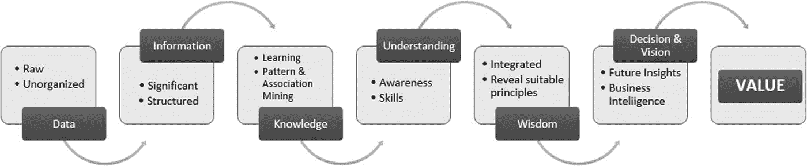

Figure 4.1 Big Data Transformation.

总而言之，大数据塑造了一种基于技术、文化和学术知识的现象，它建立在技术、神话和分析的相互作用之上，引发了广泛的反乌托邦和乌托邦言论 Boyd \[15\]。

大数据特征最初由 Laney \[8\] 作为数据框架的一部分描述，并不直接关联到大数据，但后来被纳入大数据模型，并由多位作者进行了扩展。这些特征如下解释，并如 Figure 4.2 所示。

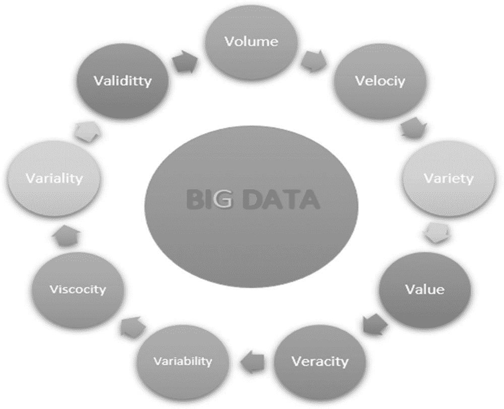

Figure 4.2 9 V's of big data.

#### 4.1.1 Volume – 数据的容量

海量的容量是使数据变得“大”的主要商标。如果我们将大数据视为一个金字塔，容量无疑是基础。它指出每秒从手机、社交媒体、M-2-M 传感器、信用卡、视频、照片等产生的海量数据。当前的数据量可能非常惊人。考虑几个例子：

*   在 Thomas Reuter 于 2010 年编制的一份年度报告中，他分享了他对世界数据量的估计，超过 800 EB，并且仍在进一步增长。2012 年，硬件公司 EMC 声称世界数据量为 99 EB，并预测其增长率每年为 50%。

*   截至 2019 年 5 月的统计数据显示，每分钟有多达 500 个视频上传到 YouTube。

*   2018 年拍摄了超过一万亿张照片，并且预计该数字在当前年份将上升 7%。

在 2018 年，全球移动流量每月高达 19.01 EB。到 2022 年，全球数据流量预计将达到每月近 77.5 EB，年复合增长率约为 46%。曾经以 GB 为单位的测量，如今因数据的指数级增长，已改为以 ZB 甚至 YB 为单位。

根据最近的数据，Facebook 每天产生约 4 PB 的数据。据 2019 年季度检索的事实显示，这个最大的社交网络平台每月约有 24.1 亿活跃用户。它每分钟还有 400 名用户注册其服务；在这一分钟内，不仅会创建账户，还会创建 29.3 万条状态、发表 51 万条评论、上传 13.6 万张图片，并有约 400 万条帖子获得点赞。

每年产生多少数据仍不明确，但处理的信息量无疑是巨大的。这种海量数据需要不同且独特的处理技术，而非依赖传统的处理和存储能力。归根结底，大数据太过庞大，无法在任何普通笔记本电脑处理器上处理；因此，我们无法使用传统数据库技术来分析和存储数据。现在，分布式系统被广泛采用，它们将数据块存储在不同位置，并可通过软件将其重新组合为单元。收集和分析如此巨量的数据是一项巨大挑战。

#### 4.1.2 多样性 – 不同形式的数据

多样性可以表述为可使用的不同形式的数据。当今的数据与过去年份的数据截然不同，过去的数据大多为结构化数据；此类数据包括银行对账单信息，如金额、日期、账户标题、联系信息等。传统数据完美适配任何关系型数据库。大数据处理多种类型的数据，可分为三大类：结构化数据、半结构化数据和非结构化数据。让我们简要讨论每一类。

*   结构化数据 – 此类数据格式良好且组织有序，为大数据定义了固定长度。其示例包括日期、数字、数字组合以及名为字符串的单词等。此类数据通常存储在关系型数据库中。

*   半结构化数据 – 它介于结构化数据和非结构化数据之间。它是一种结构化数据，不遵循与数据表或关系型数据库关联的数据模型的正式结构。尽管如此，它包含标记或标签，用于分离语义元素并在数据中强制实施记录和字段层次结构。示例包括 XML 文件和 JSON；NoSQL 也被视为一种半结构化类型。

*   非结构化数据 – 目前，世界上大部分数据（约 80%）属于非结构化数据类别。它包括图片、视频、社交媒体更新，如推文、状态、帖子等，语音录音、闭路电视录像；除此之外，它还包含日志文件、机器数据、点击数据、传感器数据等。非结构化数据补充了结构化数据，音频文件、网页、MRI 图像、推特信息流和网络日志等都属于此类。显而易见，它包含一切可存储和捕获的内容，但并非基于元模型（围绕一个想法或概念的规则集合）来精确定义。与结构化数据相比，非结构化数据可以更好地定义。结构化数据可被视为在既定规则下定义良好的数据；例如，姓名表示为文本，金额使用至少两位小数的数字，日期遵循特定模式。而在非结构化数据中，不遵循任何规则；例如，推文、语音录音或图片各不相同，但都代表基于人类理解的思想和观念。

数据类型的多样性需要具备多样化处理能力的特殊算法。组织数据以提取有意义的信息并非易事，尤其是在数据快速变化的情况下。大数据技术的创新和新颖性在某种程度上已实现了对所有类型数据的采集、利用和存储。

#### 4.1.3 速度 – 数据生成速度

速度表示海量数据生成、创建、收集、刷新和分析的速度。它是需要处理的传入数据频率。每分钟通过特定电信运营商发送的推特消息、短信、信用卡刷卡记录和 Facebook 状态更新，均以高速度生成。管理数据速度的流行流式应用之一是亚马逊的网络服务 Kinesis。以下列举了几个有助于理解速度概念的示例。

*   Google 每秒处理超过 7 万个查询，每分钟高达 400 万次搜索，每小时 2.4 亿次，每天超过 57.6 亿次。这反映了互联网给我们生活带来的变化现象。

*   Facebook 声称每天的传入数据率超过 500 TB，为此它在俄勒冈州普林维尔设有专用数据仓库。Facebook 存储了 2400 亿张或更多图片，此外用户每天还上传 3.5 亿张新图片。为保存这些照片，Facebook 数据中心团队每月部署 7 PB 的存储设备。尽管 Facebook 存储超过 300 PB 的数据看起来很显著，但一个需要考虑的重要因素是新数据创建的速度，即其速度。数据增加的速度不仅对数据分析提出了需求，还要求数据访问和传输速率及时，以实现即时通讯、信用卡验证和网站访问的实时访问。通常认为，尽可能实时的快速信息流是公司的基本要求，速度可能比数据量更关键和重要，因为它能提供更大的竞争优势。有人说，拥有实时的有限数据访问，优于对海量数据的低访问率。在正确的时间获得数据有助于企业做出合适的决策；经过一定时间后，该数据可能不再像以前那样重要。

#### 4.1.4 价值 – 数据的价值

价值是指提取数据的价值。无穷无尽的数据可能变成无用的存量，除非它具有一定价值。大数据的价值特征位于大数据金字塔的最顶端，这意味着将数据海啸转化为商业价值的能力。

分析和收集数据之间的成本与收益权衡，有助于了解开采数据是否划算，这是启动真正大数据计划的最关键阶段。大数据中可以创造可观的价值，使客户能够更好地了解客户，根据这种理解进行定位，改善业务绩效并优化方法。在启动任何策略之前，了解其潜力和挑战很重要。问题是，收集到的洞察将有助于创建新产品线、削减成本措施还是交叉销售机会，还是将有助于发现可能产生某种疾病治疗方法的关键潜在影响？如果一家公司正确利用大数据，在资源和时间上进行大量投资后，它将能够了解其客户，并能够将海量信息货币化。这将使公司能够在正确的时间提供满足客户需求的优惠。

#### 4.1.5 真实性 – 数据不确定性

## 真实性

真实性是指数据的可信度、可靠性或质量。它说明数据的准确性。例如，Twitter 帖子中包含缩写、标签、拼写错误等，以及此类内容的准确性和可靠性。另一个相关示例是 GPS 数据的使用，当用户访问城市地区时，GPS 会感知到偏离航线。高层建筑会反弹卫星信号；因此，在这种情况下，需要将另一个来源（例如道路数据）与位置数据融合，以提供正确信息。大数据的这一特征被认为是不幸的，因为其余任何 V 的增加都会导致真实性下降；这可能类似于大数据的易变性和有效性（如下定义）。如果数据不准确，那么获取大量数据就毫无用处。

数据真实性知识有助于更好地理解分析及其相关风险，从而最终协助商业决策。真实性确保数据的准确性和清洁度，通过使用各种流程，使您的系统远离不良数据的积累。高真实性的数据包含多条对分析有价值的记录，并能以有意义的方式为完整结果做出贡献，而低真实性的数据包含大量无意义的数据，通常称为噪声。医疗试验或实验数据集具有高真实性。

#### 4.1.6 可变性 – 数据不一致性

大数据中的可变性指几个不同的概念。首先，它通常指数据不一致性，需要通过异常值或异常检测技术来发现，以进行有用的分析。其次，大数据的可变性是由于维度数据的多样性造成的，这是众多不同数据源和类型的结果。最后，它可能指将大数据加载到传统数据库时速度的不一致性。可变性与多样性不同；例如，咖啡店提供四种不同的咖啡混合物，但如果顾客每天都得到同样的混合物，却发现每天的味道都不同，那么这就是可变性。

#### 4.1.7 可视化 – 数据表示

大数据的另一个重要特征是可视化挑战。可视化讨论数据如何通过图表或图形等方式表示。使用图表和图形等方式表示大量复杂数据，比充满公式和数字的报告和电子表格更能有效地传达有意义的信息。由于内存技术的限制、功能不足、可扩展性和响应时间等问题，现有的大数据可视化工具面临一些技术困难。要绘制数十亿个数据点，传统图表不太有用；因此，需要使用各种数据表示方法来表示数据，例如树形图、数据聚类、平行坐标、圆锥树、圆形网络图等。将这种方法与大数据的速度、多样性以及它们之间复杂关系所带来的变量多样性相结合。

#### 4.1.8 易变性 – 存储数据多长时间

您的数据可以保留多久，直到被视为历史数据、无关数据或无用数据？您的数据需要有多旧才能被视为有用？在大数据出现之前，公司习惯于无限期保留数据——少量的太字节可能不会产生过高的存储费用；也可以将其存储在实时数据库中而不会引起性能问题。由于大数据的体量和速度，易变性也应仔细考虑。易变性说明数据应存储多久，并且仍然有效。对数据进行实时分析需要确定数据不再与正在进行的分析相关的时间点。当情况需要时，建立数据可用性和时效性以及快速信息检索的新规则的需求出现了。这些规则应与业务流程和需求相关联，并强调大数据检索和存储过程的复杂性和成本。

#### 4.1.9 有效性 – 数据使用

与真实性一样，它也强调数据为其预期用途的准确性和正确性。据福布斯报道，数据科学家在开始分析之前，大约花费 60% 的时间进行数据清洗。大数据分析与底层数据一样重要；因此，有必要采用良好的治理方法来保证数据的一致质量、元数据和定义。

作者提出了其他几个 V，例如粘性、病毒性、脆弱性、词汇量等 \[16,17\]。上述九个特征由作者进一步分为几个类别。真实性和多样性属于数据收集；速度和体量属于数据处理类别；有效性、可变性和易变性属于数据完整性类别。或者，可视化属于数据可视化，而价值体现在数据价值中。这些类别有助于确定每个大数据特征背后的要点。

### 4.2 大数据的数据来源

大数据由各种类型的累积数据组成。大数据的关键来源如下：公共、私有和社区数据；数据磨损和自我量化。公共数据是政府机构和当地社区获取的数据，并由业务和管理应用程序传输，例如交通、能源使用和医疗保健，这些在特定条件下需要个人隐私。私有数据是私营公司、非营利机构包含的数据，以及公共来源无法披露的个人信息；示例包括消费者交易、机构供应链使用的识别标签、互联网浏览和手机使用。数据磨损是指从有限或零价值的数据收集合作伙伴处收集数据，并与其他资源附加，以创建新数据的类型。此类数据的另一个原因是，我们对行为的信息搜索需求，这些行为可以用来得出人们的需求或目标。社区数据是非结构化数据，包括消费者对商品的评论和投票评论，例如 Twitter 源、Facebook 评论等。自我量化是从行为和动作中暴露出来的；例如，定制为显示锻炼和运动的数字手表。这种自我量化类型的数据有助于在心理学和行为之间架起一座桥梁 \[18\]。

### 4.3 架构

大数据设计是用于摄取和转换大量数据的全面框架，目的是分析数据以进行商业决策。架构是基于组织业务需求的大数据解决方案的蓝图。在以下标题下，架构中涉及的各层被精确讨论。

#### 4.3.1 数据源

组织几乎每天产生大量数据，并且呈指数级增长。数据源层整合来自各种来源、以各种速度、以不同关联进入的数据。

#### 4.3.2 摄取

大数据摄取包括与不同信息源接口、提取信息和区分转换后的信息。数据摄取的参数如下：数据速度、数据大小、数据频率和数据格式 \[19\]。数据已通过以下各层传递。

1. `Identification` – 排列到不同的观察数据结构中；非结构化数据被委托给默认结构。

2. `Filtration` – 适用于终端的数据根据 `(MDM)` 仓库不断进行分离。MDM 代表管理。

3. `Validation` – 过滤后，数据与 MDM 元数据进行对比分析。

4. `Reduction of Noise` – 通过移除噪声并最大限度地减少不一致性，对数据进行清洗。

5. `Transformation` – 根据数据的类型、实质以及组织的需求，对数据进行分离或合并。

6. `Compression` – 在不影响所需方法意义的前提下减小数据大小。应当注意，权重不影响结果评估。

7. `Integration` – 精炼后的数据集与软件实用程序层统一，例如 `Hadoop`。

#### 4.3.3 存储层

这是任何基于大数据的系统的关键部分。它影响系统的通用性、数据结构和编程以及计算模型 \[20\]。

#### 4.3.4 暂存

暂存是提取、转换和加载（ETL）过程中用于数据处理的中间存储区域。

#### 4.3.5 数据管道

大数据的真实性要求进入和退出大数据处理管道的数据具有高质量。大数据管道分为两部分：微管道和宏管道。微管道工作基于层级步骤来生成子表单。微管道包括一个细粒度的数据处理步骤。宏管道在工作流级别运行，并正确控制每个层级的工作流。

#### 4.3.6 数据和工作流管理

大数据架构建立在具有可扩展容量的大规模分布式数据组之上。如果大数据环境建立在云上，则需要花时间与云服务提供商建立牢固的协议。

#### 4.3.7 数据访问

数据结构在很大程度上取决于应用程序或客户端如何检索信息。应了解数据检索模式，因为某些类型的信息可能会被大量客户端或应用程序冗余地恢复 (Figure 4.3)。大数据架构如图 4.3 所示，以便读者更好地理解。

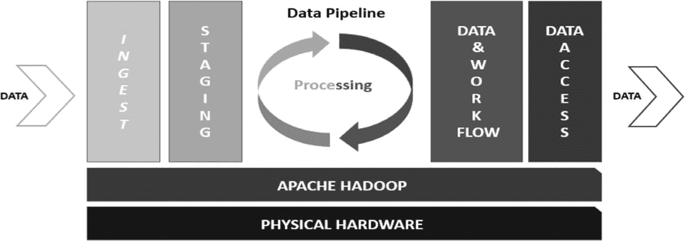

Figure 4.3 Big data architecture.

### 4.4 大数据挑战

大数据更像是一场迅速向山下推进的雪崩，一路越来越快、越来越大，大多数组织都在努力跟上其步伐。这就像滑雪者需要头盔、手套等基本装备才能在雪崩中生存一样。同样，组织需要为雪崩做好准备，在这里，雪崩指的就是大数据；他们需要意识到在雪崩势头增强时所需的基本工具。能够从远比以往更多的数据源收集数据，这正是使数据变得“大”的原因。想想目前数以十亿计的联网设备，手机和 IoT 传感器 \[21\] 仅仅是其中两个例子。尽管大数据提供了多个诱人的机会，但专业人士和研究人员在探索大型数据集以及从中提取知识和价值时，仍然面临许多挑战。这些庞大数据集的复杂性在不同层面带来了诸多困难，例如数据存储、数据捕获、共享、搜索、管理、分析和数据可视化。现在想象一下可能出现的所有安全相关问题。大数据的概念源于 IP 设备数量的难以置信的增长。轻松地说，大数据仅仅是一个术语，指公司在特定区域内收集的、旨在发现其中趋势或隐藏模式的完全可访问的数据或信息 \[22\]。这些趋势或模式在被分析工具发现后，可以用于产生改进的结果（更多收入、更高的客户满意度、更快的服务交付等等）。硬币的另一面表明，大数据存储架构反映了其安全关切的新目标，即针对恶意软件和非法活动。问题是，如果这种不可或缺的业务资产出了问题，后果可能对积累它的组织来说是灾难性的。不幸的是，几种大数据工具是开源的，它们通常不是以安全作为主要功能来设计的，从而导致更多的安全问题。通常，分布式流和信息的洪流超过了我们驾驭它们的能力。

在出征之前，每位将军都需要研究他的敌人：敌军的规模、武器类型、战斗次数与结果、战术等，以便制定正确的作战策略并做好战斗准备。同样，每位决策者都需要了解自己正在管理什么。下面讨论了一些归因于大数据的主要挑战 (Figure 4.4)。大数据有许多挑战和机遇，如下所示。

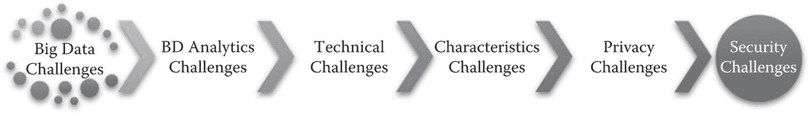

Figure 4.4 Major big data challenges.

### 4.5 大数据分析中的大数据挑战

大数据为不同领域带来了巨大的变革潜力和机遇；但与此同时，它也对约束如此庞大且不断扩大的数据量展现出了非凡的挑战。需要前沿的调查来解释特征与所检查数据之间的关联。例如，数据分析使组织能够获取有用的洞察，并跟踪可能对业务产生负面或正面影响的模式。还有许多其他数据驱动的应用程序需要实时分析，例如 Facebook、Twitter、LinkedIn 等社交网络，金融、导航、智能交通系统（如自动驾驶汽车）、天文学、医学等等。因此，需要有效的数据挖掘方法，结合先进的算法，才能获得准确的结果，以观察不同领域的变化并预测未来的认知 \[23\]。尽管如此，出于多种原因，大数据分析仍然非常具有挑战性：其复杂的性质，例如七个 V，以及为了以现实的响应速度审查如此庞大的异构数据集而需要的性能和可扩展性 \[24,25,26\]。如今，存在多种分析技术，包括统计分析、数据挖掘、可视化和机器学习。大量研究通过改进已提出的技术，或提出新的或经过测试的方法或算法组合来处理这一领域。因此，大数据加速了硬件、软件和系统架构的发展。然而，尽管如此，仍然需要分析上的进步来应对大数据的挑战。另一个问题是，当数据量巨大时，如何保证及时响应。尽管科学家们正在努力提高数据质量，并使分析算法更加强健（对与数据相关的问题具有抵抗力），但大数据分析并非完美或理想。目前尚无法解决与数据可靠性相关的一些问题。分析不佳会导致错误的结论和相关性 \[23\]。在下一节中，将探讨大数据分析中遇到的主要挑战。

1.  *数据管理格局的不确定性* – 由于大数据日益扩张，新技术和公司每天都在涌现。在不引入新问题或风险的前提下找到最佳技术，对公司来说是一个巨大的挑战 \[27\].

2.  *大数据能力缺口* – 虽然大数据分析是一个新兴领域，但该领域的专家数量非常有限。专家不足的原因在于这是一个复杂的领域，很少有人理解该领域错综复杂的本质。因此，该行业的人才缺口是大数据面临的另一个重大挑战。

3.  *数据接入大数据平台* – 公司正面临处理海量快速增长数据的挑战。当今数据的多样性和规模足以让任何数据专家感到不堪重负，因此让数据易于管理者获取变得更加关键。

4.  *数据源间的同步* – 数据集的多样性增加了将其整合到分析平台的需求。如果忽视这一点，可能会产生差距，导致错误的洞察和信息 \[28\].

5.  *通过大数据分析生成重要洞察* – 组织从大数据分析中获得合法洞察至关重要，同样重要的是让相关部门能够接近并访问这些数据。因此，以高效的方式弥合这一差距是一项重大挑战。

6.  *大数据分析中的偏差标记* – 大数据算法通常基于与被分析元素相关的显式标记。因此，分析可能会被误导。当有人发现哪些标记影响结果时，他们可以修改被分析元素以满足标记设定的先决条件。如前所述，大数据分析依赖于研究对象的特定标记。如果添加标记的个人对该事项存在偏见，将会影响结果。因此，偏差标记会导致偏差分析。

### 4.6 大数据中的技术挑战

在当前市场上琳琅满目的大数据技术中，很容易迷失方向。你需要 Apache Spark，还是 MapReduce 的速度就足够了？数据存储应该使用 HBase 还是 Cassandra？找到这些问题的答案可能很复杂。而且，如果你在没有明确需求的情况下在技术可能性的海洋中搜索，很容易做出错误的选择 \[23\].

这些技术困难进一步细分为以下定义的子标题。

1.  *容错性* – 大数据和云计算等新技术的出现，提高了人们的期望：每当发生故障时，造成的损害应在可容忍的阈值内，而不是从头开始整个任务。然而，容错性是极其困难的计算，涉及复杂的算法。基本上，要设计出完全万无一失且 100% 可靠的机器或软件是不切实际的。因此，根本任务是将故障/错误的可能性降低到可接受的阶段。不幸的是，我们越是努力降低这种概率，成本就越高。有一种策略可以克服这个问题。它将正在执行的整个计算分解为更小的任务，并将这些任务分配给各个节点进行计算。其中一个节点被赋予检查这些节点正常运行的责任。如果发生什么情况，该特定任务将被重新启动。然而，可能存在一种场景，即无法将整个计算分解为独立的任务。任务可能是递归的，即前一个任务的输入取决于下一个任务的计算结果。因此，重新启动整个计算任务可能会很麻烦 \[23\].

2.  *可扩展性* – 处理器背后的技术最近发生了变化。时钟速度大大减慢，而处理器中的核心数量却增加了。早期的数据处理框架需要考虑特定集群中节点间的并行性，但最近关注点已转移到节点内的并行性。过去用于跨节点并行处理的技术不足以处理单个节点内的并行性。这是因为在单独节点的一个核心中共享了大量硬件资源。大数据中的可扩展性问题导致了云/分布式计算，目前它将许多具有波动性能目标的不同工作负载聚合到大型集群中。这需要更高级别的资源共享，这既昂贵，而且还带来了许多挑战，例如如何执行和运行不同的作业，以便以具成本效益的方式实现每个工作负载的目标。它还需要以高效的方式管理故障，这些故障在大型集群上运行时比在小型集群上更常发生 \[29\].

3.  *数据质量* – 大量的数据收集和存储会产生巨大的成本。如果将更多数据输入到任何企业的预测分析和决策过程中，可以获得更好的结果。业务领导者总是想要更多的数据存储；另一方面，IT 领导者在数据存储之前会考虑技术方面。大数据本质上关注数据存储的质量，而不是拥有不相关的大量数据，以便得出更好的结果和结论。这进一步引发了不同的问题，例如如何保证哪些数据是相关的，决策过程需要多少数据才足够，即使存储的数据是正确的，或者如何不从中得出推断等等。

4.  *数据异质性* – 非结构化数据涵盖几乎每种正在构建的数据，例如，录制的会议、PDF 文档处理、社交媒体互动、电子邮件、传真传输等。结构化数据始终以高度自动化和可管理的方式组织。它描述了与数据库的正确集成；然而，非结构化数据是完全原始和无序的，因此，处理此类数据显然是昂贵且麻烦的。将此类非结构化数据转换为结构化数据也是不可行的。与结构化数据相比，挖掘这些数据很笨拙，结构化数据可以轻松管理 \[24\].

### 4.7 大数据的特性导向挑战

大数据的每个属性都带来挑战，下面讨论了其中几个主要关注的挑战。

#### 4.7.1 数据量

与此属性相关的第一个问题是存储。随着数据量的增加，所需空间也随之增加，因此需要高效地存储。除了巨大的数据量需要以快速的速度检索以获取输出这一事实之外，还有其他需要关注的领域，例如存储成本，如云存储与内部数据存储、带宽、网络等 \[30\]. 随着数据量的扩大，数据记录的价值会随着丰富度、年龄、类型和质量的降低而按比例下降 \[31\]. 社交网络网站的出现导致每天产生 PB/TB 级别的数据。上述数据量难以使用现有的传统数据库来处理 \[31\].

#### 4.7.2 数据速度

越来越多的数据由计算机系统定期生成，分析速度和运营速度以及该数据的消费者数量都在增长。个人需要全部数据，并且需要尽早获得，这促成了所谓的高速数据。高速数据指的是每秒数百万列的数据。经典的过时数据库系统不足以对持续处于运动状态的此类数据执行分析。不幸的是，最先进的技术无法管理限制数据收集的数据，例如由机器和人类活动（如 Twitter 源、日志文件、网站点击和砖块等）生成的数据 \[31\]。

#### 4.7.3 数据多样性

大数据有多种形式，即消息、图像和社交网络网站上的更新。全球定位系统信号来自智能手机、传感器等。这些大数据源中的大量几乎都是新的，或者与 2004 年和 2006 年分别推出的类似 Facebook 和 Twitter 的社交网络网站一样历史悠久。蜂窝电话和其他此类设备可以归为同一类。这些设备的普遍性使得传统数据库不适合这些数据。这些数据的广泛范围难以处理、嘈杂且非结构化，这需要彻底的数据驱动决策技术。因此，改进分析此类数据的算法是一个关键问题 \[32\]。

#### 4.7.4 数据价值

公司存储数据以从中获得有用的洞察，并将其用于商业智能分析。这种存储过程在 IT 专业人员和业务领导者之间造成了差距。如前所述，业务专家担心数据对其业务的价值以及数据如何为他们带来利润。他们认为更多数据会产生更多洞察，而 IT 专家在存储和处理大数据时也要处理技术细节 \[31\]。

### 4.8 隐私挑战

虽然人们欣赏大数据带来的便利，但他们也经历着许多不便。如果大数据在使用过程中对用户数据不够安全，它将合法地破坏用户和数据安全的保护。根据许多保护内容，它往往可以细分为匿名保护、匿名标识符和隐私保护等类别。个人的隐私是一个非常重要且敏感的问题，具有技术、概念和法律意义 \[33\]。个人的私人数据与外部大型数据集合并后，会导致对该个人的新事实推断；例如，供应商在观察用户消费习惯后发布相关广告，例如特定的设计师服装、款式或地点等。个人可能不希望数据所有者或任何其他人知道这些秘密事实。目前，许多组织认为，在匿名处理信息后，标识符将被隐藏。然而，仅通过使用匿名保护无法可行地实现安全保障。用户信息被收集和使用，以增加组织业务的价值。这是通过形成用户私人生活的洞察来实现的，而用户对此并不知情。另一个显著的后果被称为社会分层，即有意识且有知识的人从大数据的分析能力中获益 \[34\]，而弱势或天真的用户将被轻易识别，从而受到糟糕对待。许多国家在当前时代缺乏管理用户信息的法规和规则，也没有良好的监督系统。所有这些加上用户缺乏自我保护意识，已导致许多因信息泄露而引起的问题 \[35\]。

### 4.9 安全挑战

安全和隐私是大数据时代的巨大挑战，随着每秒数据的增长，这一担忧日益增加 \[36\]。一个关键原因是信息现在易于访问且广泛可用。医学、商业和政府等各个领域的专业人士正在大规模地相互共享数据。然而，迄今为止使用的开发工具和技术不足以处理如此巨大的数据量，也不足以提供令人满意的安全性 \[37\]。由于缺乏对如何为如此巨大的数据量提供安全性的基本理解，以及缺乏关于如何为这些大规模数据集配备安全性和隐私性的必要培训，这些技术无法为隐私和安全提供足够的维护功能 \[37\]。大数据安全以及关于大数据的隐私维护，缺乏能够保证符合最新安全和隐私方法的适当政策。当前技术由于隐私和安全维护能力薄弱，不断遭遇意外和故意的泄露。因此，有必要更新和重新评估当前方法，以防止持续的数据泄露。还意识到，IT 公司在大数据保护上花费的财务资源微乎其微。组织 IT 相关预算中近 10% 应该用于安全，但平均支出不到 9%，因此使这些公司难以确保数据保护 \[37\]。

### 4.10 大数据中的当前安全挑战

在深入探讨大数据的安全问题之前，让我们先定义大数据安全，以便更好地理解与该主题相关的每个方面。

#### 4.10.1 大数据安全 – 定义

大数据安全是一个联合术语，用于指代用于保护数据以及分析过程免受盗窃、攻击或其他任何可能以任何方式损害或对其产生不利影响的恶意行为的每种工具和措施。与其他类型的网络安全类似，大数据的变体也关注从离线或在线领域发起的攻击。对于在云上工作的组织来说，这一挑战是多方面的。这些危险包括在线信息盗窃、DDoS 攻击、服务器崩溃和勒索软件。当组织存储机密或敏感信息（如信用卡号码、客户个人信息，甚至只是联系详细信息）时，问题可能会更加棘手。此外，针对大数据存储组织的这些攻击可能会导致严重的财务后果，如罚款、损失、制裁或诉讼费用等。

大数据对大型组织而言并非新鲜事物。然而，其流行并不局限于大型组织；相反，它在中小型企业中同样具有同等地位。其背后的原因在于其管理的简便性；与此同时，它还带来了成本降低的好处 \[38\]。云存储鼓励了数据收集和数据挖掘的使用。尽管如此，大数据与基于云的存储的这种集成已引发安全和隐私威胁方面的挑战。此类泄露的原因可能是，应用程序设计用于积累一定数量的数据，但它们无法定义处理此前提到的数据集所具有的如此巨大数据量的机制。同样，这些安全技术不足以应对动态数据，仅适用于控制静态数据。当普通公众享受大数据带来的好处时，他们也面临着诸多不便。如果用户数据未得到良好保护，就会导致安全和隐私问题。即将到来的章节将讨论几个安全案例研究，之后将讨论挑战。

#### 4.10.2 安全泄露案例研究及其对组织的影响

根据 Cyber Edge \[39\]，在一项研究中，763 名安全专业人员中有超过 60% 披露其在中型到大型企业遭受了有效的网络攻击。2015 年 Data Breach Investigation 的一份报告对应了大约 80K 起安全事件，此外还有 2.122K 起确认的数据泄露 \[40\]。几年前，单次数据泄露影响目标公司约 100 万至 1000 万条记录，但如今，即使是单次数据泄露也可能导致约 2 亿条记录被泄露，引发数百万美元的损失和品牌声誉受损，同时还要面临监管处罚。考虑 Ashley Madison \[41\]，一个婚外情网站，该网站在 2015 年遭遇数据泄露，并遭受了 25GB 的数据泄露。这不仅损害了该社交网站的声誉，还给客户的生活带来了干扰，有报道称有两起自杀事件。另一个例子是 Target \[42］，一家美国折扣零售商，在 2013 年圣诞节期间发生数据泄露。泄露发生在 POS（销售点）系统中，黑客窃取了约 4000 万张借记卡和信用卡的信息。除此之外，他们还未经授权访问了约 7000 万消费者的数据，包括用户名、电子邮件地址、电话号码等。Naked Security 的一份报告称，此次数据泄露造成了约 2.9 亿美元的损失，其中保险赔偿覆盖了 9000 万美元。尽管如此，该公司仍面临股东的诉讼以及州检察长和联邦贸易委员会的调查，这可能会使他们再损失超过 3000 万美元，总计损失达 3 亿美元。

以新泽西州的 Horizon Blue Cross Shield (HSC) \[43\] 为例。该公司在 2013 年和 2016 年分别遇到了两起类似案例。2008 年 1 月，由于员工笔记本电脑被盗，该公司修改了其企业政策。该政策规定对所有设备（如手机、台式机和笔记本电脑）实施加密。即便如此，在 2013 年的数据泄露事件中，调查官员发现许多笔记本电脑未加密。再次发生了另一次数据泄露，公司意识到笔记本电脑受密码保护，但未实施加密。此次泄露暴露了客户姓名、出生日期、SSN、保险识别号码和临床信息。这导致公司因安全解决方案不足而支付了 110 万美元。类似的案例是 Yahoo \[44,45,46\]。一次数据泄露发生在 2013-2014 年左右，并于 2016 年 9 月报告，当时 Yahoo 正在与 Verizon 进行谈判。他们报告称，他们遭受了历史上最大的泄露事件，约 30 亿个用户帐户受到影响。大约在同一时间，LinkedIn \44,[47\] 上有 1.17 亿用户丢失了信息，LinkedIn 是一个专业人士社交网站，当时它被黑客攻击，大量电子邮件地址和密码被黑市购买。另一次重大数据泄露是 Facebook \[48\]，其中近 5000 万个用户配置文件被收集用于 Cambridge Analytica，意图影响美国选民的选择。该分析公司与现任美国总统唐纳德·特朗普的团队合作。Cambridge Analytica 团队与 Steve Bannon（个人顾问）一起以未经授权的方式使用用户私人信息，构建一个系统来为每个选民建立画像，以便向他们投放定制政治广告。在 2019 年 3 月的一个非常近期的案例中，Toyota 在其网站上发布官方声明，确认发生数据泄露，该泄露假设影响了约 310 万用户。其他许多影响大量用户的数据泄露案例已经发生；上面只陈述了其中几个，但即使从这些例子中，也很明显大数据可能导致严重的安全问题。正是通过这些痛苦的经验，IT 和业务专家才学会改进安全并保护大数据。

### 4.11 大数据的主要安全问题

以下是在使用大数据时可能发生的一些安全挑战列表 \[49\]。

#### 4.11.1 分布式框架安全

大多数大数据应用程序将大量处理任务分布在多个系统上以进行快速分析。一个突出的例子是 Hadoop，它是一种开源技术，最初没有任何安全措施。分布式和共享处理可能暗示每个系统处理的数据较少，但这意味着有更多的系统，安全问题可能出现在其中。

在分布式环境中，计算安全性和其他高级资源（如 MapReduce \[50\]，Hadoop 的一种处理技术）往往缺乏安全保护。MapReduce 框架将输入文件分割成多个块，之后，每个块的 mapper 解释数据、执行计算并以键值对形式生成输出。另一个名为 reducer 的参与者随后合并每个唯一键附加的值并得出结果。这里的主要担忧是：验证 mappers 以及保护数据免受恶意 mapper 的侵害。发送不准确结果的 mappers 很难被发现，并不可避免地导致错误的汇总结果。对于非常大的数据集，恶意 mappers 也很难被检测到，它们最终会损坏重要数据。mappers 泄露私有记录，无论是故意还是意外，也是一件令人担忧的事情。MapReduce 计算经常受到攻击，例如中间人攻击、重放攻击和拒绝服务攻击。流氓节点可以成为集群的一部分，以获取复制的信息或发送修改后的 MapReduce 代码。在虚拟环境和云中，对真实节点进行快照并再次引入其副本是一种简单的攻击，而检测它却很困难 \[32\]。防止此问题的两种基本方法是安全地验证 mappers，并保护未经授权和非法的 mapper 视线范围内的信息安全。

#### 4.11.2 非关系型数据存储保护

非关系型数据库，例如适应存储海量数据的 NOSQL 数据库，在无需过多担忧安全问题的情况下，解决了大数据分析相关的几个挑战。NoSQL 数据库没有明确的安全实现，而是将安全植入中间件中。这些数据库中，维护属性事务完整性几乎被忽略。多方面的完整性约束无法灌输到 NoSQL 数据中，因为这会阻碍其提供改进的可扩展性和性能的运营能力。这些数据库的身份验证和密码存储机制相对较弱。这是因为它们使用基本或与摘要相关的身份验证（`HTTP`），因此容易受到中间人攻击。此外，表述性状态转移容易受到注入攻击，例如 JSON 注入、数组、视图、REST、通用查询语言、架构注入等，还包括跨站点请求伪造和跨站点脚本攻击。NoSQL 也不支持借助第三方进行阻止。在授权方法方面的另一个局限性是，它仅在较高层提供授权。因此，它便于在每个数据库级别提供权限，而不是在数据集合级别提供。NoSQL 数据库由于宽松的安全结构而易受内部攻击。日志分析和记录方法不佳，使这些缺陷以及许多其他主要安全机制未被察觉 \[32\]。

#### 4.11.3 存储安全

大数据存储架构根据业务对成本与性能的要求，在多个层上存储数据。例如，优先级高的热数据通常存储在智能闪存介质上。因此，限制存储等同于创建分层感知策略。

多层存储介质用于保存事务和数据日志。数据量的增加、可扩展性问题以及可用性问题，导致采用自动分层来存储大数据。但自动分层存在一个局限性：它不记录数据位置，不同于过去多层存储方法，IT 专业人员确切知道数据在哪里以及何时放置在那里。这给数据存储安全带来了新挑战。仅举一例，服务提供商通常会寻找线索，帮助他们关联用户数据集及其活动，并了解某些对他们可能至关重要的属性。然而，他们无法通过破解加密来入侵数据。由于密文由数据所有者在自动存储框架中存储，他会将私钥分发给每个用户，并将系统特定部分的数据访问权限授予特定用户。不可靠的服务提供商不是密钥的授权用户，但他可能会与其他用户勾结，交易密钥和数据；随后，他可以访问他无权合法访问的数据。如果环境是多层的，服务提供商可以迅速对一组用户发动攻击并回滚，或者提供过时的数据形式，而此时最新数据已上传至数据库。恶意用户导致的数据丢失和数据篡改，经常引发用户之间或提供商之间的冲突 \[32\]。

#### 4.11.4 实时安全监控

在大数据分析中，实时安全检查一直是一个持续面临的挑战，主要是因为安全设备生成的警报数量庞大。这些信号可能相关，也可能不相关，但它们会导致大量误报；因为个人无法以如此快的速度有效管理如此庞大的警报数量，因此这些警报被忽略或被点击关闭 \[51\]。安全监控要求基础设施或大数据平台本身具有内在安全性。基础设施面临多种威胁，包括 Web 应用威胁、对节点或应用程序的非法管理访问以及线路入侵。必须检查基础设施每个组件的安全性以及集成后的安全性。以 Hadoop 为例，该集群在公共云上运行，因此云安全（本身是一个包含存储、计算和网络机制等多个组件的生态系统）需要仔细研究。应权衡 Hadoop 节点、其互连、数据存储以及整个集群的安全性。此外，还必须调查包含相关关联且应遵循安全编码标准的应用程序安全监控，并必须考虑信息来源的输入源。

#### 4.11.5 隐私保护的数据分析和挖掘

大数据容易受到隐私侵占、公民自由减少、侵入式营销以及企业和国家控制增加的影响。负责大数据存储的组织员工可能会滥用职权并忽视隐私准则。例如：如果大数据员工在社交网络公司（支持聊天功能）工作，他们可以通过观察对话来跟踪个人。不可信赖的商业伙伴可以入侵个人数据并将其转移到云端，因为政策允许所有者处理云基础设施 \[32\]。

#### 4.11.6 细粒度审计

真正的挑战在于，监控系统在攻击发生的瞬间就收到通知。存在频繁新攻击或未被利用的真阳性的可能性。要查找遗漏的攻击，所需信息被称为审计信息。任何设备的审计信息必须完整，或者必须向我们展示究竟发生了什么以及出了什么问题。它必须提供及时访问，以便满足合规性、法医检查、规则和法规的需求。它不得被篡改，并且只能在允许的区域可用 \[32\]。

#### 4.11.7 端点安全

公司从不同来源收集数据，包括软件应用程序、硬件设备和端点工具。来自不同来源的验证和数据收集是一项严峻挑战。恶意用户会篡改数据收集发生的目标机器，或篡改负责收集数据的应用程序，将设备配置为将恶意数据作为输入提供给核心数据收集系统。恶意用户会制造伪造 ID，意图将恶意数据作为输入提供给数据收集系统。Sybil 攻击是 BYOD（自带设备）环境中一种突出的 ID 克隆攻击，其中恶意用户自带机器，伪装成授权机器，并向系统注入恶意输入。感官数据输入源也可以被控制，例如人为改变传感器的温度，并将恶意输入插入温度收集过程。全球定位系统（`GPS`）也可以类似地被篡改，用户可能在数据从源传输到主数据收集系统的过程中修改数据。这在某种程度上可以归类为中间人攻击 \[32\]。

#### 4.11.8 基于密码学的数据中心安全

### 4.12 安全挑战的解决方案

已提出多种防护安全挑战的方案 \[52\]。下文将讨论其中少数几种理论解决方案。

#### 4.12.1 社交网络的完整数据监管

在大数据时代，在线媒体的创建彻底改变了人际沟通方式。建立强大的数据监管至关重要。首先，必须加强对数据的管理和监管，并秘密确保神秘社交媒体网络中数据的保护。其次，对社交数据进行管理和监管，以保护私人信息安全，并确保这些信息不会被网络犯罪分子利用。此外，为了增强用户对安全预防措施的了解并减少个人信息填写，还需要提高警惕意识和自我预防理解。最后，政府机构应尽快为大数据应用制定更好的政策和法规。

#### 4.12.2 法律机制的改进

随着社会的扩张，公众更加关注隐私，管理机构更加重视每个公民离散权利的安全，并为信息保护提出了许多应对措施。在刑法修正案中，明确规定了公民私人信息保护的原则；也就是说，无论发生什么情况，公职人员在处理居民数据时，不得利用任何资源将信息提供给他人。如果信息泄露，必须承担一定的法律责任。因此，为了保护大数据安全，行政部门需要启动一项全面的个人信息保护法，以保障国家的个人数据安全。

#### 4.12.3 提高人们对数据质量的意识

随着大数据时代的不断发展，数据量自然增加。人们必须适应时代的变化，并逐步提高数据素养和意识。数据素养主要面向研究科学家和公务员。数据意识面向广大公众，需要居民理解大数据的重要性。不要在互联网上随意打印有关自己机密的信息，也不要发布他人的信息，以避免犯罪分子的任何利用。

#### 4.12.4 将安全放在首位

在设计解决方案架构时，将安全放在最高优先级。在每个阶段都要小心并意识到可能的安全风险，这使 IT 专业人员能够同时解决问题。

### 4.13 结论

大数据源于配备 IP 的终端数量的惊人增长。它是企业可以收集的任何领域所有可用数据的基本术语，旨在发现秘密趋势和模式。借助分析工具，这些数据可以产生更好的结果，体现为更高的收入和用户满意度。另一方面，大数据架构（尤其是其存储）为恶意软件和犯罪活动带来了新的安全问题目标。安全和隐私是大数据最受关注的挑战之一。安全漏洞的例子表明，数据泄露不仅会影响公司的声誉和财务稳定性，还会导致用户机密信息的牺牲。需要适当的政策来确保大数据安全，此外，用户还需要提高意识。同样，许多数据挖掘和机器学习算法，例如深度学习模型，可以被利用来减轻这一问题。

## 参考文献

1.  Sagiroglu, S., & Sinanc, D. (2013). Big data: A review. In 2013 International Conference on Collaboration Technologies and Systems (CTS) (pp. 42–47). IEEE.

2.  Almadhoor, L. (2021). Social media and cybercrimes. Turkish Journal of Computer and Mathematics Education (TURCOMAT), 12(10), 2972–2981.

3.  Humayun, M. (2020). Role of emerging IoT big data and cloud computing for real time application. International Journal of Advanced Computer Science and Applications, 11(4), 1–13.

4.  Bekker, A. (2017). Big data: Examples, sources, and technologies explained. \[online\] [Scnsoft.com](https://Scnsoft.com). Available at: [`www.scnsoft.com/blog/what-is-big-data`](https://www.scnsoft.com) \[Accessed 29 Jul. 2019\].

5.  Humayun, M. (2021). Industry 4.0 and cyber security issues and challenges. Turkish Journal of Computer and Mathematics Education (TURCOMAT), 12(10), 2957–2971.

6.  Zikopoulos, P., & Eaton, C. (2011). Understanding big data: Analytics for enterprise class hadoop and streaming data. McGraw-Hill Osborne Media.

7.  Alshammari, H. (2019). U.S. Patent No. 10,268,716. Washington, DC: U.S. Patent and Trademark Office.

8.  Laney, D. (2001). 3-D data management: Controlling data volume, velocity and variety. META Group Research Note, 6, 70.

9.  Dijcks, J. (2012). Big data for the enterprise. Oracle report.

10.  Schroeck, M., Shockley, R., Smart, J., Romero-Morales, D., & Tufano, P. (2012). Analytics: The real-world use of big data. IBM report, 1–20.

11.  Katal, W., & Goudar. (2013). Big data: Issues, challenges, tools and good practices, contemporary computing (IC3). In Sixth 2013 IEEE International Conference on Noida. IEEE.

12.  Krishnan, K. (2013). Data warehousing in the age of big data. Elsevier.

13.  Khurshid, K., Khan, A., Siddique, H., & Rashid, I. (2018). Big data-9Vs, challenges and solutions. Technical Journal, 23(03), 28–34.

14.  Lomotey, R. K., & Deters R. (2014). Towards knowledge discovery in big data. In 2014 IEEE 8th International Symposium on Service Oriented System Engineering. IEEE.

15.  Boyd, D., & Crawford, K. (2012). Critical questions for big data: provocations for a cultural, technological, and scholarly phenomenon. Information, Communication & Society, 15(5), 662–679.

## 5 通过专家蜂窝网络安全基础设施防止 DOS/DDOS 攻击

Shehneela Khan, Tariq Ali, Umar Draz, Sana Yasin, Muazzam A. Khan, and Amjad Ali

## CONTENTS

1. 5.1 简介

2. 5.1.1 DDOS 攻击类型

3. 5.1.1.1 直接洪水攻击

4. 5.1.1.2 远程控制网络攻击

5. 5.1.1.3 反射洪水攻击

6. 5.1.1.4 协议违规攻击

7. 5.1.1.5 碎片化攻击

8. 5.1.1.6 网络基础设施攻击

9. 5.2 DDOS 攻击原理

## References

16. Arockia Panimalar, S., Varnekha Shree, S., & Veneshia Kathrine, A. (2017). The 17 V's of big data. International Research Journal of Engineering and Technology, 4(9), 329–333.

17. Shafer, T. (2019). The 42 V's of big data and data science. Available at: [`www.kdnuggets.com/2017/04/42-vs-big-data-data-science.html`](https://www.kdnuggets.com).

18. George, G., Haas, M. R., & Pentland, A. (4 April 2014). Big data and management. Academy of Management Journal, 57(2). [10.5465/amj.2014.4002](http://doi.org/10.5465/amj.2014.4002).

19. Gill, N. S. (2017, Mar 03). Data ingestion, processing and architecture layers for big data and IOT. Available at: [`www.xenonstack.com`](https://www.xenonstack.com).

20. Sakr, S., & Gaber, M. (2014). Large scale and big data: Processing and management. Auerbach Publications.

21. Kaul, L., & Goudar, R. H. (2016, November). Internet of things and big data-challenges. In 2016 Online International Conference on Green Engineering and Technologies (IC-GET) (pp. 1–5). IEEE.

22. Lancaster, T. (2019, January 25). 9 Key big data security issues. Available at: [`www.alienvault.com/blogs/security-essentials/9-key-big-data-security-issues`](https://www.alienvault.com).

23. Zaman, N., Seliaman, M. E., Hassan, M. F., & Márquez, F. P. G. (2015). Handbook of research on trends and future directions in big data and web intelligence. Pennsylvania: Information Science Reference.

24. Oussous, A., Benjelloun, F. Z., Lahcen, A. A., & Belfkih, S. (2018). Big data technologies: A survey. Journal of King Saud University-Computer and Information Sciences, 30(4), 431–448.

25. Nyunt, K., & Noor, Z. (2015). The effectiveness of big data in social networks. In Handbook of research on trends and future directions in big data and web intelligence, pp. 362–381. IGI Global.

26. Tsai, C. W., Lai, C. F., Chao, H. C., & Vasilakos, A. V. (2016). Big data analytics. In Big data technologies and applications, pp. 13–52. Cham: Springer.

27. Sivarajah, U., Kamal, M. M., Irani, Z., & Weerakkody, V. (2017). Critical analysis of big data challenges and analytical methods. Journal of Business Research, 70, 263–286.

28. Ghosh, K., & Nath, A. (2016). Big data: Security issues and challenges. International Journal of Research Studies in Computer Science and Engineering, 1–9.

29. Bertino, E., & Ferrari, E. (2018). Big data security and privacy. In A comprehensive guide through the italian database research over the last 25 years, pp. 425–439. Cham: Springer.

30. Thayananthan, V., & Albeshri, A. (2015). Big data security issues based on quantum cryptography and privacy with authentication for mobile data center. Procedia Computer Science, 50, 149–156.

31. Matturdi, B., Zhou, X., Li, S., & Lin, F. (2014). Big data security and privacy: A review. China Communications, 11(14), 135–145.

32. Big Data Working Group. (2013). Expanded top ten big data security and privacy challenges. Cloud Security Alliance, 1–39.

33. Abdrabo, M., Elmogy, M., Eltaweel, G., & Barakat, S. (2016). Enhancing big data value using knowledge discovery techniques. IJ Information Technology and Computer Science, 8, 1–12.

34. Tene, O., & Polonetsky, J. (2011). Privacy in the age of big data: A time for big decisions. Stanford Law Review Online, 64, 63.

35. Soria-Comas, J., & Domingo-Ferrer, J. (2016). Big data privacy: Challenges to privacy principles and models. Data Science and Engineering, 1(1), 21–28.

36. Suganthi, M. (2018). Big data: Security issues, challenges and future scope. International Journal for Research in Science Engineering & Technology, 5(1), 10–20.

37. Schmitt, C., & Shoffner, M. (2013). Security and privacy in the era of big data. The SMW, a Technological Solution to the Challenge of Data Leakage, 1(2).

38. Kshetri, N. (2014). Big data’s impact on privacy, security and consumer welfare. Telecommunications Policy, 38(11), 1134–1145.

39. Cyber Edge Group. (2014). 2014 Cyberthreat Defense Report. Cyber Edge Group.

40. Alayda, S. (2021). Terrorism on dark web. Turkish Journal of Computer and Mathematics Education (TURCOMAT), 12(10), 3000–3005.

41. Mansfield-Devine, S. (2015). The Ashley Madison affair. Network Security, 2015(9), 8–16.

42. Humayun, M., Niazi, M., Jhanjhi, N. Z., Alshayeb, M., & Mahmood, S. (2020). Cyber security threats and vulnerabilities: A systematic mapping study. Arabian Journal for Science and Engineering, 45(4), 3171–3189.

43. Date, F. C., & Date, R. (2016). Horizon Blue Cross Blue Shield of New Jersey. [`www.horizonblue.com/sites/default/files/2017-05/horizon-bcbsnj-2016\_annual\_report.pdf`](https://www.horizonblue.com).

44. Ullah, A., Azeem, M., Ashraf, H., Alaboudi, A. A., Humayun, M., & Jhanjhi, N. Z. (2021). Secure healthcare data aggregation and transmission in IoT—A survey. IEEE Access, 9, 16849–16865.

45. Thielman, S. (2016). Yahoo hack: 1bn accounts compromised by biggest data breach in history. The Guardian, 15, 2016.

46. Trautman, L. J., & Ormerod, P. C. (2016). Corporate directors' and officers' cybersecurity standard of care: The Yahoo data breach. American University International Law Review, 66, 1231.

47. Layton, R., & Watters, P. A. (2014). A methodology for estimating the tangible cost of data breaches. Journal of Information Security and Applications, 19(6), 321–330.

48. Cadwalladr, C., & Graham-Harrison, E. (2018). Revealed: 50 million Facebook profiles harvested for Cambridge Analytica in major data breach. The Guardian, 17, 22.

49. Terzi, D. S., Terzi, R., & Sagiroglu, S. (2015, December). A survey on security and privacy issues in big data. In 2015 10th International Conference for Internet Technology and Secured Transactions (ICITST) (pp. 202–207). IEEE.

50. Almrezeq, N. (2021). An enhanced approach to improve the security and performance for deduplication. Turkish Journal of Computer and Mathematics Education (TURCOMAT), 12(6), 2866–2882.

51. Singh, R., & Ali, K. A. (2016). Challenges and security issues in big data analysis. International Journal of Innovative Research in Science, Engineering and Technology, 5(1), 257–264.

52. Zhang, D. (2018, October). Big data security and privacy protection. In 8th International Conference on Management and Computer Science (ICMCS 2018). Atlantis Press.

### 5.1 引言

网络安全被认为是信息安全的主要组成部分，因为它负责在网络之间传输安全信息，并保护机密信息免受未经授权的访问。随着网络用户及其交易的迅速增加，对网络安全系统的需求也在不断增长。某些网络入侵攻击可能导致跨网络的服务不可用。此类攻击被称为拒绝服务攻击（DOS）\[1\]。在客户端/服务器环境中，服务提供商因服务不可用而导致合法客户端无法获得服务是主要问题。拒绝服务（DOS）攻击的一种变体是分布式拒绝服务（DDOS）攻击。在 DDOS 攻击中，入侵者从多个位置而非单一位置发起攻击，如 图 5.1 所示。入侵者最初会控制本地系统。此类受感染的系统被称为主控系统或处理器。主控系统随后会与更靠近目标服务器的进一步受攻破系统进行交互。多个 DDOS 代理的攻击综合效果会产生成千上万的请求，从而使服务器不堪重负。在这种情况下，服务器可能会变慢或崩溃 \[2\]。DOS/DDOS 攻击被认为是一种重要的网络攻击类型，可能在网络环境中造成各种挑战。以下是基于对文献和相关工作的深入审查后提出的问题陈述：

1. 重大问题是，一群人或自动化系统同时从多台计算机攻击一台服务器或计算机。这种大规模的数据流会导致服务器资源不足，从而导致服务器崩溃并停止工作 \[3\]。服务器计算机的资源被严重耗尽，即 CPU 利用率增加、内存过载问题以及带宽利用率增加等。

2. 带宽是计算机网络中的一种有用资源。带宽利用率 \[4\] 是在跨网络传输信息时的一个更重要因素。当网络中发起 DDOS 攻击时，带宽利用率增加可能会减慢网络中的流量或数据。

3. 有必要了解如何检测和预防 DOS/DDOS 攻击 \[5》，这些攻击会在网络中造成安全挑战。可以实施专家蜂窝网安全基础设施，以高效地在网络中检测和预防此类攻击。

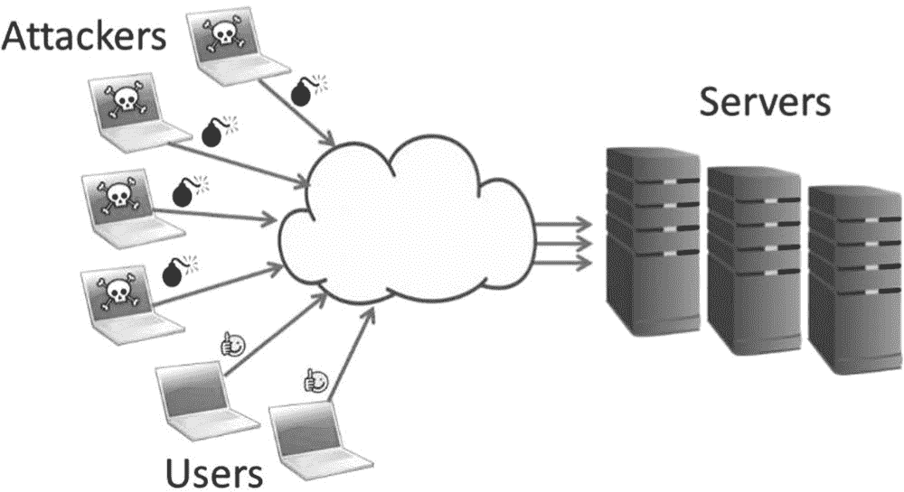

图 5.1 攻击者与用户之间的现有可能性。

本研究的主要目标如下：

* 在网络中实施专家蜂窝网安全基础设施。
* 制定模糊逻辑规则，并使用专家蜂窝网系统在网络中检测 DDOS 攻击。
* 提供更好的带宽利用率，并减少网络中 DDOS 攻击的发生。
* 通过软件仿真工具 DDOSSim 对所提安全基础设施进行性能分析。

#### 5.1.1 DDOS 攻击类型

以下是客户端/服务器架构中常见的 DDOS 攻击类型。这六种可破坏网络流量的 DDOS 攻击在客户端/服务器环境中被观察到 \[6\]。此类攻击可能破坏网络。这些攻击如下所示 \[7\]。

1. 协议违规攻击
2. 分片攻击
3. 网络基础设施攻击

##### 5.1.1.1 直接洪水攻击

这些攻击是 DOS 攻击的简单版本。在这种情况下，攻击者通过从自己的系统发送数据包直接攻击受害者的网站。在这种攻击中，数据包的源地址可以被伪造。有许多工具可用于允许针对 TCP、UDP 和 ICMP 等协议进行此类攻击 \[8,9\]。一些常用工具包括 hping2、synsend、synk7、synhose 和 stream2。在这种情况下，攻击者发送一个数据包，该数据包被目标计算机接收。

##### 5.1.1.2 远程控制网络攻击

在这种攻击中，攻击者将应用程序发送到目标系统，并破坏网络中的流量。计算机会监听来自中央计算机的命令。网络流量可以通过病毒自动或手动地被破坏。常用的控制通道包括直接端口通信、IRC 频道或 ICMP ping 数据包。僵尸机会以有组织的方式被动监听多个目标端口上的 TCP SYN 数据包。当来自任何特定 IP 地址的端口匹配时，会调用用户定义的函数 \10,[11\]。攻击者可以使用数据包头字段来获取有关 IP 地址和要运行及攻击系统的命令的信息。受攻破的计算机可以直接向目标发起攻击，或通过反射媒介发起攻击。在这种类型的攻击中，很难追踪原始控制系统。

##### 5.1.1.3 反射洪水攻击

在这种情况下，攻击者使用受害者的 IP 地址伪造源 IP 地址，并将其传输到中间主机。中间主机会向目标计算机的目标地址发送回复 \[12,13\]。在反射攻击中，很难识别实际攻击者，因为数据包来自中间服务器。

##### 5.1.1.4 协议违规攻击

通过耗尽 TCP 状态进行的攻击，也称为协议攻击，比容量攻击更为复杂，并针对某些网络设备，例如防火墙、Web 服务器和/或负载均衡器 \[14,15\]。状态耗尽攻击的目标是耗尽目标设备的可用资源并导致其故障。

##### 5.1.1.5 分片攻击

数据包分片分为两个区域，例如规避 IDS 检测和 DOS 机制 \[16,17\]。在分片过程中重新组装数据包时系统资源被耗尽，从而导致 DOS 攻击。

##### 5.1.1.6 网络基础设施攻击

攻击始终会影响互联网的整体运行并损坏整个网络基础设施。这些攻击可能导致全球或区域性的网络中断或减速。针对互联网根域名服务器的近期攻击引发了 FBI 调查。将向根域名服务器运营商发送警告信号，以改进网络基础设施。网络中断是由骨干服务引起的。它们将包括最小现有 RADIUS 和 DNS。网络基础设施内的流量可以分为管理平面、控制平面和数据平面 \[18\]。数据平面包含可能借助路由器发送到另一个位置的数据包。控制平面由路由协议组成，这些协议有助于网络正常且高效地工作。网络元素通过管理平面处理的工具和协议进行管理。管理平面和控制平面转发到路由器的处理引擎。路由器引擎无法处理通过数据平面传输的大量数据。如果没有防御系统，它们很容易使 CPU 过载 \[19\]。

### 5.2 DDoS 攻击的工作原理

网络资源（例如 Web 服务器）能够同时处理的请求数量有限。除了服务器容量限制之外，连接服务器与互联网的通道也具有有限的带宽或容量。当请求数量超过基础设施任何组件的容量限制 \[20\] 时，服务级别可能会以以下几种方式之一受到影响：

*   对请求的响应将比正常情况慢得多。

*   用户的一些（或所有）请求可能会被忽略。

作为一般规则，攻击者的主要意图是完全避免 Web 资源的正常运行，即服务的完全“拒绝”。攻击者还可以要求支付款项以停止攻击。在某些情况下，DDoS 攻击 \[21\] 的目标可能是诋毁或损害竞争对手的业务。

#### 5.2.1 使用“僵尸网络”发起 DDoS 攻击

为了向受害者资源发送极大量的请求，网络犯罪分子通常会建立一个被感染计算机的“僵尸网络” \[22\]。由于犯罪分子控制僵尸网络中每台被感染计算机的行为，攻击的大规模性可能会压垮受害者的 Web 资源。

#### 5.2.2 DDoS 攻击的预防措施

如今，比以往任何时候都更加，商业组织被要求实施各种安全机制，以最大限度地减少未经授权的访问，并确保其服务和活动的连续性。对于大多数安全计划，缓解 DDoS 攻击的关键是在攻击执行之前管理威胁 \[23\]。

以下建议可帮助商业组织降低与 DDoS 攻击相关的风险。确保公司处于安全状态的最佳方法之一是制定针对 DDoS 攻击的行动计划。该行动计划应包含在发生攻击时需要联系的个人和团队的完整信息。如果企业遭受 DDoS 攻击，还应指明他们的角色和职责。

该 DDoS 行动计划 \[24\] 的一个重要方面是，你应如何根据你的客户、员工以及企业的其他利益相关者来处理当前问题。有效的沟通可以帮助控制与 DDoS 攻击相关的成本，并增强对组织最重要的人群的信心。应定期检查和测试你的 DDoS 行动计划，以确保其涵盖每个事件，并包含最相关且最新的信息。

#### 5.2.3 不要高估网络的防御能力

最新的网络策略和安全机制自基础设施组织曾经使用过的以来已有了相当大的发展。安全机制 \[25\] 永远不应被高估，因为如果系统中存在任何漏洞，攻击者就可以发动攻击。

#### 5.2.4 创建参考模型以更好地识别活跃攻击

值得注意的是，一些组织在“正常”时期并不了解其网络流量水平。这就是为什么他们也不知道自己是否遭受了 DDoS 攻击。因此，需要监控网络流量和防御参考模型。这样，他们就能够确定网络流量的增加是攻击的结果，还是仅仅是特定时期（月份或年份）通常存在的流量率。还需要知道大部分网络流量位于何处。如果你的公司在某个国家 \[26\] 没有客户和/或网络存在，但你发现来自该国的大量流量，则应发出警报。你越快识别出 DDoS 攻击，减少损害的机会就越大。然而，网络性能低下和网络流量速度缓慢并不总是由 DDoS 攻击引起。这就是为什么尽快识别任何服务降级的首要原因非常重要。

#### 5.2.5 应用供应商的最新补丁

使用供应商最新补丁更新的服务器和网络设备是任何 IT 安全计划的关键功能，但在对抗 DDoS 攻击 \[27\] 时尤其重要。当你的组织成为攻击受害者时，你最不希望发现的是供应商不愿帮助你，因为你没有应用最新补丁。随着 DDoS 攻击新方法的不断增加且更加精准，已知安全缺陷（有补丁可用）应优先处理。

#### 5.2.6 保护 IoT 设备

如果你的公司特别有远见，并寻求抓住 IoT 设备 \[28,29,30\] 提供的机会，则必须确保它们都受到远程访问的防护。虽然远程访问有时对于第三方故障排除很重要，但它也提供了一个入口，使黑客能够渗透你的网络并将你的 IoT \[31\] 设备纳入僵尸网络。

#### 5.2.7 部署专门用于缓解 DDoS 攻击的解决方案

为了正常运行，部署高效的安全系统或主动计划以缓解 DDOS 攻击至关重要。此类安全系统能够扫描可疑活动或行为，并提供更大的安心。为进行评估 \[32]，您必须依赖参考模型，该模型指示源数据流、性能、时间段以及缓解攻击的其他关键方面。此类解决方案与您的数据流相关联。它们将网络流量发送到专用清洗中心，过滤恶意流量，并仅允许授权数据实时通过。此类系统必须成为您整体事件响应计划的一部分，以便异常能够被快速识别和解决。

#### 5.2.8 减少攻击面

我们应减少攻击面以最大限度地减少 DDOS 攻击，这可以限制攻击者的选择并在一个位置获得保护。

不应暴露预期不会用于通信的协议或应用程序。这有助于减少预期的攻击点 \[33]。

#### 5.2.9 规划扩展

在减少大规模容量型 DDOS 攻击方面，有两件重要的事情：服务器和带宽（或传输）容量吸收和防止攻击的能力。在服务器容量方面，DDOS 攻击可能是耗尽受害服务器资源（即 RAM、磁盘和 CPU 利用率增加等）的容量型攻击。减少计算资源很重要。为此，可以生成更大的计算资源或功能，例如改进的网络或支持更大流量的更广泛的网络功能。此外，使用负载均衡器也很常见，用于监控或将负载从一个资源转移到另一个资源，以防止资源过载 \[34]。

在开发应用程序时，请确保您的主机提供商提供充足的冗余互联网连接，以防传输容量不足。

这有助于管理大量数据或流量。由于 DDOS 攻击会停止持续服务或应用程序的可用性，因此有必要将它们放置在靠近大型互联网交换点的位置。

这将帮助用户在互联网流量大量时轻松访问应用程序。

*了解正常流量和异常流量是什么*：

每当互联网流量大量时，主机只会接受其能够轻松管理且不影响服务可用性的数据量。

这称为速率限制。最新的缓解技术仅在单独分析数据包后接受授权的数据量 \[35,36]。因此，您需要获取接收方通常接收的数据流量的准确信息。此外，许多其他技术在我们之前的工作中已经进行过实验 \[37,38,39,40,41,42]。

#### 5.2.10 为复杂的应用程序攻击实施防火墙

使用 Web 应用程序防火墙 (`WAF`) 防止 SQL 代码注入等类型的攻击是很好的。此外，在发生攻击时，您必须能够针对恶意应用程序或来自意外来源或无效 IP 地址等的攻击生成定制措施。为了在攻击执行时防止攻击，有时有必要获得特殊支持来分析流量模式并生成个性化的保护措施。作为用户，我们需要审查防火墙或路由器的配置，以检测来自预期攻击者的虚假 IP 地址。通常，我们的互联网服务提供商 (`ISP`) 确保我们的路由器与此配置保持最新。另一方面，提供这些服务的组织必须保护其网络和整个基础设施，以减轻此类攻击对其工作性能及其客户的影响 \[43]。如果公司受到拒绝服务 (`DOS`) 攻击的影响，将失去客户的信任并失去其服务的客户。

### 5.3 方法论

DDOS 攻击会导致合法用户无法使用服务。它们始于对工作的整体分析。在 DDOS 攻击中，入侵者或攻击者从多个位置而非单一位置执行攻击。一些本地系统由攻击者控制。攻击者最初会攻破并控制这些本地系统。这种被攻破的系统称为主控或处理器。主控随后用于控制进一步被攻破且靠近受害服务器的系统。这些系统称为从属或 DDOS 代理。它们进一步对受害服务器发起多次攻击，如 图 5.2 所示。

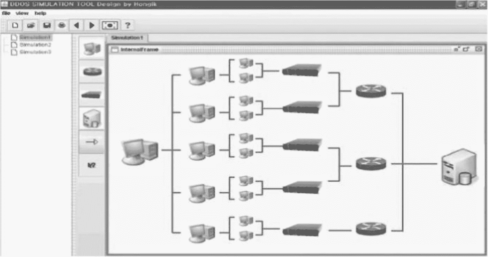

图 5.2 DDOS 攻击执行。

#### 5.3.1 专家蜜网系统简介

黑客始终在寻找系统中的漏洞以执行攻击。防护不足的系统可能成为黑客的易攻目标。在计算机术语中，蜜罐是一种安全机制，管理员利用它诱捕黑客，使网络攻击徒劳无功 \[10]。蜜罐提供网络服务或应用程序来吸引黑客，并保护生产系统免受可能的损害。在实践中，用户收集服务器端或客户端技术来创建蜜罐 \[12]。

#### 5.3.2 蜜罐的创建

蜜罐可以在以下两端创建：

1. 服务器端的蜜罐创建

   服务器端蜜罐的基本理念是引诱攻击者进入计算机系统的独立部分，并将其远离网络中的生产服务器。

2. 客户端的蜜罐创建

   客户端蜜罐模拟使用服务器端服务的应用程序。

#### 5.3.3 蜜罐的实现

蜜罐可以在三个区域实现。

1. 防火墙前

   通过将其放置在防火墙前，可以确保我们的内部网络安全不会随时受到威胁，因为我们的防火墙将防止攻击进入我们的内部网络。

2. 防火墙后

   此选项允许我们控制任何类型的内部和外部攻击；此方法的主要问题是它需要特定配置来允许访问 `honey pot`，但不允许访问我们的网络，这会导致流量过滤中可能出现安全故障。

3. 非军事区

   通过将其定位在此处，可以将 `honey pot` 与内部网络和服务器的连接分开，这种可能性允许我们通过对防火墙进行小修改来检测内部和外部攻击。

### 5.4 拟议系统

在这项研究中，专家蜜网系统用于客户端-服务器环境中 DDOS 攻击的预防。我们的专家蜜网系统具有确保组织更好安全性的功能。它对信息安全非常有用，因为，通过对捕获的攻击者信息进行详细研究，可以创造新的手段和技术来对抗黑客的攻击。虽然使用蜜罐或蜜网非常有价值，但绝不应仅依赖此类工具来保障组织的安全；它们不是直接的保护手段，而是研究手段。它们必须与常规预防手段协同工作，以防止攻击者攻击其他系统或网络。因此，我们在拟议的专家蜜网系统中添加了模糊逻辑规则，以有效预防 DDOS 攻击。我们拟议的专家蜜网安全基础设施用于通过模糊逻辑规则检测和预防 DOS/DDOS 攻击。拟议的方法非常灵活，可保护生产服务器免受攻击者的恶意请求。在这项研究中，蜜网系统在防火墙之前实现，并用于诱捕攻击者。通过专家蜜网系统检测和预防 DDOS 攻击将基于模糊逻辑规则。安全系统的性能将通过软件仿真工具 `DDOSSIM` 进行评估。`MATLAB® 10.1` 用于生成针对 DDOS 攻击的模糊逻辑规则。这些规则用于有效检测攻击。

#### 5.4.1 拟议系统的工作原理

图 5.3 说明了我们拟议的蜜网安全基础设施的工作原理：

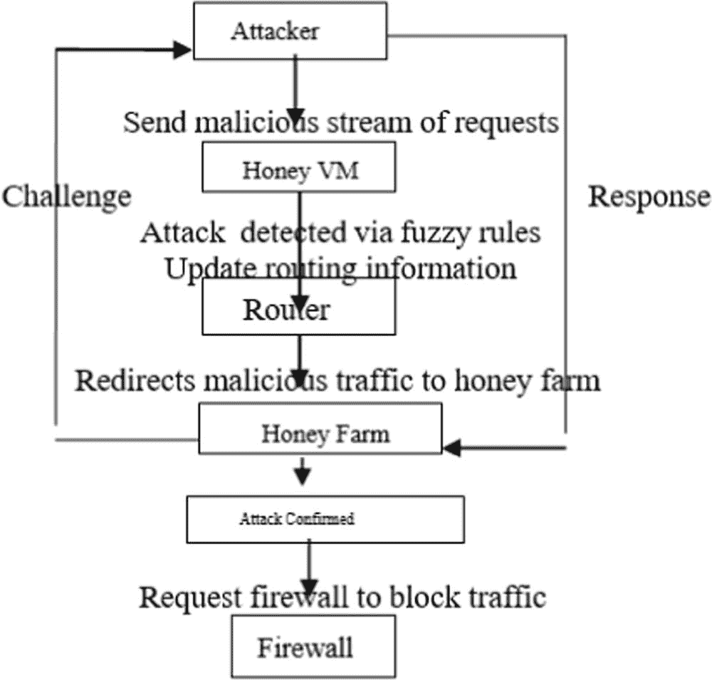

图 5.3 拟议的专家蜜网系统。

##### 5.4.1.1 通过拟议系统检测和预防 DDOS 攻击

在我们拟议的系统中，攻击者向蜜 VM 或蜜网发送恶意请求流。蜜 VM 具有关于预期流量的模糊规则，用于分析少量请求。模糊规则用于从传入流量中检测恶意请求；如果发现任何变化，则需要进一步调查以确定请求是否包含 DDOS 攻击。一旦蜜 VM 基于模糊规则或模糊推理检测到恶意请求，就需要进一步验证是否为实际的 DDOS 攻击。它会将此更新信息发送到路由器。路由器将此更新信息路由到蜜网场。通过这种方式，恶意流量不会移动到生产服务器。

### 5.5 实验结果

攻击者使用不同的受损系统从多个位置发起 DDOS 攻击。它们可能有效，并利用计算机和其他网络资源，例如 IOT 设备。DDOS 攻击可能会使 RAM 和硬盘过载，并且在 DDOS 攻击的情况下网络带宽会受到严重影响。它还会导致网络拥塞增加。网络拥塞会给网络中路由器之间的信息带来问题，从而导致 DDOS 攻击。由于网络流量增加，服务器将无法执行其正常活动。因此，它们无法有效地满足客户端需求。此类攻击会使我们网站的 Web 服务器过载。

#### 5.5.1 仿真

我们使用了仿真软件 `DDOSIM` 来模拟真实场景。以下是显示两个缓存服务器（即 Web 服务器和文件服务器）的图表。在秒数和数据包数量之间绘制了一张图表。该图表显示 X 和 Y 分量，分别表示秒数和 GBS 中的数据包数量。X 轴显示时间（秒），而 Y 轴显示 GBS 中的数据包数量。图 5.4 显示在没有 DDDOS 攻击时，数据传输率或数据量是正常的。缓存服务器 1 在 600 秒到 2300 秒之间接收 20 GBS 数据包。当攻击执行时，数据包在 2400 秒到 3000 秒之间从 40 GBS 增加到 80 GBS。缓存服务器 2 在 600 秒到 2700 秒之间接收 20 GBS 数据包。从 2900 秒开始，数据包从 20 GBS 增加到 40 GBS。在这种情况下，在 DDOS 攻击之前，带宽是正常的，但在攻击后，两个服务器的带宽都会增加，这会耗尽两个服务器的资源。这可能会减慢实际流量。

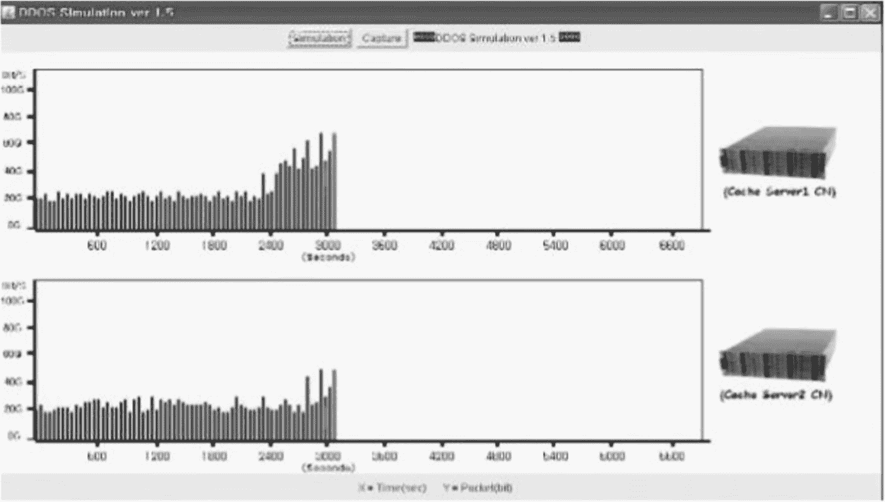

图 5.4 没有 DDOS 攻击时的带宽。

受害服务器的资源会导致合法用户无法使用服务。它们还可能增加网络带宽，从而减慢实际流量。因此，需要一个高效的安全系统来检测和预防网络中的 DDOS 攻击。

#### 5.5.2 针对网站发起的 DDOS 攻击

攻击通过受损的本地系统（称为主控或处理器，它们与代理协调）从多个位置对网站 [`www.neeosearch.com`](http://www.neeosearch.com) 发起。代理系统是实际的攻击执行者。现在，攻击在组织内部执行，导致网络带宽增加。CPU 利用率也会增加，CPU、硬盘、缓存服务器和 RAM 等系统资源也会被耗尽。网络带宽和系统资源会被严重耗尽。还会发生网络拥塞，这浪费了由 DDOS 攻击引起的实际流量结果。

#### 5.5.3 攻击量随时间增加及分布

当攻击针对 [`www.neeosearch.com`](http://www.neeosearch.com) 发起时，由于请求泛滥，网络带宽会增加。在 DDOS 攻击中，许多设备被协调起来，目的是向受害者传输大量非法流量。在 DDOS 攻击执行的情况下，网络带宽会增加，导致由于 CPU 利用率增加而耗尽服务器资源，如 图 5.5 所示。

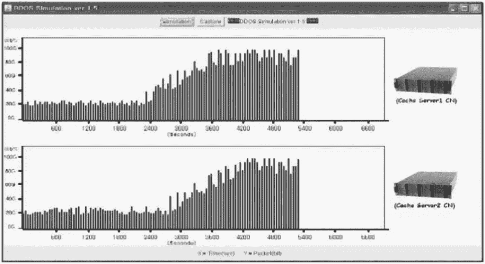

图 5.5 DDOS 攻击期间的带宽。

系统图显示了此类推理系统中的系统名称（图 5.6）。

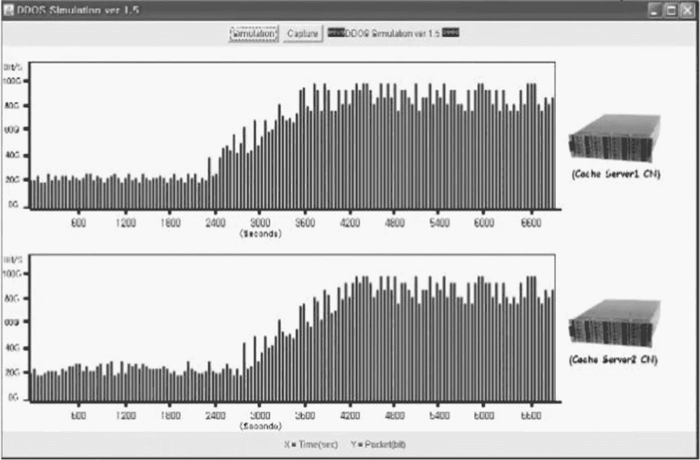

图 5.6 带宽消耗服务器资源，即缓存服务器。

*输入变量*

*输入 1= 受害者的 MTU（最大传输单元）输入 2= ICMP 消息的数据包长度*

*输入 3= ‘跳数’*

*输出变量*

*输出 1= 容量攻击 输出 2= ICMP 泛洪攻击 输出 3= DDOS 攻击*

在我们拟议的解决方案中，在防火墙之前实现蜜网系统，可以通过模糊逻辑规则有效检测 DDOS 攻击，并通过防火墙有效预防它们。蜜网系统持续观察传入流量并注意恶意活动；一旦通过应用的 `fuzzy-logic rules` 检测到攻击，来自攻击源的所有流量将被转发到蜜 VM 或蜜网。通过这种方式，恶意数据不会路由到生产服务器。

#### 5.5.4 通过模糊逻辑机制预防 DDOS 攻击

## 防御 DDOS 攻击的模糊推理专家蜂窝网络系统

在我们提出的系统中，模糊推理仅由专家蜂窝网络系统使用，以防止系统 VM 检测到的 DDOS 攻击。本研究的目的是解释如何通过专家蜂窝网络安全基础设施防止不同类型的 DOS/DDOS 攻击。在我们提出的解决方案中，将通过基于模糊规则的蜂窝网络系统对 DDOS 攻击采取预防措施。模糊控制逻辑与推理结合使用，其值为近似值而非精确值。性能将通过输入和输出参数的分类法进行评估，以检测和防止 DDOS 攻击。使用三个输入和三个输出来制定模糊规则。我们提出的专家蜂窝网络系统使用这些规则来检测不同类型的 DDOS 攻击。每个输入都有三个隶属函数。这些输入及其隶属函数如下：使用 MATLAB 10.1 软件来创建此类规则。模糊逻辑工具箱通过在命令窗口中输入 `fuzzy` 提供图形用户界面。FIS 编辑器将出现在屏幕上。FIS 代表模糊推理系统。它处理模糊系统的高级问题，例如变量名称中的输入和输出变量数量。本示例有三个输入和三个输出，如 Figure 5.7 所示。它展示了使用模糊逻辑推理的三个输入和三个输出的详细信息。系统中使用了三个输入变量和三个输出变量，并配合其隶属函数。

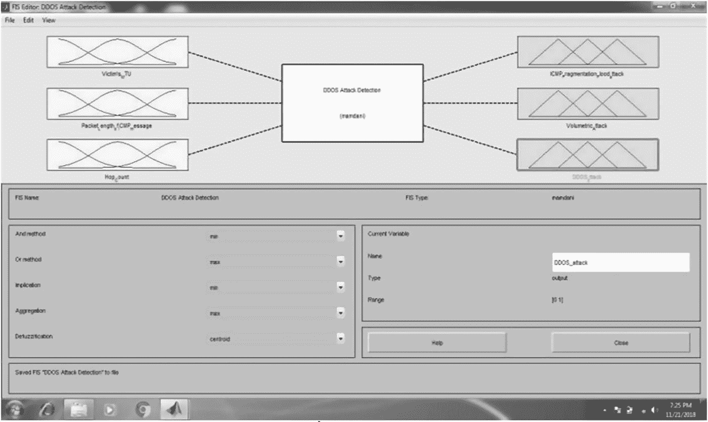

Figure 5.7 Inputs and outputs for detection of DDOS attacks.

### 输入 1 = 受害者的 MTU（最大传输单元）

连接请求消息到接收网络的数据包长度（接收方的 MTU，即通常为 1500 字节）。

#### 输入 1 的隶属函数

Input 1 < 1500 字节，数据包碎片化较少；Input 1 = 1500 字节，数据包碎片化正常；Input 1 > 1500 字节，数据包碎片化严重。

#### 逻辑

攻击者以非常高的数据包速率发送高度伪造的大碎片 ICMP 数据包（1500+ 字节），此类数据包难以重新组装。如果数据包大小较大，可能会扩大 ICMP 攻击的整体带宽。它会耗尽 CPU 资源，试图重新组装浪费和无用的数据包。如果 Input 1，即 MTU 小于 1500 字节，则数据包将较少碎片化。如果 Input 1，即 MTU 等于 1500 字节，则数据包将正常碎片化。如果 Input 1，即 MTU 大于 1500 字节，则数据包将高度碎片化。

### 输入 2 = ICMP 消息的数据包长度

即受害者伪造源 IP 地址的 ICMP 消息（任何 ICMP 数据包或消息的最小尺寸远低于以太网网络上的最小以太网帧大小，即 64 字节）。

#### 隶属函数

Input2 > 64 字节，大 ICMP 数据包大小；Input2 = 64 字节，正常 ICMP 数据包大小；Input 2 < 64 字节，较小 ICMP 数据包大小。

#### 逻辑

攻击者发送大量带有预期受害者伪造源 IP 地址的 ICMP 数据包，它们通过 IP 广播地址路由到计算机网络。这会导致网络上的所有主机响应 ICMP 请求，向受害者计算机发送大量数据。（Dao, Kim et al. 2016）如果 Input 2 小于 64 字节，将导致较小的 ICMP 数据包大小。如果 Input 2 等于 64 字节，将导致正常的 ICMP 数据包大小。如果 Input 2 大于 64 字节，将导致大的 ICMP 数据包大小。

### 输入 3 跳数范围 = 默认 TTL 值 = 255

如果 Input 3 < 255，跳数限制较小；Input 3 = 255，正常跳数限制；Input 3 > 255，较大跳数限制。

#### 逻辑

如果跳数超过 255，可能导致 CPU 利用率增加和系统不稳定。借助无效 IP 地址，攻击者开始向目标发送大量 RREQ 消息。它将发送过多的 RREQ，而不检查 RREQ HOPLIMIT，即不等待 ROUTE REPLY。此外，在开始时，RREQ 的 TTL 设置为最大值，而不使用扩展环搜索过程。在这种情况下，整个网络将充满来自攻击者的 RREQ 数据包，从而导致全面攻击（Jung 2015）。如果 Input 3 小于 255 跳数，将导致较小的跳数限制。如果 Input 3 等于 255 跳数，将导致正常的跳数限制。如果 Input 3 大于 255 跳数，将导致较大的跳数限制。

### 输出变量 Output1 碎片化泛洪攻击

#### 碎片化泛洪攻击的隶属函数

较少碎片化泛洪攻击；正常碎片化泛洪攻击；高碎片化泛洪攻击。

如果 Input 1，即 MTU 小于 1500 字节，将生成较少碎片化的数据包，导致较少的 ICMP 泛洪攻击。输出将为较少碎片化的数据包。

如果 Input 1，即 MTU 等于 1500 字节，将生成正常碎片化的数据包，导致没有 ICMP 泛洪攻击。输出将为 'NO ICMP flood attack'。

如果 Input 1，即 MTU 大于 1500 字节，将生成更多碎片化的数据包，导致高 ICMP 泛洪攻击。输出将为 'High ICMP flood attack'。

### 输出 2 容量攻击（容量攻击的隶属函数）

较少容量攻击；无容量攻击；高容量攻击。

如果 Input 2，即 ICMP 消息的数据包长度小于 64 字节，将生成较小的 ICMP 数据包，导致较少的容量攻击。输出将为 'less volumetric attack'。如果 Input 2，即 ICMP 消息的数据包长度等于 64 字节，将生成正常大小的 ICMP 数据包，导致没有容量攻击。输出将为 'no volumetric attack'。如果 Input 2，即 ICMP 消息的数据包长度大于 64 字节，将生成较大的 ICMP 数据包，导致高容量攻击。输出将为 'High volumetric attack'。

### 输出 3 DDOS 攻击（DDOS 攻击的隶属函数）

较少 DDOS 攻击；无 DDOS 攻击；高 DDOS 攻击。

如果 Input 3，即跳数小于 255 跳数，将生成较小的跳数限制，导致较少的 DDOS 攻击。输出将为 'Less DDOS attack'。如果 Input 3，即跳数等于 255 跳数，将生成正常的跳数限制，导致没有 DDOS 攻击。输出将为 'no DDOS attack'。如果 Input 3，即跳数大于 255 跳数，将生成较大的跳数限制，导致高 DDOS 攻击。输出将为 'high DDOS attack'。

#### 5.5.4.1 模糊逻辑规则

1. 如果 (input1 是 Less_Fragmented_Packets) 或 (Packet_Length_of_ICMP_message 是 Less_ICMP_Packet_Size) 或 (Hop_Count 是 Less_hop_limit) 则 (ICMP_Fragmentation_Flood_attack 是 Less_ICMP_flood_attack)(Volumetric_Attack 是 Less_Volumetric_attack)(DDOS_attack 是 Less_DDOS_attack)

2. 如果 (input1 是 Normal_Fragmented_Packets) 或 (Packet_Length_of_ICMP_message 是 Normal_ICMP_Packet_Size) 或 (Hop_Count 是 Normal_hop_limit) 则 (ICMP_Fragmentation_Flood_attack 是 No_ICMP_flood_attack)(Volumetric_Attack 是 No_Volumetric_attack)(DDOS_attack 是 No_DDOS_attack) (1)

3. 如果 (input1 是 High_Fragmented_Packets) 或 (Packet_Length_of_ICMP_message 是 High_ICMP_Packet_Size) 或 (Hop_Count 是 Greater_hop_limit) 则 (ICMP_Fragmentation_Flood_attack 是 High_ICMP_flood_attack)(Volumetric_Attack 是 High_volumetric_attack)(DDOS_attack 是 HIgh_DDOS_attack) (1)

#### 5.5.5 用于防止 DDOS 攻击的模糊逻辑规则实现

Honey-mesh 系统使用上述模糊逻辑规则，在网站流量传递时捕获或检测 DDoS 攻击 [`www.neeosearch.com`](http://www.neeosearch.com)。现在，DDoS 攻击再次通过受损系统从各个位置对网站 [`www.neeosearch.com`](http://www.neeosearch.com) 发起攻击。在这种情况下，CPU 利用率增加，消耗更多网络带宽并耗尽服务器资源。当攻击者执行 DDoS 攻击时，他会向网站服务器发送恶意请求。Honey-mesh 系统持续观察流向网站实际服务器的流量。Honey VM 安装在我们提出的专家 Honey-mesh 系统中，有助于防止 DDoS 攻击。我们定义的模糊逻辑规则在 Honey VM 中实现。Honey VM 根据模糊规则分析流量并检测 DDoS 攻击。当检测到攻击时，它会将此路由信息更新到路由器。路由器将此信息重定向到 Honey Farm VM，Honey Farm VM 向攻击者发送以谜题或数学问题形式的挑战性查询。攻击者来自 Honey Farm VM 对此挑战性查询做出响应。根据其响应，Honey VM 可以轻松检测是机器还是人工干预。当 Honey VM 确认 DDoS 攻击时，它会向防火墙发送请求以丢弃或阻止该恶意流量。通过这种方式，我们提出的专家 Honey-mesh 系统检测并防止 DDoS 攻击，并保护网站 [`www.neeosearch.com`](http://www.neeosearch.com) 的实际物理服务器。我们使用了仿真软件 `DDOSSIM` 来高效模拟整个过程。以下是从仿真环境中获取的结果。对于仿真，使用了 `DDOSSIM` 仿真软件。图 5.8、5.9、5.10 显示，在将流量传递到专家 Honey-mesh 系统后，数据传输率或数据量恢复正常。缓存服务器 1 在 DDoS 攻击执行前的 600 秒到 2300 秒之间接收 20 GBS 数据包。在 DDoS 攻击执行后的 2400 秒到 3000 秒之间，数据包从 20 GBS 增加到 70 GBS。当此流量通过我们提出的专家 Honey-mesh 系统时，带宽会在给定时间内从 40 GBS 降至 20 GBS。现在服务器资源可用于实际流量。缓存服务器 2 在 DDoS 攻击执行前的 600 秒到 2700 秒之间接收 20 GBS 数据包。带宽正常。在给定时间内，即从 2800 秒到 4000 秒，数据包从 20 GBS 增加到 50 GBS。当此流量通过我们提出的专家 Honey-mesh 系统时，带宽会在给定时间内从 40 GBS 降至 20 GBS。现在服务器资源可用于实际流量。

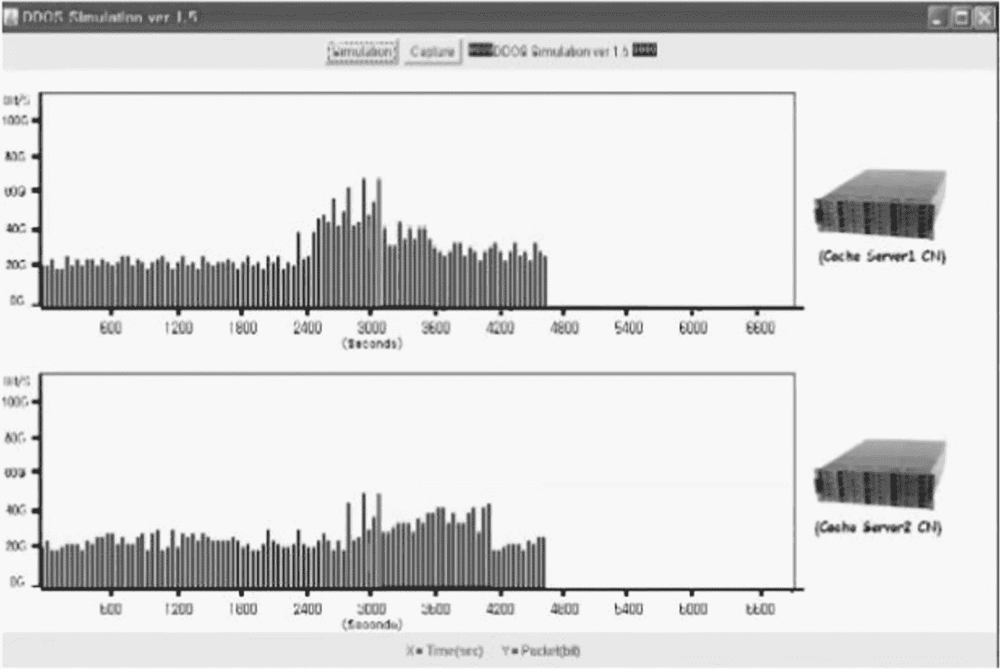

Figure 5.8 Bandwidth after passing traffic to expert honey mesh system.

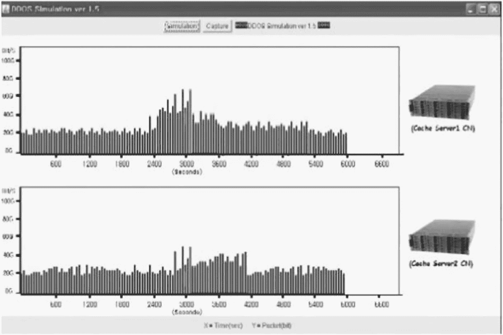

Figure 5.9 Bandwidth after traffic passing to an expert honey mesh system.

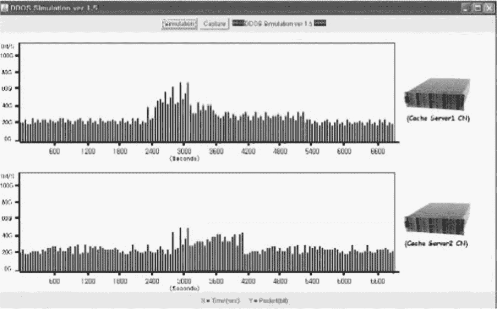

Figure 5.10 Bandwidth after traffic passing to an expert honey mesh system.

##### 5.5.6 Advantages and Future Enhancements

在这项研究中，通过专家 Honey-mesh 安全系统防止 DDoS 攻击的拟议解决方案相较于现有解决方案具有许多优势。

以下是专家 Honey-mesh 安全系统的优势：

*   由于实现了 `VM's` 而非实际物理服务器，拟议解决方案经济且维护开销低。

*   在拟议的安全解决方案中，使用额外的 `VM` 作为备份。如果现有 `VM` 被攻击者攻击或破坏，它可确保指令检测和预防过程持续进行。

*   恢复受损 `VM` 的过程成本低且耗时较少。

*   由于预定义的模糊规则，拟议解决方案处于静态模式，但如果攻击者行为发生变化，我们可以在未来将其扩展为动态模式。

### 5.6 Conclusion

DDoS 攻击用于使网络中合法用户无法持续使用服务。专家 Honey-mesh 系统用于确保网络中服务的持续可用性。蜜罐可定义为一种陷阱，用于模拟、注意并记录攻击者的整体活动。低交互蜜罐用于服务器端，识别不同类型的攻击，保护用户机密数据，并通过模糊逻辑规则记录所有恶意活动。Honey-mesh 系统的安全机制与真实服务器相同，但故意留下一些漏洞以诱捕攻击者。Honey-mesh 系统观察传入流量并持续注意恶意活动；一旦通过应用的模糊逻辑规则检测到攻击，来自攻击源的所有流量将转发到 Honey VM 或蜜罐。通过这种方式，恶意数据不会路由到生产服务器。将通过基于模糊规则的专家 Honey-mesh 系统对 DDoS 攻击采取预防措施。模糊控制逻辑与推理一起使用，其值为近似值而非精确值。本文的目的是如何通过 Honey-mesh 安全基础设施防止 DDoS/DDoS 攻击。

## References

1.  He, Z., et al (2017). Machine learning based DDOS attack detection from source side in cloud. In 2017 IEEE 4th International Conference on Cyber Security and Cloud Computing (CSCloud).

2.  Chow, S., et al (2009). Performance analysis of a system during a DDoS attack. In Advance Computing Conference, 2009.

3.  Osanaiye, O., et al (2016). Distributed denial of service (DDoS) resilience in cloud: Review and conceptual cloud DDoS mitigation framework. Journal of Network and Computer Applications, 67, 147–165.

4.  Beitollahi, H., and Deconinck, G. J. C. C. (2012). Analyzing well-known countermeasures against distributed denial of service attacks. Computer Communications, 35(11), 1312–1332.

5.  Deshpande, H. A. (2015). HoneyMesh: Preventing distributed denial of service attacks using virtualized honeypots. [`arXiv.org`](https://arXiv.org).

6.  Humayun, M. (2021). Industry 4.0 and cyber security issues and challenges. Turkish Journal of Computer and Mathematics Education (TURCOMAT), 12(10), 2957–2971.

7.  Mousavi, S. M., and St-Hilaire, M. (2015). Early detection of DDoS attacks against SDN controllers. In 2015 International Conference on Computing, Networking and Communications (ICNC).

8.  Jaber, A. N., et al (2017). Methods for preventing distributed denial of service attacks in cloud computing. Advanced Science Letters, 23(6), 5282–5285.

9.  de Almeida, M. P., et al (2018). New DoS defense method based on strong designated verifier signatures. Sensors (Basel, Switzerland), 18(9), 2813.

10.  Hussain, K., Hussain, S. J., Jhanjhi, N. Z., and Humayun, M. (2019). SYN flood attack detection based on Bayes estimator (SFADBE) for MANET. In 2019 International Conference on Computer and Information Sciences (ICCIS), pp. 1–4. IEEE.

11.  Prestele, A. Middleboxes Against DDoS Attacks.

## 参考文献

12. Sokol, P., et al (2017). Honeypots and honeynets: Issues of privacy. EURASIP Journal on Information Security, 2017(1), 4.

13. Sachdeva, M., et al (2010). DDoS incidents and their impact: A review. The International Arab Journal of Information Technology, 7(1), 14–20.

14. Gopi, R., Sathiyamoorthi, V., Selvakumar, S., Manikandan, R., Chatterjee, P., Jhanjhi, N. Z., and Luhach, A. K. (2021). Enhanced method of ANN based model for detection of DDoS attacks on multimedia internet of things. Multimedia Tools and Applications, 1–19.

15. Mirkovic, J., and Reiher, P. (2004). A taxonomy of DDoS attack and DDoS defense mechanisms. ACM SIGCOMM Computer Communication Review, 34(2), 39–53.

16. Jain, A., et al (2015). Advance trends in network security with Honeypot and its comparative study with other techniques. International Journal of Engineering Trends and Technology, 29, 304–312.

17. Wang, C., et al (2017). Research on DDoS attacks detection based on RDF-SVM. In 2017 10th International Conference on Intelligent Computation Technology and Automation (ICICTA).

18. Gasti, P., et al (2013). DoS and DDoS in named data networking. In 2013 22nd International Conference on Computer Communication and Networks (ICCCN).

19. Almadhoor, L. (2021). Social media and cybercrimes. Turkish Journal of Computer and Mathematics Education (TURCOMAT), 12(10), 2972–2981.

20. Kumarasamy, S., and Asokan, R. J. (2012). Distributed denial of service (DDoS) attacks detection mechanism. International Journal of Computer Science Engineering and Information Technology, 1(5).

21. Nezhad, S. M. T., et al (2016). A novel DoS and DDoS attacks detection algorithm using ARIMA time series model and chaotic system in computer networks. IEEE Communications Letters, 20(4), 700–703.

22. Alomari, E., et al (2012). Botnet-based distributed denial of service (DDoS) attacks on web servers: Classification and art. Shadow Honeypots, 2(9), 1–16.

23. Prasad, K. M., et al (2014). DoS and DDoS attacks: Defense, detection and traceback mechanisms-a survey. Global Journals, 14(7).

24. Mahajan, D., and Sachdeva, M. (2013). DDoS attack prevention and mitigation techniques: A review. International Journal of Computer Applications, 67(19).

25. Sharma, N., et al (2011). Attack prevention methods for DDOS attacks in MANETs. 1(1), 18–21.

26. Singh, B., et al (2015). An adaptive approach to mitigate DDoS attacks in cloud. International Journal of Advanced Computer Science and Applications, 6(10).

27. Wang, C., et al (2018). Skyshield: A sketch-based defense system against application layer DDoS attacks. IEEE Transactions on Information Forensics and Security, 13(3), 559–573.

28. Batool, S., Saqib, N. A., and Khan, M. A. (2017, May). Internet of Things data analytics for user authentication and activity recognition. In 2017 Second International Conference on Fog and Mobile Edge Computing (FMEC), pp. 183–187. IEEE.

29. Jhanjhi, N. Z., Brohi, S. N., Malik, N. A., and Humayun, M. (2020). Proposing a hybrid RPL protocol for rank and wormhole attack mitigation using machine learning. In 2020 2nd International Conference on Computer and Information Sciences (ICCIS), pp. 1–6. IEEE.

30. Ali, T., Khan, M. A., Hayat, A., Alam, M., and Ali, M. (2013). Secure actor directed localization in wireless sensor and actor networks. International Journal of Distributed Sensor Networks, 9(10), 126327.

31. Batool, S., Saqib, N. A., Khattack, M. K., and Hassan, A. (2019, March). Identification of remote IoT users using sensor data analytics. In Future of Information and Communication Conference, pp. 328–337. Springer, Cham.

32. Douligeris, C., and Mitrokotsa, A. J. C. N. (2004). DDoS attacks and defense mechanisms: classification and state-of-the-art. Computer Networks, 44(5), 643–666.

33. Shahid, H., Ashraf, H., Javed, H., Humayun, M., Jhanjhi, N. Z., and AlZain, M. A. (2021). Energy optimised security against wormhole attack in IoT-based wireless sensor networks. CMC-Computers Materials & Continua, 68(2), 1966–1980.

34. Zargar, S. T., et al (2013). A survey of defense mechanisms against distributed denial of service (DDoS) flooding attacks. IEEE Communications Surveys & Tutorials, 15(4), 2046–2069.

35. Kaur, D., and Sachdeva, M. (2014). Impact analysis of ddos attacks on ftp services. In International Conference on Recent Trends in Information, Telecommunication and Computing.

36. Draz, U., Ali, T., and Yasin, S. (2018, November). Cloud based watchman inlets for flood recovery system using wireless sensor and actor networks. In 2018 IEEE 21st International Multi-Topic Conference (INMIC), pp. 1–6. IEEE.

37. Yasin, S., Ali, T., Draz, U., and Rasheed, A. (2018). Simulation-based battery life prediction technique in wireless sensor networks. NFC IEFR Journal of Engineering and Scientific Research, 6, 166–172.

38. Humayun, M., Niazi, M., Jhanjhi, N. Z., Alshayeb, M., and Mahmood, S. (2020). Cyber security threats and vulnerabilities: Asystematic mapping study. Arabian Journal for Science and Engineering, 45(4), 3171–3189.

39. Ali, T., Yasin, S., Draz, U., and Ayaz, M. (2019). Towards formal modeling of subnet based hotspot algorithm in wireless sensor networks. Wireless Personal Communications, 107(4), 1573–1606.

40. Draz, U., Ali, T., Yasin, S., Waqas, U., and Rafiq, U. (2019, February). EADSA: Energy-aware distributed sink algorithm for hotspot problem in wireless sensor and actor networks. In 2019 International Conference on Engineering and Emerging Technologies (ICEET), pp. 1–6. IEEE.

41. Draz, U., Ali, T., Yasin, S., and Waqas, U. (2018, December). Towards formal modeling of hotspot issue by watch-man nodes in wireless sensor and actor network. In 2018 International Conference on Frontiers of Information Technology (FIT), pp. 321–326. IEEE.

42. Qaisar, Z. H., et al (2020). Effective beamforming technique amid optimal value for wireless communication. Electronics, 9(11), 1869.

43. Al-Musib, N. S., Al-Serhani, F. M., Humayun, M., and Jhanjhi, N. Z. (2021). Business email compromise (BEC) attacks. Materials Today: Proceedings, (2021).

## 6 Efficient Feature Grouping for IDS Using Clustering Algorithms in Detecting Known/Unknown Attacks

Ravishanker, Monica Sood, Prikshat Angra, Sahil Verma, Kavita, and NZ Jhanjhi

## CONTENTS

1. 6.1 Introduction

2. 6.2 Related Work

3. 6.3 Design Methodology

4. 6.4 Applications and Future Work

5. 6.5 Conclusion

6. References

DOI: [`10.1201/9780367808228-6`](https://doi.org/10.1201/9780367808228-6)

### 6.1 Introduction

随着网络和多样设备的指数级增长，管理网络及其流量已成为一项非常复杂的任务。由于引入了新协议和更新的技术，需要一种具有实时监控和控制能力的新机制来应对这些新型高速网络设备和网络。对于较小的网络，也需要类似的方面，因为在动态网络拓扑和网络内部信任的背景下，管理设备现在变得非常具有挑战性。机器学习方法正在发挥作用，以便从之前的网络分析中自动学习。最近的方法包括使用区块链方法，以便对等节点可以被认证 \[1\]，并且同样可以应用于区块链分布式网络。区块链还可以应用于入侵检测，以便为构建增强信任模型生成警报 \[2\]。

执行流量监控最常见的方法是查看每个数据包并施加最小和最大阈值，或检查每个数据包。如果当前值在范围内，则流量正常，超出此范围则为异常，因此会生成警报。在实施警报的过程中，可能会感知到大量误报；也就是说，即使流量限制或数据包内容来自可信来源，也可能会生成警报。还可能存在一些情况，即警报可能不会触发，而系统实际上遭受了攻击，但没有发生警报。考虑第一个问题会浪费时间和精力，以及系统的可用性。第二个问题更为关键，因为它往往会导致实际损害及相关的网络恢复成本，并导致资源可用性问题。这些类型的系统是基于预定义的规则集设计的，无法识别新型攻击。

### 6.2 相关工作

每天，网络攻击都变得更加复杂，具有高度的复杂性。主要挑战变成了部署能够识别未知攻击的技术 \[3\]；也就是说，那些为新型攻击设置了预定义签名模式的攻击。另一个问题是数据来自多个来源，因此需要处理和收集来自多个数据源的大量数据，并且收集的数据可能与检测攻击无关。已为入侵检测设计了多种通用算法，即误用检测和异常检测。机器学习可以处理大型数据集，并识别和捕获数据集中的隐藏模式；这描述了使用分类和回归将数据分组到簇中以检测未来预测，并将结果用于基于规则的问题。借助机器学习，网络中可以识别以下安全攻击：拒绝服务（DoS）、用户到根（U2R）、根到本地（R2L）或探测。对于预测新攻击，可以使用回归方法。

为了获得更好的结果，机器学习需要对数据进行训练，并采用特定数据集的更好的聚类方法。G. Chandrashekar 等人 \[4\] 展示了特征分组算法的优势，并建议了设计标准，包括简单性、稳定性、减少特征的数量、分类准确性、存储和计算要求。特征分组方法通过减少数据的维度并识别降低计算开销并提高准确性的区分特征，大大增强了攻击预测 \[5,6\]。

\[7\] Mohammadi 等人在本文中，作者讨论了基于特征分组/特征选择的入侵检测系统。目前，每个行业都依赖于互联网，分布式拒绝服务和机器人攻击已成为这些行业的巨大问题。在本文中，作者使用了过滤方法和包装方法以及不同的算法。他们使用线性相关系数和墨鱼算法进行分组/特征选择。他们还表明，新开发的安全性能不足或不完全兼容客户要求，即防火墙、用户身份验证和数据加密会导致安全漏洞，因此确定了一种新的安全技术，称为入侵检测技术。他们还在速度和准确性之间进行了权衡，并讨论了在当今的场景中，使用最新技术的特征分组将产生更好的结果并使网络安全。在这里，过滤方法和包装方法被称为特征分组；它们基于不同的算法。基本上，特征分组中使用了三种方法，即过滤、包装、组合。在过滤方法中，我们根据排名或最佳性能选择特征。在包装方法中，我们根据搜索选择特征；它选择一组特征并执行一个给出准确结果的函数。在组合中，我们结合了过滤方法和包装方法，然后找出最佳特征分组和更好的结果，从而降低误报率。他们还识别并明确，由于特征的空值或特征配置错误，不会再生成空或虚假警报。因此，需要通过机器学习对其应用一些规则来解决这些问题。

特征选择包括三种主要方法。第一种是过滤方法，它根据重要性提供排名，并解决了计算成本最重要的方面 \3,[8\]。第二种是包装方法 \[8–11\]，第三种是组合方法 \[10,11\]。他们提出了一种新的特征选择方法，包括分类、过滤和分类以改进分类。该拟议方法在 KDD Cup 99 上使用二进制和多类分类进行了检验。他们的方法结果很快，但会产生更多误报。这些也可以实现在基于 IoT 的设备安全中以检测攻击 \[12\]。

Khalil El-Khatib \[8\] 使用了最佳特征来检测 WLAN 中的入侵，他们使用过滤和包装模型将 38 个特征减少到仅 8 个，结果表明分类器的学习时间减少到 33%，准确率提高了 15%。他们的工作为进一步研究基于 ANN 的分类器性能以及 SVMs、MARSs 和 LGPs 的性能提供了途径。Jingping Song 等人 \[9\] 使用模糊 C 均值算法规则取得了改进的结果，将特征选择从 41 个减少到 10 个。众所周知，网络运营商和许多组织依赖于互联网，因此入侵检测非常重要。但是传统的检测方法专门用于检测以前的攻击，而如今，以前的方法无法检测攻击；因此，需要改进检测它们的技术或特征。在本文中，作者提出了一种用于入侵检测的特征分组方法。作者预测了如何通过计算每个特征的互信息来组合组，如何对它们进行排名，以及如何找到组的数量。为了对特征进行排名，作者使用模糊 C 算法获取 G 组。模糊 C 算法分割排名向量。在此算法中，计算组中每个特征的互信息，标记类并获取最大值。最初，此技术用于确定通信媒体中的数据量。该技术的性能相对较好，并节省计算能力。

作者得出结论，这种分组是基于互信息的。通过计算一个特征的互信息，然后将其与其他特征进行比较，从而表示它们之间的关系。在组中选择一个特征时，使用互信息和类标签。在知识发现数据库（`KDD`）`99`数据集上进行了实验分析；作者提出的技术优于现有算法。因此，通过使用这种技术，可以生成新算法；此外，还可以使用这种技术对其他数据集进行进一步研究。未来，可以提出比互信息理论更有效、更高效的方法。使用这种算法和技术，他们还预测未来的攻击也会发生在实时或网络系统上。与机器学习方法的类似特征分组以及攻击检测准确率在表 6.1 中显示。

[表 6.1 不同特征分组提取和数据集的不同机器学习技术比较 \[13–15, 17–19, 20\]](#ch06.xhtml#Ttable6_1)

| Ref || ML Technique || Dataset || Features || Results |

| --- | --- | --- | --- | --- |

| Pfahringer \[13\] || Supervised Ensemble of CS DTs (`offline`) || KDD Cup || all 41 features || DR Normal: 99.5%

DR Probe: 83.3%

DR DoS: 97.1%

DR U2R: 13.2%

DR R2L: 8.4%

Training: 24 h |

| --- | --- | --- | --- | --- |

| Pan et al. \[14\] || Supervised NN and C4.5 DT (`offline`) || KDD Cup || all 41 features || DR Normal : 99.5%

DR DoS: 97.3%

DR Probe (Satan): 95.3%

DR Probe (portsweep): 94.9%

DR U2R: 72.7%

DR R2L: 100%

ADR: 93.28% FP: 0.2% |

| Moradi et al. \[15\] || Supervised NN (`offline`) || KDD Cup || 35 features || 2 Layers MLP DR: 80%

ESVM DR: 90% 2 Layers

ESVM DR: 87% |

| Chebrolu et al. \[16\] || Supervised BN and CART (`offline`) || KDD Cup || Feature Selection using Markov Blanket and Gini rule || DR Normal: 100%

DR Probe: 100%

DR DoS: 100%

DR U2R: 84%

DR R2L: 99.47% |

| Amor et al. \[17\] || Supervised NB (`offline`) || KDD Cup || all 4l fearures || DR Normal: 97.68%

PCC DoS: 96.65%

PCC R2L: 8.66%

PCC U2R: 11.84%

PCC Probing: 88.33% |

| Stein et al. \[18\] || Supervised C4.5 DT (`offline`) || KDD Cup || GA-based feature selection || Error rate DoS: 2.22%

Error rare Probe: 1.67%

Error rate R2L: 19.9%

Error rate U2R: 0.1% |

| Paddabachigari et al. \[19\] || Supervised Ensemble of SVM, DT, and SVM-DT Offline || KDD Cup || all 41 features || DR Normal: 99.7%

DK Probe: 100%

DR DoS: 99.92%

DR U2R: 68%

DR R2L: 97.16% |

| Sangkatsanee et al. \[20\] || Supervised C4.5 DT (`online`) || Normal: Reliability

Lab

Data 2009

(RLD09)

Attack: || TCP, UPD, and ICMP header Fields || DR Normal: 99.43%

DK DoS: 99.17%

DR Probe: 98.73% |

| Li et al. \[21\] || Supervised TCM K-NN (`Offline`) || KDD Cup || all 41 features 8 features selected using Chi-square || 41 features: TP 99.7%

41 features: FP 0%

8 features: TP 99.6%

8 fearnres: FP 0.1% |

Chebrolu et al. \[16\] 作者在本文中讨论的主要问题是，某些特征贡献较少，且对检测过程是冗余的。因此，我们需要构建入侵检测系统（`IDS`），这些系统在现实世界系统的检测中既有效又高效。作者对选择算法进行了测试。作者提出了一种混合架构，用于现实世界的入侵检测，通过结合不同的选择算法实现。这些算法是贝叶斯网络（`BN`）和分类与回归树（`CART`）。贝叶斯网络（`BN`）选择算法在不确定条件下运行。贝叶斯网络基于（`DAG`）有向无环图原理，计算一个节点的条件概率并分配给另一个节点。分类与回归树（`CART`）使用二进制递归分区。父节点始终分为两个节点；这就是为什么该过程是二进制和递归的，因为每个节点都被视为父节点，因此该过程会重复自身。在本文中，他们研究了不同的数据挖掘技术；在这里，他们为网络数据选择一个特征或一组特征。他们还通过结合不同的特征和不同的特征集来观察结果。他们开发了一种有效的技术，使用上述选择算法检测攻击并生成真正报警。

作者基于 DARPA 基准测试，得出了本文中新技术在入侵检测方面性能的结论。他们提出了结合贝叶斯网络（`BN`）和分类与回归树（`CART`）分类器的方法，通过加入拟议的混合架构进行入侵检测。因此，分析结果非常准确。这种技术对探测、正常和拒绝服务（`DOS`）的效果更好。作者的目标是为用户到根（`U2R`）类型的攻击构建更高效、更准确的分类器。作者还对攻击进行了子分类，并给出了一个特征；主要分析了托管和帮助攻击的服务。

Davis et al. \[22\] 在本文中，作者解决了网络流量特征选择问题。他们减少了为各种基于网络的攻击生成实时流量观察所需的计算工作量。他们还审查了基于异常的网络入侵检测的数据预处理。为了解决上述问题，作者推荐了数据预处理技术。这种技术是分析和选择用于检测入侵检测的方法的组合。两者结合在一起，以执行最佳搜索和高效工作。在这里，作者试图查找数据包头特征。异常检测技术被网络入侵检测系统（`NIDS`）软件使用，并与机器学习技术一起使用，特别使用模型来检测特征并比较监督和非监督算法。对特征进行分组可以更好地理解，机器学习有助于以更好的预测执行模型。

通过使用这种技术，作者得出结论，通过特征分组，强贡献可以更准确地识别网络或实时流量的相关部分。这导致深度包检测，从而减少了在线特征生成的计算工作量。如今，安全已成为每个组织和部门面临的挑战。为了解决这类问题，我们需要在网络流量/实时流量中进行异常检测，并具备适当的特征知识。

Ma, C., \[23\] 如今，安全已成为每个组织和部门面临的挑战。为了解决这个问题，需要在网络流量中进行异常检测。因此，为异常检测拥有准确有效的流量特征是一项重大挑战。在本文中，作者提出了比现有算法性能相对更好的方法。作者为网络异常检测提出的方法包括对环境、序列和统计特征的分析。他们提出的方法是混合神经网络的组合；这些是一维卷积神经网络模型（`1D-CNN`）和动态神经网络（`DNN`）方案，称为（`AD-H1CD`），基于混合神经网络的网络流异常检测。这种方法相对更好，并且其分析涵盖了上述所有特征。

在本文中，所提方法与之前的网络异常检测算法相比，具有高度的准确性和效率。基于混合神经网络的网络流量异常检测（`AD-H1CD`）提取网络流量的多阶段特征并对其进行分析。该算法在多重排列中的检测率已得到提高。每当他们将新技术与旧技术进行比较，并在新思路和新努力上做出改变，以使其更高效、更有效，以满足新技术和未来需求。它还能取得更好的效果，如果将旧技术和新技术结合起来检测攻击，其预测率和准确率都很高。

`[24]` Sheikhan 等人认为，为了保障通信系统的安全，需要入侵检测。因此，作者提出了一种新的检测技术以提高检测率。但所提技术同样效率不高；该技术中的误报率仍未降低，但其检测率相对较好。作者提出了一种三层循环神经网络架构。部分连接隐藏层的循环神经网络（`RNN`）被用作基于误用的入侵检测系统（`IDS`）。循环神经网络（`RNN`）的输入被分类为特征，循环神经网络（`RNN`）的输出被投影为基于误用的入侵检测系统。由于其尺寸减小，其检测率相对较好。输入特征的分类包括内容特征、基本特征、基于主机的流量特征和基于时间的流量特征。攻击类型包括 DoS（拒绝服务）、R2L（远程到本地）、U2R（用户到根）和探测。循环神经网络（`RNN`）基本上由五个输出神经元组成，即四种攻击类型和正常类。

作者得出结论，新技术循环神经网络（`RNN`）的表现比之前的技术更准确。循环神经网络（`RNN`）由部分连接的层组成，以四个特征作为输入，以基于误用的入侵检测系统（`IDS`）作为输出。结果表明，尺寸减小提高了分析性能。与其他分类器相比，它在远程到本地（`r2l`）攻击上表现良好。这里识别了多种攻击及其类别，借助于特征分组。他们将特征分为一组，并指出如果这些特征组合在一起，那么攻击的可能性就非常高。他们还对每个特征进行了分析，取得了更好的效果，并有助于根据变化进行分组。他们还为未来分析做出了不同的组合，如果特征发生小的变化，那么趋势可能会导致某种网络攻击。

`[25]` Ponkarthika 等人认为，通信和信息技术日益发展；如今，信息在全世界以高速共享。因此，在这个信息共享日益增长的时代，网络威胁或攻击是一个主要问题。入侵检测系统检测网络安全漏洞，这有助于检测攻击，但主要挑战是网络入侵检测系统（`NIDS`）的高效和准确性能。还需要一个优秀的网络入侵检测系统来检测不可预测的攻击和安全漏洞。为了实现灵活高效的网络入侵检测系统，作者提出了一种基于深度学习的模型。深度学习使用复杂架构来实现高数据抽象。为了实现高检测率，我们在循环神经网络（`RNN`）中使用长短期记忆（`LSTM`），并将其应用于使用知识发现与数据挖掘（`KDD`）杯 1999 数据集的入侵检测系统（`IDS`）模型。作者在知识发现与数据挖掘（`KDD`）杯 1999 数据集上分析了这种方法的性能。因此，这是一种训练数据序列的有效方法。先前提出的循环神经网络（`RNN`）存在许多问题，因此为了解决这些问题，使用了长短期记忆（`LSTM`）架构。基本上，使用分组进行选择方法，并通过评估现有技术的性能使用互信息可能会改进。

作者得出结论，该方法的主要目标是根据过去的观察改进入侵检测系统（`IDS`）。他使用循环神经网络中的长短期记忆（`LSTM`）架构实现了一个新的入侵检测系统（`IDS`）分类器。通过将该方法的结果与其他分类器进行比较，作者得出结论，该分类器能很好地检测攻击。因此，在未来，我们可以进一步研究并改进基于所提入侵检测系统（`IDS`）模型的入侵检测系统（`IDS`）性能。当我们减少计算时间和理解数据时，特征选择也很有用。特征选择还用于通过从现有分类器中删除不相关特征来优化分类器。

`[25]` Mohamad 等人认为，作者提出了一种机器学习方法，该方法使用混合学习技术，通过结合支持向量机（`SVM`）和 k-means 聚类等分类方法，对网络进行入侵检测。它检测威胁；主要威胁是入侵；这里我们制作一种技术或特征集合，以帮助在网络上传输数据。作者观察到，如果使用机器学习和 k-means 聚类，并结合支持向量机（`SVM`），那么结果将提高性能。开发了各种技术、方法和方法，以应对入侵检测系统的局限性，并减少误报、时间和低准确率。主要目标是专注于提高检测率和改进误报警，并减少误报警。

执行混合机器学习技术，结果显示这里取得了新的成就：他们获得了正向检测，并降低了误报率。这里，它成功识别了发生在网络上的攻击并检测到警报；最重要的是准确率也很高。这主要由两种机器学习技术完成，即支持向量机（`SVM`）和 k-means 聚类。这里，作者提出了一种系统，帮助理解包含特征的机制。借助不同的技术和算法，它对好特征和坏特征之间进行了清晰的回顾或比较。

Maralani 等人 `[26]`，在本文中，作者使用支持向量机（`SVM`）和遗传算法（`GA`）的混合方法；然后实现了一个可以解释问题的入侵检测系统（`IDS`）。这里，作者还为多子集和特征集分组找到了解决方案。遗传算法（`GA`）用于使用适当的集合来解决特征分组问题。在这种技术中，作者应用了人工智能（`AI`）技术，借助支持向量机（`SVM`）和遗传算法（`GA`）来解决问题。人工智能（`AI`）技术证明它可以解决非线性和非凸问题。作者主要将其技术集中在支持向量机（`SVM`）和遗传算法（`GA`）上。它为特征分组或集合提供了非常好的解决方案，并提供了更好的界面和结果。还考虑了特征的其他参数。他们还在此测量了一些机器学习方法，包括模糊逻辑-最近邻、支持向量机（`SVM`）、人工神经网络（`ANN`）、人工免疫系统（`AIM`）和遗传算法（`GA`），用于比较目的。

### 6.3 设计方法论

特征选择是攻击分类的一个重要方面。各种基于特征选择的攻击包括拒绝服务攻击（`DoS`）、用户到根（`U2R`）、根到本地（`R2L`）或探测。特征选择标准应基于匹配攻击标准。如果使用更相关的特征进行分组，则攻击识别将更加准确。在 `KDD-CUP99` 中，共有 41 个可用特征；它们可以根据流量类别（如 `DoS`、`U2R`、`R2L`、探测和正常流量）进一步分类。在 `KDD-CUP99` 中，并非所有特征都相关。有些特征可能对检测攻击没有用，而有些特征可能对分类没有用。

**Algorithm:**

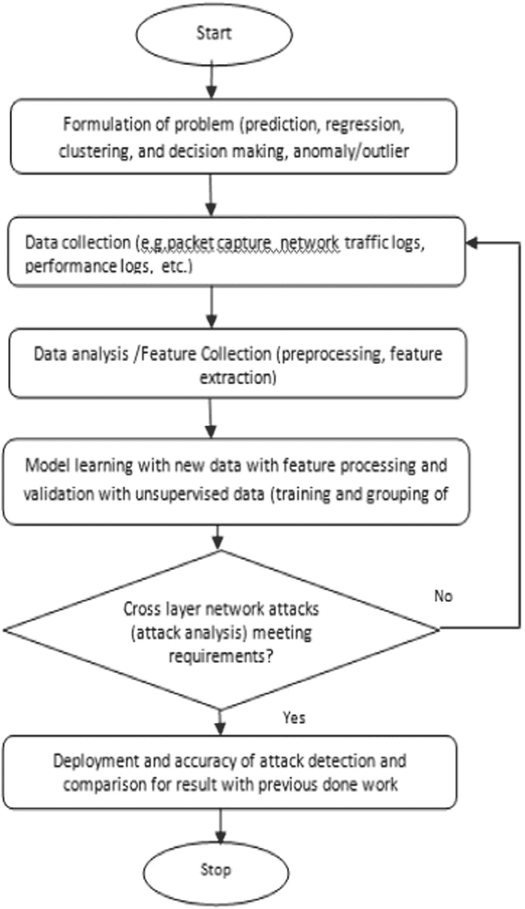

Step 1. 准备网络以进行数据处理阶段。

Step 2. 使用 snort、wire shark 或 `tcpdump` 从接口 `i` 实时捕获数据包和网络流量日志。

Step 3. 提取 IP 特征 `F`。

Step 4. 创建特征选择组 `G`。

Step 5. 对训练数据 `t1` 和 `t2` 进行分类。

Step 6. 对数据集进行训练，并使用自适应学习应用分类器技术以进行进一步测试。

令 `T -> t1` 和 `t2` 为来自特征分组的标记和未标记数据，

`N` 为空数据，// 有些数据包可能包含不完整的特征

将训练集作为 `t1` 开始；

While (`t2` 不为空)

{

从 `t2` 中选择一个实例 `i` 并生成告警;

// `FP`, `FN`, `TP`, `TN`

If (`C` (`i`) <null)

将 `i` 添加到 `t1` 并从 `t2` 中移除 `i`;

}

输出 `t1` 的分类器。

Step 7. 将结果保存在日志文件中并生成告警。

在评估网络时，它会传输大量数据并生成日志，因此对于小型网络来说，这些数据对于 IDS 来说也非常大。网络流量包含复杂特征，这些特征的分类很难相互关联。第一项任务是进行数据过滤，使得并非所有数据都需要由 ID 处理。第二项任务是进行特征选择，其中相关特征必须分组在一起，以便仅选择相关特征来节省时间和计算复杂度。第三个方面是聚类方法，用于将这些特征相互关联。涉及的一些技术包括贝叶斯网络、CART 等。最后，需要使用 SVM 或神经网络对这些特征进行排名。

特征选择有助于减少数据训练的分类过程。此外，特征选择需要根据 IDS 类型进行考虑。例如，基于行为的 IDS 和基于网络的 IDS 需要考虑不同的特征选择和特征分组。为了分类目的，需要取一组特征 `F` 用于目标输出 `T`。随后是分类方法。采用最小特征集将减少分类过程中的时间和复杂度（图 6.1 和 6.2）。

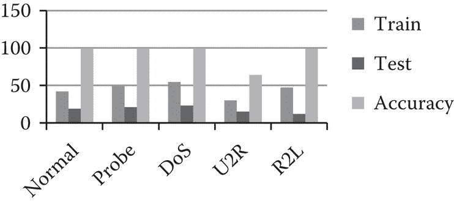

Figure 6.1 Performance by using 41 features.

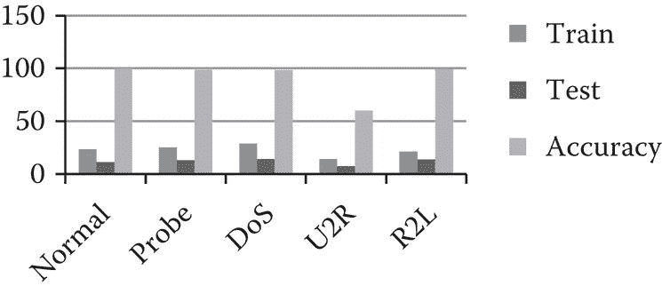

Figure 6.2 Performance by using 17 features.

结果清楚地表明，与使用所有 41 个特征相比，使用更少的特征可以提高性能。在正常流量中，使用所有 41 个特征时的准确率为 99.57，而使用仅 17 个特征时，准确率为 99.64。对于其他攻击类别，由于选择的特征较少，准确率略有下降。先前研究的实验结果表明，使用不同机器学习方法的实验数据集如何影响已知攻击的检测结果（图 6.3 和 表 6.2）。

![Figure 6.3 Experimental result showing performance analysis using various ML approach \[22\].](Images/fig6_3.jpg)

[Figure 6.3 Experimental result showing performance analysis using various ML approach \[22\].](#ch06.xhtml#Ffig6_3)

[Table 6.2 Attack Class, Training and Test Record of KDD Data Sets \[22\]](#ch06.xhtml#Ttable6_2)

| Type || Training Record || Test Record |

| --- | --- | --- |

| Normal || 100 || 500 |

| --- | --- | --- |

| Probing || 100 || 75 |

| Denial\_of\_service || 100 || 75 |

| Root\_to\_local || 100 || 50 |

| User\_to\_root || 11 || 50 |

### 6.4 应用与未来工作

过去在使用聚类和 AI 方法组合进行特征分组方面的所有工作，都可以扩展到与区块链技术相结合，以在各种动态互连节点之间建立信任；这样，当它们加入网络时，可以实时监控，并能轻松识别恶意节点以挫败任何恶意任务。如果源和目标与区块链绑定，那么识别应用层攻击将变得容易。这可以特别应用于电子健康领域，其中医疗数据与患者和相关医生共享。机器可以设置为包含区块链和 IDS 的用户应用程序组合，从而也可以检测跨层攻击。

### 6.5 结论

特征选择和分组方法需要考虑各种因素，例如 IDS 的类型、攻击类型、用于测试的数据准备以及训练目的。并非所有特征在攻击检测过程中都有用，因为存在冗余，且某些特征可能因未参与攻击检测而无用。特征选择有助于提高 IDS 在复杂性和成本方面的性能。在未来的工作中，将研究在应用层实施区块链，以结合基于网络的入侵检测系统来检测应用层和网络层攻击。

## 参考文献

1. Alexopoulos, N., Vasilomanolakis, E., Ivanko, N. R., and Muhlhauser, M. (2017). Towards blockchain-based collaborative intrusion detection systems. In Proceedings of the 12th International Conference on Critical Information Infrastructures Security, pp. 1–12.

2. Kok, S. H., Abdullah, A., Jhanjhi, N. Z., and Supramaniam, M. (2019). A review of intrusion detection system using machine learning approach. International Journal of Engineering Research and Technology, *12*(1), 8–15.

3. Vijayalakshmi, B., Ramar, K., Jhanjhi, N. Z., Verma, S., Kaliappan, M., Vijayalakshmi, K., Kavita, Ghosh, U., and Vimal, S. (2020). An attention based deep learning model for traffic flow prediction using spatio temporal features towards sustainable smart city. International Journal of Communication Systems, *34*(3).

4. Chandrashekar, G., and Sahin, F. (2014). A survey on feature selection methods. Computers & Electrical Engineering, *40*(1), 16–28.

5. Batra, I., Verma, S., Kavita, and Alazab, M. (2019). A lightweight IoT based security framework for inventory automation using wireless sensor network. International Journal of Communication Systems, *33*(2), e4228.

6. Rani, P., Kavita, Verma, S., and Nguyena, N. G. (2020). Mitigation of black hole and gray hole attack using swarm inspired algorithm with artificial neural network. IEEE Access, *8*.

7. Humayun, M., Niazi, M., Jhanjhi, N. Z., Alshayeb, M., and Mahmood, S. (2020). Cyber security threats and vulnerabilities: A systematic mapping study. Arabian Journal for Science and Engineering, *45*(4), 3171–3189.

8. El-Khatib, K. (2010). Impact of feature reduction on the efficiency of wireless intrusion detection systems. IEEE Transactions on Parallel and Distributed Systems, *21*(8), 1143–1149.

9. Elijah, A. V., Abdullah, A., Jhanjhi, N., Supramaniam, M., and Abdullateef, B. (2019). Ensemble and deep-learning methods for two-class and multi-attack anomaly intrusion detection: An empirical study. International Journal of Advanced Computer Science and Applications, *10*, 520–528.

10. El-Alfy, E. S. M., and Alshammari, M. A. (2016). Towards scalable rough set based attribute subset selection for intrusion detection using parallel genetic algorithm in MapReduce. Simulation Modelling Practice and Theory, *64*, 18–29.

11. Hussain, K., Hussain, S. J., Jhanjhi, N. Z., and Humayun, M. (2019). SYN flood attack detection based on Bayes Estimator (SFADBE) for MANET. In *2019 International Conference on Computer and Information Sciences (ICCIS)*, pp. 1–4. IEEE.

12. Batra, I., Verma, S., Kavita, Ghosh, U., Rodrigues, Joel J. P. C., Nguyen, G. N., Sanwar Hosen, A.S.M., and Mariappan, V. (2020). Hybrid logical security framework for privacy preservation in the green Internet of Things. MDPI-Sustainability, *12*(14), 5542.

13. Pfahringer, B. (2000). Winning the KDD99 classification cup: Bagged boosting. SIGKDD Explorations, *1*(2), 65–66.

14. Pan, Z. S., Chen, S. C., Hu, G., and Zhang, D. Q. (2003). Hybrid neural network and C4. 5 for misuse detection. Training, *4*(5).

15. Moradi, M., and Zulkernine, M. (2004, November). A neural network based system for intrusion detection and classification of attacks. In *the IEEE International Conference on Advances in Intelligent Systems-Theory and Applications*, pp. 15–18.

16. Chebrolu, S., Abraham, A., and Thomas, J. P. (2005). Feature deduction and ensemble design of intrusion detection systems. Computers & Security, *24*(4), 295–307.

17. Shahid, Hafsa, Ashraf, H., Javed, H., Humayun, M., Jhanjhi, N. Z., and AlZain, M. A. (2021). Energy optimised security against wormhole attack in IoT-based wireless sensor networks. CMC-Computers Materials & Continua, *68*(2), 1966–1980.

18. Stein, G., Chen, B., Wu, A. S., and Hua, K. A. (2005, March). Decision tree classifier for network intrusion detection with GA-based feature selection. In *the 43rd Annual Southeast Regional Conference-Volume 2*, pp. 136–141. ACM.

19. Peddabachigari, S., Abraham, A., Grosan, C., and Thomas, J. (2007). Modeling intrusion detection system using hybrid intelligent systems. Journal of Network and Computer Applications, *30*(1), 114–132.

20. Li, Y., and Guo, L. (2007). An active learning based TCM-KNN algorithm for supervised network intrusion detection. Computers & Security, *26*(7–8), 459–467.

21. Kumar, G. (2019). An improved ensemble approach for effective intrusion detection. The Journal of Supercomputing, *1*–17.

22. Davis, J. J., and Clark, A. J. (2011). Data preprocessing for anomaly based network intrusion detection: A review. Computers & Security, *30*(6–7), 353–375.

23. Jhanjhi, N. Z., Brohi, S. N., Malik, N. A., and Humayun, M. (2020). Proposing a hybrid RPL protocol for rank and wormhole attack mitigation using machine learning. In *2020 2nd International Conference on Computer and Information Sciences (ICCIS)*, pp. 1–6. IEEE.

24. Almrezeq, N. (2021). Exploratory study to measure awareness of cybercrime in Saudi Arabia. Turkish Journal of Computer and Mathematics Education (TURCOMAT), *12*(10), 2992–2999.

25. Mohamad Tahir, H., Hasan, W., Md Said, A., Zakaria, N. H., Katuk, N., Kabir, N. F., and Yahya, N. I. (2015). Hybrid machine learning technique for intrusion detection system. In International Conference on Computing and Informatics.

26. Aslahi-Shahri, B. M., Rahmani, R., Chizari, M., Maralani, A., Eslami, M., Golkar, M. J., and Ebrahimi, A. (2016). A hybrid method consisting of GA and SVM for intrusion detection system. Neural Computing and Applications, *27*(6), 1669–1676.

27. Iglesias, F., and Zseby, T. (2015). Analysis of network traffic features for anomaly detection. Machine Learning, *101*(1), 59–84.

## 7 PDF 恶意软件分类器 – 调查、未来方向与推荐方法

N.S. Vishnu, Sripada Manasa Lakshmi, Kavita, Sahil Verma, and Awadhesh Kumar Shukla

## CONTENTS

1. 7.1 Introduction

2. 7.2 X-Ray of PDF File

3. 7.3 Reading of PDF Files

4. 7.4 Steps Involved in Classifying PDF Files

5. 7.4.1 Prior Procedure Before the Actual Parsing

6. 7.4.2 Feature Extraction

7. 7.4.3 Classifier

8. 7.5 Modes of Classification

9. 7.6 Static Classification of PDF Files

10. 7.7 Static Classification Systems

11. 7.7.1 PJScan

12. 7.7.2 N-Gram

13. 7.7.3 Slayer

14. 7.7.4 N-Gram II

15. 7.7.5 PDFrate v1

16. 7.7.6 Hidost

17. 7.7.7 Slayer NEO

18. 7.7.8 PDFrate v2

19. 7.8 不同静态分类器的比较

20. 7.9 PDF 文件的动态分类

21. 7.10 动态分类系统

22. 7.10.1 PlatPal

23. 7.10.2 MDScan

24. 7.10.3 WepaWet

25. 7.10.4 PDF Scrutinizer

26. 7.10.5 Lux0R

27. 7.11 不同动态分类器的比较

28. 7.12 新型方法论

29. 7.13 结论与未来方向

30. 参考文献

DOI: [10.1201/9780367808228-7](https://doi.org/10.1201/9780367808228-7)

### 7.1 引言

当前攻击者正在磨练其欺骗技术，利用混淆技术开发稳定的恶意软件，以避免被检测并增强其破坏能力。大多数恶意软件攻击都是通过常用文件（如照片、PDF、电子表格和其他文件）进行的，攻击者会在这些文件中引入恶意代码。入侵者需要了解某些良性文件的结构，才能将危险代码与良性文件合并。将恶意软件嵌入这些日常使用的文档中有三个关键优势。第一个优势是大多数人依赖 PDF 文件，这可能增加对人们进行社会工程攻击的机会 \[1\]。第二个优势是大量用户正在使用过时的技术和应用程序，使他们容易受到此类攻击 \[2\]。软件中的漏洞可以被利用来构建成功的恶意软件，从而防止被检测。受害者使用过时和不安全软件的程度越高，其系统的恶意软件感染生命周期就越长 \[3\]。许多研究人员表明，自学习策略可以用于提高检测系统的检测技能和性能。例如，可以将系统视为一个孩子，将输入系统的数据视为在学校教给孩子的章节。攻击者的主要目标是破坏系统，而在我们的示例中，则是让孩子在评估中不及格。因此，为了实现这一结果，攻击者可能会尝试向系统输入非法数据，或者提供精心设计的输入来迷惑系统。在示例中，讲师可能会尝试用不当数据教孩子，甚至在考试时给出复杂的问题来让孩子不及格。输入不当数据可以被视为投毒攻击，而在评估过程中出现棘手问题的过程可以被称为规避攻击。大多数关于自学习检测技术的研究表明，这些方法能够准确识别和分类掺杂隐藏恶意软件的文件 \[2\]。关于对这类检测系统进行规避攻击的研究表明，向这些系统输入精心制作的输入可以击败它们 \[2\]。例如，向清晰图像添加扰动，就能导致机器学习图像识别系统将其误分类。

在本文中，我们将讨论不同作者提出的各种基于机器学习的 PDF 分类器。由于便携式文档格式（PDF）文件轻便且便携性高，因此被大多数用户广泛使用。它是查看和共享数据的广泛继承格式，这使其成为黑客选择的感染载体。在这里，我们将讨论 PDF 结构以及通过创建对抗样本来逃避恶意软件 PDF 检测系统的不同方法。这些 PDF 检测器主要分为两种不同的类型：静态和动态。我们回顾了迄今为止提出的大多数 PDF 分类器，以了解这些检测器用于检测的机制。

### 7.2 PDF 文件的 X 射线

解析 PDF 的方式可能取决于用于操作或查看它的解析器类型 \2,3,[4,5,6\]。每个 PDF 文件中都有几个基本元素，对于 PDF 文件的表示至关重要 \[2\]。这些元素基本上分为两类：一般结构和文件内容 \[2\]。第一类包括关于文件中存储内容的信息 \[2\]。第二类描述了内容向访问文件的用户显示的方式 \[3\]。PDF 文件的一般结构可以被视为对象网络，其中每个对象都有不同的功能要执行 \[2\]。PDF 结构中有四个主要组件：头部、主体、交叉引用表和尾部。头部是包含一行文本代码的 PDF 部分 \[7\]。此内容以 % 符号开头，并指示 PDF 文档的版本。主体部分包含对对象的请求，这意味着 PDF 文档执行的操作。在这些项目中，有机会包含各种类型的混合文档类型，如图片和视频记录 \[2\]。事实上，甚至可执行的恶意代码也可以通过将它们呈现为主体部分中至少一个对象来嵌入 PDF 记录 \[2\]。在主体中声明的每个对象都是包含唯一编号的 PDF 记录片段，即其引用编号 \[2\]。引用编号在调用特定项目时可能很有用。每当需要了解一个项目时，都可以使用引用编号。在主体中声明的每个唯一对象都以捕获词标记“endobj”结束 \[3\]。通过交叉引用表，我们可以理解 PDF 的这一部分包含一个表。我们应该理解这个表的功能和作用 \[2\]。这个表通常包含关于 PDF 文档中不同对象位置的数据。它还告诉解析器从哪里开始解析过程 \[3\]。它在记录中使用“xref”标记表示，在其下方，我们可以看到不同的行，每一行都指示主体字段中引用的各个项目的引用。只有在交叉引用表中引用的对象才会在解析 PDF 记录时被解析 \[2\]。尾部字段描述了一些对记录翻译至关重要的基本组件 \[2\]。第一个项目的地址位于其中之一。它还包含与引用相关的元数据的引用 \[3\]。尾部字段的结束通过使用标记“%%EOF”来指示。这也意味着文件的结束，并向解析器发出停止其解析活动的信号 \[2\]。

### 7.3 读取 PDF 文件

当解析器选择特定的 PDF 文档进行解析时，它会以如下方式执行此操作：启动时，解析器会转到 trailer 字段并确定要解密的主对象 \[2\]。随后，借助交叉引用表中提到的引用，对对象序列进行解析。最后，当识别到“文件结束标记” \[7\] 时，解析方法结束。使用 PDF 文档的一大亮点是，当新条目被添加到已有文档中时，无需从头重新生成文档 \[2\]。考虑到所有这些因素，它们会创建专门用于存储新引入内容的新字段结构 \[4\]。

### 7.4 分类 PDF 文件涉及的步骤

“AI”技术几乎在各个领域都被广泛使用 \[1\]。这项技术有助于构建更智能的系统，并使其能够进行动态 \[1,8,9\] 应用。由于其应用范围广泛，它也被用于判定文档中隐藏的恶意内容 \[10\]。在这里，我们将讨论如何通过识别正在调查的 PDF 文档中的威胁代码来有效辅助这项技术 \11,[12\]。在过去十年中，科学家提出了几种自学习框架来分析 PDF 文档 \2,4,[13,14\]。在本部分中，我们将探讨基于自学习的恶意 PDF 查找器的架构以及对给定 PDF 文档进行分类的步骤 (Figure 7.1)。

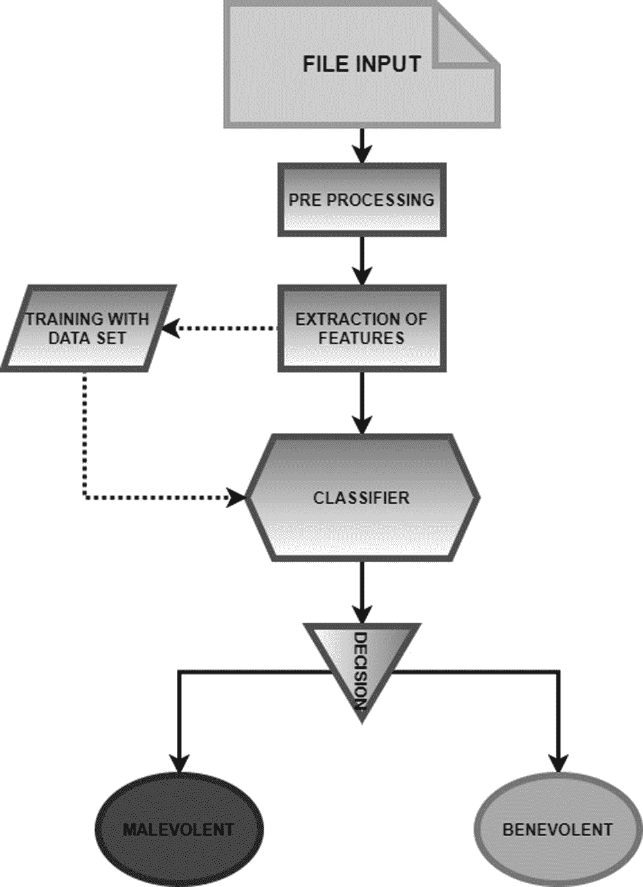

Figure 7.1 Work flow of PDF malware classifier.

这些框架的基本目标是高效判断特定文档是属于良性分类还是恶性分类 \[15\]。为此，框架需要检查并衡量文档内部组件的示例和模式 \10,15,[16,17,18,19\]。尽管有许多提出的标识符，但它们都遵循三种基本方法来检查 PDF 文档 \[8\]，即：

#### 7.4.1 实际解析前的预处理

这是对选定用于审查目的的 PDF 文档执行的主要交互。在此技术中，内部代码（例如 JavaScript 或 ActionScript 代码）会在隔离条件下的稳定环境中执行，以了解其性质 \[2\]。它在隔离条件下准备，以便其执行不会影响系统 \[20\]。其他基本信息组件，例如内部对象的元数据和关键字，也会从 PDF 文档中提取 \[11\]。

#### 7.4.2 特征提取

这是探测器在“预处理”操作完成后执行的下一步操作。此技术使用从前一步骤获得的提供的信息来完成其分析操作 \3,11,[21, 22, 23, 24, 25, 26, 27\]。在此步骤中，从前一阶段提取的信息被转换为向量数字形式，这些向量数字能够传达 PDF 文档中特定组件（例如关键字和“编程接口调用”）的存在情况 \[28\]。

#### 7.4.3 分类器

这是在分析前一阶段分离的数据时部署算法的阶段 \[16\]。分类器首先使用测试集进行训练，以构建其关于判断良性和威胁性 PDF 文档之间差异的知识 \[29\]。如果分类器经过高效训练，系统就能在对 PDF 文档进行分类时产生高质量的效率 \[19\]。系统的有效性不仅取决于算法，还取决于训练集。训练过程在系统实际部署用于实时应用之前进行 \[9\]。分类器的基本目标是准确判断给定文档是否为恶意文档 \[2\]。

### 7.5 分类模式

用于检查 PDF 文档的恶意软件指标，通过帮助自学习策略，可分为两大类：静态探测器和动态探测器 \[11\]。静态标识符在不执行文档内部代码的情况下对文档进行静态分析 \1,8–11,16–20,28,29,[30\]。动态查找器通过在稳定环境条件下执行实际代码来进行分析 \[1,8,9,11,11,11,20,28–30\]。我们将在下文详细探讨这两种识别类型。

### 7.6 PDF 文件的静态分类

大部分利用 PDF 文档实施的恶意软件攻击都使用 JavaScript 或 ActionScript 代码 \[11\]。因此，这类标识符主要关注文档中识别出此类代码的区域。但是，我们不能仅通过查看 JavaScript 代码的存在来推断某个特定的 PDF 文档就是恶意的。即使是良性文档也可能包含此类代码 \[11\]。因此，静态标识符会调查特定变量、关键字、功能和编程接口调用的使用模式，以判断文档的性质 \[28\]。PJScan 是一种静态 PDF 查找器，它根据变量、运算符和功能的使用频率来判断 PDF 文档的恶意程度 \[31\]。其他一些查找器依赖于分词和匹配策略 \[28\]。但是，在攻击者在 PDF 文档内部对这些 JavaScript 实体进行大量混淆的情况下，静态分类器可能会因误分类文档而失效 \[1\]。攻击者可以使恶意内容特别隐藏，以便在解析周期中解析器无法识别它，并且该代码可以在运行时动态调用以执行威胁活动。因此，这类探测器的主要缺陷是它们无法被训练来准确分类故意混淆的测试样本 \[2\] (Figure 7.2)。

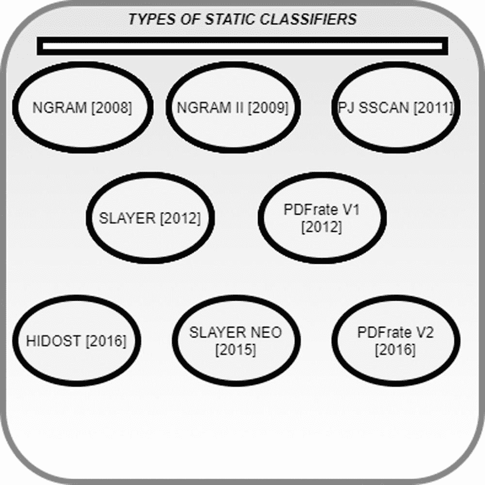

Figure 7.2 Static PDF classifiers.

### 7.7 静态分类系统

#### 7.7.1 PJScan

Pavel Laskov 和 Nedim Šrndic \[31\] 在 2011 年提出了一种静态恶意软件检测框架，该框架能够识别文档内包含的危险 JavaScript 内容 \[31\]。作者声称，与先前引入的模型相比，他们的模型降低了检查文档所需的训练时间，并且在识别已知和未知恶意类型方面也表现出完美的有效性 \[31\]。由于其审查时间短且效率高，此方法最适合训练大型数据集 \[31\] (Figure 7.3)。

![Figure 7.3 Different phase flow of PJScan \[31\].](Images/fig7_3.jpg)

[图 7.3 PJScan 不同阶段流程 \[31\].](#ch07.xhtml#Ffig7_3)

图中展示了 PJScan 模型的架构。当特定的 PDF 记录被提交给框架进行检查时，该记录会经过一个包含子类别模块的组件提取模块，例如用于从记录内容中提取 JavaScript 代码的 JavaScript 提取器 \[31\]。随后，这些 JavaScript 代码的所有段落都会被分配标记 \[31\]。此时，该算法被用于分类目的。

#### 7.7.2 N-Gram

M. Zubair Shafiq 等人 \[32\] 在 2008 年提出了一种方法，用于识别良性记录中嵌入的恶意代码的存在。作者表示，在那些时候，宣传的恶意软件安全软件无法确定文档中存在的最近已知恶意软件签名。因此，他们构建了一个能够确定文档中隐藏的“恶意代码”的框架，称为 N-Gram \[32\]。他们从调查中宣布，大部分非恶意记录的“字节排序”表现出一阶依赖结构。他们还使用“熵率”来比较特定文档的分布估计差异，以识别文档中有害代码的位置 \[32\]。在对作者提出的上述模型进行评估时，它在处理混合恶意记录方面表现出了高效的性能。

#### 7.7.3 Slayer

Davide Maiorca 等人 \[17\] 在 2012 年提出了一个模块，用于在评估周期中移除 PDF 文档内的特征。作者引入了一个可行的分类器和特征提取模块，两者结合形成了一个引人注目的静态检测模型。该设备据说具有高度灵活性 \[17\]。可以将该工具作为“独立工具”或作为额外的“模块功能”来使用，以提高现有识别框架的能力 \[17\]。

#### 7.7.4 N-Gram II

S. Momina Tabish 等人 \[33\] 在 2009 年提出了一种新的恶意软件识别方法，该方法通过检查文件的字节来工作。在此方法中，被分析的内容不会为任何未来目的而存储；它是一种“基于非签名”的方法。因此，作者声称他们的框架能够识别未知的恶意软件变种。所提出的框架与包含大量恶意软件家族和文件格式的大量文件样本进行了对比 \[33\]。观察发现，该框架在文件分类中表现出了 90% 的准确率 \[33\] (图 7.4)。

![图 7.4 N-Gram II 分类器流程 \[34\].](Images/fig7_4.jpg)

图 7.4 N-Gram II 分类器流程 \[34\]。

该图代表了 S. Momina Tabish 等人 \[33\] 在 2009 年提出的工程方案。作者保证，他们用于构建此框架的方法可以消除对为调查目的所选文档类型的任何先前知识的需求 \[33\]。因此，当攻击者试图控制 PDF 记录的头部部分时，此模型可能识别出恶意软件 \[33\]。在作者引入的架构中，该框架被分为四个独特的模块 \[34\]。第一个模块是“方块生成模块”，它将记录内的“字节级内容”划分为等大小且更小的方块 \[34\]。下一个模块，“特征提取模块”对前一级生成的方块进行计算度量 \[34\]。另外两个模块，即“排列和相关”模块，对从前一模型获得的结果进行不同的分析，以识别恶意软件的迹象 \[34\]。

#### 7.7.5 PDFrate v1

Charles Smutz 和 Angelos Stavrou \[16\] 在 2012 年提出了一种架构，用于以强健的方式捕捉 PDF 记录的恶意属性，通过辅助自学习方法。该方法能够从 PDF 结构中存在的对象的元数据中捕获信息 \[16\]。该检测器基于“随机森林分类”方法工作，这是一种训练用于识别由不同“决策树”形成的特征的分类器 \[16\]。该分类器以产生良好的识别率而闻名，即使在未知恶意软件属性的情况下也是如此 \[16\]。“随机森林分类”方法由于其高效的系统，至今仍在许多最近提出的检测框架中使用 \[16\] (图 7.5)。

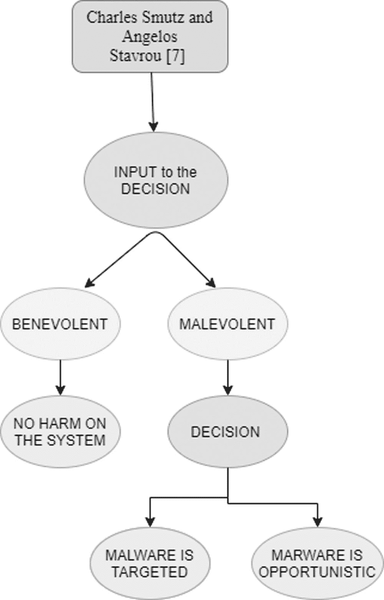

图 7.5 PDFrate v1 工作流。

该图展示了 Charles Smutz 和 Angelos Stavrou \[16\] 在 2012 年为高效恶意软件识别所做的安排。该框架经过两个级别的测试。第一个测试旨在将文档分类为良性或恶意类别 \[16\]。如果文档属于恶意类别，那么该文档将被送入另一个分组级别，以确定该恶意文档是灵活的还是针对性的 \[16\]。

#### 7.7.6 Hidost

Nedim Šrndic 和 Pavel Laskov \[29\] 在 2016 年引入了一个名为 Hidost 的静态检测框架，用于有效识别 PDF 记录结构中存在的非可执行恶意内容。随着攻击者开始将非可执行代码附加到良性文档中，以消除静态和动态分类器的检测，因此产生了开发框架以识别这些驻留在文档中的恶意软件的需求 \[29\]。本文是同一作者在 2013 年提出的最近方法的扩展 \[29\]。在那篇论文中，作者引入了一种将文档内容与其合理组件融合的方法，以实现更高的分类准确性。尽管该模型是为识别 PDF 和 Flash 记录中的恶意软件而开发的，但作者表示，他们的方法可以扩展以识别不同格式中的恶意软件。在评估该框架时，发现该方法在准确性上优于大部分商业 VirusTotal 检测软件 \[29\]。

作者保证，他们的框架在区分恶意文档和良性文档方面是成功的。我们不能只接受一个向量作为对各种文档进行分类的典型特征 \[9\]。在该模型中，处理和识别策略被分为多个步骤，以便该框架可以进一步扩展，以高效地识别其他文档恶意软件 \[9\]。

#### 7.7.7 Slayer NEO

Davide Maiorca 等人 \[30\]，在 2015 年，提出了一种名为 Slayer NEO 的模型，用于通过从被调查的 PDF 记录中恢复内容和内部结构来检测恶意 PDF 存档。创作者声称，该模型拥有一个高效的解析系统，这反过来将有助于判断非 JavaScript 恶意内容的存在。借助此排序算法的组织，作者表示，他们的模型已击败了其他多种静态 PDF 恶意软件检测系统 \[30\]。图中展示了 Slayer NEO PDF 恶意软件定位模型引入的架构。首先，PDF 文档经过一个组件提取模块，以提取任何嵌入式恶意软件的存在 \[8\]。为此，它使用了解析器 PeePDF 和 Origami \[30\]。在组件提取之后，记录的各种设计被分离，并生成特征向量，以将给定记录分类为良性或恶意 \[8\] (Figure 7.6)。

![Figure 7.6 Architectural flow of Slayer NEO \[8\].](Images/fig7_6.jpg)

[Figure 7.6 Architectural flow of Slayer NEO \[8\].](#ch07.xhtml#Ffig7_6)

#### 7.7.8 PDFrate v2

Charles Smutz 和 Angelos Stavrou \[11\]，在 2016 年，创建了一种特殊且强健的方法论，能够识别对抗性测试。为了构建此框架，作者对大量 PDF 测试与各种分类器进行了测试，以识别“集合分类器”效果较低的特定测试范围 \[1\]。随后，基于对这些示例特征的分析，作者提出了一种集成分类器，该分类器基于“共识分析”策略 \[1\]。他们还建议，其方法论可以推广以检测不同的“梯度下降”和“部分密度估计攻击” (Figure 7.7 和 Table 7.1)。

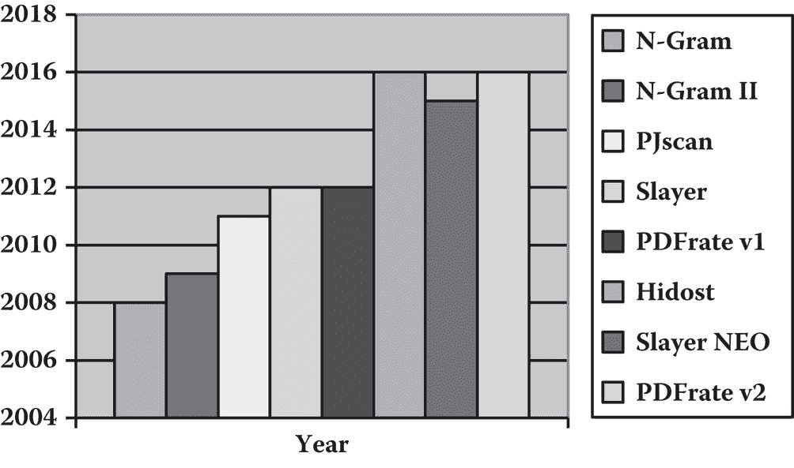

Figure 7.7 Year of implementation of different static classifiers.

Table 7.1 Type of Classifiers Used in Different Static Classifiers

| Classifier || Author(s) |

| --- | --- |

| Markov || M. Zubair Shafiq et al. \[32\] |

| --- | --- |

| Decision Trees || S. Momina Tabish et al. \[34\] |

| SVM || Pavel Laskov and Nedim Šrndic \[31\] |

| Random Forests || Davide Maiorca et al. \[17\] |

| Random Forests || Charles Smutz and Angelos Stavrou \[16\] |

| Random Forests || Nedim Šrndic and Pavel Laskov \[9\] |

| Adaboost || Davide Maiorca et al. \[8\] |

| Classifier Ensemble || Charles Smutz and Angelos Stavrou \[1\] |

### 7.8 Comparison Between the Different Static Classifiers

上述图表和图形向我们展示了不同的静态分类器及其实现年份和其中使用的分类器。

### 7.9 Dynamic Classification of PDF Files

动态标识符同样主要集中在文档的 JavaScript 代码上，因为它们的存在引发了更高的怀疑 \[4\]。但是，这一类标识符不会搜索关键字和不同组件的示例或频率 \[9\]。相反，它会直接提取这些 JavaScript 代码，并尝试在强大的隔离环境中执行它们，以检查其活动 \[31\]。静态查找器中因隐藏策略训练而出现的问题可以通过部署这些类型的检测器来克服 \[28\]。动态检测器与静态检测器不同，不会仅通过评估文档的内部结构来检查文档 \[28\]。它们通过提取 Flash 和脚本代码并执行它们来检查文档的性质，以获取文档的真实性质 \[5\]。尽管这些类型的检测器能够有效地确定恶意代码，但在不支持的条件下可能会失败 \[11\]。部分 JavaScript 代码可能需要其他额外组件支持才能执行其活动 \[16\]。为此，我们需要通过提供文档内容所需的必要条件来模拟其执行过程 \[11\]。另一个缺陷是，当恶意软件嵌入不使用 JavaScript 代码的文档时，动态检测器可能会失败 \[11\] (Figure 7.8)。

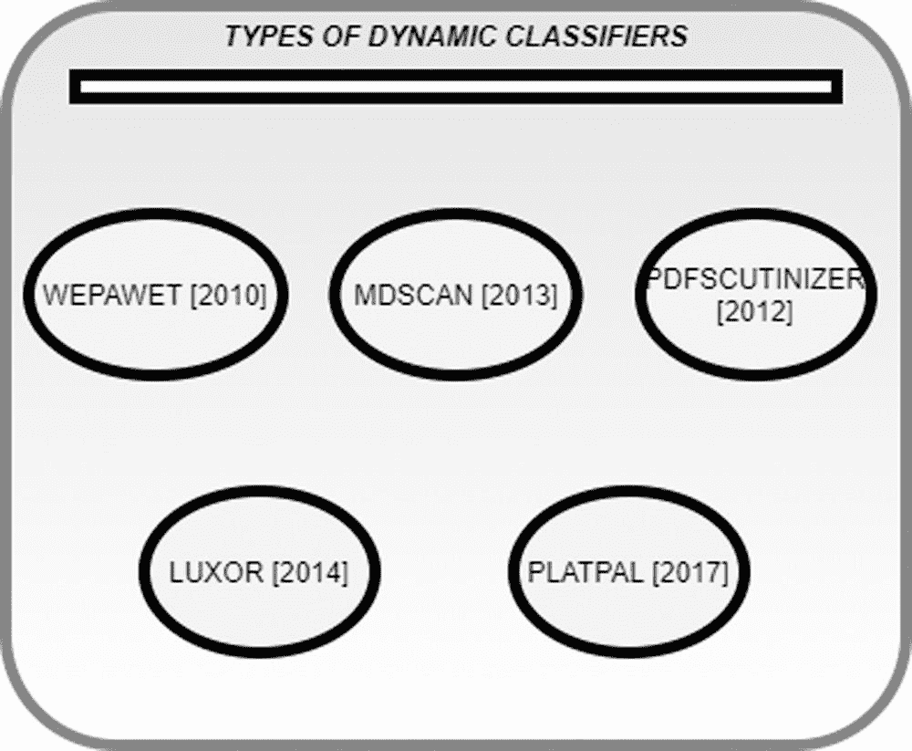

Figure 7.8 Dynamic PDF classifiers.

### 7.10 Dynamic Classification Systems

#### 7.10.1 PlatPal

Meng Xu 和 Taesoo Kim \[11\]，在 2017 年，原型化了一种平台多样性工具“PlatPal”，它附加到“Adobe Reader”应用程序，以在解析过程中检查文档的内部组件，并且还在沙箱中执行文档代码，以确定代码对主机计算机的影响 \[11\]。作者在构建此框架时使用的主要原则是，良性文档在执行时无论使用什么应用程序都会具有可比特征，而恶意文档可能会在不同应用程序处理时表现出不同的行为 \[11\]。该模型非常灵活，可以以减少“误报”响应的方式识别嵌入式恶意软件 \[11\]。

在此过程中，PDF 文档被发送到安装了不同操作系统的各种虚拟机中，以检查其运行时的社会属性。在在这些虚拟机上运行文档后，从这些机器获得的结果会被比较用于分类方法。通过此过程，可以识别文档在不同主机平台上的影响。

#### 7.10.2 MDScan

Zacharias Tzermias 等人 \[19\]，在 2011 年，提出了一个能够真实分析代码，并且还组织了档案中包含代码的强大处理，以识别 PDF 文档中存在的恶意软件的框架。在将框架与 PDF 测试的信息索引进行对比时，发现所提出的模型能够识别高度编码的恶意 PDF 文档 \[19\] (Figure 7.9)。

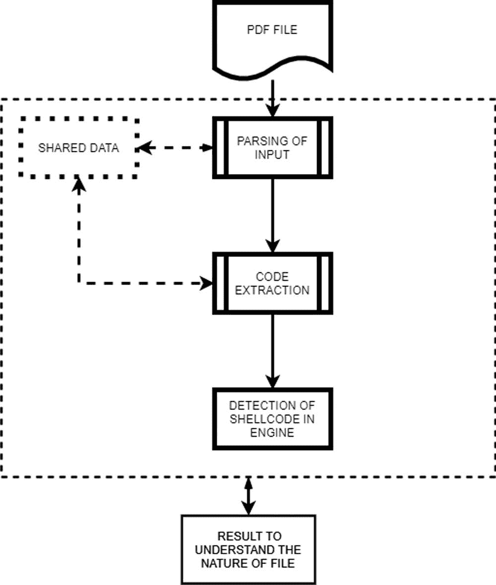

Figure 7.9 Work flow of MDScan.

该图展示了 Zacharias Tzermias 等人 \[19\] 在 2011 年提出的 MDScan 架构。在此模型中，选定用于调查的 PDF 档案会被解析以识别文件中的 JavaScript 代码。从这两个模块中，一个名为共享信息的专用模块被关联。随后，识别出的 JavaScript 代码经过 JavaScript 引擎，该引擎具有内置的识别 shell code 的功能 \[19\]。随后，它在模拟环境中运行以了解文档的性质 \[19\]。

#### 7.10.3 WepaWet

Marco Cova 等人 \[33+\] 在 2010 年提出了一种有效的系统，用于对 PDF 文档中的 JavaScript 内容进行细致的评估。在此过程中，作者构建并引入的模型倾向于将发现功能与模仿技术相结合，以便能够识别用于执行分析的脚本代码 \[33\]。它帮助自学习技术通过模仿方法和对比存储的异常模式，来识别隐藏在 JavaScript 代码中的恶意软件内容 \[33\]。作者表示，他们的模型还能够自行添加新识别的恶意软件签名，从而消除了对显式编码的需求。Yen-Chen Lin 等人 \[6\] 在 2017 年提出了一种理想的策略，用于在深度解释的基础上开发和实施各种对抗性攻击。系统需要执行的一组完美操作被隐式地排序到代码中，并针对自定义攻击和输入数据进行测试以进行验证。

#### 7.10.4 PDF Scrutinizer

Florian Schmitt 等人 \[15\] 在 2012 年开发了一种名为“PDF Scrutinizer”的动态 PDF 分类器，它不仅能够高效地对 PDF 文档进行分类，还能说明其动态状态背后的原理。作者表示，他们的模型会单独调查所有与其他 .exe 文件捆绑的可疑文档，而不与普通未捆绑文档混在一起。与其他分类器不同，该框架将文档归类为三个类别之一：恶意、良性和可疑类别 \[15\]。PDF Scrutinizer 在评估过程中使用了名为“PDF Box”的接口来处理 PDF 文档 \[15\]。

该图展示了 Florian Schmitt 等人 \[15\] 在 2012 年引入的 PDF Scrutinizer 模型的功能和架构。从 Figure 7.10 可以看出，PDF Scrutinizer 具有多种功能。我们提供给框架的 PDF 文档会经历不同的层级，以检查其中是否存在恶意内容 \[15\]。第一步是发现被审查文档中是否存在 JavaScript 代码 \[15\]。然后，我们注意到其中存在的 shell 代码。基于这些发现，会进行统计分析，将文档归类为恶意、良性或可疑 \[15\]。

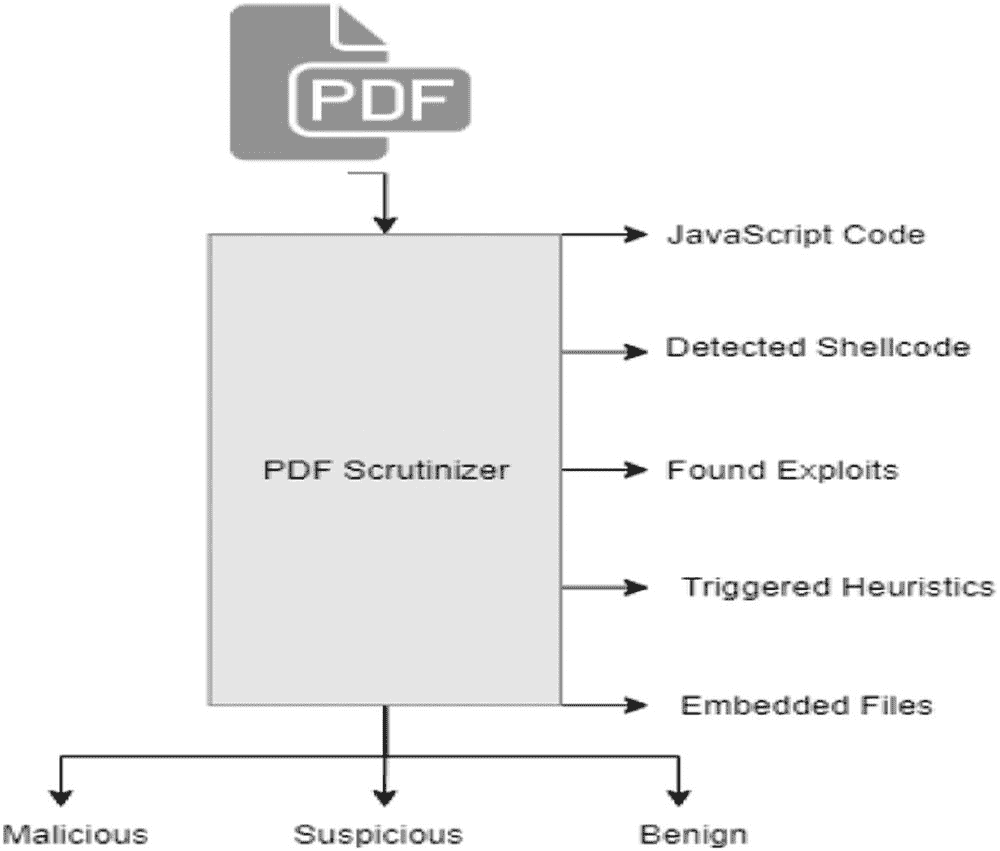

Figure 7.10 Working structure in PDF Scrutinizer.

#### 7.10.5 Lux0R

Igino Corona 等人 \[28\] 在 2014 年开发了一种名为“Lux0R”的动态分类器，代表“Lux on discriminant references”。该模型基于一种“轻量级”技术，通过考虑“编程接口引用”（包括文档中声明的各种函数、变量和其他组件）来调查 JavaScript 代码的性质 \[28\]。Lux0R 选择文档 JavaScript 部分中存在的代码，并提取其“编程接口”组件，借助“AI”算法对其进行分析 \[28\]。这种技术被视为一种有效的程序，用于应对“模仿攻击” \[28\] (Figure 7.11)。

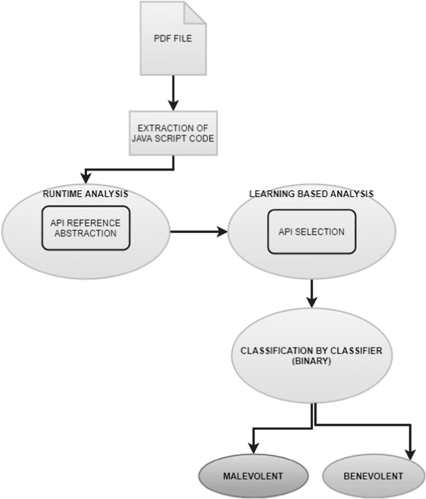

Figure 7.11 Flow in Lux0R.

上图展示了 Igino Corona 等人 \[28\] 在 2014 年提出的基于动态学习的 PDF 恶意软件分类器 Lux0R 的架构。在此过程中，不审查整个 PDF 报告，而仅调查 JavaScript 代码。当 JavaScript 代码从文档中提取后，该代码会被发送以分离 API 引用 \[28\]。此后，基于 API 引用的确定，PDF 会在下一阶段进行分类，即分类模块 \[28\] (Figure 7.12 和 Table 7.2)。

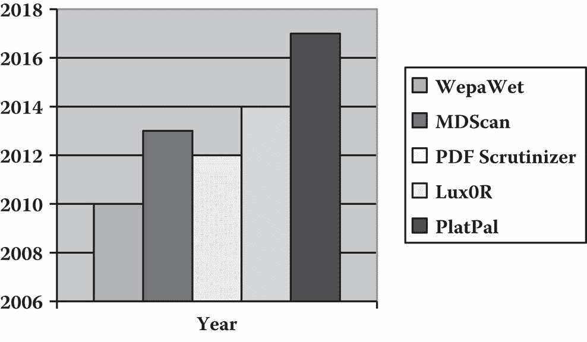

Figure 7.12 Year of implementation of different dynamic classifiers.

Table 7.2 Type of Classifier Used in Different Dynamic Classifier

| Classifier || Author(s) |

| --- | --- |

| Bayesian || Marco Cova et al. \[33\] |

| --- | --- |

| – || Zacharias Tzermias et al. \[19\] |

| – || Florian Schmitt et al. \[15\] |

| Random Forests || Igino Corona et al. \[28\] |

| – || Meng Xu and Taesoo Kim \[11\] |

### 7.11 Comparison Between Different Dynamic Classifiers

上述表格和图表描绘了本文所考虑的不同动态分类器的比较。我们可以看到为它们使用的分类器，并且这些分类器系统已被证明更高效，并倾向于给出关于 PDF 文件性质的更准确结果 (Figures 7.13 和 7.14)。

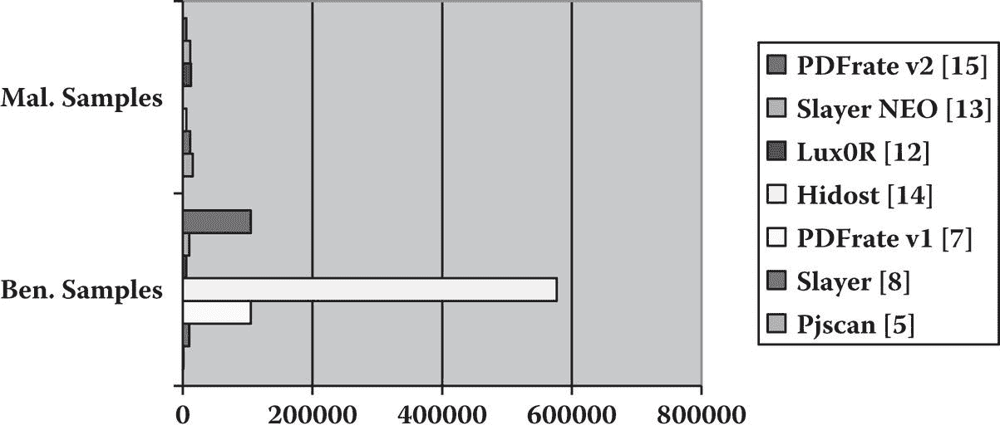

Figure 7.13 Samples taken.

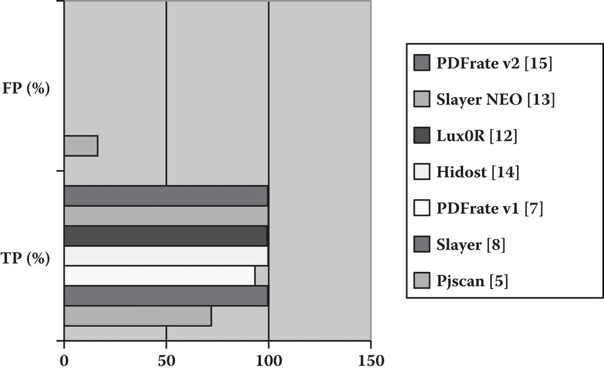

Figure 7.14 True positive percentage vs false positive percentage of the classifiers.

我们还比较了静态分类器与动态分类器的真阳性百分比，以找出它们之间的准确性。我们可以看到 Slayer NEO 相对更好，并比 PJScan 给出更准确的分类结果。

### 7.12 Novel Methodologies

作为这项工作的一部分，我们从不同来源收集了恶意和良性 PDF 样本，并创建了一个包含 1,400 个良性 PDF 样本和 1,500 个恶意 PDF 文件样本的数据集。恶意 PDF 文件中的恶意代码被高度混淆，以至于用户打开时无法将其识别为恶意。这些 PDF 文件的基础结构被修改以添加恶意代码，因此持有该文档的用户无法看到或识别该文件。我们基于预先存在的“PlatPal”系统开发了一个修改后的 PDF 分类器系统。该系统使用 Python 2.7 编写，因此我们使用了 Python 2.7 解释器。系统中使用的其他包包括 numpy、pandas、matplotlib、sklearn、scipy、xgboost 和 PyWavelets。我们使用 Anaconda 环境来设计和执行该系统。该系统使用总样本（良性和恶意）的 80% 进行训练，并使用剩余 20% 的样本测试其准确性和精确度。基于学习的框架已被证明易受对抗性信息控制攻击。这些攻击已在以下假设下进行研究：敌人对目标模型内部、其训练数据集，或者它分配给正在检查的样本的分类分数有一定了解 (Figure 7.15)。

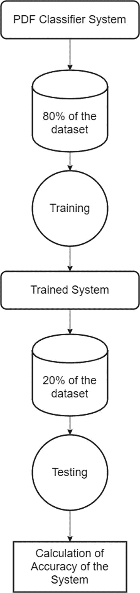

Figure 7.15 Workflow of the system.

我们需要计算旧系统与新开发系统之间的准确率和精确度差异。随后，我们将编写代码，在伪造系统上实施对抗性攻击。在测试阶段，特定样本会根据其内部结构被分类为恶意或良性。但在对抗性测试期间，为了使分类器错误分类该特定样本集，我们需要实现一种能够根据文件性质向文件中注入伪造代码的机制，这样在对抗性攻击期间，良性 PDF 文件应被分类为恶意文件，同样，恶意 PDF 文件也应被分类为良性文件（图 7.16）。

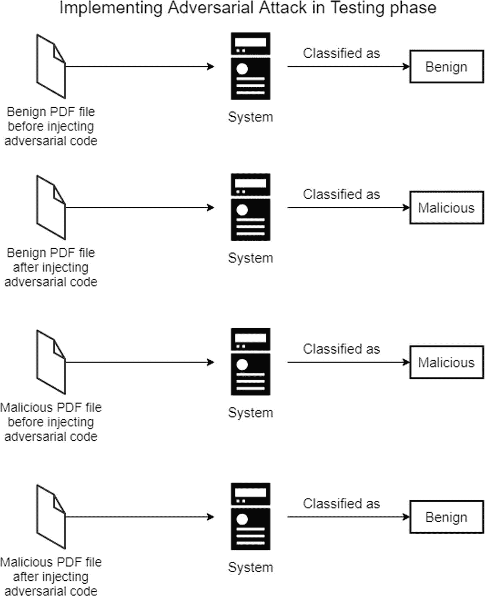

Figure 7.16 Implementing adversarial attacks during the testing phase.

在我们的系统中，我们使用了不同的模块来训练系统，在系统训练过程中从文件中提取特征，ETS（教育考试服务）模块，以及测试模块，该模块可以根据提取的特征以更高的准确率对给定文件进行分类。

在这篇论文工作中，我们将伪造对抗性代码来实施对动态 PDF 分类器系统的对抗性攻击，从而成功地逃避系统并使其错误分类样本性质（图 7.17）。

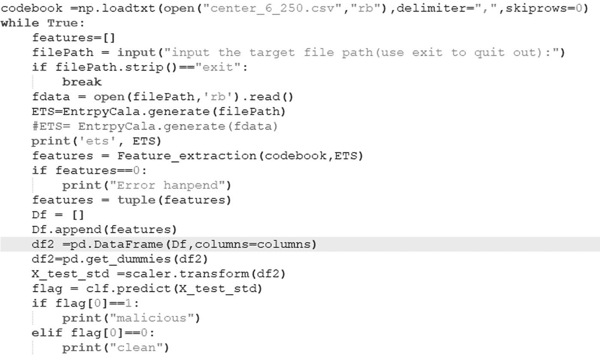

Figure 7.17 Testing procedure.

上图展示了我们在测试阶段用于分类 PDF 文件的主要策略。它在文件提供给系统后，从测试过程中生成的 ETS 中获取参考。它从给定的 PDF 文件中提取所有特征，并尝试通过参考文件来做出决策。我们需要进一步设计一种代码，使文件能够作为对抗性样本来逃避分类器。这需要专注于一种统一的代码，它可以对待检样本进行所需的修改，以使其逃避系统。

### 7.13 结论与未来方向

在本文中，我们概述了各种基于学习的 PDF 恶意软件分类器。从根本上说，PDF 分类器分为两种，即静态分类器和动态分类器。静态分类器通过解析整个存档来区分恶意软件的迹象。而动态分类器在模拟条件下运行记录，以审查文档在执行过程中的行为。大部分动态分类器主要关注记录中的 JavaScript 代码，因为大部分恶意示例都嵌入了 JavaScript 内容。起初，我们介绍了 PDF 文档的设计及其如何利用解析软件进行解析。随后，我们讨论了各种静态和动态分类器的设计。那时，我们对所审查的模型进行了比较研究。特征、分组系统、真阳性（TP）率、假阳性（FP）率和 F1 分数在不同分类器之间进行了比较。

我们还可以通过将恶意图像文件嵌入 PDF 文件对象的主体部分中，来创建更多混淆的对抗性 PDF 样本。可以从交叉引用表中删除图像对象，以便分类器即使在动态运行时检查过程中也看不到该对象。分类器需要通过更先进的技术进行加强，以读取即使是最混淆的部分，从而正确分类这类变体。对于这些样本，建议采用混合分类系统，但应同时注意时间限制。

## 参考文献

1.  Lu, X., Zhuge, J., Wang, R., Cao, Y., & Chen, Y. (2013). De-obfuscation and detection of malicious PDF files with high accuracy. Proceedings of the Annual Hawaii International Conference on System Sciences, 4890–4899. [10.1109/HICSS.2013.166](http://doi.org/10.1109/HICSS.2013.166).

2.  Almrezeq, N. (2021). Cyber security attacks and challenges in Saudi Arabia during COVID-19. Turkish Journal of Computer and Mathematics Education (TURCOMAT), *12*(10), 2982–2991.

3.  Rani, P., Kavita, Verma, S., & Nguyena, N. G. (2020). Mitigation of black hole and gray hole attack using swarm inspired algorithm with artificial neural network. IEEE Access, *8*. [10.1109/ACCESS.2020.3004692](http://doi.org/10.1109/ACCESS.2020.3004692).

4.  Zhang, J. (2018). MLPdf: An effective machine learning-based approach for PDF malware detection. *arXiv*, 1–6. Retrieved from [`arxiv.org/abs/1808.06991`](http://arxiv.org).

5.  Kang, A. R., Jeong, Y. S., Kim, S. L., & Woo, J. (2019). Malicious PDF detection model against adversarial attack built from benign PDF containing javascript. Applied Sciences (Switzerland), *9*(22). [10.3390/app9224764](http://doi.org/10.3390/app9224764).

6.  Lin, Y. C., Hong, Z. W., Liao, Y. H., Shih, M. L., Liu, M. Y., & Sun, M. (2017). Tactics of adversarial attack on deep reinforcement learning agents. Proceedings of the IJCAI International Joint Conference on Artificial Intelligence, 3756–3762. [10.24963/ijcai.2017/525](http://doi.org/10.24963/ijcai.2017/525).

7.  Biggio, B., & Roli, F. (2018). Wild patterns: Ten years after the rise of adversarial machine learning. Pattern Recognition, *84*, 317–331. [10.1016/j.patcog.2018.07.023](http://doi.org/10.1016/j.patcog.2018.07.023).

8.  Almadhoor, L. (2021). Social media and cybercrimes. Turkish Journal of Computer and Mathematics Education (TURCOMAT), *12*(10), 2972–2981.

9.  Srndic, N., & Laskov, P. (2013). Detection of malicious PDF files based on hierarchical document structure. Proceedings of the 20th Annual Network & Distributed Systems Symposium. Retrieved from [`scholar.google.com/scholar?hl=en&btnG=Search&q=intitle:Detection+of+Malicious+PDF+Files+Based+on+Hierarchical+Document+Structure#0`](http://scholar.google.com).

10.  Schmitt, F., Gassen, J., & Gerhards-Padilla, E. (2012). PDF scrutinizer: Detecting JavaScript-based attacks in PDF documents. Proceedings of the 2012 10th Annual International Conference on Privacy, Security and Trust, PST 2012, 104–111. [10.1109/PST.2012.6297926](http://doi.org/10.1109/PST.2012.6297926).

11.  Batra, I., Verma, S., Kavita, Ghosh, U., Rodrigues, J. J. P. C., Nguyen, G. N., Sanwar Hosen, A. S. M., & Mariappan, V. (2020). Hybrid logical security framework for privacy preservation in the green Internet of Things. MDPI-Sustainability, *12*(14), 5542. [10.3390/su12145542](http://doi.org/10.3390/su12145542).

12.  Nissim, N., Cohen, A., Moskovitch, R., Shabtai, A., Edri, M., BarAd, O., & Elovici, Y. (2016). Keeping pace with the creation of new malicious PDF files using an active-learning based detection framework. Security Informatics, *5*(1), 1–20. [10.1186/s13388-016-0026-3](http://doi.org/10.1186/s13388-016-0026-3).

## 医疗网络物理系统的 8 种关键身份验证方案

Zia ur Rehman, Saud Altaf, Saleem Iqbal, Khalid Hussain, and Kashif Sattar

## 内容

1. 8.1 引言

2. 8.2 医疗 CPS 的安全目标

3. 8.2.1 相互身份验证

4. 8.2.2 数据新鲜度

5. 8.2.3 前向安全

6. 8.2.4 数据真实性

7. 8.2.5 数据完整性

8. 8.2.6 数据机密性

9. 8.2.7 防伪性

10. 8.2.8 可扩展性

11. 8.3 医疗 CPS 的安全挑战

12. 8.3.1 资源约束 (Gupta et al., 2019)

13. 8.3.2 拒绝服务攻击 (Alguliyev et al., 2018)

14. 8.3.3 冒充攻击 (Xu et al., 2019a,b)

15. 8.3.4 重放攻击 (Kompara et al., 2019)

16. 8.3.5 窃听攻击 (Shen et al., 2018)

17. 8.3.6 受攻击节点和克隆攻击 (Xu et al., 2019a,b)

18. 8.3.7 匿名和不可关联会话 (Kompara et al., 2019)

19. 8.3.8 失步/干扰攻击 (Liu & Chung, 2017)

13. Li, M., Liu, Y., Yu, M., Li, G., Wang, Y., & Liu, C. (2017). FEPDF: A robust feature extractor for malicious PDF detection. Proceedings of the 16th IEEE International Conference on Trust, Security, and Privacy in Computing and Communications, 11th IEEE International Conference on Big Data Science and Engineering and 14th IEEE International Conference on Embedded Software and Systems, Trustcom/BigDataSE/ICESS 2017, 218–224. [10.1109/Trustcom/BigDataSE/ICESS.2017.240](http://doi.org/10.1109/Trustcom/BigDataSE/ICESS.2017.240).

14. Vijayalakshmi, B., Ramar, K., Jhanjhi, N. Z., Verma, S., Kaliappan, M., Vijayalakshmi, K., Kavita, Ghosh, U., & Vimal, S. (2020). An attention based deep learning model for traffic flow prediction using spatio temporal features towards sustainable smart city. IJCS,Wiley. [10.1002/dac.4609](http://doi.org/10.1002/dac.4609).

15. Nawaz, A. (2021). Feature engineering based on hybrid features for malware detection over Android framework. Turkish Journal of Computer and Mathematics Education (TURCOMAT), *12*(10), 2856–2864.

16. Tzermias, Z., Sykiotakis, G., Polychronakis, M., & Markatos, E. P. (2011). Combining static and dynamic analysis for the detection of malicious documents. Proceedings of the 4th Workshop on European Workshop on System Security, EUROSEC’11. [10.1145/1972551.1972555](http://doi.org/10.1145/1972551.1972555).

17. Laskov, P., & Šrndić, N. (2011). Static detection of malicious JavaScript-bearing PDF documents. Proceedings of the ACM International Conference Proceeding Series, 373–382. [10.1145/2076732.2076785](http://doi.org/10.1145/2076732.2076785).

18. Smutz, C., & Stavrou, A. (2012). Malicious PDF detection using metadata and structural features. Proceedings of the ACM International Conference Proceeding Series, 239–248. [10.1145/2420950.2420987](http://doi.org/10.1145/2420950.2420987).

19. Maiorca, D., Giacinto, G., & Corona, I. (2012). A pattern recognition system for malicious PDF files detection. Proceedings of the International Workshop on Machine Learning and Data Mining in Pattern Recognition, *510*–524. Retrieved from [`link.springer.com/content/pdf/10.1007%2F978-3-642-31537-4\_40.pdf`](https://link.springer.com).

20. Humayun, M., Niazi, M., Jhanjhi, N. Z., Alshayeb, M., & Mahmood, S. (2020). Cyber security threats and vulnerabilities: A systematic mapping study. Arabian Journal for Science and Engineering, *45*(4), 3171–3189.

21. Maiorca, D., Biggio, B., & Giacinto, G. (2018). Towards adversarial malware detection: Lessons learned from PDF-based attacks. arXiv, 1(1). Retrieved from [`arxiv.org/abs/1811.00830`](http://arxiv.org).

22. Batra, I., Verma, S., Kavita, & Alazab, M. A lightweight IoT based security framework for inventory automation using wireless sensor network. IJCS, Wiley, *33*(2), e4228. [10.1002/dac.4228](http://doi.org/10.1002/dac.4228).

23. Chen, Y., Wang, S., She, D., & Jana, S. (2019). On training robust PDF malware classifiers. *arXiv*. Retrieved from [`arxiv.org/abs/1904.03542`](http://arxiv.org).

24. Pitropakis, N., Panaousis, E., Giannetsos, T., Anastasiadis, E., & Loukas, G. (2019). A taxonomy and survey of attacks against machine learning. Computer Science Review, *34*, 100199. [10.1016/j.cosrev.2019.100199](http://doi.org/10.1016/j.cosrev.2019.100199).

25. Song, W., Li, X., Afroz, S., Garg, D., Kuznetsov, D., & Yin, H. (2020). Automatic generation of adversarial examples for interpreting malware classifiers. arXiv. Retrieved from [`arxiv.org/abs/2003.03100`](http://arxiv.org).

26. Goodfellow, I. J., Shlens, J., & Szegedy, C. (2015). Explaining and harnessing adversarial examples. Proceedings of the 3rd International Conference on Learning Representations, ICLR 2015, 1–11.

27. Bauman, E., Lin, Z., & Hamlen, K. W. (2018). Superset Disassembly: Statically Rewriting x86 Binaries Without Heuristics. NDSS. [10.14722/ndss.2018.23300](http://doi.org/10.14722/ndss.2018.23300).

28. Liu, Q., Li, P., Zhao, W., Cai, W., Yu, S., & Leung, V. C. M. (2018). A survey on security threats and defensive techniques of machine learning: A data driven view. IEEE Access, *6*, 12103–12117. [10.1109/ACCESS.2018.2805680](http://doi.org/10.1109/ACCESS.2018.2805680).

29. Šrndić, N., & Laskov, P. (2016). Hidost: A static machine-learning-based detector of malicious files. EURASIP Journal on Information Security, *2016*(1), 1–20. [10.1186/s13635-016-0045-0](http://doi.org/10.1186/s13635-016-0045-0).

30. Maiorca, D., Ariu, D., Corona, I., & Giacinto, G. (2015). A structural and content-based approach for a precise and robust detection of malicious PDF files. Proceedings of the 1st International Conference on Information Systems Security and Privacy, 27–36. [10.5220/0005264400270036](http://doi.org/10.5220/0005264400270036).

31. Cova, M., Kruegel, C., & Vigna, G. (2010). Detection and analysis of drive-by-download attacks and malicious JavaScript code. Proceedings of the 19th International Conference on World Wide Web, 281–290. [10.1145/1772690.1772720](http://doi.org/10.1145/1772690.1772720).

32. Shafiq, M. Z., Khayam, S. A., & Farooq, M. (2008). Embedded malware detection using Markov n-Grams. Lecture Notes in Computer Science (Including Subseries Lecture Notes in Artificial Intelligence and Lecture Notes in Bioinformatics), *5137* LNCS, 88–107. [10.1007/978-3-540-70542-0\_5](http://doi.org/10.1007/978-3-540-70542-0_5).

33. Tabish, S. M., Shafiq, M. Z., & Farooq, M. (2009). Malware detection using statistical analysis of byte-level file content categories and subject descriptors. Csi-Kdd, *23*–31. [10.1145/1599272.1599278](http://doi.org/10.1145/1599272.1599278).

34. Hussain, S. J., Ahmed, U., Liaquat, H., Mir, S., Jhanjhi, N. Z., & Humayun, M. (2019). IMIAD: Intelligent malware identification for android platform. Proceedings of the 2019 International Conference on Computer and Information Sciences (ICCIS), 1–6. IEEE.

### 8.1 引言

近年来，包括硬件、通信技术、软件等在内的各个研究领域都持续快速发展。嵌入式设备在各种人工智能应用中发挥了关键作用。扩展研究将其转变为一种称为物理网络系统（CPS）的新兴研究方向的一部分。CPS 是研究领域中不断发展的趋势之一，它将网络、物理和计算组件整合在一起，在学术界开辟了创新方向。CPS 的子领域包括智能电网、智能车辆（无人地面车辆（UGV））、无人驾驶航空器（UAV）、健康监测、工业控制系统以及水/气体分配网络。其中许多系统部署在关键环境中，并在我们的日常生活中发挥着至关重要的作用。

在进一步展开之前，需要阐明 CPS 与物联网（IoT）之间的区别。首先，IoT 通过补充高灵敏度、可靠传输和智能处理等功能，将感知设备连接到互联网，而 CPS 利用从 IoT 获取的信息，凭借其深度整合 3Cs（通信、计算和控制）的能力。换句话说，CPS 扩展了 IoT 的功能，首先是通过提供更强大的物理实体控制，并增加安全性、效率和可靠性；其次，与 IoT 相比，它对设备的计算要求远远超过了 IoT。

医疗 CPS 是从 CPS 的健康监测子集中衍生出的一种特殊用途领域。它需要感知技术来从远程位置可靠地获取数据，为此，它在很大程度上依赖于一种称为无线传感器网络（WSN）的专用网络来进行数据采集、传输和控制。可穿戴或可植入设备用于从患者处获取数据，然后将数据发送给医疗从业者进行诊断和进一步治疗。由于通信信道（大多数时候是无线信道）的开放性，安全数据传输仍然是首要关注的问题。本章的目的是针对医疗 CPS 应用的设计者，阐述安全目标、众多安全挑战以及各种类别的密钥认证方案，作为实现这些安全目标的有希望的解决方案，以提高生活质量。医疗 CPS 的架构如 图 8.1 所示。

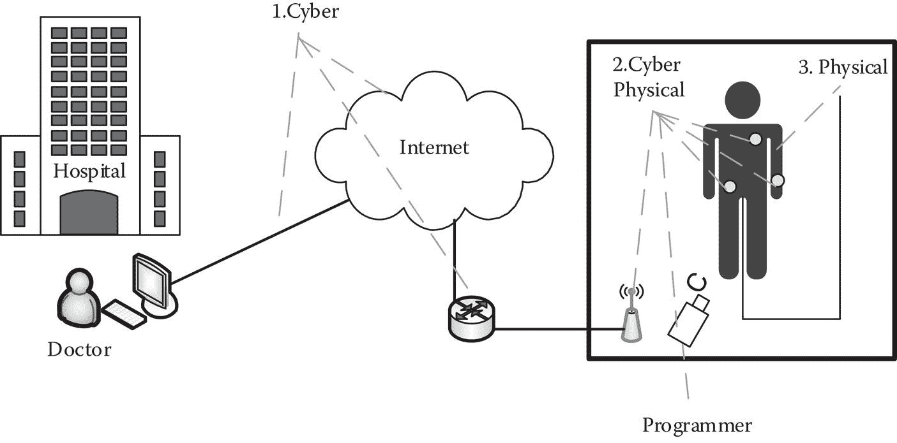

图 8.1 医疗 CPS 的架构。

本章的组织如下：第 8.2 节阐述安全目标，第 8.3 节突出潜在的安全挑战，第 8.4 节描述各种类型的密钥认证方案作为安全问题的可能解决方案，最后，结论和未来工作将在末尾提供。

### 8.2 医疗 CPS 的安全目标

以下是医疗 CPS 的安全目标（Rehman et al., 2019）：

#### 8.2.1 互认

互认确保只有合法用户才能相互通信，且数据通信是真实的。因此，这是一项至关重要的要求。

#### 8.2.2 数据新鲜度

该目标确保数据是新的，系统应足够警惕以识别旧数据。此功能有助于确保数据的完整性和机密性不受干扰。

#### 8.2.3 前向安全

该安全目标是确保实体一旦离开网络，就无法访问或预测离开后的通信。攻击者不应能够基于某些先前信息猜测任何未来的秘密。

#### 8.2.4 数据真实性

该目标确保有效数据来自合法节点，而不是来自任何入侵者。大多数方案使用消息认证码（`MAC`）来实现此目的。

#### 8.2.5 数据完整性

该目标确保数据在传输过程中不会因任何非法修改而受到干扰。它确保消息内容未被修改且准确无误。

#### 8.2.6 数据机密性

它是指数据不能被未经授权的人员访问，并保持机密性。医疗设备拥有患者数据，这些数据极其重要，不应暴露给冒充者。

#### 8.2.7 非伪造性

它是指一项重要功能，即基站不应被攻击者攻破，以确保任何认证方案能够平稳、无阻碍地运行。

#### 8.2.8 可扩展性

它是指一项重要功能，即认证方案应支持网络增长。换句话说，引入新节点时，认证过程不应受到干扰或削弱。

### 8.3 医疗 CPS 的安全挑战

以下安全挑战在文献中经常被发现。

#### 8.3.1 资源受限 (Gupta et al., 2019)

在从可穿戴或可植入设备收集数据以监测患者状况时，这是一个关键问题。因此，提供安全性具有挑战性，因为传统方法（如非对称加密解决方案）资源密集，可能不适用。

#### 8.3.2 拒绝服务攻击 (Alguliyev et al., 2018)

攻击者可以通过发送大量请求来压倒任何设备，使其无响应，从而使设备不可用。

#### 8.3.3 冒充攻击 (Xu et al., 2019a,b)

入侵者试图冒充节点，表现得像网络的真实成员，但实际上并非如此。当攻击者非法获取用户的私密凭据，从而能够表现得像真实用户时，就会发生这种情况。

#### 8.3.4 重放攻击 (Kompara et al., 2019)

攻击者以某种方式欺骗性地捕获有效通信，并在一段时间后重放它以获得对网络的访问权限。这是一种难以检测的攻击，因为通信通常是有效的，并且能够通过所有测试。

#### 8.3.5 窃听攻击 (Shen et al., 2018)

攻击者试图通过监听数据流量来提取一些有用信息，以获取可用于发起任何后续攻击的秘密。

#### 8.3.6 受损节点和克隆攻击 (Xu et al., 2019a,b)

在此次攻击中，入侵者试图通过获取特定节点的访问权限，并命令该节点按照其意愿行事，从而攻破最重要的节点。在克隆攻击中，它会复制所有会话密钥以创建一个副本节点，从而接管合法节点。

#### 8.3.7 匿名且不可关联的会话（Kompara 等人，2019）

在此次攻击中，攻击者试图将两个或多个匿名会话关联到同一节点，以提取一些有价值的特征，这些特征可用于揭示一些秘密，例如会话密钥等。因此，通信必须保持匿名。

#### 8.3.8 失步/干扰攻击 (Liu & Chung, 2017)

当各方尝试同步更新其状态时，在更新第一个方的状态后，攻击者会破坏通信链路，导致另一方无法自行更新。大多数身份验证方案被发现易受此类攻击。

### 8.4 医疗 CPS 的密钥身份验证方案类型

在识别出医疗 CPS 中存在的安全威胁后，迫切需要开发一种安全机制，能够充分保护传感器节点（`N`）和集线器节点（`HN`）之间的通信。密钥身份验证方案被视为一种防御机制，用于保障通信安全，并在剩余部分中进行讨论。研究人员以不同方式对身份验证方案进行了分类；然而，最著名的类型包含在以下部分中，并分别命名为基于生理的、基于密码学的、基于信道的和混合身份验证方案（Rehman 等人，2019；Kompara & Hölbl, 2018）。

#### 8.4.1 基于生理的密钥身份验证方案

这些密钥身份验证方案使用患者的生理特征，即心率、脉搏率、血压、心电图（`ECG`）等，来开发并达成一个单一的共享密钥，该密钥用于对设备之间的通信进行身份验证。Elyazidi 等人 (2018) 提出了一种方案，该方案通过身体传感器节点收集心电图（`ECG`、计步器、血糖、身体运动等）等生理特征，并将其传输到 `CU`（智能手机）。如果传感器节点与 `CU` 之间存在真实（`1`）相关性，则传感器节点在 `CU` 上经过身份验证；否则为假（`0`）。如果传感器节点和 `CU` 在同一身体上，则相关性为 `1`，否则为 `0`。传感器节点即按此方式进行身份验证。准确率和精确率的结果分别为 84%–94.5% 和 88%–91.5%。

Wu 等人 (2018) 提出了一种基于多任务脑电图的身份验证方案，并结合了眼动。该方案的作者为每个用户雇佣了 15 名冒充者，以增加更多信息来训练分类器，从而使身份验证过程更加稳定。此外，他们还针对其他冒充者进行了开放集身份验证测试，以模拟实际环境，这使得该方案优于之前的基于脑电图的身份验证方案。该方案的结果显示，准确率从 92.4% 提高到 97.6%。此外，该方案的强健安全性和可靠性通过平均错误接受率（`FAR`）为 3.9% 和错误拒绝率（`FRR`）为 3.87% 得到证明。

Sammoud 等人 (2020) 提出了一种基于心电图（`ECG`）的对称密钥身份验证方案。其方案基于三个实体，即附着在患者身体上的传感器、中心节点（`PDA` 或手机）以及医疗服务器。由于 `ECG` 信号的时变特性，该方案还提供了更好的密钥熵，并确保密钥检索。它基于两个重要阶段；首先，父子对称密钥建立阶段负责与除根节点以外的每个节点共享预安装密钥，最后，子子生物特征密钥生成阶段允许具有共同前身的节点建立安全通道进行通信。比较结果表明，该方案节能且强健。

另一项研究的作者提出了一种名为 `CABA` 的新方案，该方案基于持续身份验证。它利用非侵入式生物医学方法进行用户身份验证。可穿戴医疗传感器（`WMSs`）被部署用于收集生理特征，如血压（动脉收缩压、动脉平均血压、动脉舒张压）、体温、心率、血氧饱和度和呼吸频率。`CABA` 采用九种生物医学数据流（不包括血糖（`BG`）、`ECG` 和 `EEG`）来持续对用户进行身份验证。它利用两阶段身份验证模型，即注册阶段和身份验证阶段。结果表明，与同类方案相比，它是一种成本更低的轻量级方案（Mosenia 等人，2017）。

Zouka 在其身份验证方案中安全地将医疗系统与 `WMS` 集成，使患者能够远程进行健康监测。它利用 `WMS` 提供并存储在医疗系统中的生理特征。如有需要，医生还会通过短信或电子邮件了解患者的状况。所提议的身份验证方案遵循三阶段模型，即注册、患者登录和身份验证阶段。结果表明，它是一种轻量级、高效且有效的身份验证方案（Zouka, 2017）。

#### 8.4.2 基于密码学的身份验证方案

基于密码学的身份验证方案进一步分为两部分：预部署（对称）密钥身份验证方案和非对称身份验证方案。然而，与非对称身份验证方案相比，预部署密钥身份验证方案提供了最高的性能效率。

##### 8.4.2.1 预部署身份验证方案

最近的一项研究中，Kompara 等人（2019）提出了一种匿名、身份验证和密钥协商方案，该方案是 Liu 和 Chung（2017）早期工作的改进版。该研究仅使用两种密码学操作：哈希函数和 `XOR` 操作，从而使其成为一种轻量级方案。Liu 和 Chung（2017）的方案被发现存在通信节点不可追踪性方面的漏洞。Kompara 等人（2019）的研究在保留原方案计算复杂度并最小化通信成本的前提下解决了上述问题，但代价是存储成本增加。

此外，在进一步审查 Kompara 等人（2019）后，另一项研究（Rehman 等人，2020）的作者识别出三个漏洞，即传感器节点冒充、基站和中间节点（`IN`）妥协攻击。Rehman 等人（2020）不仅为这些漏洞提供了解决方案，还对原方案进行了架构层面的关键更改，从而降低了总体通信成本，该成本不仅显著低于原方案，也低于同类方案。Rehman 等人方案的网络模型如 图 8.2 所示。

图 8.2 Rehman 等人方案的网络模型（2020）。

同样，刘和钟（Liu and Chung, 2017）的另一项改进由（陈等人，2018）提出。他们强调，李等人（Li et al.）的方案易受离线身份猜测、传感器节点冒充和集线节点欺骗攻击。他们通过修正上述缺陷提出了自己的方案。因此，他们为所提方案提供了更高的安全性和效率。他们通过限制第一节点（FN）作为中继节点的角色，修改了传感器节点（SN）、第一节点（FN）和集线节点（HN）之间的常规通信方式，因为 FN 仅将数据转发给 HN，而不参与节点身份验证。这一变化通过降低与其他同类方案相比的通信和存储成本，对整体方案产生了积极影响。此外，（奥斯塔德-沙里夫等人，2019）也提出了李等人（2017）方案的另一项增强。他们指出，李等人的方案易受错误会话密钥协商和去同步攻击。他们针对这些问题提供了解决方案，并能抵御其他一些已知攻击，如冒充、中间人攻击、篡改、重放、集线节点数据库被盗等。实验结果表明，该方案在效率、安全性和实用性方面表现更好。

在另一项研究中，（徐等人，2019b）提出了一种轻量级、匿名的身份验证和密钥协商方案，该方案同样依赖于异或运算和哈希函数。该研究在不使用非对称加密的情况下确保了前向保密性；即使攻击者以某种方式破解了主密钥。该研究的实验结果表明，与其他同类轻量级方案相比，其计算成本低，安全风险也小。此外，（徐等人，2019a）提出的轻量级方案也使用异或运算和哈希函数。该方案能抵御多种已知攻击，例如窃听、中间人攻击、重放、干扰/去同步、传感器节点匿名性和不可追踪性、前向/后向安全性、集线节点欺骗以及传感器节点冒充攻击。该研究的对比结果表明，其通信成本和安全风险较低。

帅等人（2020a）最近提出了一种使用单向哈希函数和假名身份技术的轻量级隐私保护身份验证方案。该方案分别能抵御前向保密性、智能卡丢失、错误密码登录和去同步攻击。与同类工作的对比结果表明，该方案在计算成本方面效率高，但在通信成本方面略高。此外，（阿尔穆海德布和阿尔库代希，2020）也提出了孔帕拉等人（Kompara et al.）工作的另一项增强。作者提出了两种协议，即 P-I 和 P-II，分别用于身份验证和再身份验证，以保护节点匿名性。尽管该方案通信复杂度较高，但实现了性能与安全性之间更好的权衡。该方案的性能分析表明，如果分别考虑 P-I 和 P-II，则计算成本和时间有所降低，但与同类工作相比，集线节点的通信开销较高。

##### 8.4.2.2 非对称身份验证方案

沈等人（2018）提出了用于保护个人数字助理（PDA）与传感器之间通信的身份验证方案，且密钥生成过程保持轻量级。另一种基于椭圆曲线密码学（ECC）的新型非配对、无证书方法用于保护 PDA 与应用提供商（AP）之间的通信。该协议的架构设计如图 8.1 所示。实验结果表明，与其他基于 RSA 的方案相比，该方案轻量级，且在实际应用中也高效。

Xie 等人（2019b）提出了一种无证书身份验证方案，这是对（吉等人，2018）早期工作的改进，具有条件隐私保护（称为 CasCP）。在本研究中，使用椭圆曲线密码学（ECC）开发了签名和身份验证程序，消除了先前使用的复杂双线性配对运算。CasCP 能抵御已知攻击，以及伪造和批量身份验证攻击。该方案的对比结果证明了其在计算和通信成本方面优于同类方案。同样，Xie 等人（2019a）基于（库马尔等人，2018）的先前研究，提出了一种改进的无证书聚合签名方案（iCLAS）。iCLAS 使用 ECC，采用高效的消息签名算法、签名验证算法和聚合算法。所提方案也被发现能抵御已知攻击，且与其他方案的对比分析表明，其在计算和通信成本方面表现更好。

Truong 等人（2020）提出了一种基于切比雪夫多项式的多服务器环境身份验证方案。该方案增加了并行会话功能，而文章中讨论的同类工作未涉及此功能，因此在同类工作中具有额外优势。然而，该方案的存储身份验证成本相对较高。在由 Chaudhry 等人（2020） 提出的另一项工作中，提出了一种改进且安全的身份验证方案。该方案通过可信机构在云服务器与用户之间提供密钥协商。尽管该方案通过真实或随机（ROR）模型进行验证，且非正式安全特性分析显示其相对于同类工作具有额外优势，但在计算和通信成本的对比中，结果略有增加。

此外，帅等人（2020b）最近提出了一种使用椭圆曲线密码学（ECC）的身份验证方案。作者采用基于身份的无证书身份验证，因为所提方案适用于多服务器架构，无需第三方参与。对比结果表明，计算成本略低于同类工作，但通信成本较高，存储成本亦然。然而，该方案在计算成本方面表现更好，并且具有隐私保护特性。

在由（舒等人，2020）提出的另一项研究工作中，无证书聚合方案与区块链结合用于医疗数据的安全存储。尽管区块链容量有限，但仅用于数据共享目的。基于 ECC 的多陷门或变色龙函数用于构建无证书聚合方案。实验结果表明，其计算效率高于基于配对的方案。聚合签名的长度是恒定的，这意味着随着交易数量增加，存储容量保持不变。这一特性使其相对于同类工作具有额外优势。

#### 8.4.3 混合身份验证方案

一篇论文的作者（Wazid 等人，2018）提出了一种方案，该方案使用移动密码和生物特征信息生成密钥，进而用于身份验证用户。所提方案轻量级，且该方案的语义安全性通过真实或随机（ROR）模型得到证明，表明该方案能抵御已知攻击。它还通过 NS2 仿真工具进行模拟以测量性能，与其他同类方案相比，显示出较低的计算和通信开销。

Koya & P.P. (2018) 提出了一种混合方案，通过将其与受试者的心电图（`ECG`）相结合，改进了 (Liu & Chung, 2017) 的早期工作。所提方案的设计旨在通过增强关键安全参数来改进先前的方案。生物密钥首先通过计算脉搏间期（`IPI`）从 `ECG` 信号生成；其次去除最高有效位（`MSB`）和最低有效位（`LSB`）；第三步进行格雷编码；最后应用连接操作。因此，通过该过程生成了 128 位生物密钥，用于身份验证过程。性能和安全性分析表明，它提供了更多功能和更好的安全性。

Challa et al. (2018) 提出了一种三因子密钥协商协议和身份验证，以改进 (Liu & Chung, 2017) 中发现的局限性。本研究中使用的三个因素包括用户密码、智能卡和用户生物特征，以提高安全性，这就是它被视为混合方案的原因。值得注意的是，三个因素与 `ECC` 算法相结合，以实现低通信和低计算成本。这一改进使其在医疗保健领域具有广泛的适用性。

Chen (2020) 提出了基于生物特征的模糊身份验证和密钥协商（`BFAKN`）方案，为通信过程中涉及的所有实体（包括传感器、终端和服务器）提供了整体身份验证解决方案。它设计了相互协商的密钥以确保整个系统的有效性，即从本地通信到终端处理，再到服务器。实验结果表明，它提供了高安全性、可靠性和有效性。

#### 8.4.4 基于信道的身份验证方案

Zhang and Ma (2018) 提出了一种基于接收信号强度（`RSS`）相似性的密钥身份验证方案。密钥从传感器节点和协调器节点的 `RSS` 值中提取。使用 n 维量化来减少密钥中的不一致性，并使用模糊提取将 n 维量化器的输出转换为密钥。本研究具有高密钥熵，这使其更加强健，窃听者更难猜测密钥。它还确保了低位不一致率和高密钥生成率。该方案的实验结果表明，它是资源受限环境中更可行的解决方案。

在论文 (Zhang et al., 2018) 中，作者提出了一种不依赖预共享密码假设的密码身份验证协议的变体。该方案从衰落信道中提取密码，然后用它来为通信设计一个密钥。作者认为，与其他密码身份验证密钥交换（`PAKE`）协议相比，他们的协议在计算和通信方面将具有更好的性能。

Sciancalepore et al. (2019) 提出了 EXCHANge 协议，该协议基于发送者/接收者的匿名性建立无加密的空中密钥。它在 `OpenWSN` 协议中实现，并在 `OpenMote-CC2538` 架构上进行了测试。该方案的另一个重要方面是，它是第一个基于信道匿名性建立密钥协议的真实世界实现。它在物理层工作，平均可在 10 秒内设置 128 位的新密钥，尽管它只需要单次哈希函数计算。实验结果已证明它能抵御主动和被动攻击，并被认为适用于室内场景和可穿戴应用。

Umar et al. (2020) 最近提出了一种基于信道特征和增强蝴蝶算法的身份验证方案。实验结果证明，它在存储和计算成本方面是一种高效的方案。然而，通信成本略高于同行工作之一。该方案还在不同环境和场景中进行了实验评估，其性能在不同志愿者身上进行了分析。实验结果表明，该方案提供了有效的相互身份验证，并能抵御各种安全攻击。

由 (Shi et al., 2013) 引入的名为 `BANA` 的身份验证方案利用 `RSS` 的变化来区分合法节点和非法节点。`BANA` 的局限性在于传感器需要保持视距（`LOS`），并且它不会生成任何密钥。这一缺点在后续方案中得到了纠正，即 `MASK-BAN` (Shi et al., 2015)，它基于信道特征提取密钥。使用多跳身份验证机制来控制误报率。实验结果表明，它是一种高效且有效的身份验证方案。

在另一项研究中，作者利用 ‘`w*earable proxy devices (WPDs)`’ 和 ‘`i*mplantable medical devices (IMDs)`’ 之间的 `RSS` 比率来区分真实用户和入侵者。此外，为了改善紧急模式下的 `IMD` 可访问性并防范强制身份验证攻击，他们设计了两种基于 ‘`a*uthentication request filter (ARF)`’ 的协议。实验结果表明，该方案对真实用户实现了 99.2% 的高身份验证响应率，对入侵者则实现了低身份验证响应率 (Zhang et al., 2020)。

Aman et al. (2020) 提出了一种轻量级协议，该协议使用信道特征提取无线指纹，并使用 ‘`p*hysical unclonable functions`’ 来实现相互身份验证、匿名性和数据来源。该方案实际上使用链路质量指示器（`LQI`）来区分对抗性和非对抗性无线链路。实验结果表明，指纹能够准确识别网络攻击，并且与同行工作相比更加节能。

同样，在另一项调查中，提出了一种身份验证方案，该方案利用用户的行为指纹以及信道特征。在这项实验研究中，`RSS` 用于监测用户行为，如刷牙、喝水、服药和吃早餐。这些行为数据被收集并存储在监控站中，为用户生成指纹。这些数据进一步用于身份验证过程。实验结果表明，该方案即使在最坏情况下也能成功识别身份，并表现出足够的抗入侵能力 (Zhao et al., 2016)。

### 8.5 结论与未来研究方向

## 医疗 CPS 安全

医疗 CPS 是一个充满希望的领域，为进一步的研究活动铺平了道路。它是一个具有巨大潜力的研究领域，能够改善远程健康监测场景中的生活质量。然而，便利性伴随着代价，即患者数据的安全性，这至关重要。随着新技术的出现和设备的互联，新的安全挑战不断涌现。因此，关于安全的严重担忧将持续存在。本章找出了安全目标以及常见的安全挑战。简要讨论了各种类型的密钥认证方案作为解决这些问题的可能方案。通过审查这些方案，发现与其他认证方案相比，预部署密钥认证方案效率高、轻量，是该领域的推荐选择。然而，其他认证方案同样重要，是部署在资源和能量受限环境中的潜在候选方案；在对称密钥加密解决方案，尤其是预部署密钥认证方案中，仍可发现更多研究趋势。

我们认为，随着技术的进步和安全挑战的出现，关于医疗 CPS 安全的研究在未来将持续存在。基于信道的方案被认为更加稳健，在密钥熵方面具有额外优势，但它们计算密集，类似于非对称加密解决方案。如前所述，由于轻量化和低计算需求，预部署密钥认证方案是未来工作的潜在候选方案。混合认证方案是另一个潜在的未来工作候选方案，因为它们提供的稳健性。

## 参考文献

1. Alguliyev, R., Imamverdiyev, Y., & Sukhostat, L. (2018). Cyber-physical systems and their security issues. Computers in Industry, *100*(April), 212–223. [10.1016/j.compind.2018.04.017](http://doi.org/10.1016/j.compind.2018.04.017).

2. Aman, M. N., Basheer, M. H., & Sikdar, B. (2020). A lightweight protocol for secure data provenance in the internet of things using wireless fingerprints. IEEE Systems Journal, *1*–11. [10.1109/jsyst.2020.3000269](http://doi.org/10.1109/jsyst.2020.3000269).

3. Almuhaideb, Abdullah M., & Alqudaihi, Kawther S. (2020). A Lightweight and Secure Anonymity Preserving Protocol for WBAN. IEEE Access, *8*, 178183–178194. [10.1109/access.2020.3025733](http://doi.org/10.1109/access.2020.3025733).

4. Challa, S., Das, A. K., Odelu, V., Kumar, N., Kumari, S., Khan, M. K., & Vasilakos, A. V. (2018). An efficient ECC-based provably secure three-factor user authentication and key agreement protocol for wireless healthcare sensor networks. Computers and Electrical Engineering, *69*, 534–554. [10.1016/j.compeleceng.2017.08.003](http://doi.org/10.1016/j.compeleceng.2017.08.003).

5. Chaudhry, Shehzad Ashraf, Shon, Taeshik, Al-Turjman, Fadi, & Alsharif, Mohammed H. (2020). Correcting design flaws: An improved and cloud assisted key agreement scheme in cyber physical systems. Computer Communications, *153*, 527–537. [10.1016/j.comcom.2020.02.025](http://doi.org/10.1016/j.comcom.2020.02.025).

6. Chen, C., Xiang, B., Wu, T., & Wang, K. (2018). An anonymous mutual authenticated key agreement scheme for wearable sensors in wireless body area networks. MDPI, *8*(1074), 1–15. [10.3390/app8071074](http://doi.org/10.3390/app8071074).

7. Chen, Hanlin, Ding, Ding, Su, Shuchun, & Yin, Jingyi (2020). Biometrics-based cryptography scheme for E-Health systems. Journal of Physics: Conference Series, *1550*, 022039. [10.1088/1742-6596/1550/2/022039](http://doi.org/10.1088/1742-6596/1550/2/022039).

8. Elyazidi, Saâd, Escamilla-Ambrosio, Ponciano Jorge, Gallegos-Garcia, Gina, & Rodríguez-Mota, Abraham (2018). Accelerometer Based Body Area Network Sensor Authentication, Lecture Notes of the Institute for Computer Sciences, Social Informatics and Telecommunications Engineering,Smart Technology (pp. 151–164[10.1007/978-3-319-73323-4\_15](http://doi.org/10.1007/978-3-319-73323-4_15).

9. Gupta, A., Tripathi, M., Shaikh, T. J., & Sharma, A. (2019). A lightweight anonymous user authentication and key establishment scheme for wearable devices. Computer Networks, *149*, 29–42. [10.1016/j.comnet.2018.11.021](http://doi.org/10.1016/j.comnet.2018.11.021).

10. Ji, S., Gui, Z., Zhou, T., Yan, H., & Shen, J. (2018). An efficient and certificateless conditional privacy-preserving authentication scheme for wireless body area networks big data services. IEEE Access, *6*, 69603–69611. [10.1109/ACCESS.2018.2880898](http://doi.org/10.1109/ACCESS.2018.2880898).

11. Kompara, M., & Hölbl, M. (2018). Survey on security in intra-body area network communication. Ad Hoc Networks, *70*, 23–43. [10.1016/j.adhoc.2017.11.006](http://doi.org/10.1016/j.adhoc.2017.11.006).

12. Kompara, M., Islam, S. H., & Hölbl, M. (2019). A robust and efficient mutual authentication and key agreement scheme with untraceability for WBANs. Computer Networks, *148*, 196–213. [10.1016/j.comnet.2018.11.016](http://doi.org/10.1016/j.comnet.2018.11.016).

13. Kumar, P., Kumari, S., Sharma, V., & Kumar, A. (2018). Sustainable computing: Informatics and systems A certificateless aggregate signature scheme for healthcare wireless sensor network. Sustainable Computing: Informatics and Systems, *18*, 80–89. [10.1016/j.suscom.2017.09.002](http://doi.org/10.1016/j.suscom.2017.09.002).

14. Koya, Aneesh M., & Deepthi, P. P. (2018). An Anonymous hybrid mutual authentication and key agreement scheme for wireless body area network. Computer Networks, *140*, 138–151. [10.1016/j.comnet.2018.05.006](http://doi.org/10.1016/j.comnet.2018.05.006).

15. Liu, C. H., & Chung, Y. F. (2017). Secure user authentication scheme for wireless healthcare sensor networks. Computers and Electrical Engineering, *59*, 250–261. [10.1016/j.compeleceng.2016.01.002](http://doi.org/10.1016/j.compeleceng.2016.01.002).

16. Li, Xiong, Ibrahim, Maged Hamada, Kumari, Saru, Sangaiah, Arun Kumar, Gupta, Vidushi, & Choo, Kim-Kwang Raymond (2017). An Anonymous mutual authentication and key agreement scheme for wearable sensors in wireless body area networks. Computer Networks, *129*, 429–443. [10.1016/j.comnet.2017.03.013](http://doi.org/10.1016/j.comnet.2017.03.013).

17. Mosenia, A., Sur-Kolay, S., Raghunathan, A., & Jha, N. K. (2017). CABA: Continuous authentication based on BioAura. IEEE Transactions on Computers, *66*(5), 759–772. [10.1109/TC.2016.2622262](http://doi.org/10.1109/TC.2016.2622262).

18. Rehman, Z. U., Altaf, S., & Iqbal, S. (2019). Survey of authentication schemes for health monitoring: A subset of cyber physical system. In 2019 16th International Bhurban Conference on Applied Sciences and Technology, IBCAST 2019, pp. 653–660. IEEE. [10.1109/IBCAST.2019.8667166](http://doi.org/10.1109/IBCAST.2019.8667166).

19. Shuai, Mengxia, Xiong, Ling, Wang, Changhui, & Yu, Nenghai (2020). Lightweight and privacy-preserving authentication scheme with the resilience of desynchronisation attacks for WBANs. IET Information Security, *14*, 380–390. [10.1049/iet-ifs.2019.0491](http://doi.org/10.1049/iet-ifs.2019.0491).

## 9 勒索软件攻击：威胁与不同检测技术

Rakhi Seth, Aakanksha Sharaff, Jyotir Moy Chatterjee, and NZ Jhanjhi

## CONTENTS

1. 9.1 简介
2. 9.2 相关研究
3. 9.3 材料与方法
4. 9.3.1 用于勒索软件/恶意软件检测的算法
5. 9.4 分析
6. 9.5 实际应用
7. 9.6 结论
8. 参考文献

DOI: [10.1201/9780367808228-9](https://doi.org/10.1201/9780367808228-9)

### 9.1 简介

恶意软件是专门用于破坏或损坏系统并未经授权访问系统而创建的恶意软件。恶意软件有不同类型，如病毒、蠕虫、间谍软件等；所有这些类型都可以通过 图 9.1 来理解。

图 9.1 恶意软件类型。

勒索软件是一种被认为是恶意的软件或恶意软件。勒索软件的概念是，攻击者要求受害者支付特定金额（可以是不同形式，例如比特币），以便在付款后恢复对数据的访问。每次勒索软件攻击可能具有不同的特征或行为；这取决于其来源国家；该国内关联的不同黑客组织可能会要求不同的威胁方案，并且可以通过不同方式实现，例如网络钓鱼垃圾邮件。勒索软件有不同类型，如 NotPetya。勒索软件也存在变体，例如泄露软件或 doxware，在这种变体中，攻击者威胁要公开受害者的数据，最可能是可能损害声誉的敏感数据。

勒索软件时间线始于 1989 年的`PC Cyborg`，该程序由 Joseph L. Popp 开发；他通过发送约 18000 个使用软盘感染的文件，攻击了在世卫组织（WHO）举办的艾滋病会议。这种勒索软件基于一种名为对称加密的简单算法，并对文件进行解密。1989 年之后，下一次新的勒索软件攻击演进发生在 2005 年，被称为`Trojan`。`Gpcoder`使用带有求职申请的垃圾邮件，许多早期的勒索软件是在俄罗斯开发的，目标是邻国的受害者。下一次勒索软件攻击发生在 2006 年，其概念是将数据文件复制到受密码保护的归档文件中，并在删除原始文件后将其存储在原始文件的位置。它被称为`Trojan cryzipthere`，是 2006 年出现的另一种类型；这是一个改进版本，其中勒索软件攻击者要求受害者从特定药店购买药物并提交订单 ID，当有人提交 ID 时，系统中的所有数据都会被复制。`Locker`勒索软件是 RA 攻击的一种类型，于 2007 年开始演进，其概念是在系统上显示色情图像；要求支付费用以从机器中删除此恶意软件，并使用短信来获取解锁代码。

`GP code`是一种带有 1024-RSA 密钥的恶意软件，攻击者使用它来加密文件，并在加密文件的每个位置退出带有说明的文本文件，必须支付一定金额以解密文件 \[1\]。此攻击发生在 2008 年。勒索软件的爆发是另一种在 2011 年曝光的攻击类型；它使用加密文件并要求支付费用以解密文件的概念。其中一种 RA 是`Citadel`，它使用按次安装程序攻击系统；受害者必须为攻击者已安装在受害者系统中的加密文件支付最低金额。它始于 2012 年。在接下来的几年中，出现了几种其他攻击，例如在 2013 年，名为`Trojan ransom`的攻击攻击了 Windows 安全中心，并要求受害者拨打特定电话号码以重新获得对系统的控制权。

同年，出现了一种新攻击，称为假冒防御者。该攻击专为 Android 设备设计；它显示威胁信息并要求受害者付款，防御者介入并安慰受害者，但转折是防御者又是攻击者之一，并更深入地攻击系统。`Trojan Sypeng`是 2013 年推出的一种模型；它通过指责客户涉及儿童色情内容来锁定手机的概念进行了改进。它来自 FBI 等合法来源，并要求受害者付款。

`Cryptolocker`是一种已知的 RA 攻击，它使用私钥和公钥来加密和解密文件的概念。首先，它通过游戏传播，然后通过 UPS 或 FedEx 传播。不同类型的`Cryptolocker`对不同文件（近 67 个文件）进行加密，受害者必须在三天内支付款项。在此方法中，攻击者使用比特币支付方式，付款应通过 CashU 或其他方式进行。还有一个来自 Crypto locker 的版本，即`2.0`；它也于 2013 年发布，并使用与实现 lockers 不同的语言实现。

`Crypto wall`是一个改进版本，于 2014 年推出。在此版本中，危害比早期的勒索软件攻击更具侵略性；设备上的文件受到损害，系统的二级存储也受到损害，并且它连接到受害者。下一个迭代或版本于 2015 年出现，其中包含更新的协议，以便攻击不易被轻易检测。`Koler`是一种针对 Android 设备上存在的文件进行加密的勒索软件攻击；它还损坏设备上的某些按钮，并通过电子方式要求贿赂付款。另一种目前称为`Symplocker`的攻击，其中攻击者锁定受害者的屏幕并要求赎金。还有几种其他攻击，如`Lockri`、`Locker`和`Petya`。`Petya`通过使硬盘无法访问并要求付款。然后`Wannacry`被推出并攻击了 150 个国家，通过 300,000 个目标要求数千美元。`Bad Rabbit`也于 2017 年推出；该攻击通过用伪造的 Flash Player 翻新受害者系统来损坏文件，从而针对受害者。

`Gand Crab`是一种利用电子邮件的恶意软件，并不定期通过网络钓鱼电子邮件加剧传播；一旦它正确感染受害者的系统，攻击者就会询问赎金，这是一个持续的过程。2019 年最近开发的一种名为`Dharma`的恶意软件通过加密受害者的文件并要求支付赎金以解密文件来损坏受害者的文件。它使用加密病毒学来加密受害者的文件。`LockerGoga`也是 2019 年推出的攻击之一，计算机或服务器文件也会被加密。`SamSam`是另一种恶意软件，主要针对美国各城市医疗保健领域的组织。该组织通过贿赂付款获得了 600 万美元的收益。

上述演进可以简要理解 \[2\]，因为其中一些可能未包含在上述讨论中。从表 9.1，您可以了解每种攻击的概况。

## 表 9.1 攻击随年份演变

| 攻击 | 攻击发起年份 | 攻击背后的概念 |
| :--- | :--- | :--- |
| PC Cybrog | 1989 | 使用软盘 |
| GPCoder | 2005–2008 | 线程通过电子邮件传播。 |
| WinLock | 2010 | 阻止系统并在 PC 上显示勒索软件消息 |
| Reveton | 2012 | 声称来自执法机构的警告 |
| DirtyDecrypt | 2013 | 加密某些文件 |
| CryptLocker | 2013 年 9 月 | 从命令与控制服务器获取公钥 |
| CryptoWall | 2013 年 11 月 | 仅使用 TOR 浏览器要求付款 |
| Android Defender | 2013 | 引入基于 Android 的锁定型勒索软件。 |
| Torrent Locker | 2014 年 8 月 | 与 SSH 连接相同 |
| CTB-Locker | 2014 年 12 月 | 使用比特币、椭圆曲线加密和 TOR |
| CryptoWall 3.0 | 2015 年 1 月 | 主要使用 TOR 进行付款 |
| TeslaCrypt | 2015 年 2 月 | 使用 PayPal 现金卡支付赎金 |
| ClyptoWall 4.0 | 2015 年 1 月 | 加密文件名 |
| LinuxEncoder | 2015 年 11 月 | 加密 Linux 主目录和任何其他目录。 |
| DMA-Locker | 2016 年 1 月 | 解密使用内置功能。 |
| Locky Ransomware | 2016 年 2 月 | 恶意宏安装在 Word 文档中。 |
| CTB-Locker (Websites) | 2016 年 2 月 | 使用 WordPress 进行攻击。 |
| Carber | 2016 年 3 月 | 它是一个恶意软件工厂 |
| Petya | 2016 年 4 月 | 加密 MFT 并用其加载器覆盖 MFT |
| CryptXXX | 2016 年 5 月 | 跟踪活动并避免沙箱环境。 |
| RAA | 2016 年 6 月 | 它完全基于 JavaScript 工作 |
| Satana | 2016 年 6 月 | 它结合了 MISCHA 和 PETYA 的功能 |
| Stampado | 2016 年 7 月 | 它主要在暗网上工作 |
| BadRabbit | 2017 | 通过使用伪造的 Flash Player 在受害者系统中不断更新 |
| Dharma | 2019 | 损坏文件 |
| LockerGoga | 2019 | 加密服务器端的文件 |
| SamSam | 2019 | 针对医疗保健组织。 |

## 勒索软件攻击阶段与检测

到目前为止，我们了解了可能发生或在一段时间内出现的不同勒索软件攻击 \[3\]。当我们说勒索软件攻击是如何工作时，那么会有一个完整的周期启动，并且会分多个阶段完成。这个过程可以通过以下步骤和 Figure 9.2 来解释。

### 步骤 1. 安装

这是初始步骤之一，也是最重要的步骤；安装受感染的特洛伊木马意味着受害者通过受感染的文件下载了包含勒索软件的文件；在此之前，攻击者一直在进行电子跟踪。一旦它在操作系统中隐式安装，用户不知道间谍软件已被分配。在 Windows 操作系统中，特洛伊木马在注册表中设置键值；攻击者可以使用此策略在每台 PC 重启时进行攻击。对于移动设备，钓鱼是通过未受保护的应用程序进行的。一旦安装完成，勒索软件就会标记并控制受害者的 PC。一旦它确认系统值得被感染，间谍软件就会伪装成 Windows 进程之一，例如 `svchost.exe`。

### 步骤 2. 联系服务器/总部

在此阶段，受害者的系统以及操作系统运行正常。攻击者在开始攻击前会联系源。我们可以这样理解：攻击者正在等待指令，然后攻击者将开始行动。一旦有害代码就位并成功安装，它就会因为特定类型的各种请求而寻求指令。不同变体和类别有不同的通信渠道。

### 步骤 3. 握手与密钥

握手是一个过程，对于每个勒索软件团伙或所有者都不同。CryLocker 使用真实网页上的 PNG 文件。一旦客户端和服务器之间达成协议，下一步就开始了，即密钥的生成和交换。在此步骤中，密钥交换用于加密，它是根据勒索软件的复杂性进行的。攻击者可能使用简单的对称密钥加密。密钥交换执行后，私钥保存在犯罪者的服务器上，公钥与有害代码一起安装在受害者的机器上。

### 步骤 4. 加密

在此阶段，加密旨在损坏受害者机器上的文件，并且在此阶段，只有恶意代码变得活跃。此代码与任何文件相关联，如特洛伊木马、MSOffice、GIF 文件、JPG 或其他文件。一些加密勒索软件会加密文件以及文件名，然后开始加密系统中存在的所有文件。

### 步骤 5. 索要赎金

在此阶段，攻击者要求赎金，或者我们可以称之为敲诈勒索，以解密受害者系统中存在的文件。在此阶段，会创建一个唯一的 HTML 文件并放置在桌面上；对于加密勒索软件，消息会到达，称恢复文件只有一种方法，即私钥。受害者在支付上述金额后会获得私钥。金额可以以多种方式要求，例如比特币，或者要求受害者从攻击者指定的来源购买药品或健康保险。

Figure 9.2 勒索软件攻击阶段。

正如我们现在看到的勒索软件攻击随时间的演变，我们根据每种类型相关的不同特征了解了分类 \[4\]，作者将其分为两种类型：

1. 锁定型勒索软件

2. 加密型勒索软件

加密型勒索软件是一种攻击，其中恶意软件加密受害者的设备并要求支付费用以解密文件。加密型勒索软件的工作原理可以通过 \[5\] 来理解。它告诉我们密钥是如何生成的，加密将如何进行；然后发送公钥，并生成加密文件，如 Figure 9.3 所示。

Figure 9.3 加密型勒索软件组件。

## 锁定型勒索软件

在锁定型勒索软件中，文件不会被加密；攻击者锁定受害者的设备并阻止执行任何任务，然后攻击者要求赎金。用户会收到显示系统中病毒消息的弹出窗口。用户可能不尝试关闭系统；否则，所有数据都将丢失。如果用户尝试取消弹出窗口，它会立即返回，因此受害者无法逃脱。通过移动存储设备，可以恢复数据。有各种类型的锁定型勒索软件，如上面的 Figure 9.4 所示。

Figure 9.4 不同的锁定型勒索软件。

当我们说锁定型勒索软件时，它主要影响 Android 设备。它首次出现在 2012 年，并从 2012 年开始演变。可以通过 Figure 9.5 来理解。

Figure 9.5 基于时间的 Android 勒索软件。

Fakedefender 是一种强调购买的假杀毒软件。它提供从受害者设备中丢弃恶意软件的解决方案，但实际上系统中并不存在恶意软件。SimpLocker 使用 AES 加密来加密文件。Pletor 加密 Android 设备内存卡上的文件。勒索软件分析在 Windows 平台上进行。所有变体都使用 Cuckoo Sandbox 和 Anubis 进行分析。分析后，彻底观察了报告和流量文件，并记录了主要观察结果。这些变化可以在文件系统活动、注册表活动、网络通信和锁定机制中观察到。

当我们说攻击已经发生时，这意味着我们检测到了攻击。受害者可以通过各种策略检测攻击 \[6,7\]；正如作者所指出的，随着攻击随时间的演变，出现了各种检测技术。作者 \[6\] 表示，反勒索软件工具可以防止勒索软件攻击造成的损害，并为丢失数据提供恢复策略。反勒索软件软件声明了三个主要目标。

1. 防止对系统造成破坏。

2. 检测以前未见过的勒索软件。

3. 对受害者尽可能隐藏。

勒索软件检测技术分为各种类型：

1. **基于行为：** 此类型基于系统中发生的实时变化（主要是用户的文件和数据）来检测勒索软件。它提供了一个特定的文件系统方面，主要是加密型勒索软件工作的地方。例如，UNVEIL R-Locker 是基于此概念的检测技术。

2. **I/O 请求数据包监控：** RWGUARD 是一种数据包监控类型。RWGUARD 使用三种监控技术检测加密型勒索软件：

   1. 诱饵监控，

   2. 文件更改监控

   3. 进程监控

   还有各种其他示例可用，它们基于类似的概念。ShieldFS 是一个示例，它在干净和受感染的机器上都使用 I/O 请求数据包工作。

3. **网络流量监控：** 顾名思义，此技术通过监控网络中的共享存储设备来分析网络流量，以识别勒索软件。这里使用设备检测算法来找到被删除文件的最小数量。基本关注点是勒索软件攻击期间文件的删除和覆盖。

4. **存储层级：** 它在基于闪存的存储设备上工作，并可通过缓冲区管理策略实现，勒索软件活动可通过同一位置上的读写痕迹发现。Ex: ID3, SSD。

5. **API 调用监控：** GURLS 是 API 调用监控的一个示例；它使用基于该特性的方法，即 API 调用的频率和字符串。

6. **在 Android 设备中：** 它使用混合方法，其中静态分析和动态分析用于攻击设备的勒索软件。静态分析关注操作码，动态分析关注内存；通过从执行日志中提取数据来完成。

作者 \[7\] 使用带有学习算法的勒索软件检测技术。这可以从 图 9.6 中理解。当使用学习算法时，第一个标准是使用不同的算法选择特征并创建最优特征集。然后，使用此最优模式进行训练和测试；学习开始，并且可以通过不同的方式完成，例如监督学习和非监督学习。监督学习算法使用勒索软件数据样本作为训练集，并识别勒索软件与正常数据的模式以区分两者。非监督学习输入未标记的数据集，并尝试发现模式并构建模型。

Figure 9.6 Ransomware detection with a learning algorithm.

### 9.2 相关研究

本节详细介绍了用于防止和检测攻击的技术方法。作者说 \[8\] 它使用强大的加密算法和密钥结构，但这并不是这种勒索软件攻击的唯一品质。它还建议整合由影子经纪人投放的黑客技术。换句话说，WannaCry 是各种一起运行并攻击系统的模块的组合。作者通过彻底的恶意软件分析，识别恶意二进制文件，然后从该恶意数据中收集模式；然后保存数据，并通过指标了解受损情况。它还报告调查结果，以制定未来应对攻击者的策略。作者 \[9\] 试图使用预定义规则开发一种通用检测方法。作者使用主成分分析提取流量特征，所有恶意内容在攻击过程中都可以轻松与正常流量区分开来。在本文中，作者使用 CWDR（全面 WannaCry 检测规则）规则集经历了八个阶段来检测 WannaCry 攻击。在 图 9.7 中，我们了解了保护策略，通过该策略可以保护系统免受 WannaCry 攻击。

Figure 9.7 WannaCry protection strategy.

作者 \[10\] 引入了网络杀伤链的概念。如果攻击者想要执行攻击，对手必须走的一条路径。杀伤链中的每个环节都起着至关重要的作用，如果链条断裂，攻击就永远不会发生。通过移除其中任何一个条件，可以削弱勒索软件。这些条件由作者在论文 \[10\] 中指定，如下所示：

**条件 1：** 进入和执行是第一个条件；这意味着攻击者试图进入主机系统以开始感染系统。

**条件 2：** 此条件尝试生成唯一的随机整数，并用于生成加密密钥。

**条件 3：** 成功勒索是第三个条件，它使用解密密钥。

**条件 4：** 要开始实际加密，需要修改权限。

**条件 5：** 勒索软件必须能够拒绝受害者访问关键文件，这需要对受害者的权限。

**条件 6：** 最后一个环节是功能性支付路径，受害者与勒索软件操作者之间存在一条路径。

因此，作者提出了具有五个核心功能的 NIST 网络安全框架。WannaCry 不是唯一一种勒索软件攻击类型；还有一种称为 Petya 勒索软件攻击 \[11\]。Petya 攻击家族包含各种其他攻击，如 PetrWrap 和 NotPetya。这种攻击的概念是修改 Windows 系统主引导记录，这可能会导致系统崩溃。Petya 使用加密密钥，即 AES-128 与 RSA；文件可以在不重新加载系统的情况下被加密，Petya 还使用命令通过远程访问 Windows 管理指令。

到目前为止，我们了解了勒索软件攻击类型检测策略，但勒索软件攻击的起源始于网络安全和恶意软件检测概念出现之时。这些是不仅检测勒索软件，还检测其他类型攻击的领域。作者 \[12\] 描述了网络安全中使用的关键基础设施。NIST 提供的框架中的重要功能如下：

1. **识别：** 识别各种网络资产，以及该资产暴露的风险分析；此外，它涉及对人员和设备进行强加密身份验证。

2. **保护：** 此功能定义为用于访问控制、防御、区域划分、经过身份验证的通信等的保护机制。

3. **检测：** 检测是一种功能，要求进行恶意软件检测、入侵检测、渗透测试和漏洞评估。

4. **响应：** 当攻击发生或被激活且攻击被检测到时，此功能开始工作。然后第一项任务是控制攻击造成的当前和未来损害。这可以通过定位和遏制来完成。

5. **恢复：** 当有人想要在攻击发生后恢复数据或文件，以及通过改进响应功能的更好检测策略规划时，会调用这些功能。

在本文中，\[13\] 作者说恶意软件检测系统依赖于通过分析技术明显的恶意软件区别提取特征。各种分析技术在静态和动态工具上工作。提取特征后，系统必须通过恶意软件分类器进行训练。

1. **静态恶意软件分析：** 它基于特征提取的概念，不获取恶意软件样本。静态特征通过不同的分析函数提取，如哈希值、操作码、字符串和 N-grams。

作者 \[5\] 使用加密勒索软件 STATIC，它获取二进制输入然后生成库。这些文件是 DLL。存在各种静态工具：PeView、PEid、CFF Explorer、Psfile、Accesschk。通过 图 9.8，我们了解静态恶意软件分析的工作原理。

2. **动态恶意软件分析：** 它在运行时工作，这意味着恶意软件文件被执行，在运行时可以捕获恶意软件的活动。它基于恶意软件与计算机系统的交互。创建了一个虚拟环境，称为 VMware。恶意软件在一个环境中运行，通过创建、删除和新日志条目来检测它；基于此运行活动，该文件被视为损害系统的文件。一些未经静态分析正确检查的文件可以用于动态分析。

Figure 9.8 Static analysis of ransomware.

Figure 9.9 shows in which phase dynamic and static tools will work in malware detection \[14\]. This paper suggests the different ransomware detection approach that analyzes the attack on the current running state of a computer by using the proposed model called finite state machine, which is used to synthesize the knowledge of the attack in the victim's system. Also, the author monitors the current system in terms of utilization, persistence through which the source of the attack can be discovered.

Figure 9.9 Training phase in malware detection.

### 9.3 Materials & Methods

In this section, we see the various algorithms that are used for the prevention and detection of malware, as well as ransomware attack. Machine learning is the technique that is now trending in the detection of attacks, as we see in the previous section. In the testing phase, all the machine-learning algorithms are used in \[5\] SVM classifiers. Machine learning is not the only technique; there is deep learning \[15\], which is used for feature exploration in the Android system. The author proposes the TC-droid feature; it is a framework that depends on the text-classification method. TC-Droid implements the convolution neural network (CNN) to inspect the important information or knowledge. This extraction process has four types of features: permission, service, intent, and receiver. Once the feature extraction process is complete, the author trains the TextCNN for text classification. This is done in two categories, malicious and benign. We understand different attacks that happened and different techniques used for preventing attacks through Table 9.2.

Table 9.2 Different Attacks Uses Different Techniques

| Paper name || Types of Attack || Technique || Limitation/Future |

| --- | --- | --- | --- |

| Davies et al. \[16\] || 

1.  NotPetya

2.  Bad rabbit

3.  Phobos hybrid ransomware

 || 

1.  Recovery by using the AES Key from volatile type of memory helps in finding out the encrypted keys.

 || 

1.  This technique is not implemented in all the ransomware families, like WannaCry.

 |

| --- | --- | --- | --- |

| Hwang et al. \[17\] || 

1.  Ransomware attack

 || 

1.  Markov model

2.  Random forest model is a two-staged ransomware detection technique.

 || 

1.  When ransomware detection has a higher false-negative rate, it is disastrous for the system.

2.  More ransomware is required to generate like normalWare.

 |

| Vinayakumar et al. \[18\] || 

1.  Ransomware attack

 || 

1.  Two configurations of SVM: one is the linear kernel, and the second one is the radial basis function.

 || 

1.  This technique uses complex architecture. An enhanced MLP network can be made in the future.

 |

| Arabo et al. \[19\] || 

1.  Ransomware attack

2.  Benign attack

3.  Malware samples

 || 

1.  Uses the interrelation between process behavior, as well as its nature, to determine the ransomware. This can be done by using machine-learning techniques with a low false-positive and false-negative to distinguish the benign and other ransomware.

 || 

1.  In the future, the author will try to develop an early warning system that tells the victim in the first five seconds that a malicious attack has happened.

 |

| Mercaldo et al. \[20\] || 

1.  Mobile Malware attack through image

 || 

1.  By using the deep neural network architecture and to convert a binary to an image it can be done to encode a binary file into a PNG

 || 

1.  In the future author tries to use the formal verification method for an image that creates better performance.

 |

| Lei et al. \[21\] || 

1.  Ransomware attack

 || 

1.  A self-recovery service is proposed by the author to ease the damage done by the ransomware attack to the edge servers. Evaluation is done based on 

    1.  CPU usage

    2.  Disk Access Time

    3.  Disk Read/write speed

    4.  Disk Average transfer rate.

 || 

1.  SRS is the solution for IoT systems and in the future more of this type of solution may be suggested.

 |

| Zimba et al. \[22\] || 

1.  Wannacry Ransomware attack

 || 

1.  A cascaded network segmentation approach to uncover the artifacts which set the security in the network.

2.  Through static malware, the analysis author finds out the different techniques to propagate the ransomware and attack the CI components over the various network partitions.

 || 

1.  This technique can be implemented in intrusion detection systems in each segment in the future.

 |

In the above discussion, we saw the deep-learning and machine-learning techniques \[2\], but IoT is also one of the areas where we need to discuss ransomware because the internet of things is a network of the network where physical devices are connected. In IoT \[23\], physical devices can handle and organize the device; that's why they are called smart devices. This paper presents the crypto-wall attack works on detection model based on the communication, as well as the behavioral study of cryptowall for IoT. The suggested model works on the network traffic, especially TCP/IP traffic \[24\] over a server that extracts TCP/IP header and uses the C&C server for blacklisting to find out the ransomware attacks.

#### 9.3.1 Algorithms Used for Ransomware/Malware Detection

The author proposed \[25\] a new technique that uses the machine-learning technique to detect and classify the spreading phase of a ransomware attack affecting the integrated clinical environment here. OC-SVM and Naïve Bayes detecting strategy work very well in detecting some of the dangerous malware like Wannacry, Petya, BadRabbit, and PowerGhost. The author also finds the worst case and best case of detecting the ransomware attack. Besides this, author uses the anomaly-detection method, and probabilistic classification technique of ML technique selection has taken place. Evaluation is done by using different measures like precision, recall, and accuracy, as well as F1-score through which the author analyzes the previous and proposed method improvement. Further, we understand the algorithmic point of view through the given in Table 9.3 below.

Table 9.3 Algorithm Used for Different Attacks

| Paper Name || Attack and Techniques || Algorithm Used/Work done |

| --- | --- | --- |

| Liu et al. \[26\] || 

1.  Ransomware attacks and tracks the online behavior and understands each source, as well as destination entity.

 || 

1.  LooCipher is used to detect the ransomware, which works on the approach called Identify-Collect-Examine-Analyze-Present.

 |

| --- | --- | --- |

| Mitchell et al. \[27\] || 

1.  North Korean Ransomware

2.  Russian Ransomware

3.  Chinese Ransomware

 || 

1.  Various algorithms like AES for encryption techniques.

 |

| Zavarsky et al. \[28\] || 

1.  Ransomware attack, and detection is done for the Windows operating system.

 || 

1.  Uses the Message digest-5 for each sample for checksum values that are analyzed

2.  PEiD tool is used to reveal packers, cryptors, and compilers

 |

| Alsoghyer et al. \[29\] || 

1.  Android Ransomware attack and machine learning is used for detection and for doing permission analysis

 || 

1.  The sequential minimal optimization algorithm

2.  Naïve Bayes algorithm for cross-validation testing.

3.  Random forest and Decision trees show the best result.

 |

| Sabharwal et al. `[30]` || 

1. 通过网络钓鱼电子邮件、垃圾邮件或假冒软件升级进行的勒索软件攻击

 || 

1. 可以使用云基础设施进行检查。

 |

| Saeed et al. `[31]` || 

1. 使用机器学习技术进行勒索软件攻击和检测

 || 

1. 通过生成 N-gram 向量进行特征提取，该向量由名为 CF-NCF（类频率非类频率）的算法生成，并通过勒索软件、良性软件和恶意软件的分类进行训练。

 |

| Morato et al. `[32]` || 

1. 通过监控网络流量进行加密勒索软件攻击。

 || 

1. REDFISH 算法用于检测技术，并按时间顺序提供事件。

 |

| Quinkert et al. `[33]` || 

1. 勒索软件攻击和技术为 RAPTOR（勒索攻击预测器）；它使用域分类器进行恶意域预测，并进行时间序列预测；然后预测勒索软件域。

 || 

1. 预测使用隐马尔可夫模型（HMM 模型）进行。

2. 另一种预测算法涉及自回归模型（ARIMA 模型），用于预测包括恶意域在内的事件。

3. 对于外部信号，该算法使用 ARIMAX 模型（带外生变量的自回归积分移动平均模型）

 |

| Kaur `[34]` || 

1. IoT 设备中的勒索软件攻击预防。

 || 

1. 区块链、蜜罐以及云和边缘计算是用于 IoT 设备的预防技术。

 |

| Chakkaravarthy et al. `[35]` || 

1. 网络攻击

 || 

1. 入侵检测蜜罐由蜜罐文件夹、审计监视和复杂事件处理组成

 |

### 9.4 分析

一个数据集与文件相关，这些文件要么是良性的或正常的；使用了勒索软件，并且在这些文件中，各种措施基于二元分类器在真负、真正、假正、假负方面工作。现在，这四种类型基于实际值和预测值。`Figure 9.10` 显示了本文的架构，该架构基于勒索软件攻击。

`Figure 9.10 Architecture of this paper.`

**Precision:** 当系统中总阳性病例中检索到阳性病例的分数时，则称为阳性类预测，这是精确度的另一个名称。当它预测“是”时，此人喜欢猫，有多少次是正确的？

**Recall:** 数据集中阳性类预测数量占阳性类的数量。它回答了当实际为“是”时，此人喜欢猫，有多少次预测正确的问题？

**F-measure:** 这是一种同时考虑精确度和召回率的度量，当计算精确度和召回率的加权平均值时，称为 F-度量；它也被定义为一种在精确度和召回率之间达成妥协的参数。

这是处理勒索软件攻击的另一种视角，即受害者满足攻击者的要求并付款，但这并不能保证未来不会再次发生来自同一攻击者的攻击。但在某些情况下，这很有用。现在出现了一个问题：“如何以及何时” `[[36]`]，作者通过半自主理念给出了答案，其中实施了一种策略，即仅在攻击者提供正确的解密密钥时才付款，并采用按文件付费的范式，但仍有资金损失的风险，因为攻击者可以随时否认是否满足了最低资金要求。由于经济利益，它在罪犯中不断发展，作者的一项调查 `[[37]`] 显示，勒索要求从 2014 年的 294 美元增加到 2016 年的 679 美元。

### 9.5 实际应用

通过讨论，我们了解到系统中存在防止攻击的防病毒软件，但由于黑客技术迅速发展，这种防病毒软件无法检测攻击，尤其是那些以特洛伊木马形式出现并攻击系统的攻击。当受害者知道攻击已经发生时，已经太晚，数据丢失已经发生，这可能以不同的方式发生。有时攻击者只想访问数据；有时攻击者将信息传递到公共平台以破坏受害者或组织的声誉；有时攻击者要求以数据交换金钱。在本文中，我们只讨论这种类型的攻击。因此，已开发出各种算法来检测勒索软件攻击，例如 RAPTOR，它使用隐马尔可夫模型来预测攻击，该模型在网络上区分正常文件和勒索软件文件。还有一种网络安全技术沿着攻击路径工作；如果在任何阶段中断了该路径，攻击将不会发生。在网络安全中，许多算法基于识别-收集-检查-分析-展示的概念工作。

### 9.6 结论

任何系统都面临着网络上存在的不同威胁，如攻击。我们上面讨论的所有攻击都是对系统危险且在网络上传播的攻击。首先，我们讨论恶意软件；系统中存在各种类型的恶意软件，以不同方式造成损害；各种恶意软件基于附加到合法文件或图像的概念，通过该文件或图像攻击者攻击受害者的系统。勒索软件是造成重大损害的攻击；在金钱方面，它给受害者造成巨大损失。勒索软件也有不同类型，如加密勒索软件和锁定勒索软件；加密勒索软件基于加密概念，而锁定勒索软件在 Android 设备上工作，锁定屏幕并索要钱财。还有基于时间演进的进一步分类，如 CryptoWall、BadRabbit 等，我们在前面的章节中讨论过。所有这些基于演进的勒索软件以不同方式索要钱财，与所有这些勒索软件相关的路径不同，但基础相同，使用我们在图 9.2 中讨论的四个步骤。

## 参考文献

1. `[Almadhoor, Lama`]. 社交媒体与网络犯罪。”土耳其计算机与数学教育杂志（TURCOMAT），第 12 卷，第 10 期，2972–2981，2021。

2. `[Kok, S.`], Abdullah, A., Jhanjhi, N., and Supramaniam, M. 勒索软件、威胁和检测技术：综述。”计算机科学与网络安全国际杂志，第 19 卷，第 2 期，136，2019。

3. `[Tandon, Aditya`], and Nayyar, Anand. 勒索软件攻击综合调查：日益严重的网络威胁。”数据管理、分析与创新，第 403–420 页，2019。

4. `[Chesti, Ikra Afzal`], Humayun, Mamoona, Sama, Najm Us, and Jhanjhi, N. Z. 勒索软件的演进、缓解和预防。”在 2020 年第 2 届计算机与信息科学国际会议（ICCIS）上，IEEE，第 1–6 页，2020。

5. `[Subedi, Kul Prasad`], Budhathoki, Daya Ram, and Dasgupta, Dipankar. 使用静态和动态分析对勒索软件家族进行取证分析。”在 2018 年 IEEE 安全与隐私研讨会（SPW）上，IEEE，第 180–185 页，2018。

6. `[Bijitha, C. V.`], Sukumaran, Rohit, and Nath, Hiran V. 勒索软件检测技术调查。”在人工智能时代安全知识管理国际会议上，Springer，第 55–68 页，2019。

7. Fernando, Damien Warren, Komninos, Nikos, and Chen, Thomas. 基于机器学习和深度学习技术的勒索软件检测演进研究。” IoT, vol. 1, no. 2, pp. 551–604, 2020.

8. Kok, S. H., Abdullah, Azween, Jhanjhi, N. Z., and Supramaniam, Mahadevan. 基于预加密检测算法的加密勒索软件预防。” Computers vol. 8, no. 4, 79, 2019.

9. Hsiao, Shou-Ching, and Kao, Da-Yu. WannaCry 勒索软件的静态分析。” 在 2018 年第 20 届先进通信技术国际会议 (ICACT) 上，IEEE, pp. 153–158, 2018.

10. Bajpai, Pranshu, and Enbody, Richard. 勒索软件中密钥管理的攻击。” IT Professional, vol. 22, no. 2, pp. 21–27, 2020.

11. Aidan, Jagmeet Singh, Verma, Harsh Kumar, and Awasthi, Lalit Kumar. Petya 勒索软件攻击综合调查。” 在 2017 年下一代计算与信息系统国际会议 (ICNGCIS) 上，IEEE, pp. 122–125, 2017.

12. Ren, Amos Lohj Yee, Liang, Chong Tze, Hyug, Im Jun, Broh, Sarfraz Nawaz, and Jhanjhi, N. Z.. 三级勒索软件检测与预防机制。” EAI Endorsed Transactions on Energy Web, vol. 7, no. 27, 2020.

13. Alayda, S. 暗网上的恐怖主义。” Turkish Journal of Computer and Mathematics Education (TURCOMAT), vol. 12, no. 10, pp. 3000–3005.

14. Kok, S. H., Abdullah, Azween, and Jhanjhi, N. Z.. 基于预加密检测算法的加密勒索软件早期检测。” Journal of King Saud University-Computer and Information Sciences, `2020`.

15. Hussain, Syed Jawad, Ahmed, Usman, Liaquat, Humera, Mir, Shiba, Jhanjhi, N. Z., and Humayun, Mamoona. IMIAD: Android 平台的智能恶意软件识别。” 在 2019 年计算机与信息科学国际会议 (ICCIS) 上，IEEE, pp. 1–6, 2019.

16. Davies, Simon R., Macfarlane, Richard, and Buchanan, William J. 勒索软件攻击缓解中实时取证技术的评估。” Forensic Science International: Digital Investigation, vol. 33, p. 300979, 2020.

17. Hwang, Jinsoo, Kim, Jeankyung, Lee, Seunghwan, and Kim, Kichang. 基于动态分析和机器学习技术的两阶段勒索软件检测。” Wireless Personal Communications, vol. 112, no. 4, pp. 2597–2609, 2020.

18. Vinayakumar, R., Soman, K. P., Velan, K. K. Senthil, and Ganorkar, Shaunak. 浅层网络和深层网络在勒索软件检测与分类中的评估。在 2017 年计算、通信与信息学进步国际会议 (ICACCI) 上，IEEE, pp. 259–265, 2017.

19. Arabo, Abdullahi, Dijoux, Remi, Poulain, Timothee, and Chevalier, Gregoire. 基于进程行为分析的勒索软件检测。Procedia Computer Science, vol. 168, pp. 289–296, 2020.

20. Mercaldo, Francesco, and Santone, Antonella. 基于图像的移动恶意软件检测的深度学习。” Journal of Computer Virology and Hacking Techniques, pp. 1–15, 2020.

21. Lei, In-San, Tang, Su-Kit, Chao, Ion-Kun, and Tse, Rita. 用于保护 IoT 网络中边缘服务器免受勒索软件攻击的自恢复服务。” in IoTBDS, pp. 399–404, 2020.

22. Humayun, Mamoona, Niazi, Mahmood, Jhanjhi, N. Z., Alshayeb, Mohammad, and Mahmood, Sajjad. “网络安全威胁与漏洞：系统映射研究。” Arabian Journal for Science and Engineering, vol. 45, no. 4, 3171–3189, 2020.

23. Chatterjee, J. M., Kumar, R., Pattnaik, P. K., Solanki, V. K., and Zaman, N. Preservação de privacidade em ambiente intensivo de dados.” Tourism & Management Studies, vol. 14, no. 2, 72–79, 2018.

24. Humayun, Mamoona, Jhanjhi, N. Z., Alsayat, Ahmed, and Ponnusamy, Vasaki. 物联网与勒索软件：演进、缓解与预防。” Egyptian Informatics Journal vol. 22, no. 1, 105–117, 2021.

25. Fernandez Maimo, Lorenzo, Huertas Celdran, Alberto, Perales Gomez, Angel L., Garcia Clemente, Felix J., Weimer, James, and Lee, Insup. 集成临床环境中智能动态勒索软件传播检测与缓解。” Sensors, vol. 19, no. 5, p. 1114, 2019.

26. Liu, Te-Min, Kao, Da-Yu, and Chen, Yun-Ya. 基于轻量级数据包特征的 LooCipher 勒索软件检测。” Procedia Computer Science, vol. 176, pp. 1677–1683, 2020.

27. Almrezeq, Nourah. COVID-19 期间沙特阿拉伯的网络安全攻击与挑战。” Turkish Journal of Computer and Mathematics Education (TURCOMAT), vol. 12, no. 10, 2982–2991, 2021.

28. Zavarsky, Pavol, and Lindskog, Dale. Windows 和 Android 平台上勒索软件的实验分析：演进与特征。” Procedia Computer Science, vol. 94, pp. 465–472, 2016.

29. Alsoghyer, Samah, and Almomani, Iman. 关于应用程序权限在 Android 勒索软件检测中的有效性。在 2020 年第 6 届数据科学与机器学习应用会议 (CDMA) 上，IEEE, pp. 94–99, 2020.

30. Sabharwal, Simran, and Sharma, Shilpi. “勒索软件攻击：印度发布红色警报。” 在 Emerging Technology in Modelling and Graphics 中，Springer, pp. 471–484, 2020.

31. Saeed, Soobia, Jhanjhi, N. Z., Naqvi, Mehmood, Humayun, Mamoona, and Ahmed, Shakeel. 勒索软件：物联网安全挑战框架。” 在 2020 年第 2 届计算机与信息科学国际会议 (ICCIS) 上，IEEE, pp. 1–6, 2020.

32. Morato, Daniel, Berrueta, Eduardo, Magaña, Eduardo, and Izal, Mikel. 基于文件共享流量分析的勒索软件早期检测。” Journal of Network and computer Applications, vol. 124, pp. 14–32, 2018.

33. Quinkert, Florian, Holz, Thorsten, Hossain, K. S. M., Ferrara, Emilio, and Lerman, Kristina. RAPTOR: 勒索软件攻击预测器。” arXiv preprint arXiv:1803.01598, 2018.

34. Kaur, Jaspreet. 预防勒索软件攻击的安全智能框架。” arXiv preprint arXiv:2001.07179, 2020.

35. Chakkaravarthy, S. Sibi, Sangeetha, D., Cruz, Meenalosini Vimal, Vaidehi, V., and Raman, Balasubramanian. 基于社会豹算法的入侵检测蜜罐设计以检测 IoT 勒索软件攻击。” IEEE Access, vol. 8, pp. 169944–169956, 2020.

36. Delgado-Mohatar, O., Sierra-Cámara, J. M., & Anguiano, E. 基于区块链的半自主勒索软件。Future Generation Computer Systems, vol. 112, pp. 589–603, 2020.

37. Cartwright, Anna, Hernandez-Castro, Julio, and Cartwright, Edward. 勒索软件及其福利后果的经济分析。The Royal Society, `2020`.

## 10 安全管理系统 (SMS)

Shahida, Khalid Hussain Usmani, and Mamoona Humayun

DOI: [10.1201/9780367808228-10](https://doi.org/10.1201/9780367808228-10)

### 10.1 简介

这是一个无处不在计算的时代，数字设备已成为企业和机构不可或缺的工具，这导致各种系统、行业和组织活动中的信息无处不在；因此，将信息作为资产进行保护是必要的。这必须针对信息被剥夺、亵渎、破坏、泄露和滥用的风险 \[1\]。在数字技术趋势方面，信息在无限增长，每种类型的业务都需要竞争性工具来构建安全系统，以防止信息泄露到外部世界并保护商业世界的整个社会 \[2\]。有必要构建一个强大的安全结构，该结构应对组织的安全系统有效。鉴于所有这些要求，设计了一个适当的系统以满足数字环境的需求，以保护数据和信息 \[3\]，这被称为安全管理系统（SMS）。在本节中，我们将回顾信息安全的基本概念，专门讨论信息的安全管理系统，并讨论如何利用安全管理系统技术来应对相关风险。在这方面包含的所有批评和复杂性将进一步解释。

### 10.2 企业中的信息安全应用

信息安全是通过评估信息风险，对各种规模的企业（从中小企业到大型企业）的信息采取安全措施并合理保护的方式。事实上，这对许多组织来说一直是一个更大的挑战。此外，信息安全已成为一项现有的风险管理流程，涵盖所有需要保护的信息 \[4\]。信息安全和计算机安全术语被错误地互换使用，但它们在利用保密性、完整性和可用性等共同目标来保护信息免受外部世界影响的方面也是相互关联的。因此，它们之间存在细微差别，例如，信息安全涉及信息的保密性、完整性和可用性（CIA），无论其现有形式如何，包括印刷品和电子形式（如 图 10.1 中所述）。计算机安全的基础是确保计算机系统的便捷运行和访问，与当前的信息处理无关。虽然信息安全主要关乎敏感数据的干净访问和保护，此外，合法性、快速响应性、可靠性、有效性以及信息的确定性和确定性等其他特征也可以归类为保护范畴。

![Figure 10.1 The CIA group \[5\].](Images/fig10_1.jpg)

Figure 10.1 The CIA group \[5\].

#### 10.2.1 信息安全组件：保密性、完整性、可用性（CIA）

研究发现，现代组织未能遵循信息安全的良好治理原则，特别是遵守信息安全和监控政策，这主要是由于资源和专业知识有限 \[5\]。为了保护敏感信息，组织需要建立潜在的先决条件，旨在指导企业内的信息安全政策。

##### 10.2.1.1 保密性

在信息安全方面，术语 `confidentiality` 与一组规则相关，这些规则旨在限制信息访问 \[5\]。它确保只有授权的信息和授权人员才能访问信息，并禁止未经授权的人员持有信息。换句话说，我们将保密性视为隐私。保密性通过多种方法实现，例如用户 ID 和密码、访问控制列表以及基于策略的安全性 \[6\]。在网上银行中，账户号被作为保密性方法的示例。此外，在网络中，数据加密是认证保密性的标准方法。虽然用户 ID 和密码是典型程序的账户，但双因素身份验证过程在发挥酌情权方面起着作用 \[7\]。其他一些程序也共享一些谨慎行动，包括生物特征验证和软件令牌。

##### 10.2.1.2 完整性

完整性旨在确保信息在合法检索时未被更改，并且预期用途得到真正遵守。它旨在认证信息格式未被篡改，并且被感知的方式与创建者建议用户拥有的方式一致 \[8\]。完整性与信息的可靠性相关，即使存储在因果系统、仓库和数据库等中。它必须由公认的过程进行改革，并通过文件权限和访问控制进行保护。组织中使用一些安全机制来执行完整性，这些机制包括数据加密和哈希。许多工具实现了“单向哈希”。例如，当数据要传输到接收方时，特定数据的哈希值也会计算并随原始消息/数据一起传输。当接收方接收到数据时，哈希消息与接收到的哈希值进行比较 \[5\]。如果两者相同，则数据处于原始格式；否则，它已失去其价值。有时，数据会因非人为事件（例如服务器崩溃）而被修改。为了避免这些更改并恢复原始性，必须已经观察到冗余系统和备份程序，以便确保数据完整性。

##### 10.2.1.3 可用性

任何组织的效率都取决于其服务，这些服务应随时可供其授权人员使用。CIA 三元组中的可用性确保在需要时数据和信息能够随时顺利地提供，并在适当的时间范围内 \[5\]。这个时间范围对不同的公司/行业意味着不同的事情；有些公司无法承受一天 24 小时中哪怕一秒钟的崩溃或不可用，而有些公司如果网站偶尔中断几分钟也无所谓。可用性通过一些方法来实现，例如硬件维护、网络优化和软件补丁/升级。有时，硬件问题显然会发生；在这种情况下，RIAD \[7\]、故障转移、冗余和高可用性集群被用来缓解重大影响。分布式拒绝服务（DDOS）攻击 \[9\] 是旨在使相应服务瘫痪并从而推翻可用性的恶意行为 \[10\]；在这种情况下，硬件系统可以防止停机和数据不可访问。任何自然灾害或人为灾害都可能导致可用性受到破坏。对于上述情况，公司通常尝试设计容错系统，其中包括冗余系统和驱动器等。

组织中应提供各种工具来认证材料的保密性、完整性和可用性。因此，可以利用这些工具来观察信息安全程序。例如，身份验证、访问控制、加密、备份、防火墙和虚拟专用网络等 \[5\]。

### 10.3 信息安全事件 \[11\]

## 10.4 CIA 三要素常见攻击

### 威胁机密性的攻击

威胁是信息安全事件之一，通常有两种攻击可能威胁信息机密性：

1. 窃听
2. 流量分析

窃听是指未经授权访问或拦截信息（即偷听），而流量分析则是指入侵者通过在线流量监控的信息类型。

### 威胁完整性的攻击

一些已知会导致信息面临风险的攻击包括修改、冒充、重放和否认。

### 威胁可用性的攻击

为了导致信息不可用，拒绝服务（DOS）攻击可能会减慢或暂停所需服务。这可能导致系统持续繁忙并使系统崩溃，因此在双向通信中，发送者有时会认为发送的消息未送达接收者，必须重新发送。

## 10.5 信息安全管理

信息安全管理有助于组织信息以设定所需目标，提供安全信息，并评估阻碍这些目标的每一项前期障碍，为进一步行动提供适当的解决方案 \[13\]。信息管理是信息安全边界的一部分，如 Figure 10.2 中所述。

![Figure 10.2 Main components of information security \[14\].](Images/fig10_2.jpg)

Figure 10.2 Main components of information security \[14\].

## 10.6 安全管理系统

安全管理系统（SMS），有时也称为信息安全管理系统（ISMS），通常是机构中一个实施基于风险管理和风险评估的管理策略的部门。其目标是发起、部署、使用、管理、维护和增强信息安全 \[15\]。它被归类为一种系统且可量化的方法，旨在保护敏感信息。在管理系统中，信息和安全不仅仅是配置一个简单的防火墙或与安全提供商签订合同。遵循该方法，有必要在安全活动之间保持平衡，并坚持常见策略，以便在合理的保护水平上实现优化 \[16\]。

根据美国国家标准与技术研究院（NIST）\[17\]，当今的 SMS 主要基于复杂基础构建，包括技术（即软件、硬件和固件）、政策和程序，以及该企业中为该业务提供控制、操作、存储、检索和及时传播能力的人员，以增强业务功能，如 Figure 10.3 所示。

![Figure 10.3 SMS participants \[3\].](Images/fig10_3.jpg)

[Figure 10.3 SMS participants \[3\].](#ch10.xhtml#fg10_3)

事实上，安全管理系统涉及经过信息技术（IT）类型危害或有时称为信息安全管理（ISM）审查的程序集合。SMS 必须拥有访问和检索组织系统信息的所有权限，遵循 ISO 27001 \[3\]，这是一个标准的安全框架、安全策略和信息安全控制声明。在缺乏这些强大安全控制的情况下，组织的业务可能会面临危害控制、风险情况、财务损失的可能性以及法律义务。任何公司的员工都有需要保持安全和保密的私人或公共记录。此外，这些信息可能以多种形式存在，且都对相关实体具有一定价值。鉴于全球范围内针对组织的信息威胁不断发生，实施 SMS 是不可避免的。文献中指出 \[18》：“这是一种生命周期方法，用于实施、维护并进一步改进一组与组织信息资产相关的方案、标准和模式，以便以可行的方式服务于战略意图。”

## 10.7 安全管理系统基础

安全管理系统的两大主要机制是风险管理和风险评估。这些是文献中广为人知的综合性术语。这里主要从 SMS 的角度介绍风险管理和风险评估的关联观点。

### 10.7.1 风险管理

“在组织范围内识别漏洞和威胁，并汇总计算以尽量减少对信息资源影响的过程”通常被称为风险管理。组织资产通过风险管理中包含的一系列活动组合得到保护和加固，这些活动旨在实现组织的使命和目标；同时，它们还旨在基于概率评估，稳定应对潜在威胁和攻击所消耗的管理精力。这基本上是一项持续活动，主要关注已部署措施的分析、设置、处理暴露、控制和监控，以及已实施的安全策略（如 Figure 10.4 所示）。

![Figure 10.4 Risk management process \[14\].](Images/fig10_4.jpg)

[Figure 10.4 Risk management process \[14\].](#ch10.xhtml#fg10_4)

风险分析在管理中起着主要作用，用于处理信息安全背景下的影响因素。当识别和估算程序成功应用于资产后，风险管理和缓解将分析信息安全事件（如威胁和漏洞）的问题。随后，缓解是处理并最小化这些事件影响和可能性的拟议方法。风险管理过程包含以下几个过程：

1. 风险评估：包括风险识别、风险分析和风险估值
2. 风险处理：首先发现风险，然后应用措施来修改风险
3. 定期监控和审查：以确保风险管理的有效性
4. 基于风险的沟通：向内部和外部利益相关者传播风险意识并交换风险信息
5. 风险接受：由高层管理人员根据可行性，决定降低、转移、接受或忽略风险

### 10.7.2 风险评估

风险评估的主要成果包括：

1. 它管辖威胁。
2. 威胁具有一些风险方面，可以通过评估进行优先级排序。
3. 阐述控制措施并利用保护计数。
4. 随后，为措施的执行制定进度计划。

风险评估被公认为风险管理流程的一部分。但是，由于风险管理是频繁进行的，而风险评估是在特定时间段安排的（即每年一次或按需进行），因此两者之间存在一些差异 \[15\]。它包括对风险相关事项进行分类、衡量和陈述的方法和技术。图 10.5 展示了风险管理、风险评估和风险分析的层级视图。

![Figure 10.5 Relationship between risk management, risk assessment & risk analysis \[18\].](Images/fig10_5.jpg)

[Figure 10.5 Relationship between risk management, risk assessment & risk analysis \[18\].](#ch10.xhtml#fg10_5)

风险评估和风险分析被视为风险管理的子部分，因此它们的技术关系视图在 Figure 10.6 中绘制。

![Figure 10.6 Risk management & assessment as dependent processes \[19\].](Images/fig10_6.jpg)

Figure 10.6 Risk management & assessment as dependent processes \[19\].

值得声明的是，风险管理和风险评估（如图 10.4 所示）是依赖性过程，它们具有一系列活动的安排。

#### 10.7.3 风险评估面临的挑战

信息安全风险评估可能面临一些挑战，包括 \[20\]：

1. A.14.2.1. 缺乏高层管理层的保证和支持

2. A.14.2.2. 缺乏适合信息安全风险管理的程序

3. A.14.2.3. 所有安全人员的努力未能汇集

4. A.14.2.4. 评估管理不当

5. A.14.2.5. 资产权利要么未确定，要么未演练

6. A.14.2.6. 现有的自动化解决方案未得到完全支持

7. A.14.2.7. 存在各种 IT 风险评估方案

### 10.8 SMS 的其他一些要素

在这两个主要组成部分（即风险管理和风险评估）存在的情况下，SMS 还有一些其他要素 \[21\]，如下所示：

1. 全面质量管理（TQM）：尽管组织的各种管理体系源于全面质量管理，但它与生产环境和组织的安全相关。此外，这两者在组织安全的成功方面相互依赖。TQM 的应用纯粹建立在专业知识和效能的标准之上。

2. 基于抽象层的跟踪和声明模型

3. 结构化方法：涵盖个人、程序（方法）和相关技术

4. 合规议程（框架）：组织通过该框架来管理信息安全合规性（如 Figure 10.7 所示）

![Figure 10.7 Security Management System emerging process \[22\].](Images/fig10_7.jpg)

Figure 10.7 Security Management System emerging process \[22\].

### 10.9 SMS 基础架构涉及的步骤

由于信息安全是任何组织运营环境和商业文化的组成部分；遵循同样的概念，有各种步骤涵盖 SMS 的构建。在执行这些步骤时需要考虑一些事项 \[3\]；首先是从组织中所有相关利益相关者那里获取意见，然后讨论结果以遵循商定的路径。应维护和更新 SMS 的中央存储库，这可以通过安全手册来完成。这是一份通常由首席安全官员维护的机密且可靠的文档。让我们分析建立 SMS 时涉及的几个步骤 \[23\]。

1. **第一步** 从在业务方面、公司、其所在地、现有资源以及技术专业知识的背景下定义 SMS 的范围开始。范围基于与其他系统、组织或任何供应商的任何接口的关联。它还回应 SMS 满足的安全要求。

2. **第二步** 从有序的风险评估方法开始。在这里，针对 SMS 确定风险评估方法，并结合公认的业务安全和其他法律要求。目标是为识别威胁和漏洞制定政策和目标，并关注控制和降低风险到一定程度。通过上述程序，我们现在可以确定风险标准，并通过识别机密性、完整性和可用性缺失对组织资源的影响，在管理层批准下分类可接受的风险水平。

3. **第三级** 全部关于自上而下的方法，因为信息安全是管理问题，而不仅仅是 IT 问题。组织的高层管理人员必须发挥关键作用，并在 SMS 的维护中承担责任。激励企业中的其他员工遵守安全原则是管理层的核心职责。

4. **第四级** 是功能角色的定义。一旦管理层决定采取 SMS 原则，所有功能角色都必须明确。分配给任何实体的角色类型取决于公司的类型和规模，然后角色可能会有所不同。必须任命一名 SMS 负责人，担任首席信息安全官。其他功能角色，包括数据代理、安全意识导师等，也必须分配。

5. **第五步** 是以与定义 SMS 范围相同的术语概述政策，但它包括设定其目标的框架，这明确了信息安全方向和原则的愿景。安全管理战略是一种文档，高度阐述了企业的信息安全计划。在此阶段，还应注意一些法规要求，这些要求源于风险评估。在此阶段，建立了一套处理涉及的风险、评估风险和定义评估的标准，该标准必须与业务重要性和目标相关联。

6. **第六步** 是编写标准。这些是组织必须遵循的固定要求，以支持安全政策及其衡量。最佳方法是记录后果是什么以及我们在哪些方面存在不足。

7. **第七步** 是在制定政策和标准后，找出并评估风险处理的选择。这些是有用的行动，例如建立适当的控制、经验性地接受风险、提供完全遵循组织政策和接受威胁标准的方式，然后避免风险。

8. **第八步** 是选择控制目标和其他监督措施来处理风险。必须考虑的一件事是选择具有成本效益的控制。例如，处理成本不得超过计划降低的风险影响成本。风险不总是财务性质的；它们可能与安全、法律和个人信息、法规强制性以及声誉相关。因此，这些影响必须予以考虑。

## 9. 第九步

第九步是指导程序并准备影响声明。应遵循适当的风险和威胁缓解准则，以满足政策标准。这些程序通常由制定控制的人员选择。然后，在影响声明中，应准备文件以记录控制目标，然后根据条款和条件选择控制。

## 10. 最后一步

最后一步也是 SMS 中要采取的核心行动之一。在此步骤中，管理层批准对于拟议的剩余风险控制和 SMS 中的运营适用性是强制性的。

### 实施阶段 \[13\]

1. 为了导入和落实风险计划，审查是不可避免的。

2. 然后实施风险处理和控制。

3. 审查相关活动。

4. 适当监控实施过程。

5. 应定期检查效率和效果。

6. 如果存在目标风险，应优先监控它们。

7. 审计必须始终得到指导。

### 行动阶段 \[13\]

1. 更新并实施进一步的改进

2. 选择适当且便捷的做法

3. 确保目标的实现，并在不足之处保持和改进

由于 SMS 为建立适当的管理系统提供了核心要求，因此有许多标准和行动需要实施，以形成和改进这些活动，例如建立、配置、适应、重组等。实际上，许多组织采用启动这些方法，这些方法最适合公司或业务领域，并根据需求为组织的扩展发挥战略决策的作用。为此，在采用安全机制、政策和子结构的情况下，将国家或国际标准付诸实践。通过考虑上述策略，针对特定业务生成了新的更好做法，并且可以由 `ISO/IEC 27000` 描述的内部和外部各方付诸实践。它提供了一套可用于 SMS 的控制措施 \[24\]。这里我们将按照计划 – 执行 – 检查 – 行动 (PDCA) 机制讨论 `ISO/IEC 27001` \[20\]。

查看控制目标和系统开发控制与保存以及业务连续性管理的一些示例很方便 \[25\]。

### 10.10 系统开发与维护

系统开发与维护是关于在操作和应用级别应用安全要求。这里，控制目标是确保信息安全已得到维护，通过避免损失损坏并防止数据被篡改，进一步验证用户级别的滥用。可应用的一些控制类型包括：信息安全要求、在业务需求中进行调查和描述并更新、输入数据身份验证、内部处理控制（用于验证检测处理数据中的损坏）以及输出数据身份验证（以确保给定结果是否符合输入数据和存储信息处理）。

加密控制旨在保护信息安全中的机密性、真实性和完整性。在加密中，可应用的控制包括程序和管理，系统必须基于一套标准、管理和方法执行加密技术，使用加密来保护关键信息的敏感性，以及不可否认性服务以确保事件或动作的发生。

系统文件安全是控制目标，旨在确保 IT 相关活动以安全方式进行。它应用控制，例如，生产系统的操作软件控制以及对程序源库和数据库的访问控制。

在流程的增长和提供方面的保护，控制目标是保持应用软件系统和信息的安全。应用的控制包括变更控制措施、操作系统变更控制的技术分析（当发生更新时，应用系统应被审查和验证）以及外包软件开发控制。

### 10.11 业务连续性管理

从业务连续性管理的角度来看，控制目标是应对企业功能的中断，并处理由核心灾难和故障引起的业务关键问题。它为业务缺陷提供容忍度并管理业务连续性。实施的控制措施包括：

* 第一项控制是业务连续性管理流程，以确保组织整体的业务维护。

* 第二项控制是业务连续性和影响分析，以完成风险评估，制定战略规划以实现业务连续性。

* 第三项控制涉及业务连续性的规划框架。在此框架中，构建一个框架以确保组织的一致性规划。

* 第四项控制是评估、维护和重新评估业务连续性计划。将根据审查结果进行测试和维护，以确保有效性和最新趋势得到落实。

### 10.12 安全管理系统组件

安全管理系统涉及一些关键组件，如 图 10.8 所示。

1. 管理原则

2. 资源

3. 人员

4. 信息安全流程

![图 10.8 SMS 组件 \[26\]。](Images/fig10_8.jpg)

图 10.8 SMS 组件 \[26\]。

### 10.13 安全管理系统领域

SMS 标准包括一些安全领域和控制意图。SMS 的领域和控制目标如下，列于 表 10.1 中。

表 10.1 SMS 领域 \[27\]

| 领域 | 目标 |
| --- | --- |
| `Security Policy` | 在 SMS 中，我们建立政策以促进信息安全的管理方向和支持。 |
| `Organizational Security` | 它处理企业内信息的管理。 |
| `Asset Management` | 获得并保持组织资产的适当保护。 |
| `Human Resources` | 它涉及组织内员工的具体情况，例如培训、任务以及员工对安全事件的态度。 |
| `Physical and Environmental Security` | 避免非法访问物理资产 |
| `Communication and Operations Management` | SMS 领域中的这一要素保证信息处理设施的精确和安全运行。 |
| `Access Control` | 对信息的可管理访问 |
| `Information System Acquisition, Development & Maintenance` | 保证安全是信息管理系统的强制性部分。 |
| `Information Security Incident Management` | 为了采取一些可行的行动，信息安全系统措施会被传达。 |
| `Business Continuity Management` | 在关键条件下管理业务活动并处理各种问题。 |
| `Compliance` | 确保遵循信息安全要求。 |

#### 10.13.1 ISO/IEC 27001

## 国际标准化组织（ISO）和国际电工委员会（IEC）

国际标准化组织（ISO）和国际电工委员会（IEC）发布了一些称为 ISO/IEC 27000 标准的安全标准。ISO/IEC 27001 是信息安全标准之一，该标准于 2013 年完全重新编写并发布 \[28\]。至此，ISO 27001 使安全技术的完整集合以及信息安全管理体系和其他控制要求得以熟悉。本版标准正式将安全管理体系专门化，而 ISO 27000 系列标准中的其他标准则指定了不同类型的管理体系 \[29\]。ISO/IEC 27001 已工业化，用于管理组织的信息资源和业务生命周期 \[30\]。它在管理控制和组织下运行，组织倾向于完成建立安全管理体系所需的所有步骤，可能会通过指定的认证渠道获得认证，以确保 SMS 检查成功完成 \[23\]。

### 10.13.1.1 ISO/IEC 27001 的历史

BS 7799 是 BSI Group 于 1995 年正式发布的标准。它由英国政府贸易与工业部（DTI）编写，包含多个部分。然后，第一部分（全部关于信息安全管理）于 1998 年被重新编写 \[30\]。在全球讨论中获得一定流行度后，ISO 采用了该标准，并发现了 ISO/IEC 17799，即“信息技术 – 信息安全管理实践准则”，于 2000 年发布。ISO/IEC 17799 于 2005 年 6 月进行了审查，并成为 ISO/IEC 27002 标准。BS7799 的后续部分于 1999 年发布，标题为“信息安全管理体系 – 附有使用指南的规范”。它纯粹关于企业敏感信息的安全管理体系（SMS）的实施和控制 \[31\]。此后，该标准于 2005 年 11 月成为 ISO/IEC 27001。此外，BS7799 的第三部分与 ISO 27001 合并并协调一致，涵盖了风险分析、评估和管理 \[11\]。

国际标准化组织（ISO）已引入一些标准，以保障组织信息和信息安全管理体系（ISMS）的授权访问，因此包括标准 ISO/IEC 27001，该标准符合“信息技术、安全技术、信息安全管理体系、控制要求”的标准 \[32\]。

ISO/IEC 27001 提出并运用了“计划-执行-检查-处理”（PDCA）模型的现象，旨在组织、执行、监督并持续改进组织 SMS 的效率 \[33\]。

### 10.13.1.2 PDCA 模型

信息安全流程的管理体系通过执行 SMS 指导组织的建立和维护 \[29\]，并基于计划-执行-检查-处理（PDCA）模型的方案。PDCA 的阶段详述如下（图 10.9）：

1. **计划** – 制定 SMS 政策、目标、操作和行动，以控制和最小化风险，并提高信息安全，以产生符合企业承诺和目标的结果。

2. **执行** – 执行和运行 SMS 政策、监督、流程和程序，采用更好的实践方法。

3. **检查** – 评估和计算流程的执行情况与 SMS 政策、目标和应用实践的对比，然后将结果报告给高层管理人员以供审查和进一步行动。

4. **处理** – 在管理层审查以及对政策、目标和绩效的内部审计或其他检查后，采取一些预防和纠正措施。应执行这些措施以实现 SMS 的持续改进。

![图 10.9 SMS 计划-执行-检查-处理循环 \[20\]。](Images/fig10_9.jpg)

[图 10.9 SMS 计划-执行-检查-处理循环 \[20\]。](#ch10.xhtml#fg10_9)

### 10.13.1.3 2013 版 ISO/IEC 27001 的变更

由于 ISO/IEC 27001 已作为修订后的最终版本完全重新编写，与 ISO 27001: 20015 \[34\] 相比。它是标准的完全修订结构，更加侧重于从绩效角度计算和评估组织的 SMS。引入了一个称为外包的新部分，这意味着许多组织可能依赖第三方为其提供某些信息技术方面的服务。它使用 PDCA，但不再像以前那样强调实施 \[30\]。此标准版本更多是针对信息安全的组织框架，风险分析、风险评估和风险管理的标准已得到恢复。如果总结 27001:2013 的设计，它与其他管理标准（例如 ISO 9000 和 ISO/IEC 20000）更加契合，并且有所升级。

标准的结构包含一个简短条款（简短条款在 SMS 的步骤中已有介绍）和一个由控制措施及其目标组成的附录列表。除了传统控制措施外，还向 ISO/IEC 27001: 2013 添加了一些新控制措施。

新控制措施 \[30\]：

1. A.6.1.5. 项目管理中的信息安全

2. A.12.6.2. 软件安装限制

3. A.14.2.1. 安全开发政策

4. A.14.2.5. 安全系统工程原则

5. A.14.2.6. 安全开发环境

6. A.14.2.8. 系统安全测试

7. A.15.1.1. 供应商关系的信息安全政策

8. A.15.1.3. 信息和通信技术供应链

9. A.16.1.4. 信息安全事件的评估与决策

10. A.16.1.5. 对信息安全事件的响应

11. A.17.2.1. 信息处理设施的可用性

### 10.14 安全控制措施 \[35\]

安全控制措施是为规避、发现、应对或减轻任何组织的信息安全风险而采取的预防措施和对策。可以根据某些标准对其进行分类，例如，根据安全事件：

1. 事件发生前，预防性控制措施旨在防止事件发生，例如，通过识别未经授权的入侵者

2. 事件发生期间，检测性控制措施旨在识别和描述正在进行的事件，例如，在遇到入侵者时，激活系统安全

3. 事件发生后，纠正性控制措施旨在最大限度地减少事件造成的任何损害，即，尽可能有效地将组织恢复到正常运行水平。

在结构中，已定义协会如何通过选择适当的控制措施来应对风险管理和维护中遇到的风险。27001:2013 中做出了一项新的可行更改，即附录 A 不再用于处理信息安全风险。这意味着在新版本中，附录 A 不再作为适当的控制措施集。这使风险评估更加容易管理，并更具吸引力，使组织对风险和控制措施都产生归属感。这是较新版本的 SMS（ISO 27001）中做出的关键更改。现在，14 个条款和 35 个控制类别中共有 114 个控制措施；而在 27001:2005 中，有 133 个控制措施分为 11 种类型 \[35\]。以下是新标准中每个条款的控制措施数量。

1. A.5. 信息安全政策（2 个控制措施）

## A. 信息安全控制措施列表

2. A.6. 信息安全组织（7 项控制措施）

3. A.7. 人力资源安全（在雇佣前、期间或之后适用的 6 项控制措施）

4. A.8. 资产管理（10 项控制措施）

5. A.9. 访问控制（14 项控制措施）

6. A.10. 密码学（2 项控制措施）

7. A.11. 物理和环境安全（15 项控制措施）

8. A.12. 运营安全（14 项控制措施）

9. A.13. 通信安全（7 项控制措施）

10. A.14. 系统获取、开发和维护（13 项控制措施）

11. A.15. 供应商关系（5 项控制措施）

12. A.16. 信息安全事件管理（7 项控制措施）

13. A.17. 业务连续性管理的信息安全方面（4 项控制措施）

14. A.18. 合规性；遵循内部要求，如政策，以及外部要求，如法律（8 项控制措施）

### 10.15 认证

没有任何标准能保证组织中应用系统的 100% 运行和效率，但 ISO 27000 拥有多种标准可供选择，SMS 可获得认证 \[36\]。组织的 SMS 可能通过全球众多认可的注册机构获得认证，同时符合 ISO/IEC 27001。在不同国家，符合管理体系标准正式要求的基础设施被称为“认证机构”，在某些地方，也称为“注册机构”、“评估和注册机构”，通常也称为“注册机构” \[24\]。ISO/IEC 27001 认证过程涵盖了由 ISO/IEC 17021 和 ISO/IEC 27006 标准定义的几个阶段的外部审核程序。

目前全球获得 ISO/IEC 27001 认证的组织总数为 40,000 家，每年增长 20%（如 图 10.10 所示）。有趣的是，信息技术部门主导了认证名单，40% 的认证机构位于该商业领域（如 图 10.11 所示，根据 2015 年的调查）。

![Figure 10.10 ISO/IEC 27001 certifications worldwide \[31\].](Images/fig10_10.jpg)

图 10.10 全球 ISO/IEC 27001 认证情况

![Figure 10.11 ISO/IEC 27001 certifications sectors \[37\].](Images/fig10_11.jpg)

图 10.11 ISO/IEC 27001 认证行业分布 \[37\].

### 10.16 SMS (ISO/IEC 27001) 审核 \[23\]

为了满足认证认可注册的标准，SMS 审核可能会被审查并实施，以完成必要的阶段。此认证审核由 ISO/IEC 27001 主审核员监督，并推进所有阶段，以证明该 SMS 值得符合 ISO/IEC 27001 标准。SMS 审核的后续阶段如下所述：

*阶段 – 1*：第一阶段从在组织的安全政策、目标、指标、所需控制措施和风险管理背景下，对 SMS 进行理解和非正式审查开始。

*阶段 – 2*：这是审核中相对复杂且详细的阶段。我们需要确认组织是否遵循其定义的政策、目标、措施，以及根据 ISO/IEC 27001 的所有标准控制要求。随后，审核员将寻找证据以批准信息安全风险评估和 SMS 输出设计。它包括一些被检查的子阶段：

1. 检查由此过程得出的目标和指标

2. 根据既定目标，检查绩效监控、分析、报告和审查

3. 检查分配的责任以及安全方面的高层和下属管理层管理，验证已审查适当遵守情况的检查清单，并对不频繁的行动进行跟进。

4. 检查并确保企业充分认识到 IT 基础设施的重要性。

5. 检查基础问题，以了解组织的装备情况：

    * 组织是否认证信息技术是组织计划的关键组成部分？

    * IT 部门是否正式系统化，并能在同时充分分离职责，以便促进组织中 IT 功能的运作？

    * 组织是否支持留住关键员工？

    * 在 IT 中断和关键操作人员流失的突发情况下，组织如何替代性地计划执行其工作任务？

*阶段 – 3*：审查网络解剖结构，以确保组织已做好抵御外部攻击（例如防病毒程序、防火墙）的准备，并评估 IT 结构以确定活动的维护情况。

*阶段 – 4*：这是一个持续的阶段，涉及应用，包括后续评估和实施应用变更的过程。审查备份事件、组织中使用的安全系统（如防病毒软件）。审查网络设施及相关检查和政策。根据需求审查授权和权利。此阶段可在审核员同意的情况下每年发生一次，但在 SMS 仍在成熟阶段时则更频繁。

*阶段 – 5*：在审核的最后阶段，可能会对管理体系中所需控制措施进行控制测试，这些控制措施可以是自动化的、半自动化的或手动的。

#### 10.16.1 ISO/IEC 27001 的优势

组织的资产至关重要。标准 ISO 27001 支持机构管理信息安全资产。然而，ISO27001 是满足安全管理系统（SMS）所有要求的领先标准 \[11\] (图 10.12)。

1. 提升业务能力

2. 降低功能风险

3. 信息安全应用保险感知

4. 向业务合作伙伴和客户颁发认证，以获取营销主动权

5. 最重要的是，让高层管理人员和员工意识到安全的重要性。

![Figure 10.12 Benefits of ISO/IEC 27001 \[38\].](Images/fig10_12.jpg)

图 10.12 ISO/IEC 27001 的优势 \[38\].

### 10.17 安全管理系统挑战

与风险评估相关的挑战有很多，之前已进行过探讨。接下来将探讨与信息安全管理系统 \[39\] 相关的挑战：

1. *运营、流程和参数挑战*：当代信息管理系统在运营业务环境中发挥着主要作用。信息安全在陆地、实体和分析等硬边界上被突破。

2. *人为竞争*：由于黑客花费的时间来识别漏洞多于信息安全专家，因此在组织安全框架内，人类很难管理。

3. *高管文化波动*：需要对企业安全的社会特征有更好的理解，特别是人为因素。此外，人类不像机器，同样的信息不会每次都一致。

### 10.18 结论

## 信息安全管理体系（SMS）概述

在当前的感知环境和能力背景下，企业必须时刻关注其资产、信息安全及其他相关措施，否则将在技术和专业能力的竞赛中落后。随着信息技术系统中的障碍变得越来越关键和具有挑战性，安全管理体系（SMS）的可行性和可行性可能会持续增长。为了实施完整的规则和策略集，组织应配合 SMS 的所有形式，例如质量保证、风险管理、风险评估以及管理层级安全策略的部署。信息安全可以通过 IT 框架来确保，IT 框架是 SMS 的核心实体。在信息系统背景下的安全管理需要普遍化，以便从 IT 部门检测和避免战术问题，并与商业治理模式相结合。本章阐述了 SMS 的概念和运作，并结合 ISO/IEC 27001 标准的实施，承认 SMS 的扩展以提供安全并增强企业治理。

## 参考文献

1. Alexander D., Taylor A., & Finch A. (2008). Information Security Management Principles: An ISEB Certificate. New York: BCS, the Chartered Institute.

2. Jawad A., Hassan K. M., & Hussain F. (2015). Information security management for small and medium size enterprises. Science International, 27(3), 2393–2398. Retrieved from https://www.academia.edu/26971985/INFORMATION\_SECURITY\_MANAGEMENT\_FOR\_SMALL\_AND\_MEDIUM\_SIZE\_ENTERPRISES on 10th November 2019.

3. Buragga K. A., & Zaman N. eds. (2013). Software Development Techniques for Constructive Information Systems Design. IGI Global.

4. Vacca J. R. (2010). Managing Information Security. New York: Syngress.

5. Bourgeois D. (2019). Information Systems for Business and Beyond. Pressbooks.

6. Retrieved from https://geek-university.com/ccna-security/confidentiality-integrity-and-availability-cia-triad/ on 11th November 2019.

7. Ninja S. (2018). CIA triad. Retrieved from https://resources.infosecinstitute.com/cia-triad/#gref on 11th November 2019.

8. Buckbee M. (2019). What is the CIA triad. Retrieved from https://www.varonis.com/blog/cia-triad/ on 11th October 2019.

9. Qadir S., & Quadri S. M. K. (2016). Information availability: An insight into the most important attribute of information security. Journal of Information Security, 7, 185–194.

10. National Academies Press. (1991). Concepts of information security. In Computers at Risk Safe Computing in the Information Age. N.W. Washington: National Academies Press. Retrieved from https://www.nap.edu/read/1581/chapter/4 on 4th November 2019.

11. Abdaziz A. (2017). Information security management system. International Journal of Computer Applications, 158(7), 29–33. doi:10.5120/ijca2017912851.

12. Singh A., Vaish A., & Keserwani P. K. (2014). Information security: components and techniques. International Journal of Advanced Research in Computer Science and Software Engineering, 4(1).

13. Kazemi U. (2018). A survey: Information security management system. Journal of Analog and Digital Devices, 2(3).

14. Almrezeq N. (2021). An enhanced approach to improve the security and performance for deduplication. Turkish Journal of Computer and Mathematics Education (TURCOMAT), 12(6), 2866–2882.

15. Calder A., & Watkins S. (2019). The ISO 27001 risk assessment. In Information Security Risk Management for ISO 27001/ISO 27002, third edition (pp. 87–93). Ely, Cambridgeshire, United Kingdom: IT Governance Publishing. doi: 10.2307/j.ctvndv9kx.11.

16. Carlson T. (2008). Understanding Information Security Management Systems. New York: Auerbach Publications.

17. National Institute of Standards and Technology (NIST) Computer Security Division. (2010). A conceptual foundation for organizational information security awareness. Information Management & Computer Security, 8(1), 31–41.

18. European Network and Information Security Agency (ENISA). (2010). ISMS framework. Retrieved from http://www.enisa.europa.eu/activities/risk-management/current-risk/risk-management-inventory/rm-isms/framework.

19. European Network and Information Security Agency (ENISA). (2010). Risk management process. Retrieved from https://www.enisa.europa.eu/topics/threat-risk-management/risk-management/current-risk/risk-management-inventory/rm-process on 15th November 2019.

20. Ali S., Hafeez Y., Humayun M., Mohd Jamail N. S., Aqib M., & Nawaz A. (2021). Enabling recommendation system architecture in virtualized environment for e-learning. Egyptian Informatics Journal, 2021.

21. Carlson T., Tipton H. F., & Krause M. (2008). Understanding Information Security Management Systems. Boca Raton, FL: Auerbach Publications.

22. Tashi, I., & Ghernouti-Hélie, S. (2009). Information security management is not only risk management. In 2009 Fourth International Conference on Internet Monitoring and Protection (pp. 116–123).

23. Humayun M., & Jhanjhi N. Z. (2019). Exploring the relationship between GSD, knowledge management, trust and collaboration. Journal of Engineering Science and Technology (JESTEC), 14(2), 820–843.

24. Retrieved from https://www.comparethecloud.net/articles/what-is-iso-27001-and-why-do-i-need-it/ on 15th November 2019.

25. Hamid M. A., Hafeez Y., Hamid B., Humayun M., & Jhanjhi N. Z. (2020). Towards an effective approach for architectural knowledge management considering global software development. International Journal of Grid and Utility Computing, 11(6), 780–791.

26. Pavlov G., & Karakaneva J. (2011). Information security management system in organization. Trakia Journal of Sciences, 9(4), 20–25.

27. TUV-NORD. (2015). Information security management system ISO 27001:2005. Retrieved from http://www.tuv-nord.com/cps/rde/xbcr/tng\_in/Product\_Information\_27001.pdf on 2nd December 2016.

28. BSI Group. (2017). BS EN ISO/IEC 27001:2017 – what has changed? Retrieved from http://www.bsigroup.com on 29th September 2019.

29. TUV-NORD. (2015). Information security management system ISO 27001:2005. Retrieved from http://www.tuv-nord.com/cps/rde/xbcr/tng\_in/Product\_Information\_27001.pdf on 23rd September 2019.

30. Retrieved from https://en.wikipedia.org/wiki/ISO/IEC\_27001#cite\_note-4 on 4th October 2019.

31. ISO/IEC 27001:2013. (2013). Information technology — Security techniques — Information security management systems — Requirements (second edition). Retrieved from https://www.iso27001security.com/html/27001.html on 18th November 2019.

32. ISO/IEC 17799. (2005). Information technology - Security techniques - Code of practice for information security management.

33. KARNBULSUK. (2009). Taking the first step with PDCA. Retrieved on 17th October 2019.

34. Dionach. (2011). Update to ISO 27001 Planned for 2013. Retrieved on 20th October 2019.

35. Retrieved from [`https://en.wikipedia.org/wiki/Security_controls`](https://en.wikipedia.org) on November 2019.

36. Sinha M., & Gillies A. (2011). Improving the quality of information security management systems with iso27000. The TQM Journal, 23(4), 367–376.

37. ISO. (2015). The ISO survey of management system standard certifications. Retrieved from [`http://www.iso.org/iso/the_iso_survey_of_management_system_standard_certi_cations_2015.pdf`](http://www.iso.org) on 16th November 2019.

38. TUV. ISO 27001 information security. Retrieved from [`https://www.tuv.com/philippines/en/iso-27001-certification.html`](https://www.tuv.com) on 21st November 2019.

39. Ashenden D. (2008). Information security management: A human challenge? Information Security Technical Report, 13(4), 195–201.

## 11 基于行人和车辆检测的自动路灯控制

R Sujatha, J Gitanjali, R. Pradeep Kumar, Mustansar Ali, Ghazanfar, Baibhav Pathy, and Jyotir Moy Chatterjee

DOI: [`10.1201/9780367808228-11`](https://doi.org/10.1201/9780367808228-11)

### 11.1 引言

自动路灯控制系统旨在节能，并在不需要时高效利用路灯。在日常生活中，传统路灯消耗的能源造成了巨大的能源需求。在传统路灯夜间照明中，无论是否有车辆移动，还是车辆交通量大但光照强度低，路灯都会以高光强度开启。为了解决这个问题，我们在基于红外信号车辆检测的路灯自动化研究中采用了先进的路灯控制系统技术，使用微控制器代替微处理器。

灯光检测通过道路的车辆，在车辆几乎被感应到时开启，在未检测到车辆时关闭。这样做可以节省电力消耗，而不是在没有车辆通过时保持照明。

高强度放电（HID）灯常用于街道。与 LED 相比，HID 灯虽然是电气气体放电灯，但能效较低。红外 LED 向 8051 微控制器 AT89S52 发送和接收信号，以执行开启、关闭或在未检测到车辆时将光强度调暗 20%。LED 灯正在被应用于街道布置中，其中红外传感器和光二极管感应行人或车辆通过。控制逻辑在 8051 微控制器中实现，以根据车辆检测调节灯光，在街道内有检测或无检测时，采用亮光和暗光两种模式。

该项目使用 AT89S52 微控制器读取一系列红外发射和接收信号的输入。当您将任何物体通过红外装置时，每个红外装置都会感应物体/车辆并向微控制器发送信号。根据车辆存在情况，8051 将开启一组白色 LED，这些 LED 充当路灯。当物体通过其他红外装置时，只开启一定数量的 LED，将能源消耗降至最低。

一旦车辆通过最后一个红外装置，所有 LED 都会关闭。该系统主要集中在基于红外传感器检测到的行人或车辆的节能上，具有暗光、亮光和关闭等不同运行阶段。通过采用这项技术，我们可以克服传统路灯系统。

该拟议模型的工作原理很简单，因为当行人或车辆通过带有蓝色和黑色 LED 的红外装置时，会将信息传递给 AT89S52 微控制器，微控制器响应信号并传递指令来控制 LED 是否发光。

### 11.2 发明背景

本发明基于微控制器和红外传感器，用于检测行人和车辆。通过本项目，我们可以最大限度地减少电力浪费，使用 8051 微控制器、红外装置和 LED 进行实现。红外装置感应车辆和行人，并将接收到的信号发送到 8051 微控制器。然后，这有助于根据红外装置的信号控制 LED 灯是否发光，决定是否发光。

### 11.3 文献综述

该系统基于模块设计，这些模块有助于检测系统中的故障路灯，并自动响应路灯 \[1\]。在这个自动化路灯系统中，它纯粹基于模块，有助于远程控制路灯。本文介绍了通过自动化跟踪对路灯的研究，系统可以激活太阳能发电系统的电源管理增加 \[2\]。该系统的输出基于太阳能跟踪传感器感应设备感知的太阳光密度进行放大。该系统以自动方式运行，根据亮度和黑暗实例化路灯 \[3\]。该系统的输出基于车辆移动情况进行调查，并控制灯光开启/关闭。该系统在红外传感器和 Raspberry Pi 的帮助下工作 \[4\]。红外传感器将检测车辆或行人，然后向 Raspberry Pi 发送响应，决定是否开启/关闭路灯。在这篇论文中，作者提出了 LED 灯和 Zig Bee 模块作为路灯的节能机制 \[5\]。他们使用 LED 而不是传统路灯，以实现更高的效率和更低的能源消耗。

在这篇论文中，作者提出了一种基于物联网的交通管理系统，因为物联网如今被广泛使用 \[6\]。物联网是未来技术进步的驱动链。基于物联网概念的新交通管理方法。在这篇论文中，作者提出了一种利用红外传感器技术的智能路灯 \[7\]。在夜间或黑暗中，路灯会自动亮起几秒钟，然后变暗。它采用动态控制系统，响应暗光和亮光运行模式。在这篇论文中，作者提出在路灯照明中使用 Arduino 技术以实现高效运行 \[8\]。部署 Arduino 技术对传统路灯系统进行改造，使该系统更加节能高效。拟议系统主要在高峰交通和降雨时有用 \[9\]。他们使用 RTC，在高峰交通时间路灯将以 100% 强度发光，交通量低时强度较低。他们使用光传感器检测交通和天气。该系统的主要目标是当未检测到物体时不点亮路灯 \[10\]。该系统基本上通过检测自行车、汽车、卡车和人类的移动来工作，并根据情况行动。在夜间未检测到物体时，系统进入关机状态，当检测到物体时，它将执行路灯点亮操作。

## 11.4 电路图

### 11.4.1 主要使用的组件

- `MICROCONTROLLER 8051`
- `IR TRANSCEIVER AND RECEIVER LED Setup`
- `WHITE LEDS`
- `PCB BOARD COMPONENTS`
- `MICROCONTROLLER`

该项目使用 `AT89S52` 微控制器来读取一系列 `IR transmitter & receiver` 信号的输入。

- `IR SETUP:`

当您将任何物体通过 `IR setup` 时，每个 `IR setup` 都会感应到物体/车辆并向微控制器发送信号。

- `WHITE LED's:`

根据车辆的存在，`8051` 将打开一组白色 LED，这些 LED 充当路灯。

- 当物体经过另一个 `IR setup` 时，只有特定数量的 LED 会被点亮，从而将能耗降至最低。

- 一旦车辆通过最后一个 `IR setup`，所有 LED 都会关闭。

PCB 板上焊接的元件：

- `AT89S52-MICROCONTROLLER`
- `ON-OFF SWITCH WITH RED LED`
- `RESISTORS`
- `AC CABLE`
- `IR BLACK LEDs`
- `IR RECEIVER`
- `IR TRANSMITTER`
- `CAPACITOR.`
- `WHITE LED`
- `IR BLUE`

## 11.5 架构图

路径是本系统将重点关注的重要内容。因为在印刷电路板上创建路径（一个小间隙）位于 `IR BLACK` 和 `BLUE` LED 之间，这将是系统进行的对象检测。`WHITE LEDs` 将与 `IR transmitter` 和 `receiver` 串联连接，当物体通过路径时，它们会检测到物体并通过白色 LED 显示输出。所讨论的建议的流程图如 Figure 11.2 所示。

Figure 11.2 Flowchart.

## 11.6 拟议工作

在自动路灯控制系统中，构建必要电路所需的主要组件是微控制器 `AT89S52`，用于白色 LED 变亮、变暗或关闭的 `IR setup`。该系统完全专注于路灯的最优利用，主要目标是节省能源。因为在夜间，当没有检测到行人或汽车时，大部分能源被浪费，但路灯仍然亮着。在构建本系统时请牢记这一点。

使用必要的电容器、电阻器、带红色 LED 的电源开关、`AC cable`、`IR setup`（带有充当路径的 `blue & black LEDs`）、白色 LED，以及焊接在 PCB 上的微控制器 `AT89S52` 来构建电路。`IR setup` 从路径发送和接收信号，将信息发送到微控制器。根据微控制器的指令，路灯执行投射明亮、昏暗和黑暗光线的操作模式。这就是我们实现的系统的工作原理，它基于 `IR sensors` 对道路上行人或汽车的检测。

### 11.6.1 说明

- 连接 `AC cable` 并将滑动开关拨至 `ON`（红色 LED 应该亮起）

- 现在将手指/任何物体通过 `IR blue` 和 `black LEDs` 之间的通道。

- 当您不断移动手指时，白色 LED 将打开 `ON`，为您照亮前方的路径。

- 一旦您移出最后一个 `IR setup`，前四个白色 LED 将亮起几秒钟，最后关闭 `OFF`。

## 11.7 结果与讨论

拟议系统使用带有基于 `IR setup` 的车辆检测的 `AT89S52 Microcontroller`。展示了已实现系统的 `IR setup` 和两个操作阶段结果的图像。

电路板已构建，必要的元件已焊接，如 Figure 11.3 所示。测试后，我们执行操作以预测输出。在本系统中，路灯系统基本上有两个阶段，从黑暗模式到明亮模式，如 Figure 11.4, 所示，以及行人移动时的过渡，如 Figure 11.5 所示。

Figure 11.3 Automatic street light control system IR arrangement setup.

Figure 11.4 Phase I.

Figure 11.5 Phase II.

路灯从黑暗模式到明亮模式的操作，适用于行人和汽车检测较少的情况，如图 11.4 所示。路灯从昏暗模式到明亮模式的操作，适用于行人和汽车检测较多的情况，如图 11.5 所示。自动路灯控制系统连接到电源后，向电路提供 `10 V DC` 电压，输入为 `5 V`，LED 输出约为 `3 V`，这在 Figure 11.6 的电压表中得到验证。

Figure 11.6 Measurement using voltmeter.

#### 11.7.1 自动路灯的使用

随着世界不断向前发展，能源短缺问题日益严重。对能源的渴望正在加剧不同国家之间的敌意。在这样的时代，我们需要准备各种方法来为我们自己以及下一代节约能源。自动路灯是一种旨在节约大量能源的方法，即使街道上没有行人，这些能源也会被浪费。它还可以帮助政府节省大量资金，这些资金原本用于为公众提供路灯照明，因此这笔钱可以用于扶贫和其他公共发展领域，并推动国家经济的发展。

自动路灯的理念可以用于公共安全，例如将其用作交通灯或夜间或昏暗时段的路灯。这些灯可以帮助避免重大事故，并降低交通岗位所需的人力成本。

#### 11.7.2 可行性与成本效益

本文提出的模型与市场上已有的其他模型相比，非常具有成本效益。模型中列出的所有组件在当地市场都容易获得，因此可以大规模生产，而不会出现任何进一步的问题或复杂情况。因此，该模型的可行性使其在公众中实施更加便捷。

#### 11.7.3 多领域应用

这一概念已被应用于路灯以外的许多领域，例如车辆、自动门、公共热点（学校和办公室）等。该概念的应用在现代设备中具有广泛的用途，并在未来拥有无限的可能性。例如，当教室里无人时切换灯光，每年可以节省 762 MWh 的电能，这相当于减少 251 吨碳排放到大气中，每年可以节省 156 万美元的浪费。许多研究正在进行，利用这一想法来测量道路上的行人数量，并通过使用复杂的算法和机器学习方法，减少和疏导道路上的公共拥堵。还开展了与安全相关的项目，以保护行人并避免道路事故。

#### 11.7.4 大规模制造

由于这些产品是本地制造的，因此可以廉价且高效地建造和组装。应大幅提升这些模型的产量，以便将其送到全国各地的每个地方。这将通过展示国家在最新研究和发明方面的蓬勃发展，来增加和推动国家经济。

#### 11.7.5 与 AI 和 IoT 的融合

已有多个项目正在进行，旨在建立集中式交通系统，并预测人流高峰期以及每月所需的能源量。还有关于安装可再生能源（如太阳能板和微型风力发电机）的想法，这些能源可以为这些路灯供电。将这些可再生能源与我们设计的模型结合使用，将在几年内（预计七年）使其免费。因此，这将是采用这项技术的一个主要优点，同时还能保护环境。在人工智能学习方面，工作正在进行中，例如自学习和适应性，以及强化学习。

#### 11.7.6 稳定性与紧急情况

对产品稳定性的测试仍需进一步进行。应提前制定备用计划，以避免系统故障时出现任何混乱或问题。应提供应急灯，以便在突然停电时手动操作。应为每个电网提供小型逆变器等备用电源系统，以防电力系统故障。

#### 11.7.7 安全协议

在这个现代世界，每个人都关心隐私和安全。因此，我们需要开发和采用适当的数据传输协议，以便交通灯和自动路灯不会被现代黑客和破解者入侵。应采用 Zigbee 协议的概念（该协议目前广泛使用），以在一个灯杆向另一个灯杆传输数据包。此外，我们需要开发一种足够高效的协议，以极低的成本将大量数据传输到远距离。对于人烟稀少的偏远地区，可以部署 WiMAX（IEEE 802.16）。所有通道都应得到妥善保护和加密，以防止黑客入侵微控制器。此外，还应使用智能电网概念来节约能源并提高安全性。

### 11.8 结论与未来工作

我们实现的工作模型具有成本效益、节能且安装时间短。由于印度浪费能源，高达 35–40% 的能源通过传统路灯系统浪费，必须在节能以及作为维护和安全方面的可靠来源方面进行更新。这种基于车辆或行人检测的自动路灯控制系统主要集中在红外信号上。红外信号预测并执行操作，例如当检测到车辆或行人时，灯光是否需要变亮，检测到车辆或行人时变暗，或在不使用时关闭，通过高效的 `AT89S52 Microcontroller` 和最佳红外设置实现。每个红外设置将感应车辆或行人并向 `AT89S52 Microcontroller` 发送信号。根据检测到的车辆，`8051` 将打开一组白色 LED，这些 LED 充当路灯。当车辆或行人经过另一个红外设置时，只有少数 LED 亮起，将能耗降至最低。一旦车辆或行人通过最后一个红外设置，所有 LED 都会关闭。在本文中，我们通过红外设置以有效且更便宜的方式说明了路灯控制系统。在未来，当物联网与更先进的物联网设备结合时，我们实现的工作无疑将有助于推动路灯控制系统的发展。

尽管项目已完成，但总有改进的空间。该模型可以通过重新编程微控制器并添加深度学习代理和物流流算法来进一步改进。还需要更多工作来提高传感器的效率。应使用其他各种微控制器进行更多测试。应尝试不同的 PCB（印刷电路板）设计布局方式，并尽可能缩小尺寸。应绘制图表显示随时间变化的效率。

## 参考文献

1. Srikanth, M., & Sudhakar, K. N. (2014). Zigbee based remote control automatic street light system. International Journal of Engineering Science, 639–643.

2. Bhuvaneswari, C., Rajeswari, R., & Kalaiarasan, C. (2013). Analysis of solar energy-based street light with auto tracking system. International Journal of Advanced Research in Electrical, Electronics and Instrumentation Engineering, 2(7), 3422–3428.

3. Sheela, K. S., & Padmadevi, S. (2014). Survey on street lighting system based on vehicle movements. International Journal of Innovative Research in Science, Engineering and Technology, 3(2), 9220–9225.

4. Sakthi Priya, V., Vijayan, M. M., & Sakthi Priya, V. (2017). Automatic street light control system using wsn based on vehicle movement and atmospheric condition. International Journal of Communication and Computer Technologies, 5(1), 06–11.

5. Abrol, P. (2013). Design of traffic flow-based street light control system. International Journal of Computer Applications, 10911221.

6. Saifuzzaman, M., Moon, N. N., & Nur, F. N. (2017, December). IoT based street lighting and traffic management system. In 2017 IEEE Region 10 Humanitarian Technology Conference (R10-HTC) (pp. 121–124). IEEE.

7. Sindhu, A. M., George, J., Roy, S., & Chandra, J. (2016). Smart Streetlight using IR sensors. IOSR Journal of Mobile Computing & Application (IOSR-JMCA), 3(2), 39–44.

8. Cynthia, P. C., Raj, V. A., & George, S. T. (2017). Automatic street light control based on vehicle detection using arduino for power saving applications. International Journal of Electrical, Electronics and Computer Systems, 6(9), 297–295.

9. Khatavkar, N., Naik, A. A., & Kadam, B. (2017, August). Energy efficient street light controller for smart cities. In 2017 International Conference on Microelectronic Devices, Circuits and Systems (ICMDCS) (pp. 1–6). IEEE.

10. Beeraladinni, B., Pattebahadur, A., Mulay, S., & Vaishampayan, V. (2016, August). Effective street light automation by self-responsive cars for smart transportation. In 2016 International Conference on Computing Communication Control and automation (ICCUBEA) (pp. 1–5). IEEE.

11. Cucchiara, R., & Piccardi, M. (1999, June). Vehicle detection under day and night illumination. In IIA/SOCO.

12. Chen, Y. L., Chen, Y. H., Chen, C. J., & Wu, B. F. (2006, August). Nighttime vehicle detection for driver assistance and autonomous vehicles. In 18th International Conference on Pattern Recognition (ICPR'06) (Vol. 1, pp. 687–690). IEEE.

13. Abinaya, R., Varsha, V., & Hariharan, K. (2017, February). An intelligent street light system based on piezoelectric sensor networks. In 2017 4th International Conference on Electronics and Communication Systems (ICECS) (pp. 138–142). IEEE.

14. Humayun, M., Jhanjhi, N. Z., Alamri, M. Z., & Khan, A. (2020). Smart cities and digital governance. In Employing Recent Technologies for Improved Digital Governance (pp. 87–106). IGI Global.

15. Chen, Y. L., Wu, B. F., Huang, H. Y., & Fan, C. J. (2010). A real-time vision system for nighttime vehicle detection and traffic surveillance. IEEE Transactions on Industrial Electronics, 58(5), 2030–2044.

16. López, A., Hilgenstock, J., Busse, A., Baldrich, R., Lumbreras, F., & Serrat, J. (2008, October). Nighttime vehicle detection for intelligent headlight control. In International Conference on Advanced Concepts for Intelligent Vision Systems (pp. 113–124). Springer, Berlin, Heidelberg.

17. Singh, M. A. L. G. M., & Husain, M. D. F. Review on vehicle movement based street lights.IJSRD - International Journal for Scientific Research & Development| Vol. 4, Issue 11, 2017, pp. 365–366.

18. Sarma, A., Verma, G., Banarwal, S., & Verma, H. (2016, March). Street light power reduction system using microcontroller and solar panel. In 2016 3rd International Conference on Computing for Sustainable Global Development (INDIACom) (pp. 2008–2010). IEEE.

19. Husin, R., Al Junid, S. A. M., Abd Majid, Z., Othman, Z., Shariff, K. K. M., Hashim, H., & Saari, M. F. (2012). Automatic street lighting system for energy efficiency based on low-cost microcontroller. International Journal of Simulation Systems, Science & Technology, 13(1), 29–34.

20. Garg, S., Chatterjee, J. M., & KumarAgrawal, R. (2018, August). Design of a simple gas knob: An application of IoT. In 2018 International Conference on Research in Intelligent and Computing in Engineering (RICE) (pp. 1–3). IEEE.

21. Lowenthal, R., Baxter, D., Bhade, H., Mandal, P., & Tormey, M. T. (2011). U.S. Patent No. 7,952,319. U.S. Patent and Trademark Office, Washington, DC.

22. Hamid, B., Jhanjhi, N. Z., Humayun, M., Khan, A., & Alsayat, A. (2019). Cyber security issues and challenges for smart cities: A survey. In 2019 13th International Conference on Mathematics, Actuarial Science, Computer Science and Statistics (MACS) (pp. 1–7). IEEE.

23. Sun, Z., Miller, R., Bebis, G., & DiMeo, D. (2002, December). A real-time precrash vehicle detection system. In Sixth IEEE Workshop on Applications of Computer Vision, 2002 (WACV 2002) (pp. 171–176). IEEE.

24. Humayun, M., Jhanjhi, N. Z., and Alamri, M. Z. Smart secure and energy efficient scheme for E-Health applications using IoT: A review. International Journal of Computer Science and Network Security, 20(4), 55–74.

## 12 Cost-Oriented Electronic Voting System Using Hashing Function with Digital Persona

Muhammad Talha Saleem, Noor ul-Ain, and Zartaj Tahir

DOI: [10.1201/9780367808228-12](https://doi.org/10.1201/9780367808228-12)

### 12.1 Introduction

“Democracy means that Administration of the individuals, by the individuals, for the individuals” according to Abraham Lincoln. A majority-rules system is the arrangement of government by the entire populace or all the qualified individuals from the state commonly through chosen agents [1]. The concept of democracy is the simple and straightforward development of individuals. Now, development has its own classifications and modes to achieve. Individuals can also be classified as minorities, native, immigrant, etc. Each individual has different financial conditions, strict and social convictions, and land blocks. Majority-rules systems remember these and give an `equity` in chances to the denied class. Dr. Ambedkar's view further explains the concept of democracy. He says that democracy is a manifestation of the development of citizens having equality, liberty, and fraternity in the core of the `means` to achieve an `end` development [2]. The main role of democratic government is to decree that superiors and inferiors are the same. In democratic government, the public all have the right to give their opinion using a systematic process.

The defining feature of a democracy is the participation of its citizens in the electoral process [3]. The public elects a person for a particular seat, and if the pursuance of the political leader is not satisfactory, the public has the right to change that leader. The more citizens who vote, the more the democracy is expected to be representative [3].

Elections play a substantial role in democratic government. The absence of free and fair elections in government can prompt the destabilization of a nation [4]. Over the last few years, Pakistan is endeavoring to conduct effective, fair, free, and transparent elections that may result in selecting a competent leader who will lead the public desire accordingly. A responsive government that does not intefere plays an important role in providing a satisfactory election environment. Great governance in Pakistan relies upon free and straightforward decisions. The fundamental aspect of a vote-based framework and great administration are the electoral races themselves. It is not feasible to consider a vote-based political system without direct and straightforward, free and reasonable decisions in light of the fact that a people's intensity can't develop without giving them a reasonable chance to pick their delegates [4].

像其他发展中国家一样，解决选举阶段出现的系统性问题并减少投票率下降也是我们政府的责任。巴基斯坦在选举程序方面面临着诸多挑战 `[4]`。舞弊是选举的主要问题，结果对国家的经济和声誉产生负面影响，巴基斯坦在其他国家面前面临着许多挑战和问题。选举舞弊阻碍了巴基斯坦的民主发展，削弱了政治稳定性，并导致法治崩溃 `[5]`。

许多因素支持舞弊行为，但主要因素是传统的纸质选票投票系统。它允许任何未经授权的人员篡改选举结果。选举官员也被期望注意并报告欺诈行为 `[6]`。当民主选举过程结束，所有选民都离开后，进入投票表有多么容易？纸质投票表的问题包括过度投票、投票不足、悬垂 Chad 等问题 `[7]`。

用于自由、公平和透明选举的功能性政治安排是一个重要组成部分 `[4]`。为了解决所有这些问题，建立一个在选举过程中克服所有欺诈行为的可靠投票系统至关重要。我们目前的投票系统在选举前通过指纹认证注册选民。在选举时，选民通过指纹验证投票。这种指纹认证确保只有授权人员才能投票。选民可以一次性投票。如果选民对任何列出的候选人都不满意，可以在投票时选择不满意选项（投反对票）。如果在选举阶段大多数选民选择不满意选项，该特定地区将重新进行选举。在选举期间，投票将由自动计票过程计数。这将减少结果汇编时间。投票会议结束后，结果将以数字和图形（饼图、柱状图）形式显示。

### 12.2 文献综述

本文由作者（Olaniyi, O.M., *et al.,)* V-Authenticate: Voice System Authentication System for Electorates Living with Disability 2019）撰写。总人口中约有 0.15% 的人生活在残疾状态，即大约每七个人中就有一人。对于大量生活在残疾状态的选民来说，没有适当的机制让他们充分参与选举程序；这种缺乏使民主无法给予这部分人关于他们希望如何被代表的选择。因此，我们提出 V-authentication，一种语音识别和确认框架，通过将声音作为可量化的生物特征来解决残疾选民的验证问题。语音识别框架处理 PWD 选民（残疾人）的确认和投票检查。语音信号的信号分析是通过在语音范围因子上使用 MFCC 策略实现的 `[8]`。

本文由作者（Nakirya Brenda Kintu, M.I.Z., a secure e-voting system International Conference Proceeding-International Systems and Engineering, 2018）撰写。投票策略不安全，原因是诸如重复投票和选举后阶段投票计数错误等归因限制。所提框架具有自动计数和评分功能，可自动汇总投票；当从任何投票站投出一票后，框架会根据需要审查候选人。该框架解决了在选举中关于真实性、完整性和可信度的安全问题 `9`。

本文由作者（Shaheen, S., Yousaf, M., & Jalil, M., A Smart Card Oriented Secure Electronic Voting Machine Built on NTRU. 2018）撰写。所提 EVM（电子投票机）并未解决所有安全问题和要求。它们没有展示安全 EVM 的广泛视角，该视角可以解决几乎所有安全需求。因此，所提系统基于另一种安全高效的 EVM，即基于非对称加密系统 NTRU 的 EVM。系统使用的智能卡和生物哈希指纹用于选民验证，并通过盲签名保护选民的隐私，同时通过同态计数过程检查投票。所提应用的电子投票方案对于大规模选举来说是安全、透明且高效的 `[10]`。

本文由作者（Sreerag M, S.R., Vishnu C Babu, Sonia Mathew, Reni K Cherian, Aadhaar Based Voting System Using Android Application. International Research Journal of Engineering and Technology (IRJET), 2018）撰写。非法民主进程是当前系统面临的主要问题。不同的问题，如举行选举的成本、等待结果确认、过多的文书工作以及人为失误的可能性，也是进行透明选举的主要危险因素。为了解决这些问题，作者提出了一种基于 Aadhaar 的民主框架，这是一个基于 Android 的应用程序，为民主框架提供两个关键功能；选举成本降低，并避免伪造投票。该系统的独特之处在于使用生物识别技术，这有助于确定单个选民是否合法 `[11]`。

本文由作者（Hjálmarsson, F.Þ., et al. e-voting Blockchain-based system. IEEE 11th International Conference on Cloud Computing (CLOUD) 2018）撰写。基于区块链的电子投票系统依赖于公共区块链，在资金相关费用方面效率低下。另一个风险是网络中的高流量，这可能会影响系统中投票的吞吐量，使其效率降低。51% 攻击对公共区块链构成威胁。在这篇正在进行的工作论文中，我们评估了使用区块链作为支持来实现分布式电子系统的使用，这些系统使用智能合约来实现安全且成本效益高的政治选举，同时确保选民隐私。使用以太坊私有区块链，可以每秒向区块链发送交易，使用智能合约的每个部分来促进区块链上的负载 `[12]`。

本文由作者（Najam, S.S., A.Z. Shaikh, and S. Naqvi, A novel hybrid biometric electronic voting system: Integrating finger print and face recognition. Mehran University Research Journal of Engineering & Technology, 2018）撰写。该新提议的系统使用面部识别和指纹技术来保护电子投票系统。但是，所使用的面部识别系统效果不佳，成功率仅为 58%，响应时间为 15 秒。此外，它缺乏数据加密或用于选票保密的安全措施。为了与单一识别基础系统相比取得更好的结果，我们创建并提出了一种电子系统，通过包含双重用户可识别性检查来消除欺诈行为；例如，该过程使用面部识别和独特标记。面部识别通过基于特征提取的 AI 算法实现，而基于独特标记的识别则通过模式识别技术实现 `[13]`。

这篇论文由作者（N.AdityaSundar, P. M.V.Kishore, 和 Ch.Suresh，《基于 RSA 和 Md5 算法并使用随机数生成器的安全电子投票系统》，《应用工程研究国际期刊》ISSN 0973-4562，2018）撰写。此前提出的基于公钥加密算法 RSA 的电子投票系统包含三个部分：登录、投票和选举管理服务器。但该系统存在一些缺点，例如没有电子注册，并且由于 RSA 算法导致成本更高且通信开销更大。在本文中，为了实现安全的电子投票，使用了 RSA 和 MD5 算法，这些算法利用公钥加密密码学和通过数字签名的哈希函数，以安全且高效的方式进行投票。RSA 用于客户的电子注册。MD5 计算用于确认和投票传输阶段 `[14]`。

这篇论文由作者（Darwish, A. 和 M. Gendy，《基于位承诺和盲签名的电子投票系统的新型加密投票可验证方案》，《群体智能与进化计算国际期刊》，2017）撰写。许多国家尚未通过 I-casting 选举系统实施互联网投票。I-voting 是一个备受指责且极其复杂的过程。通过互联网投票是一个有吸引力的过程，但随着互联网的使用，该过程将面临新的危险。在采用互联网选举方案之前，应考虑几种攻击。本文介绍了一种新的加密投票系统，该系统依赖于公钥基础设施（PKI）、基于 RSA 密码体制的盲数字签名以及作为加密协议一部分的位承诺方案（BCS）。所提出的系统能够防范突出的攻击、错误和电子欺诈 `[15]`。

这篇论文由作者（Rahul Dongre, P., Shubham Pal, Sangeeta Dhurve, Naina Surywansi, KrunalItankar，《基于指纹的投票机综述论文》，《电气、电子和仪表工程先进研究国际期刊》，2017）撰写。为了利用地理用户界面实现快速、安全且高效的民主程序。本文的主要目标是设计和开发一种基于指纹的电子投票系统，通过将当前指纹与系统数据库中先前存储的指纹进行比对来验证资格，之后他们将被允许使用友好的地理用户界面进行选择，实现安全且高效的民主程序，利用地理用户界面 `[16]`。

在这篇论文中，作者（Balkrushna Bhagwatrao Kharmate, S.S.S., Prashant Ravindra Kangane, Tushar Anant，《基于指纹识别的智能电子投票系统综述》，《计算机与通信工程创新研究国际期刊》，2015）。在投票系统中，框架的安全性在很大程度上取决于投票站。信息安全、选民保护以及投票的准确性是必须考虑的主要方面。分离是当前投票系统中另一个棘手的因素。为了解决这些问题，我们开发了一种基于指纹识别的基于 Web 的投票系统。在线程序中的选民身份验证可以通过 UIDAI 信息网络和基于独特指纹识别的注册来完成。选民可以从任何投票站或其注册投票区域的地点进行选择。这种方法正在提高投票率。此外，智能安全有助于防止虚假或受损的民主程序 `[17]`。

这篇论文由作者（Tornos, J.L., J.L. Salazar, 和 J.J. Piles. 《用于 QoE 评估的电子投票平台》。在 2013 年 IFIP/IEEE 集成网络管理国际研讨会（IM 2013）上）。所提出的投票系统提供匿名性，防止在每个选民和选票之间建立链接。但是，当需要此功能时，有必要找到一种方法来链接选民的选票，而不泄露选民的实际身份。我们构建了一个基于环签名的安全电子投票系统，提供多种功能，例如可链接性或匿名性。该框架还允许连接每个客户的所有投票表格，而不会损失保密性，并查看客户评估中的各种模式，从而帮助 QoE 评估中的数据收集过程 `[18]`。

### 12.3 提出的方法

系统原型的意图是通过硬件和软件集成构建所提议系统的模型，该模型根据系统要求高效且准确地执行所有功能 (`Figure 12.1`)。

Figure 12.1 Election system flow.

#### 12.3.1 系统要求

我们的电子投票系统包括功能要求和安全要求。该系统支持可验证性、灵活性、透明度、资格、安全性和隐私性因素，但在此我们将讨论限制在五个主要要求上。

`Authentication:` 只有经过验证或认证的选民才能投票。

`Integrity:` 一旦数据被记录，就没有人能够篡改数据。系统还确保数据不能被任何用户更改。

`Confidentiality:` 只有真实的人才能访问结构，并且选民的匿名性得以保留。

`Accuracy:` 系统确保在准确计算返回时进行最少错误处理，并且生成的结果是明确的。

`Uniqueness:` 选民只能投票一次。

#### 12.3.2 系统架构

所提议的电子民主框架旨在使普通人能够通过工作站投票；该框架是一种开放式类型，既适合管理员也适合选民 `[19]`。下面展示了系统的架构 (`Figure 12.2`)。

Figure 12.2 Architecture of e-voting system.

在我们所提议的电子投票系统中，选民和候选人的数字数据被机密地传输。注册和投票期间的所有数据都保存在一个集中式数据库中；使用 SQL 数据库来存储数据。选民访问集中式选举平台，并通过 U.are.U 数字人格生物识别设备使用指纹印记注册他们的投票。选民还通过 SMS 网关服务接收确认消息。

#### 12.3.3 系统模块

系统模型通过硬件和软件的集成来开发，以便为所提议的电子投票系统获得更好的结果。

`Authentication Module:` 每个人都有独特的指纹印记。因此，指纹印记很可能被安全地用于人员身份验证的目的。指纹识别主要基于细微特征，即脊线结束和分叉（分裂）的位置和方向，沿着脊线路径 `[20]`。指纹的验证由指纹模块完成。指纹模块捕获分钟特征的图像并将其转换为二进制数据。这些二进制数据存储在数据库中，并在比较后验证个人身份。所提议的电子投票系统将 U.are.U 数字人格指纹设备集成到系统的软件中。

## 功能模块

功能模块是根据最终用户指定的。共有三个功能模块：管理员模块、选民模块和服务器模块。下面我们简要讨论一下。

## 管理员模块

指控制整个选举系统的管理员。管理员模块管理选民和候选人的注册，管理最终结果，生成总体报告，并查看投票详情。

## 选民模块

指选民投票的面板。它支持输入选民的投票编号。选民通过指纹印记验证其真实性。验证过程完成后，选民根据自己的选择选举一名候选人。

## 服务器模块

同时连接管理员模块和选民模块。它充当一个集中式数据库，所有数据都存储在此。所有模块都与这个集中式数据库系统相关联。

## 12.3.4 系统建模

系统建模展示了构建系统动态模型的路径，每个模型都展示了该系统的替代视图或视角。我们使用不同的 UML 图，展示了系统的图形视图，例如：ER 图、活动图和组件图。

电子投票系统的 ER 图如（图 12.3）所示。

图 12.3 电子投票系统的 ER 图。

活动图展示了我们所提议系统的动态特性。它表示从选民注册到提交投票的整个流程。该图如（图 12.4）所示。

图 12.4 电子投票系统的活动图。

我们绘制组件图以检查系统的所有功能是否已实现。该组件图如（图 12.5）所示。

图 12.5 电子投票的组件图。

## 12.4 工作流程

在这里我们讨论电子投票系统的工作流程。

### 12.4.1 选举参与者

所提议的系统包括两个主要参与者来创建选举流程。

## 选举管理员

选举管理员是控制整个选举流程并激活或停用选举会话的管理办公室。它还管理选民和候选人的结果及注册流程。

## 选民

选民是有资格的参与者，能够在选举时通过指纹认证投票，并根据自己的选择选择候选人。

### 12.4.2 选举流程

选举流程包括四个主要步骤：选民注册流程、选举激活、投票和公布结果。

## 选民注册

选民注册在特定日期开始。选民来到集中式注册平台，使用生物识别设备为自己注册。选民将手指放在设备上，设备捕捉指纹并将其存储在数据库中。选民会获得一个投票编号，并发送确认消息以确保选民身份（图 12.6）。

图 12.6 选民注册面板。

## 选举激活

选举激活是一个过程，管理员在此过程中声明候选人的职位，并通过提供选举日期及开始和结束时间来设定选举周期（图 12.7）。

图 12.7 选举激活。

## 投票

在选举日，选民为其期望的候选人投票。选民输入其分配的投票编号（图 12.8）。

图 12.8 选民面板。

系统显示选民的信息并请求其指纹（图 12.9）。

图 12.9 选民档案。

指纹扫描仪扫描指纹并尝试在数据库中查找匹配的模板（图 12.10 和 12.11）。

图 12.10 扫描指纹。

图 12.11 指纹验证。

指纹验证后，将显示候选人选择页面，选民在此页面选择其期望的候选人并提交投票。（图 12.12）。

图 12.12 候选人选择页面。

如果选民无法投票，此活动会话将过期，选民将需要再次登录系统。投票提交后，将向选民发送一条验证消息，确认其投票已成功。

### 12.4.3 生成结果

系统通过自动计数过程生成有效结果。自动计数过程自动计算已投的票，并以图形、图表和表格形式显示结果（图 12.13、12.14 12.15）。

图 12.13 结果页面。

图 12.14 结果的图形视图。

图 12.15 结果的表格视图。

系统还生成候选人和选民的总体选举报告（图 12.16 和 12.17）。

图 12.16 选民报告。

图 12.17 候选人报告。

## 12.5 讨论与发现

### 12.5.1 提议投票系统的成果

该系统提供一种成本导向、高度安全、减少人力投入的流程，该流程提供可靠的结果并避免用户（开发者、数据库管理员）的偏见；这种现实世界的数字解决方案通过减少对对手的激烈矛盾来改善候选人的选择。数字记录的存储效率比物理记录更高。通过虚拟专用网络（VPN）的通信使系统能够满足用户最近资源的机密性和可用性。用户端集成的选民意见将以优化的方式传输，平滑计算并导致系统的成功。

### 12.5.2 巴基斯坦现有投票系统与提议系统

现有的投票系统通过选票和投票箱手动运行，并由主持官员处理投票系统的功能。拟议的系统以用户为中心，无舞弊，所需精力较少且成本优化。它省去了一个通过虚拟专用网络处理数字数据并根植于域基础服务器环境的平台。无需实体投票箱或选票；这可以在使用系统时完成（基于哈希的系统，使用数字人格）。在我们的系统中，投票者的指纹以加密形式存储在数据库中，使用哈希函数；在另一端，进行解密以提供对投票者身份的验证。为了增强防篡改功能，还实现了用户身份移动验证功能；已投出的票可以启用一次，但不能更新。

应用哈希函数后，数据库中显示的加密数据的图形视图如下所示（图 12.18）。

图 12.18 哈希值的数据库视图。

#### 12.5.3 拟议系统中多个增强因素的优化

现有系统的改进在事实基础上达到最佳结果。我们的系统包含多个因素，使流程更加高效且成本效益更高，同时增强安全性。

### 12.6 结论

本文提出了一种基于 U.are.U 数字人格指纹技术的安全且无舞弊的电子投票系统。我们在特定域上使用 VPN 开发了一个安全的网络系统。通过将指纹图像转换为二进制数据模板，利用选民的唯一指纹识别来增强电子投票的保密性、完整性和身份验证。选举过程结束后，通过自动计票过程显示有效结果，该过程耗时较少、成本效益高，并提高了投票率。系统还包括消息服务，用于选民满意度，通知选民其投票已成功计票和投出。该系统降低了篡改率，并增强了选举过程的安全性和透明度。

### 12.7 未来工作

作为未来工作方向，我们将通过在电子投票系统中引入区块链和云计算，增强系统的不同安全检查和准确性功能。

## 参考文献

1.  Brereton, R.C., 为什么民主很重要。在全球伦理网络，2018。

2.  Musleh, M.H., 什么是民主概念？在 ResearchGate，2019。

3.  Chaudhry, A., U. Mazher, 和 M.H. Khan, 社会经济条件如何影响巴基斯坦的投票率？一项地区级分析，2018。

4.  Khan, N.U., 和 S. Akhtar, 巴基斯坦良好治理面临的历史挑战：在选举过程中进行自由、公平和透明选举的改革摘要。JPUHS, 29(2), 2016 年 7 月–12 月。

5.  Group, I.C., 改革巴基斯坦选举制度执行摘要和建议，第 I 页，2011。

6.  Kelsey, J., Regenscheid, A., Moran, T., & Chaum, D. 攻击基于纸张的 E2E 投票系统。在《迈向可信赖的选举》，Springer, 第 370–387 页，2010。

7.  Dev Ananda, A.B., Janet Gonzalez, 和 Martha Prempeh, 电子投票的未来。信息技术与公共政策，2019。

8.  Olaniyi, O.M., Bala, J. A., Ndunagu, J., Abubakar, A., & Is' Haq, A. V-Authenticate: 面向残障选民的语音认证系统，2019。

9.  Nakirya Brenda Kintu, M.I.Z., 基于生物识别指纹和加密水印方法的安全电子投票系统。在 ASCENT 国际会议论文集-国际系统与工程，2018。

10.  Shaheen, S., M. Yousaf, 和 M. Jalil, 基于 NTRU 的智能卡导向安全电子投票机，2018。

11.  Sreerag, M., R. Subash, Vishnu C. Babu, Sonia Mathew, 和 Reni K. Cherian, 基于安卓应用程序的 Aadhaar 投票系统。国际工程与技术研究杂志 (IRJET), 05(04), 2018。

12.  Hjálmarsson, F.Þ., *et al* 基于区块链的电子投票系统。在 2018 IEEE 第 11 届国际云计算会议 (CLOUD)，2018。IEEE。

13.  Alsaade, F, 多模态生物识别融合中分数归一化的有效性。信息与通信技术杂志 (JICT), 3(1), 2009。

14.  Sundar, N. A., P.M.V. Kishore, 和 Ch. Suresh, 基于 RSA 和 Md5 算法并使用随机数生成器的安全电子投票系统。国际应用工程研究杂志, 13, 9468–9473, 2018。

15.  Darwish, A., 和 M. Gendy, 一种基于位承诺和盲签名的电子投票系统新型加密投票可验证方案。国际群体智能与进化计算杂志, 6(2), 2017。

16.  Dongre, R., S. Pal, S. Dhurve, N. Surywansi, 和 K. Itankar, 基于指纹的投票机综述论文。国际先进电气、电子和仪器工程研究杂志 (IJAREEIE), 6(4), 2017。

17.  Kharmate, Balkrushna Bhagwatrao, Shahebaz Shakil Shaikh, Prashant Ravindra Kangane, 和 Tushar Anant. 基于指纹识别的智能电子投票系统调查。国际创新计算机与通信工程研究杂志, 3(9), 2015。

18.  Tornos, J.L., J.L. Salazar, 和 J.J. Piles, 用于 QoE 评估的电子投票平台。在 2013 IFIP/IEEE 国际综合网络管理研讨会 (IM 2013)，2013。IEEE。

19.  Olaniyi, O.M., *et al*, 基于指纹生物识别和加密水印方法的安全电子投票系统设计。国际信息工程与电子商务杂志, 8(5), 9, 2016。

20.  Khan, Adnan Alam, 和 Abdul Aziz, 基于受控条件下面部比率的面部识别技术 (FRT)。在 2008 国际生物识别与安全技术研讨会，第 1–6 页，2008。IEEE。

## 13 基于区块链的供应链系统，使用带有 IoT-RFID 的智能聊天机器人

Khurram Shahzad, Hasnat Ahmed, Faraz Ahsan, Khalid Hussain, 和 M N Talib

DOI: [10.1201/9780367808228-13](https://doi.org/10.1201/9780367808228-13)

### 13.1 引言

区块链是一项新兴技术，正在迅速改变我们的行业。区块链是比特币背后的技术，比特币是记录交易的分布式账本系统。每个区块都包含账本，所有区块在密码学的支持下相互连接成链。机器（`nodes`）相互连接，每个节点都包含账本的副本。每个区块都受到保护，因为每个新区块都将包含前一个区块的哈希值，使得篡改几乎不可能。区块链可以为我们提供透明性和可追溯性，同时具备安全性。区块链还充当分布式数据库。什么是供应链？基本上，供应链是指产品如何从供应商到制造商，再到最终消费者的过程。该过程涉及许多步骤，涉及产品如何从一个阶段到另一个阶段。但由于透明性和可追溯性问题，现代供应链非常复杂。现代供应链包括每个步骤所需的文件，以处理每一个步骤。

人工智能是指如何让机器变得智能，机器如何模仿人类。简单来说，人工智能是人类智能的模拟。该过程涉及训练、预测以及许多其他事情，以使机器更智能、更聪明。因此有许多示例可用，例如 `chatbot`、问题解决、语音识别、预测和训练等。本研究旨在关注 `chat-bot` 将如何比普通机器人更安全、更可靠，结合机器学习和自然语言处理。

IOT，即物联网，是指不同设备通过互联网相互连接。设备/对象还具有交换信息并据此行动的能力。`IOT` 中嵌入了不同的传感器、芯片和其他协议，用于接收和发送信息。我们将关注什么是 `RFID`，即射频识别。`RFID` 是一种芯片或数字标签，可以附加到任何产品上。标签包含产品的数字存储信息，这些信息进一步存储在区块链上。它使用电磁场来自动识别和追踪产品，无需任何人工干预。

区块链，连同人工智能和 `IOT`，有能力成为通用供应链操作系统，提供安全性、透明性和可扩展性。区块链技术让我们能够对所有类型的交易进行保护并实现透明度。每次产品更改位置或所有者时，交易都可以写入区块中的账本。它维护产品的整体历史记录，从产品发出的地方到谁接收它。每件事都写在区块链上，并通过密码学保护。这可以减少每次的时间延迟、人力和文书工作。

### 13.2 背景

区块链是一项新兴且更具颠覆性的技术。这项技术的幕后推手是一个名为中本聪的人或一群人 \[1\]。2008 年，中本聪发表了一篇题为“点对点电子现金系统”的论文。从那天起，它日复一日地演变成更大的东西，每个人都在问的主要问题是，什么是区块链？区块链技术创造了一种新型的互联网。区块链的第一个金融用途是比特币，现在其他科技公司正在努力寻找这项技术的其他潜在用途。比特币网络于 2009 年 1 月 3 日创建，当时中本聪挖出了链上的第一个区块，也称为创世区块。比特币是一种使用点对点技术的数字货币。它是第一个由用户（`miners`）驱动的去中心化支付网络。它不涉及任何中央机构或银行来管理这种货币。比特币是开源的，公开可用；没有人拥有它，每个人都可以参与这个网络。

区块链是一种分布式账本，保证不可更改性和可信的交易（任何价值资产）。它通过一种由密码学保护的共识协议，提供安全可靠的环境。它是不可更改的、透明的、开源的，任何人都可以自愿参与并随意退出。区块链有两种广义类型：公共链（任何人都可以参与）和私有链（在加入网络前需要权限）。如果将其与集中式系统进行比较，区块链将降低成本、节省时间、降低风险并增加信任。

区块链也是一种分布式数据库。它是使用区块链网络的一种方式，也具有明显的好处。区块链上的数据不是存储在单个位置，这意味着它在网络上的所有节点之间共享数据，这些数据经过密码学保护且易于验证。网络上的数据由数百万台计算机托管；每个人都可以看到交易详情，但没有人可以更改它们，因为它们是防篡改的。链上的每个区块都受到保护，因为每个新区块都将包含前一个区块的哈希值，使得篡改几乎不可能。

在公共区块链中，每个人都可以参与网络，任何人都可以离开。公共区块链上的信息在所有各方之间共享。如果所有节点同意，交易将被添加到区块链上。如果有人试图更改区块，其他节点将拒绝它。它使用工作量证明算法来查找哈希值。矿工解决复杂的数学难题以将新区块添加到链中。之后，他们以数字货币的形式获得奖励。我们将讨论 `Ethereum`，该平台如何使用区块链，以及如何在这些平台上构建 `dApp`。

私有区块链是一种许可的分布式网络。如果有人想加入网络，首先必须申请权限。信息留在网络内；不能与网络外的任何人共享。私有区块链也经过密码学保护且防篡改。这对于企业使用私有区块链更有用。我们将讨论 `hyper ledger fabric`。

#### 13.2.1 以太坊

`Ethereum` 是一个基于区块链技术的去中心化平台；它允许开发人员构建和部署他们的去中心化应用程序 \[2\]。`Ethereum` 是一个开源平台。`Ethereum` 与比特币不同，但比特币和 `Ethereum` 都是分布式账本公共区块链网络。`Ethereum` 平台运行智能合约，这意味着应用程序将按照其编程方式运行，不会有任何第三方干预、审查或停机的可能性。这允许开发人员创建市场、存储注册表以及将资金从一点转移到另一点的应用程序，以及许多尚未发明的其他东西，所有这些都不涉及任何第三方或中介，也没有风险。

在 `Ethereum` 区块链中，矿工工作以赚取 `ether`，这是一种新型的加密代币，用于为区块链网络提供燃料，而不仅仅是挖比特币。开发人员使用 `ether` 支付 `Ethereum` 网络上的交易费用和其他服务。`Ethereum` 区块链上还有一种第二种代币，用于支付矿工费用以将交易添加到区块中，它被称为 `gas`。每次执行智能合约时，都需要发送一定数量的 `gas`。

## 以太坊区块链的核心创新

以太坊区块链的核心创新是其以太坊虚拟机（`EVM`），它是一种在以太坊网络上运行的图灵软件。以太坊虚拟机简化了流程，使区块链应用程序更加便捷和高效。与其为每个新应用程序从头开始构建整个新区块链，不如说，以太坊允许数千种不同的应用程序在一个平台上运行，该平台由公共区块链以太坊提供支持。

### 1. 智能合约

简单来说，智能合约是指两方之间的协议或合同。但是，从技术上讲，它是一种基于计算机程序的数字合同，可以帮助我们交换资产或任何有价值的东西。在区块链上，区块链上的智能合约就像一个运行中的计算机程序，当满足相同条件时会自动执行。正如我们所知道的，智能合约将按照其编程方式运行，不会有任何中介干扰、欺诈和停机时间 \[3\]。

那么，是什么让以太坊与众不同呢？每个区块链都有处理代码的能力，但在以太坊上，开发人员可以随心所欲地构建。这意味着开发人员可以构建他们想要的任何数量的应用程序，这些应用程序可以超出我们以前见过的任何东西。以太坊区块链允许程序员构建和部署他们的去中心化应用程序。它还可以用于构建去中心化自治组织（`DAO`）。`DAO` 是完全去中心化和自治的，没有单一领导者。

### 2. Solidity

智能合约是用一种特定的语言编写的，称为 Solidity。Solidity 是一种高级编程语言，用于实现和编写智能合约。其目标是针对以太坊虚拟机。它受到 Python、C++ 和 JavaScript 的影响。Solidity 是一种区分大小写、静态类型的编程语言，支持继承、库和复杂的用户定义类型。

#### 13.2.2 Hyperledger Fabric

Hyperledger 是在 Linux 基金会下开发的开源分布式账本框架。其主要目标是创建企业级应用程序，以推动跨行业区块链技术。而 Fabric 是第一个具有在通用语言（如 `node`、`java`、`go` 和 `JavaScript`）中编写智能合约能力的分布式账本平台，而不是特定语言。我们的主要关注点是关于信息将如何验证的共识。

Hyperledger Fabric 是通用的。它是在 Linux 基金会下开发的，现在由 IBM 管理。它提供长期开发支持。与比特币和以太坊等其他区块链网络相比，Hyperledger Fabric 更适合广泛的应用程序。Hyperledger Fabric 是一个纯私有区块链。智能合约系统更受青睐，因为它们不使用加密代币。但是，它们可以从此创建加密代币。它提供高吞吐量性能（每分钟可处理五十万笔交易）。数据将是不可更改的，网络中的每个节点都将拥有账本的副本。账本包含交易和其他数据。信息不能被修改或删除。

### 13.3 Chatbot with Blockchain

聊天机器人和区块链天生一对，是完美的搭档。当我们谈论信任时，区块链技术是我们的首选。聊天机器人和区块链的结合将自动化营销活动。它将帮助我们通过完全基于区块链技术的可信聊天机器人与客户沟通 \[4,5,6\]。

#### 13.3.1 IOT (Internet of Things)

简单来说，“物联网”或 `IOT` 被定义为具有收集和交换信息能力的互联网连接设备网络。物联网由两部分组成：互联网是连接的骨干，“事物”指任何对象或设备。为了进一步简化，`IOT` 意味着将世界上的所有对象/设备通过互联网连接在一起。发送或接收数据的能力使对象更加智能。`IOT` 是一种架构框架，允许集成，数据将通过网络基础设施在物理世界和计算机系统之间交换。在 `IOT` 中，所有连接到互联网的设备可以分为以下几类：

*   收集数据并发送数据的事物。

*   接收数据并据此采取行动的事物。

*   既能收集又能发送数据的事物。

#### 13.3.2 RFID Chips

`RFID`（射频识别）是一种无线通信形式，利用电磁场自动检测和跟踪产品上的标签。标签被广泛应用于许多领域。例如，`RFID` 标签附着在供应链中的产品上，以跟踪位置并验证标签中数字存储的信息 \[7\]。

#### 13.3.3 RFID with Blockchain

`RFID` 与区块链的结合为供应链提供了许多优势。它们可用于产品识别、库存控制、分销、自动跟踪和供应链测试。信息将从源头到目的地存储在区块链上。区块链还使检查特定事物的信息成为可能，例如其来源和当前位置。

#### 13.3.4 Modern Supply Chain

简单来说，供应链是产品从生产商到制造商，再从制造商到最终消费者的整个过程。当今的供应链非常复杂。我们要处理大量的文书工作。每个成员都在维护自己的记录。从制造商到接收者，记录都很复杂，每个人都要处理文书工作以验证成功。最终，我们实际上不知道产品是否是正品。我们甚至无法识别产品的产地。现代供应链中有大量的文书工作，以确保每一件东西 \[8\]。

文书工作记录了产品发往何处以及一直在何处 \[9\]。如果产品出现问题，我们甚至无法轻松追踪，因为这涉及复杂的文书工作来检查每一件产品。在供应链中，我们必须小心接收原材料的制造商和购买实际产品的接收者。每一件东西都应该得到保障。例如，在海关工作中，我们必须处理大量文书工作才能拿回产品。如果我们将一些货物运往另一个国家，航运要求我们提交文书工作以验证每一件东西。这个过程非常耗时 \[9\]。

### 13.4 Problem Statement

当今的供应链是一个非常漫长且复杂的过程，涉及从生产商到最终消费者的许多步骤。在确保货物运输和存储产品记录时，我们面临许多问题。如果有人丢失了产品并想追踪它，需要一个非常复杂的系统。我们面临追踪和定位产品的问题，因为我们没有合适的追踪系统。供应链中必须处理大量文书工作。我们实际上不知道产品来自何处，也不知道它一直在何处。每个组织都有自己的记录，但这些记录不包含实际信息。主要问题是供应链中的可追溯性和透明度问题。

例如，最近我在从希腊前往巴基斯坦的旅途中丢失了一个包。当我回到机场安保处投诉此事时，他们只是让我填写文件并提交给他们。即使机场没有适当的追踪系统。即使找不到包；他们说他们对此一无所知 \[10\]。

### 13.5 文献综述

Saveen A. Abeyratne, Radmehr P. Monfared (英国 2016) 基于分布式账本的区块链就绪制造供应链。本文的目的是提供关于如何将区块链与供应链结合使用的总体概念。他们描述，每个用户必须在应用程序上注册，该注册将由注册员进一步验证以完成注册流程，并获得访问网站的权限。他们解释了供应链如何从制造商到供应商运作的整个过程。他们以纸箱为例，解释如何使用区块链实现这一点。整个过程涉及从制造商到零售商。

Simon Figorilli, Francesca Antonucci (2018) 撰写了一种用于木材沿整个供应链电子开源可追溯性的区块链实现原型。该工作定义了区块链架构与电子可追溯性技术（或 RFID）的实现。RFID 开源技术将起到关键作用。它定义了从木材制作到最终消费者的整个过程。RFID 将有助于产品的可追溯性，而区块链可用于存储不可更改且安全的信息。区块链还可以借助物联网帮助实现安全要求。使用了不同种类的物联网标签，其主要目的是收集产品信息并将其存储在区块链中。

Kari korpela, Jukka Hallikas (2017) (面向区块链集成的数字供应链转型) 本文定义了数字供应链与区块链技术集成的转型。主要目标是建立并了解如何加速 B2B 数字供应链。不同公司的许多经验丰富的业务经理被要求创建有助于业务流程集成的需求和功能。主要观点讨论了区块链技术如何帮助加速数字供应链中的业务流程集成。在当前的供应链中，许多需求和功能缺失，可以通过将区块链技术嵌入数字供应链来解决。

Aaron Benningfield (2017) \[11,12\] 研究了 Hyperledger–供应链可追溯性和防伪，探讨如何使用 Hyperledger 确保产品、客户、监管机构、合作伙伴等的透明度和准确性。描述了处理重复和可追溯性的不同案例。他们使用分布式账本技术 (DLT) Hyperledger 来提供快速更新和追踪以相应进行操作。它能够从起点到终点交付追踪产品，同时将整个信息和控制权维持到其他节点。使用三个主要组件来确保端到端可追溯性、监管问题和物理特性。

Kristoffer Francisco 和 David Swanson (2018 年 1 月 5 日) 面向供应链透明度的区块链技术采用。在本文中，作者使用区块链技术来提高供应链的透明度，并解决一些常见问题，如假冒、消极、腐败。他们建议使用统一的技术接受与使用理论 (UTAUT) 技术以及将创新采用作为基础框架的想法，以克服供应链中的所有这些问题。如果您想进一步改进，请描述区块链如何采用产品和服务类型对最终用户的影响。物联网（万物互联）如何提供信息并集成区块链？

### 13.6 方法论

那么，我们能用这些做什么？如何解决这个问题？有哪些减少文书工作和时间的方法？我们想出了一个主意，利用聊天机器人和 RFID 芯片在供应链中使用区块链技术，以轻松高效地解决这个问题。每个产品都附带一个包含其信息的标签。该标签将以条形码、RFID 或二维码的形式存在。该标签将代表唯一的数字加密身份，将产品与其在区块链网络上的虚拟身份关联起来。

区块链有能力成为通用供应链操作系统，提供安全性、透明度和可扩展性。区块链技术使我们能够确保所有类型交易的安全性和透明度。每次产品更改位置或所有者时，交易都可以写入区块中的账本。因此，它维护了产品从发出到由谁接收的整个历史记录。每件事都写在加密安全的区块链上。这可以减少每次的时间延迟、人力和文书工作 \[13\]。

每个用户在网络上都有自己的数字档案，该档案将在注册时创建。档案显示其信息，例如位置、描述、认证以及与其产品的关联。每个由用户签名的产品也将从产品档案到用户档案有一个链接。我们的系统允许用户更改其隐私设置。用户可以选择对所有人保持匿名，但每个用户必须由注册审计师或认证机构认证，以维护系统的信任。

结构：

架构：

为了说明所提概念的潜力，考虑了供应链就绪系统与区块链、人工智能和物联网集成的整个流程，涵盖供应商（原材料来源）、制造商、分销商、零售商和最终消费者。

在此应用中，涉及大量用户。产品可以是任何形式，我们将讨论系统如何从生产商到最终消费者工作的总体场景。

本场景中提到的每个人都必须通过注册员在系统上注册自己，并在区块链网络上拥有自己的唯一身份。每个用户将与系统的图形用户界面进行交互，该界面将表示为聊天机器人，您可以轻松询问想要做什么，系统将提供相应的界面。

1.  生产商：原材料从生产商运送到制造商。当原材料发出时，会记录产地，其他信息也会报告，并将进一步信息存储在区块链上。用户打开应用程序和聊天机器人界面。聊天机器人会询问他们是谁以及想在应用程序上做什么。由于每个人在系统上都有唯一身份，生产商也将访问应用程序以输入记录。他将更新与产品相关的位置、名称、日期和其他事项，制造商应知道产品来自何处。

## 2. 制造商

生产者将原材料发送给制造商。制造商通过聊天机器人界面打开系统，然后他将请求更新状态，表明制造商已收到货物，并将状态更新为材料已收到。现在制造商将加工原材料并将其转化为某种形式的产品。RFID 的集成也将由制造商完成。RFID 标签包含将进一步存储在区块链上的数字信息。同样，将通过其个人资料更新产品的状态。现在分销商将拿取产品并分发到各个零售商。状态将更改，注明产品已运送给分销商。

## 3. 分销商

下一个是分销商，他通过承运人或集装箱将产品运送到各个地点。分销商将接收产品并在网络上更新状态，注明产品已接收。这将使产品能够快速高效地更新。区块链将自动更新信息，从而实现对大批量产品的可追溯性。现在状态将再次更改，注明产品已运送给零售商。

## 4. 零售商

零售商将接收产品的完整包装箱，移除箱子，并用当前状态更新状态。现在零售商将通过客户可以购买的地点将产品发送给消费者。零售商只需扫描包裹以更新已发送的详细信息。现在他将更新状态，表明产品已转移给消费者。

## 5. 消费者

消费者将从零售商处接收产品并更新状态，表明产品已接收。现在消费者将扫描 RFID 标签以检索产品的完整信息，从生产者到消费者。

### 13.7 结论

集成人工智能和物联网的区块链就绪供应链改变了该系统的整个场景。这个全新的系统提供了安全性、透明度、可扩展性等更多功能。每一件事物都是安全的，无需担心数据丢失。网络中的每个人都将维护一份账本副本，该账本也经过加密保护且防篡改。这使得系统高效，并与其他系统相比取得更好的结果。区块链减少了文书工作和中介，有助于构建无需信任的环境系统。区块链可以借助人工智能和物联网解决许多问题，以确保系统的安全性 \[14,15\]。

现在许多行业都在参与推进这些技术并构建合适的解决方案。这些技术正在许多领域迅速改变行业，例如金融、数字身份、智能财产以及其他潜在应用。

## 参考文献

1. Singh, Akhilendra Pratap, Nihar Ranjan Pradhan, Shivanshu Agnihotri, N. Z. Jhanjhi, Sahil Verma, Uttam Ghosh, and D. S. Roy. (2020). A novel patient-centric architectural framework for blockchain-enabled healthcare applications.” IEEE Transactions on Industrial Informatics, 17(8).

2. Buterin, V. (2014). Ethereum white paper: A next generation smart contract & decentralized application platform. \[Online\]. Available: [`blockchainlab.com/pdf/Ethereum\_white\_paper`](http://blockchainlab.com).

3. Humayun, M., N. Z. Jhanjhi, B. Hamid, and G. Ahmed. (2020). Emerging smart logistics and transportation using IoT and blockchain.” IEEE Internet of Things Magazine, 3(2), 58–62.

4. Chatbots, B. W. L. (2017). Chatbot magazine. \[Online\]. Available: [`chatbotsmagazine.com/chatbots`](https://chatbotsmagazine.com).

5. Ali, Sadia, Yaser Hafeez, Mamoona Humayun, Nor Shahida Mohd Jamail, Muhammad Aqib, and Asif Nawaz. (2021). Enabling recommendation system architecture in virtualized environment for e-learning. Egyptian Informatics Journal.

6. Nath, J. (2018). Chatbots magazine. \[Online\]. Available: [`chatbotsmagazine.com`](https://chatbotsmagazine.com).

7. R. Journals. (2018). RFID and blockchain are changing supply chains.” Hatkinson-Kent, Luke, 1–2.

8. Latif, Rana M. Amir, Khalid Hussain, N. Z. Jhanjhi, Anand Nayyar, and Osama Rizwan . “A remix IDE: Smart contract-based framework for the healthcare sector by using Blockchain technology.” Multimedia Tools and Applications, 1–24.

9. Gajendran, N. (2020). Blockchain-based secure framework for elearning during COVID-19. Indian Journal of Science and Technology, 13(12), 1328–1341.

10. Brody, P. (2017). EY building a better working world.” Digitalist Magazine by SAP.

11. Tillström, T., and Erik Hillbom. (2016). Applications of smart-contracts and smart-property utilizing blockchains.” \[Online\].

12. A. B. (2017). Hyperledger - supply chain traceability: Anti counterfeiting.” \[Online\].

13. Kulkarni, A. (2018). About us: Indorse. \[Online\]. Available: [`blog.indorse.io/@avadhoot\_kulk`](https://blog.indorse.io).

14. Marr, B. (2018). Forbes.” Forbes Media LLC, \[Online\]. Available: [`www.forbes.com`](https://www.forbes.com).

15. Alamri, Malak, N. Z. Jhanjhi, and Mamoona Humayun. (2019). Blockchain for Internet of Things (IoT) research issues challenges & future directions: A review. International Journal of Computer Science and Network Security, 19, 244–258.

## 索引

*   anomaly 28, 29, 38, 62, 104, 107, 108, 115, 116, 130, 170

*   API 132, 164

*   artificial intelligence 42, 52, 109, 110, 234, 242, 244

*   artificial neural network 7, 40, 110

*   Big Data 6, 34, 55, 56–78

*   Big Data Security 55, 71, 77, 78

*   blockchain 6, 149, 172, 216, 233–243

*   Botnet 81, 85, 86

*   chatbot 233, 234, 237, 243

*   circuit diagram 201, 204

*   classifier 105, 107–110, 112, 117, 118, 119, 121–125, 127–129, 131–138

*   clone attack 141, 145

## 索引

*   `cluster` 1–7, 11, 14, 15, 22, 39, 40–45, 47, 49, 51, 62, 68, 74, 75, 103, 104, 109, 112, 114, 180

*   `compliance` 71, 76, 108, 191, 194, 196

*   `crypto ransomware` 162, 164, 171

*   `ryptography` 56, 76, 149, 157, 160, 194, 233, 234

*   `CSMA/CA` 1, 7, 9, 11

*   `data analytics and mining` 56, 75

*   `data authenticity` 141, 143

*   `data confidentiality` 6, 141, 143

*   `data freshness` 141, 143

*   `data heterogeneity` 69

*   `Data inconsistency` 55, 62

*   `data integrity` 63, 76, 141, 143, 180

*   `data leakage` 19, 24, 32, 71–73

*   `data quality` 56, 68, 77

*   `data representation` 55, 62

*   `data value` 55, 70

*   `data variety` 55, 59, 70

*   `data velocity` 55, 60, 64, 69

*   `data volume` 55, 67, 69, 92, 97

*   `data-centric security` 56, 76

*   `DDOS attack` 71, 81–81, 85–88, 91–97, 99, 100, 180

*   `Denial of Service (DoS)` 19, 22, 30, 74, 82, 88, 104, 107, 108, 110, 113, 141, 144, 180, 181

*   `direct flooding attack` 81, 83

*   `eavesdropping` 29, 141, 144, 180

*   `end-point security` 56, 76

*   `Ethereum` 216, 233, 235, 236

*   `expert honey mesh system` 81, 83, 88, 89, 90, 94, 97–100

*   `fault tolerance` 3, 28, 68

*   `F-measure` 173

*   `forward security` 141, 143

*   `fragmentation attacks` 81, 83, 84

*   `fuzzy logic` 40–44, 51, 52, 82, 83, 90, 93, 94, 96, 97, 99, 110

*   `genetic algorithm` 43, 109, 110

*   `granular audit` 56, 75–76

*   `Hidost` 117, 125, 128, 134, 135

*   `honey pot` 81, 89, 99

*   `hop discovery` 1, 8

*   `Hybrid Multi-Channel MAC protocol` 1–14

*   `impersonation attack` 141, 144, 148

*   `ingestion` 55, 64

*   `IOT` 6, 65, 81, 86, 91, 105, 142, 168, 169, 172, 201, 203, 210, 211, 233, 234, 237, 238, 242, 242, 244

*   `ISO/IEC 27001` 177, 188, 190–197

*   `locker ransomware` 158, 160, 162, 163, 174

*   `Lux0R` 118, 132–135

*   `malicious application` 19, 23, 28, 30, 33, 87

*   `malware` 66, 78, 117–119, 121–127, 129–132, 137, 157–160, 162, 163, 165–167

*   `MANET` 39

*   `MATLAB` 44, 90, 94

*   `mutual authentication` 141, 142, 151

*   `network infrastructure attacks` 81, 83, 84

*   `network manipulation` 19, 24, 28, 33

*   `neuro-fuzzy logic` 40, 41, 42, 44, 51, 52

*   `N-Gram` 117, 124, 128, 167, 171

*   `PJScan` 117, 122, 123, 128, 133–135

*   `precision` 124, 126, 135, 145, 170, 173, 217

*   `privacy-preserving` 56, 75

*   `protocol violation attacks` 81, 83, 84

*   `ransom` 71, 157–174

*   `real-time security` 56, 75

*   `recall` 170, 173

*   `reflective flooding attack` 81, 84

*   `remote-controlled network attacks` 81, 83

*   `replay attack` 141, 144

*   `RFID` 233, 234, 238, 240, 241, 243

## 索引

*   风险评估 177, 181, 182, 184, 185, 187, 189, 193, 196, 198

*   风险管理 177, 178, 181–185, 193, 194, 196, 198

*   SC-MCHMP 1, 3, 7, 11, 12, 14

*   可扩展性 2, 30, 20, 56, 62, 67, 68, 74, 141, 144, 234, 241, 244

*   模拟 11, 12, 39, 41, 44, 45, 48, 52, 82, 83, 90, 91, 97, 150, 211, 234

*   Slayer 117, 124, 127, 128, 133–135

*   智能合约 235, 236

*   监听 180

*   软件定义网络 (SDN) 19–22, 35

*   solidity 236

*   暂存 55, 64

*   存储层 55, 64

*   存储安全 56, 74

*   供应链 63, 193, 233–235, 238–244

*   支持向量机 109, 110

*   流量分析 180

*   流量转移 19, 24, 29, 33–35

*   未授权访问 19, 23, 24, 82, 85, 157, 180

*   不可伪造性 141, 144

*   可变性 55, 57, 62, 63

*   真实性 28, 55, 57, 61–63, 65

*   可视化 55, 62, 63, 66, 67

*   挥发性 55, 62, 63

*   投票 6, 63, 213–223, 225–230

*   无线传感器网络 1, 39, 40, 41

