# 信息安全管理


The content, statements, views, and opinions herein are the sole expression of the respective authors and not that of Jones & Bartlett Learning, LLC. Reference herein to any specific commercial product, process, or service by trade name, trademark, manufacturer, or otherwise does not constitute or imply its endorsement or recommendation by Jones & Bartlett Learning, LLC and such reference shall not be used for advertising or product endorsement purposes. All trademarks displayed are the trademarks of the parties noted herein. Information Security Management, Second Edition is an independent publication and has not been authorized, sponsored, or otherwise approved by the owners of the trademarks or service marks referenced in this product.

There may be images in this book that feature models; these models do not necessarily endorse, represent, or participate in the activities represented in the images. Any screenshots in this product are for educational and instructive purposes only. Any individuals and scenarios featured in the case studies throughout this product may be real or fictitious but are used for instructional purposes only.

23637-8

VP, Product Development: Christine Emerton  
Product Manager: Ned Hinman  
Content Strategist: Melissa Duffy  
Content Coordinator: Mark Restuccia  
Technical Editor: Chris Kinnaird  
Project Manager: Jessica deMartin  
Senior Project Specialist: Jennifer Risden  
Digital Project Specialist: Rachel DiMaggio  
Marketing Manager: Suzy Balk  
Product Fulfillment Manager: Wendy Kilborn  
Composition: Straive  
Project Management: Straive  
Cover Design: Briana Yates  
Media Development Editor: Faith Brosnan  
Rights Specialist: James Fortney  
Cover Image (Title Page, Part Opener, Chapter Opener): © Antishock/Shutterstock  
Printing and Binding: McNaughton & Gunn

6048

Printed in the United States of America

25 24 23 22 21 10 9 8 7 6 5 4 3 2 1

To my late wife, Cathy.

Cathy taught me that love is much more than a word we said to each other and to our children. She was like the ocean she loved so much, sometimes a mystery about what lay behind those azure-green eyes of hers. She enjoyed how that riddle occupied so many of my thoughts.

And to my Dad, Harley, who was a safety-net for a tightrope walker …

I walked the tightrope without a tether. I knew he would catch me if ever I fell very far. Yet perhaps the best gift he ever gave to me was that he taught me to miss him while he was still alive, knowing that eventually there would be no more safety-net for me, once he was gone.


# Preface

© Antishock/Shutterstock

We tend to think of our geographical locale when it comes to information and cybersecurity, but we are a mobile society. For example, I have an old unlocked phone I use when I travel abroad. I stepped off an airplane in Jamaica while on a vacation with my family, and as soon as I turned my phone on in the airport, I began receiving tourism messages one after another that carried associated fees. Before I could shut it down, I received over a dozen text messages. If the government of Jamaica can bury my phone in expensive messages, what else can be done to it? Some apps and malware have even had the ability to automatically turn mobile devices on, or prevent them from turning off. Do you have a story like this to tell?

This text will provide you with an overview of information and cybersecurity and offer a summary of security topics that are addressed in more detail in the Jones & Bartlett Learning “New Information Systems Security & Assurance” series. Cybersecurity is an aspect of information security. Cybersecurity deals with the electronic elements of protecting assets such as information. Information security encompasses broader threats, including theft of physical documents, perhaps left unattended on an employee’s desk. In this text, we will use the term cybersecurity when we are referring to the electronic aspects and information security when discussing these other elements. We begin with some foundational materials that cover the broad spectrum of information technology management, including what the main departments such as software engineering, operations, and compliance do, and what their roles and responsibilities are. We then focus on specific aspects of information security design, development, control, and governance. Finally, we delve into advanced research and development topics such as emerging threats and what we are doing in the R&D field to try to address them. Our coverage of these topics in this edition is based on our experience with, and survey of, technology management programs, the gaps that exist, and important overlooked topics such as adaptive systems and techniques to deal with advanced and persistent threats.

这不是一种记忆并重复输出的文本。我们采用一种称为支撑（scaffolding）的整体材料方法，帮助您学习所学内容。本文旨在供学习，而非仅仅阅读和记忆。您可能会遇到一些需要进一步研究的术语，如果不熟悉这些术语，我们会在整个文本中以不同的语境多次呈现信息。到本文结束时，您应该理解信息和网络安全管理，而不仅仅是背诵概念和术语。

| 活动日志和审计 | 说明 |
| --- | --- |
| 活动日志和审计 | 诸如浏览网页、访问文件和电话通话等活动可以被电子监控并存储在日志文件中。Splunk 和 Logstash 等工具可以解析日志以检测异常活动，或查询特定事件或用户。 |

## 3.2. 攻击面

现在我们对一些对手及其动机有了基本了解，让我们探讨一些防御方法。攻击面指攻击者可能 compromise 网络、系统或设备的所有方式。在大多数公司中，这主要包括网络层以及我们称之为基础设施的所有计算系统、组件和设备。虽然攻击面的规模可能有很大差异，例如现代汽车的攻击面与传统技术服务提供商的攻击面差异巨大，但它们都具有相似的特征。这些包括受软件服务管理、通过网络和通信或路由协议控制的系统。攻击者会通过探测网络和/或连接的系统/设备来寻找安全漏洞或盲点。他们可以轻松使用开源网络/端口扫描工具，一旦发现盲点，就会寻找利用其他漏洞的方法，从而植入病毒、恶意软件或木马，以获得未经授权或非法的访问或损害目标。此外，大多数这些攻击都是通过脚本化自动化实现的，这使得防御变得极其困难。

### 3.2.1 网络安全域

请牢记，网络架构可能因基础设施的复杂程度和所使用的网络类型（如子网、虚拟局域网（VLAN）等）而有所不同。通常，一个网络安全域是由一个或多个子网、连接设备以及通信协议组成的网络层，通常通过防火墙和/或安全网关与其他域分隔，并拥有明确的安全与访问控制策略。每家公司的分区策略可能不同，但总体上有四种类型：（1）DMZ，（2）内部网（intranet），（3）安全网（Securenet），以及（4）专用或叠加网络。Figure 3.1 在高层面上展示了这些不同类型如何融入整体网络设计策略。

#### 3.2.1.1 DMZ

边缘区（DMZ）是面向互联网的不受信任区域，它将企业网络的部分暴露于互联网，通常被称为边缘。访问边缘系统和设备的用户包括网页浏览器、Web 服务、移动/IoT 设备以及基于 API 的其他应用程序消费者。外部用户与 DMZ 之间的访问通过一个或多个防火墙和安全网关进行保护。TCP 协议是最常被暴露的传输层协议。在某些情况下 UDP 也会被暴露，但由于其无连接性，保护起来较为困难，风险较高。DMZ 是部署大部分外部安全控制的位置，因为它包含面向互联网的网络接口，相对容易被攻击者发现和目标化。

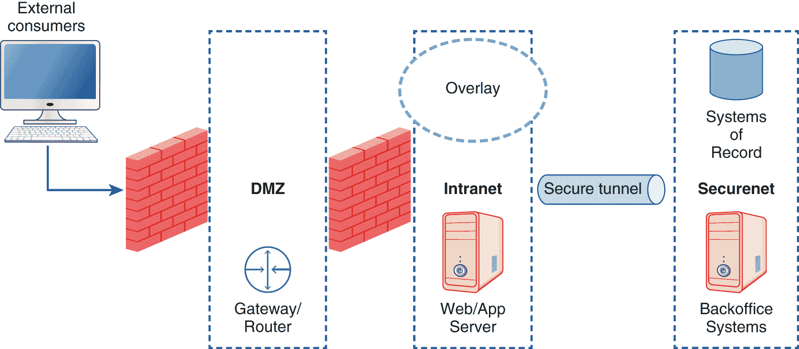

**图 3.1 网络安全域**

此外，通常在 DMZ 中部署称为蜜罐（honeypots）的系统。这些系统被故意设置用来跟踪和捕获攻击者的尝试。该域下的子网应配置为仅暴露必要的 Internet 协议（IP）地址和端口，以接收仅预期的 Internet 流量。这有助于公司将攻击范围最小化，同时仍可向外部用户提供网络的一部分（如 Web 服务器）的访问。由于风险极高，作为最佳安全实践，我们绝不能直接在该域中暴露任何应用服务。在某些网络架构（如带有筛选子网的架构）中，我们只会将路由设备（如筛选路由器、过滤设备和 NAT 网关）放置于此处，以受控的方式将流量引导至内部网络。

#### 3.2.1.2 内部网（Intranet）

内部网是受信任区域，其安全策略通常比 DMZ 更宽松，并且通常位于 DMZ 与安全网（Securenet）之间（如果使用安全网）。如果使用安全网，内部网通常充当两者之间的代理域。内部网的子网在逻辑上与互联网隔离，这意味着攻击者仍可能通过绕过安全控制获得访问；因此，良好的安全实践是仅在内部网中放置必要的系统和设备，例如应用服务器、内部 DNS 服务器和目录服务器。虽然内部网的安全策略相对宽松，但由于其虚拟隔离，仍可能引入漏洞用于 compromise 系统，因此应将其视为最低信任到中等信任的区域。随着更多公司向云端迁移，内部网通常是直接“搬迁”到云端的区域，因此在该区域已具备良好安全姿态时，进行“提升并迁移”（lift and shift）会更加容易。

#### 3.2.1.3 安全网（Securenet）

安全网提供最高程度的保护，通常是存放公司“珍宝”（如知识产权和敏感记录）的区域。并非所有配置都需要安全网，这取决于业务性质和对特定基础设施所需的安全程度。该区域通常与互联网物理隔离，因此最安全，但也最难与外部界面交互。空气隔离（air gapping）、安全隧道（secure tunneling）以及其他特权访问管理（PAM）解决方案等策略是必需的。

| 术语 | 定义 |
| --- | --- |
| 空气隔离 | 物理隔离，即两个网络段之间没有网络连接。 |
| 安全隧道 | 安全隧道使用协议创建受保护的数据交换，从一个网络传输到另一个网络。隧道意味着即使通过不安全的信道或网络发送流量，也可以通过私有网络连接使用加密和封装过程进行传输。 |
| 特权访问管理 (PAM) | PAM 涉及管理访问权限的技术和方法，防止在基础设施中为账户、进程、设备和系统分配未经授权的权限。PAM 帮助组织减少其攻击面，防止或限制因网络攻击以及内部威胁造成的损害。PAM 有时也被称为特权身份管理 (PIM)。 |

最常见的是在记录系统 (SORs)、数据库和其他受保护/敏感系统中看到这些系统。该区域通常是隔离的，意味着它与互联网完全、物理上断开连接。因此，它也是最受内部威胁青睐的目标，这也正是其访问策略严格的原因。值得注意的是，开发人员/程序员…


协议攻击，例如体积型攻击，旨在淹没网络和设备，但流量量通常较少，设计用于耗尽系统资源（如服务）而非网络带宽。此类攻击通常更针对特定的网络设备。其典型例子是 Smurf 攻击。Smurf 攻击通过利用 Internet Control Message Protocol (ICMP) 数据包并利用路由器的广播功能，使目标系统做出响应。若网络足够大，此攻击会在网络内部产生大量流量，最终导致网络或网络上的系统崩溃。防御此类攻击的最佳方式是配置网络设备（即路由器）以禁用 ICMP 响应和广播。在云环境中常见此配置。其代价是，此举会导致 `ping` 等协议失效，意味着管理员无法使用 `ping` 来排查网络连通性问题。

反向代理服务器还能隐藏内部网络的 IP 地址，使得针对性攻击更为困难。针对 Smurf 攻击的另一防御措施是在路由器和防火墙上设置过滤规则，以阻止地址伪造。我们预期 IP 地址会分配给局域网段，若源包的 IP 地址不在我们的子网范围内，则路由器规则应设置为丢弃该包。这将消除或至少大幅降低 ICMP 隧道攻击的数量（稍后将详细说明）。最后，遵循与体积型攻击相似的防御策略是良好安全实践，因为协议攻击可以被放大为体积型攻击。

#### 3.3.1.3 应用层攻击

应用层攻击针对特定的网络连接系统（如 Web 服务器），比体积或协议攻击更难检测和防御，因为它们不设计发送大量流量，而是发送少量流量，且随时间推移逐渐增大报文大小，目标是耗尽被攻击系统的资源，使其无法响应。Slowloris 是此类攻击的典型例子。Slowloris 攻击通过在目标上打开并维持大量同时的超文本传输协议 (HTTP) 连接，最终导致系统崩溃。此类攻击设计得隐蔽且难以在网络安全设备中被检测，因而难以化解。此外，诸如 Slowloris 之类的程序还有多种方式修改外观，伪装成合法流量，例如修改 HTTP 主机头部并禁用日志生成。

防御此类攻击需在网络设备和目标系统上采取更细致的措施，确保最小化访问。防火墙应始终设置为“默认拒绝”，仅允许必要的 IP 地址和端口号列入白名单。此外，路由器和交换机应限制单个 IP 地址的连接数量并设定最小传输速率。若被攻击系统为 Apache 这类 Web 服务器，则必须确保所有软件模块均已安装最新补丁，并保证服务器能够处理突发流量增长。最后，部署负载均衡器和反向代理可在多个系统之间分担负载并缓存重复请求，从而改善流量流动和系统资源消耗。

### 3.3.2 Phishing、Vishing 与 Smishing

Phishing、Vishing 和 Smishing 均为社交工程攻击形式，攻击者利用从公开信息来源（OSINT）获取的信息，公开来源指公开可得的数据，而非隐蔽来源。OSINT 使攻击者能够了解目标，进而制造恐慌或紧迫感，进一步获取个人及敏感信息，通常是为了获取金钱利益。Phishing 是一种利用伪造邮件诱导不警惕用户提供个人敏感信息的攻击。Vishing 目标相同，但采用电话而非网站进行攻击。常见情景是通过电话向目标提供已知公共信息（如某人可能拖欠房产税），以此说服目标向假账户转账或提供进一步可用于进一步 compromising 目标身份的信息。Smishing 则使用短信而非电话诱导目标，其核心与其他攻击相似，即利用公开的目标信息制造紧迫感，促使目标响应。

#### 3.3.2.1 Phishing

Phishing 邮件旨在让目标误以为邮件是合法的、要求其提供额外信息（如用户名和密码）以解决问题。邮件中常包含网址链接，点击后会将受害者重定向至看起来真实的网站，以获取所需信息。乍一看，这类邮件似乎不易奏效；然而，攻击手法已极其精密，成功率曾在某一时期超过 50%。这意味着若美国全体人口均收到一封 phishing 邮件，约有 1.65 亿人会成为受害者。确实，phishing 攻击已极为普及，企业为此投入数百万美元进行安全意识培训。虽然安全意识对抗 phishing 至关重要，但仅凭教育与培训不足。

例如，多因素认证 (MFA) 已被证明能够有效阻止许多 phishing 攻击。最近的 Microsoft Office 365 phishing 诈骗即是典型案例。自其推出基于 SaaS 的 Office 解决方案后，屡见针对凭证的钓鱼尝试，攻击者企图未经授权访问并窃取敏感信息。许多人成为该诈骗受害者，但即使凭证泄露，启用 MFA 的用户仍拥有额外防护，成功阻止攻击者通过正门进入。这表明，增加如 MFA 等安全层是对抗此类攻击最有效的措施之一，也是“防御深度”概念的体现。

#### 3.3.2.2 Vishing and Smishing

-   [费雪学习法](https://wiki.example.org/feynmans_learning_method)的灵感源于诺贝尔物理奖获得者**Richard Feynman**。

1.  运用费曼技巧，你只需花上`20 min`就能深入理解知识点，而且记忆深刻，*难以遗忘*。

```
if (condVar > someVal) {console.log("xxx")}
```

此外，随着网络日益软件定义化，针对网络本身的后门风险日益增大，这意味着传统的入侵检测方法可能不足，因为入侵检测设备本身可能已被 compromise。此外，由于后门攻击被知晓能够禁用安全控制措施以及其他入侵检测和防御设备，这些设备在及时识别时会变得棘手。因此，许多组织会为同一功能使用多个工具，例如在系统上安装来自不同供应商的多个基础设施监控工具。这虽然昂贵，但效果显著。然而，这些工具应仅限于检测功能，而非防范或修正系统，因为在后者情况下，它们可能相互冲突；例如，冲突的防火墙可能相互抵消。各种对策也能帮助降低此风险。正确配置的防火墙、强有力的访问控制和良好的安全策略是关键的首要防御措施。此外，软件安全代码扫描也应进行。这些分为三类：

*   静态应用安全测试 (SAST)，即“[白盒测试](https://www.imperva.com/learn/application-security/white-box-testing/)”，通过程序和流程检查源代码和二进制文件，并提供潜在 [漏洞](https://www.imperva.com/learn/application-security/cve-cvss-vulnerability/) 的反馈。

*   动态应用安全测试 ([DAST](https://www.microfocus.com/products/webinspect-dynamic-analysis-dast/overview)) 通常通过分析生成的二进制文件并执行软件来查找漏洞。

*   混合或组合应用安全测试 (HAST) 首先对代码和库进行静态分析，建模其“正常”行为，然后在代码执行时进行动态分析，以“观察”偏离或异常行为（如发出不必要的操作系统调用）。HAST 通常通过自动化实现，常被称为代码分析流水线。

### 3.4. 部分具体攻击场景

在本章最后部分，我们将通过几个攻击示例观察这些情况的演变。我们将重点关注网络利用。我们将考虑 ICMP，在此示例中它是无连接的。ICMP 的两个关键特征是：该协议不使用任何端口号，且在 TCP/IP 协议栈的网络层运行。它的设计初衷是用于诊断、错误报告和数据包流量控制，而非建立连接和传输通信。ICMP 还被 `ping` 和 `traceroute` 命令用于检查源是否可达，以及（部分）中间的跳数，如前所述。这些命令在网络测试中有助于确定网络传输失败的位置。

#### 3.4.1 ICMP 隧道攻击

当 ICMP 隧道在客户端和服务器之间建立通道时，大多数防火墙无法在服务器上检测到。此类利用被称为 ICMP 隧道隐蔽通道，它不受常规安全措施控制，当通过 ICMP 回显请求和回复包在端点之间建立连接时。即使我们阻止内部网络（内网）的入站 ICMP 消息（这是一个很好的做法），ICMP 头部和消息仍会通过另一种协议“蛇行”传输。利用 ICMP 隧道，攻击者可以在回显包中注入精心构造的数据并发送到服务器。服务器将原始数据包 ingest，导致服务器生成包含返回 ICMP 包的响应。由于大多数防火墙主要依赖源和目的 IP 地址来审查电子通信，因此此交易对大多数防火墙而言不可见。我们之前讨论了 Smurf 攻击——这是一个典型的 ICMP 攻击示例。¹⁹, ²⁰

Fraggle 攻击与 Smurf 攻击相似，但它们使用无连接的 UDP 协议而非 ICMP 协议。针对此类攻击的对策与 Smurf 攻击相同。Fraggle 和 Smurf 攻击通常在称为“侦察攻击”阶段进行，攻击者借此了解网络拓扑和面对的技术防护措施。在侦察阶段，攻击者可能使用多种 ICMP 方法来探测主机和服务器、网络拓扑、识别使用的操作系统及其补丁级别（即操作系统指纹），以及现有的访问控制和访问检测能力。部分指纹识别可能依赖于 `traceroute` 命令，该命令使用 ICMP 协议。如果成功，`traceroute` 可以揭示网络拓扑。

接下来，ICMP 错误消息——我们大多数人看到过的“目的地不可达”错误——可以用于查找 IP 地址或 LAN 段的开放端口。市面上有多种利用 ICMP 的扫描器，它们通过向目标机器发送无负载的 ICMP 数据包到指定协议，若收到“协议不可达”错误消息，则表明该协议未启用。

#### 3.4.2 ICMP 置换攻击

如果攻击者能够完成操作系统指纹识别，即知道使用的操作系统（OS）及其位置、补丁级别，那么他们可以确定攻击面和攻击向量。指纹识别是通过观察 ICMP 响应包的时间-to-live (TTL) 来实现的；例如，TTL 为 128 通常指示 Windows 系统，而 TTL 为 64 则指示 Linux 系统。基于此，攻击者可以选择合适的攻击工具和脚本。此外，ICMP 可用于通过路由广告（router advertisements）发现相邻路由器（即邻居路由器），该功能旨在使系统能够识别路由器及其到邻居路由器的路径，以实现高效的流量管理。

该设计的缺陷在于发现功能不提供或执行任何身份验证，这使得很难判断系统是否接收到有效的 ICMP 请求，从而使其极易受到中间人攻击（MITM），攻击者可能拦截并篡改通信内容。ICMP 路由发现消息也可能被恶意篡改，导致数据包被转发到攻击者系统，或导致拒绝服务（DoS）攻击。常见的对策是使用数字签名或其他形式的身份验证来验证路由广告的真实性，或者简单地阻止 ICMP 数据包通过防区（DMZ）通行。²¹

#### 3.4.3 网络数据包、帧或字节攻击

如果数据包在路由之间被拦截，它们可能会以多种方式被篡改。我们将审查两种类型的篡改，即数据包重放和碎片攻击（teardrop），但还有许多其他类型。首先，让我们回顾一种在我们深入探讨这两种更具体的攻击之前可以被攻击的重传机制。正如我们所知，数据包或片段在互联网中可能会丢失；因此，有许多内置的数据重传机制。例如，TCP 具有一套功能，它与发送方和接收方计时器协同工作，判断通信相关的数据是否丢失，并会请求数据重传。数据包本质上是 8 位字节的组，称为字节块。在  中，滑动窗口协议将数据字节块从源到目的地传输。假设，为了简化，字节块编号为 1–17（虚构）。源端按照窗口大小发送字节块，有些按顺序到达，有些则不。发送给源端的确认将是已收到的最后一个连续字节块。如果计时器超时，则会要求完整的数据重传。攻击者可以攻击计时器、字节块、整个数据包，甚至像确认、请求和路由等管理功能。

现在让我们考虑数据包重放攻击（或播放攻击）的样子。这些攻击使用合法的通信，但攻击者会导致数据或数据包被随机重复或延迟。这种情况可能发生在拦截并重传的过程中，也可能发生在使用数据包替换进行伪装的过程中。最终结果是一次拒绝服务（DoS）攻击。

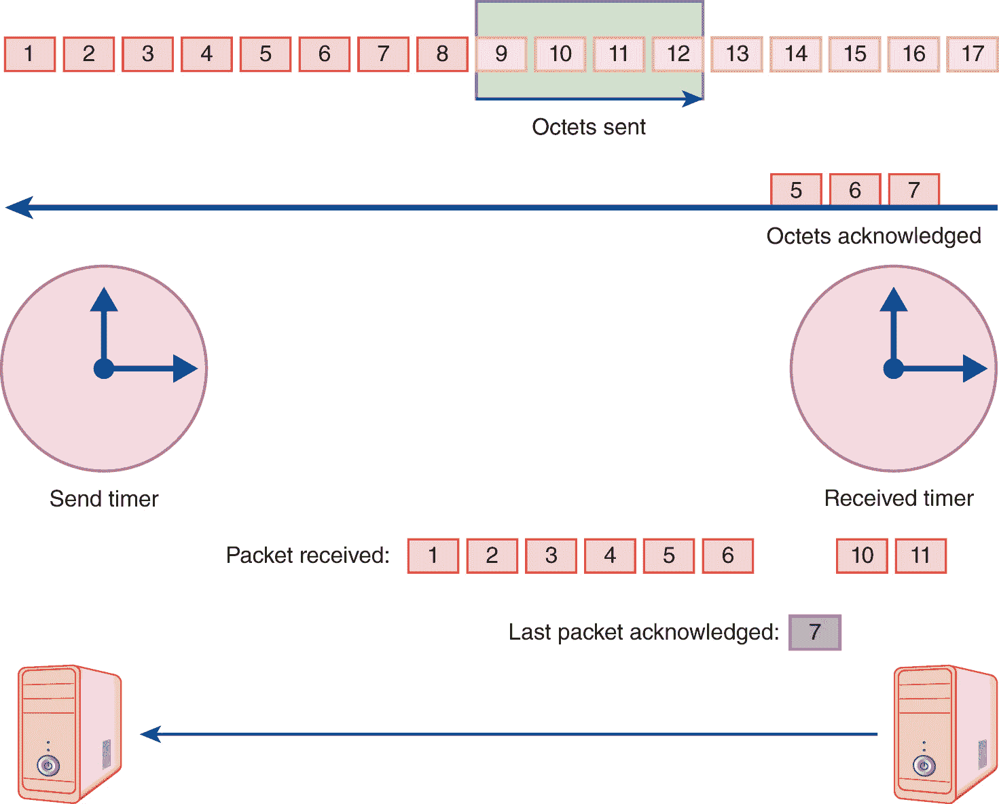

图 3.2 数据包组装与重传

碎片攻击（teardrop）是另一种属于此类攻击的手段。碎片攻击利用目标机器在组装重叠的 IP 数据包片段时出现的问题。当 IP 数据包通过互联网传输时，它会经过具有不同最大传输单元（MTU）容量的网络段。如果数据包大于某段网络的 MTU，则会被分割为片段。通过使用诸如 Wireshark 等技术检查 IP 头部，我们可以看到“更多片段”位是否被设置；如果是，则该数据包是许多需要在目的地重新组装成完整数据包的片段之一。重新组装时，一个称为偏移量的字段指示在片段堆栈中该部分应放置的位置，就像拼图一样。碎片攻击会修改偏移量，使它们错位或重叠。当主机上的重新组装例程运行时，它会失败。

#### 3.4.4 DNS 劫持

本章最后将讨论 DNS 劫持场景。此攻击是攻击者通过覆盖目标的 TCP/IP 设置，将查询重定向到其控制的 DNS。攻击者利用此技术在系统上立足，然后可能通过以下至少三种方式进行 DNS 劫持。第一种方法是通过获取 DNS 提供商的管理权限，使用伪造或被盗凭据（通常通过侦察或社交工程获得），然后更改 DNS A 记录以拦截所有流量。A 记录是一种 DNS 记录，用于通过指向权威 DNS 的逻辑域名和目标系统的 IP 地址来标识互联网中的设备。

第二种方式是攻击者使用伪造或被盗凭据登录管理门户，并更改 DNS NS 记录。NS 记录指定该域名使用的 DNS 服务，修改它们会导致流量重定向到攻击者控制的服务器。此举非常困难，因为攻击者必须入侵 DNS 注册机构的系统，但已有案例发生。事实上，许多组织曾因各种形式的 DNS 记录篡改以及欺诈性 SSL 证书受到影响，攻击者也利用 Let's Encrypt 完成此类攻击。²²

第三种方法是使用 DNS 重定向器，攻击系统同时响应 DNS 请求并修改 A 和 NS 记录，将受害者流量重定向至攻击者的系统。在这些情况下，攻击者可能使用开源证书颁发机构，从而绕过无效证书错误。该威胁可以通过使用由证书颁发机构管理的证书，以及能够识别证书真实性的技术（例如判断证书是否已被撤销，或是否来自私有权威机构）来缓解。

## 参考文献

1. World Economic Forum. (2020). Global risk report. [www3.weforum.org/docs/WEF_Global_Risk_Report_2020.pdf](http://www3.weforum.org/docs/WEF_Global_Risk_Report_2020.pdf)

2. Griffith, S. B. (1964). Sun Tzu: The art of war he art of war. Oxford, UK: Clarendon Press.

3. McAfee. (2020). What is Stuxnet? [www.mcafee.com/enterprise/en-us/security-awareness/ransomware/what-is-stuxnet.html](https://www.mcafee.com/enterprise/en-us/security-awareness/ransomware/what-is-stuxnet.html)

4. Sjouwerman S. (2020). Phishing on the rise. [blog.knowbe4.com/phishing-emails-are-on-the-rise-as-spear-phishing-continues-to-return-bigger-payouts](https://blog.knowbe4.com/phishing-emails-are-on-the-rise-as-spear-phishing-continues-to-return-bigger-payouts)

5. Gladwell, M. (2019). Talking to strangers: What we should know about the people we don't know. New York: Little, Brown and Company.

6. Macias, A. (2020). Texas A&M professor accused of collaborating with China amid NASA work. CNBC News. [www.cnbc.com/2020/08/24/texas-am-professor-accused-of-collaborating-with-china-amid-nasa-work.html](https://www.cnbc.com/2020/08/24/texas-am-professor-accused-of-collaborating-with-china-amid-nasa-work.html)

7. Halliday, J., & Arthur, C. (2010). WikiLeaks: Who are the hackers behind Operation Payback? The Guardian. [www.theguardian.com/media/2010/dec/08/anonymous-4chan-wikileaks-mastercard-paypal](https://www.theguardian.com/media/2010/dec/08/anonymous-4chan-wikileaks-mastercard-paypal)

8. Newman, L. H. (2019). Everything we know about the Capital One hacking case so far. [www.wired.com/story/capital-one-paige-thompson-case-hacking-spree/](https://www.wired.com/story/capital-one-paige-thompson-case-hacking-spree/)


9. Emmons, T. (2020). Largest ever recorded packet per second-based DDoS attack mitigated by Akamai \[White paper\]. [`blogs.akamai.com/2020/06/largest-ever-recorded-packet-per-secondbased-ddos-attack-mitigated-by-akamai.html`](https://blogs.akamai.com/2020/06/largest-ever-recorded-packet-per-secondbased-ddos-attack-mitigated-by-akamai.html)

10. Cloudflare. (2020). Slowloris DDoS attack \[White paper\]. [`www.cloudflare.com/learning/ddos/ddos-attack-tools/slowloris/`](https://www.cloudflare.com/learning/ddos/ddos-attack-tools/slowloris/)

11. Cook, S. (2020). Phishing statistics and facts for 2019–2020 \[White paper\]. Comparitech. [`www.comparitech.com/blog/vpn-privacy/phishing-statistics-facts/`](https://www.comparitech.com/blog/vpn-privacy/phishing-statistics-facts/)

12. Nadella, S. (2020). Beware these new Microsoft Office 365 phishing attacks. Redman Independent Voice. [`redmondmag.com/articles/2019/12/02/beware-microsoft-office-365-phishing-attacks.aspx`](https://redmondmag.com/articles/2019/12/02/beware-microsoft-office-365-phishing-attacks.aspx)

13. IRS. (2015). Phone scams continue to be a serious threat. IRS.gov. [`www.irs.gov/newsroom/phone-scams-continue-to-be-serious-threat-remain-on-irs-dirty-dozen-list-of-tax-scams-for-the-2015-filing-season`](https://www.irs.gov/newsroom/phone-scams-continue-to-be-serious-threat-remain-on-irs-dirty-dozen-list-of-tax-scams-for-the-2015-filing-season)

14. Broadbent, J. J., & Rosemond, C. (2019). Social engineering methods, modes, successes and failures. Proceedings of the Annual CINSec Conference on Information and Cybersecurity (pp. 113–124). Biarritz, France.

15. Huillet, M. (2020). Researchers detect crypto-mining worm to steal AWS credentials. Cointelegraph Newsletter. [`cointelegraph.com/news/researchers-detect-crypto-mining-worm-to-steal-aws-credentials`](https://cointelegraph.com/news/researchers-detect-crypto-mining-worm-to-steal-aws-credentials)

16. Kahol, A. (2019). Is your cloud at risk of cryptojacking? Verdict Newsletter. [`www.verdict.co.uk/cloud-cryptojacking/`](https://www.verdict.co.uk/cloud-cryptojacking/)

17. AWS. (2020). AWS identity and access management. [`docs.aws.amazon.com/IAM/latest/UserGuide/best-practices.html`](https://docs.aws.amazon.com/IAM/latest/UserGuide/best-practices.html)

18. EMSISOFT. (2020). The state of ransomware in the US: Report and statistics 2019. EMSISOFT Newsletter. [`blog.emsisoft.com/en/34822/the-state-of-ransomware-in-the-us-report-and-statistics-2019/20`](https://blog.emsisoft.com/en/34822/the-state-of-ransomware-in-the-us-report-and-statistics-2019/)

19. Arghire, I. (2018). Loki bot attacks target corporate mailboxes. Security Week, August. [`www.securityweek.com/loki-bot-attacks-target-corporate-mailboxes`](https://www.securityweek.com/loki-bot-attacks-target-corporate-mailboxes)

20. Cyber Security Review. (2020). Loki delivered as CAB file attachment. Cyber Security Review. [`www.cybersecurity-review.com/tag/loki/`](https://www.cybersecurity-review.com/tag/loki/)

21. RFC 1256. (1991). Router Discovery Working Group. [`tools.ietf.org/html/rfc1256`](https://tools.ietf.org/html/rfc1256).

22. Letsencrypt. (2020). Let’s encrypt. [`letsencrypt.org/`](https://letsencrypt.org/)


# CHAPTER 4

Corporations: Laws, Regulations, and Policies

© Antishock/Shutterstock

NEXTCO (A PSEUDONYM BECAUSE OF ONGOING LITIGATION) WAS PLANNING A SECOND ROUND of funding from a venture capital group. From the first round of investor money, they had developed some technologies for cloud computing, or so they advertised. During a process called due diligence, the investors found out that the company’s technologies were “basically, user interfaces and had faked the rest of the processing.” Smoke and mirrors, the investors called it. The board of directors subsequently split into three factions, who began blaming each other and many of the technology managers responsible for oversight of the software development and operations—it got ugly and turned legal. They sued each other over breach of fiduciary responsibilities, violations of bylaws, copyright and patent claims, and tortuous interference. Ultimately, the investors sued all of the board of directors and some of the managers for fraud—and some criminal complaints evolved out of the civil litigation. What should managers know about law and ethics?

Have you ever been involved in a lawsuit as a plaintiff or a defendant or part of a class action? Chances are you will be at some point in your lifetime.

## 4.1 Business Law and Regulations

Information and cybersecurity are particularly sensitive areas in organizations. We may face many civil and criminal jeopardies, ranging from cyberintrusions to mishandling of information. While most of us are not lawyers, it is quite likely that you have heard the expression that “ignorance of the law is no defense.” Some knowledge of the law is important, particularly in knowing when to involve the corporate attorneys. In this chapter, we will cover some of the main concepts that technology managers and security professionals should know about. We will start with how organizations are typically structured. Why do you suppose knowing how corporations are formed as legal entities might matter to us in the field? Quite simply, managers must be familiar with laws and regulations if they are going to effectively manage their organizations securely. Along with ethics, the rule of law forms the backbone of information security.

As with people working in a company, a corporation is a legal entity having rights, is subject to legal duties, and is regulated by the state in which it was incorporated. Therefore, both employees and corporations have rights and duties. From a legal perspective, a right is defined as the capacity of a person or corporate entity, with the aid of law, to compel another person or corporate entity to perform or to refrain from performing an action. A duty is defined as an obligation that the law imposes upon a person or corporate entity to perform an action or refrain from performing the action. Along with rights come accountability, along with duties come responsibility. Thus, duties and rights are interdependent. A right cannot legally exist without a corresponding duty upon another. Along with these, come the notions of responsibility and accountability (Figure 4.1).

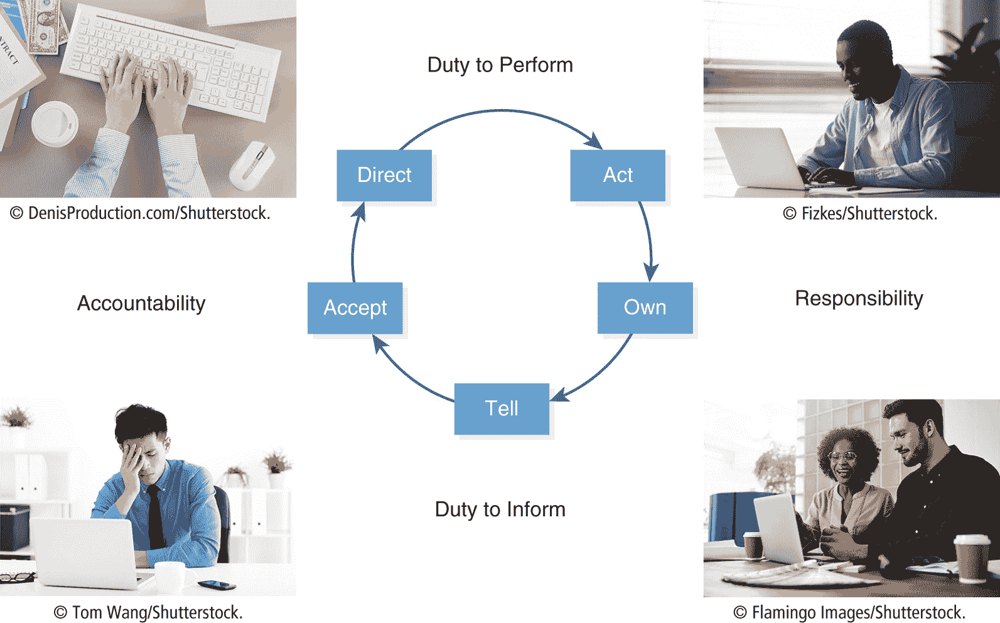

FIGURE 4-1 Duties, Responsibility, and Accountability

To illustrate, on an individual level, suppose you are working as a manager overseeing a department of network engineers. If one of the engineers, through negligence, fails to properly configure a router and a breach later occurs because of it, the engineer might be responsible, but the manager along with the engineer would be accountable. The engineer had a duty to properly configure the router, and the manager had a duty to ensure that the employee carried out his or her tasks in line with the job expectations. At an organizational level, an organization may have a duty to provide certain information to the Securities and Exchange Commission (SEC). If this is not done according to the requirements, the organization may face consequences, and the principals who had the duty to ensure that the filings were performed may be held accountable.

除州法律规定的公司设立外，公司还受联邦法律约束，受《统一商业法》（UCC）管辖，该法规范跨州的商业交易，甚至可能受国际法约束。在安全方面，这尤其重要，因为它涉及与雇佣相关的事项和受监管行业。例如，公司可能受《健康保险可携带性和责任法案》（HIPAA）的约束，适用于医疗行业；受《支付卡行业数据安全标准》（PCI DSS）约束，适用于处理信用卡交易的企业；受《萨班斯-奥利尔法案》（SOX）约束，影响所有组织及其财务，这些法规均要求管理者制定指导员工正确处理信息和计算机系统的政策和流程。

| Regulation | Description |
| --- | --- |
| UCC | UCC 是针对州内和跨州商业交易的标准化法律和法规，尽管存在差异，例如在路易斯安那州。其影响力最显著的领域是合同法。 |
| HIPAA | HIPAA 将美国卫生与公众服务部部长指定为制定保护部分个人健康记录隐私和安全法规的责任方。它包含两部分：一是 HIPAA 隐私规则，二是 HIPAA 安全规则。 |
| PCI/DSS | PCI/DSS 制定旨在保护信用卡、借记卡和现金卡交易并防止卡 holder 个人信息被欺诈或滥用的政策与程序。它包含六项指令，涉及：(1) 网络安全，(2) 信息存储，(3) 防止未经授权访问，(4) 访问控制，(5) 监控与测试，(6) 明确的安全政策制定与执行。 |


此外，还需考虑就业法。就业法因国家而异，甚至因州而异（如“按需雇佣”与“右至工作”制度），但在美国大部分情况下，这些法律规范雇佣关系。它规定了员工、经理和高管应如何行为，以确保公平对待，并提供应对违规的多种救济途径。它规定了招聘和解雇的约束条件以及工作场所的工作条件。联邦和州就业法律均适用。人事与就业法的要素包括制定纠正措施政策、程序和流程，用于处理不构成立即解雇的员工错误或不当行为。其目的是为所有员工提供正当程序。这些法律也涉及敌对工作环境等问题，如不尊重、淫秽或导致建设性解雇的行为——建设性解雇是指工作环境变得如此不可忍受，以致迫使某人自动辞职。重要的是，它还涉及歧视问题，并明确了违规的程序与后果。

最后，管理者肩负特殊责任，通过执行公司政策和实践来管理人员和组织资源。在履行这一管理职责时，我们有义务确保所谓的组织公平。组织公平主要分为三类：(1) 程序正义是指员工在各层级 perceives 决策过程为公平。导致这种感知的条件包括：员工希望在可能影响他们的决策中拥有发言权；员工希望管理者及拥有权力的人在决策时摒弃个人偏见和动机，尽可能依赖客观数据；以及当员工拥有纠正 perceived 错误或决策的机制时（如上诉程序），程序正义被视作实现。 (2) 分配正义涉及客观与主观标准，以确保实际公平，例如使用基于绩效的付酬目标，并确保其被沟通、认可且可衡量。 (3) 互动正义指人与人之间的交往，包括组织公民行为（organizational citizenship behaviors），即促进积极工作关系的行为。员工的集体行动构成企业社会责任的概念，即组织对外部利益相关者（如环境、社会或慈善活动）的行为方式。

### 4.1.1 责任、问责与法律

如前所述，问责可理解为俗话所言的“责任到底”，而责任则指履行某项行动的义务；因此，一个人可以被问责但不负有某项行为的责任。管理者在实现业务绩效和信息安全目标时承担问责。这可能意味着监督负责维持应用性能的员工，确保其满足用户期望；从安全角度，则需保障信息和系统的机密性、完整性和可用性，并达成其他业务目标。在大多数情况下，管理者对下属的行为负有问责，同时也需主动采取行动，例如提供明确的指示（Figure 4.2）。


FIGURE 4-2 Accountable and Responsible ¶ © Image Source/Photodisc/Getty Images.

例如，管理者可能因未能满足应用性能或合同义务而被问责，合同义务通常称为服务级别协议（SLA）。为满足该协议规定的性能水平，管理者可能需要配置系统和网络以实现性能承诺。这可能涉及确保网络能够根据所携带的应用类型或数据对高优先级网络流量进行区分，可能包括在 TCP/IP 网络中使用基于策略的路由。如本例所示，问责与责任以倒置树形结构呈现，即自组织结构图向下观察时，问责与责任逐层累积。

在问责方面，公司的管理与治理结构主要取决于公司的设立形式以及董事会通过（如章程、细则）或个人合同（如雇佣协议）达成的协议。公司形式包括合伙企业、有限责任公司（LLC）、子章节 “S” 公司、营利与非营利公司，以及其他多种类型。

-   正如我们所指出的，公司是一家法律实体，其存在依赖于其注册所在的国家，并且与控制其运营的个人有所区别；因此，它为管理主体提供了某些责任保护。合伙企业是由两名或两名以上个人组成的协会，他们共同拥有企业。合伙人对大多数法律违规行为承担个人责任，但企业结构具有某些税收优势。有限责任合伙企业是指所有者依据其所在州的法律创建的一个法律实体。由于它为管理主体提供了某些责任保护，因此它在中小企业中很受欢迎，但也存在一些缺点。子章节“S”公司允许一群人以公共公司的益处（如责任保护）进行业务，但允许主体按个人基础纳税，类似于合伙企业。

-   这本书的范围不包括具体的法律方面，但重要的是要认识到，管理和治理的程度在很大程度上取决于组织的法律结构以及行业特定的规定。同时，也要认识到，公司内部的正式或合法权力结构主要是由企业在成立和运营过程中依据的法律和组织结构所决定的。当发生法律违规或投诉时，会适用不同类别的法律，并存在不同的审判场所。法律分类包括程序法和实体法、公法和私法、民法和刑法。

| 程序法 || 处理违法行为的救济方法。更具体地说，程序法创建、定义并规范法律权利和义务。它规定了权利执行的规则以及在法院中寻求救济的方法。 |

| --- | --- |

| 公法 || 当出现违反程序法的情况，涉及政府在其政治或主权地位下相对于个人或群体的权利和权力时，公法就会发挥作用。公法包括宪法法、行政法和刑法。 |

| 私法 || 私法是程序法和实体法的部分，规范个人和法律实体（如公司）之间的关系。私法涉及侵权、合同、销售、代理和财产。 |

| 民法 || 民法定义义务和构成对“受伤害”一方的违规或不当行为。民法属于私法的一部分。 |

| 刑法 || 刑法定义义务和构成对社区或社会的“错误”或违规。刑法属于公法的一部分。 |

### 4.1.2 知识产权

-   知识产权（IP）指公司的专有信息、数据、商业秘密、版权、品牌、商标、专利以及其他被公司主张拥有的材料、方法和流程，因此 IP 被视为公司的资产。IP 有价值；创建它和保护它都需要花费，且其价值可能因他人的行为而降低，即使实际损失难以确定。信息可以通过互联网轻松传播，这导致了涉及 IP 的常见违规行为。作为风险评估过程的一部分，IP 应按信息类型和敏感度进行分类，在风险管理中，IP 需要相应地得到保护，此外，组织还需要书面政策，并对 IP 的正确保护和处理进行培训。下面我们来看一些 IP 的分类。

-   商业秘密包括对公司运营至关重要的公式、方法和信息。虽然员工通常有忠诚义务不向竞争对手披露商业秘密，但为保护商业秘密，员工和接收商业秘密的外部人员通常需要签署不披露协议。违反保密义务的人将构成侵权行为。要构成侵权，被告必须有法律义务于受害人，违反了该义务，且损害必须是直接结果。[²^, ³ 此外，商业秘密还可能因工业间谜、电子监控或间谍行为而丢失。

-   专利是发明人在联邦法律（在美国）授予的独占使用权，在一定时期内有效。专利持有人可以通过授权他人使用专利来获利，收取费用或版税。与保持秘密的商业秘密不同，发明人在专利局申请专利时，必须详细描述发明，以便法院判断其是否具备专利性或已构成侵权。专利期限届满后，发明进入公有领域，任何人都可以使用。虽然有多种专利类型，但大多数与信息安全相关的专利都是“实用”专利。要获得实用专利资格，过程、机器或组合必须是新颖的，即不得与先前的申请或已发布专利冲突，必须具有具体且实质性的用途，且必须不显而易见，即在先前工作（先前艺术）的光照下，对该领域的专业人士来说，它不应显而易见。³

-   版权是联邦法律赋予原创作品作者的保护。根据版权法第 102(a) 节，作品包括音乐、文学、软件、半导体图案和电子编程、图形、电影和视听录像等。大多数版权作品应向版权局登记才能获得保护，但登记并非必要。例如，在作品后加上“(c)”和版权所有者及年份，通常就足以形成可辩护的版权保护。个人版权通常保护期限为作者终身加 70 年；企业版权则保护期限为 95 年。

-   版权保护可能受到限制的情况有两种：强制许可和公平使用。强制许可允许在支付版税的前提下，对版权材料进行某些有限的使用。公平使用允许为批评、评论、新闻报道、教学（包括课堂多份复印件）、学术研究或学术研究而引用版权材料。公平使用的判断依据包括：(1) 材料使用的目的及是否为盈利或非盈利用途，(2) 版权作品的性质，(3) 使用的数量及比例，以及 (4) 对版权作品市场价值的影响。版权所有者可以将版权作品转让给他人，在大多数为他人工作的情况下，通常会隐含或明示地转让所有权。³

### 4.2 组织权力结构

权力是影响他人做某事的能力。影响他人的能力可以通过激励、说服或强迫实现。因此，权力的行使方式取决于所使用的权力来源或基础；例如，管理者拥有奖励和惩罚下属的权力（这被称为正式、合法或职位性权力），而下属可能拥有专业知识（专业权力）或魅力（参照性权力），这些都是非正式权力的形式。由于权力通常与对有价值资源的控制相关，正式的组织结构提供了最为人认识的权力来源。正式的组织结构和权力的使用是通过法定和法律视角实现的，也就是说通过章程、规章制度以及其他协议，或者通过权力的授权委派。然而，权力往往以超越合法权力结构的方式在组织中分布。

非正式权力的一个例子是，一个魅力出众但职位权力较小的人可能能够影响或说服他人形成联盟，以对抗更有权势的个人在某项行动上的表现。这种权力来源于参照性权力基础。此外，我们在技术和知识工作中常常发现，权力来源于专业知识。在这种情况下，权力是倒置的。换句话说，管理者通常依赖于他们所管理团队中个人的专业知识。这些个人持有有价值的资源（即知识和技能），是管理者实现团队目标所必需的。在这种情况下，管理者通常会结合合法权力（使用奖励和惩罚）以及非正式的参照性权力，后者常被称为“领导力”。

### 4.2.1 管理学学科

管理的职能包括规划、组织、指挥和控制组织资源。规划可分为操作级、战术级和战略级。操作级规划针对日常事务的效率提升和成本效益。战术规划涉及确定实现战略所需的逐步行动，而战略规划则是通过利用组织的核心竞争力，推动实现设想未来的结构化过程。管理者如何进行规划取决于使用科学、正式且结构化的流程，还是采用艺术性、创造性、想象力和直觉的技术。

管理者通过分配预算和时间给任务来组织资源，以便在支持组织目标的同时执行计划。组织资源主要针对管理的操作级和战术级，同时保持战略计划的视角。指挥活动包括与员工和上级澄清目标并设定期望。控制活动则包括对业务和员工绩效进行评估，监控绩效并与计划对比，进行调整，并建立持续改进的反馈循环。

### 4.2.2 管理倡议与安全

倡议可以简单地被视为项目，正如规划一样，倡议也可分为操作级、战术级和战略级。战略倡议是一种产品开发或服务活动，旨在获取竞争优势，并需要在时间和资源上进行“长期”承诺以生产或提供产品或服务。因此，战略倡议不同于战术和操作倡议：前者是由各种分析、行为技术以及权力和组织政治的综合运用，以实现广泛设想的结果；后者是管理者执行战略的行动，而操作倡议则是管理行动所产生的日常例行事务。因此，实现战略是通过产品或服务倡议实现的。

安全管理包括规划、组织、指挥和控制组织资源（人力和非人力），专门用于在操作级、战术级和战略级别保障组织的安全。安全倡议包括识别并优先确定业务和安全需求；确定资产的价值；定义、开发、监督和监控安全流程与程序；编制并执行应急预案；以及评估、比较并选择安全技术以减轻风险并防止漏洞被利用。

安全管理可以是一般管理职能，也可以分派给指定的安全管理职位；然而，安全的操作级、战术级和战略级管理通常会向上层管理层级递进。例如，一线经理或主管可能负责监督网络和计算机管理员，后者负责配置和部署安全解决方案。一线经理会监测并上报安全威胁和需求给中层管理者，中层管理者通常负责分配预算并决定安全技术和程序。中层经理与一线经理共同负责实施安全架构和执行安全政策，并向高层管理者上报安全与政策需求。高层管理者与法律部门和人力资源部门合作制定安全政策，并组织全公司制定安全策略。他们还可能组织对安全的审查和审计，确保业务连续性以及灾难后的恢复。首席信息安全官（CISO）通常负责所有主要的信息和网络安全策略、战术和操作。

### 4.2.3 信息安全管理

虽然管理者负责帮助确保员工的安全与福祉，信息安全仍是安全管理职能的核心。计算机安全通常指保护计算设备（如台式机和笔记本电脑）的努力，而网络安全则指保护通信和数据传输基础设施的努力。所有旨在保护计算机和网络的措施主要是为了保护信息的保密性、完整性和可用性。这部分工作通过实施防范和纠正措施来完成，以应对未经授权访问信息可能导致的添加、删除、修改或窃取信息（Figure 4.3）。

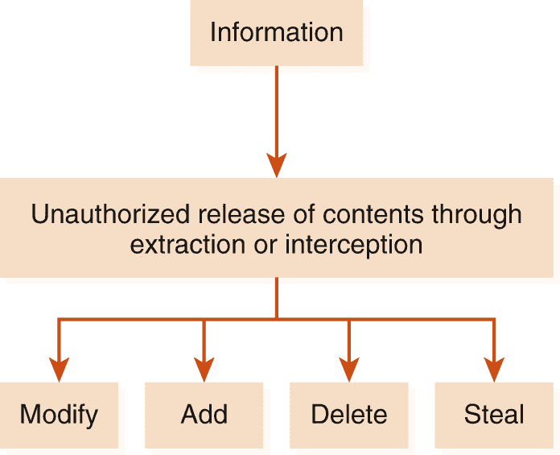

FIGURE 4-3 Information Security Threats

我们之前已经定义了威胁的概念，但在此相对于信息安全的目的而言，我们可以简单地将威胁视为因漏洞导致的安全泄露的潜在风险。当漏洞在攻击中被利用时，攻击可以是被动的或主动的。被动攻击可能设计为在受害者未察觉的情况下仅仅窃取信息。主动攻击可能试图篡改信息、导致服务中断或阻止访问关键信息资源。威胁可能代表自然灾害，也可能代表人为事件的潜在风险。事件是灾难的实现，例如飓风摧毁运营中心，或一名或多名个人的企图或成功攻击导致运营中心网络瘫痪。人为事件可能是因意外错误或公司内部人员（如员工或承包商）或外部人员（不为公司工作）的故意攻击造成的。在故意攻击的情况下，这些攻击旨在利用漏洞，例如后门、未经授权访问信息、硬件、网络、软件（如操作系统、数据库管理系统或应用程序）等。一种对故意攻击的分类涉及信息窃取，由身份窃贼或企业间谍实施。以下是此类攻击感兴趣的信息示例：

*   当前客户名单：客户信息为竞争对手提供“竞争情报”，了解公司提供什么以及提供给谁，可能帮助他们寻找削弱公司的机会。

*   供应商、分销商和承包商名单：这些名单使外部人员能够确定潜在的漏洞。

*   营销计划：包括销售预测、统计数据、定价、预测、财务信息和促销策略，这些都可能被竞争对手利用。

*   研究与开发：涉及知识产权、战略方向、产品线、初步研究结果以及新产品发布日期。

*   运营信息：涉及容量、扩张、流动性/营运资本、紧缩计划以及企业内部成本（即利润率）。

为应对威胁风险，有多种技术和技术手段可供使用。例如，访问控制应用程序协调谁可以访问哪种资源。在此示例中，系统管理员可能拥有登录计算机的权限，并被授权读取、添加和修改系统配置文件，而非管理员虽然拥有登录权限，但仅拥有读取这些文件的权限。当管理者及其安全保障团队确定信息资源的威胁和漏洞时，他们会评估攻击的可能性以及成功攻击的后果严重程度。管理者随后需要权衡威胁风险（暴露）以及资产价值与管理优先级、时间表和预算。

### 4.2.4 组织结构、主体与代理

我们需要指出，股东是购买或被赠予公司股票的个人，尽管他们可能不在公司中承担操作角色，但他们仍然拥有影响公司的权力。公司是“私有”还是“公有”以及发行的股票类型影响股东的所有权和在公司中的影响力。最有影响力的股票类型称为“投票股”，因为它们允许股东对重要事项进行投票。例如，拥有投票股的成员可以选举公司董事会，代表其利益。在此过程中，他们将权力委托给这些**主体**，以管理公司运营并控制其资源。

我们在前文多次使用了“主体”一词。主体是法律上在组织中拥有权益的一方，可能或可能不承担操作角色。这意味着一些主体可能仅作为公司顾问行事，而具有操作角色的主体则是执行公司日常运营的高管。由于他们拥有特殊的权利（通常源于创始性投资或是公司董事或高管），主体在公司治理中拥有特殊的影响力。因此，所有主体都持有信任和信赖的职位，并被期望为公司和股东的利益尽力而为。除此义务外，具有操作职责的主体隐含了**代理**概念。代理是指能够使公司受到法律约束的能力。虽然某些职责和代理可能进一步委派给公司官员、管理层或员工，甚至分包商和独立承包商。

同样，股权所有者可能是主体，也可能不是——即他们可能仅是股东，并不一定是代理。鉴于公司结构中各种参与、所有权和权力的变体，这可能在此阶段显得有些混乱。我们将在后续技术性主题，特别是在治理和合规章节中进一步阐述这些概念；在此之前，请记住，从法律上讲，代理是由合同或协议形成的 principal（主体）与授权行为者（agent，代理）之间的自愿关系，其目的通常是让 agent 代表 principal 进行某项合法行动。代理的例子包括公司官员在正常业务过程中执行 assigned duties（指派任务），或律师、顾问代表客户行事。

根据结构化理论，⁵ 代理行为是相对于由规范、法规和法律设定的边界进行的。这些约束性结构与产生它们的社会结构是不同的。因此，人类行为部分受到社会和组织为自身设定的不同情境规则的制约，而行为模式的规律性形成了制度化结构，指导人们在重复这些模式的规范性互动中行事。⁶ 然而，人们可以通过转型关系来重新协商制度化结构。换言之，虽然规则通常指导人们在社交互动中的行为模式，并规范对资源及其创造产品的控制，但人们可以通过行使权力（这可能或可能不源自合法结构）来挑战和改变这些规则。例如，仪式、通过仪式的过程、伦理行为准则等社会结构是动态的，当它们不再服务于其原本目的时，它们可以发生变化。⁵ 人们会协商这些社会结构的影响，可能选择忽视它们、替换它们，或在它们失效时以新形式复制它们。⁸ 我们称这些转型的代理与结构互动为 **structuration–agency theory**（结构化–代理理论）。

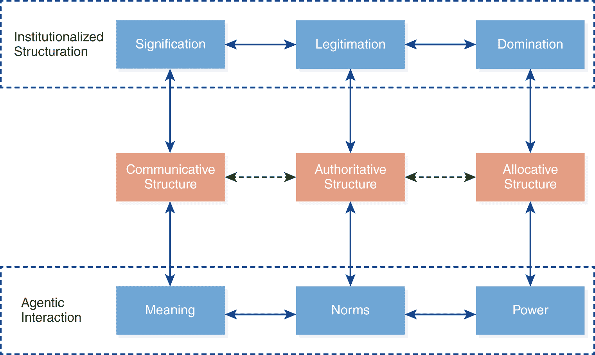

FIGURE 4-4 Organizational Formal and Informal Structures ¶ (From Giddens, 1984)

### 4.2.5 责任与权力的委派

-   根据讨论，根据协议，企业的股东建立了标准、活动和责任，用于管理业务，无论是作为顾问还是作为公司中的运营角色来管理业务。因此，董事会通过其投票通常任命公司中的官员，这些官员积极参与领导和监督公司日常运营，并执行企业战略中的战术。换句话说，企业结构规定了正式的权力结构以及职责和资源的分配或委派。这种分配通常在公司中如下进行：董事会拥有管理公司业务的权力。这些“董事”对公司行使主导权和控制权，持有信任和责任的职位，并确定运营政策的走向。他们拥有广泛的权力委派给代理人和在董事会意志下履行职务的官员，而这些官员又负责招聘和解雇所有必要的运营人员，并管理公司的日常交易。[⁴


| Tactics || Tactics have sometimes been interchanged with the term strategy, particularly among the experts who believe that strategies can be engineered. However, the more common distinction is that tactics are the steps or actions taken to achieve a strategy. For example, in the game of chess a tactic might be to move a bishop to a particular square, where collectively the tactics form a strategy to checkmate an opponent’s king and win the game. |

| --- | --- |

| Strategy || The term strategy is not well defined. Some experts have referred to it as visioning, a kind of art form; others have presented scientific frameworks and ways of achieving organizational goals. One of the more popular definitions was derived by Michael Porter and from what is known as Porter’s Five Forces Model.⁹ |

Board members may function in an operational role, or they may act only as advisors, and as a voting group delegate authority to corporate officers who run the day-to-day affairs of the operation. Consequently, corporate boards select, remove, and determine the compensation of corporate officers, and furthermore (typically by a majority vote), shareholders may remove a director or an entire board of directors with cause by means of their voting. Thus, power and the exercise of control, and the corresponding responsibilities in corporations, isn’t viewed strictly as a pyramid often represented in organizational charts, or even as an inverted one, but rather as a spectrum or matrix of power, rights, duties, responsibilities, and liabilities that transcend organizational structures.

### 4.2.6 Fiduciary Responsibilities

The preceding section has led us to an important legal and security concept. Principals and agents in a corporation owe to each other a fiduciary responsibility. A fiduciary responsibility is one that holds special duties. More specifically, a fiduciary is an actor in a position of trust and confidence such that he or she owes his or her principals the duty of obedience, diligence, and loyalty. This includes the duty to inform relevant parties and provide an accounting of financial and other material transactions to all the principals.¹

Diligence means that in the execution of duties, they are discharged in a manner exercised using ordinary (or due) care and with prudence “reasonably” expected of someone in that position who was acting in good faith, which is to say, with care taken by an ordinarily prudent person in that position given the circumstances, and in a manner one would “reasonably” believe to be in the best interest of the corporation. Failure to uphold fiduciary responsibilities may expose a principal (or agent) to legal liabilities. For example, a breach of obedience might be to execute an unauthorized binding action with a third party, such as to enter into an unauthorized contract.⁴

A breach of duty includes failure to use due care in acting. This can range from failure to pay attention to instruments a principal or officer signs or accedes to, or misrepresenting that a principal has a skill that one does not actually have, which is in turn relied upon by a third party in an assumption about the principal’s ability to perform his or her duties. A breach of loyalty involves failures to properly inform or account to other principals regarding material matters such as sources of income and any “side work” a principal may perform. It also includes the agreement not to compete, not to engage in conflicts of interest, and not to disclose confidential information to unauthorized parties.¹

Beyond the legal dynamics explained so far, and the corporate structural relationships that comprise the legitimate or formal exercise power, it has been argued that socially responsible behavior pays a debt owed on a moral obligation to the society that contributes to a corporation’s overall success. This line of reasoning affirms that social responsibility buys goodwill, and goodwill can (albeit sometimes as an intangible factor) translate into corporate development and future success. It is from this philosophy that the terms social contract and stakeholder were derived, and concepts such as the psychological contract, equity, and organizational justice all stem from this notion of social responsibility. In this view, it is not just “stockholders” but also “stakeholders” who have a legitimate right to exercise control and power in a corporation.

| Social Responsibility || Social responsibility is considered an ethical commitment by an organization to act in ways beneficial to a community and society as a whole. |

| --- | --- |

| Psychological Contract || Psychological contract is a term applied to expectations in organizational exchanges. For example, an employee may trust that his or her manager will treat him or her fairly during the compensation process in exchange for meeting one’s committed goals. These expectancies are essentially implicit, or unspoken (tacit agreements). |

### 4.2.7 Ethics and Ethical Behavior

Ethics are codes of conduct for what constitutes “right” and “wrong.” Ethics in general is a systematic effort using logical reasoning to make sense of individual, organizational, and social moral dilemmas in such a way as to determine the principles that should govern human conduct and the values they express. Unlike law, the assessments of ethics have no central authority such as a court or legislature. As such, there are no clear-cut universal ethical standards for managers to rely upon.⁴ Philosophically, there are different views about ethics that fall into various categories.¹⁰ Ethical fundamentalism is an absolute commitment to a central authority or set of rules to guide decision-making. Ethical relativism asserts that individuals must judge their actions by what they perceive as right or wrong.¹¹ Situational ethics is the view that developing precise rules for navigating ethical dilemmas is difficult because real-life decision-making is complex and ambiguous. To judge the morality of a behavior, the people judging must psychologically place themselves in the other person’s situation to understand what motivated the other to choose a course of action.¹² Utilitarianism tries to view right and wrong in terms of consequences of actions. There are two major forms of utilitarianism, which are act- and rule-based utilitarianism.

基于行为的功利主义根据行为是否最大化快乐而非痛苦来评价每个行为。基于规则的功利主义支持规则，这些规则在个体行为带来的个人快乐与他人快乐之间取得平衡。成本‑效益评估比较行动的客观和主观直接及间接成本和收益，并追求在最小成本下实现最大经济效率⁴ 从这些概念衍生出的观念是规范论，指对某些行动或不作行动的义务或责任¹ 法律原则通常源自规范论，它通过坚持某些基本原则无论涉及何种快乐或痛苦，都是对或错的，以此解决功利主义的实际问题¹ 此外，民法也逐步将社会伦理概念纳入其中，包括平等主义——要求人们在责任和后果上均等分担。从这一理想衍生出的分配正义概念，追求平等机会，但不一定期待平等结果¹³

正如我们所指出的，法律与伦理存在差异。法律受伦理概念影响，但二者本质不同。法律是普遍的原则，被编码为具有制裁的规则。没有法律，就不存在正义。正义有多种定义，但常见的一种是：对个人和群体之间竞争的利益和欲望进行公平、公正、无偏的处理，并审慎考虑公共利益¹⁴ 另一方面，伦理是指导性的，即“经验法则”，用于指引适当或普遍可接受的人类行为¹³ 例如，许多人遵循的行为准则会禁止他们坐视盲人走向繁忙道路，而一辆高速汽车正驶来。虽然未能阻止盲人被撞可能没有法律制裁，但这通常被认为是错的，因为它是一种经验法则而非法律规则，人们在责任判断上会有所不同，如是否冒险自身生命⁴

由于法律被编码为具体规则，必须足够明确，以便在违规时能够判断。但伦理是经验法则，涉及多种主观观点，因此伦理行为必须协商达成。在信息安全领域，有一些指导性法律原则可供参考，包括`due care`（在本上下文中指根据安全政策的一般规定，小心处理信息）和`due diligence`（超出单纯小心处理，要求以“工匠般”的标准积极履行信息保护或完成必要行动）⁴

常见的伦理违规例子是将个人社会安全号码作为员工标识符，忽视身份盗窃的威胁¹ 由于安全号码虽唯一，但并不意味着它适合作为员工标识。员工期望管理层关注其个人安全，这构成了心理契约的基础——一种隐含的协议，规定了雇主应提供的内容（如薪酬、安全工作条件）以及员工应提供的内容（如专业知识或工作努力）¹³ 实际上，虽然制定组织伦理准则有助于规范行为，但管理者在工作场所必须面对广泛的伦理考量。大多数公司会制定行为规范或行为守则，或更正式的安全政策，这些政策规定了员工和管理层行为的指导原则，通常涉及隐私、公开性和信息资源的可及性。

### 4.3 法律与可执行的安全政策

到目前为止，我们一直在讨论由人实施和执行的法律和伦理组织体系，通常与法律、法规和政策相关。但应当注意，安全政策也可以以软件中的书面或编码规则形式存在。我们稍后会讨论基于计算机的安全政策，但在本章最后一节，我们讨论编写可执行书面政策的关键考量。简而言之，书面政策用概括性规则和违规制裁来应对各种威胁。

威胁被定义为对自身或他人的心理（如袭击）、身体（如殴打）或社会（如盗窃）的违背或伤害的预期。在书面政策方面，管理者需要在过于具体和过于笼统之间取得平衡。如果过于具体，会出现以下问题：(1) 员工可能不阅读它们；(2) 政策之间可能出现矛盾，导致法律问题并产生解释需求；(3) 过于具体的政策可能使员工拒绝未明确或过于狭隘的任务；(4) 过度具体的政策在裁决时可能对雇主不利，因为政策可能被过度解读，难以实现其原本旨在解决的目标⁴

只要公司遵守法律、法规和规章，为了避免诉讼，组织通常只需要有限数量的政策，以覆盖那些不是常识、常理或法律、法规、规章所涵盖的重要可接受行为。因此，管理层创建政策的数量应由是否存在强烈需要、法规或规章要求制定政策来决定，良好的政策陈述应简洁、明确且尽可能无歧义¹⁵

#### 4.3.1 强制执行与可执行的安全政策


法律上，安全政策必须既**执行**又**可执行**。执行意味着管理者不能对违规行为视而不见或偏袒。可执行性部分是合同事项，必须满足构成法律协议的标准，因此企业的法律部门和人力资源部门必须参与安全政策文档的起草¹ 管理者不应在没有法律建议的情况下自行起草安全政策，因为正如一般政策一样，安全政策承载着法律约束、义务和责任。这些法律约束涉及就业法、公司法，或是如医疗保健行业的 HIPAA 等立法或监管规定，甚至还有国际法规。

此外，安全政策可能旨在应对相对广泛的群体，或者需要针对组织中的某个角色或群体进行定位。无论如何，从法律角度来看，管理者必须避免制定涉及步骤或流程，或明确说明“如何”执行任务的政策。正如我们之前指出的，制定此类政策会导致员工在为实现目标或应对紧急情况时需要偏离规定程序，这可能引发法律挑战。更好的做法是将程序放入单独的文档中，并注明在适用的情况下，程序可能需要进行修改或更新。¹⁵

即使采取了这些预防措施，执行安全政策的过程中仍会偶尔出现争议。此时，组织必须建立系统，以确保组织程序正义。程序正义，正如你所记得的，意味着雇员和雇主认为决策过程是公平的。随着对信息系统安全威胁的日益增大，组织开始超越纯技术手段，转向引入更多行为控制措施。例如，组织因员工未能落实自愿性安全政策而受到负面影响。管理者特别关注的领域是信息系统安全行为的政策：这些政策虽然明确定义，但往往未得到遵守。正因如此，安全文献常将人称为“最弱的环节”。

### 4.3.2 政策与控制

在特定情境下选择“正确”的行为可能是模糊的；因此，安全文献中提出了若干缓解建议：(1) 提高安全政策的质量，(2) 提高安全程序的规范性，(3) 改善情境因素，如降低工作负荷，以便安全专业人员有时间实施推荐的程序，(4) 更好地将组织的安全目标与其实践对齐，以及(5) 在软件开发周期中获得软件开发人员对安全实现的改进。

提升信息系统和系统安全的常见建议是增加强制性控制的使用。强制性控制是系统或网络管理员设置的自动安全机制，例如要求用户在特定间隔内更改密码，并生成“不在词典中的强密码”。然而，正如我们稍后所见，并非所有控制都能强制执行——许多功能必须依赖于自愿性控制，即用户负责实施安全机制；例如，用户可能拥有设置和更改其创建的计算机文件的读取、写入和执行权限，或将文件所有权从一名用户转换为另一名用户，或从一个位置复制文件到另一个位置。我们将在后续章节中回到这些问题，并提供相应的解决建议。

## References

1. Brenner, S. W. (2010). Cybercrime and the U. S. criminal justice system. In H. Bidgoli (Ed.), *The handbook of technology management* (pp. 693–703). Hoboken, NJ: Wiley.

2. Milligan, J. L., Broadmoor, A. & Crowley, C. (2020). Organizational law, policy, and procedure. Dallas, TX: eAselworx Press.

3. Nydegger, C. (2019). *Business law and legal policy* \[White paper\]. Salt Lake City, UT: WNLaw.

4. Knudsen, K. H. (2010). Cyber law. In H. Bidgoli (Ed.), *The handbook of technology management* (pp. 704–716). Hoboken, NJ: Wiley.

5. Giddens, A. (1984). The constitution of society: Outline of the theory of structuration. Cambridge: Polity Press.

6. Hitt, M.A., Tihanyi, L., & Miller, T. (2006). International diversification: Antecedents, outcomes, and moderators. Journal of Management, 32(6):831–867.

7. Lee, P. M., & O’Neill, H. M. (2003). Ownership structures and R&D investments of U.S. and japanese firms: Agency and stewardship perspectives. Academy of Management Journal, 46(2), 212–225.

8. Beck, U., Giddens, A., & Lash, S. (1994). Reflexive modernization: Politics, tradition, and aesthetics in the modern social order. Stanford, CA: Stanford University Press.

9. Porter, M. E. (1979). How competitive forces shape strategy. *Harvard Business Review*, 57(2), 137–145.

10. Mingers, J., (2011). Ethics and OR: Operationalising discourse ethics. *European Journal of Operational Research*, 210(1), 114–124.

11. Mingers, J., & Walsham, G. (2010). Toward ethical information systems: The contribution of discourse ethics. *MIS Quarterly*, 34(4), 833–844.

12. Valentine, S., & Fleischman, G. (2008). Professional ethical standards, corporate social responsibility, and the perceived role of ethics and social responsibility. *Journal of Business Ethics*, 82(4), 657–666.

13. Baldwin, T. T., Bommer, W. H., & Rubin, R. S. (2013). *Developing management skills: What great managers know and do*. Boston, MA: McGraw-Hill/Irwin.

14. Purser, S. (2004). *A practical guide to managing information security*. Boston, MA: Artech House.

15. Sovereign, K. L. (1994). *Personnel law*. Englewood Cliffs, NJ: Prentice-Hall.


## PART TWO  

Security Management

© Antishock/Shutterstock

*   Chapter 5 Information Security Management

*   Chapter 6 Assessing Threats and Vulnerabilities

*   Chapter 7 Risk Assessments and Risk Management

*   Chapter 8 Computer Architecture and Security Models


## CHAPTER 5  

Information Security Management

© Antishock/Shutterstock

EXECUTIVES AT THE EASY WORX COMPANY DECIDED THAT maintaining corporate data centers and infrastructure was too expensive. They had heard the marketing pitches about the cloud at trade shows and computer conferences they attended, so the executive team mandated that by the end of the year, they would be “completely in the cloud” and would have committed all their data centers to sales and leases by then. The technical teams worked diligently to make the top-down driven date and in the process took shortcuts, such as doing “lift and shift” of existing applications to achieve the deadline, rather than building cloud native applications to begin with, or re-architecting the existing ones for the cloud. They made the transition on schedule, but soon after, things broke, including several crucial cybersecurity countermeasures.

为了进一步复杂化问题，他们没有后备应急预案，因为所有数据中心都“消失了”！公司花费巨资尝试在现场即时进行补丁和改造。他们外包给顾问，并使用所有可用的手段来尝试弥补时间和金钱的损失。与此同时，随着这些问题的出现，高管们发现他们原本用于自有数据中心的许多固定成本突然变成了费用，且出现了极端的费用激增。更糟的是，由于他们将系统部署到云端的各自虚拟私有云子网中，现有的工具无法了解各部门在虚拟实例和按需服务功能方面的实际支出情况。相反，他们只能获得汇总成本报告，因此还必须为成本核算目的新建工具。随着成本变得如此昂贵且不可预测，公司陷入了财务困境，并裁员了许多曾全力以赴履行职责的员工。

你是否曾因一项自上而下的、计划不周的决策而受到不利影响？

## 5.1 管理信息安全

管理信息和网络安全往往是事后考虑。诸如 `DevSecOps` 等方法力求更好地将安全流程整合到持续集成和持续部署（`CI/CD`）循环中。这是一个良好的起步点，但将信息安全管理整合到整个规划和设计流程中也是必需的，无论是战略层面还是战术层面。信息安全管理生命周期（`ISML`）是另一套重要的流程集，用于确保安全的整合。管理信息和网络安全始于分析安全问题。这部分工作包括进行风险评估并建立相应的风险管理程序；我们将在后续分析威胁和漏洞时更详细地阐述。首先，让我们专注于 `ISML` 中信息安全管理的规划、架构和设计方面。

过去几十年，技术的力量以及新安全工具的能力都出现了前所未有的增长。然而，这些新技术同样带来了新的漏洞。用于版本管理、需求管理、设计与分析、缺陷跟踪以及自动化测试的工具，帮助安全专业人员、软件开发人员和运维人员更好地管理数千项需求和数十万行代码的复杂性。然而，随着软件开发环境的生产力提升以及敏捷方法的采用，代码和文件的数量急剧增加，包括基础设施即代码（`IaC`），这使得利用弱点变得更加容易。结果是，安全漏洞的发生仍然快于安装的防御措施。

软件开发或服务实施的快速节奏并不总是与理解并满足功能性和安全性需求的努力相匹配，因为截止日期和进度压力的存在。团队往往投入的精力不足以深入理解真实的安全问题；往往缺乏对用户和其他利益相关者在安全方面的需求认知。在大多数公司的技术和人力资源环境中，信息过载导致难以在保持业务竞争力的同时及时跟进安全威胁。

经常，管理者和团队倾向于在对这些问题缺乏充分了解的情况下急于前进，有时会基于对问题的不足理解提供技术解决方案。 resulting systems, solutions, and procedures do not fit the needs of the users or stakeholders, do not provide adequate security for the most part, and deliver less than might reasonably be expected as functional solutions. 这些系统、解决方案和流程往往不符合用户或利益相关者的需求，安全性不足，功能性也未达预期。此类不匹配的后果常体现在安全解决方案对客户和提供商的不足。

`DevSecOps` 与 `ISML` 应当是为了通过明确的问题分析流程和指南，以及定义具体的信息安全目标和设计，来缓解上述问题。

| 术语 | 定义 |
| --- | --- |
| `IaC` | Infrastructure as Code 指通过脚本和声明式文本配置文件（如 `JSON` 或 `YAML`）自动化部署基础设施（无论是裸机还是虚拟），常用工具包括 `Puppet` 和 `Ansible`。 |
| `DevSecOps` | DevSecOps 是一种全栈方法，用于在 `DevOps` `CI/CD` pipeline 中嵌入安全检查和功能。 |
| `ISML` | 信息安全管理生命周期（`ISML`）是一种软件开发生命周期（`SDLC`），旨在将信息安全流程融入整体信息安全管理功能，从概念到系统或服务的部署。 |

### 5.1.1 战略

`ISML` 的第一步是定义信息技术和安全策略与战术，以实现公司目标。在此基础上，可进一步构建信息与安全架构，随后是逻辑与物理安全设计。下面先简要介绍策略与战术的一般概念，再深入探讨信息与网络安全的具体策略与战术。首先，让我们讨论信息架构。

信息架构帮助技术管理者概念化信息和系统的应用范围，以及这些范围如何划分为层级，以及安全触点的位置。水平层级包括业务架构、数据架构和通信架构。水平层级服务于整个组织，涵盖所有信息需求。垂直层级则包括信息在业务线（操作、管理、战略）层面的流动。部分信息用于主要活动，即直接推动产品或服务生产与交付的活动；其他信息用于支持活动，涉及 overhead 成本和技术基础设施，以支撑主要活动。所有这些层级及其连接点均是信息、网络安全和技术管理的关注对象（Figure 5.1）。

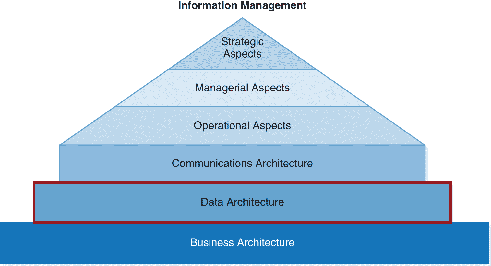

**FIGURE 5-1 信息架构层级**

#### 5.1.1.1 策略与五力模型

要生存，更不用说繁荣，组织必须创造竞争优势。竞争优势是指客户认为组织提供的产品或服务比竞争对手的类似产品更具价值。遗憾的是，竞争优势往往仅短暂，因为竞争对手会寻找复制该优势的方法。因此，组织必须持续采用新策略。当组织率先在市场推出具有竞争优势的产品或服务时，它会获得所谓的首发优势（first-mover advantage）。首发优势是指组织作为市场首个推出有用新颖内容，能够显著影响市场，甚至形成“名牌”。

作为一个例子，FedEx 多年前在开发其客户自助软件时，就创造了许多竞争优势。该软件允许个人和组织在线请求包裹取件、打印邮寄单据并跟踪包裹。其他快递服务，如 UPS，随后推出了自己的软件版本。如今，互联网上的客户自助已成为快递行业开展业务的标准做法。随着组织发展其竞争优势，它们必须通过环境扫描过程密切关注竞争对手。环境扫描包括确定组织外部环境中的竞争格局以及对事件和趋势进行分析。

信息技术有机会在环境扫描中发挥重要作用。例如，作为领先的零食食品提供商，如 Cracker Jacks 和 Cheetos 的 Frito-Lay/PepsiCo 公司，可以利用信息技术来增强其环境扫描能力，从而更好地了解竞争格局和外部趋势。

| 术语 | 定义 |
| --- | --- |
| 六西格玛 | 包含用于测量和实施流程及流程和质量改进的技术和工具。它在本质上是指导性的，明确了需要做什么以及如何做。 |
| `CMM` / `CMMI` | Capability Maturity Model (`CMM`) 包含一套定义组织流程成熟度的标准。它主要是描述性的而非指导性。`CMMI` 在 `CMM` 基础上加入了集成标准。诸如 CMMI Institute® 等专门组织提供针对网络安全的 `CMMI` 标准、培训和审计。 |

战术通常是实现战略的步骤。以国际象棋为类比，战略可能是使用国王的主教控制两条对角线以便攻击中心方格，或使用兵开辟路径让后排的棋子前进并参与争夺中心方格。战术是依据规则的动作，例如某个棋子可以水平移动，或战术可能是将主教移动到活跃的方格。技术运营结合了战略和战术，以确保系统的安全性和功能性持续 (Figure 5.4)。


FIGURE 5-4 Strategy, Tactics, and Operations ¶ © Domin_domin/E+/Getty Images.  

组织拥有主要活动和支持活动。主要活动包括入库物流（输入）、运营（处理）、出库物流（分销）、营销与销售以及服务。这有时被称为价值链。支持活动是协助主要业务活动的活动。例如，医院的主要功能是治疗患者，但健康信息系统是支撑该功能的必要条件。因此，主要活动依赖于技术基础设施。定义技术战略涵盖价值链中的业务和安全流程。业务与安全功能相互支持。安全在系统不可用时毫无意义，事实上，包括拒绝服务在内的攻击类别专门针对扰乱业务。同样，没有良好的安全，业务也无法有效运作。之所以将技术战略整体纳入 `ISML`，是因为这些功能相互依存且相互支撑。


一种制定战略的方法是利用原则框架。原则指导战略，进而决定战术。虽然原则的分类方式多种多样，但最常见的三类是管理原则、供应商原则和系统原则 (Figure 5.5)。管理原则包括领导层愿意接受的风险程度，例如决定延迟安全补丁以保持生产力，反映出一种高风险的管理方式。产品上市时间与开发高质量、富有功能特性的产品之间的权衡，决定了测试和安全流程所投入的努力。管理层是倾向于降低成本来提供低成本商品或服务，还是倾向于生产或交付独特的产品，这可能决定 cybersecurity 纳入其运营成本的程度。

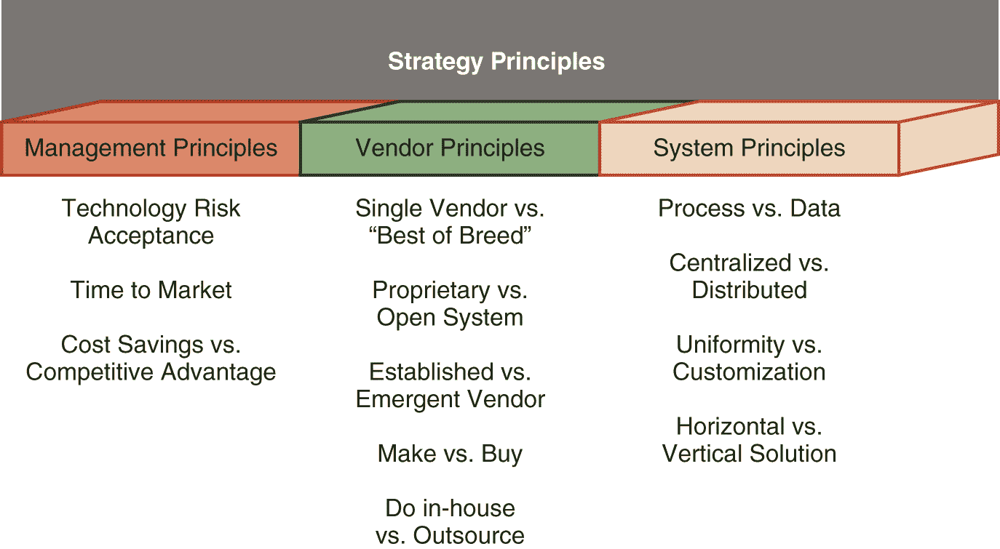

FIGURE 5-5 Principles Framework

供应商原则包括是否采用单一供应商，或购买各类最佳技术，即使这意味着使用多个供应商。公司也可能尝试利用功能丰富、技术支持良好的专有技术，而不是选择需要大量内部开发和支持的开源技术。供应商原则还包括是否与小型新兴供应商合作，这类供应商可能比大型成熟供应商更具创新性，但风险更高；或是选择长期稳定的供应商。此外，还包括是构建技术还是直接购买商业即用型（COTS）产品。

系统原则包括是围绕流程还是数据设计系统，是构建集中式还是分布式解决方案，是构建或购买通用且统一的技术，还是高度定制或可定制的技术。最后，系统原则还包括解决方案是水平贯穿整个组织及其价值链，还是服务于特定垂直方向（如部门或业务职能）。在此，云原生概念尤为重要。云原生是指基于容器的环境，可轻松在本地系统和云端之间迁移。

为了确定我们技术选型的工作原则，可以向相关利益方分发调查问卷。调查采用 1 到 7 分的 Likert 量表，极端端的选项对应不同的原则，例如问题：“是否应利用专有供应商的批量折扣和功能丰富来获取优势”，在端 1，而“应利用开源技术以避免被供应商锁定”在端 7，如 Figure 5.6 所示。

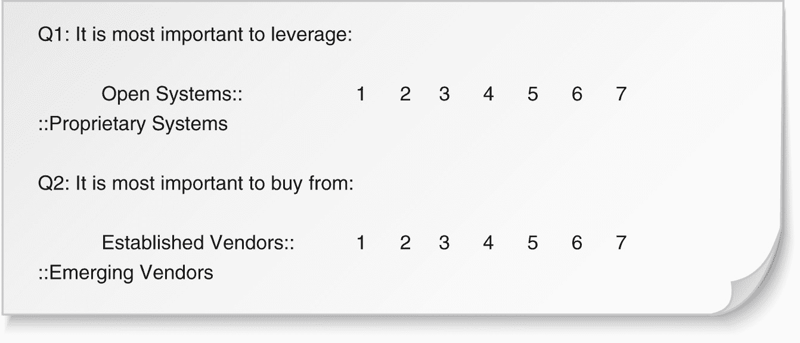

FIGURE 5-6 Sample Survey Question Format

在收集并分析调查后，我们以所有利益方响应的平均分为准，这反映了利益方在该原则上的倾向程度。例如，在“是否构建 (= 1) 或购买 (= 7)”问题中，平均分为 6 表示利益方强烈倾向于购买技术。在评估技术时，我们应将购买权重置于构建之上。因此，当两个同样吸引人的技术方案面前——一个是内部构建，另一个是购买——我们会倾向于购买，但如果是决策者，仍可能选择构建，前提是做好充分的理由支撑。标准差表明利益方的认同程度；若标准差较大，则需要组织利益方讨论，以达成更好共识 (Figure 5.7)。

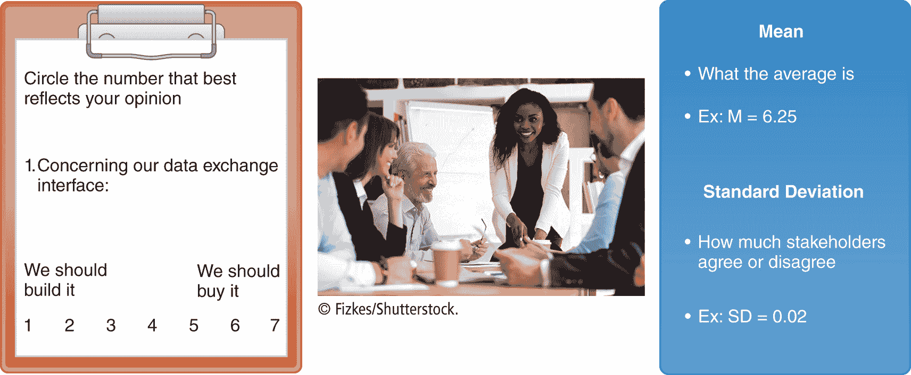

FIGURE 5-7 Principles Survey

### 5.1.2 ISML 与治理框架

一旦信息战略已定义，ISML 将纳入适用治理框架的要求。我们将在后续章节详细讨论众多法规和治理框架；此处仅简要举例。最终，监管和治理要求在 DevSecOps 过程中转化为可执行的任务，供运营和合规部门用于一致性测试和审计。

监管和治理框架近年来有所扩大。由于对重要信息（包括政府实体管理或涉及的信息）的管理不当和疏忽，立法行动和监管控制的数量正在增加，特别是针对组织的治理，尤其是那些涉及或处理政府机构的机构。一些监管措施针对隐私保护，响应范围从能够窃取信用局信息的犯罪前置行动，到丢失含有敏感且未受保护的员工和军事数据的笔记本电脑等案例。因此，治理本质上是组织根据某些标准进行管理的过程。在最正式的意义上，治理通常意味着遵守为机构、行业或组织制定的法规和/或要求。

当美国许多员工被问及工作场所治理时，他们会提到劳工部和职业安全与健康管理局（OSHA）的活动。虽然这些是最显眼的治理实体，但还有许多其他较不人知但同样重要的机构和监管机构，管理者需要了解。管理者需要熟悉的两大领域涉及监管机构用来使某些组织对采取或防止特定行动负责的标准，以及人员政策的制定与执行。例如，2002 年通过的《萨班斯-奥克斯利法案》（SOX）是国会为应对多起公开的企业失败而通过的立法。该法案要求在美国股票交易所上市的所有公司在年度报告中提供其内部财务控制的评估。与大多数法规一样，SOX 多年来已进行多次更新，使合规团队始终保持忙碌。虽然 SOX 仅适用于在美国股票交易所上市的公司，英国通过《公司治理综合代码》实施了类似条款，欧盟则通过巴塞尔 II 指令采取了类似行动，也建议实施内部控制。

这些法规对信息系统的影响在于，必须为处理公司财务信息的系统建立控制措施，这要求公司更加关注存储、处理和传输这些信息的信息系统。虽然这对私营企业而言是一项重大任务，但对美国政府而言影响尤为显著。例如，预算管理办公室（OMB）修订的圆形 A-123 要求联邦机构实施与 SOX 类似的内部控制，而 2001 年国防授权法案中的国家安全信息安全改革部分则帮助协调联邦信息政策与信息安全。

除了涵盖财务控制的法律外，美国、英国和欧盟也制定了多部隐私立法。其中包括美国的格拉姆-布莱伊-利奇法案（GBLA），也称格拉姆-利奇-布莱奇法案，要求金融机构向客户披露其数据共享政策，并禁止出售客户信息；以及美国公平准确信用交易法案（FACTA），要求实施防范身份盗用的措施。英国的《数据保护法》、欧盟的多部隐私保护法规以及加拿大的《个人信息保护和电子文件法案》（PIPEDA）均规定了对个人信息的收集、存储和传输的要求。我们在后续章节还会遇到更多监管和治理框架。

## 5.2 技术管理与治理

如前所述，存在众多国家和国际法规以及各类监管机构。稍后我们将详细探讨这些法规如何融入信息安全管理流程（特别是风险评估与风险管理），以及用于帮助管理者合规以及确保从安全角度实现良好组织管理的标准。在此阶段，我们尝试通过简要讨论管理与治理来搭建两者之间的桥梁。

我们之前定义了治理，并曾经总结组织与管理者的权利与职责。将这两个概念结合起来，可以说管理与治理是运用政策、流程和程序，确保组织依据组织本身及其定义的标准进行运作和绩效，从而保持组织和安全的有效性。了解法律法规如何关联到治理对使用信息系统的组织管理者至关重要。除了我们已讨论的行政特性外，负责、高效且有效地管理人力资源和知识资本也是重要组成部分。换言之，管理与治理旨在满足（或保持在）由法规、法律、指南、最佳实践以及利益相关方提供的伦理建议所设定的控制范围之内。⁶

技术管理需要处理若干活动类别，以实现良好的治理与被治理。这些活动包括进行风险评估；制定风险管理策略与计划；对资产、政策和程序进行审计；对新员工进行背景调查并对现有员工进行绩效评估；编制绩效计划并沟通期望；提供或资助培训与发展；进行系统与网络测试与评估；制定应急与整改计划；确保事件处理、报告及业务连续性的正确执行，以及其他活动。⁸

### 5.2.1 治理与安全计划

我们之前提到，有许多法规和框架用于治理信息相关方面的行为，如员工或客户隐私等。安全标准本身是静止的，只有在管理层实施程序以确保符合这些标准（包括法规和法律）时才会产生作用。为突出这一点，美国《联邦信息安全管理法》（FISMA）曾尝试整合多种安全相关法律和法规。FISMA 正式适用于美国政府机构及其供应商和承包商，但实际情况是，虽然安全标准可能有所差异，进行风险评估、审计、背景调查、安全培训等流程和程序同样适用于大多数组织。

在法律和法规不可忽视且合规性强制的前提下，对非受监管的安全计划也应在信息安全管理生命周期中进行安全设计、实施和检查。例如，生命周期可能包括一个迭代过程：评估业务需求、通过业务流程解决业务需求、将这些流程细化为安全是其中之一的类别，并在安全类别中确定风险/漏洞、确定对策（包括成本及成本‑收益指标）、实施安全控制、评估控制的有效性，然后确定批准和授权，随后流程重复。具体步骤如下：

1. 制定相关的治理标准。
2. 进行风险评估。
3. 对资产、政策和流程进行定期的随机审计。
4. 对新员工持续进行背景调查。
5. 对现有员工持续进行绩效评估。
6. 定期制定绩效计划并传达期望。
7. 提供或充分资助安全及相关法规的培训与发展。
8. 对系统和网络进行定期的随机测试与评估。
9. 制定并更新应急与整改计划。
10. 审查确保事件的正确处理与报告。
11. 编制并审计业务与运营的连续性应急计划。

治理本质上是一个行政过程，但它需要对技术考量有广泛的了解。大体上，若缺乏技术方法来执行和落实，单纯的行政做法大多是无效的。再次强调，政策必须既可执行也必须被执行。可执行性通常是行政层面的考虑，执行则往往（但不总是）是技术层面的考虑。

### 5.2.2 实施安全计划

在 ISML 的初步步骤完成后，持续的评估，包括风险评估和风险管理，会持续进行。由于风险数量众多且复杂，管理者通常会先将风险划分到风险矩阵的象限中，例如在 x 轴上以低、中、高风险为标度，在 y 轴上以低、中、高可能性（或暴露）为标度。这形成了“影响”评估。虽然该过程远未完整展示风险及其影响的范围和程度，但它至少能帮助管理者在众多安全任务中优先确定首先要处理的事项。与问题分析相关的过程，需要考虑以下几个重要目标：

* 问题分析是理解现实问题和用户需求，并提出满足这些需求的解决方案的过程。
* 问题分析的目标是在开发解决方案之前，先更好地了解待解决的目标问题。
* 最终（但不立即）需要确定根本原因——即问题背后的根本问题——以便进行最终解决。

例如，低影响事件可能是机密信息的潜在泄露。为了具体说明，虽然最近斯诺登和维基解密披露美国国家安全局（NSA）的窃听技术可能对美国政府造成尴尬，但该披露本身并未构成灾难性后果，因为美国的敌人早已知晓这些项目。同样，如果员工在社交媒体上发布公司对竞争对手技术优势和劣势的评估，虽会令人担忧，但即使是诽谤性的发布也并非灾难性。对企业而言更为温和的关注点可能是公司网络拓扑的公开披露。表面上看这似乎无害，但实际上会让有经验的黑客节省时间、精力（以及可能的被发现风险）来“踩点”目标站点。高影响事件则是黑客在受 HIPAA 监管的公司中破坏松散保护的数据库，获取患者病历和保险信息，或是国家行为体窃取美国人事管理局（OPM）2014 年安全泄露中全部安全审查背景信息，进而能够在地图上识别全球所有美国情报资产——这已是灾难性！

因此，安全计划必须纳入分层且成比例的对策。联邦信息处理标准（FIPS）建议采用结构化方法进行风险评估与分析；实施访问控制；提供安全意识与技术培训；进行审计并将结果交由负责经理解决；实施配置管理系统；进行应急规划；使用能够实现身份识别、认证和授权的技术；制定事件报告与响应计划；以及建立（除其他）安全泄露的升级程序。

## 5.3 控制框架

在完成初步和基础步骤以制定策略并确定适用的监管与治理标准后，我们需要一个框架（或一组框架）来指导整个 ISML 中的活动。控制框架数量丰富，这里介绍几个常见的框架。我们将重点展开以下几个著名的控制框架缩写：ITIL、ITSM、BS15000、ISO2000x。例如，信息技术服务库（ITIL）是一套在英国开发的信息系统技术管理最佳实践，已获得欧洲和加拿大的广泛支持。信息技术服务管理（ITSM）是一个 IT 管理框架，实现了 ITIL 的各项组成部分。

ITIL/ITSM 的主要目标是使组织能够以最有效、最经济的方式建立并管理其 IT 基础设施。英国标准 BS 15000/ISO 2000x 将这些流程划分为五个领域：发布流程、控制流程、解决流程、关系流程和服务交付流程。这五个领域随后被实施和管理，以提升 IT 交付的效率与效果，方式与 ITSM 相似。下面我们更详细地看这些内容。

### 5.3.1 ITIL / ITSM

ITIL/ITSM 的独特之处在于它专注于将信息技术视为服务。早期的 ITIL 版本将 IT 过程划分为两大大类：服务交付（负责服务管理）和服务支持（负责服务的有效提供）。而版本 3 和 4 则在核心上围绕服务策略展开，服务设计、服务转换、服务运营以及持续服务改进则构成服务生命周期的其余部分：

1. 服务策略——定义谁将获得哪些服务以及服务提供的测量方式。该领域还包括定义所提供服务的价值、识别与服务策略相关的关键成功因素，以及理解执行策略的人员的角色与责任。
2. 服务设计——指定用于实施服务策略的架构、流程和政策，包括要提供的服务目录、服务质量规格、满足服务级别所需的容量和可用性规格，以及连续性和安全管理的规格。服务设计还包括明确的供应商要求规格。设计结果整合为服务设计包（SDP）。
3. 服务过渡——提供实施服务设计包（SDP）所需的资源。这包括变更管理、配置管理、产品发布控制和知识管理，以确保运营提供已知且标准化的服务水平。
4. 服务运营——提供约定的服务水平，处理常规事件以及意外事件和问题。服务运营还包括服务台功能，该功能提供集中化的客户服务，并作为收集和管理当前运营状态相关信息的焦点。
5. 持续服务改进——评估当前运营以寻找改进方法。这包括定义可测量和应测量的内容，收集并分析数据以识别偏离标准的情况或改进机会，并规划和实施相应的变更，这是一个持续的过程。

### 5.3.2 COBIT

另一个流行的框架是控制目标信息技术（COBIT）。与 ITIL 类似，COBIT 定义、识别、组织并关联 IT 活动和资源与业务流程，以确保 IT 资产安全、可验证且在 COBIT 特别强调的可审计性。该框架包含 34 个流程，分为四大主要领域：规划、构建、运行和监控，具体如下：

1. 规划——涵盖从战略计划到战术计划的流程。例如，它建议进行优势、劣势、机会和威胁（SWOT）分析、风险评估和应急预案。
2. 构建——包含安全流程生命周期（ISML），以及材料和需求规划、采购和 requisitions、实施与推出或部署。
3. 运行——如名称所示，涵盖运营和业务处理、服务或产品交付以及支持。
4. 监控——涵盖测量关键成功因素（CSFs）、收集业务对齐指标、问题检测与事件报告，并包括反馈循环。

COBIT 为这些领域提供标准和指导。此外，COBIT 将框架组件划分为带有审计指南和控制实践的控制目标、用于效率和效果的活动目标，以及指示成熟度、绩效和目标达成的具体指标。

### 5.3.3 ISO 27K IT 安全控制选择

在更广泛的 IT 管理背景下，有专门的 IT 安全框架来增强一般性原则，并且它们往往相互协同。其中最受欢迎的是 ISO 27000: 27001/27002（即 17799），国际公认的信息系统安全标准系列。ISO 27000（ISO27K）系列标准提供了指导，说明如何构建信息安全管理系统（ISMS），如何分析风险以确定合适的信息安全控制，以及如何测量和改进 ISMS。它不详细说明具体控制的实现，但通过引用相关标准提供了总体指导。

信息技术行为守则（ISO 27002）针对信息系统安全的“如何”提供具体指导，并分为 11 个章节，广泛涵盖信息安全并提供确保所有信息资产安全的指南和最佳实践，具体包括：

1. 安全策略——该章节旨在为信息安全提供管理层的方向和支持。
2. 信息安全组织——组织安全目标包括在组织内部管理信息安全，并保护组织信息处理设施及第三方访问的信息资产的安全。
3. 资产管理——该章节的目标包括为资产分配责任并依据组织要求建立资产分类。
4. 人力资源安全——该章节涉及雇佣前、期间和结束时的责任。
5. 物理和环境安全——该章节处理与物理区域和设备相关的问题。
6. 通信和运营管理——该章节涵盖操作程序、外包服务交付、系统规划与验收、防范恶意代码、备份、网络安全、介质处理、信息交换、电子商务以及监控等多个方面。
7. 访问控制——该章节包括确定访问业务需求、管理用户、指定用户责任、控制网络、操作系统和应用的访问，以及处理远程办公相关问题。
8. 系统获取、开发和维护——该章节的目标包括在获取或开发过程中早期指定安全需求，确保应用的正确功能需求，实施加密控制、文件安全以及技术漏洞管理。
9. 事件管理——该章节规定了事件报告和管理的要求。
10. 业务连续性管理——该章节专注于业务活动中断的问题。
11. 合规——该章节涵盖确保符合法律要求、遵循安全政策和标准以及应对 IT 安全审计过程。

虽然 ISO 27702 提供控制，但 ISO 27001 信息安全管理体系要求提供一种系统且明确的安全管理方法，并为组织提供认证其符合安全标准的途径。

### 5.3.4 NIST 800-53

另一个流行的框架是《联邦信息系统安全建议控制》（Recommended Security Controls for Federal Information Systems），亦称为美国国家标准技术研究院（NIST）特刊 800-53。该框架提供信息系统安全管理和控制选择的具体指导。NIST SP 800-53 基于联邦信息处理标准（FIPS）199，对联邦信息和信息系统的安全分类进行定义。它旨在为实施 FIPS 200——联邦信息和信息系统最低安全要求的组织提供指导。NIST 800-53 将安全控制分为 3 类并关联 17 个控制家族，并为建立不同控制组提供指导。示例可见于 表 5.1。

**表 5-1 NIST 800-53 类别与控制家族**

| 类别 | 控制家族 | 标识符 |
| --- | --- | --- |
| 管理 | 风险评估 | RA |
| 管理 | 规划 | PL |

# 第 6 章 评估威胁和漏洞

© Antishock/Shutterstock

一些在社交媒体网站 FriendFinder™ 上注册的人员在得知存在安全漏洞时感到不适，黑客从多个数据库中窃取了他们的姓名、密码、电子邮件地址和其他信息。黑客发现了一个加密函数的缺陷，该函数将输入转换为称为“消息摘要”的值，使用一种称为“散列”的技术。FriendFinder 使用了弱 SHA-1 散列算法以及本地文件包含（LFI）漏洞。一些脚本语言（如 PHP）允许将文件包含到脚本中执行，攻击者利用此功能通过 URL 从远程位置和服务器获取数据或执行脚本片段。声称责任的黑客开始利用此漏洞进行勒索，并在暗网论坛上发布数十万条记录作为盗窃的证明，许多记录被暗网论坛成员出售，并用于各种诈骗和垃圾邮件。泄露可能不仅成本高昂，而且令人尴尬。此外，许多人通过在社交媒体上发布照片或评论，或在其他方式中使自己陷入尴尬的境地，这些内容他们无法撤回。

你是否曾经使用过一个应用而不阅读政策或考虑风险？大多数人都有。

## 6.1 威胁分类和基础设施


早前，我们介绍了一些广泛的攻击类别，以及重要概念，如攻击向量和攻击面。本章必须进一步探讨基础设施和系统工作原理，并结合一些一般性威胁分类，为前文奠定基础。换句话说，我们将在此深入探讨，并在查看森林和树木之前介绍一些更多概念。

不可能涵盖所有威胁和对策，但我们可以解释各种威胁类型并提供一些示例。威胁主要分为四类：(1) 通过使系统不可用（如通过针对服务器操作系统的恶意软件或勒索软件攻击，或发起分布式拒绝服务攻击）来中断业务或服务；(2) 伪装或冒充合法或真实用户，例如窃取登录凭据；(3) 使用中间人攻击拦截通信；(4) 修改，数据可能在传输过程中或存储设备上被篡改（Figure 6.1）。

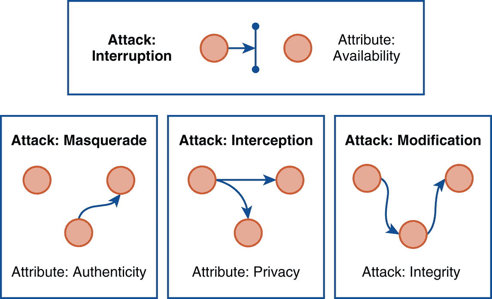

FIGURE 6-1 Attack Architecture

特定攻击会有特定的应对协议，但威胁的一般`分类`具有通用的应对措施。对于服务中断攻击，我们会使用高可用性系统和架构，例如带有过滤路由器的故障转移和热备系统等反制措施。针对拦截攻击通常涉及密码学、虚拟专用网络（VPN）等。对于伪装和修改类型的攻击，我们会使用密码学、多因素认证、扫描仪和入侵检测系统（IDS），以及基于角色的访问控制（RBACs）控制信息或其他资源的访问技术。RBACs 使用设备、软件、规则和访问控制列表来允许或禁止用户，并在用户通过认证后确定该用户在受控设备上可以执行的操作，如读取、写入和执行（参见 [Figure 6.2）。当然，这些是通用措施。通用的威胁分类适用于几乎所有基础设施；然而，具体攻击取决于针对的设备、应用程序或通信方式。为了进行风险分析，我们需要清点基础设施，以确保覆盖所有暴露点、攻击面和漏洞。让我们更仔细地审视基础设施，看看我们需要清点哪些内容以进行分析。

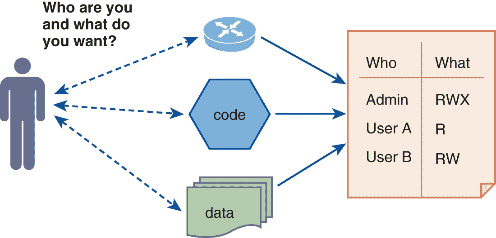

FIGURE 6-2 Access Control Lists

### 6.1.1 Internet of Things (IoT)

不久将来，我们将介绍一些与信息和网络安全相关的计算基础设施技术，无论是本地部署还是云端。首先，需要意识到我们通过网络连接的所有计算设备都模糊了本地和云的界限。因此，在深入之前，让我们更详细地讨论之前介绍的更广泛的配置概念。请回顾，互联网最初是政府资助的 1970 年代的项目，1980 年代演变为高级研究计划局网络（ARPANET）。这一发明是基于传输控制协议/互联网协议（`TCP/IP`）协议套件以及路由协议的包交换网络，其最初的实现仅用于在研究人员之间发送电子消息。到 1990 年代，蒂姆·伯纳斯-李（Tim Berners-Lee）创建了 `HTTP` 协议和第一个浏览器，这使得万维网得以实现。

除了我们通常在计算基础设施中考虑的客户端和服务器之外，智能设备、高速光纤网络、5G 设备以及今天的互联网能力，甚至几十年前都难以想象。计算基础设施还包括 GPS、被动和主动射频识别（RFID）、蓝牙、Wi‑Fi、流媒体设备、游戏和增强现实应用、虚拟现实系统、即时通讯、视频会议、社交媒体及其各种形式（如 Facebook®、Twitter®、Snapchat®、LinkedIn®、Pinterest®、Instagram®），低功耗信标和传感器、软件代理、交通和安防摄像头、Alexa®、自动驾驶车辆，以及其他。由此可见，技术基础设施的范围远不止服务器和客户端，还包括所有利用互联网或其他网络进行通信或完成功能的应用程序和服务。我们统称为物联网（`IoT`）。

安全需求在形式和实质上因所考虑的系统、网络、基础设施或其他 IoT 而异，但总体上需要考虑六个方面：(1) 结合设备的能力与限制的网络安全（例如，移动电话的内存容量与游戏系统的差异）；(2) IoT 设备、平台和应用的可靠性与可用性（例如，通过高可用性技术实现按需可用性）；(3) 设备间的标准化或互操作性（例如 Android 与 iOS 的差异）；(4) 隐私，例如笔记本电脑和手机摄像头的访问与使用，或 IoT 提供商对个人信息的收集与分发；(5) 符合政策（如 BYOD 政策）、程序（如资产标记）和法规（如可存储的数据类型及格式）；以及 (6) 法律（如知识产权考量）。

### 6.1.2 Cloud Computing

使用自己的数据中心、 colocations 或备用站点的替代方案是利用外包的计算设施和运营。20 世纪 90 年代初，应用服务提供商（ASP）开创了这一模式，但由于缺乏将关键系统和数据交付给第三方的信任、频繁的服务质量问题以及其他问题，它们很快失宠并基本消失了一段时间。如今，围绕这一主题的变体出现了，被称为云计算，或简称“云”。云之所以得以实现，是因为其关键组件——虚拟化程序（hypervisors，也称虚拟机监视器），它们管理虚拟基础设施和虚拟实例，例如创建和关闭虚拟计算和存储实例。`Hyper-V` 是其中一种虚拟化程序，被 `Microsoft Azure` 云（以及其他云）所使用。

虚拟机是一个在系统或容器内自包含的系统。两种常见的虚拟机是 `VMWare`® 和 `VirtualBox`®，但还有许多其他的。这些虚拟系统允许在特定主机计算系统上安装不同操作系统的环境；例如，可以在 `Windows` 主机上创建一个自包含的 `Linux` 系统，而无需进行特殊分区或引导管理器的设置，这与以前的做法不同。通过创建虚拟服务器和虚拟客户端，任何客户端无论其原生操作系统如何，都可以向用户提供用户界面和自包含的应用程序。此外，这些虚拟操作系统可以克隆，因此如果一个被损坏或配置改变，管理员只需删除并覆盖一个新的即可。

云计算相较于传统 ASP 方式的一个优势是，公司可以继续开发和“运营”自己的应用程序，而其他人负责维护基础设施。另外，许多云服务提供商（包括 Amazon Web Services，`AWS`）采用“共享安全模型”，安全责任分工在公司与云提供商之间进行划分。另一个考量是，原本在自有数据中心中的固定成本会转变为变动成本，有时难以预测，甚至可能诱导人們倾向于“省下成本”。

云计算是一个不断演进的术语，因为用于云计算的技术仍在不断演进。国家标准与技术管理局（NIST）¹ 定义云计算为：一种提供便捷、按需网络访问共享可配置计算资源池（例如网络、服务器、存储、应用程序和服务）的模式，这些资源可以快速配置和释放，管理努力或服务提供商交互极少。云模型促进了可用性，并由五个基本特征组成：² (1) 按需服务，即系统和网络的使用是按需提供的，(2) 无论平台和地理位置如何，都可 ubiquitous access（普遍访问），(3) 资源共享，允许以更经济的方式交付服务，(4) 弹性，意味着计算和通信可以根据需求进行扩展，(5) 可预测性，即由于资源可扩展，服务交付的可预测性高于预先配置的情况。

云计算的基本架构基于三种计算资源利用方式，即所谓的服务模型。¹ 它们是 (1) 软件即服务（`SaaS`），它使客户能够“租用”基础设施来运行应用程序；(2) 平台即服务（`PaaS`），它允许客户在提供商“租用”的计算设施上部署自己的应用程序；以及 (3) 基础设施即服务（`IaaS`），它允许客户处理、存储数据、配置网络，并部署和运行系统和应用程序。`IaaS` 与 `PaaS` 的区别在于，客户对操作系统、存储、部署的应用程序以及部分网络组件（如主机防火墙）拥有控制权。换句话说，它在某种程度上是 `SaaS` 与 `PaaS` 之间的混合体。⁴ 虽然最初定义的基本“即服务”模型已经确立，但它们正在扩展为各种“即服务”形式，例如容器即服务（`CaaS`），它以使代码和/或基础设施的组合便于跨平台移植并提供标准化的上传、配置、启动、停止、扩展和管理容器环境的方式虚拟化这些内容。`Docker`® 是一个流行的容器，`Kubernetes`® 是用于管理容器化应用程序的流行容器编排系统（Figure 6.3）。

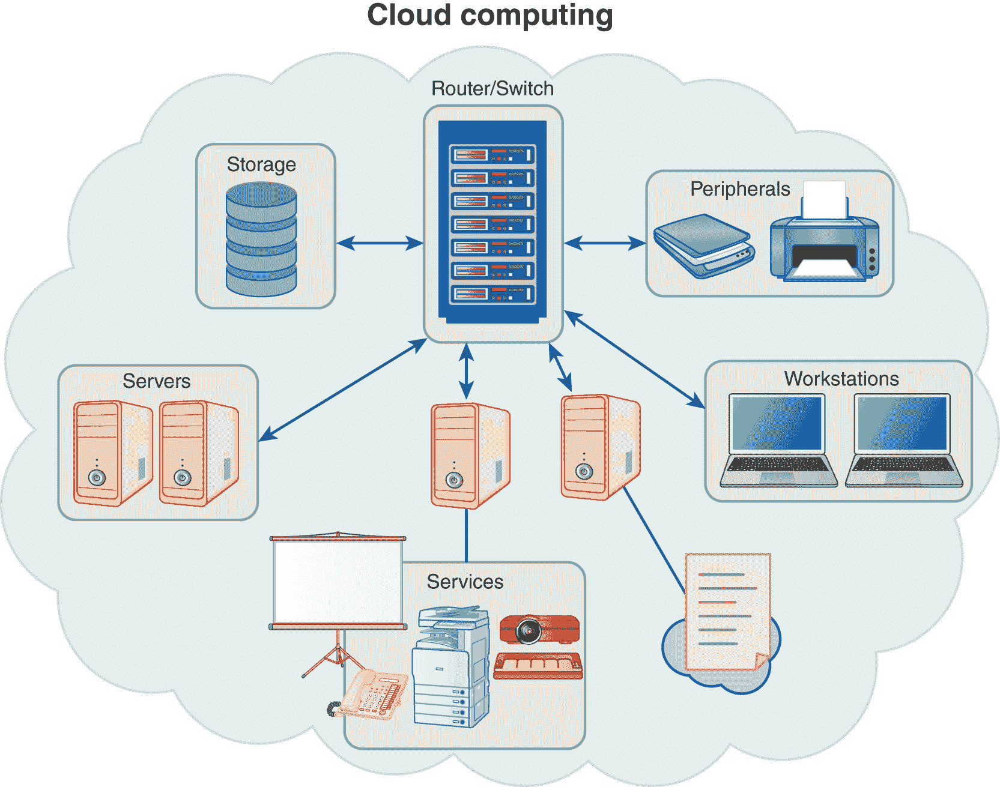

FIGURE 6-3 Cloud as Shared Third-Party Infrastructure

尽管使用这些设施可以提高资源利用率并更好地支持质量服务（QoS），但它们也带来安全和隐私问题，尤其是在多租户配置中。⁵ 根据最近的一项 Forrester 研究调查，51% 的小企业参与者表示，安全和隐私问题是他们不使用云服务的首要原因。隐私问题涉及提供商如何利用公司信息的方式。例如，像 Google 这样的提供商明确表示在其政策中会收集数据用于消费者画像和营销目的。此外，尽管提供商声称因资源共享而拥有更高的可用性，但许多技术管理者仍担心提供商无法兑现承诺——这与许多旧 ASP 提供商的情况类似。最后，一些技术管理者对数据丢失或泄露表示担忧。几起高调的泄露事件加剧了这些担忧。在开发解决方案之前，理解这些问题和权衡至关重要。

### 6.1.3 服务器和主机计算机

当人们想到信息系统时，通常会联想到服务器和主机计算机。然而，信息系统（IS）实际上涵盖所有组织信息基础设施，包括网络、文档的纸质副本、服务器机房以及甚至物理存储金库。服务器和主机计算机构担负了大多数组织的计算平台的主体，同时还包括连接它们的网络以及用于操作的软件应用程序和数据库。除了帮助企业在全球市场中有效运营外，管理者还必须同时考虑保护系统和信息以防止泄露或损坏的实际可行性。对于许多技术管理者而言，安全可能被视为业务成本的超支，但实际上安全的概念类似于质量——虽然这些措施并不直接影响财务底线（除非产生负面的财务支出），但糟糕的安全，正如糟糕的质量一样，会间接甚至直接地影响底线。例如，考虑品牌声誉因质量问题受损，或信用局发生重大安全泄露导致客户信任丧失。但情况更为严重，因为在网络安全事件中，还可能涉及诉讼和处罚。

如今，信息和通信系统可以从全球任何地方受到攻击，这有时使技术管理者几乎没有或完全没有应对手段，除非他们先进行良好的规划并随后采取相应的行动。虽然信息技术可以被不道德地使用或用于可疑目的，但这些技术本身是中性的，也就是说，是否将它们用于善意或恶意目的取决于使用技术的人。在管理者能够保护其信息基础设施之前，他们必须首先理解这些技术是如何工作的，至少在高层面上。这意味着在我们真正能够欣赏每项安全关注的技术组件之前，需要先建立一些基础。

#### 6.1.3.1 操作系统

文章开头我们提到，要充分理解本材料（尤其是网络安全），需要对操作系统（如 `Windows`、`Linux` 或 `macOS`）有一定经验，最好是三者都有。虽然在实现层面上，Unix、`Linux`、`macOS` 和 `Windows` 操作系统有所不同，但它们的功能是相同的。我们将介绍这些功能，以便在讨论针对它们的威胁、漏洞以及技术问题和缓解措施时，能够产生理解。例如，了解恶意软件如何导致栈溢出或缓冲区溢出以及应对措施至关重要。

总体而言，操作系统可以被视为编程代码和数据结构的集合。编程代码通常使用低级语言（如 `C/C++` 和汇编语言）编写。大多数操作系统是事件驱动的，这意味着当用户在键盘上输入内容或点击鼠标时，当内存中的存储位置被填满，或当运行队列中的程序准备好由 CPU 执行时，软件（或固件）会生成信号，中断 CPU 以切换功能。由于多个用户同时使用计算机，且多个程序同时在同一台机器上运行，这些事件的协调和程序执行由一组子系统负责。首先，提到操作系统时，通常指的是内核或核心功能，但许多支持系统使用或被内核使用，例如设备驱动、shell（命令行界面）和图形用户界面。下面列出了一些操作系统的主要功能。

内存管理负责处理数据结构并管理可用的 RAM。数据结构仅仅是存储在特定内存地址中的包含数值的数据或变量。内存管理必须确保正确的数据存储在正确的位置，且未引用（已释放）的数据段被返回以供其他进程重新使用。内存管理还尝试将所有进程和线程及其数据结构加载到 RAM 中，因为所有进程及其数据结构都必须驻留在内存中才能由 CPU 执行。对于进程，有两类数据结构：用户数据结构（具体为用户结构）和内核数据结构（例如，`proc` 结构）。用户数据结构包含进程使用的信息，如打开文件的索引和描述符以及其权限。内核数据结构是操作系统用于检索和执行进程所需的内容。

进程管理由多个内核子系统处理，包括调度器，它从运行队列中取出可运行的进程，并在一段时间内（称为时间片或量子）将它们切换到 CPU 进行执行。一个程序进程在内存中分为四个主要逻辑段：(1) 程序文本段，(2) 数据段，(3) 堆空间，和 (4) 栈段。用户结构包含关于进程状态的系统信息，如挂起的系统调用和打开及正在访问的文件。文本段包含程序的代码部分。数据段分为两个子组：用于未初始化数据（如全局和未初始化的静态变量）的 BSS（块存储段），以及用于初始化数据的段。堆用于动态分配未初始化数据。栈用于自动变量和函数参数。这些段从逻辑分组中分解为由内核的虚拟内存管理子系统（Figure 6.4）管理的虚拟地址分组。

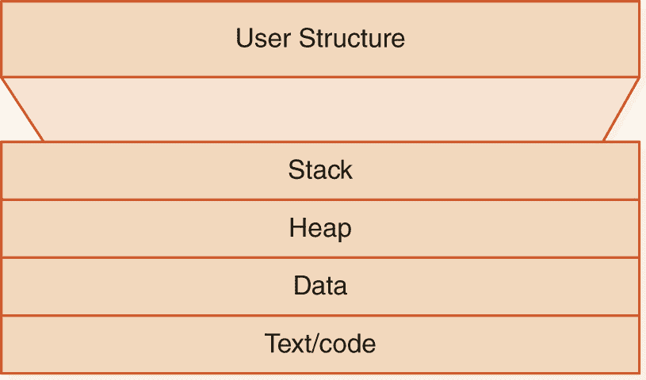

FIGURE 6-4 Memory Segmentation and Data Structures for a Process

许多进程共享文本，意味着它们同时与其他进程共享同一段文本区域。文本可以被视为可执行形式的编程代码，以及启动其执行所需的“即时”数据。共享文本程序的例子包括 shell（或命令行编辑器）、图形用户界面和编译器。例如，当命令行编辑器被调用时，其文本区域与系统上运行的其他编辑器相同，因此程序在逻辑上可能包含文本段，尽管物理上它们位于不同的地址空间。换句话说，进程可以在相同的虚拟地址集合中共享（驻留），但不共享相同的物理地址。进程及其数据结构在等待 CPU 分配时间片时会在各种队列（如运行队列）中挂起（闲置）。调度器按优先级扫描运行队列中的可运行进程，并将它们切换到 CPU 执行。如果在该等待状态下 RAM 内存已满，用户数据结构（除文本数据结构外）可以移动到磁盘的交换分区，而进程的内核数据结构（以及文本结构）则保留在内存中，以便供分页/交换进程（或 `Windows` 的调度器）在调度器请求进程执行时定位并检索从交换分区的用户数据结构。

| Virtual Memory | 一种内存寻址技术，用于将 RAM 中的数据映射到持久存储（如磁盘或固态存储）上，以扩展数据和进程超出 RAM 限制的能力。 |
| Data Structures | 关联数据的组，例如用于连接文件中散布在磁盘物理位置的所有数据的指针链表。 |
| Kernel | 操作系统的核心功能。内核由图形用户界面、编译器、设备驱动、以及其他非内核软件和固件等子系统使用，这些子系统对于使系统完全功能化是必需的。 |

文件系统管理持久存储介质（如磁盘驱动器）上的存储空间的分配与释放。数据在特定设备上如何存储被称为文件结构，它具有物理结构和逻辑结构。文件结构的物理部分决定了代表数据的位在存储介质（如磁盘驱动器）上的排列方式，这主要由设备的硬件（和固件）控制器管理；逻辑结构则决定了数据的维护、访问和向用户呈现方式，主要由软件设备驱动程序管理。

输入/输出（I/O）处理是所有在设备之间传输数据位的设施，包括网络和网络协议栈的支持。大体上，I/O 指的是在进程和设备之间传输分组数据位，但分组大小取决于所使用的硬件。这些子系统还处理进程间通信（IPC），其中一个可执行文件可以与另一个可执行文件共享或传递数据（如参数）。I/O 相关的数据结构很多，例如打开文件表，其中包含访问底层文件对象所需的文件描述符。文件系统和 I/O 子系统的部分组件部分包含在用户数据结构中，部分由内核维护，且进程间传递的数据必须在处理前保存。

`Windows` 操作系统还有一个我们在介绍各种漏洞如何发生之前需要提及的阿喀琉斯之踵：`Windows` 注册表。`Windows` 注册表是一个配置数据库，用于维护系统上应用程序、用户和硬件的信息。注册表使用注册表键（称为 `HKEY`）来表示数据库中的条目。每个组件都有 `HKEY` 条目，列在根节点（如 `HKEY_LOCAL_MACHINE`）下，这是本地系统配置组件的根。配置管理器是 `Windows` 执行体的一部分，负责维护注册表。从设备驱动到用户应用程序，所有软件都使用注册表来定位可执行文件、协调进程间通信，并跟踪诸如用户偏好等信息。注册表提供了一个便捷的集中式配置信息存储，但它也是 `Windows` 主机电脑威胁的主要来源。

#### 6.1.3.2 Database Systems

软件应用程序大多会导致数据的创建和/或消费。如果我们需要在应用程序之间存储数据，最合适的形式是数据库系统或数据库管理系统（DBMS），用于管理同时访问共享数据。大多数现代数据库系统今天都是关系型的，但也存在层次型、面向对象、NoSQL、语义和图形数据库等其他类型。当数据存储到数据库时，我们称之为持久化。

关系型数据库系统（RDB）通过关系型数据库管理系统组织数据，将数据存储在包含键的表中，因此索引始终与跨表关联的数据保持耦合。RDB 中的表通过主键和外键相互连接。这些键构成了数据关系的链接，确保数据保持一致。当需要从数据库查询中重构与交易相关的数据集合（例如提取发票支付信息）时，需要一种称为“连接”（join）的过程，该过程汇集所有相关表中的标准，生成结果集或视图，并将其返回给发起查询的软件应用程序。

数据仓库和数据湖在某些方面与 RDB 相似，但它们更多用于分析过程而非事务处理，因此其数据结构（或更准确地说是无结构）持久化，并以不同于关系型数据库系统的方式检索。此外，还有 NoSQL 数据库，适用于无结构数据、图像和文档，以及图数据库，用于存储所谓的边（edges）、属性、标签或标签以及节点（nodes）等关系；语义数据库存储所谓的三元组（triples），即主-谓词-客体关系。尽管如此，所有这些系统都使用某种形式的结构化查询语言。例如，`SPARQL` 用于语义数据库，用于存储和检索主-谓词-客体三元组术语。我们稍后将讨论 SQL 注入攻击，以及其他数据库攻击，如 `Windows` 开放数据连接性（`ODBC`）连接窃取和连接池损坏。`ODBC` 是一个用于访问数据库的开放标准应用程序编程接口（API），而连接池是一个缓存数据库连接的池，供多个进程重用，以提高访问性能。

### 6.1.4 网络


在本文开头，正如我们在操作系统（OSs）部分所指出的，要充分理解我们讨论的概念，需要一定的 TCP/IP 网络知识，甚至更需要理解网络安全的威胁和对策。基于此，我们来介绍一些网络概念和问题。维护计算机系统的安全是一回事，但通常当它们连接到网络时，复杂性（以及安全风险）会呈指数级增长。国际标准化组织（ISO）于 1977 年成立一个委员会，用于开发名为开放系统互连（OSI）的网络规范。第一个草案于 1984 年完成，但从未完全实现，因此传输控制协议/互联网协议（TCP/IP）套件取代了 OSI。然而，OSI 仍作为协议功能的参考模型。

ISO/OSI 模型提供了七层，用于描述网络协议栈中的数据流。模型顶部是应用层（Application Layer），包含面向用户程序的协议，例如电子邮件客户端（如 Outlook）。模型底部是物理层（Physical Layer），代表网络介质，例如铜缆或光纤电缆，用于建立计算机之间的实际连接，或在 Wi-Fi 或蜂窝网络的情况下，代表空中波。层级架构的核心理念是“分治法”。将数据从一台计算机传输到另一台计算机是一个非常复杂的问题，通过将这一巨大任务分解为较小的功能，我们可以更仔细地审视每个任务，并制定相对明确的解决方案。

层级方法还允许标准化接口，因为任务被精确定义，当应用程序在一台计算机向另一台计算机发送信息时，数据会在发送计算机的协议栈中向下传递，跨越网络，然后在接收计算机的协议栈中向上传递。在发送计算机上，数据在构建、封装并沿协议栈传递时会附加头部信息。头部包含诸如发送和接收计算机的地址、加密方法等信息，这些信息可用于接收计算机正确识别数据来源并解包、排序和解释消息。

正如所述，ISO/OSI 规范主要作为参考模型而非实际网络实现，因此 TCP/IP 已成为从局域网（LAN）到互联网的事实标准。TCP/IP 之所以演变，是因为需求和技术发展超过了 OSI 标准的制定速度。虽然 OSI 和 TCP/IP 模型共享许多特点，但也存在大量差异。例如，TCP/IP 将 OSI 多个顶层合并为一层。

### 6.1.4.1 互联网规范

尽管互联网有时被视为一种无控制的模糊云，但为这一重要资源提供治理的尝试层出不穷，关键实体仍然大多是松散的联盟。不过，一个有影响力的组织是 Internet Architecture Board（IAB）。该组织于 1983 年成立，旨在促进重要技术进步并确保 Internet 标准的广泛可用性。负责研究推广的 IAB 子组是 Internet Research Task Force（IRTF），而 Internet Engineering Steering Group（IESG）是 IETF 的一个子组，负责审查和选择 Internet 标准。希望提交 Internet 标准建议的人可以通过向 steering group 发送提案来进行。这些提案被称为 Internet drafts。 steering group 定期召开会议，审查提案的技术和其他优点。大多数提案未被纳入正式标准，而是进入“暂不发布”类别。被 steering group 采纳的提案则被正式认可，并分配 RFC（Request for Comments）编号。虽然 Internet 标准众多，但大多数 RFC 都是对现有标准的更新或修订。

如前所述，OSI 参考模型和 TCP/IP 协议都采用层级（或栈）方式。顶层应用层是用户最熟悉的部分，因为其主要功能是为用户交互提供界面。电子邮件、数据库、文件传输（如 FTP）和浏览器等应用程序都是利用应用层的例子。下一层是表示层（Presentation Layer），它是网络数据处理的关键点，如数据压缩和应用层加密过程。我们可以将其视为包装层。当两台计算机通信时，需要建立某种连接，即所谓的会话。会话层协议的例子包括 IBM 开发的 NetBIOS，它旨在为独立计算机提供基础网络能力，以及远程过程调用（RPCs），使客户端计算机能够调用服务器计算机上的程序。传输层负责为会话传输和交付数据。粗略地说，有两种数据传输方式：TCP 提供可靠连接，而用户数据报协议（UDP）是一种尽力而为的传输系统。例如，聊天程序需要“可靠连接”，以确保两个聊天客户端之间的通信能够无缝交替。

网络层负责在网络中路由数据。路由是通过最佳可用路径将数据包发送到目的地址。在传输层和网络层处理多路复用问题。多路复用是通过单条线路或连接发送多种类型的数据或信号的能力，这提高了数据通信的效率。数据链路层涉及如何识别系统之间的物理连接以及与它们相关的信息，并通过物理介质（有线、光纤或无线）进行通信（`Figure 6.5`）。

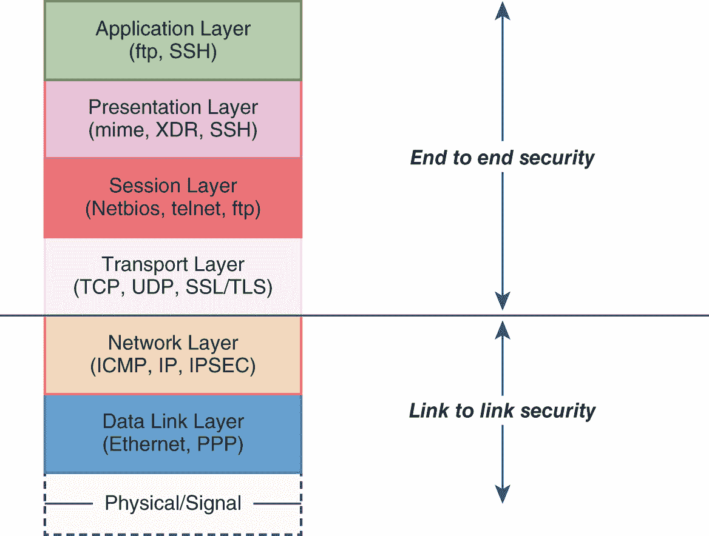

FIGURE 6-5 Network Protocol Stack

### 6.1.4.2 Internetworking

互联网由大量使用称为路由器的计算机的互连组成。路由器通常使用 TCP/IP 来在系统之间传输各种数据包（也称为数据报）。它还包括 Telnet、FTP（文件传输协议）、DHCP（动态主机配置协议）和 DNS（域名服务）等网络应用。这些都是 TCP/IP 协议套件中包含的程序或协议，或是支持该套件的程序和协议。Web 只是 Internet 的使用方式，具体指在 Internet 协议栈的其他网络层之上逻辑上位于这些层的技术集合，例如使用 HTTP（超文本传输协议）。虽然这些协议最为人熟知，但还有其他网络协议，如异步传输模式（ATM）、光纤分布式数据互连（FDDI）、X.25 和帧中继（Frame Relay）。

网络协议由 RFC（请求评论）标准定义，如前所述。例如，RFC 822 定义了电子邮件的消息格式。RFC 规范规定了各种协议的工作方式，使每个协议拥有明确的接口和行为，从而实现全球互连。TCP/IP 定义了一组用于在网络上通信的协议，而以太网（Ethernet）是一种 governs 计算机如何物理连接以及如何通过有线或无线介质传输数据的介质。自 1970 年代开发以来，以太网技术多年来不断演进，为大多数高性能网络系统提供基础，尤其是在局域网中。

以太网的主要竞争对手是异步传输模式（ATM）。ATM 之所以具备强大吸引力，是因为它是一种面向电路的、基于单元的技术，能够对不同类型的传输（如数据、语音、视频）进行优先级和保证交付。由于视频对网络延迟（时延）非常敏感，这导致在大型媒体组织中出现了一些初始部署。此外，ATM 最初为所有类型的流量提供比以太网更高的带宽。在许多政府和电信组织中，ATM 仍因其面向电路的、面向连接的可靠交付以及强大的安全功能而在特定 segment 中继续使用；然而，商业组织中对 ATM 的兴趣已大幅下降。

### 6.1.4.3 Distributed Systems

如今，大多数应用都是分布式的。分布式系统是运行在多台通过网络连接的计算机上以完成业务功能或事务的应用。常见的分布式系统例子是大型商业企业（如 `Amazon.com`）的网站。假设我想在线购买一本文字，我访问名为 `www.mybooks.com` 的网站进行购买。这本文字不太可能位于公司维护的某个仓库中。相反，公司可能充当出版商的电子商店前端。`mybooks.com` 系统会与各个出版商系统通信，按需下单。同样，也不太可能由单台计算机处理我的交易。更有可能的是 `mybooks.com` 拥有众多处理客户请求的计算机。

一个常见的分布式系统设计是 n‑tier 配置。这意味着多台服务器在水平和垂直方向上相互连接。该设计通过使用模型‑视图‑控制器（MVC）或模型‑2（`Figure 6.6`）等软件设计模式实现。以我们的网站类比，水平连接的服务器是一组负责处理大量想要访问 `mybooks.com` 网站用户的 Web 服务器，它们负责信息的展示和用户交互。这些前端服务器随后通过网络连接到中间层系统，处理业务逻辑，例如向书籍供应商下单或计算运费。中间层服务器通过 API 和网络与交易伙伴以及数据库服务器相连，数据库服务器可能存储目录和客户信息。

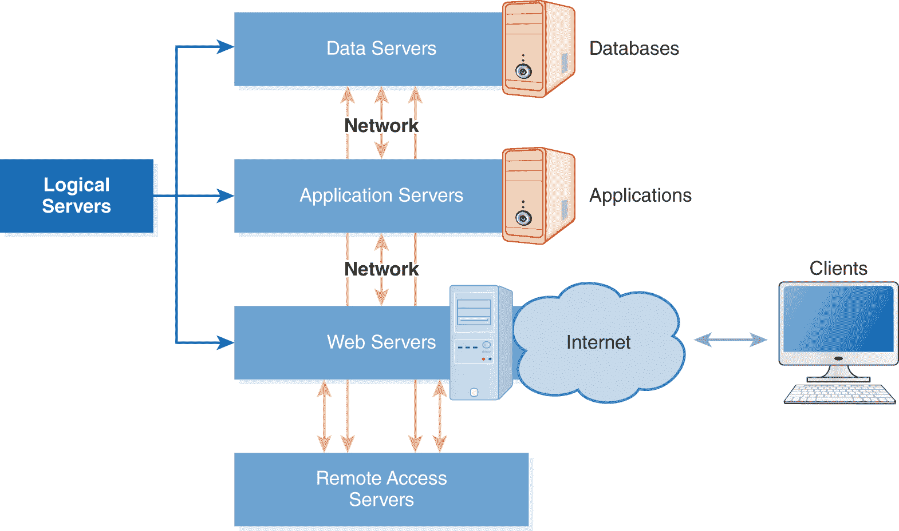

FIGURE 6-6 n-Tier Architecture using MVC Design Pattern

“n‑tier” 表示公司可以在每个水平层放置大量服务器。随着业务增长，`mybooks.com` 可以根据需求在需要的地方增加服务器；例如，如果出现大量想购买书籍或音乐的新用户，可在前端层增添一台服务器；如果新增大量供应商，可在中间层增添一台服务器；随着数据存储增长，可在数据库层增添服务器。层级分离有助于提升可扩展性和安全性。

分布式系统中使用的部分技术紧密耦合，即它们在需要程序通过标准接口协作并共享组件的技术中实现。例如，对象请求代理（ORB）有三大主要实现：(1) 基于对象管理组（OMG）的公共对象请求代理架构 — CORBA；(2) 微软的分布式组件对象模型 — DCOM；(3) Sun Microsystems/Oracle 的远程方法调用 — RMI。使用这些分布式技术时，程序员编写接口，接口包含数据定义和类型，以及分布式程序预期发送和接收的函数名称。程序员还需生成称为桩（stubs）和骨架（skeletons）的连接组件，安装在客户端和服务器上，以告知分布式程序如何定位和相互通信。

与上述“紧耦合”方式的替代方案是所谓的面向服务架构（SOA）。传统上，SOA 被描述为能够松耦合不同系统的信息并通过代理结构提供服务的能力。为了具体说明这一抽象概念，我们从一个问题开始：如果一个计算机系统需要与网络云中的其他系统进行业务交易，却没有事先了解对方系统或通信安排，该怎么办？例如，假设我们向汽车车主提供保险经纪服务，需要从所有独立的保险承保商处获取报价以比较价格。我们首先需要找到这些承保商的 Web 服务，然后确定如何与它们交互，最后确保传输的安全性。

## 6.1.5 编程语言和资源文件

高级语言通常分为解释型和编译型语言。编译型语言包括 COBOL、Pascal、“C” 和 C++。解释型语言包括 Python 和 JavaScript（以及其变体，如 Angular.js），还有混合型语言，如 Java 和 Visual Basic.NET。所有这些都被认为是“高级”语言，因为它们的程序指令是人类构造的源代码形式。源代码必须转换为计算机操作系统能够理解的可执行文件。对于编译型语言，编译器会完成这种转换，并结合链接器/加载器，将其他代码函数或对象的库加载进来。这在编程逻辑的最低层由汇编器进一步处理，汇编器由 0 和 1 的组合（即机器语言）构成，最终生成可执行文件。可执行的机器代码可以加载到内存中，并由 CPU 在另一个程序的请求下或用户发起时运行。

正如您可能想象的那样，编译型和解释型程序在转换方式上存在差异。解释型代码由解释程序逐行解析并实时执行。例如，脚本（如 JavaScript 及其变体）由浏览器解释执行。混合型语言（如 Java）既使用编译器也使用解释器。其主要目标是：编译器将源代码转换为中间（字节）代码，该代码在运行时由解释器执行。这种设计实现了跨操作系统的语言可移植性，并且执行速度快于纯解释型代码。资源文件包括 JavaScript Object Notation（JSON）和 Yet Another Markup Language（YAML）。JSON 是一类具有定义语法的文本文件，用于在应用程序和自动化工具之间定义、存储和传输数据。YAML 也是一种具有定义语法的文本文件，常用于定义应用程序和自动化工具的配置，并且是 JSON 的超集。虽然还有其他资源文件格式，但它们的共同属性是允许人们在可读的文本文件中定义和声明资源，这些文件可以被其他应用程序进行操作。

## 6.1.6 RDF 和本体标记语言

W3C 标准组织开展了一项重新组织网络信息的革命性工作，并提出了“语义化网络”（Semantic Web）的概念。语义是指一类从 XML 演进而来的技术，旨在提供更丰富、更具上下文信息的数据，从而增强人类从信息中获取意义的能力。因此，一种称为资源描述框架（RDF）的标记语言被开发，以在 Web 系统中提供更强的关联性（语义）。换言之，RDF 基于层次结构的 XML，但通过扩展标记来更好地利用元数据（关于数据），形成文档之间的关系。它可以被视为一种关系型的 XML 形式。

例如，使用搜索引擎技术，如果我们要撰写一篇研究论文，可能会先使用关键词对主题进行搜索。典型的搜索引擎会在元数据中查找关键词或关键词组合、交叉链接以及其他线索，以匹配相关内容，然后返回包含大量链接的列表，其中很多可能不相关。相反，RDF 通过内部定义的文档间关系（通过嵌入的统一资源标识符 URI）来实现，文档间的关系以三元组（主体、谓词、宾语）的形式表达。通过 RDF 语句，我可以在三个独立但相互关联或链接的 RDF 文档中进行断言：

1. Michael 是一名大学教授。
   1. 大学教授进行研究和教学。
   2. 大学教授向社区提供学术服务。
2. Michael 进行信息安全的研究和教学，面向管理人员。
   1. 教学在校园和线上均开展。
   2. 教学包括网络安全培训、实验室和模拟。
       1. 培训是传授重要知识的过程。
       2. 实验室是基于已学应用进行实践的活动。
       3. 模拟是具有学习目标的在线游戏类型。
3. Michael 在 Harrington Building 拥有一个办公室。
   1. Harrington Building 位于德克萨斯 A&M 大学的校园内。
   2. 德克萨斯 A&M 大学位于美国得州的 College Station。

除 RDF 标记的关联性之外，本体已发展起来以组织相关信息的集合，并提供带有上下文的语义规则，如这两句话之间的区别： “向人群招手” 与 “让我们顺着下一波浪潮”。虽然本体和本体标记超出了本文的范围，因为它们需要深入理解编程概念，但我们在此简要提及，因为随着技术的发展，技术管理者需要考虑其安全性。在本文的语境下，本体是特定知识领域中受控词汇表，为表示概念、属性和允许的值提供结构。正如所述，本体使用标记语言创建，文档通过 URI 相互链接。URI 与 URL 相似，因为它们用于浏览器查找网页，但也存在细微差别——特别是，URI 不仅限于网页，还包括其他媒体形式。

因为本体语言基于 RDF，本体语言包含所有 RDF 特性。正如 RDF 那样，本体定义中的谓词部分是资源的属性类型，可以是属性、关系或特性，而对象则是特定主体的资源属性类型的值。然而，尽管 RDF 允许 URI 链接，这些链接是基于关系结构的，但本体网语言（OWL）和带有本体推理层（DAML+OIL）的 DARPA 代理标记语言使用 RDF 来形成面向对象的标记，用于组织相关信息实体的集合。本体语言因此建立规则并启用继承特性，使构造体能够形成超类‑子类关系。例如，可以表示一个不相交的关系，使得 `A` 是 `B`，`C` 是 `B`，但 `A` 不是 `C`；例如，狗是动物，猫是动物，但狗不是猫。在随后的 DAML+OIL 标记中，我们可以断言类 `Female` 是 `Animal` 的子类，但 `Female` 不是 `Male`，尽管 `Male` 也是 `Animal` 的子类：

![D A M L and O I L markup code that asserts in an expression that a class Female is a subclass of Animal, but a Female is not a Male even though Male is also a subclass of Animal. Program code follows. Line 1: Left single angle bracket, d a m l, colon, Class, r d f colon, I D, equals, left double quotation mark, Female, right double quotation mark, right single angle bracket. Line 2, indented once: Left single angle bracket, r d f s, colon, sub Class Of, r d f, colon, resource, equals, left double quotation mark, hash, Animal, right double quotation mark, forward slash, right single angle bracket. Line 3, indented once: Left single angle bracket, d a m l, colon, disjoint With, r d f, colon, resource, equals, left double quotation mark, hash, Male, right double quotation mark, forward slash, right single angle bracket. Line 4: Left single angle bracket, forward slash, d a m l, colon, Class, right single angle bracket.](img/9781284211658_CH06_CE001.jpg)

## 6.1.7 Active Semantic Systems

没有某种方式来聚集并利用本体中存储的信息，这些本体将只是被动的数据仓库，或更具体地说是数据集市。尽管它们主要是未区分且非规范化的数据快照，但与数据仓库一样，统计程序可以相对高效地从中挖掘模式，以便进行未来预测。本体则因为是需要先解析的文本文档才能进行挖掘，或在在线分析处理（OLAP）中生成有意义的多维视图，因而效率较低。

好消息是，近年来出现了若干技术来解决这一问题，其中一些正处于开发临界阶段。为了构建更智能的系统，我们需要一种更主动的查询手段，例如能够遍历 URI 并对其“学习”内容的机器人或爬虫。这些最先进的技术被称为目标导向的代理。例如，IBM 的 Aglets 以及基于开源 Cougaar 框架开发的代理在功能范围上差异很大。


简单的实用代理（或机器人）的能力仅限于类似于网络搜索引擎的功能。聊天机器人稍微复杂一些。然而，目标导向的代理能够收集信息并通过机器学习进行评估。它们可以做出一些推断，判断当前状态与目标状态之间的偏差，并向其运行的系统发起请求。因此，随着语义技术的发展，功能性与安全性之间存在经典的权衡。为了缓解，代理通常在沙箱或自包区域（如某公司的本体）中工作，并采用认证等多种安全技术。

机器学习和人工智能正在利用代理及其框架，这将在后文中讨论。

### 6.1.8 Agent Frameworks and Semantic Fusion

代理框架属于执行“语义融合”的系统类别，这种融合提供了一种与以往系统不同的服务广告和发现方式。语义融合和代理框架使用户能够在特定上下文中通过指定参数和编写脚本，在庞大的 URI 链接集合中查找相关信息，因为这些信息通常是巨大的存储库。通过使用语义持久化引擎，本体可以被存储为主体‑谓词‑对象的三元组，或在前述提到的三元存储中。该架构使得机器学习、推理和其他分析能够快速、即时地进行。

在当代系统中，信息通常从环境中抽取并存入数据仓库，随后使用各种分析手段进行模式发现，但大量重要信息在数据被抽取到封闭系统时已发生变化。这种封闭系统的静态模型在模式发现上本质上受限。

此外，数据仓库分析的用户必须提供问题的上下文。以网络为类比，用户必须“驱动”辅助技术（如爬虫或机器人）来寻找信息。这在广泛认可的局限性。

具体而言，网络充斥大量电子文本、视频和图像。当我们寻找感兴趣的内容时，除非有人提供包含相关材料的通用资源定位器（URL）链接，否则我们只能依赖搜索引擎聚合可能相关的文档链接。随后我们从搜索结果中开始“狩猎”，浏览链接以寻找匹配项。即使我们最初认为某页相关，继续阅读后可能发现它并非所求。这与在电脑上查找文档时使用 `grep`/`find` 或搜索工具的问题相似。 wouldn't it be nice if there were a different document indexing and organization method that would let you find what you are looking for faster and in a more automated way?

通过语义融合、广告和本体发现，模型是使用代理来完成的。代理类似于网页爬虫或机器人，但拥有更强的推断能力。例如，它们可以在获取信息时即时评估。根据角色的不同，代理有多种类型。中间代理充当中介或经纪人，在本体之间流动信息，帮助定位并连接信息提供者与请求者，并基于描述发现本体模型和服务。复杂的分布式多代理系统中有多种有用的中间代理类型。

其他类型的代理包括匹配者。它们不参与代理之间的通信过程；相反，它们将服务请求与服务或信息的广告进行匹配，并将结果返回给请求者。因此，匹配者代理（也称为黄页代理）促进服务提供。

还有黑板代理，它们收集请求，以及经纪代理，它们协调提供者和消费者的过程。

因此，智能代理具备一种能力，使软件能够“理解”网页内容，并提供一个环境，让软件代理可以在页面之间漫游并代表用户执行复杂任务，包括推理和发起请求。例如，借助这项新技术，我们可以通过一个网站进行广告宣传，该网站名为 `We-Provide-Air-Transportation`。代理可以在各个航空公司网站之间搜索这些语义关系，并执行诸如向航空公司网站发送 `Mike-Wants-to-Make-a-Reservation` 并提供 `Amount-Mike-Will-Pay` 的任务。

## 6.2 Threats and Vulnerabilities

由于互联网和网络现象，你无疑已经意识到新术语如“博客”、“发推”、“潜伏”、“钓鱼”和“制造混乱”已进入日常用语。我们许多人曾在讨论论坛、聊天室或像 `Facebook®` 和 `YouTube®` 等社交网络站点或其他虚拟社区中在线参与。我们大多数人曾收到过某种形式的病毒式营销，也曾在某个时刻成为电子邮件钓鱼诈骗、木马病毒或间谍软件以及跟踪 Cookie 安装在我们电脑上的受害者。

当代社会正围绕技术中介的交互方式形成，在线交易数量不断增加，虚拟社区正取代面对面（亲近）的交流。例如，远程教育、在线购物、在线银行、远程医疗和虚拟娱乐。所有这些“在线”活动都会与未知的中间方和终点产生交互。有些情况下，访问虚拟社区对商业目的很有用，例如在 `Microsoft®` 或 `Oracle®` 网站上搜索技术问题的答案；但其他情况下，虚拟社区构成威胁——不仅仅是浪费公司时间（这常被提及），而且许多虚拟社区是病毒、蠕虫的来源，以及散布误导信息以损害公司或个人（如假新闻、信息操纵运动）。今天，我们大多数人已经知道这些安全威胁，但应对它们是技术管理者的职责之一。

有几个来源可以查找威胁和漏洞的记录。开放式 Web 应用安全项目（`OWASP`）提供了关于主要网络攻击类别（如跨站脚本和 SQL 注入）以及缓解或修复这些攻击的方法的信息。开源漏洞数据库（`OSVDB`）提供了常见漏洞的目录，并与通用漏洞和暴露（`CVE`）数据库相连。`CVE` 也很有趣，因为它可以导入到网络安全工具中。此外，还有美国-`CERT` 和 `SANS` 研究所的关键漏洞分析量表（`CVAS`），它们提供关键指标，如影响程度和风险评分，以及推荐的对策。此外，还有大量威胁和漏洞数据库及网页；难点在于有时间去吸收并理解这些内容。

### 6.2.1 Mobility and Threats

无线局域网（`Wi-Fi`）通过红外线或射频信号连接电脑和智能手机，使我们在移动时仍能保持与电信和服务器的连接。与此同时，移动技术正变得更加高级，已超越电子邮件、短信和语音通信，扩展到网页浏览、运行各种软件应用，以及拍照、录像、下载和观看内容。新技术不断涌现，其使用速度往往超过保护用户的方式。例如，`Bluetooth` 从无线耳机扩展到手机，进一步提供诸如虚拟键盘等有趣的应用，该键盘利用激光在表面上投射出类似键盘的显示，并能感知用户手指的位置，以捕捉输入动作，仿佛在使用实体键盘。可以想象许多潜在的利用这些新技术的方式，例如捕获无线通信、拍摄人们的行为，或捕获其电子输入（可能包括使用受害者用户名和密码登录系统）。大多数人都知道保护信息和资产的重要性，并知道通过各种技术手段保护隐私，但有些安全方面超出了个人的控制范围。

基本安全技术，如防火墙、加密和认证软件，以及防病毒和防间谍软件扫描工具，是防御组合的重要部分；然而，尽管有大量安全控制手段可以帮助维护信息安全，人们往往并不使用它们。例如，虽然人们可以采取诸如限制社交媒体隐私设置或使用加密等措施，但这些功能往往不便于操作，并且被“便利性”功能所掩盖。此外，仍然存在一些“街头”威胁难以防范——例如，通过视频或无线捕获人们的输入或在线活动；此外，企业也可能收集信息并与他人共享。例如，最近的发现显示，智能手机结合 `GPS` 功能、在线地图和卫星照片，能够在特定时间点精确定位我们的位置，这催生了一种新型的“窥视者”，并引发更令人担忧的行为，如将网络跟踪与实物跟踪相结合。

移动设备和社交媒体可成为信息窃贼通过社交身份进行信息收集的来源。身份窃贼可能通过我们在 `Facebook` 或 `Twitter` 等平台上发布的内容获取个人信息，也可能利用家谱、DNA 或家谱数据库，在其中找到如母亲婚前姓等信息，或用于生物特征的基因标记，这些标记可能被植入许多认证协议中。整套个人信息可在聊天室中匿名出售。许多公司也雇佣远程工作者和跨国的虚拟团队。在大多数情况下，虚拟工作者获得公司所有的电脑设备和软件，并持有文档、数据及其他可能为专有或保密的信息。因此，虚拟工作需要考虑如何控制网络资源的访问权限，包括虚拟工作者机器上本地的资源以及其可能访问的公司内部资源。此外，许多公司正将业务的部分外包。医疗记录、税务记录等信息可能流向受不同法律和实践管辖的外国，从而产生新的机遇和风险。

信息可以通过互联网和万维网轻松在众多计算机之间、在大距离上传播和检索。保护信息必须考虑到中间机器的众多，例如在进行在线银行交易时，介于我们的台式机、笔记本电脑或智能手机与银行系统之间。即使使用加密的 `HTTPS/SSL` 密码，某些通过互联网和万维网传输的信息仍可能被像 `Cain and Abel`、`Achilles` 或流量分析工具拦截并解密。

如果我们使用银行的 IP 地址，并在 `UNIX/Linux` 命令行提示符下输入 `traceroute` 命令（在 `Microsoft Windows` 中使用 `tracert`），我们就能了解一些中间接收数据包信息的目标。如果我们 `ping` 银行系统，可能会收到包含 IP 地址、字节数、毫秒级时间以及丢包统计等回复。这些数据包在大陆传输的速度惊人。信息可能只需几毫秒，就能在经过多个系统的多次跳转后，从我们这里传输到目的地。丢失的包是被丢弃了吗？还是被拦截并未转发？

Web 应用——部分原因是其普及——是攻击的特别诱人目标，并且在 Web 应用或事务中存在多个可被攻击的点。应用的客户端易受脚本攻击，尤其是当使用客户端验证时。Web 服务器也存在可被利用的漏洞，不同的 Web 服务器具有不同的漏洞，传输本身可能受到窃听（中间人）或 SSL 重定向的攻击，数据库也可能通过 Web 应用的 SQL 注入和查询操纵受到攻击。

许多（如果不是大多数）我们读到的网络威胁主要讨论的是来自互联网的访问。然而，在内部 LAN 上也存在显著的威胁。`TCP/IP` 是广播系统，技术会将信息分发到网络上所有主机。那些并非预期接收信息的主机被假设为“行为良好”并会丢弃它们意外接收的信息。因此，在 LAN（正如在 WAN 中）存在许多 unintended 信息接收者，可以通过 `Wireshark®` 或 `Pineapple®` 等技术轻易捕获。同样，`Wi-Fi` 和有线调制解调器等技术允许系统通过数字有线电视接入互联网，但有线调制解调器的共享总线覆盖范围广阔（如社区），而 `Wi-Fi` 则在空中。由于这些系统的共享总线特性，它们也容易受到中间人攻击或数据包嗅探。此外，恶意的网络代理可能利用未受保护的服务（如 Windows 共享）进行攻击。

### 6.2.3 Security Countermeasures and Unintended Consequences

许多安全漏洞源于违背资产合法使用政策的行为。加密是防止网络安全漏洞的主要对策，同时也用于计算机安全，如身份验证和保护文件系统中的数据。加密是使用秘密密钥和混淆算法（密码）对信息进行混淆，以防止未经授权的访问。加密技术的日益普及对于保护消费者和企业免受电子商务中的间谍、盗窃和欺诈至关重要。虽然加密的各种实现是维护网络安全的主要机制，但它也可能带来自身的问题。由于加密对信息进行混淆，恶意或非法材料（如儿童色情、海关违规、武器或毒品交易、间谍活动、挪用公款、妨碍司法、逃税、恐怖主义）也可以被加密。因此，许多政府对加密强度以及某些加密算法的出口设置了限制。此外，分布式计算的特性会在密钥管理方面带来各种问题。正如本章后面将讨论的那样，无论是公钥加密还是私钥加密，必须妥善保管并确保每位通信伙伴的私钥安全。

显然，我们正在经历每个分布式系统复杂度的指数级增长，导致可被利用的漏洞点数量随系统和应用数量的增多而同步增加。此外，分布式网络信息系统不仅增加了安全复杂性，还使得发现许多安全漏洞变得困难，甚至不可能。这很重要，因为只有在拥有足够的防范、检测以及从攻击中恢复的能力时，网络或系统才能被相对安全。这里的“足够”在管理层面意味着，安全措施的价值应与网络资产和责任的价值相匹配，并对感知的威胁强度进行适当权衡。系统必须由其看护者 vigilantly（持续）监控，但系统越复杂，监控任务就越困难。

## 6.3 Broad Attack Classifications and Examples

现在我们已经覆盖了一些重要的信息技术和系统主题，接下来将深入探讨四类威胁分类：（1）可用性（中断），（2）真实性（伪装），（3）隐私/保密性（截获），以及（4）完整性（修改）。我们也将简要说明一些攻击向量的类型，其中一些向量可能同时影响多个威胁分类。例如，恶意软件既可能中断应用程序或操作系统服务，也可能修改或破坏重要数据和文件。总体而言，攻击可以分为主动攻击和被动攻击，尽管许多攻击同时使用两者。

攻击者的典型场景是先进行侦察（或足迹）阶段，在此期间，攻击者试图了解目标信息系统的结构。随后，攻击者可能会扫描暴露或网关系统和路由器，以确定可以利用的漏洞。下一步可能是枚举，即提取导出的信息，如主机记录或服务仓库及其服务描述（包括连接/绑定信息）。攻击者通常会尝试通过利用漏洞来获取访问权限或将恶意程序传入目标。如果攻击成功，攻击者可能会提升权限（常用 `rootkit`），以获得系统的管理控制权。随后，攻击者可能会留下后门以便将来再利用，并尝试掩盖自己的踪迹，使得攻击成功后不易被发现。

| Active Attack | A type of attack that is not hidden and is sometimes conducted without concern for detection until after the “damage” has been done. Active attacks include those that deface websites, try to disrupt a service, such as a distributed denial of service (`DDoS`) attack, port flood, half-open connection attack, and those that modify or destroy data/information, such as ransomware, or malware that burdens a system’s CPU, memory, service, or application processing. |

| Passive Attack | Group of attacks designed to go undetected, such as packet interception. These often are attacks against authenticity (such as impersonation or password decryption) and confidentiality/privacy. These mainly attempt to steal valuable information. |

| Rootkit | A set of technologies that help an attacker escalate his/her privileges to perform controlled functions, such as calling device driver subroutines or accessing kernel memory and data structures. |

| Threat | A threat represents how vulnerabilities might be exploited to compromise security. Threats come from both humans and natural disasters. |

进入 `/path/to/xxx` 目录，查找 `xxx.json`。

在表达式 `cvar = avar + bvar` 中，加号 (`+`) 将 `avar` 和 `bvar` 相加，得到它们的和 `cvar`。

在 `List.of(arg0, arg1, arg2)` 中，`List` 接口的 `of()` 方法接受一系列元素，并返回包含这些元素的不可变列表。

接下来，我们以此方式调用 `cmd` 命令：`cmd arg0 arg1 arg2`。

```
if (condVar > someVal) {console.log("xxx")}
```


![The code for a subroutine in C programming language that destroys space on a disk drive at a given location. Program code follows. Line 1: Forward slash, asterisk, Subroutine in C, a routine to destroy space on a disk drive at a give. Line 2: location, asterisk, forward slash. Line 3: wipe data, left parenthesis, start Here, right parenthesis, left brace. Line 4, indented once: i n t, start Here, semicolon. Line 5, indented twice: if, left parenthesis, target, dot, place, equals, equals, start Here, right parenthesis, left brace. Line 6, indented twice: target, dot, place, equals, 0, semicolon, forward slash, asterisk, move to target location on disk with l seek, asterisk, forward slash. Line 7, indented twice: l seek, left parenthesis, p a g f, comma, left parenthesis, long, right parenthesis, b l k n o, asterisk, size of, left parenthesis, PAYLOAD, right parenthesis, comma, 0, right parenthesis, semicolon, forward slash, asterisk, target location, asterisk, forward slash. Line 8, indented twice: write, left parenthesis, p a g f, comma, ampersand, target, comma, size of, left parenthesis, short, right parenthesis, right parenthesis, semicolon, forward slash, asterisk, write what you want to the disk, asterisk, forward slash. Line 9, indented twice: return, left parenthesis, 1, right parenthesis, semicolon. Line 10, indented twice: Right brace. Line 11, indented once: return, left parenthesis, 0, right parenthesis, semicolon. Line 12, indented once: Right brace.](img/9781284211658_CH06_CE002.jpg)

`Buffers` are storage spaces for I/O data. Code not that different from the previous example can easily fill up `buffer` storage to cause an overflow. The `stack` is a section of memory where a program’s temporary variables declared by a function are kept. Variables in the `stack` have been declared, but they are not initialized until the program executes at runtime. The `heap` consists of memory used by programs to store global variable values. Because OSs perform all the key functions such as memory management, if an attacker can inject a malware into the system, it can corrupt data, such as noted earlier. It may be done to cause disruption, or it can be engineered to do other things, such as gather and send the target’s data to the attacker.

Common scenarios involving information integrity attacks come from executable files passed through web sessions, such as malicious executable code encapsulated in Microsoft’s `ActiveX` controls, or malicious scripting (such as written in `JavaScript`, `Python`, or `PHP`), or from a `SQL Injection`, where an attacker is able to intercept the code that stores information in a database, for example, by manipulating parameters passed over a URL during a web session. Along these lines, let’s consider an SQL Injection attack and remediation before summarizing some important others.

An SQL Injection is an attack in which a malicious user is able to manipulate the SQL statements that the application sends to the backend database server for execution. A successful SQL Injection exposes the data from the database. The following is an example using the `Java` programming language. `Java` has what is known as a `Statement` and a `PreparedStatement` which execute SQL. If the statement is executable using direct input from the client, an SQL Injection is possible. For example, the method `request.getParameter()` is used to get client input. If the website developer implemented the server-side code for a login screen, then SQL could be inserted and then executed. The example code that follows allows the server to collect the parameters first and then build them into a SQL Statement, rather than taking the input directly from the client. Additional checking could be done in this routine to validate the input as well. Note, `//` are comments in `Java`:

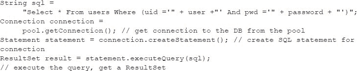

Now suppose the attacker entered a valid login username (e.g., `validuser`) and the following SQL for the password: `' Or 1=1)#`. This statement is always evaluated as true (`1=1`), and as a result, the system may render information such as a user list to the attacker. This is because the SQL code that was executed states:

![Java programming code that executes SQL statements. Program code follows. Line 1: String sql, equals. Line 2, indented once: Left double quotation mark, Select, asterisk, From users where, left parenthesis, uid, equals, left single quotes, left double quotation mark, plus, user, plus, right double quotation mark, right single quotes, And, pwd, equals, left single quotes, right double quotation mark, plus, password, plus, right double quotation mark, right single quotes, right parenthesis, right double quotation mark, semicolon. Line 3: Connection, connection, equals. Line 4, indented once: pool, dot, get Connection, left parenthesis, right parenthesis, semicolon, forward slash, forward slash, get connection to the DB from the pool. Line 5: Statement, statement, equals, connection, dot, create Statement, left parenthesis, right parenthesis, semicolon, forward slash, forward slash, create SQL statement for. Line 6: connection. Line 7: Result Set, result, equals, statement, dot, execute Query, left parenthesis, sql, right parenthesis, semicolon. Line 8: Forward slash, forward slash, execute the query, get a Result Set.](img/9781284211658_CH06_CE004.jpg)

The `#` character is a comment for some database SQL such as `MySQL`. Placing it at the end of the statement causes everything to the right of the `#` to be commented out, including the extra `' and)` characters. Because the SQL is valid and the statement is always true, the query will produce a result, the list of users in this case. So, what does it mean to remediate? The way this is remediated is to parameterize and check the user's input on the server side before issuing the SQL query. This is done using a `PreparedStatement` and parameters collected in question marks, which are then checked and controlled before executing the SQL query, as follows:

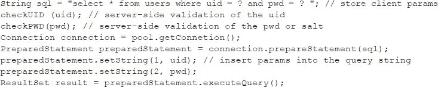

Attacks aimed at disrupting the availability of systems or services include denial of service (DoS) attacks, where an attacker may send large groups of data to a service or send data to a service faster than the service can process. To do this, the attacker may generate large volumes of stateless packets using the `UDP` protocol to consume network bandwidth and interfere with services, or the attacker may try to flood a network with network packets using the `Internet Control Message Protocol` (ICMP), or generate larger packets than a network router can handle (an example is called the ping of death), or create a problem on a host server called a half-open connection by manipulating the TCP three-way-handshake such that it cannot close the connection. Although most routers are configured to simply drop these packets, and modern servers close half-open connections after a very short interval, sometimes so many of them may occur in succession that on occasion these kinds of attacks succeed.

Another type of DoS attack can come from the anonymous use of the file transfer protocol (FTP), that is, if anonymous FTPs are allowed on a server, in which case, a malicious hacker may upload a program that consumes the computer’s disk space. The attacker may try a lockout. Because many systems utilize a login rule that locks a user out after a certain number of invalid login attempts, an attacker can exploit this security feature by continuously generating bad logins until the victim is “locked out” of his or her account.

- 其他报告的事件包括恶意内部人员实施企业间谍行为、破坏设备或肢体攻击他人的情况。还有涉及勒索的事件，攻击者威胁要在博客或网站（如维基百科）上发布或公开损害或甚至是虚假的公司信息，除非采取行动或支付金钱。例如，一家大型计算机硬件和软件供应商的员工编写了一个程序，未经授权访问管理层的个人绩效和薪资文件，然后在匿名公共讨论论坛中泄露了信息，因为他觉得老板对他的回报不足。

- 另一种常见的威胁来自窃取信息或资产的内部人员，例如他们擅自使用的软件（即软件盗版，softlifting），在办公室破坏产品许可协议，或将产品带离办公室用于个人用途。现在，让我们先看一些威胁定义，再继续讨论。


## Command Injection / 命令注入
命令注入是恶意用户通过执行操作系统命令的漏洞。此类攻击还可能伴随工具，例如 HAK-5 的 BASH Bunny，它可以在受害者的电脑上隐蔽安装 shell。当应用程序以不安全的方式将用户提供的数据（如表单、Cookie、HTTP 头）传递给系统命令时，命令注入攻击得以实现。

## Session Fixation and Session Hijacking / 会话固定和会话劫持
会话固定是一种漏洞，表现为应用程序在从预登录状态切换到后登录状态时未能正确更新会话令牌。由于此弱点，CHAP 身份验证协议被弃用。预登录会话令牌不应在后登录时使用，否则攻击者可能窃取合法用户的已验证会话。当用户会话被盗时，称为会话劫持。

## XXE Injection / XXE 注入
XML 外部实体（XXE）注入是一种漏洞，攻击者可针对配置不当的 XML 解析器（通常是 SAX 或 DOM）进行攻击。恶意的外部实体引用可导致攻击者未经授权读取运行在服务器上的 XML 解析器所能访问的敏感文件，也可用于制造拒绝服务（DoS）攻击。

## Persistent XSS / 持久性 XSS
持久性 XSS 是一种漏洞，攻击者诱骗 Web 应用将攻击者提供的脚本代码存储下来，然后该代码会被送给其他用户浏览该应用。攻击者提供的脚本在其他用户的客户端系统上运行。该漏洞广泛存在，影响那些使用未经验证的用户输入生成未编码的应用输出的 Web 应用。

## Reflected XSS / 反射型 XSS
与持久性 XSS 不同，反射型跨站脚本（XSS）中攻击者提供的脚本代码不会被存储在应用程序内部。相反，攻击者会创建一个恶意请求，使应用返回一个包含攻击者提供脚本代码的单一 HTTP 响应。要成功，攻击者需要受害者点击一个精心制作的链接。

## Insufficiently Random Values / 不足随机性值
当应用程序在需要高度随机性的关键代码区域生成可预测的值时，会出现不足随机性的漏洞。这可能使攻击者预测应用程序生成的下一个值，从而绕过加密例程、获取敏感信息或冒充其他用户。之所以是问题，是因为计算机生成的是伪随机数而非真正的随机数。例如，考虑下面的 C++ 程序：

1. ![The resulting S Q L code that is read by a Java program once it contains S Q L injection code. Program code follows. Line 1: Select, asterisk, left parenthesis, everything, right parenthesis, From users Where, left parenthesis, u i d, equals, left single quotes, valid user, right single quotes, And p w d, equals, left single quotes, character space, right single quotes, Or, 1 equals, 1, hash.2. 你可能会期待 rand() 会生成真正的随机数，但实际上它生成了下面的内容： ![Java code that remediates S Q L injection. Program code follows. Line 1: String, s q l, equals, select, asterisk, from, users, where, u i d, equals, question mark, and, p w d, equals, question mark, right double quotation mark, semicolon, forward slash, forward slash, store client params. Line 2: check U I D, left parenthesis, u i d, right parenthesis, semicolon, forward slash, forward slash, server-side validation of the u i d. Line 3: check P W D, left parenthesis, p w d, right parenthesis, semicolon, server-side validation of the p w d or salt. Line 4: Connection, connection, equals, pool, dot, get Connection, left parenthesis, right parenthesis, semicolon. Line 5: Prepared Statement, prepared Statement, equals, connection, dot, prepare Statement, left parenthesis, s q l, right parenthesis, semicolon. Line 6: Prepared Statement, dot, set String, left parenthesis, 1, comma, u i d, right parenthesis, forward slash, forward slash, insert params into the query string. Line 7: Prepared Statement, dot, set String, left parenthesis, 2, comma, p w d, right parenthesis, semicolon. Line 8: Result Set, result, equals, prepared Statement, dot, execute Query, left parenthesis, right parenthesis, semicolon.](img/9781284211658_CH06_CE007.jpg)

3. 查看第一列的数字以获取提示，这些数字很容易发现；你是否还能看到其他模式？程序可以在不到一秒的时间内找到这些模式。

## DOM XSS / 基于 DOM 的 XSS
基于文档对象模型（DOM）的 XSS 是一种攻击，攻击者通过修改受害者浏览器的 DOM 环境来执行 payload，使客户端代码的行为与预期不同。换句话说，HTTP 响应本身（即页面）并未改变，但页面中的客户端代码因被注入到 DOM 环境中的恶意修改而执行不同。

## Directory Path Traversal / 目录路径遍历
这是一种漏洞，允许攻击者访问超出 Web 根目录的目录和文件。它出现在应用程序因用户提供的输入而进行不安全的文件引用时。经典例子是利用 `../`（点点斜杠）序列及其变体操纵文件路径，从而访问服务器文件系统中的任意文件和目录，如源代码、密码文件或其他敏感数据。

## Yielding Raw Errors / 直接抛出原始错误
当程序员未能妥善处理输入错误并返回经过脱敏处理的页面时，会出现直接抛出原始错误。原始信息可能会向攻击者泄露重要信息，例如使用的数据库类型和 SQL 版本、以及承载请求的 Web 服务器类型和版本（如 Apache）。你可能见过类似“Ooops, Error 500” 的页面，伴随其他信息甚至 SQL 语句；这正是此类情况的例子。

## Authentication Credentials in URLs / URL 中的身份验证凭证
当程序员使用 URL 重写或编码来管理会话或传递身份验证凭证时，会出现此漏洞。将信息暴露在 URL 中并用于控制，使其易受篡改。

## Insecure Logging / 不安全的日志记录
不安全的日志记录是一种漏洞，表现为应用程序被配置为将敏感数据（如个人可识别信息、支付卡信息或身份验证凭证）写入日志文件。此外，如果应用程序未能正确验证用户提供的输入并将其存储在日志中，攻击者可能篡改日志文件本身。

- [剩余的调试代码和后门](https://wiki.example.org/leftover_debug_code_and_backdoors) 的灵感源于开发人员可能留下的调试或测试代码后门，这些代码本不应随生产代码一起发布或部署。当调试代码留在应用程序中时，它会暴露于意外的交互模式。这些后门入口构成安全风险，因为它们在设计或测试时未被考虑，且超出了应用程序的预期运行条件。其他调试代码，包括注释，可能会暴露其他漏洞。

- [用户枚举](https://wiki.example.org/user_enumeration) 用户枚举是一个漏洞，Web 应用程序会泄露用户名（电子邮件地址或账户名称）是否存在。这可能源于配置错误或设计决策。从用户枚举中获得的信息可以被攻击者用于获取系统上的用户列表，进而辅助进行凭据猜测攻击。雅虎邮件有一个不幸的密码恢复功能，当用户选择“忘记密码”时，会显示替代（恢复）电子邮件地址/用户名。

- [会话和弱加密暴露](https://wiki.example.org/session_and_weak_cryptography_exposure) 这是一个非常常见的漏洞，敏感数据未得到良好加密。使用加密时，弱密钥生成和管理以及弱算法是常见问题，尤其是弱密码哈希技术。该漏洞使得解码器和破解者更容易工作。

- [水平特权提升](https://wiki.example.org/horizontal_privilege_escalation) 水平特权提升是指应用程序允许普通用户创建、读取、更新或删除属于其他用户的数据。此漏洞通常源于授权逻辑错误。相关概念是特权累积，即访问控制系统在用户变更职位时允许其保留旧的授权或特权。

- [垂直特权提升](https://wiki.example.org/vertical_privilege_escalation) 缺失的功能级访问控制可能允许匿名用户或合法用户创建、读取、更新或删除属于权限更高的其他用户的功能，这称为垂直特权提升。相关概念是 Unix `setuid` 选项，这是一个特性，允许用户程序提升自身到内核级进程以执行受控的系统调用。一旦程序拥有 `setuid`，如果攻击者曾经知道 root 密码，用户程序仍可在密码更改后提升自身权限。Linux 工具 `sudo` 旨在限制和记录超级用户操作，以减轻 `setuid` 问题。

- [Cross Site Request Forgery (CSRF)](https://wiki.example.org/cross_site_request_forgery) `CSRF` 有两种类型。开发人员使用 HTTP 的 Get 和 Post 函数提交或获取数据。此漏洞允许攻击者强制应用程序的另一用户无意识地执行未授权操作。经典例子是当 Bob 和 Alice 都登录到在线银行应用时，Bob 的 CSRF 诱骗 Alice 进行资金转账至 Bob 的账户。

- [Clickjacking](https://wiki.example.org/clickjacking) Clickjacking，也称为 UI 重置攻击或洋葱皮肤攻击，发生在攻击者使用多层透明网页欺骗用户点击链接到另一恶意页面的按钮时。类似技术可劫持键盘输入。通过精心设计的样式表、iframe 和文本框组合，用户可能误以为自己正在输入电子邮件或银行账户的密码，但实际上是在受控的隐形框中输入。例如，攻击者将用户从合法页面重定向到一个带有“点击此处提交请求”按钮的页面，同时加载包含受害者电子邮件账户的 iframe，并将“删除所有消息”按钮正对准该按钮。受害者点击“提交”按钮时，实际上点击的是隐形的“删除所有消息”按钮。点击劫持最臭名昭著的例子是针对 Adobe Flash 插件设置页面的攻击。攻击者加载该页面到隐形 iframe 中，诱骗用户更改 Flash 安全设置，允许任何 Flash 动画使用计算机的麦克风和摄像头。

### 6.3.2 Giving Attackers Information

当客户端（浏览器）连接到服务器时，会话会向服务器提供大量信息。至少，公司使用分析工具来了解网站访客。基本分析记录 IP 地址、浏览器、地理位置、访问的页面以及其他元数据（Figure 6.9）。

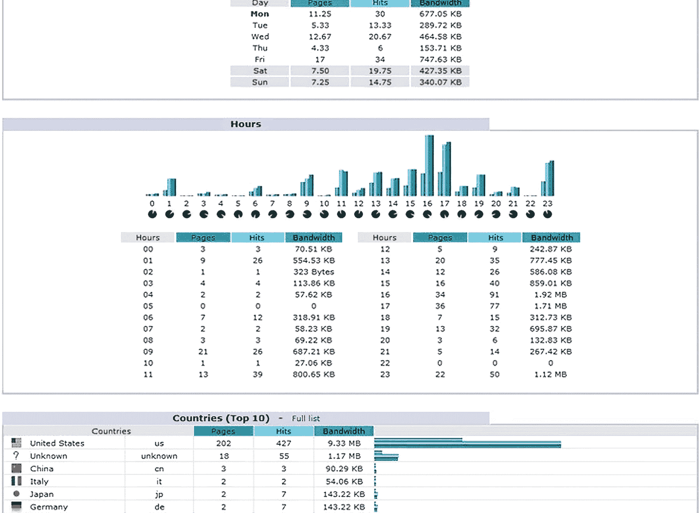

FIGURE 6-9 Webserver Metadata Collection SeMe

恶意服务器也可能从网络连接的低层检索元数据。即使 IP 地址被伪造，服务器仍可能从头信息中收集数据，甚至获取源计算机的信息，如 cookies、环境变量、机器名称、网络信息、操作系统、补丁级别以及各种数据和元数据，这些信息可用于后续利用、会话劫持、下载恶意软件等。随后，当用户在社交媒体上发布评论时，大量信息可被发现、收集并重新分发。例如，Visible 技术可以在社交媒体用户不知情的情况下采集并转发帖子和推文。

#### 6.3.2.1 Social Engineering Attack Examples

社交工程被认为是一种相对较新的现象，但其概念已知并被使用了数百年，用于操纵人们。一项著名研究被用作名为《穿出成功》的书的基础，该书由 Tom Molloy 撰写，研究表明当研究人员穿着脏兮兮、破旧的衣服时，无法免费发放《华尔街日报》副本，但当他穿着昂贵的西装时，轻易地发放了副本。关键点是，外表专业的人被视为无懈可击。这正是社交工程的一个组成部分。最常见的两种社交工程形式是钓鱼和预设（pretext），但越来越多的攻击者在博客或社交媒体上发布误导信息，或在电子新闻通讯中传播误导信息以损害目标。大多数人都曾收到钓鱼邮件——这些邮件通常包含金融机构的嵌入式品牌或标志，并请求提供银行账户信息以避免失去在线银行权限。钓鱼邮件通常具有紧急主题行以吸引潜在受害者的注意。

收集的钓鱼邮件示例包括主题行：“来自 Chase 卡务的警报”，“您的 eBay 账户将被禁用！” “请更新 Bank of America 个人资料，个人信息错误，” “紧急！无效信息已添加到您的 PayPal 账户，” “您的账户已被入侵，请重置登录信息。” 还有许多更具 exotic 形式的钓鱼。对抗此类社交工程攻击的最佳方法是使用垃圾邮件过滤器，并教育员工在不点击的情况下查看 URL，以及检查电子邮件地址的完整头信息。重要的是，员工应被指示不要回复或点击链接，而是向公司系统管理员或服务提供商报告这些邮件。

预言通常通过电话或面对面进行，而不是通过电子邮件等书面形式，因为它们需要建立潜在受害者的信任。预言通常用于获取可能需要某种授权的机密信息——例如，员工可能会收到一通声称自己是客户的电话，要求提供他的记录或交易副本。对抗这类社会工程攻击的最佳方式是确保工作人员了解这些威胁，并提供适当的程序，例如一系列验证问题或用于应对未经验证电话询问的脚本。

攻击者从反间谍情报行动中汲取灵感，现在在博客和社交媒体上发布虚假或误导性信息，或通过电子方式分发所谓的新闻通讯，以损害他们的目标。由于人们常常将普遍性与真实性联系起来，这种攻击可能微妙但极具破坏性。攻击者可能会在许多高流量网站上链接他们的帖子，以便在搜索引擎查询中推广这些虚假材料。这种新型攻击方式需要创新的应对措施来抵御它们。

### 6.3.2.2 移动设备攻击示例

随着移动设备变得更强大和复杂，它们也成为攻击的目标，正如我们之前所讨论的那样。平板电脑、蓝牙设备、耳机、自动驾驶汽车、无人驾驶航空器以及其他设备——随着它们的普及率提高，它们也正进入攻击者的视野，因为普及率加上连接性提供了机会。这些新设备具备大容量存储能力，用于存储短信、多媒体和其他数据，同时还具备多样化的无线局域网连接、视频摄像头和麦克风、GPS 功能以及文件传输连接。

许多这些设备缺乏计算机上常见的防火墙、入侵检测系统和防病毒保护。这使它们极易受到攻击。例如，智能手机（如 iPhone）可能会随意连接到不受保护的局域网，攻击者可以利用此漏洞捕获数据包并将其发送到攻击者指挥中心。攻击者可能会拦截日志文件数据、个人联系信息和短信，这些信息可用于勒索或获取公司机密信息。此外，由于

在本章中，我们将对一些重要概念进行中间回顾，然后进一步探讨**行政安全功能**，包括使用**风险评估**和**风险管理框架**。我们已经介绍了一些攻击类别和具体案例，并且知道攻击可以是**不对称**的，也可以看似**截然不同**或**正交**的。然而，让我们思考这个问题：谁能预见到在开头情景中，DDoS 与**信息操作**结合的情况？事后看来合情合理，但当时没有人发布任何**威胁模型**，显示出这些攻击向量是**协同使用**的。

**风险评估**框架可用于识别基础（但不具体）的威胁风险。而**风险管理**则涉及持续应对已发现的特定威胁和漏洞的努力。因此，**安全计划**涵盖了风险评估和风险管理的功能。需要注意的是，安全计划的某些方面涉及**人力资源**和**技术**问题；然而，风险评估和风险管理的方面是**行政性**的——即它们关注安全管理的**流程、规则和程序**。

**风险评估**涉及技术手段来量化和质化威胁的**可能性**和**影响**。为实现这一点，技术管理者通常使用**框架和工具**来识别信息系统资产和配置、评估对它们的**漏洞**，并调查可能利用这些漏洞或导致灾难的**威胁**。这是一个帮助管理者明智决定如何最佳分配资源的重要过程。**风险管理**随后涉及安全计划的实施，这些计划旨在**缓解**风险评估中识别出的风险。虽然风险管理过程本身是行政性的，但它可能需要使用**物理**、**人力资源**或**技术**手段来减轻风险——例如，通过**员工培训**提升操作角色人员的能力，并帮助减少新漏洞被引入系统的风险。通过风险管理，我们关注的是**最小化**利用和灾难的影响，并增强组织应对新漏洞和风险时的能力。

这些安全计划的部分内容涉及**应急计划**——包括**业务连续性计划**和**灾难恢复计划**。应急计划的目标是设计在组织信息系统和资源被**损坏**时的处理方式。连续性计划的具体目的是为技术管理者提供在**灾难**或导致**完全宕机**的**利用**事件发生时，保持业务运营的方法。灾难恢复计划涉及使受损系统和资源**重新投入使用**的流程和程序。此类计划超出了评估流程，为风险管理的**阶段性**管理奠定了基础。安全计划的完整角色是**应对组织中所有安全组件**，为管理者提供**明确**的手段，以识别风险和漏洞、降低它们，然后**监控**威胁，并**纠正**弱点，实现**端到端**的管理。

### 7.1.1 识别和分类安全风险


任何系统，无论多么**高级**和**先进**，都会有**缺陷**或**漏洞**，可以被某人或某些行动者利用。这些利用的动机各异，影响我们如何防御。漏洞与**愿意利用它们的行为者**（以及**自然灾害**）的组合构成了**核心威胁**。**威胁**被实施的可能性是**风险**。通常做法是识别并按**严重程度**和**概率**（或**可能性**）对风险进行**分类**。识别威胁不是一次性事件；它是**信息安全管理生命周期**（ISML）中的**持续活动**。

大部分网络安全文献的重点在于应对**外部威胁**；然而，大量安全事件实际上涉及**内部威胁**。我们将**内部攻击**定义为**授权访问系统和网络的用户**故意的**计算机滥用**。内部人员通常是公司的**员工**或**承包商**，但供应商、服务人员、顾问等也可被广义地视为内部人员。关于网络威胁的调查显示，当前和前**员工**导致的计算机攻击占主导地位。大约**80%**的攻击是由**员工**引起的，而**89%**的这些攻击是因为员工**不满**所致。¹

**检测**内部攻击可能是一个**极其困难**的问题，但**预测**它们可能更具挑战性。像**Splunk**这样的公司开发了**行为威胁建模**和**分析**工具，试图预测谁最可能成为威胁。这些工具中的一些会**建模**用户的**典型在线行为**，并在安全管理员做出异常行为（例如**突然下载大文件**而该用户过去从未下载文件）时发出警报。这种**异常**方法易于产生**大量误报**，因此像 Splunk 的**行为分析**（Behavioral Analytics®）等工具会考虑**多种因素**，而不仅仅是异常。

处理**内部威胁**问题的一部分是**采取主动措施**，从**招聘决策**开始。由于**过去行为**有时是预测未来行为的良好指标，安全人员通过**预雇佣筛查**和**背景调查**来审查过去的行为，以帮助预测行为。然而，总有可能**潜在的内部攻击者**从未被发现，因此雇主可能需要**持续监控和评估**员工的**安全行为**。这些过程被称为**“安全三条腿”**——即：(1) 尝试**筛选出不适合或有风险的人**；(2) **监控**关键行为以帮助**预防**或**干预**异常行为；(3) **执行**业务连续性**行动**并进行**必要的纠正**。请记住，对员工的**密切审查**也可能带来**问题**。**平衡**是关键。

从一开始，就需要**全面的软硬件资产清单**。大多数公司将此类清单存储在**配置管理数据库**（CMDB）中，其中包含的资产称为**配置项**（CIs）。例如，实体设备有**资产标签**，软件有**许可证号**。这些成为**硬件**和**软件**配置项的属性。与此同时，此类活动还需要**根据敏感度对数据和信息资源进行分类**。了解组织维护了哪些信息、信息的**位置**以及**分类**（如**公司机密**或**专有**）是信息安全的**核心要素**。**ISO/IEC 17799** 和 **ISO/IEC 27002** 是分类**标准**和**系统**的示例。分类在实施**安全措施**时至关重要，特别是在决定**谁**可以访问**哪些**资源时。这有助于确保**仅授权人员**才能获得**适当**访问权限。管理者可在**程序手册**或其他文档中**指定**使用哪些**技术**、**技术**和**其他对策**，以确保此目标。

| CMDB | CMDB 是信息技术基础设施库（ITIL）的数据库，用于存储资产及其与其他资产的**关系**。它通常不是单一数据库，而是**聚合点**或**联邦数据库**的集合。 |
| CI | A configuration item represents individual assets by type, which include hardware, software, networks, people, and roles, among other things. |
| Contingency plan | Contingency plans define alternatives in case of incidents. They incorporate continuity plans and disaster recovery plans. |
| Classification | A designation for the sensitivity of data and information, such as company confidential, proprietary, and public. |

Rapid technological changes occurring in the Internet along with new web-based technologies and social media are enabling communications in ways that are outpacing their regulation, giving rise to new issues related to “free speech” versus rights “to due process.” Consequently, many companies use strategic lawsuits against public participation (SLAPP) toward people and corporations that post negative comments about them in a public forum such as a blog or on a website. The most common type of SLAPP is for defamation, but one of many alternatives has been to use tort interference against such bloggers and website posters. While companies who file such claims hope to intimidate critics by burdening them with legal fees even if the filing party knows that the case might be dismissed at the end of a long legal battle, companies who have invested much in brand reputation are often willing to engage in this “strategic losing battle” because they know the real financial loser could be the critic. The concept of “deep pockets” can be a double-edged sword. On the other hand, there are legitimate times to litigate, and that should be part of the planning.

Many states, especially California, have enacted some form of anti-SLAPP law to try to help neutralize frivolous lawsuits, but regardless, anyone who posts negative comments—even if it is only stated as an opinion (which is one defense against a defamation claim) should take caution. Personnel need to be aware that a response to their negative postings might not be in the form of a rebuttal in a blog, but rather instead in the form of a summons to appear in court. If the employee has made these negative posts from a company-owned system, the company as whole may be involved in the suit—thus acceptable online behavior should be included in the company’s policies and monitored in the security management and governance processes. On the other side of the coin relative to using a SLAPP, some “freedom of speech” proponents have criticized the tactic, but aside from the idealism of that position, the reality is that managers are responsible for protecting corporate assets that include intangible factors such as brand and corporate reputation, which affects the financial interests of the business. Companies have to weigh the pros and cons of striving to protect their corporate image and brand integrity through the legal system. However, it is incumbent upon management to strive to make a reasoned choice and strive to resolve problems amicably if possible. This is one of the key pillars of risk management.

#### 7.1.1.1 Security Domains

Asset inventories are done beginning with individual systems (laptops, desktops, mobile phones, etc.). These are rolled up to the team level, then the department level, and perhaps line of business level, and ultimately to the executive level. Changes to systems and their configurations are handled through a change control process, which usually includes change control tools. The tools automatically keep the CMDB up to date. When an employee wants to make a change to a system, whether it is a request to change a firewall configuration or to add additional hardware to a device such as external storage, the change control (or change management) technology routes the request in a workflow to get approvals, place orders, and record the actions.

They typically record the requestor name, reviewer names, license or asset number, location, date of request, date reviewed, approval date, and implementation date, among other things. The workflow events along the way are typically stored in log files, with the end-state configuration stored in the CMBD. Risk assessment draws from the asset inventory and then runs through a variety of analytical tools that generate risk potential scores, although a fair amount of the effort is still manual; that is, the risk assessment team or team members review and validate the risks and organize them into various formats such as risk matrices for further review and to prepare countermeasures. To try to organize this massive effort into manageable units of work, we might also segment the process into domains or groupings, which include the following:

*   User domain, which represents all the users in a given segment, for example, users of a particular application or in a particular department, or a particular list of customers. This is where countermeasures such as acceptable use policies (AUP), security awareness training, and user- or role-based access controls are implemented.
*   Server domain, which consists of the systems that provide both internal and external services, such as email, FTP, web content, and so forth. Countermeasures such as system hardening, system access controls, failover systems, software firewalls, host-based intrusion detection systems (HIDs), and system monitoring are used.
*   Local Area Network domain. This consists of all the networks and subnetworks (and virtual LANs), DNS systems, routers, switches, and so on that support the internal organization. Countermeasures such as filtering firewalls, proxies, network monitoring, and network intrusion detection systems (NIDS) are used.
*   LAN to WAN domain is where local area networks meet the Internet. Countermeasures such as screened subnet DMZ, stateful firewalls, and network monitoring are used.

#### 7.1.1.2 Security Countermeasures


Countermeasures are actions taken to try to prevent security attacks from succeeding. A countermeasure can be thought of as an initial technique or technology that is intended to neutralize or mitigate a threat. It factors into the threat assessment in that a strong countermeasure in place may significantly reduce a threat; hence they are taken together to calculate threat risk potential. A risk potential is typically a calculated score, where the greater the positive number, the greater the potential. Any positive number risk potential is considered risky (and/or weakly protected). A naked risk is the probability of a compromise if no countermeasure was in place; for example, the likelihood that an attacker would discover or specifically target a particular login page (it might be hidden in what is called security through obscurity). This is typically scaled from 1% to 100% (if it is online, there will never be a 0%). A countermeasure strength is a calculation of all the measures put in place, such as server-side validation, parameterization, or multifactor login, that insulates and sanitizes login attempts, which can be scored on a range from 1% to 99%, where 99 is having all the known login vulnerabilities covered (it can never be 100%). The formula is as follows:


一些反制措施以防火墙和病毒扫描等网络防御形式出现，其他则以漏洞修补或软件错误修正等修复形式出现。受人体免疫学（免疫学）启发，网络安全反制措施日益具有适应性，意味着它们能够自我修复攻击并采取防御行动，例如自动终止被认定为恶意的网络连接。在考虑反制措施时，我们不能忽视组织系统的安全问题根植于人类行为。事实是，网络安全防御未能跟上攻击者试图削弱它们的步伐。缺乏正确技能的安全决策者将继续在无效或实施不当的安全技术、协议、流程和技术上浪费资金。此外，还存在一种隐蔽的问题：未使用或实施不当的安全技术和技术并不能足够有效地帮助管理者改进安全相关决策、更好地解决安全问题、制定更佳计划或采取更佳行动——这导致了因失去战略机会、战术失误、因安全泄露而损失收入以及由此产生的其他一系列问题而产生的无限制成本。

技术管理者和安全专业人员站在问题的前沿，因为他们承担确保其 workforce（员工）采取预防措施以防止对人员、组织系统和信息资源安全的责任。这一责任在近年来因行业立法和监管的日益增多而变得更加关键。例如，诸如“下游责任”等术语——指公司因未知地让其计算机资源被用于非法目的而被追究责任——已与“上游责任”相提并论，后者指顾问因提供导致企业承担责任的建议而可能被追究责任。

在与反制措施相关的众多资源中，包括 MITRE Corporation 的 Common Vulnerabilities and Exposures（CVE）数据库、计算机应急响应团队（CERT）或卡内基梅隆大学的协调中心（CERT‑CC），以及开放式 Web 应用安全项目（OWASP）。这些资源都是“社区”努力，用于识别威胁及其利用的漏洞。一些类型的攻击并非针对系统或 bug，而是利用系统的设计方式。此外，攻击形式多样。例如，分布式拒绝服务攻击（DDoS）既利用系统设计，又通过大量网络数据包使目标系统无法及时处理请求，或通过利用 TCP/IP 的三次握手机制实施 SYN 洪水攻击，发送大量带有 SYN 标志的数据包但不完成握手，使端口保持“半开”状态，直至耗尽端口资源。应对这些多面攻击的反制措施必须灵活且可适应。

让我们稍作回顾一些概念。回想干扰攻击是针对系统或服务的可用性，如前述的 DDoS 示例。伪装攻击旨在冒充合法用户并削弱其真实性。拦截攻击旨在窃取信息，侵犯隐私。修改攻击会篡改文件或软件，从而破坏其完整性。攻击面指攻击者或未经授权用户可能尝试获取访问或发起攻击的不同点，有时通过扫描目标基础设施来寻找漏洞。诸如 `Asmodeous`、`NMAP`、`Winfingerprint` 或 `Cain/Abel` 等网络、系统和端口扫描技术可以用于此，但实际上数以百计的类似工具层出不穷。好消息是，大多数反制措施都能在被扫描时检测到，无论使用何种技术。不过，它们通常只能通过终止入站连接来阻止扫描，这可能导致攻击者使用不同的协议或身份（如不同或伪造的 IP 地址）重新连接。最后，攻击向量是攻击相对于防御措施的轨迹，计算机科学家通常用连续时间马尔可夫链（CTMC）表示为一系列事件，可视为“如果你做这件事，我会做那件事”的 `if-then-else` 游戏，包括数学集合，其中状态可为（1）安全、（2）不安全或（3）未知，行动可为（4）检测、（5）防止和（6）因漏洞导致的隔离（即被认为已损坏或受损）。

### 7.1.2 网络安全应对与治理

与网络安全相关的关键问题在于风险管理，如前所述。风险可定义为从拟议威胁中对人员或资产造成潜在损害或损失的可能性——我们将在后续更详细阐述并进一步细化该定义，但请先记住此定义，以便在思考治理时将其置于相应的位置。治理是运用“最佳实践”——即被普遍认为符合“常识”的做法——并结合特定知识领域的预期专业水平。治理还涉及标准和行业要求，如法规，旨在降低风险。根据行业及组织中个人的角色，认识到国际工作法和法规差异很大，且相关法律正在快速变化。在美国，联邦劳工部规定了许多影响工作的公共政策和法规，并监督监管机构，如职业安全与健康管理局（OSHA）、劳工统计局以及工人补偿委员会。州级部门，如州劳工部，也会制定工作法规，此外还有针对特定行业的法规，例如国家档案与记录管理局（NARA）依据《联邦记录法》（FRA）制定了防止破碎或删除某些电子邮件的规定。这些法规不仅适用于被视为联邦记录的电子邮件，也影响了反垄断诉讼以及 2002 年《公公司会计改革与投资者保护法》所涵盖的各类消息。 

-   [根据组织角色，某些人员需要了解如何进行风险分析，并开展威胁和漏洞评估，以衡量安全风险水平并制定风险缓解计划。这些行动可能包括编制灾难准备、业务连续性和灾难恢复计划。其他人员可能参与进行刑事法医分析，并可能被要求协助刑事活动的起诉。即使是非技术人员，也需要对信息和技术安全管理的原则和实践有一个基本的理解。他们至少需要了解安全管理政策和应用，以及治理模型和风险管理最佳实践如何纳入信息系统和技术安全基础设施的实施和管理，从而能够做出正确的决策，并在预算和支出批准以及实施适当、有度的安全控制方面取得支持。

-   最终，网络安全治理主要关注信息和技术资源的合理使用，包括硬件和软件。更具体地说，美国国家信息系统安全术语表将信息安全（Infosec）定义为防止信息系统免受非法或未经授权的访问、修改、或在存储、处理或传输过程中以及对授权用户的服务拒绝或未经授权用户的服务提供的侵害，并包括为检测、记录和应对此类威胁而采取的必要措施。

| 治理过程 | 其中的评估活动包括确定安全优先级、资产估值以及分配角色和责任，以确保信息安全计划有效且响应组织的需求。一旦信息资源的识别和估值完成后，应建立相应的行政、技术和物理控制措施，以实现安全计划的目标。 |

| --- | --- |

| 行政控制 | 行政控制是确立信息系统及其他信息资源中应当、不应、能够、不能执行的过程、规则和程序的措施。该领域包括政策、程序、指南和标准的定义与实施。 |

| 技术控制 | 技术控制是定义信息系统及其使用者行为边界的逻辑控制。识别和认证机制、防火墙、访问控制列表以及相关的系统和应用软件设置均属于技术控制的例子。 |

| 物理控制 | 物理控制是指存在于物理环境中的措施，包括锁具、对不必要硬件的移除和正确处置，以及从防火抑制系统到隔离栏的数据中心管理系统等环境和数据中心管理措施。 |

## 7.2 Risks and Management

-   信息系统在大多数组织中是关键资产，保护它们是企业和政府运营的重要任务。然而，没有任何系统可以完全安全，决心强大的攻击者仍可能突破最坚固的防线。技术管理者和安全专业人员必须准备好定义自己愿意接受的风险水平，并将其与实施预防和纠正措施的成本进行比较。风险评估是一个持续识别风险和威胁的过程，而风险管理则是根据风险与安全对策的成本效益，持续实施措施、确定应对攻击时的遏制和恢复策略与措施的持续过程。我们已经说明，管理者通过其行政实践，通过实施预防措施来减轻风险，通过对行为或实施的限制（包括“不实施”）来规避风险，并特别关注不实施某些措施。管理者也可能会接受一定程度的风险，因为实施预防措施的成本或时间不值得其收益，我们还介绍了风险转移的概念，即通过支付费用（例如购买保险）或在合同中加入免责条款（如赔偿条款），将风险的责任转移给他人。

### 7.2.1 Risks and Countermeasures

-   我们已经介绍了一些在风险评估持续过程中使用的技术，如进行资产清点、分类信息以及确定漏洞等。完成这些工作后，风险评估的一部分是决定在安全对策方面应采取主动还是被动的经济权衡。为说明这一理念，管理者可能会将 15% 的预算用于防止受 HIPAA 监管的数据（即医疗患者信息）的访问，但可能只愿意将 5% 的预算用于保护销售报告数据，同时考虑若事后发生安全泄露所需的支出。

-   安全文献中的一些指南建议使用 `ALE`（年化损失期望）公式，该公式为单次损失期望（`SLE`）的成本乘以每个潜在发生的年化损失率（`ARC`）。此外，还常用的财务公式包括资产折旧损失的回收期以及结合时间价值计算的替换成本预期未来价值。然而，虽然这些定量财务评估很有帮助，但它们忽视了重要的质量因素，例如安全泄露对公司声誉的损害。确定风险的关键在于量化（通常是统计）评估与逻辑判断的结合，以及单纯的良好判断——技术管理者因其判断能力的价值与其他任何方面相当。因此，因为对策是为了防止安全泄露并依据总体影响进行评估，量化评估（如 `ALE`）与管理者的质量判断（如遵循规范性规则）都是成功管理安全所必需的。

-   如前所述，对策是对政策规定的主动实施。例如，安全政策可能要求对“工资发放”业务功能使用基于角色的访问控制（`RBAC`），而在计算机安全领域，这类对策的具体实现可能是使用维护目录服务（如 `LDAP` 或微软 `Active Directory`）的访问控制列表（`ACL`），以限制谁可以访问工资文件进行划转；或是使用事务管理系统（如 `Tuxedo`）确保在涉及分布式数据库的医院患者记录更新时执行两阶段提交。其他对策可能包括实施加密技术——从使用 `PGP` 在电子邮件中加密消息，到使用 `Kerberos` 对用户进行身份验证。加密还用于生成消息摘要（如 `MD5`）以确保数据未被篡改，以及创建数字签名以实现非否认性。

安全控制措施必须让人能够高效、有效地工作；因此，防范措施必须在最小约束的前提下实现最大控制——这与确保合法工作者的资源可用性相关。管理者需要思考安全行动的后果；然而，在现代组织中，成功工作通常意味着成功的团队协作和开放的沟通，信息必须能够跨越组织障碍以确保运营有效执行，同时保证安全运营的有效性。正如 Malatji 等人³ 所描述的，这是一种“有机组织能力”，能够使公司实现适应性和敏捷性——这对管理者而言是重要的关注点。然而，所有为了安全目的而将人员隔离、分割的努力都违背了这些被研究证明能够提升组织绩效的有机原则。因此，诸如职责分离和分割等严格的安全措施应仅局限于公司中最敏感的操作、职能和角色。

### 7.2.2 希望最好，计划最坏

技术管理者当然希望其主动保护组织资源和人员的措施能够成功，但也必须考虑最坏情况。正如我们所指出的，风险管理是处理威胁及其相关成本并规划应急措施的过程。应急计划通常涉及制定“如果发生…会怎样”的灾难情景，常用的方法包括 Delphi（一种匿名集体决策过程，参与者匿名提供输入和想法，随后由小组评估）或电脑化随机模型（根据从他人获取的信息、数据挖掘或人工智能与专家系统查询得出的统计概率，对可能结果进行概率估算）。

应急计划包括灾难恢复规划过程，在灾难发生时制定替代的信息处理和恢复方案。该过程产出业务连续性计划，说明在灾难（人为或自然）发生时，业务应如何继续运行。管理者还需考虑灾难发生后的应对措施以及如何恢复。恢复计划侧重于如何恢复正常运营。这些计划可能包括使用灾难恢复中心，在灾难发生时保持设备并派遣人员。例如，SunGard 等公司专门提供此类服务。另一个重要过程是设施管理，它包括灾害应对程序，如使用离站备份和存储设施、分布式运营与监控中心，以及自愈系统的使用。

## 7.3 风险评估概述

截至本章节前段，我们已经回顾并深化了文本第一部分所介绍的许多概念。希望您已经看到全貌。现在，让我们转向行政和程序性问题，首先是风险评估。

请回顾，威胁既可来自内部也可来自外部，并且与系统内固有的脆弱性紧密相连，这些脆弱性会被威胁实体利用。如前所述，风险是不良事件发生在个人或组织上的可能性。风险概念存在于不确定性的领域，伴随已知或未知的脆弱性以及相应的威胁。将风险应用于信息系统时，指的是系统无法按预期或所需方式运行的可能性。虽然定义简单，但在实际实施中却相当复杂。它是风险管理的基石和目标所在，目标是使系统以我们期望的方式运行，且以最低成本满足需求（无论成本是时间、精力还是金钱）。

风险可以接受、缓解、降低或转移。接受风险通常意味着威胁发生的概率较低，或成本‑收益比不足以投入防范资源。例如，为一款托管小型网站的 Web 服务器投入数千美元购买备用系统可能并不划算。缓解是指在现有约束下改进局面至可接受水平的尝试。例如，经理可能为一台执行小型任务的孤立办公室电脑选择免费防病毒软件（如 AVG‑free），而为通过局域网连接的办公室电脑则升级至 AVG 商业版。

技术管理者和安全专业人员需要对组织的风险进行量化和质化评估。典型做法是将风险因素放入表格中，并根据管理者主观判断为不同资产、系统和服务赋予权重。这些权重反映了 exploit 成功可能导致的潜在损害。通过统计计算可得出威胁风险的汇总，从而识别出最大的损害潜能。大部分关于风险概率和潜在影响的判断属于主观判断；也有可能是基于统计计算或概率计算（如 Figure 7.1 所示）。

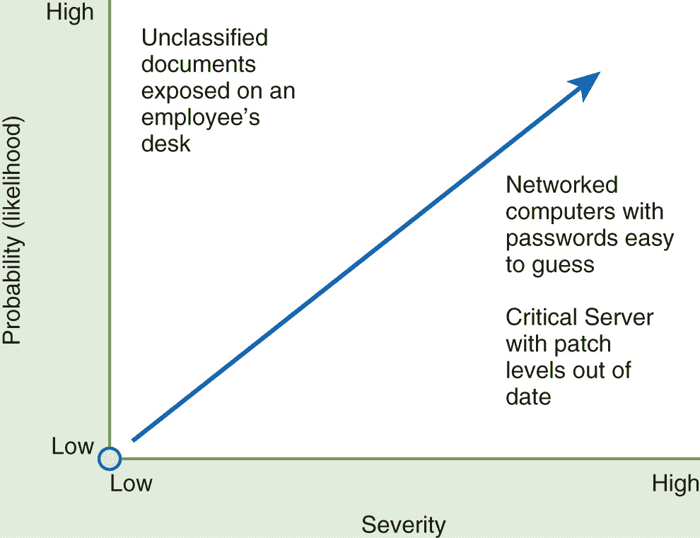

**FIGURE 7.1 Probability – Severity Classification**

### 7.3.1 风险缓解

组织投资于信息技术（IT）基础设施，是因为它们相信这些投资能够提升业务运营。这一思路得到研究支持，研究表明，投入大量 IT 基础设施和资源的组织往往优于未作大量投资的组织。⁴ ^，⁵ 将有形和无形资源独特结合的方式，正如 McKeen 等人所定义的，称为 IT 能力。关于 IT 能力的研究不仅表明 IT 投资与组织价值之间存在明确关系，还指出其组成部分与 ITIL（信息技术服务管理体系框架）和 COBIT（信息技术治理框架）等最佳实践与控制框架的要素相似。此外，研究表明，像 ISO 17799 和 NIST 特刊 800-53 这样的技术最佳实践标准在降低信息系统风险方面极具价值。⁷ 这些最佳实践与控制框架的共同点在于它们都认识到信息系统中的风险。最近，国家标准技术研究所（NIST）及其他标准机构发布了针对勒索软件的草案文件，例如 SP‑1800‑25：数据完整性：识别并保护资产免受勒索软件及其他破坏性事件侵害，以及 SP‑1800‑26：数据完整性：检测并应对勒索软件及其他破坏性事件。

-   [前面提到的]https://wiki.example.org/feynmans_learning_method 的灵感源于诺贝尔物理奖获得者**理查德·费曼**。

1.  运用费曼技巧，你只需花上`20 min`就能深入理解知识点，而且记忆深刻，*难以遗忘*。

```
if (condVar > someVal) {console.log("xxx")}
```

-   [大量的风险评估、控制和风险管理框架。我们在本文中将重点阐述的框架包括 ITIL、ITSM、BS15000、ISO2000x 以及其他一些框架。例如，信息技术库（ITIL）是一套管理最佳实践，最初在英国为信息系统技术开发，并在欧洲和加拿大获得广泛支持。信息技术服务管理（ITSM）是一个 IT 管理框架，实现了 ITIL 的组成部分。ITIL/ITSM 的主要目标是使组织能够以最有效和最经济的方式建立和管理其 IT 基础设施。英国标准 BS 15000/ISO 2000x 将这些流程划分为五个领域：发布流程、控制流程、解决流程、关系流程和服务交付流程。这些领域随后被实施和管理，以提升 IT 交付的效率和效果，方式与 ITSM 类似。

### 7.4.1 风险确定与管理框架


风险确定与管理涉及根据对漏洞和成本的评估进行决策。漏洞将在可预见的未来继续存在于复杂的信息系统中。这些漏洞的暴露（无论是已知还是未知）都可能导致损失。因此，使用任何信息系统本身就伴随固有的风险。理解和管理风险是信息安全计划的关键步骤，并在国际标准 `ISO17799`、`ISO/IEC 27002` 以及 `ISO13335` 中讨论，这些标准正日益被用作组织框架和指南。

信息系统的风险是系统无法按照我们预期或需要的方式运行的可能性。这个简洁的定义说明了我们通过风险管理想要实现的目标——使系统以我们期望的方式运行，满足需求，同时以最低成本实现。成本是一个广泛的概念，通常被认为是财务支出，但也包括时间、精力和金钱等项目。对风险进行彻底分析，能够让系统的管理者做出如何管理风险的决策。在风险接受的情况下，如果缓解或转移风险的成本高于风险被利用的成本（根据成本‑收益分析），则更应让其自然存在。如果 `countermeasure` 的成本高于风险被利用的成本，则应着手缓解或降低风险。这是信息安全最常见的用途，任何信息系统的“所有者”都必须在缓解风险的成本与风险被利用的成本之间找到平衡。最终，风险转移体现在保险模型中：支付一定费用后，另一方会接受风险被利用的成本。

### 7.4.2 OCTAVE

`OCTAVE`（Operationally Critical Threat, Asset, and Vulnerability Evaluation Methodology）由卡内基梅隆大学软件工程研究所的研究人员创建，旨在为组织提供结构化的信息安全风险评估和管理方法。`OCTAVE` 主要是定性的，分为三个阶段、共八个步骤，帮助组织识别信息资产、分析威胁和漏洞，并制定安全策略以应对风险。

1. **Phase 1: Build Asset-Based Threat Profiles**
   - Process 1: Identify Senior Management Knowledge
   - Process 2: Identify Operational Area Knowledge
   - Process 3: Identify Staff Knowledge
   - Process 4: Create Threat Profiles

2. **Phase 2: Identify Infrastructure Vulnerabilities**
   - Process 5: Identify Key Components
   - Process 6: Evaluate Selected Components

3. **Phase 3: Develop Security Strategy and Plans**
   - Process 7: Conduct Risk Analysis
   - Process 8: Develop Protection Strategy

在 `Phase 1` 的第一步中，风险评估前必须让参与人员做好准备：获得高层管理支持、从运营和 IT 领域选取合适的代表，并确保所有参与者熟悉该方法。站点团队成立后，需与高层管理代表召开会议，识别当前信息资产、所需的保护水平、已知的威胁以及已有的行政、技术和物理控制措施。随后，团队会确定评估覆盖的运营领域，并分别与运营经理、现场人员以及 IT 部门召开类似会议。会议收集的信息用于构建 `Threat Profiles`，这些文档在后续阶段中被使用。

在 `Phase 2`，站点团队与 IT 部门（或负责信息系统和信息系统安全的部门）合作，识别和评估 `Phase 1` 中确定的资产所对应的具体信息系统。这些系统随后进行漏洞分析，以发现已建立的技术控制的优势和弱点，并生成总结报告。

在 `Phase 3`，结合 `Phase 1` 与 `Phase 2` 的信息，评估信息资产的价值，判断若该资产损失会对组织造成高、中或低影响。对已识别的风险进行类似的过程，从而形成一个框架，使站点团队能够制定保护策略、风险缓解计划以及行动清单，明确近期和长期的具体行动，以降低或管理已识别的风险。该成果会与高层管理层审议，根据组织的目标和需求进行调整，最终确定并实施。

在更新后的 `OCTAVE Allegro` 中，结构化的风险评估步骤有所变化，采用更简化的方式：(1) 确定风险度量标准，(2) 开发信息资产画像，(3) 识别信息资产容器，(4) 识别关注区域，(5) 识别威胁情景，(6) 识别风险，(7) 对风险进行分析，(8) 选择缓解措施。

### 7.4.3 NIST 800-30

前文提到 `NIST SP 800-53` 是风险确定与控制框架，其补充是 `NIST SP 800-30`，其中包含风险管理的规定。除了为软件开发生命周期（`SDLC`）提供风险管理指导外，`NIST SP 800-30` 还提供了九步法，用于进行风险评估、确定相应的控制、制定缓解策略，以及持续风险评估和持续改进的最佳实践，具体步骤如下：

1. **系统描述**：对系统进行功能性描述
2. **威胁识别**：识别系统面临的威胁
3. **漏洞识别**：识别系统中的漏洞
4. **控制分析**：分析已实施的控制或对策
5. **可能性确定**：为潜在攻击赋予可能性评分
6. `影响分析`：如果攻击成功，确定其影响
7. `风险确定`：考虑风险减轻措施后的一个评分
8. `控制建议`：进一步实施的防护措施
9. `结果文档`：分析或测试得出的发现

与 `OCTAVE` 方法论类似，`NIST 800-30` 风险管理流程的第一步是确定项目范围。此外，范围确定阶段还会通过问卷调查、面谈、文档审查和自动化系统扫描工具收集系统信息。此阶段包括识别硬件和软件、相关数据、用户、系统的任务与目的以及数据在组织中的重要性。同时，还会识别并界定功能需求、政策、控制措施以及系统架构。

在第二步`威胁识别`中，评估团队利用第一步收集的信息，识别并评估对 IT 系统和运行环境的潜在威胁。该步骤包括评估自然威胁（如洪水、地震、闪电）、人为威胁（如故意或无意的破坏行为）以及环境威胁（如污染、长时间停电）。

第三步`脆弱性识别`旨在找出系统中可能被上述威胁利用或加剧的属性。步骤 2 和 3 的信息结合，形成“脆弱性/威胁”对，列出脆弱性、潜在威胁来源以及威胁可执行的利用动作。脆弱性通过标准来源（如漏洞数据库、扫描、审计报告、供应商信息）识别，也可能包括主动测试方法（如“红队”或渗透测试）。步骤 3 中发现的弱点作为步骤 4 的输入。在`控制分析`中，脆弱性/威胁对与现有或计划中的控制措施进行比较，判断管理（行政）、操作（物理）和技术控制的充分性。通常会使用检查表对比控制与脆弱性/威胁环境，并据此调整计划。

在第五步`可能性确定`中，为每个威胁/脆弱性对分配高、中、低的量化指标，表示该脆弱性在给定威胁环境中被利用的可能性。高量化指标表示威胁极有可能利用该脆弱性，且现有或计划的控制效果有限；中量化指标表示威胁可能显著，但控制措施可能有效；低量化指标表示威胁可忽略、控制有效，或两者皆是。第六步`影响分析`是对成功利用脆弱性后对组织的后果进行评估，通常以信息安全三要素（保密性、完整性、可用性）在每个资源上的退化程度来描述，并以高、中、低划分。步骤 6 的影响陈述进入步骤 7 的`风险确定`。在该步骤中，利用可能性、影响和控制充分性来构建风险矩阵，生成每个观测项的整体风险等级。风险的确定取决于威胁试图利用的可能性以及成功利用后对组织的影响。该步骤的结果——对每个威胁的风险高、中、低定量——是步骤 8`控制建议`的基础。

在第八步，管理层必须参与，决定组织对每个威胁愿意接受的风险程度。这将指导对每个威胁的具体控制（行政、技术或物理）的评估与推荐。第九步要求记录前几步骤的结果及决策背后的理由，以报告或简报形式呈现，供管理层在业务安排相关的风险决策中参考。此过程可能包括风险承担、实施控制以缓解风险，或通过保险或其他方式转移风险。这些选项并非相互排斥，可组合使用。

### 7.4.4 使用框架实施计划

现在我们已经介绍了多种框架，简要说明框架如何用于风险缓解计划的实施。风险常以函数形式表示：`f（risk = threat × vulnerability）`。技术管理者常问如何将此函数转化为可感知的内容。下面用一个简单例子说明框架标准如何转化为具体的风险缓解措施。本例简化了 `OCTAVE` 方法（前文已介绍），仅使用单一例子以便演示。回顾 `OCTAVE` 包括构建资产基础的威胁剖面、识别基础设施脆弱性，并制定安全策略与计划。假设我们的公司拥有一款基于 `Java` 的 Web 应用，允许管理者通过浏览器登录，跟踪实际预算与计划的差异。首先，我们需要构建威胁剖面——本例聚焦于登录功能，特别是密码保护。

假设系统采用强制访问控制，要求用户每 90 天更换一次系统自动生成的随机密码。

经过评估，我们发现许多员工会在纸上记下密码并贴在键盘上，因记不住而频繁重复使用。我们判断威胁等级为高（8），脆弱性为中等（5），风险因子为 40。威胁被评为高，是因为登录该预算跟踪系统的密码与其他公司系统的登录密码相同（采用单点登录），一旦密码泄露，所有密码均可能被 compromises。但该风险仅在内部网络内可被利用，如同事、承包商或夜间清洁人员。

若该风险 40 是我们评估中最高的风险之一，则需要立即处理。我们采访人员后了解到，相关员工并未意识到密码泄露可能导致其他严重后果，例如员工利用泄露的凭据查看薪酬绩效数据，用于诈骗。于是，我们制定安全意识培训，并实现系统提供用户可记忆的加密密钥短语（并在必要时提供提示），使系统能够在安全通道中显示密码。虽然该系统仍可能被攻破，但风险因子显著降低，使我们能够将注意力转向更高的风险。

## References

1. Bobeck, R. J., & Cohen, J. (2020). Issues in cybersecurity risk and assessment: Coming to terms with costs. Journal of Security & Policy, 13(2), 133–141.

2. Kim, D., & Solomon, M.G. (2018). Fundamentals of information security. Boston, MA: Jones & Bartlett Learning.

3. Malatji, M., Von Solms, S., & Marnewick, A. (2019). Socio-technical systems cybersecurity framework, Information and Computer Security, 27(2), 233–272.

4. Santhanam, R., & Hartono, E. (2003). Issues in linking information technology capability to firm performances. MIS Quarterly, 27(1), 125–153.

5. Bharadwaj, A. S. (2000). A resource-based perspective on information technology capability and firm performance: An empirical investigation. MIS Quarterly, 24(1), 169–196.

6. McKeen, J. D., Smith, H. A., & Singh, S. (2005). Developments in practice XVI: A framework for enhancing IT capabilities. Communications of the Association for Information Systems, 15, 661–673.

7. Ma, Q., & Pearson, J. M. (2005). ISO 17799: “Best practices” in information security management. Communications of the Association for Information Systems, 15, 571–593.

8. NIST SP 800-53. (2005). Information security—Recommended security controls for federal information systems. NIST Specification 800-53.

9. Gibson, D. (2011). Managing risk in information systems. Boston, MA; Jones & Bartlett.

10. Nichols, R. K., Ryan, D. J., & Ryan, J. J. (2000). Defending your digital assets against hackers, crackers, spies & thieves. New York: McGraw-Hill.

11. Bace, R. G. (2000). Intrusion detection. Indianapolis, IN: Macmillan Technical Publishing.

12. Caralli, R. A., Stevens, J. F., Young, L. R., & Wilson, W. R. (2007). Introducing OCTAVE Allegro: Improving the information security risk assessment process. Software Engineering Institute, CERT. Pittsburgh: Software Engineering Institute.

13. Larsen, M. H., Pedersen, M. K., & Andersen, K. V. (2006). IT governance: Reviewing 17 IT governance tools and analyzing the case of novozymes A/S. Proceedings of the 39th Hawaii International Conference on System Sciences.


CHAPTER 8

Computer Architecture and Security Models

© Antishock/Shutterstock

Roger, a U.S. State Department official, had been traveling through Europe, and he was using the WhatsApp Messenger to conduct business when he noticed his phone was running slowly and acting up. One of the cybersecurity experts with the State Department discovered that his WhatsApp had been infected with Pegasus, a cyberweapon developed by NSO Group Technologies, an Israeli company. The Pegasus spyware performs remote surveillance on smartphones, and it infects messaging apps by using common files such as photos. Although Pegasus was designed to help governments fight crime and terrorism, bad actors can use it to steal intelligence and conduct surveillance of their targets. Facebook, the parent company of WhatsApp, filed suit against NSO Group under the U.S. Computer Fraud and Abuse Act (CFAA). The lawsuit claimed that the NSO had developed the malware to access messages and other communications after they were decrypted on target devices. Even though Roger subsequently worked with other government officials to change the policy on acceptable use, including what applications could be installed and used on government-issued equipment such as smartphones, many government officials decided the policy didn’t apply to them—and incidents continue.

Have you ever used an app you thought might be infected with malware? What did you do?

## 8.1 Security Models versus Policies


In this chapter, we are narrowing our look at information and cybersecurity specifically to computer systems, ignoring network security for the most part, for now. Recall that a primary role for technology managers, as far as security is concerned, is to provide well-defined means of identifying, monitoring, mitigating, and managing security risks. This includes oversight of members in the organization who are responsible for taking the appropriate actions. Viewed traditionally, it may seem as though security is only a technological problem by the concentration on techniques and technologies for creating better defenses and using criteria in performing risk analyses and the application of security countermeasures, but it is important to note that security is mainly a behavioral issue. Later, we will cover security behaviors in greater detail, but for now, let’s examine where security policies and security models come into play. Security policies are the rules used to maintain organizational security as well as for monitoring and reporting in the case of security breaches. Security models are criteria and techniques designed to “carry out” certain aspects of the security policy, such as what privileges are allocated for which resource and to whom. Said differently, models are patterns that are applied to certain general countermeasures such as ways to manage access to resources.

Security policies and models are part of a technology manager’s arsenal to combat cybercrime and other incidents, along with the other measures we have discussed so far that strive for the reduction of risk exposure by using the processes of threat identification, asset measurement, and control and minimization of losses associated with threats. We have seen how the security life cycle calls for surveys and classification of assets, conducting security reviews, performing risk analyses, evaluating and selecting information security technologies, performing cost/benefit analyses, and testing security effectiveness. Next, we will also explore the roles of practices, models, and policies in the information security management life cycle.

### 8.1.1 Computer Architecture and Systems Security

In addition to the technical and administrative measures we have discussed so far, maintaining information and systems security involves the development of policies and conducting comparisons against standards, procedures, and guidelines. All these activities help us to ensure information in the confidentiality, integrity, and availability (C-I-A) triad. Also, thus far, we have covered the importance of assets and information classification, identification of threats and vulnerabilities, and to ensure that effective countermeasures are implemented. As we noted, there are a variety of tools available to technology managers, including information classification systems, configuration management and change controls, and employee security training.

Now it’s time to consider all the organizational security aspects of a company’s information systems infrastructure, which comprise all the resources and assets and efforts related to information and the computing facilities used by people in organizations for decision-making and action taking. An organization’s information and systems security infrastructure support the organizational mission and objectives by helping to ensure C-I-A. Under the umbrella of information infrastructure resides information architecture, which consists of computer architecture, along with how information and systems are organized within a company and between trading partners; therefore, the information architecture outlines all the facilities that must be secured.

建筑学在经典意义上是通过蓝图可视化结构的组织方式以及其设施或特性。信息架构同样包含规格、图表、设计、需求文档、拓扑结构以及所有描述组织所使用的信息和计算资源的草图。其功能是创建并通信“信息环境”，包括在组织和促进信息易用性、完整性、访问性和有用性方面涉及的美学、结构和机制（Figure 8.1）¹

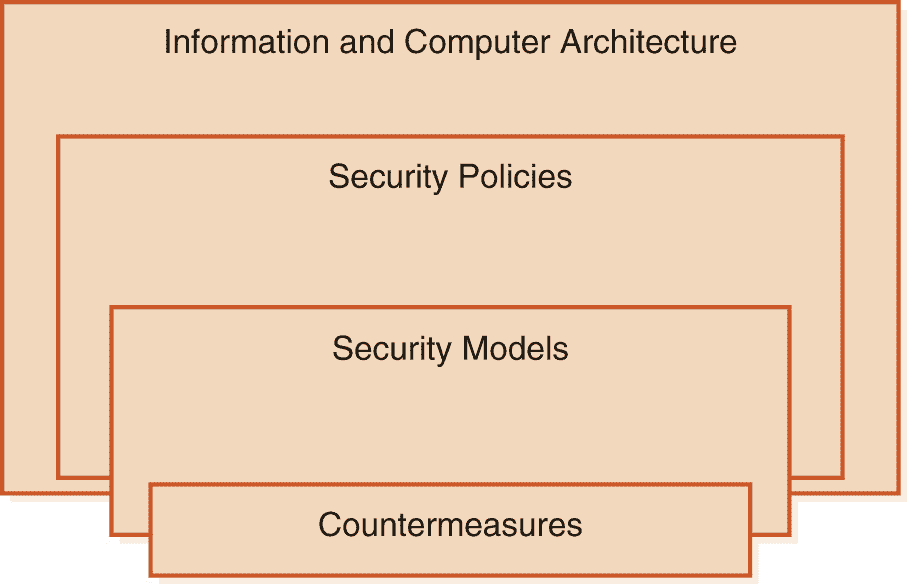

FIGURE 8.1 Layered Relationships

信息架构分为宏观层面和微观层面。例如，宏观层面的 Web 应用程序架构会展示信息存储和流经消费者-生产者（价值）链的所有交叉点和分布，包括在贸易合作伙伴、公司地点、共址处以及组织对应的机构（如航空公司与联邦航空管理局（FAA）或银行与联邦储备系统）之间的交互。另一方面，微观层面的 Web 应用程序架构则展示系统或系统集合内的单个组件。它可能显示软件和系统的分区方式、网络接入点的位置、哪些组件是集中化的、哪些是分布式的，甚至指定一些关键技术，以限制架构适用于某种平台或软件系统。信息安全管理生命周期（ISML）的一部分要求信息架构被记录，并指定安全对策。

### 8.1.2 Security Models and Systems Architecture

此前，我们在微观层面上讨论了操作系统（OSs）及其他应用程序和资源（如数据库和网络）所执行的功能。现在，让我们探讨系统架构、安全模型和网络安全如何相互关联。为此，我们需要先回顾一些基本的计算机架构概念，并重述在本文早期已提及的几点。

操作系统、硬件、网络设备、协议和应用程序的安全需求层级多样，常常导致人们忽视可能影响整个信息系统生态系统的安全漏洞。我们将架构视为系统组装的规格或蓝图。安全模型则是实施技术、模式和对策的方式，遍及信息和系统架构的宏观与微观层面；因此，理解计算机架构至关重要。请记住，对策有不同的分类。稍后，我们将查看与安全模型相关的一些对策。

请记住，对策是为抵御威胁而实施的行动或技术。有些对策基于已知威胁，另一些则在攻击过程中学习到的经验中生成。

| Countermeasures | Description |
| --- | --- |
| Availability Countermeasures | 防范性措施，用于防止对资源和数据访问的丧失。 |
| Integrity Countermeasures | 防止未经授权修改数据或处理的技术和方法。 |
| Confidentiality Countermeasures | 防止未经授权披露消息内容或数据的预防性措施。 |

虽然某些对策可能是“ bolted on”（即事后附加），如加密或系统与基础设施监控，其他对策则属于操作系统的管辖范围；正是在这里安全模型发挥主要作用。总体而言，安全模型规定系统应如何上线。其目标是保持系统、软件、信息和数据的问责性、真实性、不可否认性和可依赖性。通过加密电子邮件和传输（在传输中）及存储（持久化）的数据，以及在信息架构的各个层面（如数据仓库、Web 服务器和应用程序）确保数据保护。例如，通过输入验证保护进程执行，并确保数据在数据仓库、Web 服务器和应用程序中的安全。一个例子是确保输入验证并保护进程的执行。为使措施有效，它们必须在信息安全管理生命周期（ISML）的设计和架构规划阶段即时制定，并通过 DevSecOps 工程、配置、实施、测试、审计、评估、认证和授权的过程逐步细化。

### 8.1.3 Security Models and Computer Architecture

要理解安全模型，我们必须具备计算机架构的基础知识，因此让我们快速回顾。计算机架构指的是硬件和操作系统（如中央处理器（CPU）、内存（静态和动态）、所有电路、磁盘驱动器或其他存储设备以及网络组件）。CPU 与算术逻辑单元（ALU，以及寄存器）负责进程的执行。CPU 的控制单元管理并同步系统，并在执行不同应用程序代码和操作系统指令时，决定哪些应用指令被处理以及以何优先级顺序处理，以及在进程完成前能分配多少时间片。它控制何时执行指令，而这一执行使得应用程序能够处理数据。操作系统中与控制单元协同工作的主要组件是调度器。调度器扫描运行队列中的可运行进程，选择优先级最高的进程在其分配的时间片内执行，随后如果未完成，将其返回队列。通过这种方式，CPU 执行操作系统和用户应用程序的指令流。需要处理的数据会传递到指令寄存器，而控制单元则通过 CPU 协调进程和处理上下文的切换（Figure 8.2）。

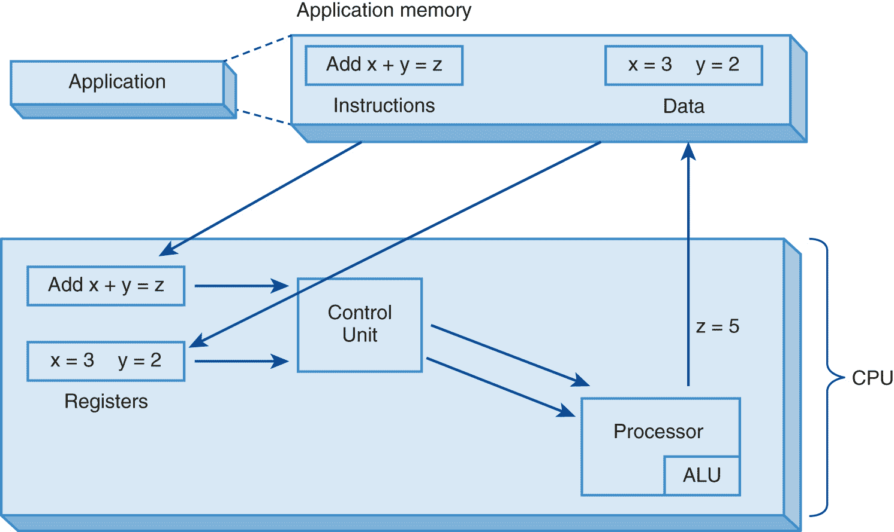

FIGURE 8.2 Computer Architecture

CPU 以块或组的方式处理数据。如果软件指令未正确设置在等待执行时可以存储的数据边界，可能导致缓冲区溢出（故意造成的，这是缓冲区溢出攻击）。由于 CPU 是多处理器的，这意味着系统会并发服务许多任务、程序和用户，尽管在大多数系统中，只有单个程序或线程实际在执行。协调通过硬件和软件中断实现。中断发生在高优先级事件需要 CPU 转到另一个进程时，称为上下文切换。硬件中断是如磁盘驱动器需要写入且正在等待 CPU（而 CPU 正在处理其他任务，如接受用户界面的输入）的情况。软件中断相似，但优先级低于硬件中断，它们向 CPU 发出信号，表示某个进程需要在另一个进程之上执行。例如，调度器会在运行队列中选择内核进程而非用户进程，或选择在运行队列中等待较长时间的进程，而不是因等待资源（如等待数据缓冲区被清空）而被阻塞的进程。

操作系统指令、应用程序和数据存储在不同的内存段中，如栈、文本、堆、缓冲区和寄存器，同时也包括基本输入/输出系统（BIOS）、设备控制指令和固件。内存还分为多种类型，例如随机存取存储器（RAM），它是一种由操作系统和应用程序用于读写活动的临时存储介质。RAM 是易失性的，即电源断开后，存储的数据会消失。RAM 有两种类型：动态 RAM（DRAM）需要不断进行充电或刷新才能保持数据在芯片中的完整性，而静态 RAM（SRAM）则无需刷新即可保持数据。只读存储器（ROM）是一种非易失性存储介质，电源断开后数据仍然保留。写入 ROM 的指令被称为固件。ROM 大部分是可擦除可编程只读存储器（EPROM），其中的指令“埋入”芯片，但有限度地可以修改数据。缓存是一种用于频繁访问数据的高速读写存储类型，它用于存储从主存储器中获取的程序指令和数据，并在 CPU 准备执行应用程序时进行访问。

#### 8.1.3.1 内存映射

鉴于各种内存类型，你会发现每一种内存都有特定的用途。本质上，它是为了隔离软件和数据的重要部分，以便最快速地执行。由于内存分段，操作系统必须有办法映射进程及其数据的所有片段；这称为内存映射。内存映射使用数据结构，例如页表，专门用于保存指向其他应用程序地址位置的指针。页表是虚拟内存系统用来存储逻辑地址与物理地址映射的数据结构。软件不直接使用物理地址，而是使用虚拟或逻辑内存。间接访问内存提供了一个保护与效率的访问控制层，用于软件与内存之间。该设计的重点在于性能，但这也导致了某些难以根除的漏洞，只能通过缓解措施进行监控。例如，用于 SMTP 邮件的 `SENDMAIL` 应用程序是一个庞大的程序，包含众多潜在的利用入口。对此无法根治，我们只能实施缓解措施来隐藏、过滤或限制对它的访问。我们将稍后探讨一些方法，如使用代理。

| Storage Type | Description |
| --- | --- |
| Primary Storage | 这是直接由 CPU 访问、间接由应用程序访问的主存储部分，存储在易失性 RAM 中。 |
| Secondary Storage | 这是用于磁盘驱动器、闪存盘和二次固态存储的非易失性存储，用于间接访问。 |
| Virtual Storage | 通过虚拟地址映射到内存中其他位置的物理地址，由 RAM 和二次存储分配并使用的存储空间。 |

#### 8.1.3.2 CPU 模式和保护环

进程竞争系统资源，如内存和 CPU。软件应用程序可能需要访问相同的内存段、向 CPU 发送指令进行处理，或访问二次存储设备。用户应用程序（如浏览器、电子邮件客户端、文字处理程序等）可能会尝试执行冲突操作，例如一个进程在写入数据块的同时另一个进程在读取同一块数据。操作系统必须管理这些进程和事件，以确保系统顺畅运行并防止违反安全策略。为实现高效运作，操作被分离为用户应用程序和操作系统或内核进程。内核进程优先于用户进程，设备操作优先于应用程序。保护环是该整体方案的一部分，用于控制主体和对象（如图 8.3 所示）。

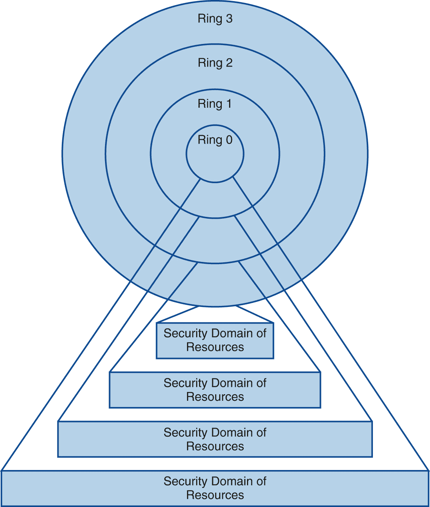

图 8.3 环和资源

保护环的作用是创建基于操作系统权限的行为边界。在内层环的进程拥有比外层环的进程更多的特权。内层环仅允许最受信任的组件和进程在其边界内运行。保护环的数量取决于操作系统，但通常将内层划分为特权模式（如管理员、内核、超级用户或监视者），而外层进程则运行在用户模式。当进程需要访问它无权直接访问的组件时，它会通过系统调用向操作系统请求执行该任务。如果外层应用程序尝试发送超出其权限的 CPU 指令，CPU 会将其视为异常并产生错误，从而阻止该操作。攻击者可能试图提升权限（例如通过 rootkit），或利用此保护特性导致系统崩溃。


安全机制从微观层面实施，例如文件系统的读取、写入、执行权限控制；从宏观层面实施，例如使用电路级防火墙。安全实施的层级越低，越针对特定功能（如文件保护、内存保护、进程保护）。在更高层或外层环处理安全时，需要采取额外措施，如使用过滤器、代理以及通过多 homed 墙站主机实现网络隔离，但这些措施也带来更大的复杂性。安全防护措施的复杂度越高，保护其所保护域的难度也越大。在各层和环之间结合使用安全防护措施的综合策略称为防御深度（`defense-in-depth`），即在整个信息生态系统中实施多层安全控制。

| Subjects | | 主体是一个行为者，即想要访问对象的个人或进程。 |
| --- | --- | --- |
| Objects | | 对象是资源，如文件，由主体访问。 |
| Protection Rings | | 表示特权边界的层级，从低级（微）到高级（宏）不等。 |

一些安全策略是由安全模型定义的。例如，克拉克-威尔逊模型规定系统必须防止未经授权用户的篡改，日志必须记录文件更改，并且数据的完整性必须得到维护并保持在一致状态。正如所述，一种对策是对安全程序或技术的实现的规范，而对策通常由安全模型决定。因此，例如，如果我们将克拉克-威尔逊模型应用于人力流程，如“薪酬”，模型会规定在“薪酬”检查部门发出的薪酬支票的分配必须由授权角色的某人（如首席财务官）批准并记录。实现克拉克-威尔逊模型的对策包括 `Tuxedo`、`CICS` 和 `Open/OLTP` 等计算机交易监视器。因此，克拉克-威尔逊模型是面向事务的，电子事务由 ACID 属性定义，即 (1) 原子性——一个离散的工作单元，所有事务必须同时完成或提交到数据库，或在无法提交时回滚；(2) 一致性，数据在事务开始到结束时必须有序地转换；(3) 隔离，事务是自包含的，不依赖于其他事务的操作；以及 (4) 持久性，数据在被有意更改之前保持一致状态。²

在诸如克拉克和威尔逊等事务安全模型中，一个关键概念是操作必须是结构良好的。结构良好的事务在特定的授权序列中发生，该序列受到监控并记录。记录通常写入审计文件，而程序的变更通常记录在变更控制日志中。日志使审计员、管理员和经理能够审查事务，确保只有经过授权且正确的更改被执行。除了交易监视器外，许多公司还使用变更控制应用和系统配置管理 (`SCM`) 系统来实现这些目的。

### 8.2.2 安全模型与立场

安全模型可能定义安全立场。立场主要关注控制信息流的对策，以及管理主体（如人或进程）可以对资源（如资源、数据或程序）拥有何种访问权限。立场可以是乐观的，即除非明确拒绝，否则默认允许；也可以是悲观的，即除非明确允许，否则默认拒绝。例如，网络管理员可能将网络路由器配置为允许所有 Internet 连接，除非他或她明确创建规则阻止特定的连接——这属于乐观立场。系统和网络基础设施的不同位置可能会组合使用多种立场。例如，可以采用乐观的安全立场来允许流量到达 Web 服务器，同时采用悲观立场仅允许特定的代理系统访问内部域名服务器 (`DNS`)。本质上，除了资源访问外，立场还规定了访问权限的程序规则，例如授予文件所有者或创建者的读、写和执行权限，但不授予其他人。

| Security Models | | `Security models` are specifications for security policy enforcement. Different security models address specific characteristics such as maintaining user privacy with access controls or information integrity using message digests. |
| --- | --- | --- |
| Security Policies | | A security policy specifies file and user access, the level of access, and permitted actions, along with consequences for intentionally or unintentionally violating the policy. Thus, security policies specify security models, and a security model lays out the requirements necessary to enforce the security policy. |
| Security Stances | | A security stance represents how closely to scrutinize activities. For example, a router may be configured to accept all connections except those in a blacklist, which is known as an optimistic stance; or a router can be configured to block all connections except those in a whitelist, which is known as a pessimistic stance. |

An example of an information flow security stance model is the Bell–LaPadula model. This model (among other things) defines who is privileged to access what, in an effort to help ensure information confidentiality. In its original form, it was designed for the intelligence community to specify who could access information based on their security clearance levels. If we applied this model to a human process such as the production of company confidential planning documents, it would specify that no one outside the company may be given a copy of them. Technologically, we see the countermeasures implemented in computer OSs as file system permissions and as access control lists (`Figure 8.4`).

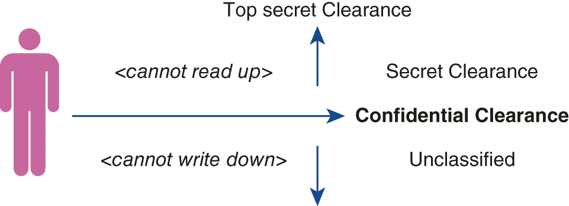

FIGURE 8.4 Illustration of the Bell–LaPadula Model

Another information flow security model is the Biba model. This model is similar to Bell and LaPadula, but it goes beyond addressing confidentiality by also attempting to protect the integrity of data by prohibiting unauthorized persons from making modifications to data they may have read access to. Countermeasures using the Biba model include access controls (including biometrics) and authentication to ensure authorized access and to dictate that an authorized user-level process may not exceed its privileges to modify a file unless specifically granted—for example through the Windows “Executive” security access module, or the authorized grant of escalated privileges using the “setuid” capability in the UNIX OS, which allows a user-level program to gain access to “superuser” or “root” (administrator) OS-level functions.

### 8.2.3 对策与安全模型

如前几节所示，安全模型通过实施特定的对策来应对威胁。请回顾，对策由物理、技术或行政技术组成。物理对策是那些具有实体形态的，例如防火存储库。技术对策涉及软件系统或应用，如防病毒扫描器。行政对策涉及程序，例如要求员工签署保密协议，或由网络管理员妥善管理员工登录账户，删除已离职员工的账户。因此，不同的模型针对不同且具体的威胁，通过明确对应的对策（无论是物理、技术，还是如克拉克-威尔逊模型所示的行政）来应对；而安全策略则针对一般性威胁。它们要求根据特定威胁类型应用特定的安全模型。组织的信息架构的结果是威胁矩阵，它汇总了所有威胁。现在，让我们了解其他一些安全模型，如下表所示。

| State Machine Models | | A class of security techniques using system state information, including current permissions and current instances of subjects accessing objects. Therefore, this model deals with each subject’s permissions for permissible objects. If subjects are controlled such that they can only access objects consistent with the security policy, the system is deemed secure. |

我们现在讨论了如何通过**防御深度**来扩展安全性。

TCSEC 定义了安全框架中的“主体”和“客体”概念。主体分为两类：(1) 用户的直接代理，即代表人或人类行为的应用程序或组件；(2) 内部主体，即为其他主体提供服务的组件或对象，如软件应用程序或操作系统特性。在此情况下，“客体”是指主体在履行职责过程中使用或操作的工具、应用程序、软件、信息和其他资源。

这些标准基于“信任”的概念（如前文所述），安全视角下的信任具有特定含义。在信息安全领域，信任指的是一个系统具有抗攻击能力，并能够保护其信息和资源的完整性。受信任系统的失败可能会危及整个安全基础设施。

早期的信任评估标准包括常说的《橙皮书》，它定义了可信计算基（`TCB`）的概念，建立了信任的基准水平。`TCB` 设想包含对计算系统的全部保护措施，包括用户角色和行为、硬件、固件、数据库、文件系统、软件，以及负责强制执行安全的组合。`TCB` 标准分为四个等级：(1) 最小保护（D 级），(2) 离散保护（C 级），(3) 强制保护（B 级），(4) 经验证保护（A 级）。每个等级都包含若干信任子类别。例如，C1 级要求职责分离，特别是在用户和信息之间；其要求包括对信息的标识以及访问授权。要实现 C1，除了登录控制外，还必须使用访问控制列表（`ACL`），并且必须在用户模式与管理模式或系统模式之间实现隔离。

C2 级在此基础上进一步要求审计等功能。

《橙皮书》在术语使用上主要适用于政府和军事系统，而工业界通常有不同的需求和信任要求。例如，TCSEC 往往忽略系统可用性的标准，仅提供弱的完整性和真实性控制；并且它主要关注主机安全，而忽视了网络安全的重要方面，尤其是在 Web 环境中。因此， trusted network interpretation（`TNI`），即《红皮书》，被提出以弥补这些不足，加入局域网和广域网的相关标准。早期的系统，如运行 VMS 操作系统的 Digital Equipment VAX，曾依据 TCSEC 进行评估。全球化促使各国或地区标准化机构合作制定统一的标准。例如，国际标准化组织（ISO）制定了编号为 15408 的规范，即现在所称的 Common Criteria（共同准则），它取代了 TCSEC 以及加拿大受信任计算机产品评估标准（`CTCPEC`）和欧洲信息技术安全评估标准（`ITSEC`）等。

Common Criteria 包含多个部分，但其重要特点之一是相互承认安排（`MRA`），即各参与国之间达成协议，接受并认可无论哪个签约评估机构进行的评估结果。

美国签约方，如国家安全局（`NSA`）和国家标准技术局（`NIST`），通过国家信息保障合作组织（`NIAP`）协作，并制定了非正式的 Common Criteria 评估与验证方案（`CCEVS`），该方案汇总了美国为符合 Common Criteria 所使用的所有标准。

### 8.3.2 评估与认证

政府机构或使用政府系统的产品会依据 `TCB`、`Common Criteria` 等标准进行评估。但商业（非政府）应用程序的安全专业人员需要注意的是，这些标准可为大型组织提供系统和网络安全保障的指导，也可用于制定安全策略和进行风险评估。例如，ISO 13355 为风险管理过程提供指南。然而，若组织为政府机构或受联邦监管，通常需要正式的认证与认可（C&A）作为整体安全策略的一部分。

认证是对信息系统及其基础设施的全面评估，确保其符合联邦标准，如联邦信息安全管理法（`FISMA`）。认可则是由签约或认证机构（如 `NIST`）完成的审计结果，给予已认证系统投入生产的“准许”。审计员可根据认证机构和最终客户的不同，采用多种方法论，从而提供从低到高安全级别的四个认证等级。尽管计划周密，实际执行中仍可能出现失误，因此安全专业人员需花费大量时间权衡安全风险与其他组织需求。风险范围广泛，既包括人为因素，也包括自然灾害（如飓风、洪水）导致的不可预见事件。

正如我们在讨论计算机安全时所指出的，并非所有组件都具有相同的信任需求；这些问题同样适用于系统和网络。我们所讨论的可信计算基（`TCB`）是对系统内部保护机制的一种定义，涵盖硬件、固件、软件以及网络协议栈。使用这些标准和流程的关键在于：没有任何系统可以做到完全安全，攻击类型和漏洞不断演变，因此必须首先对最敏感的组件和资源进行防护。`TCB` 与 Common Criteria 为已认证和认可的防护措施、模型和策略提供了一定程度的信心和预期。更高的信任度来源于系统遵循明确定义的标准和要求，这些标准确保执行状态可知晓、可审计，系统受到保护，文档完整，并且经历了包含安全测试的安全软件开发生命周期。

### 8.3.3 计算机安全控制

当涉及计算机安全控制时，有几个关键原则需要考虑。其中之一是定义安全边界。这将受信系统与不受信系统区分开来。必须建立控制措施，以确保受信系统与位于安全边界另一侧的不受信系统之间通信的完整性和隐私性。用于此目的的反制措施包括加密、身份验证、授权、防火墙、安全 API、过滤器、代理、服务器端输入验证和参数化、以及其他措施。这些反制措施的主要目的是防止受信区（`TCB`）内的机密信息在未经授权的情况下（例如身份验证）或受保护（例如加密）流向外部区域，并验证、过滤和监控从不受信区到受信区的通信。

在受信边界内，域被标识。域是主体可访问的对象集合。域可能是用户可访问的所有资源、程序可用的所有文件、进程可用的所有内存段，或应用可用的服务和进程。这些域必须被识别、隔离并严格执行。为此，操作系统和辅助进程可能以特权模式或用户模式运行。当进程在特权模式下执行时，它可以直接访问物理内存、将未受保护域的数据传输到受保护域，并执行 I/O 和网络通信。在用户模式下执行的进程必须使用系统函数或系统调用作为中间人来访问这些资源。在特权域中执行的进程必须受到控制，以防止 unintended actions（意外操作）。这称为执行域。

安全域与保护环（`protection rings`）有关，主体和对象在其中运行。保护环编号越低，特权越大，安全域越大。资源隔离是指评估特定域中的主体和对象，并创建它们与其他域之间的物理和逻辑分离。它包括控制和审计访问的过程。每个主体和对象必须拥有唯一标识符，以便通过确保权限和权利独立分配、监控并记录活动来实现这一点。进程也必须被隔离，这通常通过在虚拟和物理内存中通过软件和硬件分段分配独立地址来实现。

在定义完安全边界和域之后，会识别模型和基本反制措施。需要机制来确保对象的访问由基于角色的访问控制（`RBAC`）管理，并通过实现引用监视器（`reference monitor`）来执行。引用监视器是一个抽象机器，它中介主体访问对象，以确保主体拥有必要的访问权限，并保护对象免受未经授权的访问和破坏性修改。引用监视器用于在访问对象（数据库、文件、程序或其他资源）之前，强制要求主体（用户或进程）先获得授权。随后，安全内核（`security kernel`）指实现引用监视器的设施。安全内核由硬件、固件和软件组件组成，中介所有主体和对象之间的访问和功能，是与 `TCB`（安全强制体）相关的核心概念，其必须满足三项主要要求：

*   必须为执行引用监视器功能的进程提供隔离，并且必须防篡改。
*   引用监视器必须在每次访问尝试时被调用，并且必须难以规避。因此，引用监视器必须以完整且独立的方式实现。
*   引用监视器的完整性必须可验证。这意味着引用监视器所执行的所有操作都应写入审计日志并接受审计。


系统根据处理的数据敏感性和用户权限的不同可以处于不同的模式。主要有四种模式：(1) 专用安全模式适用于拥有访问感知权限的授权角色（或清除级别），他们需要了解系统中的进程和数据。 (2) 高安全模式适用于所有用户都拥有访问指定信息系统的清除级别或授权，但不需要访问感知权限。因此，专用安全模式与高安全模式的主要区别在于前者针对系统中所有数据的访问感知权限，后者针对部分数据的访问感知权限。 (3) 当所有用户都有权限访问系统处理的所有信息，但可能没有访问感知权限，而是获得了直接或间接的批准以访问某些特权对象时，系统处于隔离安全模式（compartmented security mode）。在此语境下，“间接”指受信组件可充当中介，在主体和对象之间执行访问并对结果数据集进行清理或过滤。目标是最小化数据暴露和访问该数据的人数。隔离层是数据的类别，每个层级只有有限数量的主体被授权访问。隔离安全模式工作站（CMWs）使用户在拥有必要的授权或清除级别的前提下，可以同时处理多个数据隔离层的内容。 (4) 多级安全模式允许具有不同访问凭证的人通过同一机制访问不同分类级别的信息。贝尔-拉帕卢拉（Bell–LaPadula）模型是多级安全模型的一个例子，因为它在一个系统内处理多个信息分类级别。

### 8.3.4 计算机安全威胁

我们已经详细讨论了计算设备的架构和设计如何应对网络安全威胁。现在我们已经了解了计算机架构和安全模型，让我们回顾主要类别的计算机安全威胁。基于此背景，我们假设固有的方法和模型不足以保护复杂系统。我们必须从计算机安全和安全模型出发，扩展到包括防火墙、监视器以及系统级密码学使用在内的增强安全机制。让我们现在考虑几种计算机安全威胁及其对策，以说明为何需要额外的防护。

如前所述，攻击可分为主动和被动两种。主动攻击威胁的例子包括传染性恶意软件和恶意软件，如病毒、特洛伊木马以及拒绝服务（DoS）或分布式拒绝服务（DDoS）攻击。被动攻击威胁的例子包括拦截，如伪装或间谍软件、键盘记录器和窃听器。主动和被动利用可能通过技术使能器（technology enablers）如 ActiveX、插件和下载来发生。

隐蔽通道（covert channel）是一种方式，允许实体以未经授权的方式向未授权方传输信息。按定义，隐蔽通道的使用应隐蔽。其核心思想是，保持消息秘密的最佳方式不仅仅是对其进行加密，而是隐藏消息本身的存在。研究人员已在互联网上演示过隐蔽通道通信，但这些通信速度较慢且相对容易被检测。新的隐蔽通道方法表明，可以以高可靠性发送消息，并具有足够的带宽进行视频聊天，同时保持不被检测。

- [隐蔽通道]在俄罗斯大使馆被发现，当它们注意到在特定间隔时的电力尖峰，这似乎正在向在大使馆服务器骨干上植入的机器人传输指令。因此，隐蔽通道是一种不受安全机制控制的通道，或者已经被妥协的通道。
- 例如，Loki 隧道攻击利用 ICMP 协议在 ICMP 报文头部写入数据。这使得攻击者能够通过隐蔽通道与系统进行通信。因此，当前常见的安全实践是阻止防火墙中的入站 ICMP 数据包。
- 存在多种隐蔽通道类型，但主要有**时间**和**存储**两种。在隐蔽时间通道中，一个进程通过调制其使用系统资源的方式（例如大使馆的电力信号）来传递信息。这种调制可以通过按特定顺序访问硬盘驱动服务，或在特定间隔中增加 CPU 利用率来形成模式，类似于摩斯电码。恶意传感器或软件应用会监听这些模式，每个模式可能是执行不同攻击或监视行为的指令。
- 隐蔽存储通道是指进程将数据写入已被妥协的存储位置，或通过网络连接将信息发送到非法进程。
- **后门**是开发者或基础设施工程师创建的系统入口，如上文所述。有时这些后门在测试阶段用于隔离功能和错误，从而绕过通常会隐藏错误的安全措施。尽管大多数组织禁止创建后门，但它们仍常见于较旧的软件版本中，这些版本在迁移到生产环境前未被发现。因此，在 DevSecOps 冲刺期间进行代码和代码覆盖率审查非常重要。
- **非对称**和**异步**攻击是攻击架构的分类。在非对称攻击中，攻击者利用一个漏洞，其结果与所付出的努力不成比例。例如，在 2020 年 COVID-19 大流行期间，恶意脚本在 Twitter 和其他社交媒体平台上传播了虚假新闻，导致公众恐慌和超市货架空货，原因是囤积行为。此类脚本可能由国家行为者或单个个人创建，并具有广泛影响。
- 异步攻击利用操作系统执行进程的方式。如果攻击者能够注入代码（例如通过文件替换或运行时注入），就可以改变系统行为。常见的此类攻击向量是**时间检查/时间使用**（time-to-check/time-to-use）。当应用程序或系统启动时，它会解析并执行配置文件。时间检查/时间使用攻击会在解析和执行之间替换配置文件或文件内容。另一种向量是创建**竞争条件**（race condition），使得执行顺序的指令发生冲突。
- 这类攻击的大部分结果是恶意软件导致的。
- **溢出攻击**针对有限资源进行数据过载。溢出攻击有多种类型；如前所述，我们提到了**缓冲区溢出**及其发生方式。缓冲区溢出是一种攻击，其中向系统缓冲区写入的数据超过了其能够缓存的量。当程序在缓冲区末尾写入数据时，程序的内存寻址可能会被改变。这本身可能导致系统崩溃，也可能导致插入恶意代码，用于破坏数据或获取管理员权限。例如，被攻击的程序接收的数据超过其能够存储的范围，导致缓冲区溢出并迫使系统执行攻击代码。
- **恶意软件**通常是导致计算机设备溢出的罪魁祸首。恶意软件可能从动态链接库、程序中包含的外部模块、第三方或开源软件、点击电子邮件中的链接等渠道获取。溢出也可能来自网络连接，攻击者通过洪 lood 网络端口、洪 lood 数据包过滤防火墙或其他网络设施来进行攻击。静态和动态代码分析器擅长在软件中查找溢出攻击代码，病毒和恶意软件扫描器相对较好地发现通过恶意链接或网站安装的溢出恶意软件，而监控系统通常擅长发出网络溢出攻击的警报。然而，网络溢出攻击难以防止，其防御措施通常依赖于高可用性和冗余系统来处理这些攻击。恶意软件设计用于损坏或干扰主机系统。恶意软件种类繁多，使用不同的攻击策略，主要分为**破坏**和**盗取**两类。恶意软件的分类包括蠕虫、病毒、特洛伊木马和远程控制系统。
- **蠕虫**是自行传播的程序，通常无需用户交互即可执行破坏，因为蠕虫会通过网络将自身复制到其他计算机，并利用被 compromized 系统攻击其他系统。脚本和宏（如 Microsoft Word 中的模板，例如 normal.dot）可以被蠕虫利用。例如，Netsky-PWin32 蠕虫通过使用 Windows 网络 API、MAPI 函数以及 Microsoft Outlook 等电子邮件客户端传播。该蠕虫在消息中嵌入恶意代码，并附加到发出的邮件上。
- **病毒**是附加到可执行指令的恶意代码，例如 Microsoft Office 安装程序。病毒有多种子类别，通常出现在.exe、.dll 或.com 文件中，也可能嵌入图片、PDF 或 ZIP 文件。其他病毒感染 Windows 注册表并创建恶意可执行文件之间的链接。一些病毒读取电子邮件分发列表（如 Microsoft Outlook）并将其用于将自身分发到其他机器，如 W95/Babylonia 病毒所做。病毒通常具有复制和通过进程间通信传播的能力。一些病毒成为内存驻留，在程序运行时感染其他程序；另一些则主动寻找其他文件进行感染。
- **特洛伊木马**是看似合法但实际上包含恶意代码的程序。它们可能通过网站下载，或与跟踪 Cookie 配合使用，或在目标系统上安装并下载其他恶意软件，或开辟通信通道将目标系统的信息传输给攻击者系统。某些特洛伊木马使用键盘记录器发送受害者的按键。特洛伊木马和病毒可能在程序中植入逻辑或定时炸弹，并在满足特定条件（如日期）时触发。例如，troj/Cimuz-U（也称为 Trojan-PSW.Win32.Agent.eo 间谍软件）通过感染邮件或链接加载自身，将其安装到 Windows 注册表中，然后打开端口以传输从受害者系统窃取的信息。它还能从互联网下载其他恶意应用程序，并在目标主机上留下其他已感染文件。

远程控制系统和远程访问木马（RATs）是相关的。远程控制系统最初是为了便于远程支持而设计的。任何曾经让远程管理员使用 Netop 或 Radmin 等技术为自己系统配置或修复的用户都曾经使用过远程控制系统。虽然这些系统显然具有善意的用途，但其滥用的潜在风险很大。例如，RATs 是利用这些技术创建的，用于植入木马以记录活动并控制受害者的系统。同样，rootkits 使攻击者能够通过提升特权到 root（在 Windows 上为管理员）来获取系统功能，因此得名。由于 UNIX/Linux 系统的 setuid 功能，这些系统特别容易受到 rootkits 的攻击。虽然像 tOrn 和 Adore 这样的 rootkits 主要针对 UNIX 类主机（Linux 和 macOS），但也存在针对 Windows 系统的较少见的 rootkits，如 NTROOT、NTKap 和 Nullsys。使用 rootkit 时，攻击者可以通过覆盖合法命令来隐藏入侵，使系统和网络管理员难以检测攻击。在某些情况下，rootkits 用于主动攻击；在其他情况下，则用于被动攻击。

## 8.4. Computer Security and Hardening Systems

“硬化系统”这一术语来源于“成为硬目标”的短语。管理员和安全人员有许多方法可以使系统成为硬目标，系统如何硬化取决于其操作系统（OS）、在组织中扮演的角色或功能，以及系统中的漏洞。本节将介绍一些常见的系统硬化方法，例如删除危险软件和关闭主机和服务器上不需要的服务。

### 8.4.1 Ensuring a Trusted Configuration

限制或隐藏系统是硬化系统的一种手段。即使主机被发现，软件和服务也可以被遮挡。我们可以使用代理硬件和软件来实现这一点。代理软件是指介于两个应用程序之间的模块。我们之前提到了 UNIX 的 `sendmail` 程序。代理 `smap` 和 `smapd` 用于帮助隐藏 UNIX `sendmail` 系统，因为它极易受到攻击。UNIX 类系统上的 `sendmail` 是基于简单邮件传输协议（SMTP）开发的邮件传输和送达设施。虽然 `sendmail` 非常灵活，但它是一个单体系统，容易出现安全漏洞，并使用了危险的 setuid 功能。`smap` 代理拦截 incoming messages 并将其存储在磁盘的特殊目录中。虽然 `smap` 必须在特权（内核）模式下运行，但它仅在该受限目录内执行受监控并记录的操作。`smapd` 守护进程扫描隐藏目录，在初步过滤消息后，将其排序并通过正常的 `sendmail` 系统交付到相应的账户，或者将其发送到特定程序或账户，在交付前会应用额外的过滤规则并运行病毒扫描。

除了用于暴露服务（如电子邮件）的代理外，硬化计算机还包括删除该计算机在执行其角色时不需要的任何软件。例如，网关服务器上不应有开发工具包。管理员应删除所有 Guest 账户，更改默认密码，修改 Windows 系统中管理员的登录 ID，确保 Windows 共享受到限制，并确保操作系统和应用程序补丁已安装并保持最新。关闭不需要的服务对硬化至关重要，但关键词是“不需要”。关闭重要服务可能导致主机不可用。需要的服务应进行监控，任何偏离正常模式的变更或偏差都应被调查。这包括看似无害的异常，例如看似合法的服务但通过非常规端口通信，或以意外方式消耗大量系统资源（磁盘、处理或网络）。

另一个重要的硬化特性是加密磁盘上存储的数据。一些操作系统提供创建加密分区的选项。此外，加密工具如 Cyperix Cryptainer® 很容易使用且通常免费，它基于 AES 对磁盘上的文件进行加密以混淆文件。只需提供密码即可加密文件，并在忘记密码时给出提示。要打开文件，必须提供正确的密码（即密钥）。一些系统管理员会故意更改系统的默认端口，例如将通常在端口 80 的 Web 服务改为端口 8080；这些变更应被知晓、记录并监控。管理员还应了解应运行的服务及其使用的协议。例如，一个看似合法的 TCP 服务可能不合法，因为它使用了用户数据报协议（UDP）。Windows 操作系统提供配置管理的还原点。管理员需要审查分配给还原的磁盘空间，并了解在系统损坏时还原的后果。

UNIX 类机器（如 Linux 或 macOS）上的服务以守护进程（daemons）运行，许多服务通过 `cron` 调度程序启动，其定义在 `/etc/services` 文件中。以 root（超级用户）运行 `ps` 命令可以显示这些服务。在 Windows 上，打开任务管理器并查看进程选项卡即可看到服务。但在这两种情况下，并非所有服务都可见，也不是很容易识别。Windows 管理员可能通过在开始菜单的运行命令中输入 `Services.msc` 来更好地识别服务，但这也不完全解决问题。还需要进程监视工具来查找所有可能运行的隐藏进程。

### 8.4.2 Password Protections

有一句陈词滥调说，进入房子的最容易方式是通过前门。计算机系统的前门是登录界面。内置在 Windows 和 UNIX 中的简单密码保护机制通常不足以防止“crack”工具、中间人攻击或像 Cain and Abel 这样的捕获与破解工具的攻击——尽管在 Windows 密码设施和 UNIX 系统中使用 shadow passwords 已取得巨大进展。如果系统面向公共界面（如 Internet），则需要更强的主机硬化措施。

改进密码安全的措施包括一次性密码、令牌密码或各种挑战响应密码。一次性密码系统创建一个密码列表，其中一份存储在主机上，另一份给用户（电子或纸质），每次登录使用列表中的不同密码。一次性密码通常无法被猜测，前提是密码是随机生成或来自受保护的可靠来源。一次性密码的缺点是不便，因为每次登录都需要查阅列表，且列表必须保密，使用完后必须生成新列表。

Leslie Lamport 在 1980 年代开发了一种有趣的技术，该技术利用服务器维护用户登录数据库。在此方法中，用户的名称用于进行身份验证。每次用户登录时，一个整数会被递减，并执行一个函数，该函数会对密码进行 n 次哈希运算，称为重复哈希。重复哈希的简化描述如下：如果 Mike 想登录到 Dan 的机器，他会向 Dan 提供用户名；Dan 的机器随后会向 Mike 发送 n。Mike 的计算机生成 `fn-1`（Mike 的密码）并将其发送到 Dan 的机器（我们称之为 `x`）。Dan 的机器随后计算 `f(x)`，即 `fn`（Mike 的密码），并将其与数据库中的条目进行比较。如果数据库中的条目与 `f(x)` 的结果匹配，Dan 允许登录，递减 n，并将 `fn-1`（Mike 的密码）存储在数据库中。`S/Key` 可能是最被广泛认可的重复哈希算法，由 Phil Karn 开发。其他重复哈希算法使用不同的哈希函数开发，例如信息摘要 5（MD5）。

### 8.4.3 用户身份验证

我们之前介绍了某些操作系统原生身份验证的方面，但要意识到还有其他软件附加组件可以增强这一能力。当使用用户登录 ID 和密码进行识别时，为了增强系统安全，用户不能仅凭自己的说法被认可——必须进行身份验证。身份验证旨在确定你是否真的是你所说的那样。当然，在这种情况下的“用户”是指代表他人运行的进程，而不是真实的人。`Kerberos` 中的电子令牌是用户认证的一个例子。从 `Kerberos` 实现的角度来看，令牌是生成“真实”用户密码的设备。由于入侵者可以假装进入对话，`Kerberos` 通过与通信中的其他计算机同步令牌，并在以秒为单位的不同间隔内更改设备上的密码来防止这种情况。

虽然这种技术使得伪造真实用户身份变得相当困难，但系统的安全性取决于令牌的安全性，丢失令牌等同于丢失密码。`Kerberos` 是一种流行的认证方法，正如我们之前提到的，但它并非唯一。其他认证方法包括挑战–响应方案，与重复哈希类似，用户尝试登录的机器会生成特定信息以用于后续通信。该信息要么作为用户或用户系统的令牌处理，要么由用户系统处理以提供两方之间的秘密代码。在后者情况下，用户需要一个物理安全 ID 设备，例如插入计算机的 RSA 令牌。该代码仅在一次使用且时间很短（几秒钟内）有效。

## 8.5 生物特征

虽然生物特征并非严格意义上的主机或计算机安全对策，也就是说，生物特征也用于保护实体和网络资源的访问，但在此讨论中引入该主题是合适的。不过，首先要意识到“生物特征”一词涵盖范围极广，不仅仅是人们常想到的使用指纹或视网膜扫描来认证进入服务器室或登录笔记本电脑的情况。它广泛应用于各种技术，采用一系列技术手段。

我们已经熟悉卡片钥、智能卡和访问令牌。例如，`Authenex` 的 `HDLock®` 使用一种称为 `A-Key` 的令牌，插入计算机的 USB 端口（如笔记本电脑）以同方式保护电脑，就像钥匙保护房门或文件柜一样。没有 `A-Key`，计算机的硬盘会被加密并无法访问。所有的加密和解密过程均采用基于 AES 的加密和两步验证自动完成且透明。`HDLock` 还可用于管理服务器，以便企业部署。该功能为企业环境中的用户提供更大的恢复选项。虽然这类设备在保护资产和信息访问方面非常有用，但它们可能会丢失或被盗，从而使其被复制、伪造或冒充成为可能，因此人们一直在寻找更安全的认证和识别手段。在本节中，我们将讨论生物特征与主机安全的关系以及可能出现的问题。

### 8.5.1 生物特征用途

生物特征是指利用物理或生理特征来识别或验证个人的技术，属于强认证的多种形式之一。生物特征的使用正在增长，既受到关注，也引发争议。尽管存在一些顾虑，生物特征系统仍有潜力以高度的确定性识别和验证个人。与某些其他信息形式不同，生物特征的自然表现形式通常不如文本形式的信息那样易于理解。DNA 作为犯罪证据的例子表明，公众对人类生物特征的信任度正在提升。

安全领域的识别与验证基于以下三点：(1) 你所知道的，如密码；(2) 你所拥有的，如令牌或智能卡；(3) 你所是，即可测量的特征，如指纹或视网膜扫描。

生物特征安全基于你所是，尽管可以认为你拥有指纹而不是你就是指纹，但该术语已深植于安全文献。在生物特征系统中，物理特征在 enrollment（注册）过程中被记录，随后这些特征会与所谓的模板（digital representation of traits）进行比对。该技术主要以两种形式出现：(1) 提供证据（即 proof），证明某人就是他所说的那样，即验证身份；(2) 进行识别，即识别特定个人。可用的特征包括指纹、视网膜、面部扫描、步态（行走方式）或其他独特的物理特征。生物特征技术常用于限制进入房间（或仅允许特定人员进入）以及仅让授权用户访问计算机或其他设备。

### 8.5.2 生物特征安全流程和信息保护


当某人被生物特征注册到系统时，其生物信息（即模板）通常存储在关系数据库和/或智能卡的智能芯片中。然而，趋势是将模板存储在 `X.500`、`LDAP` 或 `Microsoft Active Directory` 等目录服务中。因此，部分信息可能会通过网络在线访问，这加剧了隐私 concerns，并凸显了保护这些信息的必要性。保护生物数据的方式包括访问控制列表（`ACL`）、加密和防火墙。其中一个关键组件是建立受信代理，位于模板存储和请求之间，确保模板不离开受信服务器。`ACL` 控制经认证的请求者的读取和写入访问权限。

如前所述，生物特征通常用于识别或验证。当用于识别时，会寻找特定个体——例如警察或情报机构在寻找某个人的情况。这类似于黑名单概念，即除已识别的实体外，其他所有实体均被允许进入或访问资源。另一方面，在生物特征中，验证是证明身份的过程。这类似于白名单概念，即仅允许已识别的实体进入或访问资源。

验证概念也是生物特征使用过程的重要部分。在个人登记后，生物凭证的演示者会通过参考模板进行验证。生物测量的性能通常以错误接受率（`FAR`）、错误拒绝（非匹配）率（`FRR`）以及登记失败率（`FTE` 或 `FER`）来衡量。`FAR` 是统计学上的 Type I 错误，指生物系统未能拒绝错误的正向识别，即接受伪冒者。`FRR` 是统计学上的 Type II 错误，指生物系统拒绝正确的正向识别，即错误地将真实实体拒绝为伪冒者。

### 8.5.3 Biometrics and Errors

在法庭证词研究（如 Workman）³ 中，受试者在专家声称“DNA 证据表明犯罪与嫌疑人匹配度为 90%”时，比专家表示“我有 90% 的把握认为嫌疑人实施了此事，基于我对其行为的观察”时更容易受影响，尽管两者都依赖于“专家”的工作，且两者的工作可能在质量上显著不足。正如人为错误一样，生物信息技术在识别或验证人员时并非万无一失。

在实践中，生物系统的错误接受率（`FAR`）和错误拒绝率（`FRR`）代表了与其他参数之间的权衡。最常见的参数之一是错误接受率与错误拒绝率相等的点，即平等错误率（`EER`），也称为交叉错误率（`CER`）。`EER` 或 `CER` 越低，系统在大多数情况下被认为更准确。登记和验证过程各自具有独特的复杂性。任何问题都可能损害登记或验证过程的真实性。必须确保 `FAR`、`FRR` 以及在登记时的 `FTE`，保持在要求的容差水平，以满足识别程序的目标。例如，若生物系统用于验证个人（即用户声称身份），则应最小化错误拒绝（`FRR`），以确保授权人员能够顺利访问其资源；若用于验证，则错误接受率（`FAR`）成为首要考虑因素。我们不希望让 impostor（冒充者）获得未经授权的资源访问。

### 8.5.4 Biometric Errors and Technology

可用的生物技术在技术和质量上各有差异。指纹是常见且至今仍是最广泛使用的生物特征，尤其在计算机访问方面，尽管面部识别正得益于机器学习而迅速增长。指纹分析有多种方式，如宏特征（包括脊纹图案、线条类型和脊纹数量）或微特征（即 minutia，包括脊纹的空间频率、中断、弧形以及相对位置）。光学扫描仪利用相机和折射光来检测指纹图案，可能基于互补金属氧化物半导体（`CMOS`），属于新型技术，或基于较旧的电荷耦合装置（`CCD`）。`CMOS` 类型中，有被动技术会对整个扫描图像的行列进行放大；也有主动技术，每个像素都实现自身放大。主动模式成本更高但精度更高。

除了光学扫描仪，还有基于电荷放电的硅扫描仪，它们通过静电放电来检测指纹图案。硅扫描仪分为电容式和热式两种。电容式扫描仪是较老的技术，利用电容作为传感器生成模式信号；热式传感器则不依赖外部信号，而是利用身体热量作为信号。其他技术还包括射频技术，利用射频成像皮下（皮肤表面以下）特征。部分指纹识别设备更适合扫描干燥、不够清晰的指纹，另一些则更适合油腻指纹，扫描技术的类型（`CMOS`、`CCD` 或其他）在与验证目标对比时成为重要因素。因此，相对于指纹，验证方法的选择至关重要。例如，从事体力劳动的人指纹往往较粗糙、不够清晰。这些因素会影响指纹验证的有效性，尤其是取决于所用的读取技术。宏观模式（如脊纹图案、交叉点、三角点等）与微观（或 minutia）模式的对比会受到验证条件的显著影响。所选算法（如 minutia、图案或混合算法）决定了 `FAR`、`FRR` 和 `FTE` 的表现形式。因此，在选择生物特征方案时，必须仔细考虑条件和目标。

接下来，判断模板、相关安全数据、智能卡、网络与系统或其管理，或特定生物算法是否被破坏，取决于多种可评估的因素，但评估必须平衡时间-to-verify、`FAR` 和 `FFR`（应为 `FRR`）指标。此外，还需采取措施保护技术的各个“接触点”，防止其被篡改、伪造、利用或妥协。指纹（虽在上升）相对较少涉及，但眼底（位于眼后）和虹膜（位于眼前）扫描也在使用之列，虹膜因模板化（templatization）相对简单，因而更为流行。其独特性使其具有极低的 `FRR` 和 `FAR`，因而适用于验证和识别。虹膜位于角膜后方和眼内液（房水）前方，眼镜前方。捕获虹膜图案的技术大多为单色 `CCD`，它拍摄虹膜图像并生成一系列眼部特征的向量点，存储于模板中，以便测量和比较。

### 8.5.5 Biometrics in Computer Security

- [安全软件开发和 DevSecOps](https://example.org) 我们已经介绍了计算机安全，现在让我们把它放在系统开发的框架中。何时可以确保所有适当的计算机安全对策已就位？答案是，在 `DevSecOps` 迭代过程中。`DevSecOps` 集中在系统（以及系统的系统）实施生命周期中，针对软件开发、运营和基础设施配置的漏洞修复和计算机安全对策的实施。我们之前将 `DevSecOps` 定义为一种方法和流程集。本节将在本章关于计算机安全和安全模型的内容基础上，进一步探讨 `DevSecOps`。

- 信息或知识型组织的技术管理者常见的责任包括软件和硬件系统的开发与实施，这些系统对信息安全有着深远的影响。无论采用何种方法，如果软件被开发或系统被实施，必然涉及生命周期，管理者必须确保在 `SDLC`（软件开发生命周期）过程中包含安全因素。计算机安全的一个关键问题是所选系统和技术是开源还是专有。开源系统广泛传播，其内部工作（如源代码）对公众可见；专有系统则保持内部工作秘密。专有系统通常只向用户提供编译后的可执行文件。黑客有时会使用“反向工程”技术对可执行代码进行拆解，从而暴露底层源代码。使用中间编译器（或解释器）的编程语言（如 `Java` 或 `C#`）容易受到此类攻击。

### 8.6.1 安全系统开发与实现

- 技术管理者和安全专业人员需要认识到程序员所使用的技术的影响，而不仅仅是传统的可扩展性和生产力角度，还要从网络安全的视角考虑。代码审查和代码分析扫描是 `DevSecOps` 的必要组成部分。例如，假设程序员 A 想通过添加以下 `C/C++` 代码行来修复错误 Z：`ptr-> amt;`，其中 `ptr` 是指向内存中标记为 `amt` 的数据结构的指针，`amt` 可以通过该指针直接修改。虽然这从安全角度看似荒谬，但 1990 年代一家大型银行的程序员曾编写类似程序，他通过向上取整的分数分钱将所有银行交易的分数部分存入个人账户，直到 IRS 多年后发现他成为百万富翁且未缴税款，政府才开始质疑此事。尽管银行审计未能发现，但代码分析和审查很可能会发现这一问题。

下一步，当攻击者反向工程软件时，他们可以窃取或修改代码。在开源软件中，有时贡献者会留下后门（例如最近一次针对 Linux 的攻击），由于内部工作机制易于获取，黑客可以研究它以寻找漏洞进行利用。对软件的修改可能被用于创建恶意软件或病毒。通过这种方式，执行的程序可能看起来合法，但实际上已被修改以执行恶意操作。操作系统安全研究项目（`RISOS`）发现，操作系统的若干常见区域倾向于产生更多的漏洞。其中包括不完整或不一致的参数验证，即低特权进程之间的进程间通信允许传递参数给高特权进程，这可能导致特权提升。此外，还发现隐式地将特权数据共享给特权较低的进程或用户。研究人员还发现异步验证或数据不当序列化，即违反了某些进程应按指定顺序进行的假设，导致用户和进程的缺失或不足的认证，或可绕过的禁止逻辑，可能导致栈或受保护数据空间被破坏，以及可利用的逻辑错误，包括错误或遗漏的错误处理。

在大多数情况下，软件应用程序是为主机和服务器开发的。虽然市场上可以购买大量软件，但我们在此强调的是内部开发的程序和商用即插即用（`COTS`）系统。标准化机构和组织一直在努力制定开发生命周期的标准和流程——最受欢迎的包括 `CMMi`、`Six Sigma` 和 `ISO900x`。如前所述，大多数管理框架都要求建立并管理信息系统的适当配置。尽管 `ISO 27002`、`ITIL`、`COBIT` 和 `NIST SP 800-53` 明显缺乏此方面，但它们都认可变更和配置管理对计算机信息系统的运行和安全管理的重要性。

`Behr` 等人⁴ 发现，遵循这些规定的组织具有更高的平均故障间隔时间、更低的最大修复时间、在 IT 操作流程中早期且持续地集成安全控制、审计发现重复次数较少且所需人员时间较少，以及服务器到系统管理员比率较高且非计划工作量较少的高效率。

在其他基于控制使用的研究中⁵，高性能组织与其他组织的关键控制差异在于高度使用变更和配置管理控制。从操作角度看，高性能组织完成的项目数量是中等和低性能组织的八倍，管理的应用程序和 IT 服务数量是六倍。他们实施的变更数量是后者的 15 倍，在管理 IT 资产时，其服务器到系统管理员比率是中等性能组织的 2.5 倍、低性能组织的 5.4 倍。此外，他们相对于中等性能组织的变更失败率仅为其二分之一，相对于低性能组织的变更失败率仅为其三分之一。

总体而言，从安全角度来看，这意味着发生的泄露事件被更早发现，且极大概率不会导致财务、声誉或客户损失。`Keller` 和 `Rothchild` 研究的组织理解到管理信息系统及其相关风险的重要性，而不是让系统通过一系列临时的、非正式的添加和修改不断增长和变化。虽然通常很难应对威胁环境，但组织可以管理系统中的漏洞。正如 `NIST SP 800-128` 中所述，“利用配置管理对 IT 资源进行更大控制并确保其完整性，有助于资产管理、改进事件响应、客服、灾难恢复和问题解决、支持软件开发和发布管理、实现更大程度的流程自动化，并支持符合政策及审计准备。”⁶

### 8.6.2 计算机安全与配置管理

我们已经讨论了配置管理，但必须再次强调，因为它虽然基础，却往往是基础设施管理中最被忽视的环节。请记住，配置管理（过程和技术）并非仅属于 IT 部门。在《质量是免费的》一书中，Philip Crosby 强调了跨组织的技术管理责任对输出质量的重要性。核心在于“符合要求”，即组织需要衡量并理解其性能随时间的变化的一致性。这一概念也出现在许多质量改进方法中，包括摩托罗拉在 1981 年开发的流行 `Six Sigma` 策略。让我们用一个例子来加以说明。

虽然本节主要讨论质量，但可以将质量视为网络安全的一部分。我们以电气工程师为例，假设他为家电制造商工作。工程团队会设计一款满足特定要求的家电。原型机将被生产并测试，以确保符合功能和安全要求。设计获批后，系统进入生产，工程团队将继续完善现有产品的设计或开发新产品。但如果在生产过程中家电出现问题呢？

如果工程师认为需要对家电的生产进行修改，通常不会有人立即跑到生产线上进行更改。更改会先在测试环境中实施，评估该变更对功能和安全要求的影响，只有在获得批准后，才会在生产中实施更改。可以想象，如果每位工程师都在装配线上随意、即时地对家电进行即时更改，制造商将面临何种严重后果。配置和变更管理对于计算机系统和软件同样适用。简而言之，配置管理是“……一系列以控制产品和系统的初始化、变更和监控过程为重点，以确保产品和系统的完整性的活动集合。配置管理通过建立基线配置来实施。”⁶ 配置控制过程的一个离散目标是配置项（`CI`），其定义并同意的初始配置称为基线配置。因此，配置管理的关键功能是变更控制，并通过安全管理配置项（`CI`）及配置数据库（`CMDB`）来确保系统的完整性和一致性。

### 2.

`Carges, M., Belisle, D., & Workman, M. (1990). The portable operating system interface: Distributed database transaction processing systems and the XA protocol. IEEE Standard 1003.11 & X/Open-POSIX, Parsippany, NJ: ISO/IEC.`

### 3.

`Workman, M. (2019, July 5). Missteps involved in cybersecurity mishaps: A study of social media influences in human security behaviors. Proceeding from the Annual CINSec Conference (pp. 291–303). Lyon FR.`

### 4.

`Behr, K., Kim, G., & Spafford, G. (2004). The visible OPs handbook: Starting ITIL in 4 practical steps. Eugene, OR: IT Process Institute.`

### 5.

`Uyheng, J., Ng, L.H.X., & Carley, K.M. (2021). Active, aggressive, but to little avail: Characterizing bot activity during the 2020 Singaporean elections. Comput Math Organization Theory. https://doi.org/10.1007/s10588-021-09332-1`

### 6.

`Johnson, A., Dempsey, K., Ross, R., Gupta, S., & Bailey, D. (2010). Guide for security configuration management of information systems. Gaithersburg, MD: Computer Security Division Information Technology Laboratory National Institute of Standards and Technology (NIST), SP 800-128.`

### 7.

`Tennent, G. (2001). Six sigma: SPC and TQM in manufacturing and services. Burlington, MA: Gower Publishing.`


## PART THREE

Technologies and Techniques

© Antishock/Shutterstock

* Chapter 9  Security Policies and Managing Behaviors
* Chapter 10 Cryptography
* Chapter 11 Network Security, Firewalls, IDS, and SeCM
* Chapter 12 Information Security Management


## CHAPTER 9

Security Policies and Managing Behaviors

© Antishock/Shutterstock

Even though cryptography is readily available and prescribed by companies in security policies, people do not always follow these directives. For example, Administaff Corporation circulated a letter to victims that read in part: “… an Administaff laptop computer containing personal information including Social Security numbers, names and addresses of current and former Administaff worksite employees was reported missing ... The laptop computer is password protected; however, the personal information was not saved in an encrypted location, which is a clear violation of company policies.” Later, credit monitoring companies found information from that laptop being sold on the Darknet. Such a violation of policy should never occur on a technology manager’s watch, but how do we prevent it?

Have you ever been a victim of identity theft? A recent FBI report stated that one in three people will become a victim at some point in his or her lifetime.

## 9.1 Security and Policies


我们将暂时从信息和网络安全的技术方面稍作脱离，转而关注组织的安全行为和政策。技术管理者在安全方面的一个主要职责是为安全行为提供明确的期望。其中一部分包括执行安全政策。安全政策由规范可接受安全行为的规则和实践组成，并为系统和应用程序使用规则的规范奠定基础。正如我们在计算机安全章节中所讨论的，系统通过履行和执行安全政策以及主体与客体之间的关系而保持可信。政策指明哪些主体可以访问哪些客体，哪些操作被允许和禁止，以及违反政策的潜在惩罚。政策很重要，因为为了使系统提供可接受的信任水平，它必须基于一种能够保护自身免受不受信任进程、故意或意外妥协以及系统不同层级攻击的架构。

### Automated Security Policies
安全政策可被编纂为规则，例如在防火墙中。例如，回顾参考监视器的概念。参考监视器确立安全内核必须控制访问，使得所有主体必须具有访问客体的适当权限。安全内核包含监督系统活动以符合系统安全政策的所有资源，是控制对系统资源访问的操作系统的一部分。为了使此项工作正常进行，各个资源必须彼此隔离，并且需要定义域以规定授权主体可访问的客体。

### Written Security Policies
书面安全政策面向员工以规范可接受的行为。它们是法律文件，因此应由律师和人力资源部门起草。它们概述了可接受的使用、定义了最小权限的访问，并概述了违规的制裁。

### Least Privilege
一旦资源和进程被正确隔离，就需要执行最小权限。这意味着用户或进程没有比履行其工作职能所必需更多的权限。只有需要执行关键系统功能的进程才应被允许，而权限较低的进程需要调用特权辅助进程，例如系统调用，在必要时执行此类活动。这种间接活动可保护系统免受编写不佳或行为不当的代码的侵害，在需要时创建信号量，并允许记录和审计。

### 9.1.1 Security Policies and Employment Law

如果我们谈论与员工不当行为相关的安全政策，我们必然也在谈论就业法。回顾一下，根据普通法，除有固定期限外，雇佣合同可由任何一方随时终止。因此，雇主可以出于正当理由、无理由，甚至出于可能被认为道德上可 reprehensible 的原因解雇员工，而不构成法律上的错误。然而，最近法院划定了越来越多的默示合同和公共政策理由，允许根据联邦和州颁布的规则对前雇主提起诉讼，参见 `Novosel v. Nationwide Insurance Company`。¹ 也有越来越多的人身伤害诉讼。² 人身伤害被定义为未能行使合理注意义务的法律义务的违反，该违反近似导致对他人造成伤害或损害。这是一种不源于违约的民事不当行为。

由于涉及安全法、就业和政策时可能涉及许多国际、联邦和州级法律，在制定组织政策时值得重申，重要的是要有法律指导，例如来自法务部门的公司律师，以及人力资源部门的参与。尽管如此，书面政策的实施和执行通常是管理的负担，因此管理人员不能对法律一无所知——而法律无知不是法庭上的抗辩。³

在美国，法律要求相关监管机构根据违规行为对未通知员工其权利和责任的情况处以处罚或罚款。² 因此，安全政策是这一通知的重要组成部分，其主要功能除帮助确保组织更安全外，还在于降低风险，而风险降低的一部分则是降低面临诉讼的风险。由于前员工是公司诉讼的主要来源，尤其是在涉及政策和解雇时，管理者必须在预防问题和处理员工不当行为及解雇事宜时行使审慎和勤勉。⁴ 这可能包括明确规定哪些行为应立即解雇，哪些行为应受到警告和/或纠正措施，并明确排除与现行法律、法规或条例相关的政策，这些政策可能导致解释冲突并引发诉讼以解决或澄清。⁵

我们认识到政策、指南和程序之间存在重要差异。总体而言，政策明确组织中可接受和不接受的行为，并规定未遵守通知政策的疏忽或故意不遵守的后果。指南是提供如何落实政策精神的建议性规则，而程序则是实现政策所载“法律意旨”的详细指示，人们必须严格遵循这些程序。政策需要明确哪些行为会导致立即解雇，并在政策中包含声明，任何违法行为均属违规，以及哪些行为会使员工进入纠正行动流程。⁴

### 9.1.2 安全政策与纠正行动

管理者必须确保公司为使用公司设备以及在工作或“远程”工作时进行企业行为制定并实施政策。因此，政策必须具有可执行性并得到执行。尽管如此，无论公司是否在“按雇佣意愿”状态下运营，制定并运用纠正行动流程也是明智之举。虽然从技术上讲，按雇佣意愿原则允许公司无原因解雇员工，但若公司在未使用如纠正行动流程等审慎流程的情况下解雇，可能会使公司面临错误解雇诉讼。² ⁵ 例如，美国大多数州、加拿大省和地区、英国以及欧盟部分成员国如法国、比利时、荷兰均要求对员工进行“诚信”对待。⁶ 诚信意味着在行为中保持诚实。若缺乏此类基本待遇的证明，解雇员工后他们可能因诽谤、情绪 distress、恶意和不诚信行为提起诉讼，或以歧视为由进行抗辩——无论雇佣意愿原则是否允许该州进行此类裁决。⁷

无论员工是否能在法院获胜，诉讼的财务影响并非全部。首先，即使公司拥有留任或内部律师，诉讼仍然对企业造成高昂成本。其次，即便公司在法庭获胜，若案件进入审判阶段，仍可能产生负面形象或不佳新闻报道，进而损害公司声誉，影响未来招聘高端人才、吸引财务投资，甚至对销售产生不利影响。纠正行动流程有助于缓解此类问题。

正确行动流程中的“应得程序”概念意味着：通知员工存在的不当或疏忽行为，说明实现竞争力所需的措施，设定具体的时间表和指导以克服不足，列出管理层愿意提供的支持，设定员工实现竞争力的合理期限，并明确指出 remission 通常指解雇的后果。⁵

### 9.2 监控与安全政策

鉴于安全漏洞对组织的成本和影响，技术管理者正竭力采取更主动的安全实施措施。这些措施包括组建安全与事件响应团队、提供安全培训、制定政策，以及实施物理和电子防护措施。在安全工具库中，最新的做法是使用员工监控与监测。虽然此类做法有其益处，但也伴随诸多需考虑的问题，包括法律规定及其对人力资源和绩效的影响。

将防护措施置入现场以预防安全漏洞并非唯一任务；随后跟进同样重要。员工监控包括多种监测形式，以便在行为实时展开时进行中介干预。监控是对某人活动和行为的物理或电子观察⁸——包括监听邮件、观察网页浏览、聆听电话交谈如用于“质量保证”以及记录员工的行动和动作。监控相关法律法规因国家而异。许多欧洲国家和英国拥有严格的隐私法律。在美国，隐私权受宪法第四修正案保护，但被爱国者法案削弱了。此外，法律意义上的隐私通常指人们对隐私有合理期望的场所和场合，大体上排除公共场所及组织内的大多数区域。

一般而言，美国普通法规定了以侵权方式起诉组织的隐私 torts，例如入侵隐私以及公开披露私人事实。私人事实指非公开记录的信息。美国各州在定义隐私方面存在差异；部分州如亚利桑那州、加利福尼亚州和佛罗里达州在其宪法中设有隐私条款，而许多其他州则没有。⁹

### 9.2.1 监控作为政策

管理者肩负着通过执行公司政策和实践来维护人员及组织资源的特殊责任。在履行这一职责时，他们可能参与收集员工信息，如绩效评估与目标的对比及其他工作相关活动；亦或是，他们日益被要求收集并执行组织政策信息，这些政策涵盖包括监控对关键企业资源的访问在内的多种安全实践。¹⁰

为了预防安全泄露并提升起诉能力，许多公司正在实施员工监控。雇主通常拥有监控员工及其信息以及他们在“显眼处”所拥有或做的任何事的权利，也有权监控存储在其资产上的信息以及这些资产的访问和使用方式。请注意，可能存在法律限制，禁止窃听电话通话，或监控信息在不同地点之间传输——这可能受到窃听法的约束。然而，毫无疑问，短语：“本通话可能因质量保证和培训目的而被监听”已被任何致电客服中心或技术支持部门的人听到。他们这么说，部分原因是为了通知来电者和客服人员，通话可能被录音，以此应对禁止此类行为的窃听法的限制。⁹

因此，监控正在上升。哈维进行的一项调查显示，经理们经常监控员工的网页浏览。11 更一半的经理审阅电子邮件并检查员工的计算机文件，大约三分之一的经理跟踪内容、键盘输入和在电脑前的停留时间。此外，雇主正在 increasingly adding video monitoring to their monitoring repertoire.12 在被调查的公司中，11 仅有 18% 的公司在 2001 年使用视频监控，但到 2019 年，这一比例已上升至 73%，在相当数量的组织中，摄像头专门安装用于跟踪工作绩效。13 虽然趋势是向更多监控发展，这在事后起诉方面有所帮助，但根据研究，它对预防作用甚微。8,14

如果采用监控作为安全手段，应在安全和人力资源政策以及雇佣协议中明确说明，并且任何被监控的人员，包括客户，都应被通知。为了法律目的，如前所述，安全政策必须既可执行也实际执行，因此管理者必须关注这些法律问题的特定方面。可执行性部分是合同层面的问题，因此企业法律和人力资源部门必须参与监控和监视安全政策文件的起草，尤其是当安全措施包括对员工进行电话或视频监控时。

### 9.2.2 信息收集与存储

收集员工信息被视为执行三个主要功能：1 为分配访问权限提供凭证，以便授权访问物理或虚拟场所及资源；2 收集并分发关于员工、其人口统计、身体特征、旅行和行为的数据；3 监控，即对某人活动和行为的物理或电子观察。这三个要素广泛聚焦于识别员工，并确保只有获准的人员才能访问他们被授权访问的场所和资源。监控和监视信息的存储受到完全不同的法律法规约束——这些法规根据行业和目的而异。

由于这是一个棘手且新兴的法律领域，因此在实施任何监控或监视措施或政策之前，必须让人力资源部门审查，并由法律顾问进行审阅。不仅涉及联邦和州层面的法规，还有雇佣法律和法规需要考虑。另一方面，雇主可能受法律或监管要求监控员工和/或信息。有时，经理可能被法院命令进行对某些活动的监控。

鉴于组织收集的数据范围广泛，以及涉及的众多法律法规，我们在此提出一个观点：应对安全泄露如黑客入侵计算机系统可能需要采取特定的法律步骤。如果经理发现自己必须参与诉讼，或必须遵守执法机构发出的法院命令，他或她需要做好呈现可采信证据的准备。单凭计算机日志和电子邮件通常无法单独作为证据，除非采用非否认技术。非否认技术涉及生成消息摘要，使得发送者不能否认发送消息，接收者也不能否认接收消息。随后，即兴监控涉及即时记录，而非预先计划的监控。

虽然对外部人员如客户而言，监控可能并不令人不安，但员工常常抱怨他们感到被通话监控过度审视。这种监控暗示人人可能犯罪。这会对组织的积极行为如合作和信息共享产生负面影响。然而，技术管理者可以通过确保组织程序正义的保存来缓解这种顾虑——即对过程的 perceived fairness 以及提供解决顾虑的渠道。

### 9.2.3 监控与组织公平


这一概念值得重复，尤其是关于监控而言：管理者在起草安全监控政策时绝不能没有法律建议！因为正如一般政策一样，安全政策受到特定的法律约束，管理者甚至可能因政策而承担个人责任。这些约束部分属于雇佣法；在其他情况下，法律和法规影响或决定此类政策。此外，还有法律规范如何执行政策，例如经理（及其公司）如何监控员工及其信息。我们建议在执行安全政策时，应与组织程序正义的概念相平衡。程序正义是指决策过程被认为公平的感知。导致人们 perceiving justice 的若干条件包括：首先，人们希望在可能影响他们的任何决定中拥有发言权。其次，人们希望管理者和组织中拥有权力的人员在决策时能够暂时摒弃个人偏见和动机，并尽可能依赖客观数据。最后，当人们拥有纠正 perceived errors 或 poor decisions 的机制时（例如上诉程序），程序正义被感知。

我们在明知自己被录音时可能会更审慎地行事。但在许多情况下，人们并不去想到高速公路交通或执法人员用来观察并记录人们行为的步道上的摄像头，因为这些设备已融入景观。想象一下针孔摄像头在笔、时钟和 USB 驱动器等设备中的广泛使用。这种隐蔽监控尤其令人担忧，因为员工从未知道何时、何地以及为了什么被观察。隐蔽本身也是令人担忧的因素（Figure 9.1）。

```

```

因此，在大多数情况下，如果政策要求，经理应告知员工正在进行的监控情况。为确保符合这些政策，经理有时会使用恐惧策略，即所谓的“恐惧诉求”，作为开展此类监控的正当理由。虽然这可能很诱人，但这仍是一种糟糕的管理做法。这种做法之所以诱人，是因为技术正变得更便宜、更不显眼、更加高级。然而，对员工的明示或隐蔽监控可能对工作队伍及其生产力产生毁灭性影响。尽管如此，监控和监视的范围和强度已沿两个方向扩大：一是尝试确定与某些特征相关的行为模式，即所谓的画像分析；二是降低对个人和公司可能造成的潜在伤害或责任的风险。

D’Urso 报告称，高达 80% 的组织常规使用某种形式的员工电子监控。¹⁴ 车辆、移动电话、电脑，甚至电力消耗都已成为监控人及其活动的工具。在工作场所，雇主常使用视频、音频和电子监控；进行身体和心理测试，包括入职前测试、药物检测、收集 DNA 数据以及搜查员工及其财产；并收集、使用和披露工人的个人信息，包括生物特征数据。

在一定程度上，安全措施和监控有助于员工对安全的总体感知，但也存在一个点，即安全措施和监控会在心理上削弱安全感，因为员工会感到或可能感到日益受到审视，这会以意想不到的方式影响行为。至少，人们可能会压抑并内化同时感受到的持续威胁和持续审视所带来的情绪影响。研究表明，这种持续的压力状况可能导致高达一半的临床诊断为抑郁。¹⁵ ongoing 研究显示，当人们处于持续的恐惧状态时，它会永久改变大脑控制情绪的神经回路，使其在后续对压力的反应更加激烈。

研究表明，员工监控会产生不信任感，当人们感觉不到被信任时，他们往往会变得不信任，从而营造出一种恐惧和忧虑的氛围。¹⁶ 此外，制定过多的监控政策会导致组织呈现机械化环境，员工只会完成明确定义的任务，这限制了主动性和创造力，导致信息保留和缺乏合作。如果经理在考虑监控范围的所有方面和视角时不够谨慎，他或她可能会导致组织自我毁灭，因为至少会导致员工缺勤增加，而也可能引发针对雇主的情感 distress、骚扰或胁迫的法律诉讼。

### 9.2.4 监控与信任

即使是最热衷行为主义的学者也必须承认，人们的心理状态决定了他们的行为。与本主题相关的重要例子是信任与不信任的心理状态。信任是随着时间的推移而发展的，主要基于相互期望的持续满足，例如保守秘密（即避免背叛）和互惠。在组织环境中，这种信任往往以一种尴尬的方式在管理者与员工之间形成，因为管理者拥有对下属的奖惩权力。在这种情形下，员工将对管理者的善意感纳入其对信任的感知。员工对组织将提供什么以及他们应对组织付出什么（即互惠）的期望，构成所谓的心理契约。只要双方之间存在信任，心理契约便得以维持。心理契约违背与工作相关的结果存在显著关联，从表现不佳到破坏行为不等。

在信息收集和监控方面，心理契约表明员工期望管理者所说的安全威胁是真实的，且对其活动的监控是合理的，同时管理者会以适当的审慎和勤勉心行事，保护收集到的员工信息并将其用于良性目的。由于心理契约涉及信任，而信任受组织公平感影响，缓解监控负面影响的办法在于管理者确保程序公平并培养组织信任。

### 9.2.5 虚拟工作、安全与隐私

虚拟工作是指公司批准的工作任务在办公室之外进行的统称。有人称之为远程工作、虚拟团队、移动工作、电子通勤或其他类似名称，这些都意味着在传统公司办公场所之外开展公司业务，并且几乎总是需要使用某种技术和媒体来促进。因此，技术和媒体“随”虚拟工作者，无论其在何处旅行或操作（即在非办公地点，如家中、酒店房间或其他“个人空间”），管理者需要在安全与隐私之间取得平衡。侵犯隐私是对他人合理隐私期望的不正当侵入。¹⁷

导致诉讼的常见侵入包括公开私人事实、利用私人信息在公共场合使某人处于负面或虚假光环中，或滥用个人身份或个人信息以谋取商业利益或进行剥削。在组织中，基于入侵理论的诉讼常因非法搜查和未经授权的电子监控而出现，而这些监控往往与业务目的或需求无关。¹⁸ 如今，大多数组织尤其是知识工作领域的组织，员工不仅在传统办公室工作，也在路上或在家工作。远程工作对安全的影响巨大，因为传统办公场所的法律法规正在被延伸至家庭办公室和虚拟设施。

更具体地说，虚拟工作引发了雇主对在家受伤或在往返家与办公地点途中受伤的责任问题，以及这些伤害是否在工伤补偿范围内，特别是当雇主要求员工在办公场所之外工作时。1999 年，职业安全与健康管理局（OSHA）发布了一封关于居家工作者的咨询信，似乎要求雇主对居家员工的现场安全负责。该信件引发了极大争议，随后 OSHA 将要求作了弱化。¹⁹ 不过，雇主仍须报告在家工作中发生的伤害，并且雇主对员工的家庭办公环境仍有一定的知情义务。

Tonsing<sup>(20)</sup> 记录了虚拟工作所产生的各种责任问题，包括涉及雇主和雇员在美国不同州居住或工作的管辖权问题。此类问题常被称为“法律冲突”。在美国，基于互联网交易产生的诉讼通常依据某一州的“长臂”法规来确定，该法规规定州可以对非居民被告在该州内犯下侵权行为、开展业务或与该州存在某种联系时主张管辖权。<sup>(21)</sup>

雇主在虚拟工作方面的另一重复性关注是确保工作产出的保密性，无论是在家中还是其他非办公地点。这也可能产生法律责任，例如员工持有客户数据或持有公司商业机密。敏感信息和软件资产可能存储在笔记本电脑或移动设备（如 iPad 和手机）上，这些设备容易丢失或被盗。为突出这一点，AvMed Health Plans Inc. 报告称其两台未加密的笔记本电脑被盗，里面包含约 208,000 名订阅者的社会安全号码和健康相关信息。<sup>(22)</sup>

相反，员工本人也面临风险，即便其经常加密公司信息，法律上的“发现”请求仍可能导致其私人信息被披露，而这些信息是使用与其电脑系统上相同的技术和方法加密的。基于此等原因，保护雇主和员工的利益至关重要，即公司资产仅用于公司目的，且员工不得将笔记本电脑等设备用于个人材料或活动。此规定应在公司安全政策中明确说明。

虚拟工作与安全的另一关注点是管理层对员工安全行为的监控与控制能力，这可能与隐私权产生冲突。通常人们默认员工在工作场所可能受到电子监控，这包括在正常业务流程中监控其计算机文件、电子邮件、网页访问和语音信箱。<sup>(23)</sup> 许多雇主希望将这种监控能力扩展至远程工作环境，包括家庭。尽管各国宪法在隐私权方面的规定各有不同，加拿大权利宪章和美国宪法，例如，均未明确规定个人信息或数据的隐私权。<sup>(24)</sup>

在美国，家庭一直被视为隐私的象征性堡垒。<sup>(25)</sup> 这可能为雇主在某些犯罪情况下承担责任打开空间，尤其是当管理者“理应合理知晓”这些情况，或未能提供相应政策来禁止其在信息及信息系统滥用等具体法律、条例、法规之外的行为时。此外，当管理者并不知晓、也无法合理预见员工的非法行为时，若公司强制要求将资产（软件和硬件）混合使用于办公室与家庭或其他远程地点，雇主对责任的免责权可能受到挑战。<sup>[4]</sup> 此外，由于员工有时会违背政策，使用同一台家用电脑同时进行工作和个人事务，这引发了雇主是否有权在家庭办公环境进行监控以保护其合法利益并规避责任的问题。<sup>(26)</sup>

当员工使用家用电脑登录至雇主网络时，雇主有可能访问员工的私人文件，并查看其在“工作时间”正在处理的其他文件。<sup>(27)</sup> 若出现雇主与员工之间的诉讼，雇主可能获得法院令，允许其检查并复制员工家用电脑的存储介质，如同 Northwest Airlines 案件所示，该案例中航空公司声称员工计划“因病假”以阻碍航空公司运营。<sup>(28)</sup> 此外，在家中进行的法律和私人行为（如从网络下载色情内容）若存储在公司所有的设备上，也可能使虚拟工作者陷入麻烦。另一方面，若出现不合理的侵入行为，雇主可能承担相应的侵权责任。需要考虑的因素包括员工对隐私的合理期望程度以及是否存在合理的业务正当理由超过该期望。<sup>(29)</sup>

### 9.3 Managing Security Behaviors

行为主义领域对管理具有重要意义，因为它是大多数管理和组织干预的基础。换言之，行为主义是应对组织中人们做或不做的行为的根本。我们在前文已经涵盖了安全管理的法律与行政方面，现在将把这些方面融入行为与社会科学层面的安全研究。我们将依据领先的理论和研究，因为理论和研究能够解释现象，而我们需要了解研究结果，以便在这样快速发展的领域中制定有效的管理方案和项目。

#### 9.3.1 Organizational Behavior

Albert Bandura 将组织中的行为、互动和反应描述为“三角互动决定论”。<sup>(30)</sup> 他的本意是行为并非孤立发生，而是由人格等相对稳定的行为倾向、所处情境与环境（包括所使用的技术）以及行为是受到正向、消极强化、惩罚或忽视的结果共同作用的产物。从这个角度看，行为会在持续的基础上受到多种影响的塑造和重塑。这体现了人类行为受结构性和环境性——包括个人与社会力量——影响的程度。

与班杜拉的观点一致，社会心理学研究将行为控制分为三种类型：(1) `locus of control`，即人们一般认为结果是可控的还是归属于命运；(2) `self-efficacy`，即人们相信自己拥有控制结果的技能和能力的程度；(3) `self-control`，即个体对自身的控制力。我们之前讨论了如何制定政策以设定行为边界并为不服从者制定制裁。讽刺的是，当人们认为某事在自己的控制之外（高外部 `locus of control`）时，政策和对不服从的威胁制裁有时对他们的行为意图影响不大。在极端情况下，这被称为“习得性无助”。³¹ 但要注意，对控制的感知并非固定不变。例如，人们在类似情境中通过成功经验获得更大的信心，从而增强对结果可控的信心。³⁰

此外，人们通过模仿他人的行为来学习。更具体地说，除了个人经验外，关键因素在于是否有“相似他人”观察到成功或失败。当这些“相似他人”通过坚持不懈的努力取得成功时，人们会产生 vicariously（间接）的可控感，并倾向于模仿其行为。这种行为既可以是建设性的，也可以是破坏性的。最终，随着更多人成功完成某事，即便该行为是负面或破坏性的，大量人也会尝试模仿；这被称为“社会传染”。³²

### 9.3.2 行为修正

管理者希望修改员工的行为，使其符合组织规范和目标，行为修正是管理职责的基础部分。组织行为学者称这种技术为 `Organizational Behavior Modification (OB Mod)`，即 `OB Mod` 通过战略、战术和操作性干预手段来实现更大的公共利益。简单的例子包括对不符合可接受行为的人施加制裁、对达成特定目标的人分配奖励，以及对不响应纠正指令的人终止雇佣关系。虽然行为修正的思想可能显得具有操纵性，但它应（或应该）是一个涉及公正与仁慈的过程。

`OB Mod` 采用“胡萝卜与大棒”方法来获得行为合规，但管理者往往必须关注所谓的“前因”——即在行为之前发生的事件或条件。在安全方面，特别是人们可能表现出不当行为或未能达到预期的原因，这一点尤为重要，以便制定恰当的应对措施，因为某些触发因素可能导致特定行为需要处理。斯金纳使用 `operant conditioning`（操作性条件反射）一词，指的是将期望的后果与期望的行为关联的学习过程。换句话说，一旦出现操作行为，其后续是否继续取决于行为的后果。使行为频率增加的后果被称为“强化”。³⁴

强化可以是正性的，也可以是负性的。正性强化剂与奖励相关，而负性强化剂的例子可能是不断催促一名经常迟到的员工，直到其开始准时上班。强化剂还可以是内在的——例如，人们可能有强烈的内在动力去成功，或者是外在的，如公司奖金；而降低行为频率的手段则包括惩罚，如“因缺勤扣薪”，或通过忽视不良行为来实现消退，即因缺乏关注而使该行为减少。

### 9.3.3 组织安全行为

组织系统维护的信息保密性、完整性和可用性面临众多威胁，也有相应的防御措施，如防病毒扫描、防火墙、安全补丁和密码变更控制系统，以及其他提升信息和系统安全的技术与技术手段。我们已经讨论了这些技术。同时，安全政策旨在表达对可接受安全行为的治理，而安全程序则规定实施安全政策所需的技术、步骤和技术手段。在谈及信息和系统安全行为时，我们可以划分为四类：(1) `malicious outsiders`（恶意外部人员），(2) `malicious insiders`（恶意内部人员），(3) 非恶意但 unintentionally（未恶意且因疏忽未遵循安全程序的内部人员），以及(4) 非恶意但 intentionally（未恶意且故意未遵循安全程序的内部人员）。我们已经涉及了一些技术层面的内容，但如何从组织和程序层面加以处理呢？

#### 9.3.3.1 恶意外部人员

安全政策帮助我们安全地管理人员和信息。通过制定和执行安全政策，技术管理者希望被治理的人员能够主动降低威胁。虽然安全政策能够治理组织内部的个人，但它们并未直接针对可能从“外部”攻击组织的行为。那些试图从公司外部违背安全的人被归类为 `malicious outsiders`。`malicious outsiders` 发起的攻击种类多样，但通常归入三类：(1) 试图获取其未获授权的信息——这是针对保密性的攻击；(2) 试图破坏或篡改信息——这是针对完整性的攻击；(3) 试图干扰业务运营——这是针对服务可用性的攻击。³⁵

最常见的 `malicious outsider` 攻击来自社交工程，这是一种描述社会工程师进行的隐蔽欺诈和其他盗窃行为的术语，他们通过欺骗获取信息或系统访问权限，或通过提供激励让人们自愿泄露敏感信息。社交工程的用途范围从身份盗窃到企业间谍行为。社交工程的两种最常见形式是 `phishing`（网络钓鱼）和 `pretext`（借口）。`phishing` 与 `pretext` 都用于获取信息，但 `phishing` 通常通过电子邮件诱导获取密码或银行账户信息，而 `pretext` 则通常通过电话在假借口下获取受权信息。我们在前文已经介绍过这些内容。

为实现此目的，社会工程师可能会试图与潜在受害者亲近，并通过所谓的“信任诱骗”获取其信任。他们可能会利用某人的孤独感，或与潜在受害者建立身份认同。在其他类型的社交工程攻击中，攻击者会以受害者提供的东西作为交换，换取受害者的东西。例如，攻击者可能承诺如果受害者允许其将资金存入受害者的银行账户以进行国际资金转账，则会支付大量金钱；或者攻击者可能承诺提供有价值的物品，以换取看似用于覆盖运输和处理费用的小额财务交易。

随着社交网络现象的兴起，另一种社交工程攻击形式也出现了——类似于计算机安全中的拒绝服务攻击。公司日益成为社交网络站点和博客中由“网络喷子”和“网络霸凌者”发起的攻击目标。与试图非法获取信息的攻击不同，这类攻击通过散布误导性或虚假信息来损害目标，干扰目标，或用于勒索。因此，这对个人、社会关系以及商业绩效产生了显著的负面影响。相应地，组织安全的新管理挑战已扩展到社交媒体和虚拟领域。

#### 9.3.3.2 恶意内部人员

试图从公司内部违反安全的个人，如员工或承包商，被归类为恶意内部人员。大多数恶意内部人员不会像恶意外部人员那样违反安全，因为他们可能更容易被追踪，而且当今的员工普遍 aware 这一点。然而，有些人冲动行事或有强烈的复仇冲动，可能会不顾被抓住的风险，只为损害目标。

例如，最近一起高度公 ized 的事件涉及一名州政府机构系统管理员，他因工作原因被解雇。在被从办公楼驱逐之前，他锁死了所有用户的账户，并拒绝提供管理员密码。尽管他被起诉，最终信息仍被获取，但该机构遭受了重大中断。因此，我们可以看到，虽然恶意内部人员在事后更容易被识别，但他们有时的威胁程度可能超过恶意外部人员。

#### 9.3.3.3 非恶意意外内部遗漏

尽管许多可用的安全机制可以实现自动化，而且普通公众对普遍的信息和安全威胁日益提高警惕，但他们有时仍不使用这些技术，即使它们随时、且通常免费可用，这每年给个人和企业造成数十亿美元的损失。例如，由于缺乏对威胁的认识、对漏洞的了解、对安全对策的知识或实施所需技能和能力的缺乏，可能会 unintentionally 留下“后门”。此外，那些专注于主要目标（如交付产品）的人员可能会因时间压力而忽视安全程序或对策。

#### 财务前因导致故意遗漏

主要的技术管理考量是如何最大限度地减少暴露并管理或降低风险。这项任务很困难，因为许多漏洞可能未被知晓，尤其是在大型组织中，而潜在损害难以量化。事实上，某些信息安全方面无法量化——例如，隐私值多少？这种模糊性常常导致管理者倾向于采取保守的安全措施。一种应对信息和系统威胁的途径是尽可能自动化安全对策，但许多公司不实施强制性自动化控制，因为一些管理者认为威胁程度不足以投入财务资源，或担心自动化会导致效率和生产力的损失。例如，防火墙处理和加密会减慢通信速度，从而对生产力产生负面影响。在其他情况下，人们会想方设法绕过这些措施，因为它们妨碍更高优先级的任务。这说明了安全与生产力之间的权衡。当时间就是金钱时，这些考量并不平凡，因为网络安全常被视为一种附加成本。此外，网络安全技术和基础设施在过去十年内翻了一番，已占平均公司预算的 11% 以上。


# 情境前提
研究表明，大量企业缺乏实施自动化信息和系统安全技术的基础设施和/或专业知识，因而在很大程度上依赖于酌情控制。<sup>44</sup> 在其他情况下，则是因为技术和标准不兼容而根本无法实施。例如，商务差旅人员有时需要在现场重新配置笔记本电脑，以便它们能够访问 Wi‑Fi 网络通信。由于这种灵活性的需求，无法为员工可能遇到的所有网络创建集中化的自动化解决方案。并购或全球扩张等情形也会导致分布式组织边界之间出现截然不同甚至不兼容的技术和做法。在这些情况下，人们往往需要调整可配置的安全机制，以便能够访问各种系统，这通常意味着必须将系统安全配置到最低共同标准。简单的例子是，必须不断根据个人所需的网页访问类型调整浏览器隐私设置。

# 组织文化前提
研究认为组织具有子文化，研究显示组织文化的一个要素是认为组织内的人和流程可以“工程化”并自动化，以 predictable 方式运行，或者则是更混乱且自我组织的。认为组织可以工程化的文化观称为机械性，而认为组织更具自我组织性的观称为有机性。在研究组织成功或失败的因素时，早期的 Burns 与 Stalker 工作描述了定义有机组织和机械组织的特征。<sup>45</sup> 他们将有机组织描述为灵活、适应性强，组织决策权限下放至组织中最适当的层级。机械组织则被描述为拥有严格、僵硬的权威层级结构。他们认为机械组织在成长过程中会变得脆弱，最终因无法适应而失败。与网络安全相关，有机组织倾向于提供更多员工协作与 incident 信息交流的支持，并且在应对动态威胁时更具适应性。机械组织则倾向于建立僵硬的组织结构，不利于不同组织单元之间的协作，且在面对新颖或动态攻击时难以应对。

# 技术前提
研究指出，在某些情况下，完全规模的网络安全自动化可能需要被规避。例如，部分组织的系统工程师会将防火墙配置为阻止 `promiscuous connections`，并禁止自动安全更新，迫使个人自行保护其系统。<sup>41</sup> 此外，某些软件需要使用 `Microsoft ActiveX` 控件或其他进程间通信，这迫使安全管理员降低集中防御姿态，而防病毒软件虽可能在服务器上传附件或邮件前激活，但并非所有系统都支持该功能，且在许多安全情境下参数必须个性化。

## 9.3.4 遗漏行为的管理

行为主义关注我们所观察到的关于人的行为，而法律则关注“意图”的概念，执法部门在评估犯罪时会考虑能力、动机和机会。在组织中，管理者必须关注人们的行为，而不能试图诊断或治疗心理因素，否则可能招致法律风险。然而，行为并非孤立存在，正如我们之前所示，推断动机、意图以及前因同样适用于管理者可能采取的治疗或干预措施。例如，事故性的负面行为通常与故意的负面行为处理方式不同。正如前文所述，由于人们的行为是安全漏洞的核心，人们常被称作“最弱环节”。管理者拥有多种行为选项来应对安全遗漏，但选择最佳选项取决于遗漏的前因——即遗漏的原因，以及安全遗漏的类型。

### 9.3.4.1 应对 unintentional omission

如果员工对安全威胁缺乏认知，则需要使其知晓。虽然这似乎显而易见，但大量研究<sup>36</sup> 表明，许多公司管理者未能做到这一点，部分原因是新威胁不断出现。即便人们已知晓威胁，除非他们被针对特定威胁进行动员，否则可能产生麻木情绪。有时人们会忽视或禁用安全措施，除非它们被视为侵入性或无效，且只有在持续处于对严重即将到来的威胁的警觉状态时才会改变。

需要理解的是， attempts to make people aware of security threats and heighten their vigilance 会随时间衰减并最终失效，尤其是当尝试过于模糊时。例如，美国国土安全部使用的颜色编码威胁等级技术，以及在代码黄（提升） versus 代码橙（高） versus 代码红（严重）威胁等级下，是否会选择在飞机上飞行。研究显示，人们对黄色和橙色等级并无区分，且在威胁等级提升时往往不知如何应对。<sup>47</sup> 此外，超过一定程度后，人们不再相信威胁的真实性，会对其置疑——即使威胁真实且可能发生。与此同时，当人们感知到威胁时，其行为会依据其愿意接受的风险量而定，这称为风险 homeostasis。风险 homeostasis 是一种“认知平衡”，源自对潜在损害严重程度的感知，如维修的财务成本。<sup>48</sup> 因此，人们会根据风险程度调整行为。

感知的威胁严重程度以及相应的风险接受行为基于以下前提：(1) 人们对“生命”“自由”“财产”具有某种无形价值；(2) 他们有一个接受、容忍、偏好、欲望或选择的风险阈值；(3) 该“目标风险”在采取安全或不安全行为的备选方案时，取决于感知的收益或好处与成本的权衡；(4) 这决定了人们在采取预防措施或完全回避威胁之前，会暴露于多大程度的威胁或危害。<sup>49</sup>

- 知觉判断受这些因素影响，且容易因依赖故事、小样本、易得信息以及对统计信息的错误解读等人类认知偏差而被扭曲。经理对员工提出的威胁情境和选项的表述方式深刻影响其对风险和收益的感知。经理必须时刻在警示 workforce 关于信息和系统安全威胁的信息，以及使其对这些威胁产生麻木感之间取得平衡。最后，Kabay⁵⁰ 指出，管理和执行信息安全的一个困难是政策与大多数人的文化和行为模式相冲突，这包括分享、信任和礼貌。这些模式也影响我们的感知和记忆，进一步增加了识别潜在不安全行为的难度。从这个角度来看，实施能够在长期内建立一致的信息安全观的安全政策和流程很重要，以便让这些政策能够融入政策适用对象的“世界观”中。

#### 9.3.4.2 应对有意省略

如前所述，人们可能出于财务原因、情境原因、组织哲学或文化原因，或技术原因，有意省略安全对策。技术经理需要评估省略的原因并加以解决。例如，如果人们未采取安全措施的原因是他们认为自己缺乏实施这些措施的技能，那么专门的安全培训已被证明是有效的。除了安全培训的技术方面，信息安全教育还必须 appeal 到人们的想象力和情感，以激发学习和实践的动力。根据省略的根本原因，经理可能还需要运用技巧来改变实施安全政策和采取负责任、主动安全行动所需的信念和态度。

情境因素会通过让人们倾向于走“最少受惩罚”路径来产生对安全技术和技术的抵触情绪。也就是说，人们首先会避免在高优先级任务中失败，然后再追求这些任务的成功。人们通常在成功的动机大于失败的动机时才行动。这取决于他们是否有动力去采取行动，并且评估自己尝试的成功概率是否合理。个体的行为结果受其风险规避程度的调节，这被称为风险平衡。

经理必须确保组织实践与安全目标保持一致，以最大限度减少优先级冲突。除了这些建议外，当人们感知到组织程序正义水平较高时，有意省略的情况会得到改善。如前所述，程序正义源于对组织实践中公平和正义的感知。当用于决策的过程被认为公平时，这种公平感才会出现。导致人们感知程序正义的若干条件包括：首先，人们希望在可能影响他们的任何决策中拥有发言权或声音。其次，人们希望管理者和组织中拥有权力的人在决策时能够暂停其个人偏见和动机，并尽可能依赖客观数据。最后，当人们被提供一个纠正被感知错误或糟糕决策的机制时，例如拥有申诉流程，程序正义就被感知。

#### 9.4.1 攻击者动机、人格与行为理论

- [攻击网络和计算机系统的动机](https://wiki.example.org/feynmans_learning_method)通过社会科学研究已被了解晓得，研究表明人们攻击系统和对公司及个人的其他安全违规行为的原因各有不同。例如，研究显示许多人在社交媒体上撰写诽谤性信息，即使他们知道所写内容关于个人或公司是不真实的。这些动机也转化为攻击计算机系统的原因——最终目的是以某种方式损害目标。如果我们从理论角度，以罗杰斯的目的论动机理论来看，Honeynet 团队在其项目中所观察到的现象，管理者可以运用斯金纳的行为修正操作主义方法来制定应对方案。评估攻击者的动机是制定恰当响应的重要第一步。

罗杰斯的理论表明：(1) 人对主观体验的感知形成稳定的倾向（人格），从而导致动机的一致性；(2) 动机是行为响应的操作；(3) 行为与环境互动，尤其是在社会关系方面——行为可以被消除、强化或惩罚。为了应对，人们可以选择忽视导致的行为从而使其消退，即因缺乏强化而使行为减少；也可以通过正向强化，当做正确的事时给予奖励；或通过负向强化（如提醒）促使人们做正确的事；也可以通过惩罚来约束行为。

### 9.4.2 娱乐与地位

Honeynet 项目将“娱乐”作为一些人攻击计算机系统的动机。在被拦截的攻击者通信会话中，他们展示了原本针对 honeynet 漏洞的侵入行为演变成一次冒险。从理论角度看，自我放纵是一种对娱乐的固定。研究表明，尽管浏览器中出现弹窗警告，一些人仍自愿提供个人信息以继续玩他们喜欢的在线游戏。其他研究显示，有些人甚至放弃社会安全号码和其他个人信息，只为参加抽奖。由于自我放纵让人们在明知有负面后果的情况下仍专注于娱乐，而某些系统攻击者正是出于娱乐目的，这构成了重要的安全威胁动机。

Honeynet 项目所识别的“地位寻求”在罗杰斯的目的论理论中被定义为自恋。从心理学角度，自恋被定义为“一种夸大自我的重要性感知”。这种扭曲的自我认知导致“自我展示”行为、过度的自我利益和以自我为中心。源自自恋的主要动机是自我满足，高度自恋的人往往在追求这种满足时表现出攻击性、对抗性、冷漠以及对他人粗鲁。研究显示，高自恋倾向与职场欺凌和网络欺凌之间存在显著关联。

### 9.4.3 理想主义与社会接受

理想主义是假定个人的主观感知、理想和信念可以成为他人遵循的普遍标准。由于人们往往持有不同的伦理和道德标准，当理想与他人观点冲突时就会产生冲突——高度理想主义者坚定自己的信念，并认为达成目的正当化手段。从这个角度看，理想主义者的“事业”比对别人造成的伤害更重要——例如，毛泽东曾用这句话来论证变革必须来自“枪口”：变革必须来自子弹的炮口。证据表明，理想主义可能使人们更倾向于网络骚扰，因为他们持有强烈的信念和对自身正义感的极度自信。

关于惩罚预期的计算，是基于人们感知到的风险和后果与他们所期望的回报之间的权衡，这主要来源于对他人的观察。当同伴能够逍遥法外地实施非法行为时，人们对后果的感知会减弱，而对回报的期待则增强。也就是说，当同伴参与偏离行为时，社会规范会形成，鼓励参与即使被抓获的风险很大且处罚严重。当同伴被捕并受罚时，人们对风险和后果的感知会增强，这时惩罚可能在一定程度上约束部分人的偏离行为。与此一致，罗杰斯的目的论动机理论指出，当人们高度社会化时，他们会被激励去努力获得进入更具承诺和行为适应性的小团体或俱乐部的认可——这源于人类对与重要他人或同伴建立情感联系的渴求，并可能导致更高的追求关注的行为。如果重要他人或同伴参与不诚实或低效的行为，高社会接受需求的人更可能参与类似的不诚实和低效行为；相反，他们也会强烈倾向于遵循更积极和高效的群体规范。

### 9.4.4 神经质、冲动与剥削

神经质表征情绪不稳定。当神经质得分高的人受到烦扰时，他们表现出冲动和过度反应的倾向。对管理者而言，与此因素相关的安全行为包括：高神经质者与网站涂改、各种企业破坏行为以及通过讽刺或侮辱性语言进行职场骚扰的事件更为频繁。此外，由于人们往往失去抑制，要么在线上“ flame”（发泄）或与所遇他人建立亲密关系，神经质者也表现出更大的网络骚扰、网络跟踪及其他攻击性在线行为。在某些心理语境中，剥削倾向被视为自恋人格的组成部分；但在交易性情境中，文献将其视为一种基于他人代价的剥削动机——即倾向于在零和博弈中获取优势，不顾代价。

- [Stemming from this, people who are exploitive will use threatening, harassing, and aggressive behavior for economic gain.](https://example.org)

- 在许多此类情况下，高度剥削的人往往会创办自己的博客网站，用来发泄对别人的不满，然后过滤博客评论的输入，只显示志同道合的回应，并且他们经常参与企业政治斗争和破坏。

## 9.5. Management of Contravention Behaviors

- 管理者有责任主动采取措施防止攻击发生。管理者主动的主要途径之一是确保员工不遗漏安全防护措施，例如保持操作系统安全补丁及时更新。

- 一旦发生攻击，管理者必须迅速应对——在尽职尽责的前提下，并得到法律顾问和人力资源部门的指导。

- 我们已经说明，安全政策应规定应采取的预防措施以及违反政策或法律的处罚；程序应明确实施组织安全防护措施的必要步骤；组织必须遵守相关法规、法律和条例。

- 基于这些基本管理原则，在应对攻击者时还有其他考量因素，主要涉及行为修正技术。

### 9.5.1 Responding to the Outside Attacker

- 当遭受攻击时，管理层的重要行动包括限制暴露范围、遏制问题、从问题中恢复以及制定应对措施。

- 应对措施应取决于攻击类型，例如是针对计算机系统还是针对公司或公司内的个人。

- 了解攻击者的动机有助于管理者制定合适的应对策略。管理者可能需要进行调查，但建议不要直接联系攻击者，以免泄露可能被用于进一步攻击或在公司追究法律责任时作为攻击者的辩护依据。

- 在采取任何应对措施之前，应先征求法律意见，以便正确把握问题并指导管理者作出适当回应。

- 针对威胁和不良行为的若干选项包括“灭绝”（extinction），即因缺乏强化而使行为频率下降。在这种情况下，个人或公司可以选择忽视攻击，希望攻击者失去兴趣转而攻击其他目标。这种行为修正方式更可能在攻击者冲动行事时见效。

- 然而，诸如自恋或自我放纵等动机可能导致攻击者顽固不退，尤其是当攻击者是外人且难以追踪或追责时（例如居住在外国）。

- 此外，如果攻击是通过博客或其他社交媒体上的诽谤性发布对公司进行的，即使攻击者失去兴趣转而离开，互联网仍会保留或缓存信息，远超初始攻击日期，使得攻击宣传有可能传播给众多 unintended（不意的）受众。

- 第二种选项是以和解的方式回应攻击者，试图以理性的方式处理问题。此方法在面对理想主义者或对社会认同有高度需求的人时可能更成功。

- 但更常见的是，攻击者可能将这种和解视为软弱，甚至是奉承行为，这可能产生积极强化效应，进一步激化攻击者继续 victimizing（伤害）受害方及其他人。

- 第三种选项是通过已建立的法律途径或反击来惩罚攻击者。惩罚的决策取决于受害者的成本‑收益分析（例如攻击者是否有足够的资金覆盖高额法律费用）以及是否愿意以同类行为回应（例如使用蜜罐），这涉及法律和伦理问题——例如，反击可能因操作方式、针对对象和手段而被认定为非法。

- 尽管媒体经常批评美国、英国和欧盟是诉讼频繁的社会，但诉讼仍可能是当前针对攻击者最有效的回应手段之一。统计数据显示，企业选择的行动方式也印证了这一点。Casey Stengel 在 2009 年 11 月 8 日的 Fox News 报道中指出，与过去两年相比，2009 年对网络攻击者的诉讼增加了 70%。然而，惩罚性办法若无法实施或成本高昂，尤其是攻击来源于国外时，往往难以执行，这在决定适当回应时必须予以权衡。

- 我们还建议企业高管在攻击者试图破坏、破坏资产、窃取信息或散布误导信息以损害自身或公司时应采取的措施。首先，企业应拥有保险（包括责任保险），以帮助分担损失和其他法律费用。

- 其次，应制定免疫和遏制策略，例如考虑聘请声誉管理公司来应对社交媒体攻击并隔离暴露风险。

- 还可考虑使用如 `Bazaarvoice.com` 等公司，它们会在互联网上搜寻针对贵公司产品或服务的诽谤、种族主义或其他类似语言，并在法律顾问的建议下，在实际可行且适当的情况下，通过诉讼等法律途径惩罚攻击者。

- 针对个人的社会工程攻击的基本免疫与遏制策略是先冻结个人信用，然后提交欺诈申报。

- 针对针对路由器或计算机系统的拒绝服务（DoS）攻击的免疫与遏制策略是部署能够过滤并丢弃攻击网络数据包的防火墙，或根据过滤层次使用热备系统。

- 法律应对从入侵或攻击检测、攻击者识别、取证分析以评估已做什么并保存证据，到通过诉讼或通过州总检察长办公室或联邦贸易委员会等州和联邦渠道追究责任。

### 9.5.2 Responding to the Inside Attacker

- 与外部攻击者一样，对内部攻击者的惩罚或惩罚威胁如果恰当使用，也能够有效，但必须谨慎，以免产生负面影响，如降低员工积极性或增加工作压力。

- 公司需设立纠正行动政策，规定在不立即解雇的情况下应如何处理违规行为。该政策通常包括正式书面警告、明确指出需纠正的内容、以及员工可以期待的管理支持方式。

- 纠正行动政策应规定纠正行动的时间期限、条款要求行为在期限后不再重复，以及明确声明若未纠正，员工将被解雇。

- 在大多数情况下，故意威胁或攻击员工或其他内部人员的行为会导致立即解雇，并可能引发民事诉讼甚至刑事 prosecution。

### 9.5.3 Ethics and Employee Attitudes Toward the Law

如果攻击者在内部，除了惩罚外，一些研究表明，伦理培训可能有助于缓解，但这取决于个人对法律的态度。人为因素，包括规避风险或控制感，与法律态度等情境变量相互作用，影响安全行为。正如我们所讨论的，法律的功能之一，除了调节社会秩序和关系外，是预防犯罪并规定违法者的后果；此外，正如我们所讨论的，法律在一定程度上已能有效防止非法信息安全行为。基于一般威慑理论，Straub 等人发现，威慑措施、预防措施以及威慑严重程度作为抑制信息安全违规的因素，并预测信息系统安全有效性。虽然一些研究引入了各种组织因素，可能影响这些措施，但法律威慑通常能够制约安全违规行为；然而，研究也表明，这一效果部分取决于个人对法律的态度。

关于法律与公众态度之间的关系，存在截然不同的观点。一种观点认为，法律必须反映社会正义与道德情感；另一种观点认为，法律是塑造这些情感的载体，推动社会进化。还有一种观点指出，个体也拥有自身的法治意识，包括权利、权力、义务的概念以及相关的法律互动。Tapp 和 Kohlberg 研究了为何人们遵守规则，他们提出诸如“为什么人们应遵守规则？”、“他们为何遵守规则？”等问题，发现一个人的法律态度主要由其法律社会化所塑造。


法律社会化主要通过以下三种方式进行：(1) 法律权威的社会化——个体通过法律约束接受并理解所受规范（即受动于权威），并因规避负面后果而避免不当行为（即避免惩罚）；(2) 社会规范强加的社会化——个体自愿接受规则以维持社会一致性并公平对待遵守法律的人，相关的学习过程既涉及学习遵从行为，也涉及学习偏离行为；(3) 人际互动的社会化——个体感知、尊重并参与创造相互期待，这些期待随后被编码为法律。从这个角度来看，人们会形成自己的一套生活原则。但如果法律与重要原则相冲突，这些人也可能背离法律。

最后，研究表明，为了规避惩罚而遵守规则的人更可能对惩罚性威慑作出反应；而为了公平他人或形成自身原则而遵守规则的人更可能对伦理考量作出反应，因此伦理培训已被证明对部分组织成员有效，但并非所有人。尽管如此，正如构建安全防御的深度与广度一样，结合行为修正技术与培训来应对安全问题，可能是最有效的做法。

## References

1. Novosel v. Nationwide Insurance Company. (1983). United States Court of appeals, Third Circuit 721 F.2d 894.

2. Sovereign, K. L. (1994). Personnel law. Englewood Cliffs, NJ: Prentice-Hall.

3. Martinko, M. J., Gundlach, M. J. & Douglas, S. C. (2002). Toward an integrative theory of counterproductive workplace behavior: A causal reasoning perspective. International Journal of Selection and Assessment, 10, 36–50.

4. Beadle, J. (2020). The legal briefing. A newsletter from the law firm of Spira, Beadle & McGarrell. Palm Bay, Florida.

5. Van Zant, K. (1991). HR law. Atlanta, GA: Gerber-Alley Press.

6. Fischer, S. F. (2010). International cyberlaw. In H. Bidgoli (Ed.). The handbook of technology management (pp. 717–726). Hoboken, NJ: John Wiley & Sons.

7. Jenkins, J. A. (2011). The American courts. Boston: Jones & Bartlett Learning.

8. Ball, K., & Webster, F. (2003). The intensification of surveillance: Crime, terrorism and warfare in the information era. London, UK: Pluto Press.

9. Grama, J. L. (2011). Legal issues in information security. Boston, MA: Jones & Bartlett Learning.

10. Thomas, T. (2004). Network security: First step. Indianapolis, IN: Cisco Press.

11. Harvey, C (2007). The boss has new technology to spy on you. Datamation, April, 1–5.

12. Fairweather, B. N. (1999). Surveillance in employment: The case of teleworking. Journal of Business Ethics, 22, 39–49.

13. Ballad, B., Ballad, T., & Banks, E. K. (2011). Access control, authentication, and public key infrastructure. Boston, MA: Jones & Bartlett Learning.

14. D’Urso, S. C. (2006). Who’s watching us at work? Toward a structural-perceptual model of electronic monitoring and surveillance in organizations. Communication Theory, 16, 281–303.

15. Lee, S., & Kleiner, B. H. (2003). Electronic surveillance in the workplace. Management Research News, 26, 72–81.

16. Workman, M., Bommer, W., & Straub, D. (2009). The amplification effects of procedural justice with a threat control model of information systems security. Journal of Behavior and Information Technology, 28, 563–575.

17. Workman, M., & Gathegi, J. (2007). Punishment and ethics deterrents: A comparative study of insider security contravention. Journal of American Society for Information Science and Technology, 58, 318–342.

18. People v. Zelinski, 155 Cal.Rptr. 575 (1979).

19. Swink, D. R. (2001). Telecommuter law: A new frontier in legal liability, American Business Law Journal, 38, 857.

20. Tonsing, M. (1999). Welcome to the digital danger zone: Say hello to the virtual workforce of the next millennium, 46 (July) Federal Lawyer 19.

21. Knudsen, K. H. (2010) Cyber law. In H. Bidgoli (Ed.) The handbook of technology management, (pp. 704–716). NY: John Wiley & Sons.

22. Open Security Foundation (2010). AvMed Health Plans security breach: Lost or stolen laptops. http://datalossdb.org/incidents.

23. Rosen, J. (2000). The unwanted gaze: The destruction of privacy in America. NY: Random House.

24. Himma, K E. (2010). Legal, social, and ethical issues of the Internet. In H. Bidgoli (Ed.) The handbook of technology management (pp. 753–775). NY: John Wiley & Sons.

25. Commonwealth v. Brion, 652 A.2d 287, 289 (Pa. 1994).

26. 监控员工电子邮件和互联网使用：避免成为全知的电子工厂：来自欧洲 2005 年的见解. 宾夕法尼亚大学劳工与雇佣法评论, 829.

27. Nichols, Donald H. (2000), 工作场所的偷窥：在技术时代看透员工隐私, 27 Wm Mitchell L. Rev 1587.

28. Northwest Airlines v. Local 2000 Civ. No. 00-08 (D. Minn. Jan. 4, 2000).

29. Ortega v. O’Connor, 480 U.S. 709 (1987).

30. Bandura, A. (1986). Social foundations of thought and action. Englewood Cliffs, NJ: Prentice-Hall.

31. Ajzen, I. (1991). The theory of planned behavior. Organizational Behavior and Human Decision Processes, 50, 179–211.

32. Arkes, H. R., & Garske, J. P. (1982). Psychological theories of motivation. Monterey, CA: Brooks/Cole.

33. Skinner, B. F. (1960). Are theories of learning necessary? Psychological Review, 57, 193–216.

34. Neuringer, A. (2002). Operant variability: Evidence, functions, and theory. Psychonomic Bulletin & Review, 9, 672–705.

35. Schifreen, R. (2006). Defeating the hacker. NY: John Wiley & Sons.

36. Lipinski, T. A., Buchanan, E. A., & Britz, J. J. (2002). Sticks and stones and words that harm: Liability vs. responsibility, section 230 and defamatory speech in cyberspace. Ethics and Information Technology, 4, 143–158.

37. Solomon, M. G., & Chapple, M. (2005). Information security illuminated. Boston, MA: Jones & Bartlett Learning.

38. Bresz, F. P. (2004). People – Often the weakest link in security, but one of the best places to start. Journal of Health Care Compliance, Jul-Aug, 57–60.

39. Theoharidou, M., Kokolakis, S., Karyda, M., & Kiountouzis, E. (2005). The insider threat to information systems and the effectiveness of IS017799. Computers & Security, 24, 472–484.

40. Ryan, J.J.C.H. (2007). Plagiarism, education, and information security, IEEE Security & Privacy, 5, 62–65.

41. Sherif, J. S., Ayers, R. & Dearmond, T. G. (2003). Intrusion detection: The art and the practice. Information Management and Computer Security, 11, 175–186.

42. Workman, M., Bommer, W. H., & Straub, D. (2008). Security lapses and the omission of information security measures: An empirical test of the threat control model, Journal of Computers in Human Behavior, 24, 2799–2816.

43. Ruighaver, A. B., Maynard, S. B., & Chang, S. (2007). Organisational security culture: Extending the end-user perspective. Computers & Security, 26(1), 56–62. ISSN 0167-4048, https://doi.org/10.1016/j.cose.2006.10.008.

44. Post, V. G., & Kagan, A. (2007). Evaluating information security tradeoffs: Restricting access can interfere with user tasks, Computers & Security, 26(3), 229–237. ISSN 0167-4048, https://doi.org/10.1016/j.cose.2006.10.004.

45. Burns T. , & Stalker G. M. (1961). The management of innovation. London: Tavistock.

46. Kramer, J. (2010). Non-compete agreements: Are they enforceable?—It depends! US Business, 4, 82–87.

47. Bragdon, C. R. (2008). Transportation security. Amsterdam: Elsevier/Butterworth Press.

48. Grothmann T. & Reusswig F.i.D. (2004). People at risk of flooding: why some residents take precautionary action while others do not. Natural Hazards, 38, 101–120.

49. Van Zant, K. (1991). HR law. Atlanta, GA: Gerber-Alley Press.

50. Kabay, M. (2000). Social psychology and infosec. The Risks Digest, 15, 1–6.

51. Kankanhalli, A. T., Tan, B. C. Y., & Wei, K.-K. (2003). An integrative study of information systems security effectiveness. International Journal of Information Management, 23, 139–154.

52. Calluzzo, V J., & Cante, C J. (2004). Ethics in information technology and software use. Journal of Business Ethics, 51, 301-312.

53. Honeynet Team. (2004). The honeynet project: Know your enemy. New York: Addison-Wesley.

54. Workman, M. (2019). Antecedents of social media activism: An analytical study of sentiment and action. Behavior & Information Technology Journal, 11(3), 22–34.

55. Rogers, C. R. (1957). The necessary and sufficient conditions of therapeutic personality change. Journal of Consulting Psychology, 21, 95–103.

56. Skinner, B. F. (1960). Are theories of learning necessary? Psychological Review, 57, 193–216.

57. Ajzen, I. (2002). Perceived behavioral control, self-efficacy, locus of control, and the theory of planned behavior. Journal of Applied Social Psychology, 32, 665–683.

58. Acquisti, A., & Grossklags, J. (2005). Privacy and rationality in individual decision making, IEEE Security and Privacy, 3, 26–33.


59. Costa, P. T., Jr., & McCrae, R. R. (1995). Domains and facets: Hierarchical personality assessment using the revised NEO personality inventory. Journal of Personality Assessment, 64, 21–50.

60. Judge, T. A., & Ilies, R. (2002). Relationship of personality to performance motivation: A meta-analytic review. Journal of Applied Psychology, 87, 797–807.

61. Whitty, M. T. (2008). Liberating or debilitating? An examination of romantic relationships, sexual relationships and friendships on the net. Computers in Human Behavior, 24, 1837–1850.

62. Tapp, J.L., & Kohlberg, L. (1977) Developing senses of law and legal justice. In J.L. Tapp & F.J. Levine (Eds.), Law, justice, and the individual in society: Psychlogical and legal issues (pp. 96-97). New York: Holt, Rinehart & Winston.

63. Ford, B. (2009, July). Don’t feed the trolls. Waverider Computer Connection, 7–11.

64. Beck, K., & Wilson, C. (2001). Have we studied, should we study, and can we study the development of commitment? Methodological issues and the developmental study of work-related commitment. Human Resource Management Review, 11, 257−278.

65. Beck, L., & Ajzen, I. (1991). Predicting dishonest actions using the theory of planned behaviour. Journal of Research in Personality, 25, 285–301.

66. Ivancevich, J. M., Konopaske, R., & Matteson, M. T. (2008). Organizational behavior and management. Boston: McGraw-Hill.

67. Whitty, M. T. (2008). Liberating or debilitating? An examination of romantic relationships, sexual relationships and friendships on the net. Computers in Human Behavior, 24, 1837–1850.

68. Millon, T., & Grossman, S. (2007). Overcoming resistant personality disorders: A personalized psychotherapy. New York: Wiley.

69. Clark, M. S., & Waddell, B. (1985). Perceptions of exploitation in communal and exchange relationships. Journal of Social and Personal Relationships, 2(4), 403–418.

70. Workman, M., & Gathegi, J. (2007). Punishment and ethics deterrents: A comparative study of insider security contravention. Journal of American Society for Information Science and Technology, 58, 318–342.

71. Straub, D. W., & Nance, W. D. (1990). Discovering and disciplining computer abuse in organizations: A field study. MIS Quarterly, 14, 45–62.


# CHAPTER 10 Cryptography

© Antishock/Shutterstock

LORAH, A PROFESSOR AT A PROMINENT UNIVERSITY, was working at her desk when she received an alert on her phone from her credit and identity monitoring service that her emails had been compromised along with some of her personal information. The alert indicated that the exposure was part of a data dump to the Darknet, and the source came from social media servers, where academics exchange information and find jobs. She notified the FBI and contacted the provider, pseudonym, `ourservers.com`. She received the following response that read in part:

“We did recently identify a data security incident that involved unauthorized access to one of our servers that contains a database with the credentials for online accounts to `ourservers.com`. … We determined that unauthorized parties exploited a vulnerability in one of our servers, through which they were able to obtain administrative account credentials for the server. The unauthorized parties then logged into the server and accessed a database on the server that contained credentials for online accounts to `ourservers.com`. All the passwords for these online accounts were ‘hashed’ and ‘salted,’ meaning that they were not stored in plain text in the database. Rather, the passwords had been altered through a cryptographic ‘hashing’ and ‘salting’ process, which rendered the actual passwords indecipherable to third parties. Although access to the hashed and salted passwords would not allow access to the online accounts, `ourservers.com`’s investigation could not rule out the possibility that unauthorized parties could bypass the cryptographic ‘hashing’ and ‘salting’ process for some online account passwords.”

Have you ever been a victim of a data dump? If so, what did you do? If not, how do you know?

## 10.1 Cryptography Essentials

Organizations have a responsibility to secure the information they manage, whether health records, financial records, corporate records, or personally identifiable information, against unauthorized disclosure or alteration. At the same time, this information needs to be stored, transmitted, and processed to maintain operations. To satisfy these security requirements, organizations institute cryptographic protocols and policies designed to ensure the confidentiality and integrity of stored and transmitted data. Cryptography is the process of transforming plaintext into ciphertext and is the primary countermeasure for unauthorized release of message contents as well as serves as the basis for authentication systems, message digests, and in nonrepudiation with digital signatures. Thus, it is critical to both computer and network security. We will now explore how cryptography works at a conceptual level.

While there are many ways to protect information, by far the most common, and among the most effective, is cryptography. Cryptography is a class of operations that takes information and encrypts it. More particularly, encryption is the process of encoding a message, which we’ll call plaintext (or cleartext), in such a way that the result, called ciphertext, is undecipherable without knowledge of the information and process used to encode the message. The process of converting the ciphertext back to plaintext is called decryption. An important element in encryption is the concept of a key, which is a code that is used in a cryptographic algorithm for generating ciphertext. While the use of technology has lent itself to more widespread use of these techniques, cryptography has been utilized to protect information assets for millennia.

### 10.1.1 Cryptographic Concepts

Potential security violations may result from active attacks, such as unauthorized modification of information, or from passive attacks, such as the unauthorized interception of messages. In passive attacks, an intruder may intercept information passing over a network without interfering with the data or the data transmission. Valuable information may be captured, and the victim may never even realize it. In the most basic form, the purpose of encryption is to be able to exchange messages over a potentially insecure channel. If they are intercepted, the encryption makes it difficult for an eavesdropper to discern the meaning of the message. In addition to its use in exchanging messages, cryptography is also used to secure data on a physical medium such as a disk drive or flash drive, as well as in creating passcodes used in authentication, and for message digests and nonrepudiation.


It is important to note, however, that encryption is not a “magic bullet.” Encryption schemes can be broken, and even if the information is not decipherable to an intruder, he or she might be able to derive other important information by observing the passing of encrypted information. This type of examination, known as `traffic analysis`, can still reveal significant information about the type of information that is being passed. For example, passing information on well-known ports, even if the information is not known, still offers significant information to a potential attacker. This type of examination, known as `traffic analysis`, can still reveal significant information about the type of information that is being passed. For example, passing information on well-known ports, even if the information is not known, still offers significant information to a potential attacker. This type of examination, known as `traffic analysis`, can still reveal significant information about the type of information that is being passed. For example, passing information on well-known ports, even if the information is not known, still offers significant information to a potential attacker. To illustrate, `port 80` traffic is the well-known port for a webserver. Knowing the `HTTP` protocol, an intruder can infer the plaintext control information and compare it with the encrypted ciphertext to identify the key used for encryption. Even without breaking the encryption scheme, the attacker can infer that the server accepting connections on `port 80` is likely serving information, while the machine with a high-numbered port is likely the client. The adversary also knows what kind of traffic to expect, such as protocol commands along with `HTTP` and scripting code. Moreover, by examining the amount of traffic flowing to the server, the relative importance of the server can be inferred and potentially targeted if the goal is to disrupt the work of the hosting organization. The attacker can use an active attack to intercept and selectively modify, delete, reorder, or duplicate packets and insert them into the communication stream. And because adversaries know what commands and type of code will be used in the `HTTP` communications, they can craft specific attacks against those. To help prevent these attacks, we will see later how header information can be encrypted using a virtual private network, or `VPN`.

Encryption has become so commonplace in applications that sometimes people are unaware that they are even using it. For instance, if for a purchase online we logon to a website using `HTTP/S`, which uses the secure sockets layer—`SSL`, or Transport Layer Security—`TLS`, we will notice a “lock” icon in the bottom corner of our browser. Double clicking on that icon may present a certificate digitally signed by a Certificate Authority (`CA`). The certificate contains important information about the owner of the certificate, how long and for what purpose it’s valid, and the type of keys it contains. These keys can be used with an appropriate algorithm to exchange encrypted information.

At the heart of cryptography is the `cipher algorithm`, which is essentially a computation that transforms the plaintext into ciphertext by using a key (or sets of keys), where the keys act to seed values for the cipher. With most ciphers, the security of the cryptosystem is not in the secrecy of the algorithm, but rather it is in the secrecy of the auxiliary input used in the encryption process, the key. The key is used with the plaintext and algorithm to create the ciphertext. There are two primary ciphers: stream ciphers, such as `RC4`, and block ciphers, such as `AES`. Most modern ciphers are block ciphers. We will discuss how stream and block ciphers work shortly.

### 10.1.2 Generating a Simple Cipher Code

As you have no doubt gathered, modern cryptographic algorithms can be very complex, but conceptually, encryption is mainly a matter of transposition, substitution, or a combination of the two. The best way to understand the basics of how encryption works is to examine some simple ciphers. To begin with, let’s consider a transposition cipher to the plaintext where all the letters in the original plaintext would be retained, but placed in a different order. We could do this by breaking the message into blocks of six letters and combining the letters from each column. The key in this case is the number and order of the columns, deleting the spaces. So, we can begin with the plaintext message: “`MEET ME AT PORTER HALL`.” We will arrange this message to form three rows of six characters and then create the ciphertext by taking the letters from each column, deleting the spaces, and altering them according to some theorem (Table 10.1).

TABLE 10.1 A Simple (Caesar) Cipher

| MEETME |

| --- |

| ATPORT = MAEETREPHTOAMRLETL |

| ERHALL |

Did you notice in the table that a “mangler” function² has taken various letters and placed them in seemingly odd places? The arrangement is not exactly by random chance because it has to be reversed back during decryption. One other item to take notice of is that with a substitution cipher, mapping is on a one-to-one correspondence, so it makes it relatively easy to decipher the three-letter shift permutation. The benefit of the simple shift like this is that it is easy to encrypt and to decrypt the messages, particularly if the permutation is known beforehand, but it doesn’t take long to discover the pattern. To make it a bit more difficult, we could choose a key of some length to begin the mapping and fill in the rest of the alphabet after it.

To illustrate this important point, let’s consider a cipher named after the French diplomat and mathematician, Blaise de Vigenere. The `Vigenere` cipher, which is as a substitution cipher, operates on symbols such as alphabet characters or bytes by replacing them with other symbols according to a rule and a key.³ The `Vigenere` cipher combines the positional value of each character in the alphabetic key with the positional value of a letter in the plaintext message to generate the ciphertext. Because the positional sum of two letters is often greater than the number of letters in the alphabet, it does this using modular arithmetic, which, in the case of the English alphabet, is `modulo 26`. Recall that modular arithmetic operates similar to the numbers on a clock face. Using that analogy, 9 o’clock plus 5 hours is 2 o’clock because once we go past 12 o’clock, we loop back around again.

Thus, if we were to project the English alphabet onto the face of a clock, as we pass “Z,” we would loop around to “A.” For calculation purposes, we can also think of modulo operations as finding the remainder left after dividing two integers. The integers that have the same remainder being divided by modulo are equivalent. For example, 13 divided by 26 has the remainder 0.5, or ½. The integer 39 divided by 26 also has the remainder 0.5, or ½, so they would be equivalent.

We will illustrate the `Vigenere` cipher with an example. We may begin by assigning each letter of the alphabet a value related to the letter’s position in the alphabet. Letter “A” would have a value of 0, “B” the value 1, “C” the value 2, “D” the value of 3, and so on until we reach the end of the alphabet, “Z,” that has the value of 25. By adding the positional value of two letters `modulo 26`, we will always have a remainder between 0 and 25, resulting in a letter equivalent.


Let’s see another example of the Vigenere cipher that works by choosing an alphabetic key and, for each letter in the plaintext, combining it with a letter in the key to generate a new letter in the ciphertext. If the key is shorter than the plaintext, the key is simply repeated along the length of the entire message. Examine this frequently used example in Table 10.2 with a key of `CRYPTOGRAPHY`.⁴^,⁵ The numeric equivalent, mapping the alphabet A to Z with the numbers 0 to 25, is `C` = 2, `R` = 17, `Y` = 24, `P` = 15, `T` = 19, `O` = 14, `G` = 6, `R` = 17, `A` = 0, `P` = 15, `H` = 7, and `Y` = 24. As you can see by this simple example, applying the key to the plaintext message `ATMIDNIGHT` transforms it into `CKKXWBOXHI` in ciphertext.

**TABLE 10.2 Vigenere Example**

![The plain text message “AT MIDNIGHT” needs to be converted into cipher text using Vigenère’s cipher. In the first row of the table, the letters in the words “AT MIDNIGHT” are listed letter by letter. In the second row, the positional numbers for the letters in the plain text have been written down. The letters A to Z are positionally numbered from 0 to 25. The letters, A T M I D N I G H T have the positional numbers 0, 19, 12, 8, 3, 13, 8, 6, 7, and 19. The key for this cipher is the word “CRYPTOGRAPHY” with each letter referred by its positional numbers from A to Z. In the third row of the table, the numbers from the key are written in order from left to right. The numbers written down are 2, 17, 24, 15, 19, 14, 6, 17, 0, and 15. In the next row, the numbers in rows 2 and 3 are summed up and if the sum exceeds 26, 26 is subtracted from the sum and the result is written down. Thus, in the computed row, we have the numbers 2, 10, 10, 23, 22, 1, 14, 23, 7, and 8. The numbers in the computed row are converted into alphabets and written down in the last row using positional numbers for alphabets. This gives us the cipher text in the last row C K, K, X, W, B, O, X, H, and I. C K K X W B O X H I is the cipher text equivalent for the plain text A T M I D N I G H T.](img/9781284211658_CH10_01_TABLE_10-2.jpg)

### 10.1.3 Breaking a Simple Cipher Code

Vigenere is a polyalphabetic cipher, meaning that there can be more than one alphabet involved in the encryption process. Notice in our previous English example that both the “T” and the “M” encrypt to “K”— this is because each plaintext letter has its own instance of the 26-letter English alphabet that it can translate to in the ciphertext. However, many traditional substitution ciphers are monoalphabetic, which is to say that there is only one alphabet involved in the encryption. With a given alphabet, the frequency distribution of letters in the ciphertext will match the frequency distribution of letters in the plaintext, albeit with different letters.

| 术语 | 解释 |
| --- | --- |
| Substitution and Permutation | A substitution exchanges one character for another according to some algorithm. Permutation uses a key to transpose characters from one to another. In fact, a permutation in a cipher is a form of transposition, using an external input—i.e., a key. |
| 统计频率和频率分布 | 统计分布反映了某事物出现频率。在密码学中，这指的是密文中字符出现的频率。正态分布呈现为钟形曲线。在偏态分布中，频率在曲线的一侧或多处出现，比例更大。 |

频率特征是破解简单密码的重要工具，因为普通语言中字符的频率分布并不均匀。如果 26 个字母的英文字母表呈现均匀分布，则每个字母的出现频率为 `1/26`，约 3.846%。然而，字母“E”实际出现 12.702%的频率，是平均频率的三倍多。这意味着在文本中，平均每八个字母中有一个是“E”。相比之下，字母“Q”仅出现 0.095%的频率，即每 1,052 个字符出现一次。³ 因此，如果知道明文所使用的语言的平均字符频率分布，并拥有足够的密文，密码分析员可以根据密文的字符频率分布预测明文内容。⁶^,⁷ 如果单字符密码（monoalphabetic cipher）的密文中字母“Y”出现 12.702%的频率，而已知明文语言中字母“E”的频率接近 12.702%，则可以推断密文字母“Y”对应明文字母“E”。⁴^,⁸ 这被称为“确定性巧合”，可用于任何使用简单替换密码的现代语言。

多字符密码（如维杰纳密码 Vigenere）比单字符密码更复杂，但仍可使用相同的基本统计方法破解。如果密钥长度小于消息长度，加密过程中会出现一定程度的重复。在有足够密文的情况下，这种重复可用于计算“重合指数”（index of coincidence），从而推测密钥长度。例如，英文中`THE`这类常见词组经常出现。在足够大的加密文本中，`THE`会以相同的三个字母块在密钥中被加密，例如密钥`CRYPTOGRAPHY`中，`CRY`会多次用于加密`THE`，产生相同的密文块。密文中字母块的重复可以帮助推测可能的密钥长度，因为如果重复确实是由密钥中相同字符加密相同的明文字母，则重复出现的间隔为密钥长度的倍数。一旦确定密钥长度，密文可按密钥字符分组，所有由相同密钥字符加密的字符聚集在一起。

### 10.1.4 密文解构与“S”盒（S Box）

“S”盒（S-Box）是密码中用于值替换的矩阵。我们可以将每组视为单字符密码，并通过比较单字符频率分布来判断明文。例如，考虑以下密文字符序列：

`tigljvtmgbpaaugtigcvrogruefioitignigaugtigcbpdzvhbvwbutigisu`

观察到字符`tig`在密文中重复出现，并推测它们对应明文中的`the`。这些重复出现在位置 0、15、33、42 和 57，这些位置都能被 3 整除，因此推测密钥长度为 3。随后，将密文按三字符一组重新排列并堆叠，形成三列，每列均由密钥中的某字符加密。如表 10.3 所示，我们可以开始观察其中的模式。

**TABLE 10.3 密文字符堆叠**

| | | |
| --- | --- | --- |
| t | i | g |
| l | j | v |
| t | m | g |
| b | p | a |
| a | u | g |
| t | i | g |
| c | v | r |
| o | g | r |
| u | e | f |
| i | o | i |
| t | i | g |
| n | i | g |
| a | u | g |
| t | i | g |
| c | b | p |
| d | z | v |
| h | b | v |
| w | b | u |
| t | i | g |
| i | s | u |

根据示例，若猜测密文`tig`对应明文`the`，则可利用英语的频率特征和密码理解，快速判断第一列对应密钥字符`0`（即无位移），第二列对应`1`，第三列对应`2`。将密文转换回明文后，可得出如表 10.4 所示的对应关系。综合以上，明文为：`the little boy ate the cup of pudding then ate the candy that was theirs`，密钥为`abc`。

**TABLE 10.4 明文字符堆叠**

| | | |
| --- | --- | --- |
| t | h | e |
| l | i | t |
| t | l | e |
| b | o | y |
| a | t | e |
| t | h | e |
| b | i | g |
| c | u | p |
| o | f | p |
| u | d | d |
| i | n | g |
| t | h | e |
| n | h | e |
| a | t | e |
| t | h | e |
| c | a | n |
| d | y | t |
| h | a | t |
| w | a | s |
| t | h | e |
| i | r | s |

### 10.1.5 加密与安全目标

加密算法是将明文转换为密文的数学函数，主要分为对称和非对称两类。对称算法使用相同的秘密密钥（key）进行加密和解密。非对称算法则使用不同但相关的密钥对进行加密和解密。加密系统的终极目标是生成密文，使得无论有多少密文可用，均无法从中恢复原始明文。这称为“绝对安全”的密码系统，除特殊的一次性密码（one-time pad）外，不存在其他可证明绝对安全的算法。³ 一次性密码之所以绝对安全，是因为其加密依赖于长度等于明文、仅一次使用的真正随机密钥。生成的密文不包含任何关于明文的信息，因此密文可对应任意明文集合。

一次性密码的核心是生成真正随机且长度等于消息的密钥，且不重复使用。若密钥非随机生成，则通过足够的密文可能推断密钥生成逻辑，进而复原明文。若密钥虽随机但长度短于消息，则密钥在密文生成中的重复使用会导致密钥被破解及明文泄露。重复使用密钥的情况亦然。⁹

虽然生成一个与要加密消息长度相同的随机一次性使用密钥看似并不困难，但引入真正的随机性并管理一次性使用密钥的工作量相当大。大多数密码中的密钥扩展函数都非常复杂，例如。事实上，正是密钥分发和管理问题构成了大多数与利用加密保护信息资产相关的困难。一次性密码在一些高度安全的操作中被使用，其中管理密钥的成本低于所处理信息的价值。

要在一次性密码系统中管理密钥，密钥必须使用真正的随机性生成，通常通过监控一些随机的自然事件来实现，例如记录鼠标点击在计算机屏幕上的坐标。一旦随机源可用，密钥必须长于可能使用它们加密的任何消息。生成密钥后，要保护的消息的安全性仅取决于用于加密它们的密钥。如果要能够安全地从一个地点向另一个地点传输信息，则发送方和接收方都必须拥有密钥的副本，以便加密和解密消息。这意味着在任何安全通信开始之前，必须通过安全通道分发密钥的副本。虽然这听起来很简单，但在实践中可能非常困难。这也意味着在安全通信开始之前，必须已经存在一个用于密钥分发的预先关系。⁶

如果一种密码学方案是计算安全的，那么破解其加密所需的时间应超过所保护信息的有效寿命，或者破解加密的成本应超过所保护信息的价值。⁹ 这种安全性是加密算法和密钥的组合提供的。创建安全的加密算法非常困难，而且大多数正在使用的加密算法之所以被认为安全，是因为它们在很长一段时间内都曾被尝试破解。对于大多数组织来说，尝试创建独特的加密算法并不建议，相反，使用标准算法通常能获得更多的安全性。

因此，正如你现在已经意识到的那样，使用标准算法时，计算安全性则依赖于密钥。如前所述，如果密钥不是随机的，那么试图破解密文的人只需发现用于创建密钥的模式，就能重新创建它。典型的例子是个人选择的密码。真正的随机密码很少生成，最好是伪随机密码，最差的是字典单词。这大大缩小了所有可能密钥（即密钥空间）的列表，使得猜测密码并获取受保护信息变得相对容易。除了密钥随机性，密钥长度也是关键因素。密钥越长，密钥空间越大，猜测密码所需的可能性也越多。

如果密码足够随机，那么平均而言，试图获取由密码保护信息的人至少需要尝试密钥空间中一半的密钥（密码）。³ 虽然我们可以把密钥长度视作密码长度，但在大多数现代密码系统中，关键的度量是给定密钥中的位数。即，密钥可能是 56 位或 128 位长，这意味着密钥空间包含所有可能的 `2⁵⁶`或 `2¹²⁸`种组合。虽然这可能看起来不多，但实际空间非常大。然而，随着处理能力的提升，遍历密钥空间所需的时间会减少。因此，密钥越长，信息越具备计算安全性。¹⁰

## 10.2 对称密码学

现代密码可以按多种方式分类。一种分类方式是根据它们是否使用相同的密钥进行加密和解密，称为对称或私钥密码学，或使用不同的密钥进行加密和解密，称为非对称或公钥密码学，或者根据它们处理数据的方式，是以块的形式处理数据（块密码）还是以位流的形式处理数据（流密码）。无论密码学是使用对称还是非对称密钥，密钥空间（即构建密钥可用的值的范围）和密钥长度都是密码的 impregnability（难以破解性）的重要因素，无论用于数字签名文档还是加密数据。

密钥长度以它们包含的位数来衡量，这称为密钥强度。¹¹ 如所述，密码类型多种多样，有些被视为“经典”密码，例如维杰纳密码（Vigenere）、欧拉密码（Affine cipher），它使用仿射变换和欧几里得几何；以及普莱斯 cipher，由查尔斯·威特斯（Charles Wheatstone）开发。现代对称密码包括 `DES` 和 `3DES`，后者将 `DES` 的密钥和轮数都加倍，虽然还有其他密码，但今天最常用的对称密码是 `AES`。

### 10.2.1 对称密码和密钥

如所述，密码可以是流密码或块密码。流密码是有限状态机，一次处理几个位，输出加密值以位字节方式。流密码的例子包括 `RC4`、`X5/x`、`Helix` 和 `SEAL`。流密码曾流行一段时间，但由于它们易受如字符插入等攻击的腐蚀，它们大多失去了青睐，转而采用块密码。目前在广泛使用中的主要流密码是 `RC4`。块密码是无状态机，一次替换大块位（例如 64、128 或 256 位）。块密码的例子包括 `DES`、`3DES`、`Blowfish` 和 `AES`，尽管 `DES` 可以以流模式运行，但默认不是这样。密码也会在算法中结合字符的替换与转位，这一概念可追溯至二战德国恩 igma 机，它是一种转子机，自动结合了复杂的转位和替换，由机械引擎实现。请查看 Figure 10.1。

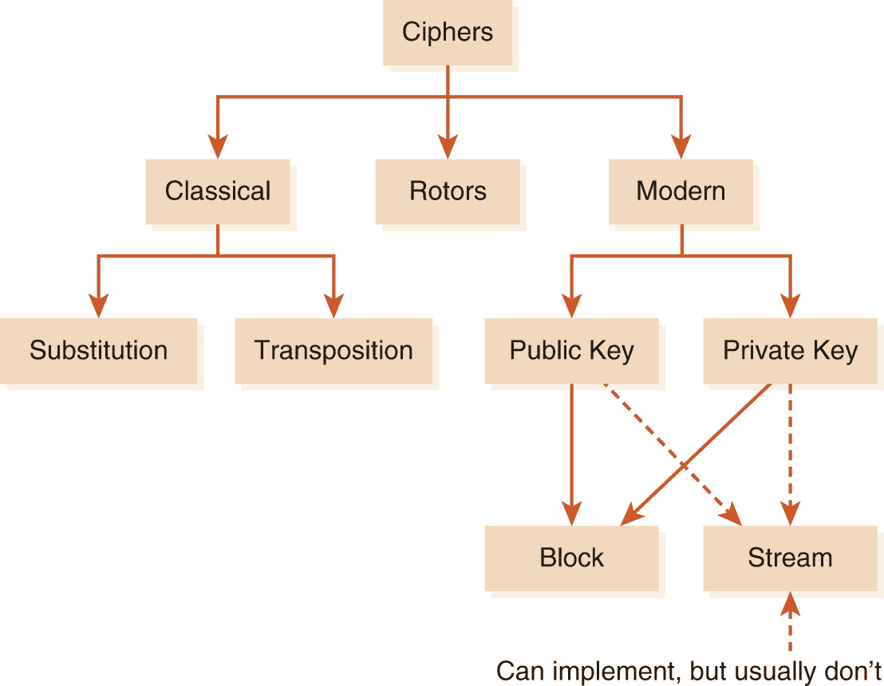

图 10.1 密码类型

一段时间内，`DES` 非常流行，但随着计算能力的提升，`DES` 已不再被认为足够安全以用于高度敏感的信息。³^，¹³ 为了增强 `DES`，曾尝试将轮数三倍化，从而创建 `3DES`（及密钥），但由于 `3DES` 相比其他新型密码加密和解密速度较慢，因此使用频率不高，且已被 `AES` 所取代。尽管如此，`DES` 作为一个密码工作原理的良好例子，因为它使用的基本技术已被其他密码所继承。

为了解决简单替换密码的弱点，现代密码学引入了替换、转位和置换的概念。转位将明文中的元素分割成若干部分并以各种排列方式进行交换。因此，转位密码与替换密码类似，但它通过根据规则和密钥将符号移动到消息的其他位置来实现符号的重排。在替换中，代码或符号（例如八位字节的比特）被用作偏移量，像维吉尼亚密码一样在不同集合之间进行移动，并使用逻辑异或（`XOR`）进行置换，这会重新排序代码中的符号。这两个特性对于现代密码来说是实现合理安全性所必需的。¹¹


为了说明这个过程，我们先考虑字母表中的字符可以表示为字母或 ASCII 十进制数，但现代密码使用 ASCII 码的二进制表示。二进制 ASCII 码是由 1 和 0 组成的模式，用来表示字符。由于所有数字信息最终在计算机的某个层面上都以 1 和 0 的形式存在，我们需要在此层面上思考密码学。如果我们查看 ASCII 字符集表（例如查看查找表），⁵ 我们会发现，“A” 和 “B” 等字母在八进制、十六进制和二进制形式中有所表示。例如，字母 “A” 在 ASCII 中的二进制表示为 1000001，而字母 “B” 的二进制表示为 1000010。观察这些二进制代码后，我们会发现只有 7 位用于二进制数，因为 1 位被保留用于通过所谓的奇偶校验位来确保数据完整性（在此阶段我们暂不讨论奇偶校验位）。

为了在二进制层面理解转位和置换，我们将简化现代对称密钥密码——费 istel（Feistel）密码——来阐述概念。实际上，密码算法相当复杂，因此这里仅概括其基本思想。在费 istel 密码（如 DES）中，二进制数据块使用 64 位密钥进行变换。需要注意的是，在 DES 中实际可用的密钥只有 56 位，因为 8 位被用作奇偶校验位并从密码算法中剔除。二进制数据块随后被分为两半，算法分别对每一半进行混淆。密钥的一部分用于其中一半的数据块，进行密码函数处理后，两半又被交换。这正是替换、转位和置换的核心。如果以 DES 作为费 istel 密码的例子，上述操作会重复 16 次。为了突出这一复杂概念，我们通过模拟过程并使用位数子集的简化示例来展示步骤：

1. 将明文的比特分为左半部分和右半部分。
2. 生成用于每个迭代或循环的子密钥。
3. 对比特进行混淆——即根据某种方案（函数 f）将比特放入不同位置（替换）。
4. 使用逻辑异或（XOR）运算对右侧比特集应用轮函数。
5. 将上述操作结果左移（转位）到左侧。
6. 然后对结果与左侧比特进行异或运算。
7. 最后通过交换两半完成置换。
8. 重复步骤 1 至 7 n 次。（注意：DES 以 16 次为一轮，每次称为一轮。）

总结来说，假设我们有一个 64 位的输入用于加密。该输入会被分成八个部分进行混淆，这意味着根据某种定理或函数将它们放入块中，这正是密码中的替换部分。换句话说，比特被分割成片段，每个比特根据密码算法被放入不同位置，形成 S 盒。随后进行异或运算，然后交换两半。这种替换置换密码可以用 Figure 10.2 中的极简示意图来表示。如图所示，函数先对右半部分与子密钥进行异或运算，再与 S 盒配合，随后交换两半。符号 ⊕ 表示使用指定的密码函数和提供的密钥对数据一半进行异或运算。

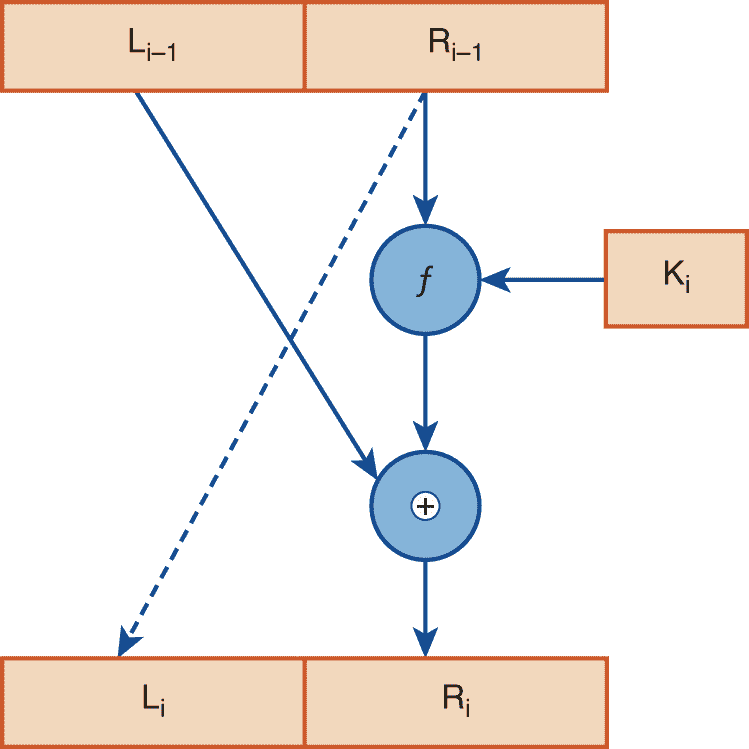

FIGURE 10.2 Simplified Substitution and Permutation

此时，你应该已经熟悉 AND、OR、NOT 等逻辑运算符的工作原理。这些是无论在计算机编程中还是在散文论证中使用的常见运算符。逻辑异或（XOR）运算符会将结果设为 1，仅当两个输入中恰好有一个为 1 时；否则结果为 0。我们可以通过观察真值表 Table 10.5 来看到 XOR 运算符的工作方式。

TABLE 10.5 XOR Truth Table

| A || B || A ⊕ B |
| --- | --- | --- |
| 1 || 1 || 0 |
| 1 || 0 || 1 |
| 0 || 1 || 1 |
| 0 || 0 || 0 |

为了简化说明替换和置换的概念，我们假设有一个 8 位明文比特模式 11110011 和一个子密钥 0110。使用异或函数并对比特进行左移和交换后，密码算法可以如 Figure 10.3 所示执行。此简单密码将比特分为左半部分和右半部分。使用子密钥 0110，对右半部分进行异或运算。得到的结果 0101 然后左移到左半部分，再次对左侧比特应用异或运算。随后交换两部分，即初始的右半部分移至左侧，左半部分移至右侧。

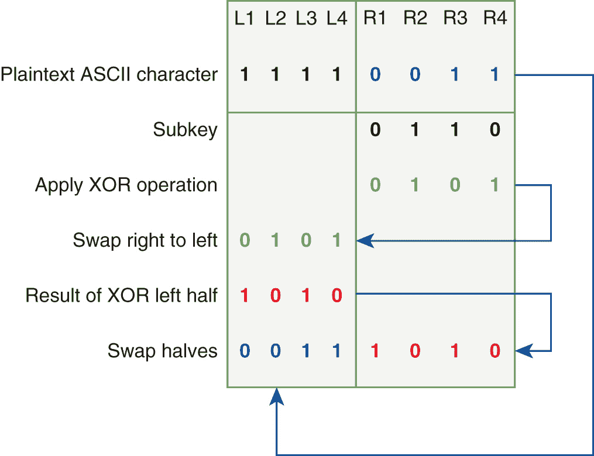

FIGURE 10.3 Substitution and Permutation Example 1

我们将以相同的替换和置换过程重复多次，如密码算法所定义。在此示例中，我们会在下一轮中通过左移比特来生成下一轮的子密钥。因此，在 Figure 10.4 中，我们从上一轮的 00111010 比特模式开始，并按前述方式重复过程。为了演示这一轮，假设本轮生成的子密钥为 1100，我们便基于前一轮的结果使用它。

本文使用的定理将继续重复上述步骤 n 次，直至生成最终的密文。请注意，如果比特以这种方式被混淆，则在私钥密码中，使用相同的密钥并执行逆运算（即解密）即可将密文还原为明文。需要注意的是，公钥密码要复杂得多且速度更慢。鉴于此类替换和置换的性质和可预测性，它们相对容易被“破解”，因此不再被认为是安全的。²

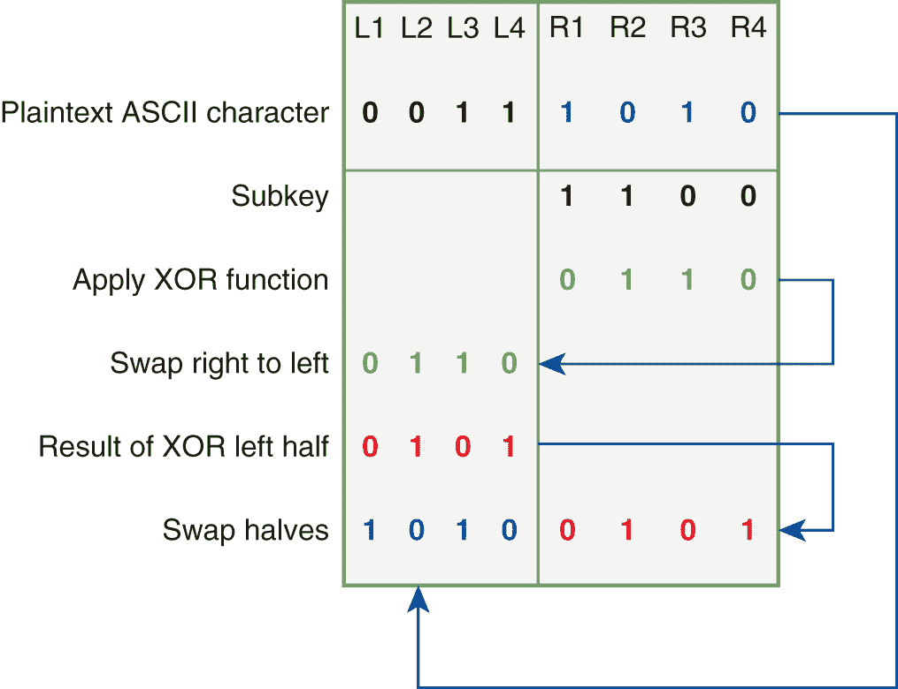

FIGURE 10.4 Substitution and Permutation Example 2

作为密码破解的后果，现代密码增加了密码算法的复杂性。例如，3DES 通过取 DES 64 位密钥并将轮数三倍化，将整体密钥长度扩展至 192 位。（注意 3DES 可以以多种不同的方式或模式执行，超出本文范围，但更精确和详细的解释请参见 Kaufman.²) 请记住，DES 需要位用于完整性检查，这意味着部分位被截取，剩余的位用于密钥。3DES 将密钥分为三个子密钥，必要时进行填充使其每个均为 64 位，然后剩余的加密过程使用 DES 算法，但使用 48 位而非 56 位（关于完整性检查的原因已说明）。如概念描述及本例所示，置换、转位和置换在该方法中相当直接，但实际计算要复杂得多。

除了 3DES，我们还看到了 IDEA（International Data Encryption Algorithm）的流行。使用 IDEA 算法时，对数据执行三次置换操作：(1) 位 wise XOR，(2) 模 2¹⁶ 的加法，以及 (3) 模 2¹⁶ 的乘法 + 1，其中全零块被视为 2¹⁶。IDEA 将 16 位块的密钥和数据组合，使用各种置换函数，并在每轮结束时进行最终置换。最终输出转换重复使用相同的 16 位密钥块进行初始置换。通过这些简化的例子，你仍能看到即使是相对简单的现代密码，对人类而言仍然非常难以破解——计算机则更容易。

高级加密标准（AES，FIPS PUB 197）与 3DES 类似，是一种对称密码，对数据块进行操作而非连续流。然而，AES 本身与 3DES 截然不同。AES 的块大小为 128 位，密钥长度可为 128、192 或 256 位。为了澄清，建议在谈论算法时指明密钥长度（AES-128、AES-192、AES-256）（FIPS PUB 197）。AES 与 3DES 在处理数据块的方式上不同。与将数据块分为两半、执行轮函数并交换两半的做法不同，基于 Rijndael（以创建者 Vincent Rijmen 和 Joan Daemen 命名）的算法在 AES 中创建平行的置换和置换阶段，每个置换包含三个置换阶段。AES 的基本算法如下：

1. 取给定密钥（128、192、256 位）并使用指定的密钥扩展算法，生成足够的 32 位块（称为字）以覆盖一比轮数多的数量。128 位密钥对应 10 轮，192 位密钥对应 12 轮，256 位密钥对应 14 轮。
2. 将要加密的 128 位块拆分为 8 位字节。
3. 将 128 位轮密钥与 128 位数据块进行异或（XOR）。
4. 除最后一轮外：
   1. 根据置换表（S-box，矩阵中的值用于选择）对当前块的字节进行替换。这是第一次置换。
   2. 按行号循环移位块中的行。这是置换。
   3. 根据指定算法对块中的列进行混合（详情请参见 FIPS PUB 197）。这是第二次置换。
   4. 使用异或（XOR）添加轮密钥。这是第三次置换。
5. 除最后一轮外：
   1. 根据置换表（S-box）对块的字节进行替换。
   2. 按行号移位块中的行。
   3. 使用异或（XOR）添加最终轮密钥。

从对 AES（特别是 Rijndael 算法）的简化描述可以看出，它不像 DES 那样采用对称的 Feistel 置换。相反，它使用 S-box（一个可算法化向量选择的值矩阵），选择的值是每个输入值的乘法逆变换函数。这意味着选取的值不仅仅是分段置换、替换和交换，而是具有非线性特性，使得对密码分析者（破解者）而言，给定前一轮的结果，计算下一轮结果变得极其困难——而这在 DES 中是常见的情况。¹⁶

### 10.2.4 对称密码学的关键问题

如前所述，私钥密码学使用相同的密钥对消息进行加密和解密，且密钥必须保持秘密。这种密码方式在消息的加密和解密方面效率很高。通过简单逆转过程，加密消息可以重构，因为 XOR 函数会将位还原为原始形式。以简单的解释为例，如果我们用子密钥 1111 对消息段 1001 进行编码，XOR 产生 0110；再将 0110 与子密钥 1111 异或，得到 1001。然而，依赖单一密钥在密钥分发和保密方面存在一些问题。

在大规模、秘密密钥密码学中，一个实际问题在于如何安全地以电子方式向许多他人交换密钥。惠特菲尔德·迪菲和马丁·赫尔曼设计了一种利用质数模函数来编码密钥的方法。虽然 Diffie–Hellman 方法在技术上不属于密码学，但它使用密码技术来编码密钥交换。因此，Diffie–Hellman 密钥交换协议允许两名用户通过不安全的通信通道独立生成共享密钥。该协议基于离散对数的计算困难，但在此我们只需了解如何选择用于计算共享密钥的数值。交换依赖于选择一个质数 p 和该质数 mod p 的原根。

一个质数 p 的原根是其模 p 的幂在达到 p – 1 时能够生成从 1 到 p – 1 的所有整数的数。这为密码系统提供了从中选择的质数矩阵（详细解释请参见 Stallings，第 294 页）。例如，给定质数 5，原根为 2 和 3，因为它们满足以下条件：

1. 2¹ mod 5 = 2；2² mod 5 = 4；2³ mod 5 = 3；2⁴ mod 5 = 1
2. 3¹ mod 5 = 3；3² mod 5 = 4；3³ mod 5 = 2；3⁴ mod 5 = 1

要在不安全的通信通道上生成共享密钥，让我们假设两个人，爱丽丝和鲍勃，会选择一个质数 p，以及一个原始根 r。爱丽丝和鲍勃可以通过不安全的通道共享这些值。然后，他们各自会选择一个秘密值，用它对 r 进行模 p 运算。因此，如果爱丽丝选择 a，鲍勃选择 b，爱丽丝会计算 r^a mod p，鲍勃会计算 r^b mod p。以我们选取 5 作为质数的例子，爱丽丝和鲍勃可以约定使用 2 作为原始根，从而得到 p = 5 且 r = 2。爱丽丝选择 a = 7，鲍勃选择 b = 9。爱丽丝计算 2⁷ mod 5 = 3，鲍勃计算 2⁹ mod 5 = 2。爱丽丝和鲍勃共享计算结果 3 和 2，但保持指数 7 和 9 的秘密。爱丽丝然后取鲍勃的数字 2，将其提升到她的秘密数字 7 次方，再对共享的质数 5 取模。鲍勃则对爱丽丝的 3 进行同样的操作，提升到他秘密的 9 次方，再对共享的质数 5 取模。结果是相同的值，他们现在共享这个值作为共享密钥：

1. 2⁷ mod 5 = 3
2. 3⁹ mod 5 = 3

拦截者可能能够截获质数、原始根以及原始根被提升到某些指数的结果，但要在爱丽丝和鲍勃之间生成共享密钥，拦截者必须计算 2^x mod 5 = 3 或 2^y mod 5 = 2 的离散对数。虽然使用这种小数字的例子很 trivial，但在实际世界中使用的更大的数字时，计算质数以尝试破解密钥是计算上不可行的。¹⁸

## 10.3 Asymmetric Cryptography

公钥加密，也称为非对称加密，对于广泛分发的安全交易至关重要。它使企业能够使用受信任的消息进行电子商务。支持非对称密钥加密的基础设施称为公钥基础设施（PKI）并包括以下组件：(1) 证书颁发机构（CA），它们颁发受信任的验证，如 X.509 证书；(2) 注册机构（RA），它们将证书“记录”或向证书颁发机构注册；(3) 证书服务器，用于发布数字证书；(4) 证书撤销，用于分发被撤销、过期或伪造证书的通知；以及 (5) 密钥恢复服务，允许管理员恢复丢失的密钥。

在公钥加密中，我们将公钥分发给想要创建和发送加密消息的人。我们使用私钥对其进行解密。我们需要在一个称为密钥生成的过程中创建这些密钥。一旦完成，我们可以交换公钥并进行安全的对话。注意，公钥加密还用于许多其他功能，如身份验证（Figure 10.5）。

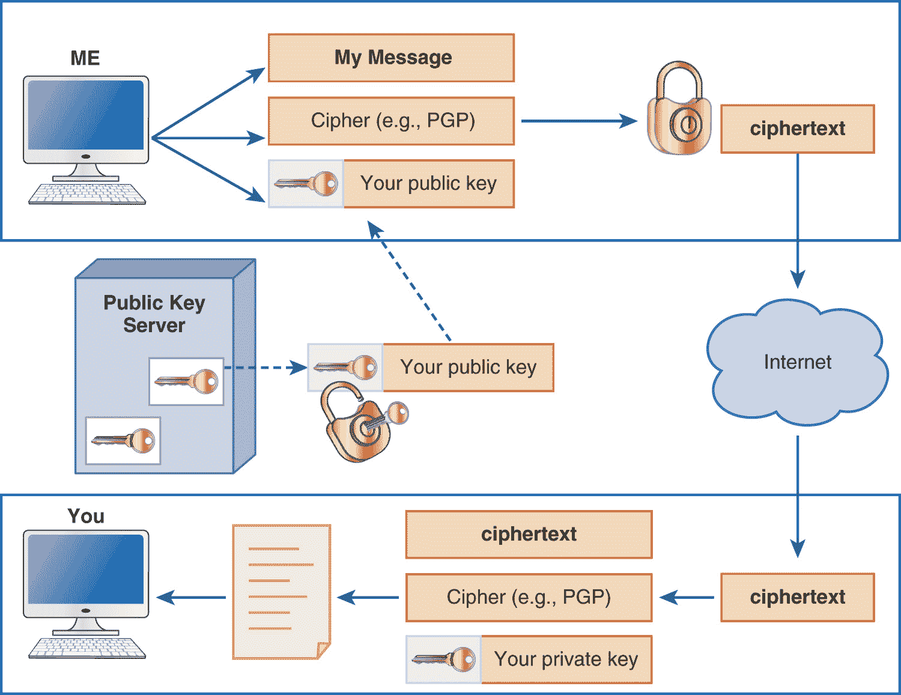

FIGURE 10.5 PKI Illustration

公钥加密依赖于特殊的数学函数，这些函数在没有特殊的“后门”知识的情况下极难逆转。这种加密算法依赖于对大质数整数进行因式分解、组合优化（也称为背包问题）、代数编码理论或有限域的离散对数，或椭圆曲线的微积分。¹⁹

| Salt || Salts use randomly generated characters (seeds) inserted into a string of characters, such as a password. The salt and the password are combined and processed using a hashing function that obfuscates the password. This technique is very useful for authentication or password storage. It’s also helpful in preventing a rainbow table attack, which is a type of attack that uses precomputed hashes. |
| --- | --- |
| Hash || Hashing converts one set of values of variable length into another value of fixed length, often using a compression technique. These hashed values are used to produce codes that serve as message digests, password obfuscation, and in some ciphers. Well-known hash functions include MD5 and SHA1/2. In cryptography, a one-way hash is easy to compute in one direction, but difficult to revert back or decode/break. |
| Trap Door || In cryptography, a trap door is a common secret that is computed using different inputs. For example, during key generation, a matrix of prime numbers is reproduced, then two prime values, p and q, are chosen to compute key halves d and e. The key half, d, is computed such that e * d = 1 mod (p – 1) * (q – 1). Note that, e * d – 1 is evenly divisible by [(p – 1)*(q – 1)]. Key half, e, is such that it is relatively prime to (p – 1)*(q – 1). The public key is the combination of (e, n); the private key is the combination of (d, n). The value, n, is called relatively prime to (p – 1)*(q – 1), thus n is the trap door. Section 10.3.1 explains this concept further. |

### 10.3.1 Private Keys and Asymmetric Cryptography

非对称加密的独特之处在于，它会生成一种特殊的代码，如果该代码与密码的解密公式所期望的结果匹配，它就“穿过后门”，即后门是解密函数，这与初始加密过程所使用的技术和信息不同。这意味着不需要共享秘密；公钥用于加密，可以自由分发，这样任何人都可以向拥有私钥的持有者发送加密消息。只有拥有私钥的持有者才能解密消息，这之所以可能是因为原始发送者使用某种技术或方法生成密钥对和一个公共质数。公钥的一半和公共质数被分发为公钥，而私钥的一半和公共质数则保留为私钥。¹⁰


公钥加密对许多新手来说是一个令人困惑的部分：两个人如何能够共享一个加密消息，而只有部分解是已知的？这通常涉及密钥生成的问题。答案是，创建密钥的人（可以是门卫之类的角色）使用某种技术生成密钥，然后将密钥分成两半，称为密钥对，并只发送其中一半以及一个种子值，即一个公共质数，给另一个人（可以是俱乐部的顾客），该人只能加密但不能解密消息；只有原始创建者才能解密，因为生成程序在私钥部分中创建了一个逆机制，使得消息可以被解码。考虑到消息创建者拥有部分密钥并使用 `RSA` 等众所周知的加密算法，如果公共质数和部分代码已经公开，那么公钥加密如何安全工作？为了让公钥加密（如 `RSA` 或 `PGP`）工作，需要将大数分解为其质因数。记住，质数是只能被 1 和自身整除的数。首先，必须生成一个大的随机密钥。

生成密钥的工具和方法很多。一个例子是 Java 编程语言的扩展库 `javax.crypto`，可以用于创建密钥。例如，导入 `javax.crypto.KeyGenerator`、`javax.crypto.SecretKey` 和 `java.security.Key` 库，可以使用 `generateKey()` 方法为 `DES` 生成密钥。另一种技术是 Windows 系统上的 `PuTTY`，或者更具体地说 `PuTTYgen`，可以用于生成 `RSA`、`SSH` 和其他公钥加密的非对称密钥。下面的场景将说明如何使用 `PuTTYgen` 和 `PuTTY` 以安全方式登录到服务器。

在本节的简短案例说明中，关键生成过程将整个密钥的 `ASCII` 值转换为整数，然后计算一个质数矩阵，接着将密钥值分成两半，并计算一个公共质数 `n`。这个公共数字在密钥的公共部分和私有部分之间共享。例如，假设算法从密钥的两个部分 `p` 和 `q` 开始，这两个都是质数；我们将使用 17 和 11。随后计算 `n = p × q = 17 × 11 = 187`。两个密钥部分都得到 `n = 187`。为了计算密钥部分的余数，我们使用乘法模方程。因此，小于正整数 `n` 的非负整数的模被取用并用于生成模运算结果。（有关此过程的详细描述，请参见 Stallings，第 8–84 页。）⁸

随后的关键生成过程涉及选择两个大的质数（由数百位数字组成）`p` 和 `q`，并将它们相乘得到 `n`。部分键 `n = (p q)` 成为公钥的一部分，但 `p` 和 `q` 必须保持秘密。此时，选择一个数字 `d`，其值位于 `min(p, q)` 与 `(p – 1)(q – 1)` 之间，使得结果 `e` 计算为在 `mod (p – 1)(q – 1)` 下的 `d` 的逆元。这成为密钥的另一部分，`e` 与 `n` 一起作为公钥公开，而 `d` 必须保密。（请参见更多具体细节的参考文献。）²⁰^,²¹ 因此，密钥由数字组成，这些数字通过数学算法确定公钥，公钥为 `ka = {e,n}`，而私钥为 `kb = {d,n}`，二者在数学上相关。（请参见更多技术讨论的参考文献。）⁸^,¹²

### 10.3.2 超越加密消息

除了加密消息外，私钥密码学还可用于确保消息来源的不可否认性，因为 presumably，只有拥有私钥的一方才是密钥对的所有者。因此，除了提供标准加密的隐蔽消息的好处外，非对称密码学还有额外优势：它可以利用公钥来提供数字签名的手段。数字签名通过使用所谓的哈希或消息摘要（`hash`）来实现。哈希函数是一种单向函数，接受消息作为参数，并输出与原始消息相关的固定长度数据块。

随后，哈希值使用签名者的私钥进行加密。消息和加密的哈希值一起发送，就像签署的文档一样。消息接收方可以获取签名者的公钥并解密与消息相关的哈希值。接收方随后重新生成哈希值并与其收到的解密版本进行比较。如果两者匹配，则可以确定消息未被篡改，且持有与用于解密哈希值的公钥相对应的私钥的持有者是消息的原始发送者。

使用哈希函数的缺点是，由于其固定长度输出，会出现碰撞——即多个消息可以产生相同的哈希值。要构建一个良好的哈希算法，必须使得从哈希值重建原始消息是不可能的，并且对于任何给定输入，预测哈希函数的输出应当非常困难。这意味着在知道目标哈希值的情况下，几乎不可能故意篡改消息，使其哈希输出匹配预定义的值。如果能够做到这一点，则可以创建一个新消息，使其哈希相同，并直接附加数字签名。

与公钥密码学中的数字签名类似，对称密钥密码学通过消息验证码（`MAC`）提供消息完整性。`MAC` 类似于数字签名，但使用共享密钥与哈希算法一起生成，该过程称为键值哈希。共享密钥与明文消息连结后进行哈希。接收方在明文消息上添加相同的共享密钥，生成哈希值以进行比较。若没有共享密钥，则没有任何链接将哈希与发送者关联。`RFC 2104` 规定了一种名为 `HMAC` 的键值哈希，广泛用于需要完整性和数据验证的实现。

### 10.3.3 密钥分发与 PKI

术语 `PKI` 指的是“公钥基础设施”，即密钥的共享方式以及未共享密钥的保密方式，因而 `PKI` 与对称密钥密码学面临相似的问题。换句话说，虽然公开发布公钥似乎具有诸多优势并解决了对称密钥密码学的密钥分发问题，但密钥验证的问题仍然存在。因为加密消息使用的接收方公钥必须事先被获取，所以必须先获得该公钥。这一问题部分通过使用公钥服务器得到缓解。如果某人想向另一人发送加密消息，他可以访问公钥服务器查找相应的密钥。然而，确保服务器上发布的公钥确实属于该个人是关键。任何人都可以生成密钥对并将公钥放在服务器上。若在别人的名下生成并上传公钥，接收方在服务器上检索公钥时，若没有其他机制，将无法确认该密钥是否真正属于该人。结果是，本应保密的信息可能会泄露给第三方。

作为拥有对应私钥的“第三方”，该第三方可以在该密钥仍被信任的前提下长期冒充该第三方。为降低此问题的影响，提出了“信任网络”（`web of trust`）概念，并通过 Phil Zimmerman 的 Pretty Good Privacy（`PGP`）实现。信任网络的基础是社交网络以及通常需要的有限中间节点来连接任意两个人。在此基础上，密钥对的拥有者可以请他们的可信伙伴对其公钥进行数字签名，并在签名中标明签署者对该密钥真实性的信任程度。离签名者最近的伙伴应在公钥的可信度上给予最高信任。

原始签名者的关联伙伴若需使用该公钥，可根据其对可信伙伴的信任程度来信任该公钥。如果他们信任可信伙伴的断言，他们也可以以相应的信任度对公钥进行签名。此过程可继续进行，公钥上附加的数字签名越多，越容易在需求方与其声称所属人之间找到信任路径。由于该系统依赖于他人验证公钥以及通过验证产生的关联信任，因此必须有足够多的人参与，以便建立所需的连接。取而代之的是，有一个被所有参与方信任的单一中央第三方，这将提供密钥真实性的确定。这就是数字证书的基础，由像 `VeriSign` 这样的证书颁发机构（`certificate authorities`）发放。

在所有公钥加密方案的优势下，你可能会好奇为什么人们还要使用对称密钥方案。虽然非对称密钥方案具有诸多优点，但计算所需的处理能力可能相当大。因此，对称和非对称方案通常会一起使用，公钥加密用于安全地传递会话密钥，而该密钥随后用于保护传输中的消息流量。

数字证书是由受信第三方（`CA`）签发的，用于验证证书中绑定的公钥是否属于证书中指定的实体。该实体信息和公钥通过证书颁发机构的私钥进行数字签名。证书颁发机构的公钥绑定在一个特殊证书——根证书中，该根证书会分发给需要验证其签名的数字证书的任何人。除了建立证书颁发机构和根证书外，公钥基础设施（`PKI`）还必须提供一种方式来撤销证书，以防其被破坏。数字证书的撤销通过证书撤销列表（`CRL`）实现。该列表由 `CA` 发布，包含其已数字签名但不再受信任的所有证书信息。这可能发生在证书后被发现是欺诈性的，或者因为证书有“保质期”而过期。

### 10.3.4 公钥算法：RSA 示例

与 `DES`、`3DES`、`IDEA`、`AES` 用于私钥加密相似，公钥加密也有对应的算法。最常见的两种是 `RSA` 和 `PGP`，但需要注意的是 `PGP` 属于一种混合模式，因为它虽然提供公钥，但会对私钥进行编码并使用公钥加密。`RSA` 以其三位创始人命名：Ron Rivest、Adi Shamir 和 Len Adleman。`RSA` 与私钥算法 `DES`、`AES`、`IDEA` 类似，是一种区块密码，块大小可变，通常约为 1024 位。`RSA` 与其他我们讨论的算法不同，概念上在处理整数而非严格的比特，1024 位整数大约相当于 309 位十进制数。该算法基于对大数因式分解的困难，并生成两个质数的乘积作为大数。算法步骤如下，首先是生成密钥对。我们将使用传统的通信实体 Alice 和 Bob 进行示例（更多细节请参阅 Kaufman 等人的研究）。

1. Alice 选择两个相对较大且唯一的质数，记作 `p`、`q`。

2. 计算两个质数的乘积：`n = p × q`。

3. 使用欧拉的 φ 函数（`Φ(n)`）计算 `n`。欧拉函数返回小于 `n` 且与 `n` 互质的正整数个数。互质意味着两个数的最大公约数为 1。可以通过构造分数并观察是否可以约分来理解。例如，若计算 `Φ(10)`，则可列出 1/10、2/10、3/10、4/10、5/10、6/10、7/10、8/10、9/10。只有 1/10 不可约分，因此 1 与 10 互质。2/10 可约分为 1/5，因 2 与 10 都能被 2 整除，所以 2 与 10 不互质。继续检查，1、3、7、9 与 10 互质，因此 `Φ(10) = 4`。实际上，若已知两个因子，快速计算欧拉 φ 的方法是计算每个因子减 1 后的乘积。例如，若 2 × 5 = 10，则 `Φ(10)` 可直接计算为 `(2 – 1)(5 – 1) = 1 × 4 = 4`。

4. 选择一个小于且与 `Φ(n)` 互质的整数 `e`。

5. 计算 `d`，使其满足 `d ≡ e^(–1) mod Φ(n)`。两个整数若在相同的模数下结果相同即为全等，例如 `39 ≡ 13 (mod 26)`。这里我们需要找到一个值，使其在模 `Φ(n)` 下与步骤 4 所选的 `e` 的逆元相等。可以通过试错，也可使用欧几里得算法求最大公约数来实现。

上述计算结果提供了 Alice 的密钥生成器，实际上包含多个值。她的公钥由步骤 4 确定的 `e` 和步骤 2 确定的 `n` 组成，私钥由步骤 5 计算的 `d` 和步骤 2 确定的 `n` 组成。Alice 会公开发布她的公钥，供希望与她建立安全通信通道的任何人查找。若他人想给她发送加密消息，则需将消息拆分为小于 `n` 的块，对每个小于 `n` 的数据块进行整数转换，然后计算 `Message^e mod n`，即密文。解密时，Alice 将收到的密文值 `X` 计算 `X^d mod n`，即可恢复明文。

下面是一个类似 Stallings（第 270 页）的示例：

1. 为生成 `RSA` 公私钥对，Alice 选择 `p = 7`、`q = 11`。

2. `n = p × q = 7 × 11 = 77`。

3. 计算 `Φ(77)`（`Φ(77) = (7 – 1)(11 – 1) = 60`）。

4. 选择一个与 60 互质的值，设为 `e = 17`。

5. 计算 `d ≡ e^(–1) mod Φ(n) = 17^(–1) mod 60`：使用扩展欧几里得算法得到 –7 ≡ 53。

6. 公钥为 `{17, 77}`，私钥为 `{53, 77}`。

若要使用上述方法对 “MEET ME AT PORTER HALL” 进行加密，需先将消息转换为 `ASCII` 比特流。随后可按如下方式处理：

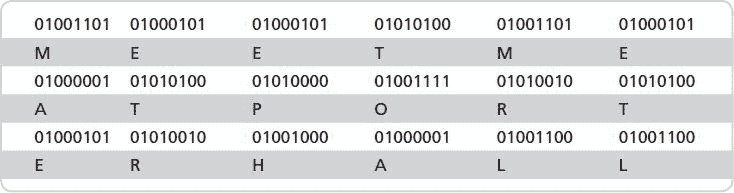

将比特转换为整数后得到 6.731217654514961e+42，若使用更大的 `n` 则无问题，但在此例中 `n = 77` 远小于该整数，因此需将数据分块。我们将数据分为 4 位一组，每组对应 0–15 的十进制值，具体如下：


随后将二进制转换为整数：


使用公钥对每个整数 `X` 进行加密，公式为 `X¹⁷ mod 77`，结果如下：


解密时，使用私钥计算 `X⁵³ mod 77`。例如，验证 `16⁵³ mod 77` 可表示为 `[(16¹⁰ mod 77) × (16¹⁰ mod 77) × (16¹⁰ mod 77) × (16¹⁰ mod 77) × (16¹⁰ mod 77) × (16³ mod 77)] mod 77 = [23 × 23 × 23 × 23 × 23 × 15] mod 77 = 96545145 mod 77 = 4`，两者相等，说明算法正确。虽然此处省略了许多细节，但这已展示了加密的基本原理。

## 10.4 加密用途

现在我们已经熟悉了网络安全概念以及密码学的基础，它是防御信息在点对点传输过程中被拦截，或存储在主机平台或笔记本电脑，甚至手机上的威胁的一种方式。我们将转向理解密码学的一些用途，并进一步阐述虚拟专用网络（`VPN`）的工作原理。之前，我们提到了密码学和网络安全协议（如 `IPSec`）。密码学可以在网络栈的多个层级出现，具体取决于需要保护的信息类型和数量。例如，在网络层可以使用 `IPSec`；在传输层可以使用传输层安全性（`TLS`）；在应用层可以使用 `S/MIME`。

在开始详细阐述这些内容之前，我们需要先介绍数字证书。数字证书和证书颁发机构（`CA`）常用于验证通信会话中涉及的实体，并安全地生成和传递用于加密会话通道的对称会话密钥，直至会话结束。

当有人向你发送消息时，你如何确认该“某人”就是他声称的本人？Alice 可能窃取了 Bob 的电子邮件登录并向你发送消息，要求提供我们正在工作的公司机密文档，因为“我”（Bob）丢失了自己的（但注意“我”是 Alice 假装 Bob）。这个问题正是数字证书使用的核心。`X.509` 标准由国际电信联盟（`ITU`）发布，它定义了在公钥（对称）密码学中建立信任关系的机制。虽然还有其他标准，但 `X.509` 是最广泛采用的之一。该标准的重要性体现在数字证书的使用上。

### 10.4.1 IPSec 实现

`IPSec` 是 `IPv6` 协议安全范式的基石，通过使用认证头（`AH`）（`RFC 4302`）和封装安全载荷（`ESP`）（`RFC 2406`）标准，为 IP 网络提供了多重安全优势，包括“访问控制、无连接完整性、数据来源身份验证、防回放（一种部分序列完整性形式）、保密性（加密）以及有限的流量保密性”（`RFC 2410`）。`IPSec` 安全体系结构文档为 `RFC 2401`。该 `RFC` 指定了可使用的 `AH` 和 `ESP` 标准，可工作在两种模式：传输模式或隧道模式。传输模式用于保护主机之间或主机与网关之间的通信，而隧道模式通常用于连接两个网关。在传输模式下，`AH` 或 `ESP` 头部插入 IP 头部之后，保护数据包中的数据；在隧道模式下，待保护的整个 IP 包被封装在新的 IP 包中，加上 `AH` 或 `ESP` 头部，从而保护原始包的全部内容，包括静态和非静态字段。

无论选择 `AH` 还是 `ESP` 来提供保护，`IPSec` 都需要使用安全关联（`SA`）来指定通信实体如何保护彼此的通信，每个通信方向都有一个 `SA`。`SA` 包含 32 位的安全参数索引（`SPI`）、流量目的地址以及是否使用 `ESP` 或 `AH` 来保护通信的指示。`SPI` 设计用于唯一标识两个主机之间的特定 `SA`，并在出站连接的安全关联数据库（`SAD`）或入站连接的安全策略数据库（`SPD`）中与目的地址和 `ESP/AH` 指示一起作为索引使用。最少需要在数据库中记录每条记录的认证机制、密码算法、算法模式、密钥长度以及初始化向量（`IV`）。

`ESP` 通过 payload 加密提供数据保密性，而 `AH` 仅提供数据完整性、数据来源身份验证以及防回放攻击，通过在数据包上生成 `HMAC` 实现。需注意，Keyed-Hashing for Message Authentication（`HMAC`）是一种使用密码散列函数（`MD5`、`SHA1`、`SHA256`）与待认证数据一起生成的消息验证码，使用共享秘密密钥，可同时验证数据的完整性和真实性。

`IPSec` 最小指定的算法包括 `DES`、`HMAC-MD5` 和 `HMAC-SHA`，但许多实现还支持其他密码算法，如 `3DES` 和 `Blowfish`。虽然可以手动创建所有安全关联，但对大型企业而言，这将带来大量的行政开销。为动态管理 `SA` 数据库，`IPSec` 利用互联网关键交换（`IKE`）（`RFC 2409`）实现。

如 `RFC 2409` 所述，`IKE` 是一种混合协议，设计用于“以受保护方式协商并提供安全关联的已验证密钥材料”。`IKE` 通过结合两个关键交换框架——`Oakley` 和 `SKEME`，并与通用密钥交换与身份验证协议（`ISAKMP`）（`RFC 2408`）一起工作，实现了这一点。

#### 10.4.1.1 IPSec 示例

本章的范围不包括对密码学用途的深入探讨，但理解两个实体如何协商安全连接是至关重要的，因为这构成了我们大多数加密通信的基础。`IKE` 可能会发生八种不同的交换过程以进行身份验证和密钥交换，但我们只考察唯一必需的一个——主模式中的共享秘密密钥。在此交换中，我们称之为 Alice 和 Bob 的两个实体已经共享一个秘密密钥。这可能是远程工作者需要建立安全连接到公司网络的情况。虽然该协议存在一些问题，但它仍然是展示关键交换如何实现的示例。交换过程始于 Alice 向 Bob 发送消息，指明她支持的各种密码参数（`CP`）组合，包括加密算法（`DES`、`3DES`、`IDEA`）、散列算法（`SHA`、`MD5`）、身份验证方法（预共享密钥、公钥加密等）以及 Diffie–Hellman 参数（包括质量元和原根）。Bob 收到该消息后，从 Alice 提供的选项中选择并回复其选定的内容。Alice 收到 Bob 的选择后，会向 Bob 发送她计算出的 Diffie–Hellman 值以及一个随机位（`nonce`）。

`nonce` 的作用是为通信会话添加一个唯一的值，防止该值被记录并稍后以“新”会话的形式重放给 Alice 或 Bob（即重放攻击）。Bob 收到 Alice 的信息后，会返回他自己的 Diffie–Hellman 计算结果和一个他创建的 `nonce`。Alice 和 Bob 然后可以利用共享秘密密钥、各自计算出的 Diffie–Hellman 共享秘密、Alice 的 `nonce`、Bob 的 `nonce` 以及两个唯一的会话 Cookie（由秘密值和各自 IP 地址衍生）来计算共享会话密钥。该密钥随后用于通过 Alice 加密消息以证明她的身份发送给 Bob，Bob 也同样进行验证。

### 10.4.2 SSL/TLS


The Secure Sockets Layer, or `SSL`, and its successor, the Transport Layer Security, or `TLS`, are protocols for creating authenticated and encrypted communications among systems. The `TLS` protocol is specified in `RFC 5246`. As with `IKE` used in `IPSec`, `TLS` is used to negotiate a shared session key that secures the communication channel between two entities. Most modern implementations of the `HTTPS` protocol for secure web traffic, Session Initiation Protocol (`SIP`) for Voice over IP (`VoIP`) traffic, and Simple Mail Transfer Protocol (`SMTP`) make use of `TLS` to authenticate and secure the communication.

`TLS` itself is composed of two layers: the `TLS` record layer and the `TLS` handshake layer. The `TLS` record protocol sits on top of the `TCP` layer and encapsulates the protocols that are above it on the network stack. The record layer protocol ensures that the communications are private, through the use of symmetric encryption algorithms such as `AES`. They are also made reliable, through the use of keyed `MACs`. The handshake protocol ensures that both entities in the communication can authenticate each other and securely and reliably negotiate the cryptographic protocols and a shared secret. The `TLS` record protocol is in charge of doing the encryption and decryption of the information that is passed to it. Once it receives information to encrypt, it compresses the information according to the standards defined in `RFC3749`.

The protocol allows for the compressed data to be encrypted using either a block or a stream cipher, but the session key used for the communication is derived from information provided in the handshake protocol. The master secret passed in the handshake protocol is expanded into client and server `MAC` keys and client and server encryption keys (as well as client and server initialization vectors if required), which in turn is used to provide the encryption and authentication.¹¹ The `TLS` handshake protocols allow the communicating entities to “agree on a protocol version, select cryptographic algorithms, optionally authenticate each other, and use public key encryption techniques to generate shared secrets.”⁶ The handshake protocol has the following steps, as specified in the RFC:⁶

1. Exchange hello messages to agree on algorithms, exchange random values, and check for session resumption.
2. Exchange the necessary cryptographic parameters to allow the client and server to agree on a premaster secret.
3. Exchange certificates and cryptographic information to allow the client and server to authenticate each other.
4. Generate a master secret from the premaster secret and exchanged random values.
5. Provide security parameters to the record layer.
6. Allow the client and server to verify that their peer has calculated the same security parameters and that the handshake occurred without tampering by an attacker.

Unlike the `IKE`, `TLS` specifies a limited set of predefined cipher suites that are addressed by number. Because the sets are predefined, the selection of what to offer can be simpler. Finally, note a cryptographic standard Secure/Multipurpose Internet Mail Extension (`S/MIME`) defined in `RFC5751`. `S/MIME` allows a compliant mail user agent to add authentication, confidentiality, integrity, and nonrepudiation of message content through the use of digital certificates.¹⁸ The benefit of using `S/MIME` over some other means of encrypting and signing email is that `S/MIME` certificates are normally `X.509` standard and are sent along with the encrypted email. As long as the certificate was issued by a `CA` that is trusted by both parties, the transfer of digitally signed and encrypted email is relatively easy.

### 10.4.3 Virtual Private Networks (VPN)

Many kinds of attacks can take place across a network. Recall that passive attacks consist of unauthorized interception (eavesdropping) that is carried out covertly to steal information. On the other hand, active attacks are attempts to penetrate defenses or to cause damage and include traffic injection, SQL injection, deletion, delay, and replay. Passive attacks are the most difficult to defend against because in many if not most cases, people are unaware that the attack is taking place. We have discussed that encryption is the most common form of defense for these passive attacks, but even when using encryption, some information may still vulnerable.

In network security, link-to-link security is formed at the connection level (network layer and below), whereas end-to-end security is at the software level (transport and above). One of the main strengths as well as weaknesses of IP security is that network information is encapsulated in each layer’s header, but header information is needed for routing and other controls, such as network traffic management. With the link-to-link layer, there is no notion of the associations among network layers and processes. Each node must be secured and trusted, which is of course impractical in the Internet. To help mitigate, the secure shell (`SSH`), which uses encryption processes, is often used for Internet and web security purposes, but `SSH` is an application layer security protocol. Even when using `SSH`, data are carried in the payload of a `TCP` segment, and `TCP` data are in the payload of an IP segment because various border gateway protocols (`BGP`) and address resolution protocols (`ARP`) have to be able to read the header data. Thus, headers at the routing layer over a WAN may not be encrypted, and therefore a significant amount of information is exposed for exploitation.

A common exploit is called traffic analysis, where attackers examine how much information is flowing between endpoints by examining the contents in headers. To assist with this problem, we can set up a virtual private network (`VPN`) inside a network, and in that case, the header information is encrypted and then reencapsulated using the Point-to-Point Protocol (`PPP`). This is analogous to hiding a real address inside a proxy address. The packet will cycle through the data link layer twice (double loop process), once to encapsulate the `VPN` address, and once again to encapsulate the Border Gateway Protocol (`BGP`) address, which allows us to encrypt the `VPN` address, as illustrated in Figure 10.6.

The IP Security Working Group of the IETF designed the security architecture and protocols for cryptographically based security encapsulation in IPv6 as noted in `IPSec`. As work has progressed, some of the security architecture proposed for IPv6 has also been applied to IPv4. Retrofitting these `IPSec` protocols into IPv4 has continued in particular where plaintext packets are encrypted and encapsulated by the outer IP packet—this is the essence of most tunnels and `VPNs`. This security architecture involves two main protocols: The Internet Protocol Security Protocol (`IPSP`), and the Internet Key Management Protocol (`IKMP`). A number of IP encapsulation techniques have emerged, such as `SwIPe`, `SP3`, `NLSP`, `I-NLSP`, and specific implementations of `IKMP`, such as `MKMP`, `SKIP`, `Photuris`, `Skeme`, `ISAKMP`, and `OAKLEY`.

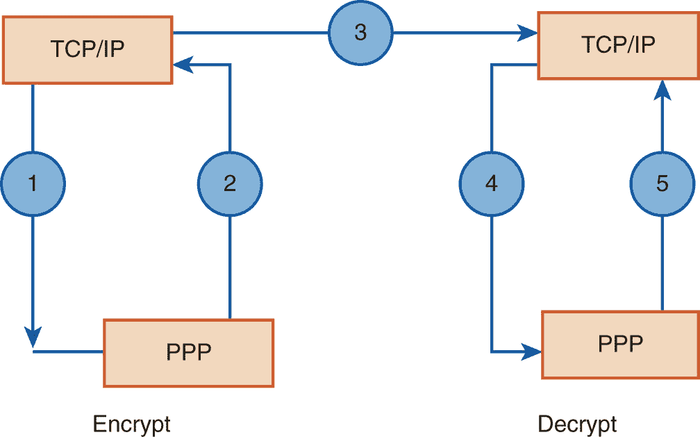

FIGURE 10.6 A VPN Encryption Process

<sup>4</sup> de Medeiros, B. (2005). `Windows security: A synopsis on host protection, 59`, 23–30. Tallahassee: Florida State University Press.

<sup>5</sup> Lookup Tables. (2010). `ASCII in decimal, hex, octal, html, and character`. [`asciitable.com/`](http://asciitable.com/)

<sup>6</sup> Dierks, T., & Rescorla, E. (2008). `RFC 5246—The transport layer security (TLS) protocol version 1.2`. Internet Engineering Task Force. `Security Paradigms Workshop (pp. 48–60)`. Langdale: ACM.

<sup>7</sup> Stewart, M. J. (2011). `Network security, firewalls, and VPNs`. Boston, MA: Jones & Bartlett Learning.

<sup>8</sup> Stallings, W. (2003). `Network security essentials: Applications and standards`. Upper Saddle River, NJ: Pearson/Prentice Hall.


<sup>9</sup> Ford, R. (2020). `Adaptive cybersecurity through biologically inspired infrastructure`. A working paper. A colloquium presentation to the L3Harris Center of Information Assurance. Melbourne, FL.

<sup>10</sup> Harkins, D., & Carrel, D. (1998). `RFC 2409—The Internet Key Exchange (IKE)`. Internet Engineering Task Force.

<sup>11</sup> Solomon, M. G., & Chapple, M. (2005). `Information security illuminated`. Boston, MA: Jones & Bartlett Learning.

<sup>12</sup> Spillman, R. J. (2005). `Classical and contemporary cryptography`. Upper Saddle River, NJ: Pearson/Prentice Hall.

<sup>13</sup> de Medeiros, B. (2020). `Windows security: A synopsis on host protections`. Tallassee, FL: eAselworx Press.

<sup>14</sup> Lai, X., & Massey, J. (1998). `A proposal for a new nlock encryption standard`. Eurocrypt (pp. 389–404). Berlin: Spring-Verlag.

<sup>15</sup> Panko, R. R. (2004). `Corporate computer and network security`. Upper Saddle River, NJ: Pearson/Prentice Hall.

<sup>16</sup> Pfleeger, C., & Pfleeger, S. (2003). `Security in computing`. Upper Saddle River, NJ: Prentice Hall.

<sup>17</sup> Stallings, W. (2004). `Cryptography and network security principles and practices`. Singapore: Pearson Education.

<sup>18</sup> Ramsdell, B., & Turner, S. (2010). `RFC 5751—Secure/multipurpose Internet mail extensions (eS/MIME) Version 3.2 Message specification`. Internet Engineering Task Force.

<sup>19</sup> Stinson, D. (1995). `Cryptography: Theory and practice`. Boca Raton, FL: CRC Press.

<sup>20</sup> Mao, W. (2004). `Modern cryptography: Theory and practice`. Upper Saddle River, NJ: Pearson/Prentice Hall.

<sup>21</sup> Spillman, R. J. (2005). `Classical and contemporary cryptology`. Upper Saddle River, NJ: Pearson/Prentice Hall.

<sup>22</sup> Tjaden, B. C. (2004). `Fundamentals of secure computer systems`. Wilsonville, OR: Franklin, Beedle & Associates.

<sup>23</sup> Straub, D. W., Goodman, S. E., & Baskerville, R. (2008). `Information security: Policy, processes, and practice`. Armonk, NY: M.E. Sharpe.


# CHAPTER 11

Network Security, Firewalls, IDS, and SeCM

© Antishock/Shutterstock

CLAYTON WAS WORKING THE HELP DESK AT A U.S. POWER COMPANY, the North American Electric Reliability Corporation (NERC), when he received a disturbing call from one of the grid operators. Firewalls were continuously rebooting, and the reason was unknown. Fortunately, the power had not been disrupted, but the engineers were concerned about malware and bots that may have snaked through or were planted somewhere in the infrastructure. After an investigation, the forensics team discovered that only the perimeter firewalls had been affected, and there was no evidence of malware or further intrusions. The attackers were able to exploit the firewalls because the engineers had failed to install firmware patches. The forensic investigators found that the failures were due to a lack of oversight to determine what firewall security updates were needed before they were deployed. Work had begun on standardizing the process, but the procedures had not yet been implemented, creating a backlog of firmware updates that were not reviewed or deployed.<sup>1</sup>

Have you ever experienced a power outage? Almost everyone has! What if that outage lasted for many months? How would that affect you?

## 11.1 Firewall Systems

In 2021, a major power grid based in Houston that supplied electricity to the East Coast of the United States was shut down by Russian hackers using a ransomware attack. This, and the incident presented at the beginning of this chapter, illustrates the need for following good security practices, including vulnerability assessments and determining patching requirements. Because patching may need system reboots or some disruption in operations, many companies plan for updates at given intervals called a patch window. During the time prior to the patch window, the technology is vulnerable and must be carefully watched. Ways to mitigate include designing proper firewall architecture to reduce and control the attack surface by placing as few Internet-facing devices on the edge as possible. Additionally, good practices include the use of virtual private networks (VPNs) for secure connections, the use of access control lists (ACLs) to filter traffic reaching the firewall, and to curtail network traffic using a pessimistic stance (whitelist). Also, these layered defenses should be used with segmented networks that restrict lateral communications, systems and network redundancies should be created, and infrastructure monitoring and Intrusion Detection and Prevention Systems (IDPS) should be used.

Fundamental to network security are firewalls and the use of IDS and scanners. Let’s first look at various firewalls and firewall architecture before moving into these other defensive countermeasures. Firewalls are a class of mechanisms used to control infiltration and exfiltration of network traffic across trust boundaries. There are many definitions of what constitutes a firewall. Moreover, the term firewall is not used consistently; for example, sometimes the term is used in conjunction with intrusion detection systems. We will strive to clarify by presenting an overview of a variety of firewall types, cover briefly how they work in general, and present a few samples of firewall architecture. Generally speaking, firewalls do not protect information as it traverses a network, but they do help to neutralize some of the threats that come from connections and through the network infrastructure. Firewalls are typically implemented both in routers and on host computers, and they use filtering and rules to manage the traffic into and out of a network segment. There are also many kinds of firewalls, ranging from basic filtering to inspection of packet contents, as well as layers of the network protocol stack at which firewalls operate.

### 11.1.1 Stateless Screening Filters

筛选过滤器可在路由器或其他网络设备的数据包过滤功能下，在网络层或传输层运行。网络层数据包过滤允许（permit）或拒绝（deny）通过防火墙的数据包，具体依据 IP 头部的内容。决定允许或拒绝的规则由设备的安全策略和 `ACL`（访问控制列表）定义。它们可能采取两种态度：一种是悲观态度，即未明确允许的数据包（例如来自特定 IP 地址、端口或协议类型）被拒绝，称为 `permit-list`；另一种是乐观态度，即未明确拒绝的数据包被允许，称为 `deny-list`；前者为悲观态度，后者为乐观态度。

因此，网络管理员可以配置路由器的规则，拒绝任何具有内部源地址但来源于外部的数据包（例如地址伪造），甚至可以嵌套规则，使得任何向路由器发出响应的 IP 地址（如 ping）的请求被允许，但拒绝该 IP 地址向路由器后面的主机发送 ICMP 重定向的尝试。在传输层，通过检查传输协议头部信息（如源和目的端口号），以及在 TCP 情况下的连接信息，可以检查更多关于数据的内容。与网络层过滤一样，传输层数据包检查使防火墙能够确定数据包的来源（例如是否来自 Internet 或内部网络），同时也能判断流量是客户端到服务器的请求还是响应。然而，这些无状态类型的数据包过滤存在局限性，因为它们缺乏对上层协议或现有连接状态的“意识”。它们仅通过应用地址和协议类型的规则来工作，而许多威胁被封装在协议栈的更高层，从而绕过这些过滤。

这些规则本身也相当简化，基本上只是允许或拒绝通过过滤路由器的连接或数据包。因此，在较低层无法完全过滤那些无效的 TCP 数据包或未形成完整活动连接的数据包。换句话说，它们无法确定 TCP 连接的请求或响应类型，例如在三次握手过程中留下的“半开”连接，这属于一种特定的攻击（即半开连接拒绝服务 \[DoS\] 攻击）。

| Permit/Deny Lists || Technologies such as routers and firewalls have filtering rules that can be set to either permit connections or deny them. For example, a router may have rules that block network connections from particular IP addresses. |

| --- | --- |

| ICMP Redirect || Internet Control Message Protocol (ICMP) is used for network traffic management and error reporting. A redirect is an ICMP protocol command issued by routers to IP packet sources/senders to reroute network traffic through alternative gateways. |

| Half Open (or Embryonic) Connection || TCP creates a connection between client and server using three stages of setup, called a three-way handshake involving SYN and ACK packet exchanges. If many of these connections are not completed, the service may become unavailable for a period of time. |

### 11.1.2 Stateful Packet Inspection


Stateful packet inspection is sometimes called session-level packet filtering. As indicated, a packet filter is generally implemented by a router using `ACLs` and is geared toward inspection of packet headers as they traverse network interfaces, both ingress and egress. On the other hand, many applications such as email depend on the state of the underlying `TCP` protocol; more specifically, the client and server in a session rely on initiating and acknowledging each others’ requests and transfers. Because `TCP/IP` does not actually implement a session layer as in the `OSI` model, a stateful packet inspection creates a state table for each established connection to enable the firewall to filter traffic based on the endpoint profiles and state of the communications to prevent certain kinds of session-layer attacks or highjacking.

As such, stateful packet inspection firewalls are said to be connection-aware and have fine-grained filtering capabilities. The validation in a connection-aware firewall extends up through the three-way handshake of the `TCP` protocol. As indicated earlier, `TCP` synchronizes its session with between-peer systems by sending a packet with the `SYN` flag set and a sequence number. The sending system then awaits an acknowledgment (`ACK`) from the destination. During the time that a sender awaits an acknowledgement, the connection is “half-open.”

The validation is important to prevent a perpetrator from manipulating `TCP` packets to create many half-open connections. Because most `TCP` implementations have limits on how many connections they can service in a period of time, a barrage of half-open connections can lead to an attack called a `SYN` flood attack, draining the system’s memory and overwhelming the processor trying to service the requests, and this can cause the system to slow down or even crash. To accomplish session-level filtering and monitoring, as indicated earlier, stateful packet inspection utilizes a particular type of state table called a virtual circuit table that contains connection information for endpoint communications. Specifically, when a connection is established, the firewall first records a unique session identifier for the connection that is used for tracking and monitoring purposes. The firewall then records the state of the connection, such as whether it is in the handshake stage, whether the connection has been established, or whether the connection is closing; and it records the sequencing data, the source and destination `IP` addresses, and the physical network interfaces on which the data arrive and are sent.

Using a virtual circuit table approach such as this in `TCP/IP` allows the firewall to perform filtering and sentinel services such that it only allows packets to pass through the firewall when the connection information is consistent with the entries in the virtual circuit table. To ensure this, it checks the header information contained within each packet to determine whether the sender has permission to send data to the receiver and whether the receiver has permission to receive it; and when the connection is closed, the entries in the table are removed and that virtual circuit between peer systems is terminated. While session-level firewalls are an improvement over transport-layer firewalls because they operate on a “session” and therefore they have some capability to monitor connection-oriented protocols such as `TCP`, they are not a complete solution. Session- or connection-oriented firewall security is limited only to the connection. If the connection is allowed, the packets associated with that connection are routed through the firewall according to the routing rules with minimal other security checks.

### 11.1.3 Circuit Gateway Firewalls

在使用“circuit-level gateways”或“circuit-level firewalls”时，需要意识到这里的“circuit”概念可能会产生误导，因为技术上 `TCP` 并没有真正的“电路”，尽管它被视为一种“虚拟连接导向”协议，因为它通过三次握手建立会话并交换确认和序列号来维持客户端与服务器之间的连接。要理解真正的电路类型网络，我们需回到异步传输模式（`ATM`）。在 `TCP/IP` 这类包交换网络中，电路级防火墙或网关是一种在允许数据交换前先验证连接的机制。换句话说，它使用代理（如 `SOCKS` 代理软件）来充当“连接”或“电路”的中介。`SOCKS` 是众许多 Internet 协议之一，通过代理服务器在客户端和服务器之间交换网络数据包。`SOCKS5` 可选提供身份验证，以帮助防止未经授权访问服务器。因此，电路层防火墙或网关不仅仅是过滤允许或拒绝数据包或连接的包过滤器；它还根据可配置的规则判断端点之间的连接是否有效，并在允许的源地址通过代理（可能仅限特定时间）时才建立会话。

电路级在防火墙术语中的含义是指它在传输层执行，并结合有状态包检查，能够唯一标识并跟踪客户端与服务器进程之间的连接对。此外，像 `SOCKS` 这类电路代理能够根据审计日志和之前的交易过滤输入流量，并相应地筛选入站和出站流量。因此，电路级防火墙具有许多应用层防火墙的特征，例如能够执行身份验证，但它不在应用层检查负载内容。这属于主机基于的应用层防火墙的职责。

### 11.1.4 Application-Layer Firewall

尽管在 `TCP/IP` 语境下“应用层防火墙”一词略显误导，但如预期，它是端到端通信防火墙，通常部署在主机计算机或网络硬件上，以提供从传输层到应用层的防火墙服务。因此，它们有时被称为应用层防火墙监视器。它们过滤传递至应用层的信息和连接，并能够在允许连接（入站或出站）前，对网络数据包进行应用层有效数据的评估，类似于电路网关。

此外，大多数应用层防火墙能够向外部私有网络基础设施隐藏主机。由于它们在应用层运行，程序（如浏览器）可利用它们阻止间谍软件、僵尸网络和恶意软件向 Internet 发送信息。它们还设计用于与防病毒软件协同工作——两者可自动更新。换言之，如果防病毒软件发现感染，它可能通知应用层防火墙在未来阻止其签名通过防火墙。这种动态过滤对于电子邮件和网页浏览等应用尤为重要，例如防止通过 `ActiveX` 控件或 `Java` 组件在浏览会话期间下载的感染。应用层防火墙还具备监控和审计日志，使用户能够查看已建立的连接、所用协议、目标 `IP` 地址以及运行的可执行文件。它们通常还显示被调用的服务、使用的协议以及端口。

尽管应用层防火墙的功能深度有限（即它们通常不检查较低协议层，因为数据在到达应用层时已被解码），但其防护范围广泛。通过复杂的规则集，它们能够深入分析数据包，提供细致的安全检查，并与其他安全技术（如病毒扫描器）协同，提供诸如电子邮件过滤和用户认证等增值服务。大多数应用层防火墙会弹出“循环人”对话框，让用户在出现新颖或异常操作时选择允许或拒绝。然而，研究表明人机交互往往不够专注，且永久允许或永久阻止的选项可能产生有害后果。例如，用户可能被误导永久允许恶意进程运行，或因习惯忽视某些信息而永久阻止有用操作（如安全补丁更新），因为人们倾向于忽略部分信息，并被弹窗等烦扰提示或阻碍主要目标的行为所强化。尽管应用层防火墙提供了大量控制，但这些优势常被人为行动（或不行动）抵消，因此“分层防御”（`defense-in-depth`）的概念变得重要，我们将在后续使用筛选子网防火墙架构的例子进行探讨。

### 11.1.5 Bastion Hosts

鉴于各种防火墙技术和方法的局限性，堡垒主机（或网关）可以作为有价值的补充。堡垒主机被认为是“硬化”的，因为它专注于特定用途，例如作为受保护区域或非军事区（`DMZ`）的入口和出口网关。因此，它仅暴露特定的预期服务，并移除所有非必要的软件（如文字处理软件）。正如我们前面所学，Internet 通过多种技术和方法提供信息访问。在典型的 Internet 或 LAN 通信中，连接是通过套接字（`socket`）建立的。套接字是一组基于 `IP` 地址和端口号对的软件和数据结构集合，用于标识通信系统的端点，套接字 `API` 允许软件执行各种操作。端口号用于指定各种服务，连接会绑定到这些端口。服务器进程监听端口以接收客户端请求。例如，`smtpd` 服务监听端口 25 以接收电子邮件，`httpd` 服务默认监听端口 80 以接受浏览器的连接。连接建立后，通信开始。

为保护，堡垒主机通常使用针对其暴露服务的专用代理服务。代理服务是专门程序，在 `HTTP`、`FTP` 等服务的通信流中进行中介。例如，`smap` 和 `smapd` 是 UNIX `sendmail` 程序的代理。由于 `sendmail` 在 UNIX 系统中以安全漏洞闻名，`smap` 拦截消息并将其放入特殊存储区，以便在交付前进行电子或手动检查。`smapd` 会定期扫描该存储区，当发现已标记为“清洁”的消息时，它会使用常规 `sendmail` 系统将其交付给相应用户。由此可见，代理服务可以提供更细致的访问控制和更严格的有效数据检查，并能生成关于转移流量的审计记录。审计软件可触发警报，或管理员可在必要时通过审计日志进行取证分析。

为了额外的保护，可能会配置一个 `bastion host` 作为双网卡的 `bastion gateway`。双网卡指的是有两个网络接口（homes），用于将外部网络与内部网络分开。这种分离可以在流量进入内部网络之前对通信进行进一步的审查，并且对每个被允许的连接和进程都会进行仔细的监控和审计。然而，`bastion hosts` 如果单独使用，可能会成为单一的故障点和单一的妥协点。此外，这些系统需要管理员进行 vigilant（警惕）的监控，因为它们通常承担攻击的主要部分。尽管 `bastion hosts` 可以在网络接口之间强制执行安全规则，但由于其高可见性，这类系统通常需要额外的保护层，例如其他防火墙和入侵检测系统。下面我们来探讨防火墙架构，并讨论 `bastion hosts` 在各种防火墙设计中的应用。

## 11.2 防火墙架构

防火墙架构是一种分层概念，涉及防御深度（`defense-in-depth`）的思想。例如，我们可以使用一个包过滤路由器来筛选对 `bastion host` 的连接，该 `bastion host` 用于检查通过筛选的流量，然后再交付到内部网络及其内部的系统。在许多情况下，这已经足以提供足够的保护，例如面向 Internet 的 Web 服务器仅显示内容。但如果系统需要执行交易（如电子商务），则需要更好地保护客户信息和内部资源。对于此类活动，我们通常需要更严格的防护措施。

### 11.2.1 束带与加固（Belt and Braces）架构

当实施网络安全策略时，策略必须清晰且可操作，这意味着它们是确定性的、可度量的，并且边界必须明确，以便策略能够被强制执行。这些边界称为外围网络（`perimeter networks`），要构建一组外围网络，需要先定义每个需要保护的网络中的系统集合以及用于保护这些系统的网络安全机制。网络安全边界会实现一个或多个防火墙设备，作为受信任网络与不受信任或未知网络之间所有通信的网关。

“束带与加固”这一术语指的是结合筛选路由器和带有网络地址转换（`NAT`）的 `bastion host`。该架构的 **束（belt）** 部分是筛选过滤器，而 **加固（braces）** 包括 `NAT` 和 `bastion host`。这种架构的优势包括：(1) 过滤器通常比包检查或应用层防火墙技术更快，因为它们进行的评估较少；(2) 单条规则可以保护整个网络，通过黑名单（禁止）特定来源（如 Internet）到 `bastion host` 的连接；(3) 结合网络地址转换和代理软件，可以隐藏内部 `IP` 地址，防止受信任网络暴露，并实现更彻底的过滤和监控。关键在于它在外部世界与内部基础设施之间形成了一种类似 `DMZ`（非安全区）的结构。

如果发生攻击，`bastion host` 将承担大部分攻击。因此，在其 closely（密切）监控下，它可以简化网络及其安全的管理。`bastion host` 还可以使用 `NAT` 将内部网络的私有地址转换为公有地址（反之亦然）。这可以通过静态 `NAT`（`static-NAT`）在点对点层面将特定的私有 `IP` 地址映射到特定的公有 `IP` 地址，适用于需要从外部网络（如 Web 服务器）访问且同时需要面向 Internet 的系统。`bastion host` 也可以配置使用动态 `NAT`，将私有 `IP` 地址映射到从一组（可能由 `DHCP` 分配）公有 `IP` 地址中选择的地址，这种方式在连接建立时分配公有 `IP`，连接关闭时释放，具有某些管理优势，但安全性不如静态 `NAT`。`bastion` 还可以使用 `NAT-overloading`，即将多个私有 `IP` 地址映射到同一个公有 `IP` 地址，使用不同的（滚动）`TCP` 端口。这在链路到链路的过滤技术中很有用，因为它隐藏并改变了网络拓扑和地址方案，使得攻击者更难于分析目标网络的拓扑和连通性，也更难识别内部主机系统和软件类型，从而有助于降低 `IP` 包注入、`SYN` 洪水 `DoS` 攻击及类似攻击的风险。

### 11.2.2 受保护子网（Screened Subnet）架构

筛选包过滤器用于在受信任的自治网络之间进行分隔，例如可能托管域名系统（`DNS`）以解析多个域的 `IP` 地址，或包含 `LDAP` 和/或 `Active Directory` 的系统。它们也常作为受保护安全边界（`DMZ`）的入口门户，用于防御不受信任的网络。此方法常与受保护子网防火墙架构一起使用。虽然这种对不受信任网络的过滤方式似乎比包检查方式安全性更低，但其在处理数据包时效率更高，同时仍能提供一定的控制。


受保护子网的核心思想是一个网络可以拥有多个边界，这些边界可分为最外围边界、内部边界和最内层边界网络。在各个网络的门户处，防御层是叠加的，即如果一层被突破，威胁将在下一层得到阻止。最外围边界网络界定了外部网络与内部系统之间的分界点，以及内部代理系统。这里的过滤防火墙采取乐观（黑名单）的态度以提高效率，同时仍能阻止已知的攻击。流向内部边界网络的数据受内部网络架构和系统的约束，这些系统统称为 DMZ。内部边界网络通常只提供最基础的服务，如托管的 Web 服务器，以及代理系统，如 `bastion hosts` 和代理 DNS。由于该区域最易受攻击，通常会受到尝试访问内部网络的攻击，也可能是 DoS 或网站篡改。

受保护子网架构随后使用白名单（悲观）防火墙来隔离最内层网络的内部资产。换句话说，意图访问最内层网络内部系统的流量会在 DMZ 的代理系统中被拦截，然后再转发到内部系统。如图 11.1（参考链接）所示，此配置至少使用两组筛选路由器来创建 DMZ。外部路由器采用乐观 stance，即使用白名单 ACL，只有显式拒绝的连接才被阻止，其余连接默认允许。

内部路由器的设置是一种悲观的立场，即除非明确允许，否则所有连接都被显式拒绝。从外部连接（如互联网）发出的请求会经过外部路由器，转发到内部网络中的主机。在非安全区（DMZ）中，设置了 DNS 以向外部请求返回一个代理的 IP 地址，用于内部主机。该代理是一台堡垒主机，充当中继系统。当通信从外部路由器传递到代理时，代理可以检查通信内容，确保其符合常规且不含病毒或其他恶意软件，然后再转发到目标内部主机。代理将数据转发给目标主机的过程是通过内部 DNS 的中继查询实现的，而内部路由器仅允许代理这一条连接（除此以外的连接均被阻止），该 DNS 查询会返回目标主机的 IP 地址给代理。事务由代理将数据传递给目标主机完成，并在交付给请求的应用之前对数据进行额外检查。

如所示，筛选子网架构非常安全，但管理复杂，且处理开销大。

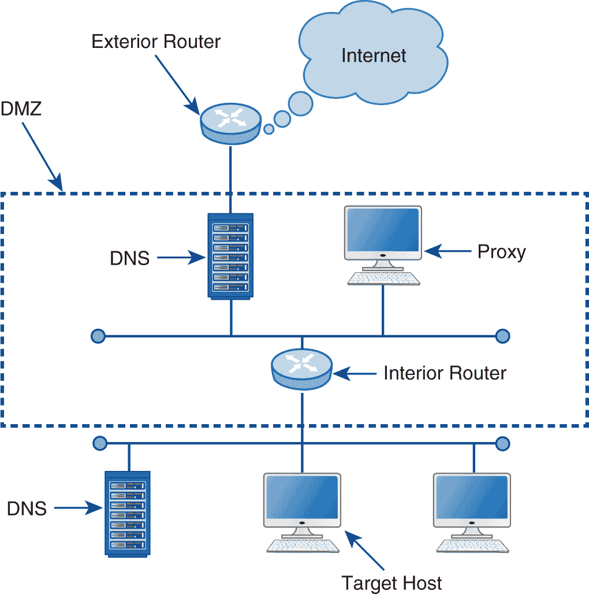

FIGURE 11.1 Screened Subnet Architecture

| Network Address Translation (NAT) || NAT 是一种将网络地址从一个转换为另一个的方式，例如在创建子网时使用。然而，该技术在网络安全中也可用于“隐藏”或保护内部 IP 地址不被外部网络看到。用于网络安全的这种技术称为 IP masquerading。 |
| --- | --- |
| LDAP || Lightweight Directory Access Protocol (LDAP) 常用于身份验证和授权。LDAP 使得应用程序能够与存储对象（更具体地说，是对象标识符）如计算机和用户、其权限以及密码的目录服务数据库进行通信。 |
| Ontology || 在某一知识领域（如网络安全威胁模式和分类）中，一组概念和类别的集合，属于本体论。 |

### 11.2.3 Ontology Based Architecture

本体论是一组与某一知识领域（如网络安全威胁向量）相关的概念和类别的集合。本体论通常由资源描述框架（RDF）或本体语言（OWL）等标记语言组成，用于表示概念之间的属性和关系。因此，本体论由可读的文档组成，也可以以三元组（主体-谓词-宾语）的形式存储在数据库中。三元组将数据存储为具有关系链接的对象网络，相较于数据仓库和数据挖掘，在分析数据（如实时识别或推断威胁）时具有某些速度优势。虽然基于本体的防御并非技术上的防火墙，但它们能够执行许多防火墙的筛选和监控功能。在传统的防火墙架构中，安全策略为给定的安全立场和特定平台预先定义。而在另一种情形中，使用安全策略本体已成为一种流行的方式，以解耦底层技术依赖关系。在这种方法中，安全策略规则通过图形用户界面创建，底层技术则自动生成相应的本体。

在关于安全事件和漏洞的研究中，Moreira 及其同事³ 提出了一种基于三层本体（操作层、战术层和战略层）的过滤与监控方法。由于本体由标记文档构成，它们可以在不同系统之间轻松共享。操作层由日常事务组成，受战术层控制，战术层包含控制资源访问的规则、用于信息存储和检索的技术、以及执行这些活动的人员。战略层关注指令和治理。采用 Moreira 等人的方法，安全策略本体可以基于常见漏洞和暴露（CVE）本体，该本体捕获并更新常见漏洞和事件，例如软件工程研究所的 CERT 报告的内容。安全本体的主要功能是定义一套标准、准则和行为，指导过滤与监控系统的努力。

网络安全策略本体的一个例子可能包括远程或本地访问的威胁、诸如 SQL 注入、缓冲区溢出等漏洞类型及其后果（包括严重程度和受影响的系统），以及是否已发布修复补丁等信息。该方法有助于在网关自动化执行网络策略，类似于应用层防火墙和监控系统。

随后会使用 Web 服务、代理框架或对象请求代理进行运行时的策略发现与强制。在其他情况下，安全策略可以通过在受控环境（沙箱）中运行应用程序来学习并生成，以发现其正常行为，随后监控应用程序是否偏离此行为；若偏离，则拦截执行（例如尝试进行被禁止的特权系统调用）。这种方法非常灵活，灵活性使得本体在移动网络和点对点（P2P）网络拓扑中尤为吸引人，因为设备可能随时加入或离开网络。

## 11.3 Cybermonitoring and Scanning Systems

各种活动监视器用于不同的技术和过程。例如，基础设施监视器（如 `Zabbix®`）有助于报告服务器和服务的功能状态，并识别网络流量、CPU 利用率等方面的异常。例如，网络利用率持续飙升会触发告警，提示管理员进行调查。其他监视器（如 `BlueStripe®`）用于跟踪应用程序和工作流中的事务失败。入侵检测系统（IDSs）则具有专门目的——在特定类型的安全 breach 尝试时发出警报。大多数 IDS 不仅用于检测入侵，还会通过执行预定义的操作（如丢弃和阻断连接、通过代理或备用服务器重新路由流量）来保护系统。

IDS 有多种类型。例如，网络 IDS（NIDS）监控网络流量以检测攻击，通过扫描已知的行为签名或异常行为（称为异常行为）来实现。NIDS 会将活动记录到文件中，并向网络管理员和状态仪表盘发送警报。一些 NIDS 专注于特定网络协议（如 HTTP/HTTPS），这些被称为协议基于 IDS（PIDS）。主机基于入侵检测系统（HIDS）在网络中的单个主机或设备上运行。HIDS 监控设备的入站和出站数据包，并在检测到 attempted intrusion 或其他恶意活动时向管理员报告错误和警报。许多 IDS 具备多种功能，称为混合 IDS，混合 IDS 将主机和服务器数据与网络活动结合，提供对 cyberinfrastructure 更全面、更细致的视图。

```
if (condVar > someVal) {console.log("xxx")}
```

IDS 和基础设施监控可以集中化，也称为无代理，或者可以是分布式的，也称为基于代理。在基于代理的配置中，会在被监控的设备上部署软件代理，并将数据发送到服务器，由服务器负责管理和显示。最常见的是基于 SNMP 的监控。两者都有优缺点。集中化或无代理系统的可扩展性不如基于代理的系统，且在检测时可能会出现过大的延迟。在基于代理的系统中，代理软件必须在每个被监控设备上安装和维护。有时会使用代理作为中间件，以提供一定的灵活性，并允许从一组被监控节点聚合监控数据，跨越网络边界到管理服务器，但这些方法也有局限性。虽然还有其他技术，但大多数 IDS 都与安全信息和事件管理系统（SIEM）协同工作。SIEM 整合多个来源的输出，并使用过滤器识别恶意活动。最有效的 IDS 最大化真实威胁的发现，使得漏检的攻击（即 false negatives）数量极少，同时最小化误报（即 false positives）。`SolarWinds Security Event Manager®` 是一个 SIEM 的示例（Figure 11.2）。

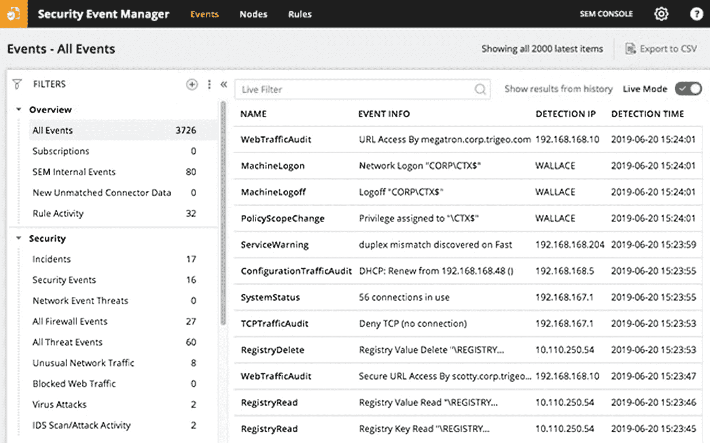

FIGURE 11.2 SolarWinds Security Event Manger (SEM) ¶ © 2021 SolarWinds Worldwide, LLC. All rights reserved.

### 11.3.1 IDS Detection Methods

IDS 检测方法有多种，但通常可分为三类：基于签名、基于异常和基于启发式。基于签名的 IDS 通过以下方式检测攻击：(1) 使用已知攻击模式的数据库；(2) 一个能够从用户、网络数据包或软件行为模式中推断攻击的识别系统。由于基于签名的检测依赖于已知模式，因此保持签名数据库更新至关重要。即便如此，它们仍易受到新型（也称为生日攻击、首次攻击或零日攻击）或多态化攻击的影响，在这些攻击中，签名尚未被识别，或攻击签名在传播过程中不断变化。

基于异常（也称为行为）的 IDS 通过统计差异分析系统来检测攻击。统计差异分析涉及基于过去行为（相似或相同活动）建立的“正常”系统、应用或网络行为模型。系统通过推理判断某行为是否与模型不同，若是则生成警报并采取行动。例如，如果端口 80 保留用于 HTTP 协议，网络数据包的头部和负载应符合特定配置。IDS 会分析端口 80 上传输的负载（如负载的字节频率），这是判断正常负载的一个指标。异常检测器会捕获 incoming payload 并与模型进行一致性或差异性比较；若 payload 与正常预期的 payload 差异过大，则被标记为异常。基于异常的 IDS 的缺点是会产生较多的误报，因为其决策是概率性的，即基于统计预测什么是攻击，但这些可以通过机器学习随时间调整。

启发式 IDS 在签名和异常 IDS 的基础上进行扩展，使用在系统运行时训练的机器学习模型。它们与基于异常的 IDS 类似，但能够根据实时“学习”来调整预防措施。它们也类似于基于签名的 IDS，需要一个比较数据库，即机器学习实时将活动与“测试”数据库中已知的正常和异常用户、系统和网络行为进行比较。因此，启发式 IDS 能够适应不断变化的攻击模式，但也可能产生大量误报，需要仔细调优和平衡，否则合法用户的通信可能被干扰，后果严重。

| Signature Detection | Signature detection is used by malware and virus scanners as well as IDSs. This is the most widely used method of threat detection. It consists of analyzing files and software for a pattern (e.g., regex) that is maintained in a database. The method is ineffective for new attacks or polymorphic malware. |
|---|---|
| Behavioral Detection | Behavioral detection is also used by malware/virus scanners and IDSs. It focuses on predicted versus actual behaviors of software and/or communications. For example, if an application attempted to disable security controls, it would be detected using this scheme, which would trigger some action, such as generate an alert or notification, block the execution of the program, and/or reset security settings, and so forth. |
| Heuristic Detection | A heuristic analysis examines code or communications properties using a variety of techniques. Static analysis involves deconstructing or decompiling a suspected application and scanning the source code for dangerous commands or malicious statements. With dynamic analysis, applications are sandboxed, meaning isolated in a controlled partition or virtual machine. The method examines the commands as they are executed and looks for suspicious activities such as self-replication, overwriting files, changing checksums on files, and so forth. We will cover code analysis in more detail shortly. |

### 11.3.2 IDSs and IPSs

IDS 是被动的，而入侵防御系统（IPS）是主动的。需要注意的是，许多 IDS 同时也是 IPS，统称为 IDPS。IDS 本质上是带有基本过滤规则的通知系统，行动范围有限；而 IDPS 通常与其他系统和防火墙集成，以执行修正和恢复策略。例如，如果 IDPS 检测到攻击来源 IP 地址，它会相应地在路由器和防火墙的规则库中添加丢弃该 IP 的数据包的规则。IDPS 可集成的范围从简单的 SNMP 陷阱到高级的启发式，从而能够“智能地”通过启动适当的反措施来防御攻击。主机基础的入侵检测系统通常与网络 IDPS 协同工作，例如在攻击期间恢复被恶意修改的设置。

对 IDS 和 IPS 的共同挑战是尽量减少误报并避免误负。误报会产生噪声，干扰操作人员和管理员，甚至导致他们错过真正的攻击。此外，攻击者可能使用“ feint”（ diversion）策略，在主要攻击使用另一条路径或攻击面的同时制造干扰。误报可以通过在分层或环形配置中部署 IDS 和 IPS 来降低，这种配置为攻击创造多个障碍，必须逐一突破。

在主机层面，IDPS 识别主机上的可疑活动，例如操作系统文件的修改。主机系统 IDPS 监控代理拦截操作并发起执行操作，以控制哪些修改是合法的，并记录活动；如果有被认为是威胁的操作尝试，它会采取如阻止进程执行等措施。网络 IDPS 检查针对主机的入侵或攻击的网络流量特征。这些技术采用一种称为“抓包”的方法，检查入站和出站数据包。上述组件共同构成了通常称为统一威胁管理（UTM）系统的体系（`/path/to/xxx`目录）(Figure 11.3)。

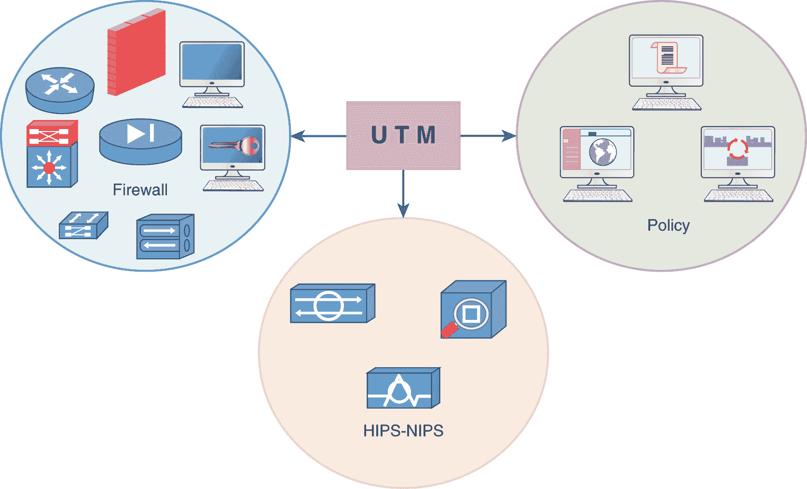

FIGURE 11.3 Unified Threat Management (UTM) System

尽管有这些层层防御，仍需考虑诸多挑战。首先，签名数据库会过时，系统在大规模签名数据库中逐行查找效率低下，可能导致严重延迟。另一个挑战是需要捕获、检查和处理的流量体积巨大。复杂的网络拓扑进一步加剧了这一问题，因此必须构建多层防御，这又带来了更大的复杂性和潜在的故障点，这些故障点可能被复杂性本身所掩盖。此外，由于存储限制，许多甚至大多数组织会对日志数据的量设置配额。最后，由于层层叠加，触发机制的设计可能变得极其复杂。例如，当多个 IDS 系统之间或之内出现告警冲突时，需要谁来调解或去冲突？这需要仔细架构并针对生态系统进行精细调优。

| UTM || A Unified Threat Management system, or UTM, represents the multilayered IDPS layers and infrastructure that are displayed, represented, and controlled from an executive layer or executive contours in a distributed configuration. |
| --- | --- |
| IDPS Alerting Systems || IDPS alerting systems typically combine lightweight Hidden Markov Models (HMMs) to “game” agent or sensor data using move and countermove. They employ incremental-learning algorithms, which start with pattern-matching algorithms prior to engaging heuristic and artificial immune algorithms. |

### 11.3.3 Code and Application Scanning

我们在多次讨论恶意软件和病毒扫描后，本节将讨论程序代码（应用）扫描。代码和应用扫描属于应用安全（AppSec）范畴。实现此类扫描的方法多种多样，通常相互配合使用。主要的扫描技术包括（1）静态应用安全测试（SAST），（2）集成应用安全测试（IAST），（3）软件组成分析（SCA），以及（4）动态应用安全测试（DAST）。这些方法共同用于检测未编译代码、外部库、开源组件以及运行时代码中的威胁或漏洞。


SAST 工具在软件开发生命周期的每个阶段对未编译代码进行迭代扫描。它们可以判断，例如，登录页面或应用是否易受 SQL 注入攻击或包含后门。大多数 SAST 工具集成于或提供面向集成开发环境（IDE），如 `Eclipse`®，以及缺陷跟踪系统和自动化工具（如 `Jenkins`®）用于 `CI/CD` 流水线。由于静态代码分析的局限性，这些工具通常与 `IAST` 工具配合使用，后者在运行时的功能测试阶段能更好地发现部署配置缺陷。`IAST` 关注应用的触点，如库、模块、仓库、API 和接口，以及在运行时的执行流，攻击者可能利用这些点进行攻击。

`SCA` 工具为开源技术、模块和库提供漏洞洞察，同时也适用于容器、工作流和管道。`DAST` 技术则通过外部攻击运行中的应用，或分析正常应用行为并监测偏差来寻找漏洞。`DAST` 的覆盖范围主要限于反射型漏洞，因为其本质上对应用内部工作不可见。`DAST` 无法提供代码级的漏洞定位指引，使得开发者难以直接修复发现的问题。不过，`DAST` 在警示 DevSecOps 团队发现功能失常或易受攻击的应用方面非常有效，并且有反编译工具可辅助取证检查。

### 11.4 Information and Cybersecurity Management

正如全文所述，信息系统安全涉及技术与使用技术的人员。因此，技术安全管理既包含组织层面，也包含系统层面。组织层面关注本文第一部分提出的组织性问题——政策、法律、安全行为等；系统层面则关注技术性防护措施。组织层面需要制定并执行配置管理计划（CM），这包括通过建立企业级安全配置管理（SeCM）计划来形成“变更管理文化”，集中管理与 SeCM 相关的政策、流程和培训，并明确各角色在 SeCM 任务中的责任与义务。我们将在本章最后部分整合这些要点。

### 11.4.1 SeCM and CM

政策必须确定 `SeCM` 的结构，包括建立 `CI` 清单、使用指定的标准与模板、以及规定任何一般性的配置设置禁止项。程序应通过明确哪些 `CIs` 在范围内并描述“从配置变更请求初始提交到最终发布到运行环境的步骤”来标准化 `SeCM` 流程⁴。具体而言，变更控制程序应包括以下内容：

1. 变更请求与批准程序  
2. 判定哪些配置变更属于受控变更的标准（例如检查表或已预先批准的变更列表，如更新防病毒签名、创建或删除用户、更换故障外设、更换主板或硬盘）  
3. 安全影响分析程序  
4. 判定变更是否足够重要以触发系统重新授权活动的标准  
5. 设立负责批准变更的小组（如变更控制委员会 `CCB`）  
6. 变更提交至 `CCB` 前的测试要求  
7. 变更在投入运行环境前的测试要求  
8. 变更访问权限要求（即谁可以在何种情况下对信息系统进行变更）  
9. 变更出现问题时的回滚要求  
10. 对未计划变更（如关键漏洞修复）的处理要求，需支持快速审批与批准  

在考虑使用 `SeCM` 模板的程序开发的同时，还应关注基线配置的创建和内容、补丁的优先级、测试、批准和集成，以及帮助台变更请求的处理，整个系统生命周期中的变更管理集成，媒体的标记和销毁，以及如何监控以跟踪配置和变更管理流程的遵循情况。

早期，我们介绍了安全配置管理概念，并以计算机安全等多种方式进行了讨论。需要明确的是，`SeCM` 属于 `CM`，但 `CM` 更全面地关注系统、应用、网络和信息环境在定义的“安全状态”（即基线配置）方面的性能、功能和物理完整性。从这个角度来看，它不仅涉及网络安全，还包括信息安全以及自然灾害等其他灾难。

`SeCM` 是 `CM` 的扩展，正如你所了解的。请记住，`CM` 是通过控制信息系统在其生命周期中对硬件、软件和信息的变更，来管理功能和特性的完整性。`CM` 实施的主要组成部分包括保护和管理政策、实践和流程，以确保通过适当的治理，信息和系统保持一致和合规。它是两个关键概念 — — 合规性和审计 — — 的基础。

### 11.4.2 CM 与计算机安全程序与框架

让我们回顾一下，从前面的章节整理出配置管理的重要性。配置是系统的设置、安装、连接方式等，涉及政策、模型、定义的立场以及监管和治理等方面。安全领域的 `CM` 从 Booch、Rumbaugh 等人定义的软件配置管理（SCM）过程中借鉴，这些过程在定义应用的需求和属性后，通过系统的变更控制来保持软件的完整性和可追溯性。为实现这一点，需要：(1) 确定配置的稳定基线；(2) 建立控制流程；(3) 建立计量和日志机制；(4) 启用审计系统。

例如，`CM` 可能需要为连接防火墙区（DMZ）到互联网的网关制定一套政策、模型和定义的立场，这些内容需要监控和审计，以确保其符合政策规定的指标和度量以及合规标准。许多 `CM` 方面都在以下合规标准下被涵盖，包括 Capability Maturity Model for integration（CMMi）、ISO 9000 系列标准、Six Sigma、COBIT 和信息技术基础设施库（ITIL） — — 这些我们在前面已经介绍过。`CM` 的核心是可追溯性，即变更可以通过“所有权链”追溯回其来源。我们之前已经覆盖了安全的关键法律、组织和行政方面，介绍了主要技术的工作方式，以及广泛的计算机、网络和信息安全实施方法。这些内容在此从操作和管理角度同样重要。

配置变更必须经历以下步骤：(1) 提出；(2) 审查；(3) 批准；(4) 跟踪；(5) 冻结到新基线。正如我们所想象的，配置管理是一个涵盖生产、运营、合规和审计设施的广泛概念。在此语境下，合规是遵循安全策略或法规的过程、程序和规则的集合；审计则是对合规性的评估和验证 — — 即审计检查是否遵守规则、法规、政策、程序和法律。为帮助管理者承担如此广泛的责任，配置管理框架应运而生。

大多数管理框架都要求建立并管理信息系统的适当配置。`ITIL`、`COBIT` 和 `NIST SP 800-53` 都认识到变更和配置管理对信息系统的运行和安全管理的重要性，尽管正如我们前面所说，某些标准（如 ISO 27002） conspicuously 缺乏此类要求。尽管如此，这仍是安全管理的关键。Behr 等人⁵ 研究了高性能 IT 组织，并定义“高性能”具备以下特征：

1. 高平均故障间隔时间和低最大修复时间  
2. 早期且持续地将安全控制整合到 IT 运营流程中  
3. 重复负面审计发现次数少，且用于合规的工时较少  
4. 高效的服务器到系统管理员比率以及较少的未计划工作  

风险管理和良好治理要求，虽然通常难以控制威胁环境，但组织可以相对有效地管理系统中的漏洞。正如 Johnson 等人所述，“利用配置管理对 IT 资源进行更大控制并确保其完整性，有助于资产管理、改进事件响应、帮助台、灾难恢复和问题解决，促进软件开发和发布管理，实现更大程度的流程自动化，并支持政策合规及审计准备。”⁴

### 11.4.3 安全管理规划 — — 系统层面

在系统层面，必须单独和整体地审视 `CI`（配置项）组件，以制定具体的系统 `SeCM` 计划。再次利用 `NIST` 标准，该计划应包括以下建议：

*   目标信息系统的简要描述  
*   信息系统组件清单  
*   信息系统配置项  
*   对配置项变更管理的严格程度（即基于信息系统影响程度）  
*   角色与责任的识别  
*   变更请求的审批方或个人的识别及组成  
*   需遵循的配置变更控制程序（包括引用组织-wide 程序）  
*   `SeCM` 文档（变更请求、批准等）存储位置的识别，如媒体库，以及如有必要可覆盖的存储位置  
*   用于控制配置变更的访问控制措施，如有必要可覆盖配置变更控制程序  
*   用于建立批准配置基线的安全配置标准的描述  
*   对配置项偏离安全配置标准的说明及其正当性  
*   信息系统已批准基线配置的描述⁴

基线配置通常包括以下内容：

*   配置设置（即可在硬件或软件组件中修改的参数集，用于影响其安全态势），包括但不限于：  
  *   操作系统和应用特性（根据具体特性决定是否启用或禁用）  
  *   服务和端口（例如自动更新、通过端口 53 的 DNS）

# 网络协议和接口

- 网络协议（如 `NetBIOS`、`IPv6`）和网络接口（如 `Bluetooth`、`IEEE 802.11`、`infrared`）
- 远程访问方法（如 `SSL`、`VPN`、`SSH`、`IPSec`）
- 访问控制（如控制文件、目录、注册表键的权限，以及用户活动的限制，如阻止修改系统日志或安装应用程序）
- 标识符/账户管理（如更改默认账户名称、确定非活动账户的禁用时间、使用唯一用户名、建立用户组）
- 身份验证控制（如密码长度、使用特殊字符、最小密码年龄、多因素认证/使用令牌）
- 审计设置（如捕获关键事件，如失败、登录、权限变更、未成功的文件访问、用户和对象创建、系统文件、注册表键和内核的删除与修改）
- 系统设置（如会话超时、远程连接数量、会话锁定）
- 加密（如使用 `FIPS140-2` 认证的加密协议和算法，保护数据在传输和存储时的安全）

# 补丁级别

- 根据已识别的漏洞，应用供应商发布的补丁，包括软件更新

# 软件与版本

- 使用经批准、签名的软件（如受支持时）

# 终端保护平台

- 通过软件实现的防护措施，用于保护终端用户机器免受攻击（如 `反病毒`、`反间谍软件`、`反广告软件`、`个人防火墙`、`主机基础入侵检测系统 [HIDS]`）

# 传输协议保护

- `TLS`、`IPSec`

# 系统架构

- 组件的物理和逻辑位置（如防火墙后、DMZ 内、特定子网上）

# 文档

- 支持文档，如技术规格和设计文档、系统安全文档、系统操作流程

## 11.4.4 配置到安全状态

在完成 `SeCM` 规划后，需要依据 `SeCM` 计划和已制定的政策与流程，将系统配置到安全状态。实际上，安全状态可以被视为“已知状态”，因为没有系统可以做到完全安全，有时根据风险评估或成本效益分析，某些漏洞甚至可以被容忍。此外，由于技术组件种类繁多，配置选项数量巨大，单凭个人很难识别并恰当地指定一个能够应对最常见漏洞的基线配置。

幸运的是，众多社区共识的配置指南可以提供帮助。安全检查表——也称为硬化指南、技术实施指南、最佳实践或基准——提供了如何在给定环境中通过减少或消除产品默认配置中可能存在的常见漏洞，将 IT 资产配置为抵御威胁的操作指南。检查表由各类组织开发，包括 IT 供应商、政府以及公私合营的组织联盟。这些检查表的具体程度从高层叙述到低层、可自动执行的脚本不等，脚本会自动完成系统更改。本集合中包括 `DISA STIGs`、`NIST` 检查表、供应商标准以及 `Center for Internet Security` 基准。

部分响应 `2002 年网络安全研究与发展法案`，该法案推动了对网络安全研究、人才培养以及相关技术的投资，并要求 `NIST` 开发并分发专门的计算机安全检查表，`NIST` 为此创建了 `国家检查表计划 (NCP)` 用于 IT 产品。`NCP` 如 `SP 800-70r1` 所述（该章节定义了 `IT 产品国家检查表计划——面向检查表用户和开发者的指南`），旨在提升安全检查表的质量、可用性和易用性。`NCP` 程序的目标包括：

- 通过提供正式框架，让供应商和其他检查表开发者可以将检查表提交至 `NIST`，从而促进检查表的开发与共享。
- 为开发者提供指导，帮助其创建符合常见操作环境的标准化、高质量检查表。
- 为开发者和用户提供指导，使检查表更易于阅读和使用。
- 鼓励软件供应商及其他方开发检查表。
- 提供检查表的审查、更新和维护的受管理流程。
- 提供易于使用的检查表仓库。
- 以标准化格式提供检查表内容。
- 鼓励使用自动化技术对检查表进行应用。

在决定实施配置时，应考虑其运行环境。`NCP` 将环境分为两大类：独立（standalone）和受管理（managed）。在受管理环境中包含三种自定义或特殊情况：专用受限功能（SSCF）、遗留（Legacy）以及联邦桌面核心配置（FDCC）。独立（或小型办公室/家庭办公室 SOHO）环境以规模较小、内部威胁风险低而特征。独立环境的具体假设包括：

- 使用独立系统的家庭用户，通常通过拨号或高速上网，可能使用有线或无线家庭网络，并可能在网络之间共享资源
- 在家庭办公室工作的远程工作者，使用独立系统
- 规模较小的企业，通常拥有小型独立桌面系统和小型服务器网络，服务器受防火墙保护，不直接暴露于 Internet，但可能包含少量受中心管理的桌面系统和产品，且通常不维护面向公众的服务器
- 其他具有类似功能的小型组织

独立环境假设的威胁主要是外部、远程威胁，通常来自恶意流量和载荷，如蠕虫和病毒。独立环境的安全目标侧重于限制或移除不必要的服务和应用，并限制本地网络之外的访问。`NIST` 为独立环境提供了以下实践：

- 在 Internet 连接处使用小型硬件防火墙设备，阻止入站连接并过滤出站流量（如可行）
- 在独立系统上使用个人防火墙产品
- 对应用程序（如 `反病毒软件`、`Web 浏览器`、`电子邮件客户端`）和操作系统进行更新
- 定期应用补丁
- 将 Web 和电子邮件客户端配置为过滤并阻止可能包含恶意内容的流量/消息
- 禁用不必要的应用（如个人 Web 服务器、`SNMP`、即时通讯）
- 对无线网络流量以及适当时的其他流量使用加密
- 对有线和无线局域网（LAN）的连接系统/用户施加限制
- 对用户权限施加限制
- 对共享资源（如目录、打印机）施加限制
- 启动备份和恢复程序
- 实施物理安全措施

## 11.4.5 受管理企业

-   [受管理或企业环境](https://nvd.nist.gov/ncp/repository)是较大组织通常会发现的，拥有集中化 IT 人员。这些环境的检查清单旨在供高级终端用户或 IT 专业人员在不同隔离环境中使用，以在通常集中管理与 IT 资产相关的政策的同时提供企业功能。虽然典型的受管理环境比独立环境更受限制，包括多层防御（防御深度），它们也倾向于对环境中信息流拥有更大的控制力和洞察力。正如 Quinn 等人所述⁷，企业环境相关的常见安全实践如下：

*`分段内部网络`* 采用内部防火墙和其他防御深度技术

*`集中管理`* 系统，且对本地用户访问高度限制

*`集中管理`* 安全相关应用程序，如防病毒软件

*`自动安装`* 系统和应用程序的补丁和更新

*`受限访问`* 打印机和多功能设备及其功能

*`集中化系统`* 用于日志监控

*`集中化备份和恢复设施`

受管理环境的特殊案例——SSLF、遗留系统和 FDCC——也在 NCP 中涵盖。这些专用安全受限功能环境的安全要求比普通受管理环境中的系统更严格，安全优先于功能。SSLF 的例子可能包括高度敏感和专有的组织信息，例如“石油与天然气”公司的地质勘测数据，或包含员工个人可识别信息的“人力资源”计算机。涉及这些系统的安全事件影响通常远大于其他企业系统。NIST 建议针对这些系统采取的一般安全实践和控制如下：

*`系统应尽可能处理少数类型的数据`*（例如，不要在同一系统上组合多个服务器应用）。

*`系统应剥离所有不必要的服务和应用程序`*。

*`如果可能`,* 应使用基于主机的防火墙应用。

*`系统应尽可能少的用户`*。

*`应使用最强的可能认证`*（例如，认证令牌、生物特征和智能卡）。

*`远程管理或访问应受限`*；如果使用，连接应加密。

*`与安全相关的操作系统和应用程序补丁与更新应尽快测试并应用`*。

*`系统应置于防火墙和其他网络安全设备后面，这些设备限制访问并过滤不必要的协议`*。

*`入侵检测日志和其他日志应频繁监控`*。

*`应频繁运行漏洞评估工具对系统进行检查`*。

*`系统管理员应在相关技术方面具有高度技能`*。⁷

### 11.4.6 受管理的遗留系统

遗留系统因通常无法支持许多高级或现代安全控制而呈现特殊的配置挑战。因此，必须识别补偿性安全控制，以应对系统固有的当前或潜在漏洞。例如，如计算机安全章节中所讨论，可使用代理。NCP 的最后一个特殊案例是 FDCC，这是美国预算管理办公室（OMB）为联邦受管理的工作站指定的自定义桌面环境。NCP 包含的检查清单针对特定 IT 产品，并大致分为自动化和非自动化两类。自动化检查清单的编写方式便于通过脚本或其他软件产品实现实施。NIST 鼓励在开发自动化检查清单时使用安全内容自动化协议（SCAP），以提供一种标准化、开放的方式，让多个供应商可以用于 IT 产品硬化。仓库（位于 https://nvd.nist.gov/ncp/repository）可通过多个字段进行搜索，包括层级、产品名称、产品类别、开发者（权威）或关键词。层级指示检查清单提供的自动化程度。Tier I 检查清单是基于文本的叙事描述，说明如何保护资产；而 Tier IV 则是机器可读的检查清单，可自动处理并将低级配置映射到更高级别的安全框架规范（如前文所述）。

### 11.4.7 扩展指南

到目前为止，我们主要讨论了配置管理，并重点关注了政府和工业领域的 NIST 检查清单；然而，一些特定的指南是专门为政府部门设计的，因为它们必须符合非常严格和受监管的标准。此外，还有大量其他标准和检查清单可用于专门行业。这些包括国家安全局（NSA）或国防先进研究计划局（DARPA）制定的规范，甚至 DARPA 关联实体（如国防部）的规范。在其他情况下，政府与工业之间存在交叉，例如政府承包商或供应商。

#### 11.4.7.1 DISA STIGs

国防信息系统管理局（DISA）通过信息保障支持环境（Information Assurance Support Environment），提供一系列基线系统配置，称为安全技术实施指南（Security Technical Implementation Guides，STIGs）。这些指南是美国国防部信息系统的配置标准，并与其安全检查清单一起，为安全配置系统提供了坚实的基础。虽然部分 STIG 和合规脚本不对公众开放，但大多数可从其网站获取。STIGs 涵盖广泛的配置项，并提供可审计的方式，确保系统最大程度地防范常见威胁。通常，STIGs 会包含对指导的说明以及推荐的设置，配置检查清单中的漏洞分为三类，对应不同的风险等级。

类别 I 漏洞是“允许攻击者立即访问机器、获得超级用户访问或绕过防火墙”的情况；类别 II 漏洞是“提供高度可能让入侵者获取信息”的情况；类别 III 漏洞是“提供可能导致妥协的信息”的情况。⁸ 伴随 STIG 的检查清单通常包含更具体的配置说明，甚至包含具体的命令行指令。虽然手动配置系统以符合 STIG 规范是可行的，但通常通过实现 STIG 规范的配置脚本和工具来完成。


因为政府和军事组织有大量可用的检查清单，而且许多检查清单本身也对企业有用，私人组织可能会在确定使用哪一项或哪几项时感到困难。需要注意的是，检查清单通常是针对特定标准的，这些标准是机构或企业必须满足的，以符合规定、政策、规则和法律的要求。换句话说，虽然有些检查清单是通用的，但有些是特定于某个领域的。确定哪些检查清单对组织本身有用可能是一项艰巨的任务。一旦选择或定义，基线就需要相应地进行管理——这正如所指出的，也可能很令人望而生畏。这对于私营技术供应商尤其如此。

为帮助，技术供应商基于安全的检查清单通常包含自动化工具，帮助公司以更安全的方式评估和配置资产，其中包括 Microsoft Baseline Security Analyzer 和 Microsoft Security Compliance Manager（用于 Microsoft 产品），以及 Bastille Linux（用于多种 Linux 变体）。Microsoft Baseline Security Analyzer（MBSA）设计用于帮助组织“根据 Microsoft 安全建议确定其安全状态，并提供具体的修复指导。”⁹ MBSA 专注于中小型组织，类似于 NCP 所描述的独立环境。

Microsoft Security Compliance Manager 设计用于大型企业，允许组织将 Microsoft 安全建议纳入基线配置，然后以多种格式（包括 SCAP）导出，供用于保护组织中 Microsoft 架构的自动化工具使用。Bastille Linux 是一个硬化脚本，已随多种 Linux 发行版预装。脚本会向管理员提供一系列选择，据此构建策略并配置系统。脚本还提供了一个详细的交互式模式，用于教导用户关于安全及其选项。

### 11.4.8 Center for Internet Security Benchmarks

回顾，配置管理（CM）涉及诸多方面，包括系统性能，而性能的显著下降往往是安全攻击的指标。技术管理者和安全专业人员需要考虑系统性能基准作为安全问题，因为基线用于判断性能下降是由于工作负载还是异常（可能由系统故障或安全攻击引起）。因此，我们将性能基准视为基线配置的一部分。性能基准也可能是合同质量和性能承诺的一部分，即服务质量（QoS）指标或参数。

Center for Internet Security（CIS）是一家非营利组织，使命是“制定并推广基于共识的标准，以提升 Internet 连接系统的安全性和隐私性，并确保业务、政府和私人 Internet 功能及交易的完整性，这些是社会日益依赖的。”¹⁰ CIS 网站至少提供 52 份配置指南，涵盖各类 IT 资产、基准审计工具以及 21 项安全指标，用于评估安全流程的结果。这些基准通常包含符合 NPS 规范的独立或托管环境的安全配置文件。

对最近一份 Windows 基准的简要总结：“在完成资产的基线配置后，重要的是在与生产环境相当的环境中对其进行测试。测试将揭示在生产环境中可能导致重大功能问题的交互和配置设置。”¹⁰ 如前所述，最好在测试环境中发现问题，而不是在生产环境中，但大多数组织缺乏能够直接匹配生产环境负载和交互复杂性的测试环境，因此需要理解，无论如何，某些意外的交互仍可能发生。因此，对于任何对生产环境的变更，都应有一个明确的回滚程序，说明如何撤销所做的更改。

### 11.4.9 Maintaining the Secure State

随着技术环境的不断演进，不断发现并引入新的威胁和漏洞，任何资产的基线配置变更都是不可避免的。然而，明确且明确地管理这些变更的过程至关重要。大量工作表明，控制变更管理过程是对信息系统实现有效控制的关键，也是改进 IT 服务质量的第一步。如前所述，管理安全状态的基础是控制变更管理过程以及控制谁有权进行变更。NIST 建议实施变更管理的四个阶段：(1) 实施变更访问限制，(2) 实施配置变更控制流程，(3) 进行安全影响分析，和 (4) 记录并归档变更。⁴ “实施变更访问限制”阶段将限制谁可以进行变更，并通过约束系统上允许的行为类型来开始执行变更管理流程。初始化变更访问限制的推荐流程包括三个步骤：

1. 确定需要对单个 IT 资产进行哪些类型的变更。
2. 确定谁将被授权进行这些变更。
3. 建立适当的控制措施，仅允许上述已识别并授权的个人进行变更。

实施变更管理的第二阶段是引入配置变更流程。虽然具体流程应在 SeCM 的组织规划阶段确定，但通常建议该过程经过接收、记录、测试、批准并实施，并在相应地更新基线配置的同时完成。NIST 推荐以下八个步骤：

1. 请求变更。此步骤发生在变更最初构思时。请求可能来自信息系统的最终用户、帮助台或管理层，也可能来源于供应商提供的补丁、应用程序更新等。
2. 记录变更请求。当变更正式进入配置变更控制流程时，必须记录。组织可使用纸质请求、电子邮件或自动化工具来跟踪变更请求、按工作流程路由，并允许电子确认/批准。
3. 判断变更是否需要配置控制。某些变更类型可能免于配置变更控制，如 SeCM 计划或程序中定义的豁免项。如果变更被豁免，请在变更请求上注明，并允许在无需进一步分析或批准的情况下直接执行；但系统文档仍需更新（如系统安全计划、基线配置、组件清单等）。
4. 分析变更对信息系统的安全影响。
5. 测试拟议的变更，评估其安全性和功能影响。变更的影响应提交给 CCB 进行审查。
6. 批准变更。此步骤通常由 CCB 执行。如果变更对于实现任务目标是必要的但会对系统和组织的安全产生负面影响，CCB 可能会要求实施缓解控制。
7. 实施变更。在批准后，授权人员应执行变更。相关方（如用户、管理层、客服）应被告知变更情况，尤其是当变更实施需要服务中断或改变信息系统的功能时。如果是后者情况，用户和客服培训可能是必要的。
8. 确认变更已正确实施。配置变更控制不完整，直至确认变更已无问题部署，变更请求才算关闭。尽管初始安全影响分析可能显示变更没有影响，但实施不当的变更可能导致自身的安全问题。⁴

### 11.4.10 进行安全影响分析

在 NIST 在第一、二阶段建议的控制措施落实后，第三阶段的目的是确保对系统配置所做的任何更改不会在单个 IT 资产或整个信息系统层面引入新的、未被识别的漏洞。虽然有大量指南可用于进行安全分析，且可开展多种深度和类型的分析，NIST 推荐的五个步骤如下：

1. 理解系统中引入的技术和功能性变更。
2. 识别变更（尤其是引入新软件或更新软件时）可能带来的新漏洞。NIST 托管的国家漏洞数据库提供了来自多个来源的漏洞汇编。
3. 根据提供的功能以及组织的风险容忍度，评估变更相关的风险。
4. 评估变更对现有安全控制的风险。
5. 规划并引入必要的补偿控制，以应对变更带来的风险增加。

在基线配置更新后，必须记录变更并按照 NIST 在最后阶段的建议更新基线配置。这可能还需要组织重新评估其信息系统的整体风险，并在某些情况下对系统进行认证复审。一旦采用基线配置（无论是针对新资产还是现有基线的更新），监控对基线配置的遵守情况至关重要。基线配置的偏差最好表明变更管理流程出现故障，且很可能是安全泄露。至少，发现基线配置的偏差应触发安全和运营团队开展调查，以确定偏差原因。

### 11.4.11 认证与认可

配置管理检查表和流程特别适用于需要认证与认可（C&A）的组织。C&A 可能是整体安全策略的一部分，尤其是当组织为联邦机构或受联邦监管时。认证是对信息系统及其基础设施的全面评估，以确保其符合联邦标准（如联邦信息安全管理法，FISMA）的要求。认可是由认证机构（如 NIST）进行的审计结果，是一项正式决定，授权使用经审计的信息系统。认可表明当前的安全程序和安全控制能够保护系统及其处理、存储或传输的信息，满足认证要求。

认证由官方审计员执行，可能导致四个认证等级中的任何一个，从低安全级（1）到高安全级（4）。审计员主要关注系统中是否有足够的控制措施，哪些是重要的、哪些是不必要的，是否正确实施，以及在适用情况下，职责是否有明确的分工。审计员还关注是否有程序用于报告安全事件并采取纠正措施，以及是否有控制措施用于遏制问题并防止其再次发生。审计员根据审查认证的主管部门使用不同的方法论。正如前文所述，政府机构受到特定的认证机构管辖，具体取决于其运营分支。需要注意的是，审计不单纯用于认证；事实上，内部审计、外部审计，甚至两者兼顾的非正式审计对大多数组织（不仅限于联邦机构）而言是一个良好的做法。

## References

1. Cimpanu, C. (2019). Cyber-security incident at US power grid entity linked to unpatched firewalls. ZDNet. [`www.zdnet.com/article/cyber-security-incident-at-us-power-grid-entity-linked-to-unpatched-firewalls/`](https://www.zdnet.com/article/cyber-security-incident-at-us-power-grid-entity-linked-to-unpatched-firewalls/)
2. Ford, R. (2008). `Conditioned reflex and security oversights`. Unpublished research presentation, Melbourne, FL: Florida Institute of Technology.
3. Moreira, E., Martimiano, L., Brandao, A., & Bernardes, M. (2008). `Ontologies for information security management and governance`. `Information Management & Computer Security`, 16, 150–165.
4. Johnson, A., Dempsey, K., Ross, R., Gupta, S., & Bailey, D. (2010). `Guide for security configuration management of information systems`. Gaithersburg, MD: Computer Security Division Information Technology Laboratory National Institute of Standards and Technology (NIST), SP 800-128.
5. Behr, K., Kim, G., & Spafford, G. (2004). `The visible ops handbook: Starting ITIL in 4 practical steps`. Eugene, OR: IT Process Institute.
6. United States. Congress. House Committee on Science. (2002). `Cyber Security Research and Development Act: report to U.S. G.P.O`. Washington, DC.
7. Quinn, S. D., Scarfone, K., & Souppaya, M. (2009). `NIST SP 800-70r1: National Checklist Program for IT Products—Guidelines for Checklist Users and Developers`. Gaithersburgh, MD: National Institute of Standards and Technology.
8. Defense Information Systems Agency. (2008). `Access control in support of information systems security technical implementation guide, Version 2, Release 2`. Defense Information Systems Agency.
9. Microsoft. (n.d.). `Microsoft baseline security analyzer`. Microsoft Technet Security Techcenter. [`technet.microsoft.com/en-us/security/cc184924.aspx`](http://technet.microsoft.com/en-us/security/cc184924.aspx)
10. Center for Internet Security. (n.d.). `The CIS Report`. Center for Internet Security. [`cisecurity.org/en-us/?route=default.about`](http://cisecurity.org/en-us/?route=default.about)


# CHAPTER 12

Information Security Management

© Antishock/Shutterstock

一个国家安全局（NSA）的隐蔽交通分析员，威廉·“比尔”·宾尼，以及其他 NSA 密码分析师和计算机科学家，发明了 ThinThread，这是一个先驱于 NSA Trailblazer 项目的前身，该项目被爱德华·斯诺登揭露。该软件能够大规模提取元数据并通过语义查询进行分析。系统内部的推理能够结合并组织情报数据和元数据来源，以及人类情报、信号情报等，通过所谓的情报、监视和侦察（ISR）融合实现。基于此类信息，他们可以判断，例如，你通常在周五去超市并使用信用卡，但周五没去，你就在周二去购物并用现金支付——这引发了疑问，为什么？你可能会成为嫌疑人或目标！当这种程度的审查落入敌人的手中，或组织中不道德的领导，或极权政府之中时，后果令人不寒而栗。在本章最后，我们将探讨推理系统如何发展到足以被称作“智能”的地步，这正是阿兰·图灵所定义的智能。近期的发展既令人兴奋又令人不安。

你是否曾想过，谁正在查看你的生活故事，它是由你的行为历史所讲述的？他们的动机是什么？

## 12.1 网络安全分析与机器学习

信息和网络安全领域中的分析无处不在。涉及分析的领域被称为数据科学。这里我们仅简要提及一些当前热点，以展示分析用途的广度。特别是，我们将简要提到机器学习及其从垃圾邮件过滤到自愈适应系统的各种应用；随后讨论流量分析，包括元数据和行为分析方面，并展示一些用于威胁建模的分析方法。在早前的密码学章节中，我们介绍了通过各种方案攻击密文和密钥的方法。机器学习（ML）在创建新密码和破解密码方面的使用正在日益增加。

机器学习是一个广泛的概念，包含许多不同的技术和方法，大多数都结合了统计学和几何学。机器学习经常与其他更具针对性的系统集成，例如自然语言处理（NLP），该技术处理文本以用于情感分析、语音转文本转换及其逆向、处理传感器和流数据以进行转录，以及在社交媒体中确定威胁或目标模式。机器学习和 NLP 可以从数据仓库、数据湖、文件以及流媒体数据源中工作。机器学习和 NLP 本身由用于解决特定问题或疑问的算法组成，类似于在家庭装修项目中从工具箱中选择锤子、锯或螺丝刀等工具。其中一些常见的算法包括遗传算法、各种贝叶斯模型（如 Naive Bayes 或贝叶斯信念网络）、决策树和神经网络。

### 12.1.1 机器学习与模型

一些网络安全事件涉及使用机器学习和 NLP 进行密文攻击，利用遗传算法。遗传算法是一种受生物启发的软件设计模式，它使机器学习能够通过进化其预测模型来预测加密代码，从而匹配书面文本或散文的模型。在英文密文的情况下，机器学习判断翻译后的信息是否最可能匹配英语中的字符。任何不匹配英语的翻译应产生低概率因子；这被称为最大概率问题。破解信息结合概率算法，通常需要组织算法和数据结构，如 N-gram 和马尔可夫模型。

N-gram 是由 n 个 token（符号）序列组成的序列。这里的 token 是 ASCII 字符表示的排列。N-gram 可以是单个字母，也可以是两个或多个字母的序列。马尔可夫模型是一种以节点和路径形式排列的概率数据结构，每个节点代表一个给定状态，路径则代表状态转换的概率。在此情况下，该结构表示字符模式的逻辑连接，但马尔可夫模型也用于表示网络拓扑中系统状态的节点，如安全、不安全或未知。马尔可夫模型甚至用于构建攻击树，其中每个节点代表一次行动和应对。随着节点和路径数量的增加，概率集合的指数级增长显而易见，但马尔可夫的优点在于它假设每个节点仅依赖于其相连的节点；也就是说，在破解加密的情形中，字母仅依赖于前一个字母，而不依赖于其他字母。这称为马尔可夫假设（Figure 12.1）。

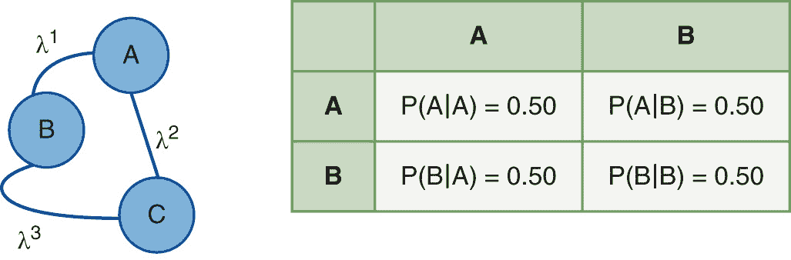

图 12.1 马尔可夫模型，带有路径 A/B 概率表

遗传算法是一种软件设计模式，其形式类似于人类的生物进化。在人类生物学中，两个人通过父母的 DNA（脱氧核糖核酸）生成后代。随着世代的传递，基因的组合会导致后代出现变化。例如，两个高个子的人如果生育，其子女身高更可能较高；但也存在突变。两个矮个子也可能生出高个子，可能是因为隐性基因或其他原因，反之亦然，两个高个子也可能生出矮个子。遗传算法复制或产生带有继承特征的子进程，同时也引入变异。这些变异可以是算法性的或概率性的，包括替换（例如用一个字符替换另一个字符）或插入（在字符流中插入字符）或删除（例如删除字符）。

遗传算法只是众多不同算法和模型之一，它们用于不同的功能。有些用于聚类，即在所谓的无监督模式中找到相关项的组。无监督模式意味着数据未预先标记，而是从数据集中发现关系模式。常见的聚类算法包括 k-means、亲和变换（affinity 或 affine transformations）、层次聚类等。其他算法用于各种回归任务，如线性、非线性和逻辑回归，包括普通最小二乘、最近邻和支持向量分类（SVC）。这些采用监督模式，即数据预先标记并训练，直到统计上与测试数据集对应，通常以准确率（匹配/不匹配）或相关系数 r > 0.85 来衡量。此外，还有用于分类的模型，如支持向量机（SVM）和随机森林，以及其他。


### 12.1.2 机器学习与自然语言处理

-   [自然语言处理 (NLP)](https://en.wikipedia.org/wiki/Natural_language_processing) 用于机器翻译；例如，它执行将语音转换为文本以自动生成转录，并允许我们将文本转换为语音。它是聊天机器人和情感分析等应用的基础。情感分析广泛使用 NLP，除了我们通常与它关联的营销方面外，它还用于理解某些威胁，如在线极端化。¹ 与这些技术一起，我们还看到 `Scikit-Learn` 和 `NLTK` 等机器学习库。`Scikit-Learn` 和 `NLTK` 库一直是文本处理任务的基石，并执行语言预处理，如词性标注、命名实体识别、词干化和语义关联。

-   NLP 通常与隐含语义分析 (LSA) 相结合。LSA 是一种使用无监督机器学习的技术，用于在数据集或数据流中找到隐藏的结构，称为潜在潜在因子。它在文本中生成隐藏结构，可以通过张量流网络等模型进行缩放。它还能够通过分析句子上下文或语义来识别同义词等语义关系。搜索引擎优化使用此技术，因为它允许作者和营销人员围绕这些潜在（或隐藏）因素设计内容。

-   另一种常见的网络安全方法是使用人工神经网络 (ANNs)。这些是统计模型，旨在模拟人脑和神经模式，创建所谓的语义网络 (Figure 12.2)。`ANN`s 可以被训练以检测多种攻击，例如 DDoS 攻击。通常，人工神经网络会使用真实的 DDoS 攻击案例和场景进行训练，以便快速检测攻击模式，但也可以用于区分零日模式。这意味着 `ANN` 可以从其之前遇到的其他攻击中学习，以识别和防范新型攻击。`ANN`s 可以检测并部署防御措施，并向管理员通报攻击。

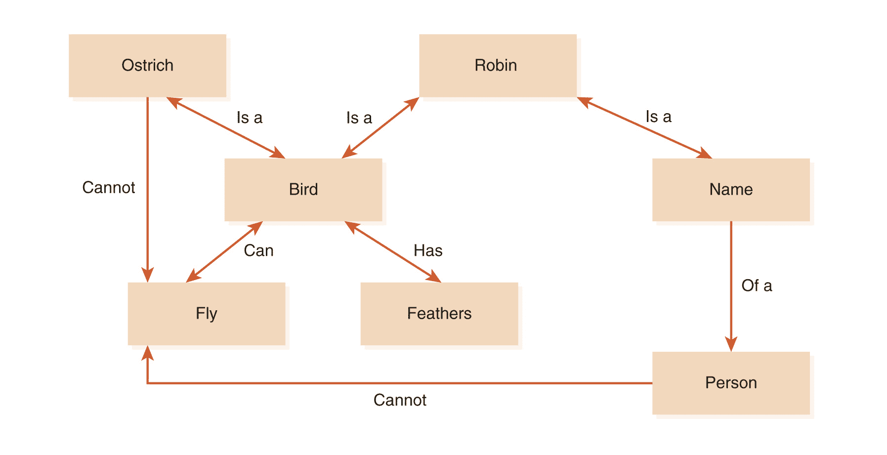

FIGURE 12.2 Example Semantic Network

| 分析类型 | 描述 |
| --- | --- |
| 内容分析 | 一种系统地标记社交媒体中的文本、音频和视觉通信的技术，也能生成数值表示，称为再现尺度。这些表示可能指示某种程度，例如匹配度的程度，或颜色的深浅，其中最深蓝色 = 10，最浅蓝色 = 1。 |
| 主题分析 | 一种通过数据清洗和熟悉、编码过程以及开发和修订主题来在数据中定位模式的方法。例如，如果观察数据显示女性在购物中心询问朋友关于服装购买的意见比例显著高于男性，主题可能表明女性比男性更容易受社交影响，而男性的购买行为更多基于其态度。主题分析也被称为话语分析，最常用的方法是 grounded theory。这与内容分析相似，因为它使用系统性抽样观察来得出结论，但它关注的是构建叙事，而不是匹配或程度。 |
| 社交网络分析 | 识别并映射实体之间的关系，如人、组织、银行、旅行地点和金融交易。数据集可以从自动柜员机、GPS、访问的网站等处获取，并常作为交通分析中行为分析的一部分。社交网络分析通常利用机器学习来发现关系。常用的 ML 模型包括贝叶斯信念网络和语义隐含分析 (LSA)。贝叶斯信念网络是通过有向无环图 (DAG) 或无周期马可夫链表示随机变量之间的条件依赖的概率图形。LSA 是一种通过去除噪声来缩小数据集的处理技术，与自然语言处理 (NLP) 互补。 |

### 12.1.3 交通分析

交通分析研究通信模式和元数据，以得出行为或行动的结论。交通分析融入行为分析（有时称为生活模式），在该分析中，从元数据中收集的活动被评估以识别行为模式。有效的交通分析必须在规模上解决三个因素：(1) 数据量，(2) 收到的数据速度，(3) 数据来源的多样性。现代机器学习可以处理这三个因素，适用于中型到大型组织。交通分析可以帮助识别组织或恐怖行动中的指挥控制结构、响应计划及其有效性，以及连接各方之间的重要交易等。攻击者可能利用交通分析来确定如何将攻击插入重要的金融交易；而防御者可以使用此技术识别攻击来源以及任何共谋者。

交通分析包括拦截并检查消息以及其他情报来源（如各方感兴趣的 GPS 位置）来确定通信模式中的活动，即使消息是加密的也可以进行分析。例如，假设我们想知道两个感兴趣的一方 A 和 B 之间是否存在金融交易。如果人员 A 从人员 B 收到电话，然后人员 A 在人员 B 所在的 GPS 位置取款，且监控摄像头同时观察到 A 和 B 在该位置，随后人员 B 存入相同数额的钱，我们可能推断 A 和 B 之间发生了金融交易。这就是交通分析的核心，尤其是行为分析 (Figure 12.3)。

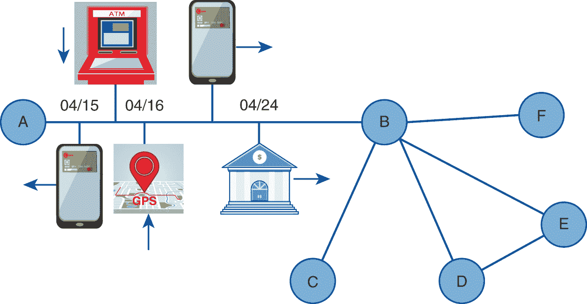

FIGURE 12.3 Metadata Scenario—Financial Exchange

增加活动或通信强度（即对话的频率和持续时间）可能预示即将发生的交易或攻击。此外，通信强度越大，我们可以从交通中推断出的信息越多。这一方面通常涉及社交网络分析，我们可以识别谁与谁相连，以及如何相连，即各方之间的关系结构：父母–子女、兄弟姐妹、业务合作伙伴、上级–下属、帮派成员、犯罪关联等。在此基础上，我们分析行为，如金融交易、会议、旅行等。这些系统通常依赖于图数据库 (GDBs)，它们利用图数据结构来表示语义关联，称为节点、边和属性。图（边和关系）通常以 3D 形式或为球形图表示。该图将感兴趣的项目与节点和边的集合关联，边是节点之间的关系，行为模式是两个节点之间活动形成的模式。

更具体地说，节点是实体或对象的实例，如人、地点和事物（名词），例如组织、账户或任何需要跟踪的其他项目。它们本质上是关系型数据库中的一条记录、关系或行，或文档型数据库中的一份文档。关系包含动词。我们可以一起推导出主语-动词-宾语以及其他逻辑连接词。属性是节点（名词）的属性，例如银行及其所有相关内容，以及动词动作，如登录、取款、电汇、电话通话或实物递送文件。边或关系是节点之间的连接，指示它们之间的关系。图数据库因此通过节点和边缘之间的元数据交换，以概念化展示关系数据。当被检查时，节点、属性和边缘之间的互连会显现出行为模式。边可以表示为有向图或无向图。在无向图中，连接两个节点的边具有单一含义。在有向图中，连接不同节点的边的含义因方向而异。

## 12.2. Game Theory and Predictive Models

Game theory is a branch of mathematics and logic in which strategic interactions among “rational” players advance toward a goal or objective. Game theory has been applied to a wide range of problems, from economic forecasting to nuclear warfare. It is also well suited to be combined with several common computer algorithms, such as stochastic models, finite state machines, and various forms of event chaining, such as a continuous-time Markov chain (CMTC). Along with these, a number of formulas have been developed, such as the Min/Max theorem, Nash Equilibrium, evolutionary and genetic theorems, and many others. Game theory has been an important contributor to technologies that model and predict attack episodes, as well as more generally in decision support and expert systems used in security planning and risk assessments. It turns out that predicting human behavior is incredibly hard; however, game theory has been quite successful overall in helping humans narrow their focus on potential scenarios.

### 12.2.1 Inductive Predictions

Many approaches to attack modeling utilize inductive logic and statistics. Most of us are familiar with statistics, but perhaps less so with inductive logic. Inductive logic essentially relies on the concept that given true premises, the conclusion is likely to be true. An example of an inductive statement is: Because all previous American presidents have been men, the next American president will probably be a man. This inductive statement (called an assertion) with its true premise and probably true conclusion is said to be a cogent inductive argument. This is because while it is not certain that the next president will be a man, given the samples from the past and the numbers of male versus female presidential candidates in the present, by sheer odds of probability the conclusion is likely to be true. You may recognize a limitation in this logic, however. The next president may well be a woman; thus, the past is not necessarily a good predictor of the future, but it can be informative.

Inductive arguments are often called hypotheses. In other words, using previous examples and taking samples of data, these “observations” can be computed into a probability. There are several keys to the accuracy of our computation, but two are particularly important. One is ensuring that the samples or observations are chosen at random. That is, from a dataset (called a population) every element in the population must have an equal chance of being selected in the sampling process. The second is that we must select “enough” samples from the population, and the concept of “enough” is a calculation based on how large the population is.

The inductive process allows us to generalize or to support hypotheses, but anyone who has been exposed to statistics knows that generalizations do not tell us specifics. To illustrate, suppose we had a jar of marbles in which there were four colors of marbles. If we knew the number of marbles in the jar and the numbers of each color in the jar, we could make a statistical prediction about the probability that the next marble taken from a randomly shaken jar will produce a marble of color X, but it is not guaranteed. More specifically, using this method in predicting security behaviors, we might be able to predict that people with a particular psychological “profile” may generally (probably) take security precautions given proper instructions. However, we cannot say, using this method, that Bob who fits the psychological profile will certainly take security precautions.

Random samples when viewed graphically have a shape, called a distribution. A normal distribution is sometimes called a “bell curve” because the collective samples resemble a bell when visualized. For us to know how well our sample represents an entire population, we must know the size of the population—this is called a bounded population. In other words, if one evening we simply asked people walking down Broadway about their attitudes toward theatrical plays, whether they liked or disliked them, we could not make the generalization that people across the country like or dislike these from this sample because, among other things, our sample is not random. For example, the people walking down Broadway in the evening are more likely to have attended a theatrical play than the general population, and we have no idea how many people in total walked down Broadway that evening.


For us to know how accurate our sample is, we would need a bounded population from which to randomly sample. Again, by way of illustration, if we chose more specifically to sample attitudes toward the Broadway play Cats, we could obtain the number of people who attended that play that evening, and then use a fair dice roll to determine which of the people exiting the theater to select. In other words, if we rolled a 3, a 1, a 6, and so forth, we would ask the third person coming out of the door, the next person, and then the sixth one, until the theater was empty. From this, we would run a variety of statistics to tell us how valid and reliable our sample is and then to tell us the probability that all of the people who attended Cats that evening liked the play or not. We can then generalize this to the population who attend the play, but we cannot generalize it to the population of the United States, or even the population of the state of New York, or even Manhattan.

A question might be: Why not simply ask all the people (the entire population) who came out of the theater their opinions? We could do that in this example, although surely some would refuse to answer our questions, so we would still end up with only a sample and not answers from the entire population. The issue is that gathering opinions from a relatively small group of people is relatively easy, but as our population size increases, so does the difficulty in gathering data from all of the members of the population. An advantage of this approach to making predictions is that even though it cannot say anything about a specific instance, a completely random pattern can be described in a relatively compact manner, namely a statistical distribution, and the distribution can efficiently and effectively be analyzed for making general predictions or presumptions. This is because from a statistical point of view, high complexity is addressed in the same manner as low complexity, and this approach can also accommodate a mixture of regularity and irregularity in the data.

### 12.2.2 Deductive Predictions

与使用统计和概括不同，归纳推理（在逻辑上存在多种形式）陈述的事实如果为真则必然导致一个明显为真的结论，如果是有效的。最简单的真归纳陈述是所有圆都是圆形。这个陈述为真，因为根据定义，圆是圆形的。当然，随着想法和论证变得更加复杂，逻辑也会变得越来越复杂以证明其真假，但复杂的真归纳陈述必须具有相同的基本属性。一个稍微复杂一些的归纳陈述的例子是：因为所有葡萄酒都是饮料，而查尔登纳是一种葡萄酒，那么查尔登纳是饮料。复杂性可能在于用于做出断言所使用的前提数量。

如所述，使用归纳推理时，我们必须列举构成结论的所有元素或事件，以便我们能够断言某事为真或不真。这种表意的预测方法使用的是集合论表达的归纳逻辑。与之形成对比的是公理化方法，它们利用理论和概括来通过归纳得出结论。集合论是一种有限状态技术，由集合中所有可能的状态组成。例如，交通灯有三种状态：红（停止）、黄（减速）和绿（行驶）。同样，在安全攻击方面，计算机系统可能处于三种状态：被入侵、安全、未知。程序上，假设我们有以下数据集合，`{0,1; 1,1; 1,0; 0,0}`，并使用如下逻辑与条件算法：`如果 0,1 且 1,1 则 0,1，否则如果 1,1 且 0,0 则 0,0`。

类似的算法可以转化为一个有用的程序，快速判断计算机系统和网络连接是否处于运行状态或处于关闭状态。如上所示，归纳预测方法具有若干优势，其中之一是它是算法性的（而非概率性的），且对于常规稳定的模式，算法可以非常短。然而，随着系统复杂度的增加，随机性也会增加，使得算法方法变得不切实际。这是因为，如果要用算法描述完全随机的模式，那么该算法不可能比构成该模式的变量（元素）列表更短。我们在密钥生成中看到一个相反的问题，以及在长消息中重用密钥位的需求。

由于在复杂系统和复杂问题中识别所有因素通常在计算上不可行，就像对现代密码进行暴力攻击一样，结合归纳和演绎技术可能是有益的，我们将在后面加以说明。

### 12.2.3 游戏理论与攻击建模

讨论游戏理论的范围超出了本文的范围，但我们可以介绍一些基本概念，以便用于预测安全攻击事件以及确定未来安全计划预算的风险和建议支出。为此，想象一局国际象棋。在游戏开始时，我们可以选择的着法数量非常多。虽然有些着法可能比其他着法更优，但确定最优着法是复杂的，主要是基于我们对对手下一步可能做出的猜测进行的战略性猜测。随着游戏进行，棋子被从棋盘上移除，游戏变得更加有限，最优着法（在可选范围内）变得更加清晰。在攻击规划中，解决这类问题时，统计预测最适合在攻击游戏刚开始时使用，但随着攻击游戏变得更加有限，转向归纳方法是最佳的。

许多游戏基于所谓的“囚徒困境”。² 为了说明这一概念，Kelly 和 Thibaut³ 突出了执法部门在两人因犯罪被捕时常用的经典技术。其中一方可以通过作证对另一方，换取减轻刑罚。在囚徒困境中，如果两方合作（即保持沉默），则双方都会受到轻微惩罚。如果一方背叛另一方，背叛方受到严重惩罚，而另一方获释；如果双方都背叛，双方都受到中等惩罚。这种游戏既提供了合作的可能性，但在大多数安全攻击建模的应用中，游戏是零和游戏，即一方获胜，另一方失去——如同国际象棋的游戏。

下面是一个关于预测对（任意）信息系统基础设施的攻击的游戏实现示例。在逻辑中，希腊字母 `Π` 常用表示整个攻击策略；例如，侦察/足迹（节点 1），端口扫描（节点 2），枚举（节点 3），获取访问（节点 4），提升权限（节点 5），创建后门（节点 6），以及掩盖痕迹（节点 7）。希腊字母 `Γ(s)` 通常表示攻击策略在给定系统中的计算基础设施的一个阶段（或状态），例如端口扫描（节点 2）。节点通常以有向无环图（DAG）的形式排列，这意味着在可以进行下一步可能的动作之前，必须先完成某些前提（必须做的事）。

例如，假设我们的计算基础设施由一台主机、一个公共 Web 服务器和一个私有文件服务器组成。为了描述网络的安全性，我们可以定义有限状态概率为：`Xi`，其中 `{I = {x, y, z} | x, y, z ∈{0,1}}`。在此表述中，竖线（`|`）表示逻辑或运算符，符号 `∈` 表示有限状态机中的可能状态，即 `x`、`y`、`z` 的状态可以是 0 或 1。换句话说，`∈` 表示集合的成员资格，这里是一个包含 0 或 1 的状态集合。

现在假设 `i` 等于状态 `(1, 0, 1)`。这表示主机（`x`）和文件服务器（`z`）已被入侵，但 Web 服务器（`y`）未被入侵。可定义的动作集合为 `A = {a1, a2, a3, φ}`，其中 `a1` = “攻击主机”，`a2` = “攻击 Web 服务器”，`a3` = “攻击文件服务器”，`φ` = “什么都不做”。基于这个集合和可能的状态，攻击场景可以在连续时间马尔可夫链（CTMC）（见 Figure 12.4）中进行预测，该链在节点之间具有有限数量的状态 `i = 1, … n`。⁴ 每个原子攻击动作都以概率（或向量或 lambda）的形式计算，表示从一个节点到另一个节点之间的状态转换概率，取决于 `Γ(s) : Xi`，例如，概率（`p`）或 lambda（`λ`）表示下一步将是 `Γ(s) = 5 : Xi (0,0,1)`。这一条件表示文件服务器处于不安全状态，可能是由于提升权限。

FIGURE 12.4 Example CTMC Representation for Server States and Vectors

在该游戏场景中，攻击者的行动选择基于对可能后果的考虑。在这个例子中，计算基础设施的运营安全是一个两玩家、零和、多阶段游戏，在每个阶段，游戏的参数取决于 CTMC 随时间在节点到节点之间、状态到状态之间的转换。

## 12.3 推理与推断

在安全领域，术语“incident”通常表示系统偏离其安全要求、政策或预期的状态，正如我们之前所展示的。安全事件可能是正常使用过程中因意外或随机故障导致的，也可能是故意针对系统或网络进行的攻击，或是上述因素的组合。对系统或网络的攻击通常由许多连续的操作和状态以及一系列状态变化组成，这些变化从最初的安全状态或基线发展到若干可能的被入侵状态，无法精确计算。针对这类问题，启发式推理和推断对人在环的决策者非常有帮助，前提是它们符合“规范规则”或“临界点”，即在给定选项中提供最优解，或在各方之间达成最佳妥协。

### 12.3.1 推理系统

计算机科学家早已将发展推理系统放在心中，以解决诸多问题，包括预测可能的未来安全攻击事件。推理系统是能够在复杂信息中发现模式、进行推断并从定义不清的问题和非结构化数据中做出预测的系统。它们是一种专门化的人工智能（AI），称为决策支持系统或专家系统，其功能是通过超越仅提供信息，进一步提供建议、解决方案或结果，帮助人类解决复杂问题。

AI 与专家决策系统呈现多种形式。其中两种常见的是基于规则的系统和基于案例的系统，此外还有模糊逻辑系统和遗传算法等。在基于规则的系统中，规则被定义以实现演绎式推理；而在基于案例的系统中，推断是基于代表性样本得出的，例如多种症状可能对应某一计算机故障的特征。一些有趣的技术已出现，例如 Norsys Netica^©，它能够从语义概念生成概率模型——贝叶斯信仰网络（Bayesian Belief Network），从而能够进行推理，例如：“如果下雨，草地会湿；如果草地湿了，则无需浇水。”另一项有趣的技术是 Pellet，它利用本体进行推理。由于本文超出范围，不再详述各类推理与推断专家系统，我们仅简要概述这些系统在信息安全攻击预测方面所解决的问题类型。要充分理解这一点，我们需要涉及“决定论”概念，即能否基于可获取的信息准确预测未来事件。

在专家决策系统出现后，对复杂系统的预测首先需要缩小人类经验的物质世界与思想、模型、理论的概念世界之间的差距。缩小差距要求计算机系统能够执行类似人脑的功能，并进一步“理解”人脑视为混乱的复杂性。实现这一点的有用技术是**随机建模**。随机模型通过结合已知变量、数量或组件的计算，并随机“注入”未知变量或在计算中加入随机性，生成概率场景。

### 12.3.2 论域与认识论

理论有时难以转化为实际操作——常见的挑战是“操作化”概念，使其足够明确以便可测量。我们在讨论如何预测安全事件时，已涉及多个方面。要操作化这些概念，我们还需要引入两个重要概念：一是判断是否有足够数据来描述问题（以及是否能够收集这些数据），二是数据的含义。若拥有足够数据，便可在数据中寻找模式——例如存储在数据湖中，这些模式可能暗示某种攻击正在进行，随后可据此构建多种攻击情景模型，并通过算法进行分析。然而，收集的数据可能不足以解释事件模型的意义；数据可能仅呈现为一组随机、未关联的事件，即便它们在统计上相关且按时间顺序排列。我们可能会得到一个模型，显示某人已飞往机场，附近加油站报告油罐车失踪，且当天在该区域四个不同地点大量购买硝酸钠。这些事件的意义必须通过它们之间的关联来推断，结论、解决方案或决策必须基于启发式推理得出。上述问题即为所谓的**本体论**与**认识论**层面，如 Scheibe 所介绍。

**本体论**层面指数据的存在，是决定性的，即可以在数据集中识别元素。在建模初期，本体论层面往往因大多数事件预测或未来安全规划问题的复杂性而不具操作价值。换言之，除非问题极其简化或有限，否则我们通常无法获取全部所需数据，以完整地模型化解决方案或生成确定的情景。

**认识论**层面关注从数据中获取的模式或关系的意义。当拥有足够的数据以及充分的上下文（已知问题、条件、约束和关系）时，意义可以从数据中推导出来。例如，若通过证据发现某一攻击情景涉及材料缺失（如丢失机密员工联系人名单），随后进行多次电话联系员工以获取电脑登录信息，我们可以推断正在进行**预设社交工程攻击**。随后可以推断需要实施的防御措施，如收集来电号码并进行调查。为了得出正确结论并进行恰当推断，必须确保本体论层面（事实与元素）已足够收集或确定，以便从模式中提炼出意义。

**示例**：若有人说“18, 16, 25, 14, 65, 21”，单纯的数字很难提供有意义的信息。若补充语境“年龄为 21 岁”，则可开始得出结论。但这些结论仍基于我们对 21 岁人群的主观认知——即我们所学关于 21 岁的认知模式。若再增加上下文与约束：“法律规定年龄 21 岁方可购买酒精，但实际最大的饮酒消费群体是未成年男性”，则可在**认识论**层面对问题产生意义。

### 12.3.3 推断与本体论到认识论的转化

最根本的问题在于将数据收集并转化为“意义”信息以便进行推断。即使如此，许多推理系统仍加剧了“信息过载”的问题，因为系统在向人类消费者传播信息时，产生的信息量超过了人类认知处理能力。换句话说，大量的“意义生成”仍然由人在回环中的“人”来完成，而计算机在收集和提供信息之外的工作很少。例如，假设我们想知道大学足球场内的人群是否友好。整体上，我们或许能说“是”或“否”，甚至可能通过判断每个人的性格特征并让每个人向他人自我介绍来实现。但实际上，人数太多难以逐一完成，有些人在比赛中会离开，有些人则会稍后到达。或许我们可以编写一个程序，随机抽样球场中部分人的性格，然后据此对整体人群进行推断。不过，我们仍然不知道像第二排 50 码线上的 Bob 这样个体是否天生友好。要了解这一点，我们需要研究他，但即便如此，他在当时的性格也不一定代表他平时的大多数情况。如果 Bob 的球队落后，他可能不友好；否则，他可能大多数时候是友好的。

通过这个例子，我们可以看到在试图确定复杂系统（如足球场人群）的一般模式，并进一步细化到特定元素（比如 Bob 在第二排 50 码线上的位置）时所面临的各种复杂性。要“弄清楚”感兴趣的现象——比如预测安全事件、评估安全风险或为未来几年向管理层证明安全预算的需求——需要足够的数据、情境和约束。

基于此，不足为怪的是企业的计划与实际预算支出在平均上会向上偏离 3 到 1。管理者往往低估支出，部分原因是受高层管理压力，当他们经常未能达标时，通常会出现人员裁减、削减或其他紧缩措施，这些措施会影响组织及信息安全。这种情况在安全对策和基础设施被视为业务 overhead 成本时尤为突出。换句话说，采取安全预防措施需要花费资金，却对利润没有直接贡献。管理者必须擅长做出准确预测，这意味着他们使用的技术也必须在预测能力上得到提升。解决此问题的一个方案，正如 Bohm⁸所解释的，是从本体论到认识论的转化。转化可按以下进程观察：

- 如果在黑板上用粉笔画一条等分的线段，我们会看到线段在时间上占据不同的位置，虽然它们在空间上相似，却是不同的，具有相似的差异。换句话说，我们在时间上有等距的点序列（Figure 12.5）。


FIGURE 12.5 Temporally Ordered Equidistant Points

我们可以想象，许多因素之间存在类似的差异，可能数量几乎无限，并且在不同时间交织于复杂系统中。我们可以把这些因素看作是操作活动及其构成要素在任意时刻的集合（包括计算机、网络、应用程序等）。如果我们把这些因素绘制成在时间上有序且等距的线条（如活动量、带宽利用、计算周期、延迟等），使它们在某一时刻相交，那么整体看似混乱，但正如第一幅图所示，混乱背后蕴含着固有的规律（Figure 12.6）。

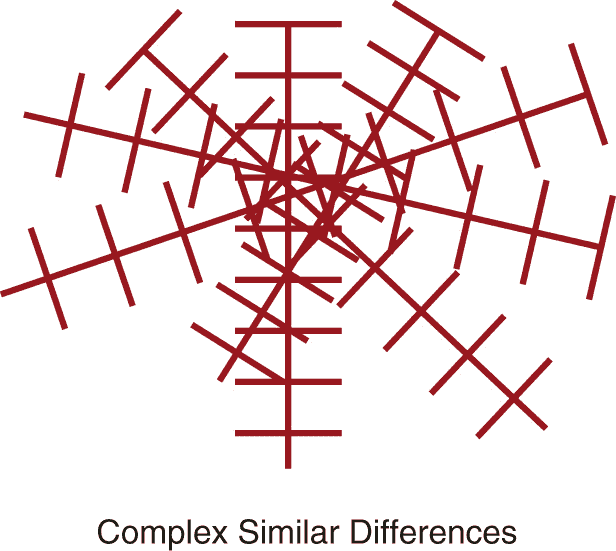

FIGURE 12.6 Overlapping Factorial Vicissitudes


我们可以把这些线条表示为自然的正弦波，并尝试通过傅里叶分析（Fourier analysis）将它们归一化或综合为“和谐”形式，即将一系列波形模式转化为统一的谐波。换言之，傅里叶分析将各因素的微分模式归一为共同（标准）形态。然而，正如 Bohm 指出的⁸，这样做会导致事件或事件中各因素所表现出的许多特征丧失。Bohm 称这些自然特征为重叠的阶乘变迁（overlapping factorial vicissitudes），每加入一个因素及其独立的模式，系统的复杂度会以指数级增长。再考虑一个实际例子：我们可以问，“下周三上午 10 点 IBM 股票的收盘价会是多少？”如果我们能辨认出所有构成股价的因素及其相似的差异（或变迁），例如投资者情绪、交易量、市盈率等，这些因素在同一时刻（即下周三上午 10 点）相互交织，我们就能推算出答案（Figure 12.7）。

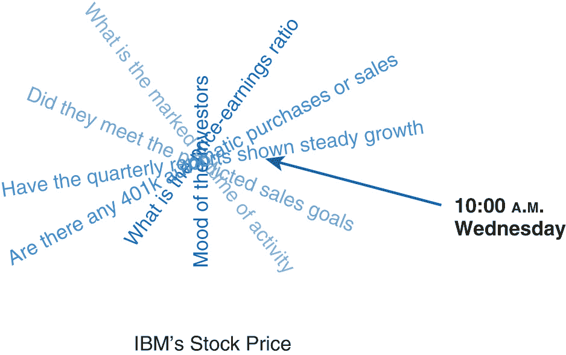

FIGURE 12.7 Example of a Complexity Problem

如果我们能够了解所有构成该现象的因素，并掌握每个因素的个体模式或变迁，就能完美预测该现象。换句话说，如果我们能够绘制出决定 IBM 股价的所有因素在给定时刻的所有相似差异，就能毫无疑惧地投入自己的钱。显然，这在现实中不可能实现。事实上，这一问题如此复杂且棘手，以致军事和情报界一直在大规模投入资金，摆脱静态数据仓库和数据挖掘的分析与推断方法，转向所谓的情报、监视、侦察（ISR）融合。该本体论到认识论转化方法采用多层次框架：传统的数据采集设施（端点和中间件），数据标记或注释的丰富能力，以及用于对语义增强信息进行分类和存储的组织与存储设施，这些设施将语义增强信息归类为称为本体的实体。此外，还有用于动态广告和发现这些本体的框架，以及位于顶层的推理与推断系统，如同传说中的“糖霜”一样。

## 12.4 Heuristics and AI Decision Systems

人工智能（AI）已被应用于广泛的技术领域，许多人将 AI 与机器人或虚拟现实联系在一起。虽然这些确实使用 AI，但它们并非唯一的应用，正如我们所讨论的那样。AI 在信息和网络安全等众多领域都有应用，这一点在我们关于机器学习的章节中已指出。下面，让我们考虑 AI 由决策系统所利用的情况。现在我们已经了解到，可以通过各种手段在复杂（混沌）系统中识别模式，接下来我们需要弄清楚系统如何理解这一切。为此可能，计算机系统必须完成从判断数据是否存在到帮助人在回环中确定数据含义的本体论到认识论的转变。为了实现这种转变，我们必须考虑我们所提出的问题是有离散答案，还是包含多种可能答案。这正是所谓的离散与分离问题本质之争。

### 12.4.1 Reasoning：离散与含糊问题

离散问题有一个唯一的正确解，例如，我们在 7 月 22 日上午 10 点的安全预算还有多少？这些问题之所以是离散的，是因为即使我们可能没有全部信息来确定预算余额，但存在一个唯一的正确答案。我们掌握的信息越多，例如本月已在新安全软件上花费了多少，就越能确定正确答案。相反，含糊问题是那些对解决方案或结论存在多种主观观点的问题（尽管有些观点可能优于其他）。含糊问题的例子包括：我们是应该报复，还是对写虚假言论的博主提起诉讼，或者是否应向私人金融机构提供联邦资金以保持其偿债能力？解决前者类型的问题，我们知道充分的信息即可得出正确解决方案；而解决后者类型的问题，因为某些解决方案往往优于其他方案，要得到最优解需要结合情境和推理，以便我们能够进行推断或得出恰当结论。推理模型因此可以被视为自动化的决策尝试或对含糊问题的解决尝试。

从技术角度来看，推理是一种机器，它基于情境、约束以及从观察到的情形或条件中汲取的原则，推断情形中不可见的方面。例如，推理可以用于从患者的可观察外部症状、X 光片、活检或微生物实验室研究等可观察信息中推断疾病或感染；或根据法医证据推断被指控人的角色；或根据可得情报推断敌方力量的可能意图。基于这些，一系列用于自动推理的形式化方法被开发，从描述逻辑到概率理论不等。所选的策略是为了匹配期望的结果或目标。然而，推理定理可以以一般形式表述：给定（1）关于观测现象的情境与约束，（2）关于现象不可见方面的某些知识，（3）据此得出关于现象不可见方面的结论。

根据可观测信息的性质和类型以及推理的目标，任务可以以更精细的方式表述。例如，当使用一阶谓词逻辑来表示问题时，推理可以重述为：给定（1）以真值（算法性）或模糊值（概率性）表示的某些谓词的观测方面，以及（2）以一阶谓词逻辑形式的原则作为域知识，确定现象含义的真值或概率。特别是那些含糊性质的决策任务（即涉及多种主观解决方案观点的任务），不仅要求对不可见方面进行推断，还要求推理生成假设或解释，以证明不可见的事件。例如，给定一些症状，心理推理系统可能被要求推测患者的心理障碍的诊断，或为 IBM 的股票在星期三上午 10 点预测股价——这对于高频交易者来说，有时比仅知道心理障碍的概率或特定日期未来股价更有用。

### 12.4.2 Synthetic Heuristics

启发式规则是一种简便的启示——也就是说，它们不是可编程的，而是更为明智的猜测。Churchman¹⁰ 引入了启发式推理的概念以及对推理模型至关重要的逻辑探究系统的类型，并基于莱布尼茨、洛克、康德、黑格尔和西格尔等哲学家的观点构建了这些模型。许多信息系统往往以 Churchman 的框架为基础进行启发式推理。¹² Churchman 强调知识和意义创造的“人性”是重要的，但不应忽视的是，系统能够在消除人类偏见的前提下，处理广泛的潜在惊喜。例如，“可获得性偏差”⁶ 是指人们如果经常阅读关于某类事件，就会高估该事件发生的概率。这种环境削弱了传统组织预测和应对事件的做法——即依赖预先编写的启发式规则——而要求组织成员提前进行更具预见性的响应，以便在可能出现的灾难性事件发生前就先行动。

在 Churchman 模型的语境下，问题的表述方式更能提供对推理过程的洞察。Churchman 使用的两个基本概念是“先天观念”和“输入”。先天观念是推理机器会预设的关于现象的原则或理论真理。输入是“观察者”（可以是人或程序）所作的实验观察，即输入数据。事实网是由给定的一组关系和运算符构建的输入与先天观念之间的互连网络。因此，事实网是一个由随机真理构成的网络，这些真理由询问者进行检验。¹³

#### 12.4.2.1 Leibnizian Heuristics

The Leibnizian heuristic aims at constructing an optimal fact-net for a situation. In this model, optimization means that for any given set of inputs, it can construct any number of correlated fact-nets. In other words, the heuristic develops the relationships and the operators that tie together a result in the form of a fact-net that corresponds to the innate ideas of an inquirer. It is implemented as a theorem-proving and problem-solving machine, where the primitives, axioms, and inference rules of the logic are the innate ideas and the various principles form the inputs. The inquirer (called the theorem prover in this model) creates a network containing consistent “proofs” or assertions, and if there any conflicts, some sort of “resolver” is needed. In stochastic modeling systems, for example, weighted constraints are often used for this purpose. For instance, if an alternative were chosen based on two opposing constraints (e.g., cost versus quality), the resolver would incorporate a variable weight to resolve the conflict (e.g., weight cost = 0.4 and quality = 0.8). A Leibnizian system thus assumes the existence of determinable optimal solution for a situation, and it attempts to configure its inputs from the situation according to that model.

#### 12.4.2.2 Lockean Heuristics

The Lockean heuristic is inductive in that it builds representations of what is called a “worldview” from shared distributed “observer” systems. Like other heuristics, observers may be human or automated. As an example, suppose a sensor on System A detects anomalous activity compared to what it has observed in the past. System A then shares this information with another trusted observer, System B. If System B observes the same as being an anomaly, they build a shared worldview in which the sensors have detected unusual activity. In other words, the heuristic makes elementary observations from input sources and feeds them to an inquirer engine that is shared with each of the observers. The observations have labels and properties that the heuristic assigns to the inputs. The Lockean system is also capable of observing its own process by means of reflection and backward tracing of labels. The worldview is therefore developed from shared observations by observers and categorization of learned information from observations, and these collectively create a consensus worldview about what has been observed and then what the affected system should do in response.

#### 12.4.2.3 Kantian Heuristics

The Kantian heuristic is a synthesis type of system, building on the Leibnizian system, but it does not presuppose the existence of an observable model or situation. The only observable model assumed is for a baseline, such as a clock-event, to enable the inquirer to observe the inputs in its environment. To bootstrap, the Kantian heuristic contains a set of default fact-nets. Each fact-net is an independent set of innate ideas and may contain its primitives, axioms, and rules of inference. An inquirer then selects one from the available set and then builds a Leibnizian fact-net using the inputs and the innate ideas of this model. The inquirer then determines the extent to which this fact-net is “satisfactory” according to some criterion. The model then generates the most “satisfactory” fact-net, which is proposed as the solution.

#### 12.4.2.4 Hegelian Heuristics

Probably the most useful heuristic in terms of attack incident prediction is the Hegelian approach. This seeks to develop the ability to determine the same inputs from different points of view. The inquirer presents a number of fact-net models, each of which is an independent set of innate ideas and may contain primitives, axioms, and rules of inference. The inquirer selects a thesis for view A from a set and undertakes to construct a “case” for supporting thesis A, in effect, a defense of thesis A. The next stage of the heuristic seeks to find a thesis for view A that is an antithesis for view B. The inquirer selects a thesis for view B that is the antithesis for view A and also finds a model that supports B. B does not have to be a logical negation of A. For example, in the context of some battlefield intelligence information, if the thesis is that a “target will be destroyed,” the antithesis may be “the attacking army will be destroyed” instead of “target will not be destroyed.” The next action in a Hegelian heuristic is to observe the two models and the elements that comprise the problem space that support the thesis and the antithesis and then examine the sources of conflict between them. It is expected that the attempts to understand or resolve these conflicts would lead the heuristic toward the actual (or “real”) situation. The larger model of the situation in the context of which the conflict can be understood is called the synthetic model of the situation. Churchman suggested that knowledge does not reside in the collection of information or in the inference done by the system and underscored the importance of humans in the loop in knowledge and meaning creation.

### 12.4.3 Issues with Synthetic Heuristic Systems


Many of the systems in place today are based upon heuristics about problems that have well-defined parameters or are amenable to mathematical modeling and programmed logic. They capture “preferred” solutions to the given repertoire of problems that represent well-known situations for which there exists a strong consensual position on the nature of the problem, agreement on the situation, and they rely on well-structured problems for which there exists an analytic formulation with a solution. Types of heuristic systems such as the Leibnizian are closed systems without access to an “external” environment, similar to the problem of how data warehouses work and are confined. That is, they operate based on supplied axioms that may fall into categories based on the system’s previous experience or labeling (topic tagging). In contrast, Lockean systems aim to reduce equivocality embedded in the diverse interpretations of a “worldview” but there too, their success depends on consensus among systems. The convergent and consensus-building emphasis of these kinds of heuristic systems is suited for stable and predictable situations or environments. However, complex systems require variety and agility in the interpretations, necessary for deciphering equivocal problems with multiple subjective points of view about an unpredictable future.

The Kantian inquiry system attempts to give multiple explicit views of a complementary nature that are best suited for moderate ill-structured problems. However, given that there is no explicit opposition to the multiple views, these systems may also be afflicted by conflicts characterized by plurality of complementary solutions. In contrast, Hegelian inquiry systems are based on a synthesis of multiple synthetic and antithetical representations of conflicts with contrary underlying assumptions. Reasoning systems that model unconventional attack episodes are most suited to analysis with Hegelian inquiry systems, which would facilitate multiple and contradictory interpretations of the focal information. This would help ensure that the focal information is subjected to continual reexamination and modification given a changing reality. Earlier, we mentioned that reasoning systems may work together to provide a full life-cycle modeling technique of information security attacks. The techniques a reasoning system may employ vary from simple, such as the coincidence of determination presented in the discussion about the breaking of the Vigenere cipher to find patterns among various models, to extremely complex, such as just described using heuristics. In most cases, reasoning systems produce models that can be rearranged, such as using first-order predicate logic to develop a sequence of probable moves in an attack episode. Next, we will examine some ways this might be done.

### 12.4.4 结合技术

我们介绍了合成启发学以及如何利用这些方法从现有数据中推断，并探讨了随机游戏理论以及可以被攻击建模和入侵检测系统用于预测攻击的技术。这些方法可以组合使用。考虑一种可能预测恐怖袭击事件的情境，然后考虑各种具体攻击。在这样的建模架构中，我们会有两个阶段，每个阶段由多个步骤组成。在第一阶段，我们首先选择一种概率方法来从大量数据中挖掘模式。这些数据可能来自许多来源，包括军事或情报信息流输入数据仓库、数据湖或本体论。例如，美国 Mitre 公司开发并支持的通用漏洞和暴露（`CVE`）本体论。

`CVE` 是一个收集和信息存储库，可导入到安全应用程序中。一旦我们收集了这些数据，就可以使用多种统计技术（如亲和分析）来挖掘模式或相关性。我们可以从这些模式中解析出构成元素，并将它们分类或类型化。这些通常会形成一个包含主体、客体、谓词和约束与规则的本体论。本体论很可能基于一种标记语言（如 `OWL`），并包含组装预测安全游戏的所有主要组成部分。一个典型的实现方式称为 `KAoS`。`KAoS` 是用于指定安全策略模型的本体论。一个简单的部分 `OWL` 本体论示例可能包括一个安全的“风险”，其子类为“入侵”和“灾难”，`OWL` 表示如下：

```
<owl:Class rdf:ID="Risk">
<rdfs:subClassOf rdf:resource="Intrusion"/>
<rdfs:subClassOf rdf:resource="Disaster"/>
</owl:Class>
```

从本体论中，我们接下来可以应用启发学来解析本体论，从而构建各种攻击场景。采用黑格尔方法，系统会构建反面事实网络，用于驳斥攻击事件，以及正面事实网络，用于建议攻击事件。这些事实网络使用随机算法进行分析，随机种子未知变量，并产生综合事实网络和场景。利用在主体-客体关联中组装的名词和动词，我们现在可以基于概率构建攻击事件的集合。事件可能包含描述可能因果和推断关系的叙事，以及整个事件的概率，然后每个攻击事件都会使用谓词和约束以及通过可能移动的统计路径来构建为概率过程（`CTMC`）。

以这种方式构建模型，可以帮助组织在最可能的场景以及最可能的关键节点集中有限资源，以便在最佳时机阻止攻击。这些模型还能够突出那些未被考虑的潜在攻击，从而打破“群体思维”，并表明完全新颖的方法（Figures 12.8 和 12.9）。

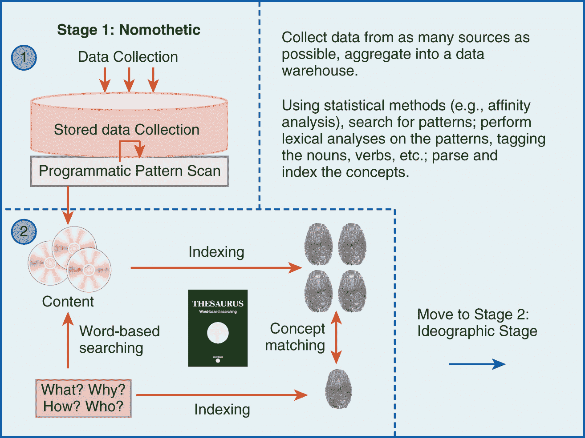

FIGURE 12.8 Pattern Detection, Ontological Indexing

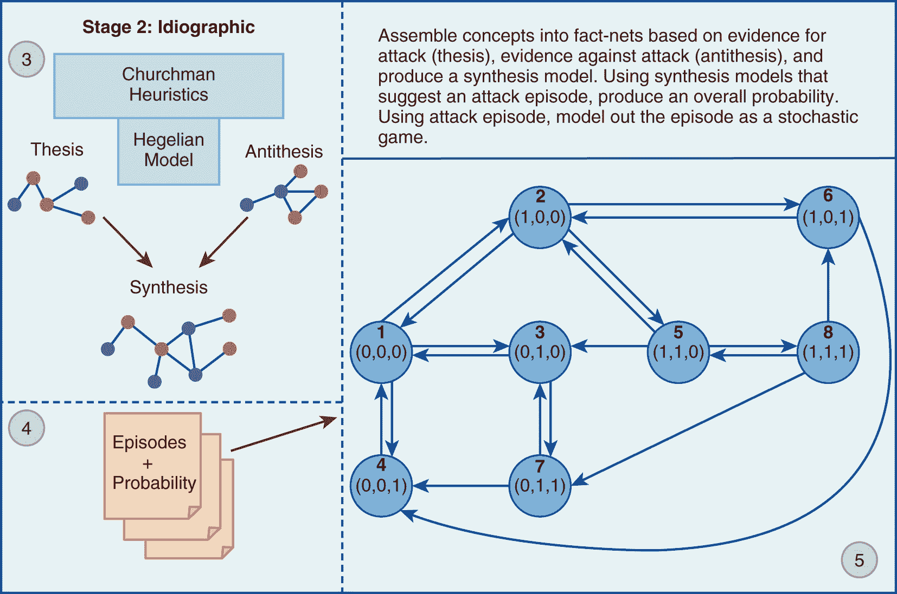

FIGURE 12.9 Stochastic Models and Game Scenarios

### 12.5 Heuristic Biases and Security Planning

正如我们所指出的，技术管理者和其他决策者通常拥有数据集合、推理系统以及 AI 决策应用，这些系统可以生成概率估计并根据威胁向量和表面提供行动建议，但有时人们会选择直觉而非信息，而忽视这些技术提供的证据。例如，Workman 的一项研究表明，有些人即使系统已被证明能够减少人为错误，仍会忽视 AI 决策系统的建议。这可能导致不幸的后果和糟糕的决策。

#### 12.5.1 AI 决策、天真理论与偏见

在使用 AI 决策系统时，分析人员和数据科学家通常会遵循一系列任务，包括分析建模、生成假设情境、进行敏感性分析、开展目标导向分析以及进行优化分析。在假设情境分析中，个人会修改变量或变量之间的关系，然后观察相应的值的变化。在敏感性分析中，会反复更改单个变量的值，并观察对其他变量的影响。目标导向分析则是将假设情境分析的方向倒置：它设定一个目标值（目标），然后反复调整其他变量，直到实现该目标值。最终，优化分析是目标导向分析的复杂扩展；然而，它不设定单个变量的特定目标值，而是在给定约束条件下寻找一个或多个目标变量的最优值。

AI 决策系统目前主要用于生成规范性建议，依据理性决策模型（如贝叶斯概率树）或基于经济因素（如投资回报率和回收周期的估计）。规范规则是为了在给定问题和约束下提供最佳解决方案，最佳解可能是一个平衡点。平衡点是一项数学计算，旨在在相互竞争或对立的目标之间取得最佳折中。然而，经理们有时会依赖直觉，这在正式上被称为天真理论。在此语境下，“天真”一词并不贬义，也不意味着非理性，也不意味着必然错误；它指的是不基于科学或结构化决策过程的决策。例如，Bonabeau 的一项调查显示，43% 的受访经理人表示他们至少 50% 的时间都依据“直觉”做出决策。天真理论是所有人对活动和事件运作方式的理论，这些理论并未得到操作化和验证，人们依赖感知和经验来进行判断。

在 AI 决策系统和规范、理性模型的框架下，未来结果的概率会被计算，但经理们往往不信任这些计算，尤其是在计算范围较短的情况下，尤其是在情绪和/或心理压力下，此时人们会转向天真启发法，甚至在面对反驳证据时也会得出错误结论。请记住，启发法是一种经验准则，而非正式、明确的规则。它是一种在特定情境下、在特定时间内有效的非正式策略或方法，但并不保证能够给出正确的决策。此外，这种经过训练的猜测容易受到人为偏见的影响，导致扭曲、不准确和遗漏。

- 偏见的例子是人们常常表现得像是不可控的事情是可控的。例如，当对手似乎无能时，人们会下更多赌注，因为他们认为可以利用弱势对手。[²⁵ 人们会在自己掷骰子时比在对手掷骰子时下更多的赌注。²⁶ 当骰子未掷时，人们会比已经掷过但结果未披露的骰子下更多的赌注。²⁷ 当他们选择计入获胜的骰子数字时，他们会下更多的赌注。²⁶ 大多数人觉得如果自己选择彩票号码而不是使用机器生成的“快速选号”，他们更有把握能中奖。²³ ^, ²⁵

- 偏见还解释了为什么许多人在打折的商品上花更多钱去车程更远的加油站和车辆磨损上，而规范性规则表明，为了节省少量金额，更应该开车更少、为商品支付更多。偏见还包括错误地认为过去的成功是未来成功的良好预测指标。²⁸ 代表性偏见也解释了无论“沉没成本”，常说的“把好钱倒在后头”或在篮球比赛中相信“连胜”的非理性金融升值和过度承诺。²⁹ 代表性偏见由 Kahneman 和 Tversky 在其研究中展示，他们发现人们常常主观判断不确定事件的可能性时，会基于随意观察到的模式，即使他们知道如何计算统计概率。作为这个认知现象的简单例子，他们表明有些人常把公平硬币投掷的 HHTHTT 模式判断为比 HHHTTT 更随机，尽管这两种结果的概率相同。Ajzen³⁰ 在一项研究中表明，当数据以复杂的因果关系呈现时，基率忽视现象出现的可能性会比在简单的统计任务中更小。基率忽视是指当事件有两个相关但独立的概率时，给予第一个概率的权重较小，而规范规则是将它们结合起来。

- 许多用于帮助组织做出有效安全决策的方法依赖于社会建构和启发性过程，而不是数学技术和技术，如决策系统、贝叶斯分析或随机建模。这些更具社会性和创造性的方法在安全领域很重要，因为安全威胁通常在短期内难以明确定义，且某些安全决策不适合量化处理——例如是否对员工进行监控。然而，决策中的偏见可能产生非常不希望的后果。Thibaut 和 Kelly 的前景理论研究表明，偏见会导致非常奇怪的决定。³¹ 这一点通过他们描述的两名犯罪嫌疑人被提供“交易”如果其中一人作证对另一人（囚徒困境）的描述得到了体现，其中一名嫌疑人说：“与其我们都挂掉，不如你比我更容易获释。”Loewenstein 和 Prelc 的研究发现，当参与者被问及是更喜欢一份薪酬为第一年 30,000 美元、第二年 40,000 美元、第三年 50,000 美元，还是第一年 60,000 美元、第二年 50,000 美元、第三年 40,000 美元的工作时，大多数人选择了前者，尽管这在三年内总收入更低——当涉及跨越多年（如安全支出或威胁分析）的复杂决策时，这种偏见会被放大。

#### 12.5.2 偏见与情境效应的相互作用

我们现在已经研究了 AI 决策和推理系统如何产生技术管理者用于规划攻击情景的场景。管理者也被教导使用诸如头脑风暴等概念生成活动来进行规划。例如，“故事讲述”已被用作推进组织目标（如规划安全计划）的方法。其他安全规划技术包括开发亲和图，用于将想法或问题分类为主题或类别，使用头脑风暴或头脑写作，参与者轮流生成并分享想法，以及“愿景”，参与者被教导通过 vicariously（身临其境）体验事件或结果，从而提出更现实的应对措施。重要的是要注意，这些方法的效果取决于信息的呈现方式。情境效应是指人们的决策受到问题描述（即情境）影响的情况。

情境化信息会激活认知模式，这些模式可能产生积极或消极的联想。认知模式是基于概念关联的精神脚本。例如，说到“餐厅”，人们会联想到在餐厅用餐并支付费用的特定脚本；例如，人们在餐厅会被提供食物并支付费用。当“快餐”作为修饰词与“餐厅”一起使用时，认知脚本会发生变化。通常，当“快餐”修饰“餐厅”时，人们会降低对餐厅所提供食物质量的评价。为了进一步说明这一点，当向人们展示关于一种用于治疗疾病的药物的情景时，人们根据信息的呈现方式会激活不同的认知模式；例如，当使用“挽救的生命”这一术语时，人们对药物的评价会比使用“失去的生命”更积极。³⁴

研究³⁵ 表明，参与使用情境生成技术（如情景和问题/解决方案特征）的规划会议的经理和员工在决策时更倾向于依赖直觉。然而，有些人更容易受情境影响——那些能够避免“被情境偏见”的人可以被认为遵循规范规则，而那些利用情境（无论是正向还是负向）的人则被认为陷入了启发性偏见。³⁶ 因此，在安全规划中使用概念生成技术的关键问题是偏见与情境效应之间的相互作用，以及这对管理者“凭直觉”而非客观数据或遵循规范规则做出决策的影响。

### 12.5.3 偏见、情境效应与安全决策

# 12.6 生物启发型安全与自适应系统

一种新型的信息和网络安全方法以人体为隐喻，用于构建更具适应性和抗损能力的系统，尤其在许多系统呈移动性的情况下，如笔记本电脑、智能手机以及其他通过所谓的自组网络（`MANET`）连接的设备。这些系统预计能够承受一定损伤，但它们具有从感染中恢复（recupere）并发展出合成免疫的能力。检测系统损伤的思路来源于危害理论，该理论阐述了当检测到病毒或细菌等危害时，哺乳动物免疫系统的反应。将该类比用于计算系统中，我们可以，例如，检查系统可执行文件以及它们在调用序列中的相互链接、变化事件或状态转换，或代码变更，从而推断原因。本节将介绍生物启发型安全的概念，特别是在与移动设备点对点（`P2P`）通信基础设施以及 `MANETs` 相结合的情形中。在此过程中，我们将提供自适应系统的说明及其在真实世界应用中的使用方式。

## 12.6.1 自愈合自适应系统

传统上，自适应系统指的是具有自愈合能力的系统。自愈合意味着系统能够从损伤中恢复。正如系统以多种方式适应环境，系统也使用多种机制进行自我修复或修补。许多自愈合系统采用一种常被称为易感-感染-易感（`SIS`）的模型。该模型中的每个节点或代理代表一个系统或设备，每条连接则是感染传播的通路。个体节点可能处于多种状态，如“受损”“安全”“感染”或“易感”，如上一章节所述。每当节点变得受损或感染，其他系统或设备受损或感染的速率会显著增加。⁴¹


Until recently, self-healing has relied mainly on traditional security architecture—providing firewalls that can react to attacks and warn of risky behaviors, having built-in redundancies, standby systems, virus scanners, and recovery utilities. However, the term is evolving to represent more “self-correction” methods, including the use of genetic algorithms that can propagate information, optimize systems, and instruct changes in a way that resembles how human genetics interact with (are expressed based on) their environments. Self-healing then relies on the concept of immunology. Immunization has been classified as passive, active, or a hybrid. Passive immunology is the approach previously mentioned, that is, to use firewalls and virus scanning systems that are capable of repairing damage. Active immunization includes using intrusion detection mechanisms that automatically generate an appropriate response to a given signature or type of intrusion or attack. However, an interesting addition to this concept was described by Toutonji and Yoo, in which they defined an “automated method to detect worm attack, analyze the worm’s malicious code, and then generate an anti-worm.”⁴² In this mechanism, the generated anti-worm would reproduce the behavior as the malicious worm and spread through the network until it could overtake the malicious worm and neutralize it. Nevertheless, they acknowledged that the anti-worm could be reengineered to neutralize defensive systems. As implied then, hybrid immunology is a combination of active and passive approaches, which gives better defense in depth than either passive or active immunology alone.

Research into self-healing approaches⁴³ generally involves discovery of spreading damage. By tracing the damage along the paths through which the damage is occurring, the systems involved might (1) begin to predict the trajectory or the pathways most likely to be affected next, (2) trace back to an original source and decouple (block) the source from the infrastructure, and (3) reroute traffic while systems are repaired, for example, by having virus scanners quarantine and repair the damage.

## 12.6.2 损伤与危害

系统，特别是当它们变得越来越移动并与其他系统相互连接时，预计会在危险的环境中运行，并不时遭受损坏。允许系统在危险环境中运行并承认系统可能受到一些损坏的概念与传统智慧相悖，传统智慧试图建立堡垒。然而，构建依赖于固定地点和可预测配置的防御工事的安全方法正变得越来越不可行（堡垒的移动性不高）。

网络基础设施的动态和基于信任的特性、系统和应用的异构性，以及组件缺乏集中协调，这些都极大地复杂化了传统安全机制和技术的使用。因此，安全系统设计者转向实现人工免疫系统的新方法，这些系统允许计算设备和节点参与危险环境，它们可能会受到一些损坏，但要么继续运行并自我修复，要么将工作交给可信的同伴，直到系统恢复。类比是一个人生病时，其免疫系统会产生抗体来攻击侵入的“不自我”病原体。⁴⁴ 当生病时，人可能会出现症状，如发烧，其表现可能受损，但除非情况危及生命，人仍能维持一定程度的功能。

然而，系统仅在事后应对感染已不足够。系统需要能够判断危险是否存在并尝试避免，但如果系统被污染，必须能够识别已造成的损坏及其类型，以便启动相应的人工免疫响应。难点在于，移动设备是一个社会集合，任何设备随时可能感染另一个设备，如何实现这一点？一些技术使用自包含的环境，称为可信安全内核（`TSK`）。`TSK` 包含损坏检测引擎（`DDE`）、原因分析器以及人工免疫响应（`AIR`）激活；⁴⁵ 其他技术则使用安全和配置本体论来检测损坏，并使用基于声誉的系统来判断危险。

### 12.6.3 可信安全内核

`TSK` 基于一个一般假设：随着网络的演变，机器（即节点）会累积变化。这些变化可能引入安全漏洞，也可能不引入。移动设备的一个关键挑战是，它们往往是孤立的，无法查询任何中央存储库来判断变化是善意还是恶意。此外，正如“`SQL.Slammer`”蠕虫传播速度快的情况所示，系统需要能够自主应对威胁，并动态重新配置以适应。为此，`TSK` 实时监控自身及其同伴的行为和变化，实时构建动态的信任估计，用于不同任务。`TSK` 还可以验证与同伴的通信。例如，假设在预配置阶段进行额外通道密钥交换，则 `TSK` 之间的通信可被视为在使用期间安全且经过身份验证。

需要注意的是，在此级别的安全措施与应用与应用之间的端到端安全无异，仍可能受到网络层的攻击，包括多跳传输和路由。在此假设下，主要问题在于构建一个安全基础设施，从节点的角度创建并维护受信任的计算和通信环境，同时支持配置、应用和系统设置的动态变化。目标是在提供系统所需的灵活性的同时，确保潜在漏洞能够通过对等系统被正确识别（或推断），用于报告或行为适应。`DDE` 在此角色中至关重要，因为它监控系统中关键组件，以识别退化或违反安全策略的情况，这些情况应被归类为“系统损坏”。当事件被归类为损坏时，会向人工免疫响应（`AIR`）组件发出触发信号，`AIR` 组件随后利用统计相关性在之前的事件和当前事件之间进行因果分析，以确定报告的损坏的可能原因。生物启发系统不需要找到精确的原因；因此，系统采用概率技术以允许结论中的不确定性，从而呈现非线性的自适应免疫响应。`AIR` 还独特，因为它可以接收来自多个设备的输入。例如，如果系统正遭受已知攻击（如“死亡回响” ICMP 包），系统不必仅依赖基于损坏的输入。当本地节点适应不同的环境条件时，`AIR` 组件的行为会受到整个系统的影响。通过将本地条件与相似对等的条件进行比较，适应性免疫响应可以在网络中比可能造成的损害传播得更快。

说了这些，除去与人类生物系统规模的差异外，计算机系统远比人类生物系统更脆弱。与人类生物学不同，一个十亿位程序中的单比特错误可能导致系统完全不可用。相比之下，生物系统通常需要更强的扰动才能出现灾难性失败——它们的失败模式更加灵活且宽容，与合成系统相比。小的程序变化会导致结果出现巨大差异。因此，盲目复制生物学并期望获得可行的解决方案是不合理的。除此之外，该系统的局限性包括：(1) 它依赖于一个初始受信任的配置参与通信，这在新加入的（且不可控）设备加入网络时可能不成立（见对等网络安全问题）；⁴⁶ (2) `TSK` 可能以各种方式被入侵；(3) 配置缺乏动态性。这些问题使得 `TSK` 的安全解决方案不完整，尽管它仍是未来安全解决方案的一个良好概念。

### 12.6.4 社会系统

在生物学语境中，生物体可以通过调整行为在其社会环境中演变。例如，我们会根据他人的反应来调整自己的行为。在大多数“可信内核”（`TSK`）配置中，静态行为（配置）被假设并依赖。然而，从生物角度看，基本的自我组织能力要求系统参与形成功能性安全组，然后根据收到的反馈进行 socially 可接受的调整；换言之，我们根据与他们的经验，对某些朋友比其他朋友更信任。最终，系统安全必须能够根据环境线索进行变化。

在本方法中，安全策略使用图形用户界面构建，底层技术生成本体标记（例如 `DAML+OIL` 或 `OWL`），或为图数据库组织数据。随后进行策略去冲突，即解决规则冲突，这些规则规范了决策过程。冲突在访问控制方面经常出现。例如，Bob 是 Group A 的成员，Group A 仅对 Resource B 具有只读权限；但 Bob 也是经理，拥有对该资源的完整读写权限，因此必须为其设置例外。然而，正如建议指出的，这里仍存在局限性。还需要更多内容来将这些名义元素与规范度量中的恶意偏差进行判断。

为了解决弹性问题，生物模仿需要结合社会学习方法，以了解危险、适应它并警告他人。在合作系统中建模人类社会互动涉及“代理”概念，系统可以共享信息，共同帮助受信任的朋友避免危险，并在节点因损伤或被移出服务时自行恢复（自我修复）。社会启发的安全与生物启发的安全相辅相成，因为它与其信任的对象共享疾病症状和恢复方法。

Bandura 将人类社会互动定义为代理，并将“代理性交易”定义为人们既是其社会系统的生产者也是产物的现象。⁴⁷ 因此，代理在三个层面上发挥作用：(1) 直接个人代理，即代理拥有目标、制定计划并遵循特定规则采取行动；(2) 代理，即依赖他人代为实现目标；(3) 集体代理，即通过社会协作和相互依赖的努力进行，影响网络中的其他代理。

从综合视角看，Sterne 等人建议采用动态层次模型，在该模型中，节点和服务被划分至权威根节点。⁴⁵ 该配置利用聚类实现可扩展性、容错性和动态环境适应性。通信群组中的每个节点负责自身的安全（例如从 `IDS` 视角），并对相邻节点承担有限责任，这些责任在权威链中汇总并向上传播。指令则从上往下传递。在生物类比中，无机系统设计者借鉴人类免疫学，开发遗传算法和自我修复系统。⁴⁴ 在社会学类比中，数字社会学家依据社交网络原则，推动病毒式营销和基于激励的合作系统的发展。⁴⁸ 综合来看，这些启发了在网络系统中建模代理性安全交易，尤其是在高度相互依赖和协作的系统，如云计算、网格计算、点对点网络和 `MANETs`。

在这些配置中，代理通过社交行为交换信息、接收指令、响应他人代理的影响，并以合作方式提供响应，以实现个人和集体目标，同时适应性和演化性地修复安全违规及违规者。⁴⁶ 为了进行个体和社会行动，代理必须依赖现有信息预测行为后果。换言之，要主动行动，代理需要一套初始知识，以此为基础形成假设。⁴⁹

安全策略可以通过在受控环境中运行应用，以发现其“正常”行为（配置文件），然后在后续运行时监控该应用是否偏离该预定行为。如果偏离，应用执行会被拦截，例如尝试进行被禁止的系统调用。⁵⁰ 另一种方法是将威胁和漏洞信息（如 Common Vulnerabilities and Exposures (`CVE`) 本体）导入安全策略本体，该本体捕获并更新软件工程研究所 CERT 报告的常见漏洞和事件。基于这些配置信息，代理本身可以检测损伤并将其通知权威的其他方（可信代理），或通过代理（如联邦入侵检测系统）学习到损伤或危险，这些系统检测变化或监控事件。

虽然联邦安全等代理机制在行政方面有明确优势，但在高度动态和移动的网络拓扑中，这并不总是可行。因此需要更多措施，且代理越能理解并管理自身环境，其自主性越强（即依赖层级结构或行政域的少），当关键信息未知时，它会学习，这种学习最可能来源于社会化。更具体地说，它是通过集体代理实现的。

### 12.6.5 社会系统与安全适应

尽管生物启发的安全在许多甚至大多数系统和网络拓扑与配置中表现极为有效，但在高度相互依赖且动态的配置中，节点会带来独特挑战，传统方法难以单独应对，尤其是静态方式。例如，在托管移动设备的网络中，信息交换发生在灵活的拓扑中，设备加入和离开网络的方式不可预测。设备间的通信路径可能跨越多个无线链路，这些链路由各种平台、运行不同应用并受限于严格限制（如内存或网络传输速率）组成。这些平台的安全防护能力也各异，如防火墙、病毒扫描和入侵检测系统的可靠性有限。最终，这些底层防护措施无法完全依赖。同样，期望所有节点行为可预测或集中或联邦的安全模型能够监督所有动态活动并及时有效响应也不切实际。

与人类的社交互动类似，<sup>52</sup>，<sup>53</sup>，系统可能会使用“集体代理”的概念，即系统承担其他人所依赖的某些责任，例如在特定质量服务（`QoS`）指标下提供服务。如果这些责任未得到履行，代理人就会失去他人的信任。需要意识到，阻碍系统实现承诺的 `QoS` 指标（例如超过时延阈值）的违规行为不一定是恶意的；它可能是导致暂时性条件的合法操作。然而，反复违规会被视为一次恶意攻击。此外，在人类社会系统中，人们倾向于比信任朋友更不信任陌生人。⁴⁷ 在决定是否与陌生人互动时，人们通常会询问朋友关于陌生人的声誉。在安全领域，这种特性被称为基于声誉的系统。⁵⁴ 如果朋友不认识该陌生人，那么该陌生人就没有任何声誉。在高度依赖的系统网络中，对刚加入的系统（即陌生人）进行不信任会对整体信息和计算资源的性能及可用性产生负面影响，因为越多的系统协作并分担负载，性能越好。因此，惩罚陌生人并偏爱朋友会抑制社会交换的参与；自适应陌生人策略通过要求每个现有节点计算陌生人请求的资源比例来应对这一问题。如果该比例低于既定阈值，节点将在陌生人不违反安全策略或尝试已知的安全威胁时与其合作。

如果陌生人的请求超过阈值，节点会计算与该节点合作的概率。该概率用于决定请求是否可以通过共享合作、降级（如降低传输速率、增加时延或降低带宽）或将请求延后至低优先级的时间来处理。⁵⁵ 随着设备与陌生系统交互并积累经验，如果陌生人在长期保持良好声誉，它将逐渐成为受信任的朋友——除非陌生人造成某些损害，此时其声誉会受到负面影响。

根据设备造成的损害类型，它甚至可能被标记为敌人并被禁止通信。在这种情况下，如果设备被判定为敌人（攻击者），它可能尝试以“白洗”（whitewashing）的方式重新加入网络作为新的陌生人。自适应陌生人策略通过仔细观察陌生人并将声誉经验与受信任的“朋友”共享来缓解这一问题。有时，受信任的朋友可能会与攻击者勾结，为其提供良好声誉，从而提高陌生人在集体节点中的信任度。为此，每个节点必须仔细监控资源消耗阈值、`QoS` 指标，并仅根据网络节点的集体经验逐步提升信任度。

## 12.6.6 集体代理、可用性和完整性

在电影《星际迷航：愤怒》中，史波克上尉说：“不要悲伤，阿德米拉。这很合乎逻辑。多数人的需求高于少数人的需求，或者单个个体的需求。”这恰当地描述了集体代理的目标。正如 ARPANET 的设计者所设想的，一个可生存的网络需要集体努力和冗余来实现整体目标，并且依赖于合作。这基于纳什均衡假设，所有个体的最优解不太可能是个体的最优解。换句话说，合作使每个人受益，程度各异。

在大多数利用 `QoS` 指标和本地与远程优先级的系统中（如调度算法和路由协议），一种称为“自私链路”（selfish link）的情况会发生。⁵⁶ “自私链路”反映了导致合作不足和不良网络效应的代理行为。其中包括“免费骑行”（free riding），即代理人忽视对其他代理人的义务，以保全自身（例如，保留自身计算周期或通信带宽用于自身服务，如将本地服务设为最高优先级，降低外部节点请求的优先级）。为解决这些问题，可以使用激励模型来鼓励更具利他性的行为，即共享资源以确保服务和资源的可用性。

为保障完整性问题，集体代理有三种行为治疗措施：(1) 为合作行为提供激励和正向强化，例如为高效节点分配队列优先级；(2) 负面强化，例如通过发送请求迫使代理履行义务，或制止恶意或不慎的破坏行为；(3) 对忽视负面强化或违反安全策略、发出已知威胁请求的代理实施惩罚。这三种措施均需结合，以构建有弹性的环境并保持资源和服务的可用性与完整性。

## 12.7 sociobiologically 启发的系统——最终案例

与其以简短的案例结束本章，我们来开发一个更完整的案例。未来的自适应系统安全必须能够结合生物学启发和社会学启发的网络安全方法，特别是考虑到三个趋势：(1) 计算设备正变得更强大、更紧凑且更具移动性；(2) 计算设备正 increasingly 成为在合作自发网络中共享资源的一部分，例如在点对点（`P2P`）和自组织移动网络（`MANET`）系统中；(3) 计算正变得更虚拟，例如通过云计算或网格计算基础设施分布，这些基础设施在许多情况下由第三方（如 `AWS`、`Microsoft Azure`、`Google Cloud` 或 `IBM` 云服务）进行管理和运营。

除了系统组件能够监控自身并与通信伙伴互动之外，一些伙伴可能被视为“亲密朋友”，其他则是熟人，还有些是陌生人。代理会根据环境调整其行为。有时，代理可能驻留在熟悉的“内部”系统上，另一时刻则分布到陌生环境中的外部节点。安全管理员和程序员不可能对这些系统进行适当的配置——系统必须学习其托管环境并正确反应。每次迁移事件（如从一个虚拟机迁移到另一个，或从一个环境迁移到另一个）发生时，节点必须使其自身适应基础配置，然后设定目标、确定优先级，并开始收集邻居的信息。


在进行此类调整时，同事可能会提供激励以促进在新环境中的合作，正如新入职员工可能会更倾向于与提供建议的同事合作，而不是与忽视他们的同事合作。诱导自私代理参与合作行为的机制被称为基于激励的安全系统，例如在节点路由和转发数据时给予其优先权，从而提供激励。然而，这种方法并不能阻止恶意行为，例如节点在发出 ICMP 源点击请求后仍继续传输数据。尽管如此，从这一例子中可以推断，如果发出通知的代理随后被忽视，潜在的危险可能随之而来。

### 12.7.1 新颖性作为潜在危险

在确定危险并造成对他人损害的社会互动背景下，引入基于声誉的系统可以通过维护和收集其他代理对请求者的有利或不利历史的投票来降低潜在风险。如果请求者的声誉因代理的本地历史被判定为不利，代理可能仅通过将其加入服务禁止列表来惩罚恶意请求者。相反，如果其他代理报告该代理声誉不佳，但该代理的本地历史是有利的，它可能会允许该代理，但需监控其行为，例如消耗代理资源（`CPU` 计算周期、带宽、内存）或尝试修改配置（复制、修改或删除文件）。应用程序可被分析其正常行为并监控异常行为。在此过程中，必须指定配置（Figure 12.10）。

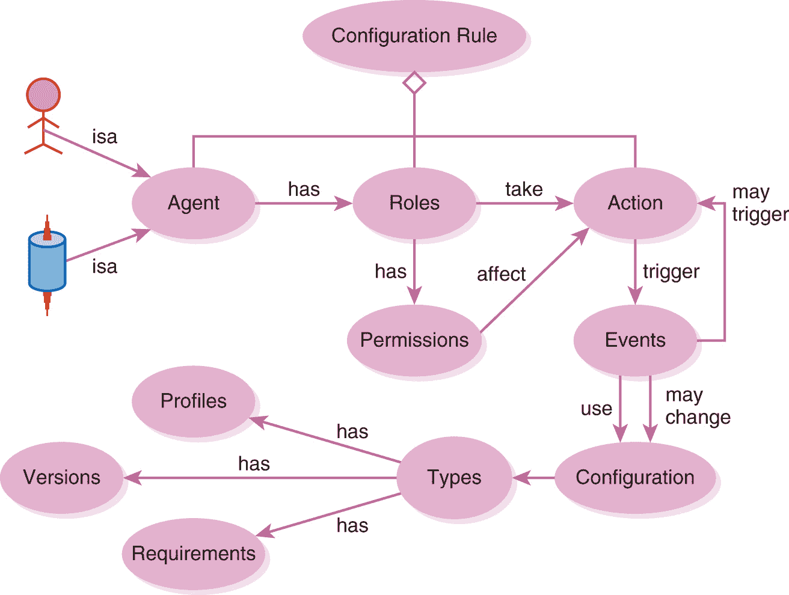

**FIGURE 12.10 代理自我定义和配置**

如果声誉良好的代理开始对系统造成损害，例如通过对提供者的请求消耗大部分甚至全部可用资源，该代理可能会发出负面强化请求，要求请求方重新路由或限制其请求，然后监控合规情况并据此更新声誉历史并向其他代理报告。如果请求方忽视这些请求，代理可能转而采用惩罚措施，例如将请求排队至低优先级，例如当请求超过带宽等资源阈值时（即使请求本身不是已知威胁）。如果请求被判定为威胁，系统会自动阻断攻击代理或丢弃其数据包。

从安全策略的角度来看，代理根据其角色被授予相应的权限，但在自发的通信环境中，权限和角色可能非常动态。行为角色对分配权限的行为集合的符合性是常见情况，也被视为无害。无害行为不需要消耗需要被密切监控的系统资源，因为监控本身也消耗资源。然而，当遇到新颖情况时，它会带来潜在危险。新颖性可能表现为代理尝试执行未授权功能，或代理执行已授权功能，但该功能尝试执行某种新颖行为。因此，在安全策略执行中，危险可以等同于新颖性。

从这个参照框架来看，危险也可以被视为在严重（x 坐标）和迫切（y 坐标）坐标轴上的一个连续体。当危险出现时，会根据其在这两个坐标上的位置进行监控。可以在连续体上设定阈值，在该阈值以下可能需要进行干预以防止损害发生。这里的损害可以定义为任何会影响任务执行的行为，包括对任务参数的负面影响（如网络带宽的指数级消耗）、一个通常不复制文件的应用程序尝试复制文件，或对任务执行成功所需的任何 QoS 参数产生负面影响。行动的结构可能包括目标、计划、步骤和规则，这些都是可变的且可协商的。也就是说，代理在反应到社会和环境事件并选择适当的合格计划以实现其当前目标时，会动态组装自己的规则集。如果初始计划失败，或者事件或异常导致代理改变计划，代理可能会尝试其他合格计划。因此，代理会根据当前可用的信息（无论是从环境还是其本地知识）选择下一个计划。

### 12.7.2 社会生物学行为作为目标导向行为

代理层次结构根本上的目标包括代理的义务和禁令。例如，目标可能是强制代理提供网络服务。目标包括为满足目标而执行的计划；例如，提供网络服务的义务可能要求启动 `httpd` 并在端口 `8080` 上监听。代理行为受规则的约束，这些规则可能规定 `ActiveX` 控件不允许进入网络服务。规则作用于计划中的步骤；因此，如果代理收到包含 `ActiveX` 控件的 HTTP 请求，规则可能要求步骤丢弃该请求。代理动作的编排可以分为三个层次：高层、中层和低层。也许代理拥有多个目标，每个目标包含多个计划。例如，目标“保持应用程序的当前版本水平”可能有一个高层计划，名为“版本更新”。对于这个高层计划，有中层计划执行一系列步骤、任务和日志更新，例如“自动更新 `AcroRd32.exe`”可能需要打开网络连接并通过 TCP/IP 套接字从 Adobe 网站下载文件。低层计划执行系统任务和记录日志更新，例如打开 `127.0.0.1:2076`，并记录与 Adobe 的通信。

通过这种方式，从初始计划集开始，代理可以通过从一个计划跳转到另一个计划的路径进行执行，这使其能够将响应范围限制在更局部的问题上（例如为代理 X 提供 HTTP 连接，但不为代理 Y 提供）。此外，如果目标可以通过不同方式实现（例如手动更新或自动更新），三层计划结构提供了这种局部能力。代理可能尝试其他合格计划以实现目标。可能发生的损害因代理可能尝试的活动类型而异。在数据共享方面，代理需要至少利用两种不同的资源：存储，每个代理需要为其他代理可能需要的文件预留一些存储空间，尽管这些文件对代理本身可能无用；以及带宽，每个代理必须为其他代理请求的文件和通信分配部分带宽。这种损害的评估是基于安全策略定义的阈值的超额来衡量的。

为了说明此案例场景，安全代理会根据可用资源、访问权限和权利、声誉以及“适当行为”来检查其配置和本体论是否符合服务请求。根据 Provos 所述，最初通过运行应用并生成配置文件来建立基线配置，但这并非总是可行的。更常见的情况是，代理会通过在其本体论中加入无害行为来学习。例如，请求可能会针对 `8080` 端口的 Web 服务发出。当请求被处理时，代理会检查其 Web 服务本体论，以确定哪些操作是被允许的。只要请求者行为得当，就不会检测到危险，并会根据定义的 QoS（如内存使用率、网络使用率、CPU 使用率）和配置（如文件校验和）以及计划参数来授予资源使用权限。为了在处理导致损害的请求后启动自愈过程，例如，如果代理检测到 QoS 任务参数违规或正常行为违规，它会计算违规的向量并确定损害程度。如果在处理请求后确定损害严重，则该损害会被标记为恶性并通过损害控制器进行过滤，以确定哪部分代理是恶性的以及应采取的行动，同时收集导致损害的代理的数据并将其加入禁止列表，给予该恶性代理低声誉评级。

另一方面，如果陌生人发起请求，或者请求者拥有高声誉但提出了新颖请求，则会判定为危险，并主动进行监控。也就是说，在代理或行为出现新颖性的情况下，请求会被隔离并监控，以确定其可能利用的资源以及在义务 QoS 参数或可用资源而非义务的前提下可使用的程度。如果预计会超过阈值或可能发生资源违规，代理可能会通知请求者，例如要求其停止或重定向请求。如果请求者遵守，则会给予高声誉。反之，如果请求代表已知的威胁，则该请求会被标记为恶性非自体（malignant nonself），并通过损害控制器进行过滤，以确定采取的行动，例如拒绝请求并给予请求者低声誉。图 12.11 和图 12.12 说明了这些概念。该机制的测试用例在 Box 12.1 中。

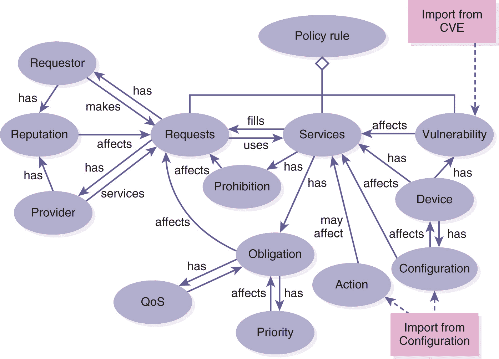

FIGURE 12.11 Social Exchange Policy Among Agents

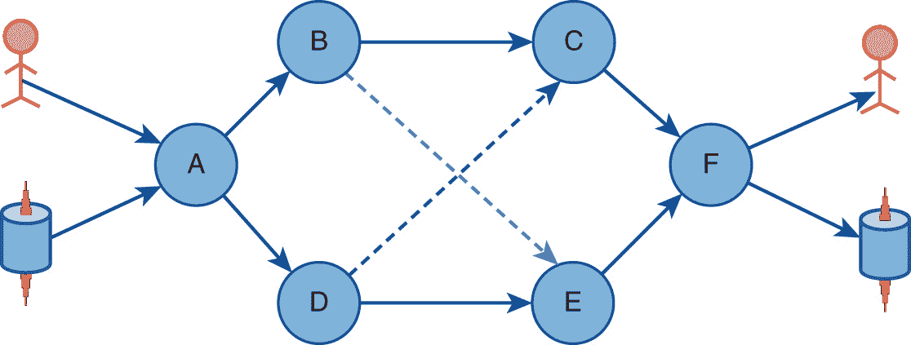

FIGURE 12.12 Test Case

### 12.7.3 Adaptive Synthetic Systems

如我们在前一场景中所述，关于以目标为导向的代理行为以及如何最佳处理新颖性，代理被允许执行未被明确禁止的操作，且危险行为会被监控，但可能无法被阻止。由于其本质，移动自组网络无法事先预定义所有代理的可能行为。虽然可以建立基线，但在某些情况下代理确实需要执行新颖行为。代理会通过获取其他代理的信息（包括其他代理的声誉）以及监控自身（依据 QoS 指标、义务、系统资源和利用率等）来监测环境。在拥有目标、自身情况以及环境信息的前提下，代理会选择一个计划并执行该计划的定义步骤。

当发生事件时，根据行为规则，代理可能会暂停当前计划并选择新的计划。例如，如果代理的目标是提供服务，并且收到关于其对等方声誉不佳的更新，代理可能会暂停原本计划的提供服务的义务，并选择新的计划。因此，代理会根据其环境和当前情况选择一个符合目标的计划。总之，尽管社交和协作，代理的行为类似于自然免疫系统；其核心思想是允许危险和潜在损害的发生，同时努力确保代理的生存，以便它能够继续为网络中的集体代理提供协作支持。

如所述，根据代理角色所需的灵活性，代理的配置更改或使用可能被“宽 open”，类似于匿名登录。在某些领域环境中，会有设备需要允许任何拥有访问权限的用户安装软件、启动服务或更改配置。高价值节点通常不会允许这种做法，而升级后的代理基础设施和本体论则会根据需求来决定此类决定。一个操作可能会触发其他操作，具体取决于该操作引发的事件。此外，依据授权，操作可能允许使用配置中的元素，甚至在授权允许的情况下更改配置。配置类型拥有配置文件，这些文件可以简单到文件大小、访问权限和校验和，也可以是最严格的情况——包含给定应用程序能够执行的所有正常行为，包括该应用程序所做的系统调用。配置类型还可能关联版本号，以及执行所需的资源要求，例如所需的 RAM 数量或必须满足的一组 QoS 指标。

### 12.7.4 Challenges for Ad Hoc Networks and Adaptive Systems

正如本章所指出的，静态定义的安全策略和配置在动态且移动的配置环境（如 `MANET` 或 `P2P`）中无法解决。在本节最后部分，我们将总结并列出一些尚未完全解决的关键问题。正如我们所强调的，相较于传统的被动安全措施和防御设施，更实际的解决方案是使系统能够在动态配置中执行操作。这可以通过直接代理、赋予代理目标导向的自主行为灵活性来实现。然而，鉴于拓扑的本质和限制，与其他代理的代理合作是必不可少的。每个代理都会根据自己的计划制定一系列目标，并向其他代理发出请求，只要仍有合作和“良好”行为，这些请求就会被满足。我们已经说明，一个计划由实现目标的步骤序列以及规范其对请求、事件和异常的响应规则组成。一个代理可能为同一目标拥有多个可用计划，也可能有多个目标需要实现，这些目标是动态且可协商的。

集体代理在响应事件以及其他代理人的请求后发展起来，代理根据其在移动网络（如 `MANET`）中所拥有的资源以及其在社会上形成的协议提供服务。然而，`MANET` 的社会性和自发性结合起来会创造不安全的环境。必须让代理具备在严重危险即将发生时检测的能力，以便在损害发生前采取预防措施。恶意行为会通过声誉收集并通报给其他代理，但免疫学机制中已内置保守性：在对陌生人时保持谨慎，同时仍不拒绝让他们有机会证明自己值得信赖。

在某些层面上，危险需要被监控，但不一定要被打断，除非它构成严重且迫在眉睫的致命损害威胁。然而，未被检测到的非法代理（或共谋者）的危险行为可能涉及窃听或截取通信，可能不会升级到干扰任务参数，也可能不被发现，因此通常依赖典型的加密方法来解决这一问题——而这些方法并不一定被所有 `MANET` 代理支持。另一个需要解决的 `MANET` 应用挑战是 QoS 参数的建立与监控。任务特定的参数和 QoS 指标在区分新兴的危险行为（即创新行为）与实际的损害（即对任务执行的影响）时变得至关重要。应用程序可能由离散动作组成，如文件或消息交换，也可能涉及流媒体数据，如视频或语音。在离散动作中，整个消息或文件可能需要在代理能够检查之前全部接收，这会导致服务请求与质量评估之间出现延迟。极端情况下，代理可能在文件完全加载后才发现该文件是有效的还是危险的。而流媒体数据则允许代理在传输过程中的某些点上即时判断数据是否可接受。

此外，离散数据和流媒体数据的 QoS 指标可能不同。例如，文件传输的指标通常包括下载时间和传输文件的完整性；而流媒体数据则更关注抖动程度、帧率传输和分辨率。危险会触发监控，而在自发环境中，新颖行为必须在被确认其是善意还是恶意之前容忍，但这并不排除对其进行评估——这取决于危害程度和迫切性的评估。而损害则不能容忍（至少不能长期持续）。快速评估 QoS 并及时采取行动是代理的关键问题。最后，另一个值得探索的领域是恶意代理的发现。因为安全策略本体论规则可以结构为“主体 → 事件 → 对象”，因此可以通过关联主体与事件、事件与对象、主体与对象来检测合作与非合作代理之间的共谋行为，例如通过相关性分析寻找共谋模式。但到那时，共谋者可能已经离开 `MANET`，或者已“漂白”其行为。相关技术的研究仍在进行中，但这些仍是未被征服的挑战。⁵⁸

- [费曼学习法](https://wiki.example.org/feynmans_learning_method)的灵感源于诺贝尔物理奖获得者**Richard Feynman**。

1. 运用费曼技巧，你只需花上`20 min`就能深入理解知识点，而且记忆深刻，*难以遗忘*。

```
if (condVar > someVal) {console.log("xxx")}
```

# 58

58.Antoniadis, P., Courcoubetis, C., & Mason, R. (2004). Comparing economic incentives in peer-to-peer networks. `The International Journal of Computer and Telecommunications Networking`, 46, 133–146.


## Appendix: Think About IT Answers

© Antishock/Shutterstock

### Chapter 1

1. `False`

2. `False`

3. `Internet of Things` or `IoT`

4. `Forensic Analysis`

5. `Network Operations Center` or `NOC`

### Chapter 2

1. `At the macrolevel`, auditing falls into the following major categories such as: `periodic audits` (informal or formal) by an independent internal or external team and `operational audits`, which should be ongoing.

2. `This` is the concept of `threat intensity`.

3. `Beyond the collection and analysis of evidence`, it needs to be preserved and in so doing, we should give particular attention to `Schultz’s four considerations`: (1) `authenticity`, (2) `admissibility`, (3) `reliability`, and (4) `completeness`.

4. `Traceability`

5. `Two important aspects of QoS` are `MTBF` and `MTTR`.

### Chapter 3

1. `Different points` on a `digital plane` that an `adversary` can try to attack

2. `Emails containing malicious attachments`; `A very slow or downed corporate website due to an unknown spike in traffic`

3. `Your friend or work colleague`; `Software running in your network`; `Your boss`; `A partner or customer`

4. `Social engineering method of stealing information`

5. `A high rate of traffic sent to overwhelm the target’s bandwidth`

### Chapter 4

1. `Procedural justice` refers to the perception that employees and employers deem the process used to make a decision fair.

2. `A requirement that goes beyond just careful handling but also to carrying out with vigor the protection of information` is: `Due diligence`.

3. `True`

4. `True`

5. `If organizational security policies are going to be effective`, they must be: `Enforceable and enforced`.

### Chapter 5

1. `Processes by which organizations are managed according to some criteria`

2. `False`

3. `A security life cycle`

4. `A way to integrate security processes into Dev/Ops`

5. `Accounting`

### Chapter 6

1. `A way to integrate security processes into Dev/Ops`

2. `Permissions for who can do what on a device or file`

3. `SaaS`, `PaaS`, and `IaaS`

4. `Enables the structure of the database to eliminate anomalies`

5. `A scheduler`

### Chapter 7


1. Placing the burden of risk on another party
2. Organizing information security
3. `f(risk = (threat × vulnerability))`
4. A compliment to SP 800-53 to cover risk management
5. Permissions for who can do what on a device or file

## Chapter 8

1. Rootkit
2. Reference monitor
3. False
4. Enrollment
5. Template

## Chapter 9

1. A psychological contract
2. Nonrepudiation
3. Called surveillance
4. Ombudsman
5. Cybertraps set by investigators that they expect to be attacked

## Chapter 10

1. Vigenere is a polyalphabetic cipher.
2. While DES uses blocks of binary numbers transformed using a 64-bit key, there are actually only 56 bits available to the actual key because 8 are used as parity bits and are dropped from the cipher algorithm.
3. DES performs 16 Feistel rounds.
4. Positive integers less than `n` that are relatively prime to `n`
5. 64 bits at a time and each block of data

## Chapter 11

1. Specific system SeCM plan
2. Both the network and transport layer
3. Everything not explicitly denied is permitted
4. True
5. A virtual circuit table

## Chapter 12

1. Whitewashing
2. Danger theory
3. Artificial immune response (AIR) component
4. True
5. Determining trust levels


# Index

© Antishock/Shutterstock

Note: Page numbers followed by b, f, or t indicate material in boxes, figures, or tables, respectively.

## A

- Acceptable use, 197
- Access control, 133
- Access control list (ACL), 147, 147f, 199, 228, 232, 244, 332, 341
- Accreditation, 221, 233
- Achilles, 168
- ACID properties, 226
- ACL. *See* Access control list
- Act-based utilitarianism, 105
- Active attacks, 14, 14t, 170, 171t
- Active semantic systems, 163–164
- Activity logging, 68t
  - and auditing, 66
- Adaptive synthetic systems, 409–410
- Adaptive systems, 396–404
  - challenges for, 410–412
- Address resolution protocols (ARP), 326
- Ad hoc networks, challenges for, 410–412
- Administrative controls, 198t
- Administrative countermeasures, 34, 35t, 228
- Advanced Encryption Standard (AES), 307–308
- Advanced Research Projects Agency Network, 147
- Adversary
  - attack surface, 69–73
  - hactivist, 67
  - “lone-wolf” hacker, 67
  - state-sponsored actors, 67–68
- AES. *See* Advanced Encryption Standard
- Affinity analysis, 390
- Agency, 101
- Agent-based configurations, 344
- Agent frameworks, semantic fusion and, 164–166
- Agentless, 344
- Agents, 43, 43t
- Agent-to-agent communication process, 165
- Agile methods, 25, 117
- Aglets, 164
- AH. *See* Authentication Header
- AI. *See* Artificial intelligence
- AIR. *See* Artificial immune response
- Air gapping, 71, 71t
- A-Key, 243
- ALE. *See* 年化损失预期
- Amazon, 120
- Amazon.com, 159
- Amazon Web Services (AWS), 24, 77, 149
- ANNs. *See* 人工神经网络
- Annualized loss expectancy (ALE), 199
- Anonymous, 67
- Ansible, 24
- Anti-SLAPP law, 193
- API. *See* 应用编程接口
- Application Layer, 156–157
- Application layer attacks, 74–75
- Application-layer firewall, 336–337
- Application Programming Interface (API), 15, 155, 159, 161, 330, 337
- Application service providers (ASPs), 148, 151
  - approach, 149
- AppSec, 349
- ARC, 199
- ARP. *See* 地址分辨率协议
- ARPANET, 147
- Artificial immune response (AIR), 399
- Artificial intelligence (AI), 5, 12, 379–380, 385
  - decisions, biases in, 392–394
- Artificial neural networks (ANNs), 371
- ASCII characters, 9
- ASPs. *See* 应用服务提供商
- Asset management, 133
- Asymmetric attack, 237
- Asymmetric cryptography, 302, 310–322
  - beyond encrypting messages, 316–317
  - key distribution and PKI, 318–319
  - private keys and, 312–316, 313b–315b
  - public key algorithms, 320–322
- Asynchronous attacks, 237
- Asynchronous Transfer Mode (ATM), 158
- Asynchronous Transmission Mode (ATM), 159, 336
- ATM. *See* Asynchronous Transfer Mode; Asynchronous Transmission Mode
- Attack architecture, 14
- Attackers
  - information of, 181–184
  - inside, responding to, 283
  - motivations for
    - entertainment and status, 279–280
    - ideology and social acceptance, 280
    - personality, behavior theory and, 279
    - neuroticism, impulse, and exploitation by, 281
  - outside, responding to, 282–283
- Attack examples, 80–83
  - DNS hijacking, 83
  - ICMP permutation attacks, 81
  - ICMP tunnel attacks, 80–81
  - network packet, frame, or octet attacks, 81–83, 82f
- Attack modeling, game theory and, 377–379
- Attacks. *See also* Threats; Vulnerabilities
  - architecture, 146, 146f
  - information system, 172–181
  - man-in-the-middle, 146
- Attack surface, 14, 19f, 69–73
  - network security zones, 69–72
  - zero trust networks, 72–73
- Attack tree, 173, 173f
- Attack vectors, 14, 19f
  - surfaces and, 146
- Auditing, 68t
- Authentication, 66, 68t
- Authentication credentials, in URLs, 179t
- Authentication Header (AH), 323
- Authenticity, 170
- Automated security policies, 258t
- Automation, 72
- Autonomous vehicles, 12
- Availability countermeasures, 221, 221t
- AvMed Health Plans Inc., 268
- AWS. *See* Amazon Web Services

## B

- Backdoors, 66, 78–79, 237, 249
  - entry points, 179t
- Backlog, 26
- Bandura, A., 269
- Basel II, 126
- Baseline configuration, 351
- Basic input/output system (BIOS), 223
- Bastille Linux, 359
- Bastion hosts, 337–338
- Bayesian Belief Networks, 372t, 380
- 行为分析, 372
  - 行为检测, 345–346, 346t
- Behr, K., 250
- Bell–LaPadula 模型, 228f, 229t, 236
- Belt and braces 架构, 339–340
- Best effort, 157
- Beta 测试, 41
- BGP. *See* Border gateway protocols
- Biases
  - AI 决策, 392–394
  - 决策, naïve theories and, 392–394
  - and framing effects, interactions of, 394–395
  - security decisions, 395–396
- Biba 模型, 228, 229t
- Biologically inspired security, 396–404
  - availability, 403–404
  - collective agency, 403–404
  - damage and danger, 397–398
  - integrity, 403–404
  - novelty, as potential danger, 405–406
  - security adaptation, 402–403
  - self-healing systems, 396–397
  - social systems, 400–403
  - trusted security kernels, 398–399
- Biometrics, 243–248
  - in computer security, 247–248
  - and errors, 245
  - and technology, 246–247
  - security process and information protection, 244–245
  - technology, effectiveness of, 247
  - uses, 243–244
- Blackboard agents, 165
- Blacklist, 43t, 44
- Blockchain cryptography, 12, 12t
- Block ciphers, 302
- Block segment storage, 152
- Blow back, 65
- Blowfish, 323
- BlueStripe®, 343
- Bluetooth-enabled devices, 184
- Bocij, P., 58
- Border gateway protocols (BGP), 326
- Bounded population, 375
- Brand, R. L., 53
- Brewer–Nash 模型, 230t
- Broad attack
  - classifications and examples, 170–184
  - attackers information, 181–184
  - information system attack, 172–181
- BS 15000/ISO 2000x, 130, 205
- BSS, 152
- Buffer overflow, 222, 238
- Bureau of Labor Statistics, 197
- Business continuity management, 134
- Business continuity plan, 200
- Business law and regulations, 90–97
  - accountability, responsibility, and law, 93–95, 94f
  - duties, responsibility, and accountability, 90–93, 91f
  - intellectual property (IP), 96–97
- Business operations, 41–47
  - maintaining operational capabilities, 45–47
  - monitoring infrastructure with IDS, 43–45
  - NOC/TOC, 42–43, 42f
- Business security, 30t
- Business-to-business (B2B) marketplace, 120

## C

- `C++`, 24
- CA. *See* Certificate Authority
- CaaS. *See* Containers as a Service
- Cache, 223
- Cain and Abel, 168
- Call trees, 54
- C&A. *See* Certification and accreditation
- Capability Maturity Model Integration (CMMI) framework, 132, 352
- Capacitive scanners, 246
- Capital One, 3
- Capital One data breach, 67
- Carnegie-Mellon’s CERT®, 46
- “Carrot-and-stick” approach, 270
- CCB. *See* Change Control Board


## CCEVS. *See* Common Criteria Evaluation and Validation Scheme
## Center for Internet Security (CISE)，360
## Centralized trust，231t
## Central processing unit (CPU)，221–222
## CERT，343，401
## Certificate Authority (CA)，294，326
Certification and accreditation (C&A), 221, 233–234, 362–363
Chain-of-custody, 54
Challenge–response scheme, 243
Change control, 193–194
Change Control Board (CCB), 350, 361
Change control log, 226
Character insertion, 302
Charge-coupled devices (CCD), 246
Checklists, 130, 205
Cheetos, 119
Chen, Zhengdong, 66
Ciphers
block, 302
stream, 302
symmetric, 302–303, 303f
Ciphertext, 293
Ciphertext dissection, “S” boxes, 298–299, 298t–299t
“Circuit breaker” countermeasures, 68
Circuit gateway firewalls, 335–336
CIs. *See* Configuration items
Cisco Corp., 93
CISE. *See* Center for Internet Security
Civil law, 95t
Clark–Wilson model, 226–227, 229t
Classification, 192, 192t
probability–severity, 202t
Clickjacking, 181t
Closed-system static model, 164–165
Cloud computing, 148–151, 150f
definition of, 149
CloudFormation, 24
Cloud-native, 27, 124
Cluster map, 154
CM. *See* Configuration management; Cybersecurity management
CMDB. *See* Configuration management database
CMM/CMMI, 122t
CMMi. *See* Capability Maturity Model integration framework
CMO model, 171
CMWs. *See* Compartmented mode workstations
CNN.com, 15
COBIT. *See* Control Objectives for Information and Related Technologies
Code and application scanning, 349–350
Code of conduct, 106
Cognitive overload, 13
Coincidence of determination, 297
Collecting and preserving evidence, 55–58
admissibility, 56
authenticity, 56
completeness, 56
reliability, 56
Collecting information, employees, 263–264
Collective agency, behavioral treatments for, 403–404
Collision, 317
Combined Code on Corporate Governance, 126
Command injection, 177t
Commercially off-the-shelf (COTS), 124
Common Criteria, 231–233
Common Criteria Evaluation and Validation Scheme (CCEVS), 233
Common Vulnerabilities and Exposures (CVE) ontology, 167, 343, 401
Communication intensity, 373
Communications and operations management, 133
Compartmented mode workstations (CMWs), 236
Compartmented security mode, 235
Compiled languages, 161
Complementary metal-oxide semiconductors (CMOS), 246
Completeness, 57
Complexity problem, 384
Compliance, 51, 134
Compliance/governance department, 47–51
compliance and behavioral governance, 48–49
compliance and data centers, 50–51
compliance and professional cybersecurity training, 47–48
compliance auditing of systems and networks, 49–50
Compromise, 171t
Computer architecture, 219–220, 222f
security models and, 221–225
Computer Fraud and Abuse Act, 57
Computer security
configuration management and, 250–251
controls, 234–236
and hardening systems, 240–243
procedures and frameworks, 351–353
software development and DevSecOps, 248–251
threats to, 236–240
Confidence scheme, 272
Confidentiality countermeasures, 221t
Confidentiality, integrity, and availability (C‑I‑A) triad, <sup>219</sup>
Configuration items (CIs), <sup>192</sup>, <sup>192</sup>t
Configuration management (CM), <sup>360</sup>
computer security and, <sup>250</sup>–<sup>251</sup>
Configuration management database (CMDB), <sup>192</sup>, <sup>192</sup>t, <sup>203</sup>
Configuration manager, <sup>154</sup>
Container Networking Interface (CNI), <sup>72</sup>
Containers as a Service (CaaS), <sup>150</sup>
Content analysis, <sup>371</sup>t
Contingency planning, <sup>34</sup>, <sup>51</sup>, <sup>191</sup>, <sup>192</sup>t, <sup>200</sup>
Continual service improvement, <sup>131</sup>
Continuity planning, <sup>191</sup>
Continuous integration and continuous deployment (CI/CD)
flow diagram, <sup>29</sup>f
model, <sup>26</sup>–<sup>27</sup>, <sup>27</sup>f
Continuous-time Markov chain (CTMC), <sup>374</sup>, <sup>378</sup>, <sup>378</sup>f, <sup>390</sup>
Contravention behaviors
management of, <sup>281</sup>–<sup>284</sup>
ethics and employee attitudes toward the law, <sup>284</sup>
responding to inside attacker, <sup>283</sup>
responding to outside attacker, <sup>282</sup>–<sup>283</sup>
theory and research, <sup>278</sup>–<sup>281</sup>
Control frameworks, <sup>130</sup>–<sup>135</sup>
COBIT, <sup>131</sup>–<sup>132</sup>
ISO <sup>27</sup>K IT Security Control Selection, <sup>132</sup>–<sup>134</sup>
ITIL/ITSM, <sup>131</sup>
NIST 800-53, <sup>134</sup>, <sup>135</sup>t
Control Objectives for Information and Related Technologies (COBIT), <sup>35</sup>, <sup>131</sup>–<sup>132</sup>, <sup>202</sup>, <sup>204</sup>, <sup>352</sup>
building, <sup>132</sup>
monitoring, <sup>132</sup>
planning, <sup>132</sup>
running, <sup>132</sup>
Coping assessment, <sup>274</sup>t
Copyrights, <sup>97</sup>
Coronavirus Disease-2019 (COVID-19), <sup>189</sup>
Corporate social responsibility, <sup>93</sup>
Corrective action, <sup>261</sup>
policy, <sup>92</sup>
COTS. *See* `Commercially off-the-shelf`
Cougaar, <sup>165</sup>
Countermeasures, <sup>16</sup>, <sup>194</sup>, <sup>199</sup>, <sup>221</sup>t, <sup>225</sup>–<sup>230</sup>
security model and, <sup>225</sup>–<sup>230</sup>
Covert channel, <sup>236</sup>, <sup>237</sup>
Covert storage channel, <sup>237</sup>
Covert timing channel, <sup>237</sup>
COVID-19. *See* `Coronavirus Disease-2019`
CP. *See* `Cryptographic Parameters`
CPU modes, <sup>224</sup>–<sup>225</sup>
Cracker Jacks, <sup>119</sup>
Criminal law, <sup>95</sup>t
Critical Vulnerability Analysis Scale (CVAS), <sup>167</sup>
Crossover error rate (CER), <sup>245</sup>
Cross Site Request Forgery (CSRF), <sup>180</sup>t
Cryptanalysis, <sup>297</sup>, <sup>308</sup>
Cryptographic Parameters (CP), <sup>324</sup>
Cryptography, <sup>54</sup>, <sup>66</sup>, <sup>169</sup>, <sup>199</sup>, <sup>291</sup>–<sup>328</sup>
breaking a simple cipher code, <sup>296</sup>–<sup>298</sup>
ciphertext dissection and “S” boxes, <sup>298</sup>–<sup>299</sup>, <sup>298</sup>t–<sup>299</sup>t
concepts, <sup>293</sup>–<sup>394</sup>
generating a simple cipher code, <sup>294</sup>–<sup>296</sup>, <sup>295</sup>t, <sup>296</sup>t
IPSec example, <sup>324</sup>
IPSec implementation, <sup>323</sup>–<sup>324</sup>
security goals and, <sup>300</sup>–<sup>302</sup>
SSL/TLS, <sup>294</sup>, <sup>325</sup>–<sup>326</sup>
symmetric, <sup>302</sup>–<sup>310</sup>
uses of, <sup>322</sup>–<sup>328</sup>
virtual private networks, <sup>326</sup>–<sup>327</sup>, <sup>327</sup>f
Cryptojacking, <sup>77</sup>–<sup>78</sup>
Cryptomining, <sup>77</sup>
CTMC. *See* `Continuous-time Markov chain`
CVAS. *See* `Critical Vulnerability Analysis Scale`
CVE. *See* `Common Vulnerabilities and Exposures`
Cyberhackathons, <sup>5</sup>
Cyberinfrastructure, <sup>9</sup>
Cybermonitoring and scanning systems, <sup>343</sup>–<sup>350</sup>
code and application scanning, <sup>349</sup>–<sup>350</sup>
# IDS 检测方法
344–346
# 入侵检测系统
347–349
# 入侵防御系统
347–349
# 网络安全
analytics, 368–374
# 攻击与防御措施
73–79
# DDoS
73–75
# 攻击面与攻击向量
14, 19f
# 基本概念
14–16
# 案例研究
20
# 管理
197–198
# 卫生
203–204
# 事件
52–59
# 收集并保存证据
55–58
# 处理必然事件
52–54
# 报告安全事件
54–55
# 介绍
4–5
# 关键信息和
17–20, 17f, 18t, 19f
# 强制性安全措施
9–11
# 外部与内部威胁
11, 17f
# 研究与实践
8–9
# 技术与人工循环
11–13, 12t, 13f
# 训练/学习方法
6f
# 网络安全管理 (CM)
认证与认可, 362–363
# CISE 基准
360
# 计算机安全程序和框架
351–353
# 配置安全状态
354–356
# DISA STIGs
358–359
# 信息和
350–363
# 受管理企业
356–357
# 受管理的遗留系统
357–358
# 私营行业基线安全
359
# SeCM
350–351
# 安全状态，维护
360–362
# 安全影响分析，进行
362
# 安全管理规划
353–354
# 2002 年网络安全研究与发展法案
355
# 网络跟踪与骚扰事件
58–59
# Cyperix Cryptainer
241
# 损害
397–398
# 损害检测引擎 (DDE)
398, 399
# DAML+OIL
164
# 深网
45, 67
# 论坛
145
# 深网 (Dark Web)
45
# DARPA 代理标记语言
163
# DAST。*参见* `Dynamic Application Security Testing`
[9781284211658_Index.xhtml#ie0335]
# 数据库管理系统 (DBMS)
155
# 数据库系统
155
# 数据报


158

# 数据湖

155

# 数据链路层

158

# 数据保护法

127

# 数据科学

368

# 数据结构

152, 153t

# 数据仓库

155

# DBMS。*参见* `Database management systems`

[9781284211658_Index.xhtml#ie0278]

# DDE。*参见* `Damage detection engine`

[9781284211658_Index.xhtml#ie0272]

# DDoS。*参见* `Distributed denial of service attacks`

[9781284211658_Index.xhtml#ie0317]

# 分布式信任

231t

# 去冗余

400

# 专用安全模式

235

# 推导预测

376–377

# 深度防御

76, 204, 225, 337

# 通过扩展安全

230–240

# DISA 安全技术实施指南 (DISA STIGs)

358–359

# 详细或项目规划

38

# DevOps

和 `SDLC`, 25–29

# 团队

23

# DevSecOps

29–30, 116, 117t, 349

# 软件开发

248–251

# DHCP。*参见* `Dynamic Host Configuration Protocol`

[9781284211658_Index.xhtml#ie0337]

Diffie–Hellman 密钥交换协议，`[309`](`#9781284211658_CH10_02.xhtml#page_309`), `[324`](`#9781284211658_CH10_04.xhtml#page_324`)

数字签名，`[316`](`#9781284211658_CH10_03.xhtml#page_316`)

目录路径遍历，`[179`](`#9781284211658_CH06_03.xhtml#page_179`)t

目录服务，`[199`](`#9781284211658_CH07_02.xhtml#page_199`)

直接替代，`[231`](`#9781284211658_CH08_03.xhtml#page_231`)

DISA. *See* 国防信息系统管理局 (`#9781284211658_Index.xhtml#ie0295`)

灾难恢复中心，`[200`](`#9781284211658_CH07_02.xhtml#page_200`)

灾难恢复规划，`[34`](`#9781284211658_CH02_01.xhtml#page_34`), `[191`](`#9781284211658_CH07_01.xhtml#page_191`), `[200`](`#9781284211658_CH07_02.xhtml#page_200`)

离散问题，模糊问题 vs. `[385`](`#9781284211658_CH12_03.xhtml#page_385`)–`[386`](`#9781284211658_CH12_04.xhtml#page_386`)

裁量控制，`[10`](`#9781284211658_CH01_03.xhtml#page_10`), `[108`](`#9781284211658_CH04_03.xhtml#page_108`)

调度器，`[153`](`#9781284211658_CH06_01.xhtml#page_153`)

分布式拒绝服务（DDoS）攻击，`[67`](`#9781284211658_CH03_01.xhtml#page_67`), `[73`](`#9781284211658_CH03_02.xhtml#page_73`)–`[75`](`#9781284211658_CH03_03.xhtml#page_75`), `[189`](`#9781284211658_CH07.xhtml#page_189`), `[371`](`#9781284211658_CH12_01.xhtml#page_371`)

应用层攻击，`[74`](`#9781284211658_CH03_03.xhtml#page_74`)–`[75`](`#9781284211658_CH03_03.xhtml#page_75`)

后门，`[78`](`#9781284211658_CH03_03.xhtml#page_78`)–`[79`](`#9781284211658_CH03_03.xhtml#page_79`)

加密劫持，`[77`](`#9781284211658_CH03_03.xhtml#page_77`)–`[78`](`#9781284211658_CH03_03.xhtml#page_78`)

网络钓鱼、电话钓鱼和短信钓鱼，`[75`](`#9781284211658_CH03_03.xhtml#page_75`)–`[77`](`#9781284211658_CH03_03.xhtml#page_77`)

协议攻击，`[74`](`#9781284211658_CH03_03.xhtml#page_74`)

勒索软件，`[78`](`#9781284211658_CH03_03.xhtml#page_78`)

流量型攻击，`[73`](`#9781284211658_CH03_02.xhtml#page_73`)–`[74`](`#9781284211658_CH03_03.xhtml#page_74`)

分布式系统，`[159`](`#9781284211658_CH06_01.xhtml#page_159`)–`[161`](`#9781284211658_CH06_01.xhtml#page_161`)

分配正义，`[93`](`#9781284211658_CH04_01.xhtml#page_93`)

DNS. *See* 域名服务； (`#9781284211658_Index.xhtml#ie0327`) 域名系统 (`#9781284211658_Index.xhtml#ie0328`)

DNS 劫持，`[83`](`#9781284211658_CH03_04.xhtml#page_83`)

Docker®，`[27`](`#9781284211658_CH02_01.xhtml#page_27`), `[72`](`#9781284211658_CH03_02.xhtml#page_72`), `[150`](`#9781284211658_CH06_01.xhtml#page_150`)

“Docking pay”，`[271`](`#9781284211658_CH09_03.xhtml#page_271`)

文档，`[56`](`#9781284211658_CH02_05.xhtml#page_56`)

基于文档对象模型（DOM）的 XSS，`[179`](`#9781284211658_CH06_03.xhtml#page_179`)t

域名服务器（DNS），`[227`](`#9781284211658_CH08_02.xhtml#page_227`)

域名服务（DNS），`[158`](`#9781284211658_CH06_01.xhtml#page_158`)

域名系统（DNS），`[71`](`#9781284211658_CH03_02.xhtml#page_71`), `[340`](`#9781284211658_CH11_02.xhtml#page_340`)

DoS. *See* 拒绝服务攻击 (`#9781284211658_Index.xhtml#ie0298`)

DoS 攻击. *See* 拒绝服务攻击 (`#9781284211658_Index.xhtml#ie0298`)

穿衣成功（Tom Molloy），`[181`](`#9781284211658_CH06_03.xhtml#page_181`)

应有尽 care，`[104`](`#9781284211658_CH04_02.xhtml#page_104`), `[278`](`#9781284211658_CH09_03.xhtml#page_278`)

应有审慎 care，`[106`](`#9781284211658_CH04_02.xhtml#page_106`), `[278`](`#9781284211658_CH09_03.xhtml#page_278`)

职责，`[90`](`#9781284211658_CH04.xhtml#page_90`)

动态应用程序安全测试（DAST），`[349`](`#9781284211658_CH11_03.xhtml#page_349`)

动态代码分析器，`[26`](`#9781284211658_CH02_01.xhtml#page_26`)

动态主机配置协议（DHCP），`[158`](`#9781284211658_CH06_01.xhtml#page_158`), `[339`](`#9781284211658_CH11_02.xhtml#page_339`)

E

Eclipse®，`[349`](`#9781284211658_CH11_03.xhtml#page_349`)

经济间谍法（18 USC 1831-39），`[57`](`#9781284211658_CH02_05.xhtml#page_57`)

Elastic Beanstalk®，`[24`](`#9781284211658_CH02.xhtml#page_24`)

就业法，`[259`](`#9781284211658_CH09_01.xhtml#page_259`)–`[260`](`#9781284211658_CH09_01.xhtml#page_260`)

实施安全计划，`[129`](`#9781284211658_CH05_02.xhtml#page_129`)–`[130`](`#9781284211658_CH05_02.xhtml#page_130`)

Encapsulating Security Payload（ESP），`[323`](`#9781284211658_CH10_04.xhtml#page_323`)

EnCase®，`[54`](`#9781284211658_CH02_05.xhtml#page_54`)

加密消息，非对称密码学，`[316`](`#9781284211658_CH10_03.xhtml#page_316`)–`[317`](`#9781284211658_CH10_03.xhtml#page_317`)

可强制执行的安全策略，`[107`](`#9781284211658_CH04_03.xhtml#page_107`)–`[108`](`#9781284211658_CH04_03.xhtml#page_108`)

强制执行的安全策略，`[107`](`#9781284211658_CH04_03.xhtml#page_107`)–`[108`](`#9781284211658_CH04_03.xhtml#page_108`)

注册，`[244`](`#9781284211658_CH08_05.xhtml#page_244`), `[245`](`#9781284211658_CH08_05.xhtml#page_245`)

娱乐，攻击者动机，`[279`](`#9781284211658_CH09_04.xhtml#page_279`)–`[280`](`#9781284211658_CH09_04.xhtml#page_280`)

枚举，`[18`](`#9781284211658_CH01_04.xhtml#page_18`)

认识论，`[381`](`#9781284211658_CH12_03.xhtml#page_381`)–`[382`](`#9781284211658_CH12_03.xhtml#page_382`)

平等误差率（EER），`[245`](`#9781284211658_CH08_05.xhtml#page_245`)

模糊问题，离散问题 vs.，`[385`](`#9781284211658_CH12_03.xhtml#page_385`)–`[386`](`#9781284211658_CH12_04.xhtml#page_386`)

可擦除和可编程只读存储器（EPROM），`[223`](`#9781284211658_CH08_01.xhtml#page_223`)

特权升级，`[66`](`#9781284211658_CH03_01.xhtml#page_66`)

ESP. *See* Encapsulating Security Payload (`#9781284211658_Index.xhtml#ie0343`)

以太网，`[159`](`#9781284211658_CH06_01.xhtml#page_159`)

Eucalyptus，`[149`](`#9781284211658_CH06_01.xhtml#page_149`)

欧拉 φ 函数，`[320`](`#9781284211658_CH10_03.xhtml#page_320`)

证据，收集和保存，`[55`](`#9781284211658_CH02_05.xhtml#page_55`)–`[58`](`#9781284211658_CH02_05.xhtml#page_58`)

执行域，`[234`](`#9781284211658_CH08_03.xhtml#page_234`)

窃取数据，`[67`](`#9781284211658_CH03_01.xhtml#page_67`)

专家权力，`[97`](`#9781284211658_CH04_01.xhtml#page_97`)

利用程序，`[14`](`#9781284211658_CH01_03.xhtml#page_14`), `[169`](`#9781284211658_CH06_02.xhtml#page_169`)

可扩展标记语言（XML），`[161`](`#9781284211658_CH06_01.xhtml#page_161`)

F

Facebook，`[4`](`#9781284211658_CH01.xhtml#page_4`), `[15`](`#9781284211658_CH01_03.xhtml#page_15`), `[49`](`#9781284211658_CH02_04.xhtml#page_49`), `[65`](`#9781284211658_CH03_01.xhtml#page_65`), `[148`](`#9781284211658_CH06_01.xhtml#page_148`), `[166`](`#9781284211658_CH06_01.xhtml#page_166`), `[168`](`#9781284211658_CH06_02.xhtml#page_168`)

设施管理，`[34`](`#9781284211658_CH02_01.xhtml#page_34`), `[201`](`#9781284211658_CH07_02.xhtml#page_201`)

FACTA. *See* 公平准确信用交易法 (`#9781284211658_Index.xhtml#ie0370`)

公平准确信用交易法（FACTA），`[127`](`#9781284211658_CH05_01.xhtml#page_127`)

误接受率（FAR），`[244`](`#9781284211658_CH08_05.xhtml#page_244`)–`[247`](`#9781284211658_CH08_05.xhtml#page_247`)

误报，`[43`](`#9781284211658_CH02_03.xhtml#page_43`), `[43`](`#9781284211658_CH02_03.xhtml#page_43`)t

误拒（非匹配）率（FRR），`[244`](`#9781284211658_CH08_05.xhtml#page_244`)

FAR. *See* 误接受率 (`#9781284211658_Index.xhtml#ie0371`)

FBI，`[168`](`#9781284211658_CH06_02.xhtml#page_168`)

FDCC. *See* 联邦桌面核心配置 (`#9781284211658_Index.xhtml#ie0381`)

FDDI. *See* 光纤分布式数据互连 (`#9781284211658_Index.xhtml#ie0389`)

联邦航空管理局（FAA），`[220`](`#9781284211658_CH08_01.xhtml#page_220`)

联邦计算机应急响应中心，`[54`](`#9781284211658_CH02_05.xhtml#page_54`)

联邦劳工部，`[197`](`#9781284211658_CH07_01.xhtml#page_197`)

联邦桌面核心配置（FDCC），`[355`](`#9781284211658_CH11_04.xhtml#page_355`), `[358`](`#9781284211658_CH11_04.xhtml#page_358`)

联邦信息处理标准（FIPS），`[130`](`#9781284211658_CH05_02.xhtml#page_130`), `[204`](`#9781284211658_CH07_03.xhtml#page_204`)

Federal Information Security Management Act (FISMA), 128, 233, 363

Federal Interstate Stalking Punishment and Prevention Act (18 USC 2261A), 59

Federal Records Act (FRA), 197

Federal Rules of Evidence, 56

Federal Telephone Harassment Statute (47 USC 223), 59

Feistel, 304


# F

- Fiber Distributed Data Interconnect (FDDI), 158
- Fiduciary responsibility, 103–104
- Field testing, 41
- File system management, 154
- File Transfer Protocol (FTP), 158, 176
- Financial Antecedents for Intentional Omission, 274
- Fingerprinting, 81
- Finite state machines, 302
- FIPS. *See* Federal Information Processing Standard
- FIPS-199, 204
- FIPS-200, 204
- Firewall architecture, 18t, 338–343
  - belt and braces architecture, 339–340
  - screened subnet architecture, 340–341, 341f
- Firewall modification request (FMR), 39
- Firewalls, 9, 18t, 75
- Firewall systems, 332–338
  - application-layer firewall, 336–337
  - bastion hosts, 337–338
  - circuit gateway firewalls, 335–336
  - stateful packet inspection, 334–335
  - stateless screening filters, 332–333
- First-order predicate logic, 386
- FISMA, 36, 36t. *See also* Federal Information Security Management Act
- Five forces model, 118–120, 120f
- FMR. *See* Firewall modification request
- Foothold, 83
- Footprinting, 18
- Foreign key, 155
- Forensics, 54
- Forrester Research survey, 150
- FRA. *See* Federal Records Act
- Frame Relay, 158
- Framing effects and biases, interactions of, 394–395
- FriendFinder, 145
- Frito-Lay, 119
- “Front-end” servers, 159
- FRR. *See* False rejection (nonmatch) rate
- FTP. *See* File Transfer Protocol
- FYI Corporation, 23

# G

- Game theory, and attack modeling, 377–379
- GDBs. *See* Graph databases
- General Services Administration, 54
- Genetic algorithms, 369–370
- GEOTAGS, 184
- GitHub, 25
- Gladwell, M., 65
- Global Risks Report, 64
- GNS3®, 26
- Goal-directed agent, 164
- Google, 150
- Governance
  - cybersecurity response and, 197–198
  - definition, 197
  - process, 198t
  - and security programs, 128–129
- Government Information Security Reform Act, 54
- Gramm–Bliley–Leach Act (GBLA), 127
- Gramm–Leach–Bliley Act, 36, 54, 58
- Graph databases (GDBs), 155, 373
- Graphical user interface (GUI), 222
- Groupthink, 390

# H

- Hactivist, 67
- HAK-5® kit, 45
- Half open (or embryonic) connection, 176, 334t
- Hamming distance, 247
- Hardening guides. *See* Security checklists
- Hardening systems, computer security and, 240–243
- Harrison–Ruzzo–Ullman model, 230t
- Hash, 145, 311
- HDLock, 243
- Health Insurance Portability and Accountability Act (HIPAA), 23, 36, 36t, 54, 91, 92t, 130
- Heap, 152
- Hegelian heuristics, 388–389
- Heuristic biases, security planning and, 392–396
- Heuristic detection, 346
- Heuristics
  - Hegelian heuristics, 388–389
  - synthetic, 386–389
  - issues with, 388–389
  - Kantian heuristics, 388
  - Leibnizian heuristics, 387
  - 洛克纳启发法，387–388
- HIDSs. *See* `Host-based intrusion detection systems`
- 高安全模式，235
- 劫持会话，177t
- HIPAA. *See* `Health Insurance Portability and Accountability Act (HIPAA)`
- 蜜罐，279–280
- 蜜罐子，70, 279
- 水平特权提升，180t
- 主机入侵检测系统 (HIDSs)，18, 42, 344
- 主机计算机，151–155
- HTTP. *See* `Hypertext Transfer Protocol`
- HTTP 协议，148
- 人在回环，11–13, 12t, 13f
- 人力资源安全，133
- 超文本传输协议 (HTTP)，75, 158, 173
- Hyper-V，148
- 超级用户，148

# I

- 入侵检测系统 (IDSs)，18, 42, 344
- 主机，151–155
- 网络安全，5
  - 学科，6–8
  - 研究-实践曲线，7f
  - 研究，5–9
  - 训练/学习方法，6f
- 信息安全部门和角色
  - 业务运营，41–47
  - 合规/治理部门，47–51
  - 网络安全事件，52–59
  - 网络跟踪和骚扰事件，58–59
  - 生命周期流程，35–41
  - 软件工程和开发，24–35
- 信息安全管理，99–101, 100f, 116–127, 367–413
  - 自适应系统，396–404
  - 生物启发安全，396–404
  - 结合技术，390, 391f
  - 网络安全分析，368–374
  - 认识论，381–382
  - 游戏理论和攻击建模，377–379
  - 启发偏差和安全规划，392–396
  - 推理，本体论到本体论转换及，382–385, 383f, 384f
- 非正式权力，97
- 信息，4–5
- 对 C-I-A 的威胁，9–11
- 信息架构策略，117–118, 118f
- 信息流模型，229t
- 信息安全，5
  - 学科，6–8
  - 研究-实践曲线，7f
  - 研究，5–9
  - 训练/学习方法，6f
- 信息安全部门和角色
  - 业务运营，41–47
  - 合规/治理部门，47–51
  - 网络安全事件，52–59
  - 网络跟踪和骚扰事件，58–59
  - 生命周期流程，35–41
  - 软件工程和开发，24–35
- 信息安全管理，99–101, 100f, 116–127, 367–413
  - 自适应系统，396–404
  - 生物启发安全，396–404
  - 结合技术，390, 391f
  - 网络安全分析，368–374
  - 认识论，381–382
  - 游戏理论和攻击建模，377–379
  - 启发偏差和安全规划，392–396
  - 推理，本体论到本体论转换及，382–385, 383f, 384f
- 机器学习，358–374
- 小案例活动，135–140
- 本体论，381–382
- 预测模型
  - 演绎预测，376–377
  - 归纳预测，374–376
- 推理，离散 vs. 含糊问题，385–386
- 推理系统，379–380
- 社会生物学启发系统，404–412
- 合成启发法，386–389
- 流量分析，372–374, 373f
- 信息安全管理生命周期 (ISML)，31–32，116，117t，191，220，231
  - 控制框架，130–135
  - 以及治理框架，125–127
  - 策略
    - 五力模型，118–120，120f
    - 信息架构，117–118，118f
    - 原则，124f
    - 原则调查，126f
    - 样本调查问题格式，125f
    - 以及战术，122–125
  - 信息技术管理和治理，127–130
- 信息系统 (IS) 攻击，151，172–181
  - 步骤，208–209
- 信息系统安全协会 (ISSA)，5–9
- 信息技术 (IT)，202
- 信息技术实践规范 (ISO 27002)，133
- 信息技术基础设施库 (ITIL)，130，131，202，205，352
  - 持续服务改进，131
  - 服务设计，131
  - 服务运营，131
  - 服务策略，131
  - 服务转换，131
- 信息技术服务管理 (ITSM)，130，131，205
  - 持续服务改进，131
  - 服务设计，131
  - 服务运营，131
  - 服务策略，131
  - 服务转换，131
- 基础设施，16t
- 基础设施即服务 (IaaS)，149
- 基础设施即代码 (IaC)，117，117t
- 初始需求定义，37
- 输入/输出 (I/O) 处理，154
- 输入处理，154
- 不安全日志记录，179t
- 内部攻击者，283
- 内部攻击，191
- 内部威胁，11，65–66
- Instagram，148
- 不足随机值，178t
- 集成应用安全测试 (IAST)，349
- 集成开发环境 (IDE)，349
- 完整性对策，221t
- 情报，监视，侦察 (ISR)，385
- 智能代理，166
- 故意攻击
  - 当前客户名单，100
  - 营销计划，100
  - 操作信息，100
  - 研究与开发，100
  - 供应商、分销商和承包商名单，100
- 故意省略，响应，277–278
- 交互式公平，93
- 互连性、威胁和，168–169
- 内部安全，30t
- 内部主体，231
- 国际数据加密算法 (IDEA)，307
- 国际标准化组织 (ISO)，156
- 互联网，157–158
- 互联网架构师 (IAB)，157
- 互联网控制消息协议 (ICMP)，74，176，226，333，334t，399，404
  - 置换攻击，81
  - 隧道攻击，80–81
- 互联网管理小组 (IESG)，157
- 互联网工程师协会 (IETF)，157
- 互联网关键交换 (IKE)，324
- 互联网密钥管理协议 (IKMP)，327
- 物联网 (IoT)，15，52，64，147–148
- 互联网安全协议 (IPSP)，327
- 互联网研究任务组 (IRTF)，157
- 互联网安全关联和密钥管理协议 (ISAKMP)，324，327
- 互联网互连，158–159
- 解释代码，161
- 解释语言，161
- 进程间通信 (IPC)，154
- 互州通信法 (18 USC 875(c))，59
- 内部网，71
- 入侵检测和防御系统 (IDPS)，42，332，347，349t
  - 警报系统，349t

## Intrusion Detection Systems (IDSs) and Detection Methods

### IDSs <sup>343</sup>–<sup>344</sup>
### Detection methods <sup>344</sup>–<sup>346</sup>

## Intrusion Prevention Systems (IPSs)

### IPSs <sup>347</sup>–<sup>349</sup>
### IPSec
### Example <sup>324</sup>
### Implementation <sup>323</sup>–<sup>324</sup>
### IPSP <sup>...</sup>
### IPSs <sup>...</sup>

## ISO Standards and Related Topics

### ISO13335 <sup>206</sup>
### ISO17799 <sup>206</sup>
### ISO 27000 <sup>210</sup>
### ISO 27000: 27001/27002 (17799) <sup>132</sup>
### ISO 27002 <sup>352</sup>
### ISO/IEC 15408 <sup>210</sup>
### ISO/IEC 17799 <sup>192</sup>
### ISO/IEC 19791 <sup>210</sup>
### ISO/IEC 27001 <sup>37</sup>, <sup>37</sup>t
### ISO/IEC 27002 <sup>192</sup>, <sup>206</sup>
### ISO 27K IT Security Control Selection <sup>132</sup>–<sup>134</sup>

# Key Management

## Keys <sup>294</sup>
## distribution, public key infrastructure and <sup>318</sup>–<sup>319</sup>
## generation <sup>313</sup>–<sup>316</sup>, <sup>313</sup>b–<sup>315</sup>b
## pair <sup>312</sup>
## strength <sup>302</sup>
## symmetric <sup>302</sup>–<sup>303</sup>, <sup>303</sup>f
## Key server <sup>318</sup>
## Key space <sup>301</sup>
## Knowing–doing gap <sup>6</sup>, <sup>11</sup>t

# System Lifecycle and Project Management

## Life-cycle design and implementation stages

### business-technical alignment plan <sup>40</sup>
### deployment <sup>41</sup>
### final acceptance signoff <sup>41</sup>
### installation <sup>41</sup>
### logical design <sup>40</sup>
### physical design <sup>40</sup>
### procurement <sup>40</sup>
### project development <sup>40</sup>
### project implementation <sup>40</sup>
### project tasks <sup>39</sup>
### review of project plan and business case <sup>39</sup>
### SCRUM team <sup>39</sup>
### service requirements or commitments <sup>39</sup>
### test and documentation <sup>40</sup>

## Life-cycle planning stages <sup>37</sup>–<sup>38</sup>

# IT and Service Management

## IT <sup>...</sup>
## ITIL <sup>...</sup>
## IT Investment Management Framework <sup>132</sup>
## ITSM <sup>...</sup>

# Miscellaneous Topics

## J

### Java <sup>24</sup>
### JavaScript <sup>161</sup>
### JavaScript Object Notation (JSON) <sup>24</sup>, <sup>28</sup>, <sup>162</sup>
### Jenkins® <sup>24</sup>, <sup>349</sup>
### JSON <sup>...</sup>
### Kabay, M. <sup>277</sup>
### Kanban <sup>25</sup>, <sup>28</sup>t
### Kantian heuristics <sup>388</sup>
### KAoS <sup>390</sup>
### Kerberos <sup>242</sup>–<sup>243</sup>
### Kernel <sup>153</sup>t
### Kernel data structures <sup>152</sup>


## Keyloggers <sup>46</sup>, <sup>172</sup>, <sup>239</sup>
## Keys <sup>294</sup>
## Keys distribution, generation, pair, strength, symmetric <sup>[...]</sup>
## Key server <sup>318</sup>
## Key space <sup>301</sup>
## Lackadaisical programmer <sup>66</sup>
## LANs <sup>...</sup>
## LAN to WAN domain <sup>194</sup>
## Latency <sup>159</sup>
## Latent semantic analysis (LSA) <sup>[370]–[372]t</sup>
## Law and enforceable security policies <sup>[106]–[109]</sup>
## Layered relationships <sup>[220]f</sup>
## LDAP <sup>...</sup>
## Least privilege <sup>66</sup>, <sup>68</sup>t, <sup>259</sup>t
## Leftover debug code and backdoors <sup>[179]t</sup>
## Legal socialization <sup>284</sup>
## Leibnizian heuristics <sup>387</sup>
## LFI <sup>...</sup>
# 详细或项目规划，38
## 初始需求定义，37
## 项目启动，37
## 项目计划审查，38
## 工作说明书 (SOW)，38
## 生命周期过程，35–41
## 设计与实现阶段（*See* 生命周期设计与实现阶段)
## 规划阶段（*See* 生命周期规划阶段)
## 轻量级目录访问协议 (LDAP)，340，342`t`
## 有限责任公司 (LLC)，94
## LinkedIn，4，148
## Linux 命令，168
## Linux 系统，148–149
## LLC. *See* 有限责任公司
## 负载均衡器，75
## 本地区域网络 (LANs)，156，169，173，184，194
## 本地文件包含 (LFI)，145
## 洛克安规范 (Lockean heuristics)，387–388
## 锁定 (Lockout)，176
## 逻辑炸弹，66，2.0.239
## “孤狼”黑客，67
## LSA. *See* 潜在语义分析
## M
## MAC. *See* 消息验证码
## 机器语言，161
## 机器学习 (ML)，12，12`t`，174 的适当技术
# 多路复用，158
# 多向攻击架构，172，172f
# 互认安排（MRA），233
# MVC。*See* Model-view-controller
# N
# 简化理论，392–394
# NARA。*See* National Archives and Records Administration
# NAT。*See* Network address translation
# National Archives and Records Administration (NARA)，197
# National Checklist Program (NCP)，358
# for IT products，355
# National Computer Security Center (NCSC)，231
# National Institute of Standards and Technology (NIST)，50，149，202，233，353，358
# 变更管理，实施阶段过程，360–361
# 一般安全实践和控制，357
# 独立环境的实践，356
# 安全状态维护，建议，361–362
# 安全影响分析，362，363
# 国家安全局（NSA），50，231
# 国家安全委员会（NSC），189
# 自然语言处理（NLP），368–369
# 机器学习，370–372
# NCP。*See* National Checklist Program
# 负性强化器，271
# NERC CIP，36
# NetBIOS，157
# 网络地址转换（NAT），70，339–340，342t
# 网络基于入侵检测系统（NIDS），18，42
# 网络，156–161
# 网络层，158
# 网络操作中心（NOC），13，13f，42–43
# 网络数据包、帧或八位元组攻击，81–83，82f
# 网络协议栈，158，158f
# 网络安全区域，69–72，70f
# DMZ，69–70
# 内部网，71
# 叠加层，72
# Securenet，71–72
# 网络套接字，16t
# 神经质，281
# New Relic®，42
# N-grams，369
# Nichols, R.K.，206
# NIST。*See* National Institute of Standards and Technology
# NIST 800-30，208–210
# NIST 800-53，36，36t，202，208
# NIST SP 800-53，352
# NLP。*See* Natural language processing
# NOC。*See* Network operations center
# 客观方法，376，391f
# Nonce，324
# 非干扰模型，229t
# 非恶意故意内部省略，273–275
# 非恶意无意内部省略，273
# 不可否认性，56，56t，264，317
# 规范化，155
# 规范性规则，379
# Norsys Netica^©，380
# NoSQL 数据库，155
# 新颖性，作为潜在危险，405–406，405f
# NSC。*See* National Security Council
# n‑tier 配置，159，160f
# Oakley 密钥交换，324，327
# 对象请求框架（ORB），160
# 对象，224，225t，227
# OB Mod。*See* Organizational Behavior Modification
# 职业安全与健康管理局（OSHA），126，197，267
# OCTAVE。*See* Operationally Critical Threat, Asset, and Vulnerability Evaluation Methodology
# ODBC 连接。*See* Open Database Connectivity connection
# OLAP。*See* Online analytical process
# OMB。*See* U.S. Office of Management and Budget
# 省略行为
# 管理，276–278
# 以身作则，278
# 回应故意省略，277–278
# 回应无意省略，276–277
# 一次性口令，300
# 一次性密码，241–242
# 在线分析处理（OLAP），164
# 本体索引，模式检测及，391f
# 本体论到认识论的转变，推理，382–385, 383f, 384f
## 本体论，162–163, 342t, 381–382
## 基于本体论的架构，342–343
## 本体论推理层（DAML+OIL），163
## 本体论语言（OWL），163, 164, 342, 390
## 开放数据连接性（ODBC）连接，155
## 开放科学网格，54
## 开放情报（OSINT），76
## 开放漏洞数据库（OSVDB），167
## 开放系统互连（OSI），156
## 开放式应用安全项目（OWASP），167
## 操作数，270, 279
## 操作系统（OSs），151–155, 220
## 操作审计，49
## 操作关键威胁、资产和漏洞评估方法（OCTAVE），207–208, 210
## 操作安全，30t
## 操作回滚，67
## 光学扫描仪，246
## 乐观立场，227, 227t
## 橙皮书，232
## ORB。*参见* `Object Request Broker`
## 编排，27, 28t
## 组织行为，269–270
## 组织行为修正（OB Mod），270–271
## 组织公民行为，93
## 组织文化先决条件——故意遗漏，275
## 组织公平，264–266
## 组织权力结构，97–106
## 责任与权力的委派，102–103
## 伦理与伦理行为，104–106
## 信托责任，103–104
## 信息安全管理，99–101
## 管理学科，98
## 管理计划与安全，98–99
## 组织结构、主体和代理，101–102, 102f
## 战术和战略层面，98
## 组织安全行为，271–275
## 组织结构、主体和代理，101–102, 102f
## 组织信息安全，133
## 操作系统指纹识别，80
## OSHA。*参见* `Occupational Safety and Health Administration`
## OSI。*参见* `Open System Interconnection`
## OSINT。*参见* `Open-source intelligence`
## OSVDB。*参见* `Open Source Vulnerability Database`
## 输出处理，154
## 外部攻击者，282–283
## 外部威胁，11
## 缓冲区溢出攻击，238
## 重复的阶梯变化，384f
## 叠加，72
## OWASP。*参见* `Open Web Application Security Project`
## OWASP Mutillidae，47
## OWL。*参见* `Ontology Web Language`
## P
## PaaS。*参见* `Platform as a Service`
## 信使，153
## PAM。*参见* `Privileged access management`
## Parsons-Pollard, N., 58
## 被动攻击，14, 14t, 170, 171t, 293
## 密码保护机制，241–242
## 修补窗口，332
## 专利，96
## 专利猎手，193
## 模式检测、本体索引及，391f
## 生命模式，372
## 支付卡行业数据安全标准（PCI DSS），91, 92t
## PayPal，67
## 窥视者，167
## Pegasus 间谍软件，217
## 渗透测试，50
## PepsiCo，119
## 定期审计，49
## 允许/禁止列表，334t
## 允许列表，333
## 置换，302–306, 304f, 305t, 306f, 307f
## 持久性，155
## 持久型 XSS，177t
## 个人健康信息（PHI），54
## 个人健康记录（PHR），54
## 个人信息保护与电子文档法（PIPEDA），127
## 可辨识信息（PII），54
-   悲观立场 227t
-   PGP. *See* Pretty Good Privacy
-   PHI. *See* Personal health information
-   Phishing, 75–76, 183, 272
-   Photuris, 327
-   PHR. *See* Personal health records
-   Physical and environmental security, 133
-   Physical controls, 198, 198t, 207
-   Physical countermeasures, 34, 34t, 52, 228
-   Physical Layer, 156
-   PIDS. *See* Protocol-based IDS
-   PII. *See* Personally identifiable information
-   Pineapple®, 45, 169
-   Pinhole camera, pen with, 265, 265f
-   Pinterest, 148
-   PIPEDA. *See* Personal Information Protection and Electronic Documents Act
-   PKI. *See* Public key infrastructure
-   Platform as a Service (PaaS), 149
-   Point-to-Point Protocol (PPP), 326
-   Polymorphic attacks, 345
-   Porter, Michael, 98, 118–120, 120f
-   Ports, 16t
-   Positional power, 97
-   Positive reinforcers, 271
-   Power, 97
-   PPP. *See* Point-to-Point Protocol
-   Presentation Layer, 157
-   Present-Test-Practice-Assess (PTPA) acquisition and reinforcement model, 6
-   Pretext, 183, 272
-   Pretty Good Privacy (PGP), 230, 318
-   Primary key, 155
-   Primary storage, 223t
-   Principals, 91
-   Private industry baseline security, 359
-   Private key cryptography (symmetric), 231t, 302
-   Private keys, and asymmetric cryptography, 312–316, 313b–315b
-   Private law, 95t
-   Privileged access management (PAM), 71, 71t
-   Privilege escalations, 43, 68t
-   Probability–severity classification, 202t
-   Procedural justice, 93
-   Procedural law, 95t
-   Process management, 152
-   Programming languages, resource files and, 161–162
-   Program process, 152
-   Project initiation, 37
-   Project plan review, 38
-   Protection rings, 224–225, 224f
-   Protocol attacks, 74
-   Protocol-based IDS (PIDS), 344
-   Psychological contract, 104, 104t, 267
-   Public Company Accounting Reform and Investor Protection Act of 2002, 197
-   Public key algorithms, asymmetric cryptography, 320–322
-   Public key cryptography (asymmetric), 231t, 302, 310–322
-   Public key infrastructure (PKI), 311f
-   key distribution and, 318–319
-   Public law, 95t
-   PuTTYgen, 313
-   Python, 24
-   QoS. *See* Quality of Service
-   Quality of Service (QoS), 51, 150, 360, 402, 403, 406–408, 410
-   Radio frequency identification (RFID), 248
-   Random-access memory (RAM), 223
-   Ransomware, 78
-   RATs. *See* Remote access Trojans
-   RBAC. *See* Role-based access controls
-   RDB. *See* Relational database system
-   RDF. *See* Resource Description Framework
-   Read-only memory (ROM), 223
-   Reasoning, discrete vs. equivocal problems, 385–386
-   Reasoning systems, 379–380
-   Reconnaissance, 80
-   Recovery plan, 200
-   Red Book, 233
-   Reference monitor, 235
-   Referent power, 97
-   Reflected cross-site scripting (XSS), 178t
-   Reinforcers, 270–271


- Relational database system (RDB), 155
- Reliable connection, 157
- Remote access Trojans (RATs), 239
- Remote control systems, 239
- Remote procedure calls (RPCs), 157
- Repeated hashing, 242
- Representational state transfer (REST), 161

# RFC
157, 158

# Research into the Security of Operating Systems (RISOS) Project
249

# Resource Description Framework (RDF)
162–163, 342

# Resource isolation
235

# Responsibility
91

# REST
*See* Representational state transfer

# Result set
155

# Result view
155

# Retrospective
14, 14t, 26

# Reverse proxy
75

# RFC
*See* Request for Comments

# RFC 822
158

# RFC 2401
323

# RFC 2406
323

# RFC 2408
324

# RFC 2409
324

# RFC 2410
323

# RFC 3749
325

# RFC 4302
323

# RFC 5246
325

# RFC 5751
325

# RFID
*See* Radio frequency identification

# RIAA
67

# Rights
90

# Risk assessment
96, 190–198

# cybersecurity response and governance
197–198

# definition
190

# management and
198–201

# overview
201–204

# security
191–196

# countermeasures
194–196

# domains
193–194

# security program and
190–191

# Risk determination, control frameworks and
204–211

# Risk homeostasis
276

# Risk-level matrix
209

# Risk management
96

# definition
190

# frameworks
204–211

# NIST 800-30
208–210

# OCTAVE
207–208

# using for implementing plans
210–211

# hoping for the best, planning for the worst
200–201

# Risk mitigation
202–203

# Risk transference
50, 201

# Rogers’s theory
279

# Role-based access controls (RBAC)
78, 147, 199, 235

# Root certificate
319

# Rootkit detection
18, 43, 43t, 170, 171t, 239

# Routers
158

# Routing
158

# RPCs
*See* Remote procedure calls

# RSA
320–322

# Rule-based utilitarianism
105

# SaaS
*See* Software as a Service

# Salt
311

# SAML
*See* Security Assertion Markup Language

# SANS®
46

# Sarbanes–Oxley Act (SOX)
36, 57, 91, 126

# SAs
*See* Security Associations

# SAST
*See* Static Application Security Testing

# “S” boxes, ciphertext dissection and
298–299, 298t–299t

# SC
*See* Security category

# SCA
*See* Software Composition Analysis

# Scan
18

# SCAP
*See* Security Content Automation Protocol

# Scheduler
152, 222

# SCM
*See* Software configuration management

# Screen captures
46

# Screened-subnet
70

# Screened subnet architecture
340–341, 341f

# SCRUM
25, 26, 28t

# SDLC
*See* Software development life cycle

# SDNs
*See* Software-defined networks

# SeCM
*See* Security configuration management

# Secondary storage
223t

# Secure/Multipurpose Internet Mail Extension (S/MIME)
326

# Securenet
[71](#9781284211658_CH03_02.xhtml#page_

Security category (SC), `[204`](#9781284211658_CH07_03.xhtml#page_204)

Security checklists, `[354`](#9781284211658_CH11_04.xhtml#page_354)`–355

Security configuration management (SeCM), `[32`](#9781284211658_CH02_01.xhtml#page_32)`–33, `[350`](#9781284211658_CH11_03.xhtml#page_350)`–351, `[361`](#9781284211658_CH11_04.xhtml#page_361)

Security Content Automation Protocol (SCAP), `[358`](#9781284211658_CH11_04.xhtml#page_358), `[359`](#9781284211658_CH11_04.xhtml#page_359)

Security controls, `[200`](#9781284211658_CH07_02.xhtml#page_200), `[204`](#9781284211658_CH07_03.xhtml#page_204), `[205`](#9781284211658_CH07_04.xhtml#page_205)

Security countermeasures, `[194`](#9781284211658_CH07_01.xhtml#page_194)`–196

unintended consequences and, `[169`](#9781284211658_CH06_02.xhtml#page_169)`–170

Security decisions, biases, framing effects, and, `[395`](#9781284211658_CH12_05.xhtml#page_395)`–396

Security domains, `[193`](#9781284211658_CH07_01.xhtml#page_193)`–194, `[235`](#9781284211658_CH08_03.xhtml#page_235)

Security goals, cryptography and, `[300`](#9781284211658_CH10_01.xhtml#page_300)`–302

Security impact analysis, conducting, `[362`](#9781284211658_CH11_04.xhtml#page_362)

Security incidents, reporting, `[54`](#9781284211658_CH02_05.xhtml#page_54)`–55

Security information and event management system (SIEM), `[344`](#9781284211658_CH11_03.xhtml#page_344)

Security kernel, `[235`](#9781284211658_CH08_03.xhtml#page_235)

Security management, `[99`](#9781284211658_CH04_02.xhtml#page_99)

planning, `[353`](#9781284211658_CH11_04.xhtml#page_353)`–354

Security model

and countermeasures, `[225`](#9781284211658_CH08_01.xhtml#page_225)`–230

with defense-in-depth, `[230`](#9781284211658_CH08_03.xhtml#page_230)`–240

computer security controls, `[234`](#9781284211658_CH08_03.xhtml#page_234)`–236

evaluation and certification, `[233`](#9781284211658_CH08_03.xhtml#page_233)`–234

threats to computer security, `[236`](#9781284211658_CH08_03.xhtml#page_236)`–240

trusted computing base (TCB), `[231`](#9781284211658_CH08_03.xhtml#page_231)`–233

definition, `[218`](#9781284211658_CH08.xhtml#page_218), `[227`](#9781284211658_CH08_02.xhtml#page_227)t

policies vs., `[218`](#9781284211658_CH08.xhtml#page_218)`–225

and computer architecture, `[221`](#9781284211658_CH08_01.xhtml#page_221)`–225, `[222`](#9781284211658_CH08_01.xhtml#page_222)t

computer architecture and systems security, `[219`](#9781284211658_CH08_01.xhtml#page_219)`–220

and systems architecture, `[220`](#9781284211658_CH08_01.xhtml#page_220)`–221

Security Parameter Index (SPI), `[323`](#9781284211658_CH10_04.xhtml#page_323)

Security perimeter, `[234`](#9781284211658_CH08_03.xhtml#page_234)

Security planning, heuristic biases and, `[392`](#9781284211658_CH12_05.xhtml#page_392)`–396

Security policies, `[106`](#9781284211658_CH04_02.xhtml#page_106), `[133`](#9781284211658_CH05_03.xhtml#page_133), `[225`](#9781284211658_CH08_01.xhtml#page_225)`–226, `[258`](#9781284211658_CH09.xhtml#page_258)`–261

and controls, `[108`](#9781284211658_CH04_03.xhtml#page_108)`–109

definition, `[218`](#9781284211658_CH08.xhtml#page_218), `[227`](#9781284211658_CH08_02.xhtml#page_227)t

employment law and, `[259`](#9781284211658_CH09_01.xhtml#page_259)`–260

enforced and enforceable, `[107`](#9781284211658_CH04_03.xhtml#page_107)`–108

law and enforceable, `[106`](#9781284211658_CH04_02.xhtml#page_106)`–109

management, `[269`](#9781284211658_CH09_02.xhtml#page_269)`–278

monitoring and, `[262`](#9781284211658_CH09_02.xhtml#page_262)`–269

security models vs., `[218`](#9781284211658_CH08.xhtml#page_218)`–225

Security programs

enacting, `[129`](#9781284211658_CH05_02.xhtml#page_129)`–130

governance and, `[9781284211658_CH07_03.xhtml#page_204]`

Simple Mail Transfer Protocol (`SMTP`), 223, 240, 325

Simple Network Management Protocol (`SNMP`), 347

Simple Object Access Protocol (`SOAP`), 161

Single loss expectancy (`SLE`), 199

Single-sign on (`SSO`), 29

SIP. *See* `Session Initiation Protocol`

SIS. *See* `Susceptible-infected-susceptible`

Situational Antecedents for Intentional Omission, 274–275

Situational awareness, 13

Six Sigma, 122t, 352

SKEME, 324, 327

SKIP, 327

SLA. *See* `Service level agreement`

SLAPPs. *See* `Strategic Lawsuits Against Public Participation`

SLE. *See* `Single loss expectancy`

Slowloris, 75

Small Office/Home Office (`SOHO`) environment, 355–356

Smap/smapd, 240

S/MIME. *See* `Secure/Multipurpose Internet Mail Extension`

SMTP. *See* `Simple Mail Transfer Protocol`

Smurf attack, 74

Snapchat, 148

Sniffer software, 18

SNMP. *See* `Simple Network Management Protocol`

SNMP-based monitors, 344

SOA. *See* `Service Oriented Architecture`

SOAP. *See* `Simple Object Access Protocol`

SOC-2, 36, 36t

Social acceptance, attacker motivation and, 280

Social engineering, 52, 271

attack

examples, 181, 183

phishing, 75–76

vishing and smishing, 75–77

Social network analysis, 372t, 373

Social responsibility, 104, 104t

Social systems, 400–403

Sociobiologically inspired systems, 404–412

adaptive synthetic systems, 409–410

adaptive systems, challenges for, 410–412


ad hoc networks, challenges for, 410–412

goal-directed behavior, 406–409, 407f, 408b

novelty, as potential danger, 405–406, 405f

Socio-technical systems theory, 11, 12t

SOCKS, 336

Softlifting, 177

Software as a Service (`SaaS`), 149

Software Composition Analysis (`SCA`), 349

Software configuration management (`SCM`), 351

Software-defined networks (`SDNs`), 72

Software development life cycle (`SDLC`), 9, 25, 208

contingency planning, 34, 34t–35t

DevOps and, 25–29, 27f, 28t, 29f

information security, 32–33

Software engineering and development, 24–35

Software Engineering Institute, 343, 401

Software piracy, 177

SO Group Technologies, 217

SOHO. *See* `Small Office/Home Office environment`

SolarWinds Security Event Manger (`SEM`), 345f

SOX. *See* `Sarbanes–Oxley Act (SOX)`

Specialized Security-Limited Functionality (`SSLF`) custom environments, 355, 357

SPI. *See* `Security Parameter Index`

Splunk, 191

Splunk’s Behavioral Analytics®, 191

Sprints, 26

SQL. *See* `Structured Language Query`

SQL Injection attacks, 155, 175

SSAE, 36, 36t

SSCF. *See* `Specialized Security-Limited Functionality`

SSH. *See* `Secure shell`

SSL. *See* `Secure sockets layer`

SSLF. *See* `Specialized Security-Limited Functionality custom environments`

SSRF. *See* `Server-side request forgery`

Stack, 152

Stance, security, 227, 227t, 228

Stateful packet inspection, 334–335

Stateless machines, 302

Stateless screening filters, 332–333

State machine model, 229t

Statement of work (`SOW`), 38

State-sponsored actors, 67–68

State table, 334

Static Application Security Testing (`SAST`), 349

# 静态代码分析器，26

## 状态寻找，由攻击者，279–280

## Stengel, C., 282

## Sterne configuration model，229

## STIGs. *See* Security Technical Implementation Guides

## Strategic Lawsuits Against Public Participation (SLAPPs)，58，193

## Strategy，103t

## Stream ciphers，302

## Structured Language Query (SQL)，343

## Subjects，224，225t，227

## Substitution，303–306，304f，305t，306f

## Supervised mode，370

## Surveillance

## and monitoring information，storage of，263–264

## and trust，266–267

## Susceptible-infected-susceptible (SIS)，396

## Swapper，153

## SWOT analysis，98

## Symmetric ciphers

## asymmetric，310–322

## keys and，302–303，303f

## modern，306–308

## permutation，302–306，304f，305t，306f，307t

## substitution，303–306，304f，305t，306f，307f

## transposition，303–306

## Symmetric cryptography

## key issues with，309–310

## symmetric ciphers and keys，302–303，303f

## Symmetric keys，302–303，303f

## Synthetic heuristics，386–389

## Hegelian heuristics，388–389

## issues with，389

## Kantian heuristics，388

## Leibnizian heuristics，387

## Lockean heuristics，387–388

## System acquisition, development, and maintenance，133

## Systems architecture，220–221

## Systems security，219–220

## T

## TA407，8

## Tablet computers，184

## Tactical，and strategic levels，98

## Tactics，103t

## Talking to Strangers (Gladwell)，65

## Tapp, J.L.，284

## TCB. *See* Trusted computing base

## TCM. *See* Threat control model

## TCP/IP. *See* Transmission Control Protocol/Internet Protocol

## TCP/IP layer-2，72

## TCP/IP layer-3，72

## TCP/IP Protocol Suite，18t

## TCSEC. *See* Trusted Computer System Evaluation Criteria

## Technical controls，198，198

# 编程语言和资源文件

161–162

# RDF 和本体语言标记

162–163

# 服务器和主机计算机

151–155

# 定义

14, 106–107

# 内部人士

11, 17f

# 外部人士

11, 17f

# 以及漏洞

166–170

# 互连性和不安全

168–169

# 移动性和

167–168

# 安全对策和意外后果

169–170

# 威胁评估

274t

# 威胁控制模型（TCM）

273

# 威胁强度

46, 169

# 威胁矩阵

8

# 威胁。*另见* 攻击 漏洞

# 计算机安全到

236–240

# 3DES

306–307, 323

# 安全椅子的三条腿

192

# 定时炸弹

239

# 检查时间/使用时间

238

# TLS。*另见* 传输层安全

# TNI。*另见* 可信网络解释

# Tonsing, M.

268

# TPEP。*另见* 可信产品评估程序

# 可追溯性

352

# 商业秘密

96

# 流量分析

293, 372–374, 373f

# 培训

370

# 交易管理

199

# 传输控制协议/互联网协议（TCP/IP）

70, 147, 156–159, 169

# 应用层防火墙

336

# 电路网关防火墙

336

# 无状态筛选过滤器

334, 335

# 传输层安全（TLS）

157, 294, 325–326

# 后门

310–312

# 转置

303–306

# TrickBot

78

# 三元组

342

# 特洛伊马

239, 241

# 特洛伊程序

172

# 信任

230

# 监视和

266–267

# 可信计算机系统评估标准（TCSEC）

231–233

# 可信基础（TCB）

231–233

# 可信网络解释（TNI）

233

# 可信产品评估程序（TPEP）

231

# 可信安全内核（TSKs）

398–400

# TSKs。*另见* 可信安全内核

# 隧道

323

# Twitter

15, 49, 148, 168

# 双因素认证

9, 11t

# U

# UCC。*另见* 统一商业法典

# UDP。*另见* 用户数据报协议

# UML。*另见* 统一建模语言

# 无条件安全密码系统

300

# 统一建模语言（UML）

28

# 统一威胁管理（UTM）系统

347, 348f, 349t

# 统一商业法典（UCC）

91, 92t

# 统一资源标识符（URIs）

162–164

# 意外后果

65

# 意外遗漏，回应

276–277

# 统一资源定位符（URL）

165

# 认证凭据在

179t

# UNIX，sendmail 系统

338

# UNIX 命令

168

# UNIX/Linux 系统

239–240

# 无监督模式

370

# URIs。*另见* 统一资源标识符

# URL。*另见* 统一资源定位符

# US-CERT

167

# U.S. 计算机欺诈和滥用法（CFAA）

217

# U.S. 国防部信息

358

# 用户认证

242–243

# 用户数据报协议（UDP）

70, 157

# 用户数据结构

152

# 用户数据协议（UDP）

241

# 用户域

194

# 用户枚举

180t

# U.S. 政府问责办公室

132

# U.S. 国家信息系统安全

197

# U.S. 国家标准与技术管理局（NIST）特刊 800-53

134, 135t

U.S. Office of Management and Budget (OMB), `[358`]

U.S. Office of Personnel Management (OPM), `[53`]

Utility agents, `[164`]

UTM. *See* `[Unified Threat Management system`]

`V`

`Valuation`, `[49`]

`Value neutral`, `[151`]

`Vectors`, `[8`]

`Verification`, `[244`]–`[246`]

`DNA`, `[247`]

`Vertical privilege escalation`, `[180`]t

`VirtualBox®`, `[148`]

`Virtual circuit table`, `[334`]

`Virtual LANs (VLAN)`, `[69`]

`Virtual machine monitors`, `[148`]

`Virtual memory`, `[152`], `[153`]f, `[153`]t

`Virtual private networks (VPN)`, `[10`], `[147`], `[326`]–`[327`], `[332`]

`encryption process`, `[327`]f

`Virtual storage`, `[223`]t

`Virtual work, security, privacy and`, `[267`]–`[269`]

`Viruses`, `[173`], `[173`]f, `[239`]

`Vishing and smishing`, `[75`]–`[77`]

`VMWare®`, `[148`]

`Voice over IP (VoIP)`, `[325`]

`VoIP`. *See* `[Voice over IP`]

`Volumetric attacks`, `[73`]–`[74`]

`VPN`. *See* `[Virtual private networks`]

`Vulnerabilities`, `[14`], `[46`]. *See also* `[Attacks;`] `[Threats`]

`threat and`, `[166`]–`[170`]

`interconnectivity and insecurity`, `[168`]–`[169`]

`mobility and`, `[167`]–`[168`]

`security countermeasures and unintended consequences`, `[169`]–`[170`]

`W`

`WAF`. *See* `[Web application firewall`]

`WANs`, `[169`]

`Weak cryptography`, `[180`]t

`Weakest link problem`, `[9`], `[10`]t, `[278`]

`Weather.com`, `[15`]

`Web application firewall (WAF)`, `[3`]

`Web-based application, architecture for`, `[220`]

`Web of trust`, `[230`], `[318`]

`Webserver Metadata Collection SeMe`, `[181`], `[182`]f

`Web Services`, `[161`]

`Web Services Description Language (WSDL)`, `[161`]

`Well formed`, `[226`]

`WhatsApp Messenger`, `[217`]

`Whistle-blowing`, `[58`]

`Whois`, `[76`]

`Wi-Fi`. *See* `[Wireless fidelity`]

`Wi-Fi networks`, `[10`]

`Wiki`, `[176`]

`Windows registry`, `[154`]

`Wireless fidelity (Wi-Fi)`, `[167`]

`Wireshark®`, `[42`], `[169`]

`Workers’ Compensation`, `[197`]

`Worms`, `[173`], `[239`], `[241`]

`Written security policies`, `[258`]t

`WSDL`. *See* `[Web Services Description Language`]

`X`

`X.25`, `[158`]

`X.509 standard`, `[322`], `[326`]

`XML external entity (XXE) injection`, `[177`]t

`XOR truth table`, `[305`]t

`XXE injection`. *See* `[XML external entity injection`]

`Y`

`YAML`. *See* `[Yet Another Markup Language`]

`Yellow page agents`, `[165`]

`Yet Another Markup Language (YAML)`, `[24`], `[28`], `[162`]

`Yielding raw errors`, `[179`]t

`YouTube®`, `[166`]

`Z`

`Zabbix®`, `[42`], `[343`]

`Zero-day attacks`, `[11`], `[46`]

`Zero-sum game`, `[377`]

`Zero trust networks`, `[72`]–`[73`]
