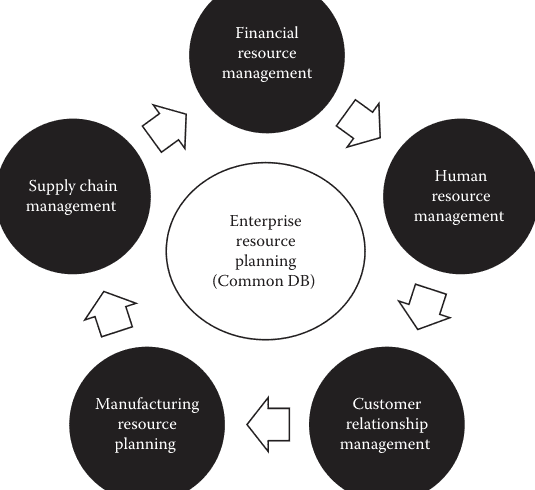
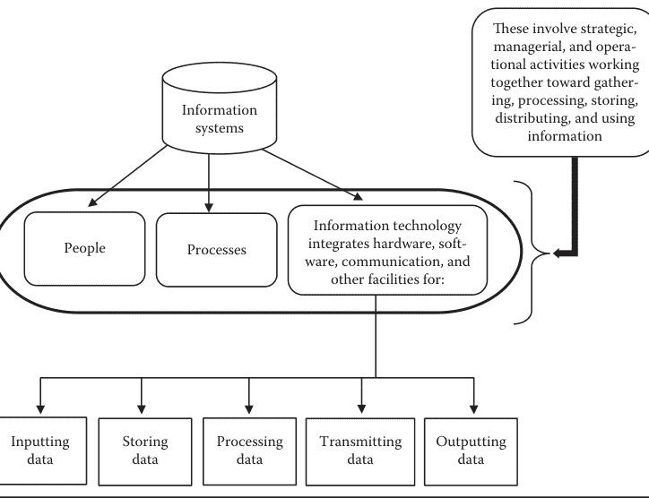
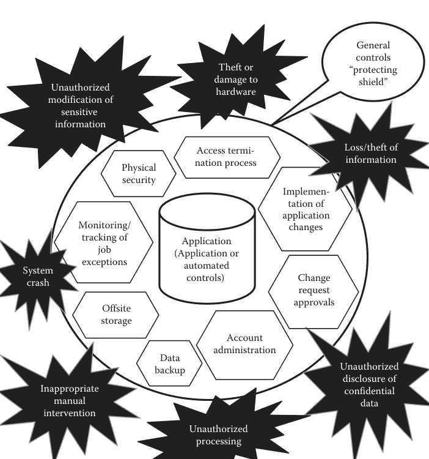
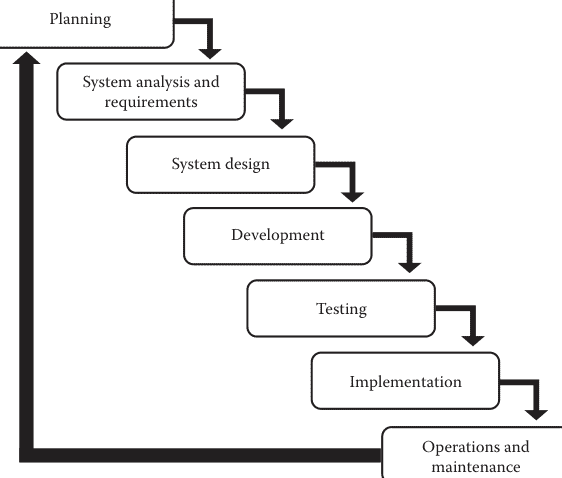
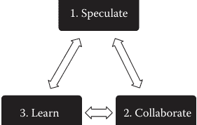
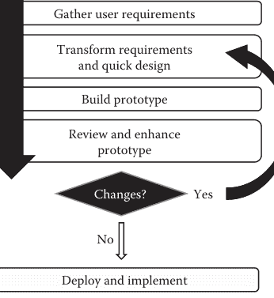
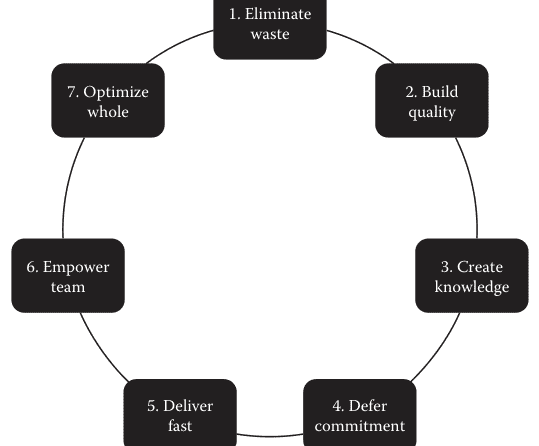
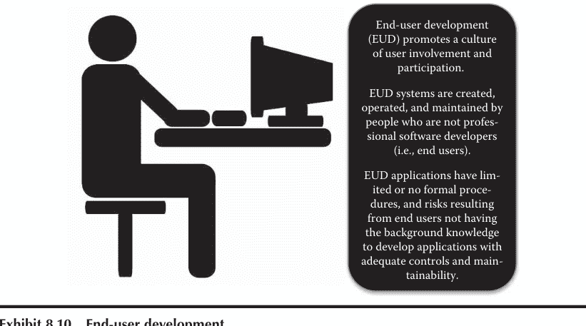
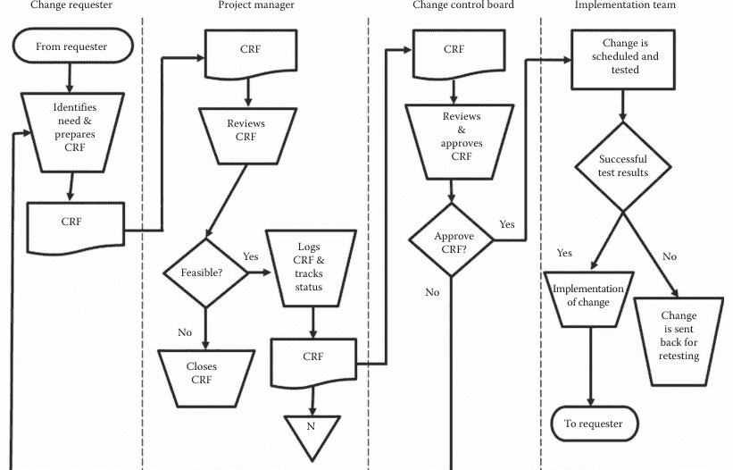

# 信息技术控制与审计，第五版

我将本书献给我的妻子 Ghia，女儿 Elizabeth 以及我的儿子们 Leonardo 和 Giancarlo。我也将本书献给我的父母 Angel 和 Lydia，以及我的兄弟们 Luis Daniel 和 Carlos。

目录

## 第三部分 审计环境

### 9 应用系统：风险与控制

#### 应用系统风险

#### 信息安全薄弱

#### 对程序或数据的未授权访问

#### 未经授权的远程访问

#### 信息不准确

#### 错误或伪造的数据输入

#### 处理不完整、重复和不及时

#### 通信系统故障

#### 输出不准确或不完整

#### 文档不足

#### 终端用户开发应用风险

#### 组织成本增加

#### 系统不兼容

#### 冗余系统

#### 实施不力

#### 缺乏职责分工

#### 系统分析不完整

#### 对数据或程序的未授权访问

#### 侵犯版权

#### 缺乏备份和恢复方案

#### 计算机病毒导致的信息破坏

#### 电子业务信息交换系统的风险

#### EDI审计评估标准

#### Web应用风险

#### 应用控制

#### 输入控制

##### 真实性

##### 准确性

##### 完整性

#### 处理控制

##### 准确性与完整性

#### 输出控制

##### 准确性与完整性

##### 分发与保留

#### IT审计师的参与

#### 风险评估

#### 审计计划

#### 沟通

#### 结论

#### 复习题

#### 练习

#### 扩展阅读

### 变更控制管理

#### 变更控制系统的重要性

#### 变更控制管理流程

#### 变更请求表

#### 影响评估

#### 控制措施

#### 紧急变更

#### 变更文档

#### 维护变更

#### 软件发布

#### 软件分发

#### 变更控制管理程序

##### 目标

##### 范围

##### 变更控制管理委员会或小组

##### 变更审批标准

##### 实施后工作

##### 变更产生与启动点

##### 审批点

##### 变更文档

##### 审核点

##### 配置管理

##### 组织变更管理

###### 组织文化的定义

###### 组织变更管理

#### 审计参与

#### 结论

#### 复习题

#### 练习

#### 扩展阅读

### 信息系统运行

#### 运行策略与程序

#### 数据处理

#### 数据文件和程序的保护

#### 物理安全与访问控制

#### 环境控制

#### 程序和数据备份

#### 云备份

#### 业务连续性计划

# 目录

- 灾难恢复计划
- 灾难恢复计划组件
- 终端用户计算
- 信息系统运行中的审计参与
- 数据中心审计
- 灾难恢复计划审计
- 审计工具
- 结论
- 复习题
- 练习题
- 延伸阅读

## 12 信息安全

- 信息安全
- 当前 IT 环境下的信息安全
- 企业资源计划 (ERP)
- 云计算
- 移动设备管理 (MDM)
- 影响 IT 环境的其他技术系统
- 信息安全威胁与风险
- 信息安全标准
  - COBIT
  - ISO/IEC 27002
  - NIST
- 信息安全策略
- 信息分类标识
- 信息安全角色与职责
  - 信息所有者职责
  - 信息保管者职责
  - 用户职责
  - 第三方职责
- 信息安全控制
  - 漏洞管理
  - 威胁管理
  - 信任管理
  - 身份管理
  - 事件管理
- 信息安全控制的选择与测试
- 参与信息安全审计
- 审计工具与最佳实践
- 结论
- 复习题
- 练习题
- 延伸阅读

## 13 系统获取、服务管理与外包

- 系统获取策略
- 系统获取流程
  - 定义系统需求
  - 识别替代方案
  - 进行可行性分析
  - 进行风险分析
  - 执行选择过程
  - 采购选定的软件
- 完成最终验收
- 服务管理
  - 定义的 IT 服务
  - 服务水平协议 (SLA)
  - 服务设计与定价
  - 服务接接与交付
  - 服务测量
    - 测量什么
    - 如何测量
  - 服务管理工具
- 外包 IT 系统
- IT 审计参与
  - 审计软件采购
  - 审计服务机构
- 结论
- 复习题
- 练习题

- 附录 1：IT 计划备忘录
- 附录 2：理解 IT 环境
- 附录 3：通用控制 IT 领域审计程序示例
- 附录 4：测试会计记分目的 ACL 最佳实践程序
- 附录 5：使用 NIST SP 800-30 的 IT 风险评估示例
- 附录 6：变更控制管理策略示例
- 附录 7：信息系统操作策略示例
- 附录 8：审计终端用户计算组
- 附录 9：审计软件采购的建议控制区域
- 附录 10：术语表
- 索引

# 前言

## 动机

多年来，各机构经历了无数损失，这些损失直接影响了它们最有价值的资产——信息。攻击者完全能够并继续破解传统的/非传统的计算机系统，并利用其漏洞。上述的攻击，结合近期法律法规的颁布（主要与信息保护相关），已使信息技术（IT）审计成为了一项关键且具有挑战性的职业，其未来将在新的、令人兴奋的 IT 相关领域带来增长。

我意识到编写一本能够帮助理解 IT 审计职业的书籍具有重要意义，并重点强调 IT 审计如何让组织和审计人员能够有效评估财务信息的有效性、可靠性和安全性。特别重要的是要编写关于技术、程序和控制的内容，以帮助组织和审计人员判断与财务信息收集、处理、存储和分发相关的活动是否有效以及是否与组织的目标一致。编写这本书的另一个动力因素是涵盖在注册信息系统审计师 (CISA) 和注册会计师 (CPA) 考试中测试的相关材料（例如：内部控制、计算机辅助审计技术 (CAATs)、技术技能等）。最后，我想写一本书，捕捉我在整个 IT 审计职业中所积累的知识和经验。

## 目的

- 包含 IT 审计问题、模拟、实际案例和研究作业机会，以培养 IT 审计专业知识。
- 满足 IT 审计、合规、安全和风险管理人员日益的需求。
- 是准备 CISA 和 CPA 考试的理想资源。

## 前言

本书旨在用于本科（高年级）和研究生阶段的学期课程。它也设计为适用于在线课程。建议将财务和管理会计、会计信息系统、管理信息系统和/或管理学原理作为先修课程。

## 第五版新特性

第五版的一个重大变化是章节的减少和/或整合，从上一版的 26 章减少到 13 章，这使得教职人员能够轻松地将章节与课程匹配（例如 16 周课程、8 周课程等）。每一章都经过了大幅修订，包含了最新的审计案例统计、示例、工具和/或技术，包括包含 IT 审计场景的章末案例。这些场景要求学生以个人或团队形式工作，参与课堂讨论，进行性能分析并制定决策策略。第五版专门针对审计主题、计算机技术和其他技术技能及概念进行了定制，这些内容和概念在 CISA 和 CPA 考试中都是重点考查点。

另一项重大贡献是增加或修订了教学资源和材料，使教职人员能够将注意力放在课堂演示和讨论上。提供的资源和材料包括：

- 显著增强的 PowerPoint 演示幻灯片，在备注部分中增加了更多相关信息。
- 作者认证的题库，确保测试的是较高水平的认知技能，而不仅仅是文本记忆。题库包括单选题、判断题和论述题，用于评估内容掌握情况，并要求分析、综合和评估能力。
- 修订后的教师手册。
- 带有 16 周和 8 周课程建议课表的教学大纲模板。

## 章节结构与内容

本书分为三个主要部分：

### 第一部分——IT 审计基础（四章）

第 1 章讨论了技术如何不断演变并塑造当今的业务环境。该章还讨论了审计行业，特别关注 IT 审计。在讨论了审计之后，描述了 IT 审计的当前趋势和需求，以及审计师在 IT 领域的各种角色。本章最后解释了为什么 IT 审计被视为一种职业，以及 IT 审计师可以拥有的职业机会。

第 2 章重点关注规范信息及其相关技术的使用、滥用和隐私的联邦、州和国际法律。法律对在线社区（政府、企业和公众）具有深远影响，这是进入 IT 审计行业的人员应当了解的。

第 3 章讨论了 IT 审计流程以及未来对该行业提出的要求。该章涵盖了风险评估、审计计划、IT 审计任务的必经阶段，以及 IT 审计文档在支持财务报表审计时的重要性。

第 4 章定义了审计生产力工具，并描述了它们如何帮助审计过程。该章接着介绍了用于记录财务应用系统的各种技术。随后将解释计算机辅助审计技术（CAATs）及其在审计中所起的作用，并描述在定义审计样本量、选择样本和审查应用程序时使用的各种技术。在解释了计算机取证工具和技术之后，将描述在审计应用控制和业务运行审查中使用的 CAATs。

### 第二部分——计划与组织（四章）

第 5 章承认了许多行业和金融市场已取得的全球化现状，并强调了有效的治理和控制对组织成功的重要性。2002 年的《萨班斯-奥克斯莱法案》、特德韦委员会下属组织委员会（SOSO）、英国《联合准则》以及欧洲经济合作发展组织的《公司治理原则》为全球公司治理设定了基准。对于 IT 而言，信息和相关技术控制目标（COBIT）已成为全球治理标准。IT 治理为实现 IT 战略与业务战略的结合提供了结构和方向。

第 6 章讨论了 IT 环境下管理和评估风险的过程。风险管理应整合到战略规划、运营规划、项目管理、资源分配和日常运营中，使组织能够专注于影响最大的领域。另一方面，风险评估是在组织不同区域的多个层次进行的。风险管理流程的特征和组成部分是什么？风险评估的实践标准是什么？在不同环境中使用的风险评估实践有哪些示例？这些都是本章内将回答的问题。

第 7 章重点关注经理用于有效高效地结束项目的项目管理最佳实践、标准和方法论。该章还讨论了进行有效项目管理时的考虑因素，以及审计师在项目管理中的角色。还讨论了 IT 项目管理和大数据项目管理等主题。

第 8 章讨论了系统开发生命周期及其常见阶段，以及针对这些阶段的风险和相关控制。该章还解释了用于软件开发的常用方法，最后讨论了 IT 审计师在系统开发和实施过程中的参与。

### 第三部分——审计 IT 环境（五章）

第 9 章讨论了对各种类型应用系统的管理控制，并提供了潜在风险的示例。该章还触及了组织可以实施以降低所讨论风险的相应应用控制（即输入、处理和输出）。最后，解释了 IT 审计师在检查应用程序时的参与。

第 10 章讨论了用于变更控制和组织变更的管理流程和程序。本章还描述了配置管理以及作为配置管理计划一部分进行的抽样活动。本章最后讨论了 IT 审计在变更控制管理检查中的参与。

第 11 章概述了信息系统运行作为 IT 基础设施的一个相关组成部分。本章提供了 IT 审计在检查运行时应关注的示例目标和控制活动。本章还涵盖了终端用户计算，并为审计数据中心和灾难恢复计划等提供了指南，信息是当今业务环境的关键资产。

# 第 12 章与第 13 章概述

## 第 12 章
描述了信息安全对组织的重要性，并讨论了正在改变组织的最新技术。还描述了信息安全威胁和风险以及它们如何继续影响系统。将讨论相关的信息安全标准和指南，以及建立信息安全策略的重要性。本章继续讨论信息安全人员的角色和职责。

## 第 13 章
描述了从第三方获取系统或服务时的关键成功因素。本章涵盖了服务管理以及组织与供应商之间有效伙伴关系的预期。接下来讨论的 IT 外包是指雇用外部公司处理组织全部部分的 IT 处理活动，使组织专注于擅长的领域。最后，描述了在检查采购和外包服务时的 IT 审计。

# 学习目标

- 讨论技术如何不断演变并塑造当今的 IT 环境。解释审计行业、IT 审计师的角色和职业机会。
- 描述与 IT 审计师相关的法律及其对 IT 领域的影响。说明经常发生的网络犯罪。开发审计计划和程序以协助组织遵守法律法规。
- 解释 IT 审计流程、信息和相关技术控制目标（`COBIT`）的重要性以及 IT 审计任务的各个阶段。开发相关实用的文档以执行审计工作。
- 支持工具和计算机辅助审计技术（`CAATs`）在执行审计工作时的作用和意义。设计计划以确保在交付审计工作时充分利用工具和技术。
- 证明 IT 计划、目标和战略与业务保持一致（即 IT 治理）的重要性。
- 概述系统开发生命周期（`SDLC`）、常见方法、风险、相关控制以及 IT 审计师的参与情况。开发相关的审计程序，列出与 `SDLC` 阶段相关的风险，以及缓解这些风险所需的 IT 控制和程序。
- 讨论与常见类型应用程序系统相关的风险，以及应用控制及其如何用于保护信息的输入、处理和输出。讨论 IT 审计师在应用程序系统检查中的参与情况。开发用于执行 IT 审计工作的相关且实用的文档。
- 建立变更管理流程的重要性。说明与变更管理相关的审计工作，从完成对 IT 环境的理解到正式向管理层汇报审计结果。
- 证明组织实施与信息系统运行相关的策略、程序和充分控制重要性，以确保信息的完整性、准确性和有效性。描述审计在组织信息系统运行检查中的参与情况。在执行 IT 审计工作时，设计并准备相关且实用的文档。
- 支持保护信息免受安全威胁和风险的重要性，并实施有效的信息安全策略、程序和控制以确保此类信息的完整性。描述审计在信息安全检查中的参与情况。
- 解释采购策略作为获取 IT 服务或产品关键成功因素的重要性。讨论如何定义 IT 服务以满足组织目标，以及如何衡量这些 IT 服务的性能。

# 致谢

首先，感谢上帝赋予的所有恩赐、生命本身、家庭、朋友，以及现在完成这本书的机会。接下来，我对 `CRC Press` 和 `Auerbach Publications` 的 `Richard O'Hanley` 先生表示最深切的谢意，他信任我，并相信我们能够共同完成出色的工作。我特别感谢编辑开发团队和教职员工评审员，他们通过无价的建议、反馈和建设性批评提升了本书的质量。他们评审意见中展现出的深度和诚意地证明了他们对 IT 审计领域的奉献和激情。我有幸获得了他们坦诚且宝贵的建议，这无疑为这第五版书增添了巨大的价值。

感谢同事和朋友们，感谢你们的时间、指导、建议、知识和支持，这些对于鼓励我投入写作这一充满挑战的旅程至关重要。感谢我的父母 `Angel L. Otero` 和 `Lydia E. Rivera`，以及我的兄弟 `Daniel Otero` 博士和 `Carlos Otero` 博士，感谢你们在个人和职业上都做我伟大的榜样。感谢你们一直的支持、鼓励，并总是挑战我向更高层次迈进。

我的孩子们 `Elizabeth`、`Leonardo` 和 `Giancarlo`，我希望我取得的成就能成为你们的鼓励和动力。记住，在不伤害邻居的情况下始终努力，永远不要满足于现状，并为伟大做好心理准备。保持尊重、谦逊，最重要的是，在生活中始终将上帝放在第一位。

最后，但同样重要，向我亲爱的妻子和挚友 `Ghia` 表示最诚挚的感谢。感谢你从开启这项事业的第一天起就信任我。感谢你的巨大帮助、持续的鼓励以及在抚养孩子方面的支持。感谢你无条件的爱以及过去几年里那些不眠的夜晚。这本书的完成归于你以及你所做的一切牺牲。我全心地爱你。

# 作者

`Angel R. Otero` 博士拥有 `CPA`、`CISA`、`CITP`、`CICA`、`CRISC` 证书，是佛罗里达科技学院（`Florida Tech` 或 `FIT`）商学院会计系助理教授，并担任会计与财务在线项目的项目负责人。`Otero` 博士拥有宾夕法尼亚州立大学的会计学士学位、佛罗里达科技学院的软件工程硕士学位，以及诺瓦东南大学大学的信息系统博士学位。他还是美国注册公共会计师协会（`AICPA`）、`ISACA`（原信息系统审计与控制协会）和内部控制协会（`IIC`）等专业组织的活跃成员。

`Otero` 博士在公共会计/审计、信息系统审计、内部控制审计和信息技术咨询领域拥有超过 20 年的行业经验。客户涵盖银行/金融、保险、政府、制造业、零售和批发等行业。在加入 `FIT` 之前，`Otero` 博士在 `Deloitte & Touche, LLP` 工作了 10 年，并担任负责佛罗里达州和波多黎各州办公室的高级经理。

`Otero` 博士的研究兴趣包括：（1) 信息系统/技术审计；(2) 财务审计和内部控制；以及 (4) 信息安全审计和风险评估。他已在多个同行评审期刊和会议论文集中发表过文章。

# IT 审计基础

# 第一章 信息技术环境与审计

## 学习目标

- 讨论技术如何不断演变。
- 定义什么是审计。
- 区分内部和外部审计。
- 总结需求。
- 描述审计行业。
- 解释为什么会考虑审计。
- 描述职业机会。
- 讨论对 IT 的需求。

组织对技术的依赖日益增加。技术的无处不在已影响了业务。以下章节简要描述了已经并将继续塑造当今组织环境的各种技术。

## 信息技术控制

- 技术提高了获取、存储、分析和处理海量数据的能力。
- 技术对系统产生了显著影响。
- 无论是手动还是自动执行，控制目标保持不变。然而，实现目标的方式有所不同。

### 企业资源计划 (ERP)

根据 2016 年 6 月版的《Apps Run the World》（一份按应用领域划分的市场研究），全球 ERP 系统市场将在 2020 年达到 841 亿美元，而 2015 年为 821 亿美元。ERP 软件在集成的 IT 环境中提供标准的业务功能（例如采购、公用事业、会计和人力资源 [`HR`]）。请参考图 1.1 的 ERP 模块系统说明。

ERP 允许多个功能访问公共数据库——降低存储成本并增加单一来源的一致性和准确性。此外，ERP：

- 共享位于一个公共数据库的模块（财务、`HR` 等）的实时信息。

主要的 ERP 供应商包括 `SAP`、`FIS Global`、`Oracle`、`Fiserv`、`Intuit, Inc.`、`Cerner Corporation`、`Microsoft`、`Ericsson` 和 `McKesson`。

尽管 ERP 有多种类型，但它们与预装或软件包相比并没有太大。ERP 的修改可能需要大量的修改（例如软件发布），需要大量的编程来重新适配组织特定的代码。由于软件包系统本质上是通用的，组织可能需要修改其业务流程以匹配供应商的处理方法，例如。由于 ERP 由单一供应商提供

## 信息技术环境与 IT 审计 5

### 图 1.1 企业资源计划模块化系统。

供应商，拥有单一供应商可能带来的**风险**（例如：对维护和支持依赖单一供应商、特定的硬件或软件要求等）。

## 云计算

云计算对 IT 环境的影响持续不断扩大。根据 `ISACA`（原名为信息系统审计与控制协会）的说法，云计算的指数级增长应不再被视为一种新兴技术。云计算塑造了全球业务，一些组织利用它来执行关键的业务流程。根据 2015 年 7 月的 `ISACA` 创新洞察，云计算是驱动业务战略的关键趋势之一。国际数据公司（`IDC`）在其 2015 年的出版物中预测，德勤预测将在未来 5 年内每年增长 19.4%。此外，德勤 2016 年的《展望：云计算》报告指出，对于私人公司而言，云计算将继续是一个主导因素。

根据《PC 杂志》的定义，云计算是指使用互联网（而非计算机硬盘）来访问数据和程序。用更正式的话，美国国家标准与技术研究院（`NIST`）将云计算定义为“一种实现无处不在、按需访问共享计算资源池（例如网络、服务器、存储和服务）的模型，这些资源可以快速配置和释放，且只需极少的管理努力或与服务提供商进行交互”。`NIST` 还指出，这种特定的（云）模型显著提高了可用性。

在虚拟环境中可以管理的高度灵活的服务使得云计算对业务组织极具吸引力。尽管如此，当组织将其信息和应用程序存储在位于本地之外的系统中时，他们并不完全放心。将信息迁移到共享基础设施（如云环境）使组织的敏感/关键信息面临潜在的未经授权访问和暴露等风险。全球主要会计审计师之一的德勤也支持上述安全隐私的重要性，并在报告中补充道，与患者数据、银行详情和人员记录相关的云存储信息如果落入他人手中，将是非常脆弱且易被误用的。

## 移动设备管理 (MDM)

`MDM` 也称为企业移动管理，是一个相对新的术语，但已经在影响组织的 IT 环境。`MDM` 负责管理和管理提供员工作为工作职责部分的移动设备（例如智能手机、笔记本电脑、平板电脑、移动打印机等）。具体而言，根据《PC 杂志》的描述，`MDM` 确保这些移动设备：

- 与组织内部良好集成，并实施以符合组织的政策和程序
- 保护组织内所有移动设备的公司信息（例如电子邮件、公司文档等）和配置设置

员工也会因个人原因使用移动设备。这意味着员工会将自己的移动（个人）设备带到组织（也称为自带设备，即 `BYOD`）来执行工作。允许员工使用组织提供的移动设备进行工作和个人事务被证明会影响普通员工。尽管如此，组织应该监控和控制员工使用移动设备所执行的任务，并确保员工保持专注和高产出。当移动设备被用于个人和工作目的时，它会对组织的安全构成风险，并会分散员工的注意力。此外，允许直接访问公司信息始终代表着持续的风险，并给组织带来安全和合规方面的担忧。

## 影响 IT 环境的其他技术系统

物联网 (`IoT`) 对 IT 环境、数据中心、技术提供商等具有潜在的转型影响。高盛（`Gartner`）估计，到 2020 年，物联网将包含 260 亿台安装设备，物联网产品和和服务产生的价值将超过 3000 亿美元。

`Gartner, Inc.` 定义的物联网允许来自“事物”（设备、传感器、物体等）的远程资产与其和其他网络进行交互和通信。例如通信有关其状态、位置和功能等信息。这些信息不仅为资产提供了更准确的理解，还最大限度地提高了它们的利用率和生产力，从而增强了决策过程。由于设备和系统之间海量交互产生的巨大原始数据或数据集（也称为大数据）需要被有效处理和分析，以便在决策过程中产生有意义且有用的信息。

根据 `TechAmerica` 基金会联邦大数据委员会（2012）的定义，大数据“描述了海量、高速度、复杂且多变的数据，这些数据需要先进的技术和手段来实现信息的捕获、存储、分发、管理和分析”。`Gartner, Inc.` 进一步将其定义为“……大量、高速度和/或高多样性的信息资产，需要成本效益、创新的处理形式，以增强洞察、决策和流程自动化”。

尽管准确的大数据可能会导致更自信的决策过程，且更好的决策通常会带来更高的运营效率、成本降低和风险减少，但目前仍存在许多必须解决的挑战。

大数据的挑战例如分析、捕获、数据整理、搜索、共享、存储、传输、可视化以及更新。安永（`Ernst & Young`）在其 2015 年 9 月的《EY 董事会事务》中指出，审计师面临的挑战包括对相关数据的访问有限、处理和分析此类数据的合格人才稀缺，以及将分析及时集成到审计中。物联网还提供了来自全球传感器和设备的快速移动数据，因此导致许多组织面临类似的挑战。

`Gartner` 2015 年新兴技术跃迁周期报告中列出的其他近期技术包括可穿戴设备、自动驾驶汽车、加密货币、消费者 3D 打印和语音转译等。

## 作为组织战略部分的 IT 环境

在当今环境下，组织必须将 IT 与业务战略相结合，以实现其目标、从信息中获取最大价值，并利用可用技术。IT 过去被视为组织战略的推动者，现在被视为实现盈利和服务的不可缺的一部分。同时，IT 治理、国际基础设施管理、安全以及公共和组织隐私等问题驱动了自我审查和自我保证的需求。

专业协会和组织如 `ISACA`、美国注册会计师协会（`AICPA`）、加拿大注册会计师协会（`CICA`）、内部审计师协会（`IIA`）、注册反欺诈师（`ACFE`）等已在审计领域发布了指南、说明并支持了相关研究。

## 审计职业

计算机在商业领域已使用了数十年。计算机犯罪早在 1966 年就有报道。然而，直到 1973 年 `Equity Funding` 出现了严重问题时

## 信息技术控制与审计

美国公司（`EFCA`）遭受了——不，等一下——美国公司（`EFCA`）遭受损失后，审计行业严肃地关注了计算机信息系统（`IS`）控制的缺失。2002年，在距离那时近 30 年后，发生了另一起涉及企业和会计丑闻的重大欺诈案（安然和世通），这给金融市场带来了怀疑论和衰落。这一次，无论是大型会计事务所还是主要交易所中受证券交易所监管的企业，都未能避免美国经济所遭遇的公众愤怒、投资者信心缺失以及政府监管的加强。同样在 2008 年，美国经济遭受了抵押贷款银行和抵押投资公司（如 `Countryway`、`IndyMac` 等）因不健全的贷款策略和风险管理不当导致的违约。

当 `EFCA` 于 1973 年宣布破产时，据报告非法活动造成的最低直接影响和损失高达 2 亿美元。通过对这起重大欺诈案的进一步估计，损失高达 20 亿美元，其中包括法律费用和限制在内的间接成本。这些损失是“计算机辅助欺诈”的结果，该公司通过伪造其存续子公司的记录，以表明签了新保单。除了保险单外，其他资产（如应收账款和有证券）也被错误记录。这些虚假资产本应在公司的年度审计期间被揭露为并不存在，但从未被发现。由于计算机文件被操纵作为掩盖欺诈的手段，会计行业意识到，传统的人工技术可能不足以应对涉及计算机信息的审计。

1973 年，美国注册会计师协会（`AICPA`，注册会计师国家级专业组织）为了应对 `EFCA` 事件，任命了一个特别委员会，研究当时的审计标准在这些情况下是否足够充分。该委员会被要求评估待批准的特定程序。1975 年，该委员会发布了调查结果。尽管特别委员会发现审计标准是充分的，且对审计人员使用的程序没有进行重大更改，但对于设计用于协助检查财务报表的计算机程序的使用，他们提出了几项观察和建议。另一项对现有审计标准的批判性审查于 1974 年开始，当时 `AICPA` 制定了涵盖该领域的首批标准。29 年后，2002 年的安然-安达信信惨剧将我们带回 1973 年。

由于美国重大的财务丑闻和管理不善，“职业谨慎责任”问题成为审计界的关注焦点，包括但不限于：废物管理公司（1998）、安然（2001）、世通公司（2002）、美国保险集团（2005）、雷曼兄弟 de（2008）、伯纳德·L·马多夫证券有限公司（2008）、`MF Global`（2011）、`Anthem` 公司（2015）、富国银行（2016）等。1973 年的 `EFCA` 丑闻导致了州和联邦对保险行业监管的发展，以及航天业的创造性会计，这为 1977 年的《海外反腐败法》（`FCPA`）提供了支持。也许 2002 年的《萨班斯-奥克斯利法案》（`SOX`）将是对职业关怀重要性的重大提醒。`SOX` 是一项重大改革方案，强制了国会自 1977 年 `EFCA` 和 1934 年证券交易委员会（`SEC`）以来对商业界实施的最广泛变革。其中一些重大变化的示例包括创建了“上市公司会计监督委员会”（`PCAOB`），以及增加对违反证券法行为的刑事处罚。下一章将详细讨论 `SOX`。

> `PCAOB` 是由国会设立的非营利机构，负责监督上市公司的审计，以保护投资者的利益，并促进在编制信息丰富、准确且独立的审计报告方面的公共利益。http://pcaob.org/Pages/default.asp。

## 信息技术环境与审计

## 内部审计

财务审计涵盖了所有与财务报表发表意见相关的活动和责任。财务审计通过一套旨在确保财务报表真实性和完整性的程序来执行。

## 信息技术环境与 IT 审计 11

来自全球私营部门和政府部门，分享经验并讨论新的审计方法和技术。

# 外部审计功能

外部审计功能评估各种形式系统控制的可靠性和有效性。此类评估的主要目标是尽量减少在对财务报表发表意见时所需的实质性交易审计或测试工作量。

外部审计师由德勤（`Deloitte`）等公共会计师事务所提供，也存在于政府部门。例如，美国政府责任局（`GAO`）被认为是外部复核人员，因为它负责检查获得联邦资金的联邦和私营机构的工作。国会支出监督小组（`Watchdogs of Congressional Spending`）为纳税人提供服务，直接向国会报告管理不当和控制不良的问题。有趣的是，在国外，内部监察长或审计长办公室准备了类似的功能。此外，`GAO` 一直是国际审计组织的有力支持者，该组织为其全球国际审计成员提供政府审计培训和指导。

从公共会计师事务所的角度来看，像德勤（`Deloitte`）、安永（`Ernst & Young`）、普华永道（`PricewaterhouseCoopers`）和毕马威（`KPMG`）（统称为“四大”）等事务所在全球范围内提供此类类型的外部审计服务。外部审计师负责测试客户 IT 系统的可靠性，并应具备特殊的技能和经验组合。此类审计师必须熟练掌握证明功能（`attest function`）。证明功能涵盖了所有与对财务报表公平性发表审计意见相关的所有活动和责任。除了执行证明功能涉及的会计和审计技能外，这些外部审计师还具有丰富的 IT 审计经验。萨班斯法案（`SOX`）现在规范着他们的角色，并限制了除审计之外可以提供的服务。

## 什么是 IT 审计？

在定义 IT 审计之前，让我们解释信息系统（`IS`）和信息技术（`IT`）之间的区别。由三个组成部分（即人员、流程和 `IT`）代表 `IS` 是管理信息所涉及的战略、管理和操作活动的结合。`IS` 的 `IT` 组件涉及管理（即输入、处理、传输和输出）信息所需的软件、通信和其他设施。请参考图 1.2。

# 信息技术环境与 IT 审计

根据 ISACA 的定义，审计是指正式的检查和验证，以检查是否遵循了标准或一套指南、记录是否准确，或是否满足效率和有效性。在上述两个定义中，IT 审计可以定义为对组织的 IT 基础设施进行正式、独立且客观的检查，以确定收集、处理、存储、分配和使用信息的活动是否符合指南、保护资产、维护数据完整性，并有效高效地运行以实现组织目标。IT 审计提供了合理的保证（绝非绝对保证），确保组织内应用程序生成的信息是准确、完整的，并支持与事先约定的业务性质和范围一致的有效决策。

需要 IT 审计，以评估应用程序系统满足处理需求的充分性，评估内部控制的充分性，并确保由这些系统控制的资产得到充分保护。

**图 1.2** 信息系统对比信息技术。

对于今天的 IT 审计师来说，他们的高级知识和技能将通过两种方式进步。一个方向是在该领域持续成长和提升技能，在计算机审计研究方面处于领先，并在外部和内部审计职业路径上晋升。另一个方向是利用对组织系统的深入了解，进入通用管理中更具责任的职业领域。如今，即使在这些时期，对高质量 IT 审计师的需求超过了供给。IT 治理为 IT 审计师创造了巨大的机会。

学习新的审计方法是内部和外部 IT 审计师的优先事项。大多数审计师都希望有帮助他们更轻松完成任务的工具或审计方法论。每个大型组织或公司都有某种涉及内部审计部门的 IT 审计职位。今天，“四大”事务所设立了专门从事 IT 领域的特殊小组。他们拥有所有员工担任这些外部 IT 审计师，协助财务审计师确定其所审计公司财务报表的正确性。其他人则专注于特殊项目，如处理网络安全的渗透测试、防火墙评估、路由器和网关配置等。

## IT 审计的分类

IT 审计大致分为两类，这两类对于确保信息系统的持续正常运行至关重要。具体如下：

- **计算机通用控制审计**。它检查 IT 通用控制（“通用控制”或“ITGCs”），包括与许多应用程序相关的政策和程序，并支持应用程序控制的有效运行。通用控制涵盖 IT 基础设施和支持服务，包括所有系统和应用程序。通用控制通常包括对 (1) IS 操作；(2) 信息安全 (ISec) 和 (3) 变更控制管理 (CCM)（即系统软件获取、变更和维护、程序变更以及应用程序系统的获取、开发和维护）的控制。IS 操作活动中的通用控制示例包括数据备份和离线存储、作业监控和异常完成跟踪以及对作业调度程序的访问等。ISsec 活动中的通用控制示例包括访问请求和用户账户管理、访问注销和物理安全。CCM 中的通用控制示例可能包括变更请求审批；应用程序和数据库升级；以及网络基础设施监控、安全和变更管理。

- **应用程序控制审计**。它检查特定于应用程序的处理控制。应用程序控制也被称为“自动化控制”。它们关注捕获、处理、存储、传输和报告数据的准确性、完整性、有效性和授权。应用程序控制示例包括检查记录的数学准确性、验证数据和执行数字顺序检查等。当通用控制有效时，应用程序控制很可能是有效的。

请参考图 1.3 了解通用控制和应用程序控制的插图，以及它们如何到位以降低风险。注意图中，应用程序系统不断被风险包围。风险在图中用六角形表示。这些风险可能是未经授权访问、设备和信息的丢失或被盗、系统关机等。六边形所示的通用控制也围绕着应用程序，并提供针对风险的保护。最后是位于应用程序内部的控制，对信息的输入、处理和输出提供直接保护。

## IT 审计趋势

计算对于全球组织的活动是不可缺的。信息和相关技术控制目标（COBIT）框架由 ISACA 于 1995 年创建。COBIT 在第五版中强调了这一点，以及研究、开发、宣传和推广国际认可的 IT 控制目标的需求。在早期的文件中，如 1993 年的讨论论文《专业会计人员的技术最低技能水平》和 1992 年的最终报告《信息技术对会计职业的影响》，国际会计师联合会（IFAC）承认需要更好的大学水平教育来解决 IT 关注的问题。

## 信息技术控制与审计

**图 1.3** 通用计算机控制与应用控制之间的关系。

标准化组织（ISO）17799 和 27000；内部审计师协会（IIA）系统审计性与控制报告；经合组织（OECD）信息系统原则指南；美国总统诚信与效率计算机审计培训课程；以及 2002 年发布的美国国家网络安全战略等等。

美国注册会计师协会（AICPA）的保证服务执行委员会（ASEC）负责更新和维护信任服务原则与标准（TSPC），并建立原则和标准框架，以对信息的完整性提供保证。TSPC 为执业人员在提供专业鉴证和咨询服务时提供了准则，用于评估与以下原则相关的控制：

- **安全性**：系统受到防止未经授权访问的保护（包括物理和逻辑）。
- **可用性**：系统可以按照承诺或协议提供运行服务。
- **处理完整性**：系统处理是完整、准确、及时且经过授权的。
- **机密性**：指定为机密的信息按照承诺或协议受到保护。
- **隐私性**：个人信息的收集、使用、保留、披露和销毁符合实体隐私通知中的承诺，以及 AICPA 和 CICA 发布的通用接受原则中的标准。

IT 审计的理论和方法论整合了五个领域：对业务的基础理解、传统审计、IT 管理、行为科学和 IT 科学。业务理解和知识是审计过程的基石。传统审计贡献了企业内部内部控制实践和整体哲学的知识。IT 管理提供了实现系统成功设计和实施所需的方法论。行为科学指出了何时以及为何 IT 可能因为人的问题而失败。IT 科学贡献了关于控制理论以及作为硬件软件设计基础的形式模型的知识，这是维护数据完整性的基础。

自从 ISACA 成立以来，对受过良好培训且熟练的 IT 审计人员的需求日益增长。《电子数据处理审计师协会：前五年》一书记录了该协会的早期斗争以及该领域 IT 审计实践的演变。

信息保证领域也在不断增长和演变。美国在通过《网络安全研究与开发法》时，承诺投入十亿美元，用于开发该领域未来专业人员所需的课程、研究和技能。

## 信息保证

组织日益依赖关键的数字电子信息能力，在规划、指导、协调和执行操作时存储、处理和管理基本数据。强大且复杂的威胁可能会利用这些系统中的许多漏洞。将技术开发外包给开发人员中可能存在恐怖分子的国家，导致人们推测存在植入代码，从而导致中断、混乱、贪污等问题。这些或其他弱点可能会被漏洞利用，从而危及信息能力中最敏感的组件。然而，我们可以部署分层防御来减少漏洞，并威慑、击败和从各种威胁中恢复。从信息保证的角度来看，我们必须防御的能力可以宽泛地视为四个主要要素：本地计算环境、其边界、连接它们的网络以及支持基础设施。《美国国家网络安全战略》是这些倡议之一。

“保证”一词被定义为信息完整性（对信息可以寄予的信心和信任水平）和服务可用性。在所有背景下（无论是业务还是政府），它确保了信息的收集、存储、传输和使用。信息保证的最终目标是保护用户、业务部门和企业免受信息腐败或拒绝服务带来的负面影响。国土安全部及其支持组织，如国家安全局（NSA）、联邦调查局（FBI）和中央情报局（CIA）一直致力于实现这一目标。

由于国家信息系统及其关键基础设施（政府和商业）紧密结合，入口和暴露点在增加，风险也随之增加。高带宽通信和先进交换系统的技术进步减少了线路数量并进一步集中了交换功能。调查数据表明，这些变化带来的风险并未得到广泛认识。自 9/11 以来，美国国防组织（如国防信息系统局）投入更多协调努力，发布国防信息基础设施和全球信息网的标准，这将信息保证产生积极影响，影响范围超出美国国防部和国家经济的所有部门。NSA 起草并制定了 IT 安全人员标准，这不仅影响联邦机构，还影响了为联邦政府提供 IT 服务的企业。例如，美国国立标准与技术研究院（NIST）产生了《健康保险流动性与责任法案》的安全标准，这影响了医疗行业以及所有服务健康领域处理医疗信息的实体/公司。类似的例子包括支付卡行业数据安全标准（PCI DSS），由全球 PCI 安全标准委员会（委员会）维护、管理和推广。该委员会于 2006 年由主要信用卡公司（如美国 Express、JCB International、MasterCard 和 Visa 等）成立。这些公司在委员会工作的治理、执行和合规方面共同平等。PCI DSS 是专门适用于存储、处理或传输持卡人数据实体的技术和操作要求，旨在保护此类数据以减少信用卡欺诈。

## IT 审计的需求

最初，IT 审计（以前称为电子数据处理 [EDP]、信息系统 [CIS] 和 IS 审计）作为传统审计的延伸演变而来。那时，IT 审计的需求来自几个方向：

- 审计师意识到计算机已影响了他们执行鉴证功能的能力。
- 企业和信息管理层意识到计算机是业务环境中竞争的关键资源，类似于组织内的其他价值资源，因此对控制和可审计性的需求至关重要。
- 专业协会、组织以及政府实体意识到 IT 控制和可审计性的需求。

IT 审计的早期组件源自几个领域。首先，传统审计贡献了内部控制实践和整体控制哲学的知识。另一个贡献者是 IS 管理，它提供了实现成功设计和实施的方法论。行为科学领域提供了此类问题，以分析何时以及为何 IS 可能因为人的问题而失败。最后，计算机科学领域提供了关于概念、学科、理论以及硬件软件设计基础的形式模型的知识，这是维护数据质量、可靠性和完整性的基础。

IT 审计已成为审计功能不可或缺的一部分，因为它支持审计师对计算机系统处理的信息质量做出判断。具有 IT 审计技能的审计师被视为审计工作人员的技术资源。工作人员经常向他们寻求技术协助。IT 审计师的角色演变为提供保证，确保了适当且充分的控制。当然，确保建立适当内部控制的责任在于管理层。审计的主要作用（在管理咨询服务领域除外）是提供一份保证声明，以确认是否建立了适当且可靠的内部控制，并使其以高效有效的方式运行。管理层的职责是确保，而审计人员的职责是保证。

IT 审计中存在几种类型的开发需求，包括组织 IT 审计（对 IT 的管理）、技术 IT 审计（基础设施、数据中心、数据通信）以及应用 IT 审计（业务/财务/运营）。还存在开发/实施 IT 审计（规范/需求、设计、开发和实施后阶段）以及涉及国家或国际标准的合规审计。

在审计 IT 时，所需的知识广度和深度非常广泛。例如，IT 审计涉及：

- 应用以风险为导向的审计方法
- 使用计算机审计工具和技术
- 应用 ISO 等国家级或国际标准，以改进和实施软件开发中的质量体系和 IT 安全标准
- 在对开发中的系统以及购买的软件包和项目管理的审计中，理解业务规则和预期
- 评估可能给组织带来风险的信息安全、机密性、隐私和可用性问题
- 检查和验证组织对可能危及组织的 IT 相关问题的合规性
- 评估复杂的系统开发生命周期 (SDLC) 或新开发技术（如原型设计、用户计算、快速系统或应用程序开发）
- 向管理层报告并进行跟进审查，以确保工作中已采取措施

IT 和通信协议的审计通常涉及互联网、外网、电子数据交换、客户端服务器、局域网和广域网、通信、电信、无线技术、集成语音/数据/视频系统，以及驱动这些过程和功能的软件和硬件。启动审计的原因之一是组织对信息的依赖程度不断增加、技术的快速演变以及随之产生的新风险，以及财务报告审计所需的支持。

SOX 法还要求对内部控制进行评估，并对 SEC 注册实体具有强制性要求。在评估财务报告内部控制有效性的过程中，管理层需要考虑支持相关业务和财务流程的 IT（包括技术）的控制。这些控制被称为 ITGC（或 IT 通用控制）。如前所述，ITGC 是在 IT 环境内执行的 IT 过程、活动和/或程序，与应用程序和系统的开发、维护、管理、安全、访问和运行有关。表 1 说明了进行 IT 审计的其他主要原因。

ISO 标准示例包括 `ISO/IEC 27002`、`ISO/IEC 27000` 和 `ISO 17799`。

- 评估复杂和“创造性”编程的增加
- 支持应用控制的有效运行
- 支持财务报告审计
- 控制和监控内部或外部黑客的显著增长
- 评估信息的完整性和准确性
- 应对快速变化的技术与该技术相关的新风险
- 评估信息的完整性和数据的安全性
- 识别可以解决特定 IT 风险的控制
- 控制办公室和远程计算机对组织网络的便捷访问
- 审计海量数据

**表 1.4** 进行 IT 审计的主要原因。

## IT 治理

我们处理 IT 问题的方式发生了许多变化，导致对 IT 治理概念的重新关注。首席执行官、首席财务官、首席运营官、首席技术官和首席信息官对以下 IT 治理原则达成共识，这些专注于 IT 与企业目标之间的战略对齐。这反过来为组织内部 IT 的战术和日常运营管理带来了变化。

IT 治理是对企业 IT 进行指导和控制的过程。正如之前定义的，IT 指用于以任何格式输入、存储、处理、传输和输出数据的硬件、软件、通信和其他设施。有效的治理有助于确保 IT 支持目标实现、使 IT 投资最大化，并妥善管理 IT 相关的风险。IT 治理还通过高效部署安全、可靠的信息和应用技术，帮助确保关键成功因素的实现。

由于 IT 运行着整个组织的运作，组织内的每个人都应该对其使用和应用的治理感兴趣并负责。这种日益增强的意识使组织认识到，如果他们想要充分利用并保护其 IT 投资，就需要一个正式流程来治理它。实施 IT 治理计划的原因包括：

- 对信息及提供信息的系统的依赖性增加
- 漏洞增加和广泛的威胁
- 目前和未来信息及信息系统投资的规模和成本
- 技术极大地改变组织和业务模式以创造新机会并降低成本的可能性

只要这些因素仍然是业务的一部分，就需要有效的、相互依赖的企业治理和 IT 治理系统。

COBIT 是一种开放标准的 IT 治理工具，帮助非技术和技术经理以及审计师理解和管理与信息及相关 IT 的风险，由 IT 治理协会和信息系统审计控制基金会开发。COBIT 是一个全面的控制目标框架，帮助 IT 审计师、经理和高管在 IT 系统下履行受信责任，并决定什么程度的安全和控制是适当的。COBIT 为业务经理和审计师提供一套权威的、国际通用的 IT 实践。COBIT 将在第 3 章中讨论。

## IT 审计师的角色

评估今天复杂系统的审计师必须具备技术技能，以理解不断变化的信息处理方法。当代系统带来了诸如不兼容平台、通过通信网络（如互联网）渗透安全的新方法，以及由于信息处理快速去中心化导致的集中控制的风险。

随着 IT 在组织中的应用不断增长，计算机系统的审计必须在没有传统审计工作建立的指南的情况下完成。IT 的新用途引入了新风险，这需要新的控制。IT 审计师处于独特地位，可以评估特定系统与整个企业的相关性。正如此，IT 审计师经常在高级管理决策中发挥作用。

IT 审计师的角色可以通过 IT 治理过程以及该行业的现有实践标准进行检查。如前所述，IT 治理是组织参与对 IT 的管理和审查，以实现组织设定的目标。

### 顾问的 IT 审计师

过去，用户放弃了控制计算机系统的责任，主要是由于计算机周围的心理障碍。结果是存在制衡机制，IT 审计师除外。IT 审计师必须采取积极作用，协助组织制定保护信息、审计性、控制、测试等的政策、程序、标准和/或最佳实践。例如，良好的信息安全策略可能包括：

- 规定安全功能
- 定义对人员活动监控等隐私的“合理预期”
- 定义访问权限和权利，通过指定可接受的用户指南保护资产免受损失、泄露或损坏
- 为外部通信（网络）提供指南
- 定义所有用户的责任
- 通过有效的密码策略建立信任
- 规定恢复程序
- 要求记录违规行为
- 确认信息的所有者、保管者和客户能够报告不合规行为，并保护信息的使用和传播
- 为用户提供支持信息

SANS 学院在其网站上提供了通用的信息安全策略模板，这些模板可以下载，并作为任何组织的良好起点。良好的安全策略会根据每个组织、公司或个人的安全需求而有所不同。信息安全策略并不能保证系统的安全性，也无法确保网络完全免受网络空间可能的攻击。然而，在有效的安全产品和恢复计划的帮助下，安全策略可能有助于将损失控制在“可接受”范围内，并最大限度地减少隐私信息的泄露。IT 审计师是机构团队的一部分，该团队负责对 IT 使用、应用和保证进行共享治理。

大型公司的 IT 人员可以通过说服用户对所有新系统和现有系统的所有更改坚持执行策略，为计算机系统做出重大贡献。通过审查基准测试结果，用户组可以通过实际执行完整的控制功能，来控制新系统的准确性。审计师必须说服用户和 IT 人员建立受控 IT 环境的必要性。

坚持要求所有新系统在整个开发生命周期内都在预定义的检查点接受审查，也可以加强对 IT 的控制。IT 审计审查前景应使用户组和系统组更仔细地定义他们的目标和假设。在这里，IT 审计师也可以扩大他们的影响力。

### 作为高层伙伴的 IT 审计师

尽管 IT 审计师顾问和专业技术人员的角色对于公司的成功运营至关重要，但如果审计师未能从组织的整体来看待审计，这些角色就可能变得无关紧要。一个看起来控制良好的系统可能与业务运营不一致。

关于系统需求的决策在传统上属于管理层，但由于多种因素（主要是计算机的复杂技术），计算机系统审计未能成功执行。在为新系统分配资金时，管理层不得不依靠计算机人员的判断。虽然他们选择新型、更有效的计算机系统无可指责，但计算机人员往往未能满足组织的真实需求。

管理层需要理解组织要求的熟练员工的支持，而 IT 审计师正处于提供信息的地位。他们可以为管理层提供 IT 决策对业务影响的独立评估。此外，IT 审计师还可以验证特定项目是否已考虑所有替代方案、所有风险是否已经过准确评估、技术硬件和软件解决方案是否正确、业务需求是否将得到满足以及成本是否合理。

### 作为调查员的 IT 审计师

由于法律的增加以及在法庭上计算机证据的使用，捕捉和记录与犯罪活动相关的计算机生成信息的能力对于起诉至关重要。在执行取证支持工作时对计算机辅助工具技术的意识和使用，为 IT 审计师、IT 安全人员以及执法和调查的人员提供了新机会。对于 IT 专业人士来说，计算机取证是一个令人兴奋的不断发展的领域。IT 审计师可以在计算机取证领域工作，或与计算机取证专家合作工作，为特定系统或网络提供见解。专家可以向 IT 审计专业人员询问系统问题，并获得比自己研究和弄清一切更快的响应。专家经过了高度培训，可以适应几乎任何系统或平台，协作可以使取证专家和 IT 专业人士的工作变得更加高效。

# 计算机取证与 IT 审计概述

自 20 世纪 70 年代初以来，计算机取证不断演变为现在一个非常大的领域。新技术和协议的增强让工程师和开发者能够创建更稳定、更健壮的硬件、软件和工具，供专家在计算机犯罪调查中使用。随着计算机变得越来越先进和丰富，犯罪活动也随之增加。因此，计算机取证领域也随着计算机技术的进步不断发展。

## IT 审计：这一职业

随着《国土安全法》、《爱国者法案》和 `SOX` 法案的通过，（内外部）和外部审计师的角色对于金融基础设施的验证和确认变得至关重要。IT 审计职业可以让人接触信息在组织内部流转的方式，并赋予成员评估其价值、可靠性和安全性的能力。IT 审计涉及人员、技术、操作和系统。这是一项动态且充满挑战的职业，其未来将为 IT 安全和计算机取证等新领域带来增长，仅此如此。

今天，IT 审计师与组织各个领域的经理、用户和技术人员进行互动。他们必须具备人际技能以与多个级别的人员互动，并具备技术技能以理解处理活动中使用的各种技术——特别是生成和/或处理公司财务信息的技术（例如，财务报表等）。IT 审计师还必须理解并熟悉运营环境，以评估内部控制结构的有效性。最后，IT 审计师必须理解现有和未来系统的技术复杂性，以及它们对各层级操作和决策的影响。

IT 审计是一个相对较新的职业，在世界范围内私营部门、公共会计和政府部门都存在就业机会。职业不仅仅是一份工作。职业具有某些特殊特征，包括共同的知识体系、认证、继续教育、专业协会和伦理标准以及教育课程。

## 共同知识体系

自 1975 年以来，已有各种研究确定了 IT 审计职业的共同知识体系。共同知识体系由明确定义的领域组成，在这些领域中，必须获得特定水平的理解和能力才能在该职业中成功实践。这些领域被分为核心领域。`ISACA`、`AICPA`、`IIA`、`CICA`、`ISSA`、`InfoSec` 等全球性组织发布了关于审计计算机系统所需的知识、技能和能力的主题报告和论文。特别是对于商科专业的学生，在以下方面接受了程度的基础培训：(1) 审计概念和实践；(2) 管理概念和实践；(3) 计算机系统、电信、操作和软件；(4) 信息处理技术；(5) 对本地和国际规模业务的理解。这些是 IT 审计的一些主要领域。

## 认证

认证是职业至关重要的组成部分。当你准备进入你的职业时，无论是会计、信息系统还是其他商业领域，认证将是衡量你的知识、技能和能力的标准。例如，获得 `CPA` 称号是专业人士职业生涯的一个重要里程碑。在审计领域，注册信息系统审计师 (`CISA`) 是主要的认可级别之一。候选人成为 `CISA` 有某些要求，例如：

- 通过严格的笔试考试
- 证明具有至少 5 年的专业 `IS` 审计、控制或安全经验
- 遵守 `ISACA` 的《职业道德守则》和《信息系统审计标准》
- 同意遵守 `CISA` 继续教育政策

`CISA` 考试涵盖了审计 `IS` 过程中的（或领域）；`IT` 治理和管理；会计、开发和实施；`IS` 运行、维护和服务管理；以及信息资产的保护。因此，大学在提供认证基础方面发挥着重要作用。与 IT 审计相关的或其他认证包括：

- `CPA`
- 注册会计师 (`CA`)
- 注册内部审计师 (`CIA`)
- 注册计算机专业人员 (`CCP`)
- 注册政府财务经理 (`CGFM`)
- 信息安全专家 (`CISSP`)
- 注册信息安全经理 (`CISM`)
- 风险和信息系统控制认证 (`CRISC`)
- `AICPA` 认证信息技术专家 (`CPIT`)
- 注册舞弊调查师 (`CFE`)

认证是职业的重要衡量，也是衡量职业内技能成就的标准。获得超过一项认证将增强你在审计领域的知识、技能和能力。技能应用的熟练来自于经验和继续教育。商业（贸易）、`IT` 和世界事件的动态变化继续塑造着这一令人兴奋的职业未来。

## 继续教育

认证需要教育，以便已认证人员维持专业水平并继续其认证。继续教育是职业增长的重要元素。毕业生进入职业后，他们会发现他们的学术教育是持续开发提升职业的知识、技能和能力的基础。继续教育的要求是为了支持 `CISA` 项目。IT 审计师的未来将由于现有系统和环境动态变化（即重组、新技术、运营变更和需求变化）而不断面临挑战。

审计 `IT` 所需的知识广深度非常广泛。例如，IT审计涉及应用以风险为导向的审计方法；使用计算机辅助审计工具和技术（例如 `EnCase`、`CaseWare`、`ACL`、`Guardant`、`eTrust`、`CA-Examination` 等）；应用国家或国际标准（即 `ISO 9000/3`、`ISO 27000` 以及旨在改进和实施软件开发质量标准的的相关修订）；对处于复杂 `SDLC`（软件开发生命周期）下或采用新开发技术（例如原型设计、端计算、快速系统开发等）的系统进行审计；以及对涉及电子数据中心、客户端服务器、局域网和广域网、数据通信、电信以及集成语音/数据/视频系统的复杂技术的审计。

IT 审计人员工作的组织环境是动态的，理解该领域的新进展至关重要，以便恰当应用。继续教育的要求有助于 `CISA` 获得新的知识和技能，以提供最有信息的专业意见。各种协会和组织提供培训课程和计划，以协助维持他们持续改进和演进所需的必要技能。接受此类培训的方法可能是全球性的，通过视频会议和远程办公，并且互联网在培训交付中起着主要作用。

## 专业协会与伦理标准

作为任何级别的经理，必须记住审计师（无论是内部还是外部）都有他们必须遵循的实务标准。与 `IT` 专业人员一样，审计师可能属于一个或多个专业协会，并在执行审查和审计时遵循其伦理守则、实务标准和指导。如果他们没有按照其职业的“实务标准”开展工作，他们知道自己可能面临潜在的诉讼，甚至被“吊销证书”。产生实务标准的组织包括 `AICPA`、`IIA`、`IFAC`、`CIA`、`GAO` 和 `ISACA`。

`ISACA` 创建于 1969 年，是目前领先的 `IT` 治理、保证以及安全和控制协会。

- 在像 `ISACA`、信息安全、企业治理、`IT` 风险管理、合规性等领域提供知识和教育。
- 提供全球认可的认证/称号，如 `CISA`、`CISM`、企业 `IT` 治理认证 (`CGEIT`) 以及风险认证与 `CRISC` 认证。
- 开发并频繁更新 `IS` 审计和控制标准，例如 `COBIT` 标准。`COBIT` 帮助 `IT` 审计师和 `IT` 管理人员在审计、安全、风险和控制领域履行日常职责和责任，并为业务创造价值。

要担任审计师，必须具备高标准的道德伦理。“审计师”一词在拉丁语中意为听取投诉并做出决策或像法官一样行动的人。要像法官一样行动，必须符合符合道德，否则将违背目的。伦理是我们整个文化中非常重要的基础。如果审计师在这一领域失去了青睐，几乎不可能重新获得曾经与审计管理层和审计师拥有的信任。无论审计师是否处于职业初期，他们都应该从客户或被审计单位获得同等的信任和好感。只要关系不破裂，审计师就能建立起可以被信任敏感材料的良好声誉。

在当今的世界经济中，“信任”是一个罕见的词。如今没有人信任任何人，因此，将高道德伦理放在经理与新审计团队涵盖的主题列表的首位是至关重要的。时代在变，要求审计服务的客户也在变。大多数经理表示，他们珍惜伦理这一方面，因为这使他们与其他缺乏伦理的人区分开来。

例如，预算要求许多工时。记报未实际工作的工时是不伦理的。在审计过程中，因为客户说某事不重要而忽略某些问题也是不伦理的。伦理与法律之间存在着微妙的界限。某些事情在伦理上可能是错误的但在法律上仍然是法的。尽管如此，一些最初被认为不伦理的事情会随着时间的推移变为非法。如果有大量人口反对某种伦理上的错误行为，你将看到立法使其成为非法。

当 `IT` 审计师获得 `ISACA` 认证时，他们还遵循《专业审计师伦理守则》。该准则不仅适用于职业行为，也适用于 `IT` 审计师的人格。该准则与其它审计/保证相关领域的伦理守则（例如 `IIA`、`AICPA` 等）不冲突。它要求遵守 `ISACA` 标准、维护机密、报告任何非法或不当活动、保持审计师的能力、在审计过程中使用并沟通审计工作的结果，并保持高标准的行为和品格标准。

## 教育课程

`IT` 审计是一项以全球范围内技术和伦理标准为特征的职业，具有特定的行为、目标和品质。它需要专业的知识，并且通常需要长期且密集的学术准备。大多数会计和 `IT` 专业学会认为，研究和教育的改进无疑将为 `IT` 功能提供“更完善的理论和实证知识基础”。“他们认为重点应该放在大学阶段所获得的教育上。”

美国及国外的学术界必须将通用知识体系的部分和 `CISA` 考试内容纳入大学水平的课程中。最近的几项研究表明，全球大学的计算机审计课程正在增加。

许多大学已开发了支持 `IT` 审计职业的课程。尽管这些大学的课程在不断演变，但目前存在于伯特利大学（马萨诸塞州）、鲍灵州立大学（俄亥州）、密西西比大学、德州大学、马里兰大学、田纳西州大学、加州大学、不列颠哥比亚比亚大学、约克大学以及香港科技大学、乔治亚州立大学、阿根廷和加拿大。（注：大学列表在 `OCR` 中似乎碎片化，但已根据上下文进行了重建）。

教育的目的是为 `IT` 审计师进入该领域并跟上技术的快速发展提供必要的工具。

## 信息技术控制与审计

与审计师合作时，拥有一套多样化的补充或“软”技能百无害。例如，最近一位高级 `IT` 审计师在进行审计时，她面临着一个配合度不高的客户。在询问过程中，这位高级 `IT` 审计师利用人际技巧与建立了良好的关系。审计师的角色并不容易，因为当被要求审查、询问和评估他人工作时，很多时候，被审计方必须对组织的政策、流程和程序有清晰的理解。审计目标不仅是针对个人的，更是针对组织的目标和意图。

## 职业机会

对于寻求 `IT` 审计机会的人来说，有许多职业机会。对于具备相应入门知识、技能和能力的大学毕业生，这一职业为增长和发展提供了许多路径。此外，随着职业的发展和进步，`IT` 审计可以提供进入其他领域的机会。今天的 `IT` 审计师受会计事务所、私营企业、管理咨询公司和政府的雇用。

### 会计事务所

会计事务所为个人提供了进入审计领域的机会。尽管这些公司可能要求此类人员从财务审计开始职业，以获得理解组织审计方法的经验，但在初步审计经验后，对特定专业领域感兴趣（例如法证、安全等）的人员将转到该专业进行进一步的培训和职业发展。许多采取这一路径的人取得了成功，并成为了公司的合伙人、负责人或董事。大多数会计事务所的主要来源是校园招聘。然而，公司从外部聘用专业人才（例如计算机法证、电信、数据库系统等）也并不常见。

### 私营企业

与会计事务所一样，私营行业在更专业的领域提供专业知识（例如电信、软件和系统设计），这使他们能够胜任 `IT` 运营、法和安全职位。许多 `CEO` 将审计经验视为一种管理功能。`IT` 审计师具有教育背景、企业信息系统实践经验以及对决策的理解等优势。有些公司区分了 `IT` 审计师与运营及财务审计师，其他公司则要求所有内部审计师都能审计 `IT` 系统。公司审计工作的来源通常来自校园招聘、内部调动或外部招聘。

### 管理咨询公司

`IT` 审计人员的另一个机会领域是管理咨询。这一职业领域通常适用于多年经验的 `IT` 审计师。许多管理咨询机构，特别是那些在计算机信息环境中提供服务的机构需要经验丰富的 `IT` 审计师。这一职业路径允许这些候选人利用他们特定的知识、技能和能力来诊断一系列计算机和管理问题，并协助组织实施解决方案。此类职位的资源通常来自会计事务所、私营行业和政府的经验人员。`IT` 法证是管理咨询服务的另一个增长领域。

### 政府

政府提供了获得 `IT` 审计经验的另一种途径。在美国，联邦、州、县和市政府雇用人员负责与 `IT` 相关的职责。联邦机构如 `NSA`、`FBI`、司法部和 `CIA` 雇用具有 `IT` 审计经验、计算机安全专业知识和 `IT` 法证背景的人员。全球政府也为负责执行 `IT` 功能的人员提供培训和经验。政府 `IT` 审计师的来源是校园招聘和寻求内部晋升或调动的员工。有时也会从外部聘用经验资源。

## 结论

由于技术的不断改进，业务运营正在快速变化。技术影响了业务环境的各个领域，包括信息的使用和处理、现有的控制流程，以及如何执行审计以得出关于运营或系统有效性、效率报告完整性的结论。同样注意到，技术不断变化并识别出塑造组织今日 `IT` 环境的方法。有若干近期技术已经并将继续变革组织，特别是业务运作方式和职场动态。

由于重大的公司和会计欺诈及丑闻，审计行业（内部和外部职能）现在严肃对待计算机信息系统中控制缺失的问题。例如，在财务审计中，存在规范美国 `CPA` 行业的原则和标准（例如 `GAAP` 和 `GAAS`）。这些标准关注财务报表的准确编制。

## 练习题

- e. 他们为什么要加入 `IT` 审计工作？
- f. 对 `IT` 审计有什么喜欢或不喜欢的地方？
- g. 他们认为 5 年后自己处于什么位置？

5. `IT` 经理要求你：
   - 列出一份至少五个专业认证/称号列表，这些认证对 `IT` 审计人员有所帮助。请以三列表格的形式，描述专业认证或称号的名称、专业机构名称、其与 `IT` 审计师相关的理由，以及所查阅的网站或来源的链接。

## 延伸阅读

1. `AICPA IFRS`. 什么是 `IFRS`？<https://www.ifrs.com/ifrs_facts.html#ql>（访问于 2016 年 10 月）。
2. 美国注册会计师协会 (`AICPA`). (2011). 顶级技术倡议，<https://www.aicpa.org/InterestAreas/InformationTechnology/Resources/TopTechnologyInitiatives/Pages/TopTechnologyInitiatives.aspx>
3. Chen, Y., Paxson, V., and Katz, R. H. (2010). 关于新云计算安全如何？技术报告 `UCCS/EECS-2010-5`, 加州大学伯克利分校电子工程系，2010，<https://www.berkeley.edu/Publ/TechRptrs/2010-EECS-2010-5.html>
4. 德勤。2016年云计算——企业问题与机遇，<https://www.deloitte.com/us/en/pages/deloitte-growth-enterprise-services/articles/private-cloud-computing.html>（访问于 2016 年 10 月）。
5. `EY` 董事会中心 (2015 年 9 月). 审计过程中的 `EY` 数据与分析，<https://www.ey.com/en_us/multimedia/ey-big-data-and-analytics-in-the-audit-process/SFILE/ey-big-data-and-analytics-in-the-audit-process.pdf>（访问于 2015 年 12 月）。
6. `NIST`. 发布最终版 `NIST` 云计算定义，<www.nist.gov/news-events/2011/10/final-version-nist-cloudcomputing-definition-published>（访问于 2016 年 10 月）。
7. Gallegos, F. (2002). 专业面貌。`Inf. Syst. Control.`, 2, 25–28。
8. Gallegos, F. (2003). `IT` 审计师：`IT` 治理提供了新的角色和机会。`IT Control`, 3, 40–43。
9. Gallegos, F. and Carlin, A. (2007 年 7 月)。`IT` 审计：关键业务流程。`Comput. Mag.`, 40(6), 77–88。
10. `Gartner IT` 术语表。(无日期)。<https://www.gartner.com/it-glossary/big-data>（访问于 2016 年 10 月）。
11. `Gartner` 2015 年新兴技术热曲线，识别了组织监控的创新，<https://www.gartner.com/newsroom/314217>（访问于 2015 年 7 月）。
12. `Gartner` 认为物联网将改变数据，<https://www.gartner.com/newsroom/2016/07/gartner-sees-the-internet-of-things-will-transform-the-data>（访问于 2016 年 10 月）。
13. 高科技犯罪调查协会。`HTCIA`
14. Ibrahim, N. `IT` 审计 101：内部审计负责评估 `IT` 风险是否得到了正确的理解、管理和控制。内部审计，<http://ig.gartner.com/gal/ps.do?id=GA-LE7CA37254380&scholar=2&i=link&article=fulltext&ssid=00205745&p=AO&ne=w&count=1&u-me629338e&selfRedirect=true>（访问于 2014 年 6 月）
15. `IDC`。根据 `IDC` 预测，全球公有云支出将在 2021 年将达到 266 亿美元。美国，<https://www.idc.com/getdoc?containerid=pr5428991>（访问于 2017 年 7 月）。
16. 信息系统审计与控制基金会。`COBIT`，第 5 版。信息系统审计与控制基金会，伊利诺伊州罗林草，<https://www.isaca.org/Knowledge-Center/COBIT/Pages/Overview.aspx>（访问于 2012 年 6 月）。
17. 信息系统审计与控制协会。(2011)。`CISA` 考试领域，`ISACA` 认证委员会，伊利诺伊州罗林草。
18. `ISACA`。创新洞察：影响战略的顶级趋势。<https://www.isaca.org/knowledge-Center/Research/isaca-innovation-insights.aspx>（访问于 2015 年 3 月）。
19. `ISACA`。`ISACA` 创新洞察，<www.isaca.org/knowledge-center/research/pages/cloud.aspx>（访问于 2016 年 9 月）。
20. `ISACA`。`ISACA` 创新洞察，<www.isaca.org/knowledge-Center/Research/Pages/isaca-innovation-insights.aspx>（访问于 2016 年 9 月）。
21. `ISACA`。`ISACA` 术语表，<www.isaca.org/Pages/Glossary.aspx?tid=109&char=A>（访问于 2016 年 10 月）。

- 22. ISACA。ISACA 术语表，`www.isaca.org/Pages/Glossary.aspx?tid=1490&char=I`（访问于2016 年 10 月）。

- 23. ISACA。ISACA 术语表，`www.isaca.org/Pages/Glossary.aspx?tid=1489&char=I`（访问于2016 年 10 月）。

- 24. ISACA。职业道德规范，信息系统审计协会，`www.isaca.org`。

- 25. ISACA。与 IT 审计和控制课程匹配的 ISACA 项目，`http://www.isaca.org/Knowledge-Center/Academia/Pages-Aligned-with-Model-Curriculum-for-Audit-and-Control.aspx`

- 26. Nelson, B., Phillips, A., and Stuart, C. (2010)。计算机取证与调查，波士顿。

- 27. Otero, A. (2015)。IT 审计师在财务审计中的影响。Int. J. Res. Bus. Technol., 6(3), 841–849。

- 28. PCI 安全标准，`www.pcisstandards.org/pci-security/`（访问于2016 年 10 月）。

- 29. SANS。SANS 信息政策。`www.sans.org/security/general`（访问于2016 年 10 月）。

- 30. Senft, S., Gallego, F., and Davis, A. (2012)。信息控制与审计。CRC Press/Taylor & Francis，佛罗里达州波卡。

- 31. Singleton, T. (2003)。财务《萨班斯-奥克斯利法案》。Control, 3, 11–16。

- 32. AICPA。审计标准声明，`www.isaca.org/research/standards/audittest/pages/sas117`（访问于2016 年 10 月）。

- 33. Takabi, H., Joshi, J. B., and Ahn, G. (2011)。云计算环境中的安全与隐私挑战。IEEE Secur. Prac., 8(6), 24–31。

- 34. 技术大数据委员会。(2012)。揭秘大数据：业务转型指南，`https://bigdatagw.nist.gov/_uploads/M0068_l_39034795.pdf`（访问于2012 年 12 月）。

- 35. 2016年最佳移动设备管理（MDM）解决方案。PC Magazine，`www.pcmag.com/article/34629/the-best-mobile-device-management-mdm-software-of-`（访问于2016 年 11 月）。

- 36. 全国家网络安全倡议；`www.whitehouse.org/cybersecurity/comprehensive-national-cybersecurity-initiative`（访问于2012 年 7 月）。

- 37. 内部审计师协会。内部审计定义，`www.iia.org/aboutIIA/definition-Ofia.aspx`（访问于2016 年 10 月）。

- 38. 2015–2020十大ERP软件供应商及市场预测。应用运行世界，`www.appbrainworld.com/top-10-erp-software-vendors-and-market-forecast-2015-2020/`（访问于2016 年 10 月）。

- 39. 美国证券交易委员会。SEC宣布财务欺诈案。新闻稿，`www.sec.gov/news/pressrelease/2016-74.html`（访问于2016 年 10 月）。

- 40. 什么是云计算？PC Magazine，`www.pcmag.com/article/2/02817,237216300,0.aspx`（访问于2016 年 11 月）。

- 41. 根据IDC预测，全球公有云支出将在2019年翻一倍，`https://www.informationweek.com/cloud/infrastructure-as-a-service/idc-public-cloud-spending-to-double-by-2019/d/d-id/1324014`（访问于2016 年 10 月）。

# 第2章 与信息技术相关的法律

## 学习目标

- 1. 讨论IT犯罪并解释涉及计算机的三类主要犯罪。
- 2. 定义网络攻击，并说明近期针对美国公司的网络攻击案例。
- 3. 总结2002年《萨班斯-奥克斯利法案》联邦财务诚信立法。
- 4. 描述并讨论与 IT 审计师相关的联邦财务安全立法。
- 5. 描述并讨论与 IT 审计师相关的隐私相关立法。
- 6. 讨论与 IT 审计师相关的州法律。
- 7. 讨论与 IT 审计师相关的国际隐私法。

互联网已从少数政府和教育机构计算机的简单连接，指数级增长为一种复杂的全球网络，企业、政府和公众都在使用它——涵盖了从互联网专家到新手用户以及其间的几乎每一个人。今天，互联网的常见用途包括从会计、营销、销售和娱乐到电子邮件、研究、商业以及几乎任何其他类型的信息共享。随着任何技术的突破，本章关注规范IT使用和滥用的法律。法律对在线社区（政府、企业和公众）产生了持久影响，这是IT 审计专业人士应该了解的。

## IT 犯罪与网络攻击

IT 的爆发为犯罪分子打开了许多新门径，要求组织采取必要的措施，保护其知识资产免受计算机犯罪侵害。根据2016年互联网犯罪报告，FBI的互联网犯罪中心 (IC3) 共收到了 298,728 份投诉，报告损失超过 13 亿美元。在2015 年，FBI 收到了 288,012 起疑似互联网协助的犯罪活动关注，有127,145起投诉实际发生了损失。2015年报告的损失总额达到 1,070,711,522 美元（较2014年报告的800,492,073 美元总损失增长了近 134%）。2014年，联邦调查局（FBI）收到了 123,684 起（总共 269,422 起）实际报告网络犯罪活动损失的投诉。2015年，FBI 收到的大多数持续投诉涉及涉嫌的欺诈性服务网站，其目的是获取个人身份信息（PII）并从消费者处收取欺诈费用。2014年至2016年其他受关注的类型包括“未付款”（即：已提供商品/服务但从未收到付款）；“未送货”（即：已付款但未收到商品/服务）；身份盗用；个人数据泄露；勒索；以及2014年至2016年最常报告的某些犯罪如表2所示。

涉及计算机的犯罪有三种。这些犯罪可能作为个人行为发生或同时发生。第一种是以计算机为犯罪目标的。通常，这类犯罪涉及存储在计算机中的信息。这还包括对记录的未经授权访问或修改。获得未经授权访问的最常见方法是通过系统后门使计算机变成“超级用户”。系统中的后门允许访问，从而导致此类问题的产生。成为超级用户等同于成为系统管理员，它允许犯罪分子访问系统内几乎所有的区域和功能。这类犯罪是行业最关注的。

下一种犯罪发生在计算机被用作犯罪工具。在这种情况下，计算机被用于协助犯罪分子实施犯罪。这一类涵盖了对自动取款机（ATM）卡、信用卡、电信的欺诈性使用，以及计算机交易中的财务欺诈。

在第三类中，计算机是偶然的，目的是为了让犯罪更快速、产生更多信息，并使犯罪更难以识别和追踪。这种犯罪最著名的例子是儿童色情。随着互联网访问机会的增加，儿童色情变得更加普遍、更容易获取和追踪。信息技术有助于执法部门起诉此类犯罪，因为定罪信息通常存储在计算机中。这使得刑事起诉变得更容易。如果犯罪分子非常精明，计算机会被程序为在处理不当时加密数据或删除文件。这为审计和安全专业人员开辟了新的工作机会，让他们利用自己的技能来获取证据。

组织通常处理的一种臭名昭著的计算机犯罪，且可能涉及上述解释的所有三种类型的犯罪，是网络攻击。《牛津词典》将网络攻击定义为“黑客试图破坏或毁灭计算机网络或系统”。网络攻击的另一种定义是个人或组织对计算机网络、系统和（计算机生成的）数据进行故意且恶意的利用，以通过欺诈手段从用户处获取价值信息¹。有价值、机密和/或敏感的信息可能是密码、财务细节、政府机密信息等。根据背景的不同，网络攻击可以被标记为网络活动、网络战争或恐怖主义。例如，网络恐怖将在在本章后续章节讨论。

> ¹ `https://en.oxforddictionaries.com/definition/cyberattack.`
> ² `www.britannica.com/topic/cyberwar#ref1085374.`

### 表 2.1 来自 FBI 网络犯罪投诉中心（IC3）2014年至2016年最常报告的互联网犯罪

| 网络犯罪 | 描述 |
|---|---|
| 商务邮件欺诈 (BEC) | 针对与外国供应商开展业务的企业和/或经常进行汇款支付业务的企业的复杂骗局 |
| 勒索软件 | 勒索软件是恶意软件的一种，针对人类和技术弱点，旨在拒绝关键数据和/或系统的可用性 |
| 技术支持欺诈 | 技术支持欺诈发生在当主体声称与某计算机软件或安全公司，甚至是电缆或互联网公司有关，为受害者提供技术支持时 |
| 汽车欺诈 | 典型的汽车欺诈骗局涉及以显著低廉的价格出售（合法网站上列出的）消费者用汽车 |
| 冒充政府人员 | 这类犯罪涉及冒充政府官员 |
| 恐吓/勒索 | 这类犯罪利用索要金钱 |
| 房地产欺诈 | 与汽车欺诈类似 |
| 信任欺诈/骗局 | 这类犯罪是指某些计划 |

网络攻击在近年来变得越来越常见。在美国公司实施的一些最新且臭名昭著的网络攻击列在表2.2中。现在让我们讨论用于处理这些犯罪和攻击的现行（联邦、州和国际）立法，以及与相关的立法。

### 表 2.2 近期对美国公司实施的网络攻击

| 公司 / 行业 | 网络攻击描述 |
|---|---|
| Verizon (2017) / 电信 | 领先电信运营商 Verizon 遭受了数据泄露，涉及 600 万美国客户的个人信息 |
| Yahoo! (2016) / 互联网软件 | 被许多人认为是互联网历史上最大的数据泄露。泄露发生在2014 年底，黑客获取了至少 5 亿用户账户的信息 |
| Experian PLC (2015) / 业务服务 | 存储信用评估信息（如地址、社会安全号码）的 1500 万客户的服务器被黑客攻击 |
| WhatsApp App Inc. / 通信 | 高达 20 万用户面临网络攻击的风险，或其个人信息已泄露 |
| Anthem, Inc. (2015) / 医疗保健管理 | 被认为是迄今最大的医疗泄露，针对 Anthem 的网络攻击影响了 8000 万现任客户 |
| Chick-Fil-A, Inc. (2014) / 餐饮 | 在众多 Chick-Fil-A 餐厅 10 个月内对销售点系统进行网络攻击导致约 9000 张信用卡泄露 |
| Staples, Inc. (2014) / 零售 | 在 115 家商店的销售点系统中检测到恶意软件，影响了约 116 万张信用卡 |
| 索尼影视娱乐公司（2014年）/ 娱乐业 | 一次针对索尼影视娱乐公司计算机网络的网络攻击盗取了大量的私人和机密数据，并将其向公众发布。据信黑客与北朝鲜政府有关，该政府对这家主要的好莱坞电影制片厂极其愤怒，因为它制作了一部以负面方式描绘朝鲜（即《采访》(The Interview)）并描绘了刺杀其领导人的电影。 |
| Target公司（2014年）/ 零售 | 2013年圣诞节假期期间的网络攻击危及了Target计算机系统，并盗了多达4000万客户的信用卡和借记卡数据。这被认为是美国零售商报告的第二大数据泄露事件。 |

- a `http://money.cnn.com/2017/07/12/technology/verizon-data-leaked-online/`
- b `www.cnbc.com/2016/09/22/yahoo-data-breach-is-among-the-biggest-in-history.html`
- c `www.heritage.org/research/reports/2015/11/cyber-attacks-on-us-companies-since-november-2014.`
- d `www.usatoday.com/story/tech/2015/02/04/health-care-anthem-hacked/22900925/`
- e `www.vox.com/2014/12/14/7387945/sony-hack-explained.`
- f `www.uters.com/article/us-target-breach-idUSBERe9BH1GX20131219.`

## 联邦金融立法——2002年《萨班斯-奥克斯利法案》

# 信息技术相关立法

距离安然-安达德森联合会计师责任事务所财务丑闻（2001年）已经过去了多年，但它继续困扰着今天的金融市场，因为消费者、投资者和政府允许行业进行自我监管的威胁都已被违背。安然惨剧的提醒是今天抵押贷款和抵押贷款投资市场中的丑闻，以及它对政府、私营行业和公众产生的多米诺效应。

因此，2002年的《萨班斯-奥克斯利法案》（SOX）极大地改变了财务审计的世界。SOX禁止所有注册的会计师事务所在审计的同时向审计客户提供某些非审计服务，包括内部审计外包、信息系统设计和实施服务以及专家服务等所有其他服务。这些限制范围超出了现行的证券交易委员会（SEC）独立性规定。所有其他服务（包括税务服务）只有在获得发行人审计委员会预先批准的情况下才允许，且所有此类预先批准必须在发行人向SEC提交的定期报告中披露。发行人是指为了对其运营而注册并销售证券的法律实体（例如公司等）。

SOX讨论了对董事会（简称board）的要求，包括其组成和职责。董事会必须：
1. 注册会计师事务所；
2. 通过规则建立或采纳与为发行人编制审计报告相关的审计、质量控制、伦理、独立性和所有其他标准；
3. 对会计师进行检查；
4. 进行调查和纪律程序，并实施适当制裁；
5. 执行必要或适当的其他职责或功能；
6. 强制遵守本法案、董事会规则、专业标准以及与审计报告的编制和发布相关的证券，以及会计师在此方面的义务和责任；
7. 设定预算并管理董事会和工作人员的运营。

SOX是一项重大的会计指令，产生了最深远的变化。自1977年《反腐败法案》和1930年代的《SEC法》以来，国会向商业界施加了诸多要求。它试图通过以下手段防止未来的丑闻并恢复投资者信心：
1. 建立公共公司会计监督委员会（PCAOB）；
2. 修订审计师独立性规则和公司治理标准；
3. 显著增加违反证券法律的刑事处罚。

## PCAOB

为了审计上市公司，公共会计师事务所必须在PCAOB注册。PCAOB应从每家注册的会计师事务所收取注册费和年费，金额应足以覆盖处理和审查申请以及年度报告的成本。PCAOB还应建立合理的年度会计支持费以维持其运营。

对于审计超过100家发行人的会计事务所，必须进行年度质量审查；所有审查必须每3年进行一次。SEC和PCAOB可以在任何时间对任何注册的审计事务所进行特别检查。如果事务所未能就审计或质量控制标准对任何相关人员进行合理监督，PCAOB可以对其实施制裁。

注册的会计师事务所在审计进行的同时向发行人提供任何非审计服务都是违法的。这些非审计服务列如下：

- 与审计客户的会计记录或财务报表相关的簿记记录或其他服务
- 财务信息系统设计和实施
- 评估或估值服务、公平性意见或实物贡献报告
- 精算服务
- 内部审计外包服务
- 管理职能或人力资源
- 经纪人或交易员、投资顾问或投资银行服务
- 与审计无关的法律服务专家服务

PCAOB可以根据具体情况，对任何发行人、会计事务所或交易的上述限制进行豁免，SEC拥有审查和执行权。

在审计的同时，如果发行人的审计委员会预先批准非审计服务，将不是违法的。如果发行人的审计委员会在定期报告中披露其预先批准非审计服务的决定，SOX允许会计事务所参与税务服务。法定保险被视为审计服务，因此不需要预先批准。

## 审计师独立性规则和公司治理标准

对于独立性认可，SOX要求审计师（非事务所）轮换。主合伙人和协调合伙人每5年必须轮换审计。SOX对于主合伙人或协调合伙人提供此类服务的身份没有区别。从注册之日起，除非有相反指导，主合伙人和协调合伙人必须服务5年。另一个独立性合规问题是，首席执行官（CEO）、控制员、首席财务官（CFO）、会计官员或同等人员在审计前的1年内不能被公司聘用。此外，为了遵守第302条财务报告责任，公司的CEO和CFO应当：

- 编制并签署一份声明（随审计报告），向利益相关者证明公司的财务报表和报告内的所有补充披露是真实、可靠并在所有重大范围内公允地反映了公司的经营和财务状况。
- 声明他们负责维护内部控制结构。
- 支持他们已实施了所有必要步骤，以确保公司内部披露流程和控制持续产生利益相关者信赖的财务信息。
- 就其评估的内部控制有效性结论（评估在报告发布前90天内进行）进行报告。
- 为外部审计师识别内部控制设计或运行中的任何缺陷（无论重大），这些可能影响公司记录、处理、汇总和报告财务信息：
    - 内部控制的重大缺陷；
    - 涉及公司内部控制中重要人员的任何欺诈（无论重大）；
    - 在评估日期之后实施的任何可能影响内部控制的重大变更。

违反本节必须是故意的才会产生责任。发行人的任何官员或董事采取任何欺诈性影响、强制、操纵或误导审计师执行审计，以导致财务报表产生重大误导，都是违法的。SOX的另一个关键且相关的章节是第404条：管理层对内部控制的评估，它要求公司审计师对管理层内部控制评估的可靠性进行报告。为此，外部编制的年度财务报告必须包含一份报告（即内部控制报告），声明管理层负责实施和维护适当的内部控制结构。此类报告还必须包括管理层为支持控制结构的有效性而进行的评估。凡是评估结果识别出的任何错误、缺陷或弱点也必须予以报告。外部审计师必须进一步对公司管理层的断言进行证明，即其内部会计控制已建立并有效运行。

## 加大违反证券法行为的刑罚

《萨班斯-奥克斯利法案》（SOX）对高管人员的失职行为进行处罚。如果发行人因严重不符合财务报告要求而需要编制重报，首席执行官（CEO）和首席财务官（CFO）必须向发行人偿还发行后12个月内收到的任何奖金或激励股权薪酬。证券交易委员会（SEC）还禁止管理人员和其他内部人员在封锁期间购买或出售股票。任何违反此规定的销售所获得的利润均可由发行人追回。

按照根据通用会计原则（GAAP）编制的每份财务报告均应反映注册会计师识别的所有重大差错调整。每份年度和季度财务报告均应披露所有可能对发行人的当前或未来财务状况产生重大影响的重大表外交易以及与其他未合并实体的关系。此外，董事、人员以及持股10%或以上的股东必须在交易执行日的下一个营业日结束前报告其申报。SOX 要求发行人的每份年度报告必须包含一份内部控制报告。SEC 将发布规则，要求发行人披露其审计委员会至少有一名成员是财务专家。此外，发行人必须快速且及时地披露有关其财务状况或经营发生重大变化的信息。

SOX 规定，任何人员蓄意篡改、销毁、损毁或隐藏任何文件，其意图损害该对象在官方程序中的完整性或可用性，或以其他方式阻碍、影响或妨碍任何官方程序，均被视为犯罪，此类人员可能面临长达20年的监禁和罚款。

在调查可能违反证券法行为期间，SEC 还有权冻结支付给公司任何董事、管理人员、合伙人、控制人、代理或员工的异常款项。最后，如果某人实施了证券欺诈，SEC 可以禁止其担任上市公司的管理人员或董事。

## 联邦安全立法

看来传统的安全方法和技术根本不起作用。事实上，文献认为，仅使用当前的信息安全工具和技术（例如加密、防火墙、访问管理等）不足以保护信息并应对安全挑战。同样，现行的安全立法虽然处理了未经授权进入网络的问题，但可能允许犯罪分子逃避违反未经授权访问计算机系统行为的最严厉处罚。计算机网络行业正在不断变化。正因如此，法律、政策、程序和指南必须随之不断变化，否则它们将趋于过时、失效和作废。

过去，业界一直不愿实施这些美国联邦政府法律，因为担心这可能对公司当前和未来的收益以及公众形象产生负面影响。以下是某些与信息技术相关的法律描述：

## 1984年《计算机欺诈与滥用法》

《计算机欺诈与滥用法案》（CFAA）最初于1984年起草，旨在应对计算机犯罪。政府对网络安全和网络相关犯罪的应对措施是在1994年通过《计算机滥用修正案》修订了该法案，以涵盖诸如入侵在线系统（未经授权进入）、超出授权访问以及交换获取未经授权访问的信息等犯罪。尽管该法案旨在防止网络环境中的攻击，但它也有许多缺陷。

该法案要求犯罪行为必须满足某些条件方可构成对 CFAA 的违反。只有在满足这些条件时，该犯罪才属于违反 CFAA。该法案涵盖的三类攻击以及必须满足的条件包括：

- **欺诈性入侵**：这是指带有欺诈意图的入侵，结果既促进了欺诈，又使攻击者获得了有价值的物品。
- **故意破坏性入侵**：这是指通过故意行为故意对计算机、计算机系统、网络、信息、数据或程序造成损害，或导致服务拒绝并在一年内造成总损失至少1,000美元的入侵。
- **鲁莽破坏性入侵**：这是指存在带有鲁莽行为的入侵（尽管并非故意有害），但这些行为对计算机、计算机系统、网络、信息、数据或程序造成损害，或导致服务拒绝并在一年内造成总损失至少1,000美元的入侵。

上述每个定义都针对特定类型的攻击。欺诈性入侵是为了应对通过计算机系统实施的电话诈骗犯罪，例如使用电话计算机获取免费电话服务。这一条件有助于保护那些因像 AT&T 这样的公司遭受巨大财务损失而负责的人员。电话费欺诈已演变成电信公司每年超过十亿美元的问题。另外两种适用于在线系统，并用于解决黑客或破解者、蠕虫、病毒以及任何其他可能损坏、更改或破坏信息的入侵者引起的问题。这两种攻击在某些方面是相似的，关键在于区分“故意”这个词，显然，“故意”意味着为了造成损害而进行的蓄意攻击，而“鲁莽”则可以涵盖因过失导致损害的攻击。根据 CFAA 第1030(c) 条的处罚措施各不相同，对非联邦计算机实施鲁莽破坏性入侵的处罚从1年监禁不等，对联邦计算机实施故意攻击的处罚最高可达20年。此类情况涉及获取的信息被用于“损害美国或有利于任何外国国家的利益”（即间谍活动案件）。

## 2004年支付卡行业数据安全标准

支付卡行业数据安全标准（PCI DSS）是指适用于存储、处理或传输持卡人数据实体的技术和操作要求，旨在通过保护此类数据来减少信用卡欺诈。PCI DSS 由全球 PCI 安全标准委员会（简称“委员会”）维护、管理和推广，以保护持卡人数据。该委员会由美国运通、Discover、JCB International、MasterCard 和 Visa 等主要信用卡公司于 2006 年创立。这些公司在委员会工作的治理、执行和合规方面共享权利。

所有通过卡接受或处理支付的商户必须遵守 PCI DSS。PCI DSS 的某些特定目标和要求包括：

- **构建并维护安全网络**——实施强防火墙配置；避免使用易于破解的供应商默认系统密码
- **保护持卡人数据**——在所有数据传输中使用加密技术
- **维护漏洞管理计划**——开发更安全的系统；实施（并在必要时更新）防病毒软件或程序
- **实施强访问控制措施**——分配唯一 ID；根据业务需求、相关任务和职责，将对持卡人数据的访问权限配置为最低水平（即最小权限原则）；限制对持卡人数据的物理访问
- **监控和测试网络**——监控所有传输持卡人数据的网络访问；定期测试传输和处理持卡人数据的安全系统
- **维护信息安全策略**——为用户指定所需的安全特征和可接受指南；定义用户预期、责任以及访问权和权限

## 2002年联邦信息安全管理法

《2002年联邦信息安全管理法》（FISMA）作为《2002年电子政府法》的一部分颁布，旨在“为确保支持联邦运营和资产提供的信息资源的安全控制有效性提供全面框架，并开发和维护最低控制措施以保护联邦信息和信息系统”。换句话说，FISMA 要求联邦机构制定、记录并实施信息安全计划，以保护其运营和资产的信息及系统，包括任何机构、承包商或其他来源提供或管理的。具体而言，FISMA 要求联邦机构：

- 确保为适当官员（例如首席信息官等）分配安全责任和权限，以确保符合 FISMA 规定的要求
- 计划并实施信息安全计划
- 开发并维护机构主要信息系统的清单
- 对其信息安全计划和实践进行年度独立评估（即无任何偏见或影响）
- 报告其信息安全控制、程序和实践的充分性和有效性

机构理解并最重要的是执行上述任务至关重要，以便将风险降低到可接受水平以及其他可能对其任务产生不利影响的因素。机构必须不断监控和评估其信息安全计划，以保护信息（以及生成信息的系统）免受因未经授权的访问以及信息的使用、泄露、中断、修改或破坏可能导致的事件的影响。

## 电子签名法——1999年统一电子交易法和2000年全球和国家商业电子签名法

许多公司关注的一个领域涉及电子签名。与在线存储类似，电子签名可以显著改善业务运营，虽然“必须小心避免损害敏感的客户数据和/或违反有关的政府法规”。

公司应该了解至少有两项关于电子签名法律的立法：《统一电子交易法》（UETA）和《全球和国家商业电子签名法》（ESIGN）。通过这两项法律，公司可以通过只需点击鼠标签署合同条款（即用电子表格取代传统的纸质文件）来显著加快业务周转。

UETA 是国家州法统一专员委员会提出的若干统一法之一。它的存在是为了协调有关纸质记录（尤其是支票）与电子签名有效性之间的州法律。UETA 于 1999 年引入，并被美国 47 个州以及哥伦比亚特区、波多黎各和美属维京群岛采用。简单来说，UETA 在需要交易的双方通过电子方式进行时，使电子签名有效并符合法律要求。

另一方面，ESIGN 是美国国会于 2000 年通过的联邦法律。与 UETA 类似，ESIGN 认可电子签名和记录，允许所有合同方选择使用电子文档并进行电子签名。换句话说，通过 ESIGN，带有电子签名的文档和记录与其标准的纸质副本等同，并适用于传统纸质文件和手写签名的相同真实性法律审查。

要使电子签名在美国法律（ESIGN 和 UETA）下被视为有效，必须发生以下情况：

- 所有参与方必须有明确的签署意图。
- 交易双方必须同意通过电子方式进行业务。
- 用于捕获电子签名的应用程序系统必须配置并准备保留（出于验证之目的）生成电子签名时执行的所有处理步骤，以及在需要时准确、及时复制或恢复的必要电子签名记录。

## 隐私立法

在隐私方面，2009 年，加州公共卫生部（CDPH）发现橙县儿童医院误将患者记录发送到了一家汽车修理店。该汽车修理店收到了六份包含医疗信息的传真，其中包含识别患者姓名、出生日期和就诊详情的信息。

## 1986年《电子通信隐私法》

1986年《电子通信隐私法》（ECPA）是对联邦窃听和电子窃听条款的修正，扩大了联邦执法人员在在线系统中进行电子监视的权限。该法案明确禁止拦截和披露电报、口头或电子通信，并禁止制造和持有拦截设备。

## 1996年《通信尊严法》

1996年《通信尊严法》（CDA）禁止通过计算机网络向未成年人提供具有“淫秽”或“公然冒犯性”的内容。CDA 规定了最高 250,000 美元的罚款和最高 2 年的监禁。CDA 特别免除了任何提供连接访问、或提供不受违规者控制的设施或网络的人的责任。CDA 还规定，如果员工的行为在其工作职责范围内，则雇主不应对该行为承担责任。该法律较近期的应用已用于保护未成年人使用社交网络，防止其落入捕食者/跟踪者的手中。

## 1998年《儿童在线保护法》

这是国会在 CDA 之后通过的另一项法案，于 2000 年 4 月生效。《儿童在线保护法》（COPPA）适用于在线收集 13 岁以下儿童的个人信息。新规定列出了网站运营者必须在隐私政策中包含的内容、如何寻求家长的可验证同意，以及运营者在保护儿童在线隐私和安全方面承担的责任。针对 13 岁以下儿童的商业网站或在线服务的运营者或所有者在收集此类儿童的个人信息时必须遵守 COPPA。

为了确定网站是否针对儿童，联邦贸易委员会（FTC）会考虑若干因素，包括主题内容；视觉或听觉内容；用户的年龄；语言；网站上的广告是否针对儿童；关于实际或目标受众年龄的信息；以及该网站是否使用动画角色或其他面向儿童的特征。

为了确定某实体是否为相对于其在站点收集的信息的“运营者”，FTC 将考虑谁拥有并控制这些信息、谁支付信息的收集和维护费用、与信息相关的上下文关系是什么，以及网站在收集或维护信息方面扮演了什么角色。

2008 年，国会修订了该法案，并将其作为 2008 年《宽带数据改进法》第二部分“保护儿童”（公共法第 110–385 号——2008 年 10 月 10 日）纳入其中。修正案专门定义了在线收集的儿童个人信息，例如全名、家庭地址、电子邮件地址、电话号码或任何允许他人识别或联系儿童的其他信息。该法案还涵盖了其他类型的信息——例如爱好、兴趣以及通过 cookie 或其他类型的跟踪机制收集的信息——当这些信息与可单独识别的信息相关联时。

## 1996年《健康保险可流动性与责任法案》

电子交易的国家标准鼓励了医疗保健行业的电子商务，并最终简化了相关流程。这由于减少了医疗提供者和健康计划的行政负担而实现了成本节约。今天，进行电子业务的医疗提供者和健康计划必须使用许多不同的格式进行电子交易。例如，目前医疗保健存在约 400 种不同的格式。有了电子理赔和其他交易的国家标准，医疗提供者能够向美国的任何一个健康计划提交相同的交易，且该健康计划必须接受。健康计划还能向医疗提供者发送汇款通知单和转诊授权等电子交易。这些国家标准使得电子数据变得可更改且可行，成为提供者和健康计划相比纸质处理的优选替代方案。

1996 年《健康保险可流动性与责任法案》（HIPAA）是首个保护患者医疗记录以及提供健康计划、医生、医院和其他医疗提供者的健康信息的联邦隐私标准，于 2003 年 4 月 14 日生效。这些新标准由健康与人类服务部开发，为患者提供了获取医疗记录的机会，并对其个人信息的使用和披露有更多控制权。它们代表了全范围内消费者统一的、联邦级的隐私保护底线。为消费者提供额外保护的州法律不受此规则的影响。

HIPAA 要求在维护和传输电子健康信息时实施严格的安全保护。对于 IT 总监而言，遵守 HIPAA 的隐私要求主要是计算机安全问题，即保护医疗信息的机密性，并对所有健康和医疗相关信息的报告和计费流程进行标准化。机密性是指保护任何类型的敏感信息免受未经授权的访问。对于任何组织的声誉以及遵守隐私法规至关重要。与机密性相关的风险包括允许未经授权访问或披露敏感且重要的组织数据（例如公司战略、保单人信息等）。从组织的角度来看，敏感和/或关键信息可能包括：

- 战略秘密
- 商业秘密
- 成本信息
- 法律文件
- 流程改进

为了遵守 HIPAA，必须发生以下情况：

- 所有与互联网或外部网络或系统的连接均通过网关或防火墙进行。
- 使用强身份验证来限制对关键系统、业务流程以及高度敏感数据的访问。
- 漏洞、可靠性和威胁环境的评估至少每年进行一次。

## 2009年《经济与健康信息技术法》

# 2009 年《经济与健康信息技术法》（HITECH）

2009 年《经济与健康信息技术法》（HITECH）作为 2009 年《恢复与再投资法案》的一部分颁布。HITECH 促进了美国健康 IT 的采用和“实质性利用”。HITECH 为美国健康与人类服务部授权，通过“实质性利用”和推广健康 IT（包括电子健康记录和隐私安全的电子健康信息交换）来提高医疗服务的质量、安全性和效率。“实质性利用”是指美国政府对于使用电子健康记录，以及在医疗提供者之间、医疗提供者与保险公司之间、医疗提供者与患者之间交换临床数据的最低标准。HITECH 内部章节包括：

- A 节——健康 IT 的推广
- B 节——健康 IT 的测试
- C 节——赠款和贷款资金
- D 节——隐私

A 节的目标包括根据法律保护和维护每位患者的健康信息；提高医疗保健质量；减少因效率低下导致的医疗错误和医疗成本等。B 节列出了以下内容的描述和要求：（1) 测试和实施信息技术 (HIT) 标准；(2) IT 基础设施测试（例如技术测试床等）；(3) 协助高等教育机构建立多学科护理信息整合中心。C 节实施赠款、贷款和演示计划作为利用 IT 的激励。最后，D 节处理电子传输相关的隐私和安全问题。

HITECH 和 HIPAA 虽然是独立的且不相关的，但在某些方面相互为补充。例如，HITECH 要求其技术和 IT 相关的标准不会损害隐私和安全法。HITECH 还规定，尝试使用的医生和医院必须事先进行安全风险评估，正如 HIPAA 要求的那样。HITECH 进一步建立了数据泄露的通知规则，这在 HIPAA 中也有体现。

## 与信息技术相关的法律

- 加强美国预防、检测、起诉国际洗钱和恐怖主义融资方面的措施
- 对外国司法管辖区、外国金融机构以及易受犯罪滥用的国际交易类别或账户类型进行审查
- 要求所有金融服务行业的所有适当职能报告潜在的洗钱行为
- 加强措施以防止腐败官员利用美国金融系统获取个人利益，并促进被盗资产遣还给此类资产所属国家的公民

遗憾的是，恐怖主义仍然发生，而且并没有迹象表明它很快就会消失。例如，国会必须持续监测美国的反恐专业知识，并确定是否需要其他措施来提高水平。正如传统基金会（The Heritage Foundation）2015年的一篇文章提到的（且与本教科书中讨论的话题相关），国会应优先考虑网络调查能力。互联网上有这么多与恐怖主义相关的活动，执法部门必须能够有效且及时识别、监控和跟踪此类活动。严重的网络攻击（如网络安全攻击）能够关闭核离心机、防空系统和电网。对于某些人来说，这类攻击应被视为战争行为，因为它们对国家安全构成了严重威胁。近期美国发生的一些重大网络恐怖主义包括：

- 中国针对并利用美国政府和私有网络进行的网络攻击和网络间谍活动（2016年）
- 俄罗斯针对《纽约时报》及美国其他新闻组织记者进行的网络攻击和数据入侵（2016年）
- 俄罗斯策划针对民主党委员会（DNC）和民主党国会竞选委员会（DCCC）的网络攻击，旨在破坏或影响总统竞选（2016年）
- 由伊朗和朝鲜政府指发的针对美国金融机构（如美国运通银行、摩根大通银行等）的网络攻击（2013年）
- 某叙利亚黑客组织声称对媒体组织（《纽约时报》、Twitter和哈佛顿邮报）进行了网络和数据入侵（2013年）

上述仅代表了针对美国政府和私有实体的网络恐怖主义攻击的一部分。本节描述的所有美国联邦法律摘要包含在表2.3中。

## 州法律

州层面的 IT 法律对于负责检查应用程序、数据、网络和控制以及不合规相关风险的 IT 审计师同样相关。下面描述了这些州法律的示例，包括安全违规通知法、网络安全立法、州媒体隐私法等。

目前，47个州、哥伦比亚特区、关岛、波多黎各和维尔京群岛已颁布安全违规通知立法，要求私营、政府实体……

## 信息技术控制与审计

### 表2.3 与 IT 审计师相关的美国联邦法律摘要

| 法律类型 | 打击 IT 犯罪的美国法律 | 描述 |
| --- | --- | --- |
| 联邦金融诚信 | 2002年《萨班斯-奥克斯利法案》(SOX) | • 一项重大的改革方案，强制执行了国会自1977年《反海外腐败法》和20世纪30年代《证券交易法》以来对商界施加的最深远变革。 • 为组织的董事会制定了相关要求，包括其组成和职责。 • 要求审计师（而非审计事务所）轮换。 • 成立了公共公司监督委员会 (PCAOB)。 • 禁止注册公共会计师事务在审计的同时向审计客户提供某些非审计服务。 • 要求将内部控制报告包含在年度报告中。 • 要求 CEO 和 CFO 向利益相关者确认并断言 SEC 披露是真实且可靠的；管理层已采取必要步骤以确保公司的披露流程和控制能够生成准确、一致且令利益相关者信任的财务信息（第302节）。SEC 披露包括公司的财务报表以及所有补充披露。公司外部审计师还必须对管理内部控制评估的可靠性进行报告（第404节）。 • 对未履行职责的 CEO、CFO 等进行惩罚 |
| 联邦安全 | 1984年《计算机欺诈和滥用法》 | • 防止侵入（未经授权的进入）；超出授权访问范围；故意和鲁莽的破坏性侵入；以及交换如何获得未经授权访问的信息 |
| 联邦安全 | 1987年《计算机安全法》 | • 保护联邦政府系统中的敏感信息。 • 建立了政府安全计划 NIST，以协助开发全政府范围计算机系统安全标准、指南和安全培训。 |

### 表2.3（续）与 IT 审计师相关的美国联邦法律摘要

| 法律类型 | 打击 IT 犯罪的美国法律 | 描述 |
| --- | --- | --- |
| 联邦安全 | 2002年《国土安全法案》 | • 防止在美国发生恐怖袭击；减少美国对恐怖主义的脆弱性；并包括《网络安全增强法》，该法案：  - 对鲁莽危及生命的黑客处终身监。  - 允许在没有法院许可的情况下进行网络监控以收集个人隐私数据（电话、地址、URL、电子邮件等）。  - 要求互联网服务提供商 (ISP) 向执法部门提交记录，推翻了现行法律。 |
| 联邦安全 | 2004年《支付卡数据安全标准》(PCI DSS) | • PCI DSS 是适用于存储、处理或传输持卡人数据的实体的技术和操作要求。 • PCI DSS 的主要目的是保护持卡人数据以减少信用卡诈骗。 • 所有接受或通过卡处理商户必须遵守 PCI DSS。 • PCI DSS 由 PCI 安全委员会在全球范围内维护、管理和推广。 |
| 联邦安全 | 2002年《联邦信息管理法》(FISMA) | • FISMA 要求联邦机构制定、记录并实施安全计划，以保护来自机构或其他来源的信息和资产。 |

### 表2.3（续）与 IT 审计师相关的美国联邦法律摘要

| 法律类型 | 打击 IT 犯罪的美国法律 | 描述 |
| --- | --- | --- |
| 联邦安全 | 1999年和2000年电子签名法 | * 关于电子签名的两个主要法律是：《统一电子交易法》(UETA) 和《全球和国家商业签名法案》(ESIGN)。 * UETA 是一项已被美国47个州、哥伦比亚特区、波多黎各和美国维尔京群岛采纳的州法律，在双方均同意以电子方式进行时，使电子签名有效并符合法律要求。 * ESIGN 是2000年由美国国会通过的一项联邦法律，承认电子签名和电子记录，允许合同各方使用电子文档并进行电子签名。 |
| 隐私 | 1974年《隐私法》 | * 通过以下方式保护个人隐私免受侵犯：允许个人确定其收集了哪些信息； – 保证收集的信息仅用于特定目的； – 确保信息的真实性和准确性。 |
| 隐私 | 1986年《电子通信隐私法》 | * 禁止 (1) 拦截/披露电讯、口头或电子通信；以及 (2) 制造或持有拦截设备。 |
| 隐私 | 1996年《通信规范法》 | * 禁止通过计算机网络向未成年人传播淫秽或可能冒犯的内容。 * 雇主不对员工的行为负责，除非该行为在工作范围内发生。 |
| 隐私 | 1998年《儿童在线隐私保护法》(COPPA) | * 适用于从 13 岁以下儿童处在线收集个人信息。 * 该法案专门定义了儿童个人信息的含义。 |

### 附件 2.3（续）与 IT 审计师相关的美国联邦法律摘要

| 法律类型 | 打击 IT 犯罪的美国法律 | 描述 |
| --- | --- | --- |
| 隐私 | 1996 年《健康保险可携带性与责任法》(HIPAA) | • 保护医疗信息的机密性和安全性（例如患者的医疗记录、提供医生和医院的健康信息） • 限制保险公司根据既往健康状况拒绝工人；要求采取安全和隐私措施以保护个人信息 |
| 隐私 | 2009 年《经济与临床健康信息技术法》 | • 促进健康 IT 在美国的采纳和“有意义的使用”。 • 授权美国卫生和人类服务部通过“有意义的使用”和促进健康 IT 来提高医疗服务的质量、安全性和效率。 •“有意义的”指的是政府对使用电子健康记录以及在医疗提供人员之间、医疗提供人员与保险公司之间、医疗提供人员与患者之间交换患者数据的最低政府标准。 |
| 隐私 | 1999 年《格林-莱奇-布莱尔法案》(GLBA) | • 要求金融机构评估、管理和控制风险；监督服务提供商；根据风险调整安全计划 |
| 隐私 | 2001 年《美国爱国者法》 | • 震慑并惩罚美国及全球的恐怖分子。 • 加强执法部门的调查工具等。 |

以及/或教育行业需要对涉及其个人身份信息（PII）的安全泄露事件通知个人。通常情况下，安全泄露法涉及以下规定：

- 谁需要遵守法律（例如：企业、数据/信息经纪人、政府实体等）
- “个人信息”是如何定义的（例如：结合社会安全号码、驾执照或州 ID 码、账户号码等）
- 什么构成安全泄露（例如：未经授权获取数据）
- 通知要求（例如：通知的时间或方法，必须通知谁）
- 免免规定（例如：针对加密信息）

网络安全立法是另一项旨在防御网络威胁的法律，这些威胁对政府和私营工业、经济繁荣和公共安全具有巨大影响。各州已采用多种方法专门处理网络安全。这些方法的示例包括要求政府机构建立网络安全规范，以及为网络安全行业提供激励。应对网络安全的额外程序包括为安全信息免于公共记录法，并建立网络安全委员会、研究和任务以强制进行网络安全教育。

其他常见且相关的州法律包括社交媒体隐私法、数据处置法和计算机犯罪法。关于社交媒体，各州在 2012 年引入立法，防止雇主要求提供密码（包括社交媒体账户）以获得或维持工作。类似的法律禁止学院和大学要求学生的社交媒体账户。其理由是员工和学生都认为此类要求是对其隐私的侵犯。至少 31 个州和波多黎哥已制定数据法律，要求处置电子和纸质形式收集并存储的所有 PII。具体而言，为了遵守此类法律，企业和政府必须“销毁、处置或以其他方式使个人信息不可读或无法识别”。最后，计算机犯罪法旨在禁止“破坏或干扰计算机系统正常运行的行为”，例如黑客攻击、未经许可的访问访问以及发送或传输恶意计算机指令（例如计算机病毒、恶意软件等），以在未经所有者许可的情况下修改、损坏或破坏计算机系统或网络内的信息记录。

## 国际隐私法

数据保护旨在保护隐私信息，这些信息通过电子手段收集、处理和存储，或旨在成为档案系统的一部分。必须制定数据法律来控制和规范此类活动，特别是由公司和政府实施的活动。这些机构一次次证明，除非法律法规限制其行为，否则它们将尝试收集、检查和保留所有此类数据，而不会充分通知个人访问此类数据的用途和目的。

截至 2014 年，全球已有约 100 个国家制定了数据保护或隐私法，其他一些国家正在通过立法。例如，欧盟实施了最强大且最全面的隐私法之一（即《1995 年数据保护指令》）。加拿大是另一个范例，在国家和州级都有立法（例如 2000 年《个人信息保护和电子文件法》等）。附件 2 总结了这些其他国际数据保护和隐私法，如墨西哥 2010 年《私营实体持有个人数据保护法》和 1998 年《安全港法案》。

### 附件 2.4 与 IT 审计师相关的国际隐私法摘要

| 国际隐私立法 | 简要描述 |
|--- |--- |
| 2000 年《个人信息保护和电子文件法》(PIPEDA 法，或 PIPEDA)——加拿大 | PIPEDA 的主要目的之一是通过“保护在某些情况下收集、使用或披露的个人信息”来支持和促进电子商务。PIPEDA 确定的以下 10 条原则规范了个人信息的收集、使用和披露： 1. 问责制 2. 确定目的 3. 同意 4. 限制收集 5. 限制使用、披露和保留 6. 准确性 7. 安全措施 8. 透明度 9. 个人访问 10. 挑战合规性 |
| 2010 年私营实体个人数据保护法——墨西哥 | 该法律要求墨西哥组织（在墨西哥运营、广告或位于墨西哥的西班牙语呼叫中心和其他服务）在收集、处理和披露个人信息（PII）时获得同意或符合法律。处理 PII 的机构必须告知个人此类用途，并在发生安全泄露时通知所有受影响的人。法律还包含了墨西哥组织必须遵循的八项通用原则： * 合法 * 同意 * 通知 * 质量 * 目的限制 * 忠实 * 比例 * 问责 |
| 欧盟指令 | 该指令对个人数据的收集和使用建立了严格限制，并要求每个成员国设立负责此类数据的独立机构。该指令影响欧洲企业（以及出口数据的非欧洲公司），并包括下述七项指导原则。 |
| 1998 年《安全港法案》 | • 参与安全港计划的公司被视为充分，数据将流向这些公司。 • 成员国对数据传输要求的批准将被豁免或自动生成批准。 • 欧洲公民对美国公司的诉讼将在美国审理，但受限于例外。 |

注：按国家和地区分类的其他国际隐私法列表可以访问：`https://informationshield.com/free-security-tools/international-data-laws/`

## 结论

由于技术的不断进步，业务运营正以快速的速度发生变化。互联网现在涵盖了从营销、销售、娱乐到电子邮件、研究和商业的范围内任何其他类型的信息共享。正如任何技术突破一样，进步也带来了必须解决的新问题和 IT（信息技术）相关问题。这些问题通常会引起 IT 审计和控制专家的关注。必须制定相关法律来规范 IT 的使用和滥用，包括信息的安全和隐私。

人们认为，联邦立法对在线社区（政府、企业和公众）产生了深远影响，这是进入 IT 审计和信息保证领域的人员应该了解的。联邦诚信立法，例如 2002 年的《萨班斯-奥克斯利法案》（SOX），极大地改变了财务审计的世界，强调了尽职专业责任的重要性。同样，实施联邦立法是为了防止犯罪分子因违反未经授权访问计算机系统而逃避惩罚。在隐私方面，美国政府颁布了 1974 年《隐私法案》，为个人免受个人隐私受侵犯提供某些保护。该法还对联邦机构提出了某些要求。

IT 审计师不能忽视州级和国际层面的法律。IT 审计师必须熟悉这些特定立法，并确保在应用程序、数据、网络和控制等方面已建立相应的程序，以应对风险并遵守这些相关的 IT 法律。

## 复习题

1. 总结涉及计算机的三类主要犯罪类型。
2. 2002 年的《萨班斯-奥克斯利法案》（SOX）禁止什么行为？SOX 对董事会有什么要求？
3. 什么是 1984 年《计算机欺诈和滥用法》（CFAA）？
4. 1987 年《计算机安全法案》的目的是什么？它保护什么？
5. 为什么要制定《国土安全法案》？造成他人伤害或死亡的黑客可以根据该法案被起诉吗？请详述。
6. 区分《统一电子交易法》（UETA）和《全球和国家商业电子签名法案》（ESIGN）。提供在法律法律下电子签名可能有效的特定交易示例。提示：为此，您应该复习本章列出的对有效电子签名的要求。
7. 什么是 1974 年《隐私法案》？它对联邦机构提出了哪些要求？
8. 什么是 1986 年《电子通信隐私法案》？它禁止什么？
9. 1998 年《儿童在线隐私保护法》适用于什么？联邦贸易委员会（FTC）考虑哪些因素来确定一个网站是否是针对儿童的？
10. HIPAA 代表什么？它保护什么？列出符合 HIPAA 规定必须具备的因素。
11. 为什么要实施 2001 年《美国爱国者法案》（USA PATRIOT Act）？

## 练习

1. 使用互联网浏览器，搜索并检查以下每个主题的五个网站。以三列表格格式，在第一列记录所检查的网站名称，在第二列记录来源链接，第三列记录该网站提供信息的简要摘要。
   a. 计算机犯罪
   b. 计算机隐私
   c. 计算机法律

2. 解释为什么你认为 IT 审计师了解以下每种类型的立法是重要的。你对每种法律的解释应不少于三段，并结合支持性的示例。非常鼓励你寻找外部资源。
   a. 联邦立法
   b. 州立法
   c. 国际立法

3. 你受聘为一家刚开始经营的客户担任顾问。你的服务包括存储、处理和/或传输信用卡数据。你对上述服务的任何法律或法规并不了解。你从一开始就知道你的客户必须遵守 PCI DSS 标准。使用备忘录格式给你的客户准备一份沟通函，包括以下内容：
   a. 总结 PCI DSS 是什么以及它们为什么对你的客户相关。你非常鼓励你寻找外部资源。

   b. 使用本章列出的 PCI DSS 六大目标和要求（项目符号列表），制定一个以满足每个目标的计划。你的计划必须包含特定目标，并对你建议客户针对该目标实施的活动进行简要说明。例如，如果目标之一是“保护存储的持卡人数据”，你应该具体说明应该如何具体地保护持卡人数据，以及应该采取哪些加密技术（你可能在此进行详述，因为你的客户表示过她对技术不太熟悉）。最终，你的沟通应该让客户感到放心，并确保所有持卡人数据的传输都确实得到了保护。

4. 识别两起在美国或国际上发生的网络攻击（书中未提及）。根据图表 2.2 总结两起网络攻击（即公司、行业和网络攻击描述），并准备在课堂上进行 5 分钟的演示文汇报。

## 延伸阅读

1. 作者未知。（2016 年 3 月）。互联网犯罪报告。互联网犯罪投诉中心 IC3，第 14 页，`www.ic3.gov/media/annualreport/2009_IC3Report.pdf`（访问日期：2010 年 6 月 2 日）。

2. 作者未知。（2016 年 3 月）。司法部打击身份盗窃的努力，美国司法部监察长办公室，`www.justice.gov/oig/reports/plus/a1021.pdf`（访问日期：2010 年 6 月 2 日）。

3. 电子信息技术，IEEE 技术委员会。

4. 计算机安全部门，NIST 计算机资源中心，`http://crsc.nist.gov/groups/sma/fisma/overview`（访问日期：2016 年）。

5. 计算机犯罪，州州会议，`ncsl.org/research/telecom-communications-information-technology/computer-hacking-unauthorized-access.aspx`（访问日期：2017 年 1 月）。

6. 隐私泄露：医院将患者记录发送至汽车店，Quest LLC，`www.forehealthcare.com/story/confidentiality-breach-hospital-sent-patient-records-auto-shop/2010-06-28`（访问日期：2017 年 1 月）。

7. 网络安全，州州会议，`ncsl.org/research/telecom-communications-information-technology/cybersecurity`。

8. 数据保护，隐私国际组织，`www.privacyinternational.org`。

9. 中国持续攻击美国网络，《华盛顿邮报》。

10. 联邦法律，联邦调查局，`ic3.gov/media/2015/`。

11. 健康法规，HealthIt.org。

12. 信息技术，`www.hhs.gov/information-technology/`。

13. 组织中的信息安全行为，Decis. Supr., 47(2)。

27. 俄罗斯被怀疑对美国新闻媒体《纽约邮报》发动网络攻击，`http://npost.com/2016/08/23/russia-suspected-in-cyber-attacks-on-us-outlets/`（访问于2016年8月）。

28. 萨班斯-奥克斯利法101。第302节：企业对财务报告的责任，`www.sarbanes-oxley-101.com/SOX-302.htm`（访问于2016年8月）。

29. 萨班斯-奥克斯利法101。第404节：管理层对内部控制的评估，`www.sarbanes-oxley-101.com/SOX-404.htm`（访问于2016年8月）。

30. 安全泄露通知法。美国州立法者会议，`www.ncsl.org/research/telecommunications-and-information-technology/security-breach-notification-laws.aspx#`（访问于2016年10月）。

31. Senft, S., Gallegos, F., and Davis, A. (2012). 信息技术控制与审计，CRC Press/Taylor & Bacon，佛罗里达州，FL

32. 美国州立法者会议。各州媒体隐私法，`www.ncsl.org/research/telecommunications-and-information-technology/state-laws-prohibiting-access-to-social-media-names-and-passwords.aspx`（访问于2016年10月）。

33. UPA 和电子签名法案。DocuSign 公司，`www.dococusign.com/learn/esign-acteta`（访问于2016年12月）。

34. 美国国会。《1987年计算机安全法案》，由电子隐私信息中心汇，`www.epic.org/crypto/cosa`。

35. 美国卫生与健康服务部。民权利办公室—HIPAA，`http://aspe.hhs.gov/admnisip/pL10491.htm`。

36. 美国司法部，联邦调查局。2016年。《互联网犯罪报告》，`https://pdf.ic3.gov/2016_IC3Report.pdf`（访问于2016年11月）。

37. 美国司法部，联邦调查局。2015年。《互联网犯罪报告》，`https://pdf.ic3.gov/2015_IC3Report.pdf`（访问于2015年12月）。

38. 美国司法部，联邦调查局。2014年。《互联网犯罪报告》，`https://pdf.ic3.gov/2014_IC3Report.pdf`（访问于2015年12月）。

39. 美国司法部。司法计划办公室，司法协助局。《2002年电子政府法》，`www.justice.gov/Privacy.liberty/authorities/statutes/1287`（访问于2013年6月）。

40. 美国虚指俄罗斯黑客进行政治性网络攻击。路透社，`www.reuters.com/article/us-usa-cyber-r-idUSKN12729B`（访问于2016年12月）。

41. 美国政府问责局。（2008年2月14日）。在国会信息安全分委员会的证词。

# 第3章

# IT 审计流程

## 学习目标

- 1. 描述什么是审计范围（`audit universe`），并说明示例。

- 2. 定义信息及相关技术的控制目标，并解释它们为什么对组织和审计师有用。

- 3. 解释什么是风险评估及其对审计职能的重要性。说明一个遵循美国国家标准与技术研究院（NIST）方法的方法的风险评估示例。

- 4. 描述审计计划及其组成部分。说明支持财务报告审计的 IT 审计文档示例。

- 5. 定义审计流程并描述 IT 审计项目的各个阶段。

- 6. 讨论在 IT 领域进行的其他类型的审计。

IT 审计的角色仍然是确保信息系统完整性和组织财务报告的关键机制，以防止未来像安然（Enron，2001）和世界公司（WorldCom，2002）这样的财务惨剧。不幸的是，这些惨剧仍在发生。全球经济比以往任何时候都更加相互依赖，地缘政治风险影响着每一个人。电子基础设施和商业已整合到全球业务中。控制和审计 IT 的需求前所未有。

今天的 IT 审计师面临着对信息系统暴露在多种风险中的许多担忧。这些担忧产生了审计流程和功能的目标。本章将介绍 IT 审计流程以及未来对该专业提出的要求。

## 审计范围 (Audit Universe)

审计职能的最佳实践之一是拥有审计范围。审计范围是组织内部所有潜在审计领域的清单。基本功能审计领域包括销售、营销、客户服务、运营、研发、财务、人力资源、信息技术和法律。审计范围记录了组织的关键流程和风险。

记录流程（特别是风险）证明是组织的最佳实践。内部审计师协会（IIA）的绩效标准 2010 鼓励建立基于风险的计划，以确定内部审计活动的优先级。

审计范围包括基本功能审计领域、组织目标、支持这些目标的关键业务流程、特定的审计目标、未实现目标的风险以及缓解这些风险的控制。表 3.1 显示与 IT 领域相关的审计范围示例。

审计范围也是进行适当基于风险的内部审计的重要基石。通常，内部审计小组会编制年度计划，以确定可以执行的审计数量。审计范围是一个持续的过程；随着组织的变化、新风险的出现或现有风险的改变，组织可以从计划中删除低优先级审计，或聘请外部审计师来补充内部人员。

例如，IT 审计有特定的流程需要纳入审计范围。信息及相关技术的控制目标（COBIT）提供了关键 IT 流程的全面列表，可以作为起点。

## COBIT

COBIT 是一套权威的、国际上公认的 IT 实践或控制目标，有助于员工、经理、高管人员和审计师理解 IT 系统、履行信托责任并决定适当的安全水平和控制水平。COBIT 支持研究、开发、发布和推广国际认可的 IT 控制。信息系统审计与控制基金会（ISACA）于 1996 年发布的发布的 COBIT 框架，其主要重点是确保技术为企业的决策提供提供相关、及时且高质量的信息。COBIT 框架现在已更新第五版（COBIT 5），多年来一直在不断演变，每当框架发生重大变化时，都会标记为当前版本号。

作为 IT 控制的标准框架，COBIT 的益处在于允许管理层对其环境进行基准测试并与其他对比。IT 审计师也使用 COBIT 来证明其内部控制评估和意见。

从 ISaca.org 下载的 COBIT 5 通过平衡实现收益与优化风险水平及资源利用，帮助组织从 IT 创建价值。COBIT 5 基于五个原则（见表 3.2）。COBIT 5 考虑了内外利益相关者的 IT 需求（原则 1），同时涵盖了组织对信息相关技术的治理和管理（原则 2）。COBIT 5 提供了一个集成框架，可以轻松地与其他框架（例如，财务报告内部控制组织委员会风险管理 COSOERM 等）以及所使用的最佳实践对齐并集成（原则 3）。COBIT 5 通过以下方式实现整个组织范围内 IT 的整体治理和管理：

- a. 为日常管理建立原则、政策和实践指导。

- b. 实现流程以实现整体 IT 相关的目标和目的。

- c. 建立具有关键决策能力的组织结构。

- d. 在组织中促进良好的文化、伦理和行为。

- e. 认识到信息渗透于任何组织，且通常是组织本身的核心产品。

- f. 考虑到为组织提供 IT 处理和服务的基础设施、技术和应用程序。

- g. 认识人员、技能和能力对于成功完成所有活动和做出正确决策是必要的。

COBIT 5 帮助组织充分地将治理与管理目标分离（原则 5）。治理和管理均描述如下：

- a. 治理——优化组织资源的使用以有效应对风险。治理确保董事会（“董事会”）：

    i. 通过识别目标来评估利益相关者的需求，

    ii. 通过优先考虑目标来指导管理，

    iii. 监控整体管理层的绩效。

- b. 管理——计划、构建、运行和监控组织用于实现董事会所建立目标的活动和过程。

COBIT 5 框架对于所有规模的组织都具有价值，包括商业性、非营利或公共部门。该全面的框架提供了一系列控制目标，不仅有助于 IT 管理和治理人员管理其 IT 运营，还能帮助 IT 审计师在检查这些目标时提供支持。

COBIT 流程可以根据组织的环境进行定制。IT 审计师可以帮助管理层识别与关键业务和财务流程相关的应用程序，以及使被审计区域免于重大风险暴露的必要控制。此目标还涵盖了受检查的应用程序系统是否符合适当的标准（例如，财务会计应符合通用会计准则 `GAAP` 等）。

规划过程的下一步是对图 3.1 审计宇宙中的每项项目进行风险评估。风险评估将分析暴露情况并帮助优先考虑“高风险”审计项目。

## 风险评估

风险评估被认为是审计功能的基础，因为有助于制定规划单项审计的流程。具体而言，风险评估：

- 提高规划数据的质量、数量和可访问性，例如风险区域、过去的审计及结果以及预算信息；

- 检查审计宇宙中的潜在审计项目，并选择风险最大的项目优先执行；

- 为分配审计资源以实现利益最大化提供框架。

鉴于可以执行的潜在审计数量很多，且通常审计资源有限，关注正确的审计至关重要。风险评估方法为系统地评估和选择这些审计提供了明确的标准。

在今天的环境中，很难跟上组织和法规的变化，以就内部控制提供及时信息。变化增加了审计、业务伙伴（即供应商）的数量，以及需要客观和独立视角的项目数量。有效的风险评估规划流程允许审计更具灵活性并满足不断变化的组织需求，如下：

- 识别新的风险区域

- 识别现有风险区域的变化

- 获取当前的法规和法律信息

- 利用审计过程中收集的信息来改进风险评估

审计区域可以使用加权评分机制进行评估。然而，审计管理层必须根据对组织目标和环境的了解对结果进行评估，以使属性反映现实。在审查相似流程时，审计区域也有助于提高审计效率。审计功能是循环的，因为它利用历史和当前信息进行风险评估，评估控制，沟通结果，并根据风险评估纳入结果。

### 图表 3.3 IT 功能审计领域风险评估示例

| 财务应用 | IT 领域/漏洞 | 威胁源 | 可能性水平 | 分配概率 | 影响程度 | 安全水平 | 风险 | 风险评分* | 建议控制措施 | 执行优先级 |

|---|---|---|---|---|---|---|---|---|---|---|

| 财务应用 #1 (FA1) | 信息系统 运行 / 数据备份没有异地存储，无法在灾难发生时提供数据可用性的合理保证。 | 飓风、系统故障、意外停机 | 中 | 0.50 | 高 | 75 | 系统发生故障时，FA1 信息无法恢复，影响公司根据既定报告要求提供财务信息的能力。 | 37.5 | 将 FA1 财务数据的备份进行异地存档，以最大限度地减少数据丢失的风险。 | 中 |

| 信息安全 / 为 FA1 配置的若干项逻辑安全设置（如密码）与行业最佳实践不一致。 | 未经授权的用户（黑客、已离职员工和内部人员） | 高 | 0.75 | 高 | 75 | 安全参数配置不当，导致未经授权的用户可能访问 FA1。 | 56.25 | 通过符合行业实践最低安全值的密码对 FA1 的用户进行身份验证。密码必须包含最小长度、定期更改、密码历史、锁定阈值和复杂性的配置。 | 高 |

### 图表 3.3（续）IT 功能审计领域风险评估示例

| 财务应用 | IT 领域/漏洞 | 威胁源 | 可能性水平 | 分配概率 | 影响程度 | 影响值 | 风险 | 风险评分* | 建议控制措施 | 执行优先级 |

| --- | --- | --- | --- | --- | --- | --- | --- | --- | --- | --- |

| 财务应用 #2 (FA2) | 信息安全 / FA2 所有者未定期审查访问权限。 | 未经授权的用户（黑客、已离职员工和内部人员） | 极 | 1.00 | 高 | 75 | 用户拥权限与其工作职责不符，允许未经授权或错误地修改 FA2 数据，可能导致基于误性信息做出管理决策。 | 75 | 所有者定期审查 FA2 内部的用户访问权限，以验证访问权限保持适当并符合工作要求。 | 极高 |

| 信息安全 / 离职用户账户未从 FA2 中移除。 | 未经授权的用户（离职员工） | 极高 | 1.00 | 高 | 75 | 离职用户可以访问 FA2 并查看或修改其财务信息。 | 75 | 通知安全管理员已离职员工。立即更改此类员工的访问权限以反映其新状态。 | 极高 |

### 图表 3.3（续）IT 功能审计领域风险评估示例

| 财务应用 | IT 领域/漏洞 | 威胁源 | 可能性确定：可能性水平 | 分配概率 | 影响：影响程度 | 影响水平 | 风险 | 风险评分* | 建议控制措施 | 执行优先级 |

|---|---|---|---|---|---|---|---|---|---|---||

| | 变更控制管理 / FA2 升级测试结果在在生产环境前未获得管理批准。 | 未经授权的应用变更和修改 | 低 | 0.25 | 高 | 75 | FA2 的变更未获得适当授权。实施此类更改可能导致数据无效或误导。 | 18.75 | FA2 的变更在投入生产环境之前，已根据测试计划和结果经过测试并获得管理批准。 | 低 |

*a 通过乘以“分配概率”和“影响水平值”计算。

# 68 信息技术控制与审计

组织及其管理层必须充分参与并支持这项工作。如果参与者认识到一个良好的计划可以帮助在高度动态、自动化的 IT 环境中定位问题（例如），就能获得他们的承诺。因此，所有参与者的责任不仅是帮助定位问题，还要协助对问题进行衡量和量化。

在 IT 领域识别、衡量和量化问题是困难的。IT 领域在技术上非常复杂，有其自己的语言。IT 审计计划的制定参与者，或 IT 审计师本身，必须在技术方面具有足够的经验和培训，以便掌握有关审计系统的关键概念和抽象。例如，关于 IT 的抽象可能包括易受命名、计数或概念化影响的重要方面。审计重点可以指向最可能产生重大结果的要问题领域。

基于对这些问题的识别，IT 审计师确定了评估决策可能需要的额外数据。因此，审计过程必须足够灵活，能够将人员、新技术和审计技术以适用于各种情况的方式相结合。然而，这种方法的灵活性需要通过计划的、指导性的步骤记录。理解不足的系统（或设计时缺乏足够控制）会导致收入损失、成本增加，可能导致灾难或欺诈。

在审计阶段，IT 审计经理应与首席信息官 (CIO) 和高级管理人员会面，获取他们的意见并对审计范围内流程的风险评估达成共识。如果有 IT 指导委员会，应该像进行任何审计一样与其审查审计范围。这将有助于 IT、业务和审计在关键领域保持一致。与 CIO 和 IT 经理的会议还包括审计人员，并沟通整个过程中使用的范围、目标、进度、预算和沟通流程。这也是开放讨论 IT 管理层对风险领域的感知、受审领域重大变更以及识别 IT 中合适联系人的机会。

审计计划将审计划分为离散的段，将应用系统描述为一系列可管理的审计任务和步骤。在详细计划或任务层级，这些段将具有定制的目标，以便在审计情况下实现组织目标和愿景。因此，IT 审计并不需要“成套”的方法，即那些可以概述一次然后在每次审计中重复的详细步骤。因此，审计计划试图提供一种可以在其中发挥灵活性的条理方法。至少，IT 审计计划在对审计范围以及与每个范围项目相关的风险建立了全面理解后，应当：

1. 列出审计目标并描述背景
2. 制定审计进度
3. 创建审计预算并定义范围
4. 列出团队成员，描述审计任务，设定截止日期

## 目标与背景

工作的目标和背景是任何审计环境中的关键要素，不应被忽视。它们仅仅是所有审计采取的基础。目标是试图完成的事情。背景是执行工作的环境。因此，一切最终取决于所执行执行工作的目标和背景。也就是说，关于审计工作范围、性质和时机的决策，取决于审计师正试图做什么（例如：获得应收账款余额的保证、确保新实施的财务应用正常运行、评估客户网站是否安全等）以及他/她工作的环境（例如：大型公司、具有集中化系统的国内组织与拥有多个部门的跨国公司、总部位于纽约的组织与位于北达科他州的组织的对比等）。

请记住，适用于一个组织的方法，可能由于目标和背景的多种组合而不适用于另一个组织。例如，如果 IT 审计师进行的是通用控制评估，审计可能可能是为了验证所有围绕财务应用并与数据中心、信息系统运行、信息安全和变更控制管理相关的控制都是充分的。因此，IT 审计师需要验证这些控制措施，因为财务审计师依赖此类财务计算机系统来为他们提供正确的财务信息。背景是审计师分析技能发挥作用的地方。在这里，环境在大多数情况下不同商店之间是不同的。审计师必须评估其所处的环境并对如何处理该环境做出决策（例如：大公司、小公司、大团队、小团队等）。

通过定义适当的目标和工作背景，管理层可以确保审计师将验证关键领域的正确运行和控制。IT 审计的一个常见目标是支持财务报表审计。

# 为财务报表审计进行的 IT 审计

## 审计计划

内部审计部门负责制定年度审计计划，以与董事会的审计领域达成一致，与职能部门沟通审计领域，并制定年度项目/资源计划。审计计划应与当前的业务目标和风险挂钩，并根据在潜在声誉损失、收入损失以及违反法律法规方面的相对成本进行确定。

年度计划的制定是确定可用总审计小时的过程，因此需要分配项目（审计领域）来填充可用时间。如前所述，为了最大化审计风险评估过程的效果，应给“高风险”范围内的项目赋予最高优先级。计划的制定应结合年度审计评估过程共同进行；这将使内部审计人员能够考虑到风险排名的变化，并对审计范围进行必要的增加或删除。当然，审计计划还需作为整体审计规划流程的一部分与审计委员会达成一致。一旦确定了审计小时，审计管理层就可以继续准备审计计划。

由于风险、优先级、可用资源和时间不断变化，规划和安排是持续性的任务。当这些变化发生时，向审计委员会、董事会以及所有影响影响的职能部门这些变化非常重要。

## 审计预算与范围

理想情况下，审计预算应在确定审计计划后制定。然而，大多数组织都面临预算和资源限制。在制定审计计划时，可能需要替代方案。在确定审计优先级后，审计管理层将确定可用小时数，以决定他们一年内可以完成多少次审计。对于特定的 IT 审计，可用小时按领域、人员等列出。图表 3.4 展示了 IT 审计预算的一个示例。

审计范围定义了需要审查的领域（例如：相关的财务应用程序、数据库、操作系统、网络等）。财务应用程序和数据库的名称还应描述其托管信息（例如：服务器位置等）。审计范围应明确识别出所选财务应用程序所支持的关键业务流程。这种关联性通常证明了该应用程序的相关性，从而将其纳入审计范围。审计范围应进一步说明将接受审查的一般控制领域、控制目标和活动。图表 3.5a、b 分别展示了 IT 审计中应用程序和控制的范围界定示例。

# 审计团队、任务与截止日期

审计计划必须包含一个章节，列出审计成员、其职称和职位以及他们将承担的一般任务。例如，一次典型的审计涉及员工、高级、资深或高级经理，以及一名负责监督整个审计的合伙人、主任或董事（PPD）。在员工级（通常是经验少于3 年的审计人员），大部分现场工作由他们完成，包括收集文档、与人员面谈以及创建审计底稿等。高级审计师不监督员工审计师的工作，而是指导他们执行工作（例如：陪同员工人员与用户面谈、协助员工选择应收集的特定信息、如何在底稿中记录此类信息等）。接下来是经理或高级经理（资深）。

经理通常作为大型审计的一部分，负责监督由员工准备并由高级人员审查的审计工作。经理对审计底稿进行详细审查，并确保实现了审计目标。经理频繁与审计客户会面，并向他们提供审计状态、初步发现、已投入和剩余工时等信息。经理还向其直接汇报的指定的 PPD（项目负责人合伙人）频繁提供审计工作的状态。最后，PPD 对工作（由经理提供）进行高级审查，重点关注高风险领域、设计不当或运行不有效的控制、识别出的发现及其对整体审计的影响等。PPD 倾向于依赖经理或高级经理执行的详细审查，并确保实现了审计的整体目标。

截止日期是审计计划的关键组成部分。从审计开始就应与客户组织审查并达成共识，以符合第三方（例如银行、金融机构等）和监管机构（例如政府、私立组织等）建立的要求。截止日期应经过仔细考虑，考虑到在既定要求内完成审计工作必须具备的信息和资源。

审计备忘录（计划备忘录）是审计师工作论文的一部分，记录了上述章节。计划备忘录通常由项目高级审计师编制，并在提交给 PPD 批准之前由经理审查。附录 1 显示了典型的审计计划备忘录格式，包括 IT 审计师在审计业务中可能执行的程序。计划备忘录可以根据审计业务的事实和情况进行定制，包括删除不相关的章节。附录 1 中的备忘录包含位于括号或圆内的斜体文字。这种格式用于表示根据情况替换的信息，或表示备忘录的完成。

## 审计流程

审计标准声明（SAS 第 1 号）产生了强制审计业务采用统一的、以流程为导向的方法。所示的方法是一种真正的流程技术，遵循一系列逻辑性、有序的步骤，每一步都旨在实现特定的结果。IT 审计也是如此。IT 审计的区别在于审计工作的专门方法以及理解技术和 IT 控制环境所需的技能。审计活动的阶段通常会重叠，并涉及对之前执行程序的重新评估和回溯。常见的审计业务阶段如图 3.6 所示。前两个阶段——风险评估和审计计划已在上述解释。以下是 IT 审计相关的其余阶段的说明。

## 初步审查

在此阶段，审计师应获取并审查总结性信息，并根据审计目标对其评估。IT 审计业务初步审查的目的是获取对 IT 环境的理解，包括现有的控制。这些内容对于整体审计目标至关重要。IT 审计人员在宏观层面进行此类初步审查，而不检查单个应用程序及相关流程的细节。相反，IT 审计人员通过访谈关键人员来确定政策和实践，并根据需要准备补充审计信息。初步审查信息作为支持 IT 审计计划中包含信息的依据。

## IT 环境的一般信息

如前讨论过的，IT 被定义为用于以任何形式输入、存储、处理、传输和输出数据的硬件、软件、通信和其他设施。IT 环境指的是组织为了对其 IT 基础设施（如硬件、软件、网络等）进行程序化管理、交付、监控和支持而实施的政策、程序和实操惯例。IT 环境还包括组织用于支持关键业务运营（即财务运营）和实现业务战略的应用程序和程序。

IT 审计人员通过广泛熟悉公司、其业务领域和 IT 环境（包括其财务应用系统）开始检查流程。通常，IT 审计人员会实地访问客户设施，并观察与客户服务以及严格财务功能相关的通用业务运营。

## 图表 3.4 IT 审计预算示例

| 公司名称 | | | | |
|---|---|---|---|---|
| IT 预算 | | | | |
| 20XX 财年 | 审计专业人员 | | | |
| | 审计领域 | 员工/资深 | 经理 | 合伙人 | 总小时数 |
| 审查去年的工作底稿（如适用）；准备 IT 预算；进行规划会议；准备规划备忘录；准备初始信息请求并发送给公司人员等。 | 3.0 | 1.0 | 0.0 | 4.0 |
| *第一年，收集并记录对组织及其 IT 环境的理解，包括组织如何利用计算机系统以及哪些应用程序影响关键业务/财务流程等。* | 3.0 | 1.0 | 0.0 | 4.0 |
| *后续年份。审查并更新从去年获得的对组织及其 IT 环境的理解。* | | | | |
| 与公司人员进行规划会议。 | 1.0 | 1.0 | 1.0 | 3.0 |
| 小计 | 7.0 | 3.0 | 1.0 | 11.0 | 11% |
| 现场工作 | | | | | |
| 记录/更新对组织 IT 环境的理解并执行 IT 控制测试（*按通用控制 IT 领域*）。 | | | | | |
| 信息系统操作 | 16.0 | 0.0 | 0.0 | 16.0 | |
| 信息安全 | 17.0 | 0.0 | 0.0 | 17.0 | |
| 变更控制管理 | 20.0 | 0.0 | 0.0 | 20.0 | |
| 小计 | 53.0 | 0.0 | 0.0 | 53.0 | 53% |

## 图表 3.4（续） IT 审计预算示例

| 公司名称 | | |
|---|---|---|
| IT 预算 | | |
| 20XX 财年 | | | 审计专业人员 |
| 审计领域 | 员工/资深 | 经理 | 合伙人 | 总小时数 |
| 审查、报告与结论 | | | | |
| 审查并记录公司管理层为纠正去年发现的问题所采取的行动。 | 2.0 | 0.0 | 0.0 | 2.0 |
| 评估并分类已发现的问题。 | 3.0 | 0.0 | 0.0 | 3.0 |
| 为管理层起草状态报告。 | 1.0 | 0.0 | 0.0 | 1.0 |
| 与人员进行状态会议。 | 1.0 | 0.0 | 0.0 | 1.0 |
| 审查结果的底稿。 | 9.0 | 0.0 | 0.0 | 9.0 |
| 与 IT 人员退出会议讨论结果。 | 1.0 | 0.0 | 0.0 | 1.0 |
| 与管理层解决发现的问题。 | 11.0 | 0.0 | 0.0 | 11.0 |
| 小计 | 18.0 | 0.0 | 0.0 | 36.0 | |
| 总计 | 78.0 | 16.0 | 6.0 | 100.0 | 100% |
| | | 员工/资深 | 78.0 | 78% |
| | | 经理 | 16.0 | 16% |
| | | 合伙人 | 6.0 | 6% |

## 图表 3.5a 应用程序范围界定示例

| 公司名称 | |
|---|---|
| 财务应用程序与其业务流程的关联 | |
| 20XX 财年 | |
| 目的：通过将应用程序映射到相应的业务流程来识别相关应用程序。右侧表格中的“X”标识了应用程序支持的业务流程。例如，SAP 应用程序用于（或支持）财务报告、支出、库存管理和收入流程。这种关联性通常证明了该应用程序的相关性，从而将其纳入审计范围。 | |
| # | 应用程序 | 概要描述 | 处理环境（安装应用程序的操作系统） | 数据库管理 | 物理位置——应用程序和数据库 | 财务报告 | 支出 | 薪资与人员 | 库存管理 | 投资 | 固定资产 |
|---|---|---|---|---|---|---|---|---|---|---|---|
| | | | | | | 支持的业务流程 | | | | | |
| 1 | SAP | 包括总账、支出、库存管理和收入会计模块。 | UNIX | Oracle | 本地中心二楼；公司总部[位置] | X | X | | X | | X |
| 2 | Infinium | 管理薪资。 | AS/400 | Oracle | 本地中心二楼；公司总部[位置] | | | X | | | |
| 3 | APS/2 | 管理投资。 | Windows | Oracle | 本地中心二楼；公司总部[位置] | | | | | X | |
| 4 | Timberline | 管理长期和固定资产。 | Windows | Oracle | 本地中心二楼；公司总部[位置] | | | | | | X |

## 附件 3.5b 通用计算机控制目标和活动的范围确定示例

| 公司名称 | |
|---|---|
| 所选通用计算机控制目标和活动 | |
| 20XX 财年 | |
| IT 领域 | 控制目标 | 控制活动 |
| --- | --- | --- |
| 1 | 信息系统运行 | ISO 1.00 - IT 运营支持系统、程序和流程的适当调度、执行、监控和连续性，以确保财务交易的完整、准确和有效的处理与记录。 | ISO 1.01 - 定义批处理和/或在线处理，并进行及时执行和监控其成功完成。ISO 1.02 - 对批处理和/或在线处理中识别的异常进行审查和纠正，以确保财务信息的准确、完整和经过授权的处理。 |
| 2 | 信息系统运行 | ISO 2.00 - 财务信息的存储得到适当管理，确保准确且完整。 | ISO 2.02 - 已实施自动备份循环，以管理留存数据计划和进度。ISO 2.04 - 定期对备份的可读性进行测试。结果支持备份数据的及时和成功恢复。 |
| 3 | 信息系统运行 | ISO 3.00 - 适当管理物理访问，以保护 IT 基础设施的相关组件和财务信息的完整性。 | ISO 3.02 - 物理访问经过授权、监控，并限制在执行工作职责需要访问的人员。未经授权的人员进入经过监督并记录。IT 管理层维护并定期审查日志。 |
| 4 | 信息安全 | ISEC 1.00 - 对应用程序、数据库、网络和操作系统的安全配置进行适当管理，防止对程序和数据的未经授权修改，此类修改可能导致财务信息不完整、不准确或无效的处理或记录。 | ISEC 1.02 - 正式政策和程序定义了组织的安全目标以及员工在信息资源保护和披露方面的责任。管理层对安全政策和程序的合规情况，并以员工签名作为证明。ISEC 1.06 - 与信息安全政策和程序一致，要求本地和远程用户通过密码对应用程序、数据库、网络和操作系统进行身份验证，以增强计算机安全。 |

## 附件 3.5b（续）通用计算机控制目标和活动的范围确定示例

| 公司名称 | |
|---|---|
| 所选通用计算机控制目标和活动 | |
| 20XX 财年 | |
| # | IT 领域 | 控制目标 | 控制活动 |
|---|---|---|---|---|
| 5 | 信息安全 | ISEC 2.00 - 实施适当的安全措施，防止对系统和信息的未经授权访问和修改，这些修改可能导致不完整、不准确或无效财务信息的处理或记录。 | ISEC 2.02 - 系统所有者授权用户账户及其访问权限的性质和范围。ISEC 2.04 - 组织内发生角色变更或调动的用户会立即通知部门处理用户账户访问，以反映新的和/或修订后的状态。ISEC 2.05 - 敏感信息的传输通过安全政策和程序进行加密以保护其机密性。 |
| 6 | 变更控制管理 | CCM 1.00 - 对应用程序、数据库、网络和操作系统中实现的变更（统称为“系统变更”）进行风险评估、授权并进行详尽记录，以确保预期结果充分。 | CCM 1.03 - 与变更实施相关的文档充分且完整。CCM 1.05 - 与变更实施相关的文档已发布并传达到系统用户。 |
| 7 | 变更控制管理 | CCM 2.00 - 对应用程序、数据库、网络和操作系统中实现的变更（称为“系统变更”）进行妥当测试。测试由负责系统的组以外的组员执行（例如，操作系统的变更由系统程序员以外的人员实施等）。 | CCM 2.01 - 系统变更在实施到生产环境之前，根据测试计划和测试用例进行测试。CCM 2.02 - 涉及完整且代表性测试数据（而非生产数据）的测试计划和用例已获得应用所有者开发管理层的批准。 |

## 附件 3.5b（续）通用计算机控制目标和活动的范围确定示例

| 公司名称 | |
|---|---|
| 所选通用计算机控制目标和活动 | |
| 20XX 财年 | |
| # | IT 领域 | 控制目标 | 控制活动 |
| 8 | 变更控制管理 | CCM 3.00 - 对应用程序、数据库、网络和操作系统中实现的变更（亦称为“系统变更”）进行适当管理，以减少影响财务信息准确性、完整性和有效处理与记录的干扰、未经授权的更改和错误。 | CCM 3.01 - 测试系统变更期间遇到的问题和错误已识别、纠正、重新测试、跟踪纠正并记录。 |
| 9 | 变更控制管理 | CCM 4.00 - 对应用程序、数据库、网络和操作系统中实现的变更（统称为“系统变更”）进行正式批准，以支持财务信息的准确、完整和有效处理与记录。 | CCM 4.04 - 系统变更在现场或生产环境中实施后，管理层进行全面审查，以确定是否实现了实施系统变更的目标。 |

鉴于这种正式性，下一阶段的通用数据收集将包括准备组织图，特别是针对会计和 IT 职能的组织图。如果没有组织图，IT 审计人员应当编制。绘制完成后，应与相关人员（即会计和 IT 领域的关键执行人员）进行审查和核实，以确保图表代表了真实的组织结构。在这些访谈期间，IT 审计人员还将获取公司会计科目表和会计标准手册的副本（如果可用的话）。

IT 审计人员必须深入了解 IT 环境，特别是组织如何应对由此产生的风险，以及现有的控制措施是否经过恰当设计并能有效运行以应对这些风险。从财务角度来看，关于 IT 环境的知识对于 IT 审计人员理解财务交易如何在财务报表中发起、授权、记录和在财务报表中报告至关重要。

对于组织使用计算机处理重大财务数据的应用程序，IT 审计人员将收集若干特定证据项，例如：

- 组织实施 IT 基础设施以及应用程序软件的政策和程序，这些软件用于支持业务运营并实现业务战略。
- 财务应用程序的叙述或概览流程图，包括服务器名称、型号、支持的操作系统、数据库和物理位置等。
- 财务应用程序是内部开发的、购买且几乎或没有定制的、购买并带有大量定制的，还是由服务机构提供的专有软件。
- 服务机构是否托管了财务应用程序，如果是，这些应用程序是什么以及它们执行哪些相关服务。
- 支持信息系统运营领域的现有控制措施，例如支持作业调度、数据及恢复、备份和离线存储。
- 支持信息安全领域的现有控制措施，例如支持身份验证技术（如密码）、新的访问或终止程序、防火墙的使用及配置方式、物理安全等。
- 支持变更控制管理领域的现有控制措施，例如支持将变更引入应用程序、操作系统和数据库的控制措施；测试程序员人员的访问权限是否充分等。

收集这些数据采用的方法包括审查计算机系统和人机交互实践、程序、文档、叙述、流程图和记录布局。用于收集数据的其他审计程序还包括：观察、访谈、检查现有文档以及进一步跟进。物理检查技术既用于收集也用于在访谈期间验证现有的文档或陈述。例如，访问一次计算机/数据中心就可以为确定设备配置、库程序、操作程序、物理安全控制、现有控制和其他数据控制程序提供收集和验证的机会。

无论会计系统是否已计算机化，这些程序在实质上是相同的。差异出现在控制变更、文档记录、审计技术以及审计人员所需的专业资质方面。附录 2 显示了在收集 IT 环境审计时需要记录的问题类型和信息的示例。

## 设计审计程序

在此阶段，IT 审计人员必须为被审计领域准备审计程序，选择适用于每个领域的控制目标，并识别用于评估此类目标的程序或活动。审计程序与内部控制问卷（`ICQ`）的区别在于，`ICQ` 问题评估的是内部控制系统的设计。特别是，`ICQ` 检查是否实施了控制措施来检测、防止或纠正重大错性陈述。未实施的控制措施将代表内部控制结构中的偏差或缺陷。另一方面，审计程序包含特定的程序，用于对所提问题的答复进行测试，以证明控制措施存在并符合管理层的预期。

审计程序是一份审查和测试每个重大审计主题领域的正式计划。审计人员应选择对应用程序控制有重大影响且在审计目标定义范围内的主题领域进行测试。IT 审计领域针对审计类型非常具体。对于 IT 而言，`COBIT` 是一个极佳的起点，因为它列出了每个 IT 审计领域的风险、目标和关键控制。这些信息随后根据特定的组织目标、流程和技术进行定制。附录 3 展示了通用 IT 领域的 IT 审计程序示例。

## 识别财务应用程序

在管理层的帮助下，IT 审计人员必须决定哪些应用程序系统需要进行更详细的检查（即范围确定）。作为审计计划的依据，IT 审计人员还必须通泛确定需要多少时间、执行检查需要什么类型的人和技能，以及大致的时间表。

财务应用程序的识别可以通过审计人员熟悉组织的会计程序和流程来实现。确定重大财务应用程序的重要性必须通过初步分析得出。

应用程序的复杂程度、其支持的业务流程以及使用范围的评估是决定是否选择此类应用程序以及如何进行评估的因素。如前所述，初步审查是审计流程中的关键步骤，它检查组织的财务系统，并为进行详细分析和评估提供依据。

参与审查财务应用程序的审计人员应关注放在应用程序的控制方面。这要求他们从交易发起直到过入总账。具体而言，审计人员必须确保为以下方面做出准备：

- 充分的审计追踪，以便交易可以在财务应用程序中进行正向和反向溯源
- 进入应用程序的所有数据（如交易等）的控制记录和存在性，以及确保交易在整个应用程序计算机化系统中完整性的控制
- 对财务应用程序的异常或拒绝的处理
- 单元测试和集成测试，并配有控制措施以确定应用程序是否按要求执行
- 对应用程序变更的控制，以确定是否已获得适当授权并记录
- 应用程序系统覆盖的授权程序以及这些过程的记录
- 确定系统实施是否遵循组织和政府的政策程序
- 培训人员操作财务应用程序
- 开发详细的评估标准，以便判断所实施的应用程序是否符合预设规范
- 互联应用程序之间的充分控制
- 保护用户数据的充分程序
- 应用程序运行的备份和恢复程序以及业务连续性
- 确保不同供应商提供的技术（即运营平台）兼容且受控
- 恰当设计和配置数据库，以确保整个组织使用统一的数据定义，消除或控制冗余，并确保多个数据库中的数据同步更新

此列表确认了 IT 审计人员主要关注保护组织资产的充分控制。

## 测试控制

IT 审计人员执行若干程序以测试控制、流程和显性风险。这些审计程序可能包括检查记录证据，以及进行相互性访谈、检查和个人观察。

文档证据可能包括对受审计应用系统的各种形式的文档。示例包括关于主题系统的会议记录、程序员备注、系统文档、截图、用户手册，以及自系统启动以来任何系统或操作变更的变更控制文档；如果涉及第三方，还应包括合同副本。查阅此类文档证据可能要求 IT 审计师向用户、开发者和管理人员提问，以帮助其或她建立要使用的恰当测试标准。这有助于识别关键应用和流程，可能包括以下程序：

- 向不同人员提问同一个问题并比较他们的答案
- 在不同时间以不同的方式提问同一个问题
- 将答案与支持性文档、工作底稿、程序、测试或其他可验证的结果进行比较
- 将答案与观察结果及实际系统结果进行比较

一个示例涉及对受审计应用程序的程序员进行采访。该程序员最近经历的变更未反映在当前文档中。如果应用程序的这些区域被选用于控制测试，那么识别这些变更是至关重要的。

对于文档的检查，IT 审计师可以获取在组织网络、操作系统和财务应用程序上当前配置的逻辑设置（即密码）。特别重要的是获取并评估网络的配置逻辑设置，因为这是用户在访问财务应用程序之前的第一层身份验证。

获取到的设置后将与组织的策略进行比较，以确定其是否符合此类策略。在缺乏密码策略的情况下，组织的逻辑设置将根据行业标准或最佳实践进行配置。支持上述设置的文档通常通过访谈信息人员获取。

另一种用于测试和验证信息的常用审计程序是观察实际执行的程序。在上述示例中，IT 审计师将观察财务应用程序中配置的设置，并要求组织人员提供截图作为审计工作底稿的文档。图 3.7a 显示了用于支持密码设置的常用文档示例。在某些情况下，如强制执行策略、最小（或最大）密码年龄、最小密码长度、密码复杂度、账户锁定和持续时间，以及密码是否使用可逆加密存储，都是通常收集的设置内容。IT 审计师会审查在网络层（或第一层身份验证层）、操作系统层和财务应用程序层已记录的实际密码设置。还要注意关于其中信息的备注和勾稽（说明），最重要的是对客户密码设置是否符合公司策略或行业标准及最佳实践进行评估。当设置不符合策略、行业标准或最佳实践时，会记录异常并列在单独的工作底稿中。该工作底稿将最终协助编写管理函中的发现/缺陷部分。观察作为测试程序的第二个示例将涉及 IT 审计师检查灾难恢复演练。在这里，IT 审计师可以确定人员是否遵循了适当的程序和流程。通过个人观察，审计师可以评估并确定人员是否遵循操作程序和计划，并已为模拟灾难做了充分准备。

## 实质测试

当控制被判定为无效时，可能需要进行实质性测试，以确定生成的财务信息是否存在重大问题。在 IT 审计中，实质性测试用于确定流程或应用程序生成的信息的准确性和完整性。这与合规测试不同，合规性测试的目标是确认组织是否遵守了相关的政策、程序、规则和法规。合规测试程序的一个示例是验证财务应用程序的更改或升级在实施前已经过充分的测试、批准和记录。

实质性测试的设计和实施目的是验证审计对象的准确性、效率和控制情况。在审计财务应用程序时，IT 审计师将通过处理测试数据来验证处理步骤。

计算机审计是一个术语，涉及上述步骤之外的步骤。程序在计算机上执行以验证正常运行的应用程序。通常，财务审计团队会选择一种通用审计软件包如 `SPSS`、`计算机辅助审计技术 (CAATs)`。审计师使用这些特定软件进行抽样、数据提取、异常报告、汇总和其他任务。他们还使用 `Microsoft Access`、`Excel`、`IDEA` 或 `ACL` 进行深度分析。

例如，`CAATs` 使用审计师提供的规格生成执行审计功能的程序，例如评估控制、分析计算机数据以进行实质性测试。本质上，`CAATs` 自动化并简化了审计流程，这就是为什么审计团队（外部和内部）越来越多地使用它们的原因。在许多组织中，已经为内部审计师安装了通用审计软件，以便他们收集信息并开展计划的审计测试。适当选择和有效使用这些审计工具对于执行充分的审计测试以及记录结果都是至关重要的。

## 记录结果

审计的下一阶段涉及记录工作结果，并对发现进行报告。审计结果应包括发现的描述、结论和建议。

## 审计发现

发现、异常、缺陷、偏差、问题和事项等术语在审计领域基本上是同的，意味着审计师发现了可以改进控制、效率的情况。发现描述了不准确、低效或控制不当的审计对象。IT 发现的一个示例是实施财务应用程序的更改未包含适当的管理授权。另一个示例包括 IT 审计师发现组织的程序手册未要求在实施更改前获得管理许可。

审计发现应单独记录，并应至少包含以下内容：

- 评估的 IT 环境（持有相关财务应用程序的操作系统）
- 受影响的 IT 领域（信息系统、信息安全、变更控制管理）
- 发现异常的工作底稿引用
- 失败的通用控制目标和活动
- 发现的简要描述
- 发现何时正式提交给管理层（应引用审计师报告中的管理函
- 根据审计标准 `AU 325`《财务报表审计中控制缺陷的沟通》，对发现的问题进行个人分类，分为缺陷、重大缺陷或实质缺陷。
- 对发现的问题进行评估，特别是确定其是在设计层面发现的（即未建立通用控制），还是在运行层面发现的（即通用控制已到位，但测试未有效）。
- 发现的问题是否代表普遍性风险或实体层面的风险；发现的问题是否可以通过补偿性通用控制来缓解；如果是，请注明这些控制是否已通过成功测试。

可以使用审计发现表单（例如：通用控制发现表等）与 IT 经理共同审阅已识别的控制问题，以就纠正措施达成一致。这些信息随后可用于编制随审计报告一同提交的正式《管理函报告》。采取纠正措施可能会提高生产力；检测欺诈；防止金钱损失、人身伤害或环境破坏。表 3.8 显示了一个工作表的示例，可用于总结 IT 审计期间识别出的各个发现。

## 结论与建议

结论是审计人员根据记录的证据得出的意见，用于确定审计主题领域是否符合审计目标。所有结论必须基于审计人员通过审计活动获得的事实数据。证据对结论的支持程度取决于审计人员获取的证据数量。结论记录在审计工作底稿中，并应支持审计程序。工作底稿是相关文件、流程图、信函、会议结果、记录结果、数据文件或应用结果，以及对审计计划、结果和测试评估的正式集合，记录了整个审计期间的审计人员活动情况。一套完整、组织良好、交叉引用且清晰的工作底稿，对于支持审计报告中所述的发现、结论和建议至关重要。通常，最终审计报告的副本会归档在工作底稿。

建议是正式陈述，描述了公司管理层应实施的行动方案，以恢复或提供审计主题的准确性、效率或适当控制。为了使报告对管理层有用，审计人员应对针对每个审计发现提供建议。

## 沟通

审计的价值在很大程度上取决于结果沟通的高效性和有效性。审计测试结束后，最好与 IT 管理层讨论发现的问题以获得他们的认同并开始任何必要的纠正措施。发现的问题、这些问题导致的风险以及审计建议通常记录在《管理函报告》中（审计报告的独立章节）。请参阅表 3.9 的 IT 审计《管理函报告》格式示例。

> http://pcaobobus.org/Standards/Audiring/Pages/AU325.aspx.

## 表 3.8 识别出的通用计算机控制支持文档示例

| 公司名称 | | | | | |
| --- | --- | --- | --- | --- | --- |
| 通用控制发现 | | | | | |
| 20XX 财年 | | | | | |
| 编号/IT 环境—IT 区域/发现地工作底稿引用 # | 控制目标 | 失败的控制活动 | 沟通给 [IT 管理函工作底稿引用 #] 的发现简要描述 | 发现的问题分类为缺陷（设计或运行）、重大缺陷或实质缺陷 | 发现是否通过其他补偿性通用控制缓解？（如果是，请列出控制。） |
| --- | --- | --- | --- | --- | --- |
| 1/Windows—信息安全/工作底稿引用 # | ISEC 200 - 实施充分的安全措施以防止对系统和信息的未经授权访问和修改，这可能导致不、不准确或无效财务信息的处理或记录。 | ISEC 204 - 对于组织内角色变更或任务变更、转岗或离职的用户，应立即通知安全部门修订用户账户访问权限，以反映新的和/或修订状态。 | 我们注意到，针对两个选定测试的账户，人力资源（`HR`）的离职通知未在七个工作日内到达 IT 人员。我们还注意到，一名离职员工的用户账户在[财务应用程序]中仍处于激活状态。此外，在五名离职员工中，其主管或人力资源部门未立即或在离职后七个工作日内向人员发送离职通知。 | 运行缺陷。该缺陷不代表缺陷（即不会防止、检测和纠正财务报表中的重大错报）。该缺陷的严重程度未达到引起治理人员关注的标准（即非重大缺陷）。简单来说，现有控制的运行使得管理层或员工在正常履行职责过程中无法及时防止、检测和纠正错报。 | [列出已识别（并已成功测试）的缓解所发现问题的通用控制。] |

## 表 3.8（续）识别出的通用计算机控制支持文档示例

| 公司名称 | | | | | |
| --- | --- | --- | --- | --- | --- |
| 通用控制发现 | | | | | |
| 20XX 财年 | | | | | |
| 编号/IT 环境—IT 区域/发现地工作底稿引用 # | 控制目标 | 失败的控制活动 | 沟通给管理层 [IT 管理函工作底稿引用 # 的发现简要描述 | 发现的问题分类为缺陷（设计或运行）、重大缺陷或实质缺陷 | 发现是否通过其他补偿性通用控制缓解？（如果是，请列出控制。） |
| --- | --- | --- | --- | --- | --- |
| 2/UNIX—信息安全/工作底稿引用 # | ISEC 200 - 实施充分的安全措施以防止对系统和信息的未经授权访问和修改，导致不、不准确或无效信息的处理或记录。 | ISEC 203 - 系统和应用程序所有定期审查用户账户权限，以确定其是否合理和/保持适当。 | 我们注意到，IT人员和/业务所有者未对范围内的相关财务应用程序进行正式访问审查。 | 同上。 | [列出已识别（并已成功测试的） ] |

## 表 3.8（续）识别出的通用计算机控制支持文档示例

| 公司名称 | | | | | |
| --- | --- | --- | --- | --- | --- |
| 通用控制发现 | | | | | |
| 20XX 财年 | | | | | |
| 编号/IT 环境—IT 区域/发现地工作底稿引用 # | 控制目标 | 失败的控制活动 | 沟通给管理层的发现简要描述 | 发现的问题分类为缺陷（设计或运行）、重大缺陷或实质缺陷 | 发现是否通过其他补偿性通用控制缓解？（如果是，请列出控制。） |
| --- | --- | --- | --- | --- | --- |
| 3/Linux-信息安全/工作底稿引用 # | ISEC 1.00 - 对应用程序、数据库、网络和操作系统的安全配置进行充分管理，以防止对程序和数据的未经授权更改，这可能导致财务信息处理或记录无效。 | 1.07 - 通过强制机密性和强密码格式，密码必须提高接受的安全水平（符合和/或最佳实践）。 | 尽管访问[财务应用程序1、2等]需要用户首先在网络层面进行身份验证，但我们发现某些本地安全设置与公司本地密码策略不符，因此可能无法优化安全性。 | 同上。 | [列出已识别（并已成功测试的）可以缓解或补偿该问题的通用控制。] |

## 图表 3.9 IT 审计管理函示例

公司名称

管理函——IT 审计

截至 20XX 年 12 月 31 日

以下发现已根据重要性进行排序，并与 `[负责 IT 的公司人员姓名]` 在 `[会议日期]` 进行了讨论。标记有星号 (`*`) 的发现为与往年重复的内容。

[IT通用控制领域名称（例如：信息运营、信息安全或变更控制管理）——失效控制活动的简要描述]

## 发现

[对发现情况的详细描述。]

[示例：在 20XX 年 6 月 30 日止的财年内，公司将其核心财务应用程序从 `[应用程序 #1]` 转换到 `[应用程序 #2]`。我们注意到，公司对于涉及从旧系统向新系统、应用程序和数据库迁移数据的变更管理过程，没有建立或记录了正式的政策和程序。]

## IT 风险

[与上述发现相关的 IT 风险描述。]

[示例：未能实施与数据转换相关的适当通用控制可能会导致业务中断、系统性能下降或安全受损：]

## 建议

[在此处记录审计师建议。]

[示例：公司应正式记录变更控制策略，以建立涵盖每个变更生命周期的程序，包括对数据转换的控制。新开发的政策应经过正式批准、沟通并分发给最终用户。]

## 管理回复

[管理的回复应说明实施纠正措施的责任和职责，并说明纠正的目标实施日期。]

[示例：管理层认可并接受 IT 审计师的建议。将制定实施适当数据转换控制的计划，并在下个月内提交给我们的 CEO 和 CFO 审核和批准。与数据转换相关的通用控制预计将在下个月的 IT 审计前完成设计并全面运行。]

收到管理函后，IT 管理层和受影响的应立即审阅该文档。尚未完成的事项应予以处理和跟进。在较短时间内，应以正式方式向审计人员提交所有差异均已纠正的事实。这些行动已记录在审计底文件中，此类配合对未来的审计将产生良好影响。

## I. 风险评估

| 系统资产特征描述 | 漏洞和威胁识别 | 可能性确定 | 影响分析 | 风险确定 | 控制建议 |
| :--- | :--- | :--- | :--- | :--- | :--- |

## II. 审计计划

| 综合理解 | 风险评估 | 目标与背景 | 审计进度 | 审计预算与范围 | 审计团队、任务和截止日期 |
| :--- | :--- | :--- | :--- | :--- | :--- |

## III. 审计程序

| 初步审查和设计审计程序 | 评估控制？ | 是 / 否 | 质性测试 |
| :--- | :--- | :--- | :--- |

## IV. 结果与沟通

- 记录结果并确保工作论文与审计结论一致
- 起草发现和建议并提交给管理层审阅
- 与管理层就发现达成一致并记录其回复和纠正计划
- 发布审计师报告

图表 3.10 审计流程摘要。

跟踪纠正措施以验证发现的问题已修复至关重要。这需要一个正式流程来跟踪纠正措施、目标日期和状态，以便向 IT 管理层、审计委员会和董事会报告。

审计结束时，将发布审计审计报告供所有受影响方审阅。如果发现在测试和结论阶段已与管理层达成一致，审阅过程将快得多。审计报告定稿后，良好的做法是安排一次涉及 IT 和财务人员的退出会议。通常，退出会议的邀请将发送给首席信息官 (`CIO`) 和首席财务官 (`CFO`)(如果 `CFO` 不可用则发送给财务总)，讨论审计情况，审阅审计目标并对审计团队的表现寻求反馈。这次会议将提供有关审计人员表现的宝贵信息以及改进未来项目的教训。

如需总结本章解释的审计流程，请参阅图表 3.10。

## 其他类型的 IT 审计

除了支持财务报表审计外，IT 领域还有其他需求巨大的审计领域。接下来简要描述。

### 企业架构

IT 管理层必须开发组织程序，以确保信息处理具有受控且高效的架构。这些程序还应规定以经济且及时的方式支持所有功能所需的计算机和外围设备。如今， 92 项信息技术控制和审计企业系统对中大型企业至关重要，监控和验证企业资源计划系统的运行完整性是一项重要流程。IT 审计在维护、验证和监控企业架构方面发挥着重要作用。

### 计算机系统与应用程序

计算机系统和应用程序类型的审计验证组织的系统和应用程序（性质上为运营性和非财务性）是：

- 符合用户需求的，
- 高效的，且
- 充分控制以确保在当前和预测的系统活动水平下输入、处理和输出有效、可靠、及时且安全。

### 信息处理设施

对信息处理设施的审计确保在正常和潜在干扰条件下及时、准确地处理信息。

### 系统开发

系统开发的 IT 审计确保应用程序按照通用接受标准进行编写、测试和安装，以满足组织目标并满足用户需求。

### 业务连续性计划/灾难恢复计划

根据 SysAdmin、审计、网络安全 (`SANS`) Institute，业务连续性（或弹性）计划 (`BCP`) 包含了从中断或意外事件中恢复的操作程序。灾难恢复计划 (`DRP`) 包含了从中断或意外事件中恢复的操作。

## 结论

几十年来，计算机一直被用于日常运营。大多数公司发现他们必须有效利用技术来保持竞争力。然而，技术的性质继续迅速变化。结果是公司继续整合其会计/财务系统。审计行业也做出了这些调整。在全球范围内，专业组织发布实用的指南和指示以协助管理人员。

无论 IT 审计审查的是系统运营、安全还是应用程序，应用的控制都必须验证。审计师的功能（无论是内部还是外部）提供了对资产安全、信息及时可靠以及发现和纠正错误缺陷的保证。该功能的重要目标是有效的控制、完整的审计追踪以及遵守组织政策。

随着技术的提高，审计的性质无疑继续发生巨大变化。从项目启动到最终报告的全自动化将使审计师更高效地利用资源并增强执行审计的可信度。有效利用计算机技术可以使审计师更好地理解客户系统的设计，并在今天的高度自动化环境中开展成功的审计。

## 复习题

1. 什么是审计范围？它包含什么？
2. 什么是信息和相关控制目标 (`COBIT`)？它对管理层和 IT 审计师有什么价值？
3. 为什么风险评估对审计功能很重要？
4. 总结审计计划的重要性。审计计划至少应包含哪四个步骤？
5. 说明审计进度的重要性。
6. 描述审计范围应包含哪些内容。
7. 简述审计业务的八个典型阶段。
8. 对于使用 IT 环境存储和处理重大财务数据的客户，IT 审计师可以收集哪些特定的信息或证据？
9. 解释什么是审计程序。
10. 描述 IT 审计师为了测试控制、流程和风险而执行的程序。
11. 描述进行与其相关的 IT 审计时通常执行的程序：
    - a. 系统开发
    - b. 业务连续性计划/灾难恢复计划

## 练习题

1. 作为项目的 IT 审计员，你将在计划会议上向 IT 经理和合伙人展示图表 3.3 中执行的风险评估结果。

# 94 信息技术控制与审计

基于这些结果（参见附录 3.3 中的“风险评级”和“行动优先级”列），很明显的是，审计应该重点关注财务应用 #2 (`FA2`)。然而，IT 经理和合伙人根据之前的相关经验，认为应该对财务应用 #1 (`FA1`) 进行审计。规划会议已经结束，你对刚刚做出的决定仍然感到怀疑。你的任务是：给审计经理准备一份两页的备忘录（抄送合伙人），说明你认为先审计 `FA2` 的理由。为了说服审计经理和合伙人，你需要“跳出固有框架”。换句话说，考虑附录 3.3 风险评估中未必然记录的额外信息，并在备忘录中记录相关事项：

- a. 目前可能影响 `FA2` 的任何漏洞或弱点
- b. 任何可能触发你刚刚为 `FA2` 的漏洞或弱点的额外威胁源
- c. 涉及 `FA2` 财务信息损失风险的任何额外风险或情况
- d. 为缓解上述风险而应实施的任何额外控制或程序

2. 使用以下信息准备一份与附录 1 类似的 IT 规划备忘录。

- a. 你是被指定的 IT 审计高级员（或 IT 审计师代表）。你的审计师事务所有多个 `branch`，但你在墨尔本办公室负责这个特定的客户。
- b. IT 审计将支持 XYZ 公司的财务报表审计，财政年度截至 2XX 年 12 月 31 日。
- c. 与财务审计总监关于 IT 审计参与的讨论已经进行并并在工作底 (`w/p`) 1000.1 中。IT 审计师没有参与过该客户之前的审计。
- d. 你的团队成员包括：IT 合伙人 `P`、IT 经理 `M` 和 IT Staff `AS`。你是 IT 审计高级员 `S`。
- e. 审计时间包括：规划将在审计年度的第六进行；中期审计程序将在财政年度结束前 2 个月进行；年末程序安排在财政年度结束后次年的 1 月至 3 月；所有工作底和审计文档将在财政年度结束后 4 月 30 日完成并签署。
- f. 审计预计需要 100 小时。工时将计入客户代码：`Company XYZ-0000`。
- g. 对 XYZ 公司 IT 环境的理解记录在 `w/p` 1540 中。
- h. IT 审计的三个相关要素包括：
    - i. 所有会计应用 (`AAA`)—用于采集和处理与会计相关的交易。`AAA` 安装在 `UNIX` 平台（或操作系统）上，并使用 `Oracle` 数据库。可以通过 `Windows` 网络访问 `AAA`。
    - ii. 财务文档生成应用 (`FDGA`)—用于生成所有类型的财务报告和文档。`FDGA` 安装在 `Windows` 操作系统上，并使用 `Oracle` 作为数据库。`FDGA` 通过 `Windows` 网络访问。
    - iii. 人力资源和薪资应用 (`HRPA`)—用于管理公司的人力资源和处理薪资。该应用程序由公司外部的家名为 `HRP-For-All` 的第三方组织托管。
- i. 用于缓解本次审计中风险的相关应用控制列在附录 3.5b 中（这些必须添加到 IT 规划备忘录中）。使用 `w/p` 1000.2 供参考。
- j. 对相关应用控制测试的偏差或发现将记录在 `w/p` 2302 中。
- k. IT 审计将不使用他人的工作（例如内部审计人员等）。人力资源和薪资服务由一家位于德克萨斯州奥斯汀的名为 `HRP-For-All` 的第三方服务组织提供。服务审计师德勤刚刚发布了一份评估 20XX年7月1日至20XX年6月30日期间控制情况的报告。审计发现 `HRP-For-All` 的控制是有效的。
- m. 在 XYZ 范围内没有发现其他 IT 审计师可以协助的领域。

3. 实质性如何在 IT 审计中应用？解释“计算机审计测试”(`audit-testing-through-the-computer`)指的是什么。

4. 什么是审计发现？在记录发现时应该包含哪些信息？

5. 你是一名外部审计师，被要求对以下内容进行审查：财务交易应用 (`FTA`) 由于交易时间问题导致总账应用 (`GLA`) 出现问题。`FTA` 传输数据过晚，导致月底报告不准确。经理们审查了上个月的活动，发现某些账户存在 50,000 美元的缺口。准备一份审计计划，以执行程序处理此类问题。

## IT 审计流程 95

## 阅读

- 1. AICPA. 审计分析与持续审计——展望未来，www.aicpa.org/InterestAreas/FRC/AssuranceAdvisoryServices/DownloadableDocuments/AuditAnalytics_LookingFuture.pdf (访问于2007年8月)。
- 2. Benson, J. (2007年8月). 的重要性。Internal Auditor. Institute of Internal Auditors, Altmonte Springs, FL.
- 4. Bodin, L., Gordon, and Loeb, M. (2008). 信息安全与风险管理。Commun. ACM, 51(1), 64–68.
- 5. Casas, E. (2007年10月). 确如此。Internal Auditor. Institute of Internal Auditors, Altmonte Springs, FL.
- 6. Cavagudo, H., and Raghathan, S. (2004). 投资评估模型。Commun. ACM, 47(1), 87–92.
- 7. Chaney, C. and Gene, K. (2007年8月). 集成审计。Internal Auditor. Institute of Internal Auditors, Altmonte Springs, FL.
- 8. Deloitte LLP. (2014). IT审计规划。未出版文档。
- 10. Flipek, R. (2007年6月). IT审计技能缺失。Internal Auditor. Institute of Internal Auditors, Altmonte Springs, FL.
- 11. Gallegos, F. (2002). 审计报告与跟进：审计发现与建议的方法。Inf. Syst. Control J., 4, 17–20.
- 12. Gallegos, F. and Preiser-Houser, L. (2001). 审查。EDP Auditing Series, 74-23. Auerbach, Boca Raton, pp. 1–24.
- 13. Hyde, G. (2007年8月). 增强审计测试。National Auditor. Internal Auditors, Altamonte Springs, FL.
- 14. 信息系统审计与控制基础。`COBIT`，第5版，Information Systems Audit Control Foundation, Rolling Meadows, IL. www.isaca.org/Knowledge-Center/COBIT/Pages/Overview.aspx.
- 15. IS审计基础。信息系统审计，www.isaca.org/knowledge-center/it-assurance/pages/is-audit.aspx (访问于2017年)。
- 16. Manson, D. and Gallegos, F. (2002年9月). DBMS恢复。EDP Auditing Series, 75-45. Auerbach, Boca Raton, FL.
- 17. McAfee Labs 2017预测，2016年11月发布，www.mcafee.com/au/resources/rp-threat-2017.pdf (访问于2017年10月)。
- 18. McAfee Labs报告-2016年2，www.mcafee.com/ca/resources/rp-quarterly-dec016.pdf (访问于2017年10月)。
- 19. McGartry, J. (2016). 规划有效的审计计划五步。MIS Training，https://mittraining.com/five-steps-to-planning-an-audit-program.
- 20. Menkus, B. and Gallegos, F. (2002). IT审计导论，71-10.1. Auerbach Publishers, Boca Raton, FL, pp. 1–2.
- 21. 国家漏洞数据库。美国标准与技术研究院，www.nist.gov/vuln/search (访问于2017年8月)。
- 22. Otero, A. R. (2015). 组织财务信息安全方法论。Int. J. Acc. Inf. Syst., 18(1), 26–45.
- 23. Otero, A. R. (2015). IT审计师参与财务审计的影响。Int. J. Res. Bus. Technol., 6(3), 841–849.
- 24. Otero, A. R., Tejay, G., Otero, L. D., and Ruiz, A. (2012). 基于模糊的组织信息安全控制评估。IEEE开放系统会议，马来隆隆坡。
- 25. Otero, A. R., Otero, C. E., and Qureshi, A. (2010). 使用布尔特征的信息安全控制多标准评估。Int. Network Sec. Appl., 2(4), 1–11.
- 26. Patecek, M. (2006). 优化控制作为风险审计策略的一部分。Inf. Syst. Audit Control Assoc., j., 2, 39–42.
- 27. Romney, M. B. and Steinbart, P. J. (2015). 会计信息系统，第13版，Pearson Education, Upper Saddle River, NY.
- 28. Richardson, V. J., Chang, C. J., and Smith, R. (2014). 会计信息系统，McGraw Hill, New York.
- 29. `SANS`信息安全策略模板，www.sans.org/security-resources/policies/general (访问于2016年10月)。
- 30. Sarbanes-Oxley法第404节：内部控制评估，www.sarbanes-oxley.com/SOX-404.html (访问于2016年8月)。
- 31. Senft, S., Gallegos, F., and Davis, A. (2012). 信息技术控制与审计，CRC Press/Taylor & Francis, Boca Raton, FL.
- 32. Singleton, T. (2003). 萨班斯-奥克斯法的影响。Inf. Syst. Control. J., 3, 11–16.
- 33. 美国政府责任局，计算机处理数据可靠可靠性评估，https://digital.library.um.edu/ark:67531/metadc302511/1 (访问于2016年11月)。
- 34. 美国政府责任局，2017年政府审计标准草案，www.gao.gov/yellowbook (访问于2017年5月)。

## 第 4 章

## IT 审计中使用的工具与技术

## 学习目标

- 1. 定义审计生产力工具，并描述它们如何协助审计过程。
- 2. 描述用于记录应用程序系统的技术（如流程图），以及这些技术如何开发以协助审计过程。
- 3. 解释什么是计算机辅助审计技术（`CAATs`），并描述它们在执行审计工作中所扮演的角色。
- 4. 描述如何使用 `CAATs` 来确定样本量并选择样本。
- 5. 描述用于审查应用程序的各种 `CAATs`，特别是审计语言 (`ACL`) 审计软件。
- 6. 描述在审计应用控制时使用的 `CAATs`。
- 7. 描述在操作审查中使用的 `CAATs`。

- 8. 区分“绕过计算机审计”和“通过计算机审计”。
- 9. 描述计算机取证，以及评估计算机取证工具和技术的来源。

计算机技术已成为大多数组织职能不可或缺的一部分。许多客户可能已经消除或替换了大部分纸质文档，取而以仅以计算机化形式存档的电子文档。无法有效使用计算机化审计工具和技术的审计师将处于劣势。

今天的审计师必须具备理解替代工具和技术的知识，以测试计算机系统的运行并分析从计算机文件中收集的数据。审计师可以利用这些工具和技术，在执行审计工作时更加高效有效。IT 审计中使用的工具和技术包括：

- 审计生产力工具——通过自动化审计功能和整合作为审计过程一部分的信息，帮助审计师减少在行政任务上花费的时间的软件。
- 系统文档技术——如流程图、数据流图和流程处理等用于记录和测试应用程序系统、IT 流程及其在 IT 环境中集成的方法。
- 计算机辅助审计技术 (CAATs)——帮助审计师评估应用控制，并为实质性审计选择和分析计算机化数据的软件。

本章从定义审计生产力工具开始，并描述它们如何帮助审计过程。本章将触及用于记录应用程序系统（特别是财务应用程序系统）的各种技术，以及它们如何协助审计过程。随后将介绍 CAATs 的解释及其在审计中发挥的角色，并描述在定义审计样本量、选择样本和审查应用程序时使用的各种 CAATs（例如，审计命令语言 (ACL) 等）。然后是用于审计应用控制和操作审查的 CAATs，以及关于“绕过计算机审计”或“通过计算机审计”的解释。最后，将讨论计算机取证工具和技术。

## 审计生产力工具

审计过程的核心是评估内部控制，以确定其是否有效或需要改进。然而，与执行审计相关的许多任务（如计划、测试和记录结果）虽然是必要的，但可能会占用执行实际控制评估工作的时间。这就是审计生产力工具发挥用场的地方。审计生产力工具协助自动化必要的审计功能，并整合作为审计过程一部分的信息。通过审计生产力工具可以自动化的审计功能示例包括：

- 审计计划与跟踪
- 文档记录与演示
- 通信
- 数据管理、电子工作底稿和组软件
- 资源管理

## 审计计划与跟踪

在任何审计计划中，开发包含组织内所有潜在审计区域的审计宇宙、进行优先考虑审计计划的风险评估，以及用于跟踪审计进度的预算都是一些必要任务。电子表格、数据库软件和项目管理软件等解决方案可记录和计划审计，并跟踪其当前状态。然而，这些解决方案中的每一个都是独立的，因此可能无法进行集成。由于计划任务是相互依赖的，一种整合了这些计划和跟踪任务的审计生产力工具软件将提供更快的更新，并确保所有计划阶段保持同步。例如，预算应提供足够的成本来完成审计计划，或者审计计划不应超过可用资源等。

## 文档记录与演示

诸如 `Microsoft Office` 套件等工具提供了便于创建和演示文档的功能。例如，包含功能测试结果的电子表格数据只需点击几次鼠标即可整合到报告文档中。这些相同的数据可以复制到演示幻灯片中并进行链接，这样源数据就会反映在任何相关的文档中。此类软件工具节省了时间，并确保了一致性和准确性。其他工具还包括视频会议和/或视频录制软件，分别用于向全球合作者提供演示以及记录审计证据。

## 通信

由于审计师是团队的一部分，因此，共享数据以及与小组其他成员通信的需求非常重要。提供对当前数据的即时访问、电子消息和在线审查功能，允许审计人员能够快速通信并为审计和特殊项目收集研究信息。此外，审计师可能需要从主机计算机操作，但仍需具有专用桌面处理器的所有功能。因此，在审计现场，所需的计算机硬件、媒体硬件、协议处理器、所需的终端软件仿真器以及高速有线或无线连接是必须的。

电子连接不仅允许审计师进行通信，还方便组织管理人员或审计客户交换信息。例如，可以允许客户或组织管理人员访问审计宇宙数据库。这允许管理层浏览数据库并对当前的审计区域提出更改建议。

视频会议能力也是一种有效的通信方式。可以在全球范围内开展视频会议并让成员参加。最好的视频会议软件包括 `WebEx Meeting Center`、`Citrix GoMeeting` 和 `Adobe Connect` 等。视频会议软件利用计算机网络传输视频、审计数据和文本数据，使过程更加顺畅。

## 数据管理、电子工作底稿和组软件

电子工作底稿 (EWPs) 还为审计管理提供了访问权限，可以远程浏览审计文件，并识别已完成、签名和准备好审查的审计工作。审查人员可以在审计文件中添加需要解决的笔记、注释和/或问题，并将这些内容转发给相关人员。

在集中的审计文件或数据库上维护电子工作底稿，允许审计师浏览并共享当前的审计工作。这种集中的审计文件或数据库有助于审计师快速访问先前的审计工作（例如发现、高风险区域等），以便协调当前的审计程序。

组软件或协作软件是工具或兼容工具的集合，使团队能够更快速地工作、共享更多信息、更有效地通信，并更好地完成任务。组系统创建了协作工作环境。今天，我们看到的桌面会议、视频会议、电子邮件、留言板和论坛、会议支持系统、工作流系统以及小组和小组日历都是组软件工具的示例。

## 资源管理

审计主管面临的另一个挑战是管理远程工作团队。无论审计人员是在进行本地审计还是在现场工作，经理都需要在审计进行过程中提供指导并审查工作。当审计人员组织在现场时，审计经理需要提供反馈，并有必要采取后续行动。

分布式工作团队需要一个信息灵通且响应敏捷的管理团队，以便能够快速收集和传播信息。重要信息可以通过电子邮件、留言板或计算机论坛快速收集和传播。主管可以通过在线审查电子工作底稿，对审计项目提供即时反馈和指导。

## 理解应用系统的系统文档技术

在审计业务执行的应用分析阶段，强调理解和记录组织/客户的信息系统尤为合适。对于审计人员来说，理解每个应用程序与组织或客户业务开展之间的关系，并记录这种理解至关重要。为了这一点，审计人员通常会要求组织或客户提供实体关系图（ERD）。如果可用，这些 ERD 将是审计人员的极佳的起点，因为它们以图形形式表示了信息系统（即财务应用系统）内部“实体”（或对象、地点、概念、事件等）之间的关系。

记录信息系统（特别是财务应用系统）有助于审计人员、会计师、顾问、管理层等理解实体财务状况，最重要的是如何有效评估系统。审计人员还根据审计标准的要求记录财务应用系统，以理解实体使用的自动化和手动内部控制程序。在记录财务应用系统时，审计人员主要使用图形表示，这是为什么？俗话说一画胜千言。而且，图片往往更容易理解。

应用系统的记录通常使用叙述说明、图表、数据流、业务流程图、流程图等进行。例如，数据流或数据流图（DFD）面向面向的，使用图形或符号来描述数据转换以及数据如何在组织中流动。参见图 4.1。

在图 4.1 中，正方形或矩形代表数据源或目的地。箭头表示数据流，圆形符号表示正在进行转换。业务流程图直观地显示了业务过程中进行的各种活动。这些流程图还显示了实际执行该过程的组织单元或流程（例如工资、应付账款、现金支出等）。参见图 4.2。

在图 4.2 中，圆矩形代表过程中发生的活动或程序。圆形表示过程的开始，而虚线圆表示过程的结束。虚箭头是注释信息或有助于解释业务流程的信息。记录财务应用系统的一个最常见的示例是通过流程图。与其它系统文档技术类似，流程图是系统的图形化描述，表示了业务流程是如何执行的，以及业务流程中的各种文件如何在组织中流动。

## 流程图作为审计工具

审计人员使用标准符号编制流程图来表示应用系统。如果现有文档（如流程图）是最且完整的，则最为有用。获取理解的一种方法是通过现有文档。

作为建立所需理解的一步，审计人员应该编制涵盖从原始文档到最终输出处理的所有信息的流程图。在准备这些流程图时，可以使用自动化或手动技术。无论采用哪种方法，该过程都会导致对若干要素的评估，包括以下内容：

- 系统文档的质量
- 手动或自动控制的充分性
- 计算机程序处理的有效性
- 包括存储文件在内的输出的有用性

常见的流程图符号如图所示。以下是开发流程图的步骤。

## 理解应用程序如何处理数据

审计人员应该理解财务应用系统（例如）是如何生成数据的。这种理解应该涵盖从原始文档准备到最终生成、分配和使用的系统整个范围。在学习系统如何运行的同时，审计人员应该使用熟悉的审计程序识别潜在的测试领域，例如：

- 审查公司文档，包括系统文档文件和用户手册
- 访谈组织人员，包括用户、系统分析师和程序员
- 检查、比较和分析公司记录

## 识别文档及其在系统中流动

为了理解文档流，可以通过与公司官员讨论、从之前的审计或评估或从系统文档文件中获取某些背景信息。这些信息可能不是最新的或完整的，应由人员核实。用户或 IT 部门员工可能已经有了显示数据来源以及数据如何在应用程序之间流动的文档流图或流程图。

如果没有，审计人员将不得不开发文档流图。文档流图应包括：

- 源和原始文档，按标题和识别编号列出，并附表单副本
- 每个原始文档的起点
- 处理数据的每个运营单元或办公室
- 每份原始文档副本的目的地
- 处理数据的每个部门或办公室（如编制、记录、过账、归档等）所采取的行动
- 对部门或办公室之间源文档传输的控制，以确保文档不会丢失、增加或更改（例如：验证、批准、记录计数、控制总额、重要数据的算术总计等）
- 计算机输出结果的接收者

### 表 4.4 流程图常用符号

| 符号 | 描述 |
|---|---|
| `[]` | 手动或电子文档。 |
| `[]` | 手动或电子文档的多份副本。 |
| `[]` | 电子数据输入设备（例如笔记本电脑、移动设备等）。 |
| `[]` | 由计算机进行的电子数据操作或处理。 |
| `[]` | 手动操作。 |
| `[]` | 存储在数据库中的电子数据。 |
| `[]` | 表示纸质文档的归档方式。通常，`N` 表示按编号；`D` 表示按日期；`A` 表示按字母顺序。 |
| `[]` | 存储在磁带中的电子数据（通常用于备份）。 |
| `[]` | 表示手动日记或总账的类型。 |
| `[]` | 表示文档或处理流的方向。 |
| `[]` | 页内连接符，用于链接同一页内的处理流程。 |
| `[]` | 页外连接符，用于指示从另一个页面进入或离开另一个页面。 |
| `[]` | 用于过程中指示开始、结束或中断点。 |
| `[]` | 表示正在进行决策。 |

## 定义数据元素

审计师必须对定义目的的应用程序上记录的数据有清晰的理解。在定义单个数据元素时，标题可能会具有误导性。例如，成本是源自本期的还是累计的？成本是应计的还是发生的？成本的组成部分有哪些？在定义数据元素时，应使用描述性名称，并在描述过程中使用动作动词（例如：更新、准备、验证等）。组织的数据元素字典是此类定义的良好来源。如果没有可用的数据字典，记录布局可能包含所需的定义。

## 开发流程图

用于编制流程图的输入信息应包括以下内容的副本：

- 所有主要应用程序系统的叙述性描述
- 所有影响应用程序处理的已准备妥的源文档，以及相应的编码表和数据转录说明
- 所有主要计算机输入输出结果、计算机主文件和工作文件（如更新或文件维护磁带和计算磁带）的记录布局
- 应用程序产生的所有主要输出
- 应用程序使用的标准代码、常量列表

这些文档结合之前任务中开发的信息，应使审计人员能够编制一份详细且易懂的流程图。

## 评估系统文档的质量

根据用户和 IT 的输入，以及构建流程图的困难程度，审计师应该能够对系统文档的质量发表意见。需要回答两个基本问题：文档是否准确？文档是否完整？

为了说明，如果一位联邦审计师正在检查美国海军某计算机设施的控制问题，他或她可能会使用美国政府问责局（GAO）的《联邦信息系统控制审计手册》（FISCAM）。该出版物为评估信息系统控制是否符合联邦指南提供了依据。

## 评估文档的控制

应当识别并评估流程图上的控制点。通过审查此类图表，审计师可以确定是否使用了控制措施，如果是，则突出系统中的差距、优势和缺点。识别出的控制措施（包括自动化控制和 IT 应用控制）应经过充分的设计和实施，以降低风险。还应对对这些控制进行评估，以确定它们是否解决了潜在的错报，或者是否防止/检测可能导致财务报表重大错报的未经的交易。常见控制的一个示例是系统在释放付款时，对供应商发票、采购订单和对账报告进行“三式对对”验证。其他控制示例包括执行验证和批准，以及配置系统以识别超出定义容差范围的交易。如果识别出这些交易，适当的控制将防止其处理。

## 确定数据处理的有效性

审计人员通过识别处理周期中的问题区域（如下）来确定数据处理的有效性：

- 数据的冗余处理或其他形式的重复
- 延迟或阻塞处理的瓶颈点
- 操作周期中由于没有足够时间审查报告和进行修正的点

在识别后，审计师应就如何解决这些问题区域提出建议。

## 评估报告的准确性、完整性和实用性

审计师应审查财务应用程序系统的关键或主要输出（例如编辑列表、错误列表、工时控制列表等），并判断输出是否准确、完整并按预期使用。审计师应通过访谈适当的用户来确认生成的报告的准确性、完整性和及时性。一种合适的方法可能是完成问卷或调查（可能是通过电子邮件进行），调查用户对输出报告的满意度。

## 流程图技术的恰性

应当注意计算机审计中的流程图与更广泛的系统分析领域中使用流程图的区别。近年来，系统分析师开始倾向于其他建模和记录方法。例如，出于分析目的，数据流图（DFD）通常优于流程图（见图表 4.1）。如，DFD 是面向过程的，强调数据的逻辑流和转换。相比之下，流程图强调物理步骤。然而，这种以控制为导向的观点正是审计师的重点。

流程图对于审计师来说并不是最实用的方法。根据对文档的审查，审计师可以决定需要哪些建模来理解应用程序系统。

审计师还应该注意到在编制流程图时自动化技术日益增加。目前已有软件包，其中许多运行在大型机和微型计算机上。

流程图中处理的部门划分的技术非常重要。在创建流程图时，将部门（如应付账款、现金支出、财务主管）划分在垂直列。这种表示法很有用，因为审计师评估的控制之一是财务系统内部的职责分工。以这种结构构建流程图有助于规范审计师的思维，并识别应用程序内部可能存在的不兼容功能。这种分工也有助于记录 IT 在交易发起、授权、处理和报告中的作用。

现金支出流程的流程图示例见图表 4.3。以下描述了所采取的汇总步骤：

- 供应商向公司发送服务发票。
- 发票被发送给公司的应付账款（A/P）办事员进行记录。
- A/P 办事员在应付账款明分类账中手动记录发票。
- 发票发送给公司的现金支出（C/D）办事员进行处理。
- C/D 办事员准备支票以结算发票，然后将支票和发票发送给公司的财务主管。
- 财务主管审核两个文件，然后批准并签署支票。财务主管还将发票盖作作废。
- 财务主管将支票寄给供应商，并将作废的发票转交给 C/D 日记以在 C/D 日记中记录付款。
- 作废的发票按编号（在流程图中显示为“N”）归档。
- 每周五，A/P 办事员手动将 C/D 日记中的付款过账至应付账款明分类账。

在创建或审查描述业务流程的流程图时，审计师应收集注释，以便稍后纳入给管理人员的建议函中。在审查结束时，审计团队将向相关人员进行简报。所有方都应对流程图开发中描述的来源和过程有清晰的理解，以及它们最终反映审计事务所将发表意见的财务报表中。在完成此类审查后，审计团队应具备以下理解：

- 建立所有具有财务意义的会计信息
- 识别处理步骤，特别是应用程序内部会计信息发生重大变化的点
- 确定并理解处理结果
- 分析审计追踪的性质和进展（以在单个应用程序内存在且可以追踪的范围内为准）

## 计算机辅助审计技术 (CAATs)

IT 审计中使用的另一类软件技术是计算机辅助审计技术（CAATs）。正如前面的章节中提到的，美国注册会计师协会（AICPA）使用了 SAS 第 94 号标准——《信息技术对审计师在财务报表审计中考虑内部控制的影响》。SAS 并没有明确要求必须对重大金额进行实质性测试，而是指出：“仅通过执行实质性测试来将审计风险限制在可接受的水平是不现实的，也是可能的。”在评估 IT 控制的设计和运行的有效性时，审计师（或财务审计师）有必要对这些控制进行评估和测试。评估和测试的决定与组织规模无关，而取决于 IT 环境的复杂性。

IT 审计师和财务审计师可以用多种方式使用 CAATs 来评估应用的完整性、确定程序的合规性并持续监控处理结果。例如，IT 审计师通过审查应用程序来了解现有的控制措施，以确保生成的信息的准确性和完整性。当识别出适当的应用控制后，审计师会进行测试以验证其设计和有效性。当控制不充分时，IT 审计师会进行广泛的测试以验证数据的完整性。为了对应用程序和数据进行测试，审计师可以使用 CAATs。

# 计算机辅助审计技术 (CAATs)

在面对海量信息时，自动化技术必须优于手动技术。审计师通过使用自动化技术可以评估更大规模的数据，并对数据进行快速分析，以获取流程更广泛的视图。常见的 `CAATs` 如 `ACL` 和交互式数据提取与分析（`IDEA`）可用于选择样本、分析数据文件的特征、识别数据趋势并评估完整性。其他用于分析数据的技术包括例如 `Microsoft Access` 和 `Microsoft Excel`。`Microsoft Access` 可用于分析数据、创建报告和查询数据文件。`Microsoft Excel` 也用于分析数据、生成样本、创建图表并执行回归或趋势分析。`SAP` 管理（作为封装在 `SAP GRC` 中的 `SAP` 保证与合规软件的一部分）通过提供电子表格和手动工具的成本效益替代方案，简化了审计流程。`SAP` 管理有助于证据的记录、工作底稿的组织以及审计报告的创建。这种技术还提供了分析能力，将审计重点从基本保证转向提供洞察和建议！

使用 `CAATs` 所需的专业技能很大程度上在于规划、理解和监督（例如 `SAS` 第 108 号标准——规划与监督等）这些审计技术，并执行适当的审计功能和测试。计算机具有广泛的能力。例如，可以识别出三大类计算机审计功能：

- 审计关注事项审计
- 审计数学
- 数据分析

> * www.complianceweek.com/blogs/grc-announcements/sap-delivers-new-audit-management-tool-for-internal-audit-teams#WeHktE0zW72.
>
> † https://www.sap.com/products/audit-management.html.

## 审计关注的事项

审计师可以使用计算机来选择感兴趣的项目，例如重大项目、异常项目或项目的统计样本，方法例如为样本项目的选择规定特定标准，或列出相对标准并让计算机进行选择。

选择标准的一个示例可能是一种规格，用于识别所有金额为 100,000 美元的交易，或准备一份包含此类交易的报告以供审计审查。审计师还可以使用相对方法，并指示计算机选择给定应用程序中占总金额 20% 的最大的交易。这种方法避免了手动审计程序，因为审计师可以依赖计算机对项目的选择。如果在传统方法下不使用计算机，例如，审计师要求组织或客户人员列出所有 100,000 美元或以上的交易将很常见。有了计算机，审计师就可以确认 `CAAT` 已经查看了应账款项目的总体，选择过程的验证是内在的。

## 审计数学

为了对应用程序和数据的测试，审计师可以使用 `CAATs`。

## 数据分析

数据分析是执行审计功能和测试的关键，必须在对客户 `IT` 系统（即会计信息系统）彻底且全面的理解的基础上。`SAS` 第 109 号《理解实体及其环境……》强化了上述陈述，并要求审计人员理解客户的环境，包括其会计和财务 `IT` 系统。审计人员在理解和检查各种 `IT` 系统类型时，通常采用计算机辅助审计技术（`CAATs`）。

## 用于抽样的 CAATs

某些审计技术有助于定义样本量并选择样本。例如，`ACL` 可以自动计算样本量并从总体中选择样本。电子表格应用程序也用于生成随机数来选择样本。抽样技术分为两类：

- *判断抽样*：样本的选取基于审计人员的知识和经验。判断依据可能是选择特定的时间段、地理区域或功能部门。
- *统计抽样*：通过应用概率论对样本进行随机选择和评估。

这两种方法都允许审计人员将结果推及至总体。然而，只有统计抽样允许审计人员量化样本不具有总体代表性的风险。样本选取的特定方法取决于审计目标和总体的特征。所选方法的合理性应由具有该领域专业知识的统计或精算人员进行有效性审查。此外，随着时间的推移，应重新审并评估所采用抽样方法，以查看审查总体的特征或属性是否发生了变化。两种常见的统计抽样方法是：随机属性抽样和变量抽样。

## 随机属性抽样与变量抽样

随机属性抽样是一种统计技术，用于对从文件中随机抽取的交易进行特定的、预定义的属性测试。进行测试的属性可能包括签名、账户分布、文档以及对政策和程序的合规性。要执行属性抽样，审计人员必须指定三个参数来确定样本量：

1. 估计总体中的“预期错误率”，或异常交易的估计百分比。
2. 规定所需的“精度”，或期望的准确程度。
3. 确定样本量的置信水平。

变量抽样是另一种统计技术，用于对文件中随机抽取的交易进行金额测试。为了执行变量抽样，审计人员必须指定以下参数：

1. 样本对总体的代表性（精确度或金额范围）。
2. 总体中的接受金额。
3. 允许的错误水平。
4. 总体中的预期错误率。

审计人员必须对客户系统进行彻底全面的理解来执行抽样。例如，通用审计软件可以用于审计功能。抽样方法是审计技术和应用程序的结合。通用审计软件允许审计人员评估应用控制，以及查询和分析计算机数据等。

## 统计抽样技术

| 抽样技术 | 说明 |
|---|---|
| 随机属性抽样 | 基于概率从文件中选择样本。 |
| 系统抽样（间隔抽样） | 通过应用随机数来选择样本。 |
| 分层抽样 | 随机抽样将总体分为同质组。 |
| 聚类抽样（区块抽样） | 随机抽样将总体分为组。 |
| 停止抽样（顺序抽样） | 随机抽样以发现不规性。 |
| 按比例随机抽样 | 随机抽样以估计错误率。 |
| 单位均值抽样 | 随机抽样以估计总体。 |
| 差异估计 | 随机抽样以估计总体。 |
| 比例估计 | 随机抽样以识别差额。 |

数据来源：Senft, S., Gallegos, F., and Davis, A. (2012). 信息技术控制与审计. CRC Press/Taylor & Francis, Boca Raton.

## ACL 命令语言 (ACL)

# ACL：通用审计软件

ACL 是一种通用审计软件，可以读取大多数格式（例如数据库、限制文件、文本文件、Excel 文件等），并提供数据选择、分析和报告。具体而言，ACL 是一种文件查询工具，旨在协助应用程序审计，因为它能够处理和处理大量数据。ACL 的功能涵盖：

1. 识别负余额、最小值和最大值
2. 执行统计抽样和其他分析
3. 识别重复项或顺序测试中的间隙
4. 执行比较连接和匹配等

## ACL 的优势

- 对文件的格式和结构的有效概述
- 能够导入各种类型的原始数据文件
- 易于创建审计样本和摘要
- 增加测试范围并提高效率
- 可在当前及后续执行的脚本
- 用于交互式应用程序的对话框
- 增加对复杂环境流程和系统的理解
- 减少手动操作程序

## 常用的 ACL 特性

### 定义并将数据导入 ACL

在使用 ACL 时，确定将何种类型的组织或客户数据用于 ACL 分析是最重要的步骤之一。在这里，审计人员需要识别两个点：首先，要用数据所在的位置；其次，此类数据的数据格式和结构。为了避免在访问数据或误操作受保护的文件时遇到问题，审计人员或客户人员的良好做法是将分析所需的数据放置在单独的驱动器中（例如，审计员的 USB 驱动器、CD、硬盘等）。ACL 能够读取并导入来自回车（CR）平文本报告（CR 标记每条记录的结束）；数据库（如 DBASE）、开放数据库连接（ODBC）（例如 MS Access、MS Excel、Oracle 等）；平文本文件（按行顺序排列的数据）以及分隔符文件（由逗号、分号分隔的字段）。ACL 可处理的其他类型文件包括报告文件、分段文件、变长度文件、CR/行文件、LF 文件、大型机数据库和多条记录类型文件。

### 自定义视图

通过 ACL，审计人员可以修改定义的原始文件视图，使其符合相关数据分析的需求。ACL 还允许审计人员创建新视图，或在不“触碰”文件实际数据的情况下更改所有内容。这意味着对数据的查看更改仅用于演示目的，因此不会改变数据本身。

### 过滤数据

过滤器在 ACL 中很容易创建，对于导入文件后的分析和控制总额非常有用。通过 ACL 进行过滤允许审计人员支持他们的测试和分析。ACL 使用逻辑操作符（例如 `AND`、`OR`、`NOT` 等）条件来有效生成匹配特定标准的信息。例如，审计人员可以搜索在工作期间或非工作期间记录的特定会计分录。ACL 允许产生此类基于条件的信息进行分析。过滤器有两种类型：全局过滤器和命令过滤器。全局过滤器激活后，适用于活动表的所有命令和所有视图。全局过滤器一直有效，直到被删除或关闭表。另一方面，命令过滤器适用于单个命令，并一直有效直到 ACL 处理该命令为止。过滤器可以根据需要进行命名、保存并在需要时重复使用。

### 数据分析

审计人员使用 ACL 评估并将数据转换为有用的信息。数据可以是任何大小、任何格式，并来自任何平台。同时使用分析和逻辑推理来检查数据的每个组件，甚至从大量数据中提炼出意义。图 4.9 所示的 ACL 命令通常用于执行分析任务。

#### 图 4.9 执行数据分析时常用的 ACL 命令

| ACL 命令 | 描述 |
| :--- | :--- |
| `Extract`（提取） | 从文件或当前表中选择记录或字段，并将其复制到不同的文件或表中。 |
| `Export`（导出） | 将数据发送到外部文件（例如：数据库、Excel、文本文件等）以便在 ACL 之外使用。 |
| `Sorting`（排序） | 根据指定的键字段将活动表排序或组织为升序或降序。 |
| `Verify`（验证） | 检查活动表中的有效性错误。确保表中的数据符合表布局并报告遇到的任何错误。 |
| `Search`（搜索） | 在索引表中查找第一个符合特定标准/条件的记录。 |
| `Append`（追加） | 将命令输出添加到现有文件的末尾，而不是覆盖它。 |
| `Count`（计数） | 统计表中的记录数量。 |
| `Total`（求和） | 汇总活动表中的数值。 |
| `Statistical`（统计） | 用于获取特定条件的数据。统计命令产生：(1) 记录计数；(2) 总和；(3) 范围；以及 (4) 最大最小值。 |
| `Stratify`（分层） | 允许对落入特定间隔的记录进行计数。 |
| `Classify`（分类） | 统计每个唯一值的记录数。 |
| `Histogram`（直方图） | 提供数据分布的直条形图。 |
| `Age`（账龄） | 生成数据的账龄摘要。 |
| `Summarize`（汇总） | 生成排序字段的记录计数汇总。 |
| `Examine Sequence`（检查顺序） | 确定表的键字段是否按顺序排列，并检测间隙、重复或缺失数字。 |
| `Look for Gaps`（查找间隙） | 检测当前文件键字段中的间隙。 |
| `Look for Duplicates`（查找重复） | 检测当前表的键字段是否存在重复。 |
| `Sampling`（抽样） | ACL 提供任何抽样方法。常用的两种是记录抽样 (RS) 和货币抽样 (MUS)，两者都从总体创建。每种方法都允许随机和间隔抽样。MUS 从数据集中提取样本。当数据倾斜时使用 MUS。相反，RS 对每条记录都是平等的，权重为一。当数据中的记录有相同的选择概率时使用 RS。方法的选择取决于抽样的总体目的。 |

## 规划 ACL 数据分析项目的步骤

在规划 ACL 数据分析项目时，IT 审计人员遵循以下步骤是重要的：

### 步骤 1：获取数据

审计人员必须意识到实现项目目标所需的数据。为此，审计人员应通过与各种组织和客户人员会面收集所需信息，包括但不限于 IT、MIS 和/或会计或财务人员，以理解数据及其格式和结构。

### 步骤 2：访问数据

审计人员必须熟悉他们即将处理的数据，特别是存储数据的文件、文件结构、格式、布局、大小、字段、记录数等。

### 步骤 3：验证数据的完整性

审计人员必须确保数据是高质量数据。换句话说，分析的数据必须是有效、准确且完整的。

### 步骤 4：分析和测试数据

待分析和测试的数据可以是任何大小、格式，并来自几乎任何平台。审计师使用 ACL 来评估并将此类数据转换为有意义的信息，以协助其决策过程。在执行各种类型的数据分析和测试时，通常会使用几种 ACL 命令（参见图 4.9）。附录 4 还展示了在使用 ACL 对会计分录进行执行测试时的最佳实践审计程序。

### 步骤 5：报告结果

在完成数据分析和测试后，IT 审计师必须以易于阅读的格式呈现并沟通其结果。作为结果报告的一部分，审计师必须维护文件布局和 ACL 项目以备备份，并在必要时重新创建。审计师必须在审计工作底稿中包含 ACL 相关的信息，包括但不限于：ACL 程序的副本、ACL 日志/文件布局、未来年度审计的数据请求等。

# 用于审计应用控制的计算机辅助审计技术 (CAATs)

在审计应用控制时，审计师会检查特定于应用的输入、处理和输出控制。应用控制也被称为“自动化控制”。自动化输入控制验证输入系统的数据，并最大限度地减少错误和遗漏的机会。输入控制的示例包括检查：字段中的字符；适当的正/负号；金额与固定/限制值的比较；金额与上下限的比较；数据有效性和完整性等。处理控制是在数据处理过程中保护、检测和纠正错误的控制。处理控制的示例包括：在操作发生前进行数据匹配（例如，将发票与订单和收货单进行匹配）、重新计算总额、交叉汇总以验证计算的准确性，并确保只使用正确且最新的文件。输出控制的示例包括执行数据对账（例如，总账与明细账对比）、审查报告的准确性和完整性（例如，对关键数据字段进行比较、检查缺失信息等），以及保护数据传输以确保数据传输完整且充分（例如，加密等）。

当审计师评估应用控制对交易处理的影响时，CAATs 变得非常有用。如上所述，有关交易处理的控制涉及所捕获、输入、处理、存储、传输和报告数据的准确性、完整性、有效性和授权。审计师在执行程序时，通常使用组织/客户提供的电子表格和/或数据库。电子表格和/或数据库上发现的应用控制通常由审计师通过检查记录的数学准确性、验证数据输入以及执行数字顺序检查等方法进行测试。审计师必须确保此类控制得到了有效实施。

## 电子表格控制

由于电子表格被广泛使用，它们看起来可能相对简单。然而，如果依赖电子表格的结果进行决策，其所带来的风险是巨大的。缺乏可靠性、缺乏可审计性以及缺乏修改性都是与电子表格设计不当相关的风险。审计师使用 CAATs 对客户或组织的表格进行评估，以分析其数据并最终形成意见。应该实施控制以最大限度地减少错误数据和错误逻辑的风险，特别是在电子表格被重复使用的情况下。减少电子表格开发和使用风险的一些关键控制包括：

- **分析**：在构建电子表格之前理解需求
- **数据源**：确保所使用的数据是有效、可靠且可追溯的
- **文档**：记录使用 ACL 执行测试的审计程序
- **备份**：包括 ACL 程序的副本、ACL 日志/文件布局、未来年度审计的数据请求
- **完整性**：确保数据完整
- **逻辑**：确保计算逻辑正确
- **权限**：确保只有经过授权的人员访问

## 数据库控制

数据应受到保护以确保数据传输完整且充分（例如，加密等）。数据库控制的关键点包括：

- **引用完整性**：确保关系完整性
- **事务完整性**：确保事务完整执行
- **实体完整性**：确保实体唯一
- **键约束**：确保符合值约束
- **并发更新保护**：防止并发更新问题
- **备份与恢复保护**：确保数据可恢复
- **测试保护**：在系统层面进行测试

# 用于运营审查的计算机辅助审计技术 (CAATs)

运营审查的重点是评估信息系统的有效性、效率和目标实现。运营审查的基本审计步骤与 IT 审计或财务审计相似，区别在于范围。运营审查的具体活动包括：

- 审查政策和文档
- 与管理和运营人员确认程序
- 观察运营功能
- 审查财务和运营计划
- 测试运营信息的准确性
- 测试运营控制

## 绕计算机审计与通过计算机审计

在 IT 环境中，当自动化应用程序相对简单且直接时，绕计算机审计（或“黑盒审计法”）可能比通过计算机审计更合适。在绕计算机审计时，审计师获取与特定输入交易相关的原始文档，并将其与输出结果进行对账。因此，得出审计记录并得出结论而不考虑输入是如何处理输出的。遗憾的是，SAS 第 94 号准则并没有消除这种技术的使用。绕计算机审计方法的主要缺点是无法验证被测试程序的程序逻辑是否正确。这是通过计算机审计（或“白盒审计法”）的特征。

通过计算机审计包括多种技术，用于评估应用程序及其嵌入控制对各种类型交易（异常）的响应。当审计师使用先进技术或复杂应用时，IT 审计师必须结合各种技术来成功测试和评估应用程序。鉴于技术对审计过程的巨大增加和影响，这种审计方法是相关的。最常用的技术包括集成测试设施、测试数据、并行模拟、嵌入审计模块、系统控制审计审查文件 (SCARF) 和交易标记。再次，许多此类技术应嵌入到应用程序中，供审计师和信息安全人员使用。这些技术提供了对应用程序或系统的持续审计和评估，并为管理层、审计或安全人员提供了控制按照计划、设计和实施工作的保证。这些技术及其优缺点在图表 4.10 中进行了描述。

### 图表 4.10 针对计算机程序的计算机辅助审计技术

| 审计技术 | 描述 | 优点 (A) / 缺点 (D) |
| :--- | :--- | :--- |
| **集成测试设施** | 集成测试设施是系统内部内置的测试环境。该方法主要用于服务于公司或组织内部多个地点的大型在线系统。测试设施由一个在应用程序和文件结构中设置的虚拟公司或分机构组成，能够像实际运营实体一样接收或处理交易。在财务期间，审计人员可以向系统提交交易。 | 在系统开发期间被设计到应用程序中。(A) 需要具备专业知识才能将审计模块（内置测试环境）设计到应用程序中，并确保测试交易不会影响实际数据。(D) 由于审计模块设置在组织或客户应用程序中，扰乱测试数据的风险很高。必须充分设计并实施控制措施，以消除测试交易的影响。(D) |
| **测试数据** | 该技术涉及向系统提供测试交易以供现有应用程序处理的方法。测试数据提供了全方位的交易，用以测试应用程序和系统内的流程。测试数据中应包含有效和无效交易，因为其目标是测试系统如何处理正确和错误的交易输入。对于消费级信用卡服务，此类交易可能包括已挂起或删除的无效账户号码等。如果依赖于程序、应用程序或系统测试，那么某种形式的间歇测试是至关重要的。测试数据生成器是支持此技术的非常好的工具，但在极端条件测试中不应完全依赖它们。 | 运行测试数据技术所需的专业知识很少。(A) 由于使用了应用程序的副本，扰乱组织或客户的风险极小。(A) 组织或客户提供应用程序的副本，但可能很难确定提供的副本是否准确，从而降低了测试方法的可靠性。(D) |
| **并行模拟** | 并行模拟涉及单独维护两组被认为完全相同的程序。第一组程序是受检查的应用程序中使用的生产环境副本。第二组程序可能是审计人员在原始版本投入生产环境的同时，安全保存的副本。当对生产环境程序进行更改或修改时，审计人员会对其副本进行相同的更新。如果没有发生任何未经授权的变动，通过使用相同的输入并比较每组程序的结果，应该得到相同的结果。另一种方法是审计人员根据基础文档，遵循流程逻辑和要求，使用高级语言（Vbasic, JAVA 等）开发伪代码。为了审计目的，两个软件应用程序都将使用相同的输入并生成独立的结果，可以通过比较这些结果来验证内部处理步骤。 | 扰乱组织或客户数据的风险极小。(A) 模拟不会影响处理。(A) 审计人员直接获取输出信息，无需组织或客户人员的干预。(A) 对专业知识的需求取决于所模拟的组织或客户处理流程的复杂度。(A 或 D) |
| **嵌入式审计模块** | 添加到被审查应用程序中的编程审计模块。 | 嵌入式模块允许审计人员监控并收集数据进行分析，以评估控制风险和有效性。(A) 需要的专业水平被认为是中等到高等，因为审计人员需要编程知识和技能来设计和实施该模块。(D) 扰乱客户数据的风险可能很高。由于所有交易都要经过模块的筛选算法，它可能会影响处理速度。(D) |
| **系统控制审计审查文件 (SCARF)** | 系统控制审计审查文件 (SCARF) 是另一种实时技术，可以收集违反预设控制或模式的特定交易或流程。这可以通过决策支持软件进行增强，该软件会向指定的（审计、安全等）人员警报异常活动或异常项目。计算机取证专家可以收集日志文件以供进一步的审查和检查。 | 允许审计人员将审计程序嵌入应用程序系统中，并收集他们感兴趣的事件数据。(A) 需要专业知识才能将审计程序嵌入应用程序系统并收集他们感兴趣的事件数据。(D) 计算机取证专家可以收集日志文件以供进一步的审查和检查。(A) |
| **交易标记** | 遵循流程逻辑和要求，对应用程序进行标记，确保从输入、传输、处理到存储的有效性。 | 所需的审计人员的专业性取决于组织或客户处理流程的复杂度。(A 或 D) |

> 来源：Senft, S., Gallegos, F., Davis, A. (2012) 审计中使用的工具与技术

# 计算机取证工具

# 计算机取证与 IT 审计工具技术

计算机取证是对与计算机相关的材料进行检查、分析、测试和评估，以向法院提供相关的有效信息。计算机取证工具越来越多地用于执法、计算机安全和审计调查。

计算机取证工具的一个良好来源是计算机取证工具测试 (CFTT) 网站：`www.cftr.nist.gov`。CFTT 是美国标准与技术研究院 (NIST)、司法部司法研究所 (NIJ)、联邦调查局 (FBI)、国防计算机取证实验室 (DCFL) 以及美国海关的联合项目，旨在用于调查计算机犯罪的取证工具。

CFTT 最近审查的一项工具是 Guidance Software 公司的 `EnCase Forensics`。`EnCase` 允许取证人员查看包括删除文件、文件碎片和未分配空间在内的文件。在使用计算机取证工具方面的其他宝贵资源将是该领域的专业协会或组织：高技术犯罪调查协会 (HTCIA)、注册舞诈师协会 (ACFE)、内部审计师协会 (IIA)、联邦电子犯罪特别工作组、FBI 区域计算机取证实验室以及信息系统教育研讨会 (CIS)。请注意，在应用取证工具时，必须遵循调查方法论、流程和程序，以确保证据被成功收集且不受污染，并供法庭使用。这里的优秀资源是美国司法部出版的《起诉计算机犯罪》（第二版），2010年出版，以及高技术犯罪调查协会 (`www.htcia.org`) 提供的信息。

## 结论

IT 的不断演进为审计人员提供了先进的（软件）功能，使其能够应用于支持、记录和执行审计过程。这些软件工具和技术允许审计人员在验证流程方面应用创新方法。

例如，审计生产力工具包括用于自动化审计功能并整合审计过程中收集的信息的软件。系统文档技术也很常见，主要用于记录和测试应用程序系统及其在 IT 环境中的集成。流程图、数据流和业务流程图是系统文档技术的良好示例。计算机辅助审计技术 (CAATs)帮助审计人员评估应用控制，并选择和分析计算机数据以进行实质性审计测试。

## 信息技术控制与审计

审计师使用通用审计软件（CAAT 的一种类型）来评估应用程序的完整性。通用审计软件允许审计师对文件进行分析和比较、选择特定记录检查、进行随机抽样、验证计算、准备确认函以及分析交易文件的账龄情况等。一些最流行的通用审计软件包括 `Arbut Software` 的 `Analytics`、`TopCAATs`、`CaseWare Analytics IDEA Data Analysis`、`Easy2Analyse`、`TeamMate` 和 `ACL`。这些软件在功能上几乎相同。

本章中描述的 `ACL` 软件软件包是一种文件查询工具，旨在从大多数格式（例如：数据库、分隔符文件、文本、Excel 文件等）读取数据，并提供数据选择、分析和报告。`ACL` 处理和处理大量数据，以识别负余额、最小和最大余额；执行统计抽样和账龄分析；识别序列测试中的缺口或不连续；并执行比较连接和匹配。

CAATs 也用于开展业务审查和作为计算机取证工具。业务审查测试对与信息系统管理运营相关的有效性、效率和目标达成情况的评估。作为计算机取证工具，审计师检查、分析、测试和评估基于计算机的材料，以便向法院提供相关且有效的信息。计算机取证工具越来越多地用于支持执法、计算机安全和计算机审计调查。

## 复习题

1. 什么是审计效率工具？它们是如何协助审计师的？
2. 什么是 CAATs？它们为 IT 审计师提供了哪些功能？
3. 描述以下常用的用于理解财务应用系统的系统文档技术：
   a. 数据流图
   b. 业务流程图
   c. 流程图
4. 列出开发流程图所需的步骤。
5. 众所周知 CAATs 可协助审计师定义样本量并选择样本进行测试。描述 CAATs 用于定义样本量和选择样本的两种技术。
6. 什么是审计命令语言 (ACL) 审计软件？列出它提供的益处。
7. 解释规划 ACL 数据分析项目的四个步骤。
8. 电子表格控制是审计师使用的一类应用控制措施。列出并描述五种电子表格控制。
9. 业务审查的重点是什么？列出执行业务审查时的具体活动。
10. 什么是计算机取证？计算机取证工具支持什么？你认为计算机取证工具如何协助 IT 审计师？

## 练习

1. 列出并描述 IT 专业人员用于支持应用程序审计的三大类计算机审计功能。解释它们的应用。
2. 你是一位高级 IT 审计师，正在与你的两名员工开计划会议。手头任务是为客户进行一个 ACL 分析项目。列出并描述你和团队应该遵循的步骤，以确保项目的成功。
3. 区分“计算机外部审计”和“计算机内部审计”的区别。

## 案例——变更控制管理过程

概述：变更控制管理过程是一种在应用程序更改实施到现场或生产环境之前，对其进行正式定义、评估和批准的方法。该过程包括几项控制程序，以确保实施的变更对组织目标的影响降至最低。这些程序涉及提交变更请求、确定可行性、批准和实施。以下描述了变更管理过程中典型的角色和程序。

### 角色：变更请求者

变更请求者识别应用程序变更的需求（例如升级到新版本等）。随后，请求者准备一份变更请求表 (CRF)，包括变更说明、成本效益分析、影响、审批以及任何认为必要的其他支持文档。然后他或她将 CRF 提交给项目经理进行进一步审查。

### 角色：项目经理

收到后，项目经理审查 CRF 并确定是否需要额外信息，以便变更控制委员会评估变更在时间、范围和成本方面的全面影响（即可行性）。该决策基于包括其他在内的因素：

- 提出的变更方案数量
- 变更的可行性和效益
- 对组织的风险和影响
- 所请求变更方案的复杂性和/或难度
- 所提变更解决方案的规模

如果项目经理确定变更可行，他/她会将 CRF 记录在变更日志中并跟踪其状态。然后，项目经理将 CRF 提交给变更控制委员会。相反，如果 CRF 不可行，项目经理将关闭该 CRF。

### 角色：变更控制委员会

收到后，变更控制委员会审查 CRF 和项目经理提供的任何文档。变更控制委员会代表权威机构，最终负责根据可行性批准或拒绝 CRF。

在正式审查后，变更控制委员会可能会：

- 拒绝变更（将原因通知回请求者）
- 请求更多与变更相关的信息
- 在特定条件下批准变更

一旦批准，变更控制委员会将变更及任何支持文档转发给实施团队。

### 角色：实施团队

实施团队安排时间并测试已批准的变更。如果测试结果失败，则变更和所有文档将送回重新测试。如果结果成功，实施团队正式实施变更并通知请求者。

任务：准备一张描述变更管理过程的流程图。在创建流程图时，确保将角色（即变更请求者、项目经理、变更控制委员会和实施团队）分在垂直列中，以说明过程中执行的程序。这种表示有助于审计师评估职责分离情况并识别过程中的功能。

## 延伸阅读

1. 审计分析和持续审计——展望未来，`www.aicpa.org/InterestAreas/AssuranceServices/...AuditAnalytics_LookingFuture.pdf`
2. AICPA. (2007). 基于风险的审计的技术考虑：战略概述，美国注册会计师协会 (AICPA)。
3. Barbin, D. and Patzakis, J. (2002). 网络犯罪与取证。IS Control J., 3, 25–27.
4. Bates, T. J. (2000). 计算机证据——最新问题。Inf. Sec. Tech. Rep., (5), 15–22.
5. Braun, R. L. and Davis, H. E. (2003). 计算机辅助审计技术：分析与观点。Manage.Audit,1809:725-731
6. Cerullo, V. M. and Cerullo, M. J. (2003). 计算机辅助审计识别技术。IS Control J., 1, 53–57.
7. 取证工具测试 (FTTT) 项目网站，美国标准与技术研究院，`www.eft.nist.org` (2017年访问)。
8. Deloitte, LLP (2014). 审计师使用的 ACL。内部文档。
9. Deloitte, LLP (2014). 审计规划工作纸。有效的 IT 风险评估和审计规划。（2013年2月）。
10. Otero, A. R. (2015). 一种组织财务信息信息安全控制评估方法论。Int. J. Acc. Syst., 18(1), 26–45。
11. Otero, A. R. (2015). IT审计对财务审计的影响。Int. J. Res. Bus. Technol., 6(3), 841–849。
12. Otero, A. R., Tejay, G., Otero, L. D., and Ruiz, A. (2012). 一种基于模糊逻辑的组织安全控制评估，IEEE开放系统会议，马来西亚隆坡。
13. Otero, A. R., Otero, C. E., and Qureshi, A. (2010). 使用布尔特征信息安全控制的多准则评估。Int. J. Network Secur. Alp., 2(4), 1–11。
14. Richardson, V. J., Chang, C., and Smith, R. (2014). 会计信息系统，McGraw Hill, 纽约。
15. Saito, S. (2006). 通过利用技术进行持续审计。Inf. Syst. Audit Control Assoc. J., 2, 1–20。
16. Sayana, S. A. (2003). 使用计算机辅助审计技术（CAATs）支持信息审计。IS Control J., 1, 21–23。
17. Senft, S., Gallegos, F., and Davis, A. (2012). 信息技术控制与审计，CRC Press/Taylor & Francis, 佛罗里达州博卡拉顿。
18. Singleton, T. (2006). 通用审计软件：今日IT审计有效高效的工具。Inf. Syst. Audit Control Assoc. J., 2, 1–3。
19. 美国通用问责办公室，评估计算机处理数据的可靠性，`https://digital.library.unt.edu/ark:/67531/metadc302511/`（访问于2016年11月）。

---

# IT审计中使用的工具与技术

## 规划与组织

## 目标

1. 通过利用技术进行持续审计的重要性。
2. 使用计算机辅助审计技术（CAATs）支持信息审计的重要性。
3. 信息技术控制与审计。
4. 通用审计软件：今日IT审计有效高效的工具。
5. 规划有效IT审计计划的五个步骤。
6. IT审计对财务审计的影响。
7. 一种基于模糊逻辑的组织安全控制评估方法。
8. 使用布尔特征信息安全控制的多准则评估。
9. 会计信息系统。
10. 评估计算机处理数据的可靠性。

## 治理与战略对齐

# IT 治理与策略

可能影响决策过程的项目和服务业务。在前期对 IT 性能的衡量标准达成共识，将极大地有助于高层关注 IT 管理中的关键问题。同时衡量业务性能和 IT 性能将有助于双方对 IT 项目的成功和服务的交付共同负责。

## IT 治理框架

三个被广泛认可且符合最佳实践的 IT 相关框架包括：IT 基础库（ITIL）、COBIT 以及英国标准国际标准化组织（ISO）/国际电工委员会（IEC） 27002 标准（ISO/IEC 27002）。这三个框架为组织提供了手段，以解决 IT 领域不同角度的问题。

## ITIL

ITIL 是由英国政府商业办公室（OGC）开发的 IT 服务库，是一套针对 IT 服务管理的最佳实践库。ITIL 在全球范围内广泛采用，为 IT 服务管理领域的最佳实践提供了指南。具体而言，ITIL 的服务管理环境通过遵循以下五项指南，有效地运行并向终端用户和客户交付业务服务：

- 战略——将 IT 战略与整体业务目标和目的相结合的指南或最佳实践。
- 设计——实施以指导设计出满足业务需求的解决方案的最佳实践（或要求）。
- 转换——旨在在 IT 服务部署期间管理变更、风险和质量保证。
- 运行——在实施到生产环境后，为维护适当且有效的 IT 服务而建立的指南或最佳实践。
- 持续改进——不断寻找改进整体流程和服务提供的方法。

当组织的目标是提高 IT 管理服务的质量时，应选择 ITIL 框架。ITIL 框架协助组织创建能够有效帮助管理日常任务的 IT 服务，特别是当关注客户或终端用户时。

## COBIT

COBIT 是一个 IT 治理框架，帮助组织应对当前在法规合规、风险管理以及 IT 战略与组织目标对齐方面的业务挑战。COBIT 是一套权威的、国际通用的 IT 实践或控制目标集，旨在帮助员工、经理、执行人员和审计人员：理解 IT 系统、履行信托责任，并决定适当的安全和控制水平。

COBIT 支持研究、开发、发布和推广最新的国际认可的 IT 控制目标。COBIT 框架的主要重点是确保技术能够为业务决策提供相关、及时且高质量的信息。

COBIT 框架目前已处于第五版（COBIT 5），允许管理层对其环境进行基准测试，并与其他组织进行比较。IT 审计师也可以使用 COBIT 来证实其内部控制评估和意见。由于该框架是全面的，它提供了 IT 安全和控制存在的保证。

COBIT 5 帮助组织在实现收益与优化风险及资源利用之间保持平衡，从而为 IT 创造最优价值。COBIT 5 基于五项原则（见表 3.2）。COBIT 5 考虑了内部和外部利益相关者的需求（原则 1），同时完全涵盖了信息及相关技术的治理和管理（原则 2）。COBIT 5 提供了一个集成框架，可以与其他框架（例如，汤森路透委员会组织委员会-企业风险管理 COSO-ERM 等）以及所使用的最佳实践轻松对齐和整合（原则 3）。COBIT 5 使 IT 能够以整体方式进行整个组织的治理和管理（原则 4）。最后，COBIT 5 帮助组织将治理目标与管理目标充分分离（原则 5）。

该框架对于所有规模的组织都有价值，包括商业性、非营利或公共部门。全面的框架提供了一套控制目标，不仅有助于 IT 管理和治理专业人员管理其 IT 运营，还能协助审计人员检查这些目标。

当组织的目标不仅是理解和对齐 IT 与业务目标，还涉及法规合规和风险管理领域时，选择 COBIT 可能是合适的。

## ISO/IEC 27002

ISO/IEC 27002 框架是一个全球标准（与 ISO/IEC 27001 框架一起使用），提供了与信息安全管理相关的最佳实践建议。该标准适用于负责启动、实施和/或维护信息安全体系的人员。该框架还协助实施通用的安全控制和程序。

ISO/IEC 27000 系列标准包含了帮助组织保护其资产的技术。除了上述标准外，某些标准还涉及与 IT 安全相关的：

- 在组织背景下建立、实施、维护、评估和持续改进信息安全管理体系的要求。这些要求是通用的，旨在适用于任何类型、规模或性质的组织。（ISO/IEC 27001:2013）
- 信息安全管理实施的指南。（ISO/IEC DIS 27003）
- 实施信息安全管理的指南（即启动、实施、维护和提供信息安全）。（ISO/IEC 27010:2015）
- 信息安全技术规范。（ISO/IEC 27013:2014）
- 信息安全管理体系指南。（ISO/IEC 27002）

可能影响决策过程的项目和服务。在前期对 IT 性能的衡量标准达成共识，将极大地有助于高层关注 IT 管理中的关键问题。同时衡量业务性能和 IT 性能将有助于双方对 IT 项目的成功和服务的交付共同负责。

使用上述标准族将协助组织保护资产，包括但不限于财务信息、知识产权。ISO/IEC 27002 框架的目的是通过利用领域来帮助组织选择优先衡量。每个领域都规定了控制目标，指导组织如何尝试实施该框架。

ISO/IEC 27002 框架在当高层（如 CIO）的目标是建立一个符合法律法规的安全架构时应被选择。

## 联合框架

ITIL、COBIT 和 ISO/IEC 27002 都是企业合规的 IT 相关最佳实践框架。然而，许多组织面临的挑战是实施一个整合这三者的框架。联合框架由 IT 治理协会（ITGI）和 OGC 制定，是迈向该方向的重要一步。

对齐 ITIL、COBIT 和 ISO/IEC 27002 不仅规范了它们之间的关系，最重要的是允许组织：

- 实施单一、集成的合规框架来实现治理目标；
- 满足数据和隐私相关法规的要求；

- 为 ISO 27001 和 IEC 20000 认证做好准备。

实施框架使组织实现有效的合规并提高竞争力。上述框架的实施对于解决 IT 相关领域至关重要。

## IT 性能指标

开发衡量过程需要时间和资源。要取得成功，组织和 IT 管理层必须完全支持。还应咨询他们认为哪些类型的衡量方法最有益。要衡量的领域应与组织目标紧密一致。衡量没有人关心的事是没有意义的。当管理层看到指标应用到最需要改进的领域时，他们将给予最大的支持。通常，这些领域具有吸引关注并随时间改进的趋势。关键指标集——对功能的成功管理至关重要的几个关键指标——应当识别并应用。一旦确定了关键指标集，应咨询要衡量的领域人员，并制定一组能够提供意义数据的测量。

已经制定完毕。负责相关工作的人员应该选择最佳措施来衡量其工作的质量和生产力。所开发的指标应仅适用于既可测量又有有意义的数据。浪费时间在开发不属于关键指标集的领域的措施上是徒劳的，因为这些措施无法满足管理层的需求。

在初步实施第一批措施后，展示结果至关重要。数据应在预定义期间进行收集，并定期向管理层汇报结果。随着指标数据库的增长，数据的可靠性将提高，报告对管理层的有用性也会随之增加。

尽管让管理层支持指标其实相当容易（如果他们了解指标是什么以及它们能产生的影响），但如果他们对此持怀疑态度或缺乏相关知识，要获得管理层的支持也是困难的。在这种情况下，应该采取不同的任务。首先，必须让管理层意识到，无法衡量的事物几乎是不是不可能的。加强这一论点最简单的方法是用一些指标来提供支持。

其次，可以收集并展示来自其他组织的数据，以鼓励采用指标思维。对于示例指标，可以识别出几个可以衡量的领域，并对这些领域提供报告。同样，提供短期回报以展示结果，并持续产生显示这些领域进展的报告是关键的。

一旦所有指标就绪，必须以读者易于理解的格式呈现。图表与文本的结合对于说明背景和性能趋势至关重要。指标必须报告所选衡量领域的进展。这是一个关键点，因为它们在长期测量过程中展示了短期结果。必须强调改进改进领域，以证明该流程正在发挥作用。

当管理层接受了指标的概念后，就可以开始在关键领域实施某些测量了。在测量过程的这一步，对变革的阻力保持敏感至关重要。指标的实施会引起基层不安和恐惧。

在指标的设计和实施中，最重要的记住的一点是：在任何情况下，待测量的数据都必须有助于指标的开发。这将产生对测量结果的所有权感，并减轻对其实施的阻力。应该告知小组管理层的需求，并授权他们开发以满足这些需求的指标。这将产生更多相关性数据，并提高该领域的质量。

在指标的设计和实施中需要记住的第二个重要规则是：指标必须应用于事件和过程，绝不能应用于个人，这是至关重要的。如果人们意识到自己的性能正在被衡量，他们就不可能遵守指标流程。必须明确说明，指标的结果将不会用于衡量个人的生产力或有效性，而是衡量个人创建产品或服务时所使用的过程。

记住这两条规则，下一步是识别有效措施的属性。有效的措施必须通过可靠性和有效性测试。可靠性（`Reliability`）定义了测量的一致性，有效性（`Validity`）决定了它在多大程度上衡量了想要衡量的内容。测量必须为管理层提供有意义且有用的数据。IT性能的一个是通过实施平衡计卡。

## IT 治理策略

## IT 平衡计卡

随着组织中 IT系统的实施快速增长，以下问题比以往任何时候都经常被提出（并评估）：我们的 IT 投资计划是否符合组织的战略目标和任务？IT 应用开发是否成功？它的实施是否有效且高效？我们的 IT 部门是否为组织增加了价值？我们目前的 IT 服务是否应该外包给第三方？

这类问题并不罕见，并且支持组织衡量 IT 价值和评估其性能的持续需求。这在本质上就是 IT 平衡计卡（`IBS`）所做的。`IBS` 提供了一个与组织目标对齐的 IT 性能整体视图。它从多个维度衡量和评估 IT 相关的活动（例如 IT 应用、IT 部门执行的功能等），如 IT 产生的业务价值、未来导向、运营效率和有效性以及最终用户服务满意度。这些维度被转化为相应的指标，并与组织的使命和战略目标相协调。指标结果将根据目标值和/或组织举措进行充分性评估。接下来描述的四个维度应由管理人员定期审查其充分性。

## IT 产生的业务价值

衡量 IT 性能取决于组织的战略和目标。然而，它归结于 IT 为组织提供的业务价值。通常情况下，IT 通过提供服务和保持运营运行来提供价值。如果一个组织寻求降低成本，它可能会衡量自动化后的 IT 成本和业务部门成本。如果一个组织专注于开发新市场，它可能会衡量新产品的上市时间。IT 通过项目和服务的交付为组织增加价值。

IT 项目通过自动化业务流程来交付业务价值。当这些项目通过技术实现时，IT 正在为组织增加价值。衡量从这些项目中带来的收益量是代表 IT 价值的一种方式。自动化业务流程通常会导致较高的 IT 成本和较低的成本（或更高的收入）。原始开发项目的业务案例书对新应用的成本和收益做出了某些假设。项目的业务案例将在实施后审查的一部分得到验证，持续衡量随时间增加的成本是重要的。人们可能会认为 IT 成本正在增长，而没有意识到业务成本应该以更大的幅度增长。将此信息提供给董事会和高级管理层，以提醒他们 IT 的价值——为组织交付价值。

运营效率和有效性维度关注用于交付 IT 产品和服务的内部流程。内部运营可以通过衡量和评估各个领域的 IT 流程来进行评估，例如质量、响应、安全等。其他考虑的流程可能包括硬件和软件供应与支持、流程管理、IT 人员管理以及当前沟通渠道的有效性。

运营效率和有效性维度的测量可能会产生关于不同内部流程以及资源的有用数据。这里的指标可以产生关于技术和特定人员性能的生产力信息。

## 未来导向

未来导向通过遵循以下目标对未来 进行定位：1) 培训 IT人员；2) 提高服务能力；3) 配置有效性；4) 增强企业架构；5) 研究新兴技术及其对组织的潜在价值。

该维度的示例使命是提供持续改进并应对未来挑战。该维度内的示例指标将解决以下问题：

- 通过教育、培训和开发不断提高 IT 技能。

- 按计划交付内部项目。

- 按职能配置指标（例如使用利用率/计费率、按绩效水平划分自愿离职率）。

- 开发并批准企业架构计划，并遵守其标准。

- 对新兴技术及其适用性进行相关研究。

最终用户服务满意度在 IT 部门或功能的整体评估中应发挥重要作用。对于 IT 目的而言，最终用户可能是内部人员或外部人员（例如访问跨组织 IT 系统或服务的用户等）。从最终用户的角度来看，

## IT 治理与战略

IT 的价值取决于其工作是否能够及时、准确地完成。例如，管理人员依靠 IT 生成的报告来做出与其组织相关的关键决策。这些报告不仅必须及时生成，还必须准确，并包含相关信息，以便他们做出明智且必要的业务决策。

从这一视角来看，其使命是为终端用户提供增值的产品和服务。相关目标包括维持可接受的客户满意度水平、IT 与业务部门之间的伙伴关系、应用开发性能以及服务水平性能。用于衡量上述目标的衡量指标应侧重于以下三个领域：

- 成为应用和运营的首选供应商

- 与用户社区建立并维护关系

- 满足终端用户的需求

IT 人有必要与用户社区建立并维护良好的关系，以便理解并预判他们的需求。这种关系对于建立和提高 IT 部门在用户中的信誉至关重要。

## 构建 IT 平衡计分数的步骤

在开发 IT 平衡计分（`IBS`）之前，理解公司级战略以及与每种战略相关的特定目标至关重要。在构建公司特定的 `IBS` 时，建议采取以下步骤：

1. 从开始就让高层管理人员和 IT 管理层参与；让他们意识到 `IBS` 的概念。

2. 协调与以下相关的数据收集与分析：

- 公司战略和目标（例如：业务战略、IT 战略、公司目标等）；

- 目前用于 IT 性能评估的传统业务指标和方法（例如：投资回报率 `ROI`、投资回收期等）；以及

- 适用于四个维度的潜在指标。

3. 定义 IT 部门或职能领域的公司特定目标和任务。

4. 根据组织定义的目标和任务制定初步的 `IBS`。

5. 在修订 `IBS` 后向管理层寻求反馈。

6. 使 `IBS` 获得正式批准并准备供组织使用。

7. 向所有利益相关者传达开发过程及其背后的逻辑。

当 `IBS` 解决 IT 管理流程（包括个人目标设定、绩效评估、资源分配和基于反馈的学习）时，它就为业务创造了价值。使用基于预先约定的指标的 `IBS` 等系统化框架，可能会让 IT 人员和项目受益。`IBS` 中包含的所有指标都应该是可量化的、易于理解的，并且能够以成本效益的方式收集和分析数据。

### 图 5.1 IT 平衡计数的示例

| 使命 | 目标 | 衡量指标 | 目标值/举措 |

| :--- | :--- | :--- | :--- |

| 为业务价值做出贡献 | IT 部门对业务价值的战略贡献 | 战略倡议的完成情况；投入战略项目的资源比例；IT 管理层与高层管理之间的感知关系 | |

| | IT 项目的业务价值 | 基于财务指标（`ROI`、投资回收期等）的评估 | |

| | IT 投资管理 | 实际支出与预算支出；超出总预算的百分比 | |

| | 向外部或第三方销售 | 来自 IT 相关服务或产品的收入 | |

| 交付持续改进并为未来挑战做好准备 | 知识管理 | 教育、培训和开发的完成情况；具备合格人员的职位比例；对特定技术的专业知识 | |

| | 服务改进 | 内部流程改进；组织发展；技术更新 | |

### 图 5.1（续接）IT 平衡计数的示例

| 使命 | 目标 | 衡量指标 | 目标值/举措 |

| :--- | :--- | :--- | :--- |

| | 员工效能 | 各职能员工指标：利用率/计费率；按绩效水平划分的自愿离职率；完成职业计划的员工比例 | |

| | 企业架构演进 | 企业架构计划 (`EAP`) 的开发/批准；系统对 `EAP` 和 IT 标准的遵循情况 | |

| | 新兴技术研究 | 分配给新及更新技术研究的 IT 预算比例 | |

| 交付高效有效的 IT 产品和服务 | 运营效率与有效性 | | |

| | 流程卓越 | | |

| | 响应能力 | | |

| | 积压管理 | | |

| | 流程改进 | | |

| | 安全 | | |

## 信息技术控制与审计

资源的应用旨在实现业务目标的同时最大限度地减少持续支持成本。这项任务听起来相当简单，但根据 Gartner 集团的报告，“95% 的企业缺乏定义的业务战略。”在大多数情况下，业务战略是基于与业务高管的对话而假设的。制定 IT 战略计划的第一步是理解业务目标，无论是明确的还是隐含的。这些目标指导管理层进行投资评估、风险评估以及实施控制。

那么，如果组织没有战略计划，为什么 IT 应该有一个战略计划呢？没有 IT 战略计划的主要风险是技术成本的增加。如果没有路线图，组织面临投资于增加成本但无法增加业务价值技术的风险。根据 IT 治理研究所的，将投资与业务战略对齐是面临的最大单一问题。

由于 IT 的存在是为了实现和支持业务，制定和实施 IT 战略的最终责任在于组织的高级经理。然而，业务领导者需要 IT 管理层主导，识别 IT 如何支持组织转型以实现长期目标的方法。在战略规划过程中，强大的业务与 IT 伙伴关系为成功提供了最佳基础。实现这种对齐的一种方法是通过建立 IT 指导委员会，让业务领导者参与 IT 战略的制定。

# IT 指导委员会

IT 指导委员会由组织内不同部门的决策者组成，用于解决冲突的优先级。即使业务目标已经明确，在解释实现这些目标的必要行动时仍会产生冲突。IT 指导委员会负责监督整体 IT 投资战略，确保 IT 投资与业务优先级一致，并确保 IT 有可用的资源来交付其预期。

IT 指导委员会可以帮助确保业务与 IT 战略计划的整合。该委员会通过采用共同所有、团队合作、责任制以及对重大项目的理解等原则，促进业务与技术战略、计划及运营的整合。根据根据 Gartner 的说法，`CIO`，“监督公司 IT 组织的人员、流程和技术，以确保他们交付出支持业务目标的成果。”换句话之，`CIO` 在识别可以用来减轻风险和威胁以及推动增长的关键战略、技术和管理倡议时是关键。人力资源管理协会（`SHRM`）描述的 `CIO` 职位的基本功能包括：

- 1. 创建、维护和实施管理信息系统或 IT 部门以及整个组织运营的书面政策和程序。

- 2. 正式向组织内的所有用户传达新的或修订的信息系统政策和程序。

- 3. 审查和评估部门的生产力，包括输出质量和成本成本。实施方法和程序持续改进结果。

> * www.gartner.com/it-glossary/cio-chief-information-officer/

† https://www.shrm.org/resourcestools/tools-and-samples/job-descriptions/pages/default.aspx.

- 4. 聘用必要的部门人员。

- 5. 开发部门年度预算，按活动/人员进行划分，并根据预算批准情况管理资金。

- 6. 维护组织所有专有数据的安全性，并确保在系统故障或灾难时对所有计算机系统进行完整备份。

- 7. 采购、安装和维护所有计算机设备（硬件和软件）以及为了保持计算机系统运行和满足管理层计算机支持需求的所有其他产品和用品。

- 8. 担任硬件/软件供应商与组织管理层之间的联系人，负责信息更新和问题解决。

- 9. 为员工提供高质量、持续的计算机服务，并对整个组织使用的所有计算机系统提供培训和维护。

- 10. 持续评估新设备、软件和流程，根据需要建议更改并监督其安装。

作为 IT 指导委员会的一部分，`CIO` 负责监督 IT 战略以及支持组织目标和所需的计算机系统。IT 指导委员会有助于确保业务目标和目标与 IT 战略的整合。为了实现这一，IT指导委员会可能涉及：

- 审查业务和技术战略及计划。

- 确定重大开发项目的优先级。

- 制定沟通战略。

- 审查所有重大项目的开发和实施计划。

- 就所有重大项目的重大设计问题提供业务决策。

- 监控所有重大项目的状态、进度和里程碑。

- 审查并批准所有重大项目的变更请求。

- 审查项目预算和投资回报率 (`ROI`)。

- 解决业务与技术小组之间的冲突。

- 监控重大项目实施期间和之后的业务效益。

一旦 IT 指导委员会建立了 IT 战略，就必须将其传给所有管理层级和用户，以确保对齐并减少冲突。

## 沟通

有效的沟通对于协调内外部资源以实现组织目标至关重要。沟通应该在多个层面进行，从召开内部员工会议开始。这应该涵盖部门内的员工。沟通还应该通过全体会议进行，这类会议通常由组织的所有员工参加（并向他们发言）。IT 与组织之间的沟通，特别是关于 IT 战略、目标等事项，应该是及时且一致的。沟通还应包括与组织相关的所有（外部）业务伙伴和客户。

在战略规划过程完成后，必须将业务和 IT 目标转化为下一年的可执行目标。这是通过被称为“运营规划”的过程实现的。

## 运营规划

一旦理解了组织目标和 IT 战略，该战略就需要转化为运营计划（也称为运营化）。年度运营流程包括为 IT 功能以及各个 IT 部门设定优先级，制定其年度预算，创建资源和容量量计划，并为所有 IT 员工准备个人绩效计划。

## 需求管理

项目在生命周期的初期需要进行评审，以确保其具有强大的业务理由以及高层管理的支持。研究技术解决方案需要花费时间和资源，而这些资源本可以用于提供价值。需求管理流程可以帮助确保资源投入到那些具有强有力理由且已获得高层管理批准的项目。需求管理流程有助于确保高层管理参与其中，并提供概念性批准，以继续进入开发生命周期中的初始需求定义和概念设计阶段。在评估实施解决方案的成本之前，所有项目都应该从高层管理中获得适当的赞助人。这种做法非常有必要，以避免在不会获得批准的项目上浪费精力。

需求管理流程确保项目具有业务合理性、业务和 IT 赞助人，以及一种一致的项目审批方法。需求管理流程还确保了应用程序组和基础设施组的对齐；确保识别所有项目以改进决策；确保有手段“剔除”无意义的项目；并确定了控制 IT 容量和支出的手段。

## 项目启动

一旦具有强大业务理由的项目获得批准，就应该经历一个启动过程，以确定其总成本和收益。这通常通过定义高层业务需求和概念性解决方案来完成。构建项目估算需要时间和资源。业务用户开发需求和业务理由需要时间。软件开发人员开发解决方案和成本估计也需要时间。在项目获得概念批准后，业务用户和软件程序员可以合作开发详细需求和项目估算，这些内容将用于最终的业务理由，并形成项目预算的基础。

## 技术评审

在继续推进之前，需要对技术解决方案进行评估，以确保符合技术标准。技术评审流程有助于选择正确的解决方案，确保它与其他技术组件（例如，网络等）集成，并确保能够以最少的基础设施投资获得支持。控制技术解决方案的一种方法是建立一个技术指导委员会（不要与 IT 指导委员会混淆），该委员会由来自各种技术学科的代表和企业架构师组成。技术指导委员会为评估和批准新的技术解决方案提供了控制机制。正式的技术解决方案评估过程包括对以下各方面的评估：

- 技术可行性

- 备选技术

- 架构

- 内部技能兼容性

- 现有环境/替换方案

- 实施、许可和成本考量

- 研究和分析师观点

- 供应商公司简介和财务可行性

## 采购与供应商管理

应该建立相关的流程和程序，以定义如何执行 IT 资源（包括人员、硬件、软件和其他服务）的采购。IT 采购涉及战略管理任务，例如定义需求和规格；执行实际的 IT 服务或资源获取（仅在评估并选择合适的供应商之后）；以及履行合同要求。供应商选择通常涉及对三到五家供应商进行评估。IT 指导委员会定期评估 IT 供应商和供应商，并做出引入哪些供应商的最终决定。

## 财务管理

在财务管理治理过程中，会对比潜在的投资、服务和资产组合进行评估，以便将其纳入成本/效益分析，并最终纳入预算。例如，IT 预算考虑了现有的 IT 产品、资源和服务，以协助 IT 运营的规划。预算是一种战略性规划工具（通常以定量形式表示），有助于监控特定的活动和事件。预算还提供了收入和支出的预测，预测被策略性地用于衡量财务活动和支出。当管理层确定特定的收入/成本活动是否受到控制时（即，收入高于预算估值或成本低于估计预算），预算对管理层非常有用。预算引导组织在考虑策略和/或事件发生时，在财务、运营等方面可能如何表现。

## 结论

# IT 治理与战略

IT 治理为管理 IT 以向组织交付价值奠定了基础。有效的治理使 IT 与组织对齐，并建立控制措施来衡量目标的达成情况。组织常用的三种有效的检查和最佳实践 IT 相关框架是 `ITIL`、`COBIT` 和 `ISO/IEC 27002`。这些框架为组织提供了价值以及处理 IT 领域不同角度的手段。实现 IT 的价值需要管理层与 IT 之间的伙伴关系。这种伙伴关系应该包括企业风险，并建立与现有战略和目标一致的性能指标。这些性能指标应与组织目标对齐，产生准确及时的数据，并以易于理解的格式报告。

衡量 IT 性能的一个示例是 `IBS`。`IBS` 提供了一个与组织目标对齐的 IT 性能整体图景。它专门衡量和评估 IT 相关的活动，例如项目和功能、未来导向、运营效率和效果以及最终用户服务满意度。

在 IT 中建立有效的控制措施并确保符合合规性是一项共同努力。控制良好的技术是将控制视为优先事项的组织的结果。组织需要在系统需求中包含控制措施以实现这一点。内部和外部审计师通过提供控制措施按预期运行的独立保证，可以为组织增加巨大的价值。随着 `SOX` 的实施，审计师的知识和技能对任何组织来说都是宝贵的资源。IT 审计师可以协助组织记录和评估内部控制结构，以符合 `SOX` 或治理模型。

## 战略

战略是应对具有挑战性且不断变化的业务环境的重要第一步。IT 战略计划是一个正式的愿景，用于指导 IT 资源的获取、分配和管理以实现组织目标。实现对齐的一种方法是通过建立 IT 指导委员会，让业务领导参与 IT 战略计划的制定。该委员会有助于确保业务和 IT 战略计划的整合。

为了确保资源的有效利用和 IT 项目的交付与业务目标良好对齐，组织在其年度计划中使用治理流程。这些流程解决了如何管理需求、启动项目、执行技术评审、采购产品和管理供应商以及控制财务投资的问题。

## 复习题

1. 如何定义治理？
2. 在交付 IT 时，为什么业务和 IT 部门的合作如此重要？
3. 描述三种广泛认可的最佳实践 IT 相关框架，以及每个框架应该何时使用。
4. 讨论为什么组织考虑实施 `ITIL`、`COBIT` 和 `ISO/IEC 27002` 的联合框架。
5. 解释什么是 `IBS`。
6. 提到 IT 为组织提供价值的三种方式，通过：
   a. 实施成功的项目并保持运营运行
   b. 业务流程自动化
   c. 用你的话解释这些如何为组织提供价值。提供支持示例。
7. 什么是战略？什么是 IT 战略计划，它在对齐业务目标与 IT 方面为什么重要？
8. 什么是 IT 指导委员会？总结其范围涵盖的各种活动。
9. 执行是将对组织和 IT 目标的理解转化为运营计划。运营计划识别并安排将启动的 IT 项目和将要求的 IT 服务水平。运营计划的交付应由一系列治理流程控制。列出并描述这些流程。
10. 什么是技术指导委员会，它对解决方案评估什么？

## 练习

1. 选择本章讨论的三种广泛认可的最佳实践 IT 相关框架之一。在章节之外进行研究，并提供以下内容：
   a. 框架摘要，包括优点、缺点以及组织在什么情况下应该采用它。
   b. 提供二或三个该框架使用的示例，视情况而定。准备好向同学展示你的成果。
2. 总结构建 IT 平衡计分表的步骤。
3. 描述组织中首席信息官（`CIO`）的核心职能。

## 案例——IT 的重要性

**说明**：阅读 Nicholas G. Carr 发表在《哈佛商业评论》上的文章《IT并不重要》（IT Doesn’t Matter）。

**任务**：总结该文章。然后，说明 IT 是否应该重要，并给出原因。利用 IT 文献和/或任何有效的外部来源为你的理由和依据提供支持。包含适当的案例以支持你的选择。提交一个 Word 文档，包含封页、对上述任务的回答以及末尾的参考文献部分。提交的文件字数/页数应在 8 到 10 页之间（双倍行间距），包括封页和参考文献。准备好向同学展示你的成果。

## 延伸阅读

1. Anzol, L. (2005). IT 治理监管——拉丁美洲视角。Inf. Syst. Control J., 2, 21.
2. Bagranoff, N. and Hendry, L. (2005). 选择与使用萨班斯-奥克斯利法软件。Inf. Syst. Control J., 2, 49–54.
3. 塞尔银行监督委员会. (2010). 运营风险管理与监督的良好实践。咨询文件，`www.bis.org/pub/bcs183.pdf`
4. Brancheau, J., Janz, B., and Wherbe, J. (1996). 信息系统管理的关键问题：1994–95 SIM 深度结果。MIS Q, 20(2), 225–242.
5. Burg, W. and Singleton, T. (2005). 评估 IT 价值：理解并衡量 IT 与策略之间的联系。Inf. Syst. Control J., 3, 44.
6. Carr, N. (2003). 它并不重要，《哈佛商业评论》，哈佛商学院出版社，波士顿，MA。
7. Dietrich, R. (2005). 一年后——为了符合萨班斯-奥克斯利合规要求的 IT 控制自动化。Inf. Syst. Control J., 3, 53–55.
8. 全球技术审计指南 (GTAG) 17 审计 IT 治理。（2012年7月）。`https://www.theitia.org/standards-guidance/recommended-guidance/practice-guides/Pages/GTAG17.aspx`
9. Ho, Ji. (2005). IT 治理监管——亚洲视角。Inf. Syst. Control J., 2, 21–22.
10. 信息系统审计与控制基金会。`COBIT`，第五版，`www.isaca.org/Knowledge-Center/COBIT/Pages/Overview.aspx`（2017年6月访问）。
11. ISACA. (2012) `COBIT 5`：适用于企业 IT 治理与管理的业务框架；94。
12. ISO/IEC.27001-信息安全管理，`https://www.iso.org/isoec-27001-information-security.html`（2017年1月）。
13. IT 治理，`www.itgovernance.co/it_governance`（2017年访问）。
14. IT 治理学院. (2008). 映射到 `ITIL V3` 的 `COBIT`。ISACA，Rolling Meadows，IL。
15. IT 治理学院. (2006). 映射到 `ISO/IEC 17799` 的 `COBIT`。ISACA，Rolling Meadows，IL。
16. IT 治理学院. (2007). 映射到 `NIST SP800–53` 的 `COBIT`。ISACA，Rolling Meadows，IL。
17. IT 治理学院. (2011). 全球报告，`www.isaca.org/Knowledge-Center/Documents/`
18. Schroeder, R. (2015). 跨企业实施风险管理，`neversys.com/wp-content/`
19. Leung, L. (2005). IT 治理监管的视角，IT 监管。Inf. Syst. Control J., 2.
20. Kendall, K. (2007). 萨班斯-奥克斯利合规性，内部审计。
21. KPMG. (2012). 降低成本并提高响应能力的 IT。
22. Network World. (2007). IT 认证，`www.networkworld.com/newsletters/`
23. Gartner Group. (2002). 六大构建模块，斯坦福，CT。
24. Mansions, M. (1999). 平衡计分表：实现目标的基础。Decis., 25(1), 71–88.
25. Parkinson, M. and Baker, N. (2005). IT 误管理，IT 治理。
26. Pohlman, M. (2008). 安全架构，Oracle 出版社，纽约。
27. Senft, S. 等. (2005). 衡量并改进 IT。Inf. Syst. Control J., 2, 35.
28. Van Bergen, W. (2000). 平衡计分表，风险管理国际，安克雷奇。
29. Van Bergen, W. (2010). 平衡计分表，Rolling Meadows，IL。
30. Williams, P. (2005). 企业 IT 治理。

# 企业风险管理——整合框架

防止运营风险的最强防御源于并流自组织的最高层——董事会和高层管理人员。董事会、他们聘用的管理团队以及他们制定的政策，共同设定了组织的治理基调。作为股东价值的守护者，董事会必须敏锐地察觉市场对负面消息的反应。事实上，如果反应足够严重，他们可能会发现自己受到公众的指责。作为股东的代表，董事会成员负责与公司治理相关的政策事务，包括但不限于为企业风险管理（`ERM`）的框架和基础奠定舞台。

2010年，巴塞尔风险管理委员会发布了关于管理运营风险的更新版指南，进一步强调了企业风险管理的重要性。同时，股东也已经意识到运营风险每年可能导致数十亿美元的损失，其中包括频繁发生的低级损失以及导致企业破产的罕见但致命的灾难性损失。监管机构和股东已经发出信号，他们将要求董事会对执行人员对运营风险的管理负责。

由 `COSO` 开发的“`ERM`——整合框架”是高层管理人员和董事会设定目标和策略；识别、评估和管理风险；选择并实施控制以减轻或应对风险领域；以及确保公司实现其目标和目标的有效工具。

`ERM`——整合框架模型如图 6.1 所示。顶部的列是为了实现公司目标而设定的目标。模型的右侧显示了公司可能由四个单元组成。模型还显示了 `ERM` 的八个特定相互关联的组件。这八个风险和控制组件适用于四个管理目标中的每一个，也适用于模型右侧的公司单元。

| 战略 | 运营 | 报告 | 合规 | 实体层面 |
| :--- | :--- | :--- | :--- | :--- |
| | `COSO-ERM` 组件 | | | |
| 1. 内部环境 | | | | 单元 |
| 2. 目标设定 | | | | 部门 |
| 3. 事件（或风险）识别 | | | | 单元 |
| 4. 风险评估 | | | | 业务单元 |
| 5. 风险应对 | | | | 分公司 |
| 6. 控制活动 | | | | 子公司 |
| 7. 信息与沟通 | | | | |
| 8. 监控 | | | | |
| 图 6.1 | `ERM` 模型 | | | |

## 技术与审计

由于对技术的依赖日益增加，`ERM` 框架通过识别非财务信息来应对风险，包括：目标设定、事件（或风险）识别、风险评估和风险应对。这些额外的元素使得 `ERM` 框架更加全面，能够帮助公司设定目标、识别并实施控制以减轻风险。

## 内部环境

公司的内部环境涵盖一切。它指的是公司的文化、行为、行动和氛围。内部环境对于设定公司的目标、策略、识别运营领域以及实施控制以应对或减轻风险至关重要。内部环境是所有风险管理和控制的基础，包括：

- 管理层的信念、态度、运营风格和风险偏好。
- 管理层的诚信、价值观和能力。
- 管理对权限和责任的监督。
- 建立目标和目标的正式政策和程序。
- 人力资源政策、程序以及工作条件、激励措施和职业晋升。
- 符合法律法规（如银行、公用事业、`SEC` 等的要求）。

## 目标设定

目标是指公司想要实现的目标。目标在公司内部的不同层次建立。也就是说，公司可以在高层/管理层设定目标以指导方向或策略（例如成为市场领先者），也可以在较低层次设定（例如提高生产效率）。目标还分为四类：战略、运营、报告和合规。

- 战略目标涉及组织的高层目标。
- 运营目标涉及业务活动的有效性和效率。
- 报告目标涉及内部和外部信息的沟通。
- 合规目标涉及遵守法律法规。

## 事件（或风险）识别

信息或数据窃取、电子破坏等。一些有助于识别和评估这些 IT 相关风险的资源包括：

- `NIST.gov`。美国国立标准与技术研究院（`NIST`）在提供支持 IT 的工具和技术方面一直处于地位。它拥有许多支持工具，可供中大型企业用于风险评估。
- `GAO.gov`。美国政府问责局（`GAO`）提供了许多在审计、控制和安全方面的资源，并识别了许多领域在管理和审查 IT 风险方面的实践。
- 预期损失法。一种由 `IBM` 开发的方法，用于评估每个自动化系统或数据文件中，所有不可接受事件的可能损失和发生频率。不可接受的事件分为两类：意外或故意的泄露、意外或故意的修改；或意外或故意的破坏。
- 评分法。识别并对 IT 系统的各种特征进行加权。该方法使用最终得分来比较并对这些系统的重要性进行排序。

一旦识别出风险，就要对其进行评估，即对其潜在损失的概率进行量化和排序。风险从两个维度进行评估：可能性（`Likelihood`）和影响（`Impact`）。可能性是指事件发生的概率；而影响则是该特定事件发生时的估计潜在损失。风险分类如下：

- 关键（`Critical`）——例如，暴露会导致破产。
- 重要（`Important`）——可能的损失不会导致破产，但需要公司通过贷款来维持运营。
- 不重要（`Unimportant`）——可以通过资产或当前收入来承担，且不会造成过度的财务负担的暴露。

将识别出的风险分配到上述类别之一，可以赋予它们相应的重要性水平，并有助于确定处理此类风险的适当手段。风险评估将在后续部分进行更详细讨论。

## 风险响应

评估风险后，下一步是制定行动计划并确定用于响应已识别风险的技术。通常，风险响应过程从公司评估其固有风险开始，然后选择合适的响应技术，最后评估剩余风险。管理层可以通过以下四种方式对识别风险做出反应：回避（`Avoid`）、预防（`Prevent`）、减轻（`Reduce`）或转移（`Transfer`）。

- 回避或完全消除风险。例如，下一次应用程序软件发布中包含的新功能预计将通过减慢某些关键流程来降低应用程序性能。为了避免该风险，在下一次发布中取消该功能。
- 通过实施 IT 控制来预防风险发生，例如：
  1. 在输入数据时进行有效性检查；
  2. 清洁磁盘驱动器并妥善存储磁性和光介质，以减少硬件和软件故障的风险；
  3. 在应用程序系统中配置逻辑安全控制（如密码）。

### 图表 6.2 风险响应技术

| 选择技术前的示例问题 | 风险响应技术 |
|---|:---|
| • 风险是否无法回避？ • 回避风险是否现实？ • 回避风险成本是否过高？ • 回避风险是否过于耗时？ | 回避 |
| • 是否已有控制措施来防止风险发生？ • 如果有，这些控制是否有效？（即实施控制的益处是否大于其成本？） | 预防 |
| • 是否有有效的控制可以减少风险？（即实施控制的益处是否大于其成本？） • 实施控制后是否也会减少其他风险？ | 减轻 |
| • 是否可以通过购买保险将风险转移给第三方？ • 风险可以部分减轻并部分转移吗？ | 转移 |

- 通过采取缓解措施来减轻风险，例如通过控制措施在日期完成后检测错误。这些示例包括实施访问审查、进行重构和执行数据传输控制等。
- 将全部或部分风险转移给第三方。常见的转移方法包括购买保险或外包（分包）服务。例如，一家需要更新其财务应用程序系统的公司可能会选择将此类项目（以及所有风险）外包给外部人员。

最后一种选择是由管理层承担或保留风险，即在评估风险后，管理层对了解该风险感到放心，并决定继续进行。例如，投资者承担了其正在购买或将从某处购买所有权（股票）的公司可能会破产的风险。对于给定的风险可以应用多种技术（例如，风险可以被减轻、转移等）。IT 风险管理目标应作为选择技术时的指南。图表 6.2 显示了 IT 和管理人员在选择上述四种响应技术之前会提出的常见问题。

一旦选择了技术，就必须予以实施。对实施的技术必须频繁进行评估和审查。这很重要，因为导致上一次技术选择的变量可能会发生变化。去年的技术今年可能不再适用，并且可能会出现错误。必须及早发现并纠正错误技术的应用。

## 控制活动

`COBIT` 将控制活动定义为“旨在提供合理保证，以实现业务目标并防止或检测到及纠正意外事件的政策、程序、实践和组织结构。”换句话说，控制活动（控制）是管理层实施的程序，用于保护资产、保持信息的准确完整，以及实现既定的业务目标和目的。实施控制是一种有效方法：
1. 将识别出的风险降低到可接受水平；
2. 符合公司的政策、程序、法律和法规；
3. 提高现有运营的效率。

一旦到位，必须对有效实施进行监控。

控制有三种：预防性（`Preventive`）、检测性（`Detective`）和纠正性（`Corrective`）。管理层应该识别并实施这三种控制，以保护公司免受意外事件的影响。例如，预防性控制防止问题发生，通常优于检测性控制。预防性控制的示例包括招聘合格人员、职责分离和控制物理访问。第二种控制是检测性控制，旨在无法预防的问题。检测性控制的示例包括银行账户对账、试算平衡。第三种控制设计用于识别、纠正并从问题中恢复。与检测性控制类似，纠正性控制“对刚刚发生的情况做出反应”。示例包括维护文件备份和纠正数据输入。有效的内部控制系统应实施所有三种控制。可以实施控制的领域包括职责分离；交易的审批与授权；变更管理；资产、记录和数据保护；系统检查与监控。

## 信息与沟通

为了描述 `ERM`——集成框架模型的第七部分：信息与沟通，解释什么是信息以及沟通至关重要。公司需要信息来履行内部控制职责，并最终支持业务目标和目的的实现。信息的生成处理是为了提供意义。管理层需要来自内部或外部来源的信息是有用的（即高质量信息），以便做出有效且高效的业务决策。信息在以下情况下是有用的：

1. 相关性：信息对于决策是相关且相关的（例如，授予客户信用的决策需要应收账龄报告中的客户余额信息等）。
2. 可靠性：信息无偏见、可靠、受信。
3. 完整性：信息没有遗漏或活动的重要方面。
4. 及时性：信息需要及时提供以做出决策。
5. 易理解性：信息必须以有意义的方式呈现。
6. 可验证性：两个或多个独立的人可以得出相同的结论。
7. 可获得性：信息在需要时可用。

另一方面，沟通是指在持续和频繁的基础上提供、共享和获取信息的过程。信息的沟通可以在公司内部进行（例如首席执行官或 `CIO` 向所有员工发送的消息等），也可以在外部进行（例如从监管机构接收的信息、为审计目的提交的信息等）。应该实施信息与沟通系统（作为会计信息系统 `AIS`），以便捕获和交换所需的信息。

# 风险管理

作为执行、管理和控制公司的运营。会计信息系统（`AIS`）应当收集、记录、处理、存储、总结和通信有关组织的信息。这包括理解交易是如何启动的、数据是如何捕集的、文件如何被访问和更新、数据如何被处理以及信息如何报告。`AIS` 还包括对会计记录和程序、支持性文档以及财务报表的理解。

## 监控

必须进行监控活动（无论是持续性的还是单独的），以确保信息和通信系统（即 `AIS`）得到了有效实施，并且最重要的是，按照设计要求运行。整合到各个层级现有业务流程中的持续监控评估（例如）可以提供及时且相关的信息，以判断 `AIS` 是否正在按预期工作。单独实施的监控评估在范围和频率上不异，其不相同，并取决于其有效性、风险评估结果以及特定的管理目标和目的。

监控活动的示例可能包括内部审计或控制评估；评估监督的有效性；监控已建立并批准的预算；跟踪已购买的软件和移动设备；进行定期的事件、内部和/或安全审计；聘请首席信息安全官（`CISO`）和取证专家；安装欺诈检测软件以及实施欺诈热线电话等。

如果监控活动和评估相对于监管机构和标准制定机构建立的准则，以及管理层建立的政策和程序存在缺陷，则应对这些进行记录、评估和沟通。缺陷应根据情况沟通给管理层和董事会。

## 风险评估

风险评估是风险管理方法论的第一步。基于 `NIST` 的风险评估被组织用于确定潜在威胁的程度，并评估与 IT 系统相关的风险。上述管理结果有助于识别并实施适当的 IT 控制以减少/或消除这些威胁和风险。风险评估为分配资源以实现利益最大提供了一个框架。鉴于 IT 资产数量巨大而资源有限，关注正确的领域至关重要。风险评估既是一种工具也是一种技术，可用于自评估给定过程或功能（如 IT）的水平。它们代表了对一个真实主观的过程进行客观测量的方法。

首席风险官（`CRO`）与董事会（`Board`）合作，确定组织愿意承担的风险限额。这些风险限额不应该是静态的，而应该是变化的——一份工作性文件。这些风险限额应当发布并供业务部门使用，因为业务经理将负责评估其“业务”线、创建风险行动计划，并确定其是否处于既定容忍度之内或。

作为每年战略规划过程的一部分，业务经理被要求对其负责领域完成风险评估。其中包括对业务线所拥有的每个应用程序或系统的风险进行评估。`COBIT` 或类似的 `NIST` 等标准应就所使用的指南达成共识。

# 信息技术控制与审计

（注：此处原文似乎在 `ISO/IEC` 处中断，以下译文按句意衔接）

国际标准化组织/国际电工技术委员会（`ISO/IEC`）等标准应就所使用的指南达成一致。这将所有 IT 风险评估置于类似的条款下，并使识别出的风险类型在某种程度上实现标准化。

风险评估应由业务线完成，并接受 IT 风险管理协调员或内部审计的协助。IT 风险管理协调员可以从业务线处获得有关特定应用程序或系统所面临的特定风险的见解和信息。业务经理能够根据业务线面临的整体风险对这些进行评估。IT 部门应对企业级应用程序和系统进行风险评估，例如网络或企业电子邮件软件。由首席技术官（`CTO`）领导的 IT 部门将负责评估、管理和接受与此类企业级技术相关的风险。

在某些方面，`CRO` 和 `CTO` 的员工将担任此过程的促进者。他们将创建工具协助业务线识别风险和可能的控制措施，决定实施哪些控制措施并衡量这些控制措施的有效性。

在填写风险评估且业务线的所有风险都确定后，在 IT 风险管理协调员或内部审计的协助下，业务经理能够根据业务线面临的整体风险对这些进行评估。

## 信息技术控制与审计

- 在整个信息安全风险管理过程中确保利益相关者保持意识并知晓情况。
- 持续监控和审查风险、风险处置、风险目标、义务和标准。
- 识别重大变化并做出相应响应。

## 美国国立标准与技术研究院 (NIST)

`NIST` 在 IT 方面的一个主要重点是开发测量标准，以支持关键、前瞻性技术的发展。`NIST` 标准和指南作为联邦信息处理标准（`FIPS`）发布供政府使用。当联邦政府对与安全和互操作性相关的 IT 标准有迫切需求，且没有可用的行业标准或解决方案时，`NIST` 会开发 `FIPS`。

1974年，`NIST` 发布的首批联邦标准之一是《自动数据处理物理安全与风险管理指南》。该标准为开发信息系统（`IS`）设施的物理安全和风险管理计划提供了初始指导。随后，在2006年3月，`NIST` 发布了 `FIPS 200`《联邦信息和信息系统的最低安全要求》，其中联邦机构负责在其信息范围内控制“策略和程序，以确保符合由机构确定的最低可接受系统配置要求”。

管理系统配置也是 `FIPS 200` 中确定的最低安全要求之一，`NIST SP 800-53`《联邦信息系统和组织的安全与隐私控制》定义了支持此项要求的安全和隐私控制。2011年8月，`NIST` 发布了 `SP 800-128`《信息系统安全关注型配置管理指南》。该出版物描述的配置管理概念和原则为 `NIST SP 800-53` 提供了支持信息，并符合 `NIST SP 800-37`《将风险管理框架应用于联邦信息系统的指南：安全生命周期方法》（修订版）中讨论的风险管理框架（`RMF`）。关于实施 `RMF` 监控步骤的更具体的指南提供于 `NIST SP 800-137`《信息系统和组织信息安全持续监控》中。`NIST SP 800-137` 在 `RMF` 中的目的是持续监控所有所选、实施的安全控制措施的有效性，并保护组织信息和信息系统，这包括在 `SP 800-53` 中确定的配置管理安全控制。这些文档是理解 IT 风险评估的基础和许多可用方法的极佳起点。

在评估与 IT 风险时，应特别关注 `NIST SP 800-30` 指南《风险评估指南》。`NIST SP 800-30` 为具有或没有经验的在使用或支持其 IT 系统风险管理过程组织人员提供了一个共同基础。组织人员包括：高级管理人员、IT 安全经理、技术人员、IT 顾问和 IT 审计师等。`NIST SP 800-30` 的风险评估标准可以实施于小型到大型组织的单一或多个相互关联系统中。

> http://nvlppubs.nist.gov/nistpubs/Legacy/sp/nistspecialpublication800-30r1.pdf

## 风险管理

`NIST` 指南（包括 `SP 800-30`）已帮助联邦机构和组织通过以下方式显著提高了其整体 IT 安全质量：

- 为管理和评估组织信息系统风险提供标准框架，同时支持组织的使命和业务功能；
- 允许进行基于风险的决策，同时确保实施具有成本效益；
- 描述了一种更灵活、动态的方法，可用于监控组织信息系统的状态；
- 在信息安全方面支持自下而上的方法，以支持组织的个人为中心；以及
- 促进自上而下的信息安全方法，从公司角度关注特定的 IT 相关问题。

私营部门的组织（小型、中型和大型）正在大量使用 `NIST` 指南来促进关键业务功能的安全性，包括客户对组织保护其个人和敏感信息的信任。此外，实施 `NIST` 指南的灵活性为组织提供了证明符合合规要求的适当工具。

`SP 800-30` 在执行风险评估时被频繁使用，因为信息系统在 (1) 识别与系统相关的潜在风险和 (2) 确定发生概率、影响以及缓解的额外保护措施方面具有灵活性且易用。该指南已被证明对信息的机密性、完整性和可用性方面的风险和漏洞进行准确且彻底的评估。附录 5 显示了一个使用 `NIST SP 800-30` 的组织进行的 IT 风险评估示例。

# 联邦责任审计署 (GAO)

`GAO` 是政府立法分支内部的一个无党派机构。`GAO` 对联邦计划进行审计、调查、调查和评估。这可能包括对联邦机构以及州、县、市政府的审计，并扩展到支出联邦资金的私营行业。通常，`GAO` 的工作根据国会委员会或成员的要求进行，或者为了完全指定的或基本的立法要求。`GAO` 的发现和建议以报告形式提交给国会成员或作为国会委员会的证词提交。`GAO` 已发布大量关于计算机安全、漏洞和风险评估的报告。

美国政府自20世纪60年代初以来投入了大量的资源来审查风险。示例包括政府会计标准（`GAAS`）和 `GAO` 的信息管理与技术（`IMTEC`）报告。例如，4.29“保护控制”帮助审计师识别涉及计算机处理的风险因素。`IMTEC 8.1.4`“信息技术：评估采购风险的审计指南”用于计划和开展硬件及软件的风险评估。

# 美国注册会计师协会 (AICPA)

审计准则（`SAS`）由 `AICPA` 的审计标准委员会发布，并被认为是对公认审计标准的解释。正如前面的章节所述，`AICPA` 在向会计和控制专业领域发布指导意见方面发挥了重要作用。应用风险和重要性概念的一个例子是 `SAS 47`《执行审计中的审计风险与重要性》，它涉及风险评估。在 `SAS 47` 中，控制风险被定义为账户余额或交易类别中发生错报的可能性，这些错报：(1) 在与其他余额的错报汇总时可能是重大的；(2) 不会被内部控制系统及时防止或检测到。

`SAS 94`《信息技术对审计师在财务审计中考虑内部控制的影响》于2001年被采纳，为审计师提供了关于 IT 对内部控制的影响以及审计师对内部控制理解和控制风险评估的指导。`SAS 109`《理解实体及其环境并评估重大错报风险》于2006年被采纳，同样强调了审计师对实体的理解，以验证 IT 如何导致重大错报风险，以及是否存在防止或检测错误或欺诈的控制。

# 信息审计与控制协会 (ISACA)

`ISACA`（原名为信息系统控制协会）是一个全球性的非营利协会，拥有超过2.8万名来自10多个国家的IT审计、控制和安全从业人员。信息系统审计与控制基金会是一个关联的非营利基金会，致力于通过研究扩大专业基础。`ISACA` 标准已更新并发布了若干信息系统审计指南，这些指南已被承认为系统审计标准。

`ISACA` 指南《审计计划中使用风险评估》规定了满足特定审计目标所需的工作量；这是 IT 审计师做出的主观决策。基于审计结果得出错误结论的风险（审计风险）是一个方面。另一个方面是被审计领域发生错误的风险（错误风险）。在执行财务审计时进行风险评估的建议做法记录在财务审计师的标准中，但需要如何将此类技术应用于 IT 审计的指导。

管理层还根据对其准备接受的风险暴露水平的评估来做出决策。例如，一段时间内无法处理计算机应用程序可能是由意外和不希望的情况导致的暴露（例如，数据中心火灾、洪水等）。通过实施设计适当的控制措施可以减少敞口。这些控制措施通常基于对不利事件发生概率估计，旨在降低此类概率。例如，火灾报警器并不能防止火灾，但其目的是减少火灾损害的程度。

`ISACA` 指南为应用 IT 审计标准提供了指导。IT 审计人员在确定如何实现上述标准时，应考虑此类指南，在应用中使用专业判断，并准备好对任何偏离行为提供说明。

# 内部审计师协会 (IIA)

`IIA` 成立于 1911 年，在全球 120 多个国家为超过 85,000 名从事内部审计、治理和内部控制、IT 审计教育及安全领域的会员服务。

`IIA` 制定了名为“风险管理”的绩效标准 2110，该标准规定内部审计活动应通过识别和评估重大风险敞口协助组织，并为风险管理和控制系统的改进做出贡献。它以实施标准 2110.A1（保证类业务）的形式提供了额外指导，内部审计活动应以此监控并评估组织风险管理系统的有效性。实施标准 2110.A2（保证类业务）规定，内部审计活动应评估与组织治理、运营相关的风险敞口，包括：

- 财务和运营信息的可靠性与完整性
- 运营的有效性和效率
- 资产保护
- 对法律、法规和合同的合规性

最后一个绩效标准通过实施标准 2110.C1（咨询类业务）涵盖了咨询业务。`IIA` 建议内部审计师在咨询业务期间，应以与业务目标一致的方式处理风险，并警惕其他重大风险的存在。

`IIA` 还开发了一系列出版物，有助于对财务报告内部控制（特别是 IT 控制）进行评估。这些文件被称为《IT 风险评估指南》（Guides to the Assessment of IT Risk）。用于“通用控制缺陷评估”的 `GAIT` 是一种自上而下且基于风险的 IT 通用控制评估方法。此类 `GAIT` 提供了一种评估在财务审计或萨班斯-奥克斯利控制评估期间识别出的 IT 通用控制的方法。用于“业务与 IT 风险”的 `GAIT`（即 `GAIT-R`）是一种基于风险的审计方法，旨在使 IT 审计与业务风险保持一致。

# 特雷德韦委员会所属组织委员会 (COSO)

`COSO` 于 1985 年成立，是一个独立的自愿性私营部门组织，致力于通过商业伦理、有效的内部控制和公司治理来提高财务报告质量。`COSO` 由来自第一行业、公共会计师事务所、投资公司和纽约证券交易所的代表组成。`COSO` 的首任主席是詹姆斯·C·特雷德韦（James C. Treadway, Jr.），他当时是 `Paine Webber` 公司的执行副总裁兼总法务，并曾任美国证券交易委员会委员；因此得名为“特雷德韦委员会”。

此前讨论过的 `COSO ERM`——集成框架由全球会计师事务所普华永道（`PriceWaterhouseCoopers`）开发，并于 2004 年 9 月发布。`ERM`——集成框架是高级管理层和董事会设定目标和策略；识别、评估和管理风险领域；选择并实施控制措施以减轻或解决风险领域；并确保公司最终实现其目标和愿景的有效工具。`ERM`——集成框架模型如图 6.1 所示。

# 保险作为 IT 风险评估的一部分

与 IT 运营相关的风险评估也包括保险。充分理解保险和风险管理对于审查组织 IT 保险的充分性是必要的。管理层和数据安全管理员必须意识到风险与保险之间的关系，以理解选择保险以及以及适用于 IT 环境的保险类型。这为风险分析的原因和方法、保险替代方案以及 IT 保险需要关注的内容提供了概述。由于计算机病毒、拒绝服务攻击等因素，对 IT 保险的需求变得尤为明显，企业必须采取方法来保护自身并恢复损失。

保险将毁灭性的损失公平地分配给被保险的各个成员。保险并不能防止损失，它只是减少了风险。风险是指与预期结果产生偏差的可能性（例如，业务中断、无效交易等）。保险单通常在某些领域提供覆盖，而在另一些领域则没有。

## 通常承保的 IT 风险

在 IT 环境中，通常由保险处理的特殊风险包括：

- 计算机设备的损坏
- 存储介质的成本
- 存储数据的损坏
- 对业务的影响

涵盖这些风险的保险单类型包括：责任险、业务中断等。这些保险单专门针对 IT 相关的风险，涵盖：

- 硬件和设备（如网络、存储设备、终端、打印机和中央处理器）。
- 介质及其存储其中的信息。例如，如果硬盘驱动器损坏，可以用新硬盘进行替换。如果驱动器或存储设备包含重要信息，则必须恢复该驱动器的价值。

风险概率无法降低，但至少损失的严重程度通常可以控制。风险降低方法常用于保险以减少保费。用于确定 IT 风险是否可以降低的常见示例包括：

- 是否有全面、实时的灾难恢复计划或业务连续性计划？
- 已付出了哪些努力来确保两项计划均具有可行性？
- 是否有适当文件的离地备份？
- 控制事故的程序和做法是否充分？
- 是否已采取实际性措施来控制灾难的影响？
- 物理安全是否有效以保护财产和设备？
- 软件安全是否足以以保护机密或敏感信息？
- 在处理过程的关键点是否进行了适当的平衡和控制检查？

## 风险管理

### 控制检查清单

- 在系统开发和修改期间是否进行了适当的控制检查？
- 网络防火墙是否每周进行一次测试？
- 是否每半年对野火风险进行一次认证？
- 购买或租赁合同是否具有条款、条件和救济措施，在出现问题时能够充分保护公司？
- 合同是否由具有 IT 和法律问题专业知识的法律顾问准备？
- 设施、设备和网络是否得到了妥善维护？

### 风险保留标准

不可接受的风险也取决于组织对风险的认知。如果保留，风险应与管理目标和风险平均水平一致。保留方法（有时被称为自保险）应该是自愿的，并符合以下标准：

- 风险应在物理上分散，使得在多个地点的损失风险敞口分布合理均匀。
- 应进行研究以确定最大的损失风险敞口。
- 应考虑发生不利损失经验的可能性，并决定是否应通过自保险准备金来涵盖此类突发情况。
- 应对运营部门收取适当的保费，以涵盖损失以及任何看起来合理的储备增加。

然而，许多公司在没有估算未来损失或未预留资金支付这些损失的情况下就保留了风险。公司必须仔细管理和评估其重大损失风险，以保护其业务利益。

## 结论

组织已经意识到保护自己免所有类型潜在风险暴露的益处。保护源于对识别风险的有效管理和评估。风险管理是指识别和评估风险的过程，随后实施必要的程序或控制以将风险降低到可接受的水平。风险管理工具的一个示例是 `ERM`——集成框架。该框架由 `COSO` 开发，是高级管理层和董事会设定目标和战略；识别、评估和管理风险领域；选择和实施控制以减轻或解决风险领域；确保公司最终实现其目标和愿的有效工具。

风险评估是风险管理方法论的第一步。组织利用它们来确定潜在威胁的程度以及与特定系统相关的风险。风险评估应由业务部门在 `IT` 风险协调员或内部审计的协助下完成。

知名机构提供了几项专业标准，为参与风险评估的审计师和经理提供指导。如果标准被组织采纳、维护和支持，它们将提供一致的质量衡量。来自 `COBIT`、`ISO/IEC`、`NIST`、`GAO`、`AICPA`、`ISACA`、`IIA` 和 `COSO` 等机构的标准，是与 `IT` 运行中的风险相关的示例。

组织必须建立一个稳健的风险管理计划，以确定 `IT` 保险覆盖的充分性。保险将对个人或业务具有毁灭性的损失平均分配给一组被保险的成员。保险保单涵盖的某些 `IT` 风险包括计算机设备损坏、存储介质成本、获取介质上存储数据的成本以及对他人的损害。针对组织不断试图破坏或毁灭其计算机系统（网络攻击）的一种保险被称为“网络保险”。网络保险保单保护组织和个人免受与 `IT` 基础设施和活动相关的风险（例如网络安全漏洞、基于互联网的风险等）。

开发有效风险管理计划的另一个步骤是学习风险保留。不可保的风险要么被降低要么被保留。风险降低可以通过损失预防和控制来实现，且通常成本较低。许多公司在没有估算未来损失或预留资金支付这些损失的情况下就保留了风险。风险保留也取决于组织对风险的认知。风险保留方法。

## 复习题

1. 根据 `COSO` 定义企业风险管理 (`ERM`)。什么是 `ERM` 集成框架？
2. 列出 `ERM` 集成框架的组件。
3. `NIST` 如何定义风险管理？风险管理如何保护组织？
4. 定义风险评估。
5. `NIST` 是为进行风险评估的审计师提供指导的专业标准之一。这些指南如何协助提高整体安全性？
6. 列出并描述用于风险评估的工具。
7. 解释什么是控制活动并描述其类型。
8. 保险对风险有什么影响？
9. 描述保险保单通常涵盖什么。
10. 讨论网络保险。你认为为什么网络保险经常被排除？

## 练习

1. 解释为什么 `ERM` 集成框架的内部环境组件对组织至关重要。
2. `ERM` 集成框架的组件之一是事件识别，事件可能发生并严重影响目标、目的或战略。这些事件可以通过回答四个管理问题来识别：
   a. 可能会发生什么？
   b. 可能会如何发生？
   c. 潜在的损害是什么？
   d. 可以采取什么？

   章节描述了一个常见的业务场景示例：办公桌制造商依赖从特定地区采购制造椅子所需的木材。识别两个可能在业务环境中发生的常见场景。回答四个问题以寻找影响运营和公司收入的事件。
3. 总结章节中提到的为进行风险评估的审计师提供指导的专业标准。
4. 贵组织最近开发了一个风险管理计划。该计划之一是确定公司 `IT` 保险覆盖的充分性和有效。描述有效的风险管理计划如何实现更具成本效益的 `IT` 保险使用。

## 小组演示——风险评估

说明：阅读并学习附录 5——使用 `NIST 800-30` 的 `IT` 风险评估示例。附录 5 包含了执行风险评估的九步。任务：将分组。小组将演示并解释风险评估示例中的第 1 至 9 步。您的演示将单独和小组（如适用）接受评估。

## 阅读

1. Bodin, L., Gordon, L., and Loeb, M. (2008). 信息安全与风险管理。Comm. ACM, 51(1), 64–68.
2. Cavusoglu, H., Mishra, B., and Raghunathan, S. (2004). 评估 IT 安全投资的模型。Comm. ACM, 47(1), 87–92.
3. Deloitte, L. L. P. (2014). 审计师的 ACI。未出版的内部文件。
4. Deloitte, L. L. P. (2014). IT审计规划工作论文。未出版的内部文件。
5. Ernst & Young, (2010). 集成风险管理实践。未出版的 PowerPoint 灯片。
6. Fenz, S. and Ekelhart, A. (2010). 信息安全管理中的验证、确认与评估。IEEE Sec. Privacy, 9, 1–14.
7. 内部审计师协会 (Institute of Internal Auditors)。https://na.theia.org/standards-guidance/Pages/Standards-and-Guidance-IPPF.aspx
8. 信息系统审计与控制协会 (ISACA). (2008). 你控制的是风险吗？为管理 IT 风险定义成本价值范式，https://www.isaca.org/journal/archives/Pages/default.aspx
9. 美国审计基础 (US Audit Basics)。信息系统审计过程，http://www.isaca.org/knowledge-center/it-audit-assurance-audit-pages/it-auditing-basics (访问于2017年7月)。
10. ISO/IEC 27005 (2011) 信息安全技术—信息安全风险管理。ISO 27001 安全，www.iso27001-security.com/html/27005.html
11. ISO/IEC 27005 (2011) 信息安全技术—信息安全风险管理，www://www.iso.org/standard/57642.html
12. Keblaw, F. and Sullivan, D. (2007). 关于灵活 NIST 标准的案例。IEEE Comput. Soc., 40(6), 19–26.
13. Lindros, K. and Tittel, E. (2016). 什么是网络保险以及你为什么需要它。CIO，www.cio.com/article/306655/cyber-attacks-insurance/what-is-cyber-insurance-and-why-you-need-it.
14. Mayo, J. W. (2009). IT 项目的风险管理。ISACA，www.isaca.org/Groups/Professional-English/risk-management/Group/Effective_Project_Risk_Management.pdf
15. McCafferty, J. (2016). 规划有效 IT 审计计划的五个步骤。MIS Training Service，http://mism.com/internal-audit-auditing/five-steps-to-planning-an-effective-it-audit-program
16. 国家金融服务审计协会 (National Association of Financial Services Auditors). (2002). 企业风险管理 Wiley & Sons, Hoboken, NJ, 第12–13页。
17. Otero, A. R. (2015). 针对组织信息技术的安全控制评估方法论。Int. J. Inform. Syst., 18(1), 26–45.
18. Otero, A. R. (2015). IT 审计师参与财务审计的影响。Int. J. Res. Bus. Technol., 6(3), 841–849.
19. Otero, A. R., Tejay, G., Otero, L. D., and Ruiz, A. (2012). 基于模糊的组织信息安全控制评估，IEEE 运营会议，马来西亚吉隆坡。
20. Otero, A. R., Otero, C. E., and Qureshi, A. (2010). 使用布尔特征对信息安全控制进行多标准评估。Int. J. Secur. Manage., 24(1), 1–11.
21. 国际专业风险经理协会 (PRMIA) (2008). 企业风险管理 (ERM)：全球最佳实践现状检查，PRMIA, Northfield, NJ
22. Pasca, A. (2007). 风险警报——目的地审计。内部审计师 (Internal Auditor)，第77–80页。
24. Romney, M. and Steinbart, P. J. (2015). 会计信息系统，第13版。Pearson Education, Upper Saddle River,
25. Ross, R. (2007). 使用 NIST 标准管理企业安全风险。IEEE Comput. Soc., 40(8), 88–91.
26. Senft, S., Gallegos, F., and Davis, A. (2012). 信息技术控制与审计，CRS Press/Taylor & Bacon, Florida,
27. Singleton, T. (2007). 每个 IT 审计师应该了解的新风险标准，信息系统审计与控制。
28. Spacy, J. (2016). 风险类型。http://simplifiable.com/new-risk
29. 美国审计署 (United States General Audit Office). (1999). 领先组织的安全实践，华盛顿，www.gao.gov/special/pubs/ia003
30. Unknown. (2008). GAIT，内部审计师协会。
31. Unknown. (2008). GAIT，内部审计师协会。
32. https://digital.library.org/ark:/67531

## 第7章 项目管理

### 学习目标

1. 解释什么是项目管理并列出最佳实践。
2. 讨论项目管理的重要性。
3. 描述项目管理的作用。
4. 解释什么是项目管理并强调关键因素。
5. 解释什么是项目管理。
6. 讨论项目经理在组织中的作用。
7. 讨论各种项目管理方法。

### 项目管理

项目管理通常被认为是艺术也是科学。艺术的部分涉及人文因素、项目经理为项目带来的经验、他们从管理层获得的支持，以及一个关键点：如何与组织建立。很多时候项目经理与组织之间的关系没有建立伙伴关系，这会导致生产力的损失。公式的另一部分是科学，相对容易处理。项目经理应该建立正确的项目治理和项目管理周期 (`PPLC`)。

`COBIT` 认可项目管理是一项影响有效性和效率的流程。该过程还涉及以下资源：

- 项目业务赞助
- 项目能力
- 用户参与
- 任务分解
- 责任分配
- 严格跟踪里程碑
- 内外部资源的平衡
- 质量保证计划和方法
- 和项目评估
- 从开发到运营的过渡

`IT` 行业分析师对成功的项目提出了通用和具体的建议。其他 `IT` 行业组织建立了自己的知识库来记录可行的做法。例如，盖特集团 (`Gartner Group`) 列出了有效项目办公室 (`PMO`) 的七项最佳实践，旨在提高项目、组合和计划管理，并支持组织的战略和目标。以下建议是一个良好的起点：

1. **获取合适的人才、知识、技能和协作行为**。这是高效 `PMO` 的特征，使项目经理能够专注于招聘合适的资源。
2. **识别并执行高影响、高可见度的倡议**。这里的重点是识别并改进关键项目，以吸引利益相关者的关注并确保他们对 `PMO` 驱动的倡议的支持。
3. **报告业务真正关注的内容**。`PMO` 应以有效且一致的方式报告相关项目、组合和计划的状态。应系统地、诚实地向组织领导层报告此类状态，并提供有效决策所需的必要信息。
4. **建立一个能够展示 PMO 如何与企业战略目标一致的框架**。一个阐述 `PMO` 与不断变化的组织目标、里程碑和方向之间对齐关系的框架是关重要的。
5. **为高层经理提供简单、明确的信息**。高层管理人员非常忙碌。项目管理办公室（`PMO`）应该专注于为他们提供相关、准确且及时的信息，以支持有效的决策。这种类型的信息性报告还避免了预期与感知现实之间的脱节。
6. **突出 PMO 的成就**。成功的 `PMO` 案例，例如按时且在预算内完成项目，以及在解决重大业务问题方面对项目的贡献等，应该在整个组织范围内进行分享、认可和推广。
7. **演进 PMO 以支持双模态 IT 和数字业务**。有效的 `PMO` 必须不断重新评估并调整其服务模型、流程和能力，以确保与组织当前的目标、目的、方向和需求保持一致。例如，几年前侧重于降低成本和提高效率的 `PMO`，现在可能需要将重心转向灵性和交付速度。

### 项目管理标准、权威机构和方法论

战略性和战术性倡议依赖于有效且高效的项目管理。项目管理应用技能、工具、技术，以及最重要的知识，以成功地启动、计划、执行、管理和完成项目。知识通常以标准、指南和方法论的形式存在。

项目管理的主要标准组织是项目管理协会（`PMI`）。`PMI` 成立于 1969 年，通过全球倡导、协作、教育和研究为专业人士创造价值。该协会国际公认的标准，如其认证、学术研究、职业发展课程和网络机会，对项目管理专业领域的发展和成熟起了关键作用。

`PMI` 开发的项目管理标准或《项目管理知识体系》（`PMBOK`）包含了项目管理领域内创新和先进实践的知识。`PMI` 标准为项目、程序和组合管理提供了全球认可的指南、规则和特征。`PMBOK` 中包含有：

- 基础标准——反映了不断演进的专业领域；
- 实践标准——描述 `PMBOK` 或其他基础标准中确定的工具、技术、流程和/或程序；
- 实践指南——在应用 `PMI` 标准时提供支持信息和帮助；以及
- 项目管理术语表——为项目、程序和组合管理术语提供清晰简洁的定义，以提高理解并确保术语的使用一致。

与 `PMI` 类似的是澳大利亚项目管理协会（`AIPM`）。`AIPM` 是澳大利亚领先的项目管理服务机构。它被澳大利亚业务、行业和政府视为项目管理的关键推动者、开发者、以及领导者。`AIPM` 是国际项目管理协会（`IPMA`）的第二大成员。`IPMA` 是另一个关于胜任的项目、程序和组合管理的领先权威实例。`IPMA` 成立于 1965 年，是世界上首个为促进项目管理专业在商业领域的成就和成功而建立的项目协会。通过 `IPMA` 的努力，最佳实践在公立和私营部门组织的各级得到了广泛认知并得到适当应用。全球绩效标准联盟（`GAPS`）在项目管理领域也广为人知，它是一个由政府、行业、专业协会、国家认证机构和培训/学术机构组成的独特联盟，它们自 2003 年以来一直共同工作。该联盟帮助从业者和组织理解全球范围内可用于指导项目管理的许多标准和认证。`GAPS` 的首要目标是通过为全球项目管理社区提供可靠的比较信息来源，促进项目管理标准和资质的相互认可和可转换性。其他常见的项目管理标准和指南包括：

- `IEEE` 标准 1490-2011：`IEEE` 指南。采纳项目管理协会标准。`PMBOK` 指南
- `ISO` 21500:2012：项目管理指南
- `ISO` 10006:2003 指南。质量管理体系及质量管理指南

`PMI` 定义方法论为“用于设计、计划、实施和目标的实践、技术、程序和规则”。项目经理采用不同的方法论来实现目标，包括但不限于：瀑布式（`Waterfall`）、敏捷（`Agile`）、系统开发周期（`SDLC`）、适应性（`Adaptive`）。无论选择何种方法论，整体目标、进度和成本必须经过仔细考虑。在选择项目方法论时应考虑的常见特征包括：

- 组织目标、目的和方向
- 核心价值
- 项目规模

### 图 7.1 项目方法论

| 项目方法论 | 描述 |
| :--- | :--- |
| 传统/瀑布 (`Traditional / Waterfall`) | 通常被称为经典方法，传统项目管理方法论适用于评估各种项目任务。在软件开发中，这种传统方法被称为瀑布模型。瀑布方法建立在固定阶段和线性时间的基础上。换句话说，它按顺序处理任务，从计划阶段到开发、质量保证，最后到维护。项目需求通常在初期定义，通常很少或没有修改。瀑布法通常用于对规划和预测至关重要的大型软件开发项目。 |
| 敏捷项目管理 (`APM`) | 敏捷意味着能够快速移动。敏捷方法论适用于需求极具敏捷性的项目（例如快速地向客户交付产品）。敏捷关注对不断变化的适应性和持续反馈。换句话说，敏捷在启动阶段没有明确的最终产品。这与传统/瀑布方法相反，后者要求在启动阶段设定详细的产品需求。敏捷的关键特征涉及短期交付周期（或冲刺）、敏捷需求、动态团队文化、严格的项目控制以及对实时通信的强调。敏捷最常用于软件开发项目，但该方法论也可以协助其他类型的项目。敏捷方法论通常是较小软件项目或进度加速项目的良好选择。 |

# 系统开发周期 (SDLC)

最用于软件开发项目的项目方法论，描述了计划、创建、测试和部署信息系统的过程。SDLC 可以单独使用，也可以与其他项目方法论结合以获得最佳结果。也就是说，虽然应该只有一个突出确保项目成功实施的遵循流程的项目方法论，但也可以使用其他方法来支持所考虑的应用系统或交付物的特定需求。例如，在一个系统项目中，大型机应用程序可能遵循瀑布法，而 Web 应用程序遵循敏捷法。SDLC 还强调文档的使用，并对其有严格的指南。

## 附件 7.1（续）项目管理方法论

| 项目管理方法论 | 描述 |
| --- | --- |
| 受控环境中的项目 (PRINCE2) | 一种受英国政府认可、使用和支持的国际知名项目管理方法论。该方法也用于私营部门，是一种基于过程的方法，为组织提供了一种一致、定制化且可扩展的项目管理方法。PRINCE2 将项目划分为多个可控的阶段，每个阶段都有其各自需要遵循的计划和流程。PRINCE2 确保了业务合理性、项目管理团队的组织结构（例如角色和职责），并为项目的各个层面提供了灵活性。由于其适应性和兼容性，PRINCE2 适用于中小型组织。它有一项侧重于流程和项目的 PRINCE2 认证。该认证由 APMG-International 考试与认证学院™ 在英国管理。要获得认证，项目经理候选人必须完成经认证的培训机构提供的 PRINCE2 培训，并通过 PRINCE2 基础级和专家级考试。PRINCE2 认证在英国、欧洲和澳大利亚获得认可，而 PMP 认证在美国、加拿大、中东和澳大利亚更受青睐。 |
| 组合、计划和项目管理 (PPM) | PPMM 包含三个学科：组合管理、计划管理和项目管理。PPMM 方法论调整资源和活动，以：(1) 符合组织目标和策略；(2) 增加项目组合；(3) 风险最小化。项目经理和项目办公室 (PMO) 使用 PPMM 根据许多关键特征分析并集体管理当前或拟议的项目。PPM 方法论的其他潜在收益包括： - 引导项目的一致性、透明度和控制 - 提高项目价值和项目成功的概率 - 实施全面的技能组，以便基于标准化、可扩展且易于的指导进行培训和教育 - 改进项目和项目交付 - 减少成本和时间超支 |
| 关键链/路径 (CC/P) | CC/P 方法论定义并关注项目内部的关键活动和非关键活动（任务），以确保项目的成功完成。关键性基于完成任务所需的时间线。每个项目都拥有一组核心元素/需求，称为关键链或关键路径，它们建立了项目的最少时间线。CC/P 方法论允许项目经理为关键和/或非关键任务分配资源，并在必要时重新分配。这种对资源的有效、高效利用适用于任务之间相互依赖的项目。它还有助于衡量和优先考虑任务，最终为项目经理提供关于项目持续时间的清晰定义描述。 |
| 自适应 (Adaptive) | 使用自适应方法论时，给定项目的范围随着完成所需的时间发生变化（适应），而项目的成本保持不变。在管理和执行特定项目时，会调整其范围以实现业务价值的最大化，例如在项目开发期间会开启新的想法或机会。同样，范围的调整不会影响项目的成本和截止日期。 |
| 整合可持续方法的项目 (PRISM) | PRISM 项目方法论主要用于大型房地产开发或建筑/基础设施建设项目。与 PRINCE2 类似，PRISM 也为项目经理提供认证奖励。 |
| 水晶方法 (CM) | CM 项目方法论对项目过程、活动和任务分配较低的优先级。相反，该方法关注团队成员的沟通、互动和技能。CM 团队通过关注团队成员的技能组和特征，使项目变得更加灵活和独特。 |
| HERMES 方法 | HERMES 是由瑞士联邦行政部门开发的项目方法。HERMES 支持 IT 领域、服务产品开发以及组织架构变更背景的项目引导、管理和执行。它是一种结构清晰、易于理解的方法，具有模块化、易于扩展的设计。 |
| 总成本管理框架 (TCM) | TCM 由 AACE International（原为成本工程促进协会）于 20 世纪 90 年代引入，是一种管理任何组织、计划、项目、产品或服务整个生命周期成本的系统方法/框架。《TCM 框架：组合、计划和项目管理的整合方法》是一份结构化的、带有注释的流程图，解释了成本工程领域在与其他相关联盟专业领域之间关系背景下的实践领域。 |
| 计划评估与评审技术 (PERT) | PERT 项目管理方法论通常与关键链/路径结合使用，常见于开发过程和制造业。它对于像这类计划在近期扩大业务规模（或至少保留这种可能性）的企业来说特别有用。项目经理被要求区分事件，并衡量正在完成的活动和任务的进度。通过严密分析和估计完成每个事件所需的时间，项目经理可以轻松地为项目的这些方面创建现实的时间线和预算。 |
| 欧盟项目周期 | 欧盟委员会的项目周期管理是设计、执行和监控项目进展的首选项目管理方法论，这些项目由欧盟委员会以及许多其他国际开发机构资助。 |

www.apmg-international.com/en/qualifications/prince2/prince2.aspx。

- 项目成本
- 风险能力
- 对灵活性的需求

对于当今的企业和组织来说，采用项目管理方法论至关重要。选择适当的方法论可以改变团队成员沟通、处理任务和完成里程碑的方式。

# 有效项目管理的关键因素

建立并遵守项目管理方法论将为项目提供充分的环境，但不能保证其成功。项目管理通过充分的规划、资源管理、监督与跟踪 (O&T) 以及管理工具的有效利用，对任何项目的成功或失败负有最终责任。获得 PMP 认证也被证明有助于将项目走向圆满结束。

# 规划

有效的项目规划确保了项目任务得到充分定义、资源可用且使用高效、质量得到维持，并确保项目按时且在预算内完成。审计人员可以通过审查项目计划来提供帮助，确保任务和交付物定义得足够详细、资源需求明确、时间估计合理、资源在正确的时间到位并定期报告项目进度。

根据组织的不同，项目规划可能是正式或非正式的。无论哪种情况，都应使用基本的项目管理技术以确保项目得到良好规划和有效监控。有许多工具可以帮助项目经理准备项目计划。项目管理工具。项目计划应包括中期里程碑和对项目交付物的定期审查。

项目规划的目标是预测项目的持续时间、所需的资源和成本。项目经理应该通过设定目标、估算要执行的任务、分配负责这些任务的人员、确定优先级、状态和持续时间（即开始和结束日期）来制定现实的计划。附件 7.2 展示了一个金融应用程序开发项目计划的示例。

## 图表 7.2 项目规划

| 项目：金融应用程序开发 | | | | | | |
| 任务 | 负责人（首字母） | 优先级/状态 | 开始日期 | 结束日期 | |
|---|---|---|---|---|---|---|
| 1. 验证 IT 人员提交的文档，以跟踪已建立项目的目标、预算和完成情况。 | ARO | 高/已完成 | 10/5/20XX | 10/5/20XX | |
| 2. 根据 IT 部门行政会议纪要核实相关信息。 | GMP | 中/已完成 | 10/5/20XX | 10/7/20XX | |
| 3. 确保 IT 部门管理层在应用程序开发或现有应用程序修改期间，执行了充分的监控和评估程序。 | EMO | 高/待处理 | 10/10/20XX | 10/31/20XX | |

目标：针对应用程序的开发或现有应用程序的修改，管理层监控项目符合指定目标、在预算内完成并满足时间要求。

目标：针对应用程序开发（或修改）的用户和其他请求已获得批准并根据 IT 部门计划和管理意图得到实施。

| 1. 检查特殊访问请求表，验证这些表单是否由请求、批准和处理表单的授权人员充分填写并签字。 | LRO | 高/已完成 | 10/5/20XX | 10/10/20XX | |

## 图表 7.2（续）项目规划

| 项目：金融应用程序开发 | 负责人（首字母） | 优先级/状态 | 开始日期 | 结束日期 |
|---|---|---|---|---|---|
| 任务 | | | | | |
| 2. 验证 IT 部门行政会议纪要，并确保部门技术和管理人员已充分考虑硬件或软件系统变更的影响。 | GDO | 中/已完成 | 10/5/20XX | 10/10/20XX |

目标：应用程序已开发或修改，并在独立于生产环境的环境中进行了测试。

| 1. 就在测试环境中开发的新应用程序访谈相关人员。验证《操作手册》以确保其与开发流程保持一致。 | ARO | 高/已完成 | 10/10/20XX | 10/15/20XX |
| 2. 确保在新开发或修改的应用程序安装到生产环境之前，有可环境可进行测试。 | GMP | 高/已完成 | 10/10/20XX | 10/15/20XX |
| 3. 从 IT 管理人员处获取特殊访问请求表，以确保测试环境中新或修改后的应用程序系统获得适当授权。 | EMO | 高/待处理 | 10/10/20XX | 10/15/20XX |

## 图表 7.2（续）项目规划

| 任务 | 负责人（首字母） | 优先级/状态 | 开始日期 | 结束日期 |
|---|---|---|---|---|
| 1. 验证分配给测试环境的用户 ID 未被生产环境中的用户使用。 | LRO | 高/待处理 | 10/10/20XX | 10/18/20XX |
| 2. 验证测试环境的访问限制为受影响组织部门的授权人员。 | GDO | 高/待处理 | 10/10/20XX | 10/18/20XX |
| 3. 检查用户配置报告，验证列表中仅包含执行特殊任务的用户或执行测试程序的用户。 | ARO | 高/待处理 | 10/12/20XX | 10/20/20XX |

目标：管理层保留应用程序之前的版本和/或数据，以便在出现处理问题时恢复 IT 环境。

| 1. 与相关人员核实，在进行任何实施或升级之前已执行备份程序，以避免操作中断。 | GMP | 高/待处理 | 10/20/20XX | 10/31/20XX |
| 2. 确认已创建测试环境，以便在将应用程序和/或修改实施到生产环境之前执行测试程序。 | ARO | 高/待处理 | 10/10/20XX | 10/5/20XX |

# 资源管理

交付一个成功的项目需要许多个人功能。企业必须定义需求，应用程序开发人员交付代码，质量保证小组和测试人员必须验证代码，基础设施小组必须支持应用程序。具有各种技能的人员可能被分配到项目团队。项目分配可能是全职或兼职。团队成员可能会被转移或以矩阵形式加入项目团队。项目经理面临的挑战是确保：

- 建立了适当的治理。
- 在正确的时间提供了正确的资源（如资金、人员和设施）。
- 项目具有良好的分解结构，且足够详尽以便执行。
- 对项目任务进行了优先级排序，以防止与其他项目的截止日期发生冲突。
- 成功且及时地产出了交付。
- 与管理层进行了沟通并使其充分参与。
- 终端用户参与了项目结果。

# 监督与跟踪

监督跟踪（O&T）确保项目履行其承诺。对于任何事情，完美的计划也可能因为执行而失败。开发各阶段的监督跟踪有助于防止项目偏离轨道。需要建立控制措施。监督跟踪为实际结果提供足够的透明度，以便管理层采取有效行动。图表 7.3 展示了一个常见的跟踪的项目管理要求清单。

## 图表 7.3 监督与跟踪

| 项目：金融应用程序开发 | |
| 章节 | 要求 |
|---|---|
| 目标 | 1. 按照计划跟踪实际结果和绩效。2. 当实际结果和绩效严重偏离计划时，采取纠正措施。3. 所有承诺的变更均已达成一致。 |
| 承诺 | 1. 指定项目经理负责项目的活动和结果。 |

## 图表 7.3（续）监督与跟踪

| 项目：金融应用程序开发 | |
| 章节 | 要求 |
|---|---|
| 目标 | 2. 项目遵循记录的组织软件管理策略，该政策包含一份记录的开发计划。3. 项目经理了解项目状态和问题。4. 需要时采取纠正措施。5. 受影响的群体参与并同意所有承诺的变更。6. 高层管理审查所有承诺的变更。 |
| 能力 | 1. 软件开发计划已记录并获得批准。2. 项目经理明确分配工作产品和活动的责任。3. 为跟踪和监督活动提供了足够的资源和资金。4. 管理团队经过培训。5. 直线经理理解项目的技术方面。 |
| 活动 | 1. 使用记录的开发计划来跟踪项目活动并沟通状态。2. 计划的修订已记录。3. 与高层管理审查承诺和/或承诺的变更（无论是个人还是群体）。4. 根据记录的程序向所有影响的个人和群体沟通承诺的变更。 |

## 图表 7.3（续）项目监督与跟踪

| 项目名称：[项目名称] | 章节与要求 |
| :--- | :--- |
| 11. 定期进行内部审查，以根据计划跟踪技术进展、计划、绩效和问题。 | |
| 12. 根据记录在案的程序在选定的项目里程碑处进行正式审查。 | |

## 测量

- 1. 设计并利用衡量标准来监控所有跟踪和监督活动的管理。

## 验证

- 1. 定期与高层人员及项目管理人员一起对管理活动进行审查。
- 2. 质量保证团队对规划活动的管理进行审计并报告此类审计的结果。

> 来源：改编自 Senft, S., Gallegos, F., and Davis, A. 2012. 《信息技术控制与审计》。Boca Raton: CRC Press/Tyler & Francis。

# 项目管理工具

有效的项目管理需要使用独立式和企业级项目管理工具。例如，对于企业级的项目开发和跟踪，有一些功能可以实现自动化和集成，如：

- 项目任务规划与跟踪
- 资源与时间跟踪
- 人工时跟踪
- 时间采集与计费
- 时间报告
- 项目预算
- 项目沟通
- 项目文档

企业级项目管理工具允许跟踪在多个项目上工作的人员，并识别跨项目的依赖关系和问题。它们还将将工具、资源和成本整合到单一的存储库中。如果管理层决定使用时间和衡量的工具，例如关键路径法 (CPM)、计划评估评审技术 (PERT) 或甘特图，那么审计人员必须确保这些工具是按照管理层的规范使用的。使用这些工具之一可以帮助管理层或审计人员进行整个项目的时间管理。审计人员还可以利用这些工具帮助通过向管理层展示建议，说明实施建议的控制需要多少时间。

额外的项目管理工具是任务单，用于分配时间（实际与预测）、分配人员以及记录完成日期和成本。通过这种方式，审计人员和管理层可以获得关于项目投入的时间和资金的更详细说明，并跟踪正在工作的内容和已完成的内容。未来的项目从这些表格中受益最多，因为管理层可以根据历史的时间和成本来规划未来的项目。

当今项目的复杂性实际上要求使用如 Microsoft Project 和 Deltek 的 Open Plan 等工具。例如，Microsoft Project 提供了一个灵活的工具，帮助项目经理处理全范围的项目。项目经理可以安排并紧密跟踪所有任务，并使用 Microsoft Project Central（基于 Web 的 Microsoft Project 连接）与项目团队和高层管理人员交换项目信息。Microsoft Project 的一些优势和功能包括：

- 个人甘特图。在 Microsoft Project 中渲染甘特视图，以概述每个团队成员在多个项目中的任务。
- 任务委派。一旦由项目经理分配，任务可以从团队组长委托给团队成员，或在同级之间进行委托。如果需要，也可以禁用委派功能。
- 查看非工作时间。团队成员可以向项目经理报告非工作时间（例如假期或病假），并报告无法投入到项目的工作时间。
- 数据库性能。通过更改 Microsoft Project 数据库获得改进的性能和数据访问。
- 网络图。使用新的过滤和布局选项、增加的格式功能和增强的框样式来自定义网络图。

另一个项目管理工具是 Deltek 的 Open Plan，它允许项目经理从启动到完成紧密监控和评估项目的优先级、风险和状态。Open Plan 是一项企业项目管理系统，大幅提高了组织按时、按预算完成多个项目的能力。通过多项目分析、关键路径规划和资源管理，Open Plan 提供了力量和灵活性，以满足业务、资源和项目经理的不同需求。

# 项目管理认证

PMP 认证是由 PMI 提供的全球认可的认证，验证了项目经理在推进项目方面的知识、经验和技能。审计人员还可以使用这些工具来帮助通过向管理层展示建议，说明实施建议的控制需要多少时间。

额外的项目管理工具是任务单……（此处略）

*（注：根据原文逻辑，此处为重复段落衔接，翻译时已确保逻辑完整）*。

> ¹ https://www.deltek.com/products/project-and-management/role/
> ² http://www.pmi.org/media/pmi/public/certifications/project-management-outline.pdf

项目管理认证是由 PMI 提供的全球认可认证。PMP 认证通过五个关键过程组来评估候选人以确保项目成功所需的能力。这些项目管理领域包括：

1. 启动——涉及流程、授权，项目开始。
2. 规划——定义范围，设定时间表和预算限制。
3. 执行——涉及团队，按计划进行。
4. 监控与控制——处理变更，监控可能阻碍项目的情况。
5. 结束——相关的流程，交付结果。

# 项目管理

项目管理是协调相关项目以实现具有重要业务效益的流程。当今复杂的应用程序（例如企业资源规划系统）需要多个部门的操作和功能。项目管理通过以下方式实现目标：

- 定义项目管理框架
- 建立项目管理办公室 (PMO)
- 设置人员需求、流程和指标
- 实施项目管理实践

> 根据 Gartner 集团的研究，建立项目管理标准的治理组织可以避免重大的项目成本超支和延迟。

# 项目管理：审计人员的角色

审计人员在项目管理中的角色取决于组织文化、信息系统的成熟度以及部门理念。项目管理审计的目标是尽早识别影响应用的问题。审计项目管理需要对项目论和开发过程有特定的知识。了解这些有助于审计人员识别从独立验证中受益的关键领域。项目管理审计的范围包括对管理控制（例如可行性结果、人员配备、预算、职责分配、项目计划、状态报告等）进行评估，或对交付物进行评估以验证项目遵循建立的标准。通过在关键点参与，审计人员可以确保项目得到良好控制。如果审计人员的知识、技能和能力与所应用的技术不符，他们应在分配之前要求进行培训。与审计同步进行的培训有助于理解可用的工具和技术。以下列表列出了审计人员在项目开发期间可能执行的一些任务：

- 获得用户和 IT 专业人员的支持与配合
- 检查项目管理工具的使用情况

- 在阶段结束时进行项目审查
- 评估实施准备工作
- 向管理层提交发现

## 风险评估

根据不同，审计人员可能没有足够的时间参与项目的所有阶段。项目的参与取决于对过程和项目风险的评估。

风险水平可能是项目规模、组织变革范围、正在开发的应用程序系统复杂性、参与人数以及该项目对组织重要性的函数。审计参与的范围将取决于组织内部项目管理的成熟度。如果 IT 部门拥有完善的项目方法论和定期执行运营与维护（O&T）活动的项目管理办公室（PMO），则审计的参与度可能会降至最低。在这种情况下，审计人员可能更多地关注项目特定风险，而不是项目管理风险。对于成熟度较低的组织，审计人员可能还会担任监督项目并跟踪其任务和活动的角色。

## 审计计划

审计计划将详细说明实现审计目标的步骤和目标。在任何审计中，项目管理审计将从通过审查现有标准和程序对控制环境进行初步分析开始。在审计期间，应对对这些标准和程序的完备性和操作效率进行评估。初步调查应识别组织的战略，以及管理和控制开发的职责。

审计计划将包含一次项目管理评审，用以评估用于项目管理的控制环境的充分性。列出的评审点代表了项目管理过程中的检查点。审计人员可以使用这些检查点来确定项目内部控制系统的状态以及开发项目本身的状态。评审评估了在开发工作中投入大量审计资源的必要性。只要开发过程得到良好控制，对审计参与的需求就会降至最低。

审计计划将进一步协助项目经理识别项目风险，并评估缓解和管理这些程序的计划，例如配备经过培训的专职资源、管理支持以及终端用户委员会。审计可以为管理层提供对项目交付物的独立评审，如项目章程、任务列表、进度表和预算。审计还可以审查项目任务列表和预算，以验证所有项目都已定义，且所有里程碑都是可交付的。

在计划阶段，审计人员可以促进职能之间的沟通，并提出可能影响项目质量或及时性的问题。例如，在软件开发项目中，来自不同部门的资源需要汇聚以实施可能影响多用户功能的自动化流程。由于各种审计项目，审计人员对组织有了整体了解，并与多个小组和部门建立了关系，包括：

- 主要用户
- 次要用户
- 供应商和顾问
- 程序员和分析师
- 数据库管理员
- 测试团队
- 计算机运行
- 接口系统
- 实施团队
- 生产支持和维护程序员

## 项目管理

这些关系对于软件开发项目非常有帮助，可以确保开发团队与其他职能部门之间的信息流转。

## 参与范围和建议的沟通

第一个沟通的领域是审计人员在项目管理审计中的参与角色。确保所有参与者理解并传达审计人员角色的预期非常重要。审计人员必须与管理层和用户建立开放的沟通渠道。如果这些群体之间不存在良好关系，信息可能会被隐瞒，导致审计人员无法尽职。此外，审计人员必须与经理、分析师和程序员建立良好的工作关系。尽管审计人员应该与所有承担设计责任的小组培养工作关系，但他们必须保持独立。

在整个项目开发过程中，审计人员将提出建议。根据组织的文化，这些建议可能需要通过与项目团队一起评审设计或正式向指导委员会提交建议来处理。无论情况何种情况，审计人员都必须始终考虑控制建议的价值与实施此类建议的成本之间的平衡。建议应该是具体的。它们应该识别问题而非症状，并允许实施和测试适当的控制。

建议往往因为时间和成本的因素而被拒绝。项目经理有时认为，实施审计人员的建议会导致他们进度落后。审计人员必须说服管理层这些建议的价值，如果不实施，从长远来看将花费更多的时间和金钱。告知管理层现在实施控制建议的成本，而不是稍后关闭系统进行修复或留下潜在的风险敞口，将有助于说服管理层投入时间和金钱的必要性。

## 大数据项目管理

大数据为项目管理领域的专业人士带来了重大的收益和挑战。根据 TechAmerica 基金会大数据基础委员会（2012）的定义，大数据“描述了海量、高速度、复杂且多变的数据，这些数据需要先进的技术和手段来实现对信息的采集、存储、分发、管理和分析。”Gartner 进一步将其定义为“高容量、高速度和/或高多样性的信息资产，这些资产需要具有成本效益、创新的信息处理形式，以增强洞察力、决策制定和流程自动化。”

尽管大数据可能带来更具信心的决策过程，且更好的决策通常会带来更高的运营效率、成本降低和风险减少，但目前仍存在许多必须解决的挑战。大数据的挑战包括：分析、采集、策展、共享、存储、传输、可视化、查询以及更新。安永信在其 EY 董事事务中心 2015 年 9 月的出版物中指出，审计面临的挑战包括：对审计相关数据的访问有限；处理和分析此类特定数据的可用合格人员稀缺；以及分析进入审计的完整性问题。这些大数据挑战也有助于项目管理领域。数据越多，我们需要分析的数据就越多，需要管理的项目也越多。

分析海量数据对于识别模式和趋势，以及创建高效有效的流程和解决方案至关重要。项目经理必须投身于相对新的数据旅程，以做出有效的公司决策。大数据分析允许项目经理精确定哪些流程、解决方案或技术提供了最好的回报或竞争优势。随着数据不断获得更多的内在价值，它将成为业务的战略重点。表 7.4 建议了项目经理成功管理大数据项目所需的某些要素。

## 表 7.4 项目经理管理数据的必备技能

| 技能 | 描述 |
| :--- | :--- |
| 跨职能团队管理 | 项目经理必须扩大其团队和技能组合，包括工程学科、科学家、业务分析师、超级用户等专业人员。 |
| 具备大局观 | 在管理大数据项目时，具备大局观的能力对于项目经理“理解”所有复杂的数据至关重要。 |
| 数据驱动思维 | 项目经理必须采用数据驱动思维，而不是依赖过去的经验或直觉。管理大数据项目的方法应该是发现驱动的，基于数据和分析而非项目经理的直觉。这将是充分实现数据价值的关键。 |
| 处理不确定性的能力 | 在大数据项目中，经理必须拥抱（并适应）未知，因为他们并不总是拥有答案。项目经理必须通过实验和基于证据的发现来寻求解决方案。 |
| 技术技能 | 项目经理必须增强处理大数据、处理数据任务和挑战的能力。 |
| 流程开发技能 | 为了使组织的现有流程适应大数据，流程开发技能（如有效利用资源：时间、金钱、原材料和工作）对项目经理来说都是必要的。 |
| 软技能 | 必须获得新的软技能，或完善现有的软技能，包括协作、好奇和创造力，这些是交付成功大数据项目的关键特质。 |
| 良好的业务判断力 | 项目经理将需要从传统的项目管理（例如计划、识别、缓解风险等）转向为业务问题提供快速、有效且明确的技术解决方案。 |

## 结论

项目管理是确保项目按时、预算内且功能完整交付的关键控制措施之一。项目管理的目的是通过识别、建立、协调和监控项目的活动、任务和资源，使其与组织的目标和宗旨一致。有效控制项目需要对其各种生命周期采取严谨的方法：项目启动；规划；执行；监控与控制；收尾。这五个周期、领域或过程组包含了包括知识和技能在内的任务，涉及引入合适的人员、遵循标准的项目管理流程，以及使用一套项目管理工具进行有效执行。

项目管理领域的主要标准组织是 PMI（项目管理协会），它通过全球倡导、合作、教育和研究为专业人士提供服务。该机构全球公认的标准是项目管理专业的发展和成熟的关键。PMI 的 PMBOK 包含了项目管理领域内创新和先进实践的知识。诸如 AIPM、IPMA 和 GAPPS 等领先权威广为人知，它们的建立是为了推进项目管理专业的发展。项目经理采用各种方法论（最佳实践、技术和程序）进行设计、规划、实施和目标的达成。不同的项目管理方法论可以造福不同的项目和组织。

建立并遵循项目管理方法论会为项目提供充分的环境，但不能保证其成功。项目管理对 T&T（时间与跟踪）负最终责任，任何项目的成功或失败取决于充分的规划、资源管理、运营控制以及管理工具的有效实施。获得 PMI 认证也有助于引导项目走向成功的终点。

计划管理是一种有助于协调多个项目的有效控制手段，旨在交付具有战略意义的收益。它也为审计人员提供了机会。审计人员需要培养必要的技能和关系，与项目团队合作，以确保控制措施得到适当考虑并构建到系统中。审计人员可以通过审查项目管理环境（包括任务）、评估项目管理标准、监控项目进度以及评估整个项目的各个阶段等工作来协助组织。

在管理大数据项目时，项目经理必须获得新技能或磨炼现有技能。数据的成功管理允许项目经理做出企业决策，并识别为组织提供最佳回报或竞争优势的过程、解决方案或技术。随着数据不断获得更大的内在价值，它将成为企业的焦点。

## 复习题

1. 解释什么是项目管理。
2. 根据 COBIT 标准，列出管理项目时通常考虑的 10 项控制措施。
3. 解释为什么/如何项目管理经常被描述为部分艺术和部分科学。
4. 项目管理的主要标准组织是什么？其目的是什么？
5. 项目管理知识体系（PMBOK）中包含哪些内容？
6. 区分传统项目管理方法论与敏捷项目管理方法论。
7. 列出并简述有效项目管理的关键因素。
8. 计划管理与项目管理有什么区别？计划管理如何将所有部分整合在一起？
9. 列出审计人员在项目开发期间可能执行的关键任务。
10. 描述大数据给组织带来的当前挑战。这些挑战如何影响项目经理和项目管理领域？

## 练习

1. 根据盖特集团（Gartner Group），列出并描述有效项目管理办公室（PMO）的七项最佳实践。
2. 项目管理方法论（“方法论”）——小组作业与演示。教授将班级分组，并分配表 7.1 中的方法论。小组将离开教材范围（即通过 IT 文献和/或其他其他有效的外部来源），对分配的方法论进行总结并向全班演示。
    a. 提供对该方法论的整体说明，包括但不限于：定义；目的和目标；是基于美国还是国际标准的；使用该方法论的行业等。
    b. 强调该方法论对项目经理的益处和挑战。
    c. 包含使用过特定方法论的组织案例，并在可行的情况下描述他们的经验。
    d. 以 PPT 演示文稿格式提交，包含封面和末尾的参考文献部分。提交的文件长度应在 8 到 10 页之间（包含封面和参考文献）。
3. 总结审计人员为了确定其在项目管理审计中的参与程度而应采取的步骤。
4. 表 7.4 列出了大数据项目经理的必备要素。思考（并）列出五项可以帮助项目经理处理大数据项目的额外技能。解释你所添加的每项技能的理由。

## 案例——IT 项目管理失败

**说明**：根据麦肯锡（McKinsey & Co.）和牛津大学 2012 年进行的一项研究，平均而言，大型 IT 项目的预算超出 45%，时间延迟 7%，而交付成果比预测少 56%。麦肯锡的研究重点是 1500 万美元或以上的项目。

**任务**：使用浏览器搜索并检查最近（5 年内）失败的案例。总结它们失败的原因。然后，识别解决方案或这些失败如何可以被避免。使用 IT 文献和/任何其他有效的外部来源支持你的理由。在适当的情况下加入案例以证明你的论点。提交一个包含封面、对上述任务的回答以及末尾参考文献部分的 Word 文件。提交的文件长度应在 8 到 10 页之间（双倍行间距），包含封面和参考文献。准备好向班级展示你的成果。

## 项目管理

## 延伸阅读

1. 澳大利亚项目管理协会（AIPM），https://www.aipm.com.au/about-us（访问 2017 年 6 月 20 日）。
2. Best, K., Zlockie, J., and Winston, R. (2011). 项目管理的国际标准。发表于 PMI* 全球会议 2011——北美，德克萨斯州达拉斯。宾夕法尼亚州新广场：项目管理协会。
3. Bloch, M., Blumberg, S., and Laartz, J. (2012). 按时、按预算和按价值交付大规模 IT 项目。麦肯锡公司 - 数字 McKinsey，www.mckinsey.com/business-functions/digital-mckinsey/our-insights/delivering-large-scale-it-projects-on-time-on-budget-and-on-value（访问 2017 年 2 月 6 日）。
4. Cavaglo, H., Mishra, B., and Raghavunan, S. (2004). 评估 IT 安全投资的模型。ACM, 47(1), 87–92。
5. Crawford, T. (2013). 大数据分析项目管理。CreateSpace 独立出版，新罕什州波尔斯茅。
6. Doers, T. (2008). 欧洲委员会报告，计划与投资组合办公室（PMO），Planview, Inc.。
7. EY 审计中的数据与分析，业务关注，2015 年 9 月。www.ey.com/us/big-data-analytics-in-the-process
8. Flynn, T. (2007). 项目管理集成（PMBOK），IPMA, PRINCE2 和 TenStep。发表于 PMI* 全球会议 2006——欧洲，西班牙马德里，宾夕法尼亚州新广场：项目管理协会。
9. 全球绩效联盟（GAPS）。https://globalpmstandards.org/about-us/（访问 2017 年 6 月 20 日）。
10. Gartner 定义有效项目管理的最佳实践。2016 年 4 月新闻稿。斯坦福市。www.gartner.com/newsroom/id/329401
11. Gartner 术语表（无日期）。www.gartner.com/it-glossary/big-data/
12. Gilchrist, P. (2014). 管理大数据的项目管理技能。大数据项目经理指南。www.freepmcity.com/BigDataPM/（访问 2017 年 6 月 17 日）。
13. Gomolski, B. and Smith, M. 理解组合管理，Gartner 研究，G00130796，盖特集团，斯坦福市，2006 年 5 月 2 日。
14. MC2 项目 (2016)。 大数据对项目管理的影响。www.mc2.fr/Impact-of-Big-Data-in-Project-Management（访问 2017 年 6 月 24 日）。
15. HERMES 方法概述。www.hermes.admin.ch/onlinepublication
16. ISO 10006:2003 - 质量管理体系及项目质量管理指南。www.iso.org/standard/36643.html（访问 2017 年 6 月 3 日）。
17. Katerchovsky, V. (2012). 5种有效的项目管理方法论及其适用场景。Logic Software，https://explore.easyprojects.net/project-management-methodologies
18. 项目管理协会（PMI）。了解 PMI。www.pmi.org/about/learn-about-pmi（访问 2017 年 6 月 17 日）。
19. 项目管理协会。方法论。www.pmi.org/learning/featured-topics/methodology（2017年6月14日访问）。
20. Mullally, M. (2013). 大数据与项目管理：这有意义吗？Project Management.Com。www.projectmanagement.com/articles/281365/Big-Data--Project-Management--Is-There-a-Point-（2017年6月17日访问）。
21. 项目管理协会 (PMI)。PMBOK* 指南与标准：www.pmi.org/pmbok-guide-standards（2017年6月17日访问）。
22. 毕马威会计师事务所。组合与项目管理。https://advisory.kpmg.us/management-consultings/capabilities/portfolio-and-project-management.html（2017年6月2日访问）。
23. TutorialsPoint。项目管理方法论。https://www.tutorialspoint.com/management_concepts/project_management_methodologies.html（2017年6月14日访问）。
24. 项目管理协会 (2017)。项目管理专业人士考试大纲。www.pmi.org/media/pmi/documents/public/pdf/certifications/project-management-professional-exam-outline.pdf
25. 项目管理协会 (2017)。项目管理专业人士手册。www.pmi.org/-/media/pmi/documents/public/pdf/certifications/project-management-professional-handbook.pdf
26. Scheid, J. (2015)。项目管理方法论：它们之间如何比较？Bright Hub Inc。www.brightubpm.com/methods-strategies/67087-project-management-methodologies-how-do-theycompare/
27. Senft, S., Gallegos, F., and Davis, A. (2012)。信息技术控制与审计。CRC Press/ Taylor & Francis: Boca Raton。
28. Singleton, T. (2006)。IT 审计员应该了解项目风险管理。ISACA., 5, 17–20。
29. Smith, M. 使用 Gartner 机会总价值方法论用业务术语表达 IT 价值。Gartner Research, GO0131216; Gartner Group, Stamford, CT, 2006年1月11日。
30. TechAmerica 联邦大数据委员会。揭秘大数据：政府业务转型的实务指南。(2012)。www.techamerica.org/Docs/fileManager.cfm?=techamerica-bigdatareport-final.pdf
31. AACE 国际协会。总成本管理 (TCM) 框架。http://web.aace.org/resources/publications/tcm（2017年6月14日访问）。

- 35. ILX 集团 (2017)。什么是 PRINCE2？www.prince2.com/usa/what-is-prince2（2017年6月15日访问）。

# 第8章

# 系统开发生命周期

## 学习目标

- 1. 讨论系统开发生命周期 (SDLC) 及其常见阶段。
- 2. 讨论与 SDLC 阶段相关的额外风险及相应控制。
- 3. 解释软件开发的常用方法。
- 4. 讨论 IT 审计师在系统开发和实施过程中的参与。

组织不断构建、更换和维护信息系统。系统开发有很多方法，但最成功的系统遵循定义的开发方法论。系统开发项目的成功取决于关键流程的成功：项目管理、分析、设计、测试和实施。由于开发工作成本高昂，组织已经意识到需要构建控制良好的质量系统。IT 流程包含的信息对组织的财务稳定和盈利至关重要。因此，这些系统的构建必须具有适当的内部控制，以确保交易处理的完整性和准确性。

# 系统开发生命周期

如上一章所述，项目管理生命周期为项目经理提供了指南，说明了为确保项目整体成功而必须遵循的流程。同样，系统开发生命周期 (SDLC)，也称为应用开发生命周期，为有效开发应用系统提供了一个框架。它专门描述了规划、创建、测试和部署新信息系统（即新开发或修改的系统）的标准流程。无论是开发新系统还是对现有系统添加更改，SDLC 都为充分实施提供了所需的框架和步骤。尽管传统的 SDLC 有许多变体，但它们都以某种形式具有以下共同阶段（参见表 8.1）：

# 表 8.1 系统开发生命周期阶段

- 1. 规划
- 2. 系统分析与需求
- 3. 系统设计
- 4. 开发
- 5. 测试
- 6. 实施
- 7. 运行与维护

## 规划

规划阶段为系统开发工作的成功奠定。它记录了开发新系统（而非从外部购买）的原因，以实现组织的战略目标和目的。在规划期间，组织确定工作范围（考虑成本、时间、收益和其他项目），并设定实现组织战略目标和目的的举措。

## 204 信息技术控制与审计

在下一阶段执行时），对代码的语法和逻辑流进行测试。所有逻辑路径都经过测试以确保错误程序正常终止。

当开发系统时，需要开发适当的访问控制以保护信息免受未经授权的披露或修改以及 damage or loss. `Logical access controls`, for instance, are used to ensure access to systems, data, and programs is limited to appropriate users and IT support personnel.

Organizations must also keep in mind that development efforts generate code, and that security and control of any system starts with design。2011年3月，美国应急响应小组（USCERT）发布了安全编码实践。这些 practices should be adhered to as one develops, tests, and maintains a system:

1. **验证输入.** Validate input from untrusted data sources. Proper input validation can eliminate the majority of software vulnerabilities. Be suspicious of most external data sources, including command line arguments, network interfaces, environmental variables, and user-controlled files.

2. **重视编译器警告.** Compile code using the highest warning level available for your compiler and eliminate warnings. Use static and dynamic analysis tools to detect security flaws.

3. **从安全角度进行架构和设计.** Create a software architecture and design your software to implement and enforce security policies. For example, if your system requires different privileges at different times, dividing the system into distinct subsystems, each with an appropriate privilege.

4. **保持设计尽可能简单.** Keep the design as simple and small as possible. Complex designs increase the likelihood that errors will be made in their implementation, configuration, and use. Additionally, the effort required to achieve an appropriate level of assurance increases as security mechanisms become more complex.

5. **默认拒绝.** Base access decisions on permission rather than exclusion. This means that, by default, access is denied and identifies conditions under which access is permitted.

6. **遵循最小权限原则.** Every process should execute with the least set of privileges. Any elevated privilege should be held for minimum time. This approach reduces the opportunities for attacker to execute arbitrary code.

7. **清理传递的数据.** Sanitize data sent to other systems such as command shells, relational databases, and commercial off-the-shelf components. Attackers may be able to invoke unintended functionality in these components through the use of SQL, or other injection attacks. This is not necessarily an input validation problem because the subsystem being invoked does not understand the context, and is responsible for sanitizing the data before invoking.

8. **实践深度防御.** Manage risk with multiple defensive strategies, so that if one layer of defense is inadequate, another layer can prevent a security flaw from becoming an exploitable vulnerability or limit the consequences of a successful exploit. For example combining secure programming techniques with secure runtime environments should reduce the likelihood that vulnerabilities remaining in the code at deployment time can be exploited.

9. **使用验证.** Good quality assurance techniques can be effective in identifying and eliminating vulnerabilities. Fuzz testing, penetration testing, and source code audits should all be incorporated as part of an effective quality assurance program. Independent security reviews can lead to more secure systems, for example, in identifying and correcting invalid assumptions.

10. **采用安全编码标准.** Develop and apply a secure coding standard for your target development language and platform. Other well-known practices include the principles described in the Open Web Application Security Project (OWASP) Secure Coding Guidelines. While OWASP's secure coding principles below specifically refer to Web applications, such principles should be applied to non-Web applications as well.

1. 输入验证
2. 输出编码
3. 身份验证与密码管理
4. 会话管理
5. 访问控制
6. 加密实践
7. 错误处理与日志
8. 数据保护
9. 通信安全
10. 系统配置
11. 数据库安全
12. 文件管理
13. 内存管理
14. 通用实践

软件工程学院（SEI）还针对 C++、Java、Perl 和 Android 平台等编程语言开发了 CERT 编码标准。它们包含了开发安全、可靠且安全的系统的规则。它们识别了软件漏洞的来源，并提供了如何利用它们的指南。这些标准可以在网上下载。

## 测试

测试是任何系统开发和实施中最重要的部分。然而，当上线日期面临挑战时，它也是最先被忽视的部分。系统测试的主要目的是验证系统运行符合预期，并确保在早期阶段识别错误、缺陷、故障或故障，因为如果以后才发现，修复它们的成本将是昂贵的。

应该制定一个整体测试策略，以定义各个测试事件、角色和职责、测试环境、问题报告与跟踪以及测试交付物。测试过程应该基于组织建立的现有测试方法。有效的测试可以产生文档，从而防止重复工作（`duplicate testing efforts`）。

> https://security.berkeley.edu/secure-coding-practice-guidelines.
> † www.secreoding.org/confluence/display/seccode/SEI+CERT+Coding+Standards.

## 信息技术控制与审计

应该根据组织的标准制定测试计划。计划应该包含测试场景、测试参与者的角色、验收标准以及测试后勤。它还应该明确文档、评审和批准的责任。终端用户应该执行所需的测试，而不是由程序员或开发者。在程序发布到生产环境之前，还需要高级管理层的签字。

每个系统可能需要不同的测试事件，通常情况下，测试事件包括单元测试、集成测试、技术测试、功能测试、性能测试和验收测试。例如，验收测试验证了系统阶段定义的验收标准已通过测试。测试用例应包括易用性、管理报告、性能测量、文档、培训和系统就绪情况。表 8.2 总结了用户验收测试。

### 图 8.2 用户验收测试

| 验收测试 |
|---|---|
| 验收测试 (UAT) 是应用系统成功开发和实施的关键。它确保应用程序在投入生产之前，满足用户约定的需求（期望）、符合既有的标准并满足性能指南。UAT 最小化了新应用系统与业务流程脱节的风险。UAT 应包括检查、功能测试和工作负载试验。 |
| 团队 | 所有者应建立验收团队。团队负责开发和实施验收过程。验收团队应由计算机操作员、技术支持、容量规划、帮助台人员和数据库管理员等职能代表组成。 |
| | 由计算机操作员、技术支持、容量规划、帮助台人员和数据库管理员等职能代表组成。 |
| 约定的需求 | UAT 需要识别、达成一致并优先排序。验收需求或标准应该是具体且具有详细衡量的。 |
| | 验收需求或标准应该是具体且具有详细衡量的。从间接来说，验收需求成为在投入生产环境前做出“去/否”决策的依据，或确定应用程序是否满足了关键需求。 |
| 管理批准 | 验收计划和测试结果需要受影响的职能部门以及 IT 部门的批准。 |

## 系统开发生命周期 ■ 207

每个测试事件都应该有一份计划，定义测试范围、资源（即人员和环境）以及带有预期结果测试目标。它们应该提供测试用例文档和测试结果报告。让最终用户参与功能测试通常是理想的；之前提到的所有基础测试都应被应用并记录。至少，测试层级的详尽程度应由开发团队和质量保证人员完成并审查。每个应用程序内部的测试以及集成阶段的测试质量至关重要。

每种条件和选项都应该记录测试场景、相关数据和预期结果。测试数据应包含对相关业务场景具有代表性的数据，这些数据可以是真实的，也可以是生成的测试数据。无论选择何种类型的数据，它都应该代表预期的数据量和价值。然而，应该应对用于测试的生产数据进行控制，以确保测试数据不被误用或泄露。测试还应包括管理报告的开发和生成。管理报告应与业务需求保持。报告应与报告开发工作的有效性和效率有关。通常，报告规范应包括接收者、所需的细节和频率，以及生成和交付的方法。需要定义报告的格式，以确保报告清晰、简洁且易于理解。每份报告都应经过验证，以确保其准确和完整。应评估每份报告的控制措施，以确保实施适当的控制，从而确保完整性和机密性。根据开发系统的类型，可能相关的测试事件描述在表 8.3 中。

### 表 8.3 系统测试事件

| 系统测试事件 | 描述 |
| :--- | :--- |
| 单元测试 (Unit testing) | 验证独立程序是否符合规范。测试用例应覆盖每一行代码。 |
| 集成测试 (Integration testing) | 确认所有软件和硬件组件协同工作。数据有效地从一个程序传递到下一个程序。在此阶段将测试所有的程序和子程序。 |
| 技术测试 (Technical testing) | 验证应用程序系统在生产环境中运行。测试用例应包括错误处理和恢复、性能、存储需求、硬件兼容性和安全性（例如：屏幕、数据等）。 |
| 功能测试 (Functional testing) | 验证应用程序是否满足用户需求。测试用例应涵盖屏幕、导航、功能键、在线帮助、处理和输出（报告）文件。 |
| 性能负载 (Performance load) | 预定义并测试应用程序系统的预期。它确保了系统具有可扩展性（功能和技术上的），并且可以在不影响组织的情况下实施。整个基础架构都应进行性能负载测试，以确保所有层级都有足够的容量和吞吐量：中央处理、输入输出介质、网络等。测试环境也应尽可能反映生产/实时环境。 |

### 表 8.3（续）系统测试事件

| 系统测试事件 | 描述 |
| :--- | :--- |
| 黑盒测试 (Black-box testing) | 一种测试方法，通过在不查看其结构（例如：设计、实现、内部路径等）的情况下，检查应用程序的整体操作和功能。换句话说，测试人员在采用黑盒测试时并不了解应用程序的内部结构。虽然黑盒测试适用于高级测试，但它也可以适用于软件测试的几乎每一个层次（即：单元、集成、系统和验收测试）。 |
| 白盒测试 (White-box testing) | 一种超出用户界面和系统本质部分的软件测试方法。它检查应用程序的内部结构，而不是其操作和功能。与黑盒测试（关注应用程序的操作和功能）相反，白盒测试允许测试人员在进行测试时了解应用程序的内部结构（例如：设计、实现、内部路径等）。 |
| 回归测试 (Regression testing) | 一种在给定系统进行更改或修改后进行的软件测试方法。它实施更改和修改，以确保现有系统（及其编程）仍然具有功能且运行有效。一旦实施了更改和修改，回归测试将针对修改后的系统代码重新执行现有的测试，以确保新的更改或修改不会破坏当前运行的系统。 |
| 自动化软件测试 (Automated software testing) | 一种软件测试工具或技术，通过在实施到生产环境之前，自动对软件应用程序执行预定义的脚本测试来简化测试过程。自动化软件测试，例如对目前需要消耗大量团队资源的单元（如：单个程序、类、方法、函数等）进行自动化测试，可以提高效率。 |
| 软件性能测试 (Software performance testing) | 软件性能测试是确定系统在速度、响应能力和稳定性方面表现的关键。 |

来源：Senft, S., Gallegos, F., and Davis, A. 2012. Information Technology Control and Audit. Boca Raton: Taylor & Francis.

## 实施

此阶段涉及新系统的实际部署和安装，确保其符合预期用途。为了确保平稳过渡，它涉及几个关键步骤。

## 系统开发生命周期 ■ 209

## 实施计划

应该记录一份实施计划以指导实施团队和用户。它应该涵盖实施进度、角色和职责、通信手段和问题管理程序。简单来说，该计划应涵盖谁、什么、何时、何地以及如何做。

## 数据转换与清理

除非是新流程，否则现有信息将需要转换到新系统。转换是指手动输入信息或通过程序从旧系统传输信息的过程。无论何种情况，程序的建立都应验证所有记录、文件和数据的转换。数据转换过程可能属于四种公认的方法之一：

- **直接转换**：也称为“直接切换”，是一种完全关闭当前系统并切换到新系统的转换方法。组织在夜间停止使用旧系统，第二天开始使用新系统。由于用户需要立即学习曲线，这是所有方法中风险最大的。另一个风险是新系统可能故障，会对组织产生重大影响，因为旧系统不再可用。

- **试点转换**：建立一小部分用户和参与者与新系统交互，而其他人继续使用旧的/当前的系统。这种方法帮助组织识别新系统的潜在问题，以便在从旧系统切换之前进行修正。一旦试点系统安装，即可关闭旧系统。零售链通常从这种方法受益。

- **分阶段转换**：也称为“模块化转换”，是一种逐步引入新系统直到旧系统被新系统完全取代的方法。这种方法有助于组织在特定阶段或模块早期识别问题，并在切换到新系统之前安排资源。由于在实施此方法时当前系统仍在部分运行，其风险与其他方法相比往往较低。如果新系统出现意外的性能问题，仍然可以使用旧系统，因为它是完全运行的。另一个缺点是逐步替换到新系统可能被认为是重大的（即：实施可能需要更长时间）。

# 210 信息技术控制与审计

应当提供培训，必须持续提供，以确保用户在系统转换期间理解新系统。

**并行转换。** 一种在预定的期间内同时运行旧系统和新系统的方法。在这种方法中，两个系统共同执行所有必要的处理，并对结果的准确性和完整性进行比较。一旦所有问题都得到解决和纠正（如果有），且新系统按预期运行，就会关闭旧系统，用户开始仅与新系统进行交互。这种转换方法的优点是，如果新系统未按预期运行和/或发生系统故障，它可以提供冗余备份。切换到新系统仅在成功通过必要的测试后进行，确保新系统很可能按照最初的设计和意图运行。该方法的常见缺点包括同时运行两个系统的财务负担、数据的双重处理以及相关操作，以及用户向新系统中输入数据时可能出现的数据录入错误风险。

转换计划定义了如何收集和验证用于转换的数据。在转换之前，应该应对数据进行“清洗”，以消除任何在转换过程中或将数据置于新应用程序时引入错误的不一致之处。

在转换数据时执行的测试包括：比较原始记录与转换后的记录和文件；检查转换后的数据与新系统的兼容性；并确保影响转换后数据的交易的准确性和完整性。应该在新系统中使用转换后的数据对处理过程进行详细验证，以确认成功实施。系统所有者负责确保数据成功转换。

转换过程通常与数据清洗交织。数据清洗是组织采取的一个过程，以确保传输到新系统的数据是准确且完整的。数据清洗是组织为了确保传输到新系统的数据准确且完整而启动的流程。一个常见的例子是数据文件。数据清洗可以以多种方式输入到数据文件中，例如“ABC制造”、“abc制造”等等。许多错误会系统性地发生。在执行数据转换之前，应该进行数据清洗工作。这允许程序员专注于数据转换，而不是处理数据差异。在现实中，数据转换和清洗团队应该紧密合作，以确保最准确且完整的数据被转换。管理层应对转换后的测试进行签字。

## IT 灾难计划

IT 灾难计划是审计的另一个关键点。作为实施的一部分，灾难计划应确保在发生灾难或中断时恢复新系统所需的程序和资源。现有应用程序的重大升级可能也对灾难恢复进行修改。相关的灾难恢复程序在投入生产后应记录。

# 系统开发生命周期 ■ 211

无论系统如何设计、开发和/或实施，实施后总会发现问题或需要增强的功能。当处理问题变成反应性时，付出的代价是。形式化的文档和程序是交付服务的区别。灾难计划应在实施阶段建立并贯穿整个运营。

## 系统文档

系统文档确保系统及其组件的可维护性，并最大限度地减少错误发生。文档应基于定义的标准，由人员说明、流程图、显示图、报告布局以及其他描述系统的组成。系统文档应为程序员提供足够的信息来理解系统如何工作，以便进行有效的数据分析和故障排除。当系统进行修改时，文档应当更新。系统的处理逻辑还必须在代码内部包含嵌入代码体中的描述性注释。文档应描述发生处理故障时应采取的程序和步骤。用户文档应包括自动化和手动工作流。用户材料（流程和程序）应作为开发、实施和维护相关系统的一部分。它们应在验收测试期间进行审查和批准。用户材料应针对所有级别的用户进行设计，并指导他们如何使用应用程序。当对系统进行更改时，此类文档应保持更新。

## 培训

培训是任何项目实施中的重要方面。培训为用户提供了必要的理解、技能和工具，以便在日常任务中有效高效利用系统。培训对于成功实施至关重要，因为它让用户熟悉新系统并展示了如何与其交互。有效的培训可以吸引用户，激励他们接受变化，并帮助组织实现所需的业务结果。另一方面，不培训用户的成本可能会超过投资，原因之一是用户自己学习系统并投入使用可能需要更长时间。

有效的培训和教育还能让组织获得长期收益，显著减少支持成本。这源于用户犯错更少、问题减少。培训教育以及有效的项目管理是任何系统实施成功的因素。

## 支持

持续的用户支持是确保实施成功的另一个重要组件。支持包括设立帮助台为用户提供协助，以及允许提交、搜索和管理问题报告解决方案。

# 212 信息技术控制与审计

有效的支持涉及与用户紧密合作的策略，以确保问题得到及时解决，最终提高生产力和用户体验。

帮助台支持确保用户遇到的问题得到适当处理。帮助台功能为用户提供第一线支持。应该监控帮助请求，以确保所有问题都能及时解决。应该进行趋势分析，以识别问题或解决方案的模式。应该分析问题以识别根源。需要根据响应不足或影响程度建立问题升级的程序。无法立即解决的问题应升级到更高层次的管理层或专家。

已建立帮助台的组织将配备并培训帮助台人员来处理新的应用程序系统。良好的培训将减少拨打帮助台的电话量并降低支持成本。可以使用问题管理软件、自动电话系统、专家系统、电子邮件、语音邮箱高效地管理帮助台。

持续支持允许组织以及时、准确的方式处理和解决用户请求。例如，可以通过建立一个集中呼叫中心（类似于帮助台）来提供支持，该中心不仅报告新系统的问题，还能找到正确的解决方案。通过协助用户恰当地使用新系统，组织可以确保实施成功。

## 系统开发周期 ■ 213

法律的变迁要求财务系统及其相关报告也随之改变。此类问题的过去案例是2000年问题（Y2K）。许多软件程序在编写时仅能处理到1999年的日期，因此花费了巨资重写，以处理从2000年1月1日开始的日期。尽管这些更改为组织花费了数百万美元的维护成本，但这些更改的目标并不是为用户提供新功能，仅仅是为了让用户能够继续使用目前他们的程序。一些人认为，为了适应Y2K而修复代码实际上是纠正维护，因为系统本应该设计成能够适应1999年之后的年份。然而，由于存储成本和限制的考虑，旧系统使用两位数字表示年份，以尽可能地减少存储成本和限制。

完善性维护——包含了新用户需求以及当前系统无法满足的增强。完善性维护的目标是修改系统以支持新需求。预防性维护相对简单，例如更改输入界面的布局或在报告中添加新列。复杂的变更涉及复杂的新功能。在一个示例中，某大学希望为学生提供在线支付费用的能力。此类系统的需求涉及许多复杂性，包括接收、处理和确认付款的能力。这些需求还包括额外需求，例如通过维护数据和信息的完整性来确保信息安全并保护学生和机构的能力。此外，还需要额外的增强来保护流程的恢复和持续处理能力，以及对每笔交易进行验证、核和审计的能力。

应该建立一个报告系统，以便用户向程序员报告系统问题和/或增强建议，反之，以便程序员在问题得到修复或处理后与用户进行通信。报告系统应包含用于优先排序的审计跟踪、升级程序、事件报告、配置的可访问性与变更管理的人员协调，以及对任何外部服务依赖的定义等。

报告系统应确保所有意外事件（如错误、问题等）都能得到及时记录、分析和解决。在发生重大问题时，应建立事件报告。还应建立升级程序，以确保问题以最及时、有效的方式得到解决。升级程序包括根据影响程度对问题进行排序，并在必要时启动业务连续性计划。一个与组织变更管理流程紧密相关的报告系统对于确保问题得到解决或增强正在实施至关重要，最重要的是为了防止这些问题的再次发生。

维护系统还需要保持与新系统相关的文档更新。文档在软件开发生命周期（SDLC）的每个阶段都会构建。系统文档可以用流程图、图形、表格或文本的形式创建，以便组织和阅读。系统文档包括：

- 数据来源
- 数据属性
- 输入界面
- 数据验证

# 214 ■ 信息技术控制与审计

- 数据选择标准
- 安全程序
- 计算描述
- 程序设计
- 与其他应用程序的接口
- 控制程序
- 错误处理
- 操作说明
- 存档、清理和检索
- 备份、存储和恢复

管理良好的系统开发过程与成功的系统之间存在明确的关联性。系统开发过程提供了一个有利于系统开发成功的环境。这种过程增加了新系统获得成功的概率，并使其内部控制是有效且可靠的。

# 与SDLC阶段相关的额外风险及相关控制

下面列出了与讨论的SDLC阶段相关的额外风险，这些风险对组织和IT审计师来说具有重要意义。这些风险可能导致无效或误导性的数据、绕过自动化控制和/或欺诈。

- 开发人员或程序员拥有未经授权的访问权限，将错误或不当的数据更改、应用程序程序或设置推送到生产处理环境。
- 对应用程序、数据库、网络和操作系统的更改未经过适当授权和/或在实施到生产环境之前未进行适当测试。
- 应用程序、数据库、网络和操作系统的更改未经过适当授权，和/或在实施到生产环境之前未进行适当测试。
- 针对应用程序、数据库、网络和操作系统的变更管理程序不充分，影响了生产环境的稳定性。
- 针对数据转换的现有控制和程序不存在、不充分或不一致，影响了生产环境中的处理方式。

对于上述讨论的SDLC过程，相关的IT控制和程序应确保：

- 在实施到生产环境之前，对业务风险和建议变更的影响进行评估。在设计、人员配置和安排实施时，以减少对运营的影响。
- 系统变更请求（例如升级、修复、紧急变更等）得到妥善记录并获得管理批准。
- 有关变更实施的文档准确且完整。

## 系统开发生命周期 ■ 215

- 变更文档包含了已安装或将要安装的日期和时间。
- 有关变更实施的文档已发布并传达给系统用户。
- 系统变更在实施到生产环境前已通过测试。
- 涉及完整和代表性数据（而非生产数据）的测试计划和用例已获得所有者的批准。

变更过程的额外控制见附录3。附录列出了适用于大多数组织管理和开发的指导程序。

## 系统开发方法

有多种适用于系统开发。尽管每种方法都是独特的，但它们都需要完成相似的步骤。例如，每种方法都需要定义用户需求、设计满足需求的程序、验证程序有效以及实施系统。IT审计师需要理解不同的方法、特定方法相关的风险，并确保所有的组件（控制）包含在开发过程中。以下是从传统的瀑布式系统开发开始的常见系统开发方法的描述。还讨论了其他现代非顺序方法，如敏捷方法。

## 瀑布式系统开发

瀑布式（也称为传统方法）系统开发方法是一个顺序过程，从识别需求开始到实施系统结束。传统方法使用结构化的SDLC为计划和开发应用程序系统提供框架。尽管这种传统方法有很多变体，但它们都使用了共同阶段：规划、系统分析与需求、系统设计、开发、测试、实施和维护。参见图8.4的瀑布开发流程说明。

尽管瀑布式开发过程为系统开发提供了结构和组织，但它并非没有风险。瀑布方法可能是一个漫长的开发过程，由于资源投入和时间限制，成本很高。在定义需求到实施系统之间，业务环境可能会发生变化。用户在看到系统如何运行之前会有很长的等待。为了补偿这些挑战，可以将项目分解为更小的子项目，在这些子项目中对模块进行设计、编码和测试。

## 敏捷系统开发

敏捷系统开发实践正在改变创建和/维护信息系统的业务。敏捷意味着快速灵活地移动。敏捷系统

# 216 信息技术控制与审计

**图 8.4** 瀑布式系统开发。

开发方法（ASD）用于对需求具有极敏捷捷的项目（例如快速持续地向客户交付产品等）。ASD 侧重于对变化情况的适应性和持续反馈。在 ASD 中，起始阶段没有明确定义的终点。这与传统的瀑布方法相反，后者要求在启动阶段就设定最终产品的详细需求。ASD 的关键特征包括短交付周期（冲刺）、敏捷的需求、动态的团队文化、较少限制性的项目控制以及对实时通信的强调。尽管 ASD 常用于软件开发项目，但该方法也能协助其他类型的项目。对于规模较小的项目或具有加速开发进度计划的项目，ASD 方法通常是一个很好的选择。请参考图 8.5 了解敏捷开发方法的插图。

敏捷实践在行业中日益增长。Provititi 在 2016 年的一项研究显示，总体 44% 的公司（包括 58% 的技术公司和 53% 的消费品和零售公司）正在投资并采用这些实践。因此，可以得出结论：ASD 将继续作为很大比例 IT 工作的标准做法。常见的 ASD 方法包括 Scrum、看板（Kanban）和极限编程（Extreme Programming），本文将对它们进行讨论。

- 1. **Scrum**。Scrum 是 ASD 方法的派生方法，是一种迭代和增量式的软件开发框架，用于管理产品开发。其主要目标是采用一种灵活、整体的开发策略，通过让小型、跨职能和自我管理的团队作为一个单元工作以实现共同目标，从而提高生产力。作为一种迭代/敏捷方法，Scrum 促进了各种“会话”（也称为“冲刺”），这些会话通常持续 30 天。这些会话促进了任务的早期优先级，并确保它们按时完成。因此，切换到 Scrum 的团队往往能看到生产力的巨大提升。Scrum 项目经理被称为 Scrum Master（Scrum 大师）。Scrum Master 主要职责是实现日常项目沟通，并处理来自团队成员的防止成功完成当前任务的干扰。Scrum Master 与团队定期举行会议，讨论状态、进度、结果和时间表等。这些会议对于识别新任务或需要重新确定优先级的现有任务也非常有用。Scrum 适用于某些类型的环境，特别是成员位于同一物理位置，团队成员之间可以进行并付诸面对面的协作（即同地化团队）。

- 2. **看板（Kanban）** 也是一种敏捷方法，用于增加实际开发工作的可见性，以便更好地理解工作流，并快速识别其状态和进度。将工作流视觉化也对于平衡需求与可用能力很有用。通过看板，开发工作项和任务被具象化，让团队成员更好地了解“正在发生什么”以及“还剩下什么完成”。看板图或图表通常用于描述一般类别的活动或任务，例如“进行中的活动、队列中的活动或已完成的活动”。这种可视化允许团队成员（包括管理人员）查看当前工作和待完成的工作：在必要时进行优先级排序；并在额外的、最后时刻的任务产生需求之前评估其影响。看板关注的是小型同地化项目团队的实际工作，而不是个人的活动（尽管许多个人也提倡使用个人看板）。人们认为，看板能及早暴露运营问题，并激发协作以纠正和改进系统。看板可视化使用了六种通用做法：限制进行中的工作、流程管理、使策略明确、使用反馈循环以及协作或实验性的演进。

- 3. **极限编程（Extreme Programming，XP）**。极限编程是另一种敏捷软件开发方法，通过将传统的软件工程基本元素和实践推向“极端”水平来提高生产力和质量。例如，引入持续的代码审查点（而不是只有传统的基于时间的代码审查），在这些点可以评估、添加和处理新的客户需求。另一个达到“极端”水平的例子是实现自动化测试（可能在软件模块内部）来验证小段代码的功能，而不是只测试大功能。XP 的目标是增加软件组织的响应能力同时减少开发开销。与 Scrum 等其他敏捷方法类似，XP 强调细尺度反馈、持续过程、共享理解和程序员的福祉。

## 自适应软件开发

自适应软件开发（ASWD）是一种为构建复杂的软件和系统而设计的开发方法。它聚焦于软件系统的快速变化和演进（即符合持续适应的原则）。ASWD 遵循动态生命周期，而不是传统的“计划-设计-构建”静态生命周期。其特点是不断的变化、重新评估，以及对不确定未来的审视和开发者、测试人员与客户之间的强化协作。

ASWD 与快速开发方法相似。它用重复的“猜测-协作-学习”循环取代了传统的瀑布周期。这些动态周期为持续学习和适应提供了可能。在这些周期或迭代中，基于错误的假设产生知识（猜测），重新组织团队寻找解决方案（协作），并最终纠正并掌握这些错误（学习），从而在该领域获得更大的经验。请参考图 8.6 了解 ASWD 方法的插图。

## 联合应用开发

联合应用开发（JAD）是 20 世纪 70 年代提出的的一种方法，它在信息系统的设计和开发阶段让客户或终端用户参与，通过一系列被称为 JAD 会话的协作会议来实现。通过这些 JAD 会话，终端用户、客户、业务人员、IT 审计人员、IT 专家和其他技术人员能够解决有关新信息系统的困难或差异。

图 8.6 自适应软件开发。

## 219 系统开发生命周期

图 8.7 联合应用设计/开发。

JAD 会话 – 信息系统设计与开发

JAD 方法比传统方法具有更高的开发效率和客户满意度，因为客户参与了整个设计和开发过程。相比之下，传统方法是由开发者调查系统需求并在仅有初始访谈的情况下开发应用程序。

JAD 的变体是原型设计和快速应用开发，它通过策略、更少正式的方法和重用组件来快速创建应用程序。最终，JAD 产生一个对客户和终端用户都可行且吸引的新信息系统。请参考图 8.7 了解 JAD 方法的插图。

## 原型设计与快速应用开发

通常，原型设计和快速应用开发（RAD）包括：

- 将用户的基本需求转换并快速设计成工作模型（即原型）；
- 构建原型；
- 原型的修订和增强；以及
- 决定是否接受原型作为实际系统的最终仿真（因此不再需要进一步更改），或返回重新设计并与用户需求配合。

图 8.8 展示了这一原型设计和 RAD 流程。

# 220 ■ 信息技术控制与审计

### 图 8.8 原型设计与 RAD（快速应用开发）流程。

原型设计（Prototype）和 RAD 可以促进用户、系统分析师和 IT 审计师之间的交互。这些技术可以应用于生产报告开发、特定应用程序模块或整个支持系统。原型设计和 RAD 的优点包括：

- 在为系统投入大量资金之前，可以对原型进行查看和分析。

- 由于增加了对项目设计的参与度，用户的认可和最终满意度得到了提高。
- 修改系统的成本降低了，因为用户和设计人员能够更早地发现问题，并应对用户快速变化的业务环境。
- 在接受最终形式之前，可以对初步原型进行多次重新设计和增强。
- 许多系统是“从零开始”设计的，没有现有的系统可以作为指南。

另一方面，由于原型在展示给用户时看起来像是最终产物，程序员可能无法获得充分的时间来完成系统并将原型作为最终产品实施。通常，用户会尝试使用原型而不是完整的交付系统。用户必须理解原型并不是完成的系统。与原型设计和 RAD 相关的风险包括：

- 系统设计不完整
- 处理性能低效
- 应用程序控制不足
- 文档不完善
- 实施效果不佳

## 精益软件开发

精益软件开发（Lean Software Development, LSD）是将精益制造和精益 IT 原则及实践应用于软件开发领域。LSD 是一种敏捷方法，可以通过七个关键原则进行总结，这些原则在概念上与精益制造原则非常接近。它们是：

- 消除浪费——识别为客户创造价值的内容
- 贯入质量——将质量整合到过程中；防止缺陷
- 创造知识——在错误发生时调查并纠正；挑战并改进标准；从错误中学习
- 推迟承诺——持续地；仅在需要时才执行，并快速执行
- 尽早交付——快速为客户交付价值；高质量和低成本
- 赋能团队并尊重他人——让每个人都参与；提供稳定的环境
- 优化整体——交付完整的流程；监控质量；持续改进

参考图 8.9 的 LSD 方法说明。

## 终端用户开发

终端用户开发（End-user Development, EUD，也称为终端用户计算）指的是由专业软件开发人员（终端用户）创建、运行和维护的应用程序。许多因素导致终端用户构建自己的系统。首先，可能最重要的是技术向个人电脑（PC）和高级编程语言（例如，第四代语言 [4GL]、5GL 等）的转变。这种转变部分是由于硬件和软件成本的下降，使得个人能够拥有计算机。正如此，个人的计算机素养提高了。同时，用户对传统系统开发工作完成所需时间的变化感到沮丧。例如，第四代编程语言为用户提供了创建自己应用程序的工具。此类工具的示例包括：

图 8.9 精益软件开发。

- 基于主机的查询工具，允许终端用户开发和维护报告。这包括第四代语言，如 `EZ-TRIVE` 和 `SAS`，或使用查询语言由程序员开发的报告应用程序。
- 自动化通用业务流程的供应商软件包。这包括用于生成财务报表的会计软件包和用于案件管理的法律软件包。
- 使用 PC 工具、数据库或电子表格的 EUD 应用程序，以满足部门或个人的信息处理需求。

由于 PC 看起来简单并且被认为是个人生产力工具，它们对组织的影响在很大程度上被忽略了。在许多组织中，EUD 应用程序有限或没有正式程序。终端用户可能没有背景知识来开发具有足够控制或可维护性的应用程序。当组织依赖用户开发的系统进行日常运营和重要决策时，这就变成了一个问题。同时，与 EUD 应用程序相关的某些风险包括：

- 更高的组织成本
- 系统不兼容
- 冗余系统
- 实施效果不佳
- 缺乏职责分离
- 系统分析不完整
- 对数据或程序的未经授权访问
- 侵权
- 计算机病毒破坏信息
- 缺乏备份和恢复选项

图 8.10 总结了 EUD 的系统开发方法。

图 8.10 终端用户开发。

## IT 审计师在系统开发和实施中的参与

IT 审计师可以通过审查其系统开发和实施（SD&I）来协助组织，确保系统符合组织的战略和标准。每个 SD&I 项目都需要进行评估，以确定审计的参与程度。审计的类型也取决于项目的风险。IT 审计师可能仅参与关键领域。在任何情况下，IT 审计师都需要理解过程和应用程序控制以将其构建到系统中。

SD&I 审计的目的是对新系统的授权、开发和实施进行管理控制。SD&I 审计的范围包括对开发阶段交付物质量的评估（例如，设计和审计轨迹、测试计划、用户培训、系统文档等）。SD&I 审计的建议可能包括改进用户需求、应用程序控制或测试计划和预期结果。

开发和实施新系统可能是一项耗时耗力的工作。具有整体策略、标准、政策和程序的良好环境有助于开发的成功。许多过程需要良好的控制以确保系统的整体成功。由于在系统投入生产后实施控制的成本很高，因此应在构建系统之前定义控制措施。

SD&I 过程中有很多审计参与的机会。IT 审计师需要培养技能并建立关系，与 SD&I 团队合作，以将控制构建到系统中。IT 审计师可以通过以下方式协助组织：

- 审查 SD&I 环境
- 评估 SD&I 标准
- 评估 SD&I 过程中的阶段
- 审查输入、处理和输出的关键系统
- 验证新系统提供了足够的审计轨迹

审计师在 SD&I 项目中的角色取决于组织的文化、信息系统功能的成熟程度以及审计部门的理念。审计 SD&I 需要对过程（即开发和实施）和应用程序控制有特定的知识。理解过程允许审计师识别受益于独立验证的关键领域。理解应用程序控制允许审计师评估并建议以确保交易处理的完整性和准确性的控制。

审计师可以在 SD&I 项目中承担两种不同的角色：控制顾问或独立评审员。

- 作为控制顾问，审计师成为 SD&I 团队的成员，与分析师和程序员合作设计应用程序控制。在这种角色下，审计师不再独立于 SD&I 团队。
- 作为独立评审员，审计师不承担设计责任，不向团队汇报，但可以提供供项目/系统经理采纳或不采纳的建议。

通过参与战略性要点，审计人员可以确保系统的控制良好且具有审计性。以下是审计人员在参与 SD&I（系统开发、实施与维护）项目的一些关键职责：

- 审查用户需求
- 审查手动控制和应用控制
- 检查所有技术规范是否符合公司标准
- 在每个开发阶段结束时进行设计评审（walk-throughs）
- 在每次评审后提交书面建议以供批准
- 在开始下一阶段之前确保建议的实施
- 审查测试计划
- 向管理层汇报发现
- 保持独立性以确保客观性

这些措施有助于在系统投入生产并运行之前，最大限度地减少控制缺陷和问题。

IT 审计人员通过对 SD&I 过程进行风险评估，来确定其在 SD&I 审计中的参与程度。风险评估的结果还决定了分配给特定项目的时间、所需的资源等。随后将制定审计计划。该计划描述了在 SD&I 过程每个阶段要执行的审计目标和程序。IT 审计人员不仅向开发人员、用户和管理层传达其参与范围，还会传达审计产生的发现和建议。

## 风险评估

IT 审计人员可能没有足够的时间参与 SD&I 项目的所有阶段。参与程度取决于对过程和应用风险的评估。风险可能包括负面的组织氛围，以及缺乏战略指导方向、开发标准和正式的系统开发流程。另一方面，应用风险涉及应用的复杂性和规模；缺乏经验的员工；缺乏终端用户的参与以及缺乏管理层的投入。

风险水平是对于及时信息的需求程度、应用的复杂性、对重要决策的依赖程度、应用的使用时间长短以及使用人数的函数。

风险评估定义了审计涵盖了特定系统或应用的哪些方面。根据风险情况，评估范围可能包括评估系统需求，以及审查设计和测试的交付物、应用控制、操作控制、安全性、问题管理、变更控制以及实施后阶段。

## 审计计划

IT 审计人员可能参与 SD&I 项目的规划过程，以对拟议系统建立理解；确保在进度中留出时间定义控制措施；并验证所有相关人员的参与。审计计划还将详细说明实现审计目标的步骤和程序。与任何审计一样，SD&I 审计始于通过审查现有标准、政策和程序对控制环境进行初步分析。

## 系统开发周期

在审计期间，应对照这些标准、政策和程序的完整性和操作效率进行评估。初步分析应识别组织的战略以及管理和控制应用的职责。

审计计划将进一步记录审查 SD&I 过程的必要程序，以确保系统设计与用户需求保持一致，管理层批准了此类设计，并且系统或应用在实施前经过了充分测试。审计计划的另一个关注点是确保最终用户能够根据技能和支持性文档使用系统。

SD&I 审计评估了开发有效系统的控制环境的充分性，以提供合理的保证，确保以下任务已得到执行：

- 符合标准、政策和程序
- 实现高效且经济的运行
- 使系统符合法律要求
- 包含必要的控制以防止损失或严重错误
- 为管理层、审计人员和运营目的提供所需的控制和审计追踪
- 记录对系统的理解（对于适当的维护和审计也是要求的）

对于任何涉及 IT 审计人员、用户和信息系统管理层的伙伴关系，组织建立计划并建立一套系统开发和实施的正式程序至关重要。当存在正式程序和要求的指南来识别 SDLC（系统开发生命周期）中的每个阶段和项目交付物以及审计人员的参与程度时，审计的影响力显著增加。如果没有正式的 SDLC 程序，审计人员的工作将变得困难得多，建议可能无法被轻易接受。正式程序允许 IT 审计人员：

- 审查领域和阶段
- 识别缺失的控制
- 向管理层汇报遵循标准的情况
- 根据技能识别适当控制
- 提供 SDLC 内定义的方法和技术

审计计划还必须记录每个阶段执行的审计活动（任务）（即系统分析与需求、系统设计、测试、实施和运行）。这些内容如下：

## 审计任务：系统分析与需求

项目团队通常投入大量精力分析系统要产生的内容。审计人员应观察到主要目标不是开发产品，而是满足用户。通常，通过理解用户，可以识别限制因素和优势。

## 审计任务：技术控制与审计

IT 审计人员可以通过审查需求和验证签署来参与。IT 审计人员的一个良好检查点是确保分析与需求阶段包含了安全性需求。当安全性需求没有定义时，在周期后期进行补救的成本将极其高昂。

## 审计任务：系统设计

IT 审计人员可能审查设计工作，以发现任何可能的漏洞或遗漏的控制，并检查对标准、政策和程序的遵循情况。标准、政策和程序应作为 SDLC 的一部分记录并在项目开始前定义。如果发现漏洞、缺失的控制和不符合标准的情况，审计人员应建议适当的控制。

如前，一种将用户和项目团队聚集在一起进行密集工作讨论并创建详细设计方案的方法或技术是 JAD（联合应用开发）。通常由 JAD 协调员（具有某种中立性）引导小组进行系统的讨论或会议。此外，缩短了分析时间，解决了差异，减少了规格错误并大大增强了沟通。IT 审计人员审查交付物并建议应用控制。应用控制将在后面的章节中进行详细讨论。

## 审计任务：开发

IT 审计人员可能审查新系统的程序，以验证代码结构良好并符合编程和编码标准。这些标准有助于确保代码结构良好、跟踪依赖关系并便于维护。IT 审计人员可能抽查程序，以验证是否遵循了这些标准以及程序是否符合系统设计。此外，可能会检查程序是否存在漏洞以及是否根据设计放置了适当的控制。如果确定需要控制，审计人员应提出建议，并遵循在系统设计阶段使用的相同标准。但在开发阶段，必须仔细考虑成本和时间因素，因为修改程序的成本会随着项目的推进而增加。

如果测试水平未达到标准，IT审计人员必须通知开发团队或管理层，他们应采取纠正措施。

## 审计师任务：实施

系统实施是 IT 审计审查的关键点，因为在系统上线并运行以满足组织需求和要求的过程中，关键控制措施往往可能会被覆盖或停用。IT 审计人员应审查与策略、通信、培训、文档和转换程序等相关的实施材料。还应审查生产就绪情况，这可能包括评估系统相对于测试结果的就绪情况、生产程序的就绪情况、计算机操作的就绪情况，以及用户在培训方面的就绪情况，以及配备过培训的人员和问题跟踪流程的帮助台的就绪情况。

一旦系统在生产环境中实施，IT 审计人员可以监控用户以：通过工作流流程评估其有效性；审查错误检测和纠正程序以确认其按预期运行；并进行数据测试以确认事务流程和审计追踪的完整性。

## 审计师任务：运行与维护

在此阶段，IT 审计人员评估实施后的流程和程序。例如，应该评估代码修改和测试程序，以确定组织是否遵循了标准、策略和/或程序。IT 审计人员还执行程序以确保系统得到良好维护；即程序员及时、充分地纠正问题或进行必要的增强。在维护系统时，IT 审计人员必须确保问题的纠正和/或增强都是在独立的测试环境中进行，并在结果成功后推广到生产环境。IT 审计人员还应审查其他常见指标，以评估维护过程的有效性和效率：

- 每个应用程序的实际维护成本与所有应用程序平均成本之比。
- 响应变更请求的平均交付时间。
- 与错误、严重故障和新功能规格相关的应用程序的变更请求数量。
- 每个应用程序和每项维护变更产生的生产环境问题数量。
- 偏离标准程序的次数，例如未记录的应用程序、未经批准的设计以及测试范围的缩减。
- 因验收测试中发现错误而返回开发部门的模块数量。
- 分析和修复问题所需的时间。
- 针对维护进行了有效文档化的应用程序软件百分比。

此阶段执行的另一项相关工作是对所有相关系统或操作文档的审查和评估。应评估此类文档的完整性和准确性。文档应该是实用的，并且易于所有类型的用户（例如终端用户、程序员、高级管理人员等）理解。信息流图、可能的输入文档/屏幕样本以及输出报告都是一些能够增强用户对系统理解的信息示例，因此应当记录在案。

## 信息技术控制与审计

表 8.11 展示了一个标准审计清单的模板，该模板可以作为评估项目 SDLC（系统开发生命周期）阶段的起点。该清单基于标准的 ISO/IEC 12207:2013《系统和软件工程 - 软件生命周期过程》，该标准为定义、开发、控制、改进和维护系统/软件生命周期过程提供了指导。该标准也可以根据特定的系统/软件项目进行调整。

## 表 8.11 示例 SDLC 审计清单

| 示例 SDLC 审计清单：财务应用程序系统的开发与实施 | | |
| :--- | :--- | :--- |
| 任务 | 是、否、不适用 (N/A) | 备注 |
| **阶段 1：计划** | | |
| 1. 建立并准备一份整体项目计划，并定义任务和交付物。 | | |
| 2. 计划包含了工作范围（例如：期间、新系统名称、进度表、限制等）、必要的资源和要求的截止日期。 | | |
| 3. 计划描述了所有参与人员的责任范围（例如：管理层、内部审计、终端用户、质量保证 (QA) 等）。 | | |
| 4. 计划识别了设备需求，例如使用新系统所需的硬件配置（例如：处理能力）。 | | |
| 5. 计划包含了开发和运行新系统的成本、存储空间、传输介质。 | | |
| 6. 计划已批准。 | | |
| **阶段 2：系统分析** | | |
| 1. 分析包含了确定是否开发或购买新系统的研究。 | | |
| 2. 分析包含了对现有系统的研究。 | | |
| 3. 分析遵循了组织的标准、策略和/或程序。 | | |
| 4. 需求已通过测试并符合组织的标准、策略和/或程序。 | | |
| 5. 需求是可量化的、可衡量的。 | | |
| 6. 需求是相关的且详细的。 | | |
| 7. 需求已与利益相关者进行了讨论。 | | |
| 8. 需求已转化为测试用。 | | |
| 9. 需求已批准。 | | |
| **阶段 3：系统设计** | | |
| 1. 设计描述了信息流图、可能的输入文档/屏幕样本以及输出报告。 | | |
| 2. 设计对于所有类型的用户（例如：终端用户、程序员、高级管理人员等）都是易于理解的。 | | |
| 3. 设计通过。 | | |
| 4. 设计包含了系统接口、屏幕布局和输出报告。 | | |
| 5. 设计描述了系统的运行方式（例如：概念设计）。 | | |
| 6. 设计符合相关需求。 | | |
| **阶段 4：开发** | | |
| 1. 源代码通过语法和逻辑流进行了测试。 | | |
| 2. 源代码遵循了组织的标准、策略和/或程程序。 | | |
| 3. 源代码通过单元测试进行了验证。 | | |
| **阶段 5：测试** | | |
| 1. 测试计划已制定并记录在案。 | | |
| 2. 测试计划涵盖了单元测试、集成测试、系统测试和验收测试。 | | |
| 3. 测试数据已准备并记录在案。 | | |
| 4. 测试结果已根据适用情况进行签署和批准，以证明已执行适当的测试，并确保此类测试结果与需求一致。 | | |
| 5. 测试结果失败的系统未部署在生产环境中。 | | |
| 6. 测试结果成功后，管理人员签署并批准将新系统或修改后的系统发布到生产环境。 | | |
| 7. 系统由质量保证（QA）专业人员评估，以验证其运行符合预期并满足所有设计规范。 | | |
| 8. 审查记录在案的测试程序、数据和结果，以确定其是否全面并遵循组织的标准、政策和/或程序。 | | |
| 9. 系统测试结果验证了系统按预期运行，且识别的所有错误、缺陷、故障或失效均已修正，且不影响系统的有效运行。 | | |
| **第 6 阶段：实施** | | |
| 1. 制定并落实实施计划，以指导实施团队和用户贯穿整个实施过程。 | | |
| 2. 实施计划涵盖了实施时间表、转换程序（如有）、所需资源、团队成员的角色和职责、沟通手段、问题管理程序以及实施过程的培训计划。 | | |
| 3. 实施计划包含了新系统或对现有系统进行更改的安装的日期和时间。 | | |
| 4. 与系统实施相关的文档已发布并传达给用户。 | | |
| 5. 系统在实施到生产环境之前已根据组织的标准、政策和程序成功通过了测试。 | | |
| 6. 与实施相关的文档为程序员提供了充足的信息，以帮助其理解系统工作原理，并确保对变更的分析和故障排除进行有效且高效的分析。 | | |
| 7. 系统进行修改时，与实施相关的文档也随之更新。 | | |
| 8. 培训程序已纳入系统实施过程中。 | | |
| 9. 实施后为用户提供了支持（例如通过帮助热线等）。 | | |

| 10. 确定是否遵循了组织的标准、政策和/或程序，以及是否有支持合规性标准的文档。 | | |

## 第 7 阶段：运行与维护

1. 审查并评估执行实施后评审的程序。
2. 审查系统修改、测试程序和支持文档，以确定是否遵循了组织的标准、政策和/或程序。
3. 建立报告系统，供用户通报需要解决的问题或增强功能。
4. 建立了相关程序，供程序员修正新系统的问题或进行必要的增强。
5. 新系统的问题修正或增强工作在独立的/测试环境中进行，并在结果成功后发布到生产环境。

## 沟通

首要需要沟通的领域是 IT 审计员参与 SD&I（开发与实施）项目的范围。确保管理层和开发团队对 IT 审计员角色的预期被理解并传达给所有参与者非常重要。为了影响 SD&I 工作，IT 审计员必须与管理层和用户建立开放的沟通。如果这些群体之间不存在良好关系，信息可能会对 IT 审计员隐瞒。这种情况可能会导致 IT 审计员无法尽到职责。此外，IT 审计员必须与分析师和程序员建立良好关系。IT 审计员还应与所有具有设计职责的小组建立良好的工作关系，但 IT 审计员必须保持独立。

在整个 SD&I 项目期间，IT 审计员将根据发现的问题提出控制建议。根据组织的文化，这些建议可能需要通过与项目团队一起审查设计或正式向指导委员会提交来处理。无论何种情况，IT 审计员都必须始终考虑控制建议的价值与实施该控制的成本。建议应该是具体的。它们应该识别问题本身而非症状，并允许实施和测试适当的控制。发现的问题以及由此产生的风险通常记录在正式函件中（即“管理建议函”）。格式示例可参考第 3 章中的图表 3.9。

收到管理建议函后，IT 管理层和受影响的员工将审查该文档。尚未完成的问题和事项应得到处理和跟进。在较短的时间内，所有差异已修正的事实将以正式形式传给审计人员。这些行动将记录在审计文件中，这种配合在审计中会获得良好评价。

建议往往因为时间和成本因素而被拒绝。管理层有时可能认为实施审计员的建议会延误他们的进度。IT 审计员必须说服管理层这些建议的价值，如果不实施，长远来看将花费更多的时间和金钱。现在投入实施控制的成本，而不是在以后关闭系统（留下潜在的风险口），将有助于说服管理层采取适当且及时的行动。

## 结论

开发新系统是一项耗资且耗时的工程。通过建立良好的整体策略、标准、政策和程序，有助于确保系统开发和实施工作的成功。为了确保系统的整体成功需要遵循许多流程。这些流程或阶段由 SDLC（开发生命周期）提供。SDLC 为有效开发应用系统提供了一个框架。它描述了信息系统的规划、分析、设计、创建、测试、部署和维护的标准流程（即新开发或修改系统）。

与 SDLC 阶段相关的风险应由组织不断评估。风险对于组织和 IT 审计员来说都是重大的，并促使识别（并实施）缓解这些风险的控制措施。

系统开发有多种方法。尽管每种方法都是独特的，但都有必须完成的相似步骤。例如，每种方法都必须定义用户需求、设计满足这些需求的程序、验证程序按预期运行并实施系统。IT 审计员需要了解不同的方法、与特定方法相关的风险，并帮助确保所有必要的程序和控制都包含在开发过程中。

234 ■ 信息技术控制与审计

轨迹；以及确保识别风险并考虑适当的控制，这些是针对实施过程的行政控制。例如，执行系统开发与实施（SD&I）审计的目的是为了评估对新系统（即应用程序）授权、开发和实施的行政控制，并审查拟议系统的控制措施/审计轨迹的设计。SD&I 审计的范围包括对整体系统开发生命周期（SDLC）方法或方法论的评估。审计还侧重于评估每个系统开发阶段交付物的质量（例如：评估控制设计和审计轨迹、系统测试计划和结果、用户培训、系统文档等）。SD&I 审计的建议可能包括改进用户需求、应用控制，或者对记录测试计划和预期结果的需要。

## 复习题

- 1. 系统开发生命周期（SDLC）如何提供一个有利于系统成功开发的环境？
- 2. 描述测试数据的作用。
- 3. 解释作为实施新系统的一部分执行的连接程序。
- 4. 为什么应该在实施期间而不是实施后处理灾难恢复计划？
- 5. 为什么帮助功能对系统开发至关重要？讨论其与问题管理和报告系统之间的相互关系。
- 6. 为什么程序员在 SDLC 的运行和维护中拥有良好的文档是必要的？
- 7. 讨论 IT 审计员如何为组织的系统开发和实施过程受益。
- 8. 区分 IT 审计员在 SD&I 项目中可以承担的两个角色。
- 9. 使用什么方法或技术将用户和项目团队成员聚集在一起以创建详细设计？
- 10. 在整个系统开发和实施项目中，IT 审计员将根据发现的问题向管理层提出控制建议。解释为什么 IT 审计员的建议可能会被拒绝。

## 练习题

- 1. 总结传统系统开发生命周期（SDLC）方法中的常见阶段。
- 2. 一家公司正在开发一个新系统。作为内部 IT 审计员，你建议新系统的开发规划应与 SDLC 框架一致。IT 人员确定以下内容为即将进行的系统开发中需要完成的主要活动：
    - 确保建立帮助台（Help desk）以提供支持
    - 在代码中集成安全访问控制
    - 纠正问题并实施增强
    - 数据转换程序
    - 技术细节和规范的讨论
    - 功能需求定义
    - 进行各种场景的测试
    - 实施计划
    - 记录用户程序，提供培训
    - 当前系统审查
  按照你认为它们应该发生的顺序对这 10 个活动进行排序。此外，IT 人员不确定在从旧系统现有文件转换为新系统时应遵循什么流程。描述在这种情况下可能性的四种数据转换方法。
- 3. 准备一个单页、双列的审计程序表，列出你认为在实施 SDLC 阶段时对任何组织都意义重大的。在列表旁边，列出为了降低所列出的风险而应建立的相应 IT 控制。确保为所列出的每种风险至少记录了一项 IT 控制。
- 4. 列出本章中讨论的每种系统开发方法的优点和缺点。
- 5. 区分不同的系统测试事件。描述在每个事件期间涵盖了系统的哪些方面。
- 6. 本章强调了审计员在参与 SDLC 项目时的关键职责。通过参与此类过程中的战略要点，审计员可以确保正在开发和实施的系统是良好控制且可审计的。用你自己的话列出并解释这九项职责的意义。

## 案例——遵循 SDLC 标准和控制

说明：为了获得竞争优势并跟上业务增长，你工作的公司刚刚决定开发并实施一个新系统。这个先进的新系统预计还将提高生产力并使当前操作自动化等。这对你的公司来说，这是一个非常令人兴奋的时刻。你是负责该项目的 IT 负责人，刚刚完成了与高级管理层的规划会议。在会议上，CIO 和 CEO 都要求你的团队推迟遵循常见的 SDLC 标准，并推迟在新系统中添加必要的控制措施，以加速实施过程，直到其在生产环境中实施为止。这一请求让你大措意及，并让你感到不舒服。你不必须遵从这一请求。

任务：以备忘录格式记录说明你不应该遵从 CIO 和 CEO 请求的原因。你必须借用 IT 文献和任何其他有效的外部来源来支持你的回答（理由）。在适当的情况下包含示例以证明你的观点。提交一个包含封面、对上述任务的回答以及末尾参考文献部分的 Word 文件。提交的文件应在 8 到 10 页之间（双倍行距），包括封面和参考文献。准备好向同学展示你的工作。

## 案例——IT 审计参与系统开发与实施

说明：公司总裁刚刚要求你（内部 IT 审计经理）参与即将开展的新系统开发和实施。新系统预计将通过当前操作自动化来提高生产力。新系统将在未来 6 个月内实施。总裁还要求实施的系统准备好并通过下一次 IT 审计。

任务：概述你为完成任务将执行的审计程序。至少包括参与的目的和范围；职责；
- 在每个 SDLC 阶段执行的审计，包括信息的来源；方法；
- 收集信息的验证；
- 参与的沟通、结果以及向管理层的建议。

提交一个包含封面、对上述任务的回答以及审计结果的 Word 文件。

## 延伸阅读

- 1. 自适应软件开发。SDLC 终极指南。http://ultimateslc.com/adaptive-development/（访问日期：2017年6月30日）。
- 2. TechTarget。自动化软件测试。http://softwarequality.techtarget.com/definition/automated-software-testing（访问日期：2017年7月1日）。
- 3. 测试基础。黑盒测试。http://softwareartestingfundamentals.com/blackbox-testing/（访问日期：2017年7月1日）。
- 4. Deloitte LLP。(2014)。IT 规划。未出版文档。
- 5. Httegi, N. (2005)。审计员在 IT 开发项目中的角色，信息系统审计与控制。4, 44。
- 6. ISO/IEC 12270:2013- 工程生命周期过程系统和范围。国际标准化组织。https://www.iso.org/standard/43447.html（访问日期：2017年7月6日）。
- 7. 信息系统审计与控制基础，IS审计指南，ISACA，2014年9月。
- 8. JAD（联合应用开发）。http://softwarequality.techtarget.com/definition/JAD（访问日期：2017年6月30日）。
- 9. Jones, M.C., Kalmi, P., and Kauhan, A. (2011)。 企业信息系统对企业和员工的影响：微观证据。国际生产经济学，130(2), 159–168。
- 10. Kanban。项目方法论。www.successfulprojects.com/PM-Topics/Introduction-to-Project-Management/PM-Methodologies（访问日期：2017年6月29日）。
- 11. Mallach, Efrem G. (2011). 信息系统转换策略：统一视角。收于《企业系统中的适应性、干预与人员管理》，Majid Tavana 编，91–105 页（访问日期：2017年7月05日）。doi:10.4018/978-1-60960-529-2.ch005。
- 12. Merhout, J. and Kovach, M. (2017). 敏捷系统开发项目中的治理实践：研究议程。第十二次中西部信息系统协会会议 (MWAIS 2017)，伊利诺伊州斯普林菲，18–19。
- 13. OWASP. 安全编码规范——快速参考 http://www.owasp.org/index.php/OWASP_Secure_Coding_Practices__Quick_Reference_（访问日期：2017年6月28日）。
- 14. Protivi. (2016). 从云、移动、社交、分析到数字化与网络安全：当今技术领导者的优先基准。www.knowledgeledger.com/KnowledgeLeader/Content.pdf?Web=CS/FromCloudMobileSocialToAnalytics/OpenDocument（访问日期：2017年6月28日）。
- 15. Rama, J., Corkindel, D., and Wu, M. (2013). ERP 实施的关键成功因素 (CSFs)：它们对实施和实施后性能有贡献吗？《国际生产经济杂志》，44(1), 157–174。
- 16. Microsoft Developer Network. 回归测试 http://msdn.microsoft.com/en-us/library/a292167-fe71.aspx（访问日期：2017年7月1日）。
- 17. Romney, M. B. and Steinbart, P. (2015). 《会计系统》，第13版，Pearson，新泽西州上萨塞尔。
- 18. Schiesser, R. 保证部署前的保护就绪。Prentice Hall PTR, 纽约，www.innovit.com/isproduct_id=%7BBOCF23-CBC-CDCC-4B50-A00-E17CBE95AAA31%7D/content.index（访问日期：2003年8月1日）。
- 19. 项目方法论。www.successfulprojects.com/PM-Topics/Introduction-to-Project-Management/PM-Methodologies（访问日期：2017年6月29日）。
- 20. 伯克利信息安全与策略。安全编码实践指南。https://security.berkeley.edu/secure-coding-practice-guidelines（访问日期：2017年7月1日）。
- 21. CERT 编码标准 (2017)。软件工程研究院。http://www.securecert.org/confluence/display/sec/SEI-CERT-Coding-Standards
- 22. Senft, S., Gallegos, F., and Davis, A. (2012). 信息技术控制与审计，CRS Press Taylor & Francis：博卡顿。http://softwarequality.techtarget.org/definition/performance-testing（访问日期：2017年7月1日）。
- 23. 创新架构师。系统开发生命周期的七阶段。www.innovativearchitects.com/KnowledgeCenter/basic-IT-systems-system-development-life-cycle.aspx（访问日期：2017年7月27日）。
- 24. Waters, K. (2010). 精益软件开发的 7 个核心原则。学习开发。www.101ways.com/7-key-principles-of-lean-software-development/
- 25. 敏捷联盟。什么是敏捷软件开发？www.agilealliance.org/agile101/（访问日期：2017年6月28日）。
- 26. 软件测试基础。白盒测试。http://softwaretestingFundamentals.com/white-testing/（访问日期：2017年7月1日）。
- 27. US-CERT，前10项编码规范，软件工程研究院，卡内基·梅隆大学，www.securingcert.org/confluence/display/sec/Top+10+Coding-Practices 2011。

# IT 环境审计

# 第9章

## 应用系统：风险与控制

## 学习目标

1. 讨论与应用程序相关的常见风险。
2. 讨论与用户开发应用程序相关的常见风险。
3. 讨论交换业务系统的风险，并描述其审计的常用标准。
4. 描述 Web 应用，包括最佳安全编码实践和常见风险。
5. 解释应用控制及其如何用于保护信息的输入、处理和输出。
6. 讨论 IT 审计师在应用系统检查中的参与情况。

应用系统提供自动化功能，以有效支持业务流程。应用程序也会以成本增加、数据完整性丢失、机密性缺陷、可用性不足和性能低下的等形式给系统带来风险。此外，一旦实施，应用程序可能会被定期修改，以纠正错误或仅实施升级和增强（维护）。此类维护需要与业务或 IT 策略保持一致；否则可能会导致性能问题和资源利用效率低下。

应用系统提供自动化功能以有效支持业务流程。应用程序也会以成本增加、数据完整性丢失、机密性缺陷、可用性不足和性能低下等形式给系统带来风险。此外，一旦实施，应用程序可能会被定期修改，以纠正错误或仅实施升级和增强（维护）。此类维护需要与业务或 IT 策略保持一致；否则可能会导致性能问题和资源利用效率低下。

本章将讨论各种应用系统的常见风险，并介绍为了减轻这些风险可以实施的相关应用控制。最后，讨论了 IT 审计师在检查应用程序时的参与。

## 应用系统风险

应用系统以易于访问的形式集中的数据。这种数据的集中增加了对单一数据文件或数据库的依赖风险。如果输入的数据是错误的，或者由于硬件或软件问题导致数据不可用，其影响是巨大的。讨论应用程序的一个良好例子是企业资源计划（ERP）系统。

ERP 系统在集成环境中提供标准的业务功能（例如采购、库存、会计、人力资源）。ERP 系统允许多个功能访问共同数据库——减少存储成本并提高一致性和准确性。事实上，由于信息在源之间或同一数据库中共享，处理错误会迅速影响多个功能。根据 Apps Run the World 2016 年版（专门研究 ERP 应用的市场研究报告），市场到 2020 年将达到 841 亿美元，而 2015 年为 821 亿美元。

尽管 ERP 系统具有许多优势，但它们并非无风险。ERP 系统与购买或封装的应用程序大不相同，因此可能对新或现有业务流程进行大量修改。ERP 修改（即软件发布）需要大量的计划来适配组织特定的代码。由于软件包本质上是通用的，组织可能需要调整其业务运营以匹配供应商的处理方法。业务运营的变化可能不适应组织的文化或流程，培训成本也可能很高。此外，对于不是 ERP 部分但为 ERP 功能提供关键信息的功能，可能需要某些集成。由于 ERP 系统由单一供应商提供，存在与供应商相关的风险（例如依赖单一供应商进行维护和支持、特定的硬件或软件需求等）。

ERP 系统的另一个风险是定制和实施所需的资源具有专业性。在大多数组织中，这些专业资源必须从高价的顾问那里获得。为了减少对高价顾问的依赖，组织需要投资培训自己的员工，以接管维护 ERP 系统的责任。这些资源的需求很大，挑战在于一旦完全培训后如何留住他们。

ERP 系统在底层数据库、应用程序模块以及第三方及遗留应用程序的接口方面非常复杂。ERP 系统的复杂性可能比其旨在取代的多个应用程序环境成本更高。

像 ERP 系统经常暴露在多种风险中。与应用程序相关的常见风险还包括：

- 安全信息漏洞
- 未授权的程序或数据访问
- 未授权的远程访问
- 不准确的信息
- 错误或伪造的数据输入
- 不完整、重复和不时的处理
- 通信系统故障
- 输出不准确或不完整
- 文档工作不足

## 应用系统：风险与控制

## 信息安全薄弱

# 信息安全风险概述

信息安全应该是 IT、用户和管理层关注的重点。然而，对于许多组织而言，这一直不是一贯的首要任务。过去的调查和报告显示，组织对预算和人员短缺的关注超过了信息安全。此类调查的受访者仍然指出减少信息安全风险的障碍，例如缺乏人力资源、资金、管理意识和工具解决方案。同时，先进技术的进步以及终端用户对关键和敏感信息的访问增加，正不断导致信息安全风险的激增。

## 对程序或数据的未经授权访问

构建应用系统时，应针对交易的提交和审批建立不同级别的授权。一旦应用程序投入生产环境，程序员就不应再拥有程序和数据的访问权限。如果为程序员提供访问，则为了理解用户报告的问题，此类访问应仅限于“只读”权限。

同样，用户的访问也应限制在“知其所需”的基础上。这意味着用户可以获得的信息（无论是“只读”还是具有修改权限）都应符合用户的工作功能和职责。例如，薪资分类员需要访问薪资系统，但不需要访问账单系统。

## 未经授权的远程访问

越来越多的用户要求对组织的计算机资源进行远程访问。远程访问允许组织内部的用户从组织办公场所之外访问其网络和计算机资源。如果远程访问未经授权，它确实构成一种风险，因为客户端设备（用于远程访问）的保护性通常比标准和基于组织的客户端设备更弱。这些设备不一定由组织管理，因此例如可能未被定义在防火墙和杀病毒软件规则中。

远程访问通信可能在不可信的网络上进行，导致通信面临未经授权的监控、丢失或篡改。换句话说，如果组织网络内部（或外部）的用户获得了未经授权的访问：

- 敏感和机密信息可能面临风险并受到负面影响；
- 可能引入计算机病毒，影响公司文件、计算机系统性能，或仅仅降低网络及其资源的速度。

为了应对未经授权的远程访问，用户 ID 和密码在通过公线路传输时至少应加密。此外，通过公线路传输的机密数据也应进行加密。加密安全性取决于传输数据的敏感性。最后，信息安全人员应定期对用户访问进行审查并获得管理层批准，以确保授予的远程访问与工作任务和职责一致。

## 不准确的信息

当用户从应用程序、部门数据库或云端信息访问数据时，必须确保信息的准确性。终端用户可能被要求生成报告进行分析和汇报，而他们并不完全理解下载的信息。部门数据存储（例如数据库、数据云等）可能包含具有不同时间范围的冗余信息。结果是在对齐这些存储库以确定哪些数据是准确的方面浪费了时间。另一个关注领域是，由于未能识别重要信息；未能解释所获取信息的含义和价值；以及/或未能及时向负责的经理或首席决策者传达关键信息，管理层可能无法妥善使用信息。

## 错误或伪造的数据输入

错误数据输入是指由于人为错误，无意中在应用系统中输入了不准确的数据。预防措施包括内置的应用程序控制，例如校验位和双重输入。相比之下，伪造数据输入是指为了欺骗组织或其利益相关者，故意向应用系统输入不准确的数据。在这种情况下，预防措施可能包括通过身份验证和授权机制保护对程序和数据的访问。

## 不完整、重复和及时处理

不完整处理发生在交易或文件因错误未被处理时。这可能发生在批处理时文件缺失，或者在在线处理期间请求触发启动了交易。重复处理包括执行多次交易。这可能发生在批处理期间（文件被执行了多次），或者在在线处理期间（一个交易启动了多次交易）。当作业异常终止（abends）但某些已处理的记录未被处理时，也可能发生重复处理。及时处理包括由于生产问题或缺失时间截止点导致的延迟处理。例如，财务流程必须在月末结账时进行，以确保在某一个应用系统中处理的详细交易与总账中的交易过账相匹配。此外，当在线系统将交易过账到批处理系统时，通常有一个截止时间，即处理在某一天结束并在另一天开始。

## 通信系统故障

如今，IT 环境中的应用系统负责许多关键服务，包括通信服务（例如：电子邮件、内网、互联网、即时消息等）。由于对 IT 通信的依赖程度日益增加，此类服务的潜在故障为组织带来了日益增长的风险源。从一个位置路由到另一个通信线路的信息极易受到意外故障、故意拦截和/或未经授权方的篡改。

## 不准确或不完整的输出

如果没有得到充分保护，输出报告在处理后可能包含错误（损害了其完整性），并被不当分发。应该建立输出控制，例如验证数据是准确且完整的（即已正确记录），并确保报告的分发和保留程序有效。输出控制的示例包括执行审查、对账和对数据传输进行验证。此外，对报告的访问应基于“知其所需”原则，以维护机密性。

## 文档不足

终端用户通常关注解决业务需求，他们可能意识不到文档的重要性。任何被多个用户使用或具有长期效益的应用系统都必须编写文档，特别是当原始开发者或程序员已不在位时。文档为程序员提供了足够的信息来理解应用程序如何工作，并协助解决问题，以确保有效高效的分析和故障排除。当应用系统修改时，应更新文档。

文档进一步确保了系统及其组件的维护，并减少了错误的可能性。文档应基于定义的标准，由过程说明、人员说明、流程图、数据流图、报告布局或其他描述系统的材料组成。

## 用户开发风险

用户开发（EUD，也称为用户计算）通常涉及使用部门开发的应用程序，如电子表格和数据库，这些经常被用作日常工作的工具。这些电子表格和数据库本质上是 IT 环境的扩展，从其生成的输出可能用于业务决策。结果是，EUD的使用扩大了中心之外的审计范围。风险水平和需要实施的控制取决于 EUD 应用的关键性。例如，一个整合了多个部门数据并随后作为财务报告系统输入的 EUD 应用是审计的主要目标。

由于缺乏意识和资源不足，EUD 应用并不容易识别。例如，个人计算机 (PC)、笔记本电脑、移动设备以及托管相关部门开发的电子表格和/或数据库的设备可能被视为个人生产力工具，从而被组织忽略。同样，许多组织缺乏或没有正式程序来审查 EUD。对 EUD 生成报告的控制或审查可能有限或不存在。相关的风险是，管理层对用户开发报告和信息的依赖可能达到了传统中心化开发的程度。管理层应考虑与 EUD 应用相关的风险水平，并建立适当的控制。与 EUD 应用常见的风险包括：

- 组织成本增加
- 系统不兼容
- 冗余系统
- 实施不力
- 缺乏职责分离
- 分析不完整
- 未经授权访问数据或程序
- 侵犯版权行为
- 缺乏备份和恢复方案
- 计算机病毒破坏信息

### 更高的组织成本

从初来看，端用户开发（EUD）与传统的 IT 开发相比可能相对廉价。然而，EUD 还涉及许多隐藏成本，组织应当考虑这些成本。除了运营成本，由于缺乏培训和技术支持，成本可能会增加。缺乏端用户培训及其自身经验也可能导致购买不适当的硬件，以及实施与组织系统架构不兼容的软件解决方案。端用户还可能通过创建低效或冗余的应用程序增加组织成本。

### 不兼容的系统

孤立开发的端用户系统可能与现有或未来的组织架构不兼容。传统的 IT 系统会验证与现有硬件及相关软件的兼容性。软件标准的缺失会导致无法与其他应用程序共享数据。

### 冗余系统

除了开发不兼容的系统外，由于部门之间缺乏沟通，端用户可能会开发出冗余的应用程序或数据库。由于这种沟通缺失，端用户部门可能会创建一个另一个部门已经创建过的新数据库或应用程序。更高效的实施流程是端用户部门与 IT 部门协调其开发项目，并对拟议项目进行评审。

### 无效的实施

端用户通常使用第四代编程语言，如数据库或互联网工具来开发应用程序。在这些情况下，端用户通常是自学的。然而，他们缺乏正式培训，没有意识到文档的重要性，并忽略了有效实施所需的必要控制措施。此外，缺乏职责分工。由于分析、文档编写和测试不足，端用户开发的系统可能无法满足管理预期。

### 缺乏职责分工

传统的应用程序开发按功能划分，并由每个领域经过培训的专家负责。在许多 EUD 项目中，一个人负责所有阶段，如分析、设计、构建和测试。由于由同一个人负责创建和测试程序，存在固有的风险，例如可能会忽略错误。独立评审更容易发现端用户开发人员编写的错误，这种评审有助于确保新设计应用程序的完整性。

### 分析不完整

端用户部门消除了由中央 IT 部门建立的许多步骤。例如，开发的分析阶段可能不完整且未被正确识别。此外，由于规范不完整，完成的系统可能无法实现目标也无法解决业务问题。端用户在决定购买现有软件或利用其有限的专业知识开发应用程序之前，必须定义其对特定应用程序的目标。规范不完整可能会导致系统缺陷。

### 对数据或程序的未经授权访问

访问控制为防止未经授权的用户进入应用程序程序和数据提供了第一道防线。在用户开发的系统中，使用用户 ID 和密码等访问控制的手段通常非常薄弱。在某些情况下，用户 ID 和密码可能不存在，或者非常简单且易于猜测。这种疏忽可能导致应用程序面临意外访问或删除，威胁到任何生成信息的可靠性。为了防止任何意外更改，应将用户限制为仅执行。

### 侵犯版权

组织负责控制计算环境以防止软件盗版和侵犯版权。然而，某些组织可能没有专门解决软件盗版。由于软件程序可以很容易复制或安装到多台计算机上，许多组织违反了版权法，甚至不知道潜在的风险。组织在容忍软件盗版时面临许多额外风险。复制的软件可能是不可靠的并带有病毒。涉及侵犯版权的诉讼会很高，组织面临失去声誉的风险。容忍软件盗版会导致业务道德恶化，这种恶化可以影响到组织的其他领域。组织应告知端用户版权法以及违规导致的可能后果。为了防止安装未经授权的软件，组织可以通过禁用对 PC 的管理访问来限制用户安装软件的能力。此外，当用户获得个人或桌面计算机的访问时，他们应该签署确认书，列出已安装的软件、个人责任以及任何违律处分。书面程序应明确规定用户维护软件清单、审计合规性和移除未授权软件的责任。

### 缺乏备份和恢复方案

未能维护数据副本的组织实际上是在自找麻烦。如今，丢失所有数据极其容易，但如果没有进行备份，恢复数据是不可能的。EUD 应用程序通常存储在个人的 PC 中且没有妥善备份。一旦发生灾难或病毒攻击，由于缺乏备份，这些应用程序（及其数据）可能无法恢复。因此，端用户可能无法在合理时间内重新创建及其数据。

缺乏备份和恢复策略会导致计算机数据丢失。未备份的数据不断面临风险，例如文件的意外删除、病毒和破坏性恶意软件、硬盘故障、断电或崩溃、计算机被盗、水毁、火灾等许多风险。

### 计算机病毒破坏信息

大多数端用户对病毒攻击了了解，但在他们实际经历损失之前，病毒的影响仍然是一个威胁。根据 McAfee 实验室 2016 年 12 月的报告，攻击次数接近 6.5 亿次。对于移动设备，数字也显著，接近 1300 万。此外，在 McAfee 实验室的 2017 年威胁预测中，预测了以下内容：

- 攻击者将继续寻找突破传统（非移动）计算机系统的机会并利用漏洞。攻击者能够利用控制输出操作的固件（存储在只读存储器中的软件），以及固态硬盘、网卡和 Wi-Fi 设备。此类漏洞可能会出现在常见的恶意攻击中。
- 移动设备上的勒索软件将继续增长，攻击者可能会通过其他形式的攻击（如凭据威胁）锁定这些移动设备，从而访问如银行账户和信用卡。
- 产生垃圾邮件
- 发起拒绝服务攻击

对组织而言，风险在于清除病毒、重建受影响的系统以及重建受损数据所需的时间。组织还应该关注病毒感染程序向其他组织的扩散。病毒可能会导致重大的财务损失，接收者还可能对发起组织提起诉讼。

# 应用系统：风险与控制

## 交换电子业务信息系统的系统风险

电子数据交换（EDI）是指使用标准格式在业务伙伴（或交易伙伴）之间进行业务文档的电子交换。EDI 允许组织以标准格式电子化地发送和接收信息，以便计算机读取并理解所交换的文档。标准格式描述了所交易信息的类型以及其设计、风格或呈现方式（例如：整数、mmddyy 等）。通过 EDI 交换的业务信息常见示例包括发票和采购订单。图表 9.1 描述了与 EDI 或交换电子业务信息的系统相关的相关的风险。

### 图表 9.1 对 EDI 或交换电子业务信息的系统的风险

| 风险 | 描述 |
| :--- | :--- |
| 业务连续性中断/持续经营问题 | 无意或故意的破坏 EDI 相关的应用程序可能会影响组织输入的每笔 EDI 交易，从而影响客户满意度、供应商关系，并最终可能影响业务连续性。 |
| 相互依赖性 | 对交易伙伴系统的依赖程度增加，而这超出了组织的控制范围。 |
| 敏感信息的机密性丢失 | 信息可能无意或故意地在网络或邮箱系统中泄露给未经授权的第三方（包括竞争对手）。 |
| 欺诈风险增加 | 访问客户系统可能为交易双方的人员或第三方网络人员提供更多机会，以更改单个组织及其交易伙伴的客户记录。这可能包括由用户组织或第三方人员引入未经授权的交易。 |
| 支付操纵 | 指向供应商收取或向供应商支付的金额在传输前未经过审查。因此，存在对未收到的物品进行支付、支付金额过大或发生重复支付的风险。 |
| 交易丢失 | 可能由于第三方网络站点或通往接收组织的路径处理中断而丢失，这可能导致损失和财务报告不准确。 |

### 图表 9.1（续）对 EDI 或交换电子业务信息的系统的风险

| 风险 | 描述 |
| :--- | :--- |
| 信息和通信系统错误 | 处理和通信系统中的错误（例如错误的消息修复）可能导致传输错误的交易信息或向管理层提供不准确的报告。 |
| 审计追踪丢失 | EDI 消除了对纸质的需求。审计人员需要检查的纸质将会减少。EDI 用户可能无法在纸质或电子介质上提供充分或适当的审计证据。第三方供应商可能不会保留长时间的审计追踪，或者在信息跨越多个网络时审计追踪可能会丢失。 |
| 控制集中 | 当计算机控制取代手动控制时，对计算机控制的依赖将增加，且这些控制可能不够及时。使用 EDI 由于其对计算机系统的依赖更高，将控制权集中在少数员工手中，增加了对人的依赖，并增加了风险。 |
| 应用程序故障 | 应用程序或 EDI 组件故障可能对相关业务周期内的伙伴组织产生重大的负面影响，特别是对于准时制（JIT）库存管理、生产和支付系统。此外，由于与其他业务应用程序集成，可能存在错误在其他系统中传播的可能性。 |
| 潜在法律责任 | 在交易伙伴协议中未明确定义责任的情况下，由于组织控制范围外的错误或其自身员工的错误，可能会产生法律责任。对于 EDI 文档的法律地位或在意外情况下无法执行合同，仍存在相当大的不确定性。 |
| 第三方服务提供商过度收费 | 第三方供应商可能会无意或故意向使用其服务的组织收取过费用。第三方网络所有者掌握的信息可能使其或竞争对手利用组织的不利。 |
| 未实现预期的成本节省 | 由于某些原因，组织未能实现通过 EDI 的预期成本节省。 |

> 来源：改编自 Senft, S., Gallegos, F., 和 Davis, A. 2012. Information Technology Control and Audit. Boca Raton: CRC Press/Taylor Francis

这些风险产生的影响包括：

- 交易审计追踪丢失，导致难以或无法对账、重建记录。
- 通过服务中断或增加组织及其交易伙伴客户记录的机会，增加了勒索、敲诈或欺诈的风险。
- 当支付交易产生错误或被拦截时，导致现金流中断。
- 未收到 EDI 消息导致利润损失。
- 如果 EDI 问题被广泛报道，会对声誉造成损害。

## EDI 评估标准

审计人员、管理人员、开发人员的安全顾问必须意识到与 EDI 系统相关的业务风险。为 EDI 评估基础的一些常用标准包括：美国标准委员会（ASC）X12 标准组（由美国国家标准协会 ANSI 支持）以及由联合国欧洲经济委员会支持的行政、商业和运输电子数据交换（EDIFACT）国际标准。

- ASC X12 标准识别交易中使用的数据、数据出现的顺序、数据是否为强制性或可选性、数据何时可以重复，以及循环（如适用）是如何结构化和使用的。
- EDIFACT 为商业数据的电子传输提供了一套通用国际标准。EDIFACT 国际标准处理结构化数据的电子交换，例如独立计算机系统之间的货物和服务贸易。

其他用于 EDI 评估的常用标准还包括：

- Tradacs 标准，在英国零售行业占据主导。该标准目前被称为 GS UK。
- 电子传输数据组织（ODETTE）标准，代表了欧洲汽车行业的利益。ODETTE 为整个欧洲汽车行业创建物流管理、电子商务通信和工程数据交换的标准并提供服务。
- 汽车工业协会（VDA）标准和最佳实践也适用于欧洲汽车行业。VDA 标准特别关注德国汽车公司的需求。
- 医疗 7（HL7）国际标准涉及医疗保健提供者之间临床和行政数据的电子交换。HL7 标准已被 ANSI 和国际标准化组织等其他标准颁发机构采纳。
- EDI 全球标准指导通常发生在整个供应链的业务交易的电子通信和自动化。这些标准适用于零售商、制造商、材料供应商和物流服务提供商等。

## Web 应用风险

《PC 杂志》将 Web 应用定义为“一种每次运行时都会从 Web 下载软件全部或部分部分的应用程序”。Web 应用的使用已成为许多公司的关键策略。有些公司简单地将 Web 应用用于营销目的，但大多数公司使用它们来替代传统的客户端/服务器应用程序。Web 应用的其他特性还包括在客户端使用通常独立的 Web 浏览器，且对计算能力的要求较低。Web 应用的其他优点还包括缩短上市时间、提高用户满意度以及减少与维护和支持相关的费用。

从开发的角度来看，Web 应用的设计应该能够执行作为功能需求部分已约定并记录的特定任务。在开发 Web 应用时，团队必须理解，客户端控制（例如输入验证、隐藏字段和界面控制）在安全目的上并不是完全可靠的。攻击者可以轻松绕过这些客户端控制，获取访问权限以分析或操纵应用程序流量、提交请求等。在开发 Web 系统或应用程序时，参考的知名实践包括由美国计算机应急准备响应小组（US-CERT）于 2011 年 3 月发布的《前 10 项安全编码实践》。其他常见实践还包括 Web 应用安全项目（OWASP）《安全编码指南》中描述的安全编码原则。虽然以下 OWASP 安全编码原则专门针对 Web 应用，但它们也可能适用于非 Web 应用。

- 输入验证
- 输出编码
- 身份验证和密码管理
- 会话管理
- 访问控制
- 加密实践
- 错误处理和日志记录
- 数据保护
- 通信安全
- 系统配置
- 数据库安全
- 文件管理
- 内存管理
- 通编码规范

OWASP 提供了一个实用的检查清单，侧重于实施安全编码实践和原则。该清单旨在作为一种安全编码启动工具，帮助开发团队理解（并遵守）安全编码实践。

根据 2017 年 OWASP 前 10 大关键 Web 应用安全风险的描述，归因于 Web 应用的风险包括：

> † www.pcmag.com/encyclopedia/term/54272/web-application.

† www.owasp.org/images/0/08/OWASP_SPC_Quick_Reference_Guide_v2.pdf.

‡ www.owasp.org/index.php/Category:OWASP_Top_Ten_Project#tab=OWASP_Top_10_for_2017_Release_Candidate.

- 注入
- 身份验证和会话管理失效
- 跨站脚本
- 访问控制失效
- 安全配置错误
- 敏感数据泄露
- 攻击防护不足
- 跨站请求伪造
- 使用已知漏洞的组件
- 未保护的应用程序接口

OWASP 安全编码原则和实践清单是减少风险并确保组织开发成功的 Web 应用的一种有效方法。然而，审计员、管理人员、开发人员安全顾问必须考虑所有类型应用程序的风险水平，以便设计并实施适当的控制。

## 应用程序控制

有组控制有助于缓解上述风险，并且对于确保应用程序系统的持续正常运行至关重要。它们是通用计算机控制和应用程序控制。通用计算机控制（“通用控制”或“ITGC”）包括与许多应用程序相关的策略和程序，并支持应用程序控制的有效运行。通用控制涵盖 IT 基础设施和支持服务，包括所有系统和应用程序。通用控制通常包括：(1) 信息系统运行；(2) 信息安全；以及 (3) 变更控制管理（即系统软件获取、变更和维护、程序变更以及应用程序系统的获取、开发和维护）。

应用程序控制检查特定且属于应用程序的内容。应用程序控制也被称为“自动化控制”。它们关注捕获、输入、处理、存储、传输和报告数据的准确性、完整性、有效性和授权。应用程序控制的示例包括验证数据输入、检查控制的数学准确性以及执行数字顺序检查等。当通用控制有效时，应用程序控制很可能有效。第 1 章的图 1.3 阐了通用控制和应用程序控制，以及它们应如何到位以减轻风险并保护应用程序。请注意，应用程序系统不断被风险包围。图表中的爆炸符号表示这些风险。这些风险可能是未经授权的访问、设备和信息的丢失或被窃、系统关闭等形式。六边形符号中的通用控制也围绕着应用程序，并针对风险提供了“保护盾”。最后，还有位于应用程序内部的自动化控制，对输出的分发提供保护。

## 信息技术控制与审计

应用程序控制可以描述为控制信息输入、处理和输出的技术。它们被分为三大类：输入、处理和输出。

## 输入控制

输入控制旨在尽量减少与数据输入到应用程序系统相关的风险。“用户界面”是用户与系统交互的手段。在大多数情况下，这是计算机屏幕、鼠标和键盘。有效的用户界面将有助于降低成本并提高准确性和效率。此外，用户界面应为用户提供获取上下文相关帮助的手段。

定义输入可确保采集数据的方法适用于数据输入的类型及其后续使用方式。使用不当的数据采集方法可能会引入性能问题和准确性问题。输入要求应指定数据的所有有效源以及验证数据的方法。输入控制防止无效事务的输入，并防止有效事务中的无效数据。它们专门确保进入应用程序数据的真实性、准确性和完整性。

## 真实性

NIST 将真实性定义为“真实的且能够被验证和信任的属性”。真实性确保只有经过授权的用户有权输入交易。在应用程序系统开发过程中，应该定义授权用户及其数据访问的安全级别。这些信息可以在设计输入界面时使用，将屏幕或字段限制给特定的用户组。控制还可以设计用于强制执行职责分离。例如，用户可以输入交易，但主管可能需要在交易提交处理之前对其进行批准。

当自动化应用程序与其他应用程序建立接口时，可能还需要考虑身份验证。根据 NIST 的定义，身份验证是验证用户、进程或设备的身份，作为允许访问信息系统中资源的先决条件。通常，在具有指定数据库访问权限的权限下运行计划批处理作业。需要审查与这些访问账户以及访问权限相关的风险。不应使用通用账户。批处理作业应被最小权限。

## 准确性

准确性通过编辑检查确保，这些检查在接受事务进行处理之前验证输入的数据。准确性确保输入到应用程序的信息是一致的，并符合策略和程序。这是通过设计带有编辑和验证功能的输入界面实现的，这些功能根据预定义的规则或值对正在输入的数据进行检查。

> http://nvlppubs.nist.gov/nistpubs/SpecialPublications/NIST.SP.800-53Ar4.pdf.

# 应用系统：风险与控制 ■ 255

通过对所有输入的交易进行数据验证检查，可以确保处理交易的准确性，无论这些是来自在线屏幕、另一个应用程序的接口还是由系统生成的。自动生成交易的程序（即时间触发程序）应具有内置的编辑功能，以验证交易的准确性，类似于用户输入的交易。此外，将交易量和频率与预期趋势进行比较也非常重要，以确保交易被正确注册。还应该程序化缺失检查和重复检查，以防触发逻辑出现错误。

编辑和验证例程通常是所使用的应用程序系统特有的，尽管可能会包含一些通用例程。表 9.2 列出了输入数据时的控制编辑和验证检查。编辑和验证例程被放在系统中以帮助确保数据的完整性和准确。因此，不应轻视编辑。在大多数系统中，用户不被提供这种能力。只有特权用户部门经理或主管才能从主终端进行覆盖编辑。应用程序应自动记录这些覆盖操作，以便分析这些操作的合理性和正确性。

## 完整性

完整性确认满足当前和未来业务需求的所有数据实际上已准备就绪并可用。拥有完整的数据有助于管理层做出影响组织的决策。完整数据（以财务报表、供应商列表、客户应收报告、贷款报告等形式存在的）反映了组织的准确状态，以及其如何应对竞争对手和行业趋势及模式。完整性例如通过提供日志记录、报告和错误纠正的错误处理程序来确保。

# 表 9.2 输入数据时的编辑和验证控制

| 控制 | 描述 |
| :--- | :--- |
| 字段检查 (Field check) | 确认字段中的字符为正确类型。 |
| 符号检查 (Sign check) | 验证字段中的数据具有适当的正或负号。 |
| 范围或限制检查 (Limit or range check) | 验证输入的数值在可接受的最小最大值之间。 |
| 大小检查 (Size check) | 检查输入特定字段的数据大小。 |
| 完整性检查 (Completeness check) | 确认所有需要和必需的数据已输入。 |
| 有效性检查 (Validity check) | 比较交易文件数据与主文件数据以验证是否存在。 |
| 合理性检查 (Reasonableness check) | 检查两个数据项之间逻辑关系的正确性。 |
| 校验位验证 (Check digit verification) | 重新计算校验位以验证是否发生数据输入错误。 |

## 处理控制

处理控制在数据处理（批处理或在线）发生期间防止、检测和/或纠正错误。这些控制有助于确保数据通过应用程序准确且完整地处理（例如，处理过程中没有数据被添加、丢失或更改等）。

应用程序内计划的作业应经过审查，以确保更改是恰当且不引入风险。例如，在 ERP 系统中，可以编写结构查询语言程序直接对数据库修改数据，从而避免应用程序内的控制，并以系统管理员权限操作数据库。然而，从屏幕上看，如果底层代码未经过评估，此程序看起来就像报告。

## 准确性和完整性

为了确保数据的准确性和完整性（A&C），程序应构建防止、检测和/或纠正错误的逻辑。错误处理程序包括：

- 错误记录
- 错误纠正和重新提交的审批
- 挂起文件的定义责任
- 未解决错误的报告
- 未解决错误的优先级排序

A&C 还可以通过对输入和输出的批交易进行平衡来实现。平衡步骤应出现在主要的处理点中。以下控制点是主要处理点的示例：

- 输入点。接收输入处理的程序（例如，用户界面等）。
- 主要处理模块。修改数据的程序（例如，执行计算等）。
- 分支点。分割或合并数据的程序（例如，将两个不同输入源的数据合并到一个文件中；该文件随后作为财务系统的数据等）。
- 输出点。数据处理的结果（例如，财务或运营报告、打印支票、输出数据文件等）。

设计得当，交易数量的平衡可以检测缺失或重复交易（见表 9.3 部分 A）。此外，在共享数据的应用程序之间应进行平衡和核对。可以通过创建一个列出所有相关应用程序数据的核对报告，并对任何差异进行报告来实现。

# 应用系统：风险与控制 ■ 257

(a)

(b)

(c)

**完整性**

**表 9.3**

(A)

(B)

(C)

**哈希总计 (hash totals)**

**表 9.5**

**表 9.4**

| 订单 | 数量 | 零件号 | 单价 | 总计 |
| :--- | :--- | :--- | :--- | :--- |
| | | | | |
| | | | | |

- 零余额测试。
- 写保护机制。
- 并发更新控制。

## 输出控制

输出控制旨在数据处理完成后检测并纠正错误，确保输出的完整性。特别是，输出控制包括：(1) 验证数据是否准确完整（即记录正确）的程序，以及 (2) 报告分发和保留的程序。

由于分布在数据通信网络中，控制重点转向了单个工作站的访问控制。为了维护机密性，对报告的访问应基于“按需知道”原则。

## 准确性与完整性

应根据独立来源验证输出结果，以验证其准确性和完整性。与准确性和完整性相关的三个常见输出控制类型是用户审查、对账和数据传输控制。通过执行余额和完整性检查、关键数据字段比较、缺失信息检查以及文档重建，确保生成的用户审查输出（报告）是安全、机密且私密的。对账包括对控制报告进行对账的程序。例如，过账总账的交易总额应与应收账款分类账详细余额对比。另一个示例包括外部数据对账，例如银行/现金账户的对账。如前所述，两个或多个应用程序共同的数据应进行对账以验证一致性。实施数据传输控制是为了保护数据通过点对点或点对多通信通道进行物理传输。这里的一个示例是在传输的数据上实施加密技术。

## 分发与保留

输出分配应明确定义，物理和逻辑访问应限制在授权人员。由于报告可能在应用程序开发时被要求，但随后不再有用，因此需要定期对输出进行审查。此外，相同的信息可能用于具有不同视图、组织结构和用途的多个系统。例如，营销部门可能使用销售信息来支付佣金并监控配额，而会计部门则使用相同的信息来编制财务报表和报告。这两个系统应该进行对账，以确保支付给销售人员的金额与财务报表和报告中报告的金额一致。

由于存储空间（在线或物理）昂贵，应为程序、数据和报告定义保留期和存储要求。关键信息应安全地存储（即加密），其销毁应当是永久性的，并以防止未经授权的查看的方式进行。组织应考虑任何可能规定保留期限的法律法规。

## IT 审计师的参与

IT 审计师可以协助组织审查其应用程序系统，以确保其符合组织的战略和标准，并提供执行业务流程的自动化功能。需要对应用程序进行评估，以确定审计参与程度。评估类型也将取决于特定应用程序的风险。应用程序在机密性、可用性缺失、性能不佳和数据完整性方面存在薄弱风险。这些风险应通过适当选择和实施控制措施来解决。

## 信息技术控制与审计

审计应用程序系统需要关于应用程序风险和控制的专业知识。理解这些使 IT 审计师能够识别受益于独立验证的关键领域。此外，理解应用程序控制允许 IT 审计师评估并推荐能够完成完整且准确交易处理的控制。

如前所述，IT 审计师可以作为控制顾问或独立审查员参与。参与程度通过完成风险评估来确定。风险评估的结果可能会影响分配给特定应用程序所需的时间、资源等。随后将制定审计计划。该计划描述了为确保审计目标而执行的程序，以确保应用程序得到充分实施并保护信息。IT 审计师最后向管理层传达整个审计过程的发现和建议。

## 风险评估

IT 审计师可能没有足够的时间评估组织中的每个特定应用程序系统。对特定应用程序的参与取决于应用程序风险的评估。风险与应用程序的复杂性和规模、缺乏经验的员工、缺乏终端用户经验以及缺乏管理投入有关。风险水平可能是对及时信息的需求、应用程序的复杂性、对重要决策的依赖程度、应用程序的使用时长以及使用人数的函数。风险评估定义了审计将涵盖特定应用程序的哪些方面。审计范围可能取决于识别出的风险。

## 审计计划

审计计划详细说明了履行审计目标的步骤和程序。与任何审计一样，应用程序系统的审计始于通过审查现有的标准、政策和程序对控制环境进行初步分析。在审计期间，应对对这些标准、政策和程序的完整性和操作效率进行评估。初步分析应识别组织的战略以及管理和控制应用程序的职责。在此阶段，对应用程序系统的理解的记录也是必不可少的。

审计计划将进一步记录进行检查所需的必要程序，以确保应用程序系统的设计和实施是有效的，并且运行与组织的政策和程序保持一致。IT 审计师执行的程序应提供合理的保证，证明应用程序已得到充分的设计和实施：

- 符合标准、政策和程序
- 实现高效且经济的操作
- 符合法律要求
- 包含必要的控制措施以防止损失或严重错误
- 为管理、审计师和运营审查目的提供所需的控制和审计追踪

美国国家标准技术研究院的出版物 800-53A 第 4 版《联邦信息系统和组织安全与隐私控制的评估》（2014年）为检查联邦信息系统和组织中的安全和隐私控制提供了全面的评估程序。需要注意的是，这些程序也适用于非联邦应用程序系统。

## 沟通

第一个沟通的领域是 IT 审计师的参与范围。确保管理层对 IT 审计师角色的预期被理解并传给所有参与者非常重要。IT 审计师必须与管理层和用户建立开放的沟通渠道。如果这些小组之间不存在良好关系，信息可能会对 IT 审计师隐留。尽管 IT 审计师应该与负责设计的群体建立良好的工作关系，但 IT 审计师必须保持独立性。

在整个审计过程中，IT 审计师将根据发现的发现提出控制建议。根据组织的文化，这些建议可能会与负责缺陷领域或流程的每个应用程序所有进行非正式处理，或者通过正式提交给指导委员会。无论何种情况，IT 审计师都必须考虑控制建议的价值与实施该控制的成本。建议应该是具体的。它们应该识别问题而非症状，并允许实施和测试适当的控制。发现、由此产生的风险以及审计建议通常记录在正式信函（即管理建议函）中。请参考第 3 章的附录 3.9 的 IT 审计师管理建议函格式示例。

## 结论

应用程序对于组织开展业务至关重要。它们对许多组织来说是一项重大投资，因为它们提供了自动化功能以有效支持业务流程。应用程序也给组织带来了风险。这些风险应通过适当选择和实施控制措施来解决。

企业环境（EUD）涉及使用部门开发的应用程序，如电子表格和数据库，这些工具经常被用于执行日常工作。这些电子表格和数据库本质上是 IT 环境的扩展，从其生成的输出可能取决于 EUD 应用的关键性用于业务决策。

审计师、经理、开发人员和安全顾问需要意识到与交换业务信息的系统相关的业务风险。这种使用标准格式在业务（或贸易）伙伴之间的业务文档交换被称为 EDI。通过 EDI 交换的常见业务信息包括采购和订单，以及业务连续性丢失、对系统依赖性增加、敏感信息机密性丢失以及欺诈风险增加等风险。一些为 EDI 审计评估提供依据的标准包括 ANSI 的 ASC X12（北美）和 EDIFACT（国际）。

Web 应用程序的使用已成为许多公司的关键。公司可能将 Web 应用程序用于营销目的，并取代传统的客户端服务器应用程序。Web 应用程序包括在客户端使用浏览器进行

# 262 信息技术控制与审计

平台无关，且对计算能力的要求较低。准备工作。Web 应用程序包括缩短上市时间、提高用户满意度以及减少与维护和支持相关的费用。Web 应用程序也面临着与传统应用程序系统相似的风险。

由于存在这些风险，需要实施控制措施以确保应用程序能够以有效高效的方式满足需求。应用控制是针对特定应用程序且唯一的。它们关注捕获、输入、处理、存储、传输和报告数据的准确性、完整性、有效性和授权性。应用控制分为输入控制、处理控制和输出控制。

IT 审计师通过审查应用程序系统来对组织进行评估，确保其符合组织的战略和标准，并提供自动化功能以有效支持业务流程。需要对应用程序进行评估，以确定审计参与程度。风险评估的结果将决定分配给特定程序的审计时间、所需资源等。随后是制定审计计划，描述要执行的审计目标和程序。最后，IT 审计师向管理层通报整个审计过程中发现的问题以及建议。

## 复习题

- 1. 解释为什么未经授权的远程访问会对应用程序构成风险。
- 2. 解释不完整、重复和不及时处理如何对应用程序产生负面影响。
- 3. 列出与 EUD（用户开发）应用程序系统相关的常见风险。
- 4. EUD 应用程序如何变成不兼容系统？
- 5. 在当今环境中，计算机病毒的威胁很高，因为其来源是无限的。计算机病毒可以从磁盘复制、从受感染的 Web 页面下载、在网络连接的计算机之间传播等。描述计算机病毒可能导致的风险或问题。
- 6. 解释 EDI（电子数据交换）的含义。描述与应用程序系统交换电子业务信息相关的风险可能带来的影响。
- 7. 列出并解释针对 OWASP Web 应用程序五种安全编码实践和控制。
- 8. 应用控制可以描述为控制应用程序中信息输入、处理和输出的技术。输入控制指的是什么？简述输入控制确保了什么。
- 9. 应用控制可以描述为控制应用程序中信息输入和输出的技术。处理控制指的是什么？简述处理控制确保了什么。
- 10. 应用控制可以描述为控制应用程序中信息输入、处理和输出的技术。输出控制指的是什么？简述输出控制确保了什么。

## 练习题

- 1. 一公司允许通过其网站直接下单。描述可能导致客户订单信息被未经授权访问三个三个主要的应用程序系统。识别应实施哪些控制措施来降低这些风险。
- 2. 薪资部门有一个工时应用程序，员工在其中输入工作小时。描述两个最主要的应用程序系统风险以及缓解这些风险的控制措施。
- 3. 公司各部门都有自己的技术支持人员，负责创建和维护应用程序。描述与这种做法相关的三个风险。你会建议哪些控制措施来减少这些风险？
- 4. 解释应用控制的意义，并提供如何使用它们来保护信息输入、处理和输出的示例。

# 应用程序系统：风险与控制 ■ 263

## 案例——UD 应用程序

**指令：** 一公司使用 EUD 应用程序（特别是电子表格）来维护预算。电子表格用于向公司每个部门收集预算。部门随后将各个电子表格汇总成总表，根据约束条件对预算进行审查，然后将其预算值加载到公司的财务系统中，部门随后可以在那里查看最终确定的预算。

**任务：** 列出并描述与使用电子表格系统相关的至少七个应用程序风险。你还需要解释你列出的风险中哪些可能影响电子表格系统。请在本章节之外搜索特定示例、IT 文献和/或任何有效的外部来源来支持你的回答。提交一个 Word 文件，包含封面、对任务的回答以及参考文献。提交的文件应为 5 到 7 页（双倍行距）。准备在课堂上展示。

## 案例——输入控制

**指令：** 一公司有一个集中会计系统。每个部门目前从其本地系统汇总会计交易。为了消除纸质并提高效率，公司的审计经理要求你作为 IT 审计师协助制定从各部门会计系统到集中会计系统的接口。

**任务：** 向审计经理准备一份备忘录，命名并描述你在该案例中推荐的最关键控制。你需要在章节之外搜索（例如 IT 文献和任何有效来源）来支持你的回答。包含相应的示例。提交一个 Word 文件，包含封面、对任务的回答以及参考文献。提交的文件应为 5 页（双倍行距）。准备在课堂上展示。

## 扩展阅读

1. 电子记录的关键概念和问题调查 (2003)。电子数据交换。www.albany.edu/publications/reports/key_concepts?chapter=3
2. Baker, S., Waterman, S., and Ivanov, G. (2010). 火线：网络战时代的财务审计。McAfee。
3. 信息安全与策略。安全编码实践指南。https://security.berkeley.edu/securing-coding-practice-guidelines
4. 联邦调查局 (FBI)。2007年至2011财政报告。www.fbi.gov/stats/publications/financial-report
5. 全球技术审计指南 (GTAG) 8：审计应用程序。内部审计师协会。https://theia.org/standards-guidance-practice/GTAG8.aspx
6. www.gsi.com
7. ISACA (2017), COBIT 与审计控制：管理指南。www.isaca.com/knowledge-center/research/frameworks/cobit-controls-a-management-guide
8. ISACA (2017). Web 应用程序安全：业务与风险考虑。www.isaca.com
9. Jones, D.C., Kalmi, P., and Kauhan, A. (2011). 企业系统的公司和员工影响：微观经济。Int. J. Prod. Econ., 130(2), 159–168。
10. McAfee Labs (2017). 威胁预测，2016年11月发布。www.mcafee.com/au/reports/threats-predictions-2017.pdf
11. McAfee Labs 威胁报告——2016年12月。www.mcafee.com/ca/resources/quarterly-threats-dec-2016.pdf
12. Morella, R. (2015年8月). 审计 Web 应用程序。IT 审计策略。ISACA Geek 周。www.isaca.org/Atlanta/chapters/3/AboutChapter/Documents/GW2015/081115-10AM-WebSecurity.pdf
13. 国家标准与技术研究院。特别出版物800-53A，联邦信息系统和组织的安全与控制，2014年12月。http://nvlpubs.nist.gov/nistpubs/SpecialPublications/NIST.SP.800-53R4
14. Odette。EDI 基础。www.edibas.com/edi-resources/document-standards/odette/ (2017年7月)。
15. Otero, A. R. (2015). 组织财务信息安全控制方法。Int. J. Acc. Syst., 18(1), 26–45.
16. Otero, A. R. (2015).IT 审计师参与财务审计的影响。Int. J. Res. Bus. Technol., 6(3), 841–849.
17. Otero, A. R., Teajar, G., Otero, L. D., and Ruiz, A. (2012). 基于模糊逻辑的组织信息安全控制评估，IEEE开放系统会议。2012年10月21–24日，马来西亚吉隆坡。
18. Otero, A. R., Otero, C. E., and Qi, A. (2010). 使用布尔函数的信息安全控制多标准评估。Int. J. Network Sec. Appl., 2(4), 1–11.
19. OWASP (2013)。OWASP 前10强-2013：前10大关键 Web 应用程序安全风险。www.owasp.org/index.php/OWASP_Security_Coding_Practices—Quick_Reference_Guide (2017年6月)。
21. Romney, M. B. and Steinbart, P. J. (2015). 会计信息系统，第三版。Pearson Education, Reading, UK.
22. 信息安全与策略。安全编码实践指南。https://security.berkeley.edu/securing-coding-practice-guidelines (2017年6月)。
23. Senft, S., Galegos, F., and Davis, A. (2012). 信息技术控制与审计，CRC Press/Taylor & Bacon Raton.
24. Tradacom. EDI 基础。www.edibas.co.uk/edi-resources/document-standards/tradacom/ (2017年7月)。

# 第 10 章

## 变更管理

## 学习目标

1. 描述变更控制系统的重要性。
2. 解释变更管理流程。
3. 讨论变更控制管理程序。
4. 定义配置管理，并描述作为配置管理计划一部分开展的示例活动。
5. 描述组织变更管理。
6. 描述审计在变更检查中的参与情况。

变更管理是确保 IT 环境中变更得到有效实施的过程。变更管理的目的是最大限度地减少业务中断、未经批准的变更以及错误发生的概率。变更管理流程由变更的分析、评审、批准和实施组成。从 IT 的角度来看，变更管理被认为是针对现有 IT 系统所做更改的控制。然而，影响组织的变更也是一个因素。在许多情况下，组织变更是引入 IT 系统变更的根源。

本章将从 IT 变更和组织变更两个方面阐述变更管理。IT 变更管理是确保组织或支持组织的 IT 系统的完整性、可用性、可靠性、安全性、机密性和准确性的最重要的控制领域之一。变更管理也是三大主要通用计算机控制之一，用于评估组织与应用系统相关的政策和程序，以支持应用控制的有效运行。变更管理中的控制示例可能包括变更请求：应用程序和数据库升级；网络基础设施监控、安全变更管理。

组织变更同样值得关注，由于其对组织具有潜在影响，且与 IT 环境中的变更之间的关系日益密切。组织变更受到技术局限性和组织文化的影响。研究人员对于“技术是文化的产物”还是“组织的实践是由技术决定的”存在争论。无论如何，可以肯定地说，技术与组织文化之间是相互依赖的。因此，对变更管理的讨论已扩展到包含与组织相关的变更。

## 变更控制系统的重要性

应用程序软件旨在支持特定的功能，例如工资发放或贷款处理。通常，多个应用程序可能在同一个操作系统软件实例下运行。对应用程序软件的修改建立控制，有助于确保仅实施授权的程序和经过授权的修改。建立政策、程序和技术有助于确保所有程序和程序修改都经过适当的授权、测试和批准。此类政策、程序和技术还确保程序分发的访问经过仔细控制。如果没有适当的控制，可能存在安全功能被无意或故意遗漏或“关闭”的风险。这种控制的缺失还会增加引入违规行为或恶意代码的风险。

- 具备知识的程序员可能会秘密修改程序代码，提供绕过控制的手段以获取敏感数据的访问权限。
- 可能实施错误的程序版本，从而导致本以为已更新的过时或错误处理持续存在。
- 可能会无意或故意引入病毒，从而干扰处理。

变更控制系统的主要重点是控制对运行中的软件系统所做的更改，因为运行系统产生财务报表，且大多数程序是为了维护这些运行系统。然而，同样的风险和缓解控制也适用于开发中系统相关的变更，前提是用户管理部门和项目开发团队都已正式批准了其基准需求。

IT 变更控制系统确保在发起变更、批准的人以及将变更实施到生产环境的人之间存在适当的职责分离。

## 变更管理流程

任何信息处理环境中最重要的控制领域是现有系统变更的管理。鉴于运行环境中硬件、软件和应用程序之间复杂的复杂关系，每项变更都必须经过适当的定义、计划、协调、测试和实施。

有效的变更管理流程可以减少 IT 服务中断的风险。一旦提议变更，就必须对其风险和影响进行评估。如果提议的变更对运行环境引入了重大风险，则必须通知所有影响方，并在必要时制定适当层级的管理来从系统层面管理变更。提议的变更实施计划和回滚计划必须首先由变更管理人员评审，以识别与其他系统的冲突。应定期审查变更管理流程以评估其有效性。定义良好、结构化且实施良好的变更管理流程为组织带来了：

- 减少导致业务损失的系统中断
- 减少因实施不当导致的回滚
- 提供一致的变更实施，允许管理层高效分配人员和系统时间以满足计划
- 提供准确及时的文档，减少对变更的影响

引入变更是为了修复漏洞或添加新功能。变更也可以源于新发布版本的分发。此外，变更可能源于配置管理和业务流程设计。大型企业需要采用自动化工具来确保有效的变更管理。

变更有三种：常规、非常规和紧急。常规变更对操作的影响通常很小。可以快速地实施或回滚。非常规变更可能对操作产生更大的影响。它们影响许多用户，并且通常有复杂的实施和回滚程序。紧急变更是指任何必须在不遵循标准控制程序的情况下快速进行的变更（无论大小）。在开展或实施此类变更之前，必须获得管理的批准。变更管理流程通常涵盖以下内容：

- 变更请求表
- 影响评估
- 控制措施
- 紧急变更
- 变更文档
- 维护变更
- 软件发布
- 软件分发

## 变更请求表

变更请求表确保仅实施授权的变更。它要求记录系统的所有更改、分配适当资源并对变更进行排序。变更应根据收益、紧急程度、所需工作以及对现有操作的可能影响进行排序。表单还应管理变更之间的协调，以考虑可能任何依赖关系。变更请求程序应记录并要求：

- 保存每个系统的变更请求记录
- 定义 IT 部门以及用户的权限和责任
- 在评审所有相关信息后由管理批准
- 变更计划，同时也允许计划之外的变更（例如紧急变更等）
- 对所有计划之外的变更进行管理批准
- 告知流程，以便请求者了解请求的状态

图 10.1 展示了一个标准变更请求表的示例。

## 信息技术控制与审计

### 附件 10.1 标准变更申请表示例

| 变更申请表 | 版本: 1.0 |
| :--- | :--- |
| 表单编号：XYZ-WI-CCM-002 | 生效日期：XX/XX/20XX |
| 部门：信息技术 | 修订日期：XX/XX/20XX |
| **变更请求者** | |
| 姓名和电话： | |
| 部门： | |
| 请求日期： | |
| 预计完成日期： | |
| 变更描述及原因： | |
| 受影响的部门： | |
| 签名： | |
| **变更信息** | |
| 变更申请号：计划内变更： 紧急变更： | |
| 分类：（标记为 "*"）维护变更： | 配置变更： |
| 类型：（标记为 "*"）应用： | 操作系统： | 数据库： |
| 其他：指定网络： | | |
| 需求影响评估： | 回滚计划/备份程序： |
| **业务部门经理** | |
| 姓名和电话： | |
| 已执行的评审程序： | |
| 批准开始变更工作： | |
| **已执行的测试程序及结果** | **最终批准** |
| 姓名签名 日期 | |
| 用户验收测试 管理评审 计划 实施到生产环境，并通知用户 文档更新 | |

## 影响评估

每项变更都需要进行影响评估，以识别并规划潜在的负面后果（由实施变更引起）。变更可能会对系统的可用性、完整性、机密性和性能带来风险。每项变更请求都需包含变更影响评估的支持证据。影响分析应包括与规定限制相比的特定措施，以便评估影响的范围。还应对变更进行评审，以确定其对现有策略、程序和流程遵循性的影响。

## 控制

需要通过流程和自动化工具进行控制，以确保变更请求、软件变更和软件分发的集成。这种集成也符合2002年《萨班斯-奥克斯利法案》的要求，该法案涉及财务报告，特别是完整性、完整性和监控。控制还确保不仅实施了经过授权的变更，还减少了系统变更导致的错误，并增加了变更的可靠性。变更控制过程的控制示例包括对已实施变更的成功或失败进行独立验证，以及更新基础设施或系统配置以检测未经授权的变更。评估变更过程的其他相关控制包括：

- 管理层在实施到生产环境之前，对拟议系统变更的业务风险和影响进行评估。评估结果用于设计、人员配备和安排变更实施，以最大限度地减少对业务运行的影响。
- 系统变更请求（例如升级、修复、紧急变更等）在进行任何与变更相关的工作之前，已记录记录并获得管理层批准。
- 与变更实施相关的文档充分且完整。
- 变更文档包含安装（或将安装）变更的日期和时间。
- 与变更实施相关的文档已发布并通知了用户。
- 系统变更在实施到生产环境之前已根据测试计划和测试用例进行了测试。
- 涉及完整且代表性测试数据的测试计划和用例已获得应用所有者开发管理层的批准。

变更过程的额外控制见第3章附3。该附件列出了适用于大多数组织的控制，并被认为是IT管理和IT审计师的指导程序。

与变更管理相关的其他控制来源由著名的 `ISO/IEC 20000`、`COBIT` 和 `ITIL` 框架提供。`ISO/IEC 20000` IT 服务管理标准的目的是确保对硬件、通信设备、软件以及系统软件的所有变更都以有效、高效且控制的方式进行评估、批准、安装和监控。`COBIT 5` 定义了一组赋能或过程，以帮助实现组织目标。特定变更管理的赋能是 `COBIT` 五大主要领域的第一部分：构建、获取和实施 (`BAI`)。这些示例包括 `BAI05` 管理组织变更赋能、`BAI06` 管理变更以及 `BAI07` 管理变更接受与过渡。这些赋能（过程或控制）帮助组织确保 IT 环境中变更的有效实施（即最大限度地减少中断、未经批准的变更以及错误的可能性）。`ITIL` 提供了一系列最佳实践，以有效高效的方式对 IT 环境中的变更进行优先级排序和实施。

## 紧急变更

紧急变更是指需要立即实施以解决安全漏洞等关键问题的变更。这些变更通常跳过标准变更流程，但必须进行记录并获得追溯批准。

## 变更文档

与变更实施相关的文档充分且完整。变更文档包含安装（或将安装）变更的日期和时间。与变更实施相关的文档已发布并通知了用户。

## 维护变更

维护变更包括旨在保持系统运行顺畅和安全的常规更新、补丁和优化。这些变更应安排计划，以最大限度地减少对业务运行的影响。

## 软件发布

软件发布是将新软件或更新的软件部署到生产环境。此过程要求在分阶段环境中进行严格测试，以确保在最终发布之前的稳定性和性能。

一份正式的记录显示了谁接收了软件以及在何处进行了实施。此记录还应与购买的许可数量相匹配。

## 变更控制管理程序

变更控制管理程序确保组织的所有成员都按照相同的流程对系统和应用程序的变更进行发起、批准和实施。以下是开发变更控制管理程序时考虑的领域。

## 目标

变更控制管理程序的潜在目标包括：

- 记录变更的原因
- 识别请求变更的人员
- 正式化规定由谁来实施变更
- 定义如何实施变更
- 评估失败的风险和对变更的影响
- 在需要时记录事实计划和回滚程序
- 协助与受变更影响的人员进行沟通
- 识别灾难恢复的因素
- 识别多个变更之间的冲突
- 增强管理层对变更管理流程意识

## 范围

变更控制管理程序的范围可以包括：

- 硬件
- 操作系统软件
- 数据库实例
- 应用程序软件
- 第三方工具
- 电信
- 防火墙
- 网络（例如：局域网、广域网、路由器、服务器等）
- 设施环境（例如：不间断电源、电力等）

## 变更控制管理委员会或小组

变更控制管理委员会或小组是协调组织内部变更沟通的常见实体。以下是变更控制管理委员会或小组成员的可能来源：

- 应用程序开发/支持团队（例如：财务、人力资源等），这些团队可以提供线索
- 数据中心运营
- 网络/电信
- 帮助服务热台
- 关键用户代表

变更控制管理委员会或小组的个人选拔应根据他们对所代表领域的深度见解和委员会知识，以及他们对涉及的其他职能部门的认识进行选拔。目标是确保决策是客观的，因为这些变更具有影响整个组织的可能性。变更控制管理委员会或小组应每日或每周召开一次。在每日变更评审会议期间，通常会考虑以下类型的变更：

- 通常与生产环境停机情况相关的紧急发布和修复
- 数据库克隆、恢复、链接或新实例
- 对于无法等待常规更新日期的新功能的“快速通道”请求
- 应用程序或系统维护
- 开发工具的升级

在每周变更评审期间通常会涵盖以下主题：

- 新版本的迁移
- 生产或开发工具的升级
- 迁移或工具的环境设置
- 第三方升级
- 配置变更
- 硬件变更

## 批准变更的依据

对变更的批准可以基于以下标准：

- 生产环境的状态。在确定是否应该批准变更之前，变更控制管理委员会或小组应评估上周生产环境环境中每个系统的性能和可用性。通常情况下，如果生产环境运行良好且用户可以访问，变更控制管理委员会或小组更有可能批准提供新功能或可能有较高失败风险的变更。相反，如果上周生产环境的状态较差，变更委员会或小组更有可能批准那些旨在解决问题的变更。
- 变更级别。作为批准流程的一部分，将检查变更级别以及随附在变更请求中的详细信息和说明。附件中应详细说明与变更相关的风险和影响。特别重要的是变更请求者提供的主观意见，这些意见指明了分配相应变更级别的原因。变更级别可以基于六个因素：风险、影响、通信需求、安装时间、文档需求以及教育或培训需求。
- 所有提议变更的累计影响。变更控制管理委员会或小组是汇总所有请求变更的地方。委员会或小组能够检查多个变更，每个变更如果独立考虑似乎都带有合理的风险，但当将所有提议作为一个整体考虑时，其复合效应可能会导致过多的变更活动——风险。当委员会或小组得出结论时，责任是对各种变更进行优先级排序，批准最重要的变更，并建议其他变更重新安排时间。

## 变更控制管理考量因素

- **资源可用性**。变更控制管理委员会或小组是汇总所有请求变更的地方。委员会或小组能够检查多个变更，每个变更如果独立考虑似乎都带有合理的风险，但当将所有提议作为一个整体考虑时，复合效应可能会导致过多的变更活动——风险。当委员会或小组得出结论时，责任是对各种变更进行优先级排序，批准最重要的变更，并建议其他变更重新安排时间。

- **关键性**。变更控制管理委员会或小组是汇总所有请求变更的地方。委员会或小组能够检查多个变更，每个变更如果独立考虑似乎都带有合理的风险，但当将所有提议作为一个整体考虑时，复合效应可能会导致过多的变更活动——风险。当委员会或小组得出结论时，责任是对各种变更进行优先级排序，批准最重要的变更，并建议其他变更重新安排时间。

## 实施后

实施变更后，必须进行评估。批准点应贯穿整个变更流程。所有受影响的关键人员和部门都应通知：

- 系统用户
- 供应商
- 应用程序程序员
- IT 管理
- 运营人员
- 数据控制人员
- 网络管理
- 审计人员
- 第三方服务提供商

批准过程中经常被忽视的一部分是测试（即：测试环境）。理想情况下，测试在生产环境的镜像中进行。系统变更需要进行测试以确保它们不会产生负面影响。变更可以分为系统变更或功能变更。系统变更通常不影响最终用户，通常由编程支持小组测试这些变更。功能变更对最终用户是显而易见的，应由他们进行测试和批准。功能变更测试环境是生产环境的镜像，包含了数据、程序或对象。

随着系统的老旧，跟踪变更及其对操作系统、运营环境和应用程序的影响将变得越来越困难。

组织应对对系统进行的所有更改保留记录。如果没有此类记录，将无法确定拟定的更改将如何影响系统。变更不仅应该在变更请求表上记录，还应该记录在程序员的文档中。程序员文档对于未来的维护来说是绝对必要的。

此外，了解在何时以及为何请求了更改但未实施更改也非常重要。随着人员的变动，你可能会重新审视一个曾被认为在某些时候是不可接受的问题，但必须对其进行修订以确保完整性。反之亦然，某个之前被认为不理想的问题可能由于业务环境的变化而具有价值。

## 评审点

如果要成功实施系统更改，必须对变更控制管理程序进行仔细的协调和评审。变更评审过程应包含以下步骤：

- 与运营、应用程序编程、网络和数据控制以及审计部门的关键人员对待处理变更进行评审。
- 向所有利益方发送书面变更通知，告知他们变更的性质、时间安排、目的、负责实施变更的个人以及受变更影响的系统。
- 为利益方提供足够的响应时间以审查拟定的更改。变更通知应指示响应截止日期以及获取更多信息的联系人。
- 定期召开变更控制会议（例如每日、每周、每月等），与关键人员讨论变更。
- 对已实施的更改提交报告，以记录实施后的结果、成功之处以及问题。

变更控制管理过程和程序应以组织政策的形式进行记录。附录 6 展示了标准变更控制管理政策的示例。

## 配置管理

配置管理是对物理库存以及合规项之间关系的控制，形成一组可能会更改的“基线”对象。美国国家标准与技术研究院（NIST）在其第 500-223 号公告《高完整性软件开发与保证框架》中定义了软件配置管理（SCM）过程。SCM 过程的主要目标是跟踪软件的不同版本，并确保每个软件版本在开发开始之前获得批准，并贯穿整个软件生命周期。SCM 负责确保开发过程中对软件的任何更改都以控制且完整的方式进行。SCM 过程会产生软件配置管理计划。下列出了 SCM 计划中的示例活动。

### SCM 计划示例活动

1. **软件配置项 (CIs) 的识别**
   - 选择在整个软件开发过程中需要持续关注和控制的最重要、最关键的功能。这些将成为 CIs。
   - 为每个 CI 分配唯一的标识符/编号。
   - 为 CIs 建立基线，即已通过正式评审并达成一致的文件，这些文档 (1) 作为进一步开发的依据，且 (2) 只能通过正式的变更控制程序进行更改。要建立的基线包括：
     - 每个 CI 的功能基线（系统需求说明书 SRS 的完成与验收）。
     - 分配基线（SRS 的评审与验收）；这是构成 CI 的所有组件的软件设计说明书开发的先决条件。
     - 开发配置（开发者控制的“滚动”基线）：在建立产品基线之前，所有已接受并提交以进行配置控制的文档和代码。
     - 产品基线（在成功完成配置审计后建立）；软件运行和维护的先决条件。

2. **问题报告、跟踪与纠正措施**——当软件开发活动不符合计划、输出缺陷或出现异常行为需要纠正措施时，对其进行记录。

3. **变更控制**——评估并解决问题，并批准软件更改。

4. **变更评审**——实施已批准的更改，并对受更改影响的过程提供反馈。

5. **可追溯性分析**——向前向后追踪当前的软件输出，以确定受影响软件的范围。

6. **配置控制**——授权控制软件更改；确定处理变更请求的方法。

7. **配置状态记录**——保留详细说明软件产品开发状态的记录，例如记录对软件所做的更改、文档状态、流程变更、变更历史、发布状态等。

8. **配置审计与评审**——在发布产品基线或产品基线的更新版本之前对 CIs 进行审计；通过评审确定产品的进度和质量。两类审计包括：
   - 功能配置审计；证明 CI 的实际性能与其 SRS 中述的软件需求一致。
   - 物理配置审计；确保随软件交付的文档代表了软件产品的内容。

9. **归档、检索与发布**——归档软件输出（带有备份），使其在没有适当授权的情况下无法更改，并在需要时可以检索。应对对要发布的软件进行描述和授权。

## 组织变更管理

组织变更管理涉及组织采纳、管理和适应变化的能力和方法。评估变更的因素取决于变更的范围（例如，工作习惯的改变与组织本身的改变相比）。无论如何管理 IT，它仍然由组织实施以实现其预期的财务结果。因此，一个 IT 项目实际上可以认为是组织文化的产物。

有许多研究支持这一观点：IT 项目的失败是因为组织无法适应为利用 IT 优势所必需的变化。组织发现很难改变其做法和结构，特别是当该应用被认为与公司文化冲突时。

### 组织文化的定义

组织文化由激励机制、政治、对组织关系的支持以及社会影响组成。

组织提供的激励可能会影响组织适应变化的成功与否，因为用户并不一定能看到采纳更改的“自然”优势。作为一种警告，激励不应与奖励或文化发生冲突。例如，如果告诉员工他们将接受培训以学习新的尖端系统，但他们可能会因为非计费时间增加而面临失去奖金的风险，那么员工会将培训视为惩罚而非激励。

公司政策对组织内新 IT 系统或变更的成功产生重大影响。大多数组织变更模型都承认政治影响对组织变更的重要性。例如，新的 IT 系统可能会改变信息的权力。假设，提供的办公室可以直接访问每个销售办事处的实时销售活动。在新系统出现之前，销售处能够决定如何以及何时向公司总部提交他们的销售情况。在某些情况下，销售处会用未实现的销售额修改实际销售数据。这使得销售处能够展示他们“最漂亮”的销售数字。通过直接访问销售信息，公司总部获得了按照他们意愿查看数据的权力，让他们能够洞察 Ebay 的波动性。因为该系统将信息的控制权转移给了公司总部，该系统被认为将决策权从销售处转移到了公司总部。随后，销售处与公司总部之间发生了权力斗争。

### 管理组织变革

文化和结构的改变应通过生命周期进行管理。它涵盖人员、组织和文化。一种共享价值观并对变革持开放的文化有助于成功。为了促进变革过程，用户应当参与业务流程和系统的设计与实施。沟通计划、培训以及职业发展计划也支持了这一点。

与软件实施相关的业务流程需要保持一致。在适配软件包软件时，组织面临着一个问题：是让组织适应软件，还是反之？为了最大限度地减少对软件的维护工作，公司应该考虑改变业务流程以适应软件，并尽可能对软件进行修改。减少定制可以减少错误并提高利用新资源的能力。

组织变革依赖于有效的沟通。需要传达期望。在整个组织范围内需要管理沟通、教育和期望。还应该管理用户的输入，以确保获得需求、意见和批准。沟通包括对已实施变更的正式推广，以及组织在采纳变更方面的进展。员工还应该提前了解变更的范围、目标、活动、更新以及对变更的预期。

培训和职业发展计划应纳入任何向组织引入变革的努力中。员工需要接受流程和程序的培训。此外，负责实施变更的团队需要对流程和程序接受特殊培训。适应变革的培训对所有员工都有益。

## 审计参与

- 授权
- 测试（单元测试、系统测试和用户验收）
- 文档记录
- 沟通
- 控制

变更审计或检查将确定系统变更是否经过授权、测试、文档记录、沟通和控制。通常涵盖以下领域：

如所示，控制管理是一个对生产处理环境产生的过程。这包括硬件、应用软件和网络的变更。在应用变更管理审查方面，变更控制管理被定义为任何可能影响生产处理的修改。生产处理包括系统的可用性、可靠性和完整性。许多组织已从以大型机为主的环境迁移到包含客户端/服务器、小型微型计算机等在内的异构环境。这些系统需要截然不同的程序、工具和技能组合来管理变更。

### 审计程序

- 获取与变更控制管理相关的策略和/或流程的副本。
- 访谈应用支持人员，以确定用于实施生产系统和应用变更的正式、非正式和紧急程序。
- 获取变更请求表和日志的副本。
- 从记录的变更中选取样本，并确定其是否符合策略、程序和最佳实践。
- 获取帮助热线日志的副本，以确定变更带来的负面影响。
- 确定新软件以及现有软件的变更是否由相应的经理进行了适当且正式的授权。
- 确定所有新软件和软件变更在移动到生产环境之前已使用测试文件和目录进行了妥当测试。
- 确定所有测试结果都是有效的，并由创建者以外的人员进行了审查。
- 确定程序和文件名经过妥当控制以避免重名。
- 确定在应用程序或其应用变更投入生产环境之前，所有支持文档均已更新。
- 确定生产应用存储在受保护的未经更改的目录中。
- 确定跟踪生产应用变更的手段。是否存在签出/签入系统以防止未经授权的更改？

附录 3（在第 3 章中讨论）提供了一个变更控制管理通用控制领域的 IT 审计程序示例，其中包含一份完整的审计控制目标和活动列表，以便在进行变更管理检查时识别和执行。根据组织的规模和复杂性，这些控制目标和活动可能需要修订或扩展，以获得对变更控制功能的充分覆盖。

审计师获取必要的背景信息，确定关键点，执行有限的实质测试以评估流程的可靠性和有效性，并对流程进行评估。审计师必须花时间彻底熟悉并理解变更控制流程。该流程是否识别了起点和发起点、批准点、文档变更点和审查点。此外，审计师还开发了针对紧急和非现场变更的程序。展 10.2 展示了组织中执行的变更控制管理流程流程图。注意该过程中涉及的不同角色（例如：变更请求者、项目经理、变更控制委员会等）以及他们执行的各种活动。

## 结论

系统的变更是频繁的，可能是为了修复漏洞、实施新功能和软件发布，也可能由于配置管理和业务流程重设计。因此，变更控制管理过程是最重要的控制之一。有效的变更控制管理过程可以减少 IT 服务中断的风险。该过程确保了支持组织或 IT 系统的完整性、可用性、可靠性、安全性、机密性和准确性。此外，该过程不仅监控对系统的所有更改，还确保了发起变更、批准变更以及将变更实施到生产环境的人员之间的职责充分分离。

为了支持该过程并确保其有效执行，实施了变更控制管理程序。变更控制管理程序确保组织的所有成员都遵循某一流程。

配置管理是指用于监控系统、操作系统和固件更新安装的流程，以确保硬件和软件按预期功能运行，并维护变更的历史记录。

组织变革也值得考虑，因为它对组织有潜在影响，并随着 IT 环境的变化增加了复杂性。组织变革受到技术局限性和组织文化的影响。组织的文化由其激励、政治以及与其他组织和社区的关系组成。

变更审计或检查确定系统是否经过授权、测试、文档记录、沟通和控制。变更管理的审计目标是确保实施生产系统和应用的变更不会对系统、应用或数据的可用性或完整性产生不利影响。为此，审计师需要核实对生产系统进行的所有更改都经过了适当的授权和记录。

## 复习题

1. 执行策略、程序和技术有助于变更和修改（例如程序、应用等）经过适当授权、测试、批准并仔细分发或控制。如果没有上述控制，未经授权的更改或修改可能会引入异常或恶意代码等。请列举其他可能影响系统安全的风险。
2. 解释实施定义良好的结构化的变更管理过程的好处。
3. 讨论系统和应用实施的三类变更。
4. 命名并描述与软件发布过程相关的风险。
5. 描述遵循良好的软件分发实践时通常包含的控制。
6. 命名并总结批准变更的五个标准。
7. 批准后，应安排实施变更。此时，所有受变更影响的人和部门都应收到即将到来的实施通知。列出可能需要此类通知的人员。
8. 总结美国国家标准与技术研究所（NIST）对软件配置管理的定义。
9. 描述 IT 变更管理与组织变更管理之间的相互依赖关系。
10. 变更控制审计的目标是什么？列出变更控制审计中的至少七项程序。

## 练习

1. 讨论什么是紧急变更，以及为什么它们在管理层上需要“特殊”关注。
2. 讨论修订文档如何成为变更管理的重要组成部分。
3. 解释变更请求表的目的。为什么要对申请程序进行文档记录？
4. 使用互联网浏览器，搜索并查阅两个近期（过去 5 年内）现有财务应用实施变更和/或修改失败的案例。你的任务是：总结此类实施失败的原因。然后，识别出如果实施可能会避免这些失败实施的解决方案或控制措施。使用 IT 文献和/或其他有效的外部来源为你的理由和论证提供支持。根据你的变更案例适时地包含示例。提交一个包含封面、对上述任务的回答以及末尾参考文献部分的 Word 文档。提交的文件长度应在 6 到 8 页之间（双倍行间距），包括封面和参考文献。准备好向课堂展示你的工作。
5. 遵循你的建议，贵机构刚刚建立了一个变更控制管理委员会或委员会（Board）来监督新实施的变更管理流程。作为委员会主席，请准备一份文件（使用备忘录格式），在第一次委员会会议期间向所有成员进行讨论和展示。该文件应包括：(1) 新成立委员会的职责的描述，以及 (2) 会议期间将考虑和讨论的变更类型和/或主题。

## 案例——变更控制审计

### 叙述——IT 环境与变更管理流程

对客户 ABC 公司的 IT 审计针对截至 20XX 年 12 月 31 日结束的财政年度。在与客户/实体人员的多次规划会议中，你收集了以下与客户相关财务应用相关的信息。这些将构成今年审计范围的应用程序：

1. **SAP**——处理所有会计和总账交易。SAP 的服务器是 `SapServ1`，其操作系统 (o/s) 版本为 UNIX AIX。SAP 被归类为需要大量定制的专有软件。支持 SAP 的数据库是 Oracle，服务器名称为 `SapDbServ1`。
2. **Bill-Inv System**——处理账单和库存管理。Bill-Inv System 的服务器是 `InfAppServer1`，其 o/s 版本为 OS 400 VX。Bill-Inv System 是购买的软件，很少定制。数据库是 IBM DB2，服务器名称为 `InfDbServer1`。
3. **APS2**——处理所有资金和投资交易。托管应用程序的服务器是 `App2AppServer1`，其 o/s 版本为 OS400 VX。APS2 是需要大量定制的购买软件。数据库是 Oracle，服务器名称为 `App2DbServer`。
4. **Legacy System（旧系统）**——处理与固定资产相关的交易。Legacy System 的服务器是 `LSAppServer`，其 o/s 版本为 Windows VX。Legacy System 被分类为内部开发的软件。数据库是专有的，服务器名称为 `LSDBServer`。
5. **Kronos**——处理时间和考勤交易。Kronos 的服务器是 `KAppServer`，其 o/s 版本为 Linux VX。Kronos 同样被归类为内部开发的软件。数据库是专有的，服务器名称为 `KDbServer`。
6. **HR&P**——处理与人力资源、薪资处理和发放相关的交易。该应用程序外包给一家名为……的服务组织。

# 托管 O/S 的即数据库

除了 HR&P 之外，上述所有应用程序位于实体的总部场所，佛罗里达州墨尔本市的一楼电脑机房。HR&P 是外包的，这意味着应用程序、数据库和 O/S 以及所有相关服务器都位于实体范围之外。有关此外包应用程序的流程和程序的说明，请参考审计师的服务组织报告。

在财政年度期间，对 Bill-Inv System、Legacy System、Kronos 和 HR&P 相关应用程序没有进行重大修改。然而，SAP 和 APS2 分别在 3 月 1 日和 11 月 15 日大幅升级到当前版本。

# 客户 ABC 公司 IT 组织架构

客户 ABC 公司有三个 IT 相关的部门，均向 IT 总监汇报。IT 总监下设有以下员工：

- **基础设施与运营 (I&O)**：I&O 经理、帮助台主管、终端用户、网络管理员
- **应用程序系统 (ASP&S)**：ASP&S 经理、软件程序员、分析师
- **数据库与操作系统 (D&OSS)**：数据库支持、操作系统专家
- **购买应用程序 (SAP, Bill-Inv System, APS2)**：购买应用程序专家、培训师

# 购买应用程序变更管理流程

客户选择和购买新应用程序的策略由管理层执行。每当确定需求并建立要求时，IT 总监会根据成本效益和业务计划评估替代方案。超过 100,000 美元且/或具有潜在影响风险的应用程序须经过风险评估。分析完成后，将选定的替代方案（附分析支持）提交给首席官进行最终批准。做出选择后，IT 人员对现有应用程序进行全备。IT 人员准备一个独立的环境让用户按预期开始测试新应用程序，并将新应用程序与旧应用程序进行比较（即并行测试）。如果测试结果成功，将口头告知负责人经理。除了 IT 人员批准外，在将变更实施到生产环境之前，不需要额外的批准。IT 人员负责通知所有受影响用户安装日期。上述程序已正式形成政策：该政策每年更新一次。

一旦对购买应用程序实施变更或升级，由 ASP&S 经理领导的 IT 人员将进行各种测试以验证信息的完整性、准确性和一致性。

所有对购买应用程序的变更或升级均由供应商执行并发送给实体。这些来自供应商的变更目前没有跟踪或记录。客户承认有基于 Web 的工具和技术可以跟踪此类变更，但其成本可能并不……信任供应商实施之前已在供应商处经过充分测试。因此，实体不进行全备备份。

# 内部开发应用程序（Legacy System 和 Kronos）

与 I&O 经理和 ASP&S 经理讨论后，开发内部应用程序或实施内部应用程序变更的流程是标准的常用流程。该流程可能源于 (1) 用户识别系统需求；(2) 发现错误并需要修复；以及/或 (3) 应用程序强制实施新的补丁/升级。开发内部应用程序或实施其变更的请求由用户填写“系统修改请求表”（SMRF）。SMRF 是实体用于跟踪和控制请求的 Web 工具，并包含应用程序名称或系统、请求人姓名、受影响部门以及所请求更改的描述。此外，该工具提供了负责处理该更改的编程人员的信息以及预计完成日期。一旦完成 SMRF 表并确定了需求，ASP&S 经理将评估更改的影响。如果内部应用程序或更改是重大的，则将其视为一个项目并分配额外资源。另一方面，如果内部应用程序或更改被认为影响较小或属于维护工作，则将其分配给软件程序员、分析师级程序员或 SAP 管理员，并直接在生产环境中执行。因此，对于此类更改，没有维护测试方法论、测试计划和结果、项目实施进度等证据。没有为开发或测试这些“小影响”的内部应用程序或更改建立专门的环境。

当被确定为重大更改时，内部应用程序或其更改将在与生产环境隔离的开发环境中进行。在开发内部应用程序或实施更改之前，不会执行完整的应用程序和数据备份。尽管如此，仍记录了测试程序，并且成功的结果支持最终实施。测试由来自 IT 和业务领域的用户进行。测试程序包括创建正常操作交易并验证/监控结果的准确性。测试程序还验证信息的完整性和完全性。测试完成后，为了确保适当的职责分离，不允许程序员将自己的更改迁移到生产环境。相反，他们将工作提交给独立的、非程序员人员。

I&O 和 ASP&S 经理均表示，为了管理和维护版本控制，使用了软件版本配置管理（SVCCM）工具。该工具允许识别更改，并通过“修订版本号”、“修订字母”、“修订级别”或简单地通过“修订”对更改进行标记。更改修订与时间戳以及进行更改的用户名称相关联。SVCCM 工具允许对修订进行比较和恢复，并将其与其他类型的文件合并。该过程未以政策或程序的形式正式文档记录，也没有规定其如何防止对内部基础应用程序进行未经授权的更改。此外，该实体对于购买的应用程序目前没有使用或建立版本控制或管理系统流程。上述信息还得到了客户的软件程序员、分析师级程序员和 SAP 管理员的证实。

# 数据库

根据 IT 总监和 I&O 经理的说法，实体获取和实施数据库的流程与针对购买应用程序流程类似。维护数据库的过程有所不同。除了旧系统（Legacy System）和 Kronos 之外，支持所有相关应用程序的数据库更改最取决于应用程序的更改，因此受前述相同应用程序维护程序的约束。支持旧系统和 Kronos 应用程序的两个数据库均由应用程序程序员（即软件程序员、分析师级程序员和 SAP 管理员）管理和维护。通过与这些程序员交流，每当需要从任何这些数据库获取报告或特定信息时，程序员访问实时数据库以提交作业或生成适当查询以产生所需的报告。

SAP、账单系统和 APS2 的数据库架构是独立的数据库，由相关的财务应用程序访问。另一方面，旧系统和 Kronos 的数据库架构是特定相关应用程序使用的集成或独立数据库。

通过与数据库支持专家讨论，数据字典包含了存储在实体数据库中的数据元素的定义和表示。这些示例包括数据元素的精确定义、完整性约束、存储过程、通用数据库结构和空间分配等。电话号码字段格式的定义就是数据字典用途的一个示例。如果数据字典中定义了此类内容，即使不同的表持有电话号码，该字段在整个数据库中也将保持一致。所有购买应用程序的数据字典仅维护用于定义实体之间的数据关系、数据/字段结构以及表示数据元素。这些任务贯穿于实体的所有数据字典中。内部应用程序的数据字典已定义在应用程序代码本身。

# 网络

除了 HR&P（外包给 ADP 服务组织）外，所有相关应用程序均由本地网络支持。与网络/LAN 管理员讨论，网络由单一域组成，所有用户使用分层结构对其进行分组和划分。实体的客户端计算机和外设通过交换机连接到位于机房的服务器。这些服务器使用两个防火墙进行保护。网络基础设施拓图包括相互连接的网络位置，以减少实体的停机时间。所有更改均在非工作时间（通常在周末）进行，一旦测试完成，更改将实施到生产环境。

以及 ASP&S 经理，他们表示正在评估将当前的 OS/400 VX 版本升级到最新版本的可能性。预计此类当前版本的更新将在明年进行。短期内没有其他升级或替换现有系统的计划。

# 任务

1. 阅读叙述性“IT 环境与变更管理流程”，并完成附录 2——理解 IT 环境。
2. 从叙述中识别潜在的发现问题，并使用表格格式列出。列名分别为：“潜在发现描述”、“受影响的区域和/应用程序”以及“与发现相关的风险”。
3. 为每个发现提供理由（为什么），并记录在第 2 步表格中。这也是与每个发现相关的风险。IT 对实体内部控制构成特定风险，包括机密数据的未经授权泄露；信息的未经授权处理；不当的人工干预；系统崩溃；硬件被盗或损坏；信息丢失/被盗等。
4. 以管理层建议函（Management Letter）的形式向管理层准备正式沟通。使用附表 3.9——管理层建议函的格式准备你的沟通。完成管理层建议函中的发现（FINDING）、IT 风险（IT RISK）和建议（RECOMMENDATION）部分，但不要包含管理层回复（MANAGEMENT RESPONSE）部分。注意：对于建议，请考虑管理层应该应对风险和发现的潜在 IT 控制。你可以参考附录 3——通用控制 IT 领域的的审计程序示例来识别 IT 控制。假设该信函将提交给 IT 总监和首席财务官，并且在公司财年结束后已与 IT 总监举行了讨论这些发现的初步会议。最后，信函中不包含从往年重复的发现。

# 延伸阅读

1. Burgess, A. (2009). Easy Version Control with Git. Enavo Pty Ltd. https://code.tutortplus.com/tutorials/easy-version-control-with-git-net-7449
2. 常见弱性枚举（版本 2.10），http://cwe.mitre.org/（访问于 2017 年 4 月 6 日）。
3. Corporate Executive, Change Management Models, Working Corporate for Chief Information Officers, January 2003.
4. Deloitte LLP. (2014). IT Audit Planning Work Papers. 未出版的内部文档。
5. Gallegos, F. and Yin, J. (2000). Auditing Oracle, EDP Edition, #74-15-37, Auerbach Publishers, Bacon Raton, FL., pp. 1–12.
6. Gallegos, F. and Carlin, A. (2000). Key Review Points for Auditing Systems Development, EDP Auditing Series, #74-30-37, Auerbach Publishers, Bacon Raton, FL, pp. 1–24.
7. 入门——关于版本控制。https://git-scm.com/book/v2/Getting-Started-About-Version-Control（访问于 2017 年 6 月 8 日）。
8. 内部审计师协会。全球技术审计指南 (GTAG) 8: 审计应用程序控制。https://na.theia.org/standards-guidance/recommended-guidance/practice-guides/Pages/GTAG8.aspx（访问于 2017 年 7 月）。
9. IS 审计基础。信息系统审计过程，www.isaca.org/knowledge-center/itaf-is-audit/pages/is-audit-basics.aspx（访问于 2017 年 7 月）。
10. 信息系统审计与控制基金，IT 控制实践声明：AI6 管理变更，信息系统审计与控制基金，www.isaca.org/popup/Pages/AI16-Manage-Changes.aspx
11. ISACA. (2017). Web 应用安全：业务与风险考虑。http://www.isaca.org/Knowledge-Center/Research/Deliverables/Pages/Web-Application-Security-Business-and-Risk-Considerations.aspx
12. ISO/IEC 20000-2011. 信息技术--服务管理第1部分：服务管理要求。www.iso.org/standard/51986.html（访问于 2017 年 6 月 8 日）
13. BMC Software, (2016). ITIL 变更管理。www.bmc.com/guides/itil-change-management.
14. Kling, R. and Lamb, R. (2000). 数字经济中的 IT 和组织变革：一种社会技术方法。收于理解数字经济：数据工具与研究，Brynjolfson, E. and Kahin, B. 编，MIT Press, Cambridge, MA, pp. 295–324.
15. Melançon, D. (2006). 越越清单：构建可持续审计实践的现实方法，信息系统审计与控制协会，在线。
16. Morella, R. (2015). 审计 Web 应用。Web 应用的 IT 审计策略。ISACA Geek。www.isaca.org/chapters/3/About/Audit/Documents/GW2015/081115-10AM-WebSecurity.pdf
17. 国家标准与技术研究院。特别出版物 500-53A，联邦信息系统和组织的安全与隐私控制评估，2014。http://nvpubs.nist.gov/nistpubs/Special/NIST.SP.800-53Ar4.pdf
18. Oseni, E. (2007). 过程中的变更管理，信息系统审计与控制协会，在线。
19. Otero, A. R. (2015). 组织财务信息安全控制评估方法论。Int. J. Acc. Inform. Syst., 18(1), 26–45
20. Otero, R. (2015). 审计师参与财务审计的影响。Int. J. Res. Bus. Technol., 6(3), 841–844.
21. Otero, A. R., Tejay, G., Otero, L. D., and Ruiz, A. (2012). 基于模糊逻辑的组织信息安全控制评估，IEEE开放系统会议。
22. Otero, A. R., Otero, C. E., and Qureshi, A. (2010). 使用布尔特征的信息安全控制多准则评估。Int. J. Network Secur. Appl., 2(4).
23. Richardson, V. J., Chang, C. J., and Smith, R. (2014). 会计信息系统，McGraw Hill，纽约。
24. Romney, M. B., and Steinbart, P. J. (2015). 会计信息系统，第13版，Pearson Education, Upper River, NJ
25. Senft, S., Gallegos, F., and Davis, A. (2012). 信息技术控制与审计，CRC Press; Taylor & Francis, Boca Raton。
26. 软件与信息行业协会 (SIIA)。关于 SIIA，http://www.siia.org/About/About
27. 美国联邦会计局。联邦信息控制审计手册：卷1，财务报表审计，AIMD-12.19.6，2001年6月。
28. Wallace, D. R., and Ippolit, L. M. 高完整性软件开发与保障框架 NIST。特别出版物 500-223，1994，第3.4节“软件配置管理过程”。https://www.nist.gov/publications/framework-development-and-assurance-high-integrity-software（访问于2017年3月28日）。

# 第11章 信息系统运行

## 学习目标

1. 描述信息系统运行策略和程序对组织和审计的重要性。
2. 解释数据处理和输出控制在信息完整性、准确性和有效性方面的作用。
3. 讨论保护数据文件和程序的指南与控制。
4. 讨论物理安全访问的控制与程序。
5. 讨论环境控制的控制与程序。
6. 讨论信息存储和存档的控制与程序。
7. 描述什么是业务连续计划及其对组织的意义。
8. 解释什么是灾难恢复计划及其组成部分。审计此类计划的目标和程序。
9. 描述用户计算小组的重要性以及审计此类小组时执行的步骤。
10. 描述审计在信息系统检查中的参与。

在 IT 环境中，与信息系统（IS）运行相关的控制为现有系统的日常管理和维护提供了结构。系统运行也是主要的通用计算机控制之一，用于评估组织的应用程序策略和程序，以支持应用程序控制的有效运行。系统运行中的通用控制示例包括作业监控和异常跟踪、访问作业调度器以及数据备份和离线存储等活动。

本章介绍了系统运行作为 IT 基础设施组成部分的概述。组织和 IT 审计师评估的关键目标和控制涉及：

- 运营策略与程序
- 数据处理
- 数据文件和程序的保护
- 物理安全与访问控制
- 环境控制
- 程序和数据备份
- 业务连续性计划
- 灾难恢复计划

本章讨论了上述内容，并为 IT 审计在检查信息系统（IS）运营时提供了示例目标和控制活动。本章还描述了终端用户（EUC）小组，并提供了审计此类小组的指南。最后，描述了在检查 IS 运营时 IT 审计的参与和程序。

## 运营策略与程序

每个 IT 环境都应该建立特定的策略和程序来涵盖 IS 运营，以确保至少：

- IS 运营支持 IT 程序的调度、执行、监控和连续性。
- IS 运营促进交易的完整、准确和有效的处理与记录。
- 现有设施保护业务信息的完整性。
- IS 运营足以保障数据文件和程序的存储安全。

管理人员应将运营策略和程序的创建、评审和更新视为一项极其重要的控制。应定期对这些策略和程序进行更新和评审。这可以通过观察执行情况来实现，以确定这些现有的策略和程序在日常 IS 运营中是否得到了实际遵循。

评估策略和程序的审计目标要求组织提供一套编制和确保维护此类文档的标准。IT 运营经理必须制定文档标准，以便在员工调岗、生病或离开组织时，接替人员能够充分胜任该员工的任务。IT 运营经理还必须对文档的清晰性、适当性和准确性进行测试。

与组织 IS 运营相关的流程和程序应以组织策略的形式记录。附录 7 展示了 IS 运营策略示例。

## 数据处理

# 数据处理与输出控制

数据处理的一个示例（特别是财务数据处理）是每天将会计日记过账到组织的总账中。这些日记的处理（或过账）通常从一组未过账的已批准批次分记开始，计划在晚上或非高峰时段运行。如果处理成功，分记批的状态将更改，指示分记已过账。换句话说，分记已更新了总账。相反，如果识别出阻止分记成功过账的错误，则应生成详细说明这些分记或异常的报告。有效的数据处理控制能够在错误发生时检测到它们，并提示 IS 操作员进行修正和解决。

如所示，处理控制在信息的完整性、准确性和有效性方面起着相互依赖的作用。如果其中某项运行正常，或未经授权的干预覆盖了实际控制过程，数据处理系统就会变得脆弱。

这些控制可以侧重于预防、检测或纠正错误和滥用。预防控制确保事件按预期进行。检测控制在系统被违反或发生错误时发出警报或终止功能并停止进一步处理。纠正控制可以执行警报或终止功能，但也能恢复或修复系统到正确状态。

数据处理中的错误通常涉及作业调度和对作业处理的实际监控。事实上，任何策略和程序中的一个重要要素都应该是：要求 IS 操作员维护日志，按照时间详细记录因数据处理产生的任何异常事件或失败。这些日志可用于识别不利的趋势、检测未经授权的访问，并为确定系统故障范围提供来源。此外，为了处理异常事件、失败或错误，管理人员应该询问以下问题：

1. 是否配置了适当的控制以减少数据处理错误并维护所处理数据的完整性？
2. 是否有自动化工具按计划执行与应用程序、数据库和操作系统相关的作业，以及数据接口、数据清理、表更新等计划内任务？
3. 调度了哪些类型的作业？
4. 如何进行更改（如添加、修改和删除作业及调度表），谁可以进行这些更改？
5. 系统是否使用处理控制在处理过程中检测错误或错误数据？如果是，使用了哪些检查？
6. 监测监控作业处理成功完成的流程是什么？
7. 监控和评审流程如何确保在作业处理期间识别出的异常或失败得到及时解决？
8. 是否有技术可以检测数据的重复处理？
9. 谁负责数据错误重复处理的评审和异常跟踪？
10. 评审了哪些报告，目前建立了哪些通知系统和机制？

跟在数据处理之后且对于确保信息的准确性、完整性和交付至关重要的控制被称为输出控制。

在当今的自动化环境中，大多数输出是在线发布或打印并由机器处理的。从输出处理到其在线发布或交付期间，拥有完整性和准确性控制是非常重要的。此外，从输出创建到交付给相关方，需要维护安全性、机密性和隐私。无论信息处理的输出是在线显示还是纸质形式存在，都需要传统的输出控制来确保信息的准确性和完整性。输出控制包括平衡和完整性检查，例如，以确认处理的页数已生成用于在线或纸质打印。这可以通过在发布输出前后创建页码总数进行比较来实现。准确性可以通过在处理前后选择关键数据字段进行比较来确认。输出控制还应能够检测信息缺失何处。当打印成千上万页纸张且无法确定故障发生在何处时，仅凭计数很难判断问题所在。此外，还需要一套流程，在发现输出有误时替换全部或部分内容。

# 数据文件和程序的保护

每个 IT 环境都应该有一个数据库，以控制对数据文件、程序和文档的访问。一项重要的数据库控制集中在确保所有文件介质都有贴清晰且准确的标签。也就是说，外部标签应贴在数据介质上或在其上进行标记。在磁带盒和磁盘包组上，通常贴有压敏标签以识别其卷容量和文件内容。应建立相应的程序以确保所有标签都是正确的且包含了所有信息。

数据库应确保只有授权人员才能接收文件、程序、文档，并在发放时由这些人员确认其责任。每当移除文件进行处理时，对数据文件的控制应确保生成新文件并返回数据库。如果存在适当的备份系统，发放的文件和新文件应一起返回，并将之前的版本作为备份。

通过在数据库中维护文件介质清单可以增强控制。换句话说，每个磁带或磁盘包组都应该有一份清单记录。记录应注明任何使用或活动。在使用一定次数后，将对文件介质或设备进行清洁和重新认证。此外，如果在读取或写入设备时遇到任何问题，则将采取维护措施。

理想情况下，将分配一个独立于 IS 运营的全职人员作为数据管理员。然而，在较小的 IT 环境中，这种分配在经济上可能是不可行的。如果环境无法负担全职数据管理员费用，则这项保管职责应与运营分离。也就是说，为了确保控制的充分性，管理员的功能应作为特定责任分配给无法访问系统的人员。

# 物理安全与访问控制

物理安全和访问控制的目标是防止或减少盗窃、损坏以及对数据和软件的未经访问，并控制服务器、网络相关设备及附属设备的移动。

物理安全和访问控制旨在保护并限制对数据中心（机房）和终端用户（EUC）区域的访问，入侵者可能会在那里访问信息资源（即办公室和网络设备）。物理安全和访问控制通常包括：

- 传统的锁
- 人员证件进入系统
- 服务器房带有安全代码的磁门
- 闭路电视和视频监控设备
- 生物识别认证（例如视网膜扫描、指纹）
- 安全报警器
- 访客日志
- 筛选访客的安全保人员和接待员

更改物理安全访问控制的权限应受到充分控制，并限制在适当的人员（例如人力资源管理部门等）。

其他控制涉及网络和其他设备的放置以进一步提高安全性。例如，网络设备应放置在办公流量较小的区域。如果可能，服务器、打印机和其他设备应放置在锁好的办公室门后。数据中心运营经理可能希望使用锁定设备以防止钥匙耗尽；另一种选择是使用基于磁条或塑料卡的锁定设备——当员工携带带照片的身份证件时，这种设备非常方便。

网络设备应固定在沉重的办公设备、永久办公设施、特殊外壳或特殊的微型工作站上。固定可以通过锁定设备实现，这些设备由一个安装在永久设施上的底座和一个连接到微型计算机的第二个连锁底座组成。底座锁在一起，需要钥匙、组合或极大的力量才能移除设备。所有网络设备都应锁定，以防止未经授权的移动、安装或连接。

许多连接到网络的微计算机和其他设备可能包含昂贵的硬件和安全敏感设备。这些设备的移除不仅产生成本，还可能导致软件故障并引起敏感信息的未经授权泄露。内部设备可以通过前述的锁定设备进行保护，以及替换一个或多个螺丝并固紧设备顶部的特殊锁。

布线也是意外或故意损坏或丢失的源头。布线允许用户和外围设备进行通信。如果电缆被切断或损坏，整个系统将受到损害。布线不应让环境或个人易接触。通信经理可能希望将布线路由并封装在电线管内。如果可行且暴露成本成本成本，布线也可以封装在混凝土管中。此外，布线的未经授权移动将不会发生，这种情况使网络管理员能够更高效地监控和控制网络以及对网络的访问。为了减轻潜在的停机时间，布线可以成对铺设。在这种安排下，如果一组损坏了，可以迅速连接另一组。第二对通常以与原始组相同的方式保护，但不会封装在相同的管子内，以防止类似类型的事故同时损坏两根电缆。

用于工作目的的笔记本电脑和移动设备（例如平板电脑、智能手机等）也应获得上述同样的关注和对待。这些设备甚至更加脆弱，因为它们可能会被员工带到场外使用，然后带回办公室连接到网络。在安全的场外存储位置中保护时，可以减少遭受盗窃和破坏（如病毒或程序和数据的盗窃）的场外风险。

# 环境控制

所有计算机和网络设备对火灾、水、湿度和温度波动等环境危害敏感。为了防止计算机设备损坏，组织应实施等保护措施，例如：

- 避免电源出现瞬时浪涌和断电
- 在长时间故障时提供替代电源
- 安装稳定电源的设备
- 提供备用发电机
- 保护电缆

停电是由电力完全丢失引起的，可能持续几秒钟、几小时或几天。电压下降发生在电力供应减少到正常水平以下并对操作产生干扰时。带有电池组的不间断电源（UPS）设备通常仅用于短期任务（例如完成正在进行的工作或在切换到发电机电源期间支持操作）。燃气动力发电机提供长期电力，并可以无限使用。

其他常见且必要的环境控制包括灭火和架空地板。灭火系统（例如喷淋系统、气体灭火、气溶灭火）是自动的，不需要人工干预即可控制并扑灭火灾。架空地板在建筑原始楼板上方，在两者之间留出的空间用于冷却基础设施。

# 备份管理

组织应将备份存储在本地（例如，在磁带库中）和异地。通常情况下，程序和数据文件的备份会存储在本地和异地。组织的政策和程序应要求程序的备份副本能够反映最新的更新版本。组织应使用周期性留存系统来为当前数据提供备份。足以重建当天主文件的主文件和事务文件应存储在本地和异地。新的备份文件应在旧文件返回数据中心之前轮转（传输）到异地位置。

备份应按计划计划，在备份周期内（例如，每日、每周、每月、每年、每季度和每半年）自动运行，这取决于数据的类型。数据可以分类为敏感数据、运营数据和财务数据、以及通用数据和公共数据。例如，一个组织可以安排每天对所有财务数据进行部分增量或差异备份，并于每周五和每月第一天对组织数据进行全量备份。组织可以安排每季度和每次休假期间对敏感和机密数据进行额外的部分或全量备份。备份还应轮转（理想情况下是每天一次）并存储在异地。存储在本地安全库中一段时间的普通备份磁带会被带往异地设施。组织应维护关于哪些磁带存储在本地和异地的信息。

备份介质（例如，磁带盒、包含数据和软件的包等）的保护应成为组织备份政策的一部分。本地备份应存储在计算机中心，该中心应仅限授权人员进入（例如，计算机操作员、管理员、计算机中心主管、安全官等）。未经授权的人员在访问前必须在访客日志上签字并由授权人员陪同。中心备份金库应受到适当物理和访问控制的保护。同样，异地备份应存储在仅限授权人员进入的区域。异地地点也应具有适当的物理和访问控制。存储在本地和异地的备份应频繁检查，防止因介质老化导致过早丢失。备份介质会随着材料腐烂而逐渐老化。应执行相关程序以识别可能的介质退化或备份创建不当，以防止数据丢失。对介质进行定期扫描、验证备份创建、恢复数据通常指示数据是否可以读取。当介质退化时，应立即将存储的数据传输到新介质。当备份写入不正确时，应存在纠正并重复该过程的程序。

应频繁监控备份，并完成日志以支持监控和备份的成功完成。管理层还根据公司政策审查这些日志。例如，每天早晨，信息系统（IS）操作员应负责检查其计算机以确认备份完成，或识别系统显示的任何阻止备份完成的错误消息。此外，IS 运营人员应检查系统生成的日志，以识别可能未被系统备份的文件。当发现备份过程出现异常时，操作员应执行重启以解决这些问题。如果操作员无法做到，他/她应上报问题以寻求解决。

最后，如果无法恢复异常，应联系外部顾问或供应商寻求支持。IT 或 IS 经理必须审查并维护所有备份的控制日志，并在需要时提供已执行恢复程序和备份结果的文档。

## 云备份

云备份为未来的组织提供了完美且理想的场景。通过云备份，文件随处可用，不再依赖于任何单台计算机或服务器，允许在灾难发生时快速、顺畅地恢复数据。云备份的额外优势包括节省存储成本，以及能够更频繁地备份，并对关键数据进行异地冗余存储。进一步的优势是组织可以从专门从事数据备份保护的第三方实体外包云备份服务。组织可以消除涉及数据备份的许多头疼问题。

根据 Forrester 2014 年进行的一项调查，44% 的组织已经在使用云备份来应对安全问题、灾难恢复和数据保护。由于灾难，组织将失去对最重要资产的控制。根据《华尔街日报》，这种攻击方式表明了互联网基础设施的脆弱性。在灾难发生时，由于备份的存在，业务活动和数据将是可用的。

# 业务连续性计划

业务连续性计划（BCP）的目标是描述在自然灾害（例如地震、海啸、飓风、龙卷、火灾）或非自然灾害（例如网络攻击、服务中断、欺诈、市场崩溃）时，为了实现业务流程的及时恢复和可用而需要采取的步骤。在灾难发生时，BCP 涵盖了：

- 关键计算机处理
- 应用程序系统
- 通信网络
- 关键数据库
- 人力资源
- 员工安全

该计划分配在紧急情况下继续运营的业务活动和关键人员。由于由于备份导致业务运营的严重影响，BCP 涵盖了关键系统。在紧急情况下，缺乏 BCP 可能会导致运营中断、收入损失、失去竞争优势、失去客户信任、罚金和制裁。在紧急情况下，介质老化，其目标是将系统恢复到可接受的水平。

## 信息技术控制与审计

IT 审计在这一领域的常见控制涉及组织的 BCP 是否已准备并获得批准。其他控制评估该计划是否定期测试并更新以反映测试结果。

# 灾难恢复计划

灾难无论是自然发生的（例如地震、海啸、飓风、龙卷、洪水、火灾）还是非自然发生的（例如网络攻击、服务中断、欺诈、恐怖主义），都会造成经济冲击和业务中断。这就是为什么灾难恢复计划（DRP）是一项重要的工具。

DRP 是一种帮助企业在面临威胁时做出并生存的工具。提供的计划受到管理层的支持、更新并经过相应的测试，在灾难发生时提供了无重大业务停机的机会。例如：

- 2001 年 9 月 11 日，纽约双子楼灾难导致许多银行、交易商和其他金融机构失去连接，中断了其业务开展和财务交易。
- 2003 年 8 月 14 日，从纽约到克利夫兰、底特律和多伦多的巨大停电瘫痪了交通网络，导致数千人困在地铁、电梯和火车中。没有电池电源的计算机变得失效。
- 2011 年，日本主要汽车制造商之一的本田在巨大的海啸和地震冲击其生产和销售后，第二季度利润大幅下降（近 90%）。

基础微机配置的信息，包括硬件和软件在内的内容应进行维护，以便重建处理环境。此外，关键文件的备份应存储在异地，并保留操作和恢复程序。

灾难恢复计划（DRP）必须建立在任何计算机系统都可能发生多种故障的假设之上。特别是，必须存在并测试针对设备、程序或数据文件丢失的恢复程序。在发生设备故障时，每个安装点可能拥有一份合同协议，允许使用具有相当计算机配置的备用站点。示例包括冷备场（`cold sites`）和热备场（`hot sites`）。冷备场是一座预留了必要电话和互联网接入线路的空建筑，并与一个或多个供应商签订合同，以便在规定时间内提供所有必要的设备。另一方面，热备场是指不仅预留了电话和互联网接入线路，还包含了组织执行其核心业务活动所需的所有计算和办公设备的设施。

在编制 DRP 之前，应识别组织的资产（例如硬件、软件、设施、管理、数据等）及其重置价值。还应识别会导致资产临时或永久损失的特定风险（例如火灾、洪水、破坏、病毒等）。接下来，必须评估这些损失的影响（例如修改、破坏、拒绝服务攻击 `Dos` 等）。最后，应将资产价值与损失频率进行比较，以证明灾难恢复方案的合理性。完成上述工作后，即可编制 DRP：

## DRP 组件

DRP 应该识别不同层级的恢复水平，从孤立事件到广泛的灾难。恢复的时间线将取决于特定程序或系统的暴露程度。计划完成后，应对其进行测试以识别潜在问题。应定期进行测试以验证假设，并根据不断变化的环境更新计划。测试还提供了练习恢复程序的机会，并识别可能需要添加的元素。DRP 应该涵盖以下组件等：

1. 目标和使命声明
2. 涉及的关键人员
3. 完整和增备的程序及数据备份
4. 测试与演练
5. 存储在异地的程序和数据备份
6. 指定的灾难恢复主席和委员会
7. 紧急电话号码
8. 所有关键硬件和软件应用程序列表
9. 保险覆盖范围
10. 通信计划
11. 最新的系统和操作文档
12. 员工向备用工作地的迁移计划

组织的所有成员都应该熟悉 DRP。如果发生紧急情况，员工可以轻松执行他们在计划中的角色。演练计划可以确认工作没有重复，并且已经采取了所有必要的步骤。拥有一份带有详细步骤的书面 DRP 是重要的，因为不熟悉流程的个人在真实的紧急情况下可能需要亲自执行灾难恢复过程。

# 审计用户端计算

用户端计算（EUC）组在普及和重要性方面增长迅速。知识工作者应用技术来解决问题是当今业务变革的主要动力之一。用户主导地位将成为主流。审计人员作为知识工作者用户，可以协助识别需要特殊关注的敏感或关键应用程序。在控制不足或不存在的组织中，审计人员可以为 EUC 组开发这些控制发挥关键作用。一旦建立控制，审计人员就可以检查其充分性和有效性。审计 EUC 组可以涵盖从系统到灾难恢复的所有信息系统审查。附录 8 涵盖了审计 EUC 组时执行的步骤。

# 审计参与信息系统运营

例如，对组织的信息系统运营进行审计，可以为 IT 审计师提供保证，确保运营（包括数据处理）设计恰当，并确保财务交易得到完整、准确和有效的处理与记录。此类检查还将确保财务信息和 IT 基础设施的相关组件得到了适当的存储和管理。

然而，信息系统运营和控制不足或缺陷可能导致以下风险：

- 无论是在线还是通过批处理，财务交易的处理不完整或不准确。
- 在发生紧急情况或严重的系统事件或故障后，无法从源文档重建（或恢复）财务数据。
- 未经授权的人员访问设施，可能导致数据、程序和输出的丢失或替换，或对计算机设施和设备造成恶意破坏。

信息系统运营审计的共同目标包括确保：

- IT 运营支持系统、程序和过程充分调度、执行、监控和连续性，以确保财务交易完整、准确和有效的处理与记录。
- IT 运营支持系统、程序和过程充分调度、执行、监控和连续性，以确保财务交易完整、准确和有效的处理与记录。
- IT 运营支持系统、程序和过程充分调度、执行、监控和连续性，以确保财务交易完整、准确和有效的处理与记录。

完成后，所有必要的批作业均已处理，且输入是有效有效的。IT 审计师在检查数据时通常采用控制和程序示例包括：

- 批或在线处理的定义、及时执行和监控。
- 批或在线处理中发现的异常得到及时审查和纠正以确保准确完整。

为了确保备份有效且信息准确、完整并在无重大影响的情况下恢复，IT 审计师应评估并测试控制活动：

- 在发生中断、关机和重启的情况下，已实施从备份恢复和恢复财务信息的程序。
- 已实施自动备份工具以管理保留数据和进度。
- 备份经过控制、妥当标记、存储在异地、环境良好，并定期轮换设施。
- 管理计划和进度 (1) 数据的备份和保留 (2) 在不再需要保留时删除介质。
- 管理定期审查保留和释放记录。
- 备份存档在异地以减少数据丢失的风险。
- 管理定期审查备份完成情况，以确保与备份和保留计划及进度保持一致。
- 定期进行备份的可读性测试。结果支持备份数据的及时成功恢复。

为了确保妥善管理物理访问以保护 IT 基础设施的相关组件和财务信息的完整性，IT 审计师应评估并测试：

- 物理访问是否经过授权、监控，并限制为执行工作职责需要此类访问的人员。
- 用户是否访问数据中心或机房。如果是，哪些用户。
- 是否使用了物理控制机制（例如访问卡、生物识别、传统锁匙、保安人员等）来限制和记录进入建筑和机房的访问，并将更改此类机制的权限限制在适当人员。
- 是否通过指纹、掌纹、人脸、视网膜扫描、语音验证等生物识别认证。
- 未经授权人员的进入是否经过监督记录并由 IT 管理定期审查。
- 是否存在授予访问的策略和程序。
- 在授予物理访问前是否需要申请并完成审批。

# 信息技术控制与审计

- 已经有一套流程用于变更调离和/或离职员工对数据中心的访问权限。请考虑：(1) 列出涉及的人员；(2) 如何通知他们撤销对数据中心的此类访问；以及(3) 如何及时更改权限以反映其新状态。

- 频繁进行用户访问审查，以支持对 IT 环境的物理访问，该环境涵盖了托管相关财务应用程序、数据库、操作系统和其他财务信息存储库的数据中心。

IT 审计师在 IS 运行和物理访问领域提供的其他服务还包括对数据中心和灾难恢复计划（DRP）的检查。

## 数据中心审计

数据中心审计旨在评估对数据中心资源和数据处理人员（IS 运行、系统分析和编程）的行政控制。审计范围可能包括对硬件管理、软件管理、资源保护与恢复、访问控制、运营管理以及网络/通信管理等领域的规划、人员配置、政策/程序、职责分配、预算、管理报告和绩效指标进行评估。根据数据中心的规模、运营人员和预算，数据中心审计可能侧重于其中任何一项。对于一个拥有多台计算机和大量用户的大型数据中心，审计可能仅侧重于访问控制和安全管理。对于小型数据中心，审计可能涵盖所有的问责范围。

数据中心审计的常见目标与识别运行环境中的审计风险以及根据管理层意图降低此类风险的控制措施有关。IT 审计师必须评估控制机制并确定目标是否已实现。有效的数据中心审计需要预审计。这包括与 IT 管理层会以确定可能的关注领域。在会议期间，将获取以下信息：

- 当前 IT 组织架构图
- IT 数据中心员工的当前职位描述
- 支持的应用程序软件列表及其托管的硬件
- IT 政策和程序
- 系统规划文档和财政预算
- 业务连续性与灾难恢复计划

IT 人员应审查上述信息，并熟悉数据中心提供的 IT 服务。此外，审计师应熟悉用于支持运行环境的基本术语和资源定义方法论。审计项目人员应审阅审计程序，并熟悉分配给完成审计任务的领域。

## 灾难恢复计划（DRP）审计

如前文所述，DRP 是一项计划计划，旨在使组织及其 IT 环境在发生灾难时能够快速恢复运营并恢复业务。该计划必须定期更新，以减少在恢复过程中做出错误决策的概率，并减轻在此过程中给灾难恢复团队成员可能带来的压力。

从审计的角度来看，IT 审计师对进行评估和测试的 DRP 必须包含使命声明和目标。这些目标应该是现实的、可实现的且可行的。必须提供有关已开展灾难模拟演练或测试的文档，以评估组织 DRP 的技术和非技术程序方面。测试可以减少计划在真实灾难发生执行时产生误解的机会。它们还提供了发现弱点和改进程序的机会。IT 审计师可以评估和测试的某些控制活动可能涉及：

- 所有介质（磁带、手册、指南等）均存储在安全的、受环境控制的地点。
- 已获得并维护了足够的覆盖范围。
- 定期通过恢复或其他方法测试备份和留存数据的持续可读性。
- 移动介质已贴标签以便进行正确识别。

遗憾的是，由于对日常运营的干扰以及担心测试过程可能导致真实灾难发生，组织往往不愿意进行测试。因此，采用分阶段测试方法对于走向全面测试会有帮助。例如，分阶段方法会提前通知人员测试以便他们做好准备。该方法还将在带警告的情况下模拟灾难（即在方便的时间和业务低峰期）且不实际运行。

除非对 DRP 进行测试，否则它将一直毫无用处。DRP 的练习测试可以极大缩小其成功与失败的差异。这一过程类似于真实业务成功所需的“老三”之外的“三”：地点、地点、地点。组织的 DRP 若要能够持续维持经营，需要的是测试、测试、再测试。

DRP 审计对于 IT 审计师和管理层来说都是一项重要检查。应对对计划的主要要素和领域进行验证和评估，以确保在发生灾难时，关键流程和信息系统能够恢复。

## 审计工具

表 11.1 展示了一个标准审计清单的模板，这可以作为评估与财务应用程序相关的 IS 运行的起点。附录 3（在第 3 章中讨论）还提供了一个通用控制 IT 领域的 IT 审计程序示例，其中包含了在执行此类检查时应遵循和执行的审计目标和活动的完整列表。根据组织的规模和复杂性，这些控制目标和活动可能需要修订或扩展，以获得对变更管理功能的充分审计覆盖。

## 结论

本章概述了 IS 运行作为 IT 基础设施的相关组成部分。该概述包含了与重要性相关的关键目标和控制

## 表 11.1 示例 ISO 审计清单

| 信息系统运行——审计清单 [名称] 财务应用程序系统 | 是，否，不适用 | 备注 |
| --- | --- | --- |
| 任务目标 1：IT 运行支持系统、程序和流程的调度、执行、监控和连续性，以确保财务交易完整、准确且有效的处理和记录。 | | |
| 1. 访谈熟悉下方列出的控制目标和控制的用户，并让他们描述实现和执行此类控制目标和活动涉及的步骤，包括但不限于： - 使用的报告以及如何使用 - 当异常或不常项目（例如，人员意外变动等）导致控制目标和活动无法处理时执行的程序 - 在缺乏这些的情况下如何实现控制目标和活动 | | |
| 2. 验证是否实施了自动化作业调度工具以确保数据流处理的完整性。 | | |
| 3. 检查支持作业调度变更的文档。获取管理层对这些变更的授权。 | | |
| 4. 观察是否开启了作业调度变更记录，以确认此类更改得到了充分监控。 | | |
| 5. 审查可以定义或修改生产计划的用户访问权限。重新评估此类访问权限的合理性。 | | |
| 6. 确保现有文档定义了批处理和在线处理程序。 | | |
| 7. 确保有支持批处理和在线处理程序调度和及时执行的文档。 | | |
| 8. 确保批和在线处理按照既定政策和程序进行管理。 | | |
| 9. 确保对批处理和在线处理程序进行了监控以确保成功完成。 | | |
| 10. 检查实体文档（如已完成的处理日志和访问控制列表），表明处理按照既定政策和程序进行了监控。 | | (接上) |

# 图表 11.1（续）ISO 审计清单示例

| 信息系统操作——审计清单 | |
| --- | --- |
| [财务] 应用程序系统[名称] | |
| 任务 | 是，否，不适用 (N/A) 备注 |
| 11. 观察计划处理的执行情况，以确认异常（如果有）已正确记录在日志中。 | |
| 12. 观察已执行的程序，以确认批处理和在线处理中识别的异常得到及时审查和修正，以确保财务信息的处理准确、完整且经过授权。 | |
| 13. 确保用户对自动化调度工具和可执行程序（即执行、修改、删除或创建）的访问权限与其工作任务和职责一致。 | |
| 14. 为支持审计程序而获取的抽样文档可能包括： | |
| - 运行计划或任务列表 | |
| - 已完成处理的日志样本 | |
| - 关于作业调度工具以及处理异常检测和纠正的策略和程序 | |
| - 异常（或问题）日志和报告 | |
| - 重启/恢复程序 | |
| - 组织架构图和访问列表（例如：作业调度器功能、主调度器文件等） | |

| 目标 2：财务信息的存储得到妥当管理且完整。 | |
| --- | --- |
| 1. 访谈熟悉下方控制目标和控制活动的用户，并要求他们描述实现和执行此类控制目标及活动涉及的步骤，包括但不限于： | |
| - 使用的报告以及如何使用 | |
| - 当异常或不寻项目（例如：人员意外变动等）导致无法处理控制目标和活动时所执行的程序 | |
| - 在缺乏这些控制目标和活动的情况下如何实现它们 | |
| 2. 在发生处理中断、关机和重启的情况下，已实施了从备份恢复财务信息的还原和恢复程序，且重启程序与 IT 策略和程序一致。 | |
| 3. 已实施自动化数据留存工具（备份）以管理保留数据计划和进度。 | （续） |

| 信息系统操作——审计清单 [财务] 应用程序系统[名称] | | | |
| --- | --- | --- | --- |
| 任务 | 是，否，不适用 (N/A) | 备注 |
| 4. 备份工具和在线计划已经过管理层的审查和批准。 | | | |
| 5. 观察备份工具的实施和执行。 | | | |
| 6. 对于因备份导致的错误，检查支持此类错误已被识别并及时解决的证据。 | | | |
| 7. 观察任何现场存储位置，并确保其安全并得到妥当控制。 | | | |
| 8. 对于异地备份，确保它们存储在安全且环境良好的位置。 | | | |
| 9. 验证异地设施位置的合理性，包括物理安全系统和环境控制。 | | | |
| 10. 确保备份已妥善标记，并定期轮换至异地设施。 | | | |
| 11. 确保定期对备份的可读性进行测试。结果必须支持被备份数据的及时且成功恢复。 | | | |
| 12. 检查存储中的数据，并在不再需要时安排对类数据进行擦除或处置。 | | | |
| 13. 为支持上述审计程序而获取的抽样文档可能包括： | | | |
| - 自动化数据留存工具文档，包括配置和参数报告 | | | |
| - 自动化数据留存工具生成的管理报告示例 | | | |
| - 关于自动备份、擦除、留存和处置的策略和程序 | | | |
| - 记录保管人的职位说明和职责 | | | |
| - 对数据可用性的业务影响分析 | | | |
| - 备份日志样本和轮换计划 | | | |
| - 现场和异地备份的清单 | | | |

| 目标 3：通过对物理访问进行妥当管理，以保护 IT 基础设施的相关组件和财务信息的完整性。 | | | | |
| --- | --- | --- | --- | --- |
| 信息系统操作——审计清单 [财务] 应用程序系统[名称] | 是 | 否 | 不适用 (N/A) | 备注 |
| --- | --- | --- | --- | --- |
| 任务 | | | | |
| 1. 访谈熟悉下方控制目标和控制活动的用户，并要求他们描述实现和执行此类控制目标及活动涉及的步骤，包括但不限于： | | | | |
| - 使用的报告以及如何使用 | | | | |
| - 当异常或不寻项目（例如：人员意外变动等）导致无法处理控制目标和活动时所执行的程序 | | | | |
| - 在缺乏这些控制目标和活动的情况下如何实现它们 | | | | |
| 2. 使用物理访问控制机制来限制和记录对建筑和机房（即数据中心）的访问。 | | | | |
| 3. 更改物理访问控制机制的权限仅限于适当的人员。 | | | | |
| 4. 物理访问根据工作职责得到了妥当的授权和授予。 | | | | |
| 5. 物理访问受到监控，并限制在需要此类访问以执行其工作职责的用户。 | | | | |
| 6. 未授权人员的进入受到监督并记录。日志由 IT 管理层维护并定期审查。 | | | | |
| 7. 尽可能在不通知的情况下观察访问设施的人员。 | | | | |
| 8. 确保备份已妥善标记，并定期轮换至异地设施，并移除未授权人员。 | | | | |
| 9. 为支持上述审计程序而获取的抽样文档可能包括： | | | | |
| - 区域策略和程序 | | | | |
| - 访问控制机制日志 | | | | |
| - 关于授予/移除访问区域访问权限的策略和程序 | | | | |
| - 访问区域的人员清单 | | | | |
| - 异常已纠正的证据 | | | | |

## 复习题

1. 为什么信息操作策略和程序被认为对所有环境至关重要？
2. 数据控制有助于确保数据有效处理，并且任何处理异常都能被检测和纠正。管理人员提出的某些关键问题有哪些？
3. 为什么物理安全和访问控制对组织很重要？列出六个物理安全和访问控制的示例。
4. 解释数据中心审计的目的。
5. 区分停电（blackouts）和电压波动（brownouts）。通过互联网研究一个过去五年内发生的停电案例。
6. 列出备份策略、程序、标准或指导可能涵盖的领域，以确保组织运营所需的数据可用性。
7. 组织在没有业务连续性计划的风险是什么？
8. 作为高级 IT 审计师，你正在与客户 IT 经理讨论创建灾难恢复计划（DRP），以应对和恢复可能中断正常业务运营的威胁。经理询问你 DRP 中应包含哪些组件。请给出回答。
9. 列出 IT 审计师可以执行以评估和测试组织 DRP 的控制措施。
10. 提到与终端计算（End-user Computing）相关的公司策略领域

## 练习

1. 列出 IT 审计师在审计前会议上应请求或获取的信息，以便进行数据中心审计。为什么信息对 IT 审计师很重要？
2. 记录 IT 审计师在审计或存档信息时应关注的常见审计目标。为了实现上述审计目标，IT 审计师需要测试的所有控制措施。
3. 去年 IT 审计中提出的建议之一是实施灾难恢复计划。在执行今年的 IT 审计时，你发现虽然计划已经到位，但尚未进行测试。请记录你认为应该测试灾难恢复计划的原因。

## 信息系统运营 ■ 311

4. 你是一名高级 IT 审计师，目前正与你的两名 IT 员工审计师举行一场计划审计会议。这次计划会议讨论的主要话题是即将对某家公司的终端用户计算（EUC）组进行审计。其中一名最近从大学毕业入职的 IT 员工审计师不确定在对 EUC 组进行审计时应包含哪些特定目标。请向你的 IT 员工审计师总结并记录这些目标。

## 案例——业务连续性与灾难恢复

场景：需要制定业务连续性和灾难恢复计划，以应对业务活动的中断，并保护关键业务流程免受重大故障或灾难的影响。ISO Company, Inc. 的薪资部门（下称“该部门”）由于其持有敏感、隐私和机密信息，被归类为关键业务流程。如果信息丢失或其业务系统离线，即使只有一天，对该部门来说也将是灾难性的。在计划会议期间，IT 审计师牢记以下目标：

观察结果：作为对 ISO Company, Inc. 薪资部门 IT 审计的一部分，IT 审计师发现了该公司业务连续性和灾难恢复计划及实践中的许多问题。在进行审计时，IT 审计师发现该公司于 10 年前建立的业务连续性和灾难恢复计划尚未更新，以反映当前环境下的连续性和灾难恢复实践。例如，虽然对该部门的信息进行了备份复制，但在检查时，IT 审计师发现这些备份并未存储在本应存储的离线地点。此外，当 IT 审计师要求提供测试该部门业务连续性和灾难恢复计划测试情况的文档时，他们发现该部门从未测试过这些计划。该部门在计划制定过程中也没有进行过任何风险评估。

该部门的信息系统——薪资系统应用程序（PSA）通过网络互连。PSA 的崩溃将给该部门带来灾难性预测的后果。事实上，在发生崩溃的情况下，切换到手动系统并非选项。工作人员手动处理公司的薪资敏感、隐私和机密信息已导致过之前的信息丢失。因此，PSA 必须始终运行。审计师们认为，基于上述观察结果，一旦发生自然灾害、事故、设备故障和故意行为导致的中断，该部门可能无法应对压力。

任务：列出 ISO Company, Inc. 薪资部门因观察结果而面临的风险。此外，针对获取的连续性和灾难恢复程序缺失，记录你将向 ISO Company, Inc. 管理层传的审计建议。使用 IT 审计文献和/或任何其他外部来源支持你的理由和证明。如果合适，请包含示例以验证你的论点。提交一个包含封面、上述任务的回答以及末尾参考文献部分的 Word 文件。提交的文件应至少五页（双倍行间距），包括封面和参考文献页。准备好向同学展示你的工作。

## 延伸阅读

- 1. Barron, J. (2003年8月15日). The blackout of 2003: The overview; power surge blacks Northeast, hitting cities in 8 states and Canada; midday shutdowns disrupt millions. The New York Times. Source: http://www.nytimes.com/2003/08/15/nyregion/blackout-2003-overview-power-surge-blacks-northeast-hitting-cities-8-states.
- 2. Bartholomew, D. (2014). Northridge earthquake: 1994 quake still in Los Angeles minds after 20 years. Los Angeles Daily News. Source: http://www.dailynews.com/general-news/20140111/northridge-earthquake-1994-disaster-still-fresh-in-los-ang-minds-after-2-years
- 3. Forrester Research, Inc. (2014年3月). Cloud backup and disaster recovery meets next-generation database demands cloud lower cost, improve SLAs and on-demand scale. http://spring-download.com/cloud-backup-and-disaster-recovery-meets-next-generation-database-demands-5d6d2c53-455ee3f7a-txt.html
- 4. Collins, T. (2015年10月). Why business should choose cloud backup. Atlantech Online. Source: https://www.atlantech.com/blog/6-reasons-business-should-cloud-backup
- 5. Cox, R. (2013). 5 notorious DDoS attacks in 2013: Big problem for the internet. Silicon Media. Source: http://silangelo.com/blog/2013/08/26/5-notorious-ddos-attacks-in-2013-big-problem-for-the-internet/
- 6. Deloitte, L. (IT Audit Papers). 未出版文档。
- 7. Dobson Technologies. (2013). Whitepaper: 7 reasons why businesses are shifting to cloud backup. Source: http://www.dobson.net/wp-content/uploads/2013/04/7-Reasons-Businesses-Shifting-to-Cloud.pdf
- 8. Full, incremental or differential: How to choose the correct backup. (2008年8月). Target. Source: http://search.target.com/feature/Full-incremental-or-differential-of-backup

- 9. Govekar, M., Scott, D., Colville, R., Curtis, D., Capp, D.

# 第 12 章

## 信息安全

## 学习目标

- 1. 描述信息安全对组织的重要性，以及信息如何作为当今业务组织中的一项关键资产。
- 2. 讨论正在改变组织环境的新技术，以及实施适当安全措施以保护信息的重要性。
- 3. 讨论信息安全威胁和风险，以及它们如何对信息系统构成持续挑战。
- 4. 描述适用于组织和审计的相关信息安全标准和指南。
- 5. 解释什么是信息安全策略并说明其内容。
- 6. 讨论信息安全中各个信息系统组的角色和职责。
- 7. 解释什么是信息安全控制及其在保护信息方面的重要性。
- 8. 描述选择、实施和测试信息安全控制的重要性。
- 9. 描述参与信息安全控制检查，并提供协助此类审计师的工具和最佳实践信息。

多年来，组织经历了多次损失，这些损失直接影响了它们最宝贵的资产——信息。近期针对信息的重大攻击之一发生于 2017 年 9 月，当时黑客获取了 Equifax 高达 1.4 亿美国人的数据（占上次人口普查时美国人口的近一半）。黑客访问并利用了该公司一个位于美国的 Web 服务器上的漏洞。被破解的文件包括个人信息，如姓名、出生日期、社会安全号码和地址。根据 Keeper Security 安全与架构总监的说法，这对于网络犯罪分子来说是一笔巨大的财富，通过出售此类个人信息，每份高达 20 美元。

## 316 信息技术控制与审计

信息遭受直接攻击的另一个常见案例是计算机病毒。根据 McAfee Labs 2016 年 12 月的《威胁报告》，恶意软件攻击次数约为 6.5 亿次。对于移动设备，2016 年的数据同样显著，接近 1350 万大关。此外，McAfee Labs 在其 2017 年的预测报告中对未来做出了其他预测：

- 攻击者将继续寻找突破传统（非移动设备）计算机系统的机会，并利用软件漏洞。攻击者完全能够利用信息系统，其固件（存储在只读存储器中的永久性软件）要么控制输入输出操作，要么由固态硬盘、网卡和 Wi-Fi 设备组成。此类漏洞利用可能会出现在常见的恶意软件攻击中。
- 移动设备上的勒索软件将继续增长，而且攻击者可能会将这种移动设备锁定攻击与凭据盗取等手段相结合，从而访问银行账户、信用卡等。

其他组织因欺诈和经济犯罪（也称为白领犯罪）遭受的信息损失案例还有。根据美国联邦调查局（FBI）2017 年的《白领犯罪概述》，企业欺诈仍然是 FBI 的刑事侦查重点之一。企业欺诈给公司和投资者造成了巨大的财务损失，持续对美国经济和投资者信心造成不可估量的损害。FBI 表示，大多数企业欺诈案件主要涉及：

- 会计方案：
    - 虚假的会计分录记录和/或对财务状况的虚假陈述；
    - 旨在夸大利润或隐藏损失的欺诈性交易；以及
    - 旨在规避监管审查的非法交易。
- 企业高管和内部人员的自我交易：
    - 内部人员交易（基于实质性、非公开信息进行交易）；
    - 回扣；
    - 滥用公司财产以取个人利益；以及
    - 与自我交易相关的个人违规行为。

这些案例旨在欺骗投资者、审计师和分析师关于公司或业务实体的真实财务状况。通过操纵财务数据、股价或估值衡量，公司的财务表现可能会根据向投资公众提供的虚假绩效指标而保持人为膨胀。

此外，在普华永道会计师事务所（PricewaterCoopers LLP）于 2014 年进行的一项全球经济调查中，来自 100 个国家的 5000 多名参与者的观点涵盖了 2011 年以来经济犯罪的流行程度和方向。调查显示，54% 的美国参与者报告其公司经历了金额超过 10 万美元的欺诈，8% 的人报告欺诈金额超过 500 万美元。

本章讨论了信息安全对组织的重要性，以及信息在当今业务环境中如何代表着关键资产。正如你可能记得的，信息安全是三大通用计算机控制之一，用于评估组织与应用系统相关的策略和程序，以支持应用控制的有效运行。信息安全范围内的通用控制示例涵盖了访问请求和账户管理、访问终止以及物理安全等活动。本章还讨论了正在改变组织的最新技术，特别是需要足够的安全性来保护其信息。文中描述了信息安全威胁和风险，以及它们如何继续影响信息系统。还将讨论组织和审计师可使用的相关信息安全标准和指南，以及信息安全策略的重要性。本章将继续讨论信息安全人员的角色和职责。本章最后将解释信息安全控制、选择、实施和测试此类控制的意义，以及信息审计在信息安全评估中的参与。

## 信息安全 ■ 317

信息在当今许多组织中代表着关键资产。如果没有可靠且安全保护的信息，组织极有可能破产。令人惊讶的是，尽管投资安全可以带来许多益处，它可以保护有价值的信息资产并防止毁灭性的后果；但许多组织在安全支出上的投入并不足够。根据许多首席安全官的说法，要证明投资的价值非常困难。

维护组织的声誉需要适当的安全水平，这与技术集成。安全架构是为应用程序设计的一种模型，规定了身份验证、授权和入侵检测。`FIPS 200` 包含了保护信息系统和信息的最低安全要求。安全架构有助于回答“如何安全”等问题。有效实施信息安全确保了以下三个基本目标实现：机密性、完整性和可用性。

- **机密性**：保护信息免受未经授权的访问。这对遵守法律至关重要。与机密性相关的可能风险包括未经访问或敏感数据的泄露。
- **完整性**：信息的准确性和完整性。这对决策至关重要。与完整性相关的潜在风险包括信息系统的损坏或误用。
- **可用性**：指对信息系统的维护。这对于维持运营效率至关重要。与可用性相关的风险包括系统中断、故障或信息系统崩溃。

## 318 信息技术控制与审计

作为保护机密性、完整性和可用性的例子，美国政府发布了联邦信息处理标准（`FIPS`）200。`FIPS 200` 包含了保护信息系统及其处理、存储和传输信息的最低要求。这些要求包括：1) 访问控制；2) 意识与培训；3) 审计与问责；4) 认证、授权与安全评估；5) 配置管理；6) 应急计划；7) 身份识别与身份验证；8) 应急响应；9) 维护；10) 媒体保护；11) 物理与环境保护；12) 计划；13) 人员安全；14) 风险评估；15) 系统与服务获取；16) 系统与通信保护；以及 17) 系统完整性。这 17 个领域代表了一个全面的、平衡的安全计划，从管理、运营和技术等方面保护信息和信息系统，应对无处不在的威胁。

## 当前环境下的信息安全

技术不断演进，并影响着组织的环境。以下章节简要描述了已经开始改变组织、业务模式以及工作场所动态的最新技术。对于这些技术，必须采取适当的安全措施来降低风险并保护信息。

## 云计算

云计算对 IT 环境的影响正在不断扩大。云计算已经塑造了全球的业务模式，一些组织利用它来执行关键的业务流程。根据 2015 年 7 月的 ISACA 创新洞察报告，云计算被认为是驱动业务战略的关键趋势之一。国际数据公司（International Data Corporation）在其 2015 年的出版物中预测，云计算在未来 5 年内每年增长 19.4%。德勤（Deloitte）2016 年的《云计算展望》指出，对于私营公司而言，云计算将继续是一个主导因素。

根据《PC 杂志》的定义，云计算是指利用互联网（而非计算机硬盘）来存储数据和程序。在更正式的层面，NIST（美国国家标准与技术研究院）将云计算定义为“一种实现对共享配置资源池（例如：网络、服务器、存储、应用程序和服务）的泛在、按需访问的模型，这些资源可以以最少的努力或服务交互快速地配置和释放。”NIST 还强调，这种特定的（云）模型显著提高了可用性。

在虚拟环境中可以管理的高度灵活的服务使得云计算对业务组织极具吸引力。尽管如此，组织在将其信息和应用程序存储在位于现场之外的系统中时仍感到不安。将信息迁移到共享基础设施（如云环境）会使组织的敏感/关键信息面临潜在的未经授权访问和暴露等风险。作为全球主要的会计和审计公司之一，德勤支持上述安全和隐私的重要性，并根据其 2016 年的《云计算展望》报告补充道，与患者数据、银行详情和人事记录（仅限于）相关的云存储信息如果落入别有用之手，将变得非常脆弱且极易被误用。

## 移动设备管理 (MDM)

MDM 也称为企业移动管理，它也在塑造着组织的 IT 环境。MDM 负责管理和管理作为员工工作职责一部分提供的移动设备（例如：智能手机、笔记本电脑、平板电脑、移动打印机等）。具体而言，根据《PC 杂志》的，MDM 确保这些移动设备：

- 在组织内部良好集成并实施以符合组织的政策和程序
- 保护组织内所有移动设备的信息（例如：电子邮件、公司文档等）以及配置设置

员工因个人原因使用的移动设备可以带入组织。换句话说，员工可以携带自己的移动设备进入组织（也称为自带设备，即 `BYOD`）来完成工作。允许员工使用组织提供的移动设备用于工作和个人用途已被证明对员工具有吸引力。尽管如此，组织应该监控并控制员工在使用移动设备时执行的任务，以确保其专注和高效。当移动设备被用于非工作目的时，它会对组织的安全构成风险，并对员工造成干扰。

## 其他影响 IT 环境的技术系统

物联网 (`IoT`) 对 IT 环境、数据中心、技术提供商具有潜在的转型影响。2016 年的一份《商业内幕》报告指出，到 2020 年将有 240 亿设备连接到互联网，高于 2015 年的 60 亿。此外，`IoT` 设备（例如：智能手机、平板电脑、智能手表）将占 100 亿台。未来 5 年将花费 30 亿美元用于 `IoT` 解决方案。

由 Gartner 公司定义的 `IoT` 是一种允许“事物”（例如：固定或移动设备、传感器、物体）与其他网络系统进行交互和通信的系统。例如，关于其实际状态、位置和功能的状况通信，不仅提供了对资产更准确的理解，还最大化了它们的效用，并增强了决策过程。随着新的 `IoT` 系统的成熟，行业正在发生变化。`IoT` 系统正在增加更多功能，而在设计过程中 `IoT` 的安全性往往被忽视。这从近期的黑客攻击中可见一斑：

- 美国食品药品监督管理局对心脏设备发布了安全建议
- 黑客演示了对特斯拉 Model S 的无线攻击
- 研究人员黑入了 Vizio 智能电视以访问家庭网络

其他安全机会也发生在 `IoT` 安装期间。Forescout 的某项调查显示，“最初网络中没有 `IoT` 设备的受访者实际上拥有八个（当被要求从设备列表中选择时），只有 44% 的人对 `IoT` 有已知的安全策略。”只有 30% 的人确定知道网络中有哪些 `IoT` 设备。来自 Forescout 调查的这些攻击和影响表明，`IoT` 安全需要被实施。

根据技术基金会大数据委员会（2012）的定义，大数据“描述了大量高速度、复杂且多变的数据，这些需要先进的技术和手段来实现采集、存储、分发、管理和分析。”Gartner 公司进一步将其定义为高速度、海量和/或高多样性的信息资产，要求成本高效的创新信息处理形式来实现洞察、决策和流程自动化。

尽管大数据可能导致更有信心的决策，且更好的决策通常会带来更高的运营效率、成本降低和风险减少，但目前仍存在许多挑战必须解决。大数据的挑战包括分析、数据策展、搜索、共享、传输、可视化以及查询。永道（EY）在其 2015 年的董事会关注报告中指出，审计面临的挑战包括对相关数据的访问有限；缺乏处理此类数据的合格人才；以及分析的及时整合。

目前影响 IT 环境的其他新兴技术包括可穿戴设备（例如：智能手表）、消费者级 3D 打印、自动驾驶车辆、加密货币、区块链以及语音翻译等。

## 信息安全威胁与风险

计算机的使用导致了对数据系统的严重滥用。计算机黑客有时员工利用组织的数据通信系统篡改数据、破坏信息、引入虚假记录并通过几个按键进行窃取。这种现象最早出现在 1981 年。宾夕法尼亚州的一个大审团起诉了九名学生（17-22岁），他们利用计算机和私人电话服务拨打长途电话并在费城地区的三个邮件投递点获取货物且不付费用。在 6 个月的时间里，该小组造成了 21.2 万美元的服务损失和 10 万美元的货物损失。

多年后，这些手段变得更加复杂，漏洞依然存在。例如，2008 年 11 月 8 日，全球范围内几乎发生了一系列盗窃。在三个大陆（如美国、加拿大、意大利、香港、日本、爱沙尼亚、俄罗斯和乌克兰），超过 2000 台 ATM 被破解。在 12 小时内，由四名黑客领导的盗贼偷走了超过 900 万美元现金。盗窃停止的原因仅仅是 ATM 没钱了。这是最复杂、组织最好的计算机欺诈攻击之一。

根据 2016 年《网络犯罪报告》，FBI 的网络犯罪中心 (`IC3`) 收到了 298,728 份投诉，报告损失超过 13 亿美元。2015 年，FBI 收到了 127,145 份投诉，共涉及 288,012 份关于嫌疑犯罪活动的报告，实际报告损失为 1,070,711,522 美元（比 2014 年总额 800,492,073 美元增长了近 1394%）。

## 图表 12.1 实施网络犯罪的技术

| 技术 | 描述 |
| --- | --- |
| 垃圾邮件 (Spamming) | 具有破坏性的在线信息，特别是发布在计算机网络上或作为电子邮件发送的商业信息。 |
| 网络钓鱼 (Phishing) | 一种高科技欺骗手段，经常使用垃圾邮件或弹出消息欺骗人们披露其个人信息（如：信用卡、银行账户信息、社会安全号码、密码或其他敏感信息）。网络诈骗者利用电子邮件作为“诱饵”，从海量的互联网用户中“钓取”密码和财务数据。 |
| 伪装 (Spoofing) | 通过运行另一个网站创建一个欺诈网站来模仿真实的知名网站。当发件人地址和电子邮件头部其他部分被修改，使其看起来像源自不同的来源时，就会发生电子邮件伪装。伪装隐藏了电子邮件消息的来源。 |
| 网络钓鱼 (Pharming) | 钓鱼者使用的一种方法，旨在欺骗用户相信他们正在与合法网站通信。网络钓鱼使用多种技术方法，当用户输入合法的 Web 地址时，将其重定向到欺诈或伪造的网站。例如，一种网络钓鱼技术是在用户不知情的情况下，将其重定向到与其意图访问的不同的网站。此外，当用户输入合法地址时，可能会利用软件漏洞或使用恶意软件来将用户重定向到欺诈网站。 |
| 拒绝服务攻击 (Denial-of-service attack) | 旨在通过向网络注入无效流量使其瘫痪的攻击。 |
| 分布式拒绝服务攻击 (Distributed denial-of-service) | 拒绝服务攻击的变体，使用分布式计算机系统的协调攻击，而不是单一源。它通常利用蠕虫传播到多台计算机，然后由这些计算机攻击目标。 |
| 病毒 (Viruses) | 包含自我复制逻辑的代码，它依附于其他程序运行且无法独立生存。 |
| 特马 (Trojan horse) | 程序内部的代码，通过破坏数据或获取信息来造成损害。 |
| 蠕虫 (Worm) | 独立的程序代码，可以自我复制并消耗数据、占用内存并减慢处理速度。 |
| 恶意软件 (Malware) | 渗透计算机的恶意代码。它是一种侵入性软件，目的是破坏或禁用计算机及系统。 |
| 间谍软件 (Spyware) | 在用户不知情的情况下安装的恶意软件，用于秘密跟踪和或将数据传输给未经授权的第三方。 |

## 图表 12.1（续） 实施网络犯罪的技术

| 技术 | 描述 |
| --- | --- |
| 机器人网络 (Botnet) | 一个远程控制的系统网络，用于协调攻击并分发恶意软件、垃圾邮件和钓鱼方案。机器人（`Bots` 的缩写）是秘密安装在目标系统上的程序，允许未经授权的用户远程控制受感染的计算机，以实现各种恶意目的。 |

改编自美国联邦责任署，《网络犯罪——公共和私人实体在应对网络威胁面临的挑战》，GAO-07-705，2007年6月22日。

## 图表 12.2 FBI 观察到的美国关键基础设施的网络威胁来源

| 威胁来源 | 描述 |
| --- | --- |
| 犯罪组织 (Criminal groups) | 为了金钱利益而攻击信息系统的个人或实体群体。犯罪组织使用网络入侵的情况日益增加。 |
| 外国国家力量 (Foreign nation states) | 外国情报机构将网络工具作为其信息收集和间谍活动的一部分。此外，几个国家正在积极开发信息战争学说、计划和能力。这些能力使单一实体能够通过破坏支持军事力量供应、通信和经济基础设施来产生重大且严重的影响——根据中央情报局局长的说法，这种影响可能会影响全美美国人的日常生活。 |
| 黑客 (Hackers) | 黑客有时为了挑战的乐趣或为了在黑客社区中获得炫耀资本而破解网络。虽然远程黑客曾经需要相当的技能或计算机知识，但现在黑客可以从互联网下载攻击脚本和协议，并针对受害者网站发动。因此，攻击工具变得更加复杂且易于使用。 |
| 黑客行动主义 (Hackivists) | 黑客行动主义是指对公开访问的网页或电子邮件服务器进行的具有政治动机的攻击。这些团体和个人通过使电子邮件服务器过载并黑入网站来发送政治信息。 |
| 不满的内部人员 (Disgruntle insiders) | 在组织内部工作的内部不满人员是计算机犯罪的主要来源。内部人员可能不需要大量的入侵知识，因为他们对目标系统的了解通常允许他们获得不受限制的访问，从而对系统造成或盗取系统数据。内部威胁还包括承包人员。 |

（继续）

## 图表 12.2（续） FBI 观察到的美国关键基础设施的网络威胁来源

| 威胁来源 | 描述 |
| --- | --- |
| 恐怖分子 (Terrorists) | 恐怖分子试图破坏、使失效或利用关键基础设施来威胁国家安全、造成伤亡、削弱美国经济并损害公众士气和信心。然而，美国的恐怖主义对手在计算机网络能力方面比其他对手落后。恐怖分子可能构成网络威胁。中央情报局认为，恐怖分子将继续关注传统的攻击方法，但预计随着技术能力更强的一代人加入队伍，网络威胁将日益增长。 |

改编自美国联邦责任署，《信息安全：TVA 需要解决控制系统和网络中的漏洞》，GAO-08-526，2008年5月21日。

随着这些日益增加的威胁，向 NIST 国家漏洞数据库报告的网络漏洞数量在 2017 年 8 月已超过 89,700 个。根据美国联邦责任署（GAO）的一份报告，CERT 中心主任表示，在大多数情况下，80% 的实际安全事件未被报告，因为该机构（1）无法识别其系统已被渗透（因为没有渗透或攻击的迹象），或者（2）不愿报告这些事件。

随着全球政府和企业日益依赖互联系统和电子数据，欺诈、敏感数据不当披露以及关键业务和服务的中断等风险也随之上升。有利于业务和政府运营的相同因素也使得个人和组织能够廉价地从远程位置干扰或监听这些操作，以达到欺诈、破坏或其他恶作或恶意目的。

# 信息安全 $\blacksquare$ 325

COBIT 支持研究、开发、发布和推广最新的国际公认的 IT 控制目标。COBIT 的主要重点是确保技术能够为业务决策提供相关、及时且高质量的信息。

COBIT 现在已进入第五版（COBIT 5），允许管理层对其 IT/安全环境进行基准测试，并与其他组织进行比较。IT 审计师也可以使用 COBIT 来证明其控制评估和意见的合理性。由于该标准是详尽的，它为 IT 安全和控制的有效实施提供了保障。

COBIT 5 帮助组织通过在实现收益与优化风险资源及资源利用之间保持平衡，从 IT 中价值。COBIT 5 基于五项原则。它考虑了内部和外部利益相关者的 IT/安全需求（原则 1），同时完全涵盖了信息及相关技术的治理与管理（原则 2）。COBIT 5 提供了一个集成框架，该框架可以轻松对齐并整合与其他框架（例如：特雷威赞助组织企业风险管理委员会 (COSO-ERM) 等）以及使用的标准和最佳实践（原则 3）。COBIT 5 使 IT 能够以整体方式对整个组织进行治理管理（原则 4）。最后，它协助组织充分地治理管理目标（原则 5）。

COBIT 对所有规模的组织都有价值，包括商业性、非营利或公共部门。这一详尽的标准提供了一set IT 和安全控制目标，不仅有助于 IT 管理和治理专业人员管理运营，也有助于 IT 审计师在检查这些目标时。

## ISO/IEC 27002

ISO/IEC 27002 是一项全球标准（与 `ISO/IEC 27001` 配合使用），为信息安全管理提供最佳实践建议。该标准适用于负责启动、实施和/或维护信息安全管理体系的人员。该标准有助于实施广泛接受的信息安全控制 (ISC) 和程序。

ISO/IEC 27002 是 `ISO 17799` 标准的重命名，是关于信息安全的实践准则。它概述了许多章节中潜在控制和控制机制的亮点，例如风险评估；安全策略；资产管理；人力资源；物理和环境安全；访问控制；信息获取、开发和维护；安全事件管理；业务连续性管理；以及合规性。该标准的基础最初是英国发布的一个文档，在1995年由 BSI 重新发布为 `BS7799` 时成为了一个“正式”标准。2000年，它再次由 ISO 重新发布，即 `ISO/IEC 17799`。2005年出现了其新版本，并附带了新出版物 `ISO/IEC 27001`。这两个文件旨在互为补充使用。

ISO/IEC 27000 工具包是 `ISO/IEC 27001` 和 `ISO/IEC 27002` 标准的主要支持资源。它包含了若干专门工程设计、用于协助实施和导向的项目。这些包括：

- `ISO/IEC 27001` 本身
- `ISO/IEC 27002` 本身副本
- 完整的业务影响分析 (BIA) 问卷
- 认证指南/路线图

# 326 信息技术控制与审计

- 网络审计检查清单
- 全套与 `ISO/IEC 27002` 对齐的信息安全策略
- 灾难恢复包，包括检查清单和问卷
- 用于设定标准背景的管理演示
- IS 和 IT 术语和短语词表

通过 `ISO/IEC 27002` 认证的企业可以赢得超过未认证竞争对手的业务。如果潜在客户在两种服务之间进行选择，且安全是一个关注点，他们通常会选择经过认证的。此外，认证企业将实现：

- 提高企业安全性
- 更有效的安全规划和管理
- 更安全的伙伴关系和电子商务
- 增强客户信心
- 更准确可靠的安全审计
- 减少法律责任

ISO/IEC 27002 框架通过以下方式促进组织的信息安全：

- 包含 ISO，以帮助组织符合法律、法规、监管和合同要求，以及组织既定的政策、原则、标准和/或目标 (`ISO/IEC 27002, 2005`)。
- 旨在解决组织内部 IT 系统的机密性、完整性和可用性方面。
- 定义了基本指南，以确保组织信息安全的充分且健全。`ISO/IEC 27002` 常见最佳实践提供了经过实践证明的方法和程序，可以根据特定的公司需求进行调整。
- 涵盖所有类型的组织（例如：商业、政府、非营利等）。
- 基于管理体系方法，代表了许多组织开发信息安全计划的可行选择。

ISO/IEC 27000 系列标准包含了帮助组织保护其信息资产的技术。除了上述标准外，某些标准还涉及相关的 IT 安全技术：

- 在组织背景下建立、实施、维护、评估和持续改进信息安全管理体系的要求。这些要求是通用的，适用于所有组织，无论其类型、规模或性质。(`ISO/IEC 27001:2013`)
- 信息安全管理体系实施指南。(`ISO/IEC DIS 27003`)
- 实现信息安全管理的指南（即启动、维护、评估和持续改进信息安全管理体系）。(`ISO/IEC 27010:2015`)
- 信息安全管理信息框架。(`ISO/IEC 27011:2014`)
- 信息安全风险管理指南。(`ISO/IEC 27005:2017`)

## 信息技术控制与审计

- 允许做出基于风险的决策，同时确保实施具有成本效益；
- 描述一种更灵活、动态的方法，可用于监控组织信息系统的信息安全状态；
- 在信息安全方面支持自下而上的方法，以支持组织的单个信息系统为中心；
- 促进与信息安全相关的自上而下方法，从公司角度关注特定的 IT 相关问题。

私营部门组织使用 NIST（美国国家技术研究院）指南来促进关键业务功能的安全性，包括客户对组织保护其个人和敏感信息能力的信任。此外，实施 NIST 指南的灵活性为组织提供了适当的工具，以证明其对法规的合规性。

其他信息安全标准的来源还包括为人名的技术基础设施库（ITIL）、支付卡行业数据安全标准（PCI DSS）以及云安全联盟（CSA）框架。例如，ITIL 标准的目的是确保服务与业务组织的需求保持一致。具体而言，ITIL 定义了组织结构、技能要求以及一系列标准操作管理程序和实践，允许组织建立一个基准，并据此规划、管理和衡量 IT 运行及相关基础设施。ITIL 主要用于证明合规性和衡量改进。

PCI DSS 指的是适用于存储、处理或传输信用卡数据实体的技术和操作要求，其目的是保护此类数据以减少信用卡欺诈。PCI DSS 由全球 PCI 安全标准委员会（委员会）维护、管理和推广，以保护持卡人数据。该委员会由美国运（American Express）、Discover、日本国际（JCB International）、万通（MasterCard）和 Visa 等主要信用卡公司于 2006 年创立。这些公司在委员会工作的治理、执行和合规方面共同承担责任。

云安全联盟被定义为“致力于定义和提高最佳实践意识的全球领先组织，旨在帮助确保云计算环境的安全”。除其他项目外，CSA 还提供：

- 针对云安全的特定研究、认证和产品。
- 针对所有受云影响社区的联网活动，包括提供商、客户、创业者和保障行业。
- 通过论坛，让不同方通通合作，创建并维护一个信赖的云生态系统。
- 云安全提供商认证计划（即 CSA 安全、信任与保证注册表 (STAR)）。`CSA-STAR` 是一个包含自评估、第三方审计和持续监控的三级提供商保证计划。
- 全范围内及在线的高质量教育活动。

## 信息安全策略

根据 SANS 学院定义，“策略”一词通常指一份文档（或一组文档），总结了规则和要求，这些规则通常是针对特定点的、必须满足且涵盖单一领域的。

<https://cloudsecurityalliance.org/>

## 信息安全 329

例如，“可接受使用”信息系统策略涵盖了适当使用信息系统和计算设施的规则。策略与标准（standard）或指南（guideline）不同。标准是指一组特定系统或特定程序的要求的，用于强制执行给策略。标准由权威、惯例或普遍共识建立，作为模型或示例，其合规性是强制性的。标准的示例是最低密码要求的规范（例如，密码长度至少为八个字符，且至少包含一个数字和一个特殊字符等），所有用户都应配置这些规范以提高计算机安全性。上述内容有助于符合“密码策略”等要求的执行。标准还可以以技术选择的形式存在（例如，选择用于持续安全监控的特定技术），以符合特定的策略。另一方面，指南是针对特定系统或特定程序的；但它们是关于最佳实践的“建议”。换句话说，它们不是指必须满足的规则或要求，而是显示了一些值得考虑的建议。有效的信息安全策略会频繁引用组织内部的标准和指南。

信息安全策略定义了与组织战略目标一致的安全实践。它描述了防止和应对信息及信息系统各种威胁的方法，包括未经授权的访问、泄露、复制、修改、占用、破坏、丢失、误用和拒绝使用。信息安全策略旨在引导管理层、用户和系统设计师做出信息安全的决策。它提供了关于信息安全目标、信念、伦理、控制和责任的高级声明。

在组织实施信息安全策略的一个重要因素是进行安全需求评估。通过首先理解组织的业务需求并建立安全目标来实现。需要回答一些常见问题：

- 哪些信息对业务至关重要？
- 谁创建这些信息？
- 谁使用这些信息？
- 如果关键信息被盗、损坏或丢失会发生什么？
- 公司在无法访问关键信息的情况下运行多久？

信息安全跨越多个领域。信息安全策略必须与系统开发、变更控制、灾难恢复、合性和资源政策协调以确保一致性。信息安全策略应当说明网络和电子邮件的使用伦理，并讨论访问限制、机密性策略以及任何其他安全问题。良好的策略为员工提供如何处理事件以及必要时进行恢复的指示。策略应当可用并发放给组织内的所有用户。

SANS 学院提供了针对 25 多个相关要求的安全策略模板。这些模板作为快速开发和实施信息安全策略的起点。学院开发了信息安全策略模板，并将其归分为以下类别：通用、网络安全、服务器安全和应用安全。以下是每个类别提供的某些策略领域：

- 通用——涵盖以下领域的信息安全策略模板：可接受加密策略、可接受使用策略、清洁桌面策略、数据泄露响应、灾难恢复计划策略、数字签名接受策略、电子邮件策略、伦理策略、疫情响应规划策略、密码构造指南、密码保护策略、安全响应计划策略和终端加密密钥保护策略。
- 网络安全——涵盖以下领域的信息安全策略模板：获取评估策略、蓝牙基准要求策略、远程访问策略、远程访问工具策略、路由器和交换机安全策略、无线通信策略和无线通信标准。
- 服务器安全——涵盖以下领域的信息安全策略模板：数据库凭据策略、技术设备部署策略、信息日志标准、实验室安全策略、服务器安全策略、软件安装策略和工作站安全（HIPAA）。
- 应用安全——涵盖以下领域的信息安全策略模板：Web 应用安全策略。

参考链接：`https://www.sans.org/security-resources/policies/#template`

## 信息分类标识

信息安全策略对于组织信息分类非常有帮助。组织需要建立一个分类系统对信息进行分组。信息分组有助于确定需要保护的信息。私营部门可能有法律或监管原因将信息分类为公共、内部和机密。政府部门还可能有国家安全原因将信息分类为不同的类别。

如果信息是敏感的，从创建到销毁或解密，它必须标记信息分类标识。

## 信息安全

部门通常负责制定信息安全活动的指导准则、方向和权威。然而，正如后续章节所述，所有小组在保护组织信息方面都发挥着作用并承担着特定职责。

## 信息所有者职责

信息所有者是组织内的部门经理、高级管理人员或其指定人员，他们负责处理信息的生产应用程序的获取、开发和维护。生产应用程序是定期提供报告以支持决策和其他组织活动的计算机程序。所有生产系统信息都必须有指定的所有者。对于每种类型的信息，所有者负责指定相关的敏感性分类，指定适当的关键程度，定义哪些用户将获得访问权限，并批准有关信息各种使用方式的。

## 信息保管者职责

保管者在物理或逻辑上拥有组织信息或受托给组织的信息。虽然 IT 人员显然是保管者，但本地系统管理员也是保管者。当信息仅维护在个人计算机上时，用户必然也是保管者。每种类型的应用程序系统信息都必须有一个或多个指定的保管者。保管者负责保护信息，包括实施访问控制系统以防止不当泄露，并进行备份以确保关键信息不丢失。保管者还被要求实施、操作和维护信息所有者定义的安全措施。

## 用户职责

用户负责熟悉（并遵守）所有处理信息安全的策略、程序和标准。关于特定类型信息的恰当处理问题，应向相关信息的保管者或所有者咨询。随着信息系统变得日益分布式（例如，通过移动计算、桌面计算等），用户越来越多地处于这样一种境地：他们必须处理过去未处理过的信息安全事务。这些新的分布式系统迫使用户扮演他们以前未担任过的安全角色。

## 第三方职责

对第三方信息的访问需要进行正式控制。随着承包商和外包的使用，第三方将需要访问组织的信息。必须有一套流程，在遵守规则和法规的同时授予所需的访问权限。该流程应包括一份由第三方签署的保密协议，该协议定义了对使用该信息的权的责任。当组织内部的人员访问第三方信息时，也应建立类似的流程。

## 信息技术控制与审计

## 信息安全控制

在当今的组织文化中，大多数信息安全挑战正在通过安全工具和技术（如加密、防火墙、访问管理等）得到解决。虽然工具和技术确实是组织信息安全计划不可或的一部分，但文献认为，仅凭它们不足以解决信息安全问题。为了提高整体信息安全，组织必须实施满足其特定安全要求的信息安全控制（ISC）。

根据 ISO/IEC 27002，“信息安全通过实施一系列控制措施来实现，包括策略、过程、程序、组织结构以及软件和硬件功能。”这些控制措施需要经过有效的设计和实施，以确保实际实现特定的组织安全和业务目标。NIST 定义 ISC 或安全控制为“一种为信息系统或组织设计的保护措施或对措施，旨在保护信息的机密性、完整性和可用性，并满足一组定义的安全要求。”

组织中 ISC 的一个常见示例涉及对计算机安全事件的审查和监控。计算机系统必须记录所有与安全相关的重大事件。计算机安全相关事件的示例包括：密码猜测尝试、未经授权的权限提升尝试、对生产应用程序的修改以及对系统软件的修改。计算机安全事件日志必须提供足够的数据，以支持安全措施的有效性和合规性进行全面审计。计算机系统操作员发出的所有命令必须能够通过详细日志追溯到特定个人。包含安全相关事件的日志必须按照既定的归档程序进行保存。在此期间，此类日志必须经过安全保护，确保无法被修改，且仅供授权人员读取。这些日志对于错误纠正、取证审计、安全漏洞恢复及相关工作非常重要。为了确保用户对在计算机上的操作负责，必须在合理时间内安全地维护多条将安全活动追踪到特定用户的记录。反映多层系统和网络每个用户访问权限的计算机化记录必须安全地维护一段时间。

其他协助组织的常用 ISC 还包括在下文描述的漏洞、威胁、信任、身份和事件管理过程中。

参考链接：`https://nvlpubs.nist.gov/nistpubs/SpecialPublications/NIST.SP.800-53.pdf`

## 漏洞管理

漏洞指的是“IT 资产或过程中的可能导致业务风险或安全风险的弱点或暴露”。需要一个漏洞管理过程来应对这些特定风险。该过程包括漏洞的识别、评估和修复。响应漏洞的前提条件包括资产管理。补丁必须经过测试以验证没有引入新的漏洞。有了流程后，信息安全组就可以识别漏洞。一旦识别，就需要根据特定问题的风险对漏洞进行排序和管理。

## 威胁管理

威胁管理包括病毒防护、垃圾邮件控制、入侵检测和安全事件管理。所有工作站和服务器都应加载病毒防护软件，以定期扫描系统是否有新感染。病毒迟早会进入系统。一些最大的软件供应商曾错误地发送过带有病毒的产品。应该实施有关病毒防护的策略，以防止、检测和纠正病毒。

## 信任管理

信任管理包括加密和访问控制。为了确保加密按照健全的规范进行应用，必须有一项关于加密使用的正式策略。正式策略应由全面的标准指南（例如，算法选择、加密密钥管理等）支持，并考虑到跨国限制。许多加密程序要求用户提供种子或密钥输入。用户必须保护这些安全参数免受未经授权的泄露，就像保护密码免受未经授权泄露一样。选择强种子或密钥的规则应遵循选择密码的规则。

加密技术以编码格式电子化存储信息，只有具有适当解密技术和解密权限的授权人员才能进行解密。加密为保护电子信息提供了多种安全组件，例如：

- 识别。你是谁？
- 身份验证。你能证明你是谁吗？
- 授权。你能做什么？
- 审计。你做了什么？
- 完整性。它是防篡改的吗？
- 隐私。谁能看到它？
- 非否认性。我可以证明你说过你说的话。

当信息被编码时，首先被转换为数值形式，然后使用数学算法进行加密。该算法需要一个称为“密钥”的数字或消息来编码或解码信息。没有密钥，算法无法解密加密信息。

## 身份管理

身份管理是用于确定组织内谁拥有访问权限的过程。由于需要许多功能共同工作以实施适当的控制，这也是管理中最困难的领域之一。身份管理必须是信息安全、应用开发、运维、人力资源、合同/采购以及业务部门之间协作努力。实施身份管理解决方案有许多原因：包括但不限于监管合规性、风险管理和降低成本。

将身份管理自动化到管理系统访问的单一应用程序中，可以加速应用程序开发并降低运营成本。随着时间的推移，机构通过独立的用户身份程序开发了系统和应用程序。随着应用程序和系统数量的增加，用户很难记住大量的用户 ID 和密码。这导致用户创建易猜的密码、写下密码、不更改密码，或仅修改一个数字。

实施身份管理可以帮助服务台节省成本（由于请求量减少和密码更改次数减少），并能通过缩短登录时间和重置密码的时间来提高用户的生产力。实施统一的访问权限管理流程，可以在跨应用程序的情况下提供一致的安全水平和问责机制。身份管理的自动化可以根据以下因素实现安全访问：

- 减少人为错误风险
- 提高用户访问的安全性
- 执行职责分离的能力
- 降低非活动账户的风险暴露

将身份管理与通用流程相结合可能成本高昂且耗时。NIST 安全框架 (RMF) 建议，对于安全管理，访问应该是针对的、安全的、或、以及访问的访问。

## 事件管理

安全事件，例如故障、或、安全的、或、以及访问的访问、或、或，，应该被管理和处理。安全管理流程要求事件应当：

- 识别
- 报告
- 优先级排序
- 分析

每起事件都应根据机构的策略进行处理。安全管理流程要求事件应当是：

- 识别
- 报告
- 优先级排序
- 分析

事件管理流程的结构应当是合理的，以确保事件能够得到有效且高效的处理。其目标是确保事件的结果由相关人员进行报告和审查。

## 信息安全的选择与测试

如果机构依赖于其应用程序系统的安全功能来限制对敏感应用程序功能的访问，那么网络或操作系统安全中的漏洞（例如用户身份验证和整体系统访问）可能会导致此类应用程序安全功能失效。信息安全审计的常见目标包括确保：

- 对应用程序、数据库、网络和操作系统的安全配置进行充分管理，以防止对程序和数据的未经授权更改，这些更改可能导致财务信息的处理或记录不完整、不准确或无效。
- 实施有效的安全措施，以防止对系统的未经授权访问和修改，这可能导致财务信息的处理或记录不完整、不准确或无效。

如果没有实施适当的控制，可能会对机构的信息造成不必要的损害或中断。此类损害可能导致机构关键流程失败。应当实施控制活动以降低风险并实现上述目标。例如，实施充分的控制活动将确保应用程序、数据库、网络和操作系统内部程序和数据不受未经授权更改，防止导致财务信息的处理或记录不完整、不准确或无效（上述第一个目标）。

## 参与安全审计

根据 ISACA 的说法，信息安全审计为机构提供了安全（例如计算机、服务器、主机）的评估。安全审计涵盖了以下主题：

- 安全管理功能
- 安全策略和程序
- 安全工具和技术
- 唯一标识符和密码
- 物理安全
- 安全管理员和特权访问
- 安全日志

不足或不充分的安全程序或控制可能给机构带来以下风险：

- 如果未妥善地实施、配置或管理安全工具和技术，则重大交易流中的控制活动可能失效，无法执行预期的职责分离，并且重要的信息资源可能会被不当修改、未经授权地披露、在需要时不可用和/或未经授权地删除。此外，安全违规可能无法被发现。
- 如果机构依赖于其应用程序系统的安全功能来限制对敏感应用程序功能的访问，那么网络或操作系统安全中的漏洞（例如用户身份验证和整体系统访问）可能会导致此类应用程序安全功能失效。

## 信息安全

- 安全管理功能应与 IT 功能隔离开。

正式的政策和程序定义了组织的信息安全目标，以及员工在信息资源保护和披露方面的责任。管理层监控对安全政策和程序的遵守情况，员工对这些条款的同意将通过其签字予以证明。

系统内已建立安全相关的软件工具和技术，以限制对系统内敏感 IT 功能（例如：编程、管理功能、生产环境中的实现等）的访问。与访问相关的更改由管理层进行评估，以确保了充分的职责分离。

安全软件工具和技术的实施和配置由管理层审查并批准。

根据信息安全政策和程序的要求，为用户分配了唯一的用户标识符，以区分用户并强化问责制。

本地和远程用户需要通过密码对应用程序、数据库、网络和操作系统进行身份验证，以增强安全性。

密码通过强制机密性和强密码格式，促进了可接受的安全水平（与政策和/或行业最佳实践一致）。

嵌入在应用程序、数据库、网络和操作系统中的供应商提供的密码已进行修改、消除或禁用，以避免利用系统产生安全漏洞。

系统内的管理员、特权或超级用户账户访问仅限于适当的人员。对这些账户的更改（例如：安全系统参数、安全规则、系统配置等）会被记录并由管理层审查。

在应用程序、数据库、网络和操作系统上配置并激活了信息安全日志，以记录和报告符合信息安全政策和程序的安全事件。

从信息安全日志生成的报告（例如：安全违规报告、对信息的未经授权访问等）经常会被审查并根据需要采取行动。

为了确保实施有效的安全措施以防止对系统和信息的未经访问和修改（这可能导致不完整、准确或无效信息的处理或记录），控制活动将测试：

- 针对以下领域的所有人员已建立培训计划：
    - 组织安全政策
    - 敏感数据披露
    - IT 资源的访问权限
    - 安全事件报告
    - 用户密码命名规范

系统所有者和应用程序所有者会定期审查系统所有者的访问权限，以确定其是否合理和/或仍然恰当。

组织内变更角色或任务、发生转岗或离职的用户，将立即通知安全部门修订用户访问权限，以反映新的和/或修订的状态。

敏感信息的传输根据安全政策和程序进行加密，以保护其机密性。

## 审计工具与最佳实践

如前所述，SANS 学院提供了若干安全策略模板，这些模板非常实用，可以作为快速开发和实施信息安全策略的良好起点。该学院开发的信息安全策略模板涵盖了信息安全领域的常见和相关领域，如：通用信息安全、网络安全、服务器安全和应用安全等。

附录 3（在第 3 章中讨论）还提供了一个信息安全通用控制 IT 领域的示例审计程序，其中包含了在进行检查时应遵循和执行的审计控制目标和活动的完整列表。根据组织的规模和复杂性，这些控制目标和活动可能需要修订或扩展，以获得对信息安全功能的充分审计覆盖。

工具和最佳实践的另一个来源是 ISACA。ISACA 目前提供了基于 COBIT 5 的以下审计/保证计划（但不限于）：

- 移动计算审计/保证计划
- 数据隐私审计计划
- 外包 IT 审计/保证计划
- 网络安全：基于 NIST 网络安全框架
- 自带设备 (BYOD) 安全审计/保证计划
- 变更管理审计/保证计划
- 云计算管理审计/保证计划
- IT 风险管理审计/保证计划
- PCI DSS 合规计划审计/保证计划和 ICQ
- SAP 收入业务周期审计/保证计划和 ICQ
- SAP 支出业务周期审计/保证计划和 ICQ
- SAP 库存业务周期审计/保证计划和 ICQ
- SAP 财务会计 (FI) 审计保证计划和 ICQ
- SAP 管理会计 (CO) 审计/保证计划和 ICQ
- SAP 人力资本管理周期审计/保证计划和 ICQ
- SAP BASIS 管理和安全审计/保证计划和 ICQ
- SAP 控制执行 ICQ

在开展信息安全审计（特别是与影响 IT 环境的最新技术相关的）时，相关审计信息或良好实践的额外参考见图表 12.3。

## 结论

信息是当今大多数组织中的关键资产。没有可靠且妥善保护的信息，组织将无法长久，反而可能很快倒闭。信息安全有助于确保战略业务目标的实现。

参考链接：
- `https://www.sans.org/security-resources/policies/#template`
- `http://www.isaca.org/knowledge-center/research/pages/audit-assurance-programs.aspx?cid=1003563&appeal=pr`

## 图表 12.3 在开展影响 IT 环境的最新技术相关的信息安全审计时相关审计信息或良好实践的额外参考

| 技术/来源 | 描述 |
|---|---|
| **云计算** | |
| 云安全联盟 (Cloud Security Alliance) | CloudAudit 工作组 |
| 美国标准与技术研究院，特别出版 800-144 | 公有云计算安全与隐私指南 |
| 德勤 (Deloitte) | 云计算——非 IT 审计师的云审计指南 |
| 华永 (PWC) | 云审计指南 |
| ISACA | 审计云计算：安全与隐私指南 |
| SANS 学院 | 云安全框架审计方法 |
| **大数据** | |
| 国际内部审计师协会 (IIA) | 全球技术审计指南 (GTAG)：理解与审计 |
| 美国注册会计师协会 (AICPA) | 分析——展望未来 |
| ISACA | 什么是大数据？它有什么关系？ |
| **移动设备** | |
| 美国标准与技术研究院，特别出版 800-124 | 管理与安全指南 |
| **物联网** | |
| 德勤 (Deloitte) | 审计... |
| ISACA | 风险与价值考量 |
| OWASP | 安全测试指南 |
| 安永 (EY) | 网络安全与 |
| **区块链** | |
| 德勤 (Deloitte) | 新的前沿 |
| 安永 (EY) | 审计的未来 |
| 华永 (PWC) | 如何应对——可能改变一切的技术 |
| ISO/TC 307 | 分布式技术 |

## 信息技术控制与审计

对于维持竞争优势、盈利能力、法律合规性和受推崇形象至关重要的信息和系统而言，其基本目标是机密性、完整性和可用性。这些目标的实现对于防御日益增加的威胁和风险也是基础性的。

技术正在不断演进，并寻找着塑造当今环境的方法。近期技术（例如 ERP、云计算、MDM、物联网、大数据、区块链、可穿戴设备等）已经开始改变组织、业务方式和工作动态。在这些技术中实施有效的安全至关重要。

信息安全标准和指南为实施提供了框架。三个广泛认可的最佳实践标准是 COBIT、ISO/IEC 27002 和 NIST。它们为组织提供了解决问题的手段。

信息安全政策旨在指导组织做出安全决策。信息安全政策提供了目标、信念、伦理、控制和责任的高层陈述。具体的标准和指南单独记录。组织、管理层以及员工和安全专业人员必须合作建立、维护和监控政策。

# 信息安全

信息安全部门通常负责建立安全活动的指导和授权。然而，所有小组在保护信息方面都有其角色和特定责任。

ISC 协助实现适当的安全水平。它们通过策略、流程、程序、组织结构以及软件和硬件功能等来执行安全。ISC 需要经过有效的设计和实施，以确保组织安全和业务目标的实现。必要时还需要进行监控、审查和改进。组织必须测试 ISC 以满足需求并提高整体安全性。

## 复习题

1. 解释通过实施信息安全实现的战略业务目标。防止实现这些目标的风险有哪些？

2. 从本章讨论的已经开始改变组织、业务方式和工作动态的近期技术中任选两种。描述该技术并提供每种技术可能为组织增加三个风险示例。

3. 根据本章，简要描述六种常用的网络犯罪技术。

4. 定义 COBIT。描述 COBIT 5 原则如何通过平衡实现收益与优化风险水平和资源利用来帮助组织创造 IT 价值。

5. 信息安全政策的目的是什么？

6. 列出并描述信息安全领域的典型角色，以及他们在保护组织信息方面的职责。

7. 在以下管理过程中，提供两个或三个信息安全控制措施示例：
    a. 漏洞
    b. 威胁
    c. 信任
    d. 身份
    e. 事件

8. 信息安全测试结果应当予以记录，根据 NIST 的标准，这些测试结果应该包含哪些内容？

9. 你所属的公司正在决定是否进行信息安全审计（ISA）。虽然公司目前（尚未）为了遵守法律、规则和/或法规的合规性要求而进行 ISA，但你非常清楚此类审计可以提供的益处。然而，他们也了解这些专业审计的特点。你倾向于让你的公司接受此类审计吗？是或否？请说明你的立场。

10. 在执行信息安全审计时，列出本章讨论过的 10 个审计工具、最佳实践和/或相关审计信息的来源。

## 习题

1. 图 12.1 列出了用于实施网络犯罪的常用技术。对于这些每种技术，请查阅互联网并提供过去 5-7 年内受此类技术影响的一个或两个实体名称。简述该技术在攻击中是如何使用的。

2. 列出 IT 审计师为了进行信息安全审计可能会向客户要求的信息、截图、报告等。为什么这些信息对 IT 审计师来说很重要？

3. 一位潜在客户要求你提供一份你将用于审计其组织信息安全的 IT 审计计划（目标和控制程序）草案。请以备忘录格式提供你的回复，记录 (a) 审计计划将关注的审计目标，以及 (b) 为了实现上述审计目标而需要评估的控制活动。

## 案例——信息安全审计计划

说明：查阅互联网并识别过去 3 年内发生的两次近期重大网络攻击。

任务：针对每种攻击，
(1) 简述遭受攻击的组织的性质和运营情况，并对攻击本身提供简要总结。
(2) 列出一份信息安全审计控制措施和程序列表，如果这些措施到位，将如何帮助缓解或减少攻击的影响。
(3) 解释你列出的每项信息安全审计控制将如何帮助缓解或减少损失。

你需要搜索章节之外的内容（即 IT 文献和任何其他有效的外部来源）来支持你的回答。在适当的情况下包含示例以证明你的论点。提交一个包含封面和末尾参考文献的 Word 文件。提交的文件应在 8 到 10 页之间（双倍行间距），包括封面和参考文献。准备好向同学展示你的成果。

## 延伸阅读

1. AICPA. 审计分析与持续审计——展望未来，https://www.icpa.org/InterestAreas/FRC/AssuranceAdvisoryServices/DownloadableDocuments/AuditAnalytics_LookingTowardFuture.pdf (2017 年 8 月访问)。

2. PWC. 审计区块链：前沿，www://www.pwc.com/us/en/financial-services/research-blog/blockchain-audit-a-micheal-smith.html (2017 年 9 月访问)。

3. Bacon, M. St Jude 发现移动 IoT 设备存在漏洞，TechTarget，https://security.techtarget.com/news/45019395/se-jude-medical-finches-vulnerable-mobile-iot-devices (2017 年 1 月 13 日访问)。

4. BI Intelligence. 物联网在 2020 年如何扩展，Business Insider，https://www.businessinsider.com/how-the-internet-of-things-will-expand-by-2020。

5. Deloitte. 区块链与安全，www2deloitte.com/content/data/Deloitte/Technology/IE_BlockchainandCyberPOV_0417。

6. ISO 307. 区块链与分布式账本技术，www.iso.org/committee/626604.html。

7. EY. 区块链与审计的未来，www.ey.com/gl/en/services/assurance/blockchain-and-the-future-of-audit。

8. 2016 年云计算——私有公司问题与机遇，www2deloitte.com/us/en/pages/cloud-computing-growth-enterprise-services/private-company-computing。

9. 云安全联盟。https://cloudsecurityalliance.org/about/

10. 云安全联盟审计小组，https://cloudsecurityalliance.org/group/cloud-audit/#overview。

11. Malware Labs. 网络攻击与技术 Q17，www.malwarebytes.com/pdf/Cybernetic-Attacks-and-Techniques。

12. De Vega, A., and Elloff, J. 信息安全框架。Sys. Info. Man.,244(6)。

13. Deloitte LLP (2014). IT 审计。未出版文档。

14. Deloitte 审计物联网，www2deloitte.com/gz/en/pages/risk/auditing-the-internet-things。

15. 非 IT 审计师引导云，www.iaag.org/media/128328/cloud-computing-2015。

16. Disterer, G. (2013). ISO/IEC 27001 用于安全管理。J. Inform. Sec., (4),92–100。

17. Dubsky, L. (2016). 评估安全：风险管理基石。ISACA Journal, 6。

18. EY 审计过程中的大数据与分析。www.ey.com/Publication/vwLAassets/ey-big-data-analytics-in-audit-process。

19. EY 网络安全与物联网，www.ey.com/Publication/vwLAassets/ey-cybersecurity-and-the-internet-things.pdf (2017 年 8 月访问)。

20. Forescount. IoT 安全结果，www.forescount.com/iot-security-results/。

21. Gartner IT 术表。gartner.com/it-glossary/big-data/

22. Gartner 2015 年新兴技术技术曲线识别了组织应监控的计算创新。www.gartner.com/newsroom/id/31421。

23. Gartner 说物联网将改变数据中心。www.gartner.com/newsroom/id/268416

24. Gikas, C. (2020). FISMA, HIPAA, ISO 27000 和 PCI-DSS 标准的通用比较。Inform. Secur. J., 19(3),132。

25. Olson, J. (2016). 黑客演示对 Model S 的攻击。The Verge。www.theverge.com/2016/09/22810/tesla-model-s

26. Gress, S. (2017). Equifax 数据泄露：怎么办。联邦贸易委员会。www.consumer.ftc.gov/post/2017/09/equifax-data-breach-what-do

27. Ho, T. and Han, R. (2009). 鼓励组织的信息安全行为：惩罚的作用和感知有效性。Syst., 47(2), 154–165。

28. ISACA. 如何应对可能改变一切的技术。http://isaca.org/About-ISACA/Press-News/Release/2017/Pages/ISACA-Guidance-How-to-Navigate.aspx

29. IDC. 根据美国 IDC，全球公共云服务预计将达到 2660 亿美元，www.idc.com/getdocsp/report?id=us428817 (2017 年 7 月访问)。

30. IIA 全球审计指南 (TAG)：理解与审计大数据。http://global.theia.org/standards/recommended-guidance/practice-guides/Pages/TAG-Understanding-Auditing-Big-Data.aspx (2017 年 8 月访问)。

31. ISACA, COBIT 5: 企业 IT 治理与管理的业务框架，(2012),94。

32. ISACA 创新洞察：影响战略的趋势，2015。http://www.isaca.org/knowledge-center/Research/pages/innovation-insights.aspx

45. Otero, A.R., Tejay, G., Otero, L., and Ruiz, A. (2012). 一种基于模糊逻辑的组织信息安全评估，IEEE Conference on Open Systems, 21–24 Oct 2012, Kuala Lumpur, Malaysia.

46. Otero, A.R., Otero, C.E., and Qureshi, A. (2010). 使用布尔特征的信息安全控制多标准评估。J. Network Sec.Appl., 2(4), 1–11.

47. OWASP IoT 测试指南。https://www.owasp.org/index.php/iot_Testing_Guidelines (2017年8月访问)。

48. 支付卡数据安全标准 (PCI DSS) 数据保护安全标准。www://pcisuritystandards.org/ (2017年7月访问)。

49. PCI 安全。(2016)。PCI 标准委员会。www://www.pcisuritystandards.org/pci_security/internal-cloud-audit-risk-guide.pdf (2017年6月访问)。

50. 普华永道云审计业务。www.pwc.com/en/risk-assurance-services/publications/assets/internal-cloud-audit-risk-guide.pdf (2017年6月访问)。

51. Ross, R. (2007). 使用 NIST 标准管理企业安全。IEEE Comp, 40(8), 88–96. doi:10.1109/MC.2007.2844.

52. Senfi, S., Sallenge, F., & Mathis, A. (2016). 信息技术控制与审计。Boca Raton: CRC Press/Taylor & Francis

53. Singh, A., N., Picot, A., Kranz, J., Gupta, M., and Ojha, A. (2013). 信息安全管理 (ISM) 原则：来自印度和全球案例的教训。J. Flexible Sys. Manage., 14(4), 225–239.

54. Srinivasan, M. (2012). 为云计算构建安全的企业模型。Acad. Inform. Manag. Sci., 15(1), 127–133.

55. TechAmerica 联邦大数据采集。揭秘数据：转型业务世界的实务指南。www.techamerica.org/Docs/FileManager.cfm-tech-bigadata-report-final.pdf

56. 2016年最佳移动设备管理 (MDM) 解决方案。PC Magazine。www.pcmag.com/article/542609/the-best-mobile-device-management-mdm-software-of-2016

57. SANS 学院云安全框架审计。https://www.sans.org/reading-room/cloud-security-framework-audit-methods-36922 (2017年6月访问)。

58. 前10名 ERP 软件供应商及2015–2020市场预测。运行世界。www.appreviewworld.com/top-10-erp-software-vendors-and-market-forecast-2015-2020/

59. 美国联邦负责责办公室。网络犯罪——应对网络威胁的公共和私有实体挑战，GAO-07–705，2007年6月22日。

60. 美国联邦负责责办公室。信息安全：TVA 需要解决控制系统和网络中的缺陷，GAO-08–526，2008年5月21日。

61. 美国司法部，联邦调查局。2016年网络犯罪报告：https://pdf.ic3.com/2016_IC3Report.pdf

62. 美国司法部，联邦调查局。2015年网络犯罪报告：https://pdf.ic3.com/2015_IC3Report.pdf

63. 美国司法部，联邦调查局。2014年网络犯罪报告：https://pdf.ic3.com/2014_IC3Report.pdf

64. 2014年全球经济犯罪调查的美国补充版，普华永道会计业师事务所，http://www.pwc.com/us/en/economic-crime.html

65. 什么是区块链？《会计杂志》。(2017年7月)。www://www.journalofaccountancy.com/issues/2017/what-is-blockchain.html

66. 什么是云计算？PC Magazine (2016)。www.pcmag.com/article/0,2817,2372163.00-asp-white-collar-crime-overview

67. 白领犯罪概述。FBI 主要威胁与计划。我们调查的事项。www://www.fbi.gov/investigate/white-collar-crime (2017年10月访问)。

68. Zorz, Z. 研究人员通过智能电视黑客访问家庭网络。Help Net Security，www://helpnetsecurity.com/2015/

# 第 13 章 系统的采购、服务管理与外包

## 学习目标

- 讨论建立采购策略的重要性。
- 描述采购流程。
- 解释服务管理和外包。
- 讨论在审查采购和服务时审计部门的参与情况。

## 系统采购策略

制定一项协助部门选择、购买以及实施技术相关系统（例如硬件、软件、服务）的策略是非常重要的。该策略的目标是确保系统与目标保持一致、良好集成，并与现有的技术基础设施兼容，从而产生积极的投资回报。

为组织获取价值的关键在于与供应商建立双赢的合作伙伴关系。既不能让供应商获得利润，又不能帮助组织实现目标的合同注定会失败。一旦建立了合作伙伴关系，双方都应该寻找额外的双赢机会和共生关系。反之，如果关系失败，且由于供应商的效率低下而无法实现双赢，则必须有一条退出关系的策略，以便能够以最小的过渡成本转向新供应商处并继续实现价值。

## 系统采购流程

该领域已有许多著作。系统采购流程应包括对替代方案的识别和分析，并将每种方案都与既定的业务需求进行比较。通常，采购流程包括以下内容：

- 定义系统需求
- 识别替代方案
- 执行可行性分析
- 进行风险分析
- 执行选择过程
- 采购选定的软件
- 完成最终验收

## 定义系统需求

采购任何信息系统最大的挑战之一就是定义其需求。系统需求描述了系统的需求或目标。它们定义了要解决的问题、业务和系统目标、要完成的系统流程，以及系统的交付物和预期。系统需求包括定义输入系统处理的信息、在系统内部处理的信息以及预期系统输出的信息。每个需求都应清晰定义，以避免后期出现预期差距。

系统需求可以通过访谈管理层和预期使用系统产生的信息的人员来获取，以了解他们的预期。收集需求还可以通过以下方式完成：

- 检查现有系统。
- 审阅相关的论文、电子表单和报告。
- 观察相关流程。
- 与 IT 管理层及支持人员会，讨论他们对实施和支持该系统的预期和限制条件。
- 调研相关行业中、规模相似且技术环境类似的其他公司，以识别最佳实践和经验教训。

系统需求文档正式记录了对系统的预期，并通常提供以下信息：

- **预期用户**。系统的用户包括实际上与系统交互的人员，以及使用其产生的信息的人员。
- **范围和目标**。范围应当是“整体的”，兼顾技术环境和业务视角。
- **问题陈述**。对系统需要解决的问题进行描述。
- **系统目标**。确保包含从技术和业务角度的所有愿景和目标。
- **可行性分析**。从技术和业务角度定义系统的约束条件或局限性。可行性应从以下几类进行评估：经济、技术、运营、进度、法律或合同，以及政治因素。可行性可以包括有形的、一次性的或循环性的因素。
- **其他假设**。关于系统符合现有业务实践的额外预期。

# 采购、管理与外包

## 系统获取需求

- **预期系统功能**。预期的提供的系统功能，如授权支付和提供账户状态。
- **系统属性**。诸如易用性、容错性、响应时间以及与现有平台的集成等属性。
- **系统预期运行的背景或环境**。这包括对预期符合环境的系统描述（例如行业背景、公司文化、技术环境等）。

## 识别替代方案

采购策略定义了应获取哪些 IT 系统或服务。例如，在集中化的共享服务模式下，业务部门要求从中央 IT 组购买，这允许 IT 实现解决方案的标准化并利用规模优势。某些情况下，中央 IT 组可能无法提供要求的系统或服务。在这种情况下，需要有一套流程来通过第三方进行采购。虽然可以使用第三方系统/服务，但由 IT 管理采购和关系以确保符合内部标准，这一点是至关重要的。

### 图表 13.1 系统获取

| 系统获取选项 | 描述 |
| :--- | :--- |
| 成品产品 (Off-the-Shelf) | 购买市售产品要求组织适应系统的功能。这一适配过程意味着组织需要对已修改的定制部分进行定制并在随后进行维护。使用成品的优点是实施时间较短、使用了经过验证的技术、公司外部技术专家可用、维护和支持有保障，且成本更低。缺点包括系统能力与维护需求之间的不兼容性、长期依赖供应商进行维护和支持、特定的硬件或软件要求，以及定制的限制。 |
| 购买软件包 (Purchased Package) | 供应商开发了广泛分发的软件包，以满足通用的业务问题。例如，工资系统对大多数组织来说某种程度上是通用的。如果有多种软件包可用，组织将制定一份需求建议书（RFP），定义系统需求并要求供应商针对这些需求提供解决方案。然后组织将权衡每个软件包满足业务需求的程度以及其是否合理。在选择购买的供应商软件包时，组织应考虑以下因素： - 供应商的稳定性 - 系统升级的波动性 - 现有客户群 - 供应商提供支持的能力 - 要求的硬件或软件 |

### 图表 13.1（续）系统获取选项

| 系统获取选项 | 描述 |
| :--- | :--- |
| 合同开发或内部开发 | 合同开发要求组织招募人员来开发新系统或根据规范对现有系统进行定制。委托开发可以增加对成本和实施进度的控制、提供法律和财务杠杆、额外的技术专业知识，以及遵循公司政策和标准的能力。与内部开发相比，合同开发相关的缺点包括人员流失、承包商的业务生存能力；内部开发的优点包括人员流失、由于公司需要而内部生成的软件（类似版本）具有业务可行性、额外的技术专业知识，以及遵循公司政策和标准的能力。此外，还可以根据需要进行定制。内部开发的缺点包括人员流失、开发成本、以及对定制的限制，且限制了组织可获取的专业知识。 |
| 外包 (Outsourcing) | 许多公司选择将功能外包给另一个组织。外包允许公司专注于核心竞争力，并有效地响应业务需求。外包增加了对另一个组织的依赖，并减少了对硬件、软件和相关专业知识的获取。外包将在本章中详细讨论。 |

> 改编自 Senft, S., Gallegos, F., and Davis, A. 2012. Information Technology Control and Audit. Boca Raton: CRC Taylor & Francis.

## 执行可行性分析

可行性分析定义了每个替代方案从技术和业务角度的约束或局限性。可行性分析包括以下类别：经济、技术、运营、法律或合同，以及政治。

- **经济分析**提供了成本效益依据。系统的支出包括采购、启动、特定项目问题。成本包括启动基础设施、支持人员、应用软件、维护合同、培训、通信、数据转换。收益包括降低成本或避免错误、提高速度、改进决策、响应业务需求、及时信息、提高组织灵活性、更好的资源利用。
- **技术可行性分析**建议系统的技术可行性。它评估了建议系统与公司技术战略、基础设施和资源的一致性。它回答了组织是否具有安装和支持解决方案的资源。技术可行性评估了公司是否具有必要的硬件、软件和网络资源，以及提供的可靠性和增长能力。
- **运营可行性**检查建议系统如何解决业务问题或提供机会。它评估了为了适应系统而所需的组织变革。这些变革可能包括人员、业务流程以及产品或服务。
- **法律和合同可行性**审查与建议系统相关的任何法律或合同义务。法律限制包括联邦州法律以及行业法规。除了新系统引入的任何合同外，还会审查现有合同，以确保没有限制安装或使用建议系统的现有承诺。法律顾问应参与此过程，这是 IT 审计师审查的关键点之一。注意，其主题是保护公司，并在承包商未能履行或交付时建立补救机制。寻求该领域帮助的组织应咨询其法律顾问或在该领域的专业组织。
- **政治可行性**评估内部组织如何接受新系统。这包括对系统在组织内受欢迎程度的评估，以及与公司文化的匹配程度。

## 执行风险分析

风险分析审查系统的安全性。它包括对安全威胁和潜在漏洞及影响的分析，以及用于减少已识别风险的其他措施的可行性。控制措施包括对称或自动方法以及审计追踪。正如本书其他章节所述，风险会影响信息机密性和隐私性、数据完整性和准确性、决策信息的及时性，以及支持系统的人员组织和知识方面的控制目标。

## 获取、管理与外包

选择外部服务供应商的活动始于针对特定目的收集信息，随后向感兴趣的提供者征求提案。该过程结束于根据已确定的需求对提案进行评估，并选择最佳替代方案（供应商）。选择过程应当是结构化的，以确保过程能够严谨且及时地完成。如果执行得当，选择过程将提高对所选方案的认可度。选择过程如图 13.2 所示。

## 图 13.2 供应商选择过程的描述

| 选择过程活动 | 描述 |
| :--- | :--- |
| 信息征询 (RFI) | RFI 是为了特定目的从供应商处获取信息，公司和供应商均对 RFI 的响应不承担任何义务。RFI 是确定满足组织需求的替代方案或相关替代方案的工具。RFI 通常要求供应商回答问题，以帮助组织获取额外的相关信息。来自 RFI 的信息可用于准备提案请求书 (RFP)。 |
| 提案请求书 (RFP) | RFP 是一份规定了最可接受的需求（功能、技术和合同）以及选择过程中使用的评估标准的文档。RFP 为响应者提供了灵活性，以进一步定义或探索所要求的需求。RFP 会导致采购或持续谈判。潜在供应商将获得 RFP 副本，并被要求在指定日期提交提案。在供应商提交提案后，响应内容不可更改。RFP 应传达给许多潜在竞标者。它应包含将要使用的选择标准。标准的描述应足够详尽，以防止任何误解或误读。任何影响选择的特定标准必须出现在 RFP 中。RFP 还应描述委员会的成员。竞标者的所有问题都应以书面形式回答，并提供给所有竞标者。应避免对问题进行口头回答。所有问题应在截止日期之前接收，以便将答案整合到提案中。以“投标人会议”形式举行的公开会议是接收和回答所有潜在竞标者问题的手段。RFP 的基本组成部分包括：  • 关于公司、业务问题和计算环境的背景信息。它还可能包括已进行的任何需求评估结果。 • 重要日期的安排，包括供应商 RFP 的截止日期、预计决策时间、预计实际购买时间和以及预计实施时间。 • 用于回答 RFP 提问题的联系人姓名和来源。某些 RFP 明确描述了供应商在响应中应包含和不应包含的内容。 • 关于 RFP 响应格式的说明。 • 正在寻求的具体需求。 • 系统的技术性要求，例如操作系统或网络环境的规范。 • 所需附件的文档列表，例如报告样本和标准合同语言。 • 选择过程的额外要求，如供应商演示、供应商产品展示以及现场安装和测试。  上述列出的组件必须按照前述的字母顺序执行，然后才能进行下一步。如果没有按照公司规定的方式执行，其中一个潜在供应商可能会提请“投标抗议”。同样，在评估过程开始之前，这是另一项审计、管理或法律顾问审查。 |
| 评估与选择 | 由一个或多个利益相关者组成的选择委员会根据客观选择标准列表对提交的提案进行评估。客观选择标准列表用于识别产品特性、功能与已确定需求之间的最佳匹配。选择标准的依据是用户需求和系统需求。特性和功能通常是决策中最重要的因素。选择标准还包括利益相关者对所选方案的认可、产品与服务的可行性、解决方案的可扩展性、总拥有成本、集成能力以及可靠性。 选择委员会应包含成员。竞标者的所有问题都应以书面形式回答，并提供给所有竞标者。应避免对问题进行口头回答。所有问题应在截止日期之前接收，以便将答案整合到提案中。选择委员会应由无利益冲突的成员。如果存在利益冲突，则必须进行转让。 |

> 改自 Senft, S., Gallegos, F., and Davis, A. 2012. Information Technology Control and Audit. Boca Raton: CRC Press/Taylor Francis.

## 采购软件

一旦选定了技术解决方案，流程有助于确保条款的达成。在采购软件时，组织考虑是自制还是购买。无论何种情况，通常都需要采购外部服务。根据服务的范围，需要准备正式的 RFP 或文件。采购过程听起来简单，但它是最复杂的部分。它需要达成条款。软件合同和许可用于记录：

- 对工作内容的功能定义。
- 对相关版权和专利的所有权或许可声明。
- 与保密或商业秘密相关的条款和条件。
- 与雇主变更相关的条款或限制。
- 支付条款说明。

针对软件合同和许可的其他考虑因素，还应涵盖以下内容：

- 升级和更新的灵活性和选择。某些合同规定了更新。
- 用于定义支持和维护期望的服务水平协议 (SLA)。
- 年度维护费用。此类维护费用应在购买时固定，而不应波动。
- 防止公司面临不可预见问题（如软件互操作性）的条款。
- 修改的知识产权。客户可能被授予修改权。
- 终止选项的条款和条件，例如许可结束时的交接过程、过渡期以及终止的影响。
- 需要同意的转让条款。转让条款允许供应商将客户的付款与服务提供者的付款分开。在转让条款下，供应商可以将客户的财务义务转让给另一家公司或将持续的服务组件转让给第三方。付款和服务分离后，供应商履行合同条款的动力可能会降低。
- 客户对任何进出口限制的验证。具体而言，技术的出口应获得美国法律允许，进口应获得外国政府允许。许可应规定任何费用和税费的责任。
- 可能需要的监管批准。某些政府（如日本）要求由他们批准许可。如果未寻求批准，许可可能被视为无效。许可应规定谁负责获得批准。
- 审查竞争和垄断法，以符合任何相关的法律要求。
- 对货币汇率的考虑。汇率应在合同中约定，以降低汇率波动的风险。
- 在外包的情况下，在合同中规定公司现在由外包方支持的软件财务和法律利益。例如，在某些情况下，软件许可可能会转移给外包方，如果公司以后选择停止外包，则需要重新获得所有权。另一种选择是允许外包方使用该软件，但公司保留所有许可协议的责任。

## 完成

验收计划应在合同中达成一致并定义。该计划规定了验收的条款和条件。通常，最终付款将保留，直到所有验收测试完成，且软件和设备符合合同中的所有规格要求。

技术采购取决于其他关键流程，并且必须进行整合才能有效运行。例如，采购的设备必须与现有的基础设施架构以及与组件交付相关的项目依赖项集成。此外，采购设备的生命周期并不会结束于采购过程。必须对资产进行适当的安装、安全、跟踪、维护和处置。

## 服务管理

服务管理流程从合同签署后开始，确保供应商履行其承诺。使用外部资源通过利用第三方供应商的专业知识和人员为开发项目提供临时人员配置，提供了灵活性和可扩展性。通过将编程外包给具有成熟流程和廉价动力成本的离岸供应商，也有降低开发成本的机会。从内部采购到完全外包，有多种采购模式。所有模型都需要内部流程来管理服务水平、成本和风险。

组织的服务管理流程包括定义的 IT 服务；服务水平协议（SLAs）；设计服务与定价；服务参与与交付；以及用于跟踪性能的服务衡量。

## 定义的 IT 服务

定义服务需要组织从客户的角度考虑哪些服务是重要的。例如，财务职能取决于会计系统的可用性。财务用户并不对平台可用性感兴趣，尽管这可能是交付会计应用程序的一个重要方面。只有当参与交付工作的所有组件都正常运行时，会计应用程序才能运行。客户端硬件和软件、网络组件、服务器硬件和数据库必须共同良好，才能向最终用户交付会计应用程序。从客户的角度来看，会计应用程序的端到端可用性衡量是重要的。从 IT 的角度来看，每个单独的平台必须可用，以交付客户预期的服务。交付平台可用性的流程包含了 IT 的所有方面。

交付高质量的 IT 服务取决于高质量应用程序的交付以及所有管理 IT 运营的流程：容量管理、变更控制、安全、灾难恢复、供应商管理等。衡量和交付 IT 服务的另一个复杂性因素是对比服务、网络、硬件和软件第三方提供商的依赖。由于所有这些复杂性，交付高质量的 IT 服务非常有挑战性。

拥有大量应用的组织使得衡量服务变得更加困难。在组织中衡量每一个应用程序可能并不符合成本效益；因此，选择关键应用程序更有意义。这些和其他因素必须与已确定的客户进行谈判，并考虑到交付价值与成本之间可能需要进行权衡。

## 服务水平协议 (SLA)

服务水平协议（SLA）是要求服务的客户与负责提供服务的组织之间的正式协议。以下是与 SLA 相关的定义术语。

- **服务（Service）**：在服务提供者和服务消费者之间传递的一系列交付物。
- **水平（Level）**：对承诺的服务、交付的服务以及两者差值的衡量。
- **协议（Agreement）**：两个实体之间的合同——一个提供服务，另一个是接收方。

SLA 应包含服务的定义、预期的质量水平、如何衡量服务、计划容量、服务成本、双方的角色以及不履约的救济措施。对于内部服务协议，绩效可以与补偿挂钩（例如，奖金等）。外部协议可能涉及由于性能不佳而支付罚金或赔偿。

让客户参与服务水平定义过程是关键的，这有助于获得共识和认可。组织管理将在整个组织范围内进行沟通，以设定所有层级的预期。否则，客户满意度结果可能会反映出与约定的 IT 服务水平之间存在不合理的预期。

SLA 可以在 IT 与其客户之间、运营组与应用组之间、供应商与 IT 之间建立。客户服务水平协议（CSLA）涵盖了内部和外部提供的所有服务，以交付之前定义的客户所需的服务。运营组与应用组之间的运营级协议（OLA）定义了在 CSLA 下向客户交付项目和应用程序所需的底层运营服务。SLA 定义了运营、应用或终端用户在 CSLA 中交付时所需的服务。这些常见的 SLA 类型在展 13.3 中解释。

## 设计服务与定价

服务设计可能是复杂的，取决于组织的划分以及支持应用程序所需的组件拆分。一旦定义了服务，就必须将内部功能和流程映射到每项服务上。在最低层级，IT 组织将成本划分到与个人经理对齐的成本中心。这些成本中心需要完全对齐或根据投入时间分配或某些适当衡量的比例与服务对齐。例如，一个组织小组可能花费 20% 的时间支持客户环境，20% 支持大型机环境，30% 支持分布式环境，30% 支持网络环境。例如，开发大型机应用托管的定价将需要汇总所有支持大型机环境的成本。大型机应用托管可能包括工程、备份、存档、恢复、灾难恢复、性能监控、容量管理和配置。

## 展 13.3 常见的服务水平协议类型

| 服务水平协议 | 描述 |
|---|---|
| 客户服务水平协议 (CSLA) | CSLA 是 IT 与用户组织之间的正式协议。它涵盖了内部和外部提供的所有子服务，以交付客户所需的服务。客户是流程第一步中定义的用户组，通常是关键应用程序的主要用户的组织职能（例如，财务、人力资源等）。最好为每个应用程序设置主要所有者，以便在服务水平和定价上达成一致。主要用户组织可以将 IT 服务和成本包含在对客户的服务中。虽然可以将共享应用程序的成本拆分给不同的用户组，但无法为同一个应用程序提供不同水平的服务。客户服务的示例包括： • 客户端服务——桌面、笔记本电脑、移动设备、软件、支持等。 • 存储服务——直接访问存储设备、存储区域网络、磁带等。 • 网络服务——电信、数据、互联网等。 • ERP 服务——会计、人力资源、采购等。 • 业务处理服务——制造、政策处理等。 提供给所有用户组的服务水平（例如个人电脑服务等）可能需要在组织层面达成一致。可以为最终用户提供不同的硬件、软件和支持选项；但成本可能更高。标准化硬件、软件和支持允许组织在谈判中利用规模优势并获得处理效率。这些决策最好在组织层面做出。 |
| 运营级协议 (OLA) | OLA（无论是正式还是非正式的）定义了应用开发和维护组向客户交付端到端应用服务所需的底层服务。正式协议有助于在应用组和运营组之间就服务质量、角色和职责、预期容量以及在某些情况下服务成本设定预期。运营服务的示例包括： • 大型机应用托管服务 • 分布式应用托管服务 • Web 应用程序托管服务 • 存储服务，例如 DASD、SAN、磁带等。 • 网络服务，例如电信、数据、互联网等。 |

## 图表 13.3 (续) 常见的服务水平协议类型

| 服务水平协议 (SLA) | 说明 |
| --- | --- |
| 供应商服务水平协议 | 服务的部分或全部可能通过外包、共同开发或选择性外包由第三方提供。将第三方的 SLA 与客户的 SLA 对齐至关重要，以防止对协议产生误解或误读。例如，如果供应商的 SLA 承诺 95% 的可用性，而客户的 SLA 承诺 99%，那么几乎不可能成功。要成功管理由第三方提供的服务，IT 部门必须对其提供的服务、期望从第三方获得的服务以及内部和外部服务如何协同工作有深入的理解。第三方服务的示例包括： - 服务台、桌面支持等 - 应用程序开发或维护 - 应用程序托管 - 入侵检测 为了取得成功，组织必须建立相关流程，持续监控所有关键供应商服务水平的履行情况。由于第三方服务和支出占了 IT 服务和成本很大比例，因此投入精力管理第三方服务的交付是值得的。 |

> 改自 Senft, S., Gallegos, F., and Davis, A. 2012. 信息技术控制与审计. Boca Raton: CRC Press/Taylor & Francis.

客户服务的背后是交付服务所需要的一个或多个 IT 功能或流程。例如，设计一个 ERP 服务需要加上 ERP 应用程序的维护成本、底层基础设施服务以及间接成本。

进一步使服务设计复杂化的是根据可用性需求提供不同水平的服务。选项越多，服务模型就越复杂，定价模型以及随后的衡量过程也就越复杂。组织和 IT 管理层在实施复杂的服务/定价模型之前，必须理解成本/效益。作者建议在初始实施阶段将服务结构保持尽可能简单。一旦服务管理流程（如衡量等）成熟，就可以增加复杂性。

根据组织的服务策略，某些服务可能是所有客户都可能需要的。必选服务可能包括：最低水平的灾难恢复、安全、风险管理和项目管理。将这些服务设为强制性，可以减少项目定价中的某些冲突，因为它们是组织要求的，并已包含在服务和定价模型中。明确说明服务或定价模型中包含的强制性服务对于提高 IT 服务的透明度至关重要。

## 服务参与与交付

服务管理的一个重要方面是服务如何交付给用户组织。服务供应是与用户的首次接触点，也是获取使用信息的点。对于交付端用户服务（例如客户端、电信等），首次接触点为交付客户满意度奠定了基础。采购、资产管理和服务服务台是依赖于服务供应才能正常运行的流程。端用户服务的采购流程应与用户组织达成一致，以确保任何经过批准的硬件、软件和系统访问权限都能提供给端用户。采购过程可以作为创建用户和资产信息的触发点，供安全、财务、资产管理、运营、服务管理以及服务本身识别用户和客户配置。

对于应用程序开发和维护，进入 IT 的入口点是进入开发生命周期，该领域成熟的流程可能决定与客户关系的成败。需求管理、需求定义和变更控制在之前的章节中已经讨论过。同样，这些流程应在 IT 和组织管理层之间达成一致，以确保在参与规则上保持一致。在外包环境中，这些流程尤为关键，因为服务请求在产生费用前需要经过审批。之前的章节讨论了用于输入、审批和跟踪应用程序需求及服务请求的自动化解决方案。

## 服务衡量

被衡量的领域会获得关注并随之得到改进。关注客户服务可能会导致某个领域的改进是以牺牲其他领域为代价的（例如成本和安全等）。这就是为什么衡量正确的事至关重要。根据高特集团，拥有内部和外部衡量同样重要。内部衡量让 IT 组专注于实现服务水平所需要做的事。外部（客户）衡量应关注客户所关心的事物。

由于内部 IT 功能和流程以不同的方式影响客户服务，因此将内部衡量与外部客户服务对齐至关重要。内部 IT 衡量的设计需要确保个别小组对交付其负责部分的服务负责。

将 IT 服务的衡量与流程改进和治理指标进行协调也很重要。为了太多的目的衡量太多的流程是适得其反的。

# 获取、管理与外包 ■ 361

停机时间除以可用连接时间来计算。然而，这并没有考虑到受影响的用户数量。清晨的停机影响可能远小于白天使用高峰期间的停机。从客户角度来看，更有意义的衡量标准是受影响的用户数量乘以系统不可用的时间。乘以每个用户的平均成本，可以得出停机产生的大致财务影响。在确定提高服务水平的成本/效益，或考虑流程流程改进时，可以使用这些信息。

反映许多此类情况的常用工具是图表、统计图或表格。如果分析并展示此类数据，那么清晰地提供关于时间段和数据来源的信息就非常重要。此外，任何异常情况或假设都应该清晰地沟通，特别是当数据经过预测或推演时。如果没有适当的沟通，这些工具很容易扭曲结果，并对组织产生适得其反的效果。

# 服务管理工具

有许多工具可以帮助组织实施服务管理流程。需要工具来从各种平台获取性能、使用指标，并对所有信息进行汇总和报告。需要自动化来实现高效的测量和报告过程。程序员、运维人员和网络管理员使用的许多管理工具也可以用于衡量服务交付。服务管理工具的常见示例包括：客户满意度调查和基准分析。

客户满意度调查是衡量 IT 提供的服务质量的重要工具的示例。针对不同的服务可能有多个客户满意度调查。高层可能会被询问 IT 的价值，而终端用户可能会被询问对服务台和应用程序可用性的满意度。

高层管理的满意度应该单独衡量，因为他们会有不同的目标和问题。高层会更关注 IT 提供的价值。这可能包括项目交付、IT 对业务需求的理解、应用程序的交付与支持、成本效益、服务质量以及整体满意度。

客户满意度调查可能包括服务台接听电话的时间、问题解决时间以及系统响应时间。除了技术测量之外，使用客户满意度调查来衡量系统响应时间，有助于判断是否存在预期差距。这些信息可以用于与组织管理层的讨论中，以提高预期的服务水平或改进与用户的沟通。

在报告结果的同时，还需要一个跟进流程来响应调查中提出的问题。这是一项重要的沟通工具，也有助于提高满意度。客户满意度在程度上是预期的结果，仅仅是积极倾听就能提升结果。这就是为什么客户满意度可能更多地与沟通以及 IT/组织的关系有关，而不是实际的服务问题。

基准分析最大的挑战是找到一个在类型、规模、结构和业务需求上相似的组织。这特别困难，因为每个组织都是不同的。一个组织可能是技术的早期采用者，而类似的组织可能是晚期采用者。这些差异可能会影响和服务成绩的比较，例如在基准分析活动中。

基准分析服务试图通过对服务和成本元素的标准定义来对齐成本和服务。这使得基准分析变得既耗时又昂贵，因为必须重新描述财务信息和服务结构以与基准对齐。即使对服务和成本进行了重述，基准分析的价值也是有限的，因为成本与基准之间的差异可能有其他原因。例如，某个组织的自动化程度较低，单位成本较高，但被高效的人工操作抵消了。反之也可能：高自动化、低单位成本，结合低效的人工操作。基准是一个可以提供 IT 服务效率或有效性信息的数据点。

另一个降低基准信息价值的问题是，结果将与用户组织熟悉的状况不同。这使得很难确认和沟通给单个用户功能的费用与基准相比是否具有优势。使用外部基准信息的优势在于比较数据源是独立的。提供给基准提供者的信息必须经过审计，以确保结果的可信度。让内部审计验证提交的内容也是验证结果的一种好方法。

基准分析可以是评估 IT 服务设计、质量和成本的有用工具。然而，由于局限性，基准分析应被视为评估底层 IT 服务的输入，而非结果。图13.4 显示了刚刚讨论的服务管理流程的循环性质。

# 外包 IT 系统

外包是指将服务交付转移给第三方，使公司能够专注于核心竞争力。根据毕威《2017年外包、共享服务和运营行业调查报告》，IT 仍然是最大的...

所有组织都可以利用内部资源提高生产力并降低成本，但外包或使用离岸供应商还有额外的益处。外包可以通过利用第三方的资源来根据变动的工作量增加或减少资源，从而提供更大的灵活性。在某些组织中，由于法律法规或工会协议，裁减劳动力非常困难。外包允许组织将这一责任转移给第三方。全球性供应商可以将资源转移到其他任务中，从而消除裁员的需求。

离岸外包可以增加顺序性工作，或者可以在不同时区提供 24×7 的资源。桌面支持是一个很好的服务示例，该服务可以外包给位于多个时区的第三方，以为客户提供全天候服务。

将业务外包给专业的服务提供商可以使组织利用第三方的技术和流程。例如，一家大型桌面支持供应商已经拥有了成熟的部署、安全、加固和更新流程及技术，这些流程可以实施在目标组织中。

外包存在许多风险，包括对第三方的依赖、灵活性降低（例如，受锁定的合同难以违约等）、失去控制权以及成本增加。外包的公司还可能面临竞争优势、员工士气、生产力和服务水平的显著下降；服务质量差和目标未达成；未能实现节约；治理治理和服务管理流程薄弱等问题。

外包和离岸可能会改变人们的工作方式。经理必须开始管理交付物而不是人员。这对于许多经理来说，可能需要从范式转移来实现流程的转变。组织需要为离岸做好准备，建立完善的流程以确保成功。在将服务外包给第三方之前，管理是一项关键流程。需要考虑以下决策和流程：

- 对待外包和离岸执行的工作进行明确定义。
- 工作如何从第三方发起、传输和接收。
- 培训员工如何与远程人员、具有不同文化、不同语言且可能处于不同时区的人员合作。
- 是否有需要考虑的数据隐私问题？在德国等某些国家，某些数据不能带出境或不能由境外的人员查看。可能需要采取替代方案来满足这些要求。

项目团队采购经理面临的挑战之一是管理范围蔓延。明确定义外包给供应商的工作范围以及组织保留的工作范围非常重要。明确定义的角色和职责、流程以及 SLA（服务水平协议）也是确保外包合作成功的关键。一个成熟的组织将能够更好地管理外包执行的工作。

前期规划的关键是为过渡项目制定一份工作说明书，以定义交付物。交付物的示例包括文档、未来的 SLA 以及具备知识的人员。这些每个交付物的验收标准都是至关重要的，且必须提前记录。应尽一切努力使过渡成为固定价格，甚至完全由供应商承担费用，在通过约定的验收标准之前，团队不应移动到稳态外包模式。

## 收购、管理与外包 ■ 365

对流程进行有效治理有助于确保收益的实现并降低风险。虽然服务交付发生了转移，但主体责任仍由客户组织承担。如果外包是基于绩效而非仅仅是人员增补，那么 SLA 和对现有性能的基准测试是至关重要的。最终意图是将服务“商品化”，并能够期望根据约定的水平获得服务，并在服务不理想时在保持服务完全连续性的情况下切换到另一个提供商。

## IT 审计的参与

如果没有实施与采购或外包系统/软件相关的适当控制，可能会对组织的信息造成不必要的损害或干扰。这种损害可能导致组织关键流程的失败。应该实施控制活动以降低风险并解决上述目标。接下来的章节描述了在审计软件采购和服务服务组织时，IT 审计的参与情况。

## 审计软件采购

购买的软件解决方案应当有效高效地满足用户需求。在这种情况下，IT 审计也可能被要求对流程提供外部评估。IT 审计可以被要求对实施的流程进行审计，以评估其合规性。

外包服务面临许多风险，包括软件解决方案未能达到预期目标或技术上不可行。差的服务后果是成本增加、错过截止日期。为了抵消这些风险，审计师应对软件采购的控制进行审计测试。在审计软件采购时，审计师应评估实施的控制，以提供建议。

## 审计服务组织

服务组织 (S.O.) 是为了向组织提供服务而建立的。如果外包是基于绩效而非仅仅是人员增补，那么 SLA 和对现有性能的基准测试关键。AICPA 的 AU-C 402 (PCAOB 324) 要求审计师对 S.O. 进行理解。如果审计师无法获取理解，应：

- 通过用户获取 S.O. 的信息。
- 访问 S.O. 并执行必要的程序。
- 获取并考虑服务审计师对 S.O. 的报告。

## 信息技术控制与审计

审计师可能会发现实施的控制是有效的，以确保检测到重大错误或欺诈。例如，用户人员可以重新计算以对比审计结果。如果审计师发现用户实施的控制可能无效，应联系 S.O.。此外，如果审计计划包括对控制有效的假设，审计师应获取 S.O. 的证据，无论控制是应用于客户还是 S.O.

# 获取、管理与外包 ■ 367

- 提供了期望标准，为审计师执行和报告检查、复阅及约定的程序业务建立要求，并提供应用指导，其中包括服务组织控制（SOC）鉴证业务。
- 要求准确披露服务组织与子服务组织之间的关系。这意味着服务组织必须识别在提供服务过程中使用的所有子服务组织，并描述服务组织在向客户提供主要服务时所依赖的服务组织控制措施（如有）。
- 要求服务组织向服务审计师提供有关组织内部关键风险的风险评估信息。
- 要求服务组织持续监控子服务组织相关控制措施的有效性。服务审计师必须报告服务组织用于监控子服务组织相关控制措施的程序的有效性。监控可能包括以下一项或多个：
  - 审查并核对输出报告或文件
  - 与子服务组织人员进行定期讨论
  - 定期实地访问
  - 对子服务组织的控制措施进行测试
  - 监控外部通信
  - 审查子服务系统的 SOC 报告

除了与财务报表相关的流程外，SSAE 18 将报告组织对某些法律法规、合同协议或另一组定义的约定的程序的合规情况。

SSAE 18 关于“鉴证业务概念”的章节涉及从事公证执业的注册会计师（CPA）受委托就主题或他方责任的主题发表或发布执业人员检查、复阅或约定的报告。本节包含所有检查业务的执行和报告要求以及应用指导。本节中的要求和指导补充了第 105 节“鉴证业务通用要求”的要求和指导。

## 结论

软件收购通常被认为是公司满足业务需求更快、更容易且更便宜的方式。虽然收购软件可能非常成功，但也可能偏离目标。购买的软件可能无法满足用户需求、超出实施目标或实施成本，并导致业务或项目进度的延误。

服务管理流程有助于确保获得预期价值。为了有效有效，服务管理依赖于 IT 的所有领域。服务管理依赖于资产管理、财务管理、服务交付、服务台、问题管理、变更管理和关系管理中运行良好的流程。此外，客户有责任通过沟通、定义需求和遵守流程来确保 IT 服务的成功交付。谈判合同明确定义 SLA、性能衡量标准、定价条款和升级流程，这对于有效管理第三方供应商至关重要。与供应商建立良好的关系以及拥有公平的合同条款以使双方都成功也同样重要。

# 368 信息技术控制与审计

外包是指将服务交付转移给第三方，使公司能够专注于核心竞争力。外包最初用于标准化的工资和会计应用程序，或供公司出售其硬件。离岸包是将服务交付转移给客户国家以外的第三方。外包和离岸几十年来已成为各行业的常见做法。IT 外包和离岸已成为全球范围内机构的共同做法。

IT 审计师通过参与收购过程，在合同签署前强调风险，可以提供重要的服务。理解软件收购流程、关键合同条款和供应商服务管理流程将使审计师成为收购团队中很有价值的成员。审计还可以对服务管理流程提供客观审查来发挥作用。由于服务质量与成本之间的权衡，服务期望可能是一个组织中一个非常有争议的领域。最后，对服务组织的审计允许 IT 审计师检查用户实体实施的控制措施是否有效，以确保检测到交易中的重大错误或欺诈。

## 复习题

1. 为什么制定策略很重要？拥有此类策略的目标是什么？
2. 列出软件收购流程的七个基本步骤。
3. 描述用于收集系统需求信息的方法。
4. 合同开发或内部开发的优缺点是什么？
5. 描述供应商选择过程。RFP（征求书）的基本组成部分？
6. 解释什么是服务水平协议。简要描述服务水平协议的常见类型。
7. 在衡量应用和基础设施服务时，两者的一个重要衡量标准是变化的性质？
8. 有许多工具可以帮助组织实施服务管理流程。需要工具来从各个平台获取性能、使用指标，并汇总和报告所有这些信息。描述常见的服务管理工具示例包括。
9. 区分外包和离岸包。
10. 在参与服务组织审计时，请解释以下相关术语和概念：
    a. 服务组织。
    b. 用户实体。
    c. 注册审计师的角色和职责。
    d. 服务审计师的角色和职责。
    e. AICPA《鉴证业务标准声明》(SSAE) 16 第 AT 801 节（PCAOB 324）“服务组织 IT 控制报告”的目的。
    f. SSAE 16 第 AT 801 节服务审计师通常提供的两种类型的报告。

# 获取、管理与外包 ■ 369

## 练习题

1. 命名并总结 IT 审计师在检查软件收购时应包含在内的控制领域。
2. 如教材所述，外包是指将服务交付转移给第三方，使公司能够专注于核心竞争力。作为 IT 审计经理，你的客户就外包向你寻求建议，特别是他们是否应该外包他们的主财务会计系统。你非常清楚外包的优点和风险。你会建议你的客户继续外包他们的主财务会计系统吗？是还是否？解释你的立场。
3. 使用 Internet 浏览器搜索 AICPA《鉴证业务标准声明》(SSAE) 18，并执行以下操作：
   a. 解释 SSAE 18 的相关性及其报告内容。
   b. 识别 SSAE 18 对审计师的优势。
   c. （在适当）将 SSAE 18 与 SSAE 16 进行对比。
   使用审计文献和/或任何其他有效的外部来源支持你的理由和论证。在需要时包含证据以证明你的论点。提交一个包含封面、对上述任务的回答以及末尾参考文献部分的 Word 文件。提交的文件长度应在 5 到 7 页之间（双倍行间距），包括封面和参考文献。准备好向同学展示你的工作。

## 案例——软件收购

说明：财务总监（CFO）要求你作为 IT 审计经理为工资经理（PM）提供收购软件的指导，以自动化员工提交工单的过程。工单是小时薪制员工提交时间的手段。工单由 PM 批准，然后由薪资部门人员处理以支付工资。员工完成工单后，他们将每周把时间输入到计算机系统中。PM 在登录系统时可以查看并批准这些工单。

任务：根据上述描述的情景回答以下问题。强烈建议你搜索本章节以外的内容（即 IT 文献和/或任何其他有效的外部来源）来支持你的回答。在需要时包含示例以证明你的论点。提交一个包含封面、对上述任务的回答以及末尾参考文献部分的 Word 文件。提交的文件长度应在 6 到 8 页之间（双倍行间距），包括封面和参考文献。准备好向同学展示你的工作。

a. 你建议 PM 使用什么方法收集新系统的需求？
b. PM 应如何处理和记录系统需求（参考本章提供的需求文档大纲）？
c. 你建议 PM 考虑哪两种或三种替代方案？
d. 在项目经理（PM）的帮助下，根据本章提供的类别以及上一个问题中描述的备选方案之一准备一份可行性分析。
e. 在项目经理（PM）的帮助下，为拟议的系统准备一份风险分析。
f. 你建议哪些人员加入验收团队？
g. 你建议进行哪些测试以确保满足系统性能要求？

## 信息技术控制与审计

## 延伸阅读

- 1. Ambrose, C. (2006). A Sourcing Executive Can Help Sourcing and Vendor Relationships, Gartner Research, Gartner, Inc., Stamford, CT.
- 2. AU-C Section 402. Audit Considerations Relating to an Entity Using a Service Organization. www.aicpa.org/Research/Standards/AuditAttest/DownloadableDocuments/AU-C-00402.pdf (访问于2017 年 9 月)。
- 3. AU Section 324. Service Organizations. https://kpmg.org/content/sharedservices/auditing/out-sourcing/pages/au324.aspx (访问于2017 年 9 月)。

## 参考文献

- 4. Brown, D. (2013). The SLA conundrum—Executes see green. But everyone else knows it's red. www.kpmg.com/content/data/kpmg/sharedservicesoutsourcinginstitute/pdf/2012/service-level-agreement-conundrum.pdf
- 5. Bakolor, R. and Nanji, F. (2007). Offshore outsourcing development done right. Inf. Syst. Control, J., 5. Canada, f.5.
- 6. Benito, N. and Brand, D. (2007). Outsourcing—A risk management perspective. Inf. Syst. Control.
- 7. Corporate Executive Board. Case Studies of Software Purchasing, Decision Control for Chief Information Officers, February 2013.
- 8. Deloitte's 2016 Global Outsourcing Strategy. Step on it! Outsourcing makes a belief toward innovation. www2.deloitte.com/us/en/pages/operations/tactics/global-outsourcing-survey.html
- 9. Deloitte's 2014 Global Outsourcing and Insourcing Survey. 2014 and beyond. www2.deloitte.com/content/data/Deloitte/us/Documents/strategies/us-2014-global-outsourcing-insourcing-survey-report-2013.pdf
- 10. Doig, C. (2016). The enterprise service acquisition fusion. CIO. www.cio.com/308754/software/the-service-acquisition-fusion.html
- 11. Doig, C. (2016). The payoff from a-rigorous-software-selection. CIO. www.cio.com/3091810/software/the-payoff-from-a-rigorous-software-selection.html.
- 12. Edmac, M. 2015. Using COBIT 5 to measure the relationship between business and IT. ISACA. www.isaca.org/COBIT/focus/Pages/using-cobbit-to-5-measure-the-relationship-between-business-and-it.aspx
- 13. IT Governance. Governance of Outsourcing. IT Governance Domains and Competencies, 2005.
- 14. Kennedy, C. (July 25, 2017). SSAE 18 vs SSAE 16: Key differences in the new SOC 1 standard. Online http://resource.online.com/isac/ssae-18-vs-ssae-16-differences-in-the-new-soc-1-standard/
- 15. KPMG's State of outsourcing, shared services, and operations industry 2017. HFS Research. www.kpmg.com/content/data/kpmg/sharedservicesoutsourcinginstitute/pdf/2017-business-operations-2017-hfs.pdf
- 16. Kyle, A. (2015). Vendor Management Is a Critical Discipline, Gartner Research, Gartner, Inc., Stamford, CT.
- 17. Moreno, H. 2016. How IT service management delivers value to the digital enterprise. Forbes. www.forbes.com/sites/forinsights/2017/03/16/how-it-service-management-delivers-value-to-the-digital-enterprise/54f3b732e
- 18. Romney, M.B. and Steinbart, P.J. (2015). Accounting Information Systems, 13th Edition, Pearson Education, Upper Saddle, NJ.
- 19. Senft, S., Gallegos, F., and Davis, A. (2012). Information Technology Control and Audit. CRC Press/Taylor & Francis, Boca Raton.
- 20. Singleton, T.W. 2013. How to properly audit a client who uses a service organization—SOC report or no SOC report. ISACA. www.isaca.org/Journal/archives/2013/Volume-1/Pages/How-to-Properly-Audit-a-Client-Who-Uses-a-Service-Organization-SOC-Report-or-No-SOC-Report.aspx
- 21. Singleton, T.W. 2013. How to properly audit a client who uses a service organization—SOC report or no SOC report. ISACA. www.isaca.org/Journal/archives/2013/Volume-1/Pages/How-to-Properly-Audit-a-Client-Who-Uses-a-Service-Organization-SOC-Report-or-No-SOC-Report.aspx

## Purpose

The purpose of this memo is to outline the procedures associated with the involvement of Information Technology Auditors ("IT Auditors") in connection with the financial audit ("financial audit") for the year [ending XX].

### Appendix 1: IT Planning Memo

| Date | [Date] |
| :--- | :--- |
| To | The Financial Audit |
| From | [IT Auditor Representative], [Office Location] |
| Subject | IT Planning |

## Planning Discussions

The following below should be documented in this planning memo. (If an IT auditor has already been involved in the audit, describe previous involvement here.) During this planning meeting, risk assessments of areas to be addressed were also discussed.

## IT Audit Team

The IT audit team will consist of the following:

| Role | Name |
| :--- | :--- |
| Partner, Principal, or Director | |
| Manager or Senior Manager | |
| Senior | |
| Staff | |

## Timing

Timing of the IT audit work is scheduled as follows:

1. Planning (starting [MM/DD/YY], ending [MM/DD/YY])
2. Interim (starting [MM/DD/YY], ending [MM/DD/YY])
3. Year end (starting [MM/DD/YY], ending [MM/DD/YY])
4. Sign-off date ([MM/DD/YY])

## Hours

Hours and costs are based on the estimated time required to complete the IT audit procedures and the level of experience required. Detailed IT audit procedures have been planned with the financial audit team, including discussions regarding the necessary documentation and assistance provided by the Company.

It is estimated that the IT audit procedures will take # hours to complete.

The hours incurred are to be charged to: [Company charge code/number]. During the course of the IT audit, circumstances encountered that could significantly affect the performance of such audit procedures will be promptly notified to the financial audit team and Company personnel, as appropriate, including any additional hours resulting from such circumstances.

## Understand the IT Environment

Meetings with Company personnel will take place in order to gather or update the existing understanding of the IT environment, including significant changes from the previous year. This understanding will be considered as part of the planning process and documented in working paper [working paper reference number].

## Relevant Applications and Technology Elements

As agreed with the financial audit team, applications are classified as relevant to the audit when they:

### 附录 1：IT计划备忘录

- 用于支持关键业务流程（例如：收入、支出、薪资等）
- 包含组织生成的信息 (IGO)，这些信息对于财务审计测试程序或任何内部控制背景均具有重要性，例如用于测试相关控制活动的信息，或公司用于执行控制活动的信息
- 包括已确认为能够解决重大财务审计风险的应用或自动化控制活动

相关应用及其相关的技术元素已在下表中列出，或在 [working paper reference number]（工作底编号）中进行了记录。

| 相关应用 | 数据库 | 操作系统 | 网络 |
| --- | --- | --- | --- |
| | | | |
| | | | |

## IT 风险与控制

根据对 (1) IT 环境、(2) 现有应用控制和 (3) IGO 的理解，已确定相关应用中的 IT 风险。将对某些控制活动进行评估，以确定其设计是否合理且运行有效以应对这些风险。请参考工作底 [working paper reference number]，该工作底已识别并列出了此类控制措施。

## 相关应用控制

除了通用控制 IT 领域（信息系统运行、信息安全和变更控制管理），IT 审计团队还将测试相关的应用控制。IT 审计团队与财务审计团队的相应成员将举行会议：

1. 理解应用或自动化控制如何工作
2. 评估其是否已充分设计并实施
3. 评估其运行是否有效

需要测试的相关应用控制如下所示。

| 工作底引用 # | 相关应用 | 相关应用控制 |
| --- | --- | --- |
| | | |
| | | |

## 组织生成的信息 (IGO)

IGO 已被识别并归类为审计测试程序或内部控制背景下具有重要性的信息。这意味着某些信息将作为各种控制审计测试的一部分，和或组织人员将使用此类信息来执行控制。鉴于这些信息的相关性，IT 审计将包括评估其准确性和完整性的程序。

## 缺陷评估

如果执行 IT 测试程序后产生偏差或发现项，将对其进行评估，以确定其性质和原因，以及其是否代表控制缺陷。控制缺陷的评估将与财务审计团队共同进行。请参考工作底 [working paper reference number]，此类评估将在该工作底中记录。

## 其他人的工作

（他人的工作可能包括内部审计师、公司人员（内部审计师外）以及第三方的工作。下方的示例语言侧重于内部审计，如果使用了他人的工作，应对其进行调整。）

IT 审计团队计划审查公司的内部审计 (IA) 功能，以支持 IT 控制程序。（如果 IA 将以“直接协助”身份使用而非 IA 自己的工作，则应修改此语言。）

如果将依赖 IA 人员执行的某些审计领域，IT 审计团队将评估所信赖 IA 人员的能力和客观性，以确定这些工作的使用范围。

为了确定内部审计师执行的特定工作的质量和有效性，将评估以下内容：

- IA 工作是否适当满足审计目标
- IA 工作计划是否充分且完整
- IA 工作文档在质量和数量上是否可接受
- 结果和结论是否恰当并与 IA 工作一致

## 服务组织控制评估

（如果存在执行审计相关的服务或通用控制的外部服务组织，则本节适用。）

将针对 [name of service organization]（服务组织名称）执行的与 [relevant application(s)]（相关应用）相关的相关的通用控制，获取服务审计师报告。IT 审计团队将对该报告进行审查，以理解服务组织提供的相关服务。具体而言，IT 审计团队将通过以下方式评估服务组织控制：

- 评估报告中的 IT 控制和相关异常
- 记录报告中指定的 IT 补充或本地控制（这些控制在公司内部实施，因此不是服务组织的一部分；但是它们补充了服务组织控制。IT 审计师通常会通过将这些控制与作为通用控制 IT 领域部分执行的 IT 审计工作挂钩来记录。）

（可以包含下表以总结相关服务组织的信息。）

| 服务组织 | 相关服务简述 | 服务组织所在地 | 服务审计师 | 报告期 | 报告类型/结论 |
| --- | --- | --- | --- | --- | --- |
| | | | | | |
| | | | | | |

## IT 审计协助的其他领域

（本节包括审计师可能为财务审计团队提供协助的其他领域，包括但不限于欺诈协助、业务/财务控制测试、IT 实体级控制测试等。）

## 附录 2：理解 IT 环境

[公司名称]

**理解公司的信息技术环境**

**[审计期间]**

信息技术 (IT) 环境的名称也是托管相关财务应用的底层操作系统 (s) 的名称。

| IT 环境 |
|---|

## 风险

IT 对组织的内部控制构成了特定的特定风险，例如：机密数据的未经授权披露；信息的未经授权处理；不当的人工干预；系统崩溃；敏感信息的未经授权修改；硬件被盗或损坏；以及信息的丢失/被盗等。

## 控制

IT 控制大致分为两大类，这两者对于应对风险以及确保信息系统的持续妥当运行至关重要。如下：

- 通用控制。包括与应用相关的策略和程序，支持应用控制的有效运行。通用控制涵盖 IT 基础设施和支持服务，包括所有系统和应用程序。通用控制通常包括 IT 领域，如 (1) 信息系统运行、(2) 信息安全和 (3)变更控制管理。
- 应用控制。这些也可以称为“自动化控制”，适用于特定于应用程序的处理控制。应用控制涉及捕获、输入、处理、存储、传输和报告数据的准确性、完整性、有效性和授权性。

## 相关应用

记录与 IT 环境相关的相关应用。包含在此表中的应用是那些影响财务信息（即财务报表）生成的应用。

| 应用名称 | 应用服务器名称/操作系统版本 | 来源（例如：内部开发、软件、由服务组织托管等） | 相关数据库名称 | 数据库服务器名称/操作系统版本 | 位置 |

# 应用的重大变更

描述审计期间上述列出的相关应用的任何重大变更。

| 应用名称 | 重大变更的描述和日期 | |

## 服务组织

记录与 IT 环境相关的服务组织信息。

| 名称和地点 | 提供的相关服务简述 | 提供服务的相关相关应用 |

# 组织与人员

记录组织对信息系统及相关支持活动的方法是集中的还是去中心化的。

| 集中还是去中心化？ |  |

记录 IT 部门的人数以及关键人员姓名和职称。如果可用，请包含 IT 组织架构图。

| IT 部门的人数 | |

| 关键人员姓名和职称 | |

## 附录 2：理解 IT 环境 ■ 381

## 一般计算机控制

## 信息系统运行

信息系统运行领域包括控制活动，如数据备份和离地存储、作业调度、作业监控和异常跟踪，以及物理访问。

| 备份 |

| :--- |

| 1. 描述现有的备份流程，以保护相关的应用程序信息。 |

| 2. 记录所使用的备份工具名称。 |

| 3. 描述执行的备份频率和类型。 |

| 4. 轮换至离地设施的频率是多少？简述该离地设施。 |

| 自动化作业调度工具 |

| :--- |

| 1. 是否使用了自动化工具来执行与应用程序、数据库和操作系统相关的定期调度作业（例如数据的定时接口、数据清理、表更新等）？ |

| 2. 写出所使用的自动化作业调度工具名称，并描述所调度的作业类型。 |

| 3. 如何对自动化作业调度工具进行更改（例如添加、修改和删除作业及计划）？ |

| 4. 谁可以对自动化作业调度工具进行更改（例如添加、修改和删除作业及计划）？ |

| 作业处理 |

| :--- |

| 1. 描述用于监控作业处理成功完成的流程。 |

| 2. 记录此类监控和审查流程如何确保作业处理过程中识别出的异常和/或失败得到解决。 |

| 3. 说明负责上述审查和异常跟踪的人员。 |

| 4. 列出已审查的报告以及相关的通知机制。 |

# 382 ■ 附录 2：理解 IT 环境

## 物理安全

| :--- |

| 1. 组织采用哪些方法（例如访问卡、生物识别、传统锁和钥匙、安保人员）来限制对 IT 环境的物理访问，包括数据中心或其他入侵者可能访问的区域？如果使用了生物识别，请说明是通过指纹、静脉、人脸识别、虹膜扫描还是语音验证。 |

| 2. 哪些用户可以访问数据中心？ |

| 3. 描述授予数据中心访问的策略和流程。在授予访问之前是否需要完成申请和审批？ |

| 4. 对于离开组织或转到不同部门的员工，描述其数据中心访问权限的变更流程。考虑 (1) 涉及的人员；(2) 如何通知移除访问；(3) 如何及时更改其访问状态。 |

| 5. 是否对相关应用程序、相关数据库、操作系统和其他财务信息存储库进行访问审查？如果是，请描述其流程和频率。 |

## 信息安全

信息安全领域包括控制活动，如安全意识策略和流程；访问请求和管理；访问终止；访问审查；操作系统、应用程序和数据库安全（例如密码参数）；以及物理安全。

### 信息安全策略和流程

| :--- |

| 1. 用户是否了解组织的信息安全策略和流程？如果是，如何了解？ |

| 2. 信息安全策略是否有书面形式？如果是，列出信息安全策略、流程和实践的查阅处。 |

### 访问管理

| :--- |

| 1. 对于列出的每个应用程序，记录以下内容：负责授权和修改用户访问的人员。是通过电子方式、带签名的手动表格还是口头执行的？ |

| 2. 描述为相关应用程序、数据库、操作系统和网络基础设施添加和修改用户账户的流程。 |

| 3. 对于临时员工，相关应用程序、数据库、操作系统和网络的添加和修改用户账户流程是否不同？如果是，如何不同？ |

| 4. 当员工离开或在组织内转岗时： a. 谁通知 IT 管理？是否有自动化通知机制（例如工作流等），或依靠人力资源部门或员工经理联系相关方？ b. 通知的时间范围是多少（例如立即、每天、每月等）？ c. 通知 IT 管理的方法是什么（例如通过电子邮件、电话、手动表格等）？ |

| 5. 上述程序是否涵盖了临时员工？如果没有，请描述目前执行的程序。 |

| 6. 是否明确了数据所有权？如果是，请说明方式。 |

# 384 附录 2：理解 IT 环境

## 用户访问审查

| :--- |

| 1. 是否对所有相关应用程序、相关数据库、操作系统以及财务信息存储库进行访问审查？如果是，请描述其流程和频率。 |

## 身份验证技术和参数

| :--- |

| 1. 用户如何验证身份或获取访问财务应用程序的权限？是通过多个层级（例如先登录网络，然后是操作系统，最后是到应用程序），还是通过单点登录？请进行描述。 |

| 2. 对于每个相关应用程序、相关数据库、操作系统和网络，指定以下系统强制的身份验证参数： |

| 相关应用程序/操作系统/数据库/网络（如适用，还包括虚拟专用网络 VPN） | 强制密码历史（记住的密码数量） | 最小密码年龄（每 30、60、90 天更改一次等） | 最小密码长度（字符数） | 密码复杂度（启用/禁用） | 账户锁定（指定无效登录次数） | 其他 |

| :--- | :--- | :--- | :--- | :--- | :--- | :--- |

| | | | | | | |

> 注意：通常，跨所有系统和应用程序实施密码策略包含以下建议的最小安全身份验证参数：
>
> * 强制密码历史至少记住 6 个密码。
> * 最小密码年龄（或过期间隔）在 30 到 90 天之间。
> * 最小密码长度至少为 6 个字符。
> * 应尽可能对所有系统和应用程序启用密码复杂度。
> * 账户在 3 到 5 次无效登录尝试后锁定。

## 附录 2：理解 IT 环境 ■ 385

## 信息的访问

| :--- |

| 1. 组织是否允许从外部访问或内部访问其计算机系统（通过外部网络）？如果是，请记录： a. 谁拥有此类访问权限？访问目的是什么？ b. 使用了哪些方法限制访问？ |

| 2. 组织是否通过互联网等外部网络传输信息？ |

| 3. 敏感或关键数据在传输过程中是否进行了加密？如果是，如何加密？ |

| 4. 是否可以从远程位置访问财务应用程序或其他财务信息？ |

| 5. 描述用于保护组织财务应用程序免受远程未经授权访问的方法。如果使用了 VPN，请描述身份验证要求。 |

| 6. 组织是否使用了防火墙？如果是，请记录以下内容： a. 防火墙名称及其位置。 b. 防火墙的功能是什么（单向、双向或代理）？ c. 如何配置、使用和管理防火墙？ |

| 7. 是否可以通过无线方式访问财务应用程序？如果是，请描述用于保护此类无线连接的方法。 |

| 8. 组织网站的名称是什么？如果适用，请指定该网站是否允许用户下单或支付商品服务费用，以及它托管在何处（例如本地、第三方服务提供商等）？ |

## 应用

| 购买的应用程序 | |

| :--- | :--- |

| 1. 描述选择和购买新应用程序的过程。 | 考虑相关人员的角色和职责。 |

| 2. 购买的应用程序是如何进行定制的？ | |

| 3. 在从开发/测试环境实施到生产环境之前，如何对新应用程序或新发布版本进行测试和批准？ | |

| 4. 实施后，如何验证信息的完整性、准确性和完备性？ | |

| 自研应用程序和程序变更 | |

| :--- | :--- |

| 1. 描述组织开发自研应用程序的过程，包括使用的系统开发方法论以及相关人员的角色和职责。 | |

| 2. 描述组织对自研应用程序实施变更的过程。考虑以下方面： a. 如何对变更进行测试？ b. 测试后，如何批准变更实施到生产环境？ c. 如何执行向生产环境的实施？由谁将变更移动到生产环境？ d. 实施后，如何验证信息的完整性、准确性和完备性？ | |

| 3. 程序员是否有权限直接在生产环境中修改代码或生产数据？ | |

| 4. 程序员是否有权限将他们自己的变更从测试或开发环境迁移到生产环境？ | |

| 5. 描述维护版本控制并防止未经授权的变更被实施到生产环境的过程。 | |

| 数据库 | |

| :--- | :--- |

| 1. 描述数据库的获取、实施和维护的过程。 | 考虑相关人员的角色和职责。 |

| 2. 针对相关应用程序的数据库架构编写文档（例如：所有应用程序使用的集成数据库、多个独立的数据库等）。 | |

| 3. 列出每个应用程序所使用的数据库管理软件（例如：Oracle、IBM DB2、专有软件等）。 | |

| 4. 组织是否维护了包含存储在数据库中的数据元素定义和表示的字典？数据的定义和表示包括完整性约束、存储过程、空间分配等。 | |

| 网络 | |

| :--- | :--- |

| 1. 列出网络支持的相关应用程序。 | 包含网络拓扑图副本或网络图形图表。 |

| 2. 描述实施配置变更、升级和新网络软件的过程，包括它们的批准和测试。 | |

| 操作系统 | |

| :--- | :--- |

| 1. 描述操作系统的获取、实施和维护的过程。 | 考虑相关人员的角色和职责。 |

| 2. 组织如何评估实施新（或修改现有）操作系统的影响？ | |

| 3. 在迁移到生产环境之前，如何对新操作系统或对现有系统的修改进行测试和批准？ | |

| 4. 实施后，如何验证信息的完整性、准确性和完备性？ | |

## 附录 2：环境理解

## 应用程序控制

应用程序控制可能也被称为“自动化控制”，适用于特定应用程序的处理。应用程序控制关注所捕获、输入、处理、存储、传输和报告数据的准确性、完备性和授权性。描述组织目前实施的应用程序控制。应用程序控制可能包括但不限于：

- 系统和应用程序配置控制
- 执行用户访问、角色和职责分离的安全相关控制
- 自动通知控制，提醒用户有交易或流程正在等待其操作
- 防止错误的自动数学计算
- 用于数据准确性的输入验证检查

## 电子商务/新兴技术

1. 描述组织如何使用电子商务。
2. 组织是否已实施云计算等新兴技术？如果是，请描述如何实施。如果否，组织是否计划在近期内实施新兴技术？

## 组织生成的信息

1. 组织是否使用报告软件从相关应用程序数据创建定制化报告？如果是，请列出报告编写软件的名称。可以使用数据库查询工具或通过从数据仓库捕获数据生成定制化报告。
2. 描述使用上述报告软件的目的，并列出拥有访问此类报告软件的用户。
3. 定制化报告的变更是否符合本表记录的变更管理流程？如果否，请描述当前流程。

## 未来计划

1. 组织是否计划在近期升级或替换现有的相关应用程序、数据库、网络和/操作系统？如果是，请描述此类计划。

## 之前的 IT 工作

1. 顾问、内部/外部审计师等近期是否执行了任何 IT 相关工作，可能会显著改变本表记录的理解？如果是，请描述所执行的工作（例如：工作的性质和范围、涵盖范围、获得的结果等）。

# 附录 3：通用控制领域 IT 审计程序

## 信息系统运行审计程序：批处理与在线处理、备份及物理访问

## 审计控制目标

ISO 1.00 IT 操作支持系统、程序和流程的调度、执行、监控和连续性，以确保财务交易完整、准确且有效的处理记录。

## 审计控制活动

ISO 1.01 定义了批处理和/在线处理，并及时执行和监控其成功完成。

ISO 1.02 对批处理和/在线处理中识别的异常进行及时审查和纠正，以确保财务信息准确、完整且授权的处理。

## 审计控制目标

ISO 2.00 财务信息的存储经过恰当管理、准确且完备。

## 审计控制活动

ISO 2.01 在处理中断、关机和重启的情况下，已实施了从备份恢复和检索财务信息的程序，这些程序符合 IT 策略和流程。

ISO 2.02 已实施自动备份工具以管理留存计划和计划。

ISO 2.03 备份已妥善标记标签，存储在异地安全的物理位置，并定期轮换至此类设施。

ISO 2.04 定期对备份的可读性进行测试。结果支持备份数据的及时和成功恢复。

## 审计控制目标

ISO 3.00 物理访问经过恰当管理，以保护 IT 基础设施的相关组件和财务信息的完整性。

## 审计控制活动

ISO 3.01 使用物理访问控制机制来限制并记录对建筑（即数据中心）的访问，并将更改此类机制的权限限制给适当人员。

ISO 3.02 物理访问经过授权、监控，并限制为需要此类访问以履行职责的人员。未经授权的人员进入经过监督并记录。由 IT 管理层维护并定期审查。

# 附录 3：IT 审计程序示例 ■ 393

ISEC 1.06 - 与信息安全策略和程序一致，本地和远程用户均需通过密码对应用程序、数据库、网络和操作系统进行身份验证，以增强计算机安全性。

ISEC 1.07 - 密码必须通过执行机密性和强密码格式，确保达到接受的安全水平（与策略和/或行业最佳实践一致）。

ISEC 1.09 - 系统内部的管理员、特权用户或超级用户账户仅限于适当的人员。对这些账户的更改（例如：系统安全参数、安全角色、系统安全配置等）均已记录并由管理层进行审查。

ISEC 1.10 - 在应用程序、数据库、网络和操作系统上配置并激活了信息安全日志，以记录和报告与信息安全策略和程序一致的安事件。

ISEC 1.11 - 由信息安全日志生成的报告（例如：安全违规报告、未经授权访问信息的尝试等）经常被审查，并根据需要采取相应行动。

ISEC 2.00 - 实施了充分的安全措施，以防止对系统和信息的未经授权访问和修改，这些修改可能导致不完整、不准确或无效财务信息的处理或记录。

## 审计控制活动

ISEC 2.01 - 已针对以下领域的所有人员制定了培训计划：

- 组织安全策略
- 敏感数据泄露
- IT 资源的访问权限
- 安全事件报告
- 用户密码的命名规范

ISEC 2.02 - 系统所有者授权用户账户及其访问权限的性质和范围。

ISEC 2.03 - 系统和应用程序所有者定期对用户账户权限进行审查，以确定其是否合理和/或仍然妥当。

ISEC 2.04 - 对于组织内角色或任务发生变化、被转岗或离职的用户，安全部门会立即通知其对用户账户访问进行修订，以反映新的和/或修订的状态。

ISEC 2.05 - 敏感信息的传输根据与安全策略和程序一致的加密，以保护其机密性。

# 394 ■ 附录 3：IT 审计程序示例

# 变更控制管理 IT 审计程序

风险评估、文档记录、变更请求授权、测试、系统变更批准以及向生产环境的实施

## 审计控制目标

CCM 1.00 - 在应用程序、数据库、网络和操作系统中实施的变更（统称为“系统变更”）经过风险评估、授权并详尽文档记录，以确保预期结果充分。

## 审计控制活动

CCM 1.01 - 在实施到生产环境之前，管理层对建议的系统变更的风险和影响进行了评估。评估结果用于设计、人员配置和安排变更的实施，以尽可能地减少对运营的影响。

CCM 1.02 - 系统的变更请求（例如：升级、修复、紧急变更等）在进行任何变更相关工作之前，均已记录并获得管理层的批准。

CCM 1.03 - 与变更实施相关的文档充分且完整。

CCM 1.04 - 变更文档包含了更改安装（或将安装）的日期和时间。

CCM 1.05 - 与变更实施相关的文档已发布并传达给系统用户。

## 审计控制目标

CCM 2.00 - 在应用程序、数据库、网络和操作系统中实施的变更（统称为“系统变更”）经过了适当测试。测试由负责系统的团队之外的其他小组执行（例如：操作系统的变更由系统程序员以外的人员实施，等）。

## 审计控制活动

CCM 2.01 - 系统变更在实施到生产环境之前，根据符合测试计划和用例的测试。

CCM 2.02 - 涉及完整且代表性测试数据（而非生产数据）的测试计划和用例已获得应用程序所有者和开发管理层的批准。

CCM 2.03 - 在审计期间抽取的系统变更样本，由系统和应用程序所有者定期审查，以确定其文档：

1. 符合安装标准；
2. 提供了变更的清晰说明；
3. 已通过管理层批准。

CCM 2.04 - 在审计期间抽取的系统变更样本，以确定测试计划和用例：

1. 符合安装标准；
2. 对变更进行了充分测试；
3. 已通过管理层审查并批准；
4. 在保护环境中进行了测试。

ISEC 2.05 - 已识别负责实施变更的人员名称和职称。开发或测试环境的访问权限与生产环境隔离。

## 审计控制目标

CCM 3.00 - 在应用程序、数据库、网络和操作系统中实施的变更（统称为“系统变更”）经过妥当管理，以防止未经授权的篡改和影响财务信息准确性、完整有效性的错误。

## 审计控制活动

CCM 3.01 - 测试系统变更期间遇到的问题和错误已进行识别、修正、重测和跟进。

## 审计控制目标

CCM 4.00 - 在应用程序、数据库、网络和操作系统中实施的变更（统称为“系统变更”）经过正式批准，以支持准确、完整和有效的财务处理和记录。

## 审计控制活动

CCM 4.01 - 在实施到现场或生产环境之前，已获得正式确认，证明测试已满完成、结果成功且满足了用户需求。

CCM 4.02 - 独立于访问开发或测试环境的人员审查变更并将其部署到生产环境。

CCM 4.03 - 实施了如保留原始环境之前的版本等程序，以便在实施出现问题时恢复此类原始环境。

CCM 4.04 - 在变更实施到现场或生产环境后，由管理层进行全面审查，以确定是否实现了目标。

注意：以下是某些 IT 审计程序模板。请忘记在每个 IT 审计程序的顶部记录组织名称和审计期间。

## IT 领域：系统运行

涵盖主题：批处理与在线处理、备份和物理访问

| 控制目标 | 审计活动 | 执行的审计程序描述或记录执行这些程序的底稿引用 | 有效/无效（如无效，请参见发现项底稿） |

| :--- | :--- | :--- | :--- |

| ISO 1.00 - IT 运行支持系统、程序和流程的调度、执行、监控和连续性，以确保财务交易完整、准确和有效的处理和记录。 | ISO 1.02 - 对批处理和/或在线处理中发现的异常得到及时审查和修正，以确保财务信息的准确、完整和授权处理。 | | |

# ISO 2.00 - 财务信息的存储得到了妥当管理、准确和完整

## ISO 2.01 - 在处理中断、关闭和重启程序的情况下，已实施从备份中恢复财务信息的程序，并符合 IT 策略和程序

## ISO 2.02 - 已实施了自动化备份工具，以管理保留数据计划和进度

# IT领域：信息系统运行

**涵盖主题：**批处理与在线处理、备份以及物理访问

| 控制目标 | 控制活动 | 已执行的审计程序描述或记录这些程序的审计底稿引用 | 有效/无效（如无效，请参阅审计发现事项底稿） |
|---|---|---|---|
| ISO 2.03 - 备份已妥善标记标签，存储在受保护且环境良好的异地地点，并定期轮转至该设施。 ISO 2.04 - 定期对备份的可读性进行测试。结果支持对备份数据进行及时且成功的恢复。 | | | |
| ISO 3.00 - 妥善管理物理访问，以保护 IT 基础设施的相关相关组件和财务信息的完整性。 | ISO 3.01 - 使用物理访问控制机制限制并记录对建筑和机房（即数据中心）的访问，并将更改此类机制的权限限制在适当的人员范围内。 ISO 3.02 - 物理访问经过授权、监控，并限制在执行工作职责需要此类访问权限的人员。未经授权的人员进入经过监督并记录日志。日志由 IT 管理层维护并定期审查。 | | |

# IT领域：信息安全

**涵盖主题：**安全管理功能、安全策略与程序、安全软件工具与技术、唯一用户标识符与密码、安全管理员与权限访问以及信息安全日志

| 控制目标 | 控制活动 | 已执行的审计程序描述或记录这些程序的审计底稿引用 | 有效/无效（如无效，请参阅审计发现事项底稿） |
|---|---|---|---|
| ISEC 1.00 - 对应用程序、数据库、网络和操作系统的安全配置进行充分管理，以防止对程序和数据的未经授权的修改，以免可能导致财务信息不完整、不准确或无效的处理或记录。 | ISEC 1.01 - 安全管理功能应与 IT 功能分离。 | | |
| | ISEC 1.02 - 正式策略和程序定义了组织的安全目标，以及员工在信息资源保护和披露方面的责任。管理层监控对安全策略的合规性，并通过员工签名证明其对这些策略的同意。 | | |
| | （续） | | |

## IT领域：信息安全

**涵盖主题：**安全管理功能、安全策略与程序、安全软件工具与技术、唯一用户标识符与密码、安全管理员与权限访问以及信息安全日志

| 控制目标 | 控制活动 | 已执行的审计程序描述或记录这些程序的审计底稿引用 | 有效/无效（如无效，请参阅审计发现事项底稿） |
|---|---|---|---|
| | ISEC 1.03 - 已实施了安全相关的软件工具和技术，以限制并隔离对系统内敏感 IT 功能的访问（例如：编程、管理功能、生产环境中的变更实施等）。与访问相关的变更由管理层进行评估，以确保职责分工充分。 | | |
| | ISEC 1.04 - 安全软件工具和技术的实施和配置已通过管理层的审查和批准。 | | |
| | ISEC 1.05 - 已根据信息安全策略和程序的规定为用户分配了唯一用户标识符，用以区分用户并强化问责制。 | | |

附录 3：示例 IT 审计程序 399

（续）

## IT领域：信息安全

**涵盖主题：**安全管理功能、安全策略与程序、安全软件工具与技术、唯一用户标识符与密码、安全管理员与权限访问以及信息安全日志

| 控制目标 | 控制活动 | 已执行的审计程序描述或记录这些程序的审计底稿引用 | 有效/无效（如无效，请参阅审计发现事项底稿） |
|---|---|---|---|
| | 与信息安全策略和程序一致，本地和远程用户需要通过密码对应用程序、数据库、网络和操作系统进行身份验证，以增强计算机安全。 | | |
| ISEC 1.07 - 密码必须通过执行机密性和强密码格式来提高可接受的安全水平（与策略和/或行业最佳实践一致）。 | | | |
| ISEC 1.08 - 嵌入应用程序、数据库、网络和操作系统的供应商提供的密码已进行修改、消除或禁用，以避免安全漏洞在系统中被利用。 | | | |

（续）

## IT领域：信息安全

**涵盖主题：**安全管理功能、安全策略与程序、安全软件工具与技术、唯一用户标识符与密码、安全管理员与权限访问以及信息安全日志

| 控制目标 | 控制活动 | 已执行的审计程序描述或记录这些程序的审计底稿引用 | 有效/无效（如无效，请参阅审计发现事项底稿） |
|---|---|---|---|
| | ISEC 1.09 - 系统内的管理员、特权或超级用户访问被限制在适当的人员范围内。这些账户的更改（例如：系统安全参数、安全角色等）已记录并由管理层审查。 | | |
| | ISEC 1.10 - 在应用程序、数据库、网络和操作系统上配置并激活信息安全日志，以根据安全策略和程序记录并报告安全事件。 | | |
| | ISEC 1.11 - 从信息安全日志生成的报告（例如：安全违规报告、未经授权访问信息的尝试等）被频繁审查并采取了行动。 | | |

## IT领域：信息安全

**涵盖主题：**安全管理功能、安全策略与程序、安全软件工具与技术、唯一用户标识符与密码、安全管理员与权限访问以及信息安全日志

| 控制目标 | 控制活动 | 已执行的审计程序描述或记录这些程序的审计底稿引用 | 有效/无效（如无效，请参阅审计发现事项底稿） |
|---|---|---|---|
| ISEC 2.00 - 实施了充分的安全措施以防止对系统和信息的未经授权访问和修改，以免导致财务信息不完整、不准确或无效的处理或记录。 | ISEC 2.01 - 已为以下领域的所有人员建立了培训计划： * 组织安全策略 * 敏感数据披露 * IT 资源的访问权限 * 安全事件报告 * 用户密码的命名规范 | | |
| | ISEC 2.02 - 系统所有者授权账户及其访问权限的性质和范围。 | | |
| | ISEC 2.03 - 系统和应用程序所有者定期审查用户账户权限，以确定其是否合理和/或保持适当。 | | |
| ISEC 2.04 - 组织内发生职位或任务变更，或发生转岗、离职的用户，立即通知安全部门修订用户账户访问权限，以反映新的和/修订后的状态。 | | | |

附录 3：示例 IT 审计程序 403

# IT 领域：变更控制管理

**涵盖主题：**风险评估、文档记录、变更请求授权、测试、系统变更批准以及实施到生产环境

| 控制目标 | 控制活动 | 已执行审计程序的描述或记录已执行程序的工作底稿引用 | 有效/无效（如无效，请参阅审计发现的发现项工作底稿） |
|---|---|---|---|
| CCM 1.00 - 已对在应用程序、数据库、网络和操作系统中实施的变更（统称为“系统变更”）进行了风险评估、授权并进行了详尽的文档记录，以确保预期结果充分。 | CCM 1.01 - 管理层在将变更实施到生产环境之前，对业务风险和拟议系统变更的影响进行了评估。评估结果将用于设计、人员配备和安排变更的实施计划，以最大限度地减少对业务运营的干扰。 | | |
| | CCM 1.02 - 在进行任何变更相关工作之前，对系统变更请求（如升级、修复、紧急变更等）进行了文档记录并由管理层批准。 | | |
| | CCM 1.03 - 与变更实施相关的文档记录充分且完整。 | | |
| | CCM 1.04 - 变更文档包含了变更安装（或将安装）的日期和时间。 | | |
| | CCM 1.05 - 与变更实施相关的文档已发布给系统用户。 | | |

404

附录 3：IT 审计程序示例

（续）

## IT 领域：变更控制管理

**涵盖主题：**风险评估、文档记录、变更请求授权、测试、系统变更批准以及实施到生产环境

| 控制目标 | 控制活动 | 已执行审计程序的描述或记录已执行程序的工作底稿引用 | 有效/无效（如无效，请参阅审计发现的底稿） |
|---|---|---|---|
| CCM 2.00 - 已对在应用程序、数据库、网络和操作系统中实施的变更（统称为“系统变更”）进行了适当的测试。测试由负责系统的小组以外的其他小组执行（例如，操作系统的变更由系统程序员以外的人员实施，等）。 | CCM 2.01 - 系统变更在实施到生产环境之前，根据测试计划和测试用例进行了测试。 | | |
| | CCM 2.02 - 涉及代表性测试数据（而非生产数据）的测试计划和测试用例已获得应用所有者和开发管理层的批准。 | | |

## IT 领域：变更控制管理

**涵盖主题：**风险评估、文档记录、变更请求授权、测试、系统变更批准以及实施到生产环境

| 控制目标 | 控制活动 | 已执行审计程序的描述或记录已执行程序的工作底稿 | 有效/无效（如无效，请参阅审计发现的底稿） |
|---|---|---|---|
| CCM 2.03 - 选取了审计期间的变更样本，以确定变更文档： 1. 符合安装标准； 2. 对变更提供了清晰的说明； 3. 已通过审核。 | | | |
| | CCM 2.04 - 选取了审计期间的变更样本，以确定测试是否： 1. 符合标准； 2. 对变更进行了充分测试； 3. 已通过审核； 4. 在独立于生产环境的环境中测试。 | | |
| | | （续） | |

## IT 领域：变更控制管理

**涵盖主题：**风险评估、文档记录、变更请求授权、测试、系统变更批准以及实施到生产环境

| 控制目标 | 控制活动 | 已执行审计程序的描述或记录已执行程序的工作底稿 | 有效/无效（如无效，请参阅审计发现的底稿） |
|---|---|---|---|
| CCM 2.05 - 已识别负责实施变更的人员姓名和职称。对开发或测试环境的访问是隔离且受到限制的。 | | | |
| CCM 3.00 - 已对在应用程序、数据库、网络和操作系统中实施的变更（统称为“系统变更”）进行了适当管理，以减少干扰、未经授权的更改和错误。 | CCM 3.01 - 在测试变更期间发现的问题和错误已识别、修复、重新测试并跟进。 | | |

# IT 领域：变更控制管理

**涵盖主题：**风险评估、文档记录、变更请求授权、测试、系统变更批准以及实施到生产环境

| 控制目标 | 控制活动 | 已执行审计程序的描述或记录已执行程序的工作底稿 | 有效/无效（如无效，请参阅审计发现的底稿） |
|---|---|---|---|
| CCM 4.00 - 已对在应用程序、数据库、网络和操作系统中实施的变更（统称为“系统变更”）进行了正式批准，以支持财务信息的准确、完整和记录。 | CCM 4.01 - 在生产环境实施系统变更之前，已获得正式验收文档，证明测试已满意完成且结果有效。 | | |
| | CCM 4.02 - 由独立于访问开发或测试环境的人员对变更进行审核并进行部署。 | | |
| | CCM 4.03 - 已建立相应程序（如保留原始环境之前的版本），以便在实施变更出现问题时恢复此类原始环境。 | | |

（续）

# IT 领域：变更控制管理

**涵盖主题：**风险评估、文档记录、变更请求授权、测试、系统变更批准以及实施到生产环境

| 控制目标 | 控制活动 | 已执行审计程序的描述或记录已执行程序的工作底稿 | 有效/无效（如无效，请参阅审计发现的底稿） |
|---|---|---|---|
| | CCM 4.04 - 管理层在变更实施到生产环境后进行了整体审查，以确定是否满足系统变更的目标。 | | |

附录 3：IT 审计程序示例 409

![](8cf0c8f8220e17a1e421639afe_436_0..

# 附录 4：会计分目的测试 ACL 最佳实践程序

附录中提到的审计程序产生的结果可能进一步调查。根据特定的审计关注和判断，可能仍需要执行进一步的深入程序（例如按金额排序、按账户过滤、按日期分层、按用户分类等）。这对于识别感兴趣的待测试分录是必要的。

测试会计分目的时的典型工作底稿文档包括所选分录的详细信息、概要分析和其他分析的结果以及已执行测试程序的描述。以下是审计师使用 ACL 测试会计分目的的常用步骤：

- 为基于 ACL 的测试进行数据协调和格式化
- 分析分录总体
- 识别分录录入控制薄弱的潜在指标

## 基于 ACL 的测试的数据协调和格式化

一旦完成协调，以下程序将协助审计师对分录数据进行格式化并准备分析和测试：

- A. 平衡检查，以确认整个分录文件中所有借贷双方的总额为零。确认所有单个会计分录的净额为零。会计分录明细行在汇总后，借方应等于贷方。
- B. 将记账分数据与执行审计程序的财务报表进行核对。将收到的记账分数据文件与执行审计程序的财务报表（例如试平衡表等）进行核对，以评估所使用的记账分数据文件的完整性。记账分明细文件必须包含科目编码、科目描述、期初余额以及借贷方等字段。
- C. 将标准和非标准记账分分离。记账分文件一旦与试平衡表核对，在可能的情况下，应按照标准（自动）和非标准（手动）记账分进行分离。
- D. 根据审计师对实体财务报告流程的理解以及对舞弊导致重大错报风险的判断，将某些组记账分排除在进一步分析之外。

# 412 附录 4：ACL 实践程序

## 记账分总体分析

审计师应对记账分总体进行分析，以生成该体的汇总统计。这些信息对于了解整个记账分总体的组成非常有用。在进行分析之前，执行高层程序以获取记账分文件中记账明细行规模和总体构的概述可能有所帮助。

## 记账分过账过程控制薄弱潜在指标识别

审计师检查记账分数据，以识别财务结账和报告过程内部控制以及相关通用计算机控制有效性方面的偏差。审计师随后通过直接选择或在样本选择过程中包含子总体，对感兴趣的记账分进行标记以便测试。

在识别出记账分过账过程控制潜在的指标后，审计师应评估此类指标，以确定它们是否代表了相关控制活动的缺陷。审计师还必须记录对此类影响的考虑。

以下潜在指标通常用于识别记账分数据中的偏差。此列表并非详尽，因为审计师可能会根据职业判断和实体风险因素使用（并测试）其他指标。在测试每项指标后，审计师将评估结果，以确定为了确保记账分有效性而需进行的选择范围、金额和时间。

| 控制薄弱潜在指标 | 执行的程序描述 |
|---|---|
| A. 暂记科目 | 应识别所有暂记科目，并由管理层审查暂记科目或项目。验证暂记科目余额是否如预期净为零。 |
| B. 用户授权 | 汇总测试期间用户的过账情况以识别： 1. 未授权的用户，或预计不会过账记账分的用户。 2. 不一致或异常的用户活动：如果用户已离职，在离职日期后不应有该用户的过账。 3. 可能超过其过账授权级别的用户。 4. 高金额和高/低次数总的用户。程序设计应识别由非经常记账分的人员所做的记账分，作为待考虑的关注特征。根据审计团队的职业判断及其对实体业务流程的理解，对什么构成“不频繁”做出决策。 5. 用户 ID为空或缺失的记账分。 注：ACL 能够统计审查期间每个用户录入的详细记账分数量，以识别不频繁的用户。 |
| C. 具有无效会计科目 (COA) 信息的明细行 | 搜索记账分的相关特征，以识别科目维护潜在薄弱的指标。识别代表科目表中未列出科目活动的记账明细行。如果科目表中很大比例的科目在财务报告过程中未使用，则可能是科目表未定期维护的指标。 |
| D. 重复明细行 | 识别重复的记账明细行和对同一科目的重复过账。例如，具有相同记账分编号和行的明细行代表潜在的重复分录。 |
| E. 生效日期在测试期之外的明细行 | 识别记账分文件中与审查期间活动无关的账分。 |
| F. 具有无效过账日的明细行 | 识别提供不符合逻辑过账日的分录（例如，发生在遥远的过去或未来的分录等）。 |
| G. 关联方和异常交易 | 在总账中搜索关联方交易。管理层必须批准所有关联方交易和异常异常交易及事件，包括超过既定限额的。特定类型的关联方和异常交易需要董事会批准，并应进行适当记录。 |

# 413 附录 4：ACL 实践程序

| 控制薄弱潜在指标 | 执行的程序描述 |
|---|---|
| H. 很少使用的科目 | 审查某期间内过账行较少的科目。“少”的确定基于职业判断和对实体报告流程的理解。统计审查期间每个科目在分录中使用的次数。 |
| I. 按科目划分的大额记账明细 | 识别给定科目最大的账明细行。 |
| J. 描述中带有审计关注关键词的分录 | 扫描记账分描述字段并识别带有审计关注关键词的分录。以下是可能搜索的某些关键词。并非所有关键词都适用于所有情况，可能还有其他未包含在列表中的待搜索词：`adj`, `adjust`, `alter`, `as requested`, `buy`, `capital`, `ceo`, `cfo`, `clash`, `conceal`, `confidential`, `cookie`, `controller`, `jack`, `correct`, `cover`, `recover`, `over-update`, `deleted`, `dummy`, `early`, `exhibit`, `ebitda`, `error`, `fictitious`, `fraud`, `hide`, `hidden`, `holdback`, `immaterial`, `improper`, `inappropriate`, `increase`, `kitty`, `manage earnings`, `manip`, `mistake`, `opportun`, `plug`, `recl`, `reclass`, `reins`, `reconcile`, `reduce`, `reduce`, `restate`, `rev`, `reverse`, `reverses`, `screen`, `smooth`, `temp`, `test`, `transf`, `tift`, `txd` |
| L. 费用类科目贷方的分录 | 识别至少有一个费用科目贷方的记账分。测试提供了抵销借方的信息，以便考虑该借方是否与贷方无关（例如：借：固定资产，贷：收入，等）。 |
| M. 在异常日期录入的分录 | 识别在异常日期记账的分录。这些可能是周末或节假日，取决于实体认为什么是异常做法。 |
| N. 过账超出预期范围的天数 | 审查审查期间内的日期以寻找异常模式，以识别待进一步分析的记账分。该程序识别审查期间记账分较少或较日期。 |
| O. 在审查期末或作为结账后分录录入且缺乏说明或描述的分录 | 识别在审查期末附近录入会计系统的、缺乏或没有描述的记账分 |
| P. 记账分描述为空的明细行 | 分录的所有细节通常都有描述。该程序识别没有充分描述的分录。 |

# 附录 4：ACL 实践程序

| 控制薄弱的潜在指标 | 执行的程序描述 |
|---|---|
| Q. 过账日期与生效日期之间的差异 | 检查过账日期与生效日期之间的时间间隔，识别待进一步分析的记分录。 |
| R. 特定金额 | 识别具有特定金额（千、百万等）的条目以进行进一步分析。 |
| S. 频繁使用的金额 | 识别比其他金额更频繁使用的金额。 |
| T. 本福德法则 | 根据本福德分析识别异常金额的记分录。标记潜在风险较高的记分录，以备未来可能选择和调查。本福德法则也称为首位数字法则（可应用于多个前导数字），指出在来自许多现实世界数据源的数字列表中，前两位数字出现的频率高于其他数字（约占 30% 的时间）。此外，数字越大，其作为数字首位出现的概率就越低。这适用于与自然界或具有社会意义的数字：例如来自电费单、报纸文章、街道地址、股票价格、人口数量或数学常数的数字。此测试试图识别由于尝试规避非自然限制而导致偏差的金额（例如限制条目大小至员工签字权限的控制等）。 |
| U. 具有重复尾数字的条目，包括整数金额 | 识别金额具有重复尾数字的条目。 |
| V. 管理估计 | 分析涉及管理估计的账户余额趋势，以识别潜在的偏差（管理越过控制的一种形式）。识别期末接近余额与管理估计相关的账户的条目（例如：准备金和提备等）。 |

如果上述任何程序触发了进一步的分析和调查，审计师应运用判断来确定从实体接收的文件是否完整、是否包含有效信息。如果对结果存在疑虑，应与实体的适当人员进行讨论，以确定是否需要移除记分录文件的部分内容（这可能有助于调节试平衡表 T/B）、识别出的结果是否代表需要记录的问题，以及/或是否请求新的记分录文件。

# 附录 5：使用 NIST SP 800-30 的 IT 风险评估示例

此示例中风险评估基于美国标准与技术研究院 (NIST) 的 SP 800-30 指南《风险评估指南》。该指南与管理和预算局 A-130 号通告附录 III《联邦自动化信息资源安全》、1987 年《计算机安全法》以及 2000 年 10 月的《政府信息安全改革法案》中的政策保持一致。NIST SP 800-30 的风险评估包含以下九步：

1. 系统特征描述
2. 威胁识别
3. 漏洞识别
4. 控制分析
5. 可能性确定
6. 影响分析
7. 风险等级确定
8. 控制建议
9. 结果记录

实施上述步骤是为了识别与选取组织信息系统相关的信息安全风险。第 1 步至第 7 步（第 4 步除外）与风险评估直接相关。第 4、8、9 步与缓解或减少风险的控制的识别和实施以及结果记录有关。以下是如何在组织中实施 NIST 风险评估的示例。

## 第 1 步。系统特征描述

NIST 强调要充分了解 IT 系统，建立风险评估范围以及所评估 IT 系统的局限性。收集的信息应包含详细内容，以便识别潜在风险。

<http://nvlpubs.nist.gov/nistpubs/Legacy/SP/nistspecialpublication800-30r1.pdf>

### 组织、IT 部门及范围的总体描述

XYZ 大学位于佛罗里达州（FL）南岸。该大学提供艺术、人文、自然科学和社会科学的副学、硕士或博士学位，以及商业、教育、护理、法律和医学技术等专业领域的学位。目前约有 15,000 名学生就读。

在 IT 及相关支持活动方面，该大学采取集中化方法。这意味着大学的计算机系统由 IT 部门运行，该部门是大学各部门技术和电信服务的唯一提供者。此外，IT 部门为大学的系统和应用程序提供数据处理和用户支持，包括应用程序系统控制和程序的培训及文档编制。IT 部门的组织结构由 30 名员工组成，在 IT 执行总监的指导下工作。

本次风险评估的范围是大学的财务应用程序。该程序称为 `Banner Finance`（“Banner”），运行在 `Red Hat Enterprise Linux` 操作系统上。参见附件 A5。

### 风险评估相关信息的收集

在风险评估期间，通过对文档进行审查和检查以及对关键管理人员进行现场访谈收集相关信息。本示例的关键管理人员包括：

- IT 执行总监 (ITED)
- Banner 安全管理员 (BSA)
- 运营主管 (OS)
- 系统管理员 (SA)
- 网络管理员 (NA)

在访谈 ITED 和 BSA 时，ITED 和 BSA 同意大学已实施了各种控制措施以防止计算机设备损坏，并保护数据的可用性、完整性和机密性。这些措施如下：

- (3) 消防设备、(4) 视频监控和 (5) 生物识别设备。
- (6) 不断电源、备用发电机和架空地板。

| 应用名称 | 应用服务器版本 | 应用位置 |
|---|---|---|
| Banner | Red Hat Linux | 计算机中心 |

在被问及 Banner 的逻辑安全性时，SA 和 BSA 同意以下内容：

- 配置了某些密码设置，但当前配置并非如此。虽然会对 Banner 内的用户访问进行审查，但并非定期进行。离职用户账户从 Banner 中移除的时间并不及时。
- 程序员被限制在投入生产环境之前，先在测试/开发环境中对 Banner 进行更改和修改（即更新和升级）。然而，测试结果未经过管理层（即 ITED）审查，并在最终投入生产环境前获得批准。

最后，Banner 信息每日备份，OS 表示此类每日备份存储在本地。

## 第 2 步。威胁识别

NIST 将威胁定义为“任何通过信息系统通过未经授权的访问、破坏、泄露或修改信息，和/或拒绝服务，可能对组织运营和资产、个人、其他组织或国家产生不利影响的情况或事件”（第 8 页）。威胁源是指对漏洞的故意利用或对漏洞的意外触发。NIST 指出的常见威胁源包括：自然威胁、环境威胁和人类威胁。

为了识别适用于 Banner 应用的潜在威胁源，访谈了列出的关键管理人员。以下是管理层识别出的、可能利用应用程序漏洞的威胁源：

- 自然威胁：飓风、地震和洪水
- 环境威胁：系统故障和意外关机
- 人类威胁：黑客、离职员工和内部人员的未经授权访问（即：不满、恶意或不诚实的员工）

管理层识别的人类威胁动机包括以下：

- 挑战、自尊心和反叛（黑客）
- 破坏信息、非法信息泄露、利益和未经授权的数据篡改（离职员工和黑客）
- 好奇、自尊心、情报、利益、收入、无意错误和疏忽（内部人员）

### A5.2 漏洞与威胁源

| IT 领域 | 漏洞 | 威胁源 |
|---|---|---|
| 运营 | 1. 数据备份没有离线存储，无法在发生灾难时提供数据可用性的合理保证。 | 飓风、系统故障和意外关机。 |
| 信息安全 | 2. 大学在 Banner 上配置的若干项密码设置与行业最佳实践不一致。 | 未经授权的用户（黑客、离职员工和内部人员）。 |
| 信息安全 | 3. Banner 应用程序所有者未定期审查用户账户。 | 未经授权的用户（黑客、离职员工和内部人员）。 |
| 信息安全 | 4. 离职用户账户未及时从 Banner 中删除，或根本未删除。 | 未经授权的用户（离职员工）。 |
| 变更控制管理 | 5. Banner 修改的测试结果在实施到生产环境之前，均未获得管理层的批准。 | 实施未经授权的应用程序修改。 |

## 第 3 步：漏洞识别

NIST 将漏洞定义为“信息系统、系统安全程序、内部控制或实施中的‘弱点’，这些点可能被威胁源利用”（第 9 页）。根据 NIST 的建议，通过与管理人员的讨论、观察以及对相关文档的检查，识别了可能被威胁源利用的 Banner 相关漏洞。审查的文档包括之前的 IT 风险评估，以及审计和安全报告。参见附表 A5.2，获取按 IT 领域识别出的五个漏洞和威胁源列表。

## 第 4 步：控制分析

此步骤考虑了大学已实施或计划实施的控制措施，以减少或消除威胁利用漏洞的概率。此步骤将在第 8 步和第 9 步中讨论。

## 第 5 步：可能性确定

NIST 指出，为了制定指示漏洞可能被利用概率等级，必须考虑以下因素：

- 威胁源的动机和能力
- 漏洞的性质
- 当前控制措施的存在性和有效性

### A5.3 可能性等级

| 可能性等级 | 可能性定义 | 可能性等级值 |
|---|---|---|
| 极高 | 威胁源动机极强且能力极高；不存在防止漏洞发生的控制措施。 | 1.00 |
| 高 | 威胁源动机很强且能力足够；防止漏洞被利用的控制措施无效。 | 0.75 |
| 中 | 威胁源具有动机和能力；存在可能防止漏洞被成功利用的控制措施。 | 0.50 |
| 低 | 威胁源缺乏动机或能力；存在防止（或至少阻碍）漏洞被利用的控制措施。 | 0.25 |
| 极低 | 无威胁源动机或能力；已有的控制措施防止了漏洞被利用。 | 0.10 |

NIST 建议使用“高-低”定义来描述漏洞可能被给定威胁源利用的概率。然而，在本示例中，增加了“极高”和“极低”等级，以获得更细粒度的评分，用于指示漏洞可能被利用的概率。参见附表 A5.3。

根据管理层对其可能性等级的估计，为每个漏洞分配了概率：极高 = 1.00，高 = 0.75，中 = 0.50，低 = 0.25，极低 = 0.10。

## 第 6 步：影响分析

根据 NIST，影响分析用于检测由于成功利用漏洞的威胁对 IT 系统造成的不利影响。影响的大小无法用特定单位衡量，但可以根据 NIST 的建议归类为高、中或低。在本示例中，还纳入了“极高”和“极低”幅度，以从成功利用漏洞的威胁中获得更详细的影响分析。参见附表 A5.4。

## 第 7 步：风险水平确定

针对特定漏洞/威胁对的风险水平确定可以考虑以下因素：

- 威胁源尝试利用漏洞的可能性；
- 威胁成功利用漏洞的影响幅度；
- 为减轻或消除风险而计划或现有的控制措施的合理性。

### A5.4 影响标准

| 影响幅度 | 影响定义 | 影响等级值 |
|---|---|---|
| 极高 | 导致极端资产或资源的损失；将严重损害大学声誉。 | 100 |
| 高 | 导致高昂资产或资源的损失；将显著损害大学声誉。 | 75 |
| 中 | 导致昂贵资产或资源的损失；将损害大学声誉。 | 50 |
| 低 | 导致部分资产或资源的损失；将影响大学声誉。 | 25 |
| 极低 | 几乎没有资产或资源的损失；几乎不影响大学声誉。 | 10 |

风险水平（即风险评分）的确定是通过将分配的威胁似可能性（即概率）与威胁影响相乘得到的。这些风险水平的确定具有主观性，完全取决于管理层对可能性和影响的估计和意见。附表 A5.5 显示了 NIST 的各种风险等级。在本示例中，加入了“极高”和“极低”等级以获得更详细的风险评分。附表 A5.6 列出了上述第 1-7 步，以及每个可能被利用的漏洞的风险描述。

### A5.5 风险等级

| 风险等级 | 风险评分 | 风险描述及必要行动 |
|---|---|---|
| 极高 | 100 | 强制采取纠正措施；必须实施计划；IT 系统可能无法运行。 |
| 高 | 75 | 强力需要纠正措施；IT 系统可以继续运行，但必须实施纠正计划。 |
| 中 | 50 | 需要纠正措施；必须在合理时间内制定计划以采取必要行动。 |
| 低 | 25 | 管理层必须确定是否需要纠正措施，或决定接受该风险。 |
| 极低 | 10 | 可能不需要纠正措施，因为识别出的风险是可以接受的。 |

### A5.6 风险评估

| IT 领域 | 漏洞 | 威胁源 | 可能性等级 | 概率 | 影响幅度 | 影响等级值 | 风险 | 风险评分 |
|---|---|---|---|---|---|---|---|---|
| IT 运营-离线存储 | 1. 数据备份没有离线存储，无法在发生灾难时提供数据可用性的合理保证。 | 飓风、系统故障和意外关机。 | 中 | 0.50 | 高 | 75 | 1. 在发生故障时无法恢复 Banner 信息，影响了大学根据既定报告要求报告财务信息的能力。 | 37.5 |
| 信息安全-密码 | 2. 大学在 Banner 上配置的若干项密码设置与行业最佳实践不一致。 | 未经授权的用户（黑客、离职员工和内部人员）。 | 高 | 0.75 | 高 | 75 | 2. 安全参数配置不当，允许未经授权的用户访问 Banner 应用程序。 | 56.25 |
| 信息安全-用户访问审查 | 3. Banner 应用程序所有者未定期审查用户权限。 | 未经授权的用户（黑客、离职员工和内部人员）。 | 极高 | 1.00 | 高 | 75 | 3. 用户拥有的权限与其工作职责不符，允许对 Banner 数据进行未经授权或错误的修改，可能导致管理层基于误导性信息做出决策。 | 75 |

#### 附件 A5.6 (续) 风险评估

| IT 领域 | 漏洞 | 威胁源 | 可能性水平 | 概率 | 影响程度 | 影响等级值 | 风险 | 风险等级 |
|---|---|---|---|---|---|---|---|---|
| 信息安全 - 离职 | 4. 离职账户未及时删除，或完全未删除；来自 Banner： | 未经授权的用户（离职员工）。 | 极高 | 1.00 | 高 | 75 | 4. 离职人员可以访问 Banner 并查看或修改财务信息。 | 75 |
| 变更控制管理 | 5. Banner 修改的测试结果在实施到生产环境之前未获得管理层的批准。 | 实施未经授权的应用修改。 | 低 | 0.25 | 高 | 75 | 5. Banner 修改未妥授权。实施此类修改可能导致无效或误导性数据。 | 18.75 |

如前所述，步骤 4、8 和 9 涉及缓解或降低风险的控制识别与实施，以及结果记录。这些步骤将在后续章节中介绍。

## 步骤 8. 控制建议

### 风险缓解流程

风险缓解形成了风险管理方法的后半部分。根据 NIST，组织管理层必须选择合理有效的成本方法来实施适当的 IT 控制，以将识别风险降低到可接受水平。附件 A.7 描述了风险缓解和风险管理策略的可用选项。

在与大学管理层的沟通中，双方同意选择风险规划作为缓解已识别风险的选项。因此，缓解措施包括制定一个计划，对必要的控制进行优先级排序、实施和维护以应对风险。管理层理解，当漏洞可能被威胁利用时，实施控制来应对风险是合适的。也就是说，遵循 NIST 的 NIST 计划是通过实施控制来纳入安全和保护，以减少或防止风险。

### 控制建议/实施方法

为了选择并实施控制以应对风险，管理层采用了 NIST 推荐的控制实施方法。该方法首先对建议的控制（RCs）进行优先级排序和评估，然后进行正式选择并识别剩余风险。NIST 推荐的方法有助于实施能够减少与 Banner 相关风险的控制。

#### 优先级排序与建议控制

根据 NIST，优先级排序是指对已识别的风险和用于缓解的 RC 建立重要性的过程。根据已识别风险的重要性，确立控制建议。

##### 附件 A5.7 风险缓解选项

| 选项 | 描述 |
|---|---|
| 风险假设 | 接受潜在风险并继续 IT 运营。 |
| 风险规避 | 通过消除其原因和或后果来规避风险。 |
| 风险限制 | 通过实施控制来限制风险，最小化威胁利用漏洞的影响。 |
| 风险规划 | 通过风险缓解计划管理风险，并对控制进行优先级排序、实施和维护。 |
| 研究与确认 | 通过承认漏洞并研究纠正漏洞的控制措施来降低损失风险。 |
| 风险转移 | 转移风险以补偿潜在损失。 |

##### 附件 A5.8 建议控制及分配的优先级

| IT 领域 | 风险 | 风险水平 | 建议控制 (RC) | 采取优先级 |
|---|---|---|---|---|
| IS 运行 - 离线存储 | 1. 发生系统故障时无法恢复 Banner 信息，影响了大学根据既定报告要求报告财务信息的能力。 | 中 | RC1. 将 Banner 财务数据的备份离线存档，以最小化数据丢失的风险。 | |
| 信息安全 - 密码 | 2. 安全参数配置不当，导致可能对 Banner 应用进行未经授权的访问。 | 高 | RC2. 通过符合行业最佳实践安全值的密码在 Banner 中验证用户身份。密码必须包含最小长度、定期更改、密码历史、阈值和复杂性的配置。 | 高 |

##### 附件 A5.8 (续) 建议控制及分配的优先级

| IT 领域 | 风险 | 风险水平 | 建议控制 (RC) | 采取优先级 |
|---|---|---|---|---|
| 信息安全 - 用户访问审查 | 3. 用户拥有的权限与其工作职责不符，允许对 Banner 数据进行未经授权或错误的修改，可能导致基于误导性信息的管理决策。 | 极高 | RC3，Banner 所有者授权用户权限的性质和范围。RC4. 修改权限的能力是适当的。RC5 定期审查用户权限以保持其与工作要求一致。 | 极高 |

## 信息安全 - 离职

| 信息安全 - 离职 | 4. 离职人员可以访问 Banner 并查看或修改财务信息。 | 极高 | RC6. 安全管理员通知已离职人员。立即更改权限以反映其状态。 | 极高 |

## 变更控制管理

| 变更控制管理 | 5. Banner 修改未妥授权。实施此类修改可能导致无效或误导性数据。 | 低 | RC7. 修改经过测试并获得管理层批准。RC8. 对生产环境的变更已记录。 | 低 |

## 428 ■ 附录 5：IT 风险评估

### 操作安全控制

这些控制确保治理组织 IT 资产的安全得到充分实施，符合目标和使命。每个 RC 的类别确定和讨论已在附件 A5.9 中记录。

### 建议控制的成本效益分析

在识别 RC 并评估可行性和有效性后，应进行成本效益分析。成本效益分析的目标是支持实施成本通过降低风险而变得合理。也就是说，成本效益分析确保控制是以成本效益的方式实施的。

管理层理解，所选控制必须根据对风险减少的影响进行评估。同样，还需要评估不实施控制的影响，以确定在不实施控制的情况下 Banner 是否能有效运行。对潜在控制的评估可以按照 NIST 的规则进行：

- 规则 1. 如果控制减少风险超过所需，考虑使用更便宜的替代控制。
- 规则 2. 如果控制的成本高于风险减少量，考虑识别其他控制。
- 规则 3. 如果控制未提供显著的风险减少，考虑识别其他控制。
- 规则 4. 如果控制提供了显著的风险减少且具有成本效益，则实施控制。

以下是针对每个 RC 执行的成本效益分析程序的总体总结：

- 评估了实施与不实施 RC 的影响。
- 估计了实施成本，考虑了以下因素（如适用）：
  - 额外购买硬件和软件。
  - 不实施导致的运营效率降低。
  - 不实施导致的系统性能、功能或安全性降低。
  - 实施新/修订策略、程序、标准等的成本。
  - 招聘（培训）人员实施 RC 的成本。

在完成成本效益分析后，正式选了控制（参见附件 A5.10）。然而，由于风险无法完全消除，只能降低到可接受水平。

## 附件 A5.9 建议控制：类别确定与讨论

| IT 领域：建议控制 | 控制类别与讨论 |
| :--- | :--- |
| IS 操作 - 离线存储：RC1. Banner 财务数据的备份被离线存档，以最大限度地减少数据丢失风险。 | RC1 属于管理安全控制和运营安全控制类别。RC1 具有在紧急情况或灾难期间支持业务连续性和业务恢复的能力。同样重要的是，RC1 确保了 Banner 的备份数据到达离线位置，以最大限度地减少在特定事件（例如硬件故障、计算环境灾难等）期间丢失重大数据的风险。丢失数据的找回可能需要巨大的努力，或者在某些情况下几乎是不可能的。 |
| 信息安全 - 密码：RC2. 通过符合行业最佳实践最小安全值的密码对用户进行 Banner 身份验证。密码必须包含最小长度、定期更改、密码历史、锁定阈值和复杂性的配置。 | RC2 属于技术安全控制类别。通过配置逻辑安全设置（即密码）进行强身份验证，可以验证员工身份以确保其有效且真实。更重要的是，强密码控制可以提供足够的安全性，并保护 Banner 的财务数据免受威胁，例如恶意或不满的员工为了试图获得未经授权的访问以损害系统和数据的完整性、可用性或机密性。强密码还可以保护 Banner 的财务信息免受无意行为（如疏忽和错误）规避系统安全的影响。 |
| 信息安全 - 用户访问审查：RC3. Banner 所有者授权用户访问的性质和范围。RC4. 修改 Banner 安全参数、安全角色或安全配置的权限仅限于适当的人员。RC5. 应用所有者定期审查 Banner 内部的用户访问权限，以验证访问权限保持适当并与工作要求一致。 | RC3、RC4 和 RC5 涉及管理安全控制以及技术安全控制类别。它们确保授予用户的访问是遵循“最小特权”原则的……这基本上要求用户必须只能访问执行其日常任务所必需的信息和资源。换句话说，授予用户的访问必须是合法的并与工作职责一致。未能定期审查用户访问级别可能导致大学无法及时发现并纠未经授权的访问。 |

## 附件 A5.9（续）建议控制：类别确定与讨论

| 信息安全 - 终止：RC6. 安全管理员会收到离职员工的通知。此类员工的访问权限将立即更改以反映其新状态。 | RC6 属于技术安全控制类别。员工辞职或终止的通知应及时传达给 IT 人员，并必须包含特定的系统和/或应用程序，以便准确移除访问权限。未通知 IT 人员可能导致离职员工仍拥有执行不同类型财务交易的权限，使大学面临恶意攻击、损害、入侵和/或资产被挪用的风险。此外，在比需要更长的时间保留离职员工的活跃账户提供了操纵机密和/或敏感信息、发生安全漏洞等机会。这可能导致前员工拥有执行无限类型交易的潜在权利（例如欺诈会计、支出等）。 |
| :--- | :--- |
| 变更控制管理：RC7. Banner 的修改在实施前已根据测试计划和结果经过测试并获得管理批准。RC8. 用户和其他对 Banner 的修改请求（包括升级、修复和紧急更改）均已记录并经过管理批准，以验证对生产环境的所有更改都经过记录、测试和授权。 | RC7 和 RC8 属于管理安全控制类别。变更控制对于满足大学定义的服务水平的高可靠系统至关重要，应通过适当的文档进行形式化。必须确保每个更改在整个生命周期内受到控制，并以系统和受控的方式集成到生产环境中。主要目标是在为用户进行更改的同时，维护生产环境的完整性和可靠性。未能执行适当的控制会导致运营延迟、系统性能下降或安全性受损。此外，缺乏文档可能导致无法跟踪更改发生的位置，从而延迟问题的纠正。适当的文档支持测试结果（包括对遇到问题的解决）以及实施更改到现场环境的批准。 |

## 附件 A5.10 控制的选择、结果与剩余风险

| IT 领域 | 风险 | 选定的控制 | 结果/剩余风险 |
| :--- | :--- | :--- | :--- |
| IS 操作 - 离线存储 | 1. 在发生系统故障时无法恢复 Banner 信息，影响大学根据既定报告要求报告财务信息。 | RC1. Banner 财务数据的备份被离线存档，以最大限度地减少丢失风险。 | 风险降低至接受水平/无剩余风险。 |
| 信息安全 - 密码 | 2. 安全参数配置不当，允许潜在的未经授权的用户访问 Banner 应用程序。 | RC2. 通过符合行业最佳实践最小安全值的密码对用户进行 Banner 身份验证。密码必须包含最小长度、定期更改、密码历史、锁定阈值和复杂性的配置。 | 配置了安全参数（即最小长度、密码历史）。定期更改和复杂性未配置/风险仍然 |
| 信息安全 - 用户访问审查 | 3. 用户拥有的权限与工作职范围不符，允许对 Banner 进行未经授权或错误的修改。 | RC5. 应用所有者定期审查 Banner 内部的权限，以验证访问权限保持适当并与工作要求一致。 | 管理层表示将实施年度审查/风险仍然 |
| 信息安全 - 终止 | 4. 离职用户可以访问并修改财务信息。 | RC6. 安全管理员会收到离职员工的通知。此类员工的访问权限将立即更改以反映其新状态。 | 风险降低至接受水平/无剩余风险。 |
| 变更控制管理 | 5. Banner 的修改未经过适当授权。实施此类修改可能导致数据无效或错误。 | RC7. Banner 的修改在实施前已根据测试计划和结果经过测试并获得管理批准。 | 风险降低至接受水平/无剩余风险。 |

## 432 附件 5：IT 风险评估

在正式选择和实施控制后仍然存在某些风险。这些剩余风险将在以后讨论。

### 剩余风险概述

NIST 认为任何 IT 系统（包括其系统和应用程序）都不是零风险的。虽然实施的控制可以缓解或降低风险，但无法消除所有风险。在实施新或增强控制后剩余的任何风险被称为“剩余风险”。NIST 还指出，实施新或增强控制带来的风险减少可以从威胁的可能性或影响方面进行分析，因为这两个参数定义了缓解后的风险水平。NIST 进一步建议实施新或增强控制可以通过以下方式缓解风险：

- 通过最小化可能的威胁源/漏洞对来消除漏洞
- 增加针对性控制以减少威胁源的能力和动机
- 通过限制漏洞的范围来减少不利影响的大小

附件 A5.11 展示了控制实施与剩余风险之间的关系。

步骤 9 描述了此风险评估的结果，包括采取缓解措施后 Banner 中剩余的风险，以及管理此类剩余风险的计划。

## 附录 5：IT 风险评估 433

- 风险 1、4 和风险 5 分别与 Banner 数据恢复、终止的用户账户访问以及未经授权实施 Banner 更改有关，已降低至可接受水平且无剩余风险。认为没有必要进一步的程序。
- 风险 2 涉及不适当安全参数（如密码）的配置，风险 3（即用户访问不一致）未降低至可接受水平，仍存在某些剩余风险，将在下文中讨论。

对于风险 2，管理层配置了五个密码参数中的三个（即最小长度、密码历史和锁定阈值）。然而，没有配置定期更改密码和复杂性设置。管理层承认，定期更改密码（或过期）和复杂性可能会给用户带来困扰，因为他们通常需要每隔几个月为许多账户创建并记住新密码。因此，用户倾向于选择弱密码，并在许多账户中使用相同的几个密码。管理层进一步表示，配置这些密码设置的成本并不合理。因此，仍然存在剩余风险，使 Banner 数据暴露于恶意攻击、破坏、入侵和/或操纵等威胁之中。

经过对剩余风险的多次讨论后，管理层对未来改进当前的 Banner 设置表示兴趣。同时，以下内容构成管理层管理和/减轻与风险 2 相关剩余风险的计划和当前保护措施：

- 局域网（LAN）配置的当前密码设置与行业实践一致，并涵盖了最小长度、密码历史、锁定阈值、密码更改和复杂性等设置。当前的控制有助于管理和减轻 Banner 中的剩余风险，因为用户在访问 Banner 应用程序之前需要对 LAN 进行身份验证。LAN 作为 Banner 用户的第一级身份验证，这些设置已有效配置。
- Banner 的信息安全工具已管理和实施以限制访问，并记录和报告安全事件（例如，安全违反报告、未经授权访问信息的尝试等）。
- Banner 所有者授权新用户和/或已角色和职责的用户访问。
- Banner 用户需要唯一的用户标识符，以区分不同用户并建立问责机制。
- Banner 终端和工作站受超时设施保护，这些设施在经过适当的预设无活动时间后激活。

关于风险 3，管理层表示，今年将仅继续进行一次用户访问审查，因为执行额外/定期用户访问审查的成本并不合理。因此，管理层已确认仍存在以下剩余风险：

1. 缺乏对用户访问级别的定期审查可能导致员工拥有记录和授权不同类型交易（例如，会计交易、日记分录等）的权限，从而使大学面临欺诈、信息操纵或挪用和错误的风险。
2. 未定期审查用户访问级别可能导致大学无法及时发现和纠正未经授权的访问。

为了制定识别保护措施以管理和/减轻此类剩余风险的计划，管理层指出了目前执行的程序：

- Banner 应用程序所有者授权新用户和/已更改角色和职责的用户访问。
- 修改 Banner 安全参数、安全角色或安全配置的能力限于适当的人员。
- Banner 的信息安全工具已管理和实施以限制访问，并记录和报告安全事件（例如，安全违反报告、未经授权访问信息的尝试等）。
- 已建立有效的程序，确保生产系统可执行处理，并且在处理过程中发生任何中断时可以恢复财务数据。
- 已建立有效的变更控制程序，确保 Banner 的更改在实施到生产环境之前已在单独的测试/开发环境中经过测试。

管理层进一步表达了将 Banner 用户分组分组的意图。将制定一个计划，在一年内对几组用户进行额外的定期的访问审查。所有这些组用户的访问必须在两年内经过审查和批准。还将维护支持这些审查的文档作为证据。

上述控制活动有助于管理和减轻由密码设置以及缺乏定期用户访问审查而产生的剩余风险。这些额外的保护措施补偿了之前说明的异常，并可以减轻未经授权的用户访问 Banner 财务数据的风险。

总体而言，此次风险评估活动的结果是满意的，这意味着 IT 控制正在有效运行。也就是说，现有的控制正在有效运行……（注：此处原文存在大量重复句，译文已按要求保留逻辑）。

## 附录 6：变更管理示例

| 名称 | 职位 | 日期 |
| :--- | :--- | :--- |
| 变更管理策略 | 编号：CCM-001 | |
| 版本：1.0 | 部门：信息技术 | |
| 编写人员 | 变更控制 | |
| 审核 | IT 总监 | |
| 审核 | 系统开发 | |
| 批准人员 | IT 副总裁 | |

### 任务

提高服务的质量、可靠性和可用性。

### 目的

策略的目的是：

- 提供一种正式的方法，使更改。
- 要求更改经过申请、处理和批准。
- 通知所有影响更改的方。
- 确保实施经过计划和协调。

### 范围

本策略涵盖变更流程，包括与操作系统、应用程序、数据库、网络和基础设施相关的更改（见定义）。

### 定义

- **变更管理**：旨在提高服务质量并改进日常运营的流程；确保变更有效一致。
- **变更请求表 (CRF)**：由请求更改的个人（即请求者）提交的变更正式文档和通知。
- **变更**：组织环境或程序的修改。可分类为普通（低风险/影响）、重大（高风险/影响）或紧急（需要修复错误或意外问题）。
- **变更控制委员会 (CCB)**：创建的委员会，用于评估业务需求（例如，成本效益、优先级、潜在影响）并对是否实施建议更改做出决策。决策包括建议实施、进一步分析、推迟或取消。每月一次或根据需要。

### 变更类型

以下是可能触发系统变更的情况：

- 硬件升级（例如，定期维护、用户特定需求、硬件更改、删除、去配置、迁移、预防性、紧急维护、服务器安装等）。
- 软件升级（例如，定期维护、用户特定需求、在正常关机期间保持系统运行、临时或永久系统修复、新发布、新版本、数据库表更改、库修改、操作系统/调度作业的更改、修复漏洞、纠错误等）。
- 新硬件和/或系统的采购
- 信息系统的实施（例如：新应用程序的测试与实施、新操作系统、新版本、新发布、数据转换和/或迁移等）
- 网络系统（例如：网络线路、路由器、网络访问、服务器、用户访问等的添加、修改和/或删除）
- 环境变化（例如：应对电源、不间断电源系统、发电机、空调、电气工作、设施维护、安全系统、火灾控制等突发中断或故障）

### 职责

组织用户有责任在处理系统变更时使用变更申请表（CRF）。IT 部门的职责是引导变更流程（确保符合用户需求），同时在修改、测试和实施过程中与请求者、IT 人员和管理层保持紧密沟通。以下是每个角色的职责描述。

#### 变更请求者

负责发起并提交变更请求的用户。请求使用所需的表单（即 CRF）发送至变更登记表。

#### 变更登记表

接收变更请求者提交的 CRF。收到后，对变更进行评估，以确保变更相关的所有必要信息的准确性和完整性。变更登记表的职责包括：

- 根据变更类型对变更请求进行分类（参见“变更类型”章节）。
- 根据业务需求和既定策略将请求分类为普通、重大或紧急（参见“定义”章节中的“变更”部分）。如果变更被归类为紧急变更，则将其提交给变更控制（或项目）经理。根据变更的关键程度，决定是否进行该变更并获得立即实施所需的所需的授权。
- 评估变更以确定其运营影响、风险和优先级。变更登记表将识别基础设施、系统和应用程序上的变更，验证配合变更所需的所有设备（例如：软件、硬件等）是否可用，并对与变更相关的必要评估或风险分析（即：风险效益和风险分析）。变更登记表还将根据影响结果、变更的紧急程度以及风险评估来确定优先级。优先级将考虑受影响的用户数量、所需的 IT 资源、涉及的系统、所需时间等。
- 在确定所有变更请求准确完整后，变更登记表将 CRF 提交给变更控制审核员进行审核和批准。

#### 变更控制审核员

从变更登记表接收完成的 CRF 进行审核。职责包括：

- 确保所有文档完整且准确，确保 CRF 包含变更的详细描述、业务合理性以及如果不实施将产生的影响，并确保所有相关方都知晓任何可能的影响。变更控制审核员还审核并证实与变更类型、分类、运营风险和优先级相关的文档是完整且准确的。
- 如果 CRF 不完整或需要额外信息/理由，则将其退回给变更请求者和变更登记表，并指出缺失或不准确的信息。在 CRF 经过审核并根据需要进行修改后，变更请求者将其重新提交给变更控制审核员。
- 如果 CRF 准确完整，变更控制审核员将将其转发给变更控制（或项目）经理批准。

#### 变更控制（或项目）经理

变更控制（或项目）经理负责整个变更控制管理过程及其持续改进。其他职责包括：

- 评估 CRF，并确定对请求变更的部门以及整个组织基础设施的潜在影响。
- 通知所有影响方有关即将到来的变更，以及需要解决的潜在冲突。
- 与变更控制委员会（CCB）协调、安排并运行与变更控制管理相关的会议，专门用于评估、授权和/或拒绝请求的变更。
- 分组等待评估、进一步考虑或行动的边缘 CRF。
- 一旦请求获得批准，变更控制（或项目）经理将协调支持，在安装/实施后立即解决识别的问题或回答问题。
- 在 CCB 成员的协助下，变更控制（或项目）经理审核所有已实施的变更，以确保符合目标，并分别识别纠问题和改进服务的行动及机会。变更控制（或项目）经理识别并反馈任何失败或回滚的变更。

#### 变更所有

变更所有负责已批准变更的有效计划、管理、执行和实施。他或她准备并将实施计划发送给实施团队，以便对构建构建、测试和验证。计划包括资源调度和所需任务分配。其他任务包括：

- 从 CCB 接收已批准的 CRF。
- 将最终实施日期通知变更控制（或项目）经理。
- 根据需要更新 CRF。
- 指示实施团队进行变更。
- 识别任何变更是否归类为紧急。注意：紧急变更适用于与普通变更相同的测试或质量保证，但必须始终执行控制和监督任务，以保护生产环境免受未经授权的更新。
- 在变更实施生产环境之前收集批准。这些最终批准涉及：
  - 完成所有测试，记录有效结果
  - 实施日期
  - 质量保证
  - 完成所有相关文档（例如：信息安全、备份和恢复程序）。
- 确定是否应继续实施。如果变更实施成功，变更所有用结果更新 CRF。
- 在实施后进行变更评审（即实施后评审）。
- 向变更控制（或项目）经理和 CCB 报告并讨论实施的总体。
- 关闭 CRF。

### 修

| 版本 | 修订说明 | 执行人 | 日期 |
|---|---|---|---|
| 1.00 | | | XX/XX/20XX |

# 附录 7：信息系统运营策略示例

| 名称 | 职位 | 签名 | 日期 |
|---|---|---|---|
| | 信息系统运营策略 策略编号：XYZ-WI-ISO001 版本：1.0 部门：信息技术 | | |
| 编写 | IT 运营主管和/或管理员 | | | XX/XX/20XX |
| 审核 | IT 基础设施总监 | | | XX/XX/20XX |
| 审核 | 信息系统运营经理 | | | XX/XX/20XX |
| 批准 | IT 副总裁 | | | XX/XX/20XX |

## 使命

促进一个可靠且可用的 IT 环境和基础设施。

## 目的

信息系统运营策略的目的是：

- 提供一种正式的方法，记录与组织信息系统（IS）相关的操作。
- 确保计算机系统和程序程序的有效运行。
- 执行、执行和强制控制措施及程序以保护信息系统运营。
- 提高所有组织用户的意识，即信息系统（IS）设备应随时防止受到未经授权的使用、盗窃、物理损坏或环境破坏。信息系统设备包括桌面式计算机、工作站、服务器、笔记本电脑和笔记本；移动设备；外部驱动器；USB 驱动器和备份带等。

## 范围

本策略涵盖了在保护 IT 环境的同时，为开展正常业务运营而实施的信息系统流程、程序和控制措施。

## 职责

1.  **用户**：
    a. 组织用户全权负责、理解并遵守本文文件中描述的所有策略和程序。

2.  **主管/管理员**：
    a. 被指定为组织系统的所有者（监护人），包括应用程序、数据库、操作系统和网络。
    b. 确保用户严格遵守本文文件中描述的策略和程序。
    c. 与人力资源人员配合时：
      i. 授权用户访问并分配信息保管权限。
      ii. 定期审查用户访问权限；根据需要修改此类访问权限。
      iii. 确保所有用户均已接受培训。
      iv. 确保策略和程序已分发并告知所有用户。
    d. 设计并实施物理访问控制和机制，以保护信息系统特定区域和设备。
    e. 批准备份计划、频率和轮换。
    f. 确保与信息系统运营相关的策略和程序得到相应的修订和更新。

3.  **信息系统运营人员**：
    a. 遵守并严格执行本文文件中描述的所有策略和程序。
    b. 从用户处接收（并记录）与信息系统运营相关的故障和事件通知。
    c. 设计并实施备份计划、频率和轮换。
    d. 执行并监控备份程序。
    e. 如果发现异常，应通知主管和管理员以便及时纠正。
    f. 为所有系统和应用程序数据维护更新的备份。
    g. 将备份安全地存放在受控足够的环境或位置。
    h. 开发并实施业务连续性计划（BCP）和灾难恢复计划（DRP）。配合安全人员，对这两项计划进行测试。

4.  **人力资源部门**：
    与运营和安全人员配合，根据情况授予、移除或修改对组织敏感设施的物理访问权限（例如数据中心、机房、网络设备，以及具有最相关财务应用、数据库、操作系统和其他财务信息存储库的其他计算机相关或敏感的建筑/物理区域）。

5.  **管理层**：
    审查并批准本文文件中的策略、程序和职责。
    每年对 BCP 和 DRP 进行审查、修订和批准。审查并批准测试结果。
    推广健全的策略和程序，以培养值得信赖、可靠、有效、高效、一致、符合伦理且遵守所有适用法律法规的业务实践。

## 策略：信息系统运营指南

应实施整体指南、策略和/或最佳实践，以规范组织内部良好的安全信息系统运营。根据本策略的要求，组织应告知用户：

- IT 部门负责为组织提供安全、准确且完整的信息系统服务。
- IT 部门维护充分控制组织运营所需的指南、策略和程序。
- 指南、策略和程序应明确定义、正式批准、实施，并至少修订一次（或在适当时），以反映处理环境的变化。
- 更新后的指南、策略和程序应告知并分发给所有组织用户。
- 信息系统运营活动必须根据策略和程序进行相应的计划和安排（例如每日、每周、每月等）。
- 信息系统主管或管理员必须确保提供所有必要的物资、硬件、软件以及其他相关设备和文档，供用户执行其任务和职责。
- 所有软件、硬件和信息系统设备的维护必须经过适当的协调、安排和执行，以确保功能和运行准确完整。
- IT 部门、数据中心和/或任何信息系统设备附近禁止放置食物、液体等物品。

## 策略：信息系统的保护

信息系统设备及相关文档应随时防止受到未经授权的使用、盗窃、物理损坏或环境破坏。根据本策略的要求，组织应告知用户：

- 信息系统设备不能处于无保护状态。
- 用户必须保持用户 ID 和密码的安全并受保护。这样做可能导致组织敏感和机密数据的严重安全泄露。
- 信息系统不得使用或放置在安全的物理区域，以免导致设备遭受潜在损坏。
- 未经明确授权，用户不得添加、删除或修改应用程序。
- 未经明确授权，用户不能在组织的任何计算机、工作站、服务器、大型机系统上移除外围设备或更改/删除配置设置（例如声音设置、屏幕外观等）。
- 为了保护组织的敏感设施，应实施以下条件或控制：
  - 备用电源，以防主电源故障时发生停机和崩溃。
  - 备用空调系统，以防主空调系统故障。
  - 数据中心机房应放置在建筑原混凝土楼板以上的架空地板上，在两者之间留出空间用于布线或冷却基础设施。
  - 应安装不需要人工干预的灭火系统（例如消防喷淋系统、气体灭火、气溶胶灭火等）来控制和扑灭火灾。
  - 存储文件、文档、备份媒体、软件和/或任何其他敏感信息或设备的机柜应该是安全且防火。

## 指定应用程序所有者

应用程序系统（包括信息系统设备）必须至少有一个指定的所有者。根据本策略的要求，组织告知他们：

- 由主管或管理员授权指定的所有者负责其应用程序系统的业务结果、业务使用以及所有相关信息。
- 未经指定所有者同意，不得对应用程序系统进行更改或修改。
- 除非获得指定所有者的明确授权并同意，否则非指定用户不应对应用程序系统进行修改或更改。
- 应用程序及其信息的指定所有者拥有以下权利和责任：
  - 分类信息及其价值。
  - 授权委托人（监护人）访问信息。
  - 识别所需的控制措施并将此类控制措施告知信息的监护人和/或用户。
  - 确定（并执行）数据隐私和保留的法律要求。
- 指定的所有者负责保护其拥有信息的隐私和机密性。
- 必须记录、填写并授权适当的表格。表格必须包含指定所有者和应用程序名称，以及相关信息的描述。指定所有者和适当的主管/管理员均必须在表格上签字。

## 策略：应用程序与系统用户

用户定义为利用组织应用程序系统和信息系统设备的所有员工。用户获得指定应用程序所有者的授权，根据需要读取、创建、更新或删除信息的权限。用户有责任确保其日常工作和任务中所使用的信息及应用程序系统得到保护。根据本策略的要求，组织应要求用户：

- 对组织所有应用程序系统和信息的妥善使用和保护负责。
- 仅出于指定应用程序所有者预期的目的而使用信息。
- 遵守指定应用程序所有者实施的所有策略、程序和控制措施。
- 确保在未经指定应用程序所有者许可的情况下，不向任何人披露机密、隐私或敏感信息。
- 确保个人密码不会泄露给未经授权的用户或被其。

## 策略：物理安全及对组织敏感设施的访问

针对授予、监控、修改和移除组织敏感设施的物理访问，已设计并实施了特定的规则、程序和控制措施。根据本策略的要求，组织应告知用户：

- 对所有组织敏感设施的物理访问应事先获得授权、记录、管理和监控。
- 对组织敏感设施的物理访问应限制在执行工作职责需要访问的用户范围内。此类限制性访问有助于防止对信息系统设备和组织敏感设施的恶意或意外破坏。
- 授予外部支持人员（例如：供应商、承包商、供商、技术人员、建筑维护人员等）访问组织敏感设施的权限必须经过妥善授权和记录。授予此类访问必须与工作目的和职责一致。
- 授予组织敏感设施的访问必须经过主管或管理员的适当批准。
- 使用物理访问控制机制（例如门卡、生物识别、传统锁匙、安保人员等）来限制并记录对建筑及组织敏感设施的访问，且更改此类机制的权限仅限于适当人员。
- 组织敏感设施的物理访问通过 ID 卡或生物识别认证授予。
- 生物识别认证通过指纹识别实施。
- ID 卡严禁未经授权的用户转让或使用，以绕过物理安全机制和控制。
- 不再使用或需要的 ID 卡应立即还给主管管理员。
- 丢失或被盗的 ID 卡必须立即通知主管或管理员。所有丢失、被盗或未还的 ID 卡将产生费用。
- 未经授权人员进入组织敏感设施的行为受到监控并记录，此类日志由 IT 主管或管理员进行监控并定期审查。
- 进入组织敏感设施的访客需要签到和签出以证明其访问，并记录访问目的。
- 访客有时必须由授权的人员陪同。
- 必须定期审查所有组织敏感设施的访问记录和访客日志。任何异常访问活动都必须进行相应的监控和调查。发现的任何异常访问应予以通知并立即撤销。
- 频繁进行用户访问审查，以支持当前授予的组织敏感设施的物理访问。

## 策略：停机与系统故障的通知

建立了一套通知方法，以减少系统停机、通信故障、断电、崩溃和中断（统称为“故障”）。根据本策略的要求，组织应告知用户：

- 发现的信息系统故障将立即通知给信息系统运营人员。
- 信息系统运营人员应对故障进行记录和存档，此类文档必须描述：
  - 故障发生时的状况
  - 故障前记录的任何异常活动
  - 从经理、主管、管理员、供应商等处获得的潜在解决方案
- 在获得适当批准后，协调并实施纠正和解决方案。
- 授权的纠正和解决方案已记录并提供给适当人员。故障的纠正已记录、关闭，并以备未来参考。

## 策略：备份程序

实施了备份策略和程序，以保护组织的数据、信息、应用程序系统。根据本策略的要求，组织应告知用户：

- 备份经过计划、定期调度，并使用有效的备份软件、工具执行。
- 数据、信息和应用程序系统的副本已保留，用于连续性计划。
- 在发生故障、中断或故障时，必须有可用的备份单元以替换主单元。
- 备份介质必须经过正确识别和标记。
- 备份介质必须安全存储，并限制为授权人员访问。
- 在执行备份之前，必须根据目的对信息进行分类。对于非关键或非敏感信息，应进行评估、备份并在需要时进行异地存储。通常，维护此类信息的副本是足够的。
- 关键或敏感信息的备份通过加密方法进行保护。
- 在相关信息或应用程序系统进行重大修改之前，执行全系统备份。
- 备份频率（即：每日、每周、每月、每季度、每半年和每年）根据信息的敏感性和关键确定。
- 备份留存根据频率规定如下：
  - 每日：7 天
  - 每周：30 天
  - 每月：90 天
  - 每季度：365 天
  - 每半年：5 年
  - 每年：10 年
- 备份执行过程经过监控、记录，并包含对备份信息或应用程序系统的描述。
- 备份恢复测试经过验证和执行。结果经过监控和批准。

## 策略：业务连续性计划

建立的业务连续性计划（BCP）描述了在紧急情况下（例如：自然灾害、故障、正常业务运营的计划外中断等）执行的流程、步骤和程序，以实现所有关键业务流程及时恢复和可用。

- 管理层批准 BCP 并监督其实施。
- BCP 是根据风险、影响和成本分析的结果编制的，与信息和信息系统服务的损失相关。
- 业务优先级和关键需求已并在考虑并纳入 BCP 中。
- 已根据需要分配了人员职责。恢复策略和程序已记录。
- 运营人员定期对 BCP 进行更新和测试。
- 测试标准、条件和频率已建立并加入 BCP。
- 测试结果经过评估，并识别出需要解决的差距、弱点或缺陷。
- 测试和测试结果提交给管理层审查和批准。

## 策略：灾难恢复计划与测试

灾难恢复计划（DRP）是一种生存工具，帮助组织在干扰正常业务运营的事件发生做出响应并恢复。DRP 应定期进行测试，以验证假设，并根据不断的变化更新计划环境。测试还提供了练习恢复程序和识别缺失元素的机会。所进行的测试必须可用，以评估组织灾难恢复计划（DRP）的技术和非技术程序性方面。测试还减少了在真实灾难发生期间执行计划时产生误解的机会。此外，测试提供了发现弱点和改进程序的机会。根据本策略的要求，组织应通知用户：

- IT 安全和运营人员负责 DRP 的制定、文档编制和测试。
- DRP 中考虑的灾难包括自然灾害（例如地震、海啸、飓风、洪水、火灾等）或非自然灾害（例如：网络攻击、服务中断、欺诈、恐怖主义、市场崩溃等），这些灾害会造成经济混乱和严重的业务中断。
- DRP 获得管理层的支持和批准，并涵盖以下组件：
    - 目标和使命宣言
    - 交付产品或服务所需的关键支持服务和资源
    - 所有关键硬件和软件应用程序列表
    - 信息和电信的最低服务水平要求
    - 灾难期间运行所需的关键人员和最低人员配置
    - 备用工作地的员工关系列表
    - 替代处理设施以及将必要资源传输到此类设施的备份
    - 存储在外部的程序和数据备份
    - 完整和增量的程序及数据备份
    - 指定的灾难恢复主席和委员会
    - 联系列表、紧急电话和带有遵循步骤的警报系统
    - 保险范围
    - 测试和演练
- 最新的系统和操作文档
- 应根据 DRP 的目的、目标和/或任务制定并记录测试计划、程序和适当的测试场景。
- 测试计划、程序和适当测试场景应获得管理层的批准。
- 测试应每年执行一次。
- 测试应与备用外部地点协调并达成一致。
- 测试应包括备份介质的完全恢复，以及对数据完整性和准确性的验证。
- 应记录测试结果，并及时处理和纠正测试产生的任何差距、弱点或缺陷。

## 修订

| 版本 | 修订内容描述 | 执行人 | 日期 |
|---|---|---|---|
| 1.00 | | | XX/XX/20XX |

# 附录 8：终端用户计算组审计

# 终端用户计算组审计

一旦确定需要对终端用户计算（EUC）组进行审计，IT 审计师将联合管理层在准备审计计划之前定义目标、方法论、范围和内容。审计目标可能涵盖特定的应用程序、终端用户支持、财务问题和/或要报告给管理层的战略信息。

## 审计目标

PC 应用程序已从个人创建个人生产力工具发展为整个组织使用的关键应用程序。管理层可能没有完全意识到 EUC 组对组织的重要性，从而无法投入必要的资源进行完整且彻底的应用程序审计。然而，获得管理层的支持以克服 EUC 组可能提出的任何障碍是至关重要的。用户倾向于将自己的 PC 视为个人财产，他们可能对审计人员的介入感到反感。但是，通过解释审计目标，可以获得用户的配合。一个常见的审计目标是评估应用程序以及对 EUC 的通用控制（例如：关键电子表格、访问型数据库和其他数据分析和报告工具）的有效性。EUC 审计的其他目标可能需要评估和测试以确保：

- 组织的 EUC 应用程序得到适当管理和存储，并符合内部策略、程序、标准和指南，以确保其托管数据保持完整、准确和有效。
- 在所有 EUC 应用程序上适当配置、实施和管理安全性，以防止未经授权的访问。未经授权的修改可能导致信息及其处理不完整、不准确或无效。
- 托管在组织 EUC 应用程序中的敏感、隐私和/或机密信息得到充分保护，以防止未经授权的访问和数据泄露，并确保此类信息不会未经授权损坏或泄露。

## 审计方法论

实施 EUC 组审计的方法取决于所审查的环境和约定的审计目标。可以使用应用程序清单来概括了解 EUC 组。审计师应与管理层讨论此清单，以确定应执行什么类型的审计。例如，如果对特定应用程序的财务信息依赖进行评估，则可以使用更正式的审计；而统计审计通过从交易或支持日志中收集样本数据来确认终端用户的做法。审计师还可以通过访谈 IT 人员对 EUC 组的印象来进行快速的非正式评估。

## 审计范围和内容

为特定环境定义 EUC 组将决定审计的范围和内容。范围将审计覆盖限制在特定的部门、功能或应用程序上。内容定义了特定领域的哪些方面。根据审计目标，内容涵盖通用控制、应用程序控制、硬件和软件采购、系统开发控制、变更问题管理或灾难恢复。

## 审计计划

审计计划详细说明了目标、方法、范围和内容，以及实现这些目标的程序。与任何审计一样，EUC 组审计始于通过审查现有策略和程序对控制环境进行初步调查或分析。在审计期间，应评估策略和程序的合性和操作效率。初步调查或分析应识别组织对 EUC 组的立场和策略，以及管理和控制它的职责。执行以下审计程序以收集必要的证据，作为得出发现、结论和建议的基础。

- 证据收集。审查终端用户组使用的任何文档。
- 询问：访谈终端用户和 IT 支持技术。
- 观察：通过走访以熟悉部门程序并评估控制措施。
- 盘点：对 EUC 组在手的任何库存货物或产品进行实物检查。
- 函证：审查在初步审计规划阶段发放并完成的终端用户满意度调查。
- 分析程序：审查从电子表格或其他数据文件中包含的统计或财务信息收集的数据。
- 机械准确性：通过测试程序对 EUC 组使用的任何数据库中的信息进行审查。

在给出证据后，审计师应考虑补偿控制和交叉控制之间的相互关系，评估控制的优势和劣势。这些控制应进行合规性测试，并确保按照管理层的策略和程序执行。例如，管理策略可能规定终端用户定期更改密码以保护信息资源。为了测试合规性，审计师应识别强制更改密码的控制措施。实质性测试确定这些控制措施对于防止欺诈活动是否充分。例如，软件盗版使公司面临罚款和潜在的声誉损失。通过检查局域网（LAN）和 PC 驱动器目录是否存在未经许可的软件，可以评估确保仅安装已授权软件的控制有效性。审计计划应涵盖对政策和程序的审查，确保有充分且可用的文档支持 EUC（用户计算）流程和程序，定义要执行的审计测试，并描述最终审计报告的内容。

## EUC 政策与程序

IT 部门应制定涵盖 EUC 组的政策或指南。这些政策旨在保护公司数据。IT 部门还应制定标准，确保终端用户未使用其不支持的硬件或软件。应该有一个涵盖并适用于所有 EUC 组的 EUC 政策。如果仅存在部门级政策，则每个政策应当相似以确保部门政策之间的连续性。与 EUC 组相关的公司政策应：

- 数据所有权分配
- 用户责任
- 备份程序
- PC 访问控制
- 对所有 EUC 组应用程序的适当记录以及对变更和修改的充分记录
- 职责分离

## EUC 文档

由于许多终端用户开发自己的应用程序，通常除了最终所有者外，很少或没有文档。另一个审计关注点是，多个终端用户独立地开发相同类型的应用程序，这是对计算机资源的低效利用。例如，如果会计部门的终端用户正在开发一个在薪资系统中已有的应用程序，则应该有某种文档或参考供终端用户查阅，以防止重复工作。

文档不足导致的另一个问题如示例所示。一名终端用户开发了几个应用程序，这些程序已对组织的运行至关重要。该人员离开公司时没有留下关于这些应用程序的任何文档，其他终端用户必须使用这些应用程序并进行修改。

终端用户必须对其系统和应用程序的文档维护负责，并确保其时效性、完整性和准确性。IT 审计师可以通过突出和强调 EUC 文档的重要性，发挥有效的管理建议作用。

# EUC 审计测试

审计人员必须解决涵盖测试性质、时和范围的许多问题。审计人员必须制定审计测试计划和测试方法，以确定之前确定的控制是否有效。审计人员还测试终端用户应用程序是否产生了有效且准确的信息。对于微型计算机，可以使用手动和自动方法测试错误数据。初步步骤是浏览终端用户开发应用程序的所在的 PC 目录。文件中的任何异常都应进行调查。

根据审计的性质，还可以使用计算机辅助技术对应用程序进行审计。审计人员应进一步使用有效和无效数据进行测试，以测试应用程序内错误检测和预防的能力和范围。此外，审计人员应寻找如输入平衡和哈希总（`hash totals`）等控制，以确保终端汇总输入与输出之间的任何差异。测试的强度范围应与应用程序的敏感性和重要相关。审计人员应警惕过度测试，并将测试限制在涵盖所有关键风险和可能错误类型的控制上。关键审计关注点是，测试应揭示任何类型的敏感数据暴露，并且应用程序产生的信息是有效、完整且正确的。

# EUC 审计报告

审计报告应向管理层告知 EUC 组审查的结果。它还可以建议支持资源以增强终端用户控制。此外，审计报告应建议可以加强终端用户控制的政策和程序。最后，审计报告应通过指出 PC 和局域网上存储的信息和资产的风险，说服用户和管理层控制 EUC 的必要性。

审计报告还应建议管理所需的提高效率并降低风险和暴露的控制类型。这些建议的控制应以成本效益的方式进行定义，并用管理层能理解的语言表达：如果没有此类控制，公司将花费多少费用？或者如果有了此类控制，公司可以节省多少？在提出、批准并实施这些建议后，审计人员应重新评估这些控制，以确保它们已实施并有效。

# 附录 9：软件采购审计建议控制领域

为了抵消与采购相关的风险，IT 审计师应检查建议的控制领域，如下：

1. 与公司业务和 IT 战略的对齐。
2. 信息需求的定义。
3. 可行性研究（例如成本、效益等）。
4. 功能、操作和验收要求的识别。
5. 与现有信息和系统架构的符合性。
6. 符合安全和控制要求。
7. 对可用解决方案的了解。
8. 对相关采购和实施方法的理解。
9. 用户参与和认可。
10. 供应商要求和生存能力。

## 与公司业务和 IT 战略的一致性

任何系统开发项目（无论是组织开发还是从别处购买）都应支持组织的业务和 IT 战略。与寻求解决方案相关的业务需求与公司业务和 IT 战略中确定的目标和目的相关。有关 IT 与业务结合的更多信息，请参阅第 5 章。

## 信息需求的定义

应对对系统和信息需求进行评估，以确定其当前且完整。由于业务节奏快，需求可能会迅速变化。因此，在实际购买过早收集的需求可能无法捕捉业务需求的变化或新可用的技术特征。

## 附录 9：建议的控制领域

定义系统需求最大的挑战是确保其完整。系统需求永远无法做到 100% 的完整。相反，在系统采购过程中修订需求可能会改变范围、预期、成本以及结果。

## 可行性研究（例如，成本、效益等）

应审查可行性研究，以确保所选解决方案不仅满足需求，而且与其他方案的可行性进行对比。相关的控制和风险将在下文中以经济和技术可行性为例进行说明。

经济可行性在做出最终决定前应由相关的知情人员进行审查和批准，以确保“自制还是购买”的问题得到了有效评估。管理层应对成本效益分析进行正式签字。在某些情况下，政府机构在没有对所审查的替代方案及其成本效益进行记录的情况下购买了软件解决方案。监管机构审查了管理层的能力以及选择过程的公平性。

有许多公司基于不可衡量和不完整的成本编制成本效益研究案例。效益通常以当前环境中未衡量的功能的形式呈现。因此，在新环境中证明效益是困难的。间接成本或实物成本被排除在成本估计之外。示例包括从日常职责重新分配到实施项目的人员成本。这些成本包括临时员工的费用、由于服务减少导致的收入损失，以及由于工作职责增加或预期技能导致的员工薪酬变化。

技术可行性在做出最终决定前应由相关的知情人员进行审查和批准，以确保组织能够实施和支持所选方案。在一个示例中，公司财务总监在事先咨询公司技术部门的情况下购买了 `ERP` 包。技术部门被置于购买后仓忙将该包整合到现有架构中的境地。因此，技术基础设施的设计需要更改，导致了未计划的硬件和软件购买。

## 功能、操作和验收要求的识别

需求需要超出终端用户的预期。它们应该包含系统的内部功能，并考虑操作和验收要求。可能遗漏的功能示例包括打印需求或计算的特定业务算法。在一个示例中，公司由于实施软件包，意外地更改了支票打印流程。因为支票现在是后期打印的，打印的支票必须包含光学字符账户信息以及相关的条码。新支票上的银行信息必须经过银行审核并批准。此外，字体大小必须进行适当调整，以便邮局对邮件进行系统分拣。最后，支票在邮局的邮件分类机中卡住了。由于支票现在是自密封邮件，不需要单独信封，用于打印的纸和邮件在通过折叠机、邮资计量器和邮件分类机时承受了压力。公司随后购买了另一台折叠机，并实施了其他贴资的替代方案。

验收标准应通过详细措施进行规定。验收计划应包括检查、功能测试和工作量试验。如果没有验收指南，所选方案可能无法符合用户需求、性能预期或合同条款。在许多情况下，验收指南不完善会导致系统性能不佳或功能无法运行而引发业务中断。

## 与现有信息和系统架构的符合性

这一领域与技术可行性评估和企业的信息要素直接相关。如前所述，与现有系统架构保持一致至关重要。此外，可行性分析定义了系统的约束或限制。可行性应从以下几类进行评估：经济、技术、运营、进度、法律或合同以及政治。可行性可以包括有形的、无形的、一次性的或经常性的。

在其中一个案例中，公司选择了一个软件包，但该软件无法适应公司在总账中记录销售代理佣金的方法。因此，公司选择修改软件的会计科目结构，这导致了产品基础数据结构以及所有相关代码和屏幕的变更和维护。

## 对安全和控制要求的遵循情况

需要全面理解公司的安全和控制需求，以确保所选方案是合适的。在选择过程中，需要审查公司的安全政策和适用法规，以确保在选择过程中考虑安全和控制需求。公司安全官应参与定义安全和控制需求，并参与选择过程。

当这些需求没有被充分理解或记录时，系统的获取和实施将变得更加困难。结果将缺失安全功能或实施不当。在安全政策或需求未充分记录的情况下，最好在选择过程之前将它们记录并获得高级管理层的批准，以确保满足安全和控制需求。

在所评估方案之间存在需求差距的情况下，应评估控制的成本和收益，以确保成本不超过收益。这为修订和更新风险与控制提供了机会，以反映业务和技术的变化。安全官和管理层应参与并批准对安全需求或所选控制的任何更改。

## 对可用解决方案的了解

通常由于参与者的知识或经验，系统开发和获取工作会更多地关注特定的解决方案。由于专注于特定的结果，没有考虑其他替代方案。由于没有考虑其他替代方案，所选方案可能会增加项目的成本、范围或时间线，因为它们没有满足基本需求，例如与当前公司基础设施或业务实践不兼容。具体而言，将所选方案集成到公司技术基础设施或业务实践中需要额外的时间和资源。

## 对相关获取和实施方法论的理解

组织的获取方法可以根据各种因素（如政府法规）变得非常具体或通用。例如，政府获取指南要求将每个机会提供给所有潜在投标者。因此，对于发布征求书（`RFP`）、评估投标者以及授予合同有特定要求。如果不遵守这些指南，协议可能被视为无效。

所选的实施方法可能未充分理解，这可能会给项目的截止日期、范围和成本带来风险。例如，一家公司选择了一个实施合作伙伴，协助其使用新的编程技术将其旧账单系统转换为先进系统。该公司的经验和文化基于传统的大型机技术和传统的瀑布式系统开发方法论。员工不具备理解（以及参与）所选实施合作伙伴采用的最新方法的能力。该公司实际上遭遇了与几个实施合作伙伴的合同失败，随后公司和实施合作伙伴还提起了诉讼。

## 用户的参与和认同

用户的参与和认可至关重要。如果没有用户的参与，将遗漏需求，而且他们不会支持新系统。人们对用户支持和认可的关键性意识有所提高。作为增加用户支持的手段，许多项目现在将沟通和业务变革管理作为项目计划的一部分。

在此语境下，变革管理包括人员、组织和文化。一种共享价值观并对变革开放的文化有助于成功。为了促进变革过程，用户应该参与业务流程和系统的设计与实施。培训和专业支持着这一切。

系统的实施成功取决于有效的沟通。需要传达预期。整个组织需要管理沟通、教育和预期。也应对管理用户的意见和批准。沟通将项目团队的正式推广以及项目进度与组织联系起来。员工也应该提前了解范围、目标、活动更新以及对变化的预期。

## 供应商需求和可行性

获取过程应确保所选供应商符合建议书中概述的组织供应商需求。如第 13 章所述，这些需求包括：

- 供应商公司的稳定性
- 系统升级的波动性
- 现有客户群
- 供应商提供支持的能力
- 支持供应商系统所需的软件
- 对基础软件的必要修改

为了确定供应商的可行性，还应评估财务状况、收购风险、退出市场的可能性以及问题期间响应的声誉等因素。

# 附录 10：术语表

**会计 (`Accounting`)**：识别、衡量和传达实体经济信息的过程。

**应收账款 (`Account Receivable`)**：参考 *应收*。

**准确性 (`Accuracy`)**：处于正确或精确的能力。

**精算服务 (`Actuarial Services`)**：定义、评估和规划财务影响的方法。精算师使用数学和统计模型评估保险和其他行业的风险。

**咨询 (`Advisory`)**：提供建议或意见的能力。咨询委员会或类似小组还有权对问题做出决策或判断。例如，董事任命的咨询委员会可以发表意见。

**美国注册会计师协会 (`AICPA`)**：在全国代表会计行业进行规则制定和标准设定，并作为立法机构、公共利益集团和其他组织的倡导者。`AICPA` 为公众公司的审计及其他服务制定会计师标准；为其成员提供教育指导材料；开发并评分统一注册会计师考试；并监督和执行专业和伦理标准；以及其他职责。

**评估 (`Assessment`)**：对某物的性质、质量或能力的评估或估算。

**资产 (`Assets`)**：经济单位或业务实体拥有并控制的有价值的物品。示例包括现金、设备、版权、建筑和土地。

**保证 (`Assurance`)**：旨在给人信心的积极声明；承诺。

**证明或认证 (`Attest` or `Attestation`)**：见证；证明；声明正确、真实或原始；否认真实性；以官方身份正式确认。

**审计 (`Audit`)**：对组织财务报表的评估和验证。这是客观进行的，以确保记录是交易的准确表示。审计可以由组织内部员工进行，也可以由外部审计事务所进行。

**审计委员会 (`Audit Committee`)**：公司董事会的一个运营委员会，负责监督财务报告和披露。所有美国上市公司必须维持一个合格的审计委员会才能在交易所上市。

**审计业务 (`Audit Engagement`)**：由审计师执行的审计。更具体地说，它指的是审计的初始阶段，审计师在此阶段告知客户其已接受审计工作，并澄清其对审计目的和范围的理解。

**审计发现 (`Audit Finding`)**：参考 *发现*。

**被审计单位**：接受审计的个人或实体。

**审计人员**：执行审计的个人或机构。*参见审计*

**审计流程**：审计流程始于风险评估，随后是审计计划以及对待执行程序的详细说明。该流程以审计结果的文档记录和沟通结束。

**审计报告**：由审计人员发布的正式沟通文件，描述审计的整体结果。审计报告应至少包含审计范围、目标、审计对象描述、所执行审计活动的叙述以及结论。为了确保有效，审计报告必须具有公信力、可读性且语气具有建设性。没有哪一个元素比其他元素更重要。它们共同作用，以提供一份被接受并执行的专业报告。

**审计范围**：*参见范围*。

**审计追踪**：提供交易分步骤或记录历史的纸质或电子轨迹。在会计术语中，审计追踪有助于从总账追溯到原始凭证（例如发票、银行对账单、凭证收据等）。

**批处理**：一种需要人工干预最少的数据处理类型。它是对数据、指令或材料的非实时处理。批处理作业在没有终端用户交互的情况下运行，或可以调度在资源允许时启动。批处理用于传输大文件，或用于对快速响应时间不关键的场景。待传输的文件会在一段时间内收集，然后作为批次发送。

**基准管理**：通过与具有相似衡量标准的同类组织相比，衡量组织政策、产品、策略、服务或流程质量和性能的过程。基准管理有助于组织确定其他组织是如何实现高水平性能的，并利用这些信息改进自身性能。

**封锁期**：至少连续三个工作日但不超过 60 天的时期，在此期间，特定公司的大多数员工被允许对其退休或投资计划进行更改。当计划发生重大变化时，会产生封锁期。例如，更换计划基金经理的过程可能需要封锁期以允许必要的交接工作。

**区块链技术**：一种完全公开并由用户持续更新的数字交易账本。它是块形式的连续记录列表。区块链数据库包含两类型的记录：交易和区块。区块存储批量交易。区块带有时间戳并与上一个区块链接。交易无法被追溯地修改。

**董事会**：一组被选出或将被选为股东代表的个人，负责建立企业管理关系政策并对公司重大问题做出决策。

**簿记**：记录个人或组织/公司日常财务交易的过程，包括个人或组织/公司的采购、销售、收款和付款。是企业会计流程的一部分。

**引导扇区**：硬盘或任何存储设备内的专用区域或扇区，其中包含“启动”计算机系统所需的代码指令。

**业务连续性**：业务连续性计划（`BCP`）是一份正式文件，描述了发生灾难时应实施的组织策略、流程和程序。`BCP` 识别组织面临的威胁和风险，并应记录特定的程序以防止并从这些威胁和风险中恢复，以保护组织资产并维持运营功能。

**首席审计执行 (`CAE`)**：负责公司内部审计的高级执行人员。`CAE` 拥有对业务的全面知识，主要关注公司的内部控制结构，包括运营的有效性和效率、财务报告的可靠性以及对相关法律法规的遵守情况。

**首席执行官 (`CEO`)**：公司内最高级别的执行人员、领导者和管理员。`CEO` 负责管理和监督公司的所有运营和资源，包括做出重大和重要的决策。`CEO` 的任务侧重于使公司价值（例如市场、股价、销售收入等）最大化。`CEO` 向公司董事会汇报。

**首席财务官 (`CFO`)**：负责管理、跟踪和监控公司财务和会计活动的高级执行人员。`CFO` 分析公司的财务优劣势，评估风险并提出纠正措施。`CFO` 确保公司财务报告的及时和完整。`CFO` 通常向 `CEO` 汇报，并协助 `CEO` 进行预算、预测和成本效益分析等工作。

**首席信息官 (`CIO`)**：负责管理、设计和实施 IT 和计算机系统的高级执行人员，这些系统旨在有利于和支持组织的目标和宗旨。`CIO` 通常向 `CEO`、`COO` 或 `CFO` 汇报。

**首席信息安全官 (`CISO`)**：负责开发和实施信息安全计划，以确保信息资产和技术得到充分保护。此类安全计划必须建立策略、政策和程序，旨在保护企业通信、系统和资产免受内部和外部威胁的影响。`CISO` 可能还会与 `CIO` 合作采购网络安全产品和服务，以管理灾恢复和业务连续性计划。`CIO` 通常负责信息相关的合规工作。

**首席运营官 (`COO`)**：负责公司日常管理、行政和运营的高级执行人员。也就是说，`COO` 专注于根据其业务模式执行公司的业务计划。`COO` 也被称为运营执行副总裁。`COO` 向 `CEO` 汇报，被视为公司第二第二人。

**首席风险官 (`CRO`)**：负责识别、分析和缓解可能威胁公司的内部和外部事件的高级执行人员。`CRO` 致力于确保公司对潜在风险做好准备。

**首席技术官 (`CTO`)**：负责组织技术需求的高级执行人员。`CTO` 通常向 `CEO` 汇报。

**客户端设备**：客户端设备是指能够从服务器获取信息的程序、计算机或工作站。

**云（或云计算）**：简单来说，指的是互联网。云计算在互联网上提供共享的计算机处理资源和数据，而不是使用本地硬盘。

**合规性**：确保组织事务按照法律法规进行处理。

**计算机取证**：以法律上可接受的方式收集、分析和报告数字数据的实践。

**计算机病毒**：指“虚拟”。

**配置项 (`CIs`)**：配置管理系统的基本结构单元。配置项的示例包括需求文档、软件、模型和计划。

**一致性**：在某方面应用中的符合，通常为了逻辑、准确或公平性所需要。

**控制程序**：为提供管理控制的合理保证而建立的政策和程序。

**控制过程**：源自组织全球和战略计划的组织控制方向。

**信用风险**：贷款人面临的借款人可能未能要求支付贷款的风险。贷款人的风险包括本息损失、现金流中断和收款成本增加。

**加密**：以特定形式存储和传输数据的方法，使只有预定的人能够读取和处理。

**网络攻击**：由单一执行者或多个执行者的组合在给定网络执行的一系列相关网络操作。此类网络操作通常包括针对单一战略目标或结果策划的网络攻击。

**网络安全**：旨在保护网络、计算机、程序和数据免受攻击、损坏或未经访问的技术、流程和实践。

**网络恐怖主义**：出于政治目的，利用计算机和信息技术对社会造成严重干扰或广泛恐惧。

**网络战争**：涉及对具有政治目的的信息和信息系统攻击的互联网冲突。网络安全攻击可以禁用官方网站和网络、中断或禁用关键服务、窃取或更改机密数据以及创建财务系统等。

**数据带**：参见磁带。

**数据存储**：指指定用于数据存储的数据。具体而言，数据存储是指 IT 结构中的某种特定设置（作为一组数据库），企业或组织在其中保留各种数据。数据存储将某些数据群体隔离，以便进行挖掘以获得更具洞察力的商业智能，以满足特定的报告需求。

**缺陷（或控制缺陷）**：当控制的设计或运行导致管理层或员工在正常履行分配职责时，无法及时防止或发现错报时，即存在缺陷。

**拒绝服务（或拒绝服务攻击或 `DoS` 攻击）**：旨在通过向网络大量无用流量来使其无法工作的攻击。

# 术语表

## 差分备份（Differential Backup）
被视为部分备份。它是自上一次全数据备份以来所有更改的副本。差分备份仅捕获自上次备份以来更改的数据（差异），因此，它的完成速度更快，且存储备份所需的介质较少。

## 磁盘盘组（Disk Packs）
硬盘驱动的核心组件。一种计算机设备，由一叠磁磁盘组成，这些磁磁盘可以作为一个单元进行处理和存储。

## 尽职调查（Due Care，或专业关怀）
要求独立审计机构内的每位专业人员负有责任，以遵守实地工作和报告的标准。

## 加密（Encryption）
通过将数据转换或翻译为秘密代码以实现数据安全的有效过程，特别是为了防止未经授权的访问。要读取（解密）加密文件，需要访问密钥或密码。未加密的数据称为明文，而加密的数据被称为密文。

## 实体级风险（Entity-level Risk）
指可能影响实体多个业务周期和财务报表的风险。

## 检查（Examinations）
详细的检查或调查。

## 扩展（Extend，或 Extensions）
对发票交易进行扩展或执行扩展，例如，核实每个发票项目的数量乘以其成本是否与每个项目的总金额一致。为了说明，如果发票项目 A 的 20 个单位单价为 10 美元，则发票项目 A 的总成本应为 200 美元。

## 联邦信息处理标准（FIPS）
由美国国家标准技术研究院（NIST）根据《联邦信息安全管理法》由商务部长发布的公开标准，供非军事政府机构和政府承包商的计算机系统使用。

## 财务会计准则委员会（FASB）
私人非营利机构，由七名独立的会计专业人士组成，他们负责在美国建立/改进并传达财务会计和报告准则。FASB 标准被称为一般认可的会计原则（GAAP），它规范了公司财务报表的编制，并被证券交易委员会（SEC）认可为具有权威性。

## 财务报表（Financial Statements）
关于企业、个人或其他实体的财务活动和状况的正式报告。企业的财务报表通常包括：资产负债表、利润表、所有者权益变动表和现金流量表。资产负债表是特定时间的报告。其余三份财务报表是针对特定时期编制并报告的。

## 审计发现（Finding，或 Audit Finding）
评估审计证据（如记录、事实陈述和其他与所使用的审计准则相关的可验证信息）并将其与审计准则进行比较的过程的结果。审计准则可能包括政策、程序和要求。审计发现显示是否满足审计准则（合规性）或未满足（不合规性）。它们还可以识别最佳实践或改进机会。

## 防火墙（Firewall）
计算机系统或网络的一部分，旨在允许向外通信的同时阻止未经授权的访问。

## 过账（Footing）
指在会计平衡表中相加借方和贷方的最终余额。过账通常用于记账，以确定放在财务报表上的最终余额。

## 法医专家（Forensic Specialist）
被称为“犯罪现场调查员”或“犯罪现场技术人员”，负责从犯罪现场收集证据。他们有时听从现场侦探的指示，但也依靠自己的判断和专业知识。

## 第四代语言（Fourth-generation Language）
也称为“4GL”，是一种计算机编程语言，比其他典型的高级编程语言（如 3GL 或 2GL）更好地融合人类语言。大多数 4GL 用于与数据库交互，使用查询命令如`DELETE ALL RECORDS WHERE NAME IS ‘MURPHY’`或`FIND ALL RECORDS WHERE NAME IS ‘CHRISTOPHER’`。

## 欺诈（Fraud）
为了获得财务或个人利益而故意欺骗。

旨在测试和比较所有类型的组织数据（例如财务、运营等）的工具。欺诈检测软件在分析特征和监控日常活动方面非常有效，以搜索数据中的模式或欺诈行为实例，例如现金撇扣、洗钱和员工冒充供应商等。审计师完全使用该工具来检查大量的交易数据，以便他们能够检测并防止公司欺诈。

## 欺诈热线（Fraud Hotline）
针对潜在欺诈、伦理问题和其他问题的机密匿名举报人报告服务。

## 全系统备份（Full System Backup，或 Full Backup）
将所有数据文件和文件夹完整复制到另一组介质（例如磁带、磁盘、CD、DVD、云等）上。全系统备份通常用作初始或首次备份，随后进行后续备份。

## 功能性需求（Functional Requirements）
功能性需求要求系统应该做什么（即功能）。功能描述了输入、行为和输出。功能性需求可能是让系统计算客户发票的销售价格，或添加供应商联系信息。功能性需求的示例可以是生成报告、特定期间的销售报告、成本效益分析。

## 模糊测试（Fuzz Testing）
一种用于发现系统（如操作系统、网络等）中编程错误和安全漏洞的软件测试技术。通过这种技术，向系统输入大量随机数据，试图停止或导致系统无法正常运行。

## 网关（Gateway）
一种连接使用不同协议的两个网络的硬件（即路由器或计算机）。

## 总账（General ledger）
提供所有资产负债表和利润表交易的完整、排序和汇总的会计记录。总账账户示例包括现金、应收账款、应付账款、费用等。

## 一般认可的会计原则（GAAP）
一套用于财务报告的通常遵循的会计规则和标准集合。GAAP 规范包括概念和原则的定义，以及行业标准。

## 一般认可的审计标准（GAAS）
审计师在进行审计时使用的一套系统指南，以确保审计的准确性和一致性。

## 通用账户（Generic Accounts）
共享且不属于特定用户的计算机账户。为了良好的控制，通用账户应尽可能减少。

## 上线日期（Go-live Date）
计算机应用程序可以开始运行的日期。上线日期通常在测试结果和管理层批准之后。

## 哈希总和（Hash Total）
对非数值字段进行求和，例如对某批次交易的数量总和。

## 漏洞（Hole）
构建在程序或系统中的缺陷，允许程序人员绕过任何安全控制进入“后门”。

## 增量备份（Incremental Backup）
被视为部分备份。它复制自上次备份以来更改的数据项。由于增量备份的数据量比全备份少，它们根据需要执行，速度更快，且所需的介质较少。

## 独立性（Independence）
审计师（内部或外部）与对业务有利益的方的独立关系。独立性需要诚实和客观。

## 诚信（Integrity）
在与他人沟通时诚实、正直。

## 内部控制（Internal Control or Internal Control Structure）
旨在确保所有员工符合道德地履行职责的系统和流程。内部控制专门涉及内部财务信息的诚信和报告的会计。

## 国际会计准则委员会（IASB）
负责制定和批准国际财务报告准则（IFRS）的独立私人部门。IASB 在国际财务报告基金会的监督下运行。IASB 的目标是制定一套高质量、易于理解、可执行且全球认可的财务报告标准。

## 国际财务报告准则（IFRS）
由 IASB 开发的一套会计标准，正成为上市公司财务报表编制的全球标准。

## 准时制库存 (Just-In-Time Inventory)
指公司采用的一种库存策略或管理系统，通过使库存随时可用以满足需求，但不会达到过剩而产生额外产品的程度，从而减少库存时间和成本。仅在需要时接收货物。

## 流动性风险 (Liquidity Risk)
公司可能无法满足其短期财务需求的风险。风险可能源于无法将证券或硬资产转换为现金而不在此过程中产生资本和/或收入损失。

## 恶意软件 (Malware)
渗透计算机的恶意代码。它是一种目的是破坏或干扰计算机及系统的侵入性软件。

## 管理函 (Management Letter)
管理函是由于审计师创建并提供给管理层的文件，用于识别需要改进或重新设计的领域/程序（通常还包括偏差、控制缺陷等），以及审计结果。信函还可能包括由这些发现导致的风险，以及审计师的建议，描述公司管理层采取的行动，以恢复或提供审计对象的准确性、效率或适当控制。对于报告中的每个审计发现，审计师都应提供风险和建议，以便对管理层有用。管理函不包含任何财务信息。

## 利润 (Margin)
也称为“利润”。产品或服务的销售价格与其生产成本之间的差异。

## 市场风险 (Market Risk)
也称为“系统性风险”。投资者面临的风险，由于影响金融市场整体表现的因素，其投资价值将会下降（即遭受损失）。

## 可变证券 (Marketable Securities)
将在一年内出售或赎回的债务。这些是可以很容易转换为现金的金融工具，如政府债券、普通股或存款存证。

## 重要性 (Materiality)
超过此阈值后，财务报表中缺失或错误的信息被认为会对用户的决策产生影响。重要性有时是根据对所报报告的净影响构建的，即财务报表中特定行项目发生的百分比或金额变化。

## 重大错陈 (Material Misstatement)
重大错陈是指那些错陈（或财务陈述不符合其审计准则；GAAP 的情况），如果这些错陈存在于财务报表中，可能会影响此类财务报表使用者的经济决策。重大错陈可能被归类为欺诈（故意）、其他非法行为（如不遵守法律法规，故意或无意）或错误（无意）。

## 重大缺陷 (Material Weaknesses)
财务报告内部控制中的缺陷或缺陷组合，导致有合理可能性公司年度或中期财务报表中的重大错陈无法被及时防止或检测。

## 内鬼 (Mole)
内鬼通过软件应用程序进入，并允许用户打破正常处理并使程序退出到操作系统，而不注销用户登录，这让创建者获得访问整个系统的权限。

## 洗钱 (Money Laundering)
隐藏非法获得资金的来源，通常通过转账外国银行或合法业务进行。

## 在线处理 (Online Processing)
一种自动化方式，将交易（数据、报告等）持续、实时输入并处理到计算机系统中。条码扫描是在线处理的一个良好示例。

## 运营风险 (Operational Risk)
指公司在尝试在给定领域或行业内运营时承担的风险。运营风险不是财务、系统性或其他全市场范围风险中固有的风险。它是确定了融资风险和系统性风险后剩余的风险，包括由于内部程序、人员和系统故障导致的风险。

## 外包 (Outsourcing)
不同公司使用的一种做法，通过将部分工作转移给外部供应商而不是在内部完成来降低成本。当使用得当时，这是一种节约成本的策略。有时从外部公司购买商品比在内部生产更划算。

## 投资回收期 (Pay-back Period)
投资通过利润或节省收回其初始支出所需的时间。

## 渗透测试 (Penetration Testing)
也称为渗透测试，是尝试获取计算机资源（例如，应用程序系统、网络、Web 应用程序等）以寻找可以被利用的安全弱点和漏洞的过程。模拟和授权的攻击复制了恶意攻击的行为类型。

## 子公司 (Subsidiary)
由控股公司控制的公司。

## 明细账 (Subsidiary Ledger)
为存储特定类型的会计交易而设计。明细账将相似的账户分组，其总余额等于总账中特定账户的余额。在明细账中对交易进行分组后，将对其进行汇总并过入总账。总账中的信息用于编制公司的财务报表。

## 实质性测试 (Substantive Test or Substantive Testing)
检查财务报表和支持性文件的审计程序，以查看其是否包含错误。这些测试作为证据，用于支持实体财务记录是完整、有效且准确的断言。

## 磁带 (Tape Cartridge or Data Cartridge)
用于库单元中，用于在磁带上存储数字数据（例如企业数据、音频/视频文件等）的设备。

## 恐怖主义 (Terrorism)
在追求政治目的时使用暴力和恐吓。

## 定时炸弹 (Time Bomb)
由特定事件（如日期或命令）激活的代码。

## 趋势分析 (Trend Analysis)
为识别问题或解决方案模式而进行的分析。趋势分析的一个常见目的是例如根据历史数据预测股票的未来走势。

## 特洛伊木马 (Trojan Horse)
通过破坏数据或获取信息导致损坏的代码。

## 有效性 (Validity)
有效的状态或性质（产生效果或具有法律约束力）。

## 版本控制 (Version Control)
跟踪和监控与版本相关文件的程序。版本控制还协助协调程序员在系统的各个方面或阶段进行工作。某些程序和数据库可以自动存储文件的版本。

## 计算机病毒 (Virus or Computer Virus)
包含自我复制逻辑的程序代码，它寄生于其他程序且无法独立生存。

## 脆弱性 (Vulnerabilities or Vulnerability)
易受伤害或攻击的性质。暴露于危险之中的状态，或看起来处于危险之中的。

## 瀑布方法 (Waterfall Approach)
一种线性的、顺序的系统开发生命周期模型。瀑布方法对每个开发阶段都有明确的目标。一旦完成某个开发阶段，开发将进入下一个阶段（不回溯）。

## 白领犯罪 (White-collar Crime)
一种以财务为动机的非暴力犯罪，通常涉及公司内部的高职人员和专业人士。

## 工作底 (Work Paper or Working Paper)
正式收集的相关记录、文件、流程图、观察结果、测试计划和结果、会议纪要、计算机化数据文件或应用结果，记录了审计期间的评估。一份组织良好、交叉引用且易读的工作底对于支持审计报告中的发现、结论和建议至关重要。通常，审计报告的副本存储工作文件中。

## 蠕虫 (Worm)
一种自我复制并消耗数据、内存且减慢处理速度的独立程序。

# 索引

页码后的“e”表示附表。

## A

- 访问控制 (Access controls) 防止未经授权的用户，247
- 物理安全 (physical security and, 295–296)
- 信任管理 (trust management), 333
- 访问，微软，109, 121
- 会计信息系统 (Accountant information system (AIS)), 162–163
- 应付账款 (Account payable (A/P))，102
- 认可标准委员会 (Accredited Standards Committee (ASC)) X12
- 准确性与完整性 (Accuracy and completeness (A&C))
- 应用控制 (application controls), 254–255, 256–259
- 认证欺诈审查师协会 (ACFE Association of Certified Fraud Examiners)
- 审计命令语言 (ACL Audit Command Language)
- 适应性维护 (Adaptive maintenance), 212–213
- 适应方法 (Adaptive methodology), 183
- 适应软件开发 (Adaptive Software Development (ASWD))
- 敏捷项目管理 (Agile Project Management (APM)), 181
- 敏捷系统开发 (Agile System Development (ASD)) 方法，215–318
- 美国注册会计师协会 (AICPA American Institute of Certified Public Accountants), 7
- 澳洲项目管理协会 (AIPM Australian Institute of Project Management)
- IS 会计信息系统 (IS accounting system (AIS))
- 另见 Sarbanes-Oxley Act
- 保证服务执行委员会 (Assurance Services Committee (ASEC)), 14
- 审计服务 (audit services), 8
- SAS 指南 (SAS guidance), 109, 167–168
- SSAE 16，章节 801，366
- 美国国家标准协会 (American National Standards Institute (ANSI)), 251
- 美国国家标准协会 (ANSI)
- Anthony，194
- 敏捷项目管理 (APM Agile Project Management (APM))
- 应用控制 (Application controls), 13, 14e, 119, 253–259, 379
- 准确性与完整性 (accuracy and completeness (A&C)), 254–255, 256–259
- 真实性 (authenticity), 254
- 分发与保留 (distribution and retention, 259)
- 输入控制 (input controls), 254–255
- 输出控制 (output controls), 258–259
- 处理控制 (processing controls), 256–258
- 应用开发生命周期 (Application development life cycle (SDLC))
- IT 审计 (IT audits), 17
- 应用服务 (Application services), 360
- 应用系统风险 (Application system risks), 241–245 另见 用户开发 (EUD)，应用风险
- 系统故障 (system failure), 244
- 错误/不完整数据 (erroneous/incomplete data), 244
- 不准确/不完整输出 (inaccurate/incomplete output), 244–245
- 不准确信息 (inaccurate information), 243
- 不完整/重复/不及时处理 (incomplete/duplicate/untimely processing), 244
- 充分文档 (sufficient documentation), 243
- 未经授权访问数据 (unauthorized access to data), 243
- 弱信息安全 (weak information security), 243
- 运行 4，242, 318
- 敏捷系统开发 (ASD Agile System Development (ASD)) 方法
- 保证服务执行委员会 (ASEC Services Executive Committee (ASEC))
- 认证欺诈审查师协会 (ACFE Association of Certified Fraud Examiners (ACFE)), 7

# 索引

## A

- 保证服务执行委员会 (`ASEC` Assurance Services Executive Committee (`ASEC`)), 14
- 软件开发 (`ASWD` Software Development (`ASWD`))
- 预算 (`budget`), 70, 71–72
- 变更控制 (`change control`), 279–281
- 数据中心 (`of data centers`), 304
- 截止日期 (`deadlines`), 77–78
- 灾难恢复计划 (`of DRP`), 304–305
- 发现 (`findings`), 85–86, 89
- 信息安全中的 (`in information security`), 336–338
- 在 IS 操作中的参与 (`involvement in IS operations`), 302–305
- 阶段 (`phases of`), 78
- 计划 (`plan`), 64, 68
- 计划备忘录 (`planning memo`), 78
- 审计（Audit cont.）
  - 结果 (`results`), 85–86
- 进度 (`schedule`), 70
- 范围 (`scope of`), 70, 73–77
- 服务组织 (`service organizations`), 365
- 团队 (`team`), 70, 77–78
- 范围 (`universe`), 59–60, 61
- 审计命令语言 (`ACL` Audit Command Language (`ACL`)), 109, 113
- 作为审计软件 (`as audit software`), 115–119
- 内部效益 (`benefits within`), 116
- 测试账户分的最佳实践 (`best practices, for testing account entries`), 411–415
- 基于 ACL 的测试数据处理和格式化 (`data manipulation and formatting for ACL-based testing`), 411–412
- 功能 (`features`), 115–116
- 记分录分析 (`journal entry analysis`), 412
- 弱控制的潜在指标识别 (`potential indicators of weak controls, identification`), 412–415
- 审计职另见 IT (`Audit function` see Information technology (`IT`))
- 年度进度 (`annual schedule`), 70
- 审计机构 (`audit body`), 70–71–ee
- 审计业务 (`audit engagement`), 78
- 审计连接 (`auditor's connections`), 86
- 审计计划 (`audit plan`), 64, 68–77
- 审计过程另见 IT 审计过程 (`audit process` see Information technology (`IT`) audit process)
- 范围 (`universe`), 59–60, 61
- 沟通策略 (`communication strategy`), 86–91
- 内部和外部 (`internal and external`), 10–11
- 审计设计 (`Audit designing`), 80–81 另见 审计；计算机辅助审计技术 (`CAATS`)
- 绕计算机审计 (`Auditing around the computer`), 121
- 审计 (`Auditing`)
- 审计工具 (`Audit tools`), 97, 101
- 审计计划和跟踪 (`audit planning and tracking`), 98
- 沟通 (`communication`), 99
- 数据管理 (`data management`), 99
- 电子工作底 (`electronic working papers (EWPs)`), 100
- 资源管理 (`resource management`), 100
- 应用系统 (`application systems`), 260–261
- SDI 项目 (`SDI projects`), 224–228
- 审计程序 (`Audit program`)
  - 案例研究 (`case study`), 341
  - 用于变更管理的 (`for change management`), 394–395
  - 404–409
  - 用于信息安全的 (`for information security`), 392–393–403
  - 用于 IS 操作系统的 (`for information systems operations`), 391–392, 396–397
  - 通用 IT 领域的样本 (`sample for general IT areas`), 391–409
- 审计进度创建 (`audit schedule`), 70
- 审计追踪 (`Audit trails`), 213
- 真实性 (`Authenticity`), 254
- 汽车欺诈案 (`Automobile fraud case`), 33e
- 国际 (`ISO`)/国际电工委员会 27002 (`ISO/IEC`)
  - 节点, 202, 136–137
- 断电 (`Brownouts`), 296
- BSA 见 软件管理员 (`BSA`)
- 预算 (`Budgeting`), 150
- 漏洞 (`Bugs`), 212
- 业务连续性计划 (`business continuity plan (BCP)`), 92, 213, 299–303
- 业务电子邮件欺诈 (`business email compromise (BEC)`), 互联网, 33e
- BYOD 见 自带设备办公 (`BYOD`)

## B

- 备份 (`Backups`)，的程序和文件，279–299
- 软件管理员 (`Banner Service Administrator (BSA)`), 818, 419
- 基础风险管理委员会 (`Base Risk Management Committee`), 157

## C

- CAATs 参见 计算机辅助审计技术 (`CAATs`)
- CAE 参见 首席审计官 (`CAE`)
- 加利福尼亚公共卫生部 (`CDPH`), 42–43
- 加拿大特许会计师协会 (`CICA`), 7, 21
- CASE 软件工具 参见 计算机辅助系统/软件工程 (`CASE`) 软件工具
- 现金支出 (`C/D`) 出纳员, 102e
- 职业机会，IT 审计领域, 26–27
- CCM 参见 变更管理控制 (`CCM`)
- CDA 参见 通信尊严法案 (`CDA`)
- CDPH 参见 加利福尼亚公共卫生部 (`CDPH`)
- 中央情报局 (`CIA`), 15, 32a
- CEOs 参见 首席执行官 (`CEOs`)
- CERT 应急准备小组中心 (`CERT Center`)
- 认证, 22
- 注册信息系统审计师 (`CISA`), 22
- 注册会计师 (`CPA`), 9
- CFAA 参见 计算机欺诈与滥用会计 (`CFAA`)
- CFFT 项目 参见 计算机取证工具测试 (`CFFT`) 项目网站
- 变更管理控制 (`CCM`), 13, 265–282
  - 变更批准的标准, 273–274
  - 审计点, 275
  - 审计盘点, 278–273
  - 董事/委员会, 272–273
  - 变更文档, 270, 275–276
  - 变更方向与启动, 274–275
- 变更请求表, 267
- 配置管理, 276–277
  - 控制, 269–270
  - 紧急变更, 270
  - 流程流程图示例, 281e
  - 影响评估, 269
  - 重要性, 266
  - 维护变更, 270–271
  - 目标, 272
  - 组织变更, 277–281
  - 组织文化, 278–279
  - 政策样本, 435–439
  - 实施后评估, 274
  - 程序性, 272–276
  - 证明, 127–128, 266–272
  - 审查点, 276
  - 程序范围, 272
  - 软件分发, 271–272
  - 软件发布, 271
- 变更请求表, 267
  - 示例, 268e
- Chick-Fil-A, Inc., 34e
- 首席执行官 (`CAE`), 10
- 首席执行官 (`CEOs`), 10, 18, 134
- 首席财务官, 18
- 首席信息官 (`CIO`), 18, 68, 134
- 首席信息安全官, 163
- 首席运营官, 18
- 首席风险官 (`CRO`), 163, 164
- 首席技术官 (`CTO`), 180, 184
- 儿童在线隐私保护法 (`COPA`), 98, 44, 50
- CIA 参见 中央情报局 (`CIA`)
- CISA 参见 加拿大特许会计师协会 (`Accountants`)
- CIO 参见 首席信息官 (`CIO`)
- CISA 参见 注册信息系统审计师 (`Security`)
- 客户设备, 243
- 云备份, 299
- 云计算, 5–6, 319, 336
- COBIT 参见 信息与相关风险目标 (`COBIT`)
- 职业实践规范, 116
- 内部萨德韦委员会 (`COSO`), 13, 133, 169–170
- 沟通
  - 应用示例, 261
  - 审计工具, 99
  - 信息, 162–163
  - IT 审计, 17, 86–90
  - IT&I 项目, 232–233
  - IT 策略, 147
  - 与组织变更, 279
  - 建议, 195, 232–333
  - 远程访问, 243
  - 系统故障, 244
- 通信尊严法案 (`CDA`), 1996, 44, 50
- 比较分析, 111, 112
- 完整性, 255–256
- 合规目标, 158
- 计算机法案, 39
- 计算机辅助系统/软件工程 (`CASE`) 软件工具, 203
- 计算机辅助审计技术 (`CAATs`), 85, 936
  - 应用示例, 115–119
  - 审计控制, 119–120
  - 审计关注事项, 110
  - 审计过程, 109–112
  - 计算机程序, 122–124
  - 数据分析, 110–112
- 计算机辅助审计技术 (`CAATs`) (续)
  - 运营审查, 120–121
  - 抽样, 113–114
- 计算机辅助欺诈, 8
- 计算机犯罪, 32
- 计算机应急准备小组 (`CERT`) 中心, 321
- 计算机取证, 210
- 计算机取证工具测试 (`CFT`) 项目网站, 125
- 计算机欺诈与滥用 (`CFAA`), 1984, 39, 48
- 计算机信息系统 (`CIS`) 信息 (`IT`) 审计
- 计算机安全审计, 1987, 39–40, 48 参见 国土安全法案；萨班斯-奥克斯利法, 233, 248, 316
- 信任欺诈规模, 336
- 保密性, 45
- 配置管理, 276–277
- 继续教育，用于职业增长, 22–23
- 合同开发, 349
- 控制视学, 161–165
  - 变更管理, 269–270
  - 框架, 19, 23
  - 框架原则, 62
  - 信息安全标准, 324–325
  - IT 审计过程, 60, 62–63
  - IT 治理, 135–134, 135–136
  - 项目风险, 178
- 控制风险, 168
- 版权违规, 247
- 企业反盗版计划, SHA, 271
- 企业欺诈, 316
- 建议控制的成本效益分析, 428
- IT 审计师作为顾问, 19–20
- 反恐主义, 47
- 犯罪与网络攻击, 21–35
- 针对证券违规的刑事惩罚, 38
- 关键链/路径 (`CC/P`) 方法论, 182
- 关键路径法 (`CPM`), 190
- 关键成功因素, 188
- CRO 参见 首席风险官 (`CRO`)
- 密码学, 40
- 晶体法 (`CM`) 项目方法论, 183
- CSA 框架 参见 云安全联盟 (`CSA`) 框架
- CEA 参见 网络安全增强法案 (`CSEA`)
- CSLA 参见 客户服务水平协议 (`CSLA`) 以参见 首席技术官 (`CTO`)
- 保管人, 331
- 客户满意度调查, 361
- 客户服务水平协议 (`CSLA`), 356, 357
- 定制服务，美国, 125
- 网络攻击, 171
  - 与网络泄露, 47
  - 与间谍活动, 37
  - 定义, 32
  - 再次针对美国金融机构, 47
- 网络活动, 32
- 网络犯罪, 21
  - 实施技术, 322–323
- 网络保险, 171
- 网络安全增强法案 (`CSEA`), 40
- 网络安全, 22
- 网络开发法案, 15
- 网络恐怖主义, 47

## D

- 数据分析 (`DA`), 115
- 数据备份, 267–299
- 数据中心, 304
- 数据转换与清理, 209–210
- 数据保护法, 52
- 数据保护, 294
- 数据流图 (`DFDs`), 101, 107
- 薪资处理, 292–294
- 数据完整性, 252
- 数据存储库, 244
- DCFL 参见 计算机辅助实验室 (`DCFL`)
- 截止日期, 77–78
- 计算机辅助实验室 (`DCFL`), 125
- 数据基础设施, 166
- 数据信息局, 16
- 德尔特, 5–6, 319
- 经济可行性分析, 349–350
- 需求管理, 149
- 拒绝服务 (`DoS`), 39
- 分布式拒绝服务攻击, 304
- 美国国防部, 15
- 美国卫生与人类服务部, 45
- 国土安全部, 15
- 美国财政部委员会 (`COSO`), 178
- 生命周期开发阶段, 205
- DFDs 参见 数据流图 (`DFDs`)
- 直接/直接方法, 203
- 灾难恢复计划 (`DRP`), 92, 210, 211, 300–301
- 重复交易处理, 294
- 由于职业谨慎的审计, 8, 22, 35
- 审计任务, 226
- 审计的, 275
- 审计的, 276
- 审计 索引, 474

## E

- eBay, 278–279
- 欧洲委员会, 251
- 经济可行性分析, 349–350
- EDI 参见 电子数据交换 (`EDI`)
- EDIFACT 针对集成、贸易和运输的标准, 251
- 数据交换 (`EDI`), 45
  - 评估标准, 251
  - 相关风险, 249–251
- 电子数据处理 参见 信息技术 (`IT`)
- 电子数据系统 (`EDS`), 363
- 全球和国家电子签名法案 (`ESIGN`), 2000, 42, 50
- 电子工作论文 (`EWPs`), 100
- 嵌入审计模块, 132
- 紧急变更, 267, 270
- EnCase 取证, 125
- 加密, 245
- 端用户计算 (`EUC`) 组, 302, 449–452
- 端用户开发 (`EUD`), 221–222
- 欧洲委员会项目管理, 184
- 1995 年欧盟通用数据保护指令, 3–35
- 事件/风险识别, 159
- EWPs 参见 电子工作论文 (`EWPs`)
- Excel, 微软, 109, 121
- 预期损失法, 160
- Experian, PLC, 34
- IT 领域的经验, 25–26
- 外部审计, 11
- 敏捷开发 (`XP`), 217–218

## F

- 伪造数据输入, 244
- FASB 见 财务会计准则委员会 (`FASB`)
- FBI 见 联邦调查局 (`FBI`)
- FCPA 见 《反海外腐败法》(`FCPA`)
- 可行性分析，执行执行的, 349–350
- 联邦调查局 (`FBI`), 15, 125
- 互联网犯罪投诉中心 (`IC3`), 31–32, 33,
  - 其观察的三个领域, 323–324
- 联邦诚信立法, 35–38, 48e
- 美国，联邦政府, 167
- 联邦信息处理标准 (`FIPS`), 166
- FIPS 200, 318, 327
- 2002年《联邦信息安全管理法》(`FISMA`), 41–42, 4e
- 联邦信息系统控制审计管理 (`FISC`), 106
- 联邦安全立法, 38–42, 48–50
- 1994年《计算机欺诈与滥用法》(`CFAA`), 39, 48e
- 1997年计算机安全与审计法, 30–48, 40
- 2000年《全球和国家贸易电子信号法》(`ESIGN`), 42, 50
- 2002年联邦信息管理 (`FISMA`), 41–42, 9e
- 2002年《国土安全法》, 40, 4e
- 2004年《支付卡行业数据安全标准》(`PCI DSS`), 41, 49e
- 1999年《统一电子交易法》(`UETA`), 42, 50
- 联邦贸易委员会 (`FTC`), 44
- 过滤器，全局和命令的, 116
- 财务会计准则委员会 (`FASB`), 9
- 财务应用，识别, 80–81
- 财务审计, 9–10
- 财务管理，治理流程, 150
- FIPS 见 联邦信息处理标准 (`FIPS`)

## F

- **FISCAM** 见信息系统控制审计手册 (FISAM)
- **FISMA** 见联邦信息安全管理法 (FISMA)
- **流程图技术** 见审计师工具：计算机辅助审计技术 (CAATs)
  - 处理数据，104
  - 适当性，107–108
  - 作为审计分析工具，103
  - 数据流图，104, 106
  - 通用符号，105
  - 控制评估，106–107
  - 数据处理有效性，107
  - 定义单个元素，106
  - 绘制流程图，106
  - 文档识别，104
  - 报告评估的有用性，107
- **1977年《反海外腐败法》(FCPA)**，8, 36
- **司法医学科学家**，163
- **欺诈**，8
- **欺诈检测软件**，163
- **欺诈热线**，163
- **欺诈侵入**，39
- **FTC** 见联邦贸易委员会 (FTC)
- **全系统备份**，298, 447
- **功能性需求**，203
- **模糊测试**，205

## G

- **GAAP** 见通用接受会计原则 (GAAP)
- **GAAS** 见通用接受审计标准 (GAAS)
- **GAIT** 见 IT 风险评估 (GAIT)
- **甘特图**，190
- **GAO** 见政府问责局 (GAO)
- **GAPS** 见全球绩效标准联盟 (GAAS)
- **Gartner 公司**，6–7, 178, 320
- **GAS** 见政府会计准则 (GAAS)
- **通用控制**，12–14, 253, 379, 38–387
- **通用审计软件**，85, 115
- **通用接受会计原则 (GAAS)**，9
- **通用通用审计标准 (GAAS)**，254
- **通用账户**，254
- **全球项目绩效标准联盟 (GAIPS)**，180
- **全局过滤器**，116
- **全球信息网**，16
- **上线日期**，205
- **政府问责局 (GAO)**，11, 160, 166
- **政府会计准则 (GAAS)**，167
- **身份冒充诈骗**，33
- **1999年《格林姆-莱利法》**，46, 51
- **群组件/协作软件**，100
- **GSI EDI 全球标准**，251
- **IT 风险评估指南 (GAIT)**，169

## H

- **黑客**，323
- **黑客主义**，323
- **哈希总和**，257
- **2009年《医疗信息技术经济与健康法》(HITECH)**，45–46, 51
- **1996年《健康保险可携带性与责任法》(HIPAA)**，44–45, 51
- **HL7 国际标准**，251
- **帮助台支持**，211–212
- **遗产基金会**，447
- **HERMES 方法**，183
- **HIPAA 健康保险可携带性与责任法 (HIPAA)**
- **直方图**，110–111
  - 示例，111
- **HITECH 医疗信息技术经济与健康法**
- **漏洞**，248
- **2002年《国土安全法》**，40, 49e
- **计算机安全法；萨班斯-奥克斯利法**
- **人力管理 (HRM)**，362

## I

- **IA** 见信息保证 (IA)
- **IASB** 国际会计准则委员会 (IASB)
- **IBM**，363
- **IBS** 交互式数据计分卡
- **IDEA** 见数据提取与分析 (IDEA)
- **身份管理**，333–334
- **IEEE 1490–2010**，188
- **IFAC** 见会计师联合会 (IFAC)
- **IFRS** 见国际财务报告准则 (IFRS)
- **IGO** 组织生成的信息
- **IIA** 见内部审计师协会 (IIA)
- **实施阶段**
  - 审计师，227
  - 数据转换与清理过程，209–210
  - **SDLC**（软件生命周期），208–212
  - 支持，211–212
  - 系统设计，211
  - 培训，211
- **IMTEC 报告** 见信息技术 (IMTEC)
- **事件管理**，334
- **增量备份/差异备份**，298
- **信息与通信**，162–163
- **信息保证 (IA)**，15–16
- **IGO 组织生成的信息**，376
- **信息技术 (IMTEC) 报告**，167
- **信息处理设施**，审计，92
- **信息安全 (IS)**，13, 317–318
  - 审计计划（案例），336–338
  - 审计工具与最佳实践，338, 339
  - **COBIT**，324–325
  - 控制，332–334
  - 身份管理，333–334
  - 信息分类要求，330
  - 信息受托人责任，331
  - 信息所有权责任，331
  - **IT 环境**，318–321
  - 220–321
  - **移动设备管理 (MDM)**，319–320
  - 政策，328–330
  - 角色与职责，330–331
  - **ISC**，334
  - 第三方责任，331
  - 威胁与风险，321
  - 信任管理，333
  - 用户责任，332
  - 漏洞管理，332
- **信息技术 (IT) 审计** 对比信息技术，12
- **IS 安全指南**，14, 29–31
  - 审计参与，302–305
  - 审计工具，305, 306–309
- **业务连续性计划 (BCP)**，299–300
  - 云备份，299
  - 数据保护，294
  - 数据处理，292–294
- **灾难恢复计划 (DRP)**，300–301, 304–305
- **用户端控制 (EUC) 组**，审计，302
  - 环境控制，296–297
  - 操作程序与控制，295–296
  - 物理安全与访问控制，295–296
  - 程序与数据控制，297
  - 样本审计清单，306
- **信息技术；IT平衡计分卡 (IBS)**，11
  - 组件，7
  - 控制，7
  - 系统对比，12, 31–35
- **信息技术 (IT)（续）**
  - 风险，417–434
  - 审计师角色，19–21
  - 机会，26–27
  - 知识体系，21–22
  - 持续教育，22–25
  - 教育课程，24–25
  - 政府支持，27
  - 协助，15–16
  - 顾问，20–21
  - 计划实施，18–19
  - 管理咨询，26–27
  - 需求，16–17
  - 专业协会与伦理标准，23–24
  - 公共会计，26
  - 原因，18
  - 服务组织，365–367
  - 软件采购，365
  - 趋势，13–15
- **信息技术 (IT) 审计师**，19–20
  - 相关国际法律标准，53–56
  - 参与应用系统，259–261
  - 项目，223–235
  - 简介（经验与技能），25–26
  - 高级管理合伙人，20
  - 任务，225–228
- **信息技术 (IT) 审计过程**
  - 审计发现，85–86
  - 审计计划，64–68
  - 审计范围，59–60, 61
  - **BCP** 审计，92
  - 通信，86, 90–91
  - 计算机化系统与应用，92
  - **信息与相关技术框架 (COBIT)**，60, 62–63
  - 设计审计程序，80–81
  - 文档结果，85–88
  - **DRP** 审计，92
  - 架构，91–92
  - 处理设施，92
  - 其他类型 审计，91–92
  - 初步审查，78–80
  - 风险评估，63–64, 65–67
  - 质性测试，83, 85
  - 与系统开发，92

# 索引 479

- **项目启动**, 149
- **技术评审**, 149
- **基础设施服务**, 360
- **内部审计师协会 (IIA)**, 7, 10, 21, 169
- **系统可审计性和控制报告**, 14
- **保险**
- **网络安全**, 171
- **作为 IT 风险**, 170–172
- **集成设施**, 122e
- **计算机审计培训课程中的完整性与有效性**, 14
- **信息完整性**, 317
- **故意破坏性侵入**, 39
- **交互式数据提取与分析 (IDEA)**, 109
- **国际间国家审计论坛**, 10
- **内部审计职**, 10–11
- **内部审计主管**, 25
- **内部环境**, 158
- **国际会计准则理事 (IASB)**, 9, 10
- **国际数据公司**, 5, 319
- **国际会计师联合会 (IFAC)**, 13
- **国际财务报告准则 (IFRS)**, 9–10
- **国际标准组织 (ISO) 17799 和 27000**, 14
- **国际隐私法**, 52
- **摘要**, 53–54e
- **国际项目管理协会 (IPMA)**, 180
- **互联网**
- **犯罪**, 33
- **用于**, 31
- **互联网犯罪投诉中心 (IC3), FBI**, 31–32
- **物联网 (IoT) 系统**, 6, 320, 339e
- **互联网服务提供商 (ISPs)**, 40
- **恐吓勒索诈骗**, 36
- **调查员，IT 审计师**, 20–21
- **IoT 系统** 见物联网 (IoT) 系统
- **IPMA** 见 国际项目管理协会 (IPMA)
- **IS** 见信息系统 (IS)
- **ISACA 信息审计与控制协会**, 5, 7, 21, 263, 168–339
- **Isec** 见 安全 (Isec)
- **ISO 10006:2003 指南**, 180
- **ISO 25100: 2012 指南**, 180
- **ISO/IEC: 20000 IT 服务管理标准**, 269
- **ISO/IEC: 27001 标准**, 166
- **ISO/IEC 27002 标准**, 136–137, 325–327
- **ISO/IEC 27005:2011 标准**, 165
- **ISPs** 见 互联网服务提供商 (ISPs)
- **IT** 见 信息技术 (IT)
- **it 审计** 信息技术 (IT) 审计
- **IT 审计师** 见 信息技术 (IT) 审计师
- **IT 审计过程** 见 信息技术 (IT) 审计过程
- **IT 平衡计分卡 (IBS)**
- **用户服务满意度**, 140–141
- **示例**, 142–144e
- **未来导向**, 140
- **IT 生成的业务价值**, 139–140
- **IT 性能指标**, 139–141
- **效率和有效性视角**
- **构建 IBS 的步骤**, 141–144
- 见 **IT 执行总监 (ITED)**
- **IT 环境** 见 信息技术 (IT) 环境
- **IT 执行总监 (ITED)**, 418–419
- **IT 通用控制 (ITGCs)**, 17
- **IT 治理** 信息技术 (IT) 治理
- **ITIL 框架** 见 信息技术 (ITIL) 框架
- **IT 性能指标** 见 信息技术 (IT) 性能指标
- **IT 计划备忘录**
- **缺陷评估**, 376
- **时间和成本**, 374
- **组织生成的信息**, 376
- **IT 审计团队**, 375
- **IT 风险和控制**, 375
- **备忘录**, 373
- **IT 审计协助的其他领域**, 377
- **计划讨论**, 373
- **目的**, 373
- **相关应用控制**, 375
- **相关应用和技术元素**, 374–375
- **服务组织控制，评估**, 376–377
- **IT 审计工作的时间**, 374
- **理解 IT 环境**, 374
- **人的工作**, 376
- **IT 策略** 见 信息技术 (IT) 策略

## J

- **JAD** 见 应用开发 (JAD)
- **任务调度**, 293
- **联合应用开发 (JAD)**, 218–219
- **司法抽**, 113

## K

- **看板**，按敏捷方法论分类, 217
- **柯达 (Kodak)**, 363
- **毕马威 (KPMG)**, 116

## L

- **墨西哥 2010 年私人实体持有个人数据保护法**, 53e
- **精益软件开发 (LSD)**, 220–221

# 索引

- **法律和合同可行性**, 350
- **与信息技术相关的立法**
- **审计师独立规则**, 37–38
- **1998 年儿童在线隐私保护法 (COPPA)**, 44, 50e
- **1996 年通信尊严法 (CDA)**, 44, 50e
- **1984 年计算机欺诈与滥用法 (CFAA)**, 39, 48e
- **1987 年计算机安全法**, 30–40
- **违反证券法的刑事处罚**, 38
- **1986 年电子通信法法**, 43–44, 50e
- **2000 年全球和商用领域电子签名法 (ESIGN)**, 42, 50e
- **联邦财务廉洁**, 35–38, 48
- **2002 年联邦信息安全管理法 (FISA)**, 41–42, 49
- **联邦安全立法**, 38–42
- **1999 年格拉姆-莱奇法案**, 49, 51
- **2009 年健康信息技术临床法案 (HITECH)**, 45–46, 51
- **1996 年健康保险流通性与责任法 (HIPAA)**, 44–45, 51
- **2002 年州模型安全法**, 40
- **国际隐私法**, 52
- **IT 犯罪和网络安全**, 31–35
- **2004 年支付行业数据安全标准 (PCI DSS)**, 41, 49
- **1997 年隐私法**, 43
- **隐私立法**, 42–47, 50–51
- **公共公司监督委员会 (PCAOB)**, 36
- **2002 年班斯-奥克斯莱法案 (SOX)**, 35–38, 48
- **仇恨法**, 52
- **1999 年统一电子交易法 (UETA)**, 42, 50
- **2001 年美国反恐法案**, 46–47, 51
- **美国相关 IT 审计师的**, 48–51
- **可能性判定**, 420–421
- **精益软件开发 (LSD) 审计任务**, 227
- **维护**, 212–213
- **恶意软件攻击**, 248, 316
- **管理实践**, 26–27
- **管理信函**, 82, 86
- **管理控制**, 426
- **物料声明**, 80
- **Microsoft Access**, 109, 121
- **Microsoft 项目**, 191
- **移动设备管理 (MDM)**, 6, 319–320
- **IT 审计课程**, 24
- **建模技术**, 111
- **漏洞**, 248
- **洗钱**, 47
- **监控活动**, 163

## N

- **NA** 见 网络管理员 (NA)
- **司法部 (NIJ)**, 125
- **国家标准与技术学院 (NIST) 云计算**, 5, 319
- **信息安全标准**, 327–328
- **漏洞数据库**, 32
- **风险评估**, 64, 166–167
- **HIPAA 合规性**, 16
- **特殊出版 (SP) 800–30**, 156, 167–434
- **支持工具**
- **国家安全局 (NSA)**, 15, 16
- **网络安全策略**, 14, 15
- **NIJ** 见 司法部 (NIJ)
- **NIST** 见 国家标准与技术学院 (NIST)
- **非例变更**, 267
- **NSA** 见 国家安全局 (NSA)

## O

- **数据交换标准 (ODETTE)**
- **离岸外包**, 364
- **现货产品**, 348
- **OLA** 见 运营协议 (OLA)
- **OWASP 安全编码准则**, 205–252
- **运营计划**, 148–150
- **运营可行性分析**, 350
- **运营控制**, 428
- **SDLC 运营阶段**, 212–214
- **运营主管 (OS)**, 418–419
- **组织管理**, 277–281
- **组织文化**, 228–279
- **组织 IT 审计**, 17
- **数据交换传输 (ODETTE) 标准**, 251
- **OS** 见 运营主管 (OS)
- **输出控制**, 293–294
- **IT 审计项目的初步审查**, 78–80
- **预防性控制**, 162, 293
- **普华道 (PricewaterhouseCoopers)**, 362–365
- **技术开发**, 15
- **整合可持续方法项目 (PRISM)**
- **1974 年隐私法**, 43, 50
- **隐私立法**, 42–47, 50–51
- **OWASP 安全编码准则** 见 OWASP 项目 (OWASP)
- **1998 年儿童在线隐私保护法 (COPPA)**, 44, 50
- **1996 年通信欺骗法 (CDA)**, 44, 50
- **1986 年电子通信法**, 43–44, 50
- **1999 年格拉姆-莱奇法案**, 56
- **2009 年健康信息技术临床法案 (HITECH)**, 45–46, 51

## P

- **平行凸方法**, 210
- **平行模拟**, 123e
- **合伙人、主事或董事 (PPD)**, 70, 77
- **回本期**, 140
- **支付行业数据安全标准 (PCI) 框架**, 16, 49, 328
- **薪资服务局 (PSB)**, 362
- **PCAOB** 见 公共公司监督委员会 (PCAOB)
- **支付行业数据安全标准 (PCI)**
- **渗透测试**, 205
- **PEO** 见 职业雇主组织 (PEO)
- **完善性维护**, 213
- **加拿大 2000 年个人信息保护和电子文件法 (PIEPAD)**,
- **1996 年健康保险流通与责任法 (HIPAA)**, 44–45, 51
- **1973 年隐私法**, 50
- **2001 年美国反恐法案**, 46–47, 51
- **私有行业 IT 审计师**, 26
- **生产环境**, 266
- **职业雇主组织 (PEO)**, 362
- **个人身份信息 (PII)**, 32
- **PERT** 见 评价评审技术 (PERT)
- **钓鱼技术**, 32e
- **分阶段凸方法**, 209–210
- **PII** 见 个人身份信息 (PII)
- **试点凸方法**, 209
- **PIEPAD** 见 2000 年个人信息和电子文件
- **程序和数据批**, 297–299
- **程序与评审技术 (PERT)**
- **程序化审计**, 123e
- **项目周期管理**, 177–179
- **审计师角色**, 193–195
- **审计计划**, 194
- **认证**, 191–192
- **沟通与建议**, 195
- **审计工具的使用**, 190–191
- **关键因素**, 184–181
- **方法论**, 186–188
- **计划**, 185–187
- **程序管理**, 192–193
- **资源管理**, 188
- **风险评估**, 193–194
- **标准与指南**, 179–184
- **SLC**, 202–203
- **PMBOK** 见 项目管理知识体系 (PMBOK)
- **PMI** 见 项目管理协会 (PMI)
- **MLC** 见 项目生命周期 (MLC)
- **PMO** 见 项目管理办公室 (PMO)
- **PMP 认证** 项目管理专业人士 (PMP) 认证, 177–191

# 索引

## 482

- 受控环境项目 (PRINCE2), 182e
- 整合可持续方法项目 (PRISM), 183e
- 政策，信息安全, 328–330
- 政治可行性分析, 350
- 组合、程序和项目管理 (PPPM) 方法论, 182e
- 电源浪涌, 296
- PPD 见 合伙人、主事或董事 (PPD)
- PPPM 方法论 见 组合、程序和项目管理 (PPPM) 方法论
- 项目管理知识体系 (PMBOK), 179, 192
- 项目管理协会 (PMI), 179, 180
- 项目生命周期 (MLC), 178
- 项目管理办公室 (PMO), 178–179

## 原型设计与快速开发 (RAD), 219–220

- 工资发放服务机构 (PSB) 公共会计师，IT 审计师, 26
- 公共公司监督委员会 (PCAOB), 8, 36
- 购买供应商程序包, 348

## R

- 随机属性采样, 113
- 随机的, 238, 218
- 房地产欺诈, 33
- 应收款和有价证券, 8
- 鲁莽侵入, 39
- 可靠性, 108
- 信息征询 (RFI), 351
- 提案请求 (RFP), 351–352
- 剩余风险, 428
- 资源管理, 188
- 投资回报率 (ROI), 140
- RFI 见 信息征询 (RFI)
- RFP 见 提案请求 (RFP)
- 风险分析，持续, 300
- 风险评估, 163–164
  - 在审计职中, 63–64
- 风险规划与跟踪, 98
- 网络安全, 171
- 企业风险, 159–160
- IT 功能性审计领域, 65–67
- 指南, 164–172
  - 关于 ISO/IEC 27001, 165–166
  - IT 风险，通常, 170–171
  - 关于 NIST, 166–167
- 控制分析, 420
- 控制建议, 425–432
- 影响分析, 421
- 可能性确定, 420–421
- 结果, 432–434
- 风险等级评估, 421–425
- 系统表征, 417–419
- 威胁识别, 419
- 漏洞评估, 420
- 项目开发过程的风险, 193–194
- 风险的削减与保留, 171–172
- SDLC 项目, 224
- 定义, 156
- 风险管理, 155–156
  - ERM 框架 见 企业风险管理 (ERM) 框架
- 风险削减, 171–172
- 风险响应, 160–161
  - 技术, 161
- 常规变更, 267
- ROI 见 投资回报率 (ROI)

## S

- SA 见 系统管理员 (SA)
- 1998 年《安全港港》审计, 54
- 采样，针对 CAATs, 113–134
- 2002 年《萨班斯斯奥克斯利法》(SOX), 8, 17, 35–48, 269, 143, 145
  - 美国注册会计师协会 (AICPA); 计算机安全审计
- SAS 见 审计准则 (SAS)
- SCARF 技术 见 系统审计审查 (SCARF)
- SCM 见 软件配置管理 (SCM)
- 方法, 160
- 软件开发框架, 216–217
- SDLC 见 开发生命周期 (SDLC)
- SEC 见 证券交易委员会 (SEC)
- 报告, 37
- 第 302 节：财务控制的企业责任, 37
- 第 40 节：内部控制的管理评估, 37
- 证券交易委员会 (SEC) 法案
- 证券法，针对刑事处罚的, 38
- 证券交易委员会 (SEC), 35, 38
- 安全架构, 317
- 安全漏洞泄露法, 51–52
- SIE 见 软件工程研究院 (SEI)
- 服务水平协议 (SLAs), 354, 356
- 服务管理周期流程, 363
- 定义的 IT 服务, 355–356
- 服务水平协议, 357–358
- 测量, 399–362
- 服务依约与交付, 358–395
- 定价模型, 356, 358
- 工具, 361
- 服务组织，审计, 365–367
- SII 见 软件与行业协会 (SIIA)
- 怀疑主义, 8
- SLAs 见 服务水平协议 (SLAs)
- 软技能, 26
- 软件与行业协会 (SIIA), 271
- 软件收购，针对审计的, 453–457
- 软件配置管理 (SCM), 276
- 软件合同和许可, 353–354
- 软件工程研究院 (SEI), 205
- 软件盗版, 247
- 软件发布，实施, 271
- 固态硬盘, 248
- Sony 娱乐公司, 35
- 源代码审计, 205
- 萨班斯斯奥克斯利法 (SOX)
- 欺骗技术, 322
- 钓鱼，*另见* 计算机病毒
- 恶意软件, 322
- Staples, Inc., 34
- 州法律, 47, 51–52
- 审计准则 (SAS), AICPA, 78, 109, 167–168
- 隐私法, 52
- 统计采样技术, 113, 114
- 结构化分析, 203
- 子账, 259
- 实质性测试, 83
- 供应商选择过程, 351–352
- 供应商服务水平协议, 356, 358
- 瑞典，Joseph, 34
- SDLC 系统分析与需求, 225–226
- 审计任务, 226
- SDLC 系统设计阶段, 203
- 系统开发周期 (SDLC), 201–214
- 额外风险和控制, 214–215
- 敏捷软件开发 (ASD), 215–218
- 通信, 223–205
- 端用户开发 (EUD), 221–222
- IT 的参与, 223–233
- 联合应用开发 (JAD), 218–219
- 精益软件开发 (LSD), 220–221
- 运营与维护, 212–214
- 规划, 202–203
- 原型设计与快速应用 (RAD), 219–220
- 风险评估, 222
- 样例审计检查表, 228–322
- 系统分析与需求, 203
- 系统设计, 203
- 测试, 205–208
- 瀑布式系统开发, 215, 216
- 系统文档, 211, 213–214
- 系统验收计划, 355
  - 审计, 365
- 最终验收, 355
- 可行性分析, 349–350
- 识别方案, 347–349
- 选项, 348–349
- 采购软件, 352–354
- 过程, 346–355
- 选择过程, 执行的–350
- 系统需求，定义, 346–347
- 系统管理员 (SA), 419
- 系统审计审查文件 (SCARF) 技术, 12
- 系统开发生命周期 (SDLC), 118
- 交换业务信息，其风险, 245–291
- Target 公司, 35
- 任务表, 191
- TCM 见 总成本管理框架 (TCM)
- 技术可行性分析, 350
- 技术 IT 审计, 17
- 技术安全控制, 426
- 技术支持欺诈, 33
- 电话费, 39
- 恐怖主义, 47
- 地区, 34
- 测试控制过程，审计的, 81–84
- 测试数据, 222
- 测试阶段审计任务, 226–227
- 的 SDLC, 205–208
- 威胁，信息安全识别, 419
- 管理, 333
- 和风险, 321–332
- 炸弹, 248
- 总成本管理框架 (TCM), 183
- 传统标准, 251
- 传统方法 见 瀑布方法
- 培训，项目实施, 211
- 交易标记, 124
- Treadway, James C., Jr., 169–170
- 财务主管, 102
- 趋势分析, 212
- 特洛马, 248, 322
- 信任管理, 333
- 信任服务原则标准 (TPSC), 14
- TPSC 见 信任原则标准 (TPSC)

## U

- UAT 见 用户验收测试 (UAT)
- UETA 见 统一电子交易法案 (UETA)
- 1999 年《统一电子交易法案》(UETA), 42, 50
- 可承保风险, 172
- 不间断电源 (UPS) 设备, 296–297
- 美国 (US)
- 计算机应急准备小组 (US-Cert), 200–252
- 定制服务, 16
- 国防部, 12
- 卫生服务部, 45
- 司法部司法研究院 (NIJ), 125
- 联邦政府, 167
- 联邦法律摘要, 48–51
- 政府问责局 (GAO), 11, 106, 160
- 网络安全国家战略, 14
- 不及时处理, 244
- UPS 见 不间断电源设备
- 2001 年《美国爱国者法案》, 46, 47, 51
- 用户验收测试 (UAT), 206
- 用户界面, 254
- 用户支持, 211–212
- VDA 标准 见 软件与行业协会 (SIIA)
- 软件与行业协会 (VDA) 标准, 251
- Verion, 34
- 版本控制系统 (VCS), 271
- 视频会议软件, 99
- 违反证券法，针对刑事处罚, 38
- 病毒, 243, 248, 316, 322
- 漏洞, 15
- 管理, 332

## W

- 国会支出监督小组, 11
- 瀑布方法
  - 项目管理, 181
  - 系统开发, 215, 216
- 削弱信息安全, 243
- Web 应用风险, 252–253
- WhatsApp 公司, 34
- “白盒审计方法”, 121
- 白领犯罪, 316
- 蠕虫, 248, 322
  - *另见* 计算机病毒

## X

- 施乐公司, 363
- XP 见 极限编程 (XP)

## V

- 有效性, 138
- 变量采样技术, 113–114
- VCS 见 版本控制系统 (VCS)

## Y

- Y2K, 213
- Yahoo!, 34
