# 信息安全管理基础

` 标签内似乎为空（仅包含了图片占位符，没有具体的正文内容），我无法为您进行翻译。

但根据您提供的格式要求和示例，我为您翻译了文档的结构部分：

[content]

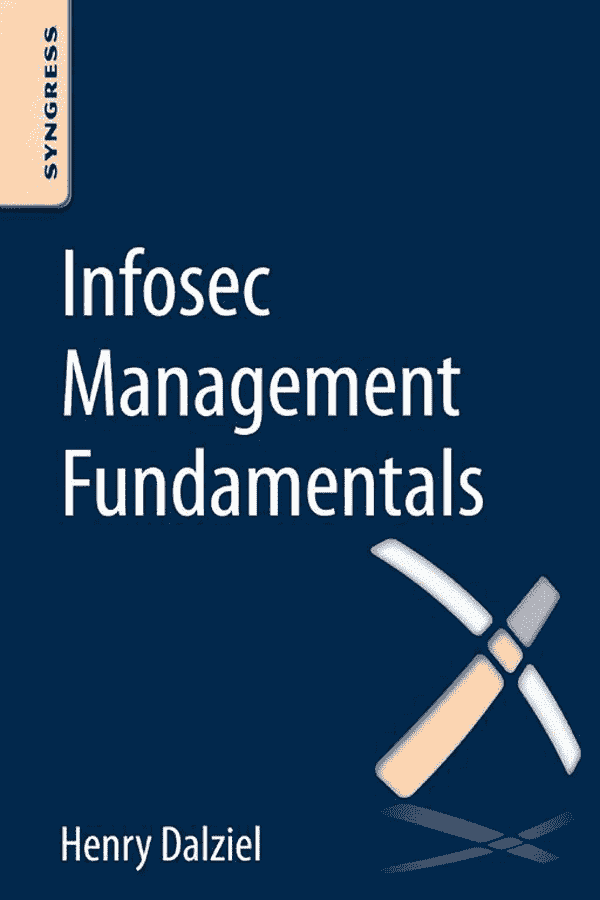

# 作者简介

**Henry Dalziel** 是一位连续创业者、Concise Ltd 的创始人、网络安全博客，并开发过许多安全课程。他在该领域工作多年，经验丰富。

# 特约编辑简介

**Jerod Brennen** (@sland) 白天是一名信息安全极客。晚上他是一位丈夫、父亲、武术家、音乐人、游戏玩家以及社交媒体狂热者。他在该领域工作多年，经验丰富。

你可能还没有进入信息安全（InfoSec）领域，但你非常渴望进入这一领域。如果是这样，那太为你感到高兴了！几年前我也是如此。我的背景其实是音乐教育，所以当我寻找第一份 IT 安全工作时，我的简历并没有反映出人们所预期的教育和培训，这使得我获得那个职位变得更加困难。在当今市场上，具有安全意识的专业人士的优势在于，对信息安全专业人员的需求不断增长，全球范围内空缺数量多于职位申请人数。

你可能是一个新获得的 `CISSP`（认证信息系统安全专业人员）。也许你已经通过了认证流程，但你处于一个更具战术性的执行角色，你想向管理层转型。我在俄亥俄州哥伦斯的一大企业担任了多年此类职位，通过实施和维护信息安全控制系统的实践机会来提升自己的技能。不要低估这些实践经验的价值！

你可能已经接受了一个信息安全管理或领导职位。现在这项责任落在了你的肩上，由你来决定对于你的组织来说，安全意味着什么。这是我最近的一个企业职位。在这里，你学习如何管理安全预算和安全团队。这也是大多数安全专业人士对业务目标与信息安全控制之间的平衡产生更深层次理解的地方。

你可能已经在管理或领导岗位上工作了多年，你想反转角色，退后一步，从外部观察并判断你所做的一切是否恰当。你是否真的保护了所有需要保护的内容？你的安全计划是否完整且全面？你的安全计划提供的价值是否与业务目标一致？

最后，也许你已经转向了信息安全咨询。你已经厌倦了企业化的生活方式，想将多年积累的专业知识分享给其他组织，让他们知道从何开始以及如何实施安全。鉴于每个国家经济根基中存在中小企业，以这种方式分享你的专业知识具有不可估量的重大意义！

无论你今天处于何种位置，我们即将涵盖的内容都直接适用于你正在所做的工作。它将帮助你在职业生涯中成长。它将帮助你完善你可能正在管理的安全计划。我希望每个人从这些材料中获得的启示是：信息安全领域迫切需要积极、敬业的专业人士，这些人即使他们还没有背景和经验，也理解信息安全对各种规模企业的重要性和价值。我们即将涵盖的主题非常多样——这些知识需求量巨大，而这些信息将帮助你找到那些空缺职位之一。更重要的是，正如关注新闻的人所知，这种知识是人们迫切需要的。

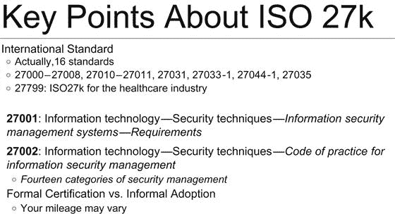

我将从一个框架开始，虽然有很多框架可供选择，但我个人发现最成功的是 `ISO/IEC 27000` 系列。

你可能已经知道 `ISO/IEC 27000` 系列是实施信息安全管理系统（`ISMS`）的标准集合，但大多数人没有意识到，`ISO/IEC 27000` 系列实际上包含 16 个独立的标准和文档。甚至有一个标准专门用于在医疗保健机构中实施信息安全管理系统（`ISO/IEC 27799`），在那里，你受到《健康保险流通性与责任法》（`HIPAA`）合规性的约束，并被要求妥善保护电子保护健康信息（`ePHI`）。

如果你是第一次看到 `ISO/IEC 27000` 系列，`ISO/IEC 27001`（信息技术——安全技术——信息安全管理系统——要求）包含了关于计划应该是什么样子的核心知识集。然而，我发现关注 `ISO/IEC 27002`（信息技术——安全技术——信息安全控制实践规范）中概述的控制措施最有价值。

我提到过我在多个企业信息安全职位上工作过。在其中一个职位中，我被请到一家机构帮助他们实现支付卡行业数据安全标准（`PCI DSS`）合规。我很快发现，`PCI` 合规与……（此处原文存在大量重复，已按要求处理，确保不重复输出）

* 密码学
* 物理与环境安全管理
* 安全运营管理
* 通信安全管理
* 系统获取、开发与维护
* 供应商安全管理
* 信息安全事件管理
* 业务连续性管理
* 合规性管理

安全控制在不同组织之间并非一律的。一个非常规避风险的组织其管控会更加严密。他们可能会实施大量的信息安全控制，而且他们所实施的控制质量也会更高。然而，他们还将投入更多的时间和资源来实施和维护这些安全控制，而这些时间和资源是许多较小组织所不具备的。

如果你在一个规模较小的组织内工作，领导层可能更愿意接受某些风险，更愿意为了竞争和建立客户群而冒险。即使是规模更小的组织也能发现这些控制的价值，但对你来说，以理解适用于你组织的质量水平来对待它们是非常重要的。

我发现，一个清晰定义的风险管理方法——即业务领导者和安全人员公开讨论可能发生的坏事，以及组织为了在这些坏事发生时做好准备和响应而愿意采取的步骤——将影响你从 `ISO/IEC` 控制集中集所做的控制选择。

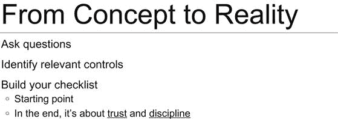

我们如何从这种文档、已发布的标准或框架的概念转变为一个实际实施的功能性信息安全计划？根据我的经验，这可以通过一个相对简单的过程来实现。

第一步（对于许多 IT 人员来说这非常困难，但我们必须这样做）是离开你的办公桌去提问。如果你想在实施信息安全计划方面取得成功，你不仅需要与 IT 部门的人交流，还需要与整个组织中业务部门的人交流。在这些材料中，我将就你可以提出的问题提供指导，以确定哪些控制适用于你的组织。一旦你完成了这些讨论，即那次问答环节，你将开始构建一个项目列表，根据你的风险偏好，列出你识别出的适用于你组织的控制。有了这份列表，你就可以讨论期望的质量水平，以及实施活动的项目时间表。我们需要多快进行这些更改？我们愿意花多少钱？我们需要多少人支持这些变化？

由你的讨论得出的清单将是你的起点。你将根据该清单驱动你所做的所有更改。最终，这取决于你对员工、合作伙伴和供应商的信任程度，以及你在组织内部愿意遵守的纪律，以确保这些控制得到实施和维护。

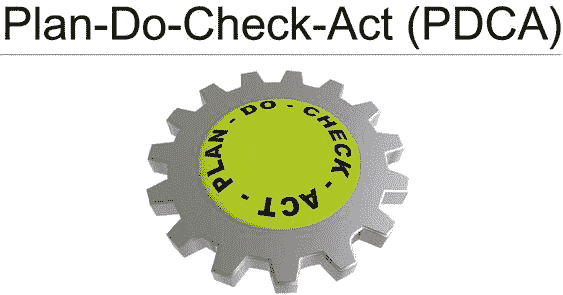

在实施信息安全控制框架时，`Plan-Do-Check-Act`（计划-执行-检查-处理）模型非常适用。它在我工作的组织效果非常好。

在 `Plan`（计划）阶段，你讨论哪些控制相关的。你进行对话，并开始识别你为了提高安全态势打算在组织中进行的更改。

`Do`（执行）阶段是这些讨论转化为实施项目的阶段。我们制定项目计划，决定项目预算，并分配将积极花时间实施和维护这些控制的人员。

一旦这些项目完成，一旦控制实施，你就进入了 `Check`（检查）阶段。在这里，你验证控制是否实施正确。`IT Audit`（IT 审计）部门在这个阶段起着关键作用，外部顾问也是如此。

我曾与一个组织合作，他们认为自己有一套非常完美的补丁计划，并且在识别和修复漏洞方面做得非常出色。在一次任务中，我在一个存储敏感信息的系统中发现了一个关键的（可利用）漏洞。当我向组织展示这一发现时，他们进行了自己的调查，并确定系统已完全修补，认为我的发现是不正确的。我们使用了不同的安全工具来评估漏洞，并对漏洞是否存在产生了争议。

`Act`（处理）阶段是该循环的第四部分，在这里你识别新的控制（可能是你尚未讨论的控制），并提出实施这些控制的建议，这将回到最初的 `Plan-Do-Check-Act` 模型。

当然，这个模型是循环的。它旨在作为一个持续的过程，因为信息安全不是终点，而是一个旅程。你永远无法获得一个能够免疫所有攻击的绝对控制集。威胁将继续进化，攻击者的能力也是如此。

我们需要不断访问这个 `Plan-Do-Check-Act` 循环，以确保我们实施的控制是正确的。

# 第 3 章：风险管理

第 3 章涵盖了风险管理，这是识别并最终实施所有控制的伞。。随后提出了几个关键问题。

## 关键词
`NIST`; `信息风险因素分析 (FAIR)`

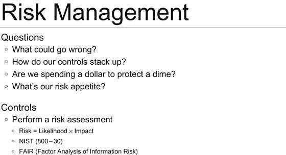

我提到过风险管理是识别并最终实施所有控制的伞。你应该提出的第一个问题（而且你可以向任何人提问，无论是技术人员还是非技术人员）是：

我们的组织可能会发生什么问题？

我们担心的坏事可能发生哪些？

重要的是，根据行业内发生的事件以及你的组织过去可能发生的事件，就最可能影响你组织的风险进行一次开放、诚实的的对话。

一旦你开始识别并表达这些担忧和恐惧，下一个问题应该是：

# 我们的控制措施效果如何？

如果发生了那种糟糕的事情，我们有哪些防御措施来将损害降至最低？

信息安全计划通常是有机增长的，你可能会发现自己已经实施了一些控制措施。了解这些控制措施已经在何处实施，将有助于你未来合理地管理信息安全预算。

一旦你确定了防御和控制措施，接下来的逻辑问题是：

- 我们的支出是否过高？
- 我们是否在花一美元来保护一美分钱？

在我的职业生涯中，我多次问过（也也被问过）这些问题。许多组织陷入了凭直觉决定实施控制措施的陷阱，而不考虑成本如何，但如果我们以批判性的眼光来看待控制措施，很可能会发现我们的支出过高，或者我们在某项控制措施上的花费远超过其所面临的风险。

最后，所有这些问题都将引导最终的问题：

- 我们的风险承受能力是什么？
- 我们愿意接受多少风险？

正如我之前提到的，安全并不是适用于所有组织的“万能解决方案”。保护关键国家基础设施的组织与销售 T 恤的组织相比，可能具有更保守、更规避风险的承受能力。如果你想成为一名有效的信息安全经理，理解组织的风险承受能力是至关重要的。

我建议每个组织实施的第一项控制措施（一种需要定期执行的控制措施）是某种风险评估。如果我查看 `NIST Special Publication 800-30 revision 1 (Guide for Conducting Risk Assessments)`，他们提供了一个计算风险的简单定性公式：

`Risk=Likelihood×Impact`

`Likelihood`（概率）指的是风险发生实现的频率，`impact`（影响）是指如果发生这种情况损害会有多严重。`NIST` 文档对如何计算不同评分提供了额外的建议。

如果我想转向光谱的另一端，查看一种非常量化的风险管理方法，信息风险因子分析 (`FAIR`) 对组织为管理已识别风险而应花费的金钱价值进行了非常详细的比较。根据我的经验，执行基于 `FAIR` 的风险评估比基于 `NIST` 的风险评估需要更多的规划和培训，但如果实施得当，`FAIR` 方法可以提供具体的预算建议。

无论你执行的是基于 `NIST` 的定性风险评估、基于 `FAIR` 的定量风险评估，还是基于其他风险管理方法的风险评估，该风险评估将成为你构建信息安全计划的基石。

# 第 4 章

## 策略管理

一旦你执行了风险评估并开始了信息安全和风险管理的对话，下一步就是查看你的信息安全策略集。

## 关键词

信息安全策略；数据分类策略；可接受使用策略

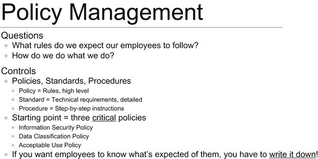

一旦你执行执行了风险评估并开始了信息安全和风险管理的对话，下一步就是查看你的信息安全策略集。

在此阶段要问的问题有：

- 我们期望员工遵守的规则是什么？
- 如果你要在我们公司工作，什么是可以的，什么是不可以的？

例如，今天许多公司问的一个非常常见的问题是：

- 是否允许员工携带自己的个人设备（智能手机、平板电脑等）并将其连接到内部无线网络？

嗯，如果你没有一份明确说明你的规则的策略，那么很有可能人们在没有先获得管理层批准的情况下就这样做了。在策略中记录你的预期是减轻这些风险的关键第一步。

一旦你记录了关于 IT 资源哪些是可以的、哪些是不可能的，你将开始处理下一个问题：

- 我们是如何做到这些事情的？

这使得对话从高层策略转向了更详细的标准和程序。让我们继续关于个人设备的讨论。如果你的组织决定，允许员工将个人设备连接到公司网络的风险低于为这些员工提供公司设备的成本，那么具有安全意识的经理会询问对于这些用户及其设备，哪些控制措施仍然是必要的。

- 一个安全的 `iPhone` 是什么样子的？
- 一个安全的 `Android` 平板电脑是什么样子的？
- 我们是否应该强制执行密码或密码？
- 我们是否应该开启定位服务以查找丢失或被盗的设备，特别是如果这种位置跟踪可能会违反员工隐私？
- 允许用户将越狱的 `iones` 和已根的 `Android` 平板电脑连接到我们的内部无线网络是否可以（提示：不可以。不可以。）
- 在我们允许该手机连接到我们的内部无线网络之前，还需要开启哪些安全设置？

你坚持用户在将设备连接到内部无线网络之前必须应用的特定设置，应该记录在一个或多个标准中。然而，实际更改这些设置的过程被称为程序。程序还涵盖其他场景。

- 当有人离开公司时，我们（分步）该做什么？
- 我们对他们的访问做了哪些更改？

策略是非常高层的，它们不应该经常更改。标准应该反映技术，因此也应该随着技术的变化而改变。继续移动设备的例子，每当发布新版本的 `iOS` 或 `Android` 操作系统时，你都应该有一份关于你组织内安全的手机或平板电脑是什么样子的新标准。至少，在标准开发、批准和发布之前，你应该发布一份包含建议用户采用设置的指南。

程序将被 IT 支持团队频繁使用。这对于帮助台和服务台团队尤为如此，这些是 IT 新员工的切入点。你绝对应该拥有详细的操作说明，以便这些团队从开始工作的第一天起就能了解如何执行安全任务。

虽然完整的信息安全策略集可能需要一些时间来编写，但我建议每个人开始的三个关键策略是：

1. 信息安全
2. 数据分类
3. 可接受使用

这三项策略只是冰山一角，但它们将帮助你快速确定你的组织如何进行信息安全。

如果你想让员工知道对他们的期望，就必须把它写下来。

否则你注定会失败。

本章涵盖了执行层赞助（executive sponsorship），即由高层管理人员对安全负责的概念。本章认为，你需要一个能够做出预算和人员配置决策的人，来支持你已经实施的政策。

## 关键词
执行层赞助；`C-Level`；保密协议；`NDA`

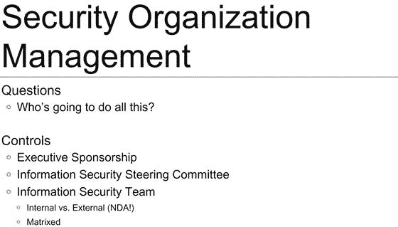

在这些政策到位后，你将提出的下一个问题是：

到底由谁来这一切？

我多次听到过“无资金支持的授权”（unfunded mandate）这个术语，并且曾是这个术语的承受方——即出现了一个新方向、新规则，我们被要求遵守，而无论我们是否有相应的技术或人员来实现。最终结果通常是部署了一个新系统，但没有指定的管理员。

这就是执行层赞助（即高层管理人员对安全负责）这一概念的关键所在。你需要一个能够做出预算和人员配置决策的人，来支持你已经实施的政策。在位执行层赞助者的支持下，你应该成立一个信息安全指导委员会，这是一个组织内部的领导小组，用于讨论安全变化如何影响他们的特定领域，并帮助他们共同对将实施哪些控制措施做出决策。

你还需要一个信息安全团队，无论是由内部员工组成，还是通过聘请第三方托管安全服务提供商。有人需要为系统打补丁。有人需要运行漏洞扫描，跟踪你的合规状态，并识别并移除恶意软件实例。

确保如果你有了外部团队，请务必记录一份保密协议（`NDA`）。你不希望你的内部安全事件作为该关系的一部分而公开化。

我也见过矩阵式安全团队（matrixed security teams）的成功案例，组织拥有极少的全职信息安全资源或团队，但会投入整个 IT 和整个业务部门的人员协助安全工作，尽管这些个人并非全职安全专业人员。

这里的这三个控制措施将帮助你定义并管理如何运行你的安全计划。

# 第 6 章：人力资源安全管理

人力资源安全管理侧重于职位描述和培训。换句话说，如果你要招聘一名新的安全团队成员，你会寻找什么样的职位。

## 关键词
信息安全经理；高级安全分析师；安全分析师；安全意识培训

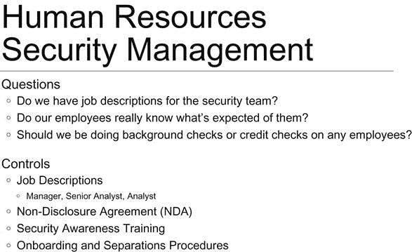

人力资源（`HR`）安全管理是我们的下一个类别，侧重于职位描述和培训。与此类别相关的关键问题包括：

- 你的安全团队有职位描述吗？
- 如果你去招聘一名新的安全团队成员，你会寻找什么样的职位？你会要求哪些技能？

如果你打算为这些角色找到合适的人选（无论是作为内部员工还是第三方托管安全服务提供商），回答这些问题是关重要的。

另一个关键问题是：

- 你的员工真的知道对他们有什么期望吗？

在政策中记录这些信息是一回事，但你是否验证了你的政策是否得到了遵守呢？

在讨论人力资源安全控制措施时，我觉得你应该问的另一个额外问题是：

- 我们是否应该对任何员工进行背景检查或信用检查？

如果有人将接触高度敏感信息，你可能希望获得一种安心，即知道他们背景中没有任何犯罪记录，或者他们没有处于财务困境中。由于犯罪的三个共同方面是手段、动机和机会，你可以通过消除动机来降低内部欺诈的风险。

在你实施的此类类别的控制措施中，有三个关键的职位描述：

1. 信息安全经理
2. 高级安全分析师；以及
3. 安全分析师。

我将在稍后详细讨论这三个角色，但请放心，它们是你信息安全控制集中的关键元素。

正如我之前提到的，保密协议（`NDA`）是另一个关键控制措施。这通常是一份标准文件，你可以与第三方共享，以确保如果你选择以一种需要交换敏感信息的方式聘请他们，他们不会向任何人披露有关你组织的关键内部信息。

安全意识培训是另一项本质的人力资源安全控制措施，不仅针对员工，也为了让你的 IT 人员理解。如果你希望员工能够成功检测并恰当响应社会工程攻击，请教他们攻击看起来什么样，并告诉他们被成为目标时应该联系谁。如果你没有教过开发人员如何编写安全代码，指望他们创建安全的 Web 和移动端应用程序是不合理的。同样，除非你培训过他们，否则不要指望你的系统管理员理解如何加固 Windows 服务器或 Linux 服务器。

重申我在之前的政策部分提到的内容，入职和离职程序非常重要。

- 我们如何招聘人员并授予他们访问内部系统的权限？
- 我们如何结束某人在我们组织的工作并收回该权限？

这里的这四个人力资源安全控制措施将帮助你确保你的信息安全控制集是合理且适当的。

# 第 7 章：资产管理

资产管理涵盖了了解哪些系统连接到你内部网络的需求。

## 关键词
移动设备管理；`MDM`；企业移动管理；`EMM`

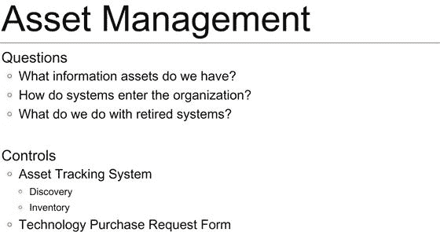

在资产管理类别中，我们在这里的关键问题如下：

- 我们拥有哪些信息资产？

换句话说，你知道哪些系统连接到了你的内部网络吗？因为如果你不知道，将它被视为你的网络可能并不明智。某人可能添加了无线接入点或流氓系统，利用它们来监控员工活动、访问贸易秘密，或向你网站毫无防备的访问者投放恶意软件。

未管理的设备和应用程序的威胁也可能来自组织内部。拥有自主支出权限的部门可能会在不参与（甚至不通知）IT 部门的情况下购买并实施技术解决方案。Gartner 创造了“影子 IT”（Shadow IT）一词来涵盖这种情况。

- 你拥有哪些信息资产？你如何将系统添加到网络？
- 你如何获取新技术？

如果你想降低与未管理技术相关的风险，了解你如何获取系统和应用程序并将其引入内部网络是关重要的。

另一个关键问题是：

- 我们如何处理退役的系统？

没有任何技术会永远存在，你最终会关掉它们。以旧硬盘为例，有多少 IT 团队会移除旧硬盘并将它们放在锁锁的柜子里，并继续遵循这一过程直到柜子装满？取决于组织的风险偏好，存储旧硬盘对某些组织来说可能是可以接受的解决方案，直到柜子装满。到那时你该怎么办？

问这些问题，你将会识别出需要某种资产跟踪系统，在理想情况下，你可以在那里发现网络上的所有系统，并随着时间的推移跟踪该库存。

为了为组织选择合适的资产跟踪系统，您需要了解需要关于系统收集哪些信息。对于移动设备，移动设备管理（`MDM`）或企业移动设备管理（`EMM`）解决方案可能包含预配置的技术策略，这些策略旨在收集大多数组织认为相关的**。对于工作站，您可能已经部署了某项技术，可以向执行该跟踪的系统推送软件更改和补丁。您可能使用相同的解决方案对服务器进行补丁更新和管理，尽管某些组织选择使用不同的解决方案分别管理其工作站群体和服务器群体。

对于您的组织来说，要找到一个集化的资产管理系统可能是困难的，特别是在预算有限的情况下。至少，一个拥有包含网络上每个系统 `DNS` 和 `IP` 地址的电子表格的小型组织也是一种关键的控制。

此外，为了应对“影子 IT”（Shadow IT），技术采购申请表可以帮助您响应组织内部那些未先咨询 IT 部门就购买系统或应用程序的部门或单位。如果您为他们提供一种能够让 IT 参与在内的方式来获取这些解决方案，IT 可能会帮助他们更好地表达需求并选择一个更有效的解决方案，更不用说是一个符合您内部信息安全策略的解决方案了。

# 第八章：访问管理

访问管理涉及人们访问哪些资源，即他们工作所需的资源。

## 关键词
`Active Directory`; `OpenLDAP`

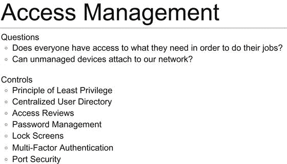

访问管理涉及人们可以访问哪些资源，即他们工作所需的资源。您应该提出的第一个问题是：

每个人都拥有工作所需的访问权限吗？

如果有人开始了新工作，您需要在 `Active Directory` 中为该人员授予权限，一种高风险的方法是查看公司职位最高的成员，并说直接复制他的凭据。我认为这种风险更高，因为这极有可能赋予新入职员工对存储敏感数据的系统的不必要访问权限。如果您为人们提供了工作所需的适当访问权限，他们就不可能需要或想要绕过您的访问控制（例如，要求他人共享其用户名和密码），但您首先需要了解这些访问权限是什么。

您应该问的另一个问题是：

未管理的设备可以连接到网络吗？

不要从用户的角度来看访问管理，而要从设备的角度来看。如果有人可以进入会议室并将未管理的笔记本电脑插入网络插座，您就面临暴露风险。如果有人可以将非公司的无线设备连接到您的无线网络（无论是笔记本电脑、智能手机还是平板电脑），他们就可能通过该连接对组织内部造成相当大的损害。

通过提问这些问题，您将开始为员工和网络设备确定适当的访问权限，如果您要遵循最小权限原则，这是至关重要的。在处理每一条防火墙规则、每一个 `Active Directory` 组时，都秉持“我们只给予人员和系统完成其任务所需的最小访问权限”的理念，这将帮助您防止蓄意的或无意的安全事件。

某种集中的用户目录正被认为是该领域的领先实践。我们经常看到的是微软的 `Active Directory`，但像 `OpenLDAP` 或 `eDirectory` 等目录通常也可以实现相同的目标。安全的组织需要一个所有系统都可以引用的中央用户存储器，这样当有人离开组织时，管理员可以在一处更新该用户的雇佣状态，然后中央目录可以立即切断该用户对所有连接系统和应用程序的访问。如果离职过程是不友好的，这种控制就尤为重要。

访问审查更像是一种程序（尽管很重要），在程序中，您指定业务经理（而非 IT 经理）负责审查谁访问了他们的系统和数据，然后让他们决定访问权限。

当涉及到硬盘加密时，全盘加密被认为是一种领先的实践。然而，在加密硬盘之前，你需要问自己一些具体的问题：

- 你将使用什么技术？
- 你将如何管理加密密钥？
- 加密机制是否极易受到绕过攻击的影响？
- 你是否需要集中管理加密密钥的能力？

在考虑数据库层面的加密时，考虑到对性能的影响尤为重要。尽管如此，某种数据库加密是另一项推荐的控制措施，因为数据库往往是关键信息的存储库。

- 我们是在单元格级上加密数据，还是在行级上加密？
- 我们是否要对整个表进行加密？
- 细致调整这些加密，以便在保护敏感且最关键数据的同时，不中断业务流程（即：得不偿失），这是关键。

# 第 10 章：物理与环境安全管理

第 10 章涵盖了物理和环境安全管理领域。更重要的是，信息安全经理在物理安全中所扮演的角色。

## 关键词
- 翻找垃圾 (Dumpster diving)

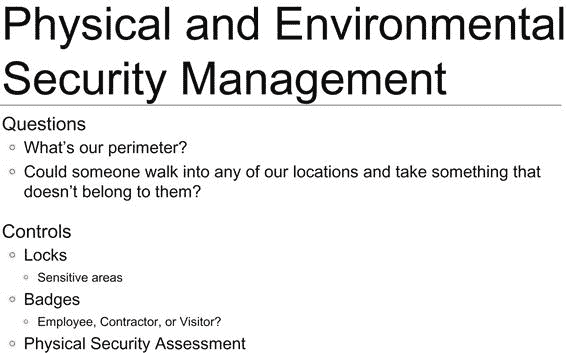

当我最初实施第一个信息安全计划时，物理和环境安全管理领域最令我惊讶。我承认，我并没有完全理解信息安全经理在物理安全中所扮演的角色。

几个关键问题：
- 你们的物理边界是什么？
- 有人可以进入你的服务器房并偷走系统吗？
- 有人可以进入办公室并拿走手机、平板电脑吗？
- 有人可以进入网络设备柜并在交换机上插东西吗？
- 你们的边界在哪里，是否有人带走不属于他们的东西？

正如你可以想象的，如果你失去了对试图保护的设备的物理控制，那么你选择实施的许多逻辑安全控制面临着更大的破解风险。

敏感区域周围的锁是一种极好的控制措施——我应该说明的是，这些锁是无法通过弹钥匙（bump key）或修改过的酒店房卡轻易绕过的。正如任何关注 Chris Nickerson 漏洞利用的人所知，聪明的攻击者可以使用迈拉气球和温湿洗巾来攻破运动探测器锁等复杂系统，欺骗系统认为它感应到了活的人。

了解攻击者将帮助你了解哪些锁适合你的组织。提供胸章（即员工的某种身份标识，以便你可以区分员工、承包商和临时访客），这从安全意识的角度来看也是重要的，特别是当你鼓励员工对任何没有佩戴可见胸章、在敏感区域徘荡的人提出质疑（或主动提供帮助）时。

进行某种形式的物理安全评估也将帮助你更好地理解在该领域的风险。翻找垃圾可以帮助你确定敏感信息是否在没有经过粉碎的情况下被丢弃。雇佣人实际上尝试进入你的某一个办公室是另一种极好的测试。这对于远程地点尤为重要，因为这些地点距离总部足够远，安全控制可能无法得到有效执行。

所有这些控制都将极大程度上解决相关的物理和环境风险。

# 第 11 章：安全运营管理

安全运营管理涵盖了日常安全任务的行政管理，并提出了你应该问自己的一些问题。

## 关键词
- 日志审查；漏洞扫描；补丁管理

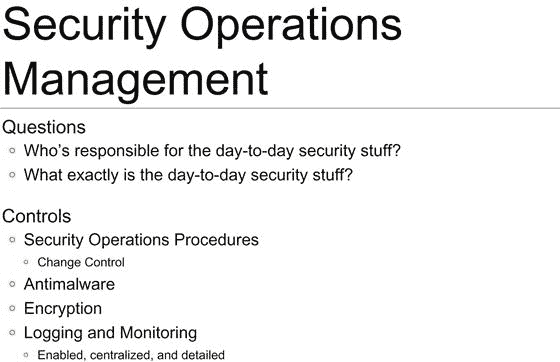

在考虑安全运营管理（你对日常安全任务的管理）时，脑中会浮现这样一个问题：
- 谁负责日常的安全事务？

我们之前讨论过安全组织管理。现在，我们更进了一，因为当我们谈论谁负责日常安全时，我们还必须问：
- 所谓的日常安全“事务”到底是什么？

日志审查、运行漏洞扫描、系统打补丁、响应潜在的安全事件……信息安全团队的日常职责可能是巨大的。一旦你识别了所有这些程序，你就能识别出由谁（或应该由谁）负责管理它们。

安全运营程序包括如变更控制等可重复的任务。很多时候，未经授权的更改对系统的损害可能比外部攻击者更大，因此你的变更控制程序是安全运营管理类别中的关键控制措施。终端安全代理的管理（可能包括反恶意软件和/或桌面加密）也属于这一类。

日志记录和监控是另一个属于安全运营管理的关键控制措施。虽然尽力防止坏事发生很重要，但具备检测坏事何时发生的能力同样重要，以便我们迅速做出响应。你可以通过实施集中日志机制来实现这一点，该机制从你需要监控的所有系统中收集日志，并捕捉足够的日志数据，以便你既可以在安全事件发生时进行近实时的告警，又能对安全事件及其根源进行更长期的调查，这些任务我们通常与计算机取证领域相关。

# 第 12 章：通信安全管理

通信安全管理主要处理网络安全控制，包括网络分段。

## 关键词
- 网络分段

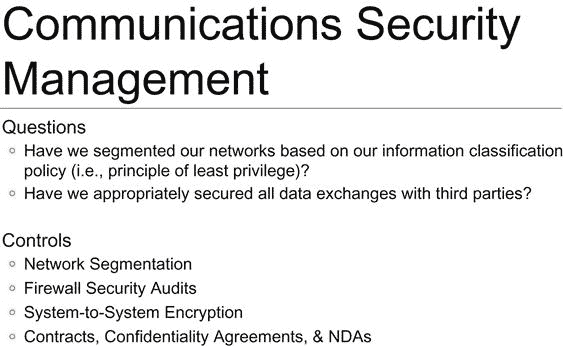

通信安全管理主要处理网络安全控制。

一个关键控制是网络分段，因此我想问的第一个问题是：
- 我们是否根据信息分类策略对网络进行了分段？

你可能记得之前我推荐了三项关键策略，而数据分类策略就是之一。除非你了解你的组织如何对数据分类、敏感数据存储在何以及谁有权访问，否则你会发现很难限制对敏感数据的访问。一旦你完成了分类并分段了网络，攻击者在没有合法访问权限的情况下获取数据将变得困难得多。

你还应该问这个问题：
- 我们是否妥善地保护了与第三方的所有数据交换？

我向你保证，你今天至少与一个第三方进行业务，最可能是云服务提供商，而你从安全管理的角度应该问的问题是：
- 我们如何采取适当措施来锁定该通信，以确保未经授权的第三方无法访问我们与授权第三方交换的信息？

在实施网络分段时，重要的是首先考虑你的网络管理团队能够合理支持的复杂程度。我访问过一些组织，登录了他们的公共（未加密）访客无线网络，并直接获得了患者系统和账单系统的网络访问。从安全的角度来看，这是一个极其糟糕的网络架构设计，但他们设计网络时并没有考虑安全。他们的首要任务是简单。他们没有与安全团队进行过关于网络分段的讨论，因此存在巨大的风险。

防火墙安全审计是另一个关键控制措施。通过审查规则来确定外部人员（例如）可能如何沿着网络路径访问内部系统或位置。你们那里是否存在任何暴露或漏洞？如果有，也许是时候考虑系统间加密了，即即使在内部网络也对数据进行加密。从一台服务器到另一台服务器的内部（未加密）FTP 进程可能看起来是安全的，因为位于内部，但一旦未经授权的人访问了内部网络，你现在就会将凭据和潜在的敏感数据以明文形式暴露。

除了这些技术控制外，文档控制（如合同中的安全条款、保密协议以及与第三方的非保密协议 NDA）将有助于确保他们遵循你所制定的规则。

# 第 13 章：系统的获取、开发与维护

系统的获取、开发和维护决定了如何让新系统和新应用程序上线，以及我们不能假设它们都已经被妥善地锁定。

## 关键词
开发扫描；质量保证；QA；渗透测试

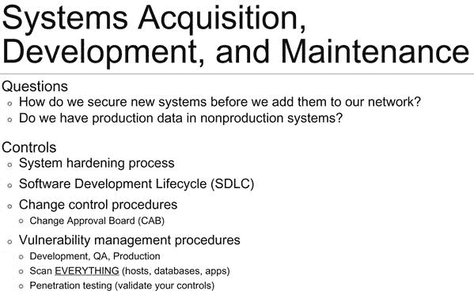

系统的获取、开发和维护——我们在这里要问什么问题？

在将新系统加入网络之前，如何确保它们的安全？

我们一直在让新系统和新应用程序上线，但我们不能假设它们都已经被妥善地锁定。

我们在非生产系统中有来自生产环境的数据吗？

我今天仍然看到这种现象，我理解其中的原因。开发人员受限于有限预算和紧迫的项目期限，移动得，他们需要以高度的准确性测试他们的应用程序。要编写出与真实生产数据一样准确的测试数据是非常困难的。尽管如此，我曾在一些组织中进行内部渗透测试，通过利用非生产系统上的漏洞（这些数据在测试过程中存储在这些系统中，不幸的是，随后被遗忘了），成功攻破了敏感的生产数据集。这之所以可行，是因为那些非生产系统没有具有与生产系统相同的安全和控制水平，而这种情况在许多组织中都是事实。

你可以实施的一些用于应对与系统获取、开发和维护相关风险的控制措施包括：记录的系统加固程序、安全的软件开发生命周期，以及变更控制程序；后者包含一个审批委员会，该委员会负责在所有更改实施前进行审查，以确保这些更改不会无意中破坏任何内容。

漏洞管理程序也属于这一类，包括对开发、测试、质量保证（QA）和生产系统进行扫描，寻找可利用的技术漏洞。如果攻击者攻破了非生产主机系统，即使该系统没有任何生产数据，攻击者仍然可以使用该主机作为跳板来访问其他主机系统。或者，攻击者可能利用该访问权限执行哈希传递攻击（pass-the-hash attack），如果域管理员凭据存储在那个非生产系统上，这可能是极具破坏性的。

但不要只扫描主机系统。扫描你的数据库。扫描你的应用程序。请记住，最常用于检测主机级漏洞的工具并不总是能提供关键数据库或应用程序级漏洞信息的相同工具。这里有一个很好的经验法则：如果攻击者可以与某个资源交互，那么由安全管理员来思考如何识别并缓解该资源中可能存在的任何漏洞。

一旦你熟练掌握了漏洞扫描和修复，渗透测试就是下一个有效步骤。渗透测试是一种验证你所实施的控制措施是否真的能威慑攻击者的方法。漏洞扫描会告诉你存在哪些关键暴露。而渗透测试将帮助你理解攻击者是否真的能够利用这些暴露、利用漏洞，并访问敏感数据或造成业务中断。

# 第 14 章：供应商安全管理

供应商安全管理变得越来越重要，尤其是当 2013 年披露攻击者能够通过先攻破 Target 的一家供应商，从而损害 Target 客户数据时。

## 关键词
Target；PCI DSS 合规；SANS 20 关键安全控制

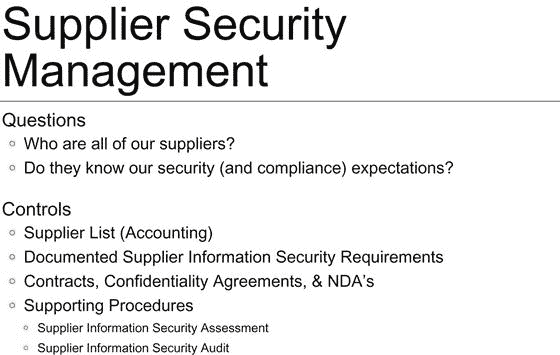

近期供应商安全管理变得越来越重要，尤其是当 2013 年披露攻击者能够先攻破 Target 的一家供应商，然后利用该供应商的访问权限在 Target 内部系统中安装恶意软件，从而损害客户数据。

向你的组织提出这些问题：
- 我们所有的供应商是谁？
- 与我们交换信息的第三方有哪些？

当你问这些问题时，你会发现这个名单会随着你接触的每一个人而不断增长。随着云计算的出现，我们有了越来越多提供关键业务服务和应用的第三方，而我们的内部用户日益依赖这些服务。正如我之前提到的，你会发现许多业务部门已经在 IT 部门不知情的情况下聘请了这些第三方。

- 这些供应商是谁？

这些第三方是谁，他们是否知道我们的安全和合规预期？

PCI（支付卡行业）明确规定，如果你与任何第三方共享信用卡数据，那么该第三方也必须证明符合 PCI DSS 标准。你们的供应商知道这项责任吗？你告诉他们了吗？

在你问完这些问题后，一个变得显重要的关键控制措施是记录的供应商名单。我发现编制此名单最好的方法是顺着钱找。与你的财务部门沟通。他们应该能提供大部分名单，因为如果你与第三方有业务往来，要么是你付他们钱，要么是他们付你钱。这种资金交换在某处会被记录。如果你能进入记录名单的系统，你就有了供应商名单。

你还应该有一个某种供应商信息安全需求清单。你对他们有哪些安全预期？

- 他们必须遵守 PCI 吗？
- 他们必须遵守 HIPAA 吗？
- 他们必须遵守 SANS 20 关键安全控制，还是遵循常识安全框架（Common Sense Security Framework）更合理？

你的组织需要对供应商和合作伙伴具备的安全控制措施，并必须有人负责向相关方传递这些控制措施。

合同、保密协议和 NDA 在这里再次出现，此外两个关键的支持程序：供应商信息安全评估和供应商信息安全审计。你需要能够快速评估他们是否具备关键控制措施，但在某些情况下，你需要更深挖掘并要求他们提供证据。这就是审计发挥作用的地方。

# 第 15 章：信息安全事件管理

信息安全事件管理涵盖数据分析，以便改进你的安全事件检测和响应能力。

## 关键词
安全信息和事件管理；SIEM

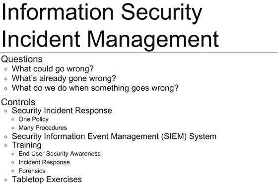

信息安全事件管理是下一个类别。

回到风险讨论，在讨论这些控制措施的这一伞下，引出了两个更深入的问题：

哪些事情可能会出现问题？

哪些事情已经出现过问题？

随着我们在检测和响应安全事件方面变得日益成熟，我们现在有了一些可以追溯的数据。例如，假设你的组织一直在跟踪每年报告丢失和被盗的笔记本电脑及移动设备数量，以及支持技术人员必须手动从终端用户机器中移除恶意软件的服务服务台电话次数。最坏的情况下，也许你的组织实际上真的发生了数据泄露。通过分析所有这些数据，你可以改进你的安全事件检测和响应能力。

另一个关键问题是：

当问题发生时，你会做什么？

如果答案是，“我们像火烧眉毛一样到处乱跑大叫”，那么你的组织绝对有改进这一特定安全控制措施集的机会。

如果你制定了一份包含多个支持性程序的安全事件响应策略，并针对你计划处理的每种特定类型的事件制定了程序，那么你就可以提前计划如何快速控制损失，并防止事件对你的业务产生更大的影响。

安全信息和事件管理（SIEM）系统是另一项关键控制措施，尽管它稍微先进一些。希望你已经拥有一个中心化的日志管理系统，从网络设备、关键主机系统和关键应用程序收集日志数据。经过精调的 SIEM 系统可以对这些数据进行规范化分析，搜索潜在的攻击模式，并在检测到这些模式时提醒安全人员。

这里再次提到了培训，加强了我们在人力资源安全管理部分涵盖的内容。你应该培训终端用户如何检测和响应安全事件，特别是社会工程学攻击。教他们永远不要与社会工程师接触。教他们始终向安全部门的人报告社会工程攻击。安全团队随后可以与业务的其他部门沟通，让他们警惕此类攻击。你应该培训事件响应团队如何响应事件。桌面演练是一项极好的控制措施，允许响应人员模拟响应，并检测他们的响应程序或为支持安全事件响应活动而实施的控制措施中的潜在漏洞。

较大的组织可能希望考虑培训员工正确的计算机取证技术，特别是如果数据以后可能用于法庭的话。尽管如此，许多组织发现与专精计算机取证的认证安全提供商保持关系要更有成本效益。

# 第 16 章：业务连续性管理

业务连续性管理控制措施侧重于帮助你准备并从灾难中恢复，以及在恢复期间如何继续运营。

## 关键词
灾难恢复计划；业务连续性计划

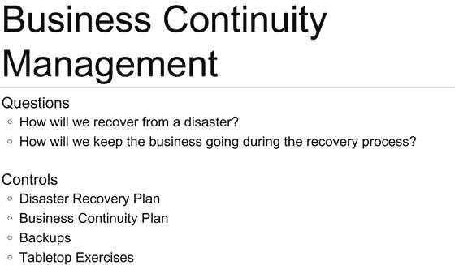

业务连续性管理控制措施侧重于帮助你准备并从灾难中恢复，以及在恢复期间如何继续运营。

### 我们如何从灾难中恢复？
第一个问题由你的灾难恢复计划回答。该文档概述了你将如何让 IT 系统恢复上线、将如何恢复数据，以及这些事件发生的顺序。正如你可以想象的，定期生成和测试备份对于该计划至关重要。你可能在备份数据，但如果你不测试备份，你可能会在安全事件或恢复事件期间发现备份是无用的，或者它们已经损坏了，或者它们在某个点停止了备份而没有人进行监控。这就是为什么桌面演练和模拟恢复演练是必要的。

### 在恢复过程中我们如何如何保持业务运行？
第二个问题由你的业务连续性计划回答。该文档与灾难恢复计划不同，它侧重于在灾难恢复工作进行期间，你将如何安全地继续运营。

# 第 17 章：合规管理

合规管理侧重于治理、风险和合规（GRC）解决方案，这些解决方案不仅跟踪组织的内部和外部合规义务，还跟踪供应商对于你分享给他们的信息安全要求所展现出的合规水平。

## 关键词
HIPAA; PCI; NERC/FERC; SOX; COPPA; FERPA; CFPB

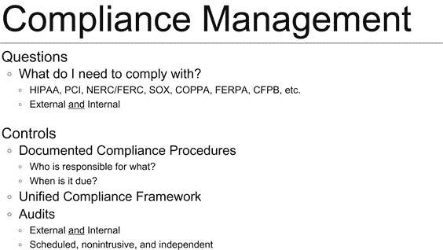

我想涵盖的最后一组安全控制措施属于合规管理。这里有两个关键问题：

### 我需要遵守什么？
存在哪些适用于我的规则和法规？

`HIPAA`, `PCI`, `NERC/FERC`, `SOX`, `COPPA`, `FERPA`, `CFPB` …… 列表令人惊叹。有这么多缩写词，识别哪些与你相关的可能花费大量时间。像统一合规框架（Unified Compliance Framework）这样的组织专门用于跟踪全球存在的数百项法规，并帮助组织理解合规流程。

请记住，你不仅在查看外部合规要求，还在查看你已发布的内部政策。我们在那里需要遵守什么？拥有记录在案的合规程序，识别谁负责证明合规性以及何时提交这些证据，这是非常重要的。

我见过某些治理、风险和合规（GRC）解决方案可以为你跟踪其中的一些信息。GRC 解决方案帮助你跟踪的组织的内部和外部合规义务，还跟踪供应商对于你分享给他们的信息安全要求所展现出的合规水平。

验证合规性通常发生在内部和外部审计期间。理想情况下，审计应该以一种非侵入性且独立的方式进行。

一旦你完成了与你决定实施的安全控制措施相关的提问过程（这些措施是根据领导层表达的风险偏好的），你现在就可以回过来看信息安全计划了。你获得了一个整体、一个框架，关于你的安全计划应该是什么样的，以及你的计划与实际控制集相比如何。

# 第 18 章：技能分组

技能分组涵盖了如何根据传统的人员/流程/技术矩阵将人员放在正确的职位。

## 关键词
CISSP; CISM; MSISM; 认证信息安全审计 (CISA)

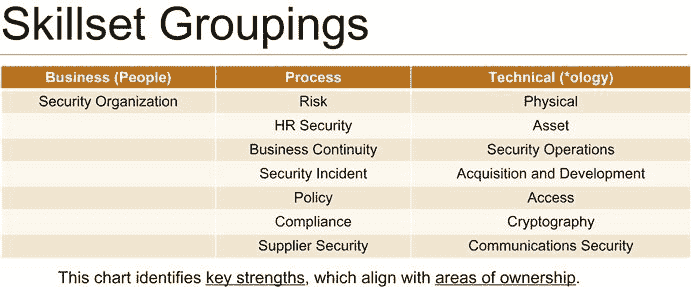

现在我们需要讨论谁来做这些工作。我们如何将人员放在正确的职位？我发现，如果你按照传统的人员/流程/技术矩阵对这些职责进行分组，是这样划分的。

你应该有一个具有业务思维的人来负责安全组织管理。我只给业务人员分配了一个领域，但请相信我，有一个专门专注于安全与业务之间关系的人是一项全职工作。

对于具有流程思维的人，我将分配风险、人力资源安全、业务连续性、安全事件、策略、合规和供应商安全。虽然这些领域都有技术组件，但实施和维护这些控制措施的优先优先。

对于技术型的人，我将分配物理、资产、安全运行、采购和开发、访问、加密和通信安全。在涵盖这些特定领域时，这个人必须卷起袖子深入研究技术细节。

此图表提取了核心优势，识别出人们擅长的领域，然后将这些职责分配给合适的人。如果你努力始终让某人处于他们感到快乐并享受所工作的职位上，你的信息安全计划将更加有效。

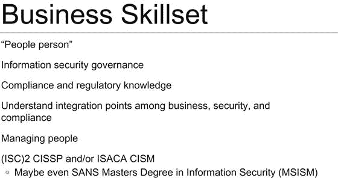

### 业务技能组合
对于业务技能组合，这类人是你的“人际关系达人”。他们理解信息安全治理，具备合规和监管方面的知识，并理解业务、安全和合规之间是如何协同运作的。

这些人与其他人的协作能力非常出色。他们擅长管理团队，包括技术团队和非技术团队。

如果你想通过证书来帮助自己为该职位寻找合适的候选人，我会寻找拥有 `CISSP`（来自 `ISC2`）、`CISM`（来自 `ISACA`），或者甚至来自 `SANS` 的 `MSISM` 的人。

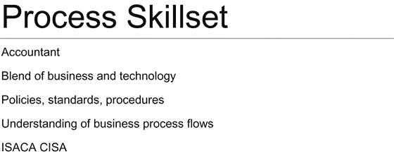

### 流程技能组合
流程技能组合的人是你的“会计师”。他们喜欢数字，喜欢跟踪事物，并且兼具业务和技术技能。他们热爱文档工作；流程、程序和标准让他们工作得津井有味。他们还理解业务流程图，这种技能通常在业务分析师身上常见。

在这里，我发现注册信息安全审计师（`CISAs`）非常适合这个职位。

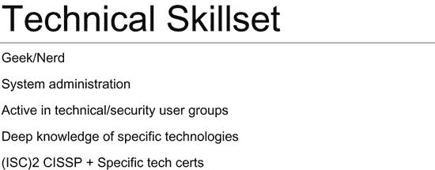

### 技术技能组合
你的技术技能组合将出现在你的“极客”（geeks）和“书呆”（nerds）中，这些都是我带着极度爱意使用的词汇（我自己也是一个极客）。首先，他们过去做过系统管理工作。他们在技术和安全用户组中很活跃，并且对特定技术有深厚的知识。

如果你在看简历，这些人可能也许没有 `CISSP`，但他们很可能拥有一个或多个与特定技术相关的技术证书。

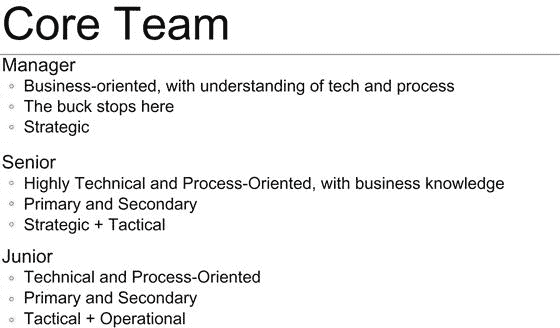

### 团队结构
理想情况下，你的核心信息安全团队分为三层：一个经理、一名或多个高级安全分析师，以及一个或多个（初级）安全分析师。团队的大小取决于你组织的规模，以及你与第三方托管安全服务供应商之间存在的任何关系。无论如何，整体结构仍然适用。

业务导向型经理负责战略决策，而高级安全分析师与经理进行战略性对话，并在与初级分析师合作时将这些对话转化为战术信息。

有效的信息安全计划由信息安全经理驱动，他们鼓励高级人员帮助初级人员成长为高级职位。初级人员应该不断从高级人员那里学习，根据这些积累的知识寻找改进现有流程的新方法。这使得初级人员能够维持日常运营职责，直到他们成长为高级，届那时你希望可以为团队引入新的初级安全分析师。

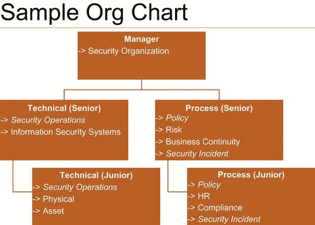

在接下来的幻灯片中，我包含了一个示例组织架构图，向你展示这一切是如何映射的。

经理负责确保组织安全，如果你有一个四人的全职安全专业人员团队（我知道这对许多组织来说是一种奢侈品），理想情况下你会有一名技术高级人员和一名流程高级人员，他们将承担我在这里概述的职责。然后，每个高级人员都将有一名共享某些职责的初级人员。例如，技术高级人员与技术初级人员分担安全运营，但初级人员可能负责物理安全和资产安全，而技术高级人员可能负责这些系统的采购和维护。同样，流程高级人员与初级人员共享策略，但可能初级人员负责人力资源部门的意识意识培训，而流程高级人员则处理所有的风险评估。

再次，这只是一个示例。你的组织不需要看起来像这样，但要理解，如果你从一个框架开始，并在基于风险的背景下识别出与你组织相关的所有控制，那么关于安全组织和运营管理的讨论（关于谁来实施和维护所有这些控制措施），最终将导出一个可以让你识别出这些职责归属组织架构图。

当你担任该管理角色时，你还会发现这就是你驱动人员变动的方式。这就是你向领导层传达的信息：为了满足信息安全策略中概述的质量或安全水平，你可能需要在这些职位上拥有人员。

# 第 19 章

## 资源

第 19 章涵盖了若干辅助资源。

## 关键词
ISO 27000 系列；统一合规框架；`UCF`

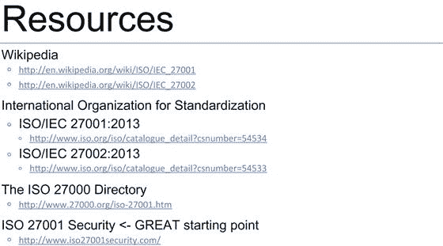

正如我在演示开始时提到的，我是资源共享的有力倡导者。

我想分享的第一组是关于 `ISO/IEC 27000` 系列的。如果你想了解 `ISO 27001` 和 `27002`，从维基百科开始。除了是一个免费资源外，根据我的经验，维基百科上的技术信息通常保持更新。如果你想深入研究（并且有预算），你可以去 [`iso.org](http://iso.org) 网站实际购买 `27001` 文档。它们是面向个人许可的，因此可能有点贵（取决于你的预算），但你找不到比 `ISO/IEC`更好的信息来源。不过，`ISO/IEC 27000` 目录以及 `iso27001security.com` 网站是独立的，它们提供了关于如何处理 `ISO/IEC` 的一些见解和指导。

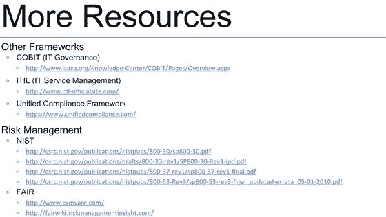

如果 `ISO/IEC` 不适合你的组织，我建议你考虑 `COBIT` 作为替代方案。我也建议大家理解 `ITIL`。虽然 `ITIL` 不是一个安全框架，而是服务管理框架，但这两个学科之间确实有相似之处。

统一合规框架 (`UCF`) 是我提到的另一个资源，它将各种法规和标准相互映射。我见过许多订阅 `UCF` 的 GRC 解决方案，使其能够根据已完成的工作更快地识别和实施控制措施。

在风险管理类别中，我有一些来自 `NIST` 和 `FAIR` 的资源。再次，请记住 `NIST` 是定性的，而 `FAIR` 是定量的。无论你选择哪种风险管理框架，你都需要一种内部讨论风险的通用语言。如果你的组织还没有这种讨论的通用语言，请从这里开始。看看这两个。

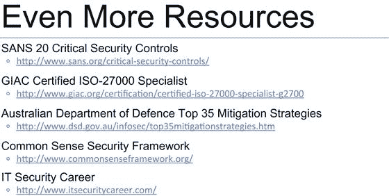

我提到了 `SANS 20 项安全控制`，这个名字稍微有点误导性，因为这 20 个类别包含了接近 150 到 160 项特定的控制要求。

如果你想成为认证的 `SANS ISO/IEC 27000` 专家，那么我建议你获得相应的 `GIAC` 认证。

如果你的组织专注于泄露缓解，澳大利亚国防部的《35 项缓解策略》非常棒。这是一个极佳的资源，但知名度没有该那么高。

最后两个资源是我维护的网站，用于帮助分享这些信息。常识安全框架 (`CSSF`) 设计旨在让组织能够快速评估第三方的安全性，同时也将这一视角转向内部，检查它们自身的控制集。

CSSF 包含了我认为的七个关键领域中每个领域最重要的三项控制措施。如果一个机构没有维护这 21 项控制措施，那么询问任何额外的安全问题都是在浪费你和他们的时间。

《IT 安全职业》旨在帮助有志成为信息安全专业人士的人寻找领域的工作机会，因为我再如何强调寻找和聘用合格专业人士的重要性都不为过。

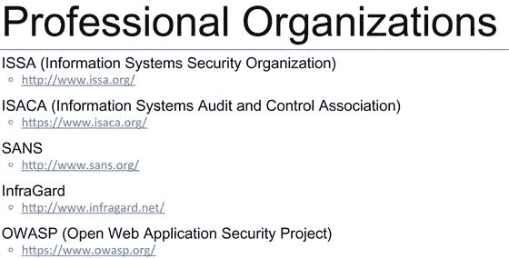

如果你还没有该领域的实战经验，可以参加多个专业组织来开始学习业务，并与现任信息安全专业人士建立人脉。ISSA、ISACA、SANS、InfraGard 和 OWASP 在全球多个城市都设有当地分会，你可能在自己的城市找到其中一个或多个组织。ISC²（我没有在这里列出它）也正在在全球范围内成立分会，因此你可能还有更多可以考虑的专业组织。

你可能还会有当地组织，即那些没有全国或国际影响力的组织。例如，在印第安纳州州的印第安纳波利斯，有一个名为印第安纳安全与隐私网络（INSPN）的组织，这个信息安全和审计专业人士的聚会人数非常多，他们分享的信息对所有参与者都非常有帮助。

# 第 20 章

# 结

本章鼓励读者使用提供的额外资源并参加当地的专业组织。

## 关键词

ISO 27000 系列；信息安全专业人士

我希望这本书提供了改进信息安全计划所需的信息，并帮助你作为信息安全专业人士在职业上迈出下一步。我强烈鼓励你深入研究额外资源，参加当地的专业组织，并尽所能帮助我们继续维护全球机构的安全。

非常感谢你所的一切！
