## 密码学创新机器学习应用


### 编辑委员会

*   **J. Anitha Ruth**  
    SRM Institute of Science and Technology, India

*   **G.V. Vijayalakshmi**  
    BMS Institute of Technology and Management, India

*   **P. Visalakshi**  
    SRM Institute of Science and Technology, India

*   **R. Uma**  
    Sai Ram Engineering College, India

*   **A. Meenakshi**  
    SRM Institute of Science and Technology, India

---


 

---

|  |  |
| :--- | :--- |


---

### Mission

虽然“智能”传统上是应用于人类和人类认知的术语，但技术的进步已使开发能够模拟许多人类特征的智能系统成为可能。在这个模拟与人工智能的新时代，需要大量研究以继续推动该领域发展，并评估人工生命和机器学习存在所带来的伦理与社会关切。

**Advances in Computational Intelligence and Robotics (ACIR) Book Series** 鼓励就进化计算、人工生命、计算智能、机器学习和机器人技术等所有相关主题进行学术探讨。ACIR 展示了智能技术多样主题的最新研究，旨在推动这一快速发展领域的知识与应用进步。

---

### Coverage

*   Machine Learning
*   Brain Simulation
*   Computational Intelligence
*   Algorithmic Learning
*   Heuristics
*   Computational Logic
*   Pattern Recognition
*   Adaptive and Complex Systems
*   Cyborgs
*   Artificial Life

---

IGI Global 现正接受本系列出版的稿件提交。如欲提出版卷提案，请联系收购编辑：Acquisitions@igi-global.com 或访问 [`www.igi-global.com/publish`](http://www.igi-global.com/publish/)。

---


---


### *仿生学与生物医学机器人研究手册*
**作者**: Maki Habib (埃及 The American University in Cairo)  
**出版信息**: Engineering Science Reference • 2018 年版权 • 532 页 • 精装 (ISBN: 9781522529934) • 定价 US $325.00 (我方价格)

### *当代文化与社会中的类人机器人、半机械人与机器人*
**作者**: Steven John Thompson (美国 University of Maryland)  
**出版信息**: Engineering Science Reference • 2018 年版权 • 286 页 • 精装 (ISBN: 9781522529736) • 定价 US $205.00 (我方价格)

### *智能技术与智能系统的发展与趋势*
**作者**: Vijayan Sugumaran (美国 Oakland University)  
**出版信息**: Engineering Science Reference • 2018 年版权 • 351 页 • 精装 (ISBN: 9781522536864) • 定价 US $215.00 (我方价格)

### *自然启发元启发式算法的建模、分析与应用研究手册*
**作者**: Sujata Dash (印度 North Orissa University)、B.K. Tripathy (印度 VIT University) 和 Atta ur Rahman (沙特阿拉伯 University of Dammam)  
**出版信息**: Engineering Science Reference • 2018 年版权 • 538 页 • 精装 (ISBN: 9781522528579) • 定价 US $265.00 (我方价格)

### *用于文本分析与发现的概念解析算法 (CPA)：新兴研究与机遇*
**作者**: Uri Shafrir (加拿大 University of Toronto) 和 Masha Etkind (加拿大 Ryerson University)  
**出版信息**: Information Science Reference • 2018 年版权 • 139 页 • 精装 (ISBN: 9781522521761) • 定价 US $130.00 (我方价格)

## 2017 年

### *应用控制论与系统科学研究手册*
**作者**: Snehanshu Saha (印度 PESIT South Campus)、Abhyuday Mandal (美国 University of Georgia)、Anand Narasimhamurthy (印度 BITS Hyderabad)、Sarasvathi V (印度 PESIT- Bangalore South Campus) 和 Shivappa Sangam (印度 UGC)  
**出版信息**: Information Science Reference • 2017 年版权 • 463 页 • 精装 (ISBN: 9781522524984) • 定价 US $245.00 (我方价格)

### *机器学习创新与趋势研究手册*
**作者**: Aboul Ella Hassanien (埃及 Cairo University) 和 Tarek Gaber (埃及 Suez Canal University)  
**出版信息**: Engineering Science Reference • 2017 年版权 • [页数未提供] • 精装 (ISBN: [ISBN 未提供]) • 定价 US $[价格未提供] (我方价格)


## 图书目录

### Handbook of Research on Soft Computing and Nature-Inspired Algorithms
**作者**：Shishir K. Shandilya (Bansal Institute of Research and Technology, India)、Smita Shandilya (Sagar Institute of Research Technology and Science, India)、Kusum Deep (Indian Institute of Technology Roorkee, India)、Atulya K. Nagar (Liverpool Hope University, UK)  
**出版信息**：Information Science Reference • 版权 2017 • 1093 页 • 精装 (ISBN: 9781522522294) • 定价 US $465.00

### Membrane Computing for Distributed Control of Robotic Swarms Emerging Research and Opportunities
**作者**：Andrei George Florea (Politehnica University of Bucharest, Romania)、Cătălin Buiu (Politehnica University of Bucharest, Romania)  
**出版信息**：Information Science Reference • 版权 2017 • 627 页 • 精装 (ISBN: 9781522521280) • 定价 US $280.00

### Recent Developments in Intelligent Nature-Inspired Computing
**作者**：Srikanta Patnaik (SOA University, India)  
**出版信息**：Information Science Reference • 版权 2017 • 119 页 • 精装 (ISBN: 9781522522805) • 定价 US $160.00

### Ubiquitous Machine Learning and Its Applications
**作者**：Pradeep Kumar (Maulana Azad National Urdu University, India)、Arvind Tiwari (DIT University, India)  
**出版信息**：Information Science Reference • 版权 2017 • 264 页 • 精装 (ISBN: 9781522523222) • 定价 US $185.00

### Advanced Image Processing Techniques and Applications
**作者**：N. Suresh Kumar (VIT University, India)、Arun Kumar Sangaiah (VIT University, India)、M. Arun (VIT University, India)、S. Anand (VIT University, India)  
**出版信息**：Information Science Reference • 版权 2017 • 259 页 • 精装 (ISBN: 9781522525455) • 定价 US $185.00

### Advanced Research on Biologically Inspired Cognitive Architectures
**作者**：Jordi Vallverdú (Universitat Autònoma de Barcelona, Spain)、Manuel Mazzara (Innopolis University, Russia)、Max Talanov (Kazan Federal University, Russia)、Salvatore Distefano (University of Messina, Italy & Kazan Federal University, Russia)、Robert Lowe (University of Gothenburg, Sweden & University of Skövde, Sweden)  
**出版信息**：Information Science Reference • 版权 2017 • 439 页 • 精装 (ISBN: 9781522520535) • 定价 US $290.00

### Theoretical and Practical Advancements for Fuzzy System Integration
**作者**：Deng-Feng Li (Fuzhou University, China)  
**出版信息**：Information Science Reference • 版权 2017 • 297 页 • 精装 (ISBN: 9781522519478) • 定价 US $195.00

### Multi-Agent-Based Simulations Applied to Biological and Environmental Systems
**作者**：Diana Francisca Adamatti (Universidade Federal do Rio Grande, Brazil)  
**出版信息**：Information Science Reference • 版权 2017 • 415 页 • 精装 (ISBN: 9781522518488) • 定价 US $200.00

### Strategic Imperatives and Core Competencies in the Era of Robotics and Artificial Intelligence
**作者**：Roman Batko (Jagiellonian University, Poland)、Anna Szopa (Jagiellonian University, Poland)  
**出版信息**：Business Science Reference • 版权 2017 • 406 页 • 精装 (ISBN: 9781522517566) • 定价 US $205.00

### Emerging Research on Applied Fuzzy Sets and Intuitionistic Fuzzy Matrices
**作者**：Amal Kumar Adak (Jafuly Deshpran High School, India)、Debashree Manna (Damda Jr. High School, India)、Monoranjan Bhowmik (Vidyasagar Teacher's Training College, India)  
**出版信息**：Information Science Reference • 版权 2017 • 302 页 • 精装 (ISBN: 9781522516569) • 定价 US $185.00

### Multi-Core Computer Vision and Image Processing for Intelligent Applications
**作者**：Mohan S. (Al Yamamah University, Saudi Arabia)、Vani V. (Al Yamamah University, Saudi Arabia)  
**出版信息**：Information Science Reference • 版权 2017 • 375 页 • 精装 (ISBN: 9781522509141) • 定价 US $205.00

### Developing and Applying Optoelectronics in Machine Vision
**作者**：Oleg Sergiyenko (Universidad Autónoma de Baja California, Mexico)、Julio C. Rodriguez-Quiñonez (Autonomous University of Baja California, Mexico)  
**出版信息**：Information Science Reference • 版权 2017 • 292 页 • 精装 (ISBN: 9781522508892) • 定价 US $210.00

### Pattern Recognition and Classification in Time Series Data
**作者**：Eva Volna (University of Ostrava, Czech Republic)、Martin Kotyrba (University of Ostrava, Czech Republic)、Michal Janosek (University of Ostrava, Czech Republic)  
**出版信息**：Information Science Reference • 版权 2017 • 341 页 • 精装 (ISBN: 9781522506324) • 定价 US $205.00

### Integrating Cognitive Architectures into Virtual Character Design
**作者**：Jeremy Owen Turner (Simon Fraser University, Canada)、Michael Nixon (Simon Fraser University, Canada)、Ulysses Bernardet (Simon Fraser University, Canada)、Steve DiPaola (Simon Fraser University, Canada)  
**出版信息**：Information Science Reference • 版权 2017 • 282 页 • 精装 (ISBN: 9781522505655) • 定价 US $185.00

### Handbook of Research on Natural Computing for Optimization Problems
**作者**：Jyotsna Kumar Mandal (University of Kalyani, India)、Somnath Mukhopadhyay (Calcutta Business School, India)、Tandra Pal (National Institute of Technology Durgapur, India)  
**出版信息**：Information Science Reference • 版权 2016 • 346 页 • 精装 (ISBN: 9781522504542) • 定价 US $185.00

### Applied Artificial Higher Order Neural Networks for Control and Recognition
**作者**：Ming Zhang (Christopher Newport University, USA)  
**出版信息**：Information Science Reference • 版权 2016 • 1015 页 • 精装 (ISBN: 9781522500582) • 定价 US $465.00

### Handbook of Research on Generalized and Hybrid Set Structures and Applications for Soft Computing
**作者**：Sunil Jacob John (National Institute of Technology Calicut, India)  
**出版信息**：Information Science Reference • 版权 2016 • 511 页 • 精装 (ISBN: 9781522500636) • 定价 US $215.00

### Handbook of Research on Modern Optimization Algorithms and Applications in Engineering and Economics
**作者**：Pandian Vasant (University of Technology Petronas, Malaysia)、Gerhard-Wilhelm Weber (Middle East Technical University, Turkey)、Vo Ngoc Dieu (Ho Chi Minh City University of Technology, Vietnam)  
**出版信息**：Information Science Reference • 版权 2016 • 607 页 • 精装 (ISBN: 9781466697980) • 定价 US $375.00

### Problem Solving and Uncertainty Modeling through Optimization and Soft Computing Applications
**作者**：Pratiksha Saxena (Gautam Buddha University, India)、Dipti Singh (Gautam Buddha University, India)、Millie Pant (Indian Institute of Technology - Roorkee, India)  
**出版信息**：Engineering Science Reference • 版权 2016 • 960 页 • 精装 (ISBN: 9781466696440) • 定价 US $325.00

### Emerging Technologies in Intelligent Applications for Image and Video Processing
**作者**：V. Santhi (VIT University, India)、D. P. Acharjya (VIT University, India)、M. Ezhilarasan (Pondichery Engineering College, India)  
**出版信息**：Information Science Reference • 版权 2016 • 403 页 • 精装 (ISBN: 9781466698857) • 定价 US $225.00

### Handbook of Research on Design, Control, and Modeling of Swarm Robotics
**作者**：Ying Tan (Peking University, China)  
**出版信息**：Information Science Reference • 版权 2016 • 518 页 • 精装 (ISBN: 9781466696853) • 定价 US $235.00

### Handbook of Research on Emerging Perspectives in Intelligent Pattern Recognition, Analysis, and Image Processing
**作者**：Narendra Kumar Kamila (C.V. Raman College of Engineering, India)  
**出版信息**：Information Science Reference • 版权 2016 • 854 页 • 精装 (ISBN: 9781466695726) • 定价 US $465.00

### Handbook of Research on Advanced Hybrid Intelligent Techniques and Applications
**作者**：Siddhartha Bhattacharyya (RCC Institute of Information Technology, India)、Pinaki Banerjee (Goldstone Infratech Limited, India)、Dipankar Majumdar (RCC Institute of Information Technology, India)、Paramartha Dutta (Visva-Bharati University, India)  
**出版信息**：Information Science Reference • 版权 2016 • 477 页 • 精装 (ISBN: 9781466686540) • 定价 US $255.00

### Research Advances in the Integration of Big Data and Smart Computing
**作者**：Pradeep Kumar Mallick (Institute for Research and Development, India)  
**出版信息**：Information Science Reference • 版权 2016 • 653 页 • 精装 (ISBN: 9781466694743) • 定价 US $285.00

### Handbook of Research on Natural Computing for Optimization Problems
**作者**：Jyotsna Kumar Mandal (University of Kalyani, India)、Somnath Mukhopadhyay (Calcutta Business School, India)、Tandra Pal (National Institute of Technology Durgapur, India)  
**出版信息**：Information Science Reference • 版权 2016 • 374 页 • 精装 (ISBN: 9781466687370) • 定价 US $210.00


## IGI Global 图书目录

### 2016 年出版

#### *Innovative Research in Attention Modeling and Computer Vision Applications*
**作者**：Rajarshi Pal (Institute for Development and Research in Banking Technology, India)  
**出版信息**：Information Science Reference • copyright 2016 • 456pp • H/C (ISBN: 9781466687233) • US $200.00 (our price)

### 2015 年出版

#### *Handbook of Research on Swarm Intelligence in Engineering*
**作者**：Siddhartha Bhattacharyya (RCC Institute of Information Technology, India) and Paramartha Dutta (Visva-Bharati University, India)  
**出版信息**：Engineering Science Reference • copyright 2015 • 743pp • H/C (ISBN: 9781466682917) • US $335.00 (our price)

#### *Handbook of Research on Advancements in Robotics and Mechatronics*
**作者**：Maki K. Habib (The American University in Cairo, Egypt)  
**出版信息**：Engineering Science Reference • copyright 2015 • 994pp • H/C (ISBN: 9781466673878) • US $515.00 (our price)

#### *Handbook of Research on Advanced Intelligent Control Engineering and Automation*
**作者**：Ahmad Taher Azar (Benha University, Egypt) and Sundarapandian Vaidyanathan (Vel Tech University, India)  
**出版信息**：Engineering Science Reference • copyright 2015 • 794pp • H/C (ISBN: 9781466672482) • US $335.00 (our price)

#### *Handbook of Research on Artificial Intelligence Techniques and Algorithms*
**作者**：Pandian Vasant (University of Technology Petronas, Malaysia)  
**出版信息**：Information Science Reference • copyright 2015 • 796pp • H/C (ISBN: 9781466672581) • US $495.00 (our price)

#### *Handbook of Research on Synthesizing Human Emotion in Intelligent Systems and Robotics*
**作者**：Jordi Vallverdú (Universitat Autònoma de Barcelona, Spain)  
**出版信息**：Information Science Reference • copyright 2015 • 469pp • H/C (ISBN: 9781466672789) • US $245.00 (our price)

#### *Recent Advances in Ambient Intelligence and Context-Aware Computing*
**作者**：Kevin Curran (University of Ulster, UK)  
**出版信息**：Information Science Reference • copyright 2015 • 375pp • H/C (ISBN: 9781466672840) • US $225.00 (our price)

#### *Recent Advances in Intelligent Technologies and Information Systems*
**作者**：Vijayan Sugumaran (Oakland University, USA & Sogang University, Seoul, Korea)  
**出版信息**：Information Science Reference • copyright 2015 • 309pp • H/C (ISBN: 9781466666399) • US $200.00 (our price)

#### *Emerging Research on Swarm Intelligence and Algorithm Optimization*
**作者**：Yuhui Shi (Southern University of Science and Technology (SUSTech), China)  
**出版信息**：Information Science Reference • copyright 2015 • 341pp • H/C (ISBN: 9781466663282) • US $225.00 (our price)

### 2014 年出版

#### *Face Recognition in Adverse Conditions*
**作者**：Maria De Marsico (Sapienza University of Rome, Italy) Michele Nappi (University of Salerno, Italy) and Massimo Tistarelli (University of Sassari, Italy)  
**出版信息**：Information Science Reference • copyright 2014 • 480pp • H/C (ISBN: 9781466659667) • US $235.00 (our price)

#### *Computer Vision and Image Processing in Intelligent Systems and Multimedia Technologies*
**作者**：Muhammad Sarfraz (Kuwait University, Kuwait)  
**出版信息**：Information Science Reference • copyright 2014 • 312pp • H/C (ISBN: 9781466660304) • US $215.00 (our price)

#### *Mathematics of Uncertainty Modeling in the Analysis of Engineering and Science Problems*
**作者**：S. Chakraverty (National Institute of Technology - Rourkela, India)  
**出版信息**：Information Science Reference • copyright 2014 • 441pp • H/C (ISBN: 9781466649910) • US $225.00 (our price)

#### *Global Trends in Intelligent Computing Research and Development*
**作者**：B.K. Tripathy (VIT University, India) and D. P. Acharjya (VIT University, India)  
**出版信息**：Information Science Reference • copyright 2014 • 601pp • H/C (ISBN: 9781466649361) • US $235.00 (our price)

#### *Exploring Innovative and Successful Applications of Soft Computing*
**作者**：Antonio D. Masegosa (Universidad de Granada, Spain) Pablo J. Villacorta (Universidad de Granada, Spain) Carlos Cruz-Corona (Universidad de Granada, Spain) M. Socorro García-Cascales (Universidad Politécnica de Cartagena, Spain) María T. Lamata (Universidad de Granada, Spain) and José L. Verdegay (Universidad de Granada, Spain)  
**出版信息**：Information Science Reference • copyright 2014 • 375pp • H/C (ISBN: 9781466647855) • US $190.00 (our price)

#### *Research Developments in Computer Vision and Image Processing Methodologies and Applications*
**作者**：Rajeev Srivastava (Indian Institute of Technology (BHU), India) S. K. Singh (Indian Institute of Technology (BHU), India) and K. K. Shukla (Indian Institute of Technology (BHU), India)  
**出版信息**：Information Science Reference • copyright 2014 • 451pp • H/C (ISBN: 9781466645585) • US $195.00 (our price)

#### *Handbook of Research on Novel Soft Computing Intelligent Algorithms Theory and Practical Applications*
**作者**：Pandian M. Vasant (Petronas University of Technology, Malaysia)  
**出版信息**：Information Science Reference • copyright 2014 • 1018pp • H/C (ISBN: 9781466644502) • US $495.00 (our price)

### 2013 年出版

#### *Intelligent Technologies and Techniques for Pervasive Computing*
**作者**：Kostas Kolomvatsos (University of Athens, Greece) Christos Anagnostopoulos (Ionian University, Greece) and Stathes Hadjiefthymiades (University of Athens, Greece)  
**出版信息**：Information Science Reference • copyright 2013 • 351pp • H/C (ISBN: 9781466640382) • US $195.00 (our price)

#### *Mobile Ad Hoc Robots and Wireless Robotic Systems Design and Implementation*
**作者**：Raul Aquino Santos (University of Colima, Mexico) Omar Lengerke (Universidad Autónoma de Bucaramanga, Colombia) and Arthur Edwards-Block (University of Colima, Mexico)  
**出版信息**：Information Science Reference • copyright 2013 • 344pp • H/C (ISBN: 9781466626584) • US $190.00 (our price)

#### *Intelligent Planning for Mobile Robotics Algorithmic Approaches*
**作者**：Ritu Tiwari (ABV – Indian Institute of Information, India) Anupam Shukla (ABV – Indian Institute of Information, India) and Rahul Kala (School of Systems Engineering, University of Reading, UK)  
**出版信息**：Information Science Reference • copyright 2013 • 322pp • H/C (ISBN: 9781466620742) • US $195.00 (our price)

#### *Simultaneous Localization and Mapping for Mobile Robots Introduction and Methods*
**作者**：Juan-Antonio Fernández-Madrigal (Universidad de Málaga, Spain) and José Luis Blanco Claraco (Universidad de Málaga, Spain)  
**出版信息**：Information Science Reference • copyright 2013 • 499pp • H/C (ISBN: 9781466621046) • US $195.00 (our price)

### 2012 年出版

#### *Prototyping of Robotic Systems Applications of Design and Implementation*
**作者**：Tarek Sobh (University of Bridgeport, USA) and Xingguo Xiong (University of Bridgeport, USA)  
**出版信息**：Information Science Reference • copyright 2012 • 522pp • H/C (ISBN: 9781466601765) • US $195.00 (our price)

#### *Cross-Disciplinary Applications of Artificial Intelligence and Pattern Recognition Advancing Technologies*
**作者**：Vijay Kumar Mago (Simon Fraser University, Canada) and Nitin Bhatia (DAV College, India)  
**出版信息**：Information Science Reference • copyright 2012 • 786pp • H/C (ISBN: 9781613504291) • US $195.00 (our price)

### 2011 年出版

#### *Handbook of Research on Ambient Intelligence and Smart Environments Trends and Perspectives*
**作者**：Nak-Young Chong (Japan Advanced Institute of Science and Technology, Japan) and Fulvio Mastrogiovanni (University of Genova, Italy)  
**出版信息**：Information Science Reference • copyright 2011 • 770pp • H/C (ISBN: 9781616928575) • US $265.00 (our price)

### 2010 年出版

#### *Particle Swarm Optimization and Intelligence Advances and Applications*
**作者**：Konstantinos E. Parsopoulos (University of Ioannina, Greece) and Michael N. Vrahatis (University of Patras, Greece)  
**出版信息**：Information Science Reference • copyright 2010 • 328pp • H/C (ISBN: 9781615206667) • US $180.00 (our price)

#### *Artificial Intelligence Applications for Improved Software Engineering Development New Prospects*
**作者**：Farid Meziane (University of Salford, UK) and Sunil Vadera (University of Salford, UK)  
**出版信息**：Information Science Reference • copyright 2010 • 372pp • H/C (ISBN: 9781605667584) • US $180.00 (our price)

---


**联系方式**  
701 E. Chocolate Ave., Hershey, PA 17033  

**在线订购**：[`www.igi-global.com`](http://www.igi-global.com/) 或致电 717-533-8845 x100  

**系列订阅**：联系 Acquisitions@igi-global.com  

**服务时间**：Mon-Fri 8:30 - 5:00 pm (est) 或 24 小时传真 717-533-8661


### 作者

*   **J. Anitha Ruth**  
    SRM Institute of Science and Technology, India

*   **Vijayalakshmi G.V. Mahesh**  
    BMS Institute of Technology and Management, India

*   **P. Visalakshi**  
    SRM Institute of Science and Technology, India

*   **R. Uma**  
    Sri Sai Ram Engineering College, India

*   **A. Meenakshi**  
    SRM Institute of Science and Technology, India

## 概述

机器学习处于技术进步的最前沿，提供了无与伦比的能力来分析数据趋势并强化加密与解密系统的安全性。本书深入探讨了机器学习、数据分析与错综复杂的密码学领域之间的共生关系。

机器学习在构建分析模型、实现流程自动化以及适应海量数据集方面的卓越能力，改变了加密与解密的格局。机器学习方法（如提升法和互学习）与密码系统的结合，使得在公开且潜在脆弱的信道上生成私有加密密钥成为可能。机器学习方法的固有特性为开发更安全、更有效的加密和解密方法铺平了道路，有望减轻可能危及组织安全的人为错误的影响。

本书的主要目标是为机器学习与密码学交叉领域的最新理论与实证工作提供广泛的概述。读者将找到相关的理论框架和最新的实证研究成果，揭示机器学习如何通过识别和解决可能暴露漏洞的数据模式，来强化加密和解密程序。

本书面向从事密码学和机器学习的学生、教授、工程师和科学家等多元化受众，提供了关于这两个领域思想交叉融合的宝贵见解。内容探讨了已实现的概念和未开发的潜力，为在密码学、机器学习和网络安全领域工作的专家、学者和学生提供了丰富的资源。

主题探索涵盖了该领域内的各个关键主题，包括 `Encryption`、`Algorithm`、`Security`、`Elliptic Curve Cryptography`、`Cryptanalysis`、`Pairing-based Cryptography`、`Artificial Intelligence`、`Machine Learning`、`Authentication`、`Stream Cipher`、`Message Authentication`、`Homomorphism Encryption`、`Digital Signature Algorithm`、`Network Security`、`Quantum Cryptography`、`Biological Cryptography` 和 `Neural Cryptography`。

本书旨在成为推动机器学习与密码学这一复杂交叉领域知识进步的基石，促进专业人士和爱好者之间的创新与理解。

## 书籍结构

### 第 1 章：现代密码学与机器学习导论

作者：Preeti Mariam Mathews、Anjali Sandeep Gaikwad、Mathu Uthaman、Sreelekshmi B 和 Dankan Gowda V。本章在密码学和机器学习的领域内探索数字货币的动态格局。探索始于 `PMBeast-1` 的实际应用，延伸至 `Bitcoin Cryptography`（比特币密码学）的复杂性，强调了信息隐私的关键作用。本章跨越了密码学的历史演变，重点介绍了对称加密和非对称加密、公钥基础设施（`PKI`）以及加密哈希的最新进展。作者们建立了古老密码学实践与现代机器式学习之间的联系，展望下一代机器能够熟练掌握机器学习的细微差别，从而强化加密系统。

### 第 2 章：高级 AI 与密码学研究之间的未来展望协同效应

作者：Dankan Gowda V、Joohi Garg、Shaifali Garg、KDV Prasad 和 Sampathirao Suneetha。本章深入探讨了人工智能（`AI`）和密码学这两个快速发展的领域。本章探索了 `AI` 与密码学研究之间令人惊讶的共生关系，展望了一个 `AI` 不仅研究而且设计密码系统的未来。叙述深入探讨了这两个领域交叉处的挑战与可能性，思考了量子计算和类脑技术的影响。作者们阐述了密码学方法如何有助于维护 `AI` 模型的开放性、安全性和法律隐私法规，最终重塑人工智能领域内互联网安全的前沿。

### 第 3 章：人工智能辅助的生物密码学保护

作者：Sriprasadh K。本章介绍了密码学、人工智能和生物启发式方法的融合。聚焦于秘密消息或信息的保护，本章探讨了人工智能在各个领域辅助决策的整合应用。讨论了利用人类独特特征作为加密密钥的创新生物密码学概念。作者强调了人工智能在关联多个生物密码学密钥以及通过精准认证增强安全服务方面的作用。本章展示了利用人工智能强化生物启发式密码学方法的前瞻性视角。

### 第 4 章：基于 OpenAI API 的自适应密码学：利用自学习 AI 进行动态密钥管理

作者：Valarmathi R、R. Uma、P. Ramkumar 和 Srivatsan Venkatesh。本章聚焦于自适应密码学与 `OpenAI API` 的集成。针对不断演变的安全功能格局，本章强调了优化渗透工具带来的漏洞。作者主张采用人工智能支持，特别是利用 `OpenAI API`，以升级密码哈希自动化并增强动态密钥管理。本章强调了调整密码技术以应对不断演变的网络威胁的必要性，并探讨了自学习 `AI` 在密钥管理过程中的潜力。

### 第 5 章：基于 WOA 优化的 LightGBM 深度学习入侵检测

作者：Jayashree R 和 Venkata J。本章提出了一种优化的深度学习入侵检测模型，利用鲸鱼优化算法（`WOA`）结合轻量级梯度提升机（`LightGBM`）算法。聚焦于网络防御中的挑战，作者提出了一种通过特征选择和降维方法预处理网络数据的模型。随后采用 `WOA-LightGBM` 算法进行训练，与基准算法相比展示了卓越的性能。本章通过深度学习与优化技术的融合，提供了一种增强入侵检测的综合方法，有望提高准确性和效率。

### 第 6 章：机器学习与密码学算法综述

作者：INDIRA M、Mohanasundaram K S 和 SARANYA M。本综述章节深入探讨了机器学习与加密的交叉点，阐述了各种算法和技术。作者概述了机器学习算法及其在密码学中的应用，强调隐私保护机器学习、安全认证和异常检测。该综述捕捉了数据隐私和安全范式转变的本质，展示了安全多方计算（`SMPC`）和同态加密等进展。本章作为理解密码学中当代机器学习技术格局的宝贵资源。

### 第 7 章：量子密码学：算法与应用


## 章节概览

### 第 8 章：通过加密刹车灯图像并利用人工神经网络避免追尾碰撞来最小化数据丢失

**作者**：Abirami MS 和 Manoj Kushwaha

本章针对与追尾碰撞相关的道路安全问题。作者提出了一种加密的人工神经网络（`ANN`）方法来预防此类碰撞，利用加密技术和 `ANN` 算法实时识别刹车灯。本章强调了加密的安全性，确保信息在没有适当密钥的情况下无法被破解。所提出的基于 `ANN` 的模型在准确性方面优于其他算法，能向驾驶员提供进一步警报，并呈现了一种安全的碰撞避免方法。该工作为在道路安全场景中应用加密引入了一种新方法。

### 第 9 章：用于预测对称加密算法输入的机器学习技术

**作者**：Sivasakthi M 和 Meenakshi A

本章探讨了机器学习算法在预测对称加密算法输入中的应用。聚焦于逆向工程哈希函数的挑战，作者利用机器学习来学习和预测哈希函数输出。本章详述了涉及 `DES` 对称加密函数的实验，以及基于输出值识别输入第一位的神经网络训练过程。该方法为利用机器学习理解和预测加密算法输入提供了创新视角。

### 第 10 章：加密域中的同态加密与机器学习

**作者**：Neethu Krishna、Kommisetti Murthy Raju、Dankan Gowda V、G. Arun 和 Sampathirao Suneetha

本章深入探讨了同态加密（`HE`）的复杂世界及其与机器学习的协同作用。内容深入剖析了 `HE`、其基本理论及其对加密域中机器学习的影响。聚焦于增强机器学习应用的隐私与安全，作者讨论了 `HE` 允许在加密数据上进行计算的潜力。本章旨在为深入理解同态加密与机器学习之间的协同效应铺平道路，为该领域的未来进步奠定基础。

### 第 11 章：用于生物识别认证系统的模式识别与加密方案的有效结合

**作者**：Vijayalakshmi G V Mahesh

本章强调了模式识别与加密在生物识别认证系统领域的融合。内容突出了生理特征在认证中的重要性，并探讨了认证过程中从生物特征数据中提取的模式。针对生物识别系统易受未授权访问的漏洞，作者提出了通过加密算法增强安全性的方法论。本章提供了通过有效结合模式识别和加密方案，在生物识别认证系统中实现额外安全性的见解。

### 第 12 章：通过网络分析和机器学习增强加密勒索软件检测

**作者**：Metilda S、Akshay Raghava、Yadhu Krishna M J、Shreya Sinha、Kavya Pasagada 和 Tanuja Kharol

本章针对日益增长的加密勒索软件威胁。作者提出了一种机器学习分类模型来识别勒索软件家族，重点关注特定的网络流量特征，特别是用户数据报协议（`UDP`）和互联网控制报文协议（`ICMP`）中的特征。本章结合了特征选择以在不损害准确性的前提下优化效率。通过将网络流量分析与行为分析和蜜罐部署相结合，作者提出了一种扩展加密勒索软件检测的综合方法。该工作为通过网络分析和机器学习检测和缓解加密勒索软件影响的先进技术做出了贡献。

### 第 13 章：智慧城市应用中创新机器学习方法综述

**作者**：Saranya M 和 Amutha B

本章综述了创新机器学习方法在智慧城市背景下的应用。将智慧城市视为对城市住房需求的回应，本章强调了大规模数据收集和分析在提升居民生活质量中的作用。作者深入探讨了各种机器学习算法及其在智慧城市医疗、污染防治、交通、能源管理和安全等领域的应用。本章作为理解创新机器学习方法在塑造智慧城市未来中潜在应用的宝贵资源。

### 第 14 章：利用迭代分层神经模糊推理网络分类器与非对称加密保障智慧城市物联网系统安全

**作者**：Prakash B、Saravanan P、Bibin Christopher V、Saranya A 和 Kirubanantham P

本章解决智慧城市中物联网（`IoT`）系统的安全挑战。作者提出了一种基于迭代分层神经模糊推理网络（`ILNFIN`）的入侵检测系统（`IDS`），用于识别针对智慧城市 `IoT` 的攻击。本章采用非对称素数混沌 `Rivest Shamir Adleman` 技术进行安全数据传输。通过预处理 `TON-IoT` 数据集和特征选择，作者展示了其提出的方法在保障智慧城市 `IoT` 系统安全方面的有效性。本章为通过神经模糊推理网络与非对称加密的集成来增强 `IoT` 系统安全性的知识体系做出了贡献。

---

## 结语

作为这本综合参考书的编辑，我们对书中各章呈现的丰富见解、创新成果和协作成果感到欣喜和振奋。各章作者探讨的密码学与机器学习的融合，照亮了信息安全与智能数据分析动态交汇的不断演进的图景。

从揭示密码学历史背景的基础章节，到量子密码学和加密人工神经网络等前沿应用，本书汇编为在机器学习与密码学复杂交叉领域探索的学者、从业者和爱好者提供了一座灯塔。

这些章节展示的多元视角凸显了这两个领域的共生关系。我们见证了传统密码学实践通过现代机器学习算法的视角发生转变，为加密、认证和入侵检测提供了新颖方法。正如作者所展望的未来，先进 `AI`、生物启发式密码学与迷人的同态加密领域之间充满希望的协同效应正在显现。


每一章都证明了这一跨学科领域的动态性质。综述章节提供了最前沿技术的宝贵总结，而应用章节则展示了现实意义——从保障智慧城市中物联网系统的安全，到强化网络安全以抵御加密勒索软件。

作为编辑，我们向为使这本参考书成为一部全面且前瞻性的资源而贡献专业知识和见解的杰出作者们致以衷心的感谢。我们希望这部汇编能激发在不断演进的机器学习与密码学领域中进一步的探索、研究与合作。

秉承持续学习与创新的精神，我们邀请读者深入研读本书，拥抱思想交叉融合带来的机遇，为机器学习与密码学这一迷人交汇点的进步叙事持续贡献力量。

愿这本参考书能激励未来的研究人员、学者和从业者，在保障信息安全和推动技术前沿方面开拓新的维度。

## 第 1 章

*   Preeti Mariam Mathews
    MIT Mahaguru Institute of Technology, India
*   Anjali Sandeep Gaikwad
    Bharati Vidyapeeth, India
*   Mathu Uthaman
    Mahaguru Institute of Technology, India
*   B. Sreelekshmi
    Mahaguru Institute of Technology, India
*   V. Dankan Gowda
    
    BMS Institute of Technology and Management, India

### 摘要

密码学和机器学习是当今巨型技术的一部分。本章全篇论述数字货币。这将是加密世界即将发生的事情。首先，作者展示如何使用 `PMBeast-1` 进行某项操作，随后涉及比特币密码学中关于信息隐私的内容。密码学的目标是通过加密使数据在人眼看来成为不可能（即不可读），以便只有持有密钥的人才能确定其长度。然而密码学由来已久。但实际上，仅在过去几百年里，其方法和目的才发生了彻底的改变。本章后续部分回顾了对称加密、非对称加密、公钥基础设施 (`PKI`) 和密码学哈希等领域的一些最新进展。通过这种方式，信息成为导师——机器般的学习。唯一的区别在于，我们希望这些下一代机器理解机器学习的过程，从而增强加密系统。

### 1. 简介

在技术以纳秒为单位飞速进步的时代——只有当你在某处挂着一个字母时，它才被称为前沿——时代本身似乎正在变异为一个技术时代。但在这所有变化之中，有两个领域凌驾于其他一切之上；每个领域都根据其自身的特性挥舞着权力与潜力。改变我们数字世界的双子基石——机器学习（人工智能的一个技术子领域，计算机在其中进行发现并创造新事实）让互联网从自身学习；密码学是一门用于加密信息的古老学科。它们的融合代表了创新与变革的枢纽，对网络安全领域乃至更广阔的天地都有着深远的影响。在本章中，我们将探索机器学习的广阔版图和当代加密的复杂网络。我们的使命有二：揭示支撑这些领域的基本概念与技术，并阐明二者交汇处涌现的非凡协同效应。

密码学与密码分析是密码学的两个子领域，后者是一般性地研究密码系统的领域（图 1）。密码学的艺术与科学结合在一起构建密码系统，为敏感数据提供强有力的保护（M. N. Reza, and M. Islam, 2021）。该领域围绕保护数字数据的实践层面展开，涉及基于数学算法的机制设计与实现。这些机制构成了基本信息安全服务的基础，有效地形成了一个用于安全应用的多功能工具箱。与之并行，密码分析作为密码学在密码学领域内的互补对应面。当密码学生成密文用于安全传输或存储时，密码分析则关注对这些密码系统的分析和潜在解密。密码分析师研究密码机制，旨在破解它们、揭示漏洞并识别弱点 (Kumar, Pullela SVVSR, & Chaturvedi, Abhay, 2023)。此外，密码分析通过严格测试新密码技术的安全强度并评估其抵御潜在攻击的韧性，在新密码技术的开发中发挥着关键作用。这两个分支——密码学与密码分析——在对信息安全和加密进步的持续追求中共存。

| 图 1. 密码学背景 |
| --- |
| 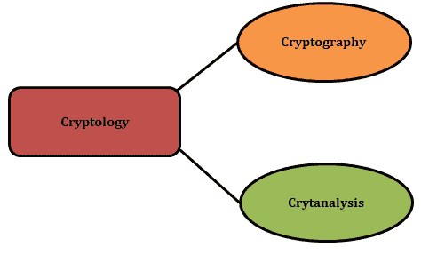 |

#### 密码学：历代守护秘密的卫士

古老的密码学实践可追溯至数千年前，一直是守护秘密和敏感信息免受窥视的沉默哨兵。从古代文明的基础密码到如今的复杂算法，密码学因对安全通信的不懈追求而不断演进 (Kumar, R and B. Ashreetha, 2023)。我们遍览史册，追溯密码学方法的演变及其在战争、外交和间谍活动中的关键作用。然而，正是在当代数字时代，密码学面临着最重大的挑战与机遇。随着对称与非对称加密的出现、公钥基础设施 (`PKI`) 的建立以及密码学哈希的普及，我们不得不探索保护我们数字世界的复杂机制。密码学的起始与书面语言的发展同步。随着人类社会的进步，形成部落、群体和王国，权力、战争、统治和政治等概念应运而生。这些思想推动了加密不断变化的格局，而加密反过来又助长了人们与选定接收者隐秘通信的自然倾向 (S. Tan, B. Knott and D. J. Wu, 2021)。古埃及人约 4000 年前使用圣书字进行加密通信，这是密码学应用的首个已知案例。该编码一直是受国王委托传递信息的书吏独有的知识。随后，在公元前 500 年至 600 年间，知识分子采用了基本的单表代换密密码。这种方法利用允许解码原始消息的秘密规则，替换消息内部的字母 (P. H. Kumar and T. Samanta, 2022)。一个著名的早期罗马密码系统是凯撒移位密码，它将消息的字符按特定数字（通常为三位）移动。接收者必须将字符按相同数量向后移动以恢复原始消息（图 2）。

| 图 2. 最古老的密码技术 |
| --- |
| 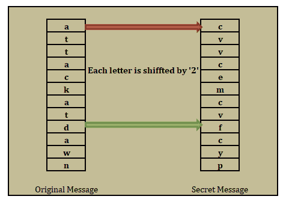 |

| 图 3. 隐写术（不可见水印） |
| --- |
| 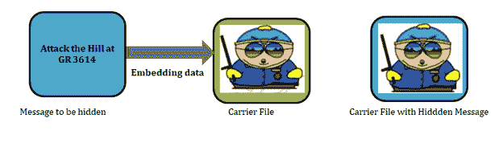 |


### 密码学与机器学习的融合

虽然加密和隐写术都旨在隐藏信息，但隐写术增加了额外的复杂度。使用这种方法，我们要确保预期接收者之外的任何人都不知道敏感信息被隐藏起来了（A. Singla, N. Sharma, 2022）。不可见水印是一个典型例子。根据设计，隐写术确保数据的观察者完全不知道其中包含秘密信息。另一方面，密码学通常允许攻击者推断出正在进行数据通信，尽管是以编码或混乱的形式，因为他们可能会以某种加密形式看到消息（图 3）。

### 机器学习：对数据智能的追求

与此同时，机器学习见证了人工智能的潜力。它赋予计算机一种非凡的能力，即通过辨别数据中的模式来学习、适应并做出明智的决策。我们对机器学习的探索之旅始于其核心原理的探究，揭示了算法通过接触经验数据而进化并提升性能的内在能力（G. Karatas, O. Demir and O. K. Sahingoz, 2019）。从神经网络的曙光到深度学习的复兴，再到强化学习的兴起，机器学习重新定义了医疗、金融、交通和娱乐等行业。我们聚焦于这些算法的非凡能力及其改变世界的力量。图 4 直观对比了经典密码学与现代密码学。

| 图 4. 传统密码学 vs. 当代密码学 |
| --- |
| 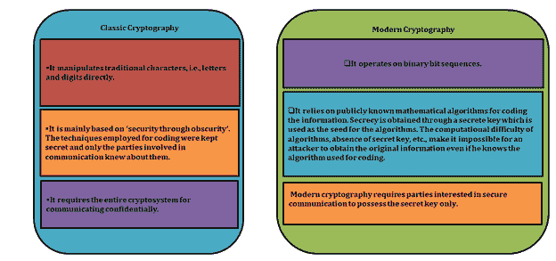 |

经典密码学代表保护信息的传统方法，通常涉及替换密码和基本加密等技术（A. Sharma, K. S and M. R. Arun, 2022）。相反，最先进的密码学包含复杂的密码算法和方法论，如数字签名、安全通信协议和公钥密码学。该图展示了密码学领域随时间推移的演变与进步。

| 图 5. 密码学基元 |
| --- |
| 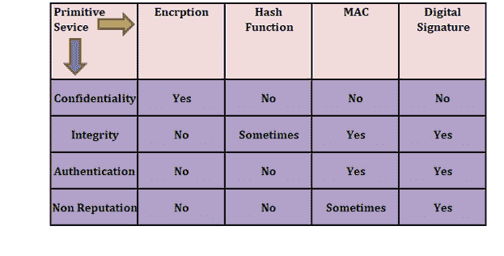 |

图 5 描绘了密码学基元，即该领域使用的一组工具和方法。通过有选择地利用这些基元，可以提供许多关键的安全服务。数字签名、消息认证码（MAC）、哈希函数和加密是密码学最重要的一些构建模块。要了解更多关于这些主题以及现代信息安全理论与实践中许多其他内容，请访问 H million at www.etoilegenieecom G. Govardhana Reddy & K. Raghavendra (2022)。在大多数安全环境中，这些组件是防止干扰、篡改或移除、保护数据和系统的重要前提。

### 密码学与机器学习的融合

然而，事态变得复杂的地方，在于密码学与机器学习的连接点。近年来，这种交叉融合创造了令人振奋的前景，同时也带来了巨大的障碍。但因为它们必然是敏感数据的来源，学习机器需要使用加密来保护此类信息免受窥视和黑客攻击（A. Musa & A Mahmood, 2021）。相反，机器学习凭借其发掘隐藏模式和漏洞的能力，有望增强密码学方法和密码分析。随着我们深入本章的核心，我们将揭示密码学与机器学习之间复杂的互动。它们的相互作用不仅有望重新定义网络安全，还将激发跨众多领域的创新。让我们一起踏上这场智力之旅，探索现代密码学的复杂性、机器学习的奇迹，以及这两个非凡学科迷人的融合。它们共同正在重塑我们数字未来的轮廓。

| 图 6. 密码系统模型 |
| --- |
| 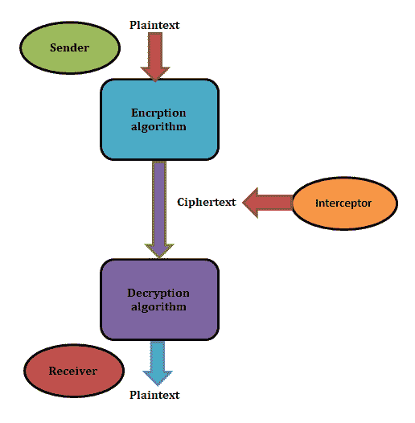 |

如图 6 所示，密码系统是一种利用密码学方法和相关基础设施来提供信息安全相关服务的系统。密码系统的主要目标（通常称为密码体制）是保证传输信息保持机密（N. Hussain, A. A. J. Pazhani, and A. K. N, 2023）。在此，发送者希望以安全的方式将敏感数据传递给接收者，而密码系统的架构确保任何试图窃听通信线路的人都无法获取数据。该模型展示了密码系统在传输过程中保障信息机密性的基本作用。

#### 1.1 理解密码学

在数字时代，密码学在保护敏感信息方面的重要性怎么强调都不为过。本节深入探讨密码学、其历史演变，以及它在现代网络安全中发挥的关键作用。我们还将深入研究各种密码算法的类型，并阐明它们如何运作以确保通信安全。

| 图 7. 基本密码系统的组件 |
| --- |
| 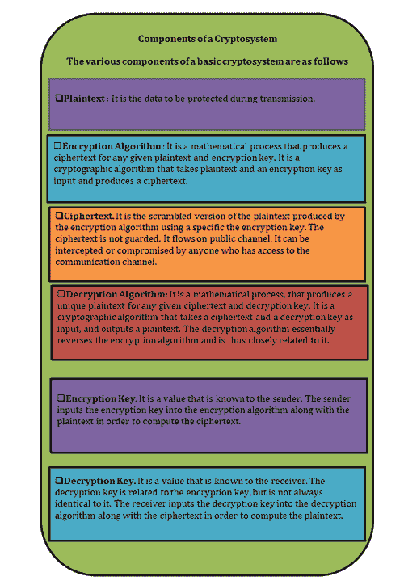 |

在图 7 中，展示了构成基本密码系统的必要元素。这些组件协同工作，以实现敏感信息的安全传输和保护。

#### 1.2 历史之旅

密码学是一项源远流长的实践，随着人类社会需求的变化，它多次改变面貌。我们的故事始于最早的时代，当时埃及和希腊等文明使用简单的加密方法来阻止人们干涉机密消息。密码学始终被隐秘地用于战争、外交和间谍活动（Shivashankar & S. Mehta 2016）。例如，尤利乌斯·凯撒曾使用著名的凯撒密码加密其私人信件。事实上，密码学真正的突破发生在第二次世界大战期间，当时出现了像恩尼格玛密码机这样的机械和机电密码设备。这些设备给盟军破译人员带来了前所未有的困难。

#### 1.3 现代密码学

在过去几十年里，密码学领域发生了剧变。现在的密码学世界既包括对称加密技术，也包括非对称加密技术，每种技术都旨在适应不同的环境。非对称加密使用一把私钥和一把公钥；而对称加密则对两个过程仅使用单一的共享密钥（L. R. Knudsen och J. E. Mathiassen 2000）。我们将详细探讨对称加密技术（如 `Advanced Encryption Standard (AES)`）如何使用共享密钥来保护数据。然而，非对称加密方案利用大素数的数学特性，允许在没有共同秘密的情况下进行安全通信。`RSA` 就是此类算法之一。

#### 1.4 公钥基础设施 (PKI)


##### 公钥基础设施 (PKI)

公钥基础设施 (PKI) 是现代密码学的一部分，是一个用于安全电子通信和数字身份验证的框架。PKI 利用数字证书，将公钥与个人或机构绑定。我们将深入探究 PKI 的内部运作，以及它如何作为在线商业的基石。

#### 图 8. 对称密钥加密

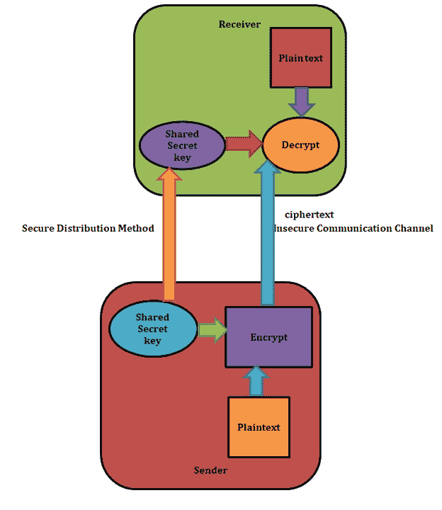

图 8 展示了对称密钥加密，这是一种加密和解密信息使用相同密钥的密码学过程。该研究领域属于对称密码学范畴，也称为秘密密钥密码学 (R. Beaulieu, D. Shors, J. Smith, 2018)。在对称密码系统中，发送方和接收方必须共享一个秘密密钥，系统才能运作。数字加密标准 (DES)、三重 DES (3DES)、IDEA 和 BLOWFISH 是几种著名的对称密钥加密算法，它们利用对称密钥密码学有效保护数据安全。

#### 图 9. 非对称密钥加密

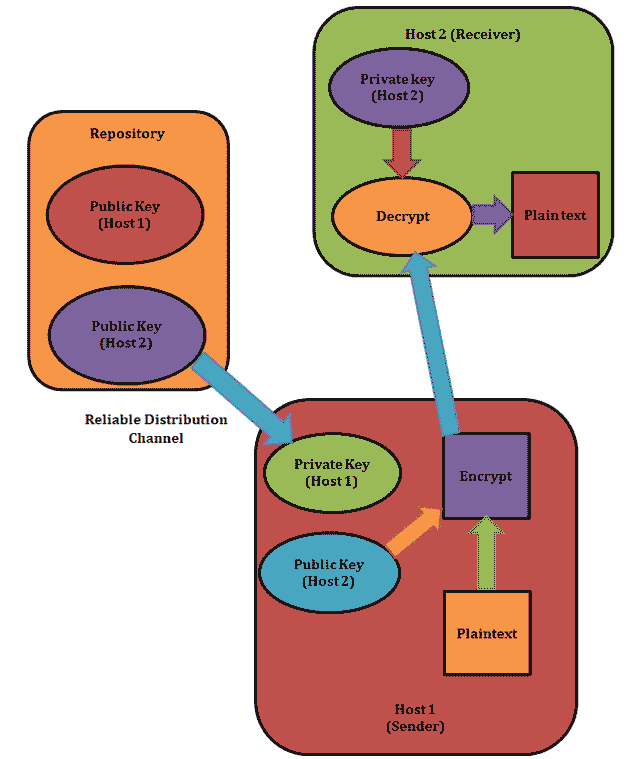

图 9 展示的非对称密钥加密密码学过程，使用不同的密钥进行加密和解密。在非对称密钥加密中，采用两个数学上相关但不同的密钥，这与对称密钥加密仅使用一个密钥形成对比 (P. Gope, O. Millwood and B. Sikdar, 2022)。为解决无预共享秘密密钥的安全通信问题，非对称密钥加密方法诞生于 1900 年代。尽管密钥不同，但它们的数学关系使得通过解密密文来恢复明文成为可能，为信息交换提供了增强的安全性和灵活性。

#### 1.5 密码学哈希函数

密码学哈希是现代密码学的另一个重要组成部分。我们将阐述密码学哈希函数的作用，该函数将可变长度的输入数据转换为固定长度的字符串。这些函数用于数据完整性校验、密码存储和数字签名。本节详细回顾了密码学算法，概述了其原理及现实生活中的现有应用 (Kumaraswamy & Gupta, Anand Kumar 2023)。读者将了解密码学如何从古老的实践发展为复杂的数学算法，成为现代网络安全的重要支柱。

### 2. 现代密码学的必要性

互联网使用激增，复杂性无处不在——在信息在世界数字高速公路上永不停歇流动的时代，确保通信安全从未如此重要。本部分探讨保护我们的数据和通信渠道的需求日益增长，并指出传统密码学已无法提供解决方案。从现代密码学开始，我们可以解决当今的安全问题。

#### 2.1 数字无所不在的时代

数字时代带来了前所未有的相互依存时代。从网上银行、电子商务和远程医疗；到社交网络——互联网已成为我们日常生活的一部分。但数字无所不在也催生了一类新威胁。网络攻击、数据泄露和身份盗窃如今已成常态，背后强大的势力时刻提醒我们，有效的安全系统已变得多么重要。

#### 2.2 传统密码学的局限

传统密码学方法虽在最初设计用于该媒介时，仍是解决当代数字通信复杂性的方案，但可能不再适用。对称加密使用共享秘密密钥 (K.D.V., Gite, Pratik, Sivakumar 2023)。这种方法要求通信双方安全交换密钥，这成为攻击者不断探测利用的另一个薄弱环节。

海量数据的传输和存储是传统密码学难以应对的两大障碍。数据的爆炸式增长和即将到来的量子威胁，意味着古典加密面临危机。服务我们数十年的可信经典密码学算法，最终将因量子计算的到来而失效。

#### 2.3 现代密码学：必然选择

现代密码学作为巩固我们数字防线的必要技术应运而生。其创新技术和强大加密算法克服了传统方法的功能缺陷。

现代密码学的一大优势在于使用非对称加密，加密和解密需要两个不同的密钥。这消除了安全密钥交换的需求，解决了对称加密的难题。ECC 和 RSA 是非对称加密实际应用的典型例子。此外，通过应用密码学哈希和数字签名，现代密码学可增强数据完整性和认证 (S. Zhu & Y. Han 2021)。这些方法对于证明数字文档的真实性、保障传输过程中的数据完整性至关重要。

#### 2.4 抗量子密码学

不仅如此，现代密码学更进一步，引入了抗量子算法。在后量子时代，我们的数据将是安全的，因为这些加密方法免疫于量子计算机的计算能力。这尤为重要，因为量子计算机（一旦完全实现）将有能力在几秒钟内破解传统密码体系。这是现代密码学的一个弱点（注：原文此处逻辑似指传统密码学弱点，译文忠实原文）。它为我们迎接量子时代做好准备。

总之，数字时代要求在安全和通信方面实现范式转换。虽然传统密码学方法历史悠久且备受推崇，但已不足以保护我们的数字生活。新一代密码学具有新型攻击手段和能抵御量子计算机冲击的定制算法，成为抵御快速演变危险的必备防线。在本章后续内容中，我们将深入探讨这些最先进的密码学技术，揭示它们在密码学与机器学习交汇点上的核心地位。

### 3. 机器学习课程

让我们步入机器学习的世界，在那里教会计算机如何学习和做出判断的方法发生了巨大变化。如今许多大学开设机器学习课程，任何人都能涌现出来，像挥舞剑盾一样驾驭数据。因此，我们将探讨监督学习、无监督学习和强化学习的要素。其次，要认识到机器数据即血液。

#### 3.1 揭开机器学习的面纱

人工智能关注以新方式思考问题和决策；其分支之一便是机器学习。换言之，通过从数据中挖掘模式——利用所发现的规律或根据需要进行调整——并基于先例（类似经验）进行预测和判断，机器学习让计算机能够自主学习。它将数据转化为可执行的信息，为许多领域开启了无限新世界。

#### 3.2 学习范式三巨头

机器学习包含三种主要学习范式，每种都有其独特的应用和特征：


#### 监督学习

监督学习是其中一种方法，它使用标记数据（已具有标签的数据（$ continue）该算法背后的原理是将输入映射为输出。它在图像分类、垃圾邮件检测和翻译方面很有用。

#### 无监督学习

对未标记数据中模式和结构的研究称为无监督学习。例如，聚类相似数据点和大型数据集中的降维就是符合这一范式的应用示例。

#### 强化学习

强化学习从行为心理学中汲取灵感，智能体通过与环境交互来学习以最大化奖励信号。它在机器人技术、游戏和自主系统等领域有应用，使机器能够通过试错来学习和适应。

#### 3.3 为机器学习提供动力的数据燃料

每项机器学习工作的核心都蕴含着一个基本真理：数据是该过程的生命线。数据的质量、数量和相关性直接影响机器学习模型的性能和准确性。机器学习算法依赖海量数据集来发掘模式、进行预测并优化决策（P. Pavankumar, N. K. Darwante, 2022）。数据的重要性怎么强调都不为过。它作为原材料，机器学习模型从此中提取知识。通过对数据的精心收集、清洗和预处理，我们赋能这些算法以提炼洞见、识别趋势，并最终驱动明智的决策。在缺乏充足且高质量数据的情况下，机器学习模型就会失效。错误的预测、有偏的结果和次优的性能将成为常态。因此，数据工程和数据治理是任何机器学习计划的必要组成部分，确保用于训练和测试的数据具有代表性、无偏见且可靠。

#### 3.4 释放机器学习课程的潜力

随着机器学习持续在各行业扩散，对熟练从业者的需求也随之增长。学术机构和在线平台提供的机器学习课程，为个人提供了驾驭这一变革性技术潜力所需的知识和工具。这些课程提供结构化的课程体系，涵盖机器学习的理论基础、流行机器学习库和框架的实践经验，以及应用新知识的真实项目。无论您是寻求磨练技能的数据科学家，还是渴望探索机器学习世界的新手，这些课程都提供了一条通往专业技能的途径（Suryawanshi and Abhay Chaturvedi, 2022）。简而言之，机器学习是一门不断发展的学科，能够揭示数据所要表达的内容。强大且经过精心策划的数据支撑着监督学习、无监督学习和强化学习这三大范式。这就是机器学习变革世界的力量。在本章中，我们将更仔细地审视机器智能与密码学之间涌现的应用与突破。

### 4. 密码学与机器学习的融合

密码学与机器学习有一个引人入胜的交汇点，在那里数据驱动的脑力与安全和隐私需求发生碰撞。那么，让我们更仔细地看看机器学习如何与密码学结合使用。我们将同等权衡其复杂性与优劣。更棒的是，现实生活中的例子表明，这种融合具有巨大的实用价值。

#### 4.1 融合的挑战与收益

将机器学习用于密码学有许多优缺点必须面对。然而，机器学习也可能导致密码代码被破解。破解谋杀案 甚至发送密钥控制；密码分析即解密密文。但这种融合并非没有问题。但机器学习模型的安全性与密码学应用尤其相关。因为隐藏在机器学习算法内部的漏洞，可能随时被恶意行为者利用。

此外，平衡机器学习的计算需求与密码学的计算需求并非易事。尽管如此，这种融合带来的希望是更好的安全协议和更有效的密码算法。

#### 4.2 现实世界案例

实践中，密码学与机器学习结合的案例为这种联系的效力提供了真实的思考素材。例如，在密码系统中使用机器学习进行入侵检测。这些机器学习模型分析网络流量模式以检测异常行为，保护密码协议免受攻击。另一个有趣的应用是将机器学习用于计算机密码。利用机器学习算法的力量，组织可以加强其密码策略并强化认证方法。它们还将能够检测出小偷是否已经孵化进了鸡蛋（表明您的公司陷入严重麻烦），或者通过分析其周围同类的菜肴种类，弄清您今天早餐是否刚吃了三个鸡蛋。

如今，信息是驱动公司几乎所有业务和人类生活几乎所有方面的能量。因此，保护重要数据免受犯罪分子的行为和攻击正成为绝对必要。应深入探讨各种与信息相关的威胁。根据攻击者采取的活动，主要有两种方式对这些攻击进行分类：包括被动攻击（图 10）和主动攻击（图 11）。

| 图 10. 被动攻击 |
| --- |
| 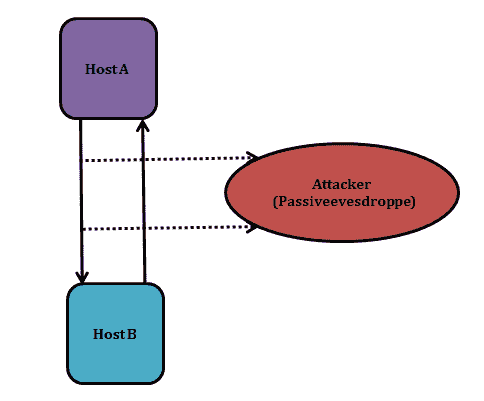 |
| --- |

直接修改数据代表了主动攻击的特征。另一方面，被动攻击意味着在不以任何方式更改信息的情况下获得未经授权的访问。例如，被动攻击包括窃听和监控通信线路。这些都是被动行为的例子。它们不更改数据，也不干扰传输。但被动攻击实际上更像是数据窃取。数据窃取与普通有形物品盗窃最显著的区别或许在于：当某人的个人信息被盗时，虽然该信息可能因伪造或其他手段而变得残缺，但其所有者仍然是其合法的合法持有者。这意味着信息攻击长时间不被察觉，比盗窃更隐蔽。相比之下，主动攻击涉及通过各种过程运行信息以以某种方式更改它。与被动攻击不同，主动修改或破坏信息是这些攻击的目的。被动攻击和主动攻击都对信息构成威胁。虽然前者往往表现为更直接、可见的后果；但采取强有力的安全措施防止两者损害数据完整性至关重要。

| 图 11. 主动攻击 |
| --- |
| 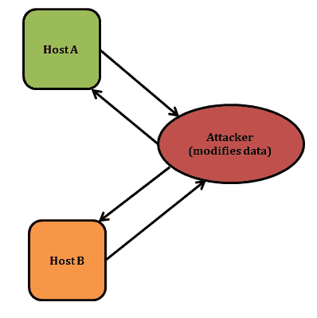 |
| --- |

#### 4.3 创新与进步的机遇


密码学与机器学习的结合为创新铺平了诸多道路。摒弃旧有模式，将密码学与机器学习相结合，为 KKLs 的进一步发展与构建提供了各种前景。后量子密码算法的开发是充满希望的一个领域。一个日益迫切的问题是：随着量子计算机技术的发展，机器学习能否帮助设计出能抵御量子计算机攻击的加密方法？

安全多方计算和同态加密这两种隐私保护方法为机器学习提供了巨大潜力。通过在机器学习中扩展这些技术，可以在不泄露敏感信息的前提下对加密数据进行计算。此外，将机器学习应用于密码密钥管理，可以产生更强且更经济的方法，用于密钥的安全生成、分发和保留。总之，密码学与机器学习的结合无疑具有巨大潜力，能够重塑我们的数字安全与隐私。尽管存在这些挑战，但其带来的收益和创新机会十分可观。随着本章的深入，我们将探讨具体应用以及机器学习如何帮助改进密码学学科，这将有助于构建一个更安全、数据驱动的未来。

### 5. 基于机器学习的密码分析

密码学与机器学习的结合蕴藏着巨大潜力。后量子密码算法的研究极具潜力。然而，鉴于量子计算机技术的快速发展，机器学习可被用于设计不易受未来量子计算机攻击的加密算法。

从这一视角来看，机器学习辅助的密码分析领域是人工智能与加密技术博弈的前沿阵地。但在密码分析中使用机器学习有哪些利弊？为了让您了解计算机算法在多大程度上影响了人与工作的关系，我们提供了几个案例示例。

#### 5.1 机器学习与密码分析

密码分析是破解密码代码和解读加密消息的艺术，是制码者与破码者之间延续了 40 多个世纪的“猫鼠游戏”。机器学习是这一领域的一位新晋强劲玩家。密码分析的核心在于模式识别和推理，而这正是机器学习算法的核心技能。

#### 5.2 机器学习在密码分析中的优势

**效率**：机器学习算法能极大地加快密码分析进程。与被迫艰难地搜遍整个解空间的传统程序不同，由工业级机器学习驱动的计算机能轻松发现潜在解。

**模式识别**：机器学习的一大特长是从大量数据中提炼细微差别。这种能力在密码分析中可用于发现加密装甲的裂缝、从漏洞中重构线索，甚至预测密钥组合。

**适应性**：对手会调整其加密技术和战术，因此机器学习模型也必须随之调整。这种适应性在不断变化的密码学领域至关重要。

#### 5.3 劣势与挑战

**数据依赖性**：因此，在密码分析中，机器学习技术是否奏效更多地取决于训练数据的状态。如果数据不足，机器学习模型可能表现不佳。

**计算资源**：深度学习是最消耗处理资源的机器学习类型之一。对于资源匮乏或无法使用 HPC（高性能计算）环境的密码分析师来说，这可能成为绊脚石。

**伦理考量**：在密码分析中使用机器学习也引发了关于隐私和安全的伦理问题。可能影响加密信息安全的技术必须极其谨慎地对待。

#### 5.4 现实世界的突破

基于机器学习的密码分析在加密领域已取得显著进展。以下是一些值得注意的例子：

##### 5.4.1 AES 密钥恢复

研究人员在 2017 年演示了基于机器学习的针对高级加密标准（AES）的攻击。他们训练神经网络搜索密文与相应明文中的相似模式；利用此法，他们以前所未有的速度和准确度恢复了 AES 加密密钥。这一突破暴露了 AES 面对机器学习攻击方法的弱点，并推动了更强安全模型的开发。

##### 移位密码

所述密码系统是最简单的替换密码方案之一。

###### 工作原理

凯撒密码常采用三位移位来生成密文，它只是简单地用另一个可能的字母替换明文中的每个字母。该加密密钥是发送方和接收方共同商定的一个从 0 到 25 的“秘密移位数”。

| Figure 12. 移位密码过程 |
| --- |
| 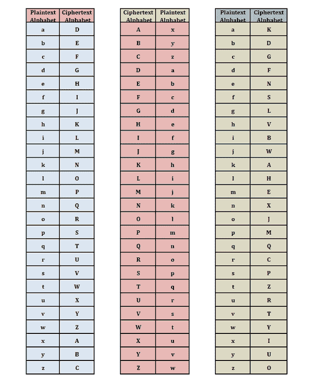 |
| --- |

Figure 12 展示了移位密码方法的分解：加密的第一步是发送方使用一把放在原始明文字符集下的滑动标尺，按秘密移位指定的位数向左移动。接着，使用下方的滑动标尺找到与明文字母对应的密文字母。例如，单词“tutorial”经过三位移位会变成“WXWRULDO”。下图描绘了 3 位移位移位密码的密文字母表。

现代密码系统与其字母前辈不同，它们将数字数据表示为二进制数字（比特）序列。为了加密和处理这些二进制串，采用了对称加密方案。根据处理二进制串的方式，这些方案可分为两大类：

| Figure 13. 现代对称密钥加密 |
| --- |
| 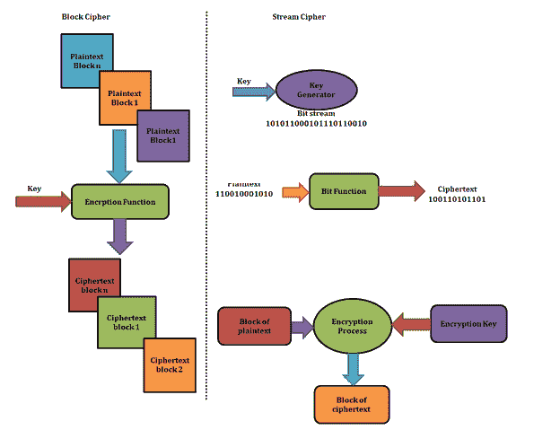 |
| --- |

**分组密码**：分组密码算法使用特定大小的比特块或分组来加密和解密明文二进制数据。通过对选定的明文比特块应用一系列密码操作，可将其转换为匹配的密文比特块。固定且可预测的分组大小不会改变。数据加密标准（DES）和高级加密标准（AES）是两种流行的加密算法，分组大小分别为 64 位和 128 位。

**流密码**：流密码是一种逐位处理明文的方法。该方法要求在明文上逐位执行密码操作以生成单个密文比特。从技术上讲，流密码仅是分组大小为一比特的一种分组密码，因此它们非常适合即时通信中数据流的加密。

Figure 13 概述了这两大类现代对称密钥加密，突出了它们在数据处理方法上的本质区别。

| Figure 14. Feistel 分组密码 |
| --- |
| 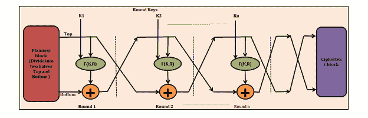 |
| --- |


##### Feistel 密码

Feistel 密码是一种基础的加密设计模型，是许多分组密码的蓝本，其中 DES（数据加密标准）就是一个著名的例子。基于 Feistel 密码的加密系统，其加密和解密过程由同一算法执行。如 图 14 所示，该框架内的加密方法由多轮组成，每轮包含一个“代换”阶段和一个置换步骤。在每轮开始时，输入分组被分成两半，`L` 代表左半部分，`R` 代表右半部分。右半部分（`R`）在各轮中保持不变，而左半部分（`L`）则根据 `R` 和用于加密的密钥发生变化。为实现这一变化，我们使用加密函数 `f`，它接受两个参数 `R` 和密钥（`K`），并返回 `f(R, K)`。然后，将 `L` 与该输出进行异或运算。下一步是置换，通过将改变后的 `L` 与原始的 `R` 交换来完成一“轮”。密码的确切设计决定了轮数。在所有轮完成后，将 `R` 和 `L` 子块连接在一起，形成密文分块，这是最后一步。在 DES 和其他实际实现中，不是在每轮中使用完整的解密密钥，而是从原始密钥生成依赖于轮的子密钥。虽然所有子密钥都与原始加密密钥相关，但这保证了每个周期都使用新密钥。设计 Feistel 密码的挑战在于选择合适的轮函数 `f`。该函数必须具备特定属性以确保密码的安全性，这一话题超出了本次讨论的范围。

| 图 15. 数据加密标准 |
| --- |
| 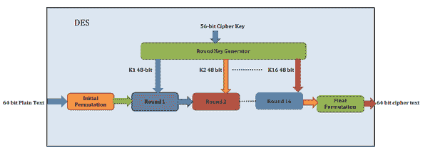 |

Feistel 密码的解密过程与加密过程非常相似，但有几个关键区别。Feistel 结构以密文分块而非明文分块开始。如前所述，后续过程与加密完全相同。重要的是，解密和加密非常相似；然而，在子密钥的使用上存在主要差异，解密时子密钥的使用顺序与加密时相反。最后但同样重要的是，Feistel 密码最后交换 `L` 和 `R` 的步骤是一个关键阶段，在加密和解密中是相同的。没有这一关键步骤，使用原始方法对生成的密文进行解密将会失败。Feistel 密码使用多少轮取决于系统需要多安全。随着轮数增加，加密和解密速度变慢，但安全性提高。因此，速度与安全之间的折衷决定了总轮数。Feistel 密码的一个著名应用是数据加密标准（DES），这是一种由国家技术标准局（NIST）开发的对称密钥分组密码。DES 的分组大小为 64 位，采用 16 轮 Feistel 结构。虽然密钥有 64 位，但 DES 只使用 56 位，因为其中 8 位是校验位，不参与加密过程。图 15 提供了 DES 结构的总体概览。

##### 5.4.2 椭圆曲线密码学（ECC）漏洞

机器学习也被用于发现椭圆曲线密码学中的缺陷，后者是一种普遍采用的加密方法。通过分析椭圆曲线上的加密操作，机器学习模型可以评估曲线参数的强度，并为更安全的实现提供指导。

##### 5.4.3 密码破解

因此，基于机器学习的破解工具，针对通过哈希算法加密的密码，正变得越来越强大。这些工具利用机器学习生成密码猜测，使得破解哈希密码的速度大幅提升。

##### 5.5 变革性影响

将机器学习应用于密码分析不仅是一次演进式的转变，更是一次革命性的转变。它质疑了传统的密码安全概念，迫使人们设计更稳健的加密方法。在本章中，我们将深入探讨，并考察密码学与机器学习之间不断变化的关系。双方正在进行一场激烈的、类似国际象棋的博弈，争夺高风险智力较量中的优势，这决定了数字安全的归属；另一方面，也凸显了它们如何相互补充优势，共同强化防线？

### 6. 面向密码安全的机器学习

在本节中，我们将探讨机器学习如何变革密码安全。我们重点关注其在攻击检测和预防中的关键作用，从而增强密码协议的安全性。我们引用多个说明性示例，展示机器学习如何增强密码安全。随着世界日益全球化和数据化，机器学习意味着敏感信息将比以往任何时候都更安全。

#### 6.1 机器学习与密码安全的协同效应

密码安全是保护敏感数据免受窥探和恶意侵害的屏障。然而，随着数字世界的发展，网络犯罪分子的手段也在进步。机器学习以动态、敏捷的防御盾牌补充了传统的密码技术。

#### 6.2 攻击检测与预防

##### 6.2.1 异常检测

机器学习算法可以识别异常的数据模式。这种能力在密码安全领域尤为宝贵。例如，通过使用机器学习算法，异常的访问模式或未经授权的解密尝试失败都可被标记以供进一步检查。

##### 6.2.2 入侵检测

基于机器学习的入侵检测系统利用网络监控和系统日志来查找可疑活动。基于历史数据按规则运行的系统也能有效识别入侵者并遏制漏洞利用。

##### 6.2.3 零日漏洞检测

这是因为更严重的安全风险源于零日漏洞，软件开发者对此不知情。通过监控系统行为，机器学习可以预测即将发生的零日攻击。这给组织留出了足够的时间在漏洞被利用前进行修复。

#### 6.3 强化密码安全：示例

##### 6.3.1 高级恶意软件检测

机器学习彻底改变了恶意软件检测的格局。通过检查文件属性、行为模式和网络通信，我们可以使用机器学习模型准确识别恶意软件。它不仅能抵御妥协，还能增强密码密钥和数据的安全性。

##### 6.3.2 基于异常的密码密钥管理

机器学习基础的密码密钥管理系统会持续跟踪密钥的使用情况。一旦检测到任何偏离常态的情况，就会发出警报。通过这种方式，组织可以尽早发现对其加密密钥的威胁。这为复杂、多变环境中的密码操作提供了安全保障。

##### 6.3.3 安全多方计算（SMPC）

多方可信技术的一种应用是让各方在不干涉彼此输入隐私的前提下，共同计算一个函数。机器学习技术可以提高 SMPC 协议的安全性和成本效益。对于需要协作使用数据但不共享数据的应用场景，这是一个强有力的工具。


### 艺术流程

机器学习与加密安全的结合是一场进化之旅。既然对抗性战术已发展起来，防御机制也必须随之改变。数据驱动的智慧与灵活性使机器学习成为对抗新威胁的重要武器。因此，机器学习是一股变革力量，有助于增强加密安全。它能检测异常、抵御攻击，并通过**Combat Cloud**（一种新型云服务）的主动防御，针对不断变化的威胁强化加密协议。这就是机器学习与加密安全之间的**相互依存关系**，我们将在本章中探讨这一关系。在当今的网络化社会中，我们该如何维护秘密？让我们一探究竟。

### 7. 伦理与隐私问题

此外，研究机器学习与密码学的结合方法确实会产生各种基本的伦理困境以及隐私担忧。这两个领域的融合有望极大地推进安全发展。然而，这必须以最负责任和最合乎道德的方式进行。本节将探讨此类融合所引发的伦理与保密问题。尽管我们有理由维护安全，以便在私人生活的每一天都能安然无恙，但必须对公开个人信息加以限制；取消这些限制将威胁人们的敏感情感以及人类尊严。

#### 隐私侵犯

机器学习强大的大数据处理能力削弱了个人——以及公众的——隐私。保护个人和敏感信息需要将先进的加密技术与尽可能彻底的匿名化相结合。

#### 监控与监测

尽管基于机器学习的监控和入侵检测系统能有效降低风险，但它们也可能导致大规模监控。在防御威胁与尊重基本公民自由之间严守界限，势在必行。

#### 负责任的数据使用

将训练数据（敏感、私密）用于机器学习模型，要求采取防止滥用或侵犯隐私的措施变得绝对关键。必须采用匿名化和征得同意收集等合乎道德的数据处理方法。

##### 7.1 隐私挑战

在围绕密码学中机器学习的伦理讨论中，隐私挑战显得尤为突出：

*   **数据收集**：训练机器学习模型的一个副作用是，大多数公司积累了存储大量私人或敏感个人信息的庞大数据库。防止入侵和未经授权的访问至关重要。
*   **数据保留**：旧的训练和测试数据构成隐私风险。组织应制定信息保留政策，以平衡系统需求与个人数据隐私。
*   **算法偏见**：机器学习算法容易产生偏见，这可能渗透到密码学应用中。决策的公平性和公正性是基本的伦理义务。

解决这些伦理和隐私问题，要求在密码学中负责任且合乎道德地使用机器学习：

*   **透明算法**：公平性、隐私和安全。研究适合审计的透明算法是一项重要工作。开源开发和同行评审是透明度的关键。
*   **数据最小化**：数据收集应遵循数据最小化原则。应仅收集最基本的必要数据，并在可能的情况下进行匿名化或假名化处理。
*   **设计即安全**：在设计上，机器学习模型和密码系统应隐性地考虑安全性和隐私。系统设计从第一天起就应集成联邦学习和差分隐私等隐私保护技术。
*   **多学科协作**：密码学家、伦理学家、决策者和技术专家必须通力合作。他们可以识别密码学中机器学习引发的伦理问题，并共同制定一套适当使用的指南。

总的来说，机器学习在密码学中的应用表明，安全与保密需要适当的平衡。维护安全仍是重中之重。然而，这不能以牺牲个人权利和基本伦理为代价。

### 8. 未来方向与挑战

#### 展望

在最后这部分，我们将展望现代密码学和机器学习中值得注意的未来发展，然后结束本文。当今的数字环境变化比以往任何时候都快。我们不得不像外面不断变化的世界一样，迅速做出改变。此外，在谈论可能的障碍和仍在梦想中的乌托邦前景时，我们衷心希望能鼓励读者在这些领域踏上终身学习之路。

##### 8.1 预期挑战

*   **量子计算威胁**：这类系统面临强大量子计算机到来的极其严重威胁。向抗量子加密过渡将成为一项紧迫任务。
*   **隐私保护**：在数据驱动技术时代，效用与隐私之间的冲突将成为反复出现的主题。实现恰当的平衡需要精细的权衡；需要开发新的密码技术，使在不牺牲个人隐私的前提下分析信息成为可能。
*   **伦理与监管框架**：就机器学习和密码学的伦理与行政领域而言，审查将持续进行。一个全面的框架仍遥不可及。
*   **可扩展性与性能**：这构成了一项技术挑战，特别是在区块链定义的去中心化账本技术方面。

##### 8.2 充满希望的前景

*   **同态加密**：在无需解密的情况下对实际加密数据集执行计算，这是一个非常令人振奋的想法。其有望进一步发展和应用。
*   **后量子密码学**：认识到其重要性，我们将在后量子时代保障数据安全。
*   **面向安全的可解释 AI**：在安全方面，未来的可解释 AI 将帮助我们更好地理解各种机器学习模型的决策。
*   **隐私保护机器学习**：联邦学习和差分隐私等新型隐私保护机器学习技术的发展，将确保组织仍能从敏感数据中获取情报，同时尊重个人信息的界限。

#### 无限可能与严峻挑战

现代密码学的武器与机器学习密不可分。如果我们想生活在这个不断变化的世界里，那么所有人都必须毕生学习，持续研究与开发。让我们继续保持关注，组建跨学科团队，并参与关于伦理问题和数据隐私的讨论——我们可以影响大数据等至关重要领域的未来。随着本章结束，鼓励读者自行探索现代密码学和机器学习这些领域。门槛虽高，但潜在回报巨大——在坚实伦理基础上构建安全可靠的数字环境，推动技术创新与进步。

### 9. 结论


## 第 2 章：先进人工智能与密码学研究的协同效应

### 摘要

更具体地说，本章详细介绍了现代密码学和机器学习。这些技术源于我们这个快速变化的信息时代的最前沿。它们的出发点是对互联互通和数据交换时代保障通信安全这一迫切需求的提醒。在本章中，我们审视了这两大领域的基本原理和应用，发现了一个真正显著的重叠领域。现代密码学的历史发展始于对古代手段的考察，一直延伸到当今的加密算法和密码。本章阐述了安全通信的微妙之处。内容涵盖了对称加密和非对称加密、公钥基础设施以及密码学哈希。与此同时，机器学习研究揭示了一些基本概念——监督学习和无监督学习以及强化学习；这一切都依赖于数据。确实，探索的核心在于现代密码学与机器学习的交汇处。只有这样，人们才能尝试发现神经网络等新工具的引入将如何使旧的攻击技术彻底消失。现实世界的例子涵盖了从口令恢复到漏洞检测和密码破解，揭示了这些变革性领域之间有趣的联系。在攻击检测、入侵防御和协议增强等方面，机器学习应用的大量证据表明，它对加强密码安全大有裨益。本章强调了由此产生的伦理和隐私问题，警示负责任地使用，同时指出了在安全与个人自由之间需要妥协。本章还展望了未来，审视了问题与希望。从量子计算、隐私保护和伦理框架到扩展需求等领域的威胁。然而，同态加密、后量子密码学、可解释人工智能和隐私保护机器学习的潜力证明了这一探索的合理性。最后，鼓励读者积极参与到现代密码学和机器学习的这一持续研究中来。障碍巨大，但发明的空间是无限的。同样，作为当今广为人知的我们地球村守护者——密码学和机器学习——在我们数字社会的演变中发挥着不可或缺的作用。

### 参考文献

1.  Gope, P., Millwood, O., & Sikdar, B. (2022). A Scalable Protocol Level Approach to Prevent Machine Learning Attacks on Physically Unclonable Function Based Authentication Mechanisms for Internet of Medical Things. *IEEE Transactions on Industrial Informatics*, 18(3), 1971–1980. doi:[10.1109/TII.2021.3096048](https://doi.org/10.1109/TII.2021.3096048)

2.  Govardhana Reddy, H. G., & Raghavendra, K. (2022). Vector space modelling-based intelligent binary image encryption for secure communication. *Journal of Discrete Mathematical Sciences and Cryptography*, 25(4), 1157–1171. doi:[10.1080/09720529.2022.2075090](https://doi.org/10.1080/09720529.2022.2075090)

3.  Gowda, V. D., Prasad, K. D. V., Gite, P., Premkumar, S., Hussain, N., & Chinamuttevi, V. S.K.D.V. (2023). A novel RF-SMOTE model to enhance the definite apprehensions for IoT security attacks. *Journal of Discrete Mathematical Sciences and Cryptography*, 26(3), 861–873. doi:[10.47974/JDMSC-1766](https://doi.org/10.47974/JDMSC-1766)

4.  Hussain, A. A. J., Pazhani, & A. K., N. (2023). A Novel Method of Enhancing Security Solutions and Energy Efficiency of IoT Protocols. *IJRITCC*, 11(4), 325–335.

5.  Karatas, G., Demir, O., & Sahingoz, O. K. (2019). A Deep Learning Based Intrusion Detection System on GPUs. *2019 11th International Conference on Electronics, Computers and Artificial Intelligence (ECAI)*, 1-6. doi:[10.1109/ECAI46879.2019.9042132](https://doi.org/10.1109/ECAI46879.2019.9042132)

6.  Knudsen, L. R. & Mathiassen, J. E. (2000). A chosen-plaintext linear attack on DES. *Proceedings of the International Workshop on Fast Software Encryption (FSE)*, 262–272.

7.  Kumar, P. H., & Samanta, T. (2022). Deep Learning Based Optimal Traffic Classification Model for Modern Wireless Networks. *2022 IEEE 19th India Council International Conference (INDICON)*, 1-6. doi:[10.1109/INDICON56171.2022.10039822](https://doi.org/10.1109/INDICON56171.2022.10039822)

8.  Kumar, R., & Ashreetha, B. (2023). Performance Analysis of Energy Efficiency and Security Solutions of Internet of Things Protocols. *IJEER*, 11(2), 442–450. doi:[10.37391/ijeer.110226](https://doi.org/10.37391/ijeer.110226)

9.  Kumar & Chaturvedi. (2023). Securing networked image transmission using public-key cryptography and identity authentication. *Journal of Discrete Mathematical Sciences and Cryptography*, 26(3), 779-791. doi:[10.47974/JDMSC-1754](https://doi.org/10.47974/JDMSC-1754)

10. Musa, A. & Mahmood, A. (2021). Client-side Cryptography Based Security for Cloud Computing System. *2021 International Conference on Artificial Intelligence and Smart Systems (ICAIS)*, 594-600. doi:[10.1109/ICAIS50930.2021.9395890](https://doi.org/10.1109/ICAIS50930.2021.9395890)

11. Pavankumar, P. & Darwante, N. K. (2022). Performance Monitoring and Dynamic Scaling Algorithm for Queue Based Internet of Things. *2022 International Conference on Innovative Computing, Intelligent Communication and Smart Electrical Systems (ICSES)*, 1-7. doi:[10.1109/ICSES55317.2022.9914108](https://doi.org/10.1109/ICSES55317.2022.9914108)

12. Reza, M. N., & Islam, M. (2021). Evaluation of Machine Learning Algorithms using Feature Selection Methods for Network Intrusion Detection Systems. *2021 5th International Conference on Electrical Information and Communication Technology (EICT)*, 1-6. doi:[10.1109/EICT54103.2021.9733679](https://doi.org/10.1109/EICT54103.2021.9733679)

13. Sharma & Arun. (2022). Priority Queueing Model-Based IoT Middleware for Load Balancing. *2022 6th International Conference on Intelligent Computing and Control Systems (ICICCS)*, 425-430. doi:[10.1109/ICICCS53718.2022.9788218](https://doi.org/10.1109/ICICCS53718.2022.9788218)

14. Sharma, A. (2023). A novel approach of unsupervised feature selection using iterative shrinking and expansion algorithm. *Journal of Interdisciplinary Mathematics*, 26(3), 519–530. doi:[10.47974/JIM-1678](https://doi.org/10.47974/JIM-1678)

15. Shivashankar & Mehta. (2016). MANET topology for disaster management using wireless sensor network. *International Conference on Communication and Signal Processing, ICCSP 2016*, 736–740. doi:[10.1109/ICCSP.2016.7754242](https://doi.org/10.1109/ICCSP.2016.7754242)

16. Singla, A., & Sharma, N. (2022). IoT Group Key Management using Incremental Gaussian Mixture Model. *2022 3rd International Conference on Electronics and Sustainable Communication Systems (ICESC)*, 469-474. doi:[10.1109/ICESC54411.2022.9885644](https://doi.org/10.1109/ICESC54411.2022.9885644)

17. Suryawanshi, V. A., & Chaturvedi, A. (2022). Novel Predictive Control and Monitoring System based on IoT for Evaluating Industrial Safety Measures. *IJEER*, 10(4), 1050–1057. doi:[10.37391/ijeer.100448](https://doi.org/10.37391/ijeer.100448)

18. Tan, S., Knott, B. & Wu, D. J. (2021). CryptGPU: Fast Privacy-Preserving Machine Learning on the GPU. *2021 IEEE Symposium on Security and Privacy (SP)*, 1021-1038. doi:[10.1109/SP40001.2021.00098](https://doi.org/10.1109/SP40001.2021.00098)

19. Zhu, S., & Han, Y. (2021, August). Generative trapdoors for public key cryptography based on automatic entropy optimization. *China Communications*, 18(8), 35–46. doi:[10.23919/JCC.2021.08.003](https://doi.org/10.23919/JCC.2021.08.003)

### 作者

*   **Dankan Gowda V.**  
      
    BMS Institute of Technology and Management, India

*   **Joohi Garg**


### 摘要

人工智能（AI）和密码学最近各自都取得了快速进展，形成了一种令人惊讶的相互关系。随着 AI 的发展，它正演变到这样一个阶段：AI 能够研究甚至设计密码系统。然而，密码学研究人员不断推出新方法，以保护 AI 基础设施免受不断变化的攻击的侵害。因此，在该领域，作者们审视未来的地形，并考虑这两个突破性研究领域可能交汇的各种可能方式。同时，量子计算和神经形态技术可能将先进 AI 推向比以往任何计算机所能达到的更远的地方。一方面，密码学方法还有助于在面临攻击时，保持 AI 模型的开放、安全，并符合法律隐私法规。简而言之，前沿 AI 和密码学研究正共同重塑人工智能领域内互联网安全的前沿。未来将如何？本章阐述了这一激动人心的交叉领域的问题与前景。

#### 1. 引言

在快速发展的技术领域中，AI 和密码学是此类跨学科合作的一个绝佳案例。AI 与密码学结合的影响 除了本身就是引人入胜的阅读材料外，此处描述的发展将产生许多有趣的结果。

| 图 1. 人工神经网络的基本构建块是感知机 |
| --- |
| 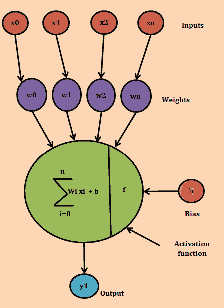 |

二十一世纪见证了 AI 和密码学前所未有的进步，它们的融合代表了技术史上的一个关键时刻。由于 AI 具备模式识别、智能决策和分析海量数据的能力，密码学非常适合人工智能。另一方面，密码学长期以来一直是数据隐私和安全的守护者，确保敏感信息免受窥探。人工智能（AI）是计算机科学中的一个专门领域，专注于创建理性智能体。这些智能体被设计用于感知其环境，在内部处理这些信息，然后从各种可能性中选择最合适的行动。改进智能体的目标函数是这一决策过程的目标（N. Hussain, A. A. J. . Pazhani, and A. K. . N, 2023）。一旦智能体决定做什么，它就会修改其内部的环境模型并开始工作。归属于人工智能范畴的众多智能体种类中，包括学习智能体、逻辑智能体、规划智能体、对抗搜索智能体和搜索智能体。学习智能体因其数据驱动的决策能力和对机器学习方法的使用而脱颖而出。这些活动是通过一组数据对来推断的。

| 图 2. 多层感知机 |
| --- |
| 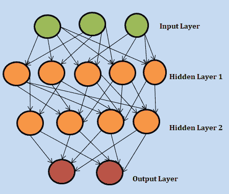 |

人工智能（AI）的核心在于人工神经网络（ANNs）。ANNs 由其结构定义，包括每层中的细胞或感知神经元数量、神经元使用的特定激活过程、用于训练的代价函数，以及密集互联的隐藏层的数量和设置（图 1）。互连的权重在 ANN 训练期间使用梯度下降和反向传播进行调整，这些方法基于权重空间内代价函数的斜率（如图 2 所示）。人工神经网络（ANNs）最重要的三个关注领域是输入分类、序列学习和函数逼近。作为一个重要的 AI 工具，ANNs 得益于`Sigmoid`、`Tanh`和`RELU`等非线性激活函数的使用，能够轻松表示复杂的非线性函数。

#### 1.1 AI 与密码学的融合

AI 在密码学中的作用广泛而深远。这种融合最显著的方面是 AI 驱动加密的出现。传统加密基于算法和数学结构，虽有效但绝不适应当今的计算环境。AI 处理了这一方面，因为它可以学习调整加密技术，专门用于保护数据（Shivashankar, and S. Mehta, 2016）。但 AI 与密码学的融合确实是一个迷人的现象。两者正变得日益交织，相互促进。AI 在密码学中的应用彻底改变了我们对数据安全和信息保护的思考方式。事实上，AI 是推动密码学创新突破极限的引擎。

例如，AI 筛选数据流量模式以即时增强加密。这样，重要信息即使在传输途中也能得到良好保护。它还可以改进密钥生成程序，降低加密的工作量和耗时。这些基于 AI 的加密算法在不断学习和进化，始终比潜在攻击者领先一步。AI 与密码学重叠的另一个主要领域是称为密码分析的针对性用途。破译密码是秘密解码，而发现加密方法中的缺陷是密码分析。事实上，正是在这里，AI 的分析能力大放异彩。（L. R. Knudsen and J E Mathiassen 2000）得益于其处理海量数据和识别复杂模式的能力，AI 可以发现人类分析师忽视的缺陷。在识别数据流中的异常和不规则性方面无可匹敌的机器学习算法，因此成为密码分析师的宝贵武器。通过使用 AI 驱动密码分析，我们可以预测和预防威胁。它们对安全的主动方法可能永远改变我们保护敏感信息的方式。

#### 1.2 协同效应的意义

AI 与密码学之间的协同效应不仅仅是简单的合作，更象征着对数据安全和人工智能思维方式的差异。它将改变我们对数字景观的理解。首先，这种协同效应可以在一个日益相互依存的世界中带来更高的安全性。随着技术进步，通过网络传输的敏感数据量持续呈指数级增长（R. Beaulieu, D. Shors, J. Smith 2018）。从个人信息到金融交易和关键基础设施数据，充分的加密和安全现在都至关重要。这些以解决方案为导向、融合了 AI 的密码学方法提供了对抗新威胁的灵活性。


AI 与密码学的结合将开启创造力的新时代。我们由此可以设想出先进的加密方法，它们不仅极其安全，而且高效灵活。AI 学习和优化加密例程的能力，为开发加密协议提供了更广泛的解决方案，范围涵盖从保护物联网设备到保护医疗数据隐私（M. N. Reza and M. Islam, 2017）。

然而，除了安全性和创新性之外，AI 与密码学的协同效应对人工智能本身也有深远影响。深度学习和神经网络是不断扩展的应用范围背后的驱动力，包括从自然语言处理到自动驾驶汽车的一切。但这些模型处理敏感用户数据，引发了隐私和数据保护问题。密码学凭借其在数据加密和隐私保护技术方面的经验，为这一问题提供了解决方案。AI 与密码学的合作催生了隐私保护 AI 模型。这些模型允许 AI 系统在保持用户数据机密性和安全性的同时做出智能决策。它还增强了用户信心，并符合更严格的数据隐私制度（Kumar, Pullela SVVSR & Chaturvedi Abhay 2023）。

简而言之，AI 与密码学的重叠不仅是方法的汇聚，更是愿景的回归。它为一个更安全、创新和私密的数字世界铺平了道路。在本节中，我们将探讨 AI 与密码学之间极其迷人的互动——那用香蕉做的面包里有什么？同时，这也为后续章节聚焦这两个世界的互动及其重塑技术甚至数据安全的潜力奠定了基础。

### 2. AI 在密码学中不断演变的角色

在这一技术十字路口，我们致力于梳理 AI 在密码学中快速演变的能力——创新与安全的新时代。在本章中，我们将带您踏上一段有趣的旅程，探索 AI 在密码学中的发展历史。

#### 2.1 AI 驱动的加密

**强强联合** AI 与密码学的结合是信息保护的新前沿。这种融合的核心是 AI 驱动的加密，这是一项突破性的发展，可能会改变数据安全的范式。

虽然有效，但传统加密方法通常遵循相对固定的协议和算法，使其成为不断演变的威胁的易攻击目标。人工智能加密引入了一种新的动态且非固定的方法来保护数据。其工作原理如下：AI 算法具有从数据模式中学习的能力。通过分析大量数据集以检测趋势和异常，进而调整加密技术（Kumar R & B Ashreetha 2023）。在当今快速变化的数字环境中，新的网络威胁几乎每天都在出现，这种适应性尤为重要。

以某公司数据流量昼夜波动为例。AI 加密可实时调整加密级别。高峰时段使用更强的加密；低负载时段选择较轻量级的方案。这不仅增强了安全性，还优化了计算资源，提高了整体效率。

AI 产生影响的另一个领域是密钥生成。加密密钥生成是加密的重要环节，该过程的复杂性通常反映了加密的强度。通过分析历史数据和用户行为，AI 可以使密钥生成更安全、更友好。这降低了弱密钥的风险，总体上使加密数据更安全。此外，AI 还能识别加密算法中潜在的漏洞。AI 持续监控数据流量和系统行为，寻找异常模式或入侵迹象。一旦检测到异常，加密系统可自动调整参数或发送警报，以降低潜在风险（S. Tan et al., 2021）。AI 驱动的加密不仅关乎更强的加密，更关乎更智能、更高效的加密。它使组织能够随威胁形势演变而变化。在一个日益互联的世界中，保护敏感数据。

| Figure 3. Illustration of the block and the subkey, both represented in bytes |
| --- |
| 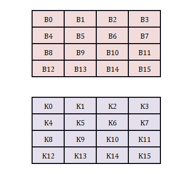 |
| --- |

`Rijndael` 算法或高级加密标准（`AES`）由 `Daemen` 和 `Rijmen` 于 1999 年创建，是一种对称分组密码。基于此类加密技术，它于 2001 年取代了数据加密标准（`DES`），当时美国国家标准与技术研究院（`NIST`）正式批准了它。`AES` 具有固定的 128 位分组大小，支持 128、192 或 256 位的密钥大小。其灵活性是另一大优势（P. H. Kumar and T. Samanta, 2022）。`AES` 加密使用的轮数取决于密钥大小；128 位密钥使用 10 轮，192 位密钥使用 12 轮，256 位密钥使用 14 轮。`AES` 开始解密和加密阶段，详见 Figure 3。此处的两个主要因素是密钥 `K` 和 128 位分组 `B`（所谓的状态）。密钥长度可以是 128、192 甚至 256 位。`AES` 的一个特殊特性是在加密和解密过程中使用状态数组。在这些过程中，分组（包含分量 0 到 15）被排列成四行四列的矩阵。字节对应方格，或者说术语如逐字节。这些被称为状态数组，对 `AES` 算法的运行至关重要。

#### 2.2 密码分析与 AI

密码分析，即破解加密代码的艺术，长期以来一直是攻击者与防御者之间的猫鼠游戏。但随着人工智能（`AI`）的引入，这场游戏正演变成全新的局面。从本质上讲，密码分析是对加密数据进行分析以确定隐藏消息或密钥（P. Gope, O. Millwood and B. Sikdar, 2022）。它需要对加密算法有详细的了解，并敏锐地洞察弱点。历史上，密码分析师使用人脑和计算机器来破解密码。现在 `AI` 正在改变游戏规则。

`AI` 在密码分析中引发潜在革命的一个原因是其卓越的分析、速度和适应能力。以下是 `AI` 如何重塑密码分析格局：

**快速分析：** 这些 `AI` 算法能瞬间处理海量数据。它们特别擅长在加密消息或数据流中检测模式和异常。凭借这种能力，`AI` 可以迅速发现加密系统中的任何弱点或漏洞。

**模式识别：** 传统上，密码分析师依靠人类直觉和经验来检测加密数据中的模式。然而，`AI` 可以实现这一过程的自动化（A.Singla, N. Sharma 2022）。通过机器学习算法，可以发现人类分析师常忽略的最细微模式。这提供了对加密数据更完整的图景。

**攻击自动化：** `AI` 可以自动发起加密攻击。例如，它可以通过系统尝试所有可能的密钥来执行暴力破解攻击；或使用更精细的技术，如差分密码分析。借助 `AI` 实现这些过程的自动化，极大地加快了密码分析速度。

**适应新算法：** 然而，随着加密算法的开发变得更加安全，密码分析师必须破解越来越复杂的代码。但人类的局限性对 `AI` 不是问题。它可以快速适应新的加密技术，并设计出新的攻击方法。


### 主动威胁检测

AI 的实时监控能力使得威胁能够被预先检测到。它可以持续分析网络流量和加密通信，以检测可疑活动或可能的入侵。这种早期预警系统提升了网络安全，并使组织能够快速响应威胁。

| 图 4. 简单神经网络与深度神经网络 |
| --- |
| 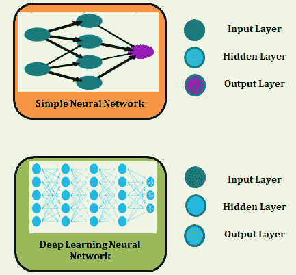 |

一种更现代的人工智能方法基于一个称为**深度学习**的概念。在**深度学习**中，使用具有高数据吞吐量的**人工神经网络 (ANN)** 来处理原始数据，从根本上取代了传统的信号处理方法 (G. Karatas, O. Demir and O. K. Sahingoz, 2019)。单隐藏层的传统 **ANN**（有时称为“浅层” **ANN**）与具有三个隐藏层的深度网络之间的对比见 图 4。处理能力和效率的显著提升是深度学习得到广泛应用的主要动力。此类网络的一个例子是 **Google 的 Inception-V3 模型** 所使用的网络；它拥有 49 层和超过 2000 万个连接。但是，为了计算这些深度网络所需的大量权重，大量的训练数据对于深度学习的成功至关重要。幸运的是，由于处理能力的提升与**万物互联**呈指数级扩展的结合，所需的训练数据现在更容易在线获取。既然我们生活在**大数据社会时代**，大型数据集和处理它们的算力都触手可及，深度 **ANN** 才成为现实 (A. Sharma, K. S and M. R. Arun, 2022)。**Google** 和 **Facebook** 等行业巨头，连同国家安全机构，是推动算力增长的主要驱动力，使得深度学习得以发展。近期将超级计算机整合到单个**图形处理单元 (GPU)** 中的趋势，使得深度学习和高分辨率游戏能在小得多的体积中实现，人脸识别、追踪和跟踪等应用已成为关键议题。

| 图 5. 用于流密码生成的混沌映射示意图 |
| --- |
| 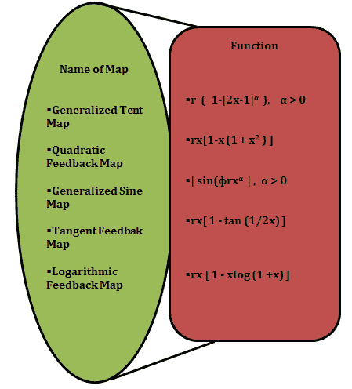 |

此类密码的其他示例可在 图 5 提供的函数或映射中找到。这些函数定义了函数  的结构。为了构建流密码，这些特定函数从区间 `(0, 1)` 中取一个初始密钥 `x0`，并通过改变 `r` 的值来优化其输出，以产生混沌数流。接下来对输出进行处理，以生成具有均匀分布质量的流 (H G Damodara Reddy & K Raghavendra, 2022)。这些流密码旨在提高生成的加密密钥和数据流的安全性与随机性。

总之，AI 与密码分析的结合正在改变数据安全的面貌。AI 辅助的密码分析不仅更有效、操作更简便，而且能预先应对威胁 (A. Musa and A. Mahmood, 2021)。同时，它也使攻击者的技能更加强大，但也意味着防御者可以在这场持续的数据安全博弈中领先一步。这一功能的发展凸显了在不断变化的密码学世界中，持续创新和保持警惕的必要性。

### 3. 加强 AI 以应对新兴威胁

在当今快速变化的技术世界中，**人工智能 (AI)** 是颠覆性力量。但随着这种快速进步，也带来了多种新兴威胁。为了应对这些挑战，加强 **AI** 以抵御可能的弱点至关重要。本章深入探讨这一过程的两个关键方面：**量子计算** 与 **类脑技术** 与 **AI 安全** 的相互作用。

#### 3.1 量子计算挑战

**AI** 领域的新发展预示着 **量子计算** 的到来，这既带来了机遇也带来了威胁。**量子计算** 对 **AI** 的威胁越大，对其自身安全的威胁也就越大。最基本的问题之一是**密码学**。传统加密方法依赖经典计算机需要不切实际的长时间才能解决的复杂数学问题，却遭受 **量子计算机** 的暴力攻击 (Kumaraswamy & Gupta, 2023)。此外，**量子计算机** 可能能够快速解决整数分解和离散对数等问题，这些问题构成了许多加密算法的基础。作为回应，研究人员目前正致力于 **后量子密码学** 的研究。该领域研究抗量子攻击的加密方法。在此项工作中，**AI** 在创建和优化抗量子加密技术方面发挥着重要作用。旨在分析 **量子计算** 引入的漏洞的算法，有助于制定即使在量子时代也有效的加密方案。

**量子计算** 也对数据隐私构成威胁。由于 **AI 模型** 处理海量敏感信息，**量子计算** 可能会破解它们所依赖的加密。因此，**AI 系统** 应采用抗量子方法进行开发，以在 **量子世界** 中保护用户数据安全 (K.D.V., Gite, Pratik, Sivakumar 2023)、**量子计算** 还影响 **AI** 本身。**QML** 是一个利用 **量子计算** 改进 **AI 算法** 的新领域。这为 **AI** 带来了巨大潜力，但也带来了新的安全风险。在 **量子计算** 环境中确保 **AI 模型** 的完整性和安全性显得尤为必要。

#### 3.2 类脑技术与 AI 安全


### 密码学协议中的协同创新

基于人脑架构，神经形态技术正在重塑 AI 领域。它展现出更敏捷、多功能且更强大的 AI 系统的前景。另一方面，随着 AI 与神经形态技术日益交织，也带来了新的安全挑战。神经形态系统处理信息的方式是最大的问题之一（S. Zhu and Y. Han, 2021）。与需要显式指令的传统 AI 模型不同，神经形态系统通过突触连接以类似人脑的方式进行学习和自我调整。这在认知能力方面提供了优势，但也是潜在弱点的来源。例如，针对神经形态 AI 系统的对抗性攻击可以扭曲突触学习的微妙之处，从而改变 AI 模型的行为。此类攻击可能造成严重后果，从数据错误分类到决策过程严重受损。因此，保护神经形态 AI 免受对抗性攻击是当务之急。

提升 AI 的感知能力是神经形态技术的另一个方面。在低功耗和高速处理方面，基于生物视觉系统的传感器具有明显优势。然而，现在此类传感器已投入生产，它们也变得容易受到新的攻击渠道的威胁。特别是传感器级攻击威胁着感官数据的完整性。为了应对这些安全挑战，研究正在进行中，旨在为神经形态 AI 系统开发可靠的防御系统（P. Pavankumar, N. K. Darwante 2022）。AI 在此过程中发挥着必要作用。它还试图定位弱点，并设计能够抵御现有弱点的强健学习算法，以及专门为神经形态技术设计安全协议。最后，加强 AI 以抵御此类新出现的威胁是一个复杂的过程。量子计算机的崛起以及 AI 与神经形态技术之间的相互作用，都要求采取主动防御，以保护 AI 系统的稳定性和安全性（Suryawanshi & Abhay Chaturvedi 2021）。在本章中，我们探讨了克服这些挑战相关的困难，并解释了 AI 为何能成为实现这一目标的重要途径。一个能够应对未来挑战的 AI 时代现已准备就绪。

#### 4.1 AI 驱动的协议开发

此外，人工智能（AI）与密码学的结合将使系统不仅在防止信息窃取方面更安全，而且在密码学协议的集成创新方面也更安全。在本章中，我们将探讨基于 AI 的协议开发和新加密技术如何重塑数据保护版图。

数据安全包含密码学协议。传统协议使用数学原理和固定算法来保护敏感信息。然而，随着 AI 的出现，协议开发进入了一个移动性和弹性的新时代。设计密码方案——AI 利用机器学习算法开发协议。在这些快速变化的数字环境中，更具韧性的协议能够实时适应威胁和攻击方法。特别是，智能 AI 驱动协议开发的核心优势在于它允许在新威胁发生时对其进行分析和响应。由于人工智能系统，网络上的所有数据传输都可以被监督和分析。安全方面的异常或缺陷因此会清晰地显现出来。如果检测到威胁，协议可以动态调整其参数或加密方法，以降低风险。此外，AI 可以帮助设计适合特定应用的加密协议。例如，在处理计算资源有限的物联网（`IoT`）设备时，需要开发合适的轻量级密码协议。AI 可以优化加密方案，在安全性和效率之间取得平衡，确保 `IoT` 设备在不牺牲性能的前提下保持安全。

| 图 6. 示意图，展示了基于椭圆曲线的流密码生成过程 |
| :--- |
| 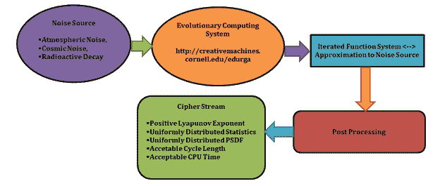 |

| 图 7. 示意图，展示了利用人工神经网络（`ANN`）生成流密码所采用方法的概览 |
| :--- |
| 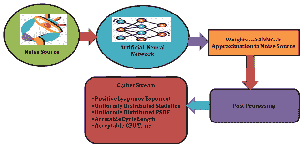 |

使用 `EC` 和 `ANN` 生成流加密算法的根本动机，是为了设计或修改示例映射（如图 5 所示），以满足密码学应用的独特需求。`EC` 具有利用现实世界噪声自动启动进化过程的优势，从而允许创建与密码学应用兼容的定制流密码。相反，`ANN` 虽有其用途，但就基于迭代非线性函数构建 `PRNG` 而言，它们不像看起来那样通用。使用进化算法（基于种群的随机搜索过程，旨在模拟自然选择）对于实现这一目标至关重要。由于其在可容忍的处理时间尺度内为复杂动态问题发现最优解的能力，进化算法吸引了各界的关注。2013 年，`Eureqa` 和其他进化计算算法首次被研究用于潜在的密码学应用。利用这种方法，可以反复开发非线性函数来表征复杂的输入信号，这些信号常见于混沌系统的实验数据。理论上，没有非线性函数能提供准确捕捉真正随机（德尔塔不相关）噪声的进化模型。然而，自然噪声具有“欺骗”系统反复尝试模仿噪声的能力，这可能使其作为 `PRNG` 发挥作用。为了确定其适用性，它会接受一系列测试，如图 6 所示（勾号表示测试通过），包括检查密码流是否均匀分布、计算功率谱分布函数（`PSDF`）等。另一方面，图 7 展示了使用 `ANN` 创建流密码的设计。通过比较这两种方法可以清楚地看出，`ANN` 的架构和权重类似于由 `EC` 生成的进化函数。这两种情况都包括针对图 6 和图 7 的测试，以及由美国国家标准技术研究院（`NIST`）计算机安全资源中心的密码算法验证计划（`CAVP`）提供的更新后的 `PRNG` 评估。任何密码算法都必须通过这些 `NIST` 测试，它们是评估密码强度的黄金标准。


### 后量子密码学中的 AI 驱动协议开发

在后量子密码学领域，另一大优势是 AI 驱动的协议开发。在量子计算时代，AI 将有可能协助开发免疫量子攻击的加密协议。新的数学方法和抗量子算法途径可能由 AI 生成。此外，值得注意的是将基于 AI 的协议开发归因于加密技术的可用性。传统加密协议在大多数情况下必须经历非常复杂的密钥交换过程，或需要手动调整。这是 AI 可以提供帮助的一个领域。它使这些过程更简单、更易于用户实施，同时降低了被攻破的风险。

#### 4.2 加密方案的进展

密码学是联合创新的重要领域。数据保护的关键在于加密。有了这项技术，最无情的敌人也无法再窃取敏感信息。得益于 AI 的应用，加密算法正在发生变化。基于人工智能的加密算法不仅能跟上数据安全需求的变化，还能根据实时流量在一定程度上切换加密级别。这种灵活性不仅增强了安全性，还削弱了计算效率。人工智能的进步有助于密钥生成，这是加密的一个重要环节。AI 将研究过去的数据和用户行为趋势，从而生成既安全又易于使用的加密密钥。因此，它增加了一层针对弱密钥的保护，并提高了整体数据安全性。AI 在加密密钥的安全性方面也发挥着重要作用。潜在威胁或未授权访问的监控与保护加密密钥是数据保护的重要方面。智能系统在此也能提供帮助。开发还扩展到了安全多方计算和同态加密等领域。这些方法在许多应用中至关重要，包括安全数据共享和云计算，它们允许在无需先解密的情况下对加密信息进行计算。抗量子私有加密是另一个开发前沿。由于担心量子计算会侵蚀加密的基础，研究人员正在寻找抗量子计算机攻击的加密方法。AI 的计算速度使得抗量子加密方法的更快开发和优化成为可能。最后，AI 与密码学的合力为我们带来了如踏火焰般飞跃的指数级速率。现在，我们正见证新的加密协议组合开始彻底改变我们对数据安全的概念。先进的 AI 和演化加密促进了协议开发，以应对不断变化的威胁环境。这些创新是在线世界中维护数据隐私和安全的途径。本章探讨 AI 如何改变密码学和数据安全。

### 5. 隐私保护 AI

当数据既能是宝藏，又能损害甚至个人的私人生活时——就在这时候，个人人工智能的概念应运而生。本章探讨这一范式的两个关键侧面：零知识证明系统和加密机器学习。

#### 5.1 零知识证明系统

平衡隐私与 AI 赋能数据信息的关键在于找到恰好的平衡点。这是零知识证明系统的一大突破。零知识证明的方法是一种密码学技术，允许证明者让验证者知道其知晓某事，而无需泄露任何具体内容。这一理念对隐私保护 AI 有着深远影响。假设有人想使用 AI 生成的服务，又不泄露任何隐私。这通过零知识证明系统得以实现。因此，用户可以在不透露底层数据的情况下证明其符合特定标准。例如，用户若因年龄验证需要证明年满 18 岁，无需透露其完整的出生日期 (DOB)。除了认证和身份验证这一显而易见的例子外，零知识证明系统还在许多其他领域找到了应用。用户可以在不披露个人信息的情况下登录。结果，在线安全性和隐私均得到提升。最重要的是，零知识证明被用于保护 AI 计算中的隐私。此外，通过使用零知识证明，敏感数据传输的正确性可以被证明，而无需披露任何私人信息。在协作式 AI 环境中，多方提供数据却不愿亮出底牌让他人看到所获信息，这种情况尤为适用。DeFi 和区块链的另一个应用也很重要。此外，知识证明系统的使用为交易和智能合约提供了更高的隐私性。金融交易是私密的，但它们精确且可信。随着 AI 扩展到各个工业领域，以及与隐私保护人工智能相关的技术日益成熟，零知识证明系统为这些系统提供了坚实的基础。在数字时代的信息交换中，它们为用户提供了一种透明、公平地共享数据——并保护其尊严的方式。

#### 5.2 加密机器学习


### 加密机器学习

加密机器学习允许组织在保护敏感数据安全边界的同时，安全地享受这项强大、新兴且快速发展的技术所带来的所有优势，它构成了隐私保护 AI 的前沿阵地之一。

#### 窃取信息

简单来说，大多数机器学习模型不得不在“大门敞开”的情况下运行——所有原始的、可破解的、未受保护的数据都必须输入模型进行训练或预测。然而，这种方法并非没有隐私风险。例如，在银行记录或医疗记录的情况下。基于云的加密机器学习因此为公司提供了一种途径，通过在原始素材上执行计算来规避这些危险。

机器学习中的主要加密方法之一是同态密码学；另一个是安全多方计算。因此，同态加密意味着 AI 模型可以在不先解密的情况下处理加密数据。因此，从机器学习开始到完成，私有数据始终是安全的。

以医疗服务提供商为例。他们可以利用加密机器学习在患者数据上训练预测模型，而无需查看患者实际的原始医疗记录。

SMPC 确保隐私保护延伸至机器学习的共享平台。SMPC 允许多方利用不同的数据源联合训练机器学习模型，同时保持各方数据对其他方不可见。这在金融等敏感领域尤为关键，许多不同的机构相互依赖以建立预测模型，同时保护其各自的专有数据。

这确保了机器学习中的数据安全，AI 还可以在用户设备上利用去中心化的训练数据源进行学习。这是个性化推荐和移动键盘等程序中常用的方法。通过坚持在 AI 模型的整个生命周期中保持敏感数据加密，组织可以利用基于加密的机器学习来满足《通用数据保护条例》（GDPR）和《健康保险流通与责任法案》（HIPAA）等严格法规对患者健康信息处理的规定。服务用户可以访问 AI 驱动的服务和洞察，但仍保留对自己个人信息的控制权。

最终，隐私保护 AI 并非空想，而是由零知识证明系统和加密机器学习开启的现实。这些新创新赋予组织和用户利用 AI 的能力，而无需泄露其最宝贵的数据。然而，随着数字宇宙的演进，这些技术仍将处于人工智能和数据安全的前沿。我们介绍了它们在构建值得信任、创新的隐私保护 AI 方面的重要性和新颖性。

### 自主密码系统

这就是为什么未来在于自主密码系统。这些旨在拓展数据保护边界的系统，是将人工智能（AI）与密码学突破相结合的实验。

#### AI 追踪密码学缺陷

本章讨论如何利用人工智能发现密码学弱点。

##### 6.1 AI 在缺陷检测中的作用

数据安全的一个基本方面是密码系统的强度。随着密码技术变得越来越复杂和强大，恶意行为者用于寻找现有加密系统缺陷的工具也随之变得复杂和强大。面对这种多变的局面，别无选择，只能更积极地识别和解决这些问题——AI 成为了先锋。AI 处理大数据和分析复杂模式的能力使其成为密码分析师武器库中的利器。其分析能力在识别密码系统缺陷方面自然极具价值。

AI 最大的优势在于其通过安全审计发现缺陷的能力。AI 系统持续在线探测密码协议和加密算法的弱点。这种方法缩小了攻击者发现缺陷的时间窗口。AI 可以设计各种攻击场景并搜索脆弱点。例如，它可以使用暴力破解或频率分析来攻击密码系统。或者它可能采用更复杂的差分密码分析。如果 AI 观察到异常或弱点，它可以发出警报通知安全人员，使他们能够立即采取行动。

AI 在缺陷检测中的应用基于机器学习模型识别密码数据中的细微差别和变化。这些模式可能预示着即将到来的威胁或应修补的密码学弱点。借助 AI 辅助的缺陷检测，组织能够应对潜在攻击者并保护数据。

| 图 8. 展示与紧凑二进制序列相关的有序与无序特性的样本 |
| --- |
| 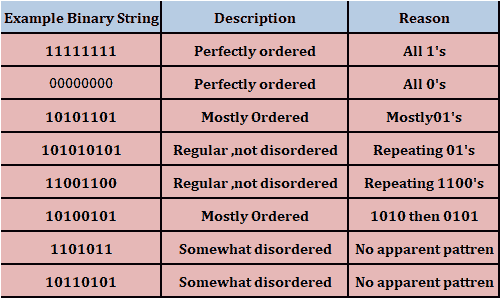 |

此外，AI 在故障检测中的作用延伸至后量子密码学。随着量子计算的发展，密码系统必须改变以保持安全。AI 可以帮助找出量子计算引入的薄弱环节，并设计抗量子计算机的加密方案。

当前的问题是判断一个有限长度的二进制字符串是否包含可理解的信息（可能源于确定性），或者它是否仅包含真正的噪声。这里的“确定性”包含这样一种思想：数字字符串可能代表自然发生的、因重复和使用而发展出的语言，即使编码过程是有意且预谋的，如 ASCII 编码。必须定义一种技术，用于比较任意长度的两个字节字符串中各个比特相应的有序性与混沌性。因此，简单的二进制熵测试行不通。这一限制源于其无法区分真正随机的二进制序列和那些显示出规律性的序列。

当 `p=0` 或 `p=1` 时，二进制字符串熵 `H(p)` 为 `0`，这发生在所有元素都相等的完全有序二进制字符串中（例如全 `0` 或全 `1`）。另一方面，当 `p=0.5` 时，`H(p)` 最大为 `1`，表示完全的随机性或无序性。但考虑一个像 `01010101` 这样的字符串，其中 `01` 重复多次。这里 `p=0.5` 且 `H(p)=1`，我们得到该字符串是随机的错误印象，而实际上它是周期性的。

因此，所需的工作是设计一种比公式 `Mathtype979-8-3693-1642-9.ch002.m02` 单独提供的更敏锐区分度的二进制信息熵度量。图 8 以定量术语呈现了这一问题，展示了一些 8 位二进制字符串的有序与无序特性示例。该度量的目的是比传统熵计算更清晰地显示二进制字符串中潜在的结构和确定性。

我们得出结论，AI 在密码学缺陷检测中发挥着重要作用，从而维护数据和通信的安全。其分析复杂密码系统、识别弱点并立即响应新威胁的能力，意味着 AI 可以成为数字时代值得信赖的数据安全守护者。

##### 6.2 自愈密码系统


### 自愈加密系统无异于数据安全的新范式

这些系统不仅被动应对加密错误，更会主动出击寻找弱点。融合了人工智能的加密系统持续监控加密协议在各处的演进——以及实时的适应与发展——旨在检测妥协或退化的迹象。

#### 应对威胁

知识型系统能够快速且直接地采取行动。这些行动可能包括：

- **动态重配置**：发现漏洞？自愈系统会更换加密算法或其他参数以强化安全。
- **威胁隔离**：例如发生加密故障。自愈系统可移除受感染的组件或链路，防止问题蔓延至其他成员。
- **自适应更新**：系统自动更新或修补脆弱的加密组件。
- **异常缓解**：自愈系统中的异常检测能识别加密过程中的异常行为或威胁。

此外，区块链等分布式账本技术也可被自愈加密系统用于提升安全性和透明度。这些系统通过在区块链上记录加密事件和操作，创建了一条不可篡改的审计轨迹。这对取证分析或合规审计极具价值。

在关键基础设施、安全通信和金融交易中，自愈加密技术的优势最为显著。保护必须长期保持有效的信息，此类系统还致力于抵御来自新颖、未被发现的风险和缺陷的意外威胁。归根结底，AI 与自愈加密系统将成为数据安全的未来。这些系统能自主发现并修复加密漏洞。但它们让自己成为所有威胁的敌手——甚至包括那些尚未被构想出的威胁。随着我们的未来属于数字信息，通过自愈加密系统保护数据和通信安全将变得愈发重要。

### 7. 后量子安全

量子计算的出现可能给数据安全带来新机遇，也可能带来新危险。人工智能（AI）与最先进加密技术的“布特拉登特”式结合，一直是我们在量子未来中所谓“守护数据”的核心组成部分。本节探讨 AI 在部署抗量子加密和长期安全解决方案中所扮演的角色。

#### 7.1 AI 赋能的抗量子加密

量子计算可能破解传统加密方法，从而威胁数据安全。然而，AI 与加密技术的融合催生出了一种潜在答案：抗量子加密。抗量子加密的目标是创造免疫量子计算机攻击的加密技术。AI 在抗量子加密技术的设计与开发中发挥着作用。

后量子加密面临的最大难题之一是设计安全的算法。量子力学要求有安全的加密来保护我们使用的加密方法和数学结构，防止它们被量子计算机的算力破解。这些结构正是 AI 算法擅长发现和探究的对象。因为 AI 驱动的优化能使此类加密协议既安全又高效，所以抗量子加密成为可能。例如，AI 调整密钥长度和算术运算类型等加密参数，在速度与安全之间取得平衡。结果，抗量子加密确实具备了实际应用价值。此外，AI 还能模拟量子攻击，测定加密系统的抗攻击能力。针对量子计算识别出的威胁，人工智能在设计不可破解的加密方法方面具有优势。模拟量子攻击甚至能训练机器学习模型自行构建更安全的算法。AI 辅助量子加密的另一优势在于其灵活性。量子计算技术的发展带来了新的攻击面。借助量子计算，AI 可以在威胁形势日新月异变化时梳理态势，并随时修改或升级现有加密协议以保护数据。

#### 7.2 长期安全解决方案

在量子计算时代，长期安全至关重要。此外，当今加密系统和加密方法的算法必须经得起时间的考验。它们被要求跨越整整几代人——让秘密在数十年甚至更长时间内保持安全。AI 正在塑造这些长期安全规划。长期安全的关键在于制定所谓的后量子安全标准。这些标准规定了任何加密算法为免疫量子计算机攻击所需满足的条件。AI 协助挑选这些标准，并验证它们面向未来的健壮性。其次，AI 对其他加密方法的研究也优于传统加密。基于格的密码学是通往抗量子安全的一种可能途径。这加快了基于格的加密协议的创建与优化，为长期安全解决方案打开了大门。量子密钥分发（QKD）的概念也包含在长期安全之中。在密钥分发层面，QKD 利用量子物理特性保护通信。AI 可帮助 QKD 系统的应用更进一步走向实用化和大规模生产。从而确立其作为安全产品市场长期稳定支柱的地位。区块链也提供长期安全。分布式账本技术以电子方式对加密事件和交易进行编码，使已发生的事情无法被篡改；这种效应贯穿时间始终，形成了一份电子历史档案，只要密码系统建立在分布式账本技术之上，就始终可作为审计依据进行检查。因此，面对量子计算对数据安全的威胁，后量子安全势在必行。量子时代的到来意味着必须有 AI 赋能的抗量子加密和长期安全来保护重要信息。本章强调 AI 在数据安全和抵御量子威胁方面的作用尤为重要。

### 8. 未来展望

如今新技术时代来临，人工智能（AI）与密码学的结合将彻底改变网络安全游戏规则。在这个崭新的世界里，我们仅尝到了 AI 与加密协同所蕴含的无限价值。

#### 8.1 实现 AI-加密协同的潜力


### AI 与加密技术的未来

AI 与加密技术的未来是无限的，正在改变我们获取数字信息的方式。本节涵盖了这种协同效应得以实现并应用于确保在线安全的所有可能途径。

实现这一目标的主要方式之一是**安全民主化**。由 AI 赋能的安全？AI 驱动的加密实现可使强大的安全功能广泛地为用户和组织所用。这是一种去中心化；个人和小型单位能够更好地保护其数字资产。

但 AI 与密码学的协同也为**定制化安全方案**开辟了前景。根据用户行为分析及用户的特定安全需求，算法可确定最符合其特殊要求的加密协议。这不仅提升了用户体验，还通过减少过度摩擦来强化安全性。

将 AI 集成到密码系统中意味着威胁可被实时检测和处理。AI 算法持续监控网络流量和数据流，以查找异常或安全威胁。无论哪种方式，这都是对外部威胁的早期干预，以减轻漏洞和缺陷造成的损害。

在隐私方面，AI 与加密技术的重叠带来了更好的技术。诸如用于保护用户数据的差分隐私，以及零知识证明等方法，确保信息在实际应用中始终掌握在消费者手中，并由 AI 予以协助。

第二个前沿领域是**AI-加密生态**的编织。一方面，从一系列 AI 模型和加密协议的潜在应用中抽丝剥茧；另一方面，区块链技术本身也随之而来。因此，这些生态系统在不断完善，数据交换透明公开。毫不夸张地说，它们将彻底改变医疗、金融和供应链管理等行业。

#### 8.2 挑战与展望

这标志着未来 AI-加密协同的到来，它既诱人又充满问题。本章探讨这一变革过程中的障碍与机遇。

最大的问题之一是缺乏强 AI 和密码学方面的培训。当个人和组织掌握了这两个领域的微妙之处时，这种协同效应发挥得最快。这是必须由进步来跨越的知识鸿沟，需要培养跨学科专业知识。

此外，随着 AI-加密协同的发展，伦理考量变得日益重要。需要以负责任的方式解决与密码系统相关的隐私、偏见和社会责任等问题。

**互操作性**是另一项挑战。不同组件和平台（即新兴 AI-加密生态系统之间）的无缝链接，是这些系统成败的重要前提。

就展望而言，在线安全和数据保护将在未来达到前所未有的水平。AI 与加密技术的结合可能意味着一个数据泄露成为例外、隐私至上、数字信任如尘埃般普及的世界。当谈到 AI 在开发后量子密码学方面的前景，确保数据在新一代量子计算技术出现时依然安全——这意义更为重大。

但基于 AI 的密码学创新将持续进步，以预判新危险，确保长期数据安全。

简而言之，AI 与密码学的融合正在重塑在线安全。您可以拥有民主化的安全、个性化的解决方案，以及最重要的是实时威胁检测——还有隐私保护技术。这些触手可及。

要充分利用这种协同力量，我们必须克服教育、伦理和互操作性等障碍。勇往直前，在线安全与数据保护的前景从未如此光明。

### 9. 结语

在结语章节**“未来展望：先进 AI 与密码学研究的协同效应”**中，我们带您踏上了一段真正有趣的旅程，探索人工智能（AI）与密码学前沿的一种综合。这种共生关系体现了数字时代对信息安全和隐私的现代重构。

在本章中，我们看到这两者相互产生了巨大影响。AI 与密码学的交汇不仅仅是重叠；它冲刷掉了在线安全长期以来赖以依存的界限。

本章具体描述了这种协同效应是如何展开的。从 AI 辅助的加密与密码分析，将密码系统的安全性和效率提升到新高度；到联合突破……在协同流感疫苗方面。（注：原文“co-orbiting influenza vaccines”疑为笔误或特定隐喻，直译为“协同轨道流感疫苗”或“协同流感疫苗”，此处保留原意翻译）。

这股人工智能浪潮进一步由**隐私保护 AI** 强化，后者使用零知识证明和加密机器学习等系统。此类技术正帮助企业和个人在数据洞察与用户隐私之间取得恰当平衡。

此外，基于 AI 的**自愈密码系统**极大地加快了对数据保护中潜在缺陷的预测和主动规避。

一个安全民主化、问题个性化解决方案触手可及的世界。一个值得信赖的在线世界——未来是数字化的。

另一方面，人们应意识到前方的困难。我们必须确保教育到位，并让人们意识到这种关系是共生的。伦理层面也发挥作用；互操作性的重要性亦是如此。

这种融合超越了单一技术，为加强数据安全和网络安全创造了无限机遇。这是一个新时代。一个 AI 加上密码学将改变我们保护数字生活方式的时代。

### 参考文献

Gope, P., Millwood, O., & Sikdar, B. (2022). A Scalable Protocol Level Approach to Prevent Machine Learning Attacks on Physically Unclonable Function Based Authentication Mechanisms for Internet of Medical Things. *IEEE Transactions on Industrial Informatics*, 18(3), 1971–1980. doi:[10.1109/TII.2021.3096048](https://doi.org/10.1109/TII.2021.3096048)

Govardhana Reddy, H. G., & Raghavendra, K. (2022). Vector space modelling-based intelligent binary image encryption for secure communication. *Journal of Discrete Mathematical Sciences and Cryptography*, 25(4), 1157–1171. doi:[10.1080/09720529.2022.2075090](https://doi.org/10.1080/09720529.2022.2075090)

Gowda, V. D., Prasad, K. D. V., Gite, P., Premkumar, S., Hussain, N., & Chinamuttevi, V. S.K.D.V. (2023). A novel RF-SMOTE model to enhance the definite apprehensions for IoT security attacks. *Journal of Discrete Mathematical Sciences and Cryptography*, 26(3), 861–873. doi:[10.47974/JDMSC-1766](https://doi.org/10.47974/JDMSC-1766)

Hussain, Pazhani, & A. K. (2023). A Novel Method of Enhancing Security Solutions and Energy Efficiency of IoT Protocols. *IJRITCC*, 11(4), 325–335.

Karatas, G., Demir, O., & Sahingoz, O. K. (2019). A Deep Learning Based Intrusion Detection System on GPUs. *2019 11th International Conference on Electronics, Computers and Artificial Intelligence (ECAI)*, 1-6. doi:[10.1109/ECAI46879.2019.9042132](https://doi.org/10.1109/ECAI46879.2019.9042132)

Knudsen, L. R., & Mathiassen, J. E. (2000). A chosen-plaintext linear attack on DES. *Proceedings of the International Workshop on Fast Software Encryption (FSE)*, 262–272.

Kumar, P. H., & Samanta, T. (2022). Deep Learning Based Optimal Traffic Classification Model for Modern Wireless Networks. *2022 IEEE 19th India Council International Conference (INDICON)*, 1-6. doi:[10.1109/INDICON56171.2022.10039822](https://doi.org/10.1109/INDICON56171.2022.10039822)


## 第 3 章

**K. Sriprasadh**  

  

印度 SRM 理工学院

### 摘要

密码学是一个用于保护秘密消息或信息的技术术语。将普通文本转换为不可读形式的做法称为加密。这可以通过密钥管理来实现。人工智能是一种支持所有领域决策的技术。生物启发式密码学是生物密码学，它可以识别人类独特的特征并将其转化为密钥，通过人工智能将多个生物密码学密钥整合到加密过程中，在解密部分将其链接到单个密钥模块，并提供人工智能决策支持。通过决策支持，可以实现精确和准确的认证。

### 1. 简介

密码学通常是通过密钥将普通文本转换为加密文本的实践形式来进行的。密钥可以是对称和非对称的，在密码学过程中，密钥在密钥的支持下参与将数据转换为不可访问的格式。在生物密码学中可以考虑类似的过程。最初应分析生物密码学以了解关于生物密码学的知识。涉及利用人类独特特征来识别和认证用户以提供服务的密码学理念，可称为生物密码学（Alroobaea 等，2022）。

组织需要以更好的方式实现安全，可以根据凭证的各个方面提供多种类型的认证，这些数据可能以某种形式被复制，因此出于安全考虑，此类数据应替换为认证尝试中不匹配或不重复的数据或凭证。由于网络犯罪分子以精确的方式将安全数据与伪造数据匹配以满足认证要求，因此推荐使用生物启发式密码系统进行数据保护。所述认证系统基于人类的独特特征工作。可考虑将其用于认证目的，为人类数据提供终极安全。

认证可以通过多种方式来考虑，用于数据安全或设备访问。认证基于用户，公司员工的认证和最终用户的认证可以不同。可以根据知识水平，为不同人员考虑不同级别的认证。这些安全应以标准化方式进行，确保设备或服务的完全安全。

为了更好地理解，最终用户无法像技术人员或受过教育的人那样使用多重或双因素认证。但应为他们的收入和财物提供同等级别的安全。为此，生物密码学可以提供多重或类似的保护。在本书章节中，多个独特的人类特征被匹配并映射到单个验证术语中。这将为他们提供一个经验证的认证系统。

认证模型可从两个方面考虑，它们是：

*   **1. 基于安全模型**
*   **2. 基于用户使用级别**

让我们仔细看看可用的多种认证技术：

| 图 1. 不同类型的认证 |
| --- |
| 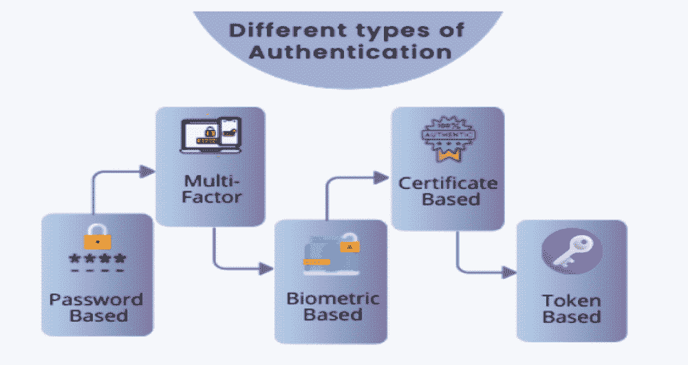 |
| --- |

### 2. 文献综述

已对用于认证用户的各种生物特征因素进行了文献综述，基于用户拥有的自身同一性属性，为用户和用户数据提供安全。

### 参考文献

Kumar, R., & Ashreetha, B. (2023). Performance Analysis of Energy Efficiency and Security Solutions of Internet of Things Protocols. *IJEER*, 11(2), 442–450. doi:[10.37391/ijeer.110226](https://doi.org/10.37391/ijeer.110226)

Kumar & Chaturvedi. (2023). Securing networked image transmission using public-key cryptography and identity authentication. *Journal of Discrete Mathematical Sciences and Cryptography*, 26(3), 779-791. doi:[10.47974/JDMSC-1754](https://doi.org/10.47974/JDMSC-1754)

MusaA.MahmoodA. (2021). Client-side Cryptography Based Security for Cloud Computing System. *2021 International Conference on Artificial Intelligence and Smart Systems (ICAIS)*, 594-600. doi:[10.1109/ICAIS50930.2021.9395890](https://doi.org/10.1109/ICAIS50930.2021.9395890)

PavankumarP.DarwanteN. K. (2022). Performance Monitoring and Dynamic Scaling Algorithm for Queue Based Internet of Things. *2022 International Conference on Innovative Computing, Intelligent Communication and Smart Electrical Systems (ICSES)*, 1-7. doi:[10.1109/ICSES55317.2022.9914108](https://doi.org/10.1109/ICSES55317.2022.9914108)

Reza, M. N., & Islam, M. (2021). Evaluation of Machine Learning Algorithms using Feature Selection Methods for Network Intrusion Detection Systems. *2021 5th International Conference on Electrical Information and Communication Technology (EICT)*, 1-6. doi:[10.1109/EICT54103.2021.9733679](https://doi.org/10.1109/EICT54103.2021.9733679)

Sharma & Arun. (2022). Priority Queueing Model-Based IoT Middleware for Load Balancing. *2022 6th International Conference on Intelligent Computing and Control Systems (ICICCS)*, 425-430. doi:[10.1109/ICICCS53718.2022.9788218](https://doi.org/10.1109/ICICCS53718.2022.9788218)

Sharma, A. (2023). A novel approach of unsupervised feature selection using iterative shrinking and expansion algorithm. *Journal of Interdisciplinary Mathematics*, 26(3), 519–530. doi:[10.47974/JIM-1678](https://doi.org/10.47974/JIM-1678)

Shivashankar & Mehta. (2016). MANET topology for disaster management using wireless sensor network. *International Conference on Communication and Signal Processing, ICCSP 2016*, 736–740. doi:[10.1109/ICCSP.2016.7754242](https://doi.org/10.1109/ICCSP.2016.7754242)

Singla, A., & Sharma, N. (2022). IoT Group Key Management using Incremental Gaussian Mixture Model. *2022 3rd International Conference on Electronics and Sustainable Communication Systems (ICESC)*, 469-474. doi:[10.1109/ICESC54411.2022.9885644](https://doi.org/10.1109/ICESC54411.2022.9885644)

Suryawanshi, V. A., & Chaturvedi, A. (2022). Novel Predictive Control and Monitoring System based on IoT for Evaluating Industrial Safety Measures. *IJEER*, 10(4), 1050–1057. doi:[10.37391/ijeer.100448](https://doi.org/10.37391/ijeer.100448)

TanS.KnottB.WuD. J. (2021). CryptGPU: Fast Privacy-Preserving Machine Learning on the GPU. *2021 IEEE Symposium on Security and Privacy (SP)*, 1021-1038. doi:[10.1109/SP40001.2021.00098](https://doi.org/10.1109/SP40001.2021.00098)

Zhu, S., & Han, Y. (2021, August). Generative trapdoors for public key cryptography based on automatic entropy optimization. *China Communications*, 18(8), 35–46. doi:[10.23919/JCC.2021.08.003](https://doi.org/10.23919/JCC.2021.08.003)


通过表 1，以下错误纠正理念被研究并展示给用户以供理解。根据表 1，基于击键的生物特征安全和语音识别错误纠正是通过离散化实现的，参考文献为 Monrose 等 (1999)。签名识别理念源自 Hao 和 Chan (2002)。在该理念中，签名速度的前向特征和后向特征以图形表示的形式被理解；此处错误纠正采用平均化处理。面部动作和人脸识别误差由 RS 码识别，参考文献为 Chen 和 Chandran (2007)。虹膜识别和认证，参考文献为 Hao 等 (2006)，此处学习的要素是经过 Gabor 小波处理的虹膜图像。指纹识别或检测用户认证参考 Uludag 等 (2005)；此处错误纠正被识别为量化。考虑到掌纹生物特征，参考文献为 Kumar 和 Kumar (2008)；此处错误纠正是通过 RS 码实现的，并具有主线等独特且稳定的特征。头部被考虑用于人员认证；采用了基于神经网络的错误纠正，参考文献为 O’Connell-Rodwell (2007)。

#### 表 1. 用于认证的生物特征

| 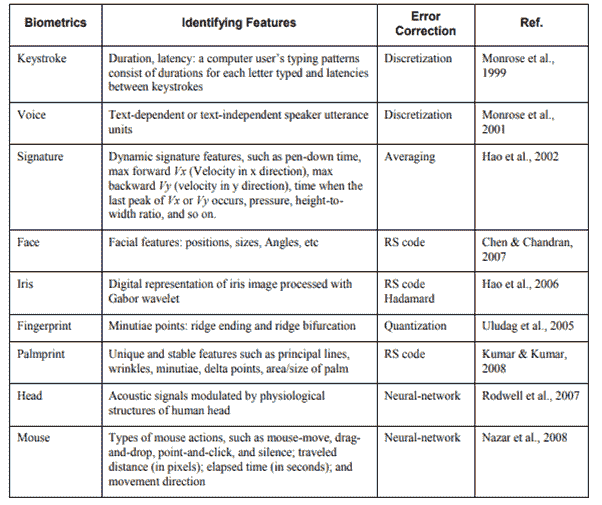 |

---

### 3. 实践中的安全模型

#### 3.1 基于安全模型

基于模型的安全取决于用户偏好的安全级别；用户可以选择单级安全、双级安全或多级安全。安全的复杂性基于数据的价值或所使用的应用程序。为便于理解，如果仅关注数据的安全，则首选单级或双级安全认证。如果涉及保护凭证，如房产文件、投资银行债券或资金转账，则可考虑多级安全 (miniOrange, n.d.)。

#### 3.2 基于用户使用级别

这种安全认证方式基于用户的安全意识水平。非常了解技术和其他认证复杂性的用户倾向于为其应用程序选择多级认证。至于外行——即对认证流程和复杂性知之甚少的普通人——大多倾向于单级安全认证和双级认证。

在讨论认证方面的组合之前，将详细阐述不同类型的认证方法，以便更好地理解。

##### 3.2.1 密码保护

最突出的保护方法是通过密码保护提供的。最常用的登录认证系统是通过密码保护；常规的日常登录系统即为密码认证系统。要利用在线服务进入使用系统，都需要提供密码。在使用基于密码的认证系统时，用户提供其用户名和密码作为自我认证。密码大多由用户记忆。密码类型可以是数字、字母或字母数字符号组合。大多数情况下，密码将是这些类型的组合。密码长度因产品而异；手机的密码长度最少为四位字符，邮箱或其他服务保护最少为八位字符。密码与数据库中预先存储的一组整数进行匹配；如果匹配，则启用服务访问；否则禁用。

###### 图 2. 密码保护流程

| 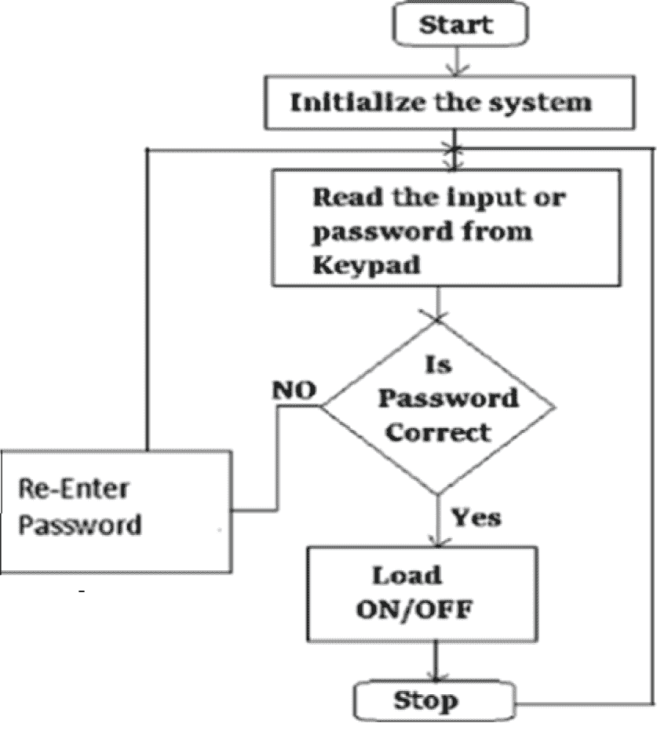 |

---

密码保护很容易受到网络犯罪分子的挑战和破解。为了获得最佳的密码保护，应定期定期更改密码。如果长期使用同一密码，存在遭受网络犯罪分子攻击的风险；通过该操作，类似于网络钓鱼和数据泄露的情况成为可能。由于上述缺点，用户需要在密码保护之上为其工作应用程序寻求进一步的保护。在系统中使用密码保护的组织正在为其系统寻找更好的保护，以保护其数据凭证。

##### 3.2.2 多参数认证

多参数认证是一种验证方法，用户必须通过多个参数条件。要获得服务访问权限，用户必须证明多种参数因素。在此也考虑了密码保护和其他多级安全方面的支持。用户应证明其身份。这可能是回答只有他们知道的个人问题。一次性密码将生成并通过其邮箱或手机号码提供给用户。基于上述参数，用户将尝试使用其用户名和密码获取服务。

###### 图 3. 多参数认证控制流程

| 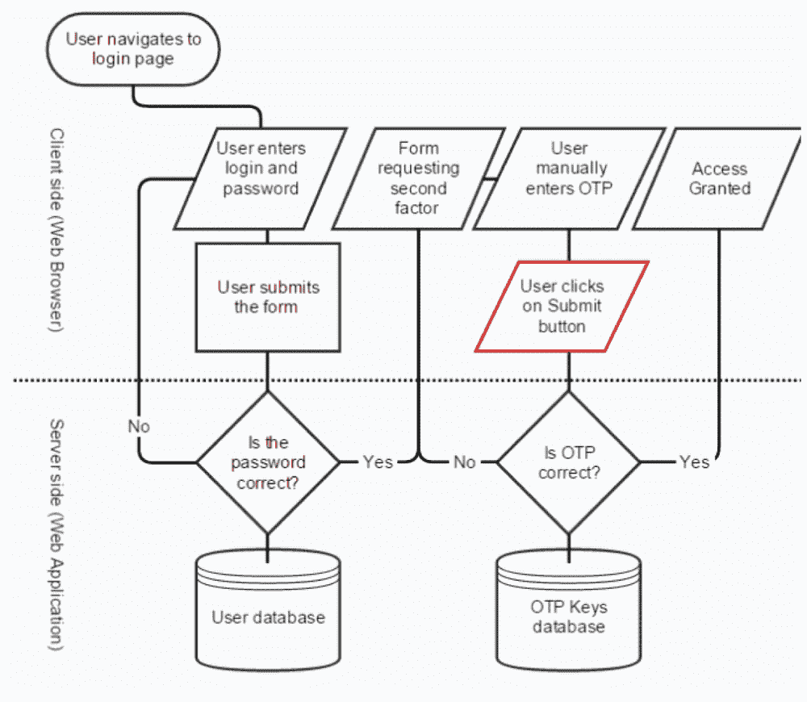 |

---

用户可以选择任何一种方法，在任何多因素方法论中证明其身份；可以是一次性密码、回答个人问题，或点击作为认证一部分发送到其邮箱的时间戳链接。由于认证程序涉及多个参数，此安全方面可被视为最受信任的。与密码保护系统相比，它在某种程度上更安全。大多数组织遵循多参数认证系统。在日常示例中，我们可以在银行交易应用程序中观察到这些系统。

##### 3.2.3 生物特征认证

每个用户都拥有他人不具备的独特特征。用户在人体以下方面拥有独特特征：拇指、视网膜、掌纹、声音、面部识别、指纹。这些特征在一个属性方面被集体归类，并开发出一种安全模型：面向生物特征的认证。这些生理特征可以单独验证，或与之前的数据和提供的认证进行集体匹配。这些方面已用于市场中的考勤打卡、设备访问和生物特征资金交易卡。

###### 图 4. 生物特征认证方法论

| 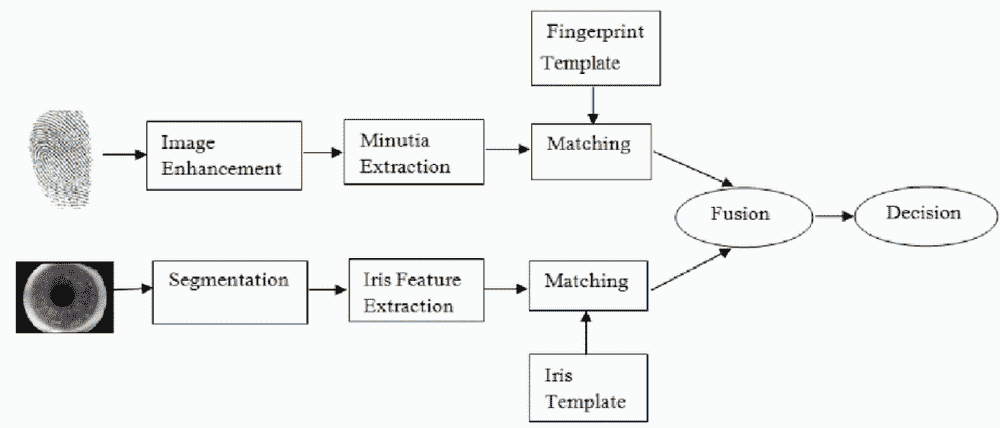 |

---

实体躯体特征——类似地指纹、掌纹、视网膜、声音、面部和声音识别——被用于生物特征认证。生物特征认证通过以下步骤执行：首先，个人的身体特征保存在数据库中。每当用户想要访问任何设备或物理进入任何场所（组织、学校、学院和工作场所）时，都会将个人的躯体特征与数据库中包含的数据进行核对。生物特征用户验证理念技术几乎在全世界各地都在使用；其应用范围从提供考勤到确认国家公民身份。它已被用于所有安全为基本方面的领域。这种用户友好的安全方面具有多种模式；其中一些方法分析如下。

##### 3.2.4 指纹印记


### 生物识别与认证系统

#### 指纹安全访问

要使用指纹安全访问，安全功能需启用访问权限。最初采集并存储指纹印记到数据库中，在验证身份时，会将其与先前存储的记录进行核对；如果指纹与先前记录匹配，则提供服务，否则拒绝服务。指纹是所有人类独有的特征，因人而异；即使是双胞胎，其指纹印记也不同。甚至在某些先进的认证系统中，连微小的纹线细节——称为乳头脊、沟、环、斗和弓——也会被记录在先进的指纹认证系统中。由于生物识别技术对用户有用，且与其他认证设备相比具有较高的准确性。将此生物识别系统视为一个实时示例，如今常见于用户手机中，任一手指印记均可存储为密钥并与生物识别数据匹配；同样，用户身份得到识别并提供安全保障，应用于自证场景，如用户的考勤到公民身份认证。

#### 3.2.2 通过视网膜和虹膜保障安全

在此种生物识别系统模式下，扫描仪通过强光扫描视网膜和虹膜。该光线照射入人眼，视网膜和虹膜被扫描，其纹理模式被存储在数据库中。当用户尝试访问产品或服务时，会将该模式进行比对。

#### 3.2.3 通过面部进行生物识别安全

在面部认证中，人脸被用作锁定设备的安全要素，从多个角度采集面部的多个特征并存储在数据库中。

| 图 5. 通过面部识别进行生物识别认证的方法论 |
| --- |
| 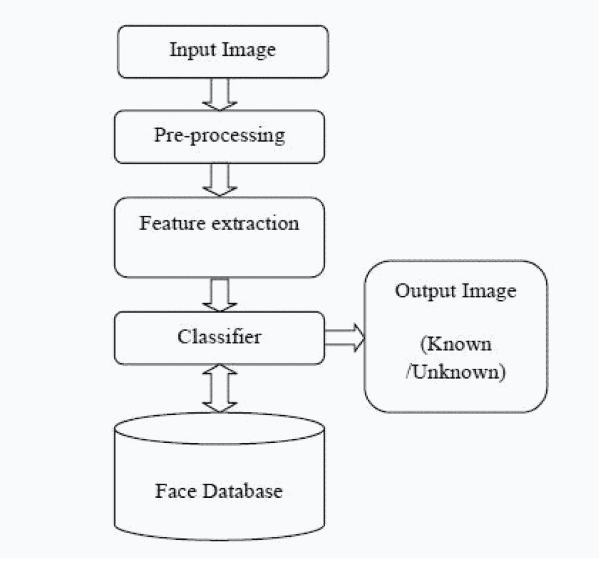 |

用户尝试使用设备或应用程序。面部特征与先前存储的数据进行比对，随后向用户提供访问权限或拒绝访问。

#### 3.2.4 生物识别语音识别

人声声调因人而异。最初，声调以各种角度和各种调制方式存储在数据库中。一个秘密代码经过训练后，连同其调制方式一起存储在数据库中。

| 图 6. 通过语音进行生物识别认证的方法论 |
| --- |
| 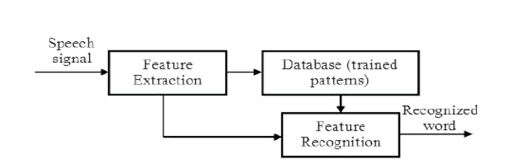 |

被识别。因此，当用户使用代码及其语音访问设备时，系统接受并允许用户访问。因此，如果代码或语音不符合要求，则拒绝访问。

#### 3.2.5 基于证书的认证

此认证仅涉及软件，而非其他人体特征，这与基于生物识别的认证不同。在此认证中，根据用户请求生成证书，用户应证明其身份，这可能通过其用户名或密码，或通过质询问题完成。用户应回答秘密问题，并使用公钥和私钥进行签名。基于此，提供一次性可访问的证书。证书的颁发基于有效的用户名和密码。

| 图 7. 基于证书的认证 |
| --- |
| 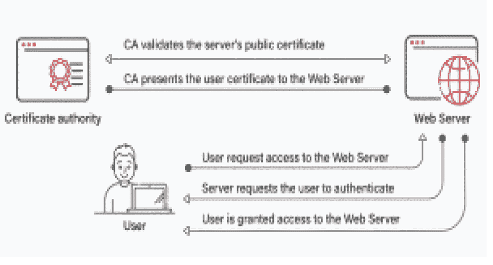 |

此证书在单个会话和特定时间间隔内有效。这些认证模式在无需任何外部硬件工具的情况下提供更好的安全性。数字签名与证书关联以增强安全性。在此认证方法中，基于证书的认证通过使用电子数字身份来识别人员、服务器、工作站和设备。在日常生活中，数字证书的功能类似于驾驶执照或护照。证书由用户的数字身份组成，其中包含公钥和认证机构的数字签名。该证书验证公钥和颁发证书的人是同一人。当用户尝试登录服务器时，必须首先出示其数字证书。服务器通过密码学确认用户拥有与证书正确关联的私钥，来检查数字证书的身份和可信度。

#### 3.2.6 基于令牌的认证

在此基于令牌的认证系统中，用户一次性输入其身份标识，并作为交换获得一个指向加密字符串的链接。您将被允许访问服务。此后无需再次输入凭据。此数字链接令牌将确保获得的服务访问权。此认证系统多用于类似用例，例如被许多框架和客户端访问的 RESTful API。

| 图 8. 基于令牌的认证 |
| --- |
| 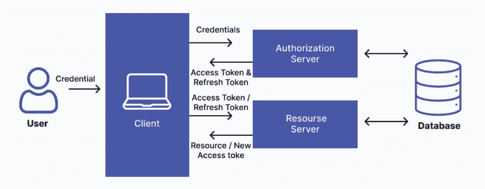 |

基于令牌的认证包含由服务器提供的认证令牌，基于令牌的认证按以下方式执行，认证分四个阶段进行：最初为请求、确认、令牌和裁决。

在请求阶段，用户客户端首次请求访问受保护资产。在用户名和用户凭据的支持下，生成链接请求。在验证过程中，证明客户端证书后，用户确认其使用服务的在场状态，随后客户端与服务器之间交换令牌。交换认证令牌后，授予用户访问服务的权限。

考虑到基于令牌的认证方法的优缺点，其具有良好的有效性、适应性和安全性。在缺点方面，密钥可能被泄露，且认证访问周期相对较长，会给攻击者提供可乘之机。

#### 3.2.7 一次性登录认证 (SSO)

在一次性登录方法中，它类似于用户名和密码系统。最初，当用户创建账户以获取任意服务时，会通过一个秘密的单点登录密钥获得所有服务，例如创建一个 Gmail 账户，即可通过该用户名密码获得全部 Google 服务。由于 Google 提供从邮件服务到资金交易的多种服务，用户可在此进行单点登录以访问所有服务。这种单点登录可视为一把双刃剑：一端可通过单点登录体验顺畅的服务访问，另一端用户名和密码多次暴露，可能为安全漏洞铺平道路。

| 图 9. 一次性登录 |
| --- |
| 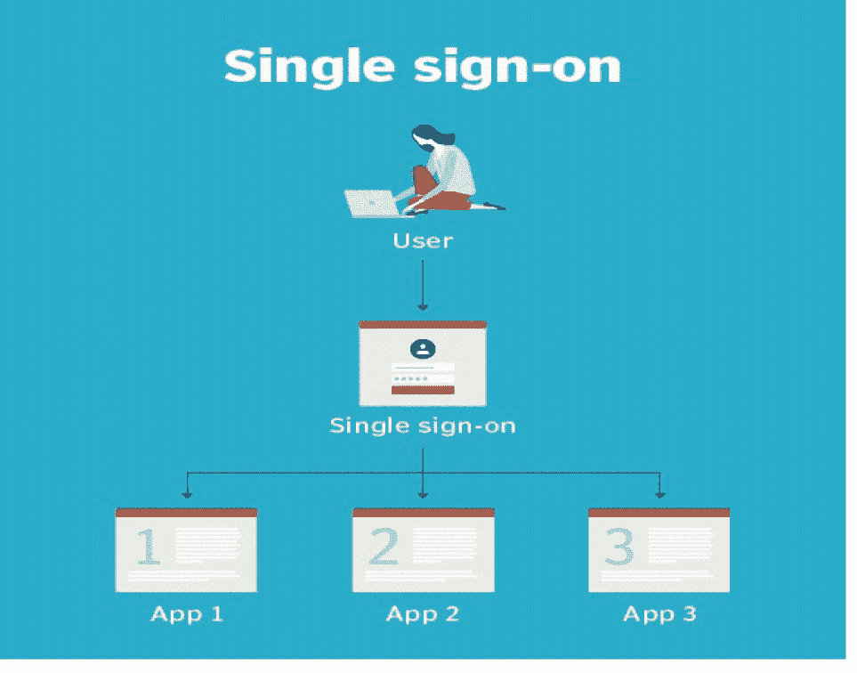 |

用户只需记住其用户名和密码。用户需创建用户名和密码，若忘记用户名和密码，可联系管理员，证明身份并通过认证后，重新登录账户并开始访问服务。

#### 3.2.8 双因素认证

在双因素认证中，用户需通过两种不同的认证登录程序来证明其作为合法用户的身份。若窃听者试图访问账户，存在被攻击风险；但采用双重认证模式时，尝试者会在任一环节被锁定。

| 图 10. 双因素认证 |
| --- |
| 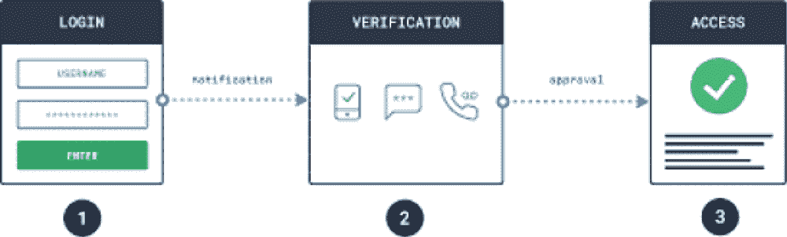 |


#### 3.2.9 自适应认证

在这种认证方法中，认证审批期间会考虑多个因素，如用户的设备 IP、位置数据、设备数据和设备访问时间。它区别于双因素认证，可被视为多因素认证。在此方法中，用户输入用户名和密码；在输入信息时，会将设备 IP 地址、设备地址和设备访问时间纳入考量。在匹配所有因素并验证用户是从常用区域或设备访问后，将根据请求提供批准。

| 图 11. 自适应认证 |
| --- |
| 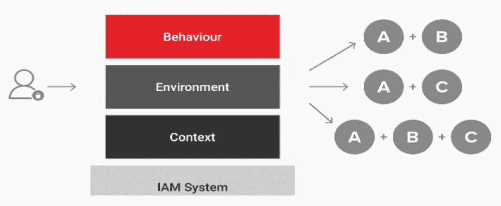 |

您在使用 Gmail 服务时可能体验过这种认证。当您在不同或新设备上使用 Google（最初区别于您的旧设备）时，它会向您最常用的旧设备发送批准呼叫或消息。只有在获得用户认证后，才允许访问该服务。通过这种安全认证方法，证明了用户的真实性。

#### 3.2.10 API 认证

应用程序编程接口（API）是允许应用程序通信、提供服务并在启动任何应用程序访问前交换所需认证的重要链接。目标应用程序需要客户端的认证。

| 图 12. API 认证 |
| --- |
| 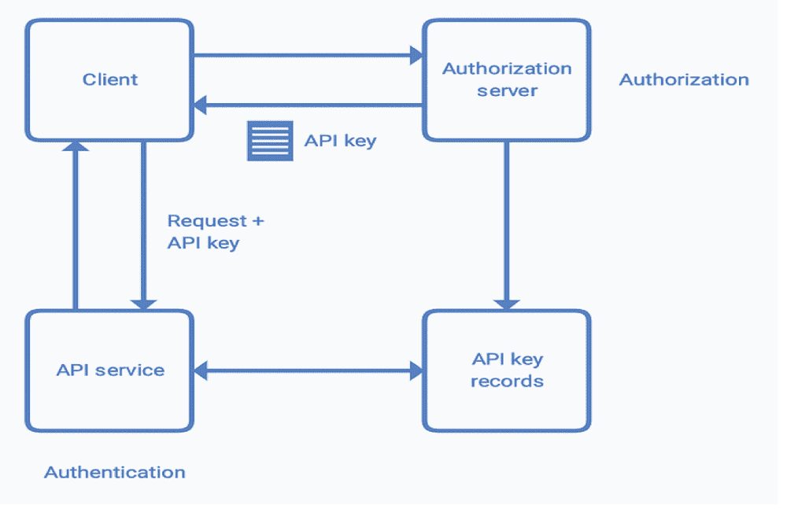 |

各个应用程序都有其应用程序安全网关，每个最终用户在访问应用程序前通过 API 证明其认证；这是一个安全方面。有许多正在使用的 API 认证方法；其中，HTTP Basic Auth、API 密钥和 OAuth 是最流行且使用最广泛的。

#### 3.2.11 HTTP 基础认证

HTTP 基础认证为用户认证提供了框架。在这种安全形式中，服务器通过用户名和密码向用户发起质询。当用户尝试访问服务时，他或她想要证明其认证。

| 图 13. HTTP 认证 |
| --- |
| 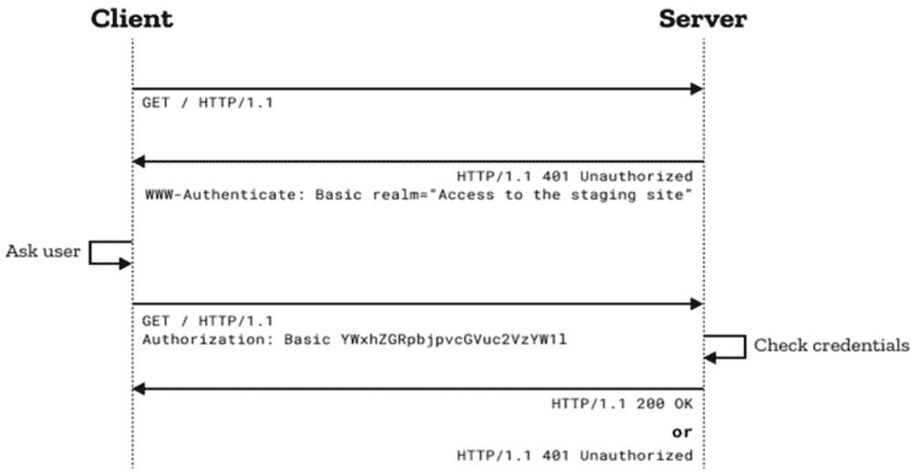 |

它是通过用户的用户名和密码进行的真实性验证，因为它依赖于 HTTP 头部本身。这种方法不需要 Cookie、会话 ID 或登录页面。

#### 3.2.12 API 密码

API 密钥是 Web 服务查询的唯一解决方案；它基于来源识别用户请求。当用户发起请求时，会生成一个密钥，启用密钥令牌并提供给用户。用户首次通过注册使用时应使用此密钥。此密钥令牌与 API 配对。如果用户尝试后续使用该服务，之前生成的令牌链接将被激活，进行验证，并提供服务。

| 图 14. API 密码事务 |
| --- |
| 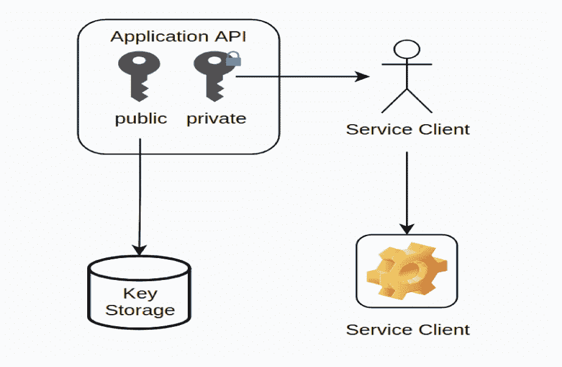 |

简单来说，根据用户凭据创建一个 ID；此 ID 用于所有服务访问。为便于理解，UPI 资金交易在此 API 密码安全概念下工作（Anees et al., 2022）。

### 4. 机器学习与密码学

尽管如此，如果密码分析师拥有一组匹配的明文/密文比特，他们仍将拥有未知函数 `f` 的一系列输入/输出二元组。运用一种能从该数据集合推断出 `f` 的学习算法，可作为一种宝贵的密码分析工具。此外，选择密文攻击赋予密码分析师在任意给定点查询未知函数 `f` 的能力。因此，一种能通过查询推断 `f` 的学习算法可被证明是一种有效的密码分析工具。值得注意的是，允许“近似”学习的可学习性描述非常适合此问题。然而，如果密码分析师能学习到一个与 `f` 有 99% 时间一致的 `f` 的近似值，他们将能够解密 99% 的明文。让我们首先考虑已知明文攻击。可靠的密码设计原则要求 `f` 输出 0 或 1 的概率相等。这通常意味着移位寄存器的内容可以被视为从 `{0, 1}^n` 中根据不变分布随机抽取的一个示例。（我们强调，这一假设使我们的陈述具有学术性；需要彻底的分析或试验来验证该假设在每个提议方向中的合理性。）存在各种假设示例是从基于不变分布的 `{0, 1}^n` 中抽取的学习理论结果。虽然这一假设在大多数学习应用中可能感觉不切实际且受限，但它与密码学场景完美契合。从密码学中可以推导出什么任务？

在某些应用中，深度学习模型无法仅使用单一训练数据源进行训练。因此，许多数据所有者希望该设置能从所有形式学习其数据。为了达到目标，他们可以使用一个云，让云中的模型从他们的数据中学习。云的最大数据存储拥有大量不同的数据源。为保护用户数据，应确保云存储安全；为此，推荐使用同态加密形式。

参与翻译的训练数据旨在采用两种技巧（即介绍性策略和改进策略），以节省要求深度学习和云相互结合以确保数据安全的用户的隐私。据了解，该形式的结果是直接达到被要求的，但存在泄露的可能性。最初，该策略的介绍性公式和云完全基于社区密钥完全卷入同态加密。

#### 多层级复杂性

协作深度学习有两种类型：共享加密训练数据和共享加密梯度。

尽管密码学保护着用户间的数据事务，但安全方面应随新技术升级；机器学习理念将在这方面提供支持。一些机器学习算法将支持提供更好的安全性。本节将讨论机器学习算法。

加密程序不一定用于模型学习的机器上，而本十年机器学习必须进入加密领域。在这里，机器学习识别可分为两类：（1）非对抗性自适应机器学习和（2）对抗性机器学习抵抗。非对抗性机器学习脚本使用神经网络模型创建加密方案，并通过混合方法和建立神经网络模型用于加密和解密方案的非线性特性来改进之前的方案。

#### 4.1 非对抗性自适应机器学习


该程序的密钥是网络参数（权重和偏置）或混合了一些随机数。情况是这样的：如果网络被暴露，该解决方案就不安全。基于遗传算法和 DNA 软件构建对称加密和解密方案。它由`密钥输出部分和加密解密部分`组成。首先，使用通用算法进行锁生成、突变、传输和选择过程。双链的主要候选者进行初始化，然后通过随机改变每个候选者论坛的某些位来延迟获取候选者数量。之后，通过简单地改变几个主要候选者的一个片段，过渡到尽可能多地增加获取候选者。并从该结果中获得最重要的候选者，保持最佳适应度功能。此过程持续进行，直到随机值达到阈值。然后可以通过以下方式实现加密方案：DNA 计算。转换明文比特串，通过将 00 分配给 A（腺嘌呤）和 01 分配给 A（腺嘌呤）来创建 DNA 序列。C（胞嘧啶），10 分配给 G（鸟嘌呤），11 分配给 T（胸腺嘧啶）。该 DNA 链通过转录和翻译进行处理。处理后转换为二进制串。该串使用生成的密钥执行异或（XOR）运算。解密过程是加密过程的逆过程。

#### 4.2 抗对抗机器学习

目前，研究人员正专注于神经密码学，一种加密和解密算法。您可以在该程序中学习增加隐私，因为存在敌手。并提出了基于深度学习的方法，为与对抗神经网络的通信提供隐私密码学。一个简单的例子是爱丽丝、鲍勃和伊夫。爱丽丝和鲍勃使用非对称加密进行通信。他们想要隐私。伊夫拒绝通信，企图从加密通信中获取明文。例如，可以在图 3 中看到。爱丽丝利用非对称密钥 K 从明文 P 构造密文 C 并发送给鲍勃。同时，伊夫也获取了密文 C。鲍勃接收密文 C，并使用密钥 K 解码 C 文本以恢复 P 文本并打印返回的明文 P_Bob。即便如此，伊夫仍尝试恢复文本 P 并生成明文 P_Eve。请注意，鲍勃比伊夫有优势，因为他拥有 K 密钥，但伊夫没有（Basu et al., 2019）。

### 5. 生物识别认证与机器学习

就安全性而言，增强生物识别认证结构的准确性和性能通常无法仅靠人工编程完成。人工智能和机器学习可以帮助我们使系统更加安全且富有创造力。该技术可从两个方面理解以供考虑领域：躯体特征以及行为方式。

#### 5.1 躯体生物识别技术

躯体生物识别包含拟议研究结果中之前提到的一切内容。这些构想源于个人同样独特的特征，即（面部或指纹、DNA 和虹膜）。这些特征应转化为数据，这些数据作为输入用于通过 AI 设备分析分组特征和决策，可由技术进行分析。在与记录对比以进行实证功能时。

人工智能和机器学习大显身手的一个实例是人脸识别。在显著扩展事实阐释方面做出了贡献，人工智能能够借助计算机系统协助打造人脸识别，基于单张人脸图像的多个特征进行比对，识别出真实人脸以提供认证。

#### 5.2 行为生物识别实践

AI 使之成为可能的最吸引人的发展是行为生物识别技术。它利用用户与世界互动的特定行为特征，这些是用户甚至可能不知道自己的事情。这是针对深度伪造欺诈尝试的防御因素。本节分析了多种著名的人类特征认证技术：

*   鼠标行为
*   键盘敲击活动
*   触摸屏按压长度、区域和力度
*   移动设备活动

根据实验室研究结果，生物识别和信息样本是独立的。马德里大学发明了 BeCAPTCHA，一种利用基于人类活动的生物识别进行异常检测的技术。该技术使得基于人类活动的生物识别可以在无需任何技术支持的情况下使用，消除了执行繁琐的基于人类行为的 CAPTCHA 挑战的必要性。在该技术中，用户通过点击一组相似图片来证明用户不是机器人。用户必须证明他或她不是机器人。

重要的是，行为生物识别有助于确保整个会话过程中的安全。例如，用户验证自己后离开系统片刻，如果有人接管了系统。用户使用同一系统，基于活动可以根据行为检测到未经授权的访问。为了阻止访问，系统通过提供自我证明问题来限制他们。通过这种方式，确保了用户系统的安全。

#### 多模态生物识别认证的工作流程

生物识别有其自身的优缺点。建议采用基于层的安全性以及多模态验证，以提高生物识别验证的准确性和有效性，必须通过多模态生物识别解决方案分层安全。

| 图 15. 生物识别认证多模态工作原理 |
| --- |
| 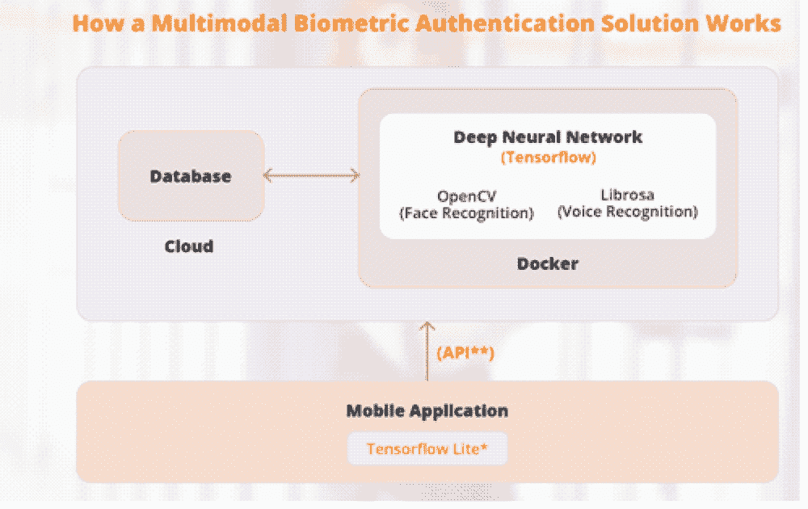 |
| --- |

移动网络拥有的神经网络难以开发和实施。神经网络可以使用 `Tensor Flow Lite` 集成到应用程序中，但存在各种限制。使用 `Tensor Flow` 库训练您的神经网络模型会有所帮助。您可能需要深思熟虑地预先设计软件结构，并将这些需求纳入考量。

如果本地应用程序不可行，此技术可卸载到云端以处理数据，如 REST API。然而，这将产生额外的网络资源并需要互联网连接。

存在 `Nvidia Docker`，它可以简化设备的部署，而服务提供商（如 `AWS`）可以为神经网络提供不间断的通信通道、算力以及扩展设备的便捷接口。

##### 案例 1：人脸识别

用户使用相机创建存储在设备上的照片印记。该生物识别印记使用 `OpenCV` 库进行转换和归一化。

使用照片识别人脸，并突出显示 `OpenCV` 检测到的每个 64 个地标。生物识别验证地标包括鼻梁到眼睛的距离和其他面部特征等。

这些地标和人脸的裁剪图像被传输到一个深度神经网络，该网络使用 `TensorFlow` 库进行训练。

神经网络处理完成后形成一个 eDNA 特征向量。该特征向量收集特定个体的生物识别特征。向量长度通常为 2048 位。长度取决于 DNN 架构。


### 基于 AI 的生物识别认证与边缘生物识别

#### 验证流程

在验证过程中，会签发 eDNA 并将其与先前形成的锚定文件进行比对。由于无法访问向量，因此无法进行逆向工程。生物识别机器会定期替换此锚定记录，以匹配个体不断变化的外貌。

#### 案例 2：语音覆盖认证

用户通过麦克风提供语音样本，并在 `Librosa` 库的帮助下进行处理。该库读取音频，对其进行变换和转换，然后将生物特征传输给神经网络（`DNN`）。

形成一个 eDNA 功能向量（2048 位），它考虑了音色、语调、语速、音高等生物特征，以及神经网络经过训练可响应的其他特征。

#### 案例研究：基于 AI 的生物识别认证解决方案

通过结合基于微服务的架构、`WebRTC` 和机器学习驱动的生物识别技术，我们为一家美国公司开发了一套单点登录（`SSO`）生物识别认证解决方案。利用语音和面部识别，我们开发了一种企业级验证即服务（`EVaas`）解决方案，该方案采用了前文提到的技术和发展成果。

#### 案例分析：基于 AI 的生物识别认证分析

通过结合基于微服务的架构、`WebRTC` 和机器学习驱动的生物识别技术，我们为一家美国公司开发了一套单点登录（`SSO`）生物识别认证解决方案。利用语音和面部识别，我们开发了一种企业级验证即服务（`EVaas`）解决方案，该方案使用了前文提到的技术和趋势。

| 图 16. 生物识别认证多模型工作原理 |
| --- |
| 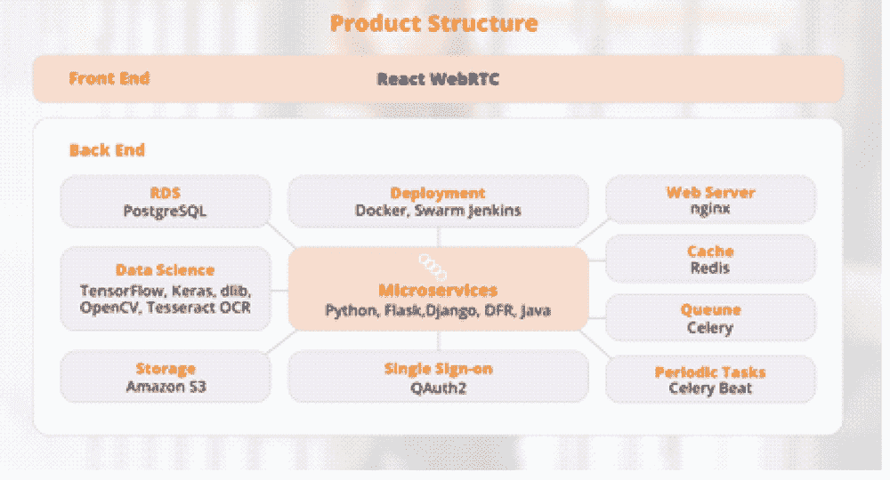 |

该产品证明，生物识别认证结构可以高度定制且易于应用，在幕后驱动一个完全简单的用户界面。此外，该案例还能通过 `API` 与现有系统集成。

保障系统安全绝非小事。当敏感数据（如受保护的健康记录或机构机密）处于风险之中时，采取必要措施防止数据泄露至关重要。未能维持此类信息周围的高安全级别，可能导致欺诈行为，使企业损失数千万甚至数亿美元。

生物识别认证和验证技术，特别是由人工智能驱动的技术，并非易事，通常需要该领域的专家才能将其正确地与现有系统集成。如果您**看重**安全系统的**可靠性**。鉴于我们需要确保无缝的用户体验以及适当的安全性，依赖边缘设备提供了这些优势。

员工面部和语音等生物识别数据似乎足够安全，因为它们代表了可被神经网络识别的独特模式。此外，这类数据更易于获取，因为大多数公司在其 `CRM` 或 `ERP` 中已有员工照片。这样您也可以避免收集员工指纹样本等可能引发的隐私担忧。

结合边缘计算，我们可以为工作场所入口创建一个灵活的 `AI` 安全摄像头设备。那么，让我们根据我们利用边缘生物识别技术自动化办公室入口流程的经验，来讨论此类系统的实施。

已在各种生物识别理念之间进行了比较分析，这些想法共享在表中，此处从多个因素分析了各生物识别设备的特征特性，并确定了最佳的生物识别方法。

##### 表 2. 生物识别技术的特征特性

| 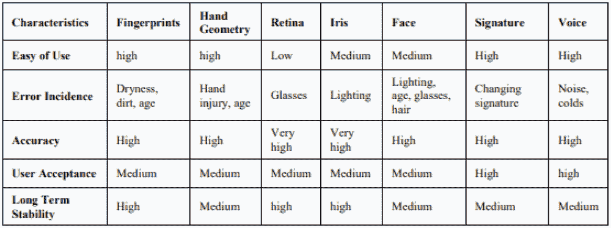 |
| --- |

在该表中，对各种生物识别技术的特征和生物识别因素进行了比较，每种理念都有其自身的优缺点。因此，多种生物识别技术的结合将使安全系统更加强健。

#### 5.4 基于 AI 的职场监控系统设计

该项目的核心理念是仅通过面对摄像头看一眼，即可在办公室入口处认证员工身份。计算机视觉模型能够检测人脸，将其与先前获取的图像进行比对，并控制开门。语音验证作为额外步骤被引入，以防止以任何方式欺骗系统。完整流水线包含 4 个模型，分别承担从人脸检测到语音识别的不同任务。

| 图 17. 生物识别认证系统多模型工作流程图 |
| --- |
| 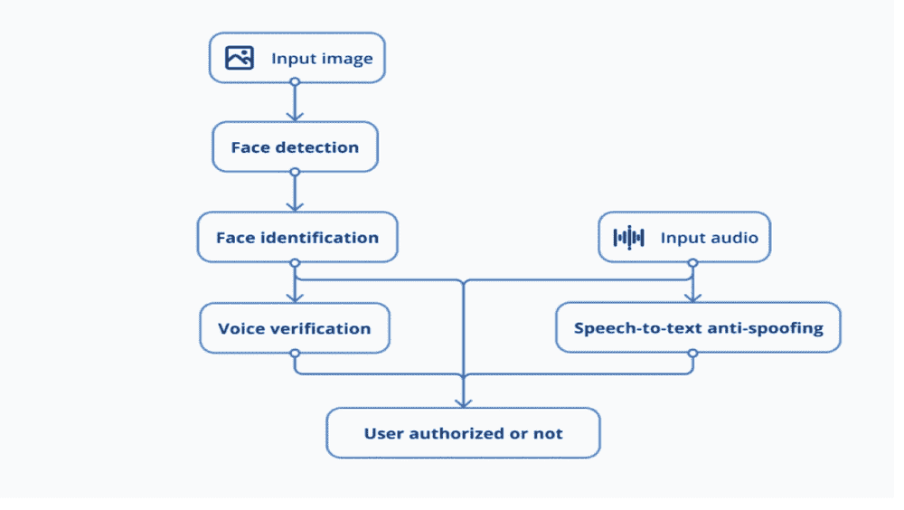 |

所有这些步骤均通过单一边缘设备执行，该设备既作为视频/音频输入传感器，也作为发送锁定/解锁门指令的控制器。作为边缘设备，选择了 `NVIDIA Jetson Xavier`。选择的主要原因在于其拥有 `GPU` 显存（这对加速深度学习任务的推理至关重要）以及 `Jetpack` 的可用性——来自 `NVIDIA` 的 `SDK`，它允许在设备上使用 `Python3` 进行编码。因此，没有严格要求将 `DS` 模型转换为其他格式，且几乎所有代码库均可由 `DS` 工程师适配到设备上，无需将一种编程语言重写为另一种（Vasilchenko, 2024）。

#### 5.5 生物密码学的挑战


### AI 支持的生物加密学：挑战与未来方向

#### 生物加密学面临的挑战

尽管 AI 支持的生物加密学具有诸多优势，但仍有几个关键挑战亟待解决。这些挑战威胁着生物加密系统的认证完整性，主要从以下三个方面进行讨论。

##### 身份欺骗

在 AI 技术的支持下，可以使用各种 AI 工具创建人格欺骗。这种欺骗可能发生在基于图像的生物识别中，AI 技术可以为指纹、虹膜、人脸、声音和掌纹生成伪造身份。伪造照片可被替换用于欺诈性地证明身份验证。这种欺骗幻象使人类观察者失明，导致他们无法区分真实与复制的生物特征。必须在近期内开发出应对这一挑战的解决方案。

##### 深度伪造

深度伪造代表了一种新报告的威胁，即人工创建的人物形象以动态图像（视频）的形式生成。这些伪造视频制造虚假证据并损害个人名誉。深度伪造将一个人的变形图像和声音结合，创建出被描绘为真实的动态图像。人眼无法区分真假内容。这构成了重大挑战，需要立即寻找解决方案。

##### 法律与民事挑战

迫切需要规则和法规来保护人类凭证身份。个人详细信息在当今现实世界中可能被泄露和暴露。为了保护这些详细信息，必须制定相应的适当法律，并对违约者实施严厉惩罚。这一监管空白也被视为一个需要解决的挑战。

### 结论与未来研究

生物加密学及基于生物加密学的认证代表了保护人类凭证的未来。由于人类个体独特性无可替代，这种保护模式可能提供更优越的安全性。在 AI 支持算法的加持下，多重人类特征将被映射以创建相对的加密密码锁用于加密。这种加密将更强健，而解密密钥——个人身份——将为数据建立更好的安全边界。

这种演变可能在近期内发生，五年内即可实现。基于生物识别的认证可充当各类银行交易、锁定机制、医疗记录安全、旅行验证以及通过生物识别密钥进行数据保护的钥匙。未来，生物识别认证将成为各类日常活动的基本特征。

### 参考文献

Alroobaea, R., Arul, R., Rubaiee, S., Alharithi, F. S., Tariq, U., & Fan, X. (2022). AI-assisted bio-inspired algorithm for secure IoT communication networks. *Cluster Computing*, 25(3), 1805–1816. doi:[10.1007/s10586-021-03520-z](https://doi.org/10.1007/s10586-021-03520-z)

Anees, A., Hussain, I., Khokhar, U. M., Ahmed, F., & Shaukat, S. (2022). Machine learning and applied cryptography. *Security and Communication Networks*, 2022, 1–3. doi:[10.1155/2022/9797604](https://doi.org/10.1155/2022/9797604)

Basu, S., Karuppiah, M., Nasipuri, M., Halder, A. K., & Radhakrishnan, N. (2019). Bio-inspired cryptosystem with DNA cryptography and neural networks. *Journal of Systems Architecture*, 94, 24–31. doi:[10.1016/j.sysarc.2019.02.005](https://doi.org/10.1016/j.sysarc.2019.02.005)

Chen, B., & Chandran, V. (2007, December). Biometric based cryptographic key generation from faces. In *9th Biennial Conference of the Australian Pattern Recognition Society on Digital Image Computing Techniques and Applications (DICTA 2007)* (pp. 394-401). IEEE. doi:[10.1109/DICTA.2007.4426824](https://doi.org/10.1109/DICTA.2007.4426824)

Hao, F., Anderson, R., & Daugman, J. (2006). Combining crypto with biometrics effectively. *IEEE Transactions on Computers*, 55(9), 1081–1088. doi:[10.1109/TC.2006.138](https://doi.org/10.1109/TC.2006.138)

Hao, F., & Chan, C. W. (2002). Private key generation from on‐line handwritten signatures. *Information Management & Computer Security*, 10(4), 159–164. doi:[10.1108/09685220210436949](https://doi.org/10.1108/09685220210436949)

Incode. (2022, December 12). *The Future of Biometrics Technology: An Overview by Industry*. Retrieved from [`incode.com/blog/future-of-biometrics/`](https://incode.com/blog/future-of-biometrics/)

Kumar, A., & Kumar, A. (2008, March). A palmprint-based cryptosystem using double encryption. In *Biometric technology for human identification V* (Vol. 6944, pp. 115–123). SPIE. doi:[10.1117/12.778833](https://doi.org/10.1117/12.778833)

miniOrange. (n.d.). *What is Authentication? Different Types of Authentication*. Retrieved from [`blog.miniorange.com/different-types-of-authentication-methods-for-security/`](https://blog.miniorange.com/different-types-of-authentication-methods-for-security/)

Monrose, F., Reiter, M. K., & Wetzel, S. (1999, November). Password hardening based on keystroke dynamics. In *Proceedings of the 6th ACM Conference on Computer and Communications Security* (pp. 73-82). ACM.

Mthunzi, S. N., Benkhelifa, E., Bosakowski, T., & Hariri, S. (2019). A bio-inspired approach to cyber security. In *Machine Learning for Computer and Cyber Security: Principle, Algorithms, and Practices* (p. 75).

O’Connell-Rodwell, C. E. (2007). Keeping an “ear” to the ground: Seismic communication in elephants. *Physiology (Bethesda, MD)*, 22(4), 287–294. doi:[10.1152/physiol.00008.2007](https://doi.org/10.1152/physiol.00008.2007)

Rivest, R. L. (1991, November). Cryptography and machine learning. In *International Conference on the Theory and Application of Cryptology* (pp. 427-439). Springer Berlin Heidelberg.

Uludag, U., Pankanti, S., & Jain, A. K. (2005, July). Fuzzy vault for fingerprints. In *International Conference on Audio-and Video-Based Biometric Person Authentication* (pp. 310-319). Springer Berlin Heidelberg. doi:[10.1007/11527923_32](https://doi.org/10.1007/11527923_32)

Vasilchenko, A. (2024, January 23). *AI Biometric Authentication for Enterprise Security*. Retrieved from [`mobidev.biz/blog/ai-biometrics-technology-authentication-verification-security`](https://mobidev.biz/blog/ai-biometrics-technology-authentication-verification-security)

### 补充阅读

Ahamed, F., Farid, F., Suleiman, B., Jan, Z., Wahsheh, L. A., & Shahrestani, S. (2022). An Intelligent Multimodal Biometric Authentication Model for Personalised Healthcare Services. *Future Internet*, 14(8), 222. doi:[10.3390/fi14080222](https://doi.org/10.3390/fi14080222)

Ahmed, K. I., Tahir, M., Habaebi, M. H., Lau, S. L., & Ahad, A. (2021). Machine Learning for Authentication and Authorization in IoT: Taxonomy, Challenges and Future Research Direction. *Sensors (Basel)*, 21(15), 5122. doi:[10.3390/s21155122](https://doi.org/10.3390/s21155122)

Alkadi, R., Al-Ameri, S., Shoufan, A., & Damiani, E. (2021). Identifying drone operator by deep learning and ensemble learning of imu and control data. *IEEE Transactions on Human-Machine Systems*, 51(5), 451–462. doi:[10.1109/THMS.2021.3102508](https://doi.org/10.1109/THMS.2021.3102508)

Alsarhan, A., Al-Ghuwairi, A.-R., Almalkawi, I. T., Alauthman, M., & Al-Dubai, A. (2020). Machine Learning-Driven Optimization for Intrusion Detection in Smart Vehicular Networks. *Wireless Personal Communications*, 117(4), 3129–3152. doi:[10.1007/s11277-020-07797-y](https://doi.org/10.1007/s11277-020-07797-y)

Ananthi, J. V., & Jose, P. S. H. (2021). A Perspective Review of Security Challenges in Body Area Networks for Healthcare Applications. *International Journal of Wireless Information Networks*, 28(4), 451–466. doi:[10.1007/s10776-021-00538-3](https://doi.org/10.1007/s10776-021-00538-3)

Arora, P., Kaur, B., & Teixeira, M. A. (2022). Security in Industrial Control Systems Using Machine Learning Algorithms: An Overview. In *ICT Analysis and Applications* (pp. 359–368). Springer. doi:[10.1007/978-981-16-5655-2_34](https://doi.org/10.1007/978-981-16-5655-2_34)


### 参考文献

(2018, December). Ashraf Darwish 生物启发式计算：算法综述、深度分析与应用前景 科学学院. Helwan University, Cairo, Egypt 未来计算与信息学期刊 卷, 3(2), 231–246.

Balamurugan, E., Mehbodniya, A., Kariri, E., Yadav, K., Kumar, A., & Haq, M. A. (2022). 基于博弈论深度神经网络 (IDSGT-DNN) 的防御者系统在云计算安全入侵检测中的网络优化. 模式识别快报, 156, 142–151. doi:[10.1016/j.patrec.2022.02.013](https://doi.org/10.1016/j.patrec.2022.02.013)

Bhattacharya, M., Pujari, S., Anand, A., Kumar, N., Jha, S. K., Raj, A., & Hossain, S. M. (2021). 基于姿态识别与机器学习的入侵者检测系统. 国际计算机应用期刊, 183(19), 17–23. doi:[10.5120/ijca2021921533](https://doi.org/10.5120/ijca2021921533)

Brindha, N. V., & Meenakshi, V. S. (2022). 基于轻量级连续多模态生物特征认证的 MANET 中安全优化 AOMDV 路由协议. 环境智能与人性化计算期刊, 40, 1–17.

Chiroma, H. (2021). 基于深度学习算法的指纹认证：系统文献综述. J. Artif. Intell. Syst., 3(1), 157–197. doi:[10.33969/AIS.2021.31010](https://doi.org/10.33969/AIS.2021.31010)

Gayathri, M., & Malathy, C. (2021). 用于入侵检测和多模态生物特征图像认证的深度学习框架. J. Mob. Multimed., 1, 393–420. doi:[10.13052/jmm1550-4646.18212](https://doi.org/10.13052/jmm1550-4646.18212)

Gupta, R., Tanwar, S., Tyagi, S., & Kumar, N. (2020). 安全数据分析的机器学习模型：分类学与威胁模型. 计算机通信, 153, 406–440. doi:[10.1016/j.comcom.2020.02.008](https://doi.org/10.1016/j.comcom.2020.02.008)

Iwendi, C., Anajemba, J. H., Biamba, C., & Ngabo, D. (2021). 智能医疗中事物安全的入侵检测系统. Electronics (Basel), 10(12), 1375. doi:[10.3390/electronics10121375](https://doi.org/10.3390/electronics10121375)

Kumar, K. S., Nair, S. A. H., Roy, D. G., Rajalingam, B., & Kumar, R. S. (2021). 基于联邦机器学习的安全与隐私感知人工入侵检测系统. 计算机与电气工程, 96, 107440. doi:[10.1016/j.compeleceng.2021.107440](https://doi.org/10.1016/j.compeleceng.2021.107440)

Latif, S. A., Wen, F. B. X., Iwendi, C., Wang, L.-L. F., Mohsin, S. M., Han, Z., & Band, S. S. (2022). 面向网络物理系统 IoT 网络的 AI 赋能、区块链与 SDN 集成安全架构. 计算机通信, 181, 274–283. doi:[10.1016/j.comcom.2021.09.029](https://doi.org/10.1016/j.comcom.2021.09.029)

Mittal, M., Iwendi, C., Khan, S., & Javed, A. R. (2020). 基于 Levenberg-Marquardt 神经网络和门控循环单元入侵检测系统的低能耗自适应聚类层次协议中最短路由发现的安全性与能效分析. 新兴电信技术汇刊, 32(6), e3997. doi:[10.1002/ett.3997](https://doi.org/10.1002/ett.3997)

Sedik, A., Faragallah, O. S., El-Sayed, H. S., El-Banby, G. M., El-Samie, F. E. A., Khalaf, A. A. M., & El-Shafai, W. (2021). 基于多模态深度学习的面部视频取证检测高效网络安全框架. 神经计算与应用, 34(2), 1251–1268. doi:[10.1007/s00521-021-06416-6](https://doi.org/10.1007/s00521-021-06416-6)

Shafiq, M., Tian, Z., Bashir, A. K., Du, X., & Guizani, M. (2020). CorrAUC：一种利用机器学习技术在 IoT 网络中检测恶意僵尸网络-IoT 流量的方法. IEEE 物联网期刊, 8(5), 3242–3254. doi:[10.1109/JIOT.2020.3002255](https://doi.org/10.1109/JIOT.2020.3002255)

Shafiq, M., Tian, Z., Bashir, A. K., Du, X., & Guizani, M. (2020). 基于包装器特征选择机制的 IoT 恶意流量识别. 计算机与安全, 94, 101863. doi:[10.1016/j.cose.2020.101863](https://doi.org/10.1016/j.cose.2020.101863)

Shafiq, M., Tian, Z., Bashir, A. K., Jolfaei, A., & Yu, X. (2020). 面向可持续智慧城市交通分类的数据挖掘与机器学习方法：综述. 可持续城市与社会, 60, 102177. doi:[10.1016/j.scs.2020.102177](https://doi.org/10.1016/j.scs.2020.102177)

Shafiq, M., Tian, Z., Sun, Y., Du, X., & Guizani, M. (2020). 智慧城市物联网中有效机器学习算法的选择与僵尸网络-IoT 攻击流量识别. 未来世代计算机系统, 107, 433–442. doi:[10.1016/j.future.2020.02.017](https://doi.org/10.1016/j.future.2020.02.017)

Suresh, P., Logeswaran, K., Keerthika, P., Devi, R. M., Sentamilselvan, K., Kamalam, G. K., & Muthukrishnan, H. (2022). 机器学习与深度学习技术在网络安全中有效性的当代综述. 在《生物特征识别的机器学习》中 (pp. 177–200). Academic Press. doi:[10.1016/B978-0-323-85209-8.00007-9](https://doi.org/10.1016/B978-0-323-85209-8.00007-9)

## 第 4 章 使用自学习 AI 的动态密钥管理

**R. Valarmathi**  
  
Sri Sairam Engineering College, India

**R. Uma**  
  
Sri Sairam Engineering College, India

**P. Ramkumar**  
Sri Sairam College of Engineering, India

**Srivatsan Venkatesh**  
Sri Sairam Engineering College, India

### 摘要

当前现有的安全功能，例如 SHA 系列哈希函数、其他暴力破解防护协议等，正在保护我们的网络领域免受脚本小子和专业黑客的侵害。但最近的研究表明，渗透工具已通过多种方式得到优化，使黑客在密钥记录和暴力破解防范战术上占据巨大优势，从而能够对脆弱的数据库实施有效攻击。许多现有领域现在都通过增加人工智能支持进行了优化。具体而言，OpenAI API 市场的用例已大幅增长，密码哈希自动化现在到了升级的时候了。

### 1 引言

该想法是创建一个自我学习且能抵御漏洞的 AI。利用可信赖的 OpenAI API，输入海量数据并收集漏洞和黑客的最坏情况历史记录。使用其算法进行训练并即时获得威胁响应，而非进行 24 小时的媒介状态监控。AI 将取代部分繁琐任务，确保提供错误或漏洞的完整日志。它锁定重要数据库和其他代码以防扩散，如果遇到先前被该 AI 其他实例遇到过的处于活跃攻击模块中的漏洞，则彻底清除这些漏洞。此外，该 AI 还可用于转移当前加密状态中的部分密钥，在用户位置和域位置系统上创建新密钥。这是安全与隐私大仓库的未来。


#### OpenAI 模型与动态密钥加密

由于 OpenAI 模型日益普及且数据集训练方法不断进步，使其更易于获取和训练。动态密钥加密要求 AI 进行预测性哈希生成以及密钥存储。我们即将训练和分析的 AI 模型是 OpenAI API 的一个轻微变体，具体而言是用于 NLP（自然语言处理）的 GPT-3 语言模型。

首先是分析阶段，该阶段从先前有缺陷的加密环境数据集、安全事件及其相应的网络防护、绕过网络故障历史和数据泄露的方法、现有系统中的异常以及系统内的所有其他缺陷中收集数据，并寻找预防措施。当将这种形式的数据收集提供并输入给连接了 OpenAI API 的密码学机器时，它特别有用。它能发现错误；如果攻击症状与任何已知的先前攻击策略相关，或者遇到一种新型攻击，它必须将攻击模式存储在其数据库中，并必须通过另一种防御形式——动态密钥管理——来适应即将到来的攻击。

#### 动态密钥管理

动态密钥管理确保某个哈希或信息的密钥在我们的系统、服务器以及主机系统中多次随机化。动态密钥管理 AI 还必须负责存储、分发和生成新形式的密钥哈希，无论是通过随机生成还是播种噪声生成。使用播种噪声生成的密钥时，最佳实践是选择另一个具有唯一种子的随机器的随机噪声种子，这确保了即使当前密钥的种子被暴露，决定性算法也会改变负责改变密钥随机器种子的随机器的种子。因此，OpenAI 工具实现了三层密钥保护以及动态密钥处理。这种分层安全在任何形式的媒体中都是万无一失的，且管理员也能轻松操作。因此，下一个安全加密形式是保护此 AI 免受黑客内部人员或针对 AI API 的键盘记录器的侵害。

结合所有这些特性，我们将创建一个能够检测所有形式入侵的 AI。

### 2. 背景

网络安全是现代社会中最需要的领域划分，现代社会完全依赖数字媒体进行数据传输和使用。在当今时代，窃贼可能不需要你的钱包来获取你的身份信息，而可以直接从你信任的系统中窃取。这揭示了“网络犯罪”这一术语。由于黑客技术不断演变，包括脚本机器人和 AI 的使用（Pearce 等人，2023），传统安全措施面临挑战，导致手动渗透规避和安全措施效果减弱。

值得注意的是，AI 的出现带来了新的复杂性，例如利用 GPT 进行鱼叉式网络钓鱼（Khan 等人，2021），压倒了一些基于网络的入侵检测系统（Gala 等人，2023）。Joshi 等人（2022）等研究人员探索了 SQL 注入等自动渗透方法，影响了我们项目的范围。Gallus 等人（2023）研究了生成式神经网络（类似于 DALL-E 和 ChatGPT）如何作为 Web 应用渗透测试工具，利用大语言模型（LLM）和生成式神经网络。

Li 和 Oprea（2016）关于利用企业安全日志进行入侵检测的研究，启发了我们的 AI-IDS 通过安全日志检测入侵。Memos 和 Psannis（2020）强调了 AI 在蜜罐中用于僵尸网络检测的作用，这是对抗分布式拒绝服务（DDoS）攻击的关键组件。Prasad 等人（2023）强调了 GPT 模型在网络安全领域的作用，指导了我们项目的方向。

Srinivasan 和 Deepalakshmi（2021）为 AI 驱动的恶意软件检测提供了见解。González 等人（2023）探索了利用生成式 AI 进行异常检测，影响了我们利用 AI 进行异常检测。Kandhro 等人（2023）深入研究了恶意入侵和攻击的实时检测，指导了我们对攻击者识别的理解。

Cova 等人（2010）识别异常并分析 JavaScript 代码。Bailey 等人（2007）提出了一种分类技术并分析了恶意软件的行为。

Song 等人（2008）在 BitBlaze 项目上提供了二进制分析。Kruegel 等人（2005）演示了网络隐蔽攻击的检测。Zhang 等人（2010）讨论了 Web 应用中的挑战性威胁。

Bilge 等人（2011）分析 DNS 查询以检测涉及恶意活动的域名。Grier 等人（2012）通过分析恶意 URL 调查了漏洞利用即服务模型。Canali 等人（2011）探索了固件镜像中的漏洞。

这些资源和研究人员为“抗体 AI”项目奠定了基础，反映了网络安全领域的集体智慧和进步。他们的工作为我们开发针对新兴网络威胁的稳健防御机制提供了指导。

### 3. 处理方式

这一革命性 AI 的创建包含一个由 4 部分组成的训练和编程方法，每个过程用于更大 AI（即所谓的“抗体”）的某个组件。该 AI 的创建过程取决于以下因素：

*   使用 SUND 因子进行入侵检测
*   历史入侵数据检测及当前入侵与过往尝试的对比
*   安全协议与攻击警报系统
*   锁定协议与事后响应机制

#### 3.1 使用“SUND”因子进行入侵检测

“SUND”代表该防护系统四个主要原始输入组件：**软件日志**、**用户输入日志**、**网络日志**和**数据库日志**。嵌入在此 AI 中的入侵检测系统作为主要防线，在保护系统免受键盘记录器和其他试图进行暴力破解的恶意实体的潜在威胁方面发挥着至关重要的作用。抗体 AI 配备了大量经过战略性设计的输入，用于监控和确保系统安全。这些输入易于配置，可跟踪组织内部和外部的各种参数，从而提供安全的监控方法。抗体 AI 的主要目标是利用给定输入迅速识别系统内的任何异常或入侵迹象，从而采取主动措施。通过持续监控系统安全并采用复杂的输入集，抗体 AI 增强了网络安全框架的整体韧性，确保对新兴威胁的强力防御。

AI 进行入侵监控所需的输入包括：

*   软件日志
*   用户输入日志
*   网络流量日志
*   数据库日志

此外，抗体 AI 还需要另一个参数：IRS 访问权限（入侵响应系统访问权限）。

这些输入中的每一个都根据 AI 自身的“入侵历史”数据集单独使用。AI 经过“入侵历史数据集”训练，当 AI 使用上述输入检测到入侵环境时，会继续执行后续步骤。从日志获取的输入样本如表 1.1 所示。

**表 1. 从日志获取的输入样本**

| 数据编号 | IP 地址 | IP 的网络延迟 | IP 的软件代码使用率 | SQL 注入检测 |
| --- | --- | --- | --- | --- |
| 1 | 192.168.0.71 | 345ms | 72% 内存 | False |
| 2 | 192.168.0.72 | 228ms | 68% 内存 | True |


##### 3.1.1 软件日志使用

此处的 AI 将软件日志作为一部分使用，以应对应用内代码恶意运行任何键盘记录，或外部人员/黑客尝试通过某员工的旧密码进行反向暴力破解的情况。此类手段仍是攻破公司安全防线的常用途径。AI 据称能检测应用程序内存在的任何形式的恶意活动：

*   应用程序内部是否发生暴力破解
*   应用程序是否使用恶意代码窃取用户数据
*   应用程序是否存在不必要的后门

每当恶意代码利用软件的无辜部分作为宿主时，必定会在软件内留下痕迹，而这些痕迹肯定会通过日志被收集。部分软件代码使用量会被清零，因为这可能是由于单一功能的过度使用，范围涵盖从少量内存和 RAM 占用到总体占用软件大部分资源。有时，恶意代码不会记录自己消耗了多少 RAM，而 AI 会搜寻软件代码，检查软件的有效签名以及软件内存使用的有效性。第一道防线是记录使用情况并上报给相关部门，同时记录内存使用的 IP。当达到特定阈值且 AI 检测到时，会触发其协议，降低安全分，并将检测到的恶意软件发送至 `IRS`（入侵响应系统）。图 1 显示了软件代码日志示例。

| 图 1. 软件代码日志 |
| --- |
| 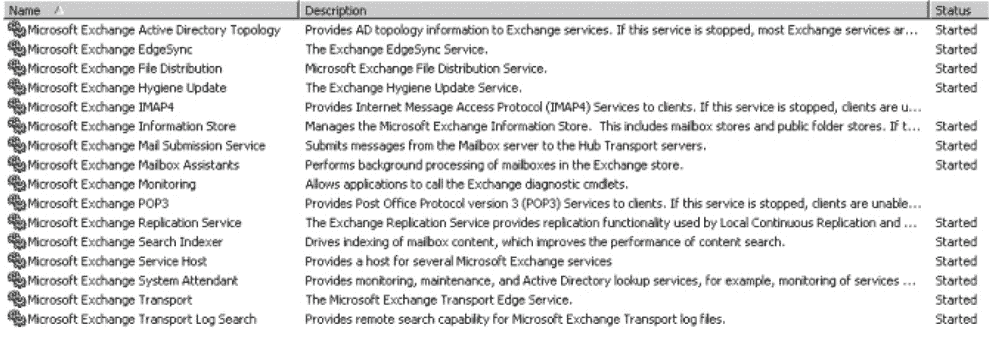 |

##### 3.1.2 用户登录/登出日志使用

用户登录和登出日志作为代码的一部分存储在生物识别考勤模块中。AI 检查异常 IP 和签出时间，以检测网络内任何 IP 地址的异常活动，随后通知负责处理的部门，并触发封锁协议系列-1（参阅封锁协议部分），同时标记可疑 IP 实例，从而保护网络中的其他用户。如果优化暴力破解算法用户利用僵尸网络或肉鸡进入，可检测到多次尝试和登录，从而触发封锁协议系列-2（参阅封锁协议部分）以保护用户。其他用户可安全工作，因为他们的工作会被强制暂时移至虚拟工作环境，直到攻击者被控制或僵尸网络被安全措施清除。图 2 显示了用户登录日志。

> **注意：** 此处的抗体 AI 并非完整的 IDPS 和 IRS 套件，它只是加密安全器和入侵检测系统 (IDS)，因此，取决于系统中的 IRS 和各公司网络安全部门的使用情况，其他用户在虚拟工作环境中的停留时间也随之而定。

| 图 2. 用户登录日志 |
| --- |
|  |

##### 3.1.3 网络流量日志使用

网络流量日志与其他输入一起被监控，以防网络内任何系统出现停滞。网络停滞可能意味着存在额外流量，这可能是由使用僵尸网络或肉鸡 PC 进入主机的暴力破解算法引起的。如果停滞是由于其他障碍造成的，原因会被记录并发送给响应机制、网络管理员以及园区内的网络安全管理员，以提醒他们注意任何恶意活动。如果网络拥堵仅仅是 Ping 重发或网络缓慢，AI 的精准检测会识别这些情况并向相应员工报告，并采取措施通过其他方式防止网络流量缓慢。

这种网络日志用法直接转化为“安全分”的基础值，使 AI 能够检测图 3 所示的入侵行为。

| 图 3. 网络流量日志 |
| --- |
| 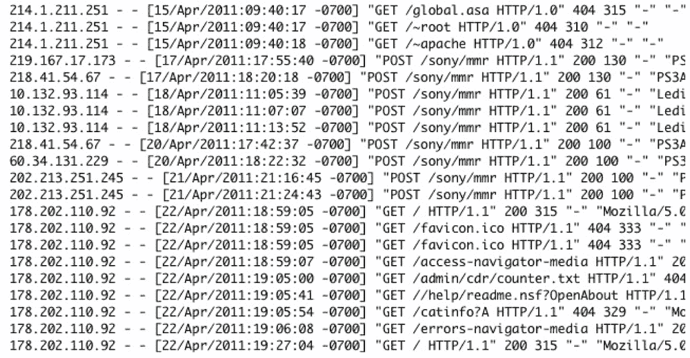 |

##### 3.1.4 数据库日志使用

AI 利用客户端计算机中的数据库日志和错误，检查是否有僵尸网络试图使用 SQL 注入法进入系统，它检查特定时间发生的错误日志，以判断是否有肉鸡试图渗透数据库。为了便于预防且不伤及肉鸡，AI 将此检测为“异常”标签，并反馈给公司的网络安全部门，不对肉鸡采取进一步行动。数据库也容易受到脚本小子在文本字段中使用 SQL 注入标签的攻击，因此 AI 监控文本字段的输入以检查这些漏洞标签，一旦检测到，会转发给公司网络安全部门；同时触发针对该特定问题的安全协议。数据库日志如图 4 所示。

| 图 4. 数据库日志 (SQL) |
| --- |
| 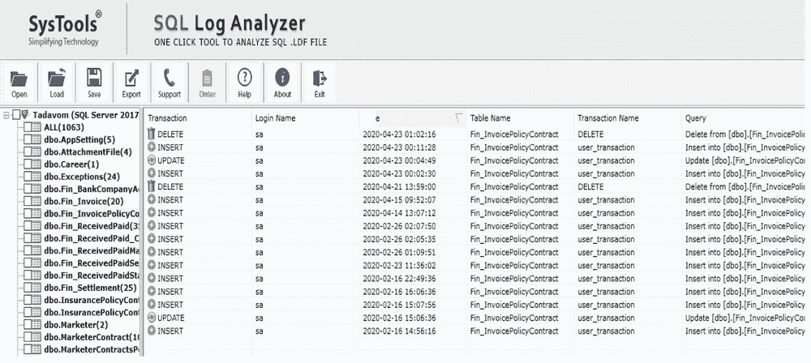 |

##### 3.1.5 IRS 访问

如前文注释所述，此 AI 并非响应系统，而仅是检测和防护系统。它需要访问每个网络使用的 IRS 系统，以便向系统发出警报，并对系统承受的任何威胁进行响应或反击。一旦检测到入侵，无论是暴力破解、SQL 注入、僵尸网络还是肉鸡，AI 必须激活公司系统内的 IRS，并提醒其他用户有情况发生。该检测 AI 和密钥更换 AI 所需的最终输入，是可用于对入侵做出正确响应的响应系统访问权限。

#### 3.2 历史入侵数据检测与当前入侵与过往尝试的对比

抗体 AI 使用此处给定的输入，不是作为分离的原始数字，而是作为更大输入的一部分，来检测我们现在所谓的特定时间系统的“安全分”。这些安全分通过我们创建的另一个 AI——“淋巴 AI”输入给抗体 AI。淋巴 AI 只是一个基于简单 CNN 的 AI，它收集日志及其相关因素以生成我们提到的“安全分”。淋巴 AI 使用过去发生的入侵数据集及其在表 1.2 给定特定公式下的相应日志进行训练。

表 2. 过往入侵示例数据集及淋巴 AI 输出：根据接收数据生成安全分并计算入侵概率百分比

| 数据编号 | IP 地址 | IP 网络延迟 | IP 软件代码使用率 | SQL 注入检测 | 其他用户相似尝试 | 安全分 | 潜在入侵百分比 |
| --- | --- | --- | --- | --- | --- | --- | --- |
| 1 | 192.168.0.71 | 345ms | 72% 内存 | 否 | 192.168.0.75 | 20 | 89% |
| 2 | 192.168.0.72 | 228ms | 68% 内存 | 是 | 192.168.0.76 | 10 | 92% |
| 3 | 192.168.0.73 | 315ms | 45% 内存 | 否 | 无 | 64 | 25% |
| 4 | 192.168.0.74 | 12ms | 30% 内存 | 否 | 无 | 85 | 8% |
| 5 | 192.168.0.75 | 562ms | 81% 内存 | 否 | 192.168.0.71 | 14 | 90% |
| 6 | 192.168.0.76 | 645ms | 84% 内存 | 是 | 192.168.0.72 | 8 | 96% |

这些历史数据可用于训练淋巴 AI，并从抗体 AI 收集数据以检查入侵。这些操作以每个系统 30 秒的间隔发生，并以日志文件形式提交给相关部门。抗体 AI 生成的这些日志文件也可用于训练淋巴 AI，使整个 AI 成为自我学习的自动机。当当前收集的数据具有较低的“安全分”时，抗体 AI 检测到安全分并采取相应的入侵应对措施。


### 表格参数

该表格有几个重要参数，列举如下：

*   **IP 地址**
*   **IP 的网络 Ping 值**
*   **IP 的软件代码使用情况**
*   **SQL 注入检测**
*   **其他用户的相似尝试**
*   **安全积分**
*   **潜在入侵百分比**

#### IP 地址

首先接收 IP 地址，以检测并定位受影响/位于入侵背后的恶意 PC。如果检测到 IP，在采取对策后，该 IP 及其对应的机器将在整个过程中被清理。

#### IP 的网络 Ping 值

IP 的网络 Ping 值用于检测系统中是否存在高流量，该特定系统执行暴力破解进程的比率较高，或拥有影响该 IP 的恶意软件。检测到此情况后触发的协议是 **Lockdown Protocol series-1（封锁协议系列-1）**。网络内的其他 IP 通过此协议得到保护。**Wireshark** 用于通过图 5 中显示的 Ping 往返时间来检测 IP 内的网络流量。

| 图 5. Wireshark 用于通过其使用情况中的 Ping 往返时间来检测 IP 内的网络流量 |
| --- |
| 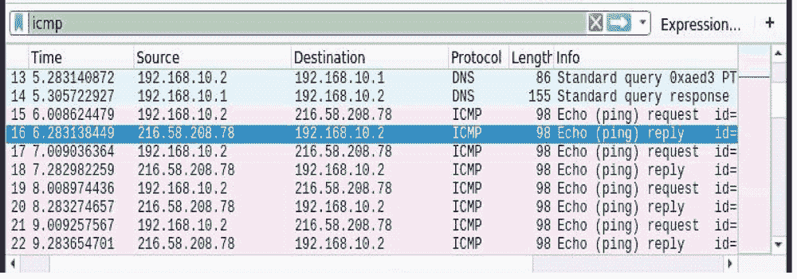 |

#### IP 的软件代码使用情况

该特定 IP 的代码使用情况用于检测该特定系统中是否有病毒或木马处于活动状态。甚至在数据发送后，键盘记录行为也能被检测到。**IRS** 的后果触发 **Antibody AI（抗体 AI）** 重新安装该特定 IP 上的软件。这种保护对“安全积分”并非专门有用，但在万一这种监控发现另一个流浪 IP 从而导致更大威胁的预防的情况下，保留它总比毫无用处强。**HTOP** 用于通过管理员远程访问来检测 IP 内的内存使用情况，如图 6 所示。

| 图 6. HTOP 用于通过管理员远程访问来检测 IP 内的内存使用情况 |
| --- |
| 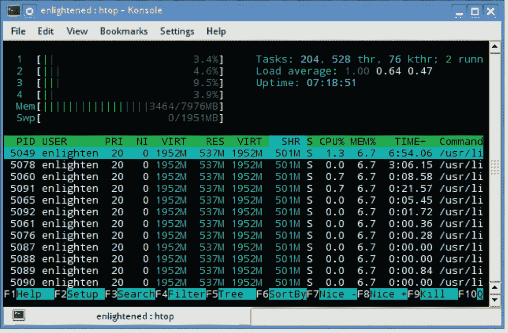 |

#### SQL 注入检测

SQL 注入检测是入侵检测中简单且关键的部分。它检查用户或工具（如 **SQLMap** 等）在 SQL 注入中常用的几个关键字。如果来自某 IP 的输入看起来像 SQL 注入，它会将 **SQL Injection Flag（SQL 注入标志）** 切换为 `True`，从而即时降低安全积分。这迄今为止是 AI 最简单但必不可少的参数，使得入侵检测更容易，也能轻松定位责任人。

检测的一些参数如下：

*   `” OR 1=0 –`
*   `” OR 1=1 –`
*   `” OR 1=1 OR ““=”`
*   `’ OR (EXISTS)`
*   `’ OR uname LIKE ‘%`
*   `’ OR userid LIKE ‘%`
*   `’ OR username LIKE ‘%`
*   `’ UNION ALL SELECT`
*   `’ UNION SELECT`
*   `’`
*   `”`
*   `” OR ‘1’ EQUALS ‘1’`
*   `’ WHERE ALL`
*   `’ OR 1=1 –`
*   `’ --`

这些是用于 SQL 注入的少数标签。通常尝试 SQL 注入的人会使用脚本或机器人持续尝试所有这些参数，只为让其中一个能攻破文本框并渗透系统。

#### 其他用户的相似尝试

“其他用户的相似尝试”参数用于检测其他用户的参数是否与当前用户的参数匹配。如果匹配，则可能有多个系统正在覆盖所有协议，或者多个系统受到相同恶意软件或病毒的影响。这种情况在许多大公司的入侵事件中很突出，所以宁可信其有，不可信其无。

#### 安全积分和潜在入侵百分比

安全积分是 **lymph AI（淋巴 AI）** 分析后给出的分数。它是 **Lymph AI** 作为数据集获得的所有数据评估的结果。该安全积分用于实时评估系统是否安全，或者是否容易被渗透。为了进行额外评估，“安全积分”还伴随“潜在入侵百分比”和“触发标志”这两个附加参数。潜在入侵百分比检测当前 IP 或系统被攻破的漏洞程度或可能性，触发标志用于开启 **IRS** 及包含在 **Antibody AI** 中的安全措施。

表 1.3 显示了当时收到的数据，并检测入侵。正如你所见，导致入侵的系统以及触发标志的状态被存储下来。

##### 表 3. 系统的当前数据集及淋巴 AI 对接收数据产生的安全积分输出，并触发标志以调用部门内的 IRS

| 数据编号 | IP 地址 | IP 的网络 Ping 值 | IP 的软件代码使用情况 | SQL 注入检测 | 安全积分 | 潜在入侵百分比 | 触发标志 |
| --- | --- | --- | --- | --- | --- | --- | --- |
| 1 | 192.168.0.71 | 345ms | 72% memory | False | 20 | 89% | True |
| 2 | 192.168.0.72 | 228ms | 68% memory | True | 10 | 92% | True |

#### 3.3 安全协议与攻击警报系统

一旦 **Antibody AI** 启动触发，安全协议被激活，警报系统被通知。安全协议有一套特定的有序工作流，每项如下：

*   **安全协议 SP (1) - 日志备份与警报启动** – 负责触发的当前日志被备份到一个名为“black box（黑盒）”的文件夹中，以防任何事件导致整个系统崩溃，此黑盒存储在外部云设备中，问题解决后可取出，以查明问题原因。
*   **安全协议 SP (2) – 触发 IRS 与封锁协议** – 利用系统中现有的 **IRS**，AI 开始响应操作，同时作为安全程序将未受感染的用户转移到虚拟工作环境，并在未受感染用户的屏幕上显示以下错误信息。

> “注意：抗体 AI 检测到潜在入侵等级：\_\_\_\_。为安全起见，我们已将您的文件移至远程虚拟工作环境。对不便之处深表歉意。”

警报消息如图 7 所示。

随着潜在入侵等级的上升，每个等级根据安全积分的结果不同，具体如下：

##### Delta 级（Delta Level）

入侵不严重，只是令人恼火。可能是以下原因导致：

*   轻微的 SQL 注入尝试
*   使用脚本或机器人进行密码登录。
*   在较短时间内持续失败的尝试

预防措施包括：调用 **Lockdown Protocol Series – 1（封锁协议系列-1）**，参数为恶意 IP。

##### Gamma 级（Gamma Level）

满足多台机器的入侵条件，但威胁等级极低。可能的结果包括：

*   弱僵尸网络或肉鸡尝试 SQL 注入。
*   相同恶意代码在多台设备上运行。
*   叛逆员工远程访问并使用某种黑客技术。

预防措施包括：调用 **Lockdown Protocol Series – 1**，参数为恶意 IP。

##### Beta 级（Beta Level）

威胁等级高，许多系统受影响。可能包括：

*   任一系统中近乎成功的入侵尝试。
*   网络延迟和峰值。
*   来自多个 IP 的大量尝试

预防措施包括：调用 **Lockdown Protocol Series – 2（封锁协议系列-2）**，参数为恶意 IP。

##### Alpha 级（Alpha Level）

显示严重入侵。部分场景包括：

*   文件损坏。
*   IP 囤积。
*   非法访问已进入。
*   成功的入侵尝试。

预防措施包括：调用 **Lockdown Protocol Series – 2**，参数为恶意 IP。


### 第二阶段：IRS 响应

该安全系统的第二阶段依赖于系统或网络中存在的 IRS（免疫响应系统）。在启动 SP（安全协议）后，攻击警报系统会呼叫系统中存在的 IRS。这些 IRS 着手应对迫在眉睫的攻击，而抗体 AI 则前去执行其设计用于执行的主要职责——密码学。

| 图 7. 发生“GAMMA”级入侵威胁时 AI 的警报消息 |
| :--- |
| 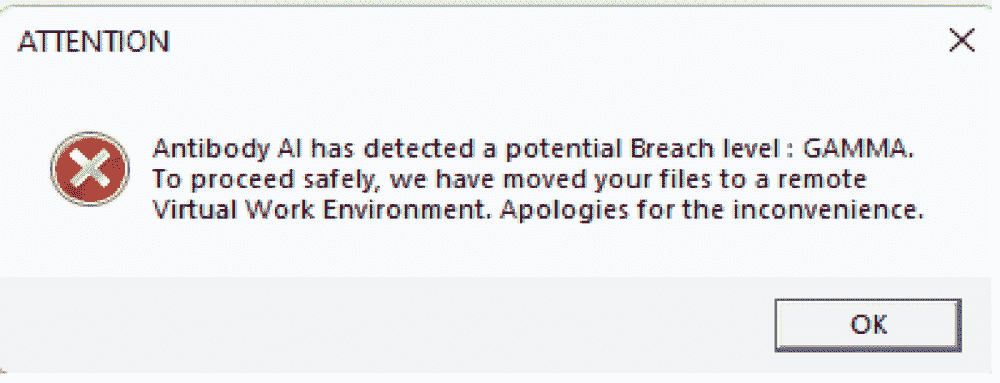 |

#### 3.4 锁定协议与事后响应机制

##### 3.4.1 锁定协议

该 AI 中存在的锁定协议用于安全地隔离网络中其他未受影响的 IP 或系统。这些协议由安全协议 2 (SP2) 触发。锁定协议以 IP 地址为参数，以安全地锁定并隔离未受影响的系统与受影响的系统。抗体 AI 拥有 2 个锁定协议 (LP，简称)，

*   **锁定协议系列 1 (LPS-1)** – 当给定网络中一两个特定系统受影响/变为恶意时，将使用此协议。该锁定协议以受影响的 IP 地址作为参数被调用，并锁定受影响的 IP，以保护未受影响或安全的系统。
*   **锁定协议系列 2 (LPS-2)** – 当网络中不止一个系统为恶意或被标记时，将使用此协议。在这种情况下，将使用恶意/受影响系统的 IP 地址调用 LPS 2 协议，但它会将其他无辜系统与这些被标记和受影响的系统隔离开，以确保无法从受影响系统传播或扩散到未受影响系统，从而保护网络中的其他系统。

当锁定程序启动时，系统将自动切换到其各自的虚拟工作环境。随后进入入侵事后处理阶段。

##### 3.4.2 事后响应机制

入侵结束且 IRS 完成其工作后，将激活事后响应机制。这是 AI 的密码学部分，也是本项目的主要动机。该 ARM（事后响应机制）包含若干分层步骤，如下所示：

*   **事后响应机制 – 领域 1**
    *   **第 1 层** – IRS 响应后，抗体 AI 在系统内搜索任何恶意代码。
    *   **第 2 层** – 抗体 AI 将所有撤离到虚拟工作环境的文件恢复原状。
    *   **第 3 层** – 将文件恢复到各自的系统后，AI 再次搜索任何恶意代码或入迹象。
    *   **第 4 层** – 抗体 AI 使用淋巴 AI 和上一次入侵的黑匣子备份，训练淋巴 AI 识别另一种威胁，从而实现自我学习。
    *   **第 5 层** – AI 向其所在工作单位的网络安全部门提供 IRS 日志和淋巴 AI 日志。
    *   **第 6 层** – 用户解除锁定状态，恢复工作。
    *   **第 7 层** – 随着用户工作，AI 在整个系统中执行最后一次搜索，以检查该代码片段是否存在。

领域 1 成功执行且无任何差错后，整个网络将进入固定时间段的维护期，响应机制转入最关键的步骤——领域 2。

*   **事后响应机制 – 领域 2**
    *   **第 1 层** – 抗体 AI 将数据库的所有密码和集体信息备份到数据库内的随机位置，以确保没有人能找到其位置，甚至包括管理员。
    *   **第 2 层** – AI 剥离旧的加密函数密钥，并生成一个新的随机密钥。
    *   **第 3 层** – 此新密钥将用于加密存储在随机位置的所有密码，并存储到相应用户的密码字段中。
    *   **第 4 层** – 最后一步是让用户再次登录以检查是否有加密错误，如果有错误，可使用随机文件夹中指定的备份密码进入并修改。

加载完事后响应机制的领域 2 后，整个网络将恢复正常，并采用新的加密，该加密因入侵而异且无法被检测到，甚至管理员也无法检测。随后维护期随一条信息警报结束：“感谢您的等待：抗体 AI 现已更改密码加密。为检查您的密码是否正确加密，请尝试登录您的软件。若遇到任何错误，请联系您的管理员”，如 图 8 所示，抗体 AI 完成其工作。这就是抗体 AI 连同其其他部分（如淋巴 AI 和协议）运作的工作流程。

| 图 8. ARM 领域 2 完成时 AI 的信息消息 |
| :--- |
| 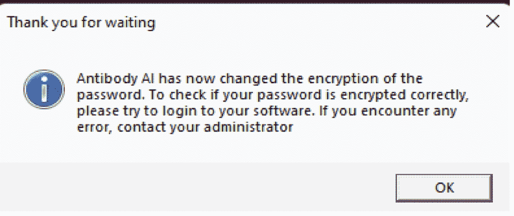 |

### 4. 系统架构

| 图 9. 抗体 AI 及其内部所有组件的系统架构 |
| :--- |
| 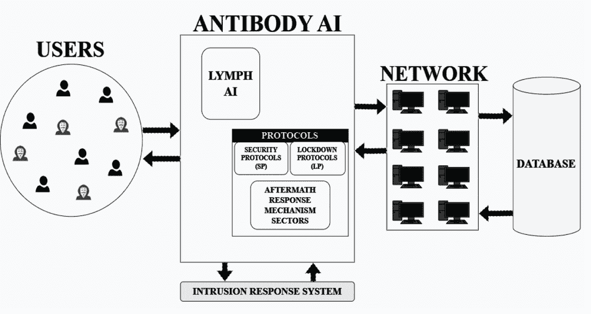 |

图 9 展示了抗体 AI 的架构。用户部分指使用软件或网络的用户，包含少数合法用户和少数黑客/键盘记录器。网络部分描绘了用户系统所在的网络，数据库表示存储所有关键数据的位置。抗体 AI 由以下部分组成：

*   **淋巴 AI**
*   **协议**

#### 4.1 淋巴 AI

抗体 AI 的这一部分负责利用数据集进行集体训练并生成“安全点”，供抗体 AI 及其协议使用。由于抗体 AI 是基于 LLM/生成式 AI 的神经网络，为了准确行动，它必须接受少量简单的输入。基于这一唯一原因，抗体 AI 内嵌了一个较小的 AI 模型，专门用于将原始数据（即日志和其他用户输入）直接转换为处理后的输出点。这些点决定系统是安全的还是正在发生入侵。淋巴 AI 的这些输出随后被发送给主 AI——抗体 AI，后者结合自身的处理方法将这些点转换为可用格式，以检测系统是否被攻破。图 10 展示了淋巴 AI 的工作原理及输出返回过程。

| 图 10. 淋巴 AI 的工作原理及输出返回 |
| :--- |
|  |

#### 4.2 协议

协议在抗体 AI 中发挥着主要作用。为执行如此庞大的流程，AI 有时会变得随机化，并在试图防护或遏制入侵时混淆。为避免这种情况并为用户标记流程，该 AI 拥有若干协议以保护网络及其自身。

部分先前解释过的协议如下：

*   **安全协议 (SP)** – 一旦 AI 识别出入侵可能性，即触发这些协议。
*   **锁定协议 (LP)** – 一旦 IRS 接收到触发消息，即触发这些协议，用于保护同一网络内的其他用户。
*   **事后响应机制领域 (ARMS)** – 一旦 IRS 完成对入侵者或黑客的处理工作，即触发这些协议。这是负责抗体 AI 动态密钥更改的主要算法。

### 5. 影响准确性的参数

本项目包含两个具有不同参数和不同工作流程的 AI，因此每个 AI 都有几个显著的参数优先级和对其准确性的影响。分类如下：

#### 5.1 影响淋巴 AI 的参数


### Lymph AI：抗体 AI 的第一层

我们直接提供给抗体 AI 的每一个输入（即 SUND 输入）首先进入 **Lymph AI（淋巴 AI）**。Lymph AI 通过选择性公式法和数据集训练法接收这些输入并生成输出。该输出称为 **“安全点”**。这些安全点被传递给抗体 AI，后者仅接受源自 Lymph AI 的输入。随后，安全点被转换为抗体 AI 用于不同目的的各种参数形式：**PBP（潜在违规百分比）** 和 **触发标志**。

#### 5.1. 影响 Lymph AI 的输入参数

##### 5.1.1. IP 地址

被扫描计算机的 `IP Address` 决定了我们试图访问的系统。它充当计算机的 ID，标识我们从哪台计算机获取数据。这是 Lymph AI 的 **主键**。它不用于计算“安全点”的公式中，但对于 AI 检测入侵仍然很重要。

如果检测到入侵，Lymph AI 会连同受影响电脑的 IP 或攻击者的 IP 一起发送安全点。这些 IP 作为 **封锁协议** 的参数。

##### 5.1.2. IP 的网络 Ping 值

IP（或系统）的 `Network Ping` 用于确定网络流量，这对于分析暴力破解或僵尸网络尝试至关重要。该参数以 **毫秒** 为单位，并作为 Lymph AI 内部的基础检测参数。

它充当 **安全点的基础值参数**。当设置较高时（即网络 Ping 增加），安全点会显著下降，但不会超过 **20 点**。

##### 5.1.3. IP 的软件代码使用情况

软件代码使用情况通过监控选定应用程序或操作系统的内存消耗，检测软件内运行的恶意代码。通过远程登录操作系统，我们检测目标 IP 的内存和 RAM 使用情况。如果使用率超过特定阈值，我们断定该软件正在运行恶意代码（例如自动密钥生成器或暴力破解代码）或已死机。该参数在 Lymph AI 中具有 **最低优先级**。

##### 5.1.4. SQL 注入检测

SQL 注入检测是 Lymph AI 最简单但也最关键的参数。它检测文本字段中的 SQL 注入标签，立即将其默认值（`False`）切换为 `True`，并大幅降低“安全点”，因为任何被检测到的标签都表明可能存在入侵。通过简单的文本框输入搜索或验证脚本标记进行检测，表明有系统试图渗透并访问数据库。

此检测具有 **巨大的安全点下降值**。当 Lymph AI 接收到 `SQL Injection = True` 时，输出安全点会大幅下降，尽管其 **警报等级** 在系统层面上保持较低。

#### 5.2. 影响抗体 AI 的参数

抗体 AI 没有自己的参数；它使用由 Lymph AI 输出的参数。这些参数触发协议和 IRS（事件响应系统）。具体如下：

##### 5.2.1. 安全点

Lymph AI 的主要输出生成安全点，它是衍生出两个额外参数的基础。这些参数在网络系统发生违规或违规尝试时发挥着至关重要的作用。安全点被严格组合到定义的限制内，从而产生抗体 AI 功能中使用的两个新参数。这种系统性关系强化了整体安全架构，提供了强大的防御机制。

安全点还为 **GPT AI（即抗体 AI）** 简化了 AI 输入，使其能够扫描即将到来的输入并判断是否存在违规条件，而无需处理所有原始参数。

##### 5.2.2. 潜在违规百分比 (PBP)

由于违规检测不适应纯数字点数，安全点被处理为一个百分比变量：**潜在违规百分比 (PBP)**。该参数允许管理员和用户实时验证入侵可能性。它是一个为用户和网络安全专家显示而优化的半原始参数。

该百分比决定 **威胁等级**，并指示激活哪些 **安全协议** 和 **封锁协议系列**。然而，由于百分比对于 AI 违规检测仍非最优，它们被进一步处理为最终参数：**触发标志**。

##### 5.2.3. 触发标志

**触发标志** 是从 **潜在违规百分比** 衍生出的布尔参数：
- 如果 `Breaching Percentage < 50%` → `Trigger Flag = False`
- 如果 `Breaching Percentage > 50%` → `Trigger Flag = True`

这简化了 **OpenAI API** 的输入处理，无需复杂的函数检查即可实现对入侵的轻松检测和响应。

这些参数检测违规并触发抗体 AI 协议。**图 11** 展示了抗体 AI 及其组件的 UML 图。

| 图 11. 抗体 AI 及其内部所有组件的 UML 图 |
| --- |
|  |
| --- |

### 6. 未来研究方向

抗体 AI 连同 Lymph AI，是一系列计划项目中的首个装置。虽然检测对安全至关重要，但它仅是一个展示——指出问题而非完全解决问题。

我们的未来计划涉及一个 **终极 AI 集合**（或单一主控 AI），控制大量工具以解决网络大众媒体的所有问题。计算机时代的未来是人工智能的诞生。我们的主控 AI 计划价值高昂，利用 AI 实现：
- 侦察
- 故障排除
- 检测
- 预防
- 响应攻击
- 攻击分类
- 对攻击者实施反击
- 在系统内执行修复措施
- 协同恢复并保护重要文件
- 以及通过 **大语言模型 (LLMs)** 实现的更多功能。


简单而微妙的动机往往执行得更快、更容易。该方案围绕主 AI 或大脑 AI 展开，控制其他所有 AI 的组件或其他工具（如我们的抗体 AI），以进行检测；作为额外收益，主 AI 通过原始输入因素训练其他 AI，并增加了可能性，例如立即在软件中发现病毒代码、创建新防火墙、检测通过 Shell 或批处理可执行文件进行的远程访问等，从而使我们的工作环境和系统免受所有可能的恶意软件入侵和黑客攻击。

如果该领域的 AI 领域获得更多丰富的升级，我们将利用这一 AI 和其他 AI 的集合，创建项目的更大组成部分、用于此特定密码学目的的 AGI 模型和 AGI 仿真模型，并将其应用于所有基础设施和业务系统，以有效提高安全性。

### 7. 结论

本章解释了通过集成 OpenAI API 和其他算法，利用 AI 进行动态加密密钥交换和入侵检测。本章使用 OpenAI API 和其他机器学习算法创建了一个终极的基于 AI 的 IDS，它以四种不同的日志作为输入，通过另一个 AI 处理后输出少量参数，如“安全点”。这些标志尝试检查 AI 监控下的任何系统中是否存在入侵或违规，一旦检测到违规，它会使用其安全协议调用行动、锁定协议以隔离并保护未受影响的系统。最后，事后响应机制部门清理损害并动态随机更改加密。我们希望这些信息能作为进一步研究的关键，鼓励个人在这个无尽的知识领域中探索和发展这一概念。科学探索的协作性质依赖于研究人员的集体努力，我们渴望本文能为该领域正在进行的集体知识智慧做出贡献。

### 参考文献

Bailey, M., Oberheide, J., Andersen, J., Mao, Z. M., Jahanian, F., & Nazario, J. (2007). Automated classification and analysis of internet malware. In International Workshop on Recent Advances in Intrusion Detection. Springer. doi:[10.1007/978-3-540-74320-0_10](https://doi.org/10.1007/978-3-540-74320-0_10)

BilgeL.KirdaE.KrügelC.BalduzziM. (2011). EXPOSURE: Finding Malicious Domains Using Passive DNS Analysis. Network and Distributed System Security Symposium.

CanaliD.RobertsonW.KirdaE.KruegelC.VignaG. (2011). A Large-Scale Analysis of the Security of Embedded Firmwares. Proceedings of the 18th Annual Network and Distributed System Security Symposium.

CovaM.KruegelC.VignaG. (2010, April). Detection and analysis of drive-by-download attacks and malicious JavaScript code. In Proceedings of the 19th international conference on World wide web (pp. 281-290). ACM. doi:[10.1145/1772690.1772720](https://doi.org/10.1145/1772690.1772720)

Gala, Y., Vanjari, N., Doshi, D., & Radhanpurwala, I. (2023). AI based Techniques for Network-based Intrusion Detection System: A Review. 2023 10th International Conference on Computing for Sustainable Global Development (INDIACom), 1544-1551.

GonzálezG. G.CasasP.FernándezA. (2023, July). Fake it till you Detect it: Continual Anomaly Detection in Multivariate Time-Series using Generative AI. In 2023 IEEE European Symposium on Security and Privacy Workshops (EuroS&PW) (pp. 558-566). IEEE. doi:[10.1109/EuroSPW59978.2023.00068](https://doi.org/10.1109/EuroSPW59978.2023.00068)

GrierC.BallardL.CaballeroJ.ChachraN.DietrichC. J.LevchenkoK.MavrommatisP.McCoyD.NappaA.PitsillidisA.ProvosN.RafiqueM. Z.RajabM. A.RossowC.ThomasK.PaxsonV.SavageS.VoelkerG. M. (2012). Manufacturing compromise: the emergence of exploit-as-a-service. Proceedings of the 2012 ACM conference on Computer and communications security. doi:[10.1145/2382196.2382283](https://doi.org/10.1145/2382196.2382283)

HolzT.GoreckiC.RieckK.FreilingF. C. (2009). Measuring and Detecting Fast-Flux Service Networks. Proceedings of the 14th European Conference on Research in Computer Security.

Joshi, N., Sheth, T., Shah, V., Gupta, J., & Mujawar, S. (2022). A Detailed Evaluation of SQL Injection Attacks, Detection and Prevention Techniques. 2022 5th International Conference on Advances in Science and Technology (ICAST), 352-357. doi:[10.1109/ICAST55766.2022.10039662](https://doi.org/10.1109/ICAST55766.2022.10039662)

Kandhro, I. A., Alanazi, S. M., Ali, F., Kehar, A., Fatima, K., Uddin, M., & Karuppayah, S. (2023). Detection of Real-Time Malicious Intrusions and Attacks in IoT Empowered Cybersecurity Infrastructures. IEEE Access : Practical Innovations, Open Solutions, 11, 9136–9148. doi:[10.1109/ACCESS.2023.3238664](https://doi.org/10.1109/ACCESS.2023.3238664)

Khan, H., Alam, M., Al-Kuwari, S., & Faheem, Y. (2021). Offensive AI: Unification of Email Generation Through GPT-2 Model With A Game-Theoretic Approach For Spear-Phishing Attacks. Competitive Advantage in the Digital Economy (CADE 2021), 178 – 184. doi:[10.1049/icp.2021.2422](https://doi.org/10.1049/icp.2021.2422)

Kruegel, C., Vigna, G., & Robertson, W. (2005, August). A multi-model approach to the detection of web-based attacks. Computer Networks, 48(5), 717–738. doi:[10.1016/j.comnet.2005.01.009](https://doi.org/10.1016/j.comnet.2005.01.009)

Memos, V. A., & Psannis, K. E. (2020). AI-Powered Honeypots for Enhanced IoT Botnet Detection. 2020 3rd World Symposium on Communication Engineering (WSCE), Thessaloniki, Greece, 64-68. doi:[10.1109/WSCE51339.2020.9275581](https://doi.org/10.1109/WSCE51339.2020.9275581)

Pearce, H., Tan, B., Ahmad, B., Karri, R., & Dolan-Gavitt, B. (2023). Examining Zero-Shot Vulnerability Repair with Large Language Models. In Proceedings - 44th IEEE Symposium on Security and Privacy, SP 2023 (pp. 2339-2356). Institute of Electrical and Electronics Engineers Inc. doi:[10.1109/SP46215.2023.10179324](https://doi.org/10.1109/SP46215.2023.10179324)

Petr Gallus. (2023). Generative Neural Networks as a Tool for Web Applications Penetration Testing. Institute of Electrical and Electronic Engineers.

Prasad, S. G., Sharmila, V. C., & Badrinarayanan, M. K. (2023). Role of Artificial Intelligence based Chat Generative Pre-trained Transformer (ChatGPT) in Cyber Security. 2023 2nd International Conference on Applied Artificial Intelligence and Computing (ICAAIC), 107-114. doi:[10.1109/ICAAIC56838.2023.10141395](https://doi.org/10.1109/ICAAIC56838.2023.10141395)

SongD.BrumleyD.YinH.CaballeroJ.JagerI.KangM. G. (2008). BitBlaze: A New Approach to Computer Security via Binary Analysis. Proceedings of the 4th International Conference on Information Systems Security. doi:[10.1007/978-3-540-89862-7_1](https://doi.org/10.1007/978-3-540-89862-7_1)

Srinivasan, S., & Deepalakshmi, P. (2021). Malware Multi Perspective Analytics with Auto Deduction in Cybersecurity. 2021 Fifth International Conference on I-SMAC (IoT in Social, Mobile, Analytics and Cloud) (I-SMAC), 1627-1630. doi:[10.1109/I-SMAC52330.2021.9640803](https://doi.org/10.1109/I-SMAC52330.2021.9640803)

ZhangY.SharifM.ChenH.LeeW. (2010). Side-Channel Leaks in Web Applications: a Reality Today, a Challenge Tomorrow. Proceedings of the 17th ACM Conference on Computer and Communications Security.

## 第 5 章

*   R. Jayashree  
    SRM Institute of Science and Technology, India

*   J. Venkata Subramanian  
      
    SRM Institute of Science and Technology, India

### 摘要


### 机器学习在密码系统与密码分析中的应用：用于入侵检测的优化深度学习模型

机器学习是密码系统和密码分析中强有力的工具。入侵检测是网络防御计划的重要组成部分，需要改进以应对误报检测、每日新增威胁以及提升性能和准确性等挑战。在本章中，提出了一种优化的深度学习模型，利用鲸鱼优化算法（`WOA`）结合轻量级梯度提升机（`LightGBM`）算法来检测入侵。为了提高模型性能，从 KDD 数据集收集的网络数据通过特征选择和降维方法进行预处理。`WOA-LightGBM` 算法处理预处理后的数据进行训练。将这些实验结果与基准算法的性能进行比较，以证明该入侵检测模型提供了更好的性能和准确性。所提出的模型能在短时间内以高准确度检测入侵。

### 1 简介

密码学是通过加密和解密技术为秘密数据生成安全系统的艺术（Yan et al., 2022）。机器学习（`ML`）技术用于自动化分析模型，即使对于大数据输入也能促进持续学习。这是 `ML` 应用于密码系统（`CS`）的主要原因。此外，`ML` 和 `CS` 都处理具有大搜索空间的海量数据。密码学中的私钥生成通过强化学习 `ML` 技术得到支持（Yan et al., 2022）。从隐写术的角度来看，`ML` 分类方法、贝叶斯分类、AdaBoost 和支持向量机（`SVM`）常被用于执行加密流量分类和对象到隐写术的转换（Yan et al., 2022）。

入侵是影响安全机制及其规则的尝试。这种入侵检测结构旨在监控网络流量并发现可能造成危害的异常行为（Ahmad and Mirvaziri, 2019）。检测技术用于识别那些看似同质且典型但实则罕见的数据集属性（Sahil et al., 2020）。这些异常情况也被称为离群值、变异、例外、偏差、怪癖等（Sahil et al., 2020）。

基于群体智能的方法能有效检测动态系统中的入侵（Hanieh et al., 2019）。在此，密码系统被视为一个通信网络，其中单个节点的动态行为被另一个节点完全或部分观察。系统行为的变化可能会通过添加、移除或改变（即加强或削弱）现有通信通道，直接改变系统的国内通信结构。因此，通信结构的变化可能反映系统运行条件的变化，而检测这些修改是入侵检测的关键组成部分（Hanieh et al., 2019）。

众所周知的鲸鱼优化算法（`WOA`）是一种新颖的基于种群的元启发式优化算法，用于聚类，它模仿座头鲸的捕猎行为。在 `WOA` 中，每条鲸鱼代表优化问题的一个潜在解，鲸鱼在搜索空间中移动以寻找最优解。

`XGBoost` 等 `ML` 模型已被用于网络或物联网（`IoT`）入侵检测。Zhang 和 Hamori（Zhang and Hamori, 2020）以及 Deng 等人（Deng et al., 2021）利用极端梯度提升（`XGBoost`）作为研究预测模型，结果显示 `XGBoost` 模型能够达到 86% 的准确率。在（Cheng and Shi, 2021）中，Yan Song 等人提出了一种主要基于 `XGBoost` 的入侵检测模型，利用 `WOA` 发现合适的约束。尽管准确率不错，但发现 `XGBoost` 模型的缺点是在节点分裂过程中甚至会遍历数据集，这极大地增加了计算负载（Xiang et al., 2022），并在选择或优化模型参数方面存在特定局限（Huang et al., 2021 和 Chaofei et al., 2020）。

轻量级梯度提升机（`LightGBM`）是梯度提升决策树模型的增强版，它基于巨大的深度限制采用独特的叶子优先生长策略，这可以减少许多问题，并在使用相同分裂次数的情况下获得更高的准确性（Xiang et al., 2022）。因此，当 `WOA` 优化的参数与 `LightGBM` 模型相结合时，检测方法变得更高效、更精确，本文提出该组合以提高入侵检测的正确性。所提出模型的架构图如图 1 所示。

**图 1.** WOA 结合 LightGBM 的入侵检测模型

```

```

### 2 文献综述

在（Yan et al., 2022）中，Amir Anees 等人综述了关于 `ML` 在密码系统和密码分析各个特性应用进展的多项最新工作。直接在数据上开发异常检测模型在准确性和检测方面具有较高的错误率（Sahil et al., 2020）。数据集的维度可以通过特征选择方法大幅压缩。深度学习方法、受限玻尔兹曼机在提取高层特征和在不同尺度层级创建聚类方面非常有效（Sahil et al., 2020）。

Hongjiao Wu 等人（2024）提出了一种基于上下文的特征权重值的朴素贝叶斯改进网络攻击检测方法。Zhao 等人（Zhao et al., 2021）描述了一种用于大型数据集的基于深度 ANN（人工神经网络）的 ID 原型。在（Maheswari and Arunesh, 2020）中，作者提供了一种融合 KNN（K 近邻）和网络流量的模型。隐私保护模型维护数据安全，甚至在有限资源下也能有效预测入侵（Mourad et al., 2020 和 Rahman et al., 2020）。具有 LSTM（长短期记忆）和 GRU（门控循环单元）上下文的深度学习在某些攻击的模型分类中更有效（Gautam et al., 2022 和 Esmaeili et al., 2022）。

不平衡的训练数据分布是作者使用单侧梯度过采样与绑定互斥特征相结合来解决的挑战之一（Cong et al., 2022）。Tu 等人（Chung-Jui et al., 2007）提出了一种利用 PSO 和 SVM 杂交提取特征的模型，其中分类使用 PSO 适应度函数进行。


Kamel 等人（Rongfeng et al., 2020）在关于机器学习系统和蜜罐的文章中介绍了相关内容，并基于这些技术，准备了一个用于网络攻击规避与预测的智能代理。Zheng 等人（Muhammed et al., 2011）研究了用于区分良性与恶意流量以训练聚类模型的先驱统计特征。在文献（Chen et al., 2021）中，作者通过攻击基本数据加密标准、Simon 和 Speck 等轻量级分组密码，证明了基于深度学习的密码分析的可行性。输出结果证明，当密钥空间限制为 64 个 ASCII 字符时，基于深度学习的密码分析可以有效地恢复密钥位。

群体智能被用于挖掘动态系统的内部通信拓扑（Chen et al., 2016）。文献（Ahmad and Mirvaziri, 2019）的作者应用了一种基于群体智能的算法，利用从高斯分布和非高斯分布中提取的数据。WOA 是一种新型元启发式优化算法，通过模拟座头鲸的气泡网捕食和攻击机制，复制了座头鲸的捕猎机制（Wang and Wang, 2021, Sharma and Singh, 2020, Alsabti et al., 1998）。在文献（Xiang et al., 2022）中，作者提出了一种利用 WOA-LightGBM 和 CEEMDAN 开发的生猪期货价格集体预测模型，这表明单一机器学习模型在预测正确性和模型稳定性方面存在弱点。

在文献（Cheng and Shi, 2021）中，XGBoost 是一种优秀的机器学习算法，具有显著的执行速度和准确性，并广泛用于分类问题。在文献（Nadiya et al., 2020）中，作者解释了当前可用入侵检测系统的缺陷，并评估了基于 LightGBM-AE 的入侵检测分类类型的功能。

### 3 材料与方法

本节详细讨论了拟议原型中使用的各种方法和材料。

#### 3.1 鲸鱼优化算法

该算法是座头鲸聪明捕猎行为（称为“气泡网”）的复制形式。鲸鱼在环绕猎物的圆形路径上制造气泡，然后在猎物周围形成类似“9”字的螺旋形状（Mohamed et al., 2022）。以类似模式，需要一种力量系统来识别入侵者，并为网络保护创建无缝安全系统。基于 WOA 的系统能高效地检测和保护网络。然而，WOA 容易陷入局部优化，因此本文将 LightGBM 与 WOA 相结合，以提高入侵检测的成功率（Mohamed et al., 2022）。

WOA 算法是一种基于种群的元启发式优化算法，通过产生圆形或数字“9”形的气泡网，模拟座头鲸的捕猎行为（Xiang et al., 2022）。WOA 有三个主要组成部分：

*   猎物搜索 —— 包围
*   围捕 —— 螺旋搜索和随机搜索
*   气泡网攻击

在此方法中，鲸鱼（候选解）通过在单维/多维空间中改变其移动方向（向量）来捕猎，从而有效地平衡探索阶段。

在 WOA 中，鲸鱼一个个从一个偶然的位置开始，然后，每个个体鲸鱼根据每次迭代后找到的最优个体鲸鱼位置或任意找到的个体鲸鱼位置来改善自己的位置（Xiang et al., 2022）。表 1 列出了本文使用的术语。

**表 1. 术语**

| 符号 | 描述 |
| --- | --- |
| Κ | 最接近猎物的鲸鱼 |
| ϰ^^ (τ) | 当前时间 τ 鲸鱼的最优位置 |
| ϰrand | 迭代数 τ 时鲸鱼的随机位置 |
| R[1] and R[2] | 随机数，其中 0<R1, R2 <1 |
| A^’ | 收敛因子（从 2 线性减少到 0） |
| τ[max] | 全局最大迭代次数 |
| α and β | 系数矩阵 |
| ɋ | 常数参数（决定螺旋形状） |
| Ȥ | 均匀分布的随机数，其中 -1<Ȥ<1 |

#### 3.2 猎物搜索

每条鲸鱼都与其他鲸鱼或最接近猎物的鲸鱼 ϰ 分享关于位置和猎物群数量的知识，以获得最优解。

所有鲸鱼都向目前最接近猎物位置的鲸鱼 ϰ^^ (τ) 靠拢。这收缩了包围圈的周长。该概念可用数学表示如下，

```
ϰ(τ+1) = ϰ^^ (τ) – [α . (|β . ϰ^^ (τ) - ϰ(τ)|)] (1)
```

其中，

```
α = (2A^(’ .) R[1]) - A^’
е = 2R[2]
A^’ = 2 – (2 τ/ τ [max])
```

#### 3.3 螺旋搜索

在此搜索中，鲸鱼以螺旋上升的方式锁定猎物，可表示如下，

```
ϰ(τ+1) = ϰ^^(τ) – [|β . ϰ^^(τ) - ϰ(τ)| . e^(ɋȤ)cos(2Π Ȥ)] (2)
```

鲸鱼在旋转搜索中接近猎物时会减小搜索空间。假设旋转搜索的概率为 0.5，从 (1) 和 (2) 可得，

```
ϰ(τ+1)= (3)
```

#### 3.4 随机搜索

该搜索算法通过增加搜索范围来增强鲸鱼的全局搜索能力。因此，

如果 | `` 则为随机搜索，且

如果 | `` 则为螺旋搜索。

该表达式表示为，

```
ϰ(τ+1) = ϰ rand – α . (|е . ϰ [rand - ϰ(τ)|)] (4)
```

#### 3.5 LightGBM

LightGBM 是一种可用于入侵检测的机器学习算法，入侵检测的任务是识别网络上的恶意或未经授权的活动。LightGBM 是梯度提升的一种快速高效的实现，梯度提升是一种将众多弱学习器（如决策树）组合成一个能够做出精准预测的强学习器的技术（Tian 2022）。

使用 LightGBM 进行入侵检测的一些优势包括：

*   它能高效处理大规模和高维数据，因为它使用基于直方图的算法，减少了分裂点数量和内存使用。
*   它能处理不平衡数据，这在入侵检测中很常见，因为它使用一种称为梯度单边采样的采样技术，保留最有信息量的实例并丢弃信息量较小的实例。
*   它能自动处理缺失值和分类特征，从而减少数据预处理和特征工程的需求。
*   它能执行特征选择，这可以提高模型性能和可解释性，因为它使用一种称为互斥特征捆绑的正则化技术，将互斥特征分组在一起并减少特征数量。

LightGBM 是一种基于决策的梯度提升模型，支持并行学习（Xiang et al., 2022）。与 XGBoost 模型相比，LightGBM 的优势在于训练速度快、内存占用低（Machado 2003）。设 M 表示一个包含输入值 x = {x1,..,xn} 和预测标签 y={y1,..yn} 的数据集。设 f(x) 表示模型函数，L(y, f(x)) 为损失函数。根据梯度提升方法，gij，其中 j 为迭代次数，可得

```
 (5)
```


### LightGBM 树生长策略

LightGBM 采用 **叶子级** 生长树，这与其他采用 **层级** 生长树的提升算法形成对比，如 图 2 所示。由于叶子是预先确定的，与层级算法相比，叶子级算法具有最小的损失。此外，LightGBM 中基于直方图的过程能够将连续属性值从桶转移到离散的箱中（Ping et al., 2007, Liang et al., 2019, Devan and Khare 2020）。这加快了训练速度并减少了内存使用。LightGBM 利用图推理来加速训练。基于此，我们可能仅计算一个叶子的直方图，并通过推理同样获得其邻居的直方图。因此，LightGBM 利用深度限制在没有过拟合问题的情况下获得最高的预测准确率。

| 图 2. LightGBM 叶子级树生长 |
| --- |
|  |

### 4. 数据集与方法论

狭窄搜索是流行的网格搜索方法的局限性，也难以找到最优参数（Cheng and Shi, 2021）。Python 提供了工具包，用于使用 WOA 优化参数、学习率、采样率以及确定树的深度（Zhou et al., 2018, Wu 2024）。数据集 NSL-KDD 是所提模型的基准数据集。KDD 数据集用于实验，该模型降低了误检频率。该数据集是 “KDDCup99” 数据集的增强修改版，拥有更大的特征集，为感知和预防入侵的原型准确性提供了基础（Theepa 2023）。该数据集不含冗余和重复数据，这使得数据集能在训练和测试阶段即时使用（Nadiya et al., 2020）。训练数据包含约 126,000 条数据和 4 类威胁，例如：

*   收集有关网络的信息并识别安全控制系统规避技术。
*   导致机器网络变慢或停止服务访问。
*   通过远程数据包欺骗非法访问系统。
*   发现系统漏洞并将其作为正常处理程序使用。

首先对数据集进行预处理，然后应用 MIN-MAX 归一化技术对数据集进行归一化。独热编码方法将符号特征转换为可进一步处理的数值，以便从 41 个现有特征中进行特征选择。当使用 LightGBM 算法将特征数量减少到 21 个时，获得了 99.2% 的最高准确率（Nadiya et al., 2020）。用于特征选择的若干特征及其阈值和相应的准确率百分比如 表 2 所示。

#### 表 2. 带有阈值和准确率值的特征（Nadiya et al., 2020）

| 序号 | 特征数量 | 阈值 | 准确率 |
| --- | --- | --- | --- |
| 1 | 1 | 0.154 | 88.55% |
| 2 | 2 | 0.087 | 92.88% |
| 3 | 3 | 0.061 | 94.17% |
| 4 | 4 | 0.049 | 95.05% |
| 5 | 6 | 0.048 | 98.40% |
| 6 | 7 | 0.047 | 98.34% |
| 7 | 9 | 0.044 | 98.37% |
| 8 | 10 | 0.037 | 98.55% |
| 9 | 11 | 0.036 | 98.67% |
| 10 | 13 | 0.031 | 98.72% |
| 11 | 14 | 0.029 | 98.69% |
| 12 | 17 | 0.019 | 99.06% |
| 13 | 20 | 0.013 | 99.07% |
| 14 | 21 | 0.009 | 99.20% |
| 15 | 23 | 0.007 | 99.18% |
| 16 | 25 | 0.006 | 99.13% |
| 17 | 28 | 0.005 | 99.10% |
| 18 | 29 | 0.004 | 99.07% |
| 19 | 30 | 0.003 | 99.07% |
| 20 | 31 | 0.002 | 99.10% |
| 21 | 33 | 0.001 | 99.10% |
| 22 | 41 | 0 | 99.12% |

#### 4.1 基于 LightGBM 方法的鲸鱼优化算法

分配 LightGBM 参数，如学习率、拟合的提升树数量、树的最大深度和树叶数。这些参数定义了每头鲸鱼的位置向量。WOA 通过迭代搜索找到全局最优点，该点是 LightGBM 模型的最终参数（Cheng and Shi, 2021 and Xiang et al., 2022）。

本文提出了结合 LightGBM 算法的 WOA 优化参数。Python 工具包 LightGBM 以快速学习率和决策树的最大深度限制优化参数，且无过拟合（Xiang et al., 2022）。

所提方法涉及以下步骤：

*   步骤 1：使用归一化对数据集进行预处理并执行降维。
*   步骤 2：初始化 WOA，并根据种群密度、迭代次数在三维空间中设置鲸鱼。
*   步骤 3：设置 LightGBM 的上下限，并在搜索空间边界内生成初始鲸鱼种群。
*   步骤 4：基于 LightGBM 模型计算每个鲸鱼位置的适应度，其中强度任务选择为均方误差（MSE）任务。
*   步骤 5：根据以下三个组件在预定边界内识别鲸鱼的位置：猎物搜索、螺旋更新和随机搜索。
*   步骤 6：通过对所有提取的适应度值进行排序，找到当前鲸鱼的最佳位置。该最佳位置被视为当前全局最优位置。
*   步骤 7：使用公式 (1) 到 (5) 更新鲸鱼位置。
*   步骤 8：重复步骤 2 到 4 以产生迭代优化，直到达到最大迭代次数。从而获得最佳参数和绝对鲸鱼位置。
*   步骤 9：将最优参数和 WOA 搜索结果与 LightGBM 模型集成，训练后找到最佳入侵检测模型。

### 5. 实验与结果

实验环境包括 Windows 10 操作系统、Python 3.6、PyTorch 1.3 和 64 GB 内存的系统。对于给定的数据集，10 折 CV 的实验结果简要如 表 3 所示。与所有其他模型（WOA-SVM、WOA-XGBoost 和 GridSearch-XGBoost）相比，WOA-LightGBM 模型能有效检测入侵。所提的 WOA-LightGBM 算法模型实现了高准确率，如 表 3 所示。

在将我们提出的类型的准确性与通用机器学习算法进行比较时，XGBoost 为 78.61，LightGBM 为 89.82，如 表 3 所示。

#### 表 3. 具有特异性、灵敏度和准确率的模型

| 模型 | 特异性 | 灵敏度 | 准确率 |
| --- | --- | --- | --- |
| GridSearch with XGBoost | 0.981 | 0.907 | 0.981 |
| WOA with SVM | 0.998 | 0.906 | 0.980 |
| WOA with XGBoost | 0.996 | 0.955 | 0.991 |
| WOA with LightGBM | 0.999 | 0.976 | 0.998 |

平均而言，WOA-LightGBM 模型比 WOA-XGBoost 快 10 倍以上，如 图 3 所示。

| 图 3. WOA-XGBoost 和 WOA-LightGBM 对比图 |
| --- |
|  |

#### 4.2 入侵检测的性能评估

用于评估二分类模型性能的度量体系包括精确率、召回率和 F1 分数。当类别不平衡时，这些度量体系在衡量原型性能方面很有价值。使用混淆矩阵（见下文）衡量入侵检测的有效性（Zhao et al., 2021），通过以下符号推断正常或异常（入侵）：

*   TP - 真阳性
*   FP - 假阳性
*   TN - 真阴性
*   FN - 假阴性


| 图 4. 精确率、召回率、特异性与 TP、FP、FN、TN 的关系 |
| --- |


### 评估指标

Figure 4 图示了测量体系与 TP、FP、FN 和 TN 标记之间的关系。最直观的分类指标是准确率，它衡量网络中正确预测的攻击占攻击总数的比例。

**Accuracy** =  (6)

当数据集不平衡时，精确率和召回率比准确率能更好地衡量性能。精确率衡量真阳性在所有正向预测中的准确度。

**Precision** =  (7)

模型识别真阳性占实际正样本总数比例的能力。

**Recall** =  (8)

F1-score 是精确率和召回率的调和平均数。因此，从公式 (6)、(7) 和 (8) 可得：

**F1-score** = 2 ×  (9)

所提模型实现了 90.96% 的高准确率，92.87% 的高精确率，表明该模型能正确预测正类别。该模型的召回率为 95.11%，表明模型成功识别了大部分正实例。F1-score 为 93.98%，在 FP 和 FN 之间取得了平衡。

### 6. 结论

尽管 `XGBoost` 分类在 ML 算法中广泛使用，但需要调整训练器参数以提高性能，而获得最优参数是一项具有挑战性的任务 (Cheng and Shi, 2021)。为克服这些问题，我们采用 `LightGBM` 方法而非 `XGBoost` 进行入侵检测。我们基于特征分数的重要性应用 `LightGBM` 模型进行特征选择 (Nadiya et al., 2020)。设定一个阈值以判断数据是正常还是受攻击。实验结果表明，与基准模型 `XGBoost` 相比，分类准确率达到 91%。因此，所提模型 `WOA` 结合 `LightGBM` 能产生更高的准确率和更快的入侵检测模型。

#### 6.1 未来展望

网络安全处理高维数据，因为攻击数据集太大难以处理。因此，先进的学习技术应运而生以处理高维数据。深度学习方法和最新的人工智能技术等先进学习技术，通过高效覆盖分类和特征选择问题，能为网络攻击检测问题提供更好的解决方案。

### 缩略语

*   **ML**: Machine learning
*   **CS**: Cryptosystems
*   **SVM**: Support Vector Machine
*   **WOA**: Whale Optimization Algorithm
*   **LightGBM**: Light Gradient Boosting Machine
*   **IoT**: Internet of Things
*   **MSE**: Mean Square Error

### 参考文献

Ahmad, S., & Mirvaziri, H. (2019). Performance improvement of intrusion detection system using neural networks and particle swarm optimization algorithms. *International Journal of Information Technology : an Official Journal of Bharati Vidyapeeth's Institute of Computer Applications and Management*, 12, 849–860.

Chaofei, T. (2020). An Efficient Intrusion Detection Method Based on LightGBM and Autoencoder. *Semantic Scholar, Symmetry*, 12(1458), 1-16.

Chen, J. H., Ma, S. F., & Wu, Y. (2021). International carbon financial market prediction using particle swarm optimization and support vector machine. *Journal of Ambient Intelligence and Humanized Computing*, 2021, 1–15.

Chen, R. Y., Pan, B., & Lin, X. D. (2016). Chinese stock index futures price fluctuation analysis and prediction based on complementary ensemble empirical mode decomposition. *Mathematical Problems in Engineering*, 2016, 1–13. doi:[10.1155/2016/3791504](https://doi.org/10.1155/2016/3791504)

Chung-Jui, T., Chuang, L.-Y., Jun-Yang, C., & Yang, C.-H. (2007). Feature selection using PSO-SVM. *IAENG International Journal of Computer Science*, 33.

Cong, Y.-Q., Guan, T., Cui, J., & Cheng, X. (2022). LGBM: An Intrusion Detection Scheme for Resource-Constrained End Devices in Internet of Things. *Security and Communication Networks*, 2022, 1–12. doi:[10.1155/2022/1761655](https://doi.org/10.1155/2022/1761655)

Devan, P., & Khare, N. (2020). An efficient XGBoost-DNN-based classification model for network intrusion detection system. *Neural Computing & Applications*, 32(16), 16. doi:[10.1007/s00521-020-04708-x](https://doi.org/10.1007/s00521-020-04708-x)

Esmaeili, M., Goki, S. H., Masjidi, B. H. K., Sameh, M., Gharagozlou, H., & Mohammed, A. S. (2022). ML-DDoSnet: IoT Intrusion Detection Based on Denial-of-Service Attacks Using Machine Learning Methods and NSL-KDD. *Wireless Communications and Mobile Computing*, 2022, 1–16. doi:[10.1155/2022/8481452](https://doi.org/10.1155/2022/8481452)

Gautam, S., Henry, A., Zuhair, M., Rashid, M., Javed, A. R., & Maddikunta, P. K. R. (2022). A Composite Approach of Intrusion Detection Systems: Hybrid RNN and Correlation-Based Feature Optimization. *Electronics (Basel)*, 11(21), 3529. doi:[10.3390/electronics11213529](https://doi.org/10.3390/electronics11213529)

Hanieh, A., Richard, M. K., Wanchat, T., & Kenneth, A. L. (2019). A swarm intelligence-based approach to anomaly detection of dynamic systems. *Swarm and Evolutionary Computation*, 44, 806–827. doi:[10.1016/j.swevo.2018.09.003](https://doi.org/10.1016/j.swevo.2018.09.003)

Li, P., Qiang, W. & Christopher, J. B. (2007). McRank: Learning to rank using multiple classification and gradient boosting. *Advances in Neural Information Processing Systems*, 20.

Liang, Y., Wu, J., & Wang, W. (2019). ACM Product Marketing Prediction Based on XGboost and LightGBM Algorithm. *Association for Computing Machinery*.

Ma, L., Cheng, S., & Shi, Y. (2021). Enhancing learning efficiency of brain storm optimization via orthogonal learning design. *IEEE Transactions on Systems, Man, and Cybernetics. Systems*, 51(11), 6723–6742. doi:[10.1109/TSMC.2020.2963943](https://doi.org/10.1109/TSMC.2020.2963943)

Ma, L., Huang, M., Yang, S., Wang, R., & Wang, X. (2021). An adaptive localized decision variable analysis approach to large-scale multi-objective and many-objective optimization. *IEEE Transactions on Cybernetics*, 52(7), 6684–6696. doi:[10.1109/TCYB.2020.3041212](https://doi.org/10.1109/TCYB.2020.3041212)

Machado, F. P. (2003). Communication and memory efficient parallel decision tree construction. *Academic Press*.

Mohamed, S. A., Alsaif, O. I., & Saleh, I. A. (2022). Intrusion Detection Network Attacks Based on Whale Optimization Algorithm. *Ingénierie Des Systèmes D Information*, 27(3), 441–446. doi:[10.18280/isi.270310](https://doi.org/10.18280/isi.270310)

Mourad, A., Tout, H., Wahab, O. A., Otrok, H., & Dbouk, T. (2020). Ad-hoc Vehicular Fog Enabling Cooperative Low-Latency Intrusion Detection. *IEEE Internet of Things Journal*, 1–1. doi:[10.1109/JIOT.2020.3008488](https://doi.org/10.1109/JIOT.2020.3008488)

Muhammed, S., Gianni, A. D. C., & Muddassar, F. (2011). Swarm intelligence based routing protocol for wireless sensor networks: Survey and future directions'. *Information Sciences*, 181(20), 4597–4624. doi:[10.1016/j.ins.2010.07.005](https://doi.org/10.1016/j.ins.2010.07.005)

Nadiya El, K., Mohamed, E., Youssef, L., & Raja, T. (2020). A Smart Agent Design for Cyber Security Based on Honeypot and Machine Learning. *Security and Communication Networks*, 2020, 1–9.

Rahman, S. A., Tout, H., Talhi, C., & Mourad, A. (2020). Internet of Things intrusion Detection: Centralized, On-Device, or Federated Learning? *IEEE Network*, 34(6), 310–317. doi:[10.1109/MNET.011.2000286](https://doi.org/10.1109/MNET.011.2000286)

Rongfeng, Z., Jiayong, L., Weina, N., Liang, L., Kai, L., & Shan, L. (2020). Preprocessing Method for Encrypted Traffic Based on Semisupervised Clustering. *Security and Communication Networks*, 2020, 1–13.


### 参考文献

Sahil, G., Kuljeet, K., Shalini, B., Gagangeet, S. A., Graham, M., Neeraj, K., Albert, Y. Z., & Rajiv, R. (2020). En-ABC: An ensemble artificial bee colony based anomaly detection scheme for cloud environment. *Journal of Parallel and Distributed Computing*, 135, 219–233. doi:[10.1016/j.jpdc.2019.09.013](https://doi.org/10.1016/j.jpdc.2019.09.013)

Sharma, A., & Singh, B. (2020). AE-LGBM: Sequence-based novel approach to detect interacting protein pairs via ensemble of autoencoder and LightGBM. *Computers in Biology and Medicine*, 103964, 103964. Advance online publication. doi:[10.1016/j.compbiomed.2020.103964](https://doi.org/10.1016/j.compbiomed.2020.103964)

Theepa Sri, S., & Rama, A. (2023). Efficient Intrusion Detection System Using Convolutional Long Short Term Memory Network. doi:[10.1109/CSITSS60515.2023.10334106](https://doi.org/10.1109/CSITSS60515.2023.10334106)

Uma MaheswariS.AruneshK. (2020). Unsupervised Binary BAT algorithm based Network Intrusion Detection System using enhanced multiple classifiers. *2020 International Conference on Smart Electronics and Communication (ICOSEC)*. doi:[10.1109/ICOSEC49089.2020.9215453](https://doi.org/10.1109/ICOSEC49089.2020.9215453)

Wang. (2021). A new hybrid forecasting model based on SW-LSTM and wavelet packet decomposition: A case study of oil futures prices. *Computational Intelligence and Neuroscience*, 2021, 1–22.

Wu, H. (2024). Feature-Weighted Naive Bayesian Classifier for Wireless Network Intrusion Detection. *Security and Communication Networks*, 2024, 1–13. doi:[10.1155/2024/7065482](https://doi.org/10.1155/2024/7065482)

Xiang, W., Shen, G., Yibin, G., Shiyu, Z., Yonghui, D., & Daqing, W. (2022). A Combined Prediction Model for Hog Futures Prices Based on WOA-LightGBM-CEEMDAN. *Complexity*, 22, 1–15.

Yan, S., Haowei, L., Xu, P., & Dan, L. (2022). A Method of Intrusion Detection Based on WOA-XGBoost Algorithm. *Discrete Dynamics in Nature and Society*, 22, 1–9. doi:[10.1155/2022/7771216](https://doi.org/10.1155/2022/7771216)

Zhang, Y. L., & Hamori, S. (2020). Forecasting crude oil market crashes using machine learning technologies. *Energies*, 13, 10.

Zhao, R., Yin, J., Zhi, X., & Gui, G. (2021). An Efficient Intrusion Detection Method Based on Dynamic Autoencoder. *IEEE Wireless Communications Letters*, 10(8), 1707–1711. doi:[10.1109/LWC.2021.3077946](https://doi.org/10.1109/LWC.2021.3077946)

Zhou, Y., Qin, R., Xu, H., Sadiq, S., & Yu, Y. (2018). A Data Quality Control Method for Seafloor Observatories: The Application of Observed Time Series Data in the East China Sea. *Sensors (Basel)*, 18(8), 2628. doi:[10.3390/s18082628](https://doi.org/10.3390/s18082628)

## 第 6 章

### 作者

*   **M. Indira**  
    P.K.R.女子文理学院（自治），Gobichettipalayam，印度

*   **K. S. Mohanasundaram**  
    P.K.R.女子文理学院（自治），Gobichettipalayam，印度

*   **M. Saranya**  
    P.K.R.女子文理学院（自治），Gobichettipalayam，印度

### 摘要

机器学习与加密的交叉领域已成为技术领域的关键研究方向。技术与数据安全的模式转变促成了机器学习与加密技术的融合。为了深入了解底层算法和技术，本综述跨越两个领域展开。文中概述了机器学习和密码学算法。在机器学习领域考察了各类算法。本综述还阐明了机器学习与密码学的相互作用，展示了这两个领域如何协同工作，从而产生隐私保护机器学习、安全认证、异常检测及其他优势。数据隐私与安全的新时代拥有安全多方计算（`SMPC`）和同态加密等方法，它们允许在加密数据上进行计算。本综述呈现了用于密码学的机器学习技术的最新概览。报告为未来的研究计划提供了建议，并总结了相关工作。

### 引言

机器学习（`ML`）与加密技术的融合在现代技术领域引发了前所未有的变革，为安全、隐私和数据驱动洞察等领域开辟了前所未有的机遇。将密码学的坚实原理与机器学习从海量数据集中识别模式并提取有用信息的能力相结合，形成了一个强大的联盟，共同应对新出现的威胁和挑战。由于这种互利共生的相互作用，隐私保护、安全模型训练和增强对抗鲁棒性等领域正在经历重大变革（Biggio et al., 2023）。

在几乎所有可想象的行业中，现代社会都以前所未有的速度获得了尖端软硬件的惊人访问权限。另一方面，这也催生了一组全新的安全和隐私风险。因此，必须解决各种网络威胁的安全和隐私问题，由于未知恶意软件的存在，这些威胁的增长速度比以往快得多。根据一份特别报告，全球超过 100 亿人依赖手机或其他智能设备进行银行业务、购物、理财、医疗、区块链应用、社交媒体发帖以及获取专业信息和更新。

因此，在智能设备上下载应用程序时，数据极有可能被黑客攻击或泄露。此外，恶意软件还可通过故障系统进程、未经授权的网络访问和私人数据收集被激活。有大量防病毒程序、入侵检测系统、防御工具以及带有安全更新的最新防火墙可用于解决这些问题。

加密和机器学习（`ML`）有两个共同点：巨大的搜索空间和处理海量数据。虽然机器学习（`ML`）早已用于密码学，但鉴于每天高达 50 亿亿字节的数据量，`ML`方法现在比以往任何时候都更加相关。为了持续地从作为输入提供的海量数据中学习和适应，机器学习（`ML`）通常实现分析模型的自动化创建。可以使用机器学习技术来展示密码系统产生的输入和输出数据之间的关系。

要生成私有加密密钥，可以应用提升法和互学习等机器学习技术。可以应用朴素贝叶斯、人工神经网络、支持向量机和 AdaBoost 等分类技术，将对象和加密流量分类为用于隐写术的隐写图。除了用于密码学（构建用于加密和解密私人信息的安全系统的艺术）外，机器学习技术还可用于密码分析（破解密码系统以实施特定侧信道攻击的艺术）。

密码学与机器学习的异同展示了一个学科如何影响另一个学科。密码学和机器学习引起了广泛关注。一般来说，密码分析和机器学习的相似性大于机器学习和密码学的相似性。这是因为它们共同的目标——在广阔的空间中搜索——是造成这种现象的原因。密码分析师的目标是破译正确的密钥，而机器学习的目标是从广泛的潜在答案中选择一个合适的答案。在过去几年中，各种机器学习方法的应用引起了越来越多的关注。


还有其他研究领域，例如：机器学习修改以误导其应用于错误分类、量子机器学习和隐私保护。机器学习与密码学的相互研究领域并非新事物。Kearns 在其论文中涵盖了机器学习的计算复杂性及其计算组件。这项研究为后续的机器学习和密码学研究铺平了道路。除了密码学和密码分析外，机器学习在信息和网络安全领域还有多种用途。

### 文献综述

在题为“多方之间的分布式外包隐私保护梯度下降方法”的论文中，Z. Tan et al. (2021) 提供了两种新颖的技术，用于针对垂直或水平划分跨多方数据的外包隐私保护梯度下降方法。

在题为“机器学习与隐私保护融合用于安全面部表情识别”的论文中，A. Ullah et al. (2021) 提供了一个独特的框架和一种可靠、高效的方法，用于在无约束环境下识别面部表情；它还协助在客户端/服务器模型中对面部照片进行分类，同时保持匿名性。

Sayed Ali et al. (2021) 在“面向车联网安全车载通信的机器学习技术：最新进展与应用”中，推动了车联网的发展，利用基于深度强化学习和机器学习技术的卸载移动边缘计算决策分析建模，进行了彻底的综述。

“用于组件安全评估的多准则决策和机器学习算法：基于库的概述” (J. Zhang et al., 2020) 指出，建议复用组件以节省时间、精力和资源，因为它们已经构建完成；因此，利用这些可复用组件开发了一个新系统。

在题为“基于混合深度学习模型的 Android 恶意软件检测”的论文中，T. Lu et al. (2020) 建议采用一种混合深度学习模型，该模型结合了门控循环单元和深度置信网络，作为检测 Android 病毒算法的基础。

“基于蜜罐和机器学习的网络安全智能代理设计” (N. E. Kamel et al., 2020) 引入了蜜罐系统和机器学习，利用这些技术，创建了一个用于预测和防止网络攻击的智能代理。

“利用机器学习算法实现安全移动消息通信的垃圾检测方法” (L. G. Jun et al., 2020) 建议使用机器学习来检测垃圾信息，以获得精确检测。该方法使用机器学习分类器（如逻辑回归、K-近邻和决策树）对移动设备通信中的垃圾和正常（ham）消息进行分类。

Vyas et al. (2015) 概述了用于电子邮件垃圾邮件过滤的监督机器学习技术。在所考察的所有技术中，朴素贝叶斯方法在速度和合理精度方面表现最佳。

### 研究空白

* 提高这些密码算法的容量和有效性，可以成为保护隐私的机器学习研究的主要焦点 (Chen et al., 2018)。开发既实用又高效的多密钥全同态加密系统至关重要。在不损失模型效用的前提下，研究将差分隐私融入机器学习模型的新方法颇具挑战性。
* 为了使多密钥全同态加密在资源受限的环境中更具可行性，研究可集中于创建更有效的方案、优化现有方案，以及探索硬件加速替代方案。
* 大多数应用允许编码策略持续相当长的时间，这有助于分析师专注于这种方法，直到确认密钥或创建一种在每次修改时都能知晓密钥的方法。

### 拟议方法

检测数据中的异常涉及发现异常或意外行为。通过检查网络数据并发现指向可能攻击的趋势，机器学习算法可用于发现可能的安全漏洞或攻击。这可能会降低非法访问加密数据的可能性。在协作数据分析中，多方共同处理敏感数据以进行分析并得出结论，而无需共享任何个人信息。

建议的拟议方法采用安全多方计算方法，以解决与协作数据分析相关的隐私问题 (Chen et al., 2022)。文章讨论了隐私保护数据分析的重要性以及对安全协作框架的需求。利用多密钥全同态加密进行加密，其具备直接操作加密数据的能力，且直接修改密文产生的结果等同于先修改明文再加密的结果，适用于外包计算场景。在使用多密钥全同态加密时，各方加密各自的个人信息。第三方直接在加密数据上执行计算，生成的输出结果也为加密状态。各方将加密数据发送给执行计算的第三方，该第三方在不解密秘密数据的情况下进行计算。

#### 研究贡献

* 通过利用多密钥全同态加密代理对提供的数据进行重新加密，实现了一个基于加密数据的安全多方计算系统。代理重加密允许数据所有者在加密上传数据后离线，并消除了他们在安全多方计算期间保持在线的需求。这解决了多密钥全同态加密技术在获得结果时无法单独解密的问题。
* 建议采用一种基于神经网络的安全多方计算策略，该策略结合了多密钥全同态加密代理与重加密。
* 该安全多方计算解决方案满足所有需求 (Hunag et al., 2021)。

### 机器学习及其应用

算法用于机器学习分类方法，将数据分组到预设的类别或标签中。这些方法可用于各种密码学应用，以解决隐私和安全问题。以下是一些在密码学中有应用的机器学习分类方法：

#### 监督学习算法

在网络安全领域，监督学习算法被用于垃圾邮件过滤、病毒检测和入侵检测等任务。例如，支持向量机 (SVM) 可通过学习典型网络行为模式并识别异常来用于入侵检测。随机森林算法非常适合根据从恶意软件行为或代码中提取的特征对其进行分类。

#### 神经网络

神经网络用于密钥生成、入侵检测和加密数据分析等密码学任务。例如，用于异常检测的深度学习利用神经网络学习典型网络流量模式，并发现可能预示安全风险的异常。神经密码学可以改进安全密钥生成等密码学过程。

#### 决策树

在网络安全中，决策树用于对网络流量进行分类，并区分良性和恶意活动。例如，用于入侵检测的决策树可经过训练，以识别端口号、源和目标 IP 地址等信息，从而将网络数据包分类为良性或恶意。

#### 集成学习


### 通过采用装袋和提升等集成学习技术，可以提高密码学中使用的分类模型的总体准确性和鲁棒性。例如，AdaBoost 可用于增强弱分类器在恶意软件检测等任务中的效力。

#### 朴素贝叶斯

在密码学中，朴素贝叶斯分类器用于垃圾邮件检测和电子邮件过滤。例如，垃圾邮件检测：朴素贝叶斯算法能够分析电子邮件的内容和特征，以确定一封电子邮件是否可能是垃圾邮件。

#### K-近邻算法 (KNN)

在网络流量分析中，KNN 算法可用于异常检测和分类。举例说明：网络异常检测：KNN 可以发现可能表明入侵或安全风险的异常网络流量模式。

#### 密码学应用中的回归技术

在机器学习中，回归技术主要应用于基于基于特征的输入来预测连续或数值结果。当目标变量是连续值时使用回归技术，而分类方法则侧重于将数据点分配到预设的分组或类别中。在密码学领域，回归技术对于许多涉及进行数值预测或确定变量间相关性的任务很有用。

*   可以利用模型通过考虑处理能力、安全需求和潜在威胁等变量，来确定密码算法的理想密钥长度。
*   分析可用于模拟不同输入参数或配置与密码算法性能（例如加密/解密速度）之间的关系。
*   它有助于微调密码协议安全参数，例如为分组密码的轮数选择合适的值。
*   通过模拟不同参数对密码协议性能或漏洞的影响，可利用技术来分析其安全性或效率。
*   它可应用于密钥创建过程或随机数生成器中熵水平的估算。
*   分析建模关键因素与攻击抵抗力之间的关系，有助于评估算法的密码学强度。

当算法获得未标记数据并被委托在没有标记输出形式的显式指令的情况下识别数据中的模式、关系或结构时，这种机器学习类型称为无监督学习。无监督学习旨在寻找隐藏模式或探索数据的内在结构，而无需关于寻找什么的显式指导。在无监督学习中，降维和分组是常见问题。

##### 两种无监督学习技术：

*   **聚类** 是根据相似度度量将可比较的数据点组装在一起的过程。算法会发现数据中的自然分组或簇。
*   **降维** 方法旨在减少数据集的特征数量，同时保持其关键属性。

在机器学习中，无监督学习也适用。在没有参考输出可供比较的情况下，学习仅通过输入数据完成。这被称为无监督学习或训练。聚类是一种普遍的无监督学习技术。通过聚类来发现输入数据中的结构或簇。

#### 强化学习

*   可以利用 RL 优化密钥创建、分发和管理的过程。随着使用模式和安全环境的变化，智能体可以被训练为动态修改重要参数。
*   可以使用强化学习创建自适应密码算法，以根据不断变化的威胁形势修改其参数。这可能涉及根据不断变化的安全需求调整密钥长度或动态改变加密技术。
*   RL 可以改进密码学网络入侵检测系统 (Borges et al., 2017)。智能体可以被训练为识别异常行为模式、响应安全事件，并随时间修改其策略以提高系统的整体弹性。

#### 密码学中的应用

Al-Rawe 和 Naimi (2023) 讨论了该研究的主要焦点是用于协作推荐网络的安全多方计算 (MPC) 技术。它考察了旨在在实现准确且有用的协作推荐的同时保护用户隐私的最新发展和策略。

Lee 和 Wang (2021) 解释道，本文对协作机器学习环境中使用的安全 MPC 技术进行了广泛分析。它探讨了保护隐私的协作 ML 面临的问题，并概述了文献中提出的解决方案。

Al-Shammari 和 Zincir-Heywood (2009) 提出了一种分类技术，利用机器学习对加密流量进行分类。完成该任务是为了评估机器学习对加密流量分类的鲁棒性。

Blum (2007) 讨论了将机器学习和密码学联系起来的可能性。该研究声称机器学习和密码学系统之间存在重大的技术重叠。这与扩大密码系统的技术有关。

Klien 等人 (2005) 将互学习作为一种新现象提出。在密码学中，这种互学习效应可能很有用。互学习可以促进双方通信方通过公共信道创建共享密钥。

Rosen-Zvi 等人 (2002) 提出可以通过树奇偶机中的互学习来实现公钥密码系统。树奇偶机的同步状态被用作特定加密和解密规则中的密钥，这解释了该机器如何被用作公钥密码系统。

#### 安全多方计算 (SMPC) 和多密钥同态加密

安全多方计算 (SMPC) 和同态加密是数据隐私和安全的创新方法，它们能够在不泄露底层信息的情况下对加密数据进行计算 (Brown & Davis, 2020)。

##### 多密钥同态加密

多密钥同态加密是一种密码学方法，它使得在不必先解密的情况下对加密材料进行计算成为可能。当计算结果被解密时，所得结果与在明文上执行操作所获得的结果相匹配。

*   用户可以在云服务器上存储加密数据，并将其用于计算，而无需先解密，从而提高隐私性。
*   在训练和推理过程中，多密钥同态加密可用于保护机器学习模型中使用的私密信息。
*   公司可以委托外部组织执行数据处理功能，而无需披露真实数据。

| 图 1. 多密钥同态算法 |
| --- |
|  |

##### 安全多方计算 (SMPC)

SMPC 通过使多方能够同时在其输入上计算函数来保护输入的隐私 (Zhang & Zhang, 2020)。各方通过密码学方法共同计算所需函数，同时保持各自私有输入的隐私，而无需向彼此披露具体输入。


#### 安全多方计算（SMPC）应用

- 在数据共享受限的领域，如医疗、金融或研究中，多方可以协作分析数据集，而无需披露原始数据（Liu et al., 2022）。
- SMPC 可用于创建私有、安全的电子投票系统，以保护每位选民的投票。
- 当多个实体需要基于各自的输入做出决策，又不共享这些输入时，可使用 SMPC（Smith & Johnson, 2019）。

| 图 2. 安全多方计算（SMPC） |
| --- |
|  |

#### 密码学中机器学习面临的攻击

Dalvi 等人（2005）提出了一项关于分类器做出错误预测的研究。该问题被称为对抗性分类问题。Lowd 和 Meek（2005）首次识别出的对抗性学习问题，允许攻击者向分类器发送查询，以对其进行逆向工程，并找出分类器无法识别的有害实例。

Olakunle Ibitoye 等人（2019）指出，网络安全中的机器学习也易受不同对抗性攻击的影响，这可能导致不准确的预测。为了更好地理解对抗性攻击如何影响机器学习和网络安全，他们进行了广泛的调查。他们得出了一张风险网格图，显示网络安全中的 ML 系统易受哪些对抗性攻击（Athalye et al., 2018）。如今网上有许多学习方法可供远程使用。根据问责制，K. Auernhammer 等人（2019）提供了机器学习攻击的总结。Prinkle Sharma 等人（2019）提出了一种针对联网和自动驾驶汽车安全的对抗性攻击。

Peprnot 等人（2016）对机器学习中的安全性和隐私进行了全面分析。该文献提出了一个包含广泛威胁模型的对抗性框架，以及针对攻击和防御的适当分类方案。一种有效的对抗性黑盒方法，允许攻击者在无需了解模型或训练数据的情况下，控制远程托管的 DNN。

Yujie Ji 等人（2020）提供了机器学习系统中的后门研究。后门由第三方基础学习模块（PLMs）引入。在特定情况下，恶意 PLMs 能够制造系统故障。利用此技术，可更改模型参数以植入后门。Chen 等人（2017）提出了一种利用数据投毒向深度学习模型植入后门的策略。即使没有任何模型或输入数据的先验知识，该模型也能良好运行。

正如 Liao 等人（2018）所演示的，后门攻击可通过隐蔽扰动植入卷积神经网络模型。目标标签被识别为攻击者的标签。Bagdasaryan 等人（2018）讨论了联邦学习中的后门攻击，并提出了一种安全的隐私保护学习系统。

#### 结果

为确保数据完整性得以维护，所提方法还针对不受信任的第三方在加密数据上执行同态运算这一问题提出了挑战。这至关重要，因为它可防范数据篡改和修改等威胁。数据篡改攻击通过在没有密钥的情况下修改加密数据，导致不准确的解密结果。

当密文被解密时，攻击者可以篡改它以生成不同的明文，这可能导致数据丢失、非法访问或其他负面影响（Yang et al., 2020）。建议的工作提供了一种多密钥同态加密与安全多方计算（SMPC）相结合的技术，该技术使用唯一密钥独立加密输入整数的每一位十进制数字。其中各方无法单独激活个体数据。

| 图 3. 文本加密 |
| --- |
|  |

| 图 4. 文本解密 |
| --- |
|  |

#### 结论与未来工作

我们的演示概述了机器学习在多密钥同态加密、安全多方计算和密码学领域的应用。文献综述揭示了这些研究主题具有巨大的未开发潜力。此外，报告还涵盖了机器学习方法论和基于机器学习的系统中的安全漏洞。

由于机器学习在安全应用中高度依赖数据质量，网络攻击产生的新威胁有可能摧毁关键数据基础设施。基于机器学习的技术在安全应用中收集和预测大量样本，因此难以识别受保护的数据。安全事件的急剧增加以及安全环境中基于机器学习的决策系统的安全性，开辟了一个新的研究领域。恶意用户有时能够最小化假阳性率并成比例地增加假阴性率。这使他们能够在欺骗系统的同时保持总体错误率，从而在更复杂的攻击中为攻击者提供战术优势。有必要调查此类问题，以有效识别针对基于 ML 系统的攻击。所有数据隐私领域都取得了巨大进展，但其有效性仍受限于依赖大量参数的机器学习算法的复杂运作。因此，有必要研究密码学数据中非常有效的隐私保护技术。发现了机器学习分类器在可扩展性和准确性之间的性能权衡。

##### 未来工作

在机器学习与密码学的交叉领域，存在许多解决数据安全、隐私和密码协议相关问题的有趣可能性。

- 利用同态加密等隐私保护方法，为在加密数据上训练机器学习模型提供复杂的方式。当无法进行开放数据共享时，这可以增强隐私。
- 利用机器学习创建动态、自适应的密钥管理系统，以应对不断变化的安全风险。这可以保证持续的安全性，并增强密码系统对攻击者的抵抗力。
- 应用机器学习方法发现密码系统中的异常和可能的安全漏洞。这有助于及早检测异常活动或破坏密码系统安全的企图。
- 研究机器学习方法如何改善区块链系统的隐私和安全。这涵盖区块链网络中的隐私保护交易、安全共识技术和异常检测。

### 参考文献

Al-Rawe, Y. H. A., & Naimi, S. (2023). Project construction risk estimation in iraq based on delphi, RII, spearman's rank correlation coefficient (DRS) using machine learning. *International Journal of Intelligent Systems and Applications in Engineering*, 11(5s), 335–342. www.scopus.com

Ali, E. S., Hasan, M. K., Hassan, R., Saeed, R. A., Hassan, M. B., Islam, S., Nafi, N. S., & Bevinakoppa, S. (2021). Machine Learning Technologies for Secure Vehicular Communication in Internet of Vehicles: Recent Advances and Applications. *Security and Communication Networks*, (1), 1-23.

Alsadhan, A. A., & Alani, M. M. A. (2018). Detecting ndp distributed denial of service attacks using machine learning algorithm based on flow-based representation. *Developments in eSystems Engineering (DeSE)*, 2018 Eleventh International Conference on. doi:[10.1109/DeSE.2018.00028](https://doi.org/10.1109/DeSE.2018.00028)


### 参考文献

Alshammari, R., & Zincir-Heywood, A. N. (2009). 基于机器学习的加密流量分类：识别 SSH 和 Skype. *Computational Intelligence for Security and Defense Applications, 2009. IEEE Symposium on CISDA 2009*, 1–8.

Athalye, A., Engstrom, L., Ilyas, A., & Kwok, K. (2018). 合成鲁棒对抗样本. *arXiv:1707.07397v3*.

Auernhammer, K., Kolagari, R. T., & Zoppelt, M. (2019). 对机器学习的攻击：问责制的潜在危险. *Conf. of AAAI Workshop on Artificial Intelligence Safety*.

Bagdasaryan, E., Veit, A., Hua, Y., Estrin, D., & Shmatikov, V. (2018). 如何植入联邦学习后门. *arXiv preprint arXiv:1807.00459*.

Banerjee, S., & Mondal, A. C. (2023). 一种利用机器学习减少植物病害并提高生产力的智能方法. *International Journal on Recent and Innovation Trends in Computing and Communication*, 11(3), 250–262. doi:[10.17762/ijritcc.v11i3.6344](https://doi.org/10.17762/ijritcc.v11i3.6344)

Bhattacharyya, D. K., & Kalita, J. K. (2013). 网络异常检测：机器学习视角. *Chapman and Hall/CRC*. doi:[10.1201/b15088](https://doi.org/10.1201/b15088)

Biggio, B., Corona, I., Maiorca, D., Nelson, B., Šrndić, N., Laskov, P., Giacinto, G., & Roli, F. (2023). 测试时针对机器学习的逃逸攻击. *ECMLPKDD’13: Proceedings of the 2013th European Conference on Machine Learning and A Survey on Security Threats to Machine Learning Systems at Different Stages of its Pipeline*, 15, 387–402.

Blum, A. (2007). 机器学习理论. *Carnegie Melon University, School of Computer Science*.

Bonawitz, K., Ivanov, V., Kreuter, B., Marcedone, A., McMahan, H. B., Patel, S., Ramage, D., Segal, A., & Seth, K. (2017). 面向隐私保护机器学习的实用安全聚合. *Proceedings of the 2017 ACM SIGSAC Conference on Computer and Communications Security*, 1175–1191. doi:[10.1145/3133956.3133982](https://doi.org/10.1145/3133956.3133982)

Borges, P., Sousa, B., Ferreira, L., Saghezchi, F. B., Mantas, G., Ribeiro, J., & Simoes, P. (2017). 面向基于 Android 的 PPDR 终端的混合入侵检测系统. In *Proceedings of the 2017 IFIP/IEEE Symposium on Integrated Network and Service Management (IM)*. IEEE. doi:[10.23919/INM.2017.7987434](https://doi.org/10.23919/INM.2017.7987434)

Brown, M., & Davis, R. (2020). 用于协作基因组分析的高效安全多方计算. *Journal of Bioinformatics and Computational Biology*, 18(3), 235–257.

Chen, Liu, Li, & Lu. (2017). 利用数据投毒对深度学习系统的定向后门攻击. *arXiv:1712.05526 v1 [cs.CR]*.

Chen, L. (2018). 使用安全多方计算的隐私保护数据分析：综述. *ACM Computing Surveys*, 51(3), 1–35. doi:[10.1145/3190507](https://doi.org/10.1145/3190507)

Chen, Z. (2022). 用于协作欺诈检测的安全多方计算：系统性综述. *Journal of Financial Crime*, 29(2), 345–367.

Dalvi, Domingos, Mausam, & Sanghai. (2004). 对抗性分类. *Proceedings Of The Tenth ACM SIGKDD International Conference On Knowledge Discovery And Data Mining*, 99–108.

Dang, H., Huang, Y., & Chang, E. C. (2017). 在黑暗中通过变形规避分类器. *CCS ’17: Proceedings of the 2017 ACM SIGSAC Conference on Computer and Communications Security*, 119–133. doi:[10.1145/3133956.3133978](https://doi.org/10.1145/3133956.3133978)

Dwork, C., & Roth, A. (2014). 差分隐私的算法基础. *Foundations and Trends® in Theoretical Computer Science*, 9(3-4), 211–407.

El Kamel, Eddabbah, Lmoumen, & Touahni. (2020). 基于蜜罐和机器学习的网络安全智能代理设计. *Hindawi Security and Communication Networks*, 1-9.

Grosse, K., Papernot, N., Manoharan, P., Backes, M., & McDaniel, P. (2017). 恶意软件检测的对抗样本. In *ESORICS* (pp. 62–67). *Computer Security – ESORICS*.

Huang, Y. (2021). 使用安全多方计算的隐私保护协作自然语言处理. *Journal of Artificial Intelligence Research*, 70, 965–988.

Klein, E., Mislovaty, R., Kanter, I., Ruttor, A., & Kinzel, W. (2005). 通过相互学习实现神经网络同步及其在密码学中的应用. *Advances in Neural Information Processing Systems*, 689–696.

Lee, H., & Wang, S. (2021). 用于协作机器学习的安全多方计算：挑战与解决方案. *IEEE Transactions on Knowledge and Data Engineering*, 33(8), 1234–1256.

Li, H., Wang, Y., Xie, X., Yang, L., Wang, S., & Wan, R. (2020). 光能攻破你的人脸！针对人脸识别系统的黑盒后门攻击. *arXiv preprint arXiv:2009.06996*.

Liu, X. (2022). 用于协作金融分析的安全多方计算：系统性综述. *Journal of Financial Data Science*, 2(1), 45–68.

Lowd & Meek. (2005). 针对统计垃圾邮件过滤器的“好词”攻击. In *CEAS-2005, Palo Alto, CA*.

Lu, Du, Li, Chen, & Wang. (2020). 基于混合深度学习模型的 Android 恶意软件检测. *Security and Communication Networks*, 1–11.

Luo, Nazir, Khan, & Ul Haq. (2020). 利用机器学习算法实现安全移动消息通信的垃圾检测方法. *Security and Communication Networks*, 1–11.

Mohassel, P., & Zhang, Y. (2017). Secureml: 一个用于可扩展隐私保护机器学习的系统. *2017 38th IEEE Symposium on Security and Privacy (SP)*, 19–38. doi:[10.1109/SP.2017.12](https://doi.org/10.1109/SP.2017.12)

Ohrimenko, O., Schuster, F., Fournet, C., Mehta, A., Nowozin, S., Vaswani, K., & Costa, M. (2016). 在可信处理器上的遗忘式多方机器学习. *USENIX Security Symposium*, 619–636.

Papernot, N., McDaniel, P., Sinha, A., & Wellman, M. (2016). 走向机器学习安全与隐私的科学. *arXiv preprint arXiv:1611.03814*.

Ristè, da Silva, Ryan, Cross, Córcoles, Smolin, Gambetta, Chow, & Johnson. (2017). 机器学习中量子优势的演示. *NPJ Quantum Information*, 3(1), 16.

Rosen-Zvi, M., Klein, E., Kanter, I., & Kinzel, W. (2002). 树奇偶机中的相互学习及其在密码学中的应用. *Physical Review. E*, 66(6), 066135.

Sharma, P., Austin, D., & Liu, H. (2019). 对机器学习的攻击：联网和自动驾驶汽车中的对抗样本. *IEEE International Symposium on Technologies for Homeland Security (HST)*.

Sheng, Y.-B., & Zhou, L. (2017). 分布式安全量子机器学习. *Science Bulletin*, 62(14), 1025–1029. doi:[10.1016/j.scib.2017.06.007](https://doi.org/10.1016/j.scib.2017.06.007)

Smith, J., & Johnson, A. (2019). 用于隐私保护协作数据分析的安全多方计算. *Journal of Privacy and Security*, 15(2), 123–145.

Tan, Z., Zhang, H., Hu, P., & Gao, R. (2021). 多方之间的分布式外包隐私保护梯度下降方法. *Hindawi Security and Communication Networks*, 1–16.

Ullah, A., Wang, J., Anwar, M. S., Ahmad, U., Saeed, U., & Fei, Z. (2019). 利用深度局部去表情残差学习在非受控环境下识别非线性面部变化的面部表情. *Electronics (Basel)*, 8(12), 1487.

Vyas, T., Prajapati, P., & Gadhwal, S. (2015). 用于垃圾邮件过滤的监督机器学习技术综述与评估. In *Proceedings of the 2015 IEEE international conference on electrical, computer and communication technologies (ICECCT)*. IEEE.

Xu, W., Qi, Y., & Evans, D. (2016). 自动规避分类器：PDF 恶意软件分类器案例研究. *Conference of Network and Distributed System Security Symposium*, 1–15. doi:[10.14722/ndss.2016.23115](https://doi.org/10.14722/ndss.2016.23115)

Yang, C. (2020). 使用安全多方计算的隐私保护协作社交网络分析. *Social Network Analysis and Mining*, 10(1), 1–22.

Zhang, J., Nazir, S., Huang, A., & Alharbi, A. (2020). 用于组件安全评估的多准则决策和机器学习算法：基于库的概述. *Hindawi Security and Communication Networks*, (September), 1–14.


## 第 7 章：算法与应用

**作者：**

*   **R. Thenmozhi**  
    印度 SRM 科学技术学院
*   **D. Vetriselvi**  
      
    印度 SRM 科学技术学院
*   **A. Arokiaraj Jovith**  
    印度 SRM 科学技术学院

### 摘要

密码学是对数据进行加密或将明文转换为密文的过程，以便仅能通过适当的密钥进行解密。量子密码学利用量子物理原理以不可破解的方式加密和传输数据。量子密钥分发（`QKD`）是一种在双方之间通过量子信道创建和交换私钥的技术。随后，利用标准密码学，这些密钥可用于加密和解密消息。不可破解的加密是我们必须拥有的。由于量子计算机的即将问世，加密数据的完整性正面临危险。幸运的是，量子密码学通过 `QKD` 提供了我们所需的答案，能够在未来很长一段时间内保护我们的信息。这都基于量子力学的复杂原理。本章讨论了量子密码学中使用的各种算法及其应用。

#### 简介

#### 量子计算

量子计算是一个融合了计算机科学、数学和物理学的多学科领域。借助量子物理，我们解决复杂问题的速度远超传统计算机。量子计算涵盖硬件和软件的开发与研究。量子计算机利用叠加态和量子干涉这两个量子力学特性，在特定问题类型上超越经典计算机。这是为了让量子计算机能够利用这些现象。机器学习（`ML`）、优化以及物理系统模拟都能从量子计算机提供的更快处理速率中获益。未来的潜在应用包括优化金融投资组合和模拟化学反应，这两项任务都需要解决甚至当今最强大的超级计算机也无法胜任的问题。

量子比特，或称 `qubits`，由称为量子粒子的符号表示。控制设备通过操纵 `qubits`，在最大化量子计算机处理能力的尝试中发挥着主要作用。传统计算机中的比特与量子计算机中的 `qubits` 具有可比性。传统机器的 `CPU` 主要负责操纵比特以完成任务。与此类似，操纵 `qubits` 是量子处理器执行其职责的唯一途径（Raymer, 2017）。

在经典计算的语境中，“比特”指一种可处于两种状态之一（开或关）的电子信号。视情况而定，经典比特的值可以是 1（开）或 0（关）。由于其基于量子物理概念，`qubit` 可以处于叠加态。

#### 背景

#### 量子力学

在微观粒子行为的研究中，物理学提供了一个称为量子力学的领域。支配亚原子尺度粒子行为的方程与描述宏观环境的方程不同。量子计算机对这些现象的利用产生了根本性新颖的计算过程（Sasaki, 2012）。

#### 量子计算背后的基本概念

量子思想的应用构成了量子计算的基础。为了充分理解量子原理，需要一套新的术语词汇。这些概念包括退相干、纠缠和叠加态。让我们更深入地理解这些原理（Banafa, 2023）。

##### 叠加态

叠加态是指两个或多个量子态可以通过一种类似于经典物理中波的叠加方式进行组合，其结果将是另一个有效的量子态。反之，任何给定的量子态也可以定义为两个或多个其他不同状态的总和。量子计算机固有的并行性——使其能够同时执行数百万个任务——源于 `qubits` 的这种叠加态。

##### 纠缠

当两个系统以这样一种方式连接时，即无论两个系统之间的距离如何，对其中一个系统的了解都能瞬间提供关于另一个系统的了解，这种现象称为量子纠缠。量子计算机可以通过测量一个粒子来推断关于初始粒子的信息。例如，它们可以确定：当一个 `qubit` 向上旋转时，另一个必然向下旋转，反之亦然。通过利用量子纠缠，量子计算机可以更快地解决复杂问题。当测量量子态时，波函数坍缩，根据测量结果，该态被测量为零或一。处于这种已知或可预测状态时，`qubit` 的表现类似于经典比特。当 `qubits` 能够将其状态与其他 `qubits` 的状态相关联时，就会发生纠缠。

##### 退相干

退相干是 `qubit` 丢失其量子态的过程。`qubits` 的量子态坍缩可能在各种环境条件下发生，包括辐射。设计许多试图延缓状态退相干的特性，是制造量子计算机过程中最大的工程障碍之一。例如，创建保护 `qubits` 免受外部场干扰的特定结构。

#### 量子计算机的组成部分

正如经典计算机拥有硬件和软件一样，量子计算机也以这种方式运行。

| 图 1. 量子计算的组成部分 |
| --- |
|  |

##### 量子硬件

量子计算硬件由三个主要组件组成。

*   **量子数据平面**  
    量子计算机的核心是量子数据平面，它包含所有物理 `qubits` 以及将其固定就位所需的结构。
*   **控制与测量平面**  
    控制与测量平面将数字化信号转换为波控制信号或模拟信号。  
    量子数据平面中的模拟信号负责执行 `qubit` 操作。
*   **控制处理器平面与主机处理器**  
    控制处理器平面实现操作序列和量子算法。  
    主机处理器与量子软件通信，并向控制与测量平面发送数字信号或一组经典比特。

##### 量子软件

使用量子电路实现独特的量子算法称为量子软件。一种称为量子电路的计算过程，描述了在构成电路的 `qubits` 上执行的一系列逻辑量子操作。程序员可以利用广泛的软件开发工具和库来编写量子算法。

#### 密码学

“cryptography”（密码学）一词的翻译是“隐藏”，后缀“-graph”表示书写。因此，安全的或隐藏的书写被称为密码学。


#### 密码学

密码学是研究并使用各种技术来保护信息和通信免受攻击者侵害的学科。它涉及应用数学算法将数据转换为在没有所需知识或密钥的情况下无法理解的格式。认证、完整性、机密性和不可否认性是密码学的四个主要目标 (Nitaj, 2023)。以下是密码学的一些基本概念和要素：

##### 加密过程

加密是使用算法和加密密钥将可读数据（即明文）转换为不可读数据（即密文）的过程。只有持有正确密钥的所有者才能解密密文并将其转换回明文。

##### 解密过程

解密是加密的逆过程。要将密文转换回明文，必须使用解密算法和相应的密钥。

##### 对称密码学

在对称密码学中，加密和解密使用相同的密钥。发送方和接收方需要交换该秘密密钥。

##### 非对称密码学

非对称密码学使用两组密钥：公钥和私钥。公钥用于加密，但解密需要私钥。只有接收方应持有私钥。

##### 公钥基础设施 (PKI)

PKI 是一组角色、策略和程序，用于创建、管理、分发、使用、存储和撤销数字证书，以及监督公钥加密。

密码学是信息安全的基本组成部分，广泛应用于安全通信、数字签名、访问控制和数据保护等领域。密码学领域不断发展，随着技术和威胁形势的变化，新的挑战层出不穷。

### 量子密码学

“量子密码学”一词描述了一种加密方法，它利用量子物理的特性以防止未经授权访问的方式来保护和传输数据。

系统地对数据进行编码和保护，使得只有拥有正确秘密密钥的人才能解密，这一过程被称为密码学。与传统密码学不同，量子密码学主要基于物理学而非数学来构建其安全框架。这使其区别于其他密码系统。量子密码学技术本质上是安全的，因为它能有效阻止未经授权的访问，而无需加密消息的发送方和接收方知情 (Bhushan, 2022)。

在量子通信中，编码在量子态中的信息无法在不被发送方或接收方检测到的情况下被复制或访问。保持量子密码学对抗具备量子计算能力的对手的安全性至关重要。光子（离散的光粒子）被用于量子密码学中，通过光纤电缆传输数据。二进制信息以光子为其基本单位。系统的正常运行需要量子力学及其应用。以下是被认为安全的特性：

*   粒子可以同时存在于多个位置或状态。
*   任何被观测的量子特性都必须被改变或干扰。
*   此外，完整的粒子无法被复制。

这些特性使得在不造成任何干扰的情况下测量任何给定系统的量子态成为不可能。由于光子具备必要的特性，因此被用于量子密码学。作为信息载体，光纤电缆的行为特性已被充分理解。作为量子密码学最著名的例子之一，量子密钥分发 (QKD) 为交换加密密钥提供了一种强有力的机制。

量子密码学是一个利用量子力学原理创建安全通信信道的研究领域。与依赖数学公式和特定难题（如大数分解）的经典密码学不同，量子密码学利用量子力学的基本特性来提供安全性 (Barnett, 2009)。

以下是量子密码学的一些关键概念和原则：

| 图 2. 量子密码学中的关键概念 |
| --- |
|  |

*   **量子密钥分发 (QKD)：** 这是量子密码学在实践中的主要用途之一。通过使用 QKD，双方可以在可能不安全的通信信道上创建共享密钥。量子力学定律确保了这种密钥分发的安全性。
*   **叠加态：** 一个源自量子力学的概念，叠加态指粒子（如光子）同时存在于多种状态中。在量子密钥分发协议中，利用这一特性对信息进行编码。
*   **纠缠：** 无论两个或多个粒子之间的距离如何，量子纠缠都是一种现象，其中这些粒子的状态彼此直接相关。建立安全的量子通信信道涉及纠缠的使用。
*   **不确定性原理：** 根据海森堡不确定性原理，不可能同时精确知道粒子的两个属性，例如动量和位置。量子密码学协议利用这种内在的不确定性来识别窃听尝试。
*   **量子测量：** 量子系统在被测量时会受到干扰。这种干扰在量子密码学中用于识别潜在的窃听者。如果第三方试图测量量子态，量子态将不可避免地被破坏，且这种破坏可以被识别。
*   **BBM92 协议 (BB84 协议)：** 最早且最著名的量子密钥分发协议之一由查尔斯·贝内特和吉勒·布拉萨于 1984 年提出（因此得名 BB84）。它涉及传输具有不同偏振态的光子，其安全性由量子力学原理保证 (Brassard, 2005)。

得益于量子密码学，真正安全的通信成为可能，因为任何试图破解用此技术加密的消息的行为都会干扰正在发送的脆弱量子态。必须记住，量子密码学仍有许多有待探索之处，开发可靠的量子通信硬件以及应对量子态的脆弱性将给任何实际应用带来挑战。然而，它有潜力提供前所未有的通信安全级别。

### 相关工作

利用独特的量子密钥分发 (BB84 协议) 并将其与传统加密技术相结合，以增强数据传输的安全性。此外，它评估了无 QKD 版本以及用于这些操作的 QKD 的加密、解密、雪崩效应和性能，以分析不同加密方法在不同文件大小下的效率。该研究建立在该主题的先前研究基础上 (Khodakhast Bibak and Robert Ritchie, 2021) (Chankyun Lee, Ilkwon Sohn, and Wonhyuk Lee, 2022), (J Zhou, L Lu, Y Lei, and X Chen, 2014)，探讨了量子密码学在安全通信系统中的潜在应用。


### 采用通信架构模型与实现复现量子物理原理的具体证据

采用 `BB84` 协议实现的量子密钥分发（QKD）同时利用了窃听者的存在与不存在。仿真数据表明，利用海森堡不确定性原理和不可克隆原理有助于检测窃听者。根据仿真数据，精准预测偏振态以实施窃听的概率极低（Dariush Abbasinezhad-Mood and Morteza Nikooghadam, 2018），（Amritha Puliadi Premnath, Ju-Yeon Jo, and Yoohwan Kim, 2014）。

### 量子计算的现状及其在密码学中的应用

本研究考察了现有加密方法对抗量子计算的韧性，并探讨了量子计算机在预测用于解密通信的密钥方面的潜力。论文还讨论了创建一种应用程序，允许用户采用此方法破译加密消息（Jia-Lun Tsai and Nai-Wei Lo., 2015），（Vanga Odelu, Ashok Kumar Das, Mohammad Wazid, and Mauro Conti, 2016）。

### 本文将分析量子计算算法（即 Shor 算法），以探索其取代传统解密加密系统方法的潜力

对多种量子计算技术的评估将涵盖对其存储容量、计算时间精度、正确性、完整性、可用性和效率的分析（Neetesh Saxena and Santiago Grijalva, 2016）。

### 本研究提出了一种用于破解 RSA 而无需显式确定 n 的模数的阶乘量子技术

其基础是利用相位估计和量子逆傅里叶变换。Shanks 的平方形式因式分解方法、Lehman 方法论和 RSA 量子多项式时间不动点攻击均已作为整数因式分解问题（IFP）的潜在解法进行了研究（Baokang Zhao, Bo Liu, Chunqing Wu, Wanrong Yu, Jinshu Su, Ilsun You, and Francesco Palmieri, 2016）。

### 对将在未来几十年显著影响通信网络的最先进量子密钥分发（QKD）保护光网络的详细分析

本文全面描述了基本设置方法，以及受量子密钥分发（QKD）保护的光网络中采用的程序和方法。本文全面讨论并比较了文献中提出的几种解决网络相关挑战的方法（J Zhou, L Lu, Y Lei, and X Chen, 2014）。

### 在 COVID-19 疫情期间利用无线体域传感器网络（WBSN）进行远程医疗监测

在分析了 WBSN 数据的最新安全弱点后，提出了一种新型增强型 BB84 量子加密协议（EBB84QCP），作为一种无需直接交换密钥即可实现安全密钥分发的可靠方法（Yonghong Ma, Xiuyu Wang, and Dandan Cui, 2013）。

### 方法论

####### 量子密钥分发（QKD）

在信息安全领域，量子密钥分发（QKD）和机器学习是两个独立但相关的领域。各种网络安全场景，如入侵检测、异常检测和威胁情报，均可受益于机器学习的应用。另一方面，QKD 是一种利用量子力学概念保障通信信道安全的加密技术。尽管它们通常不直接结合使用，但在某些情况下它们可能会结合（Chindiyababy, 2022）。

以下是机器学习与量子密钥分发联合研究项目的概念概览：

| 图 3. 整合量子密钥分发与机器学习的步骤 |
| --- |
|  |
| --- |

##### 增强量子密钥分发安全性

基于量子力学原理，QKD 提供了一种安全的密钥交换机制。其旨在提供信息论安全，即安全性基于物理定律而非计算复杂性。机器学习的应用有助于检测和缓解 QKD 系统中可能存在的安全漏洞或攻击。例如，机器学习算法可用于识别量子通信信道中可能指向安全风险的模式或异常行为。

##### 密钥管理与认证

机器学习可协助关键的 QKD 管理任务。这包括为量子通信目的进行的用户或设备认证。机器学习算法可以分析密钥使用模式，并在发现异常模式时生成警报，这可能表明发生了安全漏洞。

##### 网络安全与异常检测

尽管 QKD 保护量子通信信道，但经典通信基础设施仍用于密钥分发、经典数据传输和网络管理等任务。机器学习技术可用于监控和保护这些传统通信信道。例如，在传统网络基础设施中，机器学习算法可协助识别异常活动或潜在网络威胁。

##### 量子随机数生成

量子计算机可用于生成密码学应用所需的随机数。可使用机器学习技术评估和验证量子生成的随机数，以确保其符合必要的密码学标准。

##### 量子密钥材料的后处理

可使用机器学习技术研究与生成的量子密钥材料相关的后处理任务。这可能涉及通过细化或优化来提高密钥材料的功效或对特定攻击类型的抵抗力。

必须记住，整合 QKD 和机器学习的研究领域仍在发展中，实际应用可能受限于当前量子技术的状态和所涉及密码系统的需求。根据特定用例以及机器学习和量子计算的发展，这些技术可能会被结合。网络安全和量子信息科学专家一直在寻找利用这些技术提高通信系统安全性的新方法。

##### 优化量子密钥分发（QKD）

研究机器学习技术有助于 QKD 系统更高效地运行。利用机器学习算法根据环境条件和实时测量动态调整系统参数，可能是实现这一目标的一种方式（V. Srividya, 2021）。

*   **量子纠错：**
    *   机器学习可能改进量子纠错，后者对于在错误和噪声面前保持量子信息的准确性至关重要。

*   **量子随机数生成：**
    *   量子密码学的一个关键要素是量子过程产生随机数，这可以使用机器学习技术进行评估和验证。

*   **后处理与密钥提炼：**
    *   机器学习有潜力通过优化与关键量子材料相关的后处理操作，提高关键提炼过程的效率。

##### 增强量子密钥分发（QKD）协议

依赖纠缠粒子的量子密钥分发（QKD）技术可受益于机器学习的应用。这涉及根据实验结果实时调整参数，以增强密钥分发过程的安全性和效率。

*   **纠缠态中的错误纠正：**


#### 量子纠错与机器学习

维护量子信息（包括纠缠态）的准确性需要量子纠错。机器学习技术可能促进更有效的纠错码或程序的开发，这些代码或程序专门用于修复错误并适应复杂场景。

#### 纠缠分析

可以使用机器学习技术对纠缠特性进行分析和描述。这涉及从实验数据中确定相关特征，以评估纠缠程度和其他相关参数。

#### 不确定性原理

不确定性原理由维尔纳·海森堡提出，指出在量子物理中，某些成对性质（如动量和位置）的同时测定精度存在内在限制。不确定性原理在量子密码学领域发挥核心作用，机器学习可用于解决与量子不确定性相关的各个方面（Faulkner, 2021）。以下列出了机器学习、量子密码学和不确定性原理之间建议的联系：

##### 量子密钥分发（QKD）与不确定性

量子密钥分发（QKD）协议（如著名的 BBM92（Bennett-Brassard 1992）协议）利用不确定性原理和量子力学的其他概念来促进安全密钥交换。量子态的测量天然会破坏相应的共轭性质，从而能够识别窃听尝试。

##### 使用机器学习进行量子态表征

受不确定性原理影响的量子态，可以通过应用机器学习技术进行表征。例如，这可能涉及使用机器学习技术从量子态中提取相关属性或改进测量过程。

##### 量子传感与参数估计

量子传感器利用量子力学的内在不确定性，在参数估计中实现卓越精度。机器学习算法可以分析来自量子传感器的数据，并提高参数估计精度。

##### 量子随机数生成（QRNG）

QRNG 利用量子态的不可预测性质，通过量子不确定性产生真正的随机数。可以通过应用机器学习技术来检查和确认 QRNG 设备生成的随机性质量。

##### 量子纠错与不确定性

量子系统中常见由不确定性和相关测量干扰引起的错误。使用机器学习算法可以改进量子纠错过程，降低量子操作过程中可能出现的不确定性。

##### 增强量子测量策略

对量子态进行测量是量子密码学中的常见任务，选择测量策略至关重要。通过考虑实验的条件和不确定性，机器学习算法可以优化测量程序。

##### 量子层析成像与不确定性感知重构

从测量中确定新量子态的方法称为量子态层析成像。机器学习技术可以在准确高效地考虑不确定性的同时重建量子态。

必须承认将机器学习应用于量子密码学是一个动态的研究领域。研究人员目前正在探索机器学习如何增强量子技术的能力，特别是在解决测量干扰和不确定性相关问题方面。应用和方法可能因当前量子密码学项目的目标和环境而异。必须及时了解量子信息科学和机器学习领域的最新研究和文献，以充分理解这一跨学科领域的持续发展。

#### 量子测量

量子测量在量子密码学中起着关键作用，特别是在量子密钥分发（QKD）协议中。量子通信的安全性在很大程度上取决于对这些扰动的识别，这些扰动可能发生在量子态的测量过程中（Ekert, 2005）。机器学习在量子测量领域有广泛的应用场景。以下是一些机器学习的应用：

##### 改进测量基

选择测量基是量子密钥分发中的常见步骤，最佳选择取决于所用量子态的特性。机器学习算法可用于通过考虑性能评估和实时反馈来优化测量基的选择。

##### 自适应度量

可以利用机器学习技术创建自适应测量程序。由于系统可以从之前的测量结果中学习，它可以动态修改测量参数，以在减少干扰的同时最大化信息增益。

##### 调整测量干扰中的错误

量子测量固有不稳定，因此测量过程中可能会发生错误。机器学习技术可用于开发高效的纠错方法，减少干扰的影响并提高密钥生成过程的准确性。

##### 态重构与量子层析成像

量子态层析成像旨在从测量数据中重构未知量子态。使用机器学习技术可以改进和加速量子态重构，特别是在存在测量不确定性时。

##### 对抗攻击检测

机器学习可用于在量子测量过程中检测对抗攻击或窃听尝试。机器学习算法可以检测测量结果中的异常模式，以提醒通信双方。

##### 快速简便的后处理

量子测量后的后处理步骤可以通过机器学习进行优化。这包括隐私放大和提炼两项任务，机器学习算法可以帮助提高量子测量输出的经典处理效率。

##### 在线监控与校准

量子测量装置需要持续观察和校准，以保持量子密码学系统的可靠性。机器学习算法可用于检测和纠正测量设备中的漂移或差异，实现在线校准。

##### 量子信道表征

机器学习技术支持量子信道的表征，包括其噪声和特性。利用这些信息调整测量程序可以优化量子通信协议的性能。

量子测量框架内的机器学习允许采用智能和自适应的方法进行量子密钥分发。它提供了一种强化量子密码学系统以抵抗测量错误和其他干扰、优化协议并加强安全性的手段。这一跨学科研究领域的发展可能会导致机器学习与量子密码学结合的新方法和用途的出现。

#### 量子密钥分发（QKD）算法

##### 1. BBM92 协议（BB84）

###### 目标

- 建议用于基于量子密钥分发（QKD）的安全通信。


##### BB84 协议

###### 关键特性

*   利用量子力学特性，特别是不可克隆定理和量子叠加概念。
*   该协议涉及使用两个不同基底（通常表示为“+”和“×”）中的两个非正交态，以及标准基底（通常表示为“0”和“1”）中的另外两个非正交态来传输量子比特。
*   发送方爱丽丝使用两个基底的随机组合对每个比特进行加密。
*   此外，接收方鲍勃随机选择一个基底进行测量。
*   窃听者试图拦截量子比特会引入错误，由于态的非正交性，合法双方可以检测到这些错误。

###### 安全基础

*   量子力学的基本原理，例如无法克隆未知量子态以及测量带来的干扰，构成了 BB84 安全性的基石。

###### 密钥交换过程

| 图 4. BBM92 协议 |
| --- |
|  |

1.  **量子比特准备**：爱丽丝在四种可能状态中的两种——标准基底和阿达马基底——中准备好一系列量子比特。
2.  **量子传输**：鲍勃通过量子信道接收爱丽丝的量子比特。
3.  **基底测量**：鲍勃为每个接收到的量子比特随机选择一个基底。
4.  **密钥协调**：爱丽丝和鲍勃公开交流以对比他们的测量基底，并丢弃使用不同基底测量的数据。
5.  **错误检测**：爱丽丝和鲍勃检查其关键信息中的错误，这些错误可能表明存在非法窃听者。
6.  **隐私放大**：通过处理最终的共享密钥，应用隐私放大技术来提高其安全性。

BB84 协议证明了利用量子原理进行安全密钥交换是可行的，并为量子密钥分发奠定了基础。在量子密码学领域，它仍然是一项必不可少的协议 (Ciesla, 2020)。

##### E91 协议（基于纠缠的 QKD）

阿图尔·艾克特于 1991 年提出了基于纠缠的量子密钥分发（QKD）协议，即 E91 协议。该协议利用量子纠缠现象，实现了两个远程方之间的安全密钥交换。以下是 E91 协议的摘要：

###### E91 协议概述

| 图 5. E91 协议（基于纠缠的 QKD） |
| --- |
|  |

###### 纠缠生成

*   在纠缠态中，爱丽丝产生成对的纠缠粒子，通常是光子。无论它们相距多远，纠缠意味着两个粒子的状态是直接相关的。

###### 量子测量（爱丽丝端）

*   爱丽丝在多种基底下测量她的粒子，为每次测量随机选择基底。基底的选择对安全性至关重要。

###### 量子通信

*   爱丽丝从每个纠缠对中发送一个粒子给远处的鲍勃。此通信的常用介质是量子信道。

###### 量子测量（鲍勃端）

*   对于接收到的每个粒子，鲍勃随机选择一个测量基底并据此进行测量。

###### 相关性检查

*   在量子通信阶段结束后，爱丽丝和鲍勃交换他们用于测量的基底信息。他们仅保留使用相同基底进行的测量结果。

###### 误差估计

*   爱丽丝和鲍勃计算测量误码率。较高的误码率可能表明存在窃听者。

###### 隐私放大

*   如果误码率被判定为可接受，爱丽丝和鲍勃使用隐私放大技术提炼出一个更短、但更安全的最终共享密钥。

###### 密钥验证

*   爱丽丝和鲍勃采取额外预防措施，以确保他们的密钥能抵御可能的窃听，并验证其正确性。

###### 安全基础

*   纠缠提供了非局域关联，这是 E91 协议安全性的关键。
*   任何窃听尝试都会导致纠缠粒子失去关联，从而在密钥生成过程中产生可观测的错误。

###### 意义

*   E91 协议通过展示利用纠缠进行安全密钥分发的潜力，突显了安全特性的非局域性和量子本质。
*   尽管 E91 协议在实践中可能不如其他协议实用，但它激发了进一步的研究，并推动了更复杂的基于纠缠的 QKD 协议的发展。

在寻找可行的量子通信系统的过程中，已经提出并研究了多种基于纠缠的协议。量子纠缠为安全密钥分发提供了一种特殊的资源。

##### SARG04 协议（六态 QKD）：六态量子密钥分发

| 图 6. SARG04 协议（六态 QKD） |
| --- |
|  |

###### 量子比特准备

*   与 BB84 类似，爱丽丝在六个非正交态中的一个中准备量子比特。这些状态通常表示为 `|0⟩`、`|1⟩`、`|+⟩`、`|−⟩`、`|i⟩` 和 `|−i⟩`，其中 `|+⟩` 和 `|−⟩` 是 `|0⟩` 和 `|1⟩` 的叠加态，`|i⟩` 和 `|−i⟩` 是带有相位因子的 `|0⟩` 和 `|1⟩` 的叠加态。

###### 量子传输

*   爱丽丝通过量子信道将量子比特发送给鲍勃。

###### 基底测量

*   鲍勃为每个接收到的量子比特随机选择一个测量基底。

###### 密钥协调

*   爱丽丝和鲍勃公开通信以对比他们的测量基底，并丢弃在不同基底下测量的比特。

###### 错误检测

*   爱丽丝和鲍勃检查其密钥比特中的错误，这将表明存在窃听者。

###### 隐私放大

*   最终共享密钥经过处理，通过隐私放大技术增强其安全性。

六态协议通过使用额外的非正交态，在某些场景下提高了量子密钥分发的效率，从而改进了 BB84 协议。

##### QDS（量子数字签名）

“量子数字签名”（QDS）是量子密码学的一个分支，它利用量子计算和量子密钥分发（QKD）来创建安全的数字签名。数字签名对于保证电子消息或数据的完整性和真实性至关重要。量子数字签名利用量子力学的特殊性质，提供了更高级别的安全性 (Bykovsky, 2018)。

以下是量子数字签名的基本介绍：

###### 关键概念

####### 量子密钥分发（QKD）

*   利用量子力学原理，双方可以通过 BB84 和 E91 等 QKD 协议安全地建立共享密钥。随后，该密钥可用于传统密码学操作。

####### 量子叠加与纠缠

*   量子数字签名通常利用量子叠加和纠缠的概念来创建对篡改或窃听尝试敏感的量子态。

###### 量子数字签名过程

| 图 7. 量子数字签名过程 |
| --- |
|  |

###### 密钥生成

*   使用 QKD 协议，双方——称为签名者和验证者——建立共享密钥。


###### 签名生成
签名者使用密钥创建量子态来生成数字签名。待签名的消息决定了该量子态的创建。

###### 量子传输
使用量子通信信道将量子签名发送给验证者。

###### 签名验证
验证者使用共享的密钥测量接收到的量子态。如果签名有效，验证者即确认其为真实有效。

###### 安全性方面

####### 量子抗性
量子数字签名的目的是抵御量子计算机的攻击，后者可利用 `Shor's algorithm` 攻破经典数字签名算法（如 `RSA` 和 `ECC`）。

####### 篡改检测
任何试图测量或改变用于签名的量子态的行为都会导致其发生改变。因此，签名者或验证者能够识别出任何窃听者的篡改行为。

###### 拟议方法论
将 `Quantum Key Distribution` 与 `BB84 protocol` 相结合，旨在优先增强安全性证明。Alice 和 Bob 利用量子比特（也称为 qubits）来生成密钥。任何秘密窃听者（称为 Eve）获取密钥的尝试都会导致量子信号中断，最终导致 Eve 被发现。我们项目的主要目标是仅为两名预期参与者（即 Alice 和 Bob）提供一种安全的通信模式。该通信通过专门传输机密密钥来确保安全性。（Anilkumar, C., Lenka, S., Neelima, N., & V E, S., 2024）

该系统包含的主要阶段有：

*   密钥生成
*   密钥筛选是指仔细检查并选择重要或相关信息的过程。
*   关键要素提取

###### 密钥生成
发射器为每一比特从四种可能的偏振态中随机选择一种发射一个光子。它会在列表中记录偏振方向。

*   光子通过量子信道传输。
*   接收器为每个接收到的光子随机选择水平或对角方向作为滤波器，以区分两种可能的偏振态。它会详细记录偏振方向和探测结果，具体记录光子是向右还是向左偏转。

####### 密钥筛选
密钥筛选是指仔细检查并筛选一组密钥，以识别并选择最相关或最重要的密钥的过程。发射器利用该信息将其发射光子的偏振方向与相应的滤波器方向进行比较。它告知接收器哪些实例的方向兼容，哪些不兼容。在 `BB84 protocol` 图中可以观察到，筛选后，若无窃听者存在，双方将拥有一个称为筛选密钥的比特序列，该序列是相同的。此外，它还能作为隐蔽的加密密钥。

####### 密钥提炼
提取关键信息或提炼最重要元素的过程。如果在广播期间没有未经授权的监听者且设备完美，则密钥在密钥筛选后应完全无错误。为防止密钥安全性受损，所有这些不准确性均归因于窃听者。随后，执行一种称为密钥提炼的后处理技术。

| 图 8. 拟议方法论 |
| --- |
|  |
| --- |

###### 挑战与未来发展

####### 实施挑战
最大的挑战之一是创建能够执行 `QDS` 的实用量子通信网络和设备。当前量子技术的状态仍处于实验阶段。

####### 与传统系统结合
将量子数字签名与当前的经典密码系统无缝集成是一项艰巨的任务。

##### 量子安全密码学
*   随着量子计算机的发展，长期安全性需要量子抗性（后量子）密码算法。
*   在量子密码学中，量子数字签名是一个充满前景的研究领域，旨在应对量子计算机可能对传统密码系统构成的威胁。当前的研究致力于设计实用的应用并克服与量子通信技术相关的障碍。

#### 量子密码学应用
量子密码学的应用众多，主要集中在利用量子力学保障通信信道安全 (Mohamed, 2020)。量子密码学的主要用途包括：

##### 量子密钥分发 (QKD)
*   通过安全交换加密密钥，实现双方之间的私密通信；
*   利用量子力学原理提供识别窃听尝试的机制。

##### 安全通信
*   量子密码学利用量子态的内在安全性，保证传输数据的隐私性。
*   测量量子态引起的干扰使得窃听行为可被检测。

##### 量子安全密码学
*   创建后量子密码学（即抗量子攻击的密码算法），为量子计算机时代做准备。
*   保护信息免受量子计算机潜在的解密威胁。

##### 量子数字签名
*   以量子安全的方式确保电子消息的完整性和真实性；
*   利用量子态生成免疫量子攻击的数字签名。

##### 量子安全直接通信 (QSDC)
*   使双方无需预先分发密钥即可实现安全通信；
*   直接利用量子纠缠实现安全通信。

##### 量子密钥交换 (QKE)
*   即使在潜在量子对手存在的情况下，也能实现安全通信。
*   通过量子协议安全交换加密密钥。

##### 量子网络
*   开发量子通信网络以实现安全的多方通信。
*   将量子密码学应用于更广泛、更实用的场景。

##### 量子令牌传递
*   通过量子通信保障令牌传输安全，确保只有授权方才能访问资源或系统。

##### 量子安全云计算
*   通过应用抗量子密码学提升云计算安全性。
*   保护私密数据免受量子计算机潜在的解密威胁。

##### 基于卫星的量子通信
*   利用卫星部署量子通信系统，在遥远地点间建立安全连接。
*   克服地球上长距离量子通信的障碍。

##### 量子互联网
*   构建全球量子互联网，使用户能够与世界任何地方的其他用户进行安全且即时的通信。
*   将不同的量子通信协议和技术整合到一个统一的网络中。

##### 金融交易
*   利用抗量子波动的加密算法保障金融交易安全；
*   保护数字签名；并确保金融信息的准确性。


### 量子密码学与量子计算应用

通过为传统加密技术的问题和未来量子计算的潜在威胁提供解决方案，量子密码学有可能彻底改变安全通信领域。正在进行的研究和开发旨在提高量子密码学技术的实用性和可及性，以便在日常场景中使用。

#### 量子计算的应用

##### 人工智能 (AI) 和机器学习 (ML)

并行处理问题解决方案的能力（而非顺序处理）为机器学习 (ML) 和人工智能 (AI) 带来了巨大的希望。现代组织利用人工智能 (AI) 和机器学习 (ML) 作为工具，寻找自动化和改进任务执行的方法。当量子计算与优化技术结合使用时，优化可以更快、更广泛地发生，尤其是在处理复杂或无序的大型数据集时。

##### 金融建模

量子计算的大规模建模能力可以帮助金融机构更好地理解证券和资产的行为。这有助于风险缓解、大规模投资组合优化，并改善金融机构对全球金融经济趋势和波动的理解。

##### 网络安全

加密和隐私可能会直接受到量子计算的影响。由于网络安全环境动态且快速变化的性质，量子计算机有潜力通过保证数据在传输和存储过程中的安全性来改进数据加密，提供传输中和静态数据的保护。

##### 路线与交通优化

对于顺畅的运输和供应链运营，路线设计至关重要。主要挑战在于如何利用大量实时数据——包括动态交通和天气模式——来有效指导这一规划过程。这是量子计算机可以大显身手的领域。它们可以同时为整个车队调整路线，确保每辆车都走最高效的路线，因为它们能够实时分析和管理所有数据。

##### 生产制造

量子计算机可以在原型设计和测试中实现更高的精度和真实感。就制造业而言，这可以产生更精细的设计，减少大量测试的需求，并降低原型成本。

##### 药物与化学研究

量子计算机可以产生更精确的原子相互作用模型，从而对分子结构有更精确和先进的理解。这可能直接影响化学和医学研究，并改变新产品和药物的开发方式。量子计算机可以预测化学品和药物未来的行为、它们与其他元素的相互作用以及它们的演变过程。

##### 储能设备

量子计算可以提高制造商对将新材料（如半导体和电池）融入产品的理解。这可能为提高电池的寿命和效率提供更多见解。量子计算可以改善制造商对锂化合物和电池化学的理解。量子计算可以分析和理解蛋白质对接能量，从而提高电动汽车电池的性能。

### 结果与讨论

讨论的主题是 `Shor's Algorithm`（肖尔算法）。解密 RSA 加密。`Shor's algorithm` 通过确定所提供 `N` 值的因子并发现密钥，有效地解密了 RSA 算法。标记为 Fig.9 的图显示了执行 `Shor's algorithm` 获得的结果。在这里，破译 `N` 值元素所需的时间与 `N` 的值成正比。

| 图 9. Shor's Algorithm 击败 RSA 方案所需的时间 |
| --- |
|  |

Fig.10 量子密钥生成时间复杂度的评估。量子密钥分发包含三个不同阶段：密钥生成、密钥筛选和密钥提炼。图 10 说明了使用量子密钥分发生成加密密钥所需的持续时间。以下数据表明，量子密钥生成的持续时间相对于比特数显著较短，甚至比其他传统密钥生成技术（如 RSA）更短。

| 图 10. 量子密钥生成时间复杂度分析 |
| --- |
| ![Figure979-8-3693-1642-9.ch007.f10.png) |

### 结论

利用量子力学原理，量子密码学是一个新颖且令人振奋的领域，旨在解决经典密码系统的问题。特别是考虑到新兴量子技术，量子加密算法及其应用的发展有可能彻底改变我们保障通信安全的方式。

量子密码学基于量子力学的基本原理，利用了不可克隆定理、叠加态和纠缠态。量子态对任何测量或窃听尝试的内在敏感性是量子密码系统安全性的基础。

利用量子原理，`BB84`、`E91` 和 `Six-State Protocol (SARG04)` 等协议已被开发用于实现安全密钥交换。通过 `QKD`（量子密钥分发），可以在双方之间创建秘密加密密钥，并能检测到拦截尝试。

安全通信、量子安全密码学、量子数字签名和量子安全直接通信只是量子密码学众多用途中的一部分。该技术的应用正在金融交易、云计算、卫星通信和量子互联网基础设施建设等领域进行探索。

量子抗性加密算法的开发、与经典系统的集成以及量子通信网络的实际部署是量子密码学面临的一些障碍。研究人员仍在努力解决这些问题，使量子密码学更接近实用的现实应用。

随着量子计算机的发展，量子抗性加密算法变得越来越必要，以确保数据和通信的长期安全。量子密码学技术的发展可能产生全球性影响，能在通信安全和隐私方面提供远超传统密码系统的显著改进。

在快速发展的量子密码学领域，物理学家、数学家、计算机科学家和工程师必须跨学科协作。为了克服当前的障碍并发挥量子密码学应用的全部潜力，创新和合作必须持续进行。

总之，量子密码学处于安全通信技术的前沿，有望为不断演变的威胁提供前所未有的保护水平。随着量子技术研究和开发的进步，量子加密解决方案融入实际应用预计将显著影响安全通信的未来。

### 参考文献


### 参考文献

Abbasinezhad-Mood, D., & Nikooghadam, M. (2018). 一种用于智能电网的匿名基于 ECC 的自证书密钥分发方案。*IEEE 工业电子学汇刊*, 65(10), 7996–8004. doi:[10.1109/TIE.2018.2807383](https://doi.org/10.1109/TIE.2018.2807383)

Amritha, Jo, & Kim. (2014). NTRU 加密算法在 SCADA 安全中的应用。载于*2014 年第 11 届信息技术国际会议：新生代*（第 341–346 页）。IEEE。

Anilkumar, C., Lenka, S., Neelima, N., & v e, S. (2024). 量子密钥分发中基于 BB84 协议的安全通信方法。*可扩展计算：实践与经验*, 25(1), 21–33. doi:[10.12694/scpe.v25i1.2152](https://doi.org/10.12694/scpe.v25i1.2152)

Banafa, A. (2023). 量子计算趋势。*量子计算导论*, 31–35, 31–35. 网络先行出版。doi:[10.1201/9781003440239-8](https://doi.org/10.1201/9781003440239-8)

Barnett, S. (2009). 量子密码学。*量子信息*。doi:[10.1093/oso/9780198527626.003.0006](https://doi.org/10.1093/oso/9780198527626.003.0006)

Bhushan, S. (2022). 量子密码学。*网络安全中量子密码学的整体方法*, 193–206. doi:[10.1201/9781003296034-11](https://doi.org/10.1201/9781003296034-11)

Bibak, K., & Ritchie, R. (2021). 基于 PRF（哈希、随机数）的量子密钥分发实现永恒安全。*量子信息处理*, 20(7), 228. doi:[10.1007/s11128-021-03164-3](https://doi.org/10.1007/s11128-021-03164-3)

Brassard, G., & Crépeau, C. (n.d.). 量子密码学。*密码学与安全百科全书*, 495–500. doi:[10.1007/0-387-23483-7_338](https://doi.org/10.1007/0-387-23483-7_338)

Bykovsky, A. Y., & Kompanets, I. N. (2018). 量子密码学与量子密码通信网络的组合方案。*量子电子学*, 48(9), 777–801. doi:[10.1070/QEL16732](https://doi.org/10.1070/QEL16732)

Chindiyababy, Jayaraman, R., & Kumar, M. (2022). 量子密码学与量子密钥分发。*网络安全中量子密码学的整体方法*, 179–192. doi:[10.1201/9781003296034-10](https://doi.org/10.1201/9781003296034-10)

Ciesla, R. (2020). 量子密码学。*组织与个人的加密*, 227–234. doi:[10.1007/978-1-4842-6056-2_11](https://doi.org/10.1007/978-1-4842-6056-2_11)

Ekert, A. (2005). 量子密码学。*光学科学与工程*, 1–15. doi:[10.1201/9781420026603.ch1](https://doi.org/10.1201/9781420026603.ch1)

Faulkner, J. S. (2021). 量子密码学。*现代量子力学与量子信息*。doi:[10.1088/978-0-7503-2167-9ch11](https://doi.org/10.1088/978-0-7503-2167-9ch11)

Jia-Lun & Lo. (2015). 用于智能电网的安全匿名密钥分发方案。*IEEE 智能电网汇刊*, 7(2), 906–914。

Lee, C., Sohn, I., & Lee, W. (2022). BB84 量子密钥分发协议中的窃听检测。*IEEE 网络与服务管理汇刊*, 19(3), 2689–2701. doi:[10.1109/TNSM.2022.3165202](https://doi.org/10.1109/TNSM.2022.3165202)

Mohamed, K. S. (2020). 密码学新趋势：量子、区块链、轻量级、混沌与 DNA 密码学。*密码学新前沿*, 65–87. doi:[10.1007/978-3-030-58996-7_4](https://doi.org/10.1007/978-3-030-58996-7_4)

Neetesh & Grijalva. (2016). 基于动态秘密与密钥的方案，用于保障智能电网最后一公里无线通信安全。*IEEE 工业信息学汇刊*, 13(3), 1482–1491。

Nitaj, A., & Rachidi, T. (2023). 基于神经网络的 AI 在密码学中的应用。*密码学*, 7(3), 39. doi:[10.3390/cryptography7030039](https://doi.org/10.3390/cryptography7030039)

Odelu, V., Das, A. K., Wazid, M., & Conti, M. (2016). 面向智能电网的可证明安全认证密钥协商方案。*IEEE 智能电网汇刊*, 9(3), 1900–1910. doi:[10.1109/TSG.2016.2602282](https://doi.org/10.1109/TSG.2016.2602282)

Raymer, M. G. (2017). 应用：量子计算。*量子物理*。doi:[10.1093/wentk/9780190250720.003.0010](https://doi.org/10.1093/wentk/9780190250720.003.0010)

Sasaki, Y. (2012). 量子计算与数论。*量子信息与量子计算*。doi:[10.1142/9789814425223_0005](https://doi.org/10.1142/9789814425223_0005)

V. Srividya, B., & Sasi, S. (2021). 重点关注量子密码学与量子密钥分发。*密码学——最新进展与未来发展*。doi:[10.5772/intechopen.95383](https://doi.org/10.5772/intechopen.95383)

Yonghong, Wang, & Cui. (2013). 集成子载波复用量子密钥分发的智能配电网安全通信机制。*电力系统技术*, 11, 36。

Zhao, B., Liu, B., Wu, C., Yu, W., & Su, J. (2016). 一种面向 10-GHz 量子密钥分发系统的新型基于 NTT 的认证方案。*IEEE 工业电子学汇刊*, 63(8), 5101–5108。

Zhou, J., Lu, L., Lei, Y., & Chen, X. (2014). 基于量子密钥技术提高电力系统二次系统保护安全性的研究。*电力系统技术*, 38(6), 1518–1522。

## 第 8 章

### 作者

*   **Abirami M. S.**  
      
    印度 SRM 科学技术学院

*   **Manoj Kushwaha**  
    印度 SRM 科学技术学院

### 摘要

追尾碰撞对道路安全构成威胁，因此可靠的碰撞避免技术至关重要。传统系统因数据丢失和隐私顾虑而存在诸多问题。作者引入了一种加密人工神经网络（ANN）方法，以防止前车追尾碰撞。该系统利用加密技术和 ANN 算法实时识别前车刹车灯。没有适当的密钥，信息无法被解读。传输过程中拦截数据可防止读取。该系统昼夜均可工作。在准确率方面，ANN 优于 LR、SVM、DT、RF 和 KNN。基于加密 ANN 的机器学习模型可区分刹车信号与正常信号。ANN 准确率达 93.7%。驾驶员接收进一步警报以避免追尾碰撞。本文提出了一种轻量级、安全的基于 ANN 的刹车灯图像加密方法。所提方法可应用于其他碰撞场景，包括侧面和正面碰撞。该技术将更具适应性，并适用于多种道路安全场景。

#### 1. 引言

追尾碰撞在第三世界国家常见且往往致命。在充满未知因素的复杂环境中，传统系统很难可靠地识别和预测追尾碰撞的可能性。事故源于驾驶员未能足够快地对潜在威胁做出反应（Feng 等人, 2020）。有 60%的碰撞可通过 0.5 秒的预警避免，而惊人的 90%可通过 1.5 秒的预警避免（Karungaru 等人, 2021）。现有的碰撞检测方法往往很大程度上依赖单一智能算法，尽管混合方法可能带来优势。此外，它们经常未能考虑到可能降低能见度的恶劣天气，导致其检测系统失效。


#### 利用人工神经网络（ANN）的加密图像分析防止追尾碰撞

利用人工神经网络（ANN）进行的加密图像分析能够执行深度分析、识别模式并做出高度准确的预测（Guo et al., 2022）。这就像拥有一位极其聪明的乘客，能够预见潜在事故。道路上最常见的事故原因之一是追尾碰撞。分心驾驶、驾驶员疲劳和跟车过近只是其中的几个原因（Shang et al., 2021）。为了防止前车追尾事故，本研究提出了一种结合 ANN 的加密技术。

如果 ANN 判断驾驶员无法足够快地做出反应以避免碰撞，将触发警报。研究结果表明，所提方法最多可将追尾事故减少 50%。追尾碰撞是交通事故的主要原因之一（Shen et al., 2023）。在美国，约 25% 的交通死亡归因于追尾碰撞（Zhang et al., 2022）。导致追尾碰撞的因素多种多样，包括分心驾驶、疲劳和跟车过近（Kushwaha, 2023）。

#### 避免追尾碰撞的常规技术

可用于避免追尾碰撞的技术包括：

*   驾驶员应始终与前车保持安全跟车距离。这将给他们留出足够的反应时间，以应对前车突然停车的情况。
*   驾驶员驾驶时应避免分心，例如打电话或发短信。这些分心行为会妨碍驾驶员关注路况，从而导致追尾碰撞。
*   驾驶员应时刻留意周围环境，并做好必要时停车的准备。这包括了解周围车辆的速度和距离。

#### 基于 AI 的防撞系统

利用人工智能（AI）预防追尾碰撞在近年来越来越受欢迎（Fu et al., 2021; Pu et al., 2021）。借助 AI，我们可以创建系统来研究个别驾驶员的驾驶习惯，并预测他们何时会引发事故（Kushwaha & Abirami, 2023）。这些系统收集的数据可用于发出警告或采取其他预防措施。

该系统尝试利用 ANN 机器学习（ML）算法实时检测来自前车的刹车灯（Hadjidimitriou et al., 2020; Yang et al., 2020）。ANN 方法的准确性优于其他 ML 分类器，包括逻辑回归（LR）、支持向量机（SVM）、决策树（DT）、随机森林（RF）、K 近邻（KNN）、朴素贝叶斯（NB）、决策树（DT）、随机梯度下降（SGD）、梯度提升（GB）和 AdaBoost。为了区分正常信号和刹车信号，采用了基于 ANN 的 ML 模型。

研究人员和政府决策者将发现这些信息对于减少交通死亡人数的努力极具价值（Abirami et al., 2021）。建议的方法利用 ANN 来防止追尾碰撞并检测前车刹车灯。车速、与前车的距离以及驾驶员反应时间只是用于训练 ANN 的部分传感器输入。如果 ANN 判断驾驶员无法足够快地做出反应以避免碰撞，将触发警报。ANN 是一种 ML 方法。ANN 中的每个神经元在接收来自上一层的输入后都会产生一个值。我们利用输出层神经元返回的数据来预测驾驶员的反应时间。

#### 加密技术

加密是对信息进行编码的过程，使其在没有正确密钥的情况下无法被破译（Alsafyani et al., 2023）。如果数据在传输过程中被拦截，这可以防止任何人读取它。可以使用加密方法保护移动警报消息数据，这些方法将信息转换为没有正确密钥无法破译的代码（Silva et al., 2023）。这样，即使信息在传输途中被拦截，也极其安全。

虽然存在多种数据加密方法，但最常见的包括：

*   **对称加密**：加密和解密数据使用相同的密钥。这便于实现，但要求密钥必须保密。
*   **非对称加密**：由于私钥从不泄露，此方法比对称加密更安全。

发送追尾碰撞后的驾驶员警报消息时，受保护的信息可能包括驾驶员姓名、事故地点和碰撞严重程度。可通过认证和授权程序限制对敏感信息的访问。所有数据访问均可记录日志，以帮助揭露任何未经授权的访问尝试。物理安全措施也可用于保护数据免受窥探。

#### 提出的解决方案与优势

提出的解决方案为防止前车追尾事故提供了一种新颖途径。本文提出了一种安全、轻量级的 ANN 加密技术，以保护车辆刹车灯图像中的信息。该方法依赖于使用车辆刹车灯图像数据集开发和训练的 ANN。如果 ANN 判断驾驶员无法足够快地做出反应以避免碰撞，将触发警报。研究发现，所提方法最多可将追尾碰撞频率减少一半（Wang et al., 2020）。这些结果意味着所提方法可能显著提高道路安全性。

所提方法可通过以下几种方式加以改进：例如，ANN 可使用更大规模的刹车灯信息集合进行训练。因此，ANN 将更好地理解驾驶员行为并做出可靠预测。所提方法可推广到更广泛的碰撞场景，包括但不限于侧面撞击和正面碰撞。这将使该方法更加灵活，可用于更广泛的道路安全场景。该方法具有以下优势：

*   基于 ANN 的加密保护关键刹车灯数据免受未经授权的访问和恶意攻击。
*   为实时处理进行优化，使 ANN 能够快速识别碰撞并做出响应。
*   在大型数据集上训练 ANN，确保精确的刹车灯识别和事故风险评估。
*   通过将安全加密与实时防撞技术相结合，该方法在最大限度提高道路安全性的同时，将数据丢失降至最低（Li et al., 2021）。

#### 研究贡献

本研究做出了以下贡献：

*   **(i)** 我们提出了一种利用 ANN 和其他 ML 模型加密刹车灯帧的新方法。开发了一种新颖的加密算法，以保护刹车灯图像在传输和存储过程中的安全。这在保持数据集完整性的同时确保了隐私合规性。
*   **(ii)** 使用加密的刹车灯图像训练 ANN。通过反向传播和微调技术优化模型，以实现高准确性。
*   **(iii)** 实时运行期间，解密加密的刹车灯图像以进行分析。ANN 的输出触发防撞机制，有助于提高道路安全性。


### 相关工作

本节包含专门针对刹车灯图像安全加密的典型研究。此外，文献还采用了利用 ML 算法进行图像加密的方法，并使用了不同的方法和数据库，如表 1 所示。

**Majed Alsafyani et al. (2023)** 提出了一种利用自适应控制参数和广义对称映射在多耦合映射格子系统中进行图像加密的创新方法。为了使 `DL` 能够发挥最佳性能，需要一个大型训练数据集。

**Syed Muhammad Unsub Zia et al. (2022)** 展示了一种基于耦合映射格子系统的新型图像密码系统，该系统利用广义对称映射生成伪随机序列。通过调整单个控制参数，用户可以利用对称映射的广义化来选择伪随机序列生成的来源。所提出的加密方法使用三个独立的伪随机序列生成器，它们在最终加密过程之前会被重新随机化。

**Xiuhui Chen et al. (2022)** 利用提升方案和跨分量置换创建了一种独特的彩色图像加密方法。`CIE-LSCP` 是一种基于提升和跨分量置换的新型彩色图像加密方法。`Loren-z-Haken` 激光混沌系统的初始参数由明文图像和外部密钥 `SHA256` 哈希值构建。混沌系统生成加密序列。`PSLS` 为明文图像提出。

**Liang Liu et al. (2022)** 创建了 `AlexNet`，这是一种升级的卷积神经网络，它使用预处理模块来加密数据。此外，视觉文本通过由一维混沌系统 `Logistic-Sine` 和多维混沌系统 `Lorenz` 生成的混沌序列进行加密。这保证了系统的实时性能及其安全效果。这里利用混沌函数和 `AlexNet` 来开发实时图像文本加密模型。

**Yang Gao (2022)** 执行了数据、物理和数字安全，所有这些都涵盖了图像处理的广泛用途。隐写术和水印通过不可感知性来隐藏信息，而加密旨在挑战黑客和预先揭示的秘密技术。

**Zhongyun Hua et al. (2019)** 开发了一种称为 `IES-JPFD` 的图像加密方法，该方法同时考虑了源自约瑟夫问题的 `Josephus` 置乱和滤波技术。加密算法遵循经典的扩散和混淆框架。`Josephus` 置乱生成随机序列以快速分离图像像素，图像滤波常用于图像平滑。

**Shima Ramesh Maniyath (2020)** 论述了每当数据被发送用于处理、存储或通过任何类型的网络系统传输时，数据安全问题就会出现。如今存在许多不同类型的数据安全算法，每种都有其自身的优缺点。它们的利用取决于在集中式或分布式系统上实施数据安全措施，以及特定的数据类型和结构。许多托管业务应用的主要关注点始终是安全性。

**Kartik Sharma et al. (2019)** 提出了一种新的、更加安全的图像隐写方法。虽然它确实使用了一些标准隐写术方法，但将这些方法与密码学和神经网络相结合，使其非常难以破解。

**Zhenzhou Wang et al. (2019)** 训练神经网络以识别行驶汽车及其尾灯整体。第一步是使用卷积神经网络来识别和提取后车的轮廓。之后，我们在 `HSV` 颜色空间中提取尾灯区域，并利用直方图、颜色和位置相关性来寻找尾灯配对。

**Feng and Chen (2022)** 展示了一种使用多维混沌序列和人工神经网络的图像识别和加密算法。

**Pinhe Wang et al. (2022)** 研究了一种利用卷积神经网络进行目标检测的新模型。为了提高高速场景图像识别的速度和准确性，该研究对场景图像识别的实际效果很强，并实现了多帧卷积神经网络与批量归一化技术的成功结合。为了优化卷积神经网络的基本网络架构，使用了 `L2` 正则化算法。这反过来又提高了算法在复杂环境中的识别准确性、泛化能力和稳定性。

**Xiulai Li et al. (2018)** 研究了基于虹膜特征加密的深度学习特征分类。仿真实验使用通用虹膜数据库。结果表明该方法提高了虹膜加密的一致性和安全性。利用虹膜作为模型，研究人员开发了一种利用虹膜特征进行图像加密和解密的算法。开发了一种基于深度学习的虹膜特征提取算法。

#### 表 1. 文献中使用的不同方法和数据库

| Sources | Encryption Technique | Methods | Database |
| :--- | :---: | :--- | :--- |
| Alsafyani et al., 2023 | ✓ | `DL`, `ML`, 基于混沌的置乱算法, 图像优化 | `LFW` 数据集 |
| Zia et al., 2022 | ✓ | 广义对称映射, 密码学 | `USC-SIPI` 图像数据库 |
| Chen et al., 2022 | ✓ | 提升方案和跨分量置换 (`CIE-LSCP`) | 八张明文图像 |
| Liu et al., 2022 | ✓ | `AlexNet`, `CNN` | `BOSSbase` 数据集 |
| Gao, 2022 | ✓ | `DL`, `Logistic` 和 `Henon` 映射, 神经网络反向传播 | `SIBI` 数据集 |
| Hua et al., 2019 | ✓ | `IES-JPFD` - 约瑟夫问题和滤波技术 | `BSDS` 和 `CVonline` 图像数据库 |
| (Maniyath, 2020) | ✓ | `DL`, 混沌映射 | `Sipi` 图像数据库, 2018 |
| Sharma et al., 2019 | ✓ | 隐写术, 密码学, `CNN`, `DL`, `Adam` 优化器 | `Flickr30k` 数据集 |
| Wang et al., 2019 | ✖ | `Faster RCNN`, `CNN`, 图像处理 | `BDD100K` 数据集 |
| Feng & Chen, 2022 | ✓ | `ANN`, `Logistic` 和 `Henon` 映射, `PCA` 算法, `DWT-DCT` 加密 | `ORL` 人脸数据库 |
| Wang et al., 2022 | ✖ | `CNN`, `L2` 正则化算法, `Canny` 边缘检测 | `CUB-200-2011` 鸟类数据集 |
| Li et al., 2018 | ✓ | `DL` | `IRIS` 图像数据库 |

### 方法论


#### 3.1 数据集收集与标注

数据集是从各种短距离道路视频中实时编译而成的。摩托车、汽车、卡车、公交车、面包车以及任何其他类型的车辆均被纳入考量。利用 30 余个视频生成了 185 个图片帧，随后对其进行裁剪以获得理想的输出。使用 Python 脚本将视频转换为静止图像。多个 Python 库已涵盖了将视频转换为图像的过程。我们使用了图像数据集，并采用 MakesenseAI 工具进行标注（Kushwaha, 2023）。当后侧灯或转向灯亮起时标记为“制动”，当所有后侧灯熄灭时标记为“正常信号”。

#### 3.2 预处理

数据集收集完成后，制动帧和正常帧通过预处理程序对汽车帧进行归一化。首先，应调整图像大小以符合标准格式。图像自动定向后，应进一步调整大小并拉伸至 `640X640` 像素。

#### 3.3 制动灯帧加密

借助加密方法提升制动灯帧的质量。首先，原始图像在加密密钥的帮助下使用加密系统，转换为加密图像。此外，加密图像在解密系统的帮助下转换为解密图像。图像加密旨在保护制动灯图像数据，防止未经授权的访问或修改，同时保持制动灯图像质量。为实现这一目标，采用了多种不同的加密方法。对称算法利用单个密钥同时进行加密和解密。对称加密不会立即损害图像质量，但能确保传输或存储过程中的保密性。

#### 3.4 将数据集划分为训练集和测试集

按 80:20 的比例划分数据集，其中 80% 的数据用于训练，20% 用于测试，如表 II 所示。表 II 展示了 185 帧数据，它们被划分为训练集 148 帧和测试集 37 帧，用于制动灯检测数据集。

##### 表 2. 训练集与测试集

| 数据集 | 训练集 (80%) | 测试集 (20%) |
| --- | --- | --- |
| 185 帧 | 148 | 37 |

#### 3.5 在训练集上应用机器学习

在测试集上应用了 ANN 算法，并与不同的机器学习算法进行了比较，如 `LR`、`RF`、`NB`、`DT`、`RF`、`KNN`、`SGD`、`SVM`、`ADABOOST` 和 `GB`，这些算法均用于制动灯的分类与预测。`LR` 是一种统计方法，可用于将制动灯分为两个不同类别。它通过逻辑函数估计概率，以描述因变量（二元变量）与一个或多个自变量之间的关系。`KNN` 是一种非参数、惰性学习算法，基于特征空间中其 k 个最近邻的制动和正常图像的多数类别对数据点进行分类。`KNN` 是解决制动灯检测相关分类和回归挑战的最佳算法。它假设相似的事物彼此靠近。在从数据集中识别制动灯时，`SVM` 是一种可用于分类或回归的机器学习方法。使用 `SVM` 分类器的优势在于它能最有效地区分两个类别（超平面和线）。贝叶斯概率机器学习分类是 `NB` 分类方法所采用的方法。`DT` 方法也可用于解决制动灯检测中的回归和分类问题。作为最知名和广泛使用的机器学习技术之一，`SGD` 为神经网络提供了基础。如果一个系统或过程具有发生的概率，则称其为随机过程。`DT` 是一种树状模型示例，其中每个节点代表基于输入数据的选择，叶节点反映制动信号的最终结论或预测。`RF` 方法是一种集成机器学习方法，本质上构建于 `DT` 之内。采用装袋法生成大量数据子集。这是通过从初始数据集中随机选择观测值并替换为新观测值来实现的。然后利用这些子集构建微型树。为了提高准确性和鲁棒性，`RF` 是一种集成学习方法，在训练期间构建多棵决策树并组合这些树的预测。`GB` 中的每个新预测都弥补了前一个预测中的误差。与 `AdaBoost` 不同，训练样本的权重不会更新；相反，每个预测器都是利用前驱器的残差误差作为标签进行训练的。`ADABOOST` 是一种基于提升的广泛使用的基础集成机器学习方法。`DT` 和 `RF` 均采用了一种基础学习方式。

应用算法后，最终可获得预测结果为“制动”或“非制动”。若为制动标签，则向驾驶员发送警报消息。

#### 3.6 拟议方法

拟议方法利用车载摄像头捕获的加密制动灯图像。基于 ANN 的加密方案在不损害制动灯信息完整性的前提下，确保数据隐私和机密性。为实现这一目标，ANN 在大量制动灯图像数据集上进行训练，使其能够学习区分制动灯激活与其他背景元素的模式和特征。在加密过程中，ANN 将制动灯图像转换为加密格式，该格式保留了用于碰撞检测的必要信息，同时在没有相应解密密钥的情况下使原始数据不可读。加密的制动灯图像随后被传输至碰撞避免系统，该系统利用另一个 ANN 来解密和解读制动灯信号。该 ANN 经过训练，能够识别制动灯激活并估算前车的距离和相对速度。基于处理后的制动灯信息，碰撞避免系统发出及时警报并激活适当的安全措施，如预制动或规避机动，以防止追尾碰撞。

ANN 模型用于识别加密和解密的制动灯图像，如图 1 所示。该图提供了该过程的示意性表示。在加密系统和加密密钥的帮助下，原始捕获的初始图像被转换为加密原图。使用解密系统和已解密的密钥，额外的制动灯加密图像成功转换为解密图像。随后，整个数据集按 80:20 的比例划分为训练集和测试集。ANN 模型随即应用于训练集，并使用测试集评估拟议模型的性能。ANN 模型识别出图像中存在制动图片。

##### 图 1. 用于制动灯检测的加密 ANN 模型架构


##### 3.7 加密与解密

面向车辆后方的摄像头记录的图像在被 ANN 分析前会先进行加密。这在保留用于追尾碰撞检测 ANN 的刹车灯数据的同时，隐藏了车牌或驾驶员姓名等敏感信息。用于碰撞检测的 ANN：经过训练的 ANN 会评估加密的刹车灯数据，以检测急刹车并预判未来的碰撞。随后，该信息可用于启动各种安全干预措施，如自动紧急制动（AEB）。为解决隐私顾虑，加密技术被用于保护车辆收集的敏感数据。数据加密后，其遭受黑客攻击和篡改的脆弱性会降低。实时碰撞检测和 AEB 可显著减少追尾事故，挽救生命并减少伤亡。加密是对信息进行编码的过程，使其在没有正确密钥的情况下无法被破译。如果数据在传输过程中被截获，这可以防止任何人读取。我们的系统在白天和夜间均可工作。

##### 3.8 ANN

ANN 是一种模仿人类神经系统处理信息的模型（Kushwaha & Abirami, 2023）。神经元是 ANN 的基本计算单元，类似于人脑中的神经元。每个神经元接收一个或多个输入信号，对其进行处理，并产生一个输出信号。神经元之间的连接具有相关的权重。这些权重决定了连接的强度。在训练过程中，网络会调整这些权重，以从输入数据中发现模式。每个神经元的输出由其激活函数决定，该函数会计算输入的加权和。该系统致力于利用加密和 ANN 算法实时识别前车的刹车灯。

输入层接收数据的初始输入特征。在输入层中，每个节点代表一个特征。输入层和输出层之间可以存在任意数量的隐藏层。隐藏层中的每个节点都对输入数据执行数学变换。这些变换由链接相关的权重和偏置决定。输出层生成最终结果。输出层中的节点数量取决于任务的类型。

### 4. 结果与讨论

由于追尾碰撞是道路上追尾事故最常见的原因，它们已演变成一个严重威胁公众健康和全体人口安全的重大问题。追尾事故造成的伤害和车辆通行对个人、家庭和社会层级体系产生深远影响。因此，各国的国内生产总值（GDP）常出现 3% 的赤字，这给其财政带来了沉重负担（Bhawani, 2023）。

#### 4.1 刹车灯检测系统

我们展示了一个为确定车辆刹车灯状态而开发的实时数据集。我们还在上述数据集上对所提方法进行了分析和评估。为进行实验，配备 NVIDIA 图形处理单元（GPU）、`Pytorch 1.1` 和 `Python 3.7` 的个人电脑（PC）被用作实验环境。输入数据集中图片的尺寸为 64 像素乘 64 像素。由于没有公开可用的数据集用于识别汽车刹车灯，我们不得不创建一个定制数据集来评估所提策略。该数据集包含 185 张照片，标记为“制动”和“正常”。数据收集自具有不同日间和夜间交通水平的不同高速公路。输入数据集示例显示在图 2 中。

| 图 2. 刹车灯检测的样本输入数据集 |
| --- |
|  |

| 图 3. a) 制动和 b) 正常图像检测的可视化 |
| --- |
|  |

**表 3. ANN 参数设置**

| 参数 | 数值 |
| --- | --- |
| 输入层数量 | 16 |
| 隐藏层大小 | (10, 3) |
| 输出层数量 | 2 |
| 学习率 | 常数 |
| 最大迭代次数 (epoch) | 100 |
| 优化器 | Adam |
| 激活函数 | Sigmoid |
| 批次大小 | 32 |

图 3 显示了制动信号和正常信号的可视化，以及 ANN 模型如何用于识别图像以防止追尾碰撞的说明。我使用大量数据集训练 ANN 和其他算法以预测追尾碰撞。为提高预测准确性，采用了加密和 10 种 ML 算法（Bharadwaja Kumar et al., 2021；Mansoor et al., 2020；Samsudeen & Senthil Kumar, 2023）。如果验证计数不增加，由于受限的早停功能，模型将不会继续训练。

ANN 算法的参数设置见表 III，其中我们使用 Sigmoid 函数来识别制动和正常标签。为提高 ANN 模型的准确性，我们使用了 Adam 优化器并设置了 100 个 epoch。ANN 由输入层、输出层和隐藏层组成，最终得到两个输出：制动图像和正常图像。

`tn` 和 `fn` 分别代表真负例和假负例，而 `tp` 和 `fp` 分别代表真正例和假正例。公式 (1) 将准确率 (ACC) 衡量为正确识别项目的百分比（Kushwaha & Abirami, 2023）：

```
 (1)
```

“精确率” (P) 在公式 (2) 中定义为准确观测值相对于预测负观测总数的比例。

```
 (2)
```

公式 (3) 用于获得召回率 (R) 的值，该值作为补充性能指标进行评估（Chang et al., 2020）。

```
 (3)
```

最后，F1 分数是 P 和 R 的加权平均值。以下是 ML 算法模型参数的设置方式：熵作为信息增益的度量，用于评估分裂质量。

不再可能在早期阶段停止树的生长。为了加快寻找最佳分裂的过程，我在树分裂前禁用了预排序。模型的 ACC 性能以 ACC、P、R 和 F1 分数的形式显示在表 IV 中。这些差异可归因于制动图像分类标准的变化、图像集合以及案例总数的变化。

**表 4. 不同机器学习模型的性能矩阵**

| 模型 | ACC | P | R | F1-Score |
| --- | --- | --- | --- | --- |
| LR | 0.926 | 0.927 | 0.926 | 0.922 |
| ANN | 0.937 | 0.936 | 0.937 | 0.936 |
| RF | 0.895 | 0.892 | 0.895 | 0.887 |
| DT | 0.853 | 0.850 | 0.853 | 0.851 |
| KNN | 0.895 | 0.892 | 0.895 | 0.887 |
| SGD | 0.832 | 0.889 | 0.832 | 0.845 |
| SVM | 0.879 | 0.873 | 0.879 | 0.869 |
| ADABOOST | 0.889 | 0.884 | 0.889 | 0.884 |
| GB | 0.916 | 0.913 | 0.916 | 0.913 |
| NB | 0.743 | 0.716 | 0.460 | 0.849 |


##### 表 IV：机器学习模型的性能参数

表 IV 展示了机器学习模型的不同性能参数。结果表明，加密 ANN 模型的 ACC 百分比高于其他机器学习模型。ANN 的 ACC 百分比为 93.7%。它展示了不同的机器学习模型性能参数，如 ACC、P、R 和 F1-score，并包含 LR、ANN、DT、KNN、SGD、SVM、Adaboost、Gradient Boosting 和 NB 等模型。

##### 图 4. 不同机器学习算法的刹车灯检测结果


#### 4.2 讨论

刹车灯检测是通过多种机器学习模型识别的。这是发现的特征之一。为了评估车辆刹车灯的有效性，将所提出的模型与多种其他方法进行了对比，包括集成方法以及 LR、NB、DT、SVM 和 KNN 等基础学习器模型。使用所提出的模型，我们能够识别出重要特征，这些特征占数据集总可用特征的一半以上。本研究提出了一种有效的自动刹车灯识别系统方案。

首先，没有机器学习模型将可用属性作为输入。作为调查后续阶段的一部分，由所提出模型识别出的最显著特征被用作所有机器学习模型的输入。在本节中，我们将讨论在识别刹车灯时观察到的四个最重要的结果。

第一，所有机器学习模型和 ANN 在识别刹车灯方面均表现良好。在使用重要特征作为输入的情况下，ANN 达到了最高的 ACC (0.937)。LR 达到 ACC 0.926，GB 达到 0.916。NB 达到较低的 ACC 0.743，而 RF、DT、SGD、KNN 和 AdaBoost 的 ACC 分别为 0.895、0.853、0.832、0.895 和 0.889。每个机器学习模型的 ACC 结果显示在图 5 中。当刹车类和正常类具有同等重要性且不存在显著的类别不平衡时，达到较高水平的 ACC 变得至关重要。

##### 图 5. 不同机器学习模型的准确率


第二，如图 6 所示，在 ACC 方面，ANN 优于其他机器学习模型。通过利用关键特征，ANN 以 0.936 的精确率值产生了更好的结果。LR 使用所有测试数据集作为输入达到了 0.927 的 ACC 评级，低于 ANN 达到的 0.936 的 P 分数。RF 达到 0.892，而 SGD、GB 和 AdaBoost 集成模型的 ACC 分数分别为 0.889、0.819 和 0.884。树集成模型（Abirami 等人, 2020）比其他模型具有更高的 RF。然而，KNN、DT、SVM 和 NB 的 ACC 分数分别为 0.892、0.850、0.873 和 0.716。结果发现 NB 的 P 分数低于其他技术。在刹车灯检测中，假阳性可能导致严重后果，因此高精度是有利的。

##### 图 6. 不同机器学习模型的精确率


第三，使用该数据集，ANN 获得了 0.937 的 R (灵敏度) 分数，这是预测刹车灯检测的最高 R 值。RF 和 KNN 利用主要特征获得了相同的 0.895 R 分数。SGD 达到的 R 分数为 0.832，低于 AdaBoost 的 0.889。DT 和 LR 的 R 分数分别为 0.853 和 0.926。与其他模型相比，NB 得到了较低的 0.460 R 分数。图 7 展示了机器学习模型的 R 值。

##### 图 7. 不同机器学习模型的召回率


第四，分析 F1-score，这是一个平衡 ACC 和 R 分数的关键评估指标。当刹车灯检测中漏报正例的代价很大时，强召回率至关重要。

##### 图 8. 不同机器学习模型的 F1-Score


图 8 显示，ANN 的 F1-score (0.936) 大于其他模型。LR 和 GB 分别达到了 0.922 和 0.913。SGD 达到的 F1-score 较低，为 0.845。DT、KNN、RF、SVM (M.S., 2020; Xie 等人, 2021)、Adaboost 和 NB 的 F1-score 分别为 0.851、0.887、0.887、0.869、0.884 和 0.849。当类别分布不均，或必须同时将假阳性和假阴性降至最低时，F1-score 特别有用。根据结果摘要，当主要关注识别汽车刹车灯的整体性能时，模型可以识别出构成原始特征集子集的重要特性。将关键特性作为输入提供给机器学习模型可提高 ACC、P、R 和 F1-score。结合相关属性，推荐技术不仅提高了可能性性能，还降低了数据收集成本。

刹车灯检测系统包含 185 帧，用于评估系统。当由所提出模型识别出的刹车和正常标签的关键特征被认可并纳入考量时，刹车灯检测过程得到了显著改进。在所有特征和基本特征均被用作输入后，也可以估算机器学习模型的性能。当考虑重要属性时，推荐模型的表现优于实验中使用的任何其他模型。管理层应更加重视影响刹车检测的重要因素。就 ACC、R、P 和 F1-score 而言，在这些指标上数值最高的模型表明其平衡且有效。

### 5. 结论

所提出的解决方案为防止前车追尾事故提供了一种新方法。本文提出了一种结合 ANN 的安全轻量级加密技术，以保护车辆刹车灯图像中的信息。该方法依赖于使用车辆刹车灯图像数据集开发和训练的 ANN。如果 ANN 判断驾驶员无法足够快地做出反应以避免碰撞，将触发警报。研究发现，所提出的方法可能将追尾事故的频率降低多达一半。这些结果意味着所提出的方法可能显著提高道路安全性。

有几种方式可以增强所提出的方法。例如，可以使用更广泛的刹车灯信息集合来训练 ANN，使其能够更好地理解驾驶员行为并做出可靠预测。建议的方法可以推广到更广泛的碰撞场景，包括侧面撞击和正面碰撞，使其在道路安全应用中更加灵活。未来，我们将结合 AI 方法和机器学习模型来避免追尾事故。

### 参考文献


### 参考文献

Abirami, M. S., Vennila, B., Chilukalapalli, E. L., & Kuriyedath, R. (2020). 基于社会经济和社会文化因素预测吸烟和饮酒习惯养成的分类模型。*环境智能与人性化计算期刊*, 12(3), 4171–4179. doi:[10.1007/s12652-020-01796-4](https://doi.org/10.1007/s12652-020-01796-4)

Abirami, M. S., Vennila, B., Suganthi, K., Kawatra, S., & Vaishnava, A. (2021). 使用 VGG16 和 DenseNet CNN 在视网膜 OCT 图像中检测脉络膜新生血管 (CNV)。《无线个人通信》。提前在线出版。doi:[10.1007/s11277-021-09086-8](https://doi.org/10.1007/s11277-021-09086-8)

Alsafyani, M., Alhomayani, F., Alsuwat, H., & Alsuwat, E. (2023). 基于特征的面部图像加密，结合安全加密通用对抗神经网络和光学混沌映射进行优化。《传感器 (Basel)》, 23(3), 1415–1415. doi:[10.3390/s23031415](https://doi.org/10.3390/s23031415)

Bharadwaja Kumar, Rampavan, & Ijjina. (2021). 基于深度学习的两轮车刹车灯检测。doi:[10.1109/ICCCNT51525.2021.9579918](https://doi.org/10.1109/ICCCNT51525.2021.9579918)

Bhawani, D. (2023). 基于深度卷积神经网络的 Inception 跌倒检测与分类模型设计。《多媒体工具与应用》。提前在线出版。doi:[10.1007/s11042-023-16476-6](https://doi.org/10.1007/s11042-023-16476-6)

Chang, Y., Bharadwaj, N., Edara, P., & Sun, C. (2020). 利用自然驾驶研究数据探究施工区域危险事件的促成因素。《IEEE 智能车辆汇刊》, 5(3), 519–527. doi:[10.1109/TIV.2020.2980741](https://doi.org/10.1109/TIV.2020.2980741)

Chen, X., Gong, M., Gan, Z., Yang, L., & Chai, X. (2022). CIE-LSCP：基于提升方案和跨分量置换的彩色图像加密方案。《复杂与智能系统》, 9(1), 927–950. doi:[10.1007/s40747-022-00835-1](https://doi.org/10.1007/s40747-022-00835-1)

Feng, D., Haase-Schutz, C., Rosenbaum, L., Hertlein, H., Glaser, C., Timm, F., & Dietmayer, K. (2020). 面向自动驾驶的深度多模态目标检测与语义分割：数据集、方法与挑战。《IEEE 智能交通系统汇刊》, 1–20. doi:[10.1109/TITS.2020.2972974](https://doi.org/10.1109/TITS.2020.2972974)

Feng, L., & Chen, X. (2022). 基于人工神经网络和多维混沌序列的图像识别与加密算法。《计算智能与神经科学》, 2022, 1–9. doi:[10.1155/2022/9576184](https://doi.org/10.1155/2022/9576184)

Fu, Y., Li, C., Yu, F. R., Luan, T. H., & Zhang, Y. (2021). 结合感知、车载通信与基于人工智能的碰撞避免的驾驶安全综述。《IEEE 智能交通系统汇刊》, 1–22. doi:[10.1109/TITS.2021.3083927](https://doi.org/10.1109/TITS.2021.3083927)

Gao, Y. (2022). 基于深度学习反向传播技术的改进图像处理。doi:[10.1155/2022/5528416](https://doi.org/10.1155/2022/5528416)

Guo, F., Jiang, Z., Wang, Y., Chen, C., & Qian, Y. (2022). 公铁平交道口密集交通检测。《IEEE 智能交通系统汇刊》, 1–14. doi:[10.1109/TITS.2022.3219923](https://doi.org/10.1109/TITS.2022.3219923)

Hadjidimitriou, N. S., Lippi, M., Dell’Amico, M., & Skiera, A. (2020). 针对涉及动力两轮车事故严重程度分类的机器学习方法。《IEEE 智能交通系统汇刊》, 21(10), 4308–4317. doi:[10.1109/TITS.2019.2939624](https://doi.org/10.1109/TITS.2019.2939624)

Hua, Z., Xu, B., Jin, F., & Huang, H. (2019). 利用约瑟夫环问题和滤波扩散进行图像加密。《IEEE Access : Practical Innovations, Open Solutions》, 7, 8660–8674. doi:[10.1109/ACCESS.2018.2890116](https://doi.org/10.1109/ACCESS.2018.2890116)

Karungaru, S., Dongyang, L., & Terada, K. (2021). 基于 CNN-SVM 的车辆检测与类型分类。《国际机器学习与计算期刊》, 11(4), 304–310. doi:[10.18178/ijmlc.2021.11.4.1052](https://doi.org/10.18178/ijmlc.2021.11.4.1052)

Kushwaha, M. (2022). 使用机器学习算法预测道路事故严重程度的比较分析。载于《微电子与通信工程》(pp. 269–280)。Springer。doi:[10.1007/978-981-16-8721-1_26](https://doi.org/10.1007/978-981-16-8721-1_26)

Kushwaha, M. (2023). 用于避免追尾碰撞的基于 Yolov7 的刹车灯检测模型。载于*第 12 届先进计算国际会议 (ICoAC)*。IEEE。doi:[10.1109/ICoAC59537.2023.10249731](https://doi.org/10.1109/ICoAC59537.2023.10249731)

Kushwaha, M. (n.d.). 利用机器学习算法分析并识别道路事故的重要特征。《韩国感性科学会国际学术大会 (ICES)》, 2021, 110–113. 来源：[`kiss.kstudy.com/Detail/Ar?key=3947641`](https://kiss.kstudy.com/Detail/Ar?key=3947641)

Kushwaha, M., & Abirami, M. S. (2023). 基于人工神经网络避免道路事故的智能模型。《国际计算机、通信与控制期刊》, 18(5)。提前在线出版。doi:[10.15837/ijccc.2023.5.5317](https://doi.org/10.15837/ijccc.2023.5.5317)

Li, Q., Garg, S., Nie, J., Li, X., Liu, R. W., Cao, Z., & Hossain, M. S. (2021). 一种基于深度学习的高效车辆尾灯检测方法。《IEEE 智能交通系统汇刊》, 22(7), 4716–4726. doi:[10.1109/TITS.2020.3027421](https://doi.org/10.1109/TITS.2020.3027421)

Li, X., Jiang, Y., Chen, M., & Li, F. (2018). 基于深度学习的虹膜图像加密研究。《EURASIP 图像与视频处理期刊》, 2018(1)。doi:[10.1186/s13640-018-0358-7](https://doi.org/10.1186/s13640-018-0358-7)

Liu, L., Gao, M., Zhang, Y., & Wang, Y. (2022). 机器学习在大数据环境下实时图文数字信息智能加密中的应用。《EURASIP 无线通信与网络期刊》, 2022(1)。doi:[10.1186/s13638-022-02111-9](https://doi.org/10.1186/s13638-022-02111-9)

M.S., A. (2020). 构建基于集成学习的算法以改进入侵检测系统。《工程系统中的智能计算与进化计算》, 1056. 来源：[`link.springer.com/chapter/10.1007/978-981-15-0199-9_55`](https://link.springer.com/chapter/10.1007/978-981-15-0199-9_55)

Maniyath, S. R., & V, T. (2020). 基于深度神经网络和混沌映射的高效图像加密。《微处理器与微系统》, 77, 103134. doi:[10.1016/j.micpro.2020.103134](https://doi.org/10.1016/j.micpro.2020.103134)

Mansoor, U., Ratrout, N. T., Rahman, S. M., & Assi, K. (2020). 用于主动应急管理的双层集成机器学习模型碰撞严重程度预测。《IEEE Access : Practical Innovations, Open Solutions》, 8, 210750–210762. doi:[10.1109/ACCESS.2020.3040165](https://doi.org/10.1109/ACCESS.2020.3040165)

Pu, Z., Cui, Z., Tang, J., Wang, S., & Wang, Y. (2021). 多模态交通速度监测：基于被动 Wi-Fi 和蓝牙感知技术的实时系统。《IEEE 物联网期刊》。doi:[10.1109/JIOT.2021.3136031](https://doi.org/10.1109/JIOT.2021.3136031)

Samsudeen, S., & Senthil Kumar, G. (2023). FeduLPM：面向可定制汽车变体速度控制的联邦无监督学习预测模型。《IEEE 传感器期刊》, 23(13), 14700–14708. doi:[10.1109/JSEN.2023.3275154](https://doi.org/10.1109/JSEN.2023.3275154)

Shang, J., Guan, H., Liu, Y., Bi, H., Yang, L., & Wang, M. (2021). 一种利用显著区域分割和 PHOG 特征进行车辆前灯检测的新方法。《多媒体工具与应用》, 80(15), 22821–22841. doi:[10.1007/s11042-020-10501-8](https://doi.org/10.1007/s11042-020-10501-8)


### 参考文献

Sharma, K., Aggarwal, A., Singhania, T., Gupta, D., & Khanna, A. (2019). 利用密码学和深度神经网络在图像中隐藏数据。*人工智能与系统期刊*, 1(1), 143–162. doi:[10.33969/AIS.2019.11009](https://doi.org/10.33969/AIS.2019.11009)

Shen, R., Zhen, T., & Li, Z. (2023). 基于 YOLOv5 融合可分离卷积的小麦穗图像检测模型。*IEEE Access: Practical Innovations, Open Solutions*, 11, 12059–12074. doi:[10.1109/ACCESS.2023.3241808](https://doi.org/10.1109/ACCESS.2023.3241808)

Silva, L. A., Leithardt, V. R. Q., Batista, V. F. L., Villarrubia González, G., & De Paz Santana, J. F. (2023). 利用无人机图像和深度学习技术实现自动化路面损伤检测。*IEEE Access: Practical Innovations, Open Solutions*, 11, 62918–62931. doi:[10.1109/ACCESS.2023.3287770](https://doi.org/10.1109/ACCESS.2023.3287770)

Wang, P., Qiao, J., & Liu, N. (2022). 一种基于改进卷积神经网络的场景图像识别方法。*计算智能与神经科学*, 2022(2830–2842), e3464984. doi:[10.1155/2022/3464984](https://doi.org/10.1155/2022/3464984)

Wang, X., Liu, J., Qiu, T., Mu, C., Chen, C., & Zhou, P. (2020). 一种面向智能交通系统的基于深度学习的实时碰撞预测机制。*IEEE 车辆技术汇刊*, 69(9), 9497–9508. doi:[10.1109/TVT.2020.3003933](https://doi.org/10.1109/TVT.2020.3003933)

Wang, Z., Huo, W., Yu, P., Qi, L., Song, G., & Cao, N. (2019). 基于区域的卷积神经网络在改进车辆尾灯检测方面的性能评估。*应用科学 (巴塞尔, 瑞士)*, 9(18), 3753–3753. doi:[10.3390/app9183753](https://doi.org/10.3390/app9183753)

Xie, G., Shangguan, A., Fei, R., Hei, X., Ji, W., & Qian, F. (2021). 无人系统安全决策支持：道路交通事故分析与评估。*IEEE/ASME 机电一体化汇刊*, 26(2), 633–644. doi:[10.1109/TMECH.2020.3043471](https://doi.org/10.1109/TMECH.2020.3043471)

Yang, W., Wan, B., & Qu, X. (2020). 一种利用前车驾驶意图识别和 V2V 通信的前向碰撞预警系统。*IEEE Access: Practical Innovations, Open Solutions*, 8, 11268–11278. doi:[10.1109/ACCESS.2020.2963854](https://doi.org/10.1109/ACCESS.2020.2963854)

Zhang, X., Story, B., & Rajan, D. (2022). 通过融合来自多个摄像头的车辆部件实现夜间车辆检测与跟踪。*IEEE 智能交通系统汇刊*, 23(7), 8136–8156. doi:[10.1109/TITS.2021.3076406](https://doi.org/10.1109/TITS.2021.3076406)

Zia, U., McCartney, M., Scotney, B., Martinez, J., & Sajjad, A. (2022). 一种利用广义对称映射和自适应控制参数的多耦合映射格系统的新型图像加密技术。*SN Computer Science*, 4(1), 81. 网络先行出版。doi:[10.1007/s42979-022-01503-4](https://doi.org/10.1007/s42979-022-01503-4)

## 第 9 章

*   **M. Sivasakthi**  
      
    SRM 科学技术学院, 印度

*   **A. Meenakshi**  
    SRM 科学技术学院, 印度

### 摘要

将机器学习算法应用于加密问题，在当今与密码学相关的研究中是合理的。使用诸如 `DES` 之类的加密标准，可以深入了解机器学习如何帮助破解加密标准。本章的灵感在于利用机器学习对哈希函数进行逆向工程。哈希函数本应是难以逆向的单向函数。机器学习算法以超过 50% 的概率学习哈希函数，这意味着它们可以形成对逆向过程的估算。这一结论是通过执行 `DES` 对称加密函数来生成设定密钥下 `DES` 的 N 个大量数值，并在神经网络上训练机器学习算法，根据函数输出值识别输入的第一个比特而得出的。测试通过一个新建表格结束，该表格以类似方式创建但使用不同的输入。`SVM` 在新表格上运行，并将其与另一个表格进行比较，使用混淆矩阵来衡量估算的优劣。

#### 简介

由于在“信息时代”广泛使用众多电子设备，我们的日常生活现在变得无限便捷。由于加密算法能为密码系统的内部运作提供重要见解，因此人们对设备安全性产生了关注 (Ouladj & Guilley, 2021)。侧信道分析是识别和解决改进安全密码系统潜在问题的宝贵技术 (Cui et al., 2023)。

加密是一个通过使用算法打乱文档或数据的内容并使其对未经授权访问的人变得不可理解，从而保护文档或数据有效性的过程。任何类型的数据，包括消息和文档，都可以被加密并转换为代码或密文。这是为了防止未经授权的用户访问任何数据、文档或其他材料。通过将数据转换为某种不可理解的代码，它隐藏了信息 (Digital Guardian, n.d.)。读取“不可读代码”的过程称为解密。通过破译加密技术，它为读者翻译消息。将密文转换回明文的过程称为解密；对称加密用于加密大量数据 (VTSCADA, n.d.)。加密过程中使用算法打乱数据使其不可读，解密过程中使用反向过程将数据恢复为可读状态。加密使用算法对数据进行打乱（或加密），随后使用密钥解锁或解密信息 (Sectigostore, n.d.)。加密和解密发生在应用层 (Tutorialspoint, n.d.)。

加密方法是涉及密码学的应用程序的重要组成部分。加密提供安全性并保护通信通道。加密和解密是网络安全程序的工具，特别是那些与用于数据或消息传输的服务器和应用程序相关的程序。通过应用程序或服务器验证提供消息或数据的人的密钥，加密通过将提供的数据或文档转换为无需密钥无人能理解的不可读代码来保护其安全。数据加密会更改信息，使得只有拥有秘密密钥（也称为密码或解密密钥）的人才能读取它。已加密的数据称为明文或密文。您将需要解密密钥才能解密加密的消息、文档或数据片段，并将其恢复为可读格式。加密对于涉及执法和军事的安全相关接触至关重要，因为数据可能仍包含敏感或私密信息。与加密过程类似，解密结果是输出，文档是解密输入。它是无法破译的加密文本，即密文。


#### 简介

如果没有破译密文的方法，就无法解码数据或确定消息的意图。选择安全的加密技术对于防止数据被轻易解码至关重要。如果没有可靠且安全的加密技术，安全问题可能会受到威胁。当有人从发送者那里接收数据或文档时，他们可以使用私钥对其进行解密和解码。一个例子是发送带有密码的 PDF 文档以及电子邮件。要打开文档，收件人或电子邮件必须知道密码。由于收件人的电子邮件地址是公开知识，且应仅在发送者和收件人之间共享，因此密码充当了私钥的一个示例。一个常见的问题是公钥和私钥有什么区别，以及应该使用哪种加密技术。加密数据的发送者和接收者共享一个私钥，该密钥用于加密和解密数据。公钥被交换且始终保持公开，而私钥则被隐藏保管。

使用攻击者的密钥增加额外的加密层是破解加密数据最常用的方法。解密通信需要用于加密该通信的私钥（Open.edu, n.d.）。存在许多加密技术，每种都有其独特的风格。对称加密和非对称加密的区别就是一个例子。非对称加密使用公钥进行加密、私钥进行解密，而对称加密则使用单个密钥进行这两种操作（Dataoverhaulers, n.d.）。

哈希、对称加密和非对称加密都是保护数据的可能方法。对称加密方法使用单个密钥来加密和解密数据。三重数据加密算法（`TDEA`）、高级加密标准（`AES`）和数据加密标准（`DES`）是最广泛使用的对称算法。

目前可用的最广泛使用的加密技术是 `DES` 算法。由于其广泛使用和高知名度，`DES` 已被多次破解，不再被视为安全。对于研究目的，`DES` 是一种可行但不安全的加密技术。数据加密标准，即 `DES`，是一种 56 位对称加密方法。数据的加密和解密使用相同的 56 位对称技术，称为 `DES`。`NIST` 于 1970 年采用了 `IBM` 创建的 `DES` 对称密钥分组加密。该过程使用 68 位密钥将明文转换为密文。通过使用 48 位密钥，分组密码算法将 64 位明文转换为密文。

`DES` 是一种 56 位对称密钥算法，它使用 64 位长的加密密钥对 64 位消息或数据进行加密，其中每第 8 位被忽略以创建 56 位密钥长度。`DES` 最具争议的部分之一是其使用 56 位密钥。情报机构以外的人士早在 `DES` 采用之前就长期抗议 56 位安全性是不够的。`DES` 在密码学中被广泛使用，尽管更强的加密技术使用更长的密钥长度，这使得解密更加困难。本次 `DES` 实验的目标是推进未来的密码学和网络安全应用。密码函数或方法的输出可以使用密钥进行解密或解码，密钥是将明文转换为密文的特殊方式。如果机器学习技术可以在不需要密钥的情况下解密消息，那么它就不是一种安全的加密方法。这就像给没有墙的房子锁上门。如果能够预测输出本身，密钥将变得毫无意义。

为了改进加密和解密方法、发现数据中的潜在漏洞以及展示密码系统产生的输入和输出数据之间的关系，机器学习技术正被广泛应用于密码学（Anees, 2022）。

如果机器学习方法能够在不知道输入内容的情况下估计函数的输入，那么该单向函数就是可逆的，因此不适合用于加密。如果函数可以被撤销且内容变得可见，则它是不安全的。哈希函数的定义就是单向函数。机器学习算法有能力通过逆向工程强哈希加密方法来猜测密钥，从而破译文档或消息的内容（Armstrong, 2021）。

在本文中，我们提出一种监督机器学习算法 `SVM` 可以学习对称哈希函数 `DES` 的输入概率超过 50%。这表明对对称哈希函数输入的攻击存在更大的可能性，而根据定义，对称哈希函数应该具有抗碰撞性。不应能够逆向工程哈希函数的摘要消息。可以使用机器学习技术破译加密数据的初始位，这意味着可以使用类似的方法对整个通信进行逆向工程。

#### 背景

公认网络安全是指用于保护数字数据免受入侵或攻击的一系列方法和程序。给定一个足够强的分组密码，`DES` 可被用作单向哈希函数。足够大的密钥空间是分组密码被视为优良的先决条件。较大的密钥空间使暴力破解攻击效果变差。如果 `DES` 算法的密钥空间足够大，则可被视为适合单向函数。`DES` 算法通过应用一系列 `XOR` 和置换操作将明文转换为密文。通过哈希（可使用 `DES` 完成），明文输入被转换为哈希值。在当今商业领域，`DES` 是最流行且应用最广泛的加密函数（Armstrong, 2021）。

Kelly Armstrong 声称，大多数研究人员在预测密码时仅使用猜测检查或暴力破解攻击。这些技术可能永远无法及时产生准确的估计。由于大多数技术仅使用暴力破解攻击，因此未展示出能够预测加密文档的成功机器学习算法，即使使用了通常无效的强加密技术（Armstrong, 2021）。

此外，使用随机预言机模型创建黑盒猜测以生成输入的概念已被彻底证明能产生唯一输入（Mahmoody et al., 2012）。这也被称为时间锁问题。另一种来自 `PassGAN` 的深度学习密码预测方法是基于规则的密码猜测，也称为马尔可夫模型。该技术训练神经网络自行识别密码结构和特征，并利用此信息生成具有相同分布的新样本（Hitaj et al., 2019）。实际上，该研究并未集中于单个正确猜测数据位的可预测性，而是集中于将密码作为整个比特串进行猜测。


#### 密码分析中的预测建模与机器学习

利用数据建模预测未来事件的过程称为**预测建模**。一旦发现机器学习算法预测输入的趋势，便可投入更多精力为更稳健的加密技术创建模型。对于这类情况，预测建模效果良好，而利用机器学习提供精准预测则是理想方法（AWS Dashboard, n.d.）。与机器学习这一更广泛的领域（可处理任何类型的数据）不同，预测建模主要处理表格数据（Brownlee, 2021）。

##### DES 算法概述

**DES** 中十六轮操作的每一轮都使用不同的轮密钥和相同的过程。**DES** 轮函数以由上一轮生成的密文作为输入，输出被分为左、右两半的密文，作为下一轮的输入。这种置换通过移动比特位置来运作。32 位值通过 Mangler 函数（扩展置换函数）从 32 位扩展到 48 位，然后将 48 位密钥代入该 32 位值中（YouTube, n.d.）。

##### 支持向量机 (SVM)

名为**支持向量机**的学习算法是最优秀的“开箱即用”监督学习算法——甚至许多人认为它是最好的。在讲述 **SVM** 的故事之前，我们必须先讨论间隔以及用显著“间隙”分离数据的概念。随后我们将通过讨论最优间隔分类器，涉足拉格朗日对偶性的话题。此外还将讨论核函数，它为在极高维（即无限维）特征空间中应用**支持向量机**提供了有效方法（Ng & Notes, n.d.）。根据 Lipo Wang 的说法，**SVM** 在机器学习领域是一种相当节省内存的技术（Wang & Machines, 2005）。它在高维领域也很有效。因此，这是对称加密算法预测输入的首选方案。

### 方法论

本文旨在探究机器学习算法如何逆向工程哈希函数，后者用于加密并被认为不易被逆向工程。直接导入免费源库即可获得 **DES** 算法。**SVM** 算法可在 Jason Brown 的电子书《Machine Learning Mastery》中找到。

**DES** 用于加密固定大小的数据。初始消息被分割成 64 位分块。置换发生在分割后的数据上：左半部分分给 `xor` 函数，然后应用于右半部分。右半部分随后分给左半部分，并扩展为右侧的 48 位，该 48 位由分割而来并收缩，再次发生置换，随后 `xor` 应用于右侧。每个子密钥总共执行 16 次。密文的右侧和左侧被分割为置换和逆置换。左侧生成密钥和右侧分组密文是加密的两个组成部分。对密钥执行二进制转换，并对 **DES** 数据类型执行 ASCII 到十六进制再到比特的转换（Exchange, n.d.）。利用 56 位密钥加密多个 64 位块。首个输入为 64 位值。它是一个八字节字符串密钥。打印 0 和 1 并创建随机字符串，以使数据为机器学习例程做好准备。由于结果与先前运行无关，因此具有不可预测性，故可重复执行。

#### 图 1. DES 图解


### 结果与讨论

流程图清晰地展示了使用 `python` 的实现过程。**DES** 加密文本作为输入，通过支持向量分类器进行分析，进而得出准确率。

#### 图 2. 带代码的算法流程图


#### DES 实现算法

**DES** 实现算法如下：

1.  从 `mit` 库导入 `Pydes` 的 `permute`，用于密钥置换的数据置换（Github Code Resource, n.d.; Robin David, n.d.）
2.  生成 `pydes` 字符串至 `birs` 数据，使用密钥加密数据，输出数据
3.  下一步训练测试，保留 `t` 作为输入的最后一位，分割训练集 `x`, `y` 和测试集 `x`, `y`
4.  使用密钥进行 `pydes` 加密
5.  `T` 输入数据比特，输出过期比特
6.  `T’` 输出数据比特，输入数据比特
7.  已知训练集和测试集
8.  数据准备好供机器学习算法使用

破解 **DES** 意味着找到一个将该明文映射到该密文的密钥（Speciner et al., 2002）。

1.  首要任务是将 64 位转换为字节
2.  `T’` 是 `outdata`（**DES** 加密后）**`indata[0]`**（输入的第一位）
3.  `T’` 输入 `xg`
4.  每次运行都会得到不同的 `xo`
5.  机器学习算法 **SVM** 每次运行都会针对训练集进行测试
6.  然后混淆矩阵测量最后一次运行 `exp`
7.  用于创建模型的样本称为训练数据集。
8.  测试集用于评估性能。

每次实现都会产生独特且不可预测的结果。用于测试的数据与用于训练的数据是分开的。对于由两个字符串组成的元组列表，神经网络充当“识别器”。初始字符串被加密，后续字符串包含加密的明文数据。数据包含在两个表中。模型被输入字符串，而测试端忽略输入。测试端忽略输入并使用 200 个元素创建输出，而 **DES** 算法加密训练数据，每个测试用例 `N=200`、`N=100` 或 `N=300`。

##### 训练数据样本

```text
('0010011001010100010001111100110011111101110011000000000000101100', '0'),
......,
('0101000010000111001100000111100011000111101010101101011111000011', '0')
```

##### 测试数据样本

```text
('1011001010011101110110010100001001011011111101010101101100010000', '0'),
......,
('0000100110010100000101011010010111010001111001000001100010100011', '1')
```

#### 混淆矩阵结果

三次测试运行的混淆矩阵如下：

##### 运行 1
**准确率 46.00%** ，混淆矩阵：
*   `[50 50]`
*   `[58 42]`

`TN 50`，`FP 50`，`FN 58`，`TP 42`。此处准确率得分为 46%。真负例为 50，真正例为 42。两者相加得 46%。假正例为 50，假负例为 58，总和为 100%。

##### 运行 2
**准确率 53.00%** ，混淆矩阵：
*   `[63 52]`
*   `[42 43]`

`TN 63`，`FP 52`，`FN 42`，`TP 43`。此处准确率得分为 53%。真负例为 63，真正例为 43。两者相加得 53%。假正例为 52，假负例为 42，构成剩余部分。

##### 运行 3
**准确率 54.00%** ，混淆矩阵：
*   `[63 38]`
*   `[54 45]`

`TN 63`，`FP 38`，`FN 54`，`TP 45`。此处准确率得分为 54%。真负例为 63，真正例为 45。两者相加得 54%。假正例为 38，假负例为 54，构成剩余部分。

### 结论


机器学习可用于利用 `DES` 等加密算法预测数据输入。使用支持向量机器学习，加密数据的第一个比特被更准确地预测的概率可能超过 50%，这比单纯猜测的预测效果更好。被认为是不可逆的单向函数的哈希函数的逆向工程，可以从机器学习中受益。该实验表明，我们猜测逆函数的准确率可超过 50%，这揭示了机器学习方法反转加密消息首个比特的效率高于猜测。尽管 `DES` 是一种较弱的加密方法，但该实验表明，尝试更复杂的方法（如用更强的加密标准 `AES` 替换 `DES`）可能是可行的。如果我们将相同的研究方法应用于更复杂的函数（如 `AES256`），我们可以以高于 50% 的准确率获得比猜测逆函数更好的结果。这引出了一个问题：预测两段加密数据的准确度能有多高？甚至更多？或者，机器学习算法能否正确预测完整的输入？换句话说，使用 `AES256` 或椭圆曲线加密等更强大的对称加密标准加密的单个加密数据片段，预测其准确度能有多高？

### 参考文献

*   Anees, A. (2022). Machine Learning and Applied Cryptography, Security and Communication networks. Wiley.
*   Armstrong, K. (2021). Applying machine learning to predict symmetric encryption algorithm inputs [Master Thesis]. Channel Islands, California State University.
*   AWS Dashboard. (n.d.). <https://awsacademy.instructure.com/>
*   Brownlee. (2021). Ensemble Learning Algorithms With Python. Academic Press.
*   Cui, X., Zhang, H., Fang, X., Wang, Y., Wang, D., Fan, F., & Shu, L. (2023). A Secret Key Classification Framework of Symmetric Encryption Algorithm Based on Deep Transfer Learning. Applied Sciences (Basel, Switzerland), 13(21), 12025. doi:[10.3390/app132112025](https://doi.org/10.3390/app132112025)
*   Dataoverhaulers. (n.d.). <https://dataoverhaulers.com/can-encrypted-data-be-hacked/>
*   Digital Guardian. (n.d.). <https://digitalguardian.com/blog/what-data-encryption>
*   Exchange, S. (n.d.). Hash Function on Finite Fields. <https://math.stackexchange.com/questions/1347240/how-to-attack-universal-hash-functio>
*   Github Code Resource. (n.d.). <https://github.com/kongfy/DES/blob/master/Riv85.txt>
*   Hitaj, Gasti, Ateniese, & Perez-Cruz. (2019). PassGAN: A Deep Learning Approach for Password Guessing. Academic Press.
*   MahmoodyM.MoranT.VadhanS. (2012). Publicly Verifiable Proofs of Sequential Work. Proceedings of the 4th Conference on Innovations in Theoretical Computer Science.
*   NgA.NotesL. (n.d.). <https://see.stanford.edu/materials/aimlcs229/cs229-notes3.pdf>
*   Open.edu. (n.d.). <https://www.open.edu/openlearn/science-maths-technology/computing-and-ict/systems-co>
*   Ouladj, M., & Guilley, S. (2021). Side-Channel Analysis of Embedded Systems: An Efficient Algorithmic Approach. Springer. doi:[10.1007/978-3-030-77222-2](https://doi.org/10.1007/978-3-030-77222-2)
*   Robin David. (n.d.). GITHUB python DES. <https://github.com/RobinDavid/pydes/blob/master/LICENSE.md>
*   Sectigostore. (n.d.). <https://sectigostore.com/blog/5-differences-between-symmetric-vs-asymmetric-encrypt>
*   Speciner, M., Perlman, R., & Kaufman, C. (2002). Network Security: Private Communications in a Public World. Prentice Hall PTR.
*   Tutorialspoint. (n.d.). <https://www.tutorialspoint.com/difference-between-private-key-and-public-key>
*   VTSCADA. (n.d.). <https://www.vtscada.com/help/Content/Scripting/Tasks/proEncryptionAnddecryption.htm>
*   Wang, L., & Machines, S. V. (2005). Theory and Applications. Springer.
*   YouTube. (n.d.). <https://youtu.be/Sy0sXa73PZA>

## 第 10 章

*   **Neethu Krishna**
    *   
    *   SCMS School of Engineering and Technology, Karukutty, India
*   **Kommisetti Murthy Raju**
    *   
    *   Shri Vishnu Engineering College For Women, India
*   **V. Dankan Gowda**
    *   
    *   BMS Institute of Technology and Management, India
*   **G. Arun**
    *   Erode Sengunthar Engineering College, India
*   **Sampathirao Suneetha**
    *   
    *   Andhra University College of Engineering, Andhra University, India

### 摘要

在密码学中，在不先解密的情况下对加密材料执行计算长期以来一直是一个愿望。这正是**同态加密（`HE`）**所实现的功能。通过允许对加密数据进行计算，相关敏感信息的隐私和安全性达到了前所未有的高度。本章深入探讨了 `HE` 广阔而复杂的领域、其基本理论以及对机器学习的深远影响。由于机器学习所基于的数据具有敏感性，隐私和安全问题经常出现。在这方面，允许算法从加密数据中学习并进行预测的同态加密，成为一种潜在的万能药。因此，作者在本章中旨在为更深入地理解这种协同效应奠定基础，展示它是如何存在的，以及未来将走向何方。

### 1. 同态加密简介

存在一类称为**同态加密（`HE`）**的加密方式，对象可以直接在密文上进行计算。解密后，结果与直接对明文应用这些操作所获得的结果完全相同。由于这一特殊属性，`HE` 成为安全数据处理的有效工具——敏感信息甚至在计算过程中也保持加密状态。同态 `HE` 的原理意味着结构在加密和计算之间前后存在且保持不变。例如，如果您有两个明文数字——比如 2 和 3——并希望以加密形式将它们相加，`HE` 允许您首先将它们转换为密文，然后在各自的加密形式上执行加法运算。解密结果将得到 5，这确实等于这两个原始数字的和。

#### 历史背景与发展

同态加密的概念可以追溯到 `RSA`（1978 年发明）作为一种具有同态特性的算法的构想。但这仅限于特定操作。突破发生在 2009 年，当时斯坦福大学博士生 Craig Gentry 在其博士论文中首次开发了一种全同态加密方案。这是一个转折点，因为它证明了可以在加密数据上执行任意计算。

其最初的构建提案基于基于格的密码学（Suryawanshi and Abhay Chaturvedi, 2022）。它提出了一种加密方案，能够同态地评估其自身解密函数的电路。尽管这一首个方案具有革命性，但由于速度太慢且过于复杂而不切实际。但它为该领域的后续研究奠定了基础。


自那时起，同态加密（HE）已成为一个快速发展的研究领域。研究人员提出了越来越有效且实用的方案。这些技术突破源于数据隐私和安全在云计算、金融、医疗等领域日益重要的地位。密码学家、数学家和计算机科学家之间的合作一直是 HE 发展的显著特征。

同态加密如今在安全数据处理的探索中处于领先地位。在大数据和云计算时代，隐私比以往任何时候都更重要，这被视为一项必不可少的技术（A. Singla, N. Sharma 2022）。在后续关于 HE 的章节中，我们将看到这项技术不仅仅是一个概念，实际上可以成为人们用来彻底改变我们处理和加工信息方式的工具。

### 2. 同态加密技术

密码学最初的构想是创建一个能够保证各实体间安全通信的系统。一方加密消息并发送给另一方，后者对其进行解密（A. Singla, N. Sharma 2022）。在加密数据上进行计算的想法最早由 Rivest、Adleman 和 Dertouzos 于 1978 年作为“隐私变换”提出。目前所知的同态加密正是随着时间的推移从这一想法发展而来的。广义上讲，同态加密允许我们在加密数据上进行计算。如果一个方案具有以下特征，我们称其为加法（或乘法）同态：

```
[x] ⊕ [y] = [x + y] and [x] ⊗ [y] = [x · y]
```

在此语境下，字母`[⊗]`代表明文值的加密，而字符`⊗`和`·`表示在密文空间中执行的同态加法和乘法运算。简单来说，如果一个加密系统是加法同态的，那么先加密数据再相加，等同于先将数据相加再加密。图 1 展示了这一思想的实际应用。

#### 部分同态加密（PHE）

部分同态加密方案专门用于允许对加密数据执行特定类型的操作。这些方案只能执行加法或乘法，不能两者兼顾（G. Karatas, O. Demir and O. K. Sahingoz, 2019）。一个显著的例子是`RSA`加密，它表现出乘法同态特性。在 PHE 中，如果你加密两个数字并相乘它们的密文，解密后的结果将是原始数字的乘积。与其更先进的对应方案相比，PHE 效率相对较高，并构成了同态加密早期许多应用的基础。

| 图 1. 同态加密的概念 |
| --- |
|  |

#### 近似同态加密（SWHE）

近似同态加密是 PHE 的延伸。SWHE 方案可以在密文上执行有限次数的加法和乘法运算。这一限制源于每次同态运算都会向密文中引入少量噪声，且噪声会随每次操作累积（A. Sharma, K. S and M. R. Arun, 2022）。一旦噪声达到一定阈值，密文就会变得过于损坏而无法可靠解密。SWHE 是通往全同态加密的关键垫脚石，它比 PHE 提供了更大的灵活性，但仍受噪声累积的制约。

在一项独立研究中，Smart 和 Vercauteren 提出了一种支持单指令多数据流（`SIMD`）操作的安全同态加密（`SHE`）技术。通过一种称为密文打包的方法，这一特性使全同态加密（`FHE`）能够实现并行化。将多个明文值编码到单个密文向量中，是`SIMD`指令提升计算性能的一个例子。密文打包的主要用途之一是批量计算，这是许多`FHE`算法的常见特性。此外，它还允许在打包密文中重新排序明文槽位，这可能会带来更快的评估速度。图 2 是这些想法的图形化表示（M. N. Reza, and M. Islam, 2021）；它展示了一个包含多个值的向量，这些值可通过单条指令处理，且其槽位可为不同用途重新排列。

| 图 2. 安全同态加密（SHE） |
| --- |
|  |

在最高层级上，全同态加密（`FHE`）保护数据免受窥探。可在加密数据上执行的加法和乘法运算数量是无限的。`FHE`的突破性成就在于其能够管理和控制困扰`SWHE`方案的噪声累积问题（Kumar, Pullela SVVSR, & Chaturvedi, Abhay, 2023）。这是通过一种称为`bootstrapping`（自举/引导）的方法实现的，该方法用于降低噪声水平，从而允许持续计算。自诞生以来，`FHE`一直是主要研究领域。持续的工作正在进行，旨在从效率和计算资源方面使其更加实用。

#### 同态加密的数学基础

HE 的数学基础在于数论和代数（Kumar, R & B. Ashreetha, 2023）。事实上，HE 的本质利用了包括基于格的密码学、环理论和多项式算术在内的复杂数学概念。这些数学基础使得在加密数据上的操作能够以安全稳定的方式进行。

| 图 3. 单方案 FHE 协议简化概览 |
| --- |
|  |


### 使用单一全同态加密（FHE）方案的简化协议

如图 3 所示，展示了一个使用单一全同态加密（FHE）方案的简化协议。该协议从服务器对两个关键元素 `P` 和 `T` 的加密开始；随后客户端将这些加密表下载到自己的计算机上。接下来，对每个类别 `i` 的 `[Pi]` 使用同态技术，从而为用户生成一个评分（S Tan 等人，2021）。然后客户端可以与服务器进行私有的 `argmax` 交互，以找出具有 `pi` 的类别。通过一系列线性比较来确定该最大值。为了保护隐私，客户端以随机顺序将每个类别的后续似然值发送给服务器。服务器通过将这些概率与记录在案的最大数值进行比较，确定新的最大值，并通过加密比较协议将其返回给客户端。该返回值经过精心掩码处理，以确保客户端无法推断出数值间的任何偏序关系，从而保证了过程的机密性（P. H. Kumar and T. Samanta, 2022）。例如，格密码学是许多同态加密方案的核心，它涉及多维几何格的使用。在这些格中的计算对于持有解密密钥（了解格结构）的人来说很容易，但对于其他任何人来说却极其困难。这种困难通常基于诸如最短向量问题（SVP）或最近向量问题（CVP）等困难数学问题，据信这些问题能抵御甚至量子计算机的攻击（P. Gope, O. Millwood and B. Sikdar, 2022）。从定性上讲，部分同态加密技术比全同态加密更简单。如果我们要充分认识同态加密在不同领域的潜在价值和局限性，不仅要了解这些差异，还要了解其数学基础。在本章中，我们将看到这些技术如何应用于机器学习。我们从未见过这种用于隐私保护数据分析的范式。

### 3. 加密域中的机器学习

人工智能领域中开发从数据中学习算法，并利用这些知识进行预测或决策的分支即为机器学习（ML）。用于学习的数据越多，这些算法的效果越好。监督学习、无监督学习和强化学习是 ML 算法的三大主要类别。

#### 监督学习

在这种情况下，算法通过标记数据集进行训练，并理解输入数据与输出标签之间的关系。示例包括回归模型和分类模型。

#### 无监督学习

此处使用未分类数据的算法来搜索隐藏模式或内部结构。典型示例包括聚类和降维。

#### 强化学习

通过与复杂环境交互并尝试实现既定目标，算法学习如何做出一系列决策。它广泛应用于机器人技术、游戏和导航领域。

#### 机器学习中的隐私担忧

对于必须拥有足够数据才能运行的机器学习模型而言，个人数据或医疗记录等私人信息并非没有隐私问题。传统 ML 通过从不同来源收集数据来训练模型。这带来了多种隐私风险：

##### 数据泄露风险

如果数据集中存储，也可能被黑客入侵并非法窃取。这意味着大规模的隐私侵犯。

##### 数据滥用

但当第三方介入时，也存在数据被用于原本从未预期方式的危险。

##### 匿名性丧失

然而，即使数据已匿名化，强大的 ML 有时也能绕过匿名化重新识别个人，从而侵犯其隐私。

#### 同态加密作为解决方案

同态加密为解决这些隐私担忧带来了希望。对加密信息进行计算意味着在构建 HE ML 模型时无需暴露原始数据。因为关键信息在整个 ML 过程中始终保持加密状态，所以数据泄露和滥用的发生大大减少。

##### 在加密数据上训练

ML 模型可直接在加密数据上进行训练，确保底层数据保持安全和私密。

##### 从加密数据推理

ML 模型可对加密数据进行预测，这在输入数据敏感的场景中特别有用。

| 图 4. 显示一种保护个人隐私的分类模型 |
| --- |
|  |

在这种情况下，客户端可以使用所有者的模型对其数据进行分类，但她无法直接访问该模型，也不具备对其数据进行分类所需的知识。另一种外包存储和处理的选择是使用中间人云服务器（Kumaraswamy & Gupta, Anand Kumar, 2023）。图 4 展示了一个体现这一概念的模型。最重要的是，该方法的运作仿佛客户端和服务器之间不存在任何非法合作或串通。实际过程涉及许多客户端将其加密数据委托给云服务器，后者随后训练一个分类算法。无需牺牲隐私即可安全分析数据的能力，使得私有预测成为全同态加密（FHE）方法的一个重要用例。医疗行业是这一可能性具有重大实际意义的领域之一（K.D.V., Gite, Pratik, Sivakumar, 2023）。例如，在最严格的保密前提下，医生可使用第三方加密诊断预测算法，根据患者的医疗信息对其进行分类。

然而，在机器学习中使用 HE 并非没有挑战。HE 的计算复杂性可能导致处理时间增加和资源需求上升，我们将在后续章节中探讨这一点。然而，得益于采用同态加密的隐私保护 ML，在医疗和金融等高度敏感领域使用 ML 的新机遇已经出现。

### 4. 同态加密与机器学习的融合

同态加密（HE）与机器学习（ML）的结合是保护敏感信息的一大进步。保护数据隐私是 HE 的首要任务，这也是它允许 ML 算法直接在加密数据上工作的原因（S. Zhu and Y. Han, 2021）。这种协同效应不仅保护了敏感信息，还为在各个行业中安全利用 ML 开辟了新可能性。

#### 使 ML 算法适配加密数据

修改机器学习算法以适配加密数据，需要仔细考虑 HE 的计算能力和局限性。在此，我们将探讨两种常见的机器学习算法——线性回归和神经网络——如何为此目的进行适配。


#### 二叉决策树

| 图 5(a). 二叉决策树以不同的决策节点（标记为 `bi`）和终端叶节点（表示为 `ci`）的形式呈现。该树结构通过在每个节点引导数据进行一系列二元决策，最终到达确定最终类别的某个叶节点，从而促进分类过程。(b) 在膝骨关节炎诊断的特定背景下，决策树专门针对该分类任务进行了定制。它通过节点系统地处理患者数据，每个决策点 `bi` 都影响树中的路径，并最终到达叶节点 `ci`。该叶节点提供最终诊断，指示患者是否患有骨关节炎。 |

| --- |

|  |

| --- |

二叉决策树作为一种有效的分类方法，表现为带有内部决策节点和终端叶节点的简单图表。为了对数据进行分类，这些树使用一系列二元分割，最后一个叶节点的值决定最终的分类 (P. Pavankumar, N. K. Darwante, 2022)。在本例中，决策节点区分“骨关节炎”和“非骨关节炎”，如图 5b 所示。二叉决策树在处理多类定量数据时与处理二类定性数据时一样有用，正如本例所示。其简洁性使其成为医学领域的热门选择，因为它们不仅易于可视化，而且符合医生的诊断思路，根据患者特征将患者群体分层为不同的风险层级。此类树已在医学的许多领域得到广泛应用，从辅助心理健康和伤口护理决策，到早期心肌梗死检测，再到根据胸痛症状预测急诊入院概率。如图 5a 所示，在私有决策树分类中，一棵训练好的树 `T` 由其决策节点 `b = (bi)1⋤i ≤N` 和终端节点 `c = (ci)1⋤i ≤M` 定义。每个决策节点评估某个条件并返回布尔值，如 `0` 或 `1`。为了在 `T` 中为数据点 `X` 分配新值，我们应用决策树的初始条件 `b1`。之后，`X` 通过连续遍历分支并应用每个决策条件，获得其到达的最后一个叶节点的类别值。

#### 完全二叉树

| 图 6. 二叉树的补全 |

| --- |

|  |

| --- |

完全二叉树提供了一种替代方法来隐藏树的结构，特别是在保持深度一致性至关重要的情况下。该方法涉及添加“虚拟”节点，如参考文献所述。这些虚拟节点被战略性地放置在树中，以确保每个分支具有相同的深度，从而创建统一的结构 (H. G. Govardhana Reddy & K. Raghavendra, 2022)。每个虚拟节点都被编程为给出随机的二元输出。然而，无论这些节点提供何种响应，路径都通向相同的结果。这一概念在图 6 中得到了体现，可以观察到树中虚拟节点的存在，它们在不影响最终结果的前提下，使树深度保持一致。

#### 同态加密下的线性回归

**问题陈述：** 为了从一个或多个预测变量集中预测连续结果变量，一种基本的机器学习方法是线性回归。

**针对 HE 的适配：** 线性回归中的计算（主要是加法和乘法）与 HE 支持的操作非常契合。通过加密输入数据（预测变量）和系数，可以在加密数据上执行线性回归。然后解密加密输出以获得预测结果。

**挑战：** 主要挑战在于处理系数相乘过程中的噪声累积，这需要仔细管理以确保结果准确。

#### 同态加密下的神经网络

**问题陈述：** 神经网络，特别是深度学习模型，被用于各个领域的复杂模式识别任务。

**针对 HE 的适配：** 神经网络涉及一系列线性操作（如权重和偏置）和非线性操作（如激活函数）。为了使神经网络适配 HE，必须确保所有这些操作都能在加密数据上执行 (A. Musa and A. Mahmood, 2021)。可以采用非线性函数的多项式近似等技术。

**挑战：** 主要挑战是计算复杂度，因为神经网络需要大量操作，在加密数据上执行时速度会显著变慢。

#### 实际考量

**计算开销：** 处理加密数据天生比处理明文更计算密集。这可能导致更长的训练时间，并可能需要更强大的计算资源。

**精度与缩放：** 在 HE 中处理浮点数可能具有挑战性。通常需要将它们缩放为整数值，这必须经过仔细管理以保持精度。

**数据预处理：** 预处理步骤（如归一化）也需要适配以处理加密数据。

**现实意义：** HE 与机器学习的结合在数据隐私至关重要的领域可能产生深远影响 (N. Hussain, A. A. J. . Pazhani, and A. K. . N, 2023)。例如，在医疗保健领域，模型可以在加密的患者数据上进行训练，以开发预测模型而不泄露患者机密。在金融领域，HE 可以基于敏感财务信息实现安全的风险分析，而无需暴露个别数据点。

#### 私有树评估

| 图 7. 私有树评估过程 |

| --- |

|  |

| --- |


### 5. 实际应用与案例研究

将全同态加密（HE）与机器学习（ML）相结合的应用行业众多，而每个行业在数据隐私领域都面临着独特的挑战与需求。本节将探讨 HE 在不同领域的应用方式。此处列举的若干案例研究展示了其产生的变革性影响。

#### 医疗保健：增强患者隐私保护

**应用：** 在医疗保健领域，患者数据极为敏感。借助 HE，医疗服务提供者可以出于不同目的分析加密的患者数据——例如进行疾病预测或个性化医疗方案制定；而此类分析绝不会损害患者隐私。

**案例研究：** 以该研究项目为例，研究者利用经 HE 训练的神经网络来预测任意给定患者是否会患心脏病。模型基于加密的患者数据进行训练，以保护个人健康信息。在该训练过程中，除了年龄外，还使用了胆固醇水平和血压数据。

#### 金融：安全的数据分析

**应用：** 金融领域涉及高度机密的信息。HE 提供了基于加密信息的安全风险评估、欺诈检测和个人理财咨询。

**案例研究：** 一家金融机构利用 HE 实现了用于欺诈检测的 ML 模型。该模型基于对加密交易数据的分析而开发，旨在区分正常交易与欺诈交易。这种方法使该机构在不泄露客户数据的前提下增强了安全性。

#### 营销：隐私保护下的消费者洞察

**应用：** 了解消费者行为是营销的关键，但信息必须谨慎使用。HE 使企业能够在确保隐私无忧的前提下，利用加密的消费者数据进行学习分析。

**案例研究：** 一家营销公司利用 HE 分析加密的消费者购买历史，以制定定向广告。分析基于已加密、从而保护消费者隐私权的数据，但仍能识别出趋势和偏好。

#### 政府：安全的公共服务

**应用：** 政府可在 HE 的帮助下安全处理公民数据，以改善公共服务、政策制定和资源分配——同时仍保护个人隐私。

**案例研究：** 在一个优化公共交通路线的项目中，某政府机构使用了 HE。利用加密通勤数据中隐藏的信息，他们能够在完全不可见人们出行详情的情况下调整路线和时刻表。

#### 教育：保护学生数据

**应用：** HE 促进了对加密学生数据的系统性分析，学校借此可以改善学生学习体验、追踪学习进度；也有助于预算分配。所有这些都在不暴露任何敏感信息的情况下完成。

**案例研究：** 一所大学利用结合 HE 的机器学习算法预测学生成功率，使用了加密的人口统计数据和学业记录。这实现了量身定制的教育支持，同时确保了学生档案的机密性。

| 图 8. 普通加密 |
| --- |
|  |

| 图 9. 全同态加密 |
| --- |
|  |

在过去几十年里，数据和方法需要小心防范日益复杂的技术手段窃取。随着电子设备遭受各种攻击，危机变得更加严重。当数据必须在不安全的位置进行处理时，挑战更大。这就是全同态密码系统发挥关键作用的地方。全同态加密是一种加密方法，它允许在加密数据上执行复杂计算，就像对明文进行操作一样。这种加密方案在加法、减法和其他运算下保持不变。例如，其加法同态性体现为 `E(x + y) = E(x) + E(y)`，乘法同态性体现为 `E(x * y) = E(x) * E(y)`。还存在一种混合乘法同态性，表示为 `E(x * y) = E(x) * y`。尽管这种特性通常是不希望的，因为它可能泄露加密数据的细节，但有时也可能有利。例如，在投票协议中，它支持在不泄露各个状态的情况下验证一组加密值的总和。这种加密技术在无线传感器网络（WSN）中尤为重要，因为数据流经不同节点。在这样的情况下，如果使用普通加密技术，一旦节点被攻破……然而，如果使用全同态加密方案（如图 9 所示），即使攻击者攻破了其中一个节点，整体数据安全仍保持完好。这些事例展示了全同态加密与机器学习这一组合在实践中多样且富有成效的应用。HE 技术不仅解决了当前的隐私问题，还助力数据在许多领域得到更创新、更负责任的使用。随着该技术因成熟度提高和可用性增加而变得更普及，我们将看到其在不同领域敏感数据处理方面的应用进一步扩大。

### 6. 挑战与局限性


#### 计算开销

在将全同态加密（HE）部署于机器学习时，最大的困难之一在于其计算密集型特性。明文数据上的操作比 HE 操作更简单、资源消耗更少。随着软件流程复杂性的增加，这往往会导致处理时间变长。然而，在需要实时或近实时响应的应用中，HE 较慢的速度使其变得不切实际。例如，一个机器学习任务在明文下可能只需几秒钟，但若在加密数据上使用 HE 运行，则可能需要更长的时间。

#### 延迟增加

延迟的增加与计算开销密切相关。数据处理的速度在实践中至关重要。但在对及时结果要求较高的系统中，加密、计算和解密所需的额外时间可能成为瓶颈。在欺诈检测系统或实时个性化引擎等场景中，这种延迟可能非常不利。

#### HE 算法的局限性

目前 HE 算法支持的操作类型和复杂度也有限。事实上，全同态加密（FHE）方案的实际运行还受到密文中不断增长的噪声的限制。若缺乏妥善管理，这最终可能导致加密数据变得过于混乱而无法理解。此外，某些类型的操作难以在加密下高效实现。值得注意的是，这些包括高级机器学习模型中常用的复杂非线性函数等类型。

#### 数据预处理与特征工程

数据预处理和特征工程是该工作流程部分中的两大难题。归一化、缺失值处理或特征选择通常涉及直接接触数据。在数据保持加密状态下执行此类操作极其困难，这阻碍了人们使用各种能有效利用 HE 的机器学习模型。

#### 持续的研究与开发

但这些是全同态加密持续研究中的局限性。目前正在努力：

- **提高效率**：研究人员正在开发更高效的算法和技术，以帮助减少与 HE 操作相关的计算开销。
- **为机器学习优化算法**：特别关注设计适合应用的机器学习 HE 方案，重点在于支持更广泛的操作范围并减少噪声累积。
- **硬件加速**：利用专用硬件，如 GPU 或定制电路，可大幅缩短 HE 操作的时间。
- **混合方法**：将安全多方计算和差分隐私等两种隐私保护方法与 HE 相结合，可能在安全性、效率和可用性之间实现最佳权衡。

#### 挑战与局限性

全同态加密与机器学习的融合并非没有困难，但迄今为止的研究表明前景广阔。研究将持续攻克这些障碍，希望总有一天我们能利用新开发的 HE 实现隐私保护机器学习。因此，它应不断拓展边界，在越来越广泛的领域得到应用。

### 7. 未来展望

在不断升级的技术与数据隐私问题的双重压力下，全同态加密（HE）与机器学习的合作可能已迎来转折点。展望未来，预计将发生若干重大变化，影响该行业：

#### 算法效率的进步

未来我们将持续改进 HE 算法，使其更高效、更具扩展性。其结果是，与 HE 相关的大部分计算开销和延迟问题将得到消除，使其成为许多机器学习应用更实用的工具。

#### 量子计算的影响

量子计算给 HE 带来了挑战，也带来了机遇。然而，量子计算机可能会破解大多数现有加密方法。HE 被认为几乎免疫于此。因此，这是面向未来的数据安全防护的理想解决方案。

#### 日益严格的数据隐私法规

在海外，随着更严格的数据隐私法规从欧洲的 GDPR 到加州的 CCPA 相继颁布实施，对 HE 等隐私友好型技术解决方案的需求有望增长。因此，组织将寻找一种方法，让它们在遵守这些限制的前提下仍能利用数据进行机器学习。

#### 协作式机器学习模型

未来，协作式机器学习模型可能越来越流行。可以在不共享实际数据的情况下使用来自不同来源的数据。HE 将在此类模型中发挥重要作用，在协作训练过程中对数据进行加密。

#### 人工智能时代数据安全的关键作用

随着人工智能收集的大数据越来越多，安全与隐私保护从未像今天这样成为热门话题。数据相关技术的普及引发了对个人信息泄露、滥用以及伦理问题的严重担忧。HE 的目标是利用 AI 和大数据，同时保护个人隐私并确保数据安全。

#### 全同态加密的变革潜力

其对隐私保护的影响确实是惊天动地的。因此，通过 HE，数据可以在不泄露任何信息的情况下被使用。它实现了跨国、跨组织的安全数据分析，同时保护了个人隐私。

### 8. 结论

HE 与 ML 的融合 这是在信息为王的时代处理敏感数据的一种方法。此处二者之间发生了非常复杂的相互作用。HE 成为关键创新。有了它，你甚至可以在加密数据上工作，使信息彻底处于“黑箱”之中。这种融合触及社会的许多领域，从医疗保健到金融和政府。敏感信息是所有这些领域的重大问题。另一方面，HE 在 ML 中存在特定障碍。主要有两个问题。一是沉重的计算开销，二是将 ML 算法适配到加密数据上。但研究与开发使该领域得以快速发展。随着数据隐私法规开始颁布实施，隐私保护技术市场开始涌现，HE 在 ML 中的应用似乎前景光明。最后，全同态加密与机器学习的应用将是我们迈向这样一天的重要里程碑：我们可以在不牺牲数据隐私或安全的前提下，享受人工智能（AI）带来的益处。此外，这种协同发展不仅解决了数据保护问题，还为在人工智能时代推动数据的伦理和负责任使用提供了平台。简而言之，HE 不仅是对当今隐私问题的回应。它终将成为未来安全且人性化的机器学习应用建立其上不可动摇的基石。

### 参考文献

Gope, P., Millwood, O., & Sikdar, B. (2022). A Scalable Protocol Level Approach to Prevent Machine Learning Attacks on Physically Unclonable Function Based Authentication Mechanisms for Internet of Medical Things. IEEE Transactions on Industrial Informatics, 18(3), 1971–1980. doi:[10.1109/TII.2021.3096048](https://doi.org/10.1109/TII.2021.3096048)

Govardhana Reddy, H. G., & Raghavendra, K. (2022). Vector space modelling-based intelligent binary image encryption for secure communication. Journal of Discrete Mathematical Sciences and Cryptography, 25(4), 1157–1171. doi:[10.1080/09720529.2022.2075090](https://doi.org/10.1080/09720529.2022.2075090)


### 参考文献

Gowda, V. D., Prasad, K. D. V., Gite, P., Premkumar, S., Hussain, N., & Chinamuttevi, V. S.K.D.V. (2023). 一种用于增强物联网安全攻击确定性担忧的新型 RF-SMOTE 模型。*离散数学科学与密码学杂志*, 26(3), 861–873. doi:[10.47974/JDMSC-1766](https://doi.org/10.47974/JDMSC-1766)

Gowda, V. D., Sharma, A., Kumaraswamy, S., Sarma, P., Hussain, N., Dixit, S. K., & Gupta, A. K. (2023). 一种使用迭代收缩与扩展算法的无监督特征选择新方法。*跨学科数学杂志*, 26(3), 519–530. doi:[10.47974/JIM-1678](https://doi.org/10.47974/JIM-1678)

Hussain, A. A. J., Pazhani, & A. K., N. (2023). 一种增强物联网协议安全解决方案与能源效率的新方法。*IJRITCC*, 11(4S), 325–335.

Karatas, G., Demir, O., & Sahingoz, O. K. (2019). 基于 GPU 的深度学习入侵检测系统。*2019 年第 11 届电子、计算机与人工智能国际会议 (ECAI)*, 1-6. doi:[10.1109/ECAI46879.2019.9042132](https://doi.org/10.1109/ECAI46879.2019.9042132)

Knudsen, L. R., & Mathiassen, J. E. (2000). DES 的一种选择明文线性攻击。*快速软件加密国际研讨会论文集 (FSE)*, 262–272.

Kumar, P. H., & Samanta, T. (2022). 面向现代无线网络的基于深度学习的最优流量分类模型。*2022 年 IEEE 第 19 届印度委员会国际会议 (INDICON)*, 1-6. doi:[10.1109/INDICON56171.2022.10039822](https://doi.org/10.1109/INDICON56171.2022.10039822)

Kumar, R., & Ashreetha, B. (2023). 物联网协议能源效率与安全解决方案的性能分析。*IJEER*, 11(2), 442–450. doi:[10.37391/ijeer.110226](https://doi.org/10.37391/ijeer.110226)

Kumar & Chaturvedi. (2023). 使用公钥密码学和身份认证保障网络图像传输安全。*离散数学科学与密码学杂志*, 26(3), 779-791. doi:[10.47974/JDMSC-1754](https://doi.org/10.47974/JDMSC-1754)

Mali, P. S., v, D. G., Tirmare, H. A., Suryawanshi, V. A., & Chaturvedi, A. (2022). 基于物联网的新型预测控制与监控系统，用于评估工业安全措施。*IJEER*, 10(4), 1050–1057. doi:[10.37391/ijeer.100448](https://doi.org/10.37391/ijeer.100448)

Musa, A., & Mahmood, A. (2021). 面向云计算系统的客户端密码学安全。*2021 年人工智能与智能系统国际会议 (ICAIS)*, 594-600. doi:[10.1109/ICAIS50930.2021.9395890](https://doi.org/10.1109/ICAIS50930.2021.9395890)

Pavankumar, P., & Darwante, N. K. (2022). 基于队列的物联网性能监控与动态扩展算法。*2022 年创新计算、智能通信与智能电气系统国际会议 (ICSES)*, 1-7. doi:[10.1109/ICSES55317.2022.9914108](https://doi.org/10.1109/ICSES55317.2022.9914108)

Reza, M. N., & Islam, M. (2021). 使用特征选择方法评估网络入侵检测系统的机器学习算法。*2021 年第 5 届电气、信息与通信技术国际会议 (EICT)*, 1-6. doi:[10.1109/EICT54103.2021.9733679](https://doi.org/10.1109/EICT54103.2021.9733679)

Sharma & Arun. (2022). 基于优先队列模型的物联网中间件负载均衡。*2022 年第 6 届智能计算与控制系统国际会议 (ICICCS)*, 425-430. doi:[10.1109/ICICCS53718.2022.9788218](https://doi.org/10.1109/ICICCS53718.2022.9788218)

Shivashankar & Mehta. (2016). 利用无线传感器网络进行灾害管理的 MANET 拓扑。*通信与信号处理国际会议, ICCSP 2016*, 736–740. doi:[10.1109/ICCSP.2016.7754242](https://doi.org/10.1109/ICCSP.2016.7754242)

Singla, A., & Sharma, N. (2022). 使用增量高斯混合模型的物联网群密钥管理。*2022 年第 3 届电子与可持续通信系统国际会议 (ICESC)*, 469-474. doi:[10.1109/ICESC54411.2022.9885644](https://doi.org/10.1109/ICESC54411.2022.9885644)

Tan, S., Knott, B., & Wu, D. J. (2021). CryptGPU：GPU 上的快速隐私保护机器学习。*2021 年 IEEE 安全与隐私研讨会 (SP)*, 1021-1038. doi:[10.1109/SP40001.2021.00098](https://doi.org/10.1109/SP40001.2021.00098)

Zhu, S., & Han, Y. (2021, August). 基于自动熵优化的公钥密码学生成式陷门函数。*中国通信*, 18(8), 35–46. doi:[10.23919/JCC.2021.08.003](https://doi.org/10.23919/JCC.2021.08.003)

## 第 11 章

### 作者

**Vijayalakshmi G. V. Mahesh**


BMS 技术与管理学院，印度

### 摘要

基于生物识别技术的认证在提供系统访问控制方面备受青睐。由于数据生成的激增和数据安全的需求，该技术获得了更广泛的关注。认证依赖于人类的生理特征，如人脸、指纹、手部几何形状、虹膜扫描、视网膜扫描和声音。根据所需的安全级别，可以使用单一特征或多重特征。从生物识别数据中提取的关键特征或模式在涉及模式识别的认证过程中起着重要作用。即，数据库中存在的模式与登录时提供的模式进行匹配。基于完全匹配提供访问权限。尽管生物识别认证系统提供了一种有效的系统访问方式，但仍受到试图未经授权进入系统的攻击的影响。因此，本章重点研究利用加密算法为生物识别认证系统提供额外安全性的方法论。

### 1. 简介

认证过程与任何系统的安全性密切相关，因为它在提供系统访问权限前验证用户。认证是获取资源或系统访问权限的三步程序的一部分，即识别、认证和授权。认证分为以下类型：

*   **(i) 基于知识或基于密码的认证：** 这是获取访问权限最常用的方法。但用户会重复使用密码，密码容易被猜测和破解。此处的用户账户容易受到暴力破解和网络钓鱼攻击。
*   **(ii) 双因素认证：** 最常称为 2FA。该方法是基于知识方法的改进版本，因为用户除密码外还需提供额外的认证特征。额外特征可以是通过电子邮件或短信发送给用户的一次性密码。2FA 更安全，因为攻击者需要除登录凭据外的额外信息才能闯入系统，但短信和电子邮件也存在被泄露的可能性。
*   **(iii) 单点登录认证：** 此处用户使用身份提供者拥有账户，并由身份提供者验证用户。用户凭借单组凭据即可访问多种资源。该方法的优势在于减少了用户需要记住的凭据数量。使用此方法，如果身份提供者发生数据泄露，攻击者可以获得对系统的访问权限。
*   **(iv) 基于令牌的认证：** 在此方法中，用户使用令牌验证用户身份。基于令牌的认证依赖于物理令牌，如物理设备：智能卡、智能钥匙、智能手机和计算机系统，或 Web 令牌来获取系统访问权限。令牌需要妥善保管，否则会导致用户账户被锁定。


#### 认证方法

##### (v) 基于证书的认证
在此认证方法中，数字证书（即包含从公钥加密生成的重要详细信息的电子文档）由证书颁发机构分发，以在用户获得系统访问权限前识别其身份。它们能抵抗网络钓鱼攻击，但建立成本高昂且耗时。

##### (vi) 生物特征认证
在此方法中，利用一个人的独特身体和行为特征——包括面部、声音、虹膜/视网膜、掌纹、步态、指纹、耳廓形状、面部热像图和生理信号——来获取系统访问权限。与其他方法不同，它更易于部署，无需记忆和回忆，且难以破解。

尽管生物特征认证被证明更安全，因为一个人的身体和行为特征是独特的，但它仍受欺骗攻击等影响，攻击者伪装成经过认证的用户。随着安全加密算法的发展，可以为生物特征模板提供隐私保护。因此，在注册过程中，生物特征特征被加密形成加密生物特征模板，进一步从加密模板中提取特征/模式并存储。在验证过程中，用户向系统呈现生物特征，提取的特征或模式与存储的模式进行比较以寻找匹配，从而授予访问权限；不匹配将导致丢弃输入特征。本章采用模式识别（PR）方法，介绍并讨论生物特征数据加密用于认证的内容。

下一节（第 2 节）介绍生物特征认证文献综述。随后是方法论部分（第 3 节），描述整体框架，并详细说明所用生物特征数据、加密方案、特征提取和选择方法。性能评估指标也在本节呈现。结果与讨论见第 4 节。本章结论见第 5 节。

#### 2. 相关工作

许多研究在多个领域开展了用于认证的生物特征数据研究。Nita, S. L., Mihailescu, M. I., and Pau, V., 2018 全面综述了使用生物特征特征设计和实现认证系统的重要性及挑战性方面。

Patil, S. D et al., 2022 展示了一种基于指纹、掌纹和虹膜多重生物特征特征的生物特征认证系统设计。该工作结合离散余弦变换和拉格朗日插值变换处理上述生物特征数据。仿真结果显示卓越的平均真接受率（GAR）达 95.42%，假拒率（FRR）为 4.57%，表明在保护生物特征数据隐私的同时实现了安全认证系统。

文献综述确定了生物特征认证在医疗、取证、Web 应用、电子商务等多个领域的部署。保护物联网（IoT）至关重要，因为所有数字设备互联并发生信息交换。Meena, G and Choudhary, S. 2019 证明生物特征认证利用虹膜特征可为物联网提供安全通信。此外，生物特征认证也用于保障医疗物联网安全。Hamidi, H, 2019 提出了一种将生物特征应用于智能医疗的新方法，以提高访问能力、降低复杂性，使其易于建立和使用。Makrushin, A et al., 2021 讨论了用于生物特征认证和取证应用的合成指纹图像的通用要求。Scheidat, T., Kalbitz, M., and Vielhauer, C, 2017 研究了手写法医痕迹的感知。研究者提出了一种新的法医痕迹分析方法，以并行使用生物特征传感器和法医 2D/3D 传感器获得的等错误率来比较法医识别性能。Jeddy, N., Radhika, T., and Nithya, S, 2017 使用舌纹作为生物特征特征验证用户身份。作者评估了男性和女性群体中的舌纹及其变异，证明舌纹独一无二且无法伪造。

Penteado, B. E., and Marana, A. N, 2009 开发了一种用于电子学习应用的基于视频数据的生物特征认证系统。此处通过网络摄像头持续捕获面部图像，以实现用户在线自然交互。Klonovs, J., Petersen, C. K., Olesen, H., and Hammershoj, A, 2013 提出了一种结合脑电图（EEG）与面部识别的移动电话用户认证系统。Ogbanufe, O., and Kim, D. J, 2018 开展研究，了解个体使用生物特征特征与信用卡进行电子支付时的感知、信念和顾虑。David, B, 2023 提供了一项关于使用多模态生物特征特征进行认证及增强云计算安全性的系统性综述。社交媒体是安全性的主要关注点，因为大多数人在此连接并交换信息。与传统方法相比，Chang, H. B., and Schroeter, K. G, 2010 指出生物特征认证可创建安全可信的社交网络。Kwon, T., & Moon, H, 2008 发现面部图像与指纹的多模态生物特征组合及加密技术可应用于边境控制应用。

综述进一步确定了用于认证的不同生物特征特征，如 EEG（Ingale, M et al., 2020）、指纹（Hemalatha, S, 2020; Ali, S et al., 2020）、面部图像（Zulfiqar, M et al., 2019）、心电图（ECG）（Al Alkeem, 2019; Kim, S. K et al, 2019）、内指关节纹（IKP）（Viswanathan, M et al., 2020）、指纹与掌纹组合（Sengar, S. S et al., 2020）、语音（Singh, N et al., 2018）、视网膜（Mazumdar, J. B., and Nirmala, S. R, 2018）、面部图像与语音组合（Zhang, X et al., 2020）、步态（Tao, S, 2018）、面部图像与步态融合（Kumar, A et al., 2023）等。

通过各项研究的开展与展示，认识到使用生物特征特征的重要性。同时也识别出生物特征认证过程易受欺骗攻击（Abusham, E et al., 2023）。加密方法是对抗欺骗攻击的理想解决方案。本章通过将模式识别思想与应用于生物特征认证系统的加密方案相结合，提出了一种有效解决方案。

### 3. 方法论

实施生物特征数据加密流程以实现系统增强安全性的方法论如 图 1 所示。该方法论基于模式识别框架，将加密的生物特征数据提供给机器学习算法以创建分类器模型，并用该模型预测用户有效性以获取系统访问权限。

| 图 1. 拟议生物特征认证系统的方法论 |
| --- |
|  |
| --- |

#### 3.1 模式识别框架要素

模式识别框架的要素包括：数据获取、预处理、特征提取、训练与学习（机器学习算法）和分类。必须审慎选择这些要素以实现最小分类错误。模式识别系统的要求包括


#### 3.1 模式识别框架

*   **(i)** 采集的数据应具有良好的质量，以支持提取充分且可区分的特征或属性。数据可以是图像、语音、文本、声音、视频等。
    *   **(ii)** 预处理对数据进行调理，方法的选择必须基于需求。如果输入数据是图像，则预处理可以是图像滤波、图像增强、去噪、分割等。
*   **(iii)** 特征提取是模式识别中的关键步骤，因为特征代表了数据的关键特征。属于同一类别的数据的特征必须相似，而属于其他类别的数据的特征应当不同。特征的选择取决于数据的类型以及模式识别系统设计所针对的应用。模式识别系统的成功取决于所导出或提取特征的质量。特征需要具备可靠性、鲁棒性、判别性、非冗余性和独立性。
*   **(iv)** 训练与学习步骤通过提供示例和类别标签来训练机器学习算法。此阶段涉及为数据分配类别标签，并将数据划分为训练集和测试集。选定机器学习算法，并提供来自训练集的标记数据进行训练，最终生成分类器模型。随后，分类器模型将来自测试集的未见样本分类到某一类别中。

详细的工作方法论将在以下小节中呈现。

#### 3.2 生物特征数据

本工作采用面部图像作为生物特征数据，数据来源为德克萨斯州立大学三维人脸识别数据库（Gupta, S 等，2010）。该数据库包含 118 位人员的 1,149 对彩色和距离面部图像，这些图像经过预处理、姿态归一化，并通过立体相机采集。图像分辨率为 751 × 501 像素。每人拥有 1 到 89 张图像不等。数据库中的图像涵盖多种族群，且光照和表情各异。图 2.a 和 2.b 分别展示了数据库中具有代表性的图像（彩色和距离图）。仅拥有 1 或 2 张面部图像的人员未被纳入本工作。实验中，从 1,149 对图像中选取了 18 位人员的 963 张彩色图像，每人图像数量从 4 张到 89 张不等。这 963 张图像按 3:2 的比例划分为训练集和测试集。因此，训练集包含 578 张图像，测试集包含 385 张图像。

来自训练集和测试集的图像均经过调整大小并转换为灰度图像作为预处理步骤。预处理后的图像进而进入模式识别框架的所有步骤。

| 图 2. 数据库中的样本彩色图(a)和距离图(b) |
| --- |
|  |

#### 3.3 图像加密

如前所述，图像加密对于保护用于认证的生物特征数据至关重要。本工作采用 `RSA`（Gong, L 等，2019）这一非对称密钥加密算法对面部图像进行加密。非对称密钥或公钥加密算法基于两个密钥工作：公钥和私钥。私钥由用户保密，而公钥公开共享。该算法的强度在于大整数因式分解的困难性。该大整数是两个大素数的乘积。如果攻击者成功分解该大整数，用户的私钥将泄露，但这可以通过选择更大尺寸的密钥来克服。涉及密钥生成和加密/解密的 `RSA` 算法结构如下所示。

##### RSA 算法

###### 密钥生成

| 步骤 | 描述 | 条件 |
| --- | --- | --- |
| 选择两个大素数 `p` 和 `q` | | `p ≠ q` |
| 计算 `n` | | `n = p x q` |
| 计算欧拉函数，`ɸ(n)` | | `ɸ(n) = (p-1) x (q-1)` |
| 选择整数 `e` | | `gcd (ɸ(n), e) = 1; 1 < e < ɸ(n)` |
| 计算 `d` | | `d ≡ e^(-1) mod ɸ(n)` |
| 生成公钥 | `Pu = {e, n}` | |
| 生成私钥 | `Pr = {d, n}` | |

###### 加密

| 参数 | 公式 |
| --- | --- |
| 明文，`M` | `M < n` |
| 密文，`C` | `C = M^e mod n` |

###### 解密

| 参数 | 公式 |
| --- | --- |
| 密文，`C` | |
| 明文，`M` | `M = C^d mod n` |

预处理后的图像 `I(x,y)` 通过 `RSA` 算法得到加密后的面部图像 `Ie`。每幅图像的加密都是逐像素进行的，即大小为 1 x 1 的窗口滑过预处理图像，覆盖所有行和列，为每次滑动生成一个加密像素。随后，将原始图像（预处理后）与加密图像融合，以迷惑攻击者。此步骤生成融合图像 `If`：

`If = I(x,y) fusion Ie`

#### 3.4 图像融合

图像融合产生一幅复合图像，将各个单独图像的信息整合为一幅信息量更大、质量更好的图像。融合可应用于不同层级，如像素级、特征级和决策级，且图像可在变换域或空间域中融合（Kaur, H 等，2021）。融合也针对特定应用领域，如多模态、多视角、多光谱、多焦点、多分辨率或多时相（Kaur, H 等，2021）。对现有和实践方法的调查发现小波变换更为高效和成功（Ashwanth, B., and Swamy, K. V, 2020）。小波变换通过将待融合图像分解为各种高低频带，随后根据确定的规则融合小波系数来工作。本工作采用 Daubechies 小波（Thomas, E 等，2014）作为基础，原因包括：其具有对称性、完全具备重构能力且非冗余。

Daubechies 小波 `ψ(t)` 为：

 (1)

`ψ(t)` 和  的范围为 `(-M, M+1)`

 是 `L²(R)` 多分辨率分析中的尺度函数，由下式给出：

 (2)

此处  为系数，可以是实值也可以是复值，且 。

融合过程开始时，图像 `I(x,y)` 和 `Ie` 在多个层级上进行分解。针对本图像认证工作，图像分解为 2 个层级以获取小波系数，随后使用平均融合规则组合系数。Daubechies 小波保留多层边缘信息，提供对比度和噪声失真免疫的相位信息。

| 图 3. 融合过程结果：(a) 原始图像，(b) 加密图像，(c) 原始与加密图像的融合 |
| --- |
|  |

#### 3.5 特征提取


### 模式识别系统中的特征

特征在模式识别系统中发挥着重要作用，因为它们是以有意义的形式表示数据的关键参数。特征的质量决定了系统的性能。待提取的特征因数据的性质和模式识别系统的目标而异。

本文所述工作使用面部图像进行系统认证。为使系统更安全，第一层使用 `RSA` 算法对面部图像或生物特征数据进行加密，第二层将加密图像与原始图像融合以获得融合图像。加密和融合过程的结果表明图像提供了纹理信息（参见图 2）。因此，从两个层级的图像中提取纹理特征：基于灰度共生矩阵（`GLCM`）的统计纹理特征从加密图像 `Ie` 中提取，基于局部二值模式（`LBP`）的纹理特征从融合图像 `If` 中提取。随后，将它们连接起来以获得携带重要信息并能专门认证系统的集成纹理特征。

#### 3.5.1 GLCM 特征提取

`GLCM`（Haralick, R.M 等，1973）是一种二阶统计分析方法，作用于图像中一对像素之间的关系。它通过查找在特定方向（`Ө`）和距离（`d`）下具有确定值的一对像素的出现频率来描述图像的纹理，然后从矩阵中导出统计特征。`GLCM` 已在不同领域的许多图像处理应用中得到使用。基于 `GLCM` 的特征被证明能为作物分类提供更好的准确性（Iqbal, N 等，2021）。从 `GLCM` 导出的统计特征被用于医疗保健以提高系统性能。Mall, P. K 等（2019）研究了肌肉骨骼 X 光片，并将其分类为骨折和非骨折类别（Aggarwal, A. K，2022）。Hussain, L 等（2022）报告了一个基于肿瘤检测对 `MRI` 图像进行分类的框架，取得了令人期待的准确率。此外，它们被用于对加工过程后的表面进行分类（Prasad, G 等，2023），准确率达 95.3%。它们在分析振动信号以检测故障方面被发现具有重要意义（Pouyap, M 等，2021）。多项工作利用 `GLCM` 特征与其他描述符的组合来改善数据表示。Gustian, D. A 等（2019）将 `GLCM` 特征与 `PCA` 结合以对躯干织物进行分类。Yang, G 等（2022）集成 `GLCM` 和 Gabor 特征以分析火焰图像，用于锅炉行业的锅炉燃烧监测。

> **注意：** `POI` 表示感兴趣像素

| 图 4. 四个方向且距离 d=1 的 GLCM |
| :--- |
|  |

在本文所述工作中，针对所有加密图像 `Ie`，考虑四个方向 `[Ө] = [0°, 45°, 90°, 135°]` 和四个距离 `[(0 d); (-d d); (-d 0) (-d –d)]` `[d=1,2,3,4]` 来构建 `GLCMs` `G(m, n)`。所有四个方向且 `d=1` 时的 `GLCM` 计算见图 4。因此，每幅图像可获得十六个 `GLCMs`，并从每个 `GLCM` 中计算四个统计特征——对比度、相关性、同质性和能量。

 (3)

 (4)


此处  分别为均值和标准差，`NxN` 为矩阵大小。

随后，将从所有十六个 `GLCMs` 中提取的四个特征组合，形成单个 `GLCM` 统计特征向量 `G[lcm]SF =` 。

#### 3.5.2 LBP 特征提取

`LBP` 是一种纹理描述符，可从图像中捕获局部统计模式。这类特征在识别图像空间分布的微小变化方面具有重要意义，可通过检测角点、边缘、线条和平坦区域来实现。由于其高判别能力和低计算复杂度，`LBP` 在大多数应用中普遍存在。关于 `LBP` 及其在面部图像分析中应用的教程见（Hadid, A，2008）。关于应用于图像分类的 `LBP` 纹理特征的综述见（Nanni, L 等，2012）。关于一种称为中心对称 `LBP` 的修改型 `LBP` 用于物体类别分类的工作见（Heikkilä, M 等，2009）。`LBP` 在许多应用中得到验证，包括将脑肿瘤分类为胶质瘤、脑膜瘤和垂体瘤类型（Kaplan, K 等，2020），准确率达 95.56%。`LBP` 还用于数据隐藏以克服隐写攻击（Sahu, M 等，2022）。该特征还被探索用于天气检测系统（Khan, M. N 等，2021）。Yuan, H 等（2023）使用多尺度 `LBP` 对驱动齿轮进行故障诊断。`LBP` 与模糊颜色结合用于基于内容的图像检索系统（Zulkurnain, N. F 等，2022）。此外，其功效经（Agarwal, S. 和 Jung, K. H，2023）在取证分析中得到验证。该特征被用于检测织物表面缺陷以进行质量评估（Pourkaramdel, Z 等，2022）。关于 `GLCM` 和 `LBP` 基础特征集成的研究工作在（Barburiceanu, S 等，2021）中被发现能提供有利结果。

`LBP` 特征从融合面部图像 `If` 中提取。由于 `LBP` 涉及提取局部特征，图像被划分为大小为 `3x3` 的块或窗口。每个块被串行处理以提取纹理特征。对每个块，提取过程包括：

1.  **识别中心像素及其强度值**

| 图 5. LBP 生成的第一步和第二步示意图 |
| :--- |
|  |

2.  **比较中心像素与周围像素的强度以生成二进制向量 `B`**

    `B = [s(v[0] - v[c]), s(v[1] - v[c]), s(v[2] - v[c]), s(v[3] - v[c]), s(v[4] - v[c]), s(v[5] - v[c]), s(v[6] - v[c]), s(v[7] - v[c])]`

    `B = [b[o], b[1], b[2], b[3], b[4], b[5], b[6], b[7]]`，此处 `b[j]` 为二进制值 = 1 或 0

    其中 `s(v)` 定义为 

3.  **使用二进制集 `B` 计算中心像素的 `LBP`**

     (7)

4.  **对图像的所有块重复步骤 (i) 至 (iii) 以获得融合图像的 `LBP` 映射。**

5.  **最后，从 `LBP` 映射的直方图 `LBP[hist]` 获得纹理特征。**

在从加密面部图像中提取 `GLCM` 统计特征向量 `G[lcm]SF` 和从融合图像中提取 `LBP` 特征 `LBP[hist]` 后，将这些特征连接起来形成集成纹理特征 `IT[ex]F = [ G[lcm]SF: LBP[hist] ]`。

#### 3.5.3 特征选择


#### 3.6 分类与评估

纹理特征被输入到机器学习算法（Bishop, C. M., & Nasrabadi, N. M. (2006) `k Nearest Neighbor(kNN)`、`Support vector machine(SVM)`、`Naive Bayesian(NB)`、`Linear discriminant analysis`、`Quadratic discriminant analysis(QDA)`）中进行学习、训练和分类器模型创建。对模型进行测试和评估，以评价系统的性能。性能基于性能指标进行评估：`Accuracy`（准确率）、`Recall`（召回率）、`Precision`（精确率）、`F1 score`（F1 分数）、`Kappa value`（Kappa 值）和 `Matthew’s correlation coefficient(MCC)`（马修斯相关系数），这些指标是利用列联表或混淆矩阵（`CM`）的条目计算得出的（Mahesh, V. G., Raj, A. N. J., & Nersisson, R,2022）。`CM` 是一个 2x2 矩阵，它通过 `true positive(TP)`（真阳性）、`true negative(TN)`（真阴性）、`false positive(FP)`（假阳性）和 `false negative`（假阴性）提供分类摘要。

| 图 6. 列联表或混淆矩阵 |
| --- |
|  |

性能度量计算如下：

 (8)

 (9)

 (10)

 其中

Y =  (11)

 (12)

 其中

`P[o]` = `Accuracy` 且  (13)

### 4. 结果与讨论

本研究的目标是在模式识别（`PR`）方法中对生物特征数据进行加密以用于认证。拟议方法论的详细实现如图 7 所示。实验所用的生物特征数据为来自 Texas 3D 人脸识别数据集的面部图像，该数据集同时包含 RGB 和范围/深度图像。仿真在 963 张 RGB 图像上进行。这 963 张图像按 3:2 的比例分割用于训练和测试。因此，训练集有 578 张图像，测试集由 385 张图像组成。最初，训练集和测试集的图像均被转换为灰度图并调整大小作为预处理步骤。随后，使用 `RSA algorithm`（RSA 算法）对图像进行加密，然后将加密图像与实际图像融合以增强安全性。

现在，来自训练和测试数据集的两组图像 `Encrypted`（加密）和 `fused`（融合）被提供给特征提取和选择过程，如第 3.5 节所述。生成的特征矩阵 `F[xs_tr]` 和 `F[xs_te]` 分别用于训练和测试。特征集 `F[xs_tr]` 被标记了类别标签，并将标记后的矩阵提供给 `k Nearest Neighbor(kNN)`、`Support vector machine(SVM)`、`Naive Bayesian(NB)`、`Linear discriminant analysis`、`Quadratic discriminant analysis(QDA)` 机器学习算法进行学习、训练和构建分类器模型。在此过程中，可学习参数被调整以减少训练误差。

| 图 7. 拟议方法论的实现 |
| --- |
|  |

对于 `kNN classifier`（kNN 分类器），在保持欧氏距离度量的情况下，最近邻数从 2 变化到 6。`kNN model`（kNN 模型）构建完成后，使用 `F[xs_te]` 对其进行测试。利用公式 (8) 到 (13) 计算的指标，对所有最近邻值的测试结果进行了性能评估。评估后获得的性能指标显示在图 8 中。

| 图 8. kNN 模型计算的性能指标 |
| --- |
|  |

从评估中可以看出，与其他参数相比，`accuracy`（准确率）和 `precision`（精确率）指标的值较高，表明模型在正确预测类别方面表现良好。

| 图 9. SVM 模型计算的性能指标 |
| --- |
|  |

此外，`SVM algorithm`（SVM 算法）使用线性核和 rbf 核进行训练。对于 rbf 核，设置了超参数 `C` 和 `gamma` 并随后进行调优。参数 `C` 控制误差，而 `gamma` 提供决策边界的曲率权重。此处 `C` 固定为 1（默认值），`gamma` 从 0.1 变化到 0.7。所有变体的模型均经过测试和评估。评估的性能指标如图 9 所示。结果显示，当 `gamma` 从 0.1 变化到 0.3 时指标有变化，但对于后续变化，指标保持几乎恒定。因此，`gamma` 值超过 0.3 后对性能没有显著影响。`SVM model`（SVM 模型）的性能表现为较高的 `F1 score`（F1 分数）和在 `gamma=0.3` 时高达 92.58% 的 `precision`（精确率）。由于 `F1score` 是 `Precision`（精确率）和 `Recall`（召回率）的调和平均数，其较高值指向更好的分类质量。

| 图 10. NB、LDA 和 QDA 分类器模型计算的性能指标 |
| --- |
|  |


随后，使用带标签的训练数据集训练了 NB、LDA 和 QDA 算法。对于 LDA 训练，SVD 求解器被设置为训练求解器，并调整了 QDA 的正则化参数以正则化协方差估计。NB、LDA 和 QDA 模型的性能如图 10 所示。这些分类器模型在 F1 分数和精确率方面也表现良好。从图 8 可以看出，NB 和 QDA 表现良好，表明模型在精确分类类别方面具有优势。最后，对所有分类器进行了性能比较，并呈现在图 11 中。对于比较，考虑了所有获得性能指标的分类器。对于 kNN 和 SVM，采纳了能提供最佳结果的条件。即当邻居数量=4 时 kNN 提供了更好的性能，而 SVM 在 rbf 核以及 Gamma 值为 0.1 和 0.3 时效果更好。性能比较表明带有 rbf 核的 SVM 分类器表现卓越。

### 5. 结论

本章有效地将一种加密方案与模式识别框架相结合，用于生物特征认证。此处的认证与给定生物特征数据的类别标签的真实预测相关联。因此，识别模型在正确预测类别方面的优劣非常重要。本工作采用得克萨斯 3D 人脸识别数据集中的面部图像作为生物特征数据。数据库中的图像包含多种族群，且具有不同的光照和表情。

| 图 11. 所有分类器的性能比较 |
| --- |
|  |

实验涉及使用 RSA 算法对图像进行加密，使用 Debauchees 小波融合实际图像和加密图像，从加密图像和融合图像中提取 GLCM 和 LBP 纹理，拼接特征并进行特征选择，将选定的特征输入 kNN、SVM、NB、LDA 和 QDA 机器学习算法以创建分类器模型，最后对模型进行评估。模型使用准确率、精确率、召回率、MCC、Kappa 和 F1 分数等性能指标进行评估。与所有指标相比，所有模型的精确率均较高，其中带有 rbf 核的 SVM 表现最为突出。这表明，将图像加密纳入模式识别框架对于提供更好的生物特征认证以获取系统访问权限具有重要意义。

### 参考文献

Abusham, E., Ibrahim, B., Zia, K., & Rehman, M. (2023). Facial image encryption for secure face recognition system. Electronics (Basel), 12(3), 774. doi:[10.3390/electronics12030774](https://doi.org/10.3390/electronics12030774)

Agarwal, S., & Jung, K. H. (2023). Forensic analysis and detection using polycolor model binary pattern for colorized images. Multimedia Tools and Applications, 1–20. doi:[10.1007/s11042-023-16675-1](https://doi.org/10.1007/s11042-023-16675-1)

Aggarwal, A. K. (2022). Learning texture features from glcm for classification of brain tumor mri images using random forest classifier. Transactions on Signal Processing, 18, 60–63. doi:[10.37394/232014.2022.18.8](https://doi.org/10.37394/232014.2022.18.8)

Al Alkeem, E., Kim, S. K., Yeun, C. Y., Zemerly, M. J., Poon, K. F., Gianini, G., & Yoo, P. D. (2019). An enhanced electrocardiogram biometric authentication system using machine learning. IEEE Access : Practical Innovations, Open Solutions, 7, 123069–123075. doi:[10.1109/ACCESS.2019.2937357](https://doi.org/10.1109/ACCESS.2019.2937357)

Ali, S. S., Baghel, V. S., Ganapathi, I. I., & Prakash, S. (2020). Robust biometric authentication system with a secure user template. Image and Vision Computing, 104, 104004. doi:[10.1016/j.imavis.2020.104004](https://doi.org/10.1016/j.imavis.2020.104004)

Ashwanth, B., & Swamy, K. V. (2020, March). Medical image fusion using transform techniques. In 2020 5th International conference on devices, circuits and systems (ICDCS) (pp. 303-306). IEEE. doi:[10.1109/ICDCS48716.2020.243604](https://doi.org/10.1109/ICDCS48716.2020.243604)

Barburiceanu, S., Terebes, R., & Meza, S. (2021). 3D texture feature extraction and classification using GLCM and LBP-based descriptors. Applied Sciences (Basel, Switzerland), 11(5), 2332. doi:[10.3390/app11052332](https://doi.org/10.3390/app11052332)

Bishop, C. M., & Nasrabadi, N. M. (2006). Pattern recognition and machine learning (Vol. 4). New York: Springer.

Chang, H. B., & Schroeter, K. G. (2010, January). Creating safe and trusted social networks with biometric user authentication. In International Conference on Ethics and Policy of Biometrics (pp. 89-95). Springer Berlin Heidelberg. doi:[10.1007/978-3-642-12595-9_12](https://doi.org/10.1007/978-3-642-12595-9_12)

DavidB. (2023, April). An Analytical Survey on Multi-Biometric Authentication System for Enhancing the Security Levels in Cloud Computing. In 2023 Eighth International Conference on Science Technology Engineering and Mathematics (ICONSTEM) (pp. 1-6). IEEE.

Gong, L., Qiu, K., Deng, C., & Zhou, N. (2019). An optical image compression and encryption scheme based on compressive sensing and RSA algorithm. Optics and Lasers in Engineering, 121, 169–180. doi:[10.1016/j.optlaseng.2019.03.006](https://doi.org/10.1016/j.optlaseng.2019.03.006)

Gupta, S., Castleman, K. R., Markey, M. K., & Bovik, A. C. (2010). Texas 3D Face Recognition Database. 2010 IEEE Southwest Symposium on Image Analysis & Interpretation (SSIAI), 97–100. [`live.ece.utexas.edu/research/texas3dfr/index.htm`](http://live.ece.utexas.edu/research/texas3dfr/index.htm)

Gustian, D. A., Rohmah, N. L., Shidik, G. F., Fanani, A. Z., & Pramunendar, R. A. (2019, September). Classification of troso fabric using SVM-RBF multi-class method with GLCM and PCA feature extraction. In 2019 International Seminar on Application for Technology of Information and Communication (iSemantic) (pp. 7-11). IEEE. doi:[10.1109/ISEMANTIC.2019.8884329](https://doi.org/10.1109/ISEMANTIC.2019.8884329)

Hadid, A. (2008). The Local Binary Pattern Approach and its Applications to Face Analysis. 2008 First Workshops on Image Processing Theory. Tools and Applications. doi:[10.1109/IPTA.2008.4743795](https://doi.org/10.1109/IPTA.2008.4743795)

Hamidi, H. (2019). An approach to develop the smart health using Internet of Things and authentication based on biometric technology. Future Generation Computer Systems, 91, 434–449. doi:[10.1016/j.future.2018.09.024](https://doi.org/10.1016/j.future.2018.09.024)

Haralick, R. M., Dinstein, I., & Shanmugam, K. (1973). Textural features for image classification. Trans. Syst. Man Cybern. doi:[10.1109/TSMC.1973.4309314](https://doi.org/10.1109/TSMC.1973.4309314)

Heikkilä, M., Pietikäinen, M., & Schmid, C. (2009). Description of interest regions with local binary patterns. Pattern Recognition, 42(3), 425–436. doi:[10.1016/j.patcog.2008.08.014](https://doi.org/10.1016/j.patcog.2008.08.014)

Hemalatha, S. (2020, February). A systematic review on Fingerprint based Biometric Authentication System. In 2020 International Conference on Emerging Trends in Information Technology and Engineering (ic-ETITE) (pp. 1-4). IEEE. doi:[10.1109/ic-ETITE47903.2020.342](https://doi.org/10.1109/ic-ETITE47903.2020.342)

Hussain, L., Malibari, A. A., Alzahrani, J. S., Alamgeer, M., Obayya, M., Al-Wesabi, F. N., Mohsen, H., & Hamza, M. A. (2022). Bayesian dynamic profiling and optimization of important ranked energy from gray level co-occurrence (GLCM) features for empirical analysis of brain MRI. Scientific Reports, 12(1), 15389. doi:[10.1038/s41598-022-19563-0](https://doi.org/10.1038/s41598-022-19563-0)


### 参考文献

Ingale, M., Cordeiro, R., Thentu, S., Park, Y., & Karimian, N. (2020). Ecg biometric authentication: A comparative analysis. *IEEE Access : Practical Innovations, Open Solutions*, 8, 117853–117866. doi:[10.1109/ACCESS.2020.3004464](https://doi.org/10.1109/ACCESS.2020.3004464)

Iqbal, N., Mumtaz, R., Shafi, U., & Zaidi, S. M. H. (2021). Gray level co-occurrence matrix (GLCM) texture based crop classification using low altitude remote sensing platforms. *PeerJ Comp. Sci.*, 7, e536.

Jeddy, N., Radhika, T., & Nithya, S. (2017). Tongue prints in biometric authentication: A pilot study. *Journal of Oral and Maxillofacial Pathology : JOMFP*, 21(1), 176. doi:[10.4103/jomfp.JOMFP_185_15](https://doi.org/10.4103/jomfp.JOMFP_185_15)

Kaplan, K., Kaya, Y., Kuncan, M., & Ertunç, H. M. (2020). Brain tumor classification using modified local binary patterns (LBP) feature extraction methods. *Medical Hypotheses*, 139, 109696. doi:[10.1016/j.mehy.2020.109696](https://doi.org/10.1016/j.mehy.2020.109696)

Kaur, H., Koundal, D., & Kadyan, V. (2021). Image fusion techniques: A survey. *Archives of Computational Methods in Engineering*, 28(7), 4425–4447. doi:[10.1007/s11831-021-09540-7](https://doi.org/10.1007/s11831-021-09540-7)

Khan, M. N., Das, A., Ahmed, M. M., & Wulff, S. S. (2021). Multilevel weather detection based on images: A machine learning approach with histogram of oriented gradient and local binary pattern-based features. *Journal of Intelligent Transport Systems*, 25(5), 513–532. doi:[10.1080/15472450.2021.1944860](https://doi.org/10.1080/15472450.2021.1944860)

Kim, S. K., Yeun, C. Y., Damiani, E., & Lo, N. W. (2019). A machine learning framework for biometric authentication using electrocardiogram. *IEEE Access : Practical Innovations, Open Solutions*, 7, 94858–94868. doi:[10.1109/ACCESS.2019.2927079](https://doi.org/10.1109/ACCESS.2019.2927079)

Klonovs, J., Petersen, C. K., Olesen, H., & Hammershoj, A. (2013). ID proof on the go: Development of a mobile EEG-based biometric authentication system. *IEEE Vehicular Technology Magazine*, 8(1), 81–89. doi:[10.1109/MVT.2012.2234056](https://doi.org/10.1109/MVT.2012.2234056)

Kumar, A., Jain, S., & Kumar, M. (2023). Face and gait biometrics authentication system based on simplified deep neural networks. *International Journal of Information Technology : an Official Journal of Bharati Vidyapeeth’s Institute of Computer Applications and Management*, 15(2), 1005–1014. doi:[10.1007/s41870-022-01087-5](https://doi.org/10.1007/s41870-022-01087-5)

Kwon, T., & Moon, H. (2008). Biometric authentication for border control applications. *IEEE Transactions on Knowledge and Data Engineering*, 20(8), 1091–1096. doi:[10.1109/TKDE.2007.190716](https://doi.org/10.1109/TKDE.2007.190716)

Mahesh, V. G., Raj, A. N. J., & Nersisson, R. (2022). Implementation of Machine Learning-Aided Speech Analysis for Speaker Accent Identification Applied to Audio Forensics. In *Aiding Forensic Investigation Through Deep Learning and Machine Learning Frameworks* (pp. 174–194). IGI Global. doi:[10.4018/978-1-6684-4558-7.ch008](https://doi.org/10.4018/978-1-6684-4558-7.ch008)

Makrushin, A., Kauba, C., Kirchgasser, S., Seidlitz, S., Kraetzer, C., Uhl, A., & Dittmann, J. (2021, June). General requirements on synthetic fingerprint images for biometric authentication and forensic investigations. In *Proceedings of the 2021 ACM Workshop on Information Hiding and Multimedia Security* (pp. 93-104). doi:[10.1145/3437880.3460410](https://doi.org/10.1145/3437880.3460410)

Mall, P. K., Singh, P. K., & Yadav, D. (2019, December). GLCM based feature extraction and medical X-RAY image classification using machine learning techniques. In *2019 IEEE Conference on Information and Communication Technology* (pp. 1-6). IEEE. doi:[10.1109/CICT48419.2019.9066263](https://doi.org/10.1109/CICT48419.2019.9066263)

Mazumdar, J. B., & Nirmala, S. R. (2018). Retina based biometric authentication system: A review. *International Journal of Advanced Research in Computer Science*, 9(1). Advance online publication. doi:[10.26483/ijarcs.v9i1.5322](https://doi.org/10.26483/ijarcs.v9i1.5322)

Meena, G., & Choudhary, S. (2019). Biometric authentication in internet of things: A conceptual view. *Journal of Statistics and Management Systems*, 22(4), 643–652. doi:[10.1080/09720510.2019.1609722](https://doi.org/10.1080/09720510.2019.1609722)

Nanni, L., Lumini, A., & Brahnam, S. (2012). Survey on LBP based texture descriptors for image classification. *Expert Systems with Applications*, 39(3), 3634–3641. doi:[10.1016/j.eswa.2011.09.054](https://doi.org/10.1016/j.eswa.2011.09.054)

Nita, S. L., Mihailescu, M. I., & Pau, V. C. (2018). Security and cryptographic challenges for authentication based on biometrics data. *Cryptography*, 2(4), 39. doi:[10.3390/cryptography2040039](https://doi.org/10.3390/cryptography2040039)

Ogbanufe, O., & Kim, D. J. (2018). Comparing fingerprint-based biometrics authentication versus traditional authentication methods for e-payment. *Decision Support Systems*, 106, 1–14. doi:[10.1016/j.dss.2017.11.003](https://doi.org/10.1016/j.dss.2017.11.003)

Omuya, E. O., Okeyo, G. O., & Kimwele, M. W. (2021). Feature selection for classification using principal component analysis and information gain. *Expert Systems with Applications*, 174, 114765. doi:[10.1016/j.eswa.2021.114765](https://doi.org/10.1016/j.eswa.2021.114765)

Patil, S. D., Raut, R., Jhaveri, R. H., Ahanger, T. A., Dhade, P. V., Kathole, A. B., & Vhatkar, K. N. (2022). Robust authentication system with privacy preservation of biometrics. *Security and Communication Networks*, 2022, 2022. doi:[10.1155/2022/7857975](https://doi.org/10.1155/2022/7857975)

Penteado, B. E., & Marana, A. N. (2009). A video-based biometric authentication for e-Learning web applications. *Enterprise Information Systems: 11th International Conference, ICEIS 2009, Milan, Italy, May 6-10, 2009. Proceedings*, 11, 770–779.

Pourkaramdel, Z., Fekri-Ershad, S., & Nanni, L. (2022). Fabric defect detection based on completed local quartet patterns and majority decision algorithm. *Expert Systems with Applications*, 198, 116827. doi:[10.1016/j.eswa.2022.116827](https://doi.org/10.1016/j.eswa.2022.116827)

Pouyap, M., Bitjoka, L., Mfoumou, E., & Toko, D. (2021). Improved Bearing Fault Diagnosis by Feature Extraction Based on GLCM, Fusion of Selection Methods, and Multiclass-Naïve Bayes Classification. *Journal of Signal and Information Processing*, 12(4), 71–85. doi:[10.4236/jsip.2021.124004](https://doi.org/10.4236/jsip.2021.124004)

Prasad, G., Gaddale, V. S., Kamath, R. C., Shekaranaik, V. J., & Pai, S. P. (2023). A Study of Dimensionality Reduction in GLCM Feature-Based Classification of Machined Surface Images. *Arabian Journal for Science and Engineering*, 1–23.

Sahu, M., Padhy, N., Gantayat, S. S., & Sahu, A. K. (2022). Local binary pattern‐based reversible data hiding. *CAAI Transactions on Intelligence Technology*, 7(4), 695–709. doi:[10.1049/cit2.12130](https://doi.org/10.1049/cit2.12130)

Scheidat, T., Kalbitz, M., & Vielhauer, C. (2017). Biometric authentication based on 2D/3D sensing of forensic handwriting traces. *IET Biometrics*, 6(4), 316–324. doi:[10.1049/iet-bmt.2016.0127](https://doi.org/10.1049/iet-bmt.2016.0127)

Sengar, S. S., Hariharan, U., & Rajkumar, K. (2020, March). Multimodal biometric authentication system using deep learning method. In *2020 International Conference on Emerging Smart Computing and Informatics (ESCI)* (pp. 309-312). IEEE. doi:[10.1109/ESCI48226.2020.9167512](https://doi.org/10.1109/ESCI48226.2020.9167512)

Singh, N., Agrawal, A., & Khan, R. A. (2018). Voice biometric: A technology for voice based authentication. *Advanced Science, Engineering and Medicine*, 10(7-8), 754–759. doi:[10.1166/asem.2018.2219](https://doi.org/10.1166/asem.2018.2219)

Song, F., Guo, Z., & Mei, D. (2010, November). Feature selection using principal component analysis. In *2010 international conference on system science, engineering design and manufacturing informatization* (Vol. 1, pp. 27-30). IEEE.


### 参考文献

Tao, S., Zhang, X., Cai, H., Lv, Z., Hu, C., & Xie, H. (2018). Gait based biometric personal authentication by using MEMS inertial sensors. *Journal of Ambient Intelligence and Humanized Computing*, 9(5), 1705–1712. doi:[10.1007/s12652-018-0880-6](https://doi.org/10.1007/s12652-018-0880-6)

Thomas, E., Nair, P. B., John, S. N., & Dominic, M. (2014, July). Image fusion using Daubechies complex wavelet transform and lifting wavelet transform: a multiresolution approach. In *2014 Annual International Conference on Emerging Research Areas: Magnetics, Machines and Drives (AICERA/iCMMD)* (pp. 1-5). IEEE. doi:[10.1109/AICERA.2014.6908205](https://doi.org/10.1109/AICERA.2014.6908205)

Viswanathan, M., Loganathan, G. B., & Srinivasan, S. (2020, September). IKP based biometric authentication using artificial neural network. In *AIP Conference Proceedings* (Vol. 2271, No. 1). AIP Publishing. doi:[10.1063/5.0025229](https://doi.org/10.1063/5.0025229)

Yang, G., He, Y., Li, X., Liu, H., & Lan, T. (2022). Gabor-glcm-based texture feature extraction using flame image to predict the o2 content and no x. *ACS Omega*, 7(5), 3889–3899. doi:[10.1021/acsomega.1c03397](https://doi.org/10.1021/acsomega.1c03397)

Yuan, H., Lei, Z., You, X., Dong, Z., Zhang, H., Zhang, C., Zhao, Y., & Liu, J. (2023). Fault diagnosis of driving gear in rack and pinion drives based on multi-scale local binary pattern extraction and sparse representation. *Measurement Science & Technology*, 34(5), 055017. doi:[10.1088/1361-6501/acbab4](https://doi.org/10.1088/1361-6501/acbab4)

Zhang, X., Cheng, D., Jia, P., Dai, Y., & Xu, X. (2020). An efficient android-based multimodal biometric authentication system with face and voice. *IEEE Access : Practical Innovations, Open Solutions*, 8, 102757–102772. doi:[10.1109/ACCESS.2020.2999115](https://doi.org/10.1109/ACCESS.2020.2999115)

Zulfiqar, M., Syed, F., Khan, M. J., & Khurshid, K. (2019, July). Deep face recognition for biometric authentication. In *2019 international conference on electrical, communication, and computer engineering (ICECCE)* (pp. 1-6). IEEE.

Zulkurnain, N. F., Azhar, M. A., & Mallik, M. A. (2022, February). Content-Based Image Retrieval System Using Fuzzy Colour and Local Binary Pattern with Apache Lucene. In *Proceedings of Second International Conference on Advances in Computer Engineering and Communication Systems: ICACECS 2021* (pp. 13-20). Singapore: Springer Nature Singapore. doi:[10.1007/978-981-16-7389-4_2](https://doi.org/10.1007/978-981-16-7389-4_2)

## 第 12 章

- **S. Metilda Florence**  
  SRM Institute of Science and Technology, India
- **Akshay Raghava**  
  SRM Institute of Science and Technology, India
- **M. J. Yadhu Krishna**  
  SRM Institute of Science and Technology, India
- **Shreya Sinha**  
  SRM Institute of Science and Technology, India
- **Kavya Pasagada**  
  SRM Institute of Science and Technology, India
- **Tanuja Kharol**  
  SRM Institute of Science and Technology, India

### 摘要

加密勒索软件呈现不断增长的威胁，它加密受害者数据并索要赎金以换取解密。勒索软件攻击频率的增加凸显了对先进检测技术的需求。本文提出了一种机器学习分类模型来识别勒索软件家族。这些模型利用特定的网络流量特征，特别强调分析`用户数据报协议（UDP）`和`互联网控制消息协议（ICMP）`。重要的是，这种方法结合了特征选择以提高效率而不牺牲准确性，从而减少了内存使用并加快了处理时间。所提实验利用各种机器学习算法，包括`决策树`和`随机森林`，创建高度准确的模型以对勒索软件家族进行分类。此外，实验将网络流量分析与其他复杂方法（如行为分析和蜜罐部署）相结合，以有效扩展加密勒索软件检测。

### 1 简介

加密勒索软件是一种加密文件的恶意软件，要求以加密货币支付赎金以换取解密。它通过网络钓鱼、利用漏洞传播。攻击者青睐加密货币因其匿名性。预防涉及更新、网络安全措施、备份和用户教育。事件响应计划有助于从这些日益复杂的网络威胁中恢复。

加密勒索软件通常依赖传统通信协议，如`HTTP`或`HTTPS`（Krzysztof Cabaj, Marcin Gregorczyk, and Wojciech Mazurczyk, 2018）进行命令与控制（C2）通信，而非`UDP`或`ICMP`。然而，网络威胁在演变，攻击者可能尝试不同协议。May Almousa, Janet Osawere, and Mohd Anwar (2021) 的一项研究利用`TCP`数据包分析来检测加密勒索软件。`TCP`作为网络通信中的基础协议；然而，其在加密勒索软件检测背景下的应用存在固有局限性。一个重大挑战在于加密流量的普遍性，这是现代勒索软件变体常用的战术。加密用于保护通信安全，使得检测机制难以检查数据包内容。因此，在加密的`TCP`数据包中识别恶意行为变得越来越困难。

此外，勒索软件开发者常利用`TCP`通信的动态性。诸如端口跳跃等技术，即勒索软件在不同网络端口间快速切换，因此给基于`TCP`的检测系统带来困难。这些机制适应快速变化的通信模式和端口号的能力，成为对抗复杂勒索软件变体规避战术的关键考量。

采用强大的网络安全、监控和定期更新有助于缓解与勒索软件战术潜在变化相关的风险。攻击者可能利用`UDP`用于特定目的，如命令与控制通信或数据渗出，但其普及程度不如`TCP`。

攻击者可能因`ICMP`存在于许多网络中且可能绕过某些防火墙规则，而滥用其进行特定功能。

#### 1.1 本章贡献

本章组织为若干节，旨在通过整合非常规网络协议和机器学习算法，提供对增强加密勒索软件检测所提架构的全面理解。结构化方法确保清晰度，并促进对研究方法和发现的循序渐进探索。

论文第一节阐述了所提架构的基础阶段。这涉及加密勒索软件网络流量数据的细致收集，这是构建用于分析的稳健数据集的关键步骤。所选网络协议`UDP`和`ICMP`作为特征提取和选择的焦点，旨在捕捉指示恶意活动的独特模式。通过隔离相关数据包字段，研究为有效的数据处理及其在机器学习算法中的后续利用建立了框架。

后续节深入探讨特征提取和选择的复杂性，阐述选择`UDP`和`ICMP`数据包特定字段的基本原理。该过程在从海量网络流量数据中提炼相关信息方面至关重要，有助于识别与加密勒索软件相关的独特特征。详细阐述了特征选择背后的基本原理，提供了指导这一研究关键方面的考量见解。


### 论文结构概览

本文随后深入探讨了所提架构中采用的机器学习算法。值得注意的是，梯度提升算法和决策树的引入，标志着为提高准确性和鲁棒性而刻意利用多样化方法论。关于这些算法在加密勒索软件检测背景下的实现与定制的综合讨论，加深了对其在整体架构中作用的理解。

本文的一个关键部分聚焦于所提模型的实际应用。此处，收集到的恶意网络流量数据作为训练和验证机器学习模型的基础。这一步骤使研究与检测各类勒索软件家族的总体目标保持一致，强调了所提架构的现实相关性。

- 第 II 节：描述所提架构
- 第 III 节：描述实现细节
- 第 IV 节：描述获得的结果
- 第 V 节：总结全文
- 第 VI 节：列出文中使用的参考文献

#### 2. 相关工作

2019 年 6 月，佛罗里达州湖城陷入了一场强大的网络安全威胁——一场精心策划的加密勒索软件攻击。攻击始于一封看似无害的钓鱼邮件，成为入侵者的入口。攻击者结合使用 `Emotet` 和 `TrickBot` 恶意软件，利用漏洞在城市的数字基础设施中横向移动。攻击的高潮是部署了臭名昭著的 `Ryuk` 加密勒索软件，该变种以其复杂的加密技术而闻名。

一旦 `Ryuk` 扎根，其隐蔽的算法迅速加密了湖城网络中的关键文件和系统，使其无法访问并被加密枷锁挟持。躲在匿名背后的恶意行为者留下了一份数字勒索信。信中严厉要求：支付大量比特币赎金，并发出最后通牒——及时支付，否则面临基本数据永久丢失。

后果深远，波及湖城运营的核心。包括电子邮件系统和在线公用事业支付基础设施在内的关键服务陷入瘫痪。城市面临一个痛苦的两难境地，一个现代版的赎金难题：是屈服于网络犯罪分子的要求以加快恢复进程，还是坚守阵地，探索系统恢复的替代途径。

在一个充满复杂性的战略决策中，湖城选择支付赎金。加密货币交易促成了从犯罪者手中获取解密密钥。然而，后续远非迅速解决。恢复之路铺满了复杂的挑战，凸显了打击加密勒索软件的复杂性。

该事件引发了一系列调查，不仅涉及地方当局，还涉及联邦调查局（FBI）等联邦机构。在加密勒索软件攻击领域，溯源极其困难，数字足迹往往穿越虚拟混淆的迷宫。尽管付出了协作努力试图揭露罪魁祸首，但他们的身份仍隐匿在数字阴影中。

湖城加密勒索软件攻击深刻地提醒我们网络威胁的持续演变，以及主动网络安全措施的关键重要性。它揭示了组织加强钓鱼防御、增强事件响应能力、并权衡支付赎金的道德与战略影响的必要性。随着城市和机构在数字环境中航行，加密勒索软件的幽灵挥之不去，凸显了在不断演变的网络威胁面前保持警惕和韧性的永恒需求。

| Figure 1. 近年勒索软件攻击数量 |
| --- |
|  |

### 3. 方法论

#### 3.1 加密勒索软件的概念

加密勒索软件如同数字入侵者，潜入用户计算机，其唯一目的是加密所有文件，或在更严重的情况下加密整个系统。此加密过程类似于将文件锁入虚拟保险箱，仅凭特定密钥方可访问。该恶意软件背后的攻击者索要赎金，通常以加密货币形式支付，以换取解锁文件所需的解密密钥或工具（D Udhaya Mugil, S Metilda Florence, 2022）。加密货币的使用为攻击者增加了一层匿名性，使其身份难以追踪。

此类勒索软件的标志是利用强大的加密算法，如高级加密标准（`AES`）或 `RSA`（Rivest–Shamir–Adleman），将有价值的文件转化为无法访问的实体。这给受害者制造了令人痛苦的“劫持”局面，使其无法访问重要数据。

为传达要求并加大对受害者的施压，攻击者使用勒索记录。该记录通常通过匿名网络投递（Hamdan Ahmed, S Metilda Florence, Ashlesh Upganlawar, 2022），隐藏了肇事者身份。记录列明支付说明并设定最后期限，加剧了紧迫感和永久数据丢失的恐惧。要求以加密货币支付进一步加剧了交易的隐蔽性。

必须强调的是，即使受害者选择支付赎金，也无法保证数据恢复成功。攻击者可能不履行承诺，使受害者面临数据和赎金双重损失的风险。此外，支付赎金并不能保证免受未来攻击，因为勒索软件利用的初始漏洞可能依然存在。

加密勒索软件通常通过欺骗性手段传播，包括钓鱼邮件和利用系统漏洞。这凸显了预防措施的重要性，如定期数据备份和强有力的网络安全实践。图（Figure 2）展示了加密勒索软件的逐步活动，强调了提高意识和采取主动网络安全措施以挫败潜在攻击、防范数据丢失和系统妥协的严重后果的必要性。从根本上说，了解加密勒索软件的复杂性对于个人和组织加强防御、有效应对以减轻此类隐蔽攻击的影响至关重要。

| Figure 2. 加密勒索软件工作模型 |
| --- |
|  |

#### 3.2 加密勒索软件的工作原理

勒索软件作为恶意软件，在攻击计算机系统时通常遵循一系列明确定义的事件序列。初始阶段为渗透，通常通过投递包含恶意附件或链接的欺骗性邮件，以及利用软件或操作系统漏洞来实现。一旦激活，勒索软件执行其破坏性载荷，采用强大的加密算法锁定受害者系统上的各类文件，使其无法访问。加密过程是攻击的关键组成部分，通过策略性地针对各种文件类型来最大化对受害者的影响（Toshima Singh Rajput, 2017）。随后，勒索记录会显著显示，列明攻击者的付款要求（通常为加密货币），以换取解锁受损文件所需的解密密钥。


通信是这一恶意过程的另一面，勒索软件会与攻击者控制的命令与控制服务器建立联系。此通信通道可用于多种目的，包括传输受感染系统的相关信息或接收犯罪者的指令。如果受害者屈服于压力并选择支付赎金（这是一项没有任何保证的高风险行为），他们可能会获得解密密钥。然而，由于资助犯罪活动涉及伦理和实际层面的担忧，网络安全社区强烈不建议采取这一选项。

在赎金谈判解决或未能解决之后，受害者面临着感染后清理这一艰巨任务。这包括从系统中移除勒索软件，以防止进一步损害和潜在的再次感染。此外，强烈建议组织和个人实施全面的网络安全措施，以加强针对此类攻击的防御。这些措施可能包括定期数据备份、及时更新软件以修补已知漏洞，以及持续开展员工培训，以增强对社会工程学战术的认知和抵御能力。通过采取主动且多层次的网络安全方法，个人和组织可以降低成为勒索软件受害者的风险，并保护其数字资产。

#### 3.3 建议模型

| 图 3. 建议模型 |
| --- |
|  |

在建议模型中，一系列模块协同工作，以建立针对加密型勒索软件的综合防御。流程始于攻击者将恶意内容（如受感染的媒体、钓鱼邮件或被攻陷的网站）上传至互联网。当用户下载这些损坏的文件时，其设备便易受加密型勒索软件感染。随后，受感染设备会与攻击者发起通信，在感染建立阶段可能利用 `UDP` 和 `ICMP` 数据包。

感染建立启动后，`网络分析器` 模块开始发挥作用。该组件负责捕获并分析受感染设备与攻击者之间正在进行的通信相关的所有数据包数据。`网络分析器` 作为关键的监视机制，在感染过程中密切监控网络流量的细节。

捕获的数据包数据随后被传递给一个持续运行的 `机器学习` 模型 (Greg Cusack, Oliver Michel, and Eric Keller, 2018)。该模型作为核心智能枢纽，采用复杂的算法审查网络中是否存在恶意活动的迹象。凭借其学习能力，`机器学习` 模型能够熟练识别与加密型勒索软件感染相关的模式。

一旦 `机器学习` 模型在传入或传出通信中检测到恶意活动，它会迅速采取行动。该模型不仅识别出加密型勒索软件的存在，还能进一步对涉及的勒索软件具体家族进行分类 (Omar MK Alhawi, James Baldwin, and Ali Dehghantanha, 2018)。这种细微的分类能力增强了系统有效定制响应措施的能力。

系统在对加密型勒索软件家族进行分类后，会立即向整体安全基础设施发出警报。此警报会触发一系列旨在减轻感染影响的预防措施。这些预防行动可能包括隔离受感染设备、终止恶意通信通道，以及启动恢复流程以还原受损数据。

通过将 `网络分析器` 和 `机器学习` 模型集成到建议架构中，系统获得了一种针对加密型勒索软件威胁的主动自适应防御机制。对网络活动的持续监控、分析和分类，使系统能够迅速检测、分类并响应新出现的威胁，从而增强整体网络安全韧性。

图 4 展示了建议模型的工作原理及其在网络中的交互。

#### 3.4 分析 UDP 和 ICMP 优于其他协议的优势

在检测加密型勒索软件时策略性地使用 `UDP` 和 `ICMP` 是一种值得注意的方法，它利用这些协议的独特特性来识别潜在的恶意活动。`UDP` 作为一种无连接协议，无需建立正式连接即可提供设备间的快速通信。这一特性使其非常适合检测加密型勒索软件常伴随的快速传播。`UDP` 的速度和效率可被用于识别快速且大范围通信的模式，这表明勒索软件在寻求跨网络快速加密文件时表现出的侵略性。

同样，`ICMP` 主要以其在网络诊断中的角色而闻名，在加密型勒索软件的背景下，它成为异常检测的宝贵工具。`ICMP` 流量中的异常模式可能意味着建立或控制恶意连接的尝试。`ICMP` 数据包通常用于网络错误报告或测试主机可达性等任务。偏离预期的 `ICMP` 流量模式可能表明异常且潜在的恶意行为。监控 `ICMP` 流量成为检测网络内与加密型勒索软件部署或通信相关的异常活动的关键方面。

此外，`UDP` 和 `ICMP` 均可在检测潜在数据渗漏（勒索软件常用的战术）中发挥关键作用。基于特征的检测方法可应用于这些协议，从而识别与勒索软件活动相关的已知模式。这涉及将网络流量与匹配已知勒索软件变种特征的预定义特征数据库进行比较。通过这样做，安全系统能及时识别并响应与数据渗漏尝试相关的可疑活动。

对 `UDP` 和 `ICMP` 的联合监控为整体网络安全策略增加了一层深度。通过将这些协议集成到检测机制中，组织增强了识别和缓解加密型勒索软件构成威胁的能力。这种主动方法不仅涉及识别勒索软件的快速传播，还包括检测网络行为的偏差和识别数据渗漏的既定模式。这一综合策略有助于在不断演变的勒索软件威胁面前，构建更具韧性和响应能力的网络安全态势。

#### 3.5 机器学习算法

| 图 4. 机器学习模型 |
| --- |
|  |

建议模型利用 `机器学习` 算法 (Omar MK Alhawi, James Baldwin, and Ali Dehghantanha, 2018) 对加密型勒索软件家族进行分类。必须选择一种高效且稳健的算法来训练机器学习模型，使其能快速且实时地进行分类；否则该模型在现实场景中将无效。因此，发现有六种机器学习算法适用于该场景。图 4 展示了研究中考虑的所有机器学习算法。

(May Almousa, Janet Osawere, and Mohd Anwar, 2021) 进行的一项研究表明，在涉及使用机器学习进行网络分析的类似场景中，`决策树` 算法和 `随机森林` 算法的表现优于其他算法。


### 决策树与随机森林算法

决策树算法作为监督学习领域中一种稳健且通用的工具脱颖而出，展现出在处理分类和回归任务方面的熟练能力。其操作方法涉及递归分区，即根据在每个节点识别出的最具影响力的属性，系统地将数据集划分为子集。这一迭代过程形成了类似流程图的树状结构，其中内部节点代表属性测试，分支表示这些测试的结果，叶节点承载类别标签。决策树算法的可解释性和易于可视化的特性，使其成为理解和解释模型内部决策过程的极具吸引力的选择。

作为决策树的补充，随机森林算法采用协作方法来提高预测准确性并缓解过拟合。随机森林拥抱集成学习的概念，利用多棵决策树的优势。每棵树独立构建，为学习过程引入了一定程度的多样性。在预测期间，算法聚合这些单个树的结果，提供更稳健、更准确的整体预测。这种集成方法在处理复杂问题方面特别有效，并有助于提升机器学习模型的性能。

与其他方法相比，这些算法的一个关键优势在于其效率和高准确性。决策树的可解释性和随机森林解决过拟合的能力，使它们非常适合各种应用。在所提出的架构中，选择这些算法来训练机器学习模型，强调了它们在保持决策过程透明度的同时提供准确预测的能力。它们的综合优势有助于模型的整体有效性，将其定位为预期应用的可靠且可解释的解决方案。

#### 3.6 数据隐私与安全

该架构通过提及可能使用 `UDP` 和 `ICMP` 协议进行通信，承认了保护用户隐私的重要性。对网络数据包数据中的个人身份信息进行匿名化处理，有助于遵守隐私原则，防止可识别详细信息的泄露。

建议实施严格的访问控制，以限制对机器学习模型和网络分析器等关键组件的访问。这确保只有授权人员才有权与敏感信息交互和检索，从而增强整体系统安全性。

该提案微妙地暗示了遵守数据保护法规的必要性，间接承认了合规性的相关性。通过引用利用机器学习进行分类，它符合隐私设计原则，强调了满足法律要求的重要性，包括《通用数据保护条例》（`GDPR`）等法规中规定的要求。

纳入机器学习算法（特别是决策树和随机森林）凸显了定期评估和增强系统安全性的承诺。此外，对潜在重复攻击的确认凸显了拥有稳健的事件响应计划以减轻安全事件并从中吸取教训的重要性。

上述要素表明了一种积极主动的数据隐私和安全方法。实施此类系统的组织应进一步清晰阐述并记录这些措施，确保透明度，并建立用户对其敏感信息保护的信任。

#### 3.7 实现

在本节中，演示了实验阶段。研究分三个关键阶段展开。第一阶段涉及收集多样化的加密勒索软件网络流量数据，确保涵盖各种勒索软件家族。第二阶段侧重于从 `UDP` 和 `ICMP` 数据包字段中提取和选择特征，包括数据质量的预处理步骤。在最后阶段，采用梯度提升算法和决策树等机器学习方法来构建分类模型，对不同的加密勒索软件家族进行标记。

论文强调了所收集数据集的重要性，详述了其来源并解决了获取全面数据时面临的挑战。解释了特征提取和选择过程，强调了所选的数据包字段和预处理步骤。机器学习阶段的特点是对算法选择、定制、可解释性和验证指标的深入分析。与现有方法的比较分析以及对可扩展性和适应性的考量，为所提出的架构增加了深度。

总而言之，该研究为增强加密勒索软件检测的系统方法提供了简洁而全面的概述，连接了数据收集、特征提取和机器学习应用。

图 5 演示了实验的工作流程：数据收集与提取、数据预处理和机器学习。

| 图 5. 实验工作流程 |
| --- |
|  |

##### 3.7.1 数据收集

以 `Pcap`（数据包捕获）网络流量形式捕获的网络流量数据包样本。这些数据被压缩为 `Pcap` 格式的 zip 文件。这些 `Pcap` 文件作为信息存储库，包含跨网络传输的单个数据包的详细记录。

`Pcap` 文件包含多种特征，提供了网络通信的综合视图。在这些特征中，源 IP 地址和目的 IP 地址在识别通信会话参与者方面起着关键作用。这些地址对于追踪网络流量的源头和去向至关重要，有助于识别通信设备和潜在的恶意活动来源。

另一组关键特征围绕协议信息。`Pcap` 文件捕获网络通信中使用的协议详情，提供了对流量性质的洞察。该信息使分析师能够辨别通信是涉及 `HTTP`、`TCP`、`UDP` 等常见协议，还是更专业的协议，为进一步调查提供背景。

端口号构成了 `Pcap` 文件中另一个基本特征。分析与端口相关的特征有助于识别设备使用的特定通信通道。通过检查端口号，分析师可以更深入地了解与网络流量相关的服务或应用程序，有助于定位潜在漏洞或异常行为。

数据包时间戳为网络通信分析提供了时间维度。时间戳特征提供了每个数据包被捕获的时间信息，支持时间线重建，并有助于在调查期间关联事件。这种时间上下文对于理解行动序列和识别网络活动中的模式或异常至关重要。

这些各种特征共同构成了嵌入在 `Pcap` 文件中的信息丰富性，赋予分析师和安全专业人员进行深入网络分析、检测异常并有效应对潜在安全威胁的能力。源 IP 地址和目的 IP 地址、协议详情、端口号和数据包时间戳的组合，为理解网络通信的复杂性并确保网络系统的安全性和完整性奠定了坚实基础。


##### 3.7.2 特征提取与收集

在本研究的特征提取过程中，我们采用了 `Tshark`，这是一种广泛使用的网络协议分析器。`Tshark` 为从捕获的网络数据包中提取特征提供了稳健的解决方案，初步提供了约 600 个属性。认识到需要更有针对性和精细的分析，我们通过专注于与 `IP`、`UDP`、`ICMP`、`Ethernet` 和 `Frame` 属性相关的特定类别，策略性地缩减了这一庞大列表。

聚焦这些类别的决定，是由特定网络协议在安全威胁背景下的潜在重要性驱动的。`UDP` 和 `ICMP` 数据包被特别认定为进一步分析的关键要素，因为它们可能被攻击者利用。`UDP` 常与网络攻击中的命令与控制通信或数据渗出相关联。通过过滤和检查 `UDP` 数据包，我们旨在深入了解任何指示恶意活动的异常模式。

同时，`ICMP` 数据包因其在潜在防火墙规则绕过中的已知作用而被选中进行审查。`ICMP` 作为网络诊断的基础部分，通常被防火墙允许通过。攻击者可能利用 `ICMP` 进行隐蔽通信，试图通过利用其在各种网络中的普遍性来逃避检测。因此，我们的数据集提取专门过滤并聚焦于 `UDP` 和 `ICMP` 数据包，以锁定与这些协议相关的潜在威胁载体。

这一细致的特征提取过程使我们能够将数据集提炼为一组更易管理且更相关的属性。通过专注于 `IP`、`UDP`、`ICMP`、`Ethernet` 和 `Frame` 类别，我们旨在发掘可能指示恶意意图的模式。这种方法确保了我们的分析不仅全面，而且专门针对网络威胁中常被利用的特定网络行为。`Tshark` 的使用，结合特征的策略性缩减，为我们实验设计的后续阶段奠定了关键基础。

##### 3.7.3 数据预处理

数据预处理是为分析准备数据集的关键步骤，确保数据有序且适合预期目的。就提及的数据集而言，采用了结构化和格式化的方法来处理缺失值并提升数据质量。

约 40% 的数据集包含缺失值，这可能会影响后续分析的准确性和可靠性。为解决此问题，系统性地移除了这些缺失值，有效地剔除了信息缺失的数据点。此消除过程旨在精简数据集，并减轻缺失值对整体分析的影响。

然而，考虑到直接移除可能导致有价值信息的丢失，采用了插值技术来处理剩余的缺失值。插值涉及基于数据集中的已知值来估算并替代缺失数据点。在处理顺序或时间序列数据时，此方法特别有用，因为保持观测值的时间顺序至关重要。

插值过程通过用估算的数据点填补缺失值，增强了数据集的完整性，从而保留了信息的时间结构和连续性。通过依赖已知值及其关系，插值有助于构建一个更整体的数据集，使其有利于准确分析和获取有意义的洞见。

总之，数据预处理阶段采取了双重策略：移除一部分缺失值，并采用插值法填补剩余空白。这种严谨的方法旨在在数据质量与有价值信息的保留之间取得平衡，为数据集的稳健可靠分析奠定基础。

##### 3.7.4 模型训练

在模型训练过程中，特征提取在将原始数据（具体为处理后的 Pcap 文件）转换为结构化且信息丰富的格式方面发挥着关键作用。在网络数据包的语境下，特征代表可测量的属性或特征，作为机器学习模型的输入（Asaf Shabtai, Robert Moskovitch, Yuval Elovici, and Chanan Glezer, 2009）。这些特征至关重要，因为它们封装了模型辨别模式和进行预测所需的基本信息。

特征提取可涉及降维、转换或选择等各种技术。这些技术旨在突出数据最重要的方面，确保模型接收相关且有影响力的信息。例如，降维通过减少特征数量来简化数据集，使其更易于模型处理，同时保留最关键的信息。

同时，标签的概念是监督学习不可或缺的一部分，后者是一种使用标记数据训练模型的范式。标签代表与输入数据相关联的已知输出或结果，作为模型努力学习和预测的真实值或正确答案。在勒索软件分类任务的语境下，标签为每组特征分配特定的类别，指示网络流量是否与勒索软件相关。

随后，机器学习模型使用这些标记数据进行训练。训练期间，模型学习识别特征与其对应标签之间的模式和关联。这一迭代过程涉及调整模型参数，直到达到令人满意的准确度或性能水平。这种迭代训练使模型能够从标记数据中泛化所学，对新的、未见过的数据进行预测，增强其准确分类网络流量和检测潜在勒索软件活动的能力。

总之，模型训练始于特征提取，将原始数据转化为有意义的特征。这些特征连同代表真实信息的标记数据，被用于迭代训练机器学习模型，直到其达到预期的准确度和预测结果的熟练程度，从而为网络流量中的勒索软件检测提供强大工具。

##### 3.7.5 模型测试

测试机器学习模型是评估其性能并衡量其泛化至新的、未见过数据能力的关键步骤（Yun-Chun Chen, Yu-Jhe Li, Aragorn Tseng, and Tsungnan Lin, 2017）。用于评估的测试数据构成整体数据集的一个子集，值得注意的是，它在模型训练阶段未被使用。这种分离确保了对模型能力的无偏评估，模拟模型遇到先前未见过的数据包数据的真实场景。

测试数据通常由输入特征或特征向量组成，但缺少关联的标签。这些特征向量代表从 `UDP` 和 `ICMP` 数据包的特征或属性衍生出的数值表示，体现了模型在训练期间学到的关键信息。测试数据中标签的缺失模拟了现实场景，即模型需仅基于其训练来预测结果。


### 特征向量与模型测试

特征向量封装了数据的基本特征，并在测试阶段作为训练模型的输入。机器学习模型在训练期间学习了模式和关联，现在面临着这些新的、未见过的特征向量。目标是评估模型在预测网络流量性质方面的准确性和效率，具体而言，是基于其训练识别潜在的勒索软件实例。

测试机器学习模型涉及将特征向量输入模型，然后将其预测结果与实际的、未见过的结果进行比较。通过测量模型与真实情况（ground truth）的契合度来评估模型的准确性，从而深入了解其泛化能力。在测试数据上进行高效且准确的预测表明，模型已成功学会识别模式和关联，并能有效地将这些知识应用于新的数据实例。

从本质上讲，模型测试阶段是机器学习解决方案开发和部署中的关键检查点。它验证了模型超越训练数据进行泛化的能力，确保其在遇到先前未见过的网络流量包的真实场景中能做出可靠的预测。

### 4. 结果与讨论

该项目旨在利用 UDP 和 ICMP 协议检测加密勒索软件。理论方法展示了利用 UDP 和 ICMP 协议早期检测加密勒索软件活动的潜在有效性的前景。通过精心设计的实验设置，观察到与加密勒索软件行为相关的网络流量中存在独特模式。

#### 4.1 加密勒索软件家族分类

经过早期分析，所提出的模型已展示出对多个加密勒索软件家族进行分类的能力。在识别出的家族中，**CryptoLocker** 作为一种臭名昭著的勒索软件类型脱颖而出，它以加密用户文件并索要加密货币作为赎金以换取解密密钥而闻名。CryptoLocker 构成了重大威胁，给个人和组织均造成了中断和经济损失。其作案手法涉及加密受害者系统上的文件，使其无法访问，直到支付赎金，这凸显了采取强有力网络安全措施的紧迫性。

模型识别出的另一个显著家族是 **TeslaCrypt**，它因在 Windows 系统上的流行而臭名昭著。与许多勒索软件变体一样，TeslaCrypt 会加密受感染设备上的文件。然而，在发布了主解密密钥后，其影响力随时间减弱。这一实例展示了勒索软件形势的动态性质，外部干预可以显著影响这些恶意活动的有效性。

**Petya** 代表了所提出模型的另一个分类，它通过加密整个硬盘驱动器而非单个文件来区分自己。这种方法会使系统无法运行，直到支付赎金，超越了单纯文件加密的传统策略。Petya 使整个系统瘫痪的能力凸显了勒索软件行为者为最大化攻击影响而采用的不断演变的战术。

**CryptoWall** 和 **Cerber** 均针对 Windows 系统，也被模型识别。这些勒索软件家族的特点是索要加密货币以换取文件解密。Cerber 尤其以采用先进战术而闻名，展示了勒索软件活动的持续演变和复杂化。所提出模型对这些家族的识别，强调了针对多样化勒索软件威胁制定全面防御策略的必要性。

最后，模型标记了 **WastedLocker**，这是一种专注于数据加密的勒索软件变体。将 WastedLocker 纳入分析，标志着模型具备适应新兴威胁的能力，以及在识别和分类不断演变的勒索软件变体方面的主动立场。WastedLocker 专注于数据加密，凸显了勒索软件行为者采用的不同目标和技术，要求网络安全实践保持持续警惕和创新。

总之，所提出模型进行的早期分析成功分类了多个著名的加密勒索软件家族，每个家族都有其独特的特征和作案手法。这种识别对于开发有针对性且有效的对策以减轻勒索软件威胁对网络安全的影响至关重要。

表 1 展示了所提出模型分类的加密勒索软件家族。

**表 1. 所提出模型分类的加密勒索软件家族**

| 序号 | 家族名称 | 家族描述 |
| --- | --- | --- |
| 1 | Crypto-Locker | 采用 2048 位 RSA 加密 |
| 2 | Teslacrypt | 不加密超过 268 Mb 的文件 |
| 3 | Petya | 针对 Windows 操作系统 |
| 4 | CryptoWall | Crypto-Locker 的变体 |
| 5 | WastedLocker | 以大型企业为目标 |
| 6 | Cerber | 利用勒索软件即服务模式 |

#### 4.2 流量特征

特征提取过程是从原始数据中提炼有意义信息的关键步骤，特别是在分析捕获的网络数据包的背景下。初始阶段涉及使用 `Tshark`，这是一个强大的网络协议分析器，从数据包中提取特征。该提取过程产生了最初约 600 个属性的集合，提供了一个全面但可能令人眼花缭乱的信息阵列。

为了提高实验的效率和相关性，采用了一种聚焦方法，将特征缩小到与网络协议相关的特定类别。选定的类别包括 `IP`、`UDP`、`ICMP`、`Ethernet` 和 `Frame`。这些类别中的每一个都代表了网络通信的基本方面，通过聚焦于它们，实验旨在捕获最相关和最有影响力的特征以供进一步分析。

所提出的方法利用 `递归特征消除 (RFE)` 方法进一步优化特征集。RFE 是一种系统地移除不太重要特征的技术，通过迭代优化集合，仅包含最显著的属性。这一步骤对于简化数据集并聚焦于对实验目标有显著贡献的特征至关重要，从而提高了模型的可解释性和效率。

表 2 作为与实验相关的优化流量特征的可视化呈现。该汇编封装了从最初的 600 个属性中提炼出的精选属性集，展示了因在所调查场景中具有重要意义而被选中的具体特征。该表提供了所选特征的简明概述，为研究人员和分析师在实验后续阶段理解和解释所考虑的关键要素提供了参考点。

总之，特征提取过程始于 `Tshark`，涵盖了从捕获的网络数据包中获得的广泛属性。随后聚焦于特定协议类别并实施 `递归特征消除` 方法，从而得到了一个精炼且相关的特征集。表 2 作为所选流量特征的可视化总结，为在所提出实验中对网络数据进行更有针对性和高效的分析奠定了基础。


##### 表 2. 所提模型选定的流量特征

| 序号 | 特征 | 描述 |
| --- | --- | --- |
| 1. | `Udp.srcport` | 源端口地址 |
| 2. | `Udp.dstport` | 目的端口地址 |
| 3. | `Ip.src` | 源 IP 地址 |
| 4. | `Ip.dst` | 目的 IP 地址 |
| 5. | `Frame_len` | 帧长度 |
| 6. | `Ip_len` | IP 帧长度 |
| 7. | `Udp_len` | UDP 有效载荷长度 |
| 8. | `Eth.Addr.oui` | 地址 OUI |
| 9. | `Eth.Source.oui` | 源 OUI |
| 10. | `Icmp.code` | ICMP 数据包类型信息 |
| 11. | `Icmp.type` | ICMP 数据包类型信息 |
| 12. | `Class` | 勒索软件家族名称 |

#### 4.3 机器学习算法

根据测试数据分析，决策树算法和随机森林算法表现最佳，准确率达到 99%，其次是朴素贝叶斯，准确率为 97%。图 6 展示了参与测试的所有机器学习算法的性能。

##### 图 6. 所提模型的机器学习算法准确率

```

```

### 5. 结论

总之，我们项目的早期阶段揭示了一条推进加密勒索软件检测方法的有前景的路径。探索非常规网络协议（如 UDP 和 ICMP）的决定，提供了一个独特的视角，这可能有助于加强我们对网络威胁的防御。这种方法的潜在优势不仅在于识别，还在于对加密勒索软件的主动缓解，从而在损害发生前避免重大损失。

展望未来，当务之急是通过严格测试对我们的算法进行彻底验证和完善。网络威胁的动态性要求进行现实世界的集成，使我们能够评估系统在各种场景下的适应性和有效性。这一测试、完善和集成的迭代过程将对确保我们检测机制的稳健性和可靠性起到关键作用。

我们工作的更广泛意义超越了项目本身的范畴，有望为网络安全领域做出重大贡献。在数字环境不断演变的时代，防御者需要创新工具以跟上恶意行为者不断适应的战术。我们研究获得的见解可为防御者提供宝贵资源，使他们能够领先于新兴威胁，并加强数字生态系统以抵御加密勒索软件的普遍威胁。

检测加密勒索软件是网络安全中的一项复杂挑战，使用 UDP 和 ICMP 等特定协议给检测过程带来了优势和劣势。UDP 以其速度和简洁性著称，但缺乏确认数据传输成功所必需的可靠性机制，因此不太适合数据完整性至关重要的场景。其易受数据包欺骗攻击且缺乏稳健的错误处理，可能导致检测系统受损。同样，ICMP 旨在用于网络管理和诊断，易受洪水攻击且有效载荷容量有限。由于 ICMP 广泛用于各种网络用途，可能导致误报，这进一步增加了其在加密勒索软件检测中应用的复杂性。此外，UDP 和 ICMP 流量均可被加密，从而绕过传统检测方法。全面的加密勒索软件检测策略应考虑这些局限性，并采用多方面的方法，结合行为分析、基于特征的检测和异常检测，以提高识别和缓解勒索软件威胁的整体有效性。

总而言之，初步发现不仅凸显了我们方法的潜力，也强调了进一步培育和验证其有效性的责任。

### 参考文献

Ahmed, Florence, & Upganlawar. (2022). A Novel Model to gain Internet Anonymity using Elastic Cloud Computing. Academic Press.

Almousa, M., Osawere, J., & Anwar, M. (2021). Identification of Ransomware families by Analyzing Network Traffic Using Machine Learning Techniques. International Conference on transdisciplinary AI (TransAI).

AlmousaM.OsawereJ.AnwarM. (2021). Identification of Ransomware families by Analyzing Network Traffic Using Machine Learning Techniques. 2021 Third International Conference on Transdisciplinary AI (TransAI), 19-24. doi:[10.1109/TransAI51903.2021.00012](https://doi.org/10.1109/TransAI51903.2021.00012)

Cabaj, K., Gawkowski, P., Grochowski, K., & Osojca, D. (2015). Network activity analysis of crypto wall ransomware. Przegląd Elektrotechniczny, 91(11), 201–204.

Cabaj, K., Gregorczyk, M., & Mazurczyk, W. (2018). Software-defined networking-based crypto ransomware detection using HTTP traffic characteristics. Computers & Electrical Engineering, 66, 353–368. doi:[10.1016/j.compeleceng.2017.10.012](https://doi.org/10.1016/j.compeleceng.2017.10.012)

Chen, Li, Tseng, & Lin. (2017). Deep learning for malicious flow detection. 2017 IEEE 28th Annual International Symposium on Personal, Indoor, and Mobile Radio Communications (PIMRC), 1–7.

Chesti, I. A., Humayun, M., Sama, N. U., & Jhanjhi, N. (2020). Evolution, Mitigation, and Prevention of Ransomware. 2020 2nd International Conference on Computer and Information Sciences (ICCIS), 1-6. doi:[10.1109/ICCIS49240.2020.9257708](https://doi.org/10.1109/ICCIS49240.2020.9257708)

CusackG.MichelO.KellerE. (2018). Machine learning-based detection of ransomware using sdn. Proceedings of the 2018 ACM International Workshop on Security in Software Defined Networks & Network Function Virtualization, 1–6. doi:[10.1145/3180465.3180467](https://doi.org/10.1145/3180465.3180467)

Lee, S.-J., Shim, H.-Y., Lee, Y.-R., Park, T.-R., Park, S.-H., & Lee, I.-G. (2021). Study on Systematic Ransomware Detection Techniques. 2021 23rd International Conference on Advanced Communication Technology (ICACT), 297-301. doi:[10.23919/ICACT51234.2021.9370472](https://doi.org/10.23919/ICACT51234.2021.9370472)

Omar, M. K. (2018). Leveraging machine learning techniques for windows ransomware network traffic detection. In Cyber threat intelligence (pp. 93–106). Springer.

Shabtai, Moskovitch, Elovici, & Glezer. (2009). Detection of malicious code by applying machine learning classifiers on static features: A state-of-the-art survey. Information Security Technical Report, 14(1), 16–29.

Singh, T. (2017). Evolving threat agents: Ransomware and their variants. International Journal of Computer Applications, 164(7), 28–34. doi:[10.5120/ijca2017913666](https://doi.org/10.5120/ijca2017913666)

Udhaya Mugil & Metilda Florence. (2022). Efficient Sensitive File Encryption Strategy with Access Control and Integrity Auditing. Academic Press.

Urooj, U., Maarof, M. A. B., & Al-rimy, B. A. S. (2021). A proposed Adaptive Pre-Encryption Crypto-Ransomware Early Detection Model. 2021 3rd International Cyber Resilience Conference (CRC), Langkawi Island, Malaysia, 1-6. doi:[10.1109/CRC50527.2021.9392548](https://doi.org/10.1109/CRC50527.2021.9392548)

VenkateshJ.VetriselviV.ParthasarathiR.SubrahmanyaG.RaoV. R. K. (2018). Identification and isolation of crypto ransomware using honeypot. 2018 Fourteenth International Conference on Information Processing (ICINPRO), 1-6. doi:[10.1109/ICINPRO43533.2018.9096875](https://doi.org/10.1109/ICINPRO43533.2018.9096875)

### 关键术语和定义


#### 行为分析

行为分析是对个人的行为、反应和行为模式进行检查和研究，以深入了解其动机、意图和特征。这种分析常用于心理学、网络安全和金融等各个领域，旨在根据观察到的模式来理解和预测人类或系统的行为。

#### 加密勒索软件

加密勒索软件是一种恶意软件，它会加密用户的文件，使其无法使用。攻击者以解密密钥为交换条件，索要赎金，通常要求用加密货币支付。

#### 机器学习

机器学习是人工智能的一个领域，涉及开发算法和模型，使计算机能够在没有明确编程的情况下，通过利用数据中的模式和洞察进行学习、预测或决策。

#### 网络分析

网络分析是对系统或网络内部关系和交互的研究，旨在理解其结构、行为和连接模式。

#### 勒索软件家族

勒索软件家族是指具有特定特征、技术和代码相似性的不同勒索软件群组或类型。每个家族代表一类旨在加密文件或系统并勒索赎金以换取释放的恶意软件。例如包括 WannaCry、Ryuk 和 Sodinokibi。每个家族可能具有独特的特征和传播方式，使其能够被识别并与其他勒索软件变种区分开来。

## 第 13 章

*   **M. Saranya**  
    计算学院，SRM 科学技术学院，Kattankulathur，钦奈，印度
*   **B. Amutha**  
    计算系，SRM 科学技术学院，Kattankulathur，钦奈，印度

### 摘要

智慧城市的出现是对城市住房日益增长需求的回应，其目标是通过整合创新的机器学习技术来提高居民的生活质量。为了让这些“智慧城市”运作起来，需要收集和分析海量数据以获取洞察。然而，由于生成的数据种类繁多且嘈杂，实际被利用的智慧城市数据仅占收集总量的一小部分。处理海量、嘈杂、不准确数据的能力是人工智能和最先进机器学习的标志。其重要的日常应用众多，包括医疗保健、污染防治、高效交通、改善能源管理和安全。此外，本章还针对特定应用介绍并评估了多种创新机器学习算法的思想。

#### 1. 引言

创新和技术是“智慧城市”的支柱，旨在改善公民乃至全球的生活。智慧城市以个人及其需求为中心，旨在鼓励参与并惠及所有人。我们的使命是创造可持续、有韧性且宜居的生态系统，使社区得以繁荣发展。智慧城市的主要关注点在于解决复杂的城市问题（Ahmed 等，2021），特别是涉及社会、经济和环境方面的问题。为实现这一目标，我们必须采用更全面的城市管理方法，并创造性地思考如何应对挑战。计算机编程当前朝着在视觉、语音识别和语言处理等领域具备类人智能能力的趋势被称为“人工智能”（AI）。AI 的目标是训练计算机更智能地思考并独立解决问题，而无需编程或人工监督。人工智能的几个潜在益处之一是跨各类组织实现更高效、更精准的决策。此外，AI（Cugurullo，2020）通过提供研究、建模和模拟城市过程的新工具，有可能改变城市规划，促进更高效、环保且美观的“智慧城市”建设。

有一天，AI 可能会通过帮助研究人员提出分析和建模复杂城市系统的新方法，从而彻底改变城市规划。传统城市规划因依赖静态模型和数据短缺，以效率低下且容易做出错误决策而著称。另一方面，随着 AI 的出现，一种更协作、数据驱动且适应性更强的城市规划方法正变得可能。数据监控和分析是 AI 在城市规划中的关键组成部分。机器学习算法可以高效地筛选来自传感器、物联网设备、社交媒体和政府数据库的海量数据。这些数据涵盖城市生活的许多方面，如公共安全、能源消耗、交通、废物管理和市民行为。通过整合和分析这些数据（Yücel 等，2022），人工智能可以检测城市运行中的趋势、模式和问题，揭示关键洞察。人工智能优化资源利用和提供建议的能力使城市规划者大受裨益。通过机器学习技术和数据分析，人工智能系统能够识别低效环节并提出解决方案。人工智能为高效的城市系统、更好的市民体验和个性化服务铺平了道路。由 AI 驱动的系统可以分析市民偏好和行为数据，根据其独特喜好推荐活动、事件和餐厅。图 1 展示了不同的智慧城市应用。除了提高城市居民的参与度和满意度外，这还有助于培育充满活力的城市文化。如表 1 所示，智慧城市系统包含多个部分。

| 图 1. 智慧城市应用 |
| --- |
|  |

**表 1. 智慧城市基础设施组成部分**

| 组成部分 | 基础设施 |
| --- | --- |
| 先进交通 | 实施智能交通系统，如交通管理、智能停车和具有实时数据的公共交通系统，以减少拥堵和污染。 |
| 能源管理 | 使用智能电网、可再生能源和高效的能源分配系统，以优化能源消耗并减少浪费。 |
| 公共安全 | 利用传感器、摄像头和数据分析，通过改进应急响应系统、监控和预测性警务来增强公共安全。 |
| 废物管理 | 实施用于垃圾收集和回收的物联网设备，优化路线，减少环境影响。 |
| 数字连接 | 为居民、企业和市政服务建立强大的通信网络和高速互联网接入。 |
| 城市规划 | 利用数据分析和建模进行更好的城市规划，包括基础设施建设、土地利用和分区决策。 |
| 水资源管理 | 部署用于监测水质、减少泄漏和优化配水的智能系统。 |
| 治理与市民参与 | 利用技术实现市民参与、反馈机制，并通过数字平台和应用程序实现透明治理。 |

### 2. 背景与动机


#### 本研究的主要目标

本研究的主要目标是考察机器学习技术如何促进智慧城市的发展。随着人口的增长，城市面临着在有效管理资源和提高居民生活质量方面的巨大挑战。为了解决这些问题，城市越来越多地利用智能技术实时收集和分析海量数据。城市规划师、交通工程师和资源分配者都可以从研究这些数据的机器学习算法（Ullah et al., 2023）提供的洞察中受益。机器学习在城市生活中有许多应用，本文探讨了其中的一些，包括交通、能源管理和公共安全。

在一个完美的世界里，智慧城市将同时改善居民的生活质量和经济。公众可以从一套集成服务中受益，而基础设施的成本却更低。即将到来的大都市地区人口扩张将需要更高效地利用基础设施和资产，这使得这一因素变得日益重要。智慧城市（Su, 2011）软件和服务将使这些改进成为可能，从而提高市民的生活质量。智慧城市升级不仅为市民和政府节省资金，还提高了现有基础设施的利用率，从而创造新的收入来源和运营节约。智慧城市是指通过使用智能技术和数据分析来优化城市功能、促进经济增长并提高人们生活质量的城市。比技术的绝对数量更重要的是技术如何被利用。将物联网、（全球物联网设备安装基数 2015-2025 | Statista, 2022）机器学习和自动化集成到智慧城市技术中有许多潜在应用。例如，智能停车允许驾驶员查找可用车位并使用智能手机进行数字支付。

智能交通管理还包括优化交通信号灯和监控交通模式，智慧城市基础设施甚至可以控制共享出行服务。当无人在场时自动关闭路灯，只是智慧城市众多节能环保功能中的一项。智能电网技术可以改善电力供应、运营、维护和规划。智慧城市项目可以通过多种方式帮助解决空气污染和气候变化等环境问题。例如，有联网的垃圾桶和车队管理系统。智慧城市不仅提供服务，还提供安全措施，例如监控犯罪高发区或利用传感器提前预警飓风、洪水、山体滑坡或长期干旱等自然灾害。此外，智能建筑可以提供实时反馈和建筑健康监测，有助于尽早发现必要的维修。虽然系统的传感器可以识别供水管道泄漏等重大基础设施问题，但用户也可以报告坑洼等较小的问题。智慧城市技术还可以改善能源使用、工业和城市农业。智慧城市能够为市民提供集成解决方案，因为它们能够连接不同的服务。智慧城市的成功取决于公私部门的合作，以创建和维护一个数据驱动的环境，这超出了地方政府的管辖范围。

在许多现实场景中，数据分类任务（如疾病诊断、活动识别、异常检测、文本分类、人脸识别、用电量预测和寻找可用停车位）都由支持向量机（Kousis & Tjortjis, 2021）协助完成，它是最著名的监督学习模型之一。蚁群算法（Xu et al., 2022）技术也已广泛应用于智慧城市数据的处理。经典蚁群算法主要处理一对一场景，因此多对一场景在其研究中不幸受到的关注较少。智慧城市应用严重依赖人工神经网络。总的来说，人工神经网络提供了一个强大的建模基础，能够处理复杂的数据集。人工神经网络的近期应用包括预测、回归和曲线拟合。神经网络或人工神经网络（Band et al., 2022）依靠传递函数生成输出值。人工神经网络（ANNs）非常适合处理大型数据集，因为它们简单、廉价且高效。

### 3. 建议方法论

#### 3.1 智能交通系统

车辆排放污染、交通拥堵以及公共交通对穷人和老年人的价值，只是智能出行这一常见组成部分——公私合作伙伴关系可以帮助缓解的几个交通问题。一些智能交通解决方案已经存在了一段时间；例如，公共交通智能卡、电子收费、共享单车、进城车辆动态定价以及来自城市交通部门的实时到站数据。智能交通系统如图 2 所示。然而，仅靠组合多种独立技术无法创建智能交通系统。这需要一个周密的计划和多种智能技术的协同使用。智能出行有助于资源分配，并有助于减少不必要的能源和材料支出，使城市能以少做多。

| 图 2. 智能交通系统 |
| --- |
|  |

##### 3.1.1 车辆事故

车辆事故、僵化的交通网络、恶劣天气、人口增长和基础设施不足只是导致交通拥堵的众多原因中的一小部分。在驾驶员意识到可怕事情即将发生之前，配备传感器的联网汽车就可以防止事故发生。

##### 3.1.2 交通控制

过去，交通信号灯会根据固定时间表变化，而不管任何意外事件。虽然交通信号灯的配时窗口在一天中可能会有所变化（例如，繁忙道路的高峰时段），但它们很少根据实际交通流量进行调整。在极少数可以利用此类数据调整交通信号灯配时的大城市中，这通常是人工完成的。连接实时交通流数据、利用 AI 和机器学习根据数千个变量调整路口信号灯的智能交通灯，是交通管理的未来。

##### 3.1.3 事故和路况的实时更新

正如交通状况一样，路况也会导致出行计划延误。市民报告是手机地图程序提供实时交通更新的常见来源。通过投资车路协同（V2I）和车车通信（V2V）技术，公私合作伙伴关系可以改进这些数据，使每辆汽车都能自动提交信息，从而在交通拥堵发生前就加以预防。

##### 3.1.4 异常检测


### 智能系统中的机器学习应用

#### 3.1 智能交通系统

基于云计算和机器学习构建的系统可以高效识别交通事故（Liang et al., 2015）。通过蚁群算法（ACA）创建的支持向量机（SVM）技术可用于识别交通灾难。ACA 用于 SVM 参数范围的确定了可达到的精度水平。车辆控制中使用的一种物联网传感器是磁阻传感器。异常检测的基本结构如图 3 所示。

| Figure 3. Basic Diagram of Anomaly Detection |
| --- |
|  |

传感器模块监控汽车行为，特别是其对各种路况的响应。这些模块包括测量道路磁场变化的模块。可以利用来自两个不同传感器的信息以及来自物体和碰撞的噪声来确定车辆的轨迹（"Research Anthology on Machine Learning Techniques, Methods, and Applications," 2022）。测试使用实时数据，训练使用历史交通数据。为了生成决策计划，算法将类别划分为“交通事故”和“无交通事故”。

#### 3.2 智能医疗系统

机器学习（ML）最近在改善医疗保健和简化患者数据方面发挥了关键作用。得益于机器学习（Smart City Technologies: Transformation of Cities, n.d.），医生现在可以更好地追踪患者记录、发现医疗模式并建议疗法。智能医疗系统如图 4 所示。通过利用机器学习，医疗服务提供者可以增强决策能力并降低医疗风险。机器学习在商业世界的实施尚处于起步阶段，但医疗保健领域基础扎实，因此有大量机会专攻这一领域并建立机器学习职业生涯。收集患者数据对于医疗保健中的机器学习至关重要。机器学习算法可以使用数据排序和分类系统及工具在数据集中发现模式，这有助于医生检测新疾病并预测治疗效果。单个医疗机构收集的患者数据量与整个州或国家收集的数据量相比是巨大的。

| Figure 4. Smart Healthcare System |
| --- |
|  |

由技术指数级增长推动的机器学习，为定制医疗保健、提高诊断准确性和发现长期问题的新解决方案提供了引人注目的可能性。通过教导计算机得出结论和进行预测，机器学习有潜力以医疗人员无法单独实现的方式改善社区健康。更好的患者结果和新的医学见解是机器学习的最终目标。它为使用预测算法验证医生思维和选择的有效性铺平了道路。假设医生给患者开具特定处方。如果机器学习能识别出具有相似病史且接受相同治疗后结果良好的患者，就可以验证该治疗方案。

##### 3.2.1 智能医疗系统中的机器学习

目前机器学习在医疗保健中的主要应用包括：自动化患者记录等行政任务、在海量临床数据中发现模式、开发辅助医生工作的工具。机器学习在医疗保健中的一些应用如下。

##### 3.2.2 神经网络

作为机器学习的一个分支，神经网络试图复制人脑神经网络的工作方式。这些网络有多种名称，包括人工神经网络（ANN）和模拟神经网络（SNN）。在医疗行业利用 ANN（"A Committee of Neural Networks for Traffic Sign Classification," 2011）可以产生与人类非常相似的计算机辅助诊断。ANN 从海量数据集中学习的能力称为深度学习，它基于 ANN。深度学习在医疗保健中的一个用途是分析磁共振成像（MRI）和其他医学图像以进行异常检测。医生的工作仍然至关重要，但这有助于他们更好地完成工作，使他们能够更快地做出诊断并开始治疗患者。

##### 3.2.3 自然语言处理

自然语言处理是机器学习的一个子领域，专注于教导计算机阅读、理解和生成书面及口语英语。通过自然语言处理与计算机交互和对话。从医生笔记中提取信息是自然语言处理在医疗保健中的一种应用方式。

##### 3.2.4 机器人自动化

作为机器学习的一个子领域，机器人流程自动化试图以人类的方式完成繁琐但必要的工作，如数据录入。医疗机构和医院利用机器学习来自动化这些操作。这可以让医生和医院管理者有更多时间专注于真正重要的事情：为患者提供优质护理。

##### 3.2.5 数据融合技术

机器学习旨在创建一个促进离线和在线对象联网与集成的系统。物联网使用大量无线传感器设备创建大量异构、多源、稀疏和大规模数据集。简化数据流并最小化数据维度和大小的常见第一步是数据融合。然后分析未处理的数据以提取可用于改进物联网服务并提供智能服务的有用信息。许多研究主攻物联网数据融合，许多明确涉及安全和隐私；尽管如此，文献中关于该主题与许多物联网应用领域相关的综合研究和讨论仍然匮乏。智能医疗上的数据融合如图 5 所示。

| Figure 5. Hierarchical Data Fusion on a Smart Healthcare |
| --- |
|  |

“数据融合”是将来自多个来源的数据结合以创建可用于决策的智能数据的过程。数据的正确性和一致性是数据融合的主要目标（Wikipedia contributors, 2023）。高层数据融合侧重于决策制定，而低层数据融合结合原始数据以生成高质量数据。

#### 3.3 智能能源管理

智能城市越来越多地转向机器学习（ML），这是一种相对较新的技术，以更好地控制其能源使用。人工智能和机器学习计划的一个常见目标是通过利用可再生能源和车辆到电网（V2G）（Advanced Analytics for Optimizing Energy Management in Smart Cities, n.d.）等尖端技术以及其他储能解决方案，提高智能城市电力系统的效率。

| Figure 6. Smart Energy Management |
| --- |
|  |


### 智能电网技术与机器学习应用

利用复杂分析的一个重要领域是智能电网技术的创建与优化。智能电网利用复杂的传感器和通信网络，实时收集和分析电力生成、分配和使用的数据（Advanced Analytics for Optimizing Energy Management in Smart Cities, n.d.-b）。通过利用这些数据，城市可以通过更有效地管理其电力分配和使用，减少对昂贵且有害环境的化石燃料发电厂的需求。具体而言，配电网管理、需求侧管理和负荷预测都能从 AI 和 ML 算法中获益。它们还被用于识别和隔离缺陷，以及预测电力系统设备何时可能发生故障。负荷预测的一种流行技术是使用人工神经网络（ANN），其可靠且准确——特别是在处理复杂和非线性系统时。AI 和 ML 系统可以帮助更好地预测和控制分布式能源资源（Dzobo & Sun, 2020）对电网可能产生的影响。图 6 描绘了智能能源管理系统。通过使用机器学习（ML）方法（如支持向量机（SVM）、随机森林、梯度提升机和深度神经网络（DNN））估算太阳能电池板和风力涡轮机的输出，电网运营商可以更好地平衡供需。借助 ANN 等 AI 算法，运营商可以预测未来的能源需求并识别能源使用模式，从而主动管理电网（Maheswari et al., 2020）并防止中断。

### 4. 未来展望

智能城市的成功取决于机器学习算法，因此要使其变得更好、更高效。因此，必须致力于改进机器学习算法，使其能够轻松处理海量数据并提供可靠的洞察和预测。智能城市日益增强的连通性可能带来的一个后果是个人私人数据面临潜在泄露的风险。因此，在智能城市中开发和实施机器学习时，必须将隐私和安全放在首位。这可以通过使用安全的数据加密和限制授权人员的访问来实现。地方政府和社区必须积极参与智能城市机器学习的开发和实施，才能取得成功。这样，技术才能更好地解决社区独特的担忧和需求。非该领域专家可能难以理解机器学习技术。因此，设计直观的界面至关重要，以便城市管理者和市民都能访问和理解机器学习算法生成的数据。智能城市可以通过机器学习技术更好地分配资源并减少浪费。然而，以一种限制其对环境负面影响的可持续方式使用该技术至关重要。为此，智能城市基础设施应设计为节能型，并应利用可再生能源。使用机器学习技术可能会产生严重的道德和社会影响。因此，在智能城市中实施机器学习之前，考虑其道德后果并确保所有人都能从技术中受益至关重要。使开发和实施过程更加开放和包容，可以实现这一目标。

### 5. 结论

利用机器学习系统提供智能城市服务。所提供的服务包括能源调度、智能交通和智能医疗。通过选择合适的机器学习技术，可以为关键问题实现积极的结果。未来，研究人员应探索各种形式的合作，以解决围绕基于智能城市的算法研究的众多未解问题。机器学习算法有能力促进更多的开发和实施，也有能力确保其成功。

### 参考文献

Cugurullo, F. (2020). Urban Artificial Intelligence: From Automation to Autonomy in the Smart City. *Front. Sustain. Cities*, 2(July), 1–14. doi:[10.3389/frsc.2020.00038](https://doi.org/10.3389/frsc.2020.00038)

Dzobo & Sun. (2020). Load Management Using Swarm Intelligence: Dynamic Economic Emission Dispatch Optimization. In *Novel Advancements in Electrical Power Planning and Performance*. IGI Global. [`www.igi-global.com/chapter/load-management-using-swarm-intelligence/234781`](https://www.igi-global.com/chapter/load-management-using-swarm-intelligence/234781) doi:[10.4018/978-1-5225-8551-0.ch001](https://doi.org/10.4018/978-1-5225-8551-0.ch001)

Khan, Arshad, & Mohsin. (n.d.). Population Growth and Its Impact on Urban Expansion: A Case Study of Bahawalpur, Pakistan. *Univers. J. Geosci.*, 2.

Kousis, A., & Tjortjis, C. (2021). Data Mining Algorithms for Smart Cities: A Bibliometric Analysis. *Algorithms*, 14(8), 242. doi:[10.3390/a14080242](https://doi.org/10.3390/a14080242)

Liang, G. J. (2015). Automatic Traffic Accident Detection Based on the Internet of Things and Support Vector Machine. *International Journal of Smart Home*, 9(4), 97–106. doi:[10.14257/ijsh.2015.9.4.10](https://doi.org/10.14257/ijsh.2015.9.4.10)

Maheswari, M., & Gunasekharan, S. (n.d.). Sumadeepthi Veeraganti. Energy Management.

*Novel Advancements in Electrical Power Planning and Performance*. (2020). IGI Global. doi:[10.4018/978-1-5225-8551-0.ch008](https://doi.org/10.4018/978-1-5225-8551-0.ch008)

Shahab, S. (2022). When Smart Cities Get Smarter via Machine Learning: An In-Depth Literature Review. *IEEE Access: Practical Innovations, Open Solutions*.

Statista. (2021). Internet of Things (IoT) connected devices installed base worldwide from 2015 to 2025 (in billions). [`www.statista.com/statistics/471264/iot-number-of-connecteddevices-worldwide/`](https://www.statista.com/statistics/471264/iot-number-of-connecteddevices-worldwide/)

Su, K., Li, J., & Fu, H. (2011, September). Smart city and the applications. In *2011 international conference on electronics, communications and control (ICECC)* (pp. 1028-1031). IEEE.

Technologies, S. C. (2011). Advancing Healthcare Systems. In *The 2011 International Joint Conference on Neural Networks*. IEEE. [`en.wikipedia.org/wiki/Data_fusion`](https://en.wikipedia.org/wiki/Data_fusion)

Teguh Wahyono. (2022). Machine Learning Applications for Anomaly Detection. *Research Anthology on Machine Learning Techniques, Methods, and Applications*.

Xu, K., Wu, J., Huang, T., & Liang, L. (2022). An Improvement of a Mapping Method Based on Ant Colony Algorithm Applied to Smart Cities. *Applied Sciences (Basel, Switzerland)*, 12(22), 11814. doi:[10.3390/app122211814](https://doi.org/10.3390/app122211814)

Yucel, M., & Bekdaş, G. (2023). Review and Applications of Machine Learning and Artificial Intelligence in Engineering: Overview for Machine Learning and AI. *Complex & Intelligent Systems*.

---

## 第 14 章

- **B. Prakash**  
  计算技术，计算学院，SRM 科学技术学院，印度

- **P. Saravanan**  
  计算技术，计算学院，SRM 科学技术学院，印度

- **V. Bibin Christopher**  
  计算技术，计算学院，SRM 科学技术学院，印度

- **A. Saranya**  
  计算学院，SRM 科学技术学院，印度

- **P. Kirubanantham**  
  计算技术，计算学院，SRM 科学技术学院，印度

### 摘要


### 智能环境与物联网安全

智能环境（SE）旨在通过物联网（IoT）形式提升日常生活的舒适度。凭借其稳定且易用的操作，它开启了许多日常服务。任何基于物联网架构的现实世界智能环境都将隐私和安全放在首位。物联网系统容易受到安全缺陷的影响，进而影响智能环境应用。为了识别针对物联网智慧城市的攻击，本文提出了一种基于迭代分层神经模糊推理网络（ILNFIN）的入侵检测系统（IDS）。首先对 TON-IoT 数据集进行预处理，稀疏包装器头部选择方法分离出与攻击相关的特征。迭代堆叠神经模糊推理网络将受攻击数据与正常数据进行分类。非对称素数混沌 Rivest Shamir Adleman 技术确保非受攻击数据的安全传输。为了展示所建议的安全数据传输技术的有效性，作者将其实验结果与现有方法进行了对比。

#### 1. 引言

近年来，物联网（IoT）在全球多个地区获得了显著的普及。预计到 2030 年，物联网设备的数量将达到 1250 亿台，而目前联网设备的数量今年已超过 270 亿台。智慧城市应用促进了众多物联网设备与现实世界有形物品之间的连接，对城市生活产生了重大影响。由于跨越多种技术和协议（包括有线/无线、卫星/蜂窝、蓝牙/Wi-Fi 等）的海量物联网设备，未来管理物联网网络将是一项重大挑战。因此，由于可能被利用的重大网络安全顾虑和弱点，市民的个人信息面临风险。无论用户或管理员是否知情，这些网络威胁都可能侵入物联网设备。因此，智慧城市应用易受两大主要危害。由于物联网协议的多样性，以及大规模攻击可能隐藏在物联网设备内部，在智慧城市的云数据中心检测零日攻击构成了初始障碍。通过使用复杂的网络攻击检测方法，可以提前识别物联网恶意软件攻击，从而防止其通过物联网网络影响智慧城市。目前，物联网传感器正在收集当前大多数运行中的传感器在云服务器上处理的海量数据的全部传输数据。传统入侵检测系统（IDS）不适用于资源和能力受限的设备（Haseeb et al., 2020；Kolivand et al., 2021；Saba, 2020；Saba, Sadad, Rehman et al, 2021；Yar et al., 2021）。

##### 1.1 物联网（IoT）

设备通过物联网连接到互联网，以便通过授权协议交换信息。因此，所有信息均可随时随地检索。嵌入常见物体中的微型传感器提供了物联网（IoT）网络的基础设施。物联网设备能够在无需人工干预的情况下进行互通。图 1 描绘了物联网在健康监测、智能环境、住宅自动化、城市基础设施和可穿戴技术等多个领域的潜在应用。

| 图 1. 物联网组件 |
| --- |
|  |
| --- |

智慧城市利用物联网技术通信来优化运营效率，提升服务质量，并改善居民的整体生活质量（Al-Hamar et al., 2021；Rehman Khan et al., 2022）。随着物联网（IoT）技术的使用日益增加，人们表达的担忧也与日俱增。物联网安全问题至关重要，亟需引起重视，此外还有其他一些顾虑。海量云服务器连接着传感器。

由于物联网（IoT）设备的存在，智慧城市容易遭受攻击。物联网设备可通过不可信网络（如互联网）从任何位置访问。换句话说，物联网（IoT）易受多种风险的威胁。图 1 说明了物联网的诸多组成部分。

##### 1.2 智慧城市

“智慧城市的技术、人口和基础设施都是城市的关键方面。根据功能程度的不同，城市可被描述为数字城市、泛在城市，甚至是智能社区。智慧城市是指在上述三个领域具有高度重视和运营效率的城市。人口增长是全球各国政府面临的主要问题。资源绝不能短缺，且供应必须维持以满足需求。其他标准还包括关注环境并尽可能节约资源。

人们致力于维护安全标准，并采用更受控的方法调节高速公路的交通拥堵。城市发展规划中使用了众多信息通信技术（ICT）以提升生活质量。通过在城市服务中使用信息通信技术（ICT），促进了政府与市民之间健康积极的联系（英国标准协会 2014）。ICT 与城市发展的融合催生了智慧城市。

智慧城市的个体住宅将纳入自动化系统。在家庭自动化系统中，许多家电和电气负载会对人为产生的刺激做出反应。安卓智能手机或个人电脑可访问单个本地主机服务器（Abubakar & Pranggono, 2017；Ajaeiya et al., 2017；Al-Hamar et al., 2021；Rahul et al., 2018）。

| 图 2：智慧城市中配备智能设备的智能家居 |
| --- |
|  |
| --- |
| *(来源：改编自 chase：白皮书 2014)* |

图 2 展示了一个智能家居示例，其中仅列举了物联网对住宅、家庭和商业环境影响的少数实例，包括家庭和办公产品、智能电源管理系统以及楼层和建筑优化软件。

##### 1.3 入侵检测系统

物联网（IoT）打破了数字世界与物理世界之间的界限。尽管如此，其在全球经济中不可避免的扩张却因缺乏足够的安全管理而受到挑战。物理设备安全、网络安全、传感器安全和数据传输安全都需要管理。因此，研究人员必须实现物联网安全管理操作的自动化，以便随时检测非法访问并采取必要措施。公司的需求应指导物联网安全管理架构的设计。物联网安全管理系统有三个组成部分，分别是：物联网参考模型、分层功能架构和安全管理信息库（Abubakar & Pranggono, 2017）。

| 图 3. 入侵检测系统（IDS）模型 |
| --- |


##### 1.4 攻击检测

目前，研究的主要重点在于**网络入侵检测系统 (NIDS)**。分类方法可使用检索到的独特特征作为输入。这涉及许多机器学习或深度学习算法的聚合与预测性能。新兴风险往往源于物联网设备在嵌入式和互联环境中的运行。此外，由于持续缺乏监管，物联网设备易受恶意人员的未授权入侵。鉴于物联网设备通常连接到蜂窝网络 (Saba, Sadad, Rehman 等, 2021)，窃听者有可能拦截存储在联系平台上的机密信息。除了这些安全挑战外，物联网设备因其受限的能源和处理能力，无法维持复杂的安全措施。为了增强物联网应用抵御网络攻击的安全性，有必要在物联网网络内部实施额外的保护层。基于 AI 的解决方案近期已获得认可，成为检测网络攻击的主流框架，特别是在物联网网络中。记录和检查来自物联网传感器和网络流量的数据，以识别和理解典型趋势，这非常重要。当个体的行为偏离常态时，即表明存在异常行为。这些方法也已被证明能预测即将到来的危险，从而建立一套物联网接口和网络安全标准。因此，在本研究中，采用了**迭代堆叠神经模糊推理网络**来识别攻击。

##### 1.5 物联网中的安全数据传输

物联网的安全自物联网诞生以来便一直是一个重大担忧，在 2015 年被列为五大安全威胁之一。要有效解决物联网安全问题并充分利用物联网为全球扩张带来的诸多益处，在构建高效且适当的解决方案时，采用协同的安全方法至关重要。鉴于物联网 (IoT) 的日益普及，必须认识到物联网安全不能简化为“安全”或“不安全”这一简单的二元选择。反之，将物联网安全视为与设备潜在弱点谱系相关联的做法更为审慎。随着物联网的扩展，可被利用的潜在漏洞也在增加。

物联网设备的一大安全隐患是敏感信息泄露，这可能导致传统安全措施失效。如果用户缺乏对其连接设备（如智能电视、手机和家用电器）安全性的信心，并担心其信息可能被滥用或泄露，将导致信任丧失和全球范围内对采用物联网技术的犹豫。由于物联网设备的互联性和多样性，当恶意人员访问这些设备并拦截、窃听或篡改机密信息时，就会发生安全漏洞。本文大部分内容侧重于一种利用加密方法解决物联网中数据机密性丢失问题的安全模型。通过使用加密技术保护机密信息和数据免受黑客未授权访问，从而确保其安全。密码学是一门科学学科，致力于设计密码以加密通信和信息，确保只有预期的接收者能够解密并理解。所有物联网 (IoT) 设备均归类为传感器，因为它们能够从环境中收集数据并将其传输到位于家庭的中央服务器。上述安全模型可分为以下两个部分：物联网设备具有固有的硬件限制，包括受限的内存、电池电量限制和有限的计算能力。因此，它们无法在传感器节点与认证/家庭服务器之间的数据传输阶段高效执行计算密集型和复杂的加密算法。

在家庭服务器与云服务之间的数据传输阶段，使用了**高级加密标准 (AES)** 和 **数据加密标准 (DES)** 等安全加密方法。当前研究旨在通过采用增强的两级安全措施，解决物联网 (IoT) 中的数据机密性担忧。通过同时实施密码学和威胁检测方法，可获得智能环境中的最优安全性。使用加密方法可能会吸引恶意人员在拥有足够时间或计算资源的情况下，破解以文本格式编码的敏感信息（密文），这就是本提案的基本原理。密码学无法向恶意用户或对手隐藏机密信息，这一固有缺陷是不容否认的。为了保证物联网 (IoT) 中数据的安全可靠传输，建议将入侵检测系统纳入现有的加密技术中。因此，引入**非对称素数混沌 Rivest Shamir Adleman** 技术为本工作提供了额外的安全层。

因此，本研究的总体主要贡献详述如下：

*   (a) 采用基于深度学习的方法结合当前数据库对攻击进行分类
*   (b) 引入加密**非对称素数混沌 Rivest Shamir Adleman** 技术，供网络授权用户安全获取数据
*   (c) 提出了将 **IDS** 融入基于物联网系统的加密方法中作为应用的基础。

#### 2. 相关工作


### 机器学习与量子技术在网络安全中的应用研究综述

#### 1. 机器学习在 DDoS 攻击检测中的应用

多项出版物正在研究使用传统机器学习方法检测分布式拒绝服务（DDoS）攻击的可行性。在 Yasin et al. (2010) 中，提出了一种详细且系统的方法，用于使用相同架构识别 DDoS 攻击。该系统采用人工智能方法，如 `Random Forest` 和 `XGBoost` 分类方法，来检测和预测多种形式的 DDoS 攻击。此外，它还制定了一项防御计划，以减轻 DDoS 攻击在智能电网中被放大的风险。研究建议使用一种称为 `iCAD` 的以信息为中心的设计技术，以减轻智能电网上的 DoS/DDoS 攻击（Haseeb et al., 2022）。

#### 2. 混合检测系统与量子技术

正在开发一种混合检测系统，用于识别标准电网网络层中潜在的敌对行为，如 DDoS 和 FDI。量子技术是一门全球性的学科，拥有大量文献。Zhao et al., 2019 探讨了优化、建模、通信和机器学习的首次量子相遇。现有文献涵盖了智能电网质量控制的研究。为了适应不同科学背景的研究人员（包括没有物理背景的人），`QS` 中提供了一个基于 Web 的工具。该工具旨在协助将 `QSVM` 应用于各种现实世界的分类难题。这是由于质量控制时代对高素质和高技能人才的需求所致（Haseeb et al., 2019）。

#### 3. 密码学基础与公钥体系

许多人认为密码学与使用神秘符号传输信息的秘密特工有关，这些符号对发送者和接收者都难以理解。因此，许多人往往不知道密码学对世界和他们日常生活的深远影响。密码学被归类为计算机科学和数学领域的一个子领域（Haseeb, Ud Din, Almogren et al, 2021）。密码系统可以是对称的，也可以是非对称的。因此，非对称密码系统的另一个术语是公钥密码系统。对于寻求保护其数据或与密钥传输相关通信的人来说，非对称加密系统中缺乏足够的安全措施一直是一个问题。通过使用公钥密码系统，利用 `DES` 和更强大的 `RSA` 等加密算法生成密钥和私钥，可以解决这一问题（Abdulaziz et al., 2020）。

公钥包含加密数据库的加密密钥和两个基本整数的和。此时，`Ron Rivest` 设计了一个简单的算法，可能促进了他人对私钥的利用和通信的解密。明文将通过包含大整数乘积的方程转换为解密文本（Abbasi et al., 2018）。最后，`Ron Rivest` 提供了解密密钥，该密钥只能通过使用著名数学家 `Euclid` 设计的技术，利用前两个整数进行解码（Abbasi et al., 2019）。

#### 4. 云环境中的密钥管理与安全框架

密钥管理采用基于层次属性加密（`Hierarchical Attribute-Based Encryption`）的综合委托方法进行控制。随后，通过使用签名构建和部分解密技术，减轻了云服务器的处理负担。然而，数据保密的程度未被考虑在内。实施了一个尖端安全框架，集成了代理签名（`proxy signature`）和代理重加密（`proxy re-encryption`），以实现安全组的动态共享。这种架构实现通过保护数据免受潜在攻击者的侵害，增强了云服务器的安全性（Deepika & Poonam, 2017）。组长通过代理签名机制将组管理权限授予选定的组。随后，通过云服务器，该组进行协商并刷新组密钥对。代理重加密在减少计算时间的同时增强了安全性，但无法提供足够的机密性（Shashi et al., 2015）。

#### 5. 物联网安全挑战与入侵检测技术

与传统计算机系统相比，物联网（`IoT`）网络因多种原因面临独特的安全困难。首先，`IoT` 系统在处理器、平台、通信技术和协议方面表现出高度的复杂性。其次，为了连接物理实体，`IoT` 系统使用联网模块和控制设备的组合。此外，`IoT` 方案的边界并不固定，且因人和计算机的适应性而频繁变化。再者，个人可能因 `IoT` 结构或其组件的存在而面临物理风险。此外，资源的稀缺使得在 `IoT` 设备上集成复杂的安全方法和应用程序变得不可行。由于基于 `IoT` 的计算机快速增长，这些网络容易受到隐私和安全漏洞的影响（Kolivand et al., 2021; Rehman Khan et al., 2022）。

已开发各种工具和应用程序，旨在利用机器学习和深度学习方法识别 `IoT` 环境中的异常，以应对网络攻击。文献中记录了各种利用机器学习方法在 `IoT` 框架中对这些异常进行分类的尖端方法。然而，只有少数人将深度学习技术用于相同目的。深度学习技术在模式识别方面表现出优势，使其成为在 `IoT` 系统中检测和将输入分类为真或假的最先进方法。主要有四种入侵检测攻击形式：基于特征的方法、基于规范的方法、基于异常的策略和混合策略（Saba, 2020）。基于特征的方法首先搜索网络数据集合与功能数据库之间的相关性。如果扫描的数据与特征记录匹配，则将其视为非法。其优势在于能准确确定具体的攻击类型。该项目工作量小，需求有限。它们提倡为机器管理员预定义规则和阈值。将遵守相同的规定。`IDS` 能够识别系统和网络的当前状态。一旦超过阈值或违反规则，入侵检测系统（`IDS`）将立即识别异常状况并做出相应反应（Rehman Khan et al., 2022）。


### 基于异常的策略

基于异常的策略旨在区分异常事件与正常事件。采用这种方法的主要优势在于能够识别潜在的新型入侵。然而，它容易产生误报，这是其唯一的缺点。目前，研究人员正在研究机器学习技术，以增强基于异常的入侵检测方法的优势。机器学习算法可分析正在进行的活动，并将其与既定的渗透模式进行比较，以利用基于异常的入侵检测方法检测潜在攻击。混合方法涉及在单一方案中使用多种识别技术。该技术将消除单一机制的现有局限性，并增强物联网方法的整体鲁棒性。然而，完全成型的 IDS 将非常庞大且复杂。该方法的复杂性将增加，需要更多的资金。此外，入侵检测过程可能既耗时又昂贵，主要归因于多种协议的参与（Al-Hamar et al., 2021）。

Rahul et al. (2018) 设计了一种基于异常的入侵检测系统（IDS），可在传统网络上运行。该模型使用 KDDCup99 数据集进行训练和评估。该建议方法具有 95% 的可观准确率，强烈推荐采用。然而，研究人员使用的 KDDCup99 数据集的特点是数据不均匀且唯一条目数量有限，因此难以获得可靠的结论。

Ajaeiya et al. (2017) 提议使用仅依赖网络运行的基于异常的入侵检测系统（IDS）。与其他机器学习模型相比，R 树方法表现出更优越的性能，真阳性率为 99.5%，假阳性率为 0.001%。他们的研究结果证明了随机森林等数学方法的有效性。相反，他们的数据集并未引起对其真实性的怀疑。

Abubakar and Pranggono (2017) 引入了一种兼容软件定义网络（SDN）的识别工具。他们的识别系统包含两种识别方法：基于特征的识别和基于异常的识别。这两种方法均使用 NSLKDD 数据集进行训练和评估。检测准确率超过 97.4%。然而，仅由异常检测识别出的入侵无法与使用特征检测识别出的入侵区分开来。

Kapitonov et al. (2017) 提出了一种利用区块链技术在链接网络中实现点对点通信的协议。该协议保证通信机制的安全性并处理操作条件的波动。目前，学者们正在研究将区块链转变为多智能体系统。

Li et al. (2019) 提出了一种从物联网数据中收集特征的改进技术，以识别智慧城市的入侵检测系统（IDS）。该方法采用深度迁移学习。据他们称，其方法旨在弥补缺乏合适训练集的不足。此外，他们表示，与传统技术相比，其方法在高性能水平下实现了更优的检测率，同时大幅减少了聚类时间。

Yar et al. (2021) 提出了一种针对资源受限物联网系统的新型入侵防御策略。因此，入侵防御在物联网设备和边缘路由器上均处于关闭状态。物联网设备充当 IDS 节点，用于检查网络流量。主机路由器节点仅接收包含敏感信息的未处理数据包。

Al-Hamar et al. (2021) 引入了一种三层 IDS 设计，以解决家庭物联网设备中实时破坏性行为的问题。该架构中的防护层通过分析物联网系统的典型或异常行为，为物联网系统建立入侵检测。

#### 2.1. 物联网（IoT）中的风险

物联网是指一系列通过互联网相互连接的传感设备（Saba, Haseeb, Shah et al, 2021）。与传统网络相比，物联网相关的线程因其受限的处理能力和内存而有所不同。此外，物联网设备使用不安全的无线通信协议，如 `802.15.4`、`LoRa`、`ZigBee` 和 `802.11ac`。另外，物联网设备缺乏标准化的操作系统、格式各异且具有特定应用能力，这使得建立统一的安全协议变得困难（Elhoseny et al., 2021）。这些缺陷引发了众多安全和隐私风险。

此外，相互连接的物联网设备通常来自不同供应商，需要一个可靠的解决方案充当桥梁（Abbasi et al., 2018）。多项研究强调了数十亿物联网设备软件升级的问题（Abbasi et al., 2019）。因此，在开发和执行物联网设备的安全协议时，识别并解决与基于物联网的系统相关的潜在风险和困难至关重要。互联网工程任务组（IETF）已确认物联网面临的多种风险，包括中间人（MiTM）攻击、拒绝服务（DoS）攻击、固件被恶意代码替换、隐私问题和窃听攻击（Islam et al., 2021）。

安全和隐私的基本概念围绕网络的可用性、数据的机密性和数据的完整性。未经授权的数据访问可能导致可用性、机密性或完整性遭到破坏。因此，隐私危险问题关乎数据隐私的保护，而安全威胁影响数据完整性和网络可用性。图 1 描绘了与物联网设备相关的多种隐私和安全风险。

#### 2.2. 安全威胁

##### 2.2.1. 拒绝服务（DoS）

拒绝服务（DoS）攻击是一种普遍且基础的利用安全漏洞的方法，可用于针对物联网设备。许多物联网设备中发现的低安全特性使得 DoS 攻击成为攻击者青睐的技术。当恶意行为者获得控制权使设备不可用时，就会发生拒绝服务（DoS）攻击。

拒绝服务（DoS）攻击的主要目标是通过大量未经授权的请求淹没网络来破坏其功能。DOS 的更复杂变体称为分布式拒绝服务（DDoS），即多次攻击针对单一目标（Haseeb, Ahmad, Awan et al, 2021）。会使用各种类型的 DDoS 攻击，但它们都有一个共同目的。物联网网络中最普遍的攻击类型是僵尸网络攻击（Yasin et al., 2010）。

###### 图 4. 物联网威胁的隐私与安全

```

```

##### 2.2.2. 中间人（MiTM）攻击


这些攻击方法在网络安全领域被认为已过时（Haseeb et al., 2022）。Sybil 攻击、消息篡改和欺骗均可归类为中间人攻击。IP 欺骗、DNS 欺骗、ARP 欺骗和 HTTPS 欺骗是常见的欺骗攻击形式。

##### 2.2.3. 恶意软件

恶意软件有时被称为 malware。它可能以多种形式存在，如特洛伊木马、蠕虫、间谍软件、病毒、恶意广告或 rootkit（Zhao et al., 2019）。医疗设备、车辆传感器和智能家居设备均属于受恶意软件影响的实例。

#### 2.3. 隐私风险

存储在 IoT 设备中的用户及其数据易受推理攻击、嗅探和去匿名化攻击。

##### 2.3.1. 中间人攻击

中间人攻击有两种截然不同的形式：主动和被动。被动中间人攻击会隐蔽地拦截两个设备之间的数据传输。此类攻击不篡改数据，仅侵犯隐私。未经授权的人员在获得设备访问权限后，可能会潜伏观察数天，然后再发起攻击。包括智能手机、玩具和智能手表在内的物联网设备激增，导致被动中间人攻击（特别是嗅听和窃听形式）显著增加。此外，主动中间人攻击能够破坏数据。例如，客户端将与服务器建立通信，可能会与冒充服务器的中间人攻击者进行交互，如图 2 所示。

##### 2.3.2. 数据隐私

相关主题涵盖数据泄露（Haseeb et al., 2019）、身份盗窃、数据篡改和重识别（Haseeb, Ud Din, Almogren et al, 2021）等问题。数据篡改指对数据的蓄意修改，可归类为对数据隐私的主动侵犯。数据泄露和重识别则是数据隐私被动攻击的典型例子。

| 图 5. 中间人攻击示例 |
| --- |
|  |

总之，基于 IoT 的系统缺乏完整的安全性，因为它使个人能够轻松访问其数据。然而，这创造了一个不安全的环境，允许攻击者访问网络的任何部分。图 3 展示了基于 IoT 的系统可能被攻破的多种方式，呈现了各类危险。因此，用户了解这些安全漏洞以保护自己免受网络攻击至关重要。采用多种策略来缓解网络风险。最近，一种基于人工智能的方法已被用于对大规模配置中的网络流量进行分类。

### 3. 研究空白

本章探讨了在云计算环境中实施入侵检测系统的问题，采用的方法包括基于特征的、基于异常的、基于主机的、基于网络的、基于管理程序的、分布式和基于机器学习的系统。基于云计算的入侵检测系统的研究空白和局限性如下：

*   标准入侵检测系统 (IDS) 不适合识别云环境中的可疑或恶意活动。传统入侵检测系统在缓解和管理云计算基础设施分布式特性背景下的大规模敌对攻击方面的有效性。
*   所有虚拟计算机均使用传统技术检测网络入侵。然而，大多数工作变得繁琐且单调。
*   个人启动的虚拟机可能执行易受主机处理影响的攻击。为增强网络安全，通过主机转移各虚拟机的单独入侵检测系统，实施了一个复杂的网络攻击检测系统。
*   基于异常和基于特征的入侵检测方法无法提供有效且稳健的结果。在基于特征的入侵检测系统无法识别未知威胁的情况下，基于异常的入侵检测系统表现出高比例的误报。得益于云架构的分布式、可扩展和动态特性，入侵检测系统由云服务提供商有效实施。
*   在入侵检测背景下，大多数研究需要较长时间来执行该过程。
*   数据传输成本增加构成云计算的重大挑战。研究人员很少关注这些领域以缓解网络漏洞。

### 4. 拟议系统

数据保护是 IoT 环境中最突出的问题之一。因此，在本研究工作中，提出了一种适当的入侵检测方法。拟议方法的入侵检测技术如图 6 所示。

| 图 6. 安全数据传输的建议架构 |
| --- |
|  |

#### 4.1 数据集

TON-IoT 是 KDD99 的修订增强版。此外，KDD 99 数据集存在冗余，使其适合解决和处理这些问题。该数据集也可用于检测智慧城市大数据中的入侵。通常，它展示了 24 种不同形式的攻击，分为四类：远程到本地 (R2L)、拒绝服务 (DoS)、用户到根权限 (U2R) 和探测攻击。

#### 4.2 预处理

归一化方法可用于预测动态系统的误差。此过程使用数据记录来计算值。该方法的阶段通过数学计算得出，形成一个“前向”过程。模型和数据可表示为

 (1)

系统的内部状态用 `H` 表示，`u` 为输入，`y` 为观测输出。其中 `v` 为测量误差，`w` 为过程误差。转移矩阵为，测量矩阵为 `H`。

滤波器在时间更新阶段生成先验估计，即状态估计  和状态协方差矩阵 。

 (2)

接下来，进行测量更新阶段以确定后验估计  和 。方程可表达为以下形式。

 (3)

在此特定步骤中，平滑后的估计  和  为，

 (4)

拟议平滑过程的使用明显减少了滤波数据中的干扰。

#### 4.3 特征提取


### 选择稀疏包装器头的建议方法

在选择稀疏包装器头的建议方法背景下，构建了一个向量 $\bar{v}$，其中包含 $N$ 个高维点 $x_i$。计算向量 $\bar{v}$ 内任意两点 $x_i$ 和 $x_j$ 之间的欧氏距离，以确定条件概率 $P_{j|i}$。该条件概率作为点 $x_i$ 和点 $x_j$ 之间相似度的度量。条件概率 $P_{j|i}$ 表示在特征概率密度遵循以 $x_i$ 为中心的正态分布（高斯分布）的情况下，点 $x_i$ 选择 $x_j$ 作为其邻居的可能性。因此，在考虑相邻数据点时，条件概率会增大，但对于距离较远的数据点，$P_{j|i}$ 变得几乎微不足道。条件概率 $P_{j|i}$ 可用数学形式表示如下：

$$P_{j|i} = \frac{\exp(-||x_i - x_j||² / 2\sigma_i²)}{\sum_{k \neq i} \exp(-||x_i - x_k||² / 2\sigma_i²)} \tag{5}$$

其中 $\sigma_i$ 是以位置 $x_i$ 为中心的高斯分布的均值。一个点紧邻其自身的可能性为 0，因为该方法主要旨在描绘成对相似度 $P_{i|i}$。

可以推导出条件概率 $Q_{j|i}$，以表征映射特征点 $y_i$ 和 $y_j$ 之间的相似度，它们分别是高维 $x_i$ 和 $x_j$ 的低维对应物。

$$Q_{j|i} = \frac{(1 + ||y_i - y_j||²)^{-1}}{\sum_{k \neq i} (1 + ||y_i - y_k||²)^{-1}} \tag{6}$$

由于该方法仅关注模拟成对相似度，条件概率 $Q_{i|i}$ 同样为零 ($Q_{i|i}=0$)。

为了获得一种最小化 $P_{j|i}$ 和 $Q_{j|i}$ 之间差异的数据低维表示，执行了降维映射。梯度下降技术常用于稀疏包装器中，通过特定代价函数 $C$ 实现此目的，使得：

$$C = \sum_i KL(P_i || Q_i) \tag{7}$$

$P_i$ 的 Kullback-Leibler 散度函数记为 $KL(P_i || Q_i)$。Kullback-Leibler 散度，记作 $KL(P || Q)$，是两个离散概率分布 $P$ 和 $Q$ 之间的距离，定义如下：

$$KL(P || Q) = \sum_i P(i) \log \frac{P(i)}{Q(i)} \tag{8}$$

$P$ 和 $Q$ 之间对数差的期望由上述公式 (9) 给出。$P$ 和 $Q$ 中的任何随机连续变量 $x$ 可用相同方式处理。

$$KL(P || Q) = \int p(x) \log \frac{p(x)}{q(x)} dx \tag{9}$$

其中 $p(x)$ 和 $q(x)$ 分别是 $P$ 和 $Q$ 的似然分布。

当 $P$ 和 $Q$ 在连续集 $X$ 和 $P$ 上评估时，Kullback-Leibler 散度函数可重写为：

$$KL(P || Q) = \int p(x) \log \frac{dP}{dQ} dx \tag{10}$$

其中 (7) 中的 $\frac{dP}{dQ}$ 是 $P$ 关于 $Q$ 的 Radon 和 Nikolayevich Nikodym 导数。

通过使用链式法则进行因式分解，我们可以将 (10) 重写为：

$$KL(P || Q) = \int p(x) \log \frac{p(x)}{q(x)} dx \tag{11}$$

通常认为，前面的方程给出了 $P$ 相对于 $Q$ 的熵。

如果我们有两个绝对连续的概率密度 $p(x)$ 和 $q(x)$，使得 $P \ll Q$ 且 $Q \ll P$，那么对于集合 $z$ 上的每个测度，$P$ 到 $Q$ 的 Kullback-Leibler 散度由下式给出。

$$KL(P || Q) = \int p(z) \log \frac{p(z)}{q(z)} dz \tag{12}$$

为了最小化方程 (13) 中的代价函数，使用以下形式的递归梯度下降过程：

$$\frac{\partial C}{\partial y_i} = 4 \sum_j (P_{j|i} - Q_{j|i} + P_{i|j} - Q_{i|j}) (y_i - y_j) (1 + ||y_i - y_j||²)^{-1} \tag{13}$$

$y_i$ 和 $y_j$ 位于地图上不同的坐标处。

为了在每次迭代中持续更新地图的坐标，将因式分解的梯度与之前梯度的指数衰减和相结合。此更新由提供的公式控制。

$$Y^{(t)} = Y^{(t-1)} + \alpha \frac{\partial C}{\partial Y} + \beta(t) (Y^{(t-1)} - Y^{(t-2)}) \tag{14}$$

其中 $\frac{\partial C}{\partial Y}$ 表示第 $t$ 次迭代的梯度值记为 $\beta$，学习率用 $\alpha$ 表示，$\alpha(t)$ 动量是添加到梯度中的一个重要元素，用于改善局部极小值的检测。

重要的是要强调，非负矩阵分解的计算成本为 $O(N²)$。然而，用于选择稀疏包装器头的代价函数的使用受到限制，因为随着对象数量 $N$ 的增加，其计算量呈二次方增长。因此，它仅适用于包含有限数量输入项的数据集，通常范围在几千个左右。随着数据集变大，预计学习过程会变慢，而内存需求将上升。

#### 4.4 攻击检测

在本攻击检测部分中，详细介绍了迭代堆叠神经模糊推理网络。我们详述了建议方法的数学公式。设基学习器 $i$ 给出的 $C$ 个类别的置信度得分为 $s_{i,1}, s_{i,2}, \dots, s_{i,C}$，此处 $\sum_{c=1}^C s_{i,c} = 1$。首先，我们累积从每个基学习器获得的所有置信度得分。由于 $s_{i,c}$ 代表概率，本质上它将遵循公式 (15)。

$$\sum_{i=1}^M s_{i,c} = 1 \tag{15}
$$


设  和  为利用两个非线性函数生成的模糊秩。

模糊秩由公式 15 计算得出。

 (16)

计算非线性排序的函数的定义域将为 ，因为 。

公式 (16) 为分类提供奖励。如果 x 接近 1，则公式 (16) 的值增加，即奖励量增加。相反，对于公式 (17)，当我们计算与 1 的偏差时，即如果 x 接近 0，偏差将会更大。

设  为融合秩得分，其中  由公式 (16) 给出。

 (17)

1.   在本研究中，该函数在其定义域 [0,1] 上呈下凹。考虑到对该函数负面属性的担忧，可得出结论它是上凸的。由于其在 0 到 1 范围内具有负斜率，输出秩得分将试图更接近 1。

2.   在本研究中，该函数在其定义域 [0,1] 上呈凸性。考虑到对该函数负面属性的担忧，它将表现为下凹方向。由于其在区间 [0,1] 内具有正斜率，输出秩得分将趋向于更接近 0。

秩得分是通过将基学习器获得的特定置信水平的奖励和偏差相乘来计算的。由于公式 (17) 的取值范围小于公式 (16) 的取值范围，乘积的行为将由公式 (17) 决定。源自置信度得分的较小发散对应较低的秩得分。归根结底，计算融合得分时唯一需要考虑的因素是秩得分。 代表对某一类别的置信水平，该水平由两种不同类型函数提供的模糊排序相乘确定。

现在融合得分元组为 ，其中  由公式 (18) 给出。

 (18)

融合得分是与每个攻击类别相关联的最终得分。接下来，我们选择融合得分最低的类别，并使用公式 (6) 将其指定为胜者。融合技术的计算复杂度由类别数量决定，可表示为 O（类别数量）。

 (19)

通过分析两个秩生成函数乘积的图形，显而易见，最终秩随着置信度（概率）得分的增加而下降。这一观察结果证明了分析的有效性。

#### 4.5 安全数据传输

非对称素数混沌 Rivest Shamir Adleman 方法算法可用于密钥交换和数字签名。尽管采用了数百位数字，但非对称素数混沌 Rivest Shamir Adleman 方法背后的数学原理相对简单直接。要创建非对称素数混沌 Rivest Shamir Adleman 方法公钥和私钥对，可使用以下步骤：

1.  选择两个素数 p 和 q。通过这些数字可以计算出模数，

2.  选择第三个整数 e，使其与乘积互质（即与其没有公因数）。，数字 e 为公开指数。

3.  从商  计算整数 d。数字 d 为私有指数。

4.  公钥由表示为 (n,e) 的数值对组成。虽然这些数字广泛可获取，但如果 A 和 B 足够大，则几乎不可能利用 n 和 e 计算出 d 的值。

5.  要使用公钥加密消息 M，可使用以下方程生成密文 C：

6.  接收方随后使用私钥通过以下方程解密密文：

该方程为 块大小 = (2 * 密钥大小) - 1 (1) 从该方程得出的值用于根据不同的密钥大小将文件划分为段。由于密钥大小的原因，块大小各异，导致为相同大小的文件生成不同大小的块。

### 5. 结果与讨论

建议方法的有效性通过表格和图形表示进行评估，使用以下度量指标。

| 图 7. 仿真输出 |
| --- |
|  |

攻击检测仿真的综合结果如 图 7 所示。建议方法的有效性通过计算若干性能度量来衡量，包括准确率、灵敏度和 F 值。

#### 准确率

准确率 A[i] 取决于正确分类的入侵数量，由以下公式评估：

```
= TP+TN+FP+FN/ TP+TN
```
(20)

其中 FN-假阴性，FP-假阳性，TN-真阴性，TP-真阳性，

#### 灵敏度

灵敏度量化准确识别肯定病例的准确性，正式定义为

 (21)

#### F 值

F 值通过结合精确率和召回率获得。

 (22)

本节将建议分类器（检测针对 IoT 漏洞利用的预测攻击）的性能与现有的支持向量机 (SVM)、ANN 和深度学习神经网络 (DLNN) 进行比较。比较分别基于灵敏度、准确率和 F 值进行，结果呈现在 表 1 至 4 中。

##### 表 1. 建议技术与现有技术在灵敏度方面的性能比较

| 迭代次数 | SVM (Kim & Park, 2003) | ANN (Hodo et al., 2016) | DLNN (Abdulaziz et al., 2020) | 建议方法 |
| --- | --- | --- | --- | --- |
| 20 | 83.870 | 87.650 | 88.120 | 90.3400 |
| 40 | 85.550 | 88.90 | 89.40 | 92.230 |
| 60 | 89.1200 | 92.6 | 93.20 | 95.80 |
| 80 | 90.77 | 94.800 | 95.340 | 97.40 |
| 100 | 91.600 | 95.90 | 93.80 | 98.970 |

| 图 8. 灵敏度分析 |
| --- |
|  |

##### 表 2. 建议 MANFIS 与现有技术在准确率方面的性能比较

| 迭代次数 | SVM (Kim & Park, 2003) | ANN (Hodo et al., 2016) | DLNN (Abdulaziz et al., 2020) | 建议方法 |
| --- | --- | --- | --- | --- |
| 20 | 84.120 | 88.1200 | 89.30 | 92.120 |
| 40 | 86.230 | 89.870 | 90.340 | 93.450 |
| 60 | 88.340 | 92.830 | 93.230 | 95.620 |
| 80 | 89.130 | 94.760 | 95.380 | 97.230 |
| 100 | 91.120 | 92.340 | 94.430 | 99.230 |

| 图 9. 准确率分析 |
| --- |
|  |


##### 表 3. 所提技术与现有技术在 F 值方面的性能比较

| 迭代次数 | SVM (Kim & Park, 2003) | ANN (Hodo et al., 2016) | DLNN (Abdulaziz et al., 2020) | 所提方法 |
|---|---|---|---|---|
| 20 | 86.120 | 89.580 | 90.840 | 92.760 |
| 40 | 87.440 | 91.730 | 92.450 | 94.560 |
| 60 | 90.850 | 93.460 | 94.560 | 96.420 |
| 80 | 91.870 | 95.5600 | 96.4800 | 97.7200 |
| 100 | 93.120 | 97.120 | 97.88 | 99.3800 |

###### 图 10. F 值分析


表 1 至 4 提供了推荐分类器与 `SVM`、`ANN` 和 `DLNN` 等成熟方法之间的性能比较。比较基于 20 到 100 次迭代。分类器基于 F 值、灵敏度和准确率等参数进行评估。经过约 20 次迭代后，所建议分类器实现了 90.34% 的灵敏度、92.12% 的准确率和 92.76% 的 F 值。相比之下，传统的 `SVM`、`ANN` 和 `DLNN` 技术提供的灵敏度分别为 83.87%、87.65% 和 88.12%，准确率分别为 84.12%、88.12% 和 89.3%，F 值分别为 86.12%、89.58% 和 90.84%。同样，在进行 100 次迭代后，传统的 `SVM`、`ANN` 和 `DLNN` 方法实现的灵敏度分别为 91.6%、95.9% 和 93.8%。它们还分别实现了 91.12%、92.34% 和 94.43% 的准确率，以及 93.12%、97.12% 和 97.88% 的 F 值。相反，所提分类器实现了 98.97% 的灵敏度、99.23% 的准确率和 99.38% 的 F 值。同样，对于剩余的迭代次数（如 40、60 和 80），与 `SVM`、`ANN` 和 `DLNN` 相比，推荐分类器实现了最高的灵敏度、准确率和 F 值。因此，结果表明所提分类器优于其他替代方案。

### 基于非对称素数混沌 Rivest Shamir Adleman 方法的性能分析

在此，所呈现的用于安全数据传输的技术与现有的 `高级加密标准 (AES)` 和 `椭圆曲线密码学 (ECC)` 技术进行了比较，比较指标包括 `加密时间 (ET)`、`解密时间 (DT)` 和安全级别，如 表 5 至 7 所示。

#### 表 5. 所提方法与现有方法在加密时间方面的性能分析

| 迭代次数 | AES (Deepika & Poonam, 2017) | ECC (Shashi et al., 2015) | 所提方法 |
|---|---|---|---|
| 20 | 14.0 | 10.0 | 5.4 |
| 40 | 22.0 | 18.0 | 7.0 |
| 60 | 28.0 | 23.0 | 12.0 |
| 80 | 36.0 | 30.0 | 18.0 |
| 100 | 44.0 | 38.0 | 20.0 |

#### 表 6. 所提方法与现有方法在解密时间方面的性能分析

| 迭代次数 | AES (Deepika & Poonam, 2017) | ECC (Shashi et al., 2015) | 所提方法 |
|---|---|---|---|
| 20 | 13.5 | 12.0 | 4.8 |
| 40 | 22.0 | 17.5 | 8.0 |
| 60 | 29.0 | 22.0 | 12.5 |
| 80 | 38.0 | 31.4 | 17.5 |
| 100 | 45.8 | 38.2 | 20.0 |

#### 表 7. 所提方法与现有方法在安全级别方面的性能分析

| 技术 | 安全级别 (%) |
|---|---|
| AES (Deepika & Poonam, 2017) | 90 |
| ECC (Shashi et al., 2015) | 93 |
| 所提方法 | 97.4 |

##### 图 11. 安全性分析


表 5 至 6 从安全级别、`解密时间 (DT)` 和 `加密时间 (ET)` 方面比较了推荐的非对称素数混沌 `Rivest Shamir Adleman` 技术与经典的 `AES` 和 `ECC` 方法。`ET` 和 `DT` 根据迭代范围进行评估，通常在 20 到 100 之间。非对称素数混沌 `Rivest Shamir Adleman` 技术加密数据约需 5.4 秒，解密数据约需 4.8 秒（约 20 轮）。相比之下，经典的 `AES` 和 `ECC` 方法加密数据分别需要 14 秒和 10 秒，解密数据分别需要 13.5 秒和 12 秒。对于 100 轮，非对称素数混沌 `Rivest Shamir Adleman` 方法加密和解密均需 20 秒。相反，典型的 `AES` 和 `ECC` 方法加密分别需要 44 秒和 38 秒，解密分别需要 45.8 秒和 38.2 秒。如 表 5 和 表 6 所示，非对称素数混沌 `Rivest Shamir Adleman` 技术的剩余迭代（40、60 和 80）表现出较低的 `DT` 和 `ET`。表 7 展示了多种方法的安全级别。非对称素数混沌 `Rivest Shamir Adleman` 技术提供了最高的安全级别，达到 97.4%。相比之下，`AES` 和 `ECC` 方法提供的安全级别分别为 90% 和 96%，均低于非对称素数混沌 `Rivest Shamir Adleman` 方法，如 图 11 所示。根据分析，可以推断非对称素数混沌 `Rivest Shamir Adleman` 技术是安全发送数据的最有效方法。

根据所得结果，与其他现用机制相比，所建议方法在数据安全方面表现更优。

### 6. 结论

目前，已有多项网络安全措施旨在维护 `IoT` 网络的安全性和隐私。因此，本研究引入了一种用于检测 `物联网 (IoT)` 网络入侵的 `人工智能 (AI)` 模型。该模型利用 `TON-IoT` 数据集，旨在为该领域做出有价值的贡献。所建议的方法监控基于 `IoT` 系统内的流量，并利用集成人工智能预测潜在入侵。通过使用推荐分类器，所提模型平均达到了 99.7% 的准确率。未来需要进一步努力，建立一个完全配备 `物联网 (IoT)` 传感器的智慧城市，以对所有潜在风险进行安全且实质性的监控。开发和构建稳健的 `IoT` 设备安全与隐私协议至关重要，因为它们是任何网络的基本组成部分。作为未来研究的一部分，我们计划利用不同的深度学习模型整合 `TON-IoT` 数据集中的七个数据集。

### 参考文献

Abbasi, R., Luo, B., Rehman, G., Hassan, H., Iqbal, M. S., & Xu, L. (2018). A new multilevel reversible bit-planes data hiding technique based on histogram shifting of efficient compressed domain. *Vietnam Journal of Computer Science*, 5(2), 185–196. doi:[10.1007/s40595-018-0114-z](https://doi.org/10.1007/s40595-018-0114-z)

Abbasi, R., Xu, L., Amin, F., & Luo, B. (2019). Efficient lossless compression based reversible data hiding using multilayered n-bit localization. *Security and Communication Networks*, 2019, 8981240. doi:[10.1155/2019/8981240](https://doi.org/10.1155/2019/8981240)

Abdulaziz, F., Mohamed, A. E., Abdelghani, D., & Mohammed, A. A. (2020). IoT Intrusion Detection System Using Deep Learning and Enhanced Transient Search Optimization. *IEEE Access : Practical Innovations, Open Solutions*, 9, 123448–123464.


### 参考文献

Abubakar, A., & Pranggono, B. (2017). Machine learning based intrusion detection system for software defined networks. *Proceedings of the - 2017 7th International Conference on Emerging Security Technologies, EST 2017*, 138–143.

Ajaeiya, G. A., Adalian, N., Elhajj, I. H., Kayssi, A., & Chehab, A. (2017). Flow-based intrusion detection system for SDN. *Proc. - IEEE Symp. Comput. Commun.*, 787–793. doi:[10.1109/ISCC.2017.8024623](https://doi.org/10.1109/ISCC.2017.8024623)

Al-Hamar, Y., Kolivand, H., Tajdini, M., Saba, T., & Ramachandran, V. (2021). Enterprise credential spear-phishing Discrete Dynamics in Nature and Society attack detection. *Computers & Electrical Engineering*, 94, 107363. doi:[10.1016/j.compeleceng.2021.107363](https://doi.org/10.1016/j.compeleceng.2021.107363)

Deepika, K., & Poonam, D. (2017). Secure Data Transmission using AES in IoT. *International Journal of Application or Innovation in Engineering & Management*, 6(6), 283–289.

Elhoseny, M., Haseeb, K., Shah, A. A., Ahmad, I., Jan, Z., & Alghamdi, M. I. (2021). IoT solution for AI-enabled PRIVACYPREServing with big data transferring: An application for healthcare using blockchain. *Energies*, 14(17), 5364. doi:[10.3390/en14175364](https://doi.org/10.3390/en14175364)

Haseeb, K., Ahmad, I., Awan, I. I., Lloret, J., & Bosch, I. (2021). A machine learning SDN-enabled big data model for IoMT systems. *Electronics (Basel)*, 10(18), 2228. doi:[10.3390/electronics10182228](https://doi.org/10.3390/electronics10182228)

Haseeb, K., Islam, N., Almogren, A., & Ud Din, I. (2019). Intrusion prevention framework for secure routing in WSN-based mobile Internet of Things. *IEEE Access : Practical Innovations, Open Solutions*, 7, 185496–185505. doi:[10.1109/ACCESS.2019.2960633](https://doi.org/10.1109/ACCESS.2019.2960633)

Haseeb, K., Islam, N., Javed, Y., & Tariq, U. (2020). A lightweight secure and energy-efficient fog-based routing protocol for constraint sensors network. *Energies*, 14(1), 89. doi:[10.3390/en14010089](https://doi.org/10.3390/en14010089)

Haseeb, K., Jan, Z., Alzahrani, F. A., & Jeon, G. (2022). A secure mobile wireless sensor networks based protocol for smart data gathering with cloud. *Computers & Electrical Engineering*, 97, 107584. doi:[10.1016/j.compeleceng.2021.107584](https://doi.org/10.1016/j.compeleceng.2021.107584)

Haseeb, K., Ud Din, I., Almogren, A., Ahmed, I., & Guizani, M. (2021). Intelligent and secure edge-enabled computing model for sustainable cities using green internet of things. *Sustainable Cities and Society*, 68, 102779. doi:[10.1016/j.scs.2021.102779](https://doi.org/10.1016/j.scs.2021.102779)

Hodo, E., Bellekens, X., Hamilton, A., Dubouilh, P.-L., Iorkyase, E., & Tachtatzis, C. (2016). Threat analysis of IoT networks using artificial neural network intrusion detection system. *2016 International Symposium on Networks, Computers and Communications (ISNCC)*, 1-6. doi:[10.1109/ISNCC.2016.7746067](https://doi.org/10.1109/ISNCC.2016.7746067)

Islam, N., Altamimi, M., Haseeb, K., & Siraj, M. (2021). Secure and sustainable predictive framework for IoT-based multimedia services using machine learning. *Sustainability (Basel)*, 13(23), 13128. doi:[10.3390/su132313128](https://doi.org/10.3390/su132313128)

Kapitonov, A., Lonshakov, S., Krupenkin, A., & Berman, I. (2017). Blockchain-based protocol of autonomous business activity for multi-agent systems consisting of UAVs. *Proceedings of the 2017 Workshop on Research, Education and Development of Unmanned Aerial Systems, RED-UAS 2017*, 84–89. doi:[10.1109/RED-UAS.2017.8101648](https://doi.org/10.1109/RED-UAS.2017.8101648)

Kim, D. S., & Park, J. S. (2003). Network-Based Intrusion Detection with Support Vector Machines. *Information Networking, Lecture Notes in Computer Science*, 2662. doi:[10.1007/978-3-540-45235-5_73](https://doi.org/10.1007/978-3-540-45235-5_73)

Kolivand, H., Rahim, M. S., Sunar, M. S., Fata, A. Z. A., & Wren, C. (2021). An integration of enhanced social force and crowd control models for high-density crowd simulation. *Neural Computing & Applications*, 33(11), 6095–6117. doi:[10.1007/s00521-020-05385-6](https://doi.org/10.1007/s00521-020-05385-6)

Li, D., Deng, L., Lee, M., & Wang, H. (2019). IoT data feature extraction and intrusion detection system for smart cities based on deep migration learning. *International Journal of Information Management*, 49, 533–545. doi:[10.1016/j.ijinfomgt.2019.04.006](https://doi.org/10.1016/j.ijinfomgt.2019.04.006)

Rahul, V. K., Vinayakumar, R., Soman, K., & Poornachandran, P. (2018). Evaluating shallow and deep neural networks for network intrusion detection systems in cyber security. *Proceedings of the 2018 9th Int. Conf. Comput. Commun. Netw. Technol. ICCCNT*.

Rehman Khan, A., Saba, T., Sadad, T., & Hong, S. (2022). Cloudbased framework for COVID-19 detection through feature fusion with bootstrap aggregated extreme learning machine. *Discrete Dynamics in Nature and Society*, 2022, 1–7. doi:[10.1155/2022/3111200](https://doi.org/10.1155/2022/3111200)

Saba, T. (2020). Intrusion detection in smart city hospitals using ensemble classifiers. In *Proceedings of the 13th International Conference on the Developments on eSystems Engineering (DeSE2020)*. IEEE. doi:[10.1109/DeSE51703.2020.9450247](https://doi.org/10.1109/DeSE51703.2020.9450247)

Saba, T., Haseeb, K., Shah, A. A., Rehman, A., Tariq, U., & Mehmood, Z. (2021). A machine-learning-based approach for autonomous IoT security. *IT Professional*, 23(3), 69–75. doi:[10.1109/MITP.2020.3031358](https://doi.org/10.1109/MITP.2020.3031358)

Saba, T., Sadad, T., Rehman, A., Mehmood, Z., & Javaid, Q. (2021). Intrusion detection system through advance machine learning for the internet of things networks. *IT Professional*, 23(2), 58–64. doi:[10.1109/MITP.2020.2992710](https://doi.org/10.1109/MITP.2020.2992710)

Shashi, K. S., Anurag, S. T., & Gaurav, K. T. (2015). Secure Medical Data Transmission by using ECC with Mutual Authentication in WSNs. *Elsevier Procedia Computer Science*, 70, 455–461.

Yar, H., Hussain, T., Khan, Z. A., Koundal, D., Lee, M. Y., & Baik, S. W. (2021). Vision sensor-based real-time fire detection in resource-constrained IoT environments. *Computational Intelligence and Neuroscience*, 2021, 1–15. doi:[10.1155/2021/5195508](https://doi.org/10.1155/2021/5195508)

Yasin, M., Cheema, A. R., & Kausar, F. (2010). Analysis of Internet Download Manager for collection of digital forensic artefacts. *Digital Investigation*, 7(1-2), 90–94. doi:[10.1016/j.diin.2010.08.005](https://doi.org/10.1016/j.diin.2010.08.005)

Zhao, Ikram, Asghar, Kaafar, Chaabane, & Ilakarathna. (2019). A decade of mal-activity reporting: a retrospective analysis of internet malicious activity blacklists. *Proceedings of the AsiaCCS - 2019 ACM Asia Conference on Computer and Communications Security*, 193–205.

Abbasinezhad-Mood, D., & Nikooghadam, M. (2018). An anonymous ecc-based self-certified key distribution scheme for the smart grid. *IEEE Transactions on Industrial Electronics*, 65(10), 7996–8004. doi:[10.1109/TIE.2018.2807383](https://doi.org/10.1109/TIE.2018.2807383)

Abbasi, R., Luo, B., Rehman, G., Hassan, H., Iqbal, M. S., & Xu, L. (2018). A new multilevel reversible bit-planes data hiding technique based on histogram shifting of efficient compressed domain. *Vietnam Journal of Computer Science*, 5(2), 185–196. doi:[10.1007/s40595-018-0114-z](https://doi.org/10.1007/s40595-018-0114-z)

Abbasi, R., Xu, L., Amin, F., & Luo, B. (2019). Efficient lossless compression based reversible data hiding using multilayered n-bit localization. *Security and Communication Networks*, 2019, 8981240. doi:[10.1155/2019/8981240](https://doi.org/10.1155/2019/8981240)

Abdulaziz, F., Mohamed, A. E., Abdelghani, D., & Mohammed, A. A. (2020). IoT Intrusion Detection System Using Deep Learning and Enhanced Transient Search Optimization. *IEEE Access : Practical Innovations, Open Solutions*, 9, 123448–123464.


### 参考文献

Abirami, M. S., Vennila, B., Chilukalapalli, E. L., & Kuriyedath, R. (2020). 基于社会经济和社会文化因素预测吸烟和饮酒习惯养成的分类模型。 *Journal of Ambient Intelligence and Humanized Computing*（环境智能与人性化计算期刊）, 12(3), 4171–4179. doi:[10.1007/s12652-020-01796-4](https://doi.org/10.1007/s12652-020-01796-4)

Abirami, M. S., Vennila, B., Suganthi, K., Kawatra, S., & Vaishnava, A. (2021). 使用 VGG16 和 DenseNet CNN 在视网膜 OCT 图像中检测脉络膜新生血管 (CNV)。 *Wireless Personal Communications*（无线个人通信）。 在线提前出版。 doi:[10.1007/s11277-021-09086-8](https://doi.org/10.1007/s11277-021-09086-8)

Abubakar, A., & Pranggono, B. (2017). 面向软件定义网络的基于机器学习的入侵检测系统。 *Proceedings of the - 2017 7th International Conference on Emerging Security Technologies, EST 2017*（2017 年第七届新兴安全技术国际会议论文集）, 138–143.

Abusham, E., Ibrahim, B., Zia, K., & Rehman, M. (2023). 用于安全人脸识别系统的人脸图像加密。 *Electronics (Basel)*（电子学）, 12(3), 774. doi:[10.3390/electronics12030774](https://doi.org/10.3390/electronics12030774)

Agarwal, S., & Jung, K. H. (2023). 用于着色图像的多色模型二值模式的取证分析与检测。 *Multimedia Tools and Applications*（多媒体工具与应用）, 1–20. doi:[10.1007/s11042-023-16675-1](https://doi.org/10.1007/s11042-023-16675-1)

Aggarwal, A. K. (2022). 从 GLCM 学习纹理特征，利用随机森林分类器对脑肿瘤 MRI 图像进行分类。 *Transactions on Signal Processing*（信号处理汇刊）, 18, 60–63. doi:[10.37394/232014.2022.18.8](https://doi.org/10.37394/232014.2022.18.8)

Ahmad, S., & Mirvaziri, H. (2019). 利用神经网络和粒子群优化算法提升入侵检测系统性能。 *International Journal of Information Technology : an Official Journal of Bharati Vidyapeeth's Institute of Computer Applications and Management*（信息技术国际期刊：Bharati Vidyapeeth 计算机应用与管理学院官方期刊）, 12, 849–860.

Ahmed, Florence, & Upganlawar. (2022). *利用弹性云计算实现互联网匿名性的新模型*。 Academic Press.

Ajaeiya, G. A., Adalian, N., Elhajj, I. H., Kayssi, A., & Chehab, A. (2017). 面向 SDN 的基于流的入侵检测系统。 *Proc. - IEEE Symp. Comput. Commun.*（IEEE 计算机通信研讨会论文集）, 787–793. doi:[10.1109/ISCC.2017.8024623](https://doi.org/10.1109/ISCC.2017.8024623)

Al Alkeem, E., Kim, S. K., Yeun, C. Y., Zemerly, M. J., Poon, K. F., Gianini, G., & Yoo, P. D. (2019). 基于机器学习的增强型心电图生物特征认证系统。 *IEEE Access : Practical Innovations, Open Solutions*（IEEE Access：实用创新，开放解决方案）, 7, 123069–123075. doi:[10.1109/ACCESS.2019.2937357](https://doi.org/10.1109/ACCESS.2019.2937357)

Al-Hamar, Y., Kolivand, H., Tajdini, M., Saba, T., & Ramachandran, V. (2021). 企业凭证鱼叉式网络钓鱼攻击检测。 *Computers & Electrical Engineering*（计算机与电气工程）, 94, 107363. doi:[10.1016/j.compeleceng.2021.107363](https://doi.org/10.1016/j.compeleceng.2021.107363)

Ali, E. S., Hasan, M. K., Hassan, R., Saeed, R. A., Hassan, M. B., Islam, S., Nafi, N. S., & Bevinakoppa, S. (2021). 面向车联网安全车辆通信的机器学习技术：最新进展与应用。 *Security and Communication Networks*（安全与通信网络）, (1), 1-23.

Ali, S. S., Baghel, V. S., Ganapathi, I. I., & Prakash, S. (2020). 具有安全用户模板的鲁棒生物特征认证系统。 *Image and Vision Computing*（图像与视觉计算）, 104, 104004. doi:[10.1016/j.imavis.2020.104004](https://doi.org/10.1016/j.imavis.2020.104004)

Almousa, M., Osawere, J., & Anwar, M. (2021). 利用机器学习技术分析网络流量识别勒索软件家族。 *International Conference on transdisciplinary AI (TransAI)*（跨学科人工智能国际会议）。

Almousa M. Osawere J. Anwar M. (2021). 利用机器学习技术分析网络流量识别勒索软件家族。 *2021 Third International Conference on Transdisciplinary AI (TransAI)*（2021 年第三届跨学科人工智能国际会议）, 19-24. doi:[10.1109/TransAI51903.2021.00012](https://doi.org/10.1109/TransAI51903.2021.00012)

Al-Rawe, Y. H. A., & Naimi, S. (2023). 基于德尔菲法、RII、斯皮尔曼等级相关系数 (DRS) 并利用机器学习的伊拉克建设项目风险估算。 *International Journal of Intelligent Systems and Applications in Engineering*（工程智能系统与应用国际期刊）, 11(5s), 335–342. www.scopus.com

Alroobaea, R., Arul, R., Rubaiee, S., Alharithi, F. S., Tariq, U., & Fan, X. (2022). 用于安全物联网通信网络的 AI 辅助生物启发算法。 *Cluster Computing*（集群计算）, 25(3), 1805–1816. doi:[10.1007/s10586-021-03520-z](https://doi.org/10.1007/s10586-021-03520-z)

Alsadhan, A. A., & Alani, M. M. A. (2018). 基于流表示的机器学习算法检测 NDP 分布式拒绝服务攻击。 *Developments in eSystems Engineering (DeSE), 2018 Eleventh International Conference on*（电子系统工程发展，2018 年第十一届国际会议）。 doi:[10.1109/DeSE.2018.00028](https://doi.org/10.1109/DeSE.2018.00028)

Alsafyani, M., Alhomayani, F., Alsuwat, H., & Alsuwat, E. (2023). 基于特征优化的人脸图像加密，采用安全加密通用对抗神经网络和光学混沌映射。 *Sensors (Basel)*（传感器）, 23(3), 1415–1415. doi:[10.3390/s23031415](https://doi.org/10.3390/s23031415)

Alshammari, R., & Zincir-Heywood, A. N. (2009). 基于机器学习的加密流量分类：识别 SSH 和 Skype。 *Computational Intelligence for Security and Defense Applications, 2009. IEEE Symposium on CISDA 2009*（安全与国防应用计算智能，2009 年 IEEE CISDA 2009 研讨会）, 1–8.

Amritha, Jo, & Kim. (2014). NTRU 加密算法在 SCADA 安全中的应用。 In *2014 11th international conference on information technology: new generations*（2014 年第十一届信息技术国际会议：新生代） (pp. 341–346). IEEE.

Anees, A. (2022). *机器学习与应用密码学，安全与通信网络*。 Wiley.

Anees, A., Hussain, I., Khokhar, U. M., Ahmed, F., & Shaukat, S. (2022). 机器学习与应用密码学。 *Security and Communication Networks*（安全与通信网络）, 2022, 1–3. doi:[10.1155/2022/9797604](https://doi.org/10.1155/2022/9797604)

Anilkumar, C., Lenka, S., Neelima, N., & v e, S. (2024). 量子密钥分发中基于 BB84 协议的安全通信方法。 *Scalable Computing: Practice and Experience*（可扩展计算：实践与经验）, 25(1), 21–33. doi:[10.12694/scpe.v25i1.2152](https://doi.org/10.12694/scpe.v25i1.2152)

Armstrong, K. (2021). 应用机器学习预测对称加密算法输入 [硕士学位论文]。 Channel Islands, California State University.

Ashwanth, B., & Swamy, K. V. (2020, March). 基于变换技术的医学图像融合。 In *2020 5th International conference on devices, circuits and systems (ICDCS)*（2020 年第五届器件、电路与系统国际会议） (pp. 303-306). IEEE. doi:[10.1109/ICDCS48716.2020.243604](https://doi.org/10.1109/ICDCS48716.2020.243604)

Athalye A. Engstrom L. Ilyas A. Kwok K. (2018). 合成鲁棒对抗样本。 arXiv:1707.07397v3

Auernhammer, K., Kolagari, R. T., & Zoppelt, M. (2019). 对机器学习的攻击：问责制的潜在危险。 *Conf. of AAAI Workshop on Artificial Intelligence Safety*（AAAI 人工智能安全研讨会论文集）。

AWS Dashboard . (n.d.). [`awsacademy.instructure.com/`](https://awsacademy.instructure.com/)

Bagdasaryan, E., Veit, A., Hua, Y., Estrin, D., & Shmatikov, V. (2018). 如何植入联邦学习后门。 arXiv preprint arXiv:1807.00459.

Bailey, M., Oberheide, J., Andersen, J., Mao, Z. M., Jahanian, F., & Nazario, J. (2007). 互联网恶意软件的自动分类与分析。 In *International Workshop on Recent Advances in Intrusion Detection*（入侵检测最新进展国际研讨会）。 Springer. doi:[10.1007/978-3-540-74320-0_10](https://doi.org/10.1007/978-3-540-74320-0_10)

Banafa, A. (2023). 量子计算趋势。 *Introduction to Quantum Computing*（量子计算导论）, 31–35, 31–35. Advance online publication. doi:[10.1201/9781003440239-8](https://doi.org/10.1201/9781003440239-8)


### 参考文献

Banerjee, S., & Mondal, A. C. (2023). An intelligent approach to reducing plant disease and enhancing productivity using machine learning. *International Journal on Recent and Innovation Trends in Computing and Communication*, 11(3), 250–262. doi:[10.17762/ijritcc.v11i3.6344](https://doi.org/10.17762/ijritcc.v11i3.6344)

Barburiceanu, S., Terebes, R., & Meza, S. (2021). 3D texture feature extraction and classification using GLCM and LBP-based descriptors. *Applied Sciences (Basel, Switzerland)*, 11(5), 2332. doi:[10.3390/app11052332](https://doi.org/10.3390/app11052332)

Barnett, S. (2009). Quantum cryptography. *Quantum Information*. doi:[10.1093/oso/9780198527626.003.0006](https://doi.org/10.1093/oso/9780198527626.003.0006)

Basu, S., Karuppiah, M., Nasipuri, M., Halder, A. K., & Radhakrishnan, N. (2019). Bio-inspired cryptosystem with DNA cryptography and neural networks. *Journal of Systems Architecture*, 94, 24–31. doi:[10.1016/j.sysarc.2019.02.005](https://doi.org/10.1016/j.sysarc.2019.02.005)

Bharadwaja Kumar, Rampavan, & Ijjina. (2021). Deep Learning based Brake Light Detection for Two Wheelers. doi:[10.1109/ICCCNT51525.2021.9579918](https://doi.org/10.1109/ICCCNT51525.2021.9579918)

Bhattacharyya, D. K., & Kalita, J. K. (2013). *Network anomaly detection: A machine learning perspective*. Chapman and Hall/CRC. doi:[10.1201/b15088](https://doi.org/10.1201/b15088)

Bhawani, D. (2023). Design of inception with deep convolutional neural network based fall detection and classification model. *Multimedia Tools and Applications*. Advance online publication. doi:[10.1007/s11042-023-16476-6](https://doi.org/10.1007/s11042-023-16476-6)

Bhushan, S. (2022). Quantum cryptography. *Holistic Approach to Quantum Cryptography in Cyber Security*, 193–206. doi:[10.1201/9781003296034-11](https://doi.org/10.1201/9781003296034-11)

Bibak, K., & Ritchie, R. (2021). Quantum key distribution with prf (hash, nonce) achieves everlasting security. *Quantum Information Processing*, 20(7), 228. doi:[10.1007/s11128-021-03164-3](https://doi.org/10.1007/s11128-021-03164-3)

Biggio B., Corona I., Maiorca D., Nelson B., Šrndić N., Laskov P., Giacinto G., & Roli F. (2023). Evasion attacks against machine learning at test time. *ECMLPKDD’13: Proceedings of the 2013th European Conference on Machine Learning and A Survey on Security Threats to Machine Learning Systems at Different Stages of its Pipeline*, 15, 387–402.

Bilge L., Kirda E., Krügel C., & Balduzzi M. (2011). EXPOSURE: Finding Malicious Domains Using Passive DNS Analysis. *Network and Distributed System Security Symposium*.

Bishop, C. M., & Nasrabadi, N. M. (2006). *Pattern recognition and machine learning* (Vol. 4). New York: Springer.

Blum, A. (2007). *Machine learning theory*. Carnegie Melon University, School of Computer Science.

Bonawitz K., Ivanov V., Kreuter B., Marcedone A., McMahan H. B., Patel S., Ramage D., Segal A., & Seth K. (2017). Practical secure aggregation for privacy-preserving machine learning. *Proceedings of the 2017 ACM SIGSAC Conference on Computer and Communications Security*, 1175–1191. doi:[10.1145/3133956.3133982](https://doi.org/10.1145/3133956.3133982)

Borges P., Sousa B., Ferreira L., Saghezchi F. B., Mantas G., Ribeiro J., & Simoes P. (2017). Towards a Hybrid Intrusion Detection System for Android-based PPDR terminals. In *Proceedings of the 2017 IFIP/IEEE Symposium on Integrated Network and Service Management (IM)*. IEEE. doi:[10.23919/INM.2017.7987434](https://doi.org/10.23919/INM.2017.7987434)

Brassard, G., & Crépeau, C. (n.d.). Quantum cryptography. *Encyclopedia of Cryptography and Security*, 495–500. doi:[10.1007/0-387-23483-7_338](https://doi.org/10.1007/0-387-23483-7_338)

Brownlee. (2021). *Ensemble Learning Algorithms With Python*. Academic Press.

Brown, M., & Davis, R. (2020). Efficient Secure Multi-Party Computation for Collaborative Genomic Analysis. *Journal of Bioinformatics and Computational Biology*, 18(3), 235–257.

Bykovsky, A. Y., & Kompanets, I. N. (2018). Quantum cryptography and combined schemes of Quantum Cryptography Communication Networks. *Quantum Electronics*, 48(9), 777–801. doi:[10.1070/QEL16732](https://doi.org/10.1070/QEL16732)

Cabaj, K., Gawkowski, P., Grochowski, K., & Osojca, D. (2015). Network activity analysis of crypto wall ransomware. *Przegląd Elektrotechniczny*, 91(11), 201–204.

Cabaj, K., Gregorczyk, M., & Mazurczyk, W. (2018). Software-defined networking-based crypto ransomware detection using HTTP traffic characteristics. *Computers & Electrical Engineering*, 66, 353–368. doi:[10.1016/j.compeleceng.2017.10.012](https://doi.org/10.1016/j.compeleceng.2017.10.012)

Canali D., Robertson W., Kirda E., Kruegel C., & Vigna G. (2011). A Large-Scale Analysis of the Security of Embedded Firmwares. *Proceedings of the 18th Annual Network and Distributed System Security Symposium*.

Chang, H. B., & Schroeter, K. G. (2010, January). Creating safe and trusted social networks with biometric user authentication. In *International Conference on Ethics and Policy of Biometrics* (pp. 89-95). Springer Berlin Heidelberg. doi:[10.1007/978-3-642-12595-9_12](https://doi.org/10.1007/978-3-642-12595-9_12)

Chang, Y., Bharadwaj, N., Edara, P., & Sun, C. (2020). Exploring Contributing Factors of Hazardous Events in Construction Zones Using Naturalistic Driving Study Data. *IEEE Transactions on Intelligent Vehicles*, 5(3), 519–527. doi:[10.1109/TIV.2020.2980741](https://doi.org/10.1109/TIV.2020.2980741)

Chaofei, T. (2020). An Efficient Intrusion Detection Method Based on LightGBM and Autoencoder. *Semantic Scholar, Symmetry*, 12(1458), 1-16.

Chen, Li, Tseng, & Lin. (2017). Deep learning for malicious flow detection. *2017 IEEE 28th Annual International Symposium on Personal, Indoor, and Mobile Radio Communications (PIMRC)*, 1–7.

Chen, Liu, Li, & Lu. (2017). Targeted Backdoor Attacks on Deep Learning Systems Using Data Poisoning. *arXiv:1712.05526 v1 [cs.CR]*

Chen B. & Chandran V. (2007, December). Biometric based cryptographic key generation from faces. In *9th Biennial Conference of the Australian Pattern Recognition Society on Digital Image Computing Techniques and Applications (DICTA 2007)* (pp. 394-401). IEEE. doi:[10.1109/DICTA.2007.4426824](https://doi.org/10.1109/DICTA.2007.4426824)

Chen, J. H., Ma, S. F., & Wu, Y. (2021). International carbon financial market prediction using particle swarm optimization and support vector machine. *Journal of Ambient Intelligence and Humanized Computing*, 2021, 1–15.

Chen, L. (2018). Privacy-Preserving Data Analytics using Secure Multi-Party Computation: A Survey. *ACM Computing Surveys*, 51(3), 1–35. doi:[10.1145/3190507](https://doi.org/10.1145/3190507)

Chen, R. Y., Pan, B., & Lin, X. D. (2016). Chinese stock index futures price fluctuation analysis and prediction based on complementary ensemble empirical mode decomposition. *Mathematical Problems in Engineering*, 2016, 1–13. doi:[10.1155/2016/3791504](https://doi.org/10.1155/2016/3791504)

Chen, X., Gong, M., Gan, Z., Yang, L., & Chai, X. (2022). CIE-LSCP: Color image encryption scheme based on the lifting scheme and cross-component permutation. *Complex & Intelligent Systems*, 9(1), 927–950. doi:[10.1007/s40747-022-00835-1](https://doi.org/10.1007/s40747-022-00835-1)

Chen, Z. (2022). Secure Multi-Party Computation for Collaborative Fraud Detection: A Systematic Review. *Journal of Financial Crime*, 29(2), 345–367.

Chesti, I. A., Humayun, M., Sama, N. U., & Jhanjhi, N. (2020). Evolution, Mitigation, and Prevention of Ransomware. *2020 2nd International Conference on Computer and Information Sciences (ICCIS)*, 1-6. doi:[10.1109/ICCIS49240.2020.9257708](https://doi.org/10.1109/ICCIS49240.2020.9257708)

Chindiyababy, Jayaraman, R., & Kumar, M. (2022). Quantum cryptography and Quantum Key Distribution. *Holistic Approach to Quantum Cryptography in Cyber Security*, 179–192. doi:[10.1201/9781003296034-10](https://doi.org/10.1201/9781003296034-10)


### 参考文献

Chung-Jui, T., Chuang, L.-Y., Jun-Yang, C., & Yang, C.-H. (2007). Feature selection using PSO-SVM. *IAENG International Journal of Computer Science*, 33.

Ciesla, R. (2020). 量子密码学. *Encryption for Organizations and Individuals*, 227–234. doi:[10.1007/978-1-4842-6056-2_11](https://doi.org/10.1007/978-1-4842-6056-2_11)

Cong, Y.-Q., Guan, T., Cui, J., & Cheng, X. (2022). LGBM: 面向物联网中资源受限终端设备的入侵检测方案. *Security and Communication Networks*, 2022, 1–12. doi:[10.1155/2022/1761655](https://doi.org/10.1155/2022/1761655)

Cova M., Kruegel C., Vigna G. (2010, April). 驱动式下载攻击和恶意 JavaScript 代码的检测与分析. In *Proceedings of the 19th international conference on World wide web* (pp. 281-290). ACM. doi:[10.1145/1772690.1772720](https://doi.org/10.1145/1772690.1772720)

Cugurullo, F. (2020). 城市人工智能：从自动化到智慧城市中的自主性. *Front. Sustain. Cities*, 2(July), 1–14. doi:[10.3389/frsc.2020.00038](https://doi.org/10.3389/frsc.2020.00038)

Cui, X., Zhang, H., Fang, X., Wang, Y., Wang, D., Fan, F., & Shu, L. (2023). 基于深度迁移学习的对称加密算法密钥分类框架. *Applied Sciences (Basel, Switzerland)*, 13(21), 12025. doi:[10.3390/app132112025](https://doi.org/10.3390/app132112025)

Cusack G., Michel O., Keller E. (2018). 基于 SDN 的机器学习勒索软件检测. *Proceedings of the 2018 ACM International Workshop on Security in Software Defined Networks & Network Function Virtualization*, 1–6. doi:[10.1145/3180465.3180467](https://doi.org/10.1145/3180465.3180467)

Dalvi, Domingos, Mausam, & Sanghai. (2004). 对抗性分类. *Proceedings Of The Tenth ACM SIGKDD International Conference On Knowledge Discovery And Data Mining*, 99–108.

Dang H., Huang Y., Chang E. C. (2017). 在黑暗中变形以逃避分类器. *CCS ’17: Proceedings of the 2017 ACM SIGSAC Conference on Computer and Communications Security*, 119–133. doi:[10.1145/3133956.3133978](https://doi.org/10.1145/3133956.3133978)

Dataoverhaulers. (n.d.). [`dataoverhaulers.com/can-encrypted-data-be-hacked/`](https://dataoverhaulers.com/can-encrypted-data-be-hacked/)

David B. (2023, April). 面向增强云计算安全级别的多生物特征认证系统分析综述. In *2023 Eighth International Conference on Science Technology Engineering and Mathematics (ICONSTEM)* (pp. 1-6). IEEE.

Deepika, K., & Poonam, D. (2017). 物联网中基于 AES 的安全数据传输. *International Journal of Application or Innovation in Engineering & Management*, 6(6), 283–289.

Devan, P., & Khare, N. (2020). 一种用于网络入侵检测系统的高效 XGBoost-DNN 分类模型. *Neural Computing & Applications*, 32(16), 16. doi:[10.1007/s00521-020-04708-x](https://doi.org/10.1007/s00521-020-04708-x)

Digital Guardian. (n.d.). [`digitalguardian.com/blog/what-data-encryption`](https://digitalguardian.com/blog/what-data-encryption)

Dwork, C., & Roth, A. (2014). 差分隐私的算法基础. *Foundations and Trends® in Theoretical Computer Science*, 9(3-4), 211–407.

Dzobo & Sun. (2020). 使用群智能进行负载管理：动态经济排放调度优化. In *Novel Advancements in Electrical Power Planning and Performance*. IGI Global. [`www.igi-global.com/chapter/load-management-using-swarm-intelligence/234781`](https://www.igi-global.com/chapter/load-management-using-swarm-intelligence/234781) doi:[10.4018/978-1-5225-8551-0.ch001](https://doi.org/10.4018/978-1-5225-8551-0.ch001)

Ekert, A. (2005). 量子密码学. *Optical Science and Engineering*, 1–15. doi:[10.1201/9781420026603.ch1](https://doi.org/10.1201/9781420026603.ch1)

El Kamel, Eddabbah, Lmoumen, & Touahni. (2020). 基于蜜罐和机器学习的网络安全智能代理设计. *Hindawi Security and Communication Networks*, 1-9.

Elhoseny, M., Haseeb, K., Shah, A. A., Ahmad, I., Jan, Z., & Alghamdi, M. I. (2021). 面向 AI 赋能的隐私保护与大数据传输的物联网解决方案：基于区块链的医疗应用. *Energies*, 14(17), 5364. doi:[10.3390/en14175364](https://doi.org/10.3390/en14175364)

Esmaeili, M., Goki, S. H., Masjidi, B. H. K., Sameh, M., Gharagozlou, H., & Mohammed, A. S. (2022). ML-DDoSnet：基于拒绝服务攻击的物联网入侵检测，使用机器学习方法和 NSL-KDD. *Wireless Communications and Mobile Computing*, 2022, 1–16. doi:[10.1155/2022/8481452](https://doi.org/10.1155/2022/8481452)

Exchange, S. (n.d.). 有限域上的哈希函数. [`math.stackexchange.com/questions/1347240/how-to-attack-universal-hash-functio`](https://math.stackexchange.com/questions/1347240/how-to-attack-universal-hash-functio)

Feng, D., Haase-Schutz, C., Rosenbaum, L., Hertlein, H., Glaser, C., Timm, F., & Dietmayer, K. (2020). 面向自动驾驶的深度多模态目标检测与语义分割：数据集、方法与挑战. *IEEE Transactions on Intelligent Transportation Systems*, 1–20. doi:[10.1109/TITS.2020.2972974](https://doi.org/10.1109/TITS.2020.2972974)

Feng, L., & Chen, X. (2022). 基于人工神经网络和多维混沌序列的图像识别与加密算法. *Computational Intelligence and Neuroscience*, 2022, 1–9. doi:[10.1155/2022/9576184](https://doi.org/10.1155/2022/9576184)

Fu, Y., Li, C., Yu, F. R., Luan, T. H., & Zhang, Y. (2021). 面向驾驶安全的综述：感知、车辆通信与基于人工智能的碰撞避免. *IEEE Transactions on Intelligent Transportation Systems*, 1–22. doi:[10.1109/TITS.2021.3083927](https://doi.org/10.1109/TITS.2021.3083927)

Gala, Y., Vanjari, N., Doshi, D., & Radhanpurwala, I. (2023). 面向基于网络的入侵检测系统的 AI 技术：综述. *2023 10th International Conference on Computing for Sustainable Global Development (INDIACom)*, 1544-1551.

Gao, Y. (2022). 基于深度学习反向传播技术的改进图像处理. doi:[10.1155/2022/5528416](https://doi.org/10.1155/2022/5528416)

Gautam, S., Henry, A., Zuhair, M., Rashid, M., Javed, A. R., & Maddikunta, P. K. R. (2022). 入侵检测系统的复合方法：混合 RNN 与基于相关性的特征优化. *Electronics (Basel)*, 11(21), 3529. doi:[10.3390/electronics11213529](https://doi.org/10.3390/electronics11213529)

Github Code Resource. (n.d.). [`github.com/kongfy/DES/blob/master/Riv85.txt`](https://github.com/kongfy/DES/blob/master/Riv85.txt)

Gong, L., Qiu, K., Deng, C., & Zhou, N. (2019). 基于压缩感知和 RSA 算法的光学图像压缩与加密方案. *Optics and Lasers in Engineering*, 121, 169–180. doi:[10.1016/j.optlaseng.2019.03.006](https://doi.org/10.1016/j.optlaseng.2019.03.006)

González G., G. Casas P., Fernández A. (2023, July). 伪造直到检测到：使用生成式 AI 对多元时间序列进行持续异常检测. In *2023 IEEE European Symposium on Security and Privacy Workshops (EuroS&PW)* (pp. 558-566). IEEE. doi:[10.1109/EuroSPW59978.2023.00068](https://doi.org/10.1109/EuroSPW59978.2023.00068)

Gope, P., Millwood, O., & Sikdar, B. (2022). 一种可扩展的协议层面方法，用于防止针对医疗物联网中基于物理不可克隆函数认证机制的机器学习攻击. *IEEE Transactions on Industrial Informatics*, 18(3), 1971–1980. doi:[10.1109/TII.2021.3096048](https://doi.org/10.1109/TII.2021.3096048)

Govardhana Reddy, H. G., & Raghavendra, K. (2022). 基于向量空间建模的智能二值图像加密用于安全通信. *Journal of Discrete Mathematical Sciences and Cryptography*, 25(4), 1157–1171. doi:[10.1080/09720529.2022.2075090](https://doi.org/10.1080/09720529.2022.2075090)


### 参考文献

Gowda, V. D., Prasad, K. D. V., Gite, P., Premkumar, S., Hussain, N., & Chinamuttevi, V. S.K.D.V. (2023). 一种新型 RF-SMOTE 模型，用于增强对物联网安全攻击的确定性担忧。*离散数学科学与密码学杂志*，26(3)，861–873。doi：[10.47974/JDMSC-1766](https://doi.org/10.47974/JDMSC-1766)

Grier C., Ballard L., Caballero J., Chachra N., Dietrich C. J., Levchenko K., Mavrommatis P., McCoy D., Nappa A., Pitsillidis A., Provos N., Rafique M. Z., Rajab M. A., Rossow C., Thomas K., Paxson V., Savage S., & Voelker G. M. (2012). 制造妥协：利用即服务的出现。*2012 年 ACM 计算机与通信安全会议论文集*。doi：[10.1145/2382196.2382283](https://doi.org/10.1145/2382196.2382283)

Grosse, K., Papernot, N., Manoharan, P., Backes, M., & McDaniel, P. (2017). 用于恶意软件检测的对抗样本。载 *ESORICS* (pp. 62–67)。计算机安全 – ESORICS。

Guo, F., Jiang, Z., Wang, Y., Chen, C., & Qian, Y. (2022). 公铁平交道口密集交通检测。*IEEE 智能交通系统汇刊*，1–14。doi：[10.1109/TITS.2022.3219923](https://doi.org/10.1109/TITS.2022.3219923)

Gupta, S., Castleman, K. R., Markey, M. K., & Bovik, A. C. (2010). 德克萨斯 3D 人脸识别数据库。*2010 年 IEEE 西南图像分析与解释研讨会 (SSIAI)*，97–100。[`live.ece.utexas.edu/research/texas3dfr/index.htm`](http://live.ece.utexas.edu/research/texas3dfr/index.htm)

Gustian, D. A., Rohmah, N. L., Shidik, G. F., Fanani, A. Z., & Pramunendar, R. A. (2019 年 9 月)。使用 GLCM 和 PCA 特征提取的 SVM-RBF 多类方法对 troso 织物进行分类。载 *2019 年信息与通信技术应用国际研讨会 (iSemantic)* (pp. 7-11)。IEEE。doi：[10.1109/ISEMANTIC.2019.8884329](https://doi.org/10.1109/ISEMANTIC.2019.8884329)

Hadid, A. (2008). 局部二值模式方法及其在人脸分析中的应用。*2008 年首届图像处理理论、工具与应用研讨会*。doi：[10.1109/IPTA.2008.4743795](https://doi.org/10.1109/IPTA.2008.4743795)

Hadjidimitriou, N. S., Lippi, M., Dell’Amico, M., & Skiera, A. (2020). 用于涉及动力两轮车事故严重程度分类的机器学习。*IEEE 智能交通系统汇刊*，21(10)，4308–4317。doi：[10.1109/TITS.2019.2939624](https://doi.org/10.1109/TITS.2019.2939624)

Hamidi, H. (2019). 一种利用物联网和基于生物识别技术的认证开发智慧医疗的方法。*未来世代计算机系统*，91，434–449。doi：[10.1016/j.future.2018.09.024](https://doi.org/10.1016/j.future.2018.09.024)

Hanieh, A., Richard, M. K., Wanchat, T., & Kenneth, A. L. (2019). 一种基于群体智能的动态系统异常检测方法。*群体与进化计算*，44，806–827。doi：[10.1016/j.swevo.2018.09.003](https://doi.org/10.1016/j.swevo.2018.09.003)

Hao, F., Anderson, R., & Daugman, J. (2006). 有效地将密码学与生物识别技术相结合。*IEEE 计算机汇刊*，55(9)，1081–1088。doi：[10.1109/TC.2006.138](https://doi.org/10.1109/TC.2006.138)

Hao, F., & Chan, C. W. (2002). 从在线手写签名生成私钥。*信息管理与计算机安全*，10(4)，159–164。doi：[10.1108/09685220210436949](https://doi.org/10.1108/09685220210436949)

Haralick, R. M., Dinstein, I., & Shanmugam, K. (1973). 用于图像分类的纹理特征。*Trans. Syst. Man Cybern*。doi：[10.1109/TSMC.1973.4309314](https://doi.org/10.1109/TSMC.1973.4309314)

Haseeb, K., Ahmad, I., Awan, I. I., Lloret, J., & Bosch, I. (2021). 一种用于 IoMT 系统的机器学习 SDN 赋能大数据模型。*电子学 (Basel)*，10(18)，2228。doi：[10.3390/electronics10182228](https://doi.org/10.3390/electronics10182228)

Haseeb, K., Islam, N., Almogren, A., & Ud Din, I. (2019). 基于 WSN 的移动物联网安全路由的入侵防御框架。*IEEE Access : 实用创新，开放解决方案*，7，185496–185505。doi：[10.1109/ACCESS.2019.2960633](https://doi.org/10.1109/ACCESS.2019.2960633)

Haseeb, K., Islam, N., Javed, Y., & Tariq, U. (2020). 一种面向受限传感器网络的轻量级安全节能雾基路由协议。*能源*，14(1)，89。doi：[10.3390/en14010089](https://doi.org/10.3390/en14010089)

Haseeb, K., Jan, Z., Alzahrani, F. A., & Jeon, G. (2022). 一种基于云的智能数据采集安全移动无线传感器网络协议。*计算机与电气工程*，97，107584。doi：[10.1016/j.compeleceng.2021.107584](https://doi.org/10.1016/j.compeleceng.2021.107584)

Haseeb, K., Ud Din, I., Almogren, A., Ahmed, I., & Guizani, M. (2021). 利用绿色物联网实现可持续城市的智能安全边缘计算模型。*可持续城市与社会*，68，102779。doi：[10.1016/j.scs.2021.102779](https://doi.org/10.1016/j.scs.2021.102779)

Heikkilä, M., Pietikäinen, M., & Schmid, C. (2009). 使用局部二值模式描述兴趣区域。*模式识别*，42(3)，425–436。doi：[10.1016/j.patcog.2008.08.014](https://doi.org/10.1016/j.patcog.2008.08.014)

Hemalatha, S. (2020 年 2 月)。基于指纹的生物识别认证系统系统综述。载 *2020 年新兴信息技术与工程趋势国际会议 (ic-ETITE)* (pp. 1-4)。IEEE。doi：[10.1109/ic-ETITE47903.2020.342](https://doi.org/10.1109/ic-ETITE47903.2020.342)

Hitaj, Gasti, Ateniese, & Perez-Cruz. (2019). PassGAN：一种用于密码猜测的深度学习方法。*Academic Press*。

Hodo E., Bellekens X., Hamilton A., Dubouilh P.-L., Iorkyase E., & Tachtatzis C. (2016). 使用人工神经网络入侵检测系统的物联网威胁分析。*2016 年网络、计算机与通信国际研讨会 (ISNCC)*，1-6。doi：[10.1109/ISNCC.2016.7746067](https://doi.org/10.1109/ISNCC.2016.7746067)

Holz T., Gorecki C., Rieck K., & Freiling F. C. (2009). 测量和检测快速通量服务网络。*第 14 届欧洲计算机安全研究会议论文集*。

Huang, Y. (2021). 使用安全多方计算的隐私保护协作自然语言处理。*人工智能研究杂志*，70，965–988。

Hua, Z., Xu, B., Jin, F., & Huang, H. (2019). 利用约瑟夫环问题和滤波扩散进行图像加密。*IEEE Access : 实用创新，开放解决方案*，7，8660–8674。doi：[10.1109/ACCESS.2018.2890116](https://doi.org/10.1109/ACCESS.2018.2890116)

Hussain, A. A. J., Pazhani, & A. K., N. (2023). 一种增强物联网协议安全解决方案和能源效率的新方法。*IJRITCC*，11(4)，325–335。

Hussain, A. A. J., Pazhani, & A. K., N. (2023). 一种增强物联网协议安全解决方案和能源效率的新方法。*IJRITCC*，11(4S)，325–335。

Hussain, Pazhani, & A. K. (2023). 一种增强物联网协议安全解决方案和能源效率的新方法。*IJRITCC*，11(4)，325–335。

Hussain, L., Malibari, A. A., Alzahrani, J. S., Alamgeer, M., Obayya, M., Al-Wesabi, F. N., Mohsen, H., & Hamza, M. A. (2022). 基于灰度共生矩阵(GLCM)特征的重要排序能量贝叶斯动态分析与优化，用于脑部 MRI 实证分析。*科学报告*，12(1)，15389。doi：[10.1038/s41598-022-19563-0](https://doi.org/10.1038/s41598-022-19563-0)

Incode. (2022 年 12 月 12 日)。生物识别技术的未来：行业概览。检索自 [`incode.com/blog/future-of-biometrics/`](https://incode.com/blog/future-of-biometrics/)

Ingale, M., Cordeiro, R., Thentu, S., Park, Y., & Karimian, N. (2020). ECG 生物识别认证：比较分析。*IEEE Access : 实用创新，开放解决方案*，8，117853–117866。doi：[10.1109/ACCESS.2020.3004464](https://doi.org/10.1109/ACCESS.2020.3004464)


### 参考文献

Iqbal, N., Mumtaz, R., Shafi, U., & Zaidi, S. M. H. (2021). Gray level co-occurrence matrix (GLCM) texture based crop classification using low altitude remote sensing platforms. *PeerJ Comp. Sci.*, 7, e536.

Islam, N., Altamimi, M., Haseeb, K., & Siraj, M. (2021). Secure and sustainable predictive framework for IoT-based multimedia services using machine learning. *Sustainability (Basel)*, 13(23), 13128. doi:[10.3390/su132313128](https://doi.org/10.3390/su132313128)

Jeddy, N., Radhika, T., & Nithya, S. (2017). Tongue prints in biometric authentication: A pilot study. *Journal of Oral and Maxillofacial Pathology : JOMFP*, 21(1), 176. doi:[10.4103/jomfp.JOMFP_185_15](https://doi.org/10.4103/jomfp.JOMFP_185_15)

Jia-Lun & Lo. (2015). Secure anonymous key distribution scheme for smart grid. *IEEE Transactions on Smart Grid*, 7(2), 906–914.

Joshi, N., Sheth, T., Shah, V., Gupta, J., & Mujawar, S. (2022). A Detailed Evaluation of SQL Injection Attacks, Detection and Prevention Techniques. *2022 5th International Conference on Advances in Science and Technology (ICAST)*, 352-357. doi:[10.1109/ICAST55766.2022.10039662](https://doi.org/10.1109/ICAST55766.2022.10039662)

Kandhro, I. A., Alanazi, S. M., Ali, F., Kehar, A., Fatima, K., Uddin, M., & Karuppayah, S. (2023). Detection of Real-Time Malicious Intrusions and Attacks in IoT Empowered Cybersecurity Infrastructures. *IEEE Access : Practical Innovations, Open Solutions*, 11, 9136–9148. doi:[10.1109/ACCESS.2023.3238664](https://doi.org/10.1109/ACCESS.2023.3238664)

Kapitonov A., Lonshakov S., Krupenkin A., Berman I. (2017). Blockchain-based protocol of autonomous business activity for multi-agent systems consisting of UAVs. *Proceedings of the 2017 Workshop on Research, Education and Development of Unmanned Aerial Systems, RED-UAS 2017*, 84–89. doi:[10.1109/RED-UAS.2017.8101648](https://doi.org/10.1109/RED-UAS.2017.8101648)

Kaplan, K., Kaya, Y., Kuncan, M., & Ertunç, H. M. (2020). Brain tumor classification using modified local binary patterns (LBP) feature extraction methods. *Medical Hypotheses*, 139, 109696. doi:[10.1016/j.mehy.2020.109696](https://doi.org/10.1016/j.mehy.2020.109696)

Karatas, G., Demir, O., & Sahingoz, O. K. (2019). A Deep Learning Based Intrusion Detection System on GPUs. *2019 11th International Conference on Electronics, Computers and Artificial Intelligence (ECAI)*, 1-6. doi:[10.1109/ECAI46879.2019.9042132](https://doi.org/10.1109/ECAI46879.2019.9042132)

Karungaru, S., Dongyang, L., & Terada, K. (2021). Vehicle Detection and Type Classification Based on CNN-SVM. *International Journal of Machine Learning and Computing*, 11(4), 304–310. doi:[10.18178/ijmlc.2021.11.4.1052](https://doi.org/10.18178/ijmlc.2021.11.4.1052)

Kaur, H., Koundal, D., & Kadyan, V. (2021). Image fusion techniques: A survey. *Archives of Computational Methods in Engineering*, 28(7), 4425–4447. doi:[10.1007/s11831-021-09540-7](https://doi.org/10.1007/s11831-021-09540-7)

Khan, Arshad, & Mohsin. (n.d.). Population Growth and Its Impact on Urban Expansion: A Case Study of Bahawalpur, Pakistan. *Univers. J. Geosci.*, 2.

Khan, H., Alam, M., Al-Kuwari, S., & Faheem, Y. (2021). Offensive AI: Unification of Email Generation Through GPT-2 Model With A Game-Theoretic Approach For Spear-Phishing Attacks. *Competitive Advantage in the Digital Economy (CADE 2021)*, 178 – 184. doi:[10.1049/icp.2021.2422](https://doi.org/10.1049/icp.2021.2422)

Khan, M. N., Das, A., Ahmed, M. M., & Wulff, S. S. (2021). Multilevel weather detection based on images: A machine learning approach with histogram of oriented gradient and local binary pattern-based features. *Journal of Intelligent Transport Systems*, 25(5), 513–532. doi:[10.1080/15472450.2021.1944860](https://doi.org/10.1080/15472450.2021.1944860)

Kim, D. S., & Park, J. S. (2003). Network-Based Intrusion Detection with Support Vector Machines. *Information Networking, Lecture Notes in Computer Science*, 2662. doi:[10.1007/978-3-540-45235-5_73](https://doi.org/10.1007/978-3-540-45235-5_73)

Kim, S. K., Yeun, C. Y., Damiani, E., & Lo, N. W. (2019). A machine learning framework for biometric authentication using electrocardiogram. *IEEE Access : Practical Innovations, Open Solutions*, 7, 94858–94868. doi:[10.1109/ACCESS.2019.2927079](https://doi.org/10.1109/ACCESS.2019.2927079)

Klein, E., Mislovaty, R., Kanter, I., Ruttor, A., & Kinzel, W. (2005). Synchronization of neural networks by mutual learning and its application to cryptography. *Advances in Neural Information Processing Systems*, 689–696.

Klonovs, J., Petersen, C. K., Olesen, H., & Hammershoj, A. (2013). ID proof on the go: Development of a mobile EEG-based biometric authentication system. *IEEE Vehicular Technology Magazine*, 8(1), 81–89. doi:[10.1109/MVT.2012.2234056](https://doi.org/10.1109/MVT.2012.2234056)

Knudsen L. R., Mathiassen J. E. (2000). A chosen-plaintext linear attack on DES. *Proceedings of the International Workshop on Fast Software Encryption (FSE)*, 262–272.

Kolivand, H., Rahim, M. S., Sunar, M. S., Fata, A. Z. A., & Wren, C. (2021). An integration of enhanced social force and crowd control models for high-density crowd simulation. *Neural Computing & Applications*, 33(11), 6095–6117. doi:[10.1007/s00521-020-05385-6](https://doi.org/10.1007/s00521-020-05385-6)

Kousis, A., & Tjortjis, C. (2021). Data Mining Algorithms for Smart Cities: A Bibliometric Analysis. *Algorithms*, 14(8), 242. doi:[10.3390/a14080242](https://doi.org/10.3390/a14080242)

Kruegel, C., Vigna, G., & Robertson, W. (2005, August). A multi-model approach to the detection of web-based attacks. *Computer Networks*, 48(5), 717–738. doi:[10.1016/j.comnet.2005.01.009](https://doi.org/10.1016/j.comnet.2005.01.009)

Kumar & Chaturvedi. (2023). Securing networked image transmission using public-key cryptography and identity authentication. *Journal of Discrete Mathematical Sciences and Cryptography*, 26(3), 779-791. doi:[10.47974/JDMSC-1754](https://doi.org/10.47974/JDMSC-1754)

Kumar, P. H., & Samanta, T. (2022). Deep Learning Based Optimal Traffic Classification Model for Modern Wireless Networks. *2022 IEEE 19th India Council International Conference (INDICON)*, 1-6. doi:[10.1109/INDICON56171.2022.10039822](https://doi.org/10.1109/INDICON56171.2022.10039822)

Kumar, A., Jain, S., & Kumar, M. (2023). Face and gait biometrics authentication system based on simplified deep neural networks. *International Journal of Information Technology : an Official Journal of Bharati Vidyapeeth’s Institute of Computer Applications and Management*, 15(2), 1005–1014. doi:[10.1007/s41870-022-01087-5](https://doi.org/10.1007/s41870-022-01087-5)

Kumar, A., & Kumar, A. (2008, March). A palmprint-based cryptosystem using double encryption. In *Biometric technology for human identification V* (Vol. 6944, pp. 115–123). SPIE. doi:[10.1117/12.778833](https://doi.org/10.1117/12.778833)

Kumar, R., & Ashreetha, B. (2023). Performance Analysis of Energy Efficiency and Security Solutions of Internet of Things Protocols. *IJEER*, 11(2), 442–450. doi:[10.37391/ijeer.110226](https://doi.org/10.37391/ijeer.110226)

Kushwaha, M. (n.d.). Analysis and Identifying of Important Features on Road Accidents by using Machine Learning Algorithms. *한국감성과학회 국제학술대회 (ICES)*, 2021, 110–113. Retrieved from [`kiss.kstudy.com/Detail/Ar?key=3947641`](https://kiss.kstudy.com/Detail/Ar?key=3947641)

Kushwaha, M. (2022). Comparative Analysis on the Prediction of Road Accident Severity Using Machine Learning Algorithms. In *Micro-Electronics and Telecommunication Engineering* (pp. 269–280). Springer. doi:[10.1007/978-981-16-8721-1_26](https://doi.org/10.1007/978-981-16-8721-1_26)

Kushwaha M. (2023). Yolov7-based Brake Light Detection Model for Avoiding Rear-End Collisions. In *12th International Conference on Advanced Computing (ICoAC)*. IEEE. doi:[10.1109/ICoAC59537.2023.10249731](https://doi.org/10.1109/ICoAC59537.2023.10249731)


### 参考文献

Kushwaha, M., & Abirami, M. S. (2023). 利用人工神经网络避免交通事故的智能模型。*International Journal of Computers, Communications & Control*（国际计算机、通信与控制杂志），18(5)。在线提前出版。doi：[10.15837/ijccc.2023.5.5317](https://doi.org/10.15837/ijccc.2023.5.5317)

Kwon, T., & Moon, H. (2008). 用于边境控制应用的生物特征认证。*IEEE Transactions on Knowledge and Data Engineering*（IEEE 知识与数据工程汇刊），20(8)，1091–1096。doi：[10.1109/TKDE.2007.190716](https://doi.org/10.1109/TKDE.2007.190716)

Lee, S.-J., Shim, H.-Y., Lee, Y.-R., Park, T.-R., Park, S.-H., & Lee, I.-G. (2021). 系统化勒索软件检测技术研究。*2021 年第 23 届国际先进通信技术会议 (ICACT)*，297-301。doi：[10.23919/ICACT51234.2021.9370472](https://doi.org/10.23919/ICACT51234.2021.9370472)

Lee, C., Sohn, I., & Lee, W. (2022). BB84 量子密钥分发协议中的窃听检测。*IEEE Transactions on Network and Service Management*（IEEE 网络与服务管理汇刊），19(3)，2689–2701。doi：[10.1109/TNSM.2022.3165202](https://doi.org/10.1109/TNSM.2022.3165202)

Lee, H., & Wang, S. (2021). 用于协作机器学习的安全多方计算：挑战与解决方案。*IEEE Transactions on Knowledge and Data Engineering*（IEEE 知识与数据工程汇刊），33(8)，1234–1256。

Li, H., Wang, Y., Xie, X., Yang, L., Wang, S., & Wan, R. (2020). 光线能攻破你的人脸！人脸识别系统的黑盒后门攻击。*arXiv preprint arXiv:2009.06996*。

Li, P., Qiang, W. & Christopher, J. B. (2007). McRank：利用多重分类和梯度提升进行学习排序。*Advances in Neural Information Processing Systems*（神经信息处理系统进展），20。

Li, X., Jiang, Y., Chen, M., & Li, F. (2018). 基于深度学习的虹膜图像加密研究。*EURASIP Journal on Image and Video Processing*（EURASIP 图像与视频处理杂志），2018(1)。doi：[10.1186/s13640-018-0358-7](https://doi.org/10.1186/s13640-018-0358-7)

Liang, Y., Wu, J., & Wang, W. (2019). 基于 XGBoost 和 LightGBM 算法的 ACM 产品营销预测。*Association for Computing Machinery*（美国计算机协会）。

Liang, G. J. (2015). 基于物联网和支持向量机的自动交通事故检测。*International Journal of Smart Home*（国际智能家居杂志），9(4)，97–106。doi：[10.14257/ijsh.2015.9.4.10](https://doi.org/10.14257/ijsh.2015.9.4.10)

Li, D., Deng, L., Lee, M., & Wang, H. (2019). 基于深度迁移学习的智慧城市物联网数据特征提取与入侵检测系统。*International Journal of Information Management*（国际信息管理杂志），49，533–545。doi：[10.1016/j.ijinfomgt.2019.04.006](https://doi.org/10.1016/j.ijinfomgt.2019.04.006)

Li, Q., Garg, S., Nie, J., Li, X., Liu, R. W., Cao, Z., & Hossain, M. S. (2021). 一种基于深度学习的高效车辆尾灯检测方法。*IEEE Transactions on Intelligent Transportation Systems*（IEEE 智能交通系统汇刊），22(7)，4716–4726。doi：[10.1109/TITS.2020.3027421](https://doi.org/10.1109/TITS.2020.3027421)

Liu, L., Gao, M., Zhang, Y., & Wang, Y. (2022). 机器学习在大数据下实时图文数字信息智能加密中的应用。*EURASIP Journal on Wireless Communications and Networking*（EURASIP 无线通信与网络杂志），2022(1)。doi：[10.1186/s13638-022-02111-9](https://doi.org/10.1186/s13638-022-02111-9)

Liu, X. (2022). 用于协作金融分析的安全多方计算：系统性综述。*Journal of Financial Data Science*（金融数据科学杂志），2(1)，45–68。

Lowd & Meek. (2005). 对统计垃圾邮件过滤器的“好词”攻击。载于 *CEAS-2005*，加利福尼亚州帕洛阿尔托。

Lu, Du, Li, Chen, & Wang. (2020). 基于混合深度学习模型的 Android 恶意软件检测。*Security and Communication Networks*（安全与通信网络），1–11。

M.S., A. (2020). 构建基于集成学习的算法以改进入侵检测系统。*Artificial Intelligence and Evolutionary Computations in Engineering Systems*（工程系统中的智能与进化计算），1056。检索自 [`link.springer.com/chapter/10.1007/978-981-15-0199-9_55`](https://link.springer.com/chapter/10.1007/978-981-15-0199-9_55)

Machado, F. P. (2003). 通信和内存高效的并行决策树构建。*Academic Press*。

Mahesh, V. G., Raj, A. N. J., & Nersisson, R. (2022). 面向音频取证的机器学习辅助语音分析在说话人口音识别中的实现。载于 *Aiding Forensic Investigation Through Deep Learning and Machine Learning Frameworks*（通过深度学习和机器学习框架辅助取证调查）（第 174–194 页）。IGI Global。doi：[10.4018/978-1-6684-4558-7.ch008](https://doi.org/10.4018/978-1-6684-4558-7.ch008)

Maheswari, M., & Gunasekharan, S. (n.d.). Sumadeepthi Veeraganti。*Energy Management*（能源管理）。

Mahmoody M., Moran T., Vadhan S. (2012). 顺序工作的公开可验证证明。*Proceedings of the 4th Conference on Innovations in Theoretical Computer Science*（第 4 届理论计算机科学创新会议论文集）。

Makrushin A., Kauba C., Kirchgasser S., Seidlitz S., Kraetzer C., Uhl A., Dittmann J. (2021 年 6 月). 用于生物特征认证和取证调查的合成指纹图像的通用要求。载于 *Proceedings of the 2021 ACM Workshop on Information Hiding and Multimedia Security*（2021 年 ACM 信息隐藏与多媒体安全研讨会论文集）（第 93-104 页）。doi：[10.1145/3437880.3460410](https://doi.org/10.1145/3437880.3460410)

Ma, L., Cheng, S., & Shi, Y. (2021). 通过正交学习设计增强脑风暴优化的学习效率。*IEEE Transactions on Systems, Man, and Cybernetics: Systems*（IEEE 系统、人与控制论汇刊：系统），51(11)，6723–6742。doi：[10.1109/TSMC.2020.2963943](https://doi.org/10.1109/TSMC.2020.2963943)

Ma, L., Huang, M., Yang, S., Wang, R., & Wang, X. (2021). 一种用于大规模多目标和多目标优化的自适应局部决策变量分析方法。*IEEE Transactions on Cybernetics*（IEEE 控制论汇刊），52(7)，6684–6696。doi：[10.1109/TCYB.2020.3041212](https://doi.org/10.1109/TCYB.2020.3041212)

Mall P. K., Singh P. K., Yadav D. (2019 年 12 月). 基于 GLCM 的特征提取和医学 X 射线图像分类使用机器学习技术。载于 *2019 IEEE Conference on Information and Communication Technology*（2019 年 IEEE 信息与通信技术会议）（第 1-6 页）。IEEE。doi：[10.1109/CICT48419.2019.9066263](https://doi.org/10.1109/CICT48419.2019.9066263)

Maniyath, S. R., & V, T. (2020). 基于深度神经网络和混沌映射的高效图像加密。*Microprocessors and Microsystems*（微处理机与微系统），77，103134。doi：[10.1016/j.micpro.2020.103134](https://doi.org/10.1016/j.micpro.2020.103134)

Mansoor, U., Ratrout, N. T., Rahman, S. M., & Assi, K. (2020). 利用双层集成机器学习模型进行事故严重程度预测，以实现主动应急管理。*IEEE Access: Practical Innovations, Open Solutions*（IEEE Access：实用创新，开放解决方案），8，210750–210762。doi：[10.1109/ACCESS.2020.3040165](https://doi.org/10.1109/ACCESS.2020.3040165)

Mazumdar, J. B., & Nirmala, S. R. (2018). 基于视网膜的生物特征认证系统：综述。*International Journal of Advanced Research in Computer Science*（国际计算机科学高级研究杂志），9(1)。在线提前出版。doi：[10.26483/ijarcs.v9i1.5322](https://doi.org/10.26483/ijarcs.v9i1.5322)

Meena, G., & Choudhary, S. (2019). 物联网中的生物特征认证：概念视角。*Journal of Statistics and Management Systems*（统计与管理系统杂志），22(4)，643–652。doi：[10.1080/09720510.2019.1609722](https://doi.org/10.1080/09720510.2019.1609722)

Memos, V. A., & Psannis, K. E. (2020). 用于增强物联网僵尸网络检测的 AI 驱动蜜罐。*2020 3rd World Symposium on Communication Engineering (WSCE)*（2020 年第 3 届世界通信工程研讨会），希腊塞萨洛尼基，64-68。doi：[10.1109/WSCE51339.2020.9275581](https://doi.org/10.1109/WSCE51339.2020.9275581)

miniOrange. (n.d.). 什么是认证？不同类型的认证。检索自 [`blog.miniorange.com/different-types-of-authentication-methods-for-security/`](https://blog.miniorange.com/different-types-of-authentication-methods-for-security/)

Mohamed, K. S. (2020). 密码学新趋势：量子、区块链、轻量级、混沌和 DNA 密码学。*New Frontiers in Cryptography*（密码学新前沿），65–87。doi：[10.1007/978-3-030-58996-7_4](https://doi.org/10.1007/978-3-030-58996-7_4)


### 参考文献

Mohamed, S. A., Alsaif, O. I., & Saleh, I. A. (2022). 基于鲸鱼优化算法的入侵检测网络攻击。*Ingénierie Des Systèmes D Information*, 27(3), 441–446. doi:[10.18280/isi.270310](https://doi.org/10.18280/isi.270310)

Mohassel, P., & Zhang, Y. (2017). Secureml：一种用于可扩展隐私保护机器学习的系统。*2017 年第 38 届 IEEE 安全与隐私研讨会 (SP)*，19–38。doi:[10.1109/SP.2017.12](https://doi.org/10.1109/SP.2017.12)

Monrose, F., Reiter, M. K., & Wetzel, S. (1999 年 11 月)。基于击键动态的密码强化。载于*第 6 届 ACM 计算机与通信安全会议论文集* (pp. 73-82)。ACM。

Mourad, A., Tout, H., Wahab, O. A., Otrok, H., & Dbouk, T. (2020)。支持协作低延迟入侵检测的临时车载雾计算。*IEEE 物联网期刊*, 1–1。doi:[10.1109/JIOT.2020.3008488](https://doi.org/10.1109/JIOT.2020.3008488)

Mthunzi, S. N., Benkhelifa, E., Bosakowski, T., & Hariri, S. (2019)。网络安全的生物启发式方法。*计算机与网络安全的机器学习：原理、算法与实践*, 75。

Muhammed, S., Gianni, A. D. C., & Muddassar, F. (2011)。无线传感器网络基于群智能的路由协议：综述与未来方向。*Information Sciences*, 181(20), 4597–4624。doi:[10.1016/j.ins.2010.07.005](https://doi.org/10.1016/j.ins.2010.07.005)

Musa, A., & Mahmood, A. (2021)。云计算系统基于客户端密码学的安全。*2021 年人工智能与智能系统国际会议 (ICAIS)*, 594-600。doi:[10.1109/ICAIS50930.2021.9395890](https://doi.org/10.1109/ICAIS50930.2021.9395890)

Nadiya El, K., Mohamed, E., Youssef, L., & Raja, T. (2020)。基于蜜罐和机器学习的网络安全智能代理设计。*Security and Communication Networks*, 2020, 1–9。

Nanni, L., Lumini, A., & Brahnam, S. (2012)。基于 LBP 的图像分类纹理描述符综述。*Expert Systems with Applications*, 39(3), 3634–3641。doi:[10.1016/j.eswa.2011.09.054](https://doi.org/10.1016/j.eswa.2011.09.054)

Neetesh & Grijalva. (2016)。用于保护智能电网最后一英里无线通信的动态秘密与密钥方案。*IEEE Transactions on Industrial Informatics*, 13(3), 1482–1491。

Ng, A. (n.d.)。*Notes L*。https://see.stanford.edu/materials/aimlcs229/cs229-notes3.pdf

Nitaj, A., & Rachidi, T. (2023)。基于神经网络的 AI 在密码学中的应用。*Cryptography*, 7(3), 39。doi:[10.3390/cryptography7030039](https://doi.org/10.3390/cryptography7030039)

Nita, S. L., Mihailescu, M. I., & Pau, V. C. (2018)。基于生物特征数据认证的安全性与密码学挑战。*Cryptography*, 2(4), 39。doi:[10.3390/cryptography2040039](https://doi.org/10.3390/cryptography2040039)

*电力规划与性能的新进展*。(2020)。IGI Global。doi:[10.4018/978-1-5225-8551-0.ch008](https://doi.org/10.4018/978-1-5225-8551-0.ch008)

O’Connell-Rodwell, C. E. (2007)。贴地“倾听”：大象的地震通信。*Physiology (Bethesda, MD)*, 22(4), 287–294。doi:[10.1152/physiol.00008.2007](https://doi.org/10.1152/physiol.00008.2007)

Odelu, V., Das, A. K., Wazid, M., & Conti, M. (2016)。智能电网可证明安全的认证密钥协商方案。*IEEE Transactions on Smart Grid*, 9(3), 1900–1910。doi:[10.1109/TSG.2016.2602282](https://doi.org/10.1109/TSG.2016.2602282)

Ogbanufe, O., & Kim, D. J. (2018)。电子支付中基于指纹的生物特征认证与传统认证方法的比较。*Decision Support Systems*, 106, 1–14。doi:[10.1016/j.dss.2017.11.003](https://doi.org/10.1016/j.dss.2017.11.003)

Ohrimenko, O., Schuster, F., Fournet, C., Mehta, A., Nowozin, S., Vaswani, K., & Costa, M. (2016)。可信处理器上的遗忘式多方机器学习。*USENIX Security Symposium*, 619–636。

Omar, M. K. (2018)。利用机器学习技术进行 Windows 勒索软件网络流量检测。载于*网络威胁情报* (pp. 93–106)。Springer。

Omuya, E. O., Okeyo, G. O., & Kimwele, M. W. (2021)。使用主成分分析和信息增益进行分类的特征选择。*Expert Systems with Applications*, 174, 114765。doi:[10.1016/j.eswa.2021.114765](https://doi.org/10.1016/j.eswa.2021.114765)

Open.edu. (n.d.)。https://www.open.edu/openlearn/science-maths-technology/computing-and-ict/systems-co

Ouladj, M., & Guilley, S. (2021)。*嵌入式系统侧信道分析：一种高效的算法方法*。Springer。doi:[10.1007/978-3-030-77222-2](https://doi.org/10.1007/978-3-030-77222-2)

Papernot, N., McDaniel, P., Sinha, A., & Wellman, M. (2016)。走向机器学习安全与隐私科学。*arXiv preprint arXiv:1611.03814*。

Patil, S. D., Raut, R., Jhaveri, R. H., Ahanger, T. A., Dhade, P. V., Kathole, A. B., & Vhatkar, K. N. (2022)。具有生物特征隐私保护的鲁棒认证系统。*Security and Communication Networks*, 2022, 2022。doi:[10.1155/2022/7857975](https://doi.org/10.1155/2022/7857975)

Pavankumar, P., & Darwante, N. K. (2022)。基于队列的物联网性能监控与动态扩展算法。*2022 年创新计算、智能通信与智能电气系统国际会议 (ICSES)*, 1-7。doi:[10.1109/ICSES55317.2022.9914108](https://doi.org/10.1109/ICSES55317.2022.9914108)

Pearce, H., Tan, B., Ahmad, B., Karri, R., & Dolan-Gavitt, B. (2023)。利用大语言模型研究零样本漏洞修复。载于*论文集 - 第 44 届 IEEE 安全与隐私研讨会, SP 2023* (pp. 2339-2356)。Institute of Electrical and Electronics Engineers Inc.。doi:[10.1109/SP46215.2023.10179324](https://doi.org/10.1109/SP46215.2023.10179324)

Penteado, B. E., & Marana, A. N. (2009)。面向电子学习 Web 应用的基于视频的生物特征认证。*企业信息系统：第 11 届国际会议, ICEIS 2009, 意大利米兰, 5 月 6-10 日. 论文集*, 11, 770–779。

Petr Gallus. (2023)。生成式神经网络作为 Web 应用渗透测试工具。电气电子工程师学会。

Pourkaramdel, Z., Fekri-Ershad, S., & Nanni, L. (2022)。基于完整局部四元组模式和多数决策算法的织物缺陷检测。*Expert Systems with Applications*, 198, 116827。doi:[10.1016/j.eswa.2022.116827](https://doi.org/10.1016/j.eswa.2022.116827)

Pouyap, M., Bitjoka, L., Mfoumou, E., & Toko, D. (2021)。基于 GLCM 特征提取、选择方法融合及多类朴素贝叶斯分类的改进轴承故障诊断。*Journal of Signal and Information Processing*, 12(4), 71–85。doi:[10.4236/jsip.2021.124004](https://doi.org/10.4236/jsip.2021.124004)

Prasad, S. G., Sharmila, V. C., & Badrinarayanan, M. K. (2023)。基于人工智能的聊天生成预训练变换模型在网络安全中的作用。*2023 年第 2 届应用人工智能与计算国际会议 (ICAAIC)*, 107-114。doi:[10.1109/ICAAIC56838.2023.10141395](https://doi.org/10.1109/ICAAIC56838.2023.10141395)

Prasad, G., Gaddale, V. S., Kamath, R. C., Shekaranaik, V. J., & Pai, S. P. (2023)。基于 GLCM 特征的机加工表面图像分类降维研究。*Arabian Journal for Science and Engineering*, 1–23。

Pu, Z., Cui, Z., Tang, J., Wang, S., & Wang, Y. (2021)。多模态交通速度监测：基于被动 Wi-Fi 和蓝牙感知技术的实时系统。*IEEE 物联网期刊*。doi:[10.1109/JIOT.2021.3136031](https://doi.org/10.1109/JIOT.2021.3136031)

Rahman, S. A., Tout, H., Talhi, C., & Mourad, A. (2020)。物联网入侵检测：集中式、设备端还是联邦学习？*IEEE Network*, 34(6), 310–317。doi:[10.1109/MNET.011.2000286](https://doi.org/10.1109/MNET.011.2000286)


### 参考文献

Rahul, V. K., Vinayakumar, R., Soman, K., & Poornachandran, P. (2018). Evaluating shallow and deep neural networks for network intrusion detection systems in cyber security. *Proceedings of the 2018 9th Int. Conf. Comput. Commun. Netw. Technol. ICCCNT*。

Raymer, M. G. (2017). Application: Quantum computing. *Quantum Physics*. doi:[10.1093/wentk/9780190250720.003.0010](https://doi.org/10.1093/wentk/9780190250720.003.0010)

Rehman Khan, A., Saba, T., Sadad, T., & Hong, S. (2022). Cloudbased framework for COVID-19 detection through feature fusion with bootstrap aggregated extreme learning machine. *Discrete Dynamics in Nature and Society*, 2022, 1–7. doi:[10.1155/2022/3111200](https://doi.org/10.1155/2022/3111200)

Reza, M. N., & Islam, M. (2021). Evaluation of Machine Learning Algorithms using Feature Selection Methods for Network Intrusion Detection Systems. *2021 5th International Conference on Electrical Information and Communication Technology (EICT)*, 1-6. doi:[10.1109/EICT54103.2021.9733679](https://doi.org/10.1109/EICT54103.2021.9733679)

Ristè, da Silva, Ryan, Cross, Córcoles, Smolin, Gambetta, Chow, & Johnson. (2017). Demonstration of quantum advantage in machine learning. *NPJ Quantum Information*, 3(1), 16。

Rivest, R. L. (1991, November). Cryptography and machine learning. In *International Conference on the Theory and Application of Cryptology* (pp. 427-439). Springer Berlin Heidelberg。

Robin David. (n.d.). GITHUB python DES. [`github.com/RobinDavid/pydes/blob/master/LICENSE.md`](https://github.com/RobinDavid/pydes/blob/master/LICENSE.md)

Rongfeng, Z., Jiayong, L., Weina, N., Liang, L., Kai, L., & Shan, L. (2020). Preprocessing Method for Encrypted Traffic Based on Semisupervised Clustering. *Security and Communication Networks*, 2020, 1–13。

Rosen-Zvi, M., Klein, E., Kanter, I., & Kinzel, W. (2002). Mutual learning in a tree parity machine and its application to cryptography. *Physical Review. E*, 66(6), 066135。

Saba T. (2020). Intrusion detection in smart city hospitals using ensemble classifiers. In *Proceedings of the 13th International Conference on the Developments on eSystems Engineering (DeSE2020)*. IEEE. doi:[10.1109/DeSE51703.2020.9450247](https://doi.org/10.1109/DeSE51703.2020.9450247)

Saba, T., Haseeb, K., Shah, A. A., Rehman, A., Tariq, U., & Mehmood, Z. (2021). A machine-learning-based approach for autonomous IoT security. *IT Professional*, 23(3), 69–75. doi:[10.1109/MITP.2020.3031358](https://doi.org/10.1109/MITP.2020.3031358)

Saba, T., Sadad, T., Rehman, A., Mehmood, Z., & Javaid, Q. (2021). Intrusion detection system through advance machine learning for the internet of things networks. *IT Professional*, 23(2), 58–64. doi:[10.1109/MITP.2020.2992710](https://doi.org/10.1109/MITP.2020.2992710)

Sahil, G., Kuljeet, K., Shalini, B., Gagangeet, S. A., Graham, M., Neeraj, K., Albert, Y. Z., & Rajiv, R. (2020). En-ABC: An ensemble artificial bee colony based anomaly detection scheme for cloud environment. *Journal of Parallel and Distributed Computing*, 135, 219–233. doi:[10.1016/j.jpdc.2019.09.013](https://doi.org/10.1016/j.jpdc.2019.09.013)

Sahu, M., Padhy, N., Gantayat, S. S., & Sahu, A. K. (2022). Local binary pattern‐based reversible data hiding. *CAAI Transactions on Intelligence Technology*, 7(4), 695–709. doi:[10.1049/cit2.12130](https://doi.org/10.1049/cit2.12130)

Samsudeen, S., & Senthil Kumar, G. (2023). FeduLPM: Federated Unsupervised Learning-Based Predictive Model for Speed Control in Customizable Automotive Variants. *IEEE Sensors Journal*, 23(13), 14700–14708. doi:[10.1109/JSEN.2023.3275154](https://doi.org/10.1109/JSEN.2023.3275154)

Sasaki, Y. (2012). Quantum computing and number theory. *Quantum Information and Quantum Computing*. doi:[10.1142/9789814425223_0005](https://doi.org/10.1142/9789814425223_0005)

Scheidat, T., Kalbitz, M., & Vielhauer, C. (2017). Biometric authentication based on 2D/3D sensing of forensic handwriting traces. *IET Biometrics*, 6(4), 316–324. doi:[10.1049/iet-bmt.2016.0127](https://doi.org/10.1049/iet-bmt.2016.0127)

Sectigostore. (n.d.). https://sectigostore.com/blog/5-differences-between-symmetric-vs-asymmetric-encrypt

Sengar S. S. Hariharan U. Rajkumar K. (2020, March). Multimodal biometric authentication system using deep learning method. In *2020 International Conference on Emerging Smart Computing and Informatics (ESCI)* (pp. 309-312). IEEE. doi:[10.1109/ESCI48226.2020.9167512](https://doi.org/10.1109/ESCI48226.2020.9167512)

Shabtai, Moskovitch, Elovici, & Glezer. (2009). Detection of malicious code by applying machine learning classifiers on static features: A state-of-the-art survey. *Information Security Technical Report*, 14(1), 16–29。

Shahab, S. (2022). When Smart Cities Get Smarter via Machine Learning: An In-Depth Literature Review. *IEEE Access : Practical Innovations, Open Solutions*。

Shang, J., Guan, H., Liu, Y., Bi, H., Yang, L., & Wang, M. (2021). A novel method for vehicle headlights detection using salient region segmentation and PHOG feature. *Multimedia Tools and Applications*, 80(15), 22821–22841. doi:[10.1007/s11042-020-10501-8](https://doi.org/10.1007/s11042-020-10501-8)

Sharma & Arun. (2022). Priority Queueing Model-Based IoT Middleware for Load Balancing. *2022 6th International Conference on Intelligent Computing and Control Systems (ICICCS)*, 425-430. doi:[10.1109/ICICCS53718.2022.9788218](https://doi.org/10.1109/ICICCS53718.2022.9788218)

Sharma, A. (2023). A novel approach of unsupervised feature selection using iterative shrinking and expansion algorithm. *Journal of Interdisciplinary Mathematics*, 26(3), 519–530. doi:[10.47974/JIM-1678](https://doi.org/10.47974/JIM-1678)

Sharma, A., & Singh, B. (2020). AE-LGBM: Sequence-based novel approach to detect interacting protein pairs via ensemble of autoencoder and LightGBM. *Computers in Biology and Medicine*, 103964, 103964. Advance online publication. doi:[10.1016/j.compbiomed.2020.103964](https://doi.org/10.1016/j.compbiomed.2020.103964)

Sharma, K., Aggarwal, A., Singhania, T., Gupta, D., & Khanna, A. (2019). Hiding Data in Images Using Cryptography and Deep Neural Network. *Journal of Artificial Intelligence and Systems*, 1(1), 143–162. doi:[10.33969/AIS.2019.11009](https://doi.org/10.33969/AIS.2019.11009)

Sharma P. Austin D. Liu H. (2019). Attacks on Machine Learning: Adversarial Examples in Connected and Autonomous Vehicles. *IEEE International Symposium on Technologies for Homeland Security (HST)*。

Shashi, K. S., Anurag, S. T., & Gaurav, K. T. (2015). Secure Medical Data Transmission by using ECC with Mutual Authentication in WSNs. *Elsevier Procedia Computer Science*, 70, 455–461。

Sheng, Y.-B., & Zhou, L. (2017). Distributed secure quantum machine learning. *Science Bulletin*, 62(14), 1025–1029. doi:[10.1016/j.scib.2017.06.007](https://doi.org/10.1016/j.scib.2017.06.007)

Shen, R., Zhen, T., & Li, Z. (2023). YOLOv5-Based Model Integrating Separable Convolutions for Detection of Wheat Head Images. *IEEE Access : Practical Innovations, Open Solutions*, 11, 12059–12074. doi:[10.1109/ACCESS.2023.3241808](https://doi.org/10.1109/ACCESS.2023.3241808)

Shivashankar & Mehta. (2016). MANET topology for disaster management using wireless sensor network. *International Conference on Communication and Signal Processing, ICCSP 2016*, 736–740. doi:[10.1109/ICCSP.2016.7754242](https://doi.org/10.1109/ICCSP.2016.7754242)

Silva, L. A., Leithardt, V. R. Q., Batista, V. F. L., Villarrubia González, G., & De Paz Santana, J. F. (2023). Automated Road Damage Detection Using UAV Images and Deep Learning Techniques. *IEEE Access : Practical Innovations, Open Solutions*, 11, 62918–62931. doi:[10.1109/ACCESS.2023.3287770](https://doi.org/10.1109/ACCESS.2023.3287770)

Singh, N., Agrawal, A., & Khan, R. A. (2018). Voice biometric: A technology for voice based authentication. *Advanced Science, Engineering and Medicine*, 10(7-8), 754–759. doi:[10.1166/asem.2018.2219](https://doi.org/10.1166/asem.2018.2219)


### 参考文献

Singh, T. (2017). Evolving threat agents: Ransomware and their variants. *International Journal of Computer Applications*, 164(7), 28–34. doi:[10.5120/ijca2017913666](https://doi.org/10.5120/ijca2017913666)

Singla, A., & Sharma, N. (2022). IoT Group Key Management using Incremental Gaussian Mixture Model. *2022 3rd International Conference on Electronics and Sustainable Communication Systems (ICESC)*, 469-474. doi:[10.1109/ICESC54411.2022.9885644](https://doi.org/10.1109/ICESC54411.2022.9885644)

Smith, J., & Johnson, A. (2019). Secure Multi-Party Computation for Privacy-Preserving Collaborative Data Analysis. *Journal of Privacy and Security*, 15(2), 123–145.

Song, F., Guo, Z., & Mei, D. (2010, November). Feature selection using principal component analysis. In *2010 international conference on system science, engineering design and manufacturing informatization* (Vol. 1, pp. 27-30). IEEE.

Song, D., Brumley, D., Yin, H., Caballero, J., Jager, I., Kang, M. G. (2008). BitBlaze: A New Approach to Computer Security via Binary Analysis. *Proceedings of the 4th International Conference on Information Systems Security*. doi:[10.1007/978-3-540-89862-7_1](https://doi.org/10.1007/978-3-540-89862-7_1)

Speciner, M., Perlman, R., & Kaufman, C. (2002). *Network Security: Private Communications in a Public World*. Prentice Hall PTR.

Srinivasan, S., & Deepalakshmi, P. (2021). Malware Multi Perspective Analytics with Auto Deduction in Cybersecurity. *2021 Fifth International Conference on I-SMAC (IoT in Social, Mobile, Analytics and Cloud) (I-SMAC)*, 1627-1630. doi:[10.1109/I-SMAC52330.2021.9640803](https://doi.org/10.1109/I-SMAC52330.2021.9640803)

Statista. (2021). Internet of Things (IoT) connected devices installed base worldwide from 2015 to 2025 (in billions). [`www.statista.com/statistics/471264/iot-number-of-connecteddevices-worldwide/`](https://www.statista.com/statistics/471264/iot-number-of-connecteddevices-worldwide/)

Su, K., Li, J., & Fu, H. (2011, September). Smart city and the applications. In *2011 international conference on electronics, communications and control (ICECC)* (pp. 1028-1031). IEEE.

Suryawanshi, V. A., & Chaturvedi, A. (2022). Novel Predictive Control and Monitoring System based on IoT for Evaluating Industrial Safety Measures. *IJEER*, 10(4), 1050–1057. doi:[10.37391/ijeer.100448](https://doi.org/10.37391/ijeer.100448)

Tan, S., Knott, B., Wu, D. J. (2021). CryptGPU: Fast Privacy-Preserving Machine Learning on the GPU. *2021 IEEE Symposium on Security and Privacy (SP)*, 1021-1038. doi:[10.1109/SP40001.2021.00098](https://doi.org/10.1109/SP40001.2021.00098)

Tan, Z., Zhang, H., Hu, P., & Gao, R. (2021). Distributed Outsourced Privacy-Preserving Gradient Descent Methods among Multiple Parties. *Hindawi Security and Communication Networks*, 1–16.

Tao, S., Zhang, X., Cai, H., Lv, Z., Hu, C., & Xie, H. (2018). Gait based biometric personal authentication by using MEMS inertial sensors. *Journal of Ambient Intelligence and Humanized Computing*, 9(5), 1705–1712. doi:[10.1007/s12652-018-0880-6](https://doi.org/10.1007/s12652-018-0880-6)

Technologies, S. C. (2011). Advancing Healthcare Systems. In *The 2011 International Joint Conference on Neural Networks*. IEEE. [`en.wikipedia.org/wiki/Data_fusion`](https://en.wikipedia.org/wiki/Data_fusion)

Teguh Wahyono. (2022). Machine Learning Applications for Anomaly Detection. *Research Anthology on Machine Learning Techniques, Methods, and Applications*.

Theepa Sri, S., & Rama, A. (2023). Efficient Intrusion Detection System Using Convolutional Long Short Term Memory Network. doi:[10.1109/CSITSS60515.2023.10334106](https://doi.org/10.1109/CSITSS60515.2023.10334106)

Thomas, E., Nair, P. B., John, S. N., & Dominic, M. (2014, July). Image fusion using Daubechies complex wavelet transform and lifting wavelet transform: a multiresolution approach. In *2014 Annual International Conference on Emerging Research Areas: Magnetics, Machines and Drives (AICERA/iCMMD)* (pp. 1-5). IEEE. doi:[10.1109/AICERA.2014.6908205](https://doi.org/10.1109/AICERA.2014.6908205)

Tutorialspoint. (n.d.). [`www.tutorialspoint.com/difference-between-private-key-and-public-key`](https://www.tutorialspoint.com/difference-between-private-key-and-public-key)

Udhaya Mugil & Metilda Florence. (2022). Efficient Sensitive File Encryption Strategy with Access Control and Integrity Auditing. Academic Press.

Ullah, A., Wang, J., Anwar, M. S., Ahmad, U., Saeed, U., & Fei, Z. (2019). Facial expression recognition of nonlinear facial variations using deep locality de-expression residue learning in the wild. *Electronics (Basel)*, 8(12), 1487.

Uludag, U., Pankanti, S., & Jain, A. K. (2005, July). Fuzzy vault for fingerprints. In *International Conference on Audio-and Video-Based Biometric Person Authentication* (pp. 310-319). Springer Berlin Heidelberg. doi:[10.1007/11527923_32](https://doi.org/10.1007/11527923_32)

Uma Maheswari S., Arunesh K. (2020). Unsupervised Binary BAT algorithm based Network Intrusion Detection System using enhanced multiple classifiers. *2020 International Conference on Smart Electronics and Communication (ICOSEC)*. doi:[10.1109/ICOSEC49089.2020.9215453](https://doi.org/10.1109/ICOSEC49089.2020.9215453)

Urooj, U., Maarof, M. A. B., & Al-rimy, B. A. S. (2021). A proposed Adaptive Pre-Encryption Crypto-Ransomware Early Detection Model. *2021 3rd International Cyber Resilience Conference (CRC)*, Langkawi Island, Malaysia, 1-6. doi:[10.1109/CRC50527.2021.9392548](https://doi.org/10.1109/CRC50527.2021.9392548)

V. Srividya, B., & Sasi, S. (2021). An emphasis on quantum cryptography and quantum key distribution. *Cryptography - Recent Advances and Future Developments*. doi:[10.5772/intechopen.95383](https://doi.org/10.5772/intechopen.95383)

Vasilchenko, A. (2024, January 23). AI Biometric Authentication for Enterprise Security. Retrieved from [`mobidev.biz/blog/ai-biometrics-technology-authentication-verification-security`](https://mobidev.biz/blog/ai-biometrics-technology-authentication-verification-security)

Venkatesh J., Vetriselvi V., Parthasarathi R., Subrahmanya G., Rao V. R. K. (2018). Identification and isolation of crypto ransomware using honeypot. *2018 Fourteenth International Conference on Information Processing (ICINPRO)*, 1-6. doi:[10.1109/ICINPRO43533.2018.9096875](https://doi.org/10.1109/ICINPRO43533.2018.9096875)

Viswanathan, M., Loganathan, G. B., & Srinivasan, S. (2020, September). IKP based biometric authentication using artificial neural network. In *AIP Conference Proceedings* (Vol. 2271, No. 1). AIP Publishing. doi:[10.1063/5.0025229](https://doi.org/10.1063/5.0025229)

VTSCADA. (n.d.). [`www.vtscada.com/help/Content/Scripting/Tasks/proEncryptionAnddecryption.htm`](https://www.vtscada.com/help/Content/Scripting/Tasks/proEncryptionAnddecryption.htm)

Vyas, T., Prajapati, P., Gadhwal, S. (2015). A survey and evaluation of supervised machine learning techniques for spam e-mail filtering. In *Proceedings of the 2015 IEEE international conference on electrical, computer and communication technologies (ICECCT)*. IEEE.

Wang, P., Qiao, J., & Liu, N. (2022). An Improved Convolutional Neural Network-Based Scene Image Recognition Method. *Computational Intelligence and Neuroscience*, 2022(2830–2842), e3464984. doi:[10.1155/2022/3464984](https://doi.org/10.1155/2022/3464984)

Wang. (2021). A new hybrid forecasting model based on SW-LSTM and wavelet packet decomposition: A case study of oil futures prices. *Computational Intelligence and Neuroscience*, 2021, 1–22.

Wang, L., & Machines, S. V. (2005). *Theory and Applications*. Springer.

Wang, X., Liu, J., Qiu, T., Mu, C., Chen, C., & Zhou, P. (2020). A Real-Time Collision Prediction Mechanism With Deep Learning for Intelligent Transportation System. *IEEE Transactions on Vehicular Technology*, 69(9), 9497–9508. doi:[10.1109/TVT.2020.3003933](https://doi.org/10.1109/TVT.2020.3003933)


### 参考文献

Wang, Z., Huo, W., Yu, P., Qi, L., Song, G., & Cao, N. (2019). 基于区域的卷积神经网络在车辆尾灯检测改进中的性能评估。*Applied Sciences (Basel, Switzerland)*，*9*(18), 3753–3753. doi:[10.3390/app9183753](https://doi.org/10.3390/app9183753)

Wu, H. (2024). 用于无线网络入侵检测的特征加权朴素贝叶斯分类器。*Security and Communication Networks*，*2024*, 1–13. doi:[10.1155/2024/7065482](https://doi.org/10.1155/2024/7065482)

Xiang, W., Shen, G., Yibin, G., Shiyu, Z., Yonghui, D., & Daqing, W. (2022). 基于 WOA-LightGBM-CEEMDAN 的生猪期货价格组合预测模型。*Complexity*，*22*, 1–15.

Xie, G., Shangguan, A., Fei, R., Hei, X., Ji, W., & Qian, F. (2021). 无人系统安全决策支持：道路交通事故分析与评估。*IEEE/ASME Transactions on Mechatronics*，*26*(2), 633–644. doi:[10.1109/TMECH.2020.3043471](https://doi.org/10.1109/TMECH.2020.3043471)

Xu, K., Wu, J., Huang, T., & Liang, L. (2022). 应用于智慧城市的基于蚁群算法的映射方法改进。*Applied Sciences (Basel, Switzerland)*，*12*(22), 11814. doi:[10.3390/app122211814](https://doi.org/10.3390/app122211814)

Xu W., Qi Y., Evans D. (2016). 自动规避分类器：PDF 恶意软件分类器案例研究。*网络与分布式系统安全研讨会论文集*，1–15. doi:[10.14722/ndss.2016.23115](https://doi.org/10.14722/ndss.2016.23115)

Yang, C. (2020). 基于安全多方计算的隐私保护协作社交网络分析。*Social Network Analysis and Mining*，*10*(1), 1–22.

Yang, G., He, Y., Li, X., Liu, H., & Lan, T. (2022). 利用火焰图像基于 Gabor-GLCM 纹理特征提取预测 O₂ 含量和 NOx。*ACS Omega*，*7*(5), 3889–3899. doi:[10.1021/acsomega.1c03397](https://doi.org/10.1021/acsomega.1c03397)

Yang, W., Wan, B., & Qu, X. (2020). 基于前车驾驶意图识别与 V2V 通信的前向碰撞预警系统。*IEEE Access : Practical Innovations, Open Solutions*，*8*, 11268–11278. doi:[10.1109/ACCESS.2020.2963854](https://doi.org/10.1109/ACCESS.2020.2963854)

Yan, S., Haowei, L., Xu, P., & Dan, L. (2022). 基于 WOA-XGBoost 算法的入侵检测方法。*Discrete Dynamics in Nature and Society*，*22*, 1–9. doi:[10.1155/2022/7771216](https://doi.org/10.1155/2022/7771216)

Yar, H., Hussain, T., Khan, Z. A., Koundal, D., Lee, M. Y., & Baik, S. W. (2021). 资源受限物联网环境中基于视觉传感器的实时火灾检测。*Computational Intelligence and Neuroscience*，*2021*, 1–15. doi:[10.1155/2021/5195508](https://doi.org/10.1155/2021/5195508)

Yasin, M., Cheema, A. R., & Kausar, F. (2010). 互联网下载管理器在数字取证证据收集中的应用分析。*Digital Investigation*，*7*(1-2), 90–94. doi:[10.1016/j.diin.2010.08.005](https://doi.org/10.1016/j.diin.2010.08.005)

Yonghong, Wang, & Cui. (2013). 融合子载波复用量子密钥分发的智能配电网安全通信机制。*电力系统技术*，*11*, 36.

YouTube. (n.d.). https://youtu.be/Sy0sXa73PZA

Yuan, H., Lei, Z., You, X., Dong, Z., Zhang, H., Zhang, C., Zhao, Y., & Liu, J. (2023). 基于多尺度局部二值模式提取和稀疏表示的齿轮齿条传动驱动齿轮故障诊断。*Measurement Science & Technology*，*34*(5), 055017. doi:[10.1088/1361-6501/acbab4](https://doi.org/10.1088/1361-6501/acbab4)

Yucel, M., & Bekdaş, G. (2023). 机器学习与人工智能在工程中的综述与应用：机器学习与 AI 概览。*Complex & Intelligent Systems*。

Zhang, J., Nazir, S., Huang, A., & Alharbi, A. (2020). 用于组件安全评估的多准则决策与机器学习算法：基于库的概述。*Hindawi Security and Communication Networks*，*(September)*, 1–14.

Zhang, W., & Zhang, L. (2020). 用于协作物联网数据分析的安全多方计算。*IEEE Internet of Things Journal*，*7*(5), 3789–3807.

Zhang, X., Cheng, D., Jia, P., Dai, Y., & Xu, X. (2020). 一种基于人脸和语音的高效安卓多模态生物特征认证系统。*IEEE Access : Practical Innovations, Open Solutions*，*8*, 102757–102772. doi:[10.1109/ACCESS.2020.2999115](https://doi.org/10.1109/ACCESS.2020.2999115)

Zhang, X., Story, B., & Rajan, D. (2022). 通过融合多摄像头车辆部件进行夜间车辆检测与跟踪。*IEEE Transactions on Intelligent Transportation Systems*，*23*(7), 8136–8156. doi:[10.1109/TITS.2021.3076406](https://doi.org/10.1109/TITS.2021.3076406)

Zhang, Y. L., & Hamori, S. (2020). 利用机器学习技术预测原油市场崩盘。*Energies*，*13*, 10.

Zhang Y., Sharif M., Chen H., Lee W. (2010). Web 应用中的侧信道泄露：今日现实，明日挑战。*第 17 届 ACM 计算机与通信安全会议论文集*。

Zhao, Ikram, Asghar, Kaafar, Chaabane, & Ilakarathna. (2019). 十年恶意活动报告：互联网恶意活动黑名单回顾性分析。*AsiaCCS 论文集 - 2019 ACM 亚洲计算机与通信安全会议*，193–205.

Zhao, B., Liu, B., Wu, C., Yu, W., & Su, J. (2016). 一种用于 10GHz 量子密钥分发系统的新型基于 NTT 的认证方案。*IEEE Transactions on Industrial Electronics*，*63*(8), 5101–5108.

Zhao, R., Yin, J., Zhi, X., & Gui, G. (2021). 基于动态自编码器的高效入侵检测方法。*IEEE Wireless Communications Letters*，*10*(8), 1707–1711. doi:[10.1109/LWC.2021.3077946](https://doi.org/10.1109/LWC.2021.3077946)

Zhou, J., Lu, L., Lei, Y., & Chen, X. (2014). 基于量子密钥技术提高电力系统二次系统保护安全性的研究。*电力系统技术*，*38*(6), 1518–1522.

Zhou, Y., Qin, R., Xu, H., Sadiq, S., & Yu, Y. (2018). 海底观测站数据质量控制方法：东海观测时间序列数据的应用。*Sensors (Basel)*，*18*(8), 2628. doi:[10.3390/s18082628](https://doi.org/10.3390/s18082628)

Zhu, S., & Han, Y. (2021, August). 基于自动熵优化的公钥密码学生成式陷门。*China Communications*，*18*(8), 35–46. doi:[10.23919/JCC.2021.08.003](https://doi.org/10.23919/JCC.2021.08.003)

Zia, U., McCartney, M., Scotney, B., Martinez, J., & Sajjad, A. (2022). 一种采用广义对称映射和自适应控制参数的多耦合映射格系统的新型图像加密技术。*SN Computer Science*，*4*(1), 81. 网络先行出版。doi:[10.1007/s42979-022-01503-4](https://doi.org/10.1007/s42979-022-01503-4)

Zulfiqar, M., Syed, F., Khan, M. J., & Khurshid, K. (2019, July). 用于生物特征认证的深度人脸识别。在 *2019 国际电气、通信与计算机工程会议 (ICECCE)* 中 (pp. 1-6). IEEE.

Zulkurnain, N. F., Azhar, M. A., & Mallik, M. A. (2022, February). 基于模糊颜色和局部二值模式结合 Apache Lucene 的内容基础图像检索系统。在 *第二届计算机工程与通信系统进展国际会议论文集: ICACECS 2021* 中 (pp. 13-20). 新加坡: Springer Nature Singapore. doi:[10.1007/978-981-16-7389-4_2](https://doi.org/10.1007/978-981-16-7389-4_2)

| Anitha Joseph Raj - 编辑 | 023719a4-f1f8-459b-bd86-b0dcc0dab933 |


## 编辑

### Vijayalakshmi G V Mahesh

Vijayalakshmi G V Mahesh 于 1999 年在印度 Bangalore University 获得电子与通信工程学士学位，2005 年在 Visvesvaraya Technological University 获得数字通信与网络硕士学位，并在 Vellore Institute of Technology 获得博士学位。目前她在 BMS Institute of Technology and Management, Bangalore, India 担任副教授。她从事学术工作已超过 19 年，并在多个知名期刊和会议上发表了研究成果。她的研究兴趣包括机器学习、图像处理、模式识别、深度学习和情感计算。她是 ISTE 和 IEI 等专业机构的会员。

### Visalakshi Pandikkannu

P. Visalakshi 是 SRM Institute of Science and Technology 的副教授，位于 Tamil Nadu。

### UMA R

R. Uma 在 Sri Sairam Engineering College, Chennai, India 的计算机科学与工程系担任副教授，拥有 23 年的本科和研究生教学经验。她拥有 Anna University Chennai 的计算机科学与工程博士学位，College of Engineering Guindy, Anna University 的硕士学位，以及 University of Madras 的学士学位。她在 14 余种国际期刊上发表过论文。她是 CSI、IACSIT 会员以及 ISTE 终身会员。她目前的研究兴趣包括信息检索、数据挖掘、深度学习和机器学习。

### Meenakshi Ayyathurai

---

## 合著作者

### Meenakshi A

Meenakshi A. 在 SRM Institute of Science and Technology, Vadapalani Campus, Chennai, India 的计算机科学与应用系担任助理教授，任教 24 年以上。她获得了 University of Madras 的数学学士学位，Bharathidasan University 的计算机应用硕士学位和计算机科学 M.Phil 学位，以及 S.R.M University 的计算机科学与工程硕士和博士学位。她的专长包括分布式计算、云计算、机器学习和深度学习。她在 Q1 和 Q2 期刊上发表了 10 余篇论文。她是 CSI 和 ACM transactions 的会员。

### Saranya A

### Veeraswamy Ammisetty

### A. Arokiaraj Jovith

A. Arokiaraj Jovith 在 SRM Institute of Science and Technology, Kattankulathur, Chennai, India 的网络与通信系担任助理教授，并在内部质量保证中心 (IQAC) 担任支持教师。他出版了 2 本书和 2 个书章，拥有 6 项专利，并在同行评审的索引期刊上发表了 30 余篇文章。他的研究领域包括无线传感器网络、物联网、深度学习和网络安全。

### G. Arun

G. Arun 是计算机科学与工程领域的杰出人士，是一位敬业的学者和研究员，拥有丰富多样的职业历程。他不仅是一位杰出的教育工作者，也是一位多产的研究员。他发表了大量论文并积极参加会议，展现了其推动计算机科学与工程领域发展的承诺。

### Amutha B

### Prakash B

Prakash B. 于 2019 年在 Anna University, Chennai 完成博士学位。他目前在 SRM Institute of Science and Technology, Kattangulathur, Chennai 的计算技术系担任助理教授。他的研究兴趣包括无线网络、优化算法和机器学习。他在国家和国际期刊上发表了 20 余篇论文，并拥有 3 项专利（其中 1 项已授权）。他拥有 15 年以上的工程学生专业教学经验。他参加过多次国家和国际会议并发表论文。他组织过各种国家级技术研讨会和会议，是 ISTE 终身会员。

### Sreelekshmi B

### Vetriselvi D

Vetriselvi D. 是 SRM Institute of Science and Technology, Kattankulathur, Chennai, India 计算学院计算技术系的研究学者。她的研究领域是深度学习。

### Anjali Gaikwad

### Joohi Garg

Joohi Garg 在 Mody University of Science and Technology (MUST), Lakshmangarh (Sikar), Rajasthan, India 的电子与通信工程系担任助理教授。她于 2011 年在 ACEIT, Jaipur, India 获得电子与通信工程学士学位，2013 年在 Mody Institute of Technology and Science, Rajasthan, India 获得硕士学位，并于 2023 年在 Malaviya National Institute of Technology (MNIT), Jaipur 完成博士学位。自 2020 年起，她担任 MNIT, Jaipur RFID 学生分会主席。她曾担任 InCAP 2021, Jaipur, India 女性工程师 (WIE) 委员会主席。她还因在首届 IEEE 国际微波、天线与传播会议 MAPCON-2022 (Bengaluru, India) 和 IEEE-MAC 2023 (MNNIT Allahabad) 等会议中担任审稿人而获得赞赏证书。她的研究兴趣包括 FSS、超材料、吸波体、雷达吸波体、共形天线及其应用。

### Shaifali Garg

Shaifali Garg 是 Amity Business School, Amity University, Madhya Pradesh (Gwalior) 的副教授，在人力资源管理领域拥有 14 年经验。此前她曾在 GLA University, Mathura 工作，并与 Galgotias Educational Institute, Greater Noida 有过合作。她在 Scopus 索引期刊上发表了 11 篇论文，在各类国家和国际会议上发表过研究论文，也在知名 UGC Care 期刊上发表过论文。有效教学和创新教学方法是她的强项。她相信通过相互支持与合作来构建学生的成功之路。


### 贡献作者

### Dankan Gowda V

Dankan Gowda V. 目前在班加罗尔的 BMS Institute of Technology and Management 电子与通信工程系担任助理教授。此前，他曾在 ADA DRDO 担任研究员，在 Robert Bosch 担任软件工程师。拥有包括教学和行业在内的总共 14 年经验，Gowda 博士为学术界和研究领域做出了重大贡献。他在知名国际期刊和会议上发表了 60 多篇研究论文。为了表彰其创新工作，Gowda 博士已获得六项专利，其中包括四项印度专利和两项国际专利。他的研究兴趣主要集中在物联网和信号处理领域，并曾举办研讨会和负责行业项目。Gowda 博士热爱教学，致力于为学生创造一个引人入胜且高效的学习环境。他始终寻求机会提升知识，并紧跟其领域的最新进展。

### Venkata J

Venkata J. 是钦奈 SRM Institute of Science and Technology 的助理教授，从事教育工作已有 13 年以上。此前，他在 Papanasam 的 RDB College 担任讲师约 4 年。目前，他从事结合神经网络的移动计算研究。他已指导 50 多名学生完成本科和研究生毕业项目。

### Indira Johnson

### sriprasadh k

### Mohanasundaram K S

### Tanuja kharol

### NEETHU Krishna

### Manoj Kushwaha

Manoj Kushwaha 目前在印度钦奈的 SRM Institute of Science and Technology 担任助理教授。他正在印度钦奈的 SRM Institute of Science and Technology 攻读博士学位。他分别于 2020 年和 2016 年在印度钦奈的 Vel Tech University 获得 M.Tech. 学位和计算机科学工程 B.Tech. 学位。他在信息技术领域拥有 2 年的行业经验。他的研究兴趣包括机器学习、深度学习和人工智能。他是一位优秀的学习者和知识分享者。

### Saranya M

### Saranya M

### SARANYA M

### Sivasakthi M

Sivasakthi M. 是一位教育工作者。他分别于 2004 年和 2006 年在印度泰米尔纳德邦 Salem 的 Periyar University 获得计算机科学 B.Sc 和 M.Sc 学位，2007 年在 Chennai 的 University of Madras 获得计算机科学 M. Phil 学位，并于 2013 年从隶属于 University of Madras 的 National Institute of Technical Teachers Training and Research（印度人力资源开发部）获得计算机科学——工程教育方向的 Ph.D. 学位。他通过了印度政府 NTA 举办的 UGC-NET 资格考试。自 2017 年起，他在钦奈 Vadapalani City Campus 的 SRM Institute of Science and Technology 文理学院担任助理教授。他在教学领域拥有十年的经验。他获得过 NPTEL-SWAYAM 颁发的“Discipline Star”证书。他在数据库管理系统和 Java 程序设计中获得满分，在“Joy of Computing using python”获得金奖，在“Learning Analytics Tools”获得银奖，在“Data Science for Engineers”、“Python for Data Science”以及 IIT-NPTEL 举办的机器学习证书课程中获得优秀成绩。他于 2008 年获得 Sun Micro System 认证的国际 Java 程序员资格。他的研究关注计算机编程的教学法、计算教育和机器学习。他通过 11 篇期刊论文和 13 篇会议论文贡献了研究成果。他是 Indian Society for Technical Education、Computer Society of India 的终身会员，以及 Computer Science Teachers Association 和 Indian Science Congress 的年度会员。

### Yadhu Krishna M J

### Preeti Mariam Mathews

### Uma Mohan

### Abirami MS

Abirami M. S. 目前在印度钦奈的 SRM Institute of Science and Technology 计算智能系担任副教授。她从印度 Coimbatore 的 Bharathiar University 获得博士学位，研究方向为基于腹部 CT 图像的肾脏分割及其异常检测。她从印度钦奈的 SRM Institute of Science and Technology 获得计算机科学与工程 M.Tech. 学位。她从印度泰米尔纳德邦的 Bharathidasan University 获得本科学位。她在知名期刊/会议上撰写或合著了 30 多篇研究论文。她已发表 6 项专利并获得 1 项专利授权。她在 SRM IST 组织了 5 场国家级研究培训项目，并有兴趣参与各类培训项目。她的研究兴趣包括计算机视觉、机器学习、深度学习、医学图像处理、模式识别、物联网和分布式计算。她是 Institution of Engineers (India) 和 Indian Society for Technical Education 的会员。

### Kirubanantham P

### Saravanan P

### Kavya Pasagada

### KDV Prasad

K. D. V. Prasad 在 Hyderabad 的 Symbiosis Institute of Business Management、Pune 的 Symbiosis International (Deemed University) 担任研究教职。Dr. Prasad 拥有 BITS Pilani 的计算机应用硕士和软件系统硕士学位；IGNOU New Delhi 的 MBA（人力资源）学位。他拥有 Kanpur University 的工商管理博士学位，以及 RTM Nagpur University 的工商管理博士学位。他是 AIMA 认证管理教师，World HR Board、Carlton Advanced Management Institute (USA) 会员；Open Association Research Society, Delaware, USA 的管理与商业研究委员会会员 (FMBRC)。Dr. Prasad 在 Scopus/WoS 索引期刊上发表了 100 多篇文章和 3 本书。

### Jayashree R

Jayashree R. 博士是印度钦奈 Kattankulathur SRM Institute of Science and Technology 文理学院的助理教授。她曾担任 SRM IST 组织的国家级研讨会和工作坊的协调员。她在国际和国家期刊上发表了多篇论文。她是 Scopus 和 Web of Science 索引期刊的审稿人：IEEE Access、IEEE Transactions on Computational Social systems 和 The Journal of SuperComputing。她因题为“A splay tree based approach for a recommending system in ranking a community driven question-answering website”的论文在 2019 年研究日教师类别中获得金牌。她是期刊“American Journal of Education and Information Technology”的编辑委员会成员。她的研究兴趣包括机器学习和深度学习。


### 贡献作者

| 姓名 | ID / 简介 |
| :--- | :--- |
| Valarmathi R | `15861e8b-fa17-4661-8cc0-6a3f3753dc00` |
| Akshay Raghava | `e309ac15-9153-4921-97fd-ae0a1354917c` |
| KOMMISETTI RAJU | `24651ef1-c940-418f-895b-bdf7ceb3f771` |
| P. Ramkumar | `d74b3be4-0c08-4c0e-895c-7ed2aac4b0d9` |
| Metilda S | `d9a120d7-cef1-4099-8deb-2621c412b324` |
| Shreya Sinha | `186f7d12-5eb0-4953-b170-68cd9fa2f0cb` |
| V. Srivatsan | V. Srivatsan 目前就读于 Sri Sairam Engineering college。专长于网络安全和游戏开发领域，也涉及 AR/VR、网络、Web 和应用开发等其他领域。在深网博客和灰帽黑客领域发布过一些用于暴力破解的冷门工具，并制作过几款游戏作品。 `ab2948de-65e0-436a-a33c-ad321829e643` |
| Sampathirao Suneetha | `80ac679b-933a-4f2c-b150-2f174531dea7` |
| R Thenmozhi | R. Thenmozhi 任职于印度钦奈 Kattankulathur SRM Institute of Science and Technology 计算技术系副教授，并担任内部质量保证中心 (IQAC) 支持教师。她出版了 1 本书和 3 个书章，7 项专利，并在同行评审索引期刊上发表了 25 多篇文章。她的研究领域包括车载自组网、机器学习、深度学习和网络安全。 `6bace585-48fd-4679-b872-595f100857a9` |
| Mathu Uthaman | `84bc1032-ce27-4f6d-bb87-8c0a937fadd5` |
| Bibin Christopher V | `72d36805-53be-45b1-bf8d-bdc09c19a55e` |

