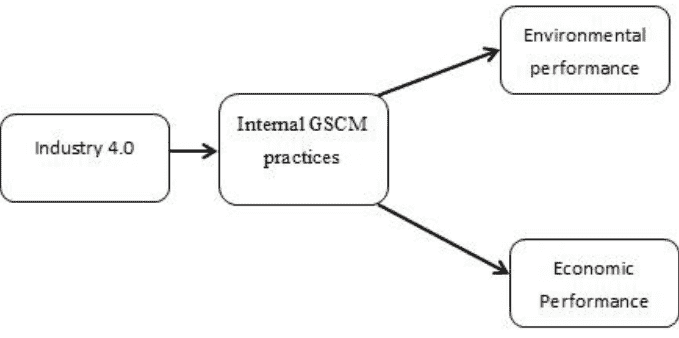
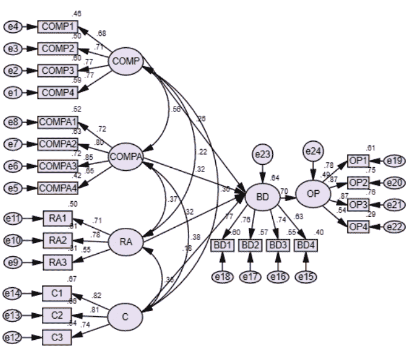
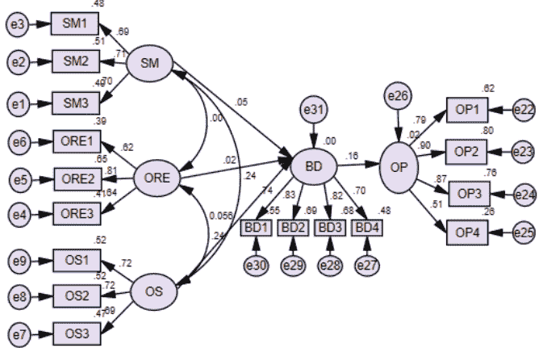
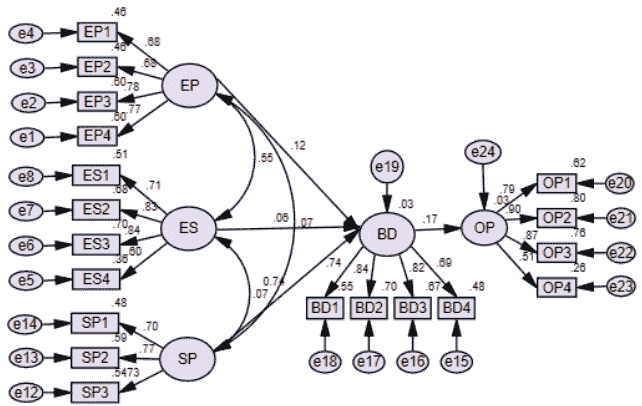
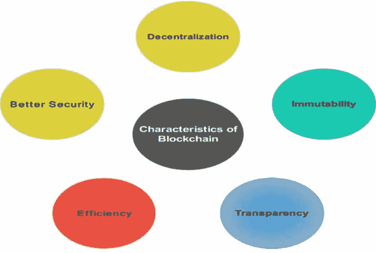
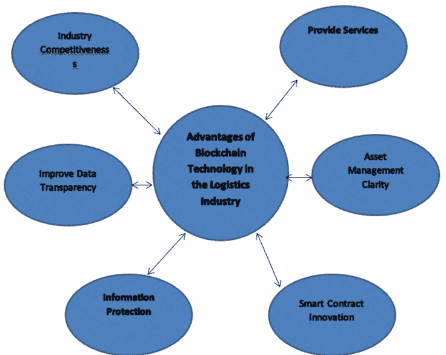
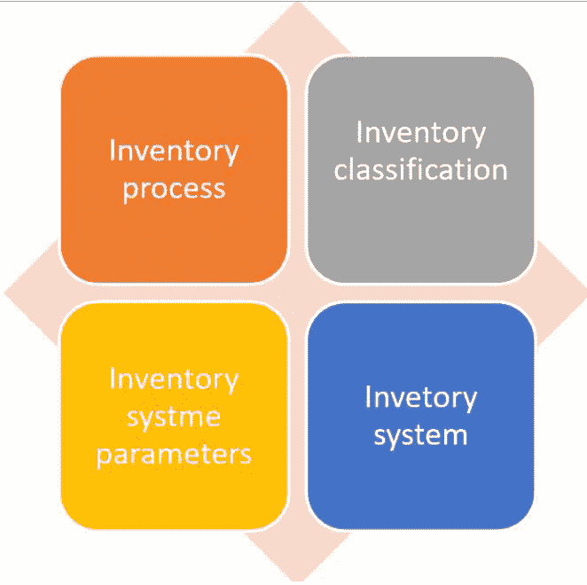
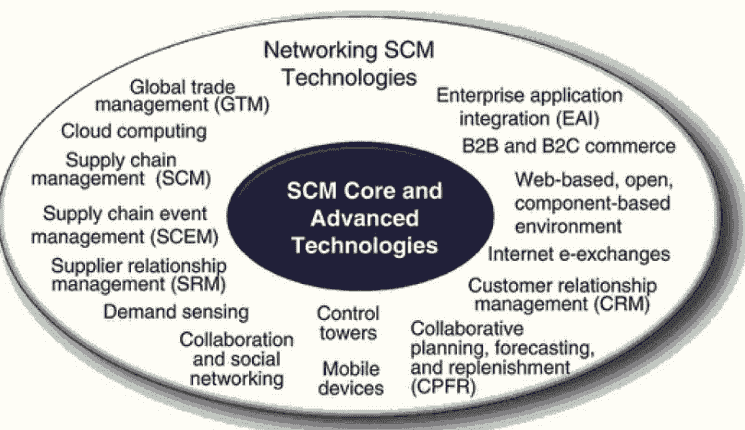
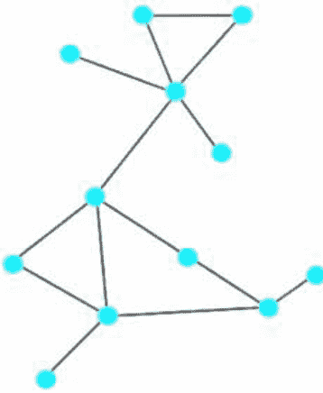
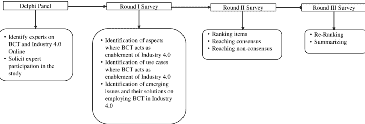

# 循环经济区块链技术整合指南

## Preface

撰写本书旨在以合理成本提供最新内容。区块链技术（BCT）的范围在业务运营中以快速速度持续增长，这体现在本书内容中。本书包含了BCT的核心方面及其在业务运营中的应用。

## ORGANIZATION OF THE BOOK

本书共有11章。各章简要描述如下：
第1章研究了在新兴经济体背景下，工业4.0对内部绿色供应链管理（GSCM）实践的影响。横断面数据通过问卷从巴基斯坦的185家制造企业收集，并通过结构方程建模进行分析。在当今工业4.0技术涌现的时代，各个领域都强调技术。组织必须承认工业4.0对内部绿色供应链流程（IGSCP）的创新贡献，并扩大对工业4.0文献的理解，尽管该文献仍缺乏实证研究。
第2章研究了大数据在印度酒店业的采用及其在提升绩效方面的作用。本研究采用技术-组织-环境（TOE）框架。相关因素从文献综述中识别。正在为酒店业的基于调查的研究准备问卷。探索性因子分析和结构方程建模正在用于分析。研究正在开发三个模型。
第3章描述了在管理运营风险时，区块链对现有和新型商业原型的影响。因此，研究人员指出五个相似之处，以增进我们对区块链技术如何影响当前金融结构并创造新商业模式的理解。这项研究建议利用这些发现来确定由区块链发起的不同设计，以及企业如何彻底改变其商业模式。尽管这项新技术有许多有利用途，但探究和既定程序仍处于萌芽阶段，这意味着区块链的影响在更大范围内被感知还需要一些时间。

第4章描述了区块链技术在物流运作和供应链管理中的应用。区块链技术提供多项技术特性，包括高透明度、可追溯性和可信度。其在物流业务中的应用增加了技术支持，并确保物流行业的效能，能够记录、存储和传输物流信息。该传输确保安全性，防止物流信息被歪曲，并保证物流信息的真实性。在物流业务中使用区块链技术对行业的竞争力和技术优势产生积极影响。区块链已成为解决物流问题的关键技术进步。

第5章讨论了工业4.0的应用。这是一种有效管理供应链流程的新方式，采用更新后的传统商业模式。该技术增强了传统商业模式，并通过管理良好的分销渠道改善了公司与客户之间的远程关系：它创造了高水平的客户满意度，并在供应链流程的每个阶段提供及时信息。创新技术使公司能够通过节省时间并以具有成本效益的方式生产额外产品以满足特定需求而获利。它还减少了人力劳动，很快将由机器人取代。工业革命是新的开始，将形成一个由智能技术管理供应链、改善价值链整体流程的环境。

第6章旨在评估一家在线购物公司的运输管理外包决策。最近，该公司的运营取得了显著增长，由于外包带来了各种问题，决定是继续外包运输管理还是转向内包已变得不可避免。该公司拥有许多物流运作，包括入库接收、仓储和出库分发。所有运作均被考虑和研究，以了解外包的问题和目标。

第7章解释了在供应链和物流中应用区块链的设计、优势和挑战。本文识别了讨论供应链和物流中区块链的设计、优势及相关挑战的相关出版物。根据研究结论，供应链和物流中的区块链采用是国际贸易集团所预见的一项挑战，尽管一些组织已尝试实施成功的试点计划。

第8章讨论了物联网（IoT）、人工智能（AI）和技术创新的参与。物联网（IoT）、人工智能（包括数据挖掘）已在生活的各个领域普及，特别是在供应链管理和运营中。

## 前言

区块链技术能够改造供应链和物流运营管理实践。区块链为供应链和运营管理中的所有交易提供数字化数据库解决方案。射频识别设备（RFID）也是一种辅助技术，通过向无线电兼容集成电路传输电磁波来照看和管理整个供应链和物流运营管理。第四次工业革命4.0指的是自动化、互连性、机器学习和实时数据，在21世纪先进技术时代，这些也有助于供应链和物流运营管理。

第9章涉及产品制造和交付方式的重大变化，重点关注工业自动化和由多种技术支持的灵活工厂，这些技术包括物联网（IoT）、信息物理系统和人工智能。工业4.0催生了智能制造、自动化供应链以及个性化商品和服务的新时代。与此同时，区块链技术（BCT）在不同领域应用的增加推动工业4.0模型扩大其范围。本章讨论了BCT作为工业4.0赋能器的影响。采用了旨在收集公认专家意见的修正e-Delphi方法。研究结果展示了BCT带来的潜力、用例以及新兴问题。讨论并提出解决方案的新兴问题包括BCT安全性、互操作性、智能合约问题、数字孪生问题和伦理问题。

第10章的研究旨在就供应链管理和技术的重要性及其如何在新冠肺炎疫情期间协助工作绩效展开有效讨论。研究预测了商业运营的新方式，以及沟通与协调、知识交流、培训和开发如何有助于在供应链管理工作场所进行有效的工作生产力。研究人员分析了294多名供应链管理员工的回复，他们报告了用于远程办公实践的“首选”技术和社交媒体工具。该研究采用定量方法（例如，电子邮件问卷），发现由于社交距离和隔离，社交媒体已成为商业运营的重要工具。根据结果，很明显社交媒体使巴基斯坦的管理层能够改善员工之间的培训和开发沟通与协调，同时也被视为一款便捷的工具。

第11章讨论了供应链管理中的大数据分析（BDA）。供应链管理相关活动中的大数据分析至关重要，因为它可以管理全球、复杂、动荡且动态的价值链。本章解释了大数据分析的重要性，并将其与供应链背景中的意义联系起来。研究人员展示了大数据分析（BDA）如何成为组织全球和动态市场的关键成功要素。本章还强调了在供应链中实施大数据分析的一些障碍和挑战。

Syed Abdul Rehman Khan
徐州工业学院，中国

## 致谢

本书部分得到北京城市空间信息工程重点实验室（编号：20210218）的支持。

## 第1章
工业4.0、内部绿色供应链实践与企业可持续绩效：新兴经济体的证据

Muhammad Umar
马来西亚登嘉楼大学，
马来西亚

Mohd Yusoff Yusliza
马来西亚登嘉楼大学，
马来西亚

Khalid Farooq
马来西亚登嘉楼大学，
马来西亚

Hafiz Muhammad Zia-ul Haq
马来西亚登嘉楼大学，
马来西亚

### 摘要

本研究旨在调查工业4.0在新兴经济体背景下对内部绿色供应链管理实践（IGSCP）的影响。横截面数据通过问卷从巴基斯坦185家制造企业收集，并通过结构方程模型进行分析。在当今时代，随着工业4.0技术的出现，各个领域都强调技术的重要性。组织必须承认工业4.0对IGSCP的创新贡献，并拓宽其理解，因为关于工业4.0的文献仍然不足，需要实证调查。结果表明，工业4.0对IGSCP具有显著的正向影响。此外，结果还显示，IGSCP实践与经济和环境绩效具有正向关联。本研究为有兴趣推广绿色供应链管理实践以改善经济和环境可持续性的决策者、制造商和管理者提供了宝贵的见解。

DOI: 10.4018/978-1-7998-7642-7.ch001

### 引言

在现代工业4.0（I4.0）时代，新兴技术的创建和实施已成为学术界和专业界最广泛讨论的主题之一（Li et al., 2020）。“数字技术”一词表示在I4.0时代实现网络、协作和自动化的各种范式以及各种智能和创造性技术（Ivanov et al., 2019）。I4.0包括大数据分析、物联网（IOT）以及区块链技术和云计算等新兴平台（Khan et al., 2021; Umar et al., 2021; Khan et al., 2021a）。这些先进技术使企业走向基于数据的技术，通过产品开发周期收集数据，涵盖从材料到生产的所有内容，在数字化驱动的制造环境中（Tao et al., 2018），并增强垂直和水平集成（Frank et al., 2019）。

数字技术为制造业的长期发展带来了威胁与机遇的结合。通过汽车行业中智能技术的深度融合，一个井然有序的产品开发数字化系统应运而生，这有助于提升客户服务和制造效率（Neuhofer et al., 2015），并允许成功的能源重新分配和总产能利用（Dubey et al., 2019）。此外，新兴技术可以扩大企业经济的竞争复杂性，同时也给制造商带来经济和生态压力（Kiel et al., 2020）。研究人员指出，新兴技术在财务和生态绩效方面对可持续效率的影响需要更多关注（Li et al., 2020）。

I4.0正在迅速改变商业模式（Bai et al., 2020）。由于组织绩效中至关重要的环境可持续性方面，学者们专注于阐述I4.0与可持续性的关系（Li et al., 2020）。I4.0可以鼓励供应链运营中的绿色倡议，并确保产品流的透明度，包括产品的提取来源（无论是环境可靠资源还是可再生绿色资源）以及所用材料的质量（Umar et al., 2021）。关于I4.0与环境可持续性的研究仍处于早期阶段。少数最近的研究揭示了I4.0技术与环保绩效交叉点的问题。例如，Jabbour et al. (2017) 也论述了大数据分析的作用，并解释了该技术有助于实施循环经济实践。I4.0与制造企业环境可持续性共存的过程仍然未知。

此外，评估供应链中的I4.0是学者们的一个重要方面（Dalenogare et al., 2018）。传统生产系统生态失衡不足的情况广为人知。常规制造流程和

技术导致资源利用效率低下、全球变暖、环境破坏和污染（Bai et al., 2020）。工业4.0正在改变制造公司的商业模式。各种新兴的通信和智能技术可以支持制造业的灵活性、效率和生产力（Umar et al., 2021）。总体而言，准确严谨的评估技术和决策支持框架可能有助于制造公司成功实施和理解工业4.0技术，特别是在考虑广泛的经济和环境影响时。这些深远的影响包括提升企业和国家的竞争优势，以及生态绩效（Bai et al., 2020）。

绿色供应链实践（GSCP）旨在帮助企业消除受污染废弃物并保护生物多样性（Khan & Yu 2020; Umar et al., 2021a）。企业可以通过改善能源消耗来节约资源并减少其环境足迹（Abbasi and Nilsson 2016）。根据Badi & Murtagh (2019)和Khan et al. (2020c)，生产组织在供应链中集成环境友好型实践，因为这些实践有助于企业维持环境绩效，并使企业在当今的经济环境中获得竞争优势和提高利润率。Martel & Klibi (2016)将内部环境管理（IEM）作为GSCM实践的关键方面，引导组织朝向可持续性维度。IEM反映了高级管理层对环境问题的重视及其绿色政策实施方法（Chin et al., 2015）。先前的研究已讨论了物联网（Ben-Daya et al., 2019; Awan et al., 2021）、区块链（Khan et al., 2021; Khan et al., 2021a）；大数据分析（Liu et al., 2020）在供应链中的重要作用。然而，很少有研究实证探讨了工业4.0如何影响绿色供应链实践。鉴于上述讨论，本研究的主要目标如下。

- 分析工业4.0对巴基斯坦制造企业内部绿色供应链实践的影响。
- 确定内部绿色供应链实践对经济和环境绩效的影响。

本研究的组织结构如下：第2部分涵盖文献综述并提出研究假设。第3部分解释研究方法。第4部分在现有知识体系的基础上提供结果和讨论。相比之下，最后一部分为管理人员和从业者提供了有价值的见解，这可能帮助他们加强策略。

### 文献综述与假设发展

#### 工业4.0与内部GSCM实践

I4.0反映了依赖于近期移动技术和面向服务方法的技术革命（Jabbour et al., 2018）。I4.0概念涉及由实时数据交换实现的水平和垂直流程融合，以及通过敏捷生产流程来促进定制化（Jabbour et al., 2018; Thoben et al., 2017）。I4.0的基本要素包括物联网、增材制造、云计算（Kang et al., 2016）、网络物理架构（Drah & Horch, 2014）以及区块链（Khan et al., 2021; Khan et al., 2021a）。

I4.0有潜力影响制造过程，例如，产品可以设计具有唯一的电子身份，从而允许追踪产品的生命周期（Jabbour et al., 2018）。这有助于收集用户数据，可以帮助企业更好地识别消费趋势，提高产品定制化，并优化维修和更新服务等产品支持方面（Sharma et al., 2021）。此外，通过使用实时信息，机械、计算机和供应链层级之间的交互允许快速调整产出和采购订单目标（以响应消费者需求或维护要求）、监控和管理生产线、跟踪交货以及优化物流路径（Ikram & Siddiqui, 2019）。

GSCP被描述为消除或最小化供应链正向和逆向运营中的全部外部性（Rao & Holt, 2005; Zhu et al., 2008）。GSCM涉及将可持续性标准纳入供应链（SC）流程，旨在减轻或消除固体废弃物、降低排放、并在产品生命周期中节约资源（Chin et al., 2015）。GSCP整合了内部和外部的可持续活动，包括生态设计、绿色采购、内部环境保护、逆向物流、与供应链合作伙伴的协作以及投资回收（Zhu et al., 2008）。几位学者断言，有效引入GSCP需要组织内部对绿色供应链活动的初步承诺（Feng et al., 2018; Rao & Holt, 2005）。本研究使用环保审计技术、绿色制造、绿色设计和内部环境管理来评估IGSCP。I4.0使公司所有活动的实时监控和优化成为可能。实时生产状态监控避免重复、节约资源并提高效率。因此，I4.0技术通过实时预测和自优化正在影响IGSCP。

基于上述讨论，我们提出以下假设：H1：工业4.0对IGSCP有积极影响。

#### 内部GSCM实践与环境绩效

通过实施GSCM活动，公司流程对生态系统的有害影响可以得到缓解（Song et al., 2018）。Geffen & Rothenberg (2000)发现，采用生态设计是绿化组织整个供应链流程的关键第一步。在中国公司中已分析表明，绿色实践与环境成功之间存在正相关（Hartmann et al., 2015）。IGSCP对任何组织都至关重要，因为它通过推崇重视资源管理和减排的绿色文化来改进和增强生态绩效（Melnyk et al., 2003）。企业将可持续性政策融入其实践中，以减少其活动的环境足迹。组织可以积极推进IGSCP举措，如绿色标签、审计和环境合规、内部环境评估以及ISO 14001认证，以获得竞争优势、提升品牌价值、最大化客户满意度并提高管理效率（Yu et al., 2019; Zhu & Sarkis, 2004）。

H2：IGSCP对环境绩效有积极影响。

#### 内部GSCM实践与经济绩效

IGSCP允许消除供应链流程中的浪费，从而提高盈利能力（Sinha & Anand, 2017）。根据Khan et al. (2017)，长期商业计划与运营效率之间存在联系。他们的研究结果表明，环境友好型政策与公司的经济福祉呈正相关。企业正在将环境可持续活动融入其流程中，以增加盈利能力（Khan and Yu 2020）。Lin et al. (2013)指出，环保产品可以吸引消费者支付额外费用的意愿。Zailani et al. (2012)强调采用GSCM实践用于社会经济和环境保护，并解释了GSCM实践与企业绩效之间的正相关关系。

先前的研究也表明GSCM实践与盈利能力之间存在有利关联（Correia et al., 2017; Danish et al., 2019; Khan et al., 2017; Umar et al., 2021）。然而，我们在许多研究中发现了几个相互矛盾的结果。此外，Khan and Yu (2020)对巴基斯坦制造企业进行了调查，以评估绿色实践对经济效率的影响。他们的结果表明，绿色实践对企业财务绩效有有益影响。因此，基于上述讨论，我们提出假设如下：H3：IGSCP对企业经济绩效有积极影响。

### 研究方法

本研究选取了在污染最严重行业运营且已采用绿色倡议的制造企业。为实现研究目标，必须仅关注遵循绿色供应链原则（GSCP）的制造商。通过电话咨询了每个组织的供应链经理，以确定绿色标准的应用情况及其程度。

该调查收集了巴基斯坦制造公司中生产、运营和供应链经理的回复。数据于2020年冬季通过问卷收集。第一轮中，140份问卷中仅收回123份。第二轮中，100份问卷中仅收回76份。共收到199份完整问卷，14份因填写不完整被剔除，而185份用于CB-SEM检验假设。

我们开发了调查问卷以评估研究模型。所有测量均源自现有文献，并根据GSCP活动的含义进行了调整。在创建调查产品后，我们采访了制造公司的不同经理，以征求对这些项目的意见。为确保效度，我们在制造业中对6名供应链经理和8名生产及工厂经理进行了先导研究，采用更新后的样本。在考虑所有受访者的建议和意见后，我们完成了调查。问题设计旨在引出从1（强烈不同意）到7（强烈同意）的一系列反应。

图1. 理论框架

### 结果与讨论

研究结果表明，I4.0对IGSCP有有益影响。I4.0增加1%，导致IGSCP提高0.436%。Khan & Qianli（2017）解释说，发展中国家距离享受绿色供应链管理（GSCM）效益还很遥远。高层管理人员对环境问题的承诺抑制了企业实施绿色实践的努力。I4.0通过实时数据能力、集成和自动化有效管理IGSCP，并使环境审计系统对行政机关更加透明。根据Sony（2019），工业4.0支持内容的流通与分发，并促进GSCM活动的更有效实施。此外，研究人员还建议公司在生产和设计活动中使用I4.0技术，因为它有助于使所有供应链（SC）活动绿色化，尤其是绿色制造和绿色产品设计。Chiarini et al.（2020）开展了一项研究，分析I4.0对意大利制造企业制造战略的影响，发现I4.0使能了IGSCP（即绿色制造）。此外，研究人员还阐述了I4.0对不同GSCM活动的影响，采用了多种技术，例如云基础设施（Talatappeh & Lakzi, 2019）、大数据分析（Yu et al., 2020）和区块链技术（Kouhizadeh & Sarkis, 2020; Khan et al. 2021; Khan et al., 2021a）。这些研究人员证实，I4.0促进了各种GSCM实践。

表1. 结构模型标准化参数估计

| 假设 | 路径 | 标准化估计值 | P值 | 结果 |
|---|---|---|---|---|
| H1 | I4.0 —> IGSCP | 0.436** | 0.000 | 支持 |
| H2 | IGSCP —> En. P | 0.215* | 0.021 | 支持 |
| H3 | IGSCP —> Ec. P | 0.643* | 0.047 | 支持 |

Note: ** 和 * 分别表示在1%和5%的水平上显著。
industry 4.0（I4.0）、内部绿色供应链实践（IGSCP）、环境绩效（En. P）、经济绩效（Ec.P）

IGSCP与组织的经济绩效（Ec.P）和环境绩效（En.P）存在显著正相关关系。采用IGSCP可使财务效率提高0.643%，环境绩效提高0.215%。本研究结果与Scur & Barbosa（2017）的研究工作一致，该研究分析了巴西家电行业中GSCM与企业成功之间的关系，并断言绿色供应链实践对Ec.P有有益影响。此外，Khan and Yu（2020）开展了一项研究，分析了GSCM实践对巴基斯坦制造企业可持续发展绩效的影响，并证实GSCM实践对Ec.P和En.P有显著正向影响。研究人员还讨论了，绿色采购、价值源映射、可持续架构、物流活动中的生物燃料使用以及回收利用，都有助于提高产品一致性并降低成本。IGSCP协助企业改善其Ec.P和En.P以及流程一致性（Baines et al., 2012; Govindan et al., 2015）。

### 结论与实际启示

本研究的贡献在于探讨I4.0在促进IGSCP以提升运营生产力方面的作用。使用封闭式问卷调查，从巴基斯坦制造企业收集了185名受访者的横截面数据。采用CB-SEM技术评估所提出的I4.0、IGSCP以及组织Ec.P和En.P范式。该模型既满足内部一致性，也满足收敛效度和区分效度。结果表明，I4.0对IGSCP有显著影响。此外，IGSCP对组织的En.P和Ec.P有显著影响。

目前的研究提供了以下启示。例如，研究结果表明，采用I4.0可以加强IGSCP，并在实现可持续发展目标中发挥关键作用。特别是，区块链技术促进了回收、绿色设计和绿色制造等绿色供应链活动。通过实施I4.0技术，企业可以维持开放且安全的交易机制。它还可以帮助它们提高生产力，通过资源再生降低成本，并促进社会、财政和环境的可持续性。供应链运营容易受到可靠性、稳定性和准确性不足的影响，使用I4.0将解决这些脆弱性。因此，建议企业和政府部门在实施IGSCP时推广I4.0技术，以实现可持续发展。

最后，以下是本研究的局限性：
- 首先，本研究仅关注IGSCP。未来研究人员可以通过纳入内部和外部GSCM实践来检验其模型。
- 其次，本研究仅限于巴基斯坦的制造企业。建议在其他行业和经济体中测试同一模型，以便更深入地了解该模型。
- 第三，本研究采用CB-SEM。未来研究人员可以采用数学建模。此外，未来研究人员还可以检验IGSCP在I4.0与经济和环境绩效之间的中介作用。
- 最后，未来研究还可以检验先进数字技术对不同人力资源方面的影响。由于数字技术的采用有助于实现人力资源流程无纸化，进而对环境的影响较小。

### 参考文献

- Abbasi, M., & Nilsson, F. (2016). 发展环境可持续物流：从物流服务提供商的视角探讨主题与挑战。 *Transportation Research Part D, Transport and Environment*, *46*, 273–283. doi:10.1016/j.trd.2016.04.004
- Badi, S., & Murtagh, N. (2019). 建筑业中的绿色供应链管理：系统文献综述与未来研究议程。 *Journal of Cleaner Production*, *223*, 312–322. doi:10.1016/j.jclepro.2019.03.132
- Bai, C., Dallasega, P., Orzes, G., & Sarkis, J. (2020). 工业4.0技术评估：可持续发展视角。 *International Journal of Production Economics*, *229*, 107776. doi:10.1016/j.ijpe.2020.107776
- Baines, T., Brown, S., Benedettini, O., & Ball, P. (2012). 考察绿色生产及其在制造商竞争战略中的作用。 *Journal of Industrial Engineering and Management*, *5*(1), 53–87. doi:10.3926/jiem.405
- Ben-Daya, M., Hassini, E., & Bahroun, Z. (2019). 物联网与供应链管理：文献综述。 *International Journal of Production Research*, *57*(15–16), 4719–4742. doi:10.1080/00207543.2017.1402140
- Chin, T. A., Tat, H. H., & Sulaiman, Z. (2015). 绿色供应链管理、环境协作与可持续发展绩效。 *Procedia CIRP*, *26*, 695–699. doi:10.1016/j.procir.2014.07.035
- Correia, E., Carvalho, H., Azevedo, S. G., & Govindan, K. (2017). 供应链可持续性成熟度模型：系统文献综述。载于 *Sustainability*（第9卷，第1期）。doi:10.3390/s9010064
- Dalenogare, L. S., Benitez, G. B., Ayala, N. F., & Frank, A. G. (2018). 工业4.0技术对工业绩效的预期贡献。 *International Journal of Production Economics*, *204*, 383–394. doi:10.1016/j.ijpe.2018.08.019
- Danese, P., Lion, A., & Vinelli, A. (2019). 供应商可持续发展实践的驱动因素与促进因素：基于调查的分析。 *International Journal of Production Research*, *57*(7), 2034–2056. doi:10.1080/00207543.2018.1519265
- de Sousa Jabbour, A. B. L., Jabbour, C. J. C., Foropon, C., & Godinho Filho, M. (2018). 巨人相遇——工业4.0能否引领环境可持续制造浪潮？关键成功因素的作用。 *Technological Forecasting and Social Change*, *132*, 18–25. doi:10.1016/j.techfore.2018.01.017

- Drath, R., & Horch, A. (2014). 工业4.0：热门还是炒作？IEEE工业电子杂志，8(2)，56–58。doi:10.1109/MIE.2014.2312079

- Dubey, R., Gunasekaran, A., Childe, S. J., Papadopoulos, T., Luo, Z., Wamba, S. F., & Roubaud, D. (2019). 大数据和预测分析能否改善社会和环境可持续性？技术预测与社会变革，144，534–545。doi:10.1016/j.techfore.2017.06.020

- Feng, M., Yu, W., Wang, X., Wong, C. Y., Xu, M., & Xiao, Z. (2018). 绿色供应链管理与财务绩效：运营绩效和环境绩效的中介作用。商业战略与环境，27(7)，811–824。doi:10.1002/bse.2033

- Frank, A. G., Dalenogare, L. S., & Ayala, N. F. (2019). 工业4.0技术：制造公司中的实施模式。生产经济国际期刊，210，15–26。doi:10.1016/j.ijpe.2019.01.004

- Geffen, C. A., & Rothenberg, S. (2000). 供应商与环境创新：汽车喷漆工艺。运营与生产管理国际期刊，20(2)，166–186。doi:10.1108/01443570010304242

- Govindan, K., Cheng, T. C. E., Mishra, N., & Shukla, N. (2018). 物流与供应链管理的大数据分析与应用。Elsevier。doi:10.1016/j.itre.2018.03.011

- Govindan, K., Diabat, A., & Shankar, K. M. (2015). 基于模糊方法的绿色制造驱动因素分析。清洁生产杂志，96，182–193。doi:10.1016/j.jclepro.2014.02.054

- Hartmann, C., Shi, J., Giusto, A., & Siegrist, M. (2015). 食用昆虫的心理学：德国与中国的跨文化比较。食品质量与偏好，44，148–156。doi:10.1016/j.foodqual.2015.04.013

- Ikram, M. N., & Siddiqui, D. A. (2019). 绿色供应链管理对环境绩效和出口绩效的影响：巴基斯坦纺织行业案例研究。社会科学与人文期刊 SS HJ，03(04)，1006–1019。

- Ivanov, D., Dolgui, A., & Sokolov, B. (2019). 数字技术和工业4.0对牛鞭效应和供应链风险分析的影响。生产研究国际期刊，57(3)，829–846。doi:10.1080/00207543.2018.1488086

- Jabbour, C. J. C., Mauricio, A. L., & Lopes, A. B. (2017). 运营管理的关键成功因素与绿色供应链管理主动性：基于巴西工业案例揭示这一关系中的人类方面。生产计划与控制，7287(5月)，1–13。doi:10.1080/09537287.2017.1309705

- Kang, H. S., Lee, J. Y., Choi, S., Kim, H., Park, J. H., Son, J. Y., Kim, B. H., & Do Noh, S. (2016). 智能制造：过去的研究、当前的发现和未来方向。精密工程与制造-绿色技术国际期刊，3(1)，111–128。doi:10.1007/s40684-016-0015-5

- Khan, S. A. R., Dong, Q., Zhang, Y., & Khan, S. S. (2017). 绿色供应对企业绩效的影响：以中国为视角。先进制造系统杂志，16(03)，263–273。doi:10.1142/S0219686717500160

- Khan, S. A. R., & Qianli, D. (2017). 绿色供应链管理实践对企业绩效的影响：来自巴基斯坦的经验研究。环境科学与污染研究国际期刊，24(20)，16829–16844。doi:10.1007/s11356-017-9172-5 PMID:28573559

- Khan, S. A. R., Yu, Z., Umar, M., Lopes de Sousa Jabbour, A. B., & Mor, R. S. (2021). 利用数字技术应对后疫情挑战：一项经验研究。企业信息管理杂志，(20210218)。在线先行出版。doi:10.1108/JEIM-01-2021-0040

- Khan, S. A. R., Zia-ul-haq, H. M., Umar, M., & Yu, Z. (2021a). 数字技术与循环经济实践：改善组织绩效的策略。商业战略与发展。

- Khan, S. A. R., Yu, Z., & Umar, M. (2021c). 环境意识和企业社会责任实践如何有利于企业？新兴经济体背景下的经验研究。环境质量管理。

- Kiel, D., Müller, J. M., Arnold, C., & Voigt, K.-I. (2020). 可持续工业价值创造：工业4.0的利益与挑战。载于《数字颠覆性创新》（第231–270页）。World Scientific。

- Kouhizadeh, M., & Sarkis, J. (2020). 区块链特征与绿色供应链发展。载于《绿色商业管理与可持续供应链管理全球视角》（第93–109页）。IGI Global。doi:10.4018/978-1-7998-2173-1.ch005

- Li, G., Hou, Y., & Wu, A. (2017). 第四次工业革命：技术驱动因素、影响及应对方法。中国地理科学，27(4)，626–637。doi:10.1007/s11769-017-0890-x

- Li, Y., Dai, J., & Cui, L. (2020). 工业4.0背景下数字技术对经济和环境绩效的影响：一个调节中介模型。生产经济国际期刊，229(5月)，107777。doi:10.1016/j.ijpe.2020.107777

- Lin, R.-J., Tan, K.-H., & Geng, Y. (2013). 市场需求、绿色产品创新与企业绩效：来自越南摩托车行业的证据。清洁生产杂志，40，101–107。doi:10.1016/j.jclepro.2012.01.001

- Martel, A., & Klibi, W. (2016). 设计价值创造型供应链网络。Springer。doi:10.1007/978-3-319-28146-9

- Melnyk, S. A., Sroufe, R. P., & Calantone, R. (2003). 评估环境管理体系对企业和环境绩效的影响。运营管理杂志，21(3)，329–351。doi:10.1016/S0272-6963(02)00109-2

- Neuhofer, B., Buhalis, D., & Ladkin, A. (2015). 用于个性化体验的智能技术：酒店领域案例研究。电子市场，25(3)，243–254。doi:10.1007/s12525-015-0182-1

- Rao, P., & Holt, D. (2005). 绿色供应链是否带来竞争力和经济绩效？运营与生产管理国际期刊，25(9)，898–916。doi:10.1108/01443570510613956

- Rehman Khan, S. A., & Yu, Z. (2020). 生态环境绩效评估：基于实践观点的PLS-SEM方法。物流研究与应用国际期刊，0(0)，1–19。doi:10.1080/13675567.2020.1754773

- Scur, G., & Barbosa, M. E. (2017). 绿色供应链管理实践：巴西家电行业多案例研究。清洁生产杂志，141，1293–1302。doi:10.1016/j.jclepro.2016.09.158

- Sharma, M., Kamble, S., Mani, V., Sehrawat, R., Belhadi, A., & Sharma, V. (2021). 新兴经济体多层制造业供应链中工业4.0采用与可持续发展。清洁生产杂志，281，125013。doi:10.1016/j.jclepro.2020.125013

- Sinha, A. K., & Anand, A. (2017). 面向环境意识制造领域供应商绩效评估的基于决策方法的模糊偏好关系。计算机与工业工程，105，39–54。doi:10.1016/j.cie.2016.12.033

- Song, W., Chen, Z., Liu, A., Zhu, Q., Zhao, W., Tsai, S.-B., & Lu, H. (2018). 动态环境下绿色供应商选择研究。可持续性，10(4)，1226。doi:10.3390/su10041226

- Sony, M. (2019). 绿色供应链管理实践与数字技术：一项定性研究。载于《成功数字供应链的技术优化与变革管理》（第233–254页）。IGI Global。doi:10.4018/978-1-5225-7700-3.ch012

- Talatappeh, S. S., & Lakzi, A. (2019). 开发调查基于云系统对绿色供应链管理影响的模型。工程、设计与技术杂志。

- Tao, F., Qi, Q., Liu, A., & Kusiak, A. (2018). 数据驱动的智能制造。制造系统杂志，48，157–169。doi:10.1016/j.jmsy.2018.01.006

- Thoben, K.-D., Wiesner, S., & Wuest, T. (2017). “工业4.0”与智能制造：研究问题和应用示例综述。汽车技术国际期刊，11(1)，4–16。

- Umar, M., Khan, S. A. R., Yusoff Yusliza, M., Ali, S., & Yu, Z. (2021). 工业4.0与绿色供应链实践：一项经验研究。生产力与绩效管理国际期刊。在线先行出版。doi:10.1108/IJPPM-12-2020-0633

- Umar, M., Khan, S. A. R., Muhammad Zia-ul-haq, H., Yusliza, M. Y., & Farooq, K. (2021). 新兴技术在实施绿色实践以实现可持续运营中的作用。TQM杂志。

- Yu, Y., Zhang, M., & Huo, B. (2019). 供应链质量整合对绿色供应链管理和环境绩效的影响。全面质量管理与业务卓越，30(9–10)，1110–1125。doi:10.1080/14783363.2017.1356684

- Yu, Z., Khan, S. A. R., & Liu, Y. (2020). 探索企业中企业社会责任实践的作用。先进制造系统杂志，19(03)，449–461。doi:10.1142/S0219686720500225

Zailani, S. H. M., Eltayeb, T. K., Hsu, C., & Tan, K. C. (2012). 外部制度驱动因素和内部战略对环境绩效的影响. International Journal of Operations & Production Management.

Zhou, L., Chong, A. Y. L., & Ngai, W. T. (2015). 物联网时代的供应链管理. International Journal of Production Economics, 159, 1–3. doi:10.1016/j.ijpe.2014.11.014

Zhu, Q., & Sarkis, J. (2004). 中国制造企业绿色供应链管理实践早期采用者的运营实践与绩效关系. Journal of Operations Management, 22(3), 265–289. doi:10.1016/j.jom.2004.01.005

Zhu, Q., Sarkis, J., & Lai, K. (2008). 绿色供应链管理实践实施测量模型的确认. International Journal of Production Economics, 111(2), 261–273. doi:10.1016/j.ijpe.2006.11.029

Rehman Khan, S. A., Yu, Z., Sarwat, S., Godil, D. I., Amin, S., & Shujaat, S. (2021). 区块链技术在循环经济实践中提升组织绩效的作用. International Journal of Logistics Research and Applications, 1-18.

## 第 2 章

## 如何在酒店业利用大数据提升组织绩效

Subhodeep Mukherjee
https://orcid.org/0000-0002-6863-4881
吉特姆大学（Deemed）, 印度

Manish Mohan Baral
https://orcid.org/0000-0002-9620-1872
吉特姆大学（Deemed）, 印度

Venkataiah Chittipaka
https://orcid.org/0000-0002-7804-0796
印度英迪拉·甘地国家开放大学（IGNOU）, 新德里, 印度

### 摘要

大数据是从数据中提取信息的海量数据集合。这有助于企业了解数据中的隐藏知识。本研究旨在探讨印度酒店业中大数据的采用情况，并有助于提升绩效。本研究采用技术-组织-环境（TOE）框架。相关因素通过文献综述确定。为酒店业的基于调查的研究准备了一份问卷。探索性因子分析和结构方程模型用于分析。为本研究开发了三个模型。本研究提出的所有假设均已被接受。

DOI: 10.4018/978-1-7998-7642-7.ch002

### 引言

“大数据”（BD）一词正是由于这场数据爆炸而提出的。体量（Volume）、多样性（Variety）和速度（Velocity），即3Vs，是常与该概念相关联的数据三个不同特征（Costa et al., 2021）。当前全球产生的信息量惊人。数据生成和存储不断变化的特性激发了各行各业企业利用BD解决特定商业问题的兴趣。然而，与在组织中实施任何新技术一样，BD也可能带来安全风险和挑战（Jin et al., 2015）。使用BD的组织可以收集和处理海量数据，包括机密的消费者和员工信息、商业秘密及知识产权。由于数据存储的集中化，网络犯罪分子试图进行黑客攻击（Jagadish, 2015）。这凸显了BD必须以最高程度的保护机制得到妥善保障的重要性。否则，由于企业处理的数据特征不断演变，以及IT、个人数据在商业分析过程中的保存与再利用激增，BD已变得“比互联网更具风险”（Mukherjee et al., 2022a）。因此，企业在处理和监控数据的方式上应当发生转变（Galetsi et al., 2020; Shahbaz et al., 2019）。

安全应从运营和环境角度来审视，而不仅仅是技术和基础设施要求（Brunswicker et al., 2015）。根据先前的研究，还需要更多研究来理解企业与生态效应对数据安全问题的相互影响（Brunswicker et al., 2015; de Camargo Fiorini et al., 2018; A. Gupta et al., 2018）。尽管BD在2014年已成为工业领域的主流技术选择，但主要企业仍对其采纳持保留态度（Yadegaridehkordi et al., 2020）。这种情况强调了有必要进一步确定影响BD背景下极其困难的采纳过程的因素（Acharya et al., 2018; S. Gupta et al., 2018）。迄今为止，BD已得到研究人员的广泛关注（Ranjan & Foropon, 2021）。然而，只有少数研究探讨了影响组织实施这项技术决策的关键因素（Ghasemaghaei, 2021）。BD采纳（BDA）受技术、组织和环境视角的影响，对企业绩效产生积极影响。

### 文献综述

研究人员和从业者始终关注技术的实施与使用（Chen et al., 2020）。因此，在包括医疗保健、工业、经济和教育在内的各种环境中，已经进行了大量的技术采纳研究（Alkhatet et al., 2018; Alsetoohy et al., 2019; Cruz-Jesus et al., 2019; Kamble et al., 2019; Kumar & Krishnamoorthy, 2020; K. Nam et al., 2020; Patel et al., 2020; Priyadarshinee, Raut, Jha, & Gardas, 2017; Priyadarshinee, Raut, Jha, & Kamble, 2017; Senyo et al., 2016; Skafi et al., 2020; Tashkandi & Al-Jabri, 2015; Wamba & Queiroz, 2020; Wong et al., 2020）。举几个行业的例子，BD目前支持“移动服务、零售、工程、金融服务、生命科学和物理科学”领域的分析流程。BD解决方案的早期采用者意识到了新市场机会的潜力，并更加了解其交易环境。然而，技术采纳研究中的一个重要问题是“定义组织实施特定创新倾向的因素是什么”。因此，已经提出并研究了各种假设，以便从企业和单一角度更好地理解影响公司采纳最新进展行为的因素（Verma & Bhattacharyya, 2017）。此外，(Ainin et al., 2016; Garrison et al., 2015; Voola et al., 2012)等研究人员彻底调查了此类新创新和实践实施对整体组织绩效改进的影响。通过开展访谈，(Diniz et al., 2018)调查了巴西银行中的BDA。该报告揭示了主管在建立BD成功选择和实施所需关键条件方面的重要性。(Yadegaridehkordi et al., 2018)研究了BD采纳对制造公司的影响。根据这项研究，BD采纳最关键的驱动因素是技术能力、感知优势、BD效率、集成度和复杂性。(Mukherjee et al., 2022b)在服务组织中对组织视角对BDA的影响进行了调查。在这项分析中，企业规模、数据集和参与度是BDA的影响因素。(Verma, 2017)探讨了印度制造企业采纳BD的意图。他们发现，BD的效率和效益可以对其采纳产生积极影响。(Park et al., 2015)使用TOE系统和层次分析法（AHP）方法来识别和排序影响韩国企业BD采纳的因素。根据研究结果，基本背景是技术，而感知优势是最重要的影响因素。根据(Verma et al., 2018)，TOE视角（Mukherjee & Chittipaka, 2021a）已被提出，并与印度公司经理进行了访谈，以更好地理解影响BDA的因素。他们意识到战略重要性是企业实施BD决策的驱动力。为了更好地理解BD的组织接受度，Sun et al. 2018结合了DOI、制度理论和TOE。他们查阅了类似文章，提出了一系列促进因素（Roy, 2021）以及结论。Brock & Khan, 2017从英国学生的角度识别出感知效用、感知易用性、管理层参与、系统视角以及透明度和考察是BD使用的组成部分，并以“组织学习能力（OLC）”情境扩展了技术接受模型（TAM）。Kwon et al., 2014; D. W. Nam et al., 2015; Shin, 2016研究了BD。

韩国的获取与意图分别采用基于资源观（RBV）、UTAUT 和 TOE 进行研究（Pal et al., 2021a）。

根据一项相关研究，关于 BDA 的大多数研究已在英国 (Brock & Khan, 2017)、韩国 (D. W. Nam et al., 2015; Park et al., 2015) 和印度 (Verma, 2017; Verma et al., 2018; Verma & Bhattacharyya, 2017) 等发达国家开展。目前尚未有一个综合性的理论框架来探讨技术、组织、环境和人力视角，这些视角可能对 BDA 和企业结果产生显著影响。

### 假设发展

技术、组织和环境 (TOE) 最初由 Tornatzky et al. (1990) 提出，以理解影响组织中最新创新采纳的重大因素。根据这一结构，任何技术创新的采纳都可以从技术、环境和组织三个不同的视角来预测 (Pal et al., 2021b)。TOE 是一项知名理论，已广泛应用于各种企业层面的先进创新采纳 (Baker, 2011)。TOE 框架已被用于许多早期的技术采纳研究 (Abed, 2020; Alsetoohy et al., 2019; Clohessy et al., 2019; Cruz-Jesus et al., 2019; Ergado et al., 2021; Fosso Wamba et al., 2020; Hiran & Henten, 2020; Mahakittikun et al., 2020; Narmetta & Krishnan, 2020; Ngah et al., 2017; Priyadarshinee, Raut, Jha, & Gardas, 2017; Priyadarshinee, Raut, Jha, & Kamble, 2017; Ramaswamy, 2015; Senyo et al., 2016; Skafi et al., 2020; Wong et al., 2020)。正如 TOE 所描述，技术因素是涉及设备和流程的公司内部和外部技术 (Mukherjee et al., 2021b)。组织的特征、资源和属性包含在组织视角中，而运营领域和结构则包含在环境视角中 (Tornatzky et al., 1990)。

#### 技术因素 (TF)

复杂性 (COMP)：如果某项技术被认为很难访问和使用，则称为复杂性 (Rogers, 2003)。普遍认为，复杂程度越高，使用任何给定的进步就越困难 (Verma, 2017)。该要素考察使用 BD 及其相关技术有多困难。当用户决定实施某项技术时，他们会担心使用该技术有多困难 (Shin, 2016)。由于 BD 在分析海量信息时高度依赖技术，预计其高度复杂性将阻碍其采用 (Mukherjee & Chittipaka, 2021b)。

- **H1**: COMP 将影响 BD 的采用。

兼容性 (COMPA)：兼容性的描述是“一个想法与潜在采用者的现有原则、过去经验和需求相兼容的程度” (Rogers, 2003)。因此，BD 采用必须与当前 IT 工具和规范很好地保持一致。根据 Shin (2016) 的说法，与现有技术和规范兼容的发明比不兼容的发明采用得更快。创新采纳中可用性的重要性已在众多研究中得到记录 (Cruz-Jesus et al., 2019; Haryanto et al., 2020; Mahakitikun et al., 2020; Ngah et al., 2017; Pateli et al., 2020)。

- **H2**: COMPA 将影响 BD 的采用。

相对优势 (RA)：相对优势的描述是“一种发明被认为比它取代的概念更好的程度” (Sun et al., 2018)。它基于增加的营销机会、增加的竞争以及提供给客户的额外服务进行评估 (Yadegaridehkordi et al., 2020)。根据 Park et al. (2015) 的说法，组织在确定其优势和相对利益之前，没有必要执行和利用 BD。

- **H3**: RA 将影响 BD 的采用。

成本 (C)：BD 采用的成本被描述为“公司为维持 BD 使用和未来可扩展性而发生的成本” (Sun et al., 2018)。想要使用 BD 技术的组织必须在硬件和软件方面进行大量投资。BD 采用的其他挑战包括分配新员工和培训现有员工的费用 (Verma, 2017)。

- **H4**: C 将影响 BD 的采用。

#### 组织因素 (OF)

管理层支持 (SM)：管理层支持的描述是“高层管理人员认可 BD 技术价值的程度，以及其参与相关举措的程度” (Park et al., 2015)。管理层支持可以使组织更容易应对新技术带来的挑战和复杂性，从而加快采用速度 (Yadegaridehkordi et al., 2018)。

- **H5**: SM 将影响 BD 的采用。

组织资源 (ORE)：根据组织资源的定义，“企业技术、人力和业务资本足以促进采用的程度”。根据 Verma et al. (2018)，适当的创新基础、信息基础、结构和设计规范应准备就绪，以实现创新的良好执行。事实上，影响组织中 BD 选择的最基本组成部分之一可能是技术可用性 (Park et al., 2015)。此外，在 BD 采用过程中还应强调的另一项要求是员工具备足够创新技能的适用性 (Sun et al., 2016)。

- **H6**: ORE 将影响 BD 的采用。

组织规模 (OS)：规模的描述是“企业的年收入和有助于 BD 实施的若干员工” (Tien et al., 2020)。文献已证明组织规模在技术采纳中的重要性 (Brock & Khan, 2017; Sun et al., 2018)。大型公司是最早采用创新的公司，因为它们拥有更多资本并能承担更重大的风险。另一方面，小型企业资源匮乏，难以管理其采用所需的大量投资 (Tien et al., 2020)。

- **H7**: OS 将影响 BD 的采用。

#### 环境因素 (EF)

外部压力 (EP)：“外部压力”一词是指“来自外部世界的影响” (Behl et al., 2019)。外部压力来自两个来源：商业竞争对手和合作伙伴 (Park et al., 2015)。另一方面，Sun et al. (2018) 声称，来自商业伙伴、同行和管理机构的压力可能对 BD 的企业采用产生重大影响。由于竞争对手和合作伙伴的压力，公司可能会实施一项创新。来自贸易伙伴的需求或建议，企业经理可能会感到有压力去实施一项创新 (Verma et al., 2018)。

- **H8**: EP 将影响 BD 的采用。

外部支持 (ES)：外部支持的描述是“实施和使用信息系统的支持可用性”。根据 Park et al. (2015)，主管部门的政策和资金将使组织中的 BDA 更加便捷。同时，供应商有助于培养对技术的建设性态度，并充当创新采用的激励因素 (Baker, 2011)。文献已将 ES 确定为技术采用的重要组成部分 (Behl et al., 2019; Park et al., 2015; Verma, 2017)。

- **H9**: ES 将影响 BD 的采用。

安全与隐私 (SP)：安全与隐私问题在先前的文献中得到广泛阐述，并被引用为 BDA 的障碍 (Shin, 2016)。根据 Salleh & Janczewski (2016)，BD 的设计会导致各种安全问题，迫使组织实施新的和改进的安全技术和方法。另一方面，参与 BD 的组织在专注于其运营使命时，不断面临遵守相关法律的压力。

- **H10**: SP 将影响 BD 的采用。

组织绩效 (OP)：企业可以以多种方式采用新技术，这可能影响其竞争优势和绩效 (Brock & Khan,

2017). 因此，效率和技术采用通常一起衡量。根据现有研究，创新采用与企业业绩之间存在着强烈联系（Brock & Khan, 2017；Salleh & Janczewski, 2016；Sun et al., 2018）。Sun et al. (2018) 同意，大数据（BD）是企业竞争优势的重要决定因素，包括更多的灵活性、成本节约、创造力和发展（Brock & Khan, 2017）。BD在各种财务和非财务维度上提高了企业效率。

- **H11**: 在TF背景下，BDA对OP有正向影响。
- **H12**: 在OF背景下，BDA对OP有正向影响。
- **H13**: 在EF背景下，BDA对OP有正向影响。

### 研究方法

本研究通过二手和一手来源收集数据。二手来源包括文献综述和其他报告，一手数据来源则通过结构化问卷收集数据。问卷也进行了信度检验。目标人群是印度酒店工作的员工。由于本分析采用了SEM，200份及以上的样本量被认为是充足的（Hair et al., 2010；Kline, 2011）。因此，问卷个别发送给650名受访者，但只收回了326份有效问卷。简单随机抽样方法已被更恰当地推广，并允许各种印度酒店的存在（Hair et al., 2010）。

为避免共同方法偏差，研究团队在预数据收集阶段采取了若干基本预防措施。在问卷开头，注明该调查旨在学术研究，并将保持数据保密（Mukherjee et al., 2021c）。在收集的数据集中，首先通过案例筛选完成初步清洗，随后进行因子筛选，以便对信息的变异进行说明。数据清洗措施推断，缺失信息极为稀少，因此不被视为任何偏倚的主要支持者（Baral et al., 2021）。因此，未删除任何案例。然而，在数据收集后，研究团队应用了Harman的单因子检验。执行了EFA，结果显示第一因子解释的最大方差为：TF 31.108%，OF 20.944%，EF 29.985%，均低于推荐的50%阈值（Podsakoff et al., 2003）。

SEM和EFA方法被用于数据分析（Baral & Verma, 2021）。数据分析分为四个阶段：人口统计分析、效度和信度检验、探索性因子分析（EFA）和验证性因子分析（CFA）（Roy & Giduturi, 2019）。EFA用于检查解释的总方差，以利用旋转分量矩阵表识别和分组变量。SPSS 20.0用于收集数据的信度检验和EFA。之后，执行CFA以检验所提议模型的基础。AMOS 22.0用于对收集的数据进行CFA，以估计模型结果，因为CFA决定是否对预期模型进行效度检验（Hair et al., 2010；Byrne, 2010）。最后，利用SEM确定模型拟合度以检验假设。

表1展示了基于性别和受访者当前职位的受访者分布。参与调查的受访者中，76%为男性，24%为女性。51%的受访者是酒店经理，而29%是IT经理。约20%的受访者是市场经理。

### 表1. 受访者人口统计学信息

| 项目 | 百分比 |
| --- | --- |
| 性别 | |
| 男性 | 76 |
| 女性 | 24 |
| 受访者当前职位 | |
| 酒店经理 | 51 |
| IT经理 | 29 |
| 市场经理 | 20 |

### 数据分析

#### 信度和效度

#### Cronbach's alpha

基于Cronbach's α值对每个因子进行了信度检验，以介绍构念的Cronbach's α。所有变量量表的值应高于推荐值0.70（Nunnally and Bernstein, 1994）。编制结构化问卷时采用了7点Likert量表。

为分析收集的信息，使用了SPSS 20.0和Amos 22.0。对于构念TF，伴随指标和α值的潜在变量如下：COMP包含COMP1、COMP2、COMP3和COMP4，α值为0.822；COMPA包含COMPA1、COMPA2、COMPA3和COMPA4，α值为0.837；RA包含RA1、RA2和RA3，α值为0.704；C包含C1、C2和C3，α值为0.830；BD包含BD1、BD2、BD3和BD4，α值为0.824。对于构念OF，伴随指标和α值的潜在变量如下：SM包含SM1、SM2和SM3，α值为0.741；ORE包含ORE1、ORE2和ORE3，α值为0.746；OS包含OS1、OS2和OS3，α值为0.755。对于构念EF，伴随指标和α值的潜在变量如下：EP包含EP1、EP2、EP3和EP4，α值为0.819；ES包含ES1、ES2、ES3和ES4，α值为0.831；SP包含SP1、SP2和SP3，α值为0.766。因此，所有值均在阈值范围内。

#### 组合信度

所有组件也测量了组合信度（CR）。由于其能产生更好结果的能力，它被用于估计内部一致性信度（Henseler et al., 2009）。TF有四个潜在变量，其CR值为：COMPA为0.889；COMP为0.879；C为0.791；RA为0.835。第二个背景是OF，伴随CR值的潜在变量为：OS为0.855；SM为0.853；ORE为0.843。最后一个背景是EF，伴随CR值的潜在变量为：BOR为0.911；GOV为0.901；FIY为0.911；L为0.868。因此，所有值均在阈值范围内（Hair et al., 2010）。

#### 探索性因子分析

EFA的第一步是评估样本量的适当性。利用SPSS 20.0进行EFA。使用Bartlett球形度检验检验了其项目之间的相关性（Hair et al., 2010）。执行了主轴因子分析，以识别有意义的偏差并表达相同的特性。使用了Promax旋转，因为根据相关文献假设其因子是相关的（Tabachnick & Fidell 2007）。通过此检验，生成的统计量应显著（p < 0.05），才能将EFA视为适当的技术（Hair et al., 2010）。

最后，使用Kaiser-Meyer-Olkin (KMO)度量来量化项目是否足够相关，以确定是否可以执行因子分析。构念TF的KMO值为0.808；OF为0.692；EF为0.793。该统计量设定的最低水平为0.60（Hair et al., 2010）。所有构念的显著性值为0.000，小于0.05，即可接受的概率值水平（Tabachnick & Fidell 2007；Hair et al., 2010）。Meyers et al. (2013) 指出，因子解释的方差需满足50%的下限。

采用的提取方法是主轴因子分析。仅提取大于1的特征值，因为其解释最大方差。对于构念TF，成分1（34.229%）、成分2（13.474%）、成分3（11.012%）和成分4（9.216%）解释的总方差百分比分别为。所有四个成分解释的总方差累计百分比为67.931%。对于构念OF，成分1（28.467%）、成分2（22.553%）和成分3（17.015%）解释的总方差百分比分别为。所有三个成分解释的总方差累计百分比为68.036%。对于构念EF，成分1（35.309%）、成分2（18.806%）和成分3（12.929%）解释的总方差百分比分别为。所有三个成分解释的总方差累计百分比为67.044%。

旋转分量矩阵对于解释分析结果非常重要。旋转有助于对项目进行分组，每个组至少包含多个项目，从而简化结构。因此，这就是旋转的目的。在这项研究中，我们实现了这一目标。这有助于识别多个组上的交叉载荷，然后可以通过删除交叉加载的项目来纠正。在这项研究中，载荷小于|.40|的被抑制，因为大于|.40|的载荷通常被视为较高。因此，最终我们实现了简单结构。对于TF构念，共有14个变量分组于四个不同的成分下。使用的旋转方法是正交旋转。列出的所有14个变量均分组于四个不同的成分下。COMPA1、COMPA2、COMPA3和COMPA4分组于第一成分，数值分别为0.763、0.862、0.891和0.7742。COMP1、COMP2、COMP3和COMP4分组于第二成分，数值为0.870、0.762、0.766和0.842。C1、C2和C3分组于第三成分，数值为0.849、0.930和0.805。RA1、RA2和RA3分组于第四成分，数值为0.853、0.845和0.672。

对于OF构念，共有9个变量分组于三个不同的成分下。使用的旋转方法是正交旋转。列出的所有9个变量均分组于三个不同的成分下。OS1、OS2和OS3分组于第一成分，数值分别为0.725、0.867和0.844。SM1、SM2和SM3分组于第二成分，数值为0.843、0.775和0.816。ORE1、ORE2和ORE3分组于第三成分，数值为0.825、0.865和0.708。

对于EF构念，共有11个变量分组于三个不同的成分下。使用的旋转方法是正交旋转。列出的所有11个变量均分组于三个不同的成分下。ES1、ES2、ES3和ES4分组于第一成分，数值为0.787、0.866、0.885，

和 0.711。EP1、EP2、EP3 和 EP4 归入第二个成分，数值分别为 0.868、0.763、0.740 和 0.824。SP1、SP2 和 SP3 归入第三个成分，数值分别为 0.803、0.854 和 0.831。

下一阶段进行了验证性因子分析（CFA），以检验文献调查中识别出的构念，并评估变量在多大程度上代表这些构念。采用结构方程建模（SEM）来检验拟议研究模型的拟合度（Byrne, 2010）。构念效度的进一步彻底检验是所谓的因子效度，其取决于因子分析的结果，其基本作用在于刻画研究中所包含因素之间的基本结构（Hair et al. 2010）。当其工具呈现出内在的预期结构时，这可被视为构念效度（CV）（Moerdyk, 2009）及更具体地说，因子效度的证据。

### 构念效度

评估测量效度以发展 CV 的一个重要逻辑概念。CV 是指测试量化其预期量化的概念或构念的程度。CV 通常通过估计几个量表所得评估之间的关系来检验。没有用于刻画 CV 的临界值（DeVellis, 2003）。

### 聚合效度

它通过平均方差提取值（AVE）来衡量。根据 Fornell 和 Larcker（1981），AVE 应大于 0.5 以满足聚合效度。因此，表 2 表示 TF 构念的 AVE 值，表 3 表示 OF 构念的 AVE 值，表 4 表示 EF 构念的 AVE 值。所有值均大于 0.5，满足所有构念的聚合效度。

### 分歧效度或区分效度

为评估该效度，Fornell 和 Larcker（1981）建议构念的 AVE 应大于该构念与其他构念之间相关系数的平方。表 II 表示 TF 构念的构念相关和 AVE 值。COMPA 与 COMP 的提取方差和平方相关系数分别为 0.653 和 0.121；COMPA 与 C 为 0.703 和 0.112；COMPA 与 RA 为 0.644 和 0.092；COMP 与 C 为 0.693 和 0.087；COMP 与 RA 为 0.634 和 0.030；C 与 RA 为 0.681 和 0.081。因此，提取方差的值大于平方相关系数值。因此，分歧效度或区分效度条件也得到满足。

#### 表 2. TF 构念的构念相关和 AVE

| | AVE | COMPA | COMP | C | RA |
|---|---|---|---|---|---|
| COMPA | 0.815 | 1 | | | |
| COMP | 0.802 | 0.653 | 1 | | |
| C | 0.861 | 0.703 | 0.693 | 1 | |
| RA | 0.79 | 0.644 | 0.634 | 0.683 | 1 |

表 3 表示 OF 构念的构念相关和 AVE 值。OS 与 SM 的提取方差和平方相关系数分别为 0.659 和 0.037；OS 与 ORE 为 0.649 和 0.03；SM 与 ORE 为 0.649 和 0.00001。因此，提取方差的值大于平方相关系数值。因此，分歧效度或区分效度得到满足。

#### 表 3. OF 构念的构念相关和 AVE

| | AVE | OS | SM | ORE |
|---|---|---|---|---|
| OS | 0.812 | 1 | | |
| SM | 0.811 | 0.659 | 1 | |
| ORE | 0.799 | 0.649 | 0.649 | 1 |

表 4 表示 EF 构念的构念相关和 AVE 值。ES 与 EP 的提取方差和平方相关系数分别为 0.649 和 0.208；ES 与 SP 为 0.674 和 0.005；EP 与 SP 为 0.663 和 0.003。因此，提取方差的值大于平方相关系数值。因此，分歧效度或区分效度得到满足。

#### 表 4. EF 构念的构念相关和 AVE

| | AVE | ES | EP | SP |
|---|---|---|---|---|
| ES | 0.812 | 1 | | |
| EP | 0.799 | 0.649 | 1 | |
| SP | 0.829 | 0.674 | 0.663 | 1 |

### 结构方程建模

为检验假设，采用了 SEM（Byrne, 2010）。本研究使用了 AMOS 22.0，因为其具有强大的图形表示和用户友好的界面。模型结果如下所示。图 1 展示了 TF 构念的最终模型及其潜在变量、指标和因变量。

#### 表 5. TF 构念结构模型的最终拟合优度指数

| 拟合优度指数 | 默认模型 | 基准值 |
|---|---|---|
| 绝对拟合优度指标 | | |
| CMIN/Df | 2.451 | ≤3 |
| 绝对拟合差度指标 | | |
| RMSEA | 0.067 | ≤0.08 |
| 增量拟合指标 | | |
| CFI | 0.915 | ≥0.90 |
| IFI | 0.916 | ≥0.90 |
| TLI | 0.901 | ≥0.90 |
| 精简拟合指标 | | |
| PCFI | 0.784 | ≥0.50 |
| PNFI | 0.742 | ≥0.50 |

表 5 显示了模型拟合值和拟合指数。卡方值为 485.272，自由度为 198。绝对拟合指数的估计值为：CMIN/Df 2.451，CMIN 表示卡方值，Df 表示自由度，该值小于 3，即公认的阈值（McIver & Carmines, 1981）。近似均方误差（RMSEA）值为 0.067，在 0.08 的阈值范围内。比较拟合指数（CFI）为 0.915；增量拟合指数（IFI）为 0.916；Tucker-Lewis 系数（TLI）为 0.901；精简比较拟合指数（PCFI）为 0.784，精简规范拟合指数（PNFI）为 0.742，均处于阈值水平且可接受（Byrne, 2010）。下图 1 显示了在 AMOS 22.0 分析后生成的 SEM 输出。

#### 图 1. TF 构念的最终测量模型

表 6 显示路径估计分析结果。

#### 表 6. TF 构念的结构模型结果

| | 估计值 | S.E. | C.R. | P | 假设 |
|---|---|---|---|---|---|
| BD<---COMP | 0.258 | 0.058 | 4.448 | 0.000 | 支持 |
| BD<---COMP | 0.325 | 0.078 | 4.167 | 0.000 | 支持 |
| BD<---COMP | 0.321 | 0.072 | 4.458 | 0.000 | 支持 |
| BD<---COMP | 0.183 | 0.044 | 4.159 | 0.002 | 支持 |
| OP<---BD | 0.702 | 0.135 | 5.20 | 0.000 | 支持 |

图 2 展示了 OF 构念的最终模型及其潜在变量、指标和因变量。

#### 表 7. OF 构念结构模型的最终拟合优度指数

| 拟合优度指数 | 默认模型 | 基准值 |
|---|---|---|
| 绝对拟合优度指标 | | |
| CMIN/Df | 2.403 | ≤3 |
| 绝对拟合差度指标 | | |
| RMSEA | 0.066 | ≤0.08 |
| 增量拟合指标 | | |
| CFI | 0.923 | ≥0.90 |
| IFI | 0.924 | ≥0.90 |
| TLI | 0.906 | ≥0.90 |
| 精简拟合指标 | | |
| PCFI | 0.760 | ≥0.50 |
| PNFI | 0.722 | ≥0.50 |

表 7 显示了模型拟合值和拟合指数。卡方值为 269.139，自由度为 112。绝对拟合指数的估计值为：CMIN/Df 2.403，CMIN 表示卡方值，Df 表示自由度，该值小于 3，即公认的阈值（Kline, 2015）。RMSEA 值为 0.066，在 0.08 的阈值范围内。CFI 为 0.923；IFI 为 0.924；TLI 为 0.906；PCFI 为 0.760，PNFI 为 0.722，均处于阈值水平且可接受（Byrne, 2010）。下图 1 显示了在 AMOS 22.0 分析后生成的 SEM 输出。

#### 图 2. OF 构念的最终测量模型

表 8 显示路径估计分析结果。

#### 表 8. OF 构念的结构模型结果

| | 估计值 | SE. | CR. | P | 假设 |
|---|---|---|---|---|---|
| BD<---SM | 0.050 | 0.079 | 0.633 | 0.000 | 支持 |
| BD<---ORE | 0.023 | 0.073 | 0.315 | 0.000 | 支持 |
| BD<---OS | 0.056 | 0.100 | 0.56 | 0.000 | 支持 |
| OP<---BD | 0.157 | 0.102 | 1.54 | 0.000 | 支持 |

图 3 展示了 EF 构念的最终模型及其潜在变量、指标和因变量。

#### Table 9. OF构念结构模型的最终拟合优度指数

| 拟合优度指数 | 默认模型 | 基准 |
|---|---|---|
| 绝对拟合优度度量 | | |
| CMIN/Df | 2.647 | ≤3 |
| 绝对拟合不优度度量 | | |
| RMSEA | 0.071 | ≤0.08 |
| 增量拟合度量 | | |
| CFI | 0.912 | ≥0.90 |
| IFI | 0.913 | ≥0.90 |
| TLI | 0.915 | ≥0.90 |
| 精简拟合度量 | | |
| PCFI | 0.774 | ≥0.50 |
| PNFI | 0.736 | ≥0.50 |

Table 9显示了模型拟合值和拟合指数。卡方值为383.767，自由度为145。绝对拟合指数的估计值为：CMIN/Df 2.647，该值小于3，即可接受的阈值。RMSEA值为0.071，在0.08的阈值范围内。CFI为0.912；IFI为0.913；TLI为0.915；PCFI为0.774；PNFI为0.736，均达到阈值水平，可接受（Byrne 2010）。下图1显示了在AMOS 22.0分析后生成的SEM输出。

#### Figure 3. EF构念的最终测量模型

#### Table 10. EF构念的结构模型结果

| | 估计值 | SE. | CR. | P | 假设 |
|---|---|---|---|---|---|
| BD<---ES | 0.056 | 0.106 | 0.528 | 0.000 | 支持 |
| BD<---SP | 0.74 | 0.081 | 9.136 | 0.000 | 支持 |
| BD<---EP | 0.122 | 0.081 | 1.506 | 0.000 | 支持 |
| OP<---BD | 0.169 | 0.102 | 1.657 | 0.000 | 支持 |

### 讨论

该模型基于TOE框架，由三项技术、组织和环境构造组成。本次调查的后续影响部分得到了相关文献的支持（Park et al., 2015; Verma et al., 2017）。BD已在多个行业中被采用，以提升企业绩效并实现组织卓越（Al-Dmour et al., 2021; Aversa et al., 2021; Diniz et al., 2018; Ghasemaghaei, 2021; Nasrollahi et al., 2020; Park et al., 2015b; Shahbaz et al., 2019; Verma, 2017; Verma et al., 2018; Yadegaridehkordi et al., 2018, 2020）。

#### 技术因素（TF）

TF有助于识别可能影响任何技术创新采用的技术因素。构造TF的Cronbach’s alpha和综合可靠性值均高于0.7，这是针对四个因素推荐的水平（Nunnally 1978; Hair et al. 2010）。该构造的KMO值为0.808，也高于推荐的0.6水平（Hair et al. 2010），允许进行因素分析。解释的总方差为67.931%，在旋转成分矩阵中，变量被分为四组。本研究中仅考虑高于|.40|的载荷，因为这些载荷通常较高，因此更具显著性（Hair et al. 2010）。

为进一步分析，本研究利用了四个组件，包含14个指标。该组件为COMPA：兼容性。COMPA在研究中显示出正向影响，所提假设被接受。根据Rogers (2003)，创新的组织和谐性与技术和谐性是影响BDA的必要组成部分。与当前创新和阶段完全协调的收益，比那些不协调的收益被采纳得更快（Shin, 2016）。它包含COMPA1、COMPA2、COMPA3和COMPA4四个指标，归入第一个组件，数值分别为0.763、0.862、0.891和0.7742，表明其具有非常高的载荷（>|.40|）。组件RA：相对优势。BD为企业和公司提供关键利益，如降低成本、风险管理、收入创造和决策改进（D. W. Nam et al., 2015）。它包含RA1、RA2和RA3三个指标，归入第四个组件，数值分别为0.853、0.845和0.672，表明其具有非常高的载荷（>|.40|）。组件COMP：复杂性。COMP在使用BD后对酒店企业绩效产生了正向影响，所提假设被接受。它包含COMP1、COMP2、COMP3和COMP4四个指标，归入第二个组件，数值分别为0.870、0.762、0.766和0.842，表明其具有非常高的载荷（>|.40|）。组件C：成本。成本在采用最新技术创新中起着至关重要的作用，因为并非所有公司都有相同的预算和收入。C在使用BD后对酒店企业绩效产生了正向影响，所提假设被接受。它包含C1、C2和C3三个指标，归入第三个组件，数值分别为0.849、0.930和0.805，表明其具有非常高的载荷（>|.40|）。

基于EFA，在AMOS 22.0中执行了SEM。卡方值为485.272，自由度为198。绝对拟合指数的估计值为：CMIN/Df 2.451，CMIN表示卡方值，Df表示自由度，且该值小于3，即可接受的阈值（McIver & Carmines, 1981）。近似误差平方根均值（RMSEA）值为0.067，在0.08的阈值范围内。比较拟合指数（CFI）为0.915；增量拟合指数（IFI）为0.916；Tucker-Lewis系数（TLI）为0.901；精简比较拟合指数（PCFI）为0.784；精简规范拟合指数（PNFI）为0.742，均达到阈值水平，可接受（Byrne 2010）。因此，假设H1、H2、H3和H4未被拒绝。在本研究中，这些组件通过SEM方法得到解释和验证，这是证明效度的最合适方法。该技术至今在任何先前研究中均未使用过，是一项独特的研究。

#### 组织因素（OF）

构造OF的Cronbach's alpha和综合可靠性值均高于0.7，这是针对三个因素推荐的水平（Nunnally 1978; Hair et al. 2010）。该构造的KMO值为0.692，在推荐的0.6水平范围内（Hair et al. 2010），允许进行因素分析。解释的总方差为68.036%，在旋转成分矩阵中，变量被分为三组。本研究中仅考虑高于|.40|的载荷，因为这些载荷通常较高，因此更具显著性（Hair et al. 2010）。

为进一步分析，本研究利用了三个组件，包含9个指标。列出的所有9个变量均归入三个不同的组件。OS1、OS2和OS3归入第一个组件，数值分别为0.725、0.867和0.844。SM1、SM2和SM3归入第二个组件，数值分别为0.843、0.775和0.816。ORE1、ORE2和ORE3归入第三个组件，数值分别为0.825、0.865和0.708。所有数值均表明具有非常高的载荷（>|.40|）。唯一支持组织规模在BDA意义上重要性的研究是Sun et al. (2018)。根据文献，充足的人力、财务和技术资源的可获得性可以显著加快技术采用过程（Hameed et al., 2012）。资本更充足的企业可以更快地部署新技术（Kwon et al., 2014）。Diniz et al. (2018)认为企业规模是技术采用中一个重要的组织因素。总体而言，大型公司拥有更多资本且愿意承担更多风险。因此，他们应使新技术更易于启动和采用。

基于EFA，在AMOS 22.0中执行了SEM。卡方值为269.139，自由度为112。绝对拟合指数的估计值为：CMIN/Df 2.403，CMIN表示卡方值，Df表示自由度，且该值小于3，即可接受的阈值（McIver & Carmines, 1981）。近似误差平方根均值（RMSEA）值为0.066，在0.08的阈值范围内。比较拟合指数（CFI）为0.923；增量拟合指数（IFI）为0.924；Tucker-Lewis系数（TLI）为0.906；精简比较拟合指数（PCFI）为0.760；精简规范拟合指数（PNFI）为0.722，均达到阈值水平，可接受（Byrne 2010）。因此，假设H5、H6和H7未被拒绝。在本研究中，这些组件通过SEM方法得到解释和验证，这是证明效度的最合适方法，且该技术至今在任何先前研究中均未使用过。

#### 环境因素（EF）

构造EP的Cronbach's alpha和综合可靠性值均高于0.7，这是针对三个因素推荐的水平（Nunnally 1978; Hair et al. 2010）。该构造的KMO值为0.793，也高于推荐的0.6水平（Hair et al. 2010），允许进行因素分析。解释的总方差为67.044%，在旋转成分矩阵中，变量被分为三组。本研究中仅考虑高于|.40|的载荷，因为这些载荷通常较高，因此更具显著性（Hair et al. 2010）。

为进一步分析，本研究利用了三个组件，包含11个指标。ES1、ES2、ES3和ES4归入第一个组件，数值分别为0.787、0.866、0.885和0.711。EP1、EP2、EP3和EP4归入第二个组件，数值分别为0.868、0.763、0.740和0.824。SP1、SP2和SP3归入第三个组件，数值分别为0.803、0.854和0.831。所有数值均表明具有非常高的载荷（>|.40|）。EP已被证实会显著影响组织实施IT的决策（Cao et al., 2014）。Park et al. (2015)将同行和合作者确定为使企业和组织更容易采用的主要环境来源。

结果，一旦竞争对手和合作伙伴开始使用 BD 来发挥其优势，组织高层可能会感到压力，需要保持激烈的竞争优势。数据安全和隐私机制以及数据质量仍然是 BD 领域的首要关注点（Voola et al., 2012）。事实上，大数据的优势将有助于提高生活质量。尽管它能够提升组织和个人的效率，但保护和隐私问题仍然阻碍其采用（Salleh & Janczewski, 2016）。因此，数据管理隐私和安全监控技术至关重要。在企业对 BD 的支持和使用中，应考虑安全性和存储问题（Verma, 2017）。根据 Park et al., 2015，外部支持也被视为重要，需考虑氛围的维度。普遍认为外部信息来源是有益的。伴有政府颁布法规的有利监管气候鼓励企业拥抱大数据（Baig et al., 2019）。另一方面，Costa et al., 2021 声称，供应商支持和营销实践可能对先进技术的采用产生显著影响。Sun et al., 2018 支持这一主张，称企业对新技术的准备和支持将鼓励其使用新技术以维持内部平衡并满足外部合作需求。

基于 EFA，在 AMOS 22.0 中执行了 SEM。卡方值为 383.767，自由度为 145。绝对拟合指数的估计值为：CMIN/Df 2.647，CMIN 表示卡方值，Df 表示自由度，且该值小于 3，即公认的阈值（McIver & Carmines, 1981）。近似平均平方误差（RMSEA）值为 0.071，在 0.08 的阈值范围内。比较拟合指数（CFI）为 0.912；增量拟合指数（IFI）为 0.913；Tucker-Lewis 系数（TLI）为 0.915；精简比较拟合指数（PCFI）为 0.774，精简规范拟合指数（PNFI）为 0.736，均处于阈值水平且可接受（Byrne 2010）。因此，假设 H8、H9 和 H10 未被拒绝。在本研究中，各组成部分借助 SEM 方法得到解释和验证，这是证明效度的最合适方法，且迄今尚无任何先前研究使用过该技术。

### CONCLUSION

本研究旨在确定 BD 对酒店组织绩效的影响。为此研究，正在进行结构化文献综述以识别相关因素。本研究采用了 TOE 框架，该框架包括技术因素、组织因素和环境因素。正在为酒店业的基于调查的研究准备一份问卷。目标人群主要是酒店工作的员工。数据收集后，正在进行探索性因子分析和结构方程建模。所有提出的假设在本研究中均被接受。

### REFERENCES

Abed, S. S. (2020). 基于 TOE 框架的社交商务采用：沙特阿拉伯中小企业的实证调查. International Journal of Information Management, 53, 102118. doi:10.1016/j.ijinfomgt.2020.102118

Acharya, A., Singh, S. K., Pereira, V., & Singh, P. (2018). 大数据、知识共创与时尚产业的决策. International Journal of Information Management, 42, 90–101. doi:10.1016/j.ijinfomgt.2018.06.008

Ainin, S., Naqshbandi, M. M., & Dezdar, S. (2016). 绿色 IT 实践采用对组织绩效的影响. Quality & Quantity, 50(5), 1929–1948. doi:10.1007/s11135-015-0244-7

Al-Dmour, H., Saad, N., Basheer Amin, E., Al-Dmour, R., & Al-Dmour, A. (2021). 大数据分析应用实践对银行绩效的影响：实地研究. VINE Journal of Information and Knowledge Management Systems. doi:10.1108/VJKMS-08-2020-0151

Alkhater, N., Walters, R., & Wills, G. (2018). 影响私营部门组织云采用因素的实证研究. Telematics and Informatics, 35(1), 38–54. doi:10.1016/j.tele.2017.09.017

Alsetoohy, O., Ayoun, B., Arous, S., Megahed, F., & Nabil, G. (2019). 智能代理技术：影响其在酒店食品供应链管理中采用的因素？Journal of Hospitality and Tourism Technology, 10(3), 317–341. doi:10.1108/JHTT-01-2018-0005

Aversa, J., Hernandez, T., & Doherty, S. (2021). 将大数据纳入零售组织：案例研究方法. Journal of Retailing and Consumer Services, 60, 102447. 提前在线出版. doi:10.1016/j.jretconser.2021.102447

Baig, M. I., Shuib, L., & Yadegaridehkordi, E. (2019). 大数据采用：现状与研究挑战. Information Processing & Management, 56(6), 102095. doi:10.1016/j.ipm.2019.102095

Baker, J. (2011). 技术-组织-环境框架的战略管理视角项目. Springer. doi:10.1007/978-1-4419-6108-2_12

Behl, A., Dutta, P., Lessmann, S., Dwivedi, Y. K., & Kar, S. (2019). 电子商务初创企业大数据分析采用的概念框架：基于案例的方法. Information Systems and e-Business Management, 17(2–4), 285–318. doi:10.1007/s10257-019-00452-5

Brock, V., & Khan, H. U. (2017). 大数据分析：组织因素是否影响技术接受？Journal of Big Data, 4(1), 21. doi:10.1186/s40537-017-0081-8

Brunswicker, S., Bertino, E., & Matei, S. (2015). 用于开放数字创新的大数据：研究路线图. Big Data Research, 2(2), 53–58. doi:10.1016/j.bdr.2015.01.008

Byrne, B. M. (2010). 使用 AMOS 进行结构方程建模：基本概念、应用与编程（第 2 版）. Taylor and Francis Group.

Chen, P. T., Lin, C. L., & Wu, W. N. (2020). 医疗保健中的大数据管理：采用挑战与启示. International Journal of Information Management, 53, 102078. doi:10.1016/j.ijinfomgt.2020.102078

Clohessy, T., Acton, T., & Rogers, N. (2019). 区块链采用：技术、组织与环境因素考量. 通过区块链实现业务转型, 47–76. doi:10.1007/978-3-319-98911-2_2

Costa, R. L. de C., Moreira, J., Pintor, P., dos Santos, V., & Lifschitz, S. (2021). 大数据分析平台数据驱动性能调优调查. Big Data Research, 25, 100206. 提前在线出版. doi:10.1016/j.bdr.2021.100206

Cruz-Jesus, F., Pinheiro, A., & Oliveira, T. (2019). 理解 CRM 采用阶段：基于 TOE 框架的实证分析. Computers in Industry, 109, 1–13. doi:10.1016/j.compind.2019.03.007

de Camargo Fiorini, P, Roman Pais Seles, B. M., Chiappetta Jabbour, C. J., Barberio Mariano, E., & de Sousa Jabbour, A. B. L. (2018). 管理理论与大数据文献：从综述到研究议程. 《International Journal of Information Management》（第 43 卷，第 112–129 页）. Elsevier Ltd. doi:10.1016/j.ijinfomgt.2018.07.005

Diniz, E. H., Luvizan, S. S., Hino, M. C., & Ferreira, P. C. (2018). 揭示银行中的大数据采用：制定新技术实施策略. Lecture Notes in Information Systems and Organisation, 23, 149–162. doi:10.1007/978-3-319-62051-0_13

DeVellis, R. F., Lewis, M. A., & Sterba, K. R. (2003). 适应慢性疾病过程中的人际情感过程. *健康与疾病的社会心理学基础*, 256–287.

Ergado, A. A., Desta, A., & Mehta, H. (2021). 在埃塞俄比亚高等教育机构中使用技术-组织-环境框架确定 ICT 实施的障碍. Education and Information Technologies, 26(3), 1–19. doi:10.1007/s10639-020-10397-9

Fosso Wamba, S., Queiroz, M. M., & Trinchera, L. (2020). 区块链采用决定因素与供应链绩效之间的动态：实证调查. International Journal of Production Economics, 229, 107791. doi:10.1016/j.ijpe.2020.107791

Fornell, C., & Larcker, D. F. (1981). 评估具有不可观测变量和测量误差的结构方程模型. JMR, Journal of Marketing Research, 18(1), 39–50. doi:10.1177/002224378101800104

Galetsi, P., Katsaliaki, K., & Kumar, S. (2020). 医疗保健领域的大数据分析：理论框架、技术与前景. 《International Journal of Information Management》（第 50 卷，第 206–216 页）. Elsevier Ltd. doi:10.1016/j.ijinfomgt.2019.05.003

Garrison, G., Wakefield, R. L., & Kim, S. (2015). IT 能力和交付模式对云支持流程和运营中云计算成功与企业绩效的影响. International Journal of Information Management, 35(4), 377–393. doi:10.1016/j.ijinfomgt.2015.03.001

Ghasemaghaei, M. (2021). 理解大数据对企业绩效的影响：概念上区分大数据特征的必要性. International Journal of Information Management, 57, 102055. doi:10.1016/j.ijinfomgt.2019.102055

Gupta, A., Deokar, A., Iyer, L., Sharda, R., & Schrader, D. (2018). 社会影响的大数据与分析：最近的研究和趋势. 《Information Systems Frontiers》（第 20 卷，第 2 期，第 185–194 页）. Springer New York LLC. doi:10.1007/s10796-018-9846-7

Gupta, S., Kar, A. K., Baabdullah, A., & Al-Khowaiter, W. A. A. (2018). 伴随认知计算的大数据：面向未来的综述. International Journal of Information Management, 42, 78–89. doi:10.1016/j.ijinfomgt.2018.06.005

Hair, J. F., Black, W. C., Babin, B. J., & Anderson, R. E. (2010). 多元数据分析（第 7 版）. Prentice Hall.

Hair, J., Black, W., Babin, B. Y. A., Anderson, R., & Tatham, R. (2014). *多元数据分析：全球视角。* 皮尔逊普伦蒂斯霍尔。

Haryanto, B., Gandhi, A., & Giri Sucahyo, Y. (2020年11月3日). 利用TAM和TOE框架的电子签名应用决定因素。*2020年第5届信息学与计算国际会议，ICIC 2020。* 10.1109/ICIC50835.2020.9288623

Henseler, J., Ringle, C. M., & Sinkovics, R. R. (2009). 部分最小二乘路径建模在国际营销中的应用。*国际营销进展*，20(1)，277–319。doi:10.1108/S1474-7979(2009)0000020014

Hiran, K. K., & Henten, A. (2020). 高等教育中云计算采用的综合TOE-DoI框架：撒哈拉以南非洲埃塞俄比亚案例。*智能系统与计算进展*，1053，1281–1290。doi:10.1007/978-981-15-0751-9_117

Jagadish, H. V. (2015). 大数据与科学：神话与现实。在 *大数据研究* （第2卷，第2期，第49–52页）。艾尔斯维尔公司。doi:10.1016/j.bdr.2015.01.005

Jin, X., Wah, B. W., Cheng, X., & Wang, Y. (2015). 大数据研究的意义与挑战。*大数据研究*，2(2)，59–64。doi:10.1016/j.bdr.2015.01.006

Kamble, S., Gunasekaran, A., & Arha, H. (2019). 供应链中区块链技术采用的理解——印度背景。*生产研究国际期刊*，57(7)，2009–2033。doi:10.1080/00207543.2018.1518610

Kline, R. B. (2015). *结构方程建模的原理与实践。* 吉尔福德出版社。

Kline, R. B. (2011). *结构方程建模的原理与实践*（第3版）。吉尔福德出版社。

Kumar, A., & Krishnamoorthy, B. (2020). 企业中商业分析采用：阐述印度TOE框架的定性研究。*全球商业与竞争力国际期刊*，15(2)，80–93。doi:10.1007/s42943-020-00013-5

Kwon, O., Lee, N., & Shin, B. (2014). 大数据分析的数据质量管理、数据使用经验及获取意向。*国际信息管理期刊*，34(3)，387–394。doi:10.1016/j.ijinfomgt.2014.02.002

Mahakittikun, T., Suntrayuth, S., & Bhatiensevi, V. (2020). 技术-组织-环境（TOE）因素对企业绩效的影响：来自泰国零售和服务企业的商家移动支付视角。*亚洲商业研究杂志*。提前在线出版。doi:10.1108/JABS-01-2020-0012

Mukherjee, S., & Chittipaka, V. (2021). 食品供应链管理中智能代理技术采用的分析：实证证据。FIIB商业评论，23197145211059243。

Mukherjee, S., Chittipaka, V., & Baral, M. M. (2022). 食品和农业供应链中区块链技术实施所面临挑战的应对与建模：基于TOE框架的研究。在 区块链技术及数字治理应用（第151-179页）。IGI Global。

Moerdyk, A. (2009). 心理评估的原理与实践。范沙伊克出版社。

Nam, D. W., Kang, D., & Kim, S. H. (2015). 大数据分析采用过程：将大数据定义为新的IS创新并探讨影响因素。夏威夷系统科学年会论文集，2015年3月，4792–4801。10.1109/HICSS.2015.569

Nam, K., Dutt, C. S., Chathoth, P., Daghfous, A., & Khan, M. S. (2020). 酒店业人工智能与机器人技术采用：前景与挑战。电子市场。提前在线出版。doi:10.1007/s12525-020-00442-3

Narmetta, M., & Krishnan, S. (2020). 竞争力、变革准备度与ICT发展：基于TOE框架的减贫实证研究。IFIP信息与通信技术进展，618，638–649。doi:10.1007/978-3-030-64861-9_55

Nasrollahi, M., Ramezani, J., Sadraei, M., & Research, S. (2020). 大数据采用对中小企业绩效的影响。艾尔斯维尔，1–12。doi:10.21203/rs.3.rs-66047/v1

Ngah, A. H., Zainuddin, Y., & Thurasamy, R. (2017). 清真仓库采用研究中TOE框架的应用。伊斯兰会计与商业研究杂志，8(2)，161–181。doi:10.1108/JIABR-04-2014-0014

Nunnally, J. C., & Bernstein, I. H. (1994). 心理测量理论（第3版）。麦格罗希尔。

Pal, S. K., Mukherjee, S., Baral, M. M., & Aggarwal, S. (2021). 医疗保健行业大数据采用问题。亚太健康管理杂志，16(4)，282–287。

Park, J.-H., Kim, M.-K., & Paik, J.-H. (2015). 韩国企业大数据采用与使用的技术、组织和环境影响因素。国际电信学会（ITS）第26届欧洲区域会议：“欧洲电信业的下一步是什么？www.econstor.eu

Pateli, A., Mylonas, N., & Spyrou, A. (2020). 基于DIT和TOE框架的酒店业社交媒体组织采用：综合方法。可持续性，12(17)，7132。doi:10.3390/su12177132

Podsakoff, P. M., MacKenzie, S. B., Lee, J. Y., & Podsakoff, N. P. (2003). 行为研究中的常见方法偏差：文献批判性综述与推荐补救措施。应用心理学杂志，88(5)，879–903。doi:10.1037/0021-9010.88.5.879 PMID:14516251

基于AMD和HMM方法的用户Web导航行为预测。在 IOP会议系列：材料科学与工程（第1074卷，第1期，第012031页）。IOP出版。

Priyadarshinee, P., Raut, R. D., Jha, M. K., & Gardas, B. B. (2017). 云计算采用决定因素的理解与预测：一种两阶段混合SEM-神经网络方法。人机行为计算机，76，341–362。doi:10.1016/j.chb.2017.07.027

Priyadarshinee, P., Raut, R. D., Jha, M. K., & Kamble, S. S. (2017). 印度中小企业云计算采用：量表开发与验证方法。高科技管理研究杂志，28(2)，221–245。doi:10.1016/j.hitech.2017.10.010

Ramaswamy, H. G. H. D. R. (2015). 使用综合TAM-TOE模型理解云计算采用决定因素。企业信息管理杂志，28(1)，107–130。doi:10.1108/JEIM-08-2013-0065

Ranjan, J., & Foropon, C. (2021). 大数据分析在构建组织竞争情报中的应用。国际信息管理杂志，56，102231。doi:10.1016/j.ijinfomgt.2020.102231

Rogers, E. M. (2010). 创新扩散。西蒙与舒斯特。

Salleh, K. A., & Janczewski, L. (2016). 大数据的技术、组织和环境安全与隐私问题：文献综述。程序计算机科学，100，19–28。doi:10.1016/j.procs.2016.09.119

Senyo, P. K., Effah, J., & Addae, E. (2016). 发展中国家云计算采用的初步洞察。企业信息管理杂志，29(4)，505–524。doi:10.1108/JEIM-09-2014-0094

Shahbaz, M., Gao, C., Zhai, L. L., Shahzad, F., & Hu, Y. (2019). 医疗保健中大数据分析采用研究：变革阻力的调节作用。大数据杂志，6(1)，6。doi:10.1186/s40537-019-0170-y

Shin, D. H. (2016). 揭秘大数据：大数据发展过程解剖。电信政策，40(9)，837–854。doi:10.1016/j.telpol.2015.03.007

Skafi, M., Yunis, M. M., & Zekri, A. (2020). 黎巴嫩中小企业采用云计算服务的影响因素：基于TOE和情境理论的实证分析。IEEE Access：实用创新，开放解决方案，8，79169–79181。doi:10.1109/ACCESS.2020.2987331

Sun, S., Cegielski, C. G., Jia, L., & Hall, D. J. (2018). 理解影响组织大数据采用的因素。在 计算机信息系统杂志（第58卷，第3期，第193–203页）。泰勒和弗朗西斯公司。doi:10.1080/08874417.2016.1222891

Tashkandi, A. A., & Al-Jabri, I. (2015). 沙特阿拉伯高等教育机构的云计算采用：基于TOE的分析。2015年云计算国际会议，ICCC 2015，1–8。10.1109/CLOUDCOMP.2015.7149634

Tien, E. L., Ali, N. M., Miskon, S., Ahmad, N., & Abdullah, N. S. (2020). 马来西亚中小企业大数据分析采用模型。智能系统与计算进展，1073，45–53。doi:10.1007/978-3-030-33582-3_5

Verma, S. (2017). 制造企业大数据服务采用：印度实证研究。信息系统与技术管理杂志，14(1)，39–68。doi:10.4301/S1807-17752017000100003

Verma, S., & Bhattacharyya, S. S. (2017). 新兴经济体中基于感知战略价值的大数据分析采用：印度企业的定性方法。企业信息管理杂志，30(3)，354–382。doi:10.1108/JEIM-10-2015-0099

Verma, S., Bhattacharyya, S. S., & Kumar, S. (2018). 大数据分析系统实施环境中技术接受模型的扩展。信息处理与管理，54(5)，791–806。doi:10.1016/j.ipm.2018.01.004

Voola, R., Casimir, G., Carlson, J., & Anushree Agnihotri, M. (2012). 市场导向、技术投机主义和电子商务采用对绩效的影响：调节中介分析。澳大拉西亚营销杂志，20(2)，136–146。doi:10.1016/j.ausmj.2011.10.001

Wamba, S. F., & Queiroz, M. M. (2020). 运营和供应链管理中的区块链：收益、挑战与未来研究机遇。International Journal of Information Management (Vol. 52, p. 102064). Elsevier Ltd. doi:10.1016/j.ijinfomgt.2019.102064

Wong, L.-W., Tan, G. W.-H., Lee, V.-H., Ooi, K.-B., & Sohal, A. (2020). 发掘供应链管理中区块链采用的决定因素。International Journal of Production Research, 58(7), 2100–2123. doi:10.1080/00207543.2020.1730463

Yadegaridehkordi, E., Houmand, M., Nilashi, M., Shuib, L., Ahani, A., & Ibrahim, O. (2018). 大数据采用对制造公司绩效的影响：一种整合DEMATEL-ANFIS方法。Technological Forecasting and Social Change, 137, 199–210. doi:10.1016/j.techfore.2018.07.043

Yadegaridehkordi, E., Nilashi, M., Shuib, L., Hairul Nizam Bin Md Nasir, M., Asadi, S., Samad, S., & Fatimah Awang, N. (2020). 大数据对酒店行业企业绩效的影响。Electronic Commerce Research and Applications, 40, 100921. 提前在线出版. doi:10.1016/j.elerap.2019.100921

## 第3章
金融市场基础设施与区块链技术实施：
管理运营风险的关键回顾

Kiran Jameel
https://orcid.org/0000-0002-6206-8997
巴基斯坦工商管理学院

Asim Rafiq
巴基斯坦哈姆达德大学

### 摘要

区块链对于为未来经济的运作铺平新道路至关重要，因为它有助于消除中介机构，从而节省时间和成本。已突出强调了这项新区块链技术的各种重要用途，但研究和实践仍处于形成阶段。本研究的核心目标是描述区块链在管理运营风险的同时，对现有和新型商业原型的影响。因此，作者指出了五个相似之处，以提高对区块链技术如何影响当前金融结构并创造新商业模式的理解。该研究建议利用这些发现，确定由区块链发起的进一步设计，以及企业如何利用它来彻底改变其商业模式。尽管这项新技术有许多有利的用途，但探究和既定程序仍处于萌芽阶段，这意味着在区块链的影响在更大范围内显现之前，还需要一些时间。

DOI: 10.4018/978-1-7998-7642-7.ch003

### 1. 引言

金融行业对区块链的好奇心导致区块链和金融科技先驱之间举行了无数次会议。每个人都在探索这项技术的几种替代方案。2016年6月，英格兰银行行长马克·卡尼在关键的大厦宅邸演讲中承认了这一概念。(Carney, 2016)，同年6月，中央银行向来自90个国家银行的代表介绍了区块链创新倡导者。(Blade, 2016)。目前，区块链创新似乎呈现出强劲趋势。在本节中，我们讨论金融世界在区块链创新方面的方法，被誉为开创性的技术属性，以及金融部门通过实施该技术所寻求的好处。

自2015年以来，金融行业一直对区块链着迷，导致R3CEV的发展，这是一个由70家金融银行组成的财团。Linux基金会与IBM和Digital Asset Holding合作，最近启动了一个名为Hyperledger的计划，以开发标准区块链技术。英格兰银行也与四大（会计师事务所）合作探索区块链技术。世界上最大的金融和技术机构（公共和私人）都已合作，以认识到未来区块链的潜在好处。众多宣扬区块链变革性影响的书籍应运而生，源于对这项技术的期待与前景。大多数利益相关者是区块链收益的坚定信仰者，只有少数反对者。

#### 1.1 区块链技术

区块链似乎具有一系列特征，因此对于现代金融机构至关重要。以下是被视为现代金融基石的主要特征：

- 不可更改性
- 无需信任
- 透明度
- 弹性

上述所有特征都有一个共同点：可靠性。在本节中，学者们深入探讨了所有这些属性，以查看它们如何有助于发展具有成本效益的全球金融框架。

##### 1.1.1 不可更改性

一旦记录，就无法更改任何内容，因为区块链功能是不可逆的。金融交易立即执行，甚至不存在人为错误的可能性。然而，在传统金融实践中，不可更改性组件失去了吸引力，因为存在必须纠正的故障和失灵。安盛（财务咨询公司）打算申请“可编辑区块链”商标，同时考虑实际限制，这引发了公共区块链捍卫者的争议。

##### 1.1.2 无需信任

区块链技术减少了对第三方授权金融交易的需求，使系统自给自足且完全独立于外部因素。因此，点对点流程消除了中介，使分类账自给自足。这一概念吸引了研究人员，因为可信度应是所有金融系统的核心。区块链技术将被视为解决当代金融难题的方案，因为它消除了交易对手的不确定性。但不要忘记，是“信任”这一组件最终将导致开发人员和用户从第三方转向区块链。

##### 1.1.3 透明度

传统区块链，如以太坊和比特币，使分类账对所有网络用户开放，使其完全透明。它允许多方实时监控分类账，并战略性地放置以做出更好的决策。同时访问赋予了该系统可信度。当交易即时结算时，不确定性被完全消除。一些区块链的支持者认为，如果在2007年金融危机时期就已建立区块链，本可以减轻危机。监管机构本可以实时收到当前情况的通知，并可能采取适当行动，制止偿付能力危机和金融灾难的浪潮。

##### 1.1.4 弹性

2009年金融危机后，亟需改革金融系统。系统中的轻微故障可能导致全球金融崩溃。近年来，金融系统的网络安全遭到黑客攻击，使跨国公司、国家甚至SWIFT（环球银行金融电信协会）面临威胁。正因如此，区块链的“弹性”进入了方程，吸引了所有全球金融监管机构。

可靠性对区块链的成功至关重要。更多的可信度带来更高的依赖性，最终形成更快速、更高效的金融系统。

结算风险将被消除，即时清算将加强金融结构。

所有这些措施都将导致金融循环中所有相关方的显著成本降低。然而，在全球金融机构中，预计区块链将用于各种金融工具，包括股票、债券和衍生品工具。

#### 1.2 运营风险与FMIs

在评估与开源区块链相关的运营风险之前，首先必须理解什么是金融系统，以及区块链对未来金融稳定有多么重要。货币市场框架是“多边框架，用于清算、结算或记录付款、证券、衍生品或其他金融交易的目的”，其中“包括支付系统、中央证券存管机构、中央交易对手和交易存储库。”（中央银行，2016年，第3页）

监管机构正在合作，以减轻金融系统运营所带来的重大风险。尽管政府和监管机构正在努力消除流动性风险、信用风险和托管风险等各种风险，但如果区块链要作为未来金融的合法媒介确立自身，他们也必须关注运营风险。根据美联储的说法，运营风险是指信息系统或内部流程出现异常，导致金融市场基础设施削弱或失效的风险。减轻FMIs运营风险的通常公认准则与区块链技术大多不兼容。因为人为参与存在不准确的风险，这可能危及区块链不可攻破可靠性的整个假设。如果金融市场依赖现有的区块链技术，它们将面临一种新型的运营风险。尽管区块链在FMIs基本创新中具有诸多好处，但它可能为这种运营风险打开大门。

#### 1.3 公有区块链的开源运营风险

区块链对于为未来经济的运作构建新基础设施至关重要。由于它旨在消除中介并节省时间和成本。已认识到这项新区块链技术的几项潜在优势，但研究和应用仍处于初始阶段。在本节中，作者研究了区块链对现有和创新商业

模型。此外，已识别出五个类比，有助于更好地理解区块链技术如何影响现有金融机构并产生新的商业模式。然而，可以鼓励组织利用这些观察结果，进一步了解区块链流程以及如何利用它们来转变公司战略。尽管这项新技术有许多积极方面，但研究和既定程序仍处于起步阶段。因此，在区块链的影响在更大范围内显现之前，仍需一段时间。货币世界的基本目标是建立实质性、明确且强健的框架，许多人认为区块链创新满足了对保存大量账户信息的记录保障框架工具的需求（Kaminska, 2016）。无论如何，此讨论是否已戛然而止仍不清楚。随着区块链发展加速，必须做出关键决定：是使用公共区块链还是私有区块链来改变账户体系。2016 年底，SEC 主席玛丽·乔·怀特表示，SEC 正在密切监控金融领域使用的区块链技术是否会被允许（White, 2016），表明分布式区块链与受监管区块链之间的争论仍在继续。

本研究通过解释开放区块链使用传统开源技术如何暴露任何货币市场框架（如果它们转移到新的区块链系统），为公共与私有区块链的争论做出了贡献。为了声称的诱人好处，可能会承担越来越多的运营风险。我们所做的所有改进都伴随着权衡，在这种情况下，额外的运营风险看起来是巨大的。

作者探讨了在去中心化区块链的形成和实施中使用典型开源编程所涉及的多种运营风险。下文调查的一些风险和技术如下：

- 1) 由于采用传统的非正式草根开源软件设计方法，产品代码活跃修改受阻的风险。
- 2) 由于风险管理不足，产品可能管理不善。
- 3) 与许多其他公共区块链项目一样，预计开发和管理初期阶段需要资金。
- 4) 风险：由于标准做法是对开源编程进行分叉以推出所需的修改，该产品（以及区块链和许多基于它的设计）会发生分叉，导致区块链网络中断。

毫无疑问，公共区块链存在相当大的运营风险，因为已有多位研究人员对其进行了分析（Kiran and Stannett, 2014; Peters et al., 2014; Walch, 2015）。本研究扩展了比特币作为公共区块链编程所带来的运营风险（Walch, 2015）。

在深入研究之前，有必要简要介绍开源编程。它是指区块链的基本单元（即人类可辨识的代码片段）公开可供所有人使用的编程。与专有编程不同，在专有编程中，版权所有者不提供源代码访问权限，并施加限制，从而限制对代码库的访问。开源编程带来一系列有意义的机会：“获取源代码、修改程序并重新分配它的权利，无论是以其原始形式还是修改后的形式。”

随着我们在下面的小节中对公共区块链编程的不同做法进行剖析，将会对其进行澄清。然而，整个研究的一个重要前提是：无论去中心化项目是（a）由一群自由的编程工程师发起和运营（有时被称为“自我治理”的去中心化公共区块链项目（West and O'Mahoney, 2008）），都存在一系列区块链系统，各种分布式公共区块链项目分布其中，传统开源项目位于谱系的一端（其中命令和力量被摒弃），而商业公共区块链位于另一端（其中控制和力量是明确的）。

##### 1.3.1 脆弱决策与草根开源软件开发实践

已经提到，稳健的管理安排被视为金融市场基础设施（FMIs）的基础。这对于任何被视为对全球金融安全至关重要的事物来说都很有道理。如果金融市场基础设施出现问题，需要一个合理的领导层级，以便迅速且有责任地做出决定。这是共识的基本原则——管理机构会产生，并且在重要和关键的事项上，职责明确至关重要。这就是为什么美国领导人职位有一条长而清晰的继承线，也是为什么我们要求在武装部队、执法机构、当地消防队、诊所、核反应堆和发电厂中建立合理的领导层级和明确的惯例。

公共区块链采用完全不同的管理模式：即通常用于创建和维护基础分布式编程的产品改进流程。本文将讨论这种产品改进（管理）模式如何阻碍关于区块链产品设计变更的共识形成。首先，有必要简要概述基础去中心化区块链编程的产品开发周期。

##### 1.3.2 分散式软件治理

区块链被认为具有革命性，因为它不由少数人控制；相反，连接到区块链网络的每个人都对系统有利益。没有单一的托管人控制区块链系统。去中心化区块链分为两个层级。首先，维护账本的交易开发人员和管理人员的组织是去中心化的，地球上的任何人都可以无需授权而自由访问这个计算机组织。其次，更重要的是，涉及公共区块链的产品代码管理也是去中心化的，并对所有人开放。在公共区块链中，这些代码变更通过一组编程工程师的努力实现，他们模糊地协调在专门用于公共区块链编程的设计下。公共区块链大多使用开源编程构建。开源编程的管理周期普遍比较随意，真正对代码变更做出决策的编码人员（即核心开发人员）会根据其声誉和表现，逐步攀登到管理金字塔的顶端。去中心化公共区块链项目的编码人员不为单一组织工作，处理开源任务的编码人员群体可能非常流动。此外，关于编程设计的选择是基于“任意共识”而非正式投票过程做出的。再者，在去中心化项目中，编码人员大多是自愿工作，很大程度上是因为没有商业机构或组织为他们支付报酬。

这一直是公共区块链（尤其是比特币）所使用的总体编程开发模式。值得考虑这种管理模式的影响，特别是对于支持货币市场框架（或任何其他基本公共框架）的公共区块链来说。首先，在这种模式下，没有人负责保持产品运行（Walch, 2015）。

此外，在去中心化的管理系统下，没有人负责为组织做出选择。已经有人论证道：“由于没有明确的权力或责任结构，没有人需要关注任何其他人关于如何处理紧急情况的想法。这意味着任何拥有紧急情况拟议解决方案的人可能只能提出一个方案，但可能需要很长时间才能获得社区不同成员的认可，以便在危机情况下有效实施该方案。我们在关于美国领导人行政权力限制的辩论中经常看到这种争论，该领导人可能需要在紧急情况下快速行动，而无需等待国会的明确授权。”（Walch, 2015, p. 871）

最后，这种无定形的管理体系可能导致未被识别的力量垄断，进而产生不可近或不受约束的力量。公共区块链的核心工程师比这些任务上的典型工程师更具影响力。例如，在比特币中，少数核心工程师是唯一拥有随时修改基础代码权限的个人。此外，他们通过与媒体、监管者以及区块链生态系统中其他人的关联，被视为区块链的代言人，因为他们的建议和经验被认为对实际区块链的未来至关重要。当力量被明确分配时，人们清楚哪些行为可以或不可以采取；然而，面对无定形的力量，力量的边界则是随意的（在这些结构中可能出现的不可近之力，出人意料地恰恰是这些开放框架当初旨在对抗的，因为它们是对专有软件封闭式编程进程的回应。）本文所述的情况可能会拖延或阻碍关于产品代码的基本决策，危及所有基于其之上的架构。无疑，公共区块链世界中一直存在关于哪些编程变更应仅被视为技术问题、哪些被视为更具哲学意味的争论，这些讨论可能导致编程分叉，如后文详细说明。此外，如果有人表现得仿佛拥有权威（如以太坊的维塔利克·布特林），则该决定可能得不到区块链社区的认同，进而可能导致代码和区块链的分叉。同样，变更对于所有软件而言都是必要的，以使其保持价值。如果编程管理措施导致瘫痪，软件就无法改进或适应变化；然而，标准的草根式开源编程进程似乎过于偏向（名义上）分布式的管理能力，不足以管理诸如金融市场基础设施等关键系统。以太坊作为另一个公共区块链，也改变了管理方式，高度依赖创始人维塔利克·布特林来引导项目方向。鉴于全球金融市场系统原则表明：“金融市场基础设施应当制定清晰透明的管理计划，促进金融市场基础设施的安全性和效率，支持更广泛金融体系的稳定性、其他重要公共利益考量以及相关利益方的目标。”（PFMI, 2012, p. 1）

##### 1.3.3 软件维护不足与有问题的开源资金模式

普遍认为，为公共区块链编程改进提供资金是困难的，因为这依赖于开发者在不获得报酬的情况下为代码做出贡献，或者寻找可能引发利益冲突的其他资金来源。本文将探讨，依赖常规的去中心化编程进程来维护去中心化区块链，如何使其面临在软件维护和改进方面缺乏足够关注，或被特定利益塑造方向的运营风险。如前所述，去中心化编程的一项受推崇的特征是，开发产品代码的人通常不获得报酬。这符合开源编程运动的哲学，并在2014年OpenSSL（一种去中心化编程）中灾难性的Heartbleed病毒被发现后，在多种软件中取得了成功。一组技术组织成立了中心基金会倡议，以资助关键去中心化编程项目的发展。许多去中心化编程项目只有少数活跃工程师，而实际上需要一个更庞大的专职编码团队来充分维护软件（Wheeler and Khakimov, 2015）。长期对代码的疏于关注会增加病毒几乎无法被发现的概率，因此不会进行修复。中心基金会倡议正在向其成员筹集资金，以支付被认为具有基本需求的各种开源项目的工程师。Mozilla是一家知名组织，负责维护某些去中心化编程，如Firefox互联网浏览器，最近成立了“受保护开源（“SOS”）项目”，以提供资金支持，提升所选开源项目的安全性。该倡议扩展了一项2015年的Mozilla研究项目，该项目阐述了网络安全专家关于在线保护关键威胁的研究。

病毒继续在关键开源项目中被发现，包括2016年10月在Linux内核中发现的名为“脏牛”的基本漏洞。比特币最早于2008/2009年由神秘的“中本聪”作为免费的去中心化软件开发，但起初并未引起公众重视。从仅有一人（创建者）的社区开始，它逐渐在2013年左右获得了广泛关注。此外，在比特币区块链上交易的加密货币在可预见的未来内几乎没有价值，仅逐渐从每个比特币几美分涨到几美元，直至2013年出现价值暴涨。运行该软件需要全天候正常工作，编码人员必须在这个关键系统中应对紧急情况。显然，关键设计人员无法将长期运行关键系统作为被忽视的副业。认识到需要专门关注代码，比特币生态系统内的组织（例如，BitPay、Blockstream）开始支付一些核心工程师。一些非营利组织（比特币基金会、MIT）也挺身而出支持工程师。解决开源软件开发资金问题的各种方法颇具创意，但仍需进一步研究资金策略的影响及其长期可行性。如果开发者依附于特定资金来源，那么工程师可能会受到支付他们的个人的影响，而非依赖区块链的人的利益。在公共区块链这种公共设计中，这很棘手，特别是当它位于金融市场基础设施或其他关键系统之下时。如本小节所述，使用去中心化公共区块链编程资金技术会为公共区块链带来运营风险，从而对其支持金融市场基础设施的适用性产生负面影响。自比特币获得主流认可以来，提出的公共区块链试图避免在初创阶段犯下类似的不为人知的错误。这意味着，期望开发者在业余时间免费运行这些系统是一个重大风险。认识到这一问题，催生了为比特币和其他公共区块链的软件设计人员提供资金的创意方式。该提出的原型引起了证券律师的关注，他们担心在没有监管的情况下推出加密货币可能会违反证券法（Byrne, 2016）。

##### 1.3.4 因分叉导致的网络碎片化与开源软件分叉实践

最后，我将阐述与区块链相关的“分叉”概念。任何熟悉区块链的人都知道，区块链可以“分叉”为两个独立的网络。例如，以太坊在2016年分叉为两套独立的代码。根据Nyman的说法，分叉是“复制当前程序并传播其并行版本”。（Nyman, 2015, p. 1。）源代码的公开可访问性意味着任何连接到公共区块链的人都可以对其进行修改，这意味着开源代码可以随时被任何人“分叉”。这与受监管的代码截然不同，后者任何人都很难修改或重新编程。只有所有者有权这么做。没有机制可以保护开源代码免受分叉。（Nyman, 2015, p. 1，原文强调。）

根据Nyman的说法，分叉对区块链系统既有利也有弊。像GNU/Linux或MySQL等一些知名项目的分叉几乎可以忽略不计，但其产生的影响在评估公有区块链的运行风险方面却很显著。区块链分叉不仅涉及代码变更，还会影响整个网络，因此分叉可能对区块链的整体运行产生重大影响。

区块链，实际上是“分布式账本技术（DLT）”，已改变了经济活动的方式。区块链可用于确保透明度和

可追溯性。最终节省与中介相关的时间和成本。DLT也使中介几乎变得多余。区块链技术最著名的例子是加密货币，例如比特币。企业花了一段时间才接受比特币，并意识到它对现有商业实践将产生颠覆性影响。

已确立，区块链技术除了货币之外还有许多其他用途和功能。当我们将区块链视为一种商业连接的推动者来审视其更广泛的用途时，这意味着虚拟市场由系统中的所有人共同拥有，并作为“分布式自治组织（DAO）”（Diedrich 2016）来实现。这一发展将重新定义与金融相关的参与者角色，使他们几乎多余，如果不灭绝的话。

区块链将导致许多金融和经济变化，例如集体经济和循环经济。是时候让科学家将注意力从区块链狂热转移到其核心利用上了。帮助人们认识到区块链的巨大潜力，包括颠覆传统商业结构的潜力，但亟需关注即将到来的运营层面的挑战。重要的是要应对这些挑战，以便保持可扩展、可靠且安全的公共区块链。（Roger w.h bons, 2020）

##### 1.3.5 2013年3月比特币硬分叉

比特币于2013年3月发生了第一次硬分叉，导致出现两个不兼容的代码网络。这意味着两个并行但完美的系统正在为比特币运行区块链编码。这是由于编码人员使用的不同程序造成的。

很难区分网络上的代币是比特币还是其他东西。威胁被尽早发现，工程师和编码人员成功地将所有人带回到类似的链上。这是通过请求“大鱼”（比特币大户）放弃他们的权利和索赔来完成的，放弃索赔帮助程序员将所有人带回到单一区块链上。

> “为了维持加密货币在日常交易中的平稳高效运行，必须消除硬分叉的威胁，”特朗普说。他认为硬分叉是加密货币发展的主要障碍。对编码平台进行更多更改和技术进步，就有可能减少硬分叉的重复。（Heidelberg，可靠的加密货币需要良好治理，2018）

##### 1.3.6 比特币区块大小讨论

所有与比特币相关的利益相关者都经历了2013年3月硬分叉的艰难经历。这引发了许多红旗，让投资者、编码员和程序员都感到担忧。人们认为，“分叉”之类的事件对加密货币的可扩展性至关重要。同时，这使其更容易受到运营和系统性风险的影响，使系统变得更加复杂和脆弱。区块链的大小必须纯粹在技术基础上确定，同时考虑区块链的所有规格。但似乎其大小是出于政治原因而非技术原因决定的。比特币在设计和开发时秉持全包性原则，力求尽可能去中心化。去中心化是整个比特币结构编程和开发的基本原则。另一方面，也有人认为整个区块链系统必须具有流动性和动态性。这意味着它应该随时间演变，同时考虑技术因素。这种观点的二元性导致两派之间发生激烈辩论。许多著名的编码员和工程师为了达成协议而放弃了比特币。但大多数努力都徒劳无功，未能达成共识。情况类似于社会摩擦，一群人倡导意识形态的不可改变性，而另一群人认为改变是唯一的前进方式。比特币利益相关者似乎陷入其创始原则与未来前景之间。对现有系统的改造势在必行，但似乎几乎不可能实现。对系统的更改将导致整个区块链的碎片化，进而导致系统恶化。系统可能会削弱到毫无用处的地步。

##### 1.3.7 2016年7月以太坊硬分叉

2016年中期，同样的硬分叉事件再次发生。这一次受到攻击的是以太坊，而不是比特币。DAO（去中心化自治组织）于2016年启动，并通过众筹筹集资金。但启动后不久，它遭到黑客攻击，近三分之一的资金（约6000万美元）被从系统中转移出去。由于DAO作为以太坊区块链上的一组合约存在，因此没有正式的管理结构。以太坊开发人员不得不面对两个重要的困境。首先，黑客攻击暴露了现有系统的漏洞，必须立即予以纠正，以确保系统平稳运行，用户不会失去对DAO的信任。其次，需要设计并启动以太坊区块链的第二个版本。这样，开发人员就能找回被黑客的代币（以太币）并将其重新带回链上。这一举措导致了以太坊区块链的意外变更，这是以太坊创始人从未设想过的。因此，最终导致以太坊分叉为两个独立的区块链。第一个是运行在新开发的区块链上的新版本，标记为以太坊；第二个是运行在原始区块链上的，被品牌化为以太坊经典。

最后，通过51%攻击风险，开放式区块链中的区块链分叉漏洞会被进一步放大。当前组织的区块链无法抵御交易处理（挖矿）组织中的成员可能垄断关于组织方向的选择的危险，包括可能采用新的编程类型、修改区块链上的过去记录。这是因为交易处理网络中51%选择执行的任何操作都会被执行，因为组织面临多数人统治，其中大多数编码员可以指令和相应执行。组织对多数人统治攻击的脆弱性在分叉后可能会迅速增加，此前专门用于单一区块链网络的执行和控制权力在两个不同的区块链之间被分割。

##### 1.3.8 经验教训

硬分叉问题揭示了关于开放区块链的各种重要现实，在本小节中，我思考这些场景可以教给我们什么。

- 首先，比特币区块链2013年的分裂表明，新的软件发布可能导致组织出现裂痕。当新发布与先前的发布不兼容时，可能会发生分叉为独立区块链的情况，而且，由于在公共组织中没有强制性的软件更新，几乎无法确保组织的所有成员都能及时迁移到产品的新版本。

- 2013年比特币分叉还表明，将分叉的区块链返回到原始区块链可能需要人工同步（在开发人员和矿工之间），以及特定矿工愿意放弃在一个区块链上的利润，作为重新加入另一个区块链的一部分。

- 第三，比特币2013年的硬分叉和2016年以太坊DAO系统被黑客攻击证明，公共区块链的核心开发人员在识别和修复区块链分裂方面拥有巨大的影响力。利益相关者需要组织挖矿组织内部的通信，并影响哪条链得以延续（尽管以太坊经典的存在表明他们不能真正消灭竞争链）。

- 第四，比特币区块链的大小展示了分裂组织的危险如何使公共区块链陷入停滞。比特币系统中的许多矿工提出了不同的建议，表明要就可疑的软件更改达成协议是多么困难。

- 第五，2016年中期以太坊的硬分叉表明，基于公共区块链进行某些修改可以影响对基础区块链编程本身所做变更的选择。在DAO的例子中，不同的应用

基于以太坊区块链受到以太坊硬分叉的影响，尽管该分叉是由与 DAO 独家相关的事件驱动的。

第六，DAO 被攻击及随后的以太坊硬分叉清楚地表明，我们的人类缺陷可能会损害我们所编写产品代码的绝对可靠性。这引发了诸多问题，包括常见的问题，例如应将哪个分叉链视为并视为真实，以及当母链分裂为两条链时，附加在母链之上的措施所关联的合法权利和责任如何适用。例如，当突然出现两个并行组同时运行时，哪一组交换账户是真实的？区块链网络的分裂类似于组织的侧项目，这是一项极其复杂的交互，需要谨慎关注细节，以确保权利和承诺得到恰当定义和隔离。因此，任何在公有区块链上运行的框架（包括金融市场框架）在经历硬分叉时都可能面临这些复杂性。其后果是，削弱这些框架对其风险敞口的控制。

为了使框架保持其可信度，每个人都应保持步调一致。运行产品并参与组织意味着专注于与其他组织成员保持完全一致。（Thomas (2016) 同样探讨了在区块链中维护共享状态所引发的问题。）区块链分裂是公有区块链技术固有的特性。每当组织提出不向后兼容的软件发布时，公有区块链的网络统一性（及整体激励）就会受到破坏。每一项硬分叉提案实际上都等同于要求限制性地退出区块链。尽管公有区块链编程模型在多次场合中非常有效，但分叉的可能性可能使其不适合公有区块链。当我们意图在区块链技术中安装真实价值或聚集事件记录时，它在本质上与其他软件有所不同。

#### 1.4 反思

最后，我们希望讨论为公有区块链构建的开源软件所关联的某些问题。强调不间断运营对全球金融稳定的重要性。即使有本文中提到的一些更改，公有区块链的运作也与我们的预期截然不同，正如之前所述，与公有区块链关联的开源软件实践与高风险领域普遍实行的更受监管的实践完全相反。

我们需要重新思考开源软件的使用，因为它在我们的社会中执行许多功能。我们可能正处于发现这些系统为何未用于关键公共实践的过程中。

对于开源软件倡导者而言，这些发现可能被视为挑衅之言。因为它既是一种意识形态，也是一种技术实践。归根结底，我们必须认识到，除非我们能够质疑，否则无法充分评估公有区块链的优势和功能。持续的质疑和批评将帮助我们更负责任、更高效地使用底层区块链技术。

### 结论

由于区块链的运作不可更改，一旦记录就无法修改。金融交易即时进行，免受人为错误。但在普遍的金融实践中，不可更改性因需要纠正错误和故障而失去其魅力。牢记实际限制，硬分叉问题揭示了关于公开区块链的各种重要现实。当新发布与先前的发布相矛盾，并且由于公共组织中没有强制性的软件更新时，可能会发生分裂为孤立区块链的情况，因此极不可能确保组织的所有成员都能以合适的方式迁移到产品的新版本。区块链被视为革命性的，因为它不受少数人控制；相反，连接到区块链网络的每个人都在系统中拥有自己的权益。没有单一的托管人控制区块链系统。本研究进一步得出结论，去中心化区块链分为两层。首先，维护记录的交易开发者和管理者组织是去中心化的，地球上的任何人都可以无需授权自由访问这个计算机网络。其次，更重要的是，涉及公有区块链的产品代码管理也是去中心化的，并对所有人开放。本研究建议利用这些发现来确定由区块链发起的进一步设计，以及公司如何利用它来彻底改变其业务模式。尽管这项新技术有许多有利的用途，但探究和既定程序仍处于萌芽阶段。这意味着，在区块链影响在更大范围内被感受到之前，还需要一些时间。

### 参考文献

Angelis, S. D., Aniello, L., Baldoni, R., Lombardi, F., Margheri, A., & Sassone, V. (2018). PBFT vs proof-of-authority: applying the CAP theorem to permissioned blockchain. 意大利网络安全会议, 1–11.

Ante, L. (2020). 位于中本聪旁边：商业和经济学中区块链与加密货币研究的基础. Scientometrics, 124(2), 1305–1333. doi:10.10071192-020-03492-8

Bitcoin.org. (2016). Bitcoin Developer Guide. Available from: https://bitcoin.org/en/developer-guide

Bons, R. W., Versendaal, J., Zavolokina, L., & Shi, W. L. (2020). 区块链技术对网络化企业的潜力和局限. 电子市场, 30(2), 189–194. doi:10.100712525-020-00421-8

Burton, B., & Willis, D. (2016). Gartner 的 2016 年技术成熟度曲线凸显数字商业生态系统. www.gartner.com

Byrne, P. J. (2016). 反对代币（和代币众筹）. 信封背面. Available from: https://prestonbyrne.com/2016/08/12/against-crowdsales/

Carney, M. (2016). 促进金融科技转型：革命、恢复还是改革？[原定由英格兰银行行长马克·卡尼在伦敦市长为伦敦城银行家和商人举办的宴会上发表的演讲，地点在伦敦大厦]. Available from: http://www.bankofengland.co.uk/publications/Documents/speeches/2016/speech914.pdf

DTCC. (2016). 拥抱颠覆：利用分布式账本的潜力改善交易后格局. Available from: https://www.dtcc.com/news/2016/january/25/blockchain-white-paper

Eha, B. P. (2016). MUFG 计划使用比特币改善跨境支付. 美国银行家.

Federal Reserve. (2016). 支付系统风险政策. Available from: https://www.federalreserve.gov/paymentsystems/files/psr_policy.pdf

Francois, C. (2015). Mozilla 网络安全 Delphi 1.0：走向以用户为中心的政策框架. Available from: https://blog.mozilla.org/netpolicy/files/2015/07/Mozilla-Cybersecurity-Delphi-1.0.pdf

Giancarlo, J. C. (2016). *监管者与区块链：首先，不要造成伤害*. CFTC 委员 J. 克里斯托弗·詹卡罗在存管信托与清算公司 2016 年区块链研讨会上的特别致辞. Available from: https://www.cftc.gov/PressRoom/SpeechesTestimony/

Grassman, R., Bracamonte, V., Davis, M., & Sato, M. (2021). 对加密货币的态度：瑞典与日本的比较研究. *社会网络战略评论*, 15(1), 169–194. doi:10.100712626-021-00069-6

Kaminska, I. (2016). 区块链与圣杯式实时结算. *金融时报*. Available from: https://ftalphaville.ft.com/2016/02/26/2154510/blockchain-and-the-holy-real-time-settlement-grail/

Kiran, M., & Stannett, M. (2014). *比特币风险分析*. NEMODE. Available from: http://www.nemode.ac.uk/wp-content/uploads/2015/02/2015-Bit-Coin-risk-analysis.pdf

Liebi, L. J. (2021). Antony Lewis：比特币与区块链的基础. *金融市场与组合管理*, 35(1), 145–147. doi:10.100711408-020-00374-0

Nofer, M., Gomber, P., Hinz, O., & Schiereck, D. (2017). 区块链. *商业与信息系统工程*, 59(3), 183–187. doi:10.100712599-017-0467-3

Nyman, L. (2015). *开源软件中代码分叉的理解：对代码分叉、其对开源软件的影响以及开发者如何看待和实践的考察* [博士论文]. 汉肯经济学院.

Perlroth, N., & Corkery, M. (2016). 全球银行抢劫案细节由黑客引发浮出水面. *纽约时报*. Available from: http://www.nytimes.com/2016/05/14/business/dealbook/details-emerge-on-global-bank-heists-by-hackers.html?_r=0

Peters, G. W. (2014). 关于银行业风险敞口及虚拟货币漏洞的开场讨论：一种操作风险视角. Available from: https://arxiv.org/ftp/arxiv/papers/1409/1409.1451.pdf

PWC. (2016). *英国央行金融科技加速器与 PWC 就分布式账本概念证明合作*. Available from: https://pwc.blogs.com/press_room/2016/06/bank-of-england-fintech-accelerator-partners-withpwc-on-distributed-ledger-proof-of-concept-.html

Quentson, A. (2016). *矿工在 Poloniex 上市后攻击以太坊经典*. 加密货币新闻. Available from: https://www.cryptocoinsnews.com/miners-attack-ethereum-classic-polonixs-listing/

Rapier, G. (2016). 耶伦据称敦促央行研究区块链和比特币. American Banker.

Rejeb, A., Treiblmaier, H., Rejeb, K., & Zailani, S. (2021). 医疗保健领域的区块链研究：一份书目计量评述及当前研究趋势. _数据信息与管理杂志_, _3_(2), 109–124. 在线先行出版. doi:10.1007/42488-021-00046-2

Rizzo, P. (2016). Linux、IBM 为 Hyperledger 项目分享大胆愿景，这是面向商业的区块链架构. CoinDesk. 可从以下网址获取：https://www.coindesk.com/linux-ibm-hyperledger-blockchain-business/

Sedlmeir, J., Buhl, H.U., & Fridgen, G. (2020). 区块链技术的能源消耗：超越神话. _商业信息系统工程_, _62_, 599–608. doi:10.1007/s12599-020-00656-x

Sharma, A., Bahl, S., Bagha, A. K., Javaid, M., Shukla, D. K., & Haleem, A. (2020). 区块链技术及其在应对 COVID-19 大流行中的应用. _生物医学工程研究_. 在线先行出版. doi:10.1007/42600-020-00106-3

Spurr, A., & Ausloos, M. (2020). 主要替代币对比特币实用特性的挑战. _质量与数量_. 在线先行出版. doi:10.1007/11135-020-01062-x

Thomas, S. (2016). _区块链的微妙暴政_. 可从以下网址获取：https://medium.com/@justmoon/the-subtle-tyranny-of-blockchain-91d98b8a3a65#.14jt4z2ze

Trump, B. D., Wells, E., Trump, J., & Linkov, I. (2018). 加密货币：为原本应无法治理之物治理. _环境系统与决策_, _38_(3), 426–430. 在线先行出版. doi:10.1007/10669-018-9703-8

Waking, J., Mandalenakis, M., & Hein, A. (2020). 区块链技术对商业模式的影响——一份分类学及原型模式. _电子市场_, _30_(2), 285–305. doi:10.1007/12525-019-00386-3

Walch, A. (2015). 比特币区块链作为金融市场基础设施：对操作风险的考量. _纽约大学立法与公共政策杂志_, _18_(4), 837–893.

West, J., & O'Mahony, S. (2008). 参与架构在培育外部赞助开源社区中的作用. _产业与创新_, _15_(2), 145–168. doi:10.1080/13662710801970142

Wheeler, D. A., & Khakimov, S. (2015). *亟需安全投资的开源软件项目*. 国防分析研究所和 Linux 基金会白皮书. 可从以下网址获取：https://www.coreinfrastructure.org/sites/cii/files/pages/files/pub_ida_lf_cii_070915.pdf

Yano, M. (2020). *亚太地区的经济、法律与制度*. doi:10.1007/978-981-15-3376-1

## 第 4 章

## 巴基斯坦物流部门区块链技术实施研究

**法希姆·乌尔·阿敏**
长安大学，中国

**伊拉姆·祖尔菲卡尔**
华北电力大学，中国

**董千里**
长安大学，中国

**尚姆萨·坎瓦尔**
华北电力大学，中国

**瓦西姆·乌尔·阿敏**
华北电力大学，中国

### 摘要

区块链技术提供了多项技术特性，包括高透明度、可追溯性和可信度。其在物流业务中的应用增加了技术支持，并确保了物流行业的有效性，以及记录、存储和物流信息。传输确保了安全性，防止物流信息被篡改，并确保物流信息的真实性。区块链技术在物流业务中的应用对行业的竞争力和技术优势产生积极影响。区块链已成为解决物流问题的关键技术进步。巴基斯坦是时候利用这项新技术了。区块链有可能转变巴基斯坦的物流部门。

### 1 引言

在网络技术时代，信息的分布已大幅增加。互联网应用中的通信问题已得到显著改善。然而，通信的真实性令人担忧。关于信息传输的准确性，目前仍缺乏可靠保障。信息安全由区块链技术与互联网的结合提供（Kersten et al., 2017）。物流行业范围广泛。该行业成功地将互联网技术融入物流行业的创新。同时，创建物流和供应链信息保障已成为一个关键问题（Sun et al., 2021）。在物流和供应链中使用区块链技术可提供信息保障。物流部门通过在构建物流生态基础设施中的各种协议，确保信息安全、物流安全和资金流安全，从而提升物流行业的竞争力。这是 21 世纪的物流部门，也是现代互联网技术。（Li et al., 2020）技术的成功整合已完全满足物流行业的发展需求。它可用于改善物流行业的现有管理状况，提高物流效率，并保障物流安全。在物流行业，它是信任的坚实基础。（Park, 2020）

区块链起源于 2008 年次级房贷危机结束之时；区块链技术首次出现于化名“中本聪”的学者在密码学邮件组中发表的奠基性论文《比特币：一种点对点电子现金系统》（Satoshi Nakamoto, 2008）中。中本聪提出了“区块”和“链”的概念，后来发展为“区块链。”（Viriyasitavat & Hoonsopon, 2019）区块链技术本身是简单交易中数据结构技术的一种应用。每笔交易的完成都会记录交易方的区块和节点信息，并记录交易方的完整性和防伪标记。（Yang et al., 2021）整条链上的完整性记录可供查询和追溯，不存在所谓的拥有特权的中心节点。加密算法确保每个区块和节点的信息安全且不泄露。由于没有所谓的中心节点，即使链上的某个特定区块丢失，也不会影响区块链的整体信息安全和完整性。（Bhambhwani et al., 2020）区块链技术已经历三个发展阶段：区块链 1.0 专注于加密货币交易，数字货币转账、汇款和支付功能形成了一个被称为“货币互联网”的新生态系统；区块链 2.0 使用类似的交易机制，但包含更广泛的金融应用；区块链 3.0 引入了一种被称为“智能合约”的新型应用，将交易从单笔交易扩展到一系列交易。（Bhambhwani et al., 2020）基于区块链的智能合约是一种在区块链上运行并自动验证和执行合同条款的计算机软件。（Zheng et al., 2017）本章首先介绍区块链技术的概述与发展，以及区块链技术的原理与特征；其次阐述区块链技术在物流行业中的可行性与价值；然后总结巴基斯坦区块链的重要性以及物流行业的技术现状与现有问题；随后分类说明区块链技术在物流行业中的优势。最后，提出面向物流行业的区块链技术框架。

### 2 区块链技术的原理与特征

区块链技术本质上是一种互联网数据库技术，用于构建互联网数据库，并基于互联网。定义上，数据库充当账本，会计行为是指在数据库中保存和报告数据的过程。（Bhambhwani et al., 2020）区块链技术的目标是寻找会计对象，并保留在会计方面最有效的对象。同时，将账本中的数据传递给其他系统对象。因此，区块链技术也可被称为分布式账本，因为它是将数据库中的数据发布到整个网络每个节点的一种技术手段。区块链技术基于互联网，允许创建特定的计算机应用程序。（Zhao et al., 2016）分布式数据存储、点对点传输、共识机制和加密算法等，均包含在区块链技术应用中——即数据存储和传输，以及数据交换与安全。因此，去中心化、开放透明和共同参与是区块链技术的技术属性。（Viriyasitavat & Hoonsopon, 2019）这种数据库维护方法是一个从数据角度看难以适应的分布式系统。数据库还包含分布式数据记录，除了分布式数据存储之外。因此，区块链并非单一技术。它结合了多种技术工具，并在技术应用中提供某些技术优势和特性。（Sultana et al., 2020）

#### 2.1 区块链技术的原理

##### 2.1.1 区块结构

区块链技术改变了数据库的结构。使用此技术，数据被划分为不同的区块，每个区块都使用按顺序提供的特定信息链接到前一个区块的后面。完整的数据。这些数据以电子记录的形式永久保存，存储这些数据的文件称为区块。在区块创建阶段，区块将跟踪交易数据，区块的主体将是交易数据的集合。区块链的结构分为两个部分：头部和主体。区块头的目的是提供与前一个区块的连接。此部分负责确保区块链数据库的完整性。区块体存储了区块构建期间发生的所有价值交换的确认记录。区块结构有两个关键特征：第一个确保数据库的完整性，第二个确保数据不能被篡改。（McBee & Wilcox, 2020）

##### 2.1.2 分布式结构

使用区块和链解决数据问题后，下一步是考虑记录和存储。在当今大多数系统中，数据存储在单一位置。另一方面，区块链技术允许参与数据交易的每个节点捕获并保存所有信息。（Sultana et al., 2020）其主要思想是创建一套全面的协议机制，允许网络中所有节点在记录数据的同时检查数据的有效性。只有当网络中所有节点都同意数据正确时，数据记录才会写入区块。在数据存储方面，区块链创建了一个分布式网络，其中数据库中的所有数据由参与记录的所有节点实时保存和更新。因此，即使某些节点损坏或被黑客攻击，整个数据库中的数据记录和信息更新也不会受到影响。通过分布式账本，会计职责被分散，并由所有网络参与者记录。它还将每笔交易分布到网络中的所有节点，使数据信息具有很高的容错率，前提是数据没有分布在整个网络中。即使所有节点同时崩溃，数据库系统也能继续运行。（McBee & Wilcox, 2020）

##### 2.1.3 非对称加密

区块链加密系统的原理中使用了一种非对称加密技术。在加密和解密过程中，该算法通常使用公钥和私钥，即非对称密码。这两种加密形式都可用。在其中一个密钥加密后，只有另一个对应的密钥才能解密。如果使用公钥加密数据信息，则必须使用相应的私钥解密；如果使用私钥加密数据信息，则必须仅使用相应的公钥解密。（Sultana et al., 2020）公钥可以公开，而私钥属于单个人，其他人无法访问。因此，在使用区块链处理数据时，用户必须保守私钥，以避免因私钥公开而导致数据泄露。基于当前区块链系统的实际应用需求，衍生出了多私钥加密技术，以满足多重签名等更灵活、更复杂的场景。（McBee & Wilcox, 2020）

#### 2.2 区块链技术的特征

区块链技术出现仅几年。然而，其卓越的特性是其影响力迅速发展的原因：高度的开放与共享、分布式高安全性、带有隐私保护的透明交易、防篡改、防不诚实以及可追溯性（Bhambhwani et al., 2020）

- (1) 高度的透明性和共享性 任何希望加入区块链系统的人都可以在其设备上设置参与节点并成为区块链上的一个区块。只要遵循链的完整性合同和相关规则，您就可以接收完整链的信息副本。只要您成为链上的一个区块，就可以享受适合您身份的完整链信息。由于其高度的开放性和共享性，区块链技术具有广泛的应用前景。（Viriyasitavat & Hoonsopon, 2019）

- (2) 去中心化的强安全性 网络或系统结构用于建立具有最高权限（也称为管理员）的节点，从而产生一个特权中心位置。得益于区块链技术，这一现象已被完全绕过。特殊限制确保链上创建的节点和数字签名是安全的。不遵守链规则的节点无法参与其中或完成交易。区块链通过去除中心节点，消除了可能的节点特权，并基于公平性确保节点之间交易的安全性。（Bhambhwani et al., 2020）

- (3) 隐私保护下的透明交易 由于高度的透明性和共享性，区块链的运行规则在整个链上都是显而易见的。块之间的交易是可见交易，必须遵循区块链规则，交易过程的信息对网络上的每个人都可用。如果交易者不想透露个人信息，可以选择在交易期间保持匿名。这确保了在交易保持透明的同时，个人隐私得到保护。（Viriyasitavat & Hoonsopon, 2019）

- (4) 防篡改与防不诚实源远流长 一旦您的交易数据被纳入区块链的某个区块，它就会成为整个网络上公开可访问的数据。由于每个区块都有权复制完整的区块链交易信息，因此通过篡改某个区块上的信息来删除整个链上的记录是不可能的。这也表明，如果某个区块的交易过程中存在不诚实问题，几乎可以肯定会被追溯，因为链上所有区块的记录都无法被销毁。

##### 图 1. 区块链技术的特征（Atlam & Wills, 2019）

总的来说，区块链是一种存储数据和信息的技术。由于众多技术的协作维护，区块链技术的应用无法被篡改、否认，具有可追溯性和极高透明度；每个数据交易节点都会记录和存储数据信息。很难篡改或操纵数据信息。同时，数据使用区块链技术的加密算法进行加密。数据共享方法有助于建立数据信息保护，交易过程有助于改善信任与协作。（Petersson & Baur, 2018）

### 3 巴基斯坦区块链的重要性及物流行业的技术现状与存在问题

去年，巴基斯坦通过允许在该国使用区块链技术，迈出了积极的一步。马来西亚汇款被选为收入来源。作为这一结果，第一季度汇款增长了 13%。然而，有必要了解它可能对该国许多部门产生的影响，包括物流、银行和政府。（Batada, n.d.）区块的使用是区块链技术的核心。这些区块充当信息存储位置，一旦填满，它们就连接到前一个区块，随着更多区块被填充，建立起一条链。这条链确保行为是永久性的，且在不冒被发现风险的情况下无法被修改。每个区块中都有一个哈希值。它们类似于指纹，每个区块都有自己独特的哈希值。每个区块还包含前一个区块的哈希值。因此，如果某个区块被修改，随后的区块会意识到这一变化，因为被修改区块的哈希值也会改变。除了安全性外，区块链还提供了更强的追踪能力、透明度和效率。鉴于这些考虑，可以清楚地看到，将区块链技术纳入像巴基斯坦这样的国家是有益的。（Batada, n.d.）

区块链技术能够为政府、公民和商业数据提供安全存储。它可以通过充当公共和私人资产的中央存储库来帮助政府。基于区块链的数字身份机制可以提供一个全面的国家数据库，存储每个公民的个人信息，如出生证明、结婚证、驾驶执照和护照信息。此外，简化公共服务的数据管理方法可显著减少劳动密集型操作。此外，它不仅降低了过高的价格，还建立了无懈可击的问责程序。通过建立产权证书，区块链还为进行安全的房地产交易提供了一个平台。（Batada, n.d.）

使用区块链技术有望改善政府机构管理其最敏感数据的方式。增强的安全性水平确保公众对法院系统有更多信任和合作。买票

和胁迫，这些在投票站或投票亭外很常见，也被区块链技术消除了。它还通过消除选民返回家中投票的需求，提高了选民安全。此外，欺诈和篡改不太可能发生。由于每个区块允许的时间有限，篡改数据极其困难。在印度，这种方法已经存在了一段时间，并显著改善了该国的投票流程。（Batada，无日期）

区块链已被美国、中国和英国等发达国家用于国际贸易。之所以这样做，是因为这项技术使其他国家（甚至与其贸易的公司）的账本更加可见和可访问，使各国能更好地了解自己正在涉足什么。中国、新加坡和韩国等发达国家已经从将加密货币作为支付方式中获益显著。这也促使投资者调查在这些国家活动中投入更多资金的可能性。

区块链已成为一项能够应对全球性问题的重要技术进步而崭露头角。巴基斯坦已经是时候利用这项新技术了。区块链有可能改变该国的物流业务。应制定区块链法规，并应采用有效应用。（Ahmad 等人，2021）

物流业如今已成为世界上最大的行业之一。简单来说，它是将产品从一个地点运输到另一个地点的行为。随着网络信息社会的发展，商品贸易已成为人们生活的重要组成部分。在当前的社会背景和社会需求下，商品分发和物流运输已成为发展重点，促使更多人关注物流业务的发展。随着快递和电子商务行业的快速增长，物流业必须通过技术创新和改革来调整其活动，并进一步适应社会和工业发展不断变化的需求。（Kersten 等人，2017）

关键挑战在于适应行业的发展需求。由于物流行业的快速发展和竞争力的迅速提升，出现了多种新技术，物流行业的不足之处也逐渐显现。为物流数据建立安全保障并非易事。人们对物流业的信任已因信息扭曲、信息不对称以及信息孤岛和信息泄露等问题而受到侵蚀。这类问题反映了行业的普遍发展问题。需要具有实际保障的技术手段来彻底解决行业中的这类问题。因此，物流业的技术进步指日可待。当今的物流技术中仍存在以下问题。（Petersson & Baur，2018）

#### 3.1 低透明度

物流行业是一个由商业、贸易路线、运单以及行业法律法规等各种内容组成的复杂系统。在物流系统中，各种内容分散，难以实现不同内容的集成。（Tijan 等人，2019）原有的计算机技术和文档工具难以实现物流系统的集成，因此在物流行业中，存在多种不确定性，并且更难以维持交易双方的信任。参与物流和供应链受交易信任的影响。通常，他们不愿详细分享合同和合同信息，导致难以有效利用资金、销售和供应等数据和信息。供应链中的物流公司可见性较低，这损害了交易双方的利益。在缺乏数据透明度和信任机制的情况下，物流行业的发展逐渐陷入信任困境。（Orji 等人，2020）（Ahmad 等人，2021）

#### 3.2 低可追溯性

现有物流行业的标准使得单个组织无法高效追踪供应链中的组件，导致缺乏可追溯性并保留大量数据。这些数据源可以用于推动大数据发展，然而在现有物流行业技术标准下，无法发挥有效作用或实现成本节约效果。（McBee & Wilcox，2020）低透明度目前正在影响物流业的低可追溯性问题。由于数据信息透明度不足，交易双方之间存在不信任。在交易过程中，数据信息扭曲、遗漏和丢失皆有可能。保障物流行业的持续发展。（Sultana 等人，2020）

#### 3.3 技术复杂且适应性差

在物流行业的技术手段中，大量物流组织使用纸笔处理物流信息，然后扫描、复印和归档纸质文件以创建用于数据和信息存储的数据库。因此，物流行业的技术应用流程困难，在许多情况下，计算机系统软件无法提供足够支持。因此，旧技术方法的应用率低，且难以适应现代社会的背景和需求。（Li 等人，2020）物流技术方法复杂，操作缓慢，存在诸多不确定性，会导致操作错误。这就需要进行技术维护以维持技术应用的可行性，而维护支出远超预算金额。因此，物流行业当前的技术流程仍存在问题，例如技术灵活性有限、技术复杂、易出错以及成本高昂。在物流行业，技术创新已成为不可避免的趋势。（McBee & Wilcox，2020）

#### 3.4 数据信息混乱

物流行业现有的技术应用缺乏透明度和信息可追溯性，且依赖于过时的技术。这直接导致物流行业发展战略决策所需的知识缺失。大量数据和信息同时存在。不同链条实体以不同方式记录，导致数据和信息混乱，并对物流行业的信息管理造成重大限制。（Sun 等人，2021）尽管信息管理成本增加，但它对物流企业及整个行业的发展产生了显著影响，存在诸多约束。可以说，在当前的物流行业中，多内容重叠、技术应用难以形成足够保障以及数据和信息的混乱排列，都阻碍了物流行业的稳定发展，并限制了其增长。（Sultana 等人，2020）

#### 3.5 信息真实性低

从长远来看，物流业已获得显著的竞争优势，行业的经济效益也有所提升。这对物流业是一种推动，但也凸显了行业的缺陷。信息的真实性较低。犯罪分子可能利用物流进行非法活动，例如快速运送武器等违禁物品。由于难以确保物流信息的准确性，物流监控难以取得实际成效。（Li 等人，2020）物流数据缺乏真实性对物流行业乃至整个社会造成的后果必须尽快解决。相关监管部门很难彻底检查物流公司提供的数据，验证物流数据的准确性更是困难。与此同时，这在行业发展秩序中造成了不安全感，难以为物流行业提供有力保障。（Sun 等人，2021）

### 4 区块链技术在物流行业的优势

物流技术在物流领域现有的技术方法中灵活性仍然相对较低，使得物流行业难以满足当今社会的不同需求。满足复杂而庞大的物流系统自身标准同样困难。因此，发展物流行业的技术方法至关重要，即利用互联网时代的技术优势，以及区块链技术与物流行业的耦合，这有利于物流行业的技术创新。(Patel, 2018) 在物流业务中使用区块链技术，可以确保物流信息记录的有效性、安全性、隐私性、透明度和可追溯性，以及其他数据记录优势。它还可以验证交易双方均可信且负有责任。该系统对物流行业的持续扩张和技术进步至关重要。以下是物流业务中一些最重要的区块链应用优势。(Wu & Duan, 2019)

#### 4.1 提供服务

得益于区块链技术，物流数据的存储和记录变得更加容易。除这些优势外，基于区块链的智能合约可用于验证端到端的制造流程，这与验证工作相同。它可作为信息来源，并可提供基本的合同保障。(Patel, 2018)

#### 4.2 提升行业竞争力

物流行业具有强劲的增长潜力，以及可证明的经济和发展效益。然而，在分析当代行业竞争以及行业对物流企业的影响时，物流市场被划分为各种主导性格局。(Wu & Duan, 2019) 物流市场和行业的发展受到权力和垄断能力的抑制。这不利于物流行业的增长。很难为新兴物流企业提供更好的发展空间，导致物流行业陷入自我循环。外向发展选择受到严重限制，使中小型物流企业难以脱颖而出。因此，将区块链技术应用于物流行业，可以帮助行业改善现状，为中小型物流公司和新兴物流公司提供良好的企业发展优势，并通过降低企业运营成本、增加运营收益来扩大业务。同时，区块链技术的应用可以为物流公司提供合作优势，促进中小型物流公司的发展，并在健康的竞争环境中推动物流行业和物流市场的长期发展。(Patel, 2018)

#### 4.3 提升数据透明度并提供良好的信任感

区块链技术的技术特征包括极高的透明度和无需信任特性。这为物流业务提升信息的真实性和可信度提供了优势，并可能缓解行业目前面临的问题。许多公司和物流行业交易要求供应链的所有环节保护公司隐私，这意味着需要保护物流信息和企业信息资源的隐私，而信息透明度受到损害，但这源于信息透明度低。由此产生的信息封锁对信息的合法性产生了更大影响。由于交易参与者之间缺乏信任，信息的合法性无法得到保证，但区块链技术可以帮助解决这一问题。(Ahmad et al., 2021) 私有区块链应用允许物流供应链中的对象清楚所需的信息资源，并以信息访问的形式使用该信息。同时，使用区块链技术管理信息意味着数据不再容易被篡改，这保护了每个数据块中的信息，使内部信息在准确且不可篡改时得以传递，并通过访问机制提高信息透明度。(Pournader et al., 2020)

#### 4.4 智能合约创新协议模型

基于区块链的智能合约确保了物流行业自动化法律协议的安全性。智能合约可以监控物流系统中的所有环节和操作，并评估编码规范的准确性和科学性，确保满足每份合同的要求。合同条款不影响交易各方之间的信任程度，从而可以提高交易质量。智能合约为物流交易的双方提供可信赖的保障。对于一些中小型物流组织或初创物流公司来说，由于缺乏企业声誉和价值保护，区块链技术可以满足其进入供应链的发展需求。通过智能合约，可以创建合同担保。(Patel, 2018)

#### 4.5 信息保护

在过去，物流业务中账本系统的安全性完全依赖于系统的维护。当外界有意针对时，很难有效防止外部访问窃取信息或篡改供应链数据信息。区块链技术为数据信息提供了一个去中心化的信息平台，确保信息平台的安全性和准确性，并使用加密工具对信息平台中的访问对象进行全方位的检查和验证，以确保数据和信息以实用且安全的方式输入或更改。随着互联网技术和信息技术的不断进步，公众对数字信息安全的兴趣日益增长。随着区块链系统的成形，应进一步研究和更新物流行业的信息安全保护。(Wu & Duan, 2019)

#### 4.6 提升资产管理清晰度

信息资源可以通过区块链技术货币化。可以使用区块链的分布式账本技术追踪资产，这提高了资产管理的清晰度并消除了资产信息的混乱。它还在资产转移和验证中具有永久的跟踪功能，从而提高了物流信息管理效率。它可以帮助众多利益相关者建立有效的资产管理并提升资产管理的清晰度。(Wang & Xie, 2020)

#### 图 2. 物流行业区块链技术的优势

### 5 物流行业区块链技术框架

可以利用区块链技术的优势和技术特性来考察区块链技术在物流业务中的应用。其在物流行业的应用不仅可以帮助行业处理信息，还可以提升稳定性，增强和扩大物流订单保障。(Tijan et al., 2019)

#### 5.1 区块链技术在物流信息记录中的应用

在物流行业使用区块链技术有助于增强系统的复杂结构。区块链系统是通过连接多个节点创建的。每个节点都与其他节点相连，但它们不进行交互。得益于此区块链系统，物流数据的记录得到了加强。每个与数据信息关联的节点可以存储其相关信息内容，

确保所有供应链环节均保持灵活，且信息可追溯性更易完成。从交易对象采购到物流运输和交付的每个环节和程序，都会产生被记录并保存在区块中的信息和数据。区块链中的信息流同样灵活，数据可在途中任何一点被提取。（Yi, 2021）

#### 5.2 应用于物流信息保护的区块链技术

与传统的笔纸模式创建纸质信息不同，区块链技术在物流业务中被用于将互联网信息技术和计算机技术应用于物流系统。然而，它们可以以数字数据的形式记录和流转数据。在物流系统中使用区块链技术，利用信息加密技术形成数字信息资源的安全防护，这不仅提高了信息的真实性，还增加了交易双方之间的相互信任，同时降低了物流企业的资本成本，从而提供更好的社会效益。（Yi, 2021）（Petersson & Baur, 2018）区块链技术用于保障数据的完整性。得益于区块链技术中的信息存储，安全防护技术与物流信息相结合，为物流信息流提供了技术防护。由于可以确保区块链中每个环节都处于单一状态，这提高了物流数据的可追溯性和数据使用的安全性。在私有区块链中为双方构建数据副本支持，使得在使用区块链技术保护物流信息时，外部人员和其他交易各方难以查看和修改副本。因此，物流数据不仅能提供真实性保证，还能实现长期追踪。（Jabbar et al., 2021）

#### 5.3 区块链技术在物流商品中的应用

区块链技术在物流业务中的使用对物流数据的创建和安全性有直接影响。同时，区块链技术可以直接对物流系统中的信息化商品进行资本化和价值评估，使物流业务拥有更多信息和更好的质量保证。（Kummer et al., 2020）当使用区块链技术时，物流数据不可被篡改。因此，物流产品和商品的唯一所有权已确立，物流信息的可追溯性也为物流商品带来了资产转型。由于在物流产品中使用区块链技术，物流产品现在具备了在物流信息下的商品属性并提供资本化属性。通过智能合约的节点控制，区块链技术被用于直接筛选物流产品。物流行业中的非法产品以这种方式被过滤，并禁止中转。同时，它为消费者提供了更多隐私保护，这是增强消费者对物流公司信心并鼓励物流行业有序增长的绝佳方法。（DHL Trend Research, 2019）

#### 5.4 区块链技术在物流信用调查中的应用

物流业务正在使用区块链技术来存储和传输数据。由于物流行业信用系统完整性普遍较低，交易双方经常呈现信息透明度不足，导致信息失真。因此，为了引导物流行业健康发展，必须建立行业自律管理组织。在涉及多方合作的关联模式中，区块链技术可以直接在物流信用报告系统中发挥作用，为物流业务提供信用报告保障。（Li et al., 2020）得益于区块链技术的安全保障，数据信息不会被泄露。数据和信息还可以确保不被篡改、丢失或失真，从而实现数据和信息的共享。这对物流行业的信用系统产生了积极影响，有助于物流行业的有序扩张。（Aslam et al., 2021）

### 6 结论

本章提出了在巴基斯坦物流领域实施区块链技术的研究。在物流行业，区块链具有巨大的潜在效益。它使企业能够提高效率、透明度和可追溯性，同时通过确保物品的来源和真实性被知晓、验证和共享，增强供应链安全性。然而，欠发达国家对区块链技术仍持谨慎态度，物流公司正在等待一个能改变物流游戏规则的答案。在技术及其应用方面，缺乏信心和理解。区块链技术作为一种新兴技术应用于各行各业，尽管在物流行业仍处于早期阶段，有许多技术问题有待解决。本章通过探讨区块链技术及其在各种场景中的应用，提出了一些在物流业务中使用区块链的建议。它概述了技术应用中出现的问题。未来如何在区块链和巴基斯坦的发展中克服这些问题，将是挑战与机遇。

### 参考文献

- Ahmad, R. W., Hasan, H., Jayaraman, R., Salah, K., & Omar, M. (2021). 港口运营和物流管理的区块链应用与架构. Research in Transportation Business & Management, 41, 100620. 先行在线发表. doi:10.1016/j.rtbm.2021.100620

- Aslam, J., Saleem, A., Khan, N. T., & Kim, Y. B. (2021). 影响供应链管理实践中区块链采用的因素：基于石油行业的研究. Journal of Innovation and Knowledge, 6(2), 124–134. 先行在线发表. doi:10.1016/j.jik.2021.01.002

- Atlah, H. F., & Wills, G. B. (2019). 区块链和物联网的技术方面. 在《计算机进展》（第115卷）中. doi:10.1016/bs.adcom.2018.10.006

- Batada, D. I. (n.d.). 巴基斯坦的区块链. https://www.thenews.com.pk/print/752179-blockchain-for-pakistan

- Bhambhwani, S. M., Delikouras, S., Korniotis, G. M. (2020). 区块链特征与加密货币收益的横截面. SSRN Journal.

- DHL Trend Research. (2019). 物流中的区块链：关于区块链技术即将产生的影响及物流行业用例的观点. DHL Customer Solutions & Innovation.

- Jabbar, S., Lloyd, H., Hammoudeh, M., Adebesi, B., & Raza, U. (2021). 区块链赋能供应链：分析、挑战和未来方向. Multimedia Systems, 27(4), 787–806. 先行在线发表. doi:10.1007/s00530-020-00687-0

- Kersten, W., Blecker, T., Ringle, C. M., Hackius, N., & Petersen, M. (2017). 供应链管理和物流数字化 物流和供应链中的区块链：技巧还是陷阱？物流和供应链中的区块链：技巧还是陷阱？汉堡国际物流会议（HICL）论文集.

- Kummer, S., Herold, D. M., Dobrovnik, M., Mikl, J., & Schäfer, N. (2020). 物流和供应链管理中区块链文献的系统综述：确定研究问题和未来方向. Future Internet, 12(3), 60. 先行在线发表. doi:10.3390/fi12030060

- Li, X., Lv, F., Xiang, F., Sun, Z., & Sun, Z. (2020). 基于联盟链的物流信息可追溯模型关键技术研究. IEEE Access: Practical Innovations, Open Solutions, 8, 69754–69762. 先行在线发表. doi:10.1109/ACCESS.2020.2986220

- McBee, M. P., & Wilcox, C. (2020). 区块链技术：医学影像中的原理与应用. 在《数字成像杂志》（第33卷，第3期）中. doi:10.1007/s10278-019-00310-3

- Orji, I. J., Kusi-Sarpong, S., Huang, S., & Vazquez-Brust, D. (2020). 评估影响货运物流行业区块链采用的因素. Transportation Research Part E, Logistics and Transportation Review, 141, 102025. 先行在线发表. doi:10.1016/j.tre.2020.102025

- Park, K. O. (2020). 大数据时代区块链可持续使用意向研究：物流和供应链管理公司. Sustainability (Switzerland), 12(24), 10670. 先行在线发表. doi:10.3390/su122410670

- Patel, A. (2018). 区块链对企业的主要优势. Smartdatacollective.Com.

- Petersson, E., & Baur, K. (2018). 区块链技术对供应链协作的影响：关于供应链中区块链技术使用及其对供应链协作影响的研究 [硕士论文]. Jönköping University.

- Pournader, M., Shi, Y., Seuring, S., & Koh, S. C. L. (2020). 供应链、运输和物流中的区块链应用：文献的系统综述. International Journal of Production Research, 58(7), 2063–2081. 先行在线发表. doi:10.1080/00207543.2019.1650976

- Sultana, M., Hossain, A., Laila, F., Taher, K. A., & Islam, M. N. (2020). 基于零信任原则和区块链技术开发安全医学影像共享系统. BMC Medical Informatics and Decision Making, 20(1), 256. 先行在线发表. doi:10.1186/s12911-020-01275-y PMID:33028318

- Sun, Y., Li, X., Lv, F., & Hu, B. (2021). 基于可搜索加密的物流信息区块链数据查询算法研究. IEEE Access: Practical Innovations, Open Solutions, 9, 20968–20976. 先行在线发表. doi:10.1109/ACCESS.2021.3054557

- Tijan, E., Aksentijević, S., Ivanić, K., & Jardas, M. (2019). 物流中区块链技术的实施. Sustainability (Switzerland), 11(4), 1185. 先行在线发表. doi:10.3390/su11041185

Viriyasitavat, W., & Hoonsopon, D. (2019). Blockchain characteristics and consensus in modern business processes. *Journal of Industrial Information Integration*, *13*, 32–39. Advance online publication. doi:10.1016/j.jii.2018.07.004

Wang, X., & Xie, Z. (2020). *Research on the Application of Blockchain Technology in Logistics Industry*. doi:10.2991/aebmr.k.200402.032

Wu, B., & Duan, T. (2019). The advantages of blockchain technology in commercial bank operation and management. *ACM International Conference Proceeding Series*. 10.1145/3340997.3341009

Yang, J., Ma, X., Crespo, R. G., & Martínez, O. S. (2021). Blockchain for supply chain performance and logistics management. *Applied Stochastic Models in Business and Industry*, *37*(3), 429–441. Advance online publication. doi:10.1002/asmb.2577

Yi, H. (2021). A secure logistics model based on blockchain. *Enterprise Information Systems*, *15*(7), 1002–1018. Advance online publication. doi:10.1080/17517575.2019.1696988

Zhao, J. L., Fan, S., & Yan, J. (2016). Overview of business innovations and research opportunities in blockchain and introduction to the special issue. In *Financial Innovation* (Vol. 2, Issue 1). doi:10.118640854-016-0049-2

Zheng, Z., Xie, S., Dai, H., Chen, X., & Wang, H. (2017). An Overview of Blockchain Technology: Architecture, Consensus, and Future Trends. *Proceedings - 2017 IEEE 6th International Congress on Big Data, BigData Congress 2017*. 10.1109/BigDataCongress.2017.85

## 第5章 工业4.0与供应链管理

阿迪尔·沙  
https://orcid.org/0000-0001-8477-5310  
马来西亚吉隆坡大学

艾莎·伊斯梅尔  
巴基斯坦卡拉奇大学商学院

### 摘要

创新正在快速发生，正在改变需求水平。随着需求模式的变化而多样化供应链是另一项需要应对的挑战。工业革命（IR）4.0是利用更新的传统商业模式有效管理供应链流程的新方式。该技术通过管理良好的分销渠道增强传统商业模式，改善公司与客户之间的远程关系，创造高水平的客户满意度，并在供应链流程的每个阶段提供及时信息。创新技术使公司能够通过节省时间和以成本效益生产额外产品来满足特定需求，从而获取更多利润。它还在减少人力劳动，这很快将由机器人承担。工业革命是一个新的开始，在该环境中，供应链将由智能技术管理，改善价值链的整体流程。

### 1. 工业4.0简介

IR 4.0 即“第四次工业革命”，是一个持续进行的过程，在该过程中，我们在单一产品中处理复杂的硬件系统、软件机制和大数据中心（Brettel, 2014）。IR的高级阶段强调供应链流程中不同的互连模式、机器学习、实时数据和自动化。之所以称其为IR 4.0，是因为它包含四个工业革命阶段，每个阶段都定义了变化的技术。第一阶段是从生产方式转向机器；第二阶段代表技术革命；第三阶段解释数字革命。同时，第四阶段定义了IR 4.0战略，通过计算机化制造流程实现实时生产，从而整体提高供应链流程的效率。

IR 4.0也是一种智能工程过程，通过新的数字技术连接物理生产和运营线。大规模M2M（机器对机器）通信和物联网（IoT）集成，以实现更强的自动化、改进的通信以及自我监控机器，这些机器可以在无需人工干预的情况下分析和诊断问题。

工业4.0，有时被称为工业互联网（IIoT）或数字制造，涵盖了与新数字技术、机器学习和大量数据的物理集成与运营，为专注于制造和供应链管理的公司创建一个更全面、连接更紧密的生态系统。尽管当今运营的每家公司和组织都不同，但它们都面临一个普遍挑战——即跨流程、合作伙伴、产品和人员实现互连并获取真实时间洞察的需求。

大数据和分析平台的新发展表明，系统可以扫描大数据集并迅速采取行动。我们正在目睹各行各业的深刻转变，其特征是先进商业模式的出现、现有企业的颠覆，以及集成、消费、运输和分销系统的重塑（世界经济论坛，2016）。IR 4.0智能工厂变得越来越自动化和自我监控，因为其中的机器被赋予了相互分析和通信的能力。这释放了人类同事，为公司提供了更顺畅的流程，使员工能够从事不同的任务。

投资于先进技术（IR 4.0）将提升整体业务绩效，改善供应链流程中的制造效能，同时革新业务运营。工业4.0原则已被公司应用，有时伴随重新品牌化。例如，航空航天部件制造商Meggitt PLC已为其IR 4.0研究项目进行品牌化。工业4.0的数字化将影响劳动力市场，这正在“劳动力4.0”框架下进行讨论。

#### 1.1 设计原则

IR 4.0的设计原则包括以下组件。

##### 1.1.1 互连

这是机器和人员通过物联网（IoT）更好地连接和通信的能力。

##### 1.1.2 信息透明度

IR 4.0提供的信息透明度使操作人员能够获得完整信息以做出关键决策。

##### 1.1.3 技术援助

该技术提供系统设施，帮助人类进行问题解决和决策，同时具备执行不安全任务的能力。

##### 1.1.4 分散决策

物联网可以自行做出决策，并尽可能独立地执行某些任务。

#### 1.2 IR 4.0模型

IR 4.0重塑了整个产品生命周期和供应链流程（产品设计、销售、库存管理、产品排程、产品质量、工程和客户服务）。所有信息都与实时分析相关并保持最新，被共享。向公司采用4.0模式是有益的，因为它使整个供应链流程顺利运行。

- **市场竞争力** 针对阿里巴巴和亚马逊等巨头公司。它帮助公司优化整体供应链管理流程。投资技术对大公司是一种优势，同时提供更好的客户服务。
- **创新性**，它有助于吸引年轻劳动力。定位良好的公司能够留住新员工。
- **提高效率**，IR 4.0提高企业效率，帮助各部门良好协作，实现预测分析，并利用实时数据做出关键决策。
- **解决问题**，自动化、分析和实时数据可以同时解决公司潜在的供应链相关问题。
- **增加利润** IR 4.0有助于降低制造成本，并为商业决策提供智能洞察，从而增加利润。

### 2. 供应链管理

IR在供应链管理中发挥着至关重要的作用，因为它是业务流程的核心。供应链是产品进入不同渠道的关键。工业4.0革命是未来的重要需求，在未来，一切都将是物联网，每个传统制造流程都必须重新定义，以便整体简化供应链流程。IR正在通过重新定义制造流程（包括供应链网络等运营中的数字化、自动化和效率）来改变制造业（参见图1）。供应链网络是一个连接产品开发、制造和供应流程的异质生态系统。

图1. IR 4.0中供应链管理的特征特性

| 实时可用性 | 分散控制 | 集成动态程度 | 数字化 |
| :--- | :--- | :--- | :--- |
| 灵活性 | 社会化 | 网络协作 | 模块化 |
| 移动性 | 透明度 | 自动化 | 数字化 |

数字化帮助公司保留内部流程并改进沟通渠道。自动化允许基于算法做出坚实的决策。工业4.0实现整个供应链流程的价值链透明。移动性将使组织能够通过彻底改变利益相关者之间的互动，很好地沟通并共享即时数据：IR 4.0通过调整产品设施来赋能价值链和产品模块化。如同商业网络一样，存在监控所有活动和流程的社交网络，通过

网络协作。机器以高度社会化的方式与其他智能设备或任何其他人类进行交互和通信。

### 3. 库存管理

IR 4.0 是库存管理的重要组成部分，其中一切都在智能系统上数字化。产品变得智能化，客户要求能给他们带来巨大满足感的产品。制造业与服务业并行，从而在库存管理期间管理分散的可见供应链流程。数字化是工业 4.0 的核心，在技术、产品优化和库存管理方面快速进步，将其提升到新水平。它已转变库存系统并将其优化到新水平，使行业受益。

IR 已将行业转型为数字化，即物理领域与数字领域的融合。IR 4.0 是一种技术融合，有助于集成 cyber、机器和人类的各个领域。它包括物联网 (IoT)、人工智能、自动驾驶汽车、机器人技术、量子计算和材料科学。它通过智能数字化得以实现，连接并集成新的数字世界。库存直接关系到现金流，在可见/不可见形式上看似无关紧要。制造过程包括可见形式（原材料、在制品库存管理和成品库存管理）以及不可见形式（存储卡容量、内存和带宽）。在 IR 4.0 中，库存管理有不同的阶段。每个阶段均以数字化形式进行，以在有效管理库存和运营的同时提升客户满意度，降低供应链流程中的成本（参见图 2）。不过，在某些阶段保持库存是有希望的。它包含产品折旧和现金保留，以优化下游层面的库存，同时维持最低库存以保持供需平衡。

#### 图 2. IR 4.0 中库存系统的四个方面

根据图 2，以下是对各说明因素的解释。

- 1. 库存流程：在 IR 4.0 中，它赋能采购和履约流程数字化。
- 2. 库存分类：在此方面，IR 4.0 提供基于美元价值的实时产品排名。
- 3. 库存系统参数：数字化库存系统具有不同的参数，包括订购成本和即时供应：维持 MOQ（最小订购量）等当前问题以及活跃价格挑战智能库存系统管理。
- 4. 库存系统审查：在 IR 4.0 中，定期审查有助于确定库存水平以及在此期间下达的新订单。它系统性地提供即时信息。

### 4. 运输

在运输和物流领域，IR 4.0 对提升数据质量及其可用性至关重要，因为技术正在快速改变世界，其由影响供应链的软件颠覆所决定，进而导致上下游流程发生转变。企业正在采用 IT 解决方案，这些方案能更清晰地展示其供应链流程，并帮助他们建立智能工厂，在公司内部带来 E2E（端到端）可见性，并连接价值链上的不同节点。数字化商业模式有助于以透明度和良好的数据质量进行运输规划。它增加了运输系统中不同渠道之间的流动，并在分销过程中创造更多价值。

在 IR 4.0 中，运输规划有助于数字化分销流程，从而可以评估关键点：

- 准确的需求和运输预测
- 根据数据限制、实时交通和天气，识别灵活的路由和运输选择
- 通过使用最新的仓库使用情况和货运能力信息，以更敏捷的方式应对可能的中断

在工业 4.0 之前，运输规划由影子 IT 和数据孤岛完成，这些方式不足以即时做出最优决策。IR 有助于保留更多更新的数据和及时可用的信息，防止在特定条件下运输规划失败。它改进了关键利益相关者与运输规划者之间的沟通，从而有助于实现整体业务目标。像安装在运输货物或卡车上的传感器等创新物流技术，通过电信网络发送关于状态和位置的及时信息。IoT 向公司提供关于其货物流和运输所用资源的实时信息（Uckelmann, 2008）。可追溯性有助于提高 B2B 和 B2C 交付中的服务质量。运输和物流链更加可预测，这意味着可以在供应链流程的上游和下游获取更多价值。以下是 IR 4.0 中运输管理系统的应用

- 1. 资源规划：它有助于提高生产力、敏捷性和灵活性，以应对由于复杂性在供应链流程中可能出现的波动。它正在提升透明度和可见性，以确保运输系统的有效性。
- 2. 仓库管理系统：货物流在仓库中发挥着至关重要的作用。这是物流服务提供商的竞争优势，是提高覆盖效率的关键来源。IR 4.0 模式已在保持（WMS）仓库管理系统更新方面开启创新变革，通过每项仓库活动提供详尽信息，以满足 4.0 范式下的入库物流要求。
- 3. 运输管理系统：TMS（运输管理系统）以运输物流为中心，是供应链管理的一部分。它允许分销中心与订单管理系统或仓库之间进行交互。TMS 中的 GPS 帮助公司在交付过程中定位和监控货运移动。
- 4. 智能交通系统：在运输系统中，ITS（智能交通系统）是一个跨多个领域协同的创新领域。IR 4.0 中创新技术的出现，有助于大型运营，使其成为运输的重要因素。它提高了运输系统的可靠性，并降低了运输过程中任何事件的风险。
- 5. 信息安全：基于互联网的应用兴起促进了云计算系统、大数据分析、IoT、自带设备和自选设备技术的发展，这些技术改变了组织开展业务的方式。

### 5. 仓储

在 IR 4.0 中，基本的仓库和物流运营流程使用诸如库存和装载管理等创新技术。这不仅关乎承担重复性任务的机器人，更关乎使用智能计算机来收集大量数据、披露流程并进一步改进。然而，在仓储中使用智能功能有助于更准确地衡量库存水平并自动化订单流程。通过在仓库中实施的智能技术系统，可以轻松追踪设备和人工操作员的操作。它有助于在保持库存管理的同时，监控关键点的错误、低效以及不良的交互和流程。

WMS 在工业 4.0 下的许多仓库运营中被使用，通过利用及时可用的信息，实现顺畅交付并有效存储缓冲库存。WMS 是大规模数字化运营、数据收集的神经中枢，并向众多自主和移动平台发出订单。每项任务均由独立系统控制和分类，仅涉及一两名人工。企业正从仓库系统的创新技术中获益良多。IR 4.0 提供准确的库存管理，以减少浪费和囤货潜力，而机器人承担重复性任务则带来益处

健康与安全。为确保环保而优化的流程包括使用可充电电池。智能设备，例如配备抬头显示器的眼镜，改善工人的操作，使他们能够比传统方式更快地拣选和接收指令。所有这些的综合效果使仓库和物流运营更加高效，从而最终改善交货时间。

仓库设计的变更以适应新员工和工作流。仓库的一些区域将被改造为完全由机器人运行，从而产生人员可进入的高密度货架和存储。工业4.0及其他自动化是与亚马逊等重大运营相匹配的可靠技术。该领域的持续增长表明，探索更多升级可能性是明智的，以尽可能确保平稳过渡。在整个供应过程中跟踪仓库货物，可为企业下单订单带来良好的交付质量。IR 4.0的常用技术有：

- GPS (全球定位系统)
- RFID (射频识别)
- WSN (无线传感器网络)
- NFC (近场通信)
- NB IoT (窄带物联网)

智能技术IoT（物联网）通过放置在集装箱上的传感器，为我们提供了对货物流动的更深入洞察，例如仓库与工厂之间的上游以及商店与仓库之间的下游，并实时发送关于当前状态或位置的交付信息。

### 6. 港口管理中的工业革命

实施工业4.0并对港口进行数字化将有助于增强海运、铁路和公路承运商之间的沟通与互动。港口的这一数字化伴随着交通状况优化和等待时间缩短，这将进一步促进海港及其周边地区交通流量的提升（Port & Magazine，2020）。

将产生大量信息和数据，这些数据将在港口遵循的各种程序中以多种方式提供帮助。运营的透明度将得到提高以优化流程（Port & Magazine，2020）。可见性将很高，但安全性不会受到影响。借助区块链和IoT可以制定智能合同，缩短前置时间和成本。

港口数字化将带来港口可用容量的高效和有效利用（Port & Magazine，2020）；这将有助于优化运营并增加收入产生和成本效益，最终促进国家经济的改善。

海港的创新设计与数字基础设施直接相关。这种结构可通过三个部分实现：用于无纸化交易的自通信门户、开发数字方法与手册，以及用于便于实施的自适应用户门户界面。当今，港口网络已由信息技术及其应用框架和竞争性信息系统重塑。这些服务和设计为内部和外部通信系统、数据库仪表板创建、生产优化以及海港和干港的安全工作方法提供了具体的路线图。

### 7. 结论

计算机被引入是为了减轻人类工作量，并在执行数学及其他操作时提供便利。起初，它是由人类操作的机器。如今，随着技术的发展，技术行业发生了巨大的颠覆。在当今时代，计算机已转变为智能机器人，能够在没有任何人工干预的情况下独立执行各种动作或操作，且更加高效、有效。机器学习、人工智能、大数据分析、增材制造、增强现实、云计算和IoT是技术进步的最佳证据，这些进步引发了其他行业的颠覆。许多制造业意识到了环境的变化，接受了变革，并将其适应，以将传统运营转变为智能运营。制造业并非唯一受到并被这种技术变革所吸引的行业，供应链也意识到了市场上出现的这些技术趋势的重要性。各国（在全球贸易和创造外汇收入方面发挥着重要作用）应通过实施这些技术进行转型。运营可以更顺畅地进行，同时提升行业内外的效率和效果。经济稳定的国家和先进的制造技术在全球脱颖而出。伴随这种技术变革的革命时代被称为工业4.0。而发达国家已利用数字技术转型了供应链，并正在着眼于未来创新理念。供应链利益相关者使用数字技术，世界各地的不同港口正在使用工业4.0。该技术正在帮助港口连接许多国家，并为贸易提供更短的路线。变革抵触行为在许多行业中仍然存在，需要发展中国家政府支持工业4.0理念来加以解决。在业务运营中实施此技术将把传统行业转变为技术先进的行业。

### 参考文献

Brettel, M. (2014). How Virtualization, Decentralization and Network Building Change the Manufacturing Landscape: An Industry 4.0 Perspective. International Journal of Mechanical, Aerospace, Industrial and Mechatronics Engineering, 8(1), 37.

Porter, M. E., & Heppelmann, J. E. (2015). Wie smarte Produkte den Wettbewerb verändern. Harvard Business Manager, 12, 1.

Uckelmann, D. (2008). Definition Approach to Smart Logistics. Wireless Advanced Networking. doi:10.1007/978-3-540-85500-2_28

## 第6章
外包运输管理：
一家在线购物公司的案例研究

**Fahim Ul Amin**
长安大学，中国

**Iram Zulfiqar**
华北电力大学，
中国

**Dong Qianli**
长安大学，中国

**Shamsa Kanwal**
华北电力大学，
中国

**Wasim Ul Amin**
华北电力大学，
中国

### 摘要

运输管理对每个组织都至关重要。本章旨在评估一家在线购物公司的运输管理外包决策。最近，该公司的运营取得了显著增长，由于外包导致各种问题，决定是继续外包运输管理还是转为内包已变得不可避免。该公司拥有许多物流运营，包括入库接收、仓储和出库配送。所有运营均经过考虑和研究，以了解外包的问题和目标。本章提供了关于运输管理外包的文献综述。随后，提出并采用了一种研究方法，然后进行成本分析以检查关于财务资源的可行性。基于成本分析，决定停止外包运输管理。还为内包运输管理提出了一些建议。

### 引言

外包是利用外部资源执行通常由内部资源执行的活动的一种战略用法（Elmuti 2003）。外包与合作或伙伴关系不同，因为资源流是单向的，从提供方到使用方（Katsanis 2007）。在过去几十年中，许多跨国组织中日益出现外包趋势（Zachariaisz 2010）。组织外包部分工作以专注于其核心或主要专业活动，已逐渐成为常见做法。企业正在外包从物流管理到人力资源等整个职能的一切内容（Katsanis 2007）。

物流由两个离散但相互关联的操作组成：物料管理和产品分销。物料管理包括与零部件生产和成品相关的所有操作，而产品分销是指将这些零部件和成品提供给消费者所涉及的步骤。后一种操作涉及产品的运输和仓储（Rodrigue 2014）。运输管理是物流的一个方面，涉及将货物或产品物理配送给客户。它涉及对运营的观察以及与承运商的沟通，这些承运商完成从仓库运输货物或产品，并根据不同地点选择承运商。许多组织已开始采用运输管理外包概念，但一些组织在踏上外包运输操作之路后持怀疑态度。这是因为巴基斯坦经济中存在竞争力、成本增加和不确定性等市场因素。

本文旨在评估一家在线购物公司的运输管理外包问题，由于公司保密，我们将其命名为D-Company。D-Company在巴基斯坦市场的在线购物领域取得了显著进展，并向客户家门口提供从杂货到玩具、家具、电子产品等各种产品。公司成立时，无法运营其运输部门，因此运输管理从一开始就被外包。后来，随着客户及其需求的增加，公司在巴基斯坦所有地区开设了办事处，但外包决策保持不变。然而，物流供应商又将运输操作分配给不同城市的不同快递公司。然而，外包运输管理导致投诉日益增加。首先，公司员工面临的主要问题是，他们在为那些理应由物流供应商在技术上处理的工作上投入了大量时间和精力。例如，如果客户对产品交付存在问题，他们会联系公司的

员工需要与官员而非物流供应商打交道，导致员工花费大量时间处理这些本应由已获得报酬的物流供应商负责的问题。因此，人们认为D公司正在为公司内部开展的活动向物流供应商支付大量资金。另一个重要问题是物流供应商的运输成本价格标准化问题。物流供应商对不同部门提供不同的价格，各部门的费率不一致，例如食品杂货部门的费率与电子产品部门的费率不同。缺乏适当的认识导致人们怀疑，物流供应商的费用比由公司自行管理运输时更高。

本文旨在评估将公司运输管理外包是否有利，或者该业务是否应内包。最初，文献综述中讨论了外包的理论和现状。接下来，介绍了研究方法，在该方法中根据公司的运营背景制定了研究问题。基于研究问题，开展了定性分析和成本分析，以评估是否应将业务内包，或者是否应继续外包。在这方面提供了简要讨论。论文其余部分结构如下：第2节介绍该主题的预备知识。第3节提供文献综述。第4节介绍研究方法。第5节展示研究结果和成本分析。第6节讨论本研究。最后，第7节总结全文。

### 预备知识

物流服务等级。公司的物流服务和运输管理具有不同的等级，这些等级取决于其结构和运营。(Fadile et al. 2018)回顾了关于物流服务等级外包决策的各种文献。他们的研究提出了三个物流服务等级：

- 第1级 - 基础物流：基础物流服务包括运输和仓储。公司很大程度上将此等级的活动外包；
- 第2级 - 增值物流：增值物流服务包括重新贴标签和重新包装，或对最终产品进行定制。例如，橄榄进口到巴基斯坦，并以不同标签在各种包装中装箱，然后再运输。
- 第3级 - 高级物流：高级物流服务包括库存和运输管理、分销网络设计，以及道路/承运商选择。这种等级的物流通常由公司自行管理，不常外包。

**物流服务提供商。** 物流服务提供商可定义为“代表企业管理、控制和提供物流服务的外部提供商”（Hertz and Alfredsson 2003）。

物流服务提供商在文献中按其向公司提供的服务等级被赋予不同的名称。然而，基于物流服务提供商所提供服务的常见和通用分类分为六个系列，分别称为1PL、2PL、3PL、3PL+/LLP、4PL和5PL。各系列的简要说明如下：

- 1PL - 第一方物流是指用于描述已实现物流内包的公司的术语。这些公司拥有所有物流资产并执行所有物流操作。

- 2PL - 基于资产的物流公司执行传统的物流操作，例如运输、物料搬运和仓储。

- 3PL - 第三方物流从2PL发展而来，因为物流服务提供商开始整合早先分别提供的传统物流操作。3PL物流服务商还可以提供增值操作，例如库存管理、包装、组装和贴标签。在3PL中，公司与物流供应商之间的关系通常定义为物流协会或战略联盟，即外包公司与签订长期合同的物流供应商之间的紧密关系（Skjoett-Larsen 2000）。3PL执行客户产品的运输，或将运输外包给第三方承运商。

- 3PL+，即主导物流服务商（LLP），与4PL类似，因为两个系列提供相同的物流服务。区别在于资产拥有权：3PL+提供混合资产服务，即既使用自身资产也使用其他物流服务商的资产来执行物流服务。

- 4PL或第四方物流是在3PL的基础上发展起来的。4PL与上述物流服务商不同之处在于，它们仅提供业务服务，不拥有任何实物资产，如仓库、卡车等。4PL整合各种服务供应商的资源，计划和运营复杂业务。4PL更多涉及物流服务的监督和管理，以向公司提供高效、高效能的物流系统（Alt and Schmid 2000; Delfmann et al. 2002）。

- 5PL 是一种专为电子商务市场设立的新型物流服务商概念。5PL的主要关注点是提供自动化智能系统，以改善电子商务的物流和供应链。5PL物流服务商借助新技术处理电子商务中供应链的所有环节。

### 文献综述

关于外包决策的研究已有大量成果。(Perunović 2007)在这方面进行了详细的文献综述，作者推断外包流程始于成本分析，而成本分析是交易成本经济学（TCE）和委托代理理论（Gottschalk and Solli-Sæther 2006）的基础。然而，随着外包实践的增加，范式也转向了资源阶段，基于资源观（RBV）理论也在外包中被考虑（El Mokrini et al. 2016）。(Hsiao et al. 2010)也承认TCE和RBV是两种主要方法，并另外提出了供应链管理理论。更近期，(Fadile et al. 2018)推测TCE和RBV是文献中广泛讨论的理论。大多数研究人员同意外包存在三大主要理论，即：

- (i) 交易成本经济学（TCE），
- (ii) 基于资源观（RBV）
- (iii) 委托代理理论

TCE是关于外包的管理科学基础理论之一。任何组织的成长和可持续性高度依赖于识别在内部或通过外部代理（即外包）执行不同操作的更便宜方式（Hong et al. 2010）。执行这些外包活动的成本称为交易成本。TCE理论深受(Ouchi and Williamson 1977)的影响，后者进一步阐述了TCE的三个维度，即(i)资产特定性、(ii)不确定性和(iii)频率（Eccles and Williamson 1987）。资产特定性是物流管理中TCE的重要要素（Hong et al. 2010）。资产特定性阐述了这样一个事实：产品分销管理有时需要特殊处理，这通常是由于其面向独特或非标准产品或市场所致。由于公司在其产品上投入巨大，因此在这方面面临物流服务商机会主义行为的风险（Dickmann and Tyson 2005）。物流管理领域的多位研究人员已对此情况进行了论述（Lamminmaki 2005; Spraakman and Davidson 1998; Verbeke and Kano 2010; De Vita and Tekaya 2015）

TCE的第二个重要要素是不确定性，不确定性进一步分为环境不确定性和行为不确定性。环境不确定性

与公司和物流提供商之间的交换相关，包括需求、供应和技术不确定性（Huo et al. 2018）。行为不确定性与绩效验证相关（Heide and Rindfleisch 1997）。行为不确定性对交易成本的影响主要源于谈判、监控和执行安排（Schoenherr 2010），这最终会改变议价交易成本和强制交易成本，后两者是三大主要交易成本类别中的两个。

TCE的第三个要素是交易频率。某产品的交易频率越高，公司越应寻求层级治理形式（Eccles and Williamson 1987）。然而，关于交易频率对交易成本有显著影响的研究结果很少（Heide and Rindfleisch 1997）。

基于资源观（RBV）理论涉及考虑公司拥有的资源以用于外包决策。RBV理论关注公司的资源、熟练程度和能力，而这与TCE理论不同，后者将所有焦点都放在交易上。因此，RBV更多地被用作验证外包决策的工具，这一观点也被许多决策理论研究者所认可（Duncan 1998; Espino-Rodríguez and Padrón-Robaina 2006; Goles 2003）。RBV理论否定了波特关于产品和市场地位决定持续竞争优势的假设。（Espino-Rodríguez and Padrón-Robaina 2006）。相反，它认为公司之间资源和能力拥有权的差异决定了持续竞争优势，这也会随时间影响绩效（Wernerfelt 1984）。RBV理论支持公司决定使用内部资源还是外包，从而鼓励公司探索市场资源进行外包，而不是让公司涉足其他领域（Silverman 1999）。然而，当有形或无形资源具有特定性和非传统性时，该理论才适用。非传统资源具有价值、稀缺、独特和不可替代性，这些也决定了公司的绩效（Duschek 2004）。

代理理论与前述理论不同之处在于，它适用于解决已外包产品或服务的问题。因此，它不用于决定是否外包，而是用于管理或重新考虑外包决策（Geis 2007; Logan 2000）。代理理论用于解决代理关系中的各种问题。代理关系被定义为一种关联，其中公司或委托人雇佣另一个实体或代理人来执行分配给公司的工作。这种关系在外包中也有所发展，因为外包公司是委托人，承包商是代理人。代理关系通过改善合同来改进外包，从而影响外包。

### 研究方法

#### 研究目标
本研究的目标是评估并确定关于运输管理外包的最佳方案。研究分为两部分。第一部分是了解运输管理的当前问题和状况。其次，进行成本分析，以确定从经济角度看外包是否是最佳方案。本研究不形成和检验假设，研究结果仅与运输管理外包相关。

#### 研究问题
为解决研究目标并找到运输管理的最佳用途，有必要制定研究计划。就此而言，已制定了一些研究问题，如下所示：

- **研究问题 1 (RQ1)：** 由于运输管理，D-公司员工遇到了哪些问题？
- **研究问题 2 (RQ2)：** 运输管理的外包和内包成本分析是什么？
- **研究问题 3 (RQ3)：** 基于RQ1-RQ2，关于公司内包或外包其运输管理，哪些是最佳选项？

#### 研究方法
本研究属于混合类型，结合了定性和定量方法。研究方法分为两个主要领域。第一个领域关注D-公司和员工面临的现有问题，而第二个领域关注成本分析。

在本研究的第一部分，进行了文献研究以了解外包理论。在这一部分，采用了定性方法来识别D-公司的现有问题以及员工因运输管理而面临的问题。数据通过访谈、公司文件、沟通、投诉记录以及关于运输管理的报告收集。

在研究的第二部分，基于统计和数值数据进行成本分析。数据来自公司内部记录、数据交易；物流服务提供商的交易日志和沟通记录。

#### 数据收集
数据收集通过访谈、观察以及公司内部数据、记录和文件进行。收集的数据同时用于定性和定量研究方法。

### 研究结果

#### 定性研究与发现
在研究的第一阶段，研究了D-公司和员工面临的现有问题。基于定性研究，识别出以下问题。

- 1. 物流提供商没有及时提供运输成本。
- 2. 员工记录和职责存在差异。
- 3. 物流提供商没有同时向客户和公司更新产品跟踪信息。

#### 运输成本
物流提供商有义务及时向公司通知运输成本，以便将其计入产品发票。然而，研究表明，缺乏此项做法正在造成问题，并且在客户沟通中重复劳动。此外，有时会生成重复发票。在某些部门，这种延迟超过一周。

#### 差异
研究还揭示了其他重要问题，即公司与物流提供商之间在交易记录、沟通以及操作规程（OP）知识方面存在差异。研究还发现物流提供商缺乏对运输管理的整体了解。

#### 跟踪信息
研究还发现，如果货物不是通过标准快递（如TCS、M&P、FedEx等）发送的，物流提供商通常不会向公司和客户提供跟踪信息。这个问题常常导致客户联系公司以获取跟踪信息，而这是物流提供商的工作，客户为此付费。这导致公司员工不得不付出额外努力，且更频繁地重复工作。

#### 成本分析
成本分析旨在检查是否在经济上适合外包运输。成本分析通过重要成本因素进行，例如实施成本、交易成本、人员成本和关税成本。每个成本因素分别针对内包和外包选项获得。总分较高的选项是首选和推荐的。值得注意的是，成本分析得分并不反映相应选项的支出。得分相对较高表明相对较低的成本和支出。

为确定成本分析，首先定义重要成本因素。这些因素在五点量表（Likert scale）上进行测量。然后基于调查、交易记录和内部记录，针对内包和外包两个选项确定这些因素。这些因素分别针对所有部门计算，然后汇总以找出该因素对整个公司的完整影响。以下定义了这些因素及其量表（Likert scale）的描述：

- 1. 实施成本（1 = 非常高，5 = 非常低）是适应新实施和内部结构涉及的流程所需的成本。
- 2. 交易成本（1 = 非常高，5 = 非常低）是由于资产特殊性高或代理人行为不确定性而涉及的谈判、交易或信息收集成本。
- 3. 人员成本（1 = 非常高，5 = 非常低）是运输管理新增人员招聘成本的增加。
- 4. 关税成本（1 = 非常高，5 = 非常低）是特定选项的关税。

所有因素的评分设置方式是，得分高的选项可行性更高。

#### 外包运输管理的成本因素得分

以下是各成本因素的得分和讨论。

- 1. 实施成本。继续外包运输管理不需要进行重大的结构和流程变更。但是，为了改进现有结构，不可避免地需要投入大量精力。所有部门收到的综合得分为 23。
- 2. 交易成本。外包运输管理的交易成本应会增加。此外，资产性质依然特定且已外包，这导致了行为不确定性和机会主义行为。此标准的综合得分为 15。
- 3. 人员成本。继续外包运输管理不会改变人员成本方面的任何情况。因此，此标准得分为 40。
- 4. 关税成本。由于关税成本在不同部门之间分配不公。因此，此标准从不同部门获得了不同的得分。所有部门的综合得分为 15。

#### 内包运输管理的成本因素得分

以下是各成本因素的得分和讨论。

- 1. 实施成本。内包运输管理需要进行大量的重组/重新议价，因为涉及新承运人的谈判和选择。此标准的综合得分为 14。
- 2. 交易成本。由于公司保留整体控制权，且内包将提供不同承运人的透明成本概览，因此信息收集和执行的交易成本将降至最低。此部分的综合得分为 40。
- 3. 人员成本。然而，内包需要招聘额外人员，但根据不同部门的情况，总成本将降低。此部分的综合得分为 32。
- 4. 关税成本。关税将公平公示，并对所有部门透明可见，因此与外包解决方案相比，该成本将降低。此标准来自所有部门的得分均为 40。表 1 展示了成本分析的汇总。

#### 表 1. 成本分析

| No. | 成本因素 | 内包得分 | 外包得分 |
|---|---|---|---|
| 1. | 实施成本 | 14 | 23 |
| 2. | 交易成本 | 40 | 15 |
| 3. | 人员成本 | 32 | 40 |
| 4. | 关税成本 | 40 | 15 |
| 总得分 | | 126 | 93 |

从表 1 可以清楚地看出，基于成本分析，内包运输管理获得了更高的得分。一个明显的原因是，继续外包运输管理只能对当前情况带来一些改进；然而，它无法消除外包框架内导致错误的主要问题。

### 讨论

决定外包运输操作对于盈利性组织来说是一个关键决策，因为它不仅影响公司收入，还影响其声誉。本研究制定的研究问题为该研究提供了焦点和方向，以实现研究目标，并为外包或内包的选择提供优化方案。

第一个问题 RQ1，关于公司面临的问题，在研究发现部分已得到解答，其中概述了公司面临的主要问题。主要有两个问题：员工记录和职责的不一致，以及缺乏向客户和公司更新产品跟踪信息。

第二个问题 RQ2，关于成本分析，也已在研究发现部分得到解答，其中定义了成本因素，并利用从所有部门收集的关于这些因素的得分来确定内包和外包的总体得分。很明显，实施成本因素在内包中得分较低，这清楚地表明内包将需要更多的实施成本。然而，其他因素的得分以及内包运输管理的总体得分相对较低。得分清楚地表明，内包运输管理对 D-公司在经济上更有利，并将需要更少的财务资源。

鉴于 RQ1 和 RQ2 的解决方案，建议 D-公司应开始内包运输管理。这意味着承运人选择和承运人谈判，以及承运人监控等活动，应由公司员工负责进行内包。可以为此目的招聘额外员工，或者现有员工应承担这些职责，而新招聘的员工可以接管相应采购员工的职责。

以下建议也旨在有效运行内包运输管理。

- 1. 与选定快递公司的合同应基于成果。这意味着费用应基于运输结果和绩效而非基础关税来商定。
- 2. 必须就职责分配和额外运输成本达成协议。在协议之前应就此进行风险分析。
- 3. 合同期限不应是短期的。这将改善共同利益和收益。
- 4. 审计也应作为合同的一部分，以保持对流程的控制并防止机会主义行为。
- 5. 合同中必须有关于基于成果的奖励和发生关税的明确条款。

此外，建议公司简化沟通，防止不一致，并建立一个良好的跟踪和追溯部门以改善客户服务。

### 结论

本工作旨在评估一家在线购物公司的运输管理外包。自成立以来，运输管理一直是外包的。然而，在业务增长后，外包运输管理导致每天的投诉增加。本工作旨在审查公司是否应继续外包运输管理，或者是否应转向内包或内部运输管理。在本工作中，最初讨论了外包的理论和最新进展。随后，制定了研究问题并展示了研究方法，该方法结合了定性方法和定量方法。定性研究旨在深入了解公司面临的问题。而定量研究（即成本分析）旨在评估是否应内包公司运营，或者是否应继续外包。定性研究和成本分析都支持内包。最后，关于内包运输管理选择的简要讨论已提供。

### 参考文献

- Alt, R., & Schmid, B. (2000). 物流与电子商务——两种相互补充概念的视角。（附英文摘要）。Zeitschrift für Betriebswirtschaft。
- De Vita, G., & Tekaya, A. (2015). 基于资产特殊性的酒店外包：‘好、坏和丑’。 Tourism Management, 47, 97–106. doi:10.1016/j.tourman.2014.09.012
- Delfmann, W., Albers, S., & Gehring, M. (2002). 电子商务对物流服务提供商的影响。International Journal of Physical Distribution & Logistics Management, 32(3), 203–222. doi:10.1108/09600030210426539
- Dickmann, M., & Tyson, S. (2005). 外包薪资：超越交易成本经济学。Personnel Review, 34(4), 451–467. doi:10.1108/00483480510599770
- Duncan, N. B. (1998). 超越机会主义：外包风险的基于资源的观点。Hawaii International Conference on System Sciences 论文集, 675–684. 10.1109/HICSS.1998.654829
- Duschek, S. (2004). 公司间资源与持续竞争优势。Management Review, 15(1), 53–73。
- Eccles, R. G., & Williamson, O. E. (1987). 资本主义的经济制度：企业、市场、关系契约。Administrative Science Quarterly, 32(4), 602. doi:10.2307/2392889

- El Mokrini, A., Dafaoui, E. M., El Mhamedi, A., & Berrado, A. (2016). 药品供应链物流外包的决策框架. 2015年工业工程与系统管理国际会议论文集, IEEE IESM 2015, 748–756.

- Elmuti, D. (2003). 外包对组织绩效的感知影响. 《美国商业期刊》, 18(2), 33–42. doi:10.1108/19355181200300010

- Espino-Rodríguez, T. F., & Padrón-Robaina, V. (2006). 基于企业资源观的外包综述. 《国际管理评论》. 在线先行出版. doi:10.1111/j.1468-2370.2006.00120.x

- Fadile, L., El Oumami, M., & Beidouri, Z. (2018). 物流外包：基本概念综述. 《国际供应链管理杂志》, 7(3), 53–69.

- Geis, G. S. (2007). 商业外包与代理成本问题. 《圣母大学法学评论》.

- Goles, T. (2003). 厂商能力与外包成功：一种资源观. 《Wirtschaftsinformatik》, 45(2), 199–206. doi:10.1007/BF03250900

- Gottschalk, P., & Solli-Saether, H. (2006). IT外包关系成熟度模型. 《工业管理与数据系统》, 106(2), 200–212. doi:10.1108/02635570610649853

- Heide, J. B., & Rindfleisch, A. (1997). 交易成本分析：过去、现在与未来应用. 《市场营销学杂志》.

- Hertz, S., & Alfredsson, M. (2003). 第三方物流供应商的战略发展. 《工业营销管理》, 32(2), 139–149. doi:10.1016/S0019-8501(02)00228-6

- Hong, E., Son, B. G., & Menachof, D. (2010). 探索IT系统与物流活动外包之间的联系：交易成本视角. 《国际物流研究与应用杂志》, 13(1), 41–57. doi:10.1080/13675560903233682

- Hsiao, H. I., van der Vorst, J. G. A. J., Kemp, R. G. M., & Omta, S. W. F. O. (2010). 食品供应链网络中物流外包层次决策框架的制定. 《国际实物分销与物流管理杂志》, 40(5), 395–414. doi:10.1108/09600031011052840

- Huo, B., Ye, Y., Zhao, X., Wei, J., & Hua, Z. (2018). 3PL关系中的环境不确定性、特定资产与投机行为：交易成本经济学视角. 《国际生产经济学杂志》, 203, 154–163. doi:10.1016/j.ijpe.2018.01.031

- Katsanis, C.J. (2007). 外包. 《工作场所策略与设施管理》, 378–394.

- Lamminmaki, D. (2005). 酒店为何外包？基于资产特定性的调查. 《国际当代酒店管理杂志》, 17(6), 516–528. doi:10.1108/09596110510612158

- Logan, M. S. (2000). 运用代理理论设计成功的外包关系. 《国际物流管理杂志》, 11(2), 21–32. doi:10.1108/09574090010806137

- Ouchi, W., & Williamson, O.E. (1977). 市场与等级：分析与反托拉斯含义. 《行政科学季刊》, 22(3), 540. doi:10.2307/2392191

- Perunović, Z. (2007). 外包流程与理论. POMS第18届年会, 8(5), 35.

- Rodrigue, J.-P. (2014). 运输系统地理：运输与城市形态. Routledge. https://people.hofstra.edu/geotrans/eng/ch6en/conc6en/ch6c1en.html

- Schoenherr, T. (2010). 全球供应链中的外包决策：一项多国探索性调查. 《国际生产研究杂志》, 48(2), 343–378. doi:10.1080/00207540903174908

- Silverman, B. S. (1999). 技术资源与企业多元化方向：迈向管理科学的整合. 《管理科学》, 45(8), 1109–1124. doi:10.1287/mnsc.45.8.1109

- Skjøtt-Larsen, T. (2000). 第三方物流：从组织间视角看. 《国际实物分销与物流管理杂志》, 30(2), 112–127. doi:10.1108/09600030010318838

- Spraakman, G., & Davidson, R. (1998). 交易成本经济学作为哈德逊湾公司1860年至1914年管理会计实践的预测因素. 《会计史》, 3(2), 69–101. doi:10.1177/103237329800300204

- Verbeke, A., & Kano, L. (2010). 交易成本经济学(TCE)与家族企业. 《创业理论与实践》, 34(6), 1173–1182. doi:10.1111/j.1540-6520.2010.00419.x

- Wernerfelt, B. (1984). 企业资源观. 《战略管理杂志》, 5(2), 171–180. doi:10.1002/smj.4250050207

- Zachariasz, E. (2010). 欧洲职业安全与健康机构通报. 《Medycyna Pracy》, 61(4), 489. PMID:20865861

## 第7章

## 区块链在供应链与物流中的陷阱与挑战

阿萨德·乌拉
阿曼中东学院

阿萨德·乌拉
阿曼中东学院

沙希德·伊姆兰
阿曼中东学院

### 摘要

区块链对供应链管理的潜在影响已被许多作者探讨，实际上，大众媒体中的许多文章都赞扬了区块链在供应链管理中的优势。

简单来说，区块链是一种分布式账本系统，或者说是一本记录账本，只不过它不是由单一个人维护，而是由任何有兴趣保存记录的人维护。

由于区块链是技术领域中一个新颖且革命性的概念，更多技术爱好者对其感兴趣。

然而，它也存在某些缺点。

本研究旨在阐述区块链在供应链和物流中的挑战与陷阱。

本章采用系统文献综述方法，识别了31篇讨论区块链在供应链和物流中相关挑战与陷阱的文献。

### 1.0 引言

区块链是一个去中心化的分布式数据库，用于维护一个不断增长的安全数据记录列表。

它最初出现在比特币的背景下，在那里它充当一个记录所有比特币交易的去中心化、分布式数字账本。

比特币是一种由用户网络而非中央银行控制的货币。

以下引自Jay（2017）的引文，用简单的描述表达了区块链的概念：

> "想象一张上面印有名字的纸，这个名字赋予某人一笔财富的所有权。你把它放在一个有50扇门的房间里，每扇门都有锁。然而，有人可能会撬开其中一把锁并更改纸上的名字。这与中心化数据库相同。另一方面，区块链会将那张纸复制50份，放在50个不同的房间里。在这种情况下，如果有人想要破坏系统并更改文件上的名字，需要同时撬开[至少25]个房间。"

因此，区块链中保存的数据不能被未经授权的个人删除或编辑，因为多个副本在去中心化网络中维护，这与常规中心化网络相比是一个关键区别。

在中心化数据库中，始终存在欺诈或外部黑客攻击的风险，而在区块链中，除非攻击者设法控制网络的大部分，否则网络将持续运行。

区块链被视为一种系统，通过分布式维护交易以及捕获每个交易代理和执行更新或修改交易的事件的来源数据，显著降低欺诈交易的概率（Khairuddin, 2019; Siddiqui et al., 2020; Sigwart et al., 2020）。

区块链通过在每个交易事件中捕获身份和来源数据，支持互联网上的安全交易。

它促进了对证书颁发机构在执行每个步骤时所使用的信任机制和授权进行历史溯源，直到合同对相关各方可见的当前状态。

简单来说，通过受控的信任建立和验证，互联网上的安全交易是可行的。

这一属性有助于消除中介第三方，以确保合同安全（Benning, 2016）。

Tian（2016）表示：“由于整个系统透明运行，该系统完全是开源的，各节点之间无需互相信任，因为单个节点无法欺骗区块链上的所有其他节点”。

区块链也被称为“价值互联网”，其支持者认为它有潜力颠覆几乎每一个行业（Tapscott and Tapscott, 2016）。

虽然区块链正在被各种行业使用，例如美术、奢侈品，

制药、医疗器械和珠宝等领域，用于防伪和追踪，以及进出口、房地产和设计与建筑等记录保存领域，许多最近的研究人员认为区块链有可能彻底改变供应链管理（Esmaeilian et al., 2020; Copigneaux et al., 2020）。有人可能会认为，采用比特币的区块链设计至少在理论上可以消除供应链中对银行的需求。这可能允许任何人通过互联网直接交易。有人可以通过区块链匿名与陌生人进行直接交易。怀着这种想法，区块链正在供应链圈内被誉为下一个大事件。$40 万亿美元的全球供应链部门可能成为区块链引人入胜的未来用例（Parker, 2016）。在供应链中采用区块链的挑战是本研究的主题（我们称之为区块链赋能供应链）。

#### 1.1 预备知识

一些作者已经探讨了区块链对供应链管理的可能影响，大众媒体中的众多文章也赞扬了区块链的短期益处。例如，Barclays Corporate Banking 的副董事长 Jeremy Wilson 认为，区块链可以显著减少供应链文书工作。他提到了第一个基于区块链的贸易融资协议。从开立信用证到其获批通常需要七到十天，而使用区块链账本可能只需四小时即可实现（Lehmacher, 2017）。进出口和港口文件都有可能缩短全球供应链的前置时间。根据 Hofmann et al. (2018)，在供应链金融中采用区块链可以加快运营并降低总融资成本。例如，区块链可能通过最大限度地减少对信用证的需求，从而简化支付保险，降低交易费用，提高速度和透明度，等等。某些特定产品相对容易识别，而某些产品则非常难以识别和复制。在这些情况下，证明所交换物品的来源至关重要，区块链可以捕获并提供透明、安全、不可编辑、不可删除的来源数据，这将有利于供应链中的所有利益相关者（Khairuddin, 2019; Siddiqui et al., 2020; Sigwart et al., 2020）。

虽然这些影响和应用降低成本、加快供应链日常事务的潜力不应被忽视，但它们远非对当前供应链运营的革命性改进（Alkhudary, Brusset, Fenies, 2020; Allen et al., 2019; Veisi, 2019）。然而，关于区块链对供应链管理影响的大部分讨论更具前瞻性，专注于假设性的未来供应链，而不是区块链可能如何影响当今的供应链。在他们的书《区块链革命》中，Tapscott 和 Tapscott 探讨了为端到端供应链采用区块链技术的前景（Tapscott and Tapscott, 2016）。他们描述了智能合约将如何使组织只需点击几下鼠标即可签订价格、质量和交付日期合同，并提供了区块链影响供应链管理的许多其他方式。其他文章还强调了供应链风险管理中的应用（Alkhudary, Brusset, Fenies, 2020）、降低运输、信息处理、协调和通信成本（Allen et al., 2019）、为逆向可追溯性捕获来源数据（Siddiqui et al., 2020; Veisi, 2019）、能源和排放管理（Esmaeilian et al., 2020），以及涉及物联网的特殊应用领域（如疫苗供应链、供应链取证和医疗保健供应链）（Sigwart et al., 2020）。然而，由于所有这些应用场景都在概念层面提出，因此无法判断它们未来的实用性。

根据 Alsmiller (2016)，区块链可用于追踪来自供应商的商品，以保证其真实、描述准确，并且安全、正确地运输。Williams and Gerber (2015) 强调了供应链透明度的优势，重点在于区块链将如何使我们能够识别食品的种植地。理论上，我们可以追溯食品中每种成分的来源，从而确定刚购买的橄榄油瓶是否是 100% 纯橄榄油，或者是否混合了其他类型的油。根据 Project Provenance Ltd，由于区块链赋能供应链中的每笔交易都可以审计，智能手机应用程序将能够实时向消费者展示所有必要信息，且这些信息将完全可信。然而，有许多障碍使得以这种方式利用区块链变得困难，甚至不可能——我们将在下文中介绍这些障碍。许多学者还研究了将 RFID 用于农产品食品可追溯性。Tian (2016, 2018) 探讨了使用 RFID 标签和区块链技术的农产品食品供应链的可能性。他提出了一个之前未被解决的关键点：“可追溯性系统中供应链成员提供的信息是否可信”。他还声称，RFID 和区块链可以提高农产品食品供应链的效率和可靠性，因为他相信传统集中式农产品食品供应链监管的最大问题是“垄断性的、非对称的、不透明的信息系统，这可能导致信任问题，例如欺诈、腐败、篡改和伪造信息”。确实，这些及类似观点认为，市场将不再需要第三方中介来维持信任并确保质量，从而降低价格（Copigneaux et al., 2020; Francisco and Swanson, 2018; Terzi et al., 2019; Tian, 2018）。区块链将能够追踪产品每个组件回到其源头。许多评论员认为，区块链赋能供应链在根本层面提供了这一好处。要使这些愿景成为现实，我们相信区块链及相关技术需要得到显著改进。在本文中，我们探讨了在物流和供应链中使用区块链技术相关的关键问题。

#### 1.2 方法论

本节介绍了本研究所遵循的研究过程以及如何收集数据以识别与本研究相关的文献。作为第一步，本研究解决的研究问题如下：
- RQ1. 区块链技术的关键概念是什么？
- RQ2. 区块链技术在供应链和物流领域可能的应用有哪些？
- RQ3. 在供应链和物流中使用区块链技术面临哪些挑战？

遵循以下步骤来定义纳入/排除标准：
- 1. 排除仅有摘要的论文；
- 2. 仅考虑用英语撰写的论文；
- 3. 包括为 WTO 和 UN 发表的论文；
- 4. 在知名期刊发表以及全球大学网站上的硕士和博士论文；

接下来的数据收集步骤中，定义的关键词为：Blockchain; Technology; Pitfalls; Challenges; Supply Chain and Logistics。这些关键词用于在在线期刊数据库和学术数据库以及 Google Scholar 中运行语义搜索。关键词应出现在论文标题、论文关键词和/或论文摘要中。然后阅读论文以评估其与本研究的相关性和贡献，最后一步是讨论未来工作的发现结果。

### 2.0 文献综述

#### 2.1 什么是区块链？

比特币的底层技术，即区块链的原始概念，是一种分布式账本技术，定义为“一种分布式、共享、加密的数据库，充当不可更改且不可腐化的信息存储”（Wright, 2015）。它通过每 10 分钟向链中添加新块而不断增长。这是由数据矿工完成的，以跟踪最新交易。区块链

按时间顺序包含所有区块。当数据矿工加入比特币网络时，更新后的区块链副本会自动下载到每个节点。区块链包含所有已完成交易的所有信息（Swan, 2015）。一旦提交到比特币区块链，交易交换和比特币所有权的信息就成为无法编辑或删除的永久记录。区块链的网络和数据库既安全又易于使用。比特币区块链可以根据数学指定且机械强制执行的标准创建交易（DTCC, 2016）。重要的是，由于包含技术、运营、法律和监管等众多要素，区块链没有单一定义。由于区块链既可允许即时交易也可允许长期经济交易，以及更复杂的金融合同，理解它的一种方法是将其比作互联网协议的新应用层。它可以作为资产、货币和金融合同交易的层。此外，区块链可用于管理登记和库存系统，用于记录、跟踪、监控和交易所有资产。因此，区块链可应用于任何类型的资产，包括金融、经济和货币（Swan, 2015）。

#### 2.2 技术概念

要理解各种架构在法规、安全、性能和隐私方面的影响，有必要探索区块链的技术理念。已开发出几种不同的基于区块链的技术来解决各种问题。因此，不同的区块链类型技术或多或少可用于特定需求（Kakavand 等人, 2016）。区块链是一个防篡改和防修订的数字平台，用于存储网络中区块用户之间所有交易的完整历史记录。区块链也是数字货币交易的数据库，例如比特币和以太坊网络上的交易。

加密算法检查用户或交易对方之间的所有交易，随后将其打包成区块并添加到区块链中（Copigneaux 等人, 2020; Ganne, 2018; Kakavand 等人, 2016）。由于块中的信息存储在多个节点上并相互关联，没有人可以更改它。比特币网络中的每个节点都有自己的一份区块链副本，并使用点对点协议与其他节点同步。这揭示了中央机构的徒劳，因此，参与者失去了对任何单一实体完整性的信任。在不使用第三方的情况下，区块链允许处理各种交易并达成安全共识。根据 Drescher (2017)、Kakavand 等人 (2016) 和 Swan (2015)，以下是区块链技术的基本技术概念。

- (a) 节点：对等节点（也称为节点）是一台计算机，它使用标准的区块链软件来维护“区块”。
- (b) 网络：区块链网络连接所有节点，允许它们接收和发送交易。它是所有运行公共区块链软件的节点组成的系统，这些节点相互合作进行通信。
- (c) 智能合约：这些是由签署合同的各方维护和存储的转换为代码的合同。它们包含以下步骤：
  - i. 交易提交：当用户向网络发送交易时，交易会被发送到最近可访问的节点。随后，交易会被复制到其他节点。
  - ii. 交易验证：区块链网络的节点通过密钥交换在加密层面验证所有交易。无效的交易会被拒绝。
  - iii. 区块形成：这是由节点收集到单个包中的交易集合。区块必须按照一组规则形成才能有效。它们的大小不得超过一定的字节数，应包含一定数量的交易，并且应与最近的有效区块相关联。
  - iv. 作为一种数字账本的区块链形成：这是一系列按照定义系统排序的区块。新添加的区块连接到最近的有效区块链。
  - v. 共识生成：这是由区块链中所有节点达成的共识。多个进程相互协作，以实现分布式系统的运行。由于此类系统中可能出现故障，因此使用共识技术。
- (d) 哈希函数：它是根据数据块的唯一数字指纹来识别数据块的函数。它是一个单向函数，将可变大小的输入转换为称为哈希的固定大小输出。加密哈希函数具有以下属性：
  - i. 给定输入，很容易获得哈希；
  - ii. 给定哈希，不可能生成原始输入，且
  - iii. 在所谓的“碰撞”中，两个可比较的输入几乎不可能产生相同的结果。
  - iv. 加密哈希 SHA256 是哈希函数的一个示例。

#### 2.3 需许可和无需许可的区块链

任何人都可以访问分布式账本（例如比特币），并与任何其他人连接以购买或出售比特币（Drescher, 2017; Swan, 2015）。此外，只要订立交易协议，任何人都可以读取或写入此类账本。所有协议和比特币交易均匿名执行。因此，比特币区块链本质上是无需许可的。然而，在各种情况下，交易双方可能希望对所有交易细节保密，例如多笔金融交易、医疗记录交换或商品运输（Kakavand 等人, 2016）。此类区块链本质上是需许可的。鉴于其对广泛商业应用的适用性和相关性，需许可或私有区块链在未来可能会非常受欢迎。使用私有区块链可以确定任何网络参与者的访问权限和可访问性，同时保持其信息私密（Swan, 2015）。新成员由现有成员邀请加入网络。有几种由算法驱动的邀请类型，例如一致同意、单用户邀请和核心组对预定义参数集的接受（Kakavand *等人*, 2016）。

#### 2.4 指标

随着区块链技术的发展，出现了一系列新的数据库系统和分布式协议。所有这些技术都与广泛的行业相关，需要标准化（Copigneaux *等人*, 2020）。标准化技术发展的根本目标应通过解决区块链的可扩展性和吞吐量能力，并确保其安全性、性能和持久性来改进区块链。具有不同分散程度的各种分布式账本技术涵盖这些领域（Crosby *等人*, 2016）。区块链节点跟踪网络的当前和历史状态。在定性和定量两个层面上，以下描述的指标可用于评估区块链架构的性能（Drescher, 2017; Kakavand *等人*, 2016; Swan, 2015）：

- (a) 提交吞吐量：每个节点和整个网络每秒可以处理的最大交易提交数量称为提交吞吐量。
- (b) 验证吞吐量（最大/平均）：这是决定网络最大/平均交易处理速度的参数。
- (c) 交易验证的平均延迟：这是指从交易提交到验证所需的平均时间。该指标衡量用户需要等待多长时间才能使其交易得到验证并放入区块。需要注意的是，每个区块链的区块确认和验证定义可能有所不同。
- (d) 延迟波动性：这是一个用来描述区块链系统波动程度的术语。

- (e) 安全：需要威胁模型来评估安全系统，因为它可能指定针对系统的对手类型和攻击范围。在任何区块链应用中，此类威胁模型可能各不相同。安全评估需要以下分析：
  - i. 交易和区块不可篡改性
  - ii. 抵抗交易审查
  - iii. 抵抗拒绝服务攻击
  - iv. 用户和预言机必须相互信任。
  - v. 协议治理和节点成员服务

- (f) 保密性：是指节点对交易内容和交易参与者身份对其他节点保密的能力。

- (g) 交易费用：用户必须向网络支付费用，才能执行交易或运行智能合约。这些费用涵盖维护区块链的成本，并防范恶意计算进程。

- (h) 硬件：
  - i. 内存/存储：是指每个节点所需的内存/存储总量。
  - ii. 处理器：是指验证交易和区块所需的计算能力。
  - iii. 网络利用率：是指一段时间内网络资源的使用情况。
  - iv. 网络增长：随着网络增长，每个节点的硬件要求将会增加，从而对吞吐量、带宽、延迟和存储提出额外要求。

- (i) 可扩展性：
  - i. 节点数量：节点数量增加需要资源自动可扩展。
  - ii. 交易量：当每秒提交的交易数量增加时，系统性能会发生变化。
  - iii. 用户数量：当进行交易的活跃用户数量增长时，系统性能会发生变化。
  - iv. 地理分散：当节点的地理分散增加时，系统性能会发生变化。

- (j) 验证过程：在确定网络性能时需要考虑的关键组件，因为复杂的验证过程需要专门的权威节点和认证节点或整个云。

- (k) 复杂性：是衡量开发、维护和运行区块链基础设施难度的指标。

- (l) 智能合约的局限性：智能合约脚本语言和底层共识协议是可能影响在区块链上发布的代码能力的两项主要限制。

#### 2.4 供应链和物流中的区块链应用

现代工业的供应链是复杂网络，通过多路径链路互连多个层级，从最上游的原材料供应商一直连接到最下游的客户（Christopher, 2016）。鉴于供需的动态性，在供应链网络中追踪事件变得越来越困难。此外，供应链内缺乏透明度会影响产品或服务的追溯性。要建立供应链中非法活动（例如假冒产品供应）的问责制非常困难。区块链解决方案可以作为透明度和安全性的保障，用于修复供应链中的透明度和可追溯性问题（Copigneaux et al., 2020; Esmaeilian et al., 2020）。在专为供应链定制的区块链数字账本上注册已制造和在途产品，有助于确保产地溯源、可追溯性和跟踪。

为使用区块链改进供应链管理（Dickson, 2016），已经做出了多项努力。以下是一些成功案例的回顾：

Walmart：沃尔玛是一家美国零售巨头，推出了试点项目，利用分布式账本技术追踪中国猪肉的产地及其在美国的生产情况（Ramamurthy, 2016）。这是金融领域之外的区块链技术试点测试项目之一。该技术经过测试，旨在消除交易错误和错过截止日期，目标是使供应链网络更高效（Prisco, 2016）。

Everledger：Everledger 是一家初创企业，旨在降低零售银行和开放市场的风险和欺诈。他们使用了区块链技术、机器视觉、智能合约和其他新兴技术（Dickson, 2016）。他们的平台运行在一个全球数字账本上，能够追踪供应链各个层级的货物。区块链中的记录包含已注册产品的定义特征、历史、所有权和产地溯源数据。Everledger 构建了混合技术模型，使用部署在云计算上的私有区块链和公有区块链。

Provenance：Provenance 是一家总部位于伦敦的公司，旨在通过部署区块链使其供应链更加透明。他们通过从起点追踪产地溯源数据，专注于产品性能、产品原创性和产品对环境的影响（Allison, 2016）。此外，Provenance 使用区块链来消除工人剥削和强迫劳动行为（Dickson, 2016）。

Maersk：如今，全球贸易中90%的产品由航运业运输（Lieber, 2017）。然而，供应链因松散耦合的陆路运输提供商、货运代理、报关行、政府、港口和海运承运商之间点对点通信的复杂性和巨大数量而变慢。据估计，处理集装箱运输的文档和知识成本约为特定实物运输成本的两倍。IBM 和马士奇已在一个“分布式许可平台”上解决了这个问题，该平台可供供应链经理使用，旨在交换事件数据并管理文档交换工作流。目前，它已在选定的贸易航线上启用为贸易区块链（Armonk, 2017）。在马士奇的一项测试中，一个装满鲜花的集装箱从肯尼亚运往鹿特丹港，每个重大事件都通过文档交换来管理端到端的产地溯源数据捕获（Lieber, 2017）。

透明度和问责制是区块链在供应链中应用的主要卖点。在供应链内的各方之间共享信息可以改善它们之间的关系并使其更高效。有几个区块链功能正在影响物流行业透明度和问责制的提升（Copigneaux et al., 2020; Esmaeilian et al., 2020; Ganne, 2018）：

- (a) 开放对供应链内活动的信息访问。
- (b) 在做出选择之前，为客户提供评估商品、服务、供应商、承运人等的能力。
- (c) 为客户提供关于产品产地和货运路线所需的知识。
- (d) 降低与欺诈或假冒商品相关的风险。
- (e) 能够监控、跟踪和追踪运输。
- (f) 简化产品和支付系统的交换。
- (g) 产品数据的高安全性、可追溯性和不可篡改性。
- (h) 一个透明的、分布式的、去中心化的、安全的架构，用于供应链中的多方信任和完整性。
- (i) 合同执行、与合同相关的供应链流程以及交付和付款的自动化。
- (j) 为所有合同方提供风险缓解和合规性保证。

在区块链系统中，所有关于航运流程的信息都已数字化，这使所有参与者都可以随时访问相关数据（Bodkhe et al., 2020; Sigwart et al., 2020）。因此，这降低了风险并提高了交付质量。此外，它使组织能够减少浪费、变质和缺陷的数量。将物联网与机器对机器通信结合使用，允许直接监控和控制参与执行交易的机器、设备和机器人所捕获的供应链流程和交易。

区块链通过在合作伙伴之间实现同步审计追踪并实时优化它们，对物流有益。它增加了整个供应链的信任，从而简化了每个阶段的决策过程（Lieber, 2017）。最后，数字账本中基于许可的即时数据访问可以允许所有各方进行协作预测。公司可以使用区块链技术与合作伙伴建立高效关系，使其业务对客户更加透明，并避免整个供应链中出现许多错误。当少数组织尝试合作形成区块链时，这些概念似乎很有利。在国际物流和供应链管理的更广阔范围内，可能存在多种尚未构思出解决方案的挑战维度。下一节将提出综述。

#### 2.5 在物流和供应链中使用区块链的挑战

在供应链管理中使用区块链技术需要在成本与收益之间取得适当平衡。该技术复杂，需要专业知识和资源（Copigneaux et al., 2020; Ganne, 2018）。此外，区块链尚未作为全球贸易边界的系统进行标准化。当前的贸易流程在采用区块链技术时可能需要进行重大修改。在供应链和物流中使用区块链的主要挑战如下：

贸易维度：国际贸易根据全球定义的构造进行。各国之间在若干贸易区域中普遍存在独特的贸易特征。参与国家需要讨论采用区块链技术的贸易系统和流程的变化。需要验证区块链是否是唯一选择，或者在不断发展的工业4.0范式下是否存在其他可能方式。国际贸易的当前文档交换已经非常复杂。增加区块链的复杂性可能需要评估可行性和可能的路线图。

技术维度：区块链的“可靠性与匿名性”功能可能看似是一项创新，但将要求当前贸易系统中身份验证、授权和会计系统运作方式发生范式转变。在运行许可-

较少的区块链，其中许可驱动的区块链可能被视为运营成本过高。各国可能最终会分割、定制和私有化区块链以满足其特定利益，这可能会违背运行区块链的宣称优势。

##### 隐私与信任维度
区块链提供透明度和信任作为一项重要优势。然而，各国的隐私法律（例如欧盟的《一般数据保护条例》）可能不接受匿名性。根据隐私法律，合同各方的个人数据需要防止被滥用的可能性。根据欧盟 GDPR，溯源捕获可能不可接受，因为该过程可能以不可控的方式自动捕获多个与隐私相关的记录。

##### 区块链采用维度
贸易集团中的参与国需要跨越多项障碍，才能将区块链作为贸易和供应链运营的基础设施来采用。参与国需要建立涵盖多国交易系统的数字基础设施。需要有意愿用完全电子化格式的区块链驱动框架取代现有文档系统。需要在贸易伙伴之间建立标准化的电子文档格式。需要建立用于平稳、安全交换文档和记录的互操作性系统，并具备可追踪的授权。总体而言，采用数字化技术（物联网及其传感和执行系统框架）和数字化技术（数字通信和云计算系统）需要显著的改变意愿。需要在贸易领域的参与国之间形成信任和诚信的生态系统。在采用数字化和数字化技术以在物流和供应链中采用区块链时，可能存在多种经济、政治和社会障碍。涉及物联网的机器对机器通信将需要标准化的操作协议、设计、硬件和软件标准化、授权与计费以及通信协议。

### 3.0 结论

区块链已成为一种新兴技术框架，借鉴了比特币和以太坊网络的概念。验证和高安全记录保存系统在最近引起了研究人员的广泛关注。其在分布式账本中形成和记录可靠合同的能力，在保持高问责制和透明度的同时保持匿名性，催生了新的应用领域。其中一项被认可的应用领域是物流和供应链管理。本研究对该领域进行了回顾。区块链的技术系统被认为非常复杂且昂贵，需要协作伙伴关系和投资。鉴于使用了先进的密码学和去中心化网络，建立网络管理控制将需要未来的研究。在物流和供应链中，本文设想了区块链的多项交易优势。然而，从为物流和供应链设计、实施和运行区块链的跨国战略框架角度进行分析时，发现了多项挑战。这些挑战似乎表明，未来贸易集团采用区块链的前景艰难。然而，随着工业 4.0 框架下数字化和数字化技术的迅速普及，参与国可能能够找到采用区块链的方法，以实现国际贸易领域中未来的合同执行和文档交换。需要一个多国战略框架，将现有贸易流程、文档格式和系统升级为数字区块链格式。区块链将需要作为跨国网络托管，形式为特定贸易的云计算。对于机器对机器通信，可能需要设想设备、协议和通信格式的标准化。

这是一份基于文献综述、已发布的商业报告和少量已发布媒体报告的简短理论定位论文。本文可能对区块链及其在供应链和物流中的设计与应用，以及其在全球贸易应用中的挑战，呈现有限的认识。更详细的研究结合一手数据收集和分析，可能会发现导致理论制定的更精细的观点。研究人员建议对已采用区块链或运行过试点项目的组织进行调查。研究人员还建议在实验室模拟环境中研究先进的区块链设计，以了解运营层面的挑战。该研究领域广阔，具有重大的实证发现潜力。

### 参考文献

- Ahlman, R. (2016). 芬兰城市与 IBM 合作验证物流中区块链应用。Coin Telegraph。可于：https://cointelegraph.com/news/
- Alkhudary, R., Brust, X., & Fenies, P. (2020). 供应链管理中的区块链与风险。载于 LDIC 2020-物流动态（第 159-165 页）。Springer。
- Allen, D. W. E., Berg, C., Davidson, S., Novak, M., & Potts, J. (2019). 区块链供应链的国际政策协调。亚太政策研究，6, 367–380。
- Allison, I. (2016). 溯源明年将大展身手，利用比特币和以太坊实现供应链透明度。IBTimes。可于：https://www.ibtimes.co.uk/
- Alsmiller, C. (2016). 区块链：供应链中的下一件大事。Appterra。可于：http://appterra.com/uncategorized/blockchain-the-next-big-thing-in-the-supply-chain/
- Ammous, S. (2016). 区块链技术：它有什么用？可于：https://capitalism.columbia.edu/
- ARMONK. (2017). 马士卡和 IBM 发布基于区块链的首个全行业跨境供应链解决方案。https://www-03.ibm.com/press/us/en/pressrelease/51712.wss
- Baker, J., & Steiner, J. (2015). 区块链：产品透明度的解决方案。Provenance。可于：https://www.provenance.org/whitepaper
- Benning, K. (2016). 区块链消费主义。Shop! 协会。可于：http://www.shopassociation.org/block-chain-consumerism/
- Bodhke, U., Tanwar, S., Parekh, K., Khanpara, P., Tyagi, S., Kumar, N., & Alazab, M. (2020). 工业 4.0 的区块链：全面回顾。IEEE Access：实用创新，开放解决方案，8, 79764–79800。
- Christopher, M. (n.d.). 物流与供应链管理（第 5 版）。伦敦：Pearson。
- Copigneaux, B., Vlasov, N., Bani, E., Tcholtchev, N., Lämme, P., Fuenzfig, M., Snoeijenbos, S., & Flickenschild, M. (2020). 供应链和国际贸易的区块链，欧洲议会研究服务处，科学前景部。STOA。
- Crosby, M. N., Pattanayak, P., Verma, S., & Kalyanaraman, V. (2016). 区块链技术：超越比特币。应用创新评论。可于：http://scet.berkeley.edu/wp-content/uploads/AIR-2016-Blockchain.pdf
- Dickson, B. (2016). 区块链有可能颠覆供应链。Tech Crunch。可于：https://techcrunch.com/2016/11/24/
- Drescher, D. (2017). *区块链基础：25 步非技术入门。* 德国法兰克福：APress。
- Esmaeilian, B., Sarkis, J., Lewis, K., & Behdad, S. (2020). 工业 4.0 中可持续供应链管理未来的区块链。*资源、保护与循环，163*(105064)，1-15。
- Francisco, K., & Swanson, D. (2018). 供应链并无衣着：区块链用于供应链透明度的技术采用。*物流，2*(2)，1-13。
- Ganne, E. (2018). 区块链能否颠覆国际贸易。世界贸易组织。
- Gilbert, D. (n.d.). *区块链技术可能有助于解决 750 亿美元假药问题。* Ibtimes。可于：https://www.ibtimes.com/
- Hancock, M., & Vaizey, E. (2016). 分布式账本技术：超越区块链。学术出版社。
- Hofmann, E., Strewed, U. M., & Bosia, N. (2018). *供应链金融与区块链技术：反向证券化案例。* Springer Nature。可于：https://link.springer.com/10.1007/978-3-319-
- Jay, M. L. (2017). 利用区块链构建更好的供应链。*MHI Solutions*，20–26。可于：http://www.nxtbook.com/naylor/MHIQ/MHIQ0217/index.php?startid=90#/20
- Kakavand, H., Kost De Serves, N., & Chilton, B. (2016). *区块链革命：与分布式账本技术相关的法规和技术分析。* 可于：http://www.fintechconnectlive.com/wp-content/uploads/2016/11/Luther-Systems-DLA-Piper-Article-on-Blockchain-Regulation-and-Technology-SK.pdf
- Khairuddin, I. E. (2019). *了解和设计比特币区块链中的信任* [博士论文]。兰卡斯特大学。
- Kosba, A., Miller, A., Shi, E., Wen, Z., & Papamanthou, C. (n.d.). *Hawk：加密与隐私保护智能合约的区块链模型。* https://pdfs.semanticscholar.org/
- Lemacher, W. (2017). 为什么区块链应该成为全球贸易的下一站。世界经济论坛。可于：https://www.weforum.org/agenda/2017/05/blockchain-ports-global-trades/

Lieber, A. (2017). 贸易信任：宣布新的区块链合作伙伴. IBM. 可用于: https://www.ibm.com/blogs/blockchain/2017/03/

Parker, L. (2016). 区块链科技公司聚焦40万亿美元供应链市场. Brave New Coin. 可用于: https://bravenewcoin.com/news/blockchain-tech-companies-focus-on-the-40-trillion-supply-chainmarket/

Prisco, G. (2016). 沃尔玛测试供应链管理的区块链技术. Bitcoin Magazine. 可用于: https://bitcoinmagazine.com/articles/

Ramamurthy, S. (2016). 利用区块链改善食品供应链可追溯性. IBM. 可用于: https://techcrunch.com/2016/11/24/

Robinson, A. (2016). 区块链技术是什么，及其对供应链的潜在影响是什么？ CerasIs. 可用于: http://cerasis.com/2016/06/29/blockchain-technology/

Siddiqui, M. S., & Syed, T. A. (2020). 基于区块链的物联网中轻量级溯源消息追踪. International Journal of Advanced Computer Science and Applications, 11(4), 463–470.

Sigwart, M., Borkowski, M., Peise, M., Schulte, M., & Tai, S. (2020). 面向物联网的安全可扩展区块链数据溯源框架. Personal and Ubiquitous Computing. https://doi.org/10.1007/s00779-020-01417-z

Smart, E. (2016). 主流界陷入的5大区块链技术迷思. Bitconnect. 可用于: https://bitconnect.co/bitcoin-news/

Swan, M. (2015). 区块链. O'Reilly Media.

Tapscott, D., & Tapscott, A. (2016). 比特币背后的技术如何改变货币、商业和世界. Portfolio Penguin.

Terzi, S., Nizamas, A., Tzovaras, D., Zacharaki, A., Vottis, K., Stamelos, I., & Ioannidis, D. (2019). 利用区块链智能合约转型供应链管理和工业物流. In PCI ’19. ACM.

Tian, F. (2016). 基于RFID和区块链技术的中国农产品食品供应链可追溯性系统. In 2016年第13届服务系统与服务管理国际会议. ICSSSM. 可用于: https://ieeexplore.ieee.org/abstract/document/7538424/

Tian, F. (2018). 基于HACCP、区块链和物联网的供应链食品安全监测信息系统 [博士论文]. WU Vienna University of Economics and Business.

Veisi, P. (2019). 使用以太坊区块链在供应链中可视化溯源 [硕士论文]. University of Saskatchewan, Saskatoon.

Williams, R. (2015). 比特币技术如何使供应链更透明. CoinDesk. 可用于: https://www.coindesk.com/how-bitcoins-technology-could-make-supply-chains-more-transparent/

Wright, A., & De Filippi, P. (2017). 去中心化区块链技术与Lex Cryptographies的兴起. 可用于: https://ssrn.com/abstract=2580664

## 第8章

## 先进技术时代下的供应链和物流运营管理

Muhammad Tanveer

沙特阿拉伯苏尔坦王子大学

### 摘要
新技术的实施和采用正在带来供应链和物流运营的顺畅结果。物联网（IoT）和人工智能（包括数据挖掘）在生活各个领域，特别是供应链管理和运营中日益深入。区块链技术有能力重塑供应链和物流运营管理。区块链为供应链和运营管理中的所有交易提供数字数据库解决方案。射频识别设备（RFID）也是一种辅助技术，它将电磁波传输到无线兼容集成电路，以监控和管理整个供应链和物流运营管理。第四次工业革命4.0是指自动化、互联互通、机器学习和实时数据，这些技术有助于21世纪的供应链和物流运营管理。

### 1. 引言
当今供应链管理（SCM）非常重要，尤其是通过使用SCM技术来改进业务流程，以增强竞争力。

SCM正在帮助公司改进产品和服务（Machiowiak, 2012）。

在数字时代，企业专注于对信息系统的适当监控和实施，以提高绩效（Khan and Qianli, 2017; Zhang et al., 2019）。SCM和物流通过技术对绩效管理具有显著影响（Stockhammer et al. 2021）。

射频识别设备（RFID）是一种新技术，是一种通过向无线兼容集成电路传输电磁波来进行数据存储和恢复的手段（Ahmad 2015; Altaf et al. 2020; Astrachan et al. 2014）。然而，存在不同应用和系统的各种设备，例如电子车牌、物流标签等。尽管如此，它们具有几乎相同的功能和原理。RFID可以提高供应链运营的可见性和速度，最终减少运营管理中的变异性和中断（Çankaya and Sezen, 2019; Geng et al., 2017）。

随着经济全球化的加速，对供应链响应速度的要求不断提高。这促使全球物流行业不断探索新技术，以提高效率和服务质量（Jabbour et al. 2010; Tanveer et al. 2020）。现代物流充分利用信息技术，将运输、仓储、装卸、加工、分拣和配送有机结合起来，形成完整的供应链（Hofmann and Rüsch, 2017; Jabbour, 2011）。

现代物流的根本目的是提高物流效率、降低物流成本并满足客户需求（Ji et al. 2012; Jia and Wang, 2019）。在过去几年里，物流行业的技术创新蓬勃发展，企业正在积极实施先进技术，包括工业4.0、物联网、大数据和GPS（Kalyar et al. 2019; Kouhizadeh and Sarkis, 2020; Longoni et al. 2016; Munim and Schramm, 2018）。毫无疑问，技术是现代物流的基石，将在物流行业的信息化建设中发挥关键作用（Pinto, 2020; Raut et al. 2019; Silva et al. 2018）。

目前，关于工业4.0和大数据技术的理论研究较多，且该概念也相对较新，这阻碍了企业在其运营中采用这些技术（Talatappeh and Lakzi, 2019; Khan et al. 2021）。在海关快速通关方面，有许多关于RFID技术的尝试，但在实际应用中存在一些问题，这些是企业采用这些技术的障碍。最常见的障碍是与先进技术相关的高昂成本，第二个障碍是IT专家短缺（Sony, 2019）。

#### 图1. 物联网技术
(Cvar et al. 2020)

#### 物联网组件

- 语义
- 服务
- 计算
- 通信
- 感知
- 识别

随着物联网技术的发展，物流行业继续使用这项技术来推动该行业及社会经济的发展（Tiwari and Khan, 2020）。使用物联网技术降低了物流行业的各种成本，并显著提高了物流行业的效率。物联网技术对物流行业的方方面面都产生了显著影响，促进了物流行业的发展，使物流行业能够适应社会发展并在现代信息社会中蓬勃发展，从而影响物流行业的管理流程（Yong et al. 2020）。物流管理是一个复杂的过程，因为运输包装的性质使每个包装都不同，这使得管理更加困难。为了更智能、高效地工作并避免复杂的工作问题，物联网技术的应用大大降低了物流行业的成本，并提高了物流行业的效率（Zaid et al., 2018）。

### 2. IoT USAGE OF TECHNOLOGIES

#### 2.1 Development Level of IoT technology

In the traditional logistics management mode, the use of computer is affected by the new era. Whether it is management mode or management mode, the right of labor is dominant. Therefore, the computer Internet of things technology came into being, breaking the traditional ideas, establishing a reliable information system, using computers to highlight the characteristics of scientific standardization and optimize social and economic benefits. It helps to promote the continuous progress of enterprises and achieve the best management effect through the use of such technical measures (Ahmad 2015).

#### 2.2 Combine IoT Technology with Logistics

The application of computer Internet of things technology in logistics can improve enterprises’ efficiency to a certain extent. The application of Internet of things technology can optimize the logistics path by planning the transportation route and determining the appropriate delivery place. Adjusting solutions under the best conditions can reduce human resources and reduce operating costs to a certain extent. By using Internet of things technology in warehousing and logistics, employees can better understand the information stored in the warehouse, including quantity, time, and usage. In addition, information can be retrieved very easily, and managers can quickly track the information of goods stored in the warehouse, making information very accurate. Improving the use efficiency of inventory information can reduce the management cost related to logistics. The application of Internet of things computer technology in logistics optimizes the logistics management process (Altaf et al. 2020). Nowadays, the logistics industry is developing rapidly under the promotion of people, and its influence is increasing day by day. However, the supply chain of the logistics industry is very complex and difficult to manage logistics effectively. In addition, transportation is an important part of logistics management and an integral part of major logistics management activities. By using Internet of things technology during transportation, employees can better track and locate cargo information. Therefore, using computer Internet of things technology for transportation is very effective in reducing logistics costs, improving logistics, and improving transportation efficiency (Astrachan et al. 2014).

#### 2.3 Means of Improving Logistics Information Management System

The integration of computer technology and the Internet of things improves the logistics information management system, wastes unnecessary human and material resources, improves the efficiency of the overall logistics management and improves the overall logistics management level. In addition, it optimizes the way information is processed. In order to avoid the loss of economic and logistics information over time, it is necessary to pay attention to the effect of logistics information management and adopt more perfect management methods to ensure more reliable and stable operations. On this basis, the appropriate use of IT technology means establishing a reliable logistics information management system to support the progress of national logistics companies.

### 3. ADVANTAGES OF ADVANCED TECHNOLOGY

Enterprises and customers are most concerned about transportation speed and information accuracy. RFID can just meet its concerns in the application of the express industry. Have the following advantages:

- Read and write quickly. Barcodes can only be scanned with one barcode at a time: the RFID identifier recognizes several RFID tags at once.
- Reading and writing distance is long. In covered cases, the RFID can penetrate non-metallic or non-transparent materials such as paper, wood, and plastic and conduct penetrating communication while the barcode scanner must be close and without object blocking. You can read the barcode.
- Reusable. Now barcodes can not be changed when printed, and RFID tags can be added, modified, and deleted repeatedly.
- The chip itself can store information. The 1D barcode has 50 bytes with a maximum capacity of 2 to 3000 characters and the maximum RFID capacity. With the development of memory vectors, the data capacity will carry more and more information, and the demand for volume expansion will increase accordingly.
- Resistance to pollution and durability. The carrier of traditional barcodes is paper and therefore susceptible to contamination, but RFID is highly resistant to substances such as water, oil, and chemicals. Moreover, because the barcode is attached to a plastic bag or outer carton, it is particularly vulnerable to compromise; the RFID volume label keeps the data in the chip and can be protected from contamination.

### 4. TECHNOLOGY IN LOGISTICS OPERATIONS

The whole express operation process, from the collection of goods after the input of information, transportation, customs clearance, sorting, and other processes to finally customers, can play an important role in each node (Figure 2).

#### Enter the Information

When the express business personnel receives the Hong Kong business point of the express company, paste the electronic label to the surface of the express package (ensure the firmness of the label paste), and input the express related information with the reader and writer. The information is directly transmitted to the information system of the express company and the integrated information platform through the network. In this way, the customs declaration company can arrange the customs declaration the first time, which can speed up the customs clearance speed, reduce the time and cost of labor input, and reduce the error.

Figure 2. Advanced technology in Supply Chain
(Ross, 2015)

Information technology applications have caused revolution in SCM that is the reason industry concept and practice have changed to next level (Ross, 2015).

#### Customs clearance process

To ensure the read accuracy of the electronic labels, we will install three readers and writers at the position of the original manual scanning barcode and set up three read levels. Furthermore, install the software compatible with the customs clearance database system when the goods pass through the level. The cargo information read by the reader and writer is automatically transmitted to the system database, through which the Customs can compare with the previous customs declaration list.

#### Express Sorting and Other Processes

Improve the sorting efficiency. In the express sorting center, use the reader to identify the cargo information. The automatic sorting system automatically recognizes the distribution area information of goods distribution, significantly reducing the labor cost. Reduce the sorting error.

#### Read the information

When each cargo goes to a transport node with readers installed, the reader can read the information in the electronic label and write the information to be added. It is also transmitted to the information platform through the network. At this time, when any node on the express supply chain needs to understand the express status information, you can use the RFID reading information function to query through the information platform.

#### Label recycling

After the goods safely delivered to the customer, the distribution personnel is responsible for the label from the goods box and bring back to the company's business point, at the same time can be combined with the VI flow to different closed-loop deployment, considering the unbalanced quantity of goods in and out of VI, can in a direction of electronic label accumulation too much when the label to the other side of the mainland / Hong Kong, to achieve the full use of the label.

#### Goods tracking

In the process of cargo transportation and storage. An alarm system can be designed to automatically alarm when cargo is beyond the reading range of the reader. This keeps the goods safe during the transportation/storage process. Prevent the loss of goods.

同时，GPS 技术可以实时跟踪货物位置，并合理安排车辆和货物运输，最大限度地提高运输效率。

### 5. 结论

先进技术（包括物联网、区块链、大数据和 RFID 技术）在物流领域的广泛应用是当前的趋势。但是，相关研究人员必须发现现有问题，并对其进行分析、解决和创新，以发现物流中的计算机物联网技术是一种可持续应用。发展之路是无限的。通过持续的探索和研究，研究人员将找到更多创新方法，将物联网技术应用于物流行业的各个方面，并提供更多活力。

### 参考文献

Ahmad, S. (2015). 绿色人力资源管理：政策与实践。Cogent Business & Management, 2(1), 1030817.

Altaf, B., Ali, S. S., & Weber, G. W. (2020). 基于典型相关分析的组织绩效与绿色供应链实践关系建模。Wireless Networks, 26(8), 5835–5853. doi:10.1007/11276-020-02313-3

Astrachan, C. B., Patel, V. K., & Zanzenried, G. (2014). 家庭企业研究中理论发展的 CB-SEM 与 PLS-SEM 比较研究。Journal of Family Business Strategy, 5(1), 116–128. doi:10.1016/j.jfbs.2013.12.002

Çankaya, S. Y., & Sezen, B. (2019). 绿色供应链管理实践对可持续发展绩效的影响。Journal of Manufacturing Technology Management.

Cvar, N., Trilar, J., Kos, A., Volk, M., & Stojmenova Duh, E. (2020). 智慧城市和智慧村庄中 IoT 技术的应用：相似性、差异与未来前景。Sensors (Basel), 20(14), 3897. doi:10.3390/s20143897 PMID:32668714

Geng, R., Mansouri, S. A., & Aktas, E. (2017). 绿色供应链管理与绩效的关系：亚洲新兴经济体实证证据的元分析。International Journal of Production Economics, 183, 245–258. doi:10.1016/j.ijpe.2016.10.008

Hofmann, E., & Rüsch, M. (2017). 工业 4.0 及其在物流领域的现状与未来前景。*计算机与工业*，89, 23–34. doi:10.1016/j.compind.2017.04.002

Jabbour, C. J. C. (2011). 人力资源管理实践、组织文化、学习和团队合作有多绿色？一项巴西研究。*工业与商业培训*，43(2), 98–105. doi:10.1108/00197851111108926

Jabbour, C. J. C., Santos, F. C. A., & Nagano, M. S. (2010). 环境管理各阶段的人力资源管理贡献：应用于巴西公司的方法论三角测量。*国际人力资源管理杂志*，21(7), 1049–1089. doi:10.1080/09585191003783512

Ji, L., Huang, J., Liu, Z., Zhu, H., & Cai, Z. (2012). 员工培训对可持续发展中环境态度与企业绩效关系的影响。*国际人力资源管理杂志*，23(14), 2995–3008. doi:10.1080/09585192.2011.637072

Jia, X., & Wang, M. (2019). 绿色供应链管理实践对竞争优势和企业绩效的影响。在 *亚洲物流与供应链中的环境可持续性*（第 121–134 页）。Springer。doi:10.1007/978-981-13-0451-4_7

Kalyar, M. N., Shoukat, A., & Shafique, I. (2019). 通过绿色供应链管理实践和制度压力提升企业环境绩效和财务绩效。*可持续发展会计、管理与政策杂志*。doi:10.1108/SAMPJ-02-2019-0047

Khan, S. A. R., Ponce, P., Tanveer, M., Aguirre-Padilla, N., Mahmood, H., & Shah, S. A. A. (2021). 技术创新与循环经济实践：减轻 COVID-19 影响的商业策略。*可持续性*，13(15), 8479. doi:10.3390/su13158479

Khan, S. A. R., & Qianli, D. (2017). 绿色供应链管理实践对企业绩效的影响：从巴基斯坦视角进行的实证研究。*国际环境科学与污染研究杂志*，24(20), 16829–16844. doi:10.1007/11356-017-9172-5 PMID:28573559

Kouhizadeh, M., & Sarkis, J. (2020). 区块链特性与绿色供应链发展。在 *绿色商业管理与可持续供应链管理的全球视角*（第 93–109 页）。IGI Global。doi:10.4018/978-1-7998-2173-1.ch005

Longoni, A., Luzzini, D., & Guerci, M. (2016). 跨职能部署环境管理：绿色人力资源管理与绿色供应链管理的关系。Journal of Business Ethics, 151(4), 1081–1095. doi:10.1007/10551-016-3228-1

Machowiak, W. (2012). 风险管理——供应链管理策略中未被重视的工具。LogForum, 8(4), 277–285.

Munim, Z. H., & Schramm, H. J. (2018). 港口基础设施和物流绩效对经济增长的影响：海上贸易的中介作用。Journal of Shipping and Trade, 3(1), 1. doi:10.1186/s41072-018-0027-0

Pinto, L. (2020). 葡萄牙制造业中绿色供应链实践与公司绩效。Business Strategy and the Environment, 29(5), 1832–1849. doi:10.1002/bse.2471

Raut, R. D., Luthra, S., Narkhede, B. E., Mangla, S. K., Gardas, B. B., & Priyadarshinee, P. (2019). 考察印度农业部门实施绿色管理实践的绩效导向指标。Journal of Cleaner Production, 215, 926–943. doi:10.1016/j.jclepro.2019.01.139

Ross, D. F. (2015). 信息技术与供应链管理。在分销规划与控制。Springer。doi:10.1007/978-1-4899-7578-2_15

Silva, M. E., Pereira, S. C., & Gold, S. (2018). 巴西腰果供应链对自然灾害的响应：基于实践的视角。Journal of Cleaner Production, 204, 660–671. doi:10.1016/j.jclepro.2018.08.340

Sony, M. (2019). 绿色供应链管理实践与数字技术：一项定性研究。在成功数字供应链的技术优化与变革管理（第 233–254 页）。IGI Global。doi:10.4018/978-1-5225-7700-3.ch012

Stockhammer, V. M., Pfoer, S., Markvica, K., Zajicek, J., & Prandstetter, M. (2021). 扭曲环保货运运输方式需求的行为偏差：概述与潜在措施。Sustainability, 13(21), 11783. doi:10.3390/su132111783

Talatappeth, S. S., & Lakzi, A. (2019). 开发用于调查基于云的系统对绿色供应链管理影响的模型。Journal of Engineering, Design and Technology.

Tanveer, M., Hassan, S., & Bhaumik, A. (2020). 关于可持续发展和人工智能（AI）的学术政策。*可持续性*，12(22), 9435. doi:10.3390/su12229435

Tiwari, K., & Khan, M. S. (2020). 工业 4.0 中的可持续性会计与报告。*洁净生产杂志*，258, 120783. doi:10.1016/j.jclepro.2020.120783

Yong, J. Y., Yusliza, M. Y., Ramayah, T., Chiappetta Jabbour, C. J., Sehnem, S., & Mani, V. (2020). 制造业组织通向可持续发展的路径：绿色人力资源管理作用的实证证据。*商业战略与环境*，29(1), 212–228. doi:10.1002/bse.2359

Zaid, A. A., Jaaron, A. A., & Bon, A. T. (2018). 绿色人力资源管理和绿色供应链管理实践对可持续绩效的影响：一项实证研究。*洁净生产杂志*，204, 965–979. doi:10.1016/j.jclepro.2018.09.062

Zhang, Y., Khan, S. A. R., Kumar, A., Golpîra, H., & Sharif, A. (2019). 旅游业真的受到物流运营和环境退化的影响吗？来自泰国视角的实证研究。*洁净生产杂志*，227, 158–166. doi:10.1016/j.jclepro.2019.04.164

## 第 9 章

## 区块链技术作为工业 4.0 的赋能

Fredrick Ishengoma

https://orcid.org/0000-0002-3337-6210

坦桑尼亚多多马大学

### 摘要

工业 4.0（也称为智能制造或工业物联网 [IIoT]）是指产品制造和交付方式的重大变革，侧重于工业自动化和由多种技术支持的灵活工厂，这些技术包括物联网 (IoT)、网络物理系统和人工智能。工业 4.0 开启了智能制造、自动化供应链以及个性化商品和服务的新时代。与此同时，区块链技术 (BCT) 在不同领域的应用兴起，推动工业 4.0 模式扩大其范围。本章讨论了 BCT 作为工业 4.0 赋能者的影响。采用了旨在收集公认专家意见的修改型 e-Delphi 方法。研究结果通过一个案例及其新出现的问题，展示了 BCT 带来的潜力。讨论了 BCT 安全性、互操作性、智能合约问题、数字孪生问题和伦理问题等新出现的问题，并提出了解决方案。

### 引言

工业 4.0 正在改变工业生产、开发和销售商品的方式。制造商正在融入诸如物联网 (IoT)、云计算与分析、人工智能 (AI)、云计算、大数据分析、智能传感器、位置检测技术、自适应等赋能技术。

机器人技术和机器学习应用于其制造运营活动中（Zheng et al., 2018; Alcácer & Cruz-Machado, 2021; Oztlelev & Gursev, 2020; Yang & Gu, 2021; Bartodziej, 2021）。工业4.0的真正实力在于在工业机器网络中集成技术，这些机器能够生成、交换信息并基于该信息做出决策。工业4.0通过利用物联网互联互通、基于实时数据的可访问性和决策制定，以及网络物理系统的集成（Trunzer et al., 2019; Gaiardelli et al., 2021），将数字化转型的影响推向全新阶段。简单来说，工业4.0将传统工厂转变为“智能”工厂。

随着制造商采纳工业4.0，不断发展的智能工厂带来了多种潜在机遇。例如，智能工厂可以实时分析从工业传感器和机器中收集的大量数据，实现制造属性的实时追踪，并基于数据进行预测性维护，以最大限度减少停机时间。

“区块链”一词自2008年中本聪将该技术作为比特币的数据结构以来便成为常见热词（Nakamoto, 2008）。区块链技术（BCT）的焦点最初在于金融应用（Nofer et al., 2017）。因此，区块链被广泛用于处理金融操作也就不足为奇了，在这些操作中，可通过使用区块链建立信任。区块链在工业4.0中的作用正在释放一系列新兴创新。例如，BCT可以保证构成智能工厂的网络物理系统（CPS）能够独立且安全地订购所需的备件，简化制造流程以降低能耗，在缺陷发生前预测未来的供应链缺陷，以及诸多其他益处（Zhao et al., 2016）。因此，BCT是工业4.0演进中一个有前景的推动者。

由于区块链在处理交易方面的高效性，各行业如今正将其视为解决其他问题（包括各种制造相关问题）的方案。例如，区块链可以将生产流程中的账本相互关联，以提高产品可追溯性的准确性和可靠性。通过增强追踪能力，一项繁琐、需多天完成的操作可以转变为只需几秒钟即可完成的自动化流程。例如，如果在智能企业资源计划（ERP）与零部件供应商之间，以及构成工业工厂的网络物理基础设施中采用BCT，机器可以安全且完全自主地采购备件。

此外，区块链允许任意智能设备之间进行安全、开放交易的能力，使其成为工业4.0所暗示的经济变革中至关重要的技术。在智能工厂中，自动化控制器会交换来自复杂设备、部件和流程网络的数据。设计师、分销公司和设备供应商是价值链中的众多参与者之一。在将一系列组件转化为成品的过程中，区块链可以跟踪并记录每一个步骤。通过BCT，可以缓解诸如定位有缺陷部件等风险因素。

在本章中，作者详细讨论了区块链技术在工业4.0方面的潜力。本章的组织如下：第2节介绍了区块链技术和工业4.0的概述。在本章中，介绍了区块链代际及CPS在工业4.0中的作用。第3节描述了区块链技术在工业4.0中的赋能以及应用案例。第4节介绍了影响工业4.0中区块链技术部署的新兴问题，本章在第5节结束。

### 区块链技术与工业4.0

#### 区块链技术

区块链平台最初于2009年在金融领域构思，当时被称为点对点电子现金系统 [9]。它最初作为完全分布式加密货币单位（比特币）的基础，但目前正扩展到其他领域，包括医疗保健、银行业、农业以及电子商务。尽管区块链概念在计算机科学领域流传了一段时间，但正是比特币的匿名创始人中本聪，在BTC白皮书中呈现了我们所认识的区块链（Xu et al., 2019）。

比特币网络（也称为区块链1.0）于2009年启动了该技术的第1代。第一代期间形成了首批加密货币。该概念围绕支付及其如何用于生产加密货币展开（Casino et al., 2019）。区块链技术被称为“货币的互联网”，因为它能够允许点对点交易，而无需依赖国家或金融监管机构等中介的监督或批准。

2010年，智能合约和用于不同目的的金融服务作为BCT的第二阶段实现（Singh et al., 2020）。智能合约可能是以太坊带来的第二代中最重要的突破（图1）。这一时代引入了使用以太坊和Hyperledger系统的区块链架构。简单来说，以太坊表明，BCT可以用于实现数字资产管理，而无需要求平台所有权。以太坊首次为互联网的“中心化”（这一特性助力了谷歌和Facebook等公司）提供了解决方案，方法是在其平台中基本上集成BCT。

第3代主要关注公共账本和分布式数据库上的实时服务（Casino et al., 2019）。在该层级，基于工业4.0的技术被无缝集成。一系列新兴技术与机器和BCT相结合。在该代中，可扩展性是区块链面临的最重大挑战之一（Singh et al., 2020; Pawa et al., 2021; Dennis & Disso, 2019）。尽管许多更新的加密货币声称每秒能处理更多交易，但第三代区块链需要提供的一项最重要特征是可靠的扩展解决方案——无论这意味着改变区块链本身的特性，还是使用“第二层解决方案”来处理更多交易。

尽管区块链技术仍处于起步阶段，但过去五年已取得相当大的进展（Pilkington, 2016; Gamage et al., 2020）。BCT使交易追踪和处理变得更加开放和稳定。在BCT中，每当一项服务交易完成时，一个新的数据块就会记录在区块链上，该数据块将无限期地保留并对各方可见。BCT中的细节经过广泛加密，以防止交易被篡改。

图1. 区块链技术的演进

| 区块链版本 | 关键特性 |
| :--- | :--- |
| 区块链1.0 | 加密货币 · 分布式账本 · 区块链数据 |
| 区块链2.0 | 智能合约 · 金融服务 · 虚拟机 |
| 区块链3.0 | 多行业应用 · 可扩展 · 高效 · 友好用户界面 |
| 区块链3.0 | 工业4.0 · 实时公共账本 · 实时分布式数据库 |

由于账本是永久的，并且分布在网络的不同位置，因此区块链提供了更高的安全性。这意味着即使网络单元出现故障或链条中的某个参与者退出，它仍然可以继续工作。此外，没有第三方（中介）参与。区块链消除了中介，消除了对中央系统的需求，使操作更快速、高效和安全（Vogel-Heuser et al., 2016）。交易用于发送和接收数字资产，例如货币、财务数据、个人数据、健康信息、计算机活动记录，以及几乎任何其他可发送的数字资产。区块包含交易信息，该信息使用哈希值连接到链上，形成具有完整数据完整性的区块链。每个新增的区块都连接到

其前一个。系统中的每个参与者都负责分发和验证新交易，并将其编码到新区块中（图 2）。

#### 图 2. 区块链技术中的去中心化

BCT 的去中心化特性实现了稳定、开放、持久且可靠的数据共享，节点承担当前中心点的角色。每个节点大约在同一时间拥有区块链的副本。因此，存储在区块链中的数据不能被单个实体操纵，因为所有其他节点必须达成一致。

### 工业 4.0

工业 4.0 也称为智能制造或工业物联网 (IIoT)，是当前状态，涵盖了第 4 次工业革命，该革命采用物联网 (IoT) 及其他技术来数字化提升制造产线并将其转变为“智能”产线（Thames et al., 2017）。在工业 4.0 中，制造过程中的性能改进通过实时大数据分析进行优化，从而实现近乎实时的自主决策。

在第 3 次工业革命中，公司开始通过工业计算机、工作站、传感器、自动化以及制造工厂中的互联网的发展，将信息和通信技术 (ICTs) 集成到其行业中。与过去的革命不同，工业 4.0 的主要思想并非由特定技术驱动。工业 4.0 的特点是工业世界中多种技术的互连，允许数据收集、分析大型工业数据，并根据从工业过程中收集的信息做出正确决策。

### 物理 - 网络系统 (CPS)

物理 - 网络系统 (CPS) 是工业 4.0 应用中的关键组件。CPS 是指支持工业 4.0 的制造系统，它允许在制造过程的所有方面进行实时信息收集、分析和可视化。有了 CPS，生产手段变得联网并能够“共享信息”，从而实现新的生产流程、价值创造和实时调整（Dafflon & Moalla, 2021）。CPS 提供了各种不同性质系统的集成，其主要目标是通过反馈控制物理过程并适应实时中的新情况（Mosterman & Zander, 2016）。CPS 配备了计算能力、控制模块、传感器和执行器，可以是分配有 IP 地址的实体，能够自我监控、生成关于其活动的信息，并与其他相关实体甚至外部世界进行通信。

CPS 允许将计算和通信技术集成到广泛的物理结构中。CPS 以强大的计算能力和某些特征为中心，这些特征赋予基于颠覆性技术集成及其所处环境中获取的数据进行决策的自由。结果，物理世界与数字世界之间的极端集成是可行的，例如，传感器或机械可以将数据发送到 CPS，然后 CPS 根据其信息数据库采取行动。此外，CPS 具有打破工业层级结构的潜力，实现所谓的工业世界水平和垂直集成，允许任何规模的任何计算机与来自其他地方的另一台设备进行通信和互操作。借此，不同工业过程的数据可以被集成，并由工业链中的任何其他方使用。

### 研究方法

本研究采用了修正的 e-Delphi 法（Meshkat et al., 2014）。Delphi 法是一种迭代过程，采用一系列数据收集和分析技术，按固定间隔回应专家决策（Donohoe et al., 2012）。Delphi 法是一种在缺乏确凿证据且共识相关的问题上获得个人共识的方法。传统的 Delphi 法旨在通过匿名化、多层级的群组互动来引出群体意见，由调解员监控多轮以达成一致（Zheng et al., 2018）。匿名性因素防止了由有影响力的专家、社区影响力和地位引起的问题，这些问题在专业人员的层级结构中往往更为明显。

电子 Delphi (e-Delphi) 技术利用在线工具。研究人员可以使用此方法，利用万维网的工具来构建专家共识，以实现简洁、易用和讨论的强度。本分析中使用的互联网研究工具是 Google Drive 和 Gmail。“轮次”或迭代次数通常在分析开始时确定，范围从 2 到 4。如图 3 所示，本研究进行了 3 轮信息和共识构建。

#### 图 3. 本研究采用的修正 e-Delphi 方法

#### 专家组选择

潜在专家组参与者基于文献研究被选中，考虑了在 BCT 和工业 4.0 领域有研究的顶尖学者，这些学者发表在有声望的国际期刊上。选拔过程结束后，通过电子邮件联系潜在专家以征求他们的同意。获得批准后，会向接受邀请参与的专家发送后续信函，附带必要的研究表格。本研究的专家选拔方法汇总于表 1 中。31 名专家根据表 1 的程序被联系并邀请参与研究（时间为 2020 年 11 月至 2021 年 1 月）。那些希望参与研究的专家被要求提供电子邮件地址，所有研究通信均将使用该地址。

#### 表 1. 专家组选择程序

| 阶段 | 流程 | 结果 |
| :--- | :--- | :--- |
| 阶段 I | 根据 BCT 和工业 4.0 出版物回顾文献，汇编可能的专家组成员名单。 | 专家名单汇编 |
| 阶段 II | 在同一研究人员的书籍和期刊文章中查找 BCT 和工业 4.0 专业知识的证据。 | 记录证据 |
| 阶段 III | 审查研究人员的总引用次数。 | 记录引用次数 |
| 阶段 IV | 确定专家对 BCT 和工业 4.0 学术讨论的贡献价值。 | 按 1-3 量表评分（1-无用，2-中等有用，3-非常有用） |
| 阶段 V | 制作可能专家成员的最终名单。 | 专家最终名单 |
| 阶段 VI | 通过电子邮件与最终专家名单进行沟通 | 邀请参与研究的电子邮件 |

#### e-Delphi 第 1 轮

调查通过 Google Drive 发送，以保护回答的隐私和保密性。问题使用 Google Drive 表单应用程序开发，然后通过电子邮件地址发送给专家。该系统受益于快速响应和即时分析，并鼓励利用技术进步在专家之间达成共识，这些专家通常大部分时间有限。总共有三轮 Delphi 迭代。共识程度通常在分析前确定，由研究目标及其实践意义决定（Hasson et al., 2000; Keeney et al., 2006）。在本研究中，我们设定了 70% 共识的阈值水平。

#### e-Delphi 第 2 轮

第 1 轮的回答在第二次 Delphi 迭代中通过电子邮件发送给专家，以便他们重新审视自己的回答，并调整或加强第 1 轮的回答（Zheng et al., 2018）。在第二轮中，每个电子邮件地址都收到了第一轮的回答列表。每位专家被要求在 1 到 9 的评分标准上对项目的重要性进行评分。在 9 点评分标准中，1-3 分表示专家认为该项目不重要，4-6 分表示犹豫不决，7-9 分表示该项目很重要。如果所有评分都落在这些范围之一，则存在绝对共识；如果评分落在每个量表类别中，则存在广泛的一致概念。分析后，省略了 70% 专家未在 7-9 量表内评分的项目。然后将第三轮结果提供给专家。

### e-Delphi 第 3 轮

在第 3 轮中，专家组成员使用了相同的 9 点量表对各组成分进行评分，但这次他们知道了小组的评分。因此，参与者可能会关注自己的得分，并根据小组的得分进行调整，同时对其余专家组成员保持匿名。每一轮的参与人数都在下降，最后一轮仅有 16 份回复。第 3 轮的结果以与第 2 轮相同的方式进行评估，并最终确定了分数。随后将此列表划分为若干主要主题。

### 调查结果与讨论

本章节介绍了该研究的调查结果，特别是关于区块链如何作为行业 4.0 的推动因素。基于修改后的 e-Delphi 专家组调查结果，作者介绍并讨论了区块链技术（BCT）影响行业 4.0 的几种方式及新兴问题。70% 的专家组成员认为非常重要的、BCT 作为推动因素的方面包括：1) 基于智能合约的可追溯性，2) 端到端可见性 3) 质量 4.0，4) 知识产权（IP）保护，5) 产品安全，6) 欺诈预防，7) 数据与通信安全，以及 8) 社区微电网。

#### 基于智能合约的可追溯性

智能合约只不过是能够自动执行复杂功能并采用基本“如果 x 那么 y”逻辑的计算机代码（Cuccuru, 2017; Lauslahti et al., 2017; Brownsword, 2019）。例如，可以对智能合约进行编码，使其在收到验证货物已由买方交付的数据后，检查数据的真实性，并立即转移托管中的付款。与需要人工确认才能执行合同、审查服务条款并根据签署协议确定后续步骤的传统合同相比，智能合约能够在复杂的供应链中可靠且安全地共享信息。智能合约为物品、组件和商品提供了不可更改、持久的数字记录，促进了所有参与者之间的交易透明度（Hewa et al., 2020）。使用智能合约时，交易会被打上一个特殊标签，这在以下情况下有益：（1）成员之间缺乏信任，（2）供应链包含多个拥有不同 IT 系统的各方，或（3）新方可以加入链条。

智能合约可最大限度地减少付款延迟，减轻账单和付款不一致问题，并将流程与现实世界的物理体验相连接。由于智能合约存储在单一的分布式账本中，任何拥有适当授权的人都可以访问它们。这意味着供应链中的所有参与者随时都可以查看所有智能合约（Li, 2019）。他们还可以查看合同条件，以及根据合同记录，合同距离达成还有多远。

值得记住的是，智能合约不仅仅是纸质合同的数字副本；它们是一段段代码。它们在程式化编码中建立为“如果-那么”条件，因此，如果发生一个条件，则会触发另一个条件。取决于合同及其涉及各方的数量，这些条件可能需要一个或多个步骤。除了提供提高交易绩效的方法外，智能合约的倡导者还宣扬其消除传统合同中未执行条款的潜力。例如，如果两方同意在合同中采用程序化代码语言，但发现执行合同的某个元素在经济上不可行或不切实际，他们可以在智能合约中简单地排除该短语。

#### 用例：物流 4.0

物流行业的众多运营，例如协议条款、欺诈预防、记录管理、交易、现金流等，均可通过智能合约得到简化和保障（Casado-Vara et al., 2019）。智能合约可以追踪货物从旅程开始到结束的全过程——从出厂到送达客户（Tsiulun et al., 2020）。区块链存储了关于其旅程的所有详细信息，当条件满足时，智能合约将被执行。货运公司现在正尝试投资于优秀的追踪技术，但这些系统的安全性存疑。此外，由于这些技术缺乏安全的身份验证机制，网络犯罪分子或不法分子仍可访问网络数据。在这些情况下，区块链可以从根本上提供解决方案。区块链可以验证每个新承运商的所有驾驶员记录，就像它可以验证二手车辆一样。许多公司越来越担心其承运板上的数据被篡改、重复，甚至充满不准确信息。这可能导致对客户需求的扭曲描述。借助用于物流追踪的 BCT 功能，进口商可以直接使用时间戳更新区块链。由于区块链中的所有数据都经过检查，因此没有出错或复制的风险。

#### 端到端可见性

在复杂的供应链中，行业可以使用 BCT 即时、高效且安全地共享数据。区块链可以提供物品、零部件和商品的不可更改、持久的数字记录，从而促进端到端可见性，并为所有各方提供单一事实来源（Jabbar et al., 2020）。交易可以在区块链记录中添加唯一标签。制造商可以使用这些实时活动日志来监控源部件和成品的流动。所有订单、销售和库存都可以由所有各方进行追踪，使他们能够掌握动态。考虑完全供应链可见性对企业的影响。他们将能够看到零部件的来源、制造过程中涉及了谁，以及产品如何从供应链的一端到达另一端。这为行业提供了完全的问责制，并有助于加强企业关系。

#### 用例：航空工业

一架完全运行的商用飞机需要数百万个大小不一的零部件，其中许多来自不同来源。因此，了解飞机每个部件的历史至关重要。尽管传感器技术、物联网、数据分析和云计算有所发展，但对零部件、设置和服务计划等详细信息的实时访问仍然缺乏。实际上，获取一架客机（更不用说整个机队）的全面实时详细信息极其困难。而区块链则能够解决这个问题。通过在分布式账本上平衡开放性和安全性，它有潜力解决这一难题。区块链不仅可以追踪各种零部件的来源，还能够在飞机漫长的运行寿命中记录任何航班的配置，通过提供所有零部件和流程的快照来实现。BCT 保留了为飞机上安装的每个部件创建数字记录并在每次服务或检查后进行更新的能力。尾号、飞机上的部件位置、供应商、部件准入性、使用过该部件的每位机械师的姓名以及服务地点，均为可以记录的数据示例。

#### 质量控制

质量 4.0 是第四次工业革命在质量领域的延伸（Brandenburger et al., 2021）。质量 4.0 的核心原则是将质量管理实践与不断发展的行业 4.0 能力相结合，帮助行业实现运营卓越。来自不同来源的快速、高效的数据汇总（这能够实现明智且高效的决策）是质量 4.0 的一个主要方面（Zonneshain et al., 2020）。此外，自动评估减少了在解释数据时出现人为错误的可能性。非接触式检测自动化还允许处理更大规模的数据，以进行更深入的研究。借助 BCT，区块链提供了质量检查和制造流程详情的不可更改记录，同时还能协助客户追踪

追踪供应链中的运输零部件。任何交易、调整或质量检查都会自动记录在区块链数据库中，该数据库会为每种产品打上不同的标签。开发环境通常包括自动化质量检查，可直接将测量数据生成并记录到区块链上。质量保证/检查确保各行业追踪机器潜在故障迹象并及时维修，以始终保持高效率，而非等待机器故障后再处理（Lee 等人，2019）。

### 用例 1：制药行业

为维持对医疗产品运输的质量管理和法规执行，制药行业采用了多种复杂且严格的环境控制机制（例如温度和湿度）。借助区块链，供应链中的质量保证成为可能，例如将需要温度调节的药品与温度传感器绑定，并将其与物联网相结合。如果温度超过某个阈值，传感器会简单地记录温度控制偏差，供应商无法篡改。同样的方法也可用于发送患者健康信息，无需担心被截获。通过区块链发送的任何数据都会被永久记录。因此，例如在提交处方时，医疗中心和患者都可以追踪处方的有效性。

### 用例 2：食品安全

不时有人因食用受污染的生菜或其他产品而生病。这种情况发生时，超市和其他零售商会如我们所料地做：将产品从货架上移除以确保安全。另一方面，沃尔玛近年来一直走在改革这一策略的前列。沃尔玛在 2018 年透露，在进行为期 2 年的试点方案后，将使用 BCT 来监控每一包菠菜和每一棵生菜（Galvez 等人，2018）。随后，沃尔玛要求其采购来源的 100 多个农场将其货物的精确信息录入区块链数据库。管理沃尔玛供应链的人员会在供应链的每个步骤在区块链上进行记录，在获取食品时签字，并在将其发送给链条中下一个人时签字。食品从农场开始，经过清洁和加工设施，到工厂，最后到超市，全程使用 BCT 进行追踪（Orzechowski，2019）。

Treum 是一家基于 BCT 的供应链企业，正与世界自然基金会合作，利用该技术助力革新金枪鱼行业（Larissa & Parung，2021）。为展示其运作方式，金枪鱼一捕获即会佩戴 RFID 标签，其地址会被发送至以太坊区块链。这展示了技术如何用于产品可追溯性，并确保金枪鱼的捕捞合法且可持续。该鱼可被追踪至商店，消费者可使用手机扫描二维码，查询金枪鱼在哪里、何时、由谁捕获。

### 知识产权（IP）保护

在谈到数字资产变现时，区块链是可帮助企业确保并保留其知识产权（IP）所有权的技术之一（Ito & O'Dair，2019）。IP 保护对所有制造行业的公司而言是必不可少的。在发生专利纠纷时，公司可以使用区块链技术来帮助证明 IP 的所有权（Li 等人，2020）。例如，Bernstein Technology（Bernstein，2021）创建了一项 Web 服务，允许用户在区块链上注册 IP 地址。

尽管如此，由于区块链仍处于早期发展阶段，未来几年我们将看到更多面向知识产权的先进区块链应用。品牌所有者可以使用一份显示谁拥有什么的账本，作为其权利及其在市场上被使用程度的参考。在需要提供首次使用或真实使用证据，或使用范围至关重要的司法管辖区，这尤其有用，例如商标纠纷或涉及驰名商标的其他纠纷，或在商标辩护中。一份显示谁拥有什么、谁是获许可的被许可人等信息的账本，将允许供应链中的每个人（包括客户和海关官员）验证正品，并将其与假冒伪劣产品区分开来。

在 IP 保护中，BCT 最引人注目的用例之一是将可扫描的区块链连接标签、防篡改封条附于商品上，这在打击假冒伪劣产品方面可能发挥至关重要的作用。如果品牌所有者告知海关官员正品应具备的安全特征，则缺乏此类特征就是识别假冒产品的简便方法。

### 用例：3D 打印行业

IP 盗窃是 3D 打印行业的一个主要问题。将设计文件传输给供应商及其打印机的传统方法使设计师面临被盗风险。为应对这一问题，区块链系统可提供自动化审计追踪，使用户能够监控 3D 模型的正确使用情况以及生产中所用的材料。这一点尤为重要，因为防止假冒伪劣产品和抄袭品进口的控制机制变得越来越困难，甚至不可能。

### 欺诈预防

制造业最容易受到欺诈。由于供应链复杂，通常包含大量人员和零部件，欺诈有很多机会发生且不被察觉（Jabbar 等人，2020）。商品可能被伪造到与真品无法区分的程度。库存欺诈是普遍问题的一个例子，这类问题削弱了消费者和分销商对生产者的信任。

由于监管无效、记录保存系统不当以及行业架构中的其他弱点，制造业企业家可能遭受重大财务损失。此外，制造业不仅面临库存、供应商和采购欺诈的风险，还面临网络威胁、不法中间商和账单诈骗（Chhetri 等人，2018）。例如，使用 BCT 时，如果买家对黄金卖家的可信度和来源有疑问，他或她可以查询收集的数据，该数据包含从矿物开采起直至最后一名供应商的存档信息，确保其有效性和卖家的诚信。同样，它也可用于确保产品的一致性，例如高价产品买家不仅希望确保卖家的真实性，还希望确保用于生产产品的每种特定原材料的真实性。

### 用例：反洗钱

全球各地的数字交易所和金融机构目前正在设计机制，以改进其系统中的执行力度并实施更高标准的监管，以遵守了解你的客户（KYC）和新的反洗钱（AML）标准，因为旧标准因不足而受到批评（Haffke 等人，2020；Frick，2019）。全球金融模式正在发生变化，部分源于创造力，部分源于必要性。之前的反洗钱指南和政策不足，导致管理不善和执行力度低，使客户面临欺诈风险。为了符合 KYC 法规，分布式账本可通过自动化最大限度地减少错误，避免重复，并为每个客户创建所有已执行检查的数据库。

### 数据与通信安全

BCT 使各方能够在不依赖单一控制点的情况下完全控制数据和隐私，从而极具成本效益且高效。这展示了利用区块链构建安全可信的数据管理和共享系统的潜力，将加快数据共享进程。黑客若要篡改区块链中的数据，就必须删除数据

存储于全球网络中每位用户的设备上。数千台计算机可能会参与其中，每台都保留全部或大部分数据的副本。未受损的机器，也称为“节点”，将继续运行以检查并跟踪网络上的所有数据，除非黑客此时能够瘫痪整个网络（这几乎不可行）。

实施区块链技术还将使域名系统（DNS）去中心化，将其内容分布在大量节点上，使黑客攻击几乎不可能。域编辑权限将仅授予需要它们的人（域所有者），不允许任何其他用户进行调整，从而大大降低数据被未经授权的方访问或篡改的可能性。为了防止分布式拒绝服务（DDoS）攻击，该地区只有少数公司一直在部署区块链。例如，Blockstack（Ali et al., 2016）提供完全去中心化的DNS选项。该公司的理念是通过去除对网络服务器、ID系统和数据库的所有第三方管理来去中心化整个全球网络。例如，IBM的Watson IoT平台包括在IBM（Big Blue）的云服务中集成的私有区块链账本上控制IoT数据的能力（Kouzinouopoulos, 2018）。使用GE的Predix PaaS平台的应用开发者可以使用Ericsson的Blockchain Data Integrity服务来获得完全可审计、合规且可靠的数据。

### 用例：智慧医疗

在智慧医疗中，以安全方式分析和存储这些数据是一项重大挑战。医院、患者、医师和医疗供应商都应安全地访问这些信息。这些数据的安全传输至关重要，因为它会影响未来医院设施的准备、医师推荐以及各种疾病或健康问题症状的评估等重要决策（Bertino et al., 2015）。传统的访问控制政策安全性不足，无法允许高度机密的患者信息在各方之间交换。此外，大多数人不会向其医师说明自己的病史。在发生医疗紧急情况时需要患者病史，但由于记录管理不善，这些病史无法获取。尽管智慧医疗有潜力解决行业的许多重大问题，但仍有一些障碍需要克服。这些问题可以借助区块链技术来解决。事实上，患者、医师、医疗商店和保险提供商等不同用户之间的分布式账本可以改变智慧医疗。尽管有持续的学术研究（Saha et al., 2019; Ellouze et al., 2020; Narikimilli et al., 2020; Noshina et al., 2020; Tandon et al., 2020）以及行业的高度关注，但基于BCT的医疗数据管理系统尚未实施。

### 能源

为了满足消费者的能源需求，必须找到一种更好地将人们与可再生能源连接起来的方法。能源区块链初创公司正在创建一个新的生态系统，人们可以使用BCT在互连的微电网中连接，共享其消耗数据，并根据价格和个人兴趣在他们之间管理本地可再生能源。能源领域的大多数试点项目仍处于初始阶段，特别是在点对点能源交易领域，小规模生产商可以将多余的发电量直接出售给其他客户。实际上，区块链使行业和公司能够更有效地确定能源消耗和生产，以及检测网络异常，这可以在发生故障或停电时缩短响应时间。溯源可再生能源的来源或跟踪排放是另外两个潜在用途。许多人正在考虑将其作为一种电网管理解决方案，用于监控电力流动并凸显电网异常。

### 用例：微电网

第一批“区块链微电网”是使用集成区块链交换由屋顶太阳能产生的社区电力的系统（Lai et al., 2021）。使用区块链技术允许购买和出售社区微电网产生的可再生能源（Choudhry et al., 2019）。基于以太坊的智能合约可以立即分配太阳能电池板产生的多余电力。在分布式能源领域，区块链正在被用于创造大量新颖的概念和解决方案。对于所有类型的交易和账本，区块链具有某些固有优势。由于微电网和智能电网将具有高度交互性，提供这些交易的高效、经过良好验证且安全的账本将非常有益。然而，虽然区块链可能使这成为可能，但它并未解决定价、控制和决策等根本问题。大型设施与公用事业之间的协议正变得越来越复杂，弄清楚具有多种决策的复杂系统的动态经济学证明是困难的。Consensys（Consensys, 2021）正在开展“Transactive Grid”项目，该项目与分布式能源公司LO3合作，以太坊智能合约目前正在该项目的试点中用于自动化控制和分配微电网资源。

### 新兴问题

尽管行业面临供应链管理和汽车安全等问题，但随着技术的进步和为支持工业4.0，新的挑战正在不断演变。本节中，作者提出了在工业4.0中采用区块链技术时出现的新兴问题。本节讨论了为本章进行的研究所识别出的新兴问题。

### 智能合约中的问题

由于智能合约和分布式账本仍处于早期发展阶段，除了优势之外，还有几个需要考虑的挑战。首先是兼容性问题。行业应确定其当前技术是否与实施智能合约所需的技术兼容。例如，货运代理现有的货物追踪设备能否在无需人工干预的情况下与智能合约代码进行数字交互？或者是否需要任何人工参与？此外，创建智能合约使用计算机编程。这是少数公司内部拥有的专业技能。因此，与只聘请律师的传统合同相比，行业需要聘请程序员来编码和管理智能合约。

此外，智能合约能做的事情也有一些限制。智能合约常被称为“不可更改”。也就是说，一旦智能合约被纳入分布式账本，其中编码的内容就无法修改。因此，如果各方在以后改变主意，智能合约无法更改以反映新条件。如前所述，代码的运行基于“如果y，那么x”的逻辑。因此，如果各方的协议允许在未来某个日期解决价格变更，则无法将其编码到智能合约中。智能合约将无法执行诸如“如果y，那么各方将共同商定价格变更”之类的指令。

### BCT互操作性

对区块链兴趣的再次高涨引发了大量研究和开发项目。因此，当今的区块链生态系统极其多样，用户可以访问各种不兼容的BCT。由于当前协议和标准中很少规划BCT之间的互操作性，因此从一方向另一方传输代币或触发和实施智能合约等功能仅限于单一区块链（Schulte et al., 2019）。

在开发区块链时，开发人员常为追求更大灵活性而忽视标准，但这常常导致互操作性和通信问题。具有不同标准的各种区块链网络（例如共识模型、智能合约功能和交易机制）是互操作性面临的最新兴挑战（Ermyas 等人，2019）。使两个独立的区块链实现互操作——即允许将数据从一个区块链发送到另一个区块链——可能值得关注。目前已有少数标准化项目旨在解决此问题。例如，IBM 和 Microsoft 正依赖现有的 GS1 标准来构建互操作区块链（Bajwa 等人，2019）。在某些情况下，例如“原子交换”和哈希锁定，互操作性问题通过博弈论得到解决（Dai 等人，2020）。

### 基于 BCT 的数字孪生

利用数据科学、统计学与数学、计算机算法及其他领域的教育背景、经验和技能，技术专家开始创建具有开创性的基于 BCT 的数字孪生。通过数字孪生生成的可操作洞察，启动未来产品模型，并持续研究和改进生产流程。通过在区块链上构建数字孪生，实体产品的所有细节都可以以不可更改的方式存储。数字孪生通过提升生产力和生产效率帮助各行业，但也引发了伦理、法律和社会问题。设想这样一种情景：数百台机器人和人员协作，各自拥有自己的数字孪生。如果工业机器人故障并需要更换会怎样？替换后的数字孪生能否从原机器人的经验中学习？如果人类员工会辞职、离世或单纯转行呢？在这种情况下，数字孪生会发生什么？这样的数字孪生是否仍会是行业资产？行业能否利用其数字孪生来培训新员工？

### 工业机器人与连接型自动驾驶汽车（CAVs）

由于 BCT 使自动化工业机器人和车辆能够通过智能合约与其他各方通信，因此区块链在此领域具有重要意义。结果，基于区块链的机器人和车辆将以完全自主的方式相互协作，并与第三方开展业务。关于连接型车辆可能被黑客攻击的担忧一直存在。采用 BCT 可能解决这一挑战。BCT 提供天然保护，使恶意行为者几乎不可能进行黑客攻击，因为在区块存储后不易访问或修改其中的数据，并且每笔交易都应用了一定程度的加密。不过，这种加密并非没有缺点。由于处理时间在实际应用中是主要瓶颈，因此需要仔细考量。为了同步多个 AV 共享的数据副本，区块链算法需要大量的 CPU 处理能力和资源。然而，CAV 缺乏处理如此艰巨计算任务的算力，从而降低了 CAV 系统的吞吐量并增加了延迟。由于 BCT 的复杂性，在自动驾驶汽车需要以微秒级与网络通信的环境中，它是否有效仍有争议。

从法律角度看，商业交易应在自然人或公司、组织等法人实体之间进行。在法律眼中，CAV 既不是自然人也不是法人实体，这带来了新的挑战。

### 伦理与法律问题

与技术伦理的其他领域不同，BCT 的伦理影响尚未被识别。构建区块链伦理领域具有挑战性。个人、企业和设备都在考虑使用区块链来存储其数字身份。区块链底层的透明性和不可更改性是一个真正独特的价值主张。然而，在处理机密身份数据时，这些优势可能变成劣势。有一些法律问题需要考虑。例如，向公众开放机密信息是否合适？如果这些信息导致人们受害，该如何是好？数据矿工或验证者是否可能利用这些信息？此外，一些国家禁止在其边境外收集机密数据。区块链是一个来自世界各地的参与者组成的全球生态系统。我们如何保证知识不跨越特定管辖区？人们可能根据数据隐私法律要求企业删除其个人信息。基于区块链的企业将如何响应这一请求？虽然智能合约自动化了流程，但它们是由人类编写的。当人类参与时，机制就会被偏见所污染。挑战在于，我们如何将反偏见特性注入伦理，并构建出一个合乎伦理的区块链？

另一个需要注意的是，如果法律变更使得编码的承诺变为非法，各方将如何重写智能合约。智能合约可能引发关于其合法性、有效性以及管辖法律地位的问题。除此之外，智能合约可以有效地消除某些法律选择，例如暂停合同协议执行或取消合同的权利。

### 安全问题

通过多个系统存储相同的数据可以保护数据免受攻击。区块链没有单点故障，且不能被单一设备修改。然而，另一方面，黑客现在有许多潜在目标。我们如何在全球范围内保持这些系统的安全？可以使用最先进的加密技术来加密存储的数据。要同时访问区块链的任何实例并共同修改它们，需要大量计算能力，并且算力需超过 51%。尽管如此，可以采用后量子密码学和其他未来主义方法。为避免 51% 攻击，应提高算力，并避免使用工作量证明（PoW）共识机制。

另一个安全问题是加密劫持。加密劫持者是指那些想利用加密货币挖矿的好处，却不愿承担高昂硬件成本或巨额电费的人。与其他形式的恶意软件不同，加密劫持代码不会损害目标机器或其数据。不过，它们确实会占用计算机处理能力。大量系统遭受加密劫持的行业可能会产生巨大的客户支持费用，并在 IT 工作中浪费精力去追踪性能问题、更换硬件或系统，希望能解决问题。

### 结论

区块链的实现和应用早已超越其作为世界首个去中心化加密货币基础的初衷。其他行业已认识到无需信任、去中心化且具有历史不可更改性的分类账的重要性，并希望将其关键原则应用于当前的业务流程。现有的主要科技公司正在投资这项技术，并正在做出许多尝试来构建公开的开源平台。这些活动展示了区块链技术的前景及其与工业 4.0 的融合。

尽管工业 4.0 和区块链技术都有着强劲的未来前景，但这两种趋势仍然过于不成熟，无法在实际环境中大规模应用。在日益商品化和全球化的环境中，制造商和技术专家必须合作，探讨区块链如何为工厂注入活力。德尔菲轮次中的一种新评分方式是一个缺点。人们认为这是因为受访者被要求多次评价同一问题而失去了兴趣。尽管回复率下降，但最终结果揭示了在多个方面达成共识的情况。

另一方面，e-Delphi 技术已被证明是一种富含定性数据的方法，是让专家聚集在一起检查、讨论和协调一组数据的有效方式，以开发经过验证的工具、就某个话题达成共识、发现共同原因或预测模式。

### 致谢

本研究未获得公共、商业或非营利部门的任何资助机构的特定资助。

### 参考文献

- Abebe, E., Behl, D., Govindarajan, C., Hu, Y., Karunamoorthy, D., Novotny, P., Pandit, V., Ramakrishna, V., & Vecchiola, C. (2019). 基于可信数据传输实现企业区块链互操作性（行业专题）。载于《第20届国际中间件会议工业专题（Middleware ’19）论文集》。计算机协会。10.1145/3366626.3368129
- Alcácer, V., & Cruz-Machado, V. (2019). 扫描工业4.0：技术文献综述。制造系统、工程科学与技术国际期刊，22(3)，899-919。doi:10.1016/j.jestch.2019.01.006
- Ali, M., Nelson, J., Shea, R., & Freedman, M.J. (2016). Blockstack：基于区块链保护的全球命名与存储系统。2016年USENIX年度技术会议论文集，181–194。
- Bajwa, N., Prewett, K., & Shavers, C. (2019). 您的供应链准备好拥抱区块链了吗？公司会计与财务杂志，31(2)，54–64。提前在线出版。doi:10.1002/jcaf.22423
- Bartodziej, C. J. (2021). 工业4.0概念。载于《工业4.0概念》。BestMasters. Springer Gabler。doi:10.1007/978-3-658-16502-4_3
- Bernstein. (2021). 工作原理 - Bernstein - 知识产权区块链。https://www.bernstein.io/how-it-works
- Bertino, E., Deng, R. H., Huang, X., & Zhou, J. (2015). 电子健康信息系统的安全与隐私。信息安全国际期刊，14(6)，485–486。doi:10.1007/s10207-015-0303-z
- Brandenburger, J. (2021). 质量4.0 - 工业4.0时代的透明产品质量监督。载于V. Colla & C. Pietrosanti (编), 《钢铁行业人工智能技术的影响与机遇》。ESTEP 2020。智能系统与计算进展（第1338卷）。Springer。doi:10.1007/978-3-030-69367-1_5
- Brownsword, R. (2019). 监管适宜性：金融科技、虚拟货币与智能合约。欧洲商业组织法评论，20(1)，5–27。doi:10.1007/s40804-019-00134-2
- Casado-Vara, R., González Briones, A., Prieto, J., & Corchado R. (2019). 物流活动监测与控制智能合约：医药公用事业案例研究。doi:10.1007/978-3-319-94120-2_49
- Casino, Dasaklis, & Patsakis. (2019). 基于区块链应用的系统文献综述：现状、分类与未决问题。远程信息处理与信息学，36，55–81。doi:10.1016/j.tele.2018.11.006
- Chhetri, S. R., Faezi, S., Rashid, N., & Al Faruque, M. A. (2018). 工业4.0时代的制造供应链与产品生命周期安全。硬件系统安全期刊，2(1)，51–68。doi:10.1007/s41635-017-0031-0
- Choudhry, A., Dimobi, I., & Isaac Gould, Z. M. (2019). 基于区块链的微网能源分发平台。载于《数据隐私管理、加密货币与区块链技术》。Springer。doi:10.1007/978-3-030-31500-9_18
- Consensys. (2021). 区块链技术解决方案。https://consensys.net/
- Cuccuru, P. (2017, Autumn). 超越比特币：智能合约早期概述。法律与信息技术国际期刊，25(3)，179–195。doi:10.1093/ijlit/eax003
- Dafflon, B., Moalla, N., & Ouzrout, Y. (2021). 工业4.0制造中CPS的挑战、方法与应用技术：文献综述。先进制造技术国际期刊，113(7–8)，2395–2412。doi:10.1007/s00170-020-06572-4
- Dai, B., Jiang, S., Zhu, M., Lu, M., Li, D., & Li, C. (2020). 基于改进哈希锁的跨链交易模型研究与实现。载于《区块链与可信系统》。Springer。doi:10.1007/978-981-15-9213-3_17
- Dennis, R., & Disso, J. P. (2019). 比特币与以太坊可扩展性分析。载于《第三届国际信息与通信技术大会》。Springer。doi:10.1007/978-981-13-1165-9_57
- Donohoe, H., Stellefson, M., & Tennant, B. (2012). e-Delphi技术的优势与局限性。美国健康教育期刊，43(1)，38–46。doi:10.1080/19325037.2012.10599216
- Ellouze, F., Fersi, G., & Jmaiel, M. (2020). 医疗物联网区块链：技术综述。载于M. Jmaiel, M. Mokhtari, B. Abdulrazak, H. Aloulou, & S. Kallel (编), 《计算机科学讲义：第12157卷。数字技术对发达国家和发展中国家公共卫生的影响。ICOST 2020》。Springer。doi:10.1007/978-3-030-51517-1_22
- Frick, T. A. (2019). 虚拟货币与加密货币——欧盟和瑞士的监管与反洗钱方法。ERA Forum，20，99–112。doi:10.1007/s12027-019-00561-1
- Gaiardelli, P., Pezzotta, G., Rondini, A., Romero, D., Jarrahi, F., Bertoni, M., Wiesner, S., Wuest, T., Larsson, T., Zaki, M., Jussen, P., Boucher, X., Bigdeli, A. Z., & Cavalieri, S. (2021). 工业4.0时代产品服务系统的演变。服务业，15(1)，177–207。doi:10.1007/s11628-021-00438-9
- Galvez, J. F., Mejuto, J. C., & Simal-Gandara, J. (2018). 区块链用于食品可追溯性分析的未来挑战。分析化学趋势，107，222–232。提前在线出版。doi:10.1016/j.trac.2018.08.011
- Gamage, H. T. M., Weerasinghe, H. D., & Dias, N. G. J. (2020). 区块链技术概念、应用与问题调查。SN计算机科学，1(2)，114。doi:10.1007/s42979-020-00123-0
- Haffke, L., Fromberger, M., & Zimmermann, P. (2020). 加密货币与反洗钱：第五个欧盟反洗钱指令的不足及应对方法。银行监管期刊，21(2)，125–138。doi:10.1057/s41261-019-00101-4
- Hasson, F., Keeney, S., & McKenna, H. (2000). Delphi调查技术研究指南。护理进展期刊，32(4)，1008-15。
- Hewa, T., Ylianttila, M., & Liyanage, M. (2020). 基于区块链的智能合约调查：应用、机遇与挑战。网络与计算机应用期刊，177，102857。提前在线出版。doi:10.1016/j.jnca.2020.102857
- Ito, K., & O'Dair, M. (2019). 区块链技术应用于知识产权管理的批判性考察。载于H. Treiblmaier & R. Beck (编), 《通过区块链实现业务转型》。Palgrave Macmillan。doi:10.1007/978-3-319-99058-3_12
- Jabbar, S., Lloyd, H., & Hammoudeh, M. (2020). 区块链赋能供应链：分析、挑战与未来方向。多媒体系统。提前在线出版。doi:10.1007/s00530-020-00687-0
- Keeney, S., Hasson, F., & McKenna, H. (2006). 咨询神谕：在护理研究中使用Delphi技术的十个教训。护理进展期刊，53(2)，205-12。doi:10.1111/j.1365-2648.2006.03716.x
- Kouzinopoulos, C. S. (2018). 使用区块链增强物联网安全性。载于《计算机与信息科学通信（第821卷）》。Springer。doi:10.1007/978-3-319-95189-8_9
- Lai, C. S., Lai, L. L., & Lai, Q. H. (2021). 微网集群中的区块链应用。载于《智慧城市智能电网与大数据分析》。Springer。doi:10.1007/978-3-030-52155-4_3
- Larissa, S., & Parung, J. (2021). 印尼渔业中基于区块链技术的供应链模型设计。IOP会议系列：材料科学与工程，1072。doi:10.1088/1757-899X/1072/1/012020
- Lauslahti, K., Mattila, J., & Seppala, T. (2017, January). 智能合约——区块链技术将如何影响合同惯例？ETLA报告，(68)。提前在线出版。doi:10.2139/ssrn.3154043
- Lee, S. M., Lee, D., & Kim, Y. S. (2019). 工业4.0时代预测性维护的质量管理生态系统。质量与创新国际期刊，5(1)，4。doi:10.1186/s40887-019-0029-5
- Li, W., Fu, C., & Cheng, D. (2020). 从专利分析角度看区块链技术的发展。工程管理前沿，7(4)，615–617。doi:10.1007/s42524-020-0101-9
- Li, Y. (2019). 新兴基于区块链的应用与技术。安全与通信网络，13(4)，279–285。doi:10.1007/s11761-019-00281-x
- Meshkat, B., Cowman, S., Gethin, G., Ryan, K., Wiley, M., Brick, A., Clarke, E., & Mulligan, E. (2014). 利用e-Delphi技术在爱尔兰日间手术跨学科达成共识以制定最佳实践。医院管理期刊，3(4)，1。提前在线出版。doi:10.5430/jha.v3n4p1
- Mosterman, P. J., & Zander, J. (2016). 工业4.0作为网络物理系统研究。软件与系统建模，15(1)，17–29。doi:10.1007/s10270-015-0493-x
- Nakamoto, S. (2008). 比特币：点对点电子现金系统。https://bitcoin.org/bitcoin.pdf

Narikimilli, N. R. S., Kumar, A., Antu, A. D., & Xie, B. (2020). 医疗保健中的区块链应用——综述与未来展望。在 Z. Chen, L. Cui, B. Palanisamy, & L. J. Zhang (编)，计算机科学讲义：第 12404 卷。区块链–ICBC 2020。ICBC 2020。Springer。doi:10.1007/978-3-030-59638-5_14

Nofer, M., Gomber, P., Hinz, O., & Schiereck, D. (2017). 区块链。商业与信息系统工程，59(3)，183–187。doi:10.1007/s12599-017-0467-3

Noshina Qamar, A., & Muhammad, A. (2020). Farrrukh A. (2020). 区块链与智慧医疗安全：调查。计算机科学进程，175，615–620。doi:10.1016/j.procs.2020.07.089

Orzechowski, E. (2019). 散装食品的可追溯性。在 J. McEntire & A. Kennedy (编)，食品可追溯性。食品微生物学与食品安全。Springer。doi:10.1007/978-3-030-10902-8_5

Oztemel, E., & Gursev, S. (2020). 工业 4.0 及相关技术文献综述。智能制造期刊，31(1)，127–182。doi:10.1007/s10845-018-1433-8

Pawar, M. K., Patil, P., & Hiremath, P. S. (2021). 区块链可扩展性研究。在 M. Tuba, S. Akashe, & A. Joshi (编)，ICT 系统与可持续性。智能系统与计算进展（第 1270 卷）。Springer。doi:10.1007/978-981-15-8289-9_29

Pilkington, M. (2016). 区块链技术：原理与应用。在 F. X. Olleros & M. Zhegu (编)，数字化转型研究手册（第 225–253 页）。doi:10.4337/9781784717766.00019

Saha, A., Amin, R., Kunal, S., Vollala, S., & Dwivedi, S. (2019). 基于区块链技术的带有隐私问题的医疗保健系统综述。安全与隐私，2(5)。提前在线出版。doi:10.1002/py2.83

Schulte, S., Sigwart, M., Fraunthaler, P., & Borkowski, M. (2019). 迈向区块链互操作性。在 商业信息处理讲义（第 361 卷）。Springer。doi:10.1007/978-3-030-30429-4_1

Singh, A., Parizi, R. M., Han, M., Dehghantanha, A., Karimipour, H., & Choo, K. K. R. (2020). 公有区块链可扩展性：对分片和隔离见证的考察。在 K. K. Choo, A. Dehghantanha, & R. Parizi (编)，区块链网络安全、信任与隐私。信息安全进展（第 79 卷）。Springer。doi:10.1007/978-3-030-38181-3_11

Tandon, A., Dhir, A., Islam, A. K. M. N., & Mäntymäki, M. (2020). 医疗保健中的区块链：系统文献综述、综合框架及未来研究议程。*工业计算机*，*122*，103290。doi:10.1016/j.compind.2020.103290

Thames, L., & Schaefer, D. (2017). *工业 4.0：主要收益、技术和挑战概述*。doi:10.1007/978-3-319-50660-9_1

Trunzer, E., Calà, A., Leitão, P., Gepp, M., Kinghorst, J., Lüder, A., Schauerte, H., Reifferscheid, M., & Vogel-Heuser, B. (2019). 工业 4.0 应用的系统架构。*生产工程研究与开发*，*13*(3-4)，247–257。doi:10.1007/s11740-019-00902-6

Tsiulin, S., Reinau, K. H., Hilmola, O.-P., Goryaev, N., & Karam, A. (2020). 航运和港口管理中的基于区块链的应用：迈向定义关键概念框架的文献综述。*国际商业与战略评论*，*30*(2)，201–224。doi:10.1108/RIBS-04-2019-0051

Vogel-Heuser, B., & Hess, D. (2016). 客座社论 工业 4.0——先决条件与愿景。*IEEE 自动化科学与工程学报*，*13*(2)，411–413。doi:10.1109/TASE.2016.2523639

Xu, M., Chen, X., & Kou, G. (2019). 区块链系统综述。*金融创新*，*5*(1)，27。doi:10.1186/s40854-019-0147-z

Yang, F., & Gu, S. (2021). *工业 4.0，一项需要技术和国家战略的革命*。复杂智能系统。doi:10.1007/s40747-020-00267-9

Zhao, J. L., Fan, S., & Yan, J. (2018). 区块链中商业创新与研究机会概述及专刊介绍。*金融创新*，*2*(1)，28。doi:10.1186/s40854-016-0049-2

Zheng, P., Wang, H., Sang, Z., Zhong, R. Y., Liu, Y., Liu, C., Mubarok, K., Yu, S., & Xu, X. (2018). 工业 4.0 的智能制造系统：概念框架、场景与未来展望。*机械工程前沿*，*13*(2)，137–150。doi:10.1007/s11465-018-0499-5

Zonnenshain, A., & Kenett, R. (2020). 质量 4.0——质量工程充满挑战的未来。*质量工程*，*32*(4)，1–13。doi:10.1080/08982112.2019.1706744

## 补充阅读

Kumari, P. L. (2021). 自动驾驶系统的区块链。在 A. K. Tyagi, G. Rekha, & N. Sreenath (编)，自动驾驶汽车中区块链技术的机遇与挑战（第 87–114 页）。IGI Global。doi:10.4018/978-1-7998-3295-9.ch006

Mason, N., Halgamuge, M. N., & Aiyar, K. (2021). 区块链与加密货币：法律与伦理考量。在 Z. Mahmood (编)，物联网和金融领域区块链技术应用的行业用例（第 132–159 页）。IGI Global。doi:10.4018/978-1-7998-6650-3.ch007

Mathur, S., & Mendaratta, S. (2020). 工业 4.0：实用方法。在 S. B. Buckley (编)，推动第四次工业革命中的包容性增长（第 201–219 页）。IGI Global。doi:10.4018/978-1-7998-4882-0.ch008

Noor, M. A., Khanum, S., Anwar, T., & Ansari, M. (2021). 区块链及其问题的整体视角。在 H. Patel & G. S. Thakur (编)，物联网安全中的区块链应用（第 21–44 页）。IGI Global。doi:10.4018/978-1-7998-2414-5.ch002

Pani, S. K., Hota, C., Qu, G., Lau, S., & Liu, X. (2021). 工业物联网中的区块链与 AI 技术。IGI Global。doi:10.4018/978-1-7998-6694-7

Sever, Y., & Angin, P. (2021). 区块链融入供应链运营：案例研究分析。在 Z. Mahmood (编)，物联网和金融领域区块链技术应用的行业用例（第 329–350 页）。IGI Global。doi:10.4018/978-1-7998-6650-3.ch014

Show, A. K., Kumar, A., Singhal, A. N. G., & Vengatesan, K. (2021). 自动驾驶应用/自动驾驶汽车的未来区块链技术。在 A. K. Tyagi, G. Rekha, & N. Sreenath (编)，自动驾驶汽车中区块链技术的机遇与挑战（第 165–177 页）。IGI Global。doi:10.4018/978-1-7998-3295-9.ch010

Williams, I. (2020). 区块链技术的跨行业应用及未来机遇。IGI Global。doi:10.4018/978-1-7998-3632-2

## 关键术语与定义

**区块链：** 区块链是一种分布式、去中心化的账本，使得在价值链中追踪交易和监控资产变得更加容易。

**物理 - 网络系统：** CPS 使用连接到互联网的基于计算机的算法监控物理组件，采用计算机、感官传感器、嵌入式认知计算和多种通信机制的混合体。

**数字孪生：** 物理对象的数字版本。

**工业 4.0：** 使用新的智能技术来推进传统制造和工业实践的自动化。

**物流 4.0：** 描述在物流领域应用工业 4.0 技术的术语。

**微电网：** 一个去中心化的发电单元网络，通常连接并与常规大区域同步电网同步，但也可以脱离进入“岛模式”并独立运行。

**质量 4.0：** 在工业 4.0 框架下，指质量和组织绩效未来的一个概念。

**智能合约：** 在区块链网络上运行并定义所有各方都必须执行的某些标准的代码。

## 第 10 章

## 疫情期间供应链管理专业人员使用技术（SM）来完成任务

穆罕默德·坦韦尔  
沙特阿拉伯苏丹王子大学  

阿卜杜勒·拉希姆·艾哈迈德  
巴基斯坦卡拉奇商业与领导力学院  

### 摘要

严重急性呼吸道综合征冠状病毒-2（SARS-CoV-2），通常称为 COVID-19 大流行，导致人们花更多时间在线。大流行推动了社交媒体技术使用的增长。组织现在培训员工使用数字媒体来协调工作并建立联系，以满足供应链管理（SCM）的要求。本研究旨在就 SCM 和技术的重要性以及它们如何在 COVID-19 时期有助于工作绩效，开展有效的讨论。研究预测了商业运作的新方式，以及沟通与协调、知识交流、培训和开发如何有助于在 SCM 工作场所中开展有效的工作生产力。作者分析了 294 多名 SCM 员工的回复，这些员工报告了用于远程办公实践的“首选”技术和社交媒体工具。该研究采用定量方法（即电子邮件问卷），并发现由于社交距离和隔离，社交媒体已成为开展业务运营的重要工具。

### INTRODUCTION

本文通过展示COVID-19隔离期间管理实践的研究，填补了专业知识和研究方面的空白。通常，SCM、SCM和董事会面对面地给出指示、分享期望，并确定工作任务的前进道路。COVID-19已在全球范围内蔓延，对企业部门产生了不利影响。每个国家都有许多确诊病例，但大流行的分布不均匀，因为大多数经济体都处于应对疾病的不同阶段。世界正在适应数字营销的新世界（Khan et al., 2021; Junusi, 2020）。考虑新加坡和香港，它们刚刚经历了一次复兴，并将面对COVID-19开展新的尝试。

与此同时，西欧经济体在社区大流行方面出现了不同程度的波动，要么上升要么下降。每个国家在危机中都遭受了巨大损失；每个国家都必须考虑如何重启经济并确定最佳复苏路径。社交媒体的使用被认为对全球商业运营具有至关重要的影响。此外，数字营销（社交媒体）的作用——它包括增强工作投入度和绩效的沟通与协调——被认为是世界各地企业的新常态（Arif et al., 2009）。许多国家已任命咨询和卫生特遣部队，并任命福祉大使，他们通过知识共享和交流快速制定临时卫生措施和危机管理计划。地球上的许多地区COVID-19病例激增。俄罗斯和土耳其等经济体在当前阶段正在加速。然而，印度的事故数量在4月初前出现了大幅飙升，其全球应对仅通过领土隔离才有所缩小（Tanveer et al., 2021）。本研究旨在就社交媒体的重要性以及它如何在COVID-19近期背景下协助工作绩效产生有效讨论。研究预测了商业运营的新方式，以及沟通与协调、知识交流、培训和开发如何有助于开展有效的工作生产力（Tanveer et al., 2020）。

COVID-19爆发及其感染后果已成为一场社会悲剧，广泛影响着数十亿人的生活。危机似乎远未结束。人员伤亡和组织管理已证明了这场大流行。首先，居家办公（在线）或远程办公尚未（Tanveer et al., 2020）。首席执行官和业务合作伙伴均采用了各种工作绩效方法，通过强有力的协调和团队合作等媒介支持他们的组织（Hwang et al., 2020）。这些新规范和价值观已用于工作绩效，各种指标促进生产力的发展，它们的重要性已改变了商业格局（Hwang et al., 2020）。

与此同时，工作场所已因物理隔离、运输限制、商品采购、管理社交距离的组织和公共政策、个人防护装备（PPE）的使用，以及医院和长期康复与护理设施的高峰运营和实践而发生转变。大流行给组织带来压力并摧毁了那些知识交流实践和疾病预防方法滞后于疫情爆发陡峭曲线的企业（Kniffin et al., 2020; Tanveer et al., 2021）。例如，在繁忙的城市地区，自我隔离可能最为困难；在德国和美国等地的接触者追踪，以及在中国等地使用的接触追踪应用程序和自动化设备，在其他地方可能并不适用。

这些举措的依赖性是各国和组织面临的另一挑战——例如，对其可靠性和遵守情况的考虑，例如身体保持距离的步骤，会影响其他方法是否可以采用（Kniffin et al., 2020; Stanford, 2020）。本研究关注COVID-19对工作绩效发展的影响，这些影响可以用于塑造讨论，概述社交媒体的使用和重要性，并可通过感知的有用性进行评估（Harris, 2020）。此外，组织和公共行为者在过去几个月里已经看到学习联盟和联盟正在形成，包括各国政府、零售商、教育专家、基础设施公司和网络运营商在内的众多行为者正在努力利用新渠道作为应对问题的潜在回应[8]。由于COVID-19的传播，组织中的人们经常居家办公以保持安全，提高了就业生产率（Kassim, 2020）。由于封锁，SCM和SCM使用社交媒体与远程员工沟通（Nabbout, 2020）。

如前所述的研究所示，巴基斯坦政府因疫情爆发禁止外部访问和前往工作地点的旅行。办公室关闭和旅行禁令出于保障员工安全的愿望（Haq et al., 2020）。因此，巴基斯坦公司要求员工居家办公（Tanveer, 2020）。ICT部门在软件和电信方面仍在取得进展。人们通过不同网络相互联系。然而，电信部门始终在运行。同样，互联网在COVID时代对商业运营承担了更核心的重要性。远程员工应保持在聊天中可用，并通过电话和互联网承担和完成任务，使居家办公成为可能（Bodewits, 2020）。因此，这两个行业共享、处理全部需求并保持运营比以往任何时候都更加重要。相比之下，教育部门的绩效可能会增加，与其他组织保持一致（Chaturvedi, 2020）。但是，由于COVID-19，社交媒体渠道将被动员起来，通过感知的有用性来提升员工积极性和能力，以完成工作任务（Abueish, 2020）。

然而，与此同时，大众媒体平台有所下滑，世界各地的人们都在进行虚拟隔离，但只有在全国范围内封锁期间，企业在社交媒体上的投入努力和时间才大幅增加（例如，访问文章、构建知识库以及使用Facebook和Twitter）。自疫情开始以来，社交媒体上有许多渠道帮助人们建立联系，增加沟通与协调；然而，当前场景增加了这些社交媒体平台的使用（Al-Thaqafi, 2020）。由于人们花更多时间在线上，过去在公司办公室工作的组织已通过培训和开发培训员工使用数字媒体来在居家办公期间相互协调和联系（Tanveer & Karim, 2018）。对新颖和创意想法的需求以及在办公时间虚拟会面的可用性，通过有效的技术和工具进一步推动了工作绩效高产出成就的增长[Tanveer & Hassan, 2020]。为开展这项研究，我们对四个不同的媒体平台进行了研究，这些平台主要帮助SCM执行办公任务并与外部同事和内部工作人员协调（Walker et al., 2019）。这些工具包括WhatsApp、Skype、IMO、Facebook和其他一些平台。社交媒体现在需求旺盛，互联网服务提供商正在为用户提供关键的连接。

### LITERATURE REVIEW

巴基斯坦政府迅速行动，解决意外的COVID-19影响和后果，由巴基斯坦财政部长Mohammed bin Abdullah Al-Jadaaan通报，并与经济与规划部代理部长协调（，2020）。该国已采取紧急措施，确保其人民和居民的安全，并解决政治和宏观经济影响。首先，巴基斯坦政府采取了预防性和严格的措施，保护王国境内的人员，并充分确保可用的财务选项。

影响工作绩效的最重要变量之一是培训与开发。根据知名研究人员（Khan et al., 2021）以及人力资源管理和人员配置领域的学者的观点，当员工完全接受培训并为分配给他们的任务做好准备时，员工士气会得到提升。另一方面，另一学派的理论假设认为，培训与开发实际上满足了组织内个别员工的内在动机需求，从而引导他们有效地履行职责，以最大限度地贡献于组织目标（Demircioglu and Chen, 2019; Tanveer et al., 2020）。

### 假设 1：培训与发展与工作绩效之间存在显著的统计关系。

第二个重要概念是社交媒体的感知有用性。社交媒体也可被视为消费者和传统商业组织营销产品的重要工具。然而，这是社交媒体的实际有用性。另一方面，社交媒体的感知有用性是指客户和企业双方感知到的同一事物的有用性（, 2020）。社交媒体提升个别员工工作绩效的感知有用性在此领域的以往研究中尚未成为目标。正因如此，这个特定概念仍然相对新颖且未被开发（Stanger, 2017）。因此，本研究以如下方式构建其第二个假设：

### 假设 2：社交媒体的感知有用性对工作绩效具有统计学上显著的影响。

知识交流以及雇主与雇主之间普遍存在的信息对称是影响员工工作绩效的另一个重要因素。在任何行业运营的企业必须，且现在信息以频繁间隔发布（Trotman, 2020）。同时，必须允许员工与企业的高级 SCM 负责人沟通，以告知他们业务的任何关切领域，包括但不限于运营瓶颈。根据（Hang, 2020），这能让员工保持积极性和投入度，从而影响他们的工作绩效。

### 假设 3：频繁且相互的知识交流影响员工的工作绩效。

沟通与协调是本研究选定的最终自变量。在组织语境中，有效的沟通无可替代；这是最关键的因素，可以排除本研究中涉及的所有其他变量，并直接影响组织的绩效（Sbeih, 2020）。员工必须广泛关注通过使用 Google Docs、Facebook Groups、WhatsApp 聊天群组等来改善沟通与协调。深入的沟通最终能吸引员工，并帮助他们理解自己对公司是一项有价值的资产。

### 假设 4：沟通与协调对工作绩效有显著影响。

首先，我们的数据表明，员工使用社交网络与个人满足感和工作士气之间存在强烈关联（, 2020）。在封锁期间，主要参与者报告使用了社交媒体，媒体流媒体和其他直播会议的参与度大幅增加，伴随着日益增长的信息和观众生成的观点。即使互联网使用量增长，广告商和赞助商也偏爱数字广告，这预示着一场反抗（Tanveer et al., 2020）。COVID-19 时代既令人恐惧又充满不可预测性。然而，这场危机的一个积极方面是，社区展现出共同合作、相互支持的愿望和决心。

其次，我们的数据证实了我们如何生活在分心、贪婪和疏离的生活中，而人们和公司却以不寻常的方式挺身而出支持他们的社区（, 2020）。从表面上看，在家办公可能会干扰或削弱员工完成任务的能力，同时还要履行家庭成员的承诺。我们在研究中发现，全球共享的互联网论坛或留言板促进了远程协作；与此同时，这些在线协作空间允许多台设备同时为所有工作功能保持活跃。同时，全球共享的论坛有助于让员工尽可能多才多艺（Verbeemen, 2020）以满足组织的需求（Khan et al., 2021; Adams, 2020）。例如，员工可以通过笔记本电脑连接到大显示屏进行动态和交互式工作，并允许员工通过多种形式的音频、消息传递、项目管理和白板设备的协调使用进行切换。Khusid 解释道：“使用你的智能设备——具有低功耗和摄像头——只是为了快速获得 Slack 解释或 Zoom 会议记录，除非你正在外出途中。”

调查参与者还识别出许多可用的博客，帮助人们了解当前的健康和工作场所标准，因为许多组织要求员工在家工作。关于远程工作技巧以及与同事和客户保持联系，LinkedIn 发布了一套丰富的论文集。LinkedIn 制作了一个专门针对冠状病毒爆发的每日新闻页面，网站在此收集和传播当前的疫情报道（Khan & Khan, 2020）。针对不同地区制定计划，巴基斯坦的许多组织已成立灾害减少单位、工作组和委员会，包括一个国家委员会来跟踪全球更新（Femi, 2014）。这些工作组定期工作，以制定策略，提供关于 COVID-19、最佳实践、个人安全、感染避免策略、PPE、针对 SCM、管理人员和一线员工的卫生习惯的最新信息（Omar et al., 2020）

此外，我们的数据分析支持这一发现，即虚拟工作中的绩效指标存在巨大差异（Isaac et al., 2016）。巴基斯坦政府很少有法规来限制庞大远程工作社区的发展。在我们的发现中，Stanford 指出虚拟工作场所的生产力有显著提升，包括每周仅在家工作几天的员工。这家远程办公公司报告称，在测试期间，相较于基于部门的规定，热力学效率提升了 13%（Khan et al., 2021; Reshma, 2015）。事实上，据报道，远程员工在两年研究期间获得了相当于一整天的额外效率。然而，Global Workplace Analytics 报告称，也许中位数工作场所每年每名半时间远程员工可平均节省 11,000 美元（Nakrošienė & Goštautaitė, 2019）。最终，根据同一报告的结果，80% 的远程员工对工作感到满意，而现场员工仅为 55%（Iki & Tomizawa, 2018）。远程雇佣部分帮助组织，因为它以较低成本、兼职方式进行。

虽然设备可轻易用于远程研究，但这不仅仅是开箱即用的问题。员工应感到自信、联系紧密并受到鼓励，以在工作场所之外表现出色。当然，共同努力是每个企业成功的核心，但鉴于人们远程工作，这种协调的努力可能难以推动。当转型成形时，SCM 需要指导员工度过转型期。这需要准备和监督正确的设备选择（Cheng et al., 2020; Khan et al., 2021）。幸运的是，有多种方式可以数字化地组建和凝聚团队，并让员工保持知情、联系和积极性。我们的研究表明，将这种协调方法与学习管理系统（LMS）相结合，可以使培训提升技能和信任（Abdullah, 2020）。

### 研究方法

为开展这项研究，通过 Skype 和 WhatsApp 电话联系了企业的 SCM。研究方法同时采用了定量和定性方法来分析和解释数据。文献综述之后，通过使用社交媒体、语音和短信以及调查问卷进行了数据收集。调查工具的设计旨在：1）了解日常应用程序用于正式协作的情况；2）确定社交媒体帮助组织 SCM 开展业务、设置任务和“完成工作”的方式；以及 3）校准不同社交媒体应用程序的绩效（即，访问便捷性、效率）和使用率。

本研究使用的数据收集工具是调查问卷。设计了一份调查问卷，以从研究参与者那里收集原始定量数据。另一方面，本研究分析所收集的定性数据是二手数据，因此不需要原始数据收集工具。为从研究参与者那里收集原始定量数据而设计的调查问卷，首先旨在收集参与者的人口统计信息，随后使用 Likert 量表收集本研究涉及的变量数据。避免了开放式问题和引导式/带有偏向性的问题。

调查参与者被问及某些问题以与问题陈述相关联，调查问卷已通过电子邮件发送给 300 多名参与者。然而，

由于许多调查请求要么被拒绝，要么未得到回复，且许多填写的回复无法保证结果质量，因此不得不丢弃。300 是本研究的确切样本量。非概率抽样策略中的目的性抽样用于最终确定样本。采用此策略的理由是，它允许研究者运用自身判断来识别样本的潜在候选者。

下表列出了指导我们研究的五个示例问题，用于访谈/短信访谈和问卷。分发并整理问卷结果花费了 28 天。

#### 关于 SCM 使用社交媒体研究的示例调查问题

- 1. 协调中使用了哪些技术（社交媒体）工具？
- 2. SCM 认为哪些工具对于会议最有用？
- 3. 哪种工具所有团队成员都易于访问？
- 4. 你如何评价每个工具的效率（WhatsApp、Skype、IMO、Facebook）？
- 5. 你如何评价每个工具的访问便捷性（WhatsApp、Skype、IMO、Facebook）？

我们的研究填补了文献中 COVID-19 期间出现的创造性权宜之计与当前正在简化并提升业务运营效率的新兴实践与理论之间的脱节。

### 数据分析

#### 人口统计学

以下数据用于揭示受访者的人口统计学情况。

#### 表 1. 人口统计学

| 变量 | 频数 | 百分比 |
|---|---|---|
| 女性 | 82 | 27.8% |
| 男性 | 212 | 72.1% |
| SCM 受访者年龄 | | |
| 20 – 39 | 138 | 46.93% |
| 40 岁及以上 | 156 | 53.06% |
| 职级 | | |
| 中层 SCM | 156 | 53.06% |
| 高级 SCM | 112 | 38.09% |
| C 级高管 | 26 | 8.84% |

人口统计数据收集于受访者。在 300 名调查问卷参与者中，82 名为女性（27.8%），212 名为男性（72.1%）。就年龄段而言，46.93% 的参与者年龄在 20 – 39 岁之间，40 岁或以上占 53.06%。就职位而言，有 156 名中层 SCM（53.06%），112 名高级 SCM（38.09%），以及 26 名高管（8.84%）。

#### 相关性分析

相关性技术是统计学中常用的一种技术，主要用于评估变量之间的关联。研究者可利用的相关性技术有多种，包括 Spearman、Kendall 和 Pearson 相关性 [38, 39]。通过使用 IBM SPSS 生成结果，采用 Pearson 相关性（PC）来衡量变量之间的关联。Pearson 相关性主要分析三个主要方面：显著性、方向和强度。因此，相关性技术基于这三个组成部分进行考察。

本研究的根本目标主要是考察 COVID-19 期间巴基斯坦地区 SCM 中社交媒体的影响。在此基础上，基于管理实用性，在社交媒体背景下考察的因素包括培训与发展、感知有用性、知识交流、沟通与协调以及工作绩效。由于工作绩效是本研究的主要决定因素，因此已评估其在 COVID-19 大流行期间社交媒体上的其他组成部分的关联。如相关性结果所示，确定变量培训与发展、感知有用性、知识交流以及沟通与协调与变量工作绩效存在显著关联。这体现在 Sig. (2-tailed)（双尾显著性值）上，其计算值为 0.000，低于 0.05 的阈值。因此，这表明变量培训与发展、感知有用性、知识交流、沟通以及协调与工作绩效高度相关。此外，培训与发展、感知有用性、知识交流以及沟通与协调的系数值分别计算为 0.970、0.983、0.923 和 0.982。因此，这表明这些变量与工作绩效存在正向且更强的关联，从而决定了方向和强度。根据结果，可通过社交媒体，巴基斯坦的组织 SCM 能够增强培训与发展、感知有用性、知识交流以及沟通与协调，从而总体上提升工作绩效。

#### 表 2. 相关性分析

| 相关性 | | TD | PU | KE | C&C | JP |
|---|---|---|---|---|---|---|
| 培训与发展 | PC | 1 | .986** | .912** | .964** | .970** |
| | Sig. (2-tailed) | | 0.000 | 0.000 | 0.000 | 0.000 |
| 感知有用性 | PC | .986** | 1 | .936** | .984** | .983** |
| | Sig. (2-tailed) | 0.000 | | 0.000 | 0.000 | 0.000 |
| 知识交流 | PC | .912** | .936** | 1 | .939** | .923** |
| | Sig. (2-tailed) | 0.000 | 0.000 | | 0.000 | 0.000 |
| 沟通与协调 | PC | .964** | .984** | .939** | 1 | .982** |
| | Sig. (2-tailed) | 0.000 | 0.000 | 0.000 | | 0.000 |
| 工作绩效 | PC | .970** | .983** | .923** | .982** | 1 |
| | Sig. (2-tailed) | 0.000 | 0.000 | 0.000 | 0.000 | |

#### 多元回归

除了相关性技术外，回归分析技术也应用于收集的数据。进行回归分析的目的主要是确定社交媒体对培训与发展、感知有用性、知识交流以及沟通与协调对整体工作绩效的影响作用。在此基础上，因变量确定为工作绩效。相比之下，自变量是关于社交媒体的培训与发展、感知有用性、知识交流以及沟通与协调。通过 IBM SPSS 进行回归分析，提供了三个主要表格，包括模型摘要、ANOVA 和系数。

因此，对这三个表格的结果进行考察以评估回归结果。回归分析的方程模型如下：

JP = α + β₁TD + β₂PU + β₃KE + β₄C&C

#### 表 3. 回归诊断

| 模型摘要 | R | R 平方 | 调整后的 R 平方 | 估计的标准误差 |
|---|---|---|---|---|
| 1 | .987a | 0.974 | 0.974 | 0.14961 |

上表表示模型摘要，模型中评估的主要因素是 R 平方或决定系数。R 平方主要反映模型的预测能力，R 平方值越高，说明预测解释力越强。根据结果，R 平方计算为 0.974，也即 97.4%。该值显著接近 1，表明模型具有较强的预测能力。一般而言，可以指出，社交媒体变量（如培训与发展、感知有用性、知识交流以及沟通与协调）能够显著预测或解释巴基斯坦组织中的工作绩效。

#### 表 4. 回归诊断

| 方差分析 | | 平方和 | df | 均方 | F | Sig. |
|---|---|---|---|---|---|---|
| 1 | 回归 | 660.7 | 4 | 165.171 | 7379.69 | .000b |
| | 残差 | 17.79 | 795 | 0.022 | | |
| | 总计 | 678.5 | 799 | | | |

上表反映了方差分析，该表格的主要功能是评估模型的显著性，评估的主要组成部分是显著性值。显著性值计算为 0.000，说明模型具有显著性，因为其低于 0.05。

#### 表 5. 回归分析

| 系数 | B | 标准误差 | Beta | t | Sig. |
|---|---|---|---|---|---|
| （常数） | 0.027 | 0.011 | | 2.409 | 0.016 |
| 培训与发展 | 0.101 | 0.033 | 0.108 | 3.058 | 0.002 |
| 感知有用性 | 0.419 | 0.053 | 0.42 | 7.904 | 0.000 |
| 知识交流 | -0.047 | 0.019 | -0.043 | -2.483 | 0.013 |
| 沟通与协调 | 0.518 | 0.034 | 0.505 | 15.055 | 0.000 |

上表反映了回归结果的主要部分，其中评估了社交媒体因素对培训与发展、感知有用性、知识交流以及沟通与协调对工作绩效的影响。结果表明，培训与发展 [r=0.101; p 值=0.002]、感知有用性 [r=0.419; p 值=0.000]、知识交流 [r=-0.047; p 值=0.013] 以及沟通与协调 [r=0.518; p 值=0.000] 被确定对工作绩效具有显著影响，因为 p 值低于 0.05 阈值。此外，Beta 值表明，培训与发展、感知有用性以及沟通与协调分别以 0.101、0.419 和 0.518 个单位的数值对工作绩效产生正向影响。相比之下，知识交流以 -0.047 个单位对工作绩效产生负面影响。因此，很明显，使用社交媒体使巴基斯坦管理层能够改善员工之间的培训与发展以及沟通与协调，同时社交媒体也被视为一种非常有用的工具。

### 讨论

在巴基斯坦，像许多其他国家一样，COVID-19 的情况混乱且危险，正如巴基斯坦政府宣布对主要商业和居住区实施全面封锁，并下令实行全国居家办公政策（自愿或非自愿）所显示的那样。推动我们开展此项研究的问题陈述是：如果商务 SCM 在家工作，其生产力是否会保持不变？似乎，使用 IMO、WhatsApp 和 Skype 等应用程序平滑了居家办公的过渡，并促进了商务 SCM 向团队成员分配新任务和安排远程会议的能力。在 IT 和电信领域，数字设备至关重要。我们的研究揭示了社交媒体平台在 COVID-19 期间和居家办公政策下如何影响绩效。同样，软件工程师通过项目管理软件管理任务并准备会议

与客户沟通，最好通过 Skype 和 IMO。除此之外，沟通与协调被认为是完成分配任务并获得所需工作质量的关键。有人理论认为，从健康角度看，居家办公政策可能被视为有效，但也可能是事实，即远程办公由于地理限制始终存在沟通不足，从而减少了协调与合作。

关于远程办公中使用技术和社交媒体的缺乏沟通、协调以及培训与发展，是组织面临的主要问题。因此，为实证研究这一事实，巴基斯坦不同组织的290多名SCM开展了以下研究。在研究样本中，绝大多数参与者（72.01%）为男性；就年龄和职级而言，研究中纳入了不同的SCM。该研究的调查涉及不同管理职责且属于不同年龄组的参与者；这使得研究具有无偏性和可靠性，因为它考虑了不同行业中不同背景人士的意见。因此，该研究可在巴基斯坦语境下推广，从而为组织制定某些启示和建议：如果在新冠疫情期间进一步需要，如何改进远程办公。

实证结果表明，培训与发展、感知有用性、知识交流与沟通，以及协调与工作绩效之间存在正相关关系。这意味着在疫情期间，居家办公并未影响员工的工作绩效。如今，协调和沟通是免费且更便捷的，因为用户在隔离期间可以使用免费的WhatsApp。因此，员工在工作沟通与协调方面没有问题。沟通与协调使工作得以继续，并确保员工之间的知识交流。此外，先前的研究还表明，疫情期间社交网络用户有所增加，这影响了企业管理员工以确保生产力。然而，员工也被要求保证工作绩效（Tanee & Karim, 2018; Taneeer & Hassan, 2020）。

此外，回归分析发现，培训与发展、感知有用性以及沟通与协调对工作绩效有显著的积极影响。然而，知识交流被发现对工作绩效有负面影响。可以解释为，在疫情期间，SCM的工作绩效未受COVID-19和居家办公政策的影响。然而，社交媒体平台的使用已成为员工、下属和管理层之间沟通的有效手段。因此，有人建议，无论媒介或社交平台如何，协作时间的需求都优先。然而，至关重要的是，应关注应用程序启动和关闭所花费的时间。Skype的启动时间比WhatsApp稍长，这是因为WhatsApp被认为在沟通与协调方面更有效。此外，Skype提供的机会无法被任何其他应用或媒介比拟。但是，同样地，WhatsApp的视频通话和群组视频通话新功能正在接近Skype。因此，可以确定，疫情期间的社交媒体平台帮助SCM保持了其工作绩效。

### 结论、局限性与建议

似乎存在一种普遍的感觉，即在COVID-19时代短暂的情感与社交距离之后，日常生活似乎已成为过去。计算机中介的活动不仅将外部环境带入室内，还为远程用户提供了一瞥，了解个人空间之外发生的事件。与此同时，最近几个月，Google、Skype、WhatsApp以及许多其他应用的使用量翻了两番多。人们可能会开玩笑说，需要一场大流行病才能让这些机制真正普及起来。对于营销人员来说，应用程序和Web平台已成为本土内容和远程工作与生活项目中最受追捧的方面。今天的商业SCM同意远程工作和运作，原因是在COVID-19时期安全生活的限制，同时也确信个人拥有执行职位相关任务所需的正确资源。因此，开展了以下研究：COVID-19的出现影响了工作绩效。今天的台式机和笔记本电脑可以从家里安全地连接到企业网络。为沟通与协调目的而确定的顶级应用包括Skype、IMO、WhatsApp和G-Suite。这些工具可在客户端机器上访问，并提供电话和视频会议功能以及其他商业互动特性。然而，所有员工可能面临的一个问题是缺乏使用某些远程协作工具的专业知识。因此，SCM和商业SCM必须促进同事的培训，以帮助他们。

此次COVID-19大流行已经结束，但大多数商业SCM必须擅长使用应用程序和远程参与工具。这是数字设备和电子产品的时代，但我们无法保证地球只引发一场全球大流行。然而，行业中还可以使用许多其他工具。不过，受访者似乎有兴趣坚持使用四到五个平台（WhatsApp、Skype、IMO、Facebook和其他平台）。与此同时，开展了以下研究，以确定COVID-19时代SCM使用社交媒体如何影响工作绩效。实证结果表明，即使在疫情期间，协调、沟通、有用性以及培训与发展也对工作绩效有积极影响。

由于员工不在同一地点，也可能错过互动时刻（小规模的个人交流能提升士气，但大多转瞬即逝），这些时刻会影响会议、报告规划和核心业务运营。因此，组织必须拥有一个高度互动的平台，不仅确保团队间的协调，还要具备用户交互性。

### 建议

作为一项建议，在应用使用方面给予更谨慎和聚焦的关注，将确保每个人都保持连接并仅专注于重要活动。我们还敦促远程工作的从业者不要忘记庆祝高质量的工作，尤其是在工作完成时。与此同时，在考虑同侪关系时，首要任务将是确保每个人的健康。当我们每天不见面时，很快就容易失去对彼此安全和福祉的关注。因此，建议SCM安排个人五分钟视频聊天以联系远程员工，并进行筛查，确保他们能够很好地管理办公任务，并且不会在交付所需结果时遇到任何模糊性或障碍。这项建议将数字媒体的积极影响推到了前沿，而不仅仅是网页浏览或在YouTube和TikTok上观看视频。

### 局限性

在COVID-19时代利用社交媒体远程完成工作时，社交媒体平台的重要性不可否认。该研究的范围局限于：鉴于居家办公政策的原因，疫情时代社交媒体的使用如何在工作绩效方面影响了SCM。我们强烈建议研究人员独立且全面地识别更多应用和综合平台，以探索组织中的功能、传播、可访问性和使用情况，这些也可以让员工在家中获得最大效率。虽然本文填补了研究中的一个空白，但我们的当前发现仍需要在其他研究中得到验证。我们还建议研究人员在跨组织和跨国环境中应用类似的方法。我们预期，不同行业、不同生命周期阶段（例如，初创企业与成熟企业）以及不同规模的企业和合作伙伴关系中的组织，将产生关于SCM中社交媒体使用的新发现。此外，不同层级的用户（例如，从一线员工到高层SCM）似乎也会……

也呈现出不同类型的社交媒体应用及其使用参数。未来研究的另一个方向可能是基于性别和机会的特定分析。本研究仅限于社交媒体平台的使用及其对工作绩效的影响。

### 参考文献

- Aarti. (2020). 沙特命令所有私营部门员工居家办公，暂停清真寺礼拜。Gulf Business。gulfbusiness.com/saudi-orders-all-private-sector-staff-to-work-from-home-suspends-prayers-at-mosques/

- Abueish, T. (2020). 冠状病毒：巴基斯坦为私营部门发布“居家办公”指南。Al Arabiya。english.alarabiya.net/en/News/gulf/2020/03/17/Coronavirus-Saudi-Arabia-issues-work-from-home-guideline-for-private-sectors

- Adams, C. (2020). 锁定期间品牌的社交媒体：如何适应新常态。The Drum。www.thedrum.com/opinion/2020/04/08/social-media-brands-during-lockdown-how-adapt-the-new-normal

- Akif & Chen. (2020). 公共部门员工的社交媒体使用：对需求满足和内在工作动机的影响。政府信息季刊，36（1），51-60。doi:10.1016/j.giq.2018.11.008

- Al-Thaqafi. (2020). 沙特公司要求员工居家办公。阿拉伯新闻。www.arabnews.com/node/1639606/saudi-arabia

- Algaissi, Alharbi, Hassanain, & Hashem. (2020). 巴基斯坦对COVID-19的准备与应对：以MERS经验为基础。传染病与公共健康期刊，13(6)，834-838。doi:10.1016/j.jiph.2020.04.016

- Arif, M., Jan, K., Marwat, Z. A., & Ullah, I. (2009). 通过有效沟通提升绩效：外部和内部沟通作用研究。商业当代研究跨学科期刊，I(7)，119–148。

- Bodewits, K. (2020). 因COVID-19在家办公？这里有10种打发时间的方法。科学。www.sciencemag.org/careers/2020/03/working-home-because-covid-19-here-are-10-ways-spend-your-time

- Chaturvedi, A. (2020). 21天封锁：社交媒体平台和用户寻找新颖方式保持参与。印度经济时报。economictimes.indiatimes.com/tech/internet/21-day-lockdown-social-media-platforms-users-find-novel-ways-to-stay-engaged/articleshow/74915654.cms?from=mdr

- Cheng, W., Vyas, R., Gopalakrishnan, R., Clay, E. R., & Singh, M. (2020). 探索学生教学评估不同要素之间的相关性。载于2020年IEEE教育前沿会议（FIE）（第1-7页）。IEEE。doi:10.1109/FIE44824.2020.9273999

- Chu, T. (2020, March). 社交媒体使用与员工结果关系的荟萃分析综述。信息学与远程信息处理，50，101379。doi:10.1016/j.tele.2020.101379

- El Junusi, R. (2020). 疫情期间的数字营销：伊斯兰视角研究。数字营销与清真行业期刊，2(1)，15–28。doi:10.21580/jdmhi.2020.2.1.5717

- Femi, A. F. (2014). 沟通对尼日利亚拉各斯州选定组织员工绩效的影响。IOSR人文与社会科学期刊，19(8)，75–82。

- Gottlieb, M. S. (2020). 团队居家办公期间如何保持高效。ITProPortal。www.itproportal.com/features/keeping-your-team-productive-while-they-work-from-home/

- Haq, I. U., & Tanveer, M. (2020). 伊斯兰合作组织成员国的研究生产力和高等教育现状。图书馆哲学与实践（电子期刊），3845。https://digitalcommons.unl.edu/libphilprac/3845

- Harris, K. (2020). 追踪新冠病毒爆发的全球影响。贝恩公司。www.bain.com/insights/tracking-the-global-impact-of-the-coronavirus-outbreak-snap-chart/

- Hwang, M.-Y., Hong, J.-C., Tai, K.-H., Chen, J.-T., & Gouldthorp, T. (2020, January 1). 公务员LINE用户的在线社交焦虑、感知信息过载和疲劳以及工作投入之间的关系。政府信息季刊，37(1)，101423。doi:10.1016/j.giq.2019.101423

- Iki, K., Sato, S., & Tomizawa, S. (2018). 利用Pearson、Kendall和Spearman相关性对双向列联表的简约独立模型进行分解。统计与概率国际期刊，7(3)，105。doi:10.5539/ijsp.v7n3p105

- Isaac, O., Abdullah, Z., Ramayah, T., Mutahar, A. M., & Alrajawy, I. (2016). 也门员工互联网使用的实证研究：感知有用性、感知易用性、感知兼容性和净收益。载于第7届国际研究生教育会议（ICPE7）（第899-919页）。学术出版社。

- Kanski, A. (2020, March). 社交网络应对COVID-19挑战与错误信息 - 媒体新闻。医学营销与媒体，23。www.mmm-online.com/home/channel/media-news/social-networks-tackle-covid-19-challenges-misinformation/

- Kassim, N.H., Noor, N.M., Kasuma, J., & Saleh, J. (2020). 感知有用性、感知易用性和使用WhatsApp的行为意向对工作绩效的影响。学术出版社。

- Khan, N. A., & Khan, A. N. (2019, July). 追随者对公共组织中通过组织学习、知识共享和社交媒体使用培养员工创新的变革型SCM的看法？政府信息季刊，36(4)，101391。提前在线出版。doi:10.1016/j.giq.2019.07.003

- Khan, S. A. R., Ponce, P., Tanveer, M., Aguirre-Padilla, N., Mahmood, H., & Shah, S. A. A. (2021). 技术创新与循环经济实践：缓解COVID-19影响的商业战略。可持续发展，13(15)，8479。doi:10.3390/su13158479

- Khan, S. A. R., Ponce, P., Thomas, G., Yu, Z., Al-Ahmadi, M. S., & Tanveer, M. (2021). COVID-19时代的数字技术、循环经济实践和环境政策。可持续发展，13(22)，12790。doi:10.3390/su132212790

- Kniffin, K. M., Narayanan, J., Anseel, F., Antonakis, J., Ashford, S. J., Bakker, A. B., Bamberger, P., Bapuji, H., Bhave, D. P., Choi, V. K., & Creary, S. J. (2020). COVID-19与工作场所：未来研究与行动的影响、问题和见解。学术出版社。

- Nabbout, M. (2020). 海湾国家合作委员会地区员工可能很快因COVID-19被要求远程办公。StepFeed。stepfeed.com/employees-in-gcc-may-soon-be-asked-to-work-remotely-due-to-covid-19-8322

- Nakrošienė, A., Bučiūnienė, I., & Goštautaitė, B. (2019). 在家办公：远程办公的特征与结果。人力资源国际期刊。

- Omar, N., Munir, Z. A., Kaizan, F. Q., Noranee, S., & Malik, S. A. (2019). 选定公共部门员工中员工动机、感知有用性和感知易用性对员工绩效的影响。商业与社会科学学术研究国际期刊，9(6)。提前在线出版。doi:10.6007/IJARBSS/v9-i6/6074

- Pakistan Implements Urgent Measures to Mitigate Impact of Coronavirus on Economy. (2020). 巴基斯坦实施紧急措施以减轻冠状病毒对经济的影响。海湾新闻。gulfnews.com/business/saudi-arabia-implements-urgent-measures-to-mitigate-impact-of-coronavirus-on-economy-1.1584723908834

- Reshma, P. S., Aithal, P. S., & Acharya, S. (2015). 在家办公的实证研究：一种流行的电子商务模式。先进与创新研究国际期刊，2(2)。

- Sbeih, M. (2020). 海湾员工期待政府为COVID-19提供指导。APCO Worldwide。apcoworldwide.com/blog/gulf-employees-look-to-governments-for-covid-19-guidance/

- Stanger, N. (2017). 沙特青年如何参与社交媒体？| First Monday。firstmonday.org/article/view/7102/6101

- Tanveer, M., Bhaumik, A., Hassan, S., & Ul Haq, I. (2020). COVID-19大流行、爆发的教育领域和巴基斯坦学生的在线学习。创业教育期刊，23(3)。

- Tanveer, M., & Hassan, S. (2020). 创新和创意理念在巴基斯坦教育、软件和制造业发展中的作用。创业教育期刊，23(3)。

- Tanveer, M., Hassan, S., & Bhaumik, A. (2020). COVID-19隔离与改变商业可持续性和发展趋势的消费者行为。战略管理杂志，19(4)。

- Tanveer, M., & Karim, D. (2018). 高等教育机构与绩效管理。图书馆哲学与实践（电子期刊），2183。https://digitalcommons.unl.edu/libphilprac/2183

- Tanveer, M., Kaur, H., Thomas, G., Mahmood, H., Paruthi, M., & Yu, Z. (2021). 年轻成年人的手机购买决策：影响因素实证研究。可持续发展，13(19)，10705。doi:10.3390/su131910705

- Trotman, A. (2020). 社交媒体在COVID-19封锁中的关键作用。www.businesscloud.co.uk/opinion/social-medias-crucial-role-in-covid-19-lockdown

- University, S. (2020). COVID-19时代居家办公的生产力陷阱。斯坦福新闻。news.stanford.edu/2020/03/30/productivity-pitfalls-working-home-age-covid-19/

- Verbeemen, E. (2020). 为什么即使在COVID-19之后，远程办公也将成为新常态。http://www.ey.com/en_be/covid-19/why-remote-working-will-be-the-new-normal-even-after-covid-19

- Walker, S. (2020). 锁定下的社交平台与虚假信息格局。信息、传播与社会，22(11)，1531–1543。doi:10.1080/1369118X.2019.1648536

## 第11章

## 大数据分析：供应链中的应用与障碍

Arsalan Zahid Pirrani
联邦乌尔都大学艺术、科学与技术学院，巴基斯坦

Amjad Ali
https://orcid.org/0000-0003-1686-0016
汉姆达德大学，巴基斯坦

Adeel Shah
https://orcid.org/0000-0001-8477-5310
吉隆坡大学，马来西亚

### 摘要

随着可访问数据量的增长，大量商业智能（BI）工具应运而生，所有这些工具统称为大数据分析（BDA）。在供应链管理相关活动中，BDA至关重要，因为它可以管理全球、复杂、动荡且动态的价值链。大数据（BD）能力对供应链（SC）和整体公司绩效的强大影响正在吸引运营管理研究人员，他们认为这对供应链和公司绩效有显著影响。本章讨论了大数据分析的重要性，并将其与供应链环境中的重要性联系起来。作者展示了大数据分析（BDA）如何成为组织在全球和动态市场中成功的关键要素。本章还重点介绍了在供应链中实施大数据分析时面临的一些障碍和挑战。

### 1. 引言

在二十一世纪，数据以惊人的速度流动。过去二十年数据的快速普及催生了大数据（Addo-tenkorang and Helo, 2016）。数字技术的洪流进一步印证了大数据的兴起。随着技术变得可及，全球公民越来越习惯于随附的传感器、通信工具、执行器和数据处理器（Raj et al., 2019; Tiwari et al., 2018）。此外，根据国际数据公司2011年的一项研究，全球已经产生了1 ZB的数据。不断攀升的数字在加速；到2014年，数据总量已增加到7ZB（Shayaa et al., 2018），并在2020年超过50 ZB。文本数据至少占一半，由Facebook、Twitter等社交媒体平台以及WhatsApp、Telegram等移动即时通讯应用产生。根据最近的Statista平台预测，到2025年，数据将达到惊人的180 ZB，比2020年增长1.3万亿TB。数据量的激增归因于COVID-19封锁期间远程学习、远程工作和在线娱乐需求的增加，这源于远程办公、远程工作以及在封锁期间线上休闲娱乐日益流行（Novikov, 2020）。

除此之外，数百万个网络传感器嵌入智能手机、智能电表、汽车和物理环境中的工业设备中。数字传感器和通信技术的进步推动了物联网（IoT）的发展（Saleem et al., 2019）。根据IDC的数据，全球每秒有127台新设备接入互联网。在未来十五年，已开发的互联设备每天将产生约500京字节的数据，相当于超过79.4 ZB的数据。IoT设备的主要功能取决于设备的预期用途以及设备设计用于收集的数据类型。公司利用物联网（IoT）通过添加传感器和安全系统来更好地调节运营并扩大市场覆盖范围。

随着企业越来越需要更好的决策流程来取得成功，数据成为推动此类改进的关键。虽然所有公司都可以利用信息系统基础设施支出，但并非所有公司都能将这些投资转化为更好的结果（Chavez et al., 2017）。利用大数据的能力被视为其优势之一，因为在短期到中期内，这可能是独特且难以复制的。一旦行业利用大数据扩大市场份额，一些专家认为，挖掘和利用大数据将在整体业务绩效方面成为即将到来的“蓝海”（Ali et al., 2020）。文献报道，数字化转型和技术突破继续成为不断增长的大数据投资的主要驱动力。

企业必须不断创新才能在市场中保持相关性，尤其是在各个领域竞争激烈的情况下（Shafiq et al., 2019）。行业专家需要适量的数据来做出明智的判断，而大数据分析正好提供了这些数据。这些判断可以通过正确识别可能增加收入的市场趋势，帮助公司取得进步。到2019年底，全球大数据支出已超过1800亿美元，并预计在2020年至2022年间以13.2%的增长率上升（Business Wire）。据报道，IT支出、硬件采购和业务服务可能是在大数据分析上花费最多的领域。

### 2. 大数据兼容性

全球经济的方方面面都充满了大量数据（Manyika et al., 2011）。公司从零售店到商业飞机等各种环境中利用数据获益。“数据的五个V”这一术语常用于描述大数据主题的多个方面（Wamba et al., 2015）。大数据被描述为高容量（大规模）、高速度（移动/流式）和高多样性（例如，数值、文本和视频）。此外，大数据还包括需要具成本效益、创造性的信息处理以改进洞察和决策的信息资产（Chae et al., 2013; Wright et al., 2019）。然而，随着大数据概念的演变，两个额外的V被添加到了大数据的定义中。其中一个V称为“价值”，涉及产生经济价值的要求。另一个是“真实性”（Veracity），指的是信息质量而非数量（Wamba et al., 2015）。大数据的使用是一种不断发展的现象，反映了数据在容量、多样性、速度、价值和真实性（“5Vs”）方面日益重要的地位。用于发现、提取、存储、检查和报告有意义信息的方法、算法、应用和系统有助于企业做出优化和经过计算的决策。大数据分析最近引起了广泛关注，因为收集海量数据的能力不断增强，并能够对大型数据集应用更复杂的分析工具。收集大量（且多样化）数据以及使用复杂的分析方法处理此类数据的能力，使它们能够管理极其复杂的选择，而这些选择以前（主要或完全）依赖于人类认知和直觉（Chen et al., 2015）。

预测数据分析、自然语言处理、数据挖掘和机器学习算法是用于各种场景的工具，旨在提取关键洞察并得出有意义的结论（Ertemel, 2015; Rao et al., 2019）。然而，文献中对数据分析的定义存在歧义。数据分析、大数据分析、供应链和预测分析常常连用。该概念涵盖组织能力，包括数据收集、存储和处理，使组织能够获得有价值的洞察，从而增强其竞争地位。

### 3. 供应链分析

近年来，供应链变得越来越复杂、多级且全球分散（Pirani et al., 2020）。然而，在不危及提供优质客户服务和高质量产品与服务等其他竞争因素的前提下削减成本的需求日益增长（Wilhelm et al., 2016）。此外，Web 2.0和物联网（IoT）等ICT进步大大扩大了全球数据量（Wang et al., 2016）。因此，企业一直在寻找新的改进型技术和创新解决方案，以帮助克服挑战。数据驱动的信息技术允许使用数据挖掘、人工智能和机器学习等高级技术收集和分析大量数据，提供一种分析方法，可为提高供应链效率提供新的洞察（Gunasekaran et al., 2017）。当正确实施并配备受过充分教育的人员时，这可以使公司具备分析能力。供应链分析是一种基于技术的能力，通过从海量供应链数据中提取关键价值来创造新的可能性和机会（Ramanathan et al., 2017）。特别是，供应链分析可以帮助公司做出更好、更有效的决策，提高供应链效率，从而实现更出色的财务绩效（Wamba et al., 2020）。甚至有人说大数据正在彻底改变供应链绩效。在供应链方面，企业正在利用大数据了解其产品、供应商、消费者以及市场前景。目标是构建由数据驱动的供应网络。经过数据处理的供应链能够更好地在供应链全程组织、分析和分析数据，从而优化供应链设计并获得卓越的竞争优势（Chavez et al., 2017）。

因此，许多公司投资或计划投资于数据处理信息技术和分析能力。据报道，2017年银行和制造业部门购买的技术与分析相关解决方案国际支出超过1500亿美元，较去年增长12.5%（Shirer and Goepfert, 2018）。在供应链背景下，由于新兴工具和方法的出现，有兴趣开发BDA工具并在供应链中使用BDA流程的公司面临许多机遇。制造业供应链、控制和降低风险、优化运营

程序，将新产品推向市场，对特定产品进行市场评估——所有这些由 BDA 辅助的流程都可能改善并促进企业的整体成功（Moktadir et al., 2018）

### 4. 大数据分析能力的类型

#### 4.1 描述性分析

描述性分析允许将信息整合到有用的报告格式中，并用于回答“发生了什么？”等问题（Mortenson et al., 2015）。描述性分析社区专注于寻找过去发生了什么。在识别模式方面，历史数据是有益的。这些数据可能通过供应链规划工具以及向公司、分销商和消费者提供信息的其他来源收集而来。借助数据分析，可以检测模式并推测性地提出变化的可能原因。专家随后可以利用这些可视化和报告中的知识和数据来理解和预测变化，并建立联系以改善业务结果（Tiwari et al., 2018）。描述性分析使用常规分析，使复杂程度保持在可控水平。解释、报告和数据管理过程需要时间，并需要有能力的领导者在做出明智选择之前彻底了解事实。

#### 4.2 预测性分析

虽然描述性分析仅考察当前事实，但预测性分析进一步发展了这种分析，并利用数据挖掘检测以前未见过的关联和相关性。预测性分析已在供应链中提供，通常称为供应链预测分析。供应链预测分析使用多种技术来辅助供应链设计和可持续性。它使用的主要工具是业务应用程序及相关成本和服务质量的前期与未来协调组合（Jeble et al., 2018）。对历史数据模式的先前分析用于确定未来可能发生的变化，并从这些过去趋势中做出预测。借助此方法，可以通过对未来的精确预测来确定未知行为和事件的原因，以发现数据缺口。即使是回归等数学方法也无法正确预测未来事件。在预测性分析中，企业可以识别和预测商业交易的未来趋势，包括客户和买家的行为，并制定计划来应对这些趋势（Hofmann and Rutschmann, 2018）。使用这些技术，我们可以预测客户需求、追踪丢失的物资，并跟踪日常公司运营。一些研究利用预测分析来预测需求和库存水平、评估供应商并预测供应链管理中的风险（Soleimani et al., 2014）。然而，预测分析所需的能力集比描述性分析更全面（Sanders, 2016）。像预测建模（如线性回归）这样的方法可以作为起点并允许进一步实验。尽管严格分析更能减少统计偏差，且已被证明更准确，但仍必须格外小心以避免此类偏见（Wang et al., 2016）。

#### 4.3 规定性分析

描述性分析和预测性分析，连同优化模型，都是规定性分析方法的一部分。它专注于描述和预测的过程，并利用优化模型提出解决方案（Lepenioti et al., 2020; Souza, 2014）。文献表明，规定性供应链解决方案最常在运营和战略层面实施（Hahn and Packowski, 2015）。尽管毫无疑问适用于企业的所有方面，但规定性分析承诺优化分销网络运营。公司已使用预测分析来追求制造运营、供应链管理和其他业务职能。预先预测技术已帮助可靠且预先地预测未来数量，以避免供应链起始阶段的过度预测误差（Hassani and Silva, 2015）。

此外，在当今时代，优化技术在确保复杂供应链能够以更高规格交付产品方面更为有效（Osaba et al., 2018）。例如，利用机器学习和运筹学改进库存选择带来了更高的生产力（Priore et al., 2019）。此外，运输公司利用优化工具跟踪最后一公里交付的时间和成本，以计算最佳路径。

### 5. 大数据在运营管理中的应用

大数据在运营和供应链管理中的应用在文献中已显示出其前景（例如，Akter et al., 2016; Dubey et al., 2019）。它假设，供应链中及时且可操作的数据的可用性将使企业能够检测和解决缺陷和返工，从而有助于缩短产品开发时间、提高客户响应能力和提高效率。前面和后面的论证说明，数据驱动的供应链对于制造相关运营能力改进的必要性。

#### 5.1 大数据与战略采购

在供应链环境中工作的技术人员和专家面临着持续的数据流，这些数据流用于重组和分析供应链运营，以更好地支持供应链绩效（Hazen et al., 2018）。制造业产生的海量数据可通过各种渠道找到，包括感应系统和工业流程。大数据可以促进诸如处理和映射大量数据以进行绩效分析，或持续监控方法和设备等分析活动。由于市场已准备好增长，组织必须具备应对未来进步的准备和预测能力。制造商必须使用大数据和分析方法来提升其制造和运营能力。例如，企业可以在采购阶段使用此方法（Lamba and Singh, 2017）。即使有如此广泛的选择和评估工具，为供应链寻找合格和合适的供应商的过程仍然充满挑战。

此外，获取组织多个职能领域和多样化供应链合作伙伴的数据对于发现供应链效率和效益的改进至关重要（Sanders, 2016）。信息必须在所有供应链合作伙伴之间共享，以最大限度地利用数据。在组织内外均可使用，并用于构建流程视角，将组织的所有供应链合作伙伴汇聚到单一统一的流程视图中。在企业内部，在组织内传播信息将使内部链条的职能能够可视化供应链中的差异，并迅速跟踪战术和运营绩效（Chavez et al., 2017）。信息可以沿供应链在公司外部提供，以连接合作伙伴并提供端到端的供应链数据访问。

例如，供应链中的制造商可以利用其数据结合客户和供应商的数据。与原材料、交付、促销和库存相关的数据提高了需求预测和供应计划的准确性。供应链中的这种数据驱动方法使公司能够与供应链合作伙伴形成战略联盟并更有效地协作。此外，它还帮助供应链中的企业利用独特且精确的方法来实现卓越的业务和运营绩效（Talwar et al., 2021）。此外，它还包括基于市场洞察的联合产品开发计划、协作规划、预测补给，以及应用精益方法论以实现运营卓越（Waller and Fawcett, 2013）。

#### 5.2 大数据分析与可持续供应链

商业专业人士广泛接受具有社会和环境可持续性的公司实践（Shrivastava and Guimarães-Costa, 2017）。尽管非政府组织（NGO）曾多次尝试应对政府政策、消费者需求等外部压力，以及领导层期望等内部压力，但基本事实仍有争议。供应链网络日益关注可持续性。因此，成功应对日益增长的社会和环境需求对公司来说是一项巨大的挑战。当众多实体或环境问题同时存在时，供应链决策会变得复杂，尤其是当决策贯穿整个供应链或依赖于生态系统时。在评估其供应链的环境影响时，公司可能并不掌握所有相关信息。因此，由于缺乏关于其面临的环境挑战、生态问题之间的相互作用以及这些关系所带来影响的数据和知识，大多数组织被迫谨慎使用资源。学者们认为，加强供应链合作伙伴之间的开放性与协作，有助于他们携手努力，实现共同的可持续发展目标（Bag et al., 2020）。

人们认为，大数据产生的海量数据将对环境研究产生重大影响。例如，倍耐力（Pirelli，全球第五大轮胎制造商）在德国软件公司SAP的协助下，利用海量实时数据解决了库存问题。实时大数据使倍耐力能够管理其库存，确保轮胎不会进入填埋场或导致环境中的温室气体排放（Dubey et al., 2019）。文献还报道了大数据分析在绿色产品开发中的应用。Bag et al.（2020）指出，利用大数据分析管理能力可以有效规划和执行绿色产品开发业务。BDA为绿色产品在全球范围内的开发和营销提供了众多途径。可以使用预测分析来预测绿色产品在市场中的表现。准确的预测将有助于制定适当的营销和运营策略，这也将使公司能够更好地管理供应链成本。BDA技术将使组织能够采取主动方法，在竞争对手之前抓住机会。上述研究证实，数据分析可能有助于支持公司推动社会和环境可持续发展的目标。

#### 5.3 大数据分析与供应链韧性

2011年，日本发生了一场规模空前的灾难，导致本田和索尼等多家国际公司因关键资源短缺而被迫停产（Pettit et al., 2013; Revilla et al., 2017）。文献表明，业务流程改进以及利用大数据实施供应链韧性，有助于最大限度地降低供应链中断的风险，从而提升整体绩效（Gunasekaran et al., 2017）。需要注意的是，构建数据分析能力同样需要供应链可见性。根据Srinivasan and Swink（2018）的观点，能够创建和实施数据分析系统的组织更有利于培育和提升需求与供应链可见性。Mubarik et al.（2021）声称，在工业4.0时代，供应链可见性是一项受欢迎的技能，因此供应链中断可能得到缓解。由于可见性对于支持分析至关重要，我们认为，那些在构建分析能力方面投入的组织也会投资于可见性。Srinivasan and Swink（2018）也提出了类似观点，即可见性和分析技能都有价值且相互补充。现有文献提供了大量经验证据，表明提升供应链网络可见性能力可能会降低供应链中断的可能性及其影响。供应链中的可见性也能提升供应链韧性：供应链风险管理流程需要全面了解所有供应链漏洞。因此，管理者需要数据技术来帮助他们识别潜在风险或中断原因，以协助制定业务连续性策略。因此，综合考虑所有这些因素的企业可能最终会变得更具韧性、更具竞争力，也更能灵活响应。

### 6. 实施大数据分析的障碍

尽管对大量数据进行分析是可行的，但许多障碍阻碍了组织内大数据项目的推进。BDA的理念颇具新意，有潜力推动数字化业务迈向未来。当前研究中仍有大量灰色文献（即未发表或来源晦涩的资料）。然而，近年来，学术期刊上的贡献开始涌现。尽管如此，关于BDA及其实施所涉及问题、障碍和障碍的学术研究似乎仍然不足。以下讨论涵盖了在制造组织中实施BDA的障碍。

#### 6.1 组织障碍

在组织障碍方面，文化，尤其是组织文化，极大地影响着组织的战略、结构和流程。设计和结构是根据高层管理人员对企业价值观和规范的看法和理解而制定的。因此，许多大数据挑战可能源于公司文化，而非数据或技术，原因正是这些因素。组织可能意识到大数据的战略潜力，但由于并不完全理解大数据如何提升其运营，因而认为采用大数据项目价值不大（Kache and Seuring, 2017）。文献大力强调构建数据驱动型文化，这被认为是在实施大数据战略时的一大困难。数据驱动型文化是指人们利用数据洞察来做决策的文化（Maroufkhani et al., 2020）。缺乏数据驱动型文化是众多大数据计划失败的主要原因之一。许多高管依赖直觉或过往经验，而非基于事实的数据驱动决策。管理者的行为可能会影响公司中其他人对决策的态度。

此外，工业4.0将需要跨公司和跨行业的海量数据。对于绝大多数企业而言，资源限制威胁着其成功：这是因为公司高层管理人员通常不愿采纳技术解决方案。此外，实施任何技术解决方案都是一项战略选择。如果高层管理不愿批准，就很难构建数字战略来成功部署此类技术（Cubic, 2020）。

然而，任何技术解决方案的部署都需要一套有效的变革管理策略。过去十年中，技术以许多重大方式推动了变革，这一现象已有目共睹。变革过程常被视为交易性且简单直接的，但如今，它被视为复杂、多维、开放式和长期的（Raj et al., 2019）。换句话说，它已转变为一个革命性的概念，使其有效实施变得更加困难。企业家、技术专家和组织专家预期，开放式系统将比以往任何时候都更加复杂，而有效的变革管理对于企业在组织内成功部署任何技术解决方案将至关重要。

#### 6.2 数据相关障碍

数据驱动的选择已经成为企业的常态，但对于最脆弱的地区来说，数据处理仍然充满挑战。如果无法获取信息，这些行业就错失了为其公司做出明确决策的机会（Seddon et al., 2017）。各行业面临许多与数据相关的挑战，这些挑战干扰了其做出数据相关决策的能力。数据处理困难源于数据的复杂性。除此之外，数据隐私和安全性已引起工业家和制造商的关注，因为这是对他们的一个关键问题，涉及他们的

businesses，若私有数据泄露，贸易计划可能面临危及（Alharthi et al., 2017）。

此外，庞大物联网（IoT）网络的出现使得安全与隐私问题日益受到重视。从供应链（SC）角度来看，企业级数据安全问题等需要特别关注，因为企业经常依赖外部公司的数据。因此，数据和信息安全是供应链的重大问题（Mohammadzadeh et al., 2018）。数据安全威胁可能使参与组织难以实施大数据分析（BDA）。它们不愿与链上实体共享数据，因为担心失去对敏感信息的控制。未能成功解决这些问题将使一切付诸东风，一旦发生，可能导致严重损失、工作停顿，甚至人员伤亡。同时，为维护收集数据的安全性，必须确保服务和整个物联网系统的保密性。一项重大挑战是物联网设备的多样性及其运行环境。

#### 6.3 技术相关障碍

成功实施大数据分析的重要部分涉及适当的技术基础设施（Yasmin et al., 2020）。然而，实时分析数亿条记录需要在软件和技术上进行大量投资，而这正是大数据分析所需要的（Shafiq et al., 2019; Yu et al., 2017）。看来，目前的大多数解决方案并非专门为满足不断增长的数据分析需求而开发的。预计，包括通过互联网连接的各种计算机硬件在内的集成系统，包括基于云的解决方案，对于大型数据集很有用。处理大量数据时，技术常常因技术和经济原因而失效（Alharthi et al., 2017）。例如，如果所有1,000个处理节点通过云相连，处理1PB数据将需要750天（1PB等于100万GB）。如果构建此系统，成本将超过6美元（Alharthi et al., 2017）。即便如此，由于大数据，企业在处理重大数据处理瓶颈时，可能无法从异构计算和云计算中获益。就此而言，发展中国家的企业在构建业务时倾向于外包第三方基础设施并合作开展IT服务。许多公司首先在现有IT基础设施内实施这些技术，然后根据需求和资金情况逐步增加（Raj et al., 2019; Tabesh et al., 2019）。

此外，随着4.0的发展，每个渠道成员都将集成。因此，数字基础设施是工业4.0发展的重要组成部分。随着技术进步在当今时代变得越来越关键，当今企业越来越倾向于在基础设施建设方面进行合作，而非争夺。

#### 6.4 经济相关障碍

在制造业中，BDA的使用得益于资本投资。据指出，大多数企业在资本方面面临财务问题，原因是其资源有限（Gawankar et al., 2020）。其20%至50%的利润用于投资（Mohanty et al., 2013）。到目前为止，企业对BDA的投资与实施BDA的有效性之间的联系尚未完全证明，但人们相信投资是组织内部部署大数据分析的燃料来源（Mikalec et al., 2019）。研究表明，有意成功采用大数据分析的企业在未来五年内需要将其资本支出增加50%。企业需要重新设计其当前战略并大量投入以实现这些目标。此外，Kache和Seuring（2017）认为，执行上述战略在企业和供应链两个层面都需要可观的投资。然而，Breunig et al.（2016）认为，大多数公司不愿进行技术投资，因为这需要巨额投资。

#### 6.5 人力资源相关障碍

要充分获得BDA的好处，企业必须首先掌握所涉及概念的知识和理解。此外，员工在使用工具方面的专业知识和能力对于采用成功起着关键作用（Tabesh et al., 2019）。就员工而言，研究表明，尽管大多数员工在日常工作中表现出色且成功，但在涉及新技术时，他们难以吸纳变化。员工的关键分析技能是决定任何制造公司如何实施BDA的基础（Alharthi et al., 2017）。此外，除非拥有合格且高技能的人员来监督数据分析技术，否则公司不可能充分获得使用数据分析技术的全部好处（Long et al., 2016）。企业采用大数据分析通常并非源于知识缺乏，而取决于员工的表现。在某些情况下，员工不会改变其工作方式以利用大数据分析。员工发现新技术和流程令人沮丧，尤其是当它们破坏当前工作流程时。

### 7. 结论

消费者偏好的不断提高、技术创新日益普遍以及数字化转型的实施，不断加剧供应链的动态性和复杂性。需要在不确定情况下进行有效决策，以管理这些动态。大数据分析是SCM等多个学科的重要议题。在此领域应用适当的分析方法为增长提供了许多可能性；因此，随着信息需求的增长，许多SCM应用（包括BDA）蕴含巨大潜力。本章对供应链中的基本理念和现代大数据分析方法进行了广泛介绍。在供应链的不同阶段有各种BDA应用，并在整个供应链中产生许多影响。BDA技术应用为许多供应链改进做出了贡献。发达国家的企业越来越多地使用BDA工具来提高公司业绩、缩短制造时间并避免风险。

此外，BDA可能在构建和增强敏捷可靠的供应链方面有效。供应链的巨大复杂性需要卓越的信息管理策略和类似BDA的系统。然而，为实现这一目标，企业必须培养有效使用BDA的技能。如果公司希望通过技术获得供应链绩效，实施BDA是一项必要条件。然而，在制造供应链中实施BDA给制造商带来了困难。现代时代供应链面临的重大挑战之一是具备足够的分析技能。要实现这一点，需要一种整合供应链实体的多学科方法，以及在整个供应链中共享和检索关键数据的能力。大数据的五个V特征使供应链经理能够做出更好的决策，因为实时数据可用于决策。如今可用的技术工具使公司能够提高运营和财务绩效。由于运营效率提高，企业运营的总体成本已降低。作为一种技术，大数据提升了客户满意度并改善了整体体验，因为公司现在更了解其客户了。

### 参考文献

Addo-tenkorang, R., & Helo, P. T. (2016). 运营/供应链管理中的大数据应用：文献综述。《计算机与工业工程》，Elsevier Ltd，101，528–543。doi:10.1016/j.cie.2016.09.023

Akter, S., Wamba, S. F., Gunasekaran, A., Dubey, R., & Childe, S. J. (2016). 如何利用大数据分析能力和业务战略对齐提升企业绩效？《国际生产经济学杂志》，Elsevier，182，113–131。doi:10.1016/j.ijpe.2016.08.018

Alharthi, A., Krotov, V., & Bowman, M. (2017). “应对大数据障碍”，《商业展望》，印第安纳大学凯利商学院，60(3)，285–292。

Ali, S., Poulova, P., Yasmin, F., Danish, M., Akhtar, W., & Usama Javed, H. M. (2020). 大数据分析如何提升组织绩效：可持续产品开发的中介作用。《开放创新杂志》，6(4)，190。doi:10.3390/joitmc6040190

Bag, S., Wood, L.C., Xu, L., Dhamija, P., & Kayikci, Y. (2020). 大数据分析作为运营卓越方法以提升可持续供应链绩效。《资源、保护与回收》，153，104559。

Breunig, M., Kelly, R., Mathis, R., & Wee, D. (2016). 充分发挥工业4.0的优势。麦肯锡全球研究院。可用于：https://scholar.google.com/scholar?hl=en&as_sdt=0%2C5&q=Breunig%2C+M.%2C+Kelly%2C+R.%2C+Mathis%2C+R.%2C+Mathis%2C+R.%2C+Wee%2C+D.+%282016%29.+Getting+the+most+out+of+Industry+4.0&btnG=

Chae, B. K., Olson, D., & Sheu, C. (2013). 理解供应链管理中的大数据分析能力：剖析问题、挑战及其影响。《国际生产研究杂志》，52(16)，4695–4710。doi:10.1080/00207543.2013.861616

Chavez, R., Yu, W., Jacobs, M. A., & Feng, M. (2017). 数据驱动的供应链、制造能力和客户满意度。《生产计划与控制》，Taylor & Francis，28(11–12)，906–918。doi:10.1080/09537287.2017.1336788

Chen, D. Q., Preston, D. S., & Swink, M. (2015). 大数据分析的使用如何影响供应链管理中的价值创造。《管理信息系统杂志》，Routledge，32(4)，4–39。doi:10.1080/07421222.2015.1138364

Cubric, M. (2020). 商业和管理中AI采用的驱动因素、障碍和社会因素：三级研究。《技术与社会》，62，101257。

Dubey, R., Gunasekaran, A., Childe, S. J., Papadopoulos, T., Luo, Z., Wamba, S. F., & Roubaud, D. (2019). 大数据和预测分析能否改善社会和环境可持续性？《技术预测与社会变革》，Elsevier，144(4月)，534–545。doi:10.1016/j.techfore.2017.06.020

Ertemel, A. (2015). 基于大数据和分析的消费者洞察作为竞争优势. 商业与金融国际期刊, 1(1), 45–51.

Gawankar, S. A., Gunasekaran, A., & Kamble, S. (2020). 印度零售4.0背景下大数据驱动供应链投资、绩效衡量及组织绩效研究. 生产研究国际期刊, Taylor & Francis, 58(5), 1574–1593. doi:10.1080/00207543.2019.1668070

Gunasekaran, A., Papadopoulos, T., Dubey, R., Wamba, S. F., Childe, S. J., Hazen, B., & Akter, S. (2017). 供应链和组织绩效的大数据与预测分析. 商业研究期刊, Elsevier Inc., 70, 308–317. doi:10.1016/j.jbusres.2016.08.004

Hahn, G., & Packowski, J. (2015). 供应链管理中内存分析应用的视角. 决策支持系统, 76, 45–52. doi:10.1016/j.dss.2015.01.003

Hassani, H., & Silva, E. S. (2015). 基于大数据的预测：综述. 数据科学年刊, 2(1), 5–19.

Hazen, B. T., Skipper, J. B., Boone, C. A., & Hill, R. R. (2018). 重返商业：支持运营和供应链管理大数据分析的运筹学. 运筹学年鉴, Springer, 270(1–2), 201–211. doi:10.1007/s10479-016-2226-0

Hofmann, E., & Rutschmann, E. (2018). 供应链中的大数据分析与需求预测：概念分析. 物流管理国际期刊, 29(2), 739–766.

Jeble, S., Dubey, R., Childe, S. J., Papadopoulos, T., Roubaud, D., & Prakash, A. (2018). 大数据与预测分析能力对供应链可持续性的影响. 物流管理国际期刊, 29(2), 513–538.

Kache, F., & Seuring, S. (2017). 大数据分析与供应链管理交叉点的数字信息挑战与机遇. 运营与生产管理国际期刊, 37(1), 10–36. doi:10.1108/IJOPM-02-2015-0078

Lamba, K., & Singh, S. P. (2017). 运营与供应链管理中的大数据：当前趋势与未来展望. 生产计划与控制, Taylor and Francis Ltd., 28(11–12), 877–890. doi:10.1080/09537287.2017.1336787

Lepenioti, K., Bousdekis, A., Apostolou, D., & Mentzas, G. (2020). 规定性分析：文献综述与研究挑战. *信息管理国际期刊*, 50, 57–70. doi:10.1016/j.ijinfomgt.2019.04.003

Long, T. B., Blok, V., & Coninx, I. (2016). 欧洲气候智慧型农业技术创新采用与扩散的障碍：来自荷兰、法国、瑞士和意大利的证据. *清洁生产期刊*, Elsevier Ltd, 112, 9–21. doi:10.1016/j.jclepro.2015.06.044

Manyika, J., Chui, M., Brown, B., Bughin, J., Dobbs, R., Roxburgh, C., & Byers, A.H. (2011). *大数据：创新、竞争和生产力的下一个前沿*. Academic Press.

Maroufkhani, P., Tseng, M. L., Iranmanesh, M., Ismail, W. K. W., & Khalid, H. (2020). 大数据分析采用：中小企业的决定因素与绩效. *信息管理国际期刊*, Elsevier, 54(2月), 102190. doi:10.1016/j.ijinfomgt.2020.102190

Mikalef, P., Boura, M., Lekakos, G., & Krogstie, J. (2019). 大数据分析与企业绩效：来自混合方法的发现. *商业研究期刊*, 98, 261–276. doi:10.1016/j.jbusres.2019.01.044

Mohammadzadeh, A. K., Ghafoori, S., Mohammadia, A., Mohammadkazemi, R., Mahbanooei, B., & Ghasemi, R. (2018). 伊朗物联网挑战优先排序的模糊分析网络过程(FANP)方法. *社会中的技术*, Elsevier Ltd, 53, 124–134. doi:10.1016/j.techsoc.2018.01.007

Moktadir, A., Mithun, S., Kumar, S., & Shukla, N. (2018). 制造业供应链中大数据分析的障碍：来自孟加拉国的案例研究. *计算机与工业工程*, 1–13.

Mortenson, M., Doherty, N. F., & Robinson, S. (2015). 从泰勒制到太字节：分析时代的运筹学研究议程. *欧洲运筹学期刊*, 241(3), 583–595. doi:10.1016/j.ejor.2014.08.029

Mubarik, M., Naghavi, N., Mubarik, M., Kusi-Sarpong, S., Khan, S. A., Zaman, S. I., & Kazmi, S. H. A. (2021). 工业4.0中的韧性与清洁生产：供应链映射与可见性的作用. *清洁生产期刊*, 292, 126058. doi:10.1016/j.jclepro.2021.126058

Novikov, P. (2020). COVID-19紧急转向在线学习对俄罗斯大学国际学生教育过程认知的影响. *社会研究教育期刊*, 11(3), 270–302.

Osaba, E., Yang, X. Jr, Fister, I. Jr, Del Ser, J., Lopez-Garcia, P., & Vazquez-Pardavila, A. J. (2018). 一种用于解决带药物废物收集的医药品分布问题的离散改进蝙蝠算法. 群体与进化计算, 44, 273–286. doi:10.1016/j.swevo.2018.04.001

Pettit, T. J., Croxton, K. L., & Fiksel, J. (2013). 确保供应链韧性：评估工具的开发与实施. 商业物流期刊, 34(1), 46–76. doi:10.1111/jbl.12009

Piprani, A. Z., Mohezar, S., & Jaafar, N. I. (2020). 供应链整合与供应链绩效：供应链韧性的中介作用. 供应链管理国际期刊, 9(3), 58–73.

Priore, P., Ponte, B., Rosillo, R., & de la Fuente, D. (2019). 在快速变化的供应链环境中应用机器学习进行动态补货策略选择. 生产研究国际期刊, Taylor and Francis Ltd., 57(11), 3663–3677. doi:10.1080/00207543.2018.1552369

Raj, A., Dwivedi, G., Sharma, A., Beatriz, A., & De Sousa, L. (2019). 制造业部门采用工业4.0技术的障碍：一个跨国比较视角. 生产经济学国际期刊, 224, 107546. doi:10.1016/j.ijpe.2019.107546

Ramanathan, R., Philpott, E., Duan, Y., & Cao, G. (2017). 商业分析采用及其对绩效的影响：零售业的定性研究. 生产计划与控制, Taylor and Francis Ltd., 28(11–12), 985–998. doi:10.1080/09537287.2017.1336800

Rao, T. R., Mitra, P., Bhatt, R., & Goswami, A. (2019). 大数据系统、组件、工具与技术：调查. 知识与信息系统, 60(3), 1165–1245.

Revilla, E., Saenz, M. J., Revilla, E., & Saenz, M. J. (2017). 风险管理对供应链中断频率的影响：一种配置方法. 运营与生产管理国际期刊, 37(5), 557–576. doi:10.1108/IJOPM-03-2016-0129

Saleem, Y., Crespi, N., Rehmani, M., & Copeland, R. (2019). 物联网辅助智能电网：技术、架构、应用、原型与未来研究方向. IEEE Access：实用创新，开放解决方案, 7, 62962–63003. doi:10.1109/ACCESS.2019.2913984

Sanders, N. R. (2016). 如何利用大数据驱动您的供应链. 加州管理评论, 58(3), 26–48. doi:10.1525/cmr.2016.58.3.26

Seddon, P. B., Constantinidis, D., Tamm, T., & Dod, H. (2017). 商业分析如何促进商业价值？ *信息系统期刊*, 27(3), 237–269. doi:10.1111/isj.12101

Shafiq, A., Ahmed, M.U., & Mahmoodi, F. (2019). 供应链分析及客户道德行为压力对社会责任实践和绩效的影响：一项探索性研究. *生产经济学国际期刊*. doi:10.1016/j.ijpe.2019.107571

Shayaa, S., Jaafar, N. I., Bahri, S., Sulaiman, A., Wai, P. S., Chung, Y. W., & Piprani, A. Z. (2018). 大数据情感分析：方法、应用与开放挑战. *IEEE Access*, 6, 37807–37827. doi:10.1109/ACCESS.2018.2851311

Shirer, M., & Goepfert, J. (2018). 新 IDC 支出指南预测全球区块链支出将于 2021 年增长至 97 亿美元. *IDC-分析未来*. 可从以下网址获取：https://scholar.google.com/scholar?hl=en&as_sdt=0%2C5&as_ylo=2017&q=%28Goepfert+and+Shirer%2C+2018%29&btnG=

Shrivastava, P., & Guimarães-Costa, N. (2017). 实现环境可持续性：跨学科和跨行动者多层协作的论据. *技术预测与社会变革*, 116, 340–346. doi:10.1016/j.techfore.2016.11.019

Soleimani, H., Seyyed-Esfahani, M., & Kannan, G. (2014). 闭环供应链网络设计中的风险措施纳入. *生产研究国际期刊*, 52(6), 1843–1867. doi:10.1080/00207543.2013.849823

Souza, G. C. (2014). 供应链分析. *商业展望*, Elsevier, 57(5), 595–605. doi:10.1016/j.bushor.2014.06.004

Srinivasan, R., & Swink, M. (2018). 可见性和灵活性作为供应链分析互补的研究：组织信息处理理论视角. *生产与运营管理*, 27(10), 1849–1867. doi:10.1111/poms.12746

Tabesh, P., Mousavidin, E., & Hasani, S. (2019). 实施大数据战略：管理视角. *商业展望*, 62(3), 347–358. doi:10.1016/j.bushor.2019.02.001

Talwar, S., Kaur, P., Fosso Wamba, S., & Dhir, A. (2021). 运营与供应链管理中的大数据：系统文献综述与未来研究议程. *生产研究国际期刊*, Taylor and Francis Ltd., 59(11), 3509–3534. doi:10.1080/00207543.2020.1868599

Tiwari, S., Wee, H.M., & Daryanto, Y. (2018). 2010年至2016年供应链管理中的大数据分析：行业洞察. 计算机与工业工程, 115, 319–330.

Waller, M. A., & Fawcett, S. E. (2013). 数据科学、预测分析与大数据：将重塑供应链设计与管理的革命. 业务物流杂志, 34(2), 77–84.

Wamba, S. F., Akter, S., Edwards, A., Chopin, G., & Gnanzou, D. (2015). “大数据”如何产生重大影响：系统综述与纵向案例研究的发现. 生产经济国际期刊, Elsevier, 165, 234–246. doi:10.1016/j.ijpe.2014.12.031

Wamba, S.F., Dubey, R., Gunasekaran, A., & Akter, S. (2020). 大数据分析与供应链两栖性的绩效效应：环境动态性的调节作用. 生产经济国际期刊, 222, 107498.

Wang, G., Gunasekaran, A., Ngai, E. W. T., & Papadopoulos, T. (2016). 物流与供应链管理中的大数据分析：面向研究与应用的若干调查. 生产经济国际期刊, Elsevier, 176, 98–110. doi:10.1016/j.ijpe.2016.03.014

Wilhelm, M., Blome, C., Bhakoo, V., & Operations, A. P-J. (2016). 多层供应链中的可持续性：理解一级供应商的双重代理角色. 运营管理杂志, 41(1), 42–60. doi:10.1016/j.jom.2015.11.001

Wright, L. T., Robin, R., Stone, M., & Aravopoulou, D. E. (2019). B2B营销中大数据技术的创新采用. 商业对商业营销杂志, Routledge, 26(3–4), 281–293. doi:10.1080/1051712X.2019.1611082

Yasmin, M., Tatoglu, E., Kilic, H. S., Zaim, S., & Delen, D. (2020). 大数据分析能力与企业绩效：一种集成MCDM方法. 商业研究杂志, Elsevier, 114(3月), 1–15. doi:10.1016/j.jbusres.2020.03.028

Yu, W., Jacobs, M. A., Chavez, R., & Feng, M. (2017). IT能力与营销能力对供应链整合的影响：基于资源观的视角. 生产研究国际期刊, Taylor & Francis, 55(14), 4196–4211. doi:10.1080/00207543.2016.1275874

## Glossary

- **区块链:** 区块链是一种分布式、去中心化的账本，使得在价值链中跟踪交易和监控资产变得容易得多。

- **网物理系统:** CPS使用连接互联网的计算机算法监控物理组件，采用计算机、感官传感器、嵌入式认知计算和多种通信机制的混合体。

- **数字孪生:** 物理对象的数字版本。

- **工业4.0:** 利用新的智能技术推进传统制造业和工业实践的自动化。

- **物流4.0:** 一个用于描述在物流领域应用工业4.0技术的术语。

- **微电网:** 一个去中心化的发电单元网络，通常与常规的大区同步电网连接并同步运行，但也可以脱开运行于“岛模式”并独立运行。

- **质量4.0:** 在工业4.0框架下，指质量与组织绩效未来的概念。

- **智能合约:** 一种运行在区块链网络上的代码，定义所有各方都必须强制执行的某些标准。

## 参考文献汇编

Aarti. (2020). 沙特命令所有私营部门员工居家办公，暂停清真寺礼拜. 湾区商业. gulfbusiness.com/saudi-orders-all-private-sector-staff-to-work-from-home-suspends-prayers-at-mosques/

Abbasi, M., & Nilsson, F. (2016). 探索环境可持续物流的发展：从物流服务提供商视角探讨主题与挑战. 运输研究D部分：运输与环境, 46, 273–283. doi:10.1016/j.trd.2016.04.004

Abebe, E., Behl, D., Govindarajan, C., Hu, Y., Karunamoorthy, D., Novotny, P., Pandit, V., Ramakrishna, V., & Vecchiola, C. (2019). 启用企业区块链互操作性与可信数据传输（行业论坛）. 在第20届国际中间件会议行业论坛（Middleware ’19）论文集中. 计算机协会. 10.1145/3366626.3368129

Abed, S. S. (2020). 使用TOE框架的社交商务采用：对沙特阿拉伯中小企业的实证调查. 信息管理国际期刊, 53, 102118. doi:10.1016/j.ijinfomgt.2020.102118

Abueish, T. (2020). 冠状病毒：巴基斯坦为私营部门发布“居家办公”指南. 阿拉比亚. english.alarabiya.net/en/News/gulf/2020/03/17/Coronavirus-Saudi-Arabia-issues-work-from-home-guideline-for-private-sectors

Acharya, A., Singh, S. K., Pereira, V., & Singh, P. (2018). 时尚产业中的大数据、知识共创与决策. 信息管理国际期刊, 42, 90–101. doi:10.1016/j.ijinfomgt.2018.06.008

Adams, C. (2020). 封锁期间品牌社交媒体：如何适应新常态. 消息报. www.thedrum.com/opinion/2020/04/08/social-media-brands-during-lockdown-how-adapt-the-new-normal

Addo-tenkorang, R., & Helo, P. T. (2016). 运营/供应链管理中的大数据应用：文献综述. 计算机与工业工程, Elsevier Ltd, 101, 528–543. doi:10.1016/j.cie.2016.09.023

Ahlman, R. (2016). 芬兰城市与IBM合作验证物流中的区块链应用. 电讯报. 可查阅: https://cointelegraph.com/news/

Ahmad, R. W., Hasan, H., Jayaraman, R., Salah, K., & Omar, M. (2021). 港口运营与物流管理的区块链应用及架构. *运输业务与管理研究*, *41*, 100620. 在线先行出版. doi:10.1016/j.rtbm.2021.100620

Ainin, S., Naqshbandi, M. M., & Dezdar, S. (2016). 采用绿色IT实践对组织绩效的影响. *质量与数量*, *50*(5), 1929–1948. doi:10.1007/s11135-015-0244-7

Akif & Chen. (2020). 公共员工使用社交媒体：对需求满足与内在工作动机的影响. *政府信息季刊*, *36*(1), 51–60. doi:10.1016/j.giq.2018.11.008

Akter, S., Wamba, S. F., Gunasekaran, A., Dubey, R., & Childe, S. J. (2016). 如何利用大数据分析能力和商业战略对齐来提升企业绩效？ *生产经济国际期刊*, Elsevier, *182*, 113–131. doi:10.1016/j.ijpe.2016.08.018

Alcácer, V., & Cruz-Machado, V. (2019). 扫描工业4.0：技术文献综述. *制造系统、工程科学与技术国际期刊*, *22*(3), 899–919. doi:10.1016/j.jestch.2019.01.006

Al-Dmour, H., Saad, N., Basheer Amin, E., Al-Dmour, R., & Al-Dmour, A. (2021). 大数据分析应用实践对银行绩效的影响：实地研究. *VINE信息与知识管理系统期刊*. doi:10.1108/VJIKMS-08-2020-0151

Algaissi, Alharbi, Hassanain, & Hashem. (2020). 巴基斯坦对COVID-19的准备与应对：建立在MERS经验之上. *感染与公共卫生杂志*, *13*(6), 834–838. doi:10.1016/j.jiph.2020.04.016

Alharthi, A., Krotov, V., & Bowman, M. (2017). “解决大数据障碍”, *商业展望*, 印第安纳大学凯利商学院, *60*(3), 285–292.

Ali, M., Nelson, J., Shea, R., & Freedman, M. J. (2016). Blockstack：由区块链保障的全球命名与存储系统. *2016年USENIX年度技术会议论文集*, 181–194.

Ali, S., Poulova, P., Yasmin, F., Danish, M., Akhtar, W., & Usama Javed, H. M. (2020). 大数据分析如何提升组织绩效：可持续产品开发的中介作用. *开放创新杂志*, *6*(4), 190. doi:10.3390/joitmc6040190

Alkhater, N., Walters, R., & Wills, G. (2018). 影响私营部门组织云采用因素的实证研究. *信息学与通信*, *35*(1), 38–54. doi:10.1016/j.tele.2017.09.017

Alkhudary, R., Brusset, X., & Fenies, P. (2020). 供应链管理中的区块链与风险. 刊载于 *LDIC 2020-物流动态* (第159–165页). Springer.

Allen, D. W. E., Berg, C., Davidson, S., Novak, M., & Potts, J. (2019). 区块链供应链的国际政策协调. *亚太政策研究*, *6*, 367–380.

Allison, I. (2016). Provenance 将在利用比特币和以太坊交付供应链透明度方面即将迎来重要的一年。IBTimes。可用于：https://www.ibtimes.co.uk/

Alseotooy, O., Aoun, B., Arous, S., Megahed, F., & Nabil, G. (2019). 智能代理技术：影响其在酒店食品供应链管理中采用的因素是什么？酒店与旅游技术杂志, 10(3), 317–341. doi:10.1108/JHTT-01-2018-0005

Alsniller, C. (2016). 区块链：供应链中的下一个大事件。Appterra。可用：http://appterra.com/uncategorized/blockchain-the-next-big-thing-in-the-supply-chain/

Alt, R., & Schmid, B. (2000). 通过两个相互补充的概念，探讨物流与电子商务的视角。（附英文摘要）。企业管理杂志。

Al-Thaqafi. (2020). 沙特公司要求员工在家工作。阿拉伯新闻。www.arabnews.com/node/1639606/saudi-arabia

Ammous, S. (2016). 区块链技术：它有什么用？可用于：https://capitalism.columbia.edu/

Arif, M., Jan, K., Marwat, Z. A., & Ullah, I. (2009). 通过有效沟通提升绩效：外部和内部沟通作用的研究。当代商业跨学科研究期刊, 1(7), 119–148.

ARMONK. (2017). 马士卡与IBM揭晓首个基于区块链的全行业跨境供应链解决方案。https://www-03.ibm.com/press/us/en/press-release/51712.wss

Aslam, J., Saleem, A., Khan, N. T., & Kim, Y. B. (2021). 影响供应链管理实践中区块链采用的因素：基于石油行业的研究。创新与知识杂志, 6(2), 124–134. 在线先行出版. doi:10.1016/j.jik.2021.01.002

Atlam, H. F., & Wills, G. B. (2019). 区块链和物联网的技术方面。载于《计算机进展》（第115卷）。doi:10.1016/bs.adcom.2018.10.006

Aversa, J., Hernandez, T., & Doherty, S. (2021). 将大数据纳入零售组织：案例研究方法。零售与消费者服务杂志, 60, 102447. 在线先行出版。doi:10.1016/j.jretconser.2021.102447

Badi, S., & Murtagh, N. (2019). 建筑领域的绿色供应链管理：系统文献综述与未来研究议程。清洁生产杂志, 223, 312–322. doi:10.1016/j.jclepro.2019.03.132

Bag, S., Wood, L. C., Xu, L., Dhamija, P., & Kayikci, Y. (2020). 大数据分析作为运营卓越方法以提升可持续供应链绩效。资源、保护与回收, 153, 104559.

Bai, C., Dallasega, P., Orzes, G., & Sarkis, J. (2020). 工业4.0技术评估：可持续性视角。国际生产经济学杂志, 229, 107776. doi:10.1016/j.ijpe.2020.107776

## 参考文献汇编

Baig, M. I., Shuib, L., & Yadegaridehkordi, E. (2019). 大数据采用：技术现状与研究挑战。信息处理与管理, 56(6), 102095. doi:10.1016/j.ipm.2019.102095

Baines, T., Brown, S., Benedettini, O., & Ball, P. (2012). 考察绿色生产及其在制造商竞争战略中的作用。工业工程与管理杂志, 5(1), 53–87. doi:10.3926/jiem.405

Bajwa, N., Prewett, K., & Shavers, C. (2019). 你的供应链准备好拥抱区块链了吗？企业会计与财务杂志, 31(2), 54–64. 在线先行出版. doi:10.1002/jcaf.22423

Baker, J. (2011). 技术-组织-环境框架的战略管理视角项目。Springer。doi:10.1007/978-1-4419-6108-2_12

Baker, J., & Steiner, J. (2015). 区块链：产品透明度的解决方案。Provenance。可用于：https://www.provenance.org/whitepaper

Bartodziej, C. J. (2021). 工业4.0概念。载于《工业4.0概念》。BestMasters。Springer Gabler。doi:10.1007/978-3-658-16502-4_3

Batada, D. I. (无日期). 巴基斯坦区块链。https://www.thenews.com.pk/print/752179-blockchain-for-pakistan

Behl, A., Dutta, P., Lessmann, S., Dwivedi, Y. K., & Kar, S. (2019). 电子商务初创公司采用大数据分析的概念框架：基于案例的方法。信息系统与电子商务管理, 17(2–4), 285–318. doi:10.1007/s10257-019-00452-5

Ben-Daya, M., Hassini, E., & Bahroun, Z. (2019). 物联网与供应链管理：文献综述。国际生产研究杂志, 57(15–16), 4719–4742. doi:10.1080/00207543.2017.1402140

Benning, K. (2016). 区块链消费主义。Shop! 协会。可用：http://www.shopassociation.org/blockchain-consumerism/

Bernstein. (2021). 工作原理 - Bernstein - 知识产权区块链。https://www.bernstein.io/how-it-works

Bertino, E., Deng, R. H., Huang, X., & Zhou, J. (2015). 电子健康信息系统的安全与隐私。信息安全国际杂志, 14(6), 485–486. doi:10.1007/s10207-015-0303-z

Bhamhbwani, S. M., Delikouras, S., & Korniotis, G. M. (2020). 区块链特征与加密货币收益的横截面。SSRN期刊。

Bodewits, K. (2020). 因COVID-19在家办公？以下是10种度过时间的方式。科学。www.sciencemag.org/careers/2020/03/working-home-because-covid-19-here-are-10-ways-spend-your-time

Bodhke, U., Tanwar, S., Parekh, K., Khanpara, P., Tyagi, S., Kumar, N., & Alazab, M. (2020). 工业4.0的区块链：全面综述。IEEE Access：实用创新、开放解决方案, 8, 79764–79800.

Brandenburger, J. (2021). 质量4.0 - 工业4.0时代透明产品质量监督。载于 V. Colla & C. Pietrosanti (编), 钢铁行业人工智能技术的影响与机遇。ESTEP 2020。智能系统与计算进展（第1338卷）。Springer。doi:10.1007/978-3-030-69367-1_5

Brettel, M. (2014). 虚拟化、去中心化和网络构建如何改变制造业版图：工业4.0视角。机械、航空航天、工业和机电一体化工程国际杂志, 8(1), 37.

Breunig, M., Kelly, R., Mathis, R., & Wee, D. (2016). 充分利用工业4.0。麦肯锡全球研究院。可用于：https://scholar.google.com/scholar?hl=en&as_sdt=0%2C5&q=Breunig%2C+M.%2C+Kelly%2C+R.%2C+Mathis%2C+R.%2C+%26+Wee%2C+D.+%282016%29.+Getting+the+most+out+of+Industry+4.0.&btnG=

Brock, V., & Khan, H. U. (2017). 大数据分析：组织因素是否影响技术接受？大数据杂志, 4(1), 21. doi:10.1186/s40537-017-0081-8

Brownsword, R. (2019). 监管适配性：金融科技、虚拟货币与智能合约。欧洲商业组织法评, 20(1), 5–27. doi:10.1007/s40804-019-00134-2

Brunswicker, S., Bertino, E., & Matei, S. (2015). 用于开放式数字创新的大数据 - 研究路线图。大数据研究, 2(2), 53–58. doi:10.1016/j.bdr.2015.01.008

Byrne, B. M. (2010). 使用AMOS进行结构方程建模：基本概念、应用与编程（第2版）。泰勒与弗朗西斯集团。

Casado-Vara, R., González Briones, A., Prieto, J., & Corchado, R. (2019). 用于物流活动监控与控制的智能合约：医药实用性案例研究。doi:10.1007/978-3-319-94120-2_49

Casino, Dasaklis, & Patsakis. (2019). 基于区块链的应用系统文献综述：现状、分类与开放问题。远程信息处理与信息学, 36, 55-81. doi:10.1016/j.tele.2018.11.006

Chae, B. K., Olson, D., & Sheu, C. (2013). 理解供应链管理中的大数据分析能力：阐明问题、挑战及其影响。国际生产研究杂志, 52(16), 4695–4710. doi:10.1080/00207543.2013.861616

Chaturvedi, A. (2020). 21天封锁：社交媒体平台，用户寻找新颖方式保持参与。经济时报。economictimes.indiatimes.com/tech/internet/21-day-lockdown-social-media-platforms-users-find-novel-ways-to-stay-engaged/articleshow/74915654.cms?from=mdr

## 参考文献汇编

Chavez, R., Yu, W., Jacobs, M. A., & Feng, M. (2017). 数据驱动供应链、制造能力与客户满意度。 *生产计划与控制, Taylor & Francis*, 28(11–12), 906–918. doi:10.1080/09537287.2017.1336788

Chen, D. Q., Preston, D. S., & Swink, M. (2015). 大数据分析的使用如何影响供应链管理中的价值创造。 *管理信息系统期刊, Routledge*, 32(4), 4–39. doi:10.1080/07421222.2015.1138364

Cheng, W., Vyas, R., Gopalakrishnan, R., Clay, E. R., & Singh, M. (2020). 探索教学评估不同要素之间的相关性。载于 2020 IEEE 前沿教育会议 (FIE) (第 1–7 页). IEEE. doi:10.1109/FIE44824.2020.9273999

Chen, P. T., Lin, C. L., & Wu, W. N. (2020). 医疗保健中的大数据管理：采用挑战与启示。 *国际信息管理杂志, 53*, 102078. doi:10.1016/j.ijinfomgt.2020.102078

Chhetri, S. R., Raezi, S., Rashid, N., & Al Faruque, M. A. (2018). 工业4.0时代制造供应链与产品生命周期安全。 *硬件系统安全杂志, 2*(1), 51–68. doi:10.1007/s41635-017-0031-0

Chin, T. A., Tat, H. H., & Sulaiman, Z. (2015). 绿色供应链管理、环境协作与可持续发展绩效。 *CIRP 程序, 26*, 695–699. doi:10.1016/j.procir.2014.07.035

Choudhry, A., Dimobi, I., & Isaac Gould, Z. M. (2019). 微网能源分发的区块链驱动平台。载于 数据隐私管理、加密货币与区块链技术. Springer. doi:10.1007/978-3-030-31500-9_18

Christopher, M. (无日期). *物流与供应链管理* (第 5 版). 伦敦: 皮尔森.

Chu, T. (2020年3月). 社交媒体使用与员工结果关系的元分析综述。 *远程信息处理与信息学, 50*, 101379. doi:10.1016/j.tele.2020.101379

Clohessy, T., Acton, T., & Rogers, N. (2019). 区块链采用：技术、组织与环境考量。 *通过区块链的业务转型, 47–76*. doi:10.1007/978-3-319-98911-2_2

Consensys. (2021). *区块链技术解决方案*. https://consensys.net/

Copigneaux, B., Vlasov, N., Bani, E., Tcholtchev, N., Lämmel, P., Fuenzig, M., Snoeijenbos, S., & Flickenschild, M. (2020). *供应链与国际贸易中的区块链, 欧洲议会研究服务处, 科学前景部*. STOA.

Correia, E., Carvalho, H., Azevedo, S. G., & Govindan, K. (2017). 供应链可持续性成熟度模型：系统文献综述。载于 *可持续性* (第 9 卷, 第 1 期). doi:10.3390/s9010064

Costa, R. L. de C., Moreira, J., Pintor, P., dos Santos, V., & Lifschitz, S. (2021). 基于数据的大数据分析平台性能调优调查。 *大数据研究*, 25, 100206. 提前在线出版. doi:10.1016/j.bdr.2021.100206

Crosby, M. N., Pattanayak, P., Verma, S., & Kalyanaraman, V. (2016). 区块链技术：超越比特币。 *应用创新评论*. 可查阅: http://scet.berkeley.edu/wp-content/uploads/AIR-2016-Blockchain.pdf

Cruz-Jesus, F., Pinheiro, A., & Oliveira, T. (2019). 了解CRM采用阶段：基于TOE框架的实证分析。 *工业计算机*, 109, 1–13. doi:10.1016/j.compind.2019.03.007

Cubric, M. (2020). 商业与管理中AI采用的驱动因素、障碍与社会考量：一项三级研究。技术与社会, 62, 101257.

Cuccuru, P. (2017年秋). 超越比特币：智能合约早期概览。 *国际法律与信息技术杂志*, 25(3), 179–195. doi:10.1093/ijlit/eax003

Dafflon, B., Moalla, N., & Ouzrout, Y. (2021). 工业4.0制造中CPS的挑战、方法与所用技术：文献综述。 *先进制造技术国际杂志*, 113(7–8), 2395–2412. doi:10.1007/s00170-020-06572-4

Dai, B., Jiang, S., Zhu, M., Lu, M., Li, D., & Li, C. (2020). 基于改进哈希锁的跨链交易模型研究与实现。载于 区块链与可信系统. Springer. doi:10.1007/978-981-15-9213-3_17

Dalenogare, L. S., Benitez, G. B., Ayala, N. F., & Frank, A. G. (2018). 工业4.0技术对工业绩效的预期贡献。 *生产经济国际杂志*, 204, 383–394. doi:10.1016/j.ijpe.2018.08.019

Danese, P., Lion, A., & Vinelli, A. (2019). 供应商可持续实践的驱动因素与推动因素：基于调查的分析。 *生产研究国际杂志*, 57(7), 2034–2056. doi:10.1080/00207543.2018.1519265

de Camargo Fiorini, P., Roman Pais Eles, B. M., Chiappetta Jabbour, C. J., Barberio Mariano, E., & de Sousa Jabbour, A. B. L. (2018). 管理理论与大数据文献：从综述到研究议程。载于 *国际信息管理杂志* (第 43 卷, 第 112–129 页). Elsevier Ltd. doi:10.1016/j.ijinfomgt.2018.07.005

de Sousa Jabbour, A. B. L., Jabbour, C. J. C., Foropon, C., & Godinho Filho, M. (2018). 当巨头相遇——工业4.0能否推动环境可持续制造浪潮？关键成功因素的作用。 *技术预测与社会变革*, 132, 18–25. doi:10.1016/j.techfore.2018.01.017

De Vita, G., & Tekaya, A. (2015). 资产特定性下的酒店外包：‘好、坏与丑’。 *旅游管理*, 47, 97–106. doi:10.1016/j.tourman.2014.09.012

## 参考文献汇编

Delfmann, W., Albers, S., & Gehring, M. (2002). 电子商务对物流服务提供商的影响。国际实物分销与物流管理杂志, 32(3), 203–222. doi:10.1108/09600030210426539

Dennis, R., & Disso, J. P. (2019). 比特币和以太坊可扩展性分析。载于 第三届信息与通信技术国际会议. Springer. doi:10.1007/978-981-13-1165-9_57

DeVellis, R. F., Lewis, M. A., & Sterba, K. R. (2003). 慢性疾病适应中的人际情绪过程。健康与疾病的社会心理学基础, 256–287.

DHL 趋势研究. (2019). 物流中的区块链：对区块链技术即将产生的影响及物流行业用例的展望。DHL 客户解决方案与创新.

Dickmann, M., & Tyson, S. (2005). 薪资外包：超越交易成本经济学。人事评论, 34(4), 451–467. doi:10.1108/00483480510599770

Dickson, B. (2016). 区块链有可能颠覆供应链。TechCrunch. 可查阅: https://techcrunch.com/2016/11/24/

Diniz, E. H., Luzvizan, S. S., Hino, M. C., & Ferreira, P. C. (2018). 揭示银行业的大数据采用：新技术实施的战略制定。信息系统与组织讲义, 23, 149–162. doi:10.1007/978-3-319-62051-0_13

Donohoe, H., Stellefson, M., & Tennant, B. (2012). e-Delphi 技术的优势与局限。美国健康教育杂志, 43(1), 38–46. doi:10.1080/19325037.2012.10599216

Drath, R., & Horch, A. (2014). 工业4.0：热门还是炒作？IEEE 工业电子杂志, 8(2), 56–58. doi:10.1109/MIE.2014.2312079

Drescher, D. (2017). 区块链基础：25 步非技术性入门。德国法兰克福: APress.

Dubey, R., Gunasekaran, A., Childe, S. J., Papadopoulos, T., Luo, Z., Wamba, S. F., & Roubaud, D. (2019). 大数据和预测分析能否改善社会和环境可持续性？技术预测与社会变革, 144, 534–545. doi:10.1016/j.techfore.2017.06.020

Duncan, N. B. (1998). 超越机会主义：外包风险的基于资源的观点。夏威夷系统科学国际会议论文集, 675–684. doi:10.1109/HICSS.1998.654829

Duschek, S. (2004). 企业间资源与持续竞争优势。管理评论, 15(1), 53–73.

Eccles, R. G., & Williamson, O. E. (1987). 资本主义的经济制度：企业、市场与关系合同。行政科学季刊, 32(4), 602. doi:10.2307/2392889

ElJunusi, R. (2020). 疫情期间的数字营销：伊斯兰视角研究. 数字营销与清真产业期刊, 2(1), 15–28. doi: 10.21580/jdmhi.2020.2.1.5717

El Mokrini, A., Dafaoui, E. M., El Mhamedi, A., & Berrado, A. (2016). 药品供应链物流外包决策框架. 2015年工业工程与系统管理国际会议论文集, IEEE IESM 2015, 748–756.

Ellouze, F., Fersi, G., & Jmaiel, M. (2020). 医疗物联网区块链：技术综述. 在 M. Jmaiel, M. Mokhtari, B. Abdulrazak, H. Aloulou, & S. Kallel (编)，计算机科学讲义：第12157卷。数字技术对发达国家和发展中国家公共卫生的影响。ICOST 2020。Springer。doi:10.1007/978-3-030-51517-1_22

Elmuti, D. (2003). 外包对组织绩效的感知影响. 美国商业期刊, 18(2), 33–42. doi:10.1108/19355181200300010

Ergado, A. A., Desta, A., & Mehta, H. (2021). 基于技术-组织-环境框架确定埃塞俄比亚高等教育机构中ICT实施的障碍. 教育与信息技术, 26(3), 1–19. doi:10.1007/s10639-020-10397-9

Ertemel, A. (2015). 利用大数据和分析将消费者洞察作为竞争优势. 国际商业与金融期刊, 1(1), 45–51.

Esmaeilian, B., Sarkis, J., Lewis, K., & Behdad, S. (2020). 工业4.0中可持续供应链管理未来的区块链. 资源、保护与回收, 163(105064), 1-15.

Espino-Rodríguez, T. F., & Padrón-Robaina, V. (2006). 基于资源观的企业外包综述. 国际管理评论. 在线先行出版. doi:10.1111/j.1468-2370.2006.00120.x

Fadile, L., El Oumami, M., & Beidouri, Z. (2018). 物流外包：基本概念综述. 国际供应链管理期刊, 7(3), 53–69.

Femi, A. F. (2014). 通信对尼日利亚拉各斯州选定组织员工绩效的影响. IOSR人文与社会科学期刊, 19(8), 75–82.

Feng, M., Yu, W., Wang, X., Wong, C. Y., Xu, M., & Xiao, Z. (2018). 绿色供应链管理与财务绩效：运营绩效和环境绩效的中介作用. 商业战略与环境, 27(7), 811–824. doi:10.1002/bse.2033

Fornell, C., & Larcker, D. F. (1981). 带有不可观测变量和测量误差的结构方程模型评估. 市场营销研究杂志, 18(1), 39–50. doi:10.1177/002224378101800104

Fosso Wamba, S., Queiroz, M. M., & Trinchera, L. (2020). 区块链采用决定因素与供应链绩效之间的动态：一项实证研究. 国际生产经济学期刊, 229, 107791. doi:10.1016/j.ijpe.2020.107791

## 参考文献汇编

Francisco, K., & Swanson, D. (2018). 供应链无衣：区块链用于供应链透明度的技术采用. *物流*, 2(2), 1–13.

Frank, A. G., Dalenogare, L. S., & Ayala, N. F. (2019). 工业4.0技术：制造公司中的实施模式. *国际生产经济学期刊*, 210, 15–26. doi:10.1016/j.ijpe.2019.01.004

Frick, T. A. (2019). 欧盟和瑞士虚拟货币与加密货币的监管及反洗钱方法. *ERA论坛*, 20, 99–112. doi:10.1007/s12027-019-00561-1

Gaiardelli, P., Pezzotta, G., Rondini, A., Romero, D., Jarrahi, F., Bertoni, M., Wiesner, S., Wuest, T., Larsson, T., Zaki, M., Jussen, P., Boucher, X., Bigdeli, A. Z., & Cavalieri, S. (2021). 工业4.0时代产品服务系统的演化. *服务商业*, 15(1), 177–207. doi:10.1007/s11628-021-00438-9

Galetsi, P., Katsaliaki, K., & Kumar, S. (2020). 卫生部门的大数据分析：理论框架、技术与前景. 在 *国际信息管理期刊* (第50卷，第206–216页). Elsevier Ltd. doi:10.1016/j.ijinfomgt.2019.05.003

Galvez, J. F., Mejuto, J. C., & Simal-Gandara, J. (2018). 用于食品可追溯性分析的区块链应用的未来挑战. *分析化学趋势*, 107, 222–232. 在线先行出版. doi:10.1016/j.trac.2018.08.011

Gamage, H. T. M., Weerasinghe, H. D., & Dias, N. G. J. (2020). 区块链技术概念、应用与问题综述. *SN计算机科学*, 1(2), 114. doi:10.1007/s42979-020-00123-0

Ganne, E. (2018). 区块链能否颠覆国际贸易. 世界贸易组织.

Garrison, G., Wakefield, R. L., & Kim, S. (2015). IT能力和交付模式对云支持流程和运营中云计算成功及企业绩效的影响. *国际信息管理期刊*, 35(4), 377–393. doi:10.1016/j.ijinfomgt.2015.03.001

Gawankar, S. A., Gunasekaran, A., & Kamble, S. (2020). 印度零售4.0背景下大数据驱动供应链投资、绩效衡量及组织绩效研究. *国际生产研究期刊*, Taylor & Francis, 58(5), 1574–1593. doi:10.1080/00207543.2019.1668070

Geffen, C. A., & Rothenberg, S. (2000). 供应商与环境创新：汽车喷漆工艺. *国际运营与生产管理期刊*, 20(2), 166–186. doi:10.1108/01443570010304242

Geis, G. S. (2007). 业务外包与代理成本问题. *圣母大学法学评论*.

Ghasemaghaei, M. (2021). 理解大数据对企业绩效的影响：概念上区分大数据特征的必要性. 国际信息管理期刊, 57, 102055. doi:10.1016/j.ijinfomgt.2019.102055

Gilbert, D. (无日期). 区块链技术可帮助解决750亿美元假药问题. Ibtimes. 可查阅: https://www.ibtimes.com/

Goles, T. (2003). 供应商能力与外包成功：基于资源的观点. 商业信息学, 45(2), 199–206. doi:10.1007/BF03250900

Gottlieb, M. S. (2020). 在家办公期间保持团队高效. ITProPortal. www.itproportal.com/features/keeping-your-team-productive-while-they-work-from-home/

Gottschalk, P., & Solli-Saether, H. (2006). IT外包关系成熟度模型. 工业管理与数据系统, 106(2), 200–212. doi:10.1108/02635570610649853

Govindan, K., Cheng, T. C. E., Mishra, N., & Shukla, N. (2018). 物流与供应链管理的大数据分析与应用. Elsevier. doi:10.1016/j.tre.2018.03.011

Govindan, K., Diabat, A., & Shankar, K. M. (2015). 基于模糊方法分析绿色制造驱动因素. 更清洁生产杂志, 96, 182–193. doi:10.1016/j.jclepro.2014.02.054

Gunasekaran, A., Papadopoulos, T., Dubey, R., Wamba, S. F., Childe, S. J., Hazen, B., & Akter, S. (2017). 供应链与组织绩效的大数据与预测分析. 商业研究杂志, Elsevier Inc., 70, 308–317. doi:10.1016/j.jbusres.2016.08.004

Gupta, A., Deokar, A., Iyer, L., Sharda, R., & Schrader, D. (2018). 社会影响的大数据与分析：最新研究与趋势. 在 信息系统前沿 (第20卷，第2期，第185–194页). Springer New York LLC. doi:10.1007/s10796-018-9846-7

Gupta, S., Kar, A. K., Baabdullah, A., & Al-Khowaiter, W. A. A. (2018). 结合认知计算的大数据：面向未来的综述. 国际信息管理期刊, 42, 78–89. doi:10.1016/j.ijinfomgt.2018.06.005

Haffke, L., Fromberger, M., & Zimmermann, P. (2020). 加密货币与反洗钱：欧盟第五项反洗钱指令的不足及应对方法. 银行监管杂志, 21(2), 125–138. doi:10.1057/s41261-019-00101-4

Hahn, G., & Packowski, J. (2015). 供应链管理中内存分析应用的视角. 决策支持系统, 76, 45–52. doi:10.1016/j.dss.2015.01.003

Hair, J. F., Black, W. C., Babin, B. J., & Anderson, R. E. (2010). 多元数据分析 (第7版). Prentice Hall.

Hair, J., Black, W., Babin, B. J., Anderson, R., & Tatham, R. (2014). 多元数据分析. 全球视角. Pearson Prentice Hall.

## 参考文献汇编

Hancock, M., & Vaizey, E. (2016). 分布式账本技术：超越区块链。学术出版社。

Haq, I. U., & Tanveer, M. (2020). 伊斯兰合作组织成员国科研生产力与高等教育现状。图书馆哲学与实践（电子期刊），3845。https://digitalcommons.unl.edu/libphilprac/3845

Harris, K. (2020). 跟踪冠状病毒爆发的全球影响。贝恩公司。www.bain.com/insights/tracking-the-global-impact-of-the-coronavirus-outbreak-snap-chart/

Hartmann, C., Shi, J., Giusto, A., & Siegrist, M. (2015). 食用昆虫的心理学：德国与中国的跨文化比较。食品质量与偏好，44，148–156。doi:10.1016/j.foodqual.2015.04.013

Haryanto, B., Gandhi, A., & Giri Sucahyo, Y. (2020年11月3日). 基于TAM和TOE框架的电子签名使用决定因素。2020年第五届信息学与计算国际会议，ICIC 2020。10.1109/ICIC50835.2020.9288623

Hassani, H., & Silva, E. S. (2015). 基于大数据的预测：综述。数据科学年鉴，2(1)，5–19。

Hasson, F., Keeney, S., & McKenna, H. (2000). Delphi调查技术的研究指南。高级护理杂志，32(4)，1008–15。

Hazen, B. T., Skipper, J. B., Boone, C. A., & Hill, R. R. (2018). 重返商业：运筹学在支持运营与供应链管理大数据分析中的应用。运营研究年鉴，施普林格，270(1–2)，201–211。doi:10.1007/s10479-016-2226-0

Heide, J. B., & Rindfleisch, A. (1997). 交易成本分析：过去、现在与未来应用。市场营销杂志。

Henseler, J., Ringle, C. M., & Sinkovics, R. R. (2009). 国际营销中偏最小二乘路径建模的应用。国际营销进展，20(1)，277–319。doi:10.1108/S1474-7979(2009)0000020014

Hertz, S., & Alfredsson, M. (2003). 第三方物流提供商的战略发展。工业市场营销管理，32(2)，139–149。doi:10.1016/S0019-8501(02)00228-6

Hewa, T., Ylianttila, M., & Liyanage, M. (2020). 基于区块链的智能合约调查：应用、机遇与挑战。网络与计算机应用杂志，177，102857。提前在线出版。doi:10.1016/j.jnca.2020.102857

Hiran, K. K., & Henten, A. (2020). 高等教育中云计算采用的集成TOE-DoI框架：撒哈拉以南非洲埃塞俄比亚案例。智能系统与计算进展，1053，1281–1290。doi:10.1007/978-981-15-0751-9_117

Hofmann, E., & Rutschmann, E. (2018). 供应链中的大数据分析与需求预测：概念分析。国际物流管理杂志，29(2)，739–766。

Hofmann, E., Strewed, U. M., & Bosis, N. (2018). 供应链金融与区块链技术：反证券化案例。施普林格自然。可用：https://link.springer.com/10.1007/978-3-319-

Hong, E., Son, B. G., & Menachof, D. (2010). 探索IT系统与物流活动外包之间的联系：交易成本视角。国际物流研究与应用杂志，13(1)，41–57。doi:10.1080/13675560903233682

Hsiao, H. I., van der Vorst, J. G. A. J., Kemp, R. G. M., & Omta, S. W. F. O. (2010). 食品供应链网络中物流外包层级决策框架的制定。国际实物分销与物流管理杂志，40(5)，395–414。doi:10.1108/09600031011052840

Huo, B., Ye, Y., Zhao, X., Wei, J., & Hua, Z. (2018). 3PL关系中的环境不确定性、特定资产与投机行为：交易成本经济学视角。国际生产经济学杂志，203，154–163。doi:10.1016/j.ijpe.2018.01.031

Hwang, M.-Y., Hong, J.-C., Tai, K.-H., Chen, J.-T., & Gouldthorp, T. (2020年1月1日). 公务员LINE用户的在线社交焦虑、感知信息过载与疲劳及工作投入之间的关系。政府信息季刊，37(1)，101423。doi:10.1016/j.giq.2019.101423

Iki, K., Sato, S., & Tomizawa, S. (2018). 基于皮尔逊、肯德尔和斯皮尔曼相关性的二向量联表简约独立模型分解。统计与概率国际杂志，7(3)，105。doi:10.5539/ijsp.v7n3p105

Ikram, M. N., & Siddiqui, D. A. (2019). 绿色供应链管理对环境绩效与出口绩效的影响：巴基斯坦纺织行业案例研究。社会科学与人文杂志SSHIJ，03(04)，1006–1019。

Isaac, O., Abdullah, Z., Ramayah, T., Mutahar, A. M., & Alrajawy, I. (2016). 感知有用性、感知易用性、感知兼容性与净收益：也门雇员互联网使用经验研究。载于第七届国际研究生教育会议（ICPE7）（第899–919页）。学术出版社。

Ito, K., & O'Dair, M. (2019). 区块链技术在知识产权管理中的应用批判性考察。载于H. Treiblmaier & R. Beck（编），《通过区块链实现业务转型》。帕尔格雷夫·麦克米伦。doi:10.1007/978-3-319-99058-3_12

Ivanov, D., Dolgui, A., & Sokolov, B. (2019). 数字技术和工业4.0对涟漪效应和供应链风险分析的影响。国际生产研究杂志，57(3)，829–846。doi:10.1080/00207543.2018.1488086

Jabbar, S., Lloyd, H., Hammoudeh, M., Adebisi, B., & Raza, U. (2021). 区块链赋能供应链：分析、挑战与未来方向。多媒体系统，27(4)，787–806。提前在线出版。doi:10.1007/s00530-020-00687-0

Jabbour, C. J. C., Mauricio, A. L., & Lopes, A. B. (2017). 运营管理的关键成功因素与绿色供应链管理主动性：基于巴西工业案例揭示此关系中的人类因素。生产计划与控制，7287(5月)，1–13。doi:10.1080/09537287.2017.1309705

Jagadish, H. V. (2015). 大数据与科学：神话与现实。载于《大数据研究》（第2卷，第2期，第49–52页）。Elsevier公司。doi:10.1016/j.bdr.2015.01.005

Jay, M. L. (2017). 利用区块链构建更好的供应链。MHI解决方案，20–26。可用：http://www.nextbook.com/naylor/MHIQ/MHIQ0217/index.php?startid=90#/20

Jeble, S., Dubey, R., Childe, S. J., Papadopoulos, T., Roubaud, D., & Prakash, A. (2018). 大数据和预测分析能力对供应链可持续性的影响。国际物流管理杂志，29(2)，513–538。

Jin, X., Wah, B. W., Cheng, X., & Wang, Y. (2015). 大数据研究的重要性与挑战。大数据研究，2(2)，59–64。doi:10.1016/j.bdr.2015.01.006

Kache, F., & Seuring, S. (2017). 大数据分析与供应链管理交叉点上的数字信息：挑战与机遇。国际运营与生产管理杂志，37(1)，10–36。doi:10.1108/IJOPM-02-2015-0078

Kakavand, H., Kost De Serves, N., & Chilton, B. (2016). 区块链革命：关于分布式账本技术监管与技术的分析。可用于：http://www.fintechconnectlive.com/wp-content/uploads/2016/11/Luther-Systems-DLA-Piper-Article-on-Blockchain-Regulation-and-Technology-SK.pdf

Kamble, S., Gunasekaran, A., & Arha, H. (2019). 理解供应链中的区块链技术采用——印度背景。国际生产研究杂志，57(7)，2009–2033。doi:10.1080/00207543.2018.1518610

Kang, H. S., Lee, J. Y., Choi, S., Kim, H., Park, J. H., Son, J. Y., Kim, B. H., & Do Noh, S. (2016). 智能制造：过去研究、现有发现与未来方向。国际精密工程与制造-绿色技术杂志，3(1)，111–128。doi:10.1007/s40684-016-0015-5

Kanski, A. (2020年3月). 社交网络应对COVID-19挑战与错误信息 - 媒体新闻。医学营销与传媒，23。www.mmm-online.com/home/channel/media-news/social-networks-tackle-covid-19-challenges-misinformation/

Kassim, N.H., Noor, N.M., Kasuma, J., & Saleh, J. (2020). 感知有用性、感知易用性和使用WhatsApp的行为意向对工作绩效的影响。学术出版社。

Katsanis, C. J. (2007). 外包。工作场所策略与设施管理，378–394。

Keeney, S., Hasson, F., & McKenna, H. (2006). 咨询神谕：在护理研究中使用德尔菲技术的十个教训。高级护理杂志，53(2)，205-12。doi:10.1111/j.1365-2648.2006.03716.x

## 参考文献汇编

Kersten, W., Blecker, T., Ringle, C. M., Hackius, N., & Petersen, M. (2017). 供应链管理和物流中的数字化 物流和供应链中的区块链：技巧还是陷阱？ 汉堡国际物流会议（HICL）论文集.

Khairuddin, I. E. (2019). 理解和设计比特币区块链中的信任 [博士论文]. 拉ンカ斯特大学.

Khan, S. A. R., Ponce, P., Tanveer, M., Aguirre-Padilla, N., Mahmood, H., & Shah, S. A. A. (2021). 技术创新与循环经济实践：减轻 COVID-19 影响的商业战略. 可持续性, 13(15), 8479. doi:10.3390/su13158479

Khan, S. A. R., Ponce, P., Thomas, G., Yu, Z., Al-Ahmadi, M. S., & Tanveer, M. (2021). COVID-19 时代的数字技术、循环经济实践与环境政策. 可持续性, 13(22), 12790. doi:10.3390/su132212790

Khan, S. A. R., Zia-ul-haq, H. M., Umar, M., & Yu, Z. (2021a). 数字技术与循环经济实践：改善组织绩效的一项策略. 商业战略与发展.

Khan, N. A., & Khan, A. N. (2019, 7月). 追随者关于变革型供应链管理的看法：通过公共组织中的组织学习、知识共享和社交媒体使用促进员工创新. 政府信息季刊, 36(4), 101391. 提前在线发表. doi:10.1016/j.giq.2019.07.003

Khan, S. A. R., Dong, Q., Zhang, Y., & Khan, S. S. (2017). 绿色供应链对企业绩效的影响：来自中国的视角. 先进制造系统杂志, 16(03), 263–273. doi:10.1142/S0219686717500160

Khan, S. A. R., & Qianli, D. (2017). 绿色供应链管理实践对企业绩效的影响：来自巴基斯坦的实证研究. 环境科学与污染研究国际版, 24(20), 16829–16844. doi:10.1007/s11356-017-9172-5 PMID: 28573559

Khan, S. A. R., Yu, Z., Umar, M., Lopes de Sousa Jabbour, A. B., & Mor, R. S. (2021). 应对后疫情挑战的数字技术：一项实证研究. 企业信息管理杂志, (20210218). 提前在线发表. doi:10.1108/JEIM-01-2021-0040

Kiel, D., Müller, J. M., Arnold, C., & Voigt, K.-I. (2020). 可持续工业价值创造：工业 4.0 的益处与挑战. 载于《数字颠覆性创新》（第 231–270 页）。世界科学出版社.

Kline, R. B. (2015). 结构方程建模的原理与实践. 吉尔福德出版社.

Kniffin, K. M., Narayanan, J., Anseel, F., Antonakis, J., Ashford, S. J., Bakker, A. B., Bamberger, P., Bapuji, H., Bhave, D. P., Choi, V. K., & Creary, S. J. (2020). COVID-19 与工作场所：未来研究与行动的启示、问题与洞察. 学术出版社.

Kosba, A., Miller, A., Shi, E., Wen, Z., & Papamanthou, C. (n.d.). Hawk：密码学和隐私保护智能合约的区块链模型. https://pdfs.semanticscholar.org/

Kouhizadeh, M., & Sarkis, J. (2020). 区块链特征与绿色供应链发展. 载于《绿色商业管理和可持续供应链管理的全球视角》（第 93–109 页）。IGI Global. doi:10.4018/978-1-7998-2173-1.ch005

Kouzinopoulos, C. S. (2018). 使用区块链增强物联网安全. 载于《计算机与信息科学通信》（第 821 卷）。斯普林格. doi:10.1007/978-3-319-95189-8_89

Kumar, A., & Krishnamoorthy, B. (2020). 企业商业分析采用：阐述印度 TOE 框架的定性研究. 国际全球商业与竞争力杂志, 15(2), 80–93. doi:10.1007/s42943-020-00013-5

Kummer, S., Herold, D. M., Drobovnik, M., Mikl, J., & Schäfer, N. (2020). 物流和供应链管理中区块链文献的系统综述：识别研究问题与未来方向. 未来互联网, 12(3), 60. 提前在线发表. doi:10.3390/fi12030060

Kwon, O., Lee, N., & Shin, B. (2014). 大数据分析的数据质量管理、数据使用经验与获取意向. 国际信息管理杂志, 34(3), 387–394. doi:10.1016/j.ijinfomgt.2014.02.002

Lai, C. S., Lai, L. L., & Lai, Q. H. (2021). 微电网集群中的区块链应用. 载于《智慧城市的智能电网与大数据分析》。斯普林格. doi:10.1007/978-3-030-52155-4_3

Lamba, K., & Singh, S. P. (2017). 运营和供应链管理中的大数据：当前趋势与未来展望. 生产计划与控制, Taylor and Francis Ltd., 28(11–12), 877–890. doi:10.1080/09537287.2017.1336787

Lamminmaki, D. (2005). 为什么酒店要外包？基于资产特异性的调查. 国际当代酒店管理杂志, 17(6), 516–528. doi:10.1108/09596110510612158

Larissa, S., & Parung, J. (2021). 利用区块链技术设计印度尼西亚渔业的供应链模型. IOP 会议系列：材料科学与工程, 1072. 10.1088/1757-899X/1072/1/012020

Lauslahti, K., Mattila, J., & Seppala, T. (2017, 1月). 智能合约——区块链技术将如何影响合同实践？ETLA 报告, (68). 提前在线发表. doi:10.2139/ssrn.3154043

Lee, S. M., Lee, D., & Kim, Y. S. (2019). 工业 4.0 时代预测性维护的质量管理生态系统. 质量与创新国际期刊, 5(1), 4. doi:10.1186/s40887-019-0029-5

Lehmacher, W. (2017). 为什么区块链应该成为全球贸易的下一个下榻之地. 世界经济论坛. 可查阅：https://www.weforum.org/agenda/2017/05/blockchain-ports-global-trades/

Lepenioti, K., Bousdekis, A., Apostolou, D., & Mentzas, G. (2020). 指令性分析：文献综述与研究挑战. 国际信息管理杂志, 50, 57–70. doi:10.1016/j.ijinfomgt.2019.04.003

Li, Y., Dai, J., & Cui, L. (2020). 工业 4.0 背景下数字技术对经济和环境绩效的影响：一个调节中介模型. 国际生产经济杂志, 229(5月), 107777. doi:10.1016/j.ijpe.2020.107777

Lieber, A. (2017). 贸易中的信任：宣布新的区块链合作伙伴. IBM. 可查阅：https://www.ibm.com/blogs/blockchain/2017/03/

Li, G., Hou, Y., & Wu, A. (2017). 第四次工业革命：技术驱动、影响及应对方法. 中国地理科学, 27(4), 626–637. doi:10.1007/s11769-017-0890-x

Lin, R.-J., Tan, K.-H., & Geng, Y. (2013). 市场需求、绿色产品创新与企业绩效：来自越南摩托车行业的证据. 洁净生产杂志, 40, 101–107. doi:10.1016/j.jclepro.2012.01.001

Li, W., Fu, C., & Cheng, D. (2020). 从专利分析视角评述区块链技术的发展. 工程管理前沿, 7(4), 615–617. doi:10.1007/s42524-020-0101-9

Li, X., Lv, F., Xiang, F., Sun, Z., & Sun, Z. (2020). 基于联盟链的物流信息可追溯模型关键技术研究. IEEE 访问：实用创新，开放解决方案, 8, 69754–69762. 提前在线发表. doi:10.1109/ACCESS.2020.2986220

Li, Y. (2019). 新兴基于区块链的应用与技术. SOCA, 13(4), 279–285. doi:10.1007/s11761-019-00281-x

Logan, M. S. (2000). 使用代理理论设计成功的外包关系. 国际物流管理杂志, 11(2), 21–32. doi:10.1108/09574090010806137

Long, T. B., Blok, V., & Coninx, I. (2016). 欧洲气候智慧型农业技术创新采用与扩散的障碍：来自荷兰、法国、瑞士和意大利的证据. 洁净生产杂志, Elsevier Ltd, 112, 9–21. doi:10.1016/j.jclepro.2015.06.044

Mahakittikun, T., Suntrayuth, S., & Bhiatiasevi, V. (2020). 技术-组织-环境（TOE）因素对企业绩效的影响：来自泰国零售和服务企业商户的移动支付视角. 亚洲商业研究杂志. 提前在线发表. doi:10.1108/JABS-01-2020-0012

Manyika, J., Chui, M., Brown, B., Bughin, J., Dobbs, R., Roxburgh, C., & Byers, A.H. (2011). 大数据：创新、竞争和生产力的下一个前沿. 学术出版社.

Maroufkhani, P., Tseng, M. L., Iranmanesh, M., Ismail, W. K. W., & Khalid, H. (2020). 大数据分析采用：中小企业中的决定因素与绩效. 国际信息管理杂志, Elsevier, 54(2月), 102190. doi:10.1016/j.ijinfomgt.2020.102190

## 参考文献汇编

- Martel, A., & Klibi, W. (2016). 设计价值创造型供应链网络. Springer. doi:10.1007/978-3-319-28146-9

- McBee, M. P., & Wilcox, C. (2020). 区块链技术：医学影像中的原理与应用. 载于 Journal of Digital Imaging (Vol. 33, Issue 3). doi:10.1007/s10278-019-00310-3

- Melnyk, S. A., Sroufe, R. P., & Calantone, R. (2003). 评估环境管理系统对企业与环境绩效的影响. Journal of Operations Management, 21(3), 329–351. doi:10.1016/S0272-6963(02)00109-2

- Meshkat, B., Cowman, S., Gethin, G., Ryan, K., Wiley, M., Brick, A., Clarke, E., & Mulligan, E. (2014). 在爱尔兰利用e-Delphi技术跨学科达成共识以制定日间手术最佳实践. Journal of Hospital Administration, 3(4), 1. 提前在线出版. doi:10.5430/jha.v3n4p1

- Mikalaf, P., Boura, M., Lekakos, G., & Krogstie, J. (2019). 大数据分析与企业绩效：来自混合方法研究的发现. Journal of Business Research, 98, 261–276. doi:10.1016/j.jbusres.2019.01.044

- Moerdyk, A. (2009). 心理评估的原理与实践. Van Schaik.

- Mohammadzadeh, A. K., Ghafouri, S., Mohammadian, A., Mohammadkazemi, R., Mahbanooei, B., & Ghasemi, R. (2018). 基于模糊分析网络过程（FANP）的伊朗物联网挑战优先排序方法. Technology in Society, Elsevier Ltd, 53, 124–134. doi:10.1016/j.techsoc.2018.01.007

- Moktadir, A., Mithun, S., Kumar, S., & Shukla, N. (2018). 制造业供应链中大数据分析的障碍：来自孟加拉国的案例研究. Computers & Industrial Engineering, 1–13.

- Mortenson, M., Doherty, N. F., & Robinson, S. (2015). 从泰勒制到太字节：分析时代的运筹学研究议程. European Journal of Operational Research, 241(3), 583–595. doi:10.1016/j.ejor.2014.08.029

- Mosterman, P. J., & Zander, J. (2016). 将工业4.0视为网络物理系统的研究. Software & Systems Modeling, 15(1), 17–29. doi:10.1007/s10270-015-0493-x

- Mubarik, M., Naghavi, N., Mubarik, M., Kusi-Sarpong, S., Khan, S. A., Zaman, S. I., & Kazmi, S. H. A. (2021). 工业4.0中的韧性与清洁生产：供应链映射与可见性的作用. Journal of Cleaner Production, 292, 126058. doi:10.1016/j.jclepro.2021.126058

- Nabbout, M. (2020). 受COVID-19影响，海合会国家员工可能很快被要求远程办公. StepFeed. stepfeed.com/employees-in-gcc-may-soon-be-asked-to-work-remotely-due-to-covid-19-8322.

- Nakamoto, S. (2008). 比特币：一种点对点电子现金系统. https://bitcoin.org/bitcoin.pdf

- Nakrošienė, A., Bučiūnienė, I., & Goštautaitė, B. (2019). 在家办公：远程工作的特征与结果. International Journal of Manpower.

- Nam, D. W., Kang, D., & Kim, S. H. (2015). 大数据分析采用过程：将大数据定义为新的信息系统创新并考察影响该过程的因素. 系统科学年度夏威夷国际会议论文集, 2015年3月, 4792–4801. 10.1109/HICSS.2015.569

- Nam, K., Dutt, C. S., Chathoth, P., Daghfous, A., & Khan, M. S. (2020). 酒店业采用人工智能与机器人：前景与挑战. Electronic Markets. 提前在线出版. doi:10.1007/s12525-020-00442-3

- Narikimilli, N. R. S., Kumar, A., Antu, A. D., & Xie, B. (2020). 医疗保健中的区块链应用——综述与未来展望. In Z. Chen, L. Cui, B. Palanisamy, & L. J. Zhang (编), Lecture Notes in Computer Science: Vol. 12404. 区块链 – ICBC 2020. ICBC 2020. Springer. doi:10.1007/978-3-030-59638-5_14

- Narmetta, M., & Krishnan, S. (2020). 竞争力、变革准备度与ICT发展：基于TOE框架的减贫实证研究. IFIP信息与通信技术进展, 618, 638–649. doi:10.1007/978-3-030-64861-9_55

- Nasrollahi, M., Ramezani, J., Sadraei, M., & Research, S. (2020). 大数据采用对中小企业绩效的影响. Elsevier, 1–12. doi:10.21203/rs.3.rs-66047/v1

- Neuhofer, B., Buhalis, D., & Ladkin, A. (2015). 用于个性化体验的智能技术：酒店业案例研究. Electronic Markets, 25(3), 243–254. doi:10.1007/s12525-015-0182-1

- Ngha, A. H., Zainuddin, Y., & Thurasamy, R. (2017). 在清真仓库采用研究中应用TOE框架. Journal of Islamic Accounting and Business Research, 8(2), 161–181. doi:10.1108/JIABR-04-2014-0014

- Nofer, M., Gomber, P., Hinz, O., & Schiereck, D. (2017). 区块链. Business & Information Systems Engineering, 59(3), 183–187. doi:10.1007/s12599-017-0467-3

- Noshina Qamar, A., & Muhammad A. Farrukh. (2020). 区块链与智能医疗安全：一项调查. Procedia Computer Science, 175, 615–620. doi:10.1016/j.procs.2020.07.089

- Novikov, P. (2020). COVID-19紧急转向在线学习对俄罗斯大学国际学生教育过程认知的影响. Journal of Social Studies Education Research, 11(3), 270–302.

- Nunnally, J. C., & Bernstein, I. H. (1994). 心理测量理论（第3版）. McGraw-Hill.

- Omar, N., Munir, Z. A., Kaizan, F. Q., Noranee, S., & Malik, S. A. (2019). 员工动机、感知有用性和感知易用性对所选公共部门员工绩效的影响. International Journal of Academic Research in Business & Social Sciences, 9(6). 提前在线出版. doi:10.6007/IJARBSS/v9-i6/6074

- Orji, I. J., Kusi-Sarpong, S., Huang, S., & Vazquez-Brust, D. (2020). 评估影响货运物流行业区块链采用的因素. Transportation Research Part E, Logistics and Transportation Review, 141, 102025. 提前在线出版. doi:10.1016/j.tre.2020.102025

- Orzechowski, E. (2019). 散装食品的可追溯性. In J. McEntire & A. Kennedy (编), 食品可追溯性. Food Microbiology and Food Safety. Springer. doi:10.1007/978-3-030-10902-8_5

- Osaba, E., Yang, X. Jr, Fister, I, Jr, Del Ser, J., Lopez-Garcia, P., & Vazquez-Pardavila, A. J. (2018). 一种用于解决带药物废物收集的医药品分布问题的离散改进蝙蝠算法. Swarm and Evolutionary Computation, 44, 273–286. doi:10.1016/j.swevo.2018.04.001

- Ouchi, W., & Williamson, O. E. (1977). 市场与等级制度：分析与反托拉斯影响. Administrative Science Quarterly, 22(3), 540. doi:10.2307/2392191

- Oztemel, E., & Gursev, S. (2020). 工业4.0及相关技术文献综述. Journal of Intelligent Manufacturing, 31(1), 127–182. doi:10.1007/s10845-018-1433-8

- 巴基斯坦实施紧急措施以减轻冠状病毒对经济的影响. (2020). gulfnews.com/business/saudi-arabia-implements-urgent-measures-to-mitigate-impact-of-coronavirus-on-economy-1.1584723908834

- Park, J.-H., Kim, M.-K., & Paik, J.-H. (2015). 影响韩国企业大数据采用和使用的技术、组织与环境因素. 国际电信学会（ITS）第26届欧洲区域会议：“欧洲电信何去何从？ www.econstor.eu

- Parker, L. (2016). 区块链科技公司关注40万亿美元供应链市场. Brave New Coin. Available: https://bravenewcoin.com/news/blockchain-tech-companies-focus-on-the-40-trillion-supply-chainmarket/

- Park, K. O. (2020). 大数据时代区块链可持续使用意图研究：物流和供应链管理公司. Sustainability (Switzerland), 12(24), 10670. 提前在线出版. doi:10.3390/su122410670

- Patel, A. (2018). 区块链对企业的主要优势. Smartdatacollective.com.

- Patel, A., Mylonos, N., & Spyrou, A. (2020). 酒店业组织采用社交媒体：基于DIT和TOE框架的综合方法. Sustainability, 12(17), 7132. doi:10.3390/su12177132

- Pawar, M. K., Patil, P., & Hiremath, P. S. (2021). 区块链可扩展性研究. In M. Tuba, S. Akashe, & A. Joshi (编), ICT系统与可持续性. Advances in Intelligent Systems and Computing (Vol. 1270). Springer. doi:10.1007/978-981-15-8289-9_29

- Perunović, Z. (2007). 外包流程与理论. POMS第18届年会, 8(5), 35.

Petersson, E., & Baur, K. (2018). 区块链技术对供应链协作的影响 - 基于供应链中区块链技术应用及其如何影响供应链协作的研究 [硕士论文]. Jönköping University.

Pettit, T.J., Croxton, K.L., & Fiksel, J. (2013). 确保供应链韧性：评估工具的开发与实施. Journal of Business Logistics, 34(1), 46–76. doi:10.1111/jbl.12009

Pilkington, M. (2016). 区块链技术：原理与应用. In F. X. Olleros & M. Zhegu (Eds.), Research Handbook on Digital Transformations (pp. 225–253). doi:10.4337/9781784717766.00019

Pirani, A. Z., Mohezar, S., & Jaafar, N. I. (2020). 供应链整合与供应链绩效：供应链韧性的中介作用. International Journal of Supply Chain Management, 9(3), 58–73.

Podsakoff, P. M., MacKenzie, S. B., Lee, J. Y., & Podsakoff, N. P. (2003). 行为研究中的共同方法偏差：文献批判性回顾与推荐补救措施. The Journal of Applied Psychology, 88(5), 879–903. doi:10.1037/0021-9010.88.5.879 PMID:14516251

Porter, M. E., & Heppelmann, J. E. (2015). 智能产品如何改变竞争. Harvard Business Manager, 12, 1.

Pournader, M., Shi, Y., Seuring, S., & Koh, S. C. L. (2020). 供应链、运输和物流中的区块链应用：文献系统综述. International Journal of Production Research, 58(7), 2063–2081. 提前在线出版. doi:10.1080/00207543.2019.1650976

Priore, P., Ponte, B., Rosillo, R., & de la Fuente, D. (2019). 在快速变化的供应链环境中应用机器学习进行补货政策的动态选择. International Journal of Production Research, Taylor and Francis Ltd., 57(11), 3663–3677. doi:10.1080/00207543.2018.1552369

Prisco, G. (2016). Walmart 测试供应链管理的区块链技术. Bitcoin Magazine. 可用于：https://bitcoinmagazine.com/articles/

Priyadarshinee, P., Raut, R. D., Jha, M. K., & Gardas, B. B. (2017). 理解和预测云计算采用的决定因素：一种两阶段混合 SEM - 神经网络方法. Computers in Human Behavior, 76, 341–362. doi:10.1016/j.chb.2017.07.027

Priyadarshinee, P., Raut, R. D., Jha, M. K., & Kamble, S. S. (2017). 印度中小企业的云计算采用：量表开发与验证方法. The Journal of High Technology Management Research, 28(2), 221–245. doi:10.1016/j.hitech.2017.10.010

Raj, A., Dwivedi, G., Sharma, A., Beatriz, A., & De Sousa, L. (2019). 制造业中工业4.0技术采用的障碍：一种国际间比较视角. International Journal of Production Economics, 224, 107546. doi:10.1016/j.ijpe.2019.107546

## 参考文献汇编

Ramamurthy, S. (2016). 利用区块链改善食品供应链可追溯性. IBM. 可用于：https://techcrunch.com/2016/11/24/

Ramanathan, R., Philpott, E., Duan, Y., & Cao, G. (2017). 商业分析的采用及其对绩效的影响：零售业的定性研究. Production Planning and Control, Taylor and Francis Ltd., 28(11–12), 985–998. doi:10.1080/09537287.2017.1336800

Ramaswamy, H. G. H. D. R. (2015). 使用集成 TAM-TOE 模型理解云计算采用的决定因素. Journal of Enterprise Information Management, 28(1), 107–130. doi:10.1108/JEIM-08-2013-0065

Ranjan, J., & Foropon, C. (2021). 构建组织竞争情报中的大数据分析. International Journal of Information Management, 56, 102231. doi:10.1016/j.ijinfomgt.2020.102231

Rao, P., & Holt, D. (2005). 绿色供应链是否能带来竞争力和经济绩效？ International Journal of Operations & Production Management, 25(9), 898–916. doi:10.1108/01443570510613956

Rao, T. R., Mitra, P., Bhatt, R., & Goswami, A. (2019). 大数据系统、组件、工具和技术：一项调查. Knowledge and Information Systems, 60(3), 1165–1245.

Rehman Khan, S. A., Yu, Z., Sarwat, S., Godil, D. I., Amin, S., & Shujaat, S. (2021). 区块链技术在循环经济实践中提升组织绩效的作用. International Journal of Logistics Research and Applications, 1–18.

Rehman Khan, S. A., & Yu, Z. (2020). 生态环境绩效评估：基于实践视角的 PLS-SEM 方法. International Journal of Logistics Research and Applications, 0(0), 1–19. doi:10.1080/13675567.2020.1754773

Reshma, P. S., Aithal, P. S., & Acharya, S. (2015). 在家工作的实证研究：一种流行的电子商务模式. International Journal of Advance & Innovative Research, 2(2).

Revilla, E., Saenz, M. J., Revilla, E., & Saenz, M. J. (2017). 风险管理对供应链中断频率的影响：一种配置方法. International Journal of Operations & Production Management, 37(5), 557–576. doi:10.1108/IJOPM-03-2016-0129

Robinson, A. (2016). 什么是区块链技术，它对供应链的潜在影响是什么？ Cerasis. 可用于：http://cerasis.com/2016/06/29/blockchain-technology/

Rodrigue, J.-P. (2014). 运输系统地理学：运输与城市形态. Routledge. https://people.hofstra.edu/geotrans/eng/ch6en/conc6en/ch6c1en.html

Rogers, E. M. (2010). 创新扩散. Simon and Schuster.

Saha, A., Amin, R., Kunal, S., Vollala, S., & Dwivedi, S. (2019). 基于区块链技术且存在隐私问题的医疗保健系统综述. Security and Privacy, 2(5). 提前在线出版. doi:10.1002/spy2.83

Saleem, Y., Crespi, N., Rehmani, M., & Copeland, R. (2019). 物联网辅助智能电网：技术、架构、应用、原型和未来研究方向. IEEE Access: Practical Innovations, Open Solutions, 7, 62962–63003. doi:10.1109/ACCESS.2019.2913984

Salleh, K. A., & Janczewski, L. (2016). 大数据的技术、组织和环境安全及隐私问题：文献综述. Procedia Computer Science, 100, 19–28. doi:10.1016/j.procs.2016.09.119

Sanders, N. R. (2016). 如何利用大数据驱动您的供应链. California Management Review, 58(3), 26–48. doi:10.1525/cmr.2016.58.3.26

Sbeih, M. (2020). 海湾员工期望政府提供 COVID-19 指导. APCO Worldwide. apcoworldwide.com/blog/gulf-employees-look-to-governments-for-covid-19-guidance/

Schoenherr, T. (2010). 全球供应链中的外包决策：一项多国探索性调查. International Journal of Production Research, 48(2), 343–378. doi:10.1080/00207540903174908

Schulte, S., Sigwart, M., Frauenthaler, P., & Borkowski, M. (2019). 迈向区块链互操作性. In Lecture Notes in Business Information Processing (Vol. 361). Springer. doi:10.1007/978-3-030-30429-4_1

Scur, G., & Barbosa, M. E. (2017). 绿色供应链管理实践：巴西家电行业的多案例研究. Journal of Cleaner Production, 141, 1293–1302. doi:10.1016/j.jclepro.2016.09.158

Seddon, P. B., Constantinidis, D., Tamm, T., & Dod, H. (2017). 商业分析如何促进商业价值？ Information Systems Journal, 27(3), 237–269. doi:10.1111/isj.12101

Senyo, P. K., Effah, J., & Addae, E. (2016). 发展中国家云计算采用的初步洞察. Journal of Enterprise Information Management, 29(4), 505–524. doi:10.1108/JEIM-09-2014-0094

Shafiq, A., Ahmed, M. U., & Mahmoodi, F. (2019). 供应链分析和客户对道德行为的压力对社会责任实践和绩效的影响：一项探索性研究. International Journal of Production Economics. doi:10.1016/j.ijpe.2019.107571

Shahbaz, M., Gao, C., Zhai, L. L., Shahzad, F., & Hu, Y. (2019). 医疗保健中大数据分析采用的调查：抗变革的调节作用. Journal of Big Data, 6(1), 6. doi:10.1186/s40537-019-0170-y

Sharma, M., Kamble, S., Mani, V., Sehrawat, R., Belhadi, A., & Sharma, V. (2021). 新兴经济体多层制造供应链中工业4.0采用以实现可持续性. Journal of Cleaner Production, 281, 125013. doi:10.1016/j.jclepro.2020.125013

Shayaa, S., Jaafar, N. I., Bahri, S., Sulaiman, A., Wai, P. S., Chung, Y. W., & Piprani, A. Z. (2018). 大数据情感分析：方法、应用与未解决的挑战. IEEE Access, 6, 37807–37827. doi:10.1109/ACCESS.2018.2851311

## 参考文献汇编

Shin, D. H. (2016). 大数据解密：大数据发展过程的解剖. 电信政策, 40(9), 837–854. doi:10.1016/j.telpol.2015.03.007

Shirer, M., & Goepfert, J. (2018). 新 IDC 支出指南预测全球区块链支出将在 2021 年增长至 97 亿美元. IDC-分析未来. 可在以下网址查阅: https://scholar.google.com/scholar?hl=en&as_sdt=0%2C5&as_vis=2017&q=%28Goepfert+and+Shirer%2C+2018%29&btnG=

Shrivastava, P., & Guimarães-Costa, N. (2017). 实现环境可持续性：跨学科和跨行业多层协作的论证. 技术预测与社会变迁, 116, 340–346. doi:10.1016/j.techfore.2016.11.019

Siddiqui, M. S., & Syed, T. A. (2020). 基于区块链的轻量级物联网溯源消息跟踪. 计算机科学与应用国际期刊, 11(4), 463–470.

Sigwart, M., Borkowski, M., Peise, M., Schulte, M., & Tai, S. (2020). 面向物联网的安全可扩展区块链数据溯源框架. 个人与普适计算. https://doi.org/10.1007/s00779-020-01417-z

Silverman, B. S. (1999). 技术资源与企业多元化方向：迈向管理科学的整合, 45(8), 1109–1124. doi:10.1287/mnsc.45.8.1109

Singh, A., Parizi, R. M., Han, M., Dehghantanha, A., Karimipour, H., & Choo, K. K. R. (2020). 公共区块链可扩展性：对分片和隔离见证的考察. 在 K. K. Choo, A. Dehghantanha, & R. Parizi (编), 区块链网络安全、信任与隐私. 信息安全进展 (第 79 卷). Springer. doi:10.1007/978-3-030-38181-3_11

Sinha, A. K., & Anand, A. (2017). 基于决策制定方法的模糊偏好关系，用于评估环境意识制造领域供应商绩效. 计算机与工业工程, 105, 39–54. doi:10.1016/j.cie.2016.12.033

Skafi, M., Yunis, M. M., & Zekri, A. (2020). 影响黎巴嫩中小企业采用云计算服务的因素：基于 TOE 和情境理论的实证分析. IEEE Access: 实用创新与开放解决方案, 8, 79169–79181. doi:10.1109/ACCESS.2020.2987331

Skjøtt-Larsen, T. (2000). 第三方物流：从组织间视角看. 实物分销与物流管理国际期刊, 30(2), 112–127. doi:10.1108/09600030010318838

Smart, E. (2016). 主流人群陷入的 5 大区块链技术谬误. Bit connect. 可在以下网址查阅: https://bitconnect.co/bitcoin-news/

Soleimani, H., Seyyed-Esfahani, M., & Kannan, G. (2014). 在闭环供应链网络设计中融入风险措施. 生产研究国际期刊, 52(6), 1843–1867. doi:10.1080/00207543.2013.849823

Sony, M. (2019). 绿色供应链管理实践与数字技术：一项定性研究. 在 成功数字供应链的技术优化与变革管理 (第 233–254 页). IGI Global. doi:10.4018/978-1-5225-7700-3.ch012

Souza, G. C. (2014). 供应链分析. 商业视野, Elsevier, 57(5), 595–605. doi:10.1016/j.bushor.2014.06.004

Spraakman, G., & Davidson, R. (1998). 交易成本经济学作为哈德逊湾公司 1860 至 1914 年管理会计实践的预测因子. 会计史, 3(2), 69–101. doi:10.1177/103237329800300204

Srinivasan, R., & Swink, M. (2018). 可视性与灵活性作为供应链分析的互补：组织信息处理理论视角的调查. 生产与运营管理, 27(10), 1849–1867. doi:10.1111/poms.12746

Stanger, N. (2017). 沙特青年如何参与社交媒体？| First Monday. firstmonday.org/article/view/7102/6101

Sultana, M., Hossain, A., Laila, F., Taher, K. A., & Islam, M. N. (2020). 基于零信任原则和区块链技术开发安全医学影像共享系统. BMC 医学信息学与决策, 20(1), 256. 提前在线出版. doi:10.1186/s12911-020-01275-y PMID:33028318

Sun, S., Cegielski, C. G., Jia, L., & Hall, D. J. (2018). 了解影响组织采用大数据的因素. 在 计算机信息系统期刊 (第 58 卷, 第 3 期, 第 193–203 页). Taylor and Francis Inc. doi:10.1080/08874417.2016.1222891

Sun, Y., Li, X., Lv, F., & Hu, B. (2021). 基于可搜索加密的物流信息区块链数据查询算法研究. IEEE Access: 实用创新与开放解决方案, 9, 20968–20976. 提前在线出版. doi:10.1109/ACCESS.2021.3054557

Swan, M. (2015). 区块链. O'Reilly Media.

Tabesh, P., Mousavidin, E., & Hasani, S. (2019). 实施大数据战略：管理视角. 商业视野, 62(3), 347–358. doi:10.1016/j.bushor.2019.02.001

Talatappeh, S. S., & Lakzi, A. (2019). 开发调查基于云系统对绿色供应链管理影响的模型. 工程、设计与技术期刊.

Talwar, S., Kaur, P., Fosso Wamba, S., & Dhir, A. (2021). 运营与供应链管理中的大数据：系统文献综述与未来研究议程. 生产研究国际期刊, Taylor and Francis Ltd., 59(11), 3509–3534. doi:10.1080/00207543.2020.1868599

Tandon, A., Dhir, A., Islam, A. K. M. N., & Mäntymäki, M. (2020). 医疗保健中的区块链：系统文献综述、综合框架与未来研究议程. 工业计算机, 122, 103290. doi:10.1016/j.compind.2020.103290

## 参考文献汇编

Tanveer, M., & Karim, D. (2018). 高等教育机构与绩效管理. *图书馆哲学与实践（电子期刊）*, 2183. https://digitalcommons.unl.edu/libphilprac/2183

Tanveer, M., Hassan, S., & Bhaumik, A. (2020). Covid-19 隔离与改变商业可持续性与发展趋势的消费者行为. *战略管理学院杂志*, 19(4).

Tanveer, M., Kaur, H., Thomas, G., Mahmood, H., Paruthi, M., & Yu, Z. (2021). 青年成人中的手机购买决策：影响因素的实证研究. *可持续性*, 13(19), 10705. doi:10.3390/su131910705

Tanveer, M., Bhaumik, A., Hassan, S., & Ul Haq, I. (2020). COVID-19 大流行、巴基斯坦教育部门爆发与学生在线学习. *创业教育期刊*, 23(3).

Tanveer, M., & Hassan, S. (2020). 巴基斯坦教育、软件和制造业发展中新颖和创意想法的作用. *创业教育期刊*, 23(3).

Tao, F., Qi, Q., Liu, A., & Kusiak, A. (2018). 数据驱动的智能制造. *制造系统期刊*, 48, 157–169. doi:10.1016/j.jmsy.2018.01.006

Tapscott, D., & Tapscott, A. (2016). *比特币背后的技术如何改变货币、商业和世界*. Portfolio Penguin.

Tashkandi, A. A., & Al-Jabri, I. (2015). 沙特阿拉伯高等教育机构的云计算采用：基于 TOE 的分析. *2015 年国际云计算会议, ICCC 2015*, 1–8. 10.1109/CLOUDCOMP.2015.7149634

Terzi, S., Nizamas, A., Tzovaras, D., Zacharaki, A., Votis, K., Stamelos, I., & Ioannidis, D. (2019). 利用区块链智能合约转型供应链管理与工业物流. 在 *PCI '19*. ACM.

Thames, L., & Schaefer, D. (2017). *工业 4.0：关键利益、技术和挑战概述*. doi:10.1007/978-3-319-50660-9_1

Thoben, K.-D., Wiesner, S., & Wuest, T. (2017). "工业 4.0" 与智能制造—研究问题与应用示例综述. *汽车技术国际期刊*, 11(1), 4–16.

Tian, F. (2018). *基于 HACCP、区块链和物联网的供应链食品安全监测信息系统* [博士论文]. WU 维也纳经济与商业大学.

Tian, F. (2016). *基于 RFID 和区块链技术的中国农产品供应链可追溯系统*. 在 *2016 年第 13 届服务系统与服务管理国际会议*. ICSSSM. 可用: https://ieeexplore.ieee.org/abstract/document/7538424/

## 参考文献汇编

-   Tien, E. L., Ali, N. M., Miskon, S., Ahmad, N., & Abdullah, N. S. (2020). 马来西亚中小企业大数据分析采用模型. *智能系统与计算进展*, *1073*, 45–53. doi:10.1007/978-3-030-33582-3_5

-   Tijan, E., Aksentijević, S., Ivanić, K., & Jardas, M. (2019). 物流中的区块链技术实现. *可持续性*（瑞士）, *11*(4), 1185. 提前在线出版. doi:10.3390/su11041185

-   Tiwari, S., Wee, H.M., & Daryanto, Y. (2018). 2010年至2016年供应链管理中的大数据分析：行业洞察. *计算机与工业工程*, *115*, 319–330.

-   Trotman, A. (2020). *社交媒体在 COVID-19 封锁期间的关键作用*. www.businesscloud.co.uk/opinion/social-medias-crucial-role-in-covid-19-lockdown

-   Trunzer, E., Calà, A., Leitão, P., Gepp, M., Kinghorst, J., Lüder, A., Schauerte, H., Reifferscheid, M., & Vogel-Heuser, B. (2019). Industrie 4.0 应用的系统架构. *生产工程研究与开发*, *13*(3-4), 247–257. doi:10.1007/s11740-019-00902-6

-   Tsiulin, S., Reinau, K. H., Hilmola, O.-P., Goryaev, N., & Karam, A. (2020). 航运和港口管理中的基于区块链的应用：迈向定义关键概念框架的文献综述. *国际商业与战略评论*, *30*(2), 201–224. doi:10.1108/RIBS-04-2019-0051

-   Uckelmann, D. (2008). *智能物流的定义方法*. 无线高级网络. doi:10.1007/978-3-540-85500-2_28

-   Umar, M., Khan, S. A. R., Yusoff Yusliza, M., Ali, S., & Yu, Z. (2021). 工业4.0与绿色供应链实践：一项实证研究. *生产率与绩效管理国际期刊*. 提前在线出版. doi:10.1108/IJPPM-12-2020-0633

-   University, S. (2020). *COVID-19 时代居家办公的生产力陷阱*. Stanford News news.stanford.edu/2020/03/30/productivity-pitfalls-working-home-age-covid-19/

-   Veisi, P. (2019). *使用以太坊区块链可视化供应链来源* [硕士论文]. 萨斯喀彻温大学，萨斯卡通.

-   Verbeemen, E. (2020). *为什么远程工作将成为新常态，即使在 COVID-19 之后*. http://www.ey.com/en_be/covid-19/why-remote-working-will-be-the-new-normal-even-after-covid-19

-   Verbeke, A., & Kano, L. (2010). 交易成本经济学（TCE）与家族企业. *创业理论与实践*, *34*(6), 1173–1182. doi:10.1111/j.1540-6520.2010.00419.x

-   Verma, S. (2017). 制造企业大数据服务的采用：印度的实证调查. *信息系统与技术管理杂志*, *14*(1), 39–68. doi:10.4301/S1807-17752017000100003

-   Verma, S., & Bhattacharyya, S. S. (2017). 基于感知战略价值的新兴经济体大数据分析采用：印度企业的定性方法. 企业信息管理杂志, 30(3), 354–382. doi:10.1108/JEIM-10-2015-0099

-   Verma, S., Bhattacharyya, S. S., & Kumar, S. (2018). 大数据分析系统实施环境中技术接受模型的扩展. 信息处理与管理, 54(5), 791–806. doi:10.1016/j.ipm.2018.01.004

-   Viriyasitavat, W., & Hoonsopon, D. (2019). 现代业务流程中的区块链特征与共识. 工业信息集成期刊, 13, 32–39. 提前在线出版. doi:10.1016/j.jii.2018.07.004

-   Vogel-Heuser, B., & Hess, D. (2016). 客座编辑：工业4.0——前提与愿景. IEEE 自动化科学与工程学报, 13(2), 411–413. doi:10.1109/TASE.2016.2523639

-   Voola, R., Casimir, G., Carlson, J., & Anushree Agnihotri, M. (2012). 市场取向、技术机会主义和电子商务采用对绩效的影响：一个调节中介分析. 澳大利亚营销期刊, 20(2), 136–146. doi:10.1016/j.ausmj.2011.10.001

-   Walker, S. (2020). 虚假信息格局与社交平台封锁. 信息、传播与社会, 22(11), 1531–1543. doi:10.1080/1369118X.2019.1648536

-   Waller, M. A., & Fawcett, S. E. (2013). 数据科学、预测分析和大数据：将改变供应链设计与管理的革命. 商业物流期刊, 34(2), 77–84.

-   Wamba, S.F., Dubey, R., Gunasekaran, A., & Akter, S. (2020). 大数据分析与供应链两栖性对绩效的影响：环境动态的调节作用. 生产经济学国际期刊, 222, 107498.

-   Wamba, S. F., Akter, S., Edwards, A., Chopin, G., & Gnanzou, D. (2015). “大数据”如何产生重大影响：系统综述和纵向案例研究的发现. 生产经济学国际期刊, Elsevier, 165, 234–246. doi:10.1016/j.ijpe.2014.12.031

-   Wamba, S. F., & Queiroz, M. M. (2020). 运营和供应链管理中的区块链：收益、挑战和未来研究机会. 载于《信息管理国际期刊》（第 52 卷，第 102064 页）. Elsevier Ltd. doi:10.1016/j.ijinfomgt.2019.102064

-   Wang, X., & Xie, Z. (2020). 区块链技术在物流行业的应用研究. doi:10.2991/aebmr.k.200402.032

-   Wang, G., Gunasekaran, A., Ngai, E. W. T., & Papadopoulos, T. (2016). 物流和供应链管理中的大数据分析：用于研究和应用的若干调查. 生产经济学国际期刊, Elsevier, 176, 98–110. doi:10.1016/j.ijpe.2016.03.014

-   Wernerfelt, B. (1984). 基于资源的企业观. 战略管理期刊, 5(2), 171–180. doi:10.1002/smj.4250050207

-   Wilhelm, M., Blome, C., Bhakoo, V., & Operations, A. P.-J. (2016). 多层级供应链中的可持续性：理解一级供应商的双重代理角色. 运营管理期刊, 41(1), 42–60. doi:10.1016/j.jom.2015.11.001

-   Williams, R. (2015). 比特币技术如何使供应链更加透明. Coin Desk. 可查阅：https://www.coindesk.com/how-bitcoins-technology-could-make-supply-chains-more-transparent/

-   Wong, L.-W., Tan, G. W.-H., Lee, V.-H., Ooi, K.-B., & Sohal, A. (2020). 发掘供应链管理中区块链采用的决定因素. 生产研究国际期刊, 58(7), 2100–2123. doi:10.1080/00207543.2020.1730463

-   Wright, A., & De Filippi, P. (2017). 去中心化区块链技术与 Lex Cryptographies 的兴起. 可查阅：https://ssrn.com/abstract=2580664

-   Wright, L. T., Robin, R., Stone, M., & Aravopoulou, D. E. (2019). B2B 营销中大数据技术的采用与创新. 企业对企业营销期刊, Routledge, 26(3–4), 281–293. doi:10.1080/1051712X.2019.1611082

-   Wu, B., & Duan, T. (2019). 区块链技术在商业银行运营和管理中的优势. ACM 国际会议论文集. doi:10.1145/3340997.3341009

-   Xu, M., Chen, X., & Kou, G. (2019). 区块链系统综述. 金融创新, 5(1), 27. doi:10.1186/s40854-019-0147-z

-   Yadegaridehkordi, E., Houmand, M., Nilashi, M., Shuib, L., Ahani, A., & Ibrahim, O. (2018). 大数据采用对制造企业绩效的影响：一种整合 DEMATEL-ANFIS 方法. 技术预测与社会变革, 137, 199–210. doi:10.1016/j.techfore.2018.07.043

-   Yadegaridehkordi, E., Nilashi, M., Shuib, L., Hairul Nizam Bin Md Nasir, M., Asadi, S., Samad, S., & Fatimah Awang, N. (2020). 大数据对酒店业企业绩效的影响. 电子商务研究与应用, 40, 100921. 提前在线出版. doi:10.1016/j.elerap.2019.100921

-   Yang, F., & Gu, S. (2021). 工业4.0，一项需要技术和国家战略的革命. 复杂与智能系统. doi:10.1007/s40747-020-00267-9

-   Yang, J., Ma, X., Crespo, R. G., & Martínez, O. S. (2021). 用于供应链绩效和物流管理的区块链. 商业与工业应用随机模型, 37(3), 429–441. 提前在线出版. doi:10.1002/asmb.2577

-   Yasmin, M., Tatoglu, E., Kilic, H. S., Zaim, S., & Delen, D. (2020). 大数据分析能力与企业绩效：一种整合 MCDM 方法. 商业研究期刊, Elsevier, 114(3月), 1–15. doi:10.1016/j.jbusres.2020.03.028

-   Yi, H. (2021). 基于区块链的安全物流模型. 企业信息系统, 15(7), 1002–1018. 提前在线出版. doi:10.1080/17517575.2019.1696988

## 参考文献汇编

- Yu, W., Jacobs, M. A., Chavez, R., & Feng, M. (2017). IT能力与市场营销能力对供应链集成的影响：基于资源的视角。International Journal of Production Research, Taylor & Francis, 55(14), 4196–4211. doi:10.1080/00207543.2016.1275874

- Yu, Y., Zhang, M., & Huo, B. (2019). 供应链质量集成对绿色供应链管理和环境绩效的影响。Total Quality Management & Business Excellence, 30(9–10), 1110–1125. doi:10.1080/14783363.2017.1356684

- Yu, Z., Khan, S. A. R., & Liu, Y. (2020). 探讨企业社会责任实践的作用。Journal of Advanced Manufacturing Systems, 19(03), 449–461. doi:10.1142/S0219686720500225

- Zachariasz, E. (2010). 欧盟职业安全与健康机构通报。Medycyna Pracy, 61(4), 489. PMID:20865861

- Zailani, S. H. M., Eltayeb, T. K., Hsu, C., & Tan, K. C. (2012). 外部制度驱动因素与内部战略对环境绩效的影响。International Journal of Operations & Production Management.

- Zhao, J. L., Fan, S., & Yan, J. (2016). 区块链中的商业创新与研究机会概述及专刊介绍。收录于 Financial Innovation (第2卷，第1期)。doi:10.1186/s40854-016-0049-2

- Zheng, Z., Xie, S., Dai, H., Chen, X., & Wang, H. (2017). 区块链技术概览：架构、共识与未来趋势。载于 2017 年 IEEE 第六届国际大数据大会论文集，BigData Congress 2017。10.1109/BigDataCongress.2017.85

- Zheng, P., Wang, H., Sang, Z., Zhong, R. Y., Liu, Y., Liu, C., Mubarok, K., Yu, S., & Xu, X. (2018). 面向工业 4.0 的智能制造系统：概念框架、场景与未来展望。Frontiers of Mechanical Engineering, 13(2), 137–150. doi:10.1007/s11465-018-0499-5

- Zhou, L., Chong, A. Y. L., & Ngai, W. T. (2015). 物联网时代的供应链管理。International Journal of Production Economics, 159, 1–3. doi:10.1016/j.ijpe.2014.11.014

- Zhu, Q., & Sarkis, J. (2004). 中国制造企业绿色供应链管理实践早期采用者的运营实践与绩效关系。Journal of Operations Management, 22(3), 265–289. doi:10.1016/j.jom.2004.01.005

- Zhu, Q., Sarkis, J., & Lai, K. (2008). 绿色供应链管理实践实施测量模型的确认。International Journal of Production Economics, 111(2), 261–273. doi:10.1016/j.ijpe.2006.11.029

- Zonnenshain, A., & Kennett, R. (2020). 质量 4.0——质量工程充满挑战的未来。Quality Engineering, 32(4), 1–13. doi:10.1080/08982112.2019.1706744

## 相关阅读

为延续 IGI Global 通过新兴研究推动创新的悠久传统，以下是循环经济实践领域技术进步方面推荐的 IGI Global 图书章节和期刊文章汇编列表，这些内容对经济增长和环境可持续性均能带来更佳效果。这些相关阅读材料将提供额外信息和指导，以进一步丰富您的知识并协助您开展自身研究。

- Abdulsalam, Y., Alhuwail, D., & Schneller, E. S. (2020). 医疗器械供应链中的识别标准采用。[IJISSCM]。International Journal of Information Systems and Supply Chain Management, 13(1), 1–14. doi:10.4018/IJISSCM.2020010101

- Acar Uğurlu, Y., & Demir Pali, Ç. (2021). 取代传统内部审计单位的内部审计服务外包。收录于 Papadakis, S., Garafalakis, A., Lemonakis, C., Chimonaki, C., & Zopounidis, C. (编)，会计信息披露与欺诈检测的机器学习应用 (第 166–184 页)。IGI Global。http://doi:10.4018/978-1-7998-4805-9.ch012

- Adigüzel, F., & Donato, C. (2021). 奢侈品牌的上循环产品与循环再造产品对比。收录于 Mosca, F., Casalegno, C., & Gallo, R. (编)，奢侈品牌营销的成功全球战略制定 (第 197–212 页)。IGI Global。http://doi:10.4018/978-1-7998-5882-9.ch011

- Adiguzel, Z. (2020). 卫生机构领导特征与动机和满意度关系的评价。收录于 Demir Uslu, Y., Dinçer, H., & Yüksel, S. (编)，全民健康覆盖的多维视角与全球分析 (第 31–68 页)。IGI Global。http://doi:10.4018/978-1-7998-2329-2.ch002

- Adiguzel, Z. (2020). 策略、竞争情报与风险文化对国际企业业务绩效影响的考察。收录于 Dinçer, H., & Yüksel, S. (编)，金融营销决策技术研究手册 (第 115–144 页)。IGI Global。http://doi:10.4018/978-1-7998-2559-3.ch006

- Adiguzel, Z. (2020). 商业智能的战略方法及其对组织绩效的影响。收录于 Hacioglu, U. (编)，商业生态系统中的战略匹配与设计研究手册 (第 289–310 页)。IGI Global。http://doi:10.4018/978-1-7998-1125-1.ch012

- Afanador, N., Becerra, E. D., & Andrango, J. C. (2021). 哥伦比亚和厄瓜多尔公司中业务绩效与组织行为之间的悖论。收录于 Perez-Uribe, R., Ocampo-Guzman, D., Moreno-Monsalve, N. A., & Fajardo-Moreno, W. S. (编)，企业环境中处理颠覆性局面的管理技术与可持续发展策略研究手册 (第 396–415 页)。IGI Global。http://doi:10.4018/978-1-7998-8185-8.ch019

- Agahi, H., & Gultahawatvichai, S. (2021). 调查可能影响组织中 E-HRM 工具实施和使用的障碍。收录于 Khan, B. A., Kuofie, M. H., & Suman, S. (编)，技术管理教育未来机遇研究手册 (第 350–370 页)。IGI Global。http://doi:10.4018/978-1-7998-8327-2.ch021

- Agarwal, R. (2020). 供应链管理中效用挖掘的应用。收录于 Özbebek Tunç, A., & Aslan, P. (编)，工业 4.0 中的商业管理与沟通视角 (第 209–225 页)。IGI Global。http://doi:10.4018/978-1-5225-9416-1.ch012

- Aggarwal, S., Srivastava, M. K., & Bharadwaj, S. S. (2020). 迈向供应链协作韧性的定义与概念。[IJISSCM]。International Journal of Information Systems and Supply Chain Management, 13(1), 98–117. doi:10.4018/IJISSCM.2020010105

- Agrawal, A., & Mukti, S. K. (2020). 知识管理及其起源、成功因素、规划、工具、应用、障碍与促进因素。[IJKM]。International Journal of Knowledge Management, 16(1), 43–82. doi:10.4018/IJKM.2020010103

- Agrawal, C., & Duggal, T. (2021). 印度背景下关于循环再造产品消费者转换行为的研究。收录于 Gopalakrishnan, B. N., Duggal, T., & Tewary, T. (编)，循环经济、林业与国际贸易交汇点考察 (第 142–153 页)。IGI Global。http://doi:10.4018/978-1-7998-4990-2.ch012

- Ahmad, M. N., Ismail, M. I., Zakaria, N. H., & Redzuan, M. K. (2021). 互锁制度世界领域中央仓库设计中相关知识存储流程。[JIEIS]。International Journal of Enterprise Information Systems, 17(2), 105–124. doi:10.4018/IJEIS.2021040106

- Ahmed, H. I., Nasr, A. A., Abdel-Mageid, S. M., & Aslan, H. K. (2021). DADEM。[IJACI]。International Journal of Ambient Computing and Intelligence, 12(1), 114–139. doi:10.4018/IJACI.2021010105

- Ahmed, R., & Lodhi, K. M. (2021). 项目经理的情感领导能力是否影响巴基斯坦公共部门项目的成功？[IJITPM]。International Journal of Information Technology Project Management, 12(2), 83–98. doi:10.4018/IJITPM.2021040105

- Ahmed, T., & Sipra, H. F. (2020). 塑料污染的环境与健康影响。收录于 Wani, K. A., Ariana, L., & Zuber, S. (编)，塑料污染的环境与人类健康影响研究手册 (第 38–58 页)。IGI Global。http://doi:10.4018/978-1-5225-9452-9.ch003

- Ahmeti, E., & Kruja, A. D. (2020). 新兴市场供应链管理的挑战与前景。收录于 Dwivedi, A., & Alshamrani, M. S. (编)，新兴市场全球供应链管理的领导策略 (第 132–146 页)。IGI Global。http://doi:10.4018/978-1-7998-2867-9.ch006

- Akgül, Y., & Tunca, M. Z. (2019). 伊斯坦布尔证券市场企业的战略定位与绩效。收录于 Carvalho, J., & Sabino, E. (编)，波动经济体中微小企业的战略与卓越绩效 (第 94–114 页)。IGI Global。http://doi:10.4018/978-1-5225-7888-8.ch007

- Akkaya, B., & Tetik, S. (2021). 理解工业 4.0 初次领导管理者的战略技能。收录于 Guah, M. W. (编)，天生领导特征与成功初次领导者考察研究手册 (第 367–388 页)。IGI Global。http://doi:10.4018/978-1-7998-7592-5.ch020

- Al-Ansari, M. A., & Alshare, K. (2019). 技术压力组成部分对员工满意度和感知绩效的影响。[JGIM]。Journal of Global Information Management, 27(3), 65–86. doi:10.4018/JGIM.2019070104

- Albadri, F. (2019). 战略实践成熟度对阿拉伯国家绩效的影响。收录于 Albadri, F., & Nasereddin, Y. A. (编)，阿拉伯世界战略思维、规划与管理实践 (第 1–29 页)。IGI Global。http://doi:10.4018/978-1-5225-8048-5.ch001

## 相关阅读

- Al-Busaidi, K. A. (2020). 阿曼组织中的客户知识获取. [IJKM]. 国际知识管理杂志, 16(4), 63–80. doi:10.4018/IJKM.2020100104

- AlHashmi, M. H., Khan, M. M., & Ajmal, M. M. (2021). 在石油和天然气领域实施可持续采购策略. [IJSSMET]. 服务科学、管理、工程与技术国际杂志, 12(2), 59–77. doi:10.4018/IJSSMET.2021030104

- Alhourani, F., & Saxena, U. (2019). 不确定性条件下的供应商选择. [IJISSCM]. 信息系统与供应链管理国际杂志, 12(4), 42–54. doi:10.4018/IJISSCM.2019100103

- Ali, A. (2020). 技术赋能的营销与供应链协作. In Dadwal, S. S. (Eds.), 面向互联消费者的技术与营销创新研究手册 (pp. 223-240). IGI Global. http://doi:10.4018/978-1-7998-0131-3.ch011

- Ali, M., & Edghiem, F. (2021). 远程工作文化兴起背景下由大数据分析驱动的可持续商业与协作. In Ali, M. (Ed.), 全球商业未来的远程工作与可持续变革 (pp. 15-32). IGI Global. http://doi:10.4018/978-1-7998-7513-0.ch002

- Aliyu, M., Murali, M., Gital, A. Y., Boukari, S., Kabir, R., Musa, M. A., Zambuk, F. U., Shawulu, J. C., & Umar, I. M. (2021). 虚拟化云环境中云资源供应链管理的多层架构. [IJISSCM]. 信息系统与供应链管理国际杂志, 14(3), 1–17. doi:10.4018/IJISSCM.2021070101

- Alkhalil, A., Abdallah, M. A., Alogali, A., & Aljaloud, A. (2021). 在高等教育中应用大数据分析. [IJICTE]. 信息与通信技术教育国际杂志, 17(3), 29–51. doi:10.4018/IJICTE.20210701.oa3

- Alkhuzaim, L., & Sarkis, J. (2020). 能量分析与供应链. In Khan, S. A. (Ed.), 绿色商业管理与可持续供应链管理的全球视角 (pp. 72-92). IGI Global. http://doi:10.4018/978-1-7998-2173-1.ch004

- Al-Qirim, N., Rouibah, K., Serhani, M. A., Tarhini, A., Khalil, A., Maqableh, M., & Gergely, M. (2019). 组织中大数据的战略采用. In Sun, Z. (Ed.), 智能大数据分析的管理视角 (pp. 43-54). IGI Global. http://doi:10.4018/978-1-5225-7277-0.ch003

- Alsadi, A. K., Alaskar, T. H., & Mezghani, K. (2021). 供应链管理中大数据分析的采用. [IJISSCM]. 信息系统与供应链管理国际杂志, 14(2), 88–107. doi:10.4018/IJISSCM.2021040105

- Anim-Yeboah, S. (2020). 新兴信息系统推动下的发展中经济体组织转型. In Boateng, R. (Eds.), 发展中经济体信息系统管理研究手册 (pp. 178-208). IGI Global. http://doi:10.4018/978-1-7998-2610-1.ch009

- Anlas, S. (2019). 循环经济实践中的消费者意识与参与程度. In Akkucuk, U. (Eds.), 全球背景下的道德与可持续供应链管理 (pp. 112-129). IGI Global. http://doi:10.4018/978-1-5225-8970-9.ch008

- Annansingh, F. (2021). 利用大数据分析协助智慧城市防范网络安全威胁. In Annansingh, F. (Eds.), 考察智慧城市的社会技术影响 (pp. 107-124). IGI Global. http://doi:10.4018/978-1-7998-5326-8.ch005

- Ansari, N. S., Deb Roy, A., & Banerjee, S. (2020). 可持续性主线. In Shrivastava, A., Jain, G., & Paul, J. (Ed.), 时尚产业中的循环经济与再商业 (pp. 80-98). IGI Global. http://doi:10.4018/978-1-7998-2728-3.ch009

- April, W. I., & Kadhila, N. (2020). 循环经济中为满足工业4.0挑战而进行创业教育以提升就业能力的可行性. In Baporikar, N. (Ed.), 循环经济中的创业发展与机遇研究手册 (pp. 379-396). IGI Global. http://doi:10.4018/978-1-7998-5116-5.ch020

- Asiegbu, G. U. (2021). 新兴市场中商业智能驱动的供应链优化. In Umukoro, I. O., & Onuoha, R. O. (Eds.), 非洲平台与不断发展的共享经济 (pp. 121-140). IGI Global. http://doi:10.4018/978-1-7998-3234-8.ch006

- Aslan, T., & Akbiyik, A. (2020). 循环经济对时尚产业的影响. In Shrivastava, A., Jain, G., & Paul, J. (Ed.), 时尚产业中的循环经济与再商业 (pp. 142-160). IGI Global. http://doi:10.4018/978-1-7998-2728-3.ch012

## 相关阅读

- Astudillo, A. L., Fajardo-Toro, C. H., & Fajardo-Toro, A. J. (2020). 供应链与环境投资的伦理讨论. In Das, R., & Mandal, N. (Ed.), 公共政策与可持续性的跨学科方法 (pp. 248-271). IGI Global. http://doi:10.4018/978-1-7998-0315-7.ch012

- Aswini Priya, S., Gopal, P. V., Subashini, R., & Velmurugan, G. (2019). 供应链管理实践对组织绩效的影响. In Kumar, M. V., Putnik, G. D., Jayakrishna, K., Pillai, V. M., & Varela, L. (Ed.), 可持续商业发展的供应链新兴应用 (pp. 142-159). IGI Global. http://doi:10.4018/978-1-5225-5424-0.ch009

- Ata, U. Z., & Ünal, G. (2018). 通过ESG指标，可持续供应链管理对负责任投资的影响. In Akkucuk, U. (Ed.), 可持续发展的供应链管理研究手册 (pp. 133-143). IGI Global. http://doi:10.4018/978-1-5225-5757-9.ch008

- Atiku, S. O. (2020). 循环经济的知识管理. In Baporikar, N. (Eds.), 循环经济中的创业发展与机遇研究手册 (pp. 520-537). IGI Global. http://doi:10.4018/978-1-7998-5116-5.ch027

- Aurelian, I. C., Coman, M. D., Paschia, L., Nicolau, N. L., & Stanescu, S. G. (2020). 可持续经济情报. In Oncioiu, I. (Ed.), 通过数字经济创新提升商业绩效 (pp. 117-143). IGI Global. http://doi:10.4018/978-1-7998-1005-6.ch009

- Auškāps, D., Rozentāls, D., & Kravčenko, D. (2021). 中小企业外包困境. In Akella, D., Eid, N., & Sabella, A. (Ed.), 现代与未来人力资源管理关键实践案例 (pp. 143-167). IGI Global. http://doi:10.4018/978-1-7998-5820-1.ch007

- Aytan, Y. S., & Sayan, I. (2019). 伦理、道德领导力与供应链管理. In Akkucuk, U. (Ed.), 全球背景下的道德与可持续供应链管理 (pp. 99-111). IGI Global. http://doi:10.4018/978-1-5225-8970-9.ch007

- Ayvaz, B., & Kuşaççı, A. O. (2019). 用于灾前管理中临时医疗设施选址的模糊整数规划模型. [IJORIS]. 运筹学与信息系统国际杂志, 10(1), 21–40. doi:10.4018/IJORIS.2019010102

- Azizsafaei, M., & Dadd, D. (2020). 伊朗制造公司的可持续供应链管理. [IIoSE]. 战略工程国际杂志, 3(2), 37–58. doi:10.4018/IIoSE.2020070103

- Balakumar, J., & Mohan, V. (2019). 社交媒体中的大数据分析. In G. D. K. (Ed.), 改进商业分析的机器学习技术 (pp. 107- 124). IGI Global. http://doi:10.4018/978-1-5225-3534-8.ch006

- Balios, D. (2021). 大数据对会计与审计的影响. [IJCFA]. 公司财务与会计国际杂志, 8(1), 1–14. doi:10.4018/IJCFA.2021010101

- Bamrara, A. (2018). 物流组织的关键成功因素. In Akkucuk, U. (Eds.), 可持续发展的供应链管理研究手册 (pp. 104-114). IGI Global. http://doi:10.4018/978-1-5225-5757-9.ch006

- Bangui, H., Ge, M., & Buhnova, B. (2019). 面向未来物联网的大数据聚类算法研究路线图. [IJOCI]. 组织与集体智能国际杂志, 9(2), 16–30. doi:10.4018/IJOCI.2019040102

- Baporikar, N. (2020). 情商：组织绩效的关键因素. [IJBSA]. 商业战略与自动化国际杂志, 1(4), 10–39. doi:10.4018/IJBSA.2020100102

- Baporikar, N. (2020). 发掘青年创业潜力的创新. [IJEGCC]. 认知城市中的创业与治理国际杂志, 1(2), 24–38. doi:10.4018/IJEGCC.2020070103

- Baporikar, N. (2020). 基于系统思维的物流效能. [IJSDA]. 系统动态应用国际杂志, 9(2), 64–79. doi:10.4018/IJSDA.2020040104

- Baporikar, N. (2021). 国有企业绩效提升的继任计划. [IJSKD]. 社会技术与知识发展国际杂志, 13(3), 106–132. doi:10.4018/IJSKD.2021070107

- Baporikar, N., & Atshipara, F. (2019). 救援物资配送中的供应链效能. [IJAL]. 应用物流国际杂志, 9(2), 1–19. doi:10.4018/IJAL.2019070101

- Baporikar, N., & Kaloia, D. S. (2020). 药物采购短缺的供应链管理视角. [IJAL]. 应用物流国际杂志, 10(2), 62–85. doi:10.4018/IJAL.2020070104

- Baporikar, N., & Randa, I. O. (2020). 国有企业绩效管理的组织设计. [IJSSMET]. 服务科学、管理、工程与技术国际杂志, 11(4), 1–25. doi:10.4018/IJSSMET.2020100101

## 相关阅读

Baragde, D. B., & Jadhav, A. U. (2020). 电子废弃物管理领域的循环经济模式. 载于 Baporikar, N. (编), *循环经济中创业发展与机遇研究手册* (第 216-230 页). IGI Global. https://doi.org/10.4018/978-1-7998-5116-5.ch011

Barahona, H., & Velandia, N. (2021). 面向主要全球需求的可持续国际管理的关键. 载于 Perez-Uribe, R. I., Largacha-Martinez, C., & Ocampo-Guzman, D. (编), *面向全球目标驱动型公司的国际商业与模式研究手册* (第 188-206 页). IGI Global. https://doi.org/10.4018/978-1-7998-4909-4.ch010

Baranidharan, B. (2018). 物联网（IoT）技术、架构、协议、安全性及应用. 载于 Raj, P., & Raman, A. (编), *面向数据科学的云和雾计算基础设施研究手册* (第 149-174 页). IGI Global. https://doi.org/10.4018/978-1-5225-5972-6.ch008

Bareach, H. Y., Malik, W., Sohail, R., Javaid, A., & Jalil, M. N. (2019). 公共医疗保健供应链的层级规划模型. 载于 Taghipour, A. (编), *供应链管理中的层级规划与信息共享技术* (第 86-122 页). IGI Global. https://doi.org/10.4018/978-1-5225-7299-2.ch003

Barrad, S., & Valverde, R. (2019). 通过 Web 服务在供应链中支付供应商的架构. [JOCI]. *组织与集体情报国际期刊*, *9*(4), 18–36. https://doi.org/10.4018/IJOCI.2019100102

Barrad, S., & Valverde, R. (2020). 电子供应链管理系统对电子制造服务行业采购操作和成本削减的影响. [JMME]. *媒体管理与创业期刊*, *2*(1), 1–27. https://doi.org/10.4018/JMME.2020010101

Barrad, S., Gagnon, S., & Valverde, R. (2020). 采购分析架构. [JIITSA]. *信息技术与系统方法国际期刊*, *13*(2), 73–98. https://doi.org/10.4018/JIITSA.2020070104

Barroso, S., Pinto, F. R., Silva, A., Silva, F. G., Duarte, A. M., & Gil, M. M. (2020). 海洋可持续性的循环经济解决方案. 载于 Rodrigues, S. S., Almeida, P. J., & Almeida, N. M. (编), *循环经济可持续商业战略的绘制、管理与制定* (第 139-165 页). IGI Global. https://doi.org/10.4018/978-1-5225-9885-5.ch008

Basak, S., Shekhar, S., & Saha, K. (2019). 可持续供应链发展. 载于 Kumar, M. V., Putnik, G. D., Jayakrishna, K., Pillai, V. M., & Varela, L. (编), *可持续商业发展供应链新兴应用* (第 81-102 页). IGI Global. https://doi.org/10.4018/978-1-5225-5424-0.ch005

## 相关阅读

Bathla, D., Awsthi, S., & Singh, K. (2021). 通过将消费者数据转化为更深入洞察来丰富用户体验. 载于 Singh, A. (编), *数字营销中提高准确性、效率和决策能力的大数据分析* (第 1–18 页). IGI Global. https://doi.org/10.4018/978-1-7998-7231-3.ch001

Baumeister, F., Barbosa, M. W., & Gomes, R. R. (2020). 成为数据科学家需要什么? [IJHCITP]. *人力资本与信息技术专业人员国际期刊*, *11*(4), 21–40. https://doi.org/10.4018/IJHCITP.2020100102

Benazeer, S., Verelst, J., & Huysmans, P. (2020). IS/IT 项目外包背景下的模块化概念. [IJISMD]. *信息系统建模与设计国际期刊*, *11*(4), 1–17. https://doi.org/10.4018/IJISMD.2020100101

Berezinets, I., Nikolchenko, N., & Zenkevich, N. (2020). 协作规划是供应链财务绩效的决定因素吗? [IJISSCM]. *信息系统与供应链管理国际期刊*, *13*(3), 38–53. https://doi.org/10.4018/IJISSCM.2020070103

Bernabei, G., Costantino, F., Palagi, L., Patriarca, R., & Romito, F. (2021). 可修复备件管理的整数黑盒优化模型. [IJISSCM]. *信息系统与供应链管理国际期刊*, *14*(2), 46–68. https://doi.org/10.4018/IJISSCM.2021040103

Bezzina, F., Baldacchino, D., & Cassar, V. (2020). 知识管理促进因素、知识管理流程与组织绩效的关系. [IJKM]. *知识管理国际期刊*, *16*(4), 109–124. https://doi.org/10.4018/IJKM.2020100106

Bhadoria, R. S., Sharma, N., & Pandey, M. K. (2020). 揭示区块链技术在供应链管理中的潜力. [IJAEC]. *应用进化计算国际期刊*, *11*(4), 38–53. https://doi.org/10.4018/IJAEC.2020100104

Bhandari, V. (2021). 工业4.0浪潮下的银行及金融服务业. 载于 Ordóñez de Pablos, P., Zhang, X., & Almunawar, M. N. (编), *亚洲颠覆性创新与数字化转型研究手册* (第 71–82 页). IGI Global. https://doi.org/10.4018/978-1-7998-6477-6.ch005

Bhattacharya, M., Ulferts, G. W., & Howard, T. L. (2020). 零售业射频识别采用趋势. [IJSDS]. *战略决策科学国际期刊*, *11*(4), 49–64. https://doi.org/10.4018/IJSDS.2020100104

Bhattacharya, S., & Bagchi, S. S. (2019). 带回购选择的订单延期下制造商批发价政策评估. [IJSDS]. *战略决策科学国际期刊*, *10*(2), 49–69. https://doi.org/10.4018/IJSDS.2019040103

## 相关阅读

Bhattacharyya, S. S., Laik, B., & Jaiswal, R. (2020). 印度企业供应链管理职能中基于技术的创新研究. 载于 Ordoñez de Pablos, P., Zhang, X., & Chui, K. (编), *亚洲管理实践与颠覆性创新研究手册* (第 210-226 页). IGI Global. https://doi.org/10.4018/978-1-7998-0357-7.ch012

Bica, J., Julião, J., & Gaspar, M. R. (2020). 循环经济在酒店业的适用性. 载于 Teixeira, S. J., & Ferreira, J. M. (编), *全球旅游业竞争力多层次方法* (第 290-306 页). IGI Global. https://doi.org/10.4018/978-1-7998-0365-2.ch017

Bilir, C. (2019). 供应链（SC）网络优化. 载于 Vemić, M. (编), *全球市场中中型企业战略优化* (第 213-237 页). IGI Global. https://doi.org/10.4018/978-1-5225-5784-5.ch010

Blayney, P. J., & Sun, Z. (2019). 在大数据研究中使用 Excel 和 Excel VBA 进行初步分析. 载于 Sun, Z. (编), *智能大数据分析的管理视角* (第 110-136 页). IGI Global. https://doi.org/10.4018/978-1-5225-7277-0.ch007

Bradač Hojnik, B. (2021). 循环经济的发展. 载于 Enríquez-Díaz, J., Castro-Santos, L., & Puime-Guillén, F. (编), *企业可持续发展的财务管理与风险分析策略* (第 194-218 页). IGI Global. https://doi.org/10.4018/978-1-7998-7634-2.ch010

Brahami, M., Adjaine, M., Semaoune, K., & Matta, N. (2020). 知识管理和客户关系管理对酒店绩效的影响. [IRMJ]. *信息资源管理期刊*, *33*(4), 74–93. https://doi.org/10.4018/IRMJ.2020100105

Brkovic, N., & Sorooshian, S. (2021). 新颠覆性技术的动机. 载于 Sandhu, K. (编), *商业和政府的颠覆性技术与数字化转型* (第 307-322 页). IGI Global. https://doi.org/10.4018/978-1-7998-8583-2.ch016

Broni, F. E., Jr., & Owusu, A. (2020). 区块链就绪性. 载于 Boateng, R. (编), *发展中经济体信息系统管理研究手册* (第 160-177 页). IGI Global. https://doi.org/10.4018/978-1-7998-2610-1.ch008

Burdenko, E. V., & Bykasova, E. (2020). 循环经济经验. 载于 Baporikar, N. (编), *循环经济中创业发展与机遇研究手册* (第 167-194 页). IGI Global. https://doi.org/10.4018/978-1-7998-5116-5.ch009

Burrell, D. N., Aridi, A. S., McLester, Q., Shufutinsky, A., Nobles, C., Dawson, M., & Muller, S. R. (2021). 探索医疗保健网络安全环境的系统思维领导方法. [IJEACH]. *医疗极端自动化与连接国际期刊*, *3*(2), 20–32. https://doi.org/10.4018/IJEACH.2021070103

Burrell, D. N., Bradley-Swanson, O. T., Wright, J. B., Shockley, T., Brown-Jackson, K. L., Lewis, E. J., Duncan, T., & Mairs-Levy, J. (2021). 探索公共卫生与紧急响应物流领域更多女性领导角色的必要性. [IJARPHM]. *公共卫生管理应用研究国际期刊*, *6*(2), 29–48. https://doi.org/10.4018/IJARPHM.2021070103

Butt, A. S., Shah, S. H., Noor, S., & Ali, M. (2020). 买卖方关系中的知识隐藏. [IJKM]. *知识管理国际期刊*, *16*(2), 18–29. https://doi.org/10.4018/IJKM.2020040102

Spataru, C. (2019). *岛屿*. IGI Global. https://doi.org/10.4018/978-1-5225-6002-9.ch006

C., C., & V., S. (2021). 结合云计算技术的智慧城市大数据 IoT 分析. 载于 Velayutham, S. (编), *IoT、大数据与云计算融合的挑战与机遇* (第 104-126 页). IGI Global. https://doi.org/10.4018/978-1-7998-3111-2.ch007

Cabrilo, S., & Leung, R. (2019). 领导者在知识管理实践中真的重要吗? 塞尔维亚公司案例. [IJKM]. *知识管理国际期刊*, *15*(4), 94–113. https://doi.org/10.4018/IJKM.2019100106

Cacho, J. L., Marques, L., & Nascimento, Á. (2020). 面向客户的全球供应链. 载于 Chkoniya, V., Madsen, A. O., & Bukhrashvili, P. (编), *理解消费模式和消费者行为的人类学方法* (第 82-103 页). IGI Global. https://doi.org/10.4018/978-1-7998-3115-0.ch005

Calvo-Porral, C. (2020). 从垃圾中创造价值. 载于 Andraz, G., Carrasqueira, H., Pereira, R., & Baleiro, R. (编), *改进竞争力和绩效的动态战略思维* (第 114-136 页). IGI Global. https://doi.org/10.4018/978-1-7998-4552-2.ch005

Cappellaro, F., Chiarini, R., & Meloni, C. (2020). 城市社区的人性化. [IJUPSC]. *城市规划与智慧城市国际期刊*, *1*(1), 35–44. https://doi.org/10.4018/IJUPSC.2020010103

## 相关阅读

- Carvalho e Souza, M. O., Dias, A. L., & Sabino, E. M. (2019). 战略与流程管理. 在 Carvalho, J., & Sabino, E. (编), 易变经济中微型和小企业的战略与卓越绩效 (第115-130页). IGI Global. http://doi:10.4018/978-1-5225-7888-8.ch008

- Carvalho, L. C., Moreira, S. B., Dias, R., Rodrigues, S., & Costa, B. (2020). 循环经济原则及其对时尚产业消费绿色产品态度的影响. 在 Rodrigues, S. S., Almeida, P. J., & Almeida, N. M. (编), 循环经济可持续商业战略的网络化制图、管理与制定 (第248-275页). IGI Global. http://doi:10.4018/978-1-5225-9885-5.ch012

- Castillo-Zúñiga, I., Luna-Rosas, F. J., Rodríguez-Martínez, L. C., Muñoz-Arteaga, J., López-Veyna, J. I., & Rodríguez-Díaz, M. A. (2020). 网络恐怖主义词汇检测的互联网数据分析方法：结合大数据分析、NLP 和语义网络技术. [IJSWIS]. 语义网络与信息系统国际期刊, 16(1), 69–86. doi:10.4018/IJSWIS.2020010104

- Cavlak, N., & Cop, R. (2021). 大数据在数字营销中的作用. 在 Saura, J. R. (编), 数据驱动时代的高级数字营销策略 (第16-33页). IGI Global. http://doi:10.4018/978-1-7998-8003-5.ch002

- Ceruti, F., Gavinelli, L., Di Gregorio, A., & Frey, M. (2020). 基于循环经济的商业模式重塑. 在 Nogalski, B., Szpitter, A., Jabłoński, A., & Jabłoński, M. (编), 循环经济中的网络化商业模式 (第121-153页). IGI Global. http://doi:10.4018/978-1-5225-7850-5.ch006

- Chahar, B. (2020). 绩效考核系统及其对员工绩效的影响. [IRMJ]. 信息资源管理期刊, 33(4), 17–32. doi:10.4018/IRMJ.2020100102

- Chand Dhiman, M., & Katou, A. A. (2019). 特色交易与组织绩效. 在 Chand Dhiman, M., & Chauhan, V. (编), 国际旅行社及旅游运营管理研究手册 (第65-80页). IGI Global. http://doi:10.4018/978-1-5225-8434-6.ch005

- Chandiramani, J., & Nayak, S. (2019). 城市交通的大数据分析与物联网. 在 Dey, N., & Tamane, S. (编), 智慧互联城市的大数据分析 (第244-277页). IGI Global. http://doi:10.4018/978-1-5225-6207-8.ch011

- Chhabra, S. (2018). 提升组织绩效的框架. 在 Chhabra, S. (编), 当代社会公民参与与社会变革研究手册 (第169-182页). IGI Global. http://doi:10.4018/978-1-5225-4197-4.ch010

- Chotia, V., & Jain, V. (2021). 前瞻性循环经济的可视化. 在 Gopalakrishnan, B. N., Duggal, T., & Tewary, T. (编), 考察循环经济、林业与国际交易的交叉点 (第83-94页). IGI Global. http://doi:10.4018/978-1-7998-4990-2.ch007

- Chukka, H. G., & Achanta, S. D. (2022). 自动化几何评估模型. 在 Ordóñez de Pablos, P. (编), 亚洲循环、数字和绿色经济发展研究手册 (第222-242页). IGI Global. http://doi:10.4018/978-1-7998-8678-5.ch013

- Coelho, A. (2020). 波尔图维修咖啡馆. 在 Rodrigues, S. S., Almeida, P. J., & Almeida, N. M. (编), 循环经济可持续商业战略的映射、管理与制定 (第302-315页). IGI Global. http://doi:10.4018/978-1-5225-9885-5.ch014

- Corbera, G. (2020). 服装权. 在 Margalina, V., & Lavín, J. M. (编), 纺织和服装行业的管理及组织间/组织内部关系 (第348-367页). IGI Global. http://doi:10.4018/978-1-7998-1859-5.ch016

- Costa, B. J., Rodrigues, S., & Moreno, P. (2020). 循环经济与可持续性. 在 Rodrigues, S. S., Almeida, P. J., & Almeida, N. M. (编), 循环经济可持续商业战略的映射、管理与制定 (第31-56页). IGI Global. http://doi:10.4018/978-1-5225-9885-5.ch003

- Chrová, Z., & Matošková, J. (2019). 知识共享与组织绩效之间的关联. [IJKM]. 知识管理国际期刊, 15(3), 1–23. doi:10.4018/IJKM.2019070101

- Cuevas-Vargas, H., Parga-Montoya, N., & Hernández-Castorena, O. (2020). 实现供应链管理、创新与绩效之间最佳关系的信息与通信技术. 在 García-Alcaraz, J. L., Jamil, G. L., Avelar-Sosa, L., & Briones Peñalver, A. J. (编), 改进供应链绩效的工业应用研究手册 (第262-284页). IGI Global. http://doi:10.4018/978-1-7998-0202-0.ch011

- Harper, D. (2021). 胜任力整合. IGI Global. http://doi:10.4018/978-1-7998-6516-2.ch003

- Harper, D. (2021). 企业胜任力模型设计. IGI Global. http://doi:10.4018/978-1-7998-6516-2.ch004

- Harper, D. (2021). 组织领导者. IGI Global. http://doi:10.4018/978-1-7998-6516-2.ch006

- Harper, D. (2021). 胜任力模型的流行度. IGI Global. http://doi:10.4018/978-1-7998-6516-2.ch001

- Harper, D. (2021). 胜任力组织. IGI Global. http://doi:10.4018/978-1-7998-6516-2.ch002

- Sinha, D. (2019). 供应链管理与多式联运物流导论. IGI Global. http://doi:10.4018/978-1-5225-8298-4.ch001

- Dass, P. S., & Chelliah, S. (2019). 马来西亚北部地区跨国企业中组织学习与集体人力资本与企业绩效的关系. 在 Cézanne, C., & Saglieito, L. (编), 人力资本密集型企业的全球视角 (第176-197页). IGI Global. http://doi:10.4018/978-1-5225-7426-2.ch008

- De Chiara, A., & Iannone, F. (2020). 时尚产品中的可持续创新. 在 Silvestri, C., Piccarozzi, M., & Aquilani, B. (编), 第四次工业革命中的客户满意度与可持续性举措 (第125-151页). IGI Global. http://doi:10.4018/978-1-7998-1419-1.ch007

- del Mar Alonso-Almeida, M., & Rodriguez-Anton, J. M. (2019). 服装行业中的循环供应链与商业模式. 在 Akkucuk, U. (编), 循环经济及其对可持续性和绿色供应链的影响 (第66-83页). IGI Global. http://doi:10.4018/978-1-5225-8109-3.ch004

- Demirdögen, G., Diren, N. S., & Işık, Z. (2019). 精益建筑成熟度框架的制定. [IJDIBE]. 建筑环境数字创新国际期刊, 8(1), 1–16. doi:10.4018/IJDIBE.2019010101

- Deshmukh, A. (2021). 循环经济中的水系统. 在 Gopalakrishnan, B. N., Duggal, T., & Tewary, T. (编), 考察循环经济、林业与国际交易的交叉点 (第195-206页). IGI Global. http://doi:10.4018/978-1-7998-4990-2.ch016

- Deshpande, M. (2020). 循环经济中创业发展的知识管理. 在 Baporikar, N. (编), 循环经济中创业发展与机遇研究手册 (第480-499页). IGI Global. http://doi:10.4018/978-1-7998-5116-5.ch025

- Devi, K. V., Thakur, S. S., & Singh, S. K. (2021). 基于优化技术 Industry 4.0 GSC 架构的供应商企业绩效评估. [IJSESD]. 社会生态与可持续发展国际期刊, 12(3), 1–10. doi:10.4018/IJSESD.2021070101

- Dhamdhere, S. N., & Mane, D. (2021). 读者实时推荐引擎. 在 Dhamdhere, S. N. (编), 改善图书馆服务的大数据应用 (第165-177页). IGI Global. http://doi:10.4018/978-1-7998-3049-8.ch011

- Dharwadkar, N. V., Poojara, S. R., & Kannur, A. K. (2021). 基于 Map-Reduce 和机器学习算法的糖尿病患者风险分析. 在 Patil, B., & Vohra, M. (编), 数据科学与分析在工程、商业和医疗保健应用中的研究手册 (第307-329页). IGI Global. http://doi:10.4018/978-1-7998-3053-5.ch014

- Dias, L. F., & Correia, M. (2020). 入侵检测的大数据分析. 在 Ganapathi, P., & Shanmugapriya, D. (编), 网络安全机器学习与深度学习应用研究手册 (第292-316页). IGI Global. http://doi:10.4018/978-1-5225-9611-0.ch014

- Dieguez, T. (2020). 循环经济的运作化. 在 Baporikar, N. (编), 循环经济中创业发展与机遇研究手册 (第38-60页). IGI Global. http://doi:10.4018/978-1-7998-5116-5.ch003

- Dinçer, H., Yüksel, S., & Çetiner, İ. T. (2019). 基于综合多维决策方法的土耳其银行业组织绩效策略选择. 在 Doğru, Ç. (编), 管理与组织策略当代方法研究手册 (第273-291页). IGI Global. http://doi:10.4018/978-1-5225-6301-3.ch014

- Doganay, A., & Ergun, H. S. (2019). 可持续发展协作. 在 Kumar, M. V., Putnik, G. D., Jayakrishna, K., Pillai, V. M., & Varela, L. (编), 可持续商业发展供应链中的新兴应用 (第58-80页). IGI Global. http://doi:10.4018/978-1-5225-5424-0.ch004

- Doğru, Ç. (2019). 作为当代管理方法的员工授权的前因和后果元分析. 在 Doğru, Ç. (编), 管理与组织策略当代方法研究手册 (第1-17页). IGI Global. http://doi:10.4018/978-1-5225-6301-3.ch001

## 相关阅读

Doğru, Ç. (2019). 感知组织支持与领导-成员交换对情境绩效的影响. 载于 Doğru, Ç. (编), 管理与组织策略当代方法研究手册 (第18–35页). IGI Global. http://doi:10.4018/978-1-5225-6301-3.ch002

Doğru, Ç. (2021). 战略导向与逆向物流能力对组织绩效的影响. 载于 Aytekin, G. K., & Doğru, Ç. (编), 管理、国际贸易与物流最新视角研究手册 (第282–293页). IGI Global. http://doi:10.4018/978-1-7998-5886-7.ch015

Dorsey, M. D., & Raisinghani, M. S. (2019). IT治理还是IT外包. 载于 Mukherjee, A. B., & Krishna, A. P. (编), 信息系统与软件工程的跨学科方法 (第19–32页). IGI Global. http://doi:10.4018/978-1-5225-7784-3.ch002

Duong, L. N., Wang, M., & Radics, R. I. (2021). 理解农村供应链韧性. [IJSKD]. 社会技术与知识发展国际期刊, 13(1), 8–21. doi:10.4018/IJSKD.2021010102

Durgun, Ö. (2021). 旅游与经济增长的关联. 载于 Castanho, R. A., & Martín Gallardo, J. (编), 地中海环境的管理与保护 (第159–174页). IGI Global. http://doi:10.4018/978-1-7998-7391-4.ch010

Dziringirai, M. (2020). 创业教育中的设计思维视角. 载于 Baporikar, N. (编), 循环经济中的创业发展与机遇研究手册 (第397–416页). IGI Global. http://doi:10.4018/978-1-7998-5116-5.ch021

Camilleri, E. (2019). 数字时代公共服务交付中ICT实施的考量因素. IGI Global. http://doi:10.4018/978-1-5225-9647-9.ch010

Ryńska, E. (2020). 循环性与文化遗产存量. IGI Global. http://doi:10.4018/978-1-7998-1886-1.ch004

Ryńska, E. (2020). 现代城市中的循环性. IGI Global. http://doi:10.4018/978-1-7998-1886-1.ch003

Ryńska, E. (2020). 如何为设计师准备循环简报? IGI Global. http://doi:10.4018/978-1-7998-1886-1.ch005

Ryńska, E. (2020). 城市创造中循环性的自然方法. IGI Global. http://doi:10.4018/978-1-7998-1886-1.ch001

Edu, S. A., Agoyi, M., & Agozie, D. Q. (2020). 面向价值创造整合数字创新能力. [IJIIT]. 智能信息技术国际期刊, 16(4), 37–50. doi:10.4018/IJIIT.2020100103

Edvardsson, I. R., & Durst, S. (2020). 外包的知识与学习潜力. 载于 Kumar, K., & Davim, J. P. (编), 工程与技术教学法的方法与成果 (第28–49页). IGI Global. http://doi:10.4018/978-1-7998-2245-5.ch003

Egender, K., Hodosi, G., & Rusu, L. (2018). 如何构建成功的云计算关系. [IJITBAG]. IT/业务对齐与治理国际期刊, 9(2), 1–14. doi:10.4018/IJITBAG.2018070101

Elkherejji, S. A. (2021). 通过创新加强合同接触点. 载于 Shalan, M. A., & Algarni, M. A. (编), 数字化转型与工业4.0的创新与敏捷合同 (第266–285页). IGI Global. http://doi:10.4018/978-1-7998-4501-0.ch014

Enegbuma, W. I., Bamgbade, J. A., Ming, C. P., Ohuerei, C. C., Tanko, B. L., Ojoko, E. O., Dodo, Y. A., & Kori, S. (2020). 利用无人机进行实时建筑废弃物减少. 载于 Affam, A. C., & Ezekchi, E. H. (编), 污染与废弃物处理资源管理研究手册 (第610–625页). IGI Global. http://doi:10.4018/978-1-7998-0369-0.ch025

Ennouri, M. F., & Mezghani, K. (2021). 金融科技时代的大数据管理. 载于 Sghari, A., & Mezghani, K. (编), 金融科技对管理转型的影响 (第102–120页). IGI Global. http://doi:10.4018/978-1-7998-7110-1.ch005

Ensari, M. S., & Gürsoy, G. (2020). 全球商业体系中的新战略与思维. 载于 Hacioglu, U. (编), 商业生态系统中战略匹配与设计研究手册 (第1–24页). IGI Global. http://doi:10.4018/978-1-7998-1125-1.ch001

Ensslin, L., Mussi, C. C., Dutra, A., Ensslin, S. R., & Demetrio, S. N. (2020). 信息技术外包管理支持模型. [JGIM]. 全球信息管理期刊, 28(3), 123–147. doi:10.4018/JGIM.2020070107

Erdogan, D. (2020). 外包决策问题的交易成本方法. 载于 Akansel, I. (编), 旧制度经济学与新制度经济学比较方法 (第201–216页). IGI Global. http://doi:10.4018/978-1-7998-0333-1.ch012

Ertl, C., Herzfeldt, A., Floerecke, S., & Krcmar, H. (2020). 确保公共组织IT部门管理会计变革的成功. [IJSSMET]. 服务科学、管理、工程与技术国际期刊, 11(1), 142–156. doi:10.4018/IJSSMET.2020010109

Eser, M., & İrak, G. (2020). 绿色供应链管理实施障碍分析. 载于 Akkucuk, U. (编), 全球经济可持续供应链管理研究手册 (第202–218页). IGI Global. http://doi:10.4018/978-1-7998-4601-7.ch011

Eskelund, K., Grunfeld, H., & Des, P. (2020). 探索柬埔寨作为IT外包目的地的竞争力. [JGIM]. 全球信息管理期刊, 28(2), 29–51. doi:10.4018/JGIM.2020040102

Espada, A. (2020). 将设计作为建立循环模式的创新源泉. 载于 Farinha, L., & Raposo, D. (编), 推动工业竞争力的创新设计原则研究手册 (第205–218页). IGI Global. http://doi:10.4018/978-1-7998-3628-5.ch014

Essila, J. C. (2019). 电子商务领域中电子供应链与ERP系统的作用. 载于 Essila, J. C. (编), 全球供应链运营管理 (第1–19页). IGI Global. http://doi:10.4018/978-1-5225-8157-4.ch001

Estrada, E., & Martínez Vargas, M. P. (2021). 智慧城市的数据科学流程. 载于 Negrón, A. P., & Muñoz, M. (编), 拉丁美洲女性与IT领域的研究贡献 (第348–370页). IGI Global. http://doi:10.4018/978-1-7998-7552-9.ch016

Ezzati, A., Jamejam, P., & Bhatia, M. S. (2020). 基于ISM的绿色采购障碍建模. 载于 Awasthi, A., & Grzybowska, K. (编), 可持续供应链决策的跨学科方法研究手册 (第164–188页). IGI Global. http://doi:10.4018/978-1-5225-9570-0.ch008

Falcone, P. M., & Imbert, E. (2019). 生物基经济中的不确定性应对. [IJSR]. 标准化研究国际期刊, 17(1), 74–84. doi:10.4018/IJSR.2019010105

Fernandes, D., & Machado, C. F. (2021). 绿色变革型领导作为组织心理契约的重新定义. 载于 Machado, C., & Davim, J. P. (编), 智能、灵活与精益管理及工程进展 (第21–50页). IGI Global. http://doi:10.4018/978-1-7998-5768-6.ch002

Fernandes, D., & Machado, C. F. (2021). 葡萄牙教育系统中的人力资源管理. 载于 Machado, C., & Davim, J. P. (编), 智能、灵活与精益管理及工程进展 (第139–184页). IGI Global. http://doi:10.4018/978-1-7998-5768-6.ch006

Fernando, Y., Darun, M. R., Abideen, A. Z., Ibrahim, D. N., Tieman, M., & Mohamad, F. (2021). 采用区块链技术以改善清真供应链管理的完整性. 载于 Khosrow-Pour D.B.A., M. (编), 组织知识、管理与技术百科全书 (第2488–2496页). IGI Global. http://doi:10.4018/978-1-7998-3473-1.ch172

Fernando, Y., Darun, M. R., Al-haimi, B., Ibrahim, D. N., Tieman, M., & Mohamad, F. (2021). 清真供应链管理中智能合同的作用. 载于 Khosrow-Pour D.B.A., M. (编), 组织知识、管理与技术百科全书 (第2497–2504页). IGI Global. http://doi:10.4018/978-1-7998-3473-1.ch173

Fiala, P., & Majovská, R. (2020). 可持续供应链设计阶段建模. 载于 Khan, S. A. (编), 绿色商业管理与可持续供应链管理全球视角 (第16–44页). IGI Global. http://doi:10.4018/978-1-7998-2173-1.ch002

Filbeck, G., & Zhao, X. (2020). 供应链中断. [IJISSCM]. 信息系统与供应链管理国际期刊, 13(3), 78–108. doi:10.4018/IJISSCM.2020070105

Francis, R. S., & Alagas, E. N. (2020). 酒店员工心理赋能对其组织公民行为及其工作绩效的影响. 载于 Aydin, Ş., Dedeoglu, B. B., & Çoban, Ö. (编), 旅游业中的组织行为挑战 (第284–304页). IGI Global. http://doi:10.4018/978-1-7998-1474-0.ch016

Fu, J., & Chakpitak, N. (2019). 电子旅游课程的知识管理. 载于 Habib, M. (编), 高级在线教育与培训技术 (第214–231页). IGI Global. http://doi:10.4018/978-1-5225-7010-3.ch013

G. T. M., & B. N. (2021). 学术图书馆中大数据管理的机遇与实施. 载于 Dhamdhere, S. N. (编), 改善图书馆服务的大数据应用 (第35–47页). IGI Global. http://doi:10.4018/978-1-7998-3049-8.ch003

## 相关阅读

G., D., & Karegowda, A. G. (2021). 物联网中的深度学习. In Senthilnathan, K., Shanmugam, B., Goyal, D., Annapoornani, I., & Samikannu, R. (Ed.), 工程中的深度学习应用与智能决策 (pp. 1-54). IGI Global. http://doi:10.4018/978-1-7998-2108-3.ch001

Gafi, E. G., & Javadian, N. (2018). 鸡肉行业供应链改进政策研究的系统动力学模型. [IJSDA]. 系统动力学应用国际期刊, 7(4), 20–37. doi:10.4018/IJSDA.2018100102

Galli, B. J. (2019). 持续改进环境中大数据的作用. [IJAL]. 应用物流国际期刊, 9(1), 53–72. doi:10.4018/IJAL.2019010104

Galli, B. J. (2020). 持续改进环境中动机理论的影响与作用. [IJSSMET]. 服务科学、管理、工程与技术国际期刊, 11(1), 1–13. doi:10.4018/IJSSMET.2020010101

Ganguly, A., Chatterjee, D., & Talukdar, A. (2019). 影响制药供应链绩效的知识共享障碍. In Nozari, H., & Szmelter, A. (Ed.), 医药行业全球供应链 (pp. 269-291). IGI Global. http://doi:10.4018/978-1-5225-5921-4.ch012

Gao, Y., Wang, M., & Hou, Q. (2019). 基于市场需求分布不同预期的供应链回购合同. [IJISSCM]. 信息系统与供应链管理国际期刊, 12(3), 1–20. doi:10.4018/IJISSCM.2019070101

Garg, P. K. (2021). 基于物联网的技术. In Kumar, S., Trivedi, M. C., Ranjan, P., & Punhani, A. (Eds.), IoT 和 5G 移动网络软件定义网络基础的演进 (pp. 37-65). IGI Global. http://doi:10.4018/978-1-7998-4685-7.ch003

Garzilli, F., Mazzarella, C., & Vittiglio, V. (2020). 城郊废弃地的综合方法. [IJUPSC]. 城市规划与智慧城市国际期刊, 1(2), 43–58. doi:10.4018/IJUPSC.2020070104

Ge, J., He, W., Chen, Z., Liu, C., Peng, J., & Chen, G. (2018). 基于弹性状态表的细粒度有状态数据分析方法. [IJSSCI]. 软件科学与计算智能国际期刊, 10(2), 66–79. doi:10.4018/IJSSCI.2018040105

Gencer, Y. G. (2019). 全球零售业供应链管理的发展. In Akkucuk, U. (Eds.), 全球背景下的道德与可持续供应链管理 (pp. 26-41). IGI Global. http://doi:10.4018/978-1-5225-8970-9.ch002

George, A., Schmitz, K., & Storey, V. C. (2020). 构建组织中成熟商业智能与分析的框架. [JDM]. 数据库管理期刊, 31(3), 14–39. doi:10.4018/JDM.2020070102

Gerger, A. (2021). 汽车行业中的区块链技术. In Mahmood, Z. (Eds.), 物联网和金融领域区块链技术应用的行业用例 (pp. 277-308). IGI Global. http://doi:10.4018/978-1-7998-6650-3.ch012

Ghasabeh, M. S. (2021). 通过信息技术产生影响. [IJAMTR]. 应用管理理论与研究国际期刊, 3(2), 14–23. doi:10.4018/IJAMTR.2021070102

Ghenova, S. (2020). 业务流程外包与 ICT 连接加古兹亚自治区新市场. In Idemudia, E. C. (Eds.), 战略竞争优势与决策制定中 IT 应用研究手册 (pp. 202-213). IGI Global. http://doi:10.4018/978-1-7998-3351-2.ch011

Girija, S., & Srivastava, V. (2020). 新兴市场中的供应链领导力. In Dwivedi, A., & Alshamrani, M. S. (Ed.), 新兴市场全球供应链管理的领导策略 (pp. 28-53). IGI Global. http://doi:10.4018/978-1-7998-2867-9.ch002

Gobachew, A. M., Kitaw, D., Berhan, E., & Haasias, H. (2021). 制药供应链中看板系统实施的 ABC/XYZ 分析. [IJISSCM]. 信息系统与供应链管理国际期刊, 14(3), 63–78. doi:10.4018/IJISSCM.2021070104

Goenka, R., Vijayaraghavan, T. A., & Israel, D. (2021). 供应链人员能力、响应式设计与协作对供应链韧性的影响. [IJSDS]. 战略决策科学国际期刊, 12(1), 37–60. doi:10.4018/IJSDS.2021010103

Gokmen, M. K. (2019). 可持续供应链管理的会计视角. In Akkucuk, U. (Eds.), 全球背景下的道德与可持续供应链管理 (pp. 130-151). IGI Global. http://doi:10.4018/978-1-5225-8970-9.ch009

## 相关阅读

Gopal, P. V., & Priya, A. (2019). 市场导向与供应链绩效：供应链管理策略的中介作用. In Kumar, M. V., Putnik, G. D., Jayakrishna, K., Pillai, V. M., & Varela, L. (Ed.), 可持续商业发展供应链新兴应用 (pp. 160-178). IGI Global. http://doi:10.4018/978-1-5225-5424-0.ch010

Gopalakrishnan, B. N., Jain, A., & Chalon, N. (2021). 美国家庭视角下的循环经济分析. In Gopalakrishnan, B. N., Duggal, T., & Tewary, T. (Ed.), 循环经济、林业与国际贸易交汇点的考察 (pp. 18-27). IGI Global. http://doi:10.4018/978-1-7998-4990-2.ch002

Goswami, M., Sarma, P., & Kumar, G. (2019). 可持续货物运输和易腐商品供应链促进因素的整合. [IJSDS]. 战略决策科学国际期刊, 10(2), 25–48. doi:10.4018/IJSDS.2019040102

Goundar, S., Bhardwaj, A., Singh, S., Singh, M., & L., G. H. (2021). 大数据与大数据分析. In Goundar, S., & Rayani, P. K. (Ed.), 大规模与小规模系统中的大数据应用 (pp. 1-19). IGI Global. http://doi:10.4018/978-1-7998-6673-2.ch001

Govindarajan, M. (2021). 大数据挖掘算法. In Khosrow-Pour D.B.A., M. (Eds.), 信息科学与技术百科全书，第五版 (pp. 768-777). IGI Global. http://doi:10.4018/978-1-7998-3479-3.ch052

Greene, M., Clarke-Hagan, D., & Curran, M. (2020). 实现更智能的建筑和更高效的设施管理. [IJDIBE]. 建筑环境数字创新国际期刊, 9(2), 1–16. doi:10.4018/IJDIBE.2020070101

Gunasundari, E. (2019). 制药供应链管理的最佳实践. In Nozari, H., & Szmelter, A. (Eds.), 医药行业全球供应链 (pp. 228-247). IGI Global. http://doi:10.4018/978-1-5225-5921-4.ch010

Güngör, D. Ö. (2019). 项目管理中使用的工业 4.0 技术. In Bolat, H., & Temur, G. T. (Eds.), 第四次工业革命中成功管理和执行项目的敏捷方法 (pp. 40-63). IGI Global. http://doi:10.4018/978-1-5225-7865-9.ch003

Guoyi, X., Caiquan, D., Yubin, Z., & Yunhui, Z. (2020). 基于消费者产品偏好的多周期闭环供应链网络均衡研究. [IJISSCM]. 信息系统与供应链管理国际期刊, 13(4), 68–94. doi:10.4018/IJISSCM.2020100104

Gupta, M., & Gupta, B. (2019). 基于大数据的机器学习乳腺癌检测综述. [JCIT]. 信息技术病例期刊, 21(3), 80–92. doi:10.4018/JCIT.2019070106

Gürsakal, N., Ozkan, E., Yılmaz, F. M., & Oktay, D. (2020). 数据科学教育应当如何？ [IJEOE]. 能源优化与工程国际期刊, 9(2), 25–36. doi:10.4018/IJEOE.2020040103

Gutiérrez, E. V., Zapata, S. C., & Jaén, J. S. (2019). 家庭医疗保健提供者物流能力成熟度评估. In Gonzalez-Feliu, J., Chong, M., Vargas Fleroz, J., & Padilla Solis, J. (Ed.), 城市与人道主义物流研究手册 (pp. 121-142). IGI Global. http://doi:10.4018/978-1-5225-8160-4.ch006

Gutiérrez-Diez, M. D., Beltran, J. L., & Arras-Vota, A. M. (2019). 中小企业 CSR 路线图中的可持续平衡计分卡. In Saiz-Álvarez, J. M., & Palma-Ruiz, J. M. (Ed.), 家族企业创业领导力与竞争战略研究手册 (pp. 88-110). IGI Global. http://doi:10.4018/978-1-5225-8012-6.ch005

Hammami, S. M., Ahmed, F., Johny, J., & Sulaiman, M. A. (2021). 阿曼私营部门知识能力对组织绩效的影响. [IJKM]. 知识管理国际期刊, 17(1), 15–32. doi:10.4018/IJKM.2021010102

Hanafizadeh, P., & Zarearavasan, A. (2020). IT 外包决策与未来研究方向的系统文献综述. [JGIM]. 全球信息管理期刊, 28(2), 160–201. doi:10.4018/JGIM.2020040108

Hanaysha, J. R., Saleh, I., Hussain, S., Lee, K. L., & Abu Bakar, Z. (2021). 汽车行业企业绩效的决定因素. [IJSSMET]. 服务科学、管理、工程与技术国际期刊, 12(4), 132–148. doi:10.4018/IJSSMET.2021070108

Hanebeck, H. L. (2019). 数字供应链的战略视角. In Sabri, E. (Eds.), 成功数字供应链的技术优化与变革管理 (pp. 1-16). IGI Global. http://doi:10.4018/978-1-5225-7700-3.ch001

Harper, D. S. (2018). 组织经理的胜任力导向学习. In Stevenson, C. N. (Eds.), 通过开放学位课程和先前学习评估增强教育 (pp. 66-84). IGI Global. http://doi:10.4018/978-1-5225-5255-0.ch005

## 相关阅读

- 哈桑，I.，伊斯兰，M. N.，& 查乌德里，M. A. (2020)。团队动态是否影响组织创新？在 奥多涅斯·德·帕布洛斯，P.，张，X.，& 崔，K.（编），《亚洲创新管理与商业实践》（第 58-76 页）。IGI Global。http://doi:10.4018/978-1-7998-1566-2.ch003

- 埃尔南德斯，M. K.，霍华德，C.，利文古德，R.，& 卡隆格，C. (2019)。半结构化北大西洋热带气旋预报中决策树分析的应用。[IJSKD]。《社会技术与知识发展国际期刊》，11(2)，31–53。doi:10.4018/IJSKD.2019040103

- 赫维，D. M.，温富尔，E. C.，& 察格利，S. K. (2021)。加纳塑料废弃物的增值利用。[IJSEM]。《可持续经济管理国际期刊》，10(2)，31–45。doi:10.4018/IJSEM.2021040103

- 希拉德，A. J. (2021)。管理领导力与员工满意度。[IJAET]。《成人教育与技术国际期刊》，12(3)，1–14。doi:10.4018/IJAET.2021070101

- 哈吉·阿卜杜勒·拉扎克，A. R.，哈姆丹，S. N.，& 马钦，R. K. (2021)。文莱达鲁萨兰的知识共享实践。在 阿尔穆纳瓦尔，M. N.，安沙里·阿里，M.，& 阿里夫·林，S.（编），《东盟电子商务与电子业务创新与发展研究手册》（第 681-707 页）。IGI Global。http://doi:10.4018/978-1-7998-4984-1.ch033

- 霍尔班，I.，卡普什内阿努，S.，托波尔，D. I.，别亚，V.，& 科马内斯库，L. E. (2021)。管理会计与组织绩效。在 科斯罗-普尔 D.B.A.，M.（编），《组织知识、管理与技术百科全书》（第 1-11 页）。IGI Global。http://doi:10.4018/978-1-7998-3473-1.ch001

- 霍尼斯特，N. N.，& 帕特尔，A. (2019)。知识管理与商业分析。在 詹姆菲，A.，& 威廉姆斯，I.（编），《虚拟组织中的大数据与知识共享》（第 1-42 页）。IGI Global。http://doi:10.4018/978-1-5225-7519-1.ch001

- 霍赛因戈利扎德，R.，埃尔法尔，H.，& 马赫迪，S. E. (2019)。通过个人知识管理优化知识工作。在 哈比布，M.（编），《信息技术演进与电子社会兴起研究手册》（第 21-48 页）。IGI Global。http://doi:10.4018/978-1-5225-7214-5.ch002

- 胡，Y.，& 山，J. (2020)。基于供应商的集中度与库存效率。[IJISSCM]。《信息系统与供应链管理国际期刊》，13(4)，95–113。doi:10.4018/IJISSCM.2020100105

- 胡达，M.，哈比布，M. I.，汗，M. Z.，& 阿齐兹，A. A. (2021)。大数据分析管理的关键综合研究。在 汗，B. A.，库菲，M. H.，& 苏曼，S.（编），《技术管理教育未来机遇研究手册》（第 235-247 页）。IGI Global。http://doi:10.4018/978-1-7998-8327-2.ch014

- 胡赛因诺夫，F. (2021)。商业中的大数据。在 桑杜，K.（编），《商业与政府颠覆性技术与数字化转型》（第 235-249 页）。IGI Global。http://doi:10.4018/978-1-7998-8583-2.ch012

- 侯赛因，M. M.，& 贝格，M. S. (2019)。将车辆作为运输网络物理系统（T-CPS）的雾基础设施。[IJSSCI]。《软件科学与计算智能国际期刊》，11(1)，47–69。doi:10.4018/IJSSCI.2019010104

- 赫提宁，H.，基维耶尔维，H. K.，& 厄尔尼，A. (2021)。保险行业内数字创新的维度与方向探索。[IJIDE]。《数字经济创新国际期刊》，12(2)，63–89。doi:10.4018/IJIDE.2021040105

- 伊比杜尼，A. S.，摩西斯，C. L.，阿德格比伊，O. A.，奥拉杜顺，M.，& 奥洛昆丹，M. (2018)。组织知识的经验证据：来自类型学视角及其与绩效的关联。[IJSKD]。《社会技术与知识发展国际期刊》，10(4)，45–60。doi:10.4018/IJSKD.2018100103

- 伊夫里姆，A. M.，斯坦丘，A.，格热吉纳，R.，& 杜卡，I. (2019)。数字经济中集成绩效指标系统的应用。在 昂乔齐乌，I.（编），《网络安全及其对商业战略的影响》（第 185-199 页）。IGI Global。http://doi:10.4018/978-1-5225-8455-1.ch011

- 伊夫里姆，A. M.，斯坦丘，A.，苏尔尧恩，M. B.，& 昂格雷阿努，H. C. (2020)。基准测试。在 昂乔齐乌，I.（编），《通过数字经济创新改善商业绩效》（第 177-189 页）。IGI Global。http://doi:10.4018/978-1-7998-1005-6.ch012

- 伊格比纳卡塞，I. (2020)。循环经济中的青年创业。在 巴波里卡尔，N.（编），《循环经济中创业发展与机遇研究手册》（第 345-360 页）。IGI Global。http://doi:10.4018/978-1-7998-5116-5.ch018

- 伊格比纳卡塞，I.，& 奈多，V. (2020)。可持续价值链。在 奈多，V.，& 维尔玛，R.（编），《绿色营销作为商业可持续发展的积极驱动力》（第 275-296 页）。IGI Global。http://doi:10.4018/978-1-5225-9558-8.ch011

- 伊利奇，B. S.，朱基奇，G. P.，& 巴拉班，M. M. (2020)。循环经济中强制养老保险的可持续性。在 巴波里卡尔，N.（编），《*循环经济中创业发展与机遇研究手册*》（第 125-143 页）。IGI Global。http://doi:10.4018/978-1-7998-5116-5.ch007

- 伊姆兰，M.，& 安布林，T. (2022)。培训、绩效考核与组织支持对员工服务行为的影响：以薪酬为中介。在 奥多涅斯·德·帕布洛斯，P.（编），《*亚洲循环、数字与绿色经济发展研究手册*》（第 401-414 页）。IGI Global。http://doi:10.4018/978-1-7998-8678-5.ch020

- 因德拉吉特，R. E.，维巴瓦，B.，& 苏普尔曼，A. (2021)。发展中国家的大学 4.0。[IJSKD]。*社会技术与知识发展国际期刊*，*13*(3)，33–59。doi:10.4018/IJSKD.2021070103

- 伊克巴尔，M. C.，& 沙利杰，P. R. (2019)。观赏鱼供应链中的供应链风险评估。[IJSDA]。*系统动态应用国际期刊*，*8*(2)，36–50。doi:10.4018/IJSDA.2019040103

- 伊朗马内什，H.，凯拉马蒂，A.，& 伯马内什，I. (2019)。服务创新对电子政务绩效的影响。[IJISSC]。*信息系统与社会变革国际期刊*，*10*(1)，1–22。doi:10.4018/IJISSC.2019010101

- 伊琳娜，P. (2020)。数字时代基于头像的控制与估计的开放教育。在 米尔克奇扬，V.，加米杜拉耶娃，L.，& 阿列申，E.（编），《*数字经济中基于头像的模型、工具与创新*》（第 225-252 页）。IGI Global。http://doi:10.4018/978-1-7998-1104-6.ch015

- 伊斯梅洛娃，A.，& 西尔维乌斯，G. (2021)。项目管理中的从摇篮到摇篮。[IJCEWM]。*循环经济与废弃物管理国际期刊*，*1*(1)，54–80。doi:10.4018/IJCEWM.20210101.oa1

- 伊扎尔，T. A.，托拉比，T.，& 巴蒂，M. I. (2019)。基于本体论的 GOAL 框架用于组织目标成效评估的有效企业决策制定的关键问题与要求。[IJKBO]。*基于知识的组织国际期刊*，*9*(2)，21–42。doi:10.4018/IJKBO.2019040102

- 雅布隆斯基，A. (2020)。循环经济中嵌入组织的商业模式的稳健性。在 诺加尔斯基，B.，什皮特，A.，雅布隆斯基，A.，& 雅布隆斯基，M.（编），《*循环经济中的网络化商业模式*》（第 19-53 页）。IGI Global。http://doi:10.4018/978-1-5225-7850-5.ch002

- 雅布隆斯基，M. (2020)。数字经济中循环商业模式设计中可持续商业模式原型的应用。在 诺加尔斯基，B.，什皮特，A.，雅布隆斯基，A.，& 雅布隆斯基，M.（编），《循环经济中的网络化商业模式》（第 1–18 页）。IGI Global。http://doi:10.4018/978-1-5225-7850-5.ch001

- 亚科夫恰克，D. J.，& 查特吉，A. (2021)。云分析领域“大数据”的兴起。在 亚科夫恰克，D. J.（编），《通过统计学中的概率建模分析数据》（第 204–225 页）。IGI Global。http://doi:10.4018/978-1-7998-4706-9.ch008

- 贾斯瓦尔，I. (2021)。循环经济领域的国际贸易。在 戈帕拉克里希南，B. N.，杜加尔，T.，& 特瓦里，T.（编），《考察循环经济、林业与国际贸易的交汇点》（第 95–102 页）。IGI Global。http://doi:10.4018/978-1-7998-4990-2.ch008

- 亚什蕾，K.，阿比拉米，R.，& 巴布，R. (2019)。物联网、大数据与智慧城市的协作方法。在 戴，N.，& 塔马尼，S.（编），《智慧互联城市的大数据分析》（第 25–37 页）。IGI Global。http://doi:10.4018/978-1-5225-6207-8.ch002

- 琼斯，P.，& 包恩，R. (2020)。循环经济的方法。在 考夫曼，H. R.，& 帕尼，M.（编），《当代消费主义研究手册》（第 73–91 页）。IGI Global。http://doi:10.4018/978-1-5225-8270-0.ch005

- 乔希，H.，& 查夫拉，D. (2019)。知识管理如何影响绩效？[IJKM]。知识管理国际期刊，15(4)，56–77。doi:10.4018/IJKM.2019100104

- 乔希，H.，& 查夫拉，D. (2019)。测量知识管理（KM）对印度公共部门绩效的影响。在 阿尔巴斯塔基，Y. A.，阿拉拉维，A. I.，& 阿卜杜勒拉赫曼·阿尔巴萨姆，S.（编），《公共部门知识管理战略实施研究手册》（第 438–456 页）。IGI Global。http://doi:10.4018/978-1-5225-9639-4.ch024

- 乔希，S.，夏尔马，M.，库马尔，S.，& 潘特，M. K. (2018)。小规模旅游企业中的共同创造。[IJSITA]。战略信息技术与应用国际期刊，9(4)，1–14。doi:10.4018/IJSITA.2018100101

- 朱尼乔，A. Z.，哈什马尼，M. A.，& 阿尔阿卜杜勒拉蒂夫，A. A. (2021)。基于区块链的清真食品供应链透明可追溯管理系统。在 奥多涅斯·德·帕布洛斯，P.，张，X.，& 阿尔穆纳瓦尔，M. N.（编），《亚洲颠覆性创新与数字化转型研究手册》（第 462–490 页）。IGI Global。http://doi:10.4018/978-1-7998-6477-6.ch023

## 相关阅读

- Júnior, H. D., de Andrade, T. P., & Rosinha, A. P. (2020). 可持续领导力作为循环经济的向量。载于 Akkucuk, U. (主编), 全球经济中创造可持续价值研究手册 (第 165-180 页). IGI Global. http://doi:10.4018/978-1-7998-1196-1.ch010

- Júnior, N. B., & Faccin, K. (2020). 塑料的循环经济。载于 Rodrigues, S. S., Almeida, P. J., & Almeida, N. M. (主编), 绘制、管理与构建循环经济可持续商业战略 (第 276-301 页). IGI Global. http://doi:10.4018/978-1-5225-9885-5.ch013

- Tamzini, K., & Ayed, T. (2018). 职场傲慢及其对酒店业组织绩效的影响。IGI Global. http://doi:10.4018/978-1-5225-5525-4.ch002

- Tamzini, K., & Ayed, T. (2018). 职场傲慢与组织绩效。IGI Global. http://doi:10.4018/978-1-5225-5525-4.ch001

- K., J., R., A., & P., R. (2019). 大数据和物联网的挑战与解决方案。载于 Kaur, G., & Tomar, P. (主编), 大数据和物联网研究手册 (第 264-272 页). IGI Global. http://doi:10.4018/978-1-5225-7432-3.ch015

- Kabadayi, N. (2021). 供应链中综合生产分配问题的模因算法。载于 Taghipour, A. (主编), 供应链与人道物流中的需求预测与订单规划 (第 198-224 页). IGI Global. http://doi:10.4018/978-1-7998-3805-0.ch007

- Kabadayi, N., & Dağ, S. (2020). 健康服务中的模糊逻辑。载于 Gul, M., Celik, E., Mete, S., & Serin, F. (主编), 医疗保健管理科学中的计算智能与软计算应用 (第 121-157 页). IGI Global. http://doi:10.4018/978-1-7998-2581-4.ch007

- Kankaew, K., & Treruttanaset, P. (2021). 影响新雇员工作绩效的组织文化。载于 Bejaoui, A. (主编), 企业领导及其在塑造组织文化和绩效中的作用 (第 129-155 页). IGI Global. http://doi:10.4018/978-1-5225-8266-3.ch007

- Kapoor, N., Jauhari, S., & Maheshwari, D. (2021). 印度推广循环经济的政策。载于 Gopalakrishnan, B. N., Duggal, T., & Tewary, T. (主编), 审视循环经济、林业与国际贸易的交汇点 (第 68-82 页). IGI Global. http://doi:10.4018/978-1-7998-4990-2.ch006

- Kapoor, N., Jauhari, S., & Maheshwari, D. (2022). 印度循环经济实践。载于 Ordóñez de Pablos, P. (主编), 亚洲循环、数字和绿色经济发展研究手册 (第 179-196 页). IGI Global. http://doi:10.4018/978-1-7998-8678-5.ch010

- Kaptanoğlu, R. Ö. (2020). 供应链管理中的人工智能。载于 Ceyhun, G. Ç. (主编), 世界贸易国际运输和物流应用研究手册 (第 470-482 页). IGI Global. http://doi:10.4018/978-1-7998-1397-2.ch025

- Karakostas, B. (2021). 危机管理中大数据元数据的重要性。载于 Asimakopoulou, E., & Bessis, N. (主编), 疫情和暴发管理中的数据科学进展 (第 62-77 页). IGI Global. http://doi:10.4018/978-1-7998-6736-4.ch004

- Kareem, H. M., Aziz, K. A., Maelah, R., Yunus, Y. M., Alsheikh, A., & Alsheikh, W. (2021). 会计信息系统、知识管理能力和创新对伊拉克中小企业组织绩效的影响。[IJKM]. 知识管理国际期刊, 17(2), 72–103. doi:10.4018/IJKM.2021040104

- Karmoh Sowah Jr. J., Krikkaleli, D., & Yılmaz Genç, S. (2021). 地中海地区循环经济与绿色经济的概念与局限性。载于 Castanho, R. A., & Martín Gallardo, J. (主编), 地中海环境的管理与保护 (第 196-209 页). IGI Global. http://doi:10.4018/978-1-7998-7391-4.ch012

- Kasemsap, K. (2018). 物流管理与风险管理。载于 Brunet-Thornton, R., & Martinez, F. (主编), 分析现代商业环境中工业4.0的影响 (第 100-120 页). IGI Global. http://doi:10.4018/978-1-5225-3468-6.ch006

- Kashyap, R., & Piersonn, A. D. (2018). 医疗行业大数据挑战与解决方案。载于 Tiwari, V., Thakur, R. S., Tiwari, B., & Gupta, S. (主编), 大数据分析模式工程系统开发研究手册 (第 1-24 页). IGI Global. http://doi:10.4018/978-1-5225-3870-7.ch001

- Kataria, A., Kumar, S., & Pandey, N. (2020). 《知识管理国际期刊》回顾性分析。[IJKM]. 知识管理国际期刊, 16(4), 1–25. doi:10.4018/IJKM.2020100101

- Kaufman, F. D., & Ülkü, M. A. (2018). 可持续供应链管理的跨学科探究。载于 Akkucuk, U. (主编), 可持续发展供应链管理研究手册 (第 1–17 页). IGI Global. http://doi:10.4018/978-1-5225-5757-9.ch001

- Khan, S. S. (2020). 多方参与的绿色供应链金融模型研究。载于 Khan, S. A. (主编), 绿色商业管理与可持续供应链管理的全球视角 (第 211-219 页). IGI Global. http://doi:10.4018/978-1-7998-2173-1.ch013

- Khanna, T., Nand, P., & Bali, V. (2020). 供应链管理端到端可追溯性许可区块链模型。[IJEC]. 电子协作国际期刊, 16(1), 45–58. doi:10.4018/IJeC.2020010104

- Khashman, A. M. (2021). 以知识库为中介角色的E-HRM战略对组织创新的影响。载于 Management Association, I. (主编), 分布式与云计算架构、框架和集成策略研究文选 (第 2317-2339 页). IGI Global. http://doi:10.4018/978-1-7998-5339-8.ch113

- Khatri, A., Garg, D., & Dangayach, G. S. (2019). 可持续制造与采购的关键成功因素。[IJSESD]. 社会生态与可持续发展国际期刊, 10(3), 17–27. doi:10.4018/IJSESD.2019070102

- Kılıçarslan, M. (2020). 医疗机构中的供应链管理。载于 Ceyhun, G. Ç. (主编), 世界贸易国际运输和物流应用研究手册 (第 415-424 页). IGI Global. http://doi:10.4018/978-1-7998-1397-2.ch022

- Klinčar, A., & Zoroja, J. (2021). 电子发票支持下的供应链管理。[IJESMA]. 电子服务与移动应用国际期刊, 13(2), 43–59. doi:10.4018/IJESMA.2021040103

- Kottala, S. Y. (2021). 来自印度制造业的社会可持续供应链实践证据。[IJSESD]. 社会生态与可持续发展国际期刊, 12(2), 73–98. doi:10.4018/IJSESD.2021040105

- Kottala, S. Y. (2021). 可持续供应链管理实践。[IJSESD]. 社会生态与可持续发展国际期刊, 12(3), 47–65. doi:10.4018/IJSESD.2021070104

- Kouhizadeh, M., & Sarkis, J. (2020). 区块链特征与绿色供应链发展。载于 Khan, S. A. (主编), *绿色商业管理与可持续供应链管理的全球视角* (第 93-109 页). IGI Global. http://doi:10.4018/978-1-7998-2173-1.ch005

- Krishnamurthy, S., Fudurich, G., & Rao, P. (2019). 印度的循环经济。载于 Ferreira, A., Marques, R., Azevedo, G., Inácio, H., & Santos, C. (主编), *社会经济部门的现代化与问责制* (第 272-298 页). IGI Global. http://doi:10.4018/978-1-5225-8482-7.ch015

- Kros, J. F., Liao, Y., Kirchoff, J. F., & Zemanek, J. E. Jr. (2019). 供应链中的可追溯性。[IJAL]. *国际应用物流杂志*, 9(1), 1–22. doi:10.4018/IJAL.2019010101

- Kumar, A., & Kumar, T. V. (2021). 大数据上的视图物化。[IJDA]. *国际数据分析杂志*, 2(1), 61–85. doi:10.4018/IJDA.2021010103

- Kumar, A., & Kushwaha, G. (2018). 人道物流。[JITR]. *国际信息技术研究杂志*, 11(4), 53–71. doi:10.4018/JITR.2018100104

- Kumar, A., & Vijay Kumar, T. V. (2021). 基于NSGA-II的多目标大数据视图物化。[IRMJ]. *信息资源管理杂志*, 34(2), 1–28. doi:10.4018/IRMJ.2021040101

- Kumar, N. (2019). 迈向更美好、更智能的医疗保健与物联网。载于 Dey, N., & Tamane, S. (主编), *智能互联城市的大数据分析* (第 191-228 页). IGI Global. http://doi:10.4018/978-1-5225-6207-8.ch009

- Kumar, N. (2020). 时尚产业再商务购买意向的决定因素。载于 Shrivastava, A., Jain, G., & Paul, J. (主编), *时尚产业中的循环经济与再商务* (第 10-18 页). IGI Global. http://doi:10.4018/978-1-7998-2728-3.ch002

- Kumar, N., & Mohan, D. (2021). 消费者对翻新智能手机的感知与购买意向。载于 Ordóñez de Pablos, P., & Lytras, M. D. (主编), *亚洲商业与经济中的全球挑战与战略颠覆者* (第 270-284 页). IGI Global. http://doi:10.4018/978-1-7998-4787-8.ch017

- Kumar, R. (2020). 北印度糖业供应链跨物流活动管理的电子应用。[IJABIM]. *亚洲商业与信息管理国际期刊*, 11(1), 92–106. doi:10.4018/IJABIM.2020010106

Kumar, R. (2020). 供应链制造实践 (SCMP). 收录于 Dwivedi, A., & Alshamrani, M. S. (编), 新兴市场全球供应链管理领导策略 (pp. 224-243). IGI Global. http://doi:10.4018/978-1-7998-2867-9.ch010

Kumar, R. (2020). 数字化时代可持续供应链管理. 收录于 Idemudia, E. C. (编), 数字时代社会与组织动态研究手册 (pp. 446-460). IGI Global. http://doi:10.4018/978-1-5225-8933-4.ch021

Kunjir, A., Shah, J., & Trikha, V. (2021). 基于R语言的Dinesafe数据食品评估与评价描述性数据分析. 收录于 Patil, B., & Vohra, M. (编), 数据科学与分析在工程、商业和医疗保健应用方面的研究手册 (pp. 485-507). IGI Global. http://doi:10.4018/978-1-7998-3053-5.ch025

Kusuç, A. (2019). 绿色营销与品牌. 收录于 Akkucuk, U. (编), 循环经济及其对可持续性和绿色供应链的影响 (pp. 213-229). IGI Global. http://doi:10.4018/978-1-5225-8109-3.ch012

Kusdi, (2020). 领导风格对企业文化、绿色管理实施及其绩效的影响. 认知城市创业与治理国际期刊 (IJEGCC), I(1), 31-46. doi:10.4018/IJEGCC.2020010102

Laallam, A., Kassim, S., Rabiah Adawiah, E., & Saiti, B. (2020). 走向基于知识的天济组织. 收录于 Saiti, B., & Sarea, A. (编), 宗教捐赠对全球经济与金融的挑战与影响 (pp. 100-120). IGI Global. http://doi:10.4018/978-1-7998-1245-6.ch006

Laaz, N., Wakil, K., Gotti, S., Gotti, Z., & Mbarki, S. (2021). 基于MDA方法的领域本体自动生成以支持大数据分析. 收录于 Rhazali, Y. (编), 软件工程中模型驱动架构的进展 (pp. 26-45). IGI Global. http://doi:10.4018/978-1-7998-3661-2.ch002

Lacárcel, F. J., Polanco-Diges, L., & Debasa, F. (2021). 对大数据和市场营销分析的更好理解. 收录于 Saura, J. R. (编), 数据驱动时代的先进数字营销策略 (pp. 1-15). IGI Global. http://doi:10.4018/978-1-7998-8003-5.ch001

Lal, P., & Bharadwaj, S. S. (2020). 了解基于云的服务采用驱动因素及其对组织绩效的影响. [JGIM]. 全球信息管理杂志, 28(1), 56–85. doi:10.4018/JGIM.2020010104

Laurini, R. (2019). 走向基于知识的空间规划. 收录于 Voghera, A., & La Riccia, L. (编), 大数据革命中的空间规划 (pp. 1-15). IGI Global. http://doi:10.4018/978-1-5225-7927-4.ch001

Lavín, J. M. (2020). 纺织与服装行业中关系类型及其管理面向质量与绩效. 收录于 Margalina, V., & Lavín, J. M. (编), 纺织与服装行业中组织间/组织内关系管理 (pp. 1-25). IGI Global. http://doi:10.4018/978-1-7998-1859-5.ch001

Leitão, A., Rebelo, F., Pintado, M., & Ribeiro, T. B. (2020). 农林生物质与循环生物经济. 收录于 Rodrigues, S. S., Almeida, P. J., & Almeida, N. M. (编), 绘制、管理和制定循环经济可持续商业战略 (pp. 203-247). IGI Global. http://doi:10.4018/978-1-5225-9885-5.ch011

Leitão, C. F., Gomes, J., Capela dos Santos, D., & Maia, B. M. (2021). 领导力对创新与绩效关系的影响. [IJTHMDA]. 数字时代旅游与酒店管理国际期刊, 5(2), 29–49. doi:10.4018/IJTHMDA.2021070103

Lempogo, F., Yeboah-Boateng, E. O., & Brown-Acquaye, W. L. (2021). 发展中经济体的大数据分析. 收录于 Gyamfi, A., & Williams, I. (编), 知识管理中的数字技术进步 (pp. 149-166). IGI Global. http://doi:10.4018/978-1-7998-6792-0.ch008

Leon, R. D., Tănăsescu, R. I., & Tănăsescu, C. E. (2020). 员工绩效预测. 收录于 Leon, R. (编), 协作经济中商业可持续性战略 (pp. 281-305). IGI Global. http://doi:10.4018/978-1-7998-4543-0.ch015

Leon, S., & Medlin, B. D. (2020). 商学院协作概念框架. [JIISSC]. 信息系统与社会变革国际期刊, 11(3), 32–45. doi:10.4018/JIISSC.2020070103

Li, Z., Rogers, P., & Lau, W. K. (2020). 质量放大挑战. [IJSDS]. 战略决策科学国际期刊, 11(2), 25–45. doi:10.4018/IJSDS.2020040102

Liao, S., & Chiu, W. (2021). 在线营销推荐中移动游戏和在线流媒体用户行为调查. [IJOM]. 在线营销国际期刊, 11(1), 39–61. doi:10.4018/IJOM.2021010103

## 相关阅读

Lo Piparo, T., Hodosi, G., & Rusu, L. (2021). 云计算采购组织中的服务级别协议谈判. [IJIDE]. 数字经济创新国际期刊, 12(3), 1–16. doi:10.4018/IJIDE.2021070101

Lokshina, I. V., & Lanting, C. J. (2018). 作为可持续大数据产业前提的大数据伦理问题应对. [IJITN]. 跨学科电信与网络国际期刊, 10(3), 33–54. doi:10.4018/IJITN.2018070104

Lopes, B., & Falcão, L. (2019). 巴西特定企业和地区投资目标定位的最佳位置分析. 收录于 Jamil, G. L. (编), 利用信息系统和分析扩展商业机会研究手册 (pp. 333-352). IGI Global. http://doi:10.4018/978-1-5225-6225-2.ch017

López-Cózar-Navarro, C., & Priede-Bergamini, T. (2021). 社会创业及相关概念. 收录于 Carrizo Moreira, A., & Dantas, J. G. (编), 新兴创业与创建新企业研究手册 (pp. 273-294). IGI Global. http://doi:10.4018/978-1-7998-4826-4.ch013

López-Vargas, J. C., Cárdenas-Aguirre, D. M., & Meisel, J. D. (2019). 从理论和学术角度本地层面人道主义供应链关键参与者表征. 收录于 Gonzalez-Feliu, J., Chong, M., Vargas Florez, J., & Padilla Solis, J. (编), 城市与人道主义物流研究手册 (pp. 216-244). IGI Global. http://doi:10.4018/978-1-5225-8160-4.ch011

Lorek, E., & Lorek, A. (2020). 企业运营中的可持续商业模式作为创建循环经济的基础. 收录于 Nogalski, B., Szpitter, A., Jabłoński, A., & Jabłoński, M. (编), 循环经济中的网络化商业模式 (pp. 54-81). IGI Global. http://doi:10.4018/978-1-5225-7850-5.ch003

Lourenço, R. T., & Valente, F. M. (2019). 高等教育机构组织绩效中创业的重要性. 收录于 Teixeira, N. M., Costa, T. G., & Lisboa, I. M. (编), 创业、创新与国际化研究手册 (pp. 230-257). IGI Global. http://doi:10.4018/978-1-5225-8479-7.ch009

Luo, Y., & Zhu, J. (2020). 基于模糊语言QFD的大型飞机供应链韧性策略优化. [JIISSCM]. 信息系统与供应链管理国际期刊, 13(4), 23–46. doi:10.4018/JIISSCM.2020100102

Nwogugu, M. (2021). 金融稳定、可持续增长与全球准特许/商业机会行业. IGI Global. http://doi:10.4018/978-1-7998-7418-8.ch002

M. S., S., & Sasidaran, K. (2021). 大数据机器学习. 收录于 Goundar, S., & Rayani, P. K. (编), 大规模与小规模系统中的大数据应用 (pp. 56-76). IGI Global. http://doi:10.4018/978-1-7998-6673-2.ch004

M. S., S., Manjunath, K., & U R., K. (2021). 灾害管理系统中物联网和大数据分析的兴起. 收录于 Zhao, J., & Kumar, V. (编), AI、物联网和认知技术创新与应用研究手册 (pp. 42-62). IGI Global. http://doi:10.4018/978-1-7998-6870-5.ch003

Maazouzi, F., & Zarzour, H. (2021). AI驱动的大型医疗分析. 收录于 Sun, Z. (编), 具有先进多行业应用的智能分析 (pp. 172-184). IGI Global. http://doi:10.4018/978-1-7998-4963-6.ch008

Madhani, P. M. (2020). 采用精益六西格玛方法提升供应链效率与效果. [IJPMPA]. 项目管理与生产力评估国际期刊, 8(1), 40–65. doi:10.4018/IJPMPA.2020010103

Majetić, F., Rajter, M., & Šimleša, D. (2019). 克罗地亚的社会创业组织. 收录于 Guerra Guerra, A. (编), 第四次工业革命中的组织转型与创新管理 (pp. 212-227). IGI Global. http://doi:10.4018/978-1-5225-7074-5.ch011

Makori, E. O., & Bitso, C. (2021). 数字化转型与发展中的信息专业. 收录于 Holland, B. J. (编), 图书馆与信息科学知识与组织系统研究手册 (pp. 1-24). IGI Global. http://doi:10.4018/978-1-7998-7258-0.ch001

Malladi, S., Shi, W., Zhao, Z., & Min, K. J. (2020). 产品寿命与可回收性对闭环供应链中填埋处置的影响. [IJSEM]. 可持续经济管理国际期刊, 9(2), 59–77. doi:10.4018/IJSEM.2020040105

Manian, V., & P. V. (2021). 社会视角下的数据分析挑战与应用. 收录于 Bouarara, H. A. (编), 大数据分析中的高级深度学习应用 (pp. 51-67). IGI Global. http://doi:10.4018/978-1-7998-2791-7.ch003

Marcone, M. R. (2021). 供应方关系中的创新开放性. [IJABE]. 应用行为经济学国际期刊, 10(2), 53–64. doi:10.4018/IJABE.2021040104

Martín-Rojas, R., García-Morales, V. J., Garrido-Moreno, A., & García-Sánchez, E. (2020). 商业智能能否通过企业家精神提升组织绩效？ In Dantas, J. G., & Carvalho, L. C. (Ed.), 替代创业机会研究手册 (pp. 198-221). IGI Global. http://doi:10.4018/978-1-7998-1981-3.ch010

Martins, A., Pereira, O., & Martins, I. (2019). 通过共享与知识创造破解组织可持续发展障碍. In Khosrow-Pour, D.B.A., M. (Ed.), 通过当代全球营销策略打破语言与文化障碍 (pp. 42-64). IGI Global. http://doi:10.4018/978-1-5225-6980-0.ch003

Martins, S. M., Ensslin, L., Dutra, A., & Ensslin, S. R. (2020). 选举机构治理支持的多准则模型. [IJSDS]. 战略决策科学国际期刊, 11(3), 1–17. doi:10.4018/IJSDS.2020070101

Masudin, I., Sumah, B., Zulfikarijah, F., & Restuputri, D. P. (2021). 信息技术对仓储与库存管理的影响及其竞争优势. In Almunawar, M. N., Anshari Ali, M., & Ariff Lim, S. (Ed.), 东盟电子商务与电子企业创新与发展研究手册 (pp. 570-593). IGI Global. http://doi:10.4018/978-1-7998-4984-1.ch027

Maya Gopal, P. S., & Chintala, B. R. (2020). 农业中的大数据挑战与机遇. [IJAEIS]. 农业与环境信息系统国际期刊, 11(1), 48–66. doi:10.4018/IJAEIS.2020010103

Mazhar, R., Sarwar, M. A., Malik, M. Y., Nazam, M., & Mazhar, S. (2020). 高绩效工作系统对组织绩效的影响. [IJABIM]. 亚洲商业与信息管理国际期刊, 11(4), 16–28. doi:10.4018/IJABIM.2020100102

Mei, Q., Zhou, Q., Liu, S., & Wang, Q. (2020). 供应链中中小制造企业的安全信号博弈. [IJISSCM]. 信息系统与供应链管理国际期刊, 13(1), 118–135. doi:10.4018/IJISSCM.2020010106

Mendoza-Fong, J. R., García-Alcaraz, J. L., Avelar Sosa, L., & Díaz Reza, J. R. (2020). 制造与营销过程中绿色属性获取效益的效应. In García-Alcaraz, J. L., Jamil, G. L., Avelar-Sosa, L., & Briones Peñalver, A. J. (Ed.), 改进供应链绩效工业应用研究手册 (pp. 46-72). IGI Global. http://doi:10.4018/978-1-7998-0202-0.ch003

Mishra, I., Bandyopadhyay, R., Ghosh, S., & Swetapadma, A. (2019). 用于数据分析的前沿回归算法分析. In Sun, Z. (Ed.), 智能大数据分析的管理视角 (pp. 199-213). IGI Global. http://doi:10.4018/978-1-5225-7277-0.ch011

Mishra, N. (2019). 基于 IoE 数据的 E-BI 应用案例中的数据科学与知识分析情境. In Nagarajan, G., & Minu, R. (Eds.), 面向物联网的边缘计算与计算智能范式 (pp. 100-126). IGI Global. http://doi:10.4018/978-1-5225-8555-8.ch007

Mitra, A., Sarkar, S., & Vijayaraghavan, T. (2019). “合作投资”有多合作？ [IJSDs]. 战略决策科学国际期刊, 10(1), 46–64. doi:10.4018/IJSDS.2019010104

Mohamed, E., & Hassan, A. (2019). 复杂性如何影响供应链集成与企业绩效之间的关系？ [IJSSMET]. 服务科学、管理、工程与技术国际期刊, 10(2), 22–37. doi:10.4018/IJSSMET.2019040102

Mohseni, M., Abdollahi, A., & Siadat, S. H. (2019). 基于诠释结构建模的石化行业可持续供应链管理实践. [IJISSCM]. 信息系统与供应链管理国际期刊, 12(1), 22–50. doi:10.4018/IJISSCM.2019010102

Mok Kim Man, M. (2021). 基于魅力型与变革型领导力增强工业 4.0 中的人力资源开发与实践. In Guah, M. W. (Eds.), 初次领导者天生领导特征与成功考察研究手册 (pp. 78-91). IGI Global. http://doi:10.4018/978-1-7998-7592-5.ch005

Monsia, S., & Faiz, S. (2020). 基于功能模型的大数据分析高级交互式查询语言. [IJDA]. 数据分析国际期刊, 1(1), 22–37. doi:10.4018/IJDA.2020010102

Mor, R. S., Bhardwaj, A., Singh, S., & Nema, P. K. (2019). 乳制品行业生产运营绩效测量框架. In Essila, J. C. (Ed.), 全球供应链中的运营管理 (pp. 20-49). IGI Global. http://doi:10.4018/978-1-5225-8157-4.ch002

Morales-Serazzi, M. A., González-Benito, O., & Martos-Partal, M. (2020). 数据分析. In Palma-Ruiz, J. M., Barros-Contreras, I., & Gnan, L. (Ed.), 家族企业战略管理研究手册 (pp. 344-361). IGI Global. http://doi:10.4018/978-1-7998-2269-1.ch016

More, S., & Sutaria, M. (2020). 绿色木炭. In Brownell, B. E. (Ed.), 材料与建筑环境影响评述 (pp. 132-159). IGI Global. http://doi:10.4018/978-1-7998-2426-8.ch005

Mosconi, E. M., Poponi, S., Fortunati, S., & Arezzo di Trifiletti, M. (2020). 循环经济方法与可持续路径的 B 企业认证. In Silvestri, C., Piccarozzi, M., & Aquilani, B. (Ed.), 第四次工业革命中的客户满意度与可持续发展举措 (pp. 167-188). IGI Global. http://doi:10.4018/978-1-7998-1419-1.ch009

Munyanyiwa, T. (2020). 津巴布韦社会经济下放中作为蓝图的创业生态系统 Isenberg 模型应用. In Baporikar, N. (Eds.), 循环经济中创业发展与机遇研究手册 (pp. 284-305). IGI Global. http://doi:10.4018/978-1-7998-5116-5.ch015

Musari, K. (2022). 塑料与数字化赋能社区的循环经济：构建亚洲东盟清真中心. In Ordóñez de Pablos, P. (Eds.), 亚洲循环、数字与绿色经济发展研究手册 (pp. 1-12). IGI Global. http://doi:10.4018/978-1-7998-8678-5.ch001

Musari, K., & Zaroni, Z. (2021). 亚洲领导力下的循环经济与清真物流数字化转型时代的逆向物流. In Ordóñez de Pablos, P., Zhang, X., & Almunawar, M. N. (Ed.), 亚洲颠覆性创新与数字化转型研究手册 (pp. 83-103). IGI Global. http://doi:10.4018/978-1-7998-6477-6.ch006

Muscatello, J. R., Parente, D. H., & Swinarski, M. (2018). 通过 ERP 协调对齐供应链物流成本. [IJISMD]. 信息系统建模与设计国际期刊, 9(2), 24–43. doi:10.4018/IJISMD.2018040102

Musti, K. S. (2020). 激活智慧城市中的循环经济. In Baporikar, N. (Eds.), 循环经济中创业发展与机遇研究手册 (pp. 251-269). IGI Global. http://doi:10.4018/978-1-7998-5116-5.ch013

Teixeira, N., Ribeiro, J., Teixeira, A., & Godinho, T. (2020). 管理控制工具的特征描述. IGI Global. http://doi:10.4018/978-1-7998-2007-9.ch004

Nagaraj, S. (2020). 客户参与的营销分析. [IJISSC]. 信息系统与社会变革国际期刊, 11(2), 41–55. doi:10.4018/IJISSC.2020040104

Naidoo, V. (2020). 循环经济中企业家的创造力与创新. In Baporikar, N. (Eds.), 循环经济中创业发展与机遇研究手册 (pp. 538-553). IGI Global. http://doi:10.4018/978-1-7998-5116-5.ch028

Nair, R., & Bhagat, A. (2018). 道路运输中大数据分析的应用. In Tiwari, V., Thakur, R. S., Tiwari, B., & Gupta, S. (Ed.), 大数据分析模式工程系统开发研究手册 (pp. 39-54). IGI Global. http://doi:10.4018/978-1-5225-3870-7.ch003

Narongou, D., & Sun, Z. (2021). 智慧机场管理的大数据分析. In Sun, Z. (Ed.), 具有先进多行业应用的智能分析 (pp. 209-231). IGI Global. http://doi:10.4018/978-1-7998-4963-6.ch010

Negrão, C. S. (2021). 葡萄牙语环境下农业企业成功模型. In Khosrow-Pour D.B.A., M. (Eds.), 组织知识、管理与技术百科全书 (pp. 355-371). IGI Global. http://doi:10.4018/978-1-7998-3473-1.ch028

Nehemia, M., & Zondani, T. (2021). 使用企业架构框架指导健康组织中的大数据管理. In Iyamu, T. (Ed.), 协作企业架构框架赋能企业 (pp. 39-50). IGI Global. http://doi:10.4018/978-1-5225-8229-8.ch002

Nelson, J. (2021). 直觉挖掘. [IJKM]. 知识管理国际期刊, 17(3), 17–30. doi:10.4018/IJKM.2021070102

Nesheva-Kiosseva, N. I. (2020). 循环经济中水务企业商业模式转型的可持续性与公正性. In Baporikar, N. (Eds.), 循环经济中创业发展与机遇研究手册 (pp. 195-215). IGI Global. http://doi:10.4018/978-1-7998-5116-5.ch010

Neves, P. C., & Bernardino, J. R. (2021). 大数据与商业分析在决策中的作用. In Rahman, H. (Ed.), 现代社会中的人机交互与技术集成 (pp. 226-257). IGI Global. http://doi:10.4018/978-1-7998-5849-2.ch010

Nikabadi, M. S., & Hakaki, A. (2019). 供应链、商业战略与供应链中知识管理之间的相互关系. In Ordoñez de Pablos, P. (Ed.), 亚洲全球化与可持续商业的动态视角 (pp. 301-327). IGI Global. http://doi:10.4018/978-1-5225-7095-0.ch019

## 相关阅读

Norrohmmat, N., Nimran, U., Raharjo, K., Utami, H. N., & Astuti, E. S. (2021). 专业主义、组织公民行为（OCB）与绩效的组织支持。[IJSEM]. *可持续经济管理国际期刊*，*10*(1), 1–12. doi:10.4018/IJSEM.2021010101

Nouri, B. A., Oleykie, F., & Soltani, M. (2019). 客户商业知识管理在提高伊朗保险公司员工绩效中的作用。[IJCRMM]. *客户关系营销与管理国际期刊*，*10*(1), 17–33. doi:10.4018/IJCRMM.2019010102

Nugawela, S., & Sedera, D. (2021). 农业供应链管理软件能力成熟度模型。In Lokuge, S., & Sedera, D. (Ed.), *数字时代的农村创业与创新* (pp. 196–216). IGI Global. http://doi:10.4018/978-1-7998-4942-1.ch011

Ocampo, P. C., Prada, R., & Rueda, M. J. (2020). 可持续供应链取向书目计量学议程。In Moreno-Monsalve, N. A., Diez-Silva, H., Diaz-Piraquive, F. N., & Perez-Uribe, R. I. (Ed.), *组织成功项目管理策略与工具研究手册* (pp. 393-410). IGI Global. http://doi:10.4018/978-1-7998-1934-9.ch017

Odia, J. O. (2021). 发展中经济体的循环经济与气候变化。In Ziolö, M. (Eds.), *商业中的环境、社会及治理风险适应与缓解* (pp. 225–238). IGI Global. http://doi:10.4018/978-1-7998-6788-3.ch011

Odia, J. O., & Akpata, O. T. (2021). 数据科学与数据分析在司法会计与欺诈检测中的作用。In Patil, B., & Vohra, M. (Ed.), *数据科学与分析在工程、商业和医疗保健应用方面的研究手册* (pp. 203-227). IGI Global. http://doi:10.4018/978-1-7998-3053-5.ch011

Ohmori, S., Arakane, T., Ruiz-Torres, A., & Yoshimoto, K. (2021). 多重供应链设计问题。[IJISSCM]. *信息系统与供应链管理国际期刊*，*14*(3), 39–62. doi:10.4018/IJISSCM.2021070103

Okatan, K. (2021). 面向商业分析的机器学习。In Sathiyamoorthi, V., & Elci, A. (Eds.), *社会视角下的数据分析挑战与应用* (pp. 232-256). IGI Global. http://doi:10.4018/978-1-7998-2566-1.ch013

Ollala-Caballero, B., & Mata-Fernández, M. (2020). 颠覆性环境中循环经济与风险管理协同效应。In Baporikar, N. (Ed.), *循环经济中的创业发展与机遇研究手册* (pp. 87-105). IGI Global. http://doi:10.4018/978-1-7998-5116-5.ch005

Oliveira, J. D., Azevedo, G. M., Pinheiro, S. F., & Borges, M. F. (2019). 主席声明中的印象管理策略。In Oliveira, J. D., Azevedo, G. M., & Ferreira, A. D. (Ed.), *国际财务报告准则与收益管理新方向* (pp. 199-215). IGI Global. http://doi:10.4018/978-1-5225-7817-8.ch009

Oncioiu, I., Petrescu, M., Duică, M. C., & Croitoru, G. (2018). 员工激励对罗马尼亚组织绩效的影响。[IRMJ]. *信息资源管理期刊*，*31*(4), 59–74. doi:10.4018/IRMJ.2018100104

Ospina & Bermeo, J. (2021). 领导力与竞争力。In Perez-Uribe, R. I., Largacha-Martinez, C., & Ocampo-Guzman, D. (Eds.), *国际商业与全球目标驱动型公司模式研究手册* (pp. 86-107). IGI Global. http://doi:10.4018/978-1-7998-4909-4.ch005

Owusu, A. (2019). 采用后时间的调节效应：商业智能系统与组织绩效之间关系的考察。[IJTD]. *技术扩散国际期刊*，*10*(3), 49–68. doi:10.4018/IJTD.2019070104

Owusu, D. (2020). 企业文化作为提升加纳星级酒店组织绩效的竞争工具。In Pius, A., Alharahsheh, H. H., & Adesanmi, A. A. (Eds.), *全球酒店和旅游业的当代管理方法* (pp. 58-77). IGI Global. http://doi:10.4018/978-1-7998-2204-2.ch004

Özkan, P., & Karataş Yücel, E. (2020). 从线性经济到循环经济。In Baporikar, N. (Ed.), *循环经济中的创业发展与机遇研究手册* (pp. 61-86). IGI Global. http://doi:10.4018/978-1-7998-5116-5.ch004

P., S. P., K., V., S., K., L., R., M. D., K., S., M., S., & C., S. (2021). 面向可持续智慧城市服务的基于云的大数据分析工具与技术。In Butun, I. (Ed.), *智能电网、工厂和城市中的决策支持系统与工业物联网* (pp. 63-90). IGI Global. http://doi:10.4018/978-1-7998-7468-3.ch004

Pal, K. (2019). 供应链管理中RFID技术解决方案的影响评估。In Goyal, D., Balamurugan, S., Peng, S., & Jat, D. S. (Eds.), *物联网与自动化世界的下一次革命* (pp. 16-32). IGI Global. http://doi:10.4018/978-1-5225-9246-4.ch002

Pal, K. (2019). 供应链管理中射频识别系统的安全挑战。In Rodrigues, J. J., Gawanmeh, A., Saleem, K., & Parvin, S. (Eds.), 物联网智能设备、应用与协议 (pp. 220-242). IGI Global. http://doi:10.4018/978-1-5225-7811-6.ch010

Pal, K. (2019). 供应链管理中RFID标签冲突问题。[IJAPUC]. 先进普适与无处不在计算国际期刊, 11(3), 1–12. doi:10.4018/IJAPUC.2019070101

Pal, K. (2019). 全球服装业务的语义 Web 服务。In Sahoo, P. (Eds.), 工业工程中当前策略与应用优化 (pp. 179-201). IGI Global. http://doi:10.4018/978-1-5225-8223-6.ch008

Pal, K. (2019). 供应链中软件代理介导的决策模拟。In Kumar, M. V., Putnik, G. D., Jayakrishna, K., Pillai, V. M., & Varela, L. (Eds.), 面向可持续商业发展的供应链新兴应用 (pp. 40-56). IGI Global. http://doi:10.4018/978-1-5225-5424-0.ch003

Pal, K. (2020). 基于区块链技术的制造业供应链管理信息共享。In Williams, I. (Eds.), 区块链技术的跨行业应用与未来机遇 (pp. 1-17). IGI Global. http://doi:10.4018/978-1-7998-3632-2.ch001

Pal, K. (2021). 支持制造供应链运营的物联网数据集成框架。In Daramola, O., & Moser, T. (Eds.), 语义计算中的高级概念、方法与应用 (pp. 218-235). IGI Global. http://doi:10.4018/978-1-7998-6697-8.ch011

Pal, K. (2021). 供应链管理中射频识别技术的应用与安全问题。In Aytekin, G. K., & Doğru, Ç. (Eds.), 管理、国际贸易与物流最新视角研究手册 (pp. 237-264). IGI Global. http://doi:10.4018/978-1-7998-5886-7.ch013

Pal, K. (2021). 服装供应链管理中物联网应用的区块链技术。In Patel, H., & Thakur, G. S. (Eds.), 物联网安全中的区块链应用 (pp. 152-185). IGI Global. http://doi:10.4018/978-1-7998-2414-5.ch010

Pal, K. (2021). 使用多代理框架管理绿色供应链运输运营。In Hassan, S., & Mohamed, A. W. (Eds.), 交通运输领域决策科学与应用研究手册 (pp. 305-324). IGI Global. http://doi:10.4018/978-1-7998-8040-0.ch014

Pal, K. (2021). 全球危机中基于区块链的信息系统管理供应链的安全问题。In Taghipour, A. (Eds.), 全球危机期间分散供应链的数字化 (pp. 143-173). IGI Global. http://doi:10.4018/978-1-7998-6874-3.ch007

Pal, K. (2021). 供应链中泛欧交通走廊管理的软件代理仿真。In Hassan, S., & Mohamed, A. W. (Eds.), 交通运输领域决策科学与应用研究手册 (pp. 325-339). IGI Global. http://doi:10.4018/978-1-7998-8040-0.ch015

Palacios, F. D., Perez-Uribe, R. I., Ramírez, I. R., & Salcedo-Perez, C. (2020). 组织学习取向及其对创新和绩效的影响。In Masouras, A., Maris, G., & Kavoura, A. (Ed.), 家族企业与中小企业的创业发展与创新 (pp. 167-186). IGI Global. http://doi:10.4018/978-1-7998-3648-3.ch010

Palalar Alkan, D., & Özbek Tunç, A. (2020). 实践领导力的当前趋势。In Chirino-Klevans, I. (Ed.), 当代经济中的全球领导力案例 (pp. 137-165). IGI Global. http://doi:10.4018/978-1-5225-8088-1.ch008

Paliwal, G., & Bunglowala, A. (2019). 慢性病预防、检测与监测的无处不在可穿戴医疗监测系统架构设计。In Edoh, T., Pawar, P., & Mohammad, S. (Ed.), 早期疾病预测、检测与预防的预筛查系统 (pp. 190-218). IGI Global. http://doi:10.4018/978-1-5225-7131-5.ch007

Pallavi, K., & Singh, H. (2021). 人工智能（AI）向循环经济发展的前景。In Gopalakrishnan, B. N., Duggal, T., & Tewary, T. (Ed.), 考察循环经济、林业与国际贸易的交汇点 (pp. 223-237). IGI Global. http://doi:10.4018/978-1-7998-4990-2.ch018

Palmeira, M., & Musso, F. (2020). 零售客户可持续发展价值的3R作为影响消费者行为的因素。In Musso, F., & Druica, E. (Ed.), 最佳消费者参与与体验零售技术研究手册 (pp. 421-444). IGI Global. http://doi:10.4018/978-1-7998-1412-2.ch019

Pantano, E., Giglio, S., & Dennis, C. (2020). 将大数据分析集成到零售服务营销管理中。In Dadwal, S. S. (Ed.), 互联消费者技术与营销创新研究手册 (pp. 205-222). IGI Global. http://doi:10.4018/978-1-7998-0131-3.ch010

## 相关阅读

Panwar, A., & Bhatnagar, V.（2020）。数据湖架构。[JOCI]。《组织与集体智能国际期刊》，10(1)，63–75。doi:10.4018/IJOCI.2020010104

Papastamoulis, V., London, K., Crocker, R., & Patlas, P.（2021）。支持循环经济和碳足迹减少的建筑废弃物分析转换。在 Underwood, J. & Shelbourn, M.（主编），《推动数字化建造环境中变革性变革的研究手册》（第 232–264 页）。IGI Global。http://doi:10.4018/978-1-7998-6600-8.ch010

Pathak, P., Iyengar, S. P., & Abhyankar, M.（2021）。数据分析与数据科学工具调查。在 Patil, B. & Vohra, M.（主编），《数据科学与分析在工程、商业和医疗保健应用中的研究手册》（第 28–49 页）。IGI Global。http://doi:10.4018/978-1-7998-3053-5.ch003

Patrick, H. A., & Mukherjee, U.（2020）。循环经济中女性作为员工和企业家的力量。在 Baporikar, N.（主编），《循环经济中的创业发展与机遇研究手册》（第 361–378 页）。IGI Global。http://doi:10.4018/978-1-7998-5116-5.ch019

Patro, C. S.（2020）。面向学习型组织发展的员工胜任力评估。[IJKM]。《知识管理国际期刊》，16(4)，26–41。doi:10.4018/IJKM.2020100102

Patro, C. S.（2021）。学习型组织。在 Khosrow-Pour D.B.A., M.（主编），《组织知识、管理与技术百科全书》（第 2570–2591 页）。IGI Global。http://doi:10.4018/978-1-7998-3473-1.ch178

Patti, S., & Messina, A.（2020）。从线性旅游向循环旅游的转变。在 Patti, S. & Trizzino, G.（主编），《环境经济与政策先进综合方法》（第 120–139 页）。IGI Global。http://doi:10.4018/978-1-5225-9562-5.ch007

Pattnaik, M.（2020）。牛奶供应链网络设计（SCND）。[IJSDS]。《战略决策科学国际期刊》，11(3)，63–120。doi:10.4018/IJSDS.2020070104

Paul, P. V., Krishna, H., & L., J.（2020）。医疗保健中数据分析的发展。在 Solanki, A., Kumar, S. & Nayyar, A.（主编），《机器学习新兴趋势与应用研究手册》（第 250–275 页）。IGI Global。http://doi:10.4018/978-1-5225-9643-1.ch012

Pego, A.（2020）。基于循环经济评估的阿尔加维地区旅游业新挑战。在 Carvalho, L. C., Calisto, L. & Gustavo, N.（主编），《支持旅游与酒店业需求、供应及目的地管理的战略商业模式》（第 185–199 页）。IGI Global。http://doi:10.4018/978-1-5225-9936-4.ch010

Pego, A. C.（2020）。葡萄牙的循环性。在 Nogalski, B., Szpitter, A., Jabłoński, A. & Jabłoński, M.（主编），《循环经济中的网络化商业模式》（第 224–240 页）。IGI Global。http://doi:10.4018/978-1-5225-7850-5.ch010

Peker, I., Korucuk, S., & Baki, B.（2019）。基于物流风险因素的企业选择。[IJORIS]。《运筹学与信息系统国际期刊》，10(3)，31–43。doi:10.4018/IJORIS.2019070103

Pérez López, R. J., Olguín Tiznado, J. E., Camargo Wilson, C., López Barreras, J. A., Mojarro Magaña, M., & García-Rivera, B. R.（2020）。供应链中信息技术集成的关键成功因素。在 García-Alcaraz, J. L., Jamil, G. L., Avelar-Sosa, L. & Briones Peñalver, A. J.（主编），《改善供应链绩效的工业应用研究手册》（第 200–225 页）。IGI Global。http://doi:10.4018/978-1-7998-0202-0.ch009

Perez-Uribe, R. I., Ramírez-Garzón, M. T., Ramirez-Salazar, M. D., & Salcedo-Perez, C.（2020）。循环经济中从中型企业向大型企业的过渡。在 Baporikar, N.（主编），《循环经济中的创业发展与机遇研究手册》（第 323–344 页）。IGI Global。http://doi:10.4018/978-1-7998-5116-5.ch017

Petrescu, A. G., Petrescu, M., Panagore, I., & Bîlcan, F. R.（2021）。罗马尼亚公司的网络安全风险。在 Khosrow-Pour D.B.A., M.（主编），《组织知识、管理与技术百科全书》（第 1274–1284 页）。IGI Global。http://doi:10.4018/978-1-7998-3473-1.ch087

Petrie, E. J., Nieto, A. G., & Andrews, K.（2021）。IT 经理之间共享领导力感知的种族差异。在 Jackson, R. & Reboulet, A.（主编），《商业中传达洞察的有效策略》（第 101–128 页）。IGI Global。http://doi:10.4018/978-1-7998-3964-4.ch007

Pham, L. M., Tran, L. T., Thipwong, P., & Huang, W. T.（2019）。动态能力与组织绩效。[JOEUC]。《组织与最终用户计算期刊》，31(2)，1–21。doi:10.4018/JOEUC.2019040101

Philipp, B., Fulconis, F., & Zeroual, T.（2020）。国际运输与物流中的包装趋势。在 Ceyhun, G. C.（主编），《世界贸易中国际运输和物流应用研究手册》（第 54–73 页）。IGI Global。http://doi:10.4018/978-1-7998-1397-2.ch004

Podduturi, P. R., Maco, T., Ahmadi, P., & Islam, K.（2020）。供应链管理中的 RFID 实施。[IJITN]。《跨学科电信与网络国际期刊》，12(2)，34–45。doi:10.4018/IJITN.2020040103

Pokorny, J., & Stantic, B.（2019）。大数据处理与大数据分析。在 Ma, Z. & Yan, L.（主编），《数据处理与管理中的新兴技术与应用》（第 285–315 页）。IGI Global。http://doi:10.4018/978-1-5225-8446-9.ch014

Popescu, C. R.（2021）。面向价值导向文化、经济和社会的可持续负责任创业。在 Popescu, C. R. & Verma, R.（主编），《可持续负责任创业及绩效关键驱动因素》（第 33–58 页）。IGI Global。http://doi:10.4018/978-1-7998-7951-0.ch002

Potluri, R. M., & Vajihala, N. R.（2021）。大数据分析采用与实施中的风险。[IJRCM]。《风险与应急管理国际期刊》，10(3)，1–11。doi:10.4018/IJRCM.2021070101

Pradhan, A. S., & Hiray, S. R.（2021）。利用大数据技术构建高效基于 Web 的图书馆服务。在 Dhamdhere, S. N.（主编），《改善图书馆服务的大数据应用》（第 58–77 页）。IGI Global。http://doi:10.4018/978-1-7998-3049-8.ch005

Pramanik, P. K., Pal, S., & Mukhopadhyay, M.（2020）。用于改善医疗保健服务与管理的大数据与大数据分析。[IPHIM]。《隐私与健康信息管理国际期刊》，8(1)，13–51。doi:10.4018/IPHIM.2020010102

Pranto, S., & Coelho, A.（2019）。IT 服务行业中近岸外包与离岸外包的态度。在 Moreira, A. C. & Silva, P.（主编），《企业重组与全球化研究手册》（第 213–233 页）。IGI Global。http://doi:10.4018/978-1-5225-8906-8.ch010

Prasetio, A., Anggadwita, G., & Pasaribu, R. D.（2021）。印度尼西亚的数字学习挑战。在 Ordóñez de Pablos, P., Lytras, M. D. & Zhang, X.（主编），《教育中 IT 与数字技能及能力发展》（第 56–71 页）。IGI Global。http://doi:10.4018/978-1-7998-4972-8.ch004

Qin, Z.（2019）。共同市场中向竞争对手进行战略外包的颠覆。[IJORIS]。《运筹学与信息系统国际期刊》，10(1)，1–20。doi:10.4018/IJORIS.2019010101

Kassem, R., & Ajmal, M.（2019）。组织文化与业务卓越，ICT 与组织文化，ICT 与业务卓越。IGI Global。http://doi:10.4018/978-1-5225-8413-1.ch003

Kassem, R., & Ajmal, M.（2019）。结果与结果讨论。IGI Global。http://doi:10.4018/978-1-5225-8413-1.ch005

R., S., P., K., & M., T.（2021）。面向 IoT 的区块链技术。在 Ben Mnaouer, A. & Fourati, L. C.（主编），《启用安全网络与通信的区块链技术》（第 175–200 页）。IGI Global。http://doi:10.4018/978-1-7998-5839-3.ch008

Raimi, L., & Yusuf, H.（2020）。作为尼日利亚政治和经济重组务实方法的创业发展干预措施。在 Baporikar, N.（主编），《循环经济中的创业发展与机遇研究手册》（第 435–452 页）。IGI Global。http://doi:10.4018/978-1-7998-5116-5.ch023

Ramakrishna, Y.（2020）。循环经济供应链框架的发展。在 Baporikar, N.（主编），《循环经济中的创业发展与机遇研究手册》（第 231–250 页）。IGI Global。http://doi:10.4018/978-1-7998-5116-5.ch012

Ramakrishna, Y.（2021）。COVID-19 时代通过供应链创新维持中小企业。在 Baporikar, N.（主编），《后 COVID-19 时代维持中小企业与创业创新研究手册》（第 548–570 页）。IGI Global。http://doi:10.4018/978-1-7998-6632-9.ch026

Rao, K. S. S., S., Kumar, P. S., V., R., & Raghu, K.（2021）。利用大数据分析和 Hadoop 发展印度医疗保健服务。在 Zhao, J. & Kumar, V.（主编），《AI、IoT 和认知技术创新与应用研究手册》（第 396–407 页）。IGI Global。http://doi:10.4018/978-1-7998-6870-5.ch027

Rath, M.（2019）。基于认知计算和大数据分析的现代健康管理。在 Lytras, M. D., Aljohani, N., Daniela, L. & Visvizi, A.（主编），《技术增强学习中的认知计算》（第 206–224 页）。IGI Global。http://doi:10.4018/978-1-5225-9031-6.ch010

- Ray, P. (2021). 价格与需求不确定性下的农业供应链风险管理. [IJSDA]. 系统动力学应用国际期刊, 10(2), 17–32. doi:10.4018/IJSDA.2021040102

- Ray, S. (2021). 数字化、去中心化供应链及其对 B2B 营销的影响. 在 Taghipour, A. (编.), *全球危机期间去中心化供应链的数字化* (第 46-63 页). IGI Global. https://doi.org/10.4018/978-1-7998-6874-3.ch003

- Reddy, A., & Naude, M. J. (2019). 抑制南非制药供应链绿色供应链管理倡议的因素. 在 Fields, Z., & Huesig, S. (编.), *第四次工业革命中的负责任、可持续且具有全球意识的管理* (第 306-336 页). IGI Global. https://doi.org/10.4018/978-1-5225-7638-9.ch012

- Reddy, C. D. (2020). 参与循环经济的创业动机. 在 Baporikar, N. (编.), *循环经济中的创业发展与机遇研究手册* (第 271-283 页). IGI Global. https://doi.org/10.4018/978-1-7998-5116-5.ch014

- Reddy, J., Das, B., & Jagadish, (2019). 使用修正锯齿法研究绿色供应链管理中障碍的影响. 在 Sahoo, P. (编.), *优化工业工程中的当前战略与应用* (第 202-219 页). IGI Global. https://doi.org/10.4018/978-1-5225-8223-6.ch009

- Rehman, J., Hawryszkiewycz, I., Sohaib, O., & Namisango, F. (2021). 专业服务企业中智力资本底线的推导. [IJKM]. 知识管理国际期刊, 17(2), 104–129. doi:10.4018/IJKM.2021040105

- Rekik, S. (2021). 改进地理空间大数据分析方法. 在 Faiz, S., & Elhosni, S. (编.), *空间优化问题的跨学科方法* (第 82-90 页). IGI Global. https://doi.org/10.4018/978-1-7998-1954-7.ch005

- Rennhackkamp, M. H., & Hart, G. K. (2019). 将商业智能和分析应用于临床成本数据. 在 Ma, R. (编.), *现代医疗保健系统中的临床成本技术与分析* (第 54-86 页). IGI Global. https://doi.org/10.4018/978-1-5225-5082-2.ch003

- Reynoso, J. M., & Al-Busaidi, K. A. (2019). 通过客户知识获取赋能组织. [IJKM]. 知识管理国际期刊, 15(3), 83–102. doi:10.4018/IJKM.2019070105

- Rodrigues, J. P., Sousa, M. J., & Brochado, A. (2020). 旅游业分析的系统文献综述. [JBIR]. *商业情报研究国际期刊*, 11(2), 47–55. doi:10.4018/JBIR.20200701.oa2

- Rodríguez-Antón, J. M., & Alonso-Almeida, M. D. (2020). 循环旅游设计的指导原则. 在 Rodrigues, S. S., Almeida, P. J., & Almeida, N. M. (编.), *绘制、管理和打造循环经济可持续商业战略* (第 11–30 页). IGI Global. https://doi.org/10.4018/978-1-5225-9885-5.ch002

- Rofin, T. M., & Mahanty, B. (2020). 零售商绿色成本信息不对称下双渠道供应链的均衡分析. [IJISSCM]. *信息系统与供应链管理国际期刊*, 13(4), 1–22. doi:10.4018/IJISSCM.2020100101

- Rohani, V. A., Guerreiro, F., & Pinho, T. (2021). 面向物流设施位置优化的应用分析方法及为物流经理提供可操作见解. 在 Costa, T. G., Lisboa, I., & Teixeira, N. M. (编.), *全球健康危机后重塑经济和组织研究手册* (第 124-138 页). IGI Global. https://doi.org/10.4018/978-1-7998-6926-9.ch008

- Romero López, R., Molina Salazar, J., Matheus Marin, A. C., & Pérez Domínguez, L. A. (2020). 物流管理员技能与能力模型. 在 García-Alcaraz, J. L., Jamil, G. L., Avelar-Sosa, L., & Briones Peñalver, A. J. (编.), *改善供应链绩效的工业应用研究手册* (第 149-174 页). IGI Global. https://doi.org/10.4018/978-1-7998-0202-0.ch007

- Rosário, A. T. (2021). 新商业模式的可持续性. 在 Geada, N., & Anunciação, P. (编.), *利用新组织变革管理策略使企业复苏* (第 1-29 页). IGI Global. https://doi.org/10.4018/978-1-7998-7452-2.ch001

- Roy, D. (2021). 供应链中分析和数字技术采用的关键成功因素. 在 Khosrow-Pour D.B.A., M. (编.), *组织知识、管理和技术百科全书* (第 2458-2471 页). IGI Global. https://doi.org/10.4018/978-1-7998-3473-1.ch170

- Roy, S., Paul, A., Paul, A., Kashyap, S., & Jana, A. (2021). 灾害管理期间基于 MCDM 方法的供应链管理障碍排序. [IJSDA]. *系统动力学应用国际期刊*, 10(2), 1–16. doi:10.4018/IJSDA.2021040101

- Rüzzgar, N. (2020). 运输和物流中的管理与组织. 在 Ceyhun, G. Ç. (编.), *世界贸易国际运输和物流应用研究手册* (第 224-235 页). IGI Global. https://doi.org/10.4018/978-1-7998-1397-2.ch013

- S. G. S., D. S., B., & L., M. (2021). 物联网中的大数据分析及其应用. 在 Velayutham, S. (编.), *物联网、大数据和云计算融合的挑战与机遇* (第 146-158 页). IGI Global. https://doi.org/10.4018/978-1-7998-3111-2.ch009

- S. G. S., L., M., S., L., H. D., S., & K., D. (2021). 基于云的数据分析中的新兴趋势与技术. 在 Velayutham, S. (编.), *物联网、大数据和云计算融合的挑战与机遇* (第 37-47 页). IGI Global. https://doi.org/10.4018/978-1-7998-3111-2.ch003

- Sedkaoui, S. (2019). *大数据分析实战*. IGI Global. https://doi.org/10.4018/978-1-5225-7609-9.ch009

- Sedkaoui, S. (2019). *商业中的大数据应用*. IGI Global. https://doi.org/10.4018/978-1-5225-7609-9.ch003

- Sedkaoui, S. (2019). *创业与大数据*. IGI Global. https://doi.org/10.4018/978-1-5225-7609-9.ch007

- Sedkaoui, S. (2019). *首先，了解数据分析背景与变化*. IGI Global. https://doi.org/10.4018/978-1-5225-7609-9.ch004

- Sedkaoui, S. (2019). *数据分析成功的计划与规则*. IGI Global. https://doi.org/10.4018/978-1-5225-7609-9.ch008

- Sedkaoui, S. (2019). *理解数据分析固然好，但懂得如何使用它更好!*. IGI Global. https://doi.org/10.4018/978-1-5225-7609-9.ch005

- Sedkaoui, S. (2019). *3Vs 缩写词未能置于何种视角中?*. IGI Global. https://doi.org/10.4018/978-1-5225-7609-9.ch002

- S., S., R., D. P., & K., K. (2021). 云平台中的大数据分析. 在 Velayutham, S. (编.), *物联网、大数据和云计算融合的挑战与机遇* (第 159-179 页). IGI Global. https://doi.org/10.4018/978-1-7998-3111-2.ch010

- Sabuncu, I. (2021). 通过社交媒体大数据了解疫情期间的游客认知与期望. 在 Demir, M., Dalgıç, A., & Ergen, F. D. (编.), COVID-19 对旅游业的影响与意义研究手册 (第 330-350 页). IGI Global. https://doi.org/10.4018/978-1-7998-8231-2.ch016

- Sadurdeen, A. R., & Suthu, J. (2019). 绿色供应链管理对斯里兰卡商业组织竞争优势的影响. 在 Taghipour, A. (编.), 供应链管理中的层级规划与信息共享技术 (第 123-152 页). IGI Global. https://doi.org/10.4018/978-1-5225-7299-2.ch004

- Saha, N. (2021). 战略人力资源管理与组织敏捷性使企业能够快速灵活地应对不断变化的环境. 在 Khosrow-Pour D.B.A., M. (编.), 组织知识、管理和技术百科全书 (第 2551-2569 页). IGI Global. https://doi.org/10.4018/978-1-7998-3473-1.ch177

- Sahu, N. K., Patnaik, M., & Snigdh, I. (2021). 数据分析及其应用简述. 在 Goundar, S., & Rayani, P. K. (编.), 大型和小型系统中的大数据应用 (第 115-125 页). IGI Global. https://doi.org/10.4018/978-1-7998-6673-2.ch008

- Saini, D., & Agarwal, J. (2020). 培育循环经济的领导力. 在 Baporikar, N. (编.), 循环经济中的创业发展与机遇研究手册 (第 554-565 页). IGI Global. https://doi.org/10.4018/978-1-7998-5116-5.ch029

- Saiz-Alvarez, J. M. (2020). 面向发展的智慧领土、协作创业与生态友好旅游. 在 Palma-Ruiz, J. M., Saiz-Álvarez, J., & Herrero-Crespo, Á. (编.), 面向社会创新与可持续增长的智慧领土和创业生态系统研究手册 (第 172-190 页). IGI Global. https://doi.org/10.4018/978-1-7998-2097-0.ch010

- Saiz-Alvarez, J. M. (2021). 时尚产业中的创业. 在 Gamez-Gutierrez, J., & Saiz-Alvarez, J. M. (编.), 短期经济中确保长期增长的创业创新 (第 90-110 页). IGI Global. https://doi.org/10.4018/978-1-7998-3568-4.ch006

- Saiz-Alvarez, J. M. (2021). 基于创新的横向思维与内部创业策略，用于应对企业混沌秩序. 在 Perez-Uribe, R., Ocampo-Guzman, D., Moreno-Monsalve, N. A., & Fajardo-Moreno, W. S. (编.), 企业环境中应对颠覆性局面的管理技术与可持续性策略研究手册 (第 89-107 页). IGI Global. https://doi.org/10.4018/978-1-7998-8185-8.ch005

## 相关阅读

Sajja, P. S., & Akerkar, R. (2019). 大数据分析的深度学习. 载于 Banati, H., Mehta, S., & Kaur, P. (编), 大数据框架的自然启发算法 (pp. 1-21). IGI Global. http://doi:10.4018/978-1-5225-5852-1.ch001

Salvia, R., & Quaranta, G. (2018). 农业系统知识生产的迭代方法及IS发展的启示. [IJAEIS]. 农业与环境信息系统国际期刊, 9(4), 45–57. doi:10.4018/IJAEIS.2018100104

Sánchez-Flores, R. B., Cruz-Sotelo, S. E., & Ojeda-Benitez, S. (2020). 供应链管理中的绿色实践以提升可持续绩效. 载于 Khan, S. A. (编), 绿色商业管理与可持续供应链管理全球视角 (pp. 45-71). IGI Global. http://doi:10.4018/978-1-7998-2173-1.ch003

Sánchez-Flores, R. B., Cruz-Sotelo, S. E., Ojeda-Benitez, S., & Navarro-Gonzalez, C. R. (2020). 供应链管理中可持续采购以提升组织绩效. 载于 García-Alarcón, J. L., Jamil, G. L., Avelar-Sosa, L., & Briones Peñalver, A. J. (编), 改进供应链绩效工业应用研究手册 (pp. 1-26). IGI Global. http://doi:10.4018/978-1-7998-0202-0.ch001

Sanchez-Ruiz, L., Blanco, B., Perez-Labajos, C. A., & Porras, A. (2019). 全球市场中公司效果分析的过程管理方法. 载于 Vemić, M. (编), 全球市场中中型企业战略优化 (pp. 263-286). IGI Global. http://doi:10.4018/978-1-5225-5784-5.ch012

Sangwan, N., & Bhatnagar, V. (2020). 智能分析中概率方面的全面思考. [IJSSMET]. 服务科学、管理、工程与技术国际期刊, 11(1), 116–141. doi:10.4018/IJSSMET.2020010108

Saravanan, A. (2019). 制药与生命科学供应链管理. 载于 Nozari, H., & Szmelter, A. (编), 制药行业全球供应链 (pp. 206-227). IGI Global. http://doi:10.4018/978-1-5225-5921-4.ch009

Saroha, M., Garg, D., & Luthra, S. (2019). 可持续采购障碍之间的情境关系. [IJSESD]. 社会生态与可持续发展国际期刊, 10(3), 1–16. doi:10.4018/IJSESD.2019070101

Satapathy, S. (2019). 火电厂可持续供应链管理分析. 载于 Essila, J. C. (编), 全球供应链运营管理 (pp. 258-285). IGI Global. http://doi:10.4018/978-1-5225-8157-4.ch013

Satapathy, S., & Biswal, J. N. (2018). 火电行业可持续性. 载于 Hernández Arellano, J. L., Maldonado Macías, A. A., Castillo Martínez, J. A., & Peinado Coronado, P. (编), 人因工程与产品设计研究手册 (pp. 381-401). IGI Global. http://doi:10.4018/978-1-5225-5234-5.ch021

SATTA, A., & Mostefai, S. (2020). 面向云计算的战略外包. [IJCAC]. 云应用与计算国际期刊, 10(1), 11–27. doi:10.4018/IJCAC.2020010102

Saxena, D. (2021). 公共服务数字化转型的大数据. 载于 Sandhu, K. (编), 商业与政府颠覆性技术与数字化转型 (pp. 250-266). IGI Global. http://doi:10.4018/978-1-7998-8583-2.ch013

Sayan, İ., & Sarıcı Aytan, Y. (2020). 医疗领域的可持续供应链管理与全面质量管理. 载于 Akkucuk, U. (编), 全球经济可持续供应链管理研究手册 (pp. 191-201). IGI Global. http://doi:10.4018/978-1-7998-4601-7.ch010

Schipper, R., & Silvius, G. (2019). 智慧城市中的循环经济机遇. [IJISSC]. 信息系统与社会变革国际期刊, 10(4), 12–35. doi:10.4018/IJISSC.2019100102

Schipper, R., & Silvius, G. (2021). 向循环经济转型. [JCEWM]. 循环经济与废物管理国际期刊, 1(1), 33–53. doi:10.4018/IJCEWM.2021010103

Sedkaoui, S. (2019). 支持知识获取的数据分析. 载于 Lenart-Gansiniec, R. (编), 当代商业环境中的众包与知识管理 (pp. 146-165). IGI Global. http://doi:10.4018/978-1-5225-4200-1.ch008

Sedkaoui, S., & Khelfaoui, M. (2019). 构建分析文化以推动数据驱动型企业家商业模式. 载于 Sun, Z. (编), 智能大数据分析的管理视角 (pp. 260-291). IGI Global. http://doi:10.4018/978-1-5225-7277-0.ch014

Selamat, S. A., Prakoonwit, S., Sahandi, R., & Khan, W. (2019). 中小企业（SMEs）的大数据与物联网机遇. 载于 Kaur, G., & Tomar, P. (编), 大数据与物联网研究手册 (pp. 77-88). IGI Global. http://doi:10.4018/978-1-5225-7432-3.ch005

Selvaraj, P., Doraikannan, S., & Burugari, V. K. (2020). 物联网与大数据中的安全漏洞、威胁与攻击. 载于 Joshi, R. C., & Gupta, B. B. (编), 大数据中的安全、隐私与取证问题 (pp. 141-167). IGI Global. http://doi:10.4018/978-1-5225-9742-1.ch006

Şenaras, A. E. (2019). 基于系统动力学的供应链管理案例研究. 载于 Taghipour, A. (编), 供应链管理中的层次规划与信息共享技术 (pp. 179-193). IGI Global. http://doi:10.4018/978-1-5225-7299-2.ch007

Sengupta, D., Das, A., Bera, U. K., & Dutta, A. (2021). 考虑最低成本和时间的人道绿色供应链管理. [IJBAN]. 商业分析国际期刊, 8(2), 63–82. doi:10.4018/IJBAN.2021040105

Sertyeslisik, B. (2019). 循环、智慧与互联城市. 载于 Saravanan, K., Julie, G., & Robinson, H. (编), 智慧城市物联网项目实施与部署研究手册 (pp. 19-32). IGI Global. http://doi:10.4018/978-1-5225-9199-3.ch002

Sertyeslisik, B. (2019). 建筑行业供需双方的潜在变化. 载于 Christiansen, B., Sysoeva, I., Udovikina, A., & Ketova, A. (编), 全球可持续性与社会发展的新兴经济模型 (pp. 187-202). IGI Global. http://doi:10.4018/978-1-5225-5787-6.ch010

Setiawan, A. B., Dunan, A., & Mudjianto, B. (2021). 印度尼西亚工业革命4.0时代农业部门的转型与发展. 载于 Ordóñez de Pablos, P., Zhang, X., & Almunawar, M. N. (编), 亚洲颠覆性创新与数字化转型研究手册 (pp. 214-233). IGI Global. http://doi:10.4018/978-1-7998-6477-6.ch012

Shaharudin, M. S., & Fernando, Y. (2021). 低碳供应链与运营中的环境友好性. 载于 Khosrow-Pour D.B.A., M. (编), 组织知识、管理与技术百科全书 (pp. 2421-2430). IGI Global. http://doi:10.4018/978-1-7998-3473-1.ch167

Shalan, O. A. (2021). 传统与创新合同的风险管理. 载于 Shalan, M. A., & Algarni, M. A. (编), 数字化转型与工业4.0的创新与敏捷合同 (pp. 86-108). IGI Global. http://doi:10.4018/978-1-7998-4501-0.ch005

Shankarnarayan, V. K. (2020). 通过数据密集型应用与商业智能解码新兴业务的大数据分析. 载于 Haldorai, A., & Ramu, A. (编), 可持续计算的大数据分析 (pp. 66-80). IGI Global. http://doi:10.4018/978-1-5225-9750-6.ch004

Shi, M. (2019). 供应链卓越与企业绩效之间因果关系的方向. [IORIS]. 运筹学与信息系统国际期刊, 10(2), 54–64. doi:10.4018/IJORIS.2019040103

Shi, Y., Xie, C., & Han, R. (2018). 英国和中国鲜食电子商务探索性研究. [IJAL]. 应用物流国际期刊, 8(2), 1–18. doi:10.4018/IJAL.2018070101

Shrivastava, H., Ernst, A. T., & Krishnamoorthy, M. (2019). 运输路线中断与不确定需求下的供应链分销与库存规划. [IJISSCM]. 信息系统与供应链管理国际期刊, 12(3), 47–71. doi:10.4018/IJISSCM.2019070103

Shrivastava, S., & Pateriya, R. K. (2018). 云环境下电子商务应用的安全框架. 载于 Sreedhar, G. (编), 通过商业智能技术改进电子商务Web应用 (pp. 82-109). IGI Global. http://doi:10.4018/978-1-5225-3646-8.ch004

Shukla, P. S., & Mathur, M. (2020). 电子政务中数据分析与技术作用的概念化. [IJBAN]. 商业分析国际期刊, 7(2), 1–12. doi:10.4018/IJBAN.2020040101

Sidhu, R., & Arora, V. (2020). 基于ISO 14001和粗糙集QFD方法的供应商可持续绩效基准测试. 载于 Awasthi, A., & Grzybowska, K. (编), 可持续供应链决策的跨学科方法研究手册 (pp. 55-72). IGI Global. http://doi:10.4018/978-1-5225-9570-0.ch003

Sierra-Sánchez, J., & Mañas-Viniegra, L. (2020). 纺织业快时尚零售公司的社会责任与可持续性. 载于 Margalina, V., & Lavín, J. M. (编), 纺织与服装行业的管理及组织间/组织内部关系 (pp. 303-324). IGI Global. http://doi:10.4018/978-1-7998-1859-5.ch014

Sihag, P. (2021). 知觉组织支持对员工敬业度的影响. [IJHCITP]. 人力资本与信息技术专业人员国际期刊, 12(2), 35–52. doi:10.4018/IJHCITP.2021040103

## 相关阅读

- Singh, D., Mishra, M., & Sahana, S. (2019). 基于大数据的预测智能技术. 在 Gupta, P., Ören, T., & Singh, M. (编), 基于大数据和物联网的预测智能 (第 1-18 页). IGI Global. http://doi:10.4018/978-1-5225-6210-8.ch001

- Singh, P., & Singh, N. (2020). 区块链与物联网和人工智能. [IJAEC]. 应用进化计算国际期刊, 11(4), 13–27. doi:10.4018/IJAEC.2020100102

- Singh, V. (2019). 工作投入与组织承诺对组织绩效的影响. 在 Sharma, N., Chaudhary, N., & Singh, V. K. (编), 当代组织中员工参与的管理技术 (第 218-235 页). IGI Global. http://doi:10.4018/978-1-5225-7799-7.ch013

- Sivathanu, B., & Pillai, R. (2019). 利用技术进行人才管理. [IJSKD]. 社会技术与知识开发国际期刊, 11(2), 16–30. doi:10.4018/IJSKD.2019040102

- Skaarup, S., & Mclarney, C. (2018). 客户服务离岸外包如何影响客户满意度. [IJSDS]. 战略决策科学国际期刊, 9(4), 32–46. doi:10.4018/IJSDS.2018100103

- Smith, A. D. (2019). 从运营角度看医疗保健系统中的RFID应用. [IJSS]. 系统与社会国际期刊, 6(2), 1–28. doi:10.4018/IJSS.2019070101

- Smith, A. D. (2020). 供应商管理库存与战略. [IJSEM]. 可持续经济管理国际期刊, 9(3), 1–20. doi:10.4018/IJSEM.2020070101

- Smith, A. D., & Krivacek, S. J. (2019). 论全球外包. 在 Teixeira, N. M., Costa, T. G., & Lisboa, I. M. (编), 创业、创新与国际化研究手册 (第 611-632 页). IGI Global. http://doi:10.4018/978-1-5225-8479-7.ch023

- Soliudeen, M. J., Adenuga, K. I., & Sadiq, F. I. (2021). 大数据高等教育治理. 在 Maake, A. O., Maake, B. M., & Awuor, F. M. (编), 非洲可持续发展的数字解决方案与论证 (第 152-172 页). IGI Global. http://doi:10.4018/978-1-7998-2967-6.ch010

- Solmaz, M. S., & Koray, M. (2020). 海运运输与管理中的区块链技术. 在 Ceyhun, G. Ç. (编), 世界贸易国际运输与物流应用研究手册 (第 483-499 页). IGI Global. http://doi:10.4018/978-1-7998-1397-2.ch026

- Sony, M. (2019). 绿色供应链管理实践与数字技术. 在 Sabri, E. (编), 成功数字供应链的技术优化与变革管理 (第 233-254 页). IGI Global. http://doi:10.4018/978-1-5225-7700-3.ch012

- Sony, M. (2019). 精益供应链管理与可持续发展. 在 Akkucuk, U. (编), 全球背景下的道德与可持续供应链管理 (第 57-76 页). IGI Global. http://doi:10.4018/978-1-5225-8970-9.ch004

- Souproyen, B., Ayyanar, A., & Suresh Joseph, K. (2020). 基于贝叶斯理论的C5.0分类器优化，用于物联网食品可追溯性管理. [IJSSTA]. 智能传感器技术与应用国际期刊, 1(1), 1–21. doi:10.4018/IJSSTA.2020010101

- Springs, D. (2021). 复杂医疗领域护理工作满意度绩效激励与组织发展实践文献内容分析. [JIPPPHCE]. 医疗、文化和环境公共与私人视角国际期刊, 5(2), 1–18. doi:10.4018/JIPPPHCE.2021070101

- Sridharan, R., Anilkumar, E. N., & Vishnu, C. R. (2019). 印度背景下可持续供应链管理的战略障碍与运营风险. 在 Kumar, M. V., Putnik, G. D., Jayakrishna, K., Pillai, V. M., & Varela, L. (编), 可持续商业发展供应链新兴应用 (第 238-259 页). IGI Global. http://doi:10.4018/978-1-5225-5424-0.ch014

- Srinivasan, D. S., & Manavalan, K. R., S., & S. I., T. (2021). 基于区块链的食品供应链管理. 在 Singh, S., & Jurcut, A. D. (编), 区块链支持的隐私与访问控制革命性应用 (第 134-171 页). IGI Global. http://doi:10.4018/978-1-7998-7589-5.ch007

- Srutni, A., Anbuudayasankar, S., & Jeyakumar, G. (2019). 节能绿色车辆路由问题. [IJISSCM]. 信息系统与供应链管理国际期刊, 12(4), 27–41. doi:10.4018/IJISSCM.2019100102

- Stanciu, A. (2019). 绩效作为管理会计与领导愿景的结果. 在 Oncioiu, I. (编), 高度互联世界中的吞吐量会计 (第 293-310 页). IGI Global. http://doi:10.4018/978-1-5225-7712-6.ch015

- Starns, V. A. (2020). 探索用于制定组织战略的未来学与预测分析. [IJBSA]. 商业战略与自动化国际期刊, 1(4), 1–9. doi:10.4018/IJBSA.2020100101

## 相关阅读

- Stefanovic, N. (2021). 供应链管理区块链. 在 Khosrow-Pour D.B.A., M. (编), 组织知识、管理与技术百科全书 (第 2472-2487 页). IGI Global. http://doi:10.4018/978-1-7998-3473-1.ch171

- Stranieri, A., & Sun, Z. (2021). 只有 AI 能理解我吗？. 在 Sun, Z. (编), 具有先进多行业应用的智能分析 (第 46-66 页). IGI Global. http://doi:10.4018/978-1-7998-4963-6.ch003

- Süer, S. (2019). 营运资金管理与供应链管理的关系. 在 Akkucuk, U. (编), 全球背景下的道德与可持续供应链管理 (第 168-184 页). IGI Global. http://doi:10.4018/978-1-5225-8970-9.ch011

- Sultana, S., Akter, S., Kyriazis, E., & Wamba, S. F. (2021). 数字经济中大数据驱动创新(DDI)的架构与开发. [JGIM]. 全球信息管理期刊, 29(3), 165–187. doi:10.4018/JGIM.2021050107

- Sumardi, S., & Fernandes, A. A. (2021). 质量管理对组织绩效的影响. [JIAMTR]. 应用管理理论与研究国际期刊, 3(1), 53–72. doi:10.4018/JIAMTR.2021010104

- Sumarliah, E., Li, T., Wang, B., Moosa, A., & Sackey, I. (2021). 客户清真供应链知识对客户清真时尚购买意向的影响. [IRMJ]. 信息资源管理期刊, 34(3), 79–100. doi:10.4018/IRMJ.2021070105

- Sun, S., & Tao, Q. Y. (2020). 技术创新能力、氛围与创新绩效之间的关系. [IJISSCM]. 信息系统与供应链管理国际期刊, 13(2), 47–58. doi:10.4018/IJISSCM.2020040103

- Sun, Z., & Stranieri, A. (2021). 智能分析的本质. 在 Sun, Z. (编), 具有先进多行业应用的智能分析 (第 1-21 页). IGI Global. http://doi:10.4018/978-1-7998-4963-6.ch001

- Sundu, M., & Ozdemir, S. (2020). 人工智能对管理流程的影响. 在 Ahmad, N. H., Iqbal, Q., & Halim, H. A. (编), 工业4.0中中小企业的挑战与机遇 (第 22-41 页). IGI Global. http://doi:10.4018/978-1-7998-2577-7.ch003

- Larsen, T. (2021). 经济生态学. IGI Global. http://doi:10.4018/978-1-7998-6424-0.ch004

- Revathi, T., Muneeswaran, K., & Blessa Binolin Pepsi, M. (2019). 大数据架构组件. IGI Global. http://doi:10.4018/978-1-5225-3790-8.ch002

- Taghipour, A. (2018). 计划独立物流行动者的当代方法. 在 Wood, L. C. (编), 应用物流的当代方法与策略 (第 337-364 页). IGI Global. http://doi:10.4018/978-1-5225-5273-4.ch014

- Taherdoost, H., & Madanchian, M. (2020). 基于层次分析法(AHP)的领导效能维度优先级排序以提升组织绩效. 在 Sandhu, K. (编), 业务与学习的数字化转型与创新服务 (第 1-21 页). IGI Global. http://doi:10.4018/978-1-7998-5175-2.ch001

- Tan, A. W., & Gligor, D. (2019). 全渠道商业环境中库存定位决策框架. [IJISSCM]. 信息系统与供应链管理国际期刊, 12(1), 81–94. doi:10.4018/IJISSCM.2019010105

- Tan, J., Jiang, G., & Wang, Z. (2019). 基于代理仿真的供应链网络中信息共享行为演化博弈模型. [IJIIT]. 智能信息技术国际期刊, 15(2), 54–68. doi:10.4018/IJIIT.2019040104

- Tang, Z., Liu, X., & Hu, Y. (2021). 考虑碳减排偏好的物流网络设计分析. [IJISSCM]. 信息系统与供应链管理国际期刊, 14(1), 90–112. doi:10.4018/IJISSCM.2021010104

- Tanque, M., & Foxwell, H. J. (2020). 数据分析与数据驱动创新的交汇点. 在 Strydom, M., & Buckley, S. (编), AI与大数据的颠覆性创新潜力 (第 317-343 页). IGI Global. http://doi:10.4018/978-1-5225-9687-5.ch012

- Tarigan, Z. J., Siagian, H., & Jie, F. (2020). 通过ERP集成和采购策略增强竞争优势中高层管理承诺的作用. [IJEIS]. 企业信息系统国际期刊, 16(1), 53–68. doi:10.4018/IJEIS.2020010103

- Tarupi Montenegro, E. A. (2021). 可持续发展与经济. 在 Perez-Uribe, R. I., Largacha-Martinez, C., & Ocampo-Guzman, D. (编), 国际商业与全球目标驱动型公司模式研究手册 (第 289-309 页). IGI Global. http://doi:10.4018/978-1-7998-4909-4.ch016

## 相关阅读

Thakur, A. (2021). 食品和饮料行业的供应链可持续性。载于 Amini, A., Bushell, S., & Mahmood, A. (编), 通过可持续自动化推动创新与生产力 (第173-189页)。IGI Global。http://doi:10.4018/978-1-7998-5879-9.ch008

Thakur, A. D., & Muralidharan, P. (2019). 跨国组织中的可持续供应链实践。载于 Akkucuk, U. (编), 全球背景下的道德与可持续供应链管理 (第42-56页)。IGI Global。http://doi:10.4018/978-1-5225-8970-9.ch003

Toker, K., Çınar, F., & Görener, A. (2020). 循环经济衡量及发展中国家背景下的案例研究。载于 Akkucuk, U. (编), 全球经济中创造可持续价值研究手册 (第241-257页)。IGI Global。http://doi:10.4018/978-1-7998-1196-1.ch014

Tomar, J. S. (2020). 印度的员工敬业度。载于 Misra, S., & Adewumi, A. (编), IT项目管理中人为因素作用研究手册 (第420-451页)。IGI Global。http://doi:10.4018/978-1-7998-1279-1.ch023

Tooranloo, H. S., Karimi, S., & Vaziri, K. (2018). 医疗中心可持续电子供应链影响因素分析。[IRMJ]。信息资源管理期刊, 31(4), 23–43。doi:10.4018/IRMJ.2018100102

Torres-Franco, M. (2021). 人工智能在供应链管理中的应用、发展与预测。载于 Christiansen, B., & Škirinjaric, T. (编), 国际商业与营销应用中应用AI研究手册 (第207-226页)。IGI Global。http://doi:10.4018/978-1-7998-5077-9.ch012

Torres-Franco, M., & Villamil, V. (2020). 发展中国家中小企业循环实践的实施。载于 Baporikar, N. (编), 循环经济中创业发展与机遇研究手册 (第144-166页)。IGI Global。http://doi:10.4018/978-1-7998-5116-5.ch008

Tria, T. W. (2021). 客户关系管理在供应链中的应用与实施。载于 Hassan, S., & Mohamed, A. W. (编), 交通运输领域决策科学与应用研究手册 (第340-361页)。IGI Global。http://doi:10.4018/978-1-7998-8040-0.ch016

Tubulingane, B. S. (2020). 循环经济十字路口的可持续创业与管理技能。载于 Baporikar, N. (编), 循环经济中创业发展与机遇研究手册 (第501-519页)。IGI Global。http://doi:10.4018/978-1-7998-5116-5.ch026

Umamaheswari, S. (2019). 智能废弃物管理系统。载于 Dey, N., & Tamane, S. (编), 智慧互联城市大数据分析 (第229-242页)。IGI Global。http://doi:10.4018/978-1-5225-6207-8.ch010

UMARUSMAN, N. (2021). 基于II型模糊数的多目标可持续供应商选择问题模糊目标规划。载于 Aytekin, G. K., & Doğru, Ç. (编), 管理、国际贸易与物流最新视角研究手册 (第164-197页)。IGI Global。http://doi:10.4018/978-1-7998-5886-7.ch010

UMARUSMAN, N., & Hacıvelioğulları, T. (2020). 多目标绿色供应商选择问题的折衷最优系统设计。载于 Khan, S. A. (编), 绿色企业管理与可持续供应链管理全球视角 (第241-275页)。IGI Global。http://doi:10.4018/978-1-7998-2173-1.ch016

Unnu, N. A. (2020). 提升积极性与绩效。载于 Baykal, E. (编), 改善工作场所绩效的积极组织行为研究手册 (第34-54页)。IGI Global。http://doi:10.4018/978-1-7998-0058-3.ch003

Valsamidis, S. I. (2020). 供应链数字化的关键驱动因素。[IJORIS]。运筹学与信息系统国际期刊, 11(3), 1–18。doi:10.4018/IJORIS.2020070101

Vargas-Hernández, J. G. (2020). 可持续发展十字路口的生物经济。载于 Patti, S., & Trizzino, G. (编), 环境经济学与政策先进综合方法 (第23-48页)。IGI Global。http://doi:10.4018/978-1-5225-9562-5.ch002

Vargas-Hernández, J. G. (2021). 循环-绿色经济。载于 Gopalakrishnan, B. N., Duggal, T., & Tewary, T. (编), 考察循环经济、林业与国际贸易的交汇点 (第1-17页)。IGI Global。http://doi:10.4018/978-1-7998-4990-2.ch001

Vargas-Hernández, J. G. (2021). 战略性组织可持续性。载于 Popescu, C. R. (编), 实现可持续发展目标的新实践与当前成功研究手册 (第277-297页)。IGI Global。http://doi:10.4018/978-1-7998-8426-2.ch014

Vargas-Hernández, J. G., & López-Lemus, J. A. (2021). 通过循环绿色经济看中小企业的资源与能力。[IJCEWM]。循环经济与废弃物管理国际期刊, 1(1), 1–15。doi:10.4018/IJCEWM.2021010101

## 相关阅读

Vargas-Hernández, J. G., Medrano, M. D., & López-Lemus, J. A. (2020). 循环绿色经济。载于 Baporikar, N. (编), 循环经济中创业发展与机遇研究手册 (第21-37页)。IGI Global。http://doi:10.4018/978-1-7998-5116-5.ch002

Vargas-Sánchez, A. (2020). 旅游业循环经济的机遇与挑战。载于 Baporikar, N. (编), 循环经济中创业发展与机遇研究手册 (第106-124页)。IGI Global。http://doi:10.4018/978-1-7998-5116-5.ch006

Vargas-Sánchez, A. (2020). 旅游循环经济。载于 Rodrigues, S. S., Almeida, P. J., & Almeida, N. M. (编), 绘制、管理与制定循环经济可持续商业战略 (第1-10页)。IGI Global。http://doi:10.4018/978-1-5225-9885-5.ch001

Verkerk, M. J., & Visscher, F. (2019). 工业实践、可持续发展与循环经济。载于 de Vries, M. J., & Jochemsen, H. (编), 职业环境中社会实践与伦理的规范性 (第56-83页)。IGI Global。http://doi:10.4018/978-1-5225-8006-5.ch004

Verma, T., & Aggarwal, R. (2021). 基于战略成本管理研究或然因素对企业绩效影响的框架开发。载于 Singh, A. (编), 数字营销中提高准确性、效率和决策的大数据分析 (第227-253页)。IGI Global。http://doi:10.4018/978-1-7998-7231-3.ch016

Vidhate, A. V., Saraf, C. R., Wani, M. A., Waghmare, S. S., & Edgar, T. (2020). 农业供应链管理中应用区块链安全性。[IJAEC]。应用进化计算国际期刊, 11(4), 28–37。doi:10.4018/IJAEC.2020100103

Vig, S., & Agarwal, R. N. (2021). 印度电子废弃物管理。载于 Gopalakrishnan, B. N., Duggal, T., & Tewary, T. (编), 考察循环经济、林业与国际贸易的交汇点 (第165-173页)。IGI Global。http://doi:10.4018/978-1-7998-4990-2.ch014

Villet, H. J. (2021). 通过可持续领导力促进循环性。载于 Atiku, S. O., & Fapohunda, T. (编), 促进可持续性的人力资源管理实践 (第197-211页)。IGI Global。http://doi:10.4018/978-1-7998-4522-5.ch011

Vogel, M. D., Blair, R., & Deichert, J. (2019). 移动性管理的区域方法。载于 Smirnova, O. V. (编), 构建长期经济增长的可持续交通基础设施 (第1-24页)。IGI Global。http://doi:10.4018/978-1-5225-7396-8.ch001

Volk, M., Staegemann, D., Jamous, N., Pohl, M., & Turowski, K. (2020). 关于大数据技术的澄清。[IJIIT]。智能信息技术国际期刊, 16(2), 49–73。doi:10.4018/IJIIT.2020040103

von Bary, B., Westner, M., & Strahringer, S. (2019). IT回源。[IJITBAG]。IT/业务对齐与治理国际期刊, 10(2), 20–34。doi:10.4018/IJITBAG.2019070102

Vujicić, G., & Tot, B. (2020). 塞尔维亚共和国固体废弃物管理。载于 Pariatamby, A., Shahul Hamid, F., & Bhatti, M. S. (编), 发展中国家可持续废弃物管理挑战 (第306-326页)。IGI Global。http://doi:10.4018/978-1-7998-0198-6.ch013

Vyas, S., & Bhargava, D. (2019). 智慧城市实施中大数据的利用、效益与挑战。载于 Kaur, G., & Tomar, P. (编), 大数据与物联网研究手册 (第42-54页)。IGI Global。http://doi:10.4018/978-1-5225-7432-3.ch003

Wadhera, T., & Kakar, D. (2020). 基于大数据的系统。载于 Wadhera, T., & Kakar, D. (编), 改变神经发育障碍的跨学科方法 (第303-319页)。IGI Global。http://doi:10.4018/978-1-7998-3069-6.ch017

Waghmare, R. B. (2021). 为促进创新而实现员工多元化。载于 Yadav, R., Panday, P., & Sharma, N. (编), 员工关系与员工多元化变动动态中的关键问题 (第109-120页)。IGI Global。http://doi:10.4018/978-1-7998-3515-8.ch006

Wallis, M., Kumar, K., & Gepp, A. (2019). 使用机器学习技术进行信用评级预测。载于 Sun, Z. (编), 智能大数据分析的管理视角 (第180-198页)。IGI Global。http://doi:10.4018/978-1-5225-7277-0.ch010

Wanchai, P. (2019). 企业资源计划(ERP)系统实施绩效评估的综合方法。[JECO]。组织电子商务期刊, 17(3), 1–15。doi:10.4018/JECO.2019070101

Wang, C. (2019). 战略性信息技术薪酬。[JGIM]。全球信息管理期刊, 27(4), 16–45。doi:10.4018/JGIM.2019100102

## 相关阅读

Wang, J. X. (2018). 供应商视角下供应链可持续管理的效应。收入 伍德, L. C. (编), *应用物流的当代方法与策略* (第 77-100 页). IGI Global. http://doi:10.4018/978-1-5225-5273-4.ch004

Wang, S., & Wang, H. (2020). 知识分析。[IJBAN]. *商业分析国际期刊*, 7(4), 14–23. doi:10.4018/IJBAN.2020100102

Wang, Z., Pei, Z., & Gu, V. C. (2019). 商业分析在医疗保健与医院管理中的战略应用。[IJARPHM]. *公共健康管理应用研究国际期刊*, 4(2), 47–64. doi:10.4018/IJARPHM.2019070104

Wei, C., & Ho, C. (2019). 探讨服务提供商声誉和能力在影响服务质量认知及外包意图中的信号作用。[JOEUC]. *组织与最终用户计算期刊*, 31(1), 86–109. doi:10.4018/JOEUC.2019010105

White, A. S., & Censlive, M. (2020). 非线性两级供应链模型中对供应中断的韧性。[IJISSCM]. *信息系统与供应链管理国际期刊*, 13(2), 1–26. doi:10.4018/IJISSCM.2020040101

Willow, C. C. (2021). 商业数据分析在在线产品评论与民族主义中的应用。[IJDA]. *数据分析国际期刊*, 2(2), 27–39. doi:10.4018/IJDA.2021070102

Wu, D., Teng, J., Ivanov, S., & Anyu, J. (2021). 供应网络中鞭打效应的实证评估。[IJISSCM]. *信息系统与供应链管理国际期刊*, 14(2), 69–87. doi:10.4018/IJISSCM.2021040104

Wuen, C. H., Ibrahim, F., & Ringim, K. J. (2022). 战略人力资源管理与组织学习的定量分析。收入 Ordóñez de Pablos, P. (编), *亚洲发展循环、数字和绿色经济研究手册* (第 59-85 页). IGI Global. http://doi:10.4018/978-1-7998-8678-5.ch004

Xin-jun, L., Lin-qi, Z., & Xing-hua, L. (2018). 利用备用供应商和信息获取缓解供应中断的应急策略。[IJISSCM]. *信息系统与供应链管理国际期刊*, 11(2), 16–38. doi:10.4018/IJISSCM.2018040102

Yanamandra, R. (2020). 商学院供应链管理领导模式。收入 Dwivedi, A., & Alshamrani, M. S. (编), *新兴市场全球供应链管理领导策略* (第 173-194 页). IGI Global. http://doi:10.4018/978-1-7998-2867-9.ch008

Yang, J., Liu, H., Xiao, F., & Wang, J. (2021). 基于粗 DEMATEL 的鲜活食品可持续供应链管理关键驱动因素识别。[IJISSCM]. *信息系统与供应链管理国际期刊*, 14(2), 1–29. doi:10.4018/IJISSCM.2021040101

Yang, T., Liu, G., Wei, Y., Zhang, X., & Dong, X. (2019). 不同权力下双重公平关切的影响。[IJEIS]. *企业信息系统国际期刊*, 15(3), 1–26. doi:10.4018/IJEIS.2019070101

Yavuz, M. (2020). 变革型领导与真实型领导作为积极组织心理学的实际意义。收入 Baykal, E. (编), *改善工作场所绩效的积极组织行为研究手册* (第 122-139 页). IGI Global. http://doi:10.4018/978-1-7998-0058-3.ch008

Yazici, H. J. (2018). 组织项目成熟度对商业成功的作用。收入 Silvius, G., & Karayaz, G. (编), *有效项目管理的组织成熟度发展* (第 43-54 页). IGI Global. http://doi:10.4018/978-1-5225-3197-5.ch003

Yerpude, S., & Singhal, T. K. (2020). 嵌入物联网的协作供应链环境中的价值实现。[IJIIT]. *智能信息技术国际期刊*, 16(3), 19–51. doi:10.4018/IJIIT.2020070102

Younis, N. M. (2020). 大数据与高等教育可持续发展。收入 Al-Sartawi, A. M., Hussainey, K., Hannoon, A., & Hamdan, A. (编), *通过学习与教育实现可持续发展的全球方法* (第 46-68 页). IGI Global. http://doi:10.4018/978-1-7998-0062-0.ch004

Yue, H., Xu, J., Wang, J., Wu, D., & Niu, B. (2019). 供应链金融总论与概述。收入 Tsai, S., Shen, C., Song, H., & Niu, B. (编), *可持续全球增长的绿色金融* (第 1-29 页). IGI Global. http://doi:10.4018/978-1-5225-7808-6.ch001

Yue, Y., & Xiao, T. (2020). 具有网络外部性的竞争手机供应链定价与捆绑策略。[IJISSCM]. *信息系统与供应链管理国际期刊*, 13(3), 54–77. doi:10.4018/IJISSCM.2020070104

## 相关阅读

Zarour, K., & Benmerzoug, D. (2019). 面向多云环境的业务流程外包决策支持。[IJDSST]. *决策支持系统技术国际期刊*, 11(1), 66–92. doi:10.4018/IJDSST.2019010104

Zhang, A., Chen, Y., Xu, X., Gao, Y., & Zhang, L. (2021). 资源敏锐度和变革型领导风格对财务绩效的影响。[JGIM]. *全球信息管理期刊*, 29(2), 45–60. doi:10.4018/JGIM.2021030103

Zhang, X., Li, Y., Liu, Z., & Li, Q. (2021). 考虑广告合作的双渠道供应链协调合同。[IJISSCM]. *信息系统与供应链管理国际期刊*, 14(1), 55–89. doi:10.4018/IJISSCM.2021010103

Zhang, Y., & Wang, Y. (2019). 考虑异质消费者绿色偏好和保留效用的供应链决策。[IJISSCM]. *信息系统与供应链管理国际期刊*, 12(1), 1–21. doi:10.4018/IJISSCM.2019010101

Zhang, Z. H., & Sharifnia, E. (2020). 供应商选择中的风险管理。收入 Awasthi, A., & Grzybowska, K. (编), *可持续供应链决策制定跨学科方法研究手册* (第 358-383 页). IGI Global. http://doi:10.4018/978-1-5225-9570-0.ch017

Zhou, Y., Wang, Q., Wu, Y., & Huang, M. (2020). 基于数据的回收型ATM现金补充计划，涉及缺款和超款风险。[IJISSCM]. *信息系统与供应链管理国际期刊*, 13(2), 77–96. doi:10.4018/IJISSCM.2020040105

Zhu, J., Cheng, Y., & Zhang, Y. (2021). 基于复杂供应网络SITR模型的风险传播机制研究。[IJISSCM]. *信息系统与供应链管理国际期刊*, 14(3), 18–38. doi:10.4018/IJISSCM.2021070102

Zhu, J., Zhang, M., & Wang, H. (2021). 关于信用体系构建的供应链管理驱动模式博弈分析。[IJISSCM]. *信息系统与供应链管理国际期刊*, 14(2), 30–45. doi:10.4018/IJISSCM.2021040102

Zhu, Q., & Sarkis, J. (2020). 产品淘汰与可持续供应链。收入 Khan, S. A. (编), *绿色商业管理与可持续供应链管理全球视角* (第 1-15 页). IGI Global. http://doi:10.4018/978-1-7998-2173-1.ch001

Zin, S. M., & Manaf, K. A. (2019). 女性企业家商业绩效中智力资本的作用。收入 Tomos, F., Kumar, N., Clifton, N., & Hyams-Ssekasi, D. (编), *全球经济中女性企业家与战略决策* (第 209-230 页). IGI Global. http://doi:10.4018/978-1-5225-7479-8.ch011

Zolbanin, H. M., Delen, D., & Sharma, S. K. (2018). 大数据分析在医疗保健政策制定中的战略价值。[IJEBR]. *电子商务研究国际期刊*, 14(3), 20–33. doi:10.4018/IJEBR.2018070102

## 关于贡献者

**赛义德·阿卜杜勒·拉赫曼·汗**是供应链与物流管理教授。可汗博士从美国获得了CSCP—认证供应链专业人士证书，并在清华大学完成了博士后研究。自2020年以来，可汗博士一直隶属于徐州科技大学。他在工业界和学术界在供应链和物流领域拥有超过九年的核心经验。可汗教授参加过多次国际会议，并曾在不同国家担任主题演讲嘉宾。他在不同知名国际期刊和会议上发表了100多篇科学研究论文。此外，可汗博士还获得了多项科研项目和科学创新奖。

***

**阿卜杜勒-拉希姆·艾哈迈德**是一位获奖的学者和享誉全球的活跃研究者，就职于卡拉奇商业领导学院决策科学系，负责前沿的跨学科教学、研究、课程开发和学术服务。他还是加拿大滑铁卢大学系统设计工程系的兼职教授，负责研究生论文指导和前沿的跨学科研究。他曾在加拿大（滑铁卢大学、威尔弗里德·劳里埃大学、达尔豪西大学）、沙特阿拉伯（KFUPM）和巴基斯坦（KSBL）的顶尖大学任教数十年。艾哈迈德博士的研究兴趣主要集中在基于知识的决策支持系统（DSS）、专家系统（ES）以及在供应链运营管理（SCM）、布局优化以及技术战略管理中的决策模型等领域的实证研究。艾哈迈德博士在高声望、高影响力的期刊和会议论文集上发表了50多篇论文。他还定期担任EJOR、IJPR、IJOQM等知名期刊以及国际会议的审稿人。他在加拿大和沙特

## 贡献者简介

阿拉伯。艾哈迈德博士目前的教学兴趣领域包括商业战略、商业与供应链分析、信息系统战略、管理科学等，涵盖本科和研究生阶段。他坚信主动式、互动式和合作式学习的力量，能够培养有效的领导者和终身学习者，使他们成为组织和社会中积极变革的推动者。他将教学与学习视为教师与学习者之间互惠互利的学习事业。艾哈迈德博士在加拿大和沙特阿拉伯的多所 AACSB 认证商学院拥有丰富的获奖教学经验，这被视为他同事和学生的宝贵财富。他曾获得滑铁卢大学（加拿大）、达尔豪西大学（加拿大）、法赫德石油与矿产大学（沙特阿拉伯）和乌姆·阿尔·古拉大学（沙特阿拉伯）颁发的 10 余项杰出教学奖。艾哈迈德博士在供应链管理、决策支持系统和软件开发方面也拥有显著的行业和咨询经验。因此，他熟悉工作场所的社会、伦理和组织问题以及各种市场动态，所有这些都通过使用当代真实案例，在其充满激情和互动的教学中证明是宝贵的资产。此外，他通过参与各种学术、研究和工业项目，拥有出色的个人和团队式项目管理技能。更重要的是，他能够分辨创造力与生产力之间的区别，并意识到两者在学术环境和科学探究中的价值。艾哈迈德博士定期与行业和学术界进行咨询。他与高等教育机构的咨询涵盖课程开发、课程审查、教师发展、学术认证和持续质量改进。他是寻求 AACSB、EFMD/EPAS 和 NCAAA/EEC-HES 认证和再认证的大学的学术认证顾问。他提供战略管理、信息系统和项目管理方面的高管发展课程。他是运筹学与管理科学学会（INFORMS）、电气和电子工程师学会（IEEE）、计算机协会（ACM）、IEEE 技术与管理学会（TEMS）和信息系统协会（AIS）的长期专业会员。

**阿姆贾德·阿里** 于 2016 年获得卡拉奇 Lyari 贝娜齐尔·布托殉难大学管理科学学院的毕业学位。2017 年至 2018 年，他完成了卡拉奇大学供应链理学硕士学位。目前，阿姆贾德·阿里是卡拉奇哈姆达德大学的研究学者，以及卡拉奇 Lyari 贝娜齐尔·布托殉难大学的教职成员。他的研究兴趣包括可持续供应链实践、智能储物柜和众包配送。

**曼尼什·莫汉·巴拉尔** 是贾坎德邦兰奇梅斯拉比尔拉技术学院管理系的哲学博士研究生。他是奥迪沙邦布巴内斯瓦尔 KIIT 大学的工程学毕业生。他在安得拉邦维沙卡帕特南 GITAM 大学获得了国际商务工商管理硕士学位。他的出版物被 Scopus、UGC “A” 类期刊以及少数也被 Scopus 和 Web of Science 收录的书籍章节索引。他的研究领域包括信息技术、云计算、供应链管理、人工智能、运筹学和质量管理。

**沙希德·伊姆兰** 是阿曼马斯喀特中东学院管理研究系的高级讲师。沙希德先生获得巴基斯坦 AJK 莫希·乌德·丁伊斯兰大学的工商管理硕士学位。他拥有丰富的工业和学术经验。他的研究兴趣包括物流、供应链管理和制造业。

**弗雷德里克·伊尚戈马** 是坦桑尼亚多多马大学信息学与虚拟教育学院讲师。他的研究兴趣包括 ICT4D、区块链技术、电子/移动政府和技术采用。

**尚萨·坎瓦尔** 于 2011 年获得旁遮普大学理学学士学位，并于 2018 年获得巴基斯坦伊斯兰堡国际伊斯兰大学英语语言与文学硕士学位。她目前正在攻读中国北京华北电力大学经济管理学院企业管理理学硕士学位。她是中国政府奖学金（CSC）获得者。

**阿尔萨兰·扎希德·皮普拉尼** 于 2020 年获得马来西亚马来亚大学哲学博士学位。他目前是卡拉奇 FUUAST 工商管理系助理教授。他拥有超过十二年的教学和研究经验。他是一名定量研究者，并在各种同行评审期刊上发表过文章。他的研究兴趣包括供应链风险管理、物流与运营管理、供应链分析和绿色供应链管理。

**穆罕默德·坦韦尔** 拥有马来西亚声誉良好的认证林肯大学学院（LUC）管理哲学博士学位。穆罕默德博士是管理系研究学者，目前在沙特阿拉伯利雅得亲王大学工作。他迄今的工作涉及管理、经济学、领导力、高等教育和市场营销。他在《可持续性》、《能源经济与政策国际期刊》、《Heliyon》、《国际环境研究与公共卫生杂志》、《IEEE Access》、《食品质量杂志》、《互联网商务杂志》、《生物医学研究国际》、《TEM 期刊》、《创业教育杂志》、《战略管理学院杂志》、《Sage Open》、《复杂性》和《图书馆哲学与实践》等影响因子期刊上发表了 28 篇增值文章。他曾与 IEEE、Wiley、MDPI、Hindawi、Taylor and Francis、Elsevier、Springer 和 Sage 等著名出版商合作。穆罕默德·坦韦尔于 2019 年和 2020 年获得利雅得亲王大学颁发的活跃研究者证书。

**阿萨德·乌拉** 是阿曼马斯喀特中东学院管理研究系助理教授。他获得印度维诺巴·博韦大学经济学学士学位，以及印度阿利加尔穆斯林大学国际商务管理工商管理硕士和工商管理博士学位。他发表过期刊和会议论文。他的研究兴趣包括制造业、物流、供应链、信息技术和国际商务。他是 IEOM、OLA、GRIBA 和 CSCMP 的会员。

**奇蒂帕卡·文卡塔亚** 是工程学毕业生，并从瓦朗加尔国家技术学院完成了工商管理硕士学位。他获得了奥斯曼尼亚大学商业管理系的博士学位，并通过了新德里大学拨款委员会举办的 UGC-NET 考试。他被选为印度理工学院德里分校 2020 年“暑期教职研究员（SFRF）”。他是印度质量委员会和国家监测与实施单位（NMIU）针对微型、小型和中型企业部零缺陷零影响（ZED）计划的认证 ZED 大师培训师。他获得了由商学院事务与德旺·梅塔国家教育奖颁发的“项目管理最佳教授”奖。他在运营、质量、项目管理、物流与供应链管理领域拥有超过 18 年的教学和研究经验。他拥有生产与运作管理学会（POMS）、全印度管理协会（AIMA）、印度质量圈论坛（QCFI）的专业会员资格，以及国家人力资源发展网络（NHRD）的终身会员资格。他还是 NHRD–维沙卡帕特南分会的执行委员会成员。他曾是经济、人文与管理国际中心（ICEHM）的编辑委员会成员。他的教学和研究领域包括运营、质量、物流、供应链管理和项目管理。他在各种全国和国际会议上发表过多篇论文。

## 关于贡献者

**Iram Zulfiqar** 于2013年获得文学学士 (BA) 学位，2015年获得教育学学士 (B.Ed.) 学位，2017年获得教育学硕士 (MA) 学位，均毕业于位于巴基斯坦伊斯兰堡的阿拉玛·伊克巴尔开放大学 (Allama Iqbal Open University, AIOU)。她目前正在中国北京的中国华北电力大学 (North China Electric Power University, NCEPU) 经济管理学院攻读企业管理硕士 (MS) 学位。她是中国政府奖学金 (CSC) 的获得者。

## 索引

### B

- 大数据 2-3, 10, 15-16, 35-43, 71, 80-83, 89, 91, 127, 133, 137, 160, 184-202
- 大数据分析 2-3, 10, 36-39, 41-42, 89, 91, 137, 160, 184, 186, 188, 191-192, 194-199, 202
- 区块链 2-4, 7-8, 11, 37-40, 43-44, 59-61, 63-70, 73-81, 90, 108-110, 112-126, 133-134, 137-141, 145-164, 201

### C

- 挑战 9, 11, 16, 19, 36-37, 39-40, 43, 54, 79, 108, 110, 112, 119, 121, 140, 153, 158-160, 162-163, 182, 184, 187, 191, 193, 196-199, 201
- 网络物理系统 137-138

### D

- 数字孪生 137, 154, 164

### E

- 经济绩效 5, 7, 12
- e-Delphi 137, 142-145, 156-157, 159-160
- 环境绩效 1, 3, 5, 7-8, 10, 12-14, 134

### F

- 金融市场 44, 47, 60
- FinTech 45, 59-60, 158

### H

- 酒店 15, 21, 33, 35-36, 106
- 假设 4-5, 15, 18, 22, 27, 32-33, 169

### I

- 工业4.0 1-4, 7, 9-13, 83, 85-86, 90, 92, 119, 121-123, 127, 134, 136-139, 141-143, 145, 147, 153, 156-164, 192-194, 197, 199
- 内包 93, 99-104
- 内部绿色供应链实践 1, 3, 7
- 互操作性 120, 137, 153-154, 157, 161
- IoT技术 126, 128-129, 133
- IR 4.0 82-91

### L

- 物流 4, 8-10, 12, 14, 63-65, 69-81, 88-90, 92-100, 104-106, 108, 112, 117-124, 126-131, 133-135, 146, 158, 164, 198, 200, 202
- 物流4.0 146, 164
- 物流商品 63, 77
- 物流行业 63-65, 69-76, 78-81, 118, 127-129, 133, 146
- 物流信息保护 77

### M

- 微电网 145, 152, 158, 160, 164

### O

- 运营风险 44, 47, 60-61
- 出库分销 93
- 外包 93-106

### P

- 陷阱 108, 112, 183

### Q

- 质量4.0 145, 147, 158, 162, 164

### R

- RFID 90, 111, 124, 126-127, 130, 132-133, 148

### S

- 智能合约 65, 74, 117, 137, 145-146, 153-155, 158, 164
- 社交媒体 41, 165-169, 171-183, 185
- 结构方程建模 15, 25, 27, 36, 39
- 供应链和物流 108, 112, 117, 119, 121, 126
- 供应链渠道 184
- 供应链管理 1, 9-14, 36, 40, 43, 79-80, 82-85, 89, 97, 105, 108, 110-111, 117, 119-124, 126, 133-136, 153, 165, 189, 197-198, 200-202
- 供应链管理 82
- 调查 5-6, 8, 15, 21-22, 25, 37, 100, 106, 144, 159, 161, 170-173, 177, 200

### T

- 电信 40, 42
- 运输管理 89, 93-95, 99-104

