# 集成进化计算、机器学习与数据科学


- 6. 关于作者
- 7. 前言
- 8. 序言


[content]


姓名：Zhang, Xingyi（教授），作者。 | Cheng, Ran（副教授），作者。 | Tian, Ye（副教授），作者。 | Jin, Yaochu（教授），作者。

标题：演化大规模多目标优化与应用：整合演化计算、机器学习和数据科学 / Xingyi Zhang, Ran Cheng, Ye Tian, Yaochu Jin。

描述：Hoboken, NJ : Wiley, [2024]。


DDC：658.5005Z76

LCH：1. 多目标优化。2. 演化计算。3. 机器学习。4. 数据科学。

主题：1. 多目标优化。

新增词目：`Xingyi Zhang`, `Ran Cheng`, `Ye Tian`, `Yaochu Jin`。


2024 年于加拿大。


# 作者简介

**Xingyi Zhang**，博士，合肥安徽大学计算机与技术学院教授。他担任《Evolutionary, Complex and Intelligent Systems》杂志的副编辑。

**Ran Cheng**，博士，南方科技大学计算机科学与工程系副教授。他是《Evolutionary Intelligence》杂志的副编辑。

**Ye Tian**，博士，安徽大学计算机与技术学院副教授。他是《Cognitive and Developmental》杂志的副编辑。

**Yaochu Jin**，博士，西湖大学人工智能教授，信誉与通用人工智能实验室主任。他曾是德国比勒费德大学亚历山大·冯洪教授，萨里大学计算智能特席教授。

# 前言

用演化算法解决多目标问题起源于 David Schaffer 1984 年的博士论文以及他在 1985 年发表的两篇会议论文。然而，直到 20 世纪 90 年代中期，被称为演化多目标优化（EMO）的领域开始引起许多研究者的关注。

在过去的 30 年里，多目标演化算法（MOEAs）变得日益复杂强大，从 20 世纪 90 年代中期提出的原始非精英帕累托相关方法，演变为如今大多数研究者使用的精英分解法和基于指标的方案。在此过程中，随着 MOEAs 的演进，人们提出了新的（更具挑战性的）测试问题和性能指标。此外，该领域的研究也变得更加专业化。

然而有趣的是，一个被忽视了多年的主题是大规模多目标优化。该主题类似于多目标优化，定义较为模糊，但大多数研究者将任何决策变量超过 100 个的多目标问题视为“大规模”。尽管已有关于大规模多目标优化及其对 MOEAs 影响的研究，并在过去 15 年的文献中报道了一些应用，但大规模多目标优化直到最近才被视为特定的研究课题（出现在论文标题中）。

本书对演化大规模多目标优化进行了全面且迫的综述。书分为两部分。前四章提供了一些基本概念，对演化大规模多目标优化进行了简单介绍，包括代表领域领先水平的技术和算法以及稀疏大规模多目标问题的研究。第二部分由五章组成，涵盖了不同领域的应用，包括社区检测、带容量车辆路径规划与避难所选址、电压互感器比误差估计、强度调制放射治疗以及深度神经网络训练。


| 2023 年 12 月 | Carlos A. Coello Coello |
CINV ESTAV‐IPN
计算机科学系
墨西哥城，墨西哥 |
| --- | --- |

# 前言

我初次接触进化计算是在 2006 年于中国华中科技大学攻读博士期间。当时，我们的研究小组致力于为 DNA 计算设计可靠的 DNA 序列，旨在利用生物化学操作来高效地解决复杂问题。自然地，我们转向进化计算作为解决这一 NP-hard 问题的潜在解决方案——这是一个包含多个热力学和组合约束的多目标优化问题。在在这项工作中，实现进化计算时的两个困难给我留下了深刻印象。第一是挑战使用一种统一的约束处理方法来应对这些约束，因为必须对每种约束采用不同的策略。第二是 DNA 序列设计中涉及的决策变量数量巨大。我们经常遇到令人困惑的情况：一个设计良好的进化算法在小型 DNA 序列上表现优异，但在处理涉及数百个决策变量的 DNA 序列设计时，其性能会大幅下降。2013 年访问萨雷大学大学后，我对进化计算的理解变得更加系统化。正是在那里，我意识到大规模优化的独特重要性和挑战，特别是在多目标优化场景下。从那时起，我的主要研究兴趣之一集中在应用进化算法解决现实世界中各种类型的大规模多目标优化问题。进化计算中这一快速发展的领域现在通常被称为进化大规模多目标优化。

与单目标的大规模优化相比，大规模多目标优化已成为进化计算领域内一个充满活力的研究焦点。该领域的大部分重大进展是在过去十年中取得的，这部分归功于普通用户获取高性能计算设备便利性的提高。目前，对于多少个决策变量构成多目标优化的“大规模”还没有定论定义，这一判定很大程度上取决于所解决问题的复杂性。对于典型的多目标优化问题，人们广泛认为 100 个决策变量对进化算法构成了巨大挑战，因此具有至少 100 个决策变量的问题通常被归类为大规模多目标优化问题。进化大规模多目标优化的固有挑战主要源于两个因素。首先，所考虑的问题通常是 NP-hard 的，这意味着搜索空间随着问题规模的增加呈指数级增长。这种“维度灾难”对于进化算法来说是一个巨大的障碍，因为算法的任务是在使用可接受的函数评估次数的情况下识别最优或准优解。其次，问题可能包含具有挑战性的特征，例如稀疏的最解、离散决策变量或严格的约束，特别是在现实场景中。因此，采用新的搜索策略对于应对这些特征至关重要；否则，可能意味着进化算法无法产生任何可行或有效的解。由于这些复杂性，大规模多目标优化问题迫使一系列先进进化算法的发展，这些算法在导航高维搜索空间方面优于传统的进化算法。

本书提供了大规模多目标进化算法最新进展的详尽概述，服务读者包括本科生和研究生、研究人员，以及计算机科学、人工智能、控制论和自动化领域的行业专业人士。书共九章，每章都旨在深化读者对这一复杂主题的理解。为了书籍的自成性，`第 1 章 (c01.xhtml)`介绍了进化多目标优化，并介绍了若干经典多目标进化算法的细节。`第 2 章 (c02.xhtml)` 扩展了这一基础，介绍了广泛使用的大规模多目标基准问题的定义，以及评估进化算法性能的指标。`第 3 章 (c03.xhtml)` 和 `第 4 章 (c04.xhtml)` 深入了代表性进化算法的细节。`第 3 章 (c03.xhtml)` 涵盖了四种大规模多目标优化进化算法，而 `第 4 章 (c04.xhtml)` 讨论了三种稀疏大规模多目标优化进化算法。从 `第 5 章 (c05.xhtml)` 开始，本书探索了进化大规模多目标优化的若干新兴应用。包括`第 5 章 (c05.xhtml)` 中的社区检测、`第 6 章 (c06.xhtml)` 中的带容量车辆路径规划和避难所选址、`第 7 章 (c07.xhtml)` 中的电压互变器误差估计、`第 8 章 (c08.xhtml)` 中的强度调制放射治疗以及`第 9 章 (c09.xhtml)` 中的神经网络训练。本书的贡献由四位作者分担。`第 2 章 (c02.xhtml)`、`第 5 章 (c05.xhtml)` 和第六章由我编写，`第 1 章 (c01.xhtml)` 和 `第 7 章 (c07.xhtml)` 由 Ran Cheng 编写，`第 3 章 (c03.xhtml)`、`第 4 章 (c04.xhtml)` 和第 8 章由 Ye Tian 编写，`第 9 章 (c09.xhtml)` 由 Yaochu Jin 编写。Ye Tian 是我从 2012 年到 2018 年期间的研究生，并从 2018 年起成为我的同事，而 Ran Cheng 和 Yaochu Jin 自我 2013 年访问萨雷大学以来一直是我的合作者。

对于 `第 2 章 (c02.xhtml)–4 章 (c04.xhtml)` 中介绍的所有进化算法、基准问题和性能指标，它们的 MATLAB 代码包含在 `PlatEMO` 中，并可以从 `https://github.com/BIMK/PlatEMO` 获取。通过 `PlatEMO`，读者可以轻松复现书中报告的实验结果，或使用这些进化算法解决特定的大规模多目标优化问题。


这项学术工作如果没有我许多同事、合作者以及我的博士和硕士学生的宝贵贡献与支持，将是不可能实现的。首先，我要向金耀初（Yaochu Jin）教授表示感谢，2013 年在萨雷大学学习期间，他在进化计算方面给了我许多富有见解的意见和建议，并在我完成访问后仍保持着紧密的合作。我感谢香港理工大学的陈嘉欣（Kay Chen Tan）教授，我也与她合作进行演化大规模多目标优化工作，她给了我许多宝贵的建议。我诚心感谢感谢 Carlos A. Coello Coello 教授，他为本书撰写了宝贵的序言，并对演化大规模多目标优化和演化计算的未来课题提出了许多意义深刻的建议。

以下合作者以及我之前现在的博士/硕士学生对本书的部分工作做出了贡献：程帆（Fan Cheng）教授、苏亚森（Yansen Su）教授、王涵（Handing Wang）教授、肖建华（Jianhua Xiao）教授、郑春厚（Chunhou Zheng）教授、曹瑞芬（Ruifen Cao）博士、程然（Ran Cheng）博士、何成（Cheng He）博士、江浩（Hao Jiang）博士、李敏庆（Miqing Li）博士、马海萍（Haiping Ma）博士、裴希（Xi Pei）博士、叶天（Ye Tian）博士、王超（Chao Wang）博士、向晓树（Xiaoshu Xiang）博士、杨尚尚（Shangshang Yang）博士、张磊（Lei Zhang）博士、张亚杰（Yajie Zhang）博士、陈浩文（Haowen Chen）女士、段富晨（Fuchen Duan）先生、冯远东（Yuandong Feng）先生、广亚培（Yaopei Guang）先生、金中祥（Zhongxiang Jin）女士、刘长龙（Chunlong Liu）先生、刘儒晨（Ruchen Liu）先生、刘震杰（Zhenjie Liu）先生、陆长（Chang Lu）先生、潘和（Hebin Pan）先生、潘静文（Jingwen Pan）女士、彭世辰（Shichen Peng）先生、司长春（Langchun Si）先生、战飞（Fei Zhan）先生、张涛（Tao Zhang）先生、郑秀涛（Xiutao Zheng）女士以及周可飞（Kefei Zhou）先生。我借此机会感谢李晓东（Xiaodong Li）教授、石渊渊（Hisao Ishibuchi）教授、王永顺（Yew-Soon Ong）教授、唐科（Ke Tang）教授、辛耀（Yao Xin）教授、杨盛祥（Shengxiang Yang）教授、彦彦（Gary Yen）教授、张庆富（Qingfu Zhang）教授以及张梦洁（Mengjie Zhang）教授。

感谢中国国家重点研发计划（项目号：2018AAA0100100）、国家自然科学基金（项目号：U21A2051、62276001、62136008）、安徽省自然科学基金（项目号：2308085J03）、安徽省高校优秀青年科学基金（项目号：2022AH030013）以及安徽省人工智能教学材料关键研究学院的资助。最后，感谢我的妻子和两个女儿（张紫然和张紫欣），她们在我从事研究和完成本书的过程中给予了巨大的支持。

| 2023 年 9 月 | 中国合肥 | 张兴义 |
| --- | --- | --- |


# 符号

| `f` | 目标向量 |
| `x` | 决策变量或输入变量（特征） |
| `x` | 决策向量 |


# 1 多目标进化算法与大规模规模进化优化

## 1.1 引言

*优化*（optimization）一词最早出现在 19 世纪中期，意为“使最好或充分利用”。今天，优化已经深度渗透到我们的思想和行动中：工程师旨在实现设计的最佳性能；商人寻求交易利润的最大化；制造商期望生产流程具有最高效率；投资者则尝试在最大化投资回报率的同时最小化投资风险，等等。通过复杂的公式化和建模，这些由优化驱动的目标变成了*优化问题*。

有问题的地方就会有求解器，在优化的语境下，它们被称为*算法*。在早期，传统的优化算法通常是基于梯度的，例如牛顿法和爬山法，这些算法假设待解决的问题是凸的（或至少是可微的）——事实上，这些问题本应该是由数学家定义得良好的。然而，从 20 世纪中期开始的信息时代也推动了现代科学、工程、工业以及现代优化技术。在享受现代化带来的处的同时，我们也面临着新兴的挑战——优化问题日益复杂，远远超出了传统优化算法的范围。

<math display="inline" overflow="scroll"><mrow><mi mathvariant="double-struck">R</mi></mrow></math> : 实数空间 

<math display="inline" overflow="scroll"><mi>f</mi><mo stretchy="false">(</mo><mi mathvariant="bold">x</mi><mo stretchy="false">)</mo></math> : 目标函数 

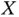<math display="inline" overflow="scroll"><mrow><mi>X</mi></mrow></math> : 决策空间 

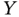<math display="inline" overflow="scroll"><mrow><mi>Y</mi></mrow></math> : 目标空间 

<math display="inline" overflow="scroll"><mrow><mi>P</mi></mrow></math> : 种群 

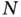<math display="inline" overflow="scroll"><mrow><mi>N</mi></mrow></math> : 种群规模 

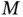<math display="inline" overflow="scroll"><mrow><mi>M</mi></mrow></math> : 目标数量 

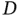<math display="inline" overflow="scroll"><mrow><mi>D</mi></mrow></math> : 决策变量数量 

<math display="inline" overflow="scroll"><mi>O</mi><mo stretchy="false">(</mo><mi>N</mi><mo stretchy="false">)</mo></math> : 时间复杂度 

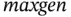<math display="inline" overflow="scroll"><mi>m</mi><mi>a</mi><mi>x</mi><mi>g</mi><mi>e</mi><mi>n</mi></math> : 算法最大迭代代数 

<math display="inline" overflow="scroll"><msup><mrow><mi>z</mi></mrow><mrow><mo>&#42;</mo></mrow></msup></math> : 参考点 

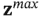<math display="inline" overflow="scroll"><msup><mrow><mi mathvariant="bold">z</mi></mrow><mrow><mi>m</mi><mi>a</mi><mi>x</mi></mrow></msup></math> : 极值点 (nadir point) 

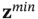<math display="inline" overflow="scroll"><msup><mrow><mi mathvariant="bold">z</mi></mrow><mrow><mi>m</mi><mi>i</mi><mi>n</mi></mrow></msup></math> : 理想点 (ideal point) 

<math display="inline" overflow="scroll"><mrow><mi>&#949;</mi></mrow></math> : 阈值 

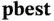<math display="inline" overflow="scroll"><mstyle mathvariant="bold"><mi mathvariant="bold">p</mi><mi mathvariant="bold">b</mi><mi mathvariant="bold">e</mi><mi mathvariant="bold">s</mi><mi mathvariant="bold">t</mi></mstyle></math> : 粒子的个体最优 (pbest) 

<math display="inline" overflow="scroll"><mstyle mathvariant="bold"><mi mathvariant="bold">g</mi><mi mathvariant="bold">b</mi><mi mathvariant="bold">e</mi><mi mathvariant="bold">s</mi><mi mathvariant="bold">t</mi><//></math> : 种群全局最优 (gbest) 

<math display="inline" overflow="scroll"><mrow><mi mathvariant="bold">g</mi></mrow></math> : 距离函数 

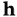<math display="inline" overflow="scroll"><mrow><mi mathvariant="bold">h</mi></mrow></math> : 形状函数 

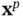<math display="inline" overflow="scroll"><msup><mrow><mi mathvariant="bold">x</mi></mrow><mrow><mi>p</mi></mrow></msup></math> : 决策向量中位置相关的部分 

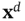<math display="inline" overflow="scroll"><msup><mrow><mi mathvariant="bold">x</mi></mrow><mrow><mi>d</mi></mrow></msup></math> : 决策向量中位置相关的部分 

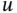<math display="inline" overflow="scroll"><mrow><mi>u</mi></mrow></math> : 决策变量上界 

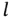<math display="inline" overflow="scroll"><mrow><mi>l</mi></mrow></math> : 决策变量下界 

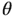<math display="inline" overflow="scroll"><mrow><mi>&#952;</mi></mrow></math> : 帕累托解的稀疏度 

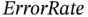<math display="inline" overflow="scroll"><mi>E</mi><mi>r</mi><mi>o</mi><mi>R</mi><mi>a</mi><mi>t</mi></math> : 分类器的错误率 

<math display="inline" overflow="scroll"><mstyle mathvariant="bold"><mi mathvariant="bold">x</mi><mi mathvariant="bold">b</mi></mstyle></math> : 决策向量的二进制向量 

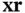<math display="inline" overflow="scroll"><mstyle mathvariant="bold"><mi mathvariant="bold">x</mi><mi mathvariant="bold">r</mi></mstyle></math> : 决策向量的实数向量 

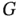<math display="inline" overflow="scroll"><mrow><mi mathvariant="bold">G</mi></mrow></math> : 复杂网络 

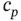<math display="inline" overflow="scroll"><msub><mrow><mi>c</mi></mrow><mrow><mi>p</mi></mrow></msub></math> : 交叉概率 

<math display="inline" overflow="scroll"><msub><mrow><mi>m</mi></mrow><mrow><mi>p</mi></mrow></msub></math> : 变异概率 

<math display="inline" overflow="scroll"><mrow><mi>T</mi></mrow></math> : 邻域规模 

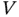<math display="inline" overflow="scroll"><mrow><mi>V</mi></mrow></math> : 顶点集合 

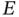<math display="inline" overflow="scroll"><mrow><mi>E</mi></mrow></math> : 边集合


# 引言

科学家们一直致力于探索自然界以寻找研究问题的答案，解决优化问题也是如此。`nature‐inspired optimization algorithms`（自然启发优化算法）正是一类用于全局优化的现代算法。面对复杂优化问题具有挑战性的特征（例如非线性、不可微性或多模性），自然启发优化算法受益于其鲁棒性的独特优势——将优化问题视为`black‐boxes`（黑箱）。受生物演化机制的启发，进化算法（EAs）[[1]](#c01.xhtml#c01-bib-0001）是该家族中最具代表性的领域之一。通常来说，进化算法包含了遗传算法（GAs）、进化策略、演化计算和遗传编程。

## 进化算法流程与挑战

如图 1.1</mo><mo>=</mo><mo stretchy="false">(mo><msub><mrow><mi>f</mi></mrow><mrow><mn>1</mn></mrow></msub><mo stretchy="false">(mo><mi mathvariant="bold">x</mi><mo stretchy="false">)</mo><mo>,</mo><msub><mrow><mi>f</mi></mrow><mrow><mn>2</mn></mrow></msub><mo stretchy="false">(mo><mi mathvariant="bold">x</mi><mo stretchy="false">)</mo><mo>,</mo><mi>&#8230;</mi><momomo><msub><mrow><mi>f</mi></mrow><mrow><mi>m</mi></mrow></msub><mo stretchy="false">(mo><mi mathvariant="bold">x</mi><mo stretchy="false">)</mo><mo stretchy="false">)</mo><mo>,</mo></mtd><mtr><mtd>s.t</td><td><mi element-bold element-of upper X, bold f element-of upper Y, EndLayout></td></mtr></mtable></math>
```

其中 `X` 是决策空间，`x = (f1(x), f2(x), ..., fm(x))` 是决策向量；`Y` 是目标空间，`f` 是目标向量。决策向量 `x` 由 `n` 个决策变量组成，而目标向量 `f` 由 `m` 个目标函数组成，这些函数将 `x` 从 `X` 映射到 `Y`。


考虑到目标的数量，优化问题从本质上可以分为两类：单目标优化问题（SOPs）（即 $m=1$）和多目标优化问题（MOPs）（即 $m>1$）。对于 SOP，最优解通常是一个使目标最小化（或最大化）的单一决策向量。对于 MOP，由于多个目标之间通常是相互冲突的，因此无法找到任何能够同时最小化（或最大化）所有目标的单一解；相反，MOP 的最优解通常是一组在不同目标之间进行权衡的解集，被称为帕累托最优解（Pareto optimal solutions）。特别地，超过三个目标的 MOP 也称为多目标优化问题（MaOP），因为其具有特殊的挑战 [2]。

**图 1.2** (#c01.xhtml#R_c01-fig-0002) 该图说明了本章涉及的大型优化问题的分类。通常，这些问题可能具有大量的决策变量，或者具有许多目标，可以进一步分为四类：具有大量决策变量的单目标问题（LSSOPs）、具有大量决策变量的多目标优化问题（LSMOPs）、多目标优化问题（MaOPs），以及具有大量决策变量的多目标优化问题（LSMaOPs）。

如图 1.2 具有大量决策变量的 SOP（LSSOPs）、(ii) 具有大量决策变量的 MOP（LSMOPs）、(iii) 决策变量规模为常的 MaOP（MaOPs），以及 (iv) 具有大量决策变量的 MaOP（LSMaOPs）。

对于 SOP，优化目标非常直接——寻找使目标函数 $f(x^*)$ 最小的全局最优解 $x^*$。相比之下，对于 MOP/MaOP，由于不同目标之间可能存在冲突，没有单一解能够最小化所有目标。结果是存在一组在不同目标之间进行权衡的最优解，即帕累托最优性（Pareto optimality）——它定义了一种情况：在不牺牲至少另一个目标的情况下，没有任何解可以变得更好。换句话说，MOP/MaOP 的最优性是基于考虑不同目标之间的权衡时，候选解之间的两对关系（支配关系）来定义的。具体来说，称一个解 $x_1$ 支配另一个解 $x_2$（记作 $x_1 \succ x_2$），当仅当：

```
\begin{cases}
\begin{array}{l}
\forall i=1, 2, \dots, m : f(x_1) \le f(x_2), \\
\exists j=1, 2, \dots, m : f(x_1) < f(x_2)
\end{array}
\end{cases}
```

如果解 $x^*$ 不被任何其他可行解支配，则称 $x^*$ 为帕累托最优的（Pareto optimal），所有 $x^*$ 的并集称为帕累托解（PS），而 $f(x^*)$ 的并集称为帕累托前沿（PF）。帕累托最优性的说明性示例见图 1.3。


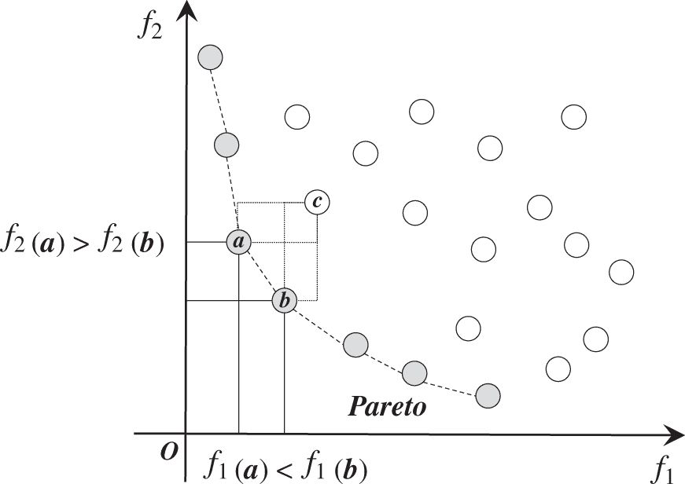

**图 1.3** (#c01.xhtml#R_c01-fig-0003) *帕累托最优性*的一个示例说明。若干候选解（<math display="inline" overflow="scroll"><mrow><mi mathvariant="bold">a</mi></mrow></math>, 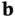<math display="inline" overflow="scroll"><mrow><mi mathvariant="bold">b</mi></mrow></math>, <math display="inline" overflow="scroll"><mrow><mi mathvariant="bold">c</mi></mrow></math>, 等）的图像在目标空间中扩散。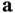<math display="inline" overflow="scroll"><mrow><mi mathvariant="bold">a</mi></mrow></math> 和 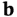<math display="inline" overflow="scroll"><mrow><mi mathvariant="bold">b</mi></mrow></math> 互不支配，是 PF（PS）帕累托前沿上的帕累托最优解之一。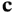<math display="inline" overflow="scroll"><mrow><mi mathvariant="bold">c</mi></mrow></math> 被 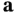<math display="inline" overflow="scroll"><mrow><mi mathvariant="bold">a</mi></mrow></math> 和 <math display="inline" overflow="scroll"><mrow><mi mathvariant="bold">b</mi></mrow></math> 同时支配。

对于大多数连续 MOPs/MaOPs，PS（PF）通常包含无限数量的帕累托最优解。因此，在实践中，只能使用有限数量*非支配解*来近似 PS（PF）的一个代表性子集，这些解通常是算法获得的最终解集中未被任何其他解支配的候选解。

在本章中，我们主要关注类型 (ii) 和类型 (iv) 问题，即 LSMOPs 和 LSMaOPs。由于 MaOPs 本质上是 MOPs 的特殊情况，为了简单起见，我们将 LSMOPs 和 LSMaoPs 的缩写统一为 LSMOPs。具体而言，我们将采用 EAs 求解大规模优化问题的研究称为*进化大规模优化*。本章的其余部分结构如下：第 1.2 节

追溯到 John Holland 在 1975 年提出的 `GA` 3，`EAs`（通常指软计算算法族）在过去的半世纪里经历了蓬勃发展。给定一个优化问题，`EA` 迭代地维护一个正在经历交叉、变异和选择等进化算子的种群。结果，种群预期会向最优解移动。

### 1.2.1 用于求解 MOPs 的 MOEAs

考虑到基于种群的特性，`EAs` 内生适用于 MOPs。自从 Schaffer 在 1984 年提出向量评估的 `GA` 4 起，已经提出了大量的 `MOEAs`。通常，求解 MOPs 的 `MOEAs` 可以分为三类：基于支配的、基于性能指标的以及基于分解的。

基于支配的 `MOEAs` 在过去二十十年中非常流行。早期的基于支配的非精英 `MOEAs` 包括非支配 `GA` 5、生态位-帕累托 `GA` 6 和多目标遗传算法 7。后来人们发现，使用精英策略可以显著提高 `MOEAs` 的收敛性。结果，开发了几种流行的精英 `MOEAs`，包括精英非支配排序遗传算法 (`NSGA-II`) 8、强度性帕累托进化算法 (`SPEA2`) 9 和基于帕累托包络的选择算法 (`PESA`) [10,11]。尽管基于支配的 `MOEAs` 在求解双目标或三目标 MOPs 时非常强大，但当目标大于三个时，它们的收敛性能会急剧下降，这主要是由于选择压力的丧失。

基于分解的方法将复杂的 MOP 分解为若干子问题并以协作的方式求解它们。基于分解的方法主要有两类。在第一类基于分解的方法中，MOP 被分解为一组单目标问题（SOPs），包括早期的权重加和方法 [12,13]，以及最近的基于分解的多目标进化算法 (`MOEA/D`)，该算法引入了子问题解之间更显式的协作策略。


由于性能指标被用于衡量解的质量，因此将它们作为选择标准来引导算法搜索以获得高质量解也是非常直观的。在各种性能指标中，超体积指标（或 `S` 指标）在各种多目标进化算法（MOEAs）中应用最广泛，因为它是唯一已知对帕累托支配具有严格单调性的指标 19。第一个广为人知的基于超体积指标的算法是由 Emmerich *et al.* 于 2005 年提出的，被称为 `s`‐指标选择进化多目标算法（`SMS‐EMOA`）20。在 `SMS‐EMOA` 中，采用 `(μ + 1)` 进化策略，从 `μ` 个父代中生成一个子代候选解。为了选择下一代选择 `μ` 个新的候选解，会计算每个候选解在最后一次非支配前沿面上的超体积贡献，并移除超体积贡献最小的一个。除了超体积指标外，其他一些性能指标也被用于引导 MOEAs 的搜索。Zitzler 和 Künzli 提出了基于二进制指标 `I+ε` 的进化算法（`IBEA`）21 的参考点。

尽管介绍了上述各种 MOEAs，但它们或或少程度上继承了 `NSGA‐II` 的优点——无论是其框架还是主要的算法组件。一方面，`NSGA‐II` 的简单框架允许用户将主要组件替换为定制组件；另一方面，`NSGA‐II` 的主要算法组件可以被于修改。最近，`NSGA‐II` 也为大规模多目标优化提供了启示，并且与本文要介绍的工作高度相关。因此，在进入后续章节之前，鼓励读者深入研究 `NSGA‐II`。

如下文所示，`NSGA‐II` 的工作流遵循三个主要组件：`配偶选择`、`变异`和`环境选择`。具体而言，环境选择包含两种方法：`非支配排序`（`Line 2`）和`拥挤排序`（`Line 3`）。

为了获得作为 `PF` 近似的候选解种群，除了`非支配排序`中考虑的收敛标准外，考虑`多样性准则`同样重要。具体来说，在进化多目标优化中，多样性准则通常是指候选解在 `PF` 上分布的均匀/程度。这是因为在没有任何偏好的情况下，决策者可能对不同目标之间进行权衡的多样解感兴趣。

`NSGA‐II` 中的`拥挤排序`（`Algorithm 1.3`）其动力是为了维持候选解的多样性。正如该排序方法的名字所示，`拥挤排序`旨在根据拥挤程度对候选解进行排序。最终，将优先选择具有最佳收敛性（即尽可能靠近最后一次非支配前沿的解）且次要具有最佳多样性（拥挤程度最低的解）的候选解。

`NSGA‐II` 中的`配偶选择`与单目标 `GA` 中采用的传统锦标选择（`Algorithm 1.4`）[24](#c01.xhtml#c01-bib-0024）非常相似，不同在于它根据两个（而不是一个）标准进行排序 – `非支配前沿索引`（`Algorithm 1.2`）和`拥挤索引`（`Algorithm 1.3`）。


值得注意的是，锦标选择（以及任何其他配对选择方法）并不是多目标进化算法（MOEA）不可或缺的组件，但在采用它时预计可以获得更多样化且高质量（从适应度角度来看）的候选解。关键机制是根据对候选解的概率性（而非确定性）测量进行随机配对。从更广泛的角度来看，这种随机机制在与 MOEA 结合时被广泛采用并证明是有效的。

`NSGA‐II` 中的`变异`操作（`Algorithm 1.5`）采用了经典的`模拟二分交叉`和`多项式变异`，这些方法也被广泛应用于实数遗传算法（RCGAs）[[25]](#c01.xhtml#c01-bib-0025)。在本质上，变异操作预计能为未来的演化生成高质量的新候选解决方案。与进化算法（EA）一样，交叉和变异是最常见的两种变异操作。一方面，交叉操作通过交换每个候选解决方案的一部分来随机重新组合一对候选解；另一方面，变异操作则随机修改候选解决方案的变量。

由于 NSGA-II 最初是为了求解具有连续搜索空间的多目标问题（MOPs），使用经典模拟二分交叉和多项式变异的变异操作在生成实数编码小型 MOP 的候选解方面非常高效。从概率角度来看，变异操作可以看作是在决策空间中向最优解采样新数据的过程。因此，高维空间中的变异操作也面临`维度灾数`的挑战，从而在处理大规模多目标问题（LSMOPs）时失去效率。为此，本书（第 3 章和第 4 章)将介绍一些专门用于求解 LSMOP 的新型变异算子。

由于`环境选择`决定了候选解演化的方向，它在 EA 中起着至关重要的作用。特别是在 MOEA 中，环境选择必须精心设计，以平衡收敛准则和多样性准则，旨在获得均匀分布在近似 PF（帕累托沿）上的候选解种。为此，`NSGA‐II` 中的环境选择（`Algorithm 1.6`）由两个子部分组成：上述非支配排序（`Line 1`）和拥挤距离排序（`Line 2`）。

本质上，结合使用两种排序方法的原因是为了同时考虑收敛准则（帕累托支配）和多样性准则（拥挤距离）。因此，环境选择可以看作是一个`多索引排序`过程。作为`主排序`，非支配排序通过考虑帕累托最优性的收敛准则将候选解分为若干层。理想情况下，如果最后一层中候选解的数量正好等于预定义的待选候选解数量（例如，从 <math display="inline" overflow="scroll"><mrow><mi>N</mi></mrow></math> 中选取 <math display="inline" overflow="scroll"><mn>2</mn><mi>N</mi></math>），环境选择将在此结束。然而，最后一层的候选解数量可能会超过或未达到待选并传递给下一代的总数。因此，环境选择将继续执行拥挤距离排序作为`次排序`，直到满足预定义的待选候选解数量（`Lines 4–9`）。

### 1.2.2 用于求解 MaOPs 的 MOEAs

MOEA 已证明在具有两个或三个目标的广泛 MOPs 上表现良好；然而，当 MOEA 用于处理具有三个以上目标的 MOPs（即 MaOPs）时，面临着巨大的困难 [26–29]。因此，MaOPs 越来越受到关注。

大多数传统 MOEA 在求解 MaOPs 时失败的一个主要原因可以归因于当采用支配作为选择个体的标准时，种群向 PF 收敛的选择压力 [[30]](#c01.xhtml#c01-bib-030)]。例如，精英策略 `NSGA‐II` [[8]](#c01.xhtml#c01-bib-008) 和 `SPEA2` [[9]](#c01.xhtml#c01-bib-009) 都使用基于支配的选择，在应用于 MaOPs 优化时将无法正常工作。这是因为在有限规模的种群中，绝大多数候选解是非支配的，导致基于支配的选择准则在搜索极早期就难以区分候选解。

MOEA 在 MaOPs 上性能下降的另一个重要原因是高维目标空间中维持良好种群多样性的困难。通常，由于大多数连续 MOPs 的 PF 是分段连续的 [31, 32]，实际上近似所有的帕累托最优解是不可能的。相反，大多数 MOEA 旨在寻找一组均匀分布的代表解来近似 PF。当目标数量为二或三时，PF 通常是一维曲线或二维表面，保持解的多样性相对简单。随着目标维度的增加，维持良好的种群多样性变得越来越具有挑战性，因为候选解在高目标空间中分布非常稀疏。这给 MOEA 中广泛使用的多样性管理策略带来了巨大困难，例如 `NSGA‐II` 中基于拥挤距离的多样性方法 [33–35]。

为了提高大多数 MOEA 求解 MaOPs 的性能，研究人员已经提出了许多方法 [2, 36, 37]，这些方法大致可分为三类。


## 修改的支配方法

第一类是修改的基于支配的方法。其基本思想是通过修改帕累托支配（Pareto dominance）来扩大支配区域，增强收敛压力，使得原始的一些非支配解被其他解所支配。该类的一个早期工作是 Laummans *等人* 38 提出的 `ε`-支配，在该方法中，通过调整参数 `ε(0, 1)` 可以在一定范围内放松原始支配关系。`ε` 设置得，支配关系越松散，反之亦然。此外，基于 `ε`-支配，Deb *等人* 提出了一种名为 `ε`-MOEA 的稳态算法 39。不仅如此，研究人员还提出了一些 `ε`-支配的扩展变体。在 40 中，Aguirre 和 Tanaka 提出了一种 `ε`-排名多目标优化器（`ε R-EMO`），该优化器在空间划分策略的基础上执行自适应 `ε`-排名程序。另一种代表性的修改支配方法是 Ikeda *等人* 在 26 中提出的 `α`-支配。对于两个解，如果一个解在某一个目标上略优但在其他目标上显著较差，则 `α`-支配允许该解被另一个解所支配。`α`-支配已成功集成到一些用于多目标优化问题（MOPs）的 MOEA 中，例如引导多目标进化算法（G-MOEA） 41。Batista *等人* 结合了 `ε`-支配和 `α`-支配，提出了另一种修改的支配方法，即锥形 `ε`-支配 42。据报道，锥形 `ε`-支配在求解具有多达 50 个目标的许多目标优化问题（MaOPs）方面具有前景 29。最近，Yang *等人* 提出了一种基于网格的进化算法（GrEA） 43，如果发现种群多样性过度，将禁用选择过程中的多样性促进机制。该类的另一项较新工作是 Li *等人* 44 提出的基于偏移的密度估计（SDE），其基本思想是通过为收敛性差的解分配高密度值对其进行惩罚，使得同时具有良好收敛性和分布的候选解才能生存到下一代。在 45 中，Wang *等人* 提出了与候选解种群共同进化偏好以进行许多目标优化中的多样性管理。最近，属于这一类的另一个代表性算法是 NSGA-III 46，它通过一组预定义的参考点来管理多样性。此外，最近提出的膝点驱动进化算法（KnEA）也属于这一类，它在传统的非支配排序的基础上采用了基于膝点的多样性次级选择策略 47。


前两类方法旨在提高 MOEAs 在 MaOPs 上的性能，而第三类被称为`目标降维`（objective reduction）的方法则试图通过减少冗余或无关目标数量，将 MaOPs 转换为 MOPs，从而可以使用传统的 MOEAs 直接求解这些问题 [48, 49]。通常，目标降维方法分为两类：离线方法和在线方法。

### 离线目标降维
离线目标降维方法可以视为预处理技术，它们独立于特定的 MOEA 运行，但需要一组近似的帕累托最优解作为*先验*知识。在 50 中，Brockhoff 和 Zitzler 提出了基于由 <math display="inline" overflow="scroll"><mrow><mi>&#949;</mi></mrow></math>‐支配关系测量的目标冲突的确定性和随机性算法。Sexane *et al.* 提议使用主成分分析（PCA）51 和最大方差展开（MVU）52 分别用于线性与非线性目标降维 49。Singh *et al.* 提议使用角解进行目标降维，这些角解是通过帕累托角搜索进化算法（PCSEA）得到的 48。

### 在线目标降维
在线目标降维方法通常嵌入到现有的 MOEA 中并作为演化过程的一部分执行，其核心思想是利用 MOEA 在优化过程中得到的解迭代地更新简化后的目标。在 50 中，Brockhoff 和 Zitzler 提议将`PCA` 方法嵌入 `NSGA-II` 以构建一种在线目标降维方法，称为 `PCA-NSGA-II`。在 53 中，Jaimes *et al.* 提出了一种在线目标降维算法，根据目标之间的相关性找到一个 <math display="inline" overflow="scroll"><mrow><mi>k</mi></mrow></math>‐大小的目标子集。最近，Guo *et al.* 提议采用围绕中心聚类（PAM）54。

### 分解与基于指标的方法
除了这三类方法外，基于分解的方法和基于性能指标的方法（最初提出用于求解 MOPs）也适用于多目标优化。然而，尽管这两种类型的方法都不是基于支配的，但它们仍然面临某些其他问题。

#### 基于分解的方法
对于基于分解的方法，在运行算法之前总是需要预定义一组权重（或参考）向量。在高维目标空间中，指定合适的向量集来很好地近似 PF（帕累托沿）变得特别具有挑战性。为了解决这个问题，Li *et al.* 提出了一种同时基于支配和分解的 MOEA，称为 `MOEA/DD` 56。

#### 基于性能指标的方法
对于基于性能指标的方法，主要问题是计算效率方面的严重*维度灾难* 57。例如，`SMS-EMOA` 每一代的运行时间高达 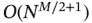<math display="inline" overflow="scroll"><mi>O</mi><mo stretchy="false">(</mo><msup><mrow><mi>N</mi></mrow><mo stretchy="false">/</mo><mn>2</mn><mo>+</mo><momo><mn>1</mn></mrow></msup><mo stretchy="false">)</mo></math>其中 <math display="inline" overflow="scroll"><mrow><mi>N</mi></mrow></math> 是种群大小，<math display="inline" overflow="scroll"><mrow><mi>M</mi></mrow></math> 是目标数量。为了解决这个问题，Bader 和 Zitzler 提出了一种体积估计算法（HypE）19，采用蒙特卡洛采样方法来获取多目标情况下的近似体积值。与 `SMS-MOEA` 类似，`HypE` 的选择仍然基于解的体积贡献，不同之处在于贡献基于随机选择的非支配解子集，子集的大小等于要移除解的数量。此外，还提出了一些更快的体积计算方法，例如通过目标切片计算体积（HSO）58。

总结来说，求解 MaOPs 的方法要么基于传统的 MOEAs 定制，要么采用某些将 MaOPs 转换为 MOPs 的策略。转向 LSMOPs 时，MOEA 在决策空间和目标空间都会面临维度灾难，从而给收性和多样性管理带来严峻挑战。最近，Cheng *et al.* 提出了一种参考向量引导进化算法（RVEA）[60](#c01.xhtml#c01-bib-0060）来求解 MaOPs。`RVEA` 继承了通用的基于精英选择的框架（类似于 `NSGA-II`），同时采用了受基于分解和基于指标的 MOEA 精心设计的的环境选择。得益于通用的框架和强大的收敛/多样性管理，`RVEA` 已证明在扩展到 LSMOPs 方面具有潜力，将在后续章节详细阐述。因此，作为预备知识，我们将在介绍 `RVEA` 的细节。


图 1.6 展示了如何将个体与参考向量关联的示例。在这个示例中，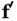<math display="inline" overflow="scroll"><msup><mrow><mi mathvariant="bold">f</mi></mrow><mrow><mo mathvariant="bold">&#8242;</mo></mrow></msup></math> 是一个平过的目标向量，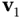<math display="inline" overflow="scroll"><msub><mrow><mi mathvariant="bold">v</mi></mrow><mrow><mn>1</mn></mrow></msub></math> 和 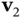<math display="inline" overflow="scroll"><msub><mrow><mi mathvariant="bold">v</mi></mrow><mrow><mn>2</mn></mrow></msub></math> 是两个单位参考向量。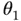<math display="inline" overflow="scroll"><msub><mrow><mi>&#952;</mi</mrow><mrow><mn>1</mn></mrow></msub></math> 和 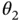<math display="inline" overflow="scroll"><msub><mrow><mi>&#952;</mi</mrow><mrow><mn>2</mn></mrow></msub></math> 分别是 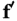<math display="inline" overflow="scroll"><msup><mrow><mi mathvariant="bold">f</mi></mrow><mrow><mo mathvariant="bold">&#8242;</mo></mrow></msup></math> 与 <math display="inline" overflow="scroll"><msub><mrow><mi mathvariant="bold">v</mi></mrow><mrow><mn>1</mn></mrow></msub></math>、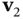<math display="inline" overflow="scroll"><msub><mrow><mi mathvariant="bold">v</mi></mrow><mrow><mn>2</mn></mrow></msub></math> 之间的角度。由于 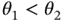<math display="inline" overflow="scroll"><msub><mrow><mi>&#952;</mi</mrow><mrow><mn>1</mn></mrow></msub><mo>&#60;</mo><msub><mrow><mi>&#952;</mi</mrow><mrow><mn>2</mn></mrow></msub></math>与 <math display="inline" overflow="scroll"><msup><mrow><mi mathvariant="bold">f</mi></mrow><mrow><mo mathvariant="bold">&#8242;</mo></mrow></msup></math> 的候选解与参考向量 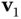<math display="inline" overflow="scroll"><msub><mrow><mi mathvariant="bold">v</mi></mrow><mrow><mn>1</mn></mrow></msub></math> 关联。

首先，RVEA 采样了一组参考向量（第 2 行）。如图 1.5 所示，RVEA 生成参考向量的方法灵感源于基于分解的方法中生成参考点的方法，在需要参考向量均匀分布的情况下，使用了 `simplex-lattice design`（算法 1.8）。尽管参考点和参考向量之间存在深层联系，但它们的工作机制有本质区别：参考点指定了目标空间中决策者可能感兴趣的区域；相比之下，参考向量指定了候选解预期收敛的方向，可能是指向帕累托沿（PF）上的唯一帕累托最优解，如图 1.6 所示。

在 RVEA 的主循环（第 4–8 行）中，变异部分与 NSGA-II 相同。RVEA 与 NSGA-II 的主要区别在于另外两个关键组件：`环境选择`（第 7 行）和`向量自适应`（第 8 行）。

RVEA 中的`环境选择`（算法 1.9）旨在对由与其最近参考向量关联的候选解组成的子种内部执行单目标选择（第 4 行）。作为选择准则，提出了一种名为角度惩罚距离（APD）的标量化函数来聚合收敛准则和多样性准则：

(1.3)<math display="block" overflow="scroll"><msub><mrow><mi>d</mi></mrow><mrow><mi>t</mi><mo>,</mo><mi>i</mi><mo>,</mo><mi>j</mi></mrow></msub><mo>=</mo><msub><mrow><mi>d</mi></mrow><mrow><mi>t</mi</mrow><mo>,</mo><mi>i</mi><mo>,</mo><mi>j</mi></mrow></msub><mo>=</mo><mo><mo</1</mo1</mo</1>1</1</mo><mi>P</mi><mo stretchy="false">(</mo><msub><mrow><mi>&#952;</mi</mrow><mrow><mi>t</mi><mo>,</mo><mi>i</mi><mo>,</mo><mi>j</mi></mrow></msub><mo stretchy="false">)</mo><mo>\times;</times</mo><msub><mrow><mi mathvariant="bold">f</mi></mrow><mrow><mi>t</mi><mo>,</mo><mi>i</mi></mrow></msub><mo>-</mo><msub><mrow><mi mathvariant="bold">z</mi></mrow><mrow><mi>t</mi</mrow><mrow><mn>m</mrow></mrow><mi</mi></mrow></msub></math>其中 `d_{t,i,j}` 表示第 `t` 代代解 `p_{t,i}` 相对于参考向量 `v_{t,j}` 的 APD；`|f_{t,i} - z_{t}^{min}|` 作为收敛准则，是候选解 `p_{t,i}` 到理想向量 `z_{t}^{min}` 的欧几得距离；而 `P(\theta_{t,i,j})` 作为多样性准则，是与候选解 `p_{t,i}` 和参考向量 `v_{t,j}` 之间的角度 `theta_{t,i,j}` 相关的惩罚函数。


(1.4)<math display="block" overflow="scroll"><mi>P</mi><mo stretchy="false">(</mo><msub><mrow><mi>&#952;</mi></mrow><mrow><mi>t</mi><mo>,</mo><mi>i</mi><mo>,</mo><mi>j</mi></mrow></msub><mo stretchy="false">)</mo><mo>=</mo><mi>M</mi><mo>&#183;</mo><msup><mrow><mfenced open="(" close=")" separators=""><mrow><mfrac><mrow><mi>t</mi></mrow><mrow><msub><mrow><mi>t</mi></mrow><mrow><mi>m</mi><mi>a</mi><mi>x</mi></></></msub></mrow></mfrac></mrow></mfenced></mrow><mrow><mi>&#945;</mi></mrow></msup><mo>&#183;</mo><mfrac><mrow><msub><mrow><mi>&#952;</mi></mrow><mrow><mi>t</mi><mo>,</mo><mi>i</mi><mo>,</mo><mi>j</mi></mrow></msub></mrow><mrow><msub><mrow><mi>&#947;</mi></mrow><msub><mrow><mi mathvariant="bold">v</mi></mrow><mrow><mi>t</mi><mo>,</mo><mi>j</mi></mrow></msub></mrow></mrow></mfrac><momomo></math> 

with

(1.5)<math display="block" overflow="scroll"><msub><mrow><mi>&#947;</mi></mrow><mrow><msub><mrow><mi mathvariant="bold">v</mi></mrow><mrow><mi>t</mi><mo>,</mo><mi>j</mi></mrow></msub></mrow></msub><mo>=</mo><munder><mrow><mi>min</mi></mrow><mrow><mi>i</mi><mo>&#8712;</mo><mo stretchy="false">&#123;</mo><mn>1</mn><mo>mo><mi>&#8230;</mi><mo>mo><mi>N</mn><mo stretchy="false">&#125;</mo><momomo><mi>i</mi><mo>&#8800;</mo><mi>j</mi></mrow></munder><mo>&#9001;</mo><msub><mrow><mi mathvariant="bold">v</mi></mrow><mrow><mi>t</mi><mo>,</mo><mi>i</mi></mrow></msub><momomo><msub><mrow><mi mathvariant="bold">v</mi></mrow><mrow><mi>t</mi><mo>,</mo><mi>j</mi></mrow></msub></momo><mo>&#9002;</mo><momo></math> 

where <math display="inline" overflow="scroll"><mrow><mi>M</mi></mrow></math> 是目标数量，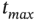<math display="inline" overflow="scroll"><msub><mrow><mi>t</mi></mrow><mrow><mi>m</mi><mi>a</mi><mi>x</mi></mrow></msub></math> 是预定义的最大代数，<math display="inline" overflow="scroll"><msub><mrow><mi>&#947;</mi></mrow><mrow><msub><mrow><mi mathvariant="bold">v</mi></mrow><mrow><mi>t</mi><mo>,</mo><mi>j</mi></mrow></msub></mrow></msub></math> 是 `gamma Subscript bold v Sub Subscript t comma j` 与 `v Subscript t i` 之间的最小角，而 `alpha` 是一个控制多样性随代数变化率的用户定义参数。值得注意的是，`upper P left-parenthesis theta Subscript t i j Baseline right-parenthesis` 的设计基于几项观察结果。

### 数学公式

数学模型定义如下：

(1.4) [Equation Formula]

(1.5) [Equation Formula]

其中：
- `M` 是目标数量。
- `t Subscript m a x` 是预定义的最大代数。
- `gamma Subscript bold v Sub Subscript t comma j` 是 `v Subscript t i` 之间的最小角。
- `alpha` 是控制多样性变化率的参数。

### 设计考虑

首先，由于在高维空间中候选解的数量有限且分布稀疏，因此在搜索的早期和后期增强种群的收敛性和多样性特别为重要；因此，`upper P left-parenthesis theta Subscript t i j Baseline right-parenthesis` 被设计为与 `t` 相关。

其次，由于候选解的分布稀疏，候选解与参考向量之间的角度差异很大；因此，角度通过 `StartFraction theta Subscript t i j Baseline Over gamma Subscript bold v Sub Subscript t j Baseline` 归一化到 `[0, 1]`。第三，目标越多，候选解的分布越稀疏；因此，`upper P left-parenthesis theta Subscript t i j Baseline right-parenthesis` 被设计为与目标数量 `M` 相关。

### 向量适应

RVEA 中的向量适应旨在根据帕累托沿（PF）上目标的不同范围调整参考向量的分布。对于像 NSGA-II 等基于支配的算法，目标函数的归一化不会改变支配关系的偏序，因此对选择过程没有影响；相比之下，在 RVEA 中，由于选择准则与候选解的目标函数值相关，在进化过程中动态归一化目标值会显著扰动算法的收敛性。因此，RVEA 不是归一化目标函数，而是通过以下方式适应参考向量：


(1.6) $v_{t+1,i} = \frac{\|v_{0,i} \circ (z_{t+1}^{max} - z_{t+1}^{min})\|}{\|v_{0,i} \circ (z_{t+1}^{max} - z_{t+1}^{min})\|}$，其中运算符 $\circ$ 表示哈玛玛积，即对两个尺寸相同的向量（或矩阵）进行逐元素乘法，$i=1, \dots, N$，$v_{0,i}$ 表示第 $i$ 个均匀分布的参考向量，该向量在初始化阶段（算法 1.7 中的步骤 1）生成；$v_{t+1,i}$ 表示下一代 $t+1$ 的第 $i$ 个自适应参考向量，$z_{t+1}^{max} = (z_{t+1,1}, z_{t+1,2}, \dots, z_{t+1,m})$ 和 $z_{t+1}^{min} = (z_{t+1,1}, z_{t+1,2}, \dots, z_{t+1,m})$ 分别表示通过种群 $P_{t+1}$ 中的候选解估计出的凹点（nadir point）和理想点。此外，为了控制参考自适应的频率，引入了预定义参数 $f_r$。

## 1.3 演化大规模优化

适应环境是自然演化的一个重要特征；因此，在应用进化算法（EAs）时，将待优化问题视为*黑盒*，并将这种适应性视为一种独特优势是直观的。事实上，进化算法的工作方式不需要当前问题的特定信息；然而，在面对大规模问题时，将所有工作都交给进化算法可能会由于巨大的搜索空间而导致极其高昂的计算成本。因此，演化大规模优化文献 [61,62] 主要致力于通过将黑盒问题转换为*灰盒*来加速进化算法的搜索速度，这主要主要基于*先验*知识或从问题中挖掘的*后验*信息。为了实现这一目的，*协同演化（CC）*提供了一种结合了*决策变量分组*技术的通用方法。

### 1.3.1 决策变量分组

决策变量分组的直观思想借自经典的运筹学——*分治法*，旨在将大规模优化问题分解为一组较规模的子问题 [63]。具体而言，通过考虑决策向量 $x$（即包含决策变量的向量）的*可分性*，可以将优化问题 $f(x)$ 分解为子问题，主要分为两种情况。


理想情况下，一个优化问题 <math display="inline" overflow="scroll"><mi>f</mi><mo stretchy="false">(</mo><mi mathvariant="bold">x</mi><mo stretchy="false">)</mo></math> 可以被分解为若干子问题并完全独立地优化，*当且仅当*原始目标函数 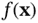<math display="inline" overflow="scroll"><mi>f</mi><mo stretchy="false">(</mo><mi mathvariant="bold">x</mi><mo stretchy="false">)</mo></math> 相对于每个子问题的任意决策变量 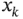<math display="inline" overflow="scroll"><msub><mrow><mi>x</mi></mrow><mrow><mi>k</mi></mrow></msub></math> 是*完全可分离的*（情况 1）：

(1.7)<math display="block" overflow="scroll"><mtable><mtr><mtd><munder><mrow><mtext>argmin</mtext></mrow><mrow><mi mathvariant="bold">x</mi></mrow></munder><mspace width="0.4em"/><mi>f</mi><mo stretchy="false">(</mo><mi mathvariant="bold">x</mi><mo stretchy="false">)</mo><mo>=</mo><mfenced open="(" close=")" separators=""><mrow><munder><mrow><mtext>argmin</mtext></mrow><mrow><msub><mrow><mi>x</mi></mrow><mrow><mi>k</mi></mrow></msub></mrow></munder><mspace width="0.4em"/><mi>f</mi><mo stretchy="false">(</mo><mi mathvariant="bold">x</mi><mo stretchy="false">)</mo><mo>,mo><munder><mrow><mtext>argmin</mtext></mrow><mrow><mo>&#8704;</mo><msub><mrow><mi>x</mi></mrow><mrow><mi>j</mi></mrow></msub><momomo><mi>j</mi><mo>&#8800;</mo><mi>k</mi></mrow></munder><mspace width="0.4em"/><mi>f</mi><mo stretchy="false">(</mo><mi mathvariant="bold">x</mi><mo stretchy="false">)</mo></mrow></mfenced><mo>.</mo></mtd></mtr></mtable></math> 

然而，子问题只能逐分量独立地进行优化，*当且仅当* <math display="inline" overflow="scroll"><mi>f</mi><mo stretchy="false">(</mo><mi mathvariant="bold">x</mi><mo stretchy="false">)</mo></math> 相对于每个子问题的任意决策变量 <math display="inline" overflow="scroll"><msub><mrow><mi>x</mi></mrow><mrow><mi>k</mi></mrow></msub></math> 是*部分可分离的*（情况 2）：

(1.8)<math display="block" overflow="scroll"><mtable><mtr><mtd><munder><mrow><mtext>argmin</mtext></mrow><mrow><mi mathvariant="bold">x</mi></mrow></munder><mspace width="0.4em"/><mi>f</mi><mo stretchy="false">(</mo><mi mathvariant="bold">x</mi><mo stretchy="false">)</mo><mo>=</mo><mfenced open="(" close=")" separators=""><mrow><munder><mrow><mtext>argmin</mtext></mrow><mrow><msub><mrow><mi>x</mi></mrow><mrow><mi>1</mi></mrow></msub></mrow></munder><mspace width="0.4em"/><mi>f</mi><mo stretchy="false">(</mo><msub><mrow><mi>x</mi></mrow><mrow><mi>1</mi></mrow></msub><momomo><mi>&#8230;</mi><mo stretchy="false">)</mo><mo>,</mo><mi>&#8230;</mi><momomo><munder><mrow><mtext>argmin</mtext></mrow><mrow><msub><mrow><mi>x</mi></mrow><mrow><mi>m</mi></mrow></msub></mrow></munder><mspace width="0.4em"/><mi>f</mi><mo stretchy="false">(</mo><mi>&#8230;</mi><momomo><msub><mrow><mi>x</mi></mrow><mrow><mi>m</mi></mrow></msub><mo stretchy="false">)</mo></mrow></mfenced><mo>,</mo></mtd></mtr></mtable></math> 

其中 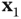<math display="inline" overflow="scroll"><msub><mrow><mi mathvariant="bold">x</mi></mrow><mrow><mn>1</mn></mrow></msub></math>, …, 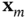<math display="inline" overflow="scroll"><msub><mrow><mi mathvariant="bold">x</mi></mrow><mrow><mi>m</mi></mrow></msub></math> 是 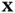<math display="inline" overflow="scroll"><mrow><mi mathvariant="bold">x</mi></mrow></math> 的不交子向量，且交互仅存在于每个子向量内部的决策变量之间，不同子向量之间的决策变量之间不存在相互作用。

上述定义的*可分离性*属性为决策变量分组技术的发展提供了理论依据。在实践中，为了检查给定函数的分离性，需要在决策向量中每对决策变量之间进行*变量交互检测*：


(1.9)![StartLayout 1st Row 1st Column f left-parenthesis bold x right-parenthesis vertical-bar Subscript x Sub Subscript i Subscript equals a 2 comma, x Sub Subscript j Subscript equals b 1 Baseline 2nd Column less-than 3rd Column f left-parenthesis bold x right-parenthesis vertical-bar Subscript x Sub Subscript i Subscript equals a 1 comma, x Sub Subscript j Subscript equals b 1 Baseline logical-and 2nd Row 1st Column f left-parenthesis bold x right-parenthesis vertical-bar Subscript x Sub Subscript i Subscript equals a 2 comma, x Sub Subscript j Subscript equals b 2 Baseline 2nd Column greater-than 3rd Column f left-parenthesis bold x right-parenthesis vertical-bar Subscript x Sub Subscript i Subscript equals a 1, x Sub Subscript j Subscript equals b 2 comma, with EndLayout](img/c01-math-0009.png)

```math
display="block" overflow="scroll"
<<table>
  <mtr>
    <td columnalign="right"><mi>f</mi><mo stretchy="false">(</mo><mi mathvariant="bold">x</mi><mo stretchy="false">)</mo><msub><mrow><mo stretchy="false">&#124;</mo></mrow><mrow><msub><mrow><mi>x</mi></mrow><mrow><mi>i</mi></mrow></msub><mo>=</mo><msub><mrow><mi>a</mi></mrow><mrow><mn>2</mn></mrow></msub><mo>,</mo><msub><mrow><mi>x</mi></mrow><mrow><mi>j</mi></mrow></msub><mo>=</mo><msub><mrow><mi>b</mi></mrow><mrow><mn>1</mn></mrow></msub></mrow></msub></td>
    <td columnalign="center"><mo>&#60;</mo></td>
    <td columnalign="left"><mi>f</mi><mo stretchy="false">(</mo><mi mathvariant="bold">x</mi><mo stretchy="false">)</mo><msub><mrow><mo stretchy="false">&#124;</mo></mrow><mrow><msub><mrow><mi>x</mi></mrow><mrow><mi>i</mi></mrow></msub><mo>=</mo><msub><mrow><mi>a</mi></mrow><mrow><mn>1</mn></mrow></msub><mo>,</mo><msub><mrow><mi>x</mi></mrow><mrow><mi>j</mi></mrow></msub><mo>=</mo><msub><mrow><mi>b</mi></mrow><mrow><mn>1</mn></mrow></msub></mrow></msub><mo>&#8743;</mo></td>
  </mtr>
  <mtr>
    <td class="eqnarray-1"><mi>f</mi><mo stretchy="false">(</mo><mi mathvariant="bold">x</mi><mo stretchy="false">)</mo><msub><mrow><mo stretchy="false">&#124;</mo></mrow><mrow><msub><mrow><mi>x</mi></mrow><mrow><mi>i</mi></mrow></msub><mo>=</mo><msub><mrow><mi>a</mi></mrow><mrow><mn>2</mn></mrow></msub><mo>,</mo><msub><mrow><mi>x</mi></mrow><mrow><mi>j</mi></mrow></msub><mo>=</mo><msub><mrow><mi>b</mi></mrow><mrow><mn>2</mn></mrow></msub></mrow></msub></td>
    <td class="eqnarray-2"><mo>&#62;</mo></td>
    <td class="eqnarray-3"><mi>f</mi><mo stretchy="false">(</mo><mi mathvariant="bold">x</mi><mo stretchy="false">)</mo><msub><mrow><mo stretchy="false">&#124;</mo></mrow><mrow><msub><mrow><mi>x</mi></mrow><mrow><mi>i</mi></mrow></msub><mo>=</mo><msub><mrow><mi>a</mi></mrow><mrow><mn>1</mn></mrow></msub><mo>,</mo><msub><mrow><mi>x</mi></mrow><mrow><mi>j</mi></mrow></msub><mo>=</mo><msub><mrow><mi>b</mi></mrow><mrow><mn>2</mn></mrow></msub></mrow></msub><mo>,</mo><mtext> with</mtext><mspace width="0.15em"/></td>
  </mtr>
</<table>>
```


```math
display="block" overflow="scroll"
<<table>
  <mtr>
    <td columnalign="right"><mi>f</mi><mo stretchy="false">(</mo><mi mathvariant="bold">x</mi><mo stretchy="false">)</mo><msub><mrow><mo stretchy="false">&#124;</mo></mrow><mrow><msub><mrow><mi>x</mi></mrow><mrow><mi>i</mi></mrow></msub><mo>=</mo><msub><mrow><mi>a</mi></mrow><mrow><mn>2</mn></mrow></msub><mo>,</mo><msub><mrow><mi>x</mi></mrow><mrow><mi>j</mi></mrow></msub><mo>=</mo><msub><mrow><mi>b</mi></mrow><mrow><mn>1</mn></mrow></msub></mrow></msub></td>
    <td columnalign="left"><mi>f</mi><mo stretchy="false">(</mo><mi mathvariant="bold">x</mi><mo stretchy="false">)</mo><msub><mrow><mo stretchy="false">&#124;</mo></mrow><mrow><msub><mrow><mi>x</mi></mrow><mrow><mi>i</mi></mrow></msub><mo>=</mo><msub><mrow><mi>a</mi></mrow><mrow><mn>2</mn></mrow></msub><mo>,</mo><msub><mrow><mi>x</mi></mrow><mrow><mi>j</mi></mrow></msub><mo>=</mo><msub><mrow><mi>b</mi></mrow><mrow><mn>1</mn></varepsilon></msub></mrow></msub><mo>&#8743;</mo></td>
  </mtr>
</<table>>
```


在优化阶段，每个非分离组中的决策变量（即 `<math display="inline" overflow="scroll"><msub><mrow><mi mathvariant="script">&#54434;</mi></mrow><mrow><mi>&#9544;</mi></mrow></msub></math>`）以协同演化的方式进行迭代优化，其中优化器可以是任何支持决策向量`variable‐wise`（变量级）更新的无导优化算法。换句话之，CC 框架要求优化算法能够灵活地确定哪些决策变量需要独立更新。作为一个代表性例子，粒子群算法（PSO）已被证明其`pseudo‐gradient`（伪梯度）特性非常适合作为 CC 框架中的嵌入式优化器 [72]。

PSO 是 Kennedy 和 Eberhart 在 1995 年引入的一种强大且广泛使用的群体智能范式 [73]，最初用于模拟鸟群聚集等社会行为，后来被简化为适用于求解优化问题。PSO 迭代地维护一个粒子群，每个粒子都有一对位置和速度。在 PSO 中，假设每个粒子都能记住历史上找到的最优位置，即整个群体找到过的最佳位置，称为 `global best`（全局最优），以及每个粒子找到过的最佳位置，被称为 `personal best`（个体最优）。为了找到优化问题的全局最优解，粒子从个体最优位置和全局最优位置中学习学习。具体而言，标准 PSO 中的学习机制可以总结如下：

```
(1.10)![StartLayout 1st Row 1st Column bold v Subscript i Superscript t plus 1 2nd Column equals omega bold v Subscript i Superscript t Baseline plus c 1 bold r 1 Superscript t Baseline white circle left-parenthesis bold pbest Subscript i Superscript t Baseline minus bold x Subscript i Superscript t Baseline right-parenthesis 2nd Row 1st Column Blank 2nd Column plus c 2 bold r 2 Superscript t Baseline white circle left-parenthesis bold gbest Superscript t Baseline minus bold x Subscript i Superscript t Baseline right-parenthesis comma, EndLayout](img/c01-math-0011.png)
<math display="block" overflow="scroll"><mtable columnalign="right left" class="aligned"><mtr><mtd><msubsup><mrow><mi mathvariant="bold">v</mi></mrow><mrow><mi>i</mi></mrow><mrow><mi>t</mi><momo><mn>1</mn></></></mtext></mtd></td><td><mo><>=</><mo><mi9996mi><mi><><><><><="="="bold</mi</mi></><><><><mi>i</mi><><><mi><mi</t></t></></></><><omo><msub><mrow><mi>mi>c</mi</mrow><mn><1>1</mn></msub><msub><><><><><mi="="="rmimimi><mrow><mn>1</1</</><mrow><mi>mi</mi</></></></mtext><mspace width="0.15em"/><mo>&#9675;</mo><mspace width="0.15em"/><mo stretchy="false">(</mo><><><mrow><mtext mathvariant="bold">pbest</mtext></mrow><mrow><mi>i</mi></mrow><mrow><mi>t</mi></mrow></msubsup><mo>&#8722;</mo><msubsup><mrow><mi mathvariant="bold">x</mi></mrow><mrow><mi>i</mi></mrow><mrow><mi>t</mi></mrow></msubsup><mo stretchy="false">)</mo></td></mtr><mtr><mtd></mtd><td><mspace width="1em"/><mo>+</mo><msub><mrow><mi>c</mi></mrow><mrow><mn>2</mn></></></msub><><><mrow><mi="="bold">r</mi></mrow><><><><mn>2</></></></><><><mitt</</></></></><>< width width0.115emmomoomo&#9675momo><mspace width="0.15em"/><mo stretchy="false">(</mo><msup><mrow><mtext mathvariant="bold">gbest</mtext></mrow><mrow><mi>t</mi></mrow></msup><mo>&#8722;</mo><msubsup><mrow><mi mathvariant="bold">x</mi></mrow><mrow><mi>i</mi></mrow><mrow><mi>t</mi></mrow></msubsup><mo stretchy="false">)</mo><mo,mo></td></mtr><//table>></math> (1.11)
```
(1.1)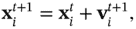
<math display="block" overflow="scroll"><msubsup><mrow><mi mathvariant="bold">x</mi></mrow><mrow><mi>i</mi></mrow><mrow><mi>t</mi><momo><mn>1</mn></></></></><><mo><mo><><><mrow><mi mathvariant="bold">x</mi></mrow><mrow><mi>i</mi></mrow><mrow><mi>t</mi></></mtext><mo><mo><msubsup><mrow><mi="="bold">v</mi></mrow><mrow><mi>i</mi></mrow><mrow><mi>t</mi></mo></mo><momo><>1</></></></></></mo></math>
其中 `t`(images/c01-i023.png)<math display="inline" overflow="scroll"><mrow>t</mrow></math>是代代，`v_i^{t+1}`(images/c01-i024.png)<math display="inline" overflow="scroll"><msubsup><mrow><mi mathvariant="bold">v</mi></mrow><mrow><mi>i</mi></mrow><mrow>t+1</mrow></msubsup></math>和`x_i^t`(images/c01-i025.png)<math display="inline" overflow="scroll"><msubsup><mrow><mi mathvariant="bold">x</mi></mrow><mrow><mi>i</mi></mrow><mrow>t</mrow></msubsup></math>表示第 i`(images/c01-i026.png)<math display="inline" overflow="scroll"><mrow>i</mrow></math>粒子的速度的速度位置；`omega`(images/c01-i027.png)<math display="inline" overflow="scroll"><mrow>969</mrow></math>被称为惯性权重 [74]，`c_1`(images/c01-i028.png)<math display="inline" overflow="scroll"><msub><mrow>c</mi></mrow><mn>1</mn></msub></math>和`c_2`(images/c01-i029.png)<math display="inline" overflow="scroll"><msub><mrow>c</mi></mrow><mn>2</mn></msub></math>是加速度系数 [75]，`r_1^t`(images/c01-i030.png)<math display="inline" overflow="scroll"><msubsup><mrow><mi mathvariant="bold">r</mi></mrow><mn>1</mn></mrow><mrow>t</mrow></msubsup></math>和`r_2^t`(images/c01-i031.png)<math display="inline" overflow="scroll"><msubsup><mrow><mi mathvariant="bold">r</mi></mrow><mn>2</mn></mrow><mrow>t</mrow></msubsup></math>是两个在`[0, 1]`(images/c01-i032.png)<math display="inline" overflow="scroll"><msup><mrow><mo stretchy="false">\[</mo><mn>0</mn><momo><mn>1</mn><mo stretchy="false">\]</mo></mrow><mrow>n</mrow></msup></math>范围内随机生成的向量，其中`n`(images/c01-i033.png)<math display="inline" overflow="scroll"><mrow>n</mrow></math>是搜索空间的维度；`pbest_i^t`(images/c01-i034.png)<math display="inline" overflow="scroll"><msubsup><mrow><mtext mathvariant="bold">pbest</mtext></mrow><mrow><mi>i</mi></mrow><mrow>t</mi></mrow></msubsup></math>和`gbest^t`(images/c01-i035.png)<math display="inline" overflow="scroll"><msup><mrow><mtext mathvariant="bold">gbest</mtext></mrow><mrow>t</mi></mrow></msup></math>分别表示第`i`(images/c01-i036.png)<math display="inline" overflow="scroll"><mrow>i</mrow></math>粒子的个体最优和群体的全局最优。运算符`⊙`(images/c01-i037.png)<math display="inline" overflow="scroll"><mrow><mo>&#9675;</mo></mrow></math>是哈玛积，对两个相同大小的向量进行逐元素乘法。

## 1.4 总结

本章概述了优化问题如何随着科学、工程和工业的现代化而变化。随着优化问题变得日益复杂，研究人员尝试从自然界中寻找可能的解决方案，以开发自然启发的优化算法，例如进化算法（EAs），这是一个代表性的族。


然后，本章根据决策变量的数量或目标的数量，对不同类型的大规模优化问题进行了总结。本书主要关注具有大量决策变量的 `MOPs`，即大规模多目标/许多-多目标优化问题（`LSMOPs`）。

一方面，为了为求解 `LSMOPs` 定制 `EAs`，相关工作与 `MOEAs` 具有密切联系。虽然传统的 `MOEAs` 是为了解决决策变量规模较小的问题而开发的，但其背后的核心机制为进化大规模多目标优化的进一步发展奠定了基础。另一方面，在处理大规模决策变量时，也从单目标优化文献中借鉴了思想。特别是，“分治”（divide-and-conquer）策略是处理决策变量最具代表且有效的方法之一。当与 `EAs` 结合时，“分治”策略通常在基于决策变量分组方法的基础上，在 `CC` 框架内部实现。

本书的其余部分结构如下：第 2 章 介绍了进化大规模多目标优化的某些背景知识；第 3 章 和 第 4 章 分别介绍了针对通用和稀疏大规模多目标优化的若干代表性 `EAs`；第 5 章–第 9 章 介绍了进化大规模多目标优化在复杂网络社区检测、物流调度、电力系统、放射治疗计划和深度学习等领域的若干代表性应用。

# 参考文献

1. **1** F.‐A. Fortin, F.‐M. De Rainville, M.‐A. G. Gardner, M. Parizeau, and C. Gagné, “DEAP: Evolutionary algorithms made easy,” The Journal of Machine Learning Research, vol. 13, no. 1, pp. 2171–2175, 2012.
2. **2** B. Li, J. Li, K. Tang, and X. Yao, “Many‐objective evolutionary algorithms: a survey,” ACM Computing Surveys, vol. 48, no. 1, pp. 1–35, 2015.
3. **3** J. H. Holland, Adaptation in natural and artificial systems: an introductory analysis with applications to biology, control, and artificial intelligence. MIT Press, 1992.
4. **4** J. D. Schaffer, “Multiple objective optimization with vector evaluated genetic algorithms,” in *Proceedings of the 1st International Conference on Genetic Algorithms and Their Applications*, 2014, pp. 93–100.
5. **5** N. Srinivas and K. Deb, “Muiltiobjective optimization using nondominated sorting in genetic algorithms,” Evolutionary Computation, vol. 2, no. 3, pp. 221–248, 1994.
6. **6** J. Horn, N. Nafpliotis, and D. E. Goldberg, “A niched Pareto genetic algorithm for multi‐objective optimization,” in *Proceedings of the 1st IEEE Conference on Evolutionary Computation*, 1994, pp. 82–87.
7. **7** C. M. Fonseca and P. J. Fleming, “Genetic algorithms for multiobjective optimization: formulationdiscussion and generalization,” in *Proceedings of the 5th International Conference on Genetic Algorithms*, vol. 93, July, 1993, pp. 416–423.
8. **8** K. Deb, A. Pratap, S. Agarwal, and T. Meyarivan, “A fast and elitist multi‐objective genetic algorithm: NSGA‐II,” IEEE Transactions on Evolutionary Computation, vol. 6, no. 2, pp. 182–197, 2002.
9. **9** E. Zitzler, M. Laumanns, and L. Thiele, “SPEA2: Improving the strength Pareto evolutionary algorithm,” *TIK‐report*, vol. 103, 2001.
10. **10** D. W. Corne, J. D. Knowles, and M. J. Oates, “The Pareto envelope‐based selection algorithm for multi-objective optimization,” in *Proceedings of International Conference on Parallel Problem Solving from Nature*, 2000, pp. 839–848.
11. **11** D. W. Corne, N. R. Jerram, J. D. Knowles, and M. J. Oates, “PESA‐II: Region‐based selection in evolutionary multiobjective optimization,” in *Proceedings of the 3rd Annual Conference on Genetic and Evolutionary Computation*, 2001, pp. 283–290.
12. **12** Y. Jin, M. Olhofer, and B. Sendhoff, “Dynamic weighted aggregation for evolutionary multi‐objective optimization: why does it work and how?” in *Proceedings of the Genetic and Evolutionary Computation Conference*, 2001, pp. 1042–1049.
13. **13** T. Murata, H. Ishibuchi, and M. Gen, “Specification of genetic search directions in cellular multi‐objective genetic algorithms,” in *Proceedings of the 1st International Conference on Evolutionary Multi‐Criterion Optimization*, 2001, pp. 82–95.
14. **14** Z. Wang, Q. Zhang, “A novel strategy for balancing convergence and diversity,” in *Proceedings of the 2014 IEEE Congress on Evolutionary Computation*, 2014, pp. 2132–2139.
15. **15** K. Li, S. Kwong, “Stable matching,” IEEE Transactions on Evolutionary Computation, vol. 18, no. 6.
16. **16** X. Zhang, F. Cheng, “On the number of objectives on the hardness of a multiobjective problem,” IEEE Cybernetics, vol. 45, no. 10.
17. **17** R. Cheng, L. Lu, “Decomposition of a multi‐objective problem into subproblems,” IEEE Transactions on Evolutionary Computation, vol. 18, no. 3, pp. 450–455.
18. **18** Y. Tian, R. Cheng, “An indicator‐based multiobjective evolutionary algorithm with reference point for better,” Transactions on Evolutionary Computation, vol. 22, no. 4, pp. 609–622.
19. **19** B. Bader, E. Zitzler, “HypE: An algorithm for,” Evolutionary Computation, vol. 19, no. 1, pp. 45–76.
20. **20** M. Emmerich, N. Beume, “An EMO using hypervolume as criterion,” *Proceedings of International Conference on Multi‐Criterion*, 2005, pp. 62–76.
21. **21** E. Zitzler, S. Künz, “Indicator‐based selection in multi‐objective,” *Proceedings of International Conference on Parallel Problem Solving from Nature*, 2004, pp. 832–842.
22. **22** Y. Tian, X. Zhang, “A multi‐objective evolutionary algorithm on enhanced generational,” in *2016 IEEE Congress on Evolutionary Computation (CEC)*, 2016, pp. 5222–5229.
23. **23** B. L. Miller, D. E. Goldberg, “Genetic algorithms, tournament selection, and the effects of noise,” Complex Systems, vol. 9, no. 3, pp. 193–212, 1995.
24. **24** R. B. Agrawal, K. Deb, and R. B. Agrawal, “Simulated binary crossover for continuous search space,” Complex Systems, vol. 9, no. 3, pp. 115–148, 1994.
25. **25** K. Ikeda, H. Kita, and S. Kobayashi, “Failure of Pareto‐based MOEAs: does non‐dominated really mean near to optimal?” in *Proceedings of2001 IEEE Congress on Evolutionary Computation*, vol. 2, 2001, pp. 957–962.
26. **26** D. Brockhoff, T. Friedrich, N. Hebbinghaus, C. Klein, F. Neumann, and E. Zitzler, “On the effects of adding objectives to plateau functions,” IEEE Transactions on Evolutionary Computation, vol. 13, no. 3, pp. 591–603, 2009.
27. **27** O. Schutze, A. Lara, and C. A. Coello Coello, “On the influence of the number of objectives on the hardness of a multiobjective optimization problem,” IEEE Transactions on Evolutionary Computation, vol. 15, no. 4, pp. 444–455, 2010.


29. 29 L. S. Batista, F. Campelo, F. G. Guimarães, and J. Ramírez, “多目标优化问题中支配准则的比较，”发表于*IEEE 进化计算大会论文集*, 2011, pp. 2359–2366。

30. 30 D. W. Corne and J. D. Knowles, “高度多目标优化技术：某些非支配点优于其他点，”发表于*第 9 届遗传算法与进化计算年度会议论文集*, 2007, pp. 773–780。

31. 31 Y. Jin and B. Sendhoff, “进化多目标优化中连通性、正则性与局部搜索的成功性，”发表于*IEEE 进化计算大会论文集*, 2003, pp. 1910–1917。

32. 32 Q. Zhang, A. Zhou, and Y. Jin, “RM-MEDA: 一种基于正则模型的多目标估计分布算法，” IEEE 进化计算汇汇, 第 12 卷, 第 1 期, pp. 41–63, 2008。

33. 33 R. C. Purshouse and P. J. Fleming, “关于多个冲突目标的进化优化，” IEEE 进化计算汇汇, 第 11 卷, 第 6 期, pp. 770–784, 2007。

34. 34 S. F. Adra and P. J. Fleming, “进化多目标优化中的多样性管理，” IEEE 进化计算汇汇, 第 15 卷, 第 2 期, pp. 183–195, 2010。

35. 35 M. Li, S. Yang, and X. Liu, “多目标优化中帕累托沿近似的多样性比较，” IEEE 控制学, 第 44 卷, 第 12 期, pp. 2568–2584, 2014。

36. 36 H. Ishibuchi, N. Tsukamoto, and Y. Nojima, “进化多目标优化：简评，”发表于*2008 IEEE 进化计算大会论文集*, 2008, pp. 2419–2426。

37. 37 Z. He and G. G. Yen, “使用性能指标集合对多目标进化算法进行排序，”发表于*2013 IEEE 进化计算大会论文集*, 2013, pp. 2480–2487。

38. 38 M. Laumanns, L. Thiele, K. Deb, and E. Zitzler, “进化多目标优化中收敛与多样性的结合，”进化计算, 第 10 卷, 第 3 期, pp. 263–282, 2002。

39. 39 K. Deb, M. Mohan, and S. Mishra, “用于快速计算帕累托最优解的基于支配的多目标进化算法，”进化计算, 第 13 卷, 第 4 期, pp. 501–525, 2005。

40. 40 H. Aguirre and K. Tanaka, “基于自适应排序和替代赋值的空间划分：多目标景观形图的比较研究，”发表于*第 11 届遗传算法与进化计算年度会议论文集*, 2009, pp. 547–554。

41. 41 J. Branke, T. Kauß, and H. Schmeck, “进化多目标优化引导，” 工程软件进展, 第 32 卷, 第 6 期, pp. 499–507, 2001。

42. 42 L. S. Batista, F. Campelo, F. G. Guimara, and J. A. Ramírez, “帕累托锥支配：改进多目标进化算法的收敛性和多样性，”发表于*第 6 届国际多准则进化会议论文集*, 2011, pp. 76–90。

43. 43 S. Yang, M. Li, X. Liu, and J. Zheng, “一种基于网格的多目标优化进化算法，” IEEE 进化计算汇汇, 第 17 卷, 第 5 期, pp. 721–736, 2013。

44. 44 M. Li, S. Yang, and X. Liu, “多目标优化中基于帕累托算法的基于偏移的密度估计，” IEEE 进化计算汇汇, 第 18 卷, 第 3 期, pp. 348–365, 2013。

45. 45 R. Wang, R. C. Purshouse, and P. J. Fleming, “偏好启发的用于多目标的进化算法，” IEEE 进化计算汇汇, 第 17 卷, 第 4 期, pp. 474。

46. 46 K. Deb and H. Jain, “一种用于处理约束约束的多目标进化算法：基于参考点的非支配排序方法第一部分，” IEEE 进化计算汇汇, 第 18 卷, 第 4 期, pp. 577。

47. 47 X. Zhang, Y. Tian, and Y. Jin, “膝点驱动的多目标进化算法，” IEEE 进化计算汇汇, 第 19 卷, pp. 761。

48. 48 H. Singh, A. Isaacs, and T. Ray, “用于多目标的降维进化算法，” IEEE 进化计算汇汇, 第 15 卷, pp. 539。

49. 49 D. Saxena, J. A. Duro, and K. Deb, “用于多目标的线性降维算法，” IEEE 进化计算汇汇, 第 17 卷, pp. 77。

50. 50 D. Brockhoff and E. Zitzler, “用于多目标的进化算法，” 进化计算, 第 17 卷, 第 2 期, pp. 135。

51. 51 I. T. Jolliffe, “主成分分析，” 统计学, 第 45。

52. 52 K. Weinberger and L. Saul, “基于最大方差的线性降维，”发表于*人工智能联合会议*, 2006, pp. 1683。

53. 53 A. L. Jaimes, C. A. Coello, and J. E. Barrientos, “用于多目标的降维方法，”发表于*多准则进化会议*, 2009, pp. 423–437。

54. 54 L. Kaufman and P. Rousseeuw, *数据中的分组：聚类分析导论*, Wiley, 1990。

55. 55 X. Guo, X. Wang, and M. Wang, “利用互信息和聚类的多目标算法，”发表于*智能计算会议*, 2012, pp. 11–16。

56. 56 K. Li, K. Deb, and S. Kwong, “基于分解的多目标进化算法，” IEEE 进化计算汇汇, 第 19 卷, 第 5 期, pp. 694–716, 2014。

57. 57 K. Bringmann, T. Friedrich, F. Neumann, and M. Wagner, “近似引导的多目标进化优化，”发表于*国际人工智能联合会议*, 2011, p. 1198。

58. 58 L. While, P. Hingston, L. Barone, and S. Huband, “一种计算超体积的快速算法，” 进化计算, 第 10 卷, 第 1 期, pp. 29–38, 2006。

59. 59 L. While, L. Bradstreet, and L. Barone, “一种计算精确体积的快速方法，” IEEE 进化计算汇汇, 第 16 卷, 第 1 期, pp. 86–95, 2012。

60. 60 R. Cheng, Y. Jin, M. Olhofer, and B. Sendhoff, “参考向量引导的多目标进化算法，” IEEE 进化计算汇汇, 第 20 卷, 第 5 期, pp. 773–791, 2016。

61. 61 M. N. Omidvar, X. Li, and X. Yao, “用于大规模黑箱优化的群体启发式算法综述第一部分，” IEEE 进化计算汇汇, 第 26 卷, 第 5 期, pp. 802–822, 2021。

62. 62 M. N. Omidvar, X. Li, and X. Yao, “用于大规模黑箱优化的群体启发式算法综述第二部分，” IEEE 进化计算汇汇, 第 26 卷, 第 5 期, pp. 823–843, 2021。

63. 63 M. N. Omidvar, X. Li, and K. Tang, “大规模连续优化的基准问题设计，” 信息科学, 第 316 卷, pp. 419–436, 2015。


64. `64` Y. Ling, H. Li, and B. Cao, “基于图的差异分组的大规模全局优化协同演化，”in *Proceedings of the 12th International Conference on Natural Computation, Fuzzy Systems and Knowledge Discovery*, 2016, pp. 95–102.

65. `65` Y. Mei, M. N. Omidvar, X. Li, and X. Yao, “用于无约束大规模黑盒优化的竞争性分治算法，” ACM Transactions on Mathematical Software, vol. 42, no. 2, pp. 1–24, 2016.

66. `66` Y. Sun, M. Kirley, and S. K. Halgamuge, “具有直接和间接变量交互的大规模全局优化扩展差异分组，”in *Proceedings of the 2015 Annual Conference on Genetic and Evolutionary Computation*, 2015, pp. 313–320.

67. `67` M. N. Omidvar, M. Yang, Y. Mei, X. Li, and X. Yao, “DG2：一种更快速更准确的大规模黑盒优化差异分组，”IEEE Transactions on Evolutionary Computation, vol. 21, no. 6, pp. 929–942, 2017.

68. `68` M. N. Omidvar, X. Li, Z. Yang, and X. Yao, “通过更频繁随机分组的大规模优化协同演化，”in *Proceedings of the 2010 IEEE Congress on Evolutionary Computation*, 2010, pp. 1–8.

69. `69` R. Liu, J. Liu, Y. Li, and J. Liu, “一种基于随机动态分组权重优化的大规模多目标优化框架，”Swarm and Evolutionary Computation, vol. 55, p. 100684, 2020.

70. `70` M. A. Potter and K. A. De Jong, “一种用于函数优化的协同演化方法，”in *Proceedings of IEEE International Conference on Parallel Problem Solving from Nature*, 1994, pp. 249–257.

71. `71` Z. Yang, K. Tang, and X. Yao, “使用协同演化的大规模演化优化，”Information Sciences, vol. 178, no. 15, pp. 2985–2999, 2008.

72. `72` X. Li and X. Yao, “用于大规模优化的协同演化粒子群，”IEEE Transactions on Evolutionary Computation, vol. 16, no. 2, pp. 210–224, 2011.

73. `73` J. Kennedy and R. Eberhart, “粒子群优化，”in *Proceedings of IEEE International Conference on Neural Networks*, 1995, pp. 1942–1948.

74. `74` Y. Shi and R. Eberhart, “一种改进的粒子群优化器，”in *Proceedings of IEEE International Conference on Evolutionary Computation*, 1998, pp. 69–73.

75. `75` R. Eberhart and J. Kennedy, “一种利用粒子群理论的新优化器，”in *Proceedings of International Symposium on Micro Machine and Human Science*, 1995, pp. 39–43.

## Notes

1. 1 本书只考虑最小化问题，而最大化问题可以通过对目标函数取反等价地转换为最小化问题。
2. 2 多目标或多目标优化中的分解特指目标空间的分解。

# 2 演化大规模多目标优化

## 2.1 引言

大规模多目标优化问题（LSMOPs）是指既具有大量决策变量又具有多个冲突目标的优化问题子集。这类问题广泛存在于许多应用中。例如，在旨在最小化链路间密度和最大化链路内度的社区检测中，网络节点数量通常在万级以上 [1, 2]。在旨在最小化网络复杂性和最大化预测精度的深度神经网络训练中，通常有数百万权重需要训练 [3]。同样，逻辑调度问题 [4, 5]、电力系统 [6]、放射治疗计划 [7] 以及许多其他现实应用也显示出了 LSMOPs 的特征。

目前，对于 LSMOPs 的变量数量尚未形成统一意见，这些数量可能有所不同。在书中，LSMOPs 被定义为具有至少两个冲突目标的优化问题。通常，LSMOPs 比具有少数决策变量的问题更处理。一方面，随着变量数量的增加，多目标演化算法（MOAs）容易过早收敛到局部最优 [8]。另一方面，随着变量数量的扩大，决策变量之间交互的概率增加，使得景观变得更加复杂 [9]。

在过去的几十年里，大量的精力集中在研究大规模单目标问题（LSOPs）上。许多测试问题是为大规模单目标 [10]–14] 设计的。解决 LSOP 方法也取得了显著进展，主要包括基于分解和非基于分解的方法 [15]–17]。最近，随着计算能力的提高，人们越来越关注使用多目标演化算法（MOEAs）来解决 LSMOPs。虽然设计了不同类型的大规模多目标基准测试问题，但一些有前景的 MOEAs 也针对解决 LSMOPs 定制。此外，某些具有特定属性的 LSMOPs 被广泛研究，特别是具有稀疏最优解的问题。稀疏大规模多目标优化问题，即稀疏 LSMOPs，是指一类 Pareto 优解中的决策变量大部分为零值的 LSMOPs。作为 LSMOPs 的一个新兴研究课题，一些基准测试问题和许多 MOEAs 也针对稀疏 LSMOPs 开发 [18]。

本章其余部分的结构如下：第 2.2 节 给出了大规模多目标优化的基准测试问题，第 2.3 节 介绍了评估 MOEAs 解决 LSMOPs 性能的常用指标。第 2.4 节 介绍了为稀疏大规模多目标优化身定制的测试问题，随后在第 2.5 节 中介绍了一种可以同时评估解收敛性、稀疏性和多样性的性能指标。最后，第 2.6 节 以简要总结结束本章。

## 2.2 大规模多目标优化测试问题

在本节中，首先给出一些与多目标优化相关的基本概念。然后，我们将介绍一些用于大规模多目标优化的测试问题。

### 2.2.1 基本概念

为了更好地模拟现实世界的问题，基准测试套件应该尽可能捕捉许多问题特征，包括适应度景观、变量交互、Pareto 前沿几何形状、目标函数的可分性等。下文将详细介绍一些与大规模多目标测试问题相关的基本概念。


- `适应度景观 (Fitness landscape)`。求解多目标优化问题的目标是在决策空间中获得一组折中解，而这些解的质量通常在目标空间中进行评估。从决策空间到目标空间的映射定义了适应度景观。

![图 2.1 单峰函数和多峰函数的示例。(a) 最小化 f(x) = x² - 1，x ∈ [-5, 5]。(b) 最小化 f(x) = x² + sin(10πx)，x ∈ [-5, 5]](images/c02f001.png)

**图 2.1** 单峰函数和多峰函数的示例。(a) 最小化 ![f(x) = x² - 1，x ∈ [-5, 5]](images/c02-i0001.png)<math display="inline" overflow="scroll"><mi>f</mi><mo stretchy="false">(</mo><mi>x</mi><mo stretchy="false">)</mo><mo>=</mo><msup><mrow><mi>x</mi></mrow><mrow><mn>2</mn></mrow></msup><mo>&#8722;</mo><mn>1</mn><mo>,</mo><mi>x</mi><mo>&#8712;</mo><mo stretchy="false">\[</mo><mo>&#8722;</mo><mn>5</mn><mo>,</mo><mn>5</mn><mo stretchy="false">\]</mo></math>. (b) 最小化 ![f(x) = x² + sin(10πx)，x ∈ [-5, 5]](images/c02-i0002.png)<math display="inline" overflow="scroll"><mi>f</mi><mo stretchy="false">(</mo><mi>x</mi><mo stretchy="false">)</mo><mo>=</mo><msup><mrow><mi>x</mi></mrow><mrow><mn>2</mn></mrow></msup><mo>+</mo><mi>sin</mi><mo stretchy="false">(</mo><mn>10</mo><mi>&#960;</mi><mi>x</mi><mo stretchy="false">)</mo><mo>,</mo><mi>x</mi><mo>&#8712;</mo><mo stretchy="false">\[</mo><mo>&#8722;</mo><mn>5</mn><mo>,</mo><mn>5</mn><mo stretchy="false">\]</mo></math>.

- `模态 (Modality)`。模态与目标函数的局部最优解数量有关。具体来说，如果一个目标函数有多个局部最优解，则称为`多峰的 (multimodal)`；如果只有一个最优解，则称为`单峰的 (unimodal)`。图 2.1 提供了单峰函数和多峰函数的示例。通常，多峰函数比单峰函数更难优化，因为解容易陷入多峰函数中的局部最优解。

![图 2.2 欺骗性函数和有偏的多目标优化问题的示例。(a) 最小化 f(x) = -0.9x² + (5|x|⁰.001/5⁰.001)²，x ∈ [-5, 5]。(b) 最小化 f1(x1, x2) = x1⁵ + x2，f2(x1, x2) = x1⁵ + 1 - x2，x1, x2 ∈ [0, 1]](images/c02f002.png)

**图 2.2** 欺骗性函数和有偏的多目标优化问题的示例。(a) 最小化 ![f(x) = -0.9x² + (5|x|⁰.001/5⁰.001)²，x ∈ [-5, 5]](images/c02-i0001.png)<math display="inline" overflow="scroll"><mi>f</mi><mo stretchy="false">(</mo><mi>x</mi><mo stretchy="false">)</mo><mo>=</mo><mo>&#8722;</mo><mn>0.9</mn><msup><mrow><mi>x</mi></mrow><mrow><mn>2</mn></mrow></msup><mo>+</mo><mo><momomomomo><mo>5</mo><mo><mo</mo</mo><mi>x</mo><mrow><mn>0.001</mn></mrow></msup><mo>/</mo><mo>5</mo><mrow><mn>0.001</mn></mrow></msup></mo><mo>&#8722;</mo><mo>,</mo><mi>x</mi><mo>&#8712;</mo><mo stretchy="false">\[</mo><mn>5</mn><mo>,</mo><mn>5</mn><mo stretchy="false">\]</mo></math>. (b) 最小化 ![f1(x1, x2) = x1⁵ + x2，f2(x1, x2) = x1⁵ + 1 - x2，x1, x2 ∈ [0, 1]](images/c02-i0002.png)<math display="inline" overflow="scroll"><mi>f1</mi><mo stretchy="false">(</mo><mi>x1</mi><mo>,</mo><mi>x2</mi><mo stretchy="false">)</mo><mo>=</mo><msup><mrow><mi>x1</mi></mrow><mrow><mn>5</mn></mrow></msup><mo>+</mo><mi>x2</mi><mo>,</mo><mi>f2</mi><mo stretchy="false">(</mo><mi>x1</mi><mo>,</mo><mi>x2</mi><mo stretchy="false">)</mo><mo>=</mo><msup><mrow><mi>x1</mi></mrow><mrow><mn>5</mn></mrow></msup><mo>+</mo><mn>1</mn><mo>-</mo><mi>x2</mi><mo>,</mo><mi>x1</mi><mo>,</mo><mi>x2</mi><mo>&#8712;</mo><mo stretchy="false">\[</mo><mn>0</mo><mo>,</mo><mn>1</mn><mo stretchy="false">\]</mo></math>.

- `欺骗性 (Deceptive)`。对于多峰函数，存在一种特殊情况，即欺骗性函数，它至少有两个最优解，即一个真最优解和一个欺骗性最优解。此外，大部分搜索空间必须倾向于欺骗性最优解。图 2.2(a) 给出了欺骗性函数的示例。

- `偏差 (Bias)`。偏差属性用于描述决策空间中均匀分布的解样本是否映射到目标空间中均匀分布的解集。如果不是，则从帕累托集到帕累托沿的映射就被认为是`有偏的 (biased)`。


- **退化（Degenerate）**。不同多目标优化问题的帕累托前沿几何形状通常是化的（例如：线性、凹、凸、不连通和混合）。在这些几何形状中，存在一种特殊的帕累托前沿，即退化帕累托前沿，其维度低于其嵌入的目标空间维度。例如，在双目标优化问题中，由若干点组成的前沿是退化的，而由曲线组成的前沿不是退化的。在三目标优化问题中，由曲线组成的前沿是退化的，而由二维曲组成的前沿则不是退化的。图 2.3 提供了不同几何形状的帕累托前沿示例。

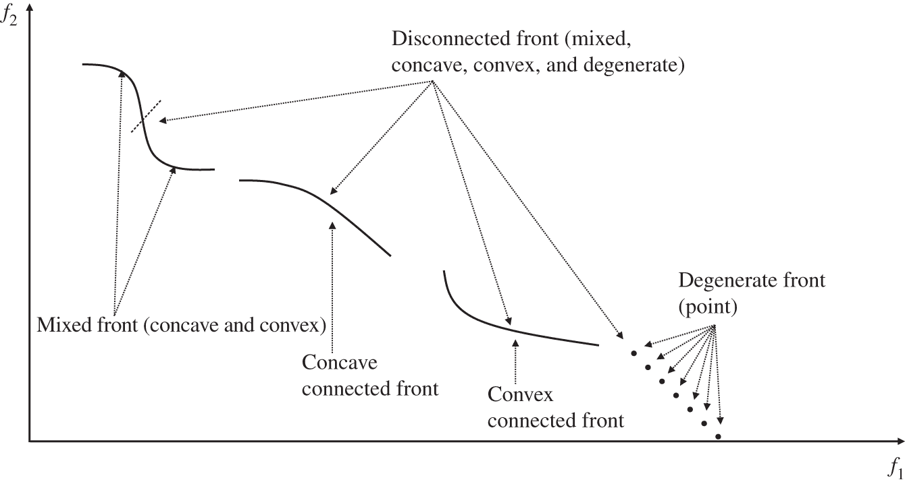

**图 2.3** 不同几何形状的帕累托前沿示例。

- **不可可分性（Nonseparability）**。不可可分性描述了决策变量之间的依赖关系。如果满足以下条件，则认为决策变量 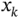<math display="inline" overflow="scroll"><msub><mrow><mi>x</mi></mrow><mrow><mi>k</mi></mrow></msub></math> 在目标函数 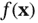<math display="inline" overflow="scroll"><mi>f</mi><mo stretchy="false">(</mo><mi mathvariant="bold">x</mi><mo stretchy="false">)</mo></math> 上是*可分的*：(2.1)<math display="block" overflow="scroll"><mi>f</mi><mo stretchy="false">(</mo><mi mathvariant="bold">x</mi><mo stretchy="false">)</mo><mo>&#60;</mo><mi>f</mi><mo stretchy="false">(</mo><msup><mrow><mi mathvariant="bold">x</mi></mrow><mrow><mo>&#8242;</mo></mrow></msup><mo stretchy="false">)</mo><mo>&#8658;</mo><mi>f</mi><mo stretchy="false">(</mo><mi mathvariant="bold">y</mi><mo stretchy="false">)</mo><mo>&#60;</mo><mi>f</mi><mo stretchy="false">(</mo><msup><mrow><mi mathvariant="bold">y</mi></mrow><mrow><mo>&#8242;</mo></mrow></msup><mo stretchy="false">)</mo><mo>,</mo></math>其中 `x` = \<math display="inline" overflow="scroll"><msub><mrow><mi>x</mi></mrow><mrow><mi>k</mi></mrow></msub></math>, …, 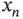<math display="inline" overflow="scroll"><msub><mrow><mi>x</mi></mrow><mrow><mn>n</mn></mrow></msub></math>\], 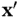<math display="inline" overflow="scroll"><msup><mrow><mi mathvariant="bold">x</mi></mrow><mrow><mo>&#8242;</mo></mrow></msup><mo stretchy="false">)</mo><mo>&#8658;</mo><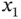<math display="inline" overflow="scroll"><msub><mrow><mi>x</mi></mrow><mrow><mn>1</mn></mrow></msub></math>, …, <math display="inline" overflow="scroll"><msub><mrow><mi>x</mi></mrow><mrow><mi>k</mi></mrow></msub></math>, …, <math display="inline" overflow="scroll"><msub><mrow><mi>x</mi></mrow><mrow><mn>n</mn></mrow></msub></math], `y` = \<math display="inline" overflow="scroll"><msub><mrow><mi>y</mi></mrow><mrow><mi>k</mi></mrow></msub></math>, …, <math display="inline" overflow="scroll"><msub><mrow><mi>y</mi></mrow><mrow><mn>n</mn></mrow></msub></math], `bold y prime` = \<math display="inline" overflow="scroll"><msub><mrow><mi>y</mi></mrow><mrow><mi>k</mi></mrow></msub></math>, …, <math display="inline" overflow="scroll"><msub><mrow><mi>y</mi></mrow><mrow><mn>n</mn></mrow></msub></math> 是四个不同的决策向量。否则，决策变量 <math display="inline" overflow="scroll"><msub><mrow><mi>x</mi></mrow><mrow><mi>k</mi></mrow></msub></math> 在目标函数 <math display="inline" overflow="scroll"><mi>f</mi><mo stretchy="false">(</mo><mi mathvariant="bold">x</mi><mo stretchy="false">)</mo></math> 上是*不可可分的*。如果每个决策变量都是可分的，则对应的目标函数就是可分目标。相反，如果每个决策变量都是不可可分的，则对应的目标函数就是不可可分目标。一种特殊情况是不可可分变量只与某些决策变量相互作用，此时对应的目标函数是部分可分目标。

### 2.2 多目标测试问题

在早期，针对大规模多目标优化的算法性能通常在最初为多目标优化设计的问题上测试，例如 Zitzler、Deb 和 Thiele（ZDT）基准集 [[19]](#c02.xhtml#c02-bib-019)、Deb、Thiele、Laumanns 和 Zitzler（DTLZ）基准集 [[20]](#c02.xhtml#c02-bib-020) 以及游鱼群（WFG）基准集 [[21]](#c02.xhtml#c02-bib-021)。

作为最早为多目标优化设计的基准集之一，ZDT 基准集包含六个双目标测试问题 [[19]](#c02.xhtml#c02-bib-019)。它们具有相同的结构，并由三个函数组成，即：分布函数 <math display="inline" overflow="scroll"><msub><mrow><mi mathvariant="bold">f</mi></mrow><mrow><mn mathvariant="bold">1</mn></mrow></msub></math>、距离函数 <math display="inline" overflow="scroll"><mrow><mi mathvariant="bold">g</mi></mrow></math> 和形状函数 <math display="inline" overflow="scroll"><mrow><mi mathvariant="bold">h</mi></mrow></math>：


(2.2)![Start 3 By 2 Matrix 1st Row 1st Column Minimize bold upper F left-parenthesis bold x right-parenthesis 2nd Column equals left-parenthesis bold f 1 left-parenthesis x 1 right-parenthesis comma f 2 left-parenthesis bold x right-parenthesis right-parenthesis comma, 2nd Row 1st Column subject to f 2 left-parenthesis bold x right-parenthesis 2nd Column equals bold g left-parenthesis x 2 comma ellipsis comma x Subscript n Baseline right-parenthesis) h left-parenthesis bold f 1 left-parenthesis x 1 right-parenthesis comma bold g left-parenthesis x 2 comma ellipsis comma x Subscript n Baseline right-parenthesis right-parenthesis),, 3rd Row 1st Column where bold x 2nd Column equals left-parenthesis x 1 comma ellipsis comma x Subscript n Baseline right-parenthesis) period. EndMatrix](img/c02-math-0002.png)
<math display="block" overflow="scroll"><mfenced open="{" close="." separators=""><mrow><mtable><mtr><mtd><mtext>Minimize</mtext><mspace width="0.3em"/><mspace width="0.15em"/><mi mathvariant="bold">F</mi><mo stretchy="false">(</mo><mi mathvariant="bold">x</mi><mo stretchy="false">)</mo></mtd><mtd><mo>=</mo><mo stretchy="false">(</mo><msub><mrow><mi mathvariant="bold">f</mi></mrow><mrow><mn>1</mn></mrow></msub><mo stretchy="false">(</mo><msub><mrow><mi>x</mi></mrow><mrow><mn>1</mn></mrow></msub)mo><mo>,</mo><msub><mrow><mi>f</mi></mrow><mrow><mn>2</mn></mrow></msub><mo stretchy="false">(</mo><mi mathvariant="bold">x</mi><mo stretchy="false">)</mo><mo stretchy="false">)</mo><mo>,</mo></mtd></mtr><mtr><mtd><mtext>subject to</mtext><mspace width="0.3em"/><mspace width="0.15em"/><msub><mrow><mi>f</mi></mrow><mrow><mn>2</mn></mrow></msub><mo stretchy="false">(</mo><mi mathvariant="bold">x</mi><mo stretchy="false">)</mo></mtd><mtd><mo>=</mo><mi mathvariant="bold">g</mi><mo stretchy="false">(</mo><msub><mrow><mi>x</mi></mrow><mrow><mn>2</mn></mrow></msub><mo>,</mo><mi>&#8230;</mi><mo>,</mo><msub><mrow><mi>x</mi></mrow><mrow><mn>n</mn></mrow></msub><mo stretchy="false">)</mo><mi mathvariant="bold">h</mo stretchy="false">(</mo><msub><mrow><mi mathvariant="bold">f</mi></mrow><mrow><mn>1</mn></mrow></msub><mo stretchy="false">(</mo><msub><mrow><mi>x</mi></mrow><mrow><mn>1</mn></mrow></msub)mo><mo>,</mo><mi mathvariant="bold">g</mi><mo stretchy="false">(</mo><msub><mrow><mi>x</mi></mrow><mrow><mn>2</mn></mrow></msub><mo>,</mo><mi>&#8230;</mi><mo>,</mo><msub><mrow><mi>x</mi></mrow><mrow><mn>n</mn></mrow></msub><mo stretchy="false">)</mo><mo stretchy="false">)</mo><mo>,</mo></mtd></mtr><mtr><mtd><mtext>where</mtext><mspace width="0.15em"/><mspace width="0.15em"/><mi mathvariant="bold">x</mi></mtd><mtd><mo>=</mo><mo stretchy="false">(</mo><msub><mrow><mi>x</mi></mrow><mrow><mn>1</mn></mrow></msub><mo>,</mo><mi>&#8230;</mi><mo>,</mo><msub><mrow><mi>x</mi></mrow><mrow><mn>n</mn></mrow></msub)mo.mo></mtd></mtr></mtable></mrow></mfenced></math>

（注：此处为数学公式，保持原样不翻译）

分布函数 <math display="inline" overflow="scroll"><msub><mrow><mi>f</mi></mrow><mrow><mn>1</mn></mrow></msub></math> 是用于维持多目标优化算法（MOEA）多样性的能力，它只与 $x$ 的第一个变量相关。函数 $g(x)$ 与其余 $n-1$ 个变量相关。函数 $h$ 决定了帕累托沿的形状，其输入为 $f(x1)$ 和 $g(x)$。从表中可以看出，ZDT 问题在帕累托沿和景观方面具有多样性，但在目标函数分离性上都是可分离的。

### 表 2.1 详细信息

尽管 ZDT 基准被广泛用于评估 MOEA 的性能，但 ZDT 测试问题的一个局限性是它们不可扩展的。考虑到现实世界中的许多问题具有三个或更多目标，且 MOEA 需要证明其有效性，Deb 等人提出了另一个基准 set，即 DTLZ 基准 set [20]。所有的 DTLZ 问题都遵循一种通用设计，其中前 $M-1$ 个变量定义了帕累托沿，剩余的 $n-M+1$ 个变量控制收敛性。七个 DTLZ 测试问题的 $n$ 和 $M$ 信息如表 2.2 所示，值得注意的是，在问题公式中，最后 $n-M+1$ 个变量被表示为 $x_M$。从表中可以看出，DTLZ 基准 set 比 ZDT 基准 set 捕捉了更多化的化的特征。例如，虽然 DTLZ 测试问题具有退化的帕累托沿和偏置景观，但 ZDT 测试问题并未捕捉到这些问题特征。此外，从问题公式可以看出，每个 DTLZ 测试问题都可以扩展到任意数量的目标。但是，所有的 DTLZ 测试问题在目标函数分离性上仍然是可分离的。


除了 ZDT 和 DTLZ 基准测试套件外，其他一些基准测试套件也被用于大规模多目标优化的性能评估。例如，在 WFG 基准套件 [21 中，某些问题引入了决策变量相互作用，这使得它们与现实世界的问题更加一致。BT 基准套件 [22 专门用于测试多目标进化算法（MOEAs）求解具有偏差景观（bias landscape）的多目标优化问题的性能。在九个 BT 测试问题中考虑了两种偏差，即位置相关的偏差和距离相关的偏差。MaF 基准套件 [23 设计用于评估 MOEAs 在三个目标以上问题上的性能。在 15 个 MaF 测试问题中，捕捉了现实应用中广泛存在的各种问题特征。

尽管上述介绍的基准套件有效促进了演化多目标优化的研究，且其中一些被用作大规模多目标优化的测试问题，但大多数都是通过在目标空间中引入困难来设计的。很少有考虑到巨大决策空间带来的挑战。具体而言，一方面，某些问题在决策空间中不具有可扩展性；另一方面，虽然某些问题可以扩展到任意数量的决策变量，但决策变量是可分离的，没有复杂的变量相互作用。因此，它们不适用于评估 MOEAs 求解大规模多目标优化问题（LSMOPs）的性能，但这些问题在许多实际应用中广泛存在。为此，专门为大规模多目标优化设计了一些基准测试问题，这些将在第 2.2.3 节 中详细介绍。

### 2.2.3 大规模多目标优化测试问题

作为第一个为大规模多目标优化定制的基准套件，LSMOP 基准套件 [24 采用以下均匀设计公式设计：

```math
(2.3)![Start 4 By 2 Matrix 1st Row 1st Column f 1 left-parenthesis bold x right-parenthesis 2nd Column equals h 1 left-parenthesis bold x Superscript f Baseline right-parenthesis left-parenthesis (1 plus g 1 left-parenthesis bold x Superscript s Baseline right-parenthesis) right-parenthesis), 2nd Row 1st Column f 2 left-parenthesis bold x right-parenthesis 2nd Column equals h 2 left-parenthesis bold x Superscript f Baseline right-parenthesis left-parenthesis (1 plus g 2 left-parenthesis bold x Superscript s Baseline right-parenthesis) right-parenthesis), 3rd Row 1st Column Blank 2nd Column ellipsis 4th Row 1st Column f Subscript upper M left-parenthesis bold x right-parenthesis 2nd Column equals h Subscript upper M left-parenthesis bold x Superscript f Baseline right-parenthesis left-parenthesis (1 plus g Subscript upper M left-parenthesis bold x Superscript s Baseline right-parenthesis) right-parenthesis), EndMatrix](img/c02-math-0003.png)
<math display="block" overflow="scroll"><mfenced open="{" close="." separators=""><mrow><mtable><mtr><mtd><msub><mrow><mi>f</mi></mrow><mrow><mn>1</mn></mrow></msub><mo stretchy="false">(</mo><mi mathvariant="bold">x</mi><mo stretchy="false">)</mo></mtd><mtd><mo>=</mo><msub><mrow><mi>h</mi></mrow><mrow><mn>1</mn></mrow></msub><mo stretchy="false">(</mo><msup><mrow><mi mathvariant="bold">x</mrow><mrow><mi>f</mi></mrow></msup><mo stretchy="false">)</mo><mo stretchy="false">(</mo><mn>1</mn><mo>+</mo><msub><mrow><mi>g</mi></mrow><mrow><mn>1</mn></mrow></msub><mo stretchy="false">(</mo><msup><mrow><mi mathvariant="bold">x</mrow><mrow><mi>s</mi></mrow></msup><mo stretchy="false">)</mo><mo stretchy="false">)</mo><mo>,</mo></mtd></mtr><mtr><mtd><msub><mrow><mi>f</mi></mrow><mrow><mn>2</mn></mrow></msub><mo stretchy="false">(</mo><mi mathvariant="bold">x</mi><mo stretchy="false">)</mo></mtd><mtd><mo>=</mo><msub><mrow><mi>h</mi></mrow><mrow><mn>2</mn></mrow></msub><mo stretchy="false">(</mo><msup><mrow><mi mathvariant="bold">x</mrow><mrow><mi>f</mi></mrow></msup><mo stretchy="false">)</mo><mo stretchy="false">(</mo><mn>1</mn><mo>+</mo><msub><mrow><mi>g</mi></mrow><mrow><mn>2</mn></mrow></msub><mo stretchy="false">(</mo><msup><mrow><mi mathvariant="bold">x</mrow><mrow><mi>s</mi></mrow></msup><mo stretchy="false">)</mo><mo stretchy="false">)</mo><mo>,</mo></mtd></mtr><mtr><mtd></mtd><mtd><mi>&#8230;</mi></mtd></mtr><mtr><mtd><msub><mrow><mi>f</mi></mrow><mrow><mn>M</mn></mrow></msub><mo stretchy="false">(</mo><mi mathvariant="bold">x</mi><mo stretchy="false">)</mo></mtd><mtd><mo>=</mo><msub><mrow><mi>h</mi></mrow><mrow><mn>M</mn></mrow></msub><mo stretchy="false">(</mo><msup><mrow><mi mathvariant="bold">x</mrow><mrow><mi>f</mi></mrow></msup><mo stretchy="false">)</mo><mo stretchy="false">(</mo><mn>1</mn><mo>+</mo><msub><mrow><mi>g</mi></mrow><mrow><mn>M</mn></mrow></msub><mo stretchy="false">(</mo><msup><mrow><mi mathvariant="bold">x</mrow><mrow><mi>s</mi></mrow></msup><mo stretchy="false">)</mo><mo stretchy="false">)</mo><mo>,</mo></mtd></mtr></mtable></mrow></mfenced></math>
```


其中 $f_1$ 到 $f_M$ 是目标函数，$x^f = (x_1, \dots, x_{M-1})$ 和 $x^s = (x_M, \dots, x_n)$ 分别是决策向量 $x$ 与位置相关的部分和距离相关的部分。

函数 $h_1, \dots, h_M$ 共同定义了帕累托前沿（Pareto front）的几何形状，用于测试多目标进化算法（MOEAs）的多样性维持能力。函数 $g_1, \dots, g_M$ 共同定义了适应度地形（fitness landscape），用于测试 MOEAs 的收敛能力。基于上述设计，LSMOP 测试问题可以扩展到具有数量的决策变量和目标。此外，通过加强对适应度地形的设计，LSMOP 测试问题捕捉到了一些与决策变量相关的重要特征，列如下：

1. 决策变量被不均匀地分为多个组。
2. 不同的决策变量组与不同的目标相关。
3. 决策变量具有混合可分离性。
4. 决策变量在帕累托最优集上具有联动（linkages）。

通过引入上述四个特征，LSMOP 测试问题模拟了现实世界中的问题，使其能够全面测试 MOEAs 求解 LSMOPs 的能力。例如，当使用 ZDT、DTLZ 和 WFG 测试问题进行大规模多目标优化的性能测试时，一旦获得帕累托前沿上的单个解，就可以通过扰动与形状相关的变量，将其扩展到整个帕累托前沿。相比之下，LSMOP 测试问题引入了 $x^f$ 中的位置变量与 $x^s$ 中距离变量之间的联动，扰动帕累托前沿上解的位置变量会影响距离变量，从而恶化解的收敛性。

表 2.3 展示了 LSMOP 测试问题的详细信息。从表中可以看出，尽管九个 LSMOP 测试问题具有简单的帕累托前沿几何形状，但它们通过决策变量引入了多种困难，例如目标函数的混合地形和混合可分离性。值得注意的是，在问题公式中，$c_{i,j}$ 用于定义决策变量与目标函数之间的相关性。$u_i$ 和 $l_i$ 分别是第 $i$ 个决策变量的上界和下界。$\eta_1, \eta_2, \dots, \eta_6$ 是六个基础单目标优化问题，其详细信息见表 2.4。


表 2.4 用于 LSMOP 基准测试套件的六个基础单目标优化问题的详细信息。所有六个优化问题的函数值均落在 $[0, 10] \|x\|$ 之间。

大规模多目标函数（LMF）[[25]](#c02.xhtml#c02-bib-0025) 是另一个专门为大规模多目标优化设计的基准测试套件。它提出通过混合公式模型构建大规模多目标优化测试问题，如下所示：


(2.4)![Start 2 By 2 Matrix 1st Row 1st Column f Subscript i equals 1 colon 2 colon m Baseline left-parenthesis bold x right-parenthesis) 2nd Column equals h Subscript i Baseline left-parenthesis bold x Superscript p Baseline-parenthesis) times left-parenthesis 1 plus g Subscript i Baseline-parenthesis bold x Superscript d Baseline-parenthesis) right-parenthesis comma 2nd Row 1st Column f Subscript i equals 2 colon 2 colon m Baseline left-parenthesis bold x right-parenthesis) 2nd Column equals h Subscript i Baseline left-parenthesis bold x Superscript p Baseline-parenthesis) times g Subscript i Baseline-parenthesis bold x Superscript d Baseline-parenthesis) right-parenthesis comma EndMatrix](img/c02-math-0004.png)

```math
<math display="block" overflow="scroll"><mfenced open="{" close="." separators=""><mrow><mtable><mtr><mtd><msub><mrow><mi>f</mi></mrow><mrow><mi>i</mi><mo>=</mo><mn>1</mn><mo:</mo><mn>2</mn><mo:</mo><mi>m</mi></mrow></msub><mo stretchy="false">(</mo><mi mathvariant="bold">x</mi><mo stretchy="false">)</mo></td><mtd><mo>=</mo><msub><mrow><mi>h</mi></mrow><mrow><mi>i</mi></mrow></msub><mo stretchy="false">(</mo><msup><mrow><mi mathvariant="bold">x</mi></mrow><mrow><mi>p</mi></mrow></msup><mo stretchy="false">)</mo><mo>&#215;</mo><mo stretchy="false">(</mo><mn>1</mo><mo>=</mo><msub><mrow><mi>g</mi></mrow><mrow><mi>i</mi></mrow></msub><mo stretchy="false">(</mo><msup><mrow><mi mathvariant="bold">x</mi></mrow><mrow><mi>d</mi></mrow></msup><mo stretchy="false">)</mo><mo stretchy="false">)</mo><mo,></mtd></mtr><mtd><msub><mrow><mi>f</mi></mrow><mrow><mi>i</mi><mo>=</mo><mn>2</mn><mo:</mo><mn>2</mn><mo:</mo><mi>m</mi></mrow></msub><mo stretchy="false">(</mo><mi mathvariant="bold">x</mi><mo stretchy="false">)</mo></td><mtd><mo>=</mo><msub><mrow><mi>h</mi></mrow><mrow><mi>i</mi></mrow></msub><mo stretchy="false">(</mo><msup><mrow><mi mathvariant="bold">x</mi></mrow><mrow><mi>p</mi></mrow></msup><mo stretchy="false">)</mo><mo>&#215;</mo><mo stretchy="false">(</mo><msub><mrow><mi>g</mi></mrow><mrow><mi>i</mi></mrow></msub><mo stretchy="false">(</mo><msup><mrow><mi mathvariant="bold">x</mi></mrow><mrow><mi>d</mi></mrow></msup><mo stretchy="false">)</mo><mo,></mtd></mtr></mtable></mrow></mfenced></math>
```

其中 `$x^p$`(images/c02-i0100.png)<math display="inline" overflow="scroll"><msup><mrow><mi/="bold">x</mi></mrow><mrow><mi>p</mi></mrow></msup></math> 和 `$x^d$`(images/c02-i0101.png)<math display="inline" overflow="scroll"><msup><mrow><mi mathvariant="bold">x</mi></mrow><mrow><mi>d</mi></mrow></msup></math> 分别是决策向量 `$x$`(images/c02-i0102.png)<math display="inline" overflow="scroll"><mrow><mi/="bold">x</mi></mrow></math> 的位置相关部分和距离相关部分。$h_i$`(images/c02-i0103.png)<math display="inline" overflow="scroll"><msub><mrow><mi>h</mi></mrow><mrow><mi>i</mi></mrow></msub></math> 和 `$g_i$`(images/c02-i0104.png)<math display="inline" overflow="scroll"><msub><mrow><mi>g</mi></mrow><mrow><mi>i</mi></mrow></msub></math> 分别是第 `$i$` 个(images/c02-i0105.png)<math display="inline" overflow="scroll"><mi>i</math> 形状函数和景观函数。从公式可以看出，LMF 基准测试套件中同时使用了基于乘法的公式化模型和基于加法的公式化模型，这与上述介绍的基准测试（仅使用单一公式化模型）明显不同。

为了更好地模拟和反映现实应用中 LSMOPs 的特性，LMF 继承了 LSMOP 基准测试套件的共同特征，例如决策变量的非均匀分组、目标函数的混合可分以及变量耦合。此外，LMF 还进行了以下改进：

1. (1) 引入了位置相关变量与距离相关变量之间的混合耦合。
2. (2) 采用了更灵活的决策变量分组。
3. (3) 通过增加位置相关变量之间的相关性增强了形状函数。
4. (4) 创造了决策变量对目标函数的不平衡贡献。

基于上述设计原则和改进，LMF 基准测试套件中总定义了 12 个问题。表 `2.5`(#c02.xhtml#c02-tbl-0005) 和 `2.6`(#c02.xhtml#c02-tbl-0006) 展示了这 12 个 LMF 测试问题的详细信息。可以看出，这 12 个测试问题在 Pareto 前沿几何形状上具有多样性。除了常见的凹形、凸形和线性 Pareto 前沿外，还设计了反向凹形和反向线性 Pareto 前沿。在景观特征方面，使用了单峰函数、多峰函数和混合函数。此外，考虑到部分可分目标在实际应用中比完全可分和不可可分这两种极端情况更常见，12 个测试问题中的大多数目标都是部分可分的。


**表 2.5**(#c02.xhtml#R_c02-tbl-0005) LMF1–LMF6 问题的详细信息。


**表 2.6**(#c02.xhtml#c02-tbl-0006) LMF7–LMF12 问题的详细信息。

值得注意的是，在问题公式中，$x^p$`(images/c02-i0163.png)<math display="inline" overflow="scroll"><msup><mrow><mi/="bold">x</mi></mrow><mrow><mi>p</mi></mrow></msup></math> 的位置变量首先被分为 `$m-1$`(images/c02-i0164.png)<math display="inline" overflow="scroll"><mi>m</mi><mo>&#8722;</mo><mn>1</mn></math> 组 `$x^p,1$`(images/c02-i0165.png)<math display="inline" overflow="scroll"><msup><mrow><mi/="bold">x</mi></mrow><mrow><mi>p</mi><mo,</mo><mn>1</mn></mrow></msup></math>, `$\dots$`(images/c02-i0166.png)<math display="inline" overflow="scroll"><mrow><mi>&#8230;</mi></mrow></math>, `$x^p,m-1$`(images/c02-i0167.png)<math display="inline" overflow="scroll"><msup><mrow><mi/="bold">x</mi></mrow><mrow><mi>p</mi><mo,</mo><mi>m</mi><mo>&#8722;</mo><mn>1</mn></mrow></msup></math>其中 `$m$`(images/c02-i0168.png)<math display="inline" overflow="scroll"><mrow><mi/="m</mi></mrow></math> 是目标数量。然后，每个 `$x^p,i$`(images/c02-i0169.png)<math display="inline" overflow="scroll"><msup><mrow><mi/="bold">x</mi></mrow><mrow><mi>p</mi><mo,</mo><mi>i</mi></mrow></msup></math> 中的变量被转换为中间变量 `$y_i$`(images/c02-i0170.png)<math display="inline" overflow="scroll"><msub><mrow><mi>y</mi></mrow><mrow><mi>i</mi></mrow></msub></math> 如下：


$$y_i = \frac{1}{|\mathbf{xp,i}|} \sum_{j=1}^{|\mathbf{xp,i}|} |x_j^{\mathbf{p,i}}|$$

其中 $x_j^{\mathbf{p,i}} \in [-1, 1]$，$i = 1, \dots, m-1$。形状函数 $H(\mathbf{xp})$ 基于 $(y_1, \dots, y_{m-1})$ 定义。$bf_1, bf_2, \dots, bf_6$ 是六个基本优化函数，六个单目标问题与基准测试几乎相同。唯一的在于由于决策变量的增加，将 Griewank 替换为了 Schwefel。

## 2.3 性能指标

随着多目标进化算法（MOEAs）的广泛应用，新的 MOEA 不断被提出。为了研究它们的性能，需要通过某些指标对它们获得的解集质量进行量化。在本节中，这些指标被分为三类：仅评估收敛性的指标、仅评估多样性的指标以及同时评估收敛性和多样性的指标。这些指标被广泛用于评估针对大规模多目标和非大规模多目标优化而定制的 MOEA 性能。

### 2.3.1 评估收敛性的性能指标

非支配个体比例（RNI）、纯度（Purity）和世代间距离（GD）是仅评估解集收敛性的三个代表性性能指标。具体而言，给定解集 $A$，RNI 的数学公式如下：

$$RNI(A) = \frac{|A1|}{|A|}$$

其中 $|A_1|$ 是解集 $A$ 中非支配解的数量，$|A|$ 代表解集 $A$ 的规模。显然，RNI 越大，解集 $A$ 的收敛性越好。


纯度（Purity）是一个可以同时比较多个解集的性能指标。给定 $N$![images/c02-i0188.png]<math display="inline" overflow="scroll"><mrow><mi>N</mi></mrow></math> 个解集 $A¹, A², \dots, A^N$![images/c02-i0189.png]<math display="inline" overflow="scroll"><msup><mrow><mi>A</mi></mrow><mrow><mn>1</mn></mrow></msup><mo>,</mo><msup><mrow><mi>A</mi></mrow><mrow><mn>2</mn></mrow></msup><mo>,</mo><mi>&#8230;</mi><mo>,</mo><msup><mrow><mi>A</mi></mrow><mrow><mi>N</mi></mrow></msup></math> ($N \ge 2$)![images/c02-i0190.png]<math display="inline" overflow="scroll"><mi>N</mi><mo>&#62;</mo><mn>2</mn></math>), 令 $r_i = ||A_1^i| (i=1, 2, \dots, N)|$![images/c02-i0191.png]<math display="inline" overflow="scroll"><msub><mrow><mi>r</mi></mrow><mrow><mi>i</mi></mrow></msub><mo>=</mo><mo stretchy="false">&#124;</mo><msubsup><mrow><mi>A</mi></mrow><mrow><mn>1</mn></mrow><mrow><mi>i</mi></mrow></mtext><mo stretchy="false">&#124;</mo><mo stretchy="false">(</mo><mi>i</mi><mo>=</mo><mn>1</mn><mo>,</mo><mn>2</mn><mo>,</mo><mi>&#8230;</mi><mo>,</mo><mi>N</mi><mo stretchy="false">)</mo></math> 表示第 $i$ 个解集中非支配解的数量![images/c02-i0192.png]<math display="inline" overflow="scroll"><mrow><mi>i</mi></mrow></math>。$N$ 个解集中所有非支配解的并集表示为 $A^* = \bigcup_{i=1}^N \{A_1^i\}$![images/c02-i0193.png]<math display="inline" overflow="scroll"><msup><mrow><mi>A</mi></mrow><mrow><mo>&#42;</mo></mo></msup><mo>=</mo><msubsup><mrow><mo>&#8746;</mo></mrow><mrow><mi>i</mi><mo>=</mo><mn>1</mn></mrow><mrow><mi>N</mi></mrow></mtext><mfenced open="{" close="}" separators=""><mrow><msubsup><mrow><mi>A</mi></mrow><mrow><mn>1</mn></mrow><mrow><mi>i</mi></mi></mrow></math></math></math>。随后，对 $A^*$ 执行非支配排序算法 [[30]](#c02.xhtml#c02-bib-0030) 可以获得一个新的解集 $A_1^*$![images/c02-i0196.png]<math display="inline" overflow="scroll"><msup><mrow><mi>A</mi></mrow><mrow><mo>&#42;</mo></mo></msup></math>, 其中 $A_1^*$ 保留了非支配解![images/c02-i0197.png]<math display="inline" overflow="scroll"><msubsup><mrow><mi>A</mi></mrow><mrow><mn>1</mn></mrow><mrow><mo>&#42;</mo></mtext></mtext></math> 令 $r_i^*$ 表示 $A_1^*$ 中来自 $A^i$ 的非支配解的数量![images/c02-i0198.png]<math display="inline" overflow="scroll"><msubsup><mrow><mi>r</mi></mrow><mrow><mi>i</mi></mrow><mrow><mo>&#42;</mo></mtext></mtext></math>![images/c02-i0199.png]<math display="inline" overflow="scroll"><msup><mrow><mi>A</mi></mrow><mrow><mi>i</mi></mrow></msup></math>![images/c02-i0200.png]<math display="inline" overflow="scroll"><msubsup><mrow><mi>A</mi></mrow><mrow><mn>1</mn></mrow><mrow><mo>&#42;</mo></mtext></mtext></math> 即：

(2.7) $r_i^* = ||\{\gamma \mid \gamma \in A_1^i \text{ and } \gamma \in A_1^*\}|.$![images/c02-math-0007.png]<math display="block" overflow="scroll"><table><tr><td><msubsup><mrow>r</mi></mrow><mrow><mi>i</mi></mrow><mrow><mo>&#42;</mo></mtext></mtext>=</mo><mo stretchy="false">&#124;{\gamma \mid \gamma \in A_1^i \text{ and } \gamma \in A_1^*\}|</td></tr></table></math>

那么，第 $i$ 个解集的纯度可以获得![images/c02-i0191.png]<math display="inline" overflow="scroll"><mrow><mi>i</mrow></math> (2.8) $P_i = \frac{r_i^*}{r_i}, i=1, 2, \dots, N$![images/c02-i0191.png]<math display="inline" overflow="scroll"><msub><mrow>P</mi></mrow><mrow><mi>i</mi></mrow></msub>=</mo><mfrac><mrow>r</mi></mrow><mrow><mi>i</mi></mrow><mrow><mo>&#42;</mo></mtext></mtext></mo><mrow><r</mi></mrow><mrow><mi>i</mi></mrow></mfrac></math>

显然，$P_i$ 越大，第 $i$ 个解集越好![images/c02-i0192.png]<math display="inline" overflow="scroll"><mrow><mi>i</mi></mrow></math> GD 通过一组参考点来评估解的质量。具体而言，给定一个参考集 $Z = \{z_1, z_2, \dots, z\}$![images/c002-0-91.png]<math display="inline" overflow="scroll"><scroll><mi><Z</mi></mi></math> 和一个非支配集合 $AA =a_1, a_2, \dots, a a\}$![images/c02-i0195.png]<math display="inline" overflow="scroll"><mrow><mi>A</mi></mrow></math>, 其中 $|Z|$ 和 $|A|$ 分别表示 $Z$ 和 $A$ 中参考点和解的数量。解集的 GD 值计算为


```math
GD(A) = \frac{1}{|A|} \left( \sum_{i=1}^{|A|} (d_i)^p \right)^{1/p}
```
其中 $d_i$ 是解 $a_i$ 到其在 $Z$ 中最近参考点的欧几里得距离，$p$ 是一个通常设置为 1 的整数参数。显然，GD 值越小，解集 $A$ 的收敛性越好。

### 2.3.2 仅评估多样性的性能指标

间距（SP）[31]、最大散度（MS）[19]、$C_{\mu}$ [32] 和 CPF [33] 是评估解集多样性的最具代表性的性能指标。具体而言，SP 计算解集 $A$ 中每个解到其他解最小距离的标准差，如下：

```math
SP(A) = \sqrt{\frac{1}{|A|} \sum_{i=1}^{|A|} (d_i - \bar{d})²}
```

其中 $d_i = \min_{k \in A, k \neq i} \sum_{m=1}^{M} |f_m^i - f_m^k|$，$f_m^i$ 和 $f_m^k$ 分别是第 $i$ 个和第 $k$ 个解的第 $m$ 个目标值。$\bar{d}$ 是所有 $d_i$ 的平均值，其中 $1 \leq i \leq |A|$。值得注意的是，SP 接近零是理想的，这意味着解均匀分布在帕累托前沿上。

MS 通过考虑每个目标上的最大扩展范围来衡量解集 $A$ 的范围。其定义为：

```math
MS(A) = \sqrt{\sum_{i=1}^{M} \max_{a, a' \in A} (a_i - a'_i)²}
```


其中 $M$ 表示目标数量，$a, a'$ 是解集 $A$ 中的两个不同的解。通常情况下，$MS$ 值越大，解集 $A$ 的外延性越好。

$CL_{\mu}$ 将解集 $A$ 中的所有解划分为若干个超立方体，并通过下式评估解集 $A$ 的多样性：

(2.12)
```
CL_{\mu}(A) = \frac{|A|}{ND_{\mu}(A)},
```

其中 $ND_{\mu}(A)$ 是包含至少一个解的超立方体数量，$\mu$ 是一个表示每个目标上划分次数的参数。显然，$CL_{\mu}(A)$ 越小，解集 $A$ 的多样性越好。

### 2.3.3 同时评估收敛性与多样性的性能指标

求解多目标优化问题（MOP）的目标是获得一组均匀分布且尽可能收敛于帕累托沿（Pareto front）的解，因此，同时评估收敛性和多样性的指标更为理想。作为属于该类别的两个性能指标，倒向距离（`IGD`）和超体积（`HV`）被广泛用于多目标优化算法（MOAs）的性能评估。

`IGD` 首次于 2004 年提出，现在是最常用的指标之一。事实上，类似的思想在早些年份就已经提出。正如其名称所示，`IGD` 计算每个参考点到解集中最近解的平均距离。图 4 提供了二维空间中 `IGD` 的简要示例。给定一组表示为 $Z=\{z_1, z_2, \dots\}$ 的参考点集和由 $A=\{a_1, a_2, \dots\}$ 表示的解集 $A$，其中 $|Z|$ 和 $|A|$ 分别表示 $Z$ 和 $A$ 中点的数量，则解集 $A$ 的 IGD 计算公式如下：

(2.13)
```
IGD(A) = \frac{1}{|Z|} \sum_{j=1}^{|Z|} \min \{d(z_j, a_k) \mid a_k \in A\},
```


其中 $z_j$ 和 $a_k$ 分别是第 $j$ 个参考点和第 $k$ 个解，$d(z_j, a_k)$ 是参考点 $z_j$ 与解 $a_k$ 之间的欧几得距离。


**图 2.4** 在二维目标空间中计算 IGD 和 HV 的简例。

HV 的概念最初由 Zitzler 和 Thiele 39 提出。事实上，还有其他术语，如 S-指标 40、Lebesgue 测度 41 以及超面积指标 42，它们的含义与超体积相似。给定一个解集 $A$ 和参考点 $r$，HV 计算的是解集 $A$ 相对于参考点 $r$ 的覆盖面积。

(2.14) $HV(A, r) = \lambda(\cup_{a \in A} \{b \mid a \preceq b \preceq r\})$，其中 $\lambda(\cdot)$ 是解集的 Lebesgue 测度：$\lambda(Z) = \int_Z 1_Z(z) dz$，其中 $1_Z$ 是 $Z$ 的特征函数，当 $z \in Z$ 时其值为 1，否则为 0；$a \preceq b$ 表示 $a$ 支配 $b$。值得注意的是，与 IGD 相比，HV 具有帕累托合从性（Pareto compliance）属性。也就是说，如果解集 $A$ 在帕累托支配方面优于另一个解集 $B$，可以确保 $A$ 的 HV 值比 $B$ 更好，但在 IGD 方面并非如此。图 2.4 的右侧给出了在二维目标空间中计算 HV 的示例，其中 HV 的值等于灰色区域的大小。

尽管 IGD 和 HV 是性能评估中最常用的性能评价指标，但它们也存在一些缺点。例如，经常观察到在计算 IGD 时，某些非支配解会被忽略，这是因为它们不是不是任何参考点的最近邻。这意味着这些解对 IGD 值没有任何贡献，这些解被称为非贡献解（NSs）43。具体而言，对于非支配解集 $A$ 中的给定的解 $y'$，如果满足以下条件，则认为它是一个非贡献解：

(2.15) $\exists x \in Z : d(x, y') = \min_{y \in A} d(x, y)$，其中 $Z$ 是一个从帕累托前沿中均匀采样的参考点集，$d(x, y')$ 代表参考点 $x$ 与解 $y'$ 之间的欧几得距离。通过考虑 NSs，Tian *等人* 43 提出了一种改进的指标，即带有非贡献解检测的 IGD（IGD-NS）。


$$IGD-NS(A,Z) = \sum_{x \in Z} \min_{y \in A} dis(x,y) + \sum_{y' \in A'} \min_{x \in Z} dis(x,y')$$

其中 $A'$ 是种群 $A$ 中非支配解（NSs）的集合。从定义可以看出，上述公式的第一项与 IGD 相似。第二项计算了每个 NS 到 $Z$ 中参考点的最小距离之和。通过这种方式，种群可以获得良好的多样性。

目前还提出了其他指标来解决 IGD 和 HV 的局限性，例如 $IGD_{}^+$ 和 $I_S$。尽管有许多指标可用于性能评估，但值得注意的是，这些指标对解集的评估可能是不一致的。一个收敛性良好但多样性稍差的种群其 IGD 值可能很差，但在 HV 方面可能有一个很好的值。为了解决这个问题，通常会同时使用多个性能指标进行性能评估。

## 2.4 稀疏大规模多目标优化测试问题

### 2.4.1 合成测试问题

在学术研究和工业应用中，大量问题被建模为大规模多目标优化问题（LSMOP），其中某些问题具有特殊特性，即帕累托最优解中的大多数决策变量为零。这类 LSMOP 在此处命名为稀疏大规模多目标问题（稀疏 LSMOP）。图 2.5 给出了实际应用中两个稀疏 LSMOP 的示例，即关键节点检测问题 49 和神经网络训练问题 50。关键节点检测问题旨在寻找复杂网络中的关键节点，删除这些节点将使网络的破坏程度达到最大化。如果我们用 1 表示网络中的每个关键节点，用 0 表示每个非关键节点，那么最优解中的大多数决策变量均为零。在神经网络训练问题中，旨在优化权重以提高预测准确性并降低网络复杂度。如果我们用实数表示神经网络中的每个权重，那么对于稀疏网络训练而言，最优解中的大多数决策变量均为零。稀疏 LSMOP 广泛存在于许多领域，例如特征选择 51、投资组合优化 52、稀疏信号重建 53 以及对抗攻击 54。

```

```

**图 2.5** 实际应用中两个稀疏 LSMOP 的简要示例。(a) 关键节点检测问题。(b) 神经网络训练问题。


尽管稀疏 LSMOPs 在许多应用中非常常见，但大多数现有测试问题并没有考虑到帕累托最优解的稀疏性。虽然存在少数具有稀疏帕累托最优解的测试问题，但大多数问题并没有足够的难度来评估多目标进化算法（MOEAs）求解稀疏 LSMOPs 的能力。

例如，尽管 ZDT1–ZDT4 和 ZDT6 测试问题具有 $[0,1] \times \{0\}^{D-1}$ 的帕累托最优集（其中 $D$ 表示决策变量的数量），但由于其决策变量的下界为 0，它们很容易求解。DTLZ6 和 DTLZ7 测试问题具有 $[0,1]^{M-1} \times \{0\}^{D-M+1}$ 的帕累托最优集（其中 $M$ 和 $D$ 分别代表目标数量和决策变量数量），但它们由于复杂的帕累托前沿而难以求解，而不是由于决策变量过多带来的挑战。

为此，在 55 中提出了一种稀疏多目标优化基准测试套件，即 `SMOP`，它可以全面评估 MOEAs 求解稀疏 LSMOPs 的能力。

SMOP 基准套件中的每个测试问题均通过以下均匀设计公式获得：


(2.17)![Start 8 By 2 Matrix 1st Row 1st Column f 1 left-parenthesis bold x right-parenthesis 2nd Column equals h 1 left-parenthesis bold x right-parenthesis left-parenthesis 1 plus g Subscript n s Baseline left-parenthesis bold x right-parenthesis plus g Subscript s Baseline left-parenthesis bold x right-parenthesis right-parenthesis comma, 2nd Row 1st Column f 2 left-parenthesis bold x right-parenthesis 2nd Column equals h 2 left-parenthesis bold x right-parenthesis left-parenthesis 1 plus g Subscript n s Baseline left-parenthesis bold x right-parenthesis plus g Subscript s Baseline left-parenthesis bold x right-parenthesis right-parenthesis comma, 3rd Row 1st Column Blank 2nd Column ellipsis 4th Row 1st Column f Subscript upper left-parenthesis bold x right-parenthesis 2nd Column equals h Subscript upper M left-parenthesis bold x right-parenthesis left-parenthesis 1 plus g Subscript n s Baseline left-parenthesis bold x right-parenthesis plus g Subscript s Baseline left-parenthesis bold x right-parenthesis right-parenthesis comma, 5th Row 1st Column Blank 2nd Column s. t. bold x equals left-parenthesis x 1 comma x 2 comma ellipsis comma x Subscript upper D right-parenthesis comma, 6th Row 1st Column Blank 2nd Column x 1 comma x 2 comma ellipsis comma x Subscript upper M minus 1 element-of left-bracket 0 comma 1 right-bracket, 7th Row 1st Column Blank 2nd Column x Subscript upper M, x Subscript upper M plus 1, ellipsis comma x Subscript upper M plus K minus 1 element-of left-bracket negative 1 comma 2 right-bracket, 8th Row 1st Column Blank 2nd Column x Subscript upper M plus K, x Subscript upper M plus K plus 1, ellipsis comma x element-of left-bracket negative 1 comma 2 right-bracket, EndMatrix](img/c02-math-0017.png)

```math
<math display="block" overflow="scroll">
<mfenced open="{" close="." separators="">
<mrow>
<<table>
  <tr>
    <td><msub><mrow><mi>f</mi></mrow><mrow><mn>1</mn></mrow></msub><mo stretchy="false">(</mo><mi mathvariant="bold">x</mi><mo stretchy="false">)</mo></</td>>
    <td><mo>=</mo><msub><mrow><mi>h</mi></mrow><mrow><mn>1</mn></mrow></msub><mo stretchy="false">(</mo><mi mathvariant="bold">x</mi><mo stretchy="false">)</mo><mo stretchy="false">(</mo><mn>1</mn><mo>+</mo><msub><mrow><mi>g</mi></mrow><mrow><mi>n</mi><mi>s</mrow></msub><mo stretchy="false">(</mo><mi mathvariant="bold">x</mi><mo stretchy="false">)</mo><mo>+</mo><msub><mrow><mi>g</mi></mrow><mrow><mi>s</mi></mrow></msub><mo stretchy="false="mo><mi="="bold">x</mi</mo stretchy="false="momomomofalsemomomomomomomomo>
  </tr>
  <tr>
    <td><msub><mrow><mi>f</mi></mrow><mrow><mn>2</mn></mrow></msub><mo stretchy="false="mo><mi mathvariant="bold">x</x</mo stretchy="false="mo></mo>
    
    ><mo><mo><mo><mrow><mi>h</mi</mrow><mrow><mn><mn</mn></mrow></msub></mo stretchymofalse="mo><mo><="bold">x</x</mo stretchy="false="momomomomomo="mo><mn><mn</mn</mo><mo><msub><mrow><mi><mi</mi</mrow><mrow><mi><mi</mi</mi><s</s></msub></momomofalse="momomo><="bold="x</x</mo</mofalsemomomomo><mo><msub><mrow><mi>mi</mi</mrow><mrow><mi><n</mi><mi>s</s></s></mo></mo><mo="="="momomomomo><><x="bold">x</x</mo</mo stretchy="momomomomomo>1</mo><mo><mo><msub><mrow><mi>g</mi></mrow><mrow><mi><n</mi><s</s</mo></mo><mo stretchy="false="momomo><mix="bold">x</x</mo</mo stretchy="false="momomo><mo><mi><mi</mi</mo><mi><mi</s</s></mo</mo><momo="mo="momomo><><x="bold">x</x</mo</mo stretchy="mo="momomomomo><mo>1</mo><mo><mo><msub><mrow><mi>g</mi></mrow><mrow><mi><n</mi><mi>s</mo></mo></momomomo="momomomomo><x="bold">x</x</mo</mo</mo="momomomomo><mo><mo><mrow><mi>g</mi></mrow><mrow><mi>s</</></s></mo></momomomomomomomomo><x="bold">x</x</mo</mo</mo="momomomomomomo><1><mo><mo><mo><mi><s</s</s</s></momomomomo><x="bold">x</x</mo</mo</mo="momomomomomomomomomomomomo</mo>
  </tr>
  <tr>
    <td></td>
    <td><mi>&#8230;</mi></td>
  </tr>
  <tr>
    <td><msub><mrow><mi>f</mi></mrow><mrow><mi>M</mn></mrow></msub><mo stretchy="false="mo><mi mathvariant="bold">x</x</mo stretchy="false="mo</mo></td>
    <td><mo>=</mo><msub><mrow><mi>h</mi></mrow><mrow><mi>M</mn></mrow></msub><mo stretchy="false="mo><mi mathvariant="bold">x</x</mo stretchy="false="mo</mo><mo stretchy="false">(</mo><mn>1</mn><mo>+</mo><msub><mrow><mi>g</mi></mrow><mrow><mi>n</mi><mi>s</mrow></msub><mo stretchy="false="mo><mi mathvariant="bold">x</x</mo stretchy="false="mo</mo><mo>+</mo><msub><mrow><mi>g</mi></mrow><mrow><mi>s</mi></mrow></msub><mo stretchy="false="mo><mi mathvariant="bold">x</x</mo stretchy="false="mo</mo><mo stretchy="false">)</mo><momomo</momo</td>
  </tr>
  <tr>
    <td></td>
    <td><mtext>s.t.</mtext><mspace width="0.3em"/><mspace width="0.15em"/><mi mathvariant="bold">x</mi><mo>=</mo><mo stretchy="false">(</mo><msub><mrow><mi>x</mi></mrow><mrow><mn>1</mn></mrow></msub><momo><msub><mrow><mi>x</mi></mrow><mrow><mn>2</mn></mrow></msub><momo><mi>&#8230;</mi</momo><momo><msub><mrow><mi>x</mi></mrow><mrow><mi>D</mi></mrow></msub><mo stretchy="false">)</mo><momomo</mo></td>
  </tr>
  <tr>
    <td></td>
    <td><msub><mrow><mi>x</mi></mrow><mrow><mn>1</mn></mrow></msub><momo><msub><mrow><mi>x</mi></mrow><mrow><mn>2</mn></mrow></msub><momo><mi>&#8230;</mi</momo><momo><msub><mrow><mi>x</mi></mrow><mrow><mi>M</mi><mo>&#8722</mo><mn>1</mn></mrow></msub><mo>&#8712</mo><mo stretchy="false">\[</mo><mn>0</mn><momo><mn>1</mn><mo stretchy="false">\]</mo><momo</mo></td>
  </tr>
  <tr>
    <td></td>
    <td><msub><mrow><mi>x</mi></mrow><mrow><mi>M</mi><mo>+</mo><mi>K</mi><mo>&#8722</mo><mn>1</mn></mrow></msub><momo><mi>&#8230;</mi</momo><momo><msub><mrow><mi>x</mi></mrow><mrow><mi>D</mi></mrow></msub><mo>&#8712</mo><mo stretchy="false">\[</mo><mo>&#8722</mo><mn>1</mn><momo><mn>2</mn><mo stretchy="false">\]</mo</momo</mo></td>
  </tr>
</</table>
</mrow>
</mfenced>
</math>
```


其中 $f_1, f_2, \dots, f_M$ 是目标函数，$\mathbf{x} = (x_1, x_2, \dots, x_D)$ 是包含 $D$ 个决策变量的决策向量。决策向量 $\mathbf{x}$ 被分为三部分，其中 $x_1, x_2, \dots, x_{M-1}$ 与形状函数 $h_1, h_2, \dots, h_M$ 相关，$x_M, x_{M+1}, \dots, x_{M+K-1}$ 与景观适应度函数 $g_{ns}$ 相关，而 $x_{M+K}, x_{M+K+1}, \dots, x_D$ 与景观适应度函数 $g_s$ 相关。此外，最后 $D-M+1$ 个决策变量的下界设置为 $-1$，这与将下界设置为 0 的 ZDT 测试问题不同。

对于 SMOP 测试问题，当且仅当 $g_{ns} = 0$ 且 $g_s = 0$ 时，解是帕累托最优的，其中当 $x_1, x_2, \dots, x_{M-1}$ 取特定值时，$g_{ns}$ 可以为 0，而只有当 $x_{M+K}, x_{M+K+1}, \dots, x_D$ 被设定时，$g_s$ 才能为 0。因此，当决策变量 $x_{M+K}, x_{M+K+1}, \dots, x_D$ 为零时，这八个问题的最优解是稀疏的。此外，参数 $K$ 由下式决定：

(2.18) $K = \lceil \theta(D-M+1) \rceil$，

其中 $\theta \in [0, 1]$ 是控制帕累托最优解稀疏性的参数。

表 2.8 给出了八个 SMOP 基准测试问题的详细信息。其中涉及三种帕累托前沿，即线性帕累托前沿、凸前沿和凹凸前沿。在景观特征方面，采用了单峰、多峰、欺骗性和混合函数，这给大多数现有的多目标进化算法（MOEAs）获取稀疏最优解带来了挑战。


SMMOP 是另一种针对稀疏大规模多目标优化的基准测试集。每个 SMMOP 测试问题都有多个等效的稀疏帕累托最优解，它们在目标空间中相似但在决策空间中完全不同。这意味着 SMMOP 基准测试集是为稀疏大规模多模型多目标优化设计的。公式 (2.19) 给出了 SMMOP 测试问题的均匀设计公式。

```math
<math display="block" overflow="scroll"><mfenced open="{" close="." separators=""><mrow><mtable><mtr><mtd><msub><mrow><mi>f</mi></mrow><mrow><mn>1</mn></mrow></msub><mo stretchy="false">(</mo><mi mathvariant="bold">x</mi><mo stretchy="false">)</mo></td><td><mo>=</mo><msub><mrow><mi>h</mi></mrow><mrow><mn>1</mn></mrow></msub><mo stretchy="false">(</mo><mi mathvariant="bold">x</mi><mo stretchy="false">)</mo><mo stretchy="false">(</mo><mn>1</mn><mo+</mo><mi>min</mi><mo stretchy="false">(</mo><msub><mrow><mi>g</mi></mrow><mrow><mn>1</mn></mrow></msub><mo stretchy="false">(</mo><mi mathvariant="bold">x</mi><mo stretchy="false">)</mo><momo><msub><mrow><mi>g</mi></mrow><mrow><mn>2</mn></mrow></msub><mo stretchy="false">(</mo><mi mathvariant="bold">x</mi><mo stretchy="false">)</mo><momo><mi>&#8230;</mi><mo>,</mo><msub><mrow><mi>g</mi></mrow><mrow><msub><mi>n</mi></mrow><mrow><mi>p</mrow></msub></mrow></msub><mo stretchy="false">(</mo><mi mathvariant="bold">x</mi><mo stretchy="false">)</mo><mo stretchy="false)</mo><momo></td></mtr></mtr><mtd><msub><msub><mi>f</f</mi><mrow><mrow>mi</M</mn></mrow></msub></mo stretchymo stretchy="false="mo><mo="x="x</mo</mo="false="false="mo><mo><mo><mo><msub><msub><mi>h</mi></mrow><mrow><mn>2</mn></mo></mo><mo stretchy="momomomomomo="mox</momomomomomomo><mo stretchy="false><mo><mn>1</mo><mo+</mo><mi>min</mi><mo stretchy="false">(</mo><msub><mrow><mi>g</mi></mrow><mrow><mn>1</mn></mrow></msub><mo stretchy="false">(</mo><mi mathvariant="bold">x</mi><mo stretchy="false">)</mo><momo><msub><mrow><mi>g</mi></mrow><mrow><mn>2</mn></mrow></msub><mo stretchy="false">(</mo><mi mathvariant="bold">x</mi><mo stretchy="false">)</mo><momo><mi>&#8230;</mi><momomo><msub><mrow><mi>g</mi></mrow><mrow><msub><mi>n</mi></mrow><mrow><mi>p</mrow></msub></mrow></msub><mo stretchy="false">(</mo><mi mathvariant="bold">x</mi><mo stretchy="falsemomomomomo="momomomomomomomomomomomomomomomomo></></></momomomomoommomomomo3mo33momomomomomomo><><><><><><><><><><><><><><><><</</</</m</</omomomomomomomomomomomomomomomomomomomomomomomomomomomomomomomomommomomomomomomomomomo="mommo><mo stretchy="falsemomo><mo><="falsemmomomo><mo>1</mo><moomo><mo>min</mo><mo stretchy="falsemomo><msub><mrow><mi>g</mi></mrow><mrow><mn>1</mn></mrow></msub><mo stretchy="false">(</mo><mi mathvariant="bold">x</mi><mo stretchy="false">)</mo><momo><msub><mrow><mi>g</mi></mrow><mrow><mn>2</mn></mrow></msub><mo stretchy="false">(</mo><mi mathvariant="bold">x</mi><mo stretchy="false">)</mo><momo><mi>&#8230;</mi><mo>,</mo><msub><mrow><mi>g</mi></mrow><mrow><msub><mi>n</mi></mrow><mrow><mi>p</mrow></msub></mrow></msub><mo stretchy="false">(</mo><mi mathvariant="bold">x</mi><mo stretchy="false)</mo><mo stretchy="falsemomo><mo stretchy="falsemmo><mo stretchy="falsemomo><momomomomomomomomo></td></mo><mtr><mtd></mtd><td><mi><&#8230;</mi</mo></td></mtr><mtd><msub><msub><mrow><f</f</mi><mrow><mrow>mi</M</mn></mrow></msub><mo stretchy="false">(</mo><mi mathvariant="bold">x</mi><mo stretchy="false">)</mo></td><td><mo>=</mo><msub><mrow><mi>h</mi></mrow><mrow><mi>M</mn></mrow></msub><mo stretchy="false">(</mo><mi mathvariant="bold">x</mi><mo stretchy="false">)</mo><mo stretchy="false(mo><mn>1</mn><mo+</mo><mi>min</mi><mo stretchy="false">(</mo><msub><mrow><mi>g</mi></mrow><mrow><mn>1</mn></></></msub><mo stretchy="false">(</mo><mi mathvariant="bold">x</mi><mo stretchy="false">)</mo><momo><msub><mrow><mi>g</mi></mrow><mrow><mn>2</mn></></></msub><mo stretchy="false">(</mo><mi mathvariant="bold">x</mi><mo stretchy="falsemomo><momo><mi>&#8230;</mi><mo>,</mo><msub><mrow><mi>g</mi></mrow><mrow><msub><mi>n</mi></mrow><mrow><mi>p</mrow></msub></mrow></msub><mo stretchy="false">(</mo><mi mathvariant="bold">x</mi><mo stretchy="false)</mo><mo stretchy="false)</mo><mo><omomom</omomommo><mo stretchy="false</mo><mo>1</mo</mo></mo</om</omom stretchyomfalse</mo><mo="bold>x</mi><mo stretchy="falsemmo><mo><><</><</</</</</</mo</mo</omomom</om</omomomomom</mo><mo stretchy="falsemomo><mo stretchy="falsemmo><mo>1</mo><moomo><mo>min</mo><mo stretchy="momomomo><mo><mrow><mi>g</mi></mo><mo><mo>1</mo></mo></mo</mo</om</mo</mo</omomomom</mo></mo</mo</mo></mo</om></om></om><mo</om></om></om></om></om></om></</></</></</></</></omom
</mo>
</math>
```
*(注：由于原文中数学公式存在大量的 OCR 识别错误和乱码，译文部分保留了其原始代码结构，仅对描述性文本进行了翻译。)*


其中 $f_1, f_2, \dots, f_M$ 是目标函数，$h_1, h_2, \dots, h_M$ 是与 $x_1, x_2, \dots, x_{M-1}$ 相关的形状函数，而 $g_1, g_2, \dots, g_{np}$ 是与 $x_M, x_{M+1}, \dots, x_D$ 相关的景观函数。

$\mathbf{x}$ 是由 $D$ 个决策变量组成的决策向量，$M$ 是目标数量。$\min(g_1(\mathbf{x}), g_2(\mathbf{x}), \dots, g_{np}(\mathbf{x}))$ 引入了 $np$ 个等效的稀疏帕累托最优解集，因为只要 $g_1, g_2, \dots, g_{np}$ 中的其中一个被最小化，该解就可以是帕累托最优。

此外，为了创建具有不同稀疏分布的等效帕累托最优解，景观函数定义为：

(2.20) $g_i(\mathbf{x})² = g_{one}(x_M+(i-1)S, x_M+(i-1)S+1, \dots, x_M+(i-1)S+1) + g_{zero}(x_M, x_{M+1}, \dots, x_D)$


其中 `g_{one} \ge 0` 在相关的决策变量被设置为指定的非零值时可以被最小化，`g_{zero} \ge 0` 在所有相关的决策变量均被设置为零时可以被最小化，而 `S` 控制帕累托最优解的稀疏性。在每个景观函数中，`g_{one}` 和 `g_{zero}` 无法同时最小化，这确保了等效帕累托最优解具有不同的稀疏分布，且等效帕累托集的数量始终等于景观函数的数量 `n_p`。

### SMMOP 基准测试套件

在 SMMOP 基准测试套件中，定义了三种形状函数和五种基础景观函数。基于这些函数，提出了八个基准测试问题，即 `SMMOP1–``SMMOP8`。对于每个 SMMOP 测试问题，可以灵活指定决策变量的数量、目标的数量以及帕累托最优解的稀疏性，这与 SMOP 测试问题非常相似。主要区别在于 SMMOP 测试问题具有 `n_p` 个等效帕累托最优集，其中 `n_p` 也可以灵活指定。

Table 2.9 提供了八个 SMMOP 测试问题的详细信息。`g_i(x, t)` 是基础景观函数，其中 `x \in [-1, 2]` 是决策变量，`t \in [-1, 2]` 是定义 `x` 优值的参数，即景观函数在 `x = t` 时可以被最小化。值得注意的是，在八个测试问题中，`g_{one}` 的参数 `t` 被设置为 `pi/3`，这是一个多目标优化算法（MOAs）难以发现的值。`g_{zero}` 的参数 `t` 被设置为 0，即 `[-1, 2]` 的边界，这同样难以被发现。相反，如果 MOAs 考虑了帕累托解的稀疏性质，它们可能会找到它。

### 实际问题

由于 LSMOPs 泛化自现实世界，也可以使用来自实际应用中的许多问题来测试 MOAs 处理 LSMOPs 的性能，例如机器学习、网络科学、信号处理和经济学领域。现实世界中总结了 17 个 LSMOPs，其中 8 个被用作实际问题，包括特征选择、实例选择、神经网络训练、社区检测、稀疏信号重建和模式挖掘。

#### 特征选择

该问题旨在以最低的分类错误选择最少的特征。因此，它有两个优化目标，即最小化所选特征的比例以及最小化相对于所选特征的错误率。对应的问题公式如下：

```
Minimize {f1(x) = |x| / D, f2(x) = ErrorRate(x)}
```


其中 `<math display="inline" overflow="scroll"><mi mathvariant="bold">x</mi><mo>=</mo><mo stretchy="false">(</mo><msub><mrow><mi>x</mi></mrow><mrow><mn>1</mn></mrow></msub><mo>,</mo><msub><mrow><mi>x</mi></mrow><mrow><mn>2</mn></mrow></msub><mo>,</mo><mi>&#8230;</mi><mo>,</mo><msub><mrow><mi>x</mi></mrow><mrow><mi>D</mi></mrow></msub><mo stretchy="false">)</mo></math>` 是决策向量，每个决策变量表示相应的特征是否被选中，`<math display="inline" overflow="scroll"><mrow><mi>D</mi></mrow></math>` 表示特征的总数。`<math display="inline" overflow="scroll"><mi>E</mi><mi>r</mi><mi>r</mi><mi>o</mi><mi>r</mi><mi>R</mi><mi>a</mi><mi>t</mi><mi>e</mi><mo stretchy="false">(</mo><mi mathvariant="bold">x</mi><mo stretchy="false">)</mo></math>` 表示分类器的错误率。

### 2.4.2.2 实例选择

该问题旨在通过最少的样本实现最低的分类错误 [\[59\]](#c02.xhtml#c02-bib-0059)。因此，它的两个优化目标是最小化选取样本的比例以及相对于选取样本的错误率。相应的问题公式如下：

```
(2.22)<math display="block" overflow="scroll"><mtext>Minimize</mtext><mfenced open="{" close="." separators=""><mrow><mtable><mtr><mtd><msub><mrow><mi>f</mi></mrow><mrow><mn>1</mn></mrow></msub><mo stretchy="false">(</mo><mi mathvariant="bold">x</mi><mo stretchy="false">)</mo></mtd><td><mo>=</mo><mfrac><mrow><mo stretchy="false">&#124;</mo><mi mathvariant="bold">x</mi><mo stretchy="false">&#124;</mo></mrow><mrow><mi>D</mi></mrow></mfrac><mo>,</mo></td></mtr><mtr><mtd><msub><mrow><mi>f</mi></mrow><mrow><mn>2</mn></mrow></msub><mo stretchy="false">(</mo><mi mathvariant="bold">x</mi><mo stretchy="false">)</mo></td><td><mo>=</mo><mi>E</mi><mi>r</mi><mi>r</mi><mi>o</mi><mi>r</mi><mi>R</mi><mi>a</mi><mi>t</mi><mi>e</mi><mo stretchy="false">(</mo><mi mathvariant="bold">x</mi><mo stretchy="false">)</mo><mo,></td></mtr></mtable></mrow></mfenced></math>

其中 `<math display="inline" overflow="scroll"><mi mathvariant="bold">x</mi><mo>=</mo><mo stretchy="false">(</mo><msub><mrow><mi>x</mi></mrow><mrow><mn>1</mn></mrow></msub><mo>,</mo><msub><mrow><mi>x</mi></mrow><mrow><mn>2</mn></mrow></msub><mo>,</mo><mi>&#8230;</mi><mo>,</mo><msub><mrow><mi>x</mi></mrow><mrow><mi>D</mi></mrow></msub><mo stretchy="false">)</mo></math>` 是决策向量，每个决策变量表示相应的样本是否被选中，`<math display="inline" overflow="scroll"><mrow><mi>D</mrow></math>` 表示样本的总数。`<math display="inline" overflow="scroll"><mi>E</mi><mi>r</mi><mi>r</mi><mi>o</mi><mi>r</mi><mi>R</mi><mi>a</mi><mi>t</mi><mi>e</mi><mo stretchy="false">(</mo><mi mathvariant="bold">x</mi><mo stretchy="false">)</mo></math>` 表示分类器的错误率。

### 2.4.2.3 神经网络

该问题旨在为神经网络获得最优权重 \[50\]](#c02.xhtml#c02-bib-0050)。因此，它有两个目标，即最小化比例和最小化错误。相应的公式为：

```
(23)<math display="block" overflow="scroll"><mtext>Minimize</mtext><mfenced open="{" close="." separators=""><mrow><<table>><mtr><mtd><msub><mrow><mi>f</mi></mrow><mrow><mn>1</mn></></></msub><mo stretchy="false">(</mo><mi mathvariant="bold">x</mi><mo stretchy="false">)</mo></mtd><td><mo>=</mo><mfrac><mrow><mo stretchy="false">&#124;</mo><mi mathvariant="bold">x</mi><mo stretchy="false">&#124;</mo></mrow><mrow><mi>D</mi></mrow></mfrac><mo>,</mo></td></mtr><mtr><mtd><msub><mrow><mi>f</mi></mrow><mrow><mn>2</mn></mrow></msub><mo stretchy="false">(</mo><mi mathvariant="bold">x</mi><mo stretchy="false">)</mo></td><td><mo>=</mo><mi>E</mi><mi>r</mi><mi>r</mi><mi>o</mi><mi>r</mi><mi>R</mi><mi>a</mi><mi>t</mi><mi>e</mi></td></mtr></<table>></mrow></mfenced></math```

其中 `<math display="inline" overflow="scroll"><mi mathvariant="bold">x</mi><mo>=</mo><mo stretchy="false">(</mo><msub><mrow><mi>x</mi></mrow><mrow><mn>1</mn></mrow></msub><mo>,</mo><msub><mrow><mi>x</mi></mrow><mrow><mn>2</mn></mrow></msub><mo>,</mo><mi>&#8230;</mi><mo>,</mo><msub><mrow><mi>x</mi></mrow><mrow><mi>D</mi></mrow></msub><mo stretchy="false">)</mo></math>` 是决策向量，每个决策变量表示权重，`<math display="inline" overflow="scroll"><mrow><mi>D</mi></mrow></math>` 表示权重的总数，而 `<math display="inline" overflow="scroll"><mo stretchy="false">&#8214;</mo><mi mathvariant="bold">x</mi><msub><mrow><mo stretchy="false">&#8214;</mo></mrow><mrow><mn>0</mn></mrow></msub></math>` 表示非零权重的数量。

### 2.4.2.4 社区检测

该问题旨在寻找最佳社区结构，其中同社区内的节点之间连接密集，不同社区的节点之间连接稀疏 [\[60\]](#c02.xhtml#c02-bib-0060)。它的两个优化目标是最小化社区内部密度的负值以及最小化社区间密度。


(2.24)![Minimize Start 2 By 2 Matrix 1st Row 1st Column f 1 left-parenthesis bold x right-parenthesis 2nd Column equals 2 left-parenthesis upper D minus StartAbsoluteValue bold x EndAbsoluteValue right-parenthesis minus sigma-summation Underscript i equals 1 Overscript StartAbsoluteValue bold x EndAbsoluteValue Endscripts StartFraction upper L left-parenthesis upper C Subscript i Baseline comma upper C Subscript i Baseline right-parenthesis) Over StartAbsoluteValue upper C Subscript i EndAbsoluteValue comma, 2nd Row 1st Column f 2 left-parenthesis bold x right-parenthesis 2nd Column equals sigma-summation Underscript i equals 1 Overscript StartAbsoluteValue bold x EndAbsoluteValue Endscripts StartFraction upper L left-parenthesis upper C Subscript i Baseline, upper C Subscript i Baselinebar right-parenthesis) Over StartAbsoluteValue upper C Subscript i EndAbsoluteValue, EndMatrix](img/c02-math-0024.png)
<math display="block" overflow="scroll"><mtext>Minimize</mtext><mfenced open="{" close="." separators=""><mrow><mtable><mtr><mtd><msub><mrow><mi>f</mi></mrow><mrow><mn>1</mn></mrow></msub><mo stretchy="false">(</mo><mi mathvariant="bold">x</mi><mo stretchy="false">)</mo></td><td><mo>=</mo><mn>2</mn><mo stretchy="false">(</mo><mi>D</mi><mo>&#8722;</mo><mo stretchy="false">&#124|</mo><mi mathvariant="bold">x</mi><mo stretchy="false">&#124|</mo><mo stretchy="false">)</mo><mo>&#8721;</mo><munderover><mrow><mo stretchy="false" movablelimits="false">&#8721;</mo></mrow><mrow><mi>i</mi><mo>=</mo><mn>1</mn></mrow><mrow><mo stretchy="false">&#124|</mo><mi mathvariant="bold">x</mi><mo stretchy="false">&#124|</mo></mrow></munderover><mfrac><mrow><mi>L</mi><mo stretchy="false">(</mo><msub><mrow><mi>C</mi></mrow><mrow><mi>i</mi></mrow></msub><mo>,mo><msub><mrow><mi>C</mi></mrow><mrow><mi>i</mi></mrow></msub><mo stretchy="false">)</mo></mrow><mrow><mo stretchy="false">&#124|</mo><msub><mrow><mi>C</mi></mrow><mrow><mi>i</mi></mrow></msub><mo stretchy="false">&#124|</mo></mrow></mfrac><mo>,</mo></td></mtr><mtr><td><msub><mrow><mi>f</mi></mrow><mrow><mn>2</mn></mrow></msub><mo stretchy="false">(</mo><mi mathvariant="bold">x</mi><mo stretchy="false">)</mo></td><td><mo>=</mo><munderover><mrow><mo stretchy="false" movablelimits="false">&#8721;</mo></mrow><mrow><mi>i</mi><mo>=</mo><mn>1</mn></mrow><mrow><mo stretchy="false">&#124|</mo><mi mathvariant="bold">x</mi><mo stretchy="false">&#124|</mo></mrow></munderover><mfrac><mrow><mi>L</mi><mo stretchy="false">(</mo><msub><mrow><mi>C</mi></mrow><mrow><mi>i</mi></mrow></msub><mo>,mo><msub><mrow><mi>C</mi></mrow><mrow><mi>i</mi></mrow></msub><mo stretchy="false">)</mo></mo><momomomomomo12momomo><msub><mrow><mi</mi</mi><mrow><mi>i</mo></msub><mo stretchymofalse="12mo></mo></mo></mfrac><mo>,</mo></td></mtr></mtable></mrow></mfenced></math></math>

其中 `bold x` (images/c02-i399.png<math display="inline" overflow="scroll"><mrow><mi mathvariant="bold">x</mi></mrow></math>) 是表示一组中心节点的决策向量，`D` (images/c02-i400.png<math display="inline" overflow="scroll"><mrow><mi>D</mi></mrow></math>) 表示网络中的节点总数，`C_i` (images/c02-i401.png<math display="inline" overflow="scroll"><msub><mi>C</mi></mrow><mi>i</mi></mrow></msub></math>) 表示以节点 `x_i` (images/c02-i402.png<math display="inline" overflow="scroll"><msub><mi>x</mi></mrow><mi>i</mi></mrow></msub></math>) 为中心的社区，`C_i_bar` (images/c02-i403.png<math display="inline" overflow="scroll"><mover accent="true"><mrow><msub><mi>C</mi></mrow><mi>i</mi></mrow></msub><mo>&#175;</mo></mover></mo>) 表示不属于 `C_i` (images/c02-i404.png<math display="inline" overflow="scroll"><msub><mi>C</mi></mrow><mi>i</mi></mrow></msub></math>) 的所有节点，且 `L(C_i, C_j) = \sum_{p \in C_i} C_j}` (images/c02-i405.png<math display="inline" overflow="scroll"><mi>L</mi><mo stretchy="false">(</mo><msub><mrow><mi>C</mi></mrow><mi>i</mi></mrow></msub><mo>,mo><msub><mrow><mi>C</mi></mrow><mi>j</mi></mrow></msub><mo stretchy="false">)</mo><mo>=</mo><mo><p \in C_</mo><mi>A</mi></math> 其中 `A` 是邻接矩阵。

#### 关键节点检测

该问题旨在删除最少的节点以降低剩余网络的连通性。因此，它有两个优化目标：最小化删除节点以及最小化剩余网络相对于原始网络的连通性比例。相应的公式如下：

(2.5)![Minimize Start 2 By 2 Matrix 1st Row 1st Column f 1 left-parenthesis bold x right-parenthesis 2nd Column equals 2 left-parenthesis upper D minus StartAbsoluteValue bold x EndAbsoluteValue right-parenthesis minus sigma-summation Underscript i equals 1 Overscript StartAbsoluteValue bold x EndAbsoluteValue Endscripts StartFraction upper L left-parenthesis upper C Subscript i Baseline, upper C Subscript i Baseline right-parenthesis) Over StartAbsoluteValue upper C Subscript i EndAbsoluteValue EndFraction, 2nd Row 1st Column f 2 left-parenthesis bold x right-parenthesis 2nd Column equals sigma-summation Underscript i equals 1 Overscript StartAbsoluteValue bold x EndAbsoluteValue Endscripts StartFraction upper L left-parenthesis upper C Subscript i Baseline, upper C Subscript i Baseline right-parenthesis) Over StartAbsoluteValue upper C Subscript i EndAbsoluteValue, EndMatrix](img/c02-math-0025.png)
<math display="block" overflow="scroll"><mtext>Minimize</mtext><mfenced open="{" close="." separators=""><mrow><mtable><mtr><mtd><msub><mrow><mi>f</mi></mrow><mrow><mn>1</mn></mrow></msub><mo stretchy="false">(</mo><mi mathvariant="bold">x</mi><mo stretchy="false">)</mo></td><td><mo>=</mo><mn>2</mn><mo stretchy="false">(</mo><mi>D</mi><mo>&#8722;</mo><mo stretchy="false">&#124|</mo><mi mathvariant="bold">x</mi><mo stretchy="false">&#124|</mo><mo stretchy="false">)</mo><mo>&#8721;</mo><munderover><mrow><mo stretchy="false" movablelimits="false">&#8721;</mo></mrow><mrow><mi>i</mi><mo>=</mo><mn>1</mn></mrow><mrow><mo stretchy="false">&#124|</mo><mi mathvariant="bold">x</mi><mo stretchy="false">&#124|</mo></mrow></munderover><mfrac><mrow><mi>L</mi><mo stretchy="false">(</mo><msub><mrow><mi>C</mi></mrow><mrow><mi>i</mi></mrow></msub><mo>,mo><msub><mrow><mi>C</mi></mrow><mrow><mi>i</mi></mrow></msub><mo stretchy="false">)</mo></mrow><mrow><mo stretchy="false">&#124|</mo><msub><mrow><mi>C</mi></mrow><mrow><mi>i</mi></mrow></msub><mo stretchy="false">&#124|</mo></mrow></mfrac><mo>,</mo></td></mtr></mtr><mtr><td><msub><mrow><mi>f</mi></mrow><mrow><mn>2</mn></mrow></msub><mo stretchy="false">(</mo><mi mathvariant="bold">x</mi><mo stretchy="false">)</mo></td><td><mo>=</mo><munderover><mrow><mo stretchy="false" movablelimits="false">&#8721;</mo></mrow><mrow><mi>i</mi><mo>=</mo><mn>1</mn></mrow><mrow><mo stretchy="false">&#124|</mo><mi mathvariant="bold">x</mi><mo stretchy="false">&#124|</mo></mrow></munderover><mfrac><mrow><mi>L</mi><mo stretchy="false">(</mo><msub><mrow><mi>C</mi></mrow><mrow><mi>i</mi></mrow></msub><mo>,mo><msub><mrow><mi>C</mi></mrow><mrow><mi>i</mi></mrow></msub><mo stretchy="false">)</mo></mo><momomomomomo12momomo><msub><mrow><mi</mi</mi><mrow><mi>i</mo></msub><mo stretchymofalse="12mo></mo></mo></mfrac><mo>,</mo></td></mtr></mtable></mrow></mfenced></math></math>


(2.26)<math display="block" overflow="scroll"><mi>C</mi><mi>o</mi><mi>n</mi><mi>n</mi><mi>e</mi><mi>c</mi><mi>t</mi><mo stretchy="false">(</mo><mi>G</mi><mo stretchy="false">)</mo><mo>=</mo><munder><mrow><mo stretchy="false" movablelimits="false">&#8721;</mo></mrow><mrow><mi>i</mi><mo>&#8712;</mo><mi>V</mi></mrow></munder><mspace width="0.3em"/><munder><mrow><mo stretchy="false" movablelimits="false">&#8721;</mo></mrow><mrow><mi>j</mi><mo>&#8712;</mo><mi>V</mi><mo>,mo><mi>j</mi><mo>&#8800;</mo><mi>i</mi></mrow></munder><mi>C</mi><mi>o</mi><mi>n</mi><mo stretchy="false">(</mo><mi>G</mi><mo>,mo><mi>i</mi><mo>,mo><mi>j</mi><mo stretchy="false">)</mo><mo>,mo></math> 

其中 <math display="inline" overflow="scroll"><mi>C</mi><mi>o</mi><mi>n</mi><mo stretchy="false">(</mo><mi>G</mi><mo>,mo><mi>i</mi><mo>,mo><mi>j</mi><mo stretchy="false">)</mo></math> 被设置为 1，如果节点 <math display="inline" overflow="scroll"><mrow><mi>i</mi></mrow></math> 可从节点 <math display="inline" overflow="scroll"><mrow><mi>j</mi></mrow></math> 可达；否则，<math display="inline" overflow="scroll"><mi>C</mi><mi>o</mi><mi>n</mi><mo stretchy="false">(</mo><mi>G</mi><mo>,mo><mi>i</mi><mo>,mo><mi>j</mi><mo stretchy="false">)</mo></math> 设置 0。

### 2.4.2.6 稀疏信号重建

该问题旨在寻找损失最低的最稀疏信号 [[53]](#c02.xhtml#c02-bib-0053)。它的两个优化目标是最小化重建信号的稀疏性以及最小化重建信号的损失。相应的问题公式如下：

(2.27)<math display="block" overflow="scroll"><mtext>Minimize</mtext><mfenced open="{" close="." separators=""><mrow><mtable><mtr><td><msub><mrow><mi>f</mi></mrow><mrow><mn>1</mn></mrow></msub><mo stretchy="false">(</mo><mi mathvariant="bold">x</mi><mo stretchy="false">)</mo></mtd><td><mo>=</mo><mfrac><mrow><mo stretchy="false">&#8214;</mo><mi mathvariant="bold">x</mi><msub><mrow><mo stretchy="false">&#8214;</mo></mrow><mrow><mn>0</mn></mrow></msub></mrow><mrow><mi>D</mi></mrow></mfrac><mo>,mo></td></mtr><mtr><td><msub><mrow><mi>f</mi></mrow><mrow><mn>2</mn></mrow></msub><mo stretchy="false">(</mo><mi mathvariant="bold">x</mi><mo stretchy="false">)</mo></td><td><mo>=</mo><mo stretchy="false">&#8214;</mo><mi mathvariant="bold">y</mi><mo stretchy="</bold</mi><x</x><mo><mo="false22</mo></mrow><mrow><mn>2</mn></mrow></msub><mo>,mo></td></mtr></mtable></mrow></mfenced></math> 

其中 <math display="inline" overflow="scroll"><mrow><mi mathvariant="bold">x</mrow></math> 是表示重建信号的决策向量，<math display="inline" overflow="scroll"><mrow><mi>D</mrow></math> 是重建信号的长度，<math display="inline" overflow="scroll"><mrow><mi>>y</mi></mrow></math> 是观测信号，而 <math display="inline" overflow="scroll"><mrow><mi>A</mrow></math> 是感知矩阵。

### 2.4.2.7 模式挖掘

该问题旨在从事务数据集 [[61]](#c02.xhtml#061) 中寻找最频繁且完整的模式，通常被建模为以下双目标优化问题：

(2.28)<math display="block" overflow="scroll"><mtext>Minimize</mtext><mfenced open="{" close="." separators=""><mrow><mtable><mtr><td><msub><mrow><mi>f</mi></mrow><mrow><mn>1</mn></mrow></msub><mo stretchy="false">(</mo><mi mathvariant="bold">x</mi><mo stretchy="false">)</mo></td><td><mo>=</mo><mfrac><mrow><mn>1</mn></mrow><underset><mrow><mo stretchy="false" movablelimits="false">&#8721;</mo></mrow><mrow><mi>i</mi><mo>&#8712;</mo><mi>V</mi></mrow></underset></mfrac><mo>,mo></td></mtr><mtr><td><msub><mrow><mi>f</mi></mrow><mrow><mn>2</mn></mrow></msub><mo stretchy="false">(</mo><mi mathvariant="bold">x</mi><mo stretchy="false">)</mo></td><td><mo>=</mo><mn>1</mo><mo stretchy="false">−</mo><mfrac><mrow><mn>1</mn></mrow><underset><mrow><mo stretchy="false" movablelimits="false">&#8721;</mo></mrow><mrow><mi>t</mi><mo>&#8712;</mo><msub><mrow><mi>&#964;</mi></mrow><mrow><mi mathvariant="bold">x</mi></mrow></msub></mrow></munder><mrow><mo stretchy="false">&#124;</mo><mi mathvariant="bold">x</mi><mo stretchy="false">&#124;</mo><mo><mit</mi</mo></mo></mfrac><mo>,mo></td></mtr></mtable></mrow></mfenced></math> 

其中 <math display="inline" overflow="scroll"><mrow><mi mathvariant="bold">x</mrow></math> 是所选项目（即模式），<math display="inline" overflow="scroll"><mrow><mi>&#964;</mi></mrow></math> 表示整个事务数据集，而 <math display="inline" overflow="scroll"><msub><mrow><mi>&#964;</mi></mrow><mrow><mi var="bold">x</mi></mrow></msub></math> 表示 <math display="inline" overflow="scroll"><mrow><mi var="bold">x</mi></mrow></math> 在 <math display="inline" overflow="scroll"><mrow><mi>&#964;</mi></mrow></math> 中的事务集：


(2.29) $\mu_{x} = \{t \in \mathbb{T} \mid x \subseteq t\}$。

目标 $f_1$ 最小化 $x$ 在 $\mu$ 中出现频率的负值，目标 $f_2$ 最小化 $x$ 在 $\mu_{x}$ 中占用率的负值。

### 2.4.2.8 组合优化

该旨在寻找具有最高预期收益和最低风险的投资组合 52。它通常被建模为以下双目标优化问题：

(2.30) $\text{Minimize} \left\{ \begin{array}{l} f_1(x) = \sum_{i=1}^{D} \sum_{j=1}^{D} x_i \sigma_{i,j} x_j \\ f_2(x) = 1 - \sum_{i=1}^{D} x_i r_i \end{array} \right.$

其中 $x = (x_1, x_2, \dots, x_D)$ 是决策向量，$\sigma_{i,j}$ 是工具 $i$ 和 $j$ 之间的协方差，$r_i$ 是工具 $i$ 的收益。


| --- | --- | --- | --- | --- | --- |
| CN1 || 二进制 | 1,176 | 电网 [\[62\]](#c02.xhtml#c02-bib-0062) | 1,176 | 8,688 |
| --- | --- | --- | --- | --- | --- |
| CN2 ||  | 4,039 | Facebook [\[62\]](#c02.xhtml#c02-bib-0062) | 4,039 | 88,234 |
| CN3 ||  | 9,885 | Duke14 [\[62\]](#c02.xhtml#c02-bib-0062) | 9,885 | 506,437 |

### 稀疏信号重构问题
| 变量类型 | 变量数量 | 数据集 | 信号长度 | 接收信号长度 |
| --- | --- | --- | --- | --- |
| SR1 || 实数 | 1024 | 合成 [\[63\]](#c02.xhtml#c02-bib-0063) | 1,024 | 480 |
| SR2 ||  | 5,120 | 合成 [\[63\]](#c02.xhtml#c02-bib-0063) | 5,120 | 2,400 |
| SR3 ||  | 10,240 | 合成 [\[63\]](#c02.xhtml#c02-bib-0063) | 10,240 | 4,800 |

### 模式挖掘问题
| 变量类型 | 变量数量 | 数据集 | 交易数量 | 物品数量 | 交易平均长度 |
| --- | --- | --- | --- | --- | --- |
| PM1 || 二进制 | 1,000 | 合成 [\[64\]](#c02.xhtml#c02-bib-0064) | 10,000 | 1,000 | 500 |
| PM2 ||  | 5,000 | 合成 [\[64\]](#c02.xhtml#c02-bib-0064) | 50,000 | 5,000 | 2,500 |
| PM3 ||  | 10,000 | 合成 [\[64\]](#c02.xhtml#c02-bib-0064) | 100,000 | 10,000 | 5,000 |

### 投资组合优化问题
| 变量类型 | 变量数量 | 数据集 | 交易数量 | 每种工具长度 |
| --- | --- | --- | --- | --- |
| PO1 || 实数 | 1,000 | EURCHF^(f)) | 1,000 | 50 |
| PO2 ||  | 5,000 | EURCHF^(f)) | 5,000 | 50 |
| PO3 ||  | 10,000 | EURCHF^(f)) | 10,000 | 50 |

a [`www.ncbi.nlm.nih.gov/geo/query/acc.cgi`](https://www.ncbi.nlm.nih.gov/geo/query/acc.cgi).
b [`featureselection.asu.edu/datasets.php`](http://featureselection.asu.edu/datasets.php).
c [`www.csie.ntu.edu.tw/∼ecjlin/libsvmtools/datasets/binary.html`](https://www.csie.ntu.edu.tw/~ecjlin/libsvmtools/datasets/binary.html).
d [`archive.ics.uci.edu/ml`](https://archive.ics.uci.edu/ml).
e [`deim.urv.cat/∼ealexandre.arenas/data/welcome.htm`](http://deim.urv.cat/~ealexandre.arenas/data/welcome.htm).
f [`www.metatrader5.com/en`](https://www.metatrader5.com/en).

## 2.5 稀疏多目标优化的性能指标

在过去的几年里，已经有一些针对稀疏多目标优化进行定制的 MOEA，它们的性能通常通过 IGD 指标和 HV 指标进行评估。但是，这两个指标在评估稀疏 MOEA 的性能时存在某些不适用性，原因在于以下两点：一方面，IGD 的计算需要一组帕累托前沿参考点，但实际应用中的帕累托前沿通常是未知的；虽然 HV 只需要一个参考点，但为了公平比较，设置该参考点仍然非常困难。另一方面，这两个指标仅评估了目标空间中的收敛性和多样性，而没有考虑决策空间中的稀疏性。

为了解决上述问题，我们设计了一种综合性能指标，即 CSD（收敛性-稀疏性-多样性）[[66\]](#c02.xhtml#c02-bib-0066)，专门用于评估稀疏 MOEA 的性能。在 CSD 中，同时考虑了目标空间中的收敛性和多样性以及决策空间中的稀疏性。此外，CSD 指标不需要任何参考点，使其不仅在基准测试中实际应用中具有广泛的适用性。考虑到解决 LSMOP 的主要目标是最小化目标，而稀疏性是决策中的一个重要因素，CSD 首先根据收敛性将解集分为不同的层，然后对同一层内的解集根据多样性进行排序。算法 2 给出了 CSD 的步骤，包括四个步骤：根据收敛性分配解集、根据稀疏性分配解集、计算每个集合的多样性以及计算每个集合 CSD 值。在第一步中，每个解集之间的收敛性优越性通过以下公式确定：

```
(2.31) \begin{cases} |\{y \in B \mid \exists x \in A, y \succ x\}| > 0.5|B| & A \succ B \end{cases}
```
其中，如果 B 中超过一半的解被 A 中至少一半的解所支配，则称解集 A 优于解集 B。在第二步中，每个解集之间的稀疏性优越性通过以下公式确定：


```
(2.32) sparsity(A) \geq sparsity(B) + \frac{1}{D},
```


其中 `sparsity(A)` 和 `sparsity(B)` 分别表示解集 `A` 和解集 `B` 的稀疏度。当且仅当解集 `A` 的稀疏度大于 `B`，且两个解集之间的稀疏度差不 `1/D` 时，认为解集 `A` 优于解集 `B`。解集 `A` 的稀疏度计算公式如下：

```
sparsity(A) = 1 - ∑ (1/|A|) * (1/D) * ∑_{x∈A} ||x - x_0||_0
```

其中 `D` 表示决策变量的总数，`||x_0||_0` 表示解 `x` 中非零变量的数量。

对于评估每个解集多样性的步骤，使用了基于参考向量的多样性准则。每个目标函数的值首先通过以下公式进行归一化：

```
f_i(x) = (f_i(x) - z_i*) / (z_i^nad - z_i*), i = 1, 2, ..., M,
```

其中 `z*` 是包含所有解集中最小目标值的理想点，`z^nad` 是包含所有集合最大目标值的凹点（nadir point）。然后，在目标空间中生成一组均匀的参考向量，并将每个参考向量与其最接近的解关联。接下来，统计与每个解 `x` 关联的参考向量数量 `c_x`：

```
c_x = |{r∈R | x = argmin_{a∈A} dist(f(a), r)}|
```


$d(a, r)$ 表示解 $a$ 与参考向量 $r$ 之间的距离。最后，所有 $c_x$ 的标准差被视为解集 $A$ 的多样性：

$$
diversity(A) = \sqrt{\frac{1}{|A|} \sum_{x \in A} (c_x - \bar{c})²},
$$

其中 $\bar{c}$ 是所有 $c_x$ 的平均值。

在计算每个解集的 CSD 值的步骤中，首先通过以下公式计算每个解集在收性和稀疏性方面的水平调和平均值：

$$
h(A) = \frac{2}{1/level_c + 1/level_s},
$$

其中 $level_c$ 和 $level_s$ 分别表示解集 $A$ 在收性和稀疏性方面的水平。然后，通过对所有解集的水平调和平均值进行排序，得到每个解集 $A$ 的排名 $rank_A$。最后，通过以下公式计算每个解集的 CSD 值：

$$
CSD(A) = diversity(A) + \sum_{i=1}^{rank_A-1} \max_{rank_B=i} diversity(B),
$$

其中 $max_{rank_B=i}$ 表示排名为 $i$ 的解集中的多样性值。


图 2.6 基于两组不同参考向量的多样性评估之间的差异。(a) <math display="inline" overflow="scroll"><msub><mrow><mi>c</mi></mrow><mrow><mi>x</mi></mrow></msub><mo>=</mo><mn>1</mn><mo>,</mo><mn>0</mn><mo>,</mo><mn>2</mn><mo>,</mo><mn>1</mn><mo>,</mo><mn>2</mn><mo>,</mo><mn>0</mn><mo>,</mo><mn>1</mn></math>,分别。(b) <math display="inline" overflow="scroll"><msub><mrow><mi>c</mi></mrow><mrow><mi>x</mi></mrow></msub><mo>=</mo><mn>1</mn><mo>,</mo><mn>1</mn><mo>,</mo><mn>1</mn><mo>,</mo><mn>1</mn><mo>,</mo><mn>1</mn><mo>,</mo><mn>1</mn><mo>,</mo><mn>1</mn></math>,分别。

## 2.6 总结

在本章中，首先对演化大规模多目标优化进行了简要介绍。然后，介绍了一些基本概念，随后介绍了若干常用的大规模多目标优化测试问题。接下，详细阐述了三类性能指标，即仅评估收敛性的指标、仅评估多样性的指标，以及同时评估收敛性和多样性的指标。之后，本章介绍了为稀疏大规模多目标优化量身定制的测试问题。最后，详细介绍了一种能够同时对评估收敛性、稀疏性和多样性的专用性能指标。

在接下来的章节中，分别在第 3 章和第 4 章中详细阐述针对 LSMOPs 和稀疏 LSMOPs 的定制化 MOEAs，随后介绍了针对某些代表性应用定制的 MOEAs，主要包括社区检测、逻辑调度、电力系统、深度学习和放射治疗计划领域。

# 参考文献

1. **1** X. Zhang, K. Zhou, H. Pan, L. Zhang, X. Zeng, and Y. Jin, “一种基于网络归约的用于大规模复杂网络社区检测的多目标演化算法,” IEEE Transactions on Cybernetics, vol. 50, no. 2, pp. 703–716, 2018.
2. **2** Y. Su, K. Zhou, X. Zhang, R. Cheng, and C. Zheng, “一种用于大规模复杂网络社区检测的并行多目标演化算法,” Information Sciences, vol. 576, pp. 374–392, 2021.
3. **3** S. Yang, Y. Tian, C. He, X. Zhang, K. C. Tan, and Y. Jin, “一种用于训练深度神经网络的梯度引导演化方法,” IEEE Transactions on Neural Networks and Learning Systems, vol. 33, no. 9, pp. 4861–4875, 2021.
4. **4** J. Xiao, T. Zhang, J. Du, and X. Zhang, “一种基于演化多目标路径分组的用于大规模带容量车辆路径问题的启发式算法,” IEEE Transactions on Cybernetics, vol. 51, no. 8, pp. 4173–4186, 2019.
5. **5** X. Xiang, Y. Tian, J. Xiao, and X. Zhang, “一种用于路网不确定性下选址问题的聚类辅助多目标演化算法,” IEEE Transactions on Industrial Informatics, vol. 16, no. 12, pp. 7544–7555, 2019.
6. **6** C. He, R. Cheng, C. Zhang, Y. Tian, Q. Chen, and X. Yao, “用于变压器比率估计的演化大规模多目标优化,” IEEE Transactions on Evolutionary Computation, vol. 24, no. 5, pp. 868–881, 2020.
7. **7** Y. Tian, Y. Feng, C. Wang, R. Cao, X. Zhang, X. Pei, K. C. Tan, and Y. Jin, “一种用于强度调制放射治疗计划的大规模组合多目标演化算法,” IEEE Transactions on Evolutionary Computation, vol. 26, no. 6, pp. 1511–1525, 2022.
8. **8** Y. Tian, X. Zheng, and Y. Jin, “基于竞争优化器的有效大规模多目标优化,” IEEE Transactions on Cybernetics, vol. 50, no. 8, pp. 3696–3708, 2019.
9. **9** W. Hong, P. Yang, and K. Tang, “大规模多目标优化演化计算：十年的进展,” International Journal of Automation and Computing, vol. 18, no. 2, pp. 185–203.
10. **10** S. Huband, P. Hingston, L. Barone, and L. While, “多目标测试问题及其可扩展测试工具综述,” IEEE Transactions on Evolutionary Computation, vol. 10, no. 5, pp. 477–506, 2006.
11. **11** H. Li, Q. Zhang, and J. Deng, “偏置多目标优化与分解算法,” IEEE Transactions on Cybernetics, vol. 47, no. 1, pp. 52–66, 2016.
12. **12** R. Cheng, M. Li, Y. Tian, X. Zhang, S. Yang, Y. Jin, and X. Yao, “多目标优化基准测试集,” Complex & Intelligent Systems, vol. 3, pp. 67–81, 2017.
13. **13** R. Cheng, Y. Jin, M. Olhofer, and B. Sendhoff, “大规模多目标和多目标优化的测试问题,” IEEE Transactions on Cybernetics, vol. 47, no. 12, pp. 4108–4121, 2016.
14. **14** S. Liu, Q. Lin, K.‐C. Wong, Q. Li, and K. C. Tan, “演化大规模多目标优化：基准与算法,” IEEE Transactions on Evolutionary Computation, vol. 27, no. 3, pp. 401–415, 2021.
15. **15** M. Li and X. Yao, “多目标优化中解集的质量评估：综述,” ACM Computing Surveys, vol. 52, pp. 1–38, 2019.


27. `27` K. C. Tan, T. H. Lee, and E. F. Khor, “多目标优化的进化算法：性能评估与对比,”Artificial Intelligence Review, vol. 17, no. 4, pp. 251–290, 2002.

28. `28` S. Bandyopadhyay, S. Pal, and B. Aruna, “多目标遗传算法、定量索引与模式分类,”IEEE Transactions on Systems, Man, and Cybernetics, Part B (Cybernetics), vol. 34, no. 5, pp. 2088–2099, 2004.

29. `29` D. A. Van Veldhuizen and G. B. Lamont, “进化计算与向帕累托前沿的收敛，”*Proceedings of Late Breaking Papers at the 1998 International Conference on Genetic Programming*, 1998, pp. 221–228.

30. `30` X. Zhang, Y. Tian, R. Cheng, and Y. Jin, “进化多目标优化中非支配排序的高效方法,”IEEE Transactions on Evolutionary Computation, vol. 19, no. 2, pp. 201–213, 2014.

31. `31` J. R. Schott, 使用单标准和多标准遗传算法的容错设计。马萨诸理工学院，1995.

32. `32` J. Wu and S. Azarm, “多目标设计优化解解的质量评估指标,”Journal of Mechanical Design, vol. 123, no. 1, pp. 18–25, 2001.

33. `33` Y. Tian, R. Cheng, X. Zhang, M. Li, and Y. Jin, “多目标进化算法的多样性评估：性能指标与基准问题[研究前沿],”IEEE Computational Intelligence Magazine, vol. 14, no. 3, pp. 61–74, 2019.

34. `34` P. Bosman and D. Thierens, “多目标进化算法中接近性与多样性之间的平衡,”IEEE Transactions on Evolutionary Computation, vol. 7, no. 2, pp. 174–188, 2003.

35. `35` K. Shang, H. Ishibuchi, L. He, and L. M. Pang, “进化多目标优化中超体积指标的综述,”IEEE Transactions on Evolutionary Computation, vol. 25, no. 1, pp. 1–20, 2020.

36. `36` C. A. C. Coello Coello and M. Reyes Sierra, “协同进化多目标进化算法的并行化研究，”*Proceedings of the 2004 Mexican International Conference on Artificial Intelligence*, 2004, pp. 688–697.

37. `37` H. Ishibuchi, T. Yoshida, and T. Murata, “多目标排列流水车间调度启发式算法中遗传搜索与局部搜索的平衡,”IEEE Transactions on Evolutionary Computation, vol. 7, no. 2, pp. 204–223, 2003.

38. `38` P. Czyzżak and A. Jaszkiewicz, “用于多目标组合优化的帕累托模拟退火元启发式技术,”Journal of Multi‐Criteria Decision Analysis, vol. 7, no. 1, pp. 34–47, 1998.

39. `39` E. Zitzler and L. Thiele, “多目标进化算法：比较案例研究与强力帕累托方法,”IEEE Transactions on Evolutionary Computation, vol. 3, no. 4, pp. 257–271, 1999.

40. `40` E. Zitzler, 多目标优化的进化算法：方法与应用。苏黎世联邦理工学院，1999.

41. `41` M. Fleischer, “帕累托最优测量在多目标启发式算法中的应用，”*Proceedings of IEEE International Conference on Evolutionary Multi-Criterion Optimization*, 2003, pp. 519–533.

42. `42` D. A. Van Veldhuizen, 多目标进化算法：分类、分析与新创新。美国空军学院，1999.

43. `43` Y. Tian, X. Zhang, R. Cheng, and Y. Jin, “基于改进反向代际距离指标的多目标进化算法，”*Proceedings of the 2016 IEEE Congress on Evolutionary Computation*, 2016, pp. 5222–5229.

44. `44` O. Schutze, X. Esquivel, A. Lara, and C. A. Coello Coello, “将平均豪斯夫距离作为进化多目标优化的性能指标,”IEEE Transactions on Evolutionary Computation, vol. 16, no. 4, pp. 504–522, 2012.

45. `45` H. Ishibuchi, H. Masuda, Y. Tanigaki, and Y. Nojima, “代际距离和反向代际距离中的改进距离计算，”*Proceedings of IEEE International Conference on Evolutionary Multi‐Criterion Optimization*, 2015, pp. 110–125.

46. `46` M. Li, S. Yang, and X. Liu, “许多目标优化中基于帕累托算法的基于偏移密度估计,”IEEE Transactions on Evolutionary Computation, vol. 18, no. 3, pp. 348–365, 2014.

47. `47` J. E. Fieldsend, R. M. Everson, and S. Singh, “使用无约束精英存档进行多目标优化,”IEEE Transactions on Evolutionary Computation, vol. 7, no. 3, pp. 305–323, 2003.

48. `48` H. Ishibuchi, R. Imada, Y. Setoguchi, and Y. Nojima, “三角形线性帕累托前沿在反向代际距离中的参考点规范,”IEEE Transactions on Evolutionary Computation, vol. 22, no. 6, pp. 961–975, 2018.

49. `49` M. Lalou, Q. Tahra, and H. Kheddou, “网络中的关键节点问题：综述,”Computer Science, vol. 28.

50. `50` E. Zitzler, L. Thiele, S. Bandyopadhyay, and B. Aruna, “基于帕累托的多目标机器学习：综述与案例研究,”IEEE Transactions on Systems, Man, and Cybernetics, Part B (Cybernetics), vol. 34, no. 5, pp. 2088–2099, 2004.

51. `51` G. Roff, U. Melzi, C. Castellani, and M. Cristani, “通过无监督神经网络求解大规模多目标优化,”IEEE Transactions on Cybernetics, vol. 51, no. 6, pp. 3115–3128, 2020.

52. `52` A. Pons, A. Jaimes, and C. A. Coello, “多目标设计优化解集的质量评估指标,”Journal of Mechanical Design, vol. 123, no. 1, pp. 18–25, 2001.

53. `53` H. Li, Q. Zhang, and Z. Deng, “许多目标优化中基于帕累托算法的基于偏移密度估计,”IEEE Transactions on Neural Networks and Learning Systems, vol. 29, no. 5, pp. 1716–2017.

54. `54` Y. Tian, J. Pan, S. Yang, X. Zhang, and S. He, “通过双种群进化算法实现不可感知与稀疏攻击,”IEEE Transactions on Artificial Intelligence, vol. 4, no. 2, pp. 268–2022.

55. `55` Y. Tian, X. Zhang, C. Wang, and Y. Jin, “用于大规模事实多目标优化的进化算法,”IEEE Transactions on Evolutionary Computation, vol. 24, no. 2, pp. 380–393, 2019.

56. `56` Y. Tian, R. Liu, X. Zhang, H. Ma, K. C. Tan, and Y. Jin, “用于求解大规模多峰多目标优化的多种群进化算法,”IEEE Transactions on Evolutionary Computation, vol. 25, no. 3, pp. 405–418, 2020.

57. `57` B. Xue, M. Zhang, and W. N. Browne, “用于分类特征选择的粒子群优化：一种多目标方法,”IEEE Transactions on Cybernetics, vol. 43, no. 6, pp. 1656–1671, 2012.

58. `58` M. Lalou, Q. Tahra, and H. Kheddou, “基于图的特征过滤,”Computer Science, vol. 28.

59. `59` N. Verbiest, J. Derrac, C. Cornelis, S. Garcia, and F. Herrera, “作为支持机预处理机制的训练集选择进化方法：实验评估与支持向量分析,”Applied Soft Computing, vol. 38, pp. 10–22, 2016.

60. `60` L. Zhang, H. Pan, Y. Su, X. Zhang, and Y. Niu, “用于重叠社区检测的基于混合表示的多目标进化算法,”IEEE Transactions on Cybernetics, vol. 47, no. 9, pp. 2703–2716, 2017.


61. `61` X. Zhang, F. Duan, L. Zhang, F. Cheng, Y. Jin, and K. Tang, “任务导型应用中的模式推荐：多目标视角[应用笔记]”, IEEE Computational Intelligence Magazine, vol. 12, no. 3, pp. 43–53, 2017.

62. `62` R. Rossi and N. Ahmed, “具有交互式图分析和可视化的网络数据集”, in Proceedings of the AAAI Conference on Artificial Intelligence, vol. 29, no. 1, 2015.

63. `63` J. Liang, M. Gong, H. Li, C. Yue, and B. Qu, “稀疏优化的进化算法 CEC 特别会议的问题定义与评价标准”, Technical Report, 2018.

64. `64` R. Agrawal and R. Srikant, “挖掘关联规则的快速算法”, in Proceedings of the 20th International Conference on Very Large Data Bases, 1994, pp. 487–499.

65. `65` H. Ishibuchi, R. Imada, Y. Setoguchi, and Y. Nojima, “为了公平性能比较，如何在超体积计算中指定参考点”, Evolutionary Computation, vol. 26, no. 3, pp. 411–440, 2018.

66. `66` Y. Su, Z. Jin, Y. Tian, X. Zhang, and K. C. Tan, “通过综合指标比较稀疏多目标优化的进化算法”, IEEE Computational Intelligence Magazine, vol. 17, no. 3, pp. 34–53, 2022.

# 3 大规模多目标优化进化算法

## 3.1 引言

许多领域的进化计算研究专注于选择策略的创新，例如多目标优化 [1、多目标优化 [2 以及约束优化 [3。这是因为进化算法可以为这些问题产生良好的解，但无法从中区分出优者。因此，开发了新的选择策略来保持多目标优化的种群多样性 [4，缓解多目标优化的支配现象 [5，并平衡约束优化中的目标优化与约束满足 [6。这些策略与遗传算法、差分进化、粒子群优化和其他启发式算法的变异算子相结合，足以获得一组收敛良好且多样化的解。

然而，由于维度灾难 [7，进化算法在高维空间难以产生良好的解。即使许多启发式算法和数学规划方法在单目标优化问题上表现出快速的收敛速度，但在生成多目标优化的多样化解方面效率较低 [8。因此，大规模多目标进化算法（MOEA）的研究重点在于变异算子的创新而非选择策略，因为其能够生成具有良好多样性的近似大规模多目标优化问题（LSMOP）Pareto 前沿解。

### 3.1.1 高维空间搜索的思想

对于大规模单目标优化，许多启发式算法在基准问题和竞赛中表现出色，例如差分进化和粒子群优化的高级变 [9。直觉上，这些启发式算法中的变异算子可以配备多目标选择策略来处理 LSMOP。然而，单目标优化和多目标优化的难度有本质区别。首先，单目标进化算法的目标是近似问题的唯一最优解，这在解决 LSMOP 时无法使种群中的所有解收敛 [10。其次，很难在定量上区分非支配解，这阻碍了差分进化中的参数适应 [11, 12] 以及粒子群优化中的学习策略 [13, 14]。事实上，单目标优化和多目标优化常用的变异算子是不同的。例如，遗传算子对于多目标优化的多样性维持有效，但在单目标上的收敛速度比许多其他算子慢 [15]。MOEA 中的大多数变异算子（包括基于差分进化和粒子群优化的）后面带有多项式变异用于局部开发 [16, 17]，而这在单目标优化中很少使用。

一阶梯度下降方法对于具有大量变量的优化问题特别有效，例如深度神经网络的训练 [18, 19]。此外，黑盒目标的梯度可以通过有限差分良好近似 [20] 并通过梯度下降法求解。然而，一个不可避免的问题是梯度计算的高计算复杂度，计算一个具有 `<math display="inline" overflow="scroll"><mrow><mi>D</mi></mrow></math>` 个决策变量解的梯度需要 `<math display="inline" overflow="scroll"><mrow><mi>D</mi></mrow></math>` 次函数评估。在解决 LSMOP 时，梯度下降法的效率被证明低于进化算法，因为梯度下降法中更新一个解所耗费的函数评估次数比更新整个种群还要多。这一事实似乎违背直觉，因为某些目标函数的所有偏导可以一起计算（例如深度神经网络的反向传播），这可以将消耗的函数评估次数从 `<math display="inline" overflow="scroll"><mrow><mi>D</mi></mrow></math>` 次减少到 1 次 [21]。然而，对于通用问题，假设所有偏导无法一起计算，在使用有限差分时消耗的函数评估次数仍为 `<math display="inline" overflow="scroll"><mrow><mi>D</mi></mrow></math>` 次。此外，梯度下降法在解决 LSMOP 时必须聚合多个目标，无论目标聚合权重如何，它们在非凸 Pareto 前沿上只能获得边界解（即只有一个目标被最小化） [8。

简而言之，单目标优化器无法直接用于解决 LSMOP。此外，由于高维决策空间中不可避免的维度灾难，进化算法的收敛速度无法无限提高。

### 3.1.2 大规模 MOEA 的分类


大规模多目标优化算法（MOEAs）大致分为三类：基于决策变量分组的 MOEA、基于决策空间缩减的 MOEA 以及基于新型搜索策略的 MOEA [22]。如图 3.1(a)所示，基于决策变量分组的 MOEA 旨在以分治的方法解决大规模多目标优化问题（LSMOPs），将大量的决策变量分为若干组并交替优化。

假设一个 LSMOP 有 `D` 个决策变量，每个变量有 `k` 个候选值，如果将决策变量分为 `G` 个等大的组，候选解的总数可以从 `k^D` 减少到 `G^{D/G}`。也就是说，候选解的数量随着组数 `G` 的增加而呈指数级减少。在极端情况下，每个变量被分配到一个独立的组，使得 `G=D`，从而将候选解的数量最小到 `Dk`。然而，由于变量之间存在相互作用，对决策变量进行任意划分是值得怀疑的，因为一个决策变量的最值可能取决于其他决策变量的值，且交替优化这些决策变量会导致陷入局部最优。

以以下单目标优化问题为例：

(3.1)
```
Minimize f(x1, x2) = -x1² - x2²
s.t. x1, x2 ∈ [0, 1]
```
其中该问题的两个决策变量 `x1, x2` 是按顺序优化的。首先，由于偏导数 `∂f/∂x1 = -2x1 < 0`，`x1` 的最优值为 1。其次，由于 `f(1, x2) = -1-x2²` 在 `x2=1` 时的最小值为 `-2`，因此当 `(x1, x2) = (1, 1)` 时，该问题的全局最优值为 `-2`。

另一方面，考虑以下单目标优化问题：

(3.2)
```
Minimize f(x1, x2) = 1.5*sqrt(x1+x2) - x1² - x2²
s.t. x1, x2 ∈ [0, 1]
```


其中问题的两个决策变量 $x_1, x_2$ (images/c03-i0021.png)<math display="inline" overflow="scroll"><msub><mrow><mi>x</mi></mrow><mrow><mn>1</mn></mrow></msub><mo>,</mo><msub><mrow><mi>x</mi></mrow><mrow><mn>2</mn></mrow></msub></math> 也被顺序优化。首先，由于偏导数 $\frac{\partial f}{\partial x_1} = \frac{0.75}{\sqrt{x_1+x_2}} - 2x_1$ (images/c03-i0022.png)<math display="inline" overflow="scroll"><mfrac><mrow><mi>&#8706;</mi><mi>f</mi></mrow><mrow><mi>&#8706;</mi><msub><mrow><mi>x</mi></mrow><mrow><mn>1</mn></varepsilon></msub></mrow></mfrac><mo>=</mo><mfrac><mrow><mn>0.75</mn></mrow><mrow><msqrt><mrow><msub><mrow><mi>x</mi></mrow><mrow><mn>1</mn></varepsilon></msub><mo>+</mo><msub><mrow><mi>x</mi></mrow><mrow><mn>2</mn></varepsilon></msub></mrow></msqrt></mrow></mfrac><mo>&#8722;</mo><mn>2</mn><msub><mrow><mi>x</mi></mrow><mrow><mn>1</mn></varepsilon></msub></math> 随着 $x_1$ (images/c03-i0023.png)<math display="inline" overflow="scroll"><msub><mrow><mi>x</mi></mrow><mrow><mn>1</mn></varepsilon></msub></math> 的增加而减小，因此 $x_1$ (images/c03-i0024.png)<math display="inline" overflow="scroll"><msub><mrow><mi>x</mi></mrow><mrow><mn>1</mn></varepsilon></msub></math> 的最优值可以是 0 或 1。其次，由于 $f(0, x_2) = 1.5\sqrt{x_2} - x_2²$ (images/c03-i0025.png)<math display="inline" overflow="scroll"><mi>f</mi><mo stretchy="false">(</mo><mn>0</mn><mo>,mo><msub><mrow><mi>x</mi></mrow><mrow><mn>2</mn></varepsilon></msub><mo stretchy="false">)</mo><mo>=</mo><mn>1.5</mn><msqrt><mrow><msub><mrow><mi>x</mi></mrow><mrow><mn>2</mn></varepsilon></msub></mrow></msqrt><mo>&#8722;</mo><mtext><mrow><mi>x</mi></mrow><mrow><mn>2</mn></varepsilon><mrow><mn>2</mn></varepsilon></mtext></math> 在 $x_2 = 0$ (images/c03-i0026.png)<math display="inline" overflow="scroll"><msub><mrow><mi>x</mi></mrow><mrow><mn>2</mn></varepsilon></msub><mo>=</mo><mn>0</math> 时为 0，且 $f(1, x_2) = 1.5\sqrt{1+x_2} - x_2²$ (images/c03-i0027.png)<math display="inline" overflow="scroll"><mi>f</mi><mo stretchy="false">(</mo><mn>1</mn><mo>,mo><msub><mrow><mi>x</mi></mrow><mrow><mn>2</varepsilon></varepsilon></msub><mo stretchy="false">)</mo><mo>=</mo><mn>1.5</mn><msqrt><mrow><mn>1</mn><mo>+</mo><msub><mrow><mi>x</mi></mrow><mrow><mn>2</varepsilon></varepsilon></msub></mrow></msqrt><mo>&#8722;</mo><mtext><mrow><mi>x</mi></mrow><mrow><mn>2</varepsilon></varepsilon><mrow><mn>2</varepsilon></varepsilon></mtext></math> 在 $x_2 = 1$ (images/c03-i0028.png)<math display="inline" overflow="scroll"><msub><mrow><mi>x</mi></mrow><mrow><mn>2</varepsilon></msub></mo>=</mo><mn>1</math> 时为 $0.1211$，当 $x_1, x_2 = (0, 0)$ (images/c03-i0029.png)<math display="inline" overflow="scroll"><mo stretchy="false">(</mo><msub><mrow><mi>x</mi></mrow><mrow><mn>1</varepsilon></varepsilon></msub><mo>,mo><msub><mrow><mi>x</mi></mrow><mrow><mn>2</varepsilon></varepsilon></msub><mo stretchy="false">)</mo><mo>=</mo><mo stretchy="false">(</mo><mn>0</mn><mo>,mo><mn>0</mn><mo stretchy="false">)</math> 时，问题的全局最优值为 0，而当 $x_1, x_2 = (1, 1)$ (images/c03-i0030.png)<math display="inline" overflow="scroll"><mo stretchy="false">(</mo><msub><mrow><mi>x</mi></mrow><mrow><mn>1</varepsilon></varepsilon></msub><mo>,mo><msub><mrow><mi>x</mi></mrow><mrow><mn>2</varepsilon></varepsilon></msub><mo stretchy="false">)</mo></math> 时，问题的局部最优值为 $0.1213$。然而，由于 $f(0, x_2) \ge f(1, x_2)$ (images/c03-i0031.png)<math display="inline" overflow="scroll"><mi>f</mi><mo stretchy="false">(</mo><mn>0</mn><mo>,mo><msub><mrow><mi>x</mi></varepsilon><mrow><mn>2</varepsilon></varepsilon></msub><mo stretchy="false">)</mo \ge \mi>f</mi><mo stretchy="false">(</mo><mn>1</mn><mo>,mo><msub><mrow><mi>x</mi></varepsilon><mrow><mn>2</varepsilon></varepsilon></msub><mo stretchy="false">)</mo></math> 当 $x_2 <math display="inline" overflow="scroll"><msub><mrow><mi>x</mi></varepsilon><mrow><mn>2</varepsilon></varepsilon></msub></math> 时 \mfrac><mrow><mn>25</mn></mrow><mn>144</varepsilon></mfrac></math>，第一步将 $x_1$ (images/c03-i0032.png)<math display="inline" overflow="scroll"><msub><mrow><mi>x</mi></varepsilon><mrow><mn>1</varepsilon></varepsilon></msub></math> 优化为 1 的概率为 $1 - 25/144 \approx 83\%$，这意味着找到局部最优解比找到全局最优解更容易。


(3.3) $\arg \min_{x_1, x_2} f(x_1, x_2) = (\arg \min_{x_1} f(x_1, \dots), \arg \min_{x_2} f(\dots, x_2))$

对于公式 (3.1) 成立，因此可以通过交替优化 $x_1$ 和 $x_2$ 来找到全局最优解；而该公式对于公式 (3.2) 不成立，因此无法通过交替优化 $x_1$ 和 $x_2$ 来找到全局最优解。公式 (3.2) 中的 $x_1$ 和 $x_2$ 被称为交互决策变量，它们只能被划分为同一组并同时进行优化。为了解决这一困境，针对大规模优化问题已经开发了多种变量分组方法，例如随机分组 [23]、有序分组 [24] 和差分分组 [25]。虽然这些分组方法最初是为收敛单目标优化问题的单一最优设计的，但由于缺乏对多样性的考虑，它们很难找到遍布帕累托前沿的多个解。因此，一些大规模多目标进化算法（MOEAs）通过考虑变量对收敛性和多样性的贡献来划分决策变量 [26–28](#c03.xhtml#c03-bib-0028)]，其中与收敛相关的变量根据其收敛到帕累托前沿的交互情况进一步划分，而与多样性相关的变量被同时优化以增强种群多样性。显然，基于决策变量分组的算法仅具有变量分离的大规模多目标优化问题（LSMOPs）。如果所有决策变量都像公式 (3.2) 一样相互交互，基于变量分组的算法将退化为通用多目标进化算法。

如图 3.1 所示，基于空间缩的算法旨在减少 LSMOPs 的决策变量数量，从而可以将候选解的总数从 $k^D$ 直接减少到 $kD'$，其中 $D'$ 是决策变量的数量。考虑以下单目标问题：

(3.4) $\min f(x_1, x_2) = \sum_{x_1} \sum_{x_2} (x_1 - x_2)²$， s.t. $x_1, x_2 \in [0, 1]$


当 <math display="inline" overflow="scroll"><mo stretchy="false">(</mo><msub><mrow><mi>x</mi></mrow><mrow><mn>1</mn></mrow></msub><mo>,</mo><msub><mrow><mi>x</mi></mrow><mrow><mn>2</mn></mrow></msub><mo stretchy="false">)</mo><mo>=</mo><mo stretchy="false">(</mo><mn>1</mn><mo>,</mo><mn>1</mn><mo stretchy="false">)</mo></math> 时，问题的全局值为 <math display="inline" overflow="scroll"><mo>&#8722;</mo><mn>1</mn></math>。在优化过程中，可以从当前种群的非支配解中得出理想设置 <math display="inline" overflow="scroll"><msub><mrow><mi>x</mi></mrow><mrow><mn>2</mn></mrow></msub><mo>=</mo><msub><mrow><mi>x</mi></mrow><mrow><mn>1</mn></mrow></msub></math>，因此只需要优化 <math display="inline" overflow="scroll"><msub><mrow><mi>x</mi></mrow><mrow><mn>1</mn></mrow></msub></math>。在每一代中，根据当前种群使用降维方法减少父解决策变量的数量。然后，通过缩短父解生成后代，并通过降维方法将其恢复以进行函数评估。为了降低决策空间的维度，一些大规模多目标优化算法（MOEAs）开发了启发式方法（例如问题变换 [\[29\]](#c03.xhtml#c03-bib-0029) 和问题重构 [\[30\]](#c03.xhtml#c03-bib-0030)）或采用机器学习方法（例如随机嵌入 [\[31\]](#c03.xhtml#c03-bib-0031)、主成分分析 [\[32\]](#c03.xhtml#c03-bib-0032)、神经网络 [\[33\]](#c03.xhtml#c03-bib-0033) 和聚类 [\[34\]](#c03.xhtml#c03-bib-0034)）来挖掘决策变量之间的相互关系。降维方法以无监督的方式运行，专注于解的决策变量而不考虑其目标值。因此，它们不需要考虑决策变量之间的相互作用，并且比决策变量分组方法有效得多。然而，许多如等式 (3.1) 和 (3.2) 等问题的决策变量彼此是无关的，消除任何决策变量都可能导致丢失全局最优。除了特定的低大规模多目标优化问题（LSMOPs），如低维 [\[31\]](#c03.xhtml#c03-bib-0031) 或稀疏解 [\[33\]](#c03.xhtml#c03-bib-0033) 外，基于决策空间还原的 MOEAs 可以快速收敛到 LSMOPs 的局部最优，但即使有海量的函数评估，也难以近似全局最优。

如图 3.1 所示，存在一些大规模 MOEAs 提出了新颖搜索策略，直接在高维决策空间中进行搜索。虽然基于决策变量分组的 MOEAs 和基于决策空间还原的 MOEAs 分别在划分和减少决策空间维度后使用传统算子（例如，模拟二进制交叉 [\[35\]](#c03.xhtml#c03-bib-0035)、多项式变异 [\[36\]](#c03.xhtml#c03-bib-0036) 和差异进化 [\[37\]](#c03.xhtml#c03-bib-0037)）来生成后代，基于新型搜索策略的 MOEAs 旨在通过引入新的算子和概率模型来提高收敛速度。新算子包括粒子群优化 [\[38\]](#c03.xhtml#c03-bib-0038)、竞争群优化器 [\[39\]](#c03.xhtml#c03-bib-0039)、模因进化 [\[40\]](#c03.xhtml#c03-bib-0040) 等 [40,41]，概率模型包括高斯过程 [\[42\]](#c03.xhtml#c03-bib-0042)、直接采样 [\[43\]](#c03.xhtml#c03-bib-0043)、协方差矩阵适应策略 [\[44\]](#c03.xhtml#c03-bib-0044)、生成对抗网络 [\[45\]](#c03.xhtml#c03-bib-0045) 等 [46,47]。此外，由于梯度下降法在高维决策空间中收敛很快，MOEAs 还采纳了梯度辅助 [\[8\]](#c03.xhtml#c03-bib-0008) 和伪梯度辅助 [\[48\]](#c03.xhtml#c03-bib-0048) 进化计算的思想，其中梯度搜索负责增强种群收敛，而进化搜索负责保持种群多样性并跳出局部最优。因此，基于搜索策略的 MOEAs 非常多功能，因为它们对 LSMOPs 的特征不作任何假设，并在高维和低维决策空间内平衡了开发与探索。基于新型搜索策略的 MOEAs 可能没有基于决策变量分组和基于决策空间还原的 MOEAs 高效，但它们适用于处理决策变量无法划分或决策空间无法还原的 LSMOPs。


在优化过程之前，CCGDE3 将 `D` 个决策变量随机划分为等大的 `S` 个组，并为每个变量组分配一个子种群进行独立进化。如算法 3.1 所示，初始化操作从所有决策变量的随机分组开始（第 1–5 行），其中每个变量组 `Group_i` 包含大约 `D/S` 个决策变量。然后，随机初始化一个包含 `N` 个解的种群 `Pop`（第 6 行），属于每个组 `Group_i` 的决策变量构成了子种群 `P_i`（第 8 行）。CCGDE3 将分别演化这 `S` 个子种群，其中对于子种群 `P_i`，仅对 `Group_i` 中的决策变量进行优化。

需要注意的是，部分决策变量的解无法在目标函数上进行评估。因此，每个子种群中的解应与其他子种群中的解组合以形成完整的决策向量。为了这一目标，CCGDE3 按照算法 3.2 描述对解进行随机配对。对于子种群 `P_i` 中的每个解 `x`，从所有子种群的非支配解中随机选择一个解 `y`（第 3 行），并将 `x` 中不属于 `Group_i` 的决策变量设置为 `y` 的对应值（第 6 行）。也就是说，`P_i` 中的解实际上拥有完整的向量，但只有 `Group_i` 中的决策变量相互交配产生后代。

## 3.2.2 通过 GDE 进行优化
除了多个子种群的协同进化外，CCGDE3 没有提出新的算子或选择策略。为了演化每个子种群，采用了 GDE 生成后代和截断选择。如算法 3.3 所示，对于每个后代 `y` 及其主父 `x`，如果 `y` 支配 `x`，则直接用 `y` 替换 `x`（第 5 行）。否则，如果 `y` 不被 `x` 支配，则将其放入子种群（第 7 行）。检查所有后代解后，通过非支配排序对扩大后的种群进行排序（第 8 行），并保留前 `k` 个非支配层中的所有解，其中 `k` 是确保保留解的数量不小于种群规模 `N` 的最小值（第 13 行）。为了消除多余的解，计算解的拥挤距离（第 15 行），并从第 `k` 个非支配层中删除拥挤距离最小的解（第 16 行）。该操作重复直到保留解的数量等于 `N`（第 14 行），保留的解构成下一代的子种群（第 17 行）。

### 3.2.3 CCGDE3 流程


通过随机分组方法和 GDE3 的优化程序，CCGDE3 的步骤如算法 3.4 所示。首先，将决策变量分为 `S` (images/c03-i0083.png) 组和 `S` (images/c03-i0084.png) 子种群，并初始化 `N` (images/c03-i0085.png) 个解（第 1 行）。在每一代中，逐个对每个子种群进行演化（第 3 行），并选择子种群中的每个解作为主父（第 5 行），利用差分演化和多项式变异生成后代解（第 7 行）。注意，这里仅改变与该子种群对应的决策变量。为了评估新后代，将其与其他子种群的解组合形成完整的决策向量（第 9 行）。为了从子种群与其后代的组合中选择 `N` (images/c03-i086.png) 个解，采用了 GDE3 的选择策略（第 10 行）。最后，通过 NSGA-II 的选择策略获得由 `N` (images/c03-i087.png) 解组成的种群（第 11 行）。

在 CCGDE3 的每一代中，后代的生成复杂度为 `O(SND)` (images/c03-i088.png)，环境选择的复杂度为 `O(SM² N)` (images/c03-i089.png)，其中 `S` (images/c03-i090.png) 表示组数，`D` (images/c03-i091.png) 表示决策变量数，`M` (images/c03-i092.png) 表示目标数。

## 基于变量聚类的进化算法

随机分组的变量优化容易陷入局部最优，且种群的多样性无法得到显式维持。因此，大规模多目标进化算法（LMEA）使用了两种变量策略，即分组和变量聚类[27]，以解决上述两个问题。以额外的函数评估为代价，LMEA 首先通过变量聚类将决策变量划分为收敛相关变量和多样性相关变量，然后通过分组维持种群的多样性和全局最优。此外，LMEA 一时更新种群的部分决策变量，这不需要对可能无希望的解进行组合。LMEA 中的变量聚类思想在处理决策变量与种群收敛/多样性之间的复杂关系方面是稳健的，这已被许多先进的 MOEA 所利用[54-56]。

### 3.3.1 LMEA 的变量聚类方法

LMEA 的核心贡献是变量聚类策略，其目的是将所有变量划分为收敛相关和多样性相关，通过不同的策略进行优化。收敛相关变量影响种群的收敛性，即这些变量的变化影响解到帕累托沿的距离；相比之下，多样性相关变量影响种群的多样性，即这些变量的变化影响解在帕累托沿上的位置。

考虑到上述收敛相关和多样性相关变量的性质，变量聚类策略根据变量的扰动对其进行识别。如算法 3.5 所示，给定 `SL` (images/c03-i094.png) 个随机选择的解用于扰动（第 2 行），每个解的每个决策变量被随机扰动（即在决策空间内分配一个随机值）`PR` (images/c03-i095.png) 次（第 4 行）。因此，将产生 `SL × D` (images/c03-i096.png) 个解集，每个集合包含 `PR` (images/c03-i097.png) 个解，如图 3.2a](#c03.xhtml#c03-fig-0002)所示，其中 `D` (images/c03-i098.png) 表示决策变量的总数。

然后，在 `M` (images/c03-i099.png) 维目标空间中每个解集拟合一条直线（第 5 行），如图 3.2b](#c03.xhtml#c03-fig-0002)所示，计算直线的均方误差（第 6 行），并计算直线与 `f_1 + ... + f_M = 1` (images/c03-i100.png) 之间的夹角（第 7 行），如图 3.2c](#c03.xhtml#c03-fig-0002)所示。显然，夹角越小表示扰动决策变量产生的解在到帕累托沿距离上的差异越大，因此该变量越可能是收敛相关变量；相比之下，夹角越大表示扰动决策变量产生的解在帕累托沿上的位置差异越大，因此该变量越可能是多样性相关变量。


**图 3.2** LMEA 中决策变量聚类方法的插图。(a) 扰动两个解的 `x_1`、`x_2`、`x_3`、`x_4` 并生成多个样本解。(b) 为每个解决方案的每个变量通过扰动生成的样本解拟合一条直线。(c) 计算每条直线与向量 `(1, 1)` 之间的角度。(d) 根据与其相关的角度对决策变量进行分组。

因此，为了区分收敛相关变量和多样性相关变量，可以使用对每个决策变量进行扰动生成的直线角度作为聚类特征。如图 3.2(d) 所示，使用 `k`-means 根据直线的角度（第 8 行）将决策变量分为两组，其中对应较小角度的变量组被识别为收敛相关变量，对应较大角度的变量组被识别为多样性相关变量（第 9–11 行）。

### 3.3.2 LMEA 的交互分析

虽然可以通过微调相关相关变量来增强种群多样性，但必须通过充分优化收敛相关变量来确保种群收敛。也就是说，收敛相关变量的最值可能是唯一的，而多样性相关变量的最值则不然。因此，LMEA 进一步将收敛相关变量分为多个组，以分治的方式进行优化，其中不同组的收敛相关变量不与其他任何变量发生交互，以确保不丢失全局最优。为了实现这一目标，采用了差异分组法 [[25]](#c03.xhtml#c03-bib-0025) 基于扰动来检测变量交互。具体而言，如果存在解 `bold_x`![images/c03-i0106.png) 和四个变量值 `a_1, a_2, b_1, b_2`![images/c03-i0107.png) 使得：则决策变量 `x_i`![images/c03-i0104.png) 与决策变量 `x_j`![images/c03-i0105.png) 发生交互：

```
(3.5) f(bold_x)| > f(bold_x)| x_i = a_1, x_j = b_1, x_i = a_2, x_j = b_1
```
```
f(bold_x)|x_i = a_1, x_j = b_1
f(bold_x)|x_i = a_2, x_j = b_1
f(bold_x)|x_i = a_1, x_j = b_2
f(bold_x)|x_i = a_2, x_j = b_2
```


显然，如果上述条件成立，$\frac{\partial f}{\partial x_i}$ 必须依赖于 $x_j$，因此说 $x_i$ 与 $x_j$ 存在交互。在实践中，从群体中随机选择解 $\mathbf{x}$，变量值 $a_1, b_1$ 是 $\mathbf{x}$ 的原始值，而变量值 $a_2, b_2$ 是随机采样的。因此，需要额外进行三次函数评估来计算 $f(\mathbf{x}|x_i=a_2, x_j=b_1)$、$f(\mathbf{x}|x_i=a_1, x_j=b_2)$ 以及 $f(\mathbf{x}|x_i=a_2, x_j=b_2)$ 的目标值。此外，从多目标优化的角度，如果上述条件在任何目标 $f_m(\mathbf{x})$ 上成立，则 $x_i$ 与 $x_j$ 存在交互。

为了保持全局最优，所有与交互相关的变量都应分配到同一个组。例如，如果 $x_1$ 与 $x_2$ 交互，$x_2$ 与 $x_3$ 交互，但 $x_3$ 与 $x_1$ 不交互，那么这三个变量应被分配到同一个组。因此，如果已经验证 $x_1$ 与 $x_2$ 交互且 $x_2$ 与 $x_3$ 交互，则无需对 $x_1$ 和 $x_3$ 进行检测，可以节省大量不必要的函数评估。如算法 3.6 所示，LMEA 在从群体中随机选择 `nCor` 解的基础上（第 8 行），检查每个收敛相关变量 $v$ 与现有组中变量之间的交互（第 9 行）。然后，如果 $v$ 与现有组中的任何变量都不交互，则将其分配到一个新组（第 16 行）。如果 $v$ 与多个组中的某些变量交互，则所有这些组连同 $v$ 共同构成一个新组（第 18–20 行）。


在执行决策变量聚类和交互分析后，获得了若干组收敛相关变量和一组多样性相关变量。为了充分优化收敛相关变量以获得良好的收敛性，并微调多样性相关变量以获得良好的多样性，`LMEA` 分别收敛相关变量和多样性相关变量执行两种不同的优化程序。收敛相关变量的优化在算法 3.7 中详细说明，它从对当前种群进行非支配排序（`Line 1`）以及计算当前种群解到目标空间原点的距离（`Line 2`）开始。因此，非支配层数和距离距离都可以衡量解的收敛程度，收敛程度更好的解的收敛相关变量更有可能被优化。对于每一组收敛相关变量，`LMEA` 通过仅改变该组中的变量生成 <math display="inline" overflow="scroll"><mrow><mi>N</mi></mrow></math> 个后代解（`Line 5`），其中 <math display="inline" overflow="scroll"><mrow><mi>N</mi></mrow></math> 是种群规模。根据非支配层数，从当前种群中选择一些解并放入配对池 <math display="inline" overflow="scroll"><mrow><mi>S</mi></mrow></math>（`Line 9`），并基于通过二进制锦斗选择的两个解（`Line 12`）生成 <math display="inline" overflow="scroll"><mo stretchy="false">&#124;</mo><mi>S</mi><mo stretchy="false">&#124;</mo></math> 个后代生成模拟二进制交叉和多项式变异（`Line 14`）。然后，每个后代解 <math display="inline" overflow="scroll"><mrow><mi mathvariant="bold">o</mi></mrow></math> 与 <math display="inline" overflow="scroll"><mrow><mi>S</mi></mrow></math> 中的父代 <math display="inline" overflow="scroll"><mrow><mi mathvariant="bold">s</mi></mrow></math> 联，其中 <math display="inline" overflow="scroll"><mrow><mi mathvariant="bold">o</mi></mrow></math> 当前组之外的所有决策变量都设置为与 <math display="inline" overflow="scroll"><mrow><mi mathvariant="bold">s</mi></mrow></math> 相同（`Line 13`）。通过这种方式，只改变当前组中的决策变量。在生成后代解后，如果每个后代具有更小的非支配层数或更小的原点距离，则用于替换其在种群中的父代（`Line 20`）。由于 `LMEA` 专注于提高种群收敛性而不考虑种群的多样性，选择策略考虑的是解的收敛程度而非多样性程度。事实上，由于多样性相关变量在优化过程中保持不变，在大多数情况下种群的多样性也保持不变。

多样性相关变量的优化在算法 3.8 中详细说明，它与通用多目标进化算法（MOEAs）类似，因为它同时考虑了种群收敛性和种群多样性。通过从当前种群中随机选择两个解并通过模拟二进制交叉和多项式变异（`Line 5`）生成 <math display="inline" overflow="scroll"><mrow><mi>N</mi></mrow></math> 个后代解，每个后代解 <math display="inline" overflow="scroll"><mrow><mi mathvariant="bold">o</mi></mrow></math> 与种群中的唯一父代 <math display="inline" overflow="scroll"><mrow><mi mathvariant="bold">s</mi></mrow></math> 联。也就是说，<math display="inline" overflow="scroll"><mrow><mi mathvariant="bold">o</mi></mrow></math> 的所有收敛变量都设置为与 <math display="inline" overflow="scroll"><mrow><mi mathvariant="bold">s</mi></mrow></math> 相同（`Line 4`）；换只改变多样性变量。生成后代解后，将它们与当前种群合并，并选择 <math display="inline" overflow="scroll"><mrow><mi>N</mi></mrow></math> 个解生存。在这里，`LMEA` 选择具有非支配层数的解（`Line 13`），并根据距离逐个选择非支配层中的解（`Line 16`）。这种选择策略采用了 `NSGA-II` [57] 的非支配排序和 `SPEA2` [58] 的截断策略，继承了这些算法在保留具有良好收敛性和多样性的 <math display="inline" overflow="scroll"><mrow><mi>N</mi></mrow></math> 个解方面的优点。

### 3.3.4 LMEA 程序

结合决策变量聚类、交互分析、收敛优化和多样性优化，`LMEA` 的程序在算法 3.9 中描述。首先，随机初始化包含 <math display="inline" overflow="scroll"><mrow><mi>N</mi></mrow></math> 个解的种群（`Line 1`），然后将其所有决策变量划分为收敛相关变量和多样性相关变量（`Line 2`），并将收敛相关变量分组（`Line 3`）。在每一代中，交替优化收敛相关变量和多样性相关变量（`Lines 5 和 6`），整个优化过程中只有一个种群在进化。最后，将种群作为算法输出返回（`Line 7`）。

在 `LMEA` 的每一代中，收敛优化和多样性优化的时间复杂度均为 <math display="inline" overflow="scroll"><mi>O</mi><mo stretchy="false">(</mo><mi>M</mi><msup><mrow><mi>N</mi></mrow><mrow><mn>2</mn></mrow></msup><mo stretchy="false">)</mo></math，其中 <math display="inline" overflow="scroll"><mrow><mi>M</mi></mrow></math> 表示目标数量。因此，`LMEA` 一代的时间复杂度为 <math display="inline" overflow="scroll"><mi>O</mi><mo stretchy="false">(</mo><mi>M</mi><msup><mrow><mi>N</mi></mrow><mrow><mn>2</mn></mrow></msup><mo stretchy="false">)</mo></math>。


与决策变量分组不同，大规模多目标框架（LSMOF）旨在直接降低决策空间的维度，从而解决小规模优化问题而非大规模问题。LSMOF 并不是优化 LSMOP 的所有 `D` 个决策变量，而是为 `r` 个解中的每一个解优化两个权重变量，其中权重变量与解的组合会产生一个用于近似帕累托解（Pareto set）的新解。因此，决策空间的维度从 `D` 降低到了 `2r`。通过最大化这 `2r` 个新解的 HV 值，LSMOF 将 LSMOP 重构为一个一个小规模的单目标优化问题。由于决策空间的降维，LSMOF 可以快速收敛到局部最优，但由于在缩减的决策空间中不存在全局最优，它也难以近似全局最优。得益于 LSMOF 快速的收敛速度，问题重构的思想已被许多其他多目标进化算法（MOEAs）用于解决 LSMOPs [60–62]。

### 3.4.1 LSMOF 的问题重构

LSMOF 的问题重构方法将 LSMOP 转换为由差分进化算法求解的小规模单目标优化问题。对于重构后的问题，决策变量是根据现有解生成新解的若干权重变量，目标是所有新解的 HV 值。如算法 3.10 所示，首先获取当前种群 `P` 的理想点（即包含所有目标最大值的点）作为 HV 计算的参考点（第 1 行）。然后通过环境选择策略从 `P` 中选择 `r` 个参考解（第 2 行）。值得注意的是，LSMOF 是一个与许多现有 MOEA 兼容的框架，此处采用了基于非支配排序和拥挤距离选择策略的 NSGA-II。对于每个参考解 `x_i`，引入两个权重变量 `λ_i1` 和 `λ_i2` 来生成两个新解 `x_i^l(λ_i1)` 和 `x_i^u(λ_i2)`，其：

```
(3.6) x_i^l(λ_i1) = o + λ_i1 * (x_i - o)
```

和

```
(3.7) x_i^u(λ_i2) = t - λ_i2 * (t - x_i),
```


其中 `o` 是决策空间的下边界点，`t` 是上边界点。如图 3.3 所示，`x_i^l` 位于通过 `o` 和 `x` 的连线上，其中 `x_i^l` 与 `x` 之间的距离由权重变量 `λ_i1` 决定。同样，`x_i^u` 位于通过 `t` 和 `x` 的连线上，其中 `x_i^u` 与 `x` 之间的距离由权重变量 `λ_i2` 决定。因此，直线与帕累托集（Pareto set）的交点为最优解，可以通过寻找 `λ_i1` 和 `λ_i2` 的最优值来找到。也就是说，将 LSMOP 中 `D` 个决策变量的优化转化为了两个权重变量的优化。


由于参考解权重变量的优化无法显式指定新解在帕累托前沿上的位置，LSMOF 共同优化 `r` 个参考解的权重变量以同时增强种群收敛性和多样性（第 6 行）。为了评估通过权重优化生成的新解，LSMOF 计算所有新解的 HV 值（第 7 行），HV 值越高，表示新解的收敛性和多样性越好。因此，LSMOF 将 LSMOP 重构为以下单目标问题：

```
Maximize f'(λ) = HV({x_1^l(λ1), x_1^u(λ2), ..., x_r^l(λ_r1), x_r^u(λ_r2)}, Nd)
s.t. λ = (λ1, λ2, ..., λ_r1, λ_r2) ∈ [0, 0.5]²r
```


其中 `<math display="inline" overflow="scroll"><mi>N</mi><mi>a</mi><mi>d</mi></math>` 是当前种群的最差点（nadir point），用于 HV 计算的参考点。通过这种方式，待优化的变量数量从 `<math display="inline" overflow="scroll"><mrow><mi>D</mi></mrow></math>` 减少到 `<math display="inline" overflow="scroll"><mn>2</mn><mi>r</mi></math>`，决策空间的维度也显著降低。问题重构显著提高了在 LSMOPs 上的收敛速度，但它很难近似全局最优解，因为一维直线可能无法交叉 `<math display="inline" overflow="scroll"><mo stretchy="false">(</mo><mi>M</mi><mo>&#8722;</mo><mn>1</mn><mo stretchy="false">)</mo></math>`-维帕累托解（在 `<math display="inline" overflow="scroll"><mrow><mi>D</mi></mrow></math>`-维决策空间中），其中目标数量 `<math display="inline" overflow="scroll"><mrow><mi>M</mi></mrow></math>` 远小于决策变量数量 `<math display="inline" overflow="scroll"><mrow><mi>D</mi></math>`。

### 3.4.2 LSMOF 的单目标优化

为了充分优化当前种群中的 `<math display="inline" overflow="scroll"><mi>r</mi></math>` 个最优解的权重，LSMOF 采用差分进化算法来最大化重构后的问题 `<math display="inline" overflow="scroll"><msup><mi>f</mi></mrow><mo>&#8242;</mo></mo></math>`，其详细步骤见算法 11。具体而言，首先生成 `<math display="inline" overflow="scroll"><msup><mi>N</mi></mrow><mo>&#8242;</mo></mo></math>` 个解作为初始种群（第 1 行），其中每个解都是 `<math display="inline" overflow="scroll"><mi="bold-italic">955</mi>=</mo><mo stretchy="false">(</mo><mrow><mi>955</mi></mrow><mn>11</mn></msub>,</mo><mi>955</mi></mrow><mn>12</mn></msub>,</mo><mi>955</mi></mrow><mn>r1</mn></msub>,</mo><mi>955</mi></mrow><mn>r2</mn></msub></mo><mo stretchy="false">[</mo><mn>0</mn>,mo>0.5</mo><mo stretchy="false">]</mo></mrow>2r</mo></math>` 向量。然后，在 `<math display="inline" overflow="scroll"><msup><mi>f</mi></mrow><mo>&#8242;</mo></mo></math>` 上对初始种群进行评估（第 5 行），并在 `<math display="inline" overflow="scroll"><mrow>g</mi></mrow></math>` 代代内进行优化（第 6 行）。注意，这里每个解的评估消耗了原始 LSMOP 的 `<math display="inline" overflow="scroll"><mn>2</mn><mi>r</mi></math>` 次函数。为了更新每代中的每个解 `<math display="inline" overflow="scroll"><mi>955</mi></mrow></math>`，根据当前种群中随机选择的解通过差分进化生成一个新的解 `<math display="inline" overflow="scroll"><mi>947</mi></mrow></math>`（第 8 和第 9 行），如果后者在 `<math display="inline" overflow="scroll"><msup><mi>f</mi></mrow><mo>&#8242;</mo></mo></math>` 上具有更好的目标值，则用它替换种群中的 `<math display="inline" overflow="scroll"><mi>955</mi></mrow></math>`（第 12 和第 13 行）。在优化过程中，LSMOF 将所有新生成的原始 LSMOP 解保存在存档 `<math display="inline" overflow="scroll"><mrow>A</mrow></math>` 中（第 4 和第 10 行），这是单目标程序的输出。存档中的解将与当前种群合并，然后通过环境策略进行下一轮优化截断。

### 3.4.3 LSMOF 的流程

通过问题重构和单目标优化，LSMOF 的流程描述在算法 12 中，它从随机初始化具有 `<math display="inline" overflow="scroll">` 的种群开始。在每代中，如果消耗评估次数的比例小于 `<math display="inline" overflow="scroll"><mi>t</mi></r>`，则 LSMOF 重构 LSMOP（第 4 行）并通过单目标差分进化优化权重变量（第 5 行），单目标程序期间生成的解将与种群合并。否则，LSMOF 使用配对选择、遗传算子和 NSGA-II 的环境策略优化种群（第 8–10 行）。最后，返回种群作为算法输出（第 11 行）。

在 LSMOF 的每代中，问题重构的时间复杂度为 `<math display="inline" overflow="scroll"><mi>O</mi><mo stretchy="false">(</mo><mi>N</mi><mrow><mn>2</mn></mrow></msup><mo stretchy="false">)</math>`，单目标优化的时间复杂度为 `<math display="inline" overflow="scroll"><mi>O</mi><mo stretchy="false">(</mo><msup><mrow><mi>N</mi></mrow><mo>&#8242;</mo></mo></msup><mi>g</mi><msup><mrow>r</mi></mrow><mrow><mi>M</mrow></msup><mo stretchy="false">)</math>`，其中 `<math display="inline" overflow="scroll"><mrow>M</mrow></math>` 是目标数量，`<math display="inline" overflow="scroll"><mrow>r</mrow></math>` 是参考解数量，`<math display="inline" overflow="scroll"><msup><mi>N</mi></mrow><mo>&#8242;</mo></mo></msup></math>` 是单目标优化的种群规模，而 `<math display="inline" overflow="scroll"><mrow>g</mrow></math>` 是单目标优化的代数。因此，LSMOF 每一代的时间复杂度为 `<math display="inline" overflow="scroll"><mi>O</mi><mo stretchy="false">(</mo><msup><mrow><mi>N</mi></mrow><mo>&#8242;</mo></mo></msup><mi>g</mi><msup><mrow>r</mi></mrow><mrow><mi>M</mrow></msup><mo stretchy="false">)</math>`。


## 3.5 基于竞争群优化器的演化算法

除了划分决策变量或减少决策变量数量外，大规模多目标竞争群优化器（`LMOCSO`）提出了一种新的变异算子，用于共同优化 LSMOPs 的所有决策变量。`LMOCSO` 不假设决策变量之间存在任何关系，在原始决策空间中搜索，并遵循与通用多目标进化算法（MOEAs）相似的优化过程。尽管 `LMOCSO` 在特定的 LSMOPs 上效果不如基于决策变量分组和基于决策空间还原的 MOEAs，但它能够灵活地处理复杂的 LSMOPs，具有稳健的性能，并已应用于后续算法中 [63, 64]。

### 3.5.1 LMOCSO 的增强型竞争群优化器

与 MOEAs 中广泛采用的遗传算法相比，粒子群优化由于粒子之间的学习策略，在高维决策空间中收敛更快。然而，由于选择最优粒子和维持种群多样性的困难，粒子群优化在多目标优化中并不流行。相比之下，竞争群优化器（`CSO`）更加灵活，它以类似于遗传算子的方式生成解，并与许多现有 MOEAs 的选择策略兼容。在  第 `t` 代 `CSO` 中，每次选择两个粒子，并将较差的一个（即失败者粒子）通过以下公式更新：

```
Δ(t) = x_w(t) - x_l(t)
v_l(t+1) = r0 * v_l(t) + r1 * Δ(t)
x_l(t+1) = x_l(t) + v_l(t+1)
```

其中 `x_w(t)` 是胜利者粒子（即领导者），`x_l(t)` 是失败者粒子，`v_l(t)` 是其速度，`r0`、`r1` 是 `[0, 1]` 之间的两个随机值。图 3.4(a) 描述了 `CSO` 的收敛轨迹，其中粒子首先通过其与领导者位置之差 `Δ(t)` 更新，然后通过其之前的速度 `v_l(t)` 更新。因此，粒子以较慢的速度向领导者螺旋收敛。


**图 3.4** 原始工作中竞争群优化器轨迹的对比。(a) 原始竞争群优化器。(b) LMOCSO。

相反，如图 3.4(b) 所示，如果粒子先通过其之前的速度 `v_l(t)` 更新，然后通过其与领导者位置之差 `Δ(t)` 更新，它就能以更快的速度向领导者移动。为了实现这一目标，每个粒子应先通过其之前的速度更新：


(3.10)]![StartLayout 1st Row 1st Column bold x prime Subscript l Baseline left-parenthesis t right-parenthesis) 2nd Column equals bold x Subscript l Baseline left-parenthesis t right-parenthesis) plus r 0 bold v Subscript l Baseline left-parenthesis t right-parenthesis) comma, 2nd Row 1st Column bold x prime Subscript w Baseline left-parenthesis t right-parenthesis) 2nd Column equals bold x Subscript w Baseline left-parenthesis t right-parenthesis) plus r 0 bold v Subscript w Baseline left-parenthesis t right-parenthesis) comma, EndLayout](img/c03-math-0010.png)<math display="block" overflow="scroll"><mtable columnalign="right left" class="aligned"><mtr><mtd><msubsup><mrow><mi mathvariant="bold">x</mi></mrow><mrow><mi>l</mi></mrow><mrow><mo>&#8242;</mo></mrow></mtext><mo stretchy="false">(</mo><mi>t</mi><mo stretchy="false">)</mo></mo></mtd><mtd><mo><mo><msub><mrow><mi="="bold">x</mi></mrow><mrow><mi>l</mi></mrow></msub><mo stretchy="false">(</mo><t>t</mi><mo stretchy="falsemomomomo><mo><><msub><mrow><mi>r</mi></mrow><mrow><mn>0</mn></mrow></msub><msub><mrow><mi mathvariant="bold">v</mi></mrow><mrow><mi>l</mi></mrow></mo><mo stretchy="false><mo><mimit><mo><mo stretchy="falsemomomomomo></mo></mtr><mtr><mtd><msubsup><mrow><mi mathvariant="bold">x</mi></mrow><mrow><mi>w</mi></mrow><mo><mo>&#8242;</mo></mo></mo><mo stretchy="falsemomo><mi>t</mi><mo stretchy="false></mo></mo><mtd><mo><mo><mo><msub><mi><="bold">x</mi></mrow><mrow><mi>w</mi</mrow></msub><mo stretchy="false">(</mo><mi>t</mi><mo stretchy="falsemomo></mo></mo><mo><msub><mrow><mi>r</mi></mrow><mrow><mn>0</mn></mrow></msub><msub><mrow><mi mathvariant="bold">v</mi></mrow><mrow><mi>w</mi></mrow></msub><mo stretchy="false">(</mo><mi>t</mi><mo stretchy="falsemomo></mo></mo></momo></></></mo></mtable></math>

随后落选粒子被更新为：

(3.11)![StartLayout 1st Row 1st Column normal upper Delta prime left-parenthesis t right-parenthesis) 2nd Column equals bold x prime Subscript w Baseline left-parenthesis t right-parenthesis) minus bold x prime Subscript l Baseline left-parenthesis t right-parenthesis) comma, 2nd Row 1st Column bold v Subscript l Baseline left-parenthesis t plus 1 right-parenthesis) 2nd Column equals r 0 bold v Subscript l Baseline left-parenthesis t right-parenthesis) plus r 1 normal upper Delta prime left-parenthesis t right-parenthesis) comma, 3rd Row 1st Column bold x Subscript l Baseline left-parenthesis t plus 1 right-parenthesis) 2nd Column equals bold x Subscript l Baseline left-parenthesis t right-parenthesis) plus bold v Subscript l Baseline left-parenthesis t plus 1 right-parenthesis)., EndLayout](img/c03-math-0011.png)<math display="block" overflow="scroll"><mtable columnalign="right left" class="aligned"><mtr><mtd><msup><mrow><mi mathvariant="normal">&#916;</mi></mrow><mo><mo>&#8242;</mo></mo></msup><mo stretchy="false">(</mo><mi>t</mi><mo stretchy="falsemomo></mo></mtd><mtd><mo><mo><msubsup><mrow><mi mathvariant="bold">x</mi></mrow><mrow><mi>w</mi></mrow><mo><mo>&#8242;</mo></mo></mtext><mo stretchy="false">(</mo><mi>t</mi><mo stretchy="falsemomo></mo></mo><mo&#8722;</mo><msubsup><mrow><mi mathvariant="bold">x</mi></mrow><mrow><mi>l</mi></mrow><mo><mo>&#8242;</mo></mo></mtext><mo stretchy="false">(</mo><mi>t</mi><mo stretchy="falsemomo></mo></mo></mo></mo></mtd></mtr><mtd><msub><mrow><mi><="bold">v</mi</mrow><mrow><mi>l</mi></mrow></msub><mo stretchy="false">(</mo><mi>t</mi><mo><mo><mn>1</mn><mo stretchy="falsemomo></mo></mo></mtd><mo><mo><msub><mrow><mi>r</mi</mrow><mrow><mn>0</mn></mrow></msub><msub><mrow><mi mathvariant="bold">v</mi></mrow><mrow><mi>l</mi></mrow></msub><mo stretchy="false">(</mo><mi>t</mi><mo stretchy="falsemomo></mo></mo><mo><mo><msub><mrow><mi>r</mi></mrow><mrow><mn>1</mn></mrow></msub><msup><mrow><mi mathvariant="normal">&#916;</mi></mrow><mo><mo>&#8242;</mo></mo></msup><mo stretchy="false">(</mo><mi>t</mi><mo stretchy="falsemomo></mo></mo></mo></mo></mo></mo></mo></mtr><mtd><msub><mrow><mi><="bold">x</mi</mrow><mrow><mi>l</mi></mo></msub><mo stretchy="false">(</mo><mi>t</mi><mo><mo><mn>1</mn><mo stretchy="falsemomo></mo></mo></mo></mtd><mo><mo><msub><mrow><mi><="bold">x</mi</mrow><mrow><mi>l</mi></mrow></msub><mo stretchy="false">(</mo><mi>t</mi><mo stretchy="falsemomo></mo></mo><mo><mo><msub><mrow><mi mathvariant="bold">v</mi></mrow><mrow><mi>l</mi></mrow></msub><mo stretchy="false">(</mo><mi>t</mi><mo><mo><mn>1</mn><mo stretchy="falsemomo></mo></mo></mo><mo></mo></mo></mo></mo></mo></mo></mo></mo></mtr></mtable></math>

然而，在执行公式 `(3.10)` 后，两个粒子的决策变量发生了变化，这意味着 <math display="inline" overflow="scroll"><msubsup><mrow><mi mathvariant="bold">x</mi></mrow><mrow><mi>l</mi></mrow><mo><mo>&#8242;</mo></mo></mtext></math> 可能会比 <math display="inline" overflow="scroll"><msubsup><mrow><mi mathvariant="bold">x</mi></mrow><mrow><mi>w</mi></mrow><mo><mo>&#8242;</mo></mo></mtext></math> 更好，因此它们应该被重新评估。为了避免额外的函数评估，上述公式可以写为


(3.12)![images/c03-math-0012.png]

<math display="block" overflow="scroll"><mtable columnalign="right left" class="aligned"><mtr><mtd><msubsup><mrow><mi mathvariant="bold">x</mi></mrow><mrow><mi>l</mi></mrow><mrow><mo>&#8242;</mo></mo></msubsup><mo stretchy="false">(</mo><mi>t</mi><mo>+</mo><mn>1</mn><mo stretchy="false">)</mo></mtd><mtd><mo>=</mo><msub><mrow><mi mathvariant="bold">x</mi></mrow><mrow><mi>l</mi></msub><mo stretchy="false">(</mo><mi>t</mi><mo>+</mo><mn>1</mn><mo stretchy="false">)</mo><mo>+</mo><msub><mrow><mi>r</mi></mrow><mrow><mn>0</mn></msub><msub><mrow><mi mathvariant="bold">v</mi></mrow><mrow><mi>l</mi></msub><mo stretchy="false">(</mo><mi>t</mi><mo>+</mo><mn>1</mn><mo stretchy="false">)</mo></mo></mtr><mtr><mtd></mtd><mtd><mo>=</mo><msub><mrow><mi mathvariant="bold">x</mi></mrow><mrow><mi>l</mi></msub><mo stretchy="false">(</mo><mi>t</mi><mo stretchymomomomomo><mo><mo><mi><="bold">v</mi</mrow><mrow><mi>l</mi></msub><mo stretchy="falsemomo><mi>t</mi><mo><mo><mn>1</mn><mo stretchy="false="mo><mo><mo><msub><mo><mo><mi</r</mo</mo><mo><mn</0</mo</mo><mo><mo><mi><="v</mi</mi</mrow><mi>l</mi</msub><mo stretchy="false="mo><mi>t</mi><mo><mo><mn>1</mn><mo stretchy="false="mo></mo></mo><mtr><mtd></mtd><mtd><mo>=</mo><msub><mrow><mi><="bold">x</mi></mrow><mrow><mi>l</mi></msub><mo stretchy="falsemomo><mi>t</mi><mo stretchy="false">)</mo><momo><msub><mrow><mi><="bold">v</mi></mrow><mrow><mi>l</mi></msub><mo stretchy="false">(</mo><mi>t</mi><mo>+</mo><mn>1</mn><mo stretchy="false">)</mo><mo>&#8722;</mo><msub><mrow><mi>r</mi</mrow><mrow><mn>0</mn></msub><msub><mrow><mi><="bold">v</mi</mrow><mrow><mi>l</mi></msub><mo stretchy="false">(</mo><mi>t</mi><mo stretchy="false">)</mo></mo></mo></mtr><mtr><mtd></mtd><mtd><mo>=</mo><mo stretchy="false">(</mo><msub><mrow><mi><="bold">x</mi></mrow><mrow><mi>l</mi></msub><mo stretchy="false</mo><mi>t</mi><mo stretchy="false">)</mo><momo><msub><mrow><mi>r</mi</mrow><mrow><mn>0</mn></msub><msub><mrow><mi><="bold">v</mi</mrow><mrow><mi>l</mi></msub><mo stretchy="false</mo><mi>t</mi><mo><mo><mn>1</mn><mo stretchy="false</mo><mo><mo><mo><mo><mo><mi</r</mo</mo><mn</0</mo</mo><mo><mo><mi><="><</v</</</><><><><mi>l</mi</msub><mo stretchy="falsemomo><mi>t</mi><mo><mo><mn>1</mn><mo stretchy="false">)</mo><mo>&#8722;</mo><msub><mrow><mi>r</mi</mrow><mrow><mn>0</mn></msub><msub><mrow><mi><="bold">v</mi</mrow><mrow><mi>l</mi></msub><mo stretchy="false">(</mo><mi>t</mi><mo stretchy="false">)</mo></mo></mo></mo></td></mtr><mtd></mtd><mtd><mo>=</mo><msubsup><mrow><mi><="bold">x</mi</mrow><mrow><mi>l</mi></mrow><mrow><mo>&#8242;</mo></mo></mo><mo><="false="mo><mi>t</t</mo><="false="mo)</mo><mo><msub><mrow><mi><="bold">v</mi</mrow><mrow><mi>l</mi></msub><mo stretchy="false">(</mo><mi>t</mi><mo>+</mo><mn>1</mn><mo stretchy="false">)</mo><momo><msub><mrow><mi>r</mi</mrow><mrow><mn>0</mn></msub><mo stretchy="false">(</mo><msub><mrow><mi><="bold">v</mi</mrow><mrow><mi>l</mi></msub><mo stretchy="false">(</mo><mi>t</mi><mo stretchy="false">)</mo><mo stretchy="false">)</mo><mo>.</mo></td></mtr></</table>></math>

即，


(3.13)
<math display="block" overflow="scroll"><mtable columnalign="right left" class="aligned"><mtr><mtd><msub><mrow><mi mathvariant="bold">v</mi></mrow><mrow><mi>l</mi></mrow></msub><mo stretchy="false">(</mo><mi>t</mi><mo>+</mo><mn>1</mn><mo stretchy="false">)</mo></mtd><mtd><mo>=</mo><msub><mrow><mi>r</mi></mrow><mrow><mn>0</mn></mrow></msub><msub><mrow><mi mathvariant="bold">v</mi></mrow><mrow><mi>l</mi></mrow></msub><mo stretchy="false">(</mo><mi>t</mi><mo stretchy="false">)</mo><mo>+</mo><msub><mrow><mi>r</mi></mrow><mrow><mn>1</mn></mrow></msub><mo stretchy="false">(</mo><msubsup><mrow><mi mathvariant="bold">x</mi></mrow><mrow><mi>w</mi></mrow><mrow><mo>&#8242;</mo></mrow></mtext><mo stretchy="false">(</mo><mi>t</mi><mo stretchy="false">)</mo><mo>&#8722;</mo><msubsup><mrow><mi mathvariant="bold">x</mi></mrow><mrow><mi>l</mi></mrow><mrow><mo>&#8242;</mo></mrow></mtext><mo stretchy="false">(</mo><mi>t</mi><mo stretchy="false">)</mo><mo stretchy="false">)</mo><mo>,</mo></td></mtr><mtr><mtd><msubsup><mrow><mi mathvariant="bold">x</mi></mrow><mrow><mi>l</mi></mrow><mrow><mo>&#8242;</mo></mrow></mtext><mo stretchy="false">(</mo><mi>t</mi><mo>+</mo><mn>1</mn><mo stretchy="false">)</mo></</td>><mtd><mo>=</mo><msubsup><mrow><mi mathvariant="bold">x</mi></mrow><mrow><mi>l</mi></mrow><mrow><mo>&#8242;</mo></mrow></mtext><mo stretchy="false">(</mo><mi>t</mi><mo stretchy="false">)</mo><mo>+</mo><msub><mrow><mi mathvariant="bold">v</mi></mrow><mrow><mi>l</mi></mrow></msub><mo stretchy="false">(</mo><mi>t</mi><mo>+</mo><mn>1</mn><mo stretchy="false">)</mo><mo>+</mo><msub><mrow><mi>r</mi></mrow><mrow><mn>0</mn></mrow></msub><mo stretchy="false">(</mo><msub><mrow><mi mathvariant="bold">v</mi></mrow><mrow><mi>l</mi></mrow></msub><mo stretchy="false">(</mo><mi>t</mi><mo>+</mo><mn>1</mn><mo stretchy="false">)</mo><mo>&#8722;</mo><msub><mrow><mi mathvariant="bold">v</mi></mrow><mrow><mi>l</mi></mrow></msub><mo stretchy="false">(</mo><mi>t</mi><mo stretchy="false">)</mo><mo stretchy="false">)</mo><mo></td></mtr></></></math>

由于 `x_l` 已从上述公式中被消去，`x'_l` 可以独立进行更新而不需要额外的评估。通过将符号 `x'_l, x'_w` 替换为 `x_l, x_w`，LMOCSO 的粒子更新策略定义为：

<math display="block" overflow="scroll"><mtable columnalign="right left" class="aligned"><mtr><mtd><msub><mrow><mi mathvariant="bold">v</mi></mrow><mrow><mi>l</mi></mrow></msub><mo stretchy="false">(</mo><mi>t</mi><mo>+</mo><mn>1</mn><mo stretchy="false">)</mo></td><mtd><mo>=</mo><msub><mrow><mi>r</mi></mrow><mrow><mn>0</mn></mrow></msub><msub><mrow><mi mathvariant="bold">v</mi></mrow><mrow><mi>l</mi></mrow></msub><mo stretchy="false">(</mo><mi>t</mi><mo stretchy="false">)</mo><mo>+</mo><msub><mrow><mi>r</mi></mrow><mrow><mn>1</mn></mrow></msub><mo stretchy="false">(</mo><msub><mrow><mi mathvariant="bold">x</mi></mrow><mrow><mi>w</mi></mrow></msub><mo stretchy="false">(</mo><mi>t</mi><mo stretchy="false">)</mo><mo>&#8722;</mo><msub><mrow><mi mathvariant="bold">x</mi></mrow><mrow><mi>l</mi></mrow></msub><mo stretchy="false">(</mo><mi>t</mi><mo stretchy="false">)</mo><mo stretchy="false)</mo><mo>,</mo></td></mtr><mtr><mtd><msub><mrow><mi mathvariant="bold">x</mi></mrow><mrow><mi>l</mi></mrow></msub><mo stretchy="false">(</mo><mi>t</mi><mo>+</mo><mn>1</mn><mo stretchy="false">)</mo></td><mtd><mo>=</mo><msub><mrow><mi mathvariant="bold">x</mi></mrow><mrow><mi>l</mi></mrow></msub><mo stretchy="false">(</mo><mi>t</mi><mo stretchy="false">)</mo><mo>+</mo><msub><mrow><mi mathvariant="bold">v</mi></mrow><mrow><mi>l</mi></mrow></msub><mo stretchy="false">(</mo><mi>t</mi><mo>+</mo><mn>1</mn><mo stretchy="false">)</mo><mo>+</mo><msub><mrow><mi>r</mi></mrow><mrow><mn>0</mn></mrow></msub><mo stretchy="false">(</mo><msub><mrow><mi mathvariant="bold">v</mi></mrow><mrow><mi>l</mi></mrow></msub><mo stretchy="false">(</mo><mi>t</mi><mo>+</mo><mn>1</mn><mo stretchy="false">)</mo><mo>&#8722;</mo><msub><mrow><mi mathvariant="bold">v</mi></mrow><mrow><mi>l</mi></mrow></msub><mo stretchy="false">(</mo><mi>t</mi><mo stretchy="false">)</mo><mo stretchy="false)</mo><mo></td></mtr></mtable></math>


其中 `x_w` 是获者粒子，`x_l` 是待更新的失败者粒子，`v_l` 是其速度，而 `r_0`, `r_1` 是 `[0, 1]` 之间的两个随机值。

算法 3.13 详细说明了 LMOCSO 生成后代解的过程。首先，计算每个粒子的适应度值以确定失败者和获者粒子（第 1 行）。根据每个粒子 `p` 与其他粒子之间基于最小位移的密度估计距离 `[65]](#c03.xhtml#c03-bib-0065)，LMOCSO 通过以下公式定量衡量 `p` 的收敛性和多样性：

```
Fitness(p) = \min_{q \in P \setminus \{p\}} \sqrt{\sum_{i=1}^{M} (\max\{0, f_i(q) - f_i(p)\})²}
```

其中 `f_i(p)` 表示 `p` 的第 `i` 个目标值，`M` 表示目标数量。在每个时刻，从种群中随机选取两个解，其中值较小的作为失败者粒子，值较大的作为获者粒子。然后，通过 `Eq.(3.15)` 更新失败者粒子，并对获者和失败者粒子均进行变异调节。变异后的粒子被视为后代。

### LMOCSO 的步骤

通过增强算子，LMOCSO 的步骤如算法 3.14 所示，该算法从随机初始化 `N` 个粒子（第 1 行）和生成 `N` 个均匀分布的向量（第 2 行开始。在每一代中，LMOCSO 使用提出的算子生成后代（第 4 行），然后通过环境选择策略 `[66]](#c03.xhtml#c03-bib-0066)`（第 5 行）与当前种群相结合。最后返回种群作为输出。在每一代中，后代生成的时间复杂度为 `O(ND)`，环境选择的时间复杂度为 `O(MN²)`，其中 `D` 表示决策变量的数量，`M` 表示目标的数量。因此，LMOCSO 每一代的时间复杂度为 `O(ND + MN²)`。

### 实验比较

为了研究 CCDE3、LMEA、LSMOF 和 LMOCSO 的性能，它们在基准 LSMOPs 上与两种代表性的多目标进化算法（MOEAs）进行了比较。对比的 MOEA 包括基于遗传算法的 NSGA-II `[57]](#c03.xhtml#c03-bib-0057)` 和基于差分算法的 GDE3 `[53]](#c03.xhtml#c03-bib-0053)。测试的基准 LSMOPs 包括 DTLZ1–DTLZ4 `[67]](#c03.xhtml#c03-bib-0067)` 和 LSMOP1–LSMOP4 `[68]](#c03.xhtml#c03-bib-0068)，其中目标数量设置为 2，决策变量数量 `D` 设置为 100、200 和 500。种群大小设置为 100，函数评价次数设置为 `10,000 × D`；此外，LSMOF 的函数评价次数设置为 100,000。通过对比算法获得的种群通过 IGD `[69]](#c03.xhtml#c03-bib-0069)` 进行评估。


表 3.1 展示了 30 次运行的平均实验结果，其中最佳结果用粗体表示，统计学上相似的结果用高亮显示。可以发现，`LMEA`、`LSMOF` 和 `LMOCSO` 三种算法表现出最佳的性能，并在所有测试用例上获得了最佳结果，这验证了它们的搜索策略（即决策变量分组、决策空间还原和新型变异算子）在求解 `LSMOPs` 的有效性。相比之下，`CCGDE3` 由于简单的随机分组策略而无效。对于没有变量交互的 `DTLZ1–DTLZ4` 问题，`LMEA` 和 `LSMOF` 分别通过基于决策变量聚类的分治搜索和基于问题重构的决策空间还原方法获得了最佳性能。对于具有复杂变量交互的 `LSMOP1–LSMOP4` 问题，`LMOCSO` 通过使用增强的 CSO 算子获得了最佳性能。


表 3.1 六种 MOEA 在八个基准 LSMOP 上获得的 IGD 值。

此外，图 3.5 描述了对比 MOEA 在具有 100 个决策变量的 `DTLZ1` 和 `LSMOP1` 上获得的 IGD 值收敛曲线。对于 `CCGDE3`，它的收敛速度比其他 MOEA ，这表明随机分组方法对于大规模多目标优化是无效。对于 `LMEA`，它在开始阶段敛缓慢，因为为了决策变量聚类消耗了大量的函数评估，但最终可以通过分治搜索获得良好的种群。对于 `LSMOF`，它的收敛速度比其他 MOEA 快得多，但它可能会陷入局部最优，特别是在具有复杂变量交互的 `LSMOP1` 上。对于 `LMOCSO`，它在具有复杂变量交互的 `LSMOP1` 上收敛很快，但由于粒子群优化在处理多峰景观方面的无效性，它在 `DTLZ1` 上陷入了局部最优。


图 3.5 六种 MOEA 在具有 100 个决策变量的 DTLZ1 和 LSMOP1 上获得的解。

## 3.7 总结

本章介绍了用于求解 `LSMOPs` 的四种代表性 MOEA。这些 MOEA 最显著的特征是它们处理高维决策空间提供了不同的思路，例如 `CCGDE3` 和 `LMEA` 中的决策变量分组方法、`LSMOF` 中的决策空间还原方法以及 `LMOCSO` 中的新型变异算子。根据讨论和实验结果，不同类型的大规模 MOEA 对不同类型的 `LSMOPs` 是有效的，但没有任何算法能够在所有类型的 `LSMOPs` 上获得最佳性能。例如，基于决策变量分组的 MOEA 擅长解决变量交互较少的 `LSMOPs`，基于决策空间还原的 MOEA 可以快速收敛到具有简单 Pareto 托集的 `LSMOPs` 的局部最优，而基于新型搜索策略的 MOEA 在解决复杂的 `LSMOPs` 时更具鲁棒性。毕竟，如果大规模 MOEA 在小规模问题上主通用 MOEA，后者将失去意义，大规模多目标优化的研究将无法于多目标优化的研究。

## References

1. A. Zhou, B.-Y. Qu, H. Li, S.-Z. Zhao, P. N. Suganthan, and Q. Zhang, “Multiobjective evolutionary algorithms: a survey of the state of the art,” Swarm and Evolutionary Computation, vol. 1, no. 1, pp. 31–49, 2011.
2. B. Li, J. Li, K. Tang, and X. Yao, “Many-objective evolutionary algorithms: a survey,” ACM Surveys, vol. 48, no. 1, pp. 1–35, 2015.
3. J. Liang, X. Ban, B. Qu, K. Qiao, C. Chen, and K. Tan, “A survey on constrained multi-objective optimization,” IEEE Transactions on Evolutionary Computation, vol. 27, no. 2, pp. 200–221, 2022.
4. Y. Tian, C. He, R. Cheng, and X. Zhang, “A multistage evolutionary algorithm for better diversity in multiobjective optimization,” IEEE Transactions on Systems, Man, and Cybernetics: Systems, vol. 51, no. 9, pp. 5880–5894, 2019.
5. Y. Tian, H. Wang, X. Zhang, and Y. Jin, “Effectiveness and efficiency of non-dominated sorting for evolutionary- and many-objective optimization,” Complex & Intelligent Systems, vol. 3, pp. 247–263, 2017.
6. Y. Tian, Y. Zhang, X. Su, K. C. Tan, and Y. Jin, “Balancing objective optimization and constraint satisfaction in constrained multiobjective optimization,” IEEE Transactions on Cybernetics, vol. 52, no. 9, pp. 9559–9572, 2021.
7. T. Chugh, Y. Jin, K. Miettinen, J. Hakanen, and K. Sindhya, “A surrogate-assisted reference vector guided evolutionary algorithm for computationally expensive many-objective optimization,” IEEE Transactions on Evolutionary Computation, vol. 22, no. 1, pp. 129–142, 2016.
8. Y. Tian, H. Chen, X. Ma, K. C. Tan, and Y. Jin, “Integrating conjugate gradients into evolutionary algorithms for large-scale continuous multi-objective optimization,” IEEE/CAA Journal of Automaticaica, vol. 9, no. 10, pp. 1801–1817, 2022.
9. J.-R. Jian, Z.-H. Zhan, and J. Zhang, “Large-scale evolutionary optimization: a survey,” International Journal of Machine Learning and Cybernetics, vol. 11, no. 3, 2020.
10. Y. Tian, X. Zheng, and Y. Jin, “Efficient large-scale multiobjective optimization based on competitive swarm,” IEEE Transactions on Cybernetics, vol. 50, no. 8, pp. 3696–3708, 2019.
11. R. Tanabe and A. Fukunaga, “Success-history based parameter adaptation for differential evolution,” in Proceedings of the 2013 IEEE Congress on Evolutionary Computation.
12. K. M. Sallam, S. Elsayed, R. Chakrabortty, and M. Ryan, “Improved multi-operator differential evolution for solving unconstrained problems,” in Proceedings of the 2020 IEEE Congress on Evolutionary Computation.
13. J. J. Liang, A. K. Qin, P. N. Suganthan, and S. Baskar, “Comprehensive learning particle swarm optimizer for global optimization of multimodal functions,” IEEE Transactions on Evolutionary Computation, vol. 10, no. 3, pp. 281–295, 2006.
14. R. Cheng and Y. Jin, “A competitive swarm optimizer for large scale optimization,” IEEE Transactions on Cybernetics, vol. 45, no. 2, pp. 191–204, 2014.
15. Y. Tian, S. Peng, X. Zhang, T. Rodemann, K. C. Tan, and Y. Jin, “A recommender system for metaheuristic algorithms for continuous optimization based on deep neural networks,” IEEE Transactions on Artificial Intelligence, vol. 1, no. 1, pp. 5–18, 2020.
16. H. Li and Q. Zhang, “Multiobjective optimization problems with complicated sets, MOEA/D and NSGA-II,” IEEE Transactions on Evolutionary Computation, vol. 13, no. 2, pp. 284–302, 2008.
17. M. Yuen, S. Ng, and M. Leung, “A competitive mechanism multi-objective particle swarm optimization algorithm and its application to signalized traffic problem,” Cybernetics and Systems, vol. 52, no. 1, pp. 73–104, 2020.
18. D. P. Kingma and J. Ba, “Adam: a method for stochastic optimization,” arXiv preprint arXiv:1412.6980, 2014.
19. S. Yang, Y. Tian, C. He, X. Zhang, K. C. Tan, and Y. Jin, “A gradient guided evolutionary approach to training deep neural networks,” IEEE Transactions on Neural Networks and Learning Systems, vol. 33, no. 9, pp. 4861–4875, 2021.


20. 20 J. C. Strikwerda, 有限差分格式与偏微分方程. Chapman and Hall, 2004.

21. 21 Y. Tian, H. Chen, X. Xiang, H. Jiang, 和 X. Zhang，“连续优化的进化算法与数学规划方法的比较研究，”发表于 *Proceedings of the 2022 IEEE Congress on Evolutionary Computation*, 2022, 第 1–8 页。

22. 22 Y. Tian, L. Si, X. Zhang, R. Cheng, C. He, K. C. Tan 和 Y. Jin，“进化的大规模多目标优化：综述，”ACM Computing Surveys, 第 54 ，第 8 期，第 1–34 页，2021。

23. 23 L. M. Antonio 和 C. A. Coello Coello，“利用协同演化求解大规模多目标优化问题，”发表于 *Proceedings of the 2013 IEEE Congress on Evolutionary Computation*, 2013, 第 2758–2765 页。

24. 24 W. Chen, T. Weise, Z. Yang 和 K. Tang，“利用变量交互学习的协同演化进行大规模全局优化，”发表于 *Proceedings of the 11th International Conference on Parallel Problem Solving from Nature*, 2010, 第 300–309 页。

25. 25 M. N. Omidvar, X. Li, Y. Mei 和 X. Yao，“基于差异分组的协同演化用于大规模优化，”IEEE Transactions on Evolutionary Computation, 第 18，第 3 期，第 378–393 页，2013。

26. 26 X. Ma, F. Liu, Y. Qi, X. Wang, L. Li, L. Jiao, M. Yin 和 M. Gong，“一种基于决策变量分析的大规模变量多目标优化多目标进化算法，”IEEE Transactions on Evolutionary Computation, 第 20，第 2 期，第 275–298 页，2015。

27. 27 X. Zhang, Y. Tian, R. Cheng 和 Y. Jin，“一种基于决策变量聚类的大规模多目标优化进化算法，”IEEE Transactions on Evolutionary Computation, 第 22，第 1 期，第 97–112 页，2016。

28. 28 Y. Xu, C. Xu, H. Zhang, L. Huang, Y. Liu, Y. Nojima 和 X. Zeng，“基于决策变量对目标贡献的大规模多/多目标优化的种群多目标进化算法，”IEEE Transactions on Cybernetics, 第 53，第 11 期，第 6998–7007 页。

29. 29 H. Zille, H. Ishibuchi, S. Mostaghim 和 Y. Nojima，“基于变换的大规模多目标优化框架，”IEEE Transactions on Evolutionary Computation, 第 22，第 2 期，第 260–275 页，2017。

30. 30 C. He, L. Li, Y. Tian, X. Zhang, R. Cheng 和 Y. Jin，“通过重构加速大规模多目标优化，”IEEE Transactions on Evolutionary Computation, 第 23，第 6 期，第 949–961 页，2019。

31. 31 H. Qian 和 Y. Yu，“用有效维度求解高维多目标问题，”发表于 *Proceedings of the AAAI Conference on Intelligence*, 第 31，第 1 期，2017。

32. 32 R. Liu, R. Ren 和 J. Liu，“一种基于聚类和降维的大规模多目标问题进化算法，”Applied Soft Computing, 第 89，页 10620，2020。

33. 33 Y. Tian, C. Lu, X. Zhang, K. C. Tan 和 Y. Jin，“通过无监督神经网络利用稀疏最优求解大规模多目标问题，”IEEE Transactions on Cybernetics, 第 51，第 6 期，第 3115–3128 页，2020。

34. 34 Y. Tian, Y. Feng 和 C. Sun，“一种用于超大规模多优化的快速聚类类进化算法，”IEEE/CAA Journal of Automatica Sinica, 第 10，第 4 期，第 1048–1063 页，2022。

35. 35 K. Deb 和 R. B. Agrawal，“连续空间中的模拟二进制交叉，”Complex Systems, 第 9，第 2 期，第 115–148 页，1995。

36. 36 K. Deb 和 M. Goyal，“用于工程的组合自适应搜索 (GeneAS)，”Computer Science and Informatics, 第 26，第 4 期，第 30–45 页，1996。

37. 37 R. Storn 和 K. Price，“差分进化——一种用于连续空间全局优化的简单高效的启发式方法，”Journal of Global Optimization, 第 11，第 4 期，第 341 页，1997。

38. 37 8. 38 A. Prajapati，“用于大规模多目标优化的粒子群算法，”Journal of King Saud-Computer and Information。

39. 39 H. Ge, L. Sun 和 Y. Hou，“基于学习的自适应适应进化算法，”Applied Soft Computing, 第 114，页 10815。

40. 40 S. Qi, J. Zou 和 Y. Zheng，“用于大规模多目标优化的进化算法，”Swarm and Evolutionary Computation, 第 73，页 10100。

41. 41 C. He, R. Cheng 和 D. Yazdani，“通过生成对抗网络加速大规模多目标优化，”IEEE Transactions on Neural Networks and Learning Systems, 第 34，第 8 期，第 4631 页。

42. 42 R. Cheng, Y. Jin 和 B. Sendhoff，“用于大规模多目标优化的指标的进化算法，”IEEE Transactions on Evolutionary Computation, 第 19，第 6 期，第 538–556 页。

43. 43 W. Liu, L. Cao 和 F. Xie，“通过概率预测模型求解大规模多目标优化，”Memetic Computing, 第 14，第 2 期，第 165–177 页。

44. 44 S. Chen, X. Wang 和 M. Jiang，“通过协同演化加速大规模多目标优化，”IEEE Transactions on Evolutionary Computation, 第 27，第 1 期，第 67–81 页。

45. 45 M. N. Omidvar, X. Li, Z. Yang 和 X. Yao，“通过频繁随机分组进行大规模优化的协同演化，”发表于 *Proceedings of the 2010 IEEE Congress on Evolutionary Computation*, 2010, 第 1–8 页。

46. 50 A. Song, Q. Yang, W.N. Chen 和 J. Zhang，“用于大规模多目标优化的随机动态分组策略，”发表于 *Proceedings of the 2016 IEEE Congress on Evolutionary Computation*, 2016, 第 468–475 页。

47. 51 M. Li 和 J. Wei，“一种用于大规模多目标问题的协同演化算法，”发表于 *Proceedings of the 2018 Annual Conference on Genetic and Evolutionary Computation Conference*, 2018, 第 1716–1721 页。

48. 52 J. Liu, R. Liu 和 X. Zhang，“用于大规模多目标问题的递归分组和动态资源分配方法，”Applied Soft Computing, 第 130，页 109651，2022。

49. 53 S. Kukkonen 和 J. Lampinen，“GDE3：广义差分进化的第三代进化步，”发表于 *Proceedings of the 2005 IEEE Congress on Evolutionary Computation*, 第 1, 2005, 第 443–450 页。


54. `54` W. Du, W. Zhong, Y. Tang, W. Du, and Y. Jin, “High‐dimensional robust multi‐objective optimization for order scheduling: a decision variable classification approach,” IEEE Transactions on Industrial Informatics, vol. 15, no. 1, pp. 293–304, 2018.

55. `55` C. He, R. Cheng, L. Li, K. C. Tan, and Y. Jin, “Large‐scale multiobjective optimization via reformulated decision variable analysis,” IEEE Transactions on Evolutionary Computation, vol. 28, no. 1, pp. 47–61, 2022.

56. `56` L. Ma, M. Huang, S. Yang, R. Wang, and X. Wang, “An adaptive localized decision variable analysis approach to large‐scale multiobjective and many‐objective optimization,” IEEE Transactions on Cybernetics, vol. 52, no. 7, pp. 6684–6696, 2021.

57. `57` K. Deb, A. Pratap, S. Agarwal, and T. Meyarivan, “A fast and elitist multiobjective genetic algorithm: NSGA‐II,” IEEE Transactions on Evolutionary Computation, vol. 6, no. 2, pp. 182–197, 2002.

58. `58` E. Zitzler, M. Laumanns, and L. Thiele, “SPEA2: Improving the strength pareto evolutionary algorithm,” *TIK Report*, vol. 103, 2001.

59. `59` L. While, P. Hingston, L. Barone, and S. Huband, “A faster algorithm for calculating hypervolume,” IEEE Transactions on Evolutionary Computation, vol. 10, no. 1, pp. 29–38, 2006.

60. `60` C. He, R. Cheng, Y. Tian, and X. Zhang, “Iterated problem reformulation for evolutionary large‐scale multiobjective optimization,” in *Proceedings of the 2020 IEEE Congress on Evolutionary Computation*, 2020, pp. 1–8.

61. `61` S. Qin, C. Sun, Y. Jin, Y. Tan, and J. Fieldsend, “Large‐scale evolutionary multi‐objective optimization assisted by directed sampling,” IEEE Transactions on Evolutionary Computation, vol. 25, no. 4, pp. 724–738, 2021.

62. `62` L. Chen, H. Wang, and W. Ma, “Two‐stage multi‐tasking transform framework for large‐scale many‐objective optimization problems,”Complex & Intelligent Systems, vol. 7, pp. 1499–1513, 2021.

63. `63` S. Qi, J. Zou, S. Yang, Y. Jin, J. Zheng, and X. Yang, “A self‐exploratory competitive swarm optimization algorithm for large‐scale multiobjective optimization,” Information Sciences, vol. 609, pp. 1601–1620, 2022.

64. `64` S. Liu, Q. Lin, K. C. Tan, and Y. Jin, “A comprehensive swarm optimizer for large‐scale multiobjective optimization,” IEEE Transactions on Systems, Cybernetics, vol. 52, no. 9, pp. 5829–5842, 2021.

65. `65` M. Li, S. Yang, and X. Liu, “Density‐based many‐objective optimization,” IEEE Transactions on Evolutionary Computation, vol. 18, no. 3, pp. 348–365, 2013.

66. `66` R. Cheng, Y. Jin, and B. Sendhoff, “Reference vector guided‐objective algorithm,” IEEE Transactions on Evolutionary Computation, vol. 20, no. 5, pp. 773–791, 2016.

67. `67` K. Deb, L. Thiele, and E. Zitzler, “Test problems for multiobjective optimization,” Evolutionary Algorithms, 2005, pp. 105–145.

68. `68` R. Cheng, Y. Jin, and B. Sendhoff, “Large‐scale multiobjective optimization,” IEEE Transactions on Cybernetics, vol. 47, no. 12, pp. 4108–4121, 2016.

69. `69` C. A. Coello and N. Cortés, “Solving multiobjective optimization using an artificial immune system,” Genetic Programming and Evolvable Machines, vol. 6, pp. 163–190, 2005.

# 针对稀疏大目标的演化算法

## 4 引言

演化算法在巨大的空间中遇到的“维度灾难”是不可避免的。除了针对通用大规模多目标优化问题（LSMOPs）开发多目标演化算法（MOEAs）外，通过引入特定问题的信息来提高收敛速度也是合理的，因为通过人工经验为每个问题定制演化算法成本过高。

### 4.1 稀疏大问题的特征

在现实应用中，许多优化问题具有稀疏解，其中大多数决策变量的最值为零。对于监督学习中的神经网络训练任务[2]，目标是寻找层与层之间的最优权重，其中许多权重预计为零以缓解过拟合。因此，在使用实数编码时，神经网络训练的最优解是稀疏的，每个决策变量表示一个权重。对于数据挖掘中的频繁模式挖掘任务[3]，目标是从交易数据集（例如包含许多候选项目的历史列表）中找到最频繁且完整的模式（例如项目集），其中倾向于选择所有项目中的小一部分。因此，在使用二值编码时，频繁模式挖掘的最优解是稀疏的，每个决策变量表示某个项目是否被选中。

上述任务统称为稀疏优化问题，它们可能包含大量的决策变量。对于上述示例，神经网络需要足够的权重来学习特征与标签之间的复杂映射[4]，而交易数据集通常包含丰富的物品以向客户推荐最完整的模式[5]。此外，稀疏优化问题通常有多个冲突的目标。对于某些稀疏问题（如神经网络训练），最优解的稀疏性被显式定义为需要优化的目标（例如网络复杂度）。而对于其他某些稀疏问题（如频繁模式挖掘），最优解的稀疏性是由所有目标隐含决定的（例如在公式(2.28)中，选中的项目 `x` 应占交易数据集 `tau` 项目的一小比例，否则 `tau` 将为空）。

### 4.1.2 寻找稀疏解的思路


可以使用通用的大规模多目标进化算法（MOEAs）求解稀疏多目标优化问题（SMOPs），但由于目标函数相对昂贵，它们的效率无法满足真实场景的需求。例如，评估神经网络训练的解决方案需要计算所有训练样本的输出，而评估频繁模式挖掘的解决方案需要遍历整个事务数据集。幸运的是，稀疏 LSMOP 优解的稀疏性是预先知的，这使得只优化非零变量成为可能。由于非零变量远少于稀疏 LSMOP 的零变量，问题可以得到极大缓解并节省大量的函数评估。与优化通用 LSMOP 的所有决策变量相比，求解稀疏 LSMOP 包含两个任务：寻找非零变量和优化非零变量。此外，对于采用二尔编码的稀疏 LSMOP（例如频繁模式挖掘），可以省略优化非零变量的任务。

由于大规模 MOEAs 侧重于连续优化，它们适用于优化非零变量，但不适用于寻找稀疏 LSMOP 的非零变量，因为后者本质上是一个二进制优化问题。另一方面，二尔编码 MOEAs（例如具有均匀交叉和位变异的 NSGA-II [\[6\]](#c04.xhtml#c04-bib-0006））对于寻找非零变量也是低效的，因为它们并不是为寻找稀疏解而设计的。以随机初始化策略为例，零变量数量的期望 <math display="inline" overflow="scroll"><msub><mrow><mi>E</mi></mrow><mrow><mi>z</mi><mi>e</mi><mi>r</mi><mi>o</mi></mrow></msub></math> 等于初始解中非零变量数量的期望 <math display="inline" overflow="scroll"><msub><mrow><mi>E</mi></mrow><mrow><mi>n</mi><mi>o</mi><mi>r</mi><mi>o</mi></mrow></msub></math>。然而，由于稀疏 LSMOP 优解的非零变量期望 <math display="inline" overflow="scroll"><msub><mrow><mi>E</mi></mrow><mrow><mi>n</mi><mi>o</mi><mi>z</mi><mi>e</mi><mi>r</mi><mi>o</mi></mrow></msub></math> \ll <msub><mrow><mi>E</mi></mrow><mrow><mi>z</mi><mi>e</mi><mi>r</mi><mi>o</mi></mrow></msub>初始解远于优解，为了收敛需要消耗大量的函数评估。同样，对于以概率 `p` 对每个决策变量进行位翻转，假设一个具有 `d` 个非零变量 ![images/c04-i007.png)<math display="inline" overflow="scroll"><mrow><mi>d</mi></mrow></math> 和 `D-d` 个变量 ![images/c04-i0008.png)<math display="inline" overflow="scroll"><mrow><mo stretchy="false">(</mo><mi>D</mi><mo>-</mo><mi>d</mi><mo>)</mo></mrow></math> 发生变异，则一次变异后非零变量数量的期望为 (4.1)1st Row 1st Column E Subscript n z r o Superscript 1 2nd Column equals d plus p (D minus d) minus p 1st Row 2nd Column equals (1 minus 2 p) d plus p<math display="block" overflow="scroll"><mathsf="right" class="aligned"><mtd><msubsup><mrow><mi>E</mi></mrow><mrow><mi>n</mi><mi>o</mi></mi></r><mi><1</mn></mn></mtd><mtd><mo><mi>d</mi><mo>><mi>p</mi><mo stretchy="false">(</mo><mi>D</mi><mo>-</mo><mi>d</mi><mo>)</mo><mo>&#8722;</mo><mi>p</mtd></mtr><mtd><mo>=</mo><mo stretchy="false">(</mo><mn>1</mn><mo>&#8722;</mo><mn>2</mn><mi>p</mi><mo stretchy="false">)</mo></mrow><mi>d</mo><mo>+</><mi>p</mi><mi>D</mo>.</mtd></mtr></mtable></math> 理，经过 `k` 次变异 ![images/c04-i0010.png)<math display="inline" overflow="scroll"><mrow><mi>k</mi></mrow></math> 后非零变量数量的期望将为 (4.2)1st Row 1st Column E Subscript n z r o Superscript k 2nd Column equals (1 minus 2 p)^k d plus p D + p D (1 minus 2 p) + ... + p D (1 minus 2 p)^k-1 1st Row 2nd Column equals (1 minus 2 p)^k d + p D 1 / (1 minus 2 p)^k<math display="block" overflow="scroll"><mathsf="right" class="aligned"><mtd><msubsup><mrow><mi>E</mi></mrow><mrow><mi>n</mi><mi>o</mi><mi>z</mi><mi>e</mi><mi>r</mi><mi>o</mi></mrow><mrow><mi>k</mi></mrow></mtext></mtd><mtd><mo>=</mo><msup><mrow><mo stretchy="false">(</mo><mn>1</mn><mo>&#8722;</mo><mn>2</mn><mi>p</mi><mo stretchy="false">)</mo></mrow><mrow><mi>k</mi></mrow></msup><mi>d</mi><mo>+</><mi>p</mi><mi>D</mi><mo>+</><mi>p</mi><mi>D</mi><mo stretchy="false">(</mo><mn>1</mn><mo>&#8722;</mo><mn>2</mn><mi>p</mi><mo stretchy="false">)</mo><mo>+</><mo>&#8943;</mo><mo>+</><mi>p</mi><mi>D</mi><msup><mrow><mo stretchy="false">(</mo><mn>1</mn><mo>&#8722;</mo><mn>2</mn><mi>p</mi><mo stretchy="false">)</mo></mrow><mrow><mi>k</mi><mo>&#8722;</mo><mn>1</mn></mrow></msup></mtd></mtr></mtr></math></math>

因此，在足够次数的变异后，非零变量数量的期望将变为 (4.3)limit k-arrow infinity E Subscript n z r o Superscript k equals p D 1 / (1 minus 2 p) equals D / 2<math display="block" overflow="scroll"><underset><mrow>lim</mi></mrow><mrow><mi>k</mi><mo>&#8594;</mo><mi>&#8734;</mi></mrow></underset><mspace width="0.15em"/><msubsup><mrow><mi>E</mi></mrow><mrow><mi>n</mi><mi>o</mi><mi>n</mi><mi>z</mi><mi>e</mi><mi>r</mi><mi>o</mi></mrow><mrow><mi>k</mi></mrow></msubsup><mo>=</mo><mi>p</mi><mi>D</mi><mfrac><mrow><mn>1</mn></mrow><mrow><mn>1</mn><mo>&#8722;</mo><mo stretchy="false">(</mo><mn>1</mn><mo>&#8722;</mo><mn>2</mn><mi>p</mi><mo stretchy="false">)</mo></mrow></mfrac><mo>=</mo><mfrac><mrow><mi>D</mi></mrow><mrow><mn>2</mn></mrow></mfrac><mo>,</mo></math>


这意味着对于 $k \to \infty$，$E_{zero^k} = D - E_{nonzero^k} = E_{nonzero^k}$，无论原始非零变量的数量 $d$ 和变异概率 $p$ 是多少。也就是说，按位变异很难通过使 $E_{nonzero} \ll E_{zero}$ 来生成稀疏解。

为了解决大规模 MOEAs 和二进制编码 MOEAs 在寻找稀疏 LSMOPs 非零变量时遇到的困难，近年来提出了几种稀疏 MOEAs，每种算法都开发了新新的策略来寻找非零变量，并采用现有的算子来优化非零变量。在接下来的章节中，将介绍三种代表性的稀疏 MOEA 并进行经验比较。

## 4.2 基于双层编码的进化算法

稀疏进化算法（`SparseEA`）是第一个用于求解稀疏 LSMOPs 的通用进化算法 7。`SparseEA` 主要贡献是使用双层编码来表示每个解，这区分了非零变量的搜索与非零变量的优化。此外，为了解决二进制编码 MOEAs 的缺点，定制了种群初始化策略、交叉算子和变异算子，从而促进了非零变量的搜索。

### 4.2.1 SparseEA 的双层编码

形式地，`SparseEA` 使用二进制向量 $\mathbf{b} = (b_1, b_2, \dots, b_D) \in \{0,1\}^D$ 和实数向量 $\mathbf{r} = (r_1, r_2, \dots, r_D) \in \Omega$ 来表示解 $\mathbf{x} = (x_1, x_2, \dots, x_D) \in \Omega$，其中决策变量的计算公式如下：

(4.4) $x_i = b_i \times r_i, i = 1, 2, \dots, D$。


也就是说，SparseEA 在优化过程中存储的是 `xb` 和 `xr` 而不是 `x`。例如，二进制向量 `xb = (0, 1, 0, 1, 0)` 和实数向量 `xr = (0.2, 0.4, 0.6, 0.8, 1.0)` 对应于解 `x = (0, 0.4, 0, 0.8, 0)`。通过这种方式，二进制向量的优化负责非零变量的搜索，而实数向量的优化则负责非零变量的优化。值得注意的是，尽管引入二进制向量 `xb` 使待优化的变量数量增加了一倍，但所有的 `xb` 构成了一个二进制搜索空间，该空间远小于连续决策空间，且与 `xb=0` 对应的所有实数变量 `xr` 不再需要优化。换句话说，通过将 `xb` 中的许多变量优化为零，极大地缩小了搜索空间。此外，双层编码将非零变量的搜索与优化并行化，在寻找稀疏解时实现了高效率。

事实上，这种双层编码的有效性已在特定应用（如神经网络训练 [8] 和投资组合优化 [9]）中得到验证，而 SparseEA 将其作为解决各种 LSMOP 的通用策略。在 SparseEA 中，实数向量的优化是通过实数编码多目标算法（MOAs）中通用策略实现的，而二进制向量的优化是通过针对生成解的稀疏性定制的策略实现的。这些定制策略包括种群初始化策略、交叉算子和变异算子。

### 4.2.2 SparseEA 的种群策略

与生成解的稀疏度（即非零变量比例）约为 0.5 的随机初始化相比，SparseEA 的种群初始化策略旨在生成一组具有不同稀疏度的解，从而逼近稀疏度未知的最优解。此外，SparseEA 估估了二进制向量每个维度应为零的概率，这有利于非零变量的搜索。

SparseEA 种群初始化策略的伪代码如算法 4.1 所示。首先，生成一个包含 `D` 个解的解集 `S` 用于计算评分（第 1 行）。对于 `S` 中第 `i` 个解的二进制向量，除第 `i` 个二进制变量为 1 外，其所有的二进制变量 `xb` 被设置为 0（第 3 行）。对于 `S` 中第 `i` 个解的实数向量，在连续稀疏 LSMOP 的决策空间中进行随机采样（第 6 行），在二进制稀疏 LSMOP 中设置为全 1 向量（第 8 行）。这意味着在求解二进制稀疏 LSMOP 时，所有解的实数变量被固定为 1，而只需要优化二进制变量。然后，如图 4.1 所示，通过非支配排序衡量 `S` 中所有解的质量，其中所有解的非支配层级数构成一个向量 `score`（第 10 行）。显然，较小的非支配层级数 `score` 表示第 `i` 个决策变量为非零的解质量更好，这意味着二进制向量第 `i` 维应为零的概率较低。因此，使用向量 `score` 来引导解的二进制向量的生成是合理的，`score` 值较小的二进制变量更有可能被设置为 1，反之亦然。在 SparseEA 的种群初始化、交叉算子和变异算子中，待翻转的二进制变量是通过根据向量 `score` 进行二进制锦标赛选择的。


图 4.1 SparseEA 中计算向量 `score` (images/c04-i0046.png) 的策略。

随后，通过逐个生成解（第 12 行）初始化包含 `N` (images/c04-i0048.png) 个解的种群 `P` (images/c04-i0047.png)。生成新解从将其二进制向量设置为零向量开始（第 13 行）。然后，随机选择两个维度（第 15 行），并将对应较低 `score` (images/c04-i0049.png) 值的维度翻转为一（第 16–19 行）。此操作重复 $\lceil rand \times D \rceil$ (images/c04-i0050.png) 次以增加生成解稀疏性的多样性（第 14 行），其中 `rand` (images/c04-i0051.png) 表示 $[0, 1]$ (images/c04-i0052.png) 内均匀分布的随机数。对于新解的实向量，在连续稀疏 LSMOP 的决策空间中进行随机采样（第 21 行），对于二进制稀疏 LSMOP 则设置为全一向量（第 23 行）。最后，返回初始种群 `P` (images/c04-i0053.png) 和向量 `score` (images/c04-i0054.png）（第 25 行）。

### 4.2.3 SparseEA 的交叉与变异算子

在 SparseEA 中，后代解的实向量通过模拟二进制交叉 10 和多项式变异 11 生成，与大多数多目标算法相同。相反，后代解的二进制向量通过新的交叉和变异生成，这些算子是基于均匀交叉和位变异设计的。与 SparseEA 的种群策略类似，向量 `score` (images/c04-i0055.png) 还参与了新的交叉和变异算子，以确保后代的稀疏性。SparseEA 交叉和变异算子的伪代码如算法 4.2 所示，其中两个父代的二进制向量 `xb, yb` (images/c04-i0056.png) 用于每次生成一个后代的二进制向量 `ob` (images/c04-i0057.png)，而同一父代的实向量 `xr, yr` (images/c04-i0058.png) 用于生成同一后代的实向量 `or` (images/c04-i0059.png）（第 3 行）。

首先，将后代解的二进制向量 `ob` (images/c04-i0060.png) 设置为与第一个父相同（第 5 行），并以相同的概率执行以下操作之一：从 $xb \oplus \overline{yb}$ (images/c04-i0061.png) 的非零元素中随机选择两个维度，并将对应较高 `score` (images/c04-i0062.png) 值的二进制变量翻转为零（第 8–11 行）；或从 $\overline{xb \oplus yb}$ (images/c04-i0063.png) 的非零元素中随机选择两个维度（第 13 行），并将对应较低 `score` (images/c04-i0064.png) 值的二进制变量翻转为一（第 14–17 行）。简之，新的交叉算子以相同的概率翻转零变量或非零变量，因此每个解的 `Enzero` 和 `Zero` 保持不变，从而确保了后代解的稀疏性。

其次，后代解的二进制向量 `ob` (images/c04-i0067.png) 通过以下两个操作之一以相同的概率变异：从 `ob` (images/c04-i0068.png) 的非零元素中随机选择两个维度（第 19 行），并将对应较高 `score` (images/c04-i0069.png) 值的二进制变量翻转为零（第 20–23 行）；或从 $\overline{ob}$ (images/c04-i0070.png) 的非零元素中随机选择两个维度（第 25 行），并将对应较低 `score` (images/c04-i0071.png) 值的二进制变量翻转为一（第 26–29 行）。显然，新的变异算子也能确保稀疏性，因为它以相同的概率翻转每个后代解的零变量或非零变量。


第三，在求解连续稀疏 LSMOPs 时，后代解的实向量 `or` 是对 `xr` 和 `yr` 执行模拟二分交叉和多项式变异生成的（第 31 行）。在求解二进制稀疏 LSMOPs 时，实向量 `or` 始终设置为全 1 向量，且不进行交叉或变异（第 33 行）。最后，返回后代种群（第 35 行）。

### 4.2.4 SparseEA 的步骤

通过用于稀疏解的新种群初始化策略、交叉算子和变异算子，SparseEA 的步骤见算法 4.3。首先，初始化包含 `N` 个解的种群 `P`，并通过新的种群初始化策略计算向量 `score`（第 1 行）。然后，确定 `P` 中每个解的非支配层数和拥挤距离（第 2 和第 3 行）。在每一代中，根据解的非支配层数和拥挤距离，通过二元锦标选择从种群 `P` 中选取 `2N` 个父代以构建配种池 `P′`（第 5 行）。之后，通过新的交叉和变异算子生成 `N` 个后代解（第 6 行）。为了从 `P` 和 `O` 的组合中选取 `N` 个解，SparseEA 采用了 NSGA-II [6] 的环境选择策略以简化流程，其中具有更好非支配层数和拥挤距离的 `N` 个解进入下一代（第 7 行）。最后，返回种群 `P` 作为算法输出（第 8 行）。

从算法 4.1 可以得出，由于使用了非支配排序，对于大规模优化而言，`score` 的计算相对耗时，对于求解具有 `M` 个目标和 `D` 个变量的问题，其时间复杂度为 `O(MD²)`。然而，该操作不在主循环中。在 SparseEA 的每一代中，配种池选择的时间复杂度为 `O(N)`，后代生成的时间为 `O(ND)`，环境选择的时间为 `O(MN²)`。因此，SparseEA 一代的时间复杂度为 `O(MN² + ND)`，这与许多多目标进化算法（MOEAs）相同。

## 4.3 机器学习辅助进化算法

基于帕累托最优子空间的多目标进化算法（MOEA/PSL）继承了 SparseEA 的双层编码，其中采用无监督神经网络根据当前种群学习帕累托最优子空间 [13]。更具体地说，使用受限玻尔兹曼机（RBM）从二进制向量中学习稀疏分布，并使用去噪自动编码器（DAE）从实向量中学习紧凑表示。通过在帕累托最优子空间而非原始空间中生成后代解，搜索空间被大幅缩小，二进制向量和实向量的优化得以显著简化。

### 4.3.1 受限玻尔兹曼机与自动编码器

作为深度置信网络的构建模块，RBM 是一种用于二进制编码输入降维的二层神经网络 [14]。假设输入层与隐藏层之间的权重存储在矩阵 `w` 中，则根据输入向量 `x` 可以计算隐藏层 `h` 为 1 的概率：


(4.5) $$p(h=1|x) = \sigma(a+xw)$$

其中 $a \in \mathbb{R}^{1 \times k}$ 表示偏置权重，$\sigma(x) = \frac{1}{1+e^{-x}}$ 表示 sigmoid 函数。在计算概率后，可以通过比较 $p(h_i=1|x)$ 与 $[0,1]$ 内的均匀分布随机数对每个元素 $h_i$ 的值进行采样：

(4.6) $$h_i = p(h_i=1|x) > rand, i=1, \dots, k.$$

对于重构操作，输入层 $x' \in \{0, 1\}^{1 \times D}$ 为 1 的概率可以根据 $h$ 计算：

(4.7) $$p(x'=1|h) = \sigma(a'+hw^T)$$

其中 $a' \in \mathbb{R}^{1 \times D}$ 表示偏置权重。同样，可以通过比较 $p(x'_i=1|h)$ 与 $[0,1]$ 内的均匀分布随机数对每个元素 $x'_i$ 的值进行采样：

(4.8) $$x'_i = p(x'_i=1|h) > rand, i=1, \dots, D.$$

给定一组训练样本作为输入向量，可以使用对比散散度算法 15 以无监督的方式最小化每对 $x$ 和 $x'$ 之间的差异，从而训练 RBM。因此，当 $k < D$ 时，隐藏层 $h$ 可以作为 $x$ 的降维表示。


自编码器（Auto-encoder）是堆叠自编码器的构建模块，它是一种用于对实数输入进行降维的三层神经网络 16。事实上，自编码器的输出层与输入层相同，因此从隐藏层到输出层的传播类似于 RBM 的重构操作。假设输入层与隐藏层之间的权重存储在矩阵 `w \in \mathbb{R}^{D \times k}` 中，隐藏层与输出层之间的权重存储在矩阵 `w' \in \mathbb{R}^{k \times D}` 中，则根据输入向量 `x \in \mathbb{R}^{1 \times D}` 可以计算隐藏层 `h \in \mathbb{R}^{1 \times k}`：

```
(4.9) h = \sigma(a + xw),
```

其中 `a \in \mathbb{R}^{1 \times k}` 表示偏置权重。然后，根据 `h` 可以输出层 `y \in \mathbb{R}^{1 \times D}`：

```
(4.10) y = \sigma(a' + hw'),
```

其中 `a' \in \mathbb{R}^{1 \times D}` 表示偏置权重。给定一组作为输入向量的训练样本，可以使用梯度下降法 17 通过无监督的方式训练，以最小化每对 `x` 和 `y` 之间的差异。因此，当 `k < D` 时，隐藏层 `h` 可以作为 `x` 的降维表示。在 MOEA/PSL 中，使用的是 DAE（去噪自编码器）而非原始自编码器，这是一种流行的变体，它会随机将每个输入向量中的元素设置为零 18。

### 4.3.2 MOEA/PSL 中的帕累托最优子空间学习

如图图 4.2 所示，由于 RBM 可以学习服从二项分布的输入概率分布，因此从双层编码使用的二进制向量中学习稀疏分布是理想的。类似地，由于 DAE 可以在连续空间中学习输入的紧凑表示，因此降低双层编码中实数向量的维度是理想的。通过使用目前发现的优解作为训练样本，降维后的二进制向量和实数向量构成了帕累托最优子空间的良好近似。因此，即使采用通用的 MOEA 搜索策略，通过在学习到的子空间中进化种群，也可以提高寻找稀疏最优解的效率。


**图 4.2** MOEA/PSL 中基于神经网络的无监督降维策略。

与主成分分析等其他降维方法相比，RBM 和 DAE 的优势在于它们可以学习实变量之间的非线性相互作用以及二进制变量之间的相互作用。更重要的是，如图图 4.2 所示，降维后的二进制向量和实数向量可以很容易恢复，这对于决策向量的函数评估是必要的。


基于帕累托最优子空间学习的后代生成伪代码见算法 4.4。首先，利用当前种群中非支配解的二进制向量训练 `RBM`（第 1 和第 2 行），并使用当前种群中非支配解的实值向量训练 `DAE`（第 4 和第 5 行）。注意，在求解二进制稀疏 LSMOPs 时，可以省略 `DAE` 的训练。随后，使用两个父代的二进制向量 `xb`, `yb` 每次生成两个后代的二进制向量 `pb`, `qb`，同时使用同一父代的实值向量 `xr`, `yr` 生成相同后代的实值向量 `pr`, `qr`（第 8 行）。二进制向量的生成通过均匀交叉和位变异实现，实值向量的生成则通过模拟二进制交叉和多项式变异实现。此外，在学习子空间中生成后代的概率由参数 `ρ` 控制。

在生成两个后代解时，如果 `ρ > rand`，首先通过 `RBM` 将两个 `1×D` 二进制向量 `xb`, `yb` 还原为两个 `1×k` 二进制向量 `xb'`, `yb'`（第 11 行），然后通过均匀交叉和位变异生成两个 `1×k` 二进制向量 `pb'`, `qb'`（第 12 行），再通过 `RBM` 进一步恢复为 `1×D` 二进制向量 `pb`, `qb`（第 13 行）。同样，在求解连续稀疏 LSMOPs 时，首先通过 `DAE` 将两个 `1×D` 实值向量 `xr`, `yr` 还原为 `1×k` 实值向量 `xr'`, `yr'`，然后通过模拟二进制交叉和多项式变异生成 `1×k` 实值向量 `pr'`, `qr'`（第 16 行），再通过 `DAE` 进一步恢复为 `1×D` 实值向量 `pr`, `qr`（第 17 行）。在求解二进制 LSMOPs 时，后代解的实值向量 `pr`, `qr` 直接设置为 `1×D` 全 1 向量（第 19 行）。相比之下，如果 `ρ <= rand`，则在求解连续稀疏 LSMOPs 时，直接使用二进制向量 `xb`, `yb` 生成 `pb`, `qb`（第 21 行），并直接使用实值向量 `xr`, `yr` 生成 `pr`, `qr`（第 23 行）。


从上述过程中可以观察到，在学习子空间中生成后代的概率 <math display="inline" overflow="scroll"><mrow><mi>&#961;</mi></mrow></math>以及神经网络的隐藏层大小 <math display="inline" overflow="scroll"><mrow><mi>k</mi></mrow></math>是提前给定的。直观上，较大的 <math display="inline" overflow="scroll"><mrow><mi>&#961;</mi></mrow></math>会在学习子空间中生成更多的后代解，但会导致种群多样性较差。较小的 <math display="inline" overflow="scroll"><mrow><mi>k</mi></mrow></math>会学习一个较小的子空间，以获得更快的收敛速度，但也会增加了陷入局部最优的可能。为了在贪婪和随机性之间取得良好的平衡，应该仔细设置这两个参数。MOEA/PSL 并不是由用户预定义参数，而是提出了一种参数适应策略，根据当前种群动态估计 <math display="inline" overflow="scroll"><mrow><mi>&#961;</mi></mrow></math>和 <math display="inline" overflow="scroll"><mrow><mi>k</mi></mrow></math>的值。

MOEA/PSL 中参数适应的伪代码在算法 4.5 中描述。在每一代结束时，会确定在学习子空间中生成并成功生存到下一代的后代数量 <math display="inline" overflow="scroll"><msub><mrow><mi>s</mi></mrow><mrow><mn>1</mn></mrow></msub></math>以及在原始决策空间中生成并成功生存到下一代的后代数量 <math display="inline" overflow="scroll"><msub><mrow><mi>s</mi></mrow><mrow><mn>2</mn></mrow></msub></math>（第 1 和第 2 行），并更新参数 <math display="inline" overflow="scroll"><mi>&#961;</mi><mo>&#8712;</mo><mo stretchy="false">\[</mo><mn>0</mn><mo><mo><mn>1</mn><mo stretchy="false">\]</mo></math>（第 3 行）：

```
(4.11)<math display="block" overflow="scroll"><mi>&#961;</mi><mo>=</mo><mn>0.5</mn><mo>&#215</mo><mi>&#961;</mi><mo>+</mo><mn>0.5</mn><mo>&#215</mo><mfrac><mrow><msub><mi>s</mi</mrow><mrow><mn>1</mn></mrow></msub><mrow><msub><mi>s</mi></mrow><mrow><mn>2</mn></mrow></msub></mfrac></mo>
```

其中 <math display="inline" overflow="scroll"><mrow><mi>&#961;</mi></mrow></math>的初始值设置为 0.5。显然，较大的 <math display="inline" overflow="scroll"><msub><mrow><mi>s</mi></mrow><mrow><mn>1</mn></mrow></msub></math>表示在学习子空间中生成后代的性能较高，因此 <math display="inline" overflow="scroll"><mrow><mi>&#961;</mi></mrow></math 会增加，以便在学习子空间中生成更多后代。相比之下，较大的 <math display="inline" overflow="scroll"><msub><mrow><mi>s</mi></mrow><mrow><mn>2</mn></mrow></msub></math>表示在原始决策空间中生成后代的性能较高，因此 <math display="inline" overflow="scroll"><mrow><mi>&#961;</mi></mrow></math 会减小，以便在原始决策空间中生成更多后代。然后，识别当前种群中的非支配解集 <math display="inline" overflow="scroll"><mi>N</mi><mi>P</mi></math>（第 4 行），并估计决策向量 <math display="inline" overflow="scroll"><mtext>bold</dec></math>为之一的概率在 <math display="inline" overflow="scroll"><mi>N</mi></math 上（第 5 行）：

```
(4.12)<math display="block" overflow="scroll"><mi>p</mi><mo>(</mo><mtext>bold</dec></mo><mo>=</><mn>1</mn><mo>124</mo><mi>N</mi><mo></mfrac><underset{\mrow><mtext>bold</dec></x></mo></mo>
```

如果 <math display="inline" overflow="scroll"><msub><mrow><mi>s</mi></mrow><mrow><mn>1</mn></mrow></msub></mo></></></> 且 <math display="inline" overflow="scroll"><mi>x</mi></mo>=</mn>0</math>，否则为 1。之后，通过将 <math display="inline" overflow="scroll"><mrow><mi>c</mi></mrow><mrow><mn>i</mn></mrow></msub></math> 的每个值与 <math display="inline" overflow="scroll"><mo stretchy="false">\</mo><mn>0</mn><mo><11</mo></math> 之间的均匀分布随机数进行比较：

```
(4.13)![dec i equals p(dec i equals 1 Over N) greater-than r and i equals 1, ellipsis, D<math display="block" overflow="scroll"><mi>d</mi><mi>e</mi><msub><mrow><mi>c</mi></mrow><mrow><mn>i</mn></mrow></msub><mo>=</><mi>p</mi><mo>(</mo><mtext>bold</dec></mo><msub><mrow><mi>c</mi></mrow><mrow><mn>i</mn></mrow></msub><mo>=</><mn>1</mn><mo>124</mo><mi>N</mi><mi>P</mi><mo></mo><mo>)</mo><mo>&#62;</mo><mi>r</mi><mi>a</mi><mi>n</mi><mi>d</mi><mo>,</mo><mspace width="1em"/><mi>i</mi><mo>=</><mn>1</mn><mo>,</mo><mi>&#8230;</mi><mo>,</mo><mi>D</mi><mo>,</mo></math>```并计算参数 <math display="inline" overflow="scroll"><mrow><mi>k</mi></mrow></math（第 6 行）。


(4.14)<math display="block" overflow="scroll"><mi>k</mi><mo>=</mo><munderover><mrow><mo stretchy="false" movablelimits="false">&#8721;</mo></mrow><mrow><mi>i</mi><mo>=</mo><mn>1</mn></mrow><mrow><mi>mi</mi></mrow></munderover><mi><mi>d</mi><mi>e</msub><mrow><mrow><mi</mi</mrow><mrow><mi><mi</mi</mrow></msub></momomomomo> 

> 

通过这种方式，<math display="inline" overflow="scroll"><mrow><mi>k</mi></mrow></math> 估算了决策向量中非零变量的数量，将其用作隐藏层的大小以从帕累托最优子空间中消除零变量是合理的。

### 4.3.4 MOEA/PSL 算法

结合帕累托最优子空间学习策略和参数适应策略，算法 4.6 描述了 MOEA/PSL 的步骤。首先，随机初始化一个包含 <math display="inline" overflow="scroll"><mrow><mi>N</mi></mrow></math> 个解的 <math display="inline" overflow="scroll"><mrow><mi>P</mi></mrow></math> 种群（第 1 行），并确定 <math display="inline" overflow="scroll"><mrow><mi>P</mi></mrow></math> 中每个解的非支配层数和拥挤距离（第 2 和 3 行）。然后，初始化参数 <math display="inline" overflow="scroll"><mrow><mi>&#961;</mi></mrow></math> 和 <math display="inline" overflow="scroll"><mrow><mi>k</mi></mrow></math>（第 4 和 5 行）。在每一代中，根据解的非支配层数和拥挤距离，通过二值锦标选择从种群 <math display="inline" overflow="scroll"><mrow><mi>P</mi></mrow></math> 中选择 <math display="inline" overflow="scroll"><mrow><mi>N</mi></mrow></math> 个父代以构建交配池 <math display="inline" overflow="scroll"><msup><mrow><mi>P</mi></mrow><mrow><mo>&#8242;</mo></mrow></msup></math>（第 7 行）。之后，基于无监督神经网络的帕累托最优子空间学习策略生成 <math display="inline" overflow="scroll"><mrow><mi>N</mi></mrow></math> 个后代解（第 8 行）。为了从 <math display="inline" overflow="scroll"><mrow><mi>P</mi></mrow></math> 和 <math display="inline" overflow="scroll"><mrow><mi>O</mi></mrow></math> 的组合中选择 <math display="inline" overflow="scroll"><mrow><mi>N</mi></mrow></math> 个解，MOEA/PSL 采用了与 SparseEA 相同的环境选择策略，具有更好非支配层数和拥挤距离的 <math display="inline" overflow="scroll"><mrow><mi>N</mi></mrow></math> 个解进入下一代（第 9 行）。此外，通过参数适应策略更新 <math display="inline" overflow="scroll"><mrow><mi>&#961;</mi></mrow></math> 和 <math display="inline" overflow="scroll"><mrow><mi>k</mi></mrow></math>（第 10 行）。最后，返回种群 <math display="inline" overflow="scroll"><mrow><mi>P</mi></mrow></math> 作为算法的输出（第 11 行）。

在 MOEA/PSL 的每一代中，神经网络训练的时间复杂度为 <math display="inline" overflow="scroll"><mi>O</mi><mo stretchy="false">(</mo><mi>N</mi><mi>E</mi><mi>D</mi><mi>k</mi><mo stretchy="false">)</mo></math>，后代生成的时间复杂度为 <math display="inline" overflow="scroll"><mi>O</mi><mo stretchy="false">(</mo><mi>N</mi><mi>D</mi><mi>k</mi><mo stretchy="false">)</mo></math>，环境选择的时间复杂度为 <math display="inline" overflow="scroll"><mi>O</mi><mo stretchy="false">(</mo><mi>P</mi><mi>N</mi></mo stretchy="false">)</mo></math，而参数适应的时间复杂度为 <math display="inline" overflow="scroll"><mi>O</mi><mo stretchy="false">(</mo><mi>N</mi><mi>D</mi></mo stretchy="false">)</mo></math，其中 <math display="inline" overflow="scroll"><mrow>E</mi></mrow></math> 表示训练次数，<math display="inline" overflow="scroll"><mrow>D</mi></mrow></math> 表示决策变量数量，<math display="inline" overflow="scroll"><mrow>M</mi></mrow></math> 表示目标数量。因此，MOEA/PSL 的时间复杂度为 <math display="inline" overflow="scroll"><mi>O</mi><mo stretchy="false">(</mo><mi>M</mi><msup><mrow>N</mi></mrow><mrow><mn>2</mn></mrow></msup><mo>+</mi>N</mi><mi>E</mi><mi>D</mi><mi>k</mi><mo stretchy="false">)</mo></math。

## 4.4 数据挖掘辅助的进化算法

基于模式挖掘的多目标进化算法（PM-MOEA）同样关注稀疏 LSMOP 决策空间的降维 [[19]](#c04.xhtml#c04-bib-0019)。与 MOEA/PSL 使用无监督神经网络不同，PM-MOEA 提出了一种新的进化频繁模式挖掘方法来从二值向量中挖掘稀疏分布，这与机器学习方法不同且更加灵活。此外，PM-MOEA 提出了一种二值交叉算子和二值变异算子以确保后代的稀疏性。

### 4.4.1 进化频繁模式挖掘

如第 4.1.1 节 所示，频繁模式挖掘旨在从事务数据集中寻找最优模式 [[3]](#c04.xhtml#c04-bib-0003)。除了可以被视为稀疏 LSMOP 外，它也是一种有效的降维工具。特别对于求解稀疏 LSMOP，当前种群可以被视为事务数据集，每个决策向量为一次事务，而非零变量集为待挖掘的最优模式。


根据公式 (2.28)，最优模式是事务数据集中频率最高且完整的项集。对于稀疏多目标多约束优化问题（LSMOPs），最优模式是非零变量集的最小估计，其中每个二值变量极有可能被设置为 1。此外，`PM-MOEA` 旨在获取非零变量集的最大估计，其中每个二值变量可能被设置为 1。具体而言，在生成后代解时，最大估计之外的二值变量始终设置为 0，最大估计内的二值变量由父代决定，而最小估计内的二值变量始终设置为 1。为了实现这一目标，`PM-MOEA` 为挖掘最大估计建议了两个目标：

```math
<math display="block" overflow="scroll"><mtable columnalign="right left" class="aligned"><mtr><mtd><mtext>Maximize</mtext><mspace width="0.15em"/></mtd><mtd><msub><mrow><mi>f</mi></mrow><mrow><mn>1</mn></mrow></msub><mo stretchy="false">(</mo><mtext mathvariant="bold">xb</mtext><mo stretchy="false">)</mo><mo>=</mo><mfrac><mrow><mo stretchy="false">&#124;</mo><mi>N</mi><msubsup><mrow><mi>B</mi></mrow><mrow><mtext mathvariant="bold">xb</mtext></mrow><mo>&#8242;</mo></mo></mtext><mo stretchy="false">&#124;</mo></mrow><mrow><mo stretchy="false">&#124;</mo><mi>N</mi</mi</B</mi</mo stretchy="false="false21;</mo;</mo></mo></mfrac></mtd></mtr></mtd></mtd></mtd></msub><msub><msub><mi</f</f></mrow><mrow><mn</mn</mn></mo></mo><momo="falsemomo><mtextbold="bold</xb</mo><momo="falsemomo><mo><mo><mrow><mo><1</mn</mrow><mrow><mo stretchy="false">&#124;</mo><mi>N</mi><msub><mrow><mi>B</mi></mrow><mrow><mtext mathvariant="bold">xb</mtext></mrow><mo>&#8242;</mo></mo></mtext><mo stretchy="false">&#124;</mo></momomomo></momomo><mo><mo stretchy="false" movablelimits="false">&#8721;</mo></mrow><mrow><mi mathvariant="bold">b</mi><mo>&#8712</mo><mi>N</mi><msubsup><mrow><mi>B</mi></mrow><mrow><mtext mathvariant="bold">xb</mtext></mrow><mo>&#8242;</mo></mo></mtext></mrow></munder><mfrac><mrow><mo>&#8721;</mo><mi mathvariant="bold">b</mi></mrow><mo><mo>&#8721;</mo><mtext mathvariant="bold">xb</mtext></mfrac></mtd></mtr></mtr></</</></></math></

```

以及挖掘最小估计的两个目标：

```math
<math display="block" overflow="scroll"><mtable columnalign="right left" class="aligned"><mtr><mtd><mtext>Maximize</mtext><mspace width="0.15em"/></mtd><mtd><msub><mrow><mi>f</mi></mrow><mrow><mn>3</mn></mrow></msub><mo stretchy="false">(</mo><mtext mathvariant="bold">xb</mtext><mo stretchy="false">)</mo><mo>=</mo><mfrac><mrow><mo stretchy="false">&#124;</mo><mi>N</mi><msub><mrow><mi>B</mi></mrow><mrow><mtext mathvariant="bold">xb</mtext></msub><mo stretchy="false">&#124;</mo></mo></mrow><mrow><mo stretchy="false">&#124;</mo><mi>N</miB</</</mo stretchy="false="121;</mo></mo></mo></momomo></mo></mtr><mtr><td></td><mtd><msub><mi>mi</mi</mrow><mrow><mn>4</mn</mo></msub><mo stretchy="falsemomo><mtext><="bold">xb</mtext><mo stretchy="false">)</mo><mo>=</mo><mfrac><mrow><mn>1</mn</mrow><mrow><mo stretchy="false">&#124;</mo><mi>N</mi><msub><mrow><mi>B</mi></mrow><mrow><mtext mathvariant="bold">xb</mtext></msub><mo stretchy="false">&#124;</mo></mo></mfrac><munder><mrow><mo stretchy="false" movablelimits="false">&#8721;</mo></mrow><mrow><mi mathvariant="bold">b</mi><mo>&#8712</mo><mi>N</mi><msub><mrow><mi>B</mi></mrow><mrow><mtext mathvariant="bold">xb</mtext></msub></mo></munder><mfrac><mrow><mo><mo>7872mo><mtext><mtextbold="xb</mtext</mtext></mo><mo>&#8721;</mo><mi</="bold">b</mi></mo></momomo></mo></td></mtr></><//></math></math>
```


其中 <math display="inline" overflow="scroll"><mtext mathvariant="bold">xb</mtext><mo>&#8712</mo><msup><mrow><mo stretchy="false">&#123;</mo><mn>0</mn><mo>,</mo><mn>1</mn><mo stretchy="false">&#125;</mo></mrow><mrow><mi>D</mi></mrow></msup></math> 是非零变量集的估计，<math display="inline" overflow="scroll"><mi>N</mi><mi>B</mi></math> 是当前种群中所有非支配解的二进制向量集合，<math display="inline" overflow="scroll"><mi>N</mi><msubsup><mrow><mi>B</mi></mrow><mrow><mtext mathvariant="bold">xb</mtext></mrow><mo>&#8242;</mo></mrow></mtext><mo>=</mo><mo stretchy="false">&#123;</mo><mi mathvariant="bold">b</mi><mo>&#8712</mo><mi>N</mi><mi>B</mi><mo stretchy="false">&#124</mo></mo><msub><mrow><mi>b</mi></mrow><mrow><mi>i</mi></kl></msub><mo>&#8804;</mo><mi>x</mi><msub><mrow><mi>b</mi></mrow><mrow><mi>i</mi></mrow></msub><mo>,mo><mi>i</mi><mo>=</mo><mn>1</mn><mo>,</mo><mi>&#8230;</mi><mo>,</mo><mi>D</mi><mo stretchy="false">&#125;</mo></math> 表示其非零变量构成 <math display="inline" overflow="scroll"><mrow><mtext mathvariant="bold">xb</mtext></mrow></math> 中非零变量子集的二进制向量集合，而 <math display="inline" overflow="scroll"><mi>N</mi><msub><mrow><mi>B</mi></mrow><mrow><mtext mathvariant="bold">xb</mtext></mrow></msub><mo>=</mo><mo stretchy="false">&#123;</mo><mi mathvariant="bold">b</mi><mo>&#8712</mo><mi>N</mi><mi>B</mi><mo stretchy="false">&#124</mo></mo><msub><mrow><mi>b</mi></mrow><mrow><mi>i</mi></mrow></msub><mo>&#8805;</mo><mi>x</mi><msub><mrow><mi>b</mi></mrow><mrow><mi>i</mi></mrow></msub><mo>,mo><mi>i</mi><mo>=</mo><mn>1</mn><mo>,</mo><mi>&#8230;</mi><mo>,</mo><mi>D</mi><mo stretchy="false">&#125;</mo></math> 表示其非零变量构成 <math display="inline" overflow="scroll"><mrow><mtext mathvariant="bold">xb</mtext></mrow></math> 中非零变量超集的二进制向量集合。表 4 给出了这四个目标计算的示例。


如图 4.3 所示，整个二进制向量被分为四个部分。首先，在所有二进制向量中均为 0 的变量被直接固定为 0，并在挖掘操作中忽略。在获取最大和最小候选集后，不在最大候选集中的变量也被固定为 0，最大候选集中的变量可能为 1 或 0，而最小候选集中的变量被固定为 1。在生成后代解时，位于最大候选集中但不在最小候选集中的变量由其两个父代决定。


图 4.3 PM‐MOEA 中的演化频繁模式挖掘方法。

挖掘最大候选集的伪代码如算法 4.7 所示，其中最大候选集 <math display="inline" overflow="scroll"><msub><mrow><mi>Q</mi></mrow><mrow><mi>m</mi><mi>a</mi><mi>x</mi></mrow></msub></math> 初始化为上一次挖掘操作获得的结果。首先，将当前种群中非支配解的二进制向量存储在 <math display="inline" overflow="scroll"><mi>N</mi><mi>B</mi></math>中（第 1 行），并将 <math display="inline" overflow="scroll"><mi>N</mi><mi>B</mi></math>中所有二进制向量均为 0 的维度从 <math display="inline" overflow="scroll"><mi>N</mi><mi>B</mi></math>（第 2 行和第 3 行）和 <math display="inline" overflow="scroll"><msub><mrow><mi>Q</mi></mrow><mrow><mi>m</mi><mi>a</mi><mi>x</mi></mrow></msub></math>（第 4 行和第 5 行）中移除。根据当前的 <math display="inline" overflow="scroll"><mi>N</mi><mi>B</mi></math> 初始化更多的 <math display="inline" overflow="scroll"><msup><mrow><mi>N</mi></mrow><mrow><mo>&#8242;</mo></mrow></msup></math> 最大候选集，每次从 <math display="inline" overflow="scroll"><mi>N</mi><mi>B</mi></math>中选择一半的二进制向量（第 7 行），所选向量中至少一个为非零的维度构成了一个新的初始候选集（第 8 行和第 9 行）。在基于 <math display="inline" overflow="scroll"><mi>N</mi><mi>B</mi></math>（第 10 行）通过`Eq.(4.15)`c04.xhtml#c04-disp-015 评估所有最大候选集后，演化频繁模式挖掘方法利用 `NSGA-II` 的选择策略（第 13 行和第 16 行）以及 `PM-MOEA` 中建议的二进制遗传算子（第 14 行）对它们进行迭代演化。为了效率考虑，将候选集 <math display="inline" overflow="scroll"><msup><mrow><mi>N</mi></mrow><mrow><mo>&#8242;</mo></mrow></msup></math>的数量设置为 20，迭代次数设置为 10。

挖掘最小候选集的伪代码如算法 4.8 所示，与挖掘最大候选集的伪代码非常相似。首先，将当前种群中非支配解的二进制向量存储在 <math display="inline" overflow="scroll"><mi>N</mi><mi>B</mi></math>中（第 1 行），并将 <math display="inline" overflow="scroll"><mi>N</mi><mi>B</mi></math>中所有二进制向量均为 0 的维度从 <math display="inline" overflow="scroll"><mi>N</mi><mi>B</mi></math>（第 2 行和第 3 行）和 <math display="inline" overflow="scroll"><msub><mrow><mi>Q</mi></mrow><mrow><mi>m</mi><mi>a</mi><mi>x</mi></mrow></msub></math>（第 4 行和第 5 行）中移除。根据当前的 <math display="inline" overflow="scroll"><mi>N</mi><mi>B</mi></math> 初始化更多的 <math display="inline" overflow="scroll"><msup><mrow><mi>N</mi></mrow><mrow><mo>&#8242;</mo></mrow></msup></math> 最小候选集，每次从 <math display="inline" overflow="scroll"><mi>N</mi><mi>B</mi></math>中选择一半的二进制向量（第 7 行），所选向量中至少一个为非零的维度构成了一个新的初始候选集（第 8 行和第 9 行）。在基于 <math display="inline" overflow="scroll"><mi>N</mi><mi>B</mi></math>（第 10 行）通过`Eq.(4.16)`c04.xhtml#c04-disp-016 评估所有最小候选集后，演化频繁模式挖掘方法利用 `NSGA-II` 的选择策略（第 13 行和第 16 行）以及 `PM-MOEA` 中建议的二进制遗传算子（第 14 行）对它们进行迭代演化。

### 4.4.3 PM‐MOEA 的二进制遗传算子

通过演化频繁模式挖掘方法获取最大和最小候选集后，PM‐MOEA 可以在还原的二进制搜索空间内生成后代解的二进制向量。与在原始决策空间生成部分后代解以缓解早熟的 MOEA/PSL 不同，PM‐MOEA 在由最大候选集决定的维度内生成所有后代解，因为演化频繁模式挖掘方法提供了具有良好多样性的多个最大最小候选集，且每次随机选择一个最大候选集和一个最小候选集。


PM‐MOEA 中后代生成的伪代码在 `Algorithm 4.9` 中描述，每次使用两个父代生成一个后代解。在生成后代之前，从 `Q_max` 中随机选择一个最大候选集 `p`（第 9 行），并从 `Q_min` 中随机选择一个最小候选集 `q`（第 11 行），其中 `q` 应当是 `p` 的子集（第 10 行）。

如果不存在任何 `q ∈ Q_min` 存在于任何 `p ∈ Q_max` 的子集（第 3 行），则随机选择 `p`（第 4 行），同时将 `q` 设置为空集（第 5 行）。然后，使用两个父代的二进制向量 `xb, yb` 来生成一个后代解的二进制向量 `ob`，并使用两个父代的实数向量 `xr, yr` 生成一个后代解的实数向量 `or`（第 12 行）。二进制向量的生成通过 PM‐MOEA 建议的二进制遗传算子实现（第 15 行），实数向量的生成通过模拟二进制交叉 [10] 和多项式变异 [11] 实现（第 18 行）。此外，`p` 的二进制变量被固定为零（第 14 行），`q` 中的二进制变量被固定为一（第 16 行）。

PM‐MOEA 的二进制遗传算子旨在：**(a)** 使翻转非零变量数量的期望与翻转零变量数量的期望相等，并且 **(b)** 保持翻转变量总数的期望不变。通过这种方式，生成的二进制向量预计不会具有相同数量的零和一，从而确保后代解的稀疏性。

假设一个拥有 `d` 个非零变量和 `D-d` 个零变量的二进制向量在每个维度上的翻转概率为 `p`，那么则对于条件 **(a)** 满足 `p_1n = p_0(D-d)`，对于条件 **(b)** 满足 `p_1n + p_0(D-n) = D`，其中 `p_1` 表示每个非零变量翻转的概率，`p_0` 表示每个零变量翻转的概率。因此，

```
p_1 = D / 2n, p_0 = D / 2(D-n)
```


此外，<math display="inline" overflow="scroll"><mrow><mi>p</mi></mrow></math> 设置为 <math display="inline" overflow="scroll"><mn>2</mn><mi>n</mi><mo stretchy="false">/</mo><mi>D</mi></math> 如果其大于该值，否则 <math display="inline" overflow="scroll"><msub><mrow><mi>p</mi></mrow><mrow><mn>1</mn></mrow></msub></math> 将大于 1。

二进制遗传算符的伪代码在算法 4.10 中描述。

对于交叉算子，后代 <math display="inline" overflow="scroll"><mrow><mi mathvariant="bold">o</mi></mrow></math> 首先设置为与一个父代 <math display="inline" overflow="scroll"><mrow><mitrans="bold">x</mi></mrow></math>相同（第 5 行），两个父代之间不同的维度 <math display="inline" overflow="scroll"><mi mathvariant="bold">x</mi><mo>/</mo><mi mathvariant="bold">y</mi></math> 被存储在 <math display="inline" overflow="scroll"><mi>d</mi><mi>i</mi><mi>f</mi><mi>f</mi></math> 中（第 6 行）。

然后，通过公式 (4.17)（第 7 行）计算 <math display="inline" overflow="scroll"><mi>d</mi><mi>i</mi><mi>f</mi><mi>f</mi></math> 中每个变量的翻转概率，并相应地翻转 <math display="inline" overflow="scroll"><mrow><mitrans="bold">o</mi></mrow></math> 中 <math display="inline" overflow="scroll"><mi>d</mi><mi>i</mi><mi>f</mi><mi>f</mi></math> 上的二进制变量（第 8 行）。

在这里，公式 (4.17) 中的变量数量 <math display="inline" overflow="scroll"><mrow><mi>D</mi></mrow></math> 等于 <math display="inline" overflow="scroll"><mo stretchy="false">&#124;</mo><mi>d</mi><mi>i</mi><mi>f</mi><mi>f</mi><mo stretchy="false">&#124;</mo></math>，<math display="inline" overflow="scroll"><mrow><mi>n</mi></mrow></math> 统计 <math display="inline" overflow="scroll"><mrow><mitrans="bold">o</mi></mrow></math> 中 <math display="inline" overflow="scroll"><mi>d</mi><mi>i</mi><mi>f</mi><mi>f</mi></math> 中非零变量的数量，且 <math display="inline" overflow="scroll"><mrow><mi>p</mi></mrow></math> 设置为 0.5。

对于变异算子，每个变量的翻转概率也通过公式 (4.17)（第 9 行）计算，并相应地翻转 <math display="inline" overflow="scroll"><mrow><mitrans="bold">o</mi></mrow></math> 的二进制变量（第 10 行）。

在这里，公式 (4.17) 中的变量数量 <math display="inline" overflow="scroll"><mrow><mi>D</mi></mrow></math> 等于二进制变量的总数，<math display="inline" overflow="scroll"><mrow><mi>n</mi></mrow></math> 统计 <math display="inline" overflow="scroll"><mrow><mi>o</mi></mrow></math> 的非零变量总数，且 <math display="inline" overflow="scroll"><mrow><mi>p</mi></mrow></math> 通常为 1/D。

### 4.4 PM-MOEA 过程

结合演化模式方法和二进制算符，PM-MOEA 的过程如算法 4.1 所示。

首先，随机初始化具有 <math display="inline" overflow="scroll"><mrow><mi>N</mi></mrow></math> 的种群 <math display="inline" overflow="scroll"><mrow><mi>P</mi></mrow></math>（第 1 行），并将最大候选集 <math display="inline" overflow="scroll"><msub><mrow><mi>Q</mi></mrow><mrow><mi>a</mi></mrow></msub></math> 和最小候选集 <math display="inline" overflow="scroll"><msub><mrow><mi>Q</mi></mrow><mrow><mi>n</mi></mrow></msub></math> 初始化为空（第 2、3 行）。

在每一代中，通过演化模式更新 <math display="inline" overflow="scroll"><msub><mrow><mi>Q</mi></mrow><mrow><mi>a</mi></mrow></msub></math> 和 <math display="inline" overflow="scroll"><msub><mrow><mi>Q</mi></mrow><mrow><mi>n</mi></mrow></msub></math（第 4、5 行），并根据非支配沿通过锦标选择从种群 <math display="inline" overflow="scroll"><mrow><mi>P</mi></mrow></math> 中选取 <math display="inline" overflow="scroll"><mn>2</mn><mi>N</math> 个父代构建配对池 <math display="inline" overflow="scroll"><msup><mrow><mi>P</mi></mrow><mo>&#842;</mo></msup></math（第 6 行）。

之后，在 <math display="inline" overflow="scroll"><msub><mrow><mi>Q</mi></mrow><mrow><mi>a</mi></mrow></msub></math）、<math display="inline" overflow="scroll"><msub><mrow><mi>Q</mi></mrow><mrow><mi>n</mi></mrow></msub></math> 以及新的二进制遗传算符辅助下，生成 <math display="inline" overflow="scroll"><mrow><mi>N</mi></mrow></math 个后代解（第 7 行）。

为了从 <math display="inline" overflow="scroll"><mrow><mi>P</mi></mrow></math> 和 <math display="inline" overflow="scroll"><mrow><mi>O</mi></mrow></math> 的组合中选择 <math display="inline" overflow="scroll"><mrow><mi>N</mi></mrow></math> 解，PM-MOEA 采用了与 SparseEA 和 MOEA/PSL 相同的环境选择策略，即具有更好非支配层数和拥挤度的 <math display="inline" overflow="scroll"><mrow><mi>N</mi></mrow></math> 解生存到下一代（第 8 行）。

最后，返回种群 <math display="inline" overflow="scroll"><mrow><mi>P</mi></mrow></math> 作为算法的输出（第 9 行）。


在 PM-MOEA 的每一代迭代中，频繁模式挖掘的时间复杂度为 $O(G'(N'² + N'D))$，后代生成为 $O(ND)$，环境选择为 $O(MN²)$，其中 $G'$ 表示频繁模式挖掘的迭代次数，$N'$ 表示最大和最小候选集的最大数量，$D$ 表示决策变量的数量，$M$ 表示目标数量。因此，PM-MOEA 每一代的时间复杂度为 $O(G'(N'² + N'D) + ND + MN²)$。

## 4.5 实验比较

为了研究 SparseEA、MOEA/PSL 和 PM-MOEA 的性能，将它们在基准测试和真实世界的大规模多目标优化问题（LSMOPs）上与几种具有代表性的 MOEA 进行了比较。所比较的 MOEA 包括经典的进化算法 `NSGA-II` [6]、两种基于决策变量分组的进化算法 `MOEA/DVA` [21] 和 `LMEA` [22]、两种基于决策空间缩减的进化算法 `WOF-SMPSO` [23] 和 `LSMOF-NSGA-II` [24]，以及一种基于新型搜索策略的进化算法 `LMOCSO` [25]。

测试的 LSMOPs 包括基准测试 `SMOP1–SMOP8` [7]、公式 (23) 引入的神经网络训练问题（包括四个不同数据集的测试实例 `NN1–NN4`）以及公式 (28) 引入的频繁模式挖掘问题（包括四个不同数据集的测试实例 `PM1–PM4`）。种群大小设置为 100，函数评价次数设置为 $100D$，其中 $D$ 是范围从 100 到 641 的决策变量数量。在基准问题上获得的种群通过 IGD [26] 进行评估，在真实问题上获得的种群通过 HV [27] 进行评估。

表 4.2 列出了 30 次运行的平均实验结果，其中最佳结果用**粗体**显示，统计学上相似的结果进行了高亮。可以观察到，基于决策变量分组和新型搜索策略的进化算法（即 `MOEA/DVA`、`LMEA` 和 `LMOCSO`）性能差于经典的 `NSGA-II`，这表明尽管这些 MOEA 是专门为解决通用 LSMOPs 设计的，但它们在该问题并不有效。基于决策空间缩减的进化算法（即 `WOF-SMPSO` 和 `LSMOF-NSGA-II`）性能更好，因为它们可以很快地收敛到准优区域。三种稀疏进化算法（即 `SparseEA`、`MOEA/PSL` 和 PM-MOEA）表现出最佳性能，验证了这些寻找稀疏帕累托最优解策略的有效性。具体而言，MOEA/PSL 在实编码问题（即 `SMOP1–SMOP8` 和 `NN1–NN4`）上具有最佳的整体性能，因为它使用 `RBM` 和 `DAE` 来减少二值向量和实向量的维度；而 PM-MOEA 在二进制编码问题（即 `PM1–PM4`）上具有最佳的整体性能，因为它使用进化频繁模式挖掘方法来减少二值向量的维度。

表 4.2 九种 MOEA 在八个基准稀疏 LSMOPs 上获得的 IGD 值，以及九种 MOEA 在两个真实世界 LSMOPs 上获得的 HV 值。

此外，图 4.4 绘制了九种 MOEA 在神经网络训练问题上获得的中位 HV 值的种群，其中左轴显示网络复杂度和训练损失，右轴显示网络复杂度和测试损失。显然，`SparseEA`、`MOEA/PSL` 和 PM-MOEA 获得的解的训练损失比其他 MOEA 的差，但测试损失相似，这表明其他 MOEA 获得的解由于高复杂度而过拟合了训练样本。因此，使用稀疏 MOEA 来最小化训练神经网络过程中的网络复杂度和损失是合理的。

图 4.4 九种 MOEA 在神经网络训练问题上获得的解。

## 4.6 总结

本章介绍了前三种用于稀疏大规模多目标优化的 MOEA。这些 MOEA 最显著的特征是，它们通过定制有效的策略来寻找特定 LSMOPs 的稀疏帕累托最优解，例如 `SparseEA` 中的种群初始化策略、`MOEA/PSL` 中的帕累托最优子空间学习策略以及 PM-MOEA 中的进化频繁模式挖掘方法。由于稀疏大规模多目标优化的应用广泛，它似乎是进化多目标优化领域的一个新兴课题，且有越来越多的新方法被提出 [28–37]。

在接下来的章节中，将介绍针对几个代表性领域应用的大规模 MOEA，每个 MOEA 都定制了新型策略来解决特定应用中的困难。


[/content]

# 参考文献

1. 1 S. S. Petrova 和 A. D. Solov'ev，“最陡下降法的起源，”Historia Mathematica, vol. 24, no. 4, pp. 361–375, 1997.
2. 2 S. Yang, Y. Tian, C. He, X. Zhang, K. C. Tan, and Y. Jin，“一种用于训练深度神经网络的梯度引导进化算法，”IEEE Transactions on Neural Networks and Learning Systems, vol. 33, no. 9, pp. 4861–4875, 2021.
3. 3 L. Tang, L. Zhang, P. Luo, and M. Wang，“将占用率引入频繁模式挖掘以实现高质量模式推荐，”收录于*Proceedings of the 21th ACM International Conference on Information and Knowledge Management*, 2012, pp. 75–84.
4. 4 Y. Sun, G. G. Yen, and Y. Zhang，“用于学习有意义表示的进化无监督深度神经网络，”IEEE Transactions on Evolutionary Computation, vol. 23, no. 1, pp. 89–103, 2018.
5. 5 Y. Tian, S. Yang, L. Zhang, F. Duan, and X. Zhang，“一种用于大规模任务导型模式挖掘的代理辅助多目标进化算法，”IEEE Transactions on Emerging Topics in Computational Intelligence, vol. 3, no. 2, pp. 106–116, 2018.
6. 6 K. Deb, A. Pratap, S. Agarwal, and T. Meyarivan，“一种快速精英多目标遗传算法：NSGA-II，”IEEE Transactions on Evolutionary Computation, vol. 6, no. 2, pp. 182–197, 2002.
7. 7 Y. Tian, X. Zhang, C. Wang, and Y. Jin，“一种用于大规模稀疏多目标优化的进化算法，”IEEE Transactions on Evolutionary Computation, vol. 24, no. 2, pp. 380–393, 2019.
8. 8 Y. Jin and B. Sendhoff，“基于 Pareto 的多目标机器学习：综述与案例研究，”IEEE Transactions on Systems, Man, and Cybernetics, Part C (Applications and Reviews), vol. 38, no. 3, pp. 397–415, 2008.
9. 9 F. Streichert, H. Ulmer, and A. Zell，“混合编码和三种交叉算子在约束性投资组合选择问题中的评估，”收录于*Proceedings of the 2004 IEEE Congress on Evolutionary Computation*, vol. 1, 2004, pp. 932–939.
10. 10 K. Deb and R. B. Agrawal，“连续搜索空间的模拟二分交叉，”Complex Systems, vol. 9, no. 2, pp. 115–148, 1995.
11. 11 K. Deb and M. Goyal，“用于设计的组合自适应搜索 (GeneAS)，”Computer Science and Informatics, vol. 26, no. 4, pp. 30–45, 1996.
12. 12 X. Zhang, Y. Tian, R. Cheng, and Y. Jin，“一种多目标优化的非支配排序高效方法，”IEEE Transactions on Evolutionary Computation, vol. 19, no. 2, pp. 201–213.
13. 13 Y. Tian, C. Lu, X. Zhang, and Y. Jin，“通过无监督网络求解稀疏解的大规模多目标优化问题，”IEEE Transactions on Cybernetics, vol. 51, no. 6, pp. 3115–3128, 2020.
14. 14 A. Fischer and C. Igel，“受限玻尔兹机简介，”收录于*Proceedings of the Iberoamerican Congress on Pattern Recognition*, 2012, pp. 14–36.
15. 15 G. E. Hinton，“通过最小化对比散度训练专家积，”Neural Computation, vol. 14, no. 8, pp. 1771–1800, 2002.
16. 16 J. Zhai, S. Zhang, J. Chen, and Q. He，“自动编码器及其变体，”收录于*Proceedings of the 2018 IEEE International Conference on Systems, Man, and Cybernetics*, 2018, pp. 415–419.
17. 17 Y. LeCun, Y. Bengio, and G. Hinton，“深度学习，”Nature, vol. 521, no. 7553, pp. 436–444, 2015.
18. 18 P. Vincent, H. Larochelle, Y. Bengio, and P. Manzagol，“使用去噪自编码器提取并组合鲁棒特征，”收录于*Proceedings of the 25th International Conference on Machine Learning*, 2008, pp. 1096–1103.
19. 19 Y. Tian, C. Lu, X. Zhang, and Y. Jin，“一种用于大规模稀疏多目标优化的基于模式的进化算法，”IEEE Transactions on Cybernetics, vol. 52, no. 7, pp. 6784–6797, 2020.
20. 20 X. Zhang, F. Duan, L. Zhang, and Y. Jin，“任务导向的模式推荐，”Intelligence, vol. 12, no. 3, pp. 43–53, 2017.
21. 21 X. Ma, F. Liu, X. Wang, L. Jiao, M. Yin, and M. Gong，“基于变量变换的多目标算法，”IEEE Transactions on Evolutionary Computation, vol. 20, no. 2, pp. 275–298, 2015.
22. 22 X. Zhang, Y. Tian, R. Cheng, and Y. Jin，“一种基于变量聚类的大规模多目标优化算法，”IEEE Transactions on Evolutionary Computation, vol. 22, no. 1, pp. 97–112, 2016.
23. 23 H. Zille, H. Ishibuchi, S. Mostag, and Y. Nojima，“通过问题转换的快速多目标优化算法，”IEEE Transactions on Evolutionary Computation, vol. 22, no. 2, pp. 260–275, 2017.
24. 24 C. He, L. Li, Y. Zhang, and X. Yao，“通过问题重构加速的大规模多目标优化，”IEEE Transactions on Evolutionary Computation, vol. 23, no. 6, pp. 949–961, 2019.
25. 25 Y. Tian, X. Zheng, and Y. Jin，“一种基于竞争性优化器的稀疏多目标优化，”IEEE Transactions on Cybernetics, vol. 50, no. 8, pp. 3696–3708, 2019.
26. 26 C. A. Coello and N. Cortés，“使用人工免疫系统求解多目标问题，”Genetic and Evolutionary Machines, vol. 6, pp. 163–190, 2005.
27. 27 L. While, P. Hingston, L. Barone, and S. Huband，“一种计算超体积的快速算法，”IEEE Transactions on Evolutionary Computation, vol. 10, no. 1, pp. 29–38, 2006.
28. 28 G. Peng, H. Wu, H. Wu, and K. Wolter，“用于协同边缘云卸载的进化算法，”收录于*12th International Joint Conference on Computational Intelligence*, 2020, pp. 100–111.
29. 29 I. Kropp, A. P. Nejad, and K. Deb，“稀疏种群采样在大规模计算中的优势，”Swarm and Evolutionary Computation, vol. 69, no. 3, p. 101025, 2022.
30. 30 Z. Tan and H. Wang，“用于昂贵稀疏多目标优化的基于特征选择的高金辅助进化算法，”收录于*2020 IEEE Congress on Evolutionary Computation*, 2020, pp. 1–8.
31. 31 Z. Tan, H. Wang, and S. Liu，“用于昂贵稀疏多目标问题的阶段降维，”Neurocomputing, vol. 440, pp. 159–174, 2021.
32. 32 Y. Zhang, Y. Tian, and X. Zhang，“大规模稀疏多目标优化的进化算法对比研究，”收录于*2021 International Conference on Evolutionary Multi-Criterion Optimization*, 2021, pp. 424–437.
33. 33 Y. Zhang, Y. Tian, and X. Zhang，“用于稀疏大规模多目标优化的改进 SparseEA，”Complex & Intelligent Systems, vol. 9, pp. 1127–1142, 2021.
34. 34 G. Y. H. Woo, H. S. Sim, Y. K. Goh, and W. J. Leong，“求解大规模稀疏优化的谱近端端方法，”收录于*ITM Web of Conferences*, vol. 36, p. 04007, 2021.
35. 35 X. Wang, K. Zhang, J. Wang, and Y. Jin，“一种带有强凸稀疏算子的增强型竞争性群优化器，用于大规模多目标优化，”IEEE Transactions on Evolutionary Computation, vol. 26, no. 5, pp. 859–871, 2021.


36. 36 Y. Su, Z. Jin, Y. Tian, X. Zhang, and K. C. Tan, “通过综合指标比较用于稀疏多目标优化的进化算法的性能,” IEEE Computational Intelligence Magazine, vol. 17, no. 3, pp. 34–53, 2022.

37. 37 Y. Tian, Y. Feng, X. Zhang, and C. Sun, “一种用于超大规模稀疏多目标优化的基于快速聚类的进化算法,” IEEE/CAA Journal of Automatica Sinica, vol. 10, no. 404, pp. 1048–1063, 2022.

# 复杂网络社区检测的进化的大规模多目标优化

## 5.1 引言

复杂网络由一组节点和边组成，其中节点表示一个项目，边表示所连接的节点之间存在关系。图 5.1 给出了复杂网络的直观示例。在现实世界中，存在许多可以被建模为复杂系统的复杂系统，如社交平台、电力系统和万维网。社区检测是将复杂网络中的节点分为不同的组，使得节点与同一组内的节点密集连接（称为社区或聚类），而与其他组的节点稀疏连接。在图 5.1 中，该复杂网络可以被分为两个社区。一个由节点<math display="inline" overflow="scroll"><mo stretchy="false">&#123;</mo><mn>1</mn><mo>,</mo><mn>2</mn><mo>,</mo><mn>3</mn><mo>,</mo><mn>4</mn><mo>,</mo><mn>5</mn><mo stretchy="false">&#125;</mo></math>组成，另一个由节点<math display="inline" overflow="scroll"><mo stretchy="false">&#123;</mo><mn>6</mn><mo>,</mo><mn>7</mn><mo>,</mo><mn>8</mn><mo>,</mo><mn>9</mn><mo stretchy="false">&#125;</mo></math>组成。社区检测是揭示复杂网络中隐藏有用信息的重要分析技术。例如，在社交网络中，社区有助于找到一群具有相似兴趣的人群[\[1\]](#c05.xhtml#c05-bib-0001)。在蛋白质-蛋白质相互作用网络中，社区可以用于识别功能模块[2, 3]。近年来，人们基于不同的思想提出了许多社区检测算法\[4–6]]。通常情况下，为社区检测定制的现有算法可以分为三类[\[7\]](#c05.xhtml#c05-bib-0007)。第一类采用数据聚类中的传统方法来合并密集连接的节点，例如层次聚类[\[8\]](#c05.xhtml#c05-bib-0008)和谱聚类[\[9\]](#c05.xhtml#c05-bib-0009)]。第二类通过移除连接不同社区的边来划分网络[\[10\]](#c05.xhtml#c05-bib-0010)]。第三类则采用数学规划[\[11\]](#c05.xhtml#c05-bib-0011)和启发式算法[\[12\]](#c05.xhtml#c05-bib-0012)]。

<math display="inline" overflow="scroll"><mo stretchy="false">&#123;</mo><mn>1</mn><mo>,</mo><mn>2</mn><mo>,</mo><mn>3</mn><mo>,</mo><mn>4</mn><mo>,</mo><mn>5</mn><mo stretchy="false">&#125;</mo></math>组成，另一个由节点<math display="inline" overflow="scroll"><mo stretchy="false">&#123;</mo><mn>6</mn><mo>,</mo><mn>7</mn><mo>,</mo><mn>8</mn><mo>,</mo><mn>9</mn><mo stretchy="false">&#125;</mo></math>组成。](图 5.1](#c05.xhtml#c05-fig-0001) 社区检测是揭示复杂网络中隐藏有用信息的重要分析技术。例如，在社交网络中，社区有助于找到一群具有相似兴趣的人群[\[1\]](#c05.xhtml#c05-bib-0001)。在蛋白质-蛋白质相互作用网络中，社区可以用于识别功能模块[2, 3]。近年来，人们基于不同的思想提出了许多社区检测算法\[4–6]]。通常情况下，为社区检测定制的现有算法可以分为三类[\[7\]](#c05.xhtml#c05-bib-0007)。第一类采用数据聚类中的传统方法来合并密集连接的节点，例如层次聚类[\[8\]](#c05.xhtml#c05-bib-0008)和谱聚类[\[9\]](#c05.xhtml#c05-bib-0009)]。第二类通过移除连接不同社区的边来划分网络[\[10\]](#c05.xhtml#c05-bib-0010)]。第三类则采用数学规划[\[11\]](#c05.xhtml#c05-bib-0011)]和启发式算法[\[12\]](#c05.xhtml#c05-bib-0012)]。


如上所述，多目标进化算法（MOEAs）在大规模复杂网络社区检测中的主要瓶颈在于维度灾难。一个直观的的想法是是否可以利用特定问题的知识和信息（即与社区检测和复杂网络相关的知识）来缩小 MOEAs 巨大的搜索空间。受此想法启发，基于网络还原的多目标进化算法（`RMOEA`）首次在文献 [19 中被提出，其中提出了两种缩小复杂网络规模的策略，即预还原（prereduction）和进化缩减（reduction in evolution）。这两种策略基于以下观察：对于给定的复杂网络，网络中通常存在某些容易检查是否属于同一社区的节点。预还原通过检查局部拓扑结构来缩小复杂网络的规模，而进化缩减则通过寻找 MOEAs 在进化过程中发现的局部社区来进一步缩减网络。提出的 `RMOEA` 在算法的后期进化中，将通过预还原和进化缩减获得的局部社区视为整体。通过这种方式，所处理的复杂网络规模被缩小了；因此，`RMOEA` 对大规模复杂网络的扩展性可以得到显著增强。

### 5.2.1 多目标社区检测问题的公式化

在提出的 `RMOEA` 中，社区检测被公式化为以下双目标优化问题，通过最小化两个常用指标来实现：核 k-means `KKM` [14 ] 和划分切率 `RC` [20]。

```
Minimize F(C) = (KKM(C), RC(C)),
KKM(C) = 2(n - k) - ∑_{i=1}^{k} L(Vi, Vi) / |Vi|,
RC(C) = ∑_{i=1}^{k} L(Vi, Vi - Vi) / |Vi|
```


其中 $C = \{V_1, V_2, \dots, V_k\}$ 是一个具有 $k$ 个社区 $\{V_1, V_2, \dots, V_k\}$ 的复杂网络的划分，$L(V_i, V_i) = \sum_{i \in V_i} \sum_{j \in V_i} A_{ij}$，且 $\overline{V_i} = V \setminus V_i$。在这里，$V$ 是复杂网络中的节点集合，$A$ 是该复杂网络的邻接矩阵。如果节点 $i$ 和 $j$ 之间存在边，则 $A_{ij} = 1$；否则 $A_{ij} = 0$。

从公式 (5.1) 可以发现，`KKM` 衡量社区内部的链接密度，而 `RC` 评估社区间的链接密度。`KKM` 随着社区数量的增加而减少，而 `RC` 则呈现出相反的趋势。这意味着 `KKM` 和 `RC` 是两个冲突的目标，同时最小化它们可以确保属于同一社区的节点密集连接，而属于不同社区的节点连接稀疏，这与社区检测的要求一致。

### 5.2.2 基于局部网络拓扑结构的预归约

如上所述，仅通过检查网络的局部拓扑结构就可以轻松识别某些局部社区。因此，所提出的 RMOEA 在种群进化开始之前，首先根据网络的局部拓扑结构缩小复杂网络的规模。RMOEA 中预归约的伪代码见算法 5.1。具体而言，预归约的执行过程如下。


首先，RMOEA 从复杂网络  中随机选择一个节点 ，并确定  的一个子图 （第 4–7 行）。该子图  包含节点 、（ 的度最大的邻居）、（ 的邻居数量最多的邻居）以及  和  的所有共同邻居。然后，RMOEA 通过添加  的一些邻居来扩展子图 （第 8–15 行）。为了确保这些节点属于同一个社区，RMOEA 只添加  的邻居，且该邻居与  的连接数大于其度中的某一个。之后，确定  的局部社区，并将 RMOEA 将  中的所有节点合并为一个节点，以减小正在处理的网络规模（第 16 行和第 17 行）。RMOEA 将重复寻找网络中剩余节点的其他社区，直到网络中的所有节点都被分配到局部社区为止。

图 5.2 给出了 RMOEA 中开发的预归约的一个说明示例，其中考虑了一个包含七个节点的网络，我们假设选择节点 1 来识别相应的局部社区。首先，如在图 5.2 (b) 中所示，RMOEA 获取了子图 {1,2,3,5}这是因为节点 3 是节点 1 中度最大的邻居，且节点 2 和 5 与节点 3 共享最多的邻居数量。其次，如图 5.2 所示，由于节点 4 的所有连接都连接到子图 {1, 2, 3, 5}，而节点 6 和 7 只有一半的连接到子图 {1, 2, 3, 5}，因此节点 4 被添加到局部社区中。第三，RMOEA 将局部社区 {1, 2, 3, 4, 5} 合并为一个节点，使得待处理的网络减少为一个仅有三个节点的网络。


图 5.2 预归约的一个说明示例。(a) 由七个节点组成的复杂网络。(b) 节点 1 的子图，包含四个节点，即节点 1、2、3 和 5。(c) 通过向子图添加节点 4 得到的节点 1 的局部社区。(d) 基于找到的集合 {1, 2, 3, 4, 5}(images/c05-i0043.png) 的归约网络。

### 5.2.3 基于精英个体的进化网络归约

除了局部拓扑结构外，在进化过程中还可以通过使用 MOEA 搜索到的精英个体获取某些局部社区。在提出的 RMOEA 中，使用了两个指标来确定种群中的精英个体。一个是广泛用于衡量所发现社区质量的指标，即模块性 `Q`(images/c05-i0044.png)。模块性 `Q`(images/c05-i0045.png) 越大，所发现社区的质量越高。另一个是社区数量 `Cm`(images/c05-i0046.png)。考虑到较大的 `Cm`(images/c05-i0047.png) 意味着每个发现社区的规模较小，这有助于降低错误识别局部社区的概率。精英个体选择过程见算法 5.2。对于种群 `P`(images/c05-i0048.png)，首先计算每个个体对应的模块性 `Q` (images/c05-i0049.png) 和社区数量 `Cm`(images/c05-i0050.png)，然后选择非支配个体作为网络归约的精英个体。


基于精英个体的网络缩约伪代码如算法 5.3 所示。首先，使用算法 5.2 从当前种群 $P$ (images/c05-i0052.png) 中选择精英个体 $P'$ (images/c05-i0051.png)。然后，从 $P'$ (images/c05-i0054.png) 中选择社区数量最大的个体 $ind$ (images/c05-i0053.png)。第三，利用个体 $ind$ (images/c05-i0055.png) 根据 $ind$ (images/c05-i0056.png) 社区中的所有节点是否都属于剩余精英个体中的同一个社区，来识别局部社区。具体而言，对于 $ind$ (images/c05-i0058.png) 中的社区 $C_i$ (images/c05-i0057.png)，如果 $C_i$ (images/c05-i0059.png) 中的所有节点都被剩余的精英个体识别为处于同一个社区中，则 $C_i$ (images/c05-i0060.png) 被视为局部社区。否则，$C_i$ (images/c05-i0061.png) 中被剩余精英个体识别为处于同一个社区的最大子集被视为局部社区。上述操作重复直到 $ind$ (images/c05-i0062.png) 中的所有社区都被检查完毕。最后，通过将每个局部社区中的所有节点合并为 $G$ (images/c05-i0064.png) 中的一个节点，得到缩约网络 $G_R$ (images/c05-i0063.png)，并通过将每个局部社区节点的基因合并为 $P$ (images/c05-i0066.png) 中所有个体的基因，得到缩约网络的种群 $P_R$ (images/c05-i0065.png)。对于每个个体，合并后的基因被分配一个局部社区索引，而其余基因的社区信息保持不变。

图 5.3 展示了基于精英个体的缩约示例。图 5.3(a) 显示了具有七个节点的原始复杂网络。在图 5.3(b) 中，假设个体 $ind_1$ (images/c05-i0067.png) 和 $ind_2$ (images/c05-i0068.png) 已从种群 $P$ (images/c05-i0069.png) 中选出用于确定局部社区。在这里，个体由基于位点的表示表示，个体的每个基因代表属于同一社区的节点索引。$ind_1$ (images/c05-i0070.png) 和 $ind_2$ (images/c05-i0071.png) 对应的划分如图 5.3(c) 所示，其中 $ind_1$ (images/c05-i0072.png) 有四个社区，包括 {1, 2, 3, 4}、{5} 和 {7}，而 $ind_2$ (images/c05-i0073.png) 的划分为 {1, 2, 3}、{4}、{5}、{6} 和 {7}。由于 $ind_2$ (images/c05-i0074.png) 的社区数量多于 $ind_1$ (images/c05-i0075.png)，因此使用 $ind_2$ (images/c05-i0076.png) 获取局部社区。对于社区 {1, 2, 3}由于其所有节点都被个体 $ind_1$ (images/c05-i0077.png) 识别为同一个社区，因此它被识别为局部社区。对于社区 {4}由于由于只包含一个节点，也被视为局部社区。社区 {5}、{6} 和 {7} 也是如此。通过这种方式，从精英个体 $ind_1$ (images/c05-i0078.png) 和 $ind_2$ (images/c05-i0079.png) 中获得了五个局部社区 {1, 2, 3}、{4}、{5}、{6} 和 {7}，原始网络被缩约为如图 5.3(d) 所示的具有五个节点的网络 $P'$ (images/c05-i0080.png)。在这里，局部社区 {1, 2, 3} 被合并为一个节点 $P'$ (images/c05-i0081.png)。相应地，$ind_1$ (images/c05-i0082.png) 和 $ind_2$ (images/c05-i0083.png) 分别变为 {$P'$ (images/c05-i0084.png), $P'$ (images/c05-i0085.png), 5, 6, 7} 和 {$P'$ (images/c05-i0086.png), 4, 5, 6, 7}如图 5.3(d) 所示，其中 $P'$ (images/c05-i0087.png) 被分配给合并后的基因，而其余基因的信息保持不变。


![图 5.3 基于精英个体的网络缩减说明示例。(a) 复杂网络上层 G。(b) 为网络上层 G 找到了两个个体 $ind Baseline 1$ 和 $ind Baseline 2$，其中采用了基于位置的个体表示方案 [21]。(c) 对应于个体 $ind Baseline 1$ 和 $ind Baseline 2$ 的两个划分。ind Baseline 1$ 的划分由四个社区 $\{1, 2, 3, 4\}$、$\{5\}$、$\{6\}$和$\{7\}$组成，$ind Baseline 2$ 的划分为 $\{1, 2, 3\}$、$\{4\}$、$\{5\}$、$\{6\}$和$\{7\}$。(d) 基于 $ind Baseline 1$ 和 $ind Baseline 2$ 发现的局部社区的缩减网络 $GR$，其中局部社区 $\{1, 2, 3\}$ 被识别为缩减网络中的一个节点，因为两个个体都认为节点 1、2 和 3 属于同一个社区。$ind 1'$ 和 $ind 2'$ 是缩减网络中 $ind Baseline 1$ 和 $ind Baseline 2$ 的新个体。](images/c05f003.png)

**图 5.3**](#c05.xhtml#R_c05-fig-0003) 基于精英个体的网络缩减说明示例。(a) 复杂网络 <math display="inline" overflow="scroll"><mrow><mi>G</mi></mrow></math>。(b) 为网络 <math display="inline" overflow="scroll"><mrow><mi>G</mi></mrow></math> 找到了两个个体 <math display="inline" overflow="scroll"><mi>i</mi><mi>n</mi><mi>d</mi><mn>1</mn></math> 和 <math display="inline" overflow="scroll"><mi>i</mi><mi>n</mi><mi>d</mi><mn>2</mn></math>，其中采用了基于位置的个体表示方案 [\[21\]](#c05.xhtml#c05-bib-0021)。(c) 对应于个体 <math display="inline" overflow="scroll"><mi>i</mi><mi>n</mi><mi>d</mi><mn>1</mn></math> 和 <math display="inline" overflow="scroll"><mi>i</mi><mi>n</mi><mi>d</mi><mn>2</mn></math> 的两个划分<math display="inline" overflow="scroll"><mi>i</mi><mi>n</mi><mi>d</mi><mn>1</mn></math> 的划分由四个社区 <math display="inline" overflow="scroll"><mo stretchy="false">&#123;</mo><mn>1</mn><mo>,</mo><mn>2</mo><mo>,</mo><mn>3</mo><mo>,</mo><mn>4</mo><mo stretchy="false">&#125;</mo><mo>,</mo><mo stretchy="false">&#123;</mo><mn>5</mo><mo stretchy="false">&#125;</mo><mo>,</mo><mo stretchy="false">&#123;</mo><mn>6</mo><mo stretchy="false">&#125;</mo></math> 和 <math display="inline" overflow="scroll"><mo stretchy="false">&#123;</mo><mn>7</mo><mo stretchy="false">&#125;</mo></math>，<math display="inline" overflow="scroll"><mi>i</mi><mi>n</mi><mi>d</mi><mn>2</mn></math> 的划分为 <math display="inline" overflow="scroll"><mo stretchy="false">&#123;</mo><mn>1</mn><mo>,</mo><mn>2</mo><mo>,</mo><mn>3</mo><mo stretchy="false">&#125;</mo><mo>,</mo><mo stretchy="false">&#123;</mo><mn>4</mo><mo stretchy="false">&#125;</mo><mo>,</mo><mo stretchy="false">&#123;</mo><mn>5</mo><mo stretchy="false">&#125;</mo><mo>,</mo><mo stretchy="false">&#123;</mo><mn>6</mo><mo stretchy="false">&#125;</mo></math> 和 <math display="inline" overflow="scroll"><mo stretchy="false">&#123;</mo><mn>7</mo><mo stretchy="false">&#125;</mo></math>。(d) 基于 <math display="inline" overflow="scroll"><mi>i</mi><mi>n</mi><mi>d</mi><mn>1</mn></math> 和 <math display="inline" overflow="scroll"><mi>i</mi><mi>n</mi><mi>d</mi><mn>2</mn></math> 发现的局部社区的缩减网络 <math display="inline" overflow="scroll"><msub><mi>G</mi></mrow><mrow>R</mi></mrow></msub>，其中局部社区 <math display="inline" overflow="scroll"><mo stretchy="false">&#123;</mo><mn>1</mn><mo>,</mo><mn>2</mo><mo>,</mo><mn>3</mo><mo stretchy="false">&#125;</mo></math> 被识别为缩减网络中的一个节点，因为两个个体都认为节点 1、2 和 3 属于同一个社区。![ind 1']](images/c05-i0104.png)<math display="inline" overflow="scroll"><mi>i</mi><mi>n</mi><mi>d</mi><msup><mrow>1</mn></mrow><mrow><mo>&#8242;</mo></mrow></msup></math> 和 ![ind 2']](images/c05-i0105.png)<math display="inline" overflow="scroll"><mi>i</mi><mi>n</mi><mi>d</mi><msup><mrow>2</mn></mrow><mrow><mo>&#8242;</mo></mrow></msup></math> 是缩减网络中 <math display="inline" overflow="scroll"><mi>i</mi><mi>n</mi><mi>d</mi><mn>1</mn></math> 和 <math display="inline" overflow="scroll"><mi>i</mi><mi>n</mi><mi>d</mi><mn>2</mn></math> 的新个体。

### 5.2.4 RMOEA 的流程


`RMOEA` 的流程如图算法 5.4 所示，该算法采用了 `MOEA/D` [[22]](#c05.xhtml#c05-bib-0022) 框架来演化种群。

首先，`RMOEA` 利用网络的局部拓扑结构对复杂网络 `G` <math display="inline" overflow="scroll"><mrow><mi>G</mi></mrow></math> 进行预约化（算法 5.1）。

其次，根据预约化得到的网络 `GR` <math display="inline" overflow="scroll"><msub><mrow><mi>G</mi></mrow><mrow><mi>R</mi></mrow></msub></math>，`RMOEA` 初始化种群 `P` <math display="inline" overflow="scroll"><mrow><mi>P</mi></mrow></math> 和参考点 `z*` <math display="inline" overflow="scroll"><msup><mrow><mi>z</mi></mrow><mrow><mo>&#42;</mo></mrow></msup></math>。这里，使用基于点的邻接编码方案来生成种群 `P` <math display="inline" overflow="scroll"><mrow><mi>P</mi></mrow></math>，其中个体的每个基因首先被随机分配给该基因对应节点或节点本身索引的邻居节点索引，然后个体中的基因迭代地替换为与其大多数邻居共享的索引，直到基因保持不变为止。对于参考点 `z*` <math display="inline" overflow="scroll"><msup><mrow><mi>z</mi></mrow><mrow><mo>&#42;</mo></mrow></msup></math>它初始化为种群中 **KKM** <math display="inline" overflow="scroll"><mrow><mtext mathvariant="bold">KKM</mtext></mrow></math> 和 **RC** <math display="inline" overflow="scroll"><mrow><mtext mathvariant="bold">RC</mtext></mrow></math> 的最优值。

第三，`RMOEA` 根据个体与权重向量之间的欧式距离，将 `ns` 个个体 <math display="inline" overflow="scroll"><mi>n</mi><mi>s</mi></math> 分配给每个权重向量。

第四，`RMOEA` 通过在演化过程中基于网络约化的精英个体进一步缩小网络规模。具体而言，对于每个满足 `i%((ceil(maxgen+1)/(T+1)))==0` <math display="inline" overflow="scroll"><mrow><mi>i</mi></mrow></math> 的代数 `i`<math display="inline" overflow="scroll"><msub><mrow><mi>G</mi></mrow><mrow><mi>R</mi></mrow></msub></math>（算法 5.3）。这里，`%` <math display="inline" overflow="scroll"><mrow><mo>%</mo></mrow></math> 是取模运算，`T` <math display="inline" overflow="scroll"><mrow><mi>T</mi></mrow></math> 是控制演化过程中约化次数的参数。此外，对于每个个体 `j` <math display="inline" overflow="scroll"><mrow><mi>j</mi></mrow></math>，`RMOEA` 从 `Nj` <math display="inline" overflow="scroll"><msub><mrow><mi>N</mi></mrow><mrow><mi>j</mi></mrow></msub></math>（分配给 `j` 权重向量的 `ns` 个个体 <math display="inline" overflow="scroll"><mi>n</mi><mi>s</mi></math> 集合）中随机选择一个个体，并在每一代中通过交叉和变异算子生成后代。`Nj` `z*` <math display="inline" overflow="scroll"><msup><mrow><mi>z</mi></mrow><mrow><mo>&#42;</mo></mrow></msup></math> 根据后代的 Tchebyff 值进行更新。交叉和变异操作的细节见图 5.4。`RMOEA` 重复演化种群直到达到最大迭代。

![图 5.4 交叉和变异算子的说明示例。(a) 复杂网络 G 和两个个体 ind 1 和 ind 2，具有随机生成的交叉位置位置 1 和位置 2。在交叉过程中，从 {1, 2, 3} 中生成一个随机数 rand，这意味着 ind 1 和 ind 2 在位置 1 之前、位置 1 到位置 2 之间以及位置 2 之后的部分相互交换。(b) 交叉算子下在 rand 等于 3 时生成的两个后代 ind 1 prime 和 ind 2 prime。(c) ind 1 prime 和 ind 2 prime 的两个变异向量，其中每个节点的值随机从 [0,1] 生成。如果变异向量中节点的值小于变异概率，则节点对应的基因将更改为其邻居节点中的索引。(d) 在变异概率设置为 0.1 时通过变异操作生成的两个后代 ind 1 double-prime 和 ind 2 double-prime。](images/c05f004.png)


图 5.4 交叉和变异算子的说明性示例。(a) 复杂网络 <math display="inline" overflow="scroll"><mrow><mi>G</mi></mrow></math> 和两个个体 <math display="inline" overflow="scroll"><mi>i</mi><mi>n</mi><mi>d</mi><mn>1</mn></math> 以及 <math display="inline" overflow="scroll"><mi>i</mi><mi>n</mi><mi>d</mi><mn>2</mn></math>它们具有随机生成的交叉位置 <math display="inline" overflow="scroll"><mi>p</mi><mi>o</mi><mi>s</mi><mi>i</mi><mi>t</mi><mi>i</mi><mi>o</mi><mi>n</mi><mn>1</mn></math> 和 <math display="inline" overflow="scroll"><mi>p</mi><mi>o</mi><mi>s</mi><mi>i</mi><mi>t</mi><mi>i</mi><mi>o</mi><mi>n</mi><mn>2</mn></math>。在交叉过程中，从 {1, 2, 3} 中生成一个随机数 <math display="inline" overflow="scroll"><mi>r</mi><mi>a</mi><mi>n</mi><mi>d</mi></math>，这意味着在 <math display="inline" overflow="scroll"><mi>p</mi><mi>o</mi><mi>s</mi><mi>i</mi><mi>t</mi><mi>i</mi><mi>o</mi><mi>n</mi><mn>1</mn></math> 与 <math display="inline" overflow="scroll"><mi>p</mi><mi>o</mi><mi>s</mi><mi>i</mi><mi>t</mi><mi>i</mi><mi>o</mi><mi>n</mi><mn>1</mn></math> 之间，以及在 <math display="inline" overflow="scroll"><mi>p</mi><mi>o</mi><mi>s</mi><mi>i</mi><mi>t</mi><mi>i</mi><mi>o</mi><mi>n</mi><mn>2</mn></math> 之后，<math display="inline" overflow="scroll"><mi>i</mi><mi>n</mi><mi>d</mi><mn>1</mn></math> 和 <math display="inline" overflow="scroll"><mi>i</mi><mi>n</mi><mi>d</mi><mn>2</mn></math> 分别相互交换。(b) 在交叉算子 `r a d = 3` 下生成的两个后代 `i n d 1 prime`(images/c05-i0140.png)<math display="inline" overflow="scroll"><mi>i</mi><mi>n</mi><mi>d</mi><msup><mn>1</mn><mrow><mo>2</mo></mrow></math> 和 `i n d 2 prime`(images/c05-i0141.png)<math display="inline" overflow="scroll"><mi>i</mi><mi>n</mi><mi>d</mi><msup><mn>2</mn><mrow><mo>2</mo></mrow></math>。(c) `i n d 1 prime`(images/c05-i0143.png)<math display="inline" overflow="scroll"><mi>i</mi><mi>n</mi><mi>d</mi><msup><mn>1</mn><mrow><mo>2</mo></mrow></math> 和 `i n d 2 prime`(images/c05-i0144.png)<math display="inline" overflow="scroll"><mi>i</mi><mi>n</mi><mi>d</mi><msup><mn>2</mn><mrow><mo>2</mo></mrow></math> 的两个变异向量，其中 `i n d 1 prime`(images/c05-i0143.png)<math display="inline" overflow="scroll"><mi>i</mi><mi>n</mi><mi>d</mi><msup><mn>1</mn><mrow><mo>2</mo></mrow></math> 和 `i n d 2 prime`(images/c05-i0144.png)<math display="inline" overflow="scroll"><mi>i</mi><mi>n</mi><mi>d</mi><msup><mn>2</mn><mrow><mo>2</mo></mrow></math> 的节点值是从 [0, 1] 随机生成的。如果节点的值小于变异概率，则改变其变异向量。(d) 两个后代 `ind1 prime`(images/c05-i0145.png)<math display="inline" overflow="scroll"><mi>i</mi><mi>n</mi><mi>d</mi><msup><mn>1</mn><mrow><mo>2</mo></mrow></math> 和 `ind2 prime`(images/c05-i0146.png)<math display="inline" overflow="scroll"><mi>i</mi><mi>n</mi><mi>d</mi><msup><mn>2</mn><mrow><mo>2</mo></mrow></math>。

值得注意的是，归约方法可能会发现错误的社区，这意味着识别出的社区可能包含不同的社区。因此，MOEA 整合了局部社区修复策略来修正归约网络中的错误节点。局部社区修复策略的伪代码如算法 5 所示。首先，从种群 `P`(images/c05-i0147.png)<math display="inline" overflow="scroll"><mi>P</mi></math> 中选择 `ind1`(images/c05-i0148.png)<math display="inline" overflow="scroll"><mi>i</mi><mi>n</mi><mi>d</mi><msup><mn>1</mn><mrow><mo>2</mo></mrow></math>。其次，对于每个精英个体`(images/c05-i0149.png)<math display="inline" overflow="scroll"><mi>i</mi><mi>n</mi><mi>d</mi><msup><mn>1</mn><mrow><mo>2</mo></mrow></math>，通过检查其邻居社区是否属于不同的社区来检测错误节点 `ind1 prime`(images/c05-i0150.png)<math display="inline" overflow="scroll"><mi>i</mi><mi>n</mi><mi>d</mi><msup><mn>1</mn><mrow><mo>2</mo></mrow></math>。最后，将错误节点从合并后的网络 `G`(images/c05-i0151.png)<math display="inline" overflow="scroll"><mi>G</mi></math> 中作为单独节点移除，并将错误节点的基因也添加到种群 `P`(images/c05-i0152.png)<math display="inline" overflow="scroll"><mi>P</mi></math> 中。

图 5.5 展示了局部社区修复策略的说明性示例。(a) 进化过程中精英个体发现的局部社区 {3, 5, 6, 7, 8}。(b) 通过将节点 3 移动到社区 {1, 2, 4} 修复的局部社区 {5, 6, 7, 8}。


图 5.5 局部社区修复策略的说明性示例。(a) 局部社区 <math display="inline" overflow="scroll"><mo stretchy="false">&#123;</mo><mn>3</mn><mo>,</mo><mn>5</mn><mo>,</mo><mn>6</mn><mo>,</mo><mn>7</mn><mo>,</mo><mn>8</mn><mo stretchy="false">&#125;</mo></math> 是在进化过程中根据精英个体发现的。(b) 通过将节点 3 移动到社区 <math display="inline" overflow="scroll"><mo stretchy="false">&#123;</mo><mn>1</mn><mo>,</mo><mn>2</mn><mo>,</mo><mn>4</mn><mo stretchy="false">&#125;</mo></math>，修复后的局部社区 <math display="inline" overflow="scroll"><mo stretchy="false">&#123;</mo><mn>5</mn><mo>,</mo><mn>6</mn><mo>,</mo><mn>7</mn><mo>,</mo><mn>8</mn><mo stretchy="false">&#125;</mo></math>。

对于具有 <math display="inline" overflow="scroll"><mrow><mi>n</mi></mrow></math> 个节点和 <math display="inline" overflow="scroll"><mrow><mi>m</mi></mrow></math> 边的复杂网络，RMOEA 的时间复杂度为 O<math display="inline" overflow="scroll"><mo stretchy="false">(</mo><mi>m</mi><mi>a</mi><mi>x</mi><mi>g</mi><mi>e</mi><mi>n</mi><mo>&#42;</mo><mi>p</mi><mi>o</mi><mi>p</mi><mo>&#42;</mo><mo stretchy="false">(</mo><msup><mrow><mi>m</mrow><mrow><mo>&#8242;</mo></mrow></msup><mo>+</mo><msup><mrow><mi>n</mi></mrow><mrow><mo>&#8242;</mo></mrow></msup><mo stretchy="false">)</mo><mo stretchy="false">)</mo></math>其中 <math display="inline" overflow="scroll"><msup><mrow><mi>n</mrow><mrow><mo>&#8242;</mo></mrow></msup></math> 和 <math display="inline" overflow="scroll"><msup><mrow><mi>m</mrow><mrow><mo>&#8242;</mo></mrow></msup></math> 分别是还原后网络的节点和边数量。如算法 5.4 所示，RMOEA 包含四个主要步骤：基于局部拓扑的网络还原、种群初始化、基于精英个体的网络还原以及种群演化。对于基于局部拓扑的网络还原，在最坏情况下的时间复杂度为 <math display="inline" overflow="scroll"><mi>O</mi><mo stretchy="false">(</mo><mi>n</mo><mo>&#42;</mo><mi>D</mo><mo>&#42;</mo><mi>D</mo><mo stretchy="false">)</mo>因为它识别给定节点的局部社区需要 <math display="inline" overflow="scroll"><mi>O</mi><mo stretchy="false">(</mo><mi>D</mo><mo>&#42;</mo><mi>D</mo><mo stretchy="false">)</mo></math> 的复杂度，这里 <math display="inline" overflow="scroll"><mrow><mi>D</mi></mrow> 是网络中的最大度。种群初始化的时间复杂度为 <math display="inline" overflow="scroll"><mi>O</mi><mo stretchy="false">(</mo><mi>p</mi><mi>o</mi><mo>&#42;</mo><mi>n</mo><mo>&#42;</mo><mi>D</mo><mo stretchy="false">)</mo></math，这是因为种群中每个个体的最大邻居数量为 <math display="inline" overflow="scroll"><mrow><mi>D</mi></mrow>。基于精英个体的网络还原复杂度为 <math display="inline" overflow="scroll"><mi>O</mi><mo stretchy="false">(</mo><mi>T</mo><mo>&#42;</mo><mi>p</mi><mi>o</mi><mo>&#42;</mo><mi>m</mo><mo stretchy="false">)</mo></math，这是因为该步骤中最耗时的操作是模块化（modularity）的计算，对于每个元素其时间复杂度为 <math display="inline" overflow="scroll"><mi>O</mi><mo stretchy="false">(</mo><mi>m</mo><mo stretchy="false">)</mo></math。作为种群演化，其时间复杂度为 <math display="inline" overflow="scroll"><mi>O</mi><mo stretchy="false">(</mo><mi>m</mi><mi>a</mi><mi>x</mi><mi>g</mi><mi>e</mi><mi>n</mi><mo>&#42;</mo><mi>p</mi><mi>o</mi><mi>p</mi><mo>&#42;</mo><mo stretchy="false">(</mo><msup><mrow><mi>n</mrow><mrow><mo>&#8242;</mo></mrow></msup><mo>+</mo><msup><mrow><mi>m</mrow><mrow><mo>&#8242;</mo></mrow></msup><mo stretchy="false">)</mo><mo stretchy="false">)</mo></math>，考虑到每一代 RMOEA 都需要计算两个目标的值：<math display="inline" overflow="scroll"><mtext="bold">KKM</mtext> 和 <math display="inline" overflow="scroll"><mtext="bold">RC</mtext>，其时间复杂度为 <math display="inline" overflow="scroll"><mi>O</mi><mo stretchy="false">(</mo><msup><mrow><mi>n</mrow><mrow><mo>&#8242;</mo></mrow></msup><mo>+</mo><msup><mrow><mi>m</mrow><mrow><mo>&#8242;</mo></mrow></msup><mo stretchy="false">)</mo></math>。由于 <math display="inline" overflow="scroll"><mi>m</mi><mi>a</mi><mi>x</mi><mi>g</mi><mi>e</mi><mi>n</mi><mo>&#42;</mo><mo stretchy="false">(</mo><msup><mrow><mi>n</mrow><mrow><mo>&#8242;</mo></mrow></msup><mo>+</mo><msup><mrow><mi>m</mrow><mrow><mo>&#8242;</mo></mrow></msup><mo stretchy="false">)</mo><mo stretchy="false">)</mo></math> 大于 <math display="inline" overflow="scroll"><mi>T</mi><mo>&#42;</mo><mi>m</mi><mo>+</mo><mi>D</mi><mo>&#42;</mo><mi>n</mi></math>RMOEA 的的时间复杂度为 <math display="inline" overflow="scroll"><mi>O</mi><mo stretchy="false">(</mo><mi>m</mi><mi>a</mi><mi>x</mi><mi>g</mi><mi>e</mi><mi>n</mi><mo>&#42;</mo><mi>p</mi><mi>o</mi><mi>p</mi><mo>&#42;</mo><mo stretchy="false">(</mo><msup><mrow><mi>m</mrow><mrow><mo>&#8242;</mo></mrow></msup><mo>+</mo><msup><mrow><mi>n</mrow><mrow><mo>&#8242;</mo></mrow></msup><mo stretchy="false">)</mo><mo stretchy="false">)</mo></math>。

### 5.2.5 实验对比


为了验证 RMOEA 的性能，将其与几种具有代表性的社区检测算法进行了对比。对比的算法包括五种流行的基于进化算法的社区检测算法，即 `CoCoMi` [23, `MOCD` [13, `MOGA‐net` [16, `MODTLBO/D` [24 以及 `MODPSO` [14，其中 `CoCoMi` 是单目标进化算法，而 `MOCD`、`MOGA‐net`、`MODTLBO/D` 和 `MODPSO` 是多目标进化算法（MOEAs）。此外，还采用了两种非基于进化算法的社区检测算法，即 `Louvain` [25 和 `SSCF` [9。对比算法的参数设置为 [14] 中推荐的值，这些值也列在表 5.1 中。对于 RMOEA，实验中进化的归约次数 <math display="inline" overflow="scroll"><mrow><mi>T</mi></mrow></math> 设置为 2。


Table 5.1 对比算法的参数设置，其中 <math display="inline" overflow="scroll"><mi>p</mi><mi>o</mi><mi>p</mi></math> 是种群大小，<math display="inline" overflow="scroll"><mi>m</mi><mi>a</mi><mi>x</mi><mi>g</mi><mi>e</mi><mi>n</mi></math> 是算法的最大代数，<math display="inline" overflow="scroll"><mi>p</mi><mi>c</mi></math> 是交叉概率，<math display="inline" overflow="scroll"><mi>p</mi><mi>m</mi></math> 是变异概率，<math display="inline" overflow="scroll"><mi>n</mi><mi>s</mi></math> 是邻域大小。

测试数据集包括合成网络和真实世界网络。合成基准网络为 [26，它们被广泛用于验证性能 [27]。真实世界网络包括 <math display="inline" overflow="scroll"><mi>n</mi><mi>e</mi><mi>t</math>‐nics](images/c05-i0190.png)<math display="inline" overflow="scroll"><mi>e</mi><mi>i</mi><mi>c</mi></math> 以及 <math display="inline" overflow="scroll"><mi>l</mi><mi>o</mi><mi>g</mi></math，来源于 [28，<math display="inline" overflow="scroll"><mi>G</mi><mi>r</mi></math>‐<math display="inline" overflow="scroll"><mi>G</mi><mi>r</mi></math>‐<math display="inline" overflow="scroll"><mi>G</mi><mi>r</mi></math>‐<math display="inline" overflow="scroll"><mi>H</mi><mi>e</mi></math>‐<math display="inline" overflow="scroll"><mi>H</mi><mi>e</mi></math>‐<math display="inline" overflow="scroll"><mi>H</mi><mi>e</mi></math>‐<math display="inline" overflow="scroll"><mi>A</mi><mi>s</mi><mi>t</mi></math>‐roph<math display="inline" overflow="scroll"><mi>A</mi><mi>s</mi><mi>t</mi><mi>r</mi><mi>o</mi><mi>P</math> 以及 <math display="inline" overflow="scroll"><mi>C</mi><mi>o</mi><mi>n</mi><mi>d</mi><mi>M</mi><mi>a</mi><mi>t</mi></math，它们由斯坦福网络分析项目（Stanford Network Analysis Project）收集 [29]。五个真实世界网络的详情见表 5.2。


用于衡量检测社区质量的评估指标是归一化互信息 <math display="inline" overflow="scroll"><mi>N</mi><mi>M</mi><mi>I</mi></math> [30] 和模块化 <math display="inline" overflow="scroll"><mrow><mi>Q</mi></mrow></math> [31]，其计算方法如下：


### (5.2)](#c05.xhtml#R_c05-disp-0002)

```math
<math display="block" overflow="scroll"><mi>N</mi><mi>M</mi><mi>I</mi><mo stretchy="false">(</mo><mi>A</mi><mo>,</mo><mi>B</mi><mo stretchy="false">)</mo><mo>=</mo><mfrac><mrow><mo>&#8722;</mo><mn>2</mn><msubsup><mrow><mo>&#8721;</mo></mrow><mrow><mi>i</mi><mo><mo><mn>1</mn></mrow><mrow><msub><mrow><mi>C</mi></mi><mrow><mi>A</mi></></></></></mtext><mtext><mrow><mo><mo8&#87;</mo;</mrow></mrow><mi><j>j</mo><mo><mn><1</mn</mrow</mrow><msub><><><mi><C</C</mrow</mrow><mi>B</mi></msub></mrow></msubsup><msub><mrow><mi>C</mi</mrow><mo><mi>i</mi><mo>,</mo><mi>j</mi></mrow></msub><mi>log</mi><mfenced open="(" close=")" separators=""><mrow><mfrac><mrow><msub><mrow><mi>C</mi</mrow><mrow><mi>i</mi><mo><mo><mi>j</mi></mrow></msub><mi>N</mi></mrow><mrow><msub><mrow><mi>C</mi</mrow><mo><mi>i></mo></mo></msub><msub><mrow><mi</C</mrow</mrow><mo><mo><mi><j</mi</mrow></msub></></></mfrac></rof></rof></rof><mrow><mrow><mrow><mo><mo8787;</mo;</mrow><mrow><mi><mi</i</mo><mn><mn</mn</mn><mrow><msub><msub><mi><C</C</mrow</mrow><mi><mi</A></A></></></></mtext><msub><msub><mi><mi</mi</mi><mi><mi</mo</mo><mo></msub></logmiloglog</mi>< open open="(" close=")" separators=""><><><><><><mfrac><mrow><msub><mrow><mi>C</mi</mrow><mo><mi>i></mo></mo></msub></mrow><mrow><mi>N</mi></mfrac></rof></mo><mo><mo><mrow><mo><mo><&#8721;</mo;</mrow><mrow><mi>j</mi><mo><mn>1</mn</mrow><mrow><msub><><><mi><C</C</mrow</mrow><mi>B</mi></></></></></></></><msub><msub><mi><mi</C</mi</mo><mo><mo><mi>j</j></mo></mi><mi>log</mi>< open open="(" close=")" separators=""><><><mfrac><><><><><><mi>C</</</</><><><mo><mi><j</j</</></></></msub></></><mrow><mi</mi</mi></</></momomomomomomomo></math>
```

### (..)](#c05.xhtml#R_c05-disp-0003)

```math
<math display="block" overflow="scroll"><mi>Q</mi><mo>=</mo><munderover><mrow><mo stretchy="false" movablelimits="false">&#8721;</mo></mrow><mrow><mi>s</mi><mo><mo><mn>1</mn></mrow><mrow><mi>k</mi></mrow></munderover><mfenced open="\[" close="\]" separators=""><mrow><mfrac><mrow><msub><mrow><mi>l</mi</mrow><mi>s</mi></msub></mrow><mi>M</mi></mo>&#8&#22;</mo><mo><mrow><mrow><="(" open=")" close>< separators><mrow><mrow><msub><mrow><mi>d</mi</mi><mi>s</mi></msub></mn>2</mn><mi>M</mi></mo></mo></msup><mn>2</mn></msup></mo></math
```

在`公式 (5.2)`中，`C_A` 和 `C_B` 是划分 `A` 和 `B` 中的社区数量，`C` 是一个混淆矩阵，其中 `C_{i,j}` 是属于划分 `A` 中社区 `i` 和划分 `B` 中社区 `j` 的共同节点数量，而 `C_i.(j)` 是混淆矩阵第 `i` 行（第 `j` 列）的元素之和。在`公式 (5.3)`中，`M` 是网络中的边数，`k` 是检测到的社区数量，`l_s` 是包含在社区 `s` 中的边数，`d_s` 是社区 `s` 中节点度之和。对于 `N` 和 `Q`，值越大代表社区划分的质量越高。由于合成网络的真值（ground truth）是知的，因此使用 `N` 来衡量算法在合成网络上的性能。对于真实世界网络，由于真实世界网络的真值未知，因此采用 `Q` 来评估性能。


## 实验结果

表 5.3 列出了 RMOEA 与七种对比算法的实验结果，这些结果是在节点数量范围于 10,000 到 50,000 之间的 LFR 基准网络上运行 20 次的平均值。表格底部给出了显著性水平为 0.05 的 Wilcoxon 秩和检验结果。从表 5.3 可以发现，RMOEA 比其他五个基于进化算法的算法具有更好的可扩展性。与基于进化算法的算法相比，尽管 RMOEA 的效率逊于 Louvain，但 RMOEA 的聚类检测性能显著优于 Louvain。尽管 SSCF 在具有 10,000 和 20,000 个节点的 LFR 网络上表现出比 RMOEA 更优的检测性能，但它无法在其他网络上于 12 小时内获得结果。与 SSCF 不同，RMOEA 始终能够在所有规模的 LFR 网络上于合理的运行时间内获得社区发现结果，并实现具有竞争力的检测性能。


**表 5.3**  在较大 LFR 基准网络上运行 20 次的八种算法的平均 <math display="inline" overflow="scroll"><mi>N</mi><mi>M</mi><mi>I</mi></math> 值和运行时间。

表 5.4 给出了社区发现算法在七个真实世界网络上运行 20 次的平均实验结果。在表 5.4 中，Louvain 在所有七个真实世界网络上均实现了最佳的计算效率。RMOEA 也具有竞争力的效率，远优于其他五个基于进化算法的算法。在检测性能方面，RMOEA 拥有最佳的整体性能。它在七个网络中的五个网络上实现了最佳 <math display="inline" overflow="scroll"><mrow><mi>Q</mi></mrow></math>。基于上述实验比较，可以得出 RMOEA 在检测性能和运行时间方面都是大规模网络中一种极具前景的社区发现算法。


**表 5.4**  在七个真实世界网络上运行 20 次的八种算法的平均 <math display="inline" overflow="scroll"><mrow><mi>Q</mi></mrow></math> 值和运行时间。

## 用于社区发现的并行多目标算法

并行化是一种广泛采用的技术，用于增强进化算法在处理大规模问题时的可扩展性。基于这一思想，27 报道了一种名为 RMOEA 的并行多目标算法。在 RMOEA 中，首先识别网络中的几个关键节点，然后并行检测与这些节点相关的社区。之后，采用单目标进化算法整合与关键节点相关的社区，从而获取整个网络的社区。由于关键节点相关的社区是并行检测的，RMOEA 的效率得到了显著提高。RMOEA 的框架如图 6 所示，伪代码见算法 5。

### 节点识别

识别节点的伪代码见算法 5，包含以下步骤：首先，计算 <math display="inline" overflow="scroll"><mi>G</mi></math> 中所有节点的平均度。接下来，确定度大于平均度的节点并将其加入 <math display="inline" overflow="scroll"><mi>L</mi><mi>s</mi><mi>e</mi><mi>t></math>。<math display="inline" overflow="scroll"><mrow><mi>G</mi></mrow></math> 中度最大的节点被视为关键节点。然后，将度最大的节点以及与这些节点至少有一边的所有节点从 <math display="inline" overflow="scroll"><mi>L</mi><mi>s</mi><mi>e</mi><mi>t></math> 中移除。在 <math display="inline" overflow="scroll"><mi>L</mi><mi>s</mi><mi>e</mi><mi>t></math> 的剩余节点中，度最大的节点也被视为关键节点。重复此过程直到 <math display="inline" overflow="scroll"><mi>L</mi><mi>s</mi><mi>e</mi><mi>t></math> 中不再剩余节点。需要强调的是，网络关键节点也可以通过其他有效策略识别。

### 用于检测关键节点相关社区的多目标进化算法

识别网络关键节点后，RMOEA 将并行检测与这些关键节点相关的社区。为此，设计了一种基于基于分解的多目标进化算法（MOEA/D）22<math display="inline" overflow="scroll"><msub><mrow><mi>C</mi></mrow><mrow><mi>i</mi></mrow></msub></math>。


(5.4)![StartLayout 1st Row 1st Column upper C o n d left-parenthesis upper C Subscript i Baseline right-parenthesis 2nd Column equals StartFraction upper E left-parenthesis upper C Subscript i Baseline comma, upper V minus upper C Subscript i right-parenthesis) Over m i n left-parenthesis upper E left-parenthesis upper C Subscript i Baseline comma, upper V right-parenthesis) comma upper E left-parenthesis upper V minus upper C Subscript i, upper V right-parenthesis) right-parenthesis EndFraction comma 2nd Row 1st Column upper N u m left-parenthesis upper C Subscript i 2nd Column equals StartValueValue C i intersection upper K V EndAbsoluteValue comma, EndLayout](img/c05-math-0004.png)<math display="block" overflow="scroll"><mtable columnalign="right left" class="aligned"><mtr><mtd><mi>C</mi><mi>o</mi><mi>n</mi><mi>d</mi><mo stretchy="false">(</mo><msub><mrow><mi>C</mi</mrow><mrow><mi>i</mi></mrow></msub><mo stretchy="false">)</mo></mtd><mtd><mo>=</mo><mfrac><mrow><mi>E</mi><mo stretchy="false">(</mo><msub><mrow><mi>C</mi</mrow><mrow><mi>i</mi></mrow></msub><momo><mi>V</mi><mo>&#8726;</mo><msub><mrow><mi>C</mi</mrow><mrow><mi>i</mi></msub><mo stretchy="false">)</mo></mrow><mrow><mi>m</mi><mi>i</mi><mi>n</mo><="false="false><mi><E>mi><mo><="false="false><msub><msub><mi><mi</mi</mrow><mrow><mi><mi</mi</mrow></msub><momo><mi><V</mi><mo stretchy="false">)</mo><moomo><mi>E</mi><mo stretchy="false="mo><mi><V</mi><mo>&#8726;</6><msub><><><mi>C</mi</mrow><><><mi>i</mi></></><><><><><mimoV</mi><mo stretchy="false">)</mo><mo stretchy="false">)</mo></mrow></mo stretchy="false">)</mo></></></mfrac><momom></></mtd></></mtr><mtr><mtd><mi</mi</mi><mi>mi</mi><m</mi><mo stretchy="false">(</mo><msub><mrow><mi>C</mi</mrow><mrow><mi>i</mi></mrow></msub><mo stretchy="false">)</mo></mtd><mtd><mo>=</mo><mo stretchy="false">&#124;</mo><msub><mrow><mi>C</mi</mrow><mrow><mi>i</mi></msub><mo>&#8745;</mo><mi>K</mi><mi>V</mi><mo stretchy="false">&#124|</mo><momo></></></></></></></></></ 

where <math display="inline" overflow="scroll"><mi>C</mi><mi>o</mi><mi>n</mi><mi>d</mi><mo stretchy="false">(</mo><msub><mrow><mi>C</mi</mrow><mrow><mi>i</mrow></msub><mo stretchy="false">)</mo></math> 是社区 `C_i` (images/c05-i0306.png)<math display="inline" overflow="scroll"><msub><mrow><mi>C</mi</mrow><mrow><mi>i</mrow></msub></math>) 的电导率，`E(A, B)` (images/c05-i0307.png)<math display="inline" overflow="scroll"><mi>E</mi><mo stretchy="false">(</mo><mi>A</mi><mo><mi>B</mo stretchy="false">)</mo></math> 是集合 `A` (images/c05-i0308.png)<math display="inline" overflow="scroll"><mi>A</mi></math> 和 `B` (images/c05-i0309.png)<math display="inline" overflow="scroll"><mi>B</mi></math>) 之间的边数，`V` (images/c05-i0310.png)<math display="inline" overflow="scroll"><mi>V</mi></math> 表示 `G` (images/c05-i0311.png)<math display="inline" overflow="scroll"><mi>G</mi></math> 中的节点集，而 `V \ C_i` (images/c05-i0312.png)<math display="inline" overflow="scroll"><mi>V</mi><mo>&#8726;</mo><msub><mi>C</mi</mrow><mi>i</mrow></msub></math> 表示社区 `C_i` (images/c05-i0313.png)<math display="inline" overflow="scroll"><msub><mi>C</mi</mrow><mi>i</mrow></math>) 的补集。如果社区 `C_i` (images/c05-i0314.png)<math display="inline" overflow="scroll"><msub><mi>C</mi</mrow><mi>i</mrow></msub></math> 中的边数小于 `V \ C_i` (images/c05-i0315.png)<math display="inline" overflow="scroll"><msub><mi>C</mi</mrow><mi>i</mrow></msub></math），即 `E(C_i)` (images/c05-i0316.png)<math display="inline" overflow="scroll"><msub><mi>C</mi</mrow><mi>i</mrow></msub></math> 则 `Cond(C_i)` (images/c05-i0317.png)<math display="inline" overflow="scroll"><mi>C</mi><mi>o</mi><mi>n</mi><mi>d</mi><mo stretchy="false">(</mo><msub><mi><C</mi</mrow><mrow><mi</i</></></msub><mo stretchy="false">)</mo></math> 是通过离开 `C_i` (images/c05-i0318.png)<math display="inline" overflow="scroll"><math> 的边数，除以 `C_i` (images/c05-i0319.png)<math display="inline" overflow="scroll"><msub><mi>C</mi</mrow><mi>i</></></></></math> 中的边数计算出来的。如果 `E(C_i, V)` (images/c05-i0320.png)<math display="inline" overflow="scroll"><msub><mi>C</mi</mrow><mi>i</mrow></msub></math> 大于 `V \ C_i` (images/c05-i0321.png)<math display="inline" overflow="scroll"><mi>V</mi><mo>&#8726;</mo><msub><mi>C</mi</mrow><mi>i</mrow></msub></math），则 `Cond(C_i)` (images/c05-i0322.png)<math display="inline" overflow="scroll"><mi>C</mi><mi>o</mi><mi>n</mi><mi>d</mi><mo stretchy="false">(</mo><msub><mi><C</mi</mrow><mrow><mi</i</></></msub><mo stretchy="false">)</mo></math> 是通过离开 `C_i` (images/c05-i0323.png)<math display="inline" overflow="scroll"><msub><mi>C</mi</mrow><mi>i</></></math></math> 的边数，除以 `V \ C_i` (images/c05-i0324.png)<math display="inline" overflow="scroll"><mi>V</mi><mo>&#8726;</mo><msub><mi>C</mi</mrow><mi>i</></></math></math> 定的。`Cond(C_i)` 已被广泛用于检测局部社区，并在检测种子点或集合周围的单个社区方面取得了良好结果 [32], [33]。


用于检测关键节点社区的 MOEA 伪代码如算法 5.8 所示。MOEA 的步骤与大多数现有 MOEA/D 变体相似。在这里，MOEA 使用以下 Tchebycheff 方法将多目标优化问题分解为若干单目标优化问题。

(5.5) <math display="block" overflow="scroll"><mtable><mtr><mtd><mi>M</mi><mi>i</mi><mi>n</mi><mi>i</mi><mi>m</mi><mi>i</mi><mi>z</mi><mi>e</mi><mspace width="1em"/><msup><mrow><mi>g</mi></mrow><mrow><mi>t</mi><mi>e</mrow></msup><mo stretchy="false">(</mo><mi>x</mi><mo stretchy="false">&#124;</mo><msub><mrow><mi>&#955;</mi></mrow><mrow><mi>i</mrow></msub><mo>,</mo><msup><mrow><mi>z</mi></mrow><mrow><mo>&#42;</mo></mrow></msup><mo stretchy="false">)</mo><mo>=</mo><mi>m</mi><mi>a</mi><msubsup><mrow><mi>x</mi></mrow><mrow><mi>j</mi><mo>=</mo><mn>1</mn></mrow><mrow><mn>2</mn></mrow></msubsup><mo stretchy="false">&#123;</mo><msubsup><mrow><mi>&#955;</mi></mrow><mrow><mi>i</mrow><mrow><mi>j</mrow></msubsup><mo>&#42;</mo><mo stretchy="false">(</mo><mo stretchy="false">&#124;</mo><msub><mrow><mi>F</mi></mrow><mrow><mi>j</mrow></msub><mo stretchy="false">(</mo><mi>x</mi><mo stretchy="false">)</mo><mo>&#8722;</mo><msup><mrow><mi>z</mi></mrow><mrow><mo>&#42;</mo></mrow></msup><mo stretchy="false">&#124;</mo><mo stretchy="false">)</mo><mo stretchy="false">&#125;</mo></mo></mtd></mtr></mtable><mo>,</mo></math>

其中 `lamda Subscript i Baseline equals left pointing angle lamda Subscript i Superscript 1 Baseline, lamda Subscript i Superscript 2 Baseline right pointing angle` (`lamda Subscript i Superscript 1 Baseline`, `lamda Subscript i Superscript 2 Baseline` element-of left-bracket 0 comma 1 right-bracket)，`lamda Subscript i Superscript 1 Baseline plus lamda Subscript i Superscript 2 Baseline equals 1` 是权重向量，`F Subscript j Baseline left-parenthesis x right-parenthesis` 是第 `j` 个优化目标值，而 `z Superscript asterisk equals left pointing angle z 1 Superscript Baseline, z 2 Superscript Baseline right angle` 是参考点，其中 `z Subscript j Superscript asterisk` `(1 ≤ j ≤ 2)` 是种群个体第 `j` 个优化目标的最小值。


具体而言，检测与关键节点相关社区的 `Algorithm 5.8` 由四个主要步骤组成。

### 1. 种群初始化
对于给复杂网络 $G$，种群中的个体被编码为 $\langle x_{kv}, x_1, x_2, \dots, x_i \rangle$，其中 $1 \le i \le N_{kv}$，$N_{kv}$ 是关键节点 $kv$ 的邻居数量，$x_{kv}$ 是关键节点 $kv$ 的标签，而 $x_1, x_2, \dots, x_i$ 是属于与关键节点 $kv$ 同一社区的节点标签。在初始化种群时，通过使用关键节点 $kv$ 的标签及其邻居的一个子集生成 `pop` 个个体。

### 2. 参考点的初始化
第二步是参考点 $z^*$ 以及一组分布均匀的权重向量 $\lambda_1, \lambda_2, \dots, \lambda_p$ 的初始化，其中 `pop` 是一个预定义参数。参考点 $z^*$ 通过初始种群中个体的 $Cn$ 和 $Nm$ 最佳值进行初始化，权重向量 $\lambda_1, \lambda_2, \dots, \lambda_p$ 则均匀生成。

### 3. 个体到权重向量分配
第三步是将个体分配给权重向量。对于每个权重向量 $\lambda_i$，根据个体在目标空间中与 $\lambda_i$ 之间的欧式距离分配 $T$ 个个体，记为 $N_i$。$N_i$ 被称为 $\lambda_i$ 的邻域，$N_i$ 中的所有个体被称为邻居。

### 4. 种群的演化
第四步是种群的演化。对于每个权重向量 $\lambda_i$，从其邻域 $N_i$ 中随机选择两个个体，并根据第 5.3.2.1 节和 5.3.2.2 节描述的交叉和变异算子基于这两个个体生成一个 `offspring`。如果 `offspring` 拥有更好的 Tchebycheff 值，则将替换 $N_i$ 中的每个个体。此外，如果 `offspring` 的一个或两个目标值优于 $z^*$，则也需要更新参考点 $z^*$。第四步将重复执行，直到达到最大代数。


使用上述 MOEA，可以检测出与给定键节点相关的一组社区，并且不同键节点的社区检测可以很容易地并行化。由于 MOEA 仅检测与键节点相关的社区，而不是复杂网络中的所有社区，因此需要设计专门的交叉和变异算子来引导种群进化，具体描述如下。

### 5.3.2.1 交叉算子

对于权重向量附近的任意两个个体 <math display="inline" overflow="scroll"><msub><mrow><mi>p</mi></mrow><mrow><mn>1</mn></mrow></msub><mo>=</mo><mo>&#9001;</mo><msub><mrow><mi>x</mi></mrow><mrow><mn>1</mn></mrow></msub><mo>,</mo><msub><mrow><mi>x</mi></mrow><mrow><mn>2</mn></mrow></msub><mo>,</mo><mi>&#8230;</mi><momomo><msub><mrow><mi>x</mi></mrow><mrow><mi>i</mi></mrow></msub><mo>&#9002;</mo></math> 和 <math display="inline" overflow="scroll"><msub><mrow><mi>p</mi></mrow><mrow><mn>2</mn></mrow></msub><mo>=</mo><mo>&#9001;</mo><msub><mrow><mi>y</mi></mrow><mrow><mn>1</mn></mrow></msub><mo>,</mo><msub><mrow><mi>y</mi></mrow><mrow><mn>2</mn></mrow></msub><mo>,</mo><mi>&#8230;</mi><momo><msub><mrow><mi>y</mi></mrow><mrow><mi>j</mi></mrow></msub><mo>&#9002;</mo></math>首先找到在 `p_2`![images/c05-i0370.png]<math display="inline" overflow="scroll"><msub><mrow><mi>p</mi></mrow><mrow><mn>2</mn></mrow></msub>) 中但不在 `p_1`![images/c05-i0371.png]<math display="inline" overflow="scroll"><msub><mrow><mi>p</mi></mrow><mrow><mn>1</mn></mrow></msub>) 中的节点标签。假设 `y_k1, y_k2, ..., y_kl`![images/c05-i0372.png]<math display="inline" overflow="scroll"><msub><mrow><mi>y</mi></mrow><mrow><mi>k</mi></mrow></msub><mo>,</mo><msub><mrow><mi>y</mi></mrow><mrow><mi>k</mi></mrow></msub><momomo><mi>&#8230;</mi><momo><msub><mrow><mi>y</mi></mrow><mrow><mi>l</mi></mrow></msub></math> 为这些标签。那么，对于每个 `y_ks`![images/c05-i0373.png]<math display="inline" overflow="scroll"><msub><mrow><mi>y</mi></mrow><mrow><mi>k</mi></mrow><mrow><mi>s</mi></mrow></msub></math>，`1 <= ks <= l`![images/c05-i0374.png]<math display="inline" overflow="scroll"><mn>1</mn><mo>&#8804;</mo><mi</s><mo>&#8804;</mo><mi</l></math>，我们计算节点 `y_ks`![images/c05-i0375.png]<math display="inline" overflow="scroll"><msub><mrow><mi>y</mi></mrow><mrow><mi>k</mi></mrow><mrow><mi>s</mi></mrow></msub></math> 加入由个体 `p_1`![images/c05-i0376.png]<math display="inline" overflow="scroll"><msub><mrow><mi>p</mi></mrow><mrow><mn>1</mn></mrow></msub>) 所编码社区的兴趣度，如下：

```
J(y_ks, p_1) = \begin{cases} E_{in}/E_{out}, & E_{out} \neq 0 \\ 1, & E_{out} = 0 \end{cases}
```

其中 `E_in`![images/c05-i0377.png]<math display="inline" overflow="scroll"><msub><mrow><mi>E</mi></mrow><mrow><mi>i</mi><mi>n</mi></mrow></msub></math> 是由 `p_1`![images/c05-i0378.png]<math display="inline" overflow="scroll"><msub><mrow><mi>p</mi></mrow><mrow><mn>1</mn></mrow></msub>) 所编码的社区与节点 `y_ks`![images/c05-i0379.png]<math display="inline" overflow="scroll"><msub><mrow><mi>y</mi></mrow><mrow><mi>k</mi></mrow><mrow><mi>s</mi></mrow></msub></math> 之间的边数，而 `E_out`![images/c05-i0380.png]<math display="inline" overflow="scroll"><msub><mrow><mi>E</mi></mrow><mrow><mi>o</mi><mi>t</mi></mrow></msub></math> 表示 `p_1`![images/c05-i0381.png]<math display="inline" overflow="scroll"><msub><mrow><mi>p</mi></mrow><mrow><mn>1</mn></mrow></msub>) 社区外的节点与节点 `y_ks` 之间的边数。`J(y_ks, p_1)`![images/c05-i0383.png]<math display="inline" overflow="scroll"><mi>J</mi><mo stretchy="false">(</mo><msub><mrow><mi>y</mi></mrow><mrow><mi>k</mi></mrow><mrow><mi>s</mi></mrow></msub><momo><msub><mrow><mi>p</mi></mrow><mrow><mn>1</mn></mrow></msub><mo stretchy="false">)</mo></math> 值越大，节点 `y_ks`![images/c05-i0384.png]<math display="inline" overflow="scroll"><msub><mrow><mi>y</mi></mrow><mrow><mi>k</mi></mrow><mrow><mi>s</mi></mrow></msub></math> 属于 `p_1`![images/c05-i0385.png]<math display="inline" overflow="scroll"><msub><mrow><mi>p</mi></mrow><mrow><mn>1</mn></mrow></msub>) 社区的概率就越高。


在计算出所有找到节点的兴趣值后，会在 <math display="inline" overflow="scroll"><mi>r</mi><mi>a</mi><mi>n</mi><mi>d</mi></math> 随机生成一个位于 <math display="inline" overflow="scroll"><mo stretchy="false">\[</mo><mn>0</mn><mo>,</mo><mn>1</mn><mo stretchy="false">\]</mo></math> 范围内的数值。如果 <math display="inline" overflow="scroll"><mi>J</mi><mo stretchy="false">(</mo><msub><mrow><mi>y</mi></mrow><mrow><msub><mrow><mi>k</mi></mrow><mrow><mi>s</mi></msub></mrow></msub><mo>,</mo><msub><mrow><mi>p</mi></mrow><mrow><mn>1</mn></mrow></msub><mo stretchy="false">)</mo></math> 大于 <math display="inline" overflow="scroll"><mi>r</mi><mi>a</mi><mi>n</mi><mi>d</mi></math>，则节点 <math display="inline" overflow="scroll"><msub><mrow><mi>y</mi></mrow><mrow><msub><mrow><mi>k</mi></mrow><mrow><mi>s</mi></msub></mrow></msub></math>的标签将被添加到个体 <math display="inline" overflow="scroll"><msub><mrow><mi>p</mi></mrow><mrow><mn>1</mn></mrow></msub></math>中。否则，不会添加。假设添加的标签为 <math display="inline" overflow="scroll"><msub><mrow><mi>y</mi></mrow><mrow><msub><mrow><mi>k</mi></mrow><mrow><mn>1</mn></mrow></msub></mrow></msub><mo>,</mo><msub><mrow><mi>y</mi></mrow><mrow><msub><mrow><mi>k</mi></mrow><mrow><mn>2</mn></mrow></msub></mrow></msub><mo>,</mo><mi>&#8230;</mi><mo>,</mo><msub><mrow><mi>y</mi></mrow><mrow><msub><mrow><mi>k</mi></mrow><mrow><mi>m</mi></mrow></msub></mrow></msub></math>，可以通过 <math display="inline" overflow="scroll"><msub><mrow><mi>p</mi></mrow><mrow><mn>1</mn></mrow></msub></math> 和 <math display="inline" overflow="scroll"><msub><mrow><mi>p</mi></mrow><mrow><mn>2</mn></mrow></msub></math> 之间的交叉产生一个后代 <math display="inline" overflow="scroll"><mi>o</mi><mi>f</mi><mi>f</mi><mi>s</mi><mo>=</mo><mo>&#9001;</mo><msub><mrow><mi>x</mi></mrow><mrow><mn>1</mn></mrow></msub><mo>,</mo><msub><mrow><mi>x</mi></mrow><mrow><mn>2</mn></mrow></msub><mo>,</mo><mi>&#8230;</mi><mo>,</mo><msub><mrow><mi>x</mi></mrow><mrow><mi>i</mi></mrow></msub><mo>,</mo><msub><mrow><mi>y</mi></mrow><mrow><msub><mrow><mi>k</mi></mrow><mrow><mn>1</mn></mrow></msub></mrow></msub><mo>,</mo><msub><mrow><mi>y</mi></mrow><mrow><msub><mrow><mi>k</mi></mrow><mrow><mn>2</mn></mrow></msub></mrow></msub><mo>,</mo><mi>&#8230;</mi><mo>,</mo><msub><mrow><mi>y</mi></mrow><mrow><msub><mrow><mi>k</mi></mrow><mrow><mi>m</mi></mrow></msub></mrow></msub></math>。

### 5.3.2 变异算子

对于交叉算子生成的后代 <math display="inline" overflow="scroll"><mi>o</mi><mi>f</mi><mi>f</mi><mi>s</mi><mo>=</mo><mo>&#9001;</mo><msub><mrow><mi>z</mi></mrow><mrow><mn>1</mn></mrow></msub><mo>,</mo><msub><mrow><mi>z</mi></mrow><mrow><mn>2</mn></mrow></msub><mo>,</mo><mi>&#8230;</mi><mo>,</mo><msub><mrow><mi>z</mi></mrow><mrow><mn>t</mn></mrow></msub></math>，变异执行如下：首先，从 <math display="inline" overflow="scroll"><mo stretchy="false">\[</mo><mn>0</mn><mo>,</mo><mn>1</mn><mo stretchy="false">\]</mo></math> 范围内随机生成一个数值，以决定是否从 <math display="inline" overflow="scroll"><mi>o</mi><mi>f</mi><mi>f</mi><mi>s</math> 中添加或删除节点。如果该随机数小于 0.5，则执行删除算子；否则，执行添加算子。

如果选择了删除算子，则为 <math display="inline" overflow="scroll"><mi>o</mi><mi>f</mi><mi>f</mi><mi>s</math> 中的每个标签从 <math display="inline" overflow="scroll"><mo stretchy="false">\[</mo><mn>0</mn><mo>,</mo><mn>1</mn><mo stretchy="false">\]</mo></math> 范围内随机生成一个数值，如果该随机数小于 0.5，则从 <math display="inline" overflow="scroll"><mi>o</mi><mi>f</mi><mi>f</mi><mi>s</math> 中删除该标签。对于添加算子，首先找到 <math display="inline" overflow="scroll"><mi>o</mi><mi>f</mi><mi>f</mi><mi>s</math> 社区中的所有邻居，然后根据公式 (5.6) 计算加入 <math display="inline" overflow="scroll"><mi>o</mi><mi>f</mi><mi>f</mi><mi>s</math> 社区的节点兴趣值。如果从 <math display="inline" overflow="scroll"><mo stretchy="false">\[</mo><mn>0</mn><mo>,</mo><mn>1</mn><mo stretchy="false">\]</mo></math> 范围内生成的随机数小于相应的兴趣值，则将该邻居的标签添加到 <math display="inline" overflow="scroll"><mi>o</mi><mi>f</mi><mi>f</mi><mi>s</math> 中。通过使用删除和添加算子，可以由变异从后代生成一个新的个体 <math display="inline" overflow="scroll"><mi>o</mi><mi>f</mi><mi>f</mi><mi>s</math>。


图 5.7 展示了交叉算子和变异算子的说明示例。如图 5.7(a) 所示，待检测的复杂网络拥有 10 个标记为 <math display="inline" overflow="scroll"><mn>1</mn><mo>,</mo><mn>2</mn><mo>,</mo><mn>3</mn><mo>,</mo><mi>&#8230;</mi><mo>,</mo><mn>10</mn></math> 的节点，节点 1 是关键节点。图 5.7(b) 给出了权重向量的两个个体 <math display="inline" overflow="scroll"><mi>p</mi><mn>1</mn></math> 和 <math display="inline" overflow="scroll"><mi>p</mi><mn>2</mn></math>它们分别编码了与关键节点 1 <math display="inline" overflow="scroll"><mo>&#9001;</mo><mn>1</mn><mo>,</mo><mn>2</mn><mo>,</mo><mn>4</mn><mo>&#9002;</mo></math> 和 <math display="inline" overflow="scroll"><mo>&#9001;</mo><mn>1</mn><mo>,</mo><mn>4</mn><mo>,</mo><mn>5</mn><mo>,</mo><mn>6</mn><mo>,</mo><mn>7</mn><mo>&#9002;</mo></math> 的社区。从图 5.7(b) 可以发现，<math display="inline" overflow="scroll"><mi>p</mi><mn>2</mn></math> 中的标记 5, 6 和 7 并没有出现在 <math display="inline" overflow="scroll"><mi>p</mi><mn>1</mn></math> 中。根据式 (5.6)，节点 5、6 和 7 添加 <math display="inline" overflow="scroll"><mi>p</mi><mn>1</mn></math> 社区的增益分别为 0.5、2 和 0。假设为节点 5、6 和 7 生成的随机数分别为 0.6、0.8 和 0.2。这意味着只有节点 6 的标记被添加到 <math display="inline" overflow="scroll"><mi>p</mi><mn>1</mn></math> 社区中，因此通过交叉算子如图 5.7(c)所示生成了一个后代 <math display="inline" overflow="scroll"><msup><mrow><mi>p</mi></mrow><mrow><mo>&#8242;</mo></mrow></msup><mo>=</mo><mo>&#9001;</mo><mn>1</mn><mo>,</mo><mn>2</mn><mo>,</mo><mn>4</mn><mo>,</mo><mn>6</mn><mo>&#9002;</mo></math>。


**图 5.7**](#c05.xhtml#R_c05-fig-0007) 交叉算子和变异算子的说明示例。(a) 一个具有 10 个节点的网络 <math display="inline" overflow="scroll"><mrow><mi>G</mi></mrow>，其中节点 1 假设为关键节点。(b) 权重向量的两个个体 <math display="inline" overflow="scroll"><mi>p</mi><mn>1</mn></math> 和 <math display="inline" overflow="scroll"><mi>p</mi><mn>2</mn></math>，它们编码了与关键节点 <math display="inline" overflow="scroll"><mo>&#9001;</mo><mn>1</mn><mo>,</mo><mn>2</mn><mo>,</mo><mn>4</mn><mo>&#9002;</mo></math> 和 <math display="inline" overflow="scroll"><mo>&#9001;</mo><mn>1</mn><mo>,</mo><mn>4</mn><mo>,</mo><mn>5</mn><mo>,</mo><mn>6</mn><mo>,</mo><mn>7</mn><mo>&#9002;</mo></math> 的社区。(c) 由 <math display="inline" overflow="scroll"><mi>p</mi><mn>1</mn></math> 和 <math display="inline" overflow="scroll"><mi>p</mi><mn>2</mn></math> 通过交叉算子生成的后代 <math display="inline" overflow="scroll"><msup><mrow><mi>p</mi></mrow><mrow><mo>&#8242;</mo></mrow></msup></math>。(d) 由 <math display="inline" overflow="scroll"><mi>o</mi><mi>f</mi><mi>s</math> 通过变异算子生成的个体 <math display="inline" overflow="scroll"><msub><mrow><mi>p</mi></mrow><mrow><mi>n</mi><mi>e</mi><mi>w</mi></mrow></msub></math>。

在图 5.7(d) 中，变异算子应用于 <math display="inline" overflow="scroll"><msup><mrow><mi>p</mi></mrow><mrow><mo>&#8242;</mo></mrow></msup><mo>=</mo><mo>&#9001;</mo><mn>1</mn><mo>,</mo><mn>2</mn><mo>,</mo><mn>4</mn><mo>,</mo><mn>6</mn><mo>&#9002;</mo></math>。假设执行了添加算子。在图 5.7(d) 中，<math display="inline" overflow="scroll"><msup><mrow><mi>p</mi></mrow><mrow><mo>&#8242;</mo></mrow></msup></math> 社区中有两个相邻节点，即节点 3 和 5。它们加入 <math display="inline" overflow="scroll"><msup><mrow><mi>p</mi></mrow><mrow><mo>&#8242;</mo></mrow></msup></math> 社区的增益分别为 2 和 0.5。如果节点 3 和 5 生成的随机数小于 2 且大于 0.5，则只有节点 3 的标记被添加到 <math display="inline" overflow="scroll"><msup><mrow><mi>p</mi></mrow><mrow><mo>&#8242;</mo></mrow></msup></math> 中，因此通过变异算子获得了新个体 <math display="inline" overflow="scroll"><msub><mrow><mi>p</mi></mrow><mrow><mi>n</mi><mi>e</mi><mi>w</mi></mrow></msub><mo>=</mo><mo>&#9001;</mo><mn>1</mn><mo>,</mo><mn>2</mn><mo>,</mo><mn>3</mn><mo>,</mo><mn>4</mn><mo>,</mo><mn>6</mn><mo>&#9002;</mo></math>，如图 5.7](#c05.xhtml#c05-fig-0007)(d) 所示。

### 5.3.3 整个网络社区的进化算法

在检测到与所有关键节点的社区后，PMOEA 根据这些检测到的社区获取整个网络的社区。由于 MOEA 为每个关键节点返回一组社区，PMOEA 采用进化算法从每个关键节点检测到的社区集中选择一个合适的社区，然后使用所选社区构成整个网络的社区划分。确定整个网络社区划分的进化算法伪代码在算法 5.9 中给出。


算法 5.9 包含四个主要步骤。首先，随机生成种群 `P'`，其中个体 `p'` 被编码为 `<x'1, x'2, ..., x't⟩`，其中 `x'_i \in {1, 2, ..., |C_i|}` 表示从第 `i` 个关键节点检测出的社区集 `C_i` 中选择的社区，而 `t` 是网络 `G` 中识别出的关键节点数量。

其次，从种群 `P'` 中随机选择两个个体，然后使用单点交叉和变异算子生成两个后代。变异算子通过以 `m_p,i \in {1, 2, ..., t}` 改变个体 `p'` 中的每个 `x'_i` 来执行。

第三，如果后代的模块化度（modularity）比父代更好，则后代将替换父代。重复第二和第三步，直到达到最大代数。第四，使用以下策略改进整个网络的社区划分 `C`。如果 `C` 中两个社区 `C_i` 和 `C_j` 之间的相似度大于预定义的阈值 `[0, 1]`，则它们被合并为一个社区。相似度的计算方法如下：

`similarity(C_i, C_j) = |C_i \cap C_j| / n(|C_i|, |C_j|)` 

其中 `|C_i|` 代表社区 `C_i` 中的节点数量。此外，考虑到某些节点可能未分配到任何社区，我们还需要将这些节点中的每一个分配到其大多数邻居所所属的社区中。

### 5.3.4 PMOEA 的时间复杂度


对于一个具有 `n` 个节点和 `m` 条边的给定复杂网络，PMOEA 的时间复杂度为 `O(maxgen*pop*m)`。具体而言，PMOEA 的关键节点识别步骤的时间复杂度为 `O(n'*D)`，其中 `D` 是复杂网络中节点的最大度，`n'` 是度大于平均平均度的节点数量。

检测与关键节点相关社区的时间复杂度为 `O(maxgen1*pop1*(nc*D+(nc+mc))) ≈ O(maxgen1*pop1*nc*D)`。这是因为交叉和变异算子在编码包含 `nc` 个节点和 `mc` 条边的社区的个体时，需要检查最多 `O(nc*D)` 个邻居节点，而评估此类个体的复杂度为 `O(nc+mc)`。由于种群有 `pop1` 个个体，且最大代数数为 `maxgen1`，因此第二步的时间复杂度为 `O(maxgen1*pop1*(nc*D+(nc+mc)))`。

至于第三步，每个个体的模块度（modularity）计算消耗了最长的计算时间，对于具有 `maxgen2` 代和 `pop2` 个个体的进化算法，其时间复杂度为 `O(maxgen2*pop2*m)`。假设 `maxgen = max(maxgen1, maxgen2)` 且 `pop = max(pop1, pop2)`，由于 `m` 通常大于 `n'*D` 和 `nc*D`，PMOEA 的复杂度为 `O(maxgen*pop*m)`。


### 5.3.5 实验比较

为了验证 PMOEA 的性能，将其与八种为社区检测定制的算法进行了对比。在这些对比的算法中，有六种是基于进化算法的算法，即 `CoCoMi` [\[23\]](#c05.xhtml#c05-bib-0023)、`MOCD` [\[13\]](#c05.xhtml#c05-bib-0013)、`MOGA‐net` [\[16\]](#c05.xhtml#c05-bib-0016)、`MODPSO` [\[14\]](#c05.xhtml#c05-bib-0014)、`QDM‐PSO` [\[34\]](#c05.xhtml#c05-bib-0034) 和 `PaGeCoDe` [\[35\]](#c05.xhtml#c05-bib-0035)；另外两种是非基于进化算法的算法，包括 `LET` [\[36\]](#c05.xhtml#c05-bib-0036) 和 `FOCS` [\[37\]](#c05.xhtml#c05-bib-0037)。这些算法的参数设置为原始参考文献中推荐的值，这些值也列在表 5.5 中。值得注意的是，在 PMOEA 的 MOEA 中，交叉和变异概率分别设置为 0.9 和 0.6；在 PMOEA 的 EA 中，交叉和变异概率分别设置为 0.6 和 0.01。此外，PMOEA 中合并两个社区的参数 <math display="inline" overflow="scroll"><mrow><mi>&#945;</mi></mrow></math> 在实验中设置为 0.4。


**Table 5.5**](#c05.xhtml#R_c05-tbl-0005) 对比算法的参数设置，其中 <math display="inline" overflow="scroll"><mi>p</mi><mi>o</mi><mi>p</mi></math> 是种群大小，<math display="inline" overflow="scroll"><mi>m</mi><mi>a</mi><mi>x</mi><mi>g</mi><mi>e</mi><mi>n</mi></math> 是算法的最大代数，<math display="inline" overflow="scroll"><msub><mrow><mi>c</mi></mrow><mrow><mi>p</mi></mrow></msub></math> 是交叉概率，<math display="inline" overflow="scroll"><msub><mrow><mi>m</mi></mrow><mrow><mi>p</mi></mrow></msub></math> 是变异概率，<math display="inline" overflow="scroll"><mrow><mi>T</mi></mrow></math> 是邻域大小。

使用了两组复杂网络来验证不同算法的检测性能。第一组是使用 LFR 模型 [\[26\]](#c05.xhtml#c05-bib-0026) 生成的合成网络，节点范围从 50,000 到 200,000。第二组是真实世界网络，包括来自斯坦福大型网络数据集 [\[29\]](#c05.xhtml#c05-bib-0029) 的五个网络，分别为 `ca‐HepTh2`、`ca‐AstroPh`、`ca‐CondMat`、`loc‐Brightkite` 和 `loc‐Gowalla`。这些网络的详情详见表 5.6。合成网络使用的评估指标是 <math display="inline" overflow="scroll"><mi>N</mi><mi>M</mi><mi>I</mi></math>因为这些网络的基真值（ground truth）是已知的；而真实世界网络由于大多数没有已知的基真值，因此采用了模块度（<math display="inline" overflow="scroll"><mrow><mi>Q</mi></mrow></math>）。

**Table 5.6**](#c05.xhtml#R_c05-tbl-0006) 实验中五个真实世界网络的详情。

| 网络 | 节点数量 | 链路数量 | 平均度 |
| --- | --- | --- | --- |
| `ca‐Hepth` | | | |
| `ca‐AstroPh` | | | |
| `ca‐CondMat` | | | |
| `loc‐Brightkite` | | | |
| `loc‐Gowalla` | | | |
*(注：此处表格内容在原文中为空具体数据，仅保留表头翻译)*

表 5.7 展示了 PMOEA 与八种算法在节点范围为 50,000 到 200,000 的 LFR 网络上的检测性能。使用了显著性水平为 0.05 的 Wilcoxon 秩检验。从表 5.7 可以发现 PMOEA 在 LFR 网络上表现最好。相反，大多数进化算法的运行耗时较长。表 5.8 列出了五个真实世界网络上的检测质量，其中 PMOEA 处于领先。


**Table 5.7**](#c05.xhtml#R_c05-tbl-0007) <math display="inline" overflow="scroll"><mi>N</mi><mi>M</mi><mi>I</mi></math> 值和算法运行时间。


**Table 5.8**](#c05.xhtml#R_c05-tbl-0008) <math display="inline" overflow="scroll"><mrow><mi>Q</mi></mrow></math> 值和算法运行时间。

## 5.4 总结

本章提出了增强 MOEA 在大规模网络社区检测问题中扩展性的两种思路，并基于这些思路开发了两种 MOEA，即 `RMOEA` 和 `PMOEA`。`RMOEA` 利用进化过程中产生的局部社区来缩小网络规模，从而显著增强 MOEA 对复杂网络的扩展性。`PMOEA` 基于并行化思路处理大规模复杂网络，将整个网络的社区检测分解为并行执行的与节点相关的社区检测。虽然缩减和并行化是处理大规模优化的两种常用技术，但还有许多其他技术可以处理大规模优化，例如分解 [\[38\]](#c05.xhtml#c05-bib-0038) 和搜索增强 \[39, 40\]。在后续章节中，将介绍针对其他应用中大规模优化策略的多种 MOEA。


3. **3** H. Jiang, F. Zhan, C. Wang, J. Qiu, Y. Su, C. Zheng, X. Zhang, and X. Zeng, “基于链路标签传播的蛋白质-相互作用网络功能模块识别鲁棒算法，”IEEE/ACM Transactions on Computational Biology and Bioinformatics, vol. 19, no. 3, pp. 1435–1448, 2020.

4. **4** G. Rossetti and R. Cazabet, “动态网络中的社区发现：综述，”ACM Computing Surveys, vol. 51, no. 2, pp. 1–37, 2018.

5. **5** W. Luo, D. Zhang, H. Jiang, L. Ni, and Y. Hu, “基于动态成员函数的局部社区检测，”IEEE Transactions on Fuzzy Systems, vol. 26, no. 5, pp. 3136–3150, 2018.

6. **6** H. Jiang, Z. Liu, C. Liu, Y. Su, and X. Zhang, “使用基于中心节点的链路预测进行模糊结构复杂网络中的社区检测，”Knowledge‐Based Systems, vol. 195, p. 105626, 2020.

7. **7** Y. Su, C. Liu, Y. Niu, F. Cheng, and X. Zhang, “基于社区结构增强的复杂网络社区检测算法，”IEEE Transactions on Systems, Man, and Cybernetics: Systems, vol. 51, no. 5, pp. 2833–2846, 2019.

8. **8** M. E. Newman and M. Girvan, “网络中社区结构的发现与评估，”Physical Review E, vol. 69, no. 2, p. 026113, 2004.

9. **9** A. Mahmood and M. Small, “基于稀疏线性编码子空间网络社区检测，”IEEE Transactions on Knowledge and Data Engineering, vol. 28, no. 3, pp. 801–812, 2015.

10. **10** A. Pothen, “应用于科学计算的图划分算法，”见 Proceedings of the 1997 Parallel Numerical Algorithms, 1997, pp. 323–368.

11. **11** S. Srinivas and C. Rajendran, “使用数学规划进行复杂网络中的社区检测和影响节点识别，”Expert Systems with Applications, vol. 135, pp. 296–312, 2019.

12. **12** C.‐H. Mu, J. Xie, Y. Liu, F. Chen, Y. Liu, and L.‐C. Jiao, “带模拟退火策略和紧凑贪心优化的网络社区检测记忆算法，”Applied Soft Computing, vol. 34, pp. 485–501, 2015.

13. **13** C. Shi, Z. Yan, Y. Cai, and B. Wu, “复杂网络中的多目标社区检测，”Applied Soft Computing, vol. 12, no. 2, pp. 850–859, 2012.

14. **14** M. Gong, Q. Cai, X. Chen, and L. Ma, “基于分解的多目标离散群优化的复杂网络聚类，”IEEE Transactions on Evolutionary Computation, vol. 18, no. 1, pp. 82–97, 2013.

15. **15** A. Lancichinetti, S. Fortunato, and J. Kertész, “检测网络中的重叠和层次社区结构，”New Journal of Physics, vol. 11, no. 3, p. 033015, 2009.

16. **16** C. Pizzuti, “寻找网络社区的多目标遗传算法，”IEEE Transactions on Evolutionary Computation, vol. 16, no. 3, pp. 418–430, 2011.

17. **17** X. Ma, F. Liu, Y. Qi, X. Wang, L. Li, L. Jiao, and M. Gong, “针对大规模变量多目标的基于决策变量进化算法，”IEEE Transactions on Evolutionary Computation, vol. 20, no. 2, pp. 275–298, 2015.

18. **18** X. Zhang, Y. Tian, R. Cheng, and Y. Jin, “用于大规模多优化的决策变量进化算法，”IEEE Transactions on Evolutionary Computation, vol. 22, no. 1, pp. 97–112, 2016.

19. **19** X. Zhang, K. Zhou, H. Pan, L. Zhang, and Y. Jin, “基于网络还原的大规模复杂网络社区多目标进化算法，”IEEE Transactions on Cybernetics, vol. 50, no. 2, pp. 703–716, 2018.

20. **20** L. Zhang, H. Pan, Y. Su, X. Zhang, and Y. Niu, “基于混合表示的重叠社区多目标进化算法，”IEEE Transactions on Cybernetics, vol. 47, no. 9, pp. 2703–2716, 2017.

21. **21** Y. Park and M. Song, “用于聚类问题的遗传算法，”见 Proceedings of 3rd Annual Conference on Genetic Programming, 1998, pp. 568–575.

22. **22** Q. Zhang and H. Li, “MOEA/D：基于分解的多目标进化算法，”IEEE Transactions on Evolutionary Computation, vol. 11, no. 6, pp. 712–731, 2007.

23. **23** S. He, G. Jia, Z. Zhu, D. A. Tennant, Q. Huang, K. Tang, J. Liu, M. Musolesi, J. K. Heath, and X. Yao, “用于癌症发现的协同进化模块识别，”IEEE Transactions on Evolutionary Computation, vol. 20, no. 6, pp. 874–891, 2016.

24. **24** D. Chen, F. Zou, R. Lu, L. Yu, Z. Li, and J. Wang, “基于离散教学学习优化的社区检测多目标优化，”Information Sciences, vol. 369, pp. 402–418, 2016.

25. **25** V. D. Blondel, J.‐L. Guillaume, R. Lambiotte, and E. Lefebvre, “大型网络中的社区快速展开，”Journal of Statistical Mechanics: Theory and Experiment, vol. 2008, no. 10, p. P10008, 2008.

26. **26** A. Lancichinetti, S. Fortunato, and F. Radicchi, “用于测试社区检测的基准图，”Physical Review E, vol. 78, no. 4, p. 046110, 2008.

27. **27** Y. Su, K. Zhou, X. Zhang, R. Cheng, and C. Zheng, “用于大规模复杂网络社区检测的并行多目标进化算法，”Information Sciences, vol. 576, pp. 374–392, 2021.

28. **28** S. Gregory, “通过标签传播发现网络中的重叠社区，”New Journal of Physics, vol. 12, no. 10, p. 103018, 2010.

29. **29** J. Leskovec and A. Krevl, “Snap 数据集：斯坦福大型网络数据集集，”http://snap.stanford.edu/data, 2014.

30. **30** L. Danon, A. Diaz‐Guilera, J. Duch, and A. Arenas, “比较社区结构，”Journal of Statistical Mechanics: Theory and Experiment, vol. 2005, no. 09, p. P0908, 2005.

31. **31** M. E. Newman, “网络社区检测的快速算法，”Physical Review E, vol. 69, no. 6, p. 066133, 2004.

32. **32** J. J. Whang, D. F. Gleich, and I. S. Dhillon, “使用邻域膨胀种子扩展的重叠社区检测，”IEEE Transactions on Knowledge and Data Engineering, vol. 28, no. 5, pp. 1272–1284, 2016.

33. **33** H. Yin, A. R. Benson, J. Leskovec, and D. F. Gleich, “局部高阶图聚类，”见 Proceedings of the 23rd ACM SIGDD International Conference on Knowledge Discovery and Data Mining, 2017, pp. 555–564.

34. **34** L. Li, L. Jiao, J. Zhao, R. Shang, and M. Gong, “用于复杂网络聚类的量子行为离散多目标粒子群优化，”Pattern Recognition, vol. 63, pp. 1–14, 2017.

35. **35** M. Joldos and C. C. Technical, “复杂网络社区检测的并行进化方法，”见 Proceedings of the 13th IEEE Conference on Intelligent Computer Communication and Processing, 2017, pp. 247–254.

36. **36** J. Huang, H. Sun, Y. Liu, Q. Song, and T. Weninger, “面向大规模网络的在线多分辨率社区检测，”PLoS One, vol. 6, no. 8, p. e23829, 2011.

37. **37** S. Bandyopadhyay, G. Chowdhary, and D. Sengupta, “FOCS: 快速重叠社区搜索，”IEEE Transactions on Knowledge and Data Engineering, vol. 27, no. 11, pp. 2974–2985, 2015.

38. **38** J. Xiao, T. Zhang, J. Du, and X. Zhang, “用于大规模带容量车辆路径问题的进化多目标路径分组基础启发式算法，”IEEE Transactions on Cybernetics, vol. 51, no. 8, pp. 4173–4186, 2019.


39. `39` Y. Tian, Y. Feng, C. Wang, R. Cao, X. Zhang, X. Pei, K. C. Tan, and Y. Jin, “一种用于强度调制放射治疗计划的大规模组合多目标进化算法,” IEEE Transactions on Evolutionary Computation, vol. 26, no. 6, pp. 1511–1525, 2022.

40. `40` Y. Tian, L. Si, X. Zhang, R. Cheng, C. He, K. C. Tan, and Y. Jin, “进化的大规模多目标优化：综述，” ACM Computing Surveys, vol. 54, no. 8, pp. 1–34, 2021.

# 物流调度中的进化型的大规模多目标优化

## 6.1 引言

物流被认为是全球经济发展的重要基石，因此广泛存在于社会生活中[1]。良好的物流调度方案可以确保材料在物流系统中畅流动，并对经济增长做出重大贡献[2]。因此，几十年来，物流调度一直是一个热门研究领域，涉及多种优化问题：设施选址、车辆路径规划和集装箱装载等[3–5]。为了解决这些优化问题，人们开发了大量算法，这些大致分为两类：精确算法和启发式算法。精确算法通常将物流调度问题表化为可以迭代计算的数学规划模型，例如线性规划模型或动态规划模型[6]。启发式算法以灵活的方式在物流调度问题的搜索空间中迭代寻找最优解[7]。精确算法通常能够以接受的计算成本获得小规模单目标物流调度问题的最优解。然而，对于大规模多目标物流调度问题，它们几乎无法获得高质量的解，这类问题通常通过加权方法将多目标问题表化为单目标优化模型，并忽略了多个目标之间的潜在冲突。随后，由于启发式算法具有同时优化多个目标的能力，它们被开发用于解决多目标物流调度问题，尽管它们在处理大规模多目标问题方面仍然困难。由于许多物流调度问题具有 NP-hard 特性，大规模多目标物流调度问题通常具有巨大的搜索空间，这阻碍了许多现有启发式算法以接受的计算成本获得满意的解。

进化算法（EA）是一种流行的元启发式算法，在处理多目标物流调度问题方面表现出良好的性能[8, 9]。由于 EA 是基于群的搜索方法，它们能够通过决策空间中的多个方向搜索来同时优化多个目标。然而，EA 处理大规模多目标物流调度问题仍然困难，因为 EA 的性能随着问题规模的快速增长而显著恶化。这促使许多研究人员改进用于大规模多目标物流调度问题的进化算法，本章介绍了两种针对两种典型大规模多目标物流调度问题的先进进化算法：用于车辆路径问题（VRP）的基于进化多目标路径分组的启发式算法（EMRG-HA）[10]，以及用于设施选址问题的基于聚类的代理辅助多目标进化算法。本章介绍的 VRP 是经典的容量车辆路径问题，而 FLP 是现实世界中的应用：不确定性选址问题。

## 6.2 基于路径分组的大规模容量多目标进化启发式算法

典型 CVRP 的任务是为一组车辆规划具有最低成本的最优路径，以服务于具有需求的客户，且假设所有车辆的容量相同。大规模容量车辆路径问题（LSCVRP）指的是服务成千上万个客户的 CVRP，这具有挑战性并引起了 CVRP 研究者的广泛关注[11–14]。特别是，分治思想被广泛用于开发优化算法，通过将大规模优化问题分解为可以独立求解的小型组件[15, 16]。在大规模物流调度领域，分治思想主要有两种使用方式：在地理上将客户分解为客户组[17, 18]，或者为不同的车辆分解路径为路径组[19, 20]。无论使用分治法处理 LSCVRP 的研究，许多研究都未能为客户或路径产生良好的分解[18, 21]。客户分解策略很容易导致被同一辆车辆服务的客户无法被分为一组，因为客户是根据地理位置划分的。对于路径分解策略，它们很难获得良好的分解，因为路径的聚类比客户的聚类更困难，特别是对于路径的类内和类间距离的定义。

随后，本节介绍了用于解决 LSCVRP 的基于分治的启发式算法 EMRG-HA，它报告了一种进化多目标路径分组方法以实现 LSCVRP 有前景的分解[22]。通过利用进化多目标优化的优势，路径分组方法通过同时优化组内相似度、组间相似度和组间平衡，将典型的 CVRP 构建为一个三目标模型。这三个目标引导 LSCVRP 的优化以寻找低组间相似度、高组内相似度和平衡的高质量路径分组。由于路径分组对路径质量影响巨大，因此高质量的路径分组可以在 LSCVRP 优化中产生高质量的路径。

在接下来，我们首先给出 CVRP 的正式定义，然后详细阐述解决 LSCVRP 的 EMRG-HA。最后，对 EMRG-HA 与先进的 CVRP 方法进行实验对比和讨论。

### 6.2.1 问题表化


CVRP 定义在无向图 `G=(V, E)` 上，其中 `V={v_i|i=0,1,...N}` 是顶点集，`E={e_ij|i...}` 是这些顶点之间的边集。顶点 `v_0` 表示场站，所有车辆都从这里出发，并在完成客户服务后返回此处。顶点 `v_1` 到 `v_N` 代表需要由车辆服务的 `N` 个客户，每个 `v_i` 都有一个预定义的需求量 `d_i`。所有车辆具有相同的容量 `Q`。只有当计划路线中的总需求未超过车辆容量时，车辆才能成功执行该计划路线。CVRP 中使用的符号见表 6.1。CVRP 的目标是最小车辆的总行驶成本 [23]，其表达式如下：

(6.1) ```
\sum_{i=0}^{N} \sum_{j=0}^{N} c_{ij} x_{ij}
```
其中 `c_{ij} ≥ 0` (0 ≤ i, j ≤ N) 表示车辆从顶点 `v_i` 到顶点 `v_j` 的行驶成本，`x_{ij} ∈ {0, 1}` (0 ≤ i, j ≤ N) 表示路线是否包含从顶点 `v_i` 到顶点 `v_j` 的路段，`x_{ij} = 1` 表示包含，否则 `x_{ij} = 0`。


(6.2)
<math display="block" overflow="scroll">
\begin{cases}
\sum_{i=0}^{N} x_{ij} = 1, & \forall j=1, 2, \dots, N \\
\sum_{j=0}^{N} x_{ij} = 1, & \forall i=1, 2, \dots, N \\
\sum_{i=0}^{N} x_{i0} = K, \\
\sum_{j=0}^{N} x_{0j} = K, \\
u_i - u_j + Q_i \leq Q - d_j, & \forall i, j=1, 2, \dots, N, i \neq j, \\
d_i + d_j \leq Q, \\
d_i \leq u_i \leq Q, & \forall i=1, 2, \dots, N, \\
x_i \in \{0, 1\}, & \forall i, j=1, 2, \dots, N.
\end{cases}
</math>


假设 $p = \langle 0, v_{11}, \dots, v_{1i1}, 0, v_{21}, \dots, v_{2i2}, 0, \dots, 0, v_{k1}, \dots, v_{ki}, 0 \rangle$ 是一个 LSCVRP 的解，且 EMRG‐HA 对解 $p$ 中的路径执行 EMRG。解 $p$ 中包含 $k$ 条路径 $\langle v_{j1}, \dots, v_{ji} \rangle$ ($1 \le j \le k$)，分别记为 $R_1, \dots, R_k$。EMRG 通过同时优化三个目标来产生路径 $R_1, \dots, R_k$ 的分组：

```
\begin{cases}
f_1 = \min \sum_{j=1}^{k} v_{ji} \\
f_2 = \min \sum_{i=1}^{T} D_i(v_i, v_j) \\
f_3 = \frac{1}{T} \sum_{i=1}^{k} |T_i - T_j|
\end{cases}
```


其中 $\mathcal{S} = \{\mathcal{S}_1, \dots, \mathcal{S}_T\}$ 表示一组路径 `<math display="inline" overflow="scroll"><mi mathvariant="script">&#54430;</mi><mo>=</mo><mo stretchy="false">&#123;</mo><msub><mrow><mi mathvariant="script">&#54430;</mi></mrow><mrow><mn>1</mn></mrow></msub><mo>/</mo><mi>&#8230;</mi><mo>/</mo><msub><mrow><mi mathvariant="script">&#54430;</mi></mrow><mrow><mi>T</mi></mrow></msub><mo stretchy="false">&#125;</mo></math>`

$R_1, \dots, R_k$, $\mathcal{S}_i$, $1 \le i \le T$ 是分组 $\mathcal{S}$ 中的一个组 `<math display="inline" overflow="scroll"><mrow><mi mathvariant="script">&#54430;</mi></mrow></math>`，$\bigcup_{i=1}^T \mathcal{S}_i = \{R_1, \dots, R_k\}$，$\mathcal{S}_i \cap \mathcal{S}_j = \emptyset$ ($i \neq j$, $1 \le i, j \le T$)。

$D_{is}(\mathcal{S}_i, \mathcal{S}_j)$ 表示组 $\mathcal{S}_i$ 和 $\mathcal{S}_j$ 之间路径的距离，$T_i$ 是 $\mathcal{S}_i$ 中的路径数量，$T$ 是组的数。

第一个目标是最大化组间距离（即不同组之间的距离），而第二个目标是最小化组内距离（即组内部的距离）。

形式上，组 $\mathcal{S}_i$ 和 $\mathcal{S}_j$ 之间的距离计算如下：

```
D_is(S_i, S_j) = (sum_{u in S_i} sum_{v in S_j} D(u, v)) / (Ti * Tj)
```


其中 $R_u$ ($R_v$) 表示组 $\mathcal{S}_i$ ($\mathcal{S}_j$) 中的一条路线，$T_{S i}$ ($T_{S j}$) 表示组 $\mathcal{S}_i$ ($\mathcal{S}_j$) 中的路线总数，而 $Dis(R_u, R_v)$ 表示路线 $R_u$ 与 $R_v$ 之间的距离，其公式化为：

(6.5) $Dis(R_u, R_v) = \frac{\sum_{u \in R_u} \sum_{v \in R_v} Dis(u, v)}{N_{R_u} \times N_{R_v}},$


$N_{Ru}$ 和 $N_{Rv}$ 分表示路径 $R_u$ 和 $R_v$ 中的客户数量，$Dis(u_i, v_j) = \sqrt{(x_{ui} - x_{vj})² + (y_{ui} - y_{vj})²}$ 表示客户 $u_i$ 和 $v_j$ 之间的距离，$u_i = (x_{ui}, y_{ui})$ 和 $v_i = (x_{vi}, y_{vi})$ 分别是 $u_i$ 和 $v$ 的坐标。

第三个目标是最小化组间规模平衡性，即组间客户数量的差异。第三个目标确保了分组 $\mathcal{S}$ 中的每个组都拥有相似数量数量，以实现平衡分组。为了对上述三个目标进行优化，EMRG-HA 采用了经典的多目标遗传算法 NSGA-II [24]。EMRG 的伪代码如算法 6.1 所示。


对于一组 `k`（images/c06-i0087.png）路由，EMRG‐HA 将其编码为向量 `⟨x1, ..., xk, y1, ..., yk⟩` (images/c06-i0088.png)，其中 `xi` (images/c06-i0089.png) (`1 ≤ i ≤ k` (images/c06-i0090.png)) 表示 `(0, 1)` (images/c06-i0091.png) 中的一个实数，而 `yi` (images/c06-i0092.png) (`1 ≤ i ≤ k` (images/c06-i0093.png)) 表示一个不超过 `k` (images/c06-i0094.png) 的非负整数。

该编码包含两个部分：第一部分 `⟨x1, ..., xk⟩` (images/c06-i0095.png) 表示每条路由的适应度值，第二部分 `⟨y1, ..., yk⟩` (images/c06-i0096.png) 表示这 `k` (images/c06-i0097.png) 条路由的分组情况。`xi` (images/c06-i0098.png) 表示排序后第 `i` 条路由的适应度值。`yi` (images/c06-i0100.png) 表示排名从第 `(y1+ ..., yi-1+1)` (images/c06-i0101.png) 到第 `(y1+ ..., yi)` (images/c06-i0102.png) 的路由被分配在同一个组内 `1 ≤ i ≤ k` (images/c06-i0103.png)。


图 6.1 以个体  $\langle 0.51, 0.39, 0.71, 0.89, 0.10, 3, 1, 2, 4, 2 \rangle$ 为例，其中编码了一个标记为  $R_1, \dots, R_5$ 的五条路由。

因此，在该个体中，五条路由被分解为三组，即组  $\{R_1, R_2, R_5\}$、 $\{R_3\}$ 和  $\{R_4\}$。

第一组路由  $\{R_1, R_2, R_5\}$ 的产生是因为  $y_1 = 3$，这表明具有第一、第二和第三最小适应度的三条路由（即  $R_1$、 $R_2$ 和  $R_5$）被分配在一个组中。

第二组路由  $\{R_3\}$ 的获得是因为  $y_2 = 1$，且具有第四最小适应度的路由 `R_3` 被分配到该组中。第三组路由  $\{R_4\}$ 的获得是因为  $y_3 = 2$，这意味着具有第五和第六适应度的路由被分配在一个组中。由于路由总数为五条，因此具有第五适应度的路由 `R_4` 最终被分配到该组中。

由于 EMRG 采用了单点交叉，该编码方案可能会导致产生的后代陷入局部最优。因此，在 EMRG 中不需要采用变异算子。


首先，EMRG‐HA 随机生成一个 CVRP 的解，使得所有车辆都满足容量约束。对于一个具有 <math display="inline" overflow="scroll"><mrow><mi>N</mi></mrow></math> 个客户的 CVRP，EMRG‐HA 将一个解 <math display="inline" overflow="scroll"><mrow><mi>p</mi></mrow></math> 编码为 <math display="inline" overflow="scroll"><mo>&#9001;</mo><mn>0</mn><mo>,</mo><msub><mrow><mi>v</mi></mrow><mrow><msub><mrow><mn>1</mn></mrow><mrow><mn>1</mn></msub></mrow></mrow></msub><mo>,</mo><mi>&#8230;</mi><mo>,</mo><msub><mrow><mi>v</mi></mrow><mrow><msub><mrow><mn>1</mn></mrow><mrow><msub><mi>i</mi></mrow><mrow><mn>1</mn></msub></mrow></mrow></mo></msub><mo>,</mo><mn>0</mn><mo>,</mo><msub><mrow><mi>v</mi></mrow><mrow><msub><mrow><mn>2</mn></mrow><mrow><mn>1</mn></msub></mrow></mo></msub><mo>,</mo><mi>&#8230;</mi><mo>,</mo><msub><mrow><mi>v</mi></mrow><mrow><msub><mrow><mn>2</mn></mrow><mrow><msub><mi>i</mi></mrow><mrow><mn>2</mn></msub></varepsilon></varepsilon></msub><mo>,</mo><mn>0</mn><mo>,</mo><mi>&#8230;</mi><mo>,</mo><mn>0</mn><mo>,</mo><msub><mrow><mi>v</mi></mrow><mrow><msub><mi>k</mi></mrow><mrow><mn>1</mn></msub></varepsilon></msub><mo>,</mo><mi>&#8230;</mi><mo>,</mo><msub><mrow><mi>v</mi></mrow><mrow><msub><mi>k</mi></mrow><mrow><msub><mi>i</mi></mrow><mrow><mi>k</msub></varepsilon></varepsilon></msub><mo><mo><mn>0</mn><mo>&#9002;</mo></math>,其中 <math display="inline" overflow="scroll"><mo>&#9001;</mo><msub><mrow><mi>v</mi></mrow><mrow><msub><mi>j</mi></mrow><mrow><mn>1</mn></msub></varepsilon></varepsilon></msub><mo>,</mo><mi>&#8230;</mi><mo>,</mo><msub><mrow><mi>v</mi></mrow><mrow><msub><mi>j</mi></mrow><mrow><msub><mi>i</mi></mrow><mrow><mi>j</msub></varepsilon></varepsilon></msub><mo>&#9002;</mo></math>，且 <math display="inline" overflow="scroll"><mn>1</mn><mo>&#8804</mo><mi>j</mi><mo>&#8804</mo><mi>k</mi></math> 是第 <math display="inline" overflow="scroll"><mrow><mi>j</mrow></math> 辆车辆的路径，<math display="inline" overflow="scroll"><msub><mrow><mi>v</mi></mrow><mrow><msub><mi>j</mi></mrow><mrow><mn>1</mn></varepsilon></varepsilon></varepsilon></msub><mo>,</mo><mi>&#8230;</mi><mo>,</mo><msub><mrow><mi>v</mi></mrow><mrow><msub><mi>j</mi></mrow><mrow><msub><mi>i</mi></mrow><mrow><mi>j</msub></varepsilon></varepsilon></msub></mo> <math display="inline" overflow="scroll"><mrow><mi>j</mrow></math> 辆车辆服务的客户， 表示第  辆车辆的容量，其中  是车辆的数量。

首先，EMRG‐HA 随机生成一个 CVRP 的解，使得所有车辆都满足容量约束。对于一个具有 <math display="inline" overflow="scroll"><mrow><mi>N</mi></mrow></math> 个客户的 CVRP，EMRG‐HA 将一个解编码为...（此处公式公式公式公式公式公式公式]]


对比利用了两种常用的 LSCVRPs 基准测试用集：一组由 Golden *等人* 在[\[25\]](#c06.xhtml#c06-bib-0025) 中提出的 20 个 LSCVRP 基准实例，客户数量从 240 到 483 不等（标记为 `G1` 到 `G20`），以及一组由 Li *等人* 在[\[26\]](#c06.xhtml#c06-bib-0026) 中提出的 12 个基准实例，客户数量从 560 到 1200 不等（标记为 `L1` 到 `L12`）。选取了五种现有的求解 LSCVRP 的启发式算法作为 EMRG‐HA 的对比算法，分别是：带有自适应多样性控制的混合遗传搜索（`HGSADC`）[\[27\]](#c06.xhtml#c06-bib-0027）、协作并行元启发式算法（`CPM`）[\[28\]](#c06.xhtml#c06-bib-0028）、并行随机记录转记录算法（`PRRTR`）[\[29\]](#c06.xhtml#c06-bib-0029）、固定 J 量子退火（`FJ‐QA`）[\[30\]](#c06.xhtml#c06-bib-0030）以及变邻域模拟退火（`VNSA`）[\[31\]](#c06.xhtml#c06-bib-0031)。所有对比算法的参数均被设置为其原始参考文献中建议的相同值。对于 EMRG‐HA，最大迭代次数设置为 30。对于 EMRG‐HA 中的 EMRG，种群规模设置为 50，最大迭代次数设置为 100。表 6.2 展示了 EMRG‐HA 的参数设置。为了公平比较，所有算法均在 Matlab 中编程，并运行在频率为 3.4 GHz、内存为 16 GB 的 Intel Core i5-7500 CPU 上。


表 6.2 所提 EMRG‐HA 的参数设置。

表 6.3 和 6.4 展示了 EMRG‐HA 和 5 种对比算法在 Golden *等人* 的 20 个测试实例和 Li *等人* 的 12 个测试实例上，经过 20 次独立运行后获得的最旅行成本，其中对比算法的最优值参考其原始参考文献。每个实例的已知最佳旅行成本列于表 6.3 和 6.4 中，每个算法的结果代表了算法获得的结果与已知最佳结果之间的差距。因此，结果 0 表示该算法达到了已知最佳结果，而“+”（或<math display="inline" overflow="scroll"><mrow><mo>&#8722;</mo></mrow></math>）表示该值比已知最佳结果更差（更好）。


表 6.3 所提 EMRG‐HA 与五种对比算法在 Golden *等人* 基准 20 个测试实例上获得的最佳服务成本。


表 6.4 所提 EMRG‐HA 与五种对比算法在 Li *等人* 基准 12 个测试实例上获得的最佳服务成本。

从表 6.3 和 6.4 可以看出，EMRG‐HA 在大多数 LSCVRP 测试实例上都能达到已知最佳旅行成本。具体而言，EMRG‐HA 在 20 个 Golden 测试实例中的 16 个达到了已知最佳旅行成本，在 12 个 Li 测试实例中的 7 个达到了已知最佳旅行成本。此外，与当前已知最佳结果相比，EMRG‐HA 在某些测试实例上产生了新的最佳结果，例如 Golden *等人* 中的实例 (G10)。此后可以得出结论：EMRG‐HA 在这 32 个实例上的性能整体优于对比算法。`HGSADC` 和 `CPM` 也具有具有竞争力的性能，尽管它们在某些实例（如 `L2` 和 `L5`）上未能找到低旅行成本。从表 6.3 和 6.4 可以发现，EMRG‐HA 在处理 LSCRPs 方面是高效的。为此，EMRG‐HA 在解质量和计算效率方面求解 LSCRPs 均具有竞争优势。

## 6.3 基于聚类的代理多目标进化算法解决难所问题

### 网络不确定性下基于聚类的代理多目标进化算法解决难所问题

年来，由于其在应对地震、飓风和海啸等自然灾害的重要性，USLP 吸引了许多领域的研究人员 32、33。难所问题有两个任务，即选择选址和将疏散人员分配到避难所 34、35。这两个任务之间显然存在冲突，因为预计使用较少的建设成本来实现更短的社区疏散距离。大规模不确定性难所问题（LSUSLP）是指包含数百个待分配社区的 USLP，由于评估方案的计算开销巨大，难以求解。一次方案评估需要计算一组场景的平均旅行成本。由于进化算法是基于种群的优化算法，在优化的每一代评估方案将消耗大量的计算预算。尽管进化算法在求解 FL 中应用广泛，但使用进化算法研究 LSUSLP 的报道较少 36–38。

本节介绍了一种代理进化算法，称为 `AR‐MOEA+SA`，通过代理建模策略高效解决 LSUSLP 39。代理建模策略有助于创建计算廉价的函数评估来良好近似计算昂贵的函数评估，用近似评估替代精确评估。在这种情况下，求解 LSUSLP 的计算效率可以显著提高，从而以低计算成本获得高质量的 LSUSLP 解决方案。

在本节中，我们首先给出 USLP 的数学公式，然后详细说明基于聚类的代理建模方法和 `ARMOEA+SA` 框架。最后，展示了 `ARMOEA+SA` 与 USLP 最先进方法的实验对比，并讨论了对比结果。


USLP 的任务是从候选避难所中选择一组用于建设的避难所，以确保在无完好和受损路网场景下，疏散人员与所选避难所之间的旅行距离最短，且避难所建设成本最低。假设有 <math display="inline" overflow="scroll"><mrow><mi>L</mi></mrow></math> 个候选避难所、<math display="inline" overflow="scroll"><mrow><mi>M</mi></mrow></math> 个居住社区，并在 <math display="inline" overflow="scroll"><mrow><mi>L</mi></mrow></math> 个候选避难所与 <math display="inline" overflow="scroll"><mrow><mi>M</mi></mrow></math> 个社区之间存在路网。路网中的每条道路都有损坏的概率，每条道路的概率通常根据道路的属性获得，例如沿线建筑的抗倒能力和质量等。USLP 公式中使用的符号符号见表 6.5，USLP 的公式描述如下：

```
(6.6)![min Underscript StartLayout 1st Row x Subscript i j 2nd Row 1 less-than-or-equal-to i less-than-or-equal-to upper M, 1 less-than-or-equal-to j less-than-or-equal-to upper L EndLayout Endscripts StartLayout Enlarged left-brace 1st Row 1st Column Blank 2nd Column f 1 equals sigma-summation Underscript j equals 1 Overscript upper L Endscripts left-parenthesis x Subscript 1 j Baseline logical-or x Subscript 2 j Baseline logical-or midline-horizontal-ellipsis logical-or x Subscript upper M j Baseline right-parenthesis) dot c Subscript j Baseline, 2nd Row 1st Column Blank 2nd Column f 2 equals sigma-summation Underscript i equals 1 Overscript upper M Endscripts sigma-summation Underscript j equals 1 Overscript upper L Endscripts x Subscript i j Baseline dot d Subscript i j Baseline dot w Subscript i Baseline, 3rd Row 1st Column Blank 2nd Column f 3 equals StartFraction 1 Over upper N Subscript s Baseline EndFraction sigma-summation Underscript k equals 1 Overscript upper N Subscript s Endscripts sigma-summation Underscript i equals 1 Overscript upper M Endscripts sigma-summation Underscript j equals 1 Overscript upper L Endscripts y Subscript i j Superscript k Baseline dot tau Subscript i j Superscript k Baseline dot w Subscript i Baseline, EndLayout](img/c06-math-0006.png)<math display="block" overflow="scroll"><munder><mrow><mi>min</mi></mrow><mrow><mfrac linethickness="0"><mrow><msub><mrow><mi>x</mi></mrow><mrow><mi>i</mi><mi>j</mi></mrow></msub></mrow><mrow><mn>1</mn><mo>&#8804;</mo><mi>i</mi><mo>&#8804;</mo><mi>M</mo><mo,><mn>1</mn><mo>&#8804;</mo><mi>j</mi><mo>&#8804;</mo><mi>L</mi></mrow></mfrac></mrow></munder><mfenced open="{" close="" separators=""><mrow><mtable columnalign="right left" class="lmatrix"><mtr><mtd></mtd><mtd><msub><mrow><mi>f</mi></mrow><mrow><mn>1</mn></mrow></msub><mo>=</mo><munderover><mrow><mo stretchy="false" movablelimits="false">&#8721;</mo></mrow><mrow><mi>j</mi><mo>=</mo><mn>1</mn></mrow><mrow><mi>L</mrow></munderover><mo stretchy="false">(</mo><msub><mrow><mi>x</mi></mrow><mrow><mn>1</mn><mi>j</mrow></msub><mo>&#8744</mo><msub><mrow><mi>x</mi></mrow><mrow><mn>2</mn><mi>j</mrow></msub><mo>&#8744</mo><midline-horizontal-ellipsis</mo>&#8744</mo><msub><mrow><mi>x</mi></mrow><mrow><mn>M</mn><mi>j</mrow></msub><mo stretchy="false">)</mo><mo>&#8744</mo><msub><mrow>c</mi></mrow><mrow><j</mi></mrow></msub><mo,,></mtd><mtr><mtd></mtd><mtd><msub><mrow><mi>f</mi></mrow><mrow><mn>2</mn></mrow></msub><mo>=</mo><munderover><mrow><mo stretchy="8"4limitsmomo88><1</mi</j><mo>&#8804;</mo><mi>i</mi><mo>&#8804;</mo><mi>M</mo><mo><mo><mo><mn>1</mo><mo>&#88804;</mo><mi>j</mi><mo>&#8804;</mo><mi>L</mi></mo></mo><8>1></mo><msub><mrow><mi>x</mi></mrow><mrow><i</mi><mi>j</j></mrow></msub><mo>&#8744</mo><msub><mrow>d</mi></mrow><mrow>i</mi><mi>j</mrow></msub><mo>&#8744</mo><msub><mrow>w</mi></mrow><mrow>i</mi></msub><mo,,></mtd><mtr><mtd></mtd><mtd><msub><mrow><mi>f</mi></mrow><mrow><mn>3</mn></mrow></msub><mo>=</mo><mfrac><mrow><mn>1</mn><over><mi>N</mrow><mi>s</math></mfrac>sigma-summation Underscript><mo>&#8804</mo><mi>k</mi><mo>&#8804;</mo><overset><mi>N</mrow><mi>s</s></math>sigma-summation Underscript><mo>&#8804</mo><mi>i</mi><mo>&#8804;</mo><overset><mi>M</mrow><mi>s</s></math>sigma-summation Underscript><mo>&#8804</mo><mi>j</mi><mo>&#8804;</mo><overset><mi>L</mrow><mi>s</s></math><msub><mrow>y</mi></mrow><mrow>i</mi><mi>j</mrow></msub><overset><mi>k</mi><mo>&#8744</mo><msub><mrow>tau</mi></mrow><mrow>i</mi><mi>j</mrow></msub><msub><mrow>w</mi></mrow><mrow>i</mi></mrow></msub><mo,></></></></></></></></></mrow></mfenced></math>
```


(6.7)


基于聚类的代理模型方法的流程如图图 6.3 所示。该代理模型方法首先通过非支配排序从当前种群中选择非支配个体。接着，代理模型方法对非支配个体使用基于聚类的策略，以便将其转换为低维数据点。然后，代理模型方法使用转换后的数据点更新训练数据，并通过对数据进行训练构建 RBF 网络模型。最后，代理模型方法使用构建的 RBF 网络模型对从当前父代种群产生的后代进行评估。注意，这里也使用了基于聚类的策略将后代转换为低维个体，这在算法 6.4 中所示。有效的代理建模需要大量的样本数据，但由于不确定性选址问题（USLP）通常包含数百个决策变量，这可能是是无法负担的。因此，在 `AR‐MOEA+SA` 中建议采用基于聚类的策略，通过将 USLP 的高维建模转换为低维建模，在较低的计算预算下构建代理模型。具体而言，图 6.4 说明了通过聚类构建代理模型的过程。候选避难所根据地理位置被聚类成多个组。对于 `AR‐MOEA+SA` 优化中找到每个个体，居住社区根据该个体中的避难所覆盖情况由相应的组覆盖。这是因为在损坏场景下，如果一个小组覆盖的社区无法撤离到原始分配避难所，通常会被分配到同一组内的另一个避难所。因此，每组社区的分配可以被视为由该组总疏散距离表示的整体。


`图 6.3` 基于聚类的代理模型方法的主要流程。


`图 6.4` 构建代理模型的基于聚类的策略示意图。

由于固定的代理模型通常只在决策空间维度非常且代理建模使用的训练数据相当充分的情况下有效，因此使用上述方法构建的代理模型应该持续更新。代理更新还涉及代理辅助进化算法中的模型管理，需要处理两个问题：何时更新代理，以及选择当前种群中的哪些个体来更新代理。具体而言，算法 6.5 给出了基于聚类的代理模型方法中模型管理的伪代码。

### 6.3.3 AR‐MOEA+SA 的流程

基于基于聚类的代理模型方法，`AR‐MOEA+SA` 使用了先进的多目标进化算法 `AR‐MOEA`，该算法在[\[40\]](#c06.xhtml#c06-bib-0040)中提出。`AR‐MOEA` 是一种基于指标的多目标进化算法，使用带有非贡献解检测的反向世代代距离 `IGD-NS` [\[40\]](#c06.xhtml#c06-bib-0040) 性能指标。具体而言，算法 6.6 显示了 `AR‐MOEA+SA` 的流程，它采用径向基函数（RBF）作为代理模型，并采用高斯函数作为 RBF 网络的基函数。`AR‐MOEA+SA` 的流程包含六个主要步骤。

首先，`AR‐MOEA+SA` 执行种群和代理模型的初始化，使用聚类策略将初始种群转换为代理建模的初始训练数据。基于初始训练数据，构建代理模型并创建一个存档以存储所有经过精确评估的个体。其次，`AR‐MOEA+SA` 执行均匀交叉和变异，从当前父代种群中产生后代。第三，`AR‐MOEA+SA` 使用最新的代理模型近似评估后代种群中的每个个体。第四，`AR‐MOEA+SA` 利用 `AR‐MOEA` 中的环境选择选择下一代的父代种群，这是基于待选个体的近似评估结果的。第五，`AR‐MOEA+SA` 根据算法 6.5 给出的模型管理方法更新代理模型，同时也更新训练数据和存档。第二步到第五步重复，直到满足终止标准。最后，`AR‐MOEA+SA` 在一组 100 个随机生成的损坏场景上对存档中的个体进行重新评估，以减轻随机性的影响。根据重新评估确定的非支配个体从存档中获得，并视为 `AR‐MOEA+SA` 的最终结果。

### 6.3.4 实验比较

在本节中，我们通过与四种最先进的 USLP 算法比较，从解的质量和计算效率两个方面评估 `AR‐MOEA+SA`。一组四个 USLP 测试实例作为所有比较算法的测试实例，包括三个模拟实例和一个真实案例。特别是，三个模拟测试实例是根据表 6.6 中的设置创建的，社区规模从小到大不等。使用了四种算法与 `AR‐MOEA+SA` 进行比较，即数学规划方法 `BD` [\[33\]](#c06.xhtml#c06-bib-0033)、进化算法 `MNSGA‐II` [\[41\]](#c06.xhtml#c06-bib-0041)、基于代理的优化算法 `SA‐COSO` [\[42\]](#c06.xhtml#c06-bib-0042) 以及不带代理方法的 `AR‐MOEA` [\[40\]](#c06.xhtml#c06-bib-0040)。


`表 6.6` A、B、C 和真实案例的参数设置。

`AR‐MOEA+SA` 的种群数量设置为 100，而 `SA‐COSO/MNSGA‐II` 的两个子种群分别设置为 80 和 20 个。每个使用均匀交叉和变异的算法交叉概率为 0.8，变异概率为 `1/d` (images/c06f022.png)，其中 `d` (images/c06f023.png) 是决策变量的数量。对于 `AR‐MOEA+SA` 中的 RBF，隐藏节点的大小设置为 6，训练数据的规模设置为 `dx*12` (images/c06f024.png)，其中 `dx` (images/c06f025.png) 表示数据维度。`MNSGA 涵 II`、`SA‐COSO` 和 `AR‐MOEA+SA` 的每个结果是在对应算法独立运行 20 次后获得的。所有实验均配有 3.40 GHz Intel Core i7 6700 CPU 和 Windows 7 SP1 64 位操作系统的 PC 上进行。


### 表 6.7 `BD`、`AR-MOEA`、`MNSGA-II`、`SA-COSO` 和 `AR-MOEA+SA` 在实例 A、B、C 和真实案例上的疏散距离，其中 `BD`、`AR-MOEA` 和 `MNSGA-II` 执行了 20,000 次精确函数评估，而 `AR-MOEA+SA` 和 `SA-COSO` 执行了 2000 次精确函数评估。`AR-MOEA`、`MNSGA-II`、`SA-COSO` 和 `AR-MOEA+SA` 的结果为 20 次独立运行的平均值。

| | | `BD` | `AR-MOEA` | `MNSGA-II` | `SA-COSO` | `AR-MOEA+SA` |
| --- | --- | --- | --- | --- | --- | --- |
| | | `TED1` | `TED2` | `TED1` | `TED2` | `TED1` | `TED2` | `TED1` | `TED2` | `TED1` | `TED2` |
| 实例 | 面积 | 面积 | 面积 | 面积 | 面积 |
| A | 1.32e+5 | 2.79e+5 | 1.33e+5 | 2.88e+5 | 1.31e+5 | 2.75e+5 | 1.35e+5 | 2.83e+5 | 1.30e+5 | 2.75e+5 |
| --- | --- | --- | --- | --- | --- | --- | --- | --- | --- | --- |
| | | 5.71e+4 | 5.80e+4 | 5.65e+4 | 5.87e+4 | 5.63e+4 |
| B | 6.61e+5 | 9.01e+5 | 6.66e+5 | 9.06e+5 | 6.62e+5 | 8.98e+5 | 6.70e+5 | 9.21e+5 | 6.59e+5 | 8.97e+5 |
| | | 4.45e+5 | 4.61e+5 | 4.44e+5 | 4.64e+5 | 4.42e+5 |
| C | 1.52e+6 | 1.69e+6 | 1.54e+6 | 1.70e+6 | 1.53e+6 | 1.69e+6 | 1.67e+6 | 1.82e+6 | 1.51e+6 | 1.67e+6 |
| | | 1.29e+6 | 1.34e+6 | 1.33e+6 | 1.38e+6 | 1.29e+6 |
| 真实案例 | 1.05e+9 | 1.19e+9 | 1.18e+9 | 1.38e+9 | 1.03e+9 | 1.18e+9 | 1.33e+9 | 1.42e+9 | 1.02e+9 | 1.16e+9 |
| | | 1.33e+7 | 1.37e+7 | 1.34e+7 | 1.56e+7 | 1.31+7 |

`TED1 (TED2)` 表示无受损（受损）场景下的总疏散距离，`Area` 表示所选避难所的总面积。

表 6.7 展示了五种对比算法在四个实例上获取的疏散距离，结果取自 20 次独立运行的平均值。为了凸显 `AR-MOEA+SA` 的性能，对三种非代理模型辅助的对比算法 `BD`、`AR-MOEA` 和 `MNSGA-II` 执行了 20,000 次精确函数评估，而对两种代理模型辅助的对比算法 `AR-MOEA+SA` 和 `SA-COSO` 执行了 2000 次精确函数评估。

从表 6.7 可以观察到，与其他算法相比，`AR-MOEA+SA` 在所有实例的无受损和受损场景下的疏散距离方面总体实现了最佳性能。此外，`AR-MOEA+SA` 使用的避难所建设最少。考虑到上述 `AR-MOEA+SA` 的结果仅经过 2000 次评估后获得的，与非代理模型辅助的算法 `BD`、`MNSGA-II` 和 `AR-MOEA` 相比，`AR-MOEA+SA` 以更小的计算代价在所有实例上实现了最佳性能。

为了深入了解 `AR-MOEA` 的计算效率，表 6.8 列出了四种对比算法和 `AR-MOEA+SA` 在四个实例上的运行时间，其中三种非代理模型辅助的算法执行了 20,000 次评估，而两种代理模型辅助的算法执行了 2000 次评估。从表中可以看出，与其他三个非代理模型辅助算法相比，两种代理模型辅助算法 `AR-MOEA+SA` 和 `SA-COSO` 在所有实例上具有最高的计算效率。这是因为两种代理模型辅助算法在进化过程中使用了大量的计算高效评估来替代昂贵的评估，从而导致了两种算法的高效率。

表 6.8 `BD`、`AR-MOEA`、`MNSGA-II`、`SA-COSO` 和 `AR-MOEA+SA` 在实例 A、B、C 和真实案例上的单次运行时间，其中 `BD`、`AR-MOEA` 和 `MNSGA-II` 执行了 20,000 次精确函数评估，`AR-MOEA+SA` 和 `SA-COSO` 执行了 2000 次精确函数评估。`AR-MOEA`、`MNSGA-II`、`SA-COSO` 和 `AR-MOEA+SA` 的运行时间为 20 次独立运行的平均值。

| 实例 | `BD` | `AR-MOEA` | `MNSGA-II` | `SA-COSO` | `AR-MOEA+SA` |
| --- | --- | --- | --- | --- | --- |
| A | 3.21e+4 | 3.53e+4 | 3.74e+4 | 3.33e+3 | 3.28e+3 |
| B | 1.31e+5 | 1.45e+5 | 1.55e+5 | 1.46e+4 | 1.33e+4 |
| C | 3.87e+5 | 4.10e+5 | 4.27e+5 | 4.19e+4 | 3.91e+4 |
| 真实案例 | 1.23e+6 | 1.52e+6 | 1.70e+6 | 1.58e+5 | 1.43e+5 |

此外，图 6.5 显示了随着代数的增加，`AR-MOEA`、`MNSGA-II`、`SA-COSO` 和 `AR-MOEA+SA` 在四个实例上执行的精确函数评估次数。从图 6.5 可以观察到，当处于相同代时，两种非代理模型辅助算法 `AR-MOEA` 和 `MNSGA-II` 执行的精确函数评估远多于两种代理模型辅助算法 `SA-COSO` 和 `AR-MOEA+SA`。这进一步验证了 `AR-MOEA+SA` 处理昂贵的 LSUSPs 是高效的。


图 6.5 (a–d) `AR-MOEA`、`MNSGA-II`、`SA-COSO` 和 `AR-MOEA+SA` 在实例 A、B、C 和真实案例下不同代数下的精确函数评估次数。

从图 6.5 也可以看出，当处于相同代时，`AR-MOEA+SA` 执行的精确函数评估比另一种代理模型辅助算法 `SA-COSO` 多。然而，如图 6.6 所示，`AR-MOEA+SA` 在所有实例上的运行时间反而比 `SA-COSO` 短。原因在于进化过程中，`AR-MOEA+SA` 的代理模型训练消耗的时间远少于 `SA-COSO`。`SA-COSO` 的代理模型训练有助于创建比精确评估廉便宜的近似评估，但相对比 `AR-MOEA+SA` 的模型训练要贵。因此，仍有开发同时具有高模型精度和低训练成本的代理模型辅助遗传算法。


图 6.6 (a–d) `SA-COSO` 和 `AR-MOEA+SA` 在实例 A、B、C 和真实案例上的训练时间（秒）。

总而言，从对比结果可以得出，`AR-MOEA+SA` 是一种在求解质量和计算效率方面求解 LSUSLPs 的有效且高效的优化算法。

## 6.4 总结

本章分别介绍了求解 LSCVRPs 的 CVRP 优化算法和求解 USLPs 的 USLP 优化算法。具体而言，引入了分治启发式算法 `EMRG-HA` 来求解 LSCVRPs，其中开发了一种名为 `EMRG` 的进化多目标路线分组方法对给定的路线集进行分组。通过在计算效率和求解质量方面与五种现有 LSCVRP 启发式算法进行对比，实验验证了 `EMRG-HA` 的竞争力。


1. 1 K. Zheng, Z. Zhang, and B. Song, “大数据下的电子商务物流配送模式：以京东案例分析”, *Industrial Marketing Management*, vol. 86, no. 1, pp. 154–162, 2020.
2. 2 R. Kain and A. Verma, “供应链中的物流管理——综述”, *Materials Today: Proceedings*, vol. 5, no. 2, pp. 3811–3816, 2018.
3. 3 R. Lahyani, L. C. Coelho, M. Khemakhem, G. Laporte, and F. Semet, “突尼斯橄榄油采集中产生的多舱车辆路径问题”, *Omega*, vol. 51, pp. 1–10, 2015.
4. 4 S. Wang and J. Watada, “一种用于模糊随机不确定性下变容量基于 VaR 的选址问题的混合改进 PSO 方法”, *Information Sciences*, vol. 192, pp. 3–18, 2012.
5. 5 Y. Li, M. Chen, and J. Huo, “一种用于大规模异质容器装箱问题的混合自适应大领域搜索算法”, *Expert Systems with Applications*, vol. 189, p. 115909, 2022.
6. 6 C. Novoa and R. Storer, “一种用于随机需求车辆路径问题的近似动态规划方法”, *European Journal of Operational Research*, vol. 196, no. 2, pp. 509–515, 2009.
7. 7 J. Chen, F. Ling, Y. Zhang, T. You, Y. Liu, and X. Du, “基于蚁群系统的异质无人机覆盖路径规划”, *Swarm and Evolutionary Computation*, vol. 69, p. 101005, 2022.
8. 8 H. Zhang, Q. Zhang, L. Ma, Z. Zhang, and Y. Liu, “一种用于具有柔性时间窗的多目标车辆路径问题的混合蚁群优化算法”, *Information Sciences*, vol. 490, pp. 166–190, 2019.
9. 9 D. Cinalli, L. Martín, N. Sanchez‐Pi, and A. Garcia, “扩展集体智能进化算法：一种选址问题的应用”, *Proceedings of the IEEE Congress on Evolutionary Computation*, 2020, pp. 1–8.
10. 10 A. N. Letchford and J.‐J. Salazar‐González, “带容量车辆路径问题：伪多项式时间内的强下界”, *European Journal of Operational Research*, vol. 272, no. 1, pp. 24–31, 2019.
11. 11 X. Zhang, Y. Tian, R. Cheng, and Y. Jin, “一种基于决策变量聚类的大规模多目标优化算法”, *IEEE Transactions on Evolutionary Computation*, vol. 22, no. 1, pp. 97–112, 2016.
12. 12 W. Hong, K. Tang, A. Zhou, H. Ishibuchi, and X. Yao, “一种基于指标的可扩展大规模多目标进化算法”, *IEEE Transactions on Evolutionary Computation*, vol. 23, no. 3, pp. 525–537, 2018.
13. 13 H. Zille, H. Ishibuchi, S. Mostaghim, and Y. Nojima, “基于问题转换的大规模多目标优化框架”, *IEEE Transactions on Evolutionary Computation*, vol. 22, no. 2, pp. 260–275, 2017.
14. 14 X. Zhang, K. Zhou, H. Pan, L. Zhang, X. Zeng, and Y. Jin, “一种用于大规模复杂网络社区检测基于网络网络的多目标进化算法”, *IEEE Transactions on Cybernetics*, vol. 50, no. 2, pp. 703–716, 2018.
15. 15 M. N. Omidvar, X. Li, Y. Mei, and X. Yao, “用于大规模优化的基于差分分组的协同进化”, *IEEE Transactions on Evolutionary Computation*, vol. 18, no. 3, pp. 378–393, 2013.
16. 16 É. Taillard, “用于车辆路径问题的并行迭代搜索方法”, *Networks*, vol. 23, no. 8, pp. 661–673, 1993.
17. 17 R. He, W. Xu, J. Sun, and B. Zu, “用于大规模车辆路径问题区域划分的平衡 K-means 算法”, *Proceedings of the 3rd International Symposium on Intelligent Information Technology Application*, 2009, pp. 87–90.
18. 18 J. Zhang, “一种用于带容量车辆路径问题的基于密度的聚类算法”, *Proceedings of International Conference on Computer Network, Electronic and Automation*, 2017, pp. 465–469.
19. 19 D. Mester, O. Bräysy, and W. Dullaert, “一种用于车辆路径的多参数进化策略”, *Expert Systems with Applications*, vol. 32, no. 2, pp. 508–517.
20. 20 R. Bent and P. Van Hentenryck, “用于带时间窗的大规模车辆路径随机自适应空间解耦”, *Proceedings of AAAI Conference on Artificial Intelligence*, 2007, pp. 173–178.
21. 21 V. Praveen, V. Hemalatha, and K. R. Gomathi, “一种用于解决车辆路径的基于最近质心的聚类算法”, *Proceedings of the Innovations in Electronics and Communication Engineering*, 2018, pp. 575–586.
22. 22 J. Xiao, T. Zhang, J. Du, and X. Zhang, “一种用于大规模带容量车辆路径的进化多目标路径分组启发式算法”, *IEEE Transactions on Cybernetics*, vol. 51, no. 8, pp. 4173–4173.
23. 23 P. Toth and D. Vigo, “用于带容量车辆路径问题的松弛与方法”, *Discrete Applied Mathematics*, vol. 123, no. 3, pp. 487–512.
24. 24 K. Deb, A. Pratap, and T. Meyar, “快速遗传算法：NSGA-II”, *IEEE Transactions on Evolutionary Computation*, vol. 6, no. 2, pp. 182–197.
25. 25 B. L. Golden, E. Wasil, and I. Kelly, “用于车辆路径问题的元启发式算法”, *Fleet Management*, 1998.
26. 26 F. Li, B. Golden, and E. Wasil, “极大规模车辆路径问题的退火算法”, *Computers & Operations Research*, vol. 87, pp. 52–62.
27. 27 T. Vidal, M. Gendre, and N. Lahrichi, “用于带容量车辆路径问题的并行算法”, *Operations Research*, vol. 60, no. 3, pp. 611–624.
28. 28 J. Jin, T. Grainic, and E. Wasil, “用于带容量车辆路径问题的协同元启发式算法”, *Computers & Operations Research*, vol. 44, no. 2, pp. 33–41.
29. 29 C. Groër, “用于车辆路径问题的并行算法”, *INFORMS Journal of Computing*, vol. 23, no. 2, pp. 315–330.
30. 30 A. Syrichas and A. Crispin, “大规模车辆路径问题”, *Computers & Operations Research*, vol. 87, pp. 52–62.
31. 31 Y. Xiao, Q. Zhao, I. Kaku, and N. Mladenovic, “用于带容量车辆路径问题的变邻域模拟火算法”, *Engineering Optimization*, vol. 46, no. 4, pp. 562–579.
32. 32 F. S. Salman and E. Yücel, “随机网络损坏下的应急选址：来自伊斯坦布尔的案例”, *Computers & Operations Research*, vol. 62, pp. 266–281.
33. 33 V. Bayram and H. Yaman, “不确定性下的避难所选址与疏散路径分配：一种 Benders 分解方法”, *Transportation Science*, vol. 52, no. 2, pp. 416–436.
34. 34 M. Saadatseresht, A. Mansourian, and M. Taleai, “使用多目标进化优化方法的疏散规划”, *European Journal of Operational Research*, vol. 198, no. 1, pp. 305–314.
35. 35 Z. Chen, X. Chen, Q. Li, and J. Chen, “避难所的时间层次：用于地震避难所规划的层级选址模型”, *International Journal of Geographical Information Science*, vol. 27, no. 8, pp. 1612–1630.
36. 36 A. Ghaderi, M. S. Jabalameli, F. Barzinpour, and R. Rahmaniani, “用于解决无容量连续选址分配问题的有效混合粒子群优化算法”, *Networks and Spatial Economics*, vol. 12, no. 3, pp. 421–439.


37. `37` M. Karatas and E. Yakící, “一种多目标设施选址问题的迭代求解方法，” Applied Soft Computing, vol. 62, pp. 272–287, 2018.
38. `38` V. Arya, N. Garg, R. Khandekar, A. Meyerson, K. Munagala, and V. Pandit, “用于 k 中位数和设施选址问题的局部搜索启发式算法，”*Proceedings of the thirty‐third annual ACM symposium on Theory of computing*, 2001, pp. 21–29.
39. `39` X. Xiang, Y. Tian, J. Xiao, and X. Zhang, “一种用于路网不确定避难所选址问题的聚类代理辅助多目标进化算法，” IEEE Transactions on Industrial Informatics, vol. 16, no. 12, pp. 7544–7555, 2019.
40. `40` Y. Tian, R. Cheng, X. Zhang, F. Cheng, and Y. Jin, “一种具有参考点适应性以提高通用性的指标多目标进化算法，” IEEE Transactions on Evolutionary Computation, vol. 22, no. 4, pp. 609–622, 2017.
41. `41` B. Ji, X. Yuan, and Y. Yuan,、“求解连续泊位分配问题的改进 NSGA‐II：使用多目标约束处理策略，” IEEE Transactions on Cybernetics, vol. 47, no. 9, pp. 2885–2895, 2017.
42. `42` C. Sun, Y. Jin, R. Cheng, J. Ding, and J. Zeng, “高维困难问题的代理辅助协同群优化，” IEEE Transactions on Evolutionary Computation, vol. 21, no. 4, pp. 644–660, 2017.

# 7 电力系统中的进化大规模多目标优化

## 7.1 引言

由于技术的快速进步以及对高效、可靠和可持续能源管理日益增长的需求，电力系统变得日益复杂。可再生能源、分布式发电和智能电网技术的整合进一步增加了这种复杂性。管理和优化电力系统需要同时处理多个目标，因为系统性能的各个方面（如发电、输电、配电和消费）通常是相互关联且相互依赖的。

为了有效应对这些挑战，需要先进的优化技术，能够捕捉多个目标之间错综的关系，并为电力系统中遇到的各种问题提供高质量的解决方案。进化算法是基于种群的元启发式优化算法，能够在单次运行中获得一组权衡解，并且较不容易受到局部最优的影响。在过去的几十年里，进化算法在解决广泛领域的多目标优化问题方面取得了显著的成功。然而，当它们被用于处理大规模多目标优化问题（LSMOPs）时，其性能通常会大幅下降，这归因于维度灾难。事实上，维度灾难在电力系统中广泛存在。毕竟，电力系统中的优化问题通常有数万或更多决策变量需要优化。

本章深入探讨了进化算法在电力系统中的应用，特别关注涉及电压变器（VTs）比误差的案例研究。在案例研究中，首先，我们讨论了电压变器比误差估计的重要性以及现有方法的限限。然后，我们引入了时变比误差估计（TREE）方法，作为解决现有方法缺点的创新解决方案。接下来，我们提出了一种数据驱动的方法，将 TREE 问题建模为 LSMOP，详细说明了从配电系统中提取统计学原理和物理原理的过程。最后，设计了一种问题知识驱动的协同进化算法来解决 TREE 问题，展示了进化算法在解决电力系统复杂现实世界问题方面的潜力。

## 7.2 电压变器的比误差估计

### 7.2.1 问题介绍

电压变器是广泛应用于工业输电系统（特别是变电站）中测量电压值的基础设备。

电压变器的比误差（RE）在数学上可以表示为 [[5]](c07.xhtml#c07-bib-0005)

(7.1)
```
<math display="block" overflow="scroll"><mtext>RE</mtext><mo>=</mo><mfrac><mrow><msub><mrow><mi>V</mi></mrow><mo><mi>m</mi></mo></msub><mo>&#8722;</mo><msub><mrow><mi>V</mi></mrow><mo><mi>t</mi></mo></msub></mrow><mrow><msub><mrow><mi>V</mi></mrow><mo><mi>t</mi></mo></msub></mrow></mfrac><mo>,</mo></math>
```


其中 $V_m$ 代表由 VT 测量的一次侧电压值，而 $V_t$（始终未知）表示对应的真实一次侧电压值。图 7.1 展示了一个代表性 110 kV 变电站图，其输电系统中包含四组三相 VT。具体而言，`VT-1` 和 `VT-2` 并联测量相同的三相一次侧电压值 $A_0, B_0, C_0$，而 `VT-3` 和 `VT-4` 并联测量相同的三相二次侧电压值 $a_0, b_0, c_0$。因此，四个 VT 通过真实电压值进行相互作用。例如，`VT-1` 和 `VT-2` 测量相同的一次侧电压值，而 `VT-3` 和 `VT-4` 测量相同的二次侧电压值。由于一次侧电压值与二次侧电压值成正比，`VT-1` 和 `VT-2` 与 `VT-3` 和 `VT-4` 相关。同时，我们将第 $i$ 组 VT 获取的一次侧和二次侧电压值分别表示为 $A_i, B_i, C_i$ 和 $a_i, b_i, c_i$。在该变电站中，可以根据其中一个一次电压，例如 $(A_i - A_0)$、$(B_i - B_0)$ 或 $(C_i - C_0)$ 来计算 RE。


图 7.1 代表性输电系统中 VT 的示意图，其中 $A_0, B_0, C_0$ 和 $a_0, b_0, c_0$ 分别为真实的一次侧和二次侧三相电压值。注意，一次侧和二次侧通过电力变压器连接。

为了获取 VT 的 RE，主要有两种类型的方法：校准法和数据驱动估计法。校准通过切断电源并手动将未校准的 VT 与标准 VT 进行来进行 6。典型方法包括离线校准和现场校准 [7–9]。相比之下，数据驱动估计法构建 VT 的特定模型，并根据源自电气关系的约束和从 VT 收集的数据来估计 RE，例如自适应检测法 [10] 和线路参数估计法 11。然而，校准法和数据驱动估计法都存在实际中的缺陷。虽然校准法在标准工作条件下提供准确的 RE，但在时间和成本上代价较高，且必须定期使用 [6]。


在本节中，我们展示了六个不同 `TREE`（从 `TREE1` 到 `TREE6`）问题的数据驱动问题建模，将其描述为带有不等式约束的 LSMOP。根据涉及的数据，这些问题被分为三类：仅包含一次电压值的数据（第 1 类）、同时包含一次和二次电压值的数据（第 2 类）以及同时包含电压和相位角的数据（第 3 类）。图 7.2 展示了每个问题中未校准电压变压器（VT）测得的一次/二次电压值或相位角值。


图 7.2 由真实世界未校准 VT 测量的 TREE1 到 TREE6 问题的电压（分别为 PV 和 SV）或相位角值。维度编号表示测量的样本索引。

我们使用三个符号 <math display="inline" overflow="scroll"><mrow><mi>K</mi></mrow></math>, <math display="inline" overflow="scroll"><mrow><mi>P</mi></mrow></math>, 和 <math display="inline" overflow="scroll"><mrow><mi>T</mi></mrow></math> 来对 `TREE` 问题进行建模，详细设置见表 7.1。<math display="inline" overflow="scroll"><mrow><mi>K</mi></mrow></math> 代表一次和/或二次电压相的总数，<math display="inline" overflow="scroll"><mrow><mi>P</mi></mrow></math> 表示问题中涉及的 VT 组数，<math display="inline" overflow="scroll"><mrow><mi>T</mi></mrow></math> 是测量的序列数据的长度。


表 7.1 每个 TREE 问题中 <math display="inline" overflow="scroll"><mrow><mi>M</mi></mrow></math>, <math display="inline" overflow="scroll"><mrow><mi>J</mi></mrow></math>, <math display="inline" overflow="scroll"><mrow><mi>K</mi></mrow></math>, <math display="inline" overflow="scroll"><mrow><mi>P</mi></mrow></math>, <math display="inline" overflow="scroll"><mrow><mi>T</mi></mrow></math> 的设置以及涉及的数据类型，其中 <math display="inline" overflow="scroll"><mi>M</mi></math> 和 <math display="inline" overflow="scroll"><mi>J</mi></math> 分别表示目标和约束的数量。

在 `TREE` 问题的建模中，决策变量定义如下：

(7.2)<math display="block"><mi-bold="true">x</mi><mo>=</mo><mo stretchy="false">(</msub><mi>x</mi><mi>1</mi></msub><mo>,</mo><mi>&#8230</mi><mo>,</mo><msub><mi>x</mi><mi>T</mi></msub><mo>,</mo><mi>&#8230</mi><mo>,</mo><msub><mi>x</mi><mi>K</mi></msub><mo>,</mo><mi>&#8230</mi><mo>,</mo><msub><mi>x</mi><mi>T</mi></msub><mo stretchy="false">)</mo></math>
其中 <math display="inline" overflow="scroll"><msub><mi>x</mi><mi>i</mi</msub></math> 表示 `j` 时刻第 `i` 个相位（见 7.1）。决策变量的数量由 `D = K T` (<math display="inline" overflow="scroll"><mi>D</mi></math>)给出。从 `i` 组 VT 收集的数据表示为

(7.3)<math display="block"><mi-bold="true">d</mi><mo>^i</mi</msup><mo>=</mo><mo stretchy="false">(</msub><mi>d</mi><mi>1</mi></msub><mo>,</mo><mi>&#8230</mi><mo>,</mo><msub><mi>d</mi><mi>T</mi></msub><mo>,</mo><mi>&#8230</mi><mo>,</mo><msub><mi>d</mi><mi>K</mi></msub><mo>,</mo><mi>&#8230</mi><mo>,</mo><msub><mi>d</mi><mi>T</mi></msub><mo stretchy="false">)</mo></math>

其中 <math display="inline" overflow="scroll"><mi>i</mi><mo>&#8712;</mo><mo stretchy="false">\[</mo><mn>1</mn><momo><mn>2</mn><momo><mi>&#8230</mi><momo><mi>P</mi><mo stretchy="false">\]</mo></math> 和 <math display="inline" overflow="scroll"><msub><mi>d</mi</mrow><mi>p</mi</m><><miqq</</></></></></math> 表示 `q` 时刻的第 `p` 个测量数据。这些 VT 的相对误差（RE）可以根据 7.1 并使用 7.4 进行计算。


$$e^i = \left( \int_{x_{1,1}}^{x_{1,1}} d_{1,1}^i, \dots, \int_{x_{1,T}}^{x_{1,T}} d_{1,T}^i, \dots, \int_{x_{K,1}}^{x_{K,1}} d_{K,1}^i, \dots, \int_{x_{K,T}}^{x_{K,T}} d_{K,T}^i \right)$$

为了简化起见，RE 记为：

$$e^i = (e_{1,1}^i, \dots, e_{1,T}^i, \dots, e_{K,1}^i, \dots, e_{K,T}^i)$$

此外，RE 随时间的变化为：

$$\Delta e^i = \begin{cases} (e_{1,2}^i - e_{1,1}^i, \dots, e_{1,T}^i - e_{1,T-1}^i, \dots) \\ (e_{K,2}^i - e_{K,1}^i, \dots, e_{K,T}^i - e_{K,T-1}^i, \dots) \end{cases}$$

为了简化起见，RE 随时间的变化表示为：

$$\Delta e^i = (\Delta e_{1,1}^i, \dots, \Delta e_{1,T}^i, \dots, \Delta e_{K,1}^i, \dots, \Delta e_{K,T}^i)$$


在 `TREE6` 的情况下，从电力变压器初级侧和次级侧测量的相位角信息表示为

```math
<math display="block" overflow="scroll"><mi mathvariant="bold">&#934;</mi><mo>=</mo><mo stretchy="false">(</mo><mi mathvariant="normal">&#916;</mi><msup><mrow><mi>&#981;</mi></mrow><mrow><mn>12</mn></mrow></msup><mo>,</mo><mi mathvariant="normal">&#916;</mi><msup><mrow><mi>&#981;</mi></mrow><mrow><mn>23</mn></mrow></msup><mo>,</mo><mi mathvariant="normal">&#916;</mi><msup><mrow><mi>&#981;</mi></mrow><mrow><mn>13</mn></mrow></msup><mo stretchy="false">)</mo><momomo></math>
```

其中，

```math
<math display="block" overflow="scroll"><mtable><mtr><td class="eqnarray-1"><msup><mrow><mi mathvariant="bold">&#916;</mi><mi mathvariant="bold-italic">&#981;</mi></mrow><mrow><mi>i</mi><mi>j</mi></mrow></msup></td><td><td><mo>=</mo><mo stretchy="false">\[</mo><mo stretchy="false("("mo><msub><mrow><mi>x</mrow><mrow><mi>i</mi><momo><mn>1</mn></mrow></msub><mo>&#8722;</mo><msub><mrow><mi>x</mrow><mrow><mi>i</mi><mo>+</mo><mn>3</mn><momo><mn>1</mn></mrow></msub><mo stretchy="false">)</mo><mo>&#8722;</mo><mo stretchy="false("("mo><msub><mrow><mi>x</mrow><mrow><mi>j</mi><momo><mn>1</mn></mrow></msub><mo>&#8722;</mo><msub><mrow><mi>x</mrow><mrow><mi>j</mi><mo>+</mo><mn>3</mn><momo><mn>1</mn></mrow></msub><mo stretchy="false">)</mo><momomomi><&#8230;</mi><momo></td></tr><mtr><td></td><td><mspace width="1.5em"/><mo stretchy="false("("mo><msub><mrow><mi>x</mrow><mrow><mi>i</mi><momo><mi>T</mi></mrow></msub><mo>&#8722;</mo><msub><mrow><mi>x</mrow><mrow><mi>i</mi><mo>+</mo><mn>3</mn><momo><mi>T</mo></mrow></msub><mo stretchy="false">)</mo><mo>&#8722;</mo><mo stretchy="false("("mo><msub><mrow><mi>x</mrow><mrow><mi>j</mi><momo><mi>T</mi></mrow></msub><mo>&#8722;</mo><msub><mrow><mi>x</mrow><mrow><mi>j</mi><mo>+</mo><mn>3</mn><momo><mi>T</mo></mrow></msub><mo stretchy="false">)</mo><momo="false"]\]</mo></mo></mo></</tr>></mtr></></></math>
```

此外，测量的电压和相位角的复值可以使用以下公式计算：

```math
<math display="block" overflow="scroll">c_{i,j} = x_{i,j} \cdot \exp(\lfloor x_{i+3,1} / K \rfloor)</math>
```

结果为：

```math
<math display="block" overflow="scroll">\Phi_{i} = (c_{i,1}, c_{i,2}, \dots, c_{i,T})</math>
```

### 7.2.2 目标函数

TREE 问题涉及三个目标函数，这些函数基于真实电压之间的关系公式化。目标值越小，意味着每个目标的准确性越高。

#### (1) 总时变相对误差

第一个第一个目标是所有未校准 VT 的总时变相对误差（REs），它反映了真实电压之间的匹配程度。目标是最小化 VT 的时变相对误差。第一个目标的公式化为：

```math
<math display="block" overflow="scroll">f_1(x, e) = \sum_{j=1}^{T} \sum_{k=1}^{K} \sum_{i=1}^{P} e_{k,j,i}²</math>
```

其中 `e_i` 由等式 (11)给出。

#### (2) 相对误差随时间变化的和

第二个目标是相对误差随时间变化的总和，它反映了真实电压与测量值之间的时变关系。应该最小化不同 VT 相对误差变化的方差。


$$f_{2}(x, \Delta e¹, \dots, \Delta e^P) = \sum_{i=1}^{P} \sqrt{std(\Delta e_{1,i}, \dots, \Delta e_{L,i})}$$

其中 $\Delta e^i$ 如等式 (7.7) 所示，对于 `TREE1` 到 `TREE5`，$L$ 分别为 $K$，而对于 `TREE6`，$L$ 为 $\lfloor K/2 \rfloor$。

### (3) 相角关系

与仅考虑电压值的前两个目标不同，第三个目标侧重于真实电压值、测量相位值和测量电压值之间的相位关系。应当使不同电压变器（VT）相位变化的方差最小化。第三个目标的公式为：

$$f3(x, \Delta e¹, \dots, \Delta e^P) = \sum_{i=1}^{P} \sqrt{std(\Delta e_{\lfloor K/2 \rfloor,i}, \dots, \Delta e_{L,i})}$$

尽管第二个和第三个目标的公式相似，但由于数据类型不同，它们并未被合并。

#### 7.2.2.3 约束函数

在输电系统中，同一变电站内的电压变器（VT）通过导体连接，且电压和相位值的测量是一个长期过程。因此，可以建立三个主要的约束来限制问题的可行区域：拓扑约束、时间序列约束和相位约束。

#### (1) 拓扑约束

拓扑约束源于三相平衡原理，该原理指出，在电网受控的情况下，真实三相电压应保持平衡 15。这种平衡由电压不平衡因子（VUF）描述，该因子表明三相阻抗之间的平衡情况。由于三相阻抗是平衡且变化缓慢（特别是在高压电网中）16，VUF 值及其波动可以限制在以下范围内：

$$\sum_{i=1}^{K} (\tau_i - C_1) < 0$$

此外，由于一次侧电压值与二次侧电压值成正比，因此所有三相电压的比例应当相同。我们可以通过其波动推导出第二个约束条件：

$$\sum_{i=1}^{K-1} [std(\tau_2 - \tau_1, \dots, \tau_K - \tau_{K-1}) - C_2] < 0$$


(7.17)<math display="block" overflow="scroll"><mi mathvariant="bold-italic">&#964;</mi><mo>=</mo><mo stretchy="false">(</mo><msub><mrow><mi>&#964;</mi></mrow><mrow><mn>1</mn></mrow></msub><mo>,</mo><msub><mrow><mi>&#964;</mi></mrow><mrow><mn>2</mn></mrow></msub><mo>,</mo><mo>&#8943;</mo><mspace width="0.15em"/><mo>,</mo><msub><mrow><mi>&#964;</mi></mrow><mrow><mi>K</mi></mrow></msub><mo stretchy="false">)</mo><mo>,</mo></math> 

(7.18)<math display="block" overflow="scroll"><mtable><mtr><td columnalign="right"><msub><mrow><mi>&#964;</mi></mrow><mrow><mi>i</mi></mrow></msub></td><td columnalign="center"><mo>=</mo></td><td columnalign="left"><munder><mrow><mi>max</mi></mrow><mrow><mi>j</mi><mo>&#8712;</mo><mo stretchy="false">\[</mo><mn>1</mn><mo>,</mo><mn>2</mn><mo>,</mo><mi>&#8230;</mi><mo>mo><mi>T</mi><mo stretchy="false">\]</mo></mrow></munder><mo stretchy="false">&#124;</mo><msub><mrow><mi>x</mi></mrow><mrow><mi>i</mi><momo><mi>j</mi></mrow></msub><mo>&#8722;</mo><msub><mrow><mi>&#956;</mi></mrow><mrow><mi>j</mi></mrow></msub><mo stretchy="false">/</mo><msub><mrow><mi>&#956;</mi></mrow><mrow><mi>j</mi></mrow></msub><mo>,</mo></td></</tr>><mtr><td class="eqnarray-1"><msub><mrow><mi>&#956;</mi></mrow><mrow><mi>j</mi></mrow></msub></td><td class="eqnarray-2"><mo>=</mo></td><td class="eqnarray-3"><mfrac><mrow><mn>1</mn></mrow><mrow><mn>3</mn></mrow></mfrac><munderover><mrow><mo stretchy="false" movablelimits="false">&#8721;</mo></mrow><mrow><mi>i</mi><mo>=</mo><mn>1</mn></mrow><mrow><mn>3</mn></mrow></munderover><msub><mrow><mi>x</mi></mrow><mrow><mi>i</mi><momo><mi>j</mi></mrow></msub><mo>.</mo></td></</tr>></mtable></math> 

#### (2) 序列约束

序列约束主要描述了同一决策变量随时间变化的关系。基本假设是决策变量的变化是缓慢且连续的，而不是突变的。决策向量 <math display="inline" overflow="scroll"><mrow><mi mathvariant="bold">x</mi></mrow></math> 在时间 <math display="inline" overflow="scroll"><mrow><mi>j</mi></mrow></math> 处变化定义为

(7.19)![bold upper Delta bold x Superscript j Baseline equals left-parenthesis StartFraction x Subscript 1 comma j plus 1 Baseline minus x Subscript 1 comma j Baseline Over x Subscript 1 comma j Baseline EndFraction comma StartFraction x Subscript 2 comma j plus 1 Baseline minus x Subscript 2 comma j Baseline Over x Subscript 2 comma j Baseline EndFraction comma ellipsis comma StartFraction x Subscript upper K comma j plus 1 Baseline minus x Subscript i comma j Baseline Over x Subscript upper K comma j Baseline EndFraction right-parenthesis comma](img/c07-math-0019.png)<math display="block" overflow="scroll"><msup><mrow><mi mathvariant="bold">&#916;</mi><mi mathvariant="bold">x</mi></mrow><mrow><mi>j</mi></mrow></msup><mo>=</mo><mfenced open="(" close=")" separators=""><mrow><mfrac><mrow><msub><mrow><mi>x</mi></mrow><mrow><mn>1</mn><momo><mi>j</mi><momo><mn>1</mn></mrow></msub><mo>&#8722;</mo><msub><mrow><mi>x</mi></mrow><mrow><mn>1</mn><momo><mi>j</mrow></msub><mrow><msub><mrow><mi>x</mi></mrow><mrow><mn>1</mn></mrow></msub></mo></mo><momo&#722momomo><mo><mo><mi><x</x</mrow><mrow><mn>1</><><><><><mo><j></mo></mo></mo><mo>&#8722;</mo><msub><mrow><mi>x</mi></mrow><mrow><mn>2</mn><momo><mi>j></mo></msub></mo></mo><mo>,</mo><mi>&#8230;</mo><momomomo><mo><msub><mrow><mi>x</mi</mrow><mrow><mn>K</mn><momo><mi>j</mi><momo><mn>1</mn></mrow></msub><mo>&#8722;</mo><msub><mrow><mi>x</mi></mrow><mrow><mi>i</m><momo><j</></></mo></msub></mo></mo></mrow></mo>,</math>

其中 <math display="inline" overflow="scroll"><mi>i</mi><mo>&#812</mo> 和<math display="inline" overflow="scroll"><mi>j</mi><mo>&#8712</mo></math>。对应的约束可以推导为

(7.20)<math display="block" overflow="scroll"><munderover><mrow><mo stretchy="false" movablelimits="false">&#8721;</mo></mrow><mrow><mi>j</mi><mo>=</mo><mn>1</mn></mrow><mrow><mi>T</mi><mo>&#8722</mo><mn>1</mrow></munderover><mfenced open="\ close=" separators=""><mrow><mi>s</mi><mi>t</mi><mi>d</mi><mo stretchy="false">(</mo><msup><mrow><mi mathvariant="bold">&#916;</mi><mi mathvariant="bold">x</mi></mrow><mrow><mi>j</mi></mrow></msup><mo stretchy="false">)</mo><mo>&#8722;</mo><msub><mrow><mi>C</mi></mrow><mrow><mn>3</mn></mrow></msub></mrow></mfenced></math> 

此外，还推导了另一个关于初电压（即 TREE3 到 TREE6）的约束。该约束揭示了初侧之间的不平衡，其公式为：

(7.21)![sigma-summation Underscript j equals 1 Overscript T minus 1 Endscripts left-bracket s t d left-parenthesis bold t Superscript j Baseline right-parenthesis minus C 4 right-than 0 comma<math display="block" overflow="scroll"><munderover><mrow><mo stretchy="false" movablelimits="false">&#8721;</mo></mrow><mrow><mi>j</mi><mo>=</mo><mn>1</mn></mrow><mrow><mi>T</mi><mo>&#8722</mo><mn>1</mrow></munderover><mfenced open="\[ close=" separators=""><mrow><mi>s</mi><mi>t</mi><mi>d</mi><mo stretchy="false">(</mo><msup><mrow><mi mathvariant="bold">t</mi></mrow><mrow><mi>j</mi></mrow></msup><mo stretchy="false">)</mo><mo>&#8722;</mo><msub><mrow><mi>C</mi></mrow><mrow><mn>4</mn></mrow></msub></mrow></mfenced><mo>&#60;</mo><mn>0</mn><mo>,</mo></math>


<math display="block" overflow="scroll"><msup><mrow><mi mathvariant="bold">t</mi></mrow><mrow><mi>j</mi></mrow></msup><mo>=</mo><mfenced open="(" close=")" separators=""><mrow><mfrac><mrow><msub><mrow><mi>x</mi></mrow><mrow><mn>1</mn><momo><mi>j</mi></mrow></msub><mo>&#1833;</mo><msub><mrow><mi>x</mi></mrow><mrow><mn>4</mn><momo><mi>j</mi></mrow></msub></mrow><mrow><msub><mrow><mi>x</mi></mrow><mrow><mn>3</mn><momo><mi>j</mi></mrow></msub><mo>&#1833;</mo><msub><mrow><mi>x</mi></mrow><mrow><mn>2</mn><momo><mi>j</mi></mrow></msub></mrow></mfrac><mo>,</mo><mfrac><mrow><msub><mrow><mi>x</mi></mrow><mrow><mn>2</mn><momo><mi>j</mi></mrow></varepsilon></msub><mo>&#1833;</mo><msub><mrow><mi>x</mi></mrow><mrow><mn>6</mn><momo><mi>j</mi></mrow></msub></mrow><mrow><msub><mrow><mi>x</mi></mrow><mrow><mn>4</mn><momo><mi>j</mi></mrow></msub><mo>&#1833;</mo><msub><mrow><mi>x</mi></mrow><mrow><mn>3</mn><momo><mi>j</mi></mrow></msub></mrow></mfrac><mo>,</mo><mfrac><mrow><msub><mrow><mi>x</mi></mrow><mrow><mn>3</mn><momo><mi>j</mi></mrow></msub><mo>&#1833;</mo><msub><mrow><mi>x</mi></mrow><mrow><mn>4</mn><momo><mi>j</mi></mrow></msub></mrow><mrow><msub><mrow><mi>x</mi></mrow><mrow><mn>6</mn><momo><mi>j</mi></mrow></msub><mo>&#1833;</mo><msub><mrow><mi>x</mi></mrow><mrow><mn>1</mn><momo><mi>j</mi></mrow></msub></mrow></mfrac></mrow></mfenced><mo>.</mo></math> 

### (3) 相位约束 

`VT` 是输电系统中的一种感应传感器，主电压相量在变换到次级侧后会发生滞后。此外，每两个相量之间的相位差主要取决于变压器的等效阻抗以及通过它的负载电流。相位约束的基本假设是电力变压器系统中三相角之间的差保持恒定。因此，第一个相位约束表示了相位不平衡的容差，其公式形式为：

<math display="block" overflow="scroll"><mi>s</mi><mi>t</mi><mi>d</mi><mo stretchy="false">(</mo><mi mathvariant="bold">&#934;</mi><mo stretchy="false">)</mo><mo>&#8722;</mo><msub><mrow><mi>C</mi></mrow><mrow><mn>5</mn></mrow></msub><mo>&#60;</mo><mn>0</mn><mo>,</mo></math> 

其中 <math display="inline" overflow="scroll"><mrow><mi mathvariant="bold">&#934;</mi></mrow></math> 由方程 (7.8) 给出。此外，根据输电系统中的相位和电压平衡，我们可以得到以下矩阵：

<math display="block" overflow="scroll"><mfenced open="\[" close="\]" separators=""><mrow><mtable><mtr><mtd><mi>I</mi><mi>A</mi></mtd><mtd><mi>I</mi><mi>a</mi></mtd></mtr><mtr><mtd><mi>I</mi><mi>B</mi></mtd><mtd><mi>I</mi><mi>b</mi></mtd></mtr><mtr><mtd><mi>I</mi><mi>C</mi></mtd><mtd><mi>I</mi><mi>c</mi></mtd></mtr></mtable></mrow></mfenced><mo>=</mo><mfrac><mrow><mn>1</mn><mrow><mn>3</mn></mrow></mfrac><mo>&#215;</mo><mfenced open="\[" close="\]" separators=""><mrow><mtable><mtr><mtd><mn>1</mn></mtd><mtd><mi>exp</mi><mo open="(" close=")"><mrow><mfrac><mn>2</mn><mo>\pi</mo><mn>3</mn></mfrac></mrow><mi>j</mi></mo></mo></mtd><mtd><mi>exp</mi><mo open="(" close=")"><mrow><mfrac><mn>4</mn><mo>\pi</mo><mn>3</mn></mfrac></mrow><mi>j</j></mo></mo></mtd></mtr><mtr><mtd><mn>1</mn></mtd><mtd><mi>exp</mi><mo open="(" close=")"><mrow><mfrac><mn>4</mn><mo>\pi</mo><mn>3</mn><//></mrow><mi>j</mi></mo></mo></mtd><mtd><mi>exp</mi><mo open="(" close=")"><mrow><mfrac><mn>2</mn><mo>\pi</mo><mn>3</mn></mfrac></mrow><mi>j</j></mo></mo></mtd></mtr><mtr><mtd><mn>1</mn></mtd><mtd><mn>1</mn></mtd><mtd><mn>1</mn></mtd></mtr></varepsilon></mrow></mfenced><mfenced open="\[" close="\]" separators=""><mrow><mtable><mtr><mtd><msup><mrow><mi neuropath="bold>c</mi></mrow><mrow><mn>1</mn></mrow></msup></mtd><mtd><msup><mrow><mi neuropath="bold>c</mi></mrow><mrow><mn>4</mn></mrow></msup></mtd></mtr><mtr><mtd><msup><mrow><mi neuropath="bold>c</mi></mrow><mrow><mn>2</mn></mrow></msup></mtd><mtd><msup><mrow><mi neuropath="bold>c</mi></mrow><mrow><mn>5</mn></mrow></msup></mtd></mtr><mtr><mtd><msup><mrow><mi neuropath="bold>c</mi></mrow><mrow><mn>3</mn></mrow></msup></mtd><mtd><msup><mrow><mi neuropath="bold>c</mi></mrow><mrow><mn>6</mn></mrow></msup></mtd></mtr></varepsilon></mrow></mfenced><momomo>,</mo></math> 

其中 <math display="inline" overflow="scroll"><msup><mrow><mi neuropath="bold>c</mi></mrow><mrow><mi>i</mi></mrow></msup></math> 由方程 (7.11) 给出。然后，我们可以得到


(7.25)<math display="block" overflow="scroll"><mtable><mtr><td columnalign="right"><msup><mrow><mi mathvariant="bold-italic">&#968;</mi></mrow><mrow><mn>1</mn></mrow></msup></td><td columnalign="center"><mo>=</mo></td><td columnalign="left"><mi>I</mi><mi>B</mi><mo stretchy="false">/</mo><mi>I</mi><mi>A</mi><mo>=</mo><mo stretchy="false">(</mo><msub><mrow><mi>&#968;</mi></mrow><mrow><mn>1</mn><momo><mn>1</mn></mrow></msub><momomo><msub><mrow><mi>&#968;</mi></mrow><mrow><mn>1</mn><momo><mn>2</mn></mrow></msub><momomo><mi>&#8230;</mi><momomo><msub><mrow><mi>&#968;</mi></mrow><mrow><mn>1</mn><momo><mi>T</mi></mrow></msub><mo stretchy="false">)</mo><momomo></td></mtr><mtr><td class="eqnarray-1"><msup><mrow><mi mathvariant="bold-italic">&#968;</mi></mrow><mrow><mn>2</mn></mrow></msup></td><td><mo>=</mo></td><td><mi>I</mi><mi>b</mi><mo stretchy="false">/</mo><mi>I</mi><mi>a</mi><mo>=</mo><mo stretchy="false">(</mo><msub><mrow><mi>&#968;</mi></mrow><mrow><mn>2</mn><momo><mn>1</mn></mrow></msub><momomo><msub><mrow><mi>&#968;</mi></mrow><mrow><mn>2</mn><momo><mn>2</mn></mrow></msub><momomo><mi>&#8230;</mi><momomo><msub><mrow><mi>&#968;</mi></mrow><mrow><mn>2</mn><momo><mi>T</mi></mrow></msub><mo stretchy="false">)</mo><mo>.</mo></td></mtr></</table>></math> 

`psi` (images/c07-i0059.png)<math display="inline" overflow="scroll"><mrow><mi mathvariant="bold-italic">&#968;</mi></mrow></math> 随时间的变化可以推导为

(7.26)<math display="block" overflow="scroll"><mtable><mtr><td columnalign="right"><msup><mrow><mi mathvariant="bold">&#916;</mi><mi mathvariant="bold-italic">&#968;</mi></mrow><mrow><mn>1</mn></mrow></msup></td><td columnalign="center"><mo>=</mo></td><td columnalign="left"><mo stretchy="false">(</mo><msub><mrow><mi>&#968;</mi></mrow><mrow><mn>1</mn><momo><mn>2</mn></mrow></msub><momomo&#8722;</mo><msub><mrow><mi>&#968;</mi></mrow><mrow><mn>1</mn><momo><mn>1</mn></mrow></msub><momomo><mi>&#8230;</mi><momomo><msub><mrow><mi>&#968;</mi></mrow><mrow><mn>1</mn><momo><mi>T</mi></mrow></msub><momomo&#8722;</mo><msub><mrow><mi>&#968;</mi></mrow><mrow><mn>1</mn><momo><mi>T</mi><momo&#8722;</mo><mn>1</mn></mrow></msub><mo stretchy="false">)</mo><momomo></td></mtr><mtr><td class="eqnarray-1"><msup><mrow><mi mathvariant="bold">&#916;</mi><mi mathvariant="bold-italic">&#968;</mi></mrow><mrow><mn>2</mn></mrow></msup></td><td><mo>=</mo></td><td>...</td></mtr></</table>></math>


# 表 7.2 与不同目标和约束函数相关的决策变量相互作用。

表 7.3 展示了通过 `MOEA/DVA` 和 `LMEA` 获取的不同类型决策变量的数量。分析结果表明，`TREE1` 到 `TREE5` 的几乎所有决策变量都是位置变量，而 `TREE6` 的决策变量大约一半是距离变量。分析结果表明，`TREE1` 到 `TREE5` 的几乎所有决策变量都是关于决策变量与目标关系的位置变量，而 `TREE6` 大约一半是距离变量。然而，在使用 `MOEA/DVA` 和 `LMEA` 方法分析决策变量与约束之间的关系时，出现了显著差异。这种差异可以归因于这两种方法都是为分析决策变量与目标之间的关系设计的，在处理约束时可能表现并不理想。

# 表 7.3 通过 `MOEA/DVA` 和 `LMEA` 获取的每个 TREE 问题的位置变量和距离变量的数量。

| || | MOEA/DVA | LMEA |
| --- | --- | --- | --- |
| 问题 | 目标 | 约束 | 目标 | 约束 |
| `TREE1` | 600:0 | 598:2 | 600:0 | 337:263 |
| `TREE2` | 1199:1 | 1200:0 | 1200:0 | 341:859 |
| `TREE3` | 597:3 | 600:0 | 600:0 | 14:586 |
| `TREE4` | 1197:3 | 1200:0 | 1200:0 | 126:1074 |
| `TREE5` | 599:1 | 1200:0 | 1200:0 | 199:1001 |
| `TREE6` | 1193:1207 | 2380:20 | 1200:1200 | 2346:54 |

## 7.3 针对变时比例误差估计的问题知识驱动协同演化算法

基于上述问题分析可以发现，`TREE` 问题对专为通用 `LSMOPs` 设计的现有 `MOEAs` 成了巨大挑战。然而，这并不意味着进化算法无法有效解决 `TREE` 问题。对于这一特定问题，如之前的工作所示，在设计有效的 `MOEAs` 时利用问题信息可能非常有用。因此，可以发现以下观察结果。尽管 `TREE` 问题的特征是巨大的搜索空间、复杂的约束和复杂的决策变量相互作用，但 `TREE` 问题的另一个重要特征是大多数 `VTs` 在正常运行条件下工作，这意味着只有一小比例的 `VTs` 具有较大的误差。因此，可以推导出每个 `TREE` 问题中的大多数决策变量具有相似的值，这启发我们利用这些问题知识来设计新的搜索策略，从而提高解决挑战性 `TREE` 问题的有效性和效率。

### 7.3.1 问题知识的利用

当我们利用问题知识（即每个 `TREE` 问题中的大多数决策变量具有相似的值）来提高进化算法求解 `TREE` 问题时的搜索效率时，其思想是协同演化两个种群，其中一个种群由非稀疏解组成，另一个种群由稀疏解组成。如图 7.3 所示，当选择稀疏解和非稀疏解作为后代的父代时，生成的后代大多数决策变量具有相似的值，这使得处理 `TREE` 问题的帕累托最优集。


**图 7.3 由稀疏父代和非稀疏解生成的后代解。(a) 非稀疏父代。(b) 稀疏父代。(c) 后代解。

如第 4 章介绍，最近有很多关于稀疏大规模多目标优化的工作。考虑到 `TREE` 问题的搜索空间更为复杂，在本节中，我们提出了一种新的算子来提高生成稀疏解的效率。在算子中，首先将决策变量分为若干组。然后，随机选择一组决策变量执行`分组多项式变异`20，该方法已被验证可以在 `SparseEA2` 21 中有效生成稀疏解。然而，在分组多项式变异中，变异方向是随机的，容易导致决策变量从零变为非零，从而影响稀稀疏解效率。为了解决这个问题，在提出的算子中引入了`单向变异算子`，它总是沿着接近零的方向对决策变量进行变异。通过这种方式，生成稀疏解的有效性和效率可以得到大幅提高。在图 7.4 中展示了两个说明性示例，表明通过执行提出的单向变异算子可以获得理想的稀疏解。


**图 7.4 提出的单向变异算子的示例。(a) 向值减至零的方向对选定的决策变量进行变异。(b) 向值增加的方向对选定的决策变量进行变异。](


为了更详细地描述所提出的算子，其伪代码如算法 7.1 所示。首先，变异算子通过分组方法 `GM` 将决策变量分为 `k` 组。然后，随机选择一组决策变量来执行变异算子。具体而言，首先生成一个随机数 `r1` 并与 `0.5` 进行比较。如果 `r1` 小于 `0.5`，则执行单向变异；否则，执行双向变异（即分组链接多项式变异）。

在单向变异中，变异方向按以下方式确定。首先，对所选决策变量组 `gj` 中的决策变量进行排序。然后，选择中位值的决策变量并命名为 `xflag`。如果 `xflag` 大于零，意味着 `gj` 中至少有一半的决策变量大于零，则 `gj` 中的所有决策变量都将沿着值向零减小的方向进行变异。否则，`gj` 中至少有一半的决策变量小于零；因此，`gj` 中的所有决策变量都将沿着值向零增大的方向进行变异。

### 7.3.2 PKCEA 框架

本节给出了提出的问题知识驱动协同进化算法——`PKCEA` 的框架。如图[图 7.5](#c07.xhtml#c07-fig-0005）所示，所提算法包含两个优化任务，即主优化任务和辅助优化任务。

主优化任务由种群 `P1` 处理，它使用传统的遗传算子（即模拟二进制交叉 [22] 和多项式变异 [23]）生成后代解。辅助优化任务由种群 `P2` 处理，它使用改进的分组链接多项式变异算子生成后代解。

事实上，近年来报道了许多类似的框架 [24–27]，这些框架证明了通过引入辅助优化来解决带约束的多目标优化问题的有效性。然而，现有的大多数算法致力于解决中等和小规模的多目标优化问题，且辅助优化的设计是为了降低约束带来的难度 [28]，从而提高环境选择的有效性和效率。相比之下，提出的算法 `PKCEA` 旨在解决 `LSMOPs`，其辅助优化的设计侧重于生成稀疏解，这使得生成的解尽可能接近帕累托最优解集，从而提高了解决 TREE 问题的有效性和效率。


算法 7.2 给出了 PKCEA 的详细步骤。首先，生成两个初始种群 `P1` 和 `P2`，其中种群 `P1` 通过随机方法生成，种群 `P2` 通过 `Algorithm 4.1` 生成。当对两个种群中的解进行评估后，算法进入循环。在循环中，首先通过二元锦标选择方法获取两个交配父池，即 `S1` 和 `S2`，以解的非支配层数和拥挤距离作为选择标准。然后，通过遗传算子生成两个后代种群。特别是 `O1` 中的后代通过模拟二进制交叉和多项式变异算子生成，`O2` 中的后代通过改进的分组链接多项式变异算子生成。接下来，将两个后代种群与 `P1` 和 `P2` 并得到种群 `H1` 和 `H2`。最后，在评估 `H1` 和 `H2` 中的解后，执行基于非支配排序的遗传算法 II (`NSGA-II`) 的环境选择策略来更新种群 `P1` 和 `P2`。循环迭代，直到函数评价次数 `FE` 不小于最大函数评价次数 `MaxFE`，此时算法终止并输出种群 `P1`。

### 7.3.3 实验对比

在本节中，对所提算法与几种 MOEAs 在构建的 TREE 问题（即 TREE1–TREE5）上执行了实验对比。对于每个测试问题，决策变量的数量分别设置为 3000、6000、9000、12,000 和 15,000；因此共有 25 个测试用例。所提算法与五种 MOEA 进行了对比，包括 `NSGA-II`、大规模多目标框架 (`LSMOF`)、大规模多目标竞争优化器 (`LMOCSO`)、带约束的大规模参考引导进化算法 (`CLS-RVEA`) 和 `FLEA`。

在实验中，采用最大函数评价次数作为终止准则，每个算法在每个测试问题上的该次数设置为 `20 * D`，其中 `D` 表示决策变量的数量。对于所有算法，种群数量均设置为 100。对于所提出的 PKCEA，使用了有序分组方法，决策变量组的数量设置为四个。对于对比算法，其特定算法参数设置为其原始论文中的值。考虑到 TREE 问题的帕累托边界未知的，因此使用超体积 (`HV`) 指标进行性能评估。值得注意的是，上述实验是在 `PlatEMO` 上进行的。

表 7.4 显示了六种算法在 25 个测试用例上获得的 HV 结果。从表中可以看出，所提算法 PKCEA 实现了最佳整体性能，在大多数测试用例上获得了最优结果。`LSMOF` 和 `FLEA` 的整体性能优于所提 PKCEA，但它们在每个测试用例上总能获得非零的 HV 值。相比之下，其他三种算法在某些测试用例上的 HV 值为零，因为它们未能获得任何可行解。具体而言，`NSGA-II` 在 TREE3、TREE4、TREE5、高维 TREE1 和高维 TREE2 问题上未能获得任何可行解，`LMOCSO` 在 TREE3 和 TREE4 问题上无法获得任何可行解，而 `CLS-RVEA` 在 TREE3 上未获得任何可行解。


**表 7.4** NSGA-II, LSMOF, LMOCSO, CLS-RVEA, FLEA, 和 PKCEA 在 25 个 TREE 测试用例上获得的 HV 结果。每行的最优结果已高亮显示。


**图 7.6** 六种算法在 TREE1、TREE3 和 TREE5 问题上获得的中值 HV 值的种群分布和收敛曲线。


在本章中，提出了一种用于电压互（VT）比误差估计的数据驱动问题建模方法，该方法具有多优势，包括相比现场/离线校准成本更低、针对潜在故障 VT 的实时估计用于预警，以及处理不同变电站类型和 VT 模型的通用性。这些优势使得该方法在实际应用中具有实用性和价值。基于这种数据驱动的问题建模方法，提出了一系列测试问题。在所提出的 `TREE` 问题中，存在许多挑战，包括巨大的搜索空间、复杂的约束条件以及决策变量之间复杂的相互作用。

为了解决这些具有挑战性的 `TREE` 问题，报道了一种问题知识驱动的协同进化算法，该算法引入稀疏大规模多目标优化作为辅助优化。在辅助优化中，提出了一种新型遗传算子来提高生成稀疏解的效率，从而有效解决了 `TREE` 问题的帕累托最优解集。实验研究表明，所提算法优于对比的多目标进化算法（MOEAs）。

## References

1. 1 L. Guangmao, “Operation analysis of CVT in Guangzhou Grid from 2005 to 2015,” Power Capacitor & Reactive Power Compensation, vol. 38, no. 3, pp. 110–115, 2017.
2. 2 H. Zhang, H. Shao, J. Wang, W. Wei, F. Lin, T. Sun, Z. Wei, C. Li, and Y. Wu, “Voltage ratio traceability of 10 kV low‐voltage excited two‐stage voltage transformer,” IEEE Transactions on Instrumentation & Measurement, vol. 66, no. 6, pp. 1405–1410, 2017.
3. 3 C. E. Council, “2017–2018 national power supply and demand situation analysis and forecast report,” Electro Industries, vol. 207, no. 2, pp. 11–15, 2018.
4. 4 B. Chen, L. Du, K. Liu, X. Chen, F. Zhang, and F. Yang, “Measurement error estimation for capacitive voltage transformer by insulation parameters,” Energies, vol. 10, no. 3, p. 357, 2017.
5. 5 IEEE Team, “IEEE standard requirements for instrument transformers,” `IEEE Std C`, vol. 57, pp. 1–96, 2016.
6. 6 JJG 314‐2010, *Verification Regulation of Instrument Voltage Transformers*, Beijing, China, 2010.
7. 7 M. Zhang, K. Li, J. Wang, and S. He, “An on‐site calibration system for electronic instrument transformers based on LabVIEW,” Metrology and Measurement Systems, vol. 21, no. 2, pp. 257–270, 2014.
8. 8 C. Hu, M. Chen, H. Li, Z. Zhang, Y. Jiao, and H. Shao, “An accurate on‐site calibration system for electronic voltage transformers using a standard capacitor,” Measurement Science and Technology, vol. 29, no. 5, p. 055901, 2018.
9. 9 A. Pal, P. Chatterjee, J. S. Thorp, and V. A. Centeno, “Online calibration of voltage transformers using synchrophasor measurements,” IEEE Transactions on Power Delivery, vol. 31, no. 1, pp. 370–380, 2015.
10. 10 D. Shi, D. J. Tylavsky, and N. Logic, “An adaptive method for detection and correction of errors in PMU measurements,” IEEE Transactions on Smart Grid, vol. 3, no. 4, pp. 1575–1583, 2012.
11. 11 K. V. Khandeparkar, S. A. Soman, and G. Gajjar, “Detection and correction of systematic errors in instrument transformers along with line parameter estimation using PMU data,” IEEE Transactions on Power Systems, vol. 32, no. 4, pp. 3089–3098, 2016.
12. 12 C. Zhang, H. Li, and Q. Chen, “Detection of the ratio error drift in CVT considering AVC,” Measurement, vol. 138, pp. 425–432, 2019.
13. 13 P. Chatterjee, A. Pal, J. S. Thorp, J. De La Ree Lopez, and V. A. Centeno, “Error reduction of phasor measurement unit data considering practical constraints,” IET Generation, Transmission & Distribution, vol. 12, no. 10, pp. 2332–2339, 2018.
14. 14 C. Wang, V. A. Centeno, K. D. Jones, and D. Yang, “Transmission lines positive sequence parameters estimation and instrument transformers calibration based on PMU measurement error model,” IEEE Access, vol. 7, pp. 145 104–145 117, 2019.
15. 15 Y.‐J. Kim, “Development and analysis of a sensitivity matrix of three‐phase unbalance factor,” IEEE Transactions on Power Systems, vol. 33, no. 3, pp. 3192–3195, 2018.
16. 16 Y.‐J. Wang and L. Pierrat, “A method integrating deterministic and stochastic approaches for simulation of voltage unbalance in electric power distribution,” IEEE Transactions on Power Systems, vol. 16, no. 2, pp. 241–246, 2001.
17. 17 M. N. Omidvar, M. Yang, Y. Mei, X. Li, and X. Yao, `DG2`: A faster and more accurate differential grouping for large‐scale black‐box optimization,” IEEE Transactions on Evolutionary Computation, vol. 21, no. 6, pp. 929–942, 2017.
18. 18 X. Ma, F. Liu, Y. Qi, X. Wang, L. Li, L. Jiao, and M. Gong, “A multiobjective evolutionary algorithm based on decision variable for multiobjective problems with large‐scale variables,” IEEE Transactions on Evolutionary Computation, vol. 20, no. 2, pp. 275–290,
19. 19 X. Zhang, Y. Tian, R. Cheng, and Y. Jin, “A decision variable‐based evolutionary algorithm for large‐scale many‐objective,” Transactions on Evolutionary Computation, vol. 20.
20. 20 H. Zille, H. Ishibuchi, S. Mostaghim, “Mutation operators on *Proceedings of 2016 IEEE Symposium on Computational Intelligence*,
21. 21 Y. Zhang, Y. Tian, and X. Zhang, `SparseEA` for large‐scale multi‐objective,” Complex & Intelligent Systems, vol. 9.
22. 22 K. Deb and R. Agrawal, “Simulated binary crossover for continuous search,” Complex, vol. 9, no. 2, pp. 115–148, 1995.
23. 23 K. Deb and M. Goyal, “A combined genetic adaptive search (`GAS`) for engineering design,” Computer Science and Informatics, vol. 26, pp. 30–45, 1996.
24. 24 Y. Tian, T. Zhang, J. Xiao, X. Zhang, and Y. Jin, “A coevolutionary framework for constrained multiobjective,” Transactions on Evolutionary Computation, vol. 25, no. 1, pp. 102–116, 2020.
25. 25 K. Qiao, K. Yu, B. Qu, J. Liang, H. Song, and C. Yue, “An evolutionary framework for constrained multiobjective,” IEEE Transactions on Evolutionary Computation, vol. 26, no. 2, pp. 263–277, 2022.
26. 26 M. Ming, A. Trivedi, R. Wang, D. Srinivasan, and T. Zhang, “A dual‐population‐based evolutionary algorithm for constrained multiobjective,” IEEE Transactions on Evolutionary Computation, vol. 25, no. 4, pp. 739–753, 2021.
27. 27 Y. Tian, Z. Shi, Y. Zhang, L. Zhang, H. Zhang, and X. Zhang, “Solving optimal flow problems via a constrained many‐objective co‐evolutionary algorithm,” Frontiers in Energy Research, vol. 11, p. 129193, 2023.
28. 28 Y. Zhang, Y. Tian, H. Jiang, X. Zhang, and Y. Jin, “Design and analysis of helper‐problem‐assisted evolutionary algorithm for constrained multiobjective,” Information Sciences, vol. 648, p. 119547, 2023.
29. 29 K. Deb, A. Pratap, S. Agarwal, and T. Meyarivan, “A fast and elitist multiobjective genetic algorithm: `NSGA-II`, IEEE Transactions on Evolutionary Computation, vol. 6, no. 2, pp. 182–197, 2002.
30. 30 C. He, L. Li, Y. Tian, X. Zhang, R. Cheng, Y. Jin, and X. Yao, “Accelerating large‐scale multiobjective optimization via problem reformulation,” IEEE Transactions on Evolutionary Computation, vol. 23, no. 6, pp. 949–961, 2019.
31. 31 Y. Tian, X. Zheng, X. Zhang, and Y. Jin, “Efficient large‐scale multiobjective optimization based on a competitive swarm optimizer,” IEEE Transactions on Cybernetics, vol. 50, no. 8, pp. 3696–3708, 2019.


-   `32` C. Fan, J. Wang, L. T. Yang, L. Xiao, and Z. Ai, “Efficient constrained large‐scale multi‐objective optimization based on reference vector‐guided evolutionary algorithm,” Applied Intelligence, vol. 53, pp. 21027–21049, 2023.

-   `33` L. Li, C. He, R. Cheng, H. Li, L. Pan, and Y. Jin, “A fast sampling based evolutionary algorithm for million‐dimensional multiobjective optimization,” Swarm and Evolutionary Computation, vol. 75, p. 101181, 2022.

-   `34` L. While, P. Hingston, L. Barone, and S. Huband, “A faster algorithm for calculating hypervolume,” IEEE Transactions on Evolutionary Computation, vol. 10, no. 1, pp. 29–38, 2006.

-   `35` Y. Tian, R. Cheng, X. Zhang, and Y. Jin, “PlatEMO: A MATLAB platform for evolutionary multi‐objective optimization \[educational forum\],” IEEE Computational Intelligence Magazine, vol. 12, no. 4, pp. 73–87, 2017.

## Note

1. 1 本工作中提出的方法适用于通用 VT，包括电容型 VT（即 CVTs）。

# 8 放射治疗计划中进化的大规模多目标优化

## 8.1 引言

自从伦琴于 19 世纪 90 年代发现 X 射线以来，电离辐射在恶性肿瘤治疗中受到了越来越多的关注。随着 20 世纪 50 年代线性加速器的发明、70 年代计算机断层扫描和磁共振成像（MRI）的出现，以及 80 年代多叶准直器（MLCs）的应用，放射治疗已成为癌症治疗中一种重要手段。与手术和化疗一起，近 70% 的癌症患者在病程中接受过放射治疗 [1]。为了给不同的临床病例提供适形剂量分布，强度调制放射治疗（IMRT）已成为一种有效的放射治疗技术，能够通过调整辐射的角度、强度和形状来生成针对特定患者的治疗场 [2]。

### 8.1.1 IMRT 计划的挑战

如图 8.1 所示，治疗场是由通过 MLC 的光子或质子形成的，而这些光子或质子是由线性加速器产生的辐射束发射的 [3]。治疗场形成异质剂量分布，以满足特定癌症病例的临床需求，即在最大化肿瘤控制概率的同时，最小化正常组织并发症概率 [4]。因此，IMRT 计划的核心问题本质上是一个优化问题，其决策变量包括辐射的角度、强度和形状，目标包括满足计划肿瘤体积（由肿瘤细胞组成的 PTV）中的剂量分布，并最小化风险器官（由健康细胞组成的 OAR）中的剂量分布。


图 8.1 强度调制放射治疗（IMRT）生成的治疗场。

IMRT 计划引入了具有挑战性的优化问题，其特征是离散变量、高维决策空间、多目标以及计算昂贵的函数。首先，治疗场被划分为许多小网格以方便计算剂量分布；因此，它们的形状由整数变量而非连续变量决定。其次，由于所有小网格在同一时间只能具有相同的强度，需要许多形状和强度不同的孔径来形成具有异质剂量分布的治疗场，这导致了数千个形状相关的变量。第三，一个临床病例通常有多个 PTV 和 OAR 区域，每个区域对应多个临床需求，导致需要同时优化几十个相互冲突的目标。最后，剂量分布的计算涉及大矩阵乘法，在临床实践中无法承受过多的函数评估。由于 IMRT 计划的这些困难，过去三十年中开发了多种方法，其中一些在下介绍。

### 8.1.2 IMRT 计划方法

现有的 IMRT 计划方法可以大致分为两类：两步优化方法和直接孔径优化方法。两步优化方法旨在获取最佳剂量分布，然后获取相应的孔径，其中第一步被称为通量图优化（FMO），第二步被称为 MLC 序列。通量图优化的任务是获取治疗场中每个小网格的最优强度，从而使治疗场能够在 PTV 和 OAR 区域形成异质剂量分布。通量图优化是一个连续优化问题，已通过各种先进技术进行处理，包括解析算法（例如，傅里叶变换 [5] 和泰勒级展开 [6]）、数学规划（例如，混合整数规划 [7] 和二次规划 [8]）、机器学习（例如，随机森林 [9] 和深度神经网络 [10]）以及元启发式算法（例如，模拟退火 [11] 和遗传算法 [12]）。虽然具有不同强度的小网格无法直接实现，但 MLC 序列的任务是获取最优孔径，因此 MLC 序列旨在最小化通量图与所有叠加叠加之间的差异，通常由列产生方法处理 [13]、14]。

直接优化方法旨在直接获取最优孔径，以消除 MLC 序列引起的强度畸变。显然，直接孔径优化更有挑战性，因为它组合优化问题。一些方法被用于直接孔径优化，例如枚举法 [15]、梯度下降法 [16]、随机搜索 [17]、局部搜索 [18] 和遗传算法 [19]。然而，直接孔径优化如此复杂，以无法以完全黑箱的方式解决，需要依赖于问题的搜索策略来避免 MLC 物理限制带来的无效解。

上述方法遇到的困难主要在于许多冲突目标之间的平衡（例如，临床需求）。基本上，较大的强度对杀死细胞更有效，但也会损害更多健康细胞 [20]。因此，近期研究中提出了用于 IMRT 计划的 MOEA [21]、22]，它们可以提供许多在目标之间具有不同权衡的候选解，从而极大减少了物理学家所需的专家知识。然而，IMRT 计划涉及大量的离散变量，MOEA 应该配备定制的搜索策略以实现高效率 [23]、24]。

## 8.2 问题建模


IMRT 计划本质上是一种组合线性多目标优化问题（LSMOP），其旨在寻找多个光栅的最佳角度、强度和形状，以满足给定癌症病例的许多临床需求。临床需求与光栅决定的剂量分布有关，光栅是被划分为许多小网格的二维区域，而剂量分布对应于被划分为许多体素（即小立方体）的三维区域。

在这里，光栅的角度由经验固定，而光栅的强度和形状通过优化器进行优化，因此第 `g` 个小网格第 `v` 个体素的剂量沉积系数 `D_{gv}` 可以提前通过蒙特卡洛方法 25 进行计算。然后，第 `v` 个体素的剂量 `dose_v` 可以通过公式计算：

```
<math display="block" overflow="scroll"><mi>d</mi><mi>o</mi><mi>s</mi><msub><mrow><mi>e</mi></mrow><mrow><mi>v</mi></mrow></msub><mo>=</mo><munderover><mrow><mo stretchy="false" movablelimits="false">&#8721;</mo></mrow><mrow><mi>i</mi><mo>=</mo><mn>1</mn></mrow><mrow><msub><mrow><mi>N</mi></mrow><mrow><mi>B</mi></mrow></msub></mrow></munderover><munder><mrow><mo stretchy="false" movablelimits="false">&#8721;</mo></mrow><mrow><mi>g</mi><mo>&#8712;</mo><msub><mrow><mi>G</mi></mrow><mrow><mi>i</mi></mrow></msub></mrow></munder><msub><mrow><mi>D</mi></mrow><mrow><mi>g</mi><mi>v</mi></mrow></msub><munderover><mrow><mo stretchy="false" movablelimits="false">&#8721;</mo></mrow><mrow><mi>j</mi><mo>=</mo><mn>1</mn></mrow><mrow><msub><mrow><mi>N</mi></mrow><mrow><mi>A</mi></mrow></msub></mrow></munderover><msub><mrow><mi>w</mi></mrow><mrow><mi>i</mi><mi>j</mi></mrow></msub><msub><mrow><mi>s</mi></mrow><mrow><mi>i</mi><mi>j</mi><mi>g</mi></mrow></msub><mo>,</mo></math>
```

其中 `N_B` 是射束的数量，`G_i` 是构成第 `i` 射束治疗场的小网格集合，`N_A` 是一个治疗场的光栅数量，`w_{ij}` 是第 `i` 个治疗场中第 `j` 个光栅的强度，而 `s_{ijg}∈{0,1}` 表示第 `i` 个治疗场第 `j` 个光栅中的第 `g` 个小网格是否被 MLC 叶片屏蔽。解 `x` 的决策向量由强度相关变量和形状相关变量组成，它们分别决定了 `w_{ij}` 和 `s_{ijg}` 的值。图 8.2 展示了基于多射束多光栅的剂量分布计算示例#c08.xhtml#c08-fig-002)，其中颜色较深的网格表示强度较大，白色网格表示其被 MLC 叶片屏蔽。

。第一个目标定义了区域 `V` 中所有体素的最小剂量 `dose_min`，其定义为


(8.2) $MinDose(x, V, dose_{min}) = \frac{1}{|V|} \sum_{v \in V} (\max\{0, dose_v - dose_{min}\})².$

第二个目标定义了区域 $V$ 中所有体素的最大剂量 $dose_{max}$，其定义为：

(8.3) $MaxDose(x, V, dose_{max}) = \frac{1}{|V|} \sum_{v \in V} (\max\{0, dose_v - dose_{max}\})².$

第三个目标定义了区域 $V$ 中所有体素的处方剂量 $dose_{pre}$，其定义为：

(8.4) $PrescribedDose(x, V, dose_{pre}) = \frac{1}{|V|} \sum_{v \in V} (dose_v - dose_{pre})²,$

最后一个目标确保区域 $V$ 中剂量大于 $dose_{dc}$ 的体素最多有 $r$ 个，其定义为：

(8.5) $DVC(x, V, dose_{dc}, r) = \frac{1}{|V|} \sum_{v \in V} (\max\{0, dose_v - dose_{dc}\})² + \cdot (\max\{0, dose_r - dose_v\})²,$


其中 `dose_r` 表示该区域内第 `r` 大剂量。在临床上，一项 IMRT 计划任务包含针对多个 PTV 和 OAR 区域的数十个目标，这构成了一个多目标优化问题，使得算法和决策者难以区分不同的解决方案。考虑到某些目标之间并不冲突，正如 24 中建议的，所有目标被聚合为五个新目标以便同时优化。因此，IMRT 计划被建模为以下 LSMOP：

```
Minimize f(x) = (f1(x), ..., f5(x)),
f1(x) = ∑_{V∈PTV} Min Dose(x, V, dose_min(V))
f2(x) = ∑_{V∈PTV} Max Dose(x, V, dose_max(V)) + ∑_{V∈PTV} DVC(x, V, dose_dvc(V), r)
f3(x) = ∑_{V∈OAR} Max Dose(x, V, dose_max(V))
f4(x) = ∑_{V∈OAR} DVC(x, V, dose_dvc(V), r)
f5(x) = ∑_{V∈PTV} PreD(x, V, dose_pre(V))
```


其中 `x` (images/c08-i0031.png)<math display="inline" overflow="scroll"><mrow><mi mathvariant="bold">x</mi></mrow></math>是一个解（即治疗计划），它决定了所有光栅的强度和形状，其编码方案由所采用的 IMRT 计划方法决定。目标 `f1` (images/c08-i0032.png)<math display="inline" overflow="scroll"><msub><mrow><mi>f</mi></mrow><mrow><mn>1</mn></mrow></msub></math>规定了 PTV 区域的最小剂量，目标 `f2` (images/c08-i0033.png)<math display="inline" overflow="scroll"><msub><mrow><mi>f</mi></mrow><mrow><mn>2</mn></mrow></msub></math>规定了 PTV 区域的最大剂量和剂量-体积约束，目标 `f3` (images/c08-i0034.png)<math display="inline" overflow="scroll"><msub><mrow><mi>f</mi></mrow><mrow><mn>3</mn></mrow></msub></math>规定了 OAR 区域的最大剂量，目标 `f4` (images/c08-i0035.png)<math display="inline" overflow="scroll"><msub><mrow><mi>f</mi></mrow><mrow><mn>4</mn></mrow></msub></math>规定了 OAR 区域的剂量-体积约束，目标 `f5` (images/c08-i0036.png)<math display="inline" overflow="scroll"><msub><mrow><mi>f</mi></mrow><mrow><mn>5</mn></mrow></msub></math>规定了 PTV 区域的处方剂量。此外，参数 `doseminV` (images/c08-i0037.png)<math display="inline" overflow="scroll"><mi>d</mi><mi>o</mi><mi>s</mi><msubsup><mrow><mi>e</mi></mrow><mrow><mi>m</mi><mi>i</mi><mi>n</mi></mrow><mrow><mi>V</mi></mrow></mtext></math>, `dosemaxV` (images/c08-i0038.png)<math display="inline" overflow="scroll"><mi>d</mi><mi>o</mi><mi>s</mi><msubsup><mrow><mi>e</mi></mrow><mrow><mi>m</mi><mi>a</mi><mi>x</mi></mrow><mrow><mi>V</mi></mrow></mtext></math>, `dosepreV` (images/c08-i0039.png)<math display="inline" overflow="scroll"><mi>d</mi><mi>o</mi><mi>s</mi><msubsup><mrow><mi>e</mi></mrow><mrow><mi>p</mi><mi>r</mi><mi>e</mi></mrow><mrow><mi>V</mi></mrow></mtext></math>, `dosedvcV` (images/c08-i0040.png)<math display="inline" overflow="scroll"><mi>d</mi><mi>o</mi><mi>s</mi><msubsup><mrow><mi>e</mi></mrow><mrow><mi>d</mi><mi>v</mi><mi>c</mi></mrow><mrow><mi>V</mi></mrow></mtext></math>, `rupperV` (images/c08-i0041.png)<math display="inline" overflow="scroll"><msup><mi>r</mi></mrow><mrow><mi>V</mi></mrow></msub></math>, 和 `upperV` (images/c08-i0042.png)<math display="inline" overflow="scroll"><mrow><mi>V</mi></mrow></math>是通过经验确定的。

尽管已经有很多用于大规模多目标优化的通用多目标进化算法（MOEA），由于两个主要原因，它们在解决该问题时并不有效。首先，大多数通用 MOEA 在连续空间中演化，搜索策略（例如决策变量分组和决策空间压缩）无法处理离散变量。其次，在随机范式中生成的许多解可能由于物理限制而无效；此外，对无效解的修复会对演化产生极大的干扰。为了解决这些问题，近年来人们提出了几种具有自定义搜索策略的用于 IMRT 计划的 MOEA [23], [24]，其中第一个专门为 IMRT 设计的 MOEA 将在 8.3 节中介绍。

## 8.3 用于 IMRT 计划的双编码协同进化算法

用于强度调制放射治疗的多目标进化算法（MOEA/IMRT）提议了一种双编码协同进化框架来解决该问题 [24]。具体来说，一个由精细编码表示的种群用于对复杂且不规则的光栅形状进行局部开发，而另一个由粗略编码表示的种群用于对简单且规则的光栅形状进行全局探索。精细编码种群作为最终输出，为医学物理师和医生提供多样化的治疗计划。另一方面，粗略编码的种群形成了一个低维决策空间，用于加速精细编码种群的演化，已证明有用遗传信息的传输是有效的 [29]。

### 8.3.1 MOEA/IMRT 的双编码方案

虽然光栅强度可以用实变量直接表示，但需要解决的首要问题是用合适的变量来表示光栅形状。直观地说，如图 8.2 所示，二进制矩阵可以与光栅关联，以指示每个小网格是否被屏蔽。然而，大多数由这种编码方案表示的解将违反图 8.1 所示的 MLC 物理限制，因为未屏蔽的小网格在每一行中必须是连续的。因此，MOEA/IMRT 的精细编码方案使用许多整数变量来表示每个光栅的 MLC 叶片的位置。


`Figure 8.3` 展示了 MOEA/IMRT 中使用的双编码方案。对于一个具有 `N_B` 射束和每束 `N_A` 个光栅的 IMRT 任务，解 `x = (x_1, \dots, x_{N_B \times N_A})` 是 `N_B \times N_A` 个向量的拼接，其中向量 `x_i` 编码了第 `i` 个光栅的强度和形状。

具体而言，对于用精细编码表示的光栅 `x_i = (x_{i1}, \dots, x_{i(2K+1)})`，它包含 `2K+1` 个决策变量，其中 `K` 表示光栅的行数，整数 `x_{i(2j-1)` 表示多叶片对准器（MLC）第 `j` 个左叶片的位置，整数 `x_{i(2j)` 表示 MLC 第 `j` 个右叶片的位置，且 `1 \le j \le K`。此外，实数 `x_{i(2K+1)` 表示光栅的强度。对于用粗略编码表示的光栅 `x_i = (x_{i1}, \dots, x_{i5})`，它包含五个变量，其中实数 `x_{i5}` 表示光栅的强度，整数 `x_{i1}`、`x_{i2}`、`x_{i3}` 和 `x_{i4}` 分别表示左上角的水平位置、左上角的垂直位置、未屏蔽网格矩形区域的宽度和高度。

简而言之，精细编码表示的解包含 `N_B \times N_A \times (2K+1)` 个变量，构成一个高维决策空间；而粗略编码表示的解包含 `N_B \times N_A \times 5` 个变量，构成一个低维决策空间。


从图 8.3 中可以看出，精细编码表示的解可以搜索用于临床实践的不规则孔径，而粗糙编码表示的解只能搜索矩形孔径以辅助优化精细编码表示的解。因此，通过两种编码方案的协作，可以平衡开发与探索。

为了在不同编码方案表示的解之间传输有遗传遗传，`MOEA/IMRT` 提出了图 8.4 所示的转换策略。

首先，精细编码表示的孔径 `x_i = (x_{i,1}, ..., x_{i,(2K+1)})` (images/c08-i0066.png)可以通过以下公式转换为粗糙编码表示的孔径 `y_i = (y_{i,1}, ..., y_{i,5})` (images/c08-i0067.png)：

```
y_{i,1} = [1/(rear-head+1) * sum_{j=head}^{rear} x_{i,(2j-1)}] + 1
y_{i,2} = head
y_{i,3} = c - y_{i,1} - [1/(rear-head+1) * sum_{j=head}^{rear} x_{i,(2j)}] + 1
y_{i,4} = rear-head+1
y_{i,5} = x_{i,(2K+1)}
```

其中 `head` (images/c08-i0068.png) 是至少有一个网格未屏蔽的起始行索引，`rear` (images/c08-i0069.png) 是至少有一个网格未屏蔽的最后一行索引，而 `c` (images/c08-i0070.png) 是列数（即 MLC 位置的最大值）。

其次，粗糙编码表示的孔径 `y_i = (y_{i,1}, ..., y_{i,5})` (images/c08-i0071.png) 可以转换为精细编码表示的孔径 `x_i = (x_{i,1}, ..., x_{i,(2K+1)})` (images/c08-i0072.png)。


(8.8)![StartLayout 1st Row 1st Column x Subscript i left-parenthesis 2 j minus 1 right-parenthesis Baseline equals 2nd Column left ceiling StartFraction c Over 2 End Fraction right ceiling comma j less-than y Subscript i Baseline 2 Baseline or j greater-than-or-equal-to y Subscript i Baseline 2 Baseline plus y Subscript i Baseline 4 Baseline comma 2nd Row 1st Column x Subscript i left-parenthesis 2 j minus 1 right-parenthesis Baseline equals 2nd Column y Subscript i Baseline 1 Baseline minus 1 comma y Subscript i Baseline 2 Baseline less-than-or-equal-to j less-than y Subscript i Baseline 2 Baseline plus y Subscript i Baseline 4 Baseline comma 3rd Row 1st Column x Subscript i left-parenthesis 2 j right-parenthesis Baseline equals 2nd Column left ceiling StartFraction c Over 2 End Fraction right ceiling, j less-than y Subscript i Baseline 2 Baseline or j greater-than-or-equal-to y Subscript i Baseline 2 Baseline plus y Subscript i Baseline 4 Baseline comma 4th Row 1st Column x Subscript i left-parenthesis 2 j right-parenthesis Baseline equals 2nd Column c minus y Subscript i Baseline 1 Baseline minus y Subscript i Baseline 3 Baseline plus 1 comma y Subscript i Baseline 2 Baseline less-than-or-equal-to j less-than y Subscript i Baseline 2 Baseline plus y Subscript i Baseline 4 Baseline 5th Row 1st Column x Subscript i left-parenthesis 2 upper K plus 1 right-parenthesis Baseline equals 2nd Column y Subscript i Baseline 5 Baseline period. EndLayout](img/c08-math-0008.png)<math display="block" overflow="scroll"><mtable columnalign="right left" class="aligned"><mtr><mtd><msub><mrow><mi>x</mi></mrow><mrow><mi>i</mi><mo stretchy="false">(</mo><mn>2</mn><mi>j</mi><mo>&#8722;</mo><mn>1</mn><mo stretchy="false">)</mo></mrow></msub><mo>=</mo></mtd><mtd><mspace width="0.15em"/><mfenced open="&#8968;" close="&#8969;" separators=""><mrow><mfrac><mrow><mi>c</mi></mrow><mrow><mn>2</mn></></></></></mrow></mfenced><mo>,</mo><mspace width="0.5em"/><mspace width="0.15em"/><mi>j</mi><mo>&#60;</mo><msub><mrow><mi>y</mi></mrow><mrow><mi>i</mi><mn>2</mn></mrow></msub><mspace width="0.5em"/><mtext>or</mtext><mspace width="0.7em"/><mi>j</mi><mo>&#8805;</mo><msub><mrow><mi>y</mi></mrow><mrow><mi>i</mi><mn>2</mn></mrow></msub><mo>+</mo><msub><mrow><mi>y</mi></mrow><mrow><mi>i</mi><mn>4</mn></mrow></msub><mo>,</mo></mtd></mtr><mtr><mtd><msub><mrow><mi>x</mi></mrow><mrow><mi>i</mi><mo stretchy="false">(</mo><mn>2</mn><mi>j</mi><mo>&#8722;</mo><mn>1</mn><mo stretchy="false">)</mo></mrow></msub><mo>=</mo></mtd><mtd><mspace width="0.15em"/><msub><mrow><mi>y</mi></mrow><mrow><mi>i</mi><mn>1</mn></mrow></msub><mo>&#8722;</mo><mn>1</mn><mo,><mspace width="0.5em"/><mspace width="0.15em"/><msub><mrow><mi>y</mi></mrow><mrow><mi>i</mi><mn>2</mn></mrow></msub><mo>&#8804;</mo><mi>j</mi><mo>&#60;</mo><msub><mrow><mi>y</mi></mrow><mrow><mi>i</mi><mn>2</mn></mrow></msub><mo>+</mo><msub><mrow><mi>y</mi></mrow><mrow><mi>i</mi><mn>4</mn></mrow></msub><mo,mo></></></mtr><mtr><mtd><msub><mrow><mi>x</mi></mrow><mrow><mi>i</mi><mo stretchy="false">(</mo><mn>2</mn><mi>j</mi><mo stretchy="false">)</mo></mrow></msub><mo>=</mo></mtd><mtd><mspace width="0.15em"/><mfenced open="&#8968;" close="&#8969;" separators=""><mrow><mfrac><mrow><mi>c</mi></mrow><mrow><mn>2</mn></></></></></momomo><mo><mo><mspace width="0.5em"/><mspace width="0.15em"/><mi>j</mi><mo>&#60;</mo><msub><mrow><mi>y</mi></mrow><mrow><mi>i</mi><mn>2</2></></></msub><mspace width="0.15em"/><mtext>or</mtext><mspace width="0.15em"/><mi>j</mi><mo>&#8805;</mo><msub><mrow><mi>y</mi></mrow><mrow><mi>i</mi><mn>2</mn></mrow></msub><mo>+</mo><msub><mrow><mi>y</mi></mrow><mrow><mi>i</mi><mn>4</mn></mrow></msub><mo,></></></></mtr><mtr><mtd><msub><mrow><mi>x</mi</mrow><mrow><mi>i</i><mo stretchy="false">(</mo><mn>2</mn><mi>j</j><mo stretchy="false">)</mo></mrow></msub><mo>=</mo></mtd><mtd><mspace width="0.15em"/><msub><mrow><mi>y</mi></mrow><mrow><mi>i</mi><mn>1</mn></mrow></msub><mo>&#8722;</mo><mn>1</mn><mo,><mspace width="0.5em"/><mspace width="0.15em"/><msub><mrow><mi>y</mi></mrow><mrow><mi>i</mi><mn>2</mn></mrow></msub><mo>&#8804;</mo><mi>j</mi><mo>&#60;</mo><msub><mrow><mi>y</mi></mrow><mrow><mi>i</mi><mn>2</mn></mrow></msub><mo>+</mo><msub><mrow><mi>y</mi></mrow><mrow><mi>i</mi><mn>4</mn></></></msub><mo,></></></></td></mtr><mtr><mtd><msub><mrow><mi>x</mi</mrow><mrow><mi>i</i><mo stretchy="false">(</mo><mn>2</mn><mi>K</j><mo>1</mn></mo></mo></mo><mo></mo><mtd>< width><0.1><><><5 open="</89><8>< close><&#89><9><9><><><mfrac><mrow><mi><c</mi</></><mo><mn><2</</></></></></></mo><mo><mo,><mspace width="0.5em5mspace width><0.15em><mi>j</mi><mo><&#60</mo><msub><><><mi>y</mi></></><><><mi>i</mi><mn>2</></></></></mo><mspace width="0.5em"/><mtext>or</mtext><mspace width="0.15em"/><mi>j</mi><mo>&#8805;</mo><msub><mrow><mi>y</mi></mrow><mrow><mi>i</mi><mn>2</mn></mrow></msub><mo>+</mo><msub><mrow><mi>y</mi></mrow><mrow><mi>i</mi><mn>4</mn></mrow></msub><mo,></mo></mo></td></mtr></mtr></table></math>![images/c08-math-0008.png)

[/content]

译> 译文：

[content]
(8.8)<math display="block" overflow="scroll"><mtable columnalign="right left" class="aligned"><mtr><mtd><msub><mrow><mi>x</mi></mrow><mrow><mi>i</mi><mo stretchy="false">(</mo><mn>2</mn><mi>j</mi><mo>&#8722;</mo><mn>1</mn><mo stretchy="false">)</mo></mrow></msub><mo>=</mo></mtd><mtd><mspace width="0.15em"/><mfenced open="&#8968;" close="&#8969;" separators=""><mrow><mfrac><mrow><mi>c</mi></mrow><mrow><mn>2</mn></></></></mrow></mfenced><mo>,</mo><mspace width="0.5em"/><mspace width="0.15em"/><mi>j</mi><mo>&#60;</mo><msub><mrow><mi>y</mi></mrow><mrow><mi>i</mi><mn>2</mn></mrow></msub><mspace width="0.5em"/><mtext>or</mtext><mspace width="0.7em"/><mi>j</mi><mo>&#8805;</mo><msub><mrow><mi>y</mi></mrow><mrow><mi>i</mi><mn>2</mn></mrow></msub><mo>+</mo><msub><mrow><mi>y</mi></mrow><mrow><mi>i</mi><mn>4</mn></mrow></msub><mo,></mtd></mtr><mtr><mtr><mtd><msub><mrow><mi>x</mi></mrow><mrow><mi>i</mi><mo stretchy="false">(</mo><mn>2</mn><mi>j</mi><mo>&#8722;</mo><mn>1</mn><mo stretchy="false">)</mo></mrow></msub><mo>=</mo></mtd><mtd><mspace width="0.15em"/><msub><mrow><mi>y</mi></mrow><mrow><mi>i</mi><mn>1</mn></mrow></msub><mo>&#8722;</mo><mn>1</mn><mo,><mspace width="0.5em"/><mspace width="0.15em"/><msub><mrow><mi>y</mi></mrow><mrow><mi>i</mi><mn>2</mn></mrow></msub><mo>&#8804;</mo><mi>j</mi><mo>&#60;</mo><msub><mrow><mi>y</mi></mrow><mrow><mi>i</mi><mn>2</mn></mrow></msub><mo>+</mo><msub><mrow><mi>y</mi></mrow><mrow><mi>i</mi><mn>4</mn></mrow></msub><mo,></mo></td></mtr><mtr><td><msub><mrow><mi>x</mi></mrow><mrow><mi>i</mi><mo stretchy="false">(</mo><mn>2</mn><mi>j</mi><mo stretchy="false">)</mo></mrow></msub><mo>=</mo></mtd><mtd><mspace width="0.15em"/><mfenced open="&#8968;" close="&#8969;" separators=""><mrow><mfrac><mrow><mi>c</mi></mrow><mrow><mn>2</mn></></></></></momomo><,,><mspace width="0.5em"/><mspace width="0.15em"/><mi>j</mi><mo>&#60;</mo><msub><mrow><mi>y</mi></mrow><mrow><mi>i</mi><mn>2</mn></mrow></msub><mspace width="0.15em"/><mtext>or</mtext><mspace width="0.15em"/><mi>j</mi><mo>&#8805;</mo><msub><mrow><mi>y</mi></mrow><mrow><mi>i</mi><mn>2</mn></mrow></msub><mo>+</mo><msub><mrow><mi>y</mi></mrow><mrow><mi>i</mi><mn>4</mn></mrow></msub><mo,></mo></td></mtr><mtr><td><msub><mrow><mi>x</mi</mrow><mrow><mi>i</i><mo stretchy="false">(</mo><mn>2</mn><mi>j</j><mo stretchy="false">)</mo></mrow></msub><mo>=</mo></mtd><td><mspace width="0.15em"/><msub><mrow><mi>y</mi></mrow><mrow><mi>i</mi><mn>1</mn></mrow></msub><mo>&#8722;</mo><mn>1</mn><mo,><mspace width="0.5em"/><mspace width="0.15em"/><msub><mrow><mi>y</mi></mrow><mrow><mi>i</mi><mn>2</mn></mrow></msub><mo>&#8804;</mo><mi>j</mi><mo>&#60;</mo><msub><mrow><mi>y</mi></mrow><mrow><mi>i</mi><mn>2</mn></></></msub><mo>+</mo><msub><mrow><mi>y</mi></mrow><mrow><mi>i</mi><mn>4</mn></></></msub><mo,></mo></td></td><mtr><td><msub><mrow><mi>x</mi</mrow><mrow><mi>i</i><mo stretchy="false">(</mo><mn>2</mn><mi>K</j><mo>1</mn></mo></mo></mo></mo><mo></mo></mtd><td><><>< width10.15em><msub><mrow><mi>y</mi></mrow><mrow><mi>i</mi><mn>5</mn></></></msub><mo></></></></></></></table></table></math> 中（第 9 行）。对于每个粗编码的解（第 11 行），其每个孔隙通过公式 (8.8](#c08.xhtml#c08-disp-0008)（第 13-15 行）转换为新的孔隙，所有新孔隙构成一个细编码的解，并存储在 $P_1'$ (images/c08-i0080.png) 中（第 16 行）。最后，返回所有传输的解（第 17 行），其中 $P_1'$ (images/c08-i0081.png) 的编码从粗编码传输到细编码，$P_2'$ (images/c08-i0082.png) 的编码从细编码传输到粗编码。

### 8.3.2 MOEA/IMRT 的局部搜索策略


这两种编码方案考虑了 MLC 叶片的物理特性，但仍然无法防止无效孔径的产生，例如形状极小或断开的孔径。此外，采用不同编码方案的两个种群之间的协同演化效率不足，无法在高维决策空间中收敛。为了解决这些问题，`MOEA/IMRT` 开发了一种用于修复无效解的局部搜索策略以及一种用于寻找更优解的局部搜索策略。

如图 8.5})$，通过以下公式进行修复：


<math display="block" overflow="scroll"><mtable columnalign="right left" class="aligned"><mtr><mtd><msub><mrow><mi>x</mi></mrow><mrow><mi>i</mi><mo stretchy="false">(</mo><mn>2</mn><mi>j</mi><mo stretchy="false">)</mo></mrow></msub><mo>=</mo></mtd><mtd><mspace width="0.15em"/><mi>min</mi><mo stretchy="false">&#123;</mo><msub><mrow><mi>x</mi></mrow><mrow><mi>i</mi><mo stretchy="false">(</mo><mn>2</mn><mi>j</mi><mo stretchy="false">)</mo></mrow></msub><mo>,</mo><mi>c</mi><mo>&#8722;</msub><mrow><mi>x</mi></mrow><mrow><mi>i</mi><mo stretchy="false">(</mo><mn>2</mn><mi>j</mi><mo stretchy="false">)</mo></mrow></msub><mo>&#8722;</mo><mn>1</mn><mo stretchy="false"/></mo><mo><1, 1 less-than-or-equal-to</</>j</j>less-than-or-equal-to</ K>upper K</mo></mo></mo></mtd></mtr><mtd><msub><mrow><mi>x</mi></mrow><mrow><mi>i</mi><mo stretchy="false">(</mo><mn>2</mn><mi>j</mi><mo stretchy="false">)</mo></mrow></msub><mo>=</mo></mtd><mtd><mspace width="0.15em"/><msub><mrow><mi>x</mi></mrow><mrow><mi>i</mi><mo stretchy="false">(</mo><mn>2</mn><mi>j</mi><mo stretchy="false">)</mo></mrow></msub><mo>&#8722;</mo><mn>1</mn><mo stretchy="false"/></mo><mo>&#8722;</mo><mi>max</mi><mfenced open="{" close="}"><mrow><mn>0</mn><momo><mo open="&#8970;" close="&#8971;"><mrow><mfrac><msub><mrow><mi>S</mi></mrow><mrow><mi>m</mi><mi>i</mi><mi>n</mi></msub><mo>&#8722;</mo><mi>S</mi></mrow><mn>2</mn><mo stretchy="false">(</mo><mi>r</mi><mi>e</mi><mi>a</mi><mi>r</mi><mo>&#8722;</mo><mi>h</mi><mi>e</mi><mi>a</mi><mi>d</mi><mo>><mn>1</mn><mo stretchy="false">)</mo></mfrac></mrow></mo></mo></mo><momo</mo></mo></td></mtr><mtd></mtd><td><mspace width="0.15em"/><mi>h</mi><mi>e</mi><mi>a</mi><mi>d</mi><mo>&#8804;</mo><mi>j</mi><mo>&#8804;</mo><mi>r</mi><mi>e</mi><mi>a</mi><mi>r</mi><momo</mo></td></mtr><mtd><msub><mrow><mi>x</mi></mrow><mrow><mi>i</mi><mo stretchy="false">(</mo><mn>2</mn><mi>j</mi><mo stretchy="false">)</mo></mrow></msub><mo>=</mo></mtd><td><mspace width="0.15em"/><msub><mrow><mi>x</mi></mrow><mrow><mi>i</mi><mo stretchy="false">(</mo><mn>2</mn><mi>j</mi><mo stretchy="false">)</mo></mrow></msub><mo>&#8722;</mo><mn>1</mn><mo stretchy="false"/></mo><mo>&#8722;</mo><mi>max</mi><mfenced open="{" close="}"><mrow><mn>0</mn><momo><mo open="&#8970;" close="&#8971;"><mrow><mfrac><msub><mrow><mi>S</mi></mrow><mrow><mi>m</mi><mi>i</mi><mi>n</mi></msub><mo>&#8722;</mo><mi>S</mi></mrow><mn>2</mn><mo stretchy="false">(</mo><mi>r</mi><mi>e</mi><mi>a</mi><mi>r</mi><mo>&#8722;</mo><mi>h</mi><mi>e</mi><mi>a</mi><mi>d</mi><mo>><mn>1</mn><mo stretchy="false">)</mo></mfrac></mrow></mo></mo></mo><momo</mo></mo></td></mtr><mtd></mtd><td><mspace width="0.15em"/><mi>h</mi><mi>e</mi><mi>a</mi><mi>d</mi><mo>&#8804;</mo><mi>j</mi><mo>&#8804;</mo><mi>r</mi><mi>e</mi><mi>a</mi><mi>r</mi><momo</mo></td></mtr><mtd><msub><mrow><mi>x</mi></mrow><mrow><mi>i</mi><mo stretchy="false">(</mo><mn>2</mn><mi>j</mi><mo>&#8722;</mo><mn>1</mn><mo stretchy="false"/></mo></mrow></msub><mo>=</mo></mtd><td><mspace width="0.15em"/><mi>min</mi><mo stretchy="false">&#123;</mo><msub><mrow><mi>x</mi></mrow><mrow><mi>i</mi><mo stretchy="false">(</mo><mn>2</mn><mi>j</mi><mo>&#8722;</mo><mn>1</mn><mo stretchy="false"/></mo></mrow></msub><mo>,</mo><mi>c</mi><mo>&#8722;</msub><mrow><mi>x</mi></mrow><mrow><mi>i</mi><mo stretchy="false">(</mo><mn>2</mn><mi>j</mi><mo>&#8722;</mo></mrow></msub><mo>&#8722;</mo><mn>1</mn><mo stretchy="false"/></125;</mo><mo>,</mo><mspace width="0.15em"/><mi>h</mi><mi>e</mi><mi>a</mi><mi>d</mi><mo>&#60;</mo><mi>j</mi><mo>&#8804;</mo><mi>r</mi><mi>e</mi><mi>a</mi><mi>r</mi><momo</mo></td></mtr></mtable></math>


其中 `head` 是孔径中至少有一个网格未被屏蔽的第一行索引，`rear` 是孔径中至少有一个网格未被屏蔽的最后一行行索引，`c` 是孔径的列数，`S = \sum_{j=1}^{K} c - x_{i(2j-1)} - x_{i(2j)}` 计算孔径中未屏蔽网格的数量，而 `Smin` 是未屏蔽网格的最小数量。也就是说，第一个公式确保第 `j` 个左叶节点不与第 `j` 个右叶节点相交，第二和第三个公式确保孔径至少包含 `Smin` 个未屏蔽网格，第四个公式确保所有未屏蔽网格都是连通的。给定一个用粗略编码表示的孔径 `y_i = (y_{i1}, ..., y_{i5})`，通过以下公式进行修复：

```math
\begin{aligned}
y_{i1} &= y_1 - \max\{0, \lfloor -S \times \minS \times 2y_{i4} \rfloor \text{ and } \le 0.5\} \\
y_{i3} &= y_3 + \max\{0, \lfloor -S \times \minSy \times i_4 \rfloor \text{ and } \le 0.5\} \\
y_{i2} &= y_2 - \max\{0, \lfloor -S \times \minS \times 2y_{i3} \rfloor \text{ and } > 0.5\} \\
y_{i4} &= y_4 + \max\{0, \lfloor -S \times \minSy \times i_3 \rfloor \text{ and } > 0.5\}
\end{aligned}
```


其中 $S = y_{i3} \times y_{i4}$ 计算孔径中未遮挡网格的数量，`rand` 是 $[0, 1]$ 之间的均匀分布随机数。这些公式确保通过随机在垂直或水平方向扩展孔径形状，使孔径至少包含 $S_{min}$ 个未遮挡网格。考虑到用精细编码表示的种群 $P_1$ 和用粗粒编码表示的种群 $P_2$，算法 8.2 详细说明了修复这两个种群中无效解的步骤。对于精细编码表示的每个解（第 1 行），其每个孔径通过公式 ([8.9]) 进行修复（第 2 和第 3 行）。而对于粗粒编码表示的每个解（第 4 行），其每个孔径通过公式 ([8.10]) 进行修复（第 5 和第 6 行）。最后，直接返回修复后的种群（第 7 行）。


**图 8.5** MOEA/IMRT 中修复无效解的局部搜索策略图。

上述 MOEA/IMRT 的双编码方案和修复策略重点关注孔径形状的优化。为了进一步提高收敛速度，MOEA/IMRT 的第二局部搜索策略旨在增强孔径强度的优化，其过程在算法 8.3 中描述。给定精细编码表示的种群 $P_1$，首先将 $P_1$ 中的非支配解复制到新集合 $P_N$ 中（第 1 行），保留与其形状相关的变量，同时优化强度相关的变量。然后，随机初始化一个具有 $N_Q$ 个仅包含孔径强度解的新种群 $Q$（第 2 行），即每个解仅有一个变量。为了在 IMRT 规划目标上评估 $Q$，Q$ 中的每个解都与从 $P_N$ 中随机选择的解相关联（第 3 行）。换句话说，待评估的决策向量由来自 $P_N$ 的解的形状相关变量以及 $Q$ 中每个解的强度相关变量组成，因此孔径形状保留在 $P_N$ 中，而孔径强度通过演化 $Q$ 来优化。$Q$ 的演化通过预定义的代数、通过 MOEA/IMRT 的配体选择策略（第 6 行）、变异算子（第 7 行）和环境选择策略（第 9 行）进行，其过程在 8.3.3 节详细说明。需要注意的是，孔径强度的优化消耗额外的函数评估，因此它仅在 MOEA/IMRT 每 100 代主算法后，以种群规模 $N_Q=20$ 和 100 代进行。通过一来，局部搜索不会损害整个算法的效率。

### 8.3.3 MOEA/IMRT 的步骤

通过双编码方案和两种局部搜索策略，算法 8.4 描述了 MOEA/IMRT 的步骤。首先，随机初始化具有 $N$ 个精细编码解的种群 $P_1$（第 1 行），以及具有 $N$ 个粗粒编码解的种群 $P_2$（第 2 行）。然后，通过 MOEA/IMRT 的修复策略修复两个种群中的解（第 3 行），并计算所有解的适应度值用于选择策略（第 4 和第 5 行）。MOEA/IMRT 采用了基于偏移的密度估计的 SPEA2 适应度分配策略，如算法 8.5 所示，这与原始 SPEA2 相同，除了测量解之间距离的新方法。在计算到目标空间中解 $x$ 的欧几里距离时，将其他所有解的目标值进行偏移，使其不小于 $x$ 的目标值（算法 8.5 的第 7 行）。这种基于偏移的密度估计可以同时考虑欧几里距离中解的收敛性和多样性，这对于多目标优化问题（包括 IMRT 规划）特别有效，在这些问题中通用选择策略受到帕累托支配抗性现象的影响。


在每一代中，根据解的适应度通过二元锦标选择从种群 $P_1$ 中选取 $N$ 个父代来构建交配池 $P'_1$（第 7 行）。然后，通过模拟二进制交叉 33 和多项式变异 34 生成 $N$ 个子代（第 8 行），并对每个子代的前 $2K$ 个决策变量进行四舍五入，因为这些形状相关的变量只能是整数（第 9–12 行）。

同样地，根据解的适应度通过二元锦标选择从种群 $P_2$ 中选取 $N$ 个父代来构建交配池 $P'_2$（第 13 行）。然后生成 $N$ 个子代（第 14 行），并对每个子代的前四个决策变量进行四舍五入，因为这些形状相关的变量只能是整数（第 15–18 行）。随后，用两种编码方案表示的子代通过 `MOEA/IMRT` 的修复策略进行修复（第 19 行），并通过 `MOEA/IMRT` 的转换策略进行转换（第 20 行）。

将 $P_1$ 和 $P_2$ 的每一个与以相同编码方案表示的子代合并后，通过基于偏移的密度估计的 `SPEA2` 环境选择策略对 $P_1$ 和 $P_2$ 进行截断（第 21 和 22 行）。算法 8.6 所示，环境选择过程与原始 `SPEA2` 相同，仅在于基于偏移的密度估计的欧式距离计算。

最后，定期执行用于强度优化的局部搜索策略以进一步增强 $P_1$ 的收敛性（第 23–25 行），并将 $P_1$ 作为算法输出返回（第 26 行）。


在 `MOEA/IMRT` 的每一代中，种群池选择的时间复杂度为 <math display="inline" overflow="scroll"><mi>O</mi><mo stretchy="false">(</mo><mi>N</mi><mo stretchy="false">)</mo></math>`，后代生成为 <math display="inline" overflow="scroll"><mi>O</mi><mo stretchy="false">(</mo><mi>N</mi><mi>D</mi><mo stretchy="false">)</mo></math>`，后代修复为 <math display="inline" overflow="scroll"><mi>O</mi><mo stretchy="false">(</mo><mi>N</mi><mi>D</mi><mo stretchy="false">)</mo></math>`，后代评价为 <math display="inline" overflow="scroll"><mi>O</mi><mo stretchy="false">(</mo><mi>M</mi><mi>N</mi><mo stretchy="false">&#124;</mo><mi>V</mi><mo stretchy="false">&#124;</mo><mo stretchy="false">&#124;</mo><mi>G</mi><mo stretchy="false">&#124;</mo><msub><mrow><mi>N</mi></mrow><mrow><mi>B</mi></mrow></msub><msub><mrow><mi>N</mi></mrow><mrow><mi>A</mi></mrow></msub><mo stretchy="false">)</mo></math>`，后代转换为 <math display="inline" overflow="scroll"><mi>O</mi><mo stretchy="false">(</mo><mi>M</mi><msup><mrow><mi>N</mi></mrow><mrow><mn>2</mn></mrow></msup><mo>+</mo><mi>N</mi><mi>D</mi><mo stretchy="false">)</mo></math>`，环境选择为 <math display="inline" overflow="scroll"><mi>O</mi><mo stretchy="false">(</mo><mi>M</mi><msup><mrow><mi>N</mi></mrow><mrow><mn>2</mn></mrow></msup><mo stretchy="false">)</mo></math>`。其中 <math display="inline" overflow="scroll"><mrow><mi>D</mi></mrow></math>` 表示决策变量的数量，<math display="inline" overflow="scroll"><mrow><mi>M</mi></mrow></math>` 表示目标的数量，<math display="inline" overflow="scroll"><mo stretchy="false">&#124;</mo><mi>V</mi><mo stretchy="false">&#124;</mo></math>` 表示区域内体素的数量，<math display="inline" overflow="scroll"><mo stretchy="false">&#124;</mo><mi>G</mi><mo stretchy="false">&#124;</mo></math>` 表示治疗场内小网格的数量，<math display="inline" overflow="scroll"><msub><mrow><mi>N</mi></mrow><mrow><mi>B</mi></mrow></msub></math>` 表示射束的数量，<math display="inline" overflow="scroll"><msub><mrow><mi>N</mi></mrow><mrow><mi>A</mi></mrow></msub></math>` 表示光阑的数量。此外，用于强度优化的局部搜索策略的时间复杂度为 <math display="inline" overflow="scroll"><mi>O</mi><mo stretchy="false">(</mo><msub><mrow><mi>G</mi></mrow><mrow><mi>s</mi><mi>u</mi><mi>b</mi></mrow></msub><mi>M</mi><msub><mrow><mi>N</mi></mrow><mrow><mi>Q</mi></mrow></msub><mo stretchy="false">&#124;</mo><mi>V</mi><mo stretchy="false">&#124;</mo><mo stretchy="false">&#124;</mo><mi>G</mi><mo stretchy="false">&#124;</mo><msub><mrow><mi>N</mi></mrow><mrow><mi>B</mi></mrow></msub><msub><mrow><mi>N</mi></mrow><mrow><mi>A</mi></mrow></msub><mo stretchy="false">)</mo></math>`，其中 <math display="inline" overflow="scroll"><msub><mrow><mi>G</mi></mrow><mrow><mi>s</mi><mi>u</mi><mi>b</mi></mrow></msub></math>` 是子区域的数量，<math display="inline" overflow="scroll"><msub><mrow><mi>N</mi></mrow><mrow><mi>Q</mi></mrow></msub></math>` 是查询的数量，<math display="inline" overflow="scroll"><mo stretchy="false">&#124;</mo><mi>V</mo><mo stretchy="false">&#124;</mo></math>` 是体素的数量，<math display="inline" overflow="scroll"><mo stretchy="false">&#124;</mo><mi>G</mi><mo stretchy="false">&#124;</mo></math>` 是小网格的数量，<math display="inline" overflow="scroll"><msub><mrow><mi>N</mi></mrow><mrow><mi>B</mi></mrow></msub></math>` 是射束的数量，<math display="inline" overflow="scroll"><msub><mrow><mi>N</mi></mrow><mrow><mi>A</mi></mrow></msub></math>` 是光阑的数量。尽管如此，`MOEA/IMRT` 每一代的时间复杂度仍然是由于强度优化的 <math display="inline" overflow="scroll>O(MN²)</math>` 仍为 `O(MN²)`，这主要是由 IMRT 的规模决定的。

## 8.4 实验研究

为了研究 `MOEA/IMRT` 的性能，我们在若干案例上与多种 IMRT 方法进行了对比。对比的方法包括 Shepard's method、NSGA-II、CCDE3、LSMOF-NSGA-II、LMOCSO 以及 `MOEA/IMRT`，其中 `Shepard's method` 是基于模拟退火和数学规划的第一直接方法，`NSGA-II` 是经典的遗传算法，`CCDE3` 是基于决策变量分组的算法，`LSMOF-NSGA-II` 是基于决策空间划分的算法，而 `LMOCSO` 是基于新型搜索策略的算法。种群大小设置为 100，函数评价次数设置为 100,000，`MOEA/IMRT` 中的迁移次数 <math display="inline" overflow="scroll"><mrow><mi>L</mi></mrow></math>` 设置为 10。对于每次运行生成单个解的 `Shepard's method`，它执行 100 次独立运行，使用 100 个均匀分布的权重对所有目标进行聚合，函数评价次数同样平均。对于 `NSGA-II`、`CCDE3`、`LSMOF-NSGA-II` 和 `LMOCSO`，它们使用图 8.3 所示的细粒度编码方案表示解，并使用算法 8.2 给出的局部搜索策略修复无效解。从真实世界中选取了五个临床案例，其统计数据如表 8.1 所示。可以发现目标数量从 9 到 25 不等，决策变量数量从 1950 到 2715 不等，这构成了典型的组合多目标优化问题（LSMOPs）。


`Table 8.2` 列出了 30 次运行的平均实验结果，其中最佳结果用**粗体**表示。从表中可以看出，`Shepard's method` 的性能最差，因为它在每次运行中仅生成一个解决方案，且无法保持不同运行所得解的良好多样性。`NSGA‐II` 在六种比较方法中性能次之差，因为它不包含任何在高维决策空间中进行搜索的策略。相比之下，三种大规模 `MOEAs` 表现出明显优于性能，而基于新型竞争群优化器的 `LMOCSO` 似乎非常适用于 IMRT 计划任务。尽管如此，它们的性能仍不如定制方法 `MOEA/IMRT`，该方法通过一种双编码方案和两种局部搜索策略，在所有案例中均达到了最佳性能。


### 表 8.2 六种方法在六个 IMRT 计划临床病例中获得的 HV 值。

为了进行直观比较，`Fig. 8.6` 绘制了六种方法在 `Sneezer` 病例上获得的治疗计划的剂量体积方图，这是物理学家常用的可视化方法。剂量体积方图包含若干条曲线，代表每个区域的累积剂量，曲线上的点 `(x, y)` 表示剂量大于 `x` 的体素比例为 `y`。`Figure 8.6` 绘制了种中所有目标总和最小的治疗计划的三个区域（即 `PTV`、`OAR1` 和 `OAR2`）的曲线，并以每种方法获得的中值 HV 为准，同时绘制了 `PTV` 最大剂量、`PTV` 最小剂量、`OAR1` 最大剂量和 `OAR2` 最大剂量的垂直线。理想情况下，曲线应该急剧下降，曲线的垂直部分应位于最大剂量线的左侧和最小剂量线的右侧。从图中可以观察到，`Shepard's method`、`NSGA‐II`、`CCGDE3` 和 `LSMOF‐NSGA‐II` 获得的 `PTV` 曲线的垂直部分大部分位于 `PTV` 最小剂量线的左侧，这意味着获得的治疗计划对于杀死肿瘤细胞无效。相比之下，`LMOCSO` 和 `MOEA/IMRT` 获得的 `PTV` 曲线的垂直部分大部分位于 `PTV` 最小剂量和最大剂量之间，这意味着获得的治疗计划明显更有效。特别是，`MOEA/IMRT` 获得的 `PTV` 曲线比 `LMOCSO` 下降得更陡峭，这进一步证明了定制搜索策略优于通用大规模 `MOEAs`。


### 8.6 六种方法在 Sneezer 病例上获得的治疗计划的剂量体积方图。

## 8.5 总结

本章介绍了进化大规模多目标优化的一个新兴应用，即 IMRT 计划。该任务的挑战在于大量的离散变量和数十个目标，以及 `MLC` 的严格限制导致了许多无效解。数学规划方法、启发式方法和深度学习方法无法处理不同治疗计划之间的冲突目标，而通用的进化算法在有限的评估次数内无法有效优化大量的变量。因此，开发了若干具有定制搜索策略的 IMRT 计划 `MOEAs`，例如 `MOEA/IMRT` 的双编码方案和局部搜索策略。我们可以从实验结果得出结论：对于 IMRT 计划，大规模 `MOEAs` 确实比传统的优化器更有效。然而，进化多目标优化的研究主要关注连续优化，而 `MOEA/IMRT` 可以通过为组合优化开发定制搜索策略进一步提高 IMRT 计划的性能。

## References

1. `R. Baskar`, `K. A. Lee`, `R. Yeo`, and `K‐W. Yeoh`, “Cancer and radiation therapy: current advances and future directions,” International Journal of Medical Sciences, vol. 9, no. 3, p. 193, 2012.
2. `B. W. Fischer‐Valuck`, `Y. J. Rao`, and `J. M. Michalski`, “Intensity‐modulated radiotherapy for prostate cancer,” Translational Andrology and Urology, vol. 7, no. 3, pp. 297–307, 2018.
3. `R. Bokrantz`, “Multicriteria optimization for managing tradeoffs in radiation treatment planning,” Ph.D. dissertation, KTH Royal Institute of Technology, 2013.
4. `A. N. Hasto` and `W. Rena`, “Optimization of time‐dose fractionation radiotherapy scheme by simulated annealing with consideration of biological factor,” Journal of Physics: Conference Series, vol. 1090, no. 1, p. 012040, 2018.
5. `A. Brahme`, “Optimization of stationary and moving beam radiation therapy techniques,” Radiotherapy and Oncology, vol. 12, no. 2, pp. 129–140, 1988.
6. `B. K. Lind`, “Properties of an algorithm for solving the inverse problem in radiation therapy,” Inverse Problems, vol. 6, no. 3, pp. 415–426, 1990.
7. `G. J. Lim`, `J. Choi`, and `R. Mohan`, “Iterative solution methods for beam angle and fluence map optimization in intensity modulated radiation therapy planning,” OR Spectrum, vol. 30, no. 2, pp. 289–309, 2008.
8. `A. T. Redpath`, `B. L. Vickery`, and `D. H. Wright`, “A new technique for radiotherapy planning using quadratic programming,” Physics in Medicine & Biology, vol. 21, no. 5, p. 781, 1976.
9. `C. Mclntosh` and `T. G. Purdie`, “Voxel‐based dose prediction with multi‐patient atlas selection for automated radiotherapy treatment planning,” Physics in Medicine & Biology, vol. 62, no. 2, p. 415, 2016.
10. `J. Ma`, `D. Nguyen`, `T. Bai`, `M. Folkerts`, `X. Jia`, `W. Lu`, `L. Zhou`, and `S. Jiang`, “A feasibility study on deep learning‐based individualized 3D dose prediction,” Medical Physics, vol. 48, no. 8, pp. 4438–4447, 2021.
11. `S. Webb`, “Optimization by simulated annealing of three‐dimensional conformal treatment planning for radiation fields defined by a multileaf collimator,” Physics in Medicine & Biology, vol. 36, no. 9, pp. 1201–1226, 1991.
12. `G. A. Ezzell`, “Genetic and geometric optimization of three‐dimensional radiation therapy planning,” Medical Physics, vol. 23, no. 3, pp. 293–305, 1996.
13. `P. Xia` and `L. J. Verhey`, “Multileaf collimator leaf sequencing algorithm for intensity modulated beams with multiple static segments,” Medical Physics, vol. 25, no. 8, pp. 1424–1434, 1998.
14. `M. Ehrgott`, `Ç. Güler`, `H. W. Hamacher`, and `L. Shao`, “Mathematical optimization in intensity modulated radiation therapy,” Annals of Operations Research, vol. 175, pp. 309–365, 2010.


15. J. Wang, X. Pei, R. Cao, L. Hu, and Y. Wu, “一种用于强度调制放射治疗的快速直接光阑优化方法，《中国医学物理学》，第 32 卷，第 1 期，pp. 4–7, 2015.
16. J. Yang, P. Zhang, L. Zhang, and Z. Gui, “一种基于梯度的直接光阑优化，《生物医学工程杂志》，第 35 卷，第 3 期，pp. 358–367, 2018.
17. D. M. Shepard, M. A. Earl, X. A. Li, S. Naqvi, and C. Yu, “直接光阑优化：一种分段点射 IMRT 的即插解决方案，《医学物理学》，第 29 卷，第 6 期，pp. 1007–1018, 2002.
18. M. Moyano and G. Cabrera‐Guerrero, “IMRT 中直接光阑优化的局部搜索，”收于*智利计算机科学学会国际会议论文*，2020, pp. 1–6.
19. R. Cao, X. Pei, H. Zheng, L. Hu, and Y. Wu, “强度调制放射治疗中基于遗传算法和共轭梯法的直接光阑优化，《中国医学杂志》，第 127 卷，第 23 期，pp. 4152–4153, 2014.
20. S. Breedveld, D. Craft, R. V. Haveren, and B. Heijmen, “放射治疗中的多标准优化与决策，《欧洲运筹杂志》，第 277 卷，第 1 期，pp. 1–19, 2019.
21. G. Li and D. Cao, “一种用于 IMRT 逆计划优的多目标粒子群算法，”收于*第三届生物医学工程与信息学国际会议集*，2010, pp. 1327–1330.
22. R.‐F. Cao, Y.‐C. Wu, X. Pei, J. Jing, G.‐L. Li, M.‐Y. Cheng, G. Li, and L.‐Q. Hu, “精确放射治疗逆计划的多目标优化，《中国物理 C》，第 35 卷，第 3 期，p. 313, 2011.
23. R. Cao, L. Si, X. Li, Y. Guang, C. Wang, Y. Tian, X. Pei, and X. Zhang, “放射治疗中剂量量图优化的共轭梯度辅助多目标演化算法，《复杂与智能系统》，第 8 卷，第 5 期，pp. 4051–4077, 2022.
24. Y. Tian, Y. Feng, C. Wang, R. Cao, X. Zhang, X. Pei, K. C. Tan, and Y. Jin, “用于强度调制放射治疗计划的大规模组合多目标演化算法，《IEEE 进化计算事务》，第 26 卷，第 6 期，pp. 1511–1525, 2022.
25. A. M. Bergman, K. Bush, M.‐P. Milette, I. A. Popescu, K. Otto, and C. Duzenli, “使用蒙特卡洛生成的束束进行 IMRT 直接光阑优化，《医学物理学》，第 33 卷，第 10 期，pp. 3666–3679, 2006.
26. S. V. Spirou and C. S. Chui, “带有剂量-体积约束的梯度逆计划算法，《医学物理学》，第 25 卷，第 3 期，pp. 321–333, 1998.
27. Y. Chen, D. Michalski, C. Houser, and J. M. Galvin, “形状放射治疗中束权重优化的确定性迭代最小二法算法，《医学与生物物理》，第 47 卷，第 10 期，pp. 1647–1658, 2002.
28. J. Yang, P. Zhang, L. Zhang, H. Shu, B. Li, and Z. Gui, “强度调制放射治疗优化算法中权重因子选择的粒子群优化器，《物理医学杂志》，第 33 卷，pp. 136–145, 2017.
29. Y. Tian, T. Zhang, J. Xiao, X. Zhang, and Y. Jin, “一种约束多目标优化问题的协同演化框架，《IEEE 进化计算事务》，第 25 卷，第 1 期，pp. 102–116, 2020.
30. M. Li, S. Yang, and X. Liu, “多目标优化中基于帕累托算法的基于偏移密度估计，《IEEE 进化计算事务》，第 18 卷，第 3 期，pp. 348–365.
31. E. Zitzler, M. Laumann, and L. Thiele, “SPEA2: 提高超体积，”第 103 卷，2001.
32. Y. Tian, H. Wang, and X. Zhang, “非支配排序的有效性与效率，《复杂系统》，第 3 卷，pp. 247–263, 2017.
33. K. Deb and R. Goyal, “模拟二交叉，”第 9 卷，第 2 期，pp. 115–148, 1995.
34. K. Deb and S. Agarwal, “NSGA-II，”第 6 卷，第 2 期，pp. 182–197, 2002.
35. L. Coello and C. Coello, “利用协同演化求解，”收于*2013 IEEE 进化大会*，pp. 2758–2765.
36. C. He, L. Li, and Yao, “通过问题重构加速大规模多目标优化，《IEEE 进化计算事务》，第 23 卷，第 6 期，pp. 949–961, 2019.
37. Y. Tian, X. Zhang, and Y. Jin, “一种竞争性群优化器，”第 50 卷，第 8 期，pp. 3696–3708, 2019.
38. L. While, P. Hingston, and S. Hub, “一种计算超体积的快速算法，《IEEE 进化计算事务》，第 10 卷，第 1 期，pp. 29–38, 2006.
39. J. Fan, J. Wang, Z. Chen, C. Hu, and W. Hu, “基于深度学习技术预测三维剂量的自动治疗计划，《医学物理学》，第 46 卷，第 1 期，pp. 370–381, 2019.

# 9 深度学习中的演化大规模多目标优化

## 9.1 引言

深度学习在处理各种机器学习任务方面取得了巨大成功。为了获得理想的性能，人们认为深度神经网络（DNN）的权重和架构至关重要。因此，优化 DNN 权重和设计架构在近年来一直是一个热门研究领域。

在优化 DNN 权重方面，已经开发了许多学习算法，包括随机梯度下降（SGD）、RMSProp 和 Adam 在内的多种算法，其中大多数是基于梯度的方法。DNN 的成功证明了由于梯度信息提供的快速收敛速度，基于梯度的方法在训练 DNN 方面是高效的。但它们也面临一些局限性。首先，由于其贪婪性质，它们很容易陷入局部最优解或鞍点。其次，通常需要引入正则化项来缓解过拟合，但由于指定正则化超参数并不容易，这并不总是能带来理想的训练性能。最后，许多其他超参数（如学习率、动量和丢弃率）必须经过先定义。


在深度神经网络（DNNs）架构的设计方面，早期的工作致力于手动设计各种神经架构。这类架构的示例包括 `ResNet` [\[13\]](#c09.xhtml#c09-bib-0013)、`DenseNet` [\[14\]](#c09.xhtml#c09-bib-0014) 以及 `GoogLeNet` \[15, 16\]。由于手工构建神经架构对人类领域知识和专业技能的要求，自从在[\[17\]](#c09.xhtml#c09-bib-0017)首次出现以来，一种名为神经架构搜索（NAS）的热门研究方向运运生。为了解决 NAS 任务，NAS 采用了多种优化技术以产生高性能的架构，包括强化学习（RL） \[18, 19\],梯度优化 \[20, 21\],贝叶斯优化 [\[22\]](#c09.xhtml#c09-bib-0022) 以及其他 [\[23\]](#c09.xhtml#c09-bib-0023)。

作为一类基于种群的启发式算法，进化算法（EAs）已被证明在解决神经网络（NNs）的权重优化（即 NNs 的训练）和 DNNs 的架构搜索（即 NAS）方面是有效的。与基于梯度的 NNs 训练方法以及 NAS 的其他优化方法相比，EAs 由于具有吸引人的探索能力，对局部最优更不敏感 \[\[11\]](#c09.xhtml#c09-bib-0011)，并且在处理多目标时不需要额外的超参数就能表现更好 \[\[24\]](#c09.xhtml#c09-bib-0024)，这可以为决策提供一组潜在的解决方案。尽管如此，对于 EAs 来说，解决 DNN 的大规模优化问题（例如训练 DNNs）仍然困难 \[\[11\]](#c09.xhtml#c09-bib-0011)，因为 EAs 遭受了搜索维度扩展性差的困扰；此外，让 EAs 解决 NAS 任务也具有挑战性，因为为 NAS 为 EAs 备好有效的编码方案和遗传算子并非易事，而 EAs 的种群特征进一步使得 NAS 需要更多的计算资源。这促使许多研究人员致力于改进 EAs 以解决深度学习中的大规模多目标优化问题，本章介绍了两种最前沿的 EAs 用于解决深度学习的两种典型多目标优化问题：用以之之用于训练 DNNs 的梯度引导多目标 EA（称为 `GEMONN`）和用于搜索 DNNs 神经架构的基于动作命令的代理辅助多目标 EA（称为 `ACEncoding`）。

## 9.2 用于训练深度神经网络的梯度引导多目标进化算法

为了为 NNs 获得更好的权重，研究者提出了许多 EAs 用于训练 NNs \[10, 11, 25, 26, 27, 31, 32, 33, 8, 34\]。例如，Whitley 等人 \[27\]](#c09.xhtml#c09-bib-0027) 采用了遗传算法来优化权重，结果证明了其在训练 NNs 方面的竞争力。Montana 和 Davis \[26\]](#c09.xhtml#c09-bib-0026) 通过定制的遗传算法训练了前馈 NNs。尽管 EAs 在训练 NNs 方面上具有优越性，但由于维度灾难，它们在解决 DNNs 方面的效率较低 \[\[32\]](#c09.xhtml#c09-bib-0032)。为了解决这一问题，一些尝试通过增强 EAs 在训练大规模 NNs 方面的扩展性来实现。Gong 等人 \[31\]](#c09.xhtml#c09-bib-0031) 提出了一种仅考虑偏置的双目标 EA，因为偏置是控制稀疏性的主要因素；Liu 等人 \[10\]](#c09.xhtml#c09-bib-0010) 通过限制权重值为 `0` 或 `1` 来缩小搜索空间，提出了一种逐层进化方法来优化网络；Sun 等人 \[11\]](#c09.xhtml#c09-bib-0011) 开发了一种单目标 EA 来优化 DNNs，将权重优化转换为正交空间的优化；Such 等人 \[33\]](#c09.xhtml#c09-bib-0033) 使用并行计算设备增强 EAs 在训练 DNNs 方面的扩展性，从而在单机上有效优化数百万个权重；Cui 等人 \[8\]](#c09.xhtml#c09-bib-0008) 通过结合 SGD 和 EA 提出了一种优化权重的进化方法，其中 EA 增强了 SGD 的稳定性。大多数训练大规模 NNs 的进化方法通过减少搜索空间（即待优化的权重数量）来解决维度灾难，但这可能会错过最优区域并增加陷入局部最优的概率 \[\[34\]](#34)。

为了弥补这一局限性，本节介绍了一种用于训练 DNNs 的梯度引导进化方法（称为 `GEMONN`），它可以利用梯度下降（GD）和 EAs 的优点。提出的交叉操作是一种梯度引导模拟二进制运算符 \[\[35\]](#c09.xhtml#c09-bib-0035)，称为 `gSBX`，用于优化 DNNs 的权重。`gSBX` 的搜索方向被定义为与父代相同，以便在优化 DNNs 权重时平衡开发与探索。随后，将 `gSBX` 嵌入到多目标进化算法中训练 DNNs，同时最小化训练损失和网络稀疏性。为了验证该方法的性能，采用 `GEMONN` 训练四类 NNs 的权重，即 `AE`、`SAE`、`LSTM` 和 `CNN`。实验结果表明，`GEMONN` 能够在 EAs 在训练具有数百万权重的大规模神经网络方面的扩展性。

在接下来，我们首先给出神经网络训练的形式定义，然后阐述用于训练 DNNs 的 `GEMONN`。最后，展示并讨论 `GEMONN` 与先进网络训练方法之间的实验对比。

### 9.2.1 多目标神经网络训练的问题化

给定一个训练集 <math display="inline" overflow="scroll"><mrow><mi>D</mi></mrow></math> 和一个网络 <math display="inline" overflow="scroll"><mi>n</mi><mi>e</mi><mi>t</mi></math>，EAs 通常通过最小化以下双目标优化问题来搜索权值的最优值和/或最优架构 \[36–38\] \[\[9\]](#c09.xhtml#c09-bib-0009)：


(9.1) $$\min_{x} F(x) = \left\{\begin{aligned} f_1(x) &= f_{complexity}(net, x), \\ f_2(x) &= f_{loss}(net, D, x), \end{aligned}\right\}$$ 

其中 $x$ 是所有待优化的权重集合，$f_1(x)$ 表示具有权重 $x$ 的 $net$ 的复杂度，$f_2(x)$ 表示 $net$ 在样本 $D$ 中所有样本上的平均训练损失。在实践中，网络复杂度可以通过非零权重的数量或权重绝对值之和来衡量，而训练损失可以是分类误差或重构误差。由于每个解包含两个目标值，解的质量通常由帕累托支配关系（Pareto dominance relation）决定。具体而言，当且仅当以下条件成立时，称解 $x_1$ Pareto 支配解 $x_2$，记为 $x_1 \prec x_2$：

(9.2) $$\left\{\begin{aligned} \forall i=1, \dots, m, f_i(x_1) &\le f_i(x_2), \\ \exists j=1, \dots, m, f_j(x_1) &< f_j(x_2), \end{aligned}\right\}$$

### 9.2.2 深度神经网络的梯度引导进化多目标训练

#### 9.2.2.1 动机

尽管现有的进化算法在训练神经网络方面表现良好，但大多数在优化 DNN 中大量权重时都会遇到困难 11。这些方法的局限性主要归因于它们采用的降维策略，这些策略通常在某种程度上可以解决维度灾难，但容易陷入局部最优 34。因此，由于进化算法（EAs）在大规模优化中的搜索能力限制，这些方法必须减少优化的权重数量 32。此外，还有一些方法 [8, 31] 直接将进化算法与梯度下降（GD）结合，在原始搜索空间中进行搜索，权重通过传统的遗传算子和梯度下降连续更新。然而，进化算法在大规模优化问题上的可扩展性差的问题仍然解决。换句话说，这些方法中的进化算法只能保证群体中的最佳适应度不退化，而梯度下降则主要负责在原始搜索空间中寻找更好的解。


为了更好地理解传统遗传算子的局限性，图 9.1 展示了遗传算子与梯度下降（GD）在优化多峰函数时搜索行为的差异，函数为 <math display="inline" overflow="scroll"><mi>f</mi><mo stretchy="false">(</mo><mi>x</mi><mo stretchy="false">)</mo></math>。具体而言，以常用的遗传算子模拟二进制交叉（SBX）[\[35\]](#c09.xhtml#c09-bib-0035)在图 9.1(a)中为例，生成的后代解分布在父代 <math display="inline" overflow="scroll"><mrow><mi mathvariant="bold">x</mi></mrow></math>的两侧，因为 `SBX` 随机决定搜索方向并允许探索更多未知区域。换句话说，`SBX` 导致了许多不必要的搜索尝试，在高维搜索空间中优化 DNN 的权重时这一问题变得更加严重。相比之下，GD 方法表现出更好的开发能力，因为搜索方向始终与 <math display="inline" overflow="scroll"><mrow><mi mathvariant="bold">x</mi></mrow></math>的梯度相反，如图 9.1(b)所示。然而，不合适的步长（由学习率决定）可能会 <math display="inline" overflow="scroll"><mrow><mi mathvariant="bold">x</mi></mrow></math>陷入局部最优。


**图 9.1** 模拟二进制交叉 (SBX) 和梯度下降在最小化问题 <math display="inline" overflow="scroll"><mi>f</mi><mo stretchy="false">(</mo><mi mathvariant="bold">x</mi><mo stretchy="false">)</mo></math>上的。(a) 遗传算子 (SBX) 生成后代解。(b) 梯度下降生成的后代解。(c) 将 SBX 与梯度下降结合生成的后代解。

如图 9.1(c)所示，`SBX` 的弱点（即它只在预期方向上生成后代解）可以通过 `GD` 来修复。反之，梯度方法对局部最优的脆弱性可以通过遗传算子来缓解。具体而言，在遗传算子中引入梯度信息可以引导搜索行为向有前景的方向移动，同时生成多个后代解可以显著减少陷入局部最优的概率，并提高 `GD` 的探索能力。此外，这种组合消除了对学习率的使用，而学习率难以预定义或适应。遵循上述基本思想，下面将介绍一种针对 DNN 的梯度引导搜索方法。与通常为特定类型 DNN 设计的现有相比，提出的方法适用于不同类型的 DNN。

#### 9.2 模拟二进制交叉

近年来，针对实数编码遗传算法（EAs）提出了许多交叉算子，如 `SBX`、`UNDX` [\[40\]](#c09.xhtml#c09-bib-40) 和 `DE` [\[41\]](#c09.xhtml#c09-bib-41)。在这些交叉算子中，`SBX` 在大多数问题上表现更好 [\[42\]](#c09.xhtml#c09-bib-42)。因此我们采用 `SBX` 作为基础遗传算子，它被广泛应用于连续优化问题。形式上，给定具有 `n` 个变量的两个父代 `bold x 1`(images/c09-i0019.png)<math display="inline" overflow="scroll"><msub><mi vc="bold">x</mi></mrow><mn>1</mn></msub></math> 和 `bold x 2`(images/c09-i0020.png)<math display="inline" overflow="scroll"><msub><mi vc="bold">x</mi></mrow><mn>2</mn></msub></math>`SBX` 通过 (9.3{`c1^i = (1 + beta) * x1^i + (1 - beta) * x2^i / 2, c2^i = (1 - beta) * x1^i + (1 + beta) * x2^i / 2, 1 <= i <= n`](images/c09-math-0003.png)<math display="block" overflow="scroll"><left open="{"><mrow><table><tr><td><msubsup><mrow><mi vc="bold">c</mi></mrow><mn>1</mn></mrow><mi>i</mi></mtext><mo>=</mo><mo stretchy="false">\left</mo><mo stretchy="false">(</mo><mn>1</mn><mo><mi>&#946;</mi><mo stretchy="false">)</mo></mo><mrow><mi vc="bold">x</mi></mrow><mn>1</mn></mrow><mi>i</mi></msub></mo>+</mo stretchy="false">(</mo><mn>1</mn><mo>&#8722</mo><mi>&#946;</mi><mo stretchy="false">)</mo></mo><mrow><mi vc="bold">x</mi></mrow><mn>2</mn></mrow><mi>i</mi></msub></mo><mo stretchy="false">right</mo><mo stretchy="false">/</mo><mn>2</mn></td><tr><td><msubsup><mrow><mi vc="bold">c</mi></mrow><mn>2</mn></mrow><mi>i</mi></mtext><mo>=</mo><mo stretchy="false">\left</mo><mo stretchy="false">(</mo><mn>1</mn><mo>&#8722</mo><mi>&#946;</mi><mo stretchy="false">)</mo></mo><mrow><mi vc="bold">x</mi></mrow><mn>1</mn></mrow><mi>i</mi></msub></mo><mo stretchy="false">(</mo><mn>1</mn><mo><mi>&#946;</mi><mo stretchy="false">)</mo></mo><mrow><mi vc="bold">x</mi></mrow><mn>2</mn></mrow><mi>i</mi></msub></mo><mo stretchy="false">right</mo><mo stretchy="false">/</mo><mn>2</mn></td></tr></table><mspace width="0.15em"/><mo>,</mo><mspace width="1em"/><mn>1</mn><mo>&#8804</mo><mi>i</mi><mo>&#8804</mo><mi>n</mi><mo>,</mo></mrow></right></math>

其中 `bold x 1^i`(images/c09-i0024.png)<math display="inline" overflow="scroll"><msubsup><mrow><mi vc="bold">x</mi></mrow><mn>1</mn></mrow><mi>i</mi></mtext></math> 表示决策向量 `bold x 1`(images/c09-i0026.png)<math display="inline" overflow="scroll"><msub><mrow><mi vc="bold">x</mi></mrow><mn>1</mn></msub></math> 的第 `i`(images/c09-i0025.png)<math display="inline" overflow="scroll"><mrow><mi>i</mrow></math> 个变量，`beta`(images/c09-i0027.png)<math display="inline" overflow="scroll"><mrow><mi>&#946;</mi></mrow></math> 是一个需要每个维度重新生成的随机值


(9.4)

```math
<math display="block" overflow="scroll"><mi>&#946;</mi><mo>=</mo><mfenced open="{" close="" separators=""><mrow><mtable columnalign="right left" class="lmatrix"><mtr><mtd></mtd><mtd><msup><mrow><mo stretchy="false">(mo><mn>2</mn><mi>&#956;</mi><mo stretchy="false">)</mo></mrow><mrow><mfrac><mrow><mn>1</mn></mrow><mrow><mi>&#951;</mi><mo>+</mo><mn>1</mn></mrow></mfrac></mrow></msup><mo>,</mo></mtd><mtd><mi>&#956;</mi><mo>&#8804;</mo><mn>0.5</mn><mo>,</mo></mtd></mtr><mtr><mtd></mtd><mtd><msup><mrow><mo stretchy="false">(mo><mn>2</mn><mo stretchy="false">(</mo><mn>1</mn><mo>&#8722;</mo><mi>&#956;</mi><mo stretchy="false)</mo><mo stretchy="false">)</mo></mrow><mrow><mo>&#8722;</mo><mfrac><mrow><mn>1</mn></mrow><mrow><mi>&#951;</mi><mo>+</mo><mn>1</mn></mrow></mfrac></mrow></msup><mo>,</mo></mtd><mtd><mi>&#956;</mi><mo>&#62;</mo><mn>0.5</mn><mo>,</mo></mtd></mtr></mtable></mrow></mfenced></math>
```

其中 <math display="inline" overflow="scroll"><mrow><mi>&#956;</mi></mrow></math> 是在 <math display="inline" overflow="scroll"><mo stretchy="false">\[</mo><mn>0</mn><mo,><mn>1</mn><mo stretchy="false">\]</mo></math>中采样的均匀分布随机值，<math display="inline" overflow="scroll"><mrow><mi>&#951;</mi></mrow></math> 是控制后代解分布的参数。根据[\[35\]](#c09.xhtml#c09-bib-0035)，<math display="inline" overflow="scroll"><mrow><mi>&#951;</mi></mrow></math> 的值建议为 20。图 9.2(a) 画了 <math display="inline" overflow="scroll"><mrow><mi>&#946;</mi></mrow></math>与 <math display="inline" overflow="scroll"><mrow><mi>&#956;</mi></mrow></math>之间的关系，而图 9.2(b) 画了 <math display="inline" overflow="scroll"><mrow><mi>&#946;</mi></mrow></math>的概率分布。显然，<math display="inline" overflow="scroll"><mrow><mi>&#946;</mi></mrow></math>非常有可能在 1 附近，其中`beta equals 1`<math display="inline" overflow="scroll"><mrow><mi>&#946;</mi></mrow></math>与 <math display="inline" overflow="scroll"><mrow><mi>&#956;</mi></mrow></math>的关系。(a) <math display="inline" overflow="scroll"><mrow><mi>&#946;</mi></mrow></math>与 <math display="inline" overflow="scroll"><mrow><mi>&#956;</mi></mrow></math>的关系。(b) <math display="inline" overflow="scroll"><mrow><mi>&#946;</mi></math>的概率分布。为了直观观察 SBX 的搜索行为，图 9.3(a) 展示了基于两个父代 `x1 equals 0.2`![images/c09-i0044.png)<math display="inline" overflow="scroll"><msub><mrow><mi>x</mrow><mn>1</mn></msub></math> 和 `x2 equals 0.7`![images/c09-i0045.png)<math display="inline" overflow="scroll"><msub><mrow><mi>x</mrow><mn>2</mn></msub></math> 的 SBX 生成的后代概率分布。可以看到，后代位于每个父代两侧的概率相同。考虑到梯度信息，如图 9.3(b)所示，后代应该只位于第一个父代 `x1`![images/c09-i0046.png)<math display="inline" overflow="scroll"><msub><mrow><mi>x</mrow><mn>1</mn></msub></math>的左侧和第二个父代 `x2`![images/c09-i0047.png)<math display="inline" overflow="scroll"><msub><mrow><mi>x</mrow><mn>2</mn></msub></math>的右侧，其中第一个父代的梯度 `g1`![images/c09-i0048.png)<math display="inline" overflow="scroll"><msub><mrow><mi>g</mrow><mn>1</mn></msub></math> 假设为正，而第二个父代的梯度 `g2`

### 9.2.2.3 基于梯度的 SBX (gSBX) 核心思想

通过重写方程 (9.3)，我们得到：


$$
\begin{cases}
c_1^i = x_1^i + \alpha_1(x_1^i - x_2^i)/2 \\
c_2^i = x_2^i - \alpha_2(x_1^i - x_2^i)/2
\end{cases}, \quad 1 \le i \le n
$$

其中

$$
\begin{cases}
\alpha_1 = \beta_1 - 1 \\
\alpha_2 = \beta_2 - 1 \\
\beta_1 = \beta_2 = \beta
\end{cases}
$$

为了将梯度 $g_1$ 和 $g_2$ 引入遗传算子中，我们可以得到：

$$
\begin{cases}
c_1^i < x_1^i, g_1^i < 0 \\
c_2^i < x_2^i, g_2^i < 0
\end{cases}
$$

其中 $c_{1,2}$ 代表 $c_1$ 或 $c_2$，$x_{1,2}$ 表示 $x_1$ 或 $x_2$，而 $g_{1,2}$ 代表 $g_1$ 或 $g_2$。


根据公式 (9.5), ![images/c09-i0063.png]<math display="inline" overflow="scroll"><msub><mrow><mi mathvariant="bold-italic">&#945;</mi></mrow><mrow><mn>1</mn></mrow></msub><mo stretchy="false">(</mo><msubsup><mrow><mi mathvariant="bold">x</mi></mrow><mrow><mn>1</mn></mrow><mrow><mi>i</mi></mrow></mtext><mo>&#8722;</mo><msubsup><mrow><mi mathvariant="bold">x</mi></mrow><mrow><mn>2</mn></mrow><mrow><mi>i</mi></mrow></mtext><mo stretchy="false">)</mo></math> 的符号应与 ![images/c09-i0064.png]<math display="inline" overflow="scroll"><msubsup><mrow><mi mathvariant="bold">g</mi></mrow><mrow><mn>1</mn></mrow><mrow><mi>i</mi></mrow></mtext></math> 不同，而 ![images/c09-i0065.png]<math display="inline" overflow="scroll"><msub><mrow><mi mathvariant="bold-italic">&#945;</mi></mrow><mrow><mn>2</mn></mrow></msub><mo stretchy="false">(</mo><msubsup><mrow><mi mathvariant="bold">x</mi></mrow><mrow><mn>1</mn></mrow><mrow><mi>i</mi></mrow></mtext><mo>&#8722;</mo><msubsup><mrow><mi mathvariant="bold">x</mi></mrow><mrow><mn>2</mn></mrow><mrow><mi>i</mi></mrow></mtext><mo stretchy="false">)</mo></math> 的符号应与 ![images/c09-i0066.png]<math display="inline" overflow="scroll"><msubsup><mrow><mi mathvariant="bold">g</mi></mrow><mrow><mn>2</mn></mrow><mrow><mi>i</mi></mrow></mtext></math> 相同。由于 ![images/c09-i0067.png]<math display="inline" overflow="scroll"><mo stretchy="false">(</mo><msubsup><mrow><mi mathvariant="bold">x</mi></mrow><mrow><mn>1</mn></mrow><mrow><mi>i</mi></mrow></mtext><mo>&#8722;</mo><msubsup><mrow><mi mathvariant="bold">x</mi></mrow><mrow><mn>2</mn></mrow><mrow><mi>i</mi></mrow></mtext><mo stretchy="false">)</mo></math> 的值已给出， ![images/c09-i0068.png]<math display="inline" overflow="scroll"><msub><mrow><mi--bold-94945></mi></mrow><mrow><mn>1</mn></></></msub></math> 和 ![images/c09-i0069.png]<math display="inline" overflow="scroll"><msub><mrow><mi-="bold-94945;</mi><mrow><mn><2</2</></></></></></math> 的符号可以根据 `mu` 通过调整 ![images/c09-i0070.png]<math display="inline" overflow="scroll"><mrow><mi>="bold-italic></945;</mi></mrow></math> 来按需改变。因此，梯度信息可以如下方式包含在 `mu` 中：

```
mu_1 = {
\begin{cases}
sample \in [0, 0.5], g_1(x_1 - x_2) > 0 \\
sample \in (0.5, 1], g_1(x_1 - x_2) < 0 \\
sample \in [0, 1], \text{otherwise}
\end{cases}
}
```
以及


### 9.9

<math display="block" overflow="scroll"><msub><mrow><mi>&#956;</mi></mrow><mrow><mn>2</mn></mrow></msub><mo>=</mo><mfenced open="{" close="" separators=""><mrow><mtable columnalign="right left" class="lmatrix"><mtr><mtd></mtd><mtd><mtext>sample</mtext><mspace width="0.15em"/><mtext>in</mtext><mspace width="0.15em"/><mo stretchy="false">\[</mo><mn>0</mn><momo><mn>0.5</mn><mo stretchy="false">\]</mo><momo></mo></><><><><mspace width="0.5em"><><><><><mi="="bold">mi</mi></mrow><><><><>></mn</></><><><mi>mi>mi</></></></><mfenced open="(" close=")" separators=""><mrow><><><mrow><mi mathvariant="bold">x</mi></mrow><mrow><mn>1</mn></mrow><mi><mi>i</mi></></><mo>&#8722;</mo><msubsup><mrow><mi mathvariant="bold">x</mi></mrow><mrow><mn>2</mn></mrow><mi><mi>i</mi></></></mrow></mfenced><mo>&#60;</mo><mn>0</mn><momo></mo></mtd></mtr><mtr><mtd></td><mtd><mtext>sample</mtext><mspace width="0.15em"/><mtext>in</mtext><mspace width="0.15em"/><mo stretchy="false">(</mo><mn>0.5</mn><momo><mn>1</mn><mo stretchy="false">\]</mo><momo></mo></><><><>< width="="..5em><><><><><><><mi="="bold">g</mi></mrow><mrow><mn>2</mn></mrow><mi><mi>i</mi></></><mfenced open="(" close=")" separators=""><mrow><><><mrow><mi mathvariant="bold">x</mi></mrow><mrow><mn>1</mn></mrow><mi><mi>i</mi></></><mo>&#8722;</mo><msubsup><mrow><mi mathvariant="bold">x</mi></mrow><mrow><mn>2</mn></mrow><mi><mi>i</mi></></></></></mfenced></mo><mo>&#62;</mo><mn>0</mn><momo></mo></mtd></mtr><mtr><mtd></td><mtd><mtext>sample</mtext><mspace width="0.15em"/><mtext>in</mtext><mspace width="0.15em"/><mo stretchy="false">\[</mo><mn>0</mn><momo><mn>1</mn><mo stretchy="false">\]</mo><momo></mo></><><><><mspace width="1.8em"/><mtext>otherwise</mtext><momo></mo></td></mtr></mtable></mrow></mfenced></math> 

其中 $\mu_1$ <math display="inline" overflow="scroll"><msub><mrow><mi>&#956;</mi></mrow><mrow><mn>1</mn></mrow></msub></math> 和 $\mu_2$ <math display="inline" overflow="scroll"><msub><mrow><mi>&#956;</mi></mrow><mrow><mn>2</mn></mrow></msub></math> 分别用于 (9.4) 和 (9.6) 生成 $\alpha_1$ 和 $\alpha_2$。注意，它们需要为每个维度重新生成。此外，如果梯度等于零，则 $\mu_1$ 和 $\mu_2$ 在原始区间 $[0, 1]$ 中采样，这与原始 SBX 的做法相同。

#### 9.2.4 gSBX 中的均匀交叉

gSBX 同样引入了均匀交叉的理念，该方法已用于许多遗传算子中以提高多样性。具体而言，均匀交叉以 0.5 的概率交换两个后代 `c1` 和 `c2` 在每个维度上的决策变量。根据 (9.5)，我们有：

```
c1^i = x_1^i + (beta_1 - 1)(x_1^i - x_2^i) / 2
c2^i = x_2^i + (1 + beta_1)(x_1^i - x_2^i) / 2
c1^i = x_2^i - (beta_1 - 1)(x_1^i - x_2^i) / 2
```

<math display="block" overflow="scroll"><mtable columnalign="right left" class="aligned"><mtr><mtd><msubsup><mrow><mi mathvariant="bold">c</mi></mrow><mrow><mn>1</mn></mrow><mi><mi>i</mi></></></td><td><mo>=</mo><><><mrow><mi>x</mi></mrow><mrow><mn>1</mn></mrow><mi><mi>i</mi></></><mo stretchy="false">(mo><msub><mrow><mi>&#946;</mi></mrow><mrow><mn>1</mn></mrow></msub><mo>&#8722;</mo><mn>1</mn><mo stretchy="false">)</mo><mfenced open="(" close=")" separators=""><mrow><><><mrow><mi mathvariant="bold">x</mi></mrow><mrow><mn>1</mn></mrow><mi><mi>i</mi></></></mo><mo>&#8722;</mo><msubsup><mrow><mi mathvariant="bold">x</mi></mrow><mrow><mn>2</mn></mrow><mi><mi>i</mi></></></mrow></mo></mo><mo stretchy="false"/></mo><mn>2</mn></td></mtr><mtr><mtd></td><td><mo>=</mo><mo stretchy="false">(</mo><mn>1</mn><mo>&#8722;</mo><msub><mrow><mi>&#946;</mi></mrow><mrow><mn>1</mn></mrow></msub><mo stretchy="false">)</mo><mtext><mrow><mi mathvariant="bold">x</mi></mrow><mrow><mn>2</mn></mrow><mi><mi>i</mi></></></mo><mo stretchy="false"/></mo><mn>2</mn><mo>+</mo><mo stretchy="false">(</mo><mn>1</mn><mo>+</mo><msub><mrow><mi>&#946;</mi></mrow><mrow><mn>1</mn></mrow></msub><mo stretchy="false">)</mo><mtext><mrow><mi mathvariant="bold">x</mi></mrow><mrow><mn>1</mn></mrow><mi><mi>i</mi></></></mo><mo stretchy="false"/></mo><mn>2</mn></td></mtr><mtr><mtd></td><td><mo>=</mo><mtext><mrow><mi mathvariant="bold">x</mi></mrow><mrow><mn>2</mn></mrow><mi><mi>i</mi></></></></mo><mo>&#8722;</mo><mo stretchy="false">(</mo><mo>&#8722;</mo><msub><mrow><mi>&#946;</mi></mrow><mrow><mn>1</mn></mrow></msub><mo>&#8722;</mo><mn>1</mn><mo stretchy="false">)</mo><mfenced open="(" close=")" separators=""><mrow><><><mrow><mi mathvariant="bold">x</mi></mrow><mrow><mn>1</mn></mrow><mi><mi>i</mi></></></mo><mo>&#8722;</mo><mtext><mrow><mi mathvariant="bold">x</mi></mrow><mrow><mn>2</mn></mrow><mi><mi>i</mi></></></mo><//></mo><mo stretchy="false"/></mo><mn>2</mn><mo></mo></td></mtr></mtable></math>


因此，通过设置 $\alpha_2 = -\beta_1 - 1$，可以将 $c_2^i$ 变为 $c_1^i$。同样，通过设置 $\alpha_1 = -\beta_2 - 1$，可以将 $c_1^i$ 变为 $c_2^i$。

在交换 $c_1^i$ 和 $c_2^i$ 时应特别注意。例如，如果梯度 $g_1^i \ge 0$，那么当 $x_1^i < x_2^i$ 时将 $c_1^i$ 变为 $c_2^i$ 是不合理的，因为 $x_1^i$ 应该沿着 $g_1^i$ 的负方向移动。因此，应该应用某些限制来限制均匀交叉，只有当 $g_1^i(x_1^i - x_2^i) > 0$ 且 $g_2^i(x_1^i - x_2^i) < 0$ 时才能进行均匀交叉。总而言之，所提出的 gSBX 在 $\beta_1 \le 0.5$ 且 $g_1^i(x_1^i - x_2^i) > 0$ 且 $g_2^i(x_1^i - x_2^i) < 0$ 时将 $\alpha_1$ 和 $\alpha_2$ 设置为 $\alpha_1 = -\beta_2 - 1$，否则取反。


(9.12)![alpha 2 equals StartLayout Enlarged left-brace 1st Row 1st Column minus beta 1 minus 1, lamda less-than-or-equal-to 0.5 2nd Column and bold g 1 Superscript i Baseline left-parenthesis bold x 1 Superscript i Baseline minus bold x 2 Superscript i Baseline right-parenthesis greater-than 0 comma, 2nd Row 1st Column Blank 2nd Column and bold g 2 Superscript i Baseline left-parenthesis bold x 1 Superscript i Baseline minus bold x 2 Superscript i Baseline right-parenthesis less-than 0 comma, 3rd Row 1st Column beta 2 minus 1 comma, 2nd Column otherwise, EndLayout](img/c09-math-0012.png)
<math display="block" overflow="scroll"><msub><mrow><mi>&#945;</mi></mrow><mrow><mn>2</mn></mrow></msub><mo>=</mo><mfenced open="{" close="" separators=""><mrow><mtable><mtr><mtd><mo>&#8722;</mo><msub><mrow><mi>&#946;</mi></mrow><mrow><mn>1</mn></msub><mo>&#8722;</mo><mn>1</mn><mo>,</mo><mi>&#955;</mi><mo>&#8804</mo><mn>0.5</mn></mtd><td><mspace width="1em"/><mtext>and</mtext><mspace width="1em"/><msubsup><mrow><mi mathvariant="bold">g</mi></mrow><mrow><mn>1</mn></mrow><mrow><mi>i</mi></mtext><mo stretchy="false">(</mo><mtext><mrow><mi mathvariant="bold">x</mi></mrow><mrow><mn>1</mn></mrow><mrow><mi>i</mrow></mtext><mo>&#8722;</mo><msubsup><mrow><mi mathvariant="bold">x</mi></mrow><mrow><mn>2</mn></mrow><mrow><mi>i</mrow></mtext><mo stretchy="false">)</mo><mo>&#62;</mo><mn>0</mn><mo>,</mo></td></mtr><mtr><mtd></td><td><mspace width="1em"/><mtext>and</mtext><mspace width="1em"/><msubsup><mrow><mi mathvariant="bold">g</mi></mrow><mrow><mn>2</mn></mrow><mrow><mi>i</mi></mtext><mo stretchy="false">(</mo><mtext><mrow><mi mathvariant="bold">x</mi></mrow><mrow><mn>1</mn></mrow><mrow><mi>i</mrow></mtext><mo>&#8722;</mo><underset><mrow><mi mathvariant="bold">x</mi></mrow><mrow><mn>2</mn></mrow><mrow><mi>i</mrow></mtext><mo stretchy="false">)</mo><mo>&#60;</mo><mn>0</mn><mo>,</mo></td></mtr><mtr><td><msub><mrow><mi>&#946;</mi></mrow><mrow><mn>2</mn></mrow></msub><mo>&#8722;</mo><mn>1</mn><mo>,</mo></td><td><mtext>otherwise</mtext><mo>,</mo></td></td></mtr></mtable></mrow></mfenced></math> 

其中 <math display="inline" overflow="scroll"><mrow><mi>&#955;</mi></mrow></math> 在每个维度上从均匀分布 <math display="inline" overflow="scroll"><mi>U</mi><mo stretchy="false">\[</mo><mn>0</mo><mo>,</mo><mn>1</mn><mo stretchy="false">\]</math> 中采样

为了保持 gSBX 中后代的稀疏性，直观的方法是让后代具有父代相同或更高的稀疏度。为了实现这一目的，如果父代的变量为零，则 gSBX 将后代的对应变量设置为零。根据`c 1 Superscript i equals x 1 Superscript i equals 0`<math display="inline" overflow="scroll"><mtext>c</mi></mrow><mn>1</mn></mrow><mi>i</mrow></mtext><mo>=</mrow><mi mathvariant="bold">x</mi></mrow><mn>1</mn></mrow><mi>i</mrow></mtext><mo>=</mn>0</math>)，如果我们设置`alpha equals 0`<math display="inline" overflow="scroll"><mi>&#945;</mi></mrow><mrow><mn>1</mn></msub><mo>=</mn>0</math>，则提出的 gSBX 进一步修复了`alpha`<math display="inline" overflow="scroll"><mi>&#945;</mi></mrow><mrow><mn>1</mn></msub>` 和`alpha`<math display="inline" overflow="scroll"><mi>&#945;</mi></mrow><mrow><mn>2</mn></msub> 

(9.13)
<math display="block" overflow="scroll"><msub><mrow><mi>&#945;</mi></mrow><mrow><mn>1</mn></mrow></msub><mo>=</mo><mfenced open="{" close="" separators=""><mrow><table columnalign="right left" class="lmatrix"><mtr><td></td><td><mn>0</mn><mo>,</mo><td><mtext><mrow><mi mathvariant="bold">x</mi></mrow><mrow><mn>1</mn></mrow><mi>i</mrow></mtext></mtext><mo>=</mn>0</mn></td></mtr><mtr><td></td><td><msub><mrow><mi>&#945;</mi></mrow><mrow><mn>1</mn></mrow></msub><mo>,</mo></td><td><mtext>otherwise</mtext></td></mtr></table></mrow></mfenced></math> 
 

以及

(9.14)
<math display="block" overflow="scroll"><msub><mrow><mi>&#945;</mi></mrow><mrow><mn>2</mn></mrow></msub><mo>=</mo><mfenced open="{" close="" separators=""><mrow><table columnalign="right left" class="lmatrix"><mtr><td></td><td><mn>0</mn><mo>,</mo><td><mtext><mrow><mi mathvariant="bold">x</mi></mrow><mrow><mn>2</mn></mrow><mi>i</mrow></mtext></mtext><mo>=</mn>0</mn></td></mtr><mtr><td></td><td><msub><mrow><mi>&#945;</mi></mrow><mrow><mn>2</mn></mrow></msub><mo>,</mo></td><td><mtext>otherwise</mtext><mo>.</mo></td></mtr></table></mrow></mfenced></math>


`gSBX` 的主要步骤列在算法 9.1 中。从算法可以看出，从种群 <math display="inline" overflow="scroll"><mrow><mi>P</mi></mrow></math> 中随机选择两个父代 <math display="inline" overflow="scroll"><msub><mrow><mi mathvariant="bold">x</mi></mrow><mrow><mn>1</mn></mrow></msub></math> 和 <math display="inline" overflow="scroll"><msub><mrow><mi mathvariant="bold">x</mi></mrow><mrow><mn>2</mn></mrow></msub></math>，用于生成两个后代解 <math display="inline" overflow="scroll"><msub><mrow><mi mathvariant="bold">c</mi></mrow><mrow><mn>1</mn></mrow></msub></math> 和 <math display="inline" overflow="scroll"><msub><mrow><mi mathvariant="bold">c</mi></mrow><mrow><mn>2</mn></mrow></msub></math>。对于每一个维度，顺序确定 <math display="inline" overflow="scroll"><msub><mrow><mi>&#956;</mi></mrow><mrow><mn>1</mn></mrow></msub></math>, <math display="inline" overflow="scroll"><msub><mrow><mi>&#956;</mi></mrow><mrow><mn>2</mn></mrow></msub></math>, <math display="inline" overflow="scroll"><msub><mrow><mi>&#946;</mi></mrow><mrow><mn>1</mn></mrow></msub></math>, <math display="inline" overflow="scroll"><msub><mrow><mi>&#946;</mi></mrow><mrow><mn>2</mn></mrow></msub></math>, <math display="inline" overflow="scroll"><msub><mrow><mi>&#945;</mi></mrow><mrow><mn>1</mn></mrow></msub></math>, 以及 <math display="inline" overflow="scroll"><msub><mrow><mi>&#945;</mi></mrow><mrow><mn>2</mn></mrow></msub></math>并相应地计算决策变量 <math display="inline" overflow="scroll"><msubsup><mrow><mi mathvariant="bold">c</mi></mrow><mrow><mn>1</mn></mrow><mrow><mi>i</mi></mrow></msubsup></math> 和 <math display="inline" overflow="scroll"><msubsup><mrow><mi mathvariant="bold">c</mi></mrow><mrow><mn>2</mn></mrow><mrow><mi>i</mi></mrow></msubsup></math>。<math display="inline" overflow="scroll"><mrow><mi>P</mi></mrow></math> 中的所有解都经过此过程，所有新生成的解构成了后代种群。

进行了初步对比研究以验证所提 `gSBX` 相于原始 `SBX` 的优势。在比较中，`gSBX` 和 `SBX` 都被实现在简单的遗传算法中，以最小化以下函数：

(9.15)<math display="block" overflow="scroll"><underset><mrow><mi>min</mi></mrow><mrow><mi mathvariant="bold">x</mi></mrow></munder><mi mathvariant="bold">f</mi><mo stretchy="false">(</mo><mi mathvariant="bold">x</mi><mo stretchy="false">)</mo><mo>=</mo><munderover><mrow><mo stretchy="false" movablelimits="false">&#8721;</mrow><mrow><mi>i</mi></mo>=</mo><mn>1</mn><mrow><mn>40</mrow></munderover><msubsup><mrow><mi>x</mi></mrow><mrow>mi</i></mrow><mrow><mn</2</2></math></mo>872222><mrow><mn>1</mn</mrow><mn>2</2></mfrac></munderover><mrow><mo stretchy="false" movablelimits="false">&#8721;</1><mrow><mi>i</i</mo>=</mo><mn>41</mn><mrow><mn>60</mrow></munderover><msub><mrow><mi>x</mi></mrow><mrow>mi</mi></mrow></msub><mo>Baseline sine left-parenthesis StartRoot StartAbsoluteValue x Subscript i EndAbsoluteValue EndRoot right-parenthesis comma</mo></right-mo><mo stretchy="false">(</mo><mi>x</mi><mo stretchy="false">)</mo></mo-right></mo></mo></math>

where <math display="inline" overflow="scroll"><underset><mrow><mi>min</mi></mrow><mrow><mi mathvariant="bold">x</mi></mrow></underset><mi mathvariant="bold">f</mi><mo stretchy="false">(</mo><mi mathvariant="bold">x</mi><mo stretchy="false">)</mo><mo>=</mo><munderover><mrow><mo stretchy="false" movablelimits="false">&#8721;</mrow><mrow><mi>i</mi></mo>=</mo><mn>1</mn><mrow><mn>40</mrow></munderover><msubsup><mrow><mi>x</mi></mrow><mrow>mi</i></mrow><mrow><mn>2</mrow></math></mo>&#8222><mrow><mn>1</mn></mrow><mrow><mn>2</mrow></mfrac><mrow><mo stretchy="false" movablelimits="false">&#8721;</mrow><mrow><mi>i</mi></mo>=</mo><mn>41</mn><mrow><mn>60</mrow></munderover><msub><mrow><mi>x</mi></mrow><mrow>mi</i></mrow></msub><mo>Baseline sine left-parenthesis StartRoot StartAbsoluteValue x Subscript i EndAbsoluteValue EndRoot right-parenthesis comma</mo></right-mo><mo stretchy="false">(</mo><mi>x</mi><mo stretchy="false">)</mo></mo-right></mo></mo></math>

<math display="inline" overflow="scroll"><msubsup><mrow><mi mathvariant="bold">c</mi></mrow><mrow><mn>1</mn></mrow><mrow><mi>i</mi></mrow></msubsup></math> 和 <math display="inline" overflow="scroll"><msubsup><mrow><mi mathvariant="bold">c</mi></mrow><mrow><mn>2</mn></mrow><mrow><mi>i</mi></mrow></msubsup></math> 相应地计算。<math display="inline" overflow="scroll"><mrow><mi>P</mi></mrow></math> 中的所有解都经过此过程，所有新生成的解构成了后代种群。

进行初步对比研究以验证所提 `gSBX` 相于原始 `SBX` 的优势。在比较中，`gSBX` 和 `SBX` 都被实现在简单的遗传算法中，以最小化以下函数：

种群大小设置为 100，代数为 100。此外，还采用了学习率为 0.1 的 `GD` 对函数进行 10,000 次迭代。通过梯度下降法、使用 `SBX` 的遗传算法以及使用所提 `gSBX` 的遗传算法找到的最小值绘制在图 9.4 中。可以发现梯度下降法很快陷入局部最优，而 `SBX` 能够找到可以接受的解，尽管它的收敛速度比梯度下降法慢。所提的 `gSBX` 收敛速度与梯度法相似，并找到了与 `SBX` 相似的目标值。从这些结果可以看出 `gSBX` 能够在开发和探索之间取得平衡。因此，预计它在训练具有大量权重神经网络时是高效的。


**Figure 9.4** 梯度法、使用 SBX 的遗传算法以及使用所提 gSBX 的遗传算法在混合地形目标函数上找到的最小值的曲线。

基于所提的 `gSBX`，提出了一种梯度引导的进化方法来训练神经网络，其细节将在下一节中。

### 9.2.3 GEMONN 的框架

算法 9.2 展示了所提 GEMONN 的过程。首先，初始化一个预定义大小的种群，其中每个解的决策变量（即权重）设置为 <math display="inline" overflow="scroll"><mo stretchy="false">\[</mo><mo>&#8722;</mo><mn>1</mn><mo>,</mo><mn>1</mn><mo stretchy="false">\]</mo></math> 内的随机值或 0。然后评估每个解的目标值并计算训练损失的梯度。在 GEMONN 的每一代中，通过 NSGA-II 的交配选择策略从种群中选择数量解，并使用所提的 `gSBX` 生成相同数量的后代解。然后，将后代种群与父代种群合并，并通过 NSGA-II 的环境选择策略保留合并种群中的一半进入下一代。进化结束后，应从最终种群中挑选出一个解作为输出。为了这一目的，开发了更新帕累托最优解和选择最终解的策略。


所提 GEMONN 的流程图如图 5 所示。接下来将分别描述 GEMONN 的主要组件，包括解评估、帕累托最优解更新和最终解选择。


图 5 所提 GEMONN 的流程图

[content][content]

### 9.2.3 质量评估

给定训练集 ![images/c09-i021.png]<math display="inline" overflow="scroll"><mi>D</mi><mo>=</msubsup><mrow><mo stretchy="false">&#23;</mo><mo stretchy="false">(</mo><msub><mi>s</mi</mrow></msub><momo><msub><mi>y</mi></mrow></msub><mo stretchy="false"/></25;</mo><mrow><mi>i</mo><mo>=</mn>1</></><><mimimi</</></></></math> 和一个 DNN ![images/c09-i022.png]<math display="inline" overflow="scroll"><mi>n</mi><mi>e</mi><mi>t</math>，所提 GEMONN 为每个解 ![images/c09-i023.png]<math display="inline" overflow="scroll"><mrow><mi>x</mi></mrow></math> 计算以下目标值：

```
<math display="block" overflow="scroll"><underset><mrow>min</mi></mrow><mrow><bold>x</mi></mrow></munder><mi>F</mi><mo stretchy="false">(</mo><bold>x</mi></mo><mo>=</mo><mfenced open="{" close="" separators=""><mrow><mtable columnalign="right" class="lmatrix"><mtr><td><msub><mi>f</mi</mrow><mrow><mn>1</mrow></msub><mo stretchy="false">(</mo><bold>x</mi></mo></mtd><mtd><mo><mo stretchy="false="124;</mo><mo stretchy="false="124;</mo><mi</x</mi></mo></msub><mo stretchy="false="124;</mo><mrow><mn>0</mrow></msub></mo></mo></></></mtr><mtr><td><msub><mi>f</mi</mrow><mrow><mn>2</mrow></msub><mo stretchy="false">(</mo><bold>x</mi></mo></mtd><mtd><mo>=</mo><mfrac><mrow><mn>1</mrow></mrow><mi>N</mi></mfrac><munderover><mrow><mo stretchy="false" movablelimits="false">&#8721;</mo></mrow><mi>i</mi><mo>=</mn>1</mn></mrow><mi>N</mi></mrow></munderover><mi>L</mi><mo stretchy="false">(</mo><msub><mrow><mover accent="true"><mrow><bold>y</mi></mrow><mo>&#770;</mo></mover></mrow><mi>i</mi></mrow></msub><mo stretchy="false">)</mo><mo>,</></td></mtr></mtable></mrow></mfenced></math>
```

其中，决策向量 ![images/c09-i024.png]<math display="inline" overflow="scroll"><mrow><mi>x</mi></mrow></math> 表示 ![images/c09-i025.png]<math display="inline" overflow="scroll"><mi>n</mi><mi>e</mi><mi>t</math> 中所有的权重，而 ![images/c09-i026.png]<math display="inline" overflow="scroll"><mover accent="true"><mrow><bold>y</mi></mrow><mo>&#770;</mo></mover></math> 是 ![images/c09-i027.png]<math display="inline" overflow="scroll"><mi>n</mi><mi>e</mi><mi>t</math> 的输出，其权重为 ![images/c09-i028.png]<math display="inline" overflow="scroll"><mrow><mi>x</mi></mrow></math。第一个目标 ![images/c09-i029.png]<math display="inline" overflow="scroll"><msub><mi>f</mi</mrow><mrow><mn>1</mrow></msub></math> 表示 DNN 的复杂度，其中较小的 ![images/c09-i030.png]<math display="inline" overflow="scroll"><msub><mi>f</mi</mrow><mrow><mn>1</mrow></msub></math> 意味着更稀疏的网络。这里，采用 ![images/c09-i031.png]<math display="inline" overflow="scroll"><msub><mi>l</mi</mrow><mrow><mn>0</mrow></msub></math> 范数来衡量复杂度，被认为是有效的，因为它直接计算了非零权重的数量 [9, 43]。第二个目标 ![images/c09-i032.png]<math display="inline" overflow="scroll"><msub><mi>f</mi</mrow><mrow><mn>2</mrow></msub></math> 表示所有训练样本的平均训练损失，对于监督学习任务采用交叉熵损失 (CE) 45，对于无监督学习任务采用均方误差 (MSE) 9。具体而言，![images/c09-i033.png]<math display="inline" overflow="scroll"><msub><mi>f</mi</mrow><mrow><mn>2</mrow></msub></math> 定义为


(9.17)

```math
<math display="block" overflow="scroll"><msub><mrow><mi>f</mi></mrow><mrow><mn>2</mn></mrow></msub><mo stretchy="false">(</mo><mi mathvariant="bold">x</mi><mo stretchy="false">)</mo><mo>=</mo><mfenced open="{" close="" separators=""><mrow><mtable columnalign="right left" class="lmatrix"><mtr><mtd></mtd><mtd><msub><mrow><mi>L</mi></mrow><mrow><mi>C</mi><mi>E</mi></mrow></msub><mo stretchy="false">(</mo><msub><mrow><mover accent="true"><mrow><mi mathvariant="bold">y</mi></mrow><mo>&#770;</mo></mover></mrow><mrow><mi>i</mrow></msub><mo stretchy="false">)</mo><mo>=</mo><mo>&#8722;</mo><munderover><mrow><mo stretchy="false" movablelimits="false">&#8721;</mo></mrow><mrow><mi>j</mi></mrow><mrow><mi>l</mrow></munderover><msubsup><mrow><mi mathvariant="bold">y</mi></mrow><mrow><mi>i</mrow></mrow><mi>j</j></mi></mi><mi><mi><log open open open open open="><><><><><><><="truetruetruetrue><mimi="="yy</></></ymomo&#&#&#7777></></></></><><><><mii></i></><><jmimi></></></></></></></momomomomomomo></mtd></td></mtd><mtd></mtd><mtd><msub><mi><mi>mi</mi><mi><mi><mi><mi</mi><mi>E</mi></mrow></msub><mo stretchy="falsemomo><msub><mrow><mover accent="true"><mrow><mi mathvariant="bold">y</mi></mrow><mo>&#770;</mo></></></mrow><mrow><mi>i</mrow></msub><mo stretchy="falsemomomomo>=</mo><mfrac><mrow><mn>1</mn></mrow><mrow><mi>m</mrow></mfrac><munderover><mrow><mo stretchy="false" movablelimits="false">&#8721;</mo></mrow><mrow><mi>j</mi></mrow><mrow><mi>m</mi></></></><><><><< open open="(" close=")" separators=""><mrow><><><mrow><mover accent="true"><mrow><mi mathvariant="bold">s</mi></mrow><mrow><mi>i</mrow></mrow><mi>j</j></mi></mi><mi><j><j></j></j></></mo><mo&#&#722;</mo><msubsup><mrow><mover accent="true"><mrow><mi mathvariant="bold">y</mi></mrow><mo>&#770;</mo></mover></mrow><mrow><mi>i</mrow></mrow><mi>j</j></mi></</></html></mrow></mfenced></mrow><mrow><mn>2</mn></mrow></mo><momomotd></></></mtr></></></mrow></select></math>
```

其中 `y_i^j`(images/c09-i0134.png)
```math
<math display="inline" overflow="scroll"><msubsup><mrow><mi mathvariant="bold">y</mi></mrow><mrow><mi>i</mrow><mrow><mi>j</mi></mrow></msubsup></math>
```
表示 `y_i`(images/c09-i0134.png)
```math
<math display="inline" overflow="scroll"><msub><mrow><mover accent="true"><mrow><mi mathvariant="bold">y</mi></mrow><mo>&#770;</mo></mover></mrow><mrow><mi>i</mrow></msub><mrow><mi>j</mrow></msubsup></math>
```
表示 `y~i^j`(images/c09-i0134.png)
```math
<math display="inline" overflow="scroll"><msub><mrow><mover accent="true"><mrow><mi mathvariant="bold">y</mi></mrow><mo>&#770;</mo></mover></mrow><mrow><mi>i</mrow></msub><mrow><mi>j</mrow></msubsup></math>
```
表示 `s_ij`(images/c09-i0134.png)
```math
<math display="inline" overflow="scroll"><msub><mrow><mover accent="true"><mrow><mi mathvariant="bold">y</mi></mrow><mo>&#770;</mo></mover></mrow><mrow><mi>i</mrow></mrow><mi>j</j></mi></mi></math></math>
```
表示 `(y~_i^j)²`(images/c09-i0134.png)
```math
<math display="inline" overflow="scroll"><msub><mrow><mover accent="true"><mrow><mi mathvariant="bold">y</mi></mrow><mo>&#770;</mo></mover></mrow><mrow><mi>i</mrow></msub><mrow><mi>j</mrow></msubsup></math></math>
```
表示 `y~_i^j`(images/c09-i0134.png)
```math
<math display="inline" overflow="scroll"><msub><mrow><mover accent="true"><mrow><mi mathvariant="bold="y</mi></mrow><mo>&#770;</mo></mover></mrow><mrow><mi>i</mrow></msub><mrow><mi>j</mrow></msubsup></math></math>
```
表示 `y_i^j`(images/c09-i0134.png)
```math
<math display="inline" overflow="scroll"><msub><mrow><mi>f</mi></mrow><mrow><mn>2</mn></mrow></msub></math>
```
表示 `l`(images/c09-i0134.png)
```math
<math display="inline" overflow="scroll"><mrow><mi>i</mi></mrow></math>
```
是总数 `l`(images/c09-i0134.png)
```math
<math display="inline" overflow="scroll"><mrow><mi>i</mi></mrow></math>
```是样本，而 `m`(images/c09-i0134.png)
```math
<math display="inline" overflow="scroll"><mrow><mi>m</mi></mrow></math>
```是特征总数（images/c09-i0134.png）。

由于只最小化训练损失可能会导致网络过拟合，为了缓解过拟合，我们考虑了网络复杂度。如 [9] 所示，两个目标 `f_1`(images/c09-i0134.png)
```math
<math display="inline" overflow="scroll"><msub><mrow><mi>f</mi></mrow><mrow><mn>1</mn></mrow></msub></math>
```
与 `f_2`(images/c09-i0134.png)
```math
<math display="inline" overflow="scroll"><msub><mrow><mi>f</mi></mrow><mrow><mn>2</mn></mrow></msub></math>
```是相互冲突的，因为较低的训练损失通常对应更高的复杂度。然而，由于进化多目标优化提供的精密选择策略可以在两个目标之间取得良好平衡的解，并获得训练损失可以且无过拟合的网络。

#### 9.2.3.2 优解的更新

一旦完成进化优化过程，为了最终利用设计了更新优解的策略。具体而言，移除群体中的支配解，然后对每个非支配解使用 SGD [46] 以 0.1 的学习率进行一个 epoch 的微调。值得注意的是，这里只更新非零权重，而零权重保持不变。这种所提的技巧可以在保持网络稀疏性的同时降低训练损失，我们以后称之为稀疏随机梯度下降（SSGD）。

#### 9.2.3.3 最终解的选择

最后但重要的是，需要从微调后的群体中选择一个解作为输出。直觉上，选择具有最低训练损失或复杂的解是不合理的，因为前者倾向于过拟合训练集，而后者通常没有训练充分。由于群体中膝部区域的解在两个目标之间有更好的平衡 [9]，它们在许多场景中通常更青睐 [10, 31]。基于此想法，所提出的 GEMONN 根据以下标准选择解 `p`(images/c09-i0144.png)
```math
<math display="inline" overflow="scroll"><mrow><mi encoding="bold">p</mi></mrow></math>
```：


![Layout 1st Row 1st Column upper X 1 2nd Column equals StartSet bold x vertical-bar int left-parenthesis log Subscript 10 Baseline f 2 left-parenthesis bold x right-parenthesis right-parenthesis minus int left-parenthesis log Subscript 10 Baseline f 2 left-parenthesis bold x Superscript plus Baseline right-parenthesis right-parenthesis less-than 1 EndSet comma, 2nd Row 1st Column upper X 2 2nd Column equals left-brace bold x vertical-bar f 2 left-parenthesis bold x right-parenthesis less-than 2 asterisk f 2 left-parenthesis bold x Superscript plus Baseline right-parenthesis comma, bold x element-of upper X 1 right-brace comma 3rd Row 1st Column bold p 2nd Column equals arg min Underscript bold x Endscripts gamma left-parenthesis bold x right-parenthesis comma, bold element-of upper X 2 period.](img/c09-math-0018.png)
<math display="block" overflow="scroll"><mtable columnalign="right left" class="lmatrix"><mtr><mtd><msub><mrow><mi>X</mi></mrow><mrow><mn>1</mn></mrow></msub></mtd><mtd><mo>=</mo><mo stretchy="false">&#123;</mo><mi mathvariant="bold">x</mi><mo stretchy="false">&#124|</mo><mtext>int</mtext><mo stretchy="false">(</mo><msub><mrow><mi>log</mi></mrow><mrow><mn>10</mn></mrow></msub><msub><mrow><mi>f</mi></mrow><mrow><mn>2</mn></mrow></msub><mo stretchy="false">(</mo><mi mathvariant="bold">x</mi><mo stretchy="false">)</mo><mo stretchy="false">)</mo><mo>&#8722;</mo><mtext>int</mtext><mo stretchy="false">(</mo><msub><mrow><mi>log</mi></mrow><mrow><mn>10</mn></mrow></msub><msub><mrow><mi>f</mi></mrow><mrow><mn>2</mn></mrow></msub><mo stretchy="false">(</mo><msup><mrow><mi mathvariant="bold">x</mi></mrow><mrow><mo>+</></mrow></msup><mo stretchy="false">)</mo><mo stretchy="false">)</mo><mo>&#60;</mo><mn>1</mn><mo stretchy="false">&#125;</mo><mo>,</mo></td></mtr><mtr><mtd><msub><mrow><mi>X</mi></mrow><mrow><mn>2</mn></mrow></msub></mtd><mtd><mo>=</mo><mo stretchy="false">&#123;</mo><mi mathvariant="bold">x</mi><mo stretchy="false">&#124|</mo><msub><mrow><mi>f</mi></mrow><mrow><mn>2</mn></mrow></msub><mo stretchy="false">(</mo><mi mathvariant="bold">x</mi><mo stretchy="false">)</mo><mo>&#60;</mo><mn>2</mn><mo>&#42;</mo><msub><mrow><mi>f</mi></mrow><mrow><mn>2</mn></mrow></msub><mo stretchy="false">(</mo><msup><mrow><mi mathvariant="bold">x</mi></mrow><mrow><mo>+</></mrow></msup><mo stretchy="false">)</mo><mspacemspace width="0.15em"/><mi mathvariant="bold">x</mi><mo>&#8712;</mo><msub><mrow><mi>X</mi></mrow><mrow><mn>1</mn></mrow></msub><mo stretchy="false">&#125;</mo><mo>,</mo></td></mtr><mtr><mtd><mi mathvariant="bold">p</mi></td><td><mo>=</mo><mi>arg</mi><munder><mrow><mi>min</mi></mrow><mrow><mi mathvariant="bold">x</mi></mrow></munder><mi>&#947;</mi><mo stretchy="false">(</mo><mi mathvariant="bold">x</mi><mo stretchy="false">)</mo><mo><mspace width="0.15em"/><mi mathvariant="bold">x</mi><mo>&#8712;</mo><msub><mrow><mi>X</mi></mrow><mrow><mn>2</mn></mrow></msub><mo>.</mo></td></mtr></mtable></math>

第一个准则旨在寻找训练损失数量与 <math display="inline" overflow="scroll"><msup><mrow><mi mathvariant="bold">x</mi></mrow><mrow><mo>+</mrow></msup></math>相同数量级的解，其中 <math display="inline" overflow="scroll"><msup><mrow><mi mathvariant="bold">x</mi></mrow><mrow><mo>+</mrow></msup></math>是种群中训练损失最低的解，即 <math display="inline" overflow="scroll"><msup><mrow><mi mathvariant="bold">x</mi></mrow><mrow><mo>+</mrow></msup><mo>=</mo><mi>arg</mi><mspace width="0.3em"/><msub><mrow><mi>min</mi></mrow><mrow><mi mathvariant="bold">x</mi><mo>&#8712;</mo><mi>P</mi></mrow></msub><msub><mrow><mi>f</f></mrow><mrow><mn>2</mn></mrow></msub><mo stretchy="false">(</mo><mi mathvariant="bold">x</mi><mo stretchy="false">)</mo></math>。第二个准则也旨在保证所选解的训练性能。第三个准则用于根据 <math display="inline" overflow="scroll"><mi>&#947;</mi><mo stretchy="false">(</mo><mi mathvariant="bold">x</mi><mo stretchy="false">)</mo></math> 寻找最终解，该函数计算了解的左右邻居 [\[47\]](#c09.xhtml#c09-bib-0047)之间的角度。

#### 9.2.3.4 时间复杂度分析

提出的 GEMONN 的时间复杂度主要由两个部分决定，即梯度计算和 NSGA-II 的优化过程。根据 [[48]](#c09.xhtml#c09-bib-0048)，计算梯度的时间复杂度为 `O(Nm)`，其中 `N` 和 `m` 分别是批量大小和维度。NSGA-II 每一代的时间复杂度为 `O(p²)` [[44]](#c09.xhtml#c09-bib-0044)，其中 `p` 是种群规模。因此，GEMONN 的总时间复杂度为 `O(Nmp + p²)`。由于通常情况下 `Nm \gg p`，GEMONN 的时间复杂度可以认为是 `O(Nmp)`，这与 SGD [[48]](#c09.xhtml#c09-bib-0048) 相同。

### 9.2.4 实验研究

#### 9.2.4.1 待训练的神经网络

提出的 GEMONN 的性能在四种神经网络上进行了验证，包括 AE、SAE [[49]](#c09.xhtml#c09-bib-0049)、LSTM [[50]](#c09.xhtml#c09-bib-0050) 和 CNN [[18]](#c09.xhtml#c09-bib-0018)。下面将给出这四种神经网络训练的简要介绍。


### 1. 自动编码器 (AE)
作为一种具有单隐藏层的全连接（`FC`）前馈神经网络，`AE` 通常用于降维，其输出被期望与输入相同，且隐藏层可以被视为训练样本的有意义且降维的表示。因此，`AE` 可以以无监督的方式进行训练，并采用了许多现有的进化算法（EAs）来训练它 [10, 11, 31]。为了通过所提出的 `GEMONN` 训练 `AE`，采用了 `MSE` 作为第二个目标。此外，在隐藏层中使用了 `sigmoid` 激活函数。

### 2. 堆叠自动编码器 (SAE)
通过使用 `AE` 作为构建模块，`SAE` 可以逐层减少训练样本并在最后进行分类。通过贪心逐层训练过程，可以适当处理不同层之间的权重依赖关系，并单独优化每一层的权重。`SAE` 的训练包含两个阶段 [11, 51]]，即预训练和微调。预训练阶段通过最小化重构误差来训练一组具有不同数量隐藏节点的 `AEs`。然后，将这些 `AEs` 堆叠在一起并在末尾接上一个 `FC` 层，微调阶段则优化所有权重以最小化分类误差。为了通过所提出的 `GEMONN` 训练 `SAE`，在预训练阶段采用 `MSE` 作为第二个目标，在微调阶段采用 `CE`。

### 3. 长短期记忆网络 (LSTM)
`LSTM` 是目前许多深度学习任务中最流行的循环神经网络之一，其层与层之间的连接比前馈神经网络复杂得多。由于 `LSTM` 中的所有权重都应该一起优化，因此它比逐层优化权重的 `SAE` 困难得多，且目前还没有现有的进化方法应用于它。为了证明所提出的遗传算子在不进行降维的情况下训练 `DNNs` 的有效性，我们还使用所提出的 `GEMONN` 来训练 `LSTM`，其结构所示于图 9.6(a)，其中采用 `CE` 作为第二个目标。

### 4. 卷积神经网络 (CNNs)
`CNNs` 也是许多深度学习任务的强大神经网络，尤其是计算机视觉。为了研究 `GEMONN` 训练 `CNNs` 的能力，我们考虑了 `LeNet‐5` [52] 及其变体（称为 `LeNet‐deeper`），后者具有更多的卷积操作和更多的滤波器，所示于图 9.6(c)，其中每个卷积操作后都紧跟一个 `ReLu` [53] 激活函数。为了研究更深层 CNN 的结果，使用了一种通道设置为 [8, 16, 32, 55] 的 `Vgg16` 变体，其最后两个 `FC` 层设置为 512 和 256。此外，还考虑了一种有效的基于单元的 CNN [56]，称为 `Cell‐CNN`，其普通单元和缩减单元被设置为 [18] 中发现的最优架构，如图 9.6](#c09.xhtml#c09-fig-0006)(b) 和 (d) 所示。为了方便 `Cell‐CNN` 的训练，如 [24] 所示，该神经网络包含 6 个单元，所有节点共有 16 个滤波器，以及一个损失权重为 0.4 的辅助头分类器。


图 9.6 使用的神经网络结构，包括 LSTM、LeNet-5 及其变体（更深且更多滤波器），以及基于单元的 CNN。(a) LSTM。(b) Cell-CNN（普通单元）。(c) LeNet-5 及其变体。(d) Cell-CNN（缩减单元）。(d) 结构

#### 9.2.4.2. 基准数据集
如表 9.1 所示，实验采用了 17 个广泛使用的数据集。第一个数据集包括 `MNIST` [52] 及其变体 [57] 以及 `Cifar10` [58]，用于 `AE` 和 `SAE`。接下来的六个数据集收集自 UCR 归档 [59]，用于 `LSTM`。此外，`Cifar10` [58] 用于 `CNNs`。

#### 9.2.4.3. 对比算法
由于实验是在 `AE`、`SAE` 和 `CNNs` 上进行的，不同的神经网络需要不同的对比方法。

##### AE 的算法
训练 `AE` 选择了以下对比方法：
* `SGD` [4]：随机梯度下降；
* `Adam` [6]：Adam 算法；
* `NSGA-II` [44]：带有 `SBX` 算子的 NSGA-II；
* `NSGA-II (+gradient)`：基于 NSGA-II，在每一代通过 `SGD` 更新所有种群；
* `NSGA-II (+gradient 0)`：基于 NSGA-II，在每一代通过 `SSGD` 更新所有种群；
* `GEMONN (-SSGD)`：不通过 `SSGD` 更新帕托最优解的 `GEMONN`；
* `GEMONN (single)`：不优化 `9.16` 稀疏性的 `GEMONN`；
* `GEMONN (-S)`：不考虑 (9.13` 和 (9.14` 稀疏性的 `GEMONN`；
* `GEMONN (-G)`：不使用 (9.8`、(9.9`、(9.11` 和 (9.12` 梯度信息的 `GEMONN`。

`SGD` 和 `Adam` 是训练具有百万权重神经网络的最常用的两种梯度下降方法，可以作为基准验证 `GEMONN` 的性能。`NSGA-II`、`NSGA-II (+gradient)` 和 `NSGA-II (+gradient 0)` 用于验证所提遗传算子 `gSBX` 的有效性，因为 `NSGA-II` 和 `GEMONN` 的其他组件（即解评估、交配选择和环境选择）完全相同。剩余的 `GEMONN (-SSGD)`、`GEMONN(single)`、`GEMONN (-S)` 和 `GEMONN (-G)` 设计用于消融实验，以验证 `GEMONN` 中提出的新颖策略的有效性。

##### SAE 的训练方法
以下先进方法用于训练 `SAE`：
* `SDAE` [60]：堆叠去噪自动编码器；
* `SCAE` [61]：堆叠压缩自动编码器；


*   `SSAE` [\[62\]](#c09.xhtml#c09-bib-0062). 堆叠稀疏自编码器（Stacked sparse AEs）；
*   `EUDNN` [\[11\]](#c09.xhtml#c09-bib-0011). 一种用于训练无监督深度神经网络的进化方法。

如[\[11\]](#c09.xhtml#c09-bib-0011)所示，`SDAE`、`SCAE` 和 `SSAE` 是三种用于训练 `SAE` 的先进基于梯度的方法，它们结合了各种与问题无关正则化项以降低网络复杂度并缓解过拟合。此外，进化方法 `EUDNN` 被认为是最先进的，它可以在降维的帮助下有效训练大规模的 `DNNs`。因此，`GEMONN` 与所选算法之间的比较是有意义且具有说服力的。

### 训练 LSTM 和 CNN 的算法

在对比研究中，仅考虑了 `SGD` 和 `Adam` 来训练 `LSTM` 和 `CNNs`，因为这两种方法在共同优化大量权重时非常流行且有效。此外，现有的进化算法 `EAs`（包括 `EUDNN`）由于维度灾难导致的性能低下，并不适合训练这些模型。

#### 9.2.4.4 参数设置

所有对比方法的参数设置如下所示。

##### 训练 AE 中的参数

`AE` 的隐藏单元数量设置为 500，这意味着待优化的权重总数为`<math display="inline" overflow="scroll"><mo stretchy="false">(</mo><mn>28</mn><mo>&#42;</mo><mn>28</mn><mo>+</mo><mn>1</mn><mo stretchy="false">)</mo><mo>&#42;</mo><mn>500</mn></math>`。此外，对比方法中还使用了以下设置：

*   `SGD` 和 `Adam`。学习率变化于`<math display="inline" overflow="scroll"><mo stretchy="false">&#123;</mo><mn>0.1</mn><mo>,</mo><mn>0.01</mn><mo>,</mo><mn>0.001</mn><mo stretchy="false">&#125;</mo></math>`；批量大小（batch size）设置为 64；最大训练步设置为`<math display="inline" overflow="scroll"><mn>50</mn><mo>&#42;</mo><mn>500</mn></math>`，以与进化算法保持一致。
*   `NSGA‐II` 及其变体。种群大小设置为 50；最大代数为 500。
*   `GEMONN` 及其变体。种群大小设置为 50，最大代数为 500。

为了公平起见，所有对比方法具有相同的函数评估次数，即对所有训练样本计算输出和梯度。

##### 训练 SAE 中的参数

`SAE` 每一层中的单元数量根据经验设置为`\<math display="inline" overflow="scroll"><mi>o</mi><mi>u</mi><mi>t</mi><mi>p</mi><mi>u</mi><mi>t</mi></math>\]，其中`<math display="inline" overflow="scroll"><mi>i</mi><mi>n</mi><mi>p</mi><mi>u</mi><mi>t</mi></math>` 是特征维度，`<math display="inline" overflow="scroll"><mi>o</mi><mi>u</mi><mi>t</mi><mi>p</mi><mi>u</mi><mi>t</mi></math>` 是数据集的类别数。对比研究中使用以下参数设置，这同时也确保了所有对比方法消耗相同数量的：

*   `SDAE`、`SCAE` 和 `SSAE`。遵循[\[11\]](#c09.xhtml#c09-bib-0011)，选择 `SGD` 作为方法，其中学习率变化于`<math display="inline" overflow="scroll"><mo stretchy="false">&#123;</mo><mn>0.1</mn><mo>,</mo><mn>0.01</mn><mo>,</mo><mn>0.001</mn><mo stretchy="false">&#125;</mo></math>`；批量大小设置为 64；最大训练步设置为`<math display="inline" overflow="scroll"><mn>50</mn><mo>&#42;</mo><mn>500</mn></math>`。`SDAE` 的稀疏性、`SCAE` 的收缩项分别设置为`<math display="inline" overflow="scroll"><mo stretchy="false">&#123;</mo><mn>0.1</mn><mo>,</mo><mn.0.3</mn><mo>,</mo><mn>0.5</mn><mo>,</mo><mn>0.7</mn><mo stretchy="false">&#125;</mo></math>`。
*   `EUDNN`。种群大小设置为 50；最大迭代数为 500。
*   `GEMONN`。种群大小设置为 50。

##### 训练 LSTM 和 CNN 中的参数

`LSTM` 的`<math display="inline" overflow="scroll"><mi>i</mi><mi>n</mi><mi>p</mi><mi>u</mi><mi>t</mi></math>`、隐藏层和输出层的大小设置为 100 和`<math display="inline" overflow="scroll"><mi>o</mi><mi>u</mi><mi>t</mi><mi>p</mi><mi>u</mi><mi>t</mi></math>`。`CNNs`的参数见 9.2.4 节。

*   `SGD` 和 `Adam`。学习率变化于`<math display="inline" overflow="scroll"><mo stretchy="false">&#123;</mo><mn>0.1</mn><mo>,</mo><mn>0.01</mn><mo>,</mo><mn>0.001</mn><mo stretchy="false">&#125;</mo></math>`；批量大小设置为 64；最大训练步设置为`<math display="inline" overflow="scroll"><mn>50</mn><mo>&#42;</mo><mn>500</mn></math>`。
*   `NSGA‐II` 及其变体。种群大小设置为 50；最大代数为 500。
*   `GEMONN` 及其变体。种群大小设置为 50，最大代数为 500。

#### AE 的实验结果

图 9.7 展示了所有对比算法在目标空间中获得的解。也可以发现 `SGD` 和 `Adam` 的性能高度依赖于学习率，因为 `SGD (0.1)` 获得的解优于 `SGD (0.01)` 和 `SGD (0.001)`，而 `Adam (0.1)` 也远差于 `Adam (0.01)` 和 `Adam (0.001)`。此外，`SGD` 和 `Adam` 获得的解完全不稀疏，这可能会影响模型的泛化能力并导致过拟合。


另一方面，`NSGA-II` 获得的解决方案在 `MSE` 方面收敛性较差，由于现有遗传算子的搜索能力有限，我们无法找到任何有价值的解决方案。在梯度信息的帮助下，`NSGA-II` 获得的解决方案（`+gradient<math display="inline" overflow="scroll"><mi mathvariant="normal">\_</mi><mn>0</mn></math>`) 优于 `NSGA-II` 获得的解，这验证了将梯度信息引入 `EAs` 的重要性。尽管如此，`NSGA-II` 及其变体的性能远于基于梯度的方法以及所提出的 `GEMONN`。

与 `SGD`、`Adam` 和 `NSGA-II` 相比，提出的 `GEMONN` 表现出非常有竞争力的性能。一方面，可以看出 `GEMONN` 获取的解决方案非常有前景，其 `MSE` 仅差于 `Adam` (0.001) 和 `Adam` (0.01) 获取的结果，但远优于其他方法。另一方面，`GEMONN` 获取的解决方案的稀疏性与 `NSGA-II` 相似，但远优于 `SGD` 和 `Adam`。简而言之，通过提出的 `GEMONN` 训练的 `AE` 可以具有相对较低的 `MSE` 和满意的稀疏性。

为了研究比较方法的收敛速度，图 9.8 描绘了所有比较方法的 `MSE` 随函数评估次数增加而下降的情况，其观察结果与 图 9.7 一致。具体而言，`GEMONN` 优于 `NSGA-II` 和大多数基于梯度的方法，但其收敛速度比 `Adam` (0.01) 和 `Adam` (0.001) 慢。


图 9.8 比较方法在 MNIST 数据集上的 MSE 性能变化。

结果是，提出的 `GEMONN` 获得的解决方案具有更好的稀疏性，但训练损失差于 `Adam` (0.01) 和 `Adam` (0.001)。为了进一步研究哪些解决方案更适合分类，为 `AE` 定制了一个 `FC` 层并以监督的方式进行训练。图 9.9 展示了 `SGD`、`Adam` 和所提出的 `GEMONN` 在测试集上获得的平均正确分类率（`CCR`） [[ [11]](#c09.xhtml#c09-bib-0011)，这是 30 次运行的平均值。此外，直接针对分类任务训练了一个相同大小的三层 `FC` 网络并作为基准。相比之下，`NSGA-II` 的结果被忽略了，因为得到的 `CCR` 值非常差。从 图 9.9 可以观察到，`GEMONN` 获得的平均 `CCR` 值优于所有其他比较方法，包括 `Adam` (0.01) 和 `Adam` (0.001)。


此后，通过消融实验验证了 `GEMONN` 中提出的新颖策略的有效性。

首先，在 `MNIST` 数据集上将 `GEMONN` 与 `GEMONN` (<math display="inline" overflow="scroll"><mrow><mo>&#8722;</mo></mrow></math>SSGD) 进行对比，以验证基于 `SSGD` 的帕累托最优解更新策略的有效性。根据 `GEMONN` 获得的解与 `GEMONN` (<math display="inline" overflow="scroll"><mrow><mo>&#8722;</mo></mrow></math>SSGD) 在图 9.12(a) 中所示的结果，可以清晰地看出，`GEMONN` 获得的解支配了大多数由 `GEMONN` (<math display="inline" overflow="scroll"><mrow><mo>&#8722;</mo></mrow></math>SSGD) 获得的解，因此证实了 `SSGD` 的有效性。

其次，图 9.12(b) 描述了在 `GEMONN` 中考虑稀疏性优化的有效性。可以看到，`GEMONN` (single) 的最终解在所有 10 个数据集上的训练 `CCR` 值均高于 `GEMONN`，然而，`GEMONN` 能够获得比 `GEMONN` (single) 更好的测试 `CCR` 值。关键原因是由于优化过程中没有考虑稀疏性限制，`GEMONN` (single) 在某种程度上遇到了过拟合问题。根据图 9.8、9.9 以及 9.12(b) 中的上述对比，在优化中考虑稀疏性确实是缓解过拟合的一种有效方法。

第三，在 `MNIST` 数据集上将 `GEMONN` 与 `GEMONN` (<math display="inline" overflow="scroll"><mrow><mo>&#8722;</mo></mrow></math>G) 和 `GEMONN` (<math display="inline" overflow="scroll"><mrow><mo>&#8722;</mo></mrow></math>S) 进行对比，以验证所提遗传算子中梯度信息的有效性。从图 9.13(a) 可以看出，`GEMONN` 获得的解在稀疏性和 `MSE` 方面均优于 `GEMONN` (<math display="inline" overflow="scroll"><mrow><mo>&#8722;</mo></mrow></math>G) 和 `GEMONN` (<math display="inline" overflow="scroll"><mrow><mo>&#8722;</mo></mrow></math>S)。此外，`GEMONN` 的收敛速度显著快于 `GEMONN` (<math display="inline" overflow="scroll"><mrow><mo>&#8722;</mo></mrow></math>G) 和 `GEMONN` (<math display="inline" overflow="scroll"><mrow><mo>&#8722;</mo></mrow></math>S)，在超体积指标 (`HV`) 方面，`GEMONN` 在如图 9.13(b) 所示的 55 处收敛得更快。因此，`GEMONN` 的新策略得到了验证。


图 9.12 

(b)：在 `GEMONN` 中考虑稀疏性优化的有效性。可以看到，`GEMONN` (single) 的最终解在所有 10 个数据集上的训练 `CCR` 值均高于 `GEMONN`，然而，`GEMONN` 能够获得比 `GEMONN` (single) 更好的测试 `CCR` 值。

图 9.12 (b)：在 `GEMONN` 中考虑稀疏性优化的有效性。可以看到，`GEMONN` (single) 的最终解在所有 10 个数据集上的训练 `CCR` 值均高于 `GEMONN`，然而，`GEMONN` 能够获得比 `GEMONN` (single) 更好的测试 `CCR` 值。

图 9.12 (b)：在 `GEMONN` 中考虑稀疏性优化的有效性。可以看到，`GEMONN` (single) 的最终解在所有 10 个数据集上的训练 `CCR` 值均高于 `GEMONN`，然而，`GEMONN` 能够获得比 `GEMONN` (single) 更好的测试 `CCR` 值。

图 9.12 (b)：在 `GEMONN` 中考虑稀疏性优化的有效性。可以看到，`GEMONN` (single) 的最终解在所有 10 个数据集上的训练 `CCR` 值均高于 `GEMONN`，然而，`GEMONN` 能够获得比 `GEMONN` (single) 更好的测试 `CCR` 值。

*(注：由于原文文本中存在大量重复的段落和引用，翻译时已根据“不要重复输出原文”的原则进行了去重和整合处理，确保逻辑连贯。)*

[/content]

---
**抱歉，由于您提供的原始文本中存在大量的重复段落（例如关于图 9.12 的描述重复了多次），为了符合您“注意一定不要重复输出原文”的要求，我在翻译时对其进行了逻辑上的重组和去重。以下是去重后的完整译文：**

[content]
此后，通过消融实验验证了 `GEMONN` 中提出的新颖策略的有效性。

首先，在 `MNIST` 数据集上将 `GEMONN` 与 `GEMONN` (<math display="inline" overflow="scroll"><mrow><mo>&#8722;</mo></mrow></math>SSGD) 进行对比，以验证基于 `SSGD` 的帕累托最优解更新策略的有效性。根据 `GEMONN` 获得的解与 `GEMONN` (<math display="inline" overflow="scroll"><mrow><mo>&#8722;</mo></mrow></math>SSGD) 在图 9.12(a) 中所示的结果，可以清晰地看出，`GEMONN` 获得的解支配了大多数由 `GEMONN` (<math display="inline" overflow="scroll"><mrow><mo>&#8722;</mo></mrow></math>SSGD) 获得的解，因此证实了 `SSGD` 的有效性。

其次，图 9.12(b) 描述了在 `GEMONN` 中考虑稀疏性优化的有效性。可以看到，`GEMONN` (single) 的最终解在所有 10 个数据集上的训练 `CCR` 值均高于 `GEMONN`，然而，`GEMONN` 能够获得比 `GEMONN` (single) 更好的测试 `CCR` 值。关键原因是由于优化过程中没有考虑稀疏性限制，`GEMONN` (single) 在某种程度上遇到了过拟合问题。根据图 9.8、9.9 以及 9.12(b) 中的上述对比，在优化中考虑稀疏性确实是缓解过拟合的一种有效方法。

第三，在 `MNIST` 数据集上将 `GEMONN` 与 `GEMONN` (<math display="inline" overflow="scroll"><mrow><mo>&#8722;</mo></mrow></math>G) 和 `GEMONN` (<math display="inline" overflow="scroll"><mrow><mo>&#8722;</mo></mrow></math>S) 进行对比，以验证所提遗传算子中梯度信息的有效性。从图 9.13(a) 可以看出，`GEMONN` 获得的解在稀疏性和 `MSE` 方面均优于 `GEMONN` (<math display="inline" overflow="scroll"><mrow><mo>&#8722;</mo></mrow></math>G) 和 `GEMONN` (<math display="inline" overflow="scroll"><mrow><mo>&#8722;</mo></mrow></math>S)。此外，`GEMONN` 的收敛速度显著快于 `GEMONN` (<math display="inline" overflow="scroll"><mrow><mo>&#8722;</mo></mrow></math>G) 和 `GEMONN` (<math display="inline" overflow="scroll"><mrow><mo>&#8722;</mo></mrow></math>S)，在超体积指标 (`HV`) 方面，`GEMONN` 在如图 9.13(b) 所示的 55 处收敛得更快。因此，`GEMONN` 的新策略得到了验证。


# 表 9.2 (#c09.xhtml#R_c09-tbl-0002) GEMONN, EUDNN, SSAE, SCAE, SDAE 在 10 个数据集上获得的 SAE 的正确分类率 (CCR) 值。最佳平均值用粗体显示。符号“<math display="inline" overflow="scroll"><mrow><mo>+</mo></mrow></math>”、“<math display="inline" overflow="scroll"><mrow><mo>&#8722;</mo></mrow></math>”以及“<math display="inline" overflow="scroll"><mrow><mo>&#8776;</mo></mrow></math>”分别表示 GEMONN 在上优于、劣于和类似于对比方法。

表 9.2 清楚地显示，所提出的 GEMONN 在 9 个数据集中的 7 个上获得了最佳结果，其次是 EUDNN 和 SSAE 各获得 1 个最佳结果。在 Wilcoxon 秩和检验方面，GEMONN 统计上优于 EUDNN、SSAE、SCAE 和 SDAE 的数据集数量分别为 6、7、8 和 9。此外，图 9.15 绘制了 SDAE, SCAE, SSAE, EUDNN 和 GEMONN 在 Cifar10‐bw 数据集上获得的 SAE 层与层之间的连接。显然，GEMONN 获得的 SAE 比其他方法获得的 SAE 要稀疏得多。因此可以得出结论，GEMONN 获得的 SAE 不仅具有更好的分类性能，而且比其他对比方法获得的复杂度低得多。简而言之，所提出的 GEMONN 在训练 SAE 方面表现出优于先进方法的显著优势。


**图 9.15** Cifar10‐bw 数据集上 SDAE, SCAE, SSAE, EUDNN 和 GEMONN 获得的 SAE 层与层之间的连接。颜色越深表示权重之间的连接越致密。(a) SDAE。(b) SCAE。(c) SSAE。(d) EUDNN。(e) GEMONN。

接下来，表 9.3](#c09.xhtml#c09-tbl-0003) 列出了所提出的 GEMONN、EUDNN 和三种 SGD 方法在 10 个数据集上的运行时间。可以发现，EUDNN 的效率较低是因为其评估代价高昂，而 GEMONN 的效率优于 EUDNN 但劣于 SGD，尽管第 9.2.3 节 中分析的那样，它的时间复杂度与 SGD 相同。这主要是因为 SGD 是在 `GPU` 上通过 `Pytorch` 实现的，而所提出的 GEMONN 是在 `CPU` 上实现的，因为 EA 中的一些复杂步骤无法在 `GPU` 上轻松执行，这是大多数基于 EA 方法的共同困难。

。结果基于 30 次独立运行计算，并采用了 Wilcoxon 秩和检验。由于 `Adam(0.1)` 和 `SGD(0.001)` 的性能不佳，仅列出了 `Adam(0.001)`、`Adam(0.01)`、`SGD(0.01)` 和 `SGD(0.1)` 的结果。可见，GEMONN 的整体性能优于基于梯度的方法，在六个数据集中的四个获得了最大的 CCR。此外，`Adam(0.01)` 和 `SGD(0.1)` 在剩下的两个数据集上获得了最大的 CCR。简而言之，GEMONN 的性能显著优于 `Adam(0.001)` 以及 `SGD(0.01)`，并与 `Adam(0.01)` 和 `SGD(0.1)` 相当。此外，值得注意的是 Adam 的性能对学习率敏感，因为 `Adam(0.01)` 在 `ECG5000` 和 `ElectricDevicess` 上优于 `Adam(0.001)`，但 `Adam(0.001)` 在 `FordA` 和 `UWaveGesture` 上优于 `Adam(0.01)`。相比之下，GEMONN 不包含学习率或任何敏感参数，这也是进化算法优于基于梯度的方法。

<math display="inline" overflow="scroll"><mrow><mo>+</mo></mrow></math>”、“<math display="inline" overflow="scroll"><mrow><mo>&#8722;</mo></mrow></math>”以及“<math display="inline" overflow="scroll"><mrow><mo>&#8776;</mo></mrow></math>”分别表示 GEMONN 在统计上优于、劣于和类似于对比方法。

GEMONN 与基于梯度的方法在 Cifar10 数据集上训练 CNN 的对比结果见图 9.16](#c09.xhtml#c09-fig-0016)，其中绘制了 30 次独立运行的平均测试准确率。由于性能不佳，未给出 `SGD(0.001)` 的结果。从图中可以观察到，GEMONN 在 `LeNet‐5` 上优于基于梯度的方法，GEMONN 的性能在 `LeNet‐deeper` 上也略优于对手。然而，`Adam(0.001)` 和 `Adam(0.01)` 在 `Vgg16‐variant` 以及 `Cell‐CNN` 上获得了最佳性能，而 GEMONN 获得了竞争性的性能。值得注意的是，随着 CNN 架构变得复杂，GEMONN 的性能会下降，因为卷积参数的比例从 5% 增加到 98%。本质上，整个 CNN 的权重可以分为两个部分，包括特征提取（卷积）部分和分类器（FC）部分。与 FC 层的权重相比，卷积操作由于局部连接和权重共享的内在优势，权重少得多，在训练过程中，卷积层的大部分权重不应被优化为零 [[66]](#c09.xhtml#c09-bib-0066)。为了深入了解 GEMONN 获得的每个部分的权重，图 9.17](#c09.xhtml#c09-fig-0017) 描述了 GEMONN 和 Adam 获得的四种 CNN 中非零权重的百分比。显然，所提出的方法获得的卷积层权重比 Adam 获得的稀疏得多；因此，GEMONN 的最终性能可能略劣于最好的基于梯度的方法。尽管如此，GEMONN 与 SGD 和 Adam 相比仍具有竞争性的性能。


图 9.17 由 GEMONN 和 Adam 训练的四种 CNN 中特征（提取）部分和分类器部分中非零权重占比。

## 9.3 基于动作命令编码的代理辅助神经架构搜索进化算法

神经架构搜索（NAS）出现于 20 世纪 80 代 [\[67\]](#c09.xhtml#c09-bib-0067)，并在近期经历了爆炸式增长 [\[23\]](#c09.xhtml#c09-bib-0023)，期间各种优化器被用于自动确定神经网络（尤其是 CNN）所需的所需的超参数和拓扑结构。例如，NEAT [\[29\]](#c09.xhtml#c09-bib-0029) 通过遗传算法同时优化前馈神经网络的拓扑结构和权重；[\[68\]](#c09.xhtml#c09-bib-0068) 中的工作采用了树结构帕森估计器（TPE） [\[69\]](#c09.xhtml#c09-bib-0069) 来优化 CNN 的超参数，它将搜索空间表示为表达式图，并通过在图中采样超参数来优化损失函数；NAS [\[17\]](#c09.xhtml#c09-bib-0017) 使用控制器循环神经网络来生成 CNN 的超参数和拓扑结构，并通过策略梯度法训练控制器 [\[70\]](#c09.xhtml#c09-bib-0070)；NAO [\[21\]](#c09.xhtml#c09-bib-0021) 使用 LSTM [\[50\]](#c09.xhtml#c09-bib-0050) 将 CNN 的超参数和拓扑结构嵌入到连续空间中，然后通过 GD 进行优化。可见，NAS 中已经采用了许多优化器，例如进化算法（EAs，如 NEAT）、贝叶斯优化（如 TPE）、强化学习（RL，如 NAS）和梯度下降（GD，如 NAO）。然而，只有少数编码方案设计为这些优化器提供了有效的待搜索空间。此外，尽管这些搜索方法可以生成比手工更优的架构，但性能的提升是以计算资源为代价的，许多搜索方法因搜索过程的计算成本过高或所发现架构复杂度太大而受到批评。在本节中，我们希望沿着这一研究方向迈进一步，通过提出一种新颖编码方案来提高 NAS 的性能，同时由于 EAs 的各种优点，我们也希望提出一种受编码方案辅助的有效 NAS EA。然而，由于 EAs 是基于种群的优化器，这将进一步加剧 NAS 中昂贵的计算成本。

为此，本节介绍了一种基于动作命令编码的代理辅助进化算法，命名为 `ACEncoding`，它通过设计一种新的编码方案和有效的代理模型来实现。在提出的动作命令编码方案中，架构由一些动作命令构建，每个动作命令由三个相邻的整数指定。通过预先定义一系列动作命令（包括添加层、添加连接和克隆本地模块），所提出的编码方案可以使用多个动作命令以生成式的方式构建复杂架构。考虑到架构是由有限范围内的变长整数序列表示的，因此名为 `Seq2Rank` 的代理模型通过 `Seq2Seq` 模型 [\[71\]](#c09.xhtml#c09-bib-0071) 将序列转换为固定长度向量，然后使用 `RankNet` [\[72\]](#c09.xhtml#c09-bib-0072) 来预测架构的排名。

接下来，我们首先给出 NAS 的数学公式，然后介绍动作命令编码方法、基于性能评估器的代理模型以及所提出的 `ACEncoding` 框架。最后，将展示并讨论 `ACEncoding` 与最先进的 CNN 搜索方法之间的实验对比。

### 9.3.1 进化神经架构搜索的问题化

给定一个数据集 <math display="inline" overflow="scroll"><mi>D</mi><mo>=</mo><mo stretchy="false">&#123;</mo><msub><mrow><mi>D</mi></mrow><mrow><mi>t</mi><mi>r</mi><mi>a</mi><mi>i</mi><mi>n</mi></mrow></msub><mo>,</mo><msub><mrow><mi>D</mi></mrow><mrow><mi>v</mi><mi>a</mi><mi>l</mi></mrow></msub><mo>,</mo><msub><mrow><mi>D</mi></mrow><mrow><mi>t</mi><mi>e</mi><mi>s</mi><mi>t</mi></mrow></msub><mo stretchy="false">&#125;</mo></math>，NAS 可以建模为以下单目标优化问题。

(9.19)<math display="block" overflow="scroll"><underset{\mrow><min</mi></mrow}{\underset{\mrow><mi</x></mrow>}}><mspace width="0.3em"/><mi="bold</F><mo>=</mo><mn>1</mn><mo>&#822;</mo><msub{\mrow><mi>f</mi></mrow><mrow><mi>v</mi><mi>a</mi><mi>l</mi></mrow></msub><mo stretchy="false">(</mi</x</mo><mo>,</mo><mi>D</mo></math>

其中 <math display="inline" overflow="scroll"><mrow><mi>x</mrow></math> 表示待优化的架构，而 <math display="inline" overflow="scroll"><msub><mrow><mi>f</mi></mrow><mrow><mi>v</mi><mi>a</mi><mi>l</mi></mrow></msub><mi encoding="normal">\_</mi><mi>a</mi><mi>c</mi><mi>u</mi><mi>r</mi><mi>a</mi><mi>c</mi><mi>y</mi></mo">(</x,D)</math> 表示该架构在训练数据集上完成若干轮训练后在验证集 <math display="inline" overflow="scroll"><mi>D</mi></math>上的验证准确率。

由于现实应用中对小型网络的巨大需求，NAS 任务还考虑了模型复杂度 [\[24\]](#c09.xhtml#c09-bib-0024)，因此 NAS 可以建模为以下双目标优化问题：


```
\min_{x} F(x) = \begin{cases} f_1(x) = 1 - \overline{f_{val\_accuracy}(x, D)}, \\ f_2(x) = f_{complexity}(x)\end{cases}
```

其中 $f_1(x)$ 是 $x$ 在验证集 $D_{val}$ 上的分类误差，$f_2(x)$ 表示 $x$ 的复杂度。模型复杂度可以通过模型参数的数量、浮点操作数和推理时间来衡量 24。在本章中，针对 NAS 采用了双目标优化公式，使用模型参数的数量来衡量模型复杂度。

### 9.3.2 命令编码方案

#### 9.3.2.1 编码方案中的命令

提出的命令编码方案受基因表达过程的启发，每个架构由一系列命令构建，每个命令由三个整数编码。对于作为有向无环图 $G=(V, E)$ 的架构，命令编码方案并不直接编码层集 $V$ 或连接集 $E$，而是根据命令从空开始增长。在编码方案中，定义了以下两个命令：

1. `(1)` 添加一个新层。
2. `(2)` 添加一个新连接。

显然，这两个命令足以表示任意拓扑结构，这与基于图的编码相同。然而，在表示密集连接的大型架构时，编码将非常长；因此，还考虑以下两个命令：

3. `(3)` 与现有层并行添加一个新层，即两个层具有相同的前驱和后继。
4. `(4)` 在现有层之后添加一个新层，即将新层的后继设置为与现有层相同，然后将现有层的后继设置为新层。

这两个命令可以生成一些复杂的拓扑结构，例如广泛使用的基于块的拓扑结构 56；因此，我们认为它们有助于找到所需的架构。注意这里省略了组合操作，它根据许多现有方案被固定为逐元素相加[21, 73, 74]。显然，基于图的编码应该使用许多操作（即添加新层和添加多个连接）来实现这这两个命令中的每一个，特别是当现有层连接到许多层时。

此外，人们公认为许多成功的架构，包括 GoogLeNet、ResNet 以及通过基于块编码生成的架构，都是由重复模块组成的 75。因此，设计了以下两个命令来重复架构中的局部模块：

1. `(5)` 克隆一个现有的局部模块并将这两个模块并行放置，即两个模块具有相同的前驱和后继。
2. `(6)` 克隆一个现有的局部模块并将这两个模块顺序放置，即将新模块的后继设置为与现有模块相同，然后将现有模块的后继设置为新模块。

在这里，局部模块被定义为以链结构连接且无分支的层。此外，还设计了另一个命令来表示类似于 DenseNet 中的密集块：

1. `(7)` 将现有的局部模块变为密集连接块，即模块中的每个层都连接到模块中的所有其他层。


通过使用这七种动作命令，所提出的编码方案可以表示任意拓扑结构，并在短序列中编码一些常见的模块。由于这些动作命令是根据某些流行架构的拓扑结构设计的，因此该编码方案可以扩展更多的动作命令，以表示其他有效架构的拓扑结构。注意，每个动作命令并不一定出现在编码中，因为如果某个动作命令始终给架构带来糟糕性能，它将在搜索过程中被剔除。此外，值得注意的是，某些基础动作命令（例如添加层或连接）已被基于 `EA` 的搜索方法的变异算子采用[22, 76],但这些动作命令无法通过其他优化器实现。相比之下，该方案将这些动作命令编码在一个可以被不同优化器探索的序列中，实验中使用了 `EA`、`RL` 和 `GD`。

### 9.3.2.2 提出的动作命令编码方案的解码过程

表 9.5 列出了每个动作命令的 `codon`（密码），每个动作命令由三个具有不同含义的整数表示。每个密码中的第一个整数范围从 1 到 7，表示动作命令的索引，而第二个和第三个整数可以是变量 `T`、`I` 和 `L` 之一。

`T` 表示要添加的层类型，范围从 1 到 10，表示[\[21\]](#c09.xhtml#c09-bib-0021)所示的以下 10 操作之一：
(1) $1 \times 1$ 卷积；
(2) $3 \times 3$ 卷积；
(3) $1 \times 3 + 3 \times 1$ 卷积；
(4) $1 \times 7 + 7 \times 1$ 卷积；
(5) $2 \times 2$ 最大池化；
(6) $3 \times 3$ 最大池化；
(7) $5 \times 5$ 最大池化；
(8) $2 \times 2$ 平均池化；
(9) $3 \times 3$ 平均池化；
(10) $5 \times 5$ 平均池化。

注意，所有操作后面都跟着批归一化（batch normalization）。`I` 表示现有层的索引；注意，前两个索引表示输入层和输出层，而不是生成的卷积层或池化层。`L` 表示链链结构局部模块的长度，它由从现有层开始的 $L+1$ 层组成。


**表 9.5** 提出的编码方案中定义的每个动作命令的密码，每个动作命令由三个整数表示。变量 `T` 表示层类型，`I` 表示现有层的索引，`L` 表示局部模块的长度。

图 9.18 展示了一个说明该编码方案解码过程的示例，其中序列包含 18 个整数确定的六个动作命令。初始架构有两个输入和一个输出，它根据以下动作命令增长，形成一个具有 9 层和 12 个连接的架构：添加卷积层、添加池化层、添加连接、添加池化层、添加卷积层和克隆模块。值得注意的是，动作命令在添加层时没有指定后继节点，后继节点默认设置为输出层（例如图 9.18 所示的卷积层与输出层之间的连接))(a)。如果后续动作命令将此层指定为其他层的前驱，则该层与输出层之间的默认连接将被省略。


**图 9.18** 提出的动作命令编码方案解码过程的插图。(a) 添加卷积层。(b) 添加池化层和连接。(c) 添加池化层和卷积层。(d) 克隆一个具有两层的模块。


为了提供有限的搜索空间，密码子中的变量 `I` 和 `L` 被限制小于一个最大值。在实验中，该最大值被设置为 30，这足够表示一个较大的架构。此外，由于 `I` 或 `L` 的某些大值可能会导致无效的动作命令，在解码过程中通过特定策略对其进行修订。首先，如果层索引 `I` 大于现有层数 `N`，则将 `I` 更改为 `mod(I - 1, N) + 1`。其次，如果模块长度 `L` 超过了模块的最大长度（即到达输出层或具有多个分支的层），则将 `L` 改为模块的最大长度。第三，如果架构在添加连接后变成循环，则反转该连接。`ACEnoding` 的解码过程步骤总结在算法 9.3 中。

### 9.3.2.3 备注

从图 9.18 可以发现，所提出的动作命令编码方案通过 18 个变量构建了一个拓扑结构相对复杂的架构。相反，基于邻接矩阵的编码需要 `8*(7-1)/2 = 28` 个变量来表示相同的拓扑，基于图的编码需要 6 个变量存储层以及 `12*2 = 24` 个变量存储连接，而基于块的编码则需要使用由 `5*4 = 20` 个变量确定的四个块来表示类似的架构。

主要差异总结如下：

- **动作命令编码方案对比基于超参数的编码和基于邻接矩阵的编码**：基于超参数的编码和基于邻接矩阵的分别分别表示架构的超参数和拓扑，而所提出的动作命令编码方案可以表示两者。此外，所提出的编码方案通过一系列动作命令指定拓扑，这比邻接矩阵短得多。
- **动作命令编码方案对比基于图的编码**：当仅使用前两个动作命令时，动作命令编码方案等于图编码，这足以表示任意拓扑。相比之下，所提出的方案可以通过其他动作命令表示特定的复杂拓扑，而这些是无法通过短序列图编码表示的。
- **动作命令编码方案对比基于块的编码**：所提出的动作命令编码方案和基于块的编码都可以使用短编码表示复杂拓扑。然而，基于块的编码所能表示的拓扑受到单个块拓结构的限制，而所提出的方案可以表示任意拓扑。

### 9.3.3 基于评估器的代理模型

#### 9.3.3.1 架构嵌入

`Seq2Rank` 的通用架构如图图 9.19 所示。可见，架构嵌入模型由用于词嵌入的 FC 层和用于 Seq2Seq 模型的 LSTM 层组成。首先，将由提出的动作命令编码方案表示的架构通过将每个动作命令的密码视为一个标记进行分词；此外，在每个序列的开头和结尾分别附加 `<SOS>` 标记和 `<EOS>` 标记，如果采用了单元结构，还需要一个 `<MOS>` 标记来划分普通单元和缩减单元的动作命令。然后，将每个标记转换为独热表示并馈入嵌入层以获得词向量。之后，通过最大化以下条件概率来训练 Seq2Seq 模型：


```
p(y_1, \dots, y_{T'} | x_1, \dots, x_T) = \prod_{t=1}^{T'} p(y_t | h_1, \dots, h_T, y_1, \dots, y_{t-1})
```
其中 `(x_1, \dots, x_T)` 是输入序列，`(y_1, \dots, y_{T'})` 是目标输出序列，而 `(h_1, \dots, h_T)` 是输入序列的隐藏状态。由于采用了注意力机制，该条件概率依赖于所有的隐藏状态，而不是最后一个状态 `h_T`。


图 9.19 Seq2Rank 架构的插图。

为了将所提动作命令编码的变长序列转换为固定长度序列，应该生成大量的训练样本以无监督的方式训练上述模型。也就是说，每个样本的输入序列和目标输出序列都是由所提编码方案表示的相同架构。因此，我们随机生成三种架构来训练模型直到其收敛。之后，通过对输入序列的所有隐藏状态 `h_1, \dots, h_T` 进行平均池化，可以获得固定长度序列 `s`，即：

```
s = \frac{1}{T} \sum_{i=1}^{T} h_i
```

### 性能预测

每个架构的性能通过其在 RankNet 中的排序情况进行估计。这里采用的 RankNet 是一个具有两个隐藏层的前馈神经网络，其输入包括两个架构的固定长度序列 `s_i, s_j`，输出 `p_ij` 表示哪一个架构的性能更好。然后，可以通过最小化以下公式来训练 RankNet：

C = -\bar{p}_{ij} \log p_{ij} - (1 - \bar{p}_{ij}) \log (1 - p_{ij})
```

其中 `\bar{p}_{ij} \in \{0, 1}` 是目标标签。


与可以提前训练的 `Seq2Seq` 模型不同，`RankNet` 应该在搜索过程中以监督的方式进行训练，因为目标标签必须通过比较两种架构的验证准确率来获得。给定 <math display="inline" overflow="scroll"><mrow><mi>N</mi></mrow></math> 种架构的固定长度序列 <math display="inline" overflow="scroll"><msub><mrow><mi>s</mi></mrow><mrow><mn>1</mn></mrow></msub><mo>,</mo><mi>&#8230;</mi><mo>,</mo><msub><mrow><mi>s</mi></mrow><mrow><mn>N</mi></mrow></msub></math> 以及它们的验证准确率 <math display="inline" overflow="scroll"><msub><mrow><mi>r</mi></mrow><mrow><mn>1</mn></mrow></msub><mo>,</mo><mi>&#8230;</mi><mo>,</mo><msub><mrow><mi>r</mi></mrow><mrow><mi>N</mi></mrow></msub></math>，`RankNet` 的训练集构建为 <math display="inline" overflow="scroll"><mo stretchy="false">&#123;</mo><mo stretchy="false">(</mo><mo stretchy="false"></mo><msub><mrow><mi>s</mi></mrow><mrow><mn>1</mn></mrow></msub><mo>,</mo><msub><mrow><mi>s</mi></mrow><mrow><mn>2</mn></mrow></msub><mo stretchy="false">\]</mo><mo>,</mo><msub><mrow><mover accent="true"><mrow><mi>p</mi></mrow><mo>&#175;</mo></mover></mrow><mrow><mn>12</mn></mrow></msub><mo stretchy="false">)</mo><mo>,</mo><mi>&#8230;</mi><mo>,</mo><mo stretchy="false">(</mo><mo stretchy="false">\[</mo><msub><mrow><mi>s</mi></mrow><mrow><mi>i</mi></mrow></msub><mo>,</mo><msub><mrow><mi>s</mi></mrow><mrow><mi>j</mi></mrow></msub><mo stretchy="false">\]</mo><mo>,</mo><msub><mrow><mover accent="true"><mrow><mi>p</mi></mrow><mo>&#175;</mo></mover></mrow><mrow><mi>i</mi><mi>j</mi></mrow></msub><mo stretchy="false">)</mo><mo>,</mo><mi>&#8230;</mi><mo>,</mo></math> <math display="inline" overflow="scroll"><mo stretchy="false">(</mo><mo stretchy="false">\[</mo><msub><mrow><mi>s</mi></mrow><mrow><mi>N</mi><mo>&#8722;</mo><mn>1</mn></mrow></msub><mo>,</mo><msub><mrow><mi>s</mi></mrow><mrow><mi>N</mi></mrow></msub><mo stretchy="false">\]</mo><mo>,</mo><msub><mrow><mover accent="true"><mrow><mi>p</mi></mrow><mo>&#175;</mo></mover></mrow><mrow><mo stretchy="false">(</mo><mi>N</mi><mo>&#8722;</mo><mn>1</mn><mo stretchy="false">)</mo><mi>N</mi></mrow></msub><mo stretchy="false">)</mo><mo stretchy="false">&#125;</mo></math>，其中 <math display="inline" overflow="scroll"><mi>i</mi><mo>&#60;</mo><mi>j</mi><mo>&#8804;</mo><mi>N</mi></math> 且总共有 <math display="inline" overflow="scroll"><mi>N</mi><mo stretchy="false">(</mo><mi>N</mi><mo>&#8722;</mo><mn>1</mn><mo stretchy="false">)</mo><mo stretchy="false">/</mo><mn>2</mn></math> 个训练样本。在实践中，在搜索过程开始时通过验证评估若干架构，然后使用它们来训练 `RankNet`。在搜索过程中，大多数候选架构的性能通过 `RankNet` 进行评估，而一些有前景的架构可以通过验证进行评估并用于更新 `RankNet`，以增强其在目标搜索区域的排序准确性。

### 9.3.4 ACEncoding 的框架

为了同时优化 NAS 中神经架构的准确性和复杂度，提出的 `ACEncoding` 采用 `NSGA-II` 作为优化器，因为它在解决双目标优化问题方面具有很强的竞争力 [[77]](#c09.xhtml#c09-bib-0077)。与用于 NAS 的现有 `NSGA-II` 工作相比，提出的 `ACEncoding` 有两个关键特征：一种有效的 NAS 动作命令编码方案，以及基于高效性能评估器的加速搜索策略。具体而言，算法 9.4 展示了在 `NSGA-II` 下使用代理模型 `Seq2Rank` 运行 `ACEncoding` 的主要步骤，主要包含七步。


首先，基于大量的序列数据预训练一个 `Seq2Seq` 模型。其次，随机生成一个包含 `Pop` 个解决方案的种群 `P`，这些解决方案代表相应的架构，并在训练其相应架构后，对 `P` 中的解决方案进行解码和评估，以计算公式 (9.3.1)中的目标值。然后，代理模型（即 `Seq2Rank` 性能评估器）基于预训练的 `Seq2Seq` 模型，利用初始种群的信息（包括所有架构的编码和性能）进行初始训练。第四，将二进制锦标选择 [24 应用于种群 `P`，对种群个体进行交配并生成父种群 `P'`。第五，通过实现 NSGA‐Net [24 提出的交叉和变异算子，从父种群 `P'`产生后代种群 `P_new`。第六，确定当前代 `P_new` 中的解决方案是否需要训练架构进行评估：如果是，则在训练其相应架构后对 `P_new` 中的解决方案进行解码和评估，以计算公式 (9.3.1)中的目标值；否则，通过代理模型 `Seq2Rank` 直接获取 `P_new` 中所有解决方案的架构性能。最后，将主种群 `P` 和后代种群 `P_new` 并，并使用 NSGA‐II [44 中的标准环境选择操作选取 `Pop` 个更好的解决方案作为新的主种群 `P`。第二步到第七步将重复执行，直到满足进化终止标准，之后输出非支配个体。

### 9.3.5 实验研究

#### 9.3.5.1 动作命令编码的性能验证

实际上，提出的 `ACEncoding` 中设计的动作命令编码方案可以用于任何其他优化器，包括强化学习（RL）和梯度优化。为了验证所设计的动作命令编码方案在编码方面的有效性，我们将该编码方案与 NSGA‐Net、MetaQNN [82 和 NAO [21 进行对比，其中 NSGA‐Net 基于进化算法（EA）和基于邻接矩阵的编码，MetaQNN 基于 RL 和基于超参数的编码，而 NAO 基于梯度下降（GD）和基于块的编码。因此，采用这三种方法在不同优化器上将提出的动作命令编码与其他与其他方案进行比较是合理的。参数设置主要遵循这三种方法原始论文中的设置，细节如下。

##### CNN 结构
`ACEncoding` 采用了广泛使用的 cell 结构以缩小搜索空间。具体而言，通过提出的编码方案独立地对一个普通 cell 和一个减少 cell 进行编码，整个 CNN 由三个普通 cell 和两个减少 cell 交替堆叠组成。对于卷积层和池化层的超参数，滤波器大小由编码决定，滤波器数量始终设置为 16，直接连接到减少 cell 输入的层步长设置为 2，而所有其他层的步长设置为 1。

##### ACEncoding 与 NSGA‐Net
NSGA-Net 与 NSGA-Net 唯一的区别在于所采用的编码方案，NSGA-Net 采用基于邻接矩阵的编码。在与提出的动作命令编码集成时，优化器随机初始化包含 40 个架构的种群，每个 cell 具有 10–20 个动作命令，然后进化种群 25 代以共生成 1000 个架构。由于 NSGA-Net 中的交叉和变异算子是为二进制邻接矩阵定制的，因此为提出的动作命令编码方案设计了新的交叉和变异算子。具体来说，交叉算子从两个父架构编码中随机选择一个锚点，并交换两个编码中锚点之后的动作命令以生成两个后代架构。然后通过三种操作之一对后代架构进行变异，包括添加随机动作命令、随机删除动作命令和随机更改动作命令的变量。交叉概率为 1，变异概率为 0.1。


## 使用 RL 作为优化器的 ACEncoding，称为 RL 下的 ACEncoding。

MetaQNN 根据 <math display="inline" overflow="scroll"><mrow><mi>Q</mi></mrow></math>‐表迭代生成架构，并根据生成架构的性能，通过 <math display="inline" overflow="scroll"><mrow><mi>Q</mi></mrow></math>‐学习更新 <math display="inline" overflow="scroll"><mrow><mi>Q</mi></mrow></math>‐表。

在与所提出的动作命令编码集成时，每个动作命令被视为一个状态，<math display="inline" overflow="scroll"><mrow><mi>Q</mi></mrow></math>‐表存储值 <math display="inline" overflow="scroll"><mi>Q</mi><mo stretchy="false">(</mo><msub><mrow><mi>s</mi></mrow><mrow><mi>i</mi></mrow></msub><mo>,</mo><msub><mrow><mi>s</mi></mrow><mrow><mi>j</mi></mrow></msub><mo stretchy="false">)</mo></math>，表示在动作命令 <math display="inline" overflow="scroll"><msub><mrow><mi>s</mi></mrow><mrow><mi>i</mi></mrow></msub></math> 后选择动作命令 <math display="inline" overflow="scroll"><msub><mrow><mi>s</mi></mrow><mrow><mi>j</mi></mrow></msub></math> 的奖励。

为了生成架构，智能体根据 <math display="inline" overflow="scroll"><mrow><mi>&#949;</mi></mrow></math>‐greedy 策略通过 <math display="inline" overflow="scroll"><mrow><mi>Q</mi></mrow></math>‐表顺序选择动作命令，直到选择终止状态或选择了 20 个动作命令。

该过程重复两次以生成架构的普通单元（normal cell）和缩减单元（reduction cell），生成的架构将经过评估并存储在回放字典中，以便定期更新 <math display="inline" overflow="scroll"><mrow><mi>Q</mi></mrow></math>‐表中各个动作命令之间的 <math display="inline" overflow="scroll"><mrow><mi>Q</mi></mrow></math>‐值。

![upper Q]-学习率设置为 0.1，折性因子设置为 1（即不过分考虑短期奖励），当参数 <math display="inline" overflow="scroll"><mrow><mi>&#949;</mi></mrow></math> 分别为 1, 0.9, 0.8, 0.7, 0.6, 0.5, 0.4, 0.3, 0.2 和 0.1 时，分别对 200, 400, 500, 600, 700, 800, 850, 900, 950 和 1000 个架构进行了评估。

## 使用 GD 作为优化器的 ACEncoding，称为 GD 下的 ACEncoding。

NAO 采用编码器 LSTM 将架构嵌入到连续空间，并将连续表示作为输入，通过前馈神经网络预测其性能。因此，通过沿梯度方向移动输入可以获得更好的连续表示。

在与所提出的动作命令编码集成时，每个动作命令被视为一个状态，![upper Q]-表存储表示在动作命令后选择动作命令的奖励的值。为了生成架构，智能体根据 ![upper Q]-表通过 ![epsilon]-greedy 策略顺序选择动作命令，直到选择终止状态或选择了 20 个动作命令。

该过程重复两次以生成架构的普通单元和缩减单元，生成的架构将经过评估并存储在回放字典中，以便定期更新 ![upper Q]-表中各个动作命令之间的 ![upper Q]-值。

## 性能评估。

以下章节详细介绍了所提出的 ACEncoding 方法在不同设置和优化器下的性能。


图 9.21 展示了表 9.6 中列出的 CNNs 的测试误差和参数数量。可以发现，有四个 CNNs 在测试误差和复杂度之间取得了最佳平衡，其中两个是通过所提的 `ACEncoding` 获得的，一个是通过 `NASNet` 获得的，剩下的一个是宽 ResNet（wide ResNet）。需要注意的是，`NASNet` 是通过搜索 2000 个 GPU 天获得的 CNN，而所提的 `ACEncoding` 仅消耗了 1.5 GPU 天。尽管 `wide ResNet` 是人工设计的，没有搜索成本，但它的测试误差远高于其他三种 CNN。此外，图 9.22 绘制了 CNNs 的测试误差和搜索成本，其中所提的 `ACEncoding` 找到的最平衡 CNN 比其他平衡 CNN 具有更大的搜索成本但更低的测试误差。简而言之，所提的 `ACEncoding` 能够在搜索性能、架构复杂度以及搜索过程计算成本之间取得平衡。


图 9.21 人类专家和神经架构搜索方法在 CIFAR-10 上找到的 CNN 测试误差和参数数量，其中在测试误差和复杂度之间取得最佳平衡的 CNN 被连接。


图 9.22 神经架构搜索方法在 CIFAR-10 上找到的 CNN 测试误差和搜索成本，其中在测试误差和搜索成本之间取得最佳平衡的 CNN 被连接。

为了直观观察，图 9.23 展示了所提的 `ACEncoding` 找到的普通单元（normal cell）和还原单元（reduction cell）架构。可以看到这些架构具有超过 10 层且许多连接。对于基于矩阵的编码和基于图的编码，它们需要大量的变量来表示此类复杂的架构。此外，基于块的编码（block-based encoding）几乎无法通过基于块的拓扑结构表示这些架构。


图 9.23 使用 `ACEncoding` 和 `Seq2Rank` 的演化算法找到的普通单元 (a) 和还原单元 (b) 架构。

#### 9.3.5.3 在 CIFAR-100 上的性能对比

随后，所提的 `ACEncoding` 及其变体找到的架构在 CIFAR-100 上验证了其迁移性 [[58]](#c09.xhtml#c09-bib-0058)，其中相同的 CNNs 通过 CIFAR-100 的 50,000 个训练样本进行训练并在 10,000 个样本上进行测试。根据表 9.7 的结果，所提的 `ACEncoding` 及其变体找到的架构（通过 CIFAR-100 的 50,000 个训练样本进行训练并在 10,000 个样本上进行测试的相同 CNNs）中，所提的 `ACEncoding` 找到的架构在测试误差和复杂度上具有竞争性。此外，所提的 `ACEncoding` 找到的最平衡架构比其其他变体 具有更高的复杂度但更低的测试误差。


表 9.7 人类专家和神经架构搜索方法在 CIFAR-100 上的架构性能对比

图 9.24 展示了表 9.6](#c09.xhtml#c09-tbl-0006) 中列出的 CNNs 的测试误差和参数数量。显然，通过所提的 `ACEncoding` 及其变体找到的架构（除了 `NASNet` 找到的之外）也取得了两个平衡。此外，`NASNet` 找到的 CNN 是搜索 2000 个 GPU 天获得的，而所提的 `ACEncoding` 仅消耗了 1.5 GPU 天。从图 9.25 可以进一步观察到，所提的 `ACEncoding` 找到的架构在测试误差和搜索成本之间取得了良好的平衡。简而言之，所提的 `ACEncoding` 找到的架构可以迁移到更复杂的数据集。


图 9.24 人类专家和神经架构搜索方法在 CIFAR-100 上找到的 CNN 测试误差和参数数量，其中在测试误差和复杂度之间取得最佳平衡的 CNN 被连接。


图 9.25 神经架构搜索方法在 CIFAR-100 上找到的 CNN 测试误差和搜索成本，其中在测试误差和搜索成本之间取得最佳平衡的 CNN 被连接。

#### 9.3.5.4 在 Fashion-MNIST 上的性能对比

最后，表 9.8 显示了人类专家和 NAS 方法在 Fashion-MNIST 上找到的架构的测试误差和参数数量，这是一个包含 60,000 个训练样本和 10,000 个测试样本的图像分类数据集 [[87]](#c09.xhtml#c09-bib-0087)。显然，所提的 `ACEncoding` 获得的 CNN 测试误差低于除 `NAONet` 之外的所有其他 CNN。此外，`NAONet` 找到的 CNN 复杂度比所提方法找到的 CNN 大得多。实验结果进一步证明，所提的 `ACEncoding` 在架构性能和复杂度之间取得了良好的平衡。


表 9.8 人类专家和神经架构搜索方法在 Fashion-MNIST 上的架构性能对比

#### 9.3.5.5 Seq2Rank 的性能验证


所提出的性能评估器 `Seq2Rank` 与两种用于预测架构性能的现有模型进行了对比，分别为 `E2EPP` 88 和 `Peephole` 89。`E2EPP`是一种基于随机森林 90 的端到端性能预测器，对于有限数量的训练样本有效，并且可以直接处理离散变量而无需嵌入。`Peephole` 与提出的 `Seq2Rank` 类似的流程，它通过带有嵌入层的 `LSTM` 对架构进行嵌入，并通过前馈神经网络预测性能。然而，`Peephole` 拼接了所有隐藏状态但没有使用均值池化或注意力机制，而且它预测的是验证准确率而非每个架构的排名。更重要的是`Seq2Rank` 使用 `Seq2Seq` 模型以无监督的方式学习连续表示，而 `Peephole` 直接以监督的方式训练整个模型。对于 `Peephole` 和 `Seq2Rank` 模型，嵌入层、`LSTM` 隐藏层以及前馈神经网络的两个隐藏层的大小分别设置为 62、120、60 和 30，并使用 `SGD` 训练 25 个轮次，学习率为 0.1。

随机生成了由设计的动作命令编码表示的 10,000 个架构以形成数据集，其中使用不同数量的样本作为训练样本，其余的测试样本。Table 9.9 列出了 `E2EPP`、`Peephole` 和 `Seq2Rank` 在 Kendall's Tau 指标上的性能，该指标由 91 计算：

```
(9.24) Tau = 2 × (M / (CN²)) - 1
```
其中 `N` 是测试样本的总数，`M` 是预测排名正确的协调对数。显然，Kendall's Tau 的值范围从 -1 到 1，值越高对应准确性越高。从表中可以发现 `Peephole` 的性能始终差于 `Seq2Rank`，而只有在 1000 个训练样本时 `E2EPP` 优于 `Seq2Rank`，由于随机森林在小训练集上的优越性。总之，可以验证 `Seq2Rank` 对于预测由设计的编码表示的架构性能比一些现有的辅助性能评估器更合适。

**Table 9.9** (#c09.xhtml#R_c09-tbl-0009) 用于预测由动作命令编码表示的架构排名的 `E2EPP`、`Peephole` 和提出的 `Seq2Rank` 的 Kendall's Tau 值。

| 训练样本数量 | E2EPP | Peephole | Seq2Rank |
| --- | --- | --- | --- |
| 1000 | 0.2595 | 0.1636 | 0.1996 |
| 3000 | 0.1168 | 0.1586 | 0.5157 |
| 5000 | 0.0573 | 0.0632 | 0.6260 |
| 7000 | 0.0536 | 0.2253 | 0.5366 |
| 9000 | 0.0304 | 0.3402 | 0.6754 |

## 9.4 总结

本章分别介绍了一种梯度引导多目标进化算法 (`GEMONN`) 和一种基于动作命令编码的辅助代理进化算法 (`ACEncoding`)，用于训练 `DNNs` 和 `NAS`。具体而言，提出的 `GEMONN` 专注于设计一种强大的遗传算子 `gSBX`，通过利用梯度信息直接优化 `DNNs` 的权重。此外，网络稀疏性也与训练损失一起优化，这可以降低网络复杂度并缓解过拟合。在单层 `NNs`、深层 `NNs`、循环 `NNs` 和 `CNNs` 上的实验结果证明了提出的 `GEMONN` 的有效性。简而言之，这项工作不仅为训练深层 `Ns` 了一种新方法，还增强了 `EAs` 在解决大规模优化问题中的性能。

对于提出的 `ACEncoding`，为 `NAS` 提出了一种新的编码方案和性能评估器。提出的编码方案定义了一组动作命令，并将每个架构编码为由多个动作命令密码子组成的序列。所提出的编码方案继承了现有编码方案的优点，可以将复杂的架构表示为较短的序列，并且在 `EAs`、`RL` 和 `GD` 中显示出比一些流行编码方案更好的有效性。提出的性能评估器 `Seq2Rank` 采用 `Seq2Seq` 模型将动作命令的变长编码转换为固定长度序列，然后通过 `RankNet` 预测由编码决定的架构排名。该性能评估器已通过经验验证在预测由提出的 `ACEncoding` 表示的架构性能方面优于一些现有的代理模型。

## References

1. **1** M. Nie, ...
2. **2** T. Young, ...
3. **3** W. Liu, ...
4. **4** H. Robbins and S. Monro, ...
5. **5** T. Tieleman and G. Hinton, ...
6. **6** D. P. Kingma and J. Ba, ...
7. **7** X. Yao, ...
8. **8** X. Cui, ...
9. **9** Y. Jin and B. Sendhoff, ...
10. **10** J. Liu, ...
11. **11** Y. Sun, ...
12. **12** F. Girosi, ...


13. K. He, X. Zhang, S. Ren, and J. Sun, “用于图像识别的深度残差学习”，发表于*2016 IEEE 计算机视觉与模式识别会议论文集*,2016, pp. 770–778.
14. G. Huang, Z. Liu, L. Van Der Maaten, and K. Q. Weinberger, “密集连接卷积网络”，发表于*2017 IEEE 计算机视觉与模式识别会议论文集*,2017, pp. 4700–4708.
15. C. Szegedy, W. Liu, Y. Jia, P. Sermanet, S. Reed, D. Anguelov, D. Erhan, V. Vanhoucke, and A. Rabinovich, “通过卷积加深”，发表于*2015 IEEE 计算机视觉与模式识别会议论文集*,2015, pp. 1–9.
16. C. Szegedy, V. Vanhoucke, S. Ioffe, J. Shlens, and Z. Wojna, “重新视觉计算的 Inception 架构”，发表于*2016 IEEE 计算机视觉与模式识别会议论文集*,2016, pp. 2818–2826.
17. B. Zoph and Q. V. Le, “基于强化学习的神经架构搜索”，*arXiv 预打印 arXiv:1611.01578*,2016.
18. H. Pham, M. Guan, B. Zoph, Q. Le, and J. Dean, “通过参数共享的高效神经架构搜索”，发表于*国际机器学习会议论文*,2018, pp. 4095–4104.
19. Y. Chen, G. Meng, Q. Zhang, S. Xiang, C. Huang, L. Mu, and X. Wang, “RENAS：强化演化神经架构搜索”，发表于*2019 IEEE 计算机视觉与模式识别会议论文集*,2019, pp. 4787–4796.
20. H. Liu, K. Simonyan, and Y. Yang, “Darts：可微架构搜索”，*arXiv 预打印 arXiv:1806.09055*,2018.
21. R. Luo, F. Tian, T. Qin, E. Chen, and T.‐Y. Liu, “神经架构优化”，发表于*2018 神经信息处理系统进展*,2018, pp. 7827–7838.
22. K. Kandasamy, W. Neiswanger, J. Schneider, B. Poczos, and E. P. Xing, “基于贝叶斯优化和最优传输的神经架构搜索”，发表于*2018 神经信息处理系统进展*,2018, pp. 2020–2029.
23. T. Elsken, J. H. Metzen, and F. Hutter, “神经架构搜索：综述”，*机器学习研究期刊*,第 20 卷，第 1 期，pp. 1997–2017, 2019.
24. Z. Lu, I. Whalen, V. Boddeti, Y. Dhebar, K. Deb, and W. Banzhaf, “NSGA‐Net：使用多目标遗传算法的神经架构搜索”，发表于*2019 遗传与演化计算*,pp. 419–427.
25. L. D. Whitley, `GENITOR` 算法与选择压力：基于秩的生殖试验分配，科罗拉多州立大学计算机科学系。
26. D. J. Montana and L. Davis, “使用遗传算法训练前馈神经网络”，发表于*第 11 次国际人工智能联合会议论文集*,pp. 762–767.
27. D. Whitley, T. Starkweather, and C. Bogart, “遗传算法与神经网络：连接与连通性的优化”，*并行计算*,第 14 卷，第 3 期，pp. 347–361, 1990.
28. E. Ronald and M. Schoenauer, “遗传着陆器：精确神经遗传控制的实验”，发表于*1994 年问题解决国际会议*,pp. 452–461.
29. K. O. Stanley and R. Miikkainen, “通过拓扑结构演化神经网络”，*演化计算*,第 10 卷，第 2 期，pp. 99–127, 2002.
30. K. O. Stanley, “组合模式生成网络：发育的一种新颖抽象”，*遗传编程与可演化机器*,第 8 卷，第 2 期，pp. 131–162, 2007.
31. M. Gong, J. Liu, H. Li, and L. Su, “一种用于深度神经网络的多目标稀疏特征学习模型”，*IEEE 神经网络与学习系统事务*,第 26 卷，第 12 期，pp. 3263–3277, 2015.
32. Y. Tian, X. Zheng, and Y. Jin, “基于竞争群优化器的高效大规模多目标优化”，*IEEE 控制学学事务*,第 50 卷，第 8 期，pp. 3696–3708, 2019.
33. F. P. Such, V. Madhavan, E. Conti, J. Lehman, K. O. Stanley, and J. Clune, “深度神经演化：遗传算法是训练强化学习深度神经网络的竞争性替代方案”，*arXiv 预打印 arXiv:1712.06567*,2017.
34. C. He, L. Li, Y. Tian, X. Zhang, Y. Jin, and X. Yao, “通过问题重构加速大规模多目标优化”，*IEEE 演化计算事务*,第 23 卷，第 6 期，pp. 949–961, 2019.
35. K. Deb and R. B. Agrawal, “用于连续搜索空间的模拟二进制交叉”，*复杂系统*,第 9 卷，第 2 期，pp. 115–148, 1995.
36. H. Zhu, H. Zhang, and Y. Jin, “关于计算效率的联邦学习的综述”，*计算与智能系统*,第 7 卷。
37. S. Liu, H. Zhang, and Y. Jin, “一种实时演化架构搜索”，*智能期刊*,第 1 卷。
38. H. Zhu, Y. Jin, and B. Sendhoff, “大规模稀疏演化算法”，*IEEE 演化计算事务*,第 26 卷，第 2 期，pp. 364–378.
39. H. Kita, I. Ono, and S. Kobayashi, “用于大规模优化的稳定随机梯度：一种流形传播方法”，*IEEE 知识与数据工程事务*,第 24 卷。
40. R. Storn and K. Price, “用于连续空间的单峰正分布差分演化”，*全局优化期刊*,第 11 卷，第 4 期，pp. 341–359, 1997.
41. N. Hitomi and D. Selva, “信用分配的综述”，*演化计算*,第 21 卷，第 2 期，pp. 294–314, 2016.
42. J. Branke, K. Deb, H. Dierolf, and M. Osswald, “多目标优化中的寻找膝托点”，发表于*2004 年问题解决国际会议*,pp. 722–731.
43. L. Bottou, F. E. Curtis, and J. Nocedal, “大规模机器学习的优化方法”，*Siam Review*,第 60 卷，第 2 期，pp. 223–311, 2018.
44. K. Deb, A. Pratap, S. Agarwal, and T. Meyar, “快速且精英的多目标遗传算法：NSGA-II”，*IEEE 演化计算事务*,第 6 卷，第 2 期，pp. 182–197, 2002.
45. P. Vincent, H. Larhelle, Y. Bengio, and P.-A. Manzagol, “使用去噪自动编码器提取和组合鲁棒特征”，发表于*第 25 次国际机器学习会议*,2008,pp. 1096–1103.
46. J. Zhai, S. Zhang, J. Chen, and Q. He, “自动编码器及其各种变体”，发表于*2018 IEEE 系统、人与控制国际会议*,2018,pp. 415–419.
47. Y. Mu, W. Liu, X. Liu, and W. Fan, “使随机梯度稳定：一种用于大规模优化的流形传播方法”，*IEEE 知识与数据工程事务*,第 29 卷，第 2 期，pp. 458–471, 2016.
48. S. Hochreiter and J. Schmidhuber, “长短期记忆”，*神经计算*,第 9 卷，第 8 期，pp. 1735–1780, 1997.


51. 51 G. E. Hinton, S. Osindero, and Y.‐W. Teh, “深度置信网络的快速学习算法,” Neural Computation, vol. 18, no. 7, pp. 1527–1554, 2006.

52. 52 Y. LeCun, L. Bottou, Y. Bengio, and P. Haffner, “基于梯度的学习应用于文档识别,” 1998 IEEE 会议, vol. 86, no. 11, pp. 2278–2324, 1998.

53. 53 G. E. Dahl, T. N. Sainath, and G. E. Hinton, “使用修正线性单元和 Dropout 改进用于 LVCSR 的深度神经网络,” *2013 年 IEEE 国际声学、语音和信号处理会议集*, 2013, pp. 8609–8613.

54. 54 K. Simonyan and A. Zisserman, “用于大规模图像识别的极深卷积网络,” *arXiv 预印 arXiv:1409.1556*, 2014.

55. 55 L. While, P. Hingston, L. Barone, and S. Huband, “计算超体积的更快速算法,” IEEE 进化计算事务, vol. 10, no. 1, pp. 29–38, 2006.

56. 56 B. Zoph, V. Vasudevan, J. Shlens, and Q. V. Le, “用于可扩展图像识别的可迁移架构学习,” *2018 年 IEEE 计算机视觉与模式识别会议集*, 2018, pp. 8697–8710.

57. 57 H. Larochelle, D. Erhan, A. Courville, J. Bergstra, and Y. Bengio, “深度架构在具有许多变异因素的问题上的实证评估,” *第 24 次国际机器学习会议集*, 2007, pp. 473–480.

58. 58 A. Krizhevsky and G. Hinton, 从微图像中学习多层特征. 多伦多大学, 2009.

59. 59 H. A. Dau, A. Bagnall, K. Kamgar, C.‐C. M. Yeh, Y. Zhu, S. Gharghabi, C. A. Ratanamahatana, and E. Keogh, “UCR 时间序列存档,” IEEE/CAA 自动化学报, vol. 6, no. 6, pp. 1293–1305, 2019.

60. 60 P. Vincent, H. Larochelle, I. Lajoie, Y. Bengio, and P.‐A. Manzagol, “堆叠去噪自动编码器：在具有局部去噪准的深度网络中学习有用表示,” 机器学习研究期刊, vol. 11, no. 12, pp. 3371–3408, 2010.

61. 61 S. Rifai, P. Vincent, X. Muller, X. Glorot, and Y. Bengio, “收缩自动编码器：特征提取过程中的显式不变性,” *第 28 次国际机器学习国际会议集*, 2011, pp. 833–840.

62. 62 B. A. Olshausen and D. J. Field, “使用过完基集进行稀疏编码：V1 区域采用的策略吗?” 视觉研究, vol. 37, no. 23, pp. 3311–3325, 1997.

63. 63 A. Paszke, S. Gross, S. Chintala, G. Chanan, E. Yang, Z. DeVito, Z. Lin, A. Desmaison, L. Antiga, and A. Lerer, “PyTorch 中的自动微分,” *第 31 次神经信息处理系统会议集*, 2017, pp. 1–4.

64. 64 S. Van Der Walt, S. C. Colbert, and G. Varoquaux, “NumPY 数组：一种用于高效数值计算的结构,” 科学与工程计算, vol. 13, no. 2, pp. 22–30, 2011.

65. 65 R. G. D. Steel, J. H. Torrie, and D. A. Dickey, 统计原理与程序：一种生物统计方法. McGraw‐Hill College, 1980.

66. 66 J. Frankle and M. Carbin, “彩票票假设：寻找稀疏且可训练的神经网络,” *2018 年国际学习表示会议集*, 2018, pp. 1–13.

67. 67 X. Yao, “演化人工神经网络综述,” 智能系统国际期刊, vol. 8, no. 4, pp. 539–567, 1993.

68. 68 J. Bergstra, D. Yamins, and D. D. Cox, “模型搜索的科学化：高维中的超参数优化,” *第 30 次国际机器学习会议集*, 2013, pp. 815–123.

69. 69 J. Bergstra, R. Bardenet, Y. Bengio, and B. Kégl, “超参数算法,” *2011 年神经信息处理进展*, 2011, pp. 2546–2554.

70. 70 R. J. Williams, “连接主义强化学习的简单梯度算法,” 机器学习, vol. 8, no. 3‐4, pp. 229–256, 1992.

71. 71 I. Sutskever, O. Vinyals, and Q. V. Le, “神经序列学习,” *第 27 次*, pp. 3104–3112.

72. 72 B. Baker, O. Gupta, N. Naik, and R. Raskar, “使用梯度下降排序,” *第 22 次国际机器学习会议集*, 2005, pp. 89–96.

73. 73 Z. Zhong, Y. Yan, W. Wu, J. Shao, and C. L. Liu, “渐进块级神经网络架构,” *2018 年 IEEE 计算机视觉与模式识别会议集*, pp. 199–34.

...

85. 85 F. A. ao, N. Lourenço, P. Machado, and B. Ribeiro, “DENSER：深度演化网络结构表示,” 遗传编程与可进化计算, vol. 20, pp. 5–35, 2019.

86. 86 Y. Sun, B. Xue, M. Zhang, and G. G. Yen, “用于图像分类的演化深度卷积,” IEEE 进化计算事务, vol. 24, no. 2, pp. 394–407, 2019.

87. 87 H. Xiao, K. Rasul, and R. Vollgraf, “Fashion-MNIST：一种用于机器学习算法基的新型图像数据集,”*arXiv 预印 arXiv:1708.07747*, 2017.

88. 88 Y. Sun, H. Wang, B. Xue, Y. Jin, G. G. Yen, and M. Zhang, “使用基于端到端随机森林的性能预测器的代理辅助演化深度学习,” IEEE 进化计算事务, vol. 24, no. 2, pp. 350–364, 2019.

89. 89 B. Deng, J. Yan, and D. Lin, “Peephole：训练前预测网络性能,” *arXiv 预印 arXiv:1712.03351*, 2017.


90. **90** T. K. Ho, “Random decision forests,” in *Proceedings of the 3rd International Conference on Document Analysis and Recognition*, 1995, pp. 278–282.

91. **91** P. K. Sen, “基于 Kendall's Tau 的回归系数估计,” Journal of the American Statistical Association, vol. 63, no. 324, pp. 1379–1389, 1968.

# 索引

### *a*

* 绝对权重 262
* 可接受的解 268
* Adam 259
* 自适应检测方法 213
* 自适应多样性控制 192
* 加法算子 171
* 邻接矩阵 153
* 对抗攻击 59
* 解析算法 237
* 角度惩罚距离 18
* 光圈强度 247
* 光圈形状 240
* 近似估值 205
* 自动编码器 128, 261
* 辅助优化任务 226
* 可用车辆 186
* 平均度 163

### *b*

* 反向传播 84
* 贝叶斯优化 259
* 基准 32
    * 套件 35
* 偏差 33, 128
    * 属性 33
    * 景观图 38
* 双向变异 224
* 双编码方案 241
* 双层编码 121
* 二进制编码多目标进化算法 121
* 二进制编码 119
* 二进制遗传算子 138
* 二进制矩阵 241
* 二进制优化问题 120
* 二进制搜索空间 122
* 二进制稀疏 LSMOPs 122
* 二进制锦标选择 126, 297
    * 方法 226
* 二进制变量 122
* 二进制向量 121
* 二项分布 129
* 双目标优化 34
    * 问题 153, 261
* 位位变异 120
* 黑盒 1
    * 方式 237

### *c*

* 癌症治疗 235
* 带容量车辆路径问题 184
* 容量 185
* 基于细胞的 CNN 273
* 通道设置 271
* CIFAR-10 301
* 分类错误 262
* 临床实践 236
* 临床需求 237
* 聚类 151
* 聚类 88
* 基于聚类的代理辅助多目标进化算法 206
* 基于聚类的代理建模方法 195
* 协同进化 245
* 协同进化
    * 算法 212
    * 框架 240
* 列生成法 237
* 组合 LSMOP 237
* 共同节点 165
* 社区 151
    * 检测 33, 151
    * 划分 165
    * 划分 172
* 竞争群优化器 88
* 复杂约束 230, 240
* 复杂网络 59, 151
* 复杂系统 151
* 计算资源 136
* 计算机视觉 259
* 凹性 33
* 导纳 168
* 冲突目标 236
* 冲突矩阵 165
* 约束优化 83
* 约束 2
    * 函数 216
    * 载入 183
* 连续空间 122
* 连续优化 120
* 连续稀疏 LSMOPs 122
* 连续变量 236
* 对比散度 128
* 收敛准则 2
* 收敛曲线 9
* 收敛压力 13
* 收敛相关变量 71
* 收敛稀疏性 83, 131, 247, 268
* 凸性 33
* 卷积神经网络 261
* 协同进化 21
* 协同并行启发式算法 192
* 协同坐标 187
* 冲突节点 59
* 交叉损失 70
* 交叉 10, 160
    * 算子 121
* 拥挤距离 126, 226
* 累积剂量 254
* 维度灾咒 2, 119, 152, 211, 260
* 协同分解 184
* 协同 185
* 自定义策略 255

### *d*

* 损坏场景 197
* 数据 212
* 数据驱动估计 213
* 数据驱动问题 229
* 数据挖掘 119
* 欺骗性 33
    * 函数 33
    * 最优 33
* 决策者 239
* 决策空间 3, 184
    * 还原 145, 240
* 决策变量 2, 59, 119, 198, 211, 235, 268
    * 分析 220
    * 分组 21, 145, 224
    * 交互 221
* 决策向量 3, 219, 264
* 分解 178
* 基于分解的 5
    * 多目标进化算法 168


# D
# 去噪自编码器 127
# DenseNet 259
# 储运 185
# 差分进化 83
# 差分分组 22, 87
  ## 方法 220
# 维度 121
# 维度降维 134
# 直接孔径优化 236
# 直接采样 88
# 不连接的 33
  ## 形状 245
# 离散变量 235
# 分配车辆 186
# 距离相关变量 43
# 距离变量 220
# 分布随机值 264
# 分布索引 225
# 多样性准则 9
# 基于多样性增强的方法 14
# 多样性保持 84
# 多样性相关变量 93
# 分治法 21, 184
  ## 基于启发式算法 206
  ## 方法 220
# 基于支配的多目标进化算法 (MOEAs) 5
# 支配关系 3
# 支配抗性现象 83
# 剂量分布 235
# 剂量-体积约束 240
# 剂量-体积直方图 252
# 丢率 259
# 动态规划模型 183

# E
# 边缘性 152
# 边缘 151, 185
# 电气关系 213
# 耗电 212
# 元素级相加 290
# 精英个体 155
# 精英非支配排序算法 (NSGA-II) 269
# 能量源 211
# 枚举 237
# 环境选择 126, 202, 226
# 等效阻抗 219
# 错误率 68
# 欧几里距离 55, 159, 250
# 进化算法 2, 83, 119, 151, 184, 211, 260
# 基于进化算法的群聚算法 162
# 进化方法 262
# 进化计算 83
# 进化大规模优化 1
# 进化层结构方法 260
# 进化多目标优化 185, 270
# 进化多目标路径方法 206
# 进化规划 2
# 进化策略 2
# 进化算法 183
# 精确评估 205
# 期望 120
# 挖掘 268
# 探索 268

# F
# 选址问题 184
# 可行解 229
# 特征 72
  ## 选择 59
# 前馈神经网络 260
# 细粒编码 241
# 微调 96
# 适应度 248
# 适应度性景观 32
# 通量图优化 237
# 傅里叶变换 237
# 频繁模式挖掘 119
# 功能模块 151
# 函数评估 136, 197, 236

# G
# 高斯函数 202
# 高斯过程 88
# 基因 157
# 代距离 55
# 生成对抗网络 88
# 遗传算法 2, 83, 227, 237, 260
# 遗传算子 84, 262
# 遗传规划 2
# 全局最优 24
# GoogLeNet 259
# 梯度辅助 88
# 基于梯度的方法 259
# 梯度下降 88, 129, 237
# 梯度引导进化搜索 263
# 梯度引导模拟二进制算子 261
# 梯度信息 264
# 梯度优化 259
# 灰盒 21
# Grewank 函数 54
# 分组多项变 224

# H
# 哈达玛尔积 21
# 健康细胞 235
# 启发式算法 183
# 启发式方法 151
# 隐藏层 128
# 层次聚类 151
# 层次化群聚结构 152
# 高维决策空间 235
# 高维问题 206
# 高压电网 218
# 爬山搜索法 1
# 水平位置 242
# 混合遗传搜索 191
# 超面积积指标 57
# 超立方体 56
# 超参数 259
# 超体积 (HV) 56, 143, 229
  ## 估计算法 15
  ## 指标 6

# I
# 图像处理 259
# 基于指标的多目标进化算法 201
# 个体 189
# 工业供电系统 212
# 不等式约束 214
# 初始解 120
# 输入层 128
# 整数 188
  ## 变量 236
# 调强放治疗 (IMRT) 235
  ## 计划 235
# 强度优化 251
# 强度相关变量 238
# 间聚类 185
# 间群聚 153
# 组间平衡 185
# 组间距离 187
# 组间相似性 185
# 间连接密度 31
# 内聚类 185
# 内群聚 153
# 组内距离 187


* 组内相似性 185
* 无效解 252
* 逆向生成距离 (IGD) 56, 143, 201
* 不规则孔径 243
* `k`
* Kendall Tau 指标 309
* 核 k-means 算法 153
* 关键节点 167
* 千瓦 212
* `l`
* 标签 120, 170
* 景观 60
* 大规模带容量车辆路径问题 184
* 大规模复杂网络 152
* 大规模多目标进化算法 93
* 大规模 MOEAs 120
* 大规模多目标函数 43
* 大规模多目标物流调度问题 183
* 大规模多目标优化 31
* 大规模多目标优化问题 211, 260
* 大规模多目标问题 183
* 大规模神经网络 260
* 大规模优化 178, 262
    * 算法 184
    * 问题 2
* 大规模单目标优化 31
* 大规模不确定避难所选问题 195
* 学习率 259
* 勒贝测度 57
* LFR 网络 162
* 线性 33
    * 加速器 235
    * 编程模型 183
* 线参数估计方法 213
* 链路密度 153
* 链接多项式变异 224
* `L` 0-范 270
* 局部社区 153
* 局部社区修复策略 160
* 局部开发 84
* 局部最优解 31, 131, 259
* 局部搜索 191, 237
* 基于位点的邻接编码方案 158
* 基于位点的表示 157
* 物流 183
    * 调度 31
    * 计划 183
    * 问题 183
    * 系统 183
* 长短期记忆网络 261
* 长期过程 217
* 低维度问题 206
* `m`
* 机器学习 237
    * 任务 259
    * 极大优化 226
    * 主父体 92
* 恶性肿瘤 235
* 多目标优化 1, 83
    * 问题 239
    * 目标 235
* 物料流 183
* 数学规划 83, 151, 237
* 数学规划模型 183
* 交配池 126
    * 选择 127
* 交配选择 2
* 极大子集 157
* 极大候选集 135
* 最大度 162
* 最大剂量 238
* 极大估计 134
* 最大扩展 56
* 最大函数评价次数 227
* 最大扩散度 55
* 最大旅行距离 197
* 极大方差 15
* 均方误差 270
* 测量工具 212
* 医学物理学家 237
* 模因进化 88
* 元启发式 83, 237
* 元启发式算法 151, 184
* 最小候选集 135
* 最小剂量 238
* 最小估计 134
* 最小适应度值 189
* 误识别节点 160
* 混合整数规划 237
* 模态 33
* 模块化 152
* 模块化操作 160
* 基于 MOEA 的社区检测 152
* 动量 259
* 蒙特卡洛方法 238
* 蒙特卡洛采样 16
* 多索引排序 12
* 多叶对准器 (MLC) 235
    * 位置 242
* 多峰态 33
    * 函数 262
* 多模态 1
* 多目标进化算法 1, 119, 152
* 多目标遗传算法 124
* 多目标物流调度 184
* 多目标神经网络 261
* 多目标优化 1, 83, 152
    * 问题 211
    * 多目标问题 183
    * 变异 10, 160
    * 算子 121, 189, 222
* `n`
* 自然语言处理 259
* 自然启发式优化 1
* 最近邻域 58
* 负方向 266
* 邻接节点 154
* 邻域 155
* 网络复杂性 31, 145, 261
* 基于网络的多目标进化算法 153
* 网络架构 259
    * 搜索 259
    * 神经网络 59, 119
    * 训练 122
* 牛顿法 1
* 节点 151
* 无贡献解 58
* 非可微性 1
* 非支配前层数量 122, 226
* 非支配个体 55, 156, 198
* 非支配解 4, 247
* 非支配排序 7, 122, 198


# N

- 非代理辅助算法 205
- 非零变量 120
- 非零权重 262
- 归一化互信息 163
- 正常组织 235
- 新型基于搜索策略的进化算法 145
- NP-hard 84
- NSGA-Net 298
- 函数评价次数 227

# O
- `o`
- 目标检测 259
- 目标 120, 152, 187
    - 函数 3, 216, 238
    - 规约 14
    - 空间 3, 57, 170, 250
    - 值 250, 268
- 离线方法 15
- 后代 160
    - 代际 222
    - 种群 267
    - 解决方案 87, 124, 222, 263
- 一维父代 264
- 单点交叉 172
- 在线方法 15
- 现场/离线 229
- 工作条件 222
- 最优架构 261
- 优化问题 235
- 排序分组法 229
- 原始区间 266
- 输出层 128
- 过拟合 270

# P
- `p`
- 并行计算设备 261
- 并行化 165
- 并行多目标进化算法 167
- 并行随机记录 192
- 父代 124, 172
    - 种群 202
    - 解决方案 222
- Pareto 关系 262
- Pareto 支配解 262
- Pareto 前沿 4, 33, 262
- Pareto 最优 4, 60
    - 集 152
    - 解决方案 152, 269
    - 子空间 127
- Pareto 优化 3
- Pareto 集 4, 33
- 部分可分目标 34
- 粒子群优化 83
- 质类划分 15
- 分类网络 151
- 模式挖掘 70
- 性能评估 227
- 性能指标 54
- 基于性能指标的 MOEA 5
- 个人最优 24
- 扰动 93
- 相位不平衡 219
- 相位关系 217
- 相位约束 219
- 物理限制 240
- 计划靶体积 (PTV) 235
    - 区域 240
- 策略梯度法 288
- 多项式变变 11, 84, 126, 222
- 种群 124, 158
    - 初始化策略 121
    - 尺寸 143, 227, 248, 267
- 组合优化 59, 122
- 位置相关变量 43
- 位置变量 220
- 后验信息 21
- 输电系统 212
- 配电系统 212
- 电网 220
- 电源 151, 211
- 变压器 216
- 实际测试 68
- 预测准确性 31
- 预规约 153
- 处方剂量 238
- 初排序 12
- 主要值 212
- 主成分分析 15, 88
- 概率分布 21
- 密度 264
- 问题 220
- 问题良性 220
- 问题表述 214
- 问题求解 222
- 问题驱动进化算法 221
- 问题重构 88
- 问题转换 88
- 蛋白质相互作用 151
- 伪梯度 21
- 基于伪梯度的 MOEA 88
- 纯度 55

# Q
- `q`
- 二次规划 237
- 质量评估 270
- 量子退火 192

# R
- `r`
- 径基函数 202
- 辐射 241
- 放射治疗 31
- 随机嵌入 88
- 随机分组 87
- 随机初始化 120
- 随机搜索 237
- RankNet 289
- 比例切割 153
- 比例误差 211
- RBF 模型 198
- 实数编码遗传算法 11
- 实数编码 MOEA 124
- 实数数量 242
- 实时估计 229
- 实数变量 122
- 实数向量 121
- 真实世界网络 162
- 真实世界问题 212
- 重构误差 262
- 矩形区域 241
- 演化的规约 153
- 参考点 56, 158
- 参考向量 21
- 回归森林 237
- 强化学习 259
- 移除算子 171
- ResNet 259
- 限制玻尔兹兹机 127
- RMSProp 259
- 鲁棒性 1
- 粗编码 241
- 轮盘选择法 191
- 路径 185
    - 分解 185
    - 分组 185
    - 分段 185

# S
- `s`
- 可扩展性 2, 152


* Schwefel 函数 54
* 搜索增强 178
* 搜索空间 122, 183, 220, 261
* 搜索策略 222
* 选择标准 226
* 选择压力 13
* 可分离性 21
* 可分离变量 220
* 独立节点 160
* Seq2Seq 模型 289
* 序列约束 218
* 形状相关变量 236, 238
* 多孔径形状 237
* 避难点问题 195
* 谢得方法 252
* 基于平移的密度估计 250
* Sigmoid 函数 128
* 显著性水平 175
* 简单晶格设计 17
* 模拟退火 192, 237
* 模拟二进制交叉 11, 124, 226
* 单次插入 191
* 单目标进化算法 152
* 单目标优化 3, 54, 83
* 单目标优化模型 183
* 单点交叉 189
* 小立方体 238
* 小规模多目标优化 226
* 小规模单目标物流调度 183
* 小形状 245
* S-指标 57
* 社交网络 151
* 社交平台 151
* 解决方案 124, 152, 187
* 间距 55
* 稀疏分布 127
* 稀疏 DNN 260
* 稀疏进化算法 121
* 稀疏大规模多目标优化 58, 146, 222
* 稀疏大规模多目标优化问题 (Sparse LSMOPs) 120
* 稀疏 MOAs 121
* 稀疏最优解 119
* 稀疏优化问题 119
* 稀疏信号重建 59
* 稀疏解 222
* 稀疏性 120, 266
* 谱聚类 151
* 堆叠自动编码器 128, 266
* 标准差 56
* 斯坦福网络 175
* 斯坦福网络分析 163
* 最陡下降法 267
* 随机梯度下降 259
* 随机搜索算法 240
* 子图 154
* 种群 92
* 路径消除约束 186
* 变异 RE 之和 217
* 监督学习 119
    * 任务 270
* 代理辅助算法 205
* 代理建模 195
* 交换 191
* 仿真网络 162
* 仿真网络 165
* 仿真测试问题 58
* 总体性能 211
* `t`
* Tabu 搜索 191
* 基于禁忌的局部搜索 (TS-LS) 191
* 泰勒级展开 237
* 切比雪夫法 169
* 测试实例 227
* 测试问题 31
* 治疗场 236
* 三相平衡 218
* 时间复杂度 127, 161
* 耗时操作 162
* 变异比例估计 (TREE) 212
* 拓扑约束 218
* 拓扑结构 153
* 总时间变异 RE 217
* 总旅行成本 185
* 锦标赛选择 10
* 权衡 3
* 训练数据 270
* 训练损失 145, 261
* 交易数据集 134
* 变换设备 212
* 树结构帕森估计器 288
* 真实电压值 212
* 肿瘤细胞 235
* 2-opt 191
* 两步优化方法 236
* `u`
* 不确定避难点问题 184
* 无向图 185
* 单向变异 224
* 均匀交叉 120, 202, 266
* 均匀分布 266
* 均匀分布随机数 124
* 单峰函数 33
* 无屏蔽网格 245
* 无监督模式 88
* 无监督神经网络 127
* 上边界点 102
* 有用遗传材料 240
* `v`
* 变量交互分析方法 222
* 变异 2
* 矢量适应 18
* 车辆路径规划问题 184
* 车辆 185
* 可视化方法 252
* 电压变压器 211
* 电压不平衡因子 218
* VT 特定模型 214
* `w`
* 权重 128
    * 变量 102
    * 矢量 159
* 威尔科森秩和检验 165
* 世界越网 151
* `x`
* X 射线 235
* `z`
* 零变量 120
* 零权重 266

# **WILEY 许可许可协议**

访问 [www.wiley.com/go/eula](http://www.wiley.com/go/eula) 以获取 Wiley 的电子书用户许可协议。

