# 计算机视觉中元启发式整合用于现实世界优化问题


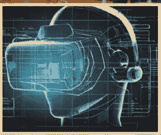

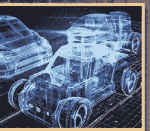

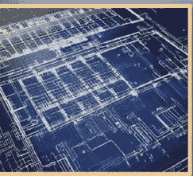

# 前言

目前，数字图像和视频的应用已扩展到监控、制造、医学、农业、机器与机器人视觉、模式识别等不同领域。它们从各种环境中很容易获取，有必要识别场景中包含的对象。为了实现这一目标，已经开发出多种计算方法；然而，考虑到图像大小、噪声、照明和安全等问题的技术进步，有必要开发新方法并改进经典算法。

另一方面，计算机视觉和图像处理系统应能够自动提取特定任务所需的特征。计算智能（CI）方法是自动计算机视觉和图像处理系统的替代方案；它们包括使用机器学习和软计算等工具。全世界的研究人员正在努力创建新算法，结合计算智能方法提供的方法，以解决图像处理和计算机视觉中的问题。本书提供了高质量的研究工作，涉及图像处理和计算机视觉中软计算与机器学习在理论和应用方面的广泛挑战。

此资源适用于各种读者，特定面向三类读者。目标读者之一是正在学习通信、自动化和电力工程的大学生（本科生、研究生或博士生）。第二类是刚开始从事研究和创新职业的人员。第三类目标读者是缺乏自动化和工程深厚背景但希望快速掌握并在其产品开发或平台中开始使用这些技术的研究人员和从业者。

本书包含 19 个章节。第 1 章和第 2 章讨论了缺血性卒中诊断和治疗技术的进步以及目标检测与跟踪、人脸检测与识别。第 3 章讨论了医学的未来，即 3D 打印器官。第 4、5 和 6 章详细介绍了银行欺诈检测的机器学习算法比较评估、基于计算的药物重定位策略概览，以及通过特征选择、提取和学习来提升性能的方法。所提方法还能检索变换后的图像，即所提系统对光度和几何变换具有鲁棒性，第 7 章对此进行了详细介绍。

第 8、9、10 和 11 章分别讨论基于智能价格行为策略的加密货币市场交易概念、比较评估以及使用机器学习方法对系外行星进行预测；利用 MTTF 和 MTBF 计算可靠性时使用失效率的风险；以及使用边缘检测算法的各种技术的详细描述。

第 12 章探讨了智能家居中机器学习的逻辑与进步。第 13 章突出了群体智能与计算的优势和局限性。作为读者的快速参考，本节指出了可以解决未决问题的可能未来方向。第 14 章展示了如何使用双向 LSTM 进行心律失常检测。第 15 章详细介绍了基于内容的图像检索技术用于特征提取的综合研究，第 16 章描述了血管生成、其在癌症中的作用及机制，以及用于理解血管生成的机器学习方法。第 17、18 和 19 章分别涉及基于中性模糊-模糊和 K-Mean 聚类的手写图像增强、基于自适应直方图的纹理分类系统，以及使用 L1-范数 Inception 深度神经网络进行甲状腺结节检测。

我们谨感谢所有为本书提供帮助的人士，并由衷感谢 Martin Scrivener 及 Scrivener 出版团队在出版过程中提供的专注支持与宝贵协助。

编者
2024 年 4 月

# 缺血性卒中诊断与治疗技术的进步

穆库尔·贾因 1,2, 迪娅·帕蒂尔 1, 舒巴姆·古普塔 3 和 舒巴姆·马哈詹 4,5,6*

1 细胞与发育生物学实验室，Parul 大学研发中心，印度古吉拉特邦瓦多达拉
2 Parul 大学应用科学学院生命科学系，印度古吉拉特邦瓦多达拉
3 Parul 大学医学院准医学与卫生科学系，印度古吉拉特邦瓦多达拉
4 Ajeenkya D Y Patil 大学工程学院，印度马哈拉施特拉邦浦那（iNurture Education Solutions Pvt. Ltd., 班加罗尔），印度马哈拉施特拉邦浦那
5 昌迪加尔大学研究与发展中心 (UCRD)，印度莫哈利
6 Al-Ahliyya Amman 大学 Hourani 应用科学研究中心，约旦安曼

## 摘要

缺血性卒中是一种脑血管疾病，通常由大脑血流中断引起，占所有卒中病例的 80% 以上。据估计，每分钟有 180 万个神经元死亡。过去几十年中，65 岁以下人群中卒中负担不断增加，20 至 64 岁成年人中，全球范围内的负担增加了 25%。据报道，男性和女性都可能出现卒中症状，在这种情况下，女性更容易出现非传统卒中症状，如头晕、意识丧失、言语不清。与西欧、美洲、澳大利亚相比，且与东欧相似，亚洲的卒中病死率较高。卒中的急性管理需要快速高效的筛查、成像和检查方式。通过早期检测和治疗卒中，可以获得更好的临床预后。卒中成像技术包括计算机断层扫描（CT）和磁共振成像（MRI）。MRI 更受青睐，因为它能提供损伤的详细和精确结果。抗血栓和神经保护疗法是传统医学的支柱，但由于其安全性不佳，其使用仍受到限制。利用纳米药物是另一种选择，因为它们可以增强治疗效益并减少不良反应，在靶点位置实现药物的有效聚集，并改善药物在体内的药代动力学行为。我们全面描述了缺血性卒中、其流行病学、基于人工智能的先进诊断工具及其治疗疗法。

**关键词：** 缺血性卒中，计算机断层扫描，MRI，人工智能，诊断工具，PET，EEG，纳米药物

*通讯作者：mahajanshubham2232579@gmail.com


## 1.1 介绍

中风是一种致命且致残的疾病，每年在全球影响超过1500万人。它是一种主要影响65岁以上人群的与年龄相关的疾病 [1, 2]。在美国，缺血性中风（由脑血液循环减少引起）占所有病例的87% [2]。根据世卫组织2016年发布的报告，中风是当今全球人口中第二常见的致残原因（图1.1）。在过去40年中，随着每个十年的过去，研究表明中风病例数量呈倍数增长 [11]。中风的发病率和预后都受性别影响；尽管如此，总体而言，由于与年龄相关的中风风险增加以及女性更长的平均寿命，女性的中风患病率高于男性 [3]。中风的基本分类包括出血性中风、短暂性脑缺血发作和

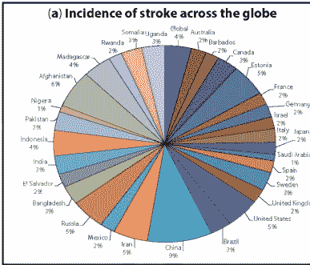

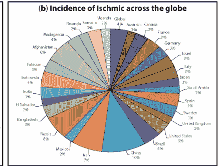

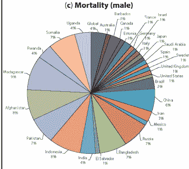

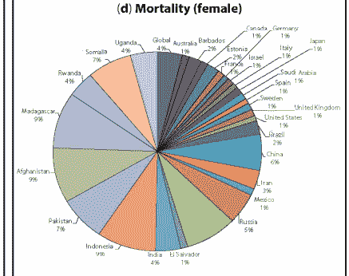

图1.1. 数据代表了全球男性和女性中风的国家发生率和死亡率。(a) 全球中风发生率，其中中国百分比较高，为9%，沙特阿拉伯较低，为1%。(b) 覆盖28个国家的全球缺血性中风患病率，缺血性中风较高发病率为10%，较低发病率为2%。(c) 全球男性中风死亡率百分比为4%，马达加斯加报告的高死亡率为9%。(d) 全球女性中风死亡率百分比，马达加斯加、阿富汗和印度尼西亚的高死亡率为9%。

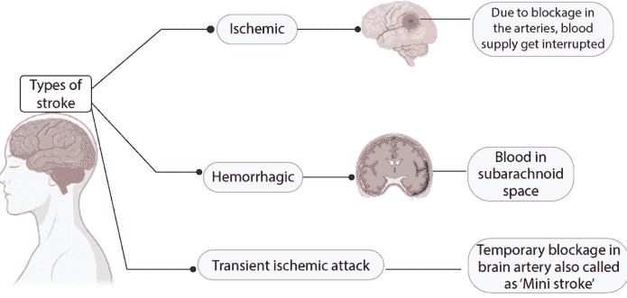

图1.2. 它演示了不同类型的中风发生情况以及它如何在大脑中引起并扰乱大脑功能。

缺血性中风（图1.2）。近80%的中风是缺血性中风，而不同人群在不同比例下更频繁地经历出血性和缺血性中风 [4]。以下类别——病因学亚型——已被用于进一步分类缺血性中风：心源性栓塞、粥样硬化、空腔性、其他特定原因（动脉夹层、血管炎、特定遗传性疾病等）以及病因不明的中风 [5]。在主要中风发作之前，个人总是会有小中风，通常被称为短暂性脑缺血发作（TIA）。大部分已发表的研究依赖于MRI和CT扫描图像来分类中风，这是一种昂贵的早期中风检测方法。CT和MRI被用于大多数识别中风的研究。如今，非侵入性方法变得越来越常见。其中一种方法是脑电图（EEG），也是一种廉价或免费的方法。以下问题阻碍了缺血性中风和众多其他中枢神经系统（CNS）疾病的新疗法发展：血脑屏障（BBB）阻止大多数CNS药物有效到达脑实质，这使得治疗或挽救尚未完全受影响的大脑区域变得困难；(2)许多药物在全身和/或口服给药后稳定性差或具有毒性；(3)疾病的病理生理学尚未被充分理解；以及(4)将临床前研究的阳性结果转化为临床应用具有挑战性 [6]。中风治疗中的一个关键问题是血脑屏障。为了向脑组织输送足够的药物，脂质体必须能够穿越BBB，并且理想情况下它们应在血液中停留较长时间 [7]。得益于纳米技术和人工纳米材料，已创造出新的中风诊断方法。借助这项技术，识别中风的生物化学和病理生理原因可能变得更加容易 [8]。由于其独特的荧光特性，能够在生物学相关浓度下实现高时空准确性，基于光学碳纳米管（CNT）的生物传感器展现出巨大潜力 [9, 10]。随着纳米技术的发展，现在可以将药物更有效地输送到大脑，更准确地说，输送到缺血区域 [8]。FDA仅批准了一种治疗药物——重组组织型纤溶酶原激活剂（tPA）——用于缺血性中风的治疗，其应用受限于其有限的治疗窗口、药物快速消除以及出血性转化的潜在风险 [138]。医学中没有特定的治愈中风的方法；因此，早期识别是应对中风的关键。早期识别可以抑制残疾、死亡损失以及其他与大脑相关的严重问题 [12]。

## 1.2 缺血性中风的诊断工具

### 1.2.1 成像前

患有急性神经系统疾病的患者需要快速神经影像。美国中风协会建议指出，唯一的前置询问是实际的毛细血管血糖，该血糖由急救人员获取。用于对比剂或灌注成像的静脉插管通常是必要的序列，使能够同时采集血液面板。这通常包括凝血筛查、肾功能测试，以及如果患者使用抗凝药物，则包括感染测试。尽管许多放射科部门在提供对比剂前要求当前的肾功能 [10]。

### 1.2.2 成像

#### 1.2.2.1 计算机断层扫描

在极急性重症中风背景下，神经影像仍然主要基于CT。无对比剂的头部CT扫描速度快、敏感且成本效益高，可排除脑出血，这通常足以做出溶栓决策。由于广泛可用性和显著缩短的周转时间，CT灌注检查在急诊场景中更有效，用于检测和识别可从溶栓治疗和血管血流中获益的中风患者 [134, 135] CT灌注序列可以评估各种脑灌注，并经常使用人工智能进行，例如M1star（Apollo Medical Imaging Technology）或iSchemaView的RAPID（灌注和扩散快速处理）CT灌注。CT灌注（一种对比剂追踪法）可与几乎所有目前在世界各地急诊室中使用的多排探测器CT扫描仪一起使用 [131, 132]。在确定灌注再通治疗的危险和潜在益处的关键因素中，表征不可逆梗死的理想CT灌注值和阈值在研究中未得到足够关注 [133]。这些技术通过确保使用经过验证的阈值并提高观察者间一致性，使解读更加容易 [10]。在症状出现后的前3小时内，CT信号的灵敏度在40%至60%之间，其阳性预测值、阴性预测值和特异性分别为96%、27%和85%。缺血发作后约45分钟，低密度首先可被检测到。无对比剂的头部CT扫描可以利用阿尔伯塔中风项目早期CT评分（ASPECTS）来确定中大脑动脉（MCA）中风的严重程度。根据目前的建议，CT扫描时间和初步结果的报告应在20分钟以内 [15]。基于2015年进行的荟萃分析，CT灌注方法的总合并灵敏度为55.7%，特异性为92%。根据2017年的一项研究，CT灌注扫描的特异性和灵敏度分别为92%和82%。这项调查强调了CT灌注研究相对于无对比剂CT（NCCT）脑部检查的优势，认为虽然NCCT脑部


通常可以识别缺血性梗死，但在识别症状开始后24小时窗口期内的早期急性缺血性梗死方面用处不大，并且受梗死严重程度和大小的影响。CT灌注的优势在于它可以早期识别非增强CT扫描无法识别的缺血性卒中症状 [136]。

### 1.2.2.2 磁共振成像

更准确且广泛使用的技术是用于诊断急性脑缺血改变的MRI卒中方案。对于定位梗死核心，MRI仍然是金标准 [13]。确定急性缺血核心体积的方法无疑是带有DWI（弥散加权成像）和T2 FLAIR（T2流体衰减反转恢复）序列的MRI；它们的灵敏度和特异性。当Na+/K+ ATP酶发生时，水分子从细胞外空间移动到细胞内空间，这发生在细胞毒性水肿的这一阶段，DWI可以检测超急性缺血改变 [14]。由于细胞内受困水分子的运动受限，DWI可以识别细胞毒性水肿 [20]。在长期将MRI作为主要诊断成像技术的设施中，标准化卒中MRI方案大约需要10分钟。借助3 Tesla的回声平面成像，此时间可能缩短至6分钟 [16–18]。MRI可以识别发生在过去4.5小时内且可能从溶栓中受益的卒中 [19]。对于由于成像证实的前循环主要血管阻塞长达6小时以及后循环（基底动脉或后脑动脉）症状发生后24小时导致致残性急性缺血性卒中（任意定义：NIHSS>6）的患者，大血管闭塞。另一种可用于通过MRI评估疑似大血管闭塞LVO及其定位的技术。在MR血管造影（MRA）中，有两种技术选项：原生或未增强MRA，主要使用飞行时间（TOF）方法，以及对比增强MRA（CEMRA），使用静脉注射的基于钆的造影剂（GBCA）[21]。CEMRA是一种在静脉注射GBCA后使用T1加权退相梯度回波序列的方法。可以采集单相或多相数据。对于MIP和VRT 3D重建，原始数据可以再次利用。CEMRA消除了对各种流动伪影的先前限制 [22]。包含CEMRA的完整MRI扫描可能需要大约15分钟。在伴有LVO的急性缺血性卒中中，估计在最坏情况下，每分钟损失190万个神经元和12公里髓鞘纤维，一小时的低效会损失1.2亿个神经元、714公里丢失的髓鞘纤维和3.6年加速老化 [23]。NECT用于出血检测，ASPECTS评估，CTA用于闭塞检测，在急性环境中，特别是在早期时间窗口内，这些都是所需的。此外，MRI在检测亚急性或慢性脑内出血以及微出血方面比NECT更敏感。尽管当前指南和建议支持使用CTP或MRI评估晚期和不明确时间框架内的缺血核心 [24, 25]。必须强调的是，CTP和MRI在研究和理解卒中及其治疗的病理生理过程方面发挥着至关重要的作用 [14]。MR灌注成像不依赖于直接观察动脉，而是依赖于检测血液内的示踪化学物质。DAWN和DEFUSE 3试验是两项重要的卒中研究，改变了症状发作后6至24小时内（确定为“最后见到良好状态时间”[TLSW]）出现大血管闭塞卒中个体的护理标准，允许为这个延长时间窗口进行血管内治疗。

区分旨在找出可从治疗中受益的个体（影像学的正确用途）的分诊，与旨在找出可能比其他人有更好结果的患者（在个体医疗护理环境中不恰当的目标）的分诊至关重要。基于最佳CTP参数选择的患者往往具有更好的临床结局，但这种选择可能会以忽视许多将受益的患者为代价，从而总体上提高统计数据 [137]。

### 1.2.2.3 肌电图

了解肌肉如何由其神经肌肉系统控制最常用的方法是肌电图（EMG）[26, 27]。EMG在临床中成功用于手术程序和诊断支持 [28]。最近，EMG被研究作为一种利用脑机交互（BCI）检测运动意图的替代脑机方案 [29]。此外，还开展了关于使用EMG用于人机和肌肉-计算机界面可行性的研究 [30, 31]。为了量化肌肉收缩速度并分析运动神经元和支配区，表面肌电图分析最常用频域分析和时域分析 [39]。理想特征向量是使用时域特征（如均方根（RMS）、波形长度（WL）和Willison幅度（WAMP）以及波形长度（WL））创建的 [32, 33]。确定肌肉疲劳最有用且常用的频域参数是中位频率（MDF）和平均频率（MNF）[33]。然而，频域功率谱技术在确定肌肉磨损方面表现出更高的准确性 [34]。

### 1.2.2.4 脑电图（EEG）

记录大脑电活动的脑电图（EEG）已被研究作为卒中诊断和预测工具 [35, 36]。卒中后头三个月内，功率谱开始恢复正常，但定量脑电图（qEEG）仍可揭示超过优秀运动恢复阈值的异常，例如对称性差 [37]。脑对称度量首次被可靠用于识别早期脑缺血是在颈动脉手术期间 [38]。需要一种价格实惠、设置简单、易于理解的EEG设备。技术进步使得满足这些需求的消费级无线EEG系统成为可能。一种商业上可用的可穿戴消费级EEG系统，已与医疗EEG设备进行过对比，即InteraXon Inc的Muse [39]。为了评估在卒中超急性期使用EEG的价值，未来研究将更早筛查患者，例如在急诊室或救护车中 [40]。

### 1.2.2.5 正电子发射断层扫描（PET）

1980年，PET是各种卒中成像模态中第一个显示人体中存在缺血半暗带的技术 [41]。PET是评估早期卒中发病机制的“金标准” [42]。PET提供半定量或定量血流动力学数据的事实是其另一项关键优势 [43]。有多种PET成像方法可用，例如带15O的多示踪剂PET、氟马西尼（FMZ）PET和氟米松尼达唑（FMISO）PET。每种方法都有特定的优缺点。多示踪剂PET将“痛苦灌注”组织（CBF较低但由于OEF较高而维持CMRO2）识别为缺血半暗带，并生成CBF、脑血容量（CBV）、CMRO2和CMRglu的定量图谱 [44]。多示踪剂PET的问题是缺血半暗带CBF值存在显著差异（一项分析中为4.8至14.1，另一项中为7 ml/100 g/min至22 ml/100 g/min）。这说明OEF是组织存活力的不可靠指标，并且在不了解总体趋势的情况下，单一时间点的数据可能令人困惑。因此，需要一种能够独立于卒中开始后的时间长度或CBF随时间的变化来识别不可逆损伤组织的标志物 [44]。作为结果，出现了带FMZ的PET [45]。由于FMZ在所有代谢活跃组织（梗死核心除外）中均减少，FMISO通过标记低氧组织来设计识别缺血半暗带。氧合组织能够将代谢物重新氧化为其原始形式，而低氧组织无法做到。然后，代谢物与细胞内分子结合来标记危险组织 [46]。由于一些组织通过提高OEF在低CBF区域维持氧合，并且一些组织具有较低的基线CBF和代谢率，因此低氧可能比CBF（如白质）更能准确预测危险组织 [46]。理论上，动物与人类相比白质与灰质比例显著较低，这是动物模型中有效的神经保护剂无法转化为人类的原因之一。这种方法将使白质神经保护剂的测试成为可能，因为FMISO可以成像缺血性白质 [46]。然而，PET在临床中的实用性受到技术要求和15O示踪剂短半衰期的限制 [41]。

### 1.3 基于人工智能的诊断工具

人工智能技术在急性卒中成像中有广泛应用，涉及缺血性和出血性卒中类型。梗死或出血的识别、分割、分类、主要血管闭塞检测、阿尔伯塔卒中方案早期CT评分（ASPECTS）分级、预后判断以及卒中治疗范式的其他组成部分，均可借助人工智能来实现。特别是，卷积神经网络等前沿AI方法有望有效且准确地执行这些基于成像的任务 [47]。输入、一个或多个隐藏层和输出是人工神经网络（ANN）的组成部分，ANN是一种模仿生物神经元的深度学习（DL）[47]。由于治疗有效性的窗口期有限，在将患者视为溶栓候选者时，早期诊断缺血性梗死至关重要 [47]。识别可能从机械取栓术中受益的患者取决于LVO的诊断。在非增强CT（NCCT）上，SVM算法对急性卒中患者中MCA点征的检测具有高灵敏度（97.5%）[48]。基于CNN的商业软件Viz-AI算法v3.04在检测近端LVO时达到了86.3%（95% CI，0.83–0.90；P=0.001）的AUC、84.1%（95% CI，0.81–0.86；P=0.001）的组内相关系数（ICC）和86%的准确率，Viz-AI还达到了高灵敏度和特异度（分别为82%和94%）[49, 50]。在预训练网络中使用增强数据的GoogLeNet是最准确的（AUC 1.0；灵敏度和特异度均为100%）


与表现最好的增强型未经训练的AlexNet（AUC 0.95；灵敏度100%；特异度80%）相比，根据一项利用两个2D卷积神经网络（GoogLeNet和AlexNet）检测基底节区出血的研究[51]。印度各医院的超过30,000例NCCT被纳入最大规模队列之一，用于利用深度学习算法识别和分类ICH[52]。另一项研究利用完全3D CNN和大量患者人群，能够识别ICH并将研究重新排序为“stat”（定义为阳性ICH研究）与“routine”[53]。当算法融入放射科医生的工作流程时，检测时间从512分钟缩短至19分钟[47]。

## 1.4 基于血液的蛋白质生物标志物用于中风

放射学影像在中风诊断和鉴别中的应用受到神经影像学领域进步以及耗时长、设备成本高、可用性有限和放射学影像分析存在差异等潜在缺点的制约[54]。要找到参与缺血性中风特异性细胞过程的理想生物标志物非常困难。通常在大脑中而非血液中以高浓度存在的蛋白质浓度是明显的候选个体[139]。血液生物标志物可能提供一种可靠、快速且经济的方法来区分IS和HS。特定的生物标志物签名可能有助于为急性中风患者选择最佳治疗方案。为了在急性环境中有效且高效地将IS与HS区分开以采取更好的治疗措施，需要一种具有高灵敏度和高特异度的基于血液的生物标志物方法[55]。

## 1.5 内皮损伤标志物

Allard等人（2004年）的一项研究[56]讨论了Apo C-I和Apo C-III蛋白在检测HS和IS中的可能作用。使用相对荧光单位（RFU）来表示Apo C-I和Apo C-III的水平。为了区分15例IS患者和16例HS患者，Apo C-I的切断点为60 RFU，灵敏度为94%，特异度为73%；而Apo C-III的切断点为36 RFU，灵敏度为94%，特异度为87%。在症状开始后6小时内，IS患者的Apo C-I和Apo C-III水平均高于HS患者。几年后，Lopez等人（2012年）[57]使用基于选择反应监测（SRM）的检测方法，在症状发作首周内评估了九种载脂蛋白（Apo A-I、Apo A-II、Apo B、Apo C-I、Apo C-II、Apo C-III、Apo D、Apo E、Apo H），用于检测IS和HS患者。他们发现，在评估的九种载脂蛋白中，Apo C-III（单独）以0.85的曲线下面积（AUC）区分了IS和HS。Kim等人（2010年）检查了四种生物标志物的组合（BNP、D-二聚体、MMP-9和S100B），但他们只发现一种生物标志物，即BNP，其水平在IS患者（90.8-156.4）中显著高于HS患者（16.3-10.8），并以0.61的AUC表征了两种中风类型[58]。

## 1.6 脑损伤标志物

在症状开始后2至6小时内，七项研究发现脑内出血（ICH）患者的GFAP水平明显高于IS患者[59–64, 66]。根据Unden等人2009年对83例IS和14例HS样本中包括S100B、神经元特异性烯醇化酶（NSE）、GFAP和活化蛋白C-蛋白C抑制剂复合物（APC-PCI）在内的一组生物标志物的分析，只有APC-PCI和GFAP显著区分了ICH和IS。切断值为0.35 g/l，以96%的灵敏度和42%的特异度区分了ICH和IS。IS患者（0.04–3.55 g/l）的APC-PCI水平远高于ICH患者（0.19–0.49 g/l）。在ICH患者中，GFAP水平（40–160 ng/l）远高于IS患者（30–70 ng/l），在切断值为40 ng/l时，能够区分ICH和IS[64, 65]。在一项包含146例IS和46例ICH患者的最新研究中，Luger S等人（2017年）发现，血清GFAP在切断值为0.03 g/l时，在6小时内区分ICH和IS的灵敏度为77.8%，特异度为94.2%[66]。

## 1.7 缺血性中风的治疗进展

由于发展完善的纳米药物具有诸多显著优势，许多纳米药物被开发出来以提高传统治疗方法的有效性并降低其负面影响。纳米药物可以提高难溶性药物的溶解度，增强其稳定性，并延长其体内半衰期[67]。靶向改性纳米药物可以帮助药物绕过血脑屏障（BBB），该屏障阻止大多数药物进入大脑，并在预定部位实现聚集，以防止非特异性扩散。靶向改性还可以使特定类型的细胞（如受损神经元）更容易吸收纳米药物。因此，具有靶向能力的纳米药物不仅能改善治疗效果，还能降低给药剂量和药物毒性[68]。药物递送系统（DDS），包括刺激响应型纳米载体和靶向纳米载体，可将药物输送至血栓和中枢神经系统（CNS）等所需部位，并通过响应内部或外部刺激在这些区域特异性释放药物，从而增强其治疗效果[138]。此外，由各种功能材料制成的纳米药物可以控制药物释放，功能化载体在缺血性中风治疗中可能有用[67]。

### 1.7.1 配体介导的主动靶向

由于纤维蛋白是血栓的重要组成部分，通过在表面结合蛋白质将聚苯乙烯纳米颗粒改造为抗纤维蛋白抗体来递送阿替普酶。在没有栓子的情况下，阿替普酶纳米颗粒的活性显著低于游离酶。这将以非特异性方式减少纤维蛋白酶原的裂解并降低出血的可能性[69]。除了单靶点配体修饰外，还有一些关于双靶点修饰纳米药物的研究，其靶向效果更佳。活性血小板上过表达的P-选择素介导血小板之间的接触。受此技术启发，创建了用cRGD和P-选择素靶向肽修饰的双靶向纳米囊泡，用于递送SK105[70]。位于靶区附近的甘油磷脂基纳米囊泡能够响应刺激释放药物，因为形成血栓的血小板和白细胞过量产生的磷脂酶A2可能会裂解甘油磷脂[70]。

### 1.7.2 向缺血性脑组织供氧的纳米药物

虽然血红蛋白（Hb）是一种天然的O2载体，但由于其半衰期短和高血压反应，其临床应用有限[71, 72]。脂质体血红蛋白（LHb）不仅可以延长血红蛋白在体内循环的时间，还能输送足够的氧气，跨越微循环屏障到达红细胞（RBCs）很难到达的脑半暗带[73, 74]。在中脑动脉阻塞后立即给予LHb，还可以在暂时性缺血模型（MCAO）中大大减小梗死体积[75, 76]。

### 1.7.3 利用纳米药物减轻氧化应激

小分子化学品、抗氧化剂和无机物是临床前研究中使用的主要类型的抗氧化剂。纳米药物可能增强抗氧化剂的药代动力学性能，并帮助它们穿过血脑屏障并在受损脑组织中储存[77]。许多小分子抗氧化剂，包括黄芩苷[78]、木犀草素[79]、姜黄素[80]、白藜芦醇[81]、丹参酮[82]和葛根素[83]，源自植物并含有酚和酮成分。例如，疏水性姜黄素在体内会被迅速分解、排出，且不易被细胞有效吸收。由于细胞通过细胞吞噬而非被动扩散摄取NPs，因此观察到含姜黄素的PLGA-NPs在神经元中的吸收量高于游离药物。此外，NPs更有效地减少了过氧化氢处理的神经元中的氧化应激[80, 84, 85]。NPs延长姜黄素在体内半衰期的能力，提高了药物在血脑屏障开放窗口期进入受损脑组织的可能性。在另一项研究中，加载姜黄素的胚胎干细胞外泌体提高了药物的稳定性和溶解度，同时解决了吸收率低的问题[86]。因此，加载姜黄素的胚胎干细胞外泌体治疗可以显著降低受损脑组织中的ROS水平，减小梗死体积，并减轻神经血管单位的破坏。几种人工合成的小分子抗氧化剂，如依达拉奉[87]和硝基氧化自由基2,2,6,6-四甲基哌啶-1-氧基（TEMPO）；还有一些从植物中获得的天然抗氧化剂。血脑屏障修饰策略可能有助于依达拉奉胶束在缺血性脑组织中实现更有效的储存并挽救更多神经元。为了延长依达拉奉的循环时间，创造了经CGS21680处理的PEG-PLA胶束[88]。

### 1.7.4 纳米药物控制多种异常

当多种异常得到协同抑制时，预计会取得更好的效果。由于某些药物（如姜黄素）具有抗炎、抗氧化和


具有抗凋亡特性，它们可能能够同时控制多种疾病。此外，大量研究已将各种具有不同作用的药物融入纳米医学中，以提供联合疗法 [67, 89–92]。为分布神经保护剂 ZL006 和 alteplase，创建了纳米血小板。TAT-肽连接的 alteplase 附着在血小板屏障表面，且连接子可被凝血酶切割。ZL006 被精确插入聚合物 NP 核心。包覆血小板膜的 NPs 保留了血小板靶向凝血酶的能力，并能响应血栓中高表达的凝血酶释放 alteplase。连接子断裂后，被阻断的 TAT 肽随之显露，这促进了 NPs 穿越血脑屏障（BBB）并分布 ZL006。在 MCAO 大鼠中，溶栓剂与神经保护剂的联合应用显著减少了缺血相关损伤 [92]。在灌注前，缺氧不仅导致神经元能量耗竭，还会引起活性氧（ROS）的形成；灌注后，氧含量增加会导致 ROS 显著增加。四氧化锰纳米颗粒表现出持久的 ROS 清除活性。通过在溶栓前后控制 O2 和 ROS 水平，挽救了缺血性大脑 [92]。

由于其成熟的制备技术，聚合物纳米颗粒、脂质体和胶束是当前旨在转化为临床应用的众多纳米药物中的研究对象。尽管无机纳米颗粒具有良好的一致性且易于工业化，但若用于人体，则需要进行大量更多的安全性研究。近年来，基于细胞膜或活细胞外泌体/囊泡的生物仿生纳米药物为靶向药物递送开辟了新的可能性。凭借其独特的生物相容性、安全性和固有靶向特性，有望为中风治疗带来新进展，使其成为纳米药物领域的研究热点 [93]。

## 1.8 纳米颗粒

### 1.8.1 碳纳米管

纳米宽度的石墨片管属于被称为碳纳米管的纳米材料类别 [8, 94–99]。其主要医疗用途包括药物递送、组织工程、生物传感器、基因治疗和激素生产 [100–104]。由于被动扩散无法穿越血脑屏障（BBB），因此将鼓励主动转运进入大脑的物质共轭对于纳米医学的新用途至关重要。鉴于碳纳米管的特殊特性，在过去二十年中，它们作为纳米载体系统受到了广泛关注 [105]。研究发现，带有荧光标记的多壁碳纳米管可以穿透微血管脑内皮单层而不会显著损害脑内皮细胞，这是治疗应用的必要条件 [106]。最近的一项研究表明，在纳米纤维支架中使用碳纳米管可以大大促进神经元的发育和分化，暗示其在周围神经康复领域具有潜在应用 [107]（图 1.3）。尽管碳纳米管具有诸多优势，但其应用也存在缺点，例如水溶性差、可生物降解性和分散性有限、有害的药物诱导氧化应激以及肺部疾病 [108–110]。

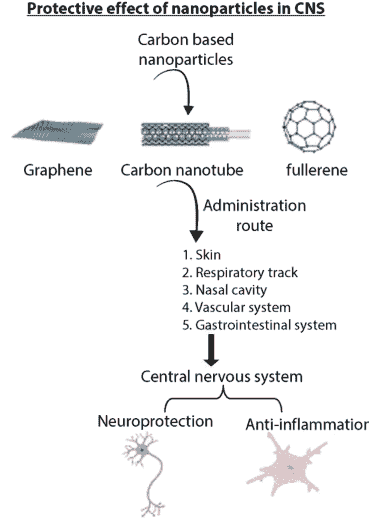

图 1.3 它展示了碳基纳米颗粒在中枢神经系统中的保护作用。

### 1.8.2 树枝状聚合物

被称为树枝状聚合物的一类人工大分子表现出类似树木的结构和独特的包覆特性。树枝状聚合物有趣的结构特征包括球形和分层的支化纳米结构，以及外层上多个末端官能团。它们可以组装复合物并包裹各种分子实体 [111]。由于能够穿越血脑屏障，树枝状大分子常用于中枢神经系统疾病的治疗 [112]。因为聚酰胺胺、聚丙烯亚胺和聚丙烯醚被用于树枝状聚合物制剂，并且可以包裹亲水性和疏水性化合物，这些基于聚合物的纳米结构经常被用作纳米载体来运输不同的药物和成像剂 [113, 114]。PEG 化树枝状聚合物的额外益处是减少血液凝固，这对中风治疗有帮助。在永久性局灶性脑缺血的小鼠模型中，注射后 24 小时也可在大脑中发现优化的 PAMAM 制剂。PEG 化的 PAMAM 树枝状聚合物延长了血液循环的半衰期，并可用于药物递送系统 [115]。

### 1.8.3 金属纳米颗粒

金属纳米颗粒对脑部疾病的治疗和诊断非常有前景 [116–120]。金属纳米颗粒不仅具有改进的光热性能，还具有优异的成像和检测能力 [121–125]。某些金属纳米颗粒具有磁性，这使得它们在磁热疗、磁靶向和 MRI 中很有用 [126–130]。水动力学直径为 110 ± 22 nm 的氧化铁纳米颗粒已成功通过磁场定向至脑病变。氧化铁纳米颗粒的超顺磁性可以防止材料在无外部磁场时自聚集。在体内实验中，通过将大鼠头部夹在电磁铁两极之间，已证明了有效的磁靶向。在 Nd–Fe–B 磁体植入后，小鼠大脑右半球中纳米颗粒的富集程度显著高于未处理样品（左半球），表明磁靶向成功。

## 1.9 结论

尽管过去几十年来用于缺血性中风诊断且仍在用于同一诊断的诊断工具，如 CT、MRI，以及新兴技术（如肌电图、脑电图、正电子发射断层扫描、其他血液生物标志物以及基于人工智能的诊断工具）正在用于快速且具成本效益地检测大脑特定损伤。此外，缺血性中风后的康复和长期恢复仍然是医疗专业人员和患者面临的重大问题，因为缺乏可行的治疗策略。纳米技术通过纳米药物为缺血性中风治疗的治疗进步带来了福音；对于控制异常、向缺血性大脑提供氧气以及针对下游缺血级联事件（如组织愈合、炎症反应和氧化应激）的纳米药物可能是更有效的中风治疗方法。如本综述所示，碳纳米材料在缺血性中风的治疗和诊断方面具有巨大潜力。CNT 的发展仍处于起步阶段，在它们能够用于实际应用之前，必须完成大量工作。当用于体内和体外模型以研究中风背后的病理生理和生化途径时，人们认为 CNT 作为纳米生物传感器具有最大的潜力。

## 未来展望

CT 和 MRI 等金标准成像方法目前广泛用于中风及其亚型的识别和评估。这些成像服务主要存在于经济欠发达地区、小型医院和诊所。延迟中风的诊断和治疗会导致患者预后更差。由于 CT 和 MRI 费用高昂、接触成像设施的水平低以及缺乏成像专家（尤其是在发展中国家），许多中风病例未被检出，许多中风患者未得到治疗。通过开发低成本且更易获得的诊断工具以快速识别急性缺血性中风，有潜力缩短治疗时间、减轻脑损伤严重程度，并大幅提高中风患者及其护理者的生活质量。除了 CT 和 MRI 之外，还引入了具有成本和时间效益的诊断技术，如 EMG 和 EEG。表面 EMG 的频域和时域分析最常用于测量肌肉收缩速度并检查运动神经元和支配区。需要一种价格合理、易于设置且易于理解的 EEG 仪器。


技术进步使得生产满足这些需求的消费级无线脑电图系统成为可能。正电子发射断层扫描是通过提供定量数据来评估早期卒中发病机制的“金标准”。人工智能技术的进步在急性卒中影像学中具有广泛应用，包括缺血性和出血性类型、主要血管闭塞的识别、分割、分类以及梗死或出血。在缺血性卒中的独特治疗进展方面，已开发出纳米药物以提高传统治疗方式的有效性并减少副作用。当多种异常同时被抑制时，预期会取得更好的效果。某些药物，如姜黄素，具有抗炎、抗氧化和抗凋亡特性；它们可能能够治疗多种疾病。碳纳米管技术用于利用*体外*和*体内*模型研究卒中的病理生理学和生物化学机制，在这些模型中，它们作为纳米生物传感器具有最高潜力。

## 参考文献

- 1. Feigin, V.L., Lawes, C.M., Bennett, D.A., Anderson, C.S., Stroke epidemiology: A review of population-based studies of incidence, prevalence, and case-fatality in the late 20th century. *Lancet Neurol.*, 2, 1, 43–53, 2003.
- 2. Benjamin, E.J., Blaha, M.J., Chiuve, S.E., Cushman, M., Das, S.R., Deo, R., de Ferranti, S.D., Floyd, J., Fornage, M., Gillespie, C., Isasi, C.R., Jiménez, M.C., Jordan, L.C., Judd, S.E., Lackland, D., Lichtman, J.H., Lisabeth, L., Liu, S., Longenecker, C.T., Mackey, R.H., Matsushita, K., Mozaffarian, D., Mussolino, M.E., Nasir, K., Neumar, R.W., Palaniappan, L., Pandey, D.K., Thiagarajan, R.R., Reeves, M.J., Ritchey, M., Rodriguez, C.J., Roth, G.A., Rosamond, W.D., Sasson, C., Towfighi, A., Tsao, C.W., Turner, M.B., Virani, S.S., Voeks, J.H., Willey, J.Z., Wilkins, J.T., Wu, J.H., Alger, H.M., Wong, S.S., Muntner, P., American Heart Association Statistics Committee and Stroke Statistics Subcommittee, Heart disease and stroke statistics-2017 update: A report from the American Heart Association [published correction appears in Circulation. 2017;135(10):e646 and 2017;136(10):e196]. *Circ.*, 135, 10, e646–e603, 2017.
- 3. Appelros, P., Nydevik, I., Viitanen, M., Poor outcome after first-ever stroke: Predictors for death, dependency, and recurrent stroke within the first year. *Stroke*, 34, 1, 122–126, 2003.
- 4. Boehme, A.K., Esenwa, C., Elkind, M.S., Stroke risk factors, genetics, and prevention. *Circ. Res.*, 120, 3, 472–495, 2017.
- 5. Alawi, A., Maddukuri, P.V., Han, H., Karas, R.H., 2008. Adams, H.P., Bendixen, B.H., Kappelle, L.J., Biller, J., Love, B.B., Gordon, D.L., Marsh, E.E., Classification of subtype acute ischemic stroke. Definitions for use in multicenter clinical trial. TOAST. Trial Org 10172 in Acute Stroke Treatment. Stroke, 24, 1, 35–41, 1993.
- 6. Dhir, N., Medhi, B., Prakash, A., Goyal, M. K., Modi, M., & Mohindra, S., Pre-clinical to clinical translational failures and current status of clinical trials in stroke therapy: a brief review. Curr. Neuropharmacol., 18, 7, 596–612, 2020.
- 7. Moghimi, S.M., Hunter, A.C., Murray, J.C., Long-circulating and target-specific nanoparticles: Theory to practice. Pharmacol. Rev., 53, 2, 283–318, 2001.
- 8. Fernandes, L.F., Bruch, G.E., Massensini, A.R., Frézard, F., Recent advances in the therapeutic and diagnostic use of liposomes and carbon nanomaterials in ischemic stroke. Front. Neurosci., 12, 453, 2018.
- 9. Qi, B.L., Liu, P., Wang, Q.Y., Cai, W.J., Yuan, B.F., Feng, Y.Q., Derivatization for liquid chromatography-mass spectrometry. TrAC Trends Anal. Chem., 59, 121–132, 2014.
- 10. Hasan, T.F., Rabinstein, A.A., Middlebrooks, E.H., Haranhalli, N., Silliman, S.L., Meschia, J.F., Tawak, R.G., Diagnosis and management of acute ischemic stroke. Mayo Clin. Proc., 93, 4, 523–538, 2018, April, Elsevier.
- 11. Kwon, Y.H., Shin, S.B., Kim, S.D., Electroencephalography based fusion two-dimensional (2D)-convolution neural networks (CNN) model for emotion recognition system. Sensors, 18, 5, 1383, 2018.
- 12. Kim, B., Schweighofer, N., Haldar, J.P., Leahy, R.M., Winstein, C.J., Corticospinal tract microstructure predicts distal arm motor improvements in chronic stroke. J. Neurol. Phys. Ther., 45, 4, 273–281, 2021.
- 13. Ray, S. and Maunsell, J.H., Different origins of gamma rhythm and high-gamma activity in macaque visual cortex. PLoS Biol., 9, 4, e1000610, 2011.
- 14. Malikova, H. and Weichelt, J., Diagnosis of ischemic stroke: As simple as possible. Diagnostics, 12, 6, 1452, 2022.
- 15. Phipps, M.S. and Cronin, C.A., Management of acute ischemic stroke. Bmj, 368, 1–15, 2020.
- 16. Simonsen, C.Z., Yoo, A.J., Rasmussen, M., Sørensen, K.E., Leslie-Mazwi, T., Andersen, G., Sørensen, L.H., Magnetic resonance imaging selection for endovascular stroke therapy: Workflow in the GOLIATH trial. Stroke, 49, 6, 1402–1406, 2018.
- 17. Legrand, L., Tisserand, M., Turc, G., Naggara, O., Edjlali, M., Mellerio, C., Oppenheim, C., Do FLAIR vascular hyperintensities beyond the DWI lesion represent the ischemic penumbra? Am. J. Neuroradiol., 36, 2, 269–274, 2015.
- 18. Labeyrie, M.A., Turc, G., Hess, A., Hervo, P., Mas, J.L., Meder, J.F., Oppenheim, C., Diffusion lesion reversal after thrombolysis: A MR correlate of early neurological improvement. Stroke, 43, 11, 2986–2991, 2012.
- 19. Thomalla, G., Simonsen, C.Z., Boutitie, F., Andersen, G., Berthezene, Y., Cheng, B., Gerloff, C., MRI-guided thrombolysis for stroke with unknown time of onset. N. Engl. J. Med., 379, 7, 611–622, 2018.
- 20. Lövblad, K.O., Baird, A.E., Schlaug, G., Benfield, A., Siewert, B., Voetsch, B., Warach, S., Ischemic lesion volumes in acute stroke by diffusion-weighted magnetic resonance imaging correlate with clinical outcome. Ann. Neurol.: Official Journal of the American Neurological Association and the Child Neurology Society, 42, 2, 164–170, 1997.
- 21. Almekhlafi, M.A., Kunz, W.G., Menon, B.K., McTaggart, R.A., Jayaraman, M.V., Baxter, B.W., Goyal, M., Imaging of patients with suspected large-vessel occlusion at primary stroke centers: Available modalities and a suggested approach. Am. J. Neuroradiol., 40, 3, 396–400, 2019.
- 22. Riederer, S.J., Stinson, E.G., Weavers, P.T., Technical aspects of contrast-enhanced MR angiography: Current status and new applications. *Magn. Reson. Med. Sci.*, 17, 1, 3, 2018.
- 23. Saver, J.L., Time is brain—Quantified. *Stroke*, 37, 1, 263–266, 2006.
- 24. Albers, G.W., Lansberg, M.G., Kemp, S., Tsai, J.P., Lavori, P., Christensen, S., Marks, M.P., A multicenter randomized controlled trial of endovascular therapy following imaging evaluation for ischemic stroke (DEFUSE 3). *Int. J. Stroke*, 12, 8, 896–905, 2017.
- 25. Jovin, T.G., Saver, J.L., Ribo, M., Pereira, V., Furlan, A., Bonafe, A., Nogueira, R.G., Diffusion-weighted imaging or computerized tomography perfusion assessment with clinical mismatch in the triage of wake up and late presenting strokes undergoing neurointervention with Trevo (DAWN) trial methods. *Int. J. Stroke*, 12, 6, 641–652, 2017.
- 26. Agostini, V., Ghislieri, M., Rosati, S., Balestra, G., Knaflitz, M., Surface electromyography applied to gait analysis: How to improve its impact in clinics? *Front. Neurol.*, 11, 994, 2020.
- 27. Drost, G., Stegeman, D.F., van Engelen, B.G., Zwarts, M.J., Clinical applications of high-density surface EMG: A systematic review. *J. Electromyogr. Kinesiol.*, 16, 6, 586–602, 2006.
- 28. Dreher, T., Brunner, R., Végvári, D., Heitzmann, D., Gantz, S., Maier, M.W., Wolf, S.I., The effects of muscle-tendon surgery on dynamic electromyographic patterns and muscle tone in children with cerebral palsy. *Gait Posture*, 38, 2, 215–220, 2013.
- 29. Balasubramanian, S., Garcia-Cossio, E., Birbaumer, N., Burdet, E., Ramos-Murguialday, A., Is EMG a viable alternative to BCI for detecting movement intention in severe stroke? *IEEE Trans. Biomed. Eng.*, 65, 12, 2790–2797, 2018.
- 30. Saponas, T.S., Tan, D.S., Morris, D., Balakrishnan, R., Demonstrating the feasibility of using forearm electromyography for muscle-computer interfaces, in: *Proceedings of the SIGCHI Conference on Human Factors in Computing Systems*, 2008, April, pp. 515–524.
- 31. Williams, M.R. and Kirsch, R.F., Evaluation of head orientation and neck muscle EMG signals as command inputs to a human–computer interface for individuals with high tetraplegia. *IEEE Trans. Neural Syst. Rehabil. Eng.*, 16, 5, 485–496, 2008.
- 32. Phinyomark, A., Thongpanja, S., Hu, H., Phukpattaranont, P., Limsakul, C., The usefulness of mean and median frequencies in electromyography analysis, in: *Computational intelligence in electromyography analysis-a perspective on current applications and future challenges*, vol. 81, p. 67, 2012.
- 33. Oskooi, M.A. and Hu, H., Support vector machine-based classification scheme for myoelectric control applied to upper limb. *IEEE Trans. Biomed. Eng.*, 55, 8, 1956–1965, 2008.
- 34. Al-Mulla, M.R., Sepulveda, F., Colley, M., sEMG techniques to detect and predict localised muscle fatigue, in: *EMG Methods for Evaluating Muscle and Nerve Function*, pp. 157–186, 2012.
- 35. Schneider, A.L. and Jordan, K.G., Regional attenuation without delta (RAWOD): A distinctive EEG pattern that can aid in the diagnosis and management of severe acute ischemic stroke. *Am. J. Electroneurodiagnostic Technol.*, 45, 2, 102–117, 2005.
- 36. Agius Anastasi, A., Falzon, O., Camilleri, K., Vella, M., Muscat, R., Brain symmetry index in healthy and stroke patients for assessment and prognosis. *Stroke Res. Treat.*, 2017, 1–9, 2017.
- 37. Giaquinto, S., Cobiansi, A., Macera, F., Nolfe, G., EEG recordings in the course of recovery from stroke. *Stroke*, 25, 11, 2204–2209, 1994.
- 38. van Putten, M.J., Perks, J.M., Mulder, S.M., de Haas, J.A., Bruijninckx, C.M., Tavy, D.L., A brain symmetry index (BSI) for online EEG monitoring in carotid endarterectomy. *Clin. Neurophysiol.*, 115, 5, 1189–1194, 2004.
- 39. Krigolson, O.E., Williams, C.C., Norton, A., Hassall, C.D., Colino, F.L., Choosing MUSE: Validation of a low-cost, portable EEG system for ERP research. *Front. Neurosci.*, 11, 109, 2017.


- 40. Wilkinson, C.M., Burrell, J.I., Kuziek, J.W., Thirunavukkarasu, S., Buck, B.H., Mathewson, K.E., 利用Muse便携式脑电图系统3分钟记录预测卒中严重程度，以快速诊断卒中. Sci. Rep., 10, 1, 1–11, 2020.

- 41. Wey, H.Y., Desai, V.R., Duong, T.Q., 卒中研究中当前成像方法的综述. Neurol. Res., 35, 10, 1092–1102, 2013.

- 42. Baron, J.C., Czarkowiak, R.S.J., Herholz, K., Jones, T., Lammertsma, A.A., Mazoyer, B., Wienhard, K., 脑血管疾病中使用PET方法测量大脑能量代谢和血流动力学. J. Cereb. Blood Flow Metab., 9, 6, 723–742, 1989.

- 43. Heiss, W.D., Grond, M., Thiel, A., von Stockhausen, H.M., Rudolf, J., Ghaemi, M., Pawlik, G., 早期再灌注挽救的梗死危急组织：急性卒中系统性重组组织纤溶酶原激活剂溶栓的正电子发射断层扫描研究. J. Cereb. Blood Flow Metab., 18, 12, 1298–1307, 1998.

- 44. Heiss, W.D., 缺血半暗带：来自人体功能成像的证据. J. Cereb. Blood Flow Metab., 20, 9, 1276–1293, 2000.

- 45. Sette, G., Baron, J.C., Young, A.R., Miyazawa, H., Tillet, I., Barré, L., MacKenzie, E.T., 麻醉狒狒局灶性缺血后正电子发射断层扫描体内脑苯二氮䓬受体变化图谱. Stroke, 24, 12, 2046–2057, 1993.

- 46. Kazuko, S., Chen, M., Spratt, N.J., Porritt, M.J., Liberatore, G.T., Read, S.J., Levi, C.R. 等, 大鼠缺血性卒中模型中使用18F-氟米尼达唑成像缺血半暗带. Stroke 35, 4, 975–980, 2004.

- 47. Soun, J.E., Chow, D.S., Nagamine, M., Takhtawala, R.S., Filippi, C.G., Yu, W., Chang, P.D., 人工智能与急性卒中成像. Am. J. Neuroradiol., 42, 1, 2–11, 2021.

- 48. Takahashi, N., Lee, Y., Tsai, D.Y., Matsuyama, E., Kinoshita, T., Ishii, K., 非增强CT中急性卒中MCA点征的自动检测方法. Radiol. Phys. Technol., 7, 1, 79–88, 2014.

- 49. Chatterjee, A., Somayaji, N.R., Kabakis, I.M., 摘要WMP16：人工智能检测脑血管大血管闭塞—Viz.ai LVO算法诊断准确性和性能的九个月、650名患者评估. Stroke, 50, Suppl_1, AWMP16–AWMP16, 2019.

- 50. Barreira, C., Bouslama, M., Lim, J., Al-Bayati, A., Saleem, Y., Devlin, T., Nogueira, R., E-108 Aladin研究：卒中成像研究中大血管闭塞的自动检测——多中心分析. J. Neurointerv. Surg., 10, 2, 184, 2018.

- 51. Desai, V., Flanders, A., Lakhani, P., 神经放射学中深度学习的应用：使用2D卷积神经网络自动检测基底节出血. arXiv预印本, 1–7, 2017.

- 52. Chilamkurthy, S., Ghosh, R., Tanamala, S., Biviji, M., Campeau, N.G., Venugopal, V.K., Warier, P., 头颅CT扫描中关键发现检测的深度学习算法：一项回顾性研究. Lancet, 392, 10162, 2388–2396, 2018.

- 53. Arbabshirani, M.R., Fornwalt, B.K., Mongelluzzo, G.J., Suever, J.D., Geise, B.D., Patel, A.A., Moore, G.J., 先进机器学习在行动中：头部CT扫描颅内出血的识别及临床工作流程集成. NPJ Digital Med., 1, 1, 1–7, 2018.

- 54. Grotta, J.C., Chiu, D., Lu, M., Patel, S., Levine, S.R., Tilley, B.C., Tanne, D., 符合静脉rtPA治疗条件的卒中患者早期CT改变解读的一致性和变异性. Stroke, 30, 8, 1528–1533, 1999.

- 55. Misra, S., Kumar, A., Kumar, P., Yadav, A.K., Mohania, D., Pandit, A.K., Vibha, D., 基于血液的卒中鉴别蛋白生物标志物：一项系统综述. Proteom.–Clin. Appl., 11, 9–10, 1700007, 2017.

- 56. Allard, L., Lescuyer, P., Burgess, J., Leung, K.Y., Ward, M., Walter, N., Sanchez, J.C., ApoC-I和ApoC-III作为区分缺血性卒中和出血性卒中的潜在血浆标志物. Proteomics, 4, 8, 2242–2251, 2004.

- 57. Lopez, M.F., Sarracino, D.A., Prakash, A., Athanas, M., Krastins, B., Rezai, T., Ning, M., 基于血清载脂蛋白多重质谱检测结合多标志物ROC算法区分缺血性卒中和出血性卒中. Proteom.–Clin. Appl., 6, 3–4, 190–200, 2012.

- 58. Misra, S., Kumar, A., Kumar, P., Yadav, A.K., Mohania, D., Pandit, A.K., Vibha, D., 基于血液的卒中鉴别蛋白生物标志物：一项系统综述. Proteom.–Clin. Appl., 11, 9–10, 1700007, 2017.

- 59. Dvorak, F., Haberl, I., Sitzer, M., Foerch, C., 血清胶质纤维酸性蛋白用于鉴别脑内出血和缺血性卒中的诊断窗口特征. Cerebrovasc. Dis., 27, 1, 37–41, 2009.

- 60. Foerch, C., Curdt, I., Yan, B., Dvorak, F., Hermans, M., Berkefeld, J., Sitzer, M., 急性卒中患者脑内出血的血清胶质纤维酸性蛋白生物标志物. J. Neurol. Neurosurg. Psychiatry, 77, 2, 181–184, 2006.

- 61. Foerch, C., Niessner, M., Back, T., Bauerle, M., De Marchis, G.M., Ferbert, A., BE FAST研究组 Sitzer Matthias, 血浆胶质纤维酸性蛋白用于鉴别急性卒中症状患者脑内出血和脑缺血的诊断准确性. Clin. Chem., 58, 1, 237–245, 2012.

- 62. Llombart, V., García-Berrocoso, T., Bustamante, A., Giralt, D., Rodriguez-Luna, D., Muchada, M., Montaner, J., 血浆视黄醇结合蛋白4和胶质纤维酸性蛋白作为鉴别缺血性卒中和脑内出血的生物标志物. J. Neurochem., 136, 2, 416–424, 2016.

- 63. Ren, C., Kobeissy, F., Alawieh, A., Li, N., Li, N., Zibara, K., Mondello, S., 急性卒中患者血清UCH-L1和GFAP的评估. Sci. Rep., 6, 1, 1–9, 2016.

- 64. Undén, J., Stranberg, K., Malm, J., Campbell, E., Rosengren, L., Stenflo, J., Andsberg, G., 临床卒中鉴别中脑损伤和凝血系统激活生物标志物的探索性调查. J. Neurol., 256, 1, 72–77, 2009.

- 65. Xiong, L., Yang, Y., Zhang, M., Xu, W., 血清胶质纤维酸性蛋白检测作为中国患者脑内出血诊断的有前途工具及短期功能预后预测的应用. Neurol. Sci., 36, 11, 2081–2087, 2015.

- 66. Luger, S., Witisch, J., Dietz, A., Hamann, G.F., Minnerup, J., Schneider, H., Foerch, C., 卒中早期血清胶质纤维酸性蛋白水平用于鉴别脑内出血和脑缺血. Clin. Chem., 63, 1, 377–385, 2017.

- 67. Lu, Y., Li, C., Chen, Q., Liu, P., Guo, Q., Zhang, Y., Jiang, C., 急性缺血性卒中神经血管重塑和增强微循环灌注的微血栓靶向微球. Adv. Mater., 31, 21, 1808361, 2019.

- 68. Han, L., Li, J., Huang, S., Huang, R., Liu, S., Hu, X., Jiang, C., 肽偶联聚酰胺胺树枝状聚合物作为纳米尺度肿瘤靶向T1磁共振成像造影剂. Biomaterials, 32, 11, 2989–2998, 2011.

- 69. Yurko, Y., Maximov, V., Andreozzi, E., Thompson, G.L., Vertegel, A.A., 血栓溶解生物医学纳米器件的设计. Mater. Sci. Eng.: C, 29, 3, 737–741, 2009.

- 70. Pawlowski, C.L., Li, W., Sun, M., Ravichandran, K., Hickman, D., Kos, C., Gupta, A.S., 血小板微粒启发的凝块响应性靶向纤维溶纳米药物. Biomaterials, 128, 94–108, 2017.

- 71. Saxena, R., Wijnhoud, A.D., Carton, H., Hacke, W., Kaste, M., Przybelski, R.J., Koudstaal, P.J., 急性缺血性卒中中血红蛋白载氧体DCLHb的受控安全性研究. *Stroke*, 30, 5, 993–996, 1999.

- 72. Bobofchak, K.M., Mito, T., Texel, S.J., Bellelli, A., Nemoto, M., Traystman, R.J., Fronticelli, C., 一种重组聚合血红蛋白，具有*体内*氧气转运体的构象、功能和生理特性. *Am. J. Physiol.-Heart Circ. Physiol.*, 285, 2, 549–561, 2003.

- 73. Kawaguchi, A.T., Fukumoto, D., Haida, M., Ogata, Y., Yamano, M., Tsukada, H., 脑动脉光化学诱导血栓形成大鼠中脂质体包裹血红蛋白减小脑梗死体积的评价. *Stroke*, 38, 5, 1626–1632, 2007.

- 74. Fukumoto, D., Kawaguchi, A.T., Haida, M., Yamano, M., Ogata, Y., Tsukada, H., 脂质体包裹血红蛋白减少大鼠脑梗死体积：氧亲和力的影响. *Artif. Organs*, 33, 2, 159–163, 2009.

- 75. Hamadate, N., Yamaguchi, T., Sugawara, A., Togashi, H., Izumi, T., Yoshida, T. *等*., 大鼠脑缺血后脂质体包裹血红蛋白改善恐惧记忆障碍和海马功能障碍. *J. Pharmacol. Sci.*, 114, 4, 409–419, 2010.

- 76. Komatsu, H., Furuya, T., Sato, N., Ohta, K., Matsuura, A., Ohmura, T. *等*., 血红蛋白囊泡（一种细胞型人造氧载体）对大鼠中脑动脉阻塞和花生四烯酸诱导的卒中模型的影响. *Neurosci. Lett.*, 421, 121e5, 2007.

- 77. Li, C., Sun, T., Jiang, C., 缺血性卒中治疗纳米药物的最新进展. *Acta Pharm. Sin. B*, 11, 7, 1767–1788, 2021.

- 78. Cao, Y., Mao, X., Sun, C., Zheng, P., Gao, J., Wang, X., Cai, J., 黄芩苷通过抗氧化和抗凋亡通路减轻沙鼠全脑缺血/再灌注损伤. *Brain Res. Bull.*, 85, 6, 396–402, 2011.

- 79. Qiao, H., Dong, L., Zhang, X., Zhu, C., Zhang, X., Wang, L., Li, Y., 木犀草素在实验性缺血性卒中的保护作用：上调SOD1、CAT、Bcl-2和claudin-5表达，下调MDA和Bax表达. *Neurochem. Res.*, 37, 9, 2014–2024, 2012.

- 80. Doggui, S., Sahni, J.K., Arseneault, M., Dao, L., Ramassamy, C., 曲米载PLGA纳米粒在人SK-N-SH细胞系中的神经元摄取和神经保护作用. *J. Alzheimers Dis.*, 30, 2, 377–392, 2012.

- 81. Xu, H., Hua, Y., Zhong, J., Li, X., Xu, W., Cai, Y., Lu, X., 白藜芦醇由白蛋白纳米粒递送改善暂时性中脑动脉阻塞大鼠的神经功能和神经元损伤. *Front. Pharmacol.*, 9, 1403, 2018.

- 82. Liu, X., An, C., Jin, P., Liu, X., Wang, L., 阳离子牛血清白蛋白偶联PEG化丹参酮IIA纳米粒对脑缺血的保护作用. *Biomaterials*, 34, 3, 817–830, 2013.

- 83. Zhao, L.X., Liu, A.C., Yu, S.W., Wang, Z.X., Lin, X.Q., Zhai, G.X., Zhang, Q.Z., 肼布辛载聚（丁基氰基丙烯酸酯）纳米粒经吐温80包被对血脑屏障的通透性及其对脑缺血/再灌注损伤的保护作用. *Biol. Pharm. Bull.*, 36, 8, 1263–1270, 2013.

- 84. Wang, Y., Luo, J., Li, S.Y., 纳米姜黄素在脑缺血-再灌注损伤期间同时保护血脑屏障并减少M1型小胶质细胞激活. *ACS Appl. Mater. Interfaces*, 11, 4, 3763–3770, 2019.

- 85. Djiokeng Paka G., Doggui, S., Zaghmi, A., Safar, R., Dao, L., Reisch, A. *等*., 曲米载纳米粒在SK-N-SH细胞系中的神经元摄取和神经保护特性：聚（乳酸-共-乙醇酸）聚合物基质组成的作用. *Mol. Pharm.*, 13, 391–403, 2016.


- 86. Kalani, A., Chaturvedi, P., Kamat, P.K., Maldonado, C., Bauer, P., Joshua, I.G., Tyagi, N., 姜黄素负载的胚胎干细胞外泌体在缺血再灌注损伤后恢复了神经血管单元。 *国际生物化学与细胞生物学杂志*，79, 360–369, 2016.

- 87. Jin, Q., Cai, Y., Li, S., Liu, H., Zhou, X., Lu, C., Li, C., 依达拉奉包裹的激动型胶束通过调节血脑屏障通透性拯救缺血脑组织。 *诊疗学*，7, 4, 884, 2017.

- 88. Marushima, A., Suzuki, K., Nagasaki, Y., Yoshitomi, T., Toh, K., Tsurushima, H., Matsumura, A., 新合成的含自由基纳米颗粒增强了脑缺血再灌注损伤后的神经保护。 *神经外科*，68, 5, 1418–1426, 2011.

- 89. Deng, G., Ma, C., Zhao, H., Zhang, S., Liu, J., Liu, F., Zhou, J., 通过格列本脲负载的贝杜林酸纳米颗粒进行的抗水肿和抗氧化联合治疗缺血性卒中。 *诊疗学*，9, 23, 6991, 2019.

- 90. Lv, W., Xu, J., Wang, X., Li, X., Xu, Q., Xin, H., 生物工程硼酸酯修饰的右旋糖酇聚合物纳米颗粒作为响应反应性氧种的缺血性卒中治疗纳米载体。 *ACS 纳米*，12, 6, 5417–5426, 2018.

- 91. Xu, J., Wang, X., Yin, H., Cao, X., Hu, Q., Lv, W., Xin, H., 栓溶药物和神经保护剂的按序位点特异性递送以增强缺血性卒中治疗。 *ACS 纳米*，13, 8, 8577–8588, 2019.

- 92. Shi, J., Yu, W., Xu, L., Yin, N., Liu, W., Zhang, K., Zhang, Z., 生物启发纳米海绵通过自由基清除和自适应氧调节挽救缺血性卒中。 *纳米快报*，20, 1, 780–789, 2019.

- 93. Tian, T., Zhang, H.X., He, C.P., Fan, S., Zhu, Y.L., Qi, C., Gao, J., 表面功能化外泌体作为脑缺血治疗的靶向药物递送载体。 *生物材料*，150, 137–149, 2018.

- 94. Baughman, R.H., Zakhidov, A.A., De Heer, W.A., 碳纳米管：通向应用的路径。 *科学*，297, 5582, 787–792, 2002.

- 95. Thess, A., Lee, R., Nikolaev, P., Dai, H., Petit, P., Robert, J., Smalley, R.E., 金属碳纳米管的晶体绳索。 *科学*，273, 5274, 483–487, 1996.

- 96. Treacy, M.J., Ebbesen, T.W., Gibson, J.M., 单个碳纳米管表现出异常高的杨氏模量。 *自然*，381, 6584, 678–680, 1996.

- 97. Gong, K., Du, F., Xia, Z., Durstock, M., Dai, L., 用于氧还原的高电催化活性氮掺杂碳纳米管阵列。 *科学*，323, 5915, 760–764, 2009.

- 98. Tans, S.J., Verschueren, A.R., Dekker, C., 基于单个碳纳米管的室温晶体管。 *自然*，393, 6680, 49–52, 1998.

- 99. Iijima, S. and Ichihashi, T., 直径 1 纳米的单壁碳纳米管。 *自然*，363, 6430, 603–605, 1993.

- 100. Alshehri, R., Ilyas, A.M., Hasan, A., Arnaout, A., Ahmed, F., Memic, A., 碳纳米管在生物医学应用中的应用：毒性的因素、机制和补救措施：小型综述。 *医药化学杂志*，59, 18, 8149–8167, 2016.

- 101. Bianco, A., Kostarelos, K., Prato, M., 碳纳米管在药物递送中的应用。 *当前化学生物学观点*，9, 6, 674–679, 2005.

- 102. Liu, Z., Tabakman, S., Welsher, K., Dai, H., 碳纳米管在生物学和医学中的应用：*体外* 和 在 *体内* 检测、成像和药物递送。 *纳米研究*，2, 2, 85–120, 2009.

- 103. Liu, Z., Chen, K., Davis, C., Sherlock, S., Cao, Q., Chen, X., Dai, H., 利用碳纳米管进行 *体内* 癌症治疗的药物递送。 *癌症研究*，68, 16, 6652–6660, 2008.

- 104. Liu, Z., Sun, X., Nakayama-Ratchford, N., Dai, H., 用于药物载荷和递送的水溶性碳纳米管上的超分子化学。 *ACS 纳米*，1, 1, 50–56, 2007.

- 105. Hassanzadeh, P., Arbabi, E., Atyabi, F., Dinarvand, R., 神经生长因子-碳纳米管复合物在缺血性卒中体外模型中发挥持续保护作用。生命科学，179, 15–22, 2017.

- 106. Shityakov, S., Salvador, E., Pastorin, G., Förster, C., 血脑屏障转运研究、聚集以及荧光素异硫氰酸盐功能化的多壁碳纳米管的分子动力学模拟。国际纳米医学杂志，10, 1703, 2015.

- 107. Shrestha, S., Shrestha, B.K., Lee, J., Joong, O.K., Kim, B.S., Park, C.H., Kim, C.S., 用于神经再生的增强机械强度的聚氨酯/丝素功能化多壁碳纳米管导电神经接口。材料科学与工程：C，102, 511–523, 2019.

- 108. Henna, T.K., Raphey, V.R., Sankar, R., Shirin, V.A., Gangadharaappa, H.V., Pramod, K., 碳纳米结构：脑部疾病的药物与递送系统。国际药剂学杂志，587, 119701, 2020.

- 109. Negri, V., Pacheco Torres, J., Calle, D., López Larrubia, P., 生物医学中的碳纳米管，载于：电化学和生物医学应用的表面改性纳米生物材料，第 177–217 页，2020 年。

- 110. Loh, K.P., Ho, D., Chiu, G.N.C., Leong, D.T., Pastorin, G., Chow, E.K.H., 碳纳米材料在诊断和治疗中的临床应用。先进材料，30, 47, 1802368, 2018.

- 111. Navath, R.S., Kurtoglu, Y.E., Wang, B., Kannan, S., Romero, R., Kannan, R.M., 基于谷胱甘肽水平的定制细胞内药物释放的星状聚合物-药物共轭物。生物结合化学，19, 12, 2446–2455, 2008.

- 112. Srinageshwar, B., Peruzzaro, S., Andrews, M., Johnson, K., Hietpas, A., Clark, B., Rossignol, J., 当通过颈动脉给药时，PAMAM 星状聚合物在 C57BL/6J 小鼠中可穿过血脑屏障。国际分子科学杂志，18, 3, 628, 2017.

- 113. Gaurav, V., Rajagopalan, M.D., Valluru, R. and Sridhar, K.A., 纳米颗粒：靶向肿瘤的新方法，载于：纳米和微尺度药物递送系统，Elsevier，第 113–129 页，2017 年。

- 114. Mehmet, G., Sengel-Turk, C.T., Gumustas, A., Ozkan, S.A. and Uslu, B., 聚合物基纳米颗粒对抗菌药物递送系统检测的影响，载于：用于联合递送、生物传感和诊断的多功能系统，Elsevier，第 67–108 页，2017 年。

- 115. Jeon, P., Choi, M., Oh, J., Lee, M., 羟氧化酶-1基因递送至缺血大脑的地塞米松偶联聚酰胺胺星状聚合物。宏分子生物科学，15, 7, 1021–1028, 2015.

- 116. Geppert, M., Hohnholt, M., Gaetjen, L., Grunwald, I., Bäumer, M., Dringen, R., 培养脑星形胶质细胞对氧化铁纳米颗粒的摄取。生物医学纳米技术杂志，5, 3, 285–293, 2009.

- 117. Muldoon, L.L., Sändor, M., Pinkston, K.E., Neuwelt, E.A., 大鼠脑和颅内肿瘤中超顺磁性氧化铁磁共振纳米颗粒的成像、分布与毒性。神经外科，57, 4, 785–796, 2005.

- 118. Wang, J., Huang, Y., E. David, A., Chertov, B., Zhang, L., Yu, F., Yang, V.C., 用于脑肿瘤 MRI 的磁性纳米颗粒。当前药物生物技术，13, 12, 2403–2416, 2012.

- 119. Nadeem, M., Ahmad, M., Saeed, M.A., Shaari, A., Riaz, S., Naseem, S., Rashid, K., 兔脑中锝-99m 标记氧化铁纳米颗粒的摄取和清除分析。IET 纳米生物技术，9, 3, 136–141, 2015.

- 120. Hohnholt, M.C. and Dringen, R., 脑星形胶质细胞中铁和氧化铁纳米颗粒的摄取与代谢。生物化学学会汇刊，41, 6, 1588–1592, 2013.

- 121. Lee, K.S. and El-Sayed, M.A., 金和银纳米颗粒在传感与成像中的应用：等离子体响应对尺寸、形状和金属组成的敏感性。物理化学杂志 B，110, 39, 19220–19225, 2006.

- 122. Ghosh, S.K. and Pal, T., 金纳米粒子表面等离子体共振的粒间耦合效应：从理论到应用。化学评论，107, 11, 4797–4862, 2007.

- 123. Link, S. and El-Sayed, M.A., 金和银纳米点与纳米棒中表面等离子体电子振荡的光谱特性与弛豫动力学。物理化学杂志 B，103, 40, 8410–8426, 1999.

- 124. El-Sayed, I.H., Huang, X., El-Sayed, M.A., 癌症诊断中抗-EGFR 抗体偶联金纳米颗粒的表面等离子体共振散射与吸收：口腔癌中的应用。纳米快报，5, 5, 829–834, 2005.

- 125. Eustis, S. and El-Sayed, M.A., 为什么金纳米颗粒比漂亮的黄金更珍贵：贵金属表面等离子体共振及其对不同形状纳米晶体辐射和非辐射性质的增强。化学学会评论，35, 3, 209–217, 2006.

- 126. Corot, C., Robert, P., Idée, J.M., Port, M., 用于医学成像的氧化铁纳米晶体技术的最新进展。药物递送与评论的最新进展，58, 14, 1471–1504, 2006.

- 127. Gao, J., Gu, H., Xu, B., 多功能磁性纳米颗粒：设计、合成与生物医学应用。化学账目，42, 8, 1097–1107, 2009.

- 128. Hao, R., Xing, R., Xu, Z., Hou, Y., Gao, S., Sun, S., 多功能磁性纳米颗粒的合成、功能化及生物医学应用。先进材料，22, 25, 2729–2742, 2010.

- 129. Wu, W., He, Q., Jiang, C., 磁性氧化铁纳米颗粒：合成与表面功能化策略。纳米尺度研究快报，3, 11, 397–415, 2008.

- 130. Tian, X., Fan, T., Zhao, W., Abbas, G., Han, B., Zhang, K., Xie, Z., 缺血性卒中治疗纳米药物开发的最新进展。生物活性材料，6, 9, 2854–2869, 2021.

- 131. Konstas, A.A., Goldmakher, G.V., Lee, T.Y., Lev, M.H., 急性缺血性卒中 CT 灌注的理论基础与技术实现，第 1 部分：理论基础。美国神经放射学杂志，30, 4, 662–668, 2009.

- 132. Parsons, M.W., 灌注 CT：具有临床实用性吗？国际卒中杂志，3, 1, 41–50, 2008.

- 133. Parsons, M.W., Christensen, S., McElduff, P., Levi, C.R., Butcher, K.S., De Silva, D.A., Echoplanar Imaging Thrombolytic Evaluation Trial (EPITHET) Investigators, 治疗前扩散-和灌注-MR 病灶体积对卒中栓溶临床反应有关键影响。大脑血流与代谢杂志，30, 6, 1214–1225, 2010.

- 134. Allmendinger, A.M., Tang, E.R., Lui, Y.W., Spektor, V., 中风成像：第 1 部分，灌注 CT：成像技术概述、解读要点和常见陷阱。美国放射学杂志，198, 1, 52–62, 2012.

- 135. Konstas, A.A., Goldmakher, G.V., Lee, T.Y., Lev, M.H., 急性缺血性卒中 CT 灌注的理论基础与技术实现，第 1 部分：理论基础。美国神经放射学杂志，30, 4, 662–668, 2009.

- 136. Shen, J., Li, X., Li, Y., Wu, B., CT 灌注诊断急性缺血性卒中的比较准确性：27 项试验的系统评价。公共科学图书馆·综合，12, 5, e0176622, 2017.

- 137. Nguyen, T.N., Abdalkader, M., Nagel, S., Qureshi, M.M., Ribo, M., Caparros, F., Nogueira, R.G., 大血管闭塞卒中晚期表现中非对比计算机断层扫描与计算机断层扫描灌注或磁共振成像选择。JAMA 神经病学，79, 1, 22–31, 2022.


- 138. Zhang, S., Zhou, Y., Li, R., Chen, Z., Fan, X., 针对缺血性卒中的先进药物递送系统. J. Controlled Release, 344, 173–201, 2022.
- 139. Patil, S., Rossi, R., Jabrah, D., Doyle, K., 急性缺血性卒中的检测、诊断和治疗：当前与未来展望. Front. Med. Technol., 4, 1–12, 2022.

# 对象检测与跟踪、人脸检测与识别

## 摘要

对象检测与跟踪，以及人脸识别与检测，由于尺寸、形状、颜色和外观的变化，在图像处理和计算机视觉中构成重大挑战。

已开发出各种技术和方法来应对这些挑战，包括基于深度学习的方法、基于特征的方法和混合方法。

这些方法依赖于先进算法，但存在在制定适当标准和法律时需要考虑的伦理和隐私问题。

使用准确率、召回率、F1 分数和平均精确度（MAP）等评估指标来衡量对象检测与跟踪或人脸识别模型的有效性。

对这些模型的研究结果突出了已开发和测试的人脸识别和对象跟踪模型的准确性和有效性。

然而，需要考虑所提方法的局限性和问题，并应提出进一步研究的建议。

还应探讨在各个行业中跟踪和检测对象或人脸的潜在应用。

因此，在摘要中强调这些技术的主要目标或研究问题、方法论或策略、关键结论、影响或可能收益、隐私或伦理问题以及适当的规则和法规至关重要。

关键词：准确率，召回率，F1 分数，平均精确度（MAP），深度学习技术，对象检测，人脸识别

## 2.1 引言

本文关于对象检测与跟踪、人脸检测与识别的概念源于计算机视觉及其众多应用日益增长的研究 [1]。

本文旨在全面回顾对象检测、跟踪和人脸识别中所采用的方法和算法。

文章涵盖的主题包括图像预处理、特征提取、深度学习模型和评估指标等。

本文涵盖了计算机视觉相关主题，包括对象识别与跟踪、人脸识别和面部表情识别。

本文除了介绍其实际应用外，还解释了面部识别、对象跟踪和对象检测中所采用的方法和公式。

文章介绍了对象检测与跟踪的基本思想，以及图像预处理、特征提取和机器学习模型（如卷积神经网络）。

文章还介绍了对象跟踪的困难，包括遮挡、运动模糊和照明问题。

在本文中，我们讨论了在图像和视频中查找和识别人脸的最重要方法，包括基于深度学习的方法和 Haar 级联。

它还讨论了与面部识别相关的困难，包括位置、表情和照明的变化。

本文还涵盖了人脸和对象识别与跟踪的实际应用。

还涵盖了客户体验研究、视频游戏制作和心理研究中的应用。

对象检测与识别及其特征有几种算法：

- a. Haar 级联分类器：它是一种用于对象识别的重要机器学习技术 [2]。
  该策略有优势，但也存在一些缺点。使用 Haar 级联分类器时可能会出现以下三个问题：
  - 假阳性数量多：Haar 级联分类器的主要问题之一是，它能够产生大量假阳性，即算法错误地识别图像中不存在的对象。如果假阳性在外观上与感兴趣的目标相似，这可能会非常困难。
  - 对光照条件敏感：Haar 级联分类器对照明条件的敏感性是另一个可能的缺点。图像中不一致的照明可能导致不可靠的发现或遗漏检测。

- b. 卷积神经网络：它是一种用于众多计算机视觉应用的重要学习算法，例如图像分类、对象识别和分割 [3]。虽然卷积网络在各种应用中表现出色，但它们也有重大局限性。以下是两个典型示例：
  - 上下文视图有限：CNN 通过在输入图像上移动滤波器并在每个位置学习局部特征来运行。虽然这有助于 CNN 捕捉局部模式和特征，但也意味着它们对全局环境的视图受到限制。这对于需要更深入理解视觉的任务（如场景理解或对象关系推理）可能是一个挑战。几位学者已探索在 CNN 设计中添加注意力机制或采用更宽的激活函数以克服此问题。
  - 计算成本高：CNN 通常具有大量特征，这使得训练和运行它们在计算上代价高昂，尤其是在处理大型数据集或高分辨率图像时。这可能限制其在某些情况下的实用性，例如在资产机器或实用系统中，速度至关重要。解决此问题的若干尝试包括使用剪枝技术来减少参数数量，或构建更高效的 CNN 模型，例如 MobileNet 或 EfficientNet。

- c. 尺度不变特征变换：尺度不变特征变换（SIFT）方法是一种流行的计算机视觉方法，用于识别和描述图像中的局部特征 [4]。尽管 SIFT 在许多应用中已被证明非常有用，但它确实存在显著缺点：
  - 计算开销大：SIFT 涉及多种数学过程的计算，例如高斯平滑、高斯差分和方向直方图。这些过程计算要求高且可能较慢，尤其是在处理大型照片或实时应用时。
  - 对图像模糊敏感：SIFT 旨在对尺度变化不敏感，但可能受到图像模糊的影响。这是因为算法的高斯平滑可能会掩盖图像中的关键细节，使得 SIFT 难以有效地识别和匹配特征。其对模糊的敏感性可能会限制 SIFT 在某些应用中的实用性，例如计算机断层扫描或卫星图像分析，在这些应用中图像模糊很常见。

- d. 只看一次（YOLO）：YOLO 是一个著名的实时对象识别系统，它使用单个神经网络预测图像中许多对象的边界框和类标签 [5]。虽然 YOLO 有许多优点，但它也有几个缺点，如下所示：
  - 准确率有限：YOLO 是一种一次性对象识别技术，这意味着它依赖于单次神经网络运行来生成推荐。与需要多步处理的其他计算机视觉算法相比，这可能会降低其准确性。YOLO 可能无法识别微小、遮挡或复杂的对象，这可能导致假阴性或错误的边界框预测。
  - 训练数据偏差：为了学习如何识别对象，YOLO 在很大程度上依赖于训练数据。然而，如果训练集与 YOLO 将应用的实际环境存在偏差或不公平，其个体准确性可能会降低。例如，如果 YOLO 在训练良好、清洁背景中的物体照片上进行训练，则它可能无法识别低光或拥挤环境中的物品。此外，YOLO 可能无法识别其未学过的物品，限制了其适应性。


- e. Viola-Jones Algorithm: Viola-Jones 方法是一种广泛应用于计算机视觉中在照片中识别人脸的知名技术 [6]。尽管该技术在许多场景下表现出较高效率，但使用它仍存在若干局限性：

  - Sensitivity to illumination and pose variations: Viola-Jones 方法有助于检测图像中的边缘等功能，并利用这些技术对面部特征进行分类。尽管如此，它对光照和位置的波动较为敏感，因为这些可能会改变算法所依赖属性的外观。例如，光线过暗或未直接面向摄像头的人脸可能无法被准确检测。

  - Limited detection of nonfacial objects: 尽管 Viola-Jones 技术主要用于人脸识别，但也可用于检测各种物体。尽管如此，由于系统针对识别面部特征进行了调优，其在检测非面部物体方面的效果可能有限。在将该方法用于非面部物体检测时，这可能导致误报或漏检。

- f. The Local Binary Pattern: 它是计算机视觉中一种突出的纹理分析工具。尽管它有很多优点，但仅使用局部二值模式（LBP）也存在一些缺点 [7]：

  - Sensitivity to noise: LBP 将邻近像素的强度分布与中心像素进行比较，然后根据像素亮度是高于还是低于中心像素为每个像素分配二进制代码。然而，此技术对干扰敏感，因为噪声可能导致强度电平发生变化，从而产生不准确的二进制代码。这可能导致纹理分析结果出错，限制 LBP 在噪声环境下的应用。

  - Limited discriminative power: 尽管 LBP 能较好地捕捉局部纹理信息，但可能无法同样好地捕捉全局纹理信息。这可能限制其区分能力，因为它可能无法区分具有相似局部特征但截然不同的全局结构的纹理。尽管如此，LBP 是一种非常简单的纹理分析工具，更先进的技术（包括基于深度学习的方法）可能能够捕捉更复杂的纹理信息，并在某些情况下表现更好。

- g. Histogram of Oriented Gradient (HOG): HOG 是一种用于机器学习中图像识别与识别的突出特征提取方法。尽管如此，当用于卷积方法时，HOG 有几个缺点。

  - One drawback of HOG is that it is responsive to fluctuations in lighting and shadows. HOG 是基于计算图像强度梯度，而这可能受光照条件变化的影响。在物体识别和物体任务中，这可能导致误报或漏报。

- h. **Fisherface：** Fisherface 是一种常见的人脸检测和识别算法，它从人脸中提取特征并利用这些特征对其进行分类 [8]。

  - Fisherface 算法的根本缺陷在于，为了达到高精度，它需要每个类别拥有大量训练照片。这是因为 Fisherface 高度依赖于特征表示的数据分析，并且需要一个大型数据库来确保预测方法准确，并覆盖人群的子集。

- i. **特征脸算法：** 特征脸是一种突出的人脸识别技术，它采用主成分分析（PCA）从人脸中识别特征，并将其用于分类 [9]。

  - Eigen 算法的主要缺点之一是它对光照和面部表情的差异敏感。具体来说，特征脸假设训练数据中的光照水平和面部表情与测试数据集中的相似。如果训练和测试数据集之间光照或面部表情存在较大差异，系统可能无法有效工作。

- j. **DeepFace 算法：** DeepFace 方法是由 Facebook AI 技术设计的一种受监督的神经人脸识别技术，能够以合理的准确度在视觉内容中识别并尝试匹配人脸。

  - 上述算法的一个显著问题是，已证明其对某些人口群体存在偏见，尤其是那些具有暖色调底色的人群。这是因为用于构建算法的训练集主要由浅肤色个体的照片组成。因此，系统可能难以有效检测和比较深肤色人士的人脸，从而导致不准确和误识别。

- k. **单发多框检测器（SSD）：** SSD 是一种机器学习物体识别系统，它通过神经网络的单次运行检测图像或视频中的物体，消除了对众多区域建议的需求 [10]。

  - SSD 在计算机视觉中的一个可能缺点是，它可能难以检测和定位极其微小或形状复杂的物体，这是因为 SSD 方法使用一组预定义的锚框来预测物体位置，这些锚框可能无法捕捉给定图像中物体尺寸和形状的全部多样性。因此，在某些情况下，系统可能会针对特定物体产生误报率或漏检系统。

两项近年来取得重大进展的常见计算机视觉应用是物体检测与跟踪以及人脸检测与识别。然而，研究人员和工程师在从事这些任务时仍面临一些问题和困难。

以下是与现有物体检测与跟踪以及人脸检测与识别工作相关的一些问题：

- Accuracy: 在人脸识别以及物体检测和跟踪中实现高准确率是主要问题之一。尽管当前模型具有较好的准确率，但始终有改进空间。在某些情况下，这些模型的准确率可能受光照、面部、遮挡和尺度的影响。

- Real-time performance: 对于许多物体检测与识别以及人脸检测与识别的应用（例如监控和自动驾驶），实时性能至关重要。然而，实现实时效率可能具有挑战性，尤其是对于复杂模型。

- Data bias: 数据偏差是物体跟踪和人脸识别中的一大问题。用于训练这些算法的现有数据集可能不够多样化，导致模型存在偏差，从而可能在特定类别的人群或物品上表现不佳。

- Privacy concerns: 随着物体跟踪以及人脸检测和识别在多种应用中日益广泛地应用，隐私问题显著增加。关于收集和使用私人信息的担忧也随之而来，尤其是在视频监控中。

- Robustness: 随着物体跟踪以及人脸检测和识别在多种应用中日益广泛地应用，隐私问题显著增加。关于收集和使用私人信息的担忧也随之而来，尤其是在视频监控中。

- Interpretability: 在许多物体跟踪以及人脸检测和识别的应用中，可解释性至关重要。然而，理论和模型可能很复杂，使得难以评估其结果并理解它们如何做出决策。

总体而言，还需要付出更多努力来克服这些问题，并提升物体检测、跟踪和人脸识别模型的有效性。

## 2.2 动机

机器能够执行以前仅人类能够完成的任务至关重要；因此，物体检测和跟踪，尤其是人脸检测和识别，非常重要。


我们主要出于安全和监控目的而需要这些技术。执法机构可以通过有效地检测和识别人脸来追踪和监控感兴趣人员，防止或侦破犯罪，并维护高安全场所的安全。

人脸检测和识别技术也可用于门禁控制，确保只有授权人员才能进入特定区域或建筑。这在政府机构、数据中心和研究机构等敏感场所尤其关键。

我们还出于商业目的需要对象识别和跟踪技术。这些技术使公司能够研究消费者行为和偏好。例如，零售场所可以监控消费者在特定区域停留的时长、他们感兴趣的产品以及他们的年龄和性别。可以利用这些数据优化商店布局、产品摆放和营销策略。

此外，对象检测和跟踪还可应用于医疗行业，用于识别、跟踪和监测患者的生命体征。在流行病期间，追踪与传染病患者接触过的人的能力对于接触者追踪也非常有价值。

对象检测和跟踪（尤其是人脸检测和识别）在安全、营销和医疗等多个行业中至关重要。这些技术使机器人能够执行以前仅限于人类完成的工作，从而提供多种优势和创新潜力。

## 2.3 计算机视觉基础

### 2.3.1 计算机视觉

计算机视觉使用摄像头、数据和算法，而非视网膜、视神经和视皮层，来教会计算机执行这些任务。不过，它必须在更短的时间内完成。经过训练以检查物品或监控生产机械的系统，每分钟可以检查数百项物品或任务，并发现肉眼无法看到的错误或问题。计算机视觉的应用正在各个领域迅速增长，从制造和汽车到能源和公用事业。

### 2.3.2 计算机视觉的实现

计算机视觉对视觉输入的理解和分析是通过应用算法、方法和模型来实现的。为此，会采用图像采集、预处理、特征提取和分类等流程。图像采集包括使用摄像头、传感器或其他成像设备获取视觉数据。随后，会利用预处理技术对捕获的图像进行清理和改进，例如降噪、修复畸变和调整色彩平衡。特征提取包括检测图像中的基本属性或特征，如边缘、角点、纹理或形状。为此目的，经常使用卷积神经网络（CNNs），它们旨在从海量视觉输入中学习和提取特征。机器学习技术用于根据图像的属性对其进行分类。支持向量机（SVM）、决策树或深度学习算法（如 CNN）均可用于此目的。总的来说，计算机视觉是一个复杂的课题，涉及各种方法和模型，并且随着新研究的开展和新应用的创建而不断发展。

### 2.3.3 计算机视觉的应用

多个行业和领域以各种方式使用计算机视觉。以下是一些示例：自动驾驶汽车：计算机视觉对于自动驾驶汽车安全导航公路至关重要。实时道路状况分析和对象检测均借助摄像头和传感器完成。医学影像：计算机视觉用于解读医学图像，例如 X 光、CT 扫描和 MRI。它可以帮助检测恶性肿瘤、检测异常以及进行手术规划。使用计算机视觉进行人脸识别和认证在安全、执法、身份验证和制造领域都有应用。

#### 2.3.3.1 图像处理技术

图像处理是一种修改数字照片以提高其质量或从中获取有价值信息的方法。它涉及使用各种数学技术来分析、增强和编辑照片。

图像滤波是图像处理技术的一个示例，用于消除图片中的噪声或其他不需要的元素。这通常通过对图像中的像素应用滤波器（一种数学函数）来完成。图像滤波器分为三种类型：低通滤波器、高通滤波器和中值滤波器。低通滤波器通过去除高频噪声或锐利边缘来使图像变柔和，而高通滤波器则增强边缘和其他高频特征。中值滤波器用于去除椒盐噪声，这种噪声表现为图片中随机分布的白色或黑色像素。

图像增强是另一种图像处理方法，旨在提高图片的质量或清晰度。可以使用多种方法来实现这一点，例如对比度拉伸、直方图均衡化和色彩校正。对比度拉伸是指增加图像中亮度级别的范围，以使其更具美观性。直方图均衡化是一种通过将像素值分布到整个亮度范围来调整视觉对比度的技术。色彩校正过程涉及调整图像的色彩平衡，使其看起来更自然、更真实。

另一种主要的图像处理方法是图像分割，它涉及将图像分割为感兴趣的区域或项目。这可以通过使用多种方法来完成，例如阈值处理、边缘检测和区域生长。阈值处理是基于阈值将图像分离为两个或多个区域的过程，而边缘检测是确定图像区域之间边界的过程。区域生长过程涉及根据区域与邻近像素的相似性来识别区域。

总体而言，图像处理技术具有广泛的应用，包括医学影像、遥感、计算机视觉和摄影。它们对于提高图片质量、收集可用信息以及允许进一步处理和解释至关重要。

#### 2.3.3.2 特征提取与特征选择技术

特征提取和特征选择是两种常用的机器学习方法，通常用于为模型开发准备数据。将原始数据转换为可用于机器学习的一组特征的过程称为特征提取。换句话说，它是从提供的数据中提取最相关信息。通常，这是通过对原始数据应用不同的数学和统计方法来实现的，以最大限度地降低其维度并识别最关键的特征。例如，在图像处理中，特征提取技术可用于提取图像边缘、角点和其他可用于对象识别的关键特征。另一方面，从原始特征集中选择最关键特征子集的过程称为特征选择。特征选择的目的是减少输入特征的数量，以提高机器学习模型的准确性和效率。这通常通过使用相关性等统计指标评估每个特征的重要性，或使用各种算法来评估每个特征的重要性来实现。总的来说，特征提取用于从原始数据生成新的特征集，而特征选择用于从原始集中选择最关键的特征。这两种策略在机器学习中都很重要，选择哪种取决于应用程序和所研究的数据类型。

#### 2.3.3.3 对象识别算法

对象识别是一种计算机视觉方法，用于识别和定位视频或图片流中的项目。

可使用多种对象识别算法；然而，最常见的算法如下：

- 1. Haar Cascade Classifier：Haar Cascade Classifier 是一种基于机器学习的系统，它使用一组属性来检测对象。这是一种简单且快速的技术，可用于实时识别对象。该方法通过使用一组正样和负样图片来训练分类器。正样照片包含我们要寻找的物体，而负样图片则不包含。随后，算法使用这些属性来识别新图片或视频流中的项目。

- 2. Convolutional Neural Networks (CNNs)：卷积神经网络（CNNs）是一种深度学习算法，已被证明在对象识别方面非常有效。CNNs 受人类视觉系统组织的启发，可以自动从原始数据中学习特征。CNNs 由卷积层、池化层和全连接层等层组成。这些层协同工作，从输入图像中提取和分类特征。


- 3. SIFT:
  SIFT 算法是一种基于特征的物体识别系统，可用于检测和描述图像中的局部特征。SIFT 方法的工作原理是检测图像中对尺寸、旋转和光照变化不敏感的关键点。然后，它提取以每个关键点为中心的一组特征，这些特征可用于在新图像中定位目标物体。

- 4. YOLO:
  YOLO 是一种实时物体识别系统，使用单个神经网络检测图像中的物体。YOLO 将输入图像划分为单元格，并估计每个单元格包含物体的可能性，以及物体的边界框坐标。与之前的物体检测方法相比，这种方法使 YOLO 能够在一次运行中识别多个物体。物体识别算法对广泛的计算机视觉应用至关重要，包括自动驾驶汽车、安防系统和机器人。所采用的方法由特定的应用需求决定，例如精度、速度和复杂度。

## 2.4 人脸检测

### 2.4.1 什么是人脸检测

在图像或视频中识别和查找人脸的方法称为人脸检测。它涉及检测图像中人脸的存在并确定其位置和大小。通常，计算机视觉算法用于检查图像中的像素并寻找暗示人脸的模式，例如眼睛、鼻子和嘴巴的形状。然后，可以将面部特征从图像的其余部分中隔离和提取，以便进行进一步的分析或处理。面部识别有多种用途，从安全和监控到社交媒体和娱乐。它常常被用作更复杂的人脸识别系统的基础，这些系统可以根据个人独特的面部特征来识别和匹配特定人物。

### 2.4.2 人脸检测技术

有多种人脸检测技术，包括：

- 1. Haar Cascades:
  该技术使用机器学习，通过识别边缘、线条和角等特征模式来识别图像中的人脸。它涉及使用人脸和非人脸图像的正负样本训练分类器，然后应用训练好的分类器来识别新照片中的人脸。

- 2. Convolutional Neural Networks (CNN):
  这种深度学习方法基于训练神经网络来识别图像中的人脸。该网络在大量的人脸和非人脸图像数据集上进行训练，然后用于判断新照片是否包含人脸。

- 3. Viola-Jones Algorithm:
  这是一种常见的人脸识别技术，通过将 Haar 级联与 AdaBoost 机器学习相结合来识别图像中的人脸。它涉及将图像分割为较小的窗口，然后使用 Haar 级联分析每个窗口中的面部特征。

- 4. Local Binary Patterns:
  这是一种用于识别图像中像素局部模式的方法，可用于识别人脸。它涉及比较每个像素周围圆形半径内相邻像素的像素值，然后将这些模式编码为特征向量。

- 5. HOG:
  这种方法通过检查图像中像素强度的梯度来提取特征。它涉及将图像分解为小单元，并计算每个单元内的梯度方向和幅度，然后可根据面部独特的纹理和形状利用这些信息来识别人脸 [11]。

- a. Haar Cascades:
  Haar 级联是一种基于机器学习的人脸识别系统。它由 Viola 和 Jones 于 2001 年发明，此后已成为识别照片和视频中物体的流行方法。Haar 级联技术在多种尺寸下分析图像，以查找指示所发现物体的特征模式。在人脸检测的情况下，这些特征通常是眼睛、鼻子和嘴巴的形状。

  该方法使用一组预定义的分类器，这些分类器在正负图像样本上进行了训练。正样本是包含感兴趣对象的照片，而负样本是不包含该对象的图像。在检测阶段，算法会在图像上移动一个滑动窗口，并评估每个窗口中是否存在该物体。窗口最初由一组特征提取滤波器处理，以收集重要的特征模式。然后，将生成的特征与预定义的分类器进行比较，以确定物体是否存在于窗口中。如果算法确定窗口包含该物体，它将移动到下一个窗口并重复该过程。算法可能会使用其他策略，例如非最大值抑制，来细化检测结果并消除重复检测。由于 Haar 级联技术在实时应用中能有效识别物体，因此经常用于监控、机器人和计算机视觉等领域。

- b. Convolutional Neural Network:
  卷积神经网络（CNN）是一种深度学习神经网络，广泛用于计算机视觉中的图像识别、物体检测和分割任务。它使用多个卷积层来自动学习图像中的特征和模式。CNN 的架构通常由许多层组成，例如卷积层、池化层和全连接层。CNN 接收图像作为输入，然后由网络处理以在不同抽象层次提取特征。CNN 的第一层通常是一个卷积层，它将一组滤波器应用于输入图像以生成一组特征图。

  通常，滤波器是微小的像素方块，在图像上滑动并在图像像素上执行点积运算。生成的特征图强调图像中的各种模式和元素，例如边缘、角和纹理。卷积层之后，通常会使用池化层来降低特征图的空间分辨率并提高网络的处理效率。池化过程将特征图中相邻像素的值聚合，并生成一个较小的特征图。CNN 的全连接层与典型神经网络中的全连接层相同，用于基于学习到的属性对输入图像进行分类。最后一个全连接层的输出馈送到 softmax 激活函数，该函数为输入图像的多个潜在类别生成一个概率分布。

  CNN 通过监督学习进行训练，即向网络提供大量带标签的训练图像，并调整网络以最小化其预测输出与真实标签之间的差距。这通常通过使用损失函数（例如交叉熵）和优化过程（例如随机梯度下降）来实现。CNN 在各种计算机视觉应用中表现出前沿性能，包括图像分类、物体识别、分割等。

- c. Viola-Jones Algorithm:
  Viola-Jones 方法是一种常见的计算机视觉技术，用于识别照片和视频中的物体，尤其是人脸。它由 Paul Viola 和 Michael Jones 于 2001 年提出，此后已成为最广泛使用的人脸识别算法之一。Viola-Jones 算法是一种 Haar 级联分类器，这意味着它通过使用一系列预定义特征来检测图像中的物体。在人脸检测的情况下，算法会寻找人类面部特征的模式，例如眼睛、鼻子和嘴巴的位置和形状。程序将图像分割为微小的子窗口，并检查每个子窗口中是否存在该物体。

  它使用一组预训练的类 Haar 特征（即像素强度的矩形模式）来识别图像中可能包含人脸的潜在区域。这些特征易于计算且高效，因此非常适合实时应用。Viola-Jones 方法随后将一系列分类器应用于候选区域，逐步消除误报，仅保留最可能包含人脸的区域。级联中的每个分类器都在一组独特的特征上训练，并调整以减少每个级别的误报数量。Viola-Jones 方法还使用积分图表示，使特征能够使用基本算术运算高效计算。因此，该方法速度极快且可扩展，这对于视频监控等实时应用至关重要。总体而言，Viola-Jones 算法是一种强大且常用的人脸识别技术，在安全、娱乐和机器人领域有多种应用。

- d. Local Binary Patterns:
  LBP 是一种用于纹理分析和物体检测的计算机视觉方法。它最初由 Ojala、Pietikainen 和 Harwood 于 1996 年提出，此后由于其简单性和有效性而成为一种流行的特征提取方法。LBP 方法通过将像素的强度值与其周围像素的强度值进行比较来生成二进制模式。


二进制模式是通过将强度大于或等于中心像素的每个像素赋值为1，将强度小于中心像素的每个像素赋值为0而形成的。此方法对图像中的每个像素执行，从而为每个像素生成一个二进制模式。通过评估图像中不同模式的频率和分布，这些二进制模式可用于从图像中提取特征。通常，使用基于直方图的技术，其中每个模式的频率被统计并在直方图中显示。

LBP方法对于纹理分析非常有用，因为它可以检测图像中纹理和模式的局部变化。它还对光照和对比度的变化具有抗性，使其适用于实际应用。LBP的一个好处是其易于使用和计算效率高。由于该技术可以仅通过几个简单操作（如比较和位移）来实现，因此可以快速且高效地计算。在计算机视觉中，LBP有多种应用，包括面部识别、对象检测和纹理分析。它经常用于安全、监控和机器人等领域，并且已被证明在多种基准数据集上达到尖端性能。

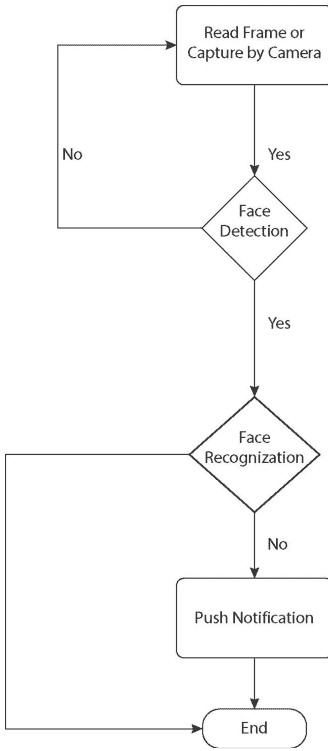

Figure 2.1 面部检测的框图。

“图2.1阐释了面部检测的复杂过程，概述了图像或视频流中精确识别的关键阶段和组件。它为面部检测的机制提供了宝贵的视觉洞察。”

### 5. HOG：

HOG是计算机视觉中一种用于对象识别和认知的特征提取方法。Dalal和Triggs于2005年首次提出它，此后它已成为计算机视觉领域的一种重要方法。

HOG技术通过检查图像中每个像素的梯度方向和幅度来生成梯度方向直方图。图像被划分为小单元，计算每个单元内每个像素的梯度方向和幅度，并将梯度信息汇总到梯度方向直方图中。

梯度方向直方图捕捉图像的局部结构和纹理，可用作对象识别和认知的特征描述符。HOG技术还包括一个归一化步骤，使描述符对光照和对比度的变化不敏感。与其他特征提取方法相比，HOG技术具有多种优势，包括能够捕捉图像中物体的形状和纹理，以及对尺度、方向和变形变化的抵抗力。它也计算效率高，可用于大型数据集和实时应用。HOG提供了广泛的计算机视觉应用，包括行人识别、面部检测和对象识别。它广泛应用于监控、自动驾驶汽车和机器人等领域，并在多种基准数据集上展示了最先进的性能。

## 2.5 面部表情

### 2.5.1 面部识别

面部识别技术是一种使用人脸特征来识别个人的生物识别系统。这项技术已存在很长时间，面部识别的首次研究可追溯到20世纪60年代。然而，21世纪的重大技术进步导致面部识别在各个行业广泛采用，包括安全、执法和营销。

在2000年代初，面部识别技术主要用于安全系统，如门禁控制和监控摄像头。这些系统使用特征脸识别，这是一种将人脸表示为数学模型并将其与已知人脸数据库进行比较的技术。系统随后会将捕获的人脸与数据库中的人脸进行比较，如果相似度超过一定阈值，则会产生匹配。

在2000年代初，面部识别技术的准确度有限，误阳性和误阴性情况相对常见。误阳性是指系统错误地将某人识别为匹配对象，而实际上并非如此；误阴性是指系统未能识别出实际是匹配对象的某人。

在2000年代初，面部识别技术的主要挑战之一是能够准确识别各种光照条件、角度和姿态下的人脸。为了解决这个问题，研究人员创建了更复杂的算法，即使面部部分被遮挡或背离摄像头时也能识别面部。

另一个问题是面部识别技术的使用引发的隐私和安全担忧。在2000年代初，人们担心面部识别可能未经人们同意或知情地用于追踪他们的行踪和活动。为了解决这些担忧，制定了限制在公共场所使用面部识别技术的法律和法规。在2000年代初，执法部门使用面部识别技术在刑事调查中识别嫌疑人。然而，该技术的准确性尚不足以作为逮捕或指控某人犯罪的唯一依据。

尽管存在局限性，面部识别技术在2000年代初仍为各种应用（包括安全、执法和营销）展示了显著的前景。随着技术的不断改进，面部识别技术的准确性和可靠性得到了显著提高，并在各个行业得到更广泛的采用 [12]。

综上所述，面部识别技术在2000年代初仍处于早期阶段，在准确性和隐私问题方面存在局限性。然而，它为各种应用展示了前景，并随着时间的推移不断改进，在各个行业得到更广泛的采用。

### 2.5.2 关于面部的信息

为了识别一个人，面部识别技术使用多个面部特征。然而，在准确性和可靠性方面，某些特征比其他特征更重要。在本说明中，我们将介绍面部识别中重要的一些面部特征。

- 1. 眼睛：眼睛之间的距离和眼眶的形状是重要的面部识别特征。这些特征经常作为图像中的参考点，用于定位和对齐面部。眼睛的重要特征（如虹膜和巩膜）也可用于生物识别。
- 2. 鼻子：鼻子的形状和大小也是重要的面部识别特征。鼻子可用于对齐面部，其轮廓可用于识别个人。
- 3. 嘴巴：嘴巴的形状和大小，以及嘴唇和牙齿的位置，都可用于识别人。这些特征可用于识别个人的面部表情，在检测情绪或欺骗方面很有用。
- 4. 下颌线和下巴：下颌线和下巴的形状和轮廓（特别是侧面视图）可用于识别个人。这些特征也可用于估计个人的年龄或性别。
- 5. 额头和发际线：个人额头和发际线的形状和大小可用于识别其身份，尤其是在面部部分被遮挡时。这些特征也可用于估计个人的年龄或性别。
- 6. 最后，面部识别技术使用多个面部特征来识别一个人。虽然所有特征都很重要，但在某些方面，有些特征更为关键。


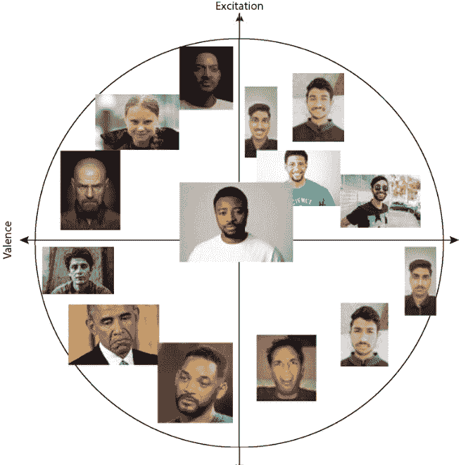

图 2.2 面部识别示例。

在准确性和可靠性方面优于其他方法。眼睛、鼻子、嘴巴、下颌线和下巴，以及额头和发际线，都是面部识别中的重要特征。

图 2.2 展示了涵盖不同面部表情的示例图像。这些图像作为面部识别的示例说明，突显了系统在不同情绪状态下识别独特特征的能力。该集合展示了该技术在现实世界应用中的多功能性和准确性。

### 2.5.3 算法

在身份识别和验证中，面部识别算法会分析和比较人脸图像。面部识别中使用了多种算法，各有优势和劣势。在本文中，我们将简要说明一些最常用的面部识别算法。

- 1. Eigenface 算法：该算法使用主成分分析（PCA）将面部表示为一组称为“特征脸”的基础图像的线性组合。该算法分析图像变化以识别面部识别中最重要的特征。然而，该算法对光照和姿态变化敏感，并需要大量训练数据。

- 2. Fisherface 算法：Eigenface 算法的一种扩展，它采用 Fisher 线性判别分析（LDA）来识别面部类别之间最具区分度的特征。该算法采用统计技术，在最大化类间分离的同时最小化类内变化。与 Eigenface 算法相比，该算法对光照和姿态变化更具抵抗力。

- 3. LBP：该算法通过将每个像素的强度与其邻居的强度进行比较来检查图像的纹理。基于比较结果，它生成一个二进制模式。该算法计算效率高，且对光照和姿态变化具有抵抗力。

- 4. 卷积神经网络（CNNs）：CNNs 是受人脑结构和功能启发的深度学习算法。CNNs 由多层互连节点组成，这些节点已被训练用于识别图像中的模式。该算法高度准确，能够处理复杂的光照、姿态和表情变化。

- 5. DeepFace 算法：这是 Facebook AI 研究团队开发的 CNNs 的特定实现。该算法在大型图像数据集上训练，以学习一组丰富的、对面部识别有用的特征。该算法高度准确，能够处理光照、姿态和表情变化。

最后，面部识别中使用了多种算法，各有其优势和劣势。某些算法比其他算法更计算高效，但其他算法则更准确或对光照、姿态和表情的变化更具抵抗力。所选算法将由特定应用和资源决定。

## 2.6 目标检测

### 2.6.1 对象跟踪

- 1. 对象跟踪是在视频片段中随时间查找和跟踪特定对象的技术。它是包括机器人、自动驾驶汽车和监控在内的各种应用中的关键组件。

- 2. 对于对象跟踪，本章将探讨传统技术和基于深度学习的方法。

- 3. 对象跟踪方法：对象跟踪方法包括均值漂移跟踪、基于检测的跟踪、使用核化相关滤波器（KCF）的跟踪以及使用深度学习的跟踪。

- 4. 均值漂移跟踪是一种成熟的对象跟踪技术，它通过围绕要跟踪的对象逐步移动窗口来最大化其相似性。均值漂移跟踪可以适应规模和方向的变化，但对遮挡和突发外观变化的抵抗力较弱。

- 5. 核化相关滤波器（KCF）：KCF 是一种传统的对象跟踪方法，它通过将目标对象的外观与核化模板进行相关性分析来工作。KCF 可以处理规模、方向和光照变化，但对遮挡和外观的快速变化抵抗力较弱。

- 6. 基于检测的跟踪是一种对象跟踪方法，它涉及使用对象检测器在视频序列的第一帧中找到目标对象，然后随时间使用跟踪器对其进行跟踪。检测器可以是任何对象检测算法，包括基于深度学习的对象检测器或 Haar 级联。跟踪器可以是任何对象跟踪算法，例如均值漂移跟踪或 KCF。

- 7. 基于深度学习的对象跟踪是训练神经网络来监控视频系列中特定对象的过程。通过在大量标注的视频序列数据集上训练，网络逐渐学会将目标对象与其外观相关联。与传统方法相比，基于深度学习的对象跟踪对遮挡和突发外观变化更具抵抗力，并能够处理规模、方向和光照的波动。

- 8. 对象跟踪的局限性和挑战：尽管对象跟踪技术取得了重大进展，但仍有许多问题需要解决。遮挡处理、外观的快速变化以及光照和位置的变化是其中一些示例。对象跟踪算法还需要快速和高效，以便在实时应用中使用。在接下来的章节中，将讨论对象检测和跟踪的集成，包括多对象跟踪以及复杂场景中的对象检测和跟踪 [13]。

图 2.3 使用浦那市政公司的一张图像演示了对象跟踪。该模型准确识别和跟踪对象，并使用边界矩形进行可视化。这突显了该模型在现实世界对象监控中的有效性。

在计算机视觉中，对象跟踪是指查找并跟踪由摄像机记录的一系列帧中移动对象的技术。尽管存在外观、光照、遮挡和其他挑战性情况的变化，目标是在视频的每一帧中跟踪物体的位置和轨迹。

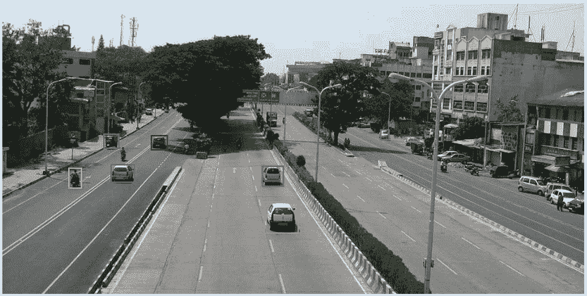

图 2.3 对象跟踪示例（图片：浦那市政公司）。

在计算机视觉中，对象跟踪有多种方法，包括：

- 1. 模板匹配是将当前视频帧与之前捕获的要跟踪对象的模板进行比较的过程。二进制掩码、边缘图或特征描述符可用作模板。
- 2. 光流：这包括跟踪图像中特征点的移动，以估计连续帧之间像素的迁移。
- 3. 卡尔曼滤波器是一种工具，用于使用一系列观测和预测来计算对象的位置和轨迹。
- 4. 深度学习方法使用已训练以理解要跟踪对象特征的神经网络，然后利用这些特征在一系列视频帧中识别对象。

监控、机器人、自动驾驶和增强现实只是对象跟踪的一些应用。这是一个困难的过程，涉及对多个元素的仔细考虑，包括物体的外观、其运动以及用于拍摄视频的摄像头的特征。

### 2.6.2 目标检测中使用的算法

在计算机视觉中，在图像或视频中发现和定位有趣对象的过程称为目标检测。在图像中识别具有不同尺寸、方向和位置的多个对象比对象跟踪更具挑战性。

以下是计算机视觉中一些流行的对象识别技术：

- (1) Haar 级联：该方法使用一组特征来识别照片中的对象。它涉及在大量目标对象的正样本和负样本上训练分类器。
- (2) HOG：该方法利用像素值的梯度方向信息从图像中提取信息。然后，它使用大量正样本和负样本数据集训练分类器，以使用这些属性识别对象。
- (3) 基于区域的卷积神经网络（R-CNN）：该方法通过融合深度神经网络和区域建议来识别图像中的对象。它涉及定位感兴趣区域，深度神经网络用于处理图像以确定它们是否包含对象。
- (4) 一次只看一次（YOLO）：该方法使用单个神经网络实时预测图像的对象类别和边界框。
- (5) 单射检测器：该算法通过混合各种大小的卷积特征图来识别对象。它与 YOLO 类似，但架构不同。


对象检测的艰巨任务需要仔细考虑多种因素，包括待识别对象的大小和复杂性、训练数据的数量和质量以及检测过程可用的计算资源。

## 2.7 实际场景中的人脸检测与识别

### 2.7.1 人脸检测

在数字图像或视频中查找和识别人脸的做法称为人脸检测。它在计算机视觉中起着关键作用，并具有多种实际用途，例如人脸识别、安全与监控以及数字图像处理。

人脸检测涉及以下主要步骤：

- 1. 图像获取：第一步是获取用于检测人脸的图像或视频帧。这可以通过使用摄像机、视频录像机或加载现有图像或视频文件来完成。
- 2. 预处理：对图像或视频帧进行预处理，以提高其质量并消除可能干扰人脸检测的任何噪声或伪像。这可以包括图像缩放、裁剪或平滑。
- 3. 人脸检测算法：随后将人脸检测算法应用于预处理后的图像或视频帧。人脸识别方法范围从简单的模板匹配到复杂的基于深度学习的系统。所选方法取决于应用程序的特定要求，例如精度、速度和鲁棒性。
- 4. 人脸验证：至关重要的是，要确保算法识别为包含人脸的图像区域确实是人脸，而非假阳性。可以通过进行额外测试来完成，例如查找眼睛、鼻子和嘴巴等面部特征，或使用分类器来区分人脸和非人脸。
- 5. 后处理：最后，对发现的人脸进行优化，以消除任何重复或重叠区域。这可能包括合并附近区域、更改边界框的大小或位置，或消除不满足特定标准的区域。

总体而言，人脸识别是一项艰巨的任务，需要仔细考虑多个要素，例如输入数据的质量和类型、所选算法以及用于增强结果的后处理技术。

人脸识别是计算机视觉中最常被利用的深度学习应用之一。深度神经网络用于在图片或电影中识别人脸。以下是使用深度学习进行人脸检测的主要过程：

- 1. 数据集准备：为训练深度学习模型，使用带有标记人脸的大量照片数据集。照片中的人脸位置、光照、情绪和遮挡应都有所变化。
- 2. 对于人脸识别，可以使用卷积神经网络（CNN）、区域卷积神经网络（R-CNN）、单发多框检测（SSD）和你只看一次（YOLO）等深度神经网络架构。每种架构都有其优缺点，选择取决于应用程序的特定要求。
- 3. 模型训练：使用带注释的图像集训练深度学习模型。在训练阶段，会修改网络参数，以减少网络预期输出与图像实际标签之间的差异。
- 4. 模型测试：使用特定的图像集来测试训练好的模型的性能。通过将模型的预测结果与图像的真实标签进行对比来评估其准确性。
- 5. 模型微调：通过修改模型参数来对其进行微调，以提高其在测试集上的准确性。这可能包括更改网络设计、添加额外层或修改训练设置。
- 6. 训练完成后，深度学习模型可用于在新图像或视频中识别人脸。程序通过检测眼睛、鼻子和嘴巴等面部特征来区分照片中的人脸。接下来，它在每个识别出的人脸周围生成一个边界框，以便进行进一步处理或分析。
- 7. 基于深度学习的人脸识别有多种应用，包括人脸识别、安全与监控以及数字图像处理。为了在实际场景中获得高准确性和强健性能，需要仔细选择网络设计、训练数据和训练参数。

### 2.7.2 实际场景中的人脸检测与识别

人脸检测与识别已成为现实世界安全和监控应用中至关重要的技术。然而，为了确保在这些应用中实现准确可靠的性能，必须解决各种障碍和限制 [14]。

在实际场景中遇到检测与识别的限制和困难：现实世界中人脸识别与辨识的主要问题包括光照、位置和遮挡的变化。由于光照变化，人脸可能会发生显著变化，导致难以识别和辨识。姿态调整也会对人脸外观产生相当大的变化，使其难以与参考人脸进行比较。人脸检测和识别还可能受到帽子、围巾和太阳镜等遮挡物的阻碍。

针对姿态、光照和遮挡变化的调整技术：存在多种方法来解决实际场景中人脸检测与识别的问题。在处理光照波动时，可以使用直方图均衡化和对比度拉伸等技术来均衡图像的光照。在处理姿态差异时，可以使用3D人脸建模和姿态归一化等技术将人脸转换为标准姿态。在处理遮挡时，可以使用部分人脸识别和多模式人脸识别等技术，即使面部部分被遮挡也能识别人脸。

人脸识别与检测在监控与安全领域的应用：人脸检测与识别已成为包括法医分析、边境管控和访问控制在内的多个领域中重要的安全与监控技术。人脸识别可用于根据面部特征识别人员，而人脸检测可用于在拥挤区域检测和监控人员。这些技术已成功应用于众多现实场景，例如执法、机场安保和金融欺诈检测。

在计算机视觉中，有两个相关但不同的任务，称为人脸检测和人脸识别。

人脸检测是在数字图像或视频中识别并定位人脸的过程。它涉及查看图片或视频帧，以判断其中是否有人脸及其所在位置。人脸检测算法通常会在每个识别出的人脸周围创建一个边界框，以便进行处理或进一步检查。

另一方面，从已知人脸数据库中识别特定人员的方法称为人脸识别。它涉及通过将人员的面部特征与一组参考人脸进行比较来识别该人。人脸识别算法经常使用机器学习技术来构建每个人最独特面部特征的模型。然后，这些算法使用该模型来比较和匹配新人脸的特征。

换句话说，人脸识别的过程始于人脸检测。在识别人员之前，会先执行人脸检测以定位并区分该人的人脸与周围背景。人脸识别算法可以识别人脸，然后将其特征与数据库中的特征进行比较，以确定其归属。

尽管人脸检测和识别是可比的任务，但它们的目标不同，并采用各种方法来实现这些目标。人脸识别识别与特定人脸关联的具体人员，而人脸检测识别图像或视频中人脸的存在和位置。

图 2.4 全面展示了实际场景中的人脸检测与识别。它展示了输入过程、先进算法和无缝操作，使其对实际应用具有价值。

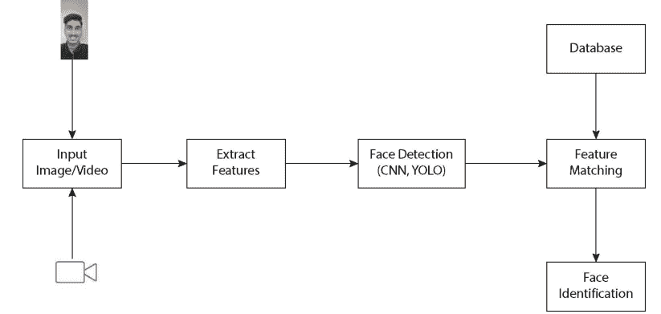

图 2.4 实际场景中的人脸检测与识别框图。


总而言之，人脸检测和识别技术对现实世界中的安全和监控应用至关重要。尽管存在挑战和限制，但有多种方法可以解决这些问题，提高这些技术的准确性和可靠性。随着技术的发展，人脸检测和识别预计将在一系列现实世界应用中更频繁地出现。

## 2.8 目标检测与跟踪的未来方向

### 2.8.1 目标跟踪与检测的未来计划

目标检测和跟踪近年来取得了重大进展，并且预计在未来将继续取得进展。该领域的一些可能未来发展如下：1. 基于深度学习的方法：

在目标检测和跟踪中，采用了多种广受欢迎的基于深度学习的技术，包括：

- 卷积神经网络（CNNs）：CNNs是一种擅长处理图像任务的神经网络类型。其工作原理是向输入图像应用滤波器，以便在不同尺度和位置提取特征。CNNs已被证明在基准数据集上能产生最先进的结果，并经常用于目标检测和跟踪应用。
- 循环神经网络（RNNs）：RNNs是一类神经网络，特别适用于需要处理事件序列的任务（包括视频处理）。通过存储连续帧之间的时间依赖性，RNNs可用于目标跟踪。
- R-CNNs，即基于区域的卷积神经网络：R-CNN是一种神经网络，其工作原理是首先生成一系列区域建议（即输入图像中物体的潜在位置）。在从每个区域建议中提取特征后，网络将每个区域分类为物体或背景。已证明R-CNNs在高精度的目标检测任务中表现出色。
- YOLO：这款著名的实时目标检测算法通过将输入图像划分为单元网格，预测每个单元的边界框和类别概率。YOLO的高精度和快速推理时间已得到证实，使其非常适合实时应用。

尽管基于深度学习的算法已经显著改善了目标检测和跟踪，但未来仍有许多改进机会。以下是基于深度学习的目标识别和跟踪方法的一些潜在未来方向：

- 提高有效性：由于计算复杂性，基于深度学习的模型在实时应用中的实施成本可能较高。未来研究可能会关注更有效的深度学习架构，例如轻量级模型或可在低功耗硬件上运行的模型。
- 提高准确性：基于深度学习的模型在目标检测和跟踪中取得了出色的效果，但仍有改进空间。未来研究可能会关注建立新的损失函数、正则化方法或优化策略，以提高深度学习模型的准确性。
- 多模态融合：基于深度学习的模型可以在多种数据模态上进行训练，例如图像、视频或LiDAR数据。未来研究可能会关注开发能够有效融合这些模态的模型，以提高目标检测和跟踪性能。
- 抗域偏移鲁棒性：基于深度学习的模型可能对数据分布的变化敏感，这使得它们在输入数据可能与训练数据不同时不够可靠。开发无监督域自适应或元学习等技术，以提高深度学习模型对域变化的鲁棒性，可能是未来研究的主要目标。
- 可解释性：由于基于深度学习的模型难以解释，因此很难理解它们如何做出决策。开发注意力机制或可视化等技术，以使基于深度学习的模型更加透明和易于理解，可能是未来研究的主要目标。

基于深度学习的目标检测和跟踪算法具有广泛的未来应用潜力。该领域的进一步研究和发展可能会显著提高这些方法的准确性、有效性和鲁棒性，从而增加其在现实世界应用中的实用性。

#### 2.8.1.1 多目标跟踪

多目标跟踪是指在视频序列中随时间跟踪多个对象的过程。与专注于在整个视频序列中跟踪单个感兴趣对象的单目标跟踪不同，多目标跟踪涉及同时跟踪多个项目。由于遮挡、对象外观变化和对象交互等问题，多目标跟踪是一个困难的过程 [15]。

多目标跟踪有多种方法，例如：

- 基于检测的跟踪：在这种方法中，首先使用目标检测器在每一帧中识别对象，然后在不同帧的识别结果之间建立关联以创建轨迹。该方法经常用于多目标跟踪，并已被证明在基准数据集上产生最先进的结果。
- 在线跟踪：这种方法涉及在新帧到达时实时跟踪对象。在线跟踪算法必须快速高效，以便在实时应用中运行。
- 数据关联：通过使用数据关联跨帧链接检测结果来创建轨迹。解决数据关联问题（有时表述为优化问题）是多目标跟踪中的关键步骤。
- 基于深度学习的技术：基于深度学习的方法（特别是在对象外观随时间显著变化的情况下）在多目标跟踪中显示出有希望的结果。在这些方法中，深度神经网络通常被训练为直接从输入数据预测对象轨迹。

多目标跟踪研究仍在进行中，这项技术在未来有很多有前景的应用。以下是一些可能的未来方向：

- 提高准确性：准确地在帧之间关联检测结果是多目标跟踪中的主要问题之一，特别是在存在遮挡和繁忙场景的情况下。未来工作可能集中于创建更强大的算法，以处理这些困难情况并提高跟踪精度。
- 实时性能：许多现实世界应用（包括自动驾驶）都需要实时性能。开发即使在低功耗设备上也能实时运行的更有效算法可能是未来研究的主要目标。
- 对象交互建模：在许多场景中，对象之间相互交互，这会使跟踪变得更加困难。未来研究可能集中于开发能够有效处理对象交互并在这些场景中提高跟踪精度的模型。
- 多模态跟踪：多模态跟踪涉及跨不同传感器模态（例如摄像头和激光雷达）跟踪对象。未来研究可能集中于开发能够融合多种传感器模态数据的算法，以提高跟踪精度。
- 隐私保护跟踪：随着隐私问题的日益增长，可能会更加关注开发隐私保护跟踪算法，这些算法可以在不存储或传输敏感数据的情况下运行。

多目标跟踪是一个快速发展的领域，未来研究和开发有许多令人兴奋的可能性。随着这些技术的进步，它们有可能在机器人、监控和自动驾驶等行业开辟新的应用。

### 2.8.2 3D目标跟踪与检测

三维定位和跟踪物体的过程涉及使用传感器数据，通常来自深度相机或激光雷达。3D目标检测和跟踪使用3D点云数据，而2D目标检测和跟踪使用2D图像数据。3D目标识别和跟踪有几种方法，例如：

- 点云分割：使用这种技术，将3D点云分割成不同的对象，然后根据其特征对每个项目进行分类。三维卷积神经网络（CNNs）和


手工创建的特征，如形状描述子和方向梯度直方图（HOG），是常用的特征提取方法。

- 物体检测与跟踪：在此方法中，对象在3D点云的每一帧中被找到，然后将检测结果链接在一起以创建轨迹。2D物体识别与跟踪中使用的基于检测的跟踪方法与此策略类似。

- 多传感器融合：为了提高3D物体检测和跟踪的精度，多传感器融合包括结合来自多个传感器（例如激光雷达和摄像头数据）的数据。早期融合（在传感器级别合并数据）、中级融合（在特征级别合并数据）和晚期融合（在决策级别合并数据）都是融合技术。

随着3D物体识别与跟踪领域的快速发展，这项技术在未来有许多引人入胜的潜在应用。以下是一些可能的未来方向：

- 更高精度：在复杂动态环境中准确定位和跟踪对象是3D物体识别与跟踪的主要难点之一。未来研究可能集中于开发更强健的算法，以应对这些挑战性场景并提升检测和跟踪精度。

- 实时性能：许多实际应用（包括机器人和自动驾驶）都需要实时性能。未来研究的主要目标可能是开发更高效的算法，这些算法即使在低功耗设备上也能实时运行。

- 多对象跟踪：多对象跟踪是3D物体检测与跟踪的关键组成部分，与2D物体跟踪类似。未来研究的主要目标可能是开发能够在实时中成功跟踪多个对象的算法，尤其是在繁忙复杂的场景中。

- 传感器融合：提高3D物体检测与跟踪的精度需要使用传感器融合，具体是结合来自多种传感器模式的数据。更好的融合算法以及集成更多传感器以提升性能，可能是未来研究的主要方向。

- 无监督学习：无监督学习方法（尤其是自监督学习）在2D物体检测与跟踪中已显示出相当大的潜力。未来，无监督学习可能应用于3D物体检测与跟踪，尤其是在标注数据稀缺的场景中。

3D物体检测与跟踪是一个活跃的研究领域，拥有广泛的前景发展方向。随着这些技术的进步，它们有望在机器人、增强现实和自动驾驶等行业开辟新的应用。

### 2.8.3 实时性能

实时性能是指系统处理数据并产生结果而不产生任何可感知延迟的能力。对于许多应用（包括自动驾驶、机器人和监控），及时的物体检测和跟踪对于安全成功的运行至关重要，因此在物体检测和跟踪的语境中，实时性能必不可少。

系统每秒处理的帧数（即帧率）是评估实时性能的常见方法。例如，每秒处理和分析30帧视频的系统，对于大多数应用来说相当于实时性能。

实时物体检测和跟踪可能很难实现，尤其是在处理大量数据集、复杂算法和受限计算能力时。开发人员可能需要调整算法以实现实时性能，并利用专用硬件（包括图形处理单元（GPU）和现场可编程门阵列（FPGA））来加速处理。

对实时物体识别和跟踪性能的需求正在快速增长，有许多令人兴奋的未来机会来提升实时性能。以下是一些可能的未来方向：

- 硬件加速：使用专用硬件（如GPU和FPGA）已经在物体检测和跟踪的实时性能方面取得了显著提升。硬件制造和设计的未来发展可能会产生更高效、更强大的硬件，提升处理速度并降低延迟。

- 算法优化：尽管当前的物体检测和跟踪算法已经非常优化，但仍有改进空间。未来研究可以集中于开发既更准确又更高效的算法，这些算法能够在低功耗设备上实时运行。

- 边缘计算：通过在本地而非云端处理数据，边缘计算有望大幅降低延迟并提升实时性能。未来可能会探索在物体识别和跟踪应用中使用边缘计算，尤其是在快速响应至关重要的场景中。

- 混合方法：结合深度学习和传统计算机视觉技术等多种技术，以创建混合方法，在获得高精度和实时性能方面已显示出潜力。未来可能会研究更高效的物体识别和跟踪混合技术。

- 多模态数据融合：融合来自多个传感器（例如摄像头、激光雷达和雷达）的数据对于准确且鲁棒的物体检测和跟踪至关重要。未来研究可能会探索新的多模态数据融合技术，以提升实时性能，尤其是在困难环境中。

提升实时物体识别和跟踪性能是一个重要的研究领域，拥有许多未来发展的机会。随着这些技术的发展，它们有望开辟新的应用，并提升各行各业的效率和安全性。

## 2.9 结论

计算机视觉中的关键领域——物体识别和跟踪，特别是人脸检测和识别——近年来取得了重大进展。特别是卷积神经网络在深度学习方面取得了巨大进步，提高了人脸检测和识别系统的精度和速度。

尽管哈尔级联等传统计算机视觉方法仍然有用，但基于深度学习的方法提供了更高的精度和灵活性，特别是对于实时应用。新评估指标（如人脸检测数据集与基准（FDDB）和野外标注人脸基准（LFW））的引入，使得对各种人脸检测和识别系统进行更好的比较和评估成为可能。

基于深度学习的系统很可能会因网络架构、训练技术和优化算法的进步而继续进步。多对象跟踪和3D物体检测与跟踪的研究也在进行中，这些领域的进步对于机器人、自动驾驶汽车和监控系统等领域至关重要。

对于视频监控和机器人等要求快速且精确的物体检测和跟踪的应用，实时性能将继续是一个主要关注点。这些应用的实时性能将需要开发更有效的硬件、算法和优化技术。

无监督学习为从大型复杂数据集中提取新信息和理解提供了迷人的机会。聚类算法的改进、增强的降维方法，以及生成模型和无监督强化学习的提升，将实现新的机器学习应用和进步。

归功于基于深度学习方法论的发展和新评估指标的引入，物体检测和跟踪（特别是人脸检测和识别）近年来取得了重大进展。随着深度学习、多对象跟踪、3D物体检测与跟踪、实时性能和无监督学习的持续进步，这些领域的潜力非常有前景。这些进步将为计算机视觉和机器学习的新突破，以及机器人、自动驾驶汽车和监控系统等领域的重大应用铺平道路。

多年来，物体检测和跟踪取得了重大进展，特别是在人脸检测和识别的语境下。深度学习和其他现代技术使得以前所未有的速度和精度识别和跟踪对象成为可能。此外，由于创建了人脸检测数据集与基准（FDDB）和野外标注人脸基准（LFW）等评估指标，现在比较和评估各种人脸检测和识别系统也更加简单。

深度学习是近年来人脸检测和识别进步的主要因素。与哈尔级联等传统计算机视觉方法相比，特别是卷积神经网络在精度和速度方面表现出显著改进。基于深度学习的技术适用于多种


应用，包括实时性能和多目标跟踪，因为它们的灵活性和适应性。

尽管基于深度学习的人脸检测和识别方法已经取得了巨大进步，但仍有很大的改进空间。研究人员正在积极开发更好的网络设计、优化算法和训练技术，旨在提高这些系统的精度和速度。此外，随着计算机硬件的发展，例如专用处理单元（如 GPU）的创建，越来越复杂且要求苛刻的模型将能够实时运行。

另一个活跃的研究领域是多目标跟踪，它涉及在场景中识别和跟踪众多项目。多目标跟踪有多种应用，从监控道路交通到公共场所的监控。由于场景的复杂性、高精度要求以及对实时性能的需求，这仍然是一项艰巨的任务。循环神经网络和注意力机制这两项深度学习的最新进展，在提高多目标跟踪系统的精度和速度方面显示出前景。

另一个活跃的研究领域涉及在 3D 环境中查找和跟踪物体。这称为 3D 物体检测和跟踪。这在机器人和自动驾驶等行业有重要应用，在这些行业中，精确且即时的 3D 物体跟踪至关重要。得益于 LiDAR 和其他传感器技术的进步，获取 3D 数据的能力最近有所提高，而基于深度学习的技术（如 3D CNN 和点云）在提高 3D 物体检测和跟踪系统的精度和速度方面也显示出前景。

特别是在需要快速且精确的检测和跟踪的应用中，例如监控系统和机器人，实时性能继续是目标检测和跟踪的主要关注领域。实时性能除了需要有效的算法外，还需要最佳的硬件和软件。得益于 GPU、FPGA 和 ASIC 等专用硬件的最新进展，复杂的深度学习模型现在可以实时执行。

## 参考文献

- 1. Wang, Y., Sakhi, O., Ayadi, A.E., Hagen, M., Afshar, E., 计算机视觉：对象分割方法深入探讨，载于：*第 26 届 ACM SIGKDD 知识发现与数据挖掘国际会议论文集*，2020 年 8 月，pp. 3517–3518。
- 2. Harjoko, A., Candradewi, I., Bakhtiar, A.A., 智能交通监控系统：使用 Haar 级联分类器和光流进行车辆检测、跟踪和计数，载于：*国际视频与图像处理会议论文集*，2017 年 12 月，pp. 49–55。
- 3. Kang, K., 人脸识别和检测模型比较：使用不同的卷积神经网络。*Opt. Mem. Neural Netw.*, 28，101–108，2019。
- 4. Chumuang, N., Hiranchan, S., Ket cham, M., Yimyam, W., Pramkeaw, P., Jensuttiwechakult, T., 基于尺度不变特征变换的公共交通服务人脸检测系统，载于：*2020 年第 15 届人工智能与自然语言处理国际联合会议 (iSAI-NLP) 论文集*，2020 年 11 月，IEEE，pp. 1–6。
- 5. Zhang, Y., Chen, Z., Wei, B., 基于深度 SORT 和 YOLO V4 的运动运动员对象跟踪（摄像头移动情况下），载于：2020 IEEE 第 6 届计算机与通信国际会议 (ICCC)，2020 年 12 月，IEEE，pp. 1312–1316。
- 6. Simbolon, H.F.S. 和 Sirait, P., 双三次插值对 viola-jones 和主成分分析在人脸及头盔佩戴者检测中的影响，载于：2020 年第 3 届机械、电子、计算机与工业技术国际会议 (MECnIT)，2020 年 6 月，IEEE，pp. 158–164。
- 7. Niaraki, R.J. 和 Shahbahrami, A., 基于局部中位二进制模式共现矩阵的人脸识别系统精度提升，载于：2019 年第 4 届模式识别与图像分析国际会议 (IPRIA)，2019 年 3 月，IEEE，pp. 141–144。
- 8. Wahyuningsih, D., Kirana, C., Sulaiman, R., Eigenface 和 Fisherface 算法在人脸识别过程中的性能比较，载于：2019 年第 7 届网络与 IT 服务管理国际会议 (CITSM)，2019 年 11 月，第 7 卷，IEEE，pp. 1–5。
- 9. Jagtap, A.M., Kangale, V., Unune, K., Gosavi, P., 基于 OpenCV 的 LBPH、Eigenface、Fisherface 和 Haar 类特征用于人脸识别的研究，载于：2019 年智能可持续系统国际会议 (ICISS)，2019 年 2 月，IEEE，pp. 219–224。
- 10. Liang, X., Zhang, J., Zhuo, L., Li, Y., Tian, Q., 使用特征融合和带有空间上下文分析的缩放单射检测器进行无人机图像小目标检测。IEEE Trans. Circuits Syst. Video Technol., 30，6，1758–1770，2019。
- 11. Nguyen, N.D., Bui, D.H., Tran, X.T., 基于 HOG-SVM 协同优化的人体检测新型硬件架构，载于：2019 年 IEEE 亚太电路与系统会议 (APCCAS)，2019 年 11 月，IEEE，pp. 33–36。
- 12. Li, Q., 基于人脸识别应用的改进人脸检测方法，载于：2019 年第 4 届亚太智能机器人系统会议 (ACIRS)，2019 年 7 月，IEEE，pp. 260–264。
- 13. Pal, S.K., Pramanik, A., Maiti, J., Mitra, P., 多目标检测与跟踪中的深度学习：现状。Appl. Intell., 51，6400–6429，2021。
- 14. Zam, A., Khayyambashi, M.R., Bohlooli, A., 无线视觉传感器网络中人脸检测与识别的节能方案。Appl. Soft Comput., 89，106014，2020。
- 15. Patil, A., Malla, S., Gang, H., Chen, Y.T., h3d 数据集：用于拥挤城市场景中全方位 3D 多目标检测与跟踪，载于：2019 年机器人与自动化国际会议 (ICRA)，2019 年 5 月，IEEE，pp. 9552–9557。

# 利用 3D 技术打印器官

**Shaik Aminabee**

V. V. 制药科学学院药理学系，Gudlavalleru，Krishna 地区，A.P，印度

## 摘要

器官短缺是一个广为人知的全球卫生问题。3D 打印技术的发展长期以来被视为解决器官短缺问题的潜在方案。使用合适的生物墨水，3D 打印机可以创建生物细胞、组织甚至器官。打印器官所用的技术的工作方式与标准 2D 桌面打印机类似。通过分层涂布墨水来实现这一点。这一过程会持续进行，直到获得所需形状。然而，这种机器使用的是生物墨水进行打印，而不是普通的 3D 打印机。这种生物墨水由仍然存活的人体细胞组成。皮肤移植和外科模型是这种新型 3D 打印技术的两个医学应用。然而，这是他们第一次成功制造出可用于移植的器官。与经常产生不可靠结果的动物实验不同，这项技术可以帮助研究真实人体上的药物相互作用。对于目前依赖捐赠者或人工植入物的肝病或肾病患者来说，这项技术具有巨大的潜力。对于有需要的患者，3D 打印技术目前正被用于制造功能正常的移植器官，并且未来几年只会变得更好。膀胱是唯一成功 3D 打印并植入人体的器官。该膀胱是使用宿主膀胱组织制成的。一些研究人员认为，定制器官以适应受体的能力是 3D 打印器官的潜在优势。然而，反对者认为该技术仍处于早期阶段，3D 打印器官不如天然器官好。他们还担心在实验室培育器官的伦理影响。

**关键词：** 3D 打印机，移植，复杂产品，批评者

## 3.1 引言

身体修复和替换受损组织的能力是与生俱来的。然而，再生能力是有限的，并且各种过程在起作用（组织类型或生长激素）。超过一定大小后，严重的组织损伤需要外部支持或器官移植。由于人口老龄化、更多疾病或事故导致器官丢失的风险以及其他因素，器官或组织捐赠者的可用性至关重要。尽管科学在缩小这一差距方面取得了重大进展，但


开启自体和异体组织移植之门的同时，缺乏捐赠者继续是一大障碍。全球每年有大量患者在等待合适捐赠者的过程中死亡。这是因为，等待名单上的受者（候选人）数量仍远多于捐赠者或移植手术数量 [1]。2017 年，UNOS 和美国政府器官捐献与移植信息报告指出，每天约有 20 人因缺乏可用于移植的器官而死亡。仅 0.3% 的死亡病例需要器官捐献。即使找到合适的捐赠者，患者仍面临重大障碍，例如高昂的移植费用和免疫原性排斥的风险。

“增材制造”一词是三维（3D）打印（AM）的另一个名称。它是一种从数字数据创建任何形状三维实体模型的方法。在科学领域，医疗 3D 打印长期以来一直是个天方夜谭。Hull CW 于 20 世纪 80 年代提交了最初的 3D 打印专利。通过在彼此之上叠加连续层的基础材料，可以生产出任何物体的 3D 打印件 [2]。从那以后，3D 打印对包括制造业、工程和医学在内的多个行业产生了影响。

近年来，组织再生这一曾被视为时髦概念的想法已获得显著普及。组织工程（TE）和再生医学（RM）等新术语的出现可归因于这一趋势。组织工程是一门结合生物学原理和工程技术的领域，专注于受损组织的替代。通过 3D 生物打印方法制造的支架足够坚固，既能物理支撑新创建的组织，又能支持细胞接触 [3]。研究发现，在 3D 生物打印支架中加入干细胞，对制造替代组织具有极佳潜力。

3D 打印技术通常使用粉末、塑料、金属、液体甚至活细胞。由于组件可以集成或沉积到基底上，该技术能高度适应特定要求。该过程精确、经济且可重复，从而能可靠地实现定制组织的制造。此外，它为学者、工程师和医生提供了合作机会，可从通过互联网下载和传输的数字文件创建出真实产品 [4]。

3D 生物打印在医学领域的应用已成为不可或缺的手段，可用于为人类和动物生产各种组织和器官，以及用于诊断和教育目的的手术植入物和解剖模型。本研究旨在全面综述 3D 打印技术在医学领域的应用，包括讨论当前的研究趋势及其对医疗行业的影响。

## 3.2 三维（3D）生物打印

打印模型必须完成五个技术流程。第一步是确定目标区域的解剖结构。随后，结构数据经过磁共振成像（MRI）或计算机断层扫描（CT）以生成 3D 几何模型。生成的文件将为实际打印做准备。接着，仔细选择合适的 3D 打印机和组件。为构建模型的分层切片，对文件进行额外处理。然后将这些部分馈送到打印机中进行打印。首先打印初始层，然后逐层添加更多层，直到整个模型成型。

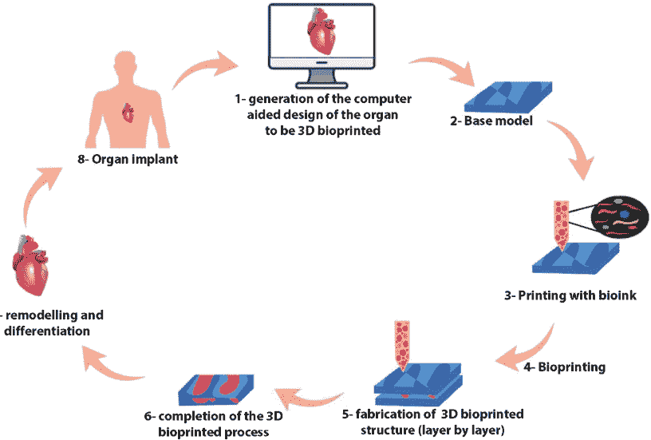

图 3.1 器官 3D 生物打印工作流程概览。

3D 生物打印过程如图 3.1 所示。首先，确定目标区域的解剖结构作为流程的第一步。随后，3D 几何文件经过精细处理，为实体打印做准备。接着，仔细选择合适的 3D 打印机和组件，并使用所选设备打印支架。

## 3.3 3D 打印类型

打印行业随着时间的推移经历了显著进步，导致各种 3D 打印技术在研究和商业应用中得到采用 [5]。一些知名的 3D 打印技术包括熔融沉积成型（FDM）、立体光刻、微挤出、喷墨打印、选择性激光烧结（SLS）、激光束熔化、电子束熔化、数字激光打印（DLP）和聚射打印 [6]。此外，生物打印系统利用多种方法，如射频/微波、声学（基于超声）、气动技术和电液动力学（EHD），来生产组织和器官。喷墨打印、激光辅助打印、挤出打印和立体光刻是一些常用的生物打印技术，后续章节将对每种方法进行简要说明。

### 3.3.1 喷墨生物打印

喷墨打印是最早的增材制造（AM）技术之一 [7]。简单来说，墨水通过一个加压腔，然后从一个孔隙释放出液滴（图 3.2a），在此过程中墨水发生反应。目前，喷墨液滴挤出使用三种基本方法：热喷墨、压电喷墨和静电喷墨。其中，热喷墨和压电喷墨是结构制造中最常用的两种 [8]。由于局部加热产生的气泡强烈压力，热喷墨打印机会将墨滴从喷嘴中喷出。喷墨打印的三大优点是高速、易得和价格实惠。另一方面，主要缺点是依赖低粘度生物墨水，以及液滴尺寸和定位精度不足。热喷墨打印机也容易堵塞。

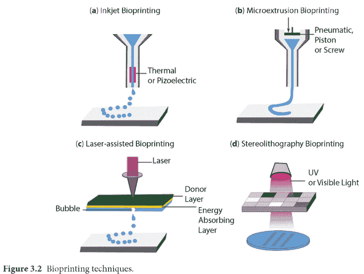

### 3.3.2 微挤出生物打印

挤出生物打印涉及将粘稠的生物墨水通过一个小开口挤出，形成连续的圆柱形线条，并将其打印到基底上。挤出生物打印分为两种类型，即机械式或气动式，具体取决于用于挤出生物墨水的气动或机械螺杆柱塞的类型（图 3.2b）。挤出生物打印系统可以容纳不同粘度的生物墨水，并且挤出速度、工艺和沉积位置均可根据需要进行修改 [9]。直写系统或生物绘图基于挤出生物打印，可使用细胞、细胞包埋基质和聚合物作为材料。

### 3.3.3 激光辅助打印

激光辅助生物打印机基于激光直写技术，主要使用光聚合技术打印生物材料。该方法可以在保持细胞活力的同时打印多种多样的细胞 [10]。脉冲激光源将聚焦工具指向吸收激光能量的金属带状薄膜和接收基底（见图 3.2c）。打印时，激光聚焦在涂有薄层金和钛纳米颗粒的带状薄膜顶部玻璃层上。随着该层蒸发，底部形成气泡，将悬浮的生物墨水液滴释放到接收基底上。激光辅助打印不受喷嘴限制，因此适用于包括水凝胶、陶瓷、环氧基光刻胶 SU-8、细胞包埋材料和细胞在内的多种材料 [11]。该技术具有多项优势，包括高精度、能够打印高粘度材料以及高细胞密度。然而，它与高成本和漫长的工艺相关。

挤出生物打印具有多项优势，例如能够处理高细胞密度、容纳多个打印头以使用多种生物墨水满足复杂的打印要求，并能轻松处理高粘度生物墨水。另一方面，挤出生物打印程序的一个显著缺点是细胞在通过微小打印头时会发生细胞结构破坏。

### 3.3.4 立体光刻

激光辅助生物打印工艺与立体光刻可比。立体光刻打印通过使用紫外光逐层选择性固化感光聚合物来创建复杂结构。器官结构被转换为与 MRI 和 CT 扫描图像相对应的立体光刻文件（图 3.2d）。结构被分成薄层后，即可逐层打印。在立体光刻中，要创建 3D 打印结构，一旦下层因光照而固化，则会将相应的顶层叠加在一起 [12]。

立体光刻的两大主要优点是制造精度提高和打印速度快。另一方面，立体光刻的一些显著局限性包括使用强烈的紫外光、需要耗时的后处理工序以及兼容材料的可用性有限 [13]。

### 3.3.5 3D 生物打印材料和细胞

为确保生物打印材料不需要额外手术即可移除植入物，使用无细胞毒性、可打印且可生物降解的生物材料至关重要。此外，打印材料必须足够坚固，以支撑和培育种植的细胞。此外，用于打印的生物材料应促进细胞粘附、成熟、迁移、增殖和分化 [14]。

可将生物聚合物、生物材料、因子和细胞/组织三个组成部分简要地分开。总而言之，生物材料支架可以由天然聚合物或合成聚合物制成。虽然天然聚合物通常为细胞提供更稳定的

微环境和更佳的生物相容性，它们通常具有较差的打印性能 [15]。生物打印中常用的天然聚合物包括明胶、藻酸盐、胶原蛋白、透明质酸（HA）、壳聚糖和琼脂糖。另一方面，合成聚合物（如聚乙二醇（PEG）和水凝胶）与天然聚合物具有相似的化学和机械性能。水凝胶能够吸收大量生物液体，且在膨胀时因其柔软和富有弹性的外观而能模拟活体组织。由于水凝胶具备在允许营养和氧气运输的同时提供足够免疫隔离的卓越能力，因此可成为组织移植的关键组成部分 [16]。此外，合成聚合物在机械性能方面通常优于天然聚合物。与天然聚合物相反，合成聚合物同样为细胞功能提供很少或不提供生态位。另一方面，天然聚合物具有良好的细胞活力、改善的细胞间连接以及功能性组织。

生物打印要求将相关生物材料精确且有序地放置在细胞上，以创建高度仿生的天然组织。生物打印细胞周围的微环境必须复制体内存在的生理条件，以使细胞能够承担其体内角色。对于组织创建，需要多种细胞类型来执行不同功能。在打印各种细胞类型以创建复杂组织时，可以准确地将细胞定位于各自的位置，或在同一或不同的水凝胶中同时接种不同细胞类型 [17]。此外，研究人员已探索直接用干细胞接种支架，且干细胞分化可通过生物墨水添加剂、培养条件或打印过程中的应力来诱导。未分化的干细胞还可作为组织移植后防止移植物排斥的手段，因为它们不会引发免疫反应。

此外，在组织制造过程中，各种生物分子（称为因子）可用于同时控制打印构建体中细胞的增殖、分化和迁移 [18]。这些因子包括酶、生长因子、多核苷酸、多肽和多糖。

## 3.4 3D 打印在细胞中的应用

### 3.4.1 血管

对于寻找受损或缺失身体部位替代器官的患者，组织工程在创建具有生理相关性和功能活性的器官方面充满巨大希望。特别是，循环系统对器官的生存至关重要。为了开发功能性的生物打印血管系统，研究人员已调查了多种方法 [19]。例如，一支研究团队于 2016 年利用人微血管内皮细胞、纤维蛋白生物墨水和一款经过改造的商用喷墨生物打印机，打印了一种微血管结构。血管生物打印的主要挑战仍然是细胞存活。尽管如此，热喷墨生物打印机在细胞存活和打印效果之间提供了最佳的折中方案。成功的交联方法对于优化组织的物理性能、细胞存活以及加快打印过程至关重要。合适的水凝胶除了能提高细胞活力外，还能帮助促进细胞铺展和增殖。另一支研究团队能够创建去细胞化的细胞外基质和带有细胞层的厚预血管化组织（dECM）。该组织还具有许多不同尺寸的血管分支 [20]。研究人员还表示，即使在体外条件下培养 48 小时后，细胞活力和结构完整性也得到了保留。

在最近的一项工作 [21] 中，一种由可光交联明胶甲酰丙烯酸酯（GelMA）与多种细胞类型结合而成的生物墨水，用于模拟原生血管细胞的组成，在体外产生了高细胞存活率（>85%）。这些生物打印的血管结构与宿主循环系统融合，并被证明具有功能。此外，体内皮下移植显示，打印的血管结构中包含红细胞。这项积极的研究表明了在临床环境中使用生物打印血管的潜力。除了细胞存活外，生物打印血管的尺寸对于其有效运行仍然至关重要。2009 年，一支研究团队开发了一种完全生物性的自组装技术，用于无支架小尺寸（外径：0.9 至 2.5 毫米）血管重建 [22]。该技术通过快速原型生物打印过程实现。

另一组 [23] 还报道了利用基于聚乙二醇二丙烯酸酯（PEGDA）和藻酸钠的水凝胶进行主动脉瓣生物打印。这些支架的内径范围为 12 至 22 毫米，猪主动脉瓣间质细胞附着其上并穿过其中。牺牲纤维（如 Pluronic F127）是几家研究设施正在开发的一种新型纤维，可用于创建流体通道。此类纤维除了有助于创建血管图案外，还能加快打印速度 [24]。

### 3.4.2 肝脏

肝纤维化是一项重大的医学挑战，因为它涉及肝细胞和非实质细胞（NPCs）随时间发生的复杂且渐进的相互作用。在体外和体内模型中复制肝脏的复杂性具有挑战性 [25]。然而，通过生物打印，利用原代人肝细胞、内皮细胞和肝星状细胞制造了一种肝组织模型，以模拟关键的成纤维特征，使其成为该领域最早的模型之一。该模型展示了在生物打印过程中精确且自动地纳入这些细胞。在最近发布的一项研究中，同一组改变了培养条件，导致胶原在长时间暴露期间在组织中逐渐堆积。当实验中加入库普费细胞时，针对细胞因子和药理刺激的 TGF-1 和甲氨蝶呤诱导的成纤维反应得到了改善 [26]。

另一支研究团队使用人星状细胞和 HepaRG 细胞的混合物，展示了生物打印肝脏器官的概念验证 [26]。观察到紧密连接和一般代谢标志物（葡萄糖、乳酸和乳酸脱氢酶）的表达，以及白蛋白和细胞色素 P450 3A4 的表达，在使用立体光刻打印方法创建的肝脏中，在静态条件下培养时这些表达保持稳定。按照先前发布的研究，一支研究团队开发了一种模仿肺部并向周围血管输送氧气的气囊水凝胶模型 [27]。这些半透明肺部气囊水凝胶模型具有制造时间短和包含血管内 3D 流体混合器等有效成分的两大主要优势。此外，还使用慢性肝损伤啮齿动物模型植入了含肝细胞的结构化水凝胶构建体，证明了这些前沿生物材料的潜在实用意义。

### 3.4.3 软骨

由于软骨组织缺乏血管和神经（无神经），它不同于其他组织（无血管）。它们主要从滑液中获取营养 [28]。由于这些常见的差异，软骨愈合的尝试很少特别成功。此外，软骨病变不会自然愈合，导致可能降低患者生活质量的持续问题。与外科技术类似，用于软骨修复的组织工程技术也未能创造出与原生软骨具有特征和相似性的新组织。通过喷墨生物打印，可以生产出高度接近原始组织的组织，并在不造成进一步伤害的情况下修复软骨。为了修复软骨异常，一支研究团队 3D 打印了混合了生物墨水的人关节软骨细胞。这些软骨细胞具有更高的细胞活力（高达 90%）并在水凝胶中均匀分散 [29]。此外，观察到打印的软骨植入物与周围组织之间以及水凝胶支架与宿主软骨组织之间的细胞外基质产生增加，且粘附力更强。另一支研究团队成功打印了耳软骨，并将其植入裸鼠皮下。值得注意的是，2 个月后，构建体成熟并在整个结构中发育出新软骨。上述例子说明了利用生物打印技术直接修复软骨的重要性。

软骨再生使用多种支架和打印机。使用多打印头系统，打印了具有出色生物相容性的包被软骨细胞的藻酸盐水凝胶和聚己内酯。喷墨打印和电纺丝装置也用于一种创建软骨的方法 [30]。发现，兔软骨细胞喷墨打印和电纺 PCL 纤维可用于生产五层组织构建体。发现软骨细胞在打印的构建体内生长良好。研究还提到使用藻酸盐和纳米纤维素打印耳软骨和半月板构建体。

### 3.4.4 肌肉

常见的肌肉骨骼损伤会使患者虚弱，并严重影响其进行日常活动的能力。如果不治疗，严重的肌肉损伤除了引起瘢痕形成外，还可能导致慢性残疾 [31]。3D 生物打印在肌肉修复方面有多种益处。

2015 年，通过打印四个独立组件创建了一个集成的肌腱-肌肉单位。肌肉组件是使用由热塑性聚氨酯和 C2C12 成肌细胞制成的水凝胶基生物墨水形成的，而肌腱组件则是使用与 NIH/3T3 细胞结合的聚己内酯创建的。打印后，该技术实现了在体外保持 7 天的高细胞活力。此外，成肌细胞已被

使用热喷墨打印机成功打印，细胞存活率超过 90%。纤连蛋白条也已使用软光刻技术（称为微接触印刷 [32]）打印在生物材料薄膜上，用于细胞接种。

使用逐层立体光刻方法，另一组研究人员能够以更高分辨率打印肌肉。然而，这些结构缺乏细胞证明。该打印设备专为大驱动振幅设计，可以模拟肌肉活动。

### 3.4.5 Bone

骨损伤可能由年老、感染、创伤和恶性肿瘤引起。异体移植或异种移植是骨修复的常见方法，但这些手术各自都有缺点，例如组织供应不足或无供应的可能性很大，大多数情况下需要额外手术，以及持续存在感染和免疫学移植排斥的风险 [33]。传统骨修复方法的局限性可能通过组织工程技术（如 3D 骨打印）来解决。

合适的生物材料和合适的细胞类型是任何可用于打印骨组织的生物材料的两个关键组成部分。研究发现，水凝胶在骨修复方面具有前景。丙烯酰化 RGD、聚乙二醇二甲基丙烯酸酯（PEGDMA）水凝胶与基质金属蛋白酶（MMP）肽的组合被用于打印骨组织，在肽激活后促进了强劲的骨生长。此外，通过向特定水凝胶中添加生物活性玻璃纳米颗粒，可以显著增强间充质干细胞（MSCs）的骨发生成。

用由 PCL/PLGA/β-TCP 组合组成的膜替代水凝胶，已被证明能够刺激骨再生并显著增强骨发生成过程 [34]。

### 3.4.6 Skin

皮肤对于抵御外部环境和维持身体稳态至关重要。尽管已有许多常规皮肤替代物被创建并在临床环境中使用，但这些替代物并不适合个性化皮肤护理。治疗期间需要频繁更换这些商业皮肤替代物，增加了伤口护理的总复杂性和费用。

通过激光辅助 3D 生物打印可以生产多细胞 3D 结构。这些结构以角质形成细胞作为生物墨水，成纤维细胞嵌入胶原基质中 [35]。皮肤组织打印经常使用基于液滴的生物打印技术。基于壳聚糖的生物材料最近已被修改，以适合功能性 3D 皮肤生物打印，与基于胶原的生物材料一起使用。由于胶原交联时间较短，基于壳聚糖的技术可以克服打印性能差的问题并加快该过程。

血管化对组织存活至关重要，仍然是皮肤移植成功的一个重要因素。使用喷墨打印技术，可以将细胞打印在凝胶上，细胞存活率很高（>90%） [36]。据研究人员介绍，在胶原基质中共同打印角质形成细胞、成纤维细胞和内皮细胞，改善了细胞存活和伤口收缩，从而增强了皮肤植入物的血管化。然而，皮肤移植中新毛囊或汗腺生长的产生仍然是一项需要今后进一步研究的挑战性任务。目前尚无已知的有效方法来产生人类毛囊。人们希望真皮乳头和表皮细胞将共同作用，产生毛囊形成所需的毛发生成 [37]。在不久的将来，可能可以创建类似皮肤且具有静脉、神经、毛囊和汗腺的构造物。

### 3.4.7 Regeneration of Neurons

3D 生物打印具有巨大潜力的另一个临床场景是神经元再生。最近，科学家们使用压电喷墨打印机打印了 NG108-15 细胞和猪 Schwann 细胞，用于脑组织工程 [38]。尽管打印机中存在高电压，细胞存活率仍然很高，打印后 7 天，活力出现了适度增加。

生物打印对神经元再生或再支配的影响已在多项体内研究中得到调查。使用 3D 打印成功恢复神经的一个例子是利用光固化聚乙二醇树脂和微立体光刻生产神经导管。最近的一项研究展示了创建能够在仅 3 周内促进 3 毫米间隙处再支配的导管，其结果与自体移植对照相当。另一项研究描述了一种新的神经导引支架，它结合了纤维拉丝与盐析技术来创建微通道，从而更好地控制微通道的横截面积和孔隙率，为大规模工艺带来显著优势。此外，一个研究团队利用微挤出打印开发了一种个性化的神经恢复技术 [39]。

使用的打印材料包括藻酸盐/CaCl2/PLGA/PCL/硅胶/明胶。在另一项研究中，一种名为含胶质源性神经营养因子（GDNF）或神经生长因子（NGF）的半合成水凝胶（明胶甲基丙烯酰，Gelatin methacryloyl）被用于促进打印支架中有效的神经再生。此外，一组研究人员利用 Schwann 细胞、琼脂糖和小鼠骨髓来源的干细胞制造了一种具有生物相容性的导管。3D 打印移植物被周围的胶原管加固，并植入大鼠坐骨神经损伤模型中 40 周，从而发现琼脂糖棒周围区域存在轴突再生。这些发现为使用 3D 生物打印提供了临床前证据。最近，一项研究通过选择性混合天然和合成聚合物来制造无填料且受生物启发的生物墨水，以实现基质的预定流变性能。在体内实验中，载有细胞的独立组织构造物被发现具有生物相容性且细胞毒性反应低 [40]。制造柔软、自主的 3D 神经组织可能对再生医学中神经组织的生产具有潜在优势。

### 3.4.8 Pancreas

1 型糖尿病（T1DM）目前通过胰岛细胞移植治疗，但这存在免疫系统排斥的重大风险。然而，开发生物打印胰脏可能提供一种排斥率较低的有前景的替代治疗方案。这不仅可以减轻经济负担和患者等待时间，还可以通过将胰岛细胞与内皮祖细胞、调节性 T 细胞及其他类似细胞相结合来提高移植效果 [41]。

波兰一个研究团队成功利用患者干细胞分化出 β 细胞和 α 细胞，创建了首个血管化仿生胰脏的 3D 打印模型。该胰脏支架复制了胰脏血管系统，在流动连接的生物反应器中产生了积极结果。

MRI 和 CT 扫描证实，生物打印器官的内部血管系统与原型相匹配。动物研究将是研究生物打印胰脏在生物体内功能的下一步。开发此类技术还可能有利于通过生物制造生产神经组织以用于再生医学的过程 [42]。

最近，研究人员通过结合 3D 挤出生物打印和胰岛包埋，成功创建了带有大孔水凝胶结构的 3D 结构并植入了胰岛细胞 [43]。该构造物在整个调查过程中保持了活性和功能，植入的胰岛继续产生胰岛素。这表明有可能生产 3D 生物打印胰脏，其在 T1DM 临床管理中可能发挥关键作用。

## 3.5 New Developments

一项值得注意的研究涉及在多孔支架中植入共培养的人脐静脉内皮细胞（HUVECs），这导致了血管化和异位骨生长。一项最近的研究首次通过将人诱导多能干细胞来源的（hiPSC-MSCs）与 HUVECs 共培养，探讨了磷酸钙水泥（CPC）支架预血管化对体内骨再生的影响。研究结果表明，HUVECs 与 hiPSC-MSCs 共培养显著增强了骨再生 [44]。因此，通过 CPC 支架递送的新开发的 HUVECs 和 hiPSC-MSCs 共培养构造物，有望改善骨科场景中的骨和血管再生。

研究人员进行了一项有趣的研究，他们利用 3D 打印的微孔支架创建了生物假体卵巢，成功恢复了绝育小鼠的卵巢功能 [45]。支架首先被接种卵泡并高度血管化。在将其植入医学绝育动物后，卵巢功能得到完全恢复。这种创新方法被证明是有效的，甚至通过自然交配诞生了小狗，并且以母乳喂养茁壮成长。

半月板是膝关节中 C 形的软骨，在吸收应力方面起着关键作用。然而，由于退行性关节炎，半月板撕裂很常见。在一项引人入胜的研究中，研究人员能够在大型动物模型（绵羊）中再生功能性膝关节半月板，并随访了三个月 [46]。使用解剖学上准确的 3D 打印支架来替换绵羊半月板。该研究强调，组织缺损会通过影响组织内源性细胞的存活和发育来阻碍复杂组织的再生。

几个研究团队正在使用人类皮肤作为模型，开发和增强一种按需 3D 细胞和蛋白质打印平台。一组研究人员旨在利用一种新型 3D 细胞打印


技术 [47]。本研究强调了跨孔系统，表明该模型即使在14天后仍能保持分层表皮层和稳定的成纤维细胞拉伸真皮。此外，该方法被发现比传统培养方法更具成本效益和资源效率。

在另一项研究中，研究人员使用平面表面以纳升或微升液滴打印细胞和蛋白质，对细胞存活和功能影响甚微 [48]。他们利用构成细胞（如角质细胞和成纤维细胞）以及胶原蛋白来表征皮肤的真皮基质，以创建与3D打印皮肤相似的人类皮肤组织生物学再现。

另一支研究团队已成功3D打印出一种高度仿真人耳的仿生耳，其由含细胞水凝胶基质构成。这一非凡的耳朵不仅能感知立体声（左耳和右耳接收到的不同声音），还能感知超出典型人类耳朵范围的射频信号 [49]。该耳朵配备了嵌有银纳米颗粒的导电聚合物，通过在感应线圈天线周围培养软骨组织，使其能够检测来自电极的感应信号。

## 3.6 印度的进展

医疗领域对3D打印技术具有巨大的潜力，可彻底改变治疗护理。尽管仍处于早期阶段，但一些印度公司已向医学界提供3D打印服务。其中一家公司Pandorum Technologies，在生产人造3D生物打印肝组织方面取得了显著成功，这些组织高度接近人肝的功能 [50]。这些组织可作为药物和疫苗研究的低成本模型，也可用于创建全尺寸3D打印器官。此外，Pandorum已成功生产出人类角膜，以帮助无疤痕地愈合角膜病变，并通过生物再生过程辅助视力恢复。

Nova Beans位于古尔冈，提供面部修复手术，并为脊髓损伤手术、脑动脉瘤手术及数字牙科解决方案提供3D打印模型，致力于为印度医疗市场提供经济实惠且按需提供的解决方案 [51]。同样，位于孟买的Anatomis 3D正致力于开发3D打印心脏部件，并已发表关于3D打印心脏原型和模型的文章 [52]。

为向研究人员提供可定制的3D生物打印服务，班加罗尔的Next Big Innovation Laboratories (NBIL) Pvt. Ltd.研制了印度第一台可定制的3D生物打印机，名为“Trivima” [53]。此外，NBIL正在开发“Innoskin”，这是一种使用专利3D生物打印技术的3D生物打印人类皮肤产品。Innoskin提供两种测试变体：人表皮（HE）和 FT（真皮-表皮模型），旨在用于烧伤、伤口及其他皮肤相关疾病的患者。

最后，来自印度德里印度理工学院（IIT）纺织技术系的一个研究团队，已成功生产出与人类膝盖中天然软骨高度相似的3D生物打印软骨 [54]。据研究团队称，这一成就标志着印度实验室中首次生产出3D生物打印组织。

## 3.7 局限性

尽管3D生物打印取得了显著进展和成功，但在功能完备的生物打印器官成为现实之前，仍有若干挑战必须克服。最紧迫的问题之一是生物打印速度慢，必须解决此问题才能使该技术商业可行且可扩展。因此，行业需要鉴定能够促进更快打印的材料。提高生物打印结构的分辨率也是亟待解决的挑战，同时还需要与更广泛的生物相容材料兼容 [55]。更高的分辨率和更好的材料相互作用可在3D微环境中提供更好的控制。人工生物材料可通过提供既生物相容又具备结构强度的生物聚合物组合，帮助解决这些挑战。

同样重要的是，要确保生物打印构件具有功能性血管网，以实现营养物质、氧气和废物的运输。这可以通过在构建初期整合血管，或添加血管生成因子以促进后期血管形成来实现。然而，3D生物打印技术的发展可能引发安全、合法性和伦理方面的担忧，在该技术扩大用于大规模制造之前，必须解决这些问题。

## 3.8 未来展望

医疗领域可从3D打印技术中获益良多，尽管仍有重大挑战亟待解决。3D打印器官减轻器官移植负担和短缺的潜力巨大，有望彻底改变医疗行业。通过更早提供器官并缩短等待期，还能降低医院费用及相关支出。此外，器官短缺减少、移植成功率提高，可能会降低某些慢性疾病的死亡率 [56]。3D打印器官最显著的优势在于个性化医疗的可能性，即移植组织可根据个体患者的需求定制。然而，仍有待克服的障碍，包括高昂的研发和制造成本、基础设施不足以及较高的移植排斥率。尽管面临这些挑战，技术进步正在推动全球3D细胞培养市场，并有望改变再生医学领域。

生物工艺工程、跨学科方法论及自动化大规模细胞培养的进展颇具前景，未来可能会制造出高度精确、低成本且针对个体患者的3D打印结构 [57]。此外，还可能利用基因编辑对患者的患病细胞或组织进行编辑，并打印出基因编辑细胞以实现特定目标。通过组合不同的基因编辑组织，可能实现更广泛的终点。这些非传统生物打印技术与基因编辑等跨学科工具相结合，有望为组织工程和再生医学带来前所未有的改进。

## 3.9 结论

3D打印的出现为医疗行业带来了诸多可能性，但由于每位患者都有个体化的临床需求，因此需要个性化定制。这导致了个性化医疗的出现。为防止该技术的任何潜在滥用，监管机构应密切监管和规范它。

## 参考文献

- 1. Xiong, R., Zhang, Z., Huang, Y., 优化藻酸盐管状结构激光打印条件的鉴定. *J. Manuf. Process.*, 20, 3, 450–55, 2015.
- 2. Miranda, B. and Matesanz, R., 移植领域的国际问题。揭示背景并指出最紧迫和最具争议的问题. *Ann. N. Y. Acad. Sci.*, 862, 129–43, 1998.
- 3. Li, P., Zhang, W., Smith, L.J., Ayares, D., Cooper, D.K., Ekser, B., 3D生物打印在异种移植中的潜在作用. *Curr. Opin. Organ Transplant.*, 24, 670–676, 2019.
- 4. Eswaramoorthy, S.D., Ramakrishna, S., Rath, S.N., 干细胞三维生物打印的最新进展. *J. Tissue Eng. Regen. Med.*, 13, 6, 908–24, 2019.
- 5. Han, T., Kundu, S., Nag, A., Xu, Y., 生物医学应用的3D打印传感器：综述. *Sensors*, 19, 7, 1706, 2019.
- 6. Huang, Y., Zhang, X.F., Gao, G., Yonezawa, T., Cui, X., 3D生物打印及其在组织工程中的当前应用. *Biotechnol. J.*, 12, 8, 1600734, 2017.
- 7. Derby, B., 利用喷墨打印进行陶瓷组件的增材制造. *Engineering*, 1, 1, 113–23, 2015.
- 8. Ihalainen, P., Määtänen, A., Sandler, N., 生物分子和细胞基础应用的打印技术. *Int. J. Pharm.*, 494, 2, 585–92, 2015.
- 9. Shafiee, A. and Atala, A., 医疗应用的打印技术. *Trends Mol. Med.*, 22, 3, 254–65, 2016.
- 10. Bishop, E.S., Mostafa, S., Pakvasa, M., Luu, H.H., Lee, M.J., Wolf, J.M. *et al.*, 组织工程和再生医学中的3D生物打印技术：当前与未来趋势. *Genes Dis.*, 4, 4, 185–95, 2017.
- 11. Jana, S. and Lerman, A., 生物打印心脏瓣膜. *Biotechnol. Adv.*, 33, 8, 1503–21, 2015.
- 12. Brunello, G., Sivoletta, S., Meneghello, R., Ferroni, L., Gardin, C., Piattelli, A. *et al.*, 骨组织工程的粉末基3D打印. *Biotechnol. Adv.*, 34, 5, 740–53, 2016.
- 13. Jammalamadaka, U. and Tappa, K., 3D打印和组织工程用生物材料的最新进展. *J. Funct. Biomater.*, 9, 1, 22, 2018.
- 14. Arealis, G. and Nikolaou, V.S., 骨打印：骨缺损治疗的新领域. *Injury*, 46, Suppl 8, S20–22, 2015.
- 15. An, J., Teoh, J.E., Suntornnond, R., Chua, C.K., 支架和组织的设计与3D打印. *Engineering*, 1, 2, 261–68, 2015.
- 16. El-Sherbiny, I.M. and Yacoub, M.H., 组织工程用水凝胶支架：进展与挑战. *Glob. Cardiol. Sci. Pract.*, 2013, 3, 316–42, 2013.
- 17. Irvine, S. and Venkatraman, S., 生物打印与干细胞分化. *Molecules*, 21, 9, 1188, 2016.
- 18. Cui, X., Lu, Y.W., Lee, V., Kim, D., Dorsey, T., Wang, Q. *et al.*, 静脉内皮标志物COUP-TFII调节成人动脉和静脉的不同病理潜力. *Sci. Rep.*, 5, 16193, 2015.


- 19. Jafarkhani, M., Salehi, Z., Aidun, A., Shokrgozar, M.A., 血管化策略中的生物打印. Iran. Biomed. J., 23, 1, 9, 2019.

- 20. Xu, Y., Hu, Y., Liu, C., Yao, H., Liu, B., Mi, S., 利用3D生物打印技术创建组织工程仿生血管的新策略. Materials, 11, 9, 1581, 2018.

- 21. Zhu, W., Qu, X., Zhu, J., Ma, X., Patel, S., Liu, J. et al., 具有复杂微结构的预血管化组织构造物的直接3D生物打印. Biomaterials, 124, 106–15, 2017.

- 22. Norotte, C., Marga, F.S., Niklason, L.E., Forgacs, G., 利用生物打印的无支架血管组织工程. Biomaterials, 30, 30, 5910–17, 2009.

- 23. Hockaday, L.A., Kang, K.H., Colangelo, N.W., Cheung, P.Y., Duan, B., Malone, E. et al., 解剖学准确且力学异质的主动脉瓣水凝胶支架的快速3D打印. Biofabrication, 4, 3, 035005, 2012.

- 24. Wu, W., DeConinck, A., Lewis, J.A., 3D微血管网络的全向打印. Adv. Mater., 23, 24, H178–83, 2011.

- 25. Norona, L.M., Nguyen, D.G., Gerber, D.A., Presnell, S.C., LeCluyse, E.L., 编辑推荐：利用三维生物打印人肝组织体外模拟化合物诱导的纤维化. Toxicol. Sci., 154, 2, 354–67, 2016.

- 26. Norona, L.M., Nguyen, D.G., Gerber, D.A., Presnell, S.C., Mosedale, M., Watkins, P.B., 生物打印肝脏为Kupffer细胞在TGF-β1和氨甲蝶岚诱导的纤维化中的作用提供早期洞察. PLoS One, 14, 1, e0208958, 2019.

- 27. Grix, T., Ruppelt, A., Thomas, A., Amler, A.K., Noichl, B., Lauster, R. et al., 用于先进器官芯片应用的灌注功能肝脏等效物的生物打印. Genes, 9, 4, 176, 2018.

- 28. Minas, T., 软骨修复入门. J. Bone Joint Surg. Br., 94, 11 Supple A, 141–46, 2012.

- 29. Hunziker, E.B., 关节软骨修复：基础科学与临床进展。现状与前景综述. Osteoarthr. Cartil., 10, 6, 432–63, 2002.

- 30. Kang, H.W., Lee, S.J., Ko, I.K., Kengla, C., Yoo, J.J., Atala, A., 一种用于生产具有人体规模且结构完整的组织构造物的3D生物打印系统. Nat. Biotechnol., 34, 3, 312, 2016.

- 31. Evans, C.H. and Huard, J., 再生肌肉骨骼系统的基因治疗方法. Nat. Rev. Rheumatol., 11, 4, 234, 2015.

- 32. Altomare, L., Riehle, M., Gadegaard, N., Tanzi, M., Farè, S., 用于骨骼肌细胞取向的可生物降解聚合物表面纤维连蛋白的微接触印刷. Int. J. Artif. Organs, 33, 8, 535–43, 2010.

- 33. Mourriño, V. and Boccaccini, A.R., 骨组织工程治疗：三维支架中的控药释放. J. R. Soc. Interface, 7, 43, 209–27, 2009.

- 34. Pati, F., Song, T.H., Rijal, G., Jang, J., Kim, S.W., Cho, D.W., 用细胞沉积细胞外基质装饰3D打印支架以用于骨组织再生. Biomaterials, 37, 230–41, 2015.

- 35. Koch, L., Deiwick, A., Schlie, S., Michael, S., Gruene, M., Coger, V. et al., 通过激光细胞打印生成皮肤组织. Biotechnol. Bioeng., 109, 7, 1855–63, 2012.

- 36. Ng, W.L., Yeong, W.Y., Naing, M.W., 针对皮肤组织工程中3D生物打印优化的多电解质明胶-壳聚糖水凝胶. Int. J. Bioprinting, 2, 1, 53–62, 2016.

- 37. Cui, X., Boland, T., D’Lima, D., K. Lotz, M., 组织工程与再生医学中的热喷墨打印. Recent Pat. Drug Deliv. Formul., 6, 2, 149–55, 2012.

- 38. Patelman, C.J., Harding, A.J., Glen, A., Taylor, C.S., Christmas, C.R., Robinson, P.P. et al., 用于辅助周围神经修复的光固化聚合物制成的神经导管. Biomaterials, 49, 77–89, 2015.

- 39. Shahriari, D., Loke, G., Tafel, I., Park, S., Chiang, P.H., Fink, Y., Anikeeva, P., 具有复杂几何形状的多孔微通道神经导向支架的可规模化制造. Adv. Mater., 31, 30, e1902021, 2019.

- 40. Johnson, B.N., Lancaster, K.Z., Zhen, G., He, J., Gupta, M.K., Kong, Y.L. et al., 3D打印解剖学神经再生通路. Adv. Funct. Mater., 25, 39, 6205–17, 2015.

- 41. Rother, K.I. and Harlan, D.M., 治疗1型糖尿病的胰岛移植面临的挑战. J. Clin. Invest., 114, 7, 877–83, 2004.

- 42. Lee, S.J., Lee, J.B., Park, Y.W., Lee, D.Y., 人工胰腺器官的3D生物打印. Adv. Exp. Med. Biol., 1064, 355–74, 2018.

- 43. Duin, S., Schütz, K., Ahlfeld, T., Lehmann, S., Lode, A., Ludwig, B., Gelinsky, M., 藻酸盐/甲基纤维素水凝胶混合物中功能性胰岛的3D生物打印. Adv. Healthc. Mater., 8, 7, 1801631, 2019.

- 44. Liu, X., Chen, W., Zhang, C., Thein-Han, W., Hu, K., Reynolds, M.A. et al., 在磷酸钙支架上共接种人内皮细胞与人诱导多能干细胞来源的间充质干细胞可增强大鼠的成骨和血管化. Tissue Eng. Part A, 23, 11–12, 546–55, 2017.

- 45. Laronda, M.M., Rutz, A.L., Xiao, S., Whelan, K.A., Duncan, F.E., Roth, E.W. et al., 使用3D打印微孔支架创建的生物假体卵巢可恢复绝育小鼠的卵巢功能. Nat. Commun., 8, 15261, 2017.

- 46. Lee, C.H., Rodeo, S.A., Fortier, L.A., Lu, C., Erisken, C., Mao, J.J., 释放蛋白的聚合物支架可诱导内源性细胞分化为成纤维软骨细胞，用于绵羊膝半月板再生. Sci. Transl. Med., 6, 266, 266ra171, 2014.

- 47. Kim, B.S., Lee, J.S., Gao, G., Cho, D.W., 具有功能Transwell系统的人体皮肤直接3D细胞打印. Biofabrication, 9, 2, 0205034, 2017.

- 48. Lee, V., Singh, G., Trasatti, J.P., Bjornsson, C., Xu, X., Tran, T.N. et al., 通过三维生物打印设计和制造人体皮肤. Tissue Eng. Part C: Methods, 20, 6, 473–84, 2013.

- 49. Mannoor, M.S., Jiang, Z., James, T., Kong, Y.L., Malestaka, K.A., Soboyejo, W.O. et al., 3D打印仿生耳. Nano Lett., 13, 6, 2634–39, 2013.

- 50. 生命的构建模块：组织工程与再生医学，可从以下网址获取：http://www.pandorumtechnologies.com。访问日期：2019年7月26日。

- 51. 医疗3D打印：增材制造，可从以下网址获取：http://www.novabeans.com/medical/。访问日期：2019年7月26日。

- 52. 医疗设计与3D打印解决方案，可从以下网址获取：https://anatomiz3d.com。访问日期：2019年7月26日。

- 53. Garekar, S., Bharati, A., Chokhande, M., Mali, S., Trivedi, B., Changela, V.P. et al., 远处室间隔缺损双出口右心室中三维打印的临床应用与多学科评估. World J. Pediatr. Congenit. Heart Surg., 7, 3, 344–50, 2016.

- 54. Bharati, A., Garekar, S., Agarwal, V., Merchant, S.A., Solanki, N., 基于MRA的3D打印心脏模型——DORV术前规划的有效工具. BJR Case Rep., 2, 3, 20150436, 2016.

- 55. 3D细胞培养市场报告、规模、份额、2017年分析及2023年预测，可从以下网址获取：https://www.reuters.com/brandfeatures/venture-capital/article?id=24054。访问日期：2019年8月30日。

- 56. Richards, D.J., Tan, Y., Jia, J., Yao, H., Mei, Y., 组织工程中的3D打印. Isr. J. Chem., 53, 9–10, 805–14, 2013.

- 57. Atala, A. and Forgacs, G., 再生医学中的三维生物打印：现实、炒作与未来. Stem Cells Transl. Med., 8, 8, 744, 2019.

# 银行欺诈检测机器学习算法比较评估

Kiran Jot Singh$^{1,2}$, Divneet Singh Kapoor$^{1,2*}$, Kunal Ranjan Singh$^3$, Chirag Kalucha$^3$, Gatik Alagh$^3$, Khushal Thakur$^{1,2}$ and Anshul Sharma$^{1,2}$

$^1$昌迪加尔大学空间科学与技术研究中心，旁遮普邦莫哈利，印度  
$^2$昌迪加尔大学电子与通信工程系，旁遮普邦莫哈利，印度  
$^3$昌迪加尔大学计算机科学与工程系，旁遮普邦莫哈利，印度

## Abstract

随着数字交易的迅猛增长，数字欺诈在全球范围内日益增加。这使得通过数字媒介进行的每一笔交易都易受欺诈，在全球范围内造成重大问题。预计到2023年，在线支付欺诈将导致世界经济在电子商务方面损失约480亿美元，并且每年约有170万人在全球范围内受到恶意数字银行欺诈的影响。以前使用可疑活动报告（SARs）来检测银行欺诈的方法已被证明效率较低。为了解决这个问题，提出的解决方案基于在数据集上训练的分类模型。该模型通过分析交易的领域和训练知识，使设备能够区分欺诈交易和有效交易。分类模型的选择是在对多种模型进行比较评估后确定的，在用数据集训练模型后，使用最准确、最精确的模型进行最终测试。该解决方案高效、可信、可靠，并具有先进机制，成为解决此问题的真正方案。此外，它保证端到端隐私和安全交易。

**关键词：** 数据科学，数字交易，数字欺诈，数据分析，机器学习，比较评估，全球性问题

## 4.1 引言

“你遭遇欺诈了！”这是您的数字设备可能呈现给您眼前的最可怕景象。新兴“AI”世界遭遇挫折，导致人类对这些数字欺诈保持警惕。数据科学可以被视为一个统称，因为它涵盖了数据挖掘、数据分析、机器学习及其他相关学科。如今电子商务的需求和日益增长的受欢迎程度，尤其是在新冠疫情期间，已成为欺诈行为大规模发生的公开邀请[1]。过度依赖


通过在线交易鼓励黑帽黑客利用先进恶意软件设置新的漏洞（cake holes）。通过数字平台伪造个人损失以赚取钱财的欺骗手段，我们称之为“数字交易欺诈”。银行管理不善以及对系统交易缺乏突出检查，是导致数字欺诈上升的关键因素 [2]。银行业安全漏洞也是解释银行欺诈为何存在并持续的原因。这些项目有胆量在思维过程中带来一场革命，以开发基于安全的交易系统。本项目基于数据科学和机器学习算法的提升，通过对数据集的训练，制定一个能够区分欺诈交易和合法交易的程序。

该程序所使用的数据集包含在2天跨度内进行的2,84,807笔交易。该数据集总共有31列，其中只有三列是已知的，即时间、金额和类别。其余28列（即V1–V28）被保密，因此这些参数的实际用途对互联网是隐藏的。不过，可以假设其中包含交易ID、交易地点、客户详情等机密信息。进行此类数据探索的需求是由于银行无法防止客户数据发生大规模泄露，而这是各类欺诈的主要原因 [3]。在看到通过在线银行渠道的活跃欺诈数量显著上升，并理解到需要防止因这些不道德界面造成资金损失之后，维卡斯·佩尔卡尔教授及其团队 [4] 表示，为了推进数字银行隐私工作，已制定了相关努力和安全计划。目前，银行正在采取某些措施来解决数字欺诈问题，包括：

- a) 对员工的工作进行检查，因为调查证明，超过70%的欺诈是由于银行官员提供的信息泄露造成的。
- b) 交易监控，包括可疑活动报告（SAR）的概念。
- c) 使用实时数据丰富工具，这些工具从开源数据库、数字服务和社交网络获取数据，以增强客户的KYC数据。

根据海德尔·约翰和萨米娜·纳兹 [5] 的研究，在信用卡系统中检测欺诈时，机器学习发挥着重要作用。数字银行欺诈检测需要Python语言的多个元素，例如数据集收集、数据集训练模型、库等。银行目前正在朝着应用安全框架的方向发展，该框架包括交易通道加密、双步验证技术，以及使用数据分析来保障银行业务信息的安全。根据伊夫蒂哈尔·艾哈迈德及其团队提交的研究论文，给定图表（如图4.1所示）显示了全球各国为解决数字银行欺诈问题所采用的各种解决方案的比例 [6]。

为这些图表提供更广泛的研究领域，是先前发表的各种研究论文（如重力模型分析、EPRA国际经济与商业杂志、电子犯罪调查国际杂志等）中提到的研究的主要目标。如前所述，P.雷瓦蒂博士指出，NEFT系统在2017年至2018年间显示了19亿笔交易，金额为172万亿，而2016年则为16亿笔交易，价值120万亿，交易量增长了约20%。

## 欺诈预防解决方案频率

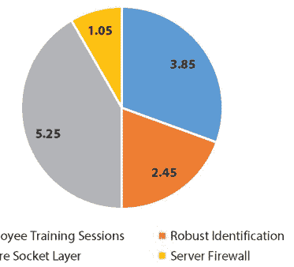

图 4.1 欺诈交易的解决方案频率 [2]。

在交易金额方面增长了43.5% [7]。此外，物联网、无线传感器网络和计算机视觉等技术的进步，可用于开发更多的多领域解决方案 [8–14]。

## 4.2 提议的框架

该框架分为三个主要阶段 [5]：

- 1) 数据探索：涉及加载数据集、对数据集进行预处理、显示数据集和执行图表绘制等过程。
- 2) 数据预处理：涉及加载数据集并移除异常值，将数据集拆分为训练集和测试集等过程。

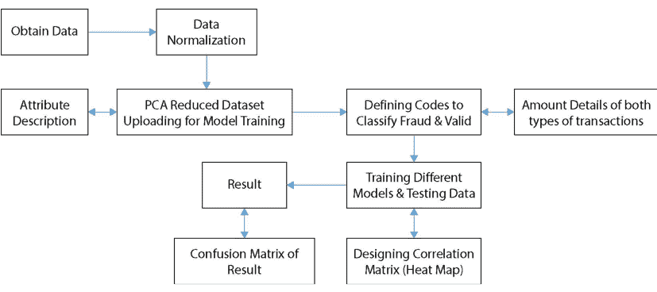

图 4.2 银行欺诈检测的提议框架。

- 3) 数据分类：涉及训练数据集、开发分类器模型、随机森林和执行分类等过程。

本程序旨在使用数据分析和数据结构概念，结合机器学习算法，来检测欺诈银行交易。首先，从Kaggle（一个可以访问不同领域各种数据集并进行数据分析的互联网平台）选择并导入了数据集。所采用的关键方法是探索性数据分析（EDA），它有助于创建基于分类的模型，将交易分为欺诈类和有效类 [5]。使用了PCA降维，它有助于将n个属性列减少到少数几列（本例中仅31列），从而降低空间和时间复杂度，并帮助机器学习模型更好地理解数据集，实现最大效率。整个流程框架通过图4.2展示。数据集选定后，执行了数据归一化，以便在数据库中更好地组织数据，使其分析更加容易、准确和高效。然后，导入各种Python库的主要步骤；其中包括numpy as np（用于访问数值Python以创建数组）、pandas（用于执行数据分析）、matplotlib和pyplot（用于制作图表、图形等）、seaborn（用于数据可视化）[15, 16]。

然后为数据集设置了一条路径，以便将其添加到代码工作区中。接着，通过让程序描述其属性的各种特征（如计数、每列的平均值、每列的最小值、每列的最小值、每列高于25%、50%和75%的值），检索了关于数据集的一些信息。然后通过为有效交易和欺诈交易定义类变量（分别为0和1）来设置程序代码，每当观察到类变量为1时，即为欺诈交易的警报。代码成功实现后，显示了欺诈交易和有效交易的金额详情。还使用热图为数据点设计了一个相关矩阵，显示列变量之间的关系或依赖性，以表达它们对分析目标变量的重要性。然后将数据按4:1的比例拆分，其中80%的数据用于训练模型，20%用于测试模型。随后，打印了分类器的得分。

## 4.3 结果

首要任务是训练和测试数据集，以比较各种分类模型并找到准确率最高的模型。表4.1给出了不同机器学习算法用于分类的比较分析。

在此，确定随机森林分类器模型最适合该程序，因为其准确率得分为97%，精确率得分为90%，召回率为93%。随后，数据集再次经过训练和测试程序，并使用随机森林分类器继续运行程序。在项目结束时，经过数据归一化和程序算法实现后，包含约2,84,807条交易记录的整个数据集被分类为2,84,315条有效交易和492条欺诈交易（如图4.3所示）。


Table 4.1 机器学习训练模型比较。

| 模型 | 准确率 | 精确率 | 召回率 |
|---|---|---|---|
| 线性支持向量机 [17] | 0.88 | 0.4 | 0.93 |
| 径向基支持向量机 [18] | 0.97 | 0.88 | 0.95 |
| 随机森林 [19] | 0.97 | 0.9 | 0.93 |
| 高斯过程 [20] | 0.95 | 0.8 | 0.95 |
| 决策树 [21] | 0.93 | 0.82 | 0.95 |
| AdaBoost [22] | 0.93 | 0.82 | 0.95 |
| 朴素贝叶斯 [23] | 0.88 | 0.7 | 0.95 |
| 二次判别分析 [24] | 0.85 | 0.72 | 0.93 |

0.0017304750013189597
欺诈案例数：492
有效交易数：284315
数据集中交易总数：284807

图 4.3 欺诈与有效交易对比。

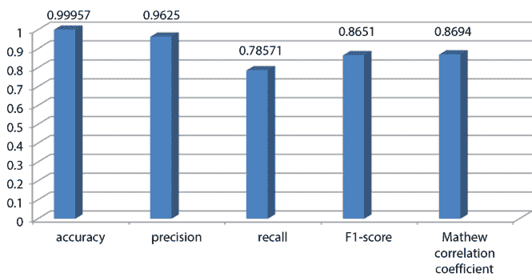

图 4.4 RFC 机器学习模型结果。

用于此二分类数据的训练模型为“随机森林分类器模型”，其准确率为 99.95%，精确率为 96.25%，召回率为 0.78，F1 分数为 0.865，马修斯相关系数为 0.869，如图 4.4 所示。

下表是通过在“AMOUNT”、“TIME”和“CLASS”这三个主要且重要的列中检测总异常值而得出的。表格显示了从数据集中取前 1000 条记录所定义的数据集头部区域的结果。此外，在程序最终确定后，结果被推断并通过相关矩阵和混淆矩阵 [25] 以可视化方式表示，如图 4.5 和 4.6 所示。

热图 [26]（如图 4.5 所示）展示了数据集中不同参数和不同变量之间的相关性。热图使用 Python 的 matplotlib 和 seaborn 库设计而成。它是数据集相关矩阵的图形表示。所有 31 个属性均出现在两个坐标轴上，范围为 –0.4 至 +0.8。各属性之间呈现中性相关，且极少数属性相关性高于 40%，同时也极少数属性之间存在负相关。

上述混淆矩阵（如图 4.6 所示）是根据超过 40,000 条记录直至某一限制的规模设计的。在总评估数据点中，考虑了 42,722 个案例。从该混淆矩阵可以推断，在 42,722 个案例中，42,646 笔交易被预测为有效且原本也是有效的。19 笔交易被预测为有效但实际上是欺诈。有两起案例被预测为欺诈但实际上是有效的，55 笔交易是欺诈且被正确预测为欺诈。

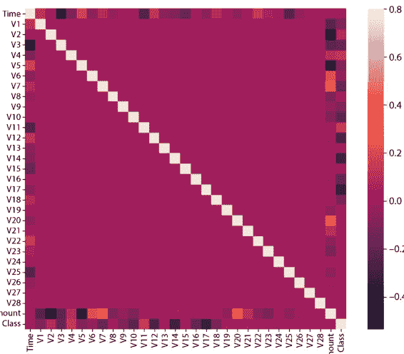

图 4.5 数据集热图/相关矩阵。

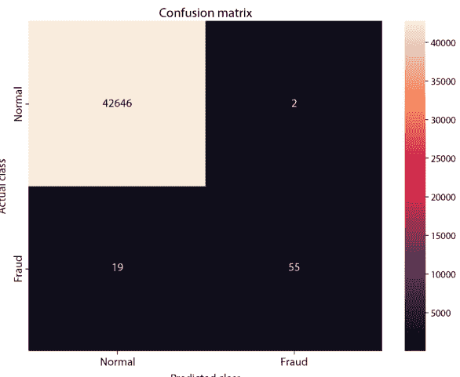

图 4.6 训练模型的混淆矩阵。

因此，训练模型的整体性能令人满意。它显示了符合预期的结果，该模型在创建高效的数字欺诈检测机制方面证明是成功的。

## 4.4 结语与未来展望

在数字化和电子商务时代，数字欺诈正变得日益严峻。受害者遭受重大损失、精神和情感困扰，以及银行凭证被滥用。为打击这些欺诈行为，必须加强措施。所提工作比较了各种分类模型，并得出结论：随机森林最为合适。所提工作还旨在为数据处理和数据分析迈出一步，这将有助于有效、准确地识别欺诈数据。进而，这将协助银行增强保护客户数据和保障交易安全的方法。

为开发更高效的分类器，未来有必要对这一概念进行研究和改进。机器学习和数据分析可以用来构建抵御这些欺诈的防火墙，正如该项目所展示的那样。这种方法可靠、安全、迅速且多功能，是解决这一紧迫问题的一种兼容且有效的方法。

## 参考文献

- 1. Trivedi, S.K. 和 Yadav, M., 预测在线回购意向，以电子满意度为中介：对 Y 代的一项研究。VINE J. Inf. Knowl. Manage. Syst., 48, 3, 427–447, 2018 年 8 月, doi: 10.1108/VJIKMS-10-2017-0066/FULL/XML.
- 2. Allen, S. 等，中央银行数字货币的设计选择：政策和技术考量，2020 年 8 月, doi: 10.3386/W27634.
- 3. Solove, D.J. 和 Citron, D.K., 风险与焦虑：数据泄露危害理论。Tex. Law Rev., 96, 2017, 访问日期：2023 年 3 月 24 日。[在线]。可用：https://heinonline.org/HOL/Page?handle=hein.journals/tr96&id=785&div=&collection=.
- 4. Saldanha, L.F., 安得拉邦气候适应型零成本自然农业计划综述，2018.
- 5. John, H. 和 Naaz, S., 基于局部异常因子和孤立森林的信用卡欺诈检测。Int. J. Comput. Sci. Eng., 7, 4, 1060–1064, 2019 年 4 月, doi: 10.26438/IJCSE/V7I4.10601064.
- 6. Khattak, S., Jan, S., Ahmad, I., Wadud, Z., Khan, F.Q., 基于多媒体数据深度分析的互联网银行服务有效安全评估方法。Multimed. Syst., 27, 4, 733–751, 2021 年 8 月, doi: 10.1007/S00530-020-00680-7/METRICS.
- 7. Revathi, P., 印度数字银行的挑战与机遇。EPRA Int. J. Econ. Bus. Rev., 7, 12, 20–23, doi: 10.36713/epra2985
- 8. Singh, K.J. 等，基于自适应花粉传播算法的多机器人系统节能路由协议。IEEE Access, 9, 82417–82434, 2021, doi: 10.1109/ACCESS.2021.3086628.
- 9. Sachdeva, P. 和 Singh, K.J., 眼科图像中视盘的自动分割与面积计算，收录于：2015 年第 2 届工程与计算科学最新进展国际会议 (RAECS)，第 1–5 页，2015 年 12 月, doi: 10.1109/RAECS.2015.7453356.
- 10. Singh, K.J., Kapoor, D.S., Thakur, K., Sharma, A., Gao, X.Z., 基于计算机视觉的室内环境服务机器人物体检测与识别。Comput. Mater. Contin., 72, 1, 197, 2022 年 2 月, doi: 10.32604/CMC.2022.022989.
- 11. Sharma, A., Kapoor, D.S., Nayyar, A., Qureshi, B., Singh, K.J., Thakur, K., 森林环境中基于 LoRaWAN 的物联网节点通信探索。Comput. Mater. Contin., 71, 2, 6240–6256, 2022, doi: 10.32604/CMC.2022.024639.
- 12. Jawhar, Q., Thakur, K., Singh, K.J., 无线传感器网络大数据处理的最新进展。IEEE Potentials, 39, 6, 22–27, 2020.
- 13. Sandhu, H.S., Singh, K.J., Kapoor, D.S., 焰和火焰图像的自动边缘检测算法与面积计算。Proc. 2016 年第 6 届云系统与大数据工程国际会议 - Conflu. 2016, 2016 年 7 月, 第 403–407 页, doi: 10.1109/CONFLUENCE.2016.7508152.
- 14. Singh, K.J., Kapoor, D.S., Abouhawwash, M., Al-Amri, J.F., Mahajam, S., Pandit, A.K., 导航过程中人机协作空间中配送机器人的行为。Intell. Autom. Soft Comput., 35, 1, 795–810, 2022.
- 15. Nelli, F., Python 数据分析：使用 Pandas、NumPy 和 matplotlib，第 2 版，第 1–569 页，2018 年 9 月, doi: 10.1007/978-1-4842-3913-1/COVER.
- 16. Bakker, M. 等，使用 Python 和 FloPy 脚本编写 MODFLOW 模型开发。Groundwater, 54, 5, 733–739, 2016 年 9 月, doi: 10.1111/gwat.12413.
- 17. Chauhan, V.K., Dahiya, K., Sharma, A., 线性支持向量机中的问题表述与求解器：综述。Artif. Intell. Rev., 52, 2, 803–855, 2019 年 8 月, doi: 10.1007/s10462-018-9614-6.
- 18. Wainer, J. 和 Fonseca, P., 如何调整 RBF SVM 超参数？18 种搜索算法的实证评估。Artif. Intell. Rev., 54, 6, 4771–4797, 2021 年 8 月, doi: 10.1007/s10462-021-10011-5.
- 19. Resende, P.A.A. 和 Drummond, A.C., 基于随机森林的入侵检测系统方法调查。ACM Comput. Surv., 51, 3, 48:1–48:36, 2018 年 5 月, doi: 10.1145/3178582.


20. Deringer, V.L., Bartók, A.P., Bernstein, N., Wilkins, D.M., Ceriotti, M., Csányi, G., 材料与分子的高斯过程回归。Chem. Rev., 121, 16, 10073–10141, 2021年8月, doi: 10.1021/ACS.CHEMREV.1C00022/ASSET/IMAGES/MEDIUM/CR1C00022_M069.GIF.

21. Quinlan, J.R., 学习决策树分类器。ACM Comput. Surv., 28, 1, 71–72, 1996年3月.

22. Schapire, R.E., 解释 AdaBoost，载于：Vladimir N. Vapnik 经验推断论文集，第 37–52 页，2013年1月, doi: 10.1007/978-3-642-41136-6_5/COVER.

23. Taheri, S. and Mammadov, 基于优化模型的朴素贝叶斯分类器学习。Int. J. Appl. Math. Comput. Sci., 23, 4, 787–795, 2013, doi: 10.2478/AMCS-2013-0059.

24. Bhattacharyya, S., Khasnobish, A., Chatterjee, S., Konar, A., Tibarewala, D., 基于 EEG 数据的左右肢体运动分类中 LDA、QDA 和 KNN 算法的性能分析，载于：2010 年医学与生物系统国际会议，2010年12月，第 126–131 页，doi: 10.1109/ICSMB.2010.5735358.

25. Hay, A.M., 从混淆矩阵推导全局估计。Int. J. Remote Sens., 9, 8, 1395–1398, 2007, doi: 10.1080/01431168808954945.

26. Wilkinson, L. and Friendly, M., 聚类热图的历史。Am. Stat., 63, 2, 179–184, 2012年5月, doi: 10.1198/TAS.2009.0033.

# 基于计算的药物重定位策略概述

Shalu Verma<sup>1</sup>*, Nidhi Nainwal<sup>1</sup>, Alka Singh<sup>2</sup>, Gauree Kukreti<sup>2</sup> and Kiran Dobhal<sup>3</sup>

<sup>1</sup>乌塔兰查尔制药科学学院，乌塔兰查尔大学，德拉敦，乌塔拉坎德邦，印度 <sup>2</sup>Sardar Bhagwan Singh 大学制药科学学院，巴拉瓦拉，德拉敦，乌塔拉坎德邦，印度 <sup>3</sup>希瓦利克药学院，德拉敦，乌塔拉坎德邦，印度

*通讯作者: vermashalu339@gmail.com*

## 摘要

药物重定位是一种发现超出原始药物适应症范围的研究和已批准药物新用途的技术。它增强了药物的治疗价值，从而提高成功率。与针对特定适应症开发新药相比，存在多种方法可提供若干优势。在本研究中，我们讨论了各种药物重定位策略，例如使用物联网（IoT）、人工智能（AI）、机器学习（ML）、云计算、大数据数字孪生等。AI 和 ML 允许快速开发药物，包括现有药物的重定位。IoT 已渗透到大多数应用领域，其中最重要的是医疗保健领域。将药物重定位与物联网（IoT）、人工智能（AI）、机器学习（ML）、云计算、大数据和数字孪生相结合，以新机遇和独特挑战进一步丰富了其意义和研究潜力。本综述的目的是展示这些计算工具在关联预测和新疾病适应症药物重定位方面的价值。由于高性能技术的快速发展，目前正在产生海量生物学和生物医学数据。这使得通过应用基于生物网络的计算技术和模型，为药物重定位创造了新机会。

**关键词:** 人工智能，机器学习，物联网，药物重定位，数字孪生，大数据，云计算

## 5.1 引言

工业 4.0，通常被称为第四次工业革命，利用物理—网络技术提高系统的智能化水平。为了在保持高质量标准的同时高效、低成本地生产药物，利用自主系统和设备至关重要[1]。药物开发过程中使用的与工业 4.0 相关的技术可能对生物医学和制药行业产生重大积极影响，因为新药或药品所需的研发期远比普通产品更长、更昂贵。

药物开发是一个顺序过程，包括药物发现、临床前研究、临床测试、批准和上市后监测[2]。利用计算机在药物研究中的另一好处是，有可能分析已有的众多化合物库，以定位与特定靶点匹配的相似结构。采用计算方法，使研究人员能够考察配体（一种可被指定为实验性药物的物质）如何与靶位点（如蛋白质或细胞受体）相互作用，改变配体的结构以提高其亲和力，阐明作用机制或降低毒性。云技术是纸质记录系统的最可靠替代方案，该系统在医学的多个领域非常可靠且有用。随着云计算与新方法的融合，现在有可能找到对生物靶点具有更高亲和力和有效性的分子。传统算法在识别能够正确结合并激活受体的适当材料或验证药物靶点方面无效。然而，利用云计算与新建模和分子动力学方法的结合，可能能够识别出否则无法识别的有前途的分子或新的激活位点或靶点[3]。在药物科学和新药开发过程中，人工智能（AI）被用于取代依赖人脑的过时方法。基于靶点验证设计和识别新化合物可以在很大程度上得到 AI 的帮助。在具有庞大数据库的复杂药理学和药学网络中，使用 AI 是揭示疾病、药物组成和发展特征之间隐藏关系的最佳方法之一。与基于物理公式（如量子化学）的物理理论不同，机器学习（ML）方法在分子的经验数据中创建广泛的数学模型，以预测新化合物的物理、生物和化学性质[4]。支撑制药 4.0 的物理—网络系统促进互联互通、协作机器人、AI 和分布式云架构，同时改进大数据处理。得益于当前的数字化，制药和生物技术行业的组织现在可以在多个领域以更高效率和性能调整其网络策略。本研究重点突出了物联网（IoT）、大数据、数字孪生、云计算、AI 和 ML 算法在过去几年中对制药行业和药物开发所产生的变化。我们调查了药物发现的最新计算方法以及体外 AI 和 ML 药物重定位流水线。我们通过展望 ML 技术的未来应用来结束，这些应用可能有助于并加速药物和精准医学的发展。随着 AI 和 ML 迅速融入制药行业和药物研究科学领域。

## 5.2 药物重定位

药物重定位在节省时间和金钱方面比传统的从头开发药物方法更高效，因此在制药研究和工业领域获得了广泛关注。这是因为它既有助于为已批准药物寻找新应用，也有助于开发新药。

药物重定位有时被称为治疗转换、药物重定向、药物再任务、药物重新用途和药物重新分析[5]。据报道，药物重定位使药物发现过程变得简单得多，因为它不仅加快了进程，还跳过了与 ADMET 特征、药物优化问题相关的临床前和临床研究，并提高了药物开发的成功率[6]。设计药物的过程耗时、昂贵且风险高，因为它必须经历多次迭代。在制造的药物可以使用之前，需要 FDA 的强力批准，并且需要近 10 到 15 年才能上市。（图 5.1）[7]。大多数最著名且有效的药物重新用途故事（例如涉及米诺地尔、西地那非、丙戊酸和阿司匹林的故事）源自非结构化（或“现场”）发现过程，这些过程经常依赖药物的药理学（如非靶点不良反应）来解决不同领域的临床问题。这些故事并非都源于偶然观察。但近年来，药物发现界承诺将有组织、有方法、数据驱动的药物重新用途方法付诸实践，其中大多数都包含计算支持。虚拟筛选、分子相似性近似、基于结构的、转录组或蛋白质组数据的签名匹配、上市后监测数据、临床

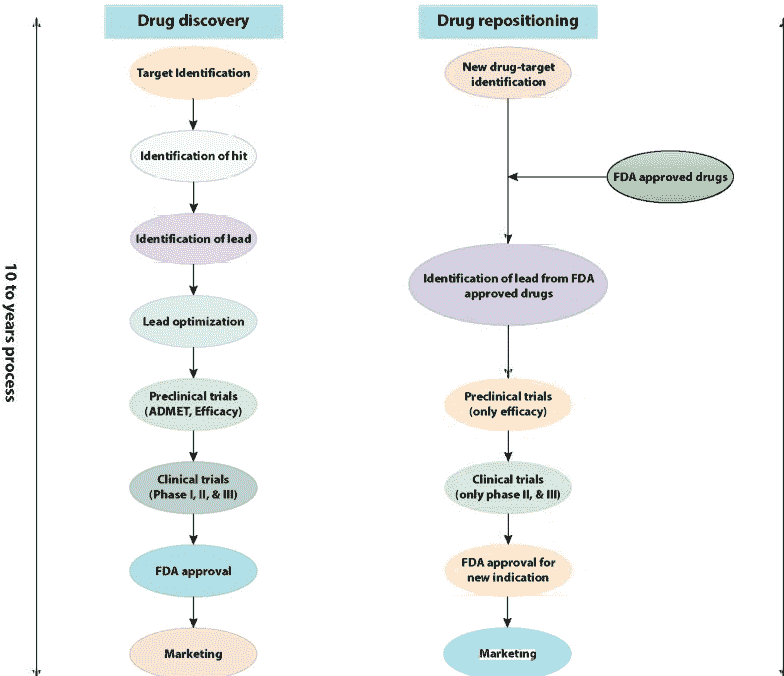

图 5.1 新常规药物发现过程和药物重定位策略的示意图 [4]。


表 5.1 重新定位药物列表 [3]。

| Drug | 原始用途 | 新用途 |
|---|---|---|
| Atomoxetine | 抑郁症，帕金森病 | ADHD（注意缺陷多动障碍） |
| Amphotericin | 真菌感染 | 抗血小板 |
| Amantadine | 流感 | 帕金森病 |
| Aspirin | 镇痛，炎症 | 结直肠癌，抗血小板 |
| Allopurinol | 癌症 | 痛风 |
| Arsenic | 梅毒 | 白血病 |
| Bimatoprost | 青光眼 | 促进睫毛生长 |
| Bupropion | 抑郁症 | 戒烟 |
| Bromocriptine | 帕金森病 | 糖尿病 |
| Colchicine | 痛风 | 复发性心包炎 |
| Celecoxib | 疼痛与炎症 | 家族性腺瘤性息肉 |
| Colesevelam | 高脂血症 | 2型糖尿病 |
| Dapoxetine | 抑郁症与镇痛 | 早泄 |
| Doxepin | 抑郁症 | 解热药 |
| Dapsone | 麻风病 | 疟疾 |
| Disulfiram | 酗酒 | 黑色素瘤 |
| Duloxetine | 抑郁症 | 压力性尿失禁 |
| Eflornithine | 抑郁症 | ADHD |
| Fingolimod | 移植排斥 | 多发性硬化症 |
| Gemcitabine | 抗病毒 | 癌症 |
| Gabapentin | 癫痫 | 神经性疼痛 |
| Ketoconazole | 真菌感染 | 库欣综合征 |
| Lomitapide | 血脂异常 | 家族性高胆固醇血症 |
| Miltefosine | 癌症 | 内脏利什曼病 |
| Methotrexate | 癌症 | 银屑病，类风湿性关节炎 |
| Minoxidil | 高血压 | 脱发 |
| Naproxen | 疼痛与炎症 | 阿尔茨海默病 |

表 5.1 重新定位药物列表 [3]。（续）

| Drug | 原始用途 | 新用途 |
|---|---|---|
| Naltrexone | 阿片类成瘾 | 戒酒 |
| Nortriptyline | 抑郁症 | 神经性疼痛 |
| Pemetrexed | 间皮瘤 | 肺癌 |
| Propranolol | 高血压 | 偏头痛预防 |
| Raloxifene | 避孕药，骨质疏松症 | 骨质疏松症，乳腺癌 |
| Rituximab | 各种癌症 | 类风湿性关节炎 |
| Ropinirole | 帕金森病 | 不宁腿综合征 |
| Retinoic acid | 痤疮 | 急性前髓细胞白血病 |
| Sildenafil | 心绞痛 | 肺动脉高压，勃起功能障碍 |
| Thalidomide | 孕吐 | 多发性骨髓瘤，麻风病 |
| Topiramate | 癫痫 | 肥胖症 |
| Zileuton | 哮喘 | 痤疮 |
| Zidovudine | 癌症 | 艾滋病病毒/艾滋病 |

对电子健康信息的试验和系统分析是其中的几个例子 [8]。我们在表 5.1 中提供了一些重新定位药物的示例。

### 5.2.1 药物重新定位的计算策略

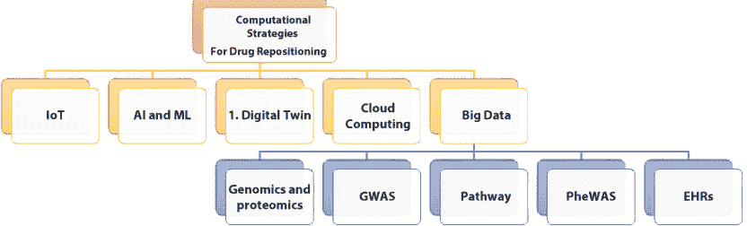

图 5.2 药物重新定位的计算策略 [5]。

#### 5.2.1.1 药物重新定位中的物联网

物联网（IoT）彻底改变从药物发现到远程患者访问和监测等药品生产流程的能力是无与伦比的。全球许多领先的制药企业正在其建成的工厂中逐步实施物联网技术，以实现优化并提升开发效能。此前，由于制药生产设施中不同工序存在多种信息格式，数据的可用性和理解性对运营沟通构成了重大困难。通过卓越地连接整个工厂的网络、设备和系统，基于包括近场通信（NFC）、蓝牙、超宽带和5G在内的多种底层通信协议的物联网技术，使制药制造设施内的校准成为可能。此外，通过利用物联网，制药组织可以访问整个制造过程中的实时数据和操作 [9]。

物联网、云计算、社交媒体及其他新兴信息技术正在产生大量数据，推动各学术领域的扩展。然而，由于这些数据品种繁多、获取速度快、体量庞大，其解释本质上是复杂的。由于高性能生物医学数据捕获技术、下一代测序等最近的技术进步以及成本降低，大规模实验数据的生成现已成为可能。统计方法、机器学习（ML）以及最重要的是基于生物网络的模型，是目前用于分析这些数据的计算工具的基础。这些计算技术已经展示出连接健康科学中大量数据生成与理解之间差距的卓越潜力 [10]。在生命科学领域，基于物联网的变革才刚刚开始。制药和生物技术公司能够投入数百万美元并迅速获得回报，同时实现临床效果。正在进行含有微型摄像头的可吞服药丸的试验，以监测治疗导致慢性疾病的疾病的药物给药。新技术正在加速药物研究，为患者带来希望。

FDA批准新药概念所需时间的70%用于进行临床试验（食品药品监督管理局）。这些测试必须证明该疗法具有高水平的疗效且使用安全。通常，FDA仅允许该公司生产用于研究期间评估的那一种特定用途的药物。物联网可以降低开发成本，并提高选择成功制剂而非前景较差制剂的可能性。

#### 5.2.1.2 药物重新定位中的人工智能和机器学习

如今，发明无处不在；它们为下一代过上无疾病、现代且安全的生活铺平了道路。由于发明，特别是在生物医学科学领域，死亡率已下降，人类平均寿命已延长。其中之一是AI，这是技术的一个转折点。AI一词指一类计算技术，当应用于文本、图像和声音数据时，预计其功能类似于人脑。最近由于非凡的生物医学数据（包括基因组、蛋白质组学、代谢组学、药物库和患者护理数据）的扩展、新算法的创造以及超级计算机的普及，AI领域发生了巨大的变革。此外，AI还被应用于日益受欢迎的药物设计科学课题中。最终，药物设计领域的AI有助于确定治疗靶点和药物疗效。由于AI可靠、易用且准确，它已被应用于几乎所有科学领域，包括药物重新定位。AI辅助药物设计的下一阶段是药物重新定位。在重新定位药物时，AI面临一些困难。许多制药公司不再生产新药，因为传统药物设计成本高昂且过程漫长。然而，这一策略使相关人员能够继续使用现有药物治疗各种疾病。所有这些现今都通过使用设计软件的多个组件来完成，从而非常容易地估计靶点、药物和治疗方案。由于它提供了关于所需药物的基因序列、蛋白质结构、疾病和框架的全面知识，对接和重新定位软件提供的服务是不可或缺的。发现药物与靶分子相互作用后，可以进一步开发，并从计算机模拟（in-silico）平台转移到体外（in vitro）平台。为了预测药物对靶点的疗效，使用虚拟筛选。在这项工作中，我们特别强调如何将AI技术应用于药物开发过程，特别是药物重新定位。它提供了有关基于AI的药物重新定位的有用资源和Web界面的深入知识、拥抱AI技术的新兴生物医学公司目录，以及为未来人才培养提供一些建议。

在药物重新定位中，为现有药物寻找新用途的速度更快、成本更低。存在不同的计算药物重新定位策略。计算药物重新定位策略可大致分为三类，以COVID-19大流行为例：（i）基于药物/靶点网络的模型，（ii）基于结构的方法，以及（iii）基于AI的方法。基于网络的方法有两类：基于网络的聚类和基于网络的传播 [11]。在推断病毒结构及其功能之后，药物开发是下一个关键步骤。药物发现成本高昂且耗时，但AI可以使用神经网络加速该过程并提高效率，如图5.2所示 [12]。由于其数据要求更高，基于AI的网络目前似乎不太适用。

利用计算方法为现有药物构思新适应症/重新定位的能力，得益于快速发展的高精度计算机模拟（in silico）技术/算法，以及对临床研究、疾病通路、基因表达谱、药物靶点结构、药效团及其他主题中大量数据日益扩展的计算访问 [13]。基于结构的药物重新定位（SBDR）能够筛选可重新定位的化学空间（RCS），并利用对接、药效团建模和分子动力学（MD）模拟等众多计算机模拟技术，研究潜在配体与靶点结合位点的相互作用，这本身就具有重要意义，如表5.2所示。在过去几年中，数据驱动的机器学习应用大幅扩展，现已成为药物发现早期阶段的关键工具。推动这一趋势的几个因素包括实用实验数据（如Drug Bank、ChEMBL、PDB、PubChem和PDBbind）的快速积累、现代ML算法、库以及价格合理的计算能力的出现。

机器学习技术试图从过去的数据中学习并预测特性，而非基于物理理解立即计算它们 [14]。随着ML和AI在发现过程各个领域的日益应用，药物发现过程有可能发生改变。如图5.3所示，AI/ML的应用示例包括药物筛选和重新定位、基于结构的建模、使用高内涵显微镜进行的细胞基于图像的分析、药物安全性评估以及从头化学合成等。COVID-19大流行支持了这样一个观点，即AI将加速


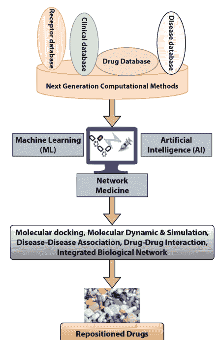

图 5.3 基于 ML、AI 和网络医学的药物重定位下一代计算技术 [10]。

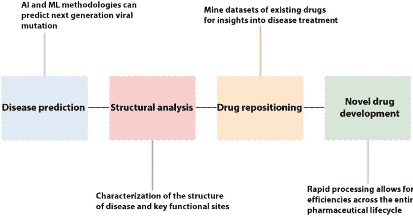

图 5.4 AI 在疾病预测中的应用 [15]。

提高产量并降低药物发现过程中的淘汰率 [15]。ML 在药学和医学领域每年可能高达 1000 亿美元，原因是决策能力增强、创新加速、研发/临床试验效率更高，以及为医生、患者、保险公司和监管机构创建了新工具。研发、医疗专业人员和设施、患者、护理人员等。同步这些信息并利用其改善医疗系统和治疗的部分问题在于其（当前）来源多样化。因此，ML 与医疗交汇点的当前核心挑战是弄清楚如何高效收集和使用各种数据类型，以实现更好的个体分析、预防和治疗，如图 5.4 所示。制药和医疗领域不断增长的 ML 应用展示了一种可能的未来，届时数据同步、分析和创新将成为常态 [16]。

### 表 5.2 基于 AI 的药物重定位工具和应用列表 [13]。

| 工具 | 方法 | 预测/鉴定 | 脚本 |
| :--- | :--- | :--- | :--- |
| Anni 2.0 | 基于概念的方法 | 解释差异表达基因和基于文献的知识发现 | UMLS 和 JAVA |
| Balestra Web | SimilarityEnsemble 方法 | 任何药物的交互伙伴 | Python, Flask, NumPy 和 SciPy |
| DrugQuest | 聚类和测试任务算法 | 已知药物之间的关联 | CGI, PERL 和 JAVA |
| DeepCodex | 深度神经网络 | 基于基因表达数据的小分子功能相似性相关性 | - |
| HitPicK | 1-最近邻，拉普拉斯修正的朴素贝叶斯模型 | 感兴趣化学物质的靶点 | - |
| PolySearch | 简单字典方法 | 人类基因和疾病关系 | HTML 和 PERL |
| PPB | 单指纹最近邻 | 小分子的靶点 | JAVA |
| PROMISCUOUS | 基于网络的方法 | 药物与靶点及其副作用之间的复杂关系 | JAVA |
| SuperPred | 基于结构的方法 | 药物与靶点的相似性 | - |

注释：UMLS，统一医学语言系统；PPB，多药理学浏览器；HTML，超文本标记语言；CGI，计算机图形接口 [17]。


图 5.5 ML 流程概览 [17]。

ML 流程的第一阶段是数据收集，它试图从一个或多个来源整合数据集，这些数据集在经过数据准备后将用于模型训练，如图 5.5 所示。接下来的模型评估和部署确保最终用户能够使用经过验证的、可信赖的模型进行预测和推断。

#### 5.2.1.3 药物重定位中的数字孪生

制药制造行业在流程开发和进步的不同阶段表明，使用数字孪生支持智能制造是可行的。得益于数字孪生使用一系列模型表示真实组件的能力，在流程设计阶段可以更快速地做出制造路线及其单元操作的选择。通过去除实际试验的需求，数字孪生模拟可用于研究流程变异性并预测产品质量、生产率和流程参数，从而节省时间和金钱 [18]。在运营期间，可以实时监控和查看流程性能，数字孪生可以持续评估系统以提供用于控制和流程优化的洞察。利用设备、过程分析技术 (PAT)、成品、中间产品的持续数据收集，以及持续的全局建模和数据分析平台，实现实时系统监控和控制，是利用数字孪生实现智能制造的重要前提。通过利用连续制造 (CM)、质量源于设计 (QbD)、PAT 和流程图建模实现等策略，制药行业在这方面已取得一些进展。虽然一些工具已得到深入研究，但数字孪生的整体集成和发展仍处于早期阶段 [19]。数字孪生是物理世界和数字世界之间的连接，由三个元素组成：虚拟、物理以及两者之间的交互。在数字世界中，对象在实验室中创建，目的是预测其结构、模拟其行为，并增强其在现实世界中的性能。在物理世界中，物品由传感器识别，并根据图 5.6 所示的特性、功能及与用户的交互，由执行器进行处理。

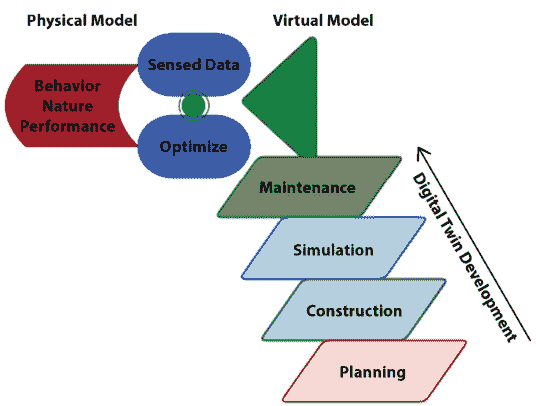

图 5.6 数字孪生概览 [18]。

#### 5.2.1.4 药物重定位中的云计算

在当前追求规模经济和成本降低的经济背景下，云计算和药物重定位分别是分布式计算和药物开发领域的主导范式。为了了解药物重定位的财务可能性，有必要研究药物开发的经济性 [20]。与早期分布式计算解决方案的主要区别在于通过互联网交付。毕竟，“云”名称源于互联网通常在网络图中表示的方式。由于推动 IT 行业的强大网络效应，云计算运动正在将计算转变为一种商品，并可能最终将其提升为天然气、电力、电话和水之后的第五种公用事业 [21]。

#### 5.2.1.5 药物重定位中的大数据

利用医疗大数据进行药物重定位研究是克服传统药理学方法缺点的可行途径。鉴于已获批的药物已经通过临床试验，每位患者的各种数据（包括实验室结果和影像数据）会随时间收集并合并形成大数据。使用这种大型医疗数据进行的研究允许分析来自不同背景和地理位置的患者，从而允许评估疗效和

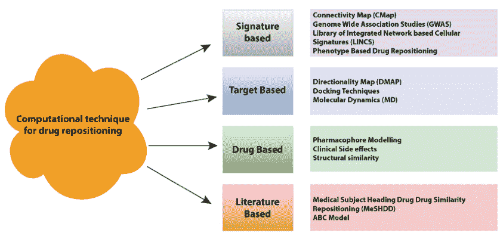

图 5.7 药物重定位中的计算技术 [22]。

实际临床实践中的安全性，并有助于检测少数尚未完全理解的患者中的不良事件。因此，使用大数据结合基础医学和临床医学的药物重定位方法被视为最佳药物发现范式。生命科学数据库（存放基因和蛋白质等分子数据）以及编纂实际患者临床数据的医疗信息数据库，都是数据库的示例。

基于大数据的药物发现已成为制药公司越来越多地采用的方法。为了寻找肿瘤药物发现中具有理想特性的化学化合物，众多药物现在结合细胞筛选系统、计算医疗信息学工具和基因表达分析 [23]。制药公司还利用高性能组合筛选技术和基于细胞的表型检定，将现有药物组合起来，以解决各种疾病（如炎症性、呼吸道、代谢性和病毒性疾病）中多个功能失调通路。上述统计数据表明，大数据在当前药物发现过程中的重要性日益凸显。大数据涵盖范围极大的异常大型数据集。与此同时，数据分析工具和算法快速发展，使解决大数据问题变得更加容易，从而为向精准医疗的范式转变铺平了道路。

蛋白组学、基因组学、全基因组关联研究 (GWAS)、通路和全表型关联研究 (pheWAS) 是新的基于大数据的方法，如图 5.7 所示，将在下文讨论 [24]：

##### 5.2.1.5.1 基因组学和蛋白组学

生物标志物有可能从生理过程和症状的角度预测健康结果。基于生物标志物的癌症药物开发成功率已从仅 3.4% 提高到 2015 年总体肿瘤治疗批准率 8.3%。在生物标志物之前是基因组学，主要原因是收集基因表达谱相对简单。此外，基因组标志物的组合作为预后指标的效果优于单个基因组标志物 [25]。零散乳腺癌中可预示不良预后且准确率高达 83% 的 70 个基因组合就是一个示例。除了基因组学，蛋白组学也有可能用作生物标志物 [26]。然而，由于严格验证和困难解码方法仍然存在困难，蛋白组学不太可能被用于高级癌症诊断以实现所需的临床准确性。因此，迄今为止，根据 510(k) 程序批准的多参数测试相对较少 [27]。

##### 5.2.1.5.2 全基因组关联研究

越来越多的研究表明，有效的药物靶点通常包括遗传靶点，几个来自 GWAS 的例子支持这一说法。GWAS 采用无假设方法，可以同时检查全基因组中数百万个单核苷酸多态性 (SNPs)，从而能够系统分析特定遗传变异对给定性状的影响。GWAS 已发现许多 SNP、性状、常见和复杂疾病关联，这些关系可以用于对遗传发现进行排序并进一步锁定


潜在治疗靶点 [28]。2014 年，Okada 等人在一项包含超过 100,000 名该疾病患者和对照者的大规模 GWAS 中，发现了 101 个与类风湿性关节炎相关的 SNPs。生成的 GWAS SNPs 提出了众多潜在疗法，并确定了当时已获批的 27 种类风湿性关节炎药物中 18 种的靶点 [29]。寻找 2 型糖尿病和低密度脂蛋白胆固醇水平的治疗靶点是 GWAS 力量的类似实例。GWAS 的一项显著优势是，它能够利用微小效应大小（甚至包括 SNPs 与疾病之间的非功能性相关性）的隐藏力量，找到对疾病或性状具有治疗作用的药理学靶点 [30]。

##### 5.2.1.5.3 通路

通路方法允许定位参与一般信号网络或生物通路的基因，以及除 GWAS 单一候选基因之外的基因，从而为治疗靶点开发提供一组蛋白质。每条通路包含分子之间的多种相互作用，细胞分裂等特定功能由分子间的信号传递触发。因此，通路中任何一个步骤的缺陷都可能导致通路功能失调并最终引发疾病 [31]。通路方法对于识别疾病之间的潜在联系很有用。利用通路技术，已经为慢性骨髓性白血病和多发性硬化等疾病提供了更有效的治疗方法。理解人类细胞内所有通路及其功能，可能使治疗一些最具挑战性的疾病变得更容易。总体而言，基于通路/网络的技术极大地促进了疾病靶点选择及后续治疗开发 [32, 33]。

##### 5.2.1.5.4 全盘关联研究（PheWAS）

由于将来自不同种族群体的各种疾病类型的电子健康记录（EHR）与基因组数据相结合，精准医学正从新的角度被看待。因此，出现了全盘关联研究（PheWAS），这是一种前沿范式，整合了主要队列研究中 GWAS 和 EHR 的数据 [34]。PheWAS 拓展了基因型-表型关联，也使研究人员能够发现先前已给药药物的新用途 [35]。例如，一项将 PheWAS 与 Drug Bank 相结合的研究，旨在评估用于治疗罕见和常见疾病的潜在药物候选物。该研究发现了 52,966 个药物-疾病组合，其中约三分之一的配对得到文献、正在进行的临床研究以及既有药物-疾病关联的支持 [36]。

## 5.3 药物重定位的挑战与机遇

传统药物开发方法是昂贵、风险高且代价高昂的事业。因此，药物重定位近年来受到关注，并加速了药物临床用途的释放 [37, 38]。然而，药物重定位是一个考虑技术、商业策略、患者、投资和市场需求等多种要素的复杂过程 [39, 40]。尽管存在众多医学数据库，但选择最佳策略以充分利用海量医学数据仍然是一项难题 [41]。制定药物重定位的新策略至关重要。机遇并非没有困难。20 世纪 20 年代的一次偶然发现促成了首个药物重定位案例 [42]。在近一个世纪的发展后，提出了更多加速药物重定位的策略 [43, 44]。因此，药物重定位取得了显著成功。在该情况下，引入大规模 ML 算法改善了药物重定位的性能。

## 5.4 结论

本研究讨论了物联网（IoT）、人工智能（AI）、机器学习（ML）、云计算、大数据和数字孪生在药物重定位中的现状。预测药物准确性有许多方法和策略，但由于不同的软件适用不同的参数、算法和程序，一种药物在一种软件中针对靶点的准确性可能不等于在另一种软件中的准确性。通过稳定程序和算法并减少错误，可以克服这些差异。随着技术和数据的扩大，AI 性能没有边际，并且每天都在快速提升。使用各种技术，有可能成功发现潜在的可重定位药物。新开发的计算药物重定位领域将由各种方法和当前可用数据的成功融合所产生。最近开发了下一代计算技术，如疾病-疾病关联、分子对接、MD 模拟、网络医学、集成生物网络、AI、药物-药物相互作用和 ML，使得有效重定位药物成为可能。制药部门主要关注基于 ML 和 AI 的技术，这些技术显著有助于靶蛋白和新化合物的搜索以及属性预测。通过创建机器学习技术，我们可以加速新药开发并显著促进人类健康。为大数据创建的方法从各种角度整合数据，简化药物候选物筛选过程，并实现药物毒性预测，从而大大加速新疗法的开发并提高其疗效。凭借灵活的定价结构和动态资源分配，云计算正在迅速成为重新定位药品的首选。数字孪生实例和聚合通过降低偏差并促进学习和新知识的发现，在从一个个体的“小”大数据转移到一个或多个群体的大数据时，增强了可重复性（通过确保目标人群在相应的数字孪生表示中被准确表征）。本节介绍的基于 AI 的药物设计技术的疾病特定属性，未来可以通过调整正在优化的目标函数并将结果与更相关的基准进行比较来修改。本节介绍的基于 AI 的药物设计技术的疾病特定属性，未来可以通过调整正在优化的目标函数并将结果与更相关的基准进行比较来修改。

## 参考文献

- 1. Oztemel, E. 和 Gursev, S., 工业 4.0 及相关技术文献综述. J. Intell. Manuf., 31, 127–182, 2018, https://doi.org/10.1007/s10845-018-1433-8.
- 2. Reinhardt, I.C., Oliveira, D.J.C., Ring, D.D.T., 药物行业工业 4.0 发展的现代视角. J. Ind. Inf. Integr., 18, 100131, 2020, https://doi.org/10.1016/j.jii.2020.100131.
- 3. Rastegar-Mojarad, M., Ye, Z., Kolesar, J.M., Hebbring, S.J., Lin, S.M., 来自全盘关联研究的药物重定位机会. Nat. Biotechnol., 33, 4, 342–345, 2015, https://doi.org/10.1038/nbt.3183.
- 4. Cha, Y., Erez, T., Reynolds, I.J., Kumar, D., Ross, J., Koytiger, G., Kusko, R., Zeskind, B., Risso, S., Kagan, E., Papapetropoulos, S., Grossman, I., Laifenfeld, D., 从制药公司角度看药物重定位. Br. J. Pharmacol., 175, 2, 168–180, 2017, https://doi.org/10.1111/bph.13798.
- 5. Gil, C. 和 Martina, A., 药物重定位真的是药物发现的未来，还是真正的创新才是前进之路？ Expert Opin. Drug Discov., 16, 8, 1–3, 2021, https://doi.org/10.1080/17460441.2021.1912733.
- 6. Leelananda, S.P. 和 Lindert, S., 药物发现中的计算方法. Beilstein J. Org. Chem., 12, 2694–2718, 2016, https://doi.org/10.3762/bjoc.12.267.
- 7. Wang, L., Törngren, M., Onori, M., 制造业中网络物理系统的现状与进展. J. Manuf. Syst., 37, 517–527, 2015, https://doi.org/10.1016/j.jmsy.2015.04.008.
- 8. Chakraborty, C., Sharma, A.R., Bhattacharya, M., Agoramoorthy, G., Lee, S.-S., COVID-19 临床试验的药物重定位提供非常有效的治疗组合：从主要临床研究中汲取的教训. Front. Pharmacol., 12, 1–18, 2021, https://doi.org/10.3389/fphar.2021.704205.
- 9. Tanoli, Z., Vähä-Koskela, M., Aittokallio, T., 癌症中的人工智能、机器学习和药物重定位. Expert Opin. Drug Discov., 16, 9, 977–989, 2021, https://doi.org/10.1080/17460441.2021.1883585.
- 10. Jarada, T.N., Rokne, J.G., Alhajj, R., 计算药物重定位综述：策略、方法、机遇、挑战与方向. J. Cheminform., 12, 1, 1–23, 2020, https://doi.org/10.1186/s13321-020-00450-7.
- 11. Novac, N., 药物重定位的挑战与机遇. Trends Pharmacol. Sci., 34, 5, 267–272, 2013, https://doi.org/10.1016/j.tips.2013.03.004.
- 12. Yang, H., Sun, L., Li, W., Liu, G., Tang, Y., 更正：使用机器学习方法和结构警报进行药物设计的化学毒性体外预测. Front. Chem., 6, 1–12, 2018, https://doi.org/10.3389/fchem.2018.00129.
- 13. Yang, X., Wang, Y., Byrne, R., Schneider, G., Yang, S., 计算机辅助药物发现中人工智能的概念. Chem. Rev., 119, 18, 10520–10594, 2019, https://doi.org/10.1021/acs.chemrev.8b00728.
- 14. Aliper, A., Plis, S., Artemov, A., Ulloa, A., Mamoshina, P., Zhavoronkov, A., 使用转录组数据预测药物药理特性和药物重定位的深度学习应用. Mol. Pharmaceutics, 13, 7, 2524–2530, 2016, https://doi.org/10.1021/acs.molpharmaceut.6b00248.
- 15. Angermueller, C., Pärnamaa, T., Parts, L., Stegle, O., 计算生物学中的深度学习. Mol. Syst. Biol., 12, 7, 878, 2016, https://doi.org/10.15252/msb.20156651.
- 16. Ashburn, T.T. 和 Thor, K.B., 药物重定位：识别和开发现有药物的新用途. Nat. Rev. Drug Discovery, 3, 8, 673–683, 2004, https://doi.org/10.1038/nrd1468.
- 17. Schleich, B., Anwer, N., Mathieu, L., Wartzack, S., 用于设计和生产工程的数字孪生塑造. CIRP Ann., 66, 141–144, 2017. [CrossRef].
- 18. Jones, D., Snider, C., Nassehi, A., Yon, J., Ben, H., 数字孪生特征：系统文献综述. CIRP J. Manuf. Sci. Technol., 29, 36–52, 2020. [CrossRef].


- 19. Lopes, M.R., Costigliola, A., Pinto, R., Vieira, S., Sousa, J.M.C., 药品质量控制实验室数字孪生——一种用于资源规划与调度的创新治理模型. Int. J. Prod. Res., 58, 21, 6553–6567, 2019, https://doi.org/10.1080/00207543.2019.1683250.

- 20. Delavan, B., Roberts, R., Huang, R., Bao, W., Tong, W., Liu, Z., 精准医学时代罕见病的计算药物重定位. Drug Discov. Today, 23, 2, 382–394, 2018, https://doi.org/10.1016/j.drudis.2017.10.009.

- 21. Li, J., Zheng, S., Chen, B., Butte, A.J., Swamidass, S.J., Lu, Z., 计算药物重定位当前趋势综述. Briefings Bioinf., 17, 1, 2–12, 2015, https://doi.org/10.1093/bib/bbv020.

- 22. Yella, J., Yaddanapudi, S., Wang, Y., Jegga, A., 计算药物重定位的变化趋势. Pharmaceuticals, 11, 2, 57, 2018, https://doi.org/10.3390/ph11020057.

- 23. Kim, R.S., Goossens, N., Hoshida, Y., 精准医学药物开发中大数据的应用. Expert Rev. Precis. Med. Drug Dev., 1, 3, 245–253, 2016, https://doi.org/10.1080/23808999.3.2016.1174062.

- 24. Talevi, A. and Bellera, C.L., 药物重用的挑战与机遇：寻找治疗药物替代用途的策略. Expert Opin. Drug Discov., 15, 4, 397–401, 2019, https://doi.org/10.1080/17460441.2020.1704729.

- 25. Li, Y.Y. and Jones, S.J., 个性化医疗的药物重定位. Genome Med., 4, 3, 1–14, 2012, https://doi.org/10.1186/gm326.

- 26. Hopkins, A.L., 网络药理学：药物发现的下一代范式. Nat. Chem. Biol., 4, 11, 682–690, 2008, https://doi.org/10.1038/nchembio.118.

- 27. Rodrigues, L., Bento Cunha, R., Vassilevskaia, T., Viveiros, M., Cunha, C., COVID-19药物重用：综述与识别新靶点和潜在药物候选物的新策略. Molecules, 27, 9, 2723, 2022, https://doi.org/10.3390/molecules27092723.

- 28. Sausseau, P., Agarwal, P., Barnes, M.R., Pastinen, T., Richards, J.B., Cardon, L.R., Mooser, V., 药物重定位中全基因组关联研究的应用. Nat. Biotechnol., 30, 4, 317–320, 2012, https://doi.org/10.1038/nbt.2151.

- 29. Emig, D., Ivliev, A., Pustovalova, O., Lancashire, L., Bureeva, S., Nikolsky, Y., Bessaraba, M., 基于集成网络方法的药物靶点预测与重定位. PLoS One, 8, 4, e60618, 2013, https://doi.org/10.1371/journal.pone.0060618.

- 30. Musa, A., Ghoraie, L.S., Zhang, S.-D., Glazko, G., Yi-Harja, O., Dehmer, M., Haibe-Kains, B., Emmert-Streib, F., 药物基因组学中连接图及计算方法综述. Briefings Bioinf., 18, 5, 903–903, 2017, https://doi.org/10.1093/bib/bbx023.

- 31. Borrebaeck, C.A.K., 精准诊断：向癌症中具有临床实用性的蛋白质生物标志物签名迈进. Nat. Rev. Cancer, 17, 3, 199–204, 2017, https://doi.org/10.1038/nrc.2016.153.

- 32. Füzéry, A.K., Levin, J., Chan, M.M., Chan, D.W., 将蛋白组学生物标志物转化为FDA批准的癌症诊断：问题与挑战. Clin. Proteomics, 10, 1, 1–14, 2013, https://doi.org/10.1186/1559-0275-10-13.

- 33. van ’t Veer, L.J., Dai, H., van de Vijver, M.J., He, Y.D., Hart, A.A.M., Mao, M., Peterse, H.L., van der Kooy, K., Marton, M.J., Witteveen, A.T., Schreiber, G.J., Kerkhoven, R.M., Roberts, C., Linsley, P.S., Bernards, R., Friend, S.H., 基因表达谱预测乳腺癌临床结局. Nature, 415, 6871, 530–536, 2002, https://doi.org/10.1038/415530a.

- 34. Langedijk, J., Mantel-Teeuwisse, A.K., Slijkerman, D.S., Schutjens, M.-H. D. B., 药物重定位与重用：文献中的术语与定义. Drug Discov. Today, 20, 8, 1027–1034, 2015, https://doi.org/10.1016/j.drudis.2015.05.001.

- 35. Hay, M., Thomas, D.W., Craighead, J.L., Economides, C., Rosenthal, J., 研究性药物临床开发成功率. Nat. Biotechnol., 32, 1, 40–51, 2014, https://doi.org/10.1038/nbt.2786.

- 36. Iorio, F., Rittman, T., Ge, H., Menden, M., Saez-Rodriguez, J., 转录组数据：通往药物重定位的新途径？. Drug Discov. Today, 18, 7–8, 350–357, 2013, https://doi.org/10.1016/j.drudis.2012.07.014.

- 37. Chakraborty, C., Sharma, A.R., Bhattacharya, M., Agoramoorthy, G., Lee, S.-S., COVID-19临床试验中的药物重用提供非常有效的治疗组合：来自主要临床研究的经验教训. Front. Pharmacol., 12, 1–15, 2021, https://doi.org/10.3389/fphar.2021.704205.

- 38. Ashburn, T.T. and Thor, K.B., 药物重定位：识别并开发现有药物的新用途. Nat. Rev. Drug Discov., 3, 8, 673–683, 2004年8月, [在线]。可获取: http://dx.doi.org/10.1038/nrd1468.

- 39. Ballester, P.J., 药物设计中分子建模的机器学习. Biomolecules, 9, 6, 216, 2019, https://doi.org/10.3390/biom9060216.

- 40. Jin, G. and Wong, S.T.C., 迈向更好的药物重定位：将现有方法优先排序并集成到高效流程中. Drug Discov. Today, 19, 5, 637–644, 2014, https://doi.org/10.1016/j.drudis.2013.11.005.

- 41. Keiser, M.J., Setola, V., Irwin, J.J., Laggner, C., Abbas, A., Hufeisen, S.J., Jensen, N.H., Kuijer, M.B., Matos, R.C., Tran, T.B., Whaley, R., Glennon, R.A., Hert, J., Thomas, K.L.H., Edwards, D.D., Shoichet, B.K., Roth, B.L., 预测已知药物的新分子靶点. Nature, 462, 7270, 175–181, 2009, https://doi.org/10.1038/nature08506.

- 42. Low, Z.Y., Farouk, I.A., Lal, S.K., 药物重定位：针对致残性疾病和COVID-19大流行暴发的新方法与未来展望. Viruses, 12, 9, 1–24, 2020, https://doi.org/10.3390/v12091058.

- 43. Kifle, Z.D., Ayele, A.G., Enyew, E.F., COVID-19治疗的药物重用方法、潜在药物及新靶点. J. Environ. Public Health, 2021, 1–11, 2021, https://doi.org/10.1155/2021/6631721.

- 44. Scannell, J.W., Blanckley, A., Boldon, H., Warrington, B., 诊断制药研发效率下降. Nat. Rev. Drug Discov., 11, 191–200, 2012. [CrossRef] [PubMed].

# 通过特征选择、提取与学习提升性能

Varsha K. Patil*, Vrinda Shinde, Ritika Singh 和 Vipul Singh

印度浦那 AISSMS 信息技术学院

## 摘要

面对日益增长的数据量与复杂性，为从原始数据中发现显著特征，本研究探讨了机器学习中的特征选择、提取与训练方法。文章回顾了在特征选择、提取与训练中采用深度学习模型、传统统计技术及混合方法的优缺点。研究旨在产出更实用、精确、易于理解并可应用于医疗、金融和自主系统的机器学习模型，从而识别未来研发的潜在方向。为了为监督学习、无监督机器学习技术及卷积神经网络的未来研究铺平道路，本文对特征提取、训练与选择的最新方法进行了全面概述，包括机器学习与深度学习算法之间的区别。

**关键词：** 特征，特征选择，机器学习，前向选择算法，线性判别分析（LDA），主成分分析（PCA），特征学习，特征提取

## 6.1 引言

数字图像处理是指利用数学工具和算法对数字照片进行操作与分析的研究。它是众多基于图像的应用（如机器视觉、遥感、监控和医学影像）的重要组成部分。图像处理技术能够从照片中提取可用数据，例如目标识别、分割与分析。该过程包括多个步骤，如图像获取、预处理、增强、特征提取、分割和分析。随着数字图像日益普及，图像处理已发展成为各学科研究人员、工程师和科学家的重要工具，有助于改进技术与创新。图像处理的一项重要应用是计算机视觉，其中用于开发算法和技术，使机器能够看见和解释视觉信息 [1, 2]。为提取有用信息

*通讯作者：varshapatil101@gmail.com


在目标检测、跟踪和分类等图像任务中，会使用图像处理技术。这些特征被用于训练机器学习模型，这些模型可应用于机器人、人脸识别和自动驾驶汽车等众多领域。

在图像处理中，应用特征选择、提取和学习方法对于提高预测模型的准确性和有效性至关重要。这些方法包括从数据集中查找并选择相关特征，从这些特征中提取有价值的信息，以及创建能够基于所选特征精确预测结果的模型。近年来，随着数据量和复杂性的不断增加，各个领域对精确高效预测模型的需求也日益增长。在数据挖掘和机器学习中，目标是从高维数据集中提取一个相关特征子集，因此特征选择过程至关重要 [3]。所选特征可用于构建精确有效的预测模型，同时降低其计算复杂度和存储需求。特征选择方法已在生物信息学、图像分析和文本挖掘等多个行业得到广泛研究和应用。在本研究中，我们探讨特征选择策略并分析其优缺点。

特征提取（一种用于计算机视觉的技术）的目标是将一组无意义的特征转换为一组可分析和分类的原始输入数据。特征提取技术 [4] 应用于人脸识别 [5]、目标识别和图像分割等领域。近年来，卷积神经网络和其他深度学习技术在特征提取任务中表现出惊人的性能。然而，这些技术通常需要大量标注数据和计算能力，在某些情况下这些资源可能稀缺。在本工作中，我们以深度学习方法为重点，评估特征提取技术的最新进展，并讨论其优缺点。

机器学习试图从输入-输出对中创建预测模型，而从数据中学习是一项基本活动。学习技术的有效性和输入特征的质量对预测模型的质量有显著影响。特征学习旨在无需人工干预即从原始输入数据中自动识别相关特征。它在语音识别、计算机视觉和自然语言处理等多个领域都取得了有希望的结果。我们的目标是评估和对比特征学习算法。

## 6.2 特征选择

在现代世界中，监督学习是众多应用不可或缺的一部分，已成为解决复杂问题和做出基于事实决策的重要工具。在监督学习中，用于生成预测的训练集输入特征数量被称为“维度”。监督学习中的“维度”一词指的是用于生成预测的训练集输入特征的数量。当数据中存在大量特征时，算法可能会受到“维度灾难” [6, 7] 的影响，这是指随着特征数量的增加，数据会变得更加稀疏且更难以分析。

从数据中学习的模型质量也会受到数据维度的影响。高维度可能导致冗余或无关特征，这些特征不会提高模型的预测能力。这些特征可能导致过拟合，即模型变得过于复杂，难以很好地适应新数据。特征选择用于解决这一问题。

特征选择是一种降维技术，包括从初始特征集中选择最重要特征的一个子集 [16]。特征选择的目标是在保留关键信息的同时降低数据维度，以提高学习算法的有效性并降低过拟合风险。特征选择技术的三个基本类别是过滤法、包装法和嵌入法。

### 6.2.1 过滤法

监督特征选择的基本原理是特征与类标签之间的关系或关联，该方法广泛用于分类问题。

使用过滤器从数据集中选择相关特征是一种常见技术。根据此方法，会使用特定的度量或标准（例如相关性或互信息）来评估每个特征的重要性，并根据其得分对特征进行排序。然后选择最佳特征以供进一步检查或建模。本部分将详细介绍过滤式特征选择方法及其优缺点。

过滤式特征选择在数据科学和机器学习中被广泛使用，因为它简单、快速且计算效率高。无论数据集的大小或复杂性如何，都可以使用该方法。过滤式特征选择的主要原理是利用特征的固有属性（例如其统计分布或与目标变量的相关性 [8]）独立地评估每个特征的重要性，而不考虑其他特征。

相关性和互信息是过滤特征选择中最常用的度量。互信息反映了一个变量对另一个变量的了解程度，而相关性衡量两个变量之间的线性关系。在这两种情况下，更高的分数都表明更高的重要性。卡方、ANOVA和基尼指数是过滤式特征选择过程中可采用的其他度量。

### 6.2.1.1 流程

过滤特征的选择过程如图 6.1 所示。

以下列出的步骤可用于细化流程图：

- **步骤 1：数据预处理**

  选择过滤特征过程的第一阶段是数据准备。为此，必须清理数据、处理缺失值，并可能需要将类别数据转换为数值数据。然后，清理和处理后的数据将用于选择特征。

- **步骤 2：计算特征相关性得分**

  下一步是计算每个特征的相关性得分。可以使用各种统计方法来计算这些得分，例如基于相关性的方法、互信息和卡方检验。用于过滤式特征选择的最常见统计方法如下：

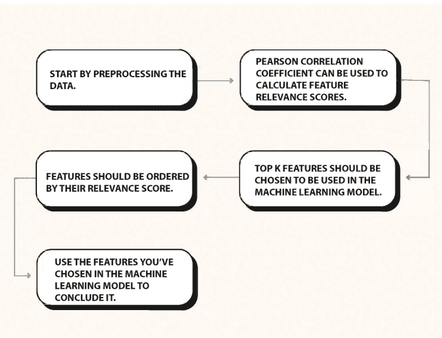

图 6.1 过滤特征的选择过程。

##### 6.2.1.1.1 皮尔逊相关系数

皮尔逊相关系数是一种用于确定两个变量之间线性关系的统计方法。在选择过滤特征的过程中，计算每个特征的相关性得分是一个常见步骤。根据皮尔逊相关系数，-1 表示强负相关，0 表示无相关性，1 表示强正相关。要计算皮尔逊相关系数，请使用以下公式：

```
r = \frac{n(\Sigma xy) - (\Sigma x)(\Sigma y)}{\sqrt{([n\Sigma x^2 - (\Sigma x)^2][n\Sigma y^2 - (\Sigma y)^2])}}
```

在此公式中，“xy”表示 X 和 Y 的各自值的乘积的总和，“x”表示 X 值的总和，“y”表示 Y 值的总和。皮尔逊相关系数用“r”表示。

##### 6.2.1.1.2 互信息

该方法基于互信息的概念，用于量化两个变量之间共享的信息量。在特征选择的上下文中，两个变量是数据集中的特征和目标变量（即我们要预测的变量）。以下公式可用于确定特征与目标变量之间的信息量：


I(X;Y) = \sum_{x \in X,y \in Y} p(x,y)log\left(\frac{p(x,y)}{p(x)p(y)}\right)

因此，X 代表特征，Y 代表所需结果。P(x,y) 是 X 和 Y 的联合概率分布，而 p(x) 和 p(y) 分别是 X 和 Y 的边缘概率分布。

##### 6.2.1.1.3 卡方检验

该方法用于检验两个类别变量的独立性。通过对比观察到的频率和预期频率，它确定两个分类变量之间的依赖关系。

构建列联表（展示数据集中两个分类变量的分布）是该过程的第一步。列联表是一个矩阵，显示两个变量每种分组的观察次数。例如，如果有两个变量 A 和 B，每个都有三个类别，则列联表将是一个 3x3 矩阵。

基于两个变量之间独立性的假设，然后确定每个类别的预期频率。接着，利用观察到的频率与预期频率之间的平方差之和（按预期频率标准化）来生成卡方统计量。它生成一个服从卡方分布的统计量。

因此，上述三种技术是计算相关性得分的常用方法。

### 步骤 3：特征排序

然后根据每个特征的确定相关性评分对特征进行排序。相关性评分最高的特征排在最前面，以此类推。

### 步骤 4：特征选择

最后一步根据相关性评分选择顶部特征。所选特征的数量由所使用的任务和机器学习算法决定。选择前 k 个特征（其中 k 是预定数量，或通过交叉验证技术选择）是一种常见策略。

### 6.2.1.2 优点

特征选择能够提高机器学习模型的精度 [9]，这是其主要优点之一。通过仅选择最相关的属性，模型可以专注于对目标变量影响最大的关键要素。这可能会带来更好的预测性能，尤其是当数据集包含许多特征或噪声数据时。

它还能提升机器学习模型的有效性，这是特征选择的另一个优势。如果减少数据集的特征数量，模型可以更快地训练并消耗更少的 CPU 资源。这在生成实时或近实时预测时非常有用。

此外，特征选择可以使机器学习模型更易于理解。通过仅选择最相关的属性，可以使模型更易于人类理解，这在问责和透明度至关重要的情况下很有帮助。特征选择还可以找出对目标变量影响最大的因素，这对于决策或理解复杂系统很有帮助。

特征选择能够提高机器学习模型的泛化能力。通过仅选择最相关的特征，模型可以避免对训练数据集过度拟合，从而在全新的未经测试的数据上表现更好。在模型需要在各种输入下良好运行的应用中，或者训练数据稀疏或含噪声时，这可能至关重要。

### 6.2.1.3 缺点

与任何技术一样，特征选择也存在一些必须在应用前考虑的缺点。首先，特征选择可能导致重要信息的丢失。当从数据集中删除特征时，可能会丢失一些信息，这可能导致模型精度下降。此外，某些看似无关的特征可能对模型性能至关重要，删除它们可能会对结果产生负面影响 [10]。

此外，特征选择需要经验和领域知识。特征选择过程需要深入了解问题领域和所使用的数据。如果没有适当的知识和专业知识，特征选择过程可能不足，导致模型精度降低。

此外，特征选择可能计算成本高昂。从大型数据集中识别相关特征可能是一项耗时的任务，需要大量计算能力。此外，为模型选择最佳特征集可能是一项困难的任务，通常需要进行广泛的测试。

最后，数据质量可能是特征选择的一个因素。用于特征选择的数据质量可能会影响模型的准确性。如果数据包含错误或缺失值，特征选择过程可能无法产生最佳结果，导致模型精度降低。

## 6.2.2 包装法

“包装法”是一种特征选择策略，它从数据集中选择特征子集 [10] 以提高机器学习模型的性能。这是一种常见策略，因为它可以比其他特征选择策略提供更准确的结果。在这里，我们将探讨包装法的功能、优点和缺点，并提供一些视觉辅助来帮助解释该过程。

包装法在比较多个特征子集后，选择产生最佳结果的特征子集。每个特征子集都使用某种方法进行评估，并根据其表现给出得分。然后，算法根据得分最高的子集选择最终的特征集。

### 6.2.2.1 步骤

包装法是一种迭代算法，其工作方式如下：

- 1) 初始化一个空的选定特征集。
- 2) 使用所有可用特征训练模型，并使用验证集评估其性能。
- 3) 对于选定集中缺少的每个特征，将其添加到集合中，然后使用选定的特征和新特征一起训练模型。使用验证集评估模型的有效性。
- 4) 将性能提升最大的特征添加到选定集中。
- 5) 继续执行步骤 3 和 4，直到达到停止条件。

此过程如图 6.2 所示。

可以看出，包装法在每次迭代中都选择性能提升最大的特征。这通过对比添加额外特征前后模型的性能来实现。如果性能提升，则将该特征添加到预设集中，并继续该过程。

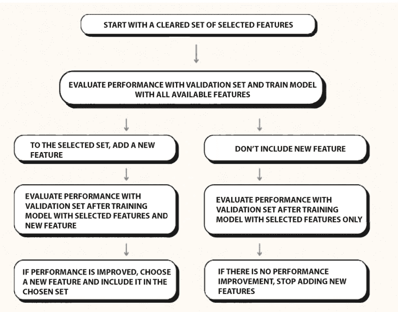

图 6.2 包装法的步骤。

### 6.2.2.2 优点和缺点

包装法考虑特征之间的相互作用是其主要优点之一。由于使用验证集来评估模型性能，它可以捕捉将新特征与现有特征结合如何影响模型性能。因此，包装法优于依赖特征重要性定量度量（如相关性或互信息）的其他特征选择技术。

包装法需要对每组特征进行模型训练和评估，因此计算成本也很高。在处理特征丰富的数据集时，这可能非常困难。

为了克服这一缺点，包装法经历了许多改进，包括前向选择和后向选择方法。

### 6.2.2.3 前向选择算法

前向选择算法是一种特征选择技术，它根据特征对模型性能提升的程度，逐次将一个特征添加到空特征集 [11] 中。

前向选择算法包含以下步骤：

- 1) 初始化：从一个空特征集开始。
- 2) 特征评估：独立使用每个特征来评估模型的有效性。任何适合当前任务的度量（如准确率、F1 分数或均方误差）都可以用作评估指标。
- 3) 特征选择：最好选择在评估指标上表现最好的特征。
- 4) 模型训练：使用选定的特征连同当前的特征集合来训练模型。
- 5) 特征添加：使用之前选定的属性与剩余特征的所有可行组合来评估模型性能。将在评估标准上产生最佳性能的特征添加到当前特征集合中。
- 6) 终止：在满足停止条件之前，根据需要重复步骤 4 和 5。此标准可能包括最大特征数、最低性能改进或最大迭代次数。

任何能够处理可变数量特征的机器学习模型都可以应用前向选择技术。例如，它可以应用于决策树、神经网络、逻辑回归和线性回归。此外，它可以调整以处理连续型、分类型和二进制特征。

前向选择过程并不总能选择最佳特征子集，这是一个可能的问题。前向选择方法可能并不总是选择最佳特征子集。然而，它通常能得到理想特征子集的不错近似，并且计算效率高。


### 6.2.2.4 后向选择算法

后向选择算法是一种特征选择方法，它从完整的特征集开始，然后逐个消除特征，迭代地 [11] 基于特征对模型性能的影响。

后向选择方法的步骤如下：

- 1) 初始化：从完整的特征集开始。
- 2) 特征评估：为了评估模型的有效性，考虑所有组件。
- 3) 特征选择：选择对模型性能影响最小的特征。这可以通过分别删除每个部分并比较有无该特征时的模型性能来实现。
- 4) 模型训练：使用剩余的特征集训练模型。
- 5) 特征移除：从当前特征列表中移除所选特征。
- 6) 终止：直到满足停止条件，重复步骤 3 到 5。此条件可能是性能最小改进、特征最小数量或有限的迭代次数。

每种能够处理可变数量特征的机器学习模型都可以采用后向选择方法。例如，它可以应用于决策树、神经网络、逻辑回归和线性回归。此外，它可以调整以处理连续、分类和二进制特征。

一个潜在问题是，后向选择技术并不总是选择最佳的特征子集。然而，它通常能得出理想特征子集的不错近似，且在计算上高效。另一个问题是，它可能对停止标准的选择敏感，因为随着特征被消除，模型性能并不总是会变得更好。为确保结果的可靠性，仔细选择停止标准并进行灵敏性分析至关重要。

## 6.2.3 嵌入式方法

一种称为嵌入式策略的特征选择方法将特征选择步骤纳入机器学习算法的训练过程中 [12]。换言之，算法在选择特征的同时进行训练，然后将所选特征应用于最终模型。这与其他方法（例如，在训练模型之前执行特征选择的过滤方法）形成对比。

嵌入式特征选择方法有多种类型，但一些最常用的方法如下：

- 1) LASSO（最小绝对收缩和选择算子）：这是一种正则化技术，通过添加惩罚项来修改模型的损失函数。该惩罚项鼓励模型将不那么重要的特征的系数设为零，从而只选择最重要的特性。
- 2) 岭回归：另一种增加损失函数惩罚项的正则化方法是岭回归。相比之下，岭回归中的惩罚项促使模型减小所有特征系数，但不一定减小到零。如果所有特征都重要，这可能提高性能；但如果有些特征比其他特征不那么重要，也可能导致过拟合。
- 3) 弹性网：弹性网是 LASSO 和岭回归的混合体，它同时使用两种惩罚项来平衡 LASSO 的稀疏性和岭回归的稳定性。
- 4) 决策树：决策树是一种非参数方法，可应用于分类和回归任务。决策树的分裂标准可基于特征重要性，从而成功选择最重要的特征。
- 5) 随机森林：一种混合多种决策树的集成技术称为随机森林。在随机森林中，每棵树的重要性得分被汇总以得到最终的特征重要性。每棵树在随机特征子集上进行训练。

### 6.2.3.1 最小绝对收缩和选择算子（LASSO）

最小绝对收缩和选择算子，有时称为 LASSO，是一种常用于线性回归模型的正则化技术。通过同时执行特征选择和特征收缩，LASSO 有助于克服传统回归模型的一些缺点。因此，LASSO 可以识别并选择数据集中最关键的特征，同时减小次要特征的影响。

要实现 LASSO，需要将一个惩罚项 [13] 纳入线性回归模型的代价函数中。惩罚项是回归系数绝对值总和的倍数。正则化参数（即 lambda）是一个超参数，用于调节惩罚的严格程度。随着 lambda 增大，惩罚项变得更加重要，从而导致模型更加稀疏，非零系数更少。

能够执行特征选择是 LASSO 的主要优势。通过在代价函数中引入罚因子，LASSO 算法本质上迫使不那么重要的特征的系数为零。结果是一个更简单、更易于理解的模型，因为 LASSO 可以找到并删除对预测目标变量无帮助的元素。此外，由于其稀疏性，LASSO 模型在计算上高效，特别是对于具有众多特征的高维数据集。

LASSO 能够处理相关特征是另一项优势。相关特征可能导致传统回归模型中的系数不稳定且不准确。LASSO 通过将相关特征的系数减小到接近零来解决这个问题，从而有效地只选择一个特征来表示相关数据集合。

然而，LASSO 也存在一些缺点。首先，它假设特征与目标变量之间存在线性关系。如果关系不是线性的，LASSO 可能效果不佳。此外，LASSO 假设每个特征都同样重要，这对所有数据集可能都不成立。最后但同样重要的是，选择正则化参数 lambda 的理想值可能很困难，因为它需要交叉验证且计算成本可能较高。

因此，LASSO 是一种有效的正则化方法，可以提升线性回归模型的性能和可解释性。由于它能够处理相关特征并执行特征选择，它是高维数据集的热门选择。然而，在使用它来解决实际问题时，仔细分析其假设和局限性很重要。

### 6.2.3.2 优势

- 1) 更高的准确性：通过确定与当前问题最相关的特征，嵌入式特征选择程序可以提高模型的准确性。模型随后可能在泛化能力上表现更好，更准确，并表现出较少的过拟合。
- 2) 降低维度：嵌入式特征选择方法可以通过选择最重要的特征来帮助降低数据的维度。这可能增强模型的功能并降低其计算复杂度。
- 3) 更快的训练：通过将特征选择纳入模型训练过程，嵌入式特征选择策略可以减少训练模型所需的时间和计算资源。这对于具有大量维度的大型数据集尤其有用。
- 4) 模型可解释性：通过选择更重要且与当前问题更相关的特征，嵌入式特征选择方法可以提高模型的可解释性。这可以使模型的行为更易于用户理解。
- 5) 鲁棒性：即使在存在噪声的情况下，嵌入式特征选择方法也能识别最重要的特征，从而提高模型对数据中噪声和异常值的抵抗力。

### 6.2.3.3 劣势

- 1) 偏差：嵌入式特征选择方法可能通过只选择可用特征的一个子集来给模型带来偏差。这可能导致模型忽略未被选中的关键特征。
- 2) 过拟合：即使使用嵌入式特征选择方法，模型仍可能对训练数据集过拟合。如果所选特征与训练数据过于紧密相关，可能导致泛化性能不佳。
- 3) 复杂性：嵌入式特征选择方法的实现可能比传统特征选择技术更困难。这可能使其在实际环境中更难以理解和应用。
- 4) 仅限于特定算法：嵌入式特征选择方法通常仅限于某些类型的算法，例如线性模型或决策树。这可能限制它们对其他类型模型的适用性。


## 6.3 特征提取

特征提取是机器学习和计算机视觉领域中用于从大型数据集中定位和提取重要特征的关键方法。从原始数据中提取特征，以便对其进行分类或分析的技术，即为特征提取。该方法在许多应用中至关重要，例如音频和图像识别、自然语言处理以及预测建模。下面，我们将介绍特征提取的概念、其重要性以及一些特征提取策略。

在机器学习中，特征提取用于找出并提取数据中可用于做出预测或对数据进行分类的最关键元素。寻找与手头任务最相关的特征是特征提取过程中的一个步骤。可以通过查看数据并发现各种特征之间的趋势或关联来实现这一点。然后可以定位这些特征并提取出来，用于进一步的分析。

有多种方法常用于特征提取。主成分分析（PCA）是最流行的方法之一。可以使用PCA方法[14, 15]找出数据集中最关键的特征。其工作原理是定位能够最好地解释数据变化的一组线性特征。通过这种方式，它能够在降低数据维度的同时保留最关键的属性。

线性判别分析（LDA）是另一种常用于特征提取的方法[15]。LDA方法用于找出能够最好地区分多个数据类别的特征。其工作原理是找出哪个线性特征组合能最大化不同数据类别之间的距离。这样就能识别出对分类任务至关重要的特征。

### 6.3.1 主成分分析

可以使用数学技术主成分分析（PCA）[15]将一组相关变量转换为一组不相关变量。PCA的主要目标是识别一组新变量（称为主成分），这些变量能最好地捕捉初始数据集中的变化。这些底层成分是初始变量的线性组合，被选中以解释大部分数据波动。

#### 6.3.1.1 步骤

以下是实施PCA所需的步骤。

### 步骤 1：数据预处理

数据预处理是实施PCA的第一步。为了为分析准备数据，这包括清洗和标准化数据。必须从数据中剔除异常值、缺失值和异常情况，因为它们可能会显著影响PCA的结果。还应对数据进行归一化，以确保每个特征都具有单位方差和零均值。这样做可以确保分析对每个特征赋予相同的权重。

### 步骤 2：协方差矩阵计算

在PCA过程中，下一步是计算数据的协方差矩阵。协方差矩阵是一个方阵，用于描述数据集中每对特征之间的关系。协方差矩阵的对角元素反映每个特征的方差，而非对角元素表示每对特征之间的协方差。

### 步骤 3：特征向量计算

数据的主成分由协方差矩阵的特征向量表示。这些特征向量是能够解释大部分数据变化的初始属性的线性组合。为了确定特征向量，我们必须求解以下方程：

```
C * v = λ * v
```

其中，v是特征向量，λ是相应的特征值，C是协方差矩阵。

必须对每个特征值求解该方程，以确定特征向量。

### 步骤 4：特征值排序

特征向量的顺序由每个特征向量对应的特征值确定。特征值最大的特征向量代表第一主成分，其次是特征值第二大的特征向量，依此类推。这种方法至关重要，因为它能确保最优先找到最关键的特征。

### 步骤 5：主成分计算

计算数据的主成分是实施PCA的最后阶段。将原始数据矩阵乘以与所需主成分数量相对应的特征向量。得到的矩阵是数据投影到新主成分空间的结果。

#### 6.3.1.2 实现

让我们通过一个简单的示例来说明PCA的工作原理。假设我们有一个包含n个观测值、每个观测值有m个变量的数据集。该数据集可以表示为一个n×m矩阵X。为了简化，我们假设每个变量的均值为0。如果不是这种情况，可以通过从每个变量中减去均值来对数据进行中心化处理。

作为PCA的第一阶段，必须构建X的协方差矩阵。协方差矩阵是一个m×m矩阵，表示协方差矩阵中每对变量之间的协方差。协方差矩阵的对角元素反映每个变量的方差，非对角元素表示每对变量之间的协方差。协方差矩阵的数学表示为：

```
C = (1/n) X^T X
```

其中，X^T表示X的转置。

得到协方差矩阵后，就可以确定矩阵的特征向量和特征值。特征值反映每个主成分解释的方差，而特征向量表示数据的主成分。每个后续主成分（前提是它与所有先前的主成分正交）在第一主成分（即解释数据大部分方差的特征向量）之后，能够解释数据中剩余的最大方差。

可以使用特征值分解过程来识别协方差矩阵的特征值和特征向量。可以通过求解以下方程来确定矩阵的特征值和特征向量。

```
C v = λ v
```

其中，v是C的特征向量，λ是相应的特征值。该方程可以使用传统的线性代数技术（如QR算法或幂迭代方法）求解。

得到特征值和特征向量后，可以根据每个特征值将其按降序排列。特征值最大的特征向量代表第一主成分，其次是特征值第二大的特征向量，依此类推。

接下来的阶段是将原始数据投影到主要成分上。将初始数据矩阵X乘以与所需主成分数量相对应的特征向量。将数据投影到新的主成分空间上即可得到结果矩阵。

### 6.3.1.3 优势

- 1) 降低数据维度：PCA最大的优势之一是其能够在保留大部分关键细节的同时降低维度。在高维数据库中显示数据可能比较困难，对数据进行任何分析可能在计算上成本很高。通过降低数据维度，PCA可以简化可视化和分析。
- 2) 在数据中发现模式：可以使用PCA发现原始高维数据集中可能难以发现的模式。为此，通过将数据转换到低维空间来突出数据中最显著的差异。这有助于定位可能对进一步调查有用的观测值集合。
- 3) 去除噪声：PCA的另一个优势是其能够从数据中消除噪声。数据中的噪声可能由测量错误或其他来源引入。通过将数据转换到噪声更少的低维空间，PCA可以识别噪声源并将其消除。这有助于提高后续数据分析的准确性。
- 4) 提高计算效率：可以使用PCA降低数据集的维度，从而显著提高计算效率。在处理需要大量计算才能分析的大型数据集时，这一点尤为重要。通过降低数据维度，PCA可以帮助减少分析数据所需的计算时间。


#### 6.3.1.4 缺点

- 5) 处理多重共线性：当模型中两个或多个预测变量之间存在显著关系时，就会出现多重共线性。这可能导致数据分析中回归系数不稳定和标准误差膨胀。PCA 可用于识别和处理多重共线性，方法是将数据转换到变量间相关性最小化的低维空间中。

- 6) 改善可解释性：PCA 还可以使数据更易于解释。通过降低数据规模，可能更容易理解变量与观测值之间的联系。这有助于做出更明智的基于数据的判断。

## 6.3.2 线性判别分析

线性判别分析（LDA）是一种可靠且广受欢迎的机器学习技术，用于确定能最好地区分数据集中多个类别的特征线性组合。

### 6.3.2.1 概念

LDA 的根本目标是识别一个能最大化数据集中不同类别之间分离度的线性特征组合 [15]。换句话说，LDA 寻找在区分数据集中不同类别方面优于原始特征集的新特征。

由于 LDA 是一种受监督的学习技术，模型只能使用带标签的数据进行训练。LDA 假设数据集服从正态分布，且每个类别都有自己的均值和协方差矩阵。

LDA 的基本目标是将数据投影到一个能最大化不同类别之间分离度的低维子空间。为此，需要计算类内散迹矩阵和类间散迹矩阵的特征向量。

使用类间散迹矩阵计算各类别均值之间的距离。使用类内散迹矩阵计算每个类别的方差。然后将数据应用于这些矩阵的特征向量，将其映射到低维子空间中。

### 6.3.2.2 实现

LDA 实现可分为以下阶段：

- 1) 数据准备：采用 LDA 的第一步是准备数据。为此，必须将数据集分为训练集和测试集，然后为数据添加适当的类别标签。

- 2) 计算均值向量：使用类内所有数据点的平均值来计算该类的均值向量。

- 3) 确定类内散迹矩阵：通过添加每个类别的协方差矩阵来得到类内散迹矩阵。

- 4) 计算类间散迹矩阵：通过添加表示各类别差异的均值向量的外积，得到类间散迹矩阵。

- 5) 计算特征向量和特征值：使用类内散迹矩阵的逆矩阵乘以类间散迹矩阵，得到该矩阵的特征向量和特征值。

- 6) 选择前 k 个特征向量：使用特征值最高的前 k 个特征向量创建一个新矩阵。

- 7) 转换数据：数据转换后，将其投影到所选特征向量创建的新子空间中。

- 8) 训练模型：最后，使用转换后的数据开发一个分类器，以预测新数据点的类别标签。

### 6.3.2.3 优点

- 1) 降低维度：LDA 是减少数据集维度的好方法。LDA 可通过将数据投影到低维子空间来简化数据，使其更易于分析。

- 2) 提高准确性：通过最小化不重要特征的影响并最大化相关特征的影响，LDA 可以提高分类模型的准确性。

- 3) 处理多重共线性：LDA 可以处理多重共线性，这是多元分析中两个或多个变量高度相关时常见的问题。

- 4) 处理小样本量：LDA 可以处理机器学习中的典型问题——小样本量。LDA 可帮助防止过拟合并增强模型的泛化能力。

### 6.3.2.4 缺点

- 1) 假设正态性：LDA 假定数据服从正态分布，但实际情况不一定如此。如果数据不服从正态分布，LDA 的结果可能不准确。

- 2) 假设线性：LDA 假设特征之间存在线性关系。

## 6.4 特征学习

特征学习包括从原始数据中提取相关表示或特征，以提高机器学习模型的性能。在传统机器学习方法中，特征由该领域的专家手动设计，并作为模型的输入。然而，通过特征学习，模型从原始数据中学习这些特征，从而自动化了特征选择和设计过程。

存在多种特征学习方法 [16]，包括深度学习方法、受监督和非受监督学习等。

### 6.4.1 受监督学习

从带标签数据中提取特征的过程称为受监督特征学习。必须训练一个模型来确定输入特征与输出标签之间的映射函数。然后，学习到的特征可以输入到另一个预测分类器模型中。

图 6.3 展示了受监督特征学习的示例。

该方法始于一个包含输入特征和输出标签的数据集。从数据集中创建训练集和测试集。使用训练集训练模型后，使用测试集来评估特征学习模型的性能。

使用输入特征作为输入的特征学习模型示例包括卷积神经网络（CNN），它们被训练以学习输入特征与输出标签之间的映射函数 [17]。特征学习模型的结果是一组学习到的特征，这些特征捕获了数据中的关键信息。

然后将学习到的特征应用到另一个分类器模型中，例如支持向量机（SVM）[18]，它被训练以根据学习到的特征预测输出标签。分类器模型的输出是输入数据的预测标签。


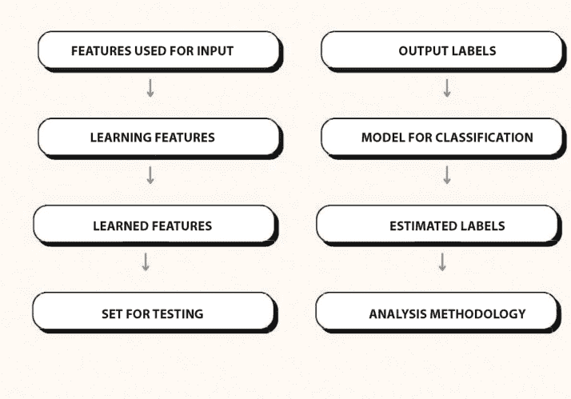

图 6.3 监督特征学习步骤。

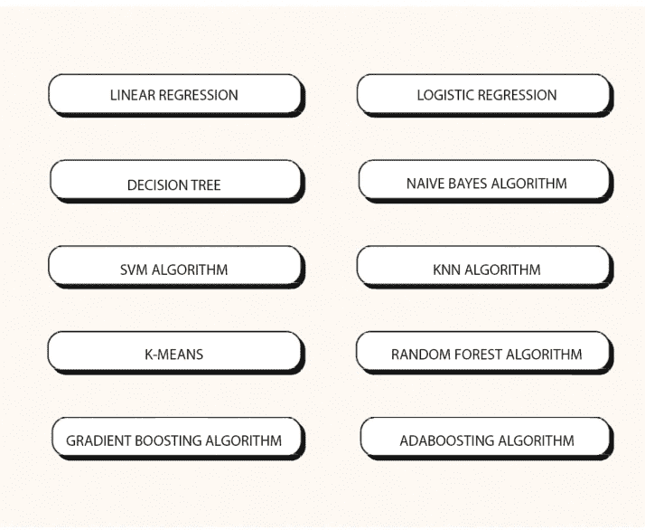

图 6.4 监督学习技术中常用的算法。

测试集包含训练期间未使用的输入特征和输出标签，用于评估模型的有效性。通过将预测标签与实际标签进行对比，评估模型的准确性。

从图 6.4 可以观察到监督学习技术中使用的一些最常见算法。

与传统特征选择技术相比，监督特征学习具有多项优势。首先，特征的选择和设计被自动化，消除了对深入领域知识的需求。其次，它可以从数据中获取更相关、更独特的元素，从而提升性能。最后，将获得的特征重复用于其他分类任务可以增强泛化能力。

### 6.4.2 无监督学习

诸如无监督特征学习 [19] 之类的机器学习技术，涉及指导算法在不需要明确监督或标记的情况下发现数据集中的模式和连接。无监督特征学习涉及将数据集输入算法，然后算法需要识别任何潜在的结构或模式。

包括数据压缩、数据可视化和异常检测在内的多种应用可以从无监督特征学习中受益。自动编码器 [20] 的使用是一种广泛应用的无监督特征学习方法，自动编码器是一种神经网络，它学习将数据压缩为低维表示，然后将其重构回原始输入。

图 6.5 展示了使用自动编码器进行无监督特征学习的工作原理。

此图中的输入数据被馈入编码器网络，编码器网络学习将数据转换为具有较少维度的隐式表示。然后解码器网络

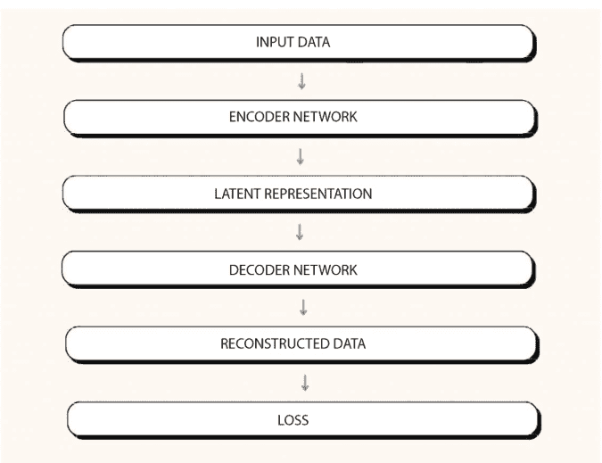

图 6.5 使用自动编码器进行无监督特征学习。

接收此隐式表示，并学习从中重建原始数据。重建数据（即解码器网络的输出）使用损失函数与原始输入数据进行比较。为了使自动编码器能够学习可应用于后续任务的数据准确表示，重建数据与原始输入数据之间的差异必须保持在最小值。

#### 6.4.2.1 流程

- 1) 输入数据：第一步是将数据集馈入无监督特征学习算法。此数据集可以是从图像到音频信号再到文本数据的任何内容。

- 2) 编码：下一步是使用编码器网络将输入数据转换为低维表示。编码器网络获取输入数据并训练以识别关键特征，将其压缩为更小的空间维度。隐式表示或代码是编码器的输出。

- 3) 解码：数据压缩为隐式表示后，解码器网络接手并学习从隐式表示中恢复原始输入。重建的数据是解码器的输出。

- 4) 训练：在训练期间对编码器和解码器网络进行调整，以减少输入数据和输出数据之间的差异。这通常使用损失函数来完成，该函数确定输入的原始值与重建后输出结果之间的差异。目标是训练模型发现数据的准确表示，该表示可应用于下游任务。

- 5) 特征学习：最后一步涉及将学习到的特征用于分类或聚类等下游任务。自动编码器的特征可以应用于其他模型的训练，或在低维空间中查看数据。

#### 6.4.2.2 优势

- 1) 数据效率：无监督特征学习是一种强大的数据效率方法，因为它可以用于从大量未标记数据生成表示。在获取标记数据困难或昂贵时，这尤其有帮助。

- 2) 泛化能力：无监督特征学习可用于训练对输入数据波动具有抗性的特征，有助于提高模型的泛化能力。因此，模型可能更可靠，并能够处理新的、未预见的数据。

- 3) 发现隐藏模式：数据可能包含不明显的隐藏模式或结构。无监督特征学习可以揭示这些模式或结构。在底层数据结构复杂且难以手动分析的各种应用中，这可能很有帮助，例如图像或音频分析。

- 4) 降维：无监督特征学习还可用于减少数据的维度，这可以促进分类或聚类等后续任务。因此，模型可能更易于理解且计算效率更高。

#### 6.4.2.3 劣势

- 1) 可解释性不足：无法理解学习到的特征是无监督特征学习的主要缺点之一。很难理解学习到的特征代表什么，这会使调试或改进模型变得具有挑战性。

- 2) 过拟合：当隐空间的维度足够大时，无监督特征学习中可能发生过拟合。模型在泛化能力方面可能表现不佳，无法处理全新的、未经测试的数据。

- 3) 计算复杂性：在处理大量数据时，无监督特征学习可能计算复杂。因此，将模型扩展到更大的数据集可能会很困难。

- 4) 需要大量数据：学习有用特征需要大量未标记数据。当标记数据很少或难以收集时，这可能是一个缺点。

### 6.4.3 深度学习

深度学习包括训练神经网络自动从输入中识别复杂和抽象的元素。然后，可以使用这些新发现的特征执行一系列任务 [21]，例如语音识别、目标检测、图像分类和自然语言处理。

#### 6.4.3.1 神经网络架构

深度特征学习使用一种神经网络架构，该架构旨在自动从输入数据中识别复杂和抽象的特征 [16]。它由多个互连的神经元层组成，这些层在非线性激活前对输入进行线性变换。在层次结构中，各层按组织方式排列：较低层学习简单特征，较高层学习更复杂和更抽象的特征。

我们可以在图 6.6 中看到具有多层的深度神经网络。深度特征学习的常见神经网络架构包括一个输入层、许多隐藏层 [22, 23] 和一个输出层。在接收原始输入数据（如照片、音频波形或文本）时，输入层将其预处理为数值形式，以便后续层进行处理。最终输出（如分类标签、回归值或一系列标记）由输出层生成。

##### 1) 隐藏层

深度特征学习神经网络架构的主要元素是隐藏层。它们负责掌握表征输入数据的复杂和抽象方面，这些方面

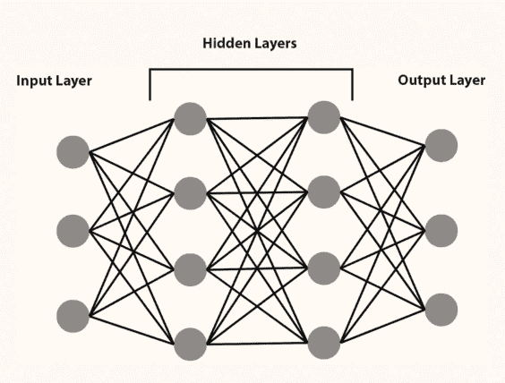

图 6.6 深度神经网络。

表征输入数据。隐藏层的数量和每层中的神经元数量是两个可以调整以提高网络性能的超参数。

全连接层（有时也称为密集层）是深度特征学习中最常用的隐藏层类型。在全连接层中，每个神经元的输出由其输入的加权总和（随后经过非线性激活函数）决定。全连接层中的每个神经元都与上一层中的每个神经元相连。训练阶段涉及使用反向传播学习神经元的权重和偏差。

卷积层是深度特征学习中使用的另一种隐藏层，旨在处理具有网格状布局 [23] 的数据（如照片）。卷积层使用一组可学习的滤波器处理输入数据，能够识别边缘、角点和纹理等局部模式。卷积层的输出是一系列特征图，显示这些模式在不同输入区域中的存在情况。

##### 2) 池化层

池化层用于对卷积层生成的特征图进行下采样 [24]。这减少了输入的维度，并增强了网络对输入甚至最小变化的抵抗力。最大池化层（输出输入特征图中每个局部区域的最大值）是最常用的池化层类型。其他类型的池化层包括平均池化和 L2 池化。

##### 3) 激活函数

在深度特征学习中，激活函数用于为神经网络架构引入非线性。随后，网络可以学习复杂的非线性相关性


介于输入和输出之间。修正线性单元（ReLU）是深度特征学习中最常用的激活函数，当输入为正时输出该输入，否则输出0。激活函数的其他子类别包括Sigmoid函数、双曲正切函数和Softmax函数。

##### 6.4.3.1.1 卷积神经网络

卷积神经网络（CNN）是用于深度特征学习的最流行的神经网络类型，旨在处理具有网格状结构的输入 [23]，例如图像。

典型的CNN设计由池化层、多个全连接层和众多卷积层组成。卷积层对输入图像应用一组可训练的滤波器，以识别边缘、角点和纹理等区域模式。池化层通过下采样卷积层产生的特征图，降低输入的维数，并增强网络对输入轻微变化的容忍度。全连接层组合卷积层的特征，以创建可应用于分类和其他任务的输入图像的高级表示。

#### 6.4.3.2 训练过程

在深度特征学习的训练阶段，将大量带标签的示例数据集输入网络，然后迭代更新神经元的参数，以最小化评估预期输出与实际输出之间差异的损失函数。分类问题中最常用的损失函数是交叉熵损失，它计算类别上的预期概率分布与实际概率分布之间的差异。

训练过程通常涉及前向传播和反向传播 [25] 两个阶段。在前向传播期间，输入数据通过网络传输并计算输出。在反向传播中，使用微积分的链式法则计算损失函数相对于神经元参数的梯度，并使用随机梯度下降（SGD）来优化参数。

优化过程随时间推移通过沿损失函数负梯度方向更新参数来降低损失。为防止过拟合，通常使用验证集来调整学习率（一个控制参数更新幅度的超参数）。其他超参数，如层数、每层神经元数量和丢弃率，也可以使用验证集进行调整。

#### 6.4.3.3 优势

- 1) 自动特征提取：深度特征学习能够自动从未处理的数据中提取相关且有意义的特征。这消除了对费力、主观且容易出错的手动特征工程的需求。

- 2) 更高准确性：包括语音识别、图像分类和自然语言处理在内的多种机器学习应用，已显示出从深度特征学习中获得性能和准确性提升的益处。深度神经网络的层级结构允许从输入数据中推断出越来越复杂和抽象的特性，从而对底层模式和关系进行更好的表示。

- 3) 迁移学习：深度特征学习支持迁移学习，这允许将从一项任务或主题中获得的知识应用到另一项任务或主题中。这可以大幅降低训练所需的标记数据数量，并进一步提高模型对新数据的泛化能力。
- 4) 鲁棒性：深度特征学习训练模型忽略不重要或带有噪声的特征，专注于最具信息量的特征，从而提高模型对带噪声或不完整输入的鲁棒性。
- 5) 可扩展性：深度特征学习可以扩展以处理大型、复杂的数据集，因为它利用分布式计算和并行处理在多个GPU或CPU上训练大型模型。

#### 6.4.3.4 劣势

- 1) 计算成本：深度特征学习可能计算成本高昂，特别是对于包含数百万参数的大型深度神经网络。这可能需要大量的计算资源，例如高性能GPU或云计算服务。
- 2) 数据依赖性：深度特征学习需要大量标记数据才能正确训练模型。如果获取标记数据昂贵或困难，这可能成为瓶颈。
- 3) 黑盒特性：深度特征学习模型充当黑盒，将输入数据转换为输出预测，而没有明确的规则或解释，这使得它们难以读取和理解。这可能降低它们在透明度和可理解性重要的场景中的实用性。
- 4) 过拟合：深度特征学习方法容易发生过拟合，即模型记忆训练数据而非泛化到新数据。可以通过在训练期间监控验证错误并采用权重衰减和丢弃等正则化方法来减少这种情况。
- 5) 对抗性攻击脆弱性：深度特征学习模型容易受到对抗性攻击，这类攻击由故意创建的输入组成，旨在导致模型做出错误预测。在自动驾驶汽车或医疗诊断等领域，这可能会产生严重后果。

### 6.4.4 机器学习和深度学习

深度学习 [26, 27] 和机器学习 [26, 27] 都包含训练算法，以便根据数据进行推断或进行预测。不过，两者之间存在一些明显的差异。

机器学习通常使用统计技术，利用结构化数据（例如数值数据或类别数据）训练算法，以寻找趋势并预测未来结果。机器学习算法分为两类：监督学习和非监督学习。在非监督学习中，算法在未标记的数据集上进行训练；在监督学习中，算法在标记的数据集上进行训练。由于机器学习依赖于传统分类器和手工制作的特征，因此需要人工干预。

相反，深度学习作为机器学习的一个分支，在文本、视频或照片等非结构化数据 [27] 上使用训练算法。在深度学习中，模型在训练过程中会自动学习新特征。深度学习算法旨在学习多个表示层，从而能够识别复杂模式并做出更精确的预测。深度学习算法通常以神经网络为核心，旨在模仿人脑的结构和功能。

总之，机器学习和深度学习都包含针对数据的训练算法 [28]；然而，机器学习通常使用结构化数据和统计方法，而深度学习通常使用非结构化数据和神经网络。深度学习算法会自动学习特征，这与其他机器学习技术不同。尽管深度学习方法比其他机器学习技术 [27] 提供更高的准确性，但存在一些缺点，包括需要大型数据集和更长的训练周期。

## 6.5 未来研究与发展

特征选择、提取和训练领域未来预计将有多种引人入胜的发展方向。在这里，我们将讨论该领域的一些最引人入胜的发展和研究。

- 非监督特征学习：这种技术包括在不使用标记样本的情况下学习数据表示，并且正在变得越来越流行。使用自动编码器、生成对抗网络（GANs）和变分自动编码器（VAEs）等非监督学习技术，对图像和音频信号等高维数据的有用表示的学习已显示出巨大的前景。
- 混合特征学习：另一个感兴趣的主题是混合特征学习，它结合了各种特征提取方法的优势。例如，深度学习模型可以与更传统的特征提取技术（例如小波或傅里叶变换）结合使用，以提高精度和有效性。
- 迁移学习：另一个有趣的领域是迁移学习，它包括将从一项任务或主题中获得的信息应用到另一项任务或主题中。迁移学习可以帮助模型更好地泛化到新数据，并大幅减少训练所需的标记数据量。
- 可解释人工智能：可解释人工智能涉及使机器学习模型更加透明和可解释，这是一个日益重要的领域，尤其是在医疗保健和金融等应用中。研究人员正在探索通过可视化学习到的特征和创建可解释的决策规则来使深度学习模型更具可解释性的方法。


- 5) 对抗机器学习：对抗机器学习涉及设计和防御对抗性攻击，是另一个活跃的研究领域。学术界正在研究方法，使机器学习模型更能抵御对抗性攻击，因为它们在自动驾驶汽车或医疗诊断等安全关键型应用中可能产生严重后果。

- 6) 小样本学习：小样本学习涉及从少量标记样本中学习，是另一个有前景的研究领域。小样本学习技术可以减少对大型标记数据集的依赖，并能快速适应新任务或新领域。

- 7) 元学习：元学习涉及学习如何学习，是另一个感兴趣的领域。元学习技术可以通过学习数据和底层任务结构的可推广表示，使模型能够快速适应新任务或新领域。

综上所述，特征选择、提取和训练是一个发展迅速 [29] 且拥有广阔潜在研究与开发机遇的课题。随着该领域的不断发展，我们可以期待新的进展和突破，从而有可能创建出更高效、更精确的机器学习模型。

## 6.6 未来展望

随着新技术和新方法的引入，特征选择 [30]、提取和学习的潜力前景广阔。潜在的发展领域包括（但不限于）：

- 1) 基于深度学习的特征提取：深度学习方法在涉及语音和图像识别的任务中已显示出相当大的潜力，预计未来将对特征提取产生重大影响。通过使用基于深度学习的特征提取技术从高维数据集中自动提取相关特征，可大幅减少人工特征选择所需的时间和精力。

- 2) 多目标特征选择：多目标特征选择算法的目标是同时优化多种目标，例如在提高分类准确率的同时最大限度地减少所选特征的总数。这些技术允许发现大量有用特征，可用于开发可信且精确的模型。

- 3) 无监督特征学习：无需任何监督即可从原始数据中学习有意义表示的方法，如自编码器和生成对抗网络（GANs），已显示出前景。这些方法可用于从未标记数据集中自动提取相关特征，在标记数据匮乏的情况下尤其有用。

- 4) 特定领域特征选择：未来，可以设想将开发出针对特定领域（如自然语言处理或医学影像）的特征选择技术。这些技术可考虑数据的特殊性及应用需求，从而做出更好的特征选择。

总体而言，开发新方法和新技术来应对高维数据集和复杂模型的挑战，为特征选择、提取和学习的未来带来了积极前景。

## 6.7 结论

综上所述，选择、提取和训练特征对于创建精确高效的机器学习模型至关重要。随着数据量和复杂性的增加，开发能够自动提取相关特征的技术的需求也在增长。许多方法已被研究，各有优劣。这些方法包括统计方法、深度学习模型和混合方案。预计随着进一步的研究和创新，机器学习模型在特征选择、提取和训练方面的效率、准确性和可解释性将得到提升。金融、医疗保健和自主系统等众多领域都可能从中受益。

## 参考文献

- 1. Sarker, I.H., 基于AI的建模：面向自动化、智能和智慧系统的技术、应用及研究问题. SN Comput. Sci., 3, 2, 158, 2022.
- 2. Ahmed, I., Jeon, G., Piccialli, F., 从人工智能到工业4.0中的可解释人工智能：关于什么、如何和何处的调查. IEEE Trans. Ind. Inf., 18, 8, 5031–5042, 2022.
- 3. Bai, L., Li, H., Gao, W., Xie, J., Wang, H., 高维数据分类中特征选择与分类器设计的联合多目标优化. Inf. Sci., 626, 457–473, 2023. ISSN 0020-0255, https://doi.org/10.1016/j.ins.2023.01.069.
- 4. Farhood, H. et al., 农业图像处理技术的最新进展. in: Artificial Intelligence and Data Science in Environmental Sensing, pp. 129–153, 2022.
- 5. Zhang, P., Huang, F., Wu, D., Yang, B., Yang, Z., Tan, L., 高流量区域遮挡人脸识别的设备-边缘-云协同加速方法. IEEE Trans. Multimedia, 25, 1513–1520, 2023. ISSN 1520-9210, https://doi.org/10.1109/TMM.2023.3240884.
- 6. Souiden, I., Omri, M., Brahmi, Z., 高维数据流中异常值检测综述. Comput. Sci. Rev., 44, 100463, 2022.
- 7. Jia, W. et al., 特征维度缩减：综述. Complex Intell. Syst., 8, 3, 2663–2693, 2022.
- 8. Islam, M. R., Lima, A. A., Das, S. C., Mridha, M. F., Prodeep, A. R., Watanabe, Y., 特征选择的过程、方法、评估与挑战综述. IEEE Access, 10, 99595–99632, 2022.
- 9. Ramezani, I. et al., 利用深度学习识别核电站暂态过程的不同特征选择技术性能评估. Ann. Nucl. Energy, 183, 109668, 2023.
- 10. Cilia, N.D. et al., 手写字符识别中特征选择的过滤法与包装法比较. Pattern Recognit. Lett., 168, 39–46, 2023.
- 11. Zhao, T., Zheng, Y., Wu, Z., 基于特征选择的非线性过程分布式模型预测控制机器学习建模. Comput. Chem. Eng., 169, 108074, 2023.
- 12. Preyanka Lakshme, R.S. and Ganesh Kumar, S., 基于机器学习的特征选择与特征提取综述. Advancements in Smart Computing and Information Security: First International Conference, ASCIS 2022, Rajkot, India, November 24–26, 2022, Springer Nature Switzerland, Revised Selected Papers, Part I. Cham, 2023.
- 13. Yang, M.-S. and Benjamin, J.B.M., 带Lasso的稀疏可能性C均值聚类. Pattern Recognit., 138, 109348, 2023.
- 14. Alkordy, N.H., Aljbouri, H.K., Wadi, Z.K., 基于深度CNN和PCA的肾脏超声图像特征提取与选择. Software Engineering Application in Systems Design: Proceedings of 6th Computational Methods in Systems and Software 2022, vol. 1, Springer International Publishing, Cham, pp. 104–114, 2023.
- 15. Sarhan, M., Layeghy, S., Moustafa, N., Gallagher, M., Portmann, M., 基于机器学习的IoT网络入侵检测特征提取. Digital Commun. Netw., 10, 1, 205–216, 2024. ISSN 2352-8648, https://doi.org/10.1016/j.dcan.2022.08.012.
- 16. Xie, J., Sage, M., Zhao, Y.F., 燃气轮机机器学习应用中的特征选择与特征学习：综述. Eng. Appl. Artif. Intell., 117, 105591, 2023.
- 17. Shang, R. et al., 基于空间特征的PolSAR图像分类卷积神经网络. Appl. Soft Comput., 123, 108922, 2022.
- 18. Khairandish, M.O. et al., MRI脑图像肿瘤检测与分类的混合CNN-SVM阈值分割方法. IRBM, 43, 4, 290–299, 2022.
- 19. Chen, Y., Mancini, M., Zhu, X., Akata, Z., 半监督和无监督深度视觉学习：综述. Comput. Vis. Pattern Recog., 19, arXiv:2208.11296, 2022.
- 20. Ogawa, M. et al., 基于3D变分自编码器的无监督深度学习在CT图像中检测内耳异常的效用. Comput. Biol. Med., 147, 105683, 2022.
- 21. Sharma, S. and Guleria, K., 图像分类的深度学习模型：比较与应用. 2022 2nd International Conference on Advance Computing and Innovative Technologies in Engineering (ICACITE), IEEE, 2022.
- 22. van der Westhuizen, E. et al., 低资源语言中高效无ASR关键词检测的特征学习. Comput. Speech Lang., 71, 101275, 2022.
- 23. Varshitha, K.S. et al., 使用卷积神经网络的自然语言处理. 2023 7th International Conference on Computing Methodologies and Communication (ICCMC), IEEE, 2023.
- 24. Nirthika, R. et al., 医学图像分析中卷积神经网络的池化：综述与实证研究. Neural Comput. Appl., 34, 7, 5321–5347, 2022.
- 25. Tang, Y. et al., 基于可穿戴传感器的人体活动识别多尺度深度特征学习. IEEE Trans. Ind. Electron., 70, 2, 2106–2116, 2022.
- 26. Formosa, N. et al., 类别不平衡情况下交通冲突预测的机器学习与深度学习技术评估. Data Sci. Transp., 5, 2, 4, 2023.
- 27. Fantin Irudaya Raj, E. and Balaji, M., 模式识别中深度学习与机器学习的应用. in: Advance Concepts of Image Processing and Pattern Recognition: Effective Solution for Global Challenges, pp. 63–89, Springer Singapore, Singapore, 2022.


- 28. Swathy, M. 和 Saruladha, K., 基于机器学习和深度学习技术的心血管疾病（CVD）分类与预测比较研究. ICT Express, 8, 1, 109–116, 2022.

- 29. Chatzoglou, E. et al., 重质胜重量：802.11 入侵检测系统的专家特征选择与数据预处理. IEEE Access, 10, 64761–64784, 2022.

- 30. Thakkar, A. 和 Lohiya, R., 入侵检测系统综述：特征选择、模型、性能度量、应用视角、挑战及未来研究方向. Artif. Intell. Rev., 55, 1, 453–563, 2022.

# 基于相位和局部特征的 CBIR 融合

Pooja Sharma

计算机科学与工程系，I K Gujral Punjab Technical University，贾兰达尔，旁遮普邦，印度

## 摘要

本章利用图像的全局特征和局部特征进行基于内容的图像检索。整个过程基于融合概念。将 Zernike 矩幅值和相位系数的综合特征应用于指定图像的全局特征，并结合局部特征，局部特征通过考虑图像质心与使用 Hough 变换获取的直线边缘之间的距离，通过直方图获得。通过引入高效算法计算 Zernike 矩和 Hough 变换，提高了处理速度。训练图像和测试图像之间的总体相似度使用 Bray-Curtis 相似度度量计算，该度量提供归一化距离并有助于提高检索率。所提方法也能检索变换图像，即，所提系统对光度变换和几何变换具有鲁棒性。我们全面实验的结果证实了所提综合方法优于其他类似方法。

关键词：Zernike 矩，Hough 变换，旋转不变性，查准率和查全率

## 7.1 引言

随着图像在工业和学术界应用的推进，研究人员被鼓励开发准确且高效的方法，从大型数据库中检索相关图像。图像检索在很大程度上取决于其视觉内容，就像 Google Lens 一样，而不是依赖费力的人工解释。在图像中，物体的形状被视为比颜色和纹理更重要的视觉内容。颜色特征无法提供可感知的人类感知 [1–3]。例如，如果相似物体具有不同颜色，第一幅图像中球的颜色是红色，而在另一幅图像中颜色是蓝色，那么这两幅图像将被视为两个不相似的图像，尽管它们的形状相似。纹理特征无法提供图像的语义信息。因此，形状在实体识别和检索中被视为重要的图像特征。

形状基础检索的重要性可参见 [4–7]。因此，在构建高效图像检索系统的方法中，我们关注形状基础图像检索。高效形状描述子和相似度度量的研究是图像检索应用中的首要问题，形状描述子的一个关键方面是能够对几何变换（旋转、缩放和平移）和光度变换（噪声、模糊和 JPEG 压缩）具有鲁棒性。

过去二十年中，已提出了各种形状表示和匹配技术。形状基础表示技术通常分为两类，即基于轮廓的描述子（CBDs）和基于区域的描述子（RBDs）。由于人类感知主要与形状的轮廓/外形一致，因此 CBDs 比 RBDs 更受欢迎。此外，在一些与形状相关的应用中，轮廓的外形或形状是唯一关键关注点，而内部细节并非强制性。基于轮廓的方法包括曲率尺度空间 [8]、Fourier 描述子 [9]、质心距离直方图 [10]、轮廓灵活性 [11]、弹性匹配 [12] 等。然而，基于轮廓的方法存在一些局限性。首先，CBDs 仅从形状边界提取信息，忽略了形状内部区域包含的基本信息，在某些应用中这更为重要。其次，CBDs 更容易受到噪声和变化的影响，因为它们仅利用图像的一小部分信息，即仅轮廓。第三，在某些情况下，图像轮廓不可用，例如，与商标图像不同，从纹理图像中提取轮廓是繁琐的。这些局限性可以通过 RBDs 来解决。RBDs 更加鲁棒，因为它们利用所有形状信息，因此可以应用于所有类型的图像，包括扭曲和有缺陷的形状，这是 CBDs 中常见的问题。基于区域的方法包括网格描述子 [13]、通用 Fourier 描述子 GFD [14]、矩不变量和矩函数 [15–18]、Zernike 矩描述子（ZMDs）[19] 等。虽然基于矩的 RBDs 为图像检索提供了吸引人的特性，但它们确实存在计算复杂度高的问题。其他类型的 RBDs 包括尺度不变特征变换（SIFT）[20]、方向梯度直方图（HOG）[21] 和加速稳健特征（SURF）[22] 等。SIFT 基于高斯差（DOG），并利用圆形窗口搜索关键点的可能位置。然而，圆形窗口中的图像内容对仿射变换不具有鲁棒性 [36]。HOG 描述子基于 SIFT 和边缘方向直方图。Oliva 和 Torralba [23] 阐述了图像中全局特征的作用。除此之外，Ong et al. 和 Pathak et al. [45–47] 描述了使用卷积神经网络的图像分类。

使用 CBDs 与基于矩的 RBDs 相结合的 CBIR 被发现非常有效。CBDs 提供关于图像边界局部变化的信息，但不提供图像内容的内部细节。另一方面，RBDs 提供图像内容的内部细节，但较少强调图像中的局部变化。因此，CBDs 和 RBDs 被认为相互补充，各有优缺点。因此，如果将两种描述子结合起来，图像检索系统的性能可以得到改善，正如 Jain 和 Vailaya、Wei et al. 以及 Qi et al. [24–26] 所观察到的那样。在 Jain 和 Vailaya [24] 的研究中，提出了一种商标检索的综合方法，其中使用边缘方向直方图提取图像的局部特征，并使用不变矩提取全局特征。该描述子对平移不变，但对缩放和旋转不变。在 Wei et al. [25] 和 Qi et al. [26] 的研究中，提供了其他商标检索的综合方法。

虽然 Wei et al. 和 Qi et al. [25, 26] 提出的混合方法取得了良好的效果，但它们存在一些局限性。首先，Wei et al. [25] 提出的基于曲率的局部特征容易受到图像噪声的影响，因为计算曲率需要二阶导数。其次，归一化距离直方图不支持相邻边缘点之间的关联。这是表示边缘点之间相邻关系的一个有吸引力的命题。然而，当两个相邻点彼此非常接近且半径变化显著时，它会受到大半径的影响。这会影响直方图的正确形成，从而削弱了局部特征的洞察力。

基于矩的全局特征的特点是矩计算中的求和操作具有最小信息冗余和对噪声的鲁棒性。除了旋转不变性之外，经过某些几何变换后，它们还可以变为平移不变和缩放不变。在基于矩的不变量中，ZM 在许多应用中被发现是最佳的形状描述子 [27–31]，因为它们具有最小的信息冗余和对噪声的最佳鲁棒性 [17]。受这些特性的启发，Wei et al. [25] 将 ZMs 用作全局特征。然而，作者仅利用前四阶矩及其幅值分量，未使用相位系数，这些不足以表示图像的完整特征。观察到 ZMs 相位系数比幅值对形状描述更有效 [32–36]。然而，与幅值系数不同，ZM 的相位系数不表现出旋转不变性特性。为了使相位系数具有旋转不变性，已提出了各种方法 [33–36]。这些方法首先计算测试图像和训练图像之间的旋转角度，然后执行相位校正以进行匹配。基于 ZMs 幅值和相位系数的相似度匹配已被发现可在多种应用中产生良好的效果。

本章，我们提出了一种结合局部特征和全局特征的有效混合方法用于图像检索，该方法解决了现有混合方法的问题。局部特征基于边缘点的 Hough 变换，边缘点使用 Canny 边缘检测器获取；全局特征基于 ZM。Hough 变换是检测边缘图像中直线边缘的一种非常鲁棒的方法。基于求和操作，它对噪声具有鲁棒性。直线边缘提供局部特征点的相邻属性。所有落在同一条直线上（具有相同斜率和截距）的边缘点在 Hough 变换中构成一条直线边缘。检测直线边缘后，计算直方图。所得直方图对旋转、平移和缩放不变。为了表示全局特征，我们使用 ZM 的幅值和相位系数。通过使用 Revaud et al. [35] 提出的方法估计旋转角度，对 ZM 的相位系数进行校正。尽管 ZM 和 Hough 变换计算密集，但我们采用了快速算法 [37, 39] 来克服这一局限性。ZM 和 Hough 变换共同提供了显著改进的结果，因为两者对几何变换和光度变换都具有鲁棒性，这已通过在众多图像数据库上进行的广泛实验得到证实。本章后续部分展示了所提系统的区分能力。为了进一步提高系统性能，我们使用一种称为 Sorensen 距离 [40, 41] 的操作比较度量，也称为 Bray-Curtis 距离。


本章其余部分组织如下：第 7.2 节概述了所提综合系统。第 7.3 节提出了综合形状描述子。第 7.4 节描述了相似度量。第 7.5 节深入介绍了所提系统的实验研究，结论在第 7.6 节给出。

## 7.2 所提系统概述

所提系统旨在提取基于轮廓和基于区域的特征，并利用有效的相似度量将其综合。该系统工作于两种模式。在第一种模式下，构建离线数据库，其中包含特征集及图像信息。特征通过基于 ZMs（幅度和相位）和 Hough 变换（直方图）的方法提取。在在线模式下，获取测试图像的特征，并与训练集中所有图像的特征进行比较。被比较的图像按其与测试图像的相关性分层，并呈现给用户。图 7.1 给出了特征提取和相似度匹配的一般流程。

## 7.3 所提混合形状描述子

为有效描述图像，需要提取适当的特征。在所提系统中，我们同时考虑全局特征和局部特征，以提高图像检索系统的准确性。全局特征旨在表示图像形状的整体配置，而局部特征决定图像边缘图的内部细节。在我们的系统中，利用 ZMs 幅度和相位系数来描述图像的全局特征。局部特征通过使用 Hough 变换检测图像轮廓上的边缘线来描述。

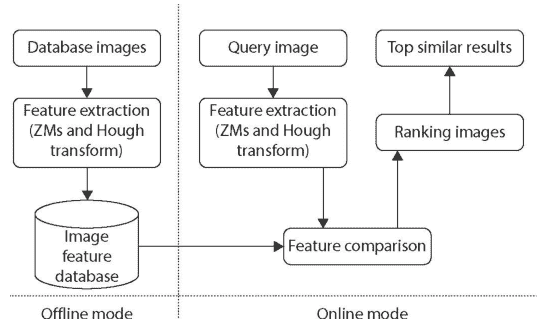

图 7.1 图像检索系统的一般流程。

### 7.3.1 使用 ZMs 进行全局特征提取

从数学角度，图像强度函数 f(r, θ) 的阶数为 p、重复数为 q 的正交 ZMs 集定义为 [18]:

\(Z_{pq} = \frac{p+1}{\pi} \int_0^{2\pi} \int_0^1 f(r, \theta) R_{pq}(r) e^{-jp\theta} r dr d\theta\),

其中 \(p \ge 0, 0 \le |q| \le p, p - |q| = even\)，\(j = \sqrt{-1}\)，且 \(\theta = \tan^{-1}(y/x)\)。\(R_{pq}(r)\) 是由以下公式定义的径向多项式

\(R_{pq}(r) = \sum_{k=0}^{(p-|q|)/2} (-1)^k \frac{(p-k)!}{k! \left(\frac{p+|q|}{2} - k\right)! \left(\frac{p-|q|}{2} - k\right)!} r^{p-2k}\)

若将图像函数 \(f(r, \theta)\) 旋转角度 \(\phi\)，则原始图像的 ZMs \(Z_{pq}\) 与旋转后图像的 ZMs \(Z_{pq}^r\) 之间的关系为

\(Z_{pq}^r = Z_{pq} e^{-jp\phi}\),

其中 \(\phi\) 为旋转角度。相位关系如下

\(\phi_{pq}^r = \phi_{pq} - q\phi + 2m\pi, m = 0, 1, 2, ..., \infty\)。

方程 (7.4) 给出了旋转角度 \(\phi\) 的 q 个不同解，如下所示

\(\phi = \left( \frac{\phi_{pq} - \phi_{pq}^r}{q} \right) + \left( \frac{2\pi}{q} \right) m, m = 0, 1, ..., q - 1\)。

这会导致确定旋转角度时出现歧义，因为只有其中一个解能提供正确的旋转角度。然而，它们的幅度相同，即

\(|Z_{pq}^r| = |Z_{pq} e^{-jp\phi}| = |Z_{pq}|\)

很明显，将图像旋转某个角度不影响 ZMs 的幅度，而相位会随图像旋转而改变。由于相位系数捕获了图像的重要信息，不包含相位系数的基于 ZMs 的特征无法充分描述图像。Revaud 等人 [35] 描述了一种同时涉及 ZMs 幅度和相位的相似度量，用于确定两幅图像之间的相似性。该方法确定两幅图像之间使以下函数最小的旋转角度 \(\phi\)

$F(\boldsymbol{\phi})=d^2(\boldsymbol{\phi})=\sum_{p=0}^{p_{\max }} \sum_{q=-p}^{p} \frac{\pi}{p+1}\left|Z_{p q}-Z^{\prime}_{pq} e^{jq \boldsymbol{\phi}}\right|^2$ (7.7)

若两幅图像相似，即一幅图像是另一幅的旋转版本，则 \(d^2(\phi) = 0\)。若两幅图像不同，则预计 \(d^2(\phi)\) 将取较高值。简化后，Eq. (7.7) 变为 [35]。

\(F(\boldsymbol{\phi})=\sum_{p=0}^{p_{\max }} \sum_{q=-p}^{p} \frac{\pi}{p+1}\left[\left|Z_{p q}\right|^2+\left|Z^{\prime}_{pq}\right|^2-2\left|Z_{p q} Z_{p q}^r\right| . \cos (q \boldsymbol{\phi}+\boldsymbol{\phi}_{pq}^r-\boldsymbol{\phi}_{p q})\right].\) (7.8)

\(F(\phi)\) 的最小值位于区间 \([\phi_n, \phi_{n+1}]\) 中，其中 \(\phi_{n}=n \pi / 2 p_{max}, 0 \le n < 4p_{max}\)。该方法通过求解以下函数的零点来简化

\(F'(\boldsymbol{\phi})=0=\sum_{p=0}^{p_{\max }} \sum_{q=-p}^{p} \frac{2 \pi q}{p+1}\left|Z_{p q} Z_{p q}^r\right| \sin (q \boldsymbol{\phi}+\boldsymbol{\phi}_{p q}^r-\boldsymbol{\phi}_{p q})\) (7.9)

因此，在计算旋转角度 \(\phi\) 并使用 Eq. (7.4) 进行相位校正后，相位系数变为旋转不变，并与幅度一起作为所提方法中的特征使用。然而，ZMs 计算密集。若在 \(N \times N\) 像素的图像上计算最高阶为 \(p_{max}\)（其中 \(p_{max}\) 为最大阶数）的矩，ZMs 的时间复杂度为 \(O(N^2 p_{max}^3)\) 级。当 \(N\) 和 \(p_{max}\) 均较大时，\(O(N^2 p_{max}^3)\) 级非常大。为了加快 ZMs 的计算，我们采用 Chong 等人 [38] 提出并由 Singh 等人 [37] 扩展的 q-递归方法。

#### 7.3.1.1 径向多项式 \(R_{pq}(r)\) 的递推关系 [38, 39]

以下递归步骤降低了 Zernike 多项式的时间复杂度

- I. \(R_{pp}(r) = r^p\)
- II. \(R_{p,p-2}(r) = p r^p - (p-1)r^{p-2}\)
- III. \(R_{pq}(r) = K_1 R_{p,q+4}(r) + \left(K_2 + \frac{K_3}{r^2}\right) R_{p,q+2}(r), q = p - 4, p - 6, ..., 1 (\text{or } 0),\)
- (7.10)

其中

\(K_3 = -\frac{4(q+2)(q+1)}{(p+q+2)(p-q)}\)
\(K_2 = \frac{K_3(p+q+4)(p-q-2)}{4(q+3)} + (q+2)\)
\(K_1 = \frac{(q+4)(q+3)}{2} - (q+4)K_2 + \frac{K_3(p+q+6)(p-q-4)}{8}\)

#### 7.3.1.2 三角函数的递推关系 [39]

使用递推关系计算 \(\cos(q\theta)\) 和 \(\sin(q\theta)\)，并将其存储在两个表 \(\cos \, t \,[M]\) 和 \(\sin \, t \,[M]\) 中，其中 \(M\) 为矩的总数。

- I. Let

\(r = (x_i^2 + y_k^2)^{1/2}, \, a = C_0 = \frac{x_i}{r}, \, b = S_0 = \frac{y_k}{r}, \, \cos[t][0] = a, \sin[t][0] = b\)

- II. for \(q = 1 \text{ to } p_{\max}\)

C_q = aC_{q-1} - bS_{q-1}
S_q = aS_{q-1} + bC_{q-1}
\cos[t][q] = C_q \, \sin[t][q] = S_q
end for

额外开销是表 \(\sin \, t[p_{\max} + 1]\) 和 \(\cos \, t[p_{\max} + 1]\) 所需的空间，共有 \(2(p_{\max} + 1)\) 个字。

### 7.3.2 使用 Hough 变换进行局部特征提取

如前所述，局部特征使用 Hough 变换提取，完整细节可见 Singh and Pooja [42–44]，其具有旋转、尺度和噪声不变性。

### 7.3.3 特征维度

由于 ZMs 提供大量矩，最优且有效的特征集是检索系统获得满意性能的基本要求。特征集大小过高或过低分别会导致过拟合或欠拟合，从而降低检索系统的性能。通常，矩的阶数越高，ZMs 特征的性能应越好。然而，计算复杂度会急剧增加，高阶矩会导致数值不稳定和噪声 [44]。选择 \(p_{\max} = 12\) 是计算复杂度、数值稳定性和描述子性能之间的权衡 [35, 36]。我们通过图 7.2a 中给出的实验证据来证明这一点，该图表示不同矩阶数下的平均检索率。据认为，使用 \(p_{max} = 12\) 和 \(p_{max} = 16\) 的检索率差异仅为 1.17%。图 7.2b 显示，计算最高至 \(p_{max} = 16\) 的矩的 CPU 流逝时间为 0.029 秒，而 \(p_{max} = 12\) 为 0.018 秒。时间百分比差异为 37.93%。因此，与 \(p_{max} = 12\) 相比，\(p_{max} = 16\) 的检索准确率提升甚微，而 CPU 流逝时间差异为

表 7.1 按序列列出的 ZMs，其中 \((p_{max}, q_{max}) = (12, 12)\)。

| $q_{max}$ | 矩 | ZMs 索引 (M) |
| :--- | :--- | :--- |
| 1 | $Z_{1,1} Z_{3,1} Z_{5,1} Z_{7,1} Z_{9,1} Z_{11,1}$ | 1, 2,..., 6 |
| 2 | $Z_{2,2} Z_{4,2} Z_{6,2} Z_{8,2} Z_{10,2} Z_{12,2}$ | 7, 8,..., 12 |
| 3 | $Z_{3,3} Z_{5,3} Z_{7,3} Z_{9,3} Z_{11,3}$ | 13, 14,..., 17 |
| 4 | $Z_{4,4} Z_{6,4} Z_{8,4} Z_{10,4} Z_{12,4}$ | 18, 19,..., 22 |
| 5 | $Z_{5,5} Z_{7,5} Z_{9,5} Z_{11,5}$ | 23, 24, 25, 26 |
| 6 | $Z_{6,6} Z_{8,6} Z_{10,6} Z_{12,6}$ | 27, 28, 29, 30 |
| 7 | $Z_{7,7} Z_{9,7} Z_{11,7}$ | 31, 32, 33 |
| 8 | $Z_{8,8} Z_{10,8} Z_{12,8}$ | 34, 35, 36 |
| 9 | $Z_{9,9} Z_{11,9}$ | 37, 38 |
| 10 | $Z_{10,10} Z_{12,10}$ | 39, 40 |
| 11 | $Z_{11,11}$ | 41 |
| 12 | $Z_{12,12}$ | 42 |

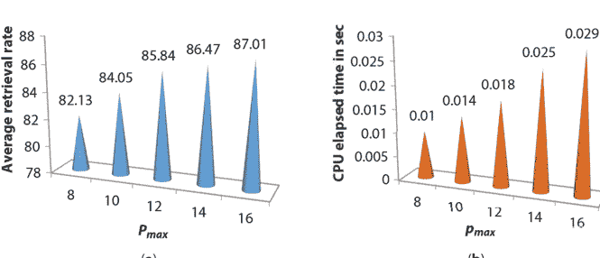

图 7.2. ZMs 检索率与计算复杂度之间权衡的表示（a）COIL-100 数据库中各种矩阶数的平均检索率（b）考虑矩阶数从 8 到 12 的 CPU 处理流逝时间（秒）。


很高。因此，我们选择 \( p_{max} = 12 \) 以实现高效有效的图像检索。\( q = 0 \) 的矩被排除在特征集之外，因为它们提供零相位，因此不适用于图像匹配和旋转不变性。\( p_{max} = q_{max} =12 \) 的 ZMs 选定特征集见表 7.1。ZMs 的索引也在表中给出，目的是按顺序呈现它们，这在本章后面部分引用时需要。

### 7.3.4 提议描述子的有效性

通过考虑图像之间的类内和类间变化，评估了提议的全局和局部形状描述子的有效性。我们考虑来自 MPEG-7 数据库（如图 7.3a 所示）的四个“bell”类相似图像（“bell-13”、“bell-14”、“bell-15”和“bell-16”）以及四个不相似图像（“elephant-6”、“camel-3”、“deer-6”和“dog-10”）。局部形状描述子的功效在图 7.3b 和 7.3c 中呈现，它们揭示了相似类图像直方图特征之间的微小差异以及不相似类图像之间的显著差异。ZMs 幅度和相位系数能够有效地区分一个类图像与另一个类图像的内容。可以从图 7.3d 和图 7.3f 中看到，幅度和相位系数在类内图像中的行为是一致的，而类间图像中观察到了显著差异，如图 7.3e 和图 7.3g 所示。在估计旋转角度并使用等式 (7.4) 进行相位校正后，绘制相位系数。

## 7.4 相似度测量

将提取的特征与某种可操作距离度量进行匹配是下一项重要任务，因为图像检索中匹配过程的性能取决于对适当相似度度量的选择。图像之间的相似度计算如下：

```
\( D(Q,T) = w_c d_{BC}^c(Q,T) + w_{mag} d_{BC}^{mag}(Q,T) + w_{phase} d^{phase}(Q,T), \quad (7.12) \)
```

```
\( where \quad d_{BC}^c(Q,T) = \frac{\sum_{i=0}^{H-1} |f_i(Q) - f_i(T)|}{\sum_{i=0}^{H-1} |f_i(Q) + f_i(T)|} \quad (7.13) \)
```

| 类别 | 项目 1 | 项目 2 | 项目 3 | 项目 4 |
|---|---|---|---|---|
| 相似图像 | bell-13 | bell-14 | bell-15 | bell-16 |
| 不相似图像 | elephant-6 | camel-3 | deer-6 | dog-10 |

*(a) 来自 MPEG-7 数据库的四个相似图像和不相似图像。*

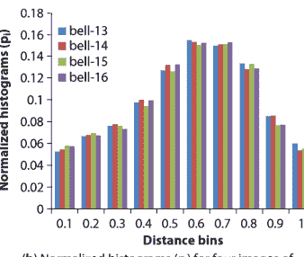

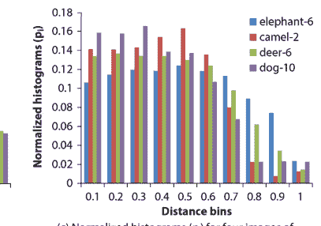

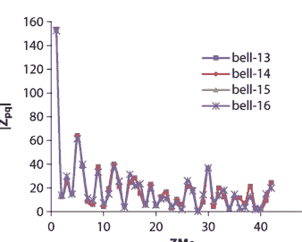

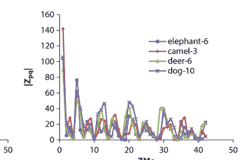

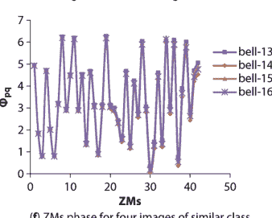

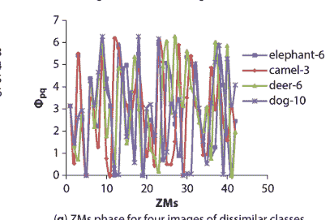

图 7.3。(a) 相似类和不相似类的图像，(b) 和 (c) 它们的归一化直方图，(d) 和 (e) ZMs 幅度，以及 (f) 和 (g) ZMs 相位系数。

$d_{BC}^{mag}(Q,T) = \frac{\sum_{i=1}^{M} ||Z_i^Q| - |Z_i^T||}{\sum_{i=1}^{M} |Z_i^Q| + |Z_i^T|} \quad (7.14)$

$d^{phase}(Q,T) = \frac{1}{M} \sum_{i=1}^{M} \left[ \frac{\min(|\boldsymbol{\varphi}_i^Q - \boldsymbol{\varphi}_i^T|, 2\pi - |\boldsymbol{\varphi}_i^Q - \boldsymbol{\varphi}_i^T|)}{\pi} \right]^2 \quad (7.15)$

其中，\(\boldsymbol{\varphi}_i^Q\) 和 \(\boldsymbol{\varphi}_i^T\) 分别表示查询图像和训练图像的 ZMs 相位系数，\(\boldsymbol{\varphi}_i^Q\) 是查询图像的校正相位，它是在估计旋转角度 \(\phi\) 并进行相位校正后获得的。从上述等式 (7.13)、(7.14) 和 (7.15) 可以清楚地看出，\(d_{BC}^c(Q,T)\)、\(d_{BC}^{mag}(Q,T)\) 和 \(d^{phase}(Q, T)\) 均在区间 [0, 1] 内。在上述等式中，\(w_c\)、\(w_{mag}\) 和 \(w_{phase}\) 分别是 \(d_{BC}^c(Q,T)\)、\(d_{BC}^{mag}(Q,T)\) 和 \(d^{phase}(Q, T)\) 的权重因子。因此，在我们的实验中，为求简单，我们给 \(w_c\)、\(w_{mag}\) 和 \(w_{phase}\) 赋予相等权重，即 \(w_c = w_{mag} = w_{phase} = 1/3\)，以使所有特征做出等同贡献。

## 7.5 实验研究与性能评估

本节描述了我们大量实验所进行的分析和观察。最近的研究已经探讨了混合方法在图像检索系统中的应用，以提高检索精度。因此，我们将我们的系统与 Wei 等人和 Qi 等人提出的两种混合方法 [25, 26] 进行对比，分别称为 TCS 和 QLS。我们还将我们的结果与不变 Zernike 矩描述子 (IZMD) [34]、最优相似度 [35] 和相邻相位 [36] 进行对比，其中 ZMs 幅度和相位均用作特征。在 Revaud 等人 [35] 和 Chen 与 Sun [36] 的研究中，发现图像匹配性能对几何和光度变换具有前景；尽管如此，它们的性能在主题数据库中会下降，其中样本类内样本之间存在差异。所提议和上述提到的方法的算法均在 VC++ 9.0 中实现，采用与其研究论文中提到的类似策略。以下小节描述了性能度量、数据库构建和实验结果。

### 7.5.1 精确率与召回率 (P-R)

我们使用精确率和召回率来评估图像检索系统的性能，具体如下：

P = \frac{relevant images retrieved from the database}{total number of images retrieved} \times 100

R = \frac{relevant images retrieved from the database}{number of relevant images to query image in the database} \times 100 \quad (7.16)

### 7.5.2 数据库构建

为了评估所提议综合解决方案与上述其他图像匹配和检索方法的性能，我们考虑了众多数据库，即 MPEG-7 CE shape-1 部分 B、Columbia 目标图像库 (COIL-100)，样本图像分别见图 7.4 和图 7.5。几何和光度变换后的图像见图 7.6，其中对图像应用了旋转、缩放、平移、噪声、模糊、JPEG 压缩。这些数据库的详细信息可在 Singh 和 Pooja [43] 中找到。

### 7.5.3 实验研究

#### 7.5.3.1 主题数据库上图像检索性能评估

通过使用 P-R 曲线观察该系统在各种构建数据库上的性能，对所提议系统进行评估。所有数据库图像都作为查询提交给图像检索系统。性能测量过程针对三个数据库进行了检查：(a) 用于主题变化的 MPEG-7 和 COIL-100 数据库，分别包含 70 和 100 个类别；(b) 表现出几何变换的数据库；(c) 表现出光度变换的数据库。最初，我们进行实验以找出原始 MPEG-7 数据库 P-R 曲线的趋势。过去，研究人员已提出各种

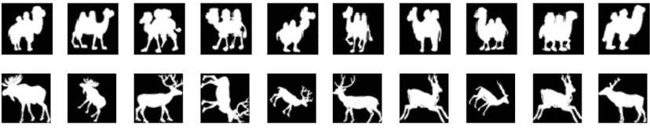

图 7.4 来自 MPEG-7 CE Shape 1 Part-B 数据库的样本图像。

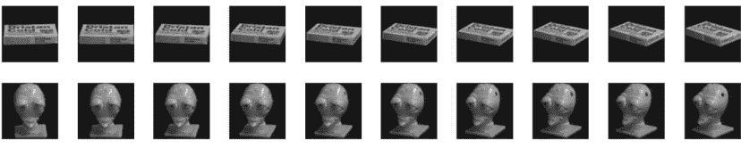

图 7.5 COIL-100 数据库。

| 旋转 | 0° | 18° | 90° | 162° | 342° |
|---|---|---|---|---|---|
| 缩放 | 32 x 32 | 40 x 40 | 48 x 48 | 56 x 56 | 64 x 64 |
| 平移 | T(0, 0) | T(0, 2) | T(2, 6) | T(6, 4) | T(8, 8) |
| 噪声 | σ = 0.0 | σ = 0.01 | σ = 0.03 | σ = 0.09 | σ = 0.19 |
| 模糊 | μ = 0.0 | μ = 3.0 | μ = 9.0 | μ = 16.0 | μ = 21.0 |
| JPEG 压缩 | 0% | 5% | 35% | 70% | 100% |

图 7.6 几何和光度变换数据库。

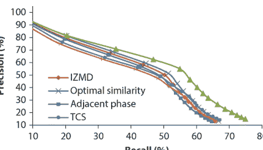

图 7.7 使用传统欧氏距离度量的提议方法和其他方法的 P-R 性能。

相似度度量以提高系统的检索精度。其中，欧氏距离度量使用最频繁。因此，我们将欧氏距离度量用作所有考虑方法（包括所提方法）的分类器，并比较所提方法与其他方法的 P-R 性能。图 7.7 呈现的 P-R 曲线表明，所提系统优于最优相似度方法，其次是 IZMD 和相邻相位方法。图 7.8 呈现了使用 Bray-Curtis 相似度度量和欧氏距离度量的所提系统与其他方法的 P-R 性能比较，以及相应的

他们方法中使用的相似度度量。图 7.8a 展示了基于 ZMs 的方法的 P–R 性能，图 7.8b 展示了混合方法的相同性能。观察到，提出的方法显著优于其他方法。还从 P–R 曲线观察到，与使用欧氏距离度量相比，使用 Bray-Curtis 度量进一步提高了检索性能。值得一提的是，带有或不带有归一化的欧氏距离性能几乎保持相似，它们的 P–R 曲线相互重叠。事实上，如图 7.8a 所示，使用归一化欧氏距离时，在较高召回率值下观察到性能略有下降。我们展示了召回率为 10%、20%、30%、40% 和 50% 时的几个精确率值。对于提出的方法，精确率值分别为 95.92%、84.21%、79.67%、70.05%，而对于次佳方法即最优相似度方法，这些值分别为 ZMs 基础特征的 93.14%、80.95%、69.88%、59.88% 和 54.14%。这证明了由于 Bray-Curtis 相似度度量而带来的更好性能。当同时考虑局部和全局特征时（图 7.8b），提出的方法提供的精确率值分别为 95.92%、84.21%、79.67%、75.49% 和 70.05%，而次佳方法即 TCS 方法提供的精确率值为 90.5%、79.21%、68.98%、62.95% 和 55.83%。提出的系统在 COIL-100 数据库上的性能如图 7.9 所示，这也证实了提出的系统的优越性。MPEG-7 数据库每个类别的 TCS、QLS 和提出的系统的正确检索结果如图 7.10 所示。从图中可以看出，提出的系统的正确检索率远高于 TCS，其次是 QLS。提出的方法和其他方法的顶检索结果根据与查询图像的相关性在图 7.11 中显示。提出的方法针对 MPEG-7 数据库的查询图像检索了 18 张相关图像。为了限制篇幅，图中仅绘制了前 12 个检索结果，这表明提出的系统相对于其他方法性能有所提高。如图所示，所有 12 张检索图像均被发现相关。最优相似度方法产生 10 张相关图像，其次是相邻相位（9 张）、TCS（8 张）、QLS（7 张）和 IZMD（6 张）相关图像。COIL-100 数据库的前 10 个检索结果根据与查询图像的相关性在图 7.12 中描绘，这再次表明提出的解决方案检索了全部 10 张相关图像，其次是

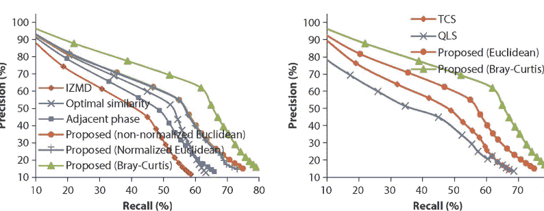

图 7.8 使用 Bray-Curtis 和欧氏距离度量对 MPEG-7 数据库的 P–R 性能比较（a）基于 ZMs 的方法，（b）混合方法。

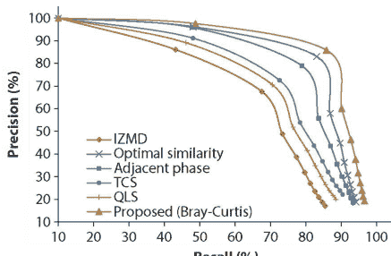

图 7.9 使用 Bray-Curtis 相似度度量对 COIL-100 数据库的 P-R 性能比较。

最优相似度方法和相邻相位方法分别检索了九张和八张相似图像。IZMD、TCS 和 QLS 方法各仅检索了五张相关图像。

#### 7.5.3.2 几何和光度变换数据库上的图像检索性能评估

针对几何变换（即旋转、缩放和平移），如图 7.13a 至 7.13c 所示，确定了合成系统的 P–R 评估。认为，在召回率高达 80% 时，所有方法在图像旋转下都表现出稳定的性能，尽管所设计方法的性能优于其他方法。当召回率接近 100% 的更高值时，提出的系统的性能改进变得更加显著。图 7.13b 显示的尺度不变性趋势对于提出的方法、最优相似度方法、相邻相位方法和 IZMD 方法是相似的。然而，在此测试中，TCS 和 QLS 的结果有所下降。所有方法的平移 P-R 性能变化非常显著。提出的系统提供的结果远优于其他方法。这是由于提出的系统的局部特征，因为直方图涉及从质心计算。接下来，我们评估了提出的系统在带有光度变换的数据库上的结果。图 7.13d 和图 7.13e 分别呈现了噪声和模糊图像数据库的 P–R 曲线，性能相似。可以看出，提出的解决方案相对于其他方法表现出优越性。然而，如图 7.13f 所示，JPEG 压缩图像的 P-R 性能对于提出的方法、最优相似度和相邻相位技术是相似的，但对于 IZMD 来说有所下降，其次是 TCS 和 QLS。

#### 7.5.3.3 可扩展性和时间复杂度评估

通过在更大数据库上进行实验，评估了合成系统的鲁棒性和可扩展性。为此，我们从几何和光度变换数据库中构建了一个包含每个类别 10 张图像的数据库。共有六个数据库，即旋转、平移、缩放、噪声、模糊和 JPEG 压缩。扩展数据库包含 70 个类别的 60 个样本，总共生成 4200 张图像。所有这些图像都代表图像的几何和光度特征。因此，通过使用图像数据库评估了合成系统的强度和可扩展性，如图 7.14 中的 P-R 曲线所示。显然，提出的系统具有高度的鲁棒性和可扩展性，与 TCS 和 QLS 相比提供了更优的检索准确性。提出的系统的时间复杂度也进行了评估，并与 TCS 和 QLS 进行了比较，结果载于表 7.2。可以看出，TCS 耗时最少，其次是提出的合成方法。然而，

图 7.10 使用 (a) TCS、(b) QLS 和 (c) 提出的系统从 MPEG-7 数据库的 70 个类别中获得的正确检索结果。

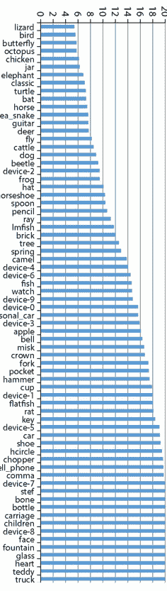

- 帽子
- 蝴蝶
- 章鱼
- 鸟
- 袋子
- 鸡
- 马
- 蜥蜴
- 火车
- 焦油
- de6
- de7
- de3
- 比目鱼
- de2
- 行人
- 狗
- 马蹄
- 手表
- 经典
- 熊
- 砖块
- 青蛙
- 海蛇
- 猫
- 城堡
- 大象
- 脸
- 骆驼
- 铃铛
- 苹果
- 乌鸦
- 铅笔
- de1
- 鹿
- 苍蝇
- 吉他
- 心脏
- 钥匙
- 亲爱的
- 苍蝇
- 叉子
- 口袋
- 勺子
- 灯笼鱼
- de5
- 完成
- 手机
- de8
- misk
- 相机
- 弹簧
- 汽车
- 锤子
- 砖块
- de0
- comm
- 船
- 泰迪熊
- 卡车
- 火车
- 直升机
- 骨头
- de7
- 喷泉
- 瓶子
- 儿童


- 章鱼
- 蝴蝶
- 树
- 龟
- 龙头
- de0
- 鸟
- 甲虫
- 猫
- 帽子
- 铅笔
- 马
- 鸡
- 狗
- de2
- 老虎
- 手表
- 经典
- 人
- 马
- 王冠
- 袋子
- 骆驼
- 勺子
- 蜥蜴
- de9
- 大象
- 猫
- 牛
- de5
- 钥匙
- de1
- 羊
- limfish
- 口袋
- 苍蝇
- 海蛇
- 苍蝇
- 青蛙
- 青蛙
- 码头
- 砖块
- 汽车
- 脸
- 老虎
- 猿
- 汽车
- de8
- misk
- 吉他
- 龙头
- 逗号
- de2
- 洞穴
- 比目鱼
- 熊
- 手机
- 弹簧
- chipper
- 锤子
- 心脏
- 熊
- stef
- 卡车
- 锤子
- 马车
- 老鼠
- 玻璃
- 瓶子
- 喷泉
- 泰迪熊
- 儿童

| 方法 | 排名 1 | 排名 2 | 排名 3 | 排名 4 | 排名 5 | 排名 6 | 排名 7 | 排名 8 | 排名 9 | 排名 10 | 排名 11 | 排名 12 |
|---|---|---|---|---|---|---|---|---|---|---|---|---|
| IZMD | | | | | | | | | | | | |
| QLS | | | | | | | | | | | | |
| TCS | | | | | | | | | | | | |
| 相邻相位 | | | | | | | | | | | | |
| 最优相似度 | | | | | | | | | | | | |
| 提出的方法 | | | | | | | | | | | | |

**图 7.11** (a) 查询图像 (b) 提出的方法和其他方法对 MPEG-7 数据库的前 12 个检索结果。

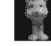

| 方法 | 排名 1 | 排名 2 | 排名 3 | 排名 4 | 排名 5 | 排名 6 | 排名 7 | 排名 8 | 排名 9 | 排名 10 |
|---|---|---|---|---|---|---|---|---|---|---|
| QLS | | | | | | | | | | |
| TCS | | | | | | | | | | |
| IZMD | | | | | | | | | | |
| 相邻相位 | | | | | | | | | | |
| 最优相似度 | | | | | | | | | | |
| 提出的方法 | | | | | | | | | | |

**图 7.12** (a) 查询图像 (b) 提出的方法和其他方法对 COIL-100 数据库的前 12 个检索结果。

与提出的系统获得的高检索率相比，时间差异非常小。另一方面，QLS 耗时最多。我们还观察到，*扩展数据库*中 4200 张图像的特征提取所需时间是 MPEG-7 数据库中 1400 张图像所需时间的三倍多。这是因为 *扩展数据库* 中的图像尺寸不等，范围从 32 x 32 像素到 104 x 104 像素


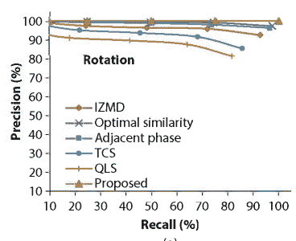

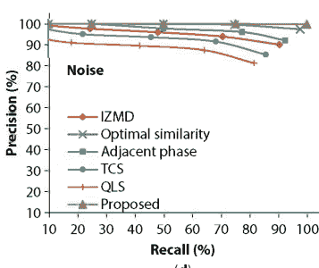

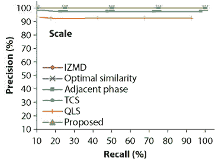


图 7.13 几何和光度变换的 P-R 性能评估（a）旋转（b）缩放（c）平移（d）噪声（e）模糊，以及（f）JPEG 压缩。


图 7.14 扩展数据库的鲁棒性和可扩展性 P-R 性能比较。

表 7.2 平均 CPU 耗时演示。

| 特征提取 | TCS | QLS | 本文提出 |
|---|---|---|---|
| 离线（1400 张图像） | 87.39 | 96.29 | 89.75 |
| 离线（4200 张图像） | 336.39 | 358.29 | 340.15 |
| 在线（1 张图像） | 0.062 | 0.069 | 0.064 |

各维度相差 8 像素，这些图像从 Scale 数据库获取。但是，在 MPEG-7 数据库中，图像被调整为固定尺寸 96 × 96 像素。

## 7.6 结论

本章提出了一种综合的 CBIR 方法。我们发现，图像的轮廓和基于区域的特征对于描述图像的轮廓以及整个结构都很重要。因此，我们提出了一种基于 Hough 变换的局部特征提取器，用于线性边缘检测，它给出了图像边缘图中相邻边缘点之间的关联。由于对噪声和旋转具有鲁棒性，使用 Hough 变换推导出的线性边缘能够有效区分一个图像类与另一个图像类，从而显著提高检索精度。我们使用 ZMs 的幅度和相位系数来提取全局特征，因为两者在表示图像整体结构方面都相当熟练。使用 Bray-Curtis 相似度量进一步改善了结果。在大量代表各种几何和光度变化的不同数据库上的大量实验结果表明，所提出的综合解决方案优于其他方法，并提供了改进的 CBIR 系统。

未来工作将考虑医学图像，并结合分类算法以进一步提高精度。

## 参考文献

- 1. Da, L., Costa, F., Cesar Jr., R.M., 形状分析与分类：理论与实践，CRC Press, Boca Raton, 2009.
- 2. Loncarić, S., 形状分析技术综述。Pattern Recognit., 31, 983–1001, 1998.
- 3. Chun, S., Kim, N.C., Jang, I.H., 基于多分辨率颜色和纹理特征的内容图像检索。IEEE Trans. Multimedia, 10, 6, 1073–1084, 2008.
- 4. Sharma, P., 使用空间分布点的稳健直方图和角径向变换进行改进的形状匹配和检索，Optik, 145, 346–364, 2017.
- 5. Govindaraj, P. 和 Sudhakar, M.S., 用于形状检索的基于六角网格的三角化特征描述符。Pattern Recognit. Lett., 116, 157–163, 2018.
- 6. Sunithaa, T. 和 Sivarani, T.S., 基于 BoVW 分类方法的新型内容医学图像检索。Biomed. Signal Process. Control, 77, 103678, 2022.
- 7. Mahajan, S. 和 Pandit, A.K., 使用信号处理和复杂代数技术监督特征选择的混合方法。Multimedia Tools Appl., 82, 8213–8234, 2021.
- 8. Mokhtarian, F., Abbasi, F., Kittler, J., 基于曲率尺度空间的形状内容高效鲁棒检索。Int. Workshop on Image Databases and Multi-Media Search, pp. 51–58, 1997.
- 9. Zhang, D. 和 Lu, G., 曲率尺度空间和傅立叶描述符用于基于形状的图像检索的比较研究。J. Visual Commun. Image Represent., 14, 41–60, 2003.
- 10. Zhang, D. 和 Lu, G., 用于形状表示和检索的傅立叶描述符比较研究，载于：第 5 届亚洲计算机视觉会议 (ACCV02), 2002.
- 11. Xu, C.J., Liu, J.Z., Tang, X., 基于轮廓灵活性的 2D 形状匹配。IEEE Trans. Pattern Anal. Mach. Intell., 31, 1, 180–186, 2009.
- 12. Attalla, E. 和 Siy, P., 基于轮廓分割多边形多分辨率和弹性匹配的稳健形状相似性检索。Pattern Recognit., 38, 2229–2241, 2005.
- 13. Lu, G.J. 和 Sajjanhar, A., 适用于内容图像检索的基于区域的形状表示和相似度量。Multimedia Syst., 7, 2, 165–174, 1999.
- 14. Zhang, D. 和 Lu, G., 使用通用傅立叶描述符进行基于形状的图像检索。Signal Process.: Image Commun., 17, 10, 825–848, 2002.
- 15. Hu, M.-K., 基于矩不变量的视觉模式识别。IEEE Trans. Inf. Theory, 8, 2, 179–187, 1962.
- 16. Jones, B.E., Schaefer, G., Zhu, S.Y., 医学红外图像的内容图像检索。Proc. 26th Int. Conf. Eng. Med. Biol. Soc., vol. 1, pp. 1186–1187, 2004.
- 17. Teh, C.-H. 和 Chin, R.T., 关于基于矩方法的图像分析。IEEE Trans. Pattern Anal. Mach. Intell., 10, 4, 496–513, 1988.
- 18. Teague, M.R., 基于一般矩理论的图像分析。J. Opt. Soc. Am., 70, 920–930, 1980.
- 19. Kim, W.-Y. 和 Kim, Y.-S., 使用 Zernike 矩的基于区域的形状描述符。Signal Process.: Image Commun., 16, 95–102, 2000.
- 20. Lowe, D.G., 来自尺度不变关键点的独特图像特征。Int. J. Comput. Vision, 60, 2, 91–110, 2004.
- 21. Dalal, N. 和 Triggs, B., 用于人体检测的定向梯度直方图。IEEE Int. Conf. CVPR, 2005.
- 22. Bay, H., Ess, A., Tuytelaars, T., Van Gool, L., 加速稳健特征 (SURF)。Int. J. Comput. Vis. Image Underst., 110, 3, 346–359, 2008.
- 23. Oliva, A. 和 Torralba, A., 构建场景 gist：全局图像特征在识别中的作用，载于：Chapter 2 Progress in Brain Research, vol. 155, M-Conde, Macknik, Martinez, Alonso, Tse, (Eds.), pp. 23–36, 2006.
- 24. Jain, A.K. 和 Vailaya, A., 基于形状的检索：商标图像数据库的案例研究。Pattern Recognit., 31, 1369–1390, 1998.
- 25. Wei, C.H., Li, Y., Chou, W.-Y., Li, C.-T., 使用合成特征描述全局形状和内部结构的商标图像检索。Pattern Recognit., 42, 386–394, 2008.
- 26. Qi, H., Li, K., Shen, Y., Qu, W., 结合形状描述和特征匹配的商标图像检索有效解决方案。Pattern Recognit., 43, 2017–2027, 2010.
- 27. Belkasim, S.O., Shridhar, M., Ahmadi, M., 使用 Zernike 矩不变量进行形状识别。Proc. 23rd Annual Conf. Sig. Syst. and Comp., pp. 167–171, 1989.
- 28. Ghosal, S. 和 Mehrotra, R., 基于 Zernike 矩的特征检测器。Proc. Int. IEEE Conf. on Image Proc. (ICIP-94), vol. 1, pp. 934–938, 1994.
- 29. Kan, C. 和 Srinath, M.D., 使用 Zernike 和正交 Fourier–Mellin 矩的不变字符识别。Pattern Recognit., 35, 1, 143–154, 2002.
- 30. Khotanzad, A. 和 Lu, J.H., 使用神经网络对不变图像表示进行分类。IEEE Trans. Acoust. Speech Signal Process., 38, 1028–1038, 1990.
- 31. Wang, L. 和 Healey, G., 使用 Zernike 矩对多光谱纹理进行光照和几何不变分类。IEEE Trans. Image Process., 7, 2, 196–203, 1998.
- 32. Kim, W.-Y. 和 Kim, Y.-S., 稳健旋转角度估计器。IEEE Trans. Pattern Anal. Mach. Intell., 21, 8, 768–773, 1999.
- 33. Abdallah, S.M., Nebot, E.M., Rye, D.C., 基于 Zernike 矩的物体识别和定向。Lect. Notes Comput. Sci., 1351, 386–393, 1997.
- 34. Li, S., Lee, M.-C., Pun, C.-M., 用于基于形状的图像检索的复数 Zernike 矩特征。IEEE Trans. Syst. Man Cybern.-Part A: Syst. Hum., 39, 1, 227–237, 2009.
- 35. Revaud, J., Lavoue, G., Baskurt, A., 改进 Zernike 矩比较以实现最佳相似性和旋转角度检索。IEEE Trans. Pattern Anal. Mach. Intell., 31, 4, 627–636, 2009.
- 36. Chen, Z. 和 Sun, S.-K., 用于本地图像表示和匹配的基于 Zernike 矩相位的描述符。IEEE Trans. Image Process., 19, 1, 205–219, 2010.
- 37. Singh, C., Bhatia, N., Kaur, A., 基于 Hough 变换的快速倾斜检测和精确倾斜校正方法。Pattern Recognit., 41, 3528–3546, 2008.
- 38. Chong, C.-W., Paramesran, R., Mukundan, R., 快速计算 Zernike 矩算法的比较分析。Pattern Recognit., 36, 731–742, 2003.
- 39. Singh, C. 和 Walia, E., 快速计算 Zernike 矩及其数值稳定性的算法。Image Vision Comput., 29, 251–259, 2010.
- 40. Kokare, M., Chatterji, B.N., Biswas, P.K., 纹理图像检索相似度量的比较。TENCON Conference on Convergent Technologies for Asia-Pacific Region, vol. 2, pp. 571–575, 2003.
- 41. Deza, M.M. 和 Deza, E., 距离百科全书，Springer-Verlag Berlin, Heidelberg, 2009.
- 42. Lo, R.-C. 和 Tsai, W.-H., 灰度图像中粗线检测的灰度 Hough 变换。Pattern Recognit., 28, 5, 647–661, 1995.
- 43. Singh, C. 和 Pooja, 使用全局和局部变换特征融合的有效图像检索。Opt. Laser Technol., 44, 7, 2249–2259, 2012.
- 44. Singh, C. 和 Pooja, 使用 Hough 变换和 Zernike 矩组合特征改进图像检索。Opt. Lasers Eng., 49, 12, 1384–1396, 2011.
- 45. Ong, S.-Q. 等，用于菠萝蜜（Artocarpus integer 和 Artocarpus heterophyllus）分类的预训练和卷积神经网络比较，载于：Classification Applications with Deep Learning and Machine Learning Technologies, pp. 129–141, 2022.


46. Pathak, N., Sharma, N. *等人*, 基于学习率的自适应神经网络性能增强. *Comput. Mater. Contin.*, 74, 1, 2005–2019, 2022, ISSN:1546-2226, https://doi.org/10.32604/cmc.2023.031481.

47. Pathak, N. *等人*, 基于胸部X射线图像的自动结核病检测系统随机学习人工神经网络模型. *IEEE Access*, 10, 103632–103643, 2022, ISSN: 2169-3536, DOI: 10.1109/ACCESS.2022.3208882.

# 基于智能价格行为策略的加密货币市场交易机器人

Divneet Singh Kapoor¹,²*, Kiran Jot Singh¹,², Anshoom Jain³, Rhythm Chauhan³, Khushal Thakur¹,² 和 Anshul Sharma¹,²

¹卡拉帕纳·乔拉太空科学与技术研究中心，昌迪加尔大学，莫哈利，旁遮普，印度 ²电子与通信工程系，昌迪加尔大学，莫哈利，旁遮普，印度 ³计算机科学与工程系，昌迪加尔大学，莫哈利，旁遮普，印度

*通信作者: divneet.singh.kapoor@gmail.com

## 摘要

本文侧重于设计一个基于 Python 的加密货币交易机器人，以支持所有主要交易所，并通过 Telegram 即时通讯应用进行管理。该系统提供一系列功能，包括回测、映射和资金管理，以及机器学习策略优化。这使用户能够使用 Python 和 pandas 创建自己的交易策略和战术。策略可以在历史数据上进行回测，这些数据在用户想要交易的交易所平台和市场中广泛且免费可用。该系统还允许基于回测结果对交易策略进行超参数优化，这是通过使用机器学习算法来找到策略的最优参数来实现的。此外，机器人使用户能够通过创建静态列表或使用基于最高交易量和/或价格的自动列表来选择要交易的市场。它还提供明确禁止用户不想交易的市场的功能。该系统允许用户在干运行模式下使用模拟资金测试策略，或在实盘交易模式下使用真实资金部署策略。为了监控交易，机器人可以与 Telegram API 集成。用户可以显示盈亏、每日摘要、当前未平仓交易结果以及更多选项。总体而言，该机器人为自动化和优化加密货币交易策略提供了一个强大且灵活的平台。

**关键词：** 加密货币，高频交易，加密货币交易，回测，机器学习

## 8.1 引言

自2020年以来，加密货币交易一直是福音，其利润与同等规模的亏损同样多 [1]。为了最大限度地减少损失，人们必须坐下来分析市场趋势，随时了解新闻，对特定交易进行预测，同时把情绪放在一边——这是许多人无法做到的精妙之处。因此，为了帮助解决这个问题，本项目基于“自动化加密货币交易机器人”，这将使即使是初学者也能在最大限度减少损失的同时进行交易并产生被动收入流。该机器人将帮助在历史数据上测试您制定的策略。

它不是像卢比或美元这样的实体货币，而是基于区块链的数字代币。这使得人们可以在不使用银行的情况下进行点对点交易 [2]。也就是说，这是一种去中心化的货币，其价值由个人在市场上愿意为其支付的价格决定。比特币、莱特币、以太坊、泰达币、币安币、艾达币、狗狗币、索拉纳和 WRX 是著名加密货币的示例 [3]。近年来，比特币市场活动显著激增，加密货币价格快速攀升。2022年，全球加密货币市值预计将超过8440亿美元，其中比特币占比最大，约为3240亿美元 [4]。

图 8.1 展示了从2013年4月28日至2022年12月21日全球加密货币市值，如您所见，其在2021年底达到近3万亿美元的峰值，并于2018年开始获得市场份额 [5]。

图 8.2 说明了每种加密货币在加密货币市场中的份额。比特币 (BTC)（2022年总市场的60%）始终占据最大市场，而 Anatoly Yakovenko 的索拉纳 (SOL)（2022年总市场的约23%）在前十名硬币中占比最低 [6]。

生产加密货币新数字“硬币”的过程称为挖矿。然而，这只是其表面的简单。该过程涉及破解难题、在区块链网络上验证比特币交易，并将验证后的交易添加到分布式账本中，以找到这些硬币 [7]。该过程并不像人们想象的那么容易。

- 加密货币挖矿是在加密货币网络上验证新交易并将其添加到区块链记录中的过程。
- 它是通过解决复杂的加密哈希问题来验证在去中心化区块链账本上更新的交易块。

### 加密货币总市值图表

下图显示了全球加密货币的总市值和交易量，这是追踪618家交易所中12,904种加密货币的结果。


图 8.1 截至2022年的加密货币总市值。

#### 比特币 (BTC) 主导地位图表

下图显示了比特币相对于前十名排名中其他加密货币的主导地位百分比。


图 8.2 各加密货币在市值中的份额 (2022)。

要解决这些问题，需要巨大的计算能力和先进设备。作为回报，矿工会获得加密货币奖励，随后这些加密货币进入流通，因此得名加密货币挖矿。

Freqtrade 是一个开源且免费使用的比特币交易机器人系统。它可以通过 Telegram 控制，并旨在与所有主要交易所协同工作。它包括回测、映射和资金管理功能，以及机器学习策略优化 [8]。使用 Freqtrade，您可以使用 Python 和 pandas 开发自己的交易策略，获取您想要交易的交易所和市场的历史市场数据，使用历史数据回测您的策略，通过超参数优化和机器学习算法识别最佳参数来优化策略，选择您想要交易的市场，并在模拟或实盘交易模式下运行策略。您还可以使用可选的“edge”模块按市场查找最佳历史交易预期，并通过 Telegram 或 REST API 控制和监控您的交易。Freqtrade 还包括用于分析回测数据或交易历史的工具，包括自动标准图表以及将数据加载到交互式设置中的功能。

数据科学（data science）是一门结合学科专业知识、编程技能以及数学和统计学基本理解，以从数据中提取可用洞察的研究领域 [9]。加密货币机器人通过分析之前的K线或实时数据，利用数据科学来决定是否下单交易。该机器人被编程为分析往年数据，以确定是否是一项良好的投资。这包括将数据运行于各种场景并分析结果。如果利润未达到预期目标，机器人将使用不同策略重新运行数据，以查看是否有方法改善结果。

这种预测方法被认为是安全的，因为它基于过去的真实数据，而不是依赖猜测或臆测。通过使用这种方法，投资者可以就投资特定交易与否做出明智的决定，而不是采取不必要的风险。总体而言，该系统允许更准确、更可靠的预测，这可以帮助投资者最大化利润并最小化损失。


交易加密货币可能是一项具有挑战性和复杂性的工作，需要投入大量时间、观察和知识。对于学生以及其他空闲时间有限的专业人士来说，管理自己的日程并投入成功交易所需的精力和注意力可能会很困难。此外，人类大脑中自然存在的贪婪和恐惧情绪可能会干扰理性思考和决策，导致意外损失。在进行交易之前，投入时间和精力学习趋势分析并进行研究非常重要，以便做出知情且深思熟虑的决策。然而，这可能是一项繁忙且耗时的任务，特别是对于那些可能缺乏必要理解或资源进行投资的人来说。总的来说，交易加密货币并不适合每个人，对其感兴趣的人应该做好投入必要时间和精力的准备，并意识到其中涉及的潜在风险和挑战。

所展示工作的主要目标/贡献可以总结如下：

- • 帮助人们减少交易加密货币的压力并提高盈利能力。通过自动化监控市场状况和执行交易的过程，这些机器人可以帮助减轻手动交易带来的部分心理和情感负担，并让交易者专注于业务的其他方面。

- • 减少人类情绪对交易决策的影响。如前所述，贪婪和恐惧等情绪会损害理性思考并导致代价高昂的错误。通过自动化交易过程，机器人可以帮助消除情绪对决策的影响，从而实现更一致和客观的交易。

## 8.2 背景

自加密货币交易推出以来，许多人了解其市场潜力，也清楚其局限性。为了解决这一问题，许多人使用各种模型进行了自动化交易研究，这些模型考察了其局限性、潜力以及如何加以改进。相关研究论文提供了信息，有助于更深入地理解该项目。

- 1. Aisha Peng 等人在其题为“利用 DRL 实现的自动化加密货币交易机器人”[10] 的研究论文中介绍了一种利用机器学习的自动化加密货币交易系统。该系统已显示出有前景的结果，并有可能优于类似系统。然而，仍有改进空间，例如进一步探索训练参数以及增强输入数据特征的可能性。未来工作可能涉及测试不同的模型架构并进行相关性分析以优化性能。此外，使用特定加密货币的历史数据训练模型可能会提高准确性和适应性。

- 2. Eric Han 在其题为“跨交易所加密货币套利机器人”[11] 的研究论文中指出，加密货币是一种使用加密技术来调节其生成并验证金融交易的数字资产。有许多可用的加密货币，由于市场低效，可能导致价格差异。当价格不能准确反映资产价值时就会发生这些低效情况，由于监管不严、投机性高和投资者行为，这在加密货币市场中更为常见。被称为套利的交易涉及买卖同一资产并获得更多该资产，可以帮助解决某些这些价格差异并使市场更加高效。该项目尝试使用套利在币安加密货币交易所获利并提高市场效率，尽管它没有取得显著利润。但是，它在几个月内确实产生了几百美元的收益。

- 3. Ceren 博士等人在其题为“加密货币市场交易机器人提案”[12] 的研究论文中指出，区块链技术催生了新的商业机会，并在近年来市场价值迅速增长。随着加密货币越来越流行，交易它们变得更加重要，但由于市场波动性，也伴随着高风险。本研究旨在设计一个免费的加密货币交易机器人，供新手和经验丰富的交易者使用，利用 MACD 和 RSI 指标。目标是创建一个用户友好的机器人，抓住一天内出现的所有交易机会。

- 4. Dhruv Piyus Parikh 等人在其题为“金融系统智能自动机器人设计”[13] 的研究论文中指出，加密货币价值在短时间内可能会大幅波动，这使得交易者很难跟踪价格走势，除非他们持续监控。我们的系统采用 IoT 技术，通过自主加密货币-股票提醒系统提供来自加密货币 API 的实时更新，以协助交易实践。该系统可以为所有方案和股票发送提醒，也可以过滤为仅针对特定币种或资产发送提醒。我们使用 Bolt IoT 和 Ubuntu Terminal 与 Bolt 云和 WiFi 模块集成，并利用 LED 和蜂鸣器进行提醒。该系统帮助投资者了解市场价格波动或异常情况。

- 5. Anderson Simon 等人在其题为“Crypto Proxima：自主比特币交易分析”[14] 的研究论文中解释说，本项目使用三种模型研究了自主比特币交易的盈利潜力：LSTM 神经网络、基于移动平均线的技术分析模型和一种神经模型。结果表明，LSTM 模型在高频下具有潜在盈利能力，MA 模型对市场预测具有一定能力。随机间隔模型表明模拟结果围绕市场收益或损失的一半呈正态分布。这些发现表明，自主交易有可能获利，但还需要进一步研究以确定最佳参数选择。

- 6. Robert A. Caulk 等人在其题为“FreqAI：用于混沌时间序列市场预测的自适应建模泛化”[15] 的研究中分享说，FreqAI 的开发旨在比较在混沌加密货币市场数据上的自适应时间序列预测技术。它使用开源软件 Freqtrade 作为基础，支持数据收集、存储和实时交易，以及数据分析和可视化。FreqAI 具有用户友好的界面，用于集成外部机器学习库以进行自适应时间序列预测，并包含自定义算法和方法论以增强计算和预测性能。它可以与所有可通过 Python 访问的机器学习库一起使用，以基于实时和历史数据产生新的研究。此外，物联网、无线传感器网络和计算机视觉等技术的进步也可用于开发更新的多领域解决方案。

从上述引用的文献可以得出结论，加密货币交易的自动化具有前景，并可以通过 FreqAI 的 freqtrade 等各种库投入实际运行，以测试各种想法中的方法，并在模拟运行中进行测试而不损失任何真实资金。从而最大限度地减少实际交易中的损失。此外，物联网、无线传感器网络和计算机视觉等技术的进步可用于开发更新的多领域解决方案 [16–22]。

## 8.3 提议的框架

本工作使用通过 API 连接到 Binance 交易所的 FreqAI 收集历史数据，并利用这些数据模拟所开发策略，进行模拟运行以查看其是否有效，并提供改进建议。交易机器人的架构如图 8.3 所示。该策略使用了三个指标 TEMA、RSI、BOLLINGER BANDS，设置为所需限制。结果可以通过在移动设备上使用机器人密钥通过 freqAI 连接的 Telegram 机器人查看。


图 8.3 纸面交易机器人架构概览 | 来源：https://mattgosden.medium.com/tradingbot-series-architecture-for-a-trading-bot-ac2352508c82

启用机器人进行加密货币盈利交易预测的算法如下：

- Step 1: 通过下载 docker-compose.yml 文件获取 freqtrade 镜像。
- Step 2: 在 yml 文件中，选择开发镜像。
- Step 3: 创建配置文件，包含白名单、黑名单、交易量对列表、静态对列表、最大利润、最大亏损、钱包最大金额、最大交易数量等参数。
- Step 4: 为机器人制定或建立计划。
- Step 5: 使用指标 [Bollinger bands, RSI (relative strength index), TEMA (triple exponential moving average), SMA (simple moving average)] 在机器人中配置和设置所需策略。
- Step 6: 使用其 API 密钥连接到 Binance。
- Step 7: 从 Binance 交易所服务导入历史数据。
- Step 8: 使用这些历史数据回测您的技术。
- Step 9: 机器人将向您显示如果您在该交易间隔中使用该策略会表现如何，并且它将对您的策略进行超参数优化。

此时，您的机器即可使用。

用于设置算法所需结果的指标如下：

**TEMA.** 总平均值是通过使用三种不同蜡烛范围的三个不同指数移动平均线计算得出的。我们采用此指标是因为它能快速响应市场动量，这将帮助机器人减少损失并增加利润 [23]。

**Bollinger bands.** 它用于表示来自指数移动平均线的标准偏差，这有效地向我们展示了市场可能的走势。此指标通常配置为标准偏差为 2，EMA 设置为最后 20 根蜡烛 [24]。

**RSI.** 此指标通常与其他指标一起用于确定市场动量。此指标的市场范围是三十到七十。如果 RSI 小于 30，则该币已超卖，可能是做多市场的良好入场点。如果 RSI 大于 70，则该币已超买，表明看跌趋势即将开始 [25]。

图 8.4 显示了我们通过图表可视化表示的使用的指标（图表显示交易价格的实时高点和低点）。

**Heikin-Ashi candle.** Heikin-Ashi 是一种烛台图模式方法，通过生成比传统烛台图更好地指示趋势方向的图表来尝试减少市场噪音。Heikin-Ashi 的缺点是，由于平均化而导致某些价格数据丢失，风险可能会受到影响。长下影线且上影线极短的


图 8.4 显示 RSI、布林带（Bollinger bands）和 TEMA 的图表。

影线表明存在显著的卖压，而上影线极短或无下影线的长阳线表明存在强劲的买压 [26]。

**策略。** 我们将使用该策略创造滚雪球效应，这意味着在一周内获取小额利润，并将止损降至最低。例如，为了2%的利润，我们将承担4%的资产风险。我们的策略将主要依赖于TEMA、RSI和布林带（Bollinger Bands）的组合，以预测有利于我们的市场走势。因此，利润被锁定。如果Heikin-Ashi蜡烛位于TEMA之上（表明上升趋势），且图表从下轨BB反弹且RSI大于30，则这是买入信号（绿色蜡烛）。如果Heikin-Ashi蜡烛为红色且动量向下，这表明红色蜡烛的下半部分正在触及TEMA，且蜡烛处于布林带上部（五十到七十之间），则这是卖出信号。

## 8.4 结果

该机器人在模拟运行（DRY RUN，如图 8.5 所示）中运行良好，使用了所述策略，无需任何人工干预即可检查所有所述目标。在币安（binance）的数据上交易和测试我们的策略很容易，这使我们能够查看改进的范围。机器人自主交易并最终遭受51%的损失，余额为9776.376 USDT，这表明基于之前的趋势，该策略在当前市场中可能失败，如图 8.6 所示。

如表 8.1 所示，除第一笔交易外，用户在我们的交易中均遭受损失，这意味着如果我们在那段时间的这些交易中使用该策略，就会亏钱，因此我们需要改进策略以获利。

表 8.2 汇总了在币安历史数据上进行的交易，机器人一次最多进行三笔交易，每天平均进行162笔交易，模拟运行初始资金为20000个虚拟货币，最终余额为9776.376 USDT，损失51.12%。

| 交易对 | 交易次数 | 平均盈利% | 累计盈利% | 总盈利 USDT | 总盈利% | 平均持续时间 | 胜 | 平 | 负 | 胜率% |
|---|---|---|---|---|---|---|---|---|---|---|
| SOL/USDT | 18 | 0.29 | 5.14 | 514.210 | 2.59 | 6:43:00 | 8 | 9 | 6 | 44.4 |
| MATIC/USDT | 36 | -0.00 | -15.00 | -1509.427 | -9.48 | 7:19:00 | 21 | 6 | 9 | 53.3 |
| ADA/USDT | 33 | -0.00 | -21.02 | -1826.808 | -2.06 | 7:05:00 | 21 | 6 | 22 | 58.3 |
| ATOM/USDT | 26 | -0.06 | -25.97 | -2590.732 | -13.00 | 6:34:00 | 10 | 1 | 15 | 38.5 |
| VET/USDT | 49 | -0.28 | -122.54 | -12253.608 | -61.47 | 8:09:00 | 29 | 1 | 19 | 34.7 |
| TOTAL | 162 | -0.43 | -102.14 | -10223.424 | -51.12 | 8:40:00 | 68 | 22 | 72 | 42.0 |

| 标签 | 交易次数 | 平均盈利% | 累计盈利% | 总盈利 USDT | 总盈利% | 平均持续时间 | 胜 | 平 | 负 | 胜率% |
|---|---|---|---|---|---|---|---|---|---|---|
| TOTAL | 162 | -0.63 | -102.14 | -10223.424 | -51.12 | 8:40:00 | 68 | 22 | 72 | 42.0 |

| 平仓原因 | 交易次数 | 胜 | 平 | 负 | 胜率% | 平均盈利% | 累计盈利% | 总盈利 USDT | 总盈利% |
|---|---|---|---|---|---|---|---|---|---|
| exit_signal | 116 | 48 | 0 | 71 | 36.3 | -1.4 | -161.32 | -16137.98 | -43.70 |
| stop_loss | 46 | 26 | 27 | 0 | 100 | -1.94 | -89.42 | -8550.52 | -26.21 |

| 交易对 | 交易次数 | 平均盈利% | 累计盈利% | 未平仓交易报告 ... |
|---|---|---|---|---|
| TOTAL | 0 | 0.00 | 0.00 | 0.00 |

| 指标 | 数值 |
|---|---|
| 初始余额 | 2022-12-02 16:20:00 |
| 回测开始时间 | 2022-12-22 09:40:00 |
| 最大持仓数 | 3 |
| 总/日均交易数 | 102 / 0.62 |
| 初始资金 | 1000 USDT |
| 最终余额 | 9979.296 USDT |
| 绝对盈利 | 8979.296 USDT |
| 总盈利百分比 | 15.1% |
| 平均交易 | 0.56 |
| 盈利因子 | 1.06 |
| 平均盈利百分比 | -0.13% |
| 平均持续时间 | 5:52:29 |
| 总交易量 | 1639861.362 USDT |
| 最佳交易对 | SOL/USDT | 562 USDT |
| 最差交易对 | MATIC/USDT | -18.64% |
| 最佳交易 | MATIC/USDT | 145.10 USDT |
| 最差交易 | MATIC/USDT | -39.34% |
| 最佳交易日 | -2565.608 USDT |
| 最差交易日 | 31.7 00B USDT |
| 获胜者平均持续时间 | 5:14:00 44 |

图 8.5. 模拟运行回测结果。


图 8.6. 本论文在币安历史数据上应用该策略的结果。

### 表 8.1 回测报告，我们的策略应用于币安历史数据。

| 交易对 | 交易次数 | 平均盈利% | 累计盈利% | 总盈利 USDT | 总盈利% | 平均持续时间 | 胜 | 平 | 负 | 胜率% |
|---|---|---|---|---|---|---|---|---|---|---|
| SOL/USDT | 18 | 0.29 | 5.14 | 514.210 | 2.57 | 6:43:00 | 8 | 4 | 6 | 44.4 |
| MATIC/USDT | 36 | -0.50 | -18.08 | -1809.421 | -9.05 | 7:59:00 | 21 | 6 | 9 | 58.3 |
| BTC/USDT | 46 | -0.47 | -21.55 | -2156.897 | -10.78 | 8:44:00 | 18 | 6 | 22 | 39.1 |
| ATOM/USDT | 29 | -0.90 | -25.97 | -2599.332 | -13.00 | 8:34:00 | 10 | 1 | 18 | 34.5 |
| GALA/USDT | 33 | -1.26 | -41.68 | -4172.184 | -20.86 | 10:26:00 | 11 | 5 | 17 | 33.3 |
| TOTAL | 162 | -0.63 | -102.14 | -10223.624 | -51.12 | 8:40:00 | 68 | 22 | 72 | 42.0 |

### 表 8.2 此表显示我们交易的完整汇总。

| 指标 | 数值 |
|---|---|
| 回测开始时间 | 2021-12-02 15:00:00 |
| 回测结束时间 | 2022-12-22 04:00:00 |
| 最大持仓数 | 3 |
| 总/日均交易数 | 162 / 0.42 |
| 初始资金 | 20000 USDT |
| 最终余额 | 9776.376 USDT |
| 绝对盈利 | -10223.624 USDT |
| 总盈利百分比 | -51.12% |
| CAGR % | -49.36% |
| 盈利因子 | 0.56 |
| 每日交易数 | 0.42 |
| 平均日盈利百分比 | -0.13% |
| 平均仓位金额 | 9999.761 USDT |
| 总交易量 | 1619961.362 USDT |
| 最佳交易对 | SOL/USDT 5.14% |
| 最差交易对 | GALA/USDT -41.68% |
| 最佳交易 | GALA/USDT 8.07% |
| 最差交易 | MATIC/USDT -30.34% |
| 最佳交易日 | 959.978 USDT |
| 最差交易日 | -2556.608 USDT |
| 胜/平/负天数 | 35 / 5 / 45 |
| 获胜者平均持续时间 | 5:14:00 |

## 8.5 结论与未来展望

本工作对加密货币、加密货币挖矿以及如何借助基于Python的库freqtrade自动化繁重的加密货币交易任务进行了简要概述。该工作提供了整个项目框架，从所使用的库到交易策略形成期间使用的指标。分析数据后，可以对策略进行更改。因此，建议在使用真实资金交易之前，先在模拟运行中测试策略和机器人的运行情况。通过编程机器人（如Freqtrade）进行自动化加密货币交易有可能显著改变加密货币交易的未来。这些机器人旨在基于预定义的规则和策略自动买卖比特币。交易者可以部署自动化交易机器人来节省时间和精力，同时可能进行更明智、更有利可图的交易。使用自动化加密货币交易机器人有多种潜在优势，因为它可以帮助减少情绪对交易决策的影响，因为它们遵循一套规则，而不是被贪婪或恐惧等情绪所左右。此外，自动化交易机器人可以实时检查市场数据和模式，可能会发现人类交易者会忽略的交易机会。这对于没有时间或资源持续监控市场的交易者来说尤其重要。

然而，必须记住，自动化加密货币交易机器人并非没有风险和局限性。它们容易出现错误或故障，并且可能并不总能做出最有利可图的交易。此外，它们可能无法应对不可预见的市场事件或市场条件的变化。因此，为了最大限度地提高成功机会，交易者必须仔细评估使用自动化交易机器人的潜在好处和风险，并将其与其他方法和工具结合使用。

## 参考文献

- 1. Yu, Z., Razzaq, A., Rehman, A., Shah, A., Jameel, K., Mor, R.S., 全球供应链中断和社会经济冲击：COVID-19对可持续生产和消费的启示. Oper. Manage. Res., 15, 1–2, 233–248, Jun. 2022, doi: 10.1007/S12063-021-00179-Y/ FIGURES/9.
- 2. Taskinsoy, J., 告别实物现金，迎来中央银行数字货币. SSRN Electron. J., Nov. 2021, doi: 10.2139/ssrn.3972858.
- 3. Tredinnick, L., 加密货币和区块链. Bus. Inf. Rev., 36, 1, 39–44, Mar. 2019, doi: 10.1177/0266382119836314.
- 4. Robertson, K. and Zhang, J., 比特币现货和期货市场的适合价格发现度量. SSRN Electron. J., Jan. 2022, doi: 10.2139/ssrn.4012165.
- 5. Biju, A.V., Merin Mathew, A., Nithi Krishna, P.P., Akhil, M.P., Akhil akhil, M.P., 比特币的未来安全吗？通过情感分析在BTC市场现实中进行三角验证方法. Digit. Finance, 44, 4, 275–290, Jun. 2022, doi: 10.1007/S42521-022-00052-Y.
- 6. Bhujel, S. and Rahulamathavan, Y., 调查：NFT及其市场的安全性、透明度和可扩展性问题. Sensors, 22, 22, 8833, Nov. 2022, doi: 10.3390/s22228833.
- 7. Tosh, D.K., Shetty, S., Liang, X., Kamhoua, C., Nijlla, L., 基于区块链的数据来源共识协议：挑战与机遇，载于：2017 IEEE 8th Annual Ubiquitous


计算、电子与移动通信会议 (UEMCON), vol. 2018-Janu, pp. 469-474, Oct. 2017, doi: 10.1109/UEMCON.2017.8249088.

- 8. Loh, L.K.Y., Kueh, H.K., Parikh, N.J., Chan, H., Ho, N.J.H., Chua, M.C.H., 融合机器学习模型和遗传算法优化的外汇交易集成架构. FinTech, 1, 2, 100–124, Mar. 2022, doi: 10.3390/fintech1020008.

- 9. Boehmke, B., Hazen, B., Boone, C.A., Robinson, J.L., 面向战略采购分析的数据科学与开源软件方法. Int. J. Inf. Manage., 54, 102167, Oct. 2020, doi: 10.1016/j.ijinfomgt.2020.102167.

- 10. Peng, A., Ang, S.L., Lim, C.Y., 实现深度强化学习的自动化加密货币交易机器人. Pertanika J. Sci. Technol., 30, 4, 2683–2705, Sep. 2022, doi: 10.47836/pjst.30.4.22.

- 11. Han, E., 交易所内加密货币套利机器人, San Jose State University, San Jose, CA, USA, 2018.

- 12. Cubukcu Cerası, C., Kir, T., Ince, D., 加密货币市场交易机器人提案. Soc. Sci. Dev. J., 7, 33, 237–243, Sep. 2022, doi: 10.31567/ssd.726.

- 13. Parikh, D.P., Singh, R., Banerjee, A., 金融系统智能自动机器人设计. Int. J. Adv. Res. Sci. Commun. Technol., 3, 2, 283–289, Mar. 2021, doi: 10.48175/IJARSCT-910.

- 14. Andersson, S., Häggström, J., Icmpaye, U., Lindstedt, H., Crypto proxima: 自主比特币交易分析, 2021.

- 15. Caulk, R.A. et al., FreqAI: 用于混沌时间序列市场预测的自适应建模泛化. J. Open Source Softw., 7, 80, 4864, Dec. 2022, doi: 10.21105/joss.04864.

- 16. Singh, K.J. et al., 基于自适应花粉传播算法的多机器人系统节能路由协议. IEEE Access, 9, 82417–82434, 2021, doi: 10.1109/ACCESS.2021.3086628.

- 17. Sachdeva, P. and Singh, K.J., 眼科图像中视盘的自动分割与面积计算. 在: 2015 年第 2 届工程与计算科学最新进展国际会议 (RAECS), pp. 1–5, Dec. 2015, doi: 10.1109/RAECS.2015.7453356.

- 18. Singh, K.J., Kapoor, D.S., Thakur, K., Sharma, A., Gao, X.Z., 室内环境中服务机器人基于计算机视觉的目标检测与识别. Comput. Mater. Contin., 72, 1, 197, Feb. 2022, doi: 10.32604/CMC.2022.022989.

- 19. Sharma, A., Kapoor, D.S., Nayyar, A., Qureshi, B., Singh, K.J., Thakur, K., 森林环境中使用 LoRaWAN 的物联网节点通信探索. Comput. Mater. Contin., 71, 2, 6240–6256, 2022, doi: 10.32604/CMC.2022.024639.

- 20. Jawhar, Q., Thakur, K., Singh, K.J., 无线传感器网络大数据处理的最新进展. IEEE Potentials, 39, 6, 22–27, 2020.

- 21. Sandhu, H.S., Singh, K.J., Kapoor, D.S., 火焰与火灾图像的自动边缘检测算法及面积计算. 2016 年第 6 届国际云系统与大数据工程会议论文集 (Confluence 2016), pp. 403–407, Jul. 2016, doi: 10.1109/CONFLUENCE.2016.7508152.

- 22. Singh, K.J., Kapoor, D.S., Abouhawwash, M., Al-Amri, J.F., Mahajan, S., Pandit, A.K., 导航过程中人机协作空间中配送机器人的行为. Intell. Autom. Soft Comput., 35, 1, 795–810, 2023.

- 23. Marshall, B.R., Young, M.R., Rose, L.C., 烛形图技术交易策略：它们能为投资者创造价值吗？J. Bank Financ., 30, 8, 2303–2323, Aug. 2006, doi: 10.1016/j.jbankfin.2005.08.001.

- 24. Macedo, L.L., Godinho, P., Alves, M.J., 基于多目标进化算法和技术分析规则的平均-半方差组合优化. Expert Syst. Appl., 79, 33–43, Aug. 2017, doi: 10.1016/j.eswa.2017.02.033.

- 25. Hassen, O.A., Darwish, S.M., Abu, N.A., Abidin, Z.Z., 云模型在股市趋势定性预测中的应用. Entropy, 22, 9, 991, Sep. 2020, doi: 10.3390/e22090991.

- 26. Di Lorenzo, R., Heikin Ashi, pp. 165–169, Springer, Milano, 2012.

# 基于机器学习方法的系外行星比较评估与预测

Divneet Singh Kapoor$^{1,2*}$, Kiran Jot Singh$^{1,2}$, Ashirvad Singh$^3$, Benarji Mulakala$^3$, Karan Singh$^3$, Prashant$^3$, Ramanjeet Singh$^{1,4}$ and Shubham Mahajan$^{5,6,7}$

$^1$卡兰娜·查瓦拉空间科学与技术研究中心, 昌迪加尔大学, 莫哈利, 旁遮普, 印度

$^2$电子与通信工程系, 昌迪加尔大学, 莫哈利, 旁遮普, 印度

$^3$计算机科学与工程系, 昌迪加尔大学, 莫哈利, 旁遮普, 印度

$^4$大学计算学院, 昌迪加尔大学, 莫哈利, 旁遮普, 印度

$^5$工程学院, 阿杰恩卡 D Y 帕蒂尔大学, 浦那, 马哈拉施特拉邦, (iNurture Education Solutions Pvt. Ltd., 班加罗尔), 浦那, 马哈拉施特拉邦, 印度

$^6$大学研发中心 (UCRD), 昌迪加尔大学, 莫哈利, 旁遮普, 印度

$^7$阿利希亚·安曼大学胡拉尼应用科学研究中心, 安曼, 约旦

## Abstract

使用机器学习算法进行系外行星预测有潜力显著推进我们对这些神秘天体的理解。在本项目中，使用了多种机器学习算法，包括支持向量机、逻辑回归、k-近邻、随机森林和极端梯度提升，以对系外行星的存在及其类型进行预测。为此使用了两个数据集。使用一个数据集，构建了一个预测系外行星存在性的模型；使用另一个数据集，构建了一个预测系外行星类型的模型。目标是识别数据中的模式，并对系外行星的存在性和特征做出准确预测。为评估不同算法的性能，使用了一系列指标，包括准确率、精确率和召回率。结果表明，这些算法在发现数据模式和对恒星周围系外行星的存在性做出准确预测方面非常有效，准确率范围为 98% 至 99%。第二个用于预测系外行星类型（无论是气态巨行星、类地行星还是其他）的模型也达到了 84% 的令人满意的准确率。此外，使用了各种算法的混淆矩阵和特征重要性图，以提供对算法性能的更详细分析，并了解哪些特征或变量在预测中最具影响力。总体而言，这个系外行星预测模型对机器学习算法的能力以及这些方法彻底改变我们对宇宙理解的潜力提供了令人信服的证明。本项目的研究结果有望激发系外行星研究的新发现和突破，并展示了机器学习在揭示宇宙奥秘方面的力量和潜力。该领域未来工作有许多潜在方向，持续探索的潜力令人兴奋。

*通信作者: divneet.singh.kapoor@gmail.com*

**关键词:** 系外行星, 机器学习, 开普勒关注对象

## 9.1 Introduction

或许没有比“我们是孤独的吗？”更重大的问题了。回答这个问题以及许多其他问题，例如“行星系统是如何形成和演化的？”；“地球是生命故事中的唯一一章吗？”；“宇宙中智慧生命有多普遍？”等等，唯一的办法是探索和研究太阳系外的其他世界 [1]。这些围绕其他恒星、黑洞运行，或只是在太空中旅行的行星，被称为系外行星或 Extrasolar planets。科学家和普通大众都对系外行星（即围绕太阳系外恒星运行的行星）着迷。系外行星的发现有着悠久的历史，可以追溯到古希腊。但已知最早的系外行星搜索是由 Christian Huygens (1629-1695) 在 17 世纪末进行的 [2]。然而，直到 20 世纪后半叶，才发现第一颗围绕类太阳恒星的系外行星。Michel Mayor 和 Didier Queloz 于 1995 年使用径向速度技术预测了 51 Pegasi b 的存在（见图 9.1）。自这一发现以来，系外行星科学领域得到了蓬勃发展。随着用于寻找这些遥远行星的先进望远镜和方法的发展，过去十年系外行星的搜索大幅增加。截至 2022 年 12 月，已有超过 5,000 颗系外行星得到验证，而更多候选体目前正等待确认 [3]。开发专门用于探测系外行星的新望远镜和传感器，包括开普勒飞船和系外行星巡天卫星 (TESS)，有助于系外行星的搜索。这些仪器使得


**图 9.1** 51 Pegasi 比较。


利用多种不同的方法寻找系外行星，例如凌日法、引力微透镜法、径向速度法、直接成像法和天体测量法。但大多数系外行星是通过凌日法探测的，如图 9.2 所示，这是一种寻找系外行星的方法，涉及观察当系外行星移到恒星前方时恒星光线变暗的程度。该方法会持续监测恒星随时间变化的亮度，并在恒星光曲线（显示恒星随时间变化亮度的图表）中寻找周期性下降，即系外行星正好从恒星前方经过时恒星亮度的暂时下降。这些下降可能表明存在系外行星。

但探测这些系外行星并不容易。正如 NASA 戈达德科学家 Mark Clampin 所说，这相当于“试图在灯塔旁边分辨萤火虫”。如图 9.3 所示（金星凌日），供参考。系外行星探测的主要挑战在于，基于对恒星的观测数据集（包括恒星强度及其他特性的测量值）[4]，可靠地预测系外行星是否存在于某恒星系统中。由于这些遥远行星发出的信号微弱，寻找系外行星是一个困难的过程。其他天文过程，例如来自恒星或视野内其他天体的噪声，经常会淹没这些信号。系外行星的类型、距离宿主恒星的距离以及行星轨道的朝向，都可能对系外行星发出的信号产生重大影响。

这些问题可以通过使用机器学习来解决，机器学习是一种人工智能，涉及教导算法在数据中发现模式，以评估数据并找到可能指向系外行星存在的模式。通过使用一系列系外行星观测数据训练模型，可以构建一个能够可靠地在观测中预测系外行星存在的系统，从而提高系外行星探测的有效性和准确性。


图 9.2 凌日法。


图 9.3 金星凌日太阳。

利用机器学习分析特定恒星的光曲线，通过检测恒星亮度的下降来寻找系外行星 [5]。天文学家可以通过教导机器学习算法发现这些下降，从而自动化在海量数据集中探测系外行星的过程。其他类型的数据，例如光谱数据（可能提供关于行星大气化学成分的细节），也可以使用机器学习技术进行分析。机器学习在系外行星探测中的应用可以加快海量数据的处理和分析，以及新系外行星的搜索。

本文利用了一个名为 dataset1 的数据集，该数据集包含来自 NASA MIKULSKI [6] 存档中约 5000 颗恒星的通量数据，通过 Kaggle 获得。此预处理数据集中没有空值。该数据集高度不平衡，类别 1（非系外行星）和类别 2（系外行星）之间的比例为 1:1000。为解决系外行星预测项目中的此问题，采用了 SMOTE（合成少数类过采样技术）[7] 来平衡数据。SMOTE 是一种广泛用于对数据集中的少数类进行过采样的方法，其通过基于现有少数类样本生成合成样本来工作。通过过采样少数类，可以缓解对多数类的偏差并提高模型的整体性能。在本项目中，数据集中两个类别的比例为 1:1000，高度不平衡。通过使用 SMOTE 平衡数据，机器学习算法的性能得到了提升，并对系外行星做出了更准确的预测。使用 SMOTE 是本项目预测中的关键步骤。此外，还使用了多种机器学习模型，如支持向量机、决策树分类器、逻辑回归、随机森林分类器、K-最近邻和 XGB 分类器，用于预测数据集中的系外行星，并构建一个能够精确检测新观测中系外行星存在的系统。对所有使用的模型进行了模型比较。另外，还使用第二个数据集 dataset2 来确定系外行星是气态巨行星、超级地球、类海王星行星还是类地行星。该数据集是根据 NASA 开普勒关注对象（KOI）[8] 构建的。从 KOI 中检索已确认的系外行星及其表征类型的几个关键因素，并下载为 CSV 文件。然后向该数据集添加一个新列，用于指示某个系外行星的类型，该数据来自 NASA 的系外行星存档。使用各种模型，如逻辑回归和基于树的算法，来预测数据集中系外行星的类型，并对使用的模型进行了模型比较。

本文的主要目标如下：

- 1. 探索使用机器学习算法从 Kaggle 获得的数据集中预测系外行星存在的方法。
- 2. 使用机器学习算法从 NASA 的 KOI 获得的数据集中预测系外行星类型（气态巨行星、类海王星行星、类地行星或超级地球），并通过添加一个指定系外行星类型的额外列对该数据集进行更新。
- 3. 使用机器学习算法识别数据中的模式和趋势，这些模式和趋势可能无法通过其他方法发现。
- 4. 使用机器学习算法对系外行星的存在及其类型做出准确预测。
- 5. 评估不同机器学习算法的性能，并确定最有效的方法。
- 6. 比较各种机器学习算法在系外行星类型预测中的性能，并识别准确率、精确率和召回率方面的任何差异。

系外行星预测中机器学习技术的应用以及其他早期工作将在下一章中详细讨论。以下各节为两个数据集提供了框架，并附带恒星光曲线、混淆矩阵以及两个数据集的备选模型比较表。最后，还提供了 dataset 2 的特征选择图和相关性矩阵，以及本文的快速摘要和未来展望。

## 9.2 背景

天文学多年来一直在积极研究系外行星，即太阳系外的世界。近年来的技术进步提高了我们识别系外行星的能力，使我们能够发现数千颗新的系外行星。凌日法是寻找系外行星的主要技术之一，它包括分析恒星随时间变化的亮度，并寻找可能指向行星从恒星前方凌过的存在的周期性亮度下降。然而，手动分析大量数据以找到这些下降可能耗时较长，且容易出现人为错误。机器学习正是在此处发挥作用。通过采用机器学习技术，人们可以自动化数据分析，更快速、更准确地发现潜在的系外行星。这有助于搜索尚未发现的系外行星，并加深我们对这些遥远行星特性的认识。借助机器学习，海量数据可以快速且正确地被评估。机器学习技术可用于检查来自望远镜和其他传感器的数据，以在系外行星研究的背景下寻找潜在的系外行星并更多地了解它们。这甚至可能导致发现可能孕育生命的类地行星，并帮助我们更好地理解宇宙中系外行星的多样性。随机森林分类器、神经网络和自组织映射均已应用于开普勒存档数据，用于系外行星探测。使用多种机器学习模型提供了一个有效的框架，该框架可以修改并应用于各种不同的大规模调查，从而减少在系外行星发现的目标识别和排序阶段所花费的总时间。结合许多机器学习技术的结果可能提高预测准确性。IOP 科学期刊发表的一篇报告将机器学习的基本思想应用于预测系外行星的存在。开普勒空间望远镜的光曲线被用于评估五个深度学习模型。所有模型的准确率均超过 98%。

南方卫理公会大学发表的一篇论文中，随机森林分类器被选为最佳机器学习模型，用于对开普勒关注对象表中的感兴趣对象进行分类。随机森林分类器在交叉验证中的准确率达到 98%。有超过 95% 的可能性表明 968 个候选观测是系外行星 [11]。在《Digitala Vetenksapliga Arkivet》发表的一项研究中，比较了支持向量机（SVM）和卷积神经网络（CNN）在包含外星恒星光强度时间序列的标记数据集上的性能。与 SVM 的召回率 0.800 相比，CNN 的召回率 1.000 被证明是所选设置中表现最佳的方法。在考虑第二个验证参数时，CNN 的精确率为 0.769，而 SVM 为 0.571，因此 CNN 同样是表现最好的算法。在《天文学期刊》发表的一篇论文中，Anne Dattilo 和同事们更新了一个此前用于识别开普勒视场中系外行星的神经网络，以便能够识别存在于各种星系环境中的多个 K2 运动中的系外行星。为了确定某个潜在的系外行星信号是由系外行星还是由假阳性产生，他们开发了一个名为 AstroNet-K2 的卷积神经网络。AstroNet-K2 在测试集中识别系外行星和假阳性的准确率为 98%。上述所有研究都证明了使用机器学习处理天文学数据的必要性和益处，尤其是为了寻找系外行星。表 9.1 对上述先前相关工作、其使用的数据集、所采用的算法及其对应的准确率进行了简要概述。

### 表 9.1 系外行星探测的先前工作。

| 文献 | 使用的数据集 | 使用的算法 | 准确率 |
|---|---|---|---|
| [9] | NASA 的开普勒数据 | CNN | 98% |
| [10] | 开普勒关注对象（KOI） | RFC | 98% |
| [9] | NASA 的开普勒数据 | SVM & CNN | 99% |
| [10] | 开普勒关注对象（KOI） | AstroNet-K2 | 98% |


此外，物联网、无线传感器网络和计算机视觉等技术的进步可用于开发更新的多领域解决方案 [12–18]。

## 9.3 拟议框架

本项目将使用机器学习算法来预测系外行星的存在并对其类型进行分类。系外行星预测与分类是重要的研究领域，因为它们有望显著推进我们对这些天体及其在宇宙中作用的理解。将采用多种机器学习算法，包括支持向量机、逻辑回归、k-近邻、随机森林和极端梯度提升。这些算法的性能将使用一系列指标进行评估，包括准确率、精确率和召回率。还将使用混淆矩阵和特征重要性图来对算法性能进行更详细的分析，并了解在做出预测时哪些特征或变量最具影响力。数据集 1 的详细框架如图 9.4 所示。

使用机器学习预测系外行星所涉及的步骤如下：

- 1. 数据收集：为了训练机器学习模型，您必须先收集一组系外行星观测数据集。该数据集应包括系外行星的质量、半径和轨道特性，以及任何其他可能有助于预测的重要变量。

- 2. 数据预处理：在获得数据集后，为机器学习准备数据需要对数据进行预处理。这可能包括处理缺失或不完整的值、缩放特征，以及清理和格式化数据。

- 3. 探索性数据分析 (EDA)：在创建机器学习模型之前，进行 EDA 通常很有帮助，以便理解数据集的特性并发现可能对预测重要的趋势或模式。这可能包括研究各种属性与目标变量（系外行星存在）之间的关系，展示各种特征的分布并确定它们的相关性。

- 4. 数据平衡：如果数据集中的类别不平衡，您可能希望使用 SMOTE 等技术来平衡类别。这涉及合成少数类的新示例，以更好地匹配多数类的分布。

- 5. 模型选择：选择用于预测的机器学习模型。模型种类繁多，选项包括决策树、支持向量机、神经网络和随机森林。

- 6. 模型训练：模型训练涉及将所选模型与数据集拟合，然后调整模型参数以最大化性能。


图 9.4 数据集 1 的拟议框架。

- 7. 模型评估：分析模型性能以确定其预测系外行星的准确性。这可能涉及使用准确率、精确率和召回率等性能指标，或将模型预测与实际系外行星观测进行对比。

第一和第二个数据集的整个框架相同。但对于来自 NASA KOI 目录的第二个数据集，添加了一个额外列来确定每个系外行星的类型，因为 KOI 表中未包含该信息。第二个数据集的框架如图 9.5 所示。


图 9.5 数据集 2 的拟议框架。

## 9.4 结果

描述恒星或其他天体亮度随时间变化的图表称为光曲线图。x 轴通常用于表示时间，而 y 轴用于描绘恒星的亮度。由于图中显现出周期性亮度下降等模式和特征（可能由系外行星凌日恒星引起），光曲线可用于解释这些模式或特征中的任何一种。也可使用光曲线图来描述从中可能得出的见解或结论。

下图显示了恒星 1 和恒星 3 的光曲线（参见图 9.6 和 9.7）。这些光曲线清楚地显示，这些恒星周围有天体在旋转。可以看到这些光曲线中存在周期性下降，这表明有系外行星正围绕其运行。

下方显示了恒星 101 和恒星 102 的光曲线（参见图 9.8 和 9.9）。从这些光曲线可以看出，它们没有任何周期性下降，证明恒星 101 和恒星 102 都不托管任何系外行星。这些光曲线可能表现出不规则下降，但也可能是其他干扰或天文现象的结果。


图 9.6 外行星恒星 1 的光曲线。


图 9.7 外行星恒星 3 的光曲线。


图 9.8 非外行星恒星 101 的光曲线。


图 9.9 非外行星恒星 102 的光曲线。

光曲线中该下降的深度和凌日时长可用于估计系外行星的大小和轨道。例如，较大的系外行星会遮挡更多恒星光，导致光曲线下降更深。类似地，系外行星更长的轨道周期意味着它凌日恒星所需时间更长，从而延长了光曲线下降的持续时间。通过检查光曲线下降的特征，可以估计系外行星的大小和轨道周期。

下方是包含系外行星的恒星 0、1、2 和 3 的更多富有洞察力的图表（参见图 9.10）。这些曲线显示了从 0 到 3187 的所有通量值，按固定时间间隔测量。可以看出，这些光曲线具有规律的下降，表明存在系外行星。恒星 0 的光曲线类似于正弦曲线，其下降更宽而非更深，表明围绕该恒星运行的系外行星可能更小且距离恒星更远。对于恒星 1，下降更深且更窄，表明围绕该恒星运行的系外行星可能相对更大且更靠近恒星。

下方是恒星 230、1090、2247 和 3543 的详细图表，这些恒星均不包含系外行星（参见图 9.11）。显然，这些光曲线中没有周期性下降。它们可能因其他因素而出现偶发的不规则下降。由于任何光曲线中均无周期性下降，表明它们周围没有系外行星运行。

混淆矩阵是评估机器学习模型在系外行星预测中表现的有用工具。多种机器学习模型被用于对系外行星和非系外行星进行分类，包括 SVM、LR、KNN、DTC、RFC 和 XGB 分类器。这些模型的混淆矩阵如图 9.12 至 9.17 所示。根据这些混淆矩阵，总共有 3333 次预测。SVM 模型有 1633 次真阳性预测和 1699 次真阴性预测，总体准确率为 99%。逻辑回归模型做出了 1617 次真阳性预测和 1654 次真阴性预测，准确率为 98%。KNN 模型做出了 1633 次真阳性准确预测和 1637 次真阴性准确预测，总体准确率为 98%。决策树分类器模型也实现了 98% 的准确率，有 1625 次真阳性预测和 1402 次真阴性预测。随机森林分类器模型做出了 1632 次真阳性预测和 1700 次真阴性预测，总体准确率为 99%。最后，XGB 分类器模型有 1632 次真阳性预测和 1687 次真阴性预测，准确率为 99%。这些结果表明，所有模型均能有效工作，并能准确预测系外行星的存在及其特征。


### 带有系外行星的恒星光度曲线


#### 恒星 2 的通量变化


```
FLUX=3187
FLUX=3078
FLUX=2974
FLUX=2947
FLUX=2751
FLUX=2667
FLUX=2656
FLUX=2989
FLUX=2741
FLUX=2407
FLUX=2535
FLUX=2481
FLUX=2336
FLUX=2441
FLUX=2273
FLUX=2241
FLUX=2120
FLUX=2110
FLUX=2197
FLUX=2210
FLUX=2259
FLUX=2244
FLUX=2465
FLUX=2399
FLUX=2363
FLUX=2198
FLUX=2310
FLUX=2410
FLUX=2497
FLUX=2479
FLUX=2533
FLUX=2661
FLUX=2708
FLUX=2657
FLUX=2788
FLUX=2672
FLUX=2742
FLUX=2737
FLUX=2707
FLUX=2733
FLUX=2825
FLUX=2819
FLUX=2769
FLUX=2890
FLUX=2886
FLUX=2977
FLUX=3006
FLUX=3044
FLUX=2981
FLUX=2951
FLUX=2903
FLUX=2761
FLUX=2647
FLUX=2579
FLUX=2473
FLUX=2469
FLUX=2517
FLUX=2566
FLUX=2724
FLUX=2771
FLUX=2658
FLUX=2465
FLUX=2488
FLUX=2581
FLUX=2619
FLUX=2718
FLUX=2783
FLUX=2997
FLUX=3018
```

#### 恒星 3 的通量变化


```
FLUX=3187
FLUX=3078
FLUX=2979
FLUX=2971
FLUX=3007
FLUX=3000
FLUX=2965
FLUX=2998
FLUX=2974
FLUX=3047
FLUX=3093
FLUX=3038
FLUX=3057
FLUX=2924
FLUX=2887
FLUX=2711
FLUX=2632
FLUX=2526
FLUX=2427
FLUX=2378
FLUX=2417
FLUX=2400
FLUX=2217
FLUX=2063
FLUX=2078
FLUX=2210
FLUX=2110
FLUX=2111
FLUX=2117
FLUX=2197
FLUX=2074
FLUX=2029
FLUX=1949
FLUX=1967
FLUX=1911
FLUX=1942
FLUX=1828
FLUX=1785
FLUX=1850
FLUX=1850
FLUX=1883
FLUX=1918
FLUX=1928
FLUX=1897
FLUX=1932
FLUX=1825
FLUX=1832
FLUX=1806
FLUX=1851
FLUX=1892
FLUX=1966
FLUX=2022
FLUX=2047
FLUX=2017
FLUX=2009
FLUX=1946
FLUX=1983
FLUX=1982
FLUX=2008
FLUX=1998
FLUX=2018
FLUX=2056
FLUX=2074
FLUX=2054
FLUX=2022
FLUX=1981
FLUX=1938
FLUX=1871
FLUX=1813
FLUX=1751
FLUX=1754
FLUX=1745
FLUX=1767
FLUX=1766
FLUX=1768
FLUX=1785
FLUX=1821
FLUX=1841
FLUX=1855
FLUX=1903
FLUX=1943
FLUX=1979
FLUX=2047
FLUX=2101
FLUX=2149
FLUX=2200
FLUX=2226
FLUX=2220
FLUX=2218
FLUX=2189
FLUX=2206
FLUX=2213
FLUX=2230
FLUX=2235
FLUX=2251
FLUX=2255
```

### 图 9.10 系外行星恒星 0、1、2 和 3 的光度曲线。

#### 恒星 230 的通量变化


| 通量 |
|------|
| 3187 |
| 3023 |
| 3047 |
| ... |

#### 没有系外行星的恒星光度曲线

#### 恒星 1090 的通量变化


| 通量 |
|------|
| 3187 |
| 3023 |
| ... |

#### 恒星 2247 的通量变化


- 通量 3187
- 通量 3078
- 通量 3075
- 通量 3045
- 通量 2917
- 通量 2917
- 通量 2869
- 通量 2809
- 通量 2761
- 通量 2701
- 通量 2633
- 通量 2593
- 通量 2485
- 通量 2437
- 通量 2377
- 通量 2299
- 通量 2243
- 通量 2181
- 通量 2161
- 通量 2111
- 通量 2063
- 通量 1966
- 通量 1894
- 通量 1826
- 通量 1783
- 通量 1742
- 通量 1676
- 通量 1639
- 通量 1592
- 通量 1547
- 通量 1501
- 通量 1455
- 通量 1409
- 通量 1363
- 通量 1317
- 通量 1271
- 通量 1225
- 通量 1179
- 通量 1133
- 通量 1087
- 通量 1041
- 通量 0995
- 通量 0949
- 通量 0903
- 通量 0857
- 通量 0811
- 通量 0765
- 通量 0719
- 通量 0673
- 通量 0627
- 通量 0581
- 通量 0535
- 通量 0489
- 通量 0443
- 通量 0397
- 通量 0351
- 通量 0305
- 通量 0259
- 通量 0213
- 通量 0167
- 通量 0121
- 通量 0075
- 通量 0029
- 通量 0001

#### 恒星 3543 的通量变化


- 通量 3187
- 通量 3078
- 通量 3075
- 通量 3045
- 通量 2917
- 通量 2917
- 通量 2869
- 通量 2809
- 通量 2761
- 通量 2701
- 通量 2633
- 通量 2593
- 通量 2485
- 通量 2437
- 通量 2377
- 通量 2299
- 通量 2243
- 通量 2181
- 通量 2161
- 通量 2111
- 通量 2063
- 通量 1966
- 通量 1894
- 通量 1826
- 通量 1783
- 通量 1742
- 通量 1676
- 通量 1639
- 通量 1592
- 通量 1547
- 通量 1501
- 通量 1455
- 通量 1409
- 通量 1363
- 通量 1317
- 通量 1271
- 通量 1225
- 通量 1179
- 通量 1133
- 通量 1087
- 通量 1041
- 通量 0995
- 通量 0949
- 通量 0903
- 通量 0857
- 通量 0811
- 通量 0765
- 通量 0719
- 通量 0673
- 通量 0627
- 通量 0581
- 通量 0535
- 通量 0489
- 通量 0443
- 通量 0397
- 通量 0351
- 通量 0305
- 通量 0259
- 通量 0213
- 通量 0167
- 通量 0121
- 通量 0075
- 通量 0029
- 通量 0001

#### 图 9.11 无系外行星恒星 230、1090、2247 和 3543 的光度曲线。


#### 图 9.12 SVM 的混淆矩阵。


#### 图 9.13 逻辑回归的混淆矩阵。


#### 图 9.14 KNN 的混淆矩阵。


#### 图 9.15 决策树分类器的混淆矩阵。


#### 图 9.16 随机森林分类器的混淆矩阵。


#### 图 9.17 XGB 分类器的混淆矩阵。

表 9.2 展示了用于检测系外行星的所有模型的简要比较。这些比较包括 f1-分数、召回率、准确率和精确率的对比。

第二个模型用于判定系外行星是气态巨行星、海王星类行星、超地球还是类地行星。该数据集包含 18 列中的 16 个特征，共 2507 颗系外行星。数据集的相关系数矩阵如图 9.18 所示。相关系数矩阵显示，行星-恒星半径比和凌日深度（测量系外行星掠过恒星前方导致恒星亮度下降的程度）之间存在强正相关。这表明，当行星相对于恒星的尺寸增大时，凌日信号的深度也随之增加，表明系外行星尺寸更大。这与上图所示一致。

系外行星类型预测模型的特征重要性图表明，行星半径是最相关的特征（见图 9.19）。该变量的相对重要性约为 0.3，在预测模型中比其他特征更具影响力。凌日深度的相对重要性约为 0.15，是第二重要的特征。其余属性的相对重要性均低于 0.05，被认为相对不那么重要。这些发现表明，确定系外行星类型最重要的特征是行星半径和凌日深度。

与第一个模型类似，此模型也采用了多种机器学习方法。决策树分类器、随机森林分类器、朴素贝叶斯、KNN 和逻辑回归模型的混淆矩阵分别如图 9.20 至 9.24 所示。

表 9.3 为每个用于确定系外行星类型的模型创建了对比表。根据我们的模型对比结果，决策树和随机森林算法表现出色，准确率分别为 0.82

### 相关系数矩阵


图 9.18 数据集 2 的相关系数矩阵。

和 0.84，分别。这些结果表明，这些算法能够有效识别系外行星的类型。

逻辑回归算法表现也不错，准确率为 0.80。该结果表明逻辑回归模型能够进行准确预测。K 近邻（KNN）算法的准确率为 0.69，低于其他算法，但仍可观。该结果表明 KNN 模型能够进行相对准确的预测，但不如决策树和随机森林算法准确。最后，朴素贝叶斯算法的准确率最低，为 0.44。该结果表明朴素贝叶斯模型无法有效分类数据中的系外行星。


图 9.19 随机森林分类器在数据集 2 上的特征重要性。

| | 0 | 1 | 2 | 3 |
|---|---|---|---|---|
| 0 | 16 | 5 | 0 | 0 |
| 1 | 5 | 189 | 35 | 0 |
| 2 | 0 | 31 | 190 | 0 |
| 3 | 0 | 0 | 24 | 7 |

图 9.20 逻辑回归的混淆矩阵。


图 9.21 朴素贝叶斯的混淆矩阵。


图 9.22 KNN 的混淆矩阵。


图 9.23 决策树分类器的混淆矩阵。


图 9.24 随机森林分类器的混淆矩阵。

表 9.3 数据集 2 的模型比较。

| 模型 | 准确率 | 召回率 | 精确率 | F1得分 |
|---|---|---|---|---|
| 逻辑回归 | 0.80 | 0.67 | 0.84 | 0.69 |
| 朴素贝叶斯 [25] | 0.44 | 0.67 | 0.84 | 0.69 |
| K-近邻分类器 | 0.69 | 0.56 | 0.68 | 0.58 |
| 决策树分类器 | 0.82 | 0.74 | 0.82 | 0.76 |
| 随机森林分类器 | 0.84 | 0.80 | 0.87 | 0.82 |

## 9.5 结论与未来展望

多年来，对系外行星（即太阳系以外的世界）的探索一直吸引着科学家和普通公众的兴趣。随着先进技术和复杂机器学习算法的发展，准确预测系外行星的存在和特征比以往任何时候都更有可能。各种机器学习技术已被应用于系外行星预测模型，以检查数据并对系外行星进行预测，其目标是扩大我们对这些神秘而引人入胜的天体的理解。

所提出的系外行星预测模型展示了机器学习算法在识别和分类系外行星方面的强大能力和潜力。使用包括支持向量机、逻辑回归、K-近邻、随机森林和极端梯度提升在内的多种算法，在预测系外行星的存在和特征（如其类型）方面实现了非常高的准确率。我们的结果表明，这些算法在从数据中发现模式并进行准确预测方面非常有效，并且可以提供关于系外行星特性的宝贵洞察，这些特性使用其他方法可能不明显。它们让我们得以一窥广阔而神秘的系外行星世界。我们的研究结果意义深远，有潜力显著推进我们对系外行星及其在宇宙中作用的理解。我们的系外行星预测模型为机器学习算法的能力以及这些方法彻底改变我们对宇宙理解的潜力提供了有力的证明。宇宙的奥秘广阔而无尽，只有很小一部分已被探索。通过持续的研究和创新，宇宙的秘密可以被解锁，开启一个充满可能性的世界。

使用机器学习算法进行系外行星预测的未来工作有许多潜在方向。一种可能性是探索使用更先进或更专业的算法，例如深度学习或强化学习，这些算法有潜力提高系外行星预测模型的准确性和效率。未来研究的另一个途径可能涉及收集和分析更多数据，例如来自新的或即将开展的系外行星狩猎任务的数据，或来自公民科学项目等其他来源的数据。

还可以将本系外行星预测项目的成果应用于其他研究领域，例如其他天体的研究或寻找其他行星上的生命。通过继续在系外行星研究和机器学习方面推动可实现的极限，我们可以继续做出激动人心的新发现，并扩大我们对宇宙的理解。

## 参考文献

- 1. Schubotz, F., Septon, M.A., Derenne, S., 地球极端环境中的生物标志物及寻找太阳系外地球外生命. *Elements*, 18, 2, 100–106, 2022年4月, doi: 10.2138/gselements.18.2.100.
- 2. Neves, V., M矮星的恒星参数：与系外行星的联系, 2005.
- 3. Vaulato, V., Nascimbeni, V., Piotto, G., 通过δ Scuti星脉冲时序进行TESS次星体伴星搜索. *Astron. Astrophys.*, 668, A110, 2022年12月, doi: 10.1051/0004-6361/202244592.
- 4. Nandan, A., Tripathi, V., Singh, D.P., Gupta, A., 使用经典机器学习技术检测系外行星. *AIP Conf. Proc.*, 2481, 1, 020032, 2022年11月, doi: 10.1063/5.0103824.
- 5. Agnes, C.K., Naveed, A., Chacko, A.M.M.O., ExoSGAN 和 ExoACGAN: 使用对抗训练算法进行系外行星检测. *International Research Journal of Engineering and Technology (IRJET)*, 09, 11, 18-28, 2022年11月, 2022年7月, 访问日期: 2023年4月02日. [在线]. 可用: https://arxiv.org/abs/2207.09665v1.
- 6. Paris, Antonio. “系外卫星搜索：开普勒凌日光曲线的光子通量扰动” *J. Wash. Acad. Sci.*, 108, 3, 1–16, 2022.
- 7. Yi, X., Xu, Y., Hu, Q., Krishnamoorthy, S., Li, W., Tang, Z., ASN-SMOTE: 一种具有自适应合成器选择的合成少数类过采样方法. *Complex Intell. Syst.*, 8, 3, 2247–2272, 2022年6月, doi: 10.1007/s40747-021-00638-w.
- 8. Bouma, L.G. *et al.*, 开普勒与巨兽：一个4000万年老关联中的三颗小海王星. *Astron. J.*, 164, 5, 215, 2022年11月, doi: 10.3847/1538-3881/ac93f.
- 9. Christiansen, J.L., NASA系外行星档案中的五千颗系外行星. *Nat. Astron.*, 6, 5, 516–519, 2022年5月, doi: 10.1038/s41550-022-01661-8.
- 10. Behmard, A., Ness, M.K., Cunningham, E.C., Bedell, M., APOGEE DR17中开普勒关注天体的元素丰度. Astron. J., 165, 4, 178, 2023年4月. doi: 10.3847/1538-3881/acc32a.
- 11. Sturrock, G., Manry, B., Rafiq, S., 系外行星分类的机器学习管道. SMU Data Sci. Rev., 2, 1, 1–28, 2019年5月, 访问日期: 2023年4月02日. [在线]. 可用: https://scholar.smu.edu/datasciencereview/vol2/iss1/9.
- 12. Singh, K.J. 等, 基于自适应花授粉算法的多机器人系统节能路由协议. IEEE Access, 9, 82417–82434, 2021, doi: 10.1109/ACCESS.2021.3086628.
- 13. Sachdeva, P. and Singh, K.J., 眼科图像中视盘的自动分割和面积计算, 载于: 2015年第2届工程与计算科学最新进展国际会议(RAECS), 2015年12月, pp. 1–5, doi: 10.1109/RAECS.2015.7453356.
- 14. Singh, K.J., Kapoor, D.S., Thakur, K., Sharma, A., Gao, X.Z., 室内环境中服务机器人的计算机视觉目标检测与识别. Comput. Mater. Contin., 72, 1, 197, 2022年2月, doi: 10.32604/CMC.2022.022989.
- 15. Sharma, A., Kapoor, D.S., Nayyar, A., Qureshi, B., Singh, K.J., Thakur, K., 森林环境中使用LoRaWAN的IoT节点通信探索. Comput. Mater. Contin., 71, 2, 6240–6256, 2022, doi: 10.32604/CMC.2022.024639.
- 16. Jawhar, Q., Thakur, K., Singh, K.J., 无线传感器网络大数据处理的最新进展. IEEE Potentials, 39, 6, 22–27, 2020.
- 17. Sandhu, H.S., Singh, K.J., Kapoor, D.S., 火焰和火灾图像的自动边缘检测算法及面积计算. Proc. 2016年第6届国际会议 - 云系统与大数据工程汇流2016, pp. 403–407, 2016年7月, doi: 10.1109/CONFLUENCE.2016.7508152.
- 18. Singh, K.J., Kapoor, D.S., Abouhawwash, M., Al-Amri, J.F., Mahajan, S., Pandit, A.K., 导航过程中人机协作空间中配送机器人的行为. Intell. Autom. Soft Comput., 35, 1, 795–810, 2023.
- 19. Schölkopf, B., SVMs - 学习理论的实际后果. IEEE Intell. Syst. Appl., 13, 4, 18–21, 1998年7月, doi: 10.1109/5254.708428.
- 20. Thakur, K., Kapoor, D.S., Singh, K.J., Sharma, A., Malhotra, J., 使用机器学习算法诊断帕金森病. Lect. Notes Netw. Syst., 608, 205–217, 2023, doi: 10.1007/978-981-19-9225-4_16/COVER.
- 21. Singh, K.J. 等, 信用卡欺诈检测机器学习算法的比较评估, pp. 69–78, 2023, doi: 10.1007/978-981-19-9225-4_6.
- 22. Xing, W. and Bei, Y., 基于KNN分类算法的医疗健康大数据分类. IEEE Access, 8, 28808–28819, 2020, doi: 10.1109/ACCESS.2019.2955754.
- 23. Ampomah, E.K., Qin, Z., Nyame, G., 基于树的集成机器学习模型在股票价格走势预测中的评估. Inf., 11, 6, 332, 2020年6月, doi: 10.3390/INFO11060332.
- 24. Dai, Q.-Y., Zhang, C.-P., Wu, H., 数据挖掘中决策树分类算法的研究. Int. J. Database Theory Appl., 9, 5, 1–8, 2016, doi: 10.14257/ijdta.2016.9.5.01.
- 25. Taheri, S. and Mammadov, M., 使用优化模型学习朴素贝叶斯分类器. Int. J. Appl. Math. Comput. Sci., 23, 4, 787–795, 2013, doi: 10.2478/AMCS-2013-0059.


# 利用 MTTF 和 MTBF 计算可靠性时使用失效率的风险

Harpreet Kaur* and Shiv Kumar Sharma

Department of Mathematics, Chandigarh University, Mohali, Punjab, India

*通讯作者: Kaur10841@gmail.com*

## 摘要

平均失效时间（MTTF）是一种巨大的限制，用于选择结构承受时间跨度的性质。同样，存在一种对常态有更优、更快速比例的 MTTF 的迫切需求，以容纳正常情况以及框架负载的组合。在本稿中，一种简要的 MTTF 评估技术将在结构运行时实施，并借助逻辑连接、故障树分析等与现实生活相关联。本稿的一项重要贡献是提出一种基本策略，以逻辑结构的方式获取用于检查点中断评估的 MTTF。我们的完整结构模型，包括惊人的进步，被引入作为 MTTF 推断的基本模型。通过利用初始条件并以不可预测的速率合理地分解它，MTBF 也可以同样被确定。使用相对技术来管理不可预测的不满和修复率的可能用途目前正在受到审查。

Keywords: Failure rate, MTTF, MTBF, fault tree analysis, reliability distributions

## 10.1 引言

可靠性假设关注物理或自然系统生命周期中任意发生的不良事件或故障 [1]。可靠性是系统的固有属性，同样也是系统能力或功率额定值的体现。可靠性的概念已为人所知多年，但在过去十年中，尤其是由于自动化、复杂火箭和空间软件工程的发展 [2]，具有更加重要的意义和重要性。

如果时间与可靠性相关联，它必须是可观的。这在发动机车辆可靠性方面有非常好的解释 [3]。如果车辆在遵循制造商标准后仍无法按预期运行，则该车辆将被标记为不一致。如果它在声明寿命结束前没有故障，则会被称为可信的。可靠性理论涉及确定系统...的可能性。它由大量齿轮和确定工作组成。假设否则，系统的功能完全由对其工作机制的理解来决定 [4]。举例来说，串行系统当且仅当其所有模块都工作时才会工作，而类比系统当至少一个组件工作时才会正常工作。然后我们讨论系统运行时间分布与组件寿命分布之间的关系 [5]。特别是，如果组件工作的时间量在平均分布中具有递增的失效率（IFRA），系统寿命的贡献也是如此。

可靠性是一种组件或方法，其可能性在于：在规定的操作条件下，各部分在特定时间段内充分发挥其实际效用而无重大故障。它是科学的一个分支，每个科学分支都系统地研究物理或生物系统生命周期中不良事件或故障的随机发生 [6]。

数学上，如果 T 是实体发生故障的时间，那么在时间 t 之前它在给定域内不会失败的可能性是

```
R (t) = P (T > t)
=1- P (T ≤ t)
=1- F (t) ; where F (t) is cumulative distribution function of T. F (t) + R (t) = 1
```

因此，可靠性是时间元素，并依赖于可能随时间变化的生态条件 [7]。它可能包含设备、软件或两者，并且可能还包括人力资源。

根本问题是，当预期和评估的可靠性之间存在显著差异时。因此，首先，基于事物的可靠性结构及其部件的故障和修复速率来确定；此外，那是从可靠性测试的事实评估或通过明确情况的现场信息中获得的。

## 10.2 故障

我们提出了一些关于非可修复物品可靠性的定量事件。这个物品可以是从小组件到大型框架的任何东西。当我们将一个物品归类为非可修复时，我们仅有兴趣在主要故障发生之前检查该物品。有时，该物品可能实际上是非可修复的，意味着它将因主要故障而被丢弃 [8]。在不同情况下，该物品可能被修复，但我们对主要故障后该物品的情况不感兴趣。首先，在本节中，我们将讨论故障和故障率。因此，当物品停止履行其必要功能时，就会发生故障。将其应用于复杂事物可能会很困难。此外，故障也可以被归类为突发或渐进的。

### 10.2.1 故障率

故障率是在安排和结构化框架时通常使用的工具。它允许你预测组件或框架的执行情况。故障率最通常以每小时失效次数来估算 [9]。它指某物失效的频率，例如组件或系统。我们通常以每单位时间的故障数来表示它。故障率与 MTBF 密切相关，即 λ(t) = 1/MTBF，其中 λ(t) 由故障率表示 [10]。

### 10.2.2 平均失效间隔时间

MTBF 表示平均失效间隔时间。如果已知 MTBF，就可以将故障率计算为 MTBF 的倒数。它被广泛用作设备可靠性和性能的估计值。该值通常通过将单元的总工作时间除以总的故障遇到次数来确定，对于可修复物品，可靠性被评估为 MTBF [11]。因此，MTBF 的公式是

```
MTBF = T/R
```

其中 T = 总时间，R = 故障次数。

### 10.2.3 平均失效时间

MTTF 是为其设计的组件需要具备的间隔时间。MTTF 是在无数次失效中观察到的两次连续失效之间的平均时间。必须记住的是，在时间估算中只考虑停顿点，例如系统坚持故障所需的时间、wader 时间等均不在时间估算中考虑 [12]。瞬时部分完全依赖于框架，并可以体现在交易量中，类似于目录需求框架的出现。对于交易时间较长且系统规划花费相当长时间的框架，MTTF 很大。在可靠性中，对于非可修复物品我们使用 MTTF [13]。它由以下公式确定

```
MTTF = T/N
```

其中 T = 总时间；N = 实验中的项目数量。

### 10.2.4 可靠性

可靠性处理与硬件和软件故障相关的问题。可靠性基本上是部件或框架失效可能性的概率，如果时间通常较短，则以两种不同的方式之一确定：

R (t) = 1 - λt

或者如果时间相对较长：

R (t) = e<sup>-λt</sup>

其中 λ > 0；t ≥ 0

现在，我们如何检查时间是相对较大还是较小，在这种情况下，我们使用各种可靠性分布，即：

- Exponential
- Weibull
- Normal
- Lognormal

失效分布类型：

| 离散分布（用于小样本） | 连续分布（用于大样本） |
|---|---|
| 二项分布 | 正态分布 |
| 泊松分布 | 指数分布 |
| | 对数正态分布 |
| | 韦布尔分布 |

示例 6.1：一个电子设备包含分立晶体管。每个晶体管都具有一个稳定的失效速率 λ = 1*10^{-5} 次/小时。单个晶体管在关键的 10^{4} 小时内存活的可能性是多少？

解：R(t) = 1-F(t)
R(t) = e^{-λt}
R(t) = e^{-(10^{-5})(10^{4})}
= .905
F(t) = 1-R(t)
= 1-.905
= 0.095


### 示例 6.2：它能够经受关键的 10³ 小时的可能性是多少？

```
R (t) = e^-(10^-5)(10^3)
Sol: R (t) = e^-0.01
=.990
F(t) = 1 - R (t)
= 1 - .990
= .010
```

### 示例 6.3：来自 1200 个样本中的五个电子子系统在连续使用 90 天后发生故障。故障率是多少？

```
Sol: failure rate = 1 / MTBF
i.e. λ(t) = 1 / T = R / T = 5 / 1200*90*24 = .00001929 failure hours
```

### 10.2.5 故障树分析

这是工业界常用的一种方法，用于评估系统的可靠性。故障树分析首先从识别顶事件（即系统的不希望发生的事件）开始。系统的顶事件由通过逻辑门（如 AND、OR 等）创建并连接的事件引起。故障树是一种逻辑图，用于显示结构中潜在基本事件（灾难）与导致该事件发生的条件之间的相互关系 [14]。原因可能包括环境条件、人为错误、例行事件（系统生命周期内预期会发生的事件）以及明确的组件故障。故障树分析可以是定性的、定量的，或者两者兼有，具体取决于分析的目标。执行故障树分析涉及以下基本步骤：

- 建立系统描述
- 构建故障树
- 定性计算故障树
- 收集基本数据，如设备故障率、修复率和故障发生概率
- 定量估计故障树
- 建议纠正措施

### 10.2.6 故障树符号 逻辑门

#### 10.2.6.1 OR 门

OR 门表明，如果任何输入事件 E_i 发生，则输出事件 A 发生。图 10.1 显示了 OR 门的图示表示。


图 10.1 OR 门。

#### 10.2.6.2 AND 门

AND 门表明，仅当所有输入事件 E_i 同时发生时，输出事件 A 才发生。图 10.2 显示了 AND 门的图示表示。


图 10.2 AND 门。

### 10.2.7 故障树结构规范

令故障事件表示故障树中的任何事件，无论是基本事件还是树中更高层级的事件。图 10.3 显示了一个简单故障树的示例。

#### 10.2.7.1 故障动作说明

每个基本事件应在“备注框”中仔细描述（是什么、在哪里、何时）。

#### 10.2.7.2 估计故障事件

故障事件可能是各种类型，例如技术故障、人为错误或环境负载。应仔细评估每个事件。如上所述，技术故障可分为三类：一次故障、二次故障和命令问题。组件的一次故障通常被归类为基本事件，而二次故障和命令缺陷被称为中间事件，需要进一步分析以确定根本原因。在评估故障事件时，我们会问：“这可能是一次故障吗？”如果答案是肯定的，我们将故障事件分类为“正常”基本事件。如果答案是否定的，我们将故障事件分类为必须进一步开发的中间事件，或“二次”基本事件。二次基本事件通常被称为不充分事件，代表至少是一个未经进一步审查的事件，因为数据不可用或因为其后果无关紧要 [15]。


图 10.3 一个简单的故障树。

#### 10.2.7.3 包含逻辑门

在进入下一个逻辑门之前，应充分定义和描述特定逻辑门的所有输入。故障树应分阶段完成，每个阶段应在开始下一阶段之前完成。

## 10.3 结论

本文在等待条件下，结合设备故障和人为错误的概念，探讨了复杂系统的可靠性及平均失效时间（MTTF）评估。复杂系统的故障率遵循指数时间分布，而修复遵循一般修复时间分布。根据研究，在系统平均失效时间中使用尽可能少的组件将提高性能。

## 参考文献

- Hagen, F.W. (编)，人因可靠性分析，载于：*核安全*，第 17 卷，第 315–326 页，1976年。
- Deuermeyer, B.L.，网络可靠性分析的新方法。*IEEE 可靠性交易*，R-31，350–354，1982年。
- Alven W. 可靠性工程。Prentice-Hall；1964年。
- Frederickson, A.A.，安全应用中使用的容错控制器比较。*第八届年度控制工程会议论文集*，Rosemont, IL，1989年5月。
- Bukowski, J.V. 和 Goble, W.M.，PES 安全系统的可靠性分析。*食品和制药行业研讨会论文集*，美国仪器学会，加拿大多伦多，1992年。
- Goble, W.M. 和 Spaeder, W.J.，消除共因失效——可靠控制系统的祸根。*ISA 91 会议和展览论文集*，ISA，1991年。
- JESD85 JS. 以 FIT 为单位计算故障率的方法，JEDEC 出版物，2001年。
- Huang, L. 和 Xu, Q.，具有任意故障分布的负载分担冗余系统的寿命可靠性。*IEEE 可靠性交易*，59，2，319–330，2010年6月。
- Wilkins, D.J.，浴盆曲线与产品失效行为第一部分——浴盆曲线、早期失效和烤机，（访问日期：2016-01-15）。
- Berretton, J.N.，韦布尔分布的实际应用，载于：*工业质量控制*，第 21 卷，第 71–79 页，1964年。
- Kaur, H. 和 Sharma, S.K.，基于神经网络中 LGCM 模型的可靠性理论探索。*数学进展：科学期刊*，9，8，5349–5359，2020年，ISSN：1857-8365。
- Barlow, Richard E. 和 Proschan, F.，可靠性数学理论。工业与应用数学学会，1996年。
- Wang, D., Jiang, C., Park, C.，带存储器的负载分担系统可靠性分析。*寿命数据分析*，25，2，341–360，2019年。
- Burton, R.M. 和 Howard, G.T.，混合串并行结构的最优系统可靠性。*数学分析与应用期刊*，28，2，370–382，1969年。
- Kaur, H. 和 Sharma, S.K.，一位或两位小数随机数据点的串行系统可靠性度量，载于：*2022 年第 3 届智能计算技术问题与挑战国际会议 (ICICT)*，第 1–7 页，印度加济阿巴德，2022年，doi: 10.1109/ICICT55121.2022.10064557。

# 边缘检测算法各种技术的详细描述

Pritha A. 1* and G. Fathima 2+

1 安娜大学，科学与人文学院，印度金奈
2 阿迪亚曼工程学院计算机科学与工程系，印度霍苏尔

## 摘要

边缘检测在图像处理、图像识别和计算机视觉中起着主导作用。本文讨论了 Sobel、Robert、Canny 和 Prewitt 等各种边缘检测算法，这些算法揭示了图像信息的完整性能。边缘检测的架构、框图和准确性参数有助于减少图像中的噪声并滤除不需要的信息。边缘检测依赖于有效且确定数量的连续数据。单独定义像素以提高边缘质量和效率。边缘增强和噪声降低得到保持。最后，详细展示了上述边缘检测技术的输出，并使用 MATLAB 将其与实验结果进行比较。

关键词：噪声降低、滤波、准确性、PSNR、MSE、MATLAB

## 11.1 引言

图像由实体的各种属性组成，例如大小、形状、颜色和方向。光、颜色、阴影和纹理的变化输出称为边缘。边缘检测方法是图像处理的主要技术之一。它们的应用广泛用于模式识别、医学图像处理等。主要有两种类型：基于高斯的边缘检测技术和基于梯度的边缘检测技术 [9]。有许多不同的变量会影响边缘检测，例如噪声环境、边缘结构、边缘方向和亮度 [10]。边缘检测有助于数据压缩、分割和图像重建 [2]。第 11.2 节介绍边缘检测技术。第 11.3 节介绍实验结果。结论在第 11.4 节中给出。


## 11.2 边缘检测技术

边缘：图像亮度变化剧烈的点被组织成一组称为边缘的曲线段 [4]。高斯边缘检测包括 Sobel 边缘检测器、Prewitt 边缘检测器、Robert 边缘检测器和 Canny 边缘检测器 [15]，而拉普拉斯边缘检测器属于梯度边缘检测的两种类型之一，如图 11.1 所示。

### 11.2.1 边缘检测步骤

它包括以下五个步骤，即，

- 1. 去除噪声
- 2. 查找大幅值并标记边缘。
- 3. 边缘标记应仅针对局部极大值进行
- 4. 阈值处理
- 5. 滞后边缘跟踪

### 11.2.2 基于梯度的技术

#### 11.2.2.1 Sobel 边缘检测算子

它是一个精确定义的一阶导数。用于计算亮度函数。它也被称为 Sobel Feldman 算子或 Sobel 滤波器，用于图像处理中以增强边缘 [1]。Sobel 算子对图像进行二维空间梯度运算，并强调与边缘对应的高空间频率区域。它用于查找输入灰度图像中每个点的近似绝对梯度幅值，如图 11.2 所示 [2]。

##### 11.2.2.1.1 框图

Sobel 执行：

- 输入图像
- 平滑和滤波


图 11.1 边缘检测类型。


图 11.2 框图-Sobel 边缘检测器框图。

| -1 | 0 | +1 |
|---|---|---|
| -2 | 0 | +2 |
| -1 | 0 | +1 |

| +1 | +2 | +1 |
|---|---|---|
| 0 | 0 | 0 |
| -1 | -2 | -1 |

图 11.3 Sobel 卷积核。

- 阈值处理
- 最后，边缘检测

##### 11.2.2.1.2 工作机制

该算子由图 11.3 所示的 3 × 3 卷积核组成。这些卷积核经过优化，可响应相对于像素网格的垂直和水平方向上的边缘。每个垂直方向需要一个卷积核。可以将这些卷积核分别应用于输入图像，以生成每个方向的梯度分量测量值（称这些为 Gx 和 Gy）[5]。随后可以将它们组合起来，以确定每个点的梯度绝对幅值和方向。

梯度幅值由以下公式给出

$$|G| = \sqrt{Gx^2 + Gy^2}$$

近似地，幅值按以下方式计算

$$|G| = |Gx| + |Gy|，计算速度快。

边缘相对于像素网格的空间梯度角度方向按以下公式计算，

$$\theta = \arctan (Gy/Gx)$$

这里，图像中从黑到白的最大对比度方向被视为方向 \theta 的平均值，其他角度则从此逆时针测量。使用

| P1 | P2 | P3 |
|---|---|---|
| P4 | P5 | P6 |
| P7 | P8 | P9 |

图 11.4 伪卷积算子。

使用图 11.4 所示的伪卷积算子，可以在一次遍历输入图像中计算并累加两个梯度分量。

##### 11.2.2.1.3 Sobel 架构

Sobel 算子对 P1 和 P3 值以及 P4 和 P6 等 8 × 8 像素进行处理，这些值被保存到寄存器并限制到 0–255 的多路复用器中，计算 Gx + Gy 值 [12]，根据阈值进行比较，从而实现如图 11.5 所示的边缘检测。


图 11.5 Sobel 架构。

#### 11.2.2.2 Prewitt 边缘检测算子

它是一个离散微分算子，用于计算图像强度函数梯度的近似值 [1]。该算子由 Judith M.S. Prewitt 开发。边缘是通过使用图像中相关像素强度的差值来计算的。所有边缘检测掩模也称为导数掩模。图像也是一种信号，信号的变化只能通过微分来计算 [6]。因此，这些算子也被称为导数算子或导数掩模。Prewitt 算子可检测水平和垂直边缘。这意味着，Prewitt 算子在图像强度恒定区域的图像点处生成零向量，而在边缘上的点则生成一个从较暗值指向较亮值的横跨边缘的向量。

所有导数掩模应具有以下特征：

- 掩模应包含相反符号。
- 掩模之和应为零。
- 权重越大，边缘检测效果越好。

##### 11.2.2.2.1 工作机制

该掩模将突出图像的水平边缘。它还基于与前一个掩模相同的原理工作，计算特定边缘的像素强度差值。由于掩模的中心行由零组成，因此它不包含图像中边缘的原始值，而是计算特定边缘上方和下方像素强度的差值 [7]。为计算导数的近似值，该算子使用两个与原始图像卷积的 3 × 3 卷积核——一个用于水平变化，另一个用于垂直变化。将 A 定义为源图像，Gx 和 Gy 是包含水平和垂直导数的两个图像点。其计算公式为，

```
G_x = [ +1  0  -1 ] * A    and    G_y = [ +1  +1  +1 ] * A,
        [ +1  0  -1 ]             [  0   0   0 ]
        [ +1  0  -1 ]             [ -1  -1  -1 ]
```

其中 * 表示 Prewitt 卷积算子。

Prewitt 卷积核在计算梯度时具备平滑作用，因为它们可以分解为平均化核和微分核的乘积 [1]。因此，它是一个可分离滤波器。Gx 由以下公式给出，

```
[ +1  0  -1 ]   [ 1 ]
[ +1  0  -1 ] = 1 [ 1 ] [ +1  0  -1 ]
[ +1  0  -1 ]     [ 1 ]
```

得到的梯度近似坐标的梯度幅值由以下公式给出，

$$|G| = \sqrt{Gx^2 + Gy^2}$$

根据上述内容，我们还可以按以下公式计算梯度方向，

$$\Theta = \text{atan2}(Gy, Gx)$$，其中 $\theta$ 为垂直边缘时为零，此时右侧较暗。

##### 11.2.2.2.2 Prewitt 架构

在框图的控制单元中，缓冲控制寄存器和像素控制寄存器在有限状态机中进行处理，时钟中断和复位作为输入提供给输出单元 [10]。输入被存储在外部内存的存储器单元中，并计算到缓冲器调用和像素寄存器，然后传送到算术单元 [12]。最终确定 8 × 9 像素输入值，并将边缘像素作为输出检测出来，如图 11.6 所示。


图 11.6 Prewitt 架构。

#### 11.2.2.3 Robert 交叉边缘检测算子

Roberts 交叉算子作为一种微分算子 [3]，旨在通过计算对角相邻像素差值的平方和，利用离散微分来近似图像梯度。该算子最初由 Lawrence Roberts 于 1963 年提出。

Robert 边缘检测器应具有以下特征：

- 生成的边缘应定义清晰
- 生成的边缘噪声应很小
- 边缘强度应大致与人类视觉一致

Robert 算子的主流方法提出以下方程：

$$y_{i,j} = \sqrt{x_{i,j}}$$
$$z_{ij} = \sqrt{(y_{i,j} - y_{i+1,j+1})^2 + (y_{i+1,j} - y_{i,j+1})^2}$$

其中 x 为强度值，z 为计算出的导数，i,j 表示图像的位置。

##### 11.2.2.3.1 工作机制

Robert 算子机制首先将原始图像与两个卷积核结合进行处理。

$$\begin{bmatrix} +1 & 0 \\ 0 & -1 \end{bmatrix} \text{ and } \begin{bmatrix} 0 & +1 \\ -1 & 0 \end{bmatrix}.$$

这里，I(x,y) 表示原始图像 [3]，Gx(x,y) 是图像与第一个卷积核卷积的点，Gy(x,y) 是与第二个卷积核卷积的点。梯度幅值按以下公式计算，

$$\nabla I(x, y) = G(x, y) = \sqrt{G_x^2 + G_y^2}.$$

梯度方向由以下公式给出，

$$\Theta(x, y) = \arctan\left(\frac{G_y(x, y)}{G_x(x, y)}\right) - \frac{3\pi}{4}.$$

0° 的垂直方向意味着图像中从黑到白的最大对比度方向从左到右运行。

##### 11.2.2.3.2 Robert 算子架构

Roberts 算子由两个彼此正交的 2 × 2 卷积核组成 [2]。这些掩模分别对应两个垂直方向，旨在对相对于像素网格以 45° 运行的边缘产生最大响应 [8]。水平掩模和垂直掩模部分如图 11.7 和图 11.8 所示，第二行和第三行的定向数据和延迟数据会相应地通过加法器和同步延迟进行处理。


图 11.7 Robert 边缘掩码的卷积块。


图 11.8 掩码实现块。

根据绝对水平和垂直输入值 [6]，所需输出由阈值电平选择器比较确定。

### 11.2.3 基于高斯的技术

#### 11.2.3.1 坎尼边缘检测器

它由约翰·F·坎尼开发，使用多阶段算法检测广泛范围的边缘。它能灵活适应各种环境。根据约翰·坎尼，边缘检测时应遵循三项准则 [6]。

- 1. 对真实边缘点和非边缘点进行高概率和低概率标记。
- 2. 标记点应尽可能接近真实边缘中心。
- 3. 对单个边缘应仅有一个响应。

##### 11.2.3.1.1 工作机制

坎尼边缘检测算法的过程可分为图 11.9 所示的五个步骤：

- 使用高斯滤波器平滑图像以去除噪声。
- 查找图像的强度梯度。
- 为了消除边缘检测中的虚假响应，使用梯度幅值阈值或下限截止抑制。
- 要识别潜在边缘，请使用双阈值。
- 迟滞跟踪边缘：通过抑制所有未连接到强边缘的其他弱边缘来完成边缘检测。

###### 11.2.3.1.1.1 高斯滤波器

有必要使用高斯滤波器去除图像中的噪声。高斯滤波器核用于平滑图像。方程 (2k+1)x(2k+1) 计算如下，

$$H_{ij} = \frac{1}{2\pi\sigma^2} \exp \left( - \frac{(i-(k+1))^2 + (j-(k+1))^2}{2\sigma^2} \right); 1 \le i, j \le (2k+1)$$

使用 5 x 5 高斯滤波器生成带有 \(\sigma=1\) 的相邻图像。

$$\mathbf{B} = \frac{1}{159} \begin{bmatrix} 2 & 4 & 5 & 4 & 2 \\ 4 & 9 & 12 & 9 & 4 \\ 5 & 12 & 15 & 12 & 5 \\ 4 & 9 & 12 & 9 & 4 \\ 2 & 4 & 5 & 4 & 2 \end{bmatrix} * \mathbf{A}.$$


图 11.9 坎尼算法的步骤。

###### 11.2.3.1.1.2 查找图像强度梯度

坎尼算法使用四个滤波器 [8] 检测模糊图像中的水平、垂直和对角边缘。从上述 Sobel、Prewitt 和 Robert 梯度算子中，返回第一个导数值。由此，边缘梯度和方向按以下公式计算，

$$\mathbf{G} = \sqrt{\mathbf{G}_x^2 + \mathbf{G}_y^2}$$

$$\Theta = \text{atan2} (\text{Gy}, \text{Gx})$$

其中，边缘方向角 [14] 被舍入为四个角度之一（0°、45°、90° 和 135°），分别表示垂直、水平和两个对角线，最后通过双阈值和迟滞方式避免不需要的响应并跟踪边缘。


图 11.10 坎尼算法框图。


图 11.11 坎尼算法架构。

#### 11.2.3.2 坎尼算子架构

该算法经过多次循环，直到边缘被准确检测并降低噪声 [15]。滤波后确定 X 和 Y 梯度，并如图 11.10 所示计算强度。在图 11.11 中，坎尼算法的架构表示，在处理单元的本地内存中进行开关和操作时使用标准 RAM [8]。然后，检测到的边缘被视为计算边缘。

## 11.3 实验结果

上述所有算法均在 MATLAB [9] 中实现。以下是部分结果。


## 11.4 对比结果

Sobel、Prewitt、Robert 和 Canny 算子根据 [3] 使用峰值信噪比 (PSNR) 和均方误差 (MSE) 方法进行比较。以下是 [10] 的对比研究结果，如表 11.1 和表 11.2 所示。

## 11.5 结论

图像处理领域日新月异。它在每个应用中都有多种形式。参数值提高了与研究领域相关的效率和灵活性。这将带来更好的结果，有助于克服噪声和失真。四种边缘检测算子与 MATLAB 实现相关，并使用 PSNR、MSE 值 [3] 进行比较。本文提出了一种检测任何类型边缘的

表 11.1 花卉图像的 MSE 和 PSNR 值。

| 图像 | 算子 | MSE | PSNR |
|---|---|---|---|
| 花卉 | SOBEL | 0.156 | 49.35 |
| | PREWITT | 0.04 | 49.69 |
| | ROBERT | 0.162 | 44.32 |
| | CANNY | 0.021 | 52.64 |


表 11.2 交通图像的 MSE 和 PSNR 值。

| 图像 | 算子 | MSE | PSNR |
|---|---|---|---|
| 交通 | SOBEL | 1.052 | 70.132 |
| | PREWITT | 1.049 | 70.364 |
| | ROBERT | 1.059 | 69.511 |
| | CANNY | 0.2 | 74.754 |


图像 [11]。这为问题解决提供了合理的平台 [2]。各种边缘检测技术的相对性能在 MATLAB 软件中进行了比较和评估。实验结果表明，Canny 尽管代价较高，但仍能产生错误率低的良好结果。

## 11.6 未来工作

未来，研究人员可以进一步提高 PSNR 并降低 MSE 和时间。可以演进许多算法和输入参数以改进边缘检测并发展新技术。所有类型算子的主要缺陷是高阈值会丢失重要边缘，低阈值会返回误报。为了克服这些缺陷，可以强化阈值以产生有效的结果 [13]。强边缘和弱边缘正在被检查，并可通过先进的 BLOB 分析进行解释。要准确改进 [1] 边缘检测将是一项挑战性任务。这些技术可以应用于交通控制应用，根据天气控制大都市的交通，也有助于在合适的位置放置传感器，通过边缘检测改进来检测交通。

## 参考文献

- 1. Meherhomji, V. 和 Ajitha Shenoy, K.B., 一种改进的边缘检测技术。InderScience, *国际计算机视觉与机器人学报*, 11, 6, 653–670, 2021 年 9 月。
- 2. Zakariah, M. 和 Alshalfan, K., 图像边界、角和边缘检测：过去、现在和未来。*国际计算机电气工程学报*, 12, 2, 39–57, 2020。doi: 10.17706/ijccee。
- 3. Shah, B.K., Kedia, V., Raut, R., Ansari, S., Shroff, A., 边缘检测技术的评估与比较研究。*IOSR 计算机工程期刊*, 22, 5, 06–15, 2020。
- 4. Alkhalid, F., 使用背景子结构和边缘检测算法的手势符号在线预处理。*IJSSST*, 21, 1–6, 2020。doi: 10.5013。
- 5. Sitharama Iyengar, S. 和 Deng, W., 使用松弛标记技术的高效边缘检测算法。*ScienceDirect, 模式识别*, 28, 4, 519–536, 1995 年 4 月。
- 6. Davis, L.S., 边缘检测技术综述。*计算机图形与图像处理*, 46, 248–270, 1975。
- 7. Bharodiya, A.K. 和 Gonsai, A.M., 基于统计范围的 X 射线图像改进边缘检测算法。*ScienceDirect, Heliyon*, 5, 10, e02743, 2019 年 10 月。
- 8. Malik, J., Tahiya, R., Girdhar, D., Sainarayanan, G., 使用坎尼边缘检测方法的指关节印证书认证。Inderscience, *国际信号成像系统工程学报*, 9, 6, 333–341, 2016 年 1 月。
- 9. Savant, S., 图像分割边缘检测技术综述。*国际计算机科学与信息技术学报*, 4, 5898–5900, 2014。
- 10. Kumar, I., Rawat, J., Bhadauria, H.S., 数字图像处理中边缘检测技术的常规研究。*国际计算机科学移动计算学报*, 3, 4, 328–334, 2014。
- 11. Argyle, E. 和 Rosenfeld, A., 边缘检测技术。*IEEE 学报*, 59, 2, 285–287, 1971 年 2 月。
- 12. Maini, R. 和 Aggarwal, H., 各种图像边缘检测技术的研究与比较。*国际图像处理学报*, 3, 1, 1–11, 2009 年 2 月。
- 13. Louban, R., 边缘检测，在: *斯普林格材料科学丛书*, vol. 123, pp. 9–29, 2009 年 1 月。
- 14. Gonzalez, R.C. 和 Woods, R.E., *数字图像处理*, 第 2 版, Prentice Hall, Upper Saddle River, 2002。
- 15. Canny, J., 边缘检测的计算方法。*IEEE 模式分析与机器智能汇刊*, 8, 679–698, 1986。


# 智能家居中机器学习的发展

## 摘要

物联网通过自动化家用电器正在将我们的房屋转变为智能房屋。智能家居系统管理、保障和控制，以便更好地管理我们在房屋中面临的问题。结合物联网的智能家居仍需改进以提高效率。这可以通过在房屋应用中开发机器学习来实现。图像处理为房屋赋予智能，从而改进我们的智能家居系统。

**关键词:** 智能家居, 物联网, 机器学习

## 12.1 目标

本文的目的是介绍智能家居系统及其部分构建，说明物联网如何发挥作用来自动化家用电器，以及如何通过在图像处理中开发机器学习来提高智能家居系统的效率。并讨论该系统的应用范围。

## 12.2 引言

顾名思义，智能家居使我们的房屋变得智能，能够自行管理某些需要人工干预的工作。让我们看一个工作日的日常场景，早上我们起床，匆忙去学校、大学或办公室。早上我们使用浴室里的灯、客厅里的风扇，在厨房使用微波炉等一些电器，可能会使用充电器给手机充电，等等。忘记关闭电器是人之常情，我们可能在办公室或大学时才想起来。当我们想不起来时，就会感到很糟糕。因此，很有必要进行自动化。那么，我们如何实现自动化呢？好吧，我们可以使用物联网来自动化我们的房屋。物联网无非是通过互联网发送和接收数据，利用云计算我们可以存储这些数据并对其进行一些操作。我们使用数据库管理系统进行一些分析。

现在我们有了一种远距离传输数据的方式，但仍然需要一些硬件在房屋中进行处理。举例来说，如果我们需要关闭风扇和灯，首先需要知道电器是开启还是关闭；相应地，我们必须将这些数据发送到云端，用户应进行交互，系统根据信号相应地开启和关闭电器 [1]。因此，它仍然需要一些硬件工作。但传感器只能在特定情况下使用。

然而，在这些项目中我们仍然可以看到一些人工干预。我们可以清楚地看到，系统无法自行做出决策。因此，我们必须赋予房屋智能，使其能够自行做出某些决策，从而使系统更加自动化，帮助我们在日常繁忙的日程中管理时间。图像处理将赋予系统类似视觉的感官，使其能够识别并相应地采取行动。

本文旨在对管理家庭各项工作的系统给出易于理解的描述，并说明其未来如何得到改进。它提出了一个问题陈述，即智能家居系统如何通过机器学习等新主题得到改进，图像处理正进入该领域，以及它将如何改进当前基于物联网的系统。

## 12.3 结合物联网的智能家居系统

### 12.3.1 智能家居的元素

智能家居系统无非是一个人体般的身体，其中有一个大脑控制其他部分，如手、腿、眼睛等。为了在各部分和大脑之间进行通信，我们拥有传输信息的神经系统。同样，智能家居系统有一个控制管理单元，可以是计算机、智能手机等。身体的各部分是家用电器，如灯、冰箱、灯具、风扇等。因此，我们手中有感觉器官，眼睛用于看，同样，电器中装有传感器。像发送和接收信息的神经系统一样，我们拥有有线和无线通信系统 [2]。

| 智能家居系统元素 | 示例 |
|---|---|
| 传感器 | 温度监测、火灾检测、家庭监控、LPG感应 |
| 用户界面设备 | 遥控器、计算机、智能手机、平板电脑 |
| 网络类型 | 有线-光纤、同轴电缆 无线-蓝牙、Wi-Fi |
| 集中控制 | 微控制器、PLC、计算机 |

### 12.3.2 智能家居应用框架

要在家用电器中实施物联网，电器之间需要相互通信，为了通信，我们需要一种Web服务。Web服务有两类：简单对象访问协议 (SOAP) 和表述性状态转移 (REST)。SOAP使用XML格式传输数据，该格式包含标签和名称，易于解析。REST使用JavaScript对象表示法 (JSON) 格式在远程用户和微型Web服务器之间传输数据。JSON是轻量级的数据交换格式，更像纯文本，因此可以轻松传输和解析，优于XML格式。例如，如果需要打开灯，请求会发送到服务器，然后发送到设备，灯便被打开。我们将在以下主题中简要讨论。

#### 12.3.2.1 物联网中的云计算

为了存储海量数据，我们需要大量内存，并对其进行处理。多亏了云计算，使我们能够存储大量个人或专业数据。云计算的发展使我们能够将信息从系统传输到服务器，再从服务器传输到用户，从而从远处获取信息。并且作为回复，我们可以通过云发送指令。

随着物联网的发展，大数据处理也随之增长。云计算的特点是规模和速度，这使云计算对物联网更有益。

#### 12.3.2.2 智能家居系统

由于我们正在讨论SHS，让我们看看一些物联网系统，以便对其有清晰的认识。


图 12.1 云计算。

### 12.3.3 LPG检测系统

LPG通常用于家庭和商业用途，如烹饪、打火机等。LPG由丙烷、丁烷和其他一些高度易燃的气体组成。如果房屋或其他区域发生LPG泄漏，将会引起火灾事故，受影响的区域也将遭受重大损失。LPG中添加了乙醇，因此大多数人可以轻松检测泄漏，因为它有气味。尽管在有人在家时这可能有效，但如果附近没有人怎么办？在这种情况下，燃气泄漏探测器至关重要，可帮助人们避免燃气泄漏的危险。因此，通过物联网，我们可以构建一个能够检测、关闭调节器、打开通风风扇并向用户发送紧急消息的安全系统。

#### 所需组件

- 1. NodeMCU ESP8266
- 2. MQ2 传感器
- 3. 蜂鸣器
- 4. 继电器
- 5. 直流电机

#### 12.3.3.1 材料说明

##### 12.3.3.1.1 NodeMCU ESP8266

NodeMCU是一款带有Wi-Fi模块的微控制器，这是该芯片的特别之处。可以使用Arduino IDE进行编程。Wi-Fi无非是可用于发送和接收信息的无线电波。在本项目中，使用NodeMCU，以便我们可以通过Wi-Fi与用户通信。当系统感应到泄漏时，它需要首先停止泄漏并警报周围环境。然后通过Wi-Fi向用户发送消息。相应代码必须加载到微控制器中，Wi-Fi连接到该微控制器。

##### 12.3.3.1.2 MQ2传感器

MQ2传感器对丁烷、丙烷、LPG和烟雾具有高度敏感性。因此，它被用于本项目。它由对LPG气体具有高度反应性的SnO2组成。随着气体浓度的增加，传感器的导电率会增加。它输出模拟信号。

##### 12.3.3.1.3 蜂鸣器

蜂鸣器是一种用于发出噪音的设备；在此处，当检测到LPG时用于发出声音，以提醒人们。

##### 12.3.3.1.4 继电器

继电器开关用于使用微控制器控制主配电板。它在不干扰主电路的情况下提供连接。在这里，我们使用它来打开通风风扇。


##### 12.3.3.1.5 直流电机

直流电机通过皮带连接到LPG气瓶调节器，当检测到LPG时，皮带会将调节器关闭。

#### 12.3.3.2 电路图

```
#include "twilio.hpp"
......
String response;
twilio->
send_message(
to_number,
from_number,
message_body,
response,
media_url
);
Serial.println(response); ......
```


调节器通过皮带与电机连接

图 12.2 LPG 泄漏检测系统。

##### 12.3.3.2.1 系统工作原理

基于IoT的LPG传感器包含一个LPG传感器，将用于我们的模块。我们已实现LPG气体传感器与NodeMCU的接口。该传感器的信号发送到微控制器。微控制器连接到电机、蜂鸣器和继电器。该IoT LPG泄漏检测项目使用ESP8266芯片制作，该芯片可以连接Wi-Fi。这是一个Wi-Fi模块，用于将微控制器连接到Wi-Fi网络并使用其IP地址发送数据。图12.2显示了其连接。

这些传感器感知的数据发送到云端。系统随后将数据发送到网站。一旦检测到气体泄漏，蜂鸣器即打开。此时，蜂鸣器被触发。此LPG气体泄漏检测以提醒Wi-Fi模块的前提是Wi-Fi模块应连接到Wi-Fi热点。该项目使用一个在线Web服务API，通过该API发送短信。此类API的示例是Twilio。然后继电器打开通风风扇，通过该风扇将LPG排出房屋。图12.3显示了该过程。

##### 12.3.3.2.2 框图


图 12.3 LPG检测系统工作原理框图。

### 12.3.3.3 功耗

在家里，我们使用电器时不考虑其耗电量，只有在电费账单发出后，我们才关心电器使用量的减少[1]。仍然存在一个问题，即哪种电器耗电更多，可以采取什么措施来减少，并找出使用更多的原因。因此，我们需要分析某些因素，以最终得出解决方案。因此，我们设计了一个基于IoT的功耗管理器，它记录、分析并告知我们日常使用的平均功率。

### 12.3.3.4 所需组件

- 1. NodeMCU ESP8266
- 2. ACS712 (电流传感器)
- 3. AWS账户


图 12.4 功耗系统电路图。

### 12.3.4 材料描述

#### 12.3.4.1 NodeMCU ESP8266

与气体泄漏系统一样，我们在此使用NodeMCU。NodeMCU是一个带有Wi-Fi模块的微控制器，这是该芯片的特别之处。它可以使用Arduino IDE进行编程。Wi-Fi无非是一种可用于发送和接收信息的无线电波。在此项目中，使用nodeMCU，以便我们可以使用Wi-Fi与用户通信。在此项目中，Wi-Fi系统用于与AWS Web服务器通信，以便我们可以将数据存储在服务器上。访问Web服务器需要互联网连接。

##### 12.3.4.1.1 AWS 账户

需要AWS账户（Amazon Web服务器）来存储记录并进一步分析记录。

##### 12.3.4.1.2 ACS712 传感器

ACS712是一个完全集成的、基于霍尔效应的线性电流传感器。它只是一个电流传感器，使用其导体来计算和测量施加的电流量。在此项目中，它持续监控电力使用情况，它测量交流电和直流电，因此可以测量电器的所有类型的电力使用。

##### 12.3.4.1.3 系统工作原理

电路图图12.4表示系统的模型。它包含两个组件，即数据获取和处理。传感器读取功耗，并通过Wi-Fi网络将信息传输到AWS服务器，信息存储在数据库中，数据使用MySQL数据库管理系统进行处理。

数据处理系统通过Wi-Fi从连接到每个电器的传感器接收数据。此外，这些数据存储在MySQL数据库中，并可以响应用户的请求。现在系统已准备好管理电器的

| 日期 | 星期 | 单位 | 温度 |
|---|---|---|---|
| 02/01/23 | Mon | 5.03 | 27 deg |
| 03/01/23 | Tue | 5.32 | 29 deg |
| 04/01/23 | Wed | 7.32 | 34 deg |
| 05/01/23 | Thur | 4.32 | 24 deg |
| 06/01/23 | Fri | 5.63 | 29 deg |
| 07/01/23 | Sat | 8.23 | 28 deg |
| 08/01/23 | Sun | 10.45 | 34 deg |

| 星期 | 温度(度) | 数量 | 总计 | 超过8单位 | 平均值 |
|---|---|---|---|---|---|
| Mon | 27.32 | 5 | 30.45 | 1 | 6.09 |
| Tue | 24.54 | 5 | 28.65 | 0 | 5.73 |
| Wed | 32.32 | 4 | 28.32 | 2 | 7.08 |
| Thur | 28.43 | 4 | 24.62 | 1 | 6.15 |
| Fri | 27.85 | 4 | 24.34 | 1 | 6.09 |
| Sat | 27.75 | 4 | 30.32 | 2 | 7.58 |
| Sun | 30.22 | 4 | 36.82 | 4 | 9.20 |

电器的功耗，并且它持续监控功耗并分析功耗的高峰和低谷。

ESP8266用于控制传感器、监控和分析。使用ESP8266的原因是因为其成本低，内置Wi-Fi模块芯片，有助于为物联网连接到互联网。它帮助我们连接到云服务。当我们获取数据后，下一步是分析它。让我们看看电力消耗中的数据如何分析，以及我们如何得出解决方案。

从上面的表格中，我们可以在表12.1中分析情况。

我们可以分析出，消耗的电流单位取决于温度和星期几。根据当前日期，我们可以分析一个月内消耗的电流。我们可以首先在表12.1中找到电流与温度的变化，即单位列随温度列的变化。

##### 每周每日电流均值

在这里，我们可以发现周日比任何其他日子的电力使用量都多，因为对许多人来说这是假期，表12.2的平均列显示了这种变化。


图 12.5 温度下的功耗。


图 12.6 识别功耗模式的图表。

电力使用量超过8单位的次数频率可以通过找出来，从而得知周日消耗量更多，并且通过观察图12.5，其他天也达到了超过8单位，可能是因为当天天气炎热。

图12.6中，我们可以通过使用温度分析数据生成柱状图。这个柱状图使用我们找到的均值生成，它给出了实际原因，即假期和当天的温度在功耗中起作用。

### 12.3.5 在线开关

在我们家里，通常有很多电器，每个电器都有不同的开关，而我们天生很粗心，可能会在某些时刻忘记关闭电器。因此，我们可以制作一个在线开关，通过手机控制家中的开关。这有助于监控家中的所有电器，从而降低功耗。

#### 12.3.5.1 所需组件

- 1. NodeMCU ESP8266
- 2. 继电器开关
- 3. Blynk应用

#### 12.3.5.2 电路图


图 12.7 BLYNK 在线开关。

#### 12.3.5.3 材料描述

##### 12.3.5.3.1 NodeMCU ESP8266

我们已经多次提到它，它是带有Wi-Fi模块的微控制器。因此，在此处它用于连接Blynk服务器，通过该服务器我们可以打开和关闭开关。

##### 12.3.5.3.2 继电器开关

继电器开关用于使用微控制器控制主开关板。它在不打扰主电路的情况下提供连接。在此，我们使用它来连接房屋中的所有电器。

##### 12.3.5.3.3 Blynk 应用

Blynk是一个IoT平台，用于通过互联网控制电子设备。它允许用户创建一个应用程序，通过该应用程序我们可以与Blynk服务器一起开启和关闭电器。

##### 12.3.5.3.4 系统工作原理

房屋中的电器连接到继电器开关，继电器开关连接到NodeMCU [7]。Blynk服务器连接到NodeMCU，分别发送和接收电器的命令和状态。用户可以在Android或iOS手机上使用Blynk应用程序，通过该应用程序用户可以分别获取和发送状态和命令。

开关可以从任何地方使用，因为它连接到服务器，并且NodeMCU应提供互联网连接。图12.7给出了模型。


所以，我们现在已经讨论了一些示例，这些示例将帮助我们了解什么是自动化，它带给我们哪些好处，更重要的是，它将如何管理我们的日常事务。让我们来看看智能家居中有哪些系统可能对我们有益。

#### 12.3.5.4 智能家居系统中的项目

- 自动化植物浇水系统，用于给植物浇水，我们可以使用土壤湿度传感器来检查土壤中的湿度，因此可以相应地给植物浇水。
- 使用NPK传感器进行土壤肥力检查，它甚至可用于农业；它检测土壤中的氮、钾和磷含量。
- 我们可以制作一扇智能门，只有在使用AI识别出人脸为家庭成员时才会解锁。否则，需要家庭用户授权才能解锁门。
- 使用超声波传感器，我们可以开启和关闭电机，而不会导致水溢出。
- 可以进行食品管理，因为它可以记录产品购买时间及其保质期，甚至可以列出家中缺货的物品。
- 自动排气扇，可将室内（通常更污浊或更油腻的空气）排出室外。
- 智能灯光，白天关闭，在感应到光线不足时开启。
- 智能家居助手，用于检查任何问题，如水管漏水、燃气泄漏、排水问题、已修复的电器等，并将其提请用户注意，甚至联系相应的负责人。图12.8显示了房屋中的应用。
- 烘衣机，可在阳光下烘干衣服；下雨时，它会遮挡雨水。确认衣服已烘干后，它可以自动折叠衣服。


图 12.8 智能家居对各种系统的控制。

### 12.3.6 图像处理简介

至此，我已经解释了如何在家中自动化家电以实现家庭自动化，但你是否认为它完全不需要我们的干预呢？不是的。它也需要人工干预。让我用一个例子来澄清。我们来谈谈在线开关：虽然我们可以用手机关闭所有家电，但如果我们身处无法查看的情况怎么办？我们可能注意到，早上我们匆忙赶往办公室、学校和大学，赶时间；我们没有时间去想手机并关闭所有东西，所以现在我们需要其他人来照顾它。所以，你可以猜到，我们将把这项工作交给别人。如果一个人一天24小时承担这项工作会怎样呢？嗯，请想想一个可以检测房间内人脸并相应地管理家中开关的系统。假设我们忘记关闭房间里的风扇；如果房间内未检测到人，它将自动关闭风扇。因此，我们未来的家庭应用程序将具有AI功能。那么，这里我们将看看如何采取步骤将家中的技术提升到一个新水平。

#### 12.3.6.1 图像处理

什么是图像处理？图像处理是我们从图像中获取有用信息的过程，例如在图片中找到一张人脸。所以，这就像我们将其中一种感官赋予房子。那么，让我们先了解一些基础知识。

图像不过是像素的有序排列[4]。因此，我们可以将图像视为一个矩阵，其中每个像素是矩阵中的一个元素。因此，我们可以对图像执行矩阵运算以获得一些期望的结果，例如检测物体。

要获取图像的轮廓，我们使用Sobel方法，通过它可以得到图像的边缘，从而可以识别形状，有时甚至可以识别物体。

| 100 | 100 | 200 | 图像矩阵 |
| --- | --- | --- | --- |
| 100 | 100 | 200 | |
| 100 | 100 | 200 | |
| -1 | 0 | 1 | 掩码矩阵 |
| -2 | 0 | 2 | |
| -1 | 0 | 1 |


图 12.9 使用Sobel方法进行边缘检测。

让我们来谈谈Sobel方法：它是一种基于梯度的方法，用于查找图像一阶导数中的强烈变化。Sobel边缘检测器使用一对3×3卷积核矩阵，一个用于x方向估计，另一个用于y方向估计。它取一个3×3的图像矩阵，与3×3掩码矩阵进行元素级乘法。然后将它们全部相加，从而得到中心元素的值。

现在，值400将位于中心像素（表12.3）。

这里，图12.9使用OpenCV处理，它是一个开源库。OpenCV是一个用于图像处理和计算机视觉的开源库，最初由Intel开发。在这里，我们使用Sobel方法来查找图像相对于x轴和y轴的轮廓，并使用拉普拉斯算子将两者结合。这就是我们处理图像的方式。同样，我们可以使用人脸中的曲线来找到人脸。同样，我们可以在图像中检测眼睛。

现在我们对如何处理图像有了一些了解；现在让我们看看如何使用这种方法来自动化房屋。

#### 12.3.6.2 自动化中的机器学习

机器学习是通过向机器提供大量输入来教导机器，这些输入分析并从每个数据中学习。例如，如果我们提供大量汽车的输入图像，它会识别出汽车有四个圆形的轮子；它有流线型车身；它有后视镜；它有四个车门；它有两个车牌；它有前大灯。因此，经过这样大量数据的处理，它可以识别汽车的外观。这就像人类通过观察具有不同维度的物体来学习一样。那么，如何实现呢？我们有许多算法，例如CNN、KNN等。通过此过程，我们可以自动化我们的环境。例如，对于一辆汽车，我们可以识别车牌，这样如果汽车超速，就会记下其车牌号。通过机器学习，我们可以找出单辆汽车流线型车身（具有空气动力学设计）的有效性。

#### 12.3.6.3 在线开关

所以，我们已经讨论了如何使用Blynk服务器与nodeMCU连接，以便用户可以用手机管理家电。现在我们可以讨论如何改进这一点。

假设我们在房子的所有房间都安装了摄像头。现在我们可以使用OpenCV库编写代码来检测房屋中的人。摄像头持续监控家中的人；如果房间内未发现人，我们可以使用计算机控制房间内的家电。

假设我们有一个风扇；如果超过10秒没有人，我们可以将其关闭。如果烤箱已打开并且超过30分钟没有使用，系统应该配备定时器。实现方法如下[6]。

##### 所需组件

- 摄像头
- USB电缆
- 继电器开关
- DB-25端口

##### 组件描述

- **摄像头**：摄像头用于持续监控房间。它通过USB将数据发送到计算机。

- **DB-25端口**：DB-25端口用于从计算机向继电器开关发送信号。它是开关和计算机之间的通信链路。

- **继电器开关**：当处理后的图像信号为负时，继电器开关用于打开和关闭电气设备。

##### 系统工作原理

首先，我们将制定一个算法来检测房间内的人脸。我们在该系统中使用OpenCV库。但是，由于它只能检测正面姿态，我们还尝试检测任何姿态，这需要额外的步骤和大量数据库。

该系统只是在线开关的增强版本，可用于电源管理目的。它在系统自身的决策过程方面有所改进。它基本上分为三个阶段。

- 我们需要训练系统，使用来自摄像头的实时图像流来检测人脸，并在更短的时间内完成检测。
- 接下来，我们应该在计算机上处理图像并向继电器开关发送信号。
- 最后，继电器开关应接收信号并关闭电气设备。


#### 12.3.6.4 机器学习模块

首先，我们将了解机器学习部分。我们将使用 Haar 分类器来检测人脸。由于 OpenCV 默认自带此分类器，因此我们可以轻松检测人脸。

我们将收集一组正样本图像和负样本图像，并将其保存为两个独立的描述文件。我们收集负样本图像以忽略房间内的所有其他对象。我们应使用 .vec 格式保存正样本图像。现在我们应训练 Haar 训练算法。

```
Opencv -haartraining -data haar -vec vecfile.vec -bg negative.txt -nstages 30 -mem 2000 -mode all -w 30 -h 32
```

它用于训练算法以检测我们输入的人脸。现在我们应将 .vec 文件转换为 .xml 文件，以便随后处理信号。

```
convert_cascade size=30X32 data=haarcascade_frontalface_alt.xml
```

它将把 .vec 文件转换为 .xml 文件。现在，计算机应处理该信号，计算机通过 DB-25 端口获取信息。

该信号被传输到继电器开关，继电器开关根据信号对电器进行开启和关闭。

### 12.3.7 植物健康监测

我们可以使用 IoT 监测土壤健康，但我们仍需照料植物，因为它无法识别植物是否健康。那么，我们能做什么呢？嗯，答案与之前一样：我们将用他人来替代自己。那么，当我们照料植物时会做什么呢？我们如何识别植物是否健康？我们多次观察到，如果植物叶片出现孔洞、秕病、褐斑病、黑穗病、叶条斑病、叶斑病、炭疽病和细菌性叶枯病，我们可以得出结论：它健康状况不佳。同样，我们将通过向计算机输入许多患病叶片图像来训练它。这样，它能帮助我们无需亲自在场即可维护花园 [3]。

#### 12.3.7.1 所需组件

- 1. 计算机 – 用于处理和分析图像
- 2. 摄像头 – 用于监测植物

#### 12.3.7.2 系统工作原理

在这一过程中，我们将进行图像采集、特征提取、图像预处理、植物病害检测与分类。我们必须增强图像，因为其质量优于普通图像。通常，我们将 RGB 颜色转换为灰度，因为其颜色范围有限，且难以处理。图 12.10 显示了该阶段。

首先，我们需要知道患病植物的外观，因此获取植物图像并对其进行处理，以获得无噪声图像，去除图像中的不需要的数据，并存储所需信息。各种类型的患病叶片作为输入。我们


图 12.10 使用图像检测的开关示意图。

训练系统通过形状、颜色和孔洞进行分析。因此，我们已在 RGB 和灰度两种模式下对其进行了分析。并且应足够清晰，以识别植物受到何种病害的影响。

然后，我们使用图像分割来获取患病植物图像与花园植物图像之间的相似性；我们使用 Otsu 方法进行分割，并使用 k-means 算法将图像分类为若干类。K-Means 聚类处理未标记的数据组，无需任何人工干预即可将其分组为簇。K 无非是需要创建以查找相似性的簇的数量。

患病植物的分类可以使用 SVM 进行。SVM 是一种监督学习模型，它将给定输入与已训练的图像相关联。如果数据在空间中线性排列，SVM 会在 2D 空间中构造一组超平面。可以有多个超平面，但 SVM 会选择与空间中所有类距离较大的直线，以便我们能获得高效结果。这种分组可以通过以质心绘制圆来帮助找到与目标源的相似性，并将相似性较大的部分予以考虑。比如说，如果我们在训练它来区分猫和狗，那么有些猫和狗可能与它们相似，因此为了决定是猫还是狗，我们应从远离较近点的点获取信息。.mat 文件存储受影响叶片的各种特征。

我们将使用颜色检测。如果果实叶片上有一些棕色斑点，可以检测出来。此处我们使用 MATLAB。使用 imread 函数，我们读取图像的颜色。我们以红色、蓝色和绿色三个平面读取图像。我们将其存储在三个变量中，然后对所有像素求平均值，然后将其与患病叶片的像素颜色进行比较。通过此方法，我们可以发现是否存在缺陷。然后，我们使用 Sobel 方法查找图像轮廓，以便找出叶片受影响的位置。然后，我们可以使用一种机器喷洒一些农药，该机器可以根据摄像头给定的坐标识别植物。这样一来，我们可以使用连接了农药的洒水喷头进行喷洒，并剪除受影响的叶片，以防止疾病传播到其他区域。

图像处理指定了家庭自动化的过程。它不需要任何互联网或服务器与他人共享数据以做出决策。在此，它根据从图像中获得的数据自行做出决策，并与训练数据进行验证；如果能与训练数据匹配，则它将根据用户在命令中编写的流程采取行动。该方法目前在工业界正在开发中。当前，他们正致力于提升系统的准确性和精度。这是机器学习的基础。机器学习无非就是像人类一样训练机器，通过输入更多数据逐步学习，并通过持续观察进行识别。因此，它可以开发一种被输入数据以学习新事物的人类智能机器人。因此，我们可以用某种智能机器来替代自己完成工作。因此，图像处理是其中的初始步骤。

因此，我们可以进行一些其他更新，例如：

- 1. 在 OpenCV 平台上通过边缘图像检测进行人脸识别的家庭安防系统。
- 2. 通过检测马桶污垢实现浴室自动冲水，这是日本正在进行的一个项目 [5]。
- 3. 使用 AI 的烹饪机器人，图像处理将用于根据颜色和形状检测食材。通过颜色感应，它可以识别食物是否煮熟。
- 4. 宠物护理系统，可以照看我们的宠物，例如在跟踪其食盆中的食物数量的同时取食物和水。
- 5. 可以制作一个分析系统，告诉我们在某个地方花费了多少时间，例如看电视、学习、睡觉等。

## 12.4 未来展望

家庭自动化为更好的安全、节能、舒适性和时间管理铺平了道路。房屋的安全将由家庭助手管理，家庭助手将是房屋的大脑，能够控制家电，而且类似于 AI。

将开发一个虚拟世界，在其中无需踏出家门即可完成所有事情。这将推动智慧城市的发展，例如 NEOM 智慧城市项目。

计算机视觉的发展将为我们的家庭带来智能辅助，可以监控烹饪、人类存在、婴儿和异常运动。

数据共享将直接从家电到在线购物中心；像食品杂货、牛奶等物品将由冰箱自动订购。

## 12.5 结论

智能家居带来了人们将要追求的演进。现代世界中，技术的发展稳步致力于舒适性、时间管理和节能。在此发展过程中，系统的安全也得到了考虑。机器学习算法通过其决策算法改进当前系统，减少人工干预和人为错误，这些可以得到妥善处理。计算机视觉通过感知图像赋予智能。智能家居系统仍在致力于以下事项：成本效益、安全、减少工作量、舒适性和时间管理。


## References

- 1. Hosseiniana, H., Damghania, H., Damghanib, L., Nezamc, G., Hosseiniaand, H., 基于物联网系统的家用电器能源管理。Int. J. Nonlinear Anal. Appl., 10, 167, 2019.
- 2. Gunawan, T.S., Yaldi, I.R.H., Kartiwi, M., Ismail, N., Za'bah, N.E., Mansor, H., 基于物联网的智能家居系统原型设计。IJEECS, 7, 107, 2017.
- 3. Patil, B., Panchal, H., Yadav, S., Singh, A., Patil, D., 基于图像处理、树莓派和物联网的植物监测。IRJET, 4, 1337, 2017.
- 4. Kumar, N., 数字图像处理基础，2023，https://www.geeksforgeeks.org/digital-image-processing-basic.
- 5. Katariya, D., Parik, P., Pincha, A., Lodha, G., Borse, S., 智能马桶。IJEEDC, 6, 71–74, 2018.
- 6. Sribhagat Varma, N., Taduri, G., Bhagirath Sai, N., 基于图像处理的自动电器控制。IJERT, 2, 2650, 2013.
- 7. Durani, H., Vaghasia, M., Sheth, M., Kotech, S., 基于带有 Blynk App 的物联网的智能自动化家居应用。第 2 届国际会议（ICICCT）论文集，第 393 页，2018年。

# 多机器人导航：一种生物启发框架

**伊姆兰·米尔**<sup>1*</sup> **与 法扎·古尔**<sup>2</sup>
<sup>1</sup>航空工程学院，科学与技术国家大学，里斯尔普尔，巴基斯坦
<sup>2</sup>电气工程系，空军大学，卡姆拉航空航天与航空校区，卡姆拉市，巴基斯坦

## Abstract

生物启发算法在解决工程优化挑战方面已取得新进展。近年来，由于其易用性和高性能，这些算法引起了学术界的广泛关注。这些算法主要用作全局优化工具，并已被用于解决各种工程优化挑战。在此背景下，一些算法受群体智能启发而被提出。因此，已着重介绍了几种流行的优化算法。本章的主要目的是介绍群体智能和自然启发计算的最新进展，重点关注优化算法。本章还突出了群体智能和计算的优势与局限性。本章还提出了可解决未决问题的可能未来方向，以便读者快速参考。

*关键词：* 群体智能，优化，基于梯度的算法

## 13.1 Introduction

优化应用范围广泛，从数据挖掘和机器学习到企业规划和工程设计。优化可以最大化利润、产出、效率、效能和可靠性，或最小化能源消耗、成本、行程时间和生态影响。现实世界迫使我们在有限的时间、资金和其他资源下解决各种设计问题，因此我们必须在多种困难约束下，为各种设计挑战找到最佳解决方案。

要充分表达和定义优化问题，需要数学优化或数学规划，涵盖制造、生产、供应链管理、库存控制、运输、商业管理、人工智能、金融、工程、力学、经济学、控制理论和设计工程等多个领域。任何优化问题的主要目标都是最小化或最大化特定的目标函数。目标函数是需要优化的量（利润、费用等）。

尽管当今计算机的计算能力不断提高，但简单的暴力求解方法既不可行也不理想，无法用于寻找最优解。算法效率对几乎所有应用都至关重要。优化算法种类繁多，包括进化策略和遗传算法等进化算法，以及基于梯度的算法、禁忌搜索和内点法等更传统的方法 [1]。蚁群优化器（ACO）[2]、粒子群优化器（PSO）[3]、蝙蝠算法（BA）[4]、Aquila 优化器（AO）[5] 和算术优化器（AO）[6] 等新算法均基于自然理念。Sharma 等人、Mahajan 等人和 Singh 等人 [7–9] 还讨论了不同领域的其他一些技术。

每种优化算法都有其优缺点。借助这种生物启发范式，研究人员开始探索自然界中可用于开发生物启发算法的合作系统。这种协作方法促使人们通过减轻这些算法的缺点，来研究它们的有益用途 [10, 11]。例如：在基于梯度的方法中，变量由带有空间和时间梯度的微分方程表示。这种方法的缺点在于其对噪声、遮挡和不连续性的依赖。同样，基于引力算法（GA）的方法可能难以优化，且运行耗时。此外，它们可能无法找到全局最优解，并可能陷入局部最优解。粒子群优化（PSO）的收敛速度较慢。灰狼优化算法（GWO）存在收敛速度慢、求解精度低且容易陷入局部最优的缺点。蚁群优化（ACO）在处理大量数据时，收敛速度和求解精度方面存在一些不足。同样，算术优化器（AO）的收敛速度不稳定。

### 13.1.1 Motivation

虽然群体智能和自然启发计算长期以来一直是人类关注的领域，但自 20 世纪 90 年代以来已取得重大进展。近年来，出现了在计算上高效且可行的受自然启发的算法。由于具有巨大的内在优势，这些算法被用于解决各种实际问题。本章的主要目的是为读者提供一个包含这些进展概要的统一汇编，重点关注优化技术。

## 13.2 Optimization Algorithms

众多问题构成了优化问题。例如：调度问题、旅行售货员问题、控制与制造问题以及规划与设计性能问题 [12]。在计算机科学中，优化问题可被视为人工智能（AI）、机器学习（ML）和数据挖掘（DM）等领域中使用的数据聚类和分类等问题的解决方案。一个问题通常可能有多个最优解，优化就是确定哪一个是最佳的过程。可以完成一个或多个目标。优化问题受多种约束条件的约束，这些约束可以最大化（硬约束）或最小化（软约束）[13–21]。存在许多影响因素。它们值的变化将影响（改善或恶化）“可衡量性能”和“约束”违反的程度。制定优化问题以获得对问题的某些理解无疑是有帮助的，但找到答案并不那么容易。求解许多优化问题可能非常具有挑战性；例如，被称为旅行售货员问题（TSP）的算术问题涉及确定一组点和目的地之间最有效的路线。TSP 被称为非确定性多项式时间问题。鉴于此，似乎不太可能存在一种在所有情况下都能求解 TSP 的多项式时间算法，而且很可能不存在能在所有情况下精确求解该问题的算法。因此，近似和启发方法似乎是主要选择 [22]。

### 13.2.1 Mathematical Formulation

从数学上讲，优化问题是指在指定约束范围内（这些约束涵盖设计空间向量 \(x = x_1, x_2, ... x_D\)），确定某些变量以获得最佳测量效率（目标函数）的问题。

在多目标优化问题中，必须优化多个目标函数。然后，根据需要，这些功能应被最大化或最小化。Acharya 和 Saha 以及 Kumawat 等人 [23, 24] 中找到了一些应用。与单目标函数（SOP）相比，多目标优化问题（MOP）具有更多约束。以下方程可用于以一般形式表示优化问题。

```
Maximize/Minimize \(f_n(x) =\) \hfill (13.1)
\(g_j(x) \le 0 \quad j = 1, 2, ... .M\) \hfill (13.2)
\(h_j(x) \le 0 \quad i = 1, 2, ... .N\) \hfill (13.3)
```

其中 \(g_j\) 和 \(h_j\) 分别被称为等式约束和不等式约束。只需反转符号，就可以将任何最大化问题转换为最小化问题。如果 \(f_x\)、\(g_j\) 和 \(h_j\) 为线性，则它变为线性规划问题（LP）。单纯形法使求解线性规划问题相对简单。然而，由于问题函数 \(f_x\)、\(g_j\) 和 \(h\) 通常都是非线性的，因此求解它们可能很困难。

如果选择变量 \(x_i\) 仅限于离散值，则优化问题变为离散任务。当 \(x_i\) 仅采用整数值时，这种优化形式称为整数规划。当某些变量为离散而某些变量为连续时，会生成混合整数规划。整数规划和混合整数规划都是具有挑战性的组合或离散优化问题。


存在多种针对线性、二次和凸优化的优化方法。这些方法包括内点法、拟牛顿法、信赖域法和单纯形法。

### 13.2.2 基于梯度的方法

基于梯度的技术是最流行的经典优化方法之一。它们是一阶方法（迭代方法），仅利用目标函数及其梯度（子梯度）的信息。简单来说，基于梯度的方法在第 k 步通过根据目标函数 $h(x)$ 的梯度迭代增加前一个值 $x_k$ 来生成新解 $x_{k+1}$。

$x_{k+1} = x_k + \Delta x_k$

$\Delta x_k = \epsilon g(\nabla h, x^k)$

其中，$g(\nabla h, x^k)$ 被视为 $h$ 的梯度的函数，$\epsilon$ 表示在迭代过程中变化的步长。

优化问题的形式由增量向量 $\Delta x_k$ 的方向决定。如果向量方向沿负梯度（$-\nabla h$），则为最小化问题；如果方向沿正梯度，则为最大化问题。

为了最小化 $h(x)$，该技术使用三次多项式 $P(x)$ 的近似：

$P(x) = a_0 + a_1 x + a_2 x^2 + a_3 x^3$

如果在四个不同位置求解函数 f(x)，则可通过同时求解四个线性方程得到多项式系数 $a_0, a_1, a_2$。如果在两点处可获得函数值及其导数，仍可计算多项式系数。通过用多项式近似函数后，可利用多项式系数计算最小点。

该搜索方法首先在两点 $x_1$ 和 $x_2$ 之间确定函数最小值的区间，使以下条件成立。

$f'(x_1) f'(x_2) < 0$

利用 $f(x_1), f'(x_1), f(x_2)$ 和 $f'(x_2)$，近似三次多项式的最小值将按以下方式确定：

$$\bar{x} = \begin{cases} x_2 & \text{if } \mu < 0 \\ x_2 - \mu(x_2 - x_1) & \text{if } 0 < \mu < 1 \\ x_1 & \text{if } \mu > 1 \end{cases}$$

where

$$\mu = \frac{f''(x_2) + \omega - z}{f'(x_2) - f'(x_1) + 2\omega}$$

$$z = \frac{3(f(x_1) - f(x_2))}{x_2 - x_1} + f'(x_1) + f'(x_2)$$

$$\omega = \frac{x_2 - x_1}{|x_2 - x_1|} + \sqrt{z^2 - f'(x_1)f'(x_2)}$$

### 13.2.3 无梯度算法

即使是大规模问题的梯度计算也可能代价高昂，这对于深度学习问题尤其如此 [25]。在这种情况下，对梯度向量进行粗略估计或部分求解可能会有所帮助。随机梯度下降（SGD）就是其中之一。它在数据的小子集上稀疏地评估梯度，且这些数据的选择可能是任意的。从自然界汲取灵感的优化算法可以从随机化中受益，因为它能提高解的多样性和质量，增加搜索空间的探索，并防止陷入局部最优。

### 13.2.4 自然启发式优化算法

艾伦·图灵（Alan Turing），启发式和元启发式算法之父，很可能在 20 世纪 40 年代发明了它们。随后，在 20 世纪 60 年代，提出了进化规划和遗传算法 [26]。在 20 世纪 80 年代，模拟退火首先出现 [27]，随后是 Fred Glover 对禁忌搜索和元启发式的主要研究 [28, 29]。20 世纪 90 年代是元启发式和进化计算的转折点。ACO [2] 和 PSO [30] 均于 1995 年开发，前者由 Marco Dorigo 提出，后者由 James Kennedy 和 Russell C. Eberhart 提出。此后，R. Storn 和 K. Price 于 1997 年提出了差分进化（DE）[31]。D.H. Wolpert 和 W.G. Macready 同时开发了深层无免费定理 [32]。

在 21 世纪的第一个十年中，和声搜索 [33]、蜜蜂算法 [34]、FA [35]、CS [36] 和 BA [37] 都得到了快速发展。更多算法（如花授粉算法）已在研究中发表 [38]，研究持续进步，例如灰狼算法 [39]、算术算法 [6]、Aquila 算法 [5]。

一般来说，自然启发式算法被归类为启发式或元启发式，尽管这种区分较小。在此语境下，“启发式”是指通过试错来发现或定位某事物，而“元”是指超越某种事物。大多数文献研究都将自然启发式算法称为元启发式。

元启发式算法的主要优点之一是它们能够快速定位准确且可能为最优的解。这些方法背后的理论是，它们大多数时间都应该表现得相对较好，但并非总是如此，因为无法保证最优解。因此，设计此类算法的方法有很多。据认为存在 100 多种不同的算法及其变体 [40]。

在本章中，我们不打算评估所有适用的算法。相反，我们专注于少数几种算法，重点介绍其基本概念和特征。

### 13.2.5 遗传算法

GA 可能是自然启发式算法中最广为人知的示例。John Holland [41] 创建了 GA（一种进化算法），其灵感来源于生物系统的自然主义达尔文进化。

优化问题的解向量表示为已知染色体的 1 和 0 二进制序列。以染色体表示的潜在解池作为算法的起点。每个染色体包含一组独特的基因，这些基因作为优化问题的参数。然后对每个染色体评估适应度函数，以确定解满足问题目标的程度。随后，程序使用选择、交叉和变异等遗传算子产生子代染色体 [42, 43]。交叉和变异将新的遗传物质引入种群并创建新的种群/解，而自然选择则偏好适应度更高的染色体。继续迭代此过程，直到达到停止准则，该准则可以是允许的最大迭代次数或达到足够的适应度水平。借助这种代际重复，种群进化并朝着最优解方向发展，并识别出最适应的个体。

### 13.2.6 粒子群优化

粒子群优化（PSO）是一种元启发式优化技术，灵感来源于自然系统（如鸟群和鱼群行为）的集体智能。适应度函数协助 PSO 算法寻找问题的最佳可能解。粒子种群用 $x$ 表示，适应度函数写作 $f(x) = f(x_1, x_2, x_3, \dots, x_n)$。每个粒子根据其同伴的集体和个体飞行经验调整其速度。每个粒子根据其当前位置、速度及其最佳个人位置（$Pbest$）与种群最佳位置（$Gbest$）之间的差异调整其位置。

使用以下公式调整每个粒子的速度：

$S_{t + 1} = wS_t + c_1 r_1(P_{best} - X_t) + c_2 r_2(G_{best} - X_t)$

其中，$S_t$ = 时间 t 时粒子的速度，$X_t$ = 时间 t 时粒子的当前位置，$P_{best}$ = 个体的历史最佳位置，$G_{best}$ = 种群最佳位置。$r_1$ 和 $r_2$ 均为 0 到 1 之间的随机数，而 $c_1$ 和 $c_2$ 为加速度常数值。

目标函数 $f(X)$ 需要最小化。

### 13.2.7 蚁群优化

蚁群优化（ACO）是一种受蚂蚁觅食习惯启发的优化算法。它由 Marco Dorigo 于 1992 年提出 [2]。人工蚁群（ACO）被用于寻找优化问题的最优解。蚂蚁通过在问题的搜索区域中行进并在路径边界留下信息素来寻找解。信息素表示蚂蚁发现的解的质量。每只蚂蚁根据信息素路径和启发式信息确定其下一步行动，启发式信息评估从一处移动到另一处的优劣。根据蚂蚁发现的解的质量，会修改信息素路径。算法将持续迭代，直到达到停止准则，该准则可以是允许的最大迭代次数或所需的最小适应度值。

ACO 非常适合离散优化问题。例如，路由问题的答案可以编码为一条路径或线路。当蚂蚁探索不同路径时，它们会留下随时间递减的信息素路径。解的质量/适应度与信息素浓度直接相关。如果某条路径的信息素浓度较高，则在路口选择该路径的概率会增加。ACO 与 GA 一样，是一种具有众多版本和应用的混合过程。

### 13.2.8 灰狼算法

Mirajalini 等人开发了一种称为灰狼优化（GWO）[39]的基于种群的优化方法。GWO 吸引人的方面在于其层次结构，这使其区别于其他基于种群的算法。层次结构的优势是通过使用称为目标函数的目标来构建的，该目标随后细分为适应度函数和代价函数，两者都用于计算输出 [44]。在所有可用候选者中获得最优解。

灰狼算法基于狼群狩猎策略，它们集体寻找猎物（食物），正如名称所示，该算法模仿狼的觅食行为。搜索由三只狼启动：α 狼、β 狼和 δ 狼。它们都属于主导等级，并在决策时拥有优先权。Ω 狼是另一种不参与决策的主导等级。α（alpha）、β（beta）和 δ（delta）狼的适应度值用于获得优化问题的最佳可能解。GWO 的最大优势在于其领头狼能够准确定位猎物位置并引导 Ω 狼进行空间探索。狼通常成群狩猎，其行为可分为四个不同阶段：包围猎物、狩猎、寻找猎物（探索）和攻击猎物（开发）。如 Eq. (13.11) 详细所述，α（α）、β（β）和 δ（δ）狼被认为占据最高位置。此外，如 (13.12-13.13) 所示，它们迫使 Ω 狼扩大彼此之间的典型距离。

$\vec{S}_\alpha = |\vec{C}_1.\vec{D}_\alpha - \vec{D}|$

$\vec{S}_\beta = |\vec{C}_2.\vec{D}_\beta - \vec{D}|$

$\vec{S}_\delta = |\vec{C}_3.\vec{D}_\delta - \vec{D}|$ (13.11)


$$\vec{D}_1 = \vec{D}_{\alpha} - \vec{A}_1 \cdot (\vec{S}_{\alpha})\\
\vec{D}_2 = \vec{D}_{\beta} - \vec{A}_2 \cdot (\vec{S}_{\beta})\\
\vec{D}_3 = \vec{D}_{\delta} - \vec{A}_3 \cdot (\vec{S}_{\delta})$$
(13.12)

$$\vec{D}_1(t+1) = \frac{\vec{D}_1 + \vec{D}_2 + \vec{D}_3}{3}$$
(13.13)

向量 A 和 C 的存在使得灰狼算法具有随机性。为避免局部极小值，该向量在预设范围内波动。

$$\vec{A} = 2\vec{v} \cdot \vec{r}_1 - v$$
(13.14)

$$\vec{C} = 2 \cdot \vec{r}_2$$
(13.15)

参考公式 (13.14) 来建立探索与开发阶段。若 \( |\vec{A}| < 1 \)，狼群将攻击猎物；否则，\( |\vec{A}| > 1 \) 将切换为探索算子，以执行全局搜索。分量 v 从 2 线性下降至 0，而随机向量 \( r_1, r_2 \) 的范围为 0 到 1。关于 C 参数的更多信息请参考公式 (13.15)，该参数为探索过程增加权重。刻度范围从 0 到 2。

### 13.2.9 算术算法

Abualigah et al. [6] 提出了算术优化算法（AOA）；它采用简单的算术算子来寻找最优解。作为第一步，该算法设计用于生成随机产生的解群。在运算过程中，算子计算相邻最优解的理想位置。迄今为止获得的最佳解用于更新每个解。通常，AOA 算法涉及在搜索空间中搜索最优解。探索与开发通常是该过程的两个阶段。在探索阶段，算法通过随机或启发式遍历搜索空间来生成各种解。探索阶段的目标是尽可能多地考察搜索空间，以识别最优解可能存在的潜在区域，同时防止陷入局部解。公式 13.16 表明，搜索阶段受 Math Optimizer Accelerated（MOA）函数的影响。随后，利用开发对所给解进行改进。文献中提到的少数著作可见于 Mahajan et al. [45, 46]。两个过程部分的配置将在后续小节中详细说明。

$$MOA(itr) = min + itr \times \left( \frac{max - min}{maxIt} \right)$$
(13.16)

#### 探索阶段

探索步骤涉及使用基本数学算子来搜索整个区域以寻找最佳解。公式 13.17 对该过程进行了数学描述。

\[ X_{i,j}(itr + 1) = \begin{cases} best(X_j) \div (MOP + \epsilon) \times ((ub_j - lb_j) \times Mu + lb_j), \ if \ r_2 < 0.5 \\ best(X_j) \times MOP \times ((ub_j - lb_j) \times Mu + lb_j), \ otherwise \end{cases} \]
(13.17)

其中，\( X_{i,j}(itr + 1) \) 表示下一步的第 \( i \) 个解，\( X_{i,j}(itr + 1) \) 表示当前步骤中第 \( i \) 个解的第 \( j \) 个位置，而 \( best(X) \) 表示已获得最佳结果的第 \( j \) 个位置。\( \epsilon \) 是一个非确定性变量，用于扩展和探索空间。此外，第 \( j \) 个位置的最小值和最大值分别由 \( lb_j \) 和 \( ub_j \) 表示。虽然 \( r2 \) 是随机选择的，但控制参数 \( Mu \) 有助于精细调整搜索过程。

如公式 13.18 所示，数学优化概率（MOP）是第 \( t \) 次迭代时的函数值，\( MOP(itr) \) 是一个系数，\( itr \) 表示当前步骤，而 \( maxIt \) 是最大迭代次数。即可使用的迭代次数。定义了灵敏度参数 \( \alpha \)。它在开发阶段用于精度，其值保持为 5。然而，这些算子的密度和分散率使得难以接近目标。

\[ MOP(itr) = 1 - \left( \frac{itr}{maxIt} \right)^{\frac{1}{\alpha}} \]
(13.18)

#### 开发阶段

在本阶段，使用数学算子来细化结果。本阶段由 MOA 函数值决定。如公式 13.19 所示，使用加法和/或减法搜索方法进行搜索细化。

\[ X_{i,j}(itr + 1) = \begin{cases} best(X_j) \div (MOP + \epsilon) \times ((ub_j - lb_j) \times Mu + lb_j), \ if \ r_3 < 0.5 \\ best(X_j) \times MOP \times ((ub_j - lb_j) \times Mu + lb_j), \ otherwise \end{cases} \]
(13.19)

其中，\( r_3 \) 是由该过程随机生成的整数。若 \( r_3 \) 小于 0.5，则应用减法；否则，使用加法算子。随机参数 \( Mu \) 的设计旨在规避局部极小值问题。此外，它有助于在整个迭代过程中进行探索。

### 13.2.10 鹞子优化算法

2021 年，Abualigah et al. [5] 提出了一种名为鹞子优化算法（AO）的新型群体智能算法。鹞子优化算法试图通过模拟鹰的捕猎过程来解决优化问题。该算法首先在搜索空间中任意生成一批初始候选解。鹰通过任意选择并计算潜在猎物的适应度值来搜索解空间。随后，鹰根据适应度值决定是继续猎捕当前猎物还是转向新猎物。鹞子针对不同类别的猎物拥有四种不同的捕猎策略。鹞子能够在以其极快的速度发起攻击之前，迅速调整针对各种目标的捕猎策略。这里简要介绍数学框架。

#### 阶段 1：扩展探索（X1）：高空翱翔与垂直俯冲

鹞子在离地很高的地方盘旋，并详尽地进行彻底搜索，一旦发现猎物，就径直向目标俯冲而下。该行为的数学表示如下：

$$X_1(t+1) = X_{best}(t) \times \left(1 - \frac{t}{T}\right) + (X_M(t) - X_{best}(t) \times r1)$$
(13.20)

$$X_M(t) = \frac{1}{N} \sum_{j=1}^N X_j(t)$$
(13.21)

其中，\(X_{best}(t)\) 是当前步骤已达到的最佳位置，\(X_M(t)\) 是所有鹞子的平均位置。当前步骤用 \(t\) 表示，\(T\) 表示允许的最大迭代次数。\(N\) 表示总种群规模，而 \(r1\) 是 0 到 1 之间的任意数。

#### 阶段 2：缩小探索（X2）：等高线飞行

这是鹞子偏好的捕猎方法。在指定区域内下降并绕目标飞行后，它通过短距离滑翔攻击猎物。位置使用以下公式更新：

$$X_2(t+1) = X_{best}(t) \times LF(D) + X_R(t) - (y - x) \times rand()$$
(13.22)

$$LF(D) = s \frac{m \times \sigma}{|\nu|^{\frac{1}{\beta}}}$$
(13.23)

其中，\(X_R(t)\) 表示随机鹞子位置，\(D\) 是维度数，\(rand()\) 表示 0 到 1 之间的随机数。列维飞行函数（简称 \(LF(D)\)）如下所示：

$$LF(D) = s \frac{m \times \sigma}{|\nu|^{\frac{1}{\beta}}}$$
(13.24)

m 和 v 是 0 到 1 之间的随机数，而 s 和 β 分别是固定值 0.01 和 1.5。在搜索中，y 和 x 表示螺旋形状，其确定方式如下：

$$x = d \times \sin(\theta) \quad (13.25)$$

$$y = d \times \cos(\theta) \quad (13.26)$$

$$d = rand() + 0.00565 \quad (13.27)$$

$$\theta = -\omega \times D_1 + \frac{3 \times \pi}{2} \quad (13.28)$$

其中，D₁ 是从 1 到维度大小（D）的数字数组，ω 为 0.005，而 t 是搜索中的迭代次数，范围在 [1, 20] 之间。

#### 阶段 3：扩展开发（X3）：低空飞行与缓慢下降攻击

一旦目标/猎物区域被大致界定，鹞子便垂直下降以开始初始攻击。AO 利用指定区域接近并袭击目标。以下数学表达式说明了该行为：

$$X_3(t + 1) = (X_{best}(t) - X_M(t)) \times \alpha - rand() + ((u_b - l_b) \times rand() + l_b) \times \delta$$
(13.29)

其中，\(X_{best}(t)\) 是迄今达到的最佳可能位置，\(X_M(t)\) 是当前位置的平均值。优化问题的上界和下界分别由 \(u_b\) 和 \(l_b\) 表示。rand 表示 0 到 1 之间的随机数，而 \(\alpha\) 和 \(\delta\) 是开发调整参数，两者的值均设置为 0.1。

#### 阶段 4：缩小开发（X4）：行走与抓取猎物

鹞子在陆地上攻击猎物之前会跟随其路线。该行为可用数学表达式表示如下：

$$X_4(t + 1) = QF(t) \times X_{best}(t) - (G_1 \times X(t) \times rand()) - G_2 \times LF(D) + rand() \times G_1$$
(13.30)

其中，\(X(t)\) 表示当前位置，\(QF(t)\) 是正在用于权衡搜索策略的品质函数值。\(G_1\) 是 -1 到 1 之间的随机数，是鹞子用于追踪猎物运动的参数。\(G_2\) 表示滑翔路径，在追逐猎物时会从 2 稳定下降至 0。rand() 返回 0 到 1 之间的随机数。


### 13.2.11 不同算法

最流行的算法是上述提到的那些算法，它们可能说明了群体智能的关键特征 [47]。爬行动物搜索算法、鲸鱼算法、大猩猩群优化、重力搜索、磷虾群算法等，都是现有文献中超过 100 种各种算法和版本中的一部分。感兴趣的读者可以参阅更多专业材料，如书籍和期刊文章 [48]。接下来，我们将概览自然启发算法，并定性地突出其关键特征。

## 13.3 算法与自组织

评估算法的方法多种多样，取决于众多可用的视角。本节将主要集中在算法属性和自组织上。

### 13.3.1 算法属性

我们关注自然启发算法工作涉及的关键步骤，例如搜索运动和过程、探索与开发，以及方程或动力学的更新 [49, 50]。它们也可以被视为自组织系统 [51]。总之，所有算法如下：

- 每个算法都是基于种群的，由许多代理人构成种群。（例如，狼、鹰、蜜蜂、粒子等）。在任何优化问题中，设计空间中每个代理人的位置都被视为潜在解。随后，代理人可以基于一组特定的规则（通常是局部规则）相互作用。

- 通过修改当前种群的算子（例如，变异、交叉），对种群进行迭代演化。种群解中出现的任何扰动均通过选择一个随机解（采用基于适应度偏差的选择过程）来实现。所有算法都能同时进行局部开发和全局探索。

- 各种形式的精英策略与“适者生存”原则相结合，以选择最佳候选解。其根本目标是促进优越思想向后代传递。

- 在迭代早期，候选解的多样性较高，不可预测性也随之增加。随着迭代继续，多样性最终会降低。当所有候选解都变得相似时，系统可能达到收敛状态。收敛的候选解包含很少的强相似性和组织性，但其多样性已降至最低限度。

### 13.3.2 与经典优化技术的比较

经典优化技术倾向于收敛到单一最优解，而自然启发优化算法则经常同时探索多个解。

**表 13.1** 自然启发算法与经典优化技术关键特性的比较。

| 属性 | 经典算法 | 自然启发算法 |
|---|---|---|
| 候选解大小 | 单代理 | 多代理 |
| 梯度 | 广泛实现 | 较少实现 |
| 海森矩阵 | 频繁 | 无 |
| 运行次数 | 较少 | 众多 |
| 随机性 | 未使用 | 广泛实现 |
| 选择 | 始终 | 始终 |
| 超参数 | 大多为单一 | 常为单一 |

基于对经典算法和自然启发算法的研究，表 13.1 提供了它们主要特性和功能的比较 [52]。

### 13.3.3 自组织系统

一个引人注目的替代视角是将任何方法视为自组织系统。算法特征与自组织行为之间的相似性是显著的。表 13.2 提供了算法组件与自组织系统的比较。两者之间也存在很大差异。例如，通往自组织的道路可能并不总是明显，且排序并不关键。然而，对于算法来说，更新方程和种群增长更加清晰，时间是一个关键考虑因素，因为收敛率在实践中至关重要。

**表 13.2** 自然启发算法的功能或特性。

| 组件或特征 | 作用或属性 |
|---|---|
| 种群 | 多样化的种群以避免过早收敛，并行处理 |
| 导数 | 开发或强化 |
| 随机化 | 有助于避免陷入局部最优 |
| 选择 | 提高种群质量，从而帮助算法收敛 |
| 精英策略 | 保留最佳解并有助于避免陷入局部最优 |
| 变异 | 通过修改种群引入多样性 |
| 交叉 | 创建新的候选解，有助于避免局部最优 |
| 迭代 | 提高种群质量 |

值得注意的是，没有一种算法能解决所有问题，在算法世界中也不存在免费的午餐 [53]。因此，在任何研究或分析中，确定给定算法能解决哪类问题，并决定针对特定类型问题应使用哪种算法或哪些算法，都是必不可少的。

## 13.4 未来研究方向

尽管自然启发方法发展得更加蓬勃，但在发展理论理解和合适的数学框架方面，它们仍依赖于其他方法。最近的一项研究发现，实践与理论之间存在相当大的脱节。例如，几位作者已使用自然启发方法解决了工程中的各种优化问题，但我们仍未完全理解它们为什么以及如何工作。除非我们对其进行测试，否则无法确定这些算法是否能在特定类型的问题上表现良好，尤其是新型问题。此外，收敛率似乎是一个谜。某些方法在特定问题上收敛迅速，而其他方法则收敛缓慢。

汇总所有未解决的问题可能是一项艰巨的任务。在本节中，我们将引起对若干未解决问题的关注，以激发进一步的研究。

1. 理论框架将使对各种策略的深入考察成为可能，从而深入了解其特性和搜索机制，以便更有效地使用这些算法，并可能开发出更高效的算法。可以使用马尔可夫链、动态系统和其他模型进行理论研究。预计采用多学科方法将更有效。

2. 收敛：了解算法的收敛性及其准确收敛率将非常有益。这使学者能够确定特定算法实现最优收敛并避免过早收敛所需的条件和参数值。为了优化收敛率，可以修改算法相关参数；然而，尚不清楚如何以最有效的方式修改算法。

3. 稳定性和鲁棒性：尽管算法的效率至关重要，但其稳定性同样关键。数据噪声、所处理问题的性质以及算法的参数设置都会影响算法的稳定性和鲁棒性。不稳定的算法是无效的，因为它们无法生成智能、可靠的结果。动态系统理论在大多数情况下有助于理解算法稳定性；然而，某些技术（如 PSO）可能具有高度非线性，因此需要使用稳定性分析。

4. 性能比较：文献中存在大量算法。考虑不同版本时，有超过一百种独特的方法学和类型。比较研究的有效性取决于所采用的性能度量。不准确的性能测量可能导致不准确的结果。尚不确定哪些度量是合适的。目前，精度、成功率、帕累托最优、计算时间、容差、均值、最优值和标准差被用于比较。无法评估这些性能度量是否合理。迫切需要基于严谨数学的深入研究。

5. 大规模问题：任何算法的主要目标是有效解决拥有成千上万或数十万变量的现实世界问题。目前几乎所有算法都只处理较小规模的玩具问题或中等规模的基准问题。尚不清楚这些算法是否可以扩展以处理现实世界中的重大场景。在大多数情况下，简单的并行化可能不足以实现扩展。这仍然是任何旨在有效解决大规模问题的方法面临的主要障碍。

## 13.5 结论

本章详细讨论了各种基于群体的优化算法。尽管它们具有广泛的实用性，但群体智能算法中仍有许多挑战有待克服。我们希望本章能鼓励该领域的进一步研究，并强调最近的进展及其优缺点。算法被更深入地描述，随后是评估优化算法所采用的数学基础。本章旨在回顾从经典优化到多个网络搜索引擎发现的最新优化算法的所有内容。用于改进群体智能算法以使其与动态变化相兼容的方法论被组织并进行了详细解释。此外，还详细阐述了现实世界中的挑战。

## 参考文献

- 1. Potra, F.A. and Wright, S.J., Interior-point methods. J. Comput. Appl. Math., 124, 1–2, 281–302, 2000.
- 2. Dorigo, M., Birattari, M., Stutzle, T., Ant colony optimization. IEEE Comput. Intell. Mag., 1, 4, 28–39, 2006.
- 3. Shi, Y. et al., Particle swarm optimization: Developments, applications and resources, in: Proceedings of the 2001 Congress on Evolutionary Computation (IEEE Cat. No. 01TH8546), vol. 1, pp. 81–86, IEEE, 2001.
- 4. Yang, X.-S., A new metaheuristic bat-inspired algorithm, in: Nature Inspired Cooperative Strategies for Optimization (NICSO 2010), pp. 65–74, 2010.
- 5. Abualigah, L., Yousri, D., Abd Elaziz, M., Ewees, A.A., Al-qaness, M.A., Gandoni, A.H., Aquila optimizer: A novel meta-heuristic optimization algorithm. Comput. Ind. Eng., 157, 107250, 2021.
- 6. Abualigah, L., Diabat, A., Mirjalili, S., Abd Elaziz, M., Gandoni, A.H., The arithmetic optimization algorithm. Comput. Methods Appl. Mech. Eng., 376, 113609, 2021.


- 7. Sharma, S., Chakraborty, C., Singh, D.P., Mahajan, S., Pandit, A.K., 基于聚类算法的叶片图像自动分割. Int. J. Nanotechnol., 19, 6–11, 539–553, 2022.

- 8. Mahajan, S., Mittal, N., Pandit, A.K., 基于自适应花粉传播算法和II型模糊熵的图像分割方法. Multimedia Tools Appl., 82, 1–23, 2022.

- 9. Singh, R., Tiwari, P., Band, S.S., Rehman, A.U., Mahajan, S., Ding, Y., Liu, X., Pandit, A.K., 检疫对COVID-19分数阶动力学模型的影响. Comput. Biol. Med., 151, 106266, 2022.

- 10. Tao, B., Zhao, X., Ding, H., 大型复杂构件移动机器人加工：一篇综述研究. Sci. China Technol. Sci., 62, 8, 1388–1400, 2019.

- 11. Pico, N., Jung, H.-r., Medrano, J., Abayebas, M., Kim, D.Y., Hwang, J.-H., Moon, H., 自主移动机器人轮胎打滑和轮-地接触角估计的攀爬控制. J. Mech. Sci. Technol., 36, 2, 959–968, 2022.

- 12. Mir, I., Gul, F., Mir, S., Khan, M.A., Saeed, N., Abualigah, L., Abuhajja, B., Gandomi, A.H., 自主系统轨迹规划技术综述. Electronics, 11, 18, 2801, 2022.

- 13. Gul, F., Mir, I., Mir, S., 用于高效环境探索的带并行计算策略的鹞鹰优化器. J. Ambient Intell. Hum. Comput., 14, 1–16, 2023.

- 14. 多智能体高效环境探索：一种新框架, in: AIAA SCITECH 2023 Forum, p. 1088, 2023.

- 15. Gul, F., Rahiman, W., Alhady, S., Ali, A., Mir, I., Jalil, A., 基于PSO-GWO优化算法与进化编程的自主导引机器人多目标路径规划元启发式方法. J. Ambient Intell. Hum. Comput., 12, 7, 7873–7890, 2021.

- 16. Gul, F., Mir, I., Rahiman, W., Islam, T.U., 利用协调多机器人探索和频率修正鲸鱼优化算法的多机器人空间探索新实现. IEEE Access, 9, 22 774–22 787, 2021.

- 17. Gul, F., Mir, I., Abualigah, L., Sumari, P., Forestiero, A., 路径规划与优化技术综述：技术视角与未来方向. Electronics, 10, 18, 2250, 2021.

- 18. Gul, F., Mir, I., Alarabiat, D., Alabool, H.M., Abualigah, L., Mir, S., 带变异算子的仿生混合算法在机器人路径规划中的实现. J. Parallel Distrib. Comput., 169, 171–184, 2022.

- 19. Gul, F., Mir, I., Abualigah, L., Sumari, P., 多机器人空间探索：一种增强算术方法. IEEE Access, 9, 107 738–107 750, 2021.

- 20. Gul, F., Mir, A., Mir, I., Mir, S., Islaam, T.U., Abualigah, L., Forestiero, A., 多智能体探索的集中式策略. IEEE Access, 10, 126871–126884, 2022.

- 21. Gul, F., Mir, I., Abualigah, L., Mir, S., Altahli, M., 协作多功能方法：自主地面机器人技术的新策略. Future Gener. Comput. Syst., 134, 361–373, 2022.

- 22. Dahiya, C. and Sangwan, S., 旅行商问题文献综述. Int. J. Res., 5, 16, 1152–1155, 2018.

- 23. Acharya, S. and Saha, S., 基于点对称聚类算法的癌症组织样本分类. Int. J. Humant., 1, 1, 19–39, 2018.

- 24. Kumawat, I.R., Nanda, S.J., Maddila, R.K., 多目标鲸鱼优化, in: Tencon 2017-2017 IEEE第10区会议, IEEE, pp. 2747–2752, 2017.

- 25. LeCun, Y., Bengio, Y., Hinton, G., 深度学习. Nature, 521, 7553, 436–444, 2015.

- 26. Holland, J.H., 自然与人工系统的适应：生物学、控制与人工智能应用的入门分析, MIT出版社, 剑桥，马萨诸塞州，英国, 1992.

- 27. Kirkpatrick, S., Gelatt Jr., C.D., Vecchi, M.P., 模拟退火优化. Science, 220, 4598, 671–680, 1983.

- 28. Glover, F., 整数规划的未来路径及其与人工智能的联系. Comput. Oper. Res., 13, 5, 533–549, 1986.

- 29. Dale, S., 启发法与偏差：决策科学. Bus. Inf. Rev., 32, 2, 93–99, 2015.

- 30. Eberhart, R. and Kennedy, J., 粒子群优化, in: IEEE国际神经网络会议论文集, vol. 4, pp. 1942–1948, Citeseer, 1995.

- 31. Das, S. and Suganthan, P.N., 差分进化：最新技术综述. IEEE Trans. Evol. Comput., 15, 1, 4–31, 2010.

- 32. Gómez, D. and Rojas, A., 无免费定理及其对现实世界机器学习分类影响的实证概述. Neural Comput., 28, 1, 216–228, 2016.

- 33. Gao, X.Z., Govindasamy, V., Xu, H., Wang, X., Zenger, K., 和声搜索方法：理论与应用. Comput. Intell. Neurosci., 2015, 39–39, 2015.

- 34. Karaboga, D. et al., 基于蜜蜂群的数值优化构想. 技术报告-TR06, Erciyes大学, 工程学院, 计算机技术报告, 2005.

- 35. Yang, X.-S., 受自然启发的元启发式算法, Luniver出版社, 英国, 2010.

- 36. Yang, X., 布谷鸟搜索与萤火虫算法：概述与分析, in: 布谷鸟搜索与萤火虫算法：理论与应用, pp. 1–26, 2014.

- 37. Yang, X.-S. and He, X., 蝙蝠算法：文献综述与应用. Int. J. Bio-Inspired Comput., 5, 3, 141–149, 2013.

- 38. Yang, X.-S., 全局优化的花粉传播算法, in: 非传统计算与自然计算：第11届国际会议，UCNC 2012，法国奥尔良，2012年9月3日至7日。论文集11, Springer, pp. 240–249, 2012.

- 39. Mirjalili, S., Mirjalili, S.M., Lewis, A., 灰狼优化器. Adv. Eng. Software, 69, 46–61, 2014.

- 40. Yang, X.-S. and He, X., 工程中受自然启发的优化算法：概述与应用, in: 工程中的自然启发式计算, pp. 1–20, 2016.

- 41. Sampson, J.R., 自然与人工系统的适应, J.H. Holland, MIT出版社, 剑桥，马萨诸塞州，英国, 1976.

- 42. Alan, D.J., 一类遗传自适应系统行为分析. 第185号技术报告, 计算机与通信科学系, 密歇根大学, 1975.

- 43. Carr, J., 遗传算法导论. 毕业设计, 1, 40, 7, 2014.

- 44. Albina, K. and Lee, S.G., 基于灰狼优化器和协调多机器人探索算法的混合随机探索. IEEE Access, 7, 14 246–14 255, 2019.

- 45. Mahajan, S., Abualigah, L., Pandit, A.K., Altalhi, M., 用于全局优化任务的混合鹞鹰优化器与算术优化算法. Soft Comput., 26, 10, 4863–4881, 2022.

- 46. Mahajan, S., Abualigah, L., Pandit, A.K., Al Nasar, M.R., Alkhazaleh, H.A., Altalhi, M., 基于算术优化算法的全局优化任务现代元启发式优化方法融合. Soft Comput., 26, 14, 6749–6763, 2022.

- 47. Abualigah, L., Abd Elaziz, M., Sumari, P., Geem, Z.W., Gandomi, A.H., 爬行动物搜索算法（RSA）：一种受自然启发的元启发式优化器. Expert Syst. Appl., 191, 116158, 2022.

- 48. Yang, X.-S. and Deb, S., 设计优化的多目标布谷鸟搜索. Comput. Oper. Res., 40, 6, 1616–1624, 2013.

- 49. Blum, C. and Roli, A., 组合优化中的元启发式算法：概述与概念比较. ACM Comput. Surv. (CSUR), 35, 3, 268–308, 2003.

- 50. Yang, X.-S. and He, X.-S., 受自然启发算法的数学基础, Springer, 瑞士, 2019.

- 51. Ashby, W.R., 自组织系统原理, in: 行为科学系统研究, pp. 108–118, Routledge, 新泽西, 美国, 2017.

- 52. Boyd, S., Boyd, S.P., Vandenberghe, L., *凸优化*, 剑桥大学出版社, 剑桥, 英国, 2004.

- 53. Wolpert, D.H. and Macready, W.G., 优化的无免费定理. *IEEE Trans. Evol. Comput.*, 1, 1, 67–82, 1997.

# 基于双向LSTM的心律失常检测

Nikhil M. Agrawal¹, H. D. Bhanu Cheitanya¹, Abhishek Kumar Rai¹ and Shubham Mahajan¹,²,³*

¹阿金娅·D·Y·帕蒂尔大学工学院，浦那，印度

²安曼阿赫iyah大学胡拉尼应用科学研究中心，安曼，约旦

³昌迪加尔大学研究与开发中心（UCRD），莫哈利，印度

## 摘要

之前的模型（心律失常检测LSTM）采用深度学习中的单向LSTM模型完成了心律失常检测。结果发现效果不错，但仍有改进空间；该模型性能尚可，适合进行预测，但由于这是医疗场景，改进空间应始终被置于任何事情之上。因此，引入了双向LSTM，这大幅改善了结果，提高了准确度，尽管提升幅度不大，但意义显著。最近的方法包含一些更新，使计算更加便捷，并为项目增加了一层，使其能以特定方式使用数据集。由于输入数据集可能采用CSV（“逗号分隔值”）格式，因此无需像之前的模型（基于LSTM的心律失常检测）那样进行处理和耗费计算能力——之前的模型需转换由ECG/EKG机器通常生成的“.dat”和“.hea”文件格式。从而缩短了数据集处理所需时间。另一项改变是引入借助批大小的反向传播，这大幅将模型的计算和运行时间从7-8小时降低到2-3小时，即使对于更大的数据集，所有过程也能以更快速率完成，且在更少的迭代次数下，准确度提升速度加倍。

**关键词：** LSTM，心律失常，心跳，ECG，双向，批归一化，CSV，正常心跳

## 14.1 引言

在单向方法中，模型只能记住过去的数据，因为它使用之前的数据来进行预测。但在双向方法中，模型以两种方式学习。一个模型从过去学到未来，另一个模型从未来学到过去，这意味着模型在某一时刻能够回溯并对相关权重进行修改，并根据所使用的激活函数对其进行调整。因此，双向LSTM [9]模型能够保留与未来和过去相关的数据。这反过来使模型更加准确，因为它不断从过去中学习关于未来的内容，并能从未来中学习关于过去的内容 [1, 2]。


在单向模型中，由于模型无法回溯并调整来自未来的权重，模型准确度较低，而且也耗费大量时间。但在双向方法中，我们仅获取模型输出层的处理数据，然后由于结果存在阈值，它会在模型的每个层级重新计算，这产生的输出远比之前的结果更加准确和优秀。此外，整个模型将包含一些分类技术，这些技术可用于不同类型的心律失常分类，可能的心律不齐或心律失常类型被分为两类：心动过速和心动过缓，心动过速指心跳快于正常，心动过缓指心跳慢于平常 [3-5]。

### 心动过速：

心动过速有几种类型，如下所示：

- 1) 心房颤动：所有与心房相关的内容都与中风有关，如果不治疗可能会引起一些严重问题，大多数时候它可能是暂时的，但也有变成慢性病例。它会导致心率不协调、无序。
- 2) 心房扑动：由于包含"Atrial"一词，它也与中风有关，但与心房颤动相比，它更有序、更协调。
- 3) 室上性心动过速：正如名称所示，它始于心脏下部（有心室的部位），与心房（上部）不同，这种心动过速根据患者的医疗状况随机开始和结束。
- 4) 心室颤动：当注意到环境的突然变化时发生，通常是由于任何电冲动引起的，它会大量扰乱正常节律，如果不治疗，可能在几分钟内导致人死亡。
- 5) 心室心动过速：这是一种医疗状况，其中心室没有充满血液，但心脏仍继续比预期更早跳动，导致节律受损，如果不及时治疗，这种状况可能致命。

### 心动过缓：

心动过缓有几种类型，其中两种为-

- 1) 病态窦房结综合征：心脏中有一个窦房结，负责心脏节律，窦房结因创伤或撕裂等任何损伤都可能导致心脏不规则跳动，表现为过快（心动过速）或过慢（心动过缓）。病态窦房结综合征通常由创伤引起，因此已知会阻塞或促进血流，从而扰乱节律。它也可能由衰老引起。
- 2) 传导阻滞：这是一种由多种原因引起的简单阻塞，由于电冲动阻塞，心脏无法正常跳动，虽然这随时可能发生，患者甚至可能察觉不到，感觉就像心跳漏了一拍。

该模型旨在面向希望分析不同状况及其与特定患者年龄和性别关联的研究群体。

该模型将分为两部分：

- 1) 模型的第一部分将处理实时心电图数据并检测不规则心跳。
- 2) 模型的第二部分将进一步考虑年龄、性别、体重和身高等不同因素，并旨在识别进一步的潜在疾病 [6, 7]。

## 14.2 关于数据集

该数据集由两组心跳信号组成，源自两个在心跳分类领域著名的数据集：MIT-BIH 心律失常数据集 [15] 和 PTB 诊断心电图数据库 [16]。两组集合中的样本数量足够用于训练深度神经网络。

本案例考虑的数据集是心律失常数据库。该数据集包含 549 个实例和 290 个相关受试者。该数据集分类了 16 种不同的心脏病症，范围从早搏到阻塞，这些病症与心律失常直接相关。该数据集还包含患者性别信息，以及体重、身高、年龄等其他个人详细信息。如图 14.1 所示，数据集中不同心拍的百分比。

该数据集已被用于探索使用深度神经网络架构进行心跳分类，并观察其迁移学习的一些能力。信号


图 14.1 数据集中不同心拍的百分比。


图 14.2 经过上采样并均衡每类样本数量后不同心拍的百分比。

对应于正常情况以及受不同心律失常和心肌梗死影响情况的心电图（ECG）心跳形状。这些信号经过预处理和分段，每个段对应一个心跳，如图 14.2 所示，经过上采样并均衡每类样本数量后不同心拍的百分比 [8-12]。

该数据集以 .csv 文件形式存在，包含来自两个数据集的数据——MIT-BIH 心律失常数据集和 PTB 诊断心电图数据库。

MIT-BIH 心律失常数据集有 109,500 个样本，包含五个类别/类别。这些类别为“N”：0，“S”：1，“V”：2，“F”：3，“Q”：4，分别代表-

- 0: "正常心跳,"
- 1: "室上性早搏" 2: "室性早搏,"
- 3: "融合心跳,"
- 4: "不可分类/未知心跳。"

PTB 诊断心电图数据库包含大约 14,500 个样本和两个类别。该数据集包含患者身高、体重、性别和年龄相关信息 [13, 14]。

## 14.3 模型流程

新的更新模型首先使用一些新库，这些库是新模型所需的，包括来自 sklearn 的标准缩放器、预处理以及来自 TensorFlow 库的许多其他内容，用于支持混淆矩阵，还有一些用于支持深度学习模型。所使用的数据集已在上文中详细说明。

访问数据集后，进行了一些数据探索，形式包括拆分、检查数据错误、检查结构和格式，形成了一些类别，即：正常心跳、室上性早搏、室性早搏、心室与正常心跳融合、未分类心跳和心房早搏。进行了数据可视化，以检查可能的图表，这些图表可从心电图记录中对实际心跳节律提供模糊概念，完成所有这些可视化后，接下来可视化记录中心跳节律不规则的百分比。

处理后的数据集构思明确后，接下来需要从每个记录中单独提取心律失常类别，这将需要进一步的数据预处理：上采样记录最少的类别，单独均衡每个类别中的记录数量，然后再通过不同的查询将它们合并。由于类别被均衡以用于合并结果，因此得到的可视化结果比早先更稳定。下一步涉及归一化训练、验证和测试数据；将 DataFrame 转换为 3D NumPy 数组，然后在接收到输出后，将其转换为分类数组。构建了类似的 LSTM 双向顺序模型，包含 19 个处理层（包括输入层和输出层）。如图 14.3 所示，数据集中前 10 个样本的可视化。为了应对运行模型时可能发生的断电或其他障碍，设置了一个检查点，确保进度被保存，因此即使在 99% 进度时发生中断，下次恢复时，也将从该点继续。


图 14.3 数据集中前 10 个样本的可视化。


| 层 (类型) | 输出形状 | 参数数 | 连接到 |
|---|---|---|---|
| input_1 (InputLayer) | [(None, 187, 1)] | 0 | [] |
| conv1d (Conv1D) | [(None, 187, 32)] | 192 | ['input_1[0][0]'] |
| batch_normalization (BatchNormalization) | (None, 187, 32) | 128 | ['conv1d[0][0]'] |
| relu (Relu) | (None, 187, 32) | 0 | ['batch_normalization[0][0]'] |
| conv1d_1 (Conv1D) | (None, 187, 32) | 5152 | ['relu[0][0]'] |
| batch_normalization_1 (BatchNormalization) | (None, 187, 32) | 128 | ['conv1d_1[0][0]'] |
| re_lu (Relu) | (None, 187, 32) | 0 | ['batch_normalization_1[0][0]'] |
| conv1d_2 (Conv1D) | (None, 187, 32) | 5152 | ['re_lu[0][0]'] |
| batch_normalization_2 (BatchNormalization) | (None, 187, 32) | 128 | ['conv1d_2[0][0]'] |
| concatenate (Concatenate) | (None, 187, 64) | 0 | ['batch_normalization[0][0]', 'batch_normalization_2[0][0]'] |
| re_lu_1 (Relu) | (None, 187, 64) | 0 | ['concatenate[0][0]'] |
| max_pooling1d (MaxPooling1D) | (None, 96, 64) | 0 | ['re_lu_1[0][0]'] |
| conv1d_3 (Conv1D) | (None, 96, 32) | 18272 | ['max_pooling1d[0][0]'] |
| batch_normalization_3 (BatchNormalization) | (None, 96, 32) | 128 | ['conv1d_3[0][0]'] |
| re_lu_2 (Relu) | (None, 96, 32) | 0 | ['batch_normalization_3[0][0]'] |
| conv1d_4 (Conv1D) | (None, 96, 32) | 5152 | ['re_lu_2[0][0]'] |
| batch_normalization_4 (BatchNormalization) | (None, 96, 32) | 128 | ['conv1d_4[0][0]'] |
| concatenate_1 (Concatenate) | (None, 96, 96) | 0 | ['max_pooling1d[0][0]', 'batch_normalization_4[0][0]'] |
| re_lu_3 (Relu) | (None, 96, 96) | 0 | ['concatenate_1[0][0]'] |
| max_pooling1d_1 (MaxPooling1D) | (None, 39, 96) | 0 | ['re_lu_3[0][0]'] |
| conv1d_5 (Conv1D) | (None, 19, 32) | 15592 | ['max_pooling1d_1[0][0]'] |
| batch_normalization_5 (BatchNormalization) | (None, 19, 32) | 128 | ['conv1d_5[0][0]'] |
| fc_1_4 (Dense) | (None, 95, 25) | 0 | ['batch_normalization_5[0][0]'] |
| conv1d_6 (Conv1D) | (None, 95, 25) | 5552 | ['fc_1_4[0][0]'] |
| batch_normalization_6 (BatchNormalization) | (None, 95, 25) | 128 | ['conv1d_6[0][0]'] |
| concatenate_2 (Concatenate) | (None, 95, 50) | 0 | ['fc_1_4[0][0]', 'batch_normalization_6[0][0]'] |
| re_lu_4 (Relu) | (None, 95, 50) | 0 | ['concatenate_2[0][0]'] |
| max_pooling1d_2 (MaxPooling1D) | (None, 4, 58) | 0 | ['re_lu_4[0][0]'] |
| conv1d_7 (Conv1D) | (None, 4, 58) | 20912 | ['max_pooling1d_2[0][0]'] |
| batch_normalization_7 (BatchNormalization) | (None, 4, 58) | 128 | ['conv1d_7[0][0]'] |
| re_lu_5 (Relu) | (None, 4, 58) | 0 | ['batch_normalization_7[0][0]'] |
| conv1d_8 (Conv1D) | (None, 4, 58) | 5452 | ['re_lu_5[0][0]'] |
| batch_normalization_8 (BatchNormalization) | (None, 4, 58) | 128 | ['conv1d_8[0][0]'] |
| concatenate_3 (Concatenate) | (None, 4, 116) | 0 | ['max_pooling1d_2[0][0]', 'batch_normalization_8[0][0]'] |
| re_lu_6 (Relu) | (None, 4, 116) | 0 | ['concatenate_3[0][0]'] |
| max_pooling1d_3 (MaxPooling1D) | (None, 1, 58) | 0 | ['re_lu_6[0][0]'] |
| conv1d_9 (Conv1D) | (None, 1, 58) | 20912 | ['max_pooling1d_3[0][0]'] |
| batch_normalization_9 (BatchNormalization) | (None, 1, 58) | 128 | ['conv1d_9[0][0]'] |
| re_lu_7 (Relu) | (None, 1, 58) | 0 | ['batch_normalization_9[0][0]'] |
| conv1d_10 (Conv1D) | (None, 1, 58) | 5452 | ['re_lu_7[0][0]'] |
| batch_normalization_10 (BatchNormalization) | (None, 1, 58) | 128 | ['conv1d_10[0][0]'] |
| concatenate_4 (Concatenate) | (None, 1, 116) | 0 | ['max_pooling1d_3[0][0]', 'batch_normalization_10[0][0]'] |
| re_lu_8 (Relu) | (None, 1, 116) | 0 | ['concatenate_4[0][0]'] |
| max_pooling1d_4 (MaxPooling1D) | (None, 1, 116) | 0 | ['re_lu_8[0][0]'] |
| flatten (Flatten) | (None, 116) | 0 | ['max_pooling1d_4[0][0]'] |
| dense (Dense) | (None, 2) | 6176 | ['flatten[0][0]'] |
| dense_1 (Dense) | (None, 5) | 105 | ['dense[0][0]'] |

图 14.4 模型中包含的不同层。

将使用相同的 99% 版本，而非重新开始，因为此前我们遇到了一些问题，这些问题已被记录并在更新后的模型中得到解决；另一个问题是模型运行 52000 条记录所耗费的时间，此前在八个时代下大约需要 6 到 7 小时，而在更新后的模型中情况更好，模型运行只需 2 到 3 小时，且达到最优解所需的时代数设定为 40，尽管最佳结果在时代数 36 时即已达成，这使得整个模型比以前更快、更优。如图 14.4 所示，模型中包含的不同层。

## 14.4 结果

模型被测得准确率为 99%，并能够区分并发现特定样本是否出现心律失调迹象。该模型总共有 19 层，这进一步确保了对样本的正确处理并保证结果准确。该模型产生的 F1 分数为 0.99，召回率为 0.94。

## 14.5 结论

由于存在多个类别来预测不规则结果，如图 14.5 所示，对每个待预测类别分别计算了精确率、召回率和 F1 分数。

| 层 (类型) | 输出形状 | 参数数 | 连接到 |
|---|---|---|---|
| dense (Dense) | (None, 32) | 6176 | ['flatten_0'][0][''] |
| dense_1 (Dense) | (None, 5) | 165 | ['dense_0'][0][''] |

总参数：110,661  
可训练参数：109,957  
不可训练参数：704

| 类别 | 精确率 | 召回率 | F1 分数 | 样本数 |
|---|---|---|---|---|
| 正常心跳 | 0.99 | 0.99 | 0.99 | 18118 |
| 室上性早搏 | 0.87 | 0.84 | 0.85 | 556 |
| 室性早搏 | 0.96 | 0.96 | 0.96 | 1448 |
| 室融合性心跳 | 0.73 | 0.90 | 0.80 | 162 |
| 无法分类的心跳 | 1.00 | 0.99 | 0.99 | 1068 |
| 准确率 | | | 0.99 | 21892 |
| 宏观平均 | 0.91 | 0.94 | 0.92 | 21892 |
| 加权平均 | 0.99 | 0.99 | 0.99 | 21892 |


图 14.5 混淆矩阵。

混淆矩阵。准确率被发现高于 99% 的阈值。紧接着是最终的混淆矩阵，它使得模型性能的概念更清晰，有助于后续开发的理解。这简要总结了整个模型的工作原理。该模型被测得准确率为 99%，并适用于以 .csv 格式存在的数据集。该模型让我们了解真阳性、假阳性、真阴性和假阴性的值。这告诉我们模型有多好，以及它有多少次能给出适当的结果。当前模型的结果可以通过使用其他“特征提取”技术以及增加更多层来进一步改进。该模型确实似乎还有更多改进空间，尽管现有技术和知识的限制构成了障碍，因此进一步的改进似乎是一种理论方法。能够检测 R 波后，我们可以进一步计算那些侵入性更小、更不复杂且更易于计算的波形，然后结合模型得到预测的完整准确结果，这可能不需要医疗专业人员阅读，而仅由当前现有模型读取。如图 14.6 所示，训练损失和验证损失。


图 14.6 训练损失和验证损失。

## 参考文献

- 1. Farag, T.A. 和 Elattar, EE.，用于长期预测的优化深度堆叠长短期记忆网络，IEEE Access, 9, 68511–68522, 2021.
- 2. Rajmohan, R., Pavithra, M., Kumar, T.A., Manjubala, P.，深度 RNN 架构探索：心血管和神经疾病医学诊断中的 LSTM 和 GRU，载于：生物医学工程与健康信息学深度学习手册，第 167–202 页，Apple Academic Press，2021 年 9 月 21 日.
- 3. Elsayed, M.，与精神药物相关的心律失调：精神药物德国产品特征摘要（SmPCs）数据分析，乌尔姆大学博士论文，2022.
- 4. Zhang, Y., Gu, A., Xiao, Z., Dong, K., Cai, Z., Zhao, L., Yang, C., Li, J., Zhang, H., Liu, C.，基于腹部 ECG 信号的胎儿 QRS 群波检测的有效集成框架。J. Med. Biol. Eng., 1–5, 2024 年 2 月 12 日.
- 5. Shen, Q., Gao, H., Li, Y. 等，可穿戴心电图开放获取心律失调数据库。J. Med. Biol. Eng., 40, 564–574, 2020, https://doi.org/10.1007/s40846-020-00554-3.
- 6. Zheng, J., Zhang, J., Daniko, S. 等，涵盖超过 10,000 名患者的 12 导联心电图心律失调研究数据库。Sci. Data, 7, 48, 2020, https://doi.org/10.1038/s41597-020-0386-x.
- 7. LeCun, Y., Bengio, Y., Hinton, G.，深度学习。Nature, 521, 7553, 436–444, 2015.
- 8. Rege, S., Barkey, T., Lowenstern, M.，心律失调检测，载于：2015 年 IEEE 商业传感器应用虚拟会议 (VCACS)，IEEE，第 1–7 页，2015 年 3 月.


9. Apani, Z.F.M., Ikeura, R., Hayakawa, S., 基于 MIT-BIH 数据集的心律失常检测：综述, in: 2018 年智能系统设计与应用计算方法国际会议 (ICASSDA), IEEE, pp. 1–5, 2018 年 8 月.

10. Dhaun Diyal, R., Tripathi, A., Joshi, K., Diwakar, M., Singh, P., 基于聚类的多模态医学图像融合. J. Phys.: Conf. Ser., 1478, 012024, 2020, IOP 出版社.

11. Bharany, S. et al., 绿色云计算中的节能容错技术：系统综述与分类. Sustainable Energy Technol. Assess., 53, 102613, 2022 年 10 月.

12. Aboamer, M.A., Sikkandar, M.Y., Gupta, S., Vives, L., Joshi, K., Omarov, B., Singh, S.K., 利用区块链通过 CNN 调查分析肺癌食品质量福祉. J. Food Qual., 2022, Article ID 5845870, 11, 2022.

13. Bharany, S. et al., 异构云中 PaaS 服务消费应用可移植性的高效中间件. Sensors, 22, 13, 5013–5014, 2022 年 7 月 2 日.

14. Bharany, S. et al., 基于节能聚类方法的 FANETS 森林火灾监测. Drones, 6, 8, 193, 2022, doi: 10.3390/drones6080193.

15. https://www.physionet.org/content/mitdb/1.0.0/.

16. https://www.physionet.org/content/ptbdb/1.0.0/.

# 基于内容的图像检索研究

Thanga Subha Devi M1,2*, R. Suji Pramila3 and Tibbie Pon Symon4

1 计算机科学与工程，努鲁尔伊斯兰高等教育中心，坎亚古马里，印度
2 计算机科学与工程，新地平线工程学院，班加罗尔，印度
3 计算机科学与工程，马尔巴塞洛斯技术科学学院，喀拉拉邦，印度
4 电气与电子工程，努鲁尔伊斯兰高等教育中心，坎亚古马里，印度

## 摘要

基于内容的图像检索（CBIR）使用户能够根据图像的视觉内容而非文本关键词或标签来检索照片。它涉及基于颜色、纹理、形状和构图等视觉元素，在大型数据库中查找数字照片。通过各种方法，查询图像的视觉特征与数据库中的照片进行比较，包括特征提取、索引和相似度测量。借助数据存储和图像捕获技术的进步，现在可以拥有庞大的图像集合。在这种情况下，创建合适的通信系统并有效管理这些集合至关重要。最广泛使用的方法被称为 CBIR 技术。这类系统本质上查找与用户定义的模式或规范（例如形状草图或图像示例）相匹配的照片。其目标是根据内容属性促进图像检索，这些属性通常存储为特征向量，包括形状、颜色和纹理等特征。自动检索功能是 CBIR 方法相较于传统关键词方法的一大优势，后者通常需要耗时地标记数据库图像。监控、医学影像和电子商务等多种应用都可以从这些系统中受益。许多知名的信息检索引擎，包括 Google 图片和 Bing 图片，均构建于 CBIR 平台之上。随着计算机视觉和机器学习技术的发展，CBIR 已变得更加复杂和先进。但仍有一些问题需要解决，以应对低质量图像并在召回率和精确率之间取得良好平衡。

### 关键词：

相似度量，基于内容的图像检索，特征提取，视觉词袋，欧氏距离

## 15.1 引言

大量数字照片正在商业、政府、学术界和医疗保健等众多领域中产生。这些集合中的许多都是由现有的模拟图片、素描、绘画和印刷品集合数字化而成。大多数情况下，浏览和关键词索引曾是搜索这些集合的唯一方式。数字图像数据库提供基于内容的搜索访问。本文对最新的基于内容的图像检索系统的技术组件进行了综述。存储和数字图像捕获技术的发展近年有所加速。随着需要存储和管理的照片越来越多，正确且高效地管理数据变得更加困难。数据库的庞大规模使得管理和检索照片变得极具挑战性。开发从庞大数据库中获取照片的工具和方法的过程已取得显著进步。任何图像都可以通过借助搜索引擎在数据库中执行搜索来检索。搜索引擎会提供与搜索相关的更多图像。在这种情况下，用户的首要挑战是在这个庞大而多样的集合中找到相关图像。这一问题被称为图像检索问题。为解决这一问题，用于图像数据库中搜索和检索的两种方法是基于文本的方法和基于内容的方法。

基于自动图像标注的方法取决于系统准确识别颜色、边缘、纹理、空间布局和形状相关信息的能力。尽管进行了大量研究以提高自动图像标注，但视觉感知的差异仍可能干扰检索过程。上述挑战可以使用基于查询语言的视觉分析的 CBIR 框架来解决。CBIR 的主要要求是可以将查询图像作为输入提供。然后，它通过分析查询图像与存档照片中的视觉元素来评估视觉可比图像。

特征向量是查找相关内容图像的基础。CBIR 中的查询计算低级视觉属性，如颜色、形状、纹理和空间排列，并对这些特征进行匹配以对输出进行排序。近年来，以数字形式存在的视觉数据量呈指数级增长。每天都会创建和保存数 GB 的全新照片和视频片段，形成一个庞大、分散、大部分非结构化的多媒体数据储备，其中大部分可通过互联网访问。现在，可以使用各种易于获得的工具和软件轻松且经济地归档、压缩和数字保存视觉信息。对于高效搜索和检索特定照片这一开放挑战，目前尚无合适的商业解决方案。基本上，访问先前保存的视觉数据有三种方式：

- 1. 自由搜索：用户在找到所需信息之前搜索图像和文件集合。
- 2. 基于内容的检索：多媒体数据库允许用户执行提供有关图像和/或视频帧精确内容信息的搜索。基于内容的引擎将此数据转换为可查询其数据库的形式，并为大多数能满足用户期望的客户提供结果。前两种方法都存在可扩展性问题和严重缺陷。
- 3. 基于文本的检索：编目过程涉及将文本数据（元数据）添加到图像或视频文件中。这些额外信息用于引导传统搜索引擎和基于文本的查询，以便在检索阶段找到所需材料。

只有那些偶尔需要为商业应用下载专业多媒体内容的人才被允许进行自由浏览；它无法扩展到经常进行此操作的个人。由于该方法费时、低效且耗时，大型数据库使这种方法完全不可行。另一方面，基于文本的检索系统的成功取决于编目过程中创建的信息质量，这些信息经常不充分、错误、存在用户偏见、含糊不清或以上几种情况的组合。许多学者（主要来自图像处理和计算机视觉界）开始探索仅根据内容恢复先前标注的视觉数据的潜在解决方案，以克服基于文本提取的缺点。

基于数字视频库的检索功能，预期能为特征向量（具有十个或更多维度）的相似性搜索创建高效的索引结构。将提取图像的色调、强度、饱和度、纹理和其他方面，以创建特征向量，然后将其与图像数据一起保存在数据库中。在特征向量空间中使用最近邻搜索来进行相似性查询。浏览所提供图像附近的特征向量将返回一组与其相似的图像。出于这个原因，引入了 SS-tree [1]，并已证明它在高维最近邻查询中比 R*tree [3] 和 KDBtree [7] 等替代索引结构表现更好。其关键特征之一是使用边界球体而非矩形作为区域。SS-tree 将构成球体的主要点分为各向同性，其中心就是分割点。SR-tree 的定义特征是描述两个边界球体和矩形连接处的区域。边界矩形使得邻域可以分割为比 SS-tree 更小的区域，并改善区域边界的一致性。

对于纹理以及关键词搜索，可以使用基于语义的图像检索。在这里，“语义鸿沟”指的是低级特征的描述能力较低与高级语义概念之间的差异。使用各种检索方法可以极大地减小语义鸿沟，从而提高检索性能。在脊柱 X 光图像的基于形状的提取中，Maxamadjonovna [4] 的研究描述了一种混合 RF 系统。通过考虑部分和整体形状，引入了一种新的形状相似性度量。利用优越的人类视觉感知与劣质计算属性之间的距离，缩小了即时内存和权重更新方法。在 Fomin et al. [5] 中，一种 CBIR 建议利用微结构描述符（MSD）来表示图像元素。相关更新利用 3 种技术：查询重加权（QR）、查询扩展（QEX）和查询点移动（QPM）。该技术能够在有限数量的反馈中实现更好的图像质量提取。

该技术能够在有限反馈下实现高质量图像检索。Li et al. [8] 提出了一种新型基于相关反馈的图像提取系统，同时还结合了在线技术和基于内容的图像检索。通过定义新标准来指导特征选择，采用基于相关反馈的差异度量。


小康等人 [9] 建议采用基于模式的 RF 方法。为了使搜索空间符合用户意图，搜索算法 NPRF Search 在使用创新导航模式之外，还采用三种不同的查询细化程序。Maxamadjonova [4] 的研究中提出了一种新的自适应技术，以增强 CBIR 中的相关反馈过程。首先，使用多层神经网络将低级信息转换为高级信息，然后将这些特征提供给径向函数网络用于 RF。该方法允许显著降低语义鸿沟和特征维度。张等人 [7] 提供了一种连接高级概念和低级特征的自适应检索方法。该技术可以采用不同的分层特征集。在完全理解数据集的情况下，尖端特征选择算法产生的结果已通过实验证明。

## 15.2 相关工作

图像与相关搜索一起显示。文献中的假设是，CBIR 方法可以分为两大类。

### 15.2.1 常规索引技术

主要类别采用标准索引技术。为了最小化搜索路径，数据结构的主要概念是将相关对象组合在一起。已有许多索引树模型。数据分区技术是其中之一。其中包括 SS-Tree、SR-Tree、R-Tree、R+-Tree 和 M-Tree [1–5]。它使用最小边界矩形（MBR）或最小边界球（MBS）来覆盖邻近向量，并将它们排列在分层树结构中。这些技术可能导致重叠区域。

其他方法，如 Grid-File、K-D-B-Tree 和 LSD-Tree [6–8]，沿指定的超平面划分数据空间，而不考虑数据的分布。结果，存在两个互不相连的区域；它们的并集是整个空间。使用“乐观技术”概念来描述这些方法。尽管各种经常访问的方法在低维区域效果良好，但通常认为随着维度的增加，它们的性能会下降。还有许多其他替代方法。这些基于近似向量的方法似乎能够克服维度灾难。这些被称为“悲观方法”。一些示例包括 LPC-File、GC-Tree 和 VA-File [9–11]。位串用于近似表示包含在数据空间的单元或区域中的数据向量，然后将单元或区域划分为。在 k-NN 搜索期间，针对特定查询向量系统地读取相对较小的近似文件，而不是完整的数据文件。只查看整个数据库的有限部分，因为只有部分原始向量会在过滤后被使用。不幸的是，当图像数据库的大小增加时，悲观方法的性能会下降，就像乐观方法一样。这些方法包含复杂的索引结构，这就是“尺寸诅咒”现象的来源。

### 15.2.2 维度的诅咒

为解决维度灾难问题，采用第二类方法提供补救措施。目标是尽可能快地访问任何研究描述符。由于其维度（向量大小描述符），传统索引方法可能比基本顺序搜索性能更差，因为它们在作为大小函数检测重叠方面效果更好，以实现高效并保持有效性。应对这一挑战的几种答案开始变得清晰，但仍需要在大量数据上进行测试。主要目标是集中搜索并解决可扩展性问题，这需要适当的图像描述空间，最近提出了许多方法。这些答案分为四个主要类别：

#### 15.2.2.1 并行架构

并行架构由独立节点组成，每个节点都有一个单独的 CPU；共享无（SN）RAM 和磁盘分别设计为随数据库的大小或用户基数进行扩展，并用于将数据分组。为了加快查询处理，然后对组进行索引。这提供了扩展更大数据库、I/O 并行性以及将处理负载分布到可用 CPU 的能力。Kim [11] 及其同事创建了一种基于 VA-FILE（向量近似文件）的方法。VA-FILE 的基础是管理两组数据集：一个包含所有基本向量的文件和另一个持有“小”大小几何向量的文件。在查询期间，对近似文件进行顺序扫描，以选择包含在结果集中的向量。其目的是并行化搜索，缺点是响应时间既取决于延迟时间也取决于执行时间。每台机器执行一个数据分区，协调器决定整体查询结果。同一领域的其他附加研究建议基于带有数据分区的共享无机架构。利用这些技术，并行性最大化，并确定最有效的处理节点以最大化数据消耗。这些方法的两个优点是使用简单和可扩展性。主要缺点是处理器数量有限以及成本和复杂性增加。

#### 15.2.2.2 哈希

当数据高度高维和/或大规模时，现有索引技术受到维度灾难的困扰。多媒体中最常见的索引模式——高维索引，提议由局部敏感哈希（LSH）[12] 来解决。Hash 声称有两个重要步骤 [13]。在离线数据结构的第一步中，使用哈希函数为每个点生成一个“键”，旨在将基本桶中的点划分为较小的组。目标是收集每个共享相同桶的点。此步骤之后是一个调查阶段，以识别、计算并在应用程序中键入以访问适当的 BUCKET。

良好的键哈希将数据相当均匀地分布在页面中。对于大规模场景中的高维数据，Youn 等人 [14] 提出了一种称为局部敏感聚类（LSC）的近似聚类方法。LSC 基于局部敏感哈希算法创建集群，使用枢轴来评估数据点之间的相似性。Steen T. 等人 [15] 建议一种基于哈希的方法，以识别每个点的独特维度。用于创建哈希键使用这些维度。最近的研究集中在开发或训练嵌入式，以维护所需的距离函数，旨在将低维空间映射为使用经过验证的技术更容易搜索 [16]。

这些技术与 LSH 相关，两者都搜索可用于加密可比输入的键。通常，这些小键存在于汉明空间中。与仅对向量输入工作的现有方法不同，该策略支持通用距离函数 [17]，尽管使用昂贵的基于增强的训练方法和线性扫描进行搜索。好处是属于同一桶的点之间存在很高的相似性，使搜索容易且快速。哈希技术的缺点是碰撞问题。哈希函数的选择至关重要，因为两个位置可能具有相同的键但不可比较。

#### 15.2.2.3 尺寸缩减

“维度灾难”是一个可以通过在处理前最小化数据量来缓解的问题 [18]。Sanchez 等人 [19] 讨论了降低维度并将描述符聚类的选项，以缓解性能问题。对于图像描述，使用高维索引技术。研究人员创建了新的多维索引结构，重点是最小化数据分析方法的特征。主成分分析（PCA）是最知名和最常用的技术。PCA 背后的基本思想是估计带有正交轴的新空间，以确保每个组件的最大分散。移除包含最小信息或变化最小的轴，以减小尺寸。

使用 GPU 图形卡的处理器，他们提出了一种增量方法 [20] 并使用平行对应分析搜索大规模图像。该策略减少维度数量。主要缺点是结果质量严重下降和重要信息丢失。还有其他非常高效的方法来处理投票系统、袋子上的核函数或重建图像或物体类的研究。由于其高计算成本，这些方法只能用于小型数据库。研究人员提出了近似这些方法的模型，例如哈希表和近似张量，以简化计算。由于缺乏相关性的令人放心的不足，使用这些新技术变得更加昂贵。

#### 15.2.2.4 特征袋

基于视觉词云的传统技术建议使用一组映射到离散低级特征的描述符来表示图像。结果，从图像特定部分局部提取这些特征生成了大量特征向量。通过将集中在特征空间中的向量集成并为每个向量附加一个表示离散集的索引术语，通过量化过程减少了此数量。图像可以表示为索引词汇中的单词集合、直方图或向量。此表示是


基于使用从语料库构建的词汇集对文本内容进行索引和搜索的方法。

当使用感兴趣区域的提取时，对这些位置的检测尤其成功。现代方法每张图片平均产生约 1000 个点，并高度依赖于局部数据的检索。然后，一个图形字典描述每个这些点（图像部分的视觉模式特征）。因此，视觉单词袋充当图像的表示（BoW）。作为索引过程的一部分，数据库中存在的所有单词都会与出现在图像中的每个视觉单词进行比较。然而，由于计算成本高，此类策略在包含许多可用照片的环境中难以应用。视觉单词袋方法用于量化在感兴趣区域生成并由不变检测器提取的局部描述符。

通过搜索文本记录，这些描述符的量化索引被称为视觉单词。视觉单词的出现频率（直方图）作为图像的表示。这种表示使得可以快速计算图像相似性。构建单词袋涉及以下三个步骤：

- 1. 从图像中识别信息。
- 2. 通过将特征与附近的视觉术语进行比较来进行量化。
- 3. 生成用于评估图像整体全局表示的频率直方图。

因此，通过使用视觉单词袋方法，可以在减小图像向量描述符大小的同时，提供图像的紧凑表示。特征包（BOF）的表示组。

K-means 聚类经常被使用，通过为 k 个视觉单词定义代码本。来自图像的每个局部描述符（维度 d）都会分配给最近的质心。所有图像描述符分配给可视化单词的直方图创建 BOF 表示。结果生成一个归一化的 k 维向量。直方图可以以多种方式进行归一化。BOF 向量由已知的经验分布中的曼哈顿距离进行归一化。使用欧几里得归一化是另一种流行的选择。这种表示的质量已以多种方式得到改进。最常见的方法之一是用软量化方法替代 k-means。BOF 表示的主要优点是

- 1) 其紧凑性，或较低的存储要求，以及
- 2) 搜索速度。

使用视觉单词袋框架，图形被表示为图单词包。为图形的每一层构建一个单独的视觉词典。大型数据库的图像搜索系统可以使用以下三个因素进行评估：1) 发现的相关性，2) 行动的迅速性，以及 3) 存储成本。无论改进其中哪一项标准，其他两项都会自动丧失。处理此问题的典型方法是在很大程度上强调一项标准而忽略其他两项。然而，目前不存在提供三项要求之间最佳平衡的多媒体研究系统。我们发现，所提供的文学作品使用技术来绕过被称为“维度灾难”的问题。我们观察到，文献中描述的作品使用基于聚类的策略来避免维度灾难。要将数据分类为同质且分离的类，有必要识别内在数据结构（聚类）。

在高维空间中，这些技术最为流行并能产生良好结果。正是出于这个原因，我们选择了这种情况。相比之下，当使用分组方法（聚类）时，似乎可以获得不错的结果。聚类技术将基础数据集按照相似性进行划分，从而可以将搜索集中于包含目标项目的可能性很高的较小子集上。有许多想法使用这种方法，但仍有少数问题需要解决，例如确定理想的聚类划分数量。

贡献在于提出一种具有良好精度和可管理的向量维度的表示。为了提供紧凑的表示，我们构建了三个源自 BOF 的描述符。我们提出了一种有效的聚类技术。使用这种技术，可以根据数据之间的相似性将基础划分为数据组，从而将搜索集中于包含所搜索项目的高概率的较小基础子集上。

CBIR 又称 QBIC（基于图像内容的查询），是一种计算机视觉方法，用于检索图像或在巨大数据库中查找数字图像。它通过使用照片的视觉内容在大型图像库中搜索相关图像。根据“基于内容”这一术语的定义，搜索将查看图像的实际内容，而非其补充元数据，例如标签、关键字和详细描述。在此上下文中，颜色、形状、纹理以及任何可从图像本身推断的其他信息都被视为内容。

用户在使用在线图像检索查找所需照片时，可向提取系统提交查询样本。特征数据库和排名的计算通过向量中所有特征之间的距离进行更新。在提取过程中，采用索引技术来提供快速搜索图像数据集的方法。搜索结果由系统根据其与查询样本的相似程度进行排序并显示这些结果。图 15.1 描绘了 CBIR 系统的典型架构。


图 15.1 CBIR 的框图。

## 15.3 特征提取

基于视觉的特征检索是每个 CBIR 系统的基石。特征大致可分为基于文本的特征（关键字、注释）或视觉特征（颜色、形状、纹理等）。在视觉特征领域，特征可以分为低级和高级类别。选择描述图片的属性是 CBIR 系统的主要组成部分。透视主观性是以最佳方式表示图片的主要原因。图 15.1 显示了基于内容的图像检索系统的框图。这些视觉特征中的每一种都已使用多种方法进行表征，每种方法都采取不同的角度。

### 15.3.1 颜色

颜色感知基于人类视觉系统对光的反应。光照、表面光谱反射率和传感器灵敏度均对此有所贡献。在基于内容的图像提取中，颜色被用作生动度属性。它独立于图像大小和方向，并且对背景复杂度具有合理的抵抗力。颜色空间、颜色量化和相似性函数的选择是颜色特征提取中的主要问题。已有若干关于颜色感知和颜色空间的拟议研究 [21–23]。3D 颜色空间中的一个点可以用来表示图像的每个像素。在使用颜色特征描述图像之前，必须选择要使用的颜色空间。有多种空间模型可用，包括 CIELAB、RGB、HSV、CIELUV 和对立颜色。应用程序的特定要求将确定最佳表示。

#### 15.3.1.1 颜色空间

目前，数字世界中采用各种不同的颜色空间来表示图像。为了实现基于内容的图像检索系统，选择合适的颜色空间对于产生正确结果以及准确表示人类视觉系统所见的颜色至关重要。有许多不同的颜色空间在使用中；最流行的包括：

##### 15.3.1.1.1 RGB

最广泛使用的颜色空间称为 RGB，即红、绿、蓝。该区域由光的基本颜色红、绿、蓝组成。通过以不同量组合这三种色调，可以创建可见光谱中的任何颜色。该区域在感知上不均匀且依赖于设备。这意味着即使两种颜色在 RGB 空间中彼此接近，人眼也可能并不总是将它们视为接近。CRT 显示器、扫描仪、电视和数码相机通常使用 RGB 空间。构成显示器磷光体发光的加法原色使我们可以使用 C = n1R+n2G+n3B 等系数轻松参数化所有颜色。系数从 0 到 1。根据这种参数化，颜色坐标用于由黑色顶点、三种基本颜色 RGB、三种替代混合色 CMY 和白色组成的立方体体积，如图 15.2 中 RGB 颜色空间所示。


图 15.2 RGB 颜色空间。

##### 15.3.1.1.2 HSV

HSV 颜色系统使用色调、饱和度和明度三个要素来定义颜色。颜色按色调（红、蓝等）、饱和度（颜色越鲜艳，灰色成分越少）和明度（亮度）进行分类。同样，这是一种依赖于设备的表示形式，HSV 是相对于 RGB 颜色空间定义的。可以使用一个简单的公式将 RGB 值转换为 HSV 坐标。因为 HSV 在感知上是均匀的，所以人眼对数值相近的颜色感知相似。尤其是在应用程序界面中，用户浏览颜色空间以选择示例，HSV 空间在计算机图形学中经常被使用。

##### 15.3.1.1.3 对立色彩空间

为了支持人类色觉采用对立色彩模型的假设，即某些颜色永远不会被感知为同时出现。相比之下，很容易识别绿与黄、红与蓝、绿与蓝以及红与黄的混合。例如，色彩感知不会被描述为偏蓝的黄色或偏红的绿色。建议基于观察结果，使用对立色彩空间将颜色编码为对立信号。从 RGB 值中区分出三个部分——R-G、2B-RG 和 R+B+G。这种表示方式的优点是将数据的亮度隔离到第 3 通道。

##### 15.3.1.1.4 CIELUV 和 CIELAB

由于 CIELAB 和 CIELUV 空间满足空间均匀性要求，这些是适合图像检索的模型。它们具有感知上均匀的颜色空间，并且与所使用的设备类型完全独立。该模型由三个组成部分构成：亮度（L）和 2 个色度元素（A 和 B），分别代表品红、绿色、黄色和蓝色之间的分离。CIELUV 是为了改善色彩感知的线性而创建的。

#### 15.3.1.2 表示方法

每个特征的表现形式可以不同。例如，图像的颜色特征可由颜色直方图、颜色矩 [24]、颜色或颜色共现图 [25]、一致性向量 [26] 等表示。此外，还提出了大量颜色直方图变体，每种都有独特的颜色量化方法。在特定颜色空间中表示的像素值上执行的数学运算与颜色描述符相关联。最常见的形容词包括：

##### 15.3.1.2.1 颜色直方图

在 CBIR 系统中，颜色直方图是表示图像颜色信息的主要工具。一种称为颜色直方图的条形图，其中每个单独的条形代表当前使用的颜色空间中的实际颜色。颜色直方图是三个颜色通道组合值可能性的粗略说明。通过将数据范围划分为大小相等的箱，可以得出直方图最常见的形式。然后通过计数并将图像中落入每个箱的像素颜色数量归一化到总点数，来确定每个箱中像素落入某个箱的可能性。颜色直方图不考虑像素中包含的空间数据，这是其根本缺陷之一。

两张截然不同的照片具有相似的颜色分布这一事实使我们能够比较它们。由 Stricker 和 Orengo 首先提出的累积颜色直方图是颜色直方图方法的一种改进。他们的研究结果表明了所提方法相较于传统颜色直方图方法的优势。然而，该方法的缺点在于当存在多维直方图时，没有明显的方法来组织箱。

##### 15.3.1.2.2 颜色矩

Stricker 和 Orengo 建议采用颜色矩技术来解决量化问题。颜色矩是颜色概率分布的统计矩，常用于检索系统，特别是当图像仅包含对象本身时。已表明，均值、方差和偏度颜色矩可用于准确表示照片的颜色分布。颜色矩的问题在于它们与颜色直方图技术有相同的缺点，即不编码图像中颜色周围的任何空间信息。

##### 15.3.1.2.3 颜色共现图

颜色共现图是记录图像颜色信息的一种方法。与颜色直方图和矩不同，这种方法在编码的颜色信息中添加了空间数据，解决了之前表示方法的一些问题。颜色共现图具有计算容易、包含颜色空间相关性以及能够描述颜色空间相关性的全球分布等优势。

##### 15.3.1.2.4 颜色一致性向量

在分割直方图中，像素基于其空间一致性被划分为颜色一致性向量。图像的像素根据它们是否属于更广泛的均匀颜色区域而被分为两类：一致性像素和非一致性像素。为了使特征向量包含一些空间信息，随后会为相关像素和非相关像素分别生成直方图。由于空间数据，观察到 CCV 在提取方面比颜色直方图表现更好，尤其是对于占主导地位的均匀颜色或纹理区域的图像。此外，HSV 颜色空间在颜色直方图和颜色一致性向量的表示方面均优于 CIELUV 和 CIELAB 颜色空间。

### 15.3.2 纹理

纹理是一个用于描述视觉图案的术语，这些图案表现出均匀性，但不限于单一色调或强度级别。它几乎存在于自然界的每个表面，包括树木、砖墙、头发、织物和云朵。它包含结构组成和表面的重要数据。图 15.3 显示了几种不同的纹理。

#### 15.3.2.1 描绘方法

有三种纹理表示技术：

- 统计技术利用构成图像的像素的灰度级统计特性来表征纹理。在照片中，通常会出现各种灰度级。计算空间中的灰度分布。
- 纹理被定义为通过纹元（texture elements）的结构过程创建。这些纹元按照预定的布局规则在表面上以预定模式排列。
- 谱方法基于傅里叶谱特征，通过发现傅里叶谱中的高能量峰值来描述表面灰度级的全球周期性。对于纹理分类，统计方法至关重要，因为正是通过它们来计算纹理属性。Tamura 特征、共发生矩阵以及多分辨率滤波器（如 Gabor 和小波变换）是纹理的统计表示示例。


图 15.3 纹理。

##### 15.3.2.1.1 Tamura 特征

关于人们如何感知环境中纹理的心理学研究，为从新角度 [27] 研究纹理表示提供了灵感。计算机近似了心理学研究表明重要的视觉纹理方面。视觉纹理的六个属性是方向性、粗糙度、对比度、线状性以及粗糙度和规律性。这些特征在图像检索系统中受到高度重视，因为纹理属性具有视觉意义。这使得可以在用户友好的界面中表示纹理属性，并允许用户使用图像的言语描述。几个早期检索系统使用了粗糙度、对比度和方向性。例如，MPEG-7 标准 [28] 接受方向性作为纹理浏览描述。

##### 15.3.2.1.2 共发生矩阵

Yalavarthi *等人* [29] 被认为发明了共发生矩阵。该方法根据像素之间的方向和距离创建共发生矩阵。然后从矩阵中提取有用统计量来表示纹理。许多其他研究人员采用了相同的方法，并提出了改进版本。例如，Hung C. *等人* [30] 审查了首先在 [30] 中提出的统计量，并通过实验发现逆差分矩、对比度和熵具有最大的鉴别能力 [31]。

##### 15.3.2.1.3 Gabor 滤波器

构成 Gabor 滤波器 (GF) 的小波都是不同大小和方向的小波，用于捕获能量。因此，Gabor 有助于识别所有信号或图像中的局部能量。它用于提取准确的纹理特征，而不是图像特征 [32]。Gabor 滤波器提供视觉和空间频率的分辨。由于其多功能性，GF 用于多种任务，包括视网膜识别、图像编码、文档分析、目标检测、纹理分割、分形维数测量、线条表征、图像表示、边缘检测等。

##### 15.3.2.1.4 小波变换

小波变换作为一种替代的多分辨率方法，最常用于图像处理的各个领域。为了减少图像噪声、压缩图像、重建图像和检索图像，已提出和研究了各种基于小波的技术和概念。已使用多分辨率小波变换来提取图像。使用小波特征无法获得高水平的检索精度。为了利用小波变换提高检索精度，已经设计了许多技术。通过对离散小波系数计算的小波特征加权，提高了基于内容的图像检索（CBIR）的效力。


图 15.4 形状表示。

### 15.3.3 形状

识别对象的形状通常非常具有挑战性。人们经常口头或视觉上描述形状，使用“细长的”、“圆形的”等词汇。即使是非常复杂的形状，也必须为基于计算机的形状处理进行准确描述，尽管有许多有用的方法可供使用，但没有广泛认可的方法。形状是一个关键的视觉元素，也是用于描述图像内容的基本元素之一。当对象的方向或位置改变时，其所有几何信息都包含在图像中，并且通常不受影响。周长、面积、偏心率、对称性等是基本形状特征的示例。即使对象的方向或位置发生改变。周长、面积、偏心率、对称性等是一些基本形状特征。

#### 15.3.3.1 表示方法

提取形式特征的过程包括两个主要部分：形式表示和对象分割。对象分割后，其形状特征可以被表示和索引。基于边界和基于区域的形状表示可以大致分为两类（图 15.4）。后者利用完整的形状区域，而前者仅使用形状的外部周长。例如，第一类包括傅里叶描述子、链码和基本几何边框方法 [33, 34]（如曲率、弯曲能量、边界长度和签名）。欧拉数、面积、偏心率、细长度和紧凑性是第二类的示例。这两类的最佳方法来自矩变换和傅里叶描述子。使用经过傅里叶变换的边界作为形状特征 [35] 是傅里叶描述子背后的基本思想。

## 15.4 CBIR系统的用户交互

从用户角度来看，与元数据相比，CBIR 通过指定搜索提供了更多的自由度。它们在查询指定过程中为帮助用户带来了新的挑战。下一个问题是在面对过多数据时，如何向用户有意义地传递结果。赋予用户与系统交互并修改其查询的手段是第三个问题。本节概述了用于解决这些问题的当前方法。

### 15.4.1 查询描述

开发了多种查询技术，通过定义用户需求来协助用户。提供了一系列适用于 CBIR 系统的潜在查询技术。例如，此列表包括用户定义属性查询、简化视觉特征查询、组合特征查询、局部特征查询、基于示例的查询、对象关系和概念查询。例如，当用户使用软件以“检索具有绿色和条纹纹理的照片，且两个属性权重相同”作为特征组合查询时。另一种模型取决于用户是使用“目标搜索”（用于定位特定目标项目）还是“类别搜索”。

### 15.4.2 结果可视化

结果通常通过图像缩略图（微型）表示的 2D 网格来显示。网格根据每个返回图像与查询模式的相似程度进行排序。位置 (1, 1) 包含查询模式缩略图，位置 (1, 2) 包含最接近它的查询模式，以此类推。这是一个 n×m 矩阵。浏览变得更加容易，因为用户现在可以扫描网格图片，并可以设置是否阅读文本。该方法将相似程度各异的返回照片呈现在图像附近。例如，相同的模式出现在照片 (1, 2) 和 (2, 1) 附近，但前者比后者更相似。为了增加图像浏览并调查缩放功能以改进这种可视化结构。

搜索返回了相关的文档。此外，它评估 CBIR 在查询图像搜索期间找到所有相关图像的速度。

作为回应，Rodden 等人研究是否应该将相互相似的缩略图组放在一起以帮助用户。他们讨论测试，以查看基于相似性的候选照片排列是否有助于选择图片。一些显示策略试图不仅考虑每个检索图像与查询模式之间的相似程度，还考虑所有获得图像之间的相似程度。这些项目存在一个问题：当视觉上相同的图像并排放置时，可能会给人合并或重叠的印象，从而降低其吸引眼球的潜力。Stan 等人提出了一种应用多维缩放技术以不同细节程度可视化图像数据库的工具。图像数据库探索系统的描述。这种图像可视化方法从感知可比的图像创建分层图像聚类。检索到的图像可能会交叉。

El Nio 图像数据库中也存在重叠问题。在这种情况下，Tian 等人提出了一种 PCA（主成分分析）图像浏览器，它探索一种优化技术，以改变图像的位置和大小，从而最小化重叠（最大化可见性），同时保持与暗示相互相似性的原始放置的完整性。为了分析查询结果，Torres 等人提供了基于同心圆和螺旋圆环的两种可视化技术。这些可视化结构的主要目标是让用户关注查询图像和相关的检索图像。通过避免 CBIR 系统中常见的图像重叠，这些技术增强了常规 2D 网格的展示效果。

#### 15.4.2.1 性能指标

比较各种图像检索技术需要准确的性能测量。可以使用精确率和召回率来评估 CBIR 的表现。

##### 15.4.2.1.1 精确率

精确率是提取的照片总数与相关图像数量的比例。如果精确率值为 1.0，则搜索返回的每个结果都是有意义的。

**精确率 = (检索到的相关图像数量) / (检索到的图像总数量)**

图表清楚地表明，每次重复后，每个类的精确率都在增加。第二次迭代后，类别 Flower 的精确率达到大约 65%。考虑到共检索了 12 张照片，确定了精确率。图 15.5 显示了精确率计算。

##### 15.4.2.1.2 召回率

召回率是成功检索到的相关图像数与数据库中所有相关图像数的比例。当搜索产生完美的召回率值 1.0 时，所有相关文档都被找到了。此外，它评估 CBIR 系统在查询图像搜索期间找到所有相关图像的速度。

**召回率 = (相关图像检索数量) / (数据库中相关图像数量)**

虽然检索精度很高，但召回率应该较低。召回率值随每个周期增加。在这里，类别 Flower 的召回率值相对较低，导致


图 15.5 精确率计算。


图 15.6 召回率计算。

高检索效率。其他类别的召回率值范围从 7% 到 25%。图 15.6 显示了召回率计算。

### 15.4.3 相关性反馈

通过使用相关性反馈（RF），一种广泛认可的技术，可以使检索系统交互地变得更加有效。通常包括三个步骤：系统首先搜索用户提供的查询模式，并返回有限数量的照片。一旦用户选择哪些获得的图像有用（相关），系统就会根据用户的相关性判断自动重新表述原始问题。此过程可以重复，直到用户满意为止。因为 RF 方法使 CBIR 系统能够从用户对图像的感知中学习，所以语义鸿沟问题就不那么成问题了。RF 技术通常解决以下问题：训练样本较少（通常每轮交互少于 20 个）、训练样本不对称（通常只向系统提供少量负面示例）以及实时性要求（RF 算法应足够快以处理实时用户交互）。设计和实施学习过程是另一个关键挑战。最流行的策略采用支持向量机、遗传算法、贝叶斯概率技术和基于权重的学习技术。

## 15.5 结论

本文简要介绍了基于内容的图像检索学科。为了精确表征关键相关概念，我们首先提出了一组构造。接下来，我们讨论了开发此类图像检索系统的关键考虑因素，包括可接受图像描述子的定义、特征向量表示和索引以及交互机制。我们获得的结果表明，与传统的准确率和召回率测量相比，采用以用户为中心的评估方法具有价值，因为我们除了获得有关其效果的数据外，还能够了解用户对所研究搜索工具的感受。此外，通过使用此


策略，它能够更改搜索任务。测试中使用了一个相对较小的用户样本，贯穿仅一个系统使用周期。未来，研究将集中在纵向范式内，使用更精确的目标特定和非目标特定测试问题定义来检索行为。对查询构建过程进行更精细的检视是另一目标。但使用简单的基于全局颜色的索引方案配合搜索索引结构，在我们近期工作中已被证明有用。

然而，我们断言，这些发现确实支持这样的观点：基于全局颜色的索引是一种高效但粗糙的方法，可用于捕捉人类对普通摄影图像视觉相似性的概念。内容基图像检索（CBIR）正成为数据检索中日益重要的领域。基于此处所示的评估工作，CBIR 一种非常有前景的方法是组合直观的颜色索引方案、基于图像示例的查询以及索引结构浏览。尽管该技术很有趣，但仍处于起步阶段，迄今为止只有少量运行中的图像档案表达了真诚的采用兴趣。尽管至今商业应用很少，但该领域似乎正在产生有趣且可靠的结果。参与技术转移或最佳实践传播的机构，在可能从 CBIR 中受益的行业中，应考虑支持举措，教育这些行业的顶尖专家了解 CBIR 技术。

## References

- 1. Yu, M., Chai, C., Yu, G., 基于树的多样化文本相似性搜索索引方法. IEEE Access, 9, 8866–8876, 2021.
- 2. Song, Z., Zhou, S., Luo, J., Deng, W., 交通仿真系统中最近邻查询的树基方法. Int. J. High Perform. Comput. Networking, 8, 2, 110, 2015.
- 3. Hadjieleftheriou, M., Manolopoulos, Y., Theodoridis, Y., Tsotras, V.J., R树：空间搜索的动态索引结构. 1805–1817, 2017, 《GIS百科全书》, Springer. ISBN: 978-0-387-30858-6.
- 4. Dilnoza Maxamadjonovna, U., 信息不确定性下多维动态对象自动控制系统的综合. 2020年信息科学与通信技术国际会议 (ICISCT), 2020年11月.
- 5. Fomin, V., Aleksandrov, I., Galyamov, D., Kirichek, R., 基于度量空间优先级队列的 MVP 树修改索引算法. 第4届未来网络与分布式系统国际会议 (ICFNDS), 2020年11月.
- 6. Ciaccia, P., Tiberio, P., Zezula, P., 基于键的分区签名文件去聚类. ACM 数据库系统事务, 21, 3, 295–338, 1996年9月.
- 7. Zhang, Y., Li, X., Wang, J., Zhang, Y., Xing, C., Yuan, X., 基于树结构索引的精确集合相似性搜索高效框架. 2017 IEEE 第33届数据工程国际会议 (ICDE), 2017年4月.
- 8. Li, D., Wang, H., Liu, N., Wang, X., Xu, J., 基于稳定观测点对特征的点云3D物体识别与姿态估计. IEEE Access, 8, 44335–44345, 2020.
- 9. Xiaokang, F., Jiangtao, C., Hui, L., Yingfan, L., 高维最近邻的判别性短代码高效 LSH 索引. 多媒体工具与应用, 78, 17, 24407–24429, 2019年1月.
- 10. Cui, B., Xu, L., Zhao, J., 无结构点对点系统中高效高维相似性搜索的相同邻近分区链接. 分布式与并行数据库, 26, 2–3, 207–229, 2009年8月.
- 11. Kim, 早期高强度喷射混凝土支护性能的三维数值分析. 韩国隧道与地下空间学会杂志, 16, 5, 459, 2014.
- 12. Jin, L., Liu, Q., Li, Z., 用于多媒体相似性搜索的多级相似性学习深度哈希. 第10届互联网多媒体计算与服务国际会议论文集, 2018年8月.
- 13. Tzouroumanis, T. and Manolopoulos, Y., 加密多维数据库上安全逆 k 近邻搜索. 第22届国际数据库工程与应用研讨会论文集 - IDEAS 2018, 2018.
- 14. Youn, J., Shim, J., Lee, S.-G., 基于局部敏感哈希的滑动窗口高效数据流聚类. IEEE Access, 6, 63757–63776, 2018.
- 15. Steen, T., Teles, F., Torsteinsen, H., 第二章. 改善地方服务提供：提高绩效的改革，载于：《欧洲地方政府的未来》, 2018.
- 16. Amin, F., Mondal, A., Mathew, J., 基于双曲度量学习的结构语义分歧修正深度语义哈希. 2022 IEEE 第24届多媒体信号处理国际研讨会 (MMSP), 2022年9月.
- 17. Devijver, E., 高维数据基于模型的回归聚类：功能数据应用. 高级数据分析与分类, 11, 2, 243–279, 2016年3月.
- 18. Dien, J., 事件相关电位中主成分分析的应用：教程. 发展神经心理学, 37, 6, 497–517, 2012年8月.
- 19. Sanchez, J.R.M., 并行图像数据库中高效内容基检索，博士论文，法国南特大学, 2009.
- 20. Pham, N., Morin, A., Poulet, F., Gros, P., 用于图像挖掘的层次性对应因子分析，载于：EGC，第161–172页，2011.
- 21. Birinci, M., Kiranyaz, S., Gabbouj, M., 基于感知颜色共现图的图像颜色内容描述. 2008年内容基多媒体索引国际研讨会, 2008.
- 22. Dixit, U.D. and Shirdhonkar, M.S., 文档图像检索：问题与未来方向. 2021年计算智能与计算应用国际会议 (ICCICA), 2021年11月.
- 23. Mukherjee, A., 使用内容基图像检索 (CBIR) 技术检索多媒体信息，载于：《多媒体与交互技术进展》，第143–180页，2017.
- 24. Kiesel, D., Richter, T., Seiler, J., Kaup, A., 基于视差和颜色相似性局部线性回归的多色多视图图像颜色通道重建. 电子成像, 30, 11, 292–1–292–6, 2018年1月.
- 25. Zaharescu, E., 基于数学形态学的彩色图像索引. 奥维德乌斯大学康斯坦察学报 – 数学系列, 22, 1, 281–288, 2014年12月.
- 26. Shaila, S.G. and Vadilal, A., 基于人类视觉感知的平滑加权彩色直方图，用于内容基图像检索应用，载于：使用查询优化和模式分析的文本与视觉信息检索，第77–92页，2018.
- 27. Yu, J. and Ma, X., 基于前景区域对应模板特征的 Transformer 视觉跟踪器. 2022 IEEE 国际图像处理会议 (ICIP), 2022年10月.
- 28. Manjunath, B.S., Salembier, P., Sikora, T., MPEG-7 简介：多媒体内容描述语言, John Wiley & Sons, Inc., New York, NY, USA, 2002.
- 29. Yalavarthi, A., Veeraswamy, K., Sheela, K.A., 使用增强 Gabor 小波变换的内容基图像检索. 2017年计算机、通信与电子国际会议 (Comptelix), 2017年7月.
- 30. Hung, C.-C., Song, E., Lan, Y., 图像纹理、纹理特征及图像纹理分类与分割，载于：《图像纹理分析》，第3–14页，2019.
- 31. Ramos, A. and Flores, F., 使用纹理描述符对灰度图像序列进行着色. 第14届计算机视觉、成像与计算机图形理论与应用国际联合会议论文集, 2019.
- 32. Umbaugh, S.E., 离散变换，载于：《数字图像处理与分析》，第127–174页，2022年11月.
- 33. Yang, J. and Lu, Z., 基于极矢量傅里叶描述子的形状表示. 2016年第12届计算智能与安全国际会议 (CIS), 2016年12月.
- 34. Demir, B., Sayinci, B., Çetin, N., Yaman, M., Çömlek, R., 基于椭圆傅里叶描述子的杏树品种形状鉴别. 获得-园艺, 61, 3, 245–256, 2019年2月.
- 35. Karakasis, E.G., Amanatiadis, A., Gasteratos, A., Chatzichristofis, S.A., 使用视觉词袋模型将图像矩不变量作为局部特征用于内容基图像检索. 模式识别字母, 55, 22–27, 2015年4月.


# 癌症中的机器学习与血管生成

Dharambir Kashyap^1, Riya Sharma^2, Neelam Goel^3 and Vivek Kumar Garg^1*

^1旁遮普医学教育与研究生院组织病学部，昌迪加尔，印度
^2旁遮普医学教育与研究生院肺病科，昌迪加尔，印度
^3旁遮普大学工程与技术学院信息技术系，昌迪加尔，印度
^4昌迪加尔大学（加鲁安）UIAHS医学实验室技术系，莫哈利，印度

## Abstract

血管生成是癌症的标志之一，它在癌前病变中启动，源于预存在的血管。新血管支持肿瘤的生长、进展、侵袭和转移。缺氧是血管生成的主要介质之一，除血管内皮生长因子（VEGF）、成纤维细胞生长因子（bFGF）、血小板衍生生长因子（PDGF）等之外，这些因子由肿瘤细胞及间质细胞分泌。Ephrin EphRs、血管生成素（Ang）–Tie系统及Delta–Notch信号通路在血管生成调节中起关键作用。美国食品药品监督管理局（FDA）已批准多种VEGF抑制剂用于晚期癌症治疗。然而，获得性治疗耐药限制了抗血管生成治疗的获益。这种治疗耐药证明了对癌症中血管生成知识的有限性，促使人们进一步深入理解其机制。机器学习或人工智能是最近涉及分析策略的技术之一，目前应用于数字病理学中的生物标志物发现、基因表达和图像理解。随着深度学习技术的普及，研究人员能够轻松准确地量化形态结构，并从中解放出来专注于推动科学发展。本综述文章描述了血管生成、其在癌症中的作用、机制，以及用于血管生成理解的机器学习方法。

关键词：血管生成，癌症，耐药性，深度学习，分子机制

## 16.1 引言

癌症是一种由于不受控制或无调控的大规模细胞分裂而导致的病理状况。与正常健康细胞相比，癌细胞的代谢率通常非常高[1, 2]。在这种情况下，肿瘤微环境面临缺氧、低pH以及废物或气体积累[3]，而快速生长的肿瘤需要持续的营养供应和气体交换以维持连续细胞分裂[3–5]。观察到，直径超过2 mm的肿瘤块无法在没有营养支持的情况下生长[3]。癌症的这一需求通过血管新生（新血管形成）得到满足。癌症血管新生是从预存在的血管形成新血管的过程。血管网的形成是限速步骤，因此是致癌过程中的标志性步骤[6]。血管形成是一个涉及间质细胞和上皮细胞大规模相互作用的多步综合过程[6]。血管生成在癌前病变中启动，随后支持肿瘤进展、侵袭和转移。血管生成由血管内皮生长因子（VEGF）、成纤维细胞生长因子（bFGF）、血小板衍生生长因子（PDGF）以及其他多种趋化因子/细胞因子控制，这些因子由肿瘤细胞和间质细胞分泌[7–9]。此外，血管生成素（Ang）–Tie系统、Ephrin–Eph通路及Delta–Notch信号通路在血管生成调节中起关键作用[10]。基于这一观察，FDA已批准多种VEGF抑制剂用于晚期癌症治疗[11]。然而，由于对这些疗法产生获得性耐药性，治疗药物的有效性有限，从而产生了进一步深入了解血管生成的需求。此外，机器学习或人工智能是生物医学领域最近发展的方法。目前，各种不同的机器学习或深度学习工具已用于血管生成观察、生物标志物评估和预后计算[12]。本综述文章描述了血管生成过程、其在肿瘤生长和进展中的作用、机制启动/调节，以及机器学习方法在血管生成评估和预后中的应用。

*通讯作者：garg.vivek85@gmail.com

## 16.2 血管生成发现历史

“血管生成”这一术语最早于1787年由英国外科医生John Hunter提出[13]。随后，一项研究在1860年代报告了肿瘤的血管结构[14]。1907年，通过铋油注射和动脉内注射，在人类肿瘤标本中可视化了血管网络[15]。随后，从1930年到1940年，多项调查开始确定血管新生中的分子事件。Ide等人和Algire等人在20世纪30年代末和40年代初观察到肿瘤块中新血管形成即“血管生成”[14–17]。随后，1982年，Ziche和Gullino在体内和体外癌症模型中分析了肿瘤转化[18]。此外，Brem及其同事在将人类乳腺肿瘤病变植入兔虹膜后，观察到兔虹膜中形成渗漏毛细血管[19]。

## 16.3 血管生成概述

血管新生是一种复杂现象，涉及肿瘤间质细胞与肿瘤上皮细胞之间的多重相互作用。血管生成“开关”由缺氧引起，这是首要事件，随后涉及释放多种促血管生成介质（例如，生长因子、趋化因子和细胞因子）以刺激内皮细胞激活。进一步事件包括释放降解ECM（细胞外基质）的蛋白酶、内皮细胞通过降解的ECM迁移、内皮细胞增殖，以及最终毛细血管管形成[20]。随后，内皮细胞分化为顶端细胞、梗细胞和管细胞，其中不增殖的顶端细胞表达Delta样配体4（DLL4）并位于新血管的前端。高度增殖的梗细胞表达Notch-1并形成血管干部[21]。管细胞是不增殖细胞，含有腔，使血管呈现最终形状。此外，周细胞表达血小板衍生生长因子受体β（PDGFR-β）和α-平滑肌肌动蛋白（α-SMA），并从外部覆盖血管[22]。

## 16.4 致癌中的血管生成

多项体内和体外实验证据支持激进致癌与血管生成增加之间的相关性。例如，在乳腺原位癌（CIS，一种严重的不典型增生）中，报道浸润性肿瘤块中血管生成密度增加[23]。此外，在宫颈癌中，也观察到微血管密度显著增加[24]。组织病理学上，肺和乳腺化生、不典型增生及CIS中也证实了血管生成密度增加[25, 26]。此外，在乳腺、宫颈和食管癌中测定了VEGF和PDGF的过度表达[27]。同样，在肿瘤病变从CIS进展为浸润性癌的过程中，观察到MMPs和TIMPs水平升高（图16.1）[28, 29]。


图16.1 致癌过程中血管生成过程启动的示意图。缺氧条件下的新血管形成诱导VEGF的表达和激活。随后，VEGF形成梯度模式，吸引内皮细胞并刺激其增殖。增殖的内皮细胞排列成管状结构，在肿瘤块内形成血管网络。MMP酶降解ECM并促进内皮细胞的运动。

## 16.5 血管生成形成的分子机制

已鉴别并表征多种多样的蛋白质作为血管生成激活剂，例如VEGF、bFGF、血管生成素、TGF-α/β、TNF-α、PDGF、G-CSF、PGF、IL-8、肝细胞生长因子（HGF）和表皮生长因子（EGF）（图16.1）[30]。血管生成的主要刺激因子是缺氧，它诱导缺氧诱导因子1α（HIF-1α）[31]。HIF-1α与von Hippel–Lindau（VHL）蛋白协同作用，该蛋白在正氧条件下靶向HIF-1α进行泛素化（图16.1）[32]。上述因子的旁分泌或自身分泌释放刺激内皮祖细胞增殖。在这些因子中，一种重要的刺激因子是血管内皮生长因子家族的成员。该家族的不同成员包括VEGF-A、B、C和D，以及它们的受体VEGFR-1、2和3。由于它们在血管生成中起关键作用，FDA已批准许多VEGF抑制剂（例如，贝伐珠单抗、索拉非尼、达沙替尼、雷戈非尼和卡博替尼）用于治疗晚期癌症[33]。此外，基质金属蛋白酶（MMPs）在血管生成中的关键作用也已得到证实，它们降解ECM并为内皮细胞迁移、增殖和血管形成提供通道。环氧化酶（COX）催化花生四烯酸形成前列腺素和血栓素。结肠癌细胞与内皮细胞共培养中评估了COX-1和COX-2在血管生成诱导中的作用[34]。COX-1/2酶的活性有助于细胞与ECM的黏附，从而诱导血管生成[35]。COX-2还诱导VEGF的合成。血管生成还涉及Ang-1和Ang-2以及酪氨酸激酶受体Tie-2系统。Ang-1与其受体的相互作用维持并稳定成熟血管。然而，Ang-2作为Ang-1的拮抗剂，稳定其作用。在致癌过程中，Ang-1和Ang-2在肿瘤细胞中表达增加。尽管，与Ang-1和Tie2相比，Ang-2的表达高度过度表达[36]。此外，内皮素-1（ET-1）及其受体也参与癌症血管生成调节。内皮素-1及其受体ETAR/ETBR在肿瘤中显示过度表达，这与高水平的VEGF和较高的微血管密度相关[37]。PDGF-β/PDGFR信号轴在血管的建立、发育和分化中的作用也已得到证实，它招募周细胞成熟和肿瘤组织中微血管的成熟[38]。此外，Notch信号通路（Notch1受体、DLL4和Jagged-1配体）也在[39, 40]、肾细胞癌[41]、膀胱癌[42]、胰腺癌[43]和前列腺癌[44]中通过内皮细胞成熟在血管形成中具有调节作用。多项研究还确定了表观遗传调节在血管生成中的作用。几乎所有人类癌症中都对广泛的血管生成启动和调节相关miRNA进行了分析[45]。例如，miR-17-92、let-7f、miR-27b、miR-222/221等miRNA在血管生成调节中显示出显著作用[46]。

## 16.6 血管生成作为癌症治疗靶点

Folkman于1971年提出假设，认为肿瘤生长依赖于血管生成，靶向肿瘤血管形成可以防止其生长[47]。2004年2月，


bevacizumab，一种人源化抗-VEGF-A单克隆抗体，已获FDA批准，用于与5-氟尿嘧啶联合治疗转移性结直肠癌。这一批准源于一项显示生存获益的III期研究 [48]。2004年12月，一种名为Pegaptanib的适配体已获FDA批准，用于治疗湿性（新生血管性）年龄相关性黄斑变性（AMD，macular degeneration）[49]。此外，靶向VEGFR-1/2的IMC-18F1和ramucirumab单克隆抗体也已接受测试 [50]。靶向不同的血管生成信号通路，如Bombina variegata肽8（Bv8，也称为prokineticin-2）、PDGF-C（血小板衍生生长因子-C）和VEGFR-3，同样重要，因为这可能增加抗VEGF耐药肿瘤的治疗反应 [50]。尽管存在内源性Notch调节，DLL4/Notch信号通路仍可作为抗癌治疗靶点。其在致癌和肿瘤血管生成中的普遍作用使其成为一个具有挑战性的靶点 [51]。

## 16.7 血管生成中的机器学习方法

在过去几十年中，出现了多种成像技术，使研究人员能够在更小的尺度上更彻底地研究微结构。然而，定量形态特征至今往往只能通过分析图像的对比度或荧光单位来半定量地实现，这在某种程度上仍显难以捉摸且耗时。缺乏可重复的形态定量技术，也可能导致研究人员进行过度染色并使用先进的成像技术，而相差显微镜本可能是一种足够且廉价的替代方案。计算机技术的进步使得无创定量肿瘤血管生成成为可能 [52]。机器学习是一项涉及分析策略的技术，该策略最近已应用于数字病理学图像中的生物标志物发现（Figure 16.2）[53]。随着深度学习技术的普及，当今研究人员能够轻松准确地定量此类形态结构，并从中解放出来专注于推动科学发展。在一项涉及深度学习的尝试中，使用数百万个离散参数对癌变组织进行自动识别，这阻碍了对区分特征的合理解释 [54]。已开发出能够识别图像中特定预定义的血管生成特征，并能高精度测量其丰度的算法 [54]。一项研究开发了基于深度学习的血管生成定量软件，并对体内CAM模型中血管肉瘤的血管生成进行了评估。该方法是专有商业可用软件即服务解决方案IKOSA平台（KML Vision GmbH, Graz, Austria）的一部分 [55]。另一项研究使用了抗血管生成和非抗血管生成肽的非冗余数据集，并通过采用有效的基于机器学习的R包（AntAngioCOOL）来预测血管生成。该研究表明，AntAngioCOOL可以有效识别抗血管生成肽，灵敏度为88%，特异度为77%，准确度为75% [56]。此外，另一项研究量化了血管生成的两步机器学习框架，该框架利用一组14个基因，并将其与良好和不良无疾病生存组相关联（14VF HR = 2.4，14GT HR = 3.33）[57]。


图 16.2 血管生成理解中的机器学习方法。

## 16.8 结论

血管生成可通过使用免疫组织化学和基因表达谱技术测量CD34或CD31标志物来评估 [58]。肿瘤具有无序或渗漏的血管生成结构。恶性细胞在肿瘤肿块中也形成管状血管结构，以满足其营养需求。血管生成通过营养供应和废物交换支持肿瘤生长。低氧是癌前病变中血管生成激活的关键参与者 [59]。随后，癌前病变内的旁分泌和自身分泌信号方式启动新血管形成，从而支持肿瘤生长和转移。由于其在致癌中的关键作用，已开发出多种抗血管生成药物。然而，由于治疗耐药性，抗血管生成治疗的疗效有限。因此，治疗耐药性暴露了对血管生成过程认识不足，以及对其进一步理解的热情。除遗传因素外，巨大的表观遗传调节也在血管生成背后起作用。总而言之，血管生成是一个具有综合性的标志性过程，需要深入理解以控制其作为治疗策略。

- 1. **利益冲突：** 所有作者均声明不存在利益冲突。
- 2. **资助来源：** 作者声明该工作未获得任何资助机构的资助。
- 3. **致谢：** 作者谨向印度昌迪加尔-160012邨医学教育研究所（PGIMER）组织病理学科提供所需设施表示感谢。

## References

1. Kashyap, D. et al., 基于天然产物的癌症治疗纳米制剂：机遇与挑战. Semin. Cancer Biol., 69, 5–23, Feb. 2021, doi: 10.1016/j.semcancer.2019.08.014.

2. Kashyap, D., Garg, V.K., Goel, N., 凋亡的内在和外在途径：在癌症发展和预后中的作用. in: Advances in Protein Chemistry and Structural Biology, pp. 73–120, Academic Press, Elsevier, Cambridge, Massachusetts, United States, 2021, doi: 10.1016/bs.apcsb.2021.01.003.

3. Weedon-Fekjaer, H., Lindqvist, B.H., Vatten, L.J., Aalen, O.O., Tretli, S., 通过乳腺X线筛查数据估计乳腺癌肿瘤生长. Breast Cancer Res., 10, 3, 1–13, Jun. 2008, doi: 10.1186/bcr2092.

4. Kashyap, D., Tuli, H.S., Garg, V.K., Goel, N., Bishayee, A., 与凋亡特别相关的MicroRNA的致癌和抑瘤作用：分子机制与治疗潜力. Mol. Diagn. Ther., 22, 2. Springer International Publishing, 179–201, Apr. 01, 2018, doi: 10.1007/s40291-018-0316-1.

5. Kashyap, D., Tuli, H.S., Garg, V.K., Bhatnagar, S., Sharma, A.K., 莽草酸和槲皮素：具有抗转移和抗血管生成潜力的有前景的抗癌植物化学物质. in: Tumor and Microenvironment, 1, 1, 9–15, Jan–Mar 2018, doi: 10.4103/tme.tme.

6. Solimando, A.G., De Summa, S., Vacca, A., Ribatti, D., 癌症相关血管生成：内皮细胞作为免疫巡逻的检查点. Cancers, 12, 11, Multidisciplinary Digital Publishing Institute (MDPI), 1–24, Nov. 2020, doi: 10.3390/cancers12113380.

7. Ahir, B.K., Engelhard, H.H., Lakka, S.S., 成人脑肿瘤：胶质母细胞瘤中的肿瘤发展和血管生成. Mol. Neurobiol., 57, 5, 2461, May 2020, doi: 10.1007/S12035-020-01892-8.

8. Aggarwal, V. et al., 癌症中生育三烯酚的分子作用机制：近期趋势与进展. Int. J. Mol. Sci., 20, 3, 656, 2019, doi: 10.3390/ijms20030656.

9. Kashyap, D., Garg, V.K., Sandberg, E.N., Goel, N., Bishayee, A., 乳腺癌进展和预后中细胞周期的致癌和抑瘤成分. Pharmaceuticals, 17, 13, 4, 569, Apr. 01, 2021, doi: 10.3390/pharmaceuticals13040569.

10. Schmitt, F.C., Longatto Filho, A., Lopes, J.M., 血管生成与乳腺癌. J. Oncol., Hindawi Limited, 576384, 2010, doi: 10.1155/2010/576384.

11. Montemagno, C. and Pagès, G., 抗血管生成治疗耐药：一种取决于药物暴露时间的机制. Front. Cell Dev. Biol., 8, 584, Jul. 07, 2020, doi: 10.3389/fcell.2020.00584.

12. Mathema, V.B., Sen, P., Lamichhane, S., Orešič, M., Khoomrung, S., 深度学习促进癌症精准医学中的多种数据类型分析和预测性生物标志物发现. Comput. Struct. Biotechnol. J., 21, Elsevier, 1372–1382, Jan. 01, 2023, doi: 10.1016/j.csbj.2023.01.043.

13. Lenzi, P., Bocci, G., Natale, G., John Hunter与“血管生成”一词的起源. Angiogenesis, 19, 2, 255–256, Feb. 2016, doi: 10.1007/s10456-016-9496-7.

14. Sepulveda, A. and Buchanan, E.P., 血管性肿瘤. Semin. Plast. Surg., 28, 2, 49–57, 2014, doi: 10.1055/s-0034-1376260.

15. Folkman, J., 血管生成的历史. in: Angiogenesis: An Integrative Approach From Science to Medicine, pp. 1–14, Springer, Boston, MA, 2008, doi: 10.1007/978-0-387-71518-6_1.

16. Algire, G.H., 体内正常和恶性组织的血管反应。II. 小鼠正常和肿瘤组织对serratia marcescens（bacillus prodigiosus）培养滤液中细菌多糖的血管反应. J. Natl. Cancer Inst., 8, 2, 53–62, Oct. 1947, doi: 10.1093/jnci/8.2.53.

17. Ide AG, B.N.H. and Warren, S.L., 透明耳腔中棕色-皮尔斯兔上皮瘤移植物的血管化. Am. J. Roentgenol., 42, 891, 1939.


18. Ziche, M., Jones, J., Gullino, P.M., 前列腺素E1和铜在血管生成中的作用. J. Natl. Cancer Inst., 69, 2, 475–482, 1982.

19. Brem, S.S., Jensen, H.M., Gullino, P.M., 血管生成作为人类乳腺癌前病变的标志物. Cancer, 41, 1, 239–244, 1978, doi: 10.1002/1097-0142(197801)41:1<239::AID-CNCR2820410133>3.0.CO;2-X.

20. Hillen, F. and Griffioen, A.W., 肿瘤血管化：芽生血管生成及其研究进展. Cancer Metastasis Rev., 26, 3–4, 489, Dec. 2007, doi: 10.1007/S10555-007-9094-7.

21. Elorza Ridaura, I., Sorrentino, S., Moroni, L., 发育中的血管系统与神经系统之间的平行关系：信号通路及再生医学的未来展望. Adv. Sci., 8, 23, 2101837, Dec. 2021, doi: 10.1002/advs.202101837.

22. Sirica, A.E., Strazzabosco, M., Cadamuro, M., 肝内胆管癌：形态-分子病理学、肿瘤反应性微环境及恶性进展. 收录于：癌症研究进展，pp. 321–387, Academic Press Inc., Elsevier, Cambridge, Massachusetts, United States, 2021, doi:10.1016/bs.acr.2020.10.005.

23. 癌症侵袭和转移：分子和细胞视角. 收录于：Madame Curie生物科学数据库 - NCBI Bookshelf, https://www.ncbi.nlm.nih.gov/books/NBK164700/ (2021年12月29日访问).

24. Cantu De León, D., Lopez-Graniel, C., Frias Mendivil, M., Chanona Vilchis, G., Gomez, C., De La Garza Salazar, J., 微血管密度(MVD)在宫颈癌复发中的意义. Int. J. Gynecol. Cancer, 13, 6, 856–862, Nov. 2003, doi: 10.1111/j.1525-1438.2003.13399.x.

25. Fontanini, G. 等, 支气管癌前病变中新生血管生成的调节. Oncol. Rep., 6, 4, 813–817, 1999, doi: 10.3892/or.6.4.813.

26. Engels, K., Fox, S.B., Whitehouse, R.M., Gatter, K.C., Harris, A.L., 胸苷磷酸化酶表达的上调与乳腺导管原位癌中离散型血管生成模式相关. J. Pathol., 182, 4, 414–420, 1997, doi: 10.1002/(SICI)1096-9896(199708)182:4<414::AID-PATH897>3.0.CO;2-Q.

27. Sharma, R.A., Harris, A.L., Dalgleish, A.G., Steward, W.P., O'Byrne, K.J., 血管生成作为癌症化学预防的生物标志物和靶点. Lancet Oncol., 2, 12, 726–732, Dec. 2001, doi: 10.1016/S1470-2045(01)00586-1.

28. Groblewska, M., Siewko, M., Mroczko, B., Szmitkowski, M., 基质金属蛋白酶(MMPs)及其抑制剂(TIMPs)在食道癌发展中的作用. Folia Histochem. Cytobiol., 50, 1, 12–19, 2012, doi: 10.5603/FHC.2012.0002.

29. Zucker, S. and Vacirca, J., 基质金属蛋白酶(MMPs)在结直肠癌中的作用. Cancer Metastasis Rev., 23, 1–2, 101–117, Jan. 2004, doi: 10.1023/A:1025867130437.

30. Nishida, N., Yano, H., Nishida, T., Kamura, T., Kojiro, M., 癌症中的血管生成. Vasc. Health. Risk Manage., 2, 3 Dove Press, 213–219, 2006, doi: 10.2147/vhrm.2006.2.3.213.

31. Hickey, M.M. and Simon, M.C., 缺氧和缺氧诱导因子对血管生成的调节. Curr. Top. Dev. Biol., 76, 217–257, 2006, doi: 10.1016/S0070-2153(06)76007-0.

32. Conaway, R.C. and Conaway, J.W., Von Hippel-Lindau (VHL)蛋白. 收录于：生物化学百科全书，第二版，pp. 570–571, Academic Press, Elsevier, Cambridge, Massachusetts, United States 2013, doi: 10.1016/B978-0-12-378630-2.00333-9.

33. Mariotti, V., Fiorotto, R., Cadamuro, M., Fabris, L., Strazzabosco, M., 血管内皮生长因子在胆道病理生理学中的作用的新见解. JHEP Rep., 3, 3, 100251, Jun. 2021, doi: 10.1016/j.jhepr.2021.100251.

34. Liao, Z., Mason, K.A., Milas, L., 癌症中环氧化酶-2及其抑制：是否有作用？. Drugs, 67, 6, 821–845, Sep. 2007, doi: 10.2165/00003495-200767060-00001.

35. Kerbel, R.S., 肿瘤血管生成. N. Engl. J. Med., 358, 19, 2039–2049, May 2008, doi: 10.1056/NEJMRA0706596.

36. Schmitt, F.C., Longatto Filho, A., Lopes, J.M., 血管生成与乳腺癌. J. Oncol., 2010, 576384, 2010, doi: 10.1155/2010/576384.

37. Wülfing, P. 等, 内皮素-1、内皮素A和内皮素B受体的表达与乳腺癌中血管内皮生长因子表达及血管生成相关. Clin. Cancer Res., 10, 7, 2393–2400, Apr. 2004, doi: 10.1158/1078-0432.CCR-03-0115.

38. Ferrara, N. and Kerbel, R.S., 血管生成为治疗靶点. Nat., 438, 7070, 967–974, Dec. 2005, doi: 10.1038/nature04483.

39. D'Souza, B., Meloty-Kapella, L., Weinmaster, G., 正典和非正典Notch配体. Curr. Top. Dev. Biol., 92, 73–129, 2010, doi: 10.1016/S0070-2153(10)92003-6.

40. Reedijk, M. 等, JAG1和NOTCH1的高度共表达在人类乳腺癌中观察到，并与总体生存率差相关. Cancer Res., 65, 18, 8530–8537, Sep. 2005, doi: 10.1158/0008-5472.CAN-05-1069.

41. Hu, G. 等, 缺氧诱导的lncHILAR通过miR-613/206/1-1-3p/jagged-1/Notch/CXCR4信号通路的ceRNA促进肾癌转移. Mol. Ther., 29, 10, 2979–2994, Oct. 2021, doi: 10.1016/j.ymthe.2021.05.020.

42. Goriki, A. 等, 阐明NOTCH在膀胱癌中不同的作用. Nat. Rev. Urol., 15, 6, 345–357, Apr. 2018, doi: 10.1038/s41585-018-0005-1.

43. Hu, Y. 等, NOTCH配体JAGGED2促进胰腺癌转移，与NOTCH信号激活无关. Mol. Cancer Ther., 14, 1, 289–297, Jan. 2015, doi: 10.1158/1535-7163.MCT-14-0501.

44. Su, Q. 等, 前列腺上皮细胞中Jagged1上调促进Pten空鼠前列腺癌模型中反应性基质的形成. Oncogene, 36, 5, 618–627, Jun. 2017, doi: 10.1038/onc.2016.232.

45. Adam, M.G. 等, 突触素素-2结合蛋白稳定Notch配体DLL1和DLL4并抑制芽生血管生成. Circ. Res., 113, 11, 1206–1218, Nov. 2013, doi: 10.1161/CIRCRESAHA.113.301686.

46. Van Roosbroeck, K. and Calin, G.A., 癌症标志与微RNA：治疗关联. Adv. Cancer Res., 135, 119–149, 2017, doi: 10.1016/bs.acr.2017.06.002.

47. Ribatti, D., 犹大·福克曼，血管生成研究的先驱. Angiogenesis, 11, 1, 3, Mar. 2008, doi: 10.1007/S10456-008-9092-6.

48. Hurwitz, H. 等, 贝伐珠单抗联合伊立替康、氟尿嘧啶和甲酰四氢叶酸用于转移性结直肠癌. N. Engl. J. Med., 350, 23, 2335–2342, Jun. 2004, doi: 10.1056/nejmoa032691.

49. Maberley, D., Pegaptanib用于新生血管性年龄相关性黄斑变性. Issues Emerg. Health Technol., 76, 1–4, 2005, doi: 10.1093/med/9780190050726.003.0039.

50. Hsu, J.Y. and Wakelee, H.A., 靶向血管内皮生长因子的单克隆抗体：癌症治疗的现状与未来挑战. BioDrugs, 23, 5, 289–304, 2009, doi: 10.2165/11317600-000000000-00000.

51. Liu, Z., Fan, F., Wang, A., Zheng, S., Lu, Y., Dll4-Notch信号在调节肿瘤血管生成中的作用. J. Cancer Res. Clin. Oncol., 140, 4, 525–536, Apr. 2014, doi: 10.1007/s00432-013-1534-x.

52. Sultan, A.S., Elgharib, M.A., Tavares, T., Jessri, M., Basile, J.R., 人工智能、机器学习和深度学习在肿瘤病理学中的应用. J. Oral. Pathol. Med., 49, 9, 849–856, Oct. 2020, doi: 10.1111/jop.13042.

53. Sharma, D., Deepali, Garg, V.K., Kashyap, D., Goel, N., 基于深度学习的头颈部鳞状细胞癌患者生存时间预测整合模型. Neural Comput. Appl., 34, 23, 21353–21365, 2022, doi: 10.1007/s00521-022-07615-5.

54. Sarker, I.H., 深度学习：技术、分类学、应用和研究方向的全面概述. SN Comput. Sci., 2, 6, 1–20, Nov. 2021, doi: 10.1007/S42979-021-00815-1/FIGURES/13.

55. Kuri, P.M. 等, 基于深度学习的图像分析用于3D体内肿瘤模型中肿瘤诱导血管生成的定量——建立及激光斑点对比成像(LSCI)的补充. Cells, 11, 15, 2321, Aug. 2022, doi: 10.3390/cells11152321.

56. Zahiri, J., Khorsand, B., Yousefi, A.A., Kargar, M., Shirali Hossein Zade, R., Mahdevar, G., AntAngioCOOL：抗血管生成肽的计算检测. J. Transl. Med., 17, 1, 71, Mar. 2019, doi: 10.1186/s12967-019-1813-7.

57. Ing, N. 等, 一种新型机器学习方法揭示了预测肾癌预后的潜在血管表型. Sci. Rep., 7, 1, 13190, Dec. 2017, doi: 10.1038/s41598-017-13196-4.

58. Pusztaszeri, M.P., Seelentag, W., Bosman, F.T., 正常人类组织中内皮标志物CD31、CD34、von Willebrand因子和Flt-1的免疫组化表达. J. Histochem. Cytochem., 54, 4, 385–395, Apr. 2006, doi: 10.1369/jhc.4A6514.2005.

59. Muz, B., de la Puente, P., Azab, F., Azab, A.K., 缺氧在癌症进展、血管生成、转移和治疗耐药性中的作用. Hypoxia, 3, 83, Dec. 2015, doi: 10.2147/hp.s93413.


# 基于中性模糊和 K-Means 聚类的手写图像增强

Jaspreet Kaur\(^1\), Divya Gupta\(^1*\), Simarjeet Kaur\(^2\) and Amrinder Singh\(^3\)

\(^1\)Department of Computer Science and Engineering, Chandigarh University, Mohali, India
\(^2\)Chitkara University Institute of Engineering and Technology, Chitkara University, Punjab, India
\(^3\)Department of History, Chandigarh University, Mohali, India

## Abstract

图像处理是通过对图像应用不同操作来改进图像或从中提取有用信息的过程。在本章中，我们解决了随着时间推移而与手写文档相关的问题。手写文档可能因多种原因而劣化，包括原始文档的质量、所用的墨水或纸张以及文档的年龄。结果，文本可能变得模糊不清、模糊或褪色，使其难以阅读和理解。由于边界和对比度差，旧手稿的识别与识别从低分辨率图像中非常困难。该领域的研究工作涉及识别旧手稿的内容。今天生产的许多文件，如个人信件、图片、协议、报纸和医疗记录，未来对某些人来说将作为宝贵的历史文件。而且，其中大部分未来将会消失，因为许多文件通常由有缺陷的材料制成，这些材料会随时间消失、撕裂或损坏，或者即使以数字格式存储，也会随时间丢失。保护古代手稿免受劣化是图书馆的主要工作之一。在本章中，我们尝试使用各种分割和聚类技术来增强因时间流逝而退化的手写文档。对于文物加固，采用中性模糊集体方法来提高文档的可读性。本章对修复背景受损的古代手稿的技术进行了详尽分析。发现了三种不同的增强技术，包括：
- local threshold image enhancement
- k-means clustering
- combination of neutrosophic set (NS) and fuzzy type-1 image enhancement

Images used for enhancement can be any scanned image or camera-captured images. This work employs image segmentation methods for separating foreground and background and clustering techniques for enhancing the quality of image.

**Keywords:** Image processing, image enhancement, damaged background, thresholding method, fuzzy logic and neutrosophic set, k-means clustering

## 17.1 Introduction

Image processing involves analyzing and manipulating digital images using mathematical algorithms and computer software. The image processing process usually includes several stages like image acquisition, processing, segmentation, enhancement, image compression, image visualization analysis and interpretation (refer to Figure 17.1). In this work, we use segmentation and clustering techniques to enhance old manuscripts that has been damaged with the passage of time.

Old photos and documents are important for preserving our history, culture or important events. Many documents created today, such as personal letters, photographs, contracts, newspapers, and medical records, are somehow considered historical documents. However, weak paper will usually disappear in the future due to adhesive swelling, noise, subsequent damage due to differences in size, storage, and other products. Protection of historical data is very important [9]. This is very beneficial not only for property but also for the status of the world.

To ensure that these data are still accessible, they can be used as a reference in making further findings about the world and, most importantly, in the making of films necessary to ensure peace, equality and freedom everywhere. The primary purpose of data collection is for human research [5]. Imaging has an important role in developing this information. Basic steps in imaging involved are:

### 17.1.1 Image Acquisition

Image acquisition is the process of capturing digital images from an image sensor or other device. This can be done using a variety of imaging equipment such as cameras, scanners and microscopes. In digital cameras, images are captured by an image sensor and stored in a digital file. For scanners, images are captured by a detection device, such as contact image sensor (CIS) or charge-coupled device (CCD) and stored in digital data format [12].


Figure 17.1 Basic image processing stages.

### 17.1.2 Image Segmentation

In this step, we divide the image into regions or segments based on certain parameters like color, texture, and brightness. The most commonly used segmentation methods are thresholding, edge detection, and growing region. Image segmentation is the first step in image analysis. To segment images for medical purposes without losing information, it is sometimes a difficult task to remove image noise before segmentation, in order to avoid incorrect contour selection. Scientists and researchers have developed many image segmentation techniques, some of the most important and widely used image segmentation techniques are:

### Threshold-Based Image Segmentation

Thresholding is a method of separating the foreground and background of an image based on grayscale data.

### Region-Based Image Segmentation

Segmentation based on regional distribution is simple as compared to other methods. It separates the image into different regions according to predetermined criteria (such as color, texture, or object). Region-based segmentation methods categorized into three broad categories that are the growing region, the dividing region, and the merging region [18].

### 17.1.3 Image Filtering

Image filtering involves applying a mathematical operation to an image pixel-by-pixel in order to remove noise or extract important features. Common types of filters include Gaussian filters, median filters, and Sobel filters. These filters can be used for tasks such as smoothing an image, sharpening edges, or detecting edges and gradients.

### 17.1.4 Image Enhancement

On the other hand, enhancement involves modifying an image to improve its overall appearance or make it more suitable for a specific application. It can be used to improve the quality of images, enhance the contrast and brightness, make color corrections, remove noise, and reduce artifacts. It can also be used to sharpen images and make them look more natural. Enhancement techniques can be applied to adjust brightness, contrast, color balance, and other image properties [25].

### 17.1.5 Clustering

The segmented regions are then grouped according to the similarity of the features. K-means, hierarchical clustering, and rate-based clustering are the most often used clustering algorithms.

### 17.1.6 Image Restoration

Image restoration refers to the removal or reduction of image degradation. Image enhancement is different from image enhancement. Image enhancement is more image dependent, while restoration usually depends only on the dataset class or character of the data.

### 17.1.7 Data Compression for Image

Image data compression strategies aim to lower the amount of bits needed to store or transmit images while minimizing data loss.

### 17.1.8 Color Image Processing

Color image processing is an important field as the use of digital images on the Internet increases.

## 17.2 Application of Image Processing

Image processing is the manipulation of digital images using various algorithms and techniques to create new images or enhance existing ones. It is an important field of computer science and has applications in many fields, such as medicine, robotics, robotics, and defense.

### 17.2.1 In Healthcare

Image processing is used to diagnose diseases, detect abnormalities, and monitor treatment progress. For example, doctors may use computed tomography (CT) or magnetic resonance imaging (MRI) to diagnose and treat various medical conditions [19]. Techniques for image processing can be used to identify healthy and diseased tissue and find bodily anomalies. This allows doctors to make more accurate diagnoses and provide more effective treatment.

### 17.2.2 In Robotics

Image processing is used to detect objects and obstacles in the environment. Using image processing algorithms, robots can identify and classify objects, determine their size, shape, color and texture, and detect changes in their environment. This helps the robots to navigate and avoid obstacles independently.

### 17.2.3 In Defence

Image processing is used to detect and track targets such as aircraft, ships and vehicles. It can also be used to identify objects and people in surveillance images and to detect suspicious activity. Image processing can be used to detect and classify weapons, explosives and other dangerous objects. Image processing can also be used in other fields such as astronomy, agriculture, manufacturing, and entertainment. For example, astronomers use image processing to detect and analyze distant galaxies and stars [21].

### 17.2.4 In Agriculture

Image processing is used to detect crop diseases and pests and to identify specific plants. With image processing, farmers can quickly spot unhealthy or infected crops and take


在损失失控前采取纠正措施。图像处理可用于减少对除草剂的需求，并减轻入侵物种造成的环境破坏 [20]。

### 17.2.5 在制造业中

图像处理用于检查产品缺陷并实现装配线自动化。在整个制造过程中，可通过图像处理发现物品中的故障。为了快速且精确地识别任何故障，可以使用摄像头拍摄物品在生产线上移动时的照片来完成此操作。

### 17.2.6 在娱乐领域

图像处理用于为电影和电子游戏创建特效。

### 17.2.7 对象识别

它还可用于对象识别、运动检测和人脸识别。

## 17.3 手写文档增强

改善扫描或数字化手写文档的视觉质量和可读性的过程被称为“手写文档增强问题”。这是许多领域中的关键任务，包括文档分析、历史文档保存和数字归档 [26]。

原始文档的质量、所使用的墨水或纸张类型以及文档的年龄只是可能导致手写文档劣化的几个变量。因此，文本可能会变得模糊、朦胧或难以辨认，使阅读和理解变得具有挑战性。增强技术可用于通过减少噪声、锐化边缘、提高对比度和改善文本整体外观来提高书面文档的质量。这些技术可能包括图像处理技术，如滤波、阈值处理和分类，以及机器学习算法，如深度学习和神经网络。在以往工作中，最常用的技术是阈值处理 [24, 28]。

### 17.3.1 局部阈值技术

局部阈值处理是图像处理中常用的一种技术，通过根据局部属性（如图像强度或纹理）将图像分割为前景和背景区域来对图像进行二值化 [1, 3, 4, 7]。图 17.2 是图 17.3 的结果图像。但是，在使用局部阈值处理改进手写文档时，存在一些问题，如下所示：

- **对伪影和噪声敏感：** 由于局部阈值处理对噪声和其他图像伪影的敏感性，图像各区域之间的阈值可能会显著不同，从而产生不一致的二值化结果。


图 17.2 局部阈值处理的结果图像。

- **选择窗口大小的困难** 选择合适的窗口大小可能具有挑战性，并且这对局部阈值处理的效果有显著影响。选择过小的窗口可能导致丢失重要细节，而选择过大的窗口可能导致丢失小细节或使大区域居中。
- **计算复杂性** 局部阈值处理可能需要大量计算，特别是对于大图像和极小窗口宽度。这使得它在实时或高吞吐量应用中存在问题，因为可能会导致较长的处理时间。
- **处理不同光照条件的困难** 区域测量假设图像中的光照条件是均匀的。但是，如果图像包含不同的光源，局部缩放可能会导致不均匀的二值化。
- **对非均匀背景适用性有限** 在手写文档背景非均匀或包含显著纹理或颜色变化的情况下，局部阈值处理可能无效。在这些情况下，可能需要全局阈值处理或更复杂的方法才能获得最佳效果。为了克服局部阈值处理相关的缺点，会使用各种聚类和分割技术来提高收集数据的可读性。

## 17.4 聚类技术

### 17.4.1 K-Means 聚类技术

K-Means 聚类可用于图像增强，通过将图像分割为不同的感兴趣区域并对每个区域应用合适的滤波器来实现。这允许你锐化图像并改善颜色。这还可用于减少图像中的噪声并减少压缩图像所需的压缩量 [9, 22, 23]；在对图 17.3 应用增强时，K-Means 聚类的结果图像已在图 17.4 中展示。


图 17.3 初始受损图像。


图 17.4 K-Means 的结果图像。

### 17.4.2 中子模糊与模糊类型 1 技术的组合

我们使用中子模糊集（NS）[6]来区分前景和背景，中子模糊集的输出作为模糊类型 1 的输入，经过模糊类型 1 处理后可以获得更高质量的图像 [2, 27]。中子模糊集的第一步是通过应用对比度增强和噪声消除技术对图像进行预处理，以改善边缘和特征的可见性。

下一步是从预处理后的图像中提取特征。这可以通过应用各种边缘检测算法来完成，例如 Canny 边缘检测算法（请参阅图 17.6）。提取特征后，下一步是将它们聚类为前景和背景模糊对象。这可以通过使用各种聚类技术来完成，包括模糊 C-Means 聚类和 K-Means 聚类等。最后一步是分离前景和背景对象。这可以通过应用各种分割技术来完成，例如基于区域的分割 [8]。图 17.5 是应用中子模糊集后的结果图像。


图 17.5 中子模糊集的结果图像。


图 17.6 模糊类型 1 的结果图像。

在此输出后，中子模糊集作为模糊类型的输入。模糊类型 1 通过增加颜色之间的对比度并锐化图像中物体的边缘来增强图像。它还可以减少噪声，使图像看起来更清晰、更细致。图 17.6 是应用模糊类型 1 后的结果图像。

## 17.5 性能参数

图像增强是修改数字图像的过程，以使其更具美感或提高其分析精度。在本研究中，我们使用各种因素比较了两种分割算法的有效性。使用的参数如下：峰值信噪比（PSNR）、均方误差（MSE）、根均方误差（RMSE）、归一化系数（NC）和距离倒数失真度量（DRD）[11]。

### 17.5.1 均方误差

均方误差（MSE）是一种常用指标，用于估计图像增强算法的质量。它测量原始图像和增强图像之间平方差的平均值。计算图像增强 MSE 的公式如下：

```
MSE = \left(\frac{1}{N * M}\right) * \Sigma [I(x, y) - E(x, y)]^2
```

其中 I(x,y) 是位置 (x,y) 处原始图像的像素值，E(x,y) 是同一位置处增强图像的像素值，N 和 M 分别是图像的高度和宽度。要计算图像增强的 MSE，首先需要获取原始图像和增强图像。然后，对于两张图像中的每个像素，计算原始像素值和增强像素值之间的差，对该差进行平方，并将图像中所有像素的这些平方差相加。最后，将该总和除以图像中的像素总数（N*M）以获得 MSE。较低的 MSE 值表示更好的增强质量，因为这意味着增强图像更接近原始图像。但是，仅 MSE 可能并不总是


作为评估图像增强算法的充分度量指标，因为它没有考虑人类对图像质量的感知。因此，其他度量指标，例如峰值信噪比（PSNR）和结构相似性指数（SSIM），也可以与 MSE 结合使用，以提供更完整的图像质量评估 [13]。

### 17.5.2 均方根误差

均方根误差（RMSE）用于比较两张图像，通常是一张原始图像和一张处理后的图像。RMSE 是通过两张图像对应像素之间平方偏差的平均值的平方根来计算的。RMSE 可数学表示为：

```
RMSE = sqrt(1/n * sum((I1 (i, j) - I2(i, j))^2))   (17.2)
```

### 17.5.3 峰值信噪比

峰值信噪比（PSNR）是图像处理中常用的度量指标，用于评估图像与其原始版本相比的质量。它是衡量信号最大可能功率与损害图像准确性的损坏噪声功率之比的指标。在图像增强中，PSNR 是后处理图像质量改进的定量指标。PSNR 值越高，增强图像的质量越好 [14]。PSNR 的计算方法如下：

```
PSNR = 10 * log10[(MaxI)^2/MSE]   (17.3)
```

其中，Max I 是图像的最大可能像素值（8 位图像通常为 255），MSE 是原始图像与增强图像之间的均方误差 [15]。

### 17.5.4 归一化系数

归一化系数（NC），也称为归一化互相关系数，是衡量两张图像或图像块之间相似度的指标。NC 常用于对齐两张图像，例如将低分辨率图像与高分辨率图像对齐。它还可用于识别图像内部或图像之间的相似区域，这在图像分割和目标识别等技术中很有用。NC 通过计算两个图像块的点积，并将其除以它们均方根（RMS）值的乘积来计算。计算 NC 的公式如下：

```
NC = \sum (I(a,b) - \mu I)(T(a,b) - \mu T)/(\sigma I \sigma T)   (17.4)
```

其中，I 和 T 是被比较的两个图像块，\mu I 和 \mu T 是它们各自的均值，\sigma I 和 \sigma T 是它们各自的标准差，(a, b) 表示图像块的像素坐标。NC 的范围是 –1 到 1，其中 1 表示两个图像块完全匹配，0 表示无相关性，–1 表示完全负相关。

### 17.5.5 距离倒数畸变度量

距离倒数畸变度量（DRDM）是用于量化图像质量的度量指标。DRDM 测量输入图像及其对应输出图像之间的畸变程度。它考虑了用于增强的图像处理算法所引起的畸变。该度量指标计算输入图像和输出图像之间的距离，然后计算该距离的倒数 [17]。图像增强的 DRDM 公式可表示为：

$$DRDM = \frac{1}{D}$$ (17.5)

其中，D 是增强后输入图像 I 及其对应输出图像 O 之间的距离度量。距离度量可以是任何标准的图像畸变度量，例如均方误差（MSE）、峰值信噪比（PSNR）或结构相似性指数（SSIM）。例如，如果使用 MSE 作为距离度量，则 DRDM 公式可写为：

$$DRDM = \frac{1}{MSE(I,O)}$$ (17.6)

同样，如果使用 PSNR 作为距离度量，则 DRDM 公式可写为：

$$DRDM = \frac{1}{PSNR(I,O)}$$ (17.7)

如果使用 SSIM 作为距离度量，则 DRDM 公式可写为：

$$DRDM = \frac{1}{SSIM(I,O)}$$ (17.8)

在所有情况下，DRDM 值越高表示增强质量越好，因为这意味着输入图像和输出图像之间的畸变更低。

## 17.6 结果与讨论

本节展示了应用不同分割和聚类技术针对各项性能指标所获得的结果。

### 17.6.1 峰值信噪比

PSNR 是图像处理中常用的度量指标，用于测量重建或压缩图像与其原始图像相比的质量。它定义为信号最大潜力与噪声功率之比，后者会影响信号表达的准确性。PSNR 值越高（以分贝 dB 计），图像质量越好。30 至 50 dB 之间的 PSNR 值表示图像质量通常较好，而低于 30 dB 的值表示图像质量较差。图 17.7 显示了不同技术的 PSNR 结果值 [10]。结果表明，所提出的技术优于当前基准。

### 17.6.2 归一化系数

归一化系数用于衡量两张图像或图像部分之间的相似度。为了对齐两张图像，例如低质量图像与高分辨率图像，经常使用归一化系数。

归一化系数的范围是 –1 到 1；值为 1 表示两个图像块完全匹配，值为 0 表示缺乏相关性，值为 -1 表示相关性差 [16]。图 17.8 显示了 NC 的值。观察表明，模糊集和中性集的综合作用相比其他技术能产生更清晰的图像。


图 17.7 PSNR。


图 17.8 NC。

### 17.6.3 距离倒数畸变度量

DRDM 是一种用于测量图像质量的度量指标。DRDM 测量输入图像和输出图像之间的畸变程度。它考虑了用于开发该图像的图像处理算法所引起的畸变。该度量计算输入图像和输出图像之间的距离，然后计算该距离的逆值。DRDM 值越高，表现越好，因为这意味着输入图像和输出图像之间的干扰更少 [17]。图 17.9 表明，k-均值聚类产生的结果优于所使用的其他技术。

表 17.1 展示了 K-均值、中性集与模糊 Type-1 组合以及局部阈值技术之间的比较。


图 17.9 DRD。

表 17.1 各种技术的比较。

| | NS+模糊逻辑 | | | | K-均值聚类 | | | | 局部 | | | |
|---|---|---|---|---|---|---|---|---|---|---|---|---|
| | MSE | PSNR | NC | DRD | MSE | PSNR | NC | DRD | MSE | PSNR | NC | DRD |
| | 0.54 | 70.84 | 0.8291 | 3.786 | 0.815 | 49.014 | 1.815 | 8.957 | 0.23 | 42.21 | 0.456 | 0.689 |
| | 0.021 | 64.91 | 0.7072 | 3.678 | 0.8473 | 48.85 | 1.847 | 8.8775 | 0.011 | 23.77 | 1.042 | 0.6593 |
| | 0.23 | 74.4 | 0.8382 | 2.958 | 0.8316 | 48.9319 | 1.831 | 7.894 | 0.38 | 34.13 | 0.6281 | 0.567 |
| | 0.11 | 57.47 | 0.3424 | 2.346 | 0.272 | 53.7782 | 1.272 | 6.985 | 0.24 | 46.6 | 0.32 | 0.287 |
| | 0.38 | 72.31 | 0.8261 | 2.457 | 0.76 | 49.27 | 1.7 | 7.236 | 0.37 | 36.67 | 0.11 | 0.345 |

## 17.7 结论

在这项工作中，我们试图修复由于各种原因（如纸张质量差、墨水晕染或后续损坏）而受损的旧书和其他历史文档。在我们的解决方案中，使用了分割和聚类技术来分类和优化原始文本。我们采用了模糊逻辑与中性方法的组合，另一种是 k-均值集成和局部阈值。结论表明，基于 MSE 和 PSNR 参数，模糊逻辑与中性集的组合优于 K-均值和局部阈值。另一方面，基于 NC 参数，K-均值优于中性集 + 模糊逻辑和局部阈值。

## 参考文献

- 1. Yahya, S.R., Omar, K., Abdullah, S.N.H.S., Sophian, A., 基于自适应阈值二值化的严重损坏马来手稿图像增强背景。*Int. J. Adv. Sci. Eng. Inf. Technol.*, 8, 4-2, 1552–1564, 2018.
- 2. Kaur, J. 和 Kaur, E.R., 使用模糊逻辑增强旧手稿。*International Journal of Computer Science & Engineering Technology (IJCSET)*, 7, 382–385, 2016.
- 3. Devadass, V., Bakar, J.A., Harun, N.H., Zamri, M.F., 基于二值化方法的旧爪哇马来手稿修复图像增强系统。*J. Phys.: Conf. Ser.*, 1997, 1, 012037, 2021, 8 月, IOP Publishing.
- 4. Natarajan, J. 和 Sreedevi, I., 基于对数二值化技术的古代手稿图像增强。*AEU-Int. J. Electron. Commun.*, 75, 15–22, 2017.
- 5. Bannigidad, P. 和 Gudada, C., 使用图像增强技术修复退化的历史坎纳达手写文档图像，收录于：*第八届软计算与模式识别国际会议 (SoCPaR 2016) 论文集*，pp. 498–508, Springer International Publishing, 2018.
- 6. Chaira, T., 基于中性集的乳腺 X 线图像异常区域分割聚类方法。*Soft Comput.*, 26, 19, 10423–10433, 2022.
- 7. Kale, P., Phade, G.M., Gandhe, S.T., Dhulekar, P.A., 基于数字图像处理技术的旧图像和文档增强，收录于：*2015 年通信、信息计算技术国际会议 (ICCICT)*，2015 年，第 1–5 页，IEEE，2015 年 1 月。


- 8. Smarandache, F., Quiroz-Martínez, M.A., Ricardo, J.E., Hernández, N.B., Vazquez, M.Y.L., 数字图像处理中中性粒子偏移的应用。Infinite Study, Revista Investig. Oper., 41, 5, 603–611, 2020.

- 9. Shah, N.R., Talha, M., Imtiaz, F., Azmat, A., 基于K-means聚类的高光谱图像自动墨水不匹配检测。Tech. Rxiv, 2020.

- 10. Kumar, M. and Bhandari, A.K., 基于感知不可见图像新型白平衡参数优化的对比度增强。IEEE Trans. Image Process., 29, 7525–7536, 2020.

- 11. Sara, U., Akter, M., Uddin, M.S., 基于FSIM、SSIM、MSE和PSNR的图像质量评估——一项比较研究。J. Comput. Commun., 7, 3, 8–18, 2019.

- 12. Kaur, M., Randhawa, N.S., Garg, V., OCR中布局和手写字符识别的拟议方法。Int. Res. J. Eng. Technol., 6, 4, 1206–1209, 2019.

- 13. Chenouard, R. and El-Sehemy, R.A., 三种光伏模型参数估计的区间分支定界全局优化算法。Energy Convers. Manage., 205, 112400, 2020.

- 14. Sara, U., Akter, M., Uddin, M.S., 基于FSIM、SSIM、MSE和PSNR的图像质量评估——一项比较研究。J. Comput. Commun., 7, 3, 8–18, 2019.

- 15. Çalasan, M., Aleem, S.H.A., Zoba’a, A.F., 光伏模型参数估计中均方根误差（RMSE）计算：基于Lambert W函数的一种新的精确解析解。Energy Convers. Manage., 210, 112716, 2020.

- 16. Mentzer, F., Toderici, G.D., Tschannen, M., Agustsson, E., 高保真生成图像压缩。Adv. Neural Inf. Process. Syst., 33, 11913–11924, 2020.

- 17. Xiong, W., Zhou, L., Yue, L., Li, L., Wang, S., 劣化历史文档图像增强二值化框架。EURASIP J. Image Video Process., 2021, 1, 13, 2021.

- 18. Gupta, A., Kumar, S., Gupta, R., Chaudhury, S., Joshi, S., 古代手稿图像增强，载于：第九届文档分析与识别国际会议（ICDAR 2007），第2卷，第744–748页，IEEE，2007年9月。

- 19. Tournier, J.D., Smith, R., Raffelt, D., Tabbara, R., Dhollander, T., Pietsch, M., Christiaens, D., Jeurissen, B., Yeh, C.H., Connelly, A., MRtrix3：用于医学图像处理和可视化的快速、灵活且开源的软件框架。Neuroimage, 202, 116137, 2019.

- 20. Zhang, Q., Liu, Y., Gong, C., Chen, Y., Yu, H., 农业密集场景分析中深度学习的应用：综述。Sensors, 20, 5, 1520, 2020.

- 21. Vishwakarma, R. and Jain, A.K., 物联网网络中DDoS攻击技术和防御机制综述。Telecommun. Syst., 73, 1, 3–25, 2020.

- 22. Zemouri, E.T. and Chibani, Y., 用于劣化文档图像二值化的不下采样轮廓变换和k-means聚类。J. Electron. Imaging, 28, 4, 043021–043021, 2019.

- 23. Ghosh, M., Bera, S.K., Guha, R., Sarkar, R., 基于分区遗传算法的劣化文档图像对比度增强，载于：可持续发展新兴技术国际会议（ICETSD’19），第431–435页，2019。

- 24. He, S. and Schomaker, L., DeepOtsu：基于迭代深度学习的文档增强和二值化。Pattern Recognit., 91, 379–390, 2019.

- 25. Brenner, S. and Sablatnig, R., 关于使用人工劣化手稿评估可读性增强方法质量，载于：ARW OAGM研讨会2019论文集，第140–145页，格拉茨技术大学出版社，2019。

- 26. Sonawane, M.S., Dhawale, C.A., Patil, C.H., 劣化印刷马拉地语字符的增强预处理技术，载于：智能系统与应用：ICISA 2022精选论文集，第319–329页，Springer Nature Singapore，新加坡，2023。

- 27. Kavallieratou, E., Dromazou, N., Fakotakis, N., Kokkinakis, G., 手写文档图像处理的集成系统。Int. J. Pattern Recognit. Artif. Intell., 17, 04, 617–636, 2003.

- 28. Bannigidad, P. and Gudada, C., 基于图像增强技术的劣化历史卡纳达语手写文档图像修复，载于：第八届软计算与模式识别国际会议（SoCPaR 2016）论文集，第498–508页，Springer International Publishing，2018。

# 基于自适应直方图均衡化Shearlet变换的纹理分类系统

K. Gopalakrishnan¹*, V. Karthikeyan¹ and P.T. Vanathi²

¹Mepco Schlenk Engineering College, Sivakasi, Tamilnadu, India
²PSG College of Technology, Coimbatore, Tamilnadu, India

## 摘要

基于纹理的图像分类是许多智能任务的关键部分，包括目标识别、临床和法医分析、内容检索、文档细分、表面检查等。从图像的小型数字样本（即结构内容）合成巨大的数字图像称为纹理图像合成。由于纹理的变化性和困难性，纹理分析是一项具有挑战性的任务。应对这些挑战需要仔细考虑用于分析的特征、使用的工具和算法以及正在分析的图像数据的质量。纹理图像分类有两种不同的方法：变换域和空间域。在变换域中，图像被分解为其组成子频带并转换为频率。取决于滤波器的宽度，给定子频带的数据将是一组不同的频率。每个子频带用于确定均值、标准差和其他统计特性。除了上述统计特性外，还从每个子频带的共生矩阵中收集共生特性。最小距离分类器（MDC）广泛用于纹理图像分类。空间域中的特征是位置变化。纹理图像分类利用直方图、局部二值模式（LBP）、密集微块差（DMD）等空间信息。这些方法需要包含大量图像的大型数据集。图像数据集中已为每个类添加标签。通常，使用多样化的数据集来评估基于机器学习机制的分类器的有效性，这些分类器平均在准确率（85%）方面优于常规方法。

*关键词：* 纹理分类，直方图均衡化，k-NN，SVM，小波

*通讯作者：kgk1969@mepcoeng.ac.in
¹通讯作者：karthikeyanv@mepcoeng.ac.in*

## 18.1 引言

人类视觉的本质是利用强度和颜色变化来观察场景。场景中的强度和颜色变化会产生重复图案，称为纹理。

纹理是一个参数，已被用于计算表面强度变化以及可测量的特性，如均匀性、规则性、方向性、密度、相位、频率、精细度、粗糙度、随机性、平滑度、线性度、粗度、颗粒度等。[28]。卫星图像分析、表面检查、远程监测和临床数据检查只是众多可从像素强度空间变化中受益的领域中的几个。

由于众多审查判断都集中在材料的纹理存在上，因此纹理在质量分析中尤其重要 [22, 50]。纹理分析（TA）是用于图像调查和理解的最重要方法之一，包含确定的基本图像特征的重复或准复制 [40]。在TA中，局部测量的组合缓慢变化或保持大约周期性。这些特征通过其重复或准重复图案主导任何带纹理的场景。从多光谱遥感数据到显微图像的多种图像类型，都允许观察者感知纹理 [25]。“纹理”在计算机视觉中具有特定含义，不同于日常用法。纹理可以在视觉上识别，但难以描述 [15, 18]。尽管其意义重大，但纹理无法被精确定义。

根据韦氏短语书，纹理被提及为“由排列、大小、质量等决定的表面特性”或“颗粒的排列”或“任何材料的基本组成部分”，因为它决定了表观的存在或纹理。” Coggins [9] 从机器视觉词典中收集了一组纹理描述，其中最关键的包括。

- 纹理可以被视为构成宏观区域的东西。其结构简单地归因于元素或原始体根据放置规则排列的重复模式 [48]。
- 如果图像功能的一组局部统计或其他局部属性是恒定的、缓慢变化的或大约周期性的，则图像中的一个区域具有恒定纹理。
- 特定像素的灰度并非定义纹理的唯一因素；像素的直接环境中的灰度“模式”也是 [24]。
- 图像中考虑了非具象细胞纹理。图像中（色调）原始体的数量和类型以及它们的空间组织或布局，决定了其纹理。
- 图像的纹理是从表面感知均匀的辐照度区域估计的图像参数的局部模式。
- 由此可以得出，基于特定应用，不同人对“纹理”的“定义”有不同阐述，并且没有普遍接受的定义。

将一组像素与某一组属性连接起来是纹理原始体或纹理元素，也称为“texel”。粗糙度、规则性、图像配置方向以及图像浓度或色调之间的空间相关性都是可用于定义纹理特征的定性描述符 [41]。

按属性可将纹理分为两大类：微纹理和宏观纹理。微观和宏观纹理是使用战略性放置的较小和较大原始体构建的 [2]。粗糙度和方向性是此类纹理的两个突出特征。粗糙度是衡量单个纹理块有多大的指标。粗糙或宏观纹理的元素尺寸通常很大。精细或微纹理


图 18.1 纹理图像—样本。


图 18.2 自然纹理图像—样本。

源自较小的原始尺寸 [55]。纹理的方向性取决于其各个纹理部分的位置和方向 [26]。图 18.1 展示了不同类型的纹理。图 18.2 展示了自然纹理，图 18.3 展示了人造纹理图像。

### 18.1.1 纹理分析与纹理分类

纹理分析是分析和理解照片最有用的工具之一，它涉及查找某些基本视觉特征的重复或近似重复 [40]。纹理分析关注四个主要挑战：分类、分割、纹理合成和从纹理中提取形状。未知图像会被分配到已知图像数据集的某个类别中。在图像分割过程中，图像被细分为同质纹理区域 [14]。在合成过程中，纹理图像是合成构建并用于图形应用。在从纹理分析中提取形状方面，会从纹理线索建立形状信息 [49]。

### 18.1.2 纹理分析方法

已讨论了许多用于改变图像纹理外观的方法。统计学、几何学、模型和信号处理是四种主要的纹理分析技术。统计技术用于检查灰度值的空间分布。在这种方法中，已计算每个像素的局部特征 [5]。在几何方案中，纹理被度量为纹理组合的构成。该方法定义了原始元及其导致空间关联的准则。用于原始元提取的不同方法包括基于自适应区域提取和数学形态学的拉普拉斯-高斯边缘识别或高斯差分边缘检测 [53]。纹理原始元的面积和平均强度等属性被用作纹理特征 [44]。基于模型的方法构建参数生成模型，以推导负责纹理强度分布的机制。该模型的分形维度很重要，因为它与尺度无关 [6]。

来自信号处理领域的技术分析图像的频率内容。空间滤波器，如 Laws 掩模、局部线性变换和边缘检测掩模（例如 Roberts 算子和 Sobel 算子），是获取频率信息最直接的方法 [27]。在基于原始元制定纹理分类策略时，请将此信息纳入考虑。

- 首先，亮度（灰度）不变性关注图像根据上下文显得明亮或暗淡的程度。这在工业机器视觉应用中尤为重要，因为照明条件往往不一致。
- 算法的性能通过其推广到与训练集在地理尺寸上不同的数据的能力来衡量。
- 旋转不变性检查算法处理导致旋转图像的透视方向变化的能力。
- 对噪声输入图像的容忍度是“抗噪性”所解决的问题。
- 采样窗口/样本大小：该指标考虑算法需要多少数据才能准确描述纹理。

最常见的纹理分类方法都存在以下缺点：纹理分类使用均值、方差和共发矩阵。它们容易受纹理模式变化的影响，导致分类结果不可靠。结构方法分析纹理的边缘和元素。计算要求高，对于不规则或复杂的纹理可能无效。基于模型的方法使用算术来识别和表征纹理。基于模型的技术对于具有许多或重叠特征的纹理可能失效。基于频率的方法使用纹理频谱来识别特征。这些方法对尺度和方向敏感，使得对具有复杂或不规则模式的纹理进行分类变得困难。小波变换将纹理分解为其频率。基于小波的方法可以捕获局部和全局纹理信息，但计算要求高，可能需要专用技术。每种标准纹理分类方法都存在问题。为了克服这些限制，必须考虑应用、纹理数据和计算资源 [35, 38]。

所提工作的目标是：

- 使用 Shearlet 变换对图像进行纹理分类。
- 提出一种基于自适应均衡的 Shearlet 变换方法，以提高图像纹理分类精度。
- 验证所提方案在各种数据库上的性能，并与常规方案进行对比。

为了改善图像的对比度，自适应直方图均衡化（AHE）会平衡图像的直方图。低对比度或光照不均匀的图像可能从这种方法中获益良多。另一方面，Shearlet 变换是一种多尺度、多方向变换，可以记录图像的方向和尺度。已有研究证明，Shearlet 变换在纹理分类中很有效，因为它们既能捕获纹理的局部特性，也能捕获其全局特性。可以通过将这两种方法集成到基于自适应直方图均衡化 Shearlet 变换的纹理分类系统中，从纹理图像中提取稳健且具有判别性的特征。Shearlet 变换保留纹理的方向和缩放特性，而 AHE 有助于提高纹理图像的区分度。

## 18.2 文献综述

物体表面或结构的特征称为其“纹理”。易于察觉的表面特征包括（但不限于）形状、图案、粗糙度等。任何可感知的物体在某种尺度上都有粗糙表面 [39]。因此，纹理无处不在，几乎出现在每个物体上，但只能通过实证研究来定义 [49]。

其研究工作中使用了从小波变换到曲线变换的各种变换，并使用统计特征和共发特征等特征进行分类 [1–3]。通过传播用于计算灰度值空间扩散的局部特征，得出了一组统计量。灰度值在表面上的分布方式是纹理的关键特征。使用统计方法，可以将纹理分类为细、粗等。这意味着，这些较为均匀的灰度原始元的平均面积可以作为纹理尺寸的代理指标 [10]。

通过查找方向相反的像素，我们可以提取闭合轮廓的边缘及其包含的原始元，Sujatha 等人 [47] 已预见到这一点。采用了面积和平均强度等原始元属性来创建纹理效果。除了上述技术外，纹理规则性和粗糙度的自相关分析也是一个可行的选择 [29, 30]。树结构小波变换（通常称为小波包）是 Zhu 和 Wang 提出的一种技术 [8]。其分类准确性相当低。引入了匹配方法来识别二进制图像结构部分的几何一致性 [20]。当组织基础是孤立持续细胞时，灰度输入的自相关作用是这种方法提供的数据。共发结构和灰度变化是最流行的统计方法，多年来衍生出了许多变体。随机排列的纹理元素被称为“弱”，其放置准则可以定义为诸如下面这样的指标。

- 边缘强度
- 突出关联纹素的运行长度
- 合格极端具体性是单位面积内视灰度为相对于邻居的局部最高或最低的像素数量。

Do 等人 [11] 提出了一种非采样轮廓let 变换（NCST）和支持向量机（SVM）相结合的纹理分类方法。NSCT 的多尺度、多方向和移位不变图像表示在实际图像分析场景中已取得成功。Liu 和 Yang [21] 提出了一种谱直方图，已被用作特征值。两个谱直方图之间的分离使用卡方（$\chi^2$）指标加以限制 [19]。Zhao 等人 [54] 执行了任何图像分类和特征提取所需的必要步骤。图像中颜色的使用是首先吸引观众注意力的地方。许多医学图像纹理非常丰富，使得纹理分析成为医学图像检索的必要手段。Lu 和 Weng [31] 分析了图像分类中人才、任务和未来机遇的现状。Ashour 等人 [4] 基于 PCA 和 ANN 分类器，使用多方向 Gabor 滤波器将应用工业数据集分为六组。为了支持 SVM 的纹理分类，Mahapatra [32] 在医学图像上训练了随机森林（RF）分类器。Holz 等人 [23] 描述了一种方法，用于识别和预测健康人的神经认知状态，该方法涉及一种分析全脑大脑活动模式的分析技术。

Shearlet 由 Easley 等人于 2008 年开发 [12]，是一种基于简单而繁琐的数学结构的新型表示，它为多维数据的对称图示提供了额外的适应性假设工具。它也更易于实现。由于 Shearlet 为几乎理想的稀疏表示提供了


一大类可用于描述真实图像的实用工具，它们在图像处理 [13] 中得到广泛应用。特别是，许多有效的 Shearlet 应用集中在去噪和反问题等恢复任务上，因为来自噪声的数据评估不准确率很大程度上依赖于图像的稀疏性特性。Saad et al. [43] 提出了一种新方法，利用连续 Shearlet 子带依赖性的线性回归模型对纹理进行分类和检索。在进行纹理分类时，两个能量特征刻画每个 Shearlet 子带。Mahajan et al. [33] 使用 Aquila 优化器和算术优化技术完成全局优化任务。为了提升系统性能，现代图像分割方法采用自适应花授粉 (AFP) 算法和 II 型模糊熵 [34]。

## 18.3 材料与方法

各种多分辨率变换（如小波、脊波、曲波和轮廓波变换）用于纹理分类 [36, 37]。与传统小波变换不同，Shearlet 变换具有三个相关参数：缩放参数、旋转参数和平移参数 [2, 3, 7]。为克服小波的不足，Shearlet 变换应运而生。此外，Shearlet 变换可通过拉普拉斯金字塔后跟方向滤波来实现。

### 18.3.1 连续 Shearlet

由抛物矩阵和剪切矩阵组成的两约束扩展集对连续 Shearlet 的概念至关重要。因此，连续 Shearlet 的描述取决于三个因素：缩放 (a)、剪切 (s) 和平移 (t) 因子。（a > 0, s ∈ R, t ∈ R²）。它们受以下限制

```
\psi_{a,s,t}(x) = a^{-\frac{3}{4}}\psi((D_{a,s}^{-1}(x-t), where\ D_{a,s} = [a,-a^{-\frac{1}{2}}s;0,a^{\frac{1}{2}}]
(18.1)
```

类似于张量积，母 Shearlet 函数定义为

```
\psi(\xi_1,\xi_2) = \psi_1(\xi_1)\psi_2(\xi_1/\xi_2)
(18.2)
```

其中使用了小波 \psi_1 和 bump 函数 \psi_2。当 \psi_1 和 \psi_2 被选为在频率域内紧支持时（如图 18.3 所示），连续 Shearlet 按预期行为。如图 18.4 所示，使用 Shearlet 变换进行空间分解时，连续 Shearlet 按预期行为。同样，相应的连续 Shearlet 变换描述为，其中 a、s 和 t 分别是缩放、剪切和平移因子。

```
SH_f(a,s,t) = <f,\psi_{a,s,t}>
(18.3)
```

从另一角度看，统一表示的矩阵分量可被视为变换。


(\sigma(a,s,t)\psi)(x) = \psi_{a,s,t}(x) = a^{-\frac{3}{4}}\psi((D_{a,s}^{-1}(x-t))) \quad (18.4)

S = R^* * R * R^2，乘法定义为

(a,s,t,.) \bullet (a',s',t') = (aa', S + S'a^{\frac{1}{2}}, t + D_{a,s}t') \quad (18.5)

由于剪切因子显示出与奇异性方向垂直的路径，CST 凭借位置因子检测奇异性的位置，从而准确确定波前参数。

### 18.3.2 离散 Shearlet

通过对连续 Shearlet 变换进行采样，可以为 L²(R) 得到一个 Parseval 框架。这是在一组不同的缩放、剪切和平移因子（R）上进行的。离散连续 Shearlet 变换有两种方法。采样三个参数：a_j = 2^j（j ∈ Z），S_{j,k} = k a_j^{1/2} = k 2^{j/2}（k ∈ Z），以及 t_{j,k,m} = D_{aj,sjk}（m ∈ Z²）。与连续情况一样，


母 Shearlet 函数被选为带有弱额外特征的离散小波和 bump 函数。图 18.5 左侧显示了频率平面铺设。这个 L²(R) 的 Parseval 框架理想上是稀疏的。它们还具有具有平移和剪切不变缩放空间的广义多分辨率分析结构 [37]。

### 18.3.3 Shearlet 分解

Shearlet 变换（ST）将输入图像分解为各种子带图像。Shearlet 子带与原始图像尺寸匹配。这是高度冗余的分解。由于存在复数值，仅为每个方向子带提供子带系数的模。图 18.6 图示了 Shearlet 分解的滤波器组。模值较大的 Shearlet 分解系数代表图像的形状和方向。Shearlet 优于轮廓波变换，因为它没有剪切方向限制。

### 18.3.4 特征提取

上述过程在图像和模式识别中降低维度。特征提取定义了一组最能反映用于分析和分类的重要信息的视觉特征或品质 [46]。算法将海量、冗余的输入数据转换为一组特征。我们提出的工作提取统计特征，如 norm1（均值）和 norm2（标准差）[16]。对纹理进行 L 阶 ST 会在每个阶段产生一个低通 Shearlet 子带（SS）和“M”个方向子带。SS 表示为


图 18.6 Shearlet 变换的滤波器组结构。

$$S = \sum_{\tau=1}^{N} z_{\tau}$$ (18.6)

其中 S = 子带

系数 $z_{\tau}$ 的模可通过 $|z_{\tau}|$ 得到。norm1 能量（均值）和 norm2 能量（标准差）特征的方程为

$$e_1 = \sum_{\tau=1}^{N} |z_{\tau}|$$ (18.7)

$$e_2 = \sqrt{\frac{1}{N} \sum_{\tau=1}^{N} |z_{\tau}|^2}$$ (18.8)

统计特征从 Shearlet 变换的子带（近似）中提取，并且相关指标列于表 18.1 中。

表 18.1 Shearlet 变换的统计特征。

| 序号 | 图像名称 | Norm1 | Norm2 |
|---|---|---|---|
| 1 | BARK(D12) | 286.8398 | 135.422 |
| 2 | BUBBLES(D112) | 225.2683 | 111.5338 |
| 3 | BRICK(D94) | 224.1007 | 84.0222 |
| 4 | GRASS(D9) | 296.8142 | 146.0399 |
| 5 | WOOL(D19) | 232.7706 | 63.3955 |
| 6 | PIGSKIN(D92_1) | 255.1178 | 60.2333 |
| 7 | RAFFICA(D84) | 248.2463 | 81.4978 |
| 8 | SAND(D29) | 243.9107 | 80.9909 |
| 9 | STRAW(D45) | 258.0846 | 115.3939 |
| 10 | WOOD(D68) | 217.4526 | 71.1586 |
| 11 | WEAVE(D16) | 266.6381 | 125.9087 |
| 12 | LEATHER(D24) | 246.0299 | 100.1267 |

### 18.3.5 分类器

下面简要说明本研究中使用的分类器。

#### 18.3.5.1 最小距离分类器

最小距离分类器（MDC）将未知图像数据分类到多特征空间距离最小的类别中。最小距离等于由公式 (18.9) 给出的最大相似度。

\(\displaystyle D(i) = \sum_{j=1}^{p} abs[f_j(x) - f_j(i)]\) (18.9)

f_j(x) 表示未知图像类（x）的第 j 个特征，f_j(i) 表示第 i 类图像的第 j 个特征。P 是使用的属性总数，i = 1 到 Q（Q 表示集合中子类的总数）。如果对于所有不等于 n 的 “i” 均有 {D(n) < D(i)}，则分类将未知纹理子图像分配给第 n 纹理类。

### 18.3.5.2 SVM

SVM 算法将输入样本划分为线或超平面。它求解分类和回归问题。分类应用中常用它。在此方法中，每个属性的坐标测量值用于描述表示 n 维空间中数据项的点 [42]。然后，使用能够清晰区分两个类别的超平面对其进行分类。n 维欧几里得空间中的超平面是将空间划分为两个独立部分的平坦、n-1 维子集。SVM 分类器具有两个 gamma 参数，“c”调整平滑决策边界与训练点分类之间的权衡。较大的 “c” 意味着更多训练点被正确分类。Gamma 决定训练示例的影响。如果每个点的影响范围较远，Gamma 较低；如果每个点的影响范围较近，Gamma 较高。

## 18.4 拟议方法论

数字图像增强改善了显示和分析。通过改变图像对解释者的视觉影响，它增加了信息内容。图像改进去除噪声、锐化并亮化图像，使关键特征更易看到。图像增强去除退化、对比度、噪声、不适当的强度饱和度、模糊等造成的失真，并揭示照片中的隐藏信息。图像增强改善了数字图像处理的输入。图像增强提高了人类观众解读图像的能力，并为附加的计算机图像处理技术提供了“更好的”响应。主要存在两种图像增强方法。


### 18.4.1 自适应直方图均衡化方法

自适应直方图均衡化（AHE）扩展了旧方法。它改变图像值的强度以增加对比度[51]。AHE通过计算机图像处理改善视觉对比度。自适应方法通过为图像的每个部分计算多个直方图来重新分配亮度级别。它改善每个图像区域中的局部对比度和边缘定义。AHE倾向于在均匀图像部分中过度增强雾化。对比度受限的AHE限制增强以避免去雾化。

### 18.4.2 AHE算法

全局直方图均衡化无法用于具有低对比度亮部或暗部区域的照片。自适应直方图均衡化有助于改善此类照片。AHE仅根据局部累积分布函数对微小区域进行对比度增强。实现自适应直方图均衡化的每种方法都有多个版本[45]。我们的建议工作利用“具有插值映射的分块窗口”实现自适应直方图均衡化。

该函数执行的主要步骤如下：

- 1. 使用图像的极端测量值计算网格大小。最小网格大小为32像素的正方形。
- 2. 对未指定的窗口大小使用网格大小。
- 3. 从左上角开始定位网格点。像素划分网格点。
- 4. 估计以每个网格点为中心的窗口大小部分的累积分布函数（CDF）。
- 5. 计算网格点映射后，对每个输入图像重复步骤6–8。
- 6. 找到每个像素周围最近的四个网格点。
- 7. 使用CDF将像素的强度值转换到四个网格点。
- 8. 对当前像素映射插值这些值。将此强度放入输出图像中，范围为[min:max]。

小波、脊变换、曲线变换和轮廓变换等多分辨率变换已被用于纹理分类。在我们的建议工作中，我们使用了剪切变换。自适应直方图均衡化与剪切变换的图示为


图18.7 AHESTBTCS的训练阶段。


图18.8 使用剪切变换的测试阶段。

基于变换的纹理分类系统如图18.3所示。它包含两部分：训练部分和测试部分。

AHESTBTCS的训练部分如图18.7所示。图像数据集被分类为训练数据集和测试数据集。测试数据集中的图像样本被应用于自适应直方图均衡化模块以获得增强图像。随后将其应用于剪切变换模块以获得49个剪切系数。从这些剪切系数中提取两个特征描述符：范数-1（均值）和范数-2（标准差）。系统使用最小距离分类器和SVM进行学习。

特征被存储在库中以供未来参考。

AHESTBTCS的测试阶段如图18.8所示。对于MDC，训练阶段测量的属性与特征库中存储的特征进行匹配。对于SVM，在训练阶段，分类是通过测试期间分配的标签完成的。

## 18.5 结果与讨论

我们的实验使用MATLAB 2021。MATLAB是交互式的，并且使用无维数组。实验结果经过评估和分析。

### 18.5.1 实验数据集

实验使用了六个不同的数据集进行。Brodatz-13、Brodatz-30、Brodatz-112、KTH–TIPS、KTH–TIPS2-a和CURet数据集。从Brodatz-112数据集中，选取了13张图像用于基本选择，如级数和滤波器大小的选择。Brodatz-13和Brodatz-30数据集中，每个纹理样本被分成4和16个子样本。Brodatz-112、KTH–TIPS、KTH–TIPS2-a和CURet数据集包含多个类别，每张图像属于同一类型的纹理图像。统计特征之间的变化非常小；因此，这些数据集图像仅按四进行划分[17, 52]。算法的性能通过提供范数-1（均值）和范数-2（标准差）等属性进行评估。这些特征从分解的子部分中收集。算法的性能使用最小距离分类器和支持向量机进行评估。

### 18.5.2 实验1

在本实验中，从Brodatz数据集中选取了13张图像；每张图像属于不同的类别。分类针对以下情况进行：

- 原始大小图像（512 × 512）
- 等分为4的图像（256 × 256）
- 等分为16的图像（128 × 128）

数据集中的样本总量为273个。用于训练的样本为133个，137个样本用于测试。图18.9显示了完整的图像数据集。

树皮图像被分割为四个（256 × 256）和十六个等大小（128 × 128），如图18.10和18.11所示。然后对这些子图像进行了四级剪切变换分解。

自适应直方图均衡化增强了所有图像的质量。图18.12显示了输入图像（BRICK）样本及其自适应直方图均衡化后的输出图像。


图18.9 完整图像数据集。


输入图像


细分为四个子图像

图18.10 细分为四份的图像。


输入图像


细分为十六个子图像

图18.11 细分为16份的图像。


输入图像


均衡化图像

图18.12 自适应均衡化图像。

从BRICK提取的49个剪切系数如图18.13所示。分类准确率（CA）是按适当纹理分类的测试集图像的百分比变化。其计算公式为

\(Classification\ Accuracy(%) = \frac{Correctly\ Classified\ Images}{Total\ Number\ of\ Images\ used} * 100\) (18.10)

剪切变换的分解级别从2变化到4，通过改变方向滤波器特性，使用MDC和SVM分析AHESTBTCS的性能，如表18.2和18.3所示。


图18.13 使用剪切变换的四级分解。

表18.2 不同分解级别和方向滤波器使用最小距离分类器的分类准确率（CA）结果。

| 数据库 | 方向滤波器数量和子带总数 | 分类准确率（%） |
|---|---|---|
| 二级分解 | | |
| Brodatz-13 类别 图像总数—273 | 8, 8 (17 个子带) | 91.95 |
| | 8, 16 (25 个子带) | 93.86 |
| | 16, 16 (33 个子带) | 94.63 |
| | 8, 32 (41 个子带) | 95.01 |
| | 16, 32 (49 个子带) | 95.40 |
| | 32, 32 (65 个子带) | 95.01 |
| 三级分解 | | |
| Brodatz-13 类别 图像总数—273 | 8, 8, 8 (25 个子带) | 92.33 |
| | 8, 16, 8 (33 个子带) | 95.40 |
| | 8, 16, 16 (41 个子带) | 97.70 |
| | 16, 16, 16 (49 个子带) | 97.31 |
| | 32, 16, 8 (57 个子带) | 97.31 |
| | 8, 16, 32 (57 个子带) | 97.31 |
| | 16, 32, 8 (57 个子带) | 97.31 |
| 四级分解 | | |
| Brodatz-13 类别 图像总数—273 | 8, 8, 8, 8 (33 个子带) | 91.95 |
| | 8, 16, 8, 16 (49 个子带) | 93.86 |
| | 8, 8, 16, 16 (49 个子带) | **98.53** |
| | 8, 16, 16, 16 (57 个子带) | 98.57 |
| | 16, 16, 16, 16 (65 个子带) | 98.58 |
| | 8, 16, 16, 32 (73 个子带) | 98.59 |


### 表 18.3 结果—支持向量机分类器在不同级别和方向滤波器下的分类准确率。

| 数据库 | 方向滤波器数量 | 分类准确率 (%) |
|---|---|---|
| 二级分解 | | |
| Brodatz -13 类 图像总数 - 273 | 8,8 (17 个子频段) | 94.65 |
| | 8,16 (25 个子频段) | 95.41 |
| | 16,16 (33 个子频段) | 94.65 |
| | 8,32 (41 个子频段) | 96.18 |
| | 16,32 (49 个子频段) | 96.18 |
| | 32,32 (65 个子频段) | 96.18 |
| 三级分解 | | |
| Brodatz -13 类 图像总数 - 273 | 8,8,8 (25 个子频段) | 95.41 |
| | 8,16,8 (33 个子频段) | 97.70 |
| | 8,16,16 (41 个子频段) | 97.70 |
| | 16,16,16 (49 个子频段) | 97.23 |
| 四级分解 | | |
| Brodatz -13 类 图像总数 - 273 | 8,8,8,8 (33 个子频段) | 95.41 |
| | 8,16,8,16 (49 个子频段) | 97.70 |
| | 8,16,16,16 (57 个子频段) | 97.70 |
| | **8,8,16,16 (49 个子频段)** | **99.26** |
| | 8,16,16,16 (57 个子频段) | 97.70 |
| | 16,16,16,16 (65 个子频段) | 97.70 |
| | 8,16,16,32 (73 个子频段) | 97.70 |

根据上述实验，使用两级和三级分解获得的分类准确率价值较低。具有 48 个方向滤波器的四级分解提供了更好的分类准确率。对于该数据集，MDC 分类器在使用 48 个方向滤波器的四级分解时，分类准确率为 98.53%。对于同一数据集，SVM 分类器在相同分解级别和相同数量的方向滤波器下，分类准确率为 99.26%。SVM 分类器提供的 CA 为 0.73%。

进一步提高分解级别，分类准确率的提升率达到最小值。但所需数量有所增加。根据上述实验，我们得出结论：具有 48 个方向滤波器（8、8、16 和 16）的四级分解所提供的相关频率信息多于其他分解级别和更多数量的方向滤波器。因此，在余下工作中，我们考虑使用具有 48 个方向滤波器的四级分解。该算法的分类准确率已使用 MDC 和 SVM 进行计算。结果如表 18.4 所示。

| 图像（每张图像分为 4、8、16 个相等大小） | MDC 准确分类的图像数 | 错误分类的图像数 | 准确率 (%) | SVM 准确分类的图像数 | 错误分类的图像数 | 准确率 (%) |
|---|---|---|---|---|---|---|
| 树皮 (d12) | 21 | 0 | 100 | 21 | 0 | 100 |
| 气泡 (d112) | 20 | 1 | 95.24 | 21 | 0 | 100 |
| 砖块 (d94) | 20 | 1 | 95.24 | 21 | 0 | 100 |
| 草 (d9) | 21 | 0 | 100 | 21 | 0 | 100 |
| 水 (d38) | 20 | 1 | 95.24 | 20 | 1 | 95.24 |
| 羊毛 (d19) | 21 | 0 | 100 | 21 | 0 | 100 |
| 猪皮 (d92_1) | 21 | 0 | 100 | 21 | 0 | 100 |
| Raffica (d84) | 21 | 0 | 100 | 20 | 1 | 95.24 |
| 沙子 (d29) | 21 | 0 | 100 | 21 | 0 | 100 |
| 稻草 (d45) | 21 | 0 | 100 | 21 | 0 | 100 |
| 木材 (d68) | 20 | 1 | 95.24 | 21 | 0 | 100 |
| 织物 (d16) | 21 | 0 | 100 | 21 | 0 | 100 |
| 皮革 (d24) | 20 | 1 | 96 | 21 | 0 | 100 |
| 总体准确率 (%) | 268 | 5 | **98.53** | 271 | 2 | **99.26** |

根据上述实验，得出结论：推荐算法除水 (d38) 和 Raffica (d84) 图像外，均可达到 100% 的 CA。这是因为这些图像被划分为子图像；水 (d38) 和 Raffica (d84) 的一个子图像具有相同的统计特征。因此水被分类为 Raffica，Raffica 被分类为水。因此上述两种纹理图像的分类准确率最低。所提出的 AHESTBTCS 使用 MDC 分类器获得的总体分类准确率为 98.53%，SVM 分类器为 99.26%。SVM 分类器提供的 CA 比 MDC 高 0.73%。对于所提出的 AHESTBTCS，SVM 分类器提供了更好的分类准确率 96.03%，比轮廓变换特征高 1.61%。

### 18.5.3 实验 2

在本实验中，从 Brodatz 数据集中选取了 30 张图像；每张图像属于不同的类别。分类对象如下：

- 1. 原始尺寸图像 (512 × 512)
- 2. 等分为 4 份的图像 (256 × 256)
- 3. 等分为 16 份的图像 (128 × 128)

### 表 18.5 Brodatz—30 类 MDC 与 SVM 比较结果（续）

| 图像 | MDC 正确分类图像数 | MDC 错误分类图像数 | MDC 准确率 (%) | SVM 正确分类图像数 | SVM 错误分类图像数 | SVM 准确率 (%) |
| :--- | :--- | :--- | :--- | :--- | :--- | :--- |
| Bark.0006 | 21 | 0 | 100 | 21 | 0 | 100 |
| Brick.0000 | 21 | 0 | 100 | 21 | 0 | 100 |
| Brick.0004 | 19 | 2 | 90.47 | 20 | 1 | 95.23 |
| Brick.0005 | 20 | 1 | 95.23 | 21 | 0 | 100 |
| Clouds.0001 | 20 | 1 | 95.23 | 21 | 0 | 100 |
| Fabric.0000 | 18 | 3 | 85.71 | 19 | 2 | 90.47 |
| Fabric.0006 | 20 | 1 | 95.23 | 20 | 1 | 95.23 |
| Fabric.0007 | 21 | 0 | 100 | 21 | 0 | 100 |
| Fabric.0013 | 18 | 3 | 85.71 | 19 | 2 | 90.47 |
| Fabric.0015 | 20 | 1 | 95.23 | 20 | 1 | 95.23 |
| Fabric.0017 | 21 | 0 | 100 | 21 | 0 | 100 |
| Fabric.0019 | 18 | 3 | 85.71 | 19 | 2 | 90.47 |
| Flowers.0005 | 21 | 0 | 100 | 21 | 0 | 100 |
| Flowers.0006 | 20 | 1 | 95.23 | 21 | 0 | 100 |
| Food.0000 | 19 | 2 | 90.47 | 20 | 1 | 95.23 |
| Food.0001 | 19 | 2 | 90.47 | 18 | 3 | 85.71 |
| Leaves.0003 | 20 | 1 | 95.23 | 20 | 1 | 95.23 |
| Leaves.0012 | 20 | 1 | 95.23 | 20 | 1 | 95.23 |
| Metal.0000 | 21 | 0 | 100 | 21 | 0 | 100 |
| Metal.0002 | 21 | 0 | 100 | 21 | 0 | 100 |
| Metal.0004 | 21 | 0 | 100 | 21 | 0 | 100 |
| Misc.0001 | 20 | 1 | 95.23 | 19 | 2 | 90.47 |
| Misc.0002 | 20 | 1 | 95.23 | 18 | 3 | 85.71 |
| Sand.0000 | 20 | 1 | 95.23 | 20 | 1 | 95.23 |
| Sand.0002 | 21 | 0 | 100 | 21 | 0 | 100 |
| Stone.0005 | 21 | 0 | 100 | 21 | 0 | 100 |
| Tile.0008 | 21 | 0 | 100 | 21 | 0 | 100 |
| Tile.0009 | 21 | 0 | 100 | 21 | 0 | 100 |
| Water.0005 | 19 | 2 | 90.47 | 19 | 2 | 90.47 |
| Wood.0002 | 19 | 2 | 90.47 | 19 | 2 | 90.47 |
| 总计 | 601 | 29 | 95.39 | 605 | 25 | 96.03 |

样本总量为 630。其中，315 个样本用于训练，其余 315 个样本用于测试。结果如表 18.5 所示。根据上述实验，我们得出结论：所提出的算法在 30 张图像中仅有 12 张图像达到 100%。上述数据集包含更多具有相似统计特征的图像。因此分类准确率有所降低。但 AHESTBTCS 系统使用 MDC 获得的总体分类准确率为 95.39%，SVM 为 96.03%。SVM 提供了更好的准确率，比 MDC 高 0.64%。根据文献，在大多数现有纹理分类算法中，统计特征（如均值、标准差）和共生矩阵属性（如簇

### 表 18.6 基于纹理特征描述子的纹理分类算法比较。

| 序号 | 数据集 | (A) | (B) | (C) | (D) | (E) (*) | (F) (**) |
| :--- | :--- | :--- | :--- | :--- | :--- | :--- | :--- |
| 1 | G | 95.11 | 96.32 | 97.65 | 98.11 | 98.53 | 99.26 |
| 2 | H | 90.60 | 92.12 | 93.15 | 94.42 | 95.39 | 96.03 |
| 3 | I | 78.52 | 80.11 | 80.54 | 81.58 | 82.97 | 89.10 |
| 4 | J | 85.23 | 86.52 | 89.32 | 90.12 | 92.86 | 93.58 |
| 5 | K | 79.26 | 80.14 | 80.52 | 81.25 | 82.54 | 83.52 |
| 6 | L | 80.52 | 81.54 | 83.44 | 84.51 | 85.88 | 86.39 |

(A) 小波统计 + 共生特征 (B) 脊波统计 + 共生特征 (C) 曲波统计 + 共生特征 (D) 轮廓波统计 + 共生特征 (E) (*) 所提出的工作（仅统计特征） (F) (**) 所提出的工作（仅统计特征）**自适应均匀化剪切波变换特征与最小距离分类器 **自适应均匀化剪切波变换特征与 SVM 分类器 (G) 数据库 1 由 Brodatz 数据集中的 13 张图像组成。 (H) 数据库 2 由 Virtex 数据集中的 30 张图像组成。 (I) 数据库 3 由 Brodatz 数据集中的 112 张图像组成。 (J) 数据库 4 由 KTH-TIPS-2a 数据集中的 205 张图像组成。 (K) 数据库 5 由 KTH-TIPS-2a 数据集中的 110 张图像组成。 (L) 数据库 6 由 CURet 数据集中的 5612 张图像组成。


突显性、不相似性等被用作特征描述符。所提出的 AH ESTBTCS 系统仅使用统计能量特征（norm1、norm2）作为纹理描述符。基于纹理特征描述符的纹理分类算法比较已在表 18.6 中呈现。

## 18.6 结论

本工作中实现了基于 Shearlet 变换的 AH ESTBTC 纹理分类方法。在所提方法中，方向滤波器特征和分解层数发生了变化。所提算法在使用 48 个方向滤波器的四个分解层级时，提供了更好的分类精度。利用最小距离分类器，所提方法在 Brodatz-112 数据集上的分类精度为 82.97%，KTH-TIPS 数据集为 92.86%，KTH-TIPS-2a 数据集为 82.54%，CUREt 数据集为 85.88%；利用支持向量机，分别为 Brodatz-112 数据集 89.10%、KTH-TIPS 数据集 93.58%、KTH-TIPS-2a 数据集 83.52%、CUREt 数据集 86.39%。SVM 分类器优于 MDC。

可以研究其他方法，以最少数量的特征提高分类精度。可研究用于分解纹理图像的多分辨率变换，以在计算复杂度最小的情况下捕获高效的特征描述。

## 参考文献

- 1. Arivazhagan, S. 和 Ganesan, L.，使用小波变换进行纹理分类。*模式识别快报*，24，1513–1521，2003。
- 2. Arivazhagan, S.，Ganesan, L.，Priyal, S.P.，基于 Gabor 小波的旋转不变特征纹理分类。*模式识别快报*，27，1976–1982，2006。
- 3. Arivazhagan, S.，Ganesan, L.，Subash Kumar, T.G.，使用脊让变换进行纹理分类。*模式识别快报*，7，1875–1883，2006。
- 4. Ashour, M.W.，Khalid, F.，Abdullah, L.N.，Halin, A.A.，基于减少多方向 Gabor 特征的人工神经网络纹理分类。*国际计算机软件评论*，9，6，1007–1016，2014。
- 5. Bovik, A.C.，Clark, M.，Geisel, W.S.，使用定位空间滤波器进行多通道纹理分析。*PAMI*，12，55–73，1990。
- 6. Cardinaux, F.，Sanderson, C.，Bengio, S.，使用自适应生成模型进行人脸验证。*IEEE 自动人脸和手势识别会议论文集*，第 825–830 页，2004。
- 7. Chandra Mohan, M.，Vijaya Kumar, V.，Sujatha, B.，基于线性小波的人脸几何特征儿童与成人分类。*IJSIP*，1，3，211–220，2010。
- 8. Zhu, C. 和 Wang, R.，基于局部多模式的多分辨率灰度和旋转不变纹理分类。*信息科学*，18，93–108，2012。
- 9. Coggins, J.M. 和 Jain, A.K.，纹理分析的空间滤波方法。*模式识别快报*，3，3–95–203，1985。
- 10. Cruz-Ramos, C.，García-Salgado, B.P.，Reyes-Reyes, R.，Ponomaryov, V.，Sadovnychiy, S.，用于遥感应用的城市高光谱图像 Gabor 特征提取和土地覆盖分类。*遥感*，13，15，2914，2021。
- 11. Do, M.N. 和 Vetterli, M.，轮廓让变换：一种高效的方向多分辨率图像表示。*IEEE 图像处理汇刊*，15，10，2091–2106，2005。
- 12. Easley, G.，Labate, D.，Lim, W.Q.，使用离散 Shearlet 变换的稀疏方向图像表示。*应用计算谐波分析*，25，1，25–46，2008。
- 13. Easley, G.R.，Guo, K.，Labate, D.，Pahari, B.R.，类卡通圆柱数据的最优稀疏表示。*几何分析杂志*，31，8926–8946，2021。
- 14. Bianconi, F.， Fernández, A.，González, E.，Carid, D.，Calviño, A.，通过多层 CCR 实现旋转不变彩色纹理分类。*模式识别快报*，30，765–773，2009。
- 15. Geng, X.，Zhou, Z.，Smith-Miles, K.，基于面部老化模式的自动年龄估计。*IEEE 机器分析与情报汇刊*，29，2234–2240，2007。
- 16. Gopalakrishnan, K.，Vanathi, P.T.，Abinaya, R.，使用 Shearlet 变换能量特征进行纹理分类。CSI 2016，CCIS 679，第 3–13 页，2016。
- 17. 谷歌数据库：http://paulbourke.net/texture_colour/bark/。
- 18. Goto, H.，Hasegawa, Y.，Tanaka, M.，着重于 MPL 表示对偶性的高效调度。*IEEE 计算智能调度研讨会论文集 (SCIS’ 07)*，第 57–64 页，2007。
- 19. Liu, G.-H.，Zhang, L.，Hou, Y.K.，基于多文本直方图的图像检索。*模式识别*，43，2380–2389，2010。
- 20. Liu, G.-H. 和 Yang, J.-Y.，基于文本共现矩阵的图像检索。*模式识别*，41，3521–3527，2008。
- 21. Liu, G.-H.，Li, Z.-Y.，Zhang, L.，Xu, Y.，基于微结构描述子的图像检索。*模式识别*，44，2123–2133，2011。
- 22. Heusch, G.，Rodriguez, Y.，Marcel, S.，局部二值模式作为人脸认证的图像预处理。*第 7 届国际自动人脸和手势识别会议论文集*，第 9–14 页，2006。
- 23. Holz, N.E.，Floris, D.L.，Llera, A.，Aggenssteiner, P.M.，Kia, S.M.，Wölfers, T.，Marquand, A.F. 等人，年龄相关大脑偏差与攻击性。*心理医学*，53，9，4012–4021，2022。
- 24. Jain, A.K. 和 Karu, F.，学习纹理歧视掩码。*IEEE 机器分析与情报汇刊*，19，12，153–158，1996。
- 25. Jun, B.J.，Kim, T.W.，Kim, D.J.，一种用于人脸分析的基于互信息最大化的紧凑型局部二值模式。*模式识别*，44，3，532–543，2011。
- 26. Khouzanji, K.J. 和 Hamid, S.Z.，用于旋转不变纹理分析的 Radon 变换方向估计。*IEEE 机器分析与情报汇刊*，27，6，1004–1008，2005。
- 27. Konomopoulos, A. 和 Unser, M.，一种用于纹理歧视的方向滤波方法，收录于：*IEEE 计算机学会模式识别与图像处理会议论文集*，第 87–89 页，1984。
- 28. Leung, M.M. 和 Peterson, A.M.，尺度和旋转不变纹理分类。*第 26 届 Asilomar 信号、系统和计算机会议论文集*，第 1 卷，第 461–465 页，1992。
- 29. Levine, M.，人与机器中的视觉，McGraw-Hill，纽约，1985。
- 30. Liao, S.，Law, M.W.K.，Albert Chung, C.S.，用于纹理分类的主导局部二值模式。*IEEE 图像处理汇刊*，18，5，1107–1118，2009。
- 31. Lu, D. 和 Weng, Q.，图像分类方法及提高分类性能的技术调查。*国际遥感杂志*，28，5，823–870，2007。
- 32. Mahapatra, D.，分析随机森林的训练信息以改进图像分割。*IEEE 图像处理汇刊*，23，4，1504–1512，2014。
- 33. Mahajan, S.，Abualigah, L.，Pandit, A.K. 等人，用于全局优化任务的混合水鸥优化算法与算术优化算法。*软计算*，26，4863–4881，2022。
- 34. Mahajan, S.，Mittal, N.，Pandit, A.K.，基于自适应花粉传播算法和 II 型模糊熵的图像分割方法。*多媒体工具与应用*，82，8537–8559，2023。
- 35. Pathak, N. 和 Sharma, N.，一种使用优化 CNN 诊断 COVID-19 的实验方法。*智能自动化与软计算*，34，2，1065–1080，2022，DOI: 10.32604/iasc.2022.024172。
- 36. Ojala, T. 和 Pietikainen, M.，具有局部二值模式的多分辨率灰度和旋转不变纹理分类。*IEEE 交易*，24，7，971–987，2002。
- 37. Ojala, T.，Valkealahti, K.，Oja, E.，Pietikainen, M.，带符号灰度级差的多维分布的纹理歧视。*模式识别*，34，727–739，2001。
- 38. Pathak, N.，Sharma, N.，Aung, S.M.Y.，高阶同质资源管理的节能优化技术研究。*无线通信与移动计算*，文章 ID 1953510，1–12，2022，https://doi.org/10.1155/2022/1953510。
- 39. Pittenger, J.B.，Shaw, R.E.，Mark, L.S.，作为生长高阶不变量的面部年龄水平的感知信息。*实验心理学杂志*，5，3，478–493，1979。
- 40. Raghup, P. 和 Yegnanarayana, B.，使用确定性松弛对 Gabor 滤波纹理进行分割。*IEEE 图像处理汇刊*，5，12，1625–1636，1996。
- 41. Mehta, R. 和 Egiazarian, K.，使用密集微块差异进行纹理分类。*IEEE 图像处理汇刊*，25，4，1565–1579，2016。
- 42. Ramana Reddy, B.V.，Sujatha, B.，Vijaya Kumar, V.，基于随机阈值向量技术的纹理分类。*IJMUE*，5，1，53–62，2010。
- 43. Saad, M.N.，Mohsin, M.F.M.，Hamid, H.B.A.，Muda, Z.，高维医学图像特征的多级特征提取模型，收录于：*2019 年第 1 届人工智能与数据科学国际会议 (AiDAS)*，IEEE，第 198–203 页，2019。
- 44. Song, T.，Li, H.，Meng, F.，Wu, Q.，Cai, J.，LETRIST：用于旋转不变纹理分类的局部编码变换特征直方图。*IEEE 电路与系统视频技术汇刊*，28，1604–1616，2018。
- 45. Stark, J.，使用直方图均衡化推广的自适应图像对比度增强。*IEEE 图像处理汇刊*，9，889–896，2000，10.1109/83.841534。
- 46. Sujatha, B.，VijayaKumar, V.，Raju, U.S.N.，使用统计和结构方法的纹理分类集成框架。*IJAEST*，13，12，267–274，2011。
- 47. Sujatha, B.，Vijaya Kumar, V.，Rambai, M.，用于儿童和成人年龄分类的 LDP 上的形态原始模式及谷物成分。*IJCA*，21，3，50–55，2011。
- 48. Tamura, H.，Mori, S.，Yamawaki, Y.，与视觉感知相对应的纹理特征。*IEEE 系统、人与控制汇刊*，SMC-8，460–473，1978。
- 49. Tuceryan, M. 和 Jain, A.K.，纹理分析，收录于：*模式识别与计算机视觉手册*，第 235–276 页，世界科学出版社，新加坡，1993。
- 50. Umarani, C.，Ganesan, L.，Radhakrishnan, S.，非监督纹理分类的统计和结构综合方法。*国际成像科学与工程杂志*，2，162–165，2008。
- 51. Tom, V.T. 和 Wolfe, G.J.，自适应直方图均衡化及其应用。*SPIE 0359 论文集：第四届数字图像处理应用*，1983 年 3 月 17 日，doi: 10.1117/12.965966。
- 52. Vistex，彩色图像数据库，http://www.whitemedia.mit.edu/vismod/imagery/vision texture。
- 53. Wiselin Jiji, G.，人类组织图像的彩色纹理分类。*应用软计算*，11，1623–1630，2011。
- 54. Zhao, X.，Pang, Y.，Zhang, L.，Lu, H.，Ruan, X.，用于 RGB-D 显著目标检测的自监督预训练。*AAAI 人工智能会议论文集*，36，3，3463–3471，2022。
- 55. Guo, Z.，Zhang, L.，Zhang, D.，用于纹理分类的局部二值模式算子完整建模。*IEEE 图像处理汇刊*，1–7，2010。


# 基于 L1-范数 Inception 深度神经网络的甲状腺结节检测

Saranya G.
生物医学工程系，Vel Tech Rangarajan Dr. Sagunthala R&D 科学与技术学院，Avadi，Chennai，印度

## Abstract

在当前场景中，各种计算机辅助诊断模型可用于检测甲状腺结节。模型的复杂之处在于正确识别受影响的结节是正常还是异常。目前，建议使用回声（声波）对甲状腺结节进行初步和及时的诊断过程。但是，从超声图像中获得可接受的预后取决于放射科医生的技能和进一步的情况。自动化版本面临巨大压力，需要安全机制来有效监测超声图像。所提出的工作给出了一种基于 L1-范数 Inception 深度神经网络（L1-IDNN）的自动甲状腺结节分类堆叠方法。医学超声图像用于执行融合过程，并通过应用自适应直方图均衡化技术和方差拉伸来增强图像。甲状腺结节图像借助混合金字塔融合算法进行融合。结果表明，与常规机器学习技术相比，所提模型在准确性方面提供了更优的值。

**关键词：** 甲状腺结节，超声检查，L1-IDNN，混合金字塔融合，堆叠方法

## 19.1 引言

当今严重的癌症是甲状腺结节，它作为一种内分泌异常，其异常的严重程度将比任何其他类型的癌症增长得更快 [1]。高分辨率超声因其成本较低、无创检查和非电离辐射，被用于分析甲状腺结节图像。基本上，通过超声图像区分恶性结节和良性结节的分类或诊断依据是放射科医生的经验 [2]。超声检查正在逐步被采集，以利用其特定方向的优势、轻微占位特征和进行手术，为甲状腺结节提供早期治疗。然而，超声图像中的甲状腺结节具有崎岖的背景，并伴随着组织和生物结构 [3]，如甲状腺、气管和血管。获得的超声图像中的组织不规则，并且不提供与其他组织的任何明确边缘。

甲状腺结节的位置、不同类型的形状及其大小多种多样，主要取决于患者。只有熟练的专业人员才能正确将甲状腺结节与淋巴结结节区分开来。目前，机器学习算法被普遍用于识别这些结节。但是，超声图像中存在的伪影存在严重问题，不同组织之间的边缘也模糊不清 [3]。因此，获得的输出细节与其他组织不明显，组织召回精度也不达标。虽然已经实现了一些研究 [3–5] 来改进图像内容，但由于其崎岖的背景，超声图像的召回精度仍然不佳。最终，这使得熟练人员难以正确标记基准真值点，以从超声图像中检测出较大的甲状腺结节。

因此，为克服这一困难，建议基于 L1-IDNN 模型对超声图像中的甲状腺结节进行简单实现。基本上，所提模型包含三个主要步骤：甲状腺图像预处理、融合、特征提取和甲状腺结节识别。这项工作的主要思路是增强图像并去除甲状腺结节中的噪声，以及使用混合金字塔算法 [6] 提取甲状腺图像融合所需的特征。最终，甲状腺结节的推断将通过所提 L1-IDNN 模型精确地对深层特征进行分类。

## 19.2 相关工作

Zhou 等人 [7] 提出了一种名为在线迁移学习（OTL）的高度自动化基本模型，用于从超声（US）图像中对良性和恶性甲状腺结节进行鉴别诊断。方法：OTL 方法使用迁移学习和在线学习的混合算法模型。Zhao 等人 [8] 提出了一种甲状腺结节图像的自动诊断方法，该方法结合了卷积神经网络的基本算法（基本组件如卷积、池化和全连接层）以及图像纹理特征。

Shahroudnejad 等人 [9] 提出了一种用于甲状腺结节分割和分类的端到端流程。提出了一种残差扩展 UNet（ResDUnet）模型用于甲状腺结节分割。resDUnet 的输出被输入到两个基于规则的分类器中，以区分分割结节的结构和回声性（声音从表面反弹的能力）。Zheng 等人 [10] 回顾了使用超声图像对良性和恶性甲状腺结节进行分类的深度学习方法研究，然后阐明了关于甲状腺结节侵袭性的当前研究进展。

Chen 等人 [11] 将工作分为两层，即词向量层和句子表示层。作者在每一层都使用了注意力机制（该方法基于像素值与所有其他像素值之间的协方差）和双向长短期记忆网络（Bi-LSTM）。评估声称所提算法具有更好的性能。

Avola 等人 [12] 针对由甲状腺结节超声检查生成的多种数据模式。它通过为甲状腺结节提供良性和恶性分类输出，充当 CAD 系统的模型。值得注意的，所提系统的优势在于一组专业人员提供的提示，用于指导紧密连接的卷积神经网络（DenseNet）的学习阶段。集成数据由各种在 ImageNet 上训练的网络收集，其中包括 AlexNet、ResNet、VGG 等。

Song 等人 [13] 提出了一种基于特征提取的混合多卷积神经网络，用于提取特征并通过超声图像对甲状腺结节进行分类。最初，设计了一个骨干卷积神经网络来获取分割的特征图，并使用一个分类网络作为参考分支。然后，在网络中添加特征去除分支，对特征图执行多批次去除，以减少良性和恶性甲状腺结节图像之间局部特征相似性对分类的影响。最后，基于不同分支特征图的 softmax 预测结果，网络使用加权交叉熵损失函数来训练所提二分类网络。

Chang 等人 [14] 对专家行为进行数据驱动分析。一个基于信念规则库的实验模型被组织起来，它本质上是用于知识表示和不确定性推理的白盒。该模型包含 2012 年 1 月至 2019 年 2 月期间从中国安徽省合肥市一家三级医院收集的 2744 份甲状腺结节检查报告，实验结果是通过进行缺失验证、自验证和交叉验证获得的。

Qin 等人 [15] 开发了一种基于卷积神经网络的常规超声与超声弹性图像混合方法。它为良性和恶性甲状腺结节的分类引入了丰富的特征数据。首先，常规神经网络模型在 ImageNet 上预先执行训练过程，并通过学习网络将信息转移到超声图像域，以便可以去除深度信息并可处理少量试验。

## 19.3 方法

所提方法从包括图像获取、增强和滤波过程的已解释数据集模型开始。其次，通过生成拉普拉斯金字塔，并将拉普拉斯金字塔系数与梯度掩码结合来获取甲状腺结节融合。最后，应用深度学习技术来组织网络模型，以实现特征提取和分类，从而进一步提高网络的性能指标。所提工作的示意图如图 19.1 所示。下图显示了使用超声图像对多结节性甲状腺肿进行分类的所提模型的最终工作流程。根据该图，所提模型接收甲状腺区域的输入图像，并生成输出以帮助医生（放射科医生）判断超声图像是包含正常还是异常的多结节性甲状腺肿。为执行此步骤，输入的超声多结节图像最初通过一个检测模型，以移除不需要的背景和噪声。这是一个关键步骤，用于凸显分类完成模型，因为背景和噪声会提供不需要的信息，并且还可能对所提模型产生剧烈的负面影响。


图 19.1 拟议方法的示意流程。

### 19.3.1 预处理

在预处理中，首要且最重要的步骤是自适应直方图均衡化（CLAHE）。该方法的优势在于使图像均匀以获得更好的强度。CLAHE是自适应直方图均衡化（ALE）方法的一种形式。ALE方法进行对比度拉伸，但结果范围很窄。因此，为了减少噪声叠加的问题，CLAHE以高精度和对比度限制在小块或小区域内进行直方图均衡化。此步骤之后，使用Lee滤波器去除斑点噪声。

### 19.3.2 使用Lee滤波器进行噪声去除

Lee滤波是一种利用滤波技术查找误差范围的方法。这种技术基于分别计算窗口内值的信息来过滤数据。与基于低通的普通平滑滤波器不同，Lee滤波器和其他类型的sigma滤波器在消除噪声的同时保留了图像的清晰度和细节。之后，经过滤波的像素值通过可访问像素值计划的值进行恢复。它是从SAR图像中滤除斑点噪声最常用的技术之一。公式(19.1)给出了滤波器评估公式

```
I(t) = R(t)v(t) (19.1)
```

注意，I(t) – 全噪声图像，R(t) – 具有基本回散射特性的无噪声图像，v(t) – 斑点噪声，并且不依赖于R(t)。

```
R̂(t) = Ī(t) + W(t)(I(t) − Ī(t)) (19.2)
```

其中W(t) – 加权函数，其由以下给出

```
W(t) = 1 − Cv / Cl (19.3)
```

其中\(\hat{R}(t)\) – 滤波后的图像数据，也是R(t)的近似值，\(\bar{I}(t)\) – 滤波评估的平均值，Cv = \(\sigma_v\) / v – 带有标准差的噪声变化量，以及C_l = \(\sigma_l\) / v – 带有标准差的局部图像无噪声效应的方差量。

之后，图像经过滤波，结果将传递给下一个组件，使用下面将详细介绍的混合金字塔算法融合图像。

### 19.3.3 混合金字塔融合算法

混合金字塔模型是一组低通/带通滤波器，每个滤波器表示不同尺度的同一组信息[3-5]。通常，由于其前驱的原因，混合金字塔模型中的图像会略微扩展为两个较小的值，而更高级别将关注底层空间出现。因此，为了恢复原始图像，混合模型使用存储的信息。

最初，由线性可逆图像描述构建拉普拉斯模型，该模型由以间隔放置的带通图像和未使用的低频值组成部分构成。假设，参数f(dot) – 用于模糊和降采样i×i图像I的下采样评估，因此f(I)是大小为i/2 × i/2的新图像。另外，让e(dot) – 用于平滑并将参数I扩展为两倍大小的上采样评估，因此e(I)是大小为2i × 2i的新图像。

拉普拉斯金字塔P(I)中所有级别k的系数h_k是通过生成高斯金字塔相邻级别之间的差值，并用e(dot)对较小的一个进行上采样，从而使尺寸统一而构建的。

```
h_k = P(I) = G_k(I) - e(G_{k+1}(I)) = I_k - e(I_{k+1}) (19.4)
```

基本上，所有级别都在指定尺度下捕获图像。拉普拉斯金字塔的最终步骤h_k与捕获的图像相同，但带有一个额外的低通值，与最终高斯金字塔步骤相同，即h_k = I_k。最后，拉普拉斯金字塔模型恢复的系数值[h_1, ..., h_k]将使用反馈金字塔数据进行执行。

```
I_k = e(I_{k+1}) + h_k (19.5)
```

公式(19.4)指出，低通值与高斯金字塔值相同，恢复的图像I = I_0。然后T与输入图像的细节掩码相结合。

### 19.3.4 L1-范数Inception深度神经网络分类

L1-IDNN模型利用Inception-v3网络层来构建网络的层级图。该网络与构建的模型一样平衡和不平衡。它还包括卷积模型、最大池化、平均池化、数据序列、丢弃层和相关层。正则化模型应用于激活输入。信息丢弃由Softmax评估。预训练的卷积神经网络模型在ImageNet数据库上具有更高的准确率。卷积


Inception中的卷积层是带有步长2和填充2的3x3卷积层，膨胀因子为1。链接层是带有两个分支的3x3窗口链接层。Inception-v3中设定的输入图像大小为训练数据的299 x 299 [18-21]。然后链接层大小在某种程度上被最小化。预训练卷积网络的框图显示在图19.2中。

图19.2，甲状腺多结节的选定属性被输入到模型的第一层。数据进入网络后，它会识别关系并开始将特征与其类别进行比较。系统利用一对其余(OVR)过程来区分长短期记忆(LSTM)层与隐藏神经元中的数据。隐藏神经元使用常见阈值函数。最后，层的结果被组合，并通过应用常见阈值函数生成最终预后类别级别。

在使用Inception v3模型去除所有甲状腺结节图像的深度特征后，将L1归一化应用于深度特征，这是一种处理网络难度和子集决策的首要方案。在本工作中，L1-范数技术主要用于子集决策。深度缩减方案被纳入均方误差，并通过直接退化方法添加惩罚部分，并将所有其他不相关特征赋零值以避免系统中的重复。为了使系统无复杂性且稳定，网络仅考虑非零系数值，从而最小化误差函数。方程19.6和19.7解释了在惩罚部分的同时降低模型复杂性的概念。此外，这些方程减少权重以处理模型，以便为给定的训练数据获得准确结果。

```
P = k \sum_{i=1}^a |w| \quad (19.6)
```

其中P – 惩罚幅度，a – 属性比例，k – 直接参数，w是属性的权重。

```
E(w) = \Sigma_j^n(y_j - \Sigma_{i=0}^d w.x_i)^2 \quad (19.7)
```

L1正则化将稀疏系数组合在一起。这里，相关的卷积模型已被开发并保留了神经网络的传统结构。网络可以选择更多的隐藏层，但为了更深层的感知，使用五层网络。因此，节点数与输入单元中的特征数相同。窗口设置为初始化参数以实现均匀分布，并验证分布数据是否正确给出。所有层中的窗口均设置为正态分布，输入层、隐藏层使用sigmoid激活函数，输出层使用softmax [22]。因为可以使用softmax有效地分析多类数据的行为。因此，数据集中的簇数。

拟议模型采用输入向量x = [x₁, x₂, x₃, ..... xₙ]，所有输入值均乘以其对应的权重[23]。因此，输入数据的权重向量显示为w = [w₁, w₂, w₃, ..... wₙ]，最后将偏置b添加到加权输入向量中。为了产生高效的中间概率结果，所有层均使用方程19.8给出的sigmoid函数进行评估。

Sᵢ = f(∑ᵢ₌₁ⁿ wᵢ.xᵢ + b)

其中Sᵢ – 待预测的因变量，wᵢ是权重矩阵，xᵢ是特征向量，f是sigmoid激活函数。

f(x) = 1 / (1 + e^{-x})

方程19.10给出了softmax激活函数的评估结果

P(y = j|x) = (e^{xᵀwʲ}) / (∑ₖ₌₁ᴷ e^{xᵀwᵏ})

其中k ∈ {1,2,3,..K}遍历所有簇，xᵀwᵢ是每个特征和权重的内积。

## 19.4 结果与讨论

性能指标使用MATLAB（配备Intel i5 CPU的深度学习框架）进行评估。使用与Inception v3和用我们的甲状腺结节图像数据集训练的参数的深度学习网络。每个批次大小为128，每个图像大小为299 x 299。训练使用的优化器是自适应矩估计（adam）。每次观察都进行十次，并计算平均值。与其他卷积网络模型VGG-16 [15]、LR [14]、KNN [16]、投票策略 [17]、特征融合VGG-16 [14]和特征融合ResNet [14]一样，也被用于与本工作中拟议方法进行比较。


图 19.3 输入图像。


图 19.4 对比度拉伸图像。

输入图像如图 19.3 所示。然后通过拉伸图像增强图像的对比度，如图 19.4 所示。然后在图 19.5 中给出直方图均衡化图像。图 19.6 给出了使用 Lee 滤波器的滤波图像。然后，采用混合金字塔融合的融合图像如图 19.7 所示。

### 19.4.1 分类性能评估

性能指标是使用多种参数（如召回率、精确率、准确率、特异度和 F1 分数）计算的，并将结果与其他网络模型进行比较。根据性能，系统可以设定真正例、真反例、假正例和假负例。用于计算参数的公式如下。定义召回率、精确率、准确率和 F1 分数如下，

recall = \(\frac{TP}{TP + FN}\)

precision = \(\frac{TP}{TP + FP}\)

accuracy = \(\frac{TP + TN}{TP + FN + FP + TN}\)

specificity = \(\frac{TN}{FP + TN}\)

F1 Score = \(\frac{2TP}{2TP + FP + FN}\)


**图 19.5** 直方图均衡化图像。


**图 19.6** 滤波图像。


图 19.7 融合图像。

### 19.4.2 召回率

召回率是类别正确预测与该类别总样本数之比。它也称为灵敏度或命中率。图 19.8 显示了各种现有模型和所提模型达到的召回率百分比。


图 19.8 召回率比较图。

### 19.4.3 精确率

精确率是所有类别中正确预测的类别与该类别总数的比例。图 19.9 显示了各种现有模型和所提模型达到的精确率百分比。


图 19.9 精确率比较图。


图 19.10 准确率比较图。

### 19.4.4 准确率

准确率是总体预测值中正确预测的比例。图 19.10 显示了各种现有模型和所提模型达到的准确率百分比。

### 19.4.5 特异度

特异度是预测为负类的样本与总负样本数之比。图 19.11 显示了各种现有模型和所提模型达到的特异度百分比。

### 19.4.6 F1 分数

F1 分数是分类模型中精确率和灵敏度之间的对称关系。图 19.12 显示了各种现有模型和所提模型达到的 F1 分数百分比。

图 19.13 和图 19.14 给出了所提模型在 100 次迭代中的训练准确率和损失的详细信息。当网络迭代次数超过第 40 次时，准确率开始提升。图 19.15 显示了现有方法和所提方法的整体性能。因此，所提方法的整体比较和性能指标与其他技术相比效果良好。

表 19.1 描述了所提模型的性能指标，数值越大性能越好。因此，所提模型与其他网络进行了方法比较，并表明所提模型产生了非常好的准确率，相关参数与其他网络相比。


图 19.11 特异度比较图。


图 19.12 F1 分数比较图。


图 19.13 训练准确率。


图 19.14 训练损失。


图 19.15 现有模型与所提模型的整体性能。

表 19.1 现有方法与拟方法的性能比较。

| 模型 | 准确率 | 召回率 | 精确率 | 特异度 | F1 分数 |
|---|---|---|---|---|---|
| VGG-16 [15] | 75.53 | 77.19 | 77.09 | 80.89 | 85.71 |
| LR [14] | 80.32 | 90.91 | 84.41 | 64.67 | 87.54 |
| KNN [16] | 78.13 | 99.19 | 78.34 | 50.56 | 87.54 |
| voting strategy [17] | 76.26 | 97.70 | 76.42 | 62.57 | 88.05 |
| Feature fusion VGG-16 [14] | 73.40 | 87.41 | 79.62 | 82.89 | 83.33 |
| Feature fusion ResNet | 89.70 | 97.03 | 92.24 | 66.11 | 94.17 |
| L1-IDNN | 96.85 | 94.6 | 100 | 100 | 97.2 |

## 19.5 结论

在自动分类技术中，去除不需要的噪声和背景更加困难。为了去除伪影并提高准确率，我们提出了 L1-IDNN 模型。该方法用于超声图像中甲状腺结节的分类技术。所提方法采用 Inception v3 架构和改进的训练方法。因此，所提模型与其他网络进行了方法比较，并表明所提模型能够与其他网络有效比较，产生非常好的准确率和相关参数。获得的准确率为 96.85%，远高于任何其他网络。此外，采用高效深度特征和 Inception v3 网络的 L1-IDNN 模型，精确率和特异度均为 100%。

## 参考文献

- 1. Prochazka, A., Gulati, S., Holinka, S., Smutek, D., 基于双阈值二进制分解提取的方向独立特征的超声图像中甲状腺结节分类。 *Technol. Cancer Res. Treat.*, 18, 1533033819830748, 2019.
- 2. Nugroho, H.A., Frannita, E.L., Ardiyanto, I., Choridah, L., 基于内部和外部特征的甲状腺癌计算机辅助诊断系统。 *J. King Saud Univ. Comput. Inf. Sci.*, 33, 329–339, 2021.
- 3. Wang, Y., Mao, L., Yu, M.-A., Wei, Y., Hao, C., Dong, D., 基于融合先验病理知识特征的超声图像中甲状旁腺结节自动识别。 *IEEE Access*, 9, 69626–69634, 2021.
- 4. Wang, Y., Ge, X., Ma, H., Qi, S., Zhang, G., Yao, Y., 医学超声图像分析中的深度学习：综述。 *IEEE Access*, 9, 54310–54324, 2021.
- 5. Yang, X., Jiang, X., Zhou, L., Wang, Y., Zhang, Y., 由局部和全局基于区域的信息驱动的图像分割主动轮廓。 *IEEE Access*, 8, 6460–6470, 2020.
- 6. Fang, J., Liu, H., Zhang, L., Liu, J., Liu, H., 基于混合和局部模糊基于区域能量的区域边缘主动轮廓用于图像分割。 *Inf. Sci.*, 546, 397–419, Feb. 2021.
- 7. Zhou, H., Wang, K., Tian, J., 用于超声图像中良性和恶性甲状腺结节鉴别诊断的在线迁移学习。 *IEEE Trans. Biomed. Eng.*, 67, 10, 2773–2780, Oct. 2020, doi: 10.1109/TBME.2020.2971065.
- 8. Zhao, X. 等，基于特征融合网络的自动甲状腺超声图像分类。 *IEEE Access*, 10, 27917–27924, 2022, doi: 10.1109/ACCESS.2022.3156096.
- 9. Shahroudnejad, A. 等，基于深度卷积神经网络和基于规则的分类器的甲状腺结节分割和分类。 *2021 43rd Annual International Conference of the IEEE Engineering in Medicine & Biology Society (EMBC)*, pp. 3118–3121, 2021, doi: 10.1109/EMBC46164.2021.9629557.
- 10. Zheng, Z., Chen, J., Weng, Z., Zhang, Y., 基于不同计算机视觉任务类型的甲状腺结节超声诊断网络的比较和分析。 *2022 3rd International Conference on Electronic Communication and Artificial Intelligence (IWECAI)*, pp. 409–413, 2022, doi: 10.1109/IWECAI55315.2022.00086.
- 11. Chen, D., Zhang, J., Li, W., 基于超声报告的双层注意力双向 LSTM 的甲状腺结节分类。 *2018 9th International Conference on Information Technology in Medicine and Education (ITME)*, pp. 309–312, 2018, doi: 10.1109/ITME.2018.00076.
- 12. Avola, D., Cinque, L., Fagioli, A., Filetti, S., Grani, G., Rodolà, E., 基于专家咨询的多模态特征融合和知识驱动学习用于甲状腺结节分类。 *IEEE Trans. Circuits Syst. Video Technol.*, 32, 5, 2527–2534, May 2022, doi: 10.1109/TCSVT.2021.3074414.
- 13. Song, R., Zhang, L., Zhu, C., Liu, J., Yang, J., Zhang, T., 基于混合特征裁剪网络的甲状腺结节超声图像分类。 *IEEE Access*, 8, 64064–64074, 2020, doi: 10.1109/ACCESS.2020.2982767.
- 14. Chang, L., Fu, C., Wu, Z., Liu, W., Yang, S., 放射科医生诊断甲状腺结节行为的数据驱动分析。 *IEEE J. Biomed. Health Inf.*, 24, 11, 3111–3123, Nov. 2020, doi: 10.1109/JBHI.2020.2969322.


- 15. Qin, P., Wu, K., Hu, Y., Zeng, J., Chai, X., 使用常规超声和超声弹性成像诊断良性和恶性甲状腺结节. IEEE J. Biomed. Health Inf., 24, 4, 1028–1036, April 2020, doi: 10.1109/JBHI.2019.2950994.

- 16. Zhao, X. 等, 基于特征融合网络的甲状腺超声图像自动分类. IEEE Access, 10, 27917–27924, 2022, doi: 10.1109/ACCESS.2022.3156096.

- 17. Jun, H., Shuai, L., Jinming, S., Yue, L., Jingwei, W., Peng, J., 基于VGGNet卷积神经网络的面部表情识别, 在: Proc. Chin. Autom. Congr. (CAC), pp. 4146–4151, Dec. 2018.

- 18. Guo, H., Zhou, J., Wu, C., Fan, M., 针对类别不平衡问题的K-最近邻分类方法. J. Comput. Appl., 38, 4, 955–959, Apr. 2018.

- 19. Sun, W., Xie, S., Yu, J., Niu, L., Sun, W., 基于深度模型迁移学习和混合特征的超声图像甲状腺结节分类, 在: Proc. IEEE Int. Conf. Acoust., Speech Signal Process. (ICASSP), pp. 919–923, Mar. 2017.

- 20. Mahajan, S. 和 Pandit, A.K., 使用信号处理和复杂代数技术监督特征选择的混合方法. Multimed. Tools Appl., 82, 8213–8234, 2023, https://doi.org/10.1007/s11042-021-11474-y.

- 21. Mahajan, S., Abualigah, L., Pandit, A.K. 等, 用于全局优化任务的混合鹰优化器与算术优化算法. Soft Comput., 26, 4863–4881, 2022, https://doi.org/10.1007/s00500-022-06873-8.

- 22. Pathak, N. 等, 基于深度学习的视网膜疾病分类框架. Healthcare, 11, 212, 2023, https://doi.org/10.3390/healthcare11020212.

- 23. Pathak, N. 和 Siddiqui, S.T., 使用机器学习分类器进行COVID-19大流行预测和预测. Intell. Autom. Soft Comput., 32, 2, 1007–1024, 2021. DOI:10.32604/iasc.2022.021507.

## Index

- 三维物体跟踪与检测, 49
- AA, 233
- 准确率, 299, 303, 316, 319
- 准确率得分, 75
- ACO, GWO, 231
- 激活函数,
- 自适应直方图均衡化, 299, 303, 312
- AH ESTBTCS, 310, 311, 314, 317, 319, 320
- 药物重定位中的人工智能和机器学习, 86–89
- 算法属性, 236
- 算法, 40
- 目标检测中使用的算法, 43
- 血管生成, 274–278
- 各向异性生长, 209
- AO, 233
- 计算机视觉应用, 32
- 架构, 195, 198, 200, 201, 204, 205
- 关节软骨, 201–202
- 人工智能, 7
- 自动交易, 152, 154
- 回溯测试, 159, 160
- 回溯测试, 151, 156
- 后向选择算法, 107
- 基础成纤维细胞生长因子（bFGF）, 273, 274, 276
- 双向方法, 244
- 药物重定位中的大数据, 91
- 币安交易所, 156, 159, 160
- 二值化, 288
- 生物传感器, 3
- BLOB, 206
- 血脑屏障, 3
- 布林带, 157, 158
- BRICK, 312, 314, 317, 318
- Brodatz, 311, 315, 316
- 缓冲区, 197, 200, 204
- 癌症, 273–277
- Canny, 193, 194, 200, 201, 202, 203, 204, 205
- 碳纳米管, 11
- 致癌作用, 275, 278
- 心脏移植, 208–209
- 心肌细胞, 208–210, 218
- 化趋因子, 274
- 卡方检验, 101, 103
- 软骨细胞, 201–203
- 经典算法, 237
- 分类模型, 74
- 药物重定位中的云计算, 91
- 聚类, 283–285, 288–289, 293–295
- 胶原蛋白, 198, 201–202, 204, 206, 208, 210–212, 215–217, 221
- 计算的, 205, 208
- 药物重定位的计算策略, 85
- 计算机断层扫描, 56
- 计算机断层扫描, 4
- 计算机视觉, 31, 99
- 混淆矩阵, 175, 176, 177, 178, 181, 182
- 混淆矩阵, 76, 77, 249
- 或然的, 195
- 列联表, 103
- 增强磁共振血管造影, 5
- 卷积神经网络, 27
- 相关性, 101
- 相关矩阵, 76, 179
- 加密货币挖矿, 152
- 加密货币, 151, 152, 154
- 加密货币市场, 152
- 加密货币交易, 151, 154
- 数据探索, 73
- 数据归一化, 73, 74
- 数据预处理, 73, 101
- 数据科学, 153
- 数据可视化, 247
- 数据集, 299, 311
- 决策树分类器, 177, 181
- 深度学习, 119, 277, 287
- DeepFace算法, 29
- 树枝状聚合物, 12
- 牙髓干细胞（DPSC）（DPSCs）, 211–212
- 皮肤伤口, 207
- 扩散加权成像, 5
- 数字银行隐私, 72
- 数字欺诈检测, 71
- 药物重定位中的数字孪生, 90–91
- 维度, 100
- 降维, 74
- 距离倒数失真度量, 292
- 失真, 205
- 药物递送系统, 9
- 药物重定位, 82–85
- 动态系统, 238
- ECG, 245
- 边缘检测, 302
- 效率, 195, 205
- 特征脸算法, 29
- 特征值排序, 111
- 脑电图, 6
- 肌电图, 6
- 电静纺丝
  - 收集器, 199–201
  - 纺丝喷嘴, 199
  - 注射泵, 199–200
  - 泰勒锥, 200
- 内皮损伤, 8
- 实体, 195
- 夸张, 195
- 外行星分类, 163, 164, 165, 166, 167, 168, 169, 170, 171, 172, 173, 174, 175, 176, 177, 178, 179, 180, 181, 182, 183, 184
- 外行星检测, 163, 164, 165, 166, 167, 168, 169, 170, 171, 172, 173, 174, 175, 176, 177, 178, 179, 180, 181, 182, 183, 184
- 外行星预测模型, 163, 164, 165, 166, 167, 168, 169, 170, 171, 172, 173, 174, 175, 176, 177, 178, 179, 180, 181, 182, 183, 184
- 外行星类型（气态巨行星、类地行星等）, 163, 164, 165, 166, 167, 168, 169, 170, 171, 172, 173, 174, 175, 176, 177, 178, 179, 180, 181, 182, 183, 184
- 外行星, 163, 164, 165, 166, 167, 168, 169, 170, 171, 172, 173, 174, 175, 176, 177, 178, 179, 180, 181, 182, 183, 184
- 实验, 195, 205, 206
- 探索性数据分析（EDA）, 74
- 极端梯度提升（XGB）, 177
- 挤出打印, 57
- 脸部, 39
- 人脸检测, 34, 44
- 实际场景中的人脸检测与识别, 44
- 现实场景中的人脸检测与识别, 45
- 面部表情, 38
- 人脸识别, 38
- 失效率, 185–187, 189
- 失效分布类型
  - 二项分布, 188
  - 指数分布, 188
  - 对数正态分布, 188
  - 正态分布, 188
  - 泊松分布, 188
  - 威布尔分布, 188
- 故障树分析, 185, 189
- 故障树符号逻辑入口
  - 与门（AND-Gate）, 190
  - 或门（OR-Gate）, 190
- 特征提取, 100, 307, 310, 311
- 特征重要性, 179, 180
- 特征学习, 115
- 特征选择, 100
- 成纤维细胞, 206–207, 212
- 滤波器, 193, 194, 195, 196, 197, 199, 201, 202, 203, 204
- 滤波器组, 307
- 过滤法, 101
- 过滤, 205
- 有限状态, 200
- Fisherface, 29
- 前向选择算法, 106
- 欺诈交易, 75
- Freqtrade, 153, 155, 156
- 急剧肝衰竭（FHF）, 210
- 熔融沉积成型, 57
- 融合搏动, 246
- 目标检测与跟踪的未来方向, 47
- 目标跟踪与检测的未来计划, 47
- 模糊熵, 305, 321
- 模糊逻辑, 295
- GA, PSO, ACO, GWO, 226
- 高斯边缘, 194
- 基于高斯的, 193
- 全基因组关联研究, 92–93
- 基因组学和蛋白质组学, 92
- 基于梯度的, 193, 194, 228
- 灰度, 302, 304
- Haar级联分类器, 27
- 心律失常, 243, 244
- 热图, 76
- Heikin-Ashi, 157
- 出血性, 2
- 肝细胞, 210
- 隐藏层, 119
- 直方图均衡化, 303, 310–312
- 方向梯度直方图, 29
- 霍夫变换, 129, 131, 132
- 人韧带成纤维细胞（HLF）, 212–213
- 混合金字塔融合, 327, 330
- 羟基磷灰石, 204–205, 212
- 图像处理, 99, 283, 284, 286
- 图像处理技术, 100
- 指标, 157
- 喷墨打印, 57, 58, 62, 63
- 强度, 199, 201, 203, 204
- 颅内出血, 9
- SHS中的物联网应用, 217
- 药物重定位中的物联网, 85–86
- 缺血性卒中, 1
- 各向同性生长, 209
- 开普勒关注天体（KOI）, 166, 180, 181, 182
- 角质细胞, 206
- 核, 197, 199, 201, 203
- K-均值聚类, 295
- K-最近邻（KNN）, 178, 181
- KTH, 311, 319, 320
- KYC数据丰富, 72
- L1-IDNN, 324, 326–327, 332–337
- 拉普拉斯, 196
- 大血管闭塞, 5
- 激光束熔化, 57
- LASSO（最小绝对收缩和选择算子）, 107–108
- 配体介导的主动靶向, 9
- 光曲线, 172, 173, 174, 175
- 角膜缘干细胞, 214
- 线性判别分析, 113
- 脂质体血红蛋白, 10
- 局部阈值, 283, 287–288, 294
- 逻辑回归, 178, 181
- LPG检测系统, 210–212
- LSTM, 243
- 机器学习, 151, 156, 163, 164, 165, 166, 167, 168, 169, 170, 171, 172, 173, 174, 175, 176, 177, 178, 179, 180, 181, 182, 183, 184, 277
- 机器学习算法, 71
- 机器学习模型, 100
- 机器视觉, 99
- 磁共振成像, 5, 56
- 幅值, 196, 197, 200, 201, 203
- 掩膜, 197, 199, 200
- MATLAB, 195, 205, 206
- 均方误差, 290–291
- 平均无故障时间（MTBF）, 185, 187, 189
- 平均失效时间（MTTF）, 185, 187, 189, 191
- 间充质干细胞（MSCs）, 202, 205, 210, 213
- 金属纳米颗粒, 13
- 微挤出, 57, 58, 64
- 中脑动脉, 4
- 最小距离分类器, 299
- MIT-BIH心律失常数据集, 245
- ML, DM, AI, 227
- 模型评估指标（准确率、精确率、召回率）, 163, 164, 165, 166, 167, 168, 169, 170, 171, 172, 173, 174, 175, 176, 177, 178, 179, 180, 181, 182, 183, 184
- 分子机制, 274
- MSE, 193, 203, 204
- 多路复用器, 196
- 小鼠成肌细胞系, 219
- 互信息, 101, 103
- 心肌, 210
- 朴素贝叶斯分类器, 181
- 纳米药物, 10
- NASA开普勒任务, 166


- 受自然启发的算法, 229
- 新生血管化, 274
- 神经网络, 119, 287
- 神经干细胞, 220
- 神经突生长, 220-221
- 神经突, 220
- 神经影像学, 4
- 中子显微的, 283, 289-290, 293-295
- 噪声, 195, 196, 201, 203, 205
- 非增强 CT (NCCT), 4
- 归一化系数, 291

- 对象分类, 100
- 对象检测, 41, 100
- 对象跟踪, 41, 100
- 在线开关, 215-217
- 优化, 225
- 最优数量, 248
- 骨祖细胞, 205
- 氧化应激, 10

- 参数, 193, 195, 203, 204, 205, 206
- 通路, 93
- 模式识别, 193
- 峰值信噪比, 291
- 皮尔逊相关系数, 102
- 性能, 195, 206
- 骨膜, 203
- 表型全关联研究 (PheWAS), 93
- 压电的, 58, 64
- 像素, 198-201
- 行星半径, 179
- 植物健康监测, 221-223
- 等离子体处理, 203
- 血小板衍生生长因子 (PDGF), 273-277
- 池化层, 120
- 正电子发射断层扫描, 6
- 功耗, 212-215
- 精确率-召回率, 139
- 精确率得分, 75
- 预测模型, 100
- Prewitt, 193, 194, 197, 198, 202, 203, 204
- 主成分分析 (PCA), 74, 110
- 盈亏计算, 160, 161

- 伪卷积, 198
- PSNR, 193, 203, 204

- 放射学图像, 8
- 随机森林分类器, 74, 75, 178, 179, 181, 182
- 灌注和扩散 CT 的快速处理, 4
- 实时性能, 50
- 召回率得分, 75
- 再上皮化, 207
- 再生医学, 56, 64, 65, 67
- 再生医学, 197
- 故障树结构规范，
  - 估计故障事件, 190
  - 说明故障动作, 190
  - 包含门, 191
- 相对强弱指数 (RSI), 157, 158
- 可靠性, 185-188
- 可靠性分布, 185, 188
- 电阻, 278
- Robert, 193, 194, 198, 199, 200, 202, 203, 204
- 均方根误差, 290-291
- 旋转不变性, 131, 134, 137

- 尺度不变特征变换, 28
- 分割, 195, 208
- 选择性激光烧结, 57
- 剪切小波, 299, 303, 305-307
- 信号处理, 302
- 单次检测器, 30
- 智能家居系统, 208-209
- Sobel, 193, 194, 195, 196, 202, 203, 204
- 堆叠方法, 323
- 立体光刻, 57, 59, 63, 64
- 子频带, 308, 315-316
- 监督学习, 115
- 支持向量机 (SVM), 178
- 上室性心动过速, 244
- 可疑活动报告 (SARs), 71
- SVM, 299, 304, 309, 314, 319
- 基于计算机视觉的开关控制, 220-221
- 开关, 205
- 少数类过采样技术 (SMOTE), 166

- 人脸检测技术, 35
- Telegram API, 156
- 纹理分析, 299, 300, 302, 304
- 计算机视觉基础, 31
- 局部二值模式, 28
- 阈值处理, 194, 195, 196, 197, 198, 201, 202, 203, 204, 206
- 甲状腺结节, 323-325, 328-329, 336
- 组织工程, 60, 62, 67
- 交易机器人, 151
- 交易策略, 153, 157, 158
- 交通, 206
- 训练和验证损失, 250
- 交易监控, 72
- 短暂性脑缺血发作, 3
- 凌日深度, 179
- 凌日法, 165
- 凌日系外行星勘测卫星 (TESS), 165
- 移植, 56, 60, 61, 68

- 三重指数移动平均线 (TEMA), 157
- 肿瘤, 274, 275, 277, 278
- 超声检查, 324
- 无监督学习, 116
- 有效交易, 75
- 验证集, 105
- 血管内皮生长因子 (VEGF), 273-277
- Viola–Jones 算法, 28
- 视觉信息, 99
- Wilson 幅度, 6
- 包裹法, 104
- 只看一次 (YOLO), 28
- Zernike 矩, 129
