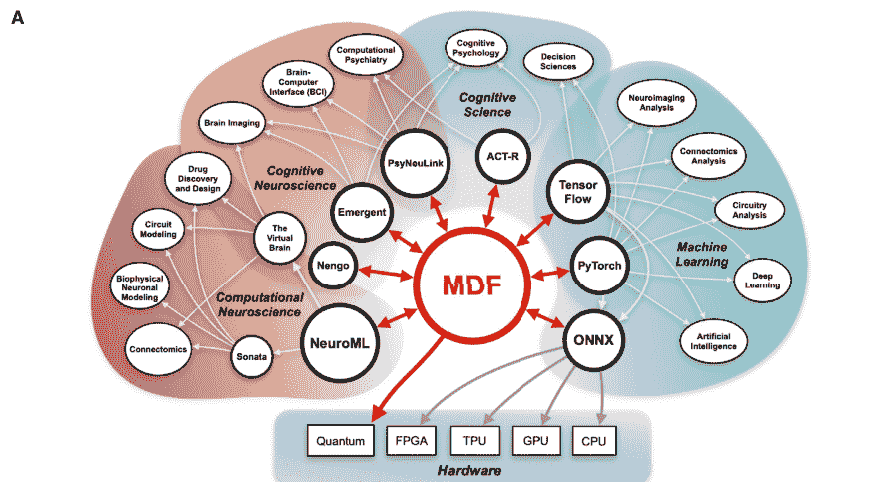
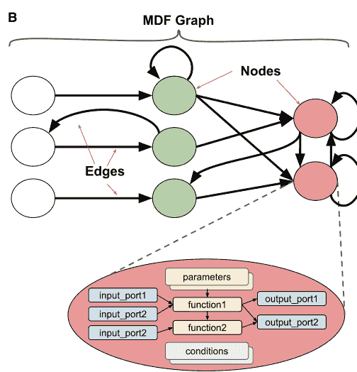
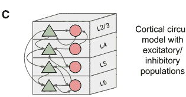
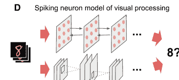
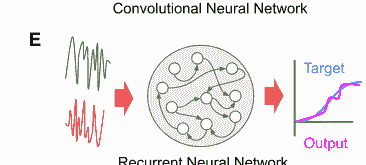

# 跨计算神经科学、认知科学与机器学习的模型开发整合

神经科学、认知科学和计算机科学正在通过相互作用日益受益。通过直接共享各自使用的不同建模软件中的计算模型，可以加速这一进程。我们描述了一种旨在应对这一挑战的模型描述格式。

## 背景

神经科学、认知科学以及计算机科学中人工智能（AI）和机器学习（ML）领域的研究长期以来一直共享关于智能底层机制的共同问题，各领域的进步在很大程度上由彼此间的交互所驱动。例如，麦卡洛克和皮茨¹，以及赫布²，在其脑研究工作中受到图灵在定义计算原理方面工作的启发，反过来，他们的工作启发了罗森布拉特的感知机。神经科学和心理学的工作为机器学习中强化学习的突破奠定了基础，而这反过来又改变了我们对脑调节机制（如大脑的多巴胺系统）的理解；同时，由心理学家和计算机科学家共同开发的反向传播学习算法和卷积神经网络，为深度学习工作的爆炸式增长奠定了基础。最近，对特定大脑子系统（如海马体）的洞察启发了新形式外部记忆（如神经图灵机中使用的）的发展；而反之，循环神经网络算法的发展则指导了关于工作记忆如何在前额叶皮层和基底神经节等大脑结构中实现的模型。

我们现在处于关键转折点。一方面，如上所述，神经科学和认知科学已生成了关键大脑子系统以及许多高级认知功能的机制明确模型。与此同时，计算机科学家设计的机器现在在长期被认为是人脑独有领域的任务上与人类相匹配或超越人类，例如视觉对象识别、游戏（如危险边缘、国际象棋、围棋）以及自然语言处理。另一方面，尽管取得了这些进展，人脑处理的灵活性和效率仍然独一无二。没有任何现有机器表现出与成年人类一样多样的能力范围，或通过训练获得这些能力的能力，更不用说具备大脑展现的效率或处理能力了（这一切都只依赖约 20 瓦的功率）。理解大脑如何实现这一点，以及如何在人工形式中实现，仍然是科学和技术面临的最大挑战之一。似乎不可避免的是，如同过去一样，进步将需要跨相关学科流畅地交流思想、发现和方法。然而，为应对这一挑战所需的建模工作日益精巧，给跨学科交流创新和进步带来了新的障碍，从而也阻碍了其持续的变革潜力。

## 模型和知识交流的当前障碍

历史上，科学学科之间以精确形式交流思想一直依赖于易于解释的数学表达式。然而，随着研究重点转向越来越复杂的机制和能力，进步越来越依赖于数值方法——即计算建模。这给加速进步带来了两个密切相关且快速增加的挑战：（1）社区孤岛：用于构建、执行和分析越来越复杂的计算模型的领域特定软件工具激增；（2）硬件优化：需要使这种模型的执行在规模上变得可行。

### 社区孤岛

反映“巴别塔”问题，许多用于构建和执行计算模型的强大软件工具是在不同（子）领域内部及之间独立开发的，对这种技术及其可能产生的见解的交流构成了重大障碍。³ 例如，有兴趣了解单个神经元细胞类型的响应特性如何影响电路层面学习的研究人员，必须在神经科学特定环境（如支持创建生物物理现实的神经元功能模型的 NEURON (https://neuron.yale.edu/neuron)）和机器学习环境（如支持高效网络层面学习算法的 PyTorch (https://pytorch.org) 和 TensorFlow (https://tensorflow.org)）之间进行选择。目前，在这些环境之间翻译模型没有自动化手段。可以理解的是，这是由感兴趣现象、分析水平和建模方法的差异所驱动的。然而，在一个领域或为一个目的开发的计算方法和工具通常被发现对其他领域具有基本价值（例如，贝叶斯方法、深度学习）。同样，开发和评估模型的工具的进步（例如，超参数化和数据拟合）正在跨领域证明其有用性。不幸的是，利用这种融合的软件工具的发展没有跟上步伐。一些广泛使用的工具已为特定领域的建模出现（例如，NEURON 用于计算神经科学，PyTorch 和 TensorFlow 用于机器学习）。然而，为一个领域创建的计算建模工具很少与其他领域的工具互操作，即使基础构造——以及从中可以获得的洞察——密切相关或相同。这最好只会造成低效率；最坏的情况是，它会掩盖共享能产生新见解并推动进步的想法和技术的机会。即使跨领域的方法和工具需求存在密切相似之处，通常每个领域都使用自己的应用特定软件，使得难以看到共享机会；即使这些机会可识别，将单个模型进行翻译或将一个环境中开发的工具调整到另一个环境中使用也不被认为值得成本。任何参与计算建模的人都痛ingly熟悉将另一个实验室（有时甚至是自己实验室内的个人）的模型代码移植过来的负担，这通常需要翻译成不同的语言和/或缺乏清晰的文档。最好的情况，这会耗费许多小时的精力；最坏的情况是，重新实现容易出错并导致相应的复制失败。此外，当被认为值得时，此类努力通常集中在将特定模型在两个特定环境之间进行翻译，这并未解决其他模型或环境的问题。创建一种方式，使在一个软件环境中生成的模型可以自动翻译成通用格式、经过检查和验证，然后与其他环境共享和/或集成，将对跨学科互动和交叉受精的能力产生变革性影响，如下文进一步讨论。

### 硬件优化

随着模型变得越来越复杂，无论是为了适应大脑中机制的复杂性，还是为了解决在机器中实现自然智能所需功能的复杂性，对执行优化（确保模型在所选软件/硬件环境中尽可能高效运行）的需求已变得至关重要。这反过来又带来了上面描述的“巴别塔”问题：优化工具通常专门针对特定的软件和/或硬件环境，构成了与其他环境一起使用的障碍。

解决这一问题的一种方法是开发“中间表示”（IR）——标准格式，使用高级别软件工具（如 PyTorch 和 TensorFlow）创建的模型可以被翻译成这种格式，然后针对不同的硬件平台进行优化。例如，这就是 ONNX (Open Neural Network Exchange; https://onnx.ai) 等格式所采取的方法。然而，此类努力在很大程度上是为机器学习应用的优化而设计的，不容易被其他领域使用的环境所访问或调整，例如神经科学中的 NeuroML⁴ 或认知科学中的 ACT-R⁵。其他采用更通用方法的工具（如 LLVM; https://llvm.org）通常处于过低的层级，对于在神经科学和认知科学中构建计算模型的人来说不切实际。那些科学领域中模型加速工具的数量和有效性有限，以及使用它们所需的专业知识，在很大程度上限制了此类建模工作的范围和精巧程度，以及它们与 AI 和 ML 中类似工作的互动。能够将在这些领域创建的模型翻译成标准格式，并从中转换为现有 IR，将为神经科学家和认知科学家开辟巨大的机遇，让他们能够利用机器学习社区在优化方面投入的巨大努力。一个完全通用的标准也将为优化开辟其他新颖机会。现有 ML IR 已针对传统计算硬件（如 CPU 和 GPU），但尚未利用新兴技术，如量子计算。这种硬件可能对一大类模型特别有价值，这些模型（与使用深度学习方法的模型互补）涉及约束满足和决策的动态（见下文）。此类模型通常涉及处理单元之间高度相互依赖的细粒交互以及多个时间尺度的交互，这些因素未被 AI 或 ML 中的当前方法解决。它们也不太适合循环向量化等标准技术，可能更有效地通过新颖（例如多面体）的优化和硬件实现方法（例如量子方法）来解决。这些反过来可能最适合一种基于图的格式，该格式保留对更高级别模型结构和操作的访问。

图 1. MDF 生态系统、格式拟议结构及示例 (A) ModECI 工作的潜在范围概览，MDF 作为一个“枢纽”，允许通过“辐条”连接多个分析层级和多个领域的建模环境的计算模型进行翻译和交换。(B) MDF 示意图示例，显示一个表示为图的模型，其中节点代表计算元素，边代表数据的传输和执行流。插图显示节点的内部组件。(C–E) 不同分析层级和不同形式的模型示例，所有这些均可使用 MDF 表示。

模型的结构和功能。成立后，ModECI 开展了一系列研讨会，以与其旨在服务的多元社区互动并获取方向。这涉及来自学术界、工业界以及致力于支持开放科学和跨学科交流的非营利组织的代表 (https://modeci.org/#communityPage)。这些研讨会再次确认了开发 MDF 的潜在价值，并为其发展提供了一组清晰的期望、优先事项和挑战，概述如下：

- 该工作应专注于现有编程和执行环境之间的转换（图 1A），而非创建新的通用模拟和/或编程环境。
- 因此，格式应优先考虑模型转换（以保留模型结构的方式），而非执行效率——即，*转译* 而非 *编译*——这种权衡有利于将模型表示为计算图。
- 格式应支持任意控制流模式，这对标准形式的计算图提出了挑战。
- 初始重点应放在标准化模型本身的结构和执行规范上，而不是其使用流程（例如，参数化、训练协议、数据拟合），后者作为后续开发的目标。

基于这些考虑，ModECI 贡献者为 MDF 开发了初始规范 (https://mdf.readthedocs.io/specification)。该规范将模型表示为一种计算图的序列化格式（图 1B），其中“节点”执行数学运算，带有用于接收这些运算输入并将输出提供给其他节点的“端口”，以及在不同节点端口之间传输信息的“边”。格式的正式规范包括一种控制流语法，可基于定义的“条件”指定节点执行的任意顺序和依赖关系，包括具有不同计算时标的节点、循环图以及分层结构化的执行模式。该标准还辅以一个函数本体论 (https://mdf.readthedocs.io/functions)，其中包含 ONNX 函数库 (https://onnx.ai/onnx/operators) 中的所有非条件运算符，并可扩展其他可能具有广泛用途或在特定科学领域内有用的函数（例如，神经科学中的 FitzHugh Nagumo 积分器或认知科学中的漂移扩散积分器）。MDF 还拥有详细的在线文档 (https://mdf.readthedocs.io) 和一个开源的 Python 工具库 (https://github.com/ModECI/MDF)，其中包括用于 JSON、YAML 或二进制格式序列化模型的参考导入器和导出器；用于结构验证的可视化工具；以及可用于验证模型预期行为的执行引擎。这个 Python 包旨在作为其他库的基础，这些库使用 MDF 在现有工具之间自动交换模型，用于多学科模型的分析、优化和可视化。

MDF 支持多种分析层级的模型规范（图 1C–1E），从生物物理细节丰富的单个神经元和突触到神经元种群和基于抽象张量的模型（例如 ML 中广泛使用的模型）。为展示这种灵活性，已开发出原型解释器及相应的演示示例，用于在 MDF 与广泛使用的领域特定交换格式（例如，神经科学中的 NeuroML 和 ML 中的 ONNX）以及模型设计和执行环境（例如，ML 中的 PyTorch）之间转换模型。

## 结论与未来工作

MDF 的当前版本虽然功能完备，但仍应被视为一个原型，旨在突出此类格式的实用性和潜力，并为后续开发奠定基础。负责 MDF 持续开发的 ModECI 是一项支持开源社区驱动软件项目的努力。当前工作重点是完善 MDF 与广泛使用资源（例如 NeuroML 和 PyTorch）之间的现有接口，将其范围扩展到其他资源（例如 The Virtual Brain、Emergent、Nengo、ACT-R 和 TensorFlow），扩展 MDF 功能以包含模型执行环境的规范（例如训练和超参数化协议），并与 Neurodata Without Borders 和脑影像数据结构（BIDS）等数据共享工作对接。关于规范当前状态、原型实现、受支持的导入/导出环境以及该格式中的模型和数据集示例的指南可在此处找到：https://modeci.org/quickstart。

ModECI 欢迎任何有兴趣的人参与这些努力，以扩展 MDF 的功能和范围，并更广泛地实现其目标：促进跨分析层级和学科的模型流畅交换，这些学科涉及人脑功能的计算建模及其在合成系统中的能力复现。通过这些方式，ModECI 不仅承诺为跨学科研究提供一个媒介，还承诺成为在社区驱动方式中有效推进此类工作的典范。

## 致谢

此处描述的 MDF 标准构想最初源于 2019 年 7 月在普林斯顿举办的由可重复神经科学中心赞助的研讨会，其初步开发——以及 ModECI 的成立——得到了 NSF 融合加速器计划的一项资助支持。我们谨向以下个人致以谢意，感谢他们对 ModECI 工作做出的重大贡献：Abhishek Bhattachargee、Pranav Gokhale、Samyak Gupta、Nichol Killian、Jeremy Lee、Raghav Pothuguchi、Terry Stewart、Patrick Stock、Tal Yarkoni，以及所有参加 ModECI 支持的社区研讨会的参与者 (https://modeci.org/#communityPage)。我们还感谢 Outreach 组织 (https://www.outreachy.org)，该组织组织了软件开发实习项目以参与 MDF 的实现。P.G. 承认获得 Wellcome (212941) 的研究资助支持。

## 利益声明

作者声明不存在利益冲突。

## 参考文献

- 1. McCulloch, W.S., and Pitts, W. (1943). 神经活动中内在于思想的逻辑演算. Bull. Math. Biophys. 5, 115–133.
- 2. Hebb, D.O. (1949). 行为的组织：一种神经心理学理论 (Wiley).
- 3. Poldrack, R.A., Feingold, F., Frank, M.J., Gleason, P., de Hollander, G., Huys, Q.J., Love, B.C., Markiewicz, C.J., Moran, R., Ritter, P., et al. (2019). 共享计算模型和数据的标准的重要性. Comput. Brain Behav. 2, 229–232.
- 4. Cannon, R.C., Gleeson, P., Crook, S., Ganapathy, G., Marin, B., Piasini, E., and Silver, R.A. (2014). LEMS：一种以简洁分层形式表达复杂生物模型的语言及其在支撑 NeuroML 2 中的应用. Front. Neuroinform. 8, 79. https://doi.org/10.3389/fninf.2014.00079.
- 5. Lebiere, C., and Anderson, J.R. (1993). ACT-R 生产系统的联结主义实现.
- 6. Sanz Leon, P., Knock, S.A., Woodman, M.M., Domide, L., Mersmann, J., McIntosh, A.R., and Jirsa, V. (2013). 虚拟大脑：灵长类脑网络动力学模拟器. Front. Neuroinform. 7, 10.
- 7. Aisa, B., Mingus, B., and O’Reilly, R. (2008). Emergent 神经建模系统. Neural Netw. 21, 1146–1152.

- 8. Bekolay, T., Bergstra, J., Hunsberger, E., DeWolf, T., Stewart, T.C., Rasmussen, D., Choo, X., Voelker, A.R., and Eliasmith, C. (2014). Nengo：一种用于构建大规模功能脑模型的 Python 工具。Front. Neuroinform. 7, 48.

- 9. Teeters, J.L., Godfrey, K., Young, R., Dang, C., Friedsam, C., Wark, B., Asari, H., Peron, S., Li, N., Peyrache, A., et al. (2015). 无国界神经数据：为神经生理学创建通用数据格式。Neuron 88, 629–634.

- 10. Gorgolewski, K.J., Auer, T., Calhoun, V.D., Craddock, R.C., Das, S., Duff, E.P., Flandin, G., Ghosh, S.S., Glatard, T., Halchenko, Y.O., et al. (2016). 脑成像数据结构：一种用于组织和描述神经成像实验输出的格式。Sci. Data 3, 160044.
