# WSN 与物联网的集成


## Preface

互联网正在从人类互联网平稳迁移至万物互联网（IoT）。IoT 是传感器、家电和其他物理设备在无需任何人工干预的情况下相互交互的网络。IoT 设备正在成为主流电子文化的一部分，并且人们在智能家居中采用 IoT 设备的速度比以往任何时候都快。无线传感器网络（WSNs）自 IoT 范式诞生以来，是最广受认可的关键推动因素。WSNs 是指一组空间分布的专用传感器，用于监测和记录物理环境条件，并在中心位置组织收集的数据。WSNs 和 IoT 都拥有众多关键和非关键应用，几乎涵盖我们现代生活的方方面面。不幸的是，这些网络容易受到各种安全攻击，如果没有得当的预先规划的安全解决方案，其改进将受到限制。这些网络中使用设备的资源受限特性进一步加剧了这一问题。区块链技术是应对此类安全挑战的最新且最有效的方法。区块链是一种防篡改的分布式账本，可在不同位置保持一致的数据记录，有能力解决此类网络中的安全问题。得益于容错能力、去中心化架构以及认证、数据完整性和伪匿名身份等加密安全优势，安全分析师和研究人员认为区块链可以解决 IoT 的隐私和安全问题。

本书的读者将了解 WSNs 集成到 IoT 过程中的演进、应用、挑战及所提应对措施。本书旨在评估、调查和分析将 WSNs 集成到 IoT 的各种方法，并概述近期需要解决的一系列安全挑战。本书还回顾了阻碍 WSNs 在 IoT 应用中使用的最突出障碍，并突出了主要精力和成本组成部分。研究人员/科学家需要关注的与 IoT 相关的最重要问题是传感器生成数据的隐私和安全需求，以防止滥用、盗窃或不幸的丢失。本书旨在揭示可攻击 WSNs 和 IoT 的各种威胁类型，以及近期开发的应对这些威胁的方法。

MATLAB® 是 The MathWorks, Inc. 的注册商标。有关产品信息，请联系：
The MathWorks, Inc.
3 Apple Hill Drive
Natick, MA 01760-2098 USA
Tel: 508-647-7000
Fax: 508-647-7001
E-mail: info@mathworks.com
Web: www.mathworks.com


## Taylor & Francis

## Taylor & Francis Group

http://taylorandfrancis.com

## Editors

**Sudhir Kumar Sharma 博士**目前是印度新德里古鲁·宾德·辛格·因德拉普拉斯特大学（GGSIPU）附属信息技术与管理学院计算机科学系教授兼系主任。他在计算机科学与工程领域拥有超过 21 年的丰富经验。他获得 GGSIPU 信息、通信与技术大学学院（USICT）的信息技术博士学位。Sharma 博士于 1999 年获得印度赫里·詹布赫什瓦尔大学（Hisar）的计算机科学与工程硕士学位，以及 1997 年获得印度鲁尔基大学（现 IIT Roorkee）的物理学硕士学位。他的研究兴趣包括机器学习、数据挖掘和安全。他在各种享有盛誉的国际期刊和国际会议上发表了 50 多篇研究论文。他是 CSI 和 IETE 的终身会员。Sharma 博士是 Springer 出版社 *多媒体工具与应用* 特刊的首席客座编辑。他曾担任 ICETIT-2019 和 ICRIHE-2020 的召集人和卷编辑。他为 Springer、Elsevier 和 CRC Press 撰写和编辑了五本关于物联网、WSNs、区块链和网络物理系统的计算机科学书籍。他被选为多家享有盛誉的国际期刊的审稿人/编辑委员会成员。他还在各种国家和国际会议上担任过演讲者、会议主席或联席主席。

**Bharat Bhushan 先生**是印度大诺伊达沙尔达大学工程与技术学院计算机科学与工程系（CSE）助理教授。他是比尔拉技术学院（Mesra）的校友和博士研究生。他于 2012 年以优异成绩获得比尔拉技术学院（Mesra，印度）的本科学位（计算机科学与工程 B.Tech），并于 2015 年以优异成绩获得该校的研究生学位（信息安全 M.Tech）。他获得了多项国际认证，例如思科认证网络工程师（CCNA）、思科认证初级网络技术员（CCENT）、微软认证技术专家（MCTS）、微软认证 IT 专业人员（MCITP）和思科认证网络专业人员培训（CCNP）。在过去三年中，他在多家著名国际会议和 SCI 索引期刊上发表了 80 多篇研究论文，包括 *无线网络*（Springer）、《无线个人通信》（Springer）、《可持续城市与社会》（Elsevier）和 *电信新兴事务*（Wiley）。他在各种书籍中撰写了 20 多个书章，目前正在编辑 Elsevier、IGI Global 和 CRC Press 等最著名出版社的七本书。他曾担任多家享有盛誉的国际期刊的审稿人/编辑委员会成员，包括 *IEEE Access*、*IEEE 通信调查与教程* 和 *无线个人通信*（Springer）。他还在 15 多个国家和国际会议上担任过演讲者和会议主席。他目前的研究兴趣包括无线传感器网络（WSNs）、物联网（IoT）和区块链技术。过去，他曾在印度新德里 HMR 技术与管理学院担任助理教授，并在诺伊达 HCL Infosystems Ltd. 担任网络工程师。他连续多年通过 GATE 考试，并在 GATE 2013 中获得了最高百分位 98.48。他还是 IEEE、IAENG、CSTA、SCIEI、IAE 和 UACEE 等多家著名机构的会员。

Raghvendra Kumar 博士目前担任印度 GIET 大学计算机科学与工程系副教授。他获得印度计算机科学与工程学士、硕士和博士学位，以及越南信息技术、虚拟现实与多媒体学院的博士后研究员经历。他担任 CRC Press, Taylor & Francis Group, USA 出版的《万物互联（IOE）：安全与隐私范式》、《绿色工程与技术：概念与应用》以及 Apple Academic Press, CRC Press, Taylor & Francis Group, USA 出版的《生物医学工程：技术与应用》丛书编辑。他还担任 Apple Academic Press, CRC Press, Taylor & Francis Group, USA 出版的计算机科学类获编编辑。他在 IEEE 和 Springer 等国际期刊（收录于 SCI/SCIE/ESCI/Scopus）和会议上发表了多篇研究论文，并在许多国际和国家会议上担任组织主席（RICE-2019, 2020）、卷编辑（RICE-2018）、主旨演讲者、会议主席、联席主席、宣传主席、出版主席以及咨询委员会和技术方案委员会成员，并在许多来自享有盛誉的期刊（由 Scopus、ESCI 和 SCI 索引）的特刊中担任客座编辑。他还在 IGI Global、Springer 和 Elsevier 出版的编著书中发表了 13 个书章。他的研究领域包括计算机网络、数据挖掘、云计算和安全多方计算、计算机科学理论以及算法设计。他撰写和编辑了 23 本关于物联网、数据挖掘、生物医学工程、大数据、机器人学等领域的计算机科学书籍，出版商包括 IGI Global 出版社（美国）、IOS Press（荷兰）、Springer、Elsevier 和 CRC Press（美国）。

Aditya Khamparia 博士是一位杰出的学者，在教学、研究、出版、咨询、社区服务、博士生指导等方面承担着多方面的角色和职责。他拥有七年的教学经验和两年的行业经验，专注于合理和实用的学习。目前，他担任印度旁遮普省可爱职业大学计算机科学与工程副教授。他的研究领域包括机器学习、软计算、教育技术、物联网、语义网和本体学。他在享有盛誉的国际和国家期刊及会议上发表了 50 多篇科学研究论文，这些论文被各种国际数据库索引。他受邀担任不同 FDP、会议和期刊的教师资源人员、会议主席、审稿人和技术方案委员会成员。Aditya 博士在 2016 年、2017 年和 2018 年获得可爱职业大学的研究卓越奖。他是 CSI、IET、ISTE、IAENG、ACM 和 IACSIT 的会员。他还担任各种著名国家和国际会议及期刊的审稿人和成员。


Narayan C. Debnath 教授（博士）目前是越南东方国际大学计算机与信息技术学院创院院长。他同时还担任越南东方国际大学软件工程系系主任。Debnath 博士自 2014 年起担任国际计算机及其应用学会（ISCA）理事。此前，Debnath 博士在美国明尼苏达州温诺纳州立大学担任计算机科学正教授长达 28 年（1989–2017）。他当选为温诺纳州立大学计算机科学系系主任，连续三届，任职 7 年（2010–2017）。Debnath 博士获得计算机科学 D.Sc. 学位，同时也获得物理学 Ph.D. 学位。在过去，他曾两度当选为国际计算机及其应用学会（ISCA）主席，并担任副主席和会议协调员，自 2001 年起一直是 ISCA 董事会成员。在 2010 年当选为温诺纳州立大学计算机科学系系主任之前，他曾担任该系代系主任。在 1986–1989 年期间，Debnath 博士在美国威斯康星大学河瀑分校数学与计算机系统系担任助理教授，并于 1989 年被提名为国家科学基金会（NSF）总统青年研究员奖。他是计算机科学、信息科学、信息技术、系统科学、数学和电气工程等领域众多同行评议期刊和会议论文集的作者或合著者，发表论文超过 425 篇。Debnath 博士曾在阿根廷、中国、印度、苏丹和台湾的大学担任访问教授，并是 ACM、IEEE 计算机学会、阿拉伯计算机学会的活跃成员，以及 ISCA 的高级会员。


## Taylor & Francis

泰勒与弗朗西斯集团

http://taylorandfrancis.com

## 贡献者

### S. Adamović
信息学与计算机学院
辛吉杜努姆大学
贝尔格莱德，塞尔维亚

### Bharat Bhushan
计算机科学与工程系
工程与技术学院
沙尔达大学
大诺伊达，北方邦，印度

### M. Afshar Alam
计算机科学与工程系，SEST
詹米亚·哈姆达德大学
哈姆达德纳加尔，新德里，印度

### Arturo Diaz-Perez
电气工程与计算机科学系
CINVESTAV Guadalajara
萨波潘，墨西哥

### Adel Sharar Aldalbahi
工程学院
费萨尔国王大学
哈富夫，沙特阿拉伯

### Reinaldo Padilha França
电气工程与计算机学院（FEEC）
坎皮纳斯州立大学（UNICAMP）
坎皮纳斯，圣保罗州，巴西

### Amartya
制造工艺与自动化工程系
纳塔吉·苏巴斯技术大学（原纳塔吉·苏巴斯技术学院）
达尔瓦卡，新德里，印度

### Siddharth Gautam
信息技术系
HMR 技术与管理学院
新德里，印度

### Rangel Arthur
技术学院（FT）
坎皮纳斯州立大学（UNICAMP）
利梅拉，圣保罗州，巴西

### M. Gnjatović
技术科学学院
诺维萨德大学
诺维萨德，塞尔维亚

### Tanvi Attri
计算机科学与工程系
HMR 技术与管理学院
哈米德普尔，新德里，印度

### Somya Goyal
计算机与通信工程系
斋普尔马尼帕尔大学
斋普尔，拉贾斯坦邦，印度
计算机科学与工程系
古鲁·詹布希什瓦尔科学与技术大学
希萨尔，哈里亚纳邦，印度

### Mohammad Sufian Badar
生物工程系
加州大学
河滨，加利福尼亚

### B. Gupta
计算机学院
南伊利诺伊大学
卡本代尔，伊利诺伊

### AKM Bahalul Haque
电气与计算机工程系
北南大学
达卡，孟加拉国

### Imran Hussain
计算机科学与工程系，SEST
詹米亚·哈姆达德大学
哈姆达德纳加尔，
新德里，印度

### Yuzo Iano
电气工程与计算机学院（FEEC）
坎皮纳斯州立大学（UNICAMP）
坎皮纳斯，圣保罗州，巴西

### Ila Kaushik
信息技术系
克里希纳工程与技术学院
加齐阿巴德，北方邦，印度

### Aqeel Khalique
计算机科学与工程系，SEST
詹米亚·哈姆达德大学
哈姆达德纳加尔，新德里，印度

### Mohammad Muzammil Khan
计算机科学与工程系，SEST
詹米亚·哈姆达德大学
哈姆达德纳加尔，新德里，印度

### Ravinder Kumar
工程与技术技能学院
什里·维施瓦克马技能大学
帕尔瓦尔，哈里亚纳邦，印度

### Carlos Andres Lara-Nino
塔马乌利帕斯 CINVESTAV
西乌达德比多利亚，墨西哥

### N. Maček
计算机科学学院，计算机工程学院
梅加特rend大学
贝尔格莱德，塞尔维亚

### Deepanjali Mehra
仪表与控制工程系
纳塔吉·苏巴斯技术大学（原纳塔吉·苏巴斯技术学院）
达尔瓦卡，新德里，印度

### Ana Carolina Borges Monteiro
电气工程与计算机学院（FEEC）
坎皮纳斯州立大学（UNICAMP）
坎皮纳斯，圣保罗州，巴西

### Miguel Morales-Sandoval
塔马乌利帕斯 CINVESTAV
西乌达德比多利亚，墨西哥

### Anubha Parashar
计算机科学与工程系
斋普尔马尼帕尔大学
斋普尔，拉贾斯坦邦，印度

### Jézer Oliveira Pedrosa
技术学院（FT）
坎皮纳斯州立大学（UNICAMP）
利梅拉，圣保罗州，巴西

### Julio Cesar Pereira
技术学院（FT）
坎皮纳斯州立大学（UNICAMP）
利梅拉，圣保罗州，巴西

### N. Rahimi
计算机学院
南伊利诺伊大学
卡本代尔，伊利诺伊

### Rahul Veer Singh
计算机科学与工程系
HMR 技术与管理学院
哈米德普尔，新德里，印度

### Rehab A. Rayan
流行病学系
高等公共卫生学院，
亚历山大大学
亚历山大，埃及

### Christos Tsagkari
医学院
克里特大学
吉奥菲拉基亚，希腊

### Rishipal
应用科学与人文学科技能学院
什里·维施瓦克马技能大学
帕尔瓦尔，哈里亚纳邦，印度

### Ashi Tyagi
计算机科学与工程系
HMR 技术与管理学院
哈米德普尔，新德里，印度

### M. Saračević
计算机科学系
诺维帕扎尔大学
诺维帕扎尔，塞尔维亚

### Mohammad Maksuf Ul Haque
计算机科学系
詹米亚·米利亚伊斯兰大学
奥克拉，新德里，印度

### Shazmeen Shamsi
计算机科学系
詹米亚·米利亚伊斯兰大学
奥克拉，新德里，印度

### Ravi Verma
计算机科学与工程系
拉达拉曼技术与科学学院
博帕尔，中央邦，印度

### Deepak Kumar Sharma
信息技术系
纳塔吉·苏巴斯技术大学（原纳塔吉·苏巴斯技术学院）
达尔瓦卡，新德里，印度

### N. Vukobrat
信息学与计算机学院
辛吉杜努姆大学
贝尔格莱德，塞尔维亚

### Nikhil Sharma
信息技术系
HMR 技术与管理学院
新德里，印度

### Imran Zafar
生物信息学与计算生物学系
巴基斯坦虚拟大学
拉合尔，巴基斯坦

### Sudhir Kumar Sharma
计算机科学系
信息技术与管理学院
贾纳克普里，新德里，印度


## Taylor & Francis

泰勒与弗朗西斯集团

http://taylorandfrancis.com

# 无线传感器网络中的安全问题、漏洞与防御机制：现状与建议

N. Rahimi 和 B. Gupta
南伊利诺伊大学

## 目录

- 1.1 引言 .................................................................... 2
- 1.2 WSNs 的应用 ........................................................ 2
- 1.3 威胁与挑战 .................................................... 3
- 1.4 WSN 攻击分类 ................................................... 3
    - 1.4.1 基于攻击者能力的攻击 ................. 4
    - 1.4.2 传输中的信息攻击 ................................. 4
    - 1.4.3 基于主机与基于网络的攻击 ......................... 4
    - 1.4.4 基于协议栈的攻击 ................................... 5
- 1.5 被动攻击 .............................................................. 5
- 1.6 主动攻击 ............................................................... 7
- 1.7 网络安全目标 ............................................ 9
    - 1.7.1 主要目标 .................................................. 9
    - 1.7.2 次要目标 .............................................. 9
- 1.8 新防御机制 .................................................... 9
    - 1.8.1 算法强度分析 ....................................... 12
    - 1.8.2 密文长度 .............................................. 13
- 1.9 结论 ...................................................................... 13
- 参考文献 ............................................................................ 13


## 1.1 引言

无线传感器网络（WSNs）是无需基础设施且自动配置的无线网络，旨在观察或监测物理条件，例如压力、温度、污染物和声音等环境因素，并协作地将单个数据传递通过网络到基站（BS），同时该数据可以被监测和检查 [1,2]。典型的WSN可能由数千个传感器节点组成，各个节点依赖无线信号相互通信。基站（BS），也称为沉点，在网络与授权用户之间提供链接。这些用户可以通过输入搜索查询并检索由基站生成的结果来访问或从WSN中检索数据。上述无线传感器节点具有电源组件、感知和计算设备以及无线收发机，使它们能够执行这些功能。在某些情况下，无线传感器设备可以响应来自控制站的输入，并按照指令执行特定功能，例如提供特定条件的信息。然而，随着每项技术创新或进步（如上文讨论的WSN），此类技术发明面临的威胁也同步发展。随后，尽管WSN是医疗、军事和环境应用中的关键组件，但其漏洞使用户面临不断演变的大量安全问题 [1–5]。本研究论文将探讨安全问题和漏洞，并提议在WSNs中使用我们最近报道的三阶段对称密码算法 [6]。我们提出的方法具有多项优势。首先，为了防止试图利用密钥，该算法将混淆和扩散的程度提高到尽可能复杂地建立明文与密文之间统计连接的程度。为实现此目标，密码算法设计为使密文比明文更长。这种长度变化使明文与密文之间的统计关联变得复杂，使得密码分析过程极具挑战性。

本章首先通过就WSN的应用建立共同基础来展开。在第1.3节和第1.4节中，将讨论WSN中的威胁和挑战以及WSN攻击的分类学。我们将在第1.5节和第1.6节中分别调查被动攻击和主动攻击。网络安全目标将在第1.7节中介绍。在第1.8节中，将提出我们的防御机制。第1.9节得出结论。

## 1.2 WSN的应用

WSN有多种用途，例如医疗应用、环境监测、军事服务和商业应用等。在医疗服务中，WSN可以用于在临床环境中监测患者 [7]。例如，传感器能够为临床医生提供一种简便有效的机制来监测医院内的生理功能。此外，传感器还可用于追踪医院内患者的移动以进行监测，以及帮助护士和医生在紧急情况更快地接触患者。

另外，WSN在军事应用中至关重要，例如入侵检测、参数监测和监视。而且，军事人员在武装行动前可以使用WSN来确定偏远地区的天气条件，因为天气变化可能对军事结果产生重大影响。由于WSN能够提供实时数据，其在监视能力和功能（如检测敌方战斗人员的移动）方面的重要性在现代战争中发挥着关键作用 [8]。最后，WSN可用于监测空气污染、监测水污染、水下无线传感器网络（UWSNs）以及农业应用。在农业监测方面，WSN可用于动物追踪、温室监测，例如确定土壤湿度和环境温度，以及污染控制。最后，有人认为，保护主义者和动物园管理人员可以使用WSN来监测和追踪野生动物的移动，以及潜在的有害水排放到其栖息地 [4,5]。

## 1.3 威胁与挑战

WSN与多个安全问题相关，这源于开发传感器节点硬件的简单性带来的限制，以及其部署区域（如军事冲突期间的敌对环境）。导致WSN漏洞的问题之一源于WSN的成本要求尽可能低。这意味着大多数WSN开发者不太可能在传感器节点被物理捕获时使用复杂的防篡改硬件 [8,9]。与WSN相关的另一个关键安全问题是，传感器节点依赖无线通信，在通信或数据传输过程中更容易被窃听。这种无线通信的弱点也使攻击者更容易将误导性或恶意信息注入网络 [10]。诸如低成本、小尺寸、有限能量以及依赖无线传输等限制，使WSN容易受到拒绝服务攻击（DoS）。下一节将探讨可用于攻击WSN的不同类别的攻击，重点是被动窃听和主动干扰。

## 1.4 WSN攻击的分类学

在强调WSN中被动和主动发生的不同类型的攻击之前，讨论WSN攻击的各种分类至关重要。考虑到无线网络传输的性质，使用无线电信号的无线网络容易受到各种网络安全攻击。事实上，大规模传感器网络通常难以监控和保护单个节点免受逻辑和物理攻击。本节将识别基于级别的WSN安全威胁分类学，取决于攻击者使WSN系统不稳定的能力 [11–14]。表1.1显示了WSN中易受攻击的不同层以及每个层所扮演的不同角色。

### 表 1.1
WSN分层架构

| 层 | 功能 |
| :--- | :--- |
| 应用层 | 在汇总数据后与最终用户交互 |
| 传输层 | 负责传输收集的数据 |
| 网络层 | 该层负责拓扑管理和传感器节点网络 |
| 数据链路层 | 多路复用、介质访问和数据帧检测 |

### 1.4.1 基于攻击者能力的攻击

这些攻击可能采取不同形式，例如节点攻破，可分为外部攻击（相对于内部攻击）。外部攻击使用网络外部的节点，而内部攻击攻破合法节点。攻击也可以是被动或主动的，取决于对手开发能够执行其中任一方式的设备的能力。此外，一些取决于攻击者能力的攻击包括与笔记本电脑类攻击形成对比的节点类攻击。节点类攻击利用少量功能与目标网络相似的节点，而笔记本电脑类攻击依赖强大设备攻击网络 [14,15]。

### 1.4.2 传输中信息的攻击

对传输中数据的攻击源于在向WSN授权用户中继时伪造或劫持广播信息。示例包括通信中断，其中传感器网络内的链接要么不可用，要么丢失。这种形式攻击的另一个示例发生在未经授权的用户通过未经授权访问节点来拦截来自传感器节点的信息，从而破坏信息机密性。在其他情况下，未经授权的实体可能决定篡改其访问的数据，导致所收集数据的完整性受损。此类行为的目标是误导或混淆WSN的用户。类似于篡改信息，恶意攻击者也可能伪造数据或重放现有消息。在伪造过程中，攻击者通过插入虚假数据来破坏信息的真实性，而重放过去的消息旨在混淆使用WSN的个人 [8,16]。

### 1.4.3 基于主机与基于网络的攻击

基于主机的攻击可以是用户被攻破、应用被攻破或硬件被攻破。用户被攻破可能包括误导WSN的授权用户泄露密码和传感器节点的物理位置等关键信息。软件被攻破一方面包括黑客入侵WSN用户用于在网络中运行传感器节点的软件。另一方面，硬件被攻破发生在攻击者物理篡改


用于制造传感器节点的硬件，旨在提取有关特定 WSN 的信息或制造秘密。

在基于网络的攻击中，用于攻破 WSN 的方法可能是特定于层或特定于协议的。但是，所有基于网络的攻击都涉及传输中的信息，除此之外还会导致网络偏离协议，从而使攻击者相对于网络用户获得不公平优势。例如，协议偏离的设计既不是为了威胁网络的监控能力，也不是为了干扰数据的保密性或真实性，而是为了帮助攻击者获取 WSN 用户的内部知识和通信 [17,18]。

### 1.4.4 基于协议栈的攻击

在此分类下，攻击可能基于协议栈，攻击者可能决定干扰通信、进行无线电干扰或造成物理篡改。可被攻击的层包括物理层、数据链路层、网络层、传输层和应用层。攻击可以针对数据链路层，在这种情况下攻击者可能会破坏媒体访问控制 (MAC) 协议，并利用双向请求发送 MAC 协议。使用 Sybil 攻击进行信息伪造是数据链路层内的另一种方法，攻击者通过创建多个虚假身份假装同时出现在多个地方。这阻碍了信息从一个传感器节点传递到下一个节点所涉及的过程。在网络层内，可能的攻击示例包括但不限于沉洞、hello flood 攻击、节点捕获、黑洞攻击和蠕虫洞攻击。这些形式的攻击将在“主动攻击”部分进一步讨论 [4,18,19]。

在传输层，攻击可能包括泛洪和反同步攻击。泛洪攻击是指攻击者发送大量连接请求，使 WSN 过载，可能耗尽其电力或使其易受其他形式攻击。另一方面，反同步攻击旨在防止 WSN 两个端点之间的有用信息交换。最后，应用层可遭受三种不同方式的攻击。这些包括基于路径的 DoS 攻击、压倒性攻击或重编程攻击。DoS 攻击者将向传感器节点注入数据，消耗网络资源，从而减慢速度或导致其他节点无法将数据导向基站 (BS)。压倒性攻击试图通过向网络节点灌输刺激来增加网络流量。这会导致节点向基站发送大量流量，从而造成带宽消耗和电池耗尽。最后，重编程或洪水攻击发生在攻击者在网络编程期间远程重新编程已部署的网络时。表 1.2 提供了本节关于 WSN 攻击分类法所提供信息的摘要 [14–19]。

## 1.5 被动攻击

被动攻击是由恶意定义的节点所做的恶意尝试，旨在在不主动干扰 WSN 运行的情况下获取 WSN 内传输的数据。此类攻击旨在突破数据保密性，攻击者监控未加密的数据并提取可用于其他攻击的敏感信息。被动攻击的示例包括加密流量的解密、窃听、监控通信、消息畸变、流量分析、劫持身份验证信息、消息重播和冒充等。诸如通信拦截和数据流拦截等被动攻击使攻击者能够预见未来动作或在 WSN 的授权用户中造成混乱。

### 表 1.2 WSN 中的安全攻击

| 类别 | 子类别 | 攻击 |
| :--- | :--- | :--- |
| 目标导向的攻击 | 主动 | 黑洞 |
| | | 沉洞 |
| | | hello flood 攻击 |
| | | 拒绝服务 |
| | | 中间人攻击 |
| | | Sybil 攻击 |
| | | 压倒性攻击 |
| | | 伪造 |
| | 被动 | 窃听 |
| | | 流量监控 |
| 执行者导向的攻击 | 内部 | 恶意模式 |
| | | 黑洞 |
| | | 沉洞 |
| | 外部 | 拒绝服务 |
| | | 窃听 |
| 层导向的攻击 | 物理 | 干扰 |
| | | 篡改 |
| | | 窃听 |
| | 数据链路 | 监控 |
| | | 流量分析 |
| | | Sybil |
| | | 信道耗尽 |
| | 网络 | 拒绝服务 |
| | | 蠕虫洞 |
| | | Sybil |
| | | 泛洪 |
| | | 黑洞 |
| | | 窃听 |
| | | 沉洞 |
| | 传输 | 拒绝服务 |
| | | 泛洪 |
| | | 会话劫持 |
| | 应用 | 数据损坏 |
| | | 压倒性攻击 |

关于大多数通信信道均暴露的 UWSNs，攻击者可以使用水下麦克风或水听器来获取信道中传输的重要信息包。此外，对流量包的分析以及观察包的交换，可以使攻击者预测通信的性质，同时识别通信主机并找到节点的物理位置。通过此类行动，被动攻击者更容易发动能够对 WSN 授权用户造成更严重破坏的主动攻击。打击被动 WSN 攻击的主要挑战之一在于其难以检测，尤其是在网络运行基本不受影响的情况下。使用加密机制可以让攻击者难以窃听，但实施此类机制存在严重挑战。例如，这些加密机制会导致高能耗和额外开销，使组织难以投资于这种保护形式。此外，WSN 易受攻击的程度意味着任何有意义的数据保护升级都可能被坚定的攻击者所匹配。例如，拥有强大的接收器和天线可以让任何个人访问数据流。在某些情况下，被动攻击可能取决于攻击者的能力而发展为主动攻击 [12–15]。

## 1.6 主动攻击

主动攻击包括为主动控制 WSN 所采取的措施。在这种情况下，攻击者可能决定删除、注入、销毁或更改通过 WSN 传输的数据。因此，主动攻击者不仅拦截网络数据，而且还会努力修改或丢弃数据包，旨在破坏网络内部或网络用户之间的通信。在某些情况下，主动攻击可以由外部或内部入侵者执行，具体取决于用于执行此类攻击的节点。内部攻击是指由属于网络但已被攻破（可能通过被动攻击）的节点发起的攻击。另一方面，外部攻击是由不属于系统的恶意节点完成的，这使得 WSN 用户更容易检测和防御此类攻击。主动攻击中最危险的形式通常由内部节点实施，因为更难检测先前合法但现已被攻破的节点。这是因为此类节点拥有合法 ID 以及其他关键隐私数据（如信任值、加密算法和密钥），从而可能导致持续且未被发现的攻击。

主动攻击的其他形式可能包括 DoS、沉洞、Sybil 攻击、黑洞、蠕虫洞、hello flood 攻击、欺骗、中间人攻击、重播、选择性转发和节点颠覆等。由于 WSN 涉及复杂且多种类型的恶意攻击，本节仅讨论上述部分攻击形式 [20]。DoS 攻击旨在防止或中断网络内部的信息流。这种攻击是由网络中节点突然故障或网络数据流过载（超过网络正常运行的能力）引起的。


当来自特定区域的流量被攻击者吸引时，就会发生蜷坑攻击。这种攻击有两种形式：恶意内部人员或富有资源的外部人员。在恶意内部攻击下，对手可能会使用被攻陷的节点宣传路线来欺骗其邻居。或者，可以使用笔记本电脑级别的对手来宣传从节点邻居发出的单跳路径，邻居最终会相信该路径并通过它转发所有数据 [21]。另一种主动攻击形式涉及hello flood攻击，它发生在网络层。在这种情况下，单个节点可以使用强大的功率广播Hello数据包，以至于网络中的多个节点（包括远处的节点）决定将其识别为父节点。

另一种常见的主动攻击是使用黑洞攻击。与蜷坑攻击类似，黑洞攻击使用恶意节点宣传错误路径作为良好路径 [21]。该过程发生在路径查找过程中，网络中的节点正在尝试找到通往目标节点的良好路径。黑洞攻击与蜷坑攻击的主要区别在于，对手不会转发所有截获的消息，从而造成信息黑洞。当攻击者靠近基站（BS）时，所有信息都可能通过对手流动。此外，一些攻击者可能决定向网络中添加虚假节点，使他们更容易获得WSN授权用户拥有的相同信息 [22]。最后，节点容易受到物理攻击，这可能导致通信中断 [23,24]。图 1.1 显示了上述被动攻击和主动攻击之间的区别。

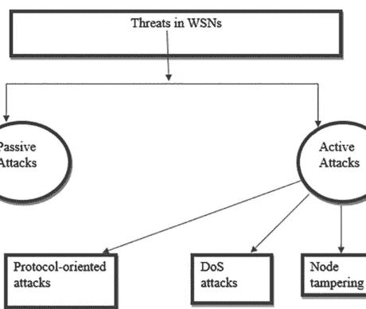

图 1.1 WSNs 中的被动威胁和主动威胁。

## 1.7 网络安全目标

计算机网络安全涉及所有必要的机制、策略和服务，以使系统能够在防止未经授权的访问方面获得足够的保护。在设计网络防御机制时，授权用户必须考虑系统的机密性、可用性和完整性。本节将探讨网络安全的主要目标和次要目标 [17–20]。

### 1.7.1 主要目标

WSN的主要目标必须考虑传输流量的机密性、网络的完整性以及WSN的可用性。关于机密性，防御机制必须调整到保护传输的数据和信息，以便它们仅到达预期接收者。此类防御机制包括确保只有正确的用户才能解释网络上传递的消息，并防止未经授权的访问。此外，防御机制通过设计用于限制数据和信息从发送者到接收者传输过程中被修改的措施，来保存网络上共享的数据和信息的完整性。确保未经授权的用户无法访问或篡改WSN数据至关重要。最后，WSN应有足够的防御能力，以便在不受恶意攻击者或自然因素（如恶劣天气）中断的情况下执行其功能 [25–29]。

### 1.7.2 次要目标

防御机制的次要目标旨在确认所有传输的数据都是新鲜的，并且之前的信息不会因为攻击或可能的故障而被重放。此外，WSN必须设计为传感器节点可以随机运行，而无需依赖固定基础设施。防御机制应允许传感器节点响应外部因素自行组织。防御机制次要目标的另一个关键特征是，它们应能够独立进行时间同步。确保每个传感器节点在正确的时间处于其所在的位置，以防止两个节点之间传输信息时出现可能的延迟，这一点至关重要。最后，防御机制的次要目标是确保网络中的每个传感器节点都能自动正确地识别和定位同一WSN中的其他传感器。安全的组织对于防止外部攻击至关重要 [29–32]。

## 1.8 新防御机制

有几种机制可以用于确保WSN的安全性得到提高。显然，使用加密方法是系统的第一道防御手段。本节将提议在WSN中实现作者最近报道的三阶段对称密码技术 [6,27]。由于计算限制，WSN无法正确执行许多加密解决方案，其中大多数非对称加密算法都在其中 [33,34]。此外，需要考虑的是，在大多数情况下，WSN传输的消息大小较短。使用常见加密方法加密这些短消息时，将生成近似长度相同的密文。众所周知，较短的密文更容易受到暴力攻击和密码分析攻击 [35,36]。

所提算法的核心目标是降低加密处理功率，从而延长电池寿命，并对长度始终大于明文长度的消息进行编码。

我们提出的算法是一种对称加密，由三部分组成的密钥构成。编码和解码都有三个阶段，密钥的一部分指定给每个阶段。本技术中使用的密钥（各部分之间用逗号分隔）如下：{X, {x1, x2, x3, x4... xi... xn}, Y}

- 第一部分，X：满足 2(p-1) <= X < 2p – 255（X和p为任意整数，p大于9）
- 第二部分，{x1, x2, x3, x4... xi... xn}：满足 2(p-1) – X <= xi < 2p – X – 255（n为大于1的整数）
- 第三部分，Y：任意大整数。

由于这是一种对称加密，密钥用于解密时相同，但使用顺序相反。在加密的第一阶段，原始消息的每个明文字符都替换为其关联的ASCII代码。然后，系统计算ASCII代码与X（密钥的第一部分）的总和。第二阶段使用密钥的第二部分，向量[x1, x2, x3, x4... xi... xn]（n > 1）的第i个元素被加到前一阶段得到的第i个输出值上。如果第一阶段的输出值数量大于向量的长度，则对其余输出值重复使用向量元素进行加法，直到所有输出值都已加完。此阶段有助于创建更多扩散。第二阶段的输出被更改为相应的二进制表示，以形成一个单字符串。接下来，二进制字符串被划分为大小为b的块，使得 2(b-1) <= Y < 2b。大小为b的第一个块与三部分密钥的第三部分Y进行异或（exclusive-OR）。结果用于与连接字符串的下一b位进行异或。此过程重复直到字符串结束。该阶段旨在使比特对对手来说似乎是任意的。因此，对密文的密码分析过程更加困难。解密按加密的相反顺序进行。为此，我们首先执行加密第三阶段的逆运算，然后是第二阶段，最后是第一阶段。三部分密钥的第三部分Y用于解密的第一阶段，而第一部分X用于解密的第三阶段。此外，与知名对称算法相比，所提算法的轮数要少得多；因此，将明文转换为密文的处理时间更短。因此，在使用所提算法时，WSN的电池寿命更长。密码块链模式用于加密的第三阶段和解密的第一阶段。表 1.3 和 表 1.4 显示了加密和解密算法的形式表示。

### 表 1.3
加密算法

| X | 第一阶段密钥，2^(p-1) <= X < 2^p - 255 (p>9) |
|---|---|
| {X1, X2, X3, .... , Xi, .... , Xn} | 第二阶段密钥，2^(p-1) - X <= xi < 2^p - X - 255 (p>9) |
| Y | 第三阶段密钥，应为非常大的值 |
| P | 2^(p-1) <= X < 2P |
| b | 2^(b-1) <= Y < 2^b |
| P1, P2, P3, .... , Pi,.... , Pr | Pi -- 第i个明文字符的ASCII值 |
| n | 第二阶段密钥中的元素数量 (n > 1) |
| A1, A2, A3, .... , Ai,.... , Ar | 第一阶段输出 |
| B1, B2, B3, .... , Bi,.... , Br | 第二阶段输出 |
| L | 长二进制字符串 |
| C1, C2, C3 .... , Ci,... | 长二进制字符串的b位部分 |
| C'1, C'2, C'3, .... C'i,... | 异或后的b位输出 |

**第一阶段**

Ai = Pi + X

输入：Pi，输出：Ai (1<= i <= r )

**第二阶段**

Bi = Ai + Xjr, j= - [ n if i|n \ imod n otherwise ]

输入：Ai，输出：Bi (1<= i <= r )

**第三阶段**

将所有Bi值的十进制值转换为二进制，然后将它们连接起来形成长二进制字符串L。将二进制字符串分为每组b位，并与Y的值进行异或运算。该过程继续使用密码块链模式，直到长二进制字符串中的所有位都完成。最后一步仅对剩余位进行异或运算。

C1 + Y = C'1

C2 + C'1 = C'2

Ci + C'i-1 = C'i

输入：Bi，输出：密文

连接所有C'i值，并将其分为每组8位。将每组8个二进制位转换为相应的ASCII值。结果即为密文。


### 表 1.4 解密算法

| 阶段 | 详细内容 |
| :--- | :--- |
| Phase-1 | 将每个密文字符转换为二进制 ASCII 并将所有字符串联起来形成一个长二进制字符串。将二进制字符串分成每段 b 位，每段用 C'i 表示。然后执行密码块链解密方法。最后一步仅使用剩余位。<br>C'1 ⊕ Y = C1<br>C'2 ⊕ C'1 = C2 ...<br>C'i ⊕ C'i-1 = Ci<br>输入：密文，输出：Bi<br>将所有 C'i 值串联起来形成长二进制字符串 L。然后将其分成每段 p 位。将每个 p 位部分转换为十进制，得到 B1, B2, B3, ..., Bi... |
| Phase-2 | Ai = Bi - { xj, j = n if i|n ; i mod n otherwise }<br>输入：Bi，输出：Ai (1 <= i <= r) |
| Phase-3 | Pi = Ai - X<br>输入：Ai，输出：Pi (1 <= i <= r) |

### 1.8.1 算法强度分析

要分析算法的强度，需分别计算每个阶段的暴力破解工作量。用于第一阶段的密钥第一部分的值为<br>2^(p-1) <= X < 2^p - 255 (p > 9)。因此，X 的暴力破解尝试次数的数量级为 2^p。如前所述，阶段 2 中 n 个元素可能取值的总数为 2^(p-1) - 255。因此，暴力破解需要 2^(n*(p-1)) 量级的尝试次数。关于第三阶段，Y 的任何值都落在 [2^(b-1), 2^b] 区间内；因此，寻找 Y 的暴力破解尝试次数的数量级为 2^b。表 1.5 显示了算法总强度的计算。

### 表 1.5 算法总强度

| 阶段 | 复杂度 |
| :--- | :--- |
| 第一阶段 | O(2^p) |
| 第二阶段 | O(2^(n*(p-1))) |
| 第三阶段 | O(2^p) |
| 算法总强度 | O(2^p) * O(2^(n*(p-1))) * O(2^b) = O(2^((n+1) * p + b - n)) |

### 1.8.2 密文长度

与大多数密码学算法不同，我们提出的算法生成的密文长度大于原始对应明文。如前所述，在第一阶段中，X 值被加到输入字符的每个关联 ASCII 值上以计算一个大值。第二阶段密钥对密文长度没有贡献，因为它只是将值从 [X, X+255] 分配到 [2^(p-1), 2^p]。同样，Y 作为密钥的第三部分仅用于 XOR 操作，不参与改变密文长度。对于不同的 X 值，密文长度 (C_L) 计算如下：

```
C_L = (p/8) * P_L where 2^(p-1) <= X < 2^p, P_L is the plaintext length.
```

因此，密文长度是明文长度的“p/8”倍。密文长度始终大于明文长度，因为 X 始终大于 512。

## 1.9 结论

WSN（无线传感器网络）是信息技术行业的一项关键发明。然而，电池续航差、在敌对环境中使用以及硬件限制等约束使得 WSN 易受攻击。如果安全性不足，WSN 存在从物理层、数据链路层、网络层、传输层到应用层等各种漏洞。然而，精心规划和应用防御机制（如采用三阶段对称密码算法）不仅有助于延长其电池寿命，还有助于降低 WSN 的漏洞。其他安全措施包括坚持入侵检测和身份验证程序，在 WSN 的设计和部署过程中，这些也可以是网络安全的其他目标。当正确实施时，标准 WSN 中的许多漏洞可以被最小化，从而实现敏感数据的安全收集和传输。

## 参考文献

- 1. Matin, M. A., & Islam, M. M. (2012 年)。“无线传感器网络概述，”《无线传感器网络——技术与协议》，doi: 10.5772/49376。
- 2. Pranhy, S. R., Pradeep, M., & Gajendran, E. (2016 年 12 月)。“无线传感器网络系统的军事应用，”《科学研究与教育多学科期刊》，第 2 卷，第 12 期，第 164–168 页，https://issn.com/abstract=2905627。
- 3. Othman, M. F., & Shazali, K. (2012 年)。“无线传感器网络应用：环境监测系统研究，”《工程程序》，第 41 卷，第 1204–1210 页，doi: 10.1016/j.proeng.2012.07.302。
- 4. Yang, G., Dei, L., & Wei, Z. (2018 年 11 月)。“水下无线传感器网络的挑战、威胁、安全问题及新趋势，”《传感器》，第 18 卷，第 3907 期，第 1–26 页，doi: 10.3390/s18113907。
- 5. Kavitha, T., & Sridharan, D. (2010 年 10 月)。“无线传感器网络中的安全漏洞：一项调查，”《信息保障与安全期刊》，第 5 卷，第 5 期，第 31–44 页。
- 6. Praveen, M. V., Majumder, P., Sinha, K., Rahimi, N., & Gupta, B. (2018 年 12 月)。“一种高度安全的三阶段对称密码技术，”《IJCA》，第 25 卷，第 4 期，第 21–31 页。
- 7. Minaie, A., Sanati-Mehrizy, A., Sanati-Mehrizy, P., & Sanati-Mehrizy, R. (2013 年 6 月)。“无线传感器网络在医疗保健系统中的应用，”《美国工程教育学会》，第 6904 卷，第 1–12 页。
- 8. Đurišić, M. P., Tafa, Z., Dimić, G., & Milutinović, V. (2012 年 6 月)。“无线传感器网络军事应用调查。”载于 2012 年地中海嵌入式计算会议 (MECO)（第 196–199 页）。IEEE，黑山巴尔。
- 9. Bhushan, B., & Sahoo, G. (2018 年)。“无线传感器网络中攻击、技术挑战、漏洞及其对策的最新进展，”《无线个人通信》，第 98 卷，第 2 期，第 2037–2077 页。
- 10. Sharma, M., Tandon, A., Narayan, S., & Bhushan, B. (2017 年 9 月)。“WSN 和 IEEE 802.15.4 标准中安全攻击的分类与分析：一项调查。”载于 2017 年第 3 届计算、通信与自动化国际会议 (ICACCA)（秋季）（第 1–5 页）。IEEE，印度德哈杜恩。
- 11. Sen, J. (2013 年 1 月)。“无线传感器网络安全，”国家科学与技术学院，贝尔汉普尔，第 1–51 页。
- 12. Rahimi, N. (2020 年)。“对等网络中的安全注意事项及案例研究应用，”《网络安全及其应用国际期刊》(IJNSA)，第 12 卷，第 2 期，第 1–16 页。
- 13. Tomić, I., & McCann, J. (2017 年 9 月)。“现有无线传感器网络协议中潜在安全问题调查，”《IEEE 物联网杂志》，第 4 卷，第 6 期，第 1910–1923 页，doi: 10.1109/JIOT.2017.2749883。
- 14. Chelli, K. (2015 年 7 月)。“无线传感器网络中的安全问题：攻击与对策，”《世界工程大会论文集》，第 1 卷，第 1–6 页。
- 15. Rahimi, N., Sinha, K., Gupta, B., Rahimi, S., & Debnath, N. C. (2016 年 7 月)。“LDEPTH：一种低直径分层 P2P 网络架构。”载于 2016 年 IEEE 第 14 届工业信息学国际会议 (INDIN) 论文集（第 832–837 页）。IEEE，法国普瓦捷。
- 16. Alam, S., & De, D. (2014 年 4 月)。“无线传感器网络中安全威胁分析，”《无线与移动网络国际期刊》，第 6 卷，第 2 期，第 35–46 页，doi: 10.5121/ijwmn.2014.6204。
- 17. Krontiris, I., Giannetsos, T., & Dimitriou, T. (2008 年 10 月)。“在无线传感器网络中发起空穴攻击：入侵者视角。”载于 2008 年 IEEE 无线与移动计算、网络与通信国际会议（第 526–531 页）。IEEE，法国阿维尼翁。
- 18. Biswas, S., & Adhikari, S. (2015 年 12 月)。“无线传感器网络中安全攻击、防御和安全机制调查，”《计算机应用国际期刊》，第 131 卷，第 17 期，第 28–35 页，doi: 10.5120/ijca2015907654。
- 19. Sisodia, D. (2001 年)。“物联网安全现状：漏洞、攻击与最近对策，”俄勒冈大学，尤金，第 1–35 页。
- 20. Kaur, K., & Singh, B. (2010 年)。“基于无线传感器网络：IDS 设计原则与性能测量，”《计算机应用国际期刊》，第 1 卷，第 28 期，第 81–85 页。
- 21. Pathan, A. S. K.（编）.（2016 年)。“自组织网络安全：MANET、WSN、WMN、VANET。”CRC Press，佛罗里达州博卡拉顿。
- 22. Upadhyay, R., Bhatt, U. R., & Tripathi, H. (2016 年)。“WSN 中的 DDoS 攻击感知 DSR 路由协议，”《计算机科学程序》，第 78 卷，第 C 期，第 68–74 页。
- 23. Shafiei, H., Khonsari, A., Derakhshi, H., & Mousavi, P. (2014 年)。“无线传感器网络中空穴攻击的检测与缓解，”《计算机与系统科学期刊》，第 80 卷，第 3 期，第 644–653 页。


- 24. Athmani, S., Boubiche, D. E., & Bilami, A. (2013, June). 针对WSN中黑洞攻击的分层节能型入侵检测系统. In *2013年计算机与信息技术世界大会 (WCCIT)* (pp. 1–5). IEEE, 突尼斯苏塞.

- 25. Barbareschi, M., Battista, E., Mazzeo, A., & Venkatesan, S. (2014, August). 采用基于TPM的架构推进WSN物理安全. In *2014年IEEE第15届信息复用与集成国际会议论文集 (IEEE IRI 2014)* (pp. 394–399). IEEE, 美国加利福尼亚州红木城.

- 26. Rahimi, N., Maynor, J., & Gupta, B. (2020, March). 对抗机器学习：将机器学习应用于现有网络安全系统的困难. In *CATA* (pp. 40–47). 美国旧金山, 加州.

- 27. Furtak, J., Zieliński, Z., & Chudzkiewicz, J. (2016, December). 军事物联网中WSN链路层安全技术. In *2016年IEEE第三届物联网世界论坛 (WF-IoT)* (pp. 233–238). IEEE, 美国弗吉尼亚州雷斯顿.

- 28. Di Pietro, R., & Guarino, S. (2013, June). 移动无人值守无线传感器网络中的机密性和可用性问题. In *2013年IEEE第14届“无线、移动和多媒体网络世界”国际研讨会 (WoWMoM)* (pp. 1–6). IEEE, 西班牙马德里.

- 29. Di Mauro, A., Fafoutis, X., Mödersheim, S., & Dragoni, N. (2013, October). 针对能效型WSN中接收方启动MAC协议的信标重放攻击检测与防范. In *北欧安全IT系统会议* (pp. 1–16). Springer, 柏林, 海德堡.

- 30. Rahimi, N., Reed, J. J., & Gupta, B. (2018). “加密即服务的重要性,” *信息安全期刊*, vol. 9, no. 4, pp. 242–256.

- 31. Sasi, S. B., & Sivanandam, N. (2015). “WSN中使用优化算法的密码学综述,” *印度科学与技术杂志*, vol. 8, no. 3, p. 216.

- 32. Jaitly, S., Malhotra, H., & Bhushan, B. (2017, July). 无线传感器网络中干扰攻击的安全漏洞与对策：一项综述. In *2017年计算机、通信与电子国际会议 (Comptelix)* (pp. 559–564). IEEE, 印度斋浦尔.

- 33. Bhushan, B., Sahoo, G., & Rai, A. K. (2017, September). 无线及计算机网络中的中间人攻击——综述. In *2017年第3届计算、通信与自动化国际会议 (ICACCA)* (秋季) (pp. 1–6). IEEE, 印度德瓦拉敦.

- 34. Bhushan, B., & Sahoo, G. (2017, September). 无线传感器网络中虫洞攻击的检测与防御机制. In *2017年第3届计算、通信与自动化国际会议 (ICACCA)* (秋季) (pp. 1–5). IEEE, 印度德瓦拉敦.

- 35. Bhushan, B., & Sahoo, G. (2020). 无线传感器网络的要求、协议与安全挑战：工业视角. In *计算机网络与网络安全手册* (Gupta, B., Perez, G., Agrawal, D., & Gupta, D. eds., pp. 683–713). Springer, 章姆.

- 36. Elhoseny, M., Elminir, H., Riad, A., & Yuan, X. (2016). “基于椭圆曲线加密和同态加密的WSN安全数据路由方案,” *国王萨乌德大学期刊-计算机与信息科学*, vol. 28, no. 3, pp. 262–275.


Taylor & Francis

Taylor & Francis Group

http://taylorandfrancis.com

# 2 无线传感器网络中的安全攻击与对策

AKM Bahalul Haque
北南大学

Bharat Bhushan
沙尔达大学

## 目录

- 2.1 引言 .................................................................... 18
- 2.2 无线传感器网络背景 ................................ 19
- 2.2.1 特性 ............................................................ 20
- 2.2.2 无线传感器网络组件 ................................ 21
- 2.2.3 无线传感器网络类型 ................................... 22
- 2.2.4 无线传感器网络层 ........................................ 23
- 2.2.4.1 应用层 ...................................................... 23
- 2.2.4.2 传输层 ........................................................ 23
- 2.2.4.3 网络层 .......................................................... 23
- 2.2.4.4 数据链路层 ........................................................ 24
- 2.2.4.5 物理层 ........................................................... 24
- 2.3 无线传感器网络安全 .......................................... 25
- 2.3.1 WSN安全要求 ........................................ 25
- 2.3.2 WSN数据安全要求 ................................... 26
- 2.3.3 无线传感器网络攻击与对策 ....... 26
- 2.3.3.1 物理层攻击与对策 ...................... 27
- 2.3.3.2 数据链路层攻击与对策 ................. 28
- 2.3.3.3 网络层攻击与对策 ....................... 29
- 2.3.3.4 传输层攻击及其对策 ............. 31
- 2.3.3.5 应用层攻击与对策 ................... 31

- 2.4 密码学在无线传感器网络中的作用 ....................34
- 2.5 无线传感器网络应用...............................35
- 2.5.1 无线传感器网络通用应用...........35
- 2.5.2 行业特定的无线传感器网络应用 ...37
- 2.6 面向未来的无线传感器网络 ................................38
- 参考文献..............................................................................38

## 2.1 引言

无线传感器网络 (WSNs) 由于其在使用、安装和修改方面的灵活性，正变得越来越重要。WSNs 由使用特定协议进行无线连接以通信目的的传感器节点组成。此类网络属于自组织无线网络 [1]。WSNs 最初在军事领域具有潜在应用。后来，它们与其他设备集成 [2]。它们已成为家庭自动化和工业需求的重要组成部分。在工业中，它们被用于收集决策过程和数据分析所需的关键环境信息。如今，所有设备都已连接，并通过传感器设备持续进行检查和观察。这些设备提供上下文信息。传感器通过各种工具连接到互联网，例如移动设备和物联网 (IoT) 设备。

使用这些传感器从环境和组件中收集了大量数据。在这些海量数据中，仍然存在机密、私人和敏感信息 [3]。在将传感器数据存储到工作站或数据中心的存储设备之前，数据需要经过多个节点传输。随着包括独立传感器和嵌入式系统在内的互联设备的互联网迅速发展，数据生成量正在上升 [4]。

潜在攻击者针对网络及其设备获取信息。安全威胁日益增加，变得更难以确定和防范。由于攻击面的这种多样性、真实性和多功能性，传统安全措施正在过时。针对信息技术 (IT) 基础设施的越来越先进的威胁使安全对策更加具有挑战性，因为组织必须抵御所有攻击。另一方面，攻击者只需一次成功的尝试就能突破安全防线。

由于WSNs的广泛应用，研究人员积极投身于这一领域。安全攻击对任何连接到互联网的基础设施都至关重要。此前已有大量关于WSN基础、攻击和对策的研究成果发表。例如，Dewal 等人 [5] 非常简要地描述了安全问题、挑战和防御措施。Dhakne 等人 [6] 专注于WSN各层攻击与对策的详细分析。此外，攻击被分类为不同类别，以便简洁表述。同样，Xiaomei 等人 [7] 从类别角度对安全威胁及其对策进行了精确描述，包括各种安全路由技术。Patil 等人 [8] 和 Chen 等人 [9] 明确关注WSN中拒绝服务 (DoS) 攻击的特征和潜在攻击场景及其对策，尽管 Chen 等人明确专注于IPv6协议。Tomić 等人 [10] 和 Bhushan 等人 [11] 提供了深入的


对各种攻击技术、安全路由协议和对策的分析。针对特定攻击的研究也已广泛开展，类似于DoS攻击。例如，Osanaiye et al. [12] 和 Guan et al. [13] 专注于干扰攻击和防御。关于WSN攻击和对策的一些调查已在很久以前发表：例如，Zhou et al. [14] 在其调查论文中描述了WSN的攻击和对策。同样，在一本书章节中，Walters et al. [15] 也提供了攻击机制和对策的广泛概述。因此，需要研究工作，提供基于最新数据的WSN基础、架构、应用、各层攻击和对策的完整且简明的概述。

虽然WSN安全已在多篇研究论文中进行研究，包括文献综述和调查，但WSN的特定攻击策略、对策和架构需要大量研究。而且，据我们所知，缺乏近期研究（如上所述），这些研究能详细全面地概述WSN架构、安全威胁、对策和应用。本工作详细涵盖了上述主题。本工作的概述可以定义如下：

- 本工作阐述了WSN架构的基础。
- 本工作中详细描述了WSN各层。
- 各种类型的WSN、其特性及其应用已简要描述。
- 这里讨论了WSN的安全要求。
- 为了更好地理解，阐述了WSN的安全基础和挑战。
- 详细描述了各层特定的安全攻击及其拟议解决方案，包括图形表示。
- 本工作简要描述了一般和面向行业的应用中的WSN。
- 为感兴趣的研究人员和爱好者阐述了WSN的可能研究方向。

本章余部分的结构和组织如下。第2.2节包含WSN的背景，涵盖特性、组件、类型和各层。第2.3节包括WSN不同层中安全要求、挑战、攻击和对策的概述。第2.4节包含WSN中密码学的作用。第2.5节提供WSN广泛应用的简洁摘要。第2.6节概述了WSN的未来研究方向。

## 2.2 无线传感器网络背景

传感器因其物理外观、连接性、建立网络所需的协议、可扩展性、连接性和可用性而与其他设备不同。本部分研究包含WSN特性、传感器属性、要求、WSN类型和不同层的概述。

### 2.2.1 特性

特性使WSN独具特色。如下简要描述 [16]：

- 低功耗节点：传感器节点功耗较低（小电池供电）。这些设备被部署在非常规区域，同时也用于家庭和工业中的传统用途。低功耗确保更小的尺寸和更低的成本。

- 无线：节点之间无线相互连接。结构本质上是自组织（无固定结构）的。节点可以独立运行，并应维持最小故障。另一方面，由于其可变的网络结构，这一特定特性可能导致潜在漏洞。

- 高效：传感器节点价格低廉。根据实施性质，无线网络中的节点数量各不相同（通常从几个到几千个）。如果节点太昂贵，初始设置成本可能会更高。此外，损坏节点的替换成本将显著增加。无论是在安装还是维护方面，其成本效益特性也是其广泛使用和接受的另一个原因。

- 通信协议：在传统网络中，节点是移动设备、笔记本电脑或计算机等。这些节点被分配了互联网协议（IP）地址，以便在系统内被识别和通信。它们的协议栈也不同。另一方面，在WSN中，结构是自组织的，且不能分配任何特定IP。因此，此类系统需要某些特定协议来相互通信以及与主节点通信。WSN也开发了多个标准。这些传感器为网络建立通信协议。

- 部署环境：由于传感器小巧、低功耗、成本效益高，通常部署在非常规、风险和监控环境中。无线连接增加了更多优势。其在军事中的应用是其最早的实际用途之一。后来，使用量增加。如今，它被用于灾难性和敌对环境。

- 内存：传感器配备最少的内存。此内存存储最初收集的数据。有时，传感器被部署在远程和恶劣地区，其中持续通信中断。通信在固定间隔进行。在这种情况下，传感器需要为这些特定间隔存储少量数据。此外，对于连接错误，有时数据传输可能会延迟。因此，在这种情况下也需要存储。

- 处理能力：无线传感器节点配备最小的处理能力。这种最小处理能力在发送前对节点中的数据进行预处理。

### 2.2.2 无线传感器网络组件

无线传感器节点从环境中收集数据。节点之间通过多跳通信相互通信，并将数据发送到基站（BS）。BS连接到互联网。它将传感器节点与外部网络连接起来。可以通过BS发送命令，并根据需要操作节点。传感器网络组件包括以下内容：

- 感知单元：这包括一组节点和模数转换器（ADC）。它从安装传感器的环境周围收集数据，使用ADC将模拟数据转换，并将其发送到处理单元 [17,18]。

- 处理单元：处理单元由处理器和存储单元组成。处理器确定如何与其他节点通信和数据处理。对于处理器，可以使用多种组件，如微处理器、微控制器和FPGA（现场可编程逻辑门阵列）。如今，微控制器也支持存储（非易失性），用作节点的内存。另一方面，尽管有几个缺点，FPGA也可以通过重新编程用于处理单元。

- 收发器：对于此部分，考虑了几个方面。可用方案及其特性在表2.1 [4] 中显示。

- 电源单元：上述所有组件都连接到电源单元。因此，电源单元至关重要。鉴于节点尺寸较小，这更具挑战性，并可被视为其弱点之一。有多种技术为节点供电。在这种情况下，可根据应用环境考虑可充电和不可充电技术。在某些情况下，目前，节点中的电源单元可使用太阳能或振动充电。此外，节点中还提供节能模式 [19]。

### 表2.1 收发器技术

| 技术 | 激光 | 红外 | 无线电频率 |
|---|---|---|---|
| 特性 | 比无线电更节能；不需要天线；无广播；高度安全；需要视线；易受天气影响 | 不需要天线；吞吐量较低 | 易于实现；可以广播；需要天线；易受拦截 |


### 2.2.3 无线传感器网络的类型

无线传感器网络（WSN）应用于各种场景 [20]，并部署在多学科环境中。根据部署特性、适用性和功能，可按以下方式分类（表 2.2）：

- 地面无线传感器网络
- 地下无线传感器网络
- 水下无线传感器网络
- 多媒体无线传感器网络
- 移动无线传感器网络

### TABLE 2.2
### 无线传感器网络类型及其特性与挑战

| 名称 | 节点特征 | 特性 | 挑战 | 参考文献 |
| :--- | :--- | :--- | :--- | :--- |
| 地面 | 100–1,000 个节点；临时（随机）或预先规划（网格部署）部署；低成本；大规模部署（高密度） | 多跳路由；短距离传输 | 可靠通信；电源问题；需要辅助电源/太阳能 | [21–23] |
| 地下 | 埋于地下；需要沉降节点；昂贵 | 沉降节点确保可靠通信 | 地下通信；电源问题；电池电源；高效通信协议 | [24,25] |
| 水下 | 使用车辆在水下部署；所需节点较少；昂贵；低密度部署 | 数据通信使用声波信号进行 | 带宽有限；传播延迟；信号衰减；恶劣环境；需要自主修复；电源问题 | [26,27] |
| 多媒体 | 低成本；摄像头、麦克风等；预先规划部署 | 监测；跟踪；视频；音频；传输和覆盖 | 高带宽需求；高电源质量服务 | [28] |
| 移动 | 可移动节点；采集节点；从静态部署自主重新定位 | 自主移动；军事领域，例如边境安全；定位；目标跟踪；监测；静态节点特征；决策制定 | 功耗；服务质量 | [29] |

### 2.2.4 无线传感器网络层

开放系统互连（OSI）参考模型是定义网络层的流行系统之一 [30]。WSN 也采用了该标准。WSN 层如下简要描述 [31]：

#### 2.2.4.1 应用层

该层处理交互过程中的系统行为。它还帮助设计人员和开发人员准备编程模型。工业自动化应用通过定期和严格的监控提供安全性 [32]。在本层中，使用消息传递通信。此外，早期内存访问与同步、存储和复杂通道要求一起执行 [33]。底层必须经过适当设计和配置，以充分利用系统。本层处理数据的各种属性以及操作和环境寿命 [34]。

#### 2.2.4.2 传输层

该层使用逻辑链路地址和换能器。它负责端到端消息传输。目标是拥塞和流量控制、带宽公平分配、可靠性、丢包恢复、能效和应用程序支持。存在许多传输协议，但它们无法进行比较，因为每个协议都在不同的仿真环境中进行了测试 [35]。非法拥塞检测可能会降低网络吞吐量。这与数据缓冲有关。它通过将缓冲区大小减小到最佳容量来修复缓冲区大小。与该任务一起，还执行为此目的所需的同步 [36]。端到端可靠性对能源提出了严格要求。低功耗和损耗网络中缺乏可靠传输协议。因此，在应用层使用用户数据报协议（UDP）和重传控制机制是能源成本与可靠性之间的必要权衡 [37]。本层的一些知名协议包括：

- 传感器传输控制协议（STCP）
- 面向价格的可靠传输协议（PORT）
- 泵送慢获取快（PSFQ）

#### 2.2.4.3 网络层

该网络的主要功能是建立路由通信。由于传感器设备没有传统 IP 地址，WSN 不采用常规路由技术来建立通信。这就是为什么本层涉及多种路由协议和标准 [29,38]。网络管理员必须设置路由和频率跳变。ZigBee 标准的网络协议不支持使用冗余路径。因此，冗余路由也可用于符合 IEEE 802.15.4 标准的无线电。

WirelessHART 使用四种路由方法，即图路由、源路由、超帧路由和代理路由。在图路由中，网络管理员创建一个表以建立与设备的连接 [39,40]。在源路由中，网络管理员将路由所需的所有信息放入数据包中，但这仅可用于网络诊断，因为如果节点失败，数据包将丢失。超帧路由类似于图路由，但区别在于链接仅可用于建立超帧。代理路由是设备加入网络时使用的图路由。在没有安全密钥的情况下，将使用代理路由。

#### 2.2.4.4 数据链路层

数据链路层执行与数据多路复用相关的多项任务。在介质访问控制（MAC）层中，存在一个称为 _信道干扰（co-channel interference）_ 的特定问题。使用 MAC 协议在此级别解决该问题。错误处理也包含在这里。另一方面，物理层中存在另一个名为多径衰落和阴影的问题。这也在此层中修复 [41]。MAC 协议具有可扩展性和稳定性等基本特征。另一方面，该协议并未针对能效进行最佳开发。就能源而言，该协议可能不可行，但 MAC 协议还有其他对 WSN 重要的特性 [42]。MAC 协议的设计一直由可扩展性、稳定性和公平性主导 [43]。

#### 2.2.4.5 物理层

这是传感器网络的第一层。经过此层后，设备将连接到物理世界以进行数据采集。在本层中，使用数据加密，以便没有密钥的攻击者无法理解被截获的数据。选择载波频率用于调制，以便数据可以发送到其他节点。建议在本层使用 IEEE 802.15.4 标准。表 2.3 给出了特定于层的推荐协议摘要。

#### TABLE 2.3
**特定于层的推荐协议摘要 [44,45]**

| 层 | 推荐协议 |
| :--- | :--- |
| 物理层 | IEEE 802.15.4 |
| 数据链路层 | MAC |
| 网络层 | PEAS（环境探测与自适应休眠）、GAF、SPAN、ASCENT、AFECA、CLD（控制层协议）、MTE（最小传输能量）、LEACH（低能自适应聚类层次结构）[46]<br>最小能量通信网络（MECN）协议 [47]<br>传感器信息系统中省电数据收集（PEGASIS）[48]<br>基于协商的信息传感器协议（SPIN）[49]<br>Cougar [50]<br>定向扩散 [51]<br>谣言路由和基于梯度的路由（GBR） |
| 传输层 | 传感器传输控制协议（STCP）<br>面向价格的可靠传输协议（PORT）<br>泵送慢获取快（PSFQ） |

## 2.3 无线传感器网络安全

低成本是传感器变得流行的原因之一。因此，传感器节点无法使用额外的硬件资源和高级协议。这是确保安全性的关键因素。如前面第 2.2.1 节所述，低成本阻止了安装新的尖端硬件。因此，传感器并非防威胁的。这些节点和网络容易受到数据截取。潜在的有害指令可能被注入节点以进行恶意活动。传感器设备对于干扰攻击并非防篡改的。

此外，由于尺寸小、成本低和能效高，无法安装高级协议。低功耗会导致潜在的能量耗尽，节点将耗尽能源。WSN 节点受到严格的资源限制。它包含 4–8MHz 的处理器、4 KB 的 RAM 和 28 KB 的内存。此外，传感器节点的 916 射频会导致传输能力的潜在限制。尽管低功耗是采用 WSN 的基本特征之一，但它也是一个重大漏洞。考虑到上述限制，已提出了各种针对传感器节点优化能效的路由协议。在本节中，讨论了 WSN 安全要求、WSN 数据安全、多种威胁及对策。

### 2.3.1 WSN 的安全要求

WSN 安全要求的简要概述如下 [50]：

- 机密性：在网络安全中，机密性意味着信息是“仅供本人查阅”，即数据必须受到保护，仅供预期用户使用。在 WSN 中，系统的机密性意味着节点捕获和处理的数据不应泄露给任何未经授权的节点或基站。因此，可以使用安全加密和私钥对数据进行加密。此外，还可以使用安全路由协议来实现这一点。

- 完整性：完整性是确保数据在其整个生命周期内不会以任何方式损坏。如果数据在传输过程中被篡改、被某人意外删除或被任何未经授权的实体修改，则数据将变得有缺陷，这称为违反完整性。确保信息保持真实、可信和一致即为完整性。在 WSN 中，每当数据发送到基站或用户时，都需要保持不变；即必须保护完整性。

- 真实性：用户数据的基本属性之一是数据需要真实。每当两方通信时，必须相互信任。对于传统数据真实性，使用消息认证码。在 WSN 中，最终将被处理的数据必须真实，这一点至关重要。

- 数据新鲜度：由于传感器设备的多样性，数据会连续或按固定间隔发送到基站。这些数据的用途也各不相同。例如，当地天气数据或飓风和


易受风暴影响的地区需要近乎实时的数据。因此，传感器网络另一个重要特征是数据的新鲜度。数据必须相对较新才能使用，从而使得基于信息得出的输出既可靠又近乎实时。

### 2.3.2 WSN 数据的安全需求

无线传感器数据对于系统的稳健功能至关重要。WSN 数据有一些基本安全要求：

- 数据拦截：收集的传感器数据不能以任何方式被拦截。通常，窃听发生在传感器网络基础设施中。此事件也可称为机密性泄露。因此，传感器网络中的被拦截信息是其中一项要求。

- 信息未修改：网络内的传感器数据不应被任何未经授权的节点或各方访问。因此，必须确保消息完整性。如果无法保证，与网络相关的节点/各方将接收到不充分的信息，从而导致错误结果。WSN 上消息的真实性和完整性是其预期功能的核心。攻击者可以通过修改或篡改系统或节点应用程序中的数据来禁用此完整性。

- 非伪造信息：网络不能被攻破，因为这会导致信任问题。不准确的数据可以被输入到传感器节点，从而破坏数据的真实性。通过 WSN 传输虚假消息会降低交付给用户的总体结果的真实性。如果攻击者有足够权限在 WSN 中伪造传输，这表明 WSN 也易受拒绝服务攻击和其他严重攻击的影响。

- 频繁消息发送：有时，当节点反复发送真实消息时，交互各方会对通信协议的真实性和安全性感到困惑。这可能导致数据传输问题，因为节点将忙于捕获错误信息。

- 中断：层级特定分类中识别的所有层都易受中断攻击。它会干扰 WSN 信道，并可能通过影响网络可用性而导致服务拒绝。应针对此类攻击采用层级特定的预防措施。各种安全需求及其特征之间的关系如表 2.4 所示。

### 表 2.4 无线传感器网络与 WSN 数据安全需求的关系

| WSN 安全 | 特征 | WSN 数据安全需求 |
| :--- | :--- | :--- |
| 机密性 | 数据不应泄露；窃听 | 拦截 |
| 完整性 | 确保数据不会因任何完整性泄露方式而损坏。信息在完整性方面保持真实、可信且一致。防止未经授权的节点或各方。 | 未修改的信息 |
| 真实性 | 各方之间的真实数据通信 各方之间的信任 终端节点数据需要真实 向传感器输入错误数据将导致未经身份验证的访问 | 非伪造信息 |

### 2.3.3 无线传感器网络的攻击与对策

WSN 中的安全攻击可包括欺骗 [51]、干扰、信道干扰以及路由协议的破坏，影响传感器节点的能耗。研究人员和科学家已提出对策，例如设计安全路由协议和修改算法以应对针对网络的攻击。机器学习技术正在被用于预测和分析 WSN 的攻击模式和能耗。这最终将有助于 WSN 的可能检测和预防 [52]。

如前所述第 2.2.4 节，WSN 有五层。WSN 的协议栈或网络栈攻击可以根据这五层进行表征 [53,54]。以下将逐一说明。

#### 2.3.3.1 物理层攻击与对策

干扰机制：这是一种外部主动攻击，攻击者旨在通过某种方式破坏系统，使 WSN 无限期无法用于预定目的；这是一种拒绝服务攻击。它通过在传输过程中扭曲 WSN 信号、发送垃圾信号以模仿真实流量、在 WSN 节点之间切换非生产模式以实现节能干扰，以及在检测到流量时按命令进行干扰来实施。攻击者使用高能量信号向广播网络发送信号以破坏操作。这种拒绝服务攻击可分为以下几类：恒定型（数据包在传输过程中损坏）、随机型（该方法通过在睡眠和主动干扰之间交替来节省能源）和响应式型（在检测到数据传输后提供干扰信号）攻击 [55]。

可采用扩频技术来应对。虽然在 MAC 层，可通过准入控制机制解决。分组投递比率可用于检测所有类型的干扰信号。要检测干扰攻击，分析流量历史至关重要。对传输数据有效应用算法可以统计分析流量历史。

无线电干扰：攻击者将通过恶意意图的无线电信号持续中断 WSN 信号。攻击者会间歇性或持续产生大量干扰。如果在对称密钥算法实现的密钥揭示中引入延迟，这些攻击可以减少。这可以通过延迟加密密钥披露的一段时间来处理 [56]。

篡改和破坏：如果攻击者可以物理接触节点，WSN 可能特别脆弱。这可能允许从节点读取和访问敏感数据，包括任何现有的加密密钥。攻击者可以访问物理节点并提取敏感信息（加密密钥和其他数据）[57]。

应在节点上实施更好的物理安全措施以避免这些攻击。可在感知到未经授权的访问时启动自毁机制，以保护 WSN 免遭通过节点被攻破。也可采用高效的自愈容错协议来应对这些攻击。

#### 2.3.3.2 数据链路层攻击与对策

耗尽：恶意节点请求在信道上进行持续传输以破坏 MAC 协议。因此，它通过耗尽能量为其他节点制造饥饿。如果攻击者获得节点访问权限或可以向 WSN 信道传输，他们可能会尝试反复通过信道进行通信，从而阻止其他节点通过信道传输合法数据，因为 MAC 协议会被破坏。

这可以通过限制 MAC 准入控制速率和时分复用来处理。应通过速率限制对 MAC 准入进行限制，以避免 WSN 中过多的请求和资源浪费。时分复用允许每个节点在网络中分配特定时间进行通信，从而限制被攻破节点的持续耗尽尝试 [58]。

碰撞：这与耗尽非常相似。当两个节点的数据在相同频率上传输时会发生碰撞。碰撞后，数据包在主机和客户端之间变得不匹配。因此，损坏的数据会发送到接收端，因此目标节点上的更改将无法被接受并导致数据丢失。可以使用纠错来解决这个问题。由该攻击引起的碰撞可以通过在接收端使用纠错码来避免，以防止数据丢失。应注意，信息的接收端应实施此方法。

不公平：WSN 的性能可能会因攻击者篡改 MAC 属性以不公平地破坏进程而受到轻微影响。这种部分拒绝服务攻击会阻碍吞吐量。为应对此问题，可以使用小帧，每个单个节点可在短时间内使用信道。

询问：当攻击者持续滥用流量控制信号以利用 WSN 的 MAC 协议时，就会引入安全威胁。攻击者利用系统的“请求发送/清除发送（RTS/CTS）”。攻击者会不断发送 RTS 消息以从目标节点获取 CTS。例如，未受阻的 RTS 信号最终可能会收到来自 WSN 中任何节点的 CTS 信号，使整个 WSN 变得脆弱 [59]。可以通过限制来自相同身份的节点向其发送 RTS 消息来处理此问题。在检测到攻击后采用防重放机制并设置强链路层身份验证，可以作为这种攻击的有效对策。

女巫攻击：这种攻击存在于数据链路层。所有数据都到达单个恶意节点。因此，聚合节点充当许多


女巫节点。随后，它将聚合数据篡改为虚假数据。攻击者可以攻破单个节点，并随后滥用该节点，在WSN中伪装成多个节点并表现为不同节点。这使攻击者对网络拥有显著控制权。在投票场景中，女巫攻击可以模仿选民以创建伪造结果。攻击场景和受影响的节点如图2.1所示。在此，受影响的节点会感染网络中的其他节点。攻击者应控制这些受影响的节点。

Doucer的对等分布式系统[60]最先将女巫攻击引入讨论。Newsome等人[61]提出并定量分析了多种防御机制，以避免女巫威胁。节点与基站之间的双向认证或唯一共享对称密钥将减少此类攻击。还可以引入三次握手、监控、灵活路由和出口过滤。许多MAC协议使用投票协议来寻找最佳传输链路。

#### 2.3.3.3 网络层攻击与对策

洞穴攻击：此类攻击试图捕获几乎所有指向受影响节点的流量。这种攻击会将一个节点变成“洞穴”，即将信道上的所有传输都吸引过来并干扰网络。对于通信链路中的特定模式，网络特别容易受到洞穴攻击。如果路由拓扑涉及仅简单宣告的信息，例如端到端可靠性估计或其他字段，则无法进行适当验证来防止此类攻击。

一种有效的潜在对策是使用地理路由协议。对路由系统进行修改以允许地理路由，从而通过节点的物理位置引导流量，以防止将信号误导至洞穴[62–64]。

你好泛滥攻击：某些协议要求发送Hello数据包，以便邻域节点能够识别该节点。攻击者使用笔记本电脑类设备向所有传感器节点发送此类数据包。当相邻节点相信受影响节点时，它们会将数据包发送给一个虚拟身份。“你好泛滥”攻击节点会虚假地出现在短距离内，攻击者还可能使其看起来位于低成本路由上。它们可以定义为单向广播蠕洞。依赖局部化信息的WSN特别容易受到你好泛滥攻击。加强认证措施，即双向认证的双因素认证，

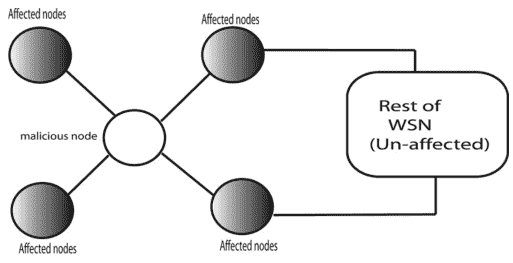

**图 2.1** 女巫攻击正在感染网络中的一组节点。

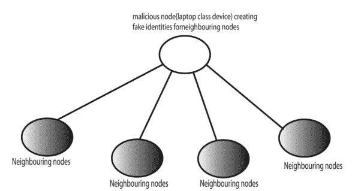

**图 2.2** 你好泛滥攻击。

是防御这些攻击的最佳措施[65,66]。你好泛滥攻击的图示如图2.2所示，其中恶意节点在网络中出现为虚假的邻域节点。

节点捕获：此类攻击通过获取对节点的访问权限来执行。该节点可用于获取网络的非法权限，例如信息检索以及对网络的主动或被动控制。因此，如果犯罪者可以访问单个节点，他们可以有效地扩展对整个WSN的控制。

选择性转发：又称为黑洞攻击，此类攻击主要通过使节点表现得像“黑洞”来执行，数据进入但不再出来[67]。WSN主要是多跳网络。因此，系统设计为在节点间传输消息。但如果有时恶意节点拒绝转发消息并将其丢弃，就会产生黑洞。这意味着节点会接收其他节点的传输然后丢弃，WSN丢失数据。恶意节点也可以只丢弃部分数据而转发其他数据，仍然会导致数据丢失。为应对此问题，可以采用基于协议的方法。多路径路由将减少共享链路，从而降低隐式信息接收。

女巫攻击：虽然同类攻击也存在于数据链路层，但在网络层中，其效果不同。恶意节点可以为其他节点创建多个身份。它在网络中的节点之间创建多路径和分离。为应对此问题，每个节点应与基站拥有唯一的共享对称密钥。在图2.3中，M是为U创建身份Z的恶意节点。

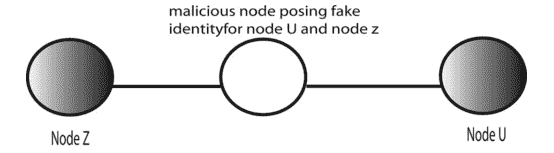

**图 2.3** 网络层女巫攻击。

也就是说，M在U看来是Z的伪造身份。因此，如果U想要向Z发送数据，数据将被转发到M，即Z的恶意身份。

蠕洞攻击：在此攻击中，隧道消息通过低延迟链路从网络的一部分传递到网络的另一部分。然后，消息会超出范围传送给攻击者。尽管与黑洞攻击不同，蠕洞攻击处于类似层面。蠕洞攻击可以威胁采用加密和认证的WSN。如果攻击者能够修改其蠕洞端的路由信息，通过使其他路由看起来代价更高来诱捕数据，它也可以转变为洞穴攻击。蠕洞难以检测，且可能与选择性转发的女巫攻击结合[68,69]。最优节点通信时间同步和地理最短路由可用于应对此攻击。最小跳数路由算法可能有助于抵御此攻击[70]。

#### 2.3.3.4 传输层攻击及其对策

泛洪攻击：在此攻击中，受感染节点反复尝试与不同节点建立连接。为了创建连接，节点需要带宽和电源等资源。如果泛洪攻击攻击某个节点，由于重复的连接创建请求，资源将被耗尽。泛洪攻击可以通过客户端谜题来防止，该谜题能威慑攻击实体。此外，对每个节点的连接数量设置限制可防止由泛洪攻击引起的资源耗尽。各种资源优化算法也可用作应对此攻击的对策[71]。

失步攻击：节点间的同步通信是WSN的核心。攻击者可能试图通过在两个节点间传输丢失帧信号来破坏这种稳定性，从而导致垃圾通信和能源浪费。攻击者向一端或两端发送丢失帧消息，以将其传播到整个网络。网络陷入同步恢复协议的循环并耗尽能量。发送控制消息以测试节点间的同步、数据包加密和逐个数据包的认证可以消除此威胁。此外，对于丢失帧，可以限制重复请求的数量以防止其发生。

#### 2.3.3.5 应用层攻击与对策

压倒性攻击：攻击者试图让网络节点不堪重负，向基站传输大量数据。因此，网络带宽和能源被耗尽。犯罪者可能试图为WSN中的节点产生压倒性的传感器刺激，从而导致大量虚假基站流量。出于此原因，能源被耗尽。

为有效应对此攻击，可以使用速率限制器配合数据聚合器。此外，对传感器节点进行精细调整可能是一种有用策略。调整应包括设计节点的指令集，使其仅对有效和真实的刺激作出反应。

基于路径的DoS攻击：由于这是一种DoS攻击类型，攻击者将试图使设备不可用。在此攻击中，节点与基站之间的连接路径不可用。攻击者针对叶子节点并注入重放数据包。由于重复注入，通往基站的路径被占用，所有其他节点都无法连接基站。

由于数据以数据包形式发送，认证机制可以应用于数据包级别。另一方面，重放数据包也可以通过抗重放保护来保护，以应对此攻击。这可以通过结合两者来防御。

洪水攻击：这也称为重编程攻击。它攻击节点的编程代码。在远程维护的情况下，攻击者可以访问节点并通过重编程节点来控制网络的一小部分到相当大一部分。更好的管理认证和进入节点软件入口点的更高安全性将防御洪水攻击。使用安全协议和安全编码的安全通信方案可用于应对此类攻击。

在表2.5中，展示了WSN攻击、策略、影响和对策的简明摘要。

**表 2.5**
WSN攻击、策略、影响及对策摘要

| 攻击 | 策略 | 影响 | 受影响层 | 解决方案 |
|---|---|---|---|---|
| 干扰 | DoS；通信攻击；使用高能信号 | 节点不可用；电量耗尽；数据损坏；传输受阻 | 物理层 | 扩频技术；准入控制机制 |
| 无线电干扰 | 恶意无线电信号传输； | 产生大量干扰；信号中断 | 物理层 | 在揭示密钥时引入延迟，由对称密钥算法实现 |
| 篡改和破坏 | 物理访问传感器节点 | 物理破坏；敏感数据泄露；被篡改的传感器节点 | 物理层 | 物理安全措施；通过自毁机制进行防篡改 |
| 耗尽 | 破坏MAC协议；连续信道；恶意节点请求连续传输 | 网络上的恶意传输；饥饿；能源耗尽 | 数据链路层 | 限制MAC准入控制速率；时分复用 |
| 冲突 | 两个节点在同一频率上传输 | 数据包损坏；数据不匹配 | 数据链路层 | 接收端可使用纠错 |


#### 表 2.5（续）WSN 攻击、策略、影响及对策汇总

| 攻击 | 策略 | 影响 | 受影响层 | 解决方案 |
| :--- | :--- | :--- | :--- | :--- |
| 不公平 | 篡改 MAC 属性 | 扰乱 WSN；部分 DoS 攻击；性能受阻 | 数据链路层 | 使用小帧和小时间帧 |
| 询问攻击 | 滥用流量控制信号；利用 MAC 协议 | (RTS/CTS) 被攻破 | 数据链路层 | 限制 RTS 消息；防重放保护；改进的认证机制 |
| 女巫攻击 | 破坏单个节点；创建大量虚假节点 | 控制网络；恶意节点可创建多个身份 | 数据链路层/网络层 | 双向认证；独特共享对称密钥；三次握手、监控、灵活路由、出口过滤 |
| 水洞攻击 | 以所有节点为中心的水洞 | 拦截指向受影响节点的流量 | 网络层 | 地理路由协议 |
| Hello 淹没攻击 | 向所有传感器节点发送 Hello 数据包；大范围无线电传输；笔记本级攻击 | 创建恶意节点 | 网络层 | 增强认证措施 |
| 节点捕获 | 非法访问节点 | 对网络的主动或被动控制 | 网络层 | 增强路由协议；速率限制器 |
| 选择性转发 | 创建黑洞节点 | 恶意节点拒绝转发消息并将其丢弃 | 网络层 | 多路径路由协议 |
| 虫洞攻击 | 隧道消息通过低延迟链路传递 | 连接两个节点；可能创建水洞；难以检测 | 网络层 | 节点通信中严格的时间同步；使用最短路由 |
| 路由篡改 | 路由被篡改 | 创建路由循环以吸引或排斥网络流量，在网络中创建碎片，延长或缩短路由，并创建虚假消息 | 网络层 | MAC 协议；加密且经过身份验证的消息传输 |
| 洪水攻击 | 重复的连接创建请求 | 资源耗尽；电力消耗；带宽浪费 | 传输层 | 客户端谜题；连接限制 |
| 失同步攻击 | 传输丢失的帧 | 节点间通信受阻 | 传输层 | 节点间同步；数据包加密；逐包认证 |
| 压倒攻击 | 传递大量数据 | 带宽和能量因大量虚假流量而耗尽 | 应用层 | 速率限制器；数据聚合器；节点调优 |
| 基于路径的 DoS 攻击 | 向叶节点注入重放数据包的 DoS | 路径不可用；连接不可用 | 应用层 | 结合数据包认证和防重放预测 |
| 洪流攻击 | 重编程攻击；攻击编程代码并进行更改 | 获得访问权；非法优势 | 应用层 | 管理员身份验证；安全通信协议 |

## 2.4 无线传感器网络中密码学的作用

密码学在保护数据完整性、保密性和真实性方面发挥着至关重要的作用。密码学研究表明，它可以分为对称密钥密码学 (SKC) 和公钥密码学 (PKC)[72,73]。

公钥密码学与对称密钥密码学：在 SKC 中，发送方和接收方之间共享一个密钥。相比之下，PKC 使用两个密钥——一个密钥和一个公钥。用密钥完成的任何操作只能用公钥逆转，反之亦然。看起来 SKC 可能更适合只需要保密性或数据完整性的 WSN 应用[74,75]。但 SKC 未能最大限度地减少密钥泄露的影响，而 PKC 满足这一要求。PKC 被认为对于小型设备来说计算开销太大。最近的研究表明，通过选择公钥密码学算法，可以在资源极少的小型无线设备上应用 PKC[76,77]。

公钥基础设施 (PKI)：这是一种通过证书颁发机构 (CA) 颁发的公钥证书，将公钥与相应用户身份绑定的安排。PKI 的重要组成部分包括客户端、CA、注册机构和存储库。为了提供 PKI 服务，这些组件及其功能必须映射到 WSN 的实体上。大多数传感器网络将使用简单的分层 PKI 架构，只有一个根 CA。注册、初始化、密钥生成、认证和认证检索是使用这种技术在 WSN 中完成的。

基于身份的密码学 (IBC)：这允许用户的公钥轻松从其已知身份信息（例如电子邮件地址或蜂窝电话号码）中推导出来，从而消除了对公钥证书的需求[78]。基于 ID 的方案更适合这些 WSN 场景。每个具有唯一身份信息（例如序列号）的传感器节点，从充当 PKG 的基站 (BS) 获取相应的私钥。为了相互认证，只需交换身份信息，无需额外的公钥数据。IBC 使得无需任何交互即可建立会话密钥成为可能。

## 2.5 无线传感器网络的应用

WSN 被应用于各个领域。它在家庭、环境和军事用途等方面具有潜在应用。不同类型的行业也利用 WSN。本节将简要描述这两种使用标准。

### 2.5.1 无线传感器网络的一般应用

随着基础设施的可扩展性，WSN 的应用有所增加。在创立之初，由于其尺寸小和成本低，WSN 主要用于军事领域。此外，由于其特性，它们在环境领域也具有潜在用途。在气象站中，使用了各种无线传感器，尤其是在恶劣环境中。传感器可以部署在地下洞穴和矿井中，以检测有害气体、深度和空气质量。这最终有助于矿工安全下井并完成任务。在医疗领域，传感器有着巨大的用途。传感器可以检测患者的脑信号以进行治疗。传感器也可以放置在医院内部，用于管理目的，例如检查医生、护士和患者的考勤。它还可以用于检测患者的心率。这种传感器甚至安装在一些智能手机中。因此，它们比以前更常见。WSN 的表格应用如下，以便更好地理解，见表 2.6 [21,79,80]：

### 表 2.6 无线传感器网络的一般应用

| 应用领域 | 应用子领域 | 详情 |
| :--- | :--- | :--- |
| 军事应用 | 监控友军、装备和弹药 | 持续监控，决策时的灵活性，战时军队和车辆状态，监视，来自上级机构的指令和协调 |
| | 战场监视 | 关键地形检测；环境监测；营地周围监视 |
| | 侦察目标定位 | 通过监视收集情报，武器制导系统设计与部署 |
| | 战斗损伤评估： | 部署，目标区域，损伤评估数据 |
| | 核、生物和化学攻击检测与侦察 | 零点，检测，关键反应时间，核侦察，化学武器检测，神经毒气检测，生物武器检测 |
| 环境应用 | 森林火灾检测 | 精确起源检测，无线电频率，大量分散节点共同可检测预期结果，倒木检测，探险/研究期间造成的阻碍检测 |
| | 环境生物复杂性映射 | 精巧方法，遥感，自动化，生物多样性 |
| | 洪水检测 | 警报系统 |
| | 精准农业 | 监控农药，实时跟踪水/空气/土壤水平 |
| 健康应用 | | 人体生理数据远程监测；跟踪和监控医生及患者；医院药物管理 |
| 家庭应用 | 家庭自动化 | 家用设备，外部网络，互联网，卫星 |
| | 智能环境 | 以人为本，以技术为中心，中间件，房间服务器 |
| 其他商业应用 | 各种办公室/企业大楼/工厂/仓库 | 集中控制空调和空气质量；检测威胁，车辆追踪，仓库库存追踪 |


### 2.5.2 无线传感器网络的行业特定应用

在前面的章节中，已考虑了WSN的特性，并展示了其应用。WSN具有可扩展性的潜力。工业类型多样，例如建筑、服装制造、金属物体、汽车制造、武器制造等行业。在当今世界，自动化已在许多领域取代了人工。自动化需要来自工业机械各个部分的数据才能无缝运行。行业关键元素的信息是必要的，例如机械内部裂缝、生产故障、车轮圆周故障检测等。

在结构工程方面，有令人叹为观止的应用。为了保持工业中金属弯曲的适当性，可以使用传感器进行建筑物裂缝检测、准确高度检测以及结构的应力和张力检测。此前，人们过去常遵循复杂的数学公式和工具来进行此类工作。工业无线传感器的应用表格表示如表2.7 [81]所示。

| 类别 | 详情 | 参考文献 |
| :--- | :--- | :--- |
| 区域监测 | 积累环境数据；将数据发送到基站（BS），使用的传感器包括温度、压力、气体、声波等；长期数据收集有助于数据分析 | [82] |
| 空气/水质量和废物监测 | 环境污染监测；可扩展性提高准确性；环境数据分析；水污染监测；传感器数据有助于污染监测和分析，并帮助跟踪污染状态 | [83,84] |
| 机器健康监测 | 机械状态；基于状态检查的机械维护计划；旋转状态监测 | [85] |
| 结构监测 | 结构监测；振动监测；建筑物裂缝监测；金属弯曲检查；降低成本，用于结构改进的数据库；应力和张力监测 | [86,87] |
| 灾害预防 | 识别威胁，避免危害；传感器在灾害多发区域收集环境数据；监测气压、湿度；温度 | |
| 传感器和执行器网络 | 网络建模；时间敏感；数据路由；修复上行和下行连接 | |
| 工业自动化和反馈控制 | 数据包接收，反馈控制；工业自动化报告；确保及时性和可信度 | [88–90] |
| 工业紧急响应 | 工业紧急反馈；无缝连接 | [91] |

## 2.6 面向未来的无线传感器网络

随着时间的推移，WSN的可扩展性和应用正在增加。其应用可以在家庭、办公室、科研、工业及各种其他层面看到。每个领域都涉及数据。尽管在本章中，我们已经看到了多种攻击方法及其拟议的对策，但仍有改进空间 [92]。鉴于使用因素的敏感性，收集和处理的数据是首要关注点。

区块链技术可用于WSN中，以保护数据的机密性、完整性和真实性。然而，鉴于WSN的低功耗和自组织特性，在WSN中实现区块链可能是一个开放的研究问题。另一方面，在区块链中存储数据也可以确保向另一方验证数据。区块链也可用于受感染节点和恶意代码。在这种情况下，智能合约也可发挥作用。WSN在物联网网络中的应用也在增加。智能健康应用日益增多；移动设备也配备了传感器来测量心率。起搏器专为先进的心脏治疗而构建，并使用传感器。传感器也拥有一个网络，在投入适当时间和精力的情况下，该网络可能被利用。因此，可以通过增强协议和安全更新使网络更加安全。此外，机器学习也正在被实施以改进能源效率。

智慧城市的概念正在科学家和研究人员中日益流行。在智慧城市功能中，WSN将是一种必不可少的工具。利用该网络，可以提出一个用于可持续清洁环境的私有通信网络，其中节点将持续从环境中收集数据。根据数据分析并应用人工智能，可以人工源增加或减少空气中的成分。如果尘埃颗粒增加，可以设计更有效的过滤器来保护环境。传感器也可用于有害气体检测。该功能可用于公共卫生安全。

总而言之，可以认为WSN是现代IT中最关键和最蓬勃发展的领域之一。理解WSN的基础知识将有助于发挥使用WSN的紧迫性和必要性。此外，可以研究安全威胁和攻击，以进一步发展这项技术。尽管该技术本身存在一些局限性，但如果努力了解安全威胁，就可以开发出新技术来应对WSN的安全问题和挑战。

## 参考文献

- 1. Sharmila, S., & Shanthi, T. (2016年2月). 无线自组织网络调查：问题与实现。载于2016年工程、技术与科学新兴趋势国际会议（ICETETS）（第1–6页）。IEEE，Pudukkottai。
- 2. Yick, J., Mukherjee, B., & Ghosal, D. (2008). 无线传感器网络调查。计算机网络，52(12)，2292–2330。
- 3. Khemapech, I., Duncan, I., & Miller, A. (2005年6月). 无线传感器网络技术调查。载于第6届电信、网络与广播融合年度研究生研讨会（第13卷）。圣安德鲁斯大学，圣安德鲁斯。
- 4. Vieira, M. A. M., Coelho, C. N., Da Silva, D. C., & da Mata, J. M. (2003年9月). 无线传感器网络设备调查。载于EFTA 2003。2003年IEEE新兴技术与工厂自动化会议论文集（目录号03TH8696）（第1卷，第537–544页）。IEEE，里斯本。
- 5. Dewal, P., Narula, G. S., Jain, V., & Baliyan, A. (2018). 无线传感器网络中的安全攻击：一项调查。载于Bokhari, M., Agrawal, N., & Saini, D.（编）。网络安全（第47–58页）。Springer，新加坡。
- 6. Dhakne, A. R., & Chatur, P. N. (2017). 无线传感器网络攻击详细调查。载于数据工程与通信技术国际会议论文集（第319–331页）。Springer，新加坡。
- 7. Xiaomei, Y., & Ke, M. (2016年7月). 无线传感器网络安全的演变。载于2016年世界自动化大会（WAC）（第1–5页）。IEEE，里奥格兰德。
- 8. Patil, S., & Chaudhari, S. (2016). 无线传感器网络中的DoS攻击预防技术。计算机科学前沿，79，715–721。
- 9. Chen, C. M., Hsu, S. C., & Lai, G. H. (2016). IPv6无线传感器网络拒绝服务攻击防御。载于Zin, T., Lin, J. W., Pan, J. S., Tin, P., & Yokota, M.（编）。遗传与进化计算（第319–326页）。Springer，Cham。
- 10. Tomić, I., & McCann, J. A. (2017). 现有无线传感器网络协议中潜在安全问题调查。IEEE物联网杂志，4(6)，1910–1923。
- 11. Bhushan, B., & Sahoo, G. (2018). 无线传感器网络中攻击、技术挑战、漏洞及其对策的最新进展。无线个人通信，98(2)，2037–2077。
- 12. Osanaiye, O., Alfa, A. S., & Hancke, G. P. (2018). 无线传感器网络干扰攻击检测的统计方法。传感器，18(6)，1691。
- 13. Guan, Y., & Ge, X. (2017). 针对随机多信道干扰攻击的无线传感器网络分布式安全估计。IEEE Access，5，10858–10870。
- 14. Zhou, Y., Fang, Y., & Zhang, Y. (2008). 保障无线传感器网络安全：一项调查。IEEE通信调查与教程，10(3)，6–28。
- 15. Walters, J. P., Liang, Z., Shi, W., & Chaudhari, V. (2007). 无线传感器网络安全：一项调查。分布式、网格、移动和普适计算安全，1(367)，6。
- 16. Padmavathi, D. G., & Shanmugapriya, M. (2009). 无线传感器网络中攻击、安全机制和挑战调查。计算机科学与信息安全国际期刊，4(1 & 2)，arXiv预印本 arXiv:0909.0576。
- 17. Kocakulak, M., & Butun, I. (2017年1月). 面向物联网的无线传感器网络概述。载于2017年IEEE第7届年度计算与通信研讨会及大会（CCWC）（第1–6页）。IEEE，内华达州拉斯维加斯。
- 18. Akyildiz, I. F., Su, W., Sankarasubramaniam, Y., & Cayirci, E. (2002). 无线传感器网络：一项调查。计算机网络，38(4)，393–422。
- 19. Feng, J., Koushanfar, F., & Potkonjak, M. (2002年9月). 传感器网络的系统架构：问题、替代方案与发展方向。载于IEEE计算机设计国际会议论文集：计算机和处理器中的VLSI（第226–231页）。IEEE，弗赖堡。
- 20. Ramson, S. J., & Moni, D. J. (2017年2月). 无线传感器网络的应用——一项调查。载于2017年电气、电子、仪器与媒体技术创新国际会议（ICEEIMT）（第325–329页）。IEEE，科伊姆巴托尔。
- 21. Toumpis, S., & Tassiulas, T. (2006). 大型无线传感器网络的最优部署。IEEE信息论事报，52，2935–2953。
- 22. Yick, J., Paternack, G., Mukherjee, B., & Ghosal, D. (2006). 传感器网络中网络服务的部署。无线传感器网络中的自组织路由与信息集成（专刊），无线与移动计算国际期刊，1，101–112。


- 23. Pompili, D., Melodia, T., & Akyildiz, I. F. (2006). 水下声学无线传感器网络的部署分析。在 WUWNet，洛杉矶，CA。

- 24. Akyildiz, I. F., & Stuntebeck, E. P. (2006). 地下无线传感器网络：研究挑战。Ad-Hoc Networks，4，669–686。

- 25. Li, M., & Liu, Y. (2007). 基于无线传感器网络的地下结构监测。在 IPSN 论文集，剑桥，MA。

- 26. Akyildiz, I. F., Pompili, D., & Melodia, T. (2004). 水下声学传感器网络中高效通信的挑战。ACM Sigbed Review，1(2)，3–8。

- 27. Heidemann, J., Li, Y., Syed, A., Wills, J., & Ye, W. (2005). 水下传感器网络：研究挑战与潜在应用。在 技术报告 ISI-TR-2005-603 论文集。USC/信息科学研究院，马尔德尔雷，CA。

- 28. Akyildiz, I. F., Melodia, T., & Chowdhury, K. R. (2007). 无线多媒体传感器网络综述。Computer Networks，51(4)，921–960。

- 29. Tasnim, A., Shurid, S., & Haque, A. B. (2020). 使用 IR 传感器和 Node MCU 的非法边境越境检测与预警系统。International Journal of Information and Electronics Engineering，10(2)。doi: 10.18178/ijiee.2020.10.2.719。

- 30. Sinha, P., Jha, V. K., Rai, A. K., & Bhushan, B. (2017, 7月). OSI 参考模型各层无线传感器网络中的安全漏洞、攻击与对策：综述。在 2017 信号处理与通信国际会议 (ICSPC) (第 288–293 页)。IEEE，科伊姆巴托尔。

- 31. Queiroz, D. V., Alencar, M. S., Gomes, R. D., Fonseca, I. E., & Benavente-Peces, C. (2017). 工业无线传感器网络的综述与系统图谱。Journal of Network and Computer Applications，97，96–125。

- 32. Sohraby, K., Minoli, D., & Znati, T. (2007). 无线传感器网络：技术、协议与应用。John Wiley & Sons，霍博肯，NJ。

- 33. Gajski, D. D., Abdi, S., Gerstlauer, A., & Schirner, G. (2009). 嵌入式系统设计。Springer US。doi: 10.1007/978-1-4419-0504-8。

- 34. Erdelj, M., Mitton, N., & Natalizio, E. (2013). 工业无线传感器网络的应用。doi: 10.1201/b14072-2. https://www.taylorfrancis.com/chapters/applications-industrial-wireless-sensor-networks-milan-erdelj-nathalie-mitton-enrico-natalizio/e/10.1201/b14072-1

- 35. Obaidat, M. S., & Misra, S. (2013). 无线传感器网络原理。Cambridge University Press，剑桥。

- 36. Rathnayaka, A. D., & Potdar, V. M. (2013). 无线传感器网络传输协议：关键综述。Journal of Network and Computer Applications，36(1)，134–146。

- 37. Palattella, M. R., Accettura, N., Vilajosana, X., Watteyne, T., Grieco, L. A., Boggia, G., & Dohler, M. (2012). 物联网（重要事物）的标准化协议栈。IEEE Communications Surveys & Tutorials，15(3)，1389–1406。

- 38. Alkhatib, A. A. A., & Baicher, G. S. (2012). 无线传感器网络架构。在 2012 计算机网络与通信系统国际会议 (CNCS 2012)。IACSIT Press，新加坡。

- 39. Silva, I., Lopes, D., Duarte, A., Afonso, L., Aquino, L., & Saito, K. 无线工业网络新兴技术：WirelessHART 与 ISA100.11a（葡萄牙语）。在 VII 里约自动化大会。https://www.igi-global.com/chapter/content/76964

- 40. Han, S., Zhu, X., Mok, A. K., Chen, D., & Nixon, M. (2011, 4月). 工业无线 mesh 网络中的可靠实时通信。在 2011 第 17 届 IEEE 实时与嵌入式技术与应用研讨会 (第 3–12 页)。IEEE，芝加哥，IL。

- 41. Bachir, A., Dohler, M., Watteyne, T., & Leung, K. 无线传感器网络的 MAC 基础。IEEE Communications Surveys & Tutorials，12(2)，222–248。

- 42. Zhao, Y. Z., Miao, C., Ma, M., Zhang, J. B., & Leung, C. (2012). 无线传感器网络介质访问控制协议的综述与展望。ACM Computing Surveys，45(1)，1–37。doi: 10.1145/2379776.2379783。

- 43. Durresi, A. (2005). 异构无线传感器网络架构（邀请论文）。在 2005 IEEE 第 16 届个人、室内和移动无线通信国际研讨会 (第 2 卷，第 1289–1296 页)。IEEE。doi: 10.1109/PIMRC.2005.1651649。

- 44. Bhushan, B., & Sahoo, G. (2018). 无线传感器网络中的路由协议。在 传感器网络中的计算智能 计算智能研究 (第 215–248 页)。doi: 10.1007/978-3-662-57277-1_10。

- 45. Bhushan, B., & Sahoo, G. (2020). 无线传感器网络的需求、协议与安全挑战：工业视角。在 计算机网络与网络安全手册 (第 683–713 页)。doi: 10.1007/978-3-030-22277-2_27。

- 46. Jaitly, S., Malhotra, H., & Bhushan, B. (2017). 无线传感器网络中干扰攻击的安全漏洞与对策：综述。在 2017 计算机、通信与电子国际会议 (Comptelix)。doi: 10.1109/comptelix.2017.8004033。

- 47. Kavitha, T., & Sridharan, D. (2010). 无线传感器网络中的安全漏洞：综述。Journal of Information Assurance and Security，5(1)，31–44。

- 48. Bhushan, B., & Sahoo, G. (2019). 面向无线感知环境的混合安全节能簇基础入侵检测系统。在 2019 第 2 届信号处理与通信国际会议 (ICSPC)。doi: 10.1109/icspc46172.2019.8976509。

- 49. Shankar, A., & Jaisankar, N. (2016). 无线传感器网络中一种新型节能聚类机制。Procedia Computer Science，89，134–141。doi: 10.1016/j.procs.2016.06.022。

- 50. Perrig, A., Szewczyk, R., Tygar, J. D., Wen, V., & Culler, D. E. (2002). SPINS：传感器网络的安全协议。Wireless Networks，8(5)，521–534。

- 51. Bhushan, B., Sahoo, G., & Rai, A. K. (2017). 无线与计算机网络中的中间人攻击——综述。在 2017 第 3 届计算、通信与自动化国际会议 (ICACCA)（秋季）。doi: 10.1109/icaccaf.2017.8344724。

- 52. Shankar, A., & Jaisankar, N. (2018). 支持无线传感器网络节能感知路由协议的最优簇头选择框架。International Journal of Networking and Virtual Organisations，18(2)，144。doi: 10.1504/ijnvo.2018.091605。

- 53. Shaikh, R. A., Lee, S., Song, Y. J., & Zhung, Y. (2006). 分布式无线传感器网络安全：问题与指南。在 IEEE 传感器网络、普适和可信计算国际会议论文集 (SUTC’06)。IEEE，台中。

- 54. Singh, S. K., Singh, M. P., & Singh, D. K. (2011). 无线传感器网络网络安全与攻击防御机制综述。International Journal of Computer Trends and Technology，1(2)，9–17。

- 55. Raymond, D. R., & Midkiff, S. F. (2008). 无线传感器网络中的拒绝服务：攻击与防御。IEEE Pervasive Computing，7(1)，74–81。

- 56. Saxena, M. (2007). 无线传感器网络安全——基于层的分类。CERIAS 技术报告 2007-04。普渡大学，西拉法叶，IN。

- 57. Wang, Y., Attebury, G., & Ramamurthy, B. (2006). 无线传感器网络安全问题综述。IEEE Communications Surveys & Tutorials，8(2)，2–23（2006 年第 2 季度）。

- 58. Shi, E., & Perrig, A. (2004). 设计安全的传感器网络。IEEE Wireless Communications，11(6)，38–43。

- 59. Sarma, H. K. D., & Kar, A. (2006). 无线传感器网络的安全威胁。在 第 40 届卡纳汉安全技术国际年会论文集 2006。IEEE，列克星敦，KY。

- 60. Douceur, J. R. (2002). Sybil 攻击。在 第 1 届对等系统国际研讨会 (IPTPS ’02)，2002 年 3 月，LNCS 2429 (第 251–260 页)，剑桥，MA。

- 61. Newsome, J., Shi, E., Song, D., & Perrig, A. (2004). 传感器网络中的 Sybil 攻击：分析与防御。在 第 3 届 IEEE 传感器网络信息处理国际研讨会论文集 (IPSN’04) (第 259–268 页)，伯克利，CA。

- 62. Djenouri, D., Khelladi, L., & Badache, A. N. (2005). 移动自组织网络和传感器网络安全问题综述。IEEE Communications Surveys & Tutorials，7(4)，2–28（2005 年第四季度）。

- 63. Zia, T., & Zomaya, A. (2006). 无线传感器网络安全问题。在 2006 系统与网络通信国际会议 (ICSNC’06)。IEEE，塔希提。

- 64. Pathan, A.-S. K., Lee, H.-W., & Hong, C. S. (2006). 无线传感器网络安全：问题与挑战。在第 8 届 IEEE ICACT 2006 论文集 (第 1043–1048 页)。IEEE，凤凰公园。

- 65. Karlof, C., & Wagner, D. (2003). 传感器网络中的安全路由：攻击与对策。Ad hoc Networks，1，293–315。

- 66. Sharifnejad, M., Shari, M., Ghisabadi, M., & Beheshti, S. (2007). 无线传感器网络安全综述。在 SETIT 2007，突尼斯。

- 67. Bhushan, B., & Sahoo, G. (2019). E2 SR2：一种基于确认的带可充电传感器的移动沉节点路由协议，用于无线传感器网络。Wireless Networks，25(5)，2697–2721。doi: 10.1007/s11276-019-01988-7。

- 68. Bhushan, B., & Sahoo, G. (2017). 无线传感器网络中蠕虫洞攻击的检测与防御机制。在 2017 第 3 届计算、通信与自动化国际会议 (ICACCA)（秋季）。doi: 10.1109/icaccaf.2017.8344730。

- 69. Bhushan, B., & Sahoo, G. (2019). WSN 环境中的 ISFC-BLS（基于均衡负载子簇形成的智能安全模糊聚类算法）。Wireless Personal Communications。doi: 10.1007/s11277-019-06948-0。

- 70. Khapre, S. P., Chopra, S., Khan, A., Sharma, P., & Shankar, A. (2020). 基于改进蚁群算法的无线传感器网络优化路由方法。在 2020 第 10 届云计算、数据科学与工程国际会议 (Confluence)。doi: 10.1109/confluence47617.2020.9058312。

- 71. Bhushan, B., & Sahoo, G. (2017). 无线传感器网络中安全节能路由协议与数据收集方法的全面综述。在 2017 信号处理与通信国际会议 (ICSPC)。doi: 10.1109/icspc.2017.8305856。

- 72. Shim, K. A. (2015). 无线传感器网络中公钥加密原语综述。IEEE Communications Surveys & Tutorials，18(1)，577–601。

- 73. Menezes, A. J., Van Oorschot, P. C., & Vanstone, S. A. (1997). 应用密码学手册。CRC Press，博卡罗顿，FL。

- 74. Gura, N., Patel, A., Wander, A., Eberle, H., & Shantz, S. C. (2004). 8 位 CPU 上椭圆曲线密码学与 RSA 的比较。在 Joye, M., & Quisquater, J.-J. (eds) CHES 2004。LNCS (第 3156 卷，第 119–132 页)。Springer，海德堡。

- 75. Wander, A. S., Gura, N., Eberle, H., Gupta, V., & Shantz, S. C. (2005). 无线传感器网络公钥密码学的能耗分析。在 第三届 IEEE 普适计算与通信国际会议。IEEE，考艾岛，HI。

- 76. Oliveira, L. B., Kansal, A., Priyantha, B., Goraczko, M., & Zhao, F. (2013). Secure-TWS：共享传感器网络中节点到多用户通信的身份验证。The Computer Journal，55(4)，384–396。

- 77. Czypek, P., Heyse, S., & Thomae, E. (2012). 受约束设备上 MQPKS 的高效实现。在 Prouff, E., & Schaumont, P. (eds)。密码学硬件与嵌入式系统。CHES 2012。计算机科学讲义 (第 7428 卷，第 374–389 页)。Springer，柏林。


- 78. Shamir, A. (1984). 基于身份的加密系统和签名方案。载于 Crypto'84, LNCS 196 (第 47–53 页)。Springer-Verlag, 柏林。
- 79. Estrin, D., Govindan, R., Heidemann, J., & Kumar, S. (1999). 下一世纪挑战：传感器网络中的可扩展协调。载于 ACM MobiCom'99 (第 263–270 页)，华盛顿特区。
- 80. Chandrakasan, A., Amirtharajah, R., Cho, S., Goodman, J., Konduri, G., Kulik, J., Rabiner, W., & Wang, A. (1999). 分布式微传感器系统的设计注意事项。载于 IEEE 1999 年定制集成电路会议论文集 (第 279–286 页)，圣地亚哥。
- 81. Raza, M., Aslam, N., Le-Minh, H., Hussain, S., Cao, Y., & Khan, N. M. (2017). 工业无线传感器网络中研究潜力、挑战和未来指导方针的批判性分析。IEEE 通信调查与教程, 20(1), 39–95。
- 82. Akyildiz, I. F., & Vuran, M. C. (2010). 无线传感器网络 (第 4 卷)。John Wiley & Sons, 霍博肯。
- 83. R P. Narayanan, T. V. Sarath, and V. V. Vineeth, “关于无线传感器网络中节点的调查：性能与参数分析,” 无线传感器网络, 第 8 卷, 第 67 页, 2016。
- 84. Waspmote 传感器节点新一代, Libelium (2016)。可用：http://www.libelium.com/libelium-launches-new-generation-of-waspmote-sensor-nodes/。
- 85. Singh, S. K., Singh, M. P., & Singh, D. K. (2010). 无线传感器网络中节能分层簇路由的综述。先进网络与应用国际期刊, 2(2), 570–580。
- 86. Kurata, N., Saruwatari, S., & Morikawa, H. (2006). 利用无线传感器网络进行无处不在的结构监测。载于 2006 年智能信号处理与通信国际研讨会。IEEE, 鸟取。
- 87. Kim, S., Pakzad, S., Culler, D., Demmel, J., Fenves, G., Glaser, S., & Turon, M. (2007). 利用无线传感器网络进行土木基础设施健康监测。载于第 6 届信息处理传感器网络国际会议论文集。ACM, 剑桥。
- 88. Åkerberg, J., Gidlund, M., & Björkman, M. (2011). 针对工业自动化的无线传感器与执行器网络未来研究挑战。载于 2011 年第 9 届 IEEE 工业信息学国际会议。IEEE, 卡帕里卡。
- 89. Christin, D., Mogre, P. S., & Hollick, M. (2010). 针对工业自动化的无线传感器网络技术综述：安全性与服务质量视角。未来互联网, 2, 96–125。
- 90. Senel, M., Chintalapudi, K., Lal, D., Keshavarzian, A., & Coyle, E. J. (2007). 基于卡尔曼滤波的无线传感器网络链路质量估计方案。载于 2007 年全球电信会议 (GLOBECOM’07)。IEEE, 华盛顿特区。
- 91. Raza, M., Le-Minh, H., Aslam, N., Hussain, S., & Ellahi, W. (2017). 工业无线传感器网络中面向时延关键和紧急通信的基于控制信道的 MAC 协议。载于 2017 年通信、计算与数字系统国际会议 (C-CODE) (第 122–126 页)，伊斯兰堡。doi: 10.1109/C-CODE.2017. https://ieeexplore.ieee.org/document/7918914
- 92. Puri, D., & Bhushan, B. (2019). WSNs 中安全性与能效提升：机器学习的解救。载于 2019 年计算、通信与智能系统国际会议 (ICCCIS)，doi: 10.1109/icccis48478.2019.8974465。


泰勒与弗朗西斯

泰勒与弗朗西斯集团

http://taylorandfrancis.com

# 3 无处不在计算概述与当代视角

Reinaldo Padilha França,
Ana Carolina Borges Monteiro,
Rangel Arthur, 和 Yuzo Iano
坎皮纳斯州立大学 (UNICAMP)

## 目录

- 3.1 引言 ....................................................45
- 3.2 无处不在计算概念 .................................47
- 3.3 普适计算概念 ..................................49
- 3.4 移动计算概念 ...................................51
- 3.5 无处不在计算中的物联网 .................................53
- 3.6 无处不在计算应用 ...........................55
- 3.7 物联网与无处不在计算的安全方面 .....57
- 3.8 趋势 ........................................................58
- 3.9 结论....................................................59
- 参考文献............................................................60

## 3.1 引言

无处不在计算源自普适计算，另一种术语是环境智能，描述了信息技术和技术在人们生活、家庭和社交环境中的直接而持续的存在。它指设备无处连接，其方式对人类如此透明，以至于人们察觉不到它们的存在。通过这项技术，日常生活通过敏感、自适应和智能的数字环境变得更加简单。假设这项技术在日常生活中的存在如此深深融入日常生活的正常状态，以至于用户不需要具备计算机科学技术知识来操作它们 [1,2]。

无处不在计算的目标是与技术/机器范式与人类实现完全融合，使其在自动意义上不可见，例如，在不感知技术存在的情况下使用技术。计算机已成为人们生活的一段时间；然而，无处不在计算技术使这些设备似乎具有类似“人类”的智能系统，从而使其无处不在——从平板电脑、电视、智能手机和计算机到相框、钥匙扣、笔、RFID 标签以及其他常见日常物品。这些设备将永久连接到互联网，通过发送和接收数据和信息，它们将融入人们的日常习惯并相应适应，以便便利他们的日常生活 [2,3]。

要实现这一点，有必要使用自然界面，使沟通更加敏感和容易，通过语音、手势和视觉等与人交互的方式。因此，无需搜索信息，因为信息将通过任何经常使用的对象随时可用。在这种情况下，人类的日常生活将更加高效，因为不会只有一个界面来获取某条新闻、术语或概念，如使用计算机或智能手机时所做的那样，而是通过最近的对象，并返回所进行研究的结果。阐明这项技术的另一种方式是上下文敏感计算，它使通过电子设备捕捉情况成为可能，例如人在空间中的移动，这可以轻松检测 [4]。

其主要思想是指使用移动设备及其服务和资源，这些设备能够发现并连接到环境中的其他移动设备。由于管理无处不在计算的系统可以很小，因此只需要与大容量计算机的无线网络连接。通过无处不在计算，房屋可以使用无处不在技术进行控制，例如，打开或关闭电视和电子设备、激活灯光、通过医疗保健监测卧床人员，并按保质期控制储藏室中的物品，等等 [4,5]。

在过去几十年中，计算机和互联网的使用已成为人们生活方式的组成部分，随着这种不断的发展，计算机技术、电信和不同形式的连接应运而生。然而，社会越来越依赖于出现的计算设备，这些设备为日常任务（无论是个人还是组织）提供便利，但同时，通过技术和无处不在计算，分布式信息系统 (SID) 得到了改进 [6]。

随着这一进步，无处不在计算的创建得以诞生，因为多个设备相互协作；例如，设备、对象和计算机通过网络的智能移动性共享人们的信息，并以透明的方式向用户提供即时访问新服务的途径。目前，通信技术能够通过互联网在几乎任何地方提供服务；例如，由手势和语音命令控制的智能电视、智能手机和笔记本电脑已经相互交互。这使得智能家居、智能场所和智能车辆的创建成为可能，它们以如此微妙的方式相互交互，几乎对用户不可察觉 [6,7]。

因此，无处不在计算被认为是一种技术形式，其中移动用户、服务和资源会遇到其他用户、服务和资源，这些都受益于移动计算和普适计算的进步。应用无处不在计算技术时，利用和管理移动计算和普适计算概念的优势；因此，用户所使用服务的执行责任分布在多个设备中，每个设备都有其特定的特征和功能 [8]。


因此，本章旨在提供无处不在计算及其演进和应用潜力分支的更新概述，阐述并探讨其成功关系，附有简洁的文献背景，并对技术潜力进行分类和综合。

在第3.2节中，介绍了用于理解研究的无处不在计算概念。在第3.3节中，介绍了普适计算概念。在第3.4节中，解释了移动计算概念。在第3.5节中，讨论了物联网与无处不在计算的关系。在第3.6节中，突出了无处不在计算应用。在第3.7节中，辩论了物联网和无处不在计算的安全方面。在第3.8节中，论证了技术趋势。最后，本章在第3.9节结束，包含相关结论。

## 3.2 无处不在计算概念

计算源于移动计算和普适计算的概念（图3.1），其核心思想是指使用移动设备、其服务和资源，这些设备能够发现周围环境中的其他服务和资源，甚至移动设备使得连接到它们成为可能 [9]。

随着计算机技术的不断发展，计算机的使用在过去几十年中推动了互联网的使用。在考虑电信进步和不同形式的连接性的同时，连接性越来越成为人们生活方式不可或缺的一部分。这导致了一个更依赖计算设备的社会，考虑到各种设备相互协作，并以透明的方式为用户提供即时访问新服务的途径，从而便利日常任务（无论是个人还是专业任务） [10,11]。

在此背景下，引入了无处不在计算，其源于“无处不在或可以同时存在于任何地方”的感知，被认为是一种技术，其中服务、移动用户和资源与其他用户、服务和资源相遇，使用移动和普适计算的计算机知识。同时考虑技术对这些用户所使用的服务执行的责任，这些服务分布在多个其他设备中，考虑到这些设备中的每一个都有其特定的特征和功能 [10,11]。

无处不在计算的概念与任何具有计算能力的对象相关，这些对象可以以隐藏的方式相互集成到环境中，以便轻松执行日常任务，描述了信息技术和技术在人们生活、家庭和社会环境中的直接和持续存在。应用时，它管理和使用移动及普适计算概念特征和优势的组合。换句话说，技术是移动性与计算机及其应用程序分布式、智能、不可感知和高度集成存在的整合 [12]。

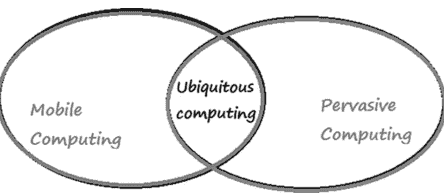

图3.1 无处不在 = 移动 + 普适。

无处不在技术受益于移动技术的进步，拥有越来越便携的设备，因而更具实用性，也更易于携带（移动计算），同样如此。它还受益于计算设备智能行事的能力，如果这些设备随着人工智能技术的进步和新通信网络的出现而变得越来越普遍（普适计算）。同样，还需要考虑这些设备的嵌入程度，旨在指定智能程度，以用于用户执行的某些操作，例如动态检测、探索和构建其环境及嵌入在普适环境中的计算机模型 [13]。

在计算无处不在性方面，确定了三项原则：多样性，是指特定设备尽可能快速、轻松地执行特定任务；去中心化，是指所有设备相互通信并同步各自的特定信息，不仅拥有中央服务器，而且创建一个“智能”环境，其中所有设备协同工作和协作；以及连通性，是指应用程序和设备以连接且不间断的方式与用户一起移动（移动性），通过无线长途网络与中短程网络之间的连接实现——创建了多个异构网络。基于这三项原则，可以在不同环境中使用计算设备，这些环境具有连通性标准，并需要为每个任务具备特定特征，设备之间相互通信 [14,15]。

多样性原则与存在多个执行某项任务的设备相关，考虑到设备的这种多样性目前非常庞大，且其中只有少数具备独特能力，即使考虑那些比其他设备更具体的设备，也取决于任务类型。该原则的一个方面涉及：计算机系统必须能够管理最多样化设备的不同属性，并自动选择最适合给定情况的设备 [14,15]。

去中心化原则涉及应用程序对信息构建和交换的责任，需要服务器既强健又灵活，以便管理大量不同的同步设备 [14,15]。

连通性原则与用户有更直接的关系，源于通过设备始终保持连接的需求。从这个角度来看，有必要标准化设备之间的通信和协议，以基于共同标准中的应用程序实现所需的互操作性，涉及开放连通性标准的规范 [14–16]。

为了实现人机之间的优秀交互，与无处不在计算的目标相关，使用计算设备或任何其他具有计算能力的对象以可见或不可见的方式与用户交互，将技术/机器关系与用户的人类完全融合，在自动（无意识使用）的意义上，有必要就日常任务的完成实现这三项原则 [14–17]。

为了实现这一目标，有必要使用自然界面，使通信更加灵敏和容易，通过与人们互动的方式，例如语音、手势和视觉。同时考虑上下文感知计算，使能够通过电子设备捕捉情况，例如采集机制和上下文推理，甚至是人机交互的方面，或者通过不同领域中的无处不在计算服务和应用程序，例如，适用于最多样化的各种上下文 [18]。

如今，计算变得如此普及，以至于几乎不可能将物理世界和数字世界分开，因为人们从醒来到入睡都越来越数字化连接，吸收和生成大量内容。无论日常生活、在家还是在工作中，当涉及数字世界时，将“在家”与“在工作”区分开来变得越来越困难。在此背景下，无处不在计算越来越多地出现在人们的生活中，不仅限于手机、计算机、电视、平板电脑或电子书等技术环境，还包括桌子、椅子、钥匙扣、冰箱、笔、日历等智能设备，以及其他不属于信息的物品，以简单轻松的方式共享数据、信息和知识 [18–19]。

同样，通过无处不在计算，以及其他技术、系统和界面，它们能够存储信息，并从先前执行的功能中学习。这代表了一个技术是人类进化过程一部分的时代，这是通过一种超级连接性实现的，通过3G和4G连接以及高质量信号，用户不再需要搜索信息，因为它将随时可用，通过任何经常使用的物体即可获取。它还涉及使用云计算概念和通过网络在笔记本电脑、平板电脑和智能手机之间自动同步数据来共享数据，产生更高效的日常生活 [19]。

## 3.3 普适计算概念

普适计算的概念与具有感知集成的环境相关（图3.2），描述了计算设备以对用户不可感知的方式被添加到环境中，并强调系统

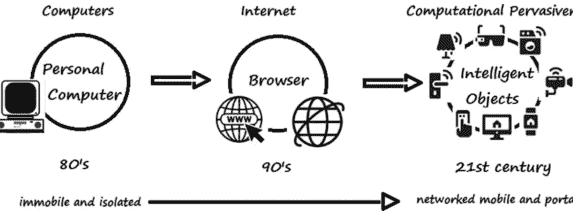

图3.2 计算向普适性的演化。


具有根据环境配置和更改应用程序的能力。这意味着该计算机系统有能力获取其所嵌入环境中的相关信息和数据。同时还需考虑设备能够识别其他设备的需求，从而建立它们之间的交互，这些基本能力使设备在各处都能智能地运行 [20]。

技术具有让人们生活更轻松的优势：提供完全电脑化的房屋；智能建筑；以及允许更大技术移动性的智能手机。然而，与信息安全相关的缺点包括：复杂性，以及开发此类环境的总体实施成本；仍需评估维护此数字结构的成本 [21]。

普适计算的合理性在于，它使计算机或数字设备能够获取其所嵌入环境中的信息，并利用这些信息动态构建计算模型，即执行应用程序的控制、配置和调整，以更好地满足设备或用户的需求。从这个意义上说，可以清楚地指出，最深刻且持久的技术是那些消散在日常事物中直至难以分辨的技术。考虑到环境可以并且也应该能够检测到其他可能成为该环境一部分的设备，反思这些设备对用户而言变得“不可见”的特征，用户自然地使用这些设备。由此产生的交互，数字设备能够在充满传感器和计算机服务的环境中以“智能”的方式行动 [21,22]。

普适计算的概念意味着计算手段分布在环境中，具有从该环境的每个部分提取非常详细信息的能力，无论该信息对用户是否可感知和/或不易察觉。由此，普适计算能够利用这些信息控制、配置和调整应用程序，动态构建计算模型，以更好地满足设备或用户的需求。考虑到环境中传感器、计算机和应用程序的数量，互相检测彼此的存在并进行交互，以构建智能上下文 [21–23]。

谈到普遍性，它意味着无处不在，但又不被察觉。例示这一概念的例子包括：启动汽车时无需担心构成整体的塑料、金属和电气导体背后的所有工程，这些工程使公民能够在城市的街道和大道上行驶；或者在家中打开一个开关而无需担心整个电气基础设施，其中包括变压器以及延伸数公里到水电站（所有能源的基础）的电网，只希望这个动作（按下开关）的唯一结果是灯亮起。这就是普遍性，即那些成为人们生活一部分，而人们却未意识到其存在或参与自己日常生活的技术 [22,23]。

值得注意的是随处计算与普适计算之间的区别，随处计算旨在增加计算服务的功能和可用性，考虑到技术对用户的关注点在于任务和工具。也就是说，使这种人机交互变得不可见，将信息技术与人们的自然行为和动作相结合。重要的是要考虑，不可见的概念并非字面上的视觉感知，而是用户甚至没有意识到自己正在向计算机下达命令 [22–24]。

因此，随处计算受益于移动计算和普适计算的进步；因而，它源于移动性与设备及其应用分布式、不可见、智能和集成存在的整合。另一方面，普适计算指的是将设备或计算机视为用户日常生活有效组成部分的观点；即，通过同一环境中的众多设备，生成一个普适系统，对每个设备都赋予某种“智能” [24,25]。

与普适计算相关的挑战如下：可扩展性，这与“智能”环境需求的增长相关，即每新增一台设备，就需要一个新应用；异质性，涉及掩盖环境内不平等的条件，即通信协议的差异，以便为针对特定设备开发的网络和应用程序提供互操作性；集成，涉及单一环境中的各种设备以及这些设备/应用程序之间的使用优先级，涉及可靠性、服务质量和安全性等方面；不可见性，涉及系统所需的人为干预最少，重新配置技术是动态的，人为干预仅在改善系统“智能”的意义上存在；感知，这与系统和环境中散布的设备直接相关，认为它们能够感知/捕捉信号，即“感觉”所处的环境——也就是说，评估此方面不取决于用户的体验；以及上下文管理，它从感知和环境数据获取开始，可以在此基础上实现智能控制，以向系统添加“智能”——也就是说，环境的温度和亮度可以根据用户的喜好进行控制 [26–30]。

关于限制和困难，设备成本与能源消耗相关，还有带宽、信息安全和隐私问题，反映了通信手段和数据传输质量的发展，更具体地说，是关于蓝牙、WiFi 和 WiMax 等技术的无线网络的发展 [27–31]。

因此，普适计算技术是透明的，意味着用户感觉不到自己正在与计算机交互，或者在生命中的某个时刻正被计算机控制。也就是说，这无非是透明的人机交互，强调“机器”是指世界各地的“计算设备”，考虑到不同平台是不同的范式。同样，随处计算是一种普适计算，区别在于“随处”意味着“同时无处不在” [32]。

## 3.4 移动计算概念

移动计算被定义为轻松便捷地携带计算设备的能力，无论身处何地都能访问设备内容，同样意味着设备可以无处存在和使用。也就是说，用户可以随身携带的小型计算机，在近期已变得无处不在，增强了用户无论身处何地都能使用服务的能力 [30–32]。

移动计算的技术模型在用户移动时不会改变；也就是说，移动设备无法识别所在的环境，也无法自行适应，但结合访问能力，移动计算必须将计算变成一项可以随处进行的活动。关于移动设备所处环境的限制，可以通过用户手动调整设备设置来克服；然而，这种替代方案违背了移动计算的核心理念，即实用性和便捷性 [33]。

移动性是指设备易于移动的能力，即便携性，涉及两个主要特征：设备及其配件的尺寸和重量，提供一组功能，能够与其他系统连接并易于使用。这种移动性还可以通过创新的移动设备（如可穿戴设备）实现，这些设备连接到各种操作系统，拥有用于监测健康的传感器，与操作系统集成，甚至可以响应语音命令，或集成到各种娱乐和体育监测应用程序中。或者，如不依赖智能手机、旨在与 3D 对象交互的增强现实眼镜等可穿戴设备 [34]。

易用性是指不同类型的人都能轻松使用；这一属性涉及影响用户使用设备的特征，即用户的能力、灵巧程度和知识；甚至设备及其尺寸也带来灵活性。关于功能性，设备服务于多种目的和不同类型的功能，以目标和活动来评估其应用程序 [30–34]。

这些特性将随处计算与在必要时和必要地点提供服务联系起来，无论是否可感知。就计算机普适性在个人计算机领域所具有的意义而言，技术的哲学是：几乎任何东西，从汽车到衣服，从商店到房屋，室外和室内环境，甚至人体上的可穿戴设备，都可以配备连接其他联网设备的芯片 [30–34]。

分析支持最佳智能设备“安静且不可见”的特性时，应延伸一个人的潜意识；在服务伴随用户时创造易用性的宁静，同样在设备、硬件和软件方面实现透明，它们必须低调。随处技术源于在智能设备存在的技术环境网络外围运行的平静技术；即，它不影响人们的知觉中心，是“提供信息但不要求专注或注意的技术” [30–34]。

从这个意义上说，移动计算是指人们使用便携式移动设备，这些设备具有强大的操作和功能能力，移动设备能够连接到其他设备，获取数据并将其提供给其他用户甚至设备 [35, 36]。

在此背景下，可以强调移动性的四大支柱，其中便携性定义为易于运输的能力，易用性是指不同类型的人在不同环境中都能切实使用。


关于以应用程序形式实现的功能，分为：独立型——即不与任何其他用户或系统（如时钟或计算器）有任何联系；或依赖型，需要连接到其他用户或系统，如 GPS、电子邮件和新闻馈送等。连接性是当今移动设备的最大特征之一，反映出虽然许多移动设备具有独立使用应用程序的能力，但其主要功能必须是连接到人和/或系统，传输和接收数据和信息 [35,36]。

仍在评估与用户特征相关的影响可用性的因素，这些特征取决于其个人特点，涉及某些设备推荐给儿童，例如适合小手且易于理解的界面和格式的平板电脑。在设备方面，灵活性和灵巧性可用于水下拍照等；甚至还有与直观设备相关的知识和能力。环境特征取决于设备使用的地点类型，无论是企业（办公室、商务会议），还是休闲（海滩、夜总会、音乐演出），甚至是家庭（日常例程、协助家务任务）。仍在评估青少年监控的使用方面，需要即时显示图像和声音。设备特征取决于设备的格式、其配件和操作，直接影响可用性，考虑耐受性、启动时间、数据完整性，甚至用户界面（键盘、触控笔、鼠标和屏幕等） [35,36].

从这个意义上说，可以评估普适计算是驱动物联网（IoT）的技术这一方面，但与常规计算平台不同，这些技术的交换与协作并不局限于任何固定设备或地点，而是分布在人们生活的世界各地。构建普适计算技术与无处不在且始终可用有关，考虑到普适计算的形态因子，它可以是移动式、可穿戴式或可植入式 [36].

## 3.5 物联网与普适计算

普适计算所渗透的概念和实用功能延伸至物联网（IoT），关于无处不在在人们日常生活中的后果，因为物联网涉及日常物品的互联网连接，例如电视、汽车、手机、汽车、衣服、门、笔记本电脑、智能手机、冰箱、微波炉、网络摄像头和游戏机，以及其他提供无处不在的智能对象 [36].

物联网（IoT）的概念与无处不在的设备相连，使技术与人类关系的完全融合以一种微妙的方式进行，以至于其使用变得不可见，如此自然以至于甚至不可察觉。因为通过 IoT 设备的信息将无处不在、随时随地、任何情况下流动，既然技术的主要目标是通过智能传感器使日常物品能够连接到互联网，从而赋予通信和数据及信息处理的能力。与用户并不总是意识到自己正在连接（普适计算）的原则相关，反思连接到互联网的物理对象的使用，形成一个能够收集、进而分析和传输数据，并且基于此在不受干扰的情况下做出决策的网络 [37].

普适计算为社会在技术发展方面呈现了一种新的交流范式，改变了虚拟现实和物理现实中互动和社会沟通的形式，通过提出不同类型对象与互联网之间的连接性，因为技术正在适应并融入人们的日常生活，主要通过智能和可穿戴设备，如手环、手表和眼镜 [35–37].

在这种情况下，普适技术中物联网的主要特征是它们能够混合并适应个人的活动。考虑到智能传感器之间直接协作的前提，以创建一系列智能应用程序，使决策在无需人工干预的情况下进行。在这种情况下，普适计算是关于一场计算革命，它来自移动技术的快速发展，以及通过嵌入日常事物的传感器使用物联网 [37,38].

还要考虑到，社会当前的系统性演变是这种普适计算进步的反映，因为信息渗透到所有方面并作用于所有人类活动。对普适技术的日常沉浸与心理因素密切相关。因为人们不认为自己在使用这种技术，也就是说，他们最终只是没有意识到自己正在连接。因此，正是在这种情况下，物联网应运而生，作为人与机器（以及机器与机器）之间一种新的信息传输形式。考虑到技术是全球网络基础设施，包括现有的和不断发展的互联网，以及网络进步，通过对数据捕获和通信能力的连接性探索，互联物理对象和虚拟对象 [37–39].

因此，普适计算在与互联网和网络的增长和演进同步提供的巨大数字支持总量，与来自这些传感器和智能设备的数字世界中存在的数据量的持续增长有关。因为信息不仅存在于书籍和印刷材料中，还存在于可以在任何地方传输信息的外围设备和设备中，使访问完全普遍，它还来自于信息的普遍传输、接收和共享，进而知识也是如此 [37–39].

物联网也可用于优化业务流程，提供许多应用方式，通过实时获取有关工作环境的信息，或考虑车间和机器的产量提升，使用传感器或移动设备应用程序来定位设备或其他功能。就连接事物的数量而言，它允许远程监控，从而获得并更好地利用时间的可能性 [40].

因此，互联网的这一演变显示出一种非常有前景的特质，即普适计算，带来了“平静”技术的时代，那时技术退居到我们生活的背景中，因为普适技术尤其基于在当代技术社会发展中的物联网现象，这允许用户与设备以及设备之间有更多互动 [41].

同样，通过物联网，作为普适计算的内在组成部分，它基于用户之间互动性的变化，变得自然、不可察觉、主动，并且主要是无处不在，可以创造无数应用程序，使人类能够整合信息并通过转移特定对象的时空消耗来协助各个领域 [42].

从这个意义上说，一股技术浪潮在普适计算中兴起，其中通过普通对象采用高技术进行集成，将其转化为“智能”设备，当连接时，这些设备获得在彼此及其用户之间生成和交换信息的能力。物联网将智能和交互式环境的创造带入人们的日常生活，这指的是现代社会的当下时刻 [41–42].

因此，总而言之，物联网关于“会思考的事物”，是普适设备获取智能、感知以及相互交互的能力所构成的。同样，通过普适计算，它通过生产具有“智能”功能并能相互交互的对象，彻底改变了人类与机器之间的关系。还要反思，这些设备以一种对社会关系产生深远影响的方式生成和交换信息，从用户角度来看，无处不在唤起并赋予了人类克服空间和时间障碍、获得无处不在天赋的愿望 [43].

## 3.6 普适计算应用

普适计算的一个实际例子来自于可以使用普适技术进行控制的房屋功能，使用传感器和嵌入式计算机来控制照明等资源。考虑到环境和照明会根据居民习惯进行调整；还要考虑照明系统可以充分利用自然采光；还要考虑开启或关闭电视和电子设备，甚至监控卧床的病人，或根据有效期控制发放物品，向最终用户产生几乎不可察觉的结果，这实际上就是普遍性的概念。普适计算利用计算机共享人的主要思想，通过网络的智能移动性。通过与智能手机的交互，房屋将能够感知居民的情绪，从该数字感知出发，选择播放哪首歌曲 [41–43].

普适计算在各种产品、服务和资产中创造价值，正如技术巨头使用这项技术来解锁私人汽车未使用容量中存在的闲置价值，使司机能够更好地利用其车辆容量并赚取收入，而乘客则以更低的价格获得更高级别的便利性 [41–43].

关于交通，其应用在基于即时和本地信息的交通信号灯自动化方法的精细化方面非常明确，对应于交通所采取的控制，通过探测器进行流量测量，从而改进性能，遵循交通的随机波动和微观视角。它允许通过交叉计算每个交通信号灯的绿灯、黄灯和红灯阶段的计算持续时间来进行控制，具体取决于


根据特定时期交通的特征和平均流量，接近路口的车辆量各不相同。过去采用固定时序交通信号灯，其特征仅能满足现有交通流量的变化，且仅根据一天中的不同时间考虑不同的时序。也就是说，周期是恒定的，每个周期内改变阶段的时间是固定的 [41–43]。

在教育领域，无处不在的计算扩大了更广泛的教育机会，同时也培养了知识探索者。由于技术允许从多种来源以高度个性化的方式访问信息，并以灵活的方式（通过任何访问设备）共享信息，由于这些设备在课堂或甚至图书馆中，曾是学生或教师手中“孤立且不连接的孤岛”，因此通过融入日常生活的技术，使其成为查找各种信息的持续搜索设备。通过访问、转换和信息流动产生教学方法，会带来极短的记忆、理解和应用知识循环 [44]。

在医疗领域，普适计算可以融入便携式和可植入设备（生物传感器），这些设备能够监测、维护并确保患者的健康，并检测和记录用户的心率、体温甚至呼吸等生命体征，或测量心率的手环（可穿戴设备）等其他数据。还需考虑医疗设备在紧急情况下会做出反应，向医生和专家电子发出求助警报。或者关于配备无处不在技术的外科手术器械，其能够检测患者生命体征的变化，提高准确性，分析处方药的副作用，加快响应速度，并扩大重症监护环境中可用的救援选项，从而提高护理质量 [45]。

在汽车领域，无处不在的技术可以通过集成到车辆中的通信设备并利用其能源来应用，结合停车传感器和嵌入式系统，为乘客提供一系列应用，从听音乐到看电影。将智能交通系统的宏观应用置于情境中，该系统利用情境信息和无处不在的计算，可以使用大量车辆的位置历史记录，也可以结合和汇总这些数据，提供实时数字道路地图更新，以更好地适应交通状况，并支持用户无论身在何处 [46]。

在环境领域，无处不在的计算可以利用卫星信息、传感器和用户，创建土地利用、森林砍伐和保护的个性化地图，实现对森林的实时远程监测。通过技术，提供复杂数据和不断变化的环境条件分析，因为传感器能更好地检测地震、洪水和火灾，快速评估涉及飓风等自然现象的场景，并通过改善通信、协调和救援响应，对其他自然灾害做出更准确的预测 [47]。

在消费方面，利用传感器的无处不在的技术涉及家庭共享性能和能源使用数据，关于能源领域的智能家用电器，连接到替代能源的微电网以及传统电网。这使得向客户提供新服务成为可能，通过可用于在整个供应链中高效、经济地在家庭之间集成和编排这些功能的信息流，克服传统障碍，并通过公用事业更具创新性的能源管理，产生新的机会、业务和价值生成模式 [46–47]。

甚至在智慧城市的背景下，无处不在的技术可能存在于一根灯杆上，该灯杆能够捕捉运动、测量特定区域的CO²水平，甚至在某条大道或街道拥堵时通知交通控制。还需考虑灯杆可以根据是否有人存在来控制光照强度，甚至在有人到来时灯光变得更亮。如果在该位置无法实现，灯就会熄灭，从而产生节能效果 [48]。

## 3.7 物联网和无处不在计算的安全方面

值得一提的是，物联网的实施也面临着信息安全和通信标准化等重要问题。考虑到物联网设备需要持续捕获数据，这可能涉及收集私人记录，包括确保物联网系统安全的要求，然而，一些设备资源有限，因此无法执行传统安全功能。或者考虑到集成到物联网对象中的传感器使用的协议与传统配置中使用的协议不同，因此有必要为物联网建立信息安全规则 [49–52]。

在许多情况下，考虑到无处不在的计算环境，捕获的消息会被发送到服务器，在那里进行处理，甚至与业务合作伙伴共享，这可能会将敏感信息暴露给第三方。或者考虑到那些以不安全方式布置的连接设备会带来严重问题，因为现有漏洞可能很容易被数字犯罪分子利用，例如发动拒绝服务攻击，甚至创建僵尸网络。考虑到如果这些设备配置不当，就代表着在保护数据免受网络攻击方面存在重大问题 [49–52]。

物联网最大的问题之一涉及访问接口的不安全性，考虑到设备和其他智能设备的数字脆弱性很容易被入侵，无论是为了信息窃取还是分布式拒绝服务（DDoS）攻击，甚至可能被利用补丁中现有漏洞的恶意软件数字入侵，或者即使没有有效的管理策略 [49–52]。

访问和管理物联网设备物理组件（例如安全摄像头或麦克风）或云中机密信息（例如用户的物理位置或移动情况）的可能性，对数据隐私甚至数字安全构成巨大风险。还需考虑，无论是通信还是物联网设备安全，都不存在标准协议，这为恶意软件感染打开了漏洞，恶意软件会感染其连接的网络 [49–52]。

通过物联网，可以规划基础设施以接收此类设备，而无需扩大现有漏洞的程度，充分利用这些设备的优势，创建越来越高效和智能的工作流，并实现无处不在计算的更大功能 [49–52]。

物联网设备和硬件配置的广泛多样性限制了建立标准加密流程和协议的能力，因为所有物联网加密都必须伴随加密密钥生命周期管理流程，甚至是区块链技术。一旦该管理变得不充分，整体安全性将受到损害 [49–52]。

在无处不在的计算环境中，物联网网络安全比传统网络安全更具挑战性，因为存在更广泛的通信标准、协议和设备功能，这可能带来更复杂的问题。主要需要的资源是传统安全工具，例如防病毒软件和反恶意软件，以及防火墙和入侵防御与检测系统 [49–52]。

然而，还需考虑那些收集、汇总、监控和标准化数据，并添加复杂机器学习技术、人工智能和大数据的解决方案，为异常检测提供预测建模，同时减少误报数量。因此，物联网中的分析安全将越来越必要，以检测在无处不在的计算环境中连接的“事物”环境中的特定入侵。考虑到每天出现的复杂攻击，传统网络安全解决方案（例如防火墙）无法识别这些攻击 [49–52]。

就不同系统之间通信中涉及的物联网和无处不在计算安全方面的网络安全而言，保护设备与后端软件之间交换的数据完整性至关重要。还需考虑诸如使用复杂密码以降低暴力破解攻击的有效性；采用更安全的标准来保护无线网络；监控整个网络基础设施以查找数字故障和入侵者。同样，实施防火墙系统；快速更新每个设备的固件；定义设备访问和控制规则，以限制可访问的基础设施敏感区域的数量。甚至涉及采用数据加密来存储设备收集的信息，并在设备之间安全地交换数据 [49–52]。

从这个意义上讲，这些应用的成功主要取决于为用户带来的便捷性，以及在无处不在的计算环境中对其安全性信任的透明度，因为许多此类通信和操作都是自动生成的。物联网设备，无论其与无处不在的计算的使用、复杂性或程度如何，都是网络犯罪分子的有吸引力的目标，因为它们会收集用户在金融、健康、教育等领域的私人行为信息 [49–52]。

采取这些预防措施后，物联网设备具有高度可靠性，因为所有连接都需要动态监控，还需考虑设备是否可以与物联网设备的漏洞隔离，即使发生网络攻击，数据也将具有更强的网络安全性来防止暴露 [49–52]。

## 3.8 趋势

增强现实是虚拟现实与真实环境的结合，与无处不在的计算以及“便携式计算机”（即人体配件）领域有着明确的联系。指代“嵌入式虚拟性”的技术


被定义为由数字设备生成的三维虚拟对象与真实环境的重叠，并借助某种技术设备实现。增强现实与无所不在计算的结合产生了一种混合现实，它融合了真实与虚拟，涵盖两种可能性：一种是关于以真实世界为主导的环境（无所不在），另一种是关于环境变得以虚拟为主导（增强虚拟），即在物理环境中插入虚拟对象，通过某些设备的支持，以实时方式向用户展示，这些设备使真实环境的界面适应于这些真实和虚拟对象的可视化与操作 [53]。

增强现实与无所不在计算的基本前提保持一致，即计算从工作站和个人计算机中移出，成为人们无论身在何处日常生活中无处不在的背景。考虑到增强现实与无所不在计算在关注用户与信息系统的有意识和有意交互消失方面的特征相似性 [53]。

通过增强现实，无所不在计算可以应用于所有人类感官，为数字用户提供安全的交互，而无需培训和特定知识，这得益于数字设备具有的直观性，因为它们可以将虚拟对象（采用计算机视觉和计算机图形技术）带入真实环境，从而增加用户对真实世界的视觉认知，与视觉感官相关 [53,54]。

诸如扩散计算设备等无所不在计算系统保持了显式和有意交互的概念，这与增强技术相结合，使虚拟对象能够被引入真实环境，让用户用自己的手处理这些对象，与触觉（数字）感官相关，从而实现与环境的自然且有吸引力的交互。通过使用自然界面使通信更加敏感和简便，通过手势、语音和视觉等方式与人进行交互，同时仍在评估上下文感知计算的方面，使得可以通过数字设备（物联网、传感器等）捕获信息，这些信息可以轻松检测 [55]。

因此，在增强现实的这一背景下，无所不在计算将使数字用户在无意识中随时随地使用这项技术，通过计算机系统、软件和/或数字界面 [56–60]。

## 3.9 结论

本章的动机是提供无所不在计算的概述，该计算无论用户身在何处都能提供信息、媒体、上下文和处理能力，并评估该技术的特征是嵌入日常物体中的大量连接微处理器网络。随着通往无所不在计算的道路在近年来取得了很大进展，不仅智能手机、平板电脑、计算机、电视或电子书被集成，而且还包括一些非技术物体，遵循设备之间集成的趋势，例如椅子、桌子、笔、冰箱等，这些物体将相互连接并根据每个人的需求进行调整。

该工作的主要贡献和发现在于对无所不在计算的概述，该概述涉及多样化的概念和技术，尽管它仍然是一种计算范式，因为该技术对于开发设备和应用程序而言高度复杂，涉及移动性与系统之间的集成以及分布式和智能化存在以造福用户。开发用户与计算机之间新的集成手段的需求，将移动性与无所不在计算的技术特征相结合，例如，使移动中的计算设备能够更准确且错误最少地自动配置其服务。完全意义上的无所不在计算表明，社会语境下的人执行任务实际上并不需要计算机（在CPU、键盘、鼠标或显示器的传统意义上）。但计算机将无处不在，内置于电视（或仅屏幕）、冰箱、汽水机、水表或电表中，或街角的一盏灯里。从这个意义上说，这项技术可以被视为无处不在的计算。

## 参考文献

- 1. Krumm, J. (编). (2018). 无所不在计算基础. CRC Press, Boca Raton, FL.
- 2. Krumm, J. (2018). 无所不在计算导论 Roy Want. In Krumm, J. (编). 无所不在计算基础 (第15–50页). Chapman and Hall/CRC Press, Boca Raton, FL.
- 3. Gupta, S., Sapra, R., & Midha, S. (2019). 无所不在计算：计算的新时代. 从视频监控到物联网：技术与应用, 141.
- 4. Sharma, M., Bhagat, M., & Kumar, D. (2019年3月). 传感器的无所不在与新兴概念. In 2019 集成电路器件 (DevIC) (第341–347页). IEEE, Kalyani.
- 5. Shakshuki, E. M., & Malik, H. (2020). 物联网革命中的无所不在计算专刊.
- 6. Vahdat-Nejad, H., Eilaki, S. O., & Izadpanah, S. (2018). 迈向对无所不在云计算更好的理解. 云应用与计算国际期刊, 8(1), 1–20.
- 7. Silva, B. N., Khan, M., & Han, K. (2018). 物联网：赋能技术、架构与挑战的全面综述. IEETE技术评论, 35(2), 205–220.
- 8. Liu, H., Ning, H., Mu, Q., Zheng, Y., Zeng, J., Yang, L. T., ... & Ma, J. (2019). 智慧世界综述. 未来生成计算机系统, 96, 678–691.
- 9. Langheinrich, M., & Schaub, F. (2018). 移动与无所不在计算中的隐私. 移动与无所不在计算综合讲座, 10(1), 1–139.
- 10. França, R. P., Iano, Y., Monteiro, A. C. B., & Arthur, R. (2020). 世界中WSN的智能应用：技术与文学背景. In Singh, P., Bhargava, B., Paprzycki, M., Kaushal, N., & Hong, W. C. (编). 无线传感器网络手册：当前场景中的问题与挑战 (第13–34页). Springer, Cham.
- 11. França, R. P., Iano, Y., Monteiro, A. C. B., & Arthur, R. (2020). 通过CBEDE方法改进ICT技术的信息传输. In Chintan, B., Sajja, P. S., & Liyanage, S. (编). 利用教育数据挖掘技术改进学习：新兴研究与机遇 (第13–34页). IGI Global, Hershey, PA.
- 12. Meshram, V., Meshram, V., & Patil, K. (2016). 无所不在计算调查. ICTACT软计算期刊, 6(2), 1130–1135.
- 13. Goh, P. S., & Sandars, J. (2019). 医学教育中技术无所不在使用日益增长的紧张关系. 医学教师, 41(6), 716–718.
- 14. Gheorghe, A. G., Crecana, C. C., Negru, C., & Dobre, C. (2019年6月). 边缘计算的去中心化存储系统. In 2019年第18届平行与分布计算国际研讨会 (ISPDC) (第41–49页). IEEE, Amsterdam.
- 15. Bhih, A. A., Johnson, P., & Randles, M. (2016年6月). 智能手机使用的多样性. In 2016年第17届计算机系统与技术国际会议论文集 (第81–88页). ACM Press, New York.
- 16. Seo, D., Jeon, Y. B., Lee, S. H., & Lee, K. H. (2016). M2M和物联网环境移动应用中面向无所不在计算的云计算. 集群计算, 19(2), 1001–1013.
- 17. França, R. P., Iano, Y., Monteiro, A. C. B., & Arthur, R. (2020). 采用CBEDE方法在智能云环境中降低数据传输的内存消耗. In Cardozo, P. J. S., Monteiro, J., Rodrigues, J. & Ramos, C. M. Q. (编). 智能系统设计、应用与挑战 (第216–237页). IGI Global. Pennsylvania, PA.
- 18. Padilha, R. F. (2018). 基于离散事件方法论在低抽象级别应用的数据压缩互补方法提案 = 低抽象级别离散事件方法论数据压缩互补方法提案. 1在线资源 (118页). 硕士学位论文 – 坎皮纳斯州立大学. 电气与计算机工程学院, 坎皮纳斯, SP. 可从: <http://www.repositorio.unicamp.br/handle/REPOSIP/331342> 获取. 访问日期: 2018年9月3日
- 19. Knote, R., Baraki, H., Söllner, M., Geihs, K., & Leimeister, J. M. (2016年7月). 从需求到无所不在计算应用的设计模式. In 第21届欧洲程序设计模式语言会议论文集 (第1–11页), Kaufbeuren.
- 20. Chang, S. J. I., Boger, J., Qiu, J., & Mihailidis, A. (2017). 无所不在计算与环境生理监测设备. In Bouchard, B. (编). 医疗保健中的智能技术 (第26–78页). CRC Press, Boca Raton, FL.
- 21. Padilha, R., Iano, Y., Monteiro, A. C. B., Arthur, R., & Estrela, V. V. (2018年10月). 针对MIMO系统多径衰落信道潜力的改进提案. In 巴西技术研讨会 (第115–130页). Springer, Cham.
- 22. Ebling, M. R., & Want, R. (2017). 再论无所不在计算. IEEE无所不在计算, 16(3), 17–19.
- 23. Novotny, A., & Bauer, C. (2017年12月). 当我们谈论无所不在计算中的上下文时，我们到底在谈论什么：综述与探索性分析. In 第19届信息集成与Web应用与服务国际会议论文集 (第301–310页). ACM, Salzburg.
- 24. França, R. P., Iano, Y., Monteiro, A. C. B., & Arthur, R. (2020). 通过CBEDE方法改进多径 fading (MF) 信道. In Hussein, H. & Abd El-Kader, S. M. (编). 5G移动网络的基础与支撑技术 (第25–43页). IGI Global. Pennsylvania, PA.
- 25. Banavar, G., Beck, J., Gluzberg, E., Munson, J., Sussman, J., & Zukowski, D. (2000年8月). 挑战：无所不在计算的应用模型. In 第6届年度移动计算与网络国际会议论文集 (第266–274页). Boston, MA.
- 26. Smith, J. R., Mohan, R., & Li, C. S. (1999年10月). 面向无所不在计算的可扩展多媒体传输. In 第七届ACM国际多媒体会议论文集（第1部分） (第131–140页), Orlando, FL.


- 27. Kim, M. J., Kumar, M., & Shirazi, B. A. (2006). 在异构普适计算环境中使用志愿者节点的服务发现。*普适与移动计算*, 2(3), 313–343.

- 28. Xu, G. Y., Shi, Y. C., & Xie, W. K. (2003). 普适/泛在计算。*计算机学报-中文版*, 26(9), 1042–1050.

- 29. Sanaei, Z., Abolfazli, S., Gani, A., & Xia, F. (2013). 混合普适移动云计算：迈向增强不可见性。*信息——国际多学科期刊*, 16(11), 8145–8156.

- 30. Judd, G., & Steenkiste, P. (2003年3月). 向普适计算应用提供上下文信息。载于*第一届IEEE普适计算与通信国际会议论文集*，2003 (PerCom 2003)（第133–142页）。IEEE，德克萨斯州沃斯堡。

- 31. França, R. P., Iano, Y., Monteiro, A. C. B., & Arthur, R. (2019). 通过CBEDE方法改进里衰落信道的提案。*仿真—系统、科学与技术国际期刊*, 20(SI), 20.

- 32. França, R. P., Iano, Y., Monteiro, A. C. B., & Arthur, R. (2020). 改进医疗保健系统中数据传输的潜在提案。载于 Abraham, A., Kelemen, A., Mittal, M., Dash, S., & Acharya, B. R. (编).*生物医学与健康信息学深度学习技术*（第267–283页）。Academic Press，马萨诸塞州剑桥。

- 33. França, R. P., Iano, Y., Monteiro, A. C. B., & Arthur, R. 改进医疗保健系统中数据传输效率的方法学。载于 Banerjee, A. 等 (编).*医疗保健技术物联网*（第49–70页）。Springer，新加坡。

- 34. Padilha, R., Iano, Y., Monteiro, A. C. B., & Arthur, R. (2020). 通过CBEDE方法改进OFDM系统中信息传输的提案。*SET广播工程国际期刊*, 5, 9.

- 35. Duncan, H. (2018). 移动计算原理。*科学电子资源*.

- 36. Alotaibi, E. F., AlBar, A. M., & Hoque, M. R. (2016). 移动计算安全：问题与要求。*信息技术进展期刊*, 7(1), 8–12.

- 37. Tran, C., & Misra, S. (2019). 物联网的技术基础。*IEEE无线通信*, 26(3), 8.

- 38. Youssef, M., & Hassan, M. (2019). 下一代物联网：迈向普适自主成本高效的物联网设备。*IEEE普适计算*, 18(4), 8–11.

- 39. França, R. P., Iano, Y., Monteiro, A. C. B., & Arthur, R. (2020). 多媒体压缩的技术和文学背景综述。载于 Gupta, D. & Gupta, B. B. (编).*多媒体网络安全研究手册*（第1–20页）。IGI Global，宾夕法尼亚州。

- 40. Poor, H. V., Goldenbaum, M., & Yang, W. (2019年1月). 物联网网络基础：安全低延迟通信。载于*第20届分布式计算与网络国际会议论文集*（第362–364页）。印度班加罗尔。

- 41. Case, A. (2015). *平静技术：非侵入式设计的原则与模式*. O’Reilly Media, Inc.，马萨诸塞州牛顿。

- 42. Madakam, S., Lake, V., Lake, V., & Lake, V. (2015). 物联网（IoT）：文献综述。*计算机与通信期刊*, 3(5), 164.

- 43. Farooq, M. U., Waseem, M., Mazhar, S., Khairi, A., & Kamal, T. (2015). 物联网（IoT）综述。*计算机应用国际期刊*, 113(1), 1–7.

- 44. Lufti, A., Saidi, F., & Wafta, M. (2016年8月). 普适智能教育系统：为大型教育数据铺路。载于*2016年第六届创新计算技术国际会议(INTECH)*（第233–238页）。IEEE，都柏林。

- 45. Büttenbender, P. C., Barbosa, J. L., & Martins, M. G. (2018年10月). 应用于心理健康的普适计算：趋势与研究重点。载于*第24届巴西多媒体与网络研讨会论文集*（第73–76页），萨尔瓦多。

- 46. Abdelhamid, S., Benkoczi, R., & Hassanein, H. S. (2017). 车载云：轮上的普适计算。载于新兴计算（第435–452页）。Springer，沙姆。

- 47. Neustein, A. (编). (2020). 普适计算进展：Cyber-Physical Systems, Smart Cities and Ecological Monitoring. Academic Press，伦敦。

- 48. Pramanik, M. I., Lau, R. Y., Demirkan, H., & Azad, M. A. K. (2017). 智慧健康：智慧城市中的大数据赋能健康范式。专家系统与应用, 87, 370–383.

- 49. Varshney, T., Sharma, N., Kaushik, I., & Bhushan, B. (2019年10月). 物联网中安全威胁及其对策的架构模型。载于2019年计算、通信与智能系统国际会议(ICCCIS)（第424–429页）。IEEE，皮斯卡塔威，新泽西州。

- 50. Goel, A. K., Rose, A., Gaur, J., & Bhushan, B. (2019年7月). 物联网中的攻击、对策和安全范式。载于2019年第二届智能计算、仪器与控制技术国际会议(ICICICT)（第1卷，第875–880页）。IEEE，坎努尔。

- 51. Bhushan, B., Khamparia, A., Sagayam, K. M., Sharma, S. K., Ahad, M. A., & Debnath, N. C. (2020). 面向智慧城市的区块链：架构、集成趋势和未来研究方向综述。可持续城市与社会, 61, 102360.

- 52. Goyal, S., Sharma, N., Kaushik, I., Bhushan, B., & Kumar, A. (2020年4月). 基于边缘计算的物联网优先级与问题。载于2020年IEEE第9届通信系统与网络技术国际会议(CSNT)（第72–77页）。IEEE，格瓦利奥。

- 53. Liberati, N. (2016). 增强现实与普适计算：增强现实的隐藏潜力。AI与社会, 31(1), 17–28.

- 54. Yew, A. W. W., Ong, S. K., & Nee, A. Y. C. (2016). 普适计算环境中智能对象的增强现实接口。载于移动计算与无线网络：概念、方法论、工具与应用（第939–960页）。IGI Global，宾夕法尼亚州。

- 55. Cheng, K. H. (2017). 阅读增强现实图书：对学习者认知负荷、动机和态度的探讨。澳大利亚教育技术期刊, 33(4), 53–69.

- 56. Yamamoto, T., Aida, H., Yamashita, D., Honda, Y., & Miki, M. (2017年6月). 考虑纸张形状的基于增强现实的电子书浏览方法。载于2017年泛在虚拟现实国际研讨会(ISUVR)（第30–33页）。IEEE，奈良。

- 57. Schmalstieg, D., & Hollerer, T. (2016). 增强现实：原理与实践。Addison-Wesley Professional，马萨诸塞州波士顿。

- 58. Chen, P., Liu, X., Cheng, W., & Huang, R. (2017). 2011至2016年教育中增强现实应用综述。载于 Popescu, E. 等 (编).*智能学习创新*（第13–18页）。Springer，新加坡。

- 59. Baresi, L., Griswold, W., Lewis, G. A., Autili, M., Malavolta, I., & Julien, C. (2020). 移动领域软件工程的趋势与挑战。IEEE软件, 38(1), 88–96. DOI: 10.1109/MS.2020.2994306.

- 60. Varghese, B., & Buyya, R. (2018). 下一代云计算：新趋势与研究方向。下一代计算机系统, 79, 849–861.


## Taylor & Francis

Taylor & Francis Group

http://taylorandfrancis.com

# 4 基于人工神经网络的密码分析与安全性评估

N. Vukobrat and S. Adamović
Singidunum University

N. Maček
Megatrend University

M. Saračević
University of Novi Pazar

M. Gnjatović
University of Novi Sad

## 目录

- 4.1 引言 ....................................................66
- 4.2 相关工作 ....................................................67
- 4.3 研究理论概述....................68
  - 4.3.1 密码分析 ..............................................68
  - 4.3.2 人工神经网络 ...............................69
- 4.4 研究方法 .........................................72
  - 4.4.1 数据处理流水线 .................................72
  - 4.4.2 神经网络模型 .....................................73
  - 4.4.3 本研究中使用的密码算法 .........74
- 4.5 实验评估 ......................................74
  - 4.5.1 可视化表示......................................
  - 4.5.2 表格中展示的结果 ..............................
- 4.6 结论 ..................................................78
- 致谢 ..................................................79
- 参考文献 .......................................................79


## 4.1 引言

今天，网络和通信代表了每个人的基本需求。因此，使它们尽可能安全变得越来越重要（Stallings et al. 2012）。在此语境下，“安全”一词的意思是，对手无法以任何方式窃听、修改或影响两个或多个参与者之间的通信。如今，保护通信线路已成为信息和网络安全领域中最重要的研究方向之一。对网络安全领域进步贡献最大的学科是计算机科学和数学。它们最初带来了当今使用的绝大多数安全算法、实践、系统等。随着技术和安全威胁变得更加先进，其他学科也与此主题相互关联。其中之一就是物理学。物理学家为安全做出贡献的一个例子是量子计算机安全算法的开发（Bernstein, 2009）。与当今的现代计算机相比，量子计算机具有显著更强的计算能力。

利用名为“量子叠加态”的特性，它们可以在同一时刻完成大量任务。为了说明它们有多快，我们可以想象一个非常复杂的密码，如：“7tn)hNLDMVh+<_yuGs]/UMHD(?”。假设当今计算机的破解速度为每秒 17042497.3 个密码尝试（kps），要破解这样的密码需要无穷多次尝试。对于比上述示例简单得多的密码，如：“als@dagl@”，破解它将需要 5 个世纪、6 个十年、3 年、11 个月、3 周、1 天、15 小时、53 分钟和 27 秒。即使对于更简单的密码，通过暴力破解攻击破解它仍然需要很长时间。另一方面，使用强大的量子计算机，上述复杂密码目前暂时无法被破解（Kalai, 2016）。目前可能被破解的全球安全性是不够的，因此安全研究人员需要在该问题出现之前加以解决。

上述示例应强调让更多领域参与研究和改进通信及网络安全难题的重要性。例如，即使是非技术领域，如心理学，也应该合作并做出贡献。在安全专家中存在这样一句常见的话：“人类的愚蠢没有补丁”。由此，心理学家的意思是，无论他们如何改进系统和流程安全，都无法显著解决人们在日常相互沟通中所犯的错误。另一方面，心理学专家可以提供更大的改进，并直接提升特定环境中的安全性。

人工智能（AI）是越来越多地参与通信和网络安全的新兴领域之一。由于能够自动化绝大多数任务（例如对象识别和股票市场预测），AI 在网络安全的每个细分领域都被广泛使用。AI 当今的一个应用示例是网络入侵检测（Azar et al. 2017）。具体来说，即检测未经授权的人何时访问特定的私有网络。在这里，AI 算法会定期监控普通用户的行为，如果检测到某种不寻常的行为，就会触发警报，系统会将入侵者从网络中清除。总体而言，大多数使用 AI 的研究旨在利用硬件泄漏或算法实现缺陷（无论是软件还是硬件）。基于这些假设，整个网络在未应用每篇论文中提出的方法之前就已经被攻破。因此，大多数系统已针对上述假设得到保护，所以今天以及未来，当出现现实世界问题时，所提出的技术将不再奏效。

最恰当且同时最现实的方法是提出一种在通信过程中（甚至对入侵者也是如此）每个人都能获取的信息片段的方法。一个示例是加密消息（密文）。本着这一想法，我们开发了一种方法，允许仅使用在两个或多个实体间通信中每个人都能获取的密文消息来检查给定加密算法的安全性。

本章的主要贡献是一种特定的创新方法，通过避免长时间修改原始实现来匹配算法和硬件实现。为了对新创建（或某些已存在）算法进行密码分析，只需使用本章中的方法实现并更改参考算法即可。因此，每个已存在（以及当前不存在）算法都可以使用这种方法快速测试，以进一步确保参考算法的安全性。使用这种方法并最终导出模型，对手只需收集由参考算法加密的密文消息，并使用该模型获取关于密钥的信息。本章所提出方法的核心在于确定仅使用加密文本是否可以找出关于密钥的某些信息。更准确地说，可以使用人工神经网络（ANN）识别密钥的某个部分（甚至整个密钥）。有关所提方法的更多细节将在本章中介绍。

除了所述方法的细节外，还将介绍该研究领域的调查，其中包含在密码安全领域使用 AI 的相关提案。此外，为了更容易复现给定的结果，将展示环境设置的细节。此外，还将详细解释结果以及所使用的数据集、生成训练数据的过程以及训练网络的整体过程。

本章剩余部分分为六个章节。4.2 节讨论了使用 ANN 进行密码分析和安全评估的相关工作。4.3 节讨论了研究的理论概述，重点介绍了密码分析和 ANN 的基础知识。在 4.4 节中，我们介绍了一种研究方法，该方法代表了检查加密算法安全性的新方法。4.5 节讨论了按数据集类型（字符、单词、句子和文章）分为四类的实验结果，其中文章类别还具有由数据增强类型（完整密文长度、部分密文长度和随机部分密文长度）决定的其他子类别。4.6 节给出了结论性意见和进一步研究的建议。

## 4.2 相关工作

AI 利用密文收集关于加密消息的元信息，并使用它们来创建受害者的参考档案。一种方法是确定通信过程中用于加密消息的加密算法（Vetrivel and Shantharajah, 2015; Khavidi and Momtazpour, 2010; Sharif et al. 2010）。有了这些信息，入侵者更有可能攻破安全系统。

Vetrivel 和 Shantharajah 提出了一种区分高级加密标准（AES）算法与其他加密算法的技术（Vetrivel and Shantharajah, 2015）。他们使用结合 Lorenz 信息度量的神经网络来定义加密算法之间的相关差异。Khavidi 和 Momtazpour 使用了类似的方法。不同之处在于他们测试了多种机器学习算法：线性判别分析（LDA）、支持向量机（SVM）和 K 近邻（KNN）。结果，他们实现了 0.5 模式重复率下 30% 的误差（Khavidi and Momtazpour, 2010）。他们表明，随着密文中模式重复率的增加，误差率会降低。Sharif 等人提出了另一种对加密算法进行分类的方法。为了验证结果，他们使用了八种 AI 算法以及带有变体的四种加密算法：AES（128、192、256）、DES、IDEA 和 RC2（42、84、128）。结果表明，旋转森林算法具有更高的总体准确率。在八类问题上，他们获得了 30.83% 的准确率，而在四类问题上，准确率为 53.33%。研究人员在使用 AI 进行网络安全领域工作时最常采用的方法是利用加密算法的硬件缺陷（Heuser and Zohner, 2012; Lerman et al. 2015; Hospodar et al. 2011; Maghrebi et al. 2016; Gilmore et al. 2015）。该领域的策略能提供出色的结果，但在现实场景中难以使用。Heuser 和 Zohner 找到了一种使用 SVM 算法利用硬件泄漏的方法（Heuser and Zohner, 2012）。他们跟踪了算法硬件实现所消耗的电量，并利用该信息训练了 SVM 分类器以收集更多信息。

Yousef-Azar 等人对应用 AI 持有不同观点。他们使用自动编码器来自动发现网络流量向量空间中的异常。这些异常代表网络中的潜在入侵者，并被自动检测到。通过这种方法，他们在检测入侵者方面实现了 83.3% 的准确率。

Aggarwal 等人（2019）专注于创建一种低成本智能设备，可用于在不同地点监测水质。Soni 和 Bhushan（2019）讨论了如何使用几种机器学习算法来克服网络安全面临的常见问题。此外，还有各种类型的机器学习方法被用于网络安全（Puri and Bhushan, 2019）。

## 4.3 研究理论概述

### 4.3.1 密码分析

密码分析用于分析信息系统的隐藏方面，即攻破加密系统以获取加密消息的访问权限。目标是确定算法或安全系统的弱点，即找出加密算法或其实现中的弱点。在任何算法...


可用于现实世界场景之前，需要由密码分析专家进行分析，以确定其安全性。高级加密标准（AES）和数据加密标准（DES）算法的情况即为如此。AES 原名 Rijndael，当前是最常用的加密算法。它由两位比利时密码学家 Vincent Rijmen 和 Joan Daemen 开发。AES 支持不同的密钥长度：128、192 和 256 位。AES 的功能基于替换置换网络（SPN），该网络定义了一种应用于每个密码块的数学形式。DES 也是一种广泛使用的算法，过去被许多高度安全的系统所采用。它由 IBM 开发，原名 Lucifer。DES 最初使用 56 位密钥。其功能基于将 64 位数据块转换为 64 位加密块。加密密钥长度为 64 位，其中奇偶校验过程中会舍弃 8 位。因此，有效密钥长度为 56 位。

### 4.3.2 人工神经网络

ANN 通常被称为神经网络，是最常用的 AI 算法之一，因为它们已成功应用于各种问题（Patterson, 1998）。它们由输入层和输出层以及输入层和输出层之间任意数量的隐藏层组成。这些层由人工神经元组成，人工神经元是每个神经网络的基本构建块。此外，人工神经元由带有附加权重的输入突触、带有应用偏置的求和函数以及激活函数组成（Schalko, 1997）。在神经网络训练期间，权重和偏置会根据数据和预期结果进行更新。在训练过程中，它们会随着每次迭代略微更新，直到达到令人满意的值，从而产生预期的输出结果。为了实现训练能力，还使用了一些其他技术和算法，将在下面解释（Schalko, 1997）。除了权重和偏置外，求和函数会对权重修改的所有突触值求和，然后将偏置值添加到求和值中。然后，求和值被传播到神经元的激活函数，该函数为网络中的数据添加非线性（Karlik and Olgac, 2011）。由此，除了简单的线性函数外，还可以优化更复杂的函数。激活函数的示例包括 Sigmoid、TanH、ReLU 和 Leaky ReLU。为了使神经网络工作，除了其初始结构外，它们还拥有额外的算法和规则，以适应特定问题：带有代价函数的梯度下降、前向传播和反向传播。

更新权重和偏置是神经网络训练的重要进程。此外，为了正确使用该值，其他算法需要知道如何利用该值以在正确方向上恢复训练。为此，我们使用梯度下降和代价（或损失）函数。

因此，代价函数提供一个值，用于指示神经网络中当前步骤的好坏。梯度下降（Mandic, 2004）使用该值并尝试将其最小化，其工作原理如下：它通过逐步迭代到全局（或有时是局部）最小值，来寻找复杂函数（即给定的待求解问题）的全局最小值。为了知道下一步应沿哪个方向进行，首先需要计算梯度（该方程展示了用于计算梯度的常用交叉熵代价函数）：

```
f'(w,b)=-\frac{1}{m} \sum_{i=1}^{m} y^{(i)} \log(\hat{y}^{(i)}) + \left(1 - y^{(i)}\right) \log\left(1 - \hat{y}^{(i)}\right)
```

其中 \(\hat{y}\) 由以下给出：

```
\(\hat{y} = \sigma \left( w^T x + b \right)\)
```

而 \(\sigma\) 由以下给出：

```
\(\sigma \left( z \right) = \frac{1}{1 + e^{-z}}\)
```

其中 \(\sigma\) 表示 Sigmoid 函数，在此情况下，它也用于计算所需的梯度。它将每个给定值映射到 [0, 1] 范围，以避免当网络中出现过大值时可能发生的许多问题（例如梯度爆炸）。给定的方程仅表示网络的一次迭代。要优化神经网络，该过程需要在许多次迭代中重复。最终，使用梯度更新权重和偏置：

```
\(w := w - \alpha \frac{dJ(w, b)}{dw}\)
```

```
\(b := b - \alpha \frac{dJ(w, b)}{db}\)
```

其中 \(\alpha\) 表示学习率，\(\frac{dJ(w, b)}{dw}\) 或 \(\frac{dJ(w, b)}{db}\) 是更新过程中计算的导数。这些更新在反向传播阶段进行，将在后文中更详细地解释。

前向传播非常简单：它将值从网络的输入传播，穿过隐藏层，到达最终输出层（Agatonovic-Kustrin 和 Beresford, 2000）。在前向传播期间，网络输入的值使用权重、偏置和神经元函数进行修改，以将输入映射到所需的输出值。当网络参数冻结且网络准备好用于现实世界使用时，前向传播也用于生产阶段。最后，反向传播是神经网络中最重要的元素（Agatonovic-Kustrin 和 Beresford, 2000）。其责任是正确地在整个网络中更新权重和偏置。这是通过在前向传播后计算错误率，并使用该错误率来更新权重和偏置来完成的。

此过程使用链式法则（Ambrosio 和 Maso, 1990）来完成。它通过计算嵌套方程的导数来工作：

$$f(x) = A(B(C(x)))$$ (4.6)

我们可以通过以下方式计算链式法则方程（4.6）的导数：

$$\frac{df}{dx} = \frac{dA}{dB} \frac{dB}{dC}$$ (4.7)

或者以另一种形式：

$$f' = A'(B(C(x)))B'(C(x))C'(x)$$ (4.8)

因此，链式法则可以应用于反向传播算法中的任何规模的嵌套函数。此外，由于链式法则在反向传播期间用于计算导数，下一步是确定每个权重和偏置在每次迭代中将被修改多少。首先，计算最终层的错误率：

$$\delta_i^m = g_o'(a_i^m)(\hat{y}_d - y_d)$$ (4.9)

然后将此错误传播到每个隐藏层，直到第一个输入层：

$$\delta_j^k = g'(a_j^k) \sum_{l=1}^{r_{k+1}} w_{jl}^{k+1} \delta_l^{k+1}$$ (4.10)

该函数在网络的每个隐藏层中被调用。然后，评估相对于每个权重值的误差偏导数：

$$\frac{\partial E_d}{\partial w_{ij}^k} = \delta_j^k o_i^{k-1}$$ (4.11)

之后，将每个输入-输出（x, y）对的所有梯度组合起来，以获得所有对的全局梯度：

$$\frac{\partial E(X,\theta)}{\partial w_{ij}^k} = \frac{1}{N} \sum_{d=1}^N \frac{\partial}{\partial w_{ij}^k} \left( \frac{1}{2} (\hat{y}_d - y_d)^2 \right) = \frac{1}{N} \sum_{d=1}^N \frac{\partial E_d}{\partial w_{ij}^k}$$ (4.12)

最后，根据梯度下降的学习率更新权重：

$$\Delta w_{ij}^k = -\alpha \frac{\partial E(X,\theta)}{\partial w_{ij}^k}$$ (4.13)

权重在每次迭代中更新，直到梯度下降达到函数的全局最小值。这是所提方法论的核心过程，通过该过程，可以找到密码消息和密钥之间的互信息。

## 4.4 研究方法论

除了开发新算法和升级旧算法之外，开发技术以证明新算法或升级算法的安全性是必不可少的。本章所介绍的方法论代表了一种检查密码算法安全性的新方法。具体来说，所提方法论的目标是确定加密消息和密钥之间的互信息。加密消息和密钥包含大量以长位序列形式呈现的信息。由于这些序列包含大量信息，使用经典编程方法几乎不可能今天找到它们之间的相关性。因此，所提方法论利用 AI 算法的自动化能力（在此情况下为神经网络）来发现加密消息和密钥之间的关系。

为了确定密文和密钥之间的依赖关系，算法会搜索许多由同一密钥加密的密文消息。在此过程中，它试图查找算法使用单个密钥加密消息的模式。为了使此成为可能，算法在一组密钥对上进行训练，其中所有密钥均按密钥的第一位分组。在训练这种数据结构时，算法试图查找模式并确定密钥的第一位。如果成功，这就证明一种加密算法生成了与密钥相关的某些模式的密文。结果表明，该加密算法不安全，这意味着它未准备好用于现实世界的问题。

这种方法的真正威力在于无需定义要搜索的模式类型。AI 算法会自行完成所有工作。这使得该方法论可以在短时间内轻松应用于任何加密算法。

### 4.4.1 数据处理管道

如前所述，神经网络使用加密消息进行训练过程。为了获得密文，需要加密一组特定的明文消息。为了符合现实世界应用的限制，密文是通过加密具有语义意义的消息获得的。此处使用的文本组来自 PAN 文本数据集。

数据处理管道的一个子组件代表密钥生成组件。

为了训练网络以确定密钥中的特定位值，在训练过程开始之前，此子组件生成参考位固定为 0 或 1 的密钥，并按所选位对它们进行分组。然后使用生成的密钥为训练过程生成密文消息。

为了实现易于使用和扩展管道，以及为向模型获取数据提供良好的结构，数据结构如下：index_bit|referent_bit|


密文。这里的 index_bit（可能取值为 0 和 1）表示在密钥中固定的位值（按此引用，密钥被分为两组）。referent_bit（取值范围为 0 到 N，其中 N 的最大值为密钥长度）显示固定位的索引位置。最后，有一个包含加密消息值的密文文件。

为避免影响结果正确性的错误数据处理，在数据流水线过程中开发了额外的检查。在整个数据生成过程中，每条密文消息都会被额外解码并与原始明文消息进行比对。如果因某种原因解码消息与原始消息不匹配，数据流水线将停止以供进一步检查。在流水线结束时，输出是一个可直接用于训练 AI 算法的所需大小的密文数据集。

### 4.4.2 神经网络模型

最初选定的 AI 算法是全连接神经网络。选择它的原因是，它非常适合解决具有大量维度的非结构化问题。众所周知，密文代表了最非结构化的数据集类型之一。如前所述，某些加密算法被用作随机数生成器（即代表没有任何相关结构的数据）。

除此之外，另一个挑战是密文消息中存在的大量维度。例如，在一篇约 400 字的单篇文章中，可能存在约 300,000 个维度。因此，要在 300,000 个密文维度与密钥之间找到任何互信息都非常困难。这就是为什么选择神经网络作为相关算法，因为它们是处理非结构化数据的最强算法之一。本章中神经网络的架构并非通过确定性方法选择，而是基于经验。从几个经过测试的架构中，最终网络包含以下架构：

- 输入层，
- 第一个隐藏层，包含 2,048 个神经元，
- 第二个隐藏层，包含 4,096 个神经元，
- 第三个隐藏层，包含 1,024 个神经元，以及
- 输出层，包含 1 个神经元。

输入层的神经元数量取决于密文消息的长度。在初始化过程中，使用最大加密消息的大小来定义输入层的大小。其他密文使用零填充技术进行填充，以达到最大消息的大小。所有隐藏层均表示标准全连接层，这意味着一个神经元的输出会传播到下一层中的所有其他神经元。使用前向传播技术，输入可以成功映射到所需的输出。

至于神经网络的其他组件，激活函数是 ReLU，代价/损失函数是带 logits 的 softmax 交叉熵，梯度下降的优化函数是 Adam，最后网络层的激活函数是 softmax。使用此架构获得的结果将在第 4.5 节中提供。

### 4.4.3 本研究中使用的密码学算法

为测试密码分析方法，我们使用了 DES、AES 和自定义的简单加密（SC），其如下说明。SC 是一种基于纯 XOR 操作的简单加密算法。首先，消息被转换为位数组：

"Crypt me for fun!" => 01000011 01110010...

然后，生成一个任意长度的密钥。该密钥的长度并不重要，但读者应注意，密钥越长，密文就越安全。生成密钥后，它会按照以下方式进行处理，使其长度与消息相同：

- 1. 如果密钥短于消息，则密钥的位会循环重复，直到达到相同长度。
- 2. 如果密钥长于消息，则忽略超出消息长度的密钥部分。

此过程非常重要，因为最后一步是对消息和处理后的密钥执行 XOR 操作。其结果是生成一个密文。读者应注意，此算法仅用于演示较弱加密算法的结果。

## 4.5 实验评估

结果按数据集类型（字符、单词、句子和文章）分为四类，其中文章类别还有由数据增强类型（全密文长度、部分密文长度和随机部分密文长度）决定的其他子类别。

四个主要类别代表数据集的格式，每个类别的名称描述了密文消息的内容。例如，句子类别表示在加密前，明文消息中包含单个句子。后续段落将解释文章子类别。

### 4.5.1 可视化展示

在本小节中，AI 模型的训练和测试结果以可视化形式呈现。此处提供了最重要的可视化和结果，其余结果将在结论部分中介绍。

基于全密文长度的训练使用每条加密消息中的每一位信息。这种方法的问题是，并非每条密文长度都相等。密文长度因消息长度而异。为解决此问题，先确定最长的密文，然后其余密文在末尾补充额外的 0 位信息（图 4.1）。

基于部分密文长度的训练使用每条加密消息中在训练开始前定义的特定位长度（图 4.2）。

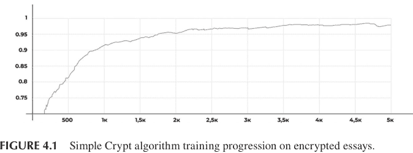

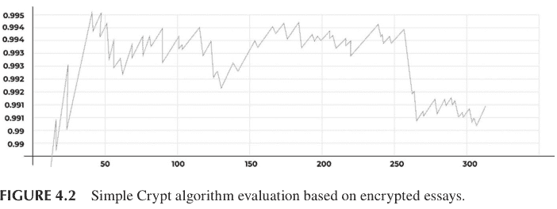

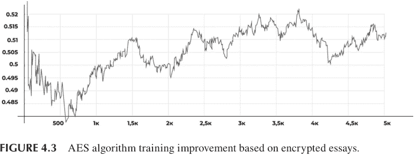

然而，以 AES 作为参考算法时，结果符合预期（图 4.3）。

这种方法表明，可以仅使用整个密文消息的某一部分来从密文中收集信息片段。基于随机部分密文长度的训练与部分密文长度技术相同。区别在于，密文消息中的位是从整个密文中随机选择的。选择此技术是因为相关的加密算法常被用作随机数生成器（图 4.4）。

另一方面，在训练 DES 算法时，我们的模型获得了有趣的结果（图 4.5）。

通过从密文中提取随机信息片段，有可能获得比仅使用明文密文消息更多的信息。最重要的实验结果以图形可视化形式呈现。它们将用于根据当前结果显示完整的结论（图 4.6–4.8）。

### 4.5.2 表格中呈现的结果

此处呈现的结果包含第 4.5.1 节中呈现的结果以及实验期间获得的其余结果。此处将更详细地讨论获得的结果。

根据表 4.1 的值，很明显，任何算法都未能确定密钥与加密消息之间的相关性。即使是 SC 也没有取得任何结果的原因是，在单字符级别上，密文代表了一次性密钥，仅执行单个 XOR 操作，而这

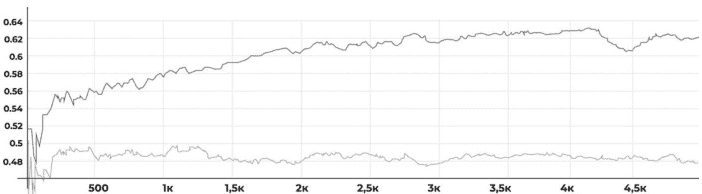

图 4.7 使用 DES 和 AES 加密的较短消息的实验结果 – 第一个案例。

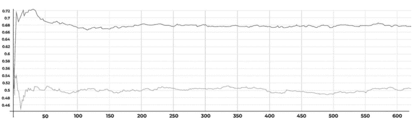

图 4.8 使用 DES 和 AES 加密的消息结果 – 第二个案例。

| 算法 | SC (%) | AES (%) | DES (%) |
|---|---|---|---|
| 训练 | 51.5 | 68.2 | 63.9 |
| 测试 | 51.1 | 51.9 | 52.1 |

该方法无法解决。结果表明，我们的模型在训练阶段在 AES 上最高可达 68%，但在测试期间，我们的模型达到了略高于 50% 的准确率。原因是在训练数据集中，相同的示例在小批量随机洗牌期间被重复。

根据表 4.2 中呈现的结果，我们的方法在 SC 算法上表现出明显优势，准确率为 99.9%。这证明了我们的方法在某些算法中是成功的。

| 算法 | SC (%) | AES (%) | DES (%) |
|---|---|---|---|
| 训练 | 99.9 | 49.6 | 70.1 |
| 测试 | 99.9 | 50.0 | 69.5 |


### 表 4.3 句子数据集上的训练和测试准确率

| 算法 | SC (%) | AES (%) | DES (%) |
|---|---|---|---|
| 训练 | 99.9 | 52.4 | 58.0 |
| 测试 | 99.9 | 51.7 | 53.2 |

### 表 4.4 带数据增强条件的文章数据集测试准确率

| | 完整密码长度 | | | 部分密码长度 | | | 随机部分长度 | | |
|---|---|---|---|---|---|---|---|---|---|---|
| | SC (%) | AES (%) | DES (%) | SC (%) | AES (%) | DES (%) | SC (%) | AES (%) | DES (%) |
| 训练 | 99.9 | 51.3 | 55.5 | 99.9 | 48.8 | 85.4 | 56.4 | 58.8 | 80.5 |
| 测试 | 99.9 | 52.1 | 55.4 | 99.9 | 49.9 | 53.6 | 48.0 | 50.2 | 55.4 |

然而，AES 的结果表明该算法对此并不十分成功，且 AES 显然太强了。另一方面，当 DES 被引入时，出现了有趣的结果。如所呈现，我们的模型在 DES 算法上达到了超过 70% 的准确率。因此，我们的方法论适用于现实世界算法，而不仅仅是较弱的算法。

句子数据集上的训练和测试准确率如表 4.3 所示。与表 4.2 相比，可以观察到 DES 的准确率显著较低。原因是当前模型在较短单词数据集上的成功程度不高。为解决这一问题，可以应用更复杂的网络架构，以利用强大且复杂的网络推理可能性。这也可能带来该方法论更好的结果。但仍然需要验证。

带上述数据增强条件的文章数据集训练和测试准确率如表 4.4 所示，该表证实了在 SC 测试时具有高准确率。然而，在随机部分密码长度的情况下，模型失败。所呈现的结果是预期中的，因为密码位已被随机打乱，模型未能确定密码消息中的相关性。AES 和 DES 的结果与表 4.3 中所示的相当相似，区别在于 DES 的训练结果。训练结果在训练过程中显示出高准确率，但在测试过程中较低。原因是，如前所述，小批量训练过程中的数据重复。测试数据集包含所有唯一样本（模型之前未见过），这证实了当前 AI 模型不足以支持这种规模的密码消息。

## 4.6 结论

该方法论的使用非常简单。对于密码分析以测试新创建（或某些已存在）的算法，只需使用本章中的方法论实现并更改参考算法。这样一来，可以避免长时间修改原始实现以匹配算法和硬件实现。因此，每个现有算法（以及当前不存在的算法）都可以使用此方法论快速测试，以进一步确保参考算法的安全性。基于获得的结果，本章证明了所提方法论的效率。除了将 AES 和 DES 作为参考算法外，此方法论也可应用于现实世界算法。

相反，如果有人想尝试利用某个已知算法，应用所提方法论仍然很容易。为此目的的修改包括更改参考算法、选择合适的神经网络架构（或另一个相关算法），并初始化训练过程。上述所有更改都易于且快速设置。在训练过程结束时，会保存一个算法检查点，可用于收集关于现实世界通信的信息片段。例如，使用此方法论和最终导出的模型，对手只需收集由参考算法加密的密码消息，并使用模型收集关于密钥的信息。

拥有密钥后，可以轻松读取两个（或更多）人之间的整个对话。如前所述，该方法论的绝对证明体现在 SC 算法上，该算法在大多数数据集案例中取得了超过 99.9% 的准确率。然而，该算法在现实世界中未被使用，因此这不能证明它可以应用于任何其他算法。但为了确认该方法论的现实世界应用，使用了 AES 和 DES，因为它们代表了当前最常用的加密算法。最终，AES 的结果并未显示模型具有任何显著准确率，但当 DES 被引入时，模型的得分约为 70% 准确率。此结果证明了该方法论的现实世界应用。关于 DES 算法，有可能获得更高的准确率，但这需要更复杂的网络架构来找出密钥与密码消息之间更复杂的相关性。

一般来说，未来步骤应基于测试更强、由此更复杂的架构。例如，尝试使用能够在数据中发现更难模式的深度学习模型进行实验。除了不同的神经网络架构外，甚至经典机器学习算法（如随机森林和 SVM）也可以进行测试。除了网络架构和整体算法的纯粹更改外，未来工作应专注于创建另一个管道，从密码中确定完整的密钥，而不仅仅是密钥的单个比特。这样一来，在测试期间，可以对每个比特以一定的置信度提取完整的密钥。因此，网络中两个或多个实体之间的整个通信都可能被揭示。

## 致谢

本研究由塞尔维亚共和国教育、科学和技术发展部赞助（研究助成金 TR32054, III44008）。

## 参考文献

Agatonovic-Kustrin, S. 和 Beresford, R. 2000. 人工神经网络（ANN）建模的基本概念及其在药物研究中的应用. Journal of Pharmaceutical and Biomedical Analysis 22(5): 717–727.

Aggarwal, S., Gulati, R. 和 Bhushan, B. 2019. 基于物联网和人工神经网络的城市废水处理中输入和输出水质监测. 在：第 2 届智能计算、仪器和控制技术国际会议 (ICICICT)，印度坎努尔，喀拉拉邦，第 897–901 页.

Ambrosio, L. 和 Maso, G. D. 1990. 分布导数的一般链式法则. 美国数学学会学报 108(3): 691–702.

Azar, M. Y. 等人. 2017. 针对网络安全应用的自动编码器特征学习. 在：IEEE 国际神经网络联合会议 (IJCNN)，美国安克拉奇，阿拉斯加，第 3854–3861 页.

Bernstein, D. J. 2009. 后量子密码学. Springer，纽约.

Gilmore, R., Hanley, N. 和 O'Neill, M. 2015. 针对 AES 掩码实现的神经网络攻击. 在：IEEE 硬件导向安全与可信国际研讨会 (HOST)，华盛顿特区，第 106–111 页.

Heuser, A. 和 Zohner, M. 2012. 智能机器杀人. 计算机科学讲义 7275: 249–264.

Hospodar, G. 等人. 2011. 侧信道分析中的机器学习：一项初步研究. 密码工程期刊 1(4): 293–297.

Kalai, G. 2016. 量子计算机之谜. AMS 通告 63(5): 508–516.

Karlik, B. 和 Olgac, A. V. 2011. 神经网络广义 MLP 架构中各种激活函数的性能分析. 人工智能与专家系统国际期刊 1(4): 111–122.

Khadivi, P. 和 Montazpour, M. 2010. 基于数据挖掘的密码文本分类. 在：IEEE 第 4 届先进网络与电信系统国际研讨会，印度孟买，第 64–66 页.

Lerman, L., Bontempi, G. 和 Markowitch, O. 2015. 针对掩码 AES 的机器学习方法. 密码工程期刊 5(2): 123–139.

Maghrebi, H., Portigliatti, T. 和 Prou, E. 2016. 使用深度学习技术破解加密实现. 在：安全、隐私与应用密码工程国际会议，印度海得拉巴，第 3–26 页.

Mandic, D. P. 2004. 广义归一化梯度下降算法. IEEE 信号处理字母 11(2): 115–118.

Patterson, D. W. 1998. 人工神经网络：理论与应用. Prentice Hall，新泽西.

Puri, D. 和 Bhushan, B. 2019. 提高 WSNs 的安全性和能效：机器学习来拯救. 在：计算、通信与智能系统国际会议 (ICCCIS)，印度大诺伊达，第 120–125 页.

Schalko, R. J. 1997. 人工神经网络，第 1 卷. McGraw-Hill，纽约.

Sharif, S. O., Kuncheva, L. I. 和 Mansoor, S. P. 2010. 使用模式识别技术对加密算法进行分类. 在：2010 年 IEEE 信息理论与信息安全国际会议，中国北京，第 1168–1172 页.

Soni, S. 和 Bhushan, B. 2019. 使用机器学习算法设计高效网络安全解决方案. 在：第 2 届智能计算、仪器和控制技术国际会议 (ICICICT)，印度坎努尔，喀拉拉邦，第 1496–1501 页.

Stallings, W. 等人. 2012. 计算机安全：原理与实践. Pearson Education，上萨德尔河，新泽西.

Vetrivel, K. 和 Shantharajah, S. P. 2015. 基于神经网络的模型分类对 AES-128 和 AES-256 分组密码区分器攻击的研究. 应用力学与材料 710: 133–138.


# 5 基于无线传感器网络的后量子密码学：挑战与机遇

Carlos Andres Lara-Nino and Miguel Morales-Sandoval
CINVESTAV Tamaulipas

Arturo Diaz-Perez
CINVESTAV Guadalajara

## 目录

| 章节 | 页码 |
|------|------|
| 5.1 引言 | 82 |
| 5.2 轻量级密码学 | 83 |
| 5.3 量子计算的威胁 | 85 |
| 5.3.1 量子计算 | 86 |
| 5.3.2 量子计算对物联网的影响 | 87 |
| 5.4 后量子密码学 | 88 |
| 5.4.1 线性码 | 89 |
| 5.4.2 格 | 89 |
| 5.4.3 哈希树 | 89 |
| 5.4.4 多元二次方程组 | 90 |
| 5.4.5 超奇异椭圆曲线之间的同源性 | 90 |
| 5.4.6 标准化 | 90 |
| 5.4.7 受限设备上的PQC算法实现 | 91 |
| 5.5 WSNs与后量子物联网 | 93 |
| 5.5.1 更新当前的Mote以支持PQC算法 | 93 |
| 5.5.2 将基站作为唯一的物联网网关进行推广 | 94 |
| 5.5.3 扩展Mote功能 | 95 |
| 5.5.4 探索混合安全解决方案 | 95 |
| 5.6 结论与未来工作 | 96 |
| 隶属机构与资助 | 97 |
| 参考文献 | 97 |

## 5.1 引言

对许多人来说，Richard P. Feynman博士于1959年发表的演讲[1]被视为量子计算发展的起点。当时，Feynman博士指出：“小尺度上的原子行为与大尺度上完全不同，因为它们遵循量子力学定律”，并推测我们可以利用“不仅是电路，而是涉及量子化能级或量子化自旋相互作用的某些系统”来进行计算。这后来被证明是对量子计算的准确描述。量子计算的理念于1985年由David Deutsch巩固，他构想了“通用量子计算机”作为图灵机的量子推广[2]。然而，在此期间，该研究领域的实际意义并未引起公众的高度重视。直到1997年，Peter Shor发表了在多项式时间内计算素因数分解和离散对数的量子算法[3]，量子计算才成为一个主要关切。该工作的主要含义是：如果构建出足够强大的量子计算机，现代密码学的很大一部分将变得过时[4]。银行、政府、医疗保健、商业以及几乎所有部署在互联网上的应用都将受到影响。密码学已进入一场与时间赛跑，以适应这一新威胁[5]。在保持对受限设备足够低开销的同时，使密码学能够抵御量子攻击，这是一项特别困难的任务。

在本章中，我们探讨了在面对量子增强对手（QEA）潜在途径时，保护无线传感器网络（WSNs）面临的挑战。使用该术语时，我们指任何拥有不受限制访问计算系统的恶意行为者，该系统能够在合理时间内求解量子算法，且设备的计算能力与其货币成本呈线性关系。根据现代威胁评估，必须承认物联网（IoT）系统可能成为QEA的目标。在此假设下，管辖该技术的安全标准可能会建议使用一种或多种抗量子安全套件。对于高端物联网节点，这可能不是主要问题，因为在某些情况下，这些平台足以克服密码学算法的开销。本章主要解决的问题存在于WSNs一侧，其节点是能力有限的设备：处理能力、存储、电源和带宽。我们探讨了为WSNs提供抗量子安全服务的替代方案，以及如何以安全的方式将这些服务集成到物联网中。

本工作的贡献有三个方面。首先，我们研究了受限设备现代安全解决方案的范围以及量子计算机的发展现状。其次，我们回顾了在量子威胁模型下可用于受限应用的潜在密码学解决方案。最后，我们讨论了WSNs集成到未来物联网的可预见替代方案及其潜在结果。

本章其余部分的组织如下。在第5.2节中，介绍了WSNs当前安全解决方案的最新进展。第5.3节涉及量子计算机的发展进展及其对现代密码学解决方案的影响。在第5.4节中，我们对用于受限设备且被认为能抵御量子攻击的密码学算法及其成本和实施挑战进行了综述。第5.5节包含了WSNs在潜在场景下运行的主要讨论，即物联网链路已转为专门支持后量子算法。最后，第5.6节总结了我们的研究结果和结论。

## 5.2 轻量级密码学

确保任何信息的安全意味着维护一组被认为对于保护数据所有者利益是必要的特性。其中最重要的服务包括：

- 保密性：只有授权方可以访问数据。
- 完整性和认证：数据不能被未经授权的方修改，数据源可以被验证。
- 可用性：数据随时可供授权方使用。

恶意行为者针对这些服务进行攻击。在数据传输过程中，攻击者可以窃听通信信道、修改消息、伪造消息或扰乱数据流。所有这些行为都可能对各方之间的通信产生负面影响。为了挫败这些威胁，各方可以使用密码学解决方案来提供一种或多种安全功能。

这些算法中的大多数，如密码和媒体访问控制（MAC）函数，要求各方共享一段名为密钥的公共信息。这些密钥通过将用户识别为信道的授权用户来授予网络访问权限。建立这些公共数据本身就是网络环境中一项关键的安全服务。为受限设备提供安全服务，主要通过密码学，并非易事。实施密码学程序意味着给底层系统带来安全开销。轻量级密码学已作为解决此问题的可能方案出现。迄今为止，轻量级密码学实现主要由密码和哈希函数组成，旨在为受限设备提供保密性、完整性和认证。这些原语是为WSNs及类似物联网领域创建负担得起的安全解决方案的关键。然而，更复杂机制（例如用于保护网络访问所需的机制）的轻量级版本很少被研究。

公钥密码学（PKC），也称为非对称密码学，对于为网络提供以其他方式难以安全实现的服务至关重要。密钥建立协议、认证协议和数字签名是该领域最流行的算法。在这一组中，基于椭圆曲线密码学（ECC）的系统已被认为是受限设备最实用的非对称解决方案。ECC的强度依赖于在椭圆曲线群上寻找离散对数的难度：椭圆曲线群上的离散对数问题（ECDLP）。与当代替代方案（如整数分解问题和乘法群上的离散对数问题）相比，该问题的难度使得ECC中可以使用更小的密钥对，从而提高了这些算法的效率。


在ECC系统中，原始操作称为标量乘法，表示在椭圆曲线群生成元或基点P上连续应用k次椭圆曲线群操作，其中k称为标量。在这些系统中，群操作是加法的，并且对给定椭圆曲线模型遵循明确定义的公式。出于这个原因，基点的k次加法表示为将P乘以标量k。在ECC中，k通常用作私钥，kP用作公钥。在此背景下，寻找秘密密钥k相当于求解ECDLP的一个实例。针对此任务最有效的经典算法具有指数复杂度；因此，在经典计算范围内，该问题被认为是不可解的。

当ECC系统针对受限设备进行定制时，它被称为轻量级。这意味着解决方案可以在性能、面积、能量或安全性之间进行权衡。通常，优先考虑其中一个方面意味着牺牲其他方面。识别适当的权衡并创建可适应应用要求的设计是轻量级密码学的重要组成部分。

针对受限环境的PKC算法的软硬件实现必须克服重大挑战，以便在遵循底层系统限制的同时实现最佳性能。在表5.1中，我们总结了基于椭圆曲线的Diffie–Hellman密钥交换（一种旨在为通信交换各方提供共享密钥的流行协议）的轻量级实现性能的最新进展。

表5.1 多个目标平台的顶级轻量级ECDH实现，安全级别为128位。延迟表示执行经典ECDH协议所需的两次标量乘法所需的周期数。

| 年份 | 参考文献 | 曲线 | 域 | 大小（位） | 技术 | 周期数 |
| --- | --- | --- | --- | --- | --- | --- |
| **在软件中** | | | | | | |
| 2016 | [6] | GLV+TEC | 素数 | 256 | Atmega128 | 21,002,000 |
| 2016 | [7] | MoTE P255 | 素数 | 255 | MSP430F1611 | 25,429,000 |
| **在专用集成电路（ASIC）中** | | | | | | |
| 2013 | [8] | secp256r1 | 素数 | 256 | 130nm | 6,734,000 |
| 2015 | [9] | K283 | 二元 | 283 | 130 nm | 3,132,000 |
| 2015 | [10] | – | 二元 | 283 | 65 nm | 1,025,000 |
| 2016 | [11] | P256 | 素数 | 256 | 130nm | 12,400,000 |
| 2016 | [12] | – | 素数 | 256 | 180nm | 1,680,000 |
| **在现场可编程逻辑门阵列（FPGA）中** | | | | | | |
| 2011 | [13] | P256 | 素数 | 256 | Virtex II | 1,899,902 |
| 2016 | [14] | P256 | 素数 | 256 | Virtex 5 | 3,807,300 |
| 2016 | [12] | – | 素数 | 256 | – | 1,680,000 |
| 2019 | [15] | BE251 | 二元 | 251 | Spartan 6 | 1,690,000 |
| 2019 | [15] | BE251 | 二元 | 251 | Spartan 6 | 58,188 |

## 5.3 量子计算的威胁

量子计算能力的程度仍是一个公开的讨论话题。对量子算法及其在经典问题中的应用的理论理解直到过去十年才开始受到关注。因此，量子计算机的应用范围仍然不清楚。少数共识之一是，人们相信量子计算无法求解经典NP完全问题。尽管如此，已知量子计算机可以解决那些曾被认为在多项式时间内不可解的问题。

Shor用于计算整数分解和离散对数的量子算法是解决在经典计算背景下被认为困难的问题的典型示例。其他例如Grover搜索（由Lov Grover于1996年为数据库搜索提出）相较于其经典对应物承诺提供加速，在此情况下为二次加速[16]。Shor和Grover的研究都对现代标准化密码学产生了最大影响。基于这三种算法，美国国家标准与技术研究院（NIST）评估了当前标准的状态，如表5.2所示。

| 算法 | 类型 | 目的 | 大规模量子计算机的影响 |
| --- | --- | --- | --- |
| AES | 对称密钥 | 加密 | 需要更大的密钥大小 |
| SHA2, SHA3 | – | 哈希函数 | 需要更大的输出 |
| RSA | 公钥 | 签名，密钥建立 | 不再安全 |
| ECDSA, ECDH | 公钥 | 签名，密钥交换 | 不再安全 |
| DSA | 公钥 | 签名，密钥交换 | 不再安全 |

尽管Grover搜索的应用范围比Shor更广，但它因并行化困难而受限。如[5]所述，Grover的每个量子操作都必须按顺序计算。给定有限的计算时间t，如果在t内可执行的量子操作（求值函数）的数量小于搜索空间（例如，针对k位密钥的AES为2^k/2），那么仍然需要许多量子处理器。量子处理器的数量可能比经典对应场景更少，但如果评估量子操作的成本高于评估相应经典操作，那么Grover搜索可能无法实际使用。在最坏情况下，标准化对称算法需要更新，但如果创建出足够强大的量子计算机，PKC（正如我们所知的那样）可能会不复存在。

### 5.3.1 量子计算

根据[17]，量子计算和量子信息是研究利用量子力学系统可以完成的信息处理任务。为简化起见，我们将量子计算和量子信息称为量子计算。在量子计算中，经典比特的类比物被称为量子比特。与只能是零或一的经典比特不同，量子比特可以处于基本态的叠加态。如[18]所述，在物理世界中表示量子比特的一种简单方法是电子自旋，它在任何坐标轴上都有两种可能的投影。

由于纠缠，多量子比特系统的状态空间随量子比特数量呈指数级增长。而且，由于量子比特可以处于状态的叠加态，作用于此类系统的一个算子可以同时对所有状态进行操作。如[19]所观察到，“算子可以作用于所有可能输入的叠加态，同时执行指数级数量的操作。”正是通过纠缠和叠加，量子计算机才有可能超越经典计算机。

设“量子力学系统”为经典计算系统的量子对应物。我们可以大致识别两类：

- 为完成特定任务而设计的系统。
- 为执行通用计算而创建的系统。

从经典意义上讲，专用处理器或电路以牺牲灵活性为代价获得更高效率，并面临成本、开发时间和复杂性等实际限制。在量子场景中，专用量子电路已经可用，但大型通用量子处理器是否能成为现实仍不确定。幸运的是，或者不幸的是，运行Shor工作中描述的算法需要通用量子处理器。出于这个原因，我们对这些实现感兴趣。表5.3提供了通用量子处理器领先发展的详细信息。

领先的量子开发者一致认为，实用量子计算机需要数百万个量子比特。截至目前，我们还没有见证第一个拥有数百个逻辑量子比特的量子处理器的出现，然后是数千个，等等。在[20]中报道说，“Intel的路线图表明，研究人员可能在五到七年内实现1,000量子比特系统。”

| 年份 | 开发者 | 代号 | 规模（逻辑量子比特） |
| --- | --- | --- | --- |
| 2018 | Google | Bristlecone | 72 |
| 2017 | IBM | = | 50 |
| 2018 | Intel | Tangle Lake | 49 |


量子处理器胜过经典计算机的点被称为量子霸权。2018年秋季，一组研究人员首次展示了量子计算的优势，通过证明对于某些问题，“在恒定时间段内运行的并行量子算法严格优于其经典对应物”[21]。尽管该实验所遵循的方法代表了一种“高度受限形式的量子计算”，但它突出了量子系统的开发正在稳步推进。

量子计算开发面临的挑战多种多样。从算法角度来看，设计解决实际问题的程序并非易事。在物理方面，量子比特的数量是基础，但“处理器在读取和逻辑操作上也必须具有低错误率”[22]。随着量子比特数量的增加，错误率也随之上升。应对量子错误的现代策略之一是使用多个物理量子比特通过纠缠来构建一个逻辑量子比特。

### 5.3.2 量子计算在物联网中的影响

物联网是一组受限设备的集合，这些设备完成数据收集、处理甚至修改环境的任务[23]。如[24]中所定义，受限设备是指在 CPU、内存和电源方面资源有限的小型设备。

包括 IEEE 802.15.4 标准、受限应用协议（CoAP）和低功耗无线个人区域网络 IPv6 标准（6LoWPAN）在内的一组协议管理着物联网的运行[23]。这些规范定义了如何为受限设备提供机密性、完整性和身份验证等安全服务。这伴随着两个缺点。首先，这些标准依赖于当前的密码标准，代价是影响底层设备的性能和能耗。其次，这些标准需要更新以考虑量子计算中发现的新威胁。表 5.4 提供了不同物联网标准所提供的安全功能的详细信息，以及大规模量子计算机对这些规范的预期影响。可以注意到，这些刚刚开始采用的规范可能很快就会发现自己需要进行重大改造。

一些工作已经解决了提出的第一个缺点：当前密码标准不适合在物联网中使用。[25–27] 中采用的方法是采用轻量级密码原语来提高物联网协议的效率。然而，所有这些示例都依赖于 ECC，而 ECC 本身容易受到量子计算的影响。因此，陷入之前确定的第二个缺点，密码标准需要更新以抵御量子威胁。

表 5.4 还包括为了保护物联网免受量子攻击者攻击而可能需要采取的一些行动，例如增加密钥和 MAC 长度。然而，目前并没有一个非常清晰的想法，即该如何替换可能不安全的 PKC 原语。在文献中，我们可以找到可能对物联网有用的抗量子 PKC 算法。采用此类解决方案的主要挑战有三个：

TABLE 5.4
量子计算机对物联网安全标准的影响

| 标准 | 安全服务 | 算法 | 大规模量子计算机的影响 |
| :--- | :--- | :--- | :--- |
| IEEE 802.15.4 | 机密性、完整性、访问控制、新鲜性 | AES128-CCM<sup>a</sup> | 密钥需要加倍；MAC 输出应扩展 |
| CoAP (DTLS) | 隐私性、完整性和密钥交换 | AES128-CBC<br>AES128-CCM/ GCM,<br>SHA3-HMAC<br>RSA-DH,<br>RSA-DSA/DSS<br>ECDH, ECDSA | 密钥需要加倍<br>密钥需要加倍；MAC 输出应扩展<br>不再安全<br>不再安全 |
| 6LoWPAN<sup>b</sup> (IPSec) | 机密性、身份验证和密钥交换 | AES-CBC/CTR<br>AES128-CCM/ GCM,<br>SHA1-HMAC<br>IKEv2 (RSA-DH) | 密钥需要加倍<br>密钥需要加倍；MAC 输出应扩展<br>不再安全 |

<sup>a</sup> “计数器模式加密和密码分组链接消息认证码的扩展”，如 IEEE 802.15.4 中所规定
<sup>b</sup> 也依赖于 IEEE 802.15.4 中定义的安全机制。

- 它们不如 ECC 高效，因此安全开销会更大。
- 它们的安全特性尚未完全理解，可能容易受到一些意外攻击。
- 它们未标准化，这可能会导致互操作性问题。

关于为易受潜在量子攻击影响的 PKC 方案选择足够的替代方案，还需要进行大量工作。

## 5.4 后量子密码学

能够破解现代安全标准的量子计算机目前尚未出现，但预计它们可能会在 2030 年左右出现[28]。有人可能认为，还有时间从当前解决方案迁移到抗量子替代方案。然而，一个非常可行的情景表明，恶意行为者可以开始存储我们当前安全的通信，并在最终创建出足够大的量子计算机时最终获得对数据的访问权。

被认为在可预见的后量子世界中安全的密码算法被称为属于 PQC。如表 5.2 和 5.3 所回顾，虽然对称标准将需要更新，但非对称密码学将需要重新设计以抵御量子攻击。

如[29]所定义，我们理解 PQC 为密码学的一个子领域，涉及被认为能够抵御量子计算机攻击的密码算法的设计、密码分析和实现。抗量子非对称加密系统已经存在了一段时间，但它们的延迟和内存要求远远超过 ECC。因此，它们之前未被考虑用于实际应用。鑒于量子处理器开发的进展，这些构造现在正在被重新审视。专家指出，我们应该已经迁移到 PQC 标准，以便我们的信息在长期内保持安全[28]。

新的密码学提案常常声称是“安全且高效”的，但缺乏审计导致关键漏洞长期隐藏。这是在寻找新加密系统过程中最危险的陷阱。归根结底，安全强度是一种不应妥协的特性。如[5]中所述，“后量子密码学的核心挑战在于满足密码可用性和灵活性的需求，而不牺牲信心。”被认为是后量子安全的最相关的公钥解决方案可以根据基础难题分为五大类。这些类别将在以下部分中描述。

### 5.4.1 线性码

线性码是用于数据通信中的元素，用于纠正消息传输过程中随机发生的错误。解码随机线性码是一个 NP-hard 问题[30]。1978 年，McEliece 使用了该编码问题的一个实例来构建第一个基于编码的公钥加密系统。在 McEliece 加密系统中，私钥是一个随机二元不可约 Goppa 码，公钥是一个随机生成矩阵；密文是添加了一些错误的码字，只有使用 Goppa 码（私钥）才能删除这些错误[31]。多年来，还提出了其他基于编码的方案，这些方案在处理时间方面通常很高效，但它们的公钥往往很大。

### 5.4.2 格

格在密码学中的应用最初涉及密码分析任务。如[32]中所述，“格算法可用于破解加密协议，而困难的格问题可用于设计安全的加密系统。”格问题的最常见实例是短整数解问题和带错误学习问题及其变体。流行的加密系统 NTRU 也属于此分类。正如 NIST [4] 所总结，大多数基于格的加密系统相对简单、高效且高度可并行化，但很难对其安全性给出精确估计。

### 5.4.3 哈希树

密码哈希函数是众所周知的原语，其本身就代表一个难题。给定 _H_(_x_)，其中 _H_ 是密码哈希函数，


寻找 x 在计算上是不可行的。要被归类为加密哈希函数，哈希函数必须表现出对原像攻击、第二原像攻击和碰撞攻击的抵抗力。哈希函数树最初用于构建一次性签名方案。这些系统的缺点是一个密钥对只能签名和验证单一文档；因此，需要许多密钥对。实用的基于哈希的签名由 Merkle 在 1989 年发明，他提出使用二叉树将许多一次性验证密钥（每个作为一个叶子）的有效性降低到树根处一个公钥的有效性。基于哈希的签名的主要优点是简单，并且只需要经过充分理解的底层原语。

### 5.4.4 多变量二次方程组

这些系统基于在有限域上求解非线性方程问题的 NP-难性。对于这些构造，公钥是一系列二次非线性多项式。在任何给定值上对这些多项式求值对应于签名或验证 [31]。此类别中最流行的密码体制称为 HFE-。这些解决方案的主要优点是签名大小短。尽管如此，它们的安全性需要仔细评估，因为多年来多个方案已被攻破。

### 5.4.5 超单态椭圆曲线之间的同源性

2011 年，超单态椭圆曲线之间的同源性被引入用于加密应用 [33]。构建超单态椭圆曲线之间同源性的最佳算法具有指数复杂度。这些系统的强点之一是能够复制类似于 DH 的密钥交换，而在几乎所有其他后量子方案中，密钥交换是通过密钥封装来解决的。另一个优点是，底层问题的难度允许使用相当短的密钥对，其长度小于许多其他后量子方案。然而，它们的计算时间较长。最后，鉴于该领域的新颖性，对这些构造的强度仍存在不确定性。还需要进一步研究来评估其安全性。

### 5.4.6 标准化

由于对后量子密码学（PQC）的兴趣日益增加，NIST 发起了抗量子算法的标准化进程，旨在确定能够抵御当前最先进的经典攻击以及潜在量子攻击的最佳安全算法 [34]。标准化进程于 2016 年 2 月在 NIST 在 PQCrypto 2016 上的演示中启动。这导致了 2016 年 12 月的征集提名。征集建议书于 2017 年 11 月 30 日截止，到 2017 年 12 月 21 日，NIST 提出了 69 个符合定义要求的标准化候选算法。2019 年初，NIST 选定了少量建议方案进入第二轮评估。到 2020 年，NIST 预计将选定用于标准化的算法，或者在认为必要时启动第三轮。

### 5.4.7 PQC 算法的受限实现

从 NIST 对 PQC 建议方案的标准化进程开始，已针对硬件和受限处理器的实现创建了多项结果。表 5.5 汇总了其中最相关的贡献。

#### 表 5.5 NIST PQC 第二轮部分候选方案的受限实现

| 算法 | 参考文献 | 基础 | 类型 | 经典安全性 | 平台 | 周期数 (10^6) | 密钥 (字节) |
|---|---|---|---|---|---|---|---|
| Falcon | [35] | 格 | 签名 | 128 | Cortex-M4 | 195.58 | 5,718 |
| Frodo | [36] | 格 | 密钥交换 | 128 | Cortex-A72 | 11.50 | 39,240 |
| | [37] | 格 | 密钥交换 | 128 | Artix 7 FPGA | 9.95 | 39,240 |
| | | | | | Spartan 6 FPGA | 9.95 | 39,240 |
| | | | | | Cortex-M4 | 140.40 | 39,240 |
| NewHope | [38] | 格 | 加密 | 256 | Cortex-M4 | 310.13 | 39,240 |
| | | | 密钥交换 | 256 | Cortex-M4F | 11.26 | 7,744 |
| | | | | | MIPS64 | 1.70 | 5,824 |
| | | | | | | 2.87 | 7,744 |
| | | | | 128 | MIPS64 | 0.86 | 2,944 |
| | | | | | | 1.47 | 3,968 |
| Round5 | [39] | 格 | 加密 | 128 | Cortex-M4 | 1.71 | 1,348 |
| | | | | | | 2.17 | 2,172 |
| | | | | | | 11.24 | 17,348 |
| | | | 密钥交换 | 128 | Cortex-M4 | 1.21 | 1,348 |
| | | | | | | 0.98 | 1,348 |
| | | | | | | 11.95 | 10,482 |
| Saber | [40] | 格 | 密钥交换 | 192 | Cortex-M0 | 18.62 | 4,416 |
| | | | | | Cortex-M4 | 4.33 | 4,416 |
| SIKE | [41] | 同源性 | 密钥交换 | 128 | Artix 7 FPGA | 1.90 | 1,066 |
| | [42] | 同源性 | 密钥交换 | 256 | 65nm ASIC | 8.40 | 1,836 |
| | | | | 128 | Cortex-A57 | 48.28 | 1,238 |
| | [43] | 同源性 | 密钥交换 | 128 | Cortex-A8 | 435.00 | 1,238 |
| | | | | | Cortex-A15 | 301.00 | 1,238 |
| | [44] | 同源性 | 密钥交换 | 128 | Cortex-M4 | 326.00 | 1,066 |
| | [45] | 同源性 | 密钥交换 | 128 | Artix 7 FPGA | 7.66 | 1,066 |
| SPHINCS | [46] | 哈希树 | 签名 | 128 | Cortex-M3 | 783.07 | - |
| ThreeBears | [47] | 格 | 密钥交换 | 128 | Cortex-A53 | 0.44 | 1,793 |
| | | | | | | 0.72 | 1,793 |
| | | | | | Cortex-A8 | 1.02 | 1,793 |
| | | | | | | 0.65 | 1,793 |
| | | | | | Cortex-M4 | 1.76 | 1,793 |
| | | | | | | 2.77 | 1,793 |
| | | | | | | 2.06 | 1,793 |
| | | | | | | 3.26 | 1,793 |

从文献综述可以看出，评估这些算法效率的工作已有大量开展，主要针对 Cortex 设备和某些硬件实例。尽管如此，WSN 生态系统是异构的，只有少数设备配备了 Cortex 处理器，正如表 5.6 所示。

运行时间是评估加密算法性能的关键指标。在轻量级密码学的背景下，更长的延迟意味着更高的能耗。某些受限设备由电池供电，必须遵守严格的能量预算。在大多数此类系统中，处理能力也有限，如果安全应用程序运行时间过长，设备可能无法实时执行其预定任务。所提供的文献调查表明，大多数 PQC 实现的延迟超过一百万个周期。如果将此与某些 WSN 设备的低运行频率相结合，这些安全算法将几乎无法使用。

在通用密码学的背景下，现代计算机可能无需为存储大多数 PQC 算法所需的数千位密钥而烦恼。相比之下，某些受限设备（需要轻量级密码学）可能难以承受这些开销。在 PQC 可用于 WSN 节点及类似设备之前，仍需解决多个挑战。

### 表 5.6 商业 WSN 设备的内存可用性 (Kb)

| 节点 | 年份 | 处理器 | RAM | 程序 | 外部 | Flash |
|---|---|---|---|---|---|---|
| Mica2 | 2003 | ATmega 128L | 4 | 4 | - | 128 |
| MicaZ | 2004 | ATmega 128L | 4 | 4 | 512 | 128 |
| TelosB | 2005 | MSP430F1611 | 10 | 1,024 | - | 48 |
| Shimmer | 2006 | MSP430F1611 | 10 | - | 2,097,152 | 48 |
| Tynynode | 2006 | MSP430F1611 | 10 | - | 512 | 48 |
| SunSPOT | 2007 | ARM920T | 512 | - | - | 4,096 |
| AVRaven | 2008 | ATmega1284p | 16 | 4 | 16,384 | 128 |
| Shimmer2R | 2010 | MSP430F1611 | 10 | 2,097,152 | - | 48 |
| Zolertia Z1 | 2010 | MSP430F2617 | 8 | - | - | 92 |
| Iris | 2011 | Atmega 1281 | 8 | 4 | 512 | 128 |
| Preon32 | 2011 | Cortex-M3 | 64 | - | 8,192 | 512 |
| Waspnote | 2011 | ATmega 1281 | 8 | 4 | 2,097,152 | 128 |
| WiSMote Dev | 2011 | MSP430F5437 | 16 | - | 8,192 | 256 |
| XM1000 | 2011 | MSP430F2618 | 8 | - | 1,024 | 116 |
| panStamp AVR | 2012 | ATmega 328p | 2 | 1 | - | 32 |
| WiSMote mini | 2012 | ATmega 128RFA2 | 16 | 4 | - | 128 |
| Econotag II | 2014 | MC13224V | 96 | - | - | 120 |
| WiSense | 2014 | MSP430G2955 | 4 | 56 | 128 | 56 |
| OpenMote | 2015 | Cortex-M3 | 32 | - | - | 512 |
| panStamp NRG | 2015 | CC430F5137 | 4 | - | - | 32 |
| Hnode | 2016 | ATmega 128L | 10 | - | 2,097,152 | 48


技术。正在朝着正确的方向采取措施，但这是一个需要密码学社区、实现者和最终用户关注的问题。

## 5.5 WSNs 和后量子 IoT

以安全方式将 WSNs 集成到 IoT 中，要求两个平台都至少支持一种标准化安全套件：IEEE 802.15.4、CoAP、6LoWPAN 等。使用标准化安全解决方案有助于保持互操作性，因为定制方法会降低技术的应用范围。

一旦 NIST 完成针对加密、签名和密钥交换的后量子算法标准化进程，管理 IoT 的一些安全规范最终可能会更新。这将为已在 IoT 生态系统中运行的 WSNs 带来挑战。如我们所示，后量子算法的实现会在处理延迟和存储方面给底层系统带来沉重负担。因此，必须解决更新 WSN 设备韧性的新方法。同样，为协作工作创建的新 WSNs 也可能从重新思考其安全方法中获益，以便在遵守环境新要求的同时保持低制造成本。在本节中，我们评估了可用于将 WSNs 安全集成到 IoT 中的不同方法，其前提是 IoT 已发展到能够从 NIST 识别的潜在候选方案池中集成 PQC 解决方案。

### 5.5.1 更新当前说明以支持 PQC 算法

满足消费者需求意味着许多 WSN 节点会预先制造并存储以备后续部署。这也是一个经济因素，因为大量订购节点的底层组件可以显著降低制造成本。因此，当传感器、电源、通信硬件、内存和处理器无法更改时，重新设计设备具有挑战性。然而，可行的是更新处理器软件以支持新的潜在安全解决方案。然而，这些设备能否负担得起这样做？

表 5.6 中受限最严重的设备总共只有 32 Kb 内存。一个密钥大约为 2 Kb 的密码系统仅用于存储其密钥就需要占用设备 6% 的内存资源。在受限设备环境中实施 PQC 的标准必须考虑算法的存储要求。

内存使用量至关重要，因为它反映了设备所需的存储；然而，对于 PKC 来说，同样重要的另一个维度是带宽。诸如密钥交换之类的加密协议要求各方至少交换一次“公钥”。更大的密钥意味着需要传输或接收更多位，其中通信成本通常高于处理成本。在 [48] 中，作者研究了 MicaZ 和 TelosB 节点的通信成本。对于 MicaZ，该工作发现传输一个字节相当于执行 1,360 个操作周期，接收一个字节相当于执行 1,520 个操作周期。就 TelosB 而言，传输和接收一个字节的估计处理成本分别高达 4,800 和 5,440 个周期。此外，以能源来看，存储数据成本高昂。维护内存值对某些技术来说成本高昂，更不用说内存访问也不是免费的。这些估计表明，与处理时间更短的解决方案相比，密钥长度较短的方案在能源消耗方面具有一些优势。

然而，对于 WSN 节点，更长的处理时间意味着更高的能耗。处理器通常经过优化，以完成任务并进入休眠；因此，希望在短时间内完成该任务。让我们以 Cortex-M3 和 Cortex-M4 32 位处理器为例进行案例研究。前者发布于 2004 年，用于 Preon32 和 OpenMote 等 WSN 节点。后者发布于 2010 年，已被用作 PQC 算法的流行基准平台，如表 5.5 所示。[39] 中报告了 Cortex-M4 的最短延迟结果，用于 Round5 密钥封装机制，完整密钥交换总计 982,000 个周期。相比之下，来自 [49] 的面向性能的短暂 ECDH 实现（具有 128 位经典安全性）在 Cortex-M4 处理器上（使用 FourQ 椭圆曲线，时钟频率为 8 MHz）需要 729,900 个周期的延迟。如果考虑频率变化，性能估计很接近，但 ECC 解决方案需要 80 字节用于密钥存储，而 PQC 替代方案使用 1,348 字节，几乎多出 17 倍。总结来说，高端 WSN 节点如果更新以实现更快的 PQC 算法，可以提供相似的性能和能耗结果，但它们需要分配明显更多的内存给密码任务。

### 5.5.2 推广基站作为唯一 IoT 网关

WSNs 本质上是异构的，但在这些技术的任何部署中都能找到一种常见设备：基站 (BS)。该元素通常在经典 WSNs 中担任个人区域网 (PAN) 协调器和通用收集器的角色，是一种比实际传感器节点具有更高处理能力和存储容量的设备。

这些基站传统上被用作用户访问采集数据的接入点。按照这种方法，一些 WSNs 可以选择让基站作为完全融入 IoT 生态系统的唯一元素，而叶子节点则留在网格之外。因此，节点不必担心未来抗量子 IoT 标准的潜在成本。

乍看之下，这似乎是一个可接受的妥协。但我们必须考虑，叶子节点无法依赖传统 PKC 来创建安全通道，这可能会使 WSN 暴露于各种威胁之下。其次，不为节点提供互联网接入会影响用户的服务质量，因为数据首先需要路由到单一接入点。这对边缘和雾计算等现代 WSN 范式也不利。最后，如果基站是 WSN 的唯一互联网接入点，这将为攻击者提供一个明确的攻击目标，以危害 WSN 的运行。

### 5.5.3 扩展节点功能

虽然更新已部署的 WSN 硬件或已制造的节点可能不切实际，但后量子 IoT 环境的一个可能结果是，传感器节点将不得不重新设计以跟上新安全算法的处理要求。移动设备市场在不断发展，以提供更多功能，以满足不断增长的用户需求。这一点可以从过去十年中 32 位微处理器逐渐取代主流 8 位架构的过程得到观察。

迄今为止，摩尔定律一直被用于模拟硅器件元件密度增加的趋势。在考虑研发和制造成本时，这与新一代芯片的最终成本直接相关。因此，未来的 WSN 节点可能会配备更强大的处理器，同时保持制造成本不变。存储设备也有类似观察，如 Kryder 定律所建模。另一方面，低成本电源和能量采集技术的设计发展较慢，未能解决丢弃大量节点所带来的环境问题。但根据 Dennard 缩放法，预计随着晶体管尺寸减小，功率需求也会降低；换句话说：如果面积保持不变，处理效率会在耗能相同的情况下提高。因此，传统电源系统可能会继续使用。然而，已有研究表明摩尔定律开始出现放缓 [50]。这意味着，如果传感器节点的处理需求不断增加，最终单处理器系统将无法处理所有所需任务。如果新的 WSN 节点设计是从引入量子对手出发考虑的，重新审视这些设备的通用架构可能会很有帮助，以便通过引入协处理器或硬件加速器将安全任务从主处理器中卸载。

另一个担忧在于后量子算法增加的带宽要求。更大的密钥意味着加密协议中更大的消息载荷。此外，新的攻击途径表明需要设计新型协议，可能会交换更多消息。当这与大多未被重视的高效无线链路设计相结合时，新算法可能比之前的安全解决方案消耗数量级上更多的设备能量。

### 5.5.4 探索混合安全解决方案

如前几节所述，大规模量子计算机成为现实的主要担忧是它们对现代 PKC 构成的威胁。但是，密码和哈希函数等对称算法在很大程度上不受影响，因为当前套件已经支持 256 位经典安全性。

涵盖受限无线技术（如无线传感器网络 (WSN)）的标准，例如 IEEE 802.15.4，在很大程度上避免了支持使用公钥密码套件。这可能归因于对此类算法性能的担忧。如果这种趋势在抗量子修订这些标准时得到保留，那么将有空间探索结合对称


用于提供服务的原语和信任根，这些服务原本可通过公钥原语实现。这样做的优势在于，设备约束在很大程度上决定了解决方案的性质，代价是互操作性降低。在面向互联网的协议（如 CoAP 和 6LoWPAN）中，一旦标准化工作取得足够进展，易受攻击的 PKC 解决方案很可能会被淘汰，转而采用 PQC 算法。在此情境下，除非在标准中定义，否则混合模型将不太可行。

## 5.6 结论与未来工作

在本章中，我们探讨了在考虑量子增强攻击（QEA）潜在途径的前提下，将无线传感器网络（WSN）集成到物联网（IoT）中所必须解决的安全挑战。我们涵盖了现代轻量级密码学的现状、量子计算的潜力，以及抗量子安全算法开发的进展。选择新密码算法的主要风险在于存在未预见的漏洞的可能性。宝贵的研发资源可能被投入到那些突然被证明不安全的解决方案中。这就是为什么必须仔细审查面向 WSN 的抗量子解决方案的原因。对潜在提案进行审计和审查可以降低忽视隐藏威胁的可能性。与后量子密码学（PQC）相关的大多数领域刚刚开始被探索。密码分析、侧信道攻击、协议设计和实现优化代表了在短期和中期需要大量工作的领域。本文提供的分析的最终目标是展示，一些后量子算法似乎满足被认为可接受的 WSN 应用条件，即使处于早期阶段。一旦某些算法被标准化，其实现很有可能会得到改进以达到更高效的解决方案。另一种可能性是，新的 WSN 设备将适应新的安全要求及其强加的相关开销。这可能导致最终用户的货币成本增加。如果应用程序可以承担这项成本，那么需求很可能会支持受限设备设计的新方向。我们的研究结果表明，NIST 后量子候选算法中入选标准化进程第二轮的一些算法表现出适用于 IoT 和 WSN 的有希望的特性。值得注意的是，即使考虑到技术差异，它们的计算时间也与轻量级密码学解决方案的可接受延迟相差不大。关于存储要求，有一些竞争性方案与大多数商用传感器节点（motes）的内存可用性非常契合。有兴趣将 PQC 替代方案用于 IoT 和 WSN 的研究人员可以从这些算法入手。

创建高效的后量子算法实现将在 WSNs 采用这些算法以及将该技术集成到量子支持的 IoT 中发挥重要作用。未来研究可以探索在商用 WSN 设备上实现后量子算法的替代方案，以便通过实验更好地量化可用性和成本，相关指标包括服务质量、侧信道足迹和能耗概况。或者，片上系统（SoC）方法也可以作为高效加速 PQC 算法的可行平台进一步研究。

## 所属机构与资助

Carlos Andres Lara-Nino 和 Miguel Morales-Sandoval 隶属于 CINVESTAV 塔毛利帕斯校区。Arturo Diaz-Perez 隶属于 CINVESTAV 瓜达拉哈拉校区。该工作得到 CONACyT 在拨款编号 336750 下及 CINVESTAV 的支持。该工作还通过项目编号 281565 由“Fondo Sectorial de Investigación para la Educación”（墨西哥 CONACyT 教育部门研究基金）提供资助。

## 参考文献

- 1. R. P. Feynman, “底部大有可为,” Resonance, vol. 16, p. 890, 2011 年 10 月.
- 2. D. Deutsch, “量子理论、丘奇-图灵原理与通用量子计算机,” 伦敦皇家学会学报 A：数学、物理与工程科学, vol. 400, no. 1818, pp. 97–117, 1985.
- 3. P. W. Shor, “量子计算机上的质因数分解和离散对数多项式时间算法,” SIAM 评论, vol. 41, pp. 303–332, 1999 年 6 月.
- 4. L. Chen, S. Jordan, Y.-K. Liu, D. Moody, R. Peralta, R. Perlner, and D. Smith-Tone, “后量子密码学报告,” http://nvlpubs.nist.gov/nistpubs/ir/2016/NIST.IR.8105.pdf.
- 5. D. J. Bernstein 和 T. Lange, “后量子密码学,” 自然, vol. 549, pp. 188–194, 2017 年 9 月.
- 6. Z. Liu, J. Weng, Z. Hu, 和 H. Seo, “面向嵌入式设备的高效椭圆曲线密码学,” ACM 嵌入式计算系统事务, vol. 16, pp. 1–53, 2016 年 12 月 18 日.
- 7. Z. Liu, X. Huang, Z. Hu, M. K. Khan, H. Seo, 和 L. Zhou, “面向物联网安全的新兴椭圆曲线族：ECC 成熟之时,” IEEE 可靠与安全计算事务, vol. 14, no. 3, pp. 237–248, 2016.
- 8. E. Wenger, 基于 ATMega 的面向椭圆曲线密码学的专用指令集轻量级处理器, pp. 1–15. Berlin, Heidelberg: Springer, 2013.
- 9. S. Sinha Roy, K. Jarvinen, 和 I. Verbauwhede, 面向 Koblitz 曲线的轻量级协处理器：包含仅 4300 个门的标量转换的 283 位 ECC, pp. 102–122. Berlin, Heidelberg: Springer, 2015.
- 10. B. Koziol, R. Azarderakhsh, 和 M. Mozaffari-Kermani, 低资源且快速的二进制 Edwards 曲线密码学, pp. 347–369. Cham: Springer International Publishing, 2015.
- 11. J. Bosmans, S. S. Roy, K. Jarvinen, 和 I. Verbauwhede, “面向 256 位 NIST 素数场椭圆曲线密码学的微型协处理器,” 在 2016 年第 29 届 VLSI 设计国际会议和 2016 年第 15 届嵌入式系统国际会议 (VLSID) 上, Kolkata, pp. 523–528, 2016 年 1 月.
- 12. T. Yalcin, “面向 IoT 应用的紧凑型 ECDSA 引擎,” 电子学报, vol. 52, no. 15, pp. 1310–1312, 2016.
- 13. M. Varchola, T. Guneysu, 和 O. Mischke, “MicroECC：一种轻量级可重构椭圆曲线加密处理器,” 在 2011 年可重构计算与 FPGA 国际会议上, Cancun, pp. 204–210, 2011 年 11 月.
- 14. D. B. Roy, P. Das, 和 D. Mukhopadhyay, 指尖上的 ECC：GF(p) 中轻量级 ECC 设计的单指令方法, pp. 161–177. Cham: Springer International Publishing, 2016.
- 15. C. A. Lara-Nino, A. Diaz-Perez, 和 M. Morales-Sandoval, “面向 IoT 的基于二进制 Edwards 曲线的能效/面积高效标量乘法,” 传感器, vol. 19, no. 3, p. 720, 2019.
- 16. L. K. Grover, “数据库检索快速量子力学算法,” 在 *第二十八届 ACM 计算理论研讨会论文集, STOC’96* 中, ACM, New York, NY, pp. 212–219, 1996.
- 17. M. A. Nielsen 和 I. L. Chuang, *量子计算与量子信息*. New York, NY: Cambridge University Press, 2000.
- 18. M. Dyakonov, “反对量子计算的论点,” IEEE Spectrum, 2018 年 11 月.
- 19. M. A. Barreno, 量子计算机下的密码学未来. 博士论文, Dartmouth College. Computer Science, 2002 年 7 月.
- 20. J. Hsu, “CES 2018：英特尔 49 量子比特芯片瞄准量子霸权,” IEEE Spectrum, 2018 年 1 月.
- 21. S. Bravyi, D. Gosset, 和 R. König, “浅层电路中的量子优势,” *科学*, vol. 362, no. 6412, pp. 308–311, 2018.
- 22. J. Kelly, “Bristlecone，Google 新型量子处理器预览.” [在线], 2018 年 3 月. https://ai.googleblog.com/2018/03/a-preview-of-bristlecone-googles-new.html.
- 23. C. Cheng, R. Lu, A. Petzoldt, 和 T. Takagi, “量子世界中的物联网安全,” *IEEE 通信杂志*, vol. 55, pp. 116–120, 2017 年 2 月.
- 24. C. Bormann, M. Ersue, 和 A. Keränen, “受限节点网络术语.” RFC 7228, 2014 年 5 月.
- 25. B. Driessen, T. Güneysu, E. B. Kavun, O. Mischke, C. Paar, 和 T. Pöppelmann, “IPSecc：一种轻量级可重构 IPSec 核心,” 在 *2012 年可重构计算与 FPGA 国际会议* 上, Cancun, pp. 1–7, 2012 年 12 月.
- 26. S. Ray, R. Nandan, 和 G. Biswas, “面向互联网应用的基于 ECC 的 IKE 协议设计,” *Procedia Technology*, vol. 4, pp. 522–529, 2012. 计算机、通信、控制与信息技术第二届国际会议 (C3IT-2012), 2012 年 2 月 25–26 日.
- 27. A. Capossele, V. Cervo, G. De Cicco, 和 C. Petrioli, “将安全作为 CoAP 资源：面向 IoT 的优化 DTLS 实现,” 在 *2015 年 IEEE 国际通信会议 (ICC)* 上, London, pp. 549–554, 2015 年 6 月.
- 28. M. Mosca, “量子计算机时代的网络安全：我们准备好了吗?,” *IEEE 安全与隐私*, vol. 16, pp. 38–41, 2018 年 9/10 月.
- 29. Z. Liu, K. R. Choo, 和 J. Grossschadl, “使用基于格的密码学保护后量子物联网中的边缘设备,” *IEEE 通信杂志*, vol. 56, pp. 158–162, 2018 年 2 月.
- 30. E. Berlekamp, R. McEliece, 和 H. van Tilborg, “关于某些编码问题的固有难解性 (简讯),” *IEEE 信息论事务*, vol. 24, pp. 384–386, 1978 年 5 月.
- 31. D. J. Bernstein, J. Buchmann, 和 E. Dahmen, *后量子密码学*. New York, NY: Springer Publishing Company, Incorporated, 第 1 版, 2008.
- 32. H. Zhu, “肖尔算法破解或未破解的密码学中使用的计算假设调查.” 硕士论文, McGill University 计算机科学学院, Montréal, Canada, 2001.
- 33. D. Jao 和 L. De Feo, *从超奇异椭圆曲线同源性构建抗量子密码系统*, pp. 19–34. Berlin, Heidelberg: Springer, 2011.
- 34. L. Chen, D. Moody, 和 Y.-K. Liu, “后量子密码学 – 提案征集.” [在线], 2017 年 1 月. https://csrc.nist.gov/Projects/Post-Quantum-Cryptography/Post-Quantum-Cryptography-Standardization/Call-for-Proposals.
- 35. T. Oder, J. Speith, K. Holtgen, 和 T. Güneysu, “迈向签名方案 Falcon 的实用微控制器实现,” 2019. 技术报告, Ruhr-University Bochum. https://www.ei.ruhr-uni-bochum.de/media/esecg/veroeffentlichungen/2019/01/25/falcon_paper.pdf.


- 36. E. Alkim, J. Bos, L. Ducas, P. Longa, I. Mironov, M. Naehrig, V. Nikolaenko, C. Peikert, A. Raghunathan, and D. Stebila, “FrodoKEM 带错误的学习密钥封装,” NIST 后量子密码学 – 第二轮提交技术报告 2017.
- 37. J. Howe, T. Oder, M. Krausz, and T. Güneysu, “嵌入式设备上的标准基于格的密钥封装,” IACR 密码硬件与嵌入式系统事务, vol. 2018, pp. 372–393, Aug 2018.
- 38. E. Alkim, R. Avanzi, J. Bos, L. Ducas, A. de la Piedra, T. Pöppelmann, P. Schwabe, D. Stebila, M. R. Albrecht, E. Orsini, V. Osheter, K. G. Paterson, G. Peer, and N. P. Smart, “NewHope 算法规范和支持文档,” NIST 后量子密码学 – 第二轮提交技术报告 2017.
- 39. H. Baan, S. Bhattacharya, S. Fluhrer, O. Garcia-Morchon, T. Laarhoven, R. Player, R. Rietman, M.-J. O. Saarinen, L. Tolhuizen, J. L. Torre-Arce, and Z. Zhang, “Round5: 基于(环)舍入学习的 KEM 和 PKE,” NIST 后量子密码学 – 第二轮提交技术报告 2017.
- 40. C. A. Melchor, N. Aragon, M. Bardet, S. Bettaieb, L. Bidoux, O. Blazy, J.-C. Deneuville, P. Gaborit, A. Hauteville, A. Otmani, O. Ruatta, J.-P. Tillich, and G. Zémor, “ROLLO—秩-Ouroboros, LAKE & LOCKER,” NIST 后量子密码学 – 第二轮提交技术报告 2017.
- 41. B. Koziel, A.-B. Ackie, R. E. Khatib, R. Azarderakhsh, and M. MozaffariKermani, “SIKE’d Up: 超奇异同源密钥封装的快速安全硬件架构.” 密码学 ePrint 档案, Report 2019/711, 2019.
- 42. D. Jao, R. Azarderakhsh, M. Campagna, C. Costello, L. De Feo, B. Hess, A. Jalali, B. Koziel, B. LaMacchia, P. Longa, M. Naehrig, G. Pereira, J. Renes, V. Soukharev, and D. Urbanik, “超奇异同源密钥封装,” NIST 后量子密码学 – 第二轮提交技术报告 2017.
- 43. A. Jalali, R. Azarderakhsh, and M. M. Kermani, “NEON SIKE: ARMv7 上的超奇异同源密钥封装,” in 安全、隐私与应用密码学工程 (A. Chattopadhyay, C. Rebeiro, and Y. Yarom, eds.), pp. 37–51. Cham: Springer International Publishing, 2018.
- 44. H. Soe, A. Jalali, and R. Azarderakhsh, “ARM Cortex-M4 上的 SIKE 第二轮速度记录.” 密码学 ePrint 档案, Report 2019/535, 2019. https://eprint.iacr.org/2019/535.
- 45. P. M. C. Massolino, P. Longa, J. Renes, and L. Batina, “SIKE 的紧凑且可扩展硬件/软件协同设计.” 密码学 ePrint 档案, Report 2020/040, 2020.
- 46. A. Hülsing, J. Rijneveld, and P. Schwabe, “ARMed SPHINCS,” in 公钥密码学 – PKC 2016 (C.-M. Cheng, K.-M. Chung, G. Persiano, and B.-Y. Yang, eds.), pp. 446–470. Berlin, Heidelberg: Springer, 2016.
- 47. M. Hamburg, “后量子密码学提案: ThreeBears,” NIST 后量子密码学 – 第二轮提交技术报告 2017.
- 48. G. de Meulenaer, F. Gosset, F. Staandaert, and O. Pereira, “无线传感器网络中通信和密码学的能源成本,” in 2008 IEEE 国际无线与移动计算、网络与通信会议, Avignon, pp. 580–585, Oct 2008.
- 49. Z. Liu, P. Longa, G. C. C. F. Pereira, O. Reparaz and H. Seo, “嵌入式设备上的 FourQ 及强边信道攻击对策,” in CHES 2017 (W. Fischer, and N. Homma, Eds.), LNCS, vol. 10529, pp. 665–686. Cham: Springer, 2017.
- 50. L. Eckhout, “摩尔定律正在放缓吗？接下来是什么？,” IEEE Micro, vol. 37, pp. 4–5, Jul 2017.


泰勒与弗朗西斯

泰勒与弗朗西斯集团

http://taylorandfrancis.com

# 6 在 MANET 中使用不同路由协议进行性能评估

伊拉·考希克
克里希纳工程与技术学院

尼希尔·夏尔马
HMR 技术与管理学院

巴拉特·布尚
夏尔达大学

西达思塔·高塔姆
HMR 技术与管理学院

## 目录

- 6.1 引言 ............................................................101
- 6.1.1 MANET 的挑战 ............................................104
- 6.1.2 MANET 的应用...........................................104
- 6.2 相关工作 ............................................................104
- 6.3 MANET 中的路由协议 ..........................................106
- 6.3.1 路由协议比较综述 .........................107
- 6.4 优化技术 ..............................................110
- 6.4.1 蚁群算法技术 ......................................................110
- 6.4.2 基于群体智能的优化技术 ...............111
- 6.5 不同路由协议的性能 ........................111
- 6.6 结果分析 ........................................................112
- 6.7 结论 ..............................................................116
- 参考文献 ....................................................................116

## 6.1 引言

无线网络包含具有自组织属性且以自发方式排列的节点。移动自组织网络（MANET）是无线网络类别下的一种无基础设施网络，通信不需要任何固定基础设施 [1]。网络中不存在用于控制通信过程的中央机构。自组织网络 [2] 使用多跳无线中继。每个节点能够在传输范围内进行通信。超出传输范围时，网络使用中间节点逐跳传输。发送者使用贪婪技术 [3] 选择一个靠近目标的节点。MANET 是临时建立的网络，具有快速部署、低成本和移动性强等多种特征 [4]。在当今世界，无线传感器网络（WSN）广泛应用于军事应用、森林监测、工业、民用场景、气候监测和室内生活监测等各个领域。WSN 有无数优势，因此已取代传统网络 [5]。WSN 的优势包括自组织、部署简单、扩展传输范围、灵活布置和可扩展性。由于网络庞大，网络可扩展性问题也随之扩大。为解决与可扩展性和能源效能相关的问题，引入了层级架构。在层级架构 [6] 中，整个网络被分为多个层，每个节点完成不同的功能。在 WSN 中，能量保护是一个非常重要的问题，因为节点用于环境中，因此小规模更换或替换电池不可行，因为这会扰乱整个网络环境 [7]。每个节点的工作功能有助于构建良好的网络，因此即使一个节点无法执行其任务，也会扰乱真实网络的稳定性。因此，对于真实网络来说，所有节点都需要工作，以便实现网络目标 [8]。用于提高网络能量利用率的不同方法包括聚类、系统路由和数据聚集。如今，已开发出用于通信的先进无线传感器，体积非常小且成本低廉；这一切都归功于当前无线技术的进步。根据传感器的不同功能和性能，无线传感器节点可分为传感器节点或汇聚节点 [9]。汇聚节点也称为基站，用于管理网络上接收到的数据并执行数据聚集。传感器节点用于将从环境中感知的信息传递到其他节点。无线传感器节点由电池、内存、收发器、微传感器和微处理器组成 [10]。只有当网络的所有节点收集信息进行数据处理且在数据处理过程中没有节点失败时，才能实现无线网络的发展 [11]。已为基于 WSN 的应用提出了 PEGASIS、GAF、LEACH、HEED 和 SPIN 等不同路由协议 [12]。由于 WSN 在不同领域广泛应用，它们被分为跟踪 WSN 和监测 WSN。跟踪 WSN 用于追踪动物、人类、车辆和物体 [13]。监测应用监测室内外环境，包括物理条件、结构监测、地震活动和发展 [14]。在物理环境条件下，WSN 也用于数据收集。数据收集的环境条件包括平坦感知场地、地下和海底 [15]。WSN 也用于检测空气污染和森林火灾。WSN 也用于健康监测领域，因为它们提供低成本设备，用于协助老年人日常生活。其部分应用领域包括车载自组织网络、机会网络、飞行自组织网络等 [16]。此外，a


尽管具有若干特征功能，它们也存在一定的局限性。一些约束包括能量管理、安全性和拓扑变化。由于节点是移动的，拓扑变化非常迅速。路由定义了与路由器通信的路径 [17]。路由器使用最短路径在网络内传输数据包。MANETs中使用了不同的路由算法，例如按需距离向量路由（AODV）、目的地排序距离向量（DSDV）和动态源路由（DSR）[18]。此外，还讨论了两种优化技术——蚁群优化（ACO）和基于群体智能的优化。本章的目标是评估两种反应式协议——AODV和DSR与一种主动式路由协议DSDV的性能。模拟正在使用ns2模拟器进行。

移动网络可以采用的各种拓扑结构如图6.1所示，包括网状、树状/簇状或星型。终端节点是传感节点，其任务是感知数据并直接或通过路由节点，或与其他传感节点进行点对点路由，将数据发送到簇头/协调器节点 [19]。这导致WSN中各种节点可以采用替代拓扑，具体取决于它们的部署位置和所扮演的角色。路由节点能够将从传感终端节点接收的收集数据部署到协调器，协调器存储或处理数据，并可充当将数据路由到外部网络的网关 [20]。

本文深入研究了MANETs及其所需的不同类型的路由算法。由于节点可移动，导致频繁的拓扑变化，因此路由是主要问题。不同协议在网络模拟器上进行了模拟，以基于不同参数指标研究性能。路由协议存在许多局限性：节点数量增加会导致网络复杂性增加、链路故障等。因此，采用了不同的优化技术来寻找源节点与目标节点之间的最短路径。讨论的两种优化技术是ACO和基于群体智能的优化。

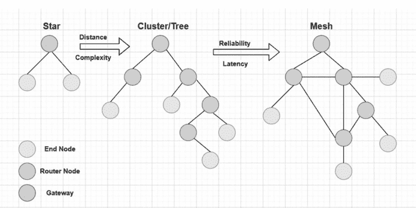

图6.1 MANETs的拓扑结构。

### 6.1.1 MANETs的挑战

- 一些挑战 [21] 如下：
- 安全性：这是无线网络中的主要关注问题，因为这类网络容易受到多种攻击。
- 服务质量：这是各种网络节点面临的显著挑战。很难满足与质量相关的不同优先级需求。
- 路由：由于拓扑动态变化，路由是找出发送者和接收者之间最小路径的主要问题。
- 电池约束：由于节点电池电源有限，必须节约能量以实现高效通信。
- 丢包：网络中的丢包是由于位变化导致无基础设施信道中出现错误引起的。

### 6.1.2 MANETs的应用

- 该网络在许多实时环境中部署 [22]：
- 搜救行动：用于在无需无线连接的情况下传输信息。
- 军事行动：根据需要，搭建临时网络以实现快速、简便的信息共享。
- 商业用途：用于会议、展览、执法等场景的通信。
- 灾害救援行动：用于在现有基础设施被摧毁时交换信息。

本章后续章节的安排如下：第6.2节介绍相关工作的关键特征；第6.3节解释MANETs中的路由协议；第6.4节阐述MANETs的优化技术；第6.5节详述不同路由协议的有效性；第6.6节处理结果分析，随后在第6.7节得出本章结论。

## 6.2 相关工作

Yang和Sun [23] 提出了一种“具有路径选择熵的AODV多路径路由协议”（AODVMPSE），该协议为目标节点分配多条路径以增强数据包的执行性能。Ahn等人 [24] 提出了另一种侧重于高机动性的多路径路由算法。Merkel等人 [25] 演示了整个系统中数据项的主动迁移。该方法对更资源高效的操作进行了彻底改造。

可扩展按需多路径路由（SMORT）[26] 是AODV的一种变体。它主要侧重于最小化路由开销。目标节点还向发起节点传输多个回复。SMORT使用路由表存储用于回复的数据包。回复数据包的数量有限制。当源节点收到第一个回复时，它会发送数据。在路由维护阶段，会执行两项任务：首先，如果路由在过程中被破坏，则重新建立初始端点和最终端点之间的通信；其次，从表中删除过期的路由。多路径节点带有使用AODV特性的备份列表。在初始端点和最终端点之间考虑两条独立的节点路由。出于这个原因，路由表会发生变化。在主路由和备份路由中插入一个称为flag的新数据包。当找到请求数据包时，节点更新路由表并广播请求。当接收到请求数据包时，目标节点发送一个回复数据包。此时，flag被设置为1。

Ravinder Ahuja等人 [27] 提出了在蠕虫洞攻击下对DSR和AODV进行性能评估。该攻击使用两个或多个节点执行。一些节点选择这些恶意节点，其中要发送的数据被篡改。攻击中的恶意节点伪造一条比原始路径更短的路由，这会导致依赖节点间距离的路由机制混淆。恶意节点从一个位置接收数据包并在另一个位置转发。无需对攻击有完整了解，就可以在网络上轻松执行该攻击。蠕虫洞攻击有两种攻击模式：隐藏模式和参与模式。隐藏模式使用数据包封装和数据包中继，而参与模式使用高功率和频段外传输 [28]。在高功率传输中，只有一个攻击节点吸引数据包。频段外传输是两端蠕虫洞，在端点之间放置高信道带宽以构建蠕虫洞链路。该攻击会导致路由中断、数据包丢失、为访问有用信息而监控流量等。网络中可以采用某些安全措施，例如协议特定的解决方案 [29]、基于密码学的技术、多路径统计分析以及基于拓扑的信息方法 [30]。

像入侵检测系统 [31]（IDS）这样的入侵检测技术通常检测系统中的不间断变化。在IDS中，基本上实现了两种类型的模型：异常检测和滥用检测。它分三个基本步骤工作：控制数据收集（监控）、决定收集的数据是否指示入侵（分析）、以及管理对入侵的响应操作（响应）。入侵检测可以在MANETs的分布式或协作环境中工作。MANET中的每个移动节点都有一个独立运行的单独IDS代理，用于监控本地活动并识别可能的入侵。已提出各种解决方案来解决MANET中的入侵检测问题。

Das等人 [32] 对AODV和DSR协议进行了比较。Broch等人 [33] 和Boukerche [34] 提供了一些用于分析的其他协议。B. Dahill等人 [35] 定义了一些保护网络免受攻击的要求。他们提出的一些规则如下：经过验证的节点应执行路由计算和发现、恶意消息检测、避免路由环路等。随后，诸如用于防范不同路由协议中漏洞的加密工具等安全路由协议应运而生。

Wankhade和Ali [36] 提出了关于服务质量和故障管理的措施。当网络中的节点增加时，路由协议的效率会降低。在此场景下，ACO技术被证明效率较低。与AODV相比，该协议具有更高的数据包投递率和最小延迟。


ACO技术解决了MANETs中的路由问题。该算法的工作方式类似于许多蚂蚁遵循其他蚂蚁所使用的路线[37]。它们不搜索其他路径，而是沿同一路径行进以节省时间。ACO在MANETs中的应用具有有利特性。它是按需形成的。它是在初始端点和最终端点之间路径故障时形成的，并使用即时可访问的可能路径。当蚂蚁在网络节点间移动并跟踪所有被访问节点的信息时[38]。

在数据传输过程中，首先搜索路径，如果路径可用，则发送数据；否则，数据包存储在缓冲区中，并派出一只蚂蚁去搜索目标。为了寻找最短路径，蚂蚁使用一种被称为信息素的化学物质，从它们的位置到食物供应地。其他蚂蚁会遍历分泌概率较高的路线[39]。相同概念应用于路由，以找到发送方和接收方之间最合适的最小路径。类似地，ACO用于路由以获得高度优化的结果。ACO基于蚁群规则。为了找到最优解，采用了多种方法。在MANETs的生物驱动算法规则中，相邻节点传输人工蚂蚁。ACO是一种生存能力强且可靠的路由规则[40]。

## 6.3 MANETs中的路由协议

路由协议规定了路由器之间如何进行通信，共享有助于它们在两个节点之间选择最佳可能路由的信息[41]。它决定了路由的选择。路由器包含与其直接连接的网络的信息。路由协议将此信息与相邻节点，然后在网络中共享[42]。这有助于了解网络的拓扑。路由协议的主要特征包括避免路由环路、选择首选路由、跳数开销信息、可扩展性、可靠性、路由收敛时间等[43]。为了克服自组网的局限性，例如高误码率下的最大功耗和低带宽，引入了不同类型的算法。在本章中，我们考虑了主动式和反动式两种不同类型的协议。主动式算法称为表驱动路由协议。反动式算法是按需启动源的算法[44]。示例包括AODV和DSR。MANETs中各种路由协议的树状表示如图6.2所示。

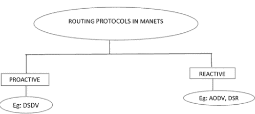

图6.2 协议分类。

### 6.3.1 路由协议比较综述

路由协议的优缺点见表6.1。

- i. AODV：AODV通过最小化基于需求生成的广播消息数量，在DSDV基础上具有额外功能。当任何节点需要传输信息时，它会向所有方向广播路由请求（RREQ）数据包。此过程持续到数据包到达目的地。接收中间广播数据包。这样做是为了通过维护路由表中的值来建立反向路径。如果接收到多个副本，则将其丢弃。每当没有可用于目的地的路由时，RREQ数据包会在整个网络中泛滥[48]。RREQ数据包包含起点地址、终点地址、请求ID、目的地序列号、跳数和源编号[49]。如果节点已经接收到具有相同参数的数据包，则将其丢弃。如果存在有效路径，则将路由回复（RREP）消息传输到起始节点。图6.3显示了RREQ的传播以及从起点到终点的路由确定。

图6.4显示了带有各字段说明的RREQ数据包格式。

- Reserved：此字段设置为零。
- Hop Count：此字段计算从原始IP地址开始的跳数。

表6.1
路由协议特性 [45–47]

| 序号 | 路由协议 | 优点 | 缺点 |
|---|---|---|---|
| 1 | 反应式协议 | 1. 拓扑变化期间响应快。<br>2. 节点持续移动时的单播和多播传输。<br>3. 建立延迟较低。<br>4. 无额外开销。<br>5. 无环协议，可扩展至大量节点。 | 1. 随网络规模增大，性能指标下降。<br>2. 消耗大量带宽。<br>3. 构建路由表花费最长时间。<br>4. 难以检测路由的过期时间。<br>5. 处理需求高。<br>6. 链路断开时，活动路由中拥塞增加。 |
| 2 | 主动式协议 | 1. 路由建立延迟最小。<br>2. 路径建立延迟较低。<br>3. 无环路径。 | 1. 路由开销高。<br>2. 需要定期更新表格，消耗大量电池资源。<br>3. 不适用于高度动态网络。<br>4. 网络空闲时会消耗少量带宽。 |

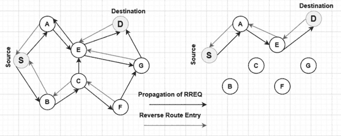

图6.3 从源到目的地的RREQ传播和路由确定。

| 类型 | 保留 | 跳数 |
|---|---|---|
| 广播ID | | |
| 目的IP地址 | | |
| 目的序列号 | | |
| 源IP地址 | | |
| 源序列号 | | |
| 时间戳 | | |

图6.4 RREQ数据包格式。

| 类型 | 保留 | 跳数 |
|---|---|---|
| 目的IP地址 | | |
| 目的序列号 | | |
| 源IP地址 | | |
| 生存时间 | | |

图6.5 RREP数据包格式。

- Broadcast ID：此字段用于唯一标识数据包。
- 目的IP地址：此字段定义从中定义路由的目的地IP地址。
- 源IP地址：此字段定义路由到达的源IP地址。
- 时间戳：此字段跟踪事件发生的时间。

图6.5显示了带有各字段说明的RREP数据包格式。

- Reserved：此字段设置为零。
- 目的IP地址：此字段定义从中定义路由的目的地IP地址。
- 源IP地址：此字段定义路由到达的源IP地址。
- 跳数：此字段计算从原始IP地址开始的跳数。

- ii. DSR：这是一种反应式协议，其中路由是按需发现的，即每当需要时。基于对特定路由的需求，节点启动路由发现[50]。对于从源到目的地的可用路由，会检查路由缓存。整个过程包含两个主要组件：路由发现和路由维护。

- 路由发现

按需基础上，源节点启动路由发现。在缓存中检查可用路径的可用性。如果缓存中未找到此类路由，则启动路由发现[51]，图6.6显示了源与目的地之间的路由。

- 路由维护

由于拓扑变化是主要问题，链路断开或故障的可能性很多。但由于确认机制，路由维护是可能的[52]。图6.6显示了路径S-B-E-D之间的链路断开。因此，源和目的地之间的备用路径将是S-A-G-F-D。

- iii. DSDV：这是一种表驱动路由协议。每个节点管理一个包含其相邻节点条目的路由表。该协议基于带有一些更新的Bellman-Ford算法[53]。每个表项都与目标节点关联的唯一序列号。拓扑的任何变化都会导致路由表的更新。更新可以通过广播消息或多播消息传输[54]。借助此机制，相邻节点了解网络中发生的变化。路由更新可以通过向相邻节点发送整个表或仅发送需要更新的表的一部分来完成。在图6.7中，解释了由节点4创建的路由表。如表6.2所示的路由表包含有关目的地、跳数和序列号的信息。

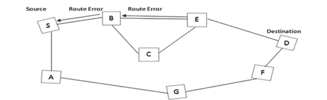

图6.6 备用路径形成。


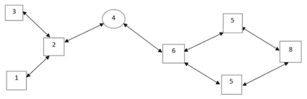

图 6.7 网络形成。

表 6.2 节点 4 的路由表

| 目标 | 跳数 | 序列号 |
|---|---|---|
| 1 | 2 | SS1 |
| 2 | 1 | SS2 |
| 3 | 2 | SS3 |
| 4 | 0 | SS4 |
| 5 | 2 | SS5 |
| 6 | 1 | SS6 |
| 7 | 2 | SS7 |
| 8 | 3 | SS8 |

## 6.4 优化技术

路由协议存在许多局限性：随着节点数量增加、链路故障等，网络复杂性会增加。因此，采用了不同的优化技术来寻找源节点与其目的地之间的最短路径。讨论的两种优化技术是 ACO 和基于群智能的优化。

### 6.4.1 ACO 技术

这种优化技术解决了 MANETs 中的路由问题。该算法的工作方式类似于多只蚂蚁遵循其他蚂蚁所使用的路线。它们不寻找其他路径，而是在同一条路径上行进以节省时间。ACO 在 MANETs 中的应用具有有利的特性。它是按需形成的。它是源节点和目的地之间的路径故障，并使用即时可访问的可能路径。当蚂蚁在网络中节点之间移动时，会跟踪所有访问节点的信息。在数据传输过程中，首先搜索路径，如果路径可用，则发送数据，否则数据包存储在缓冲区中，并由蚂蚁离开以寻找目的地。为了寻找最短路径，蚂蚁使用一种称为信息素的化学物质，从它们的位置到食物供应地。分泌概率高的路径会被其他蚂蚁穿越。同样的概念应用于路由，以寻找源节点和目的地之间最合适的最短路径。在
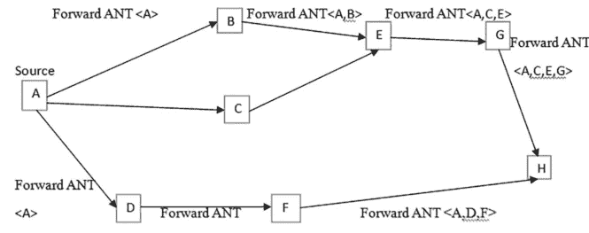

图 6.8 ACO 结构。
类似的方式，ACO 在路由中被用于获得高度优化的结果。ACO 基于蚁群规则。为了寻找最优解，采用了多种方法。在 MANETs 的生物驱动算法规则中，邻近节点传输人工蚂蚁。ACO 是一种可靠且生存力强的路由规则 [55]。图 6.8 定义了网络中优化技术的结构。

### 6.4.2 基于群智能的优化技术

Gunes 等人 [56] 提出了用于 MANETs 的基于蚁群的路由。它包含以下阶段：容错、路由发现和路由维护。Zulfiqar Ali 等人 [57] 提出了使用进化编程、神经网络、ACO 和粒子群优化进行路由的方法。以下参数用于评估性能，例如最小路径的选择、能源消耗和开销。Toqeer Mahmood 等人 [58] 通过分析 MANETs 中动态路由的网络延迟，提出了一种改进思路。优化技术使用基于蚂蚁的策略来计算多个替代方案中成本最低的最短路径，并将其作为粒子群优化技术的输入。在此过程中发生以下步骤：为最小解选择随机粒子、位置和速度的初始化，以及通过与所有邻近节点比较来选择节点的最小距离。

## 6.5 不同路由协议的性能

使用网络模拟器模拟了 AODV、DSDV 和 DSR 等不同路由协议。模拟过程中使用了多个参数。使用了全向天线，其有一个轴，无线电波功率从该轴对称辐射。队列尾长度为 50。可以使用不同类型的队列，例如优先级队列和丢尾队列。默认情况下，使用丢尾队列，这是一种网络调度器用来决定何时丢弃队列中新数据包入口的队列管理算法。当队列填充到最大容量时，该队列会丢弃数据包，直到有空闲空间来容纳新到达的数据包。恒定比特率用于恒定比特率的流量通信；流量源与目的地之间存在时间同步。节点已部署在 500 m ×500 m 的区域内，节点数量变化为 20、40、60、80、100 个。拓扑基于多跳通信设计。模拟持续时间为 100 秒。网络模拟器中使用的模拟参数及其值显示在表 6.3 中。

| 序号 | 参数 | 值 |
|---|---|---|
| 1 | 模拟区域 | 500×500 |
| 2 | 节点数量 | 20,40,60,80,100 |
| 3 | 队列长度 | 50 |
| 4 | 流量类型 | 恒定比特率 |
| 5 | 模拟时间 | 100 秒 |
| 6 | 使用的天线 | 全向 |
| 7 | 队列类型 | 丢尾 |
| 8 | 路由协议 | AODV, DSDV, DSR |

使用 ns2 模拟器评估了不同路由协议的性能。考虑了两项性能指标：吞吐量和端到端延迟。

- 吞吐量：两个节点之间单位时间内传输的信息数据包数量。
- 端到端延迟：计算为数据包从起始节点移动到结束节点所需的平均时间。

表 6.3 定义了用于计算吞吐量和端到端延迟的模拟参数。网络模拟是一种通过节点、交换机和链路之间的交互来检查网络行为的技术。一个节点数量变化、使用恒定比特率流量和全向天线的网络场景被部署在 500×500 的模拟区域上。丢尾队列用于存储数据包，当其缓冲区满时，它会从队列中丢弃数据包。

## 6.6 结果分析

图 6.9 显示了网络模拟器上 20 个节点的 AODV 路由协议吞吐量计算。吞吐量定义为两个节点之间单位时间内传输的信息数据包数量。端到端延迟计算为数据包从起始节点移动到结束节点所需的平均时间。

图 6.10 显示了网络模拟器上 20 个节点的 AODV 路由协议端到端延迟计算。

```
lab@ubuntu:~$ cd Desktop/
lab@ubuntu:~/Desktop$ ns AODV.tcl
num_nodes is set 20
Creating nodes...
INITIALIZE THE LIST xlistHead
Loading random connection pattern...
Starting Simulation...
channel.cc:sendUp - Calc highestAntennaZ_ and distCST_
highestAntennaZ_ = 1.5,  distCST_ = 550.0
SORTING LISTS ...DONE!
lab@ubuntu:~/Desktop$ awk -f genthroughput.awk op20.tr
Average Throughput[kbps] = 71.48    StartTime=2.56 StopTime=99.97
lab@ubuntu:~/Desktop$ 
```

图 6.9 20 个节点的 AODV 吞吐量。

```
lab@ubuntu:~/Desktop$ awk -f e2edelay.awk op20.tr

ReceivedPackets             = 1700
Packet Delivery Ratio       = 99.8825%
Dropped Packets ratio = 0.00235018
Average End-to-End Delay   = 3.24733 ms
```

图 6.10 20 个节点的 AODV 端到端延迟。

```
lab@ubuntu:~/Desktop$ ns DSDV.tcl
num_nodes is set 20
Creating nodes...
INITIALIZE THE LIST xlistHead
Loading random connection pattern...
Starting Simulation...
channel.cc:sendUp - Calc highestAntennaZ_ and distCST_
highestAntennaZ_ = 1.5,  distCST_ = 550.0
SORTING LISTS ...DONE!
SEGMENTATION fault (core dumped)
lab@ubuntu:~/Desktop$ awk -f genthroughput.awk op20.tr
Average Throughput[kbps] = 29.27    StartTime=2.56 StopTime=41.60
lab@ubuntu:~/Desktop$ 
```

图 6.11 20 个节点的 DSDV 吞吐量。

图 6.11 显示了网络模拟器上 20 个节点的 DSDV 路由协议吞吐量计算。
图 6.12 显示了网络模拟器上 20 个节点的 DSDV 路由协议端到端延迟计算。
图 6.13 显示了网络模拟器上 20 个节点的 DSR 路由协议吞吐量计算。
图 6.14 显示了网络模拟器上 20 个节点的 DSR 路由协议端到端延迟计算。


```
lab@ubuntu:~/Desktop$ awk -f e2edelay.awk op20.tr

ReceivedPackets           =  279
Packet Delivery Ratio     =  87.7358%
Dropped Packets ratio = 0
Average End-to-End Delay  =  3.65083 ms
```

图 6.12 20个节点的DSDV端到端延迟。

```
lab@ubuntu:~/Desktop$ ns DSR.tcl
num_nodes is set 20
Creating nodes...
INITIALIZE THE LIST xlistHead
Loading random connection pattern...
Starting Simulation...
channel.cc:sendUp - Calc highestAntennaZ_ and distCST_
highestAntennaZ_ = 1.5,  distCST_ = 550.0
SORTING LISTS ...DONE!
lab@ubuntu:~/Desktop$ awk -f genthroughput.awk op20.tr
Average Throughput[kbps] = 66.66    StartTime=2.56 StopTime=99.89
```

图 6.13 20个节点的DSR吞吐量。

```
lab@ubuntu:~/Desktop$ awk -f e2edelay.awk op20.tr

ReceivedPackets           =  1584
Packet Delivery Ratio     =  79.5181%
Dropped Packets ratio = 0.114458
Average End-to-End Delay  =  5.56286 ms
```

图 6.14 20个节点的DSR端到端延迟。

同样，在无线电环境中以40、60、80、100个节点数、500×500的区域和50的队列长度，观察性能指标以获得结果。

表 6.4 和 6.5 显示了不同路由协议的不同吞吐量和端到端延迟值。

图 6.15 显示，随着节点数量的增加，不同路由协议的吞吐量呈现出不同的变化。观察发现，由于拓扑频繁变化时路由表更新机制较慢，DSDV在所有协议中的吞吐量最低。AODV和DSR等反应式协议具有较高吞吐量。

**表 6.4 不同协议的吞吐量**

| 节点数 | AODV | DSDV | DSR |
|---|---|---|---|
| 20 | 71.48 | 66.66 | 29.27 |
| 40 | 71.43 | 64.47 | 33.43 |
| 60 | 71.25 | 63.31 | 30.84 |
| 80 | 71.77 | 65.39 | 34.26 |
| 100 | 72.04 | 65.14 | 34.67 |

**表 6.5 不同协议的端到端延迟**

| 节点数 | AODV | DSDV | DSR |
|---|---|---|---|
| 20 | 3.247 | 5.562 | 3.650 |
| 40 | 6.868 | 2.982 | 3.582 |
| 60 | 3.245 | 13.659 | 3.959 |
| 80 | 7.885 | 4.019 | 3.814 |
| 100 | 3.228 | 3.246 | 3.948 |

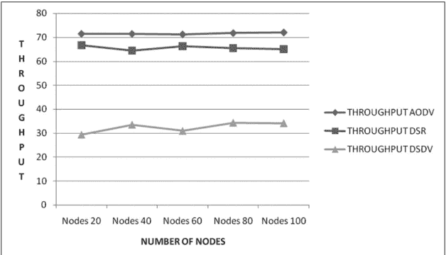

图 6.15 不同节点数量下不同路由协议的吞吐量。

图 6.16 显示，随着节点数量的增加，不同路由协议的端到端延迟呈现出不同的变化。观察发现，更高的流量负载会增加延迟。DSR在高流量下产生最高延迟，而AODV在高流量下表现更好。随着节点数量增加，DSDV也会性能下降。

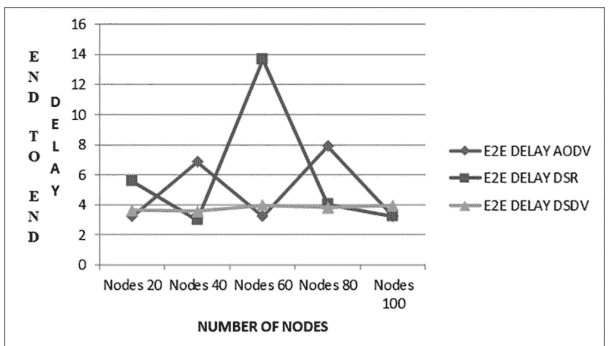

图 6.16 不同节点数量下不同路由协议的端到端延迟。

## 6.7 结论

本章介绍了不同的路由算法。基于在ns2模拟器上模拟的性能指标，观察发现，AODV作为一种反应式协议，通过最小化基于需求创建的广播消息数量，相较于DSDV具有某些额外特性。AODV的性能优于DSDV，DSDV基于表驱动方法，每个节点在路由表中维护有关邻居节点的信息；也优于DSR，DSR是一种按需发现路由的协议，即基于特定节点的需求，该节点发起路由发现机制。AODV在数据包之间产生较少的端到端延迟并实现最大吞吐量。路由协议存在多种局限性：随着节点数量增加，网络复杂性增加，链路故障等。因此，使用了不同的优化技术来寻找源点与目的地之间的最短路径。这里，研究了两种优化技术——蚁群算法（ACO）和基于群体智能的优化。ACO技术受到真实蚁群的启发。这用于解决电信领域（如路由）中的搜索问题；这也解决了自组织网络（MANETs）中的路由问题。在网络中，ACO技术在两个节点之间找到了最合适的路径，该路径作为粒子群优化技术的输入。未来，工作可以通过使用不同的概率建模技术进行扩展。

## 参考文献

- 1. Lee, S., & Kim, S. B. (2019). 用于贝叶斯网络结构学习的贪婪算法并行模拟退火。IEEE Transactions on Knowledge and Data Engineering. doi:10.1109/tkde.2019.2899096.

- 2. Mokube, I., & Adams, M. (2007). 蜜罐：概念、方法与挑战。载于第45届东南区域年会论文集。纽约，美国：ACM，第321–326页。

- 3. Bhushan, B., & Sahoo, G. (2017). 无线传感器网络中攻击、技术挑战、漏洞及其对策的最新进展。*Wireless Personal Communications*, 98(2), 2037–2077. doi:10.1007/s11277-017-4962-0.

- 4. Yue, Y., Cao, L., Hang, B., & Luo, Z. (2018). 带有移动汇聚节点的无线传感器网络路由恢复策略的群体智能算法。*IEEE Access*, 6, 67434–67445. doi:10.1109/access.2018.2879364.

- 5. Prashar, D., Kumar, D., & Jyoti, K. (2016, March). 无线传感器网络中安全定位技术的性能分析。载于《第二届信息通信技术竞争性策略国际会议论文集》，第48页。Udaipur: ACM.

- 6. Abo-Zahhad, M., Ahmed, S. M., Sabor, N., & Sasaki, S. (2015). 基于移动汇聚节点的自适应免疫节能聚类协议，用于提高无线传感器网络的生存期和稳定期。*IEEE Sensors Journal*, 15(8), 4576–4586. doi:10.1109/jsen.2015.2424296.

- 7. Kaur, A., & Gujaral, R. (2016). 用于改善网络生存期的WSN优化GAF协议睡眠/唤醒协议。载于《2016年第3届信号处理与集成网络国际会议（SPIN）》。doi:10.1109/spin.2016.7566729.

- 8. Pietro, N. D., & Boutros, J. J. (2017). 构造-a格网的利奇星座。*IEEE Transactions on Communications*, 65(11), 4622–4631. doi:10.1109/tcomm.2017.2736563.

- 9. Jain, V., & Khan, N. A. (2014). 无线传感器网络中定向扩散和SPIN路由协议的仿真分析。载于《2014年商业、工业和政府IT会议（CSIBIG）》。doi:10.1109/csibig.2014.7056990.

- 10. Jaitly, S., Malhotra, H., & Bhushan, B. (2017). 无线传感器网络干扰攻击的安全漏洞及对策：一项调查。载于《2017年计算机、通信与电子国际会议（Comptelix）》。doi:10.1109/comptelix.2017.8004033.

- 11. Sarkar, S., & Datta, R. (2017). 移动自组织网络的移动感知路由选择技术。*IET Wireless Sensor Systems*, 7(3), 55–64. doi:10.1049/iet-wss.2016.0058.

- 12. Pradittasnee, L., Camtepe, S., & Tian, Y. (2017). 大规模传感器网络可靠路由的高效路由更新与维护。*IEEE Transactions on Industrial Informatics*, 13(1), 144–156. doi:10.1109/tii.2016.2569523.

- 13. Kumar, A., & Prashar, D. (2018). 无线传感器网络节点定位的新方法。载于：Singh, R., Choudhury, S., & Gehlot, A.（编）。*智能通信、控制与设备*（第419–428页）。新加坡：Springer.

- 14. Singhal, A., & Daniel, A. (2014). 移动自组织网络的稳定且可扩展的按需路由。载于《2014年商业、工业和政府IT会议（CSIBIG）》。doi:10.1109/csibig.2014.7056989.

- 15. Sahu, P. K., Acharya, B., & Panda, N. (2018). MANET中AODV和DSR路由协议的QoS性能分析。载于《2018年第2届数据科学与商业分析国际会议（ICDSBA）》。doi:10.1109/icdsba.2018.00046.

- 16. Wang, Z., Chen, Y., & Li, C. (2014). PSR：面向移动自组织网络的轻量级主动源路由协议。*IEEE Transactions on Vehicular Technology*, 63(2), 859–868. doi:10.1109/tvt.2013.2279111.

- 17. Abdelbar, A. M., & Salama, K. M. (2019). 用于连续优化的蚁群算法中的参数自适应。*IEEE Access*. doi:10.1109/access.2019.2896104.

- 18. Shang, J., Wang, X., Wu, X., Sun, Y., Ding, Q., & Liu, J. (2019). 基于蚁群优化的基因互作检测方法综述。*IEEE Access*. doi:10.1109/access.2019.2894676.

- 19. Sharma, N., Kaushik, I., Bhushan, B., Gautam, S., & Khampari, A. (2020). 医疗保健领域中WSN和生物识别模型的适用性。载于《无线传感器网络安全增强深度学习策略——信息安全、隐私与伦理进展》，第304–329页。doi:10.4018/978-1-7998-5068-7.ch016.


- 20. Bhushan, B., & Sahoo, G. (2017). 无线传感器网络中安全节能路由协议及数据采集方法的综合调查. In *2017 信号处理与通信国际会议 (ICSPC)*. doi:10.1109/icspc.2017.8305856.

- 21. Peng, H., Ying, C., Tan, S., Hu, B., & Sun, Z. (2018). 基于蚁群优化的改进特征选择算法. *IEEE Access*, 6, 69203–69209. doi:10.1109/access.2018.2879583.

- 22. Chang, J., Tsou, P., Woongang, I., Chao, H., & Lai, C. (2015). 防御MANET中恶意节点的协作攻击：一种协作诱饵检测方法. *IEEE Systems Journal*, 9(1), 65–75. doi:10.1109/jsyst.2013.2296197.

- 23. Yang, F., & Sun, B. (2011). 带路径选择熵的按需距离向量多路路由协议. In *2011 消费电子、通信与网络国际会议 (CECNet)*, pp. 4715–4718. IEEE, 咸宁, 2011年4月.

- 24. Kim, J., Chung, S., Lee, Y., Ahn, C., Kim, W., & Jung, M. (2011). 基于多路路由的WLAN mesh路由器的设计与实现. In *2011 信息网络国际会议 (ICOIN2011)*. doi:10.1109/icoin.2011.5723170.

- 25. Merkel, S., Becker, C. W., & Schmeck, H. (2012). 萤火虫启发的移动自组织网络中节能距离估计同步. In *2012 IEEE第31届性能计算与通信国际会议 (IPCCC)*, pp. 205–214. IEEE, 奥斯汀, 德克萨斯州, 2012年12月.

- 26. Reddeppa Reddy, L., & Raghavan, S. (2007). SMORT：面向移动自组织网络的可扩展按需多路路由. *Ad Hoc Networks*, 5(2), 162–188.

- 27. Ahuja, R., Ahuja, A. B., & Ahuja, P. (2013). 蠕虫洞攻击下MANET中AODV和DSR路由协议的性能评估与比较. In *2013 IEEE第二届图像信息处理国际会议 (ICIIP-2013)*. doi:10.1109/iciip.2013.6707686.

- 28. Singh, T., Singh, J., & Sharma, S. (2016). MANET节能安全路由协议. *Wireless Networks*, 23(4), 1001–1009. doi:10.1007/s11276-015-1176-9.

- 29. Sultana, F. (2017). 基于确认的MANET路由不当行为识别方法. doi:10.31219/osf.io/ujm4q.

- 30. Walikar, G. A., & Biradar, R. C. (2017). 移动自组织网络中混合路由机制综述. *Journal of Network and Computer Applications*, 77, 48–63. doi:10.1016/j.jnca.2016.10.014.

- 31. Kaushik, I., Sharma, N., & Singh, N. (2019). 黑洞攻击的入侵检测与安全系统. In *2019第2届信号处理与通信国际会议 (ICSPC)*. doi:10.1109/icspc46172.2019.8976797.

- 32. Das, S. R., Belding-Royer, E. M., & Perkins, C. E. (2003). 按需距离向量 (AODV) 路由. doi:10.17487/rfc3561.

- 33. Broch, J., Maltz, D., Johnson, D. B., Hu, Y.-C., & Jetcheva, J. (1998). 多跳无线自组织网络路由协议的性能比较. In *第4届ACM/IEEE移动计算与网络国际年会论文集, MobiCom ’98*, 达拉斯, 德克萨斯州.

- 34. Boukerche, A., Turgut, B., Aydin, N., Ahmad, M. Z., Bölöni, L., & Turgut, D. (2011). 自组织网络中的路由协议：一项综述. *Computer Networks*, 55(13), 3032–3080.

- 35. Sanzgiri, K., Dahill, B., Levine, B., Shields, C., & Belding-Royer, E. (2002). 一种安全的自组织网络路由协议. In *IEEE网络协议国际会议 (ICNP) 论文集*, 巴黎, pp. 78–87.

- 36. Wankhade, S. B., & Ali, M. S. (2012年7月). MANET基于蚁群的路由协议最新进展. *International Journal of Advances in Engineering & Technology*, 4(1), 405–413. ISSN: 2231-1963.

- 37. Chavan, A., Kurule, D., & Dere, P. (2016). MANET中AODV和DSDV路由协议的性能分析及针对黑洞攻击的AODV改进. Procedia Computer Science, 79, 835–844. doi:10.1016/j.procs.2016.03.108.

- 38. Sinha, P., Jha, V. K., Rai, A. K., & Bhushan, B. (2017). OSI参考模型各层无线传感器网络中的安全漏洞、攻击及对策：一项综述. In 2017 信号处理与通信国际会议 (ICSPC). doi:10.1109/icspc.2017.8305855.

- 39. Faghihniya, M. J., Hosseini, S. M., & Tahmasebi, M. (2016). 基于平衡索引的车载自组织网络中RREQ泛洪攻击的安全升级. Wireless Networks, 23(6), 1863–1874. doi:10.1007/s11276-016-1259-2.

- 40. El-Semary, A. M., & Diab, H. (2019). BP-AODV：基于混沌映射的MANET黑洞防护AODV路由协议. IEEE Access, 7, 95197–95211. doi:10.1109/access.2019.2928804.

- 41. Manickavelu, D., & Vaidyanathan, R. U. (2014). 基于粒子群优化 (PSO) 的MANET路由恢复节点和链路生存期预测算法. EURASIP Journal on Wireless Communication Networks, 2014, 107.

- 42. Pruthi, V., Mittal, K., Sharma, N., & Kaushik, I. (2019). WSN中网络层威胁及其对策. In 2019 计算、通信与智能系统国际会议 (ICCCIS). doi:10.1109/icccis48478.2019.8974523.

- 43. Chen, C. W., Weng, C. C. (2012). 无线多跳网络中节能路由与维护协议. Journal of Systems and Software, 85(1), 62–76.

- 44. Al-Ani, A. D., & Seitz, J. (2016). 基于蚁群优化的多速率自组织网络QoS感知路由. Network Protocols and Algorithms, 7(4), 1. doi:10.5296/npa.v7i4.8513.

- 45. Anuradha, M., & Mala, G. S. A. (2016). 基于模糊逻辑的MANET跨层拥塞检测与路由协议. Wireless Networks, 23(5), 1373–1385. doi:10.1007/s11276-016-1211-5.

- 46. Eiza, M. H., Owens, T., & Ni, Q. (2016). VANET安全可靠的多约束QoS感知路由算法. IEEE Transactions on Dependable and Secure Computing, 13(1), 32–45. doi:10.1109/tdsc.2014.2382602.

- 47. Ghaffari, A. (2016). 基于强化学习和启发式算法的移动自组织网络实时路由算法. Wireless Networks, 23(3), 703–714. doi:10.1007/s11276-015-1180-0.

- 48. Khan, M. S., Waris, S., Ali, I., Khan, M. I., & Anisi, M. H. (2016). 基于MANET数据速率自适应方案的丢包缓解. Mobile Networks and Applications, 23(5), 1141–1150. doi:10.1007/s11036-016-0780-y.

- 49. Li, X., & Yan, J. (2017). LEPR：面向飞行自组织网络的基于链路稳定性估计的抢占式路由协议. In 2017 IEEE计算机与通信研讨会 (ISCC). doi:10.1109/iscc.2017.8024669.

- 50. Naseem, M., & Kumar, C. (2016). 基于队列的MANET多路径负载均衡路由协议. International Journal of Communication Systems, 30(6). doi:10.1002/dac.3141.

- 51. Kaushik, I., & Sharma, N. (2020). 无线传感器网络中的黑洞攻击及其安全措施. Advances in Intelligent Systems and Computing《无线传感器网络手册：当前场景中的问题与挑战》, pp. 401–416. doi:10.1007/978-3-030-40305-8_20.

- 52. Rath, M., Rout, U. P., Pujari, N., Nanda, S. K., & Panda, S. P. (2017). 移动自组织网络中实时流量的拥塞控制机制. Lecture Notes in Networks and Systems《计算机通信、网络与互联网安全》, pp. 149–156. doi:10.1007/978-981-10-3226-4_14.

- 53. Sharma, N., Kaushik, I., Singh, N., & Kumar, R. (2019). 无线传感器网络中不同最短路径技术的性能测量. In 2019第2届信号处理与通信国际会议 (ICSPC). doi:10.1109/icspc46172.2019.8976618.

- 54. Yadav, A. K., & Tripathi, S. (2016). QMRPRNS：基于可靠节点选择方案的MANET QoS组播路由协议设计. Peer-to-Peer Networking and Applications, 10(4), 897–909. doi:10.1007/s12083-016-0441-8.

- 55. Zhou, J., Tan, H., Deng, Y., Cui, L., & Liu, D. D. (2016). 不同节点移动模型下移动自组织网络的基于蚁群的能量控制路由协议. EURASIP Journal on Wireless Communications and Networking, 2016(1). doi:10.1186/s13638-016-0600-x.

- 56. Gines, M., Sorges, U., & Bouazizi, I. (2002). ARA——面向MANET的基于蚁群的路由算法. In 并行处理研讨会国际会议 (ICPPW’02), IEEE计算机学会出版社, 温哥华, 不列颠哥伦比亚省, pp. 79–85.

- 57. Ali, Z., & Shahzad, W. (2011). 自组织和传感器无线网络中基于群体智能的路由协议关键分析. In 计算机网络与信息技术国际会议, 阿博塔巴德, pp. 287–292.

- 58. Mahmood, T., Nawaz, T., Ashraf, R. & Shah, S. M. A. (2012年1月). 自组织网络基于闲聊的路由协议设计. IJCSI International Journal of Computer Science Issues, 9(1), 177–181.


# 7 使用无线传感器网络的智慧农业

Somya Goyal
Manipal University Jaipur
Guru Jambheshwar University of Science and Technology

Sudhir Kumar Sharma
Institute of Information Technology & Management

Anubha Parashar
Manipal University Jaipur

## 目录

- 7.1 引言 .................................................................... 121
- 7.2 无线传感器网络与智慧农业 ..................................................... 122
- 7.3 机器学习与无线传感器网络在智慧农业中的最新应用 ....................................... 124
- 7.4 案例研究——智慧灌溉系统 ...................................... 126
- 7.4.1 引言 ............................................................ 126
- 7.4.2 工作流 ................................................................ 126
- 7.4.3 组件 .............................................................. 127
- 7.4.3.1 无线传感器网络 ............................................. 128
- 7.4.3.2 物联网网关 ........................................................... 128
- 7.4.3.3 云服务 ........................................................ 130
- 7.4.4 数据分析 ........................................................... 130
- 7.4.5 图形分析 ...................................................... 130
- 7.4.6 提出系统的优势 ........................................... 131
- 7.5 结论与未来展望 ................................................. 132
- 参考文献 ............................................................................ 132

## 7.1 引言

无线传感器网络（WSNs）与人工智能（AI）相结合，现在使农民能够在智慧农业领域分析天气状况、土壤状况和用水情况，并自动执行许多物理任务和决策活动。WSN 是指由有线或无线通信、传感器和执行器组成的系统，能够采集并将数据传输到互联网或云端。在智慧农业中，物联网（IoT）传感器、无人驾驶航空器（UAVs）或无人机、通过 WSNs 的卫星以及其他资源不断产生海量数据。这些大数据借助云计算使用机器学习（ML）算法进行分析，以支持智慧农业中的决策。现在，农民能够记录传感器数据并预测产量。因此，他们在技术上更加完善，能够有效地应对自然灾害和气候条件。基于 AI 的智慧农业可以通过分析无人机持续拍摄的图像来检测植物疾病。在当今 COVID-19 等大流行病的情况下，可以训练机器人高效地完成收割和维护农场的体力劳动。此外，基于 AI 的解决方案使我们的农民能够以更好、更智能的方式犁地。他们可以有效地管理资源。最近的调查倡导数字演进在智慧农业中的潜在作用 [1–4]。

本研究的动机在于，WSNs 和 IoT 是智慧农业中的突出技术。该领域已发表了大量研究工作，需要以面向的方式进行回顾。

本工作的总体贡献是揭示 WSNs 和 IoT 在农业中的应用，并强调基于传感器的无线网络与 IoT 技术如何增强农业活动并带来更好的智慧农业。WSNs 与数据分析 [5,6] 结合使用 ML 技术处理传感器收集的海量数据，从而推动农业应用的发展。

本章的组织如下：第 7.2 节阐述了 WSNs 与 AI 在智慧农业中的最新进展。然后，第 7.3 节讨论了 WSN 使能的智慧农业中常用的 ML 技术，并总结了最新技术，重点介绍了 ML 技术在 WSNs 中的应用。在第 7.4 节中，讨论了基于 WSN 的智慧农业解决方案的案例研究。在第 7.5 节中，本章将对未来展望发表评论，从而结束。

## 7.2 无线传感器网络与智慧农业

WSNs 与 AI 共同在农业领域形成三大主流——即构建和利用 AI 机器人、监测土壤和天气状况以及作物病害检测，以及通过预测构建决策支持系统。农业的体力负担可以转移给自主机器人。它们可以在任何天气条件下像农民一样在田间工作，并能处理犁地、播种、除草和收获等基本农业活动 [7,8]。机器人技术正在被部署为收获劳动力。例如，CROO 正在支持农民采摘和包装草莓 [9]。

使用传感器监测土壤和天气状况，以感知湿度和温度等各种因素，并结合卫星图像进行天气预报。所有这些信息都能帮助农民进行更好的资源分配和自动化。例如，如果记录和分析土壤及其周围环境的湿度水平，则可以更好地控制灌溉，甚至实现自动化。ML 技术被广泛用于检测作物病害和监测土壤健康。例如，Plantix 用于检测土壤缺陷和植物疾病 [10]。它基于图像处理范式，利用 ML 技术分析土壤模式并检测土壤或植物的问题。此类应用为农民提供了良好的图形用户界面，使他们可以查看图像并预测问题。这有助于实现智慧农业，因为它还建议修复所报告问题的最佳技术和解决方案。采用深度神经网络监测木薯植物的工作已经完成 [11]。它可以识别三种作物病害和两种虫害损害 [12,13]。

分析传感器数据和卫星数据，以进行未来预测并构建决策支持系统。此类预测最流行的用途与评估天气和作物可持续性以及识别病虫害有关。使用无人机（UAVs）在短时间内收集大片土地上的信息是合适的。通过处理感知数据，可以改善作物健康并降低农业成本 [14]。决策支持系统也在“智慧灌溉系统”中实现。这是一个基于 WSN 的智能系统，用于监测土壤特性和天气状况以调节灌溉并自动向作物喷水 [15]。表 7.1 总结了 WSNs 可以支持的各种田间活动，以实现智慧农业。

这样一来，我们的农民就能够借助 WSNs 与 ML、IoT 和 AI 相结合的智能信息系统，应对自然灾害、气候条件以及持续的土壤/作物监测。智慧农业是迈向改进和高效农业维度的解决方案。农业活动包括从犁地到监测作物生长，再以高效方式销售产品的一系列任务。

表 7.1
智慧农业中的活动摘要

| 应用名称 | 描述 |
| --- | --- |
| 作物水管理 [16] | 智慧农业利用 IoT 传感器收集气候和土壤参数，并使用 ML 进行决策。使用执行器和继电器自动开/关水泵。这样一来，对气候、土壤和作物的持续监测即可实现自动灌溉系统。它确保水的适当供应，从而减少水资源浪费。 |
| 精准农业 [17] | 天气和气候信息必须准确，以便将灾害造成的作物损害降至最低。智慧农业不断用实时数据流更新农民，并预测任何危险。 |
| 综合病虫害管理或控制 [18] | 智慧农业使用传感器和摄像头（通过无人机或卫星）持续监测作物，并告知农民何时以及需要多少农药。 |
| 食品生产与安全 [19] | 智慧农业允许监控仓库位置、其温度、运输设施以及运送到储存仓库，还会将所有监测数据记录到云端并确保产品安全。 |


## 7.3 智慧农业中WSN与ML的最先进应用

ML能够从经验中学习，并从传感器收集的原始数据中获取智能，以进行智能决策 [20,21]。ML算法的优点在于，它无需事先了解数据集特征之间的关系，即可从海量数据集中学习。并且，随着被学习模型接收更多数据集，其学习效果会更好。ML是学习数据集非线性关系并解决复杂现实问题的强大工具 [22,23]。多维数据集可能包括传感器数据或使用相机拍摄的图像。它凭借从过去经验中学习的优势，能够做出智能且快速的决策。ML技术正在广泛应用于各种现实应用领域。监督式ML包括基于回归和分类的问题应用。无监督式ML应用于基于聚类的问题。基于ML的应用性能取决于模型选择、参数选择、数据集的质量和数量、参数调优以及对问题的理解程度。ML允许自动提取海量数据集中存在的模式，并在无需人工干预的情况下进行学习并做出智能决策。

智慧农业涉及做出许多决策，例如如何使用资源（土壤、肥料和水）、哪种作物在特定天气和土壤条件下产量更高、准备耕地需要多长时间、持续监测以及作物病害预防措施。在如此复杂的现实情况下，WSN结合ML技术能够很好地提高作物产量并提升最终产品质量。WSN使用传感器收集数据，然后ML技术发现隐藏的信息，从而使农民能够以更智能的方式进行农业活动。利用一系列传感器，收集关于土壤质地和结构、土壤中可用有机物含量百分比、土壤中存在的矿物质含量以及土壤保水能力的数据。基于此数据集，可以做出的一些重要决策如下：土壤适合种植哪种作物？需要哪种肥料以及需要多少量？如何以及何时给农场灌溉？哪种轮作模式合适？病虫害防治采用什么方法，何时施用？同样，还会监测降雨模式、太阳辐射、风力可用性、环境温度和湿度等环境因素。该数据集还允许做出进一步决策，因为天气是影响农业活动的另一个重要因素。收集数据并对其进行处理，以获得智能决策能力，从而以更智能的方式开展农业活动并提高作物产量。接下来，将回顾WSN和ML在智慧农业中的一些应用。

Ravi等人 [24] 使用模糊规则来预测在候选土壤和环境条件下应种植哪种作物。他们安装了与WSN连接到云端的传感器，以监测候选土壤的气候温度、环境湿度和pH值。模糊规则被制定并应用于传感器收集的数据，从而预测应种植哪种作物。与天气、气候和农场相关的生产信息通过WSN中的全球移动通信系统（GSM）和全球定位系统连接的手机提供给农民。

Kumar等人采用朴素贝叶斯核算法 [25] 分析实时传感器数据，并预测哪种病虫害会影响作物，同时持续监测农场以准确预测其发生时间。他们收集实时数据和历史数据，以发现相关性并量化病虫害的可能影响。收集的环境参数包括气候湿度、环境温度和气压。收集的土壤特征包括pH值、氮含量、土壤湿度和土壤温度。使用ZigBee WSN安装了合适的传感器来监测作物并评估所有特征。通过应用朴素贝叶斯核算法，作者们提供了一种准确的方法，用于预测哪种疾病（或病虫害）会影响作物、何时发生，以及疾病对产量的影响程度。

Joshi等人成功部署了贝叶斯统计 [26]，以有效管理资源并以自动方式安排灌溉活动。为安排灌溉事件，他们利用气候条件、天气监测、土壤条件以及所种植作物的需水量。WSN中安装了传感器并收集了天气数据，以预测农场灌溉需求，并使用云辅助系统自动化了排程。此外，他们还为杂草清除决策做出了贡献。这是通过相机和图像处理实现的。使用树莓派和Arduino控制器组装的Wi-Fi模块和MQTT传感器是这项工作的主要组件。

Vincent等人 [27] 在智慧农业领域做出了巨大贡献，并探索了一种准确的方法来评估土地适宜性，并决定哪种作物在该土地上生长最好。他们的工作基于人工神经网络（ANN）和多层感知机。安装了一套带有电磁传感器的WSN，用于测量土壤pH值、土壤含水量和土壤盐度。收集的数据使用ANN模型进行分析。带有选定特征的数据集被输入到ANN模型中，输出神经元返回四个决策类别之一。通过制定一个四类分类问题，评估了土地适宜性。

Zeng等人 [28] 估算了向日葵种子产量的质量和数量。他们使用ANN和最小二乘回归来预测作物特征。实现了使用WSN的遥感方法。高分辨率数据集收集了土壤盐度、土壤中氮含量以及其他气候变量等特征。

目前，无人机被用于监测和评估作物健康、喷洒农药、播种以及分析田地和作物 [29]。部署在地球轨道上的卫星用于拍摄田地图像并监测作物产量。高清摄像头和传感器在感知环境状态变量和土壤状况方面起着至关重要的作用。以这种方式，WSN结合ML技术在智慧农业领域被用于灌溉排程、作物预测和病害检测。通过对最新技术的研究，对农业活动中WSN支持的智能IoT系统的使用做出了简要预测（表7.2）。现在，让我们进入案例研究，以更好地了解智慧农业。

| 年份 | 数据分析 |
| :--- | :--- |
| 2001 | 在5.2亿个农场实施IoT |
| 2015 | 5.3亿个农场连接基于IoT的智能系统 |
| 2020 | 预计6.8亿个农场将通过在农业活动中实施基于IoT的智能技术转变为智能农场 |
| 2050 | 20亿个农场将成为智能农场 |

## 7.4 案例研究——智能灌溉系统

在前一节中，我们已经了解了智慧农业的兴起。很明显，IoT在智慧农业中起着关键作用。传感器对于收集农田、气候参数和土壤的信息是必要的。现在，我们展示一个案例研究——使用自动化的智能灌溉系统。我们在实验室中使用WSN和传感器开发了一个智能灌溉系统 [31,32]。

### 7.4.1 引言

所提系统利用WSN，使用安装在不同节点上的多个传感器收集数据，并通过无线协议将收集的数据发送到云端。该智慧农业系统使用Arduino UNO、温度传感器、湿度传感器、水位传感器、直流（DC）电机、通用分组无线业务（GPRS）模块和Wi-Fi模块开发而成。灌溉系统首先检查水位、湿度和土壤湿度。它通过在手机上生成短信警报来通知农民相关水平情况，并自动启动水泵。如果温度超过阈值水平，它将自动启动风扇。它使用LCD显示屏不断显示状态。持续地，记录被发送到云端，在那里可以分析以找出模式并进行预测。整个设置的框图如图7.1所示。它显示了输入（通过传感器）和输出（通过执行器或电机）。处理器是Arduino UNO。实时数据存储到云端。

该议程旨在通过提供温度和湿度等实时环境数据，帮助农民更好地监测环境和土壤，并实现智能农业。这将提高作物产量，并提升产品质量。实时数据馈送使用云“ThingSpeak.com”进行存储。它在各种农田上进行了测试，并显示出高达98%的准确率。

### 7.4.2 工作流

自动灌溉系统的工作方式如图7.2所示。所有传感器读取气候温度、湿度和土壤湿度等参数。然后，the


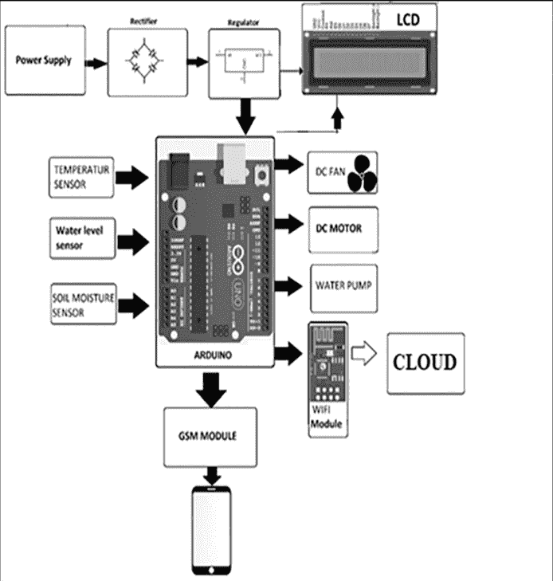

图 7.1 智能灌溉系统的设置。

读取的值会与设定的阈值进行比较。如果读取的输入超过阈值，则直流电机会自动开启。

此外，实时数据流通过Wi-Fi模块存储在云端（ThingSpeak.com）以进行分析，更新后的结果会在LCD上显示，并借助GSM模块提醒农民。

### 7.4.3 组件

提议系统的组件如图7.3所示。该系统基于WSN技术运行。传感器连接到WSN以收集实时数据并监测各种环境参数。所收集的特征包括土壤温度、土壤湿度、气候温度和湿度。还会捕捉各种天气状况以管理水资源。基于云的ML算法

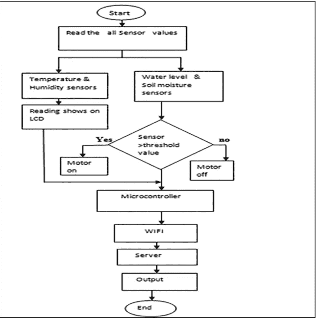

图 7.2 智能灌溉系统的工作流。

被实现以协助农民进行决策。主要组件包括传感器节点、IoT网关和云服务。

#### 7.4.3.1 无线传感器网络

WSN是一个由Arduino微处理器和传感器组成的无线网络。传感器用于捕获土壤含水量、土壤pH值、土壤温度、环境温度、太阳辐射、大气压力和空气中的湿度等读数。用于将传感器数据传输到网关及节点之间的协议是ZigBee。图7.4展示了插入植物中的传感器，用于读取土壤湿度、土壤pH值和温度。图7.5显示了显示持续读数的LCD组件。

#### 7.4.3.2 IoT网关

网关通过ZigBee协议与传感器节点进行通信。使用Wi-Fi连接将数据推送到云端。还通过网关开发了用户界面以显示捕获的数据。这是一个基于云的移动应用，安装在农民的手机上，以便他们可以获取更新。

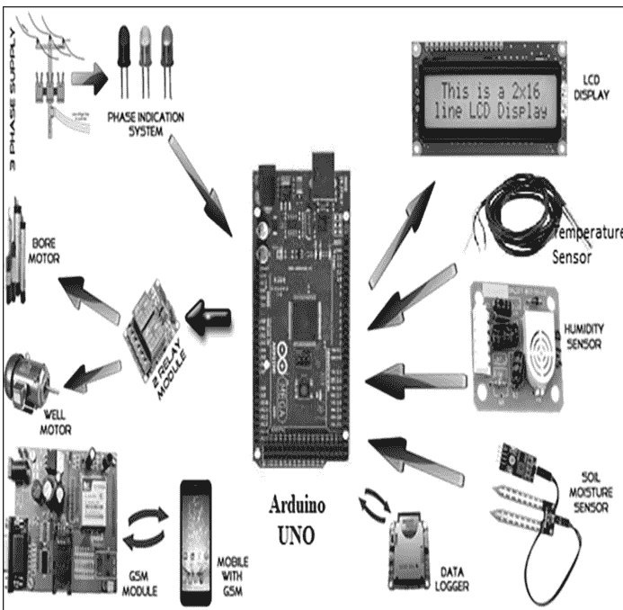

图 7.3 智能灌溉系统的组件模块。

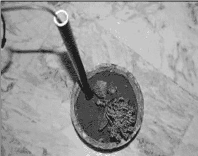

图 7.4 用于读取土壤参数的植物中的传感器。

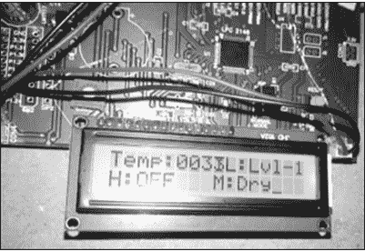

**图 7.5** 使用LCD显示读数。

#### 7.4.3.3 云服务

ThingSpeak云平台被用于存储和分析实时数据。预测和预测结果可以通过基于蜂窝网络的应用或Web应用访问。云服务用于在实时环境中收集的数据上应用ML算法。

### 7.4.4 数据分析

本案例研究的一项主要贡献是利用传感器数据对作物产量的数量和质量进行预测。该提议系统可应用于在减少资源消耗的同时提高作物产量和生产力。该模型是数据驱动的，基于ML的决策使农民能够以更智能的方式管理资源。例如，长期气象监测收集的数据会输入到时间序列预测模型中。这将使农民有机会在提前预测天气后做出决策，确定何时灌溉以及需要多少水。事实上，可以使用移动应用结合日历和时钟功能来安排灌溉。开展的数据分析活动如下：

- 1. 从各种传感器收集数据
- 2. 预处理数据；清洁和对齐数据并为ML算法做准备
- 3. 建模ML算法（选择、训练和测试模型）
    - 3a. 分类和回归树模型，用于预测作物产量及其质量
    - 3b. 自回归积分移动平均模型，用于建模时间序列预测模型

### 7.4.5 图形分析

可以使用云服务以图形方式显示数据分析，包括温度分析、土壤湿度分析、湿度分析和光照强度分析，如图7.6所示。

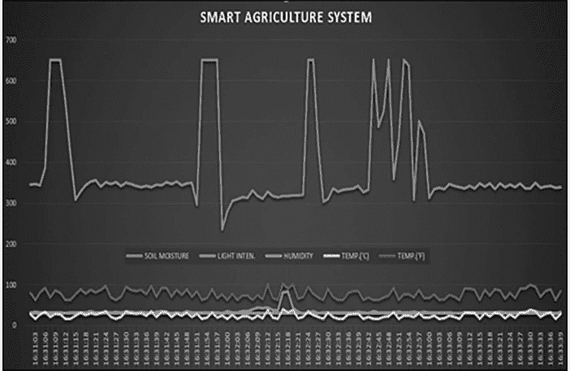

图 7.6 各种参数的图形分析。

测量土壤湿度、温度、环境湿度等是有价值的，因为它使农民能够以高效的方式管理稀缺水资源。该系统为灌溉任务提供自动化，节省时间和精力。此外，可以评估土壤pH值和盐度，并用于决定播种的作物类型。整个原型有助于智能农业，并有助于提高作物产量的质量和数量。

### 7.4.6 提议系统的优势

在详细讨论模型之后，让我们总结一下该候选案例研究中提议原型所提供的优势：

- 1. 高效的资源管理——水和能源资源；
- 2. 支持智能决策；
- 3. 避免田地中蛇或其他生物的危险；
- 4. 用户友好的界面以获取更新；
- 5. 避免过度灌溉和灌溉不足；
- 6. 避免土壤表层侵蚀；
- 7. 减少水资源浪费。

本案例研究引入了使用IoT平台的WSN，以实现智能农业。它展示了传感器、IoT框架、ML算法和基于数据分析的WSN如何在实际农业中成功部署，以收集和监测与农业直接相关的多种环境、土壤和天气参数。整个过程已数字化，并触手可及地为农民提供。

通过实施该系统，大面积的农田、园艺公园和花园可以自动灌溉。在大规模应用中，可以安装各种高灵敏度传感器以覆盖大片农田。

## 7.5 结论与未来展望

WSN与IoT技术正在为农业活动带来绿色革命。它使农业活动能够以智能和智慧的方式进行，并得到自动化的支持。智能农业实践日益发展，通过以成本效益的方式彻底改变生产，正在改变农业的面貌。农业正在经历数字化转型。传感器正在从现场收集海量数据。WSN、IoT、机器人、无人机和AI的使用正在大幅增加。ML算法允许在海量数据中发现隐藏的有趣模式，并使用提取的信息稍后做出更好的决策。本章回顾了研究人员在农业领域使用WSN所做出的各种应用。未来，各种ML模型（包括集成学习模型）可以应用于智能农业系统的多个应用中。为了提高产量预测以及杂草和疾病检测的准确性，未来可以实施卷积神经网络等深度学习模型。WSN在智能农业中的应用通过智能灌溉系统案例研究得到了精彩展示。

## 参考文献

- 1. Achilles D. Boursianis, Maria S. Papadopoulou, Panagiotis Diamantoulakis, Aglaiia Liopa-Tsakalidi, Pantelis Barouchas, George Salahas, George Karagiannidis, Shaohua Wan, and Sotirios K. Goudos, (2020). 智能农业中物联网(IoT)和农业无人驾驶飞行器(UAV)：全面综述, 物联网, p. 100187. doi: 10.1016/j.iot.2020.100187.

- 2. Eduardo Gomes, Arnaud Banos, Patrícia Abrantes, Jorge Rocha, and Markus Schläpfer, (2020). 城郊环境中的未来土地利用变化：当地利益相关者的观点, 环境科学总览, 718, p. 137381. ISSN 0048-9697, doi: 10.1016/j.scitotenv.2020.137381.

- 3. Anastasios Lytos, Thomas Lagkas, Panagiotis Sarigiannidis, Michalis Zervakis, and George Livanos, (2020). 迈向智能农业：系统、框架和多源利用, 计算机网络, 172, p. 107147. ISSN 1389-1286, doi: 10.1016/j.comnet.2020.107147.

- 4. Jana Münz, Nicola Gindle, and Reiner Doluschitz, (2020). 探索德国农场管理信息系统(FMIS)的特征和利用, 农业中的计算机与电子学, 170, p. 105246. ISSN 0168-1699, doi: 10.1016/j.compag.2020.105246.

- 5. Somya Goyal, Anubha Parashar, and Anita Shrootriya, (2018). 基于机器学习的云计算中大数据分析的应用, 大数据密集型计算应用, IOS PRESS-2018, 29, pp. 236–266. doi: 10.3233/978-1-61499-814-3-236.

- 6. Anubha Parashar, Apoorva Parashar, and Somya Goyal, (2018). 使用机器学习方法计算数据的大数据分析, 大数据密集型计算应用, IOS PRESS-2018, 29, pp. 133–160. doi: 10.3233/978-1-61499-814-3-133.


- 7. Kirtan Jha, Aalap Doshi, Poojan Patel, and Manan Shah. (2019). 利用人工智能进行农业自动化的全面综述, *农业人工智能*, pp. 1–12. ISSN 2589-7217, doi: 10.1016/j.aiia.2019.05.004.

- 8. Lamar Burton and Shekhar Bhansali, (2018). 用于实时营养分析的智能园艺 IoT 土壤片, *电化学学会杂志*, 165(8), B3157. doi: 10.1149/2.0201808js.

- 9. CROO. https://harvestcroo.com.

- 10. Plantix. https://plantix.net/en.

- 11. Somya Goyal, Pradeep Kumar Bhatia, (2021). 基于机器学习的经验软件测量. In: *计算智能技术及其在软件工程问题中的应用*. pp. 49–64. CRC Press, Boca Raton, FL. doi:10.1201/9781003079996.

- 12. Amanda Ramcharan, Kelsee Baranowski, Peter McCloskey, Babuali Ahmed, James Legg, and David P. Hughes, (2017). 用于基于图像的木薯病害检测的深度学习, *植物科学前沿*, 8, p. 1852. doi: 10.3389/fpls.2017.01852.

- 13. Antonis Tzounis, Nikolaos Katsoulas, Thomas Bartzanas, and Constantinos Kittas, (2017). 农业物联网、最新进展与未来挑战, *生物系统工程*, 164, p. 31. doi: 10.1016/j.biosystemseng.2017.09.007.

- 14. Anthony King, (2017). 农业的未来, *自然*, 544(7651), p. S21. doi: 10.1038/544S21a.

- 15. Govindan Nagarajan and R. I. Minu, (2018). 喷灌自动化系统的无线土壤监测传感器, *无线个人通信*, 98(2), p. 1835. doi: 10.1007/s11277-017-4948-y.

- 16. Luis Pereira, Paul Paredes, and Nebojsa Jovanovic, (2020). 用于确定作物需水量和灌溉需求以及灌溉调度的土壤水分平衡模型，侧重于 FAO56 方法和双 Kc 法, *农业水资源管理*, 241, p. 106357. doi: 10.1016/j.agwat.2020.106357.

- 17. Panagiotis Radoglou-Grammatikisa, Panagiotis Sarigiannidis, and Thomas Lagkasbc Ioannis Moscholios, (2020). 精准农业无人机应用汇编, *计算机网络*, 172, p. 107148. doi: 10.1016/j.comnet.2020.107148.

- 18. Rami Horowitz, Murad Ghanim, Emmanouil Roditakis, Ralf Nauen, and Issac Ishaaya, (2020). Bemisia tabaci 物种中的杀虫剂抗药性及其管理, *害虫科学杂志*, pp. 1–18. doi: 10.1007/s10340-020-01210-0.

- 19. Sara Garcia, Bennie Osburn, and Michele Jay-Russell, (2020). 食品安全、粮食安全和可持续食品生产的单一健康, *可持续食品系统前沿*. doi: 10.3389/fsufs.2020.00001.

- 20. Christopher M. Bishop, (2006). *模式识别与机器学习*. Springer, Singapore.

- 21. Tom Mitchell, (1997). *机器学习*. McGraw-Hill, New York.

- 22. Somya Goyal, and Pradeep Kumar Bhatia, (2020). 软件质量预测机器学习技术比较, *知识与系统科学国际期刊 (IJKSS)*, 11(2). IGI Global. pp. 21–40. doi: 10.4018/IJKSS.2020040102.

- 23. Somya Goyal, and Anubha Parashar, (March 2018). 利用神经网络改进 COCOMO 模型的机器学习应用, *信息技术与计算机科学国际期刊 (IJITCS-2018)*, 10(3), pp. 35–51. ISSN: 2074-9007 (印刷版), ISSN: 2074-9015 (在线版), doi: 10.5815/ijitcs.2018.03.05.

- 24. Sangeetha Ravi, G. Bhavani, Binu Ruby Sunny, P. Abirami, and V. Divya, (2016). 利用 IoT 和 WSN 进行作物多学科有效预测, *计算机科学先进研究国际期刊*, 7(1). pp. 72–75.

- 25. Hemant Kumar Wani and Nilima Ashtankar, “利用机器学习算法预测作物病虫害的适当模型,” 在 2017 年第 4 届先进计算与通信系统国际会议 (ICACCS) 上, 页 1–4. IEEE, 2017. doi: 10.1109/ICACCS.2017.8014714.

- 26. Jetendra Joshi, Siddhanth Polepally, Pranit Kumar, Rohith Samineni, S.R. Rahul, Kaushal Sumedh, Dandu Geet Kamal Tej, and Vishal Rajapriya, “基于机器学习的云集成农业,” 在 2017 年机器学习与软计算国际会议论文集中, 页 1–6. ACM, 2017. doi: 10.1145/3036290.3036297.

- 27. Durai Raj Vincent, N. Deepa, Dhivya Elavarasan, Kathiravan Srinivasan, Sajjad Hussain Chaudhary, and Celestine Iwendi, (2019). 土地适宜性评估的传感器驱动的人工智能农业推荐模型, *传感器*, 19(17), p. 3667. doi: 10.3390/s19173667.

- 28. Wenzhi Zeng, Chi Xu, Zhao Gang, Jingwei Wu, and Jiesheng Huang, (2018). 使用偏最小平方回归和人工神经网络模型估算向日葵种子产量, *土壤学报*, 28(5), p. 764. doi: 10.1016/S1002-0160(17)60336-9.

- 29. Alexander Holme, and Burnside Mitchell, (1987). 西澳大利亚干旱灌木地牧场状况监测系统的开发, *澳大利亚草地杂志*, 9, pp. 14–20.

- 30. Murugaian Pachayappan, C. Ganeshkumar, and Narayanasamy Sugundan, (2020). 农业部门的技术含义及其影响：基于 IoT 的协作框架, *程序计算机科学*, 171, pp. 1166–1173. doi: 10.1016/j.procs.2020.04.125.

- 31. Somya Goyal, Pradeep Bhatia, and Anubha Parashar, (2020). 使用机器学习技术的云辅助 IoT 烟雾监测系统 (e-Nose). In: Somani A., Shekhawat R., Mundra A., Srivastava S., Verma V. (eds) 智能系统与 IoT：计算创新. 智能创新、系统与技术, 第 141 卷. Springer, Singapore. doi: 10.1007/978-981-981-13-8406-6_70.

- 32. Al-Ali, Ahmad Al Nabusi, Shayok Mukhopadhyay, Mohammad Shihab Awai, Sheehan Fernandes, and Khalil Ailaabouni, (2019). 基于 IoT 的太阳能供电智能农场灌溉系统, *电子科学与技术杂志*, 17(4), p. 100017. ISSN 1674-862X, doi: 10.1016/j.jnlest.2020.100017.

# 8 无线传感器网络和智能电网的大数据分析：应用、设计问题与未来挑战

阿希·泰吉  
HMR 技术与管理学院  

巴拉特·布尚  
沙尔达大学  

拉胡尔·维尔·辛格  
HMR 技术与管理学院  

## 目录

- 8.1 引言 ........................................................ 136  
- 8.2 大数据背景 ................................................ 137  
- 8.2.1 大数据特征 .................................... 137  
- 8.2.2 架构 ................................................... 138  
- 8.2.3 技术与工具 ....................................... 140  
- 8.2.4 微电网中大数据分析的优势 ................. 141  
- 8.3 微电网中的大数据收集 ................................ 141  
- 8.3.1 设备相关数据 ............................... 142  
- 8.3.2 分布式数据生成 ................................ 142  
- 8.3.3 负载侧和储能电池数据 ............................ 143  
- 8.3.4 环境数据 ........................................... 143  
- 8.3.5 无线传感器网络 ..................................... 144  
- 8.3.6 云存储与物联网 ........................................ 144  
- 8.4 WSNs 中的大数据应用 ................................. 145  
- 8.4.1 能量高效信息聚类 .................... 145  
- 8.4.2 数据获取 .......................................... 146  
- 8.4.3 数据分析 .................................................................... 146  
- 8.4.4 高效消耗 ........................................................ 147  
- 8.5 微电网中的大数据应用 .................................... 147  
- 8.5.1 各类应用的规划与设计 ............ 148  
- 8.5.2 电力生成预测 ............................................ 148  
- 8.5.3 设备评估控制 ....... 149  
- 8.5.4 客户负载 ................................................................ 150  
- 8.5.5 数据攻击与检测及营销改进 ...... 151  
- 8.6 大数据分析中的蜂窝网络设计 ......................... 151  
- 8.6.1 故障检测、预测与恢复 .... 151  
- 8.6.2 网络监测 ...................................................... 152  
- 8.6.3 内容分发与缓存 ........................................... 153  
- 8.6.4 网络优化 ................................................. 154  
- 8.7 未来研究问题与挑战 ................................. 155  
- 8.7.1 大规模生产与计算结构 ......... 155  
- 8.7.2 网络安全问题 .................................................... 156  
- 8.7.3 实时数据处理 ............................................... 156  
- 8.7.4 深度技术与社交媒体问题 ........... 156  
- 8.7.5 错误处理 .............................................................. 156  
- 8.7.6 数据可视化 ....................................................... 156  
- 8.8 结论 ........................................................................... 157  
- 参考文献 ................................................................................. 157  

## 8.1 引言

近年来，一种被观察到稳步且指数级增长的趋势是，在以前从未想象过可能的领域中使用技术。这项在人们日常生活中实施的技术不仅惠及使用者，也惠及设计者。体现这一点的一个参数是大数据 [1,2]。多种技术的大量使用产生了规模巨大的数据，以至于使用常规现有方法甚至无法尝试解读；因此，大数据成为常态 [3,4]。与此同时，物联网 (IoT) 和无线传感技术的使用为大数据开辟了完全新的可能性谱 [5]。通常收集的数据量以有组织、无组织或半有组织的形式存在，并且通常仅通过复杂的数据分析来控制。

大数据在几乎所有领域都有应用，范围从社交媒体网站到医疗设施，从气象部门到制造单位，等等 [6]。因此，大数据与微电网的融合孕育着更多引人入胜的机遇，这并不令人惊讶。微电网是通过结合分布式电源生产者、容量和控制元件而产生的，所有元件协同工作，并通过控制旋钮或电网连接在一起 [7,8]。已有大量研究和论文，强调了电网系统中大数据问题的重要性 [9,10]。此处通常关注的主题是监控和


大数据技术在微电网中的作用及其未来的试验。与先前提到的综述相比，本工作提出了一种全面的方法，用于大数据在微电网中的应用。在本章中，我们讨论了所有这些内容，同时重点介绍将此方法引入无线传感器网络（WSNs）的一些方面。WSN 领域建立在通常位于不可到达区域并以随机方式连接的一组传感器的基础之上，从而形成信息循环网络 [11,12]。WSN 通常在大数据处理、功能识别和嵌入式技术存在的领域中发挥其重要性 [13]。大数据正在迅速成为几乎所有科学领域中无处不在的存在。其主要优势包括部署简便、灵活的分区隔离，以及为其用户开辟的大量各种不同的可能性 [14,15]。

本工作的主要贡献是对大数据、微电网和 WSNs 最近进展的详细全面讨论。除了探索微电网中的大数据应用外，本工作还对优化、部署和发展进行了广泛分析。本工作的主要贡献可总结如下。已详细讨论了大数据的特征和要求以及相关的工具和技术。讨论了大数据与微电网和 WSNs 集成的动机，以及 WSNs 的架构设计。已回顾了最近提出的用于解决蜂窝网络中呼叫掉线的基于 WSN 和大数据的解决方案。最后，还详细介绍了当前面临的挑战以及该领域的未来研究方向。

本章剩余部分的组织如下。第 8.2 节介绍了大数据及相关工具的背景知识。第 8.3 节描述了微电网中各种大数据收集方法。本节还介绍了将 WSNs 与大数据分析相结合的概念。第 8.4 节探讨了 WSNs 的各种应用。第 8.5 节全面回顾了大数据与微电网的集成方法。第 8.6 节概述了大数据分析中的蜂窝网络设计。本节还重点介绍了故障预防、网络监控和优化的方法。第 8.7 节确定了该领域的当前挑战和未来研究范围，随后在第 8.8 节得出结论。

## 8.2 大数据背景

作为一个术语，大数据在过去的半个多世纪里一直被使用。然而，其所承载的含义随时代在转变。寻找不同的技术来在使用最少时间的情况下执行高度复杂的分析功能，促进了该领域日复一日的创造力和创新。

### 8.2.1 大数据的特征

为了提供更好的服务、控制和数据的正确传输，微电网包含某些技术 [16]。通过微电网收集的数据在规模和可理解程度上不断增长。最终，如果过时的处理方法无法应对数据的规模和持续增加，或者无法应对构成数据多样性的格式，则该问题被视为大数据案例。大数据不仅仅等同于海量数据，还涉及数据的多样性和速度 [17]。存在某些可帮助对大数据进行分类的表征 [18]。

从微电网数据中提取的价值是大数据分析的产物。借助客户与电网之间双向信息流，客户可以获得更多节省，因为它提供了诸如电力公司利润、发电与负荷之间的动态定价以及消费者更优价格等机会。在微电网中遇到的庞大数据来自广泛的来源，包括传感器、设备、实时数据获取、监控控制与数据采集（SCADA）、能源市场、电力输入数据以及信号波形 [19]。这通常解释了所遇到的数据的巨大规模 [20]。这种整合的海量数据需要各种不同的协议来全面处理，这些协议存在于微电网中。微电网的这些数据在设计好的、半结构化和无结构数据之间提供了链接 [21]。有组织的数据以清晰、结构化的形式显示在数据库中，可直接用于描绘消费者消费以及市场中存在的各种趋势。半有组织的数据借助 JSON 和 XML 工具构建。天气数据表示就是这里所使用的传感器数据的一个示例。非结构化数据包含人类交互数据、社交媒体数据和其他图形信息。

此处需要考虑的另一个因素是数据传输速度。由于通信耗时极短并嵌入微电网的技术，数据生成和处理的速率正在增加。微电网内部的数据可以以组的形式存在、在线，或从流媒体和网络安全来源收集。在微电网中使用数据的一个最重要方面是所使用的数据是否正确且有效，以用于其预定目的。这是为了确保输入的信息是正确的，而不是捏造的。

另一个重要特征是真实性。微电网元素之间的数据通信可能是可靠的，但也可能存在噪音，在某些情况下并不真正可靠。必须检查观测数据，看是否存在任何其他合理的变化 [22]。最常见的例子之一是测试温度范围是否可以在有限时间内转换为某个值，否则可以丢弃该观测结果。不可预测性也是确保微电网数据在处理后不会被不必要地丢弃的一个非常重要的元素。图 8.1 描绘了这些大数据特征的一些内容。

### 8.2.2 架构

大数据的整体架构可以归纳为以下几个阶段。在每个阶段的工作过程中，从各种不同来源（通常是原始）获取的数据被精炼和制造成可用于各种不同目的的数据 [23]。第一步是生成阶段，即指数据收集过程，有助于从各种

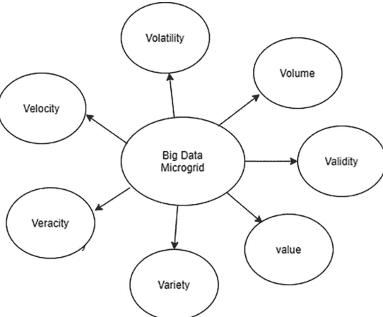

图 8.1 大数据特征的 V 形。

不同基础和背景的不同字体。第二步是采购阶段，其中收集的数据被汇集以获取并区分其他阶段的正确信息。这包含三个进一步的分部阶段：从各种来源收集生成此类原始信息的数据的过程是第一阶段。微电网中使用的来源范围从传感器到智能家居等。第二阶段是数据传输，通常代表将数据传输到数据中心进行存储和处理的过程，这是通过使用通信安排来实现的。第三阶段是解决重复且充满错误的数据存在所导致的问题，因此应用数据预处理。这会压缩和减少重复字符，同时识别和清除故障。

数据的存储以便进一步处理和操作是在第三步进行的。第四步称为数据分析阶段，它借助各种塑造和审查方法加速对收集数据的探究，这些方法有助于从之前阶段获取的所有原始信息中创建全面和机密的摘要。这是大数据处理中的关键阶段，因为其目的是为未来应用提取所有有价值的信息。根据所进行研究的复杂性，这种分析可以描述为表达性、预测性和严格性。

He 等人 [24] 在其论文中提出了一种方法，利用随机矩阵理论（RMT），激励数据驱动工具在高维中感知复杂的电网；同时，还提出了一种具有详细程序的架构。从算法角度来看，该架构执行高维分析，并将发现与 RMT 预测进行比较以进行异常检测。Bruce 等人 [25] 提出了 MetaLP，一种灵活的、分布式的统计建模


适用于大规模数据分析的框架，其中统计推断与大数据计算相结合，他们的大数据架构在现有基础之上提出了新的结构。Goudarzi 等人 [26] 提出了当前先进技术以及为 MapReduce 范式下大数据应用的批处理定制的未来大规模计算架构的设想，还针对此类系统的当前重要趋势及其对未来架构和架构特征的影响提供了观点，这些特征预计将满足该范式下明天大数据处理的需求。Zhao 等人 [27] 通过探索数据分析系统（DAS）的复杂性质，提出了一种新方法——DAS 可持续架构开发（SstAD-DAS），为架构开发提供实践指南。

### 8.2.3 技术和工具

在电网中找到应用的技术都涉及使用大数据。以下小节将讨论其中一些技术。

- IoT：智能家居电器、交通、社区设施等构成了源自 IoT 的数据。能源生产力、一致性和电网安全是 IoT 使其受益的应用，这得益于该领域不断涌现的进步。IoT 在数据生成和所生成的数据类型方面与大数据具有非常相似的特性 [28, 29]。
- 云计算：大数据的存储和处理应在低成本下进行，同时实现快速、有效且一致的分析。使用此技术可确保大数据得以发展，改变 IT 子结构，对业务做出有价值的结论，并通过应用并行云计算解决存储和处理问题。
- 进一步使用的技术：网络功能虚拟化是一种网络技术，通过提供可塑的资源划分和优化可能性，可以传输大部分数据。信息处理的实时响应对微电网应用至关重要。Storm 是这种应用的一个示例，体现了同样的特点。
- Hadoop：这包括网络搜索、点击流分析、垃圾邮件过滤等应用。云视图使用 Hadoop 配合云计算框架分析机器生成的数据。Hadoop 包括一个分布式文件系统用于存储数据，以及一个用于处理数据的执行引擎。
- 数据中心：这是一个大规模数据存储平台，还提供数据获取、建立和监督等多种服务。构建具有所需特性（熟练度、可靠性、可扩展性等）的数据中心，可以为上述服务提供基础设施，从而降低成本和能源排放。

### 8.2.4 微电网中大数据分析的益处

系统稳定性和可靠性是在处理微电网时始终优先考虑的两大特性。这些特性进一步细分为从电压稳定性到振荡检测等子特性。不断发展的大数据新兴应用，现在为寻找旧有且低效的监控和检测方法的新可能性提供了机会 [30]。使用这些资源和提升熟练度是两个被认为与大数据互补的特性。在理解资源的物理边界、授权和修正模型，以及借助提供的工具纳入可再生能源资源方面，它们特别有帮助。一个例子就是智能电表，它们比传统电表更智能，已安装在全球的住宅和企业建筑中。此实验允许检测欺诈、更好地预测停电、相对更简单的计费流程等。然而，这需要比其他电表更高的采样率，还有其他缺点。

## 8.3 微电网中的大数据收集

微电网的主要优势在于靠近主要能源消费源的位置设有本地电源，从而消除了远距离输电的需求。这些源的数据管理借助大数据技术来完成，如下表 8.1 所总结。

| 方法 | 简要摘要 |
|---|---|
| 设备相关数据 [31–37] | 此处收集来自变压器、开关设备、电力电缆和变电站的数据。 |
| 分布式数据生成 [24, 38] | 来自各种来源的数据——沼气、可再生能源、风能和太阳能及其数据集。 |
| 负载侧和储能电池数据 [39–41] | 来自电池系统及各种其他来源的数据，包括智能电表、冷却系统甚至客户。 |
| 环境数据 [42–44] | 利用现有 GIS，在进行精确准确预测的同时，获得更快的结果和更好的建模。 |
| WSN [45–51] | 收集数据的最佳方式，使用传感器和汇聚节点收集各种数据。 |
| 云存储和 IoT [52–55] | 从 IoT 来源收集数据并存储在云中，同时使用大数据分析进行处理。 |

### 8.3.1 设备相关数据

来自变压器、断路器、开关设备、电缆和变电站的数据均属于由管理和监控产生的设备数据。关于油压、接地电流、数据释放、额定数据、生产商数据、尺寸数据、组装、冷却系统、变压器型号、故障记录仪、报告、故障来源、变压器介质损耗、极化指数、电阻、绝缘信息、湿度含量、负载、短路电流和分接改变信息的所有数据均属于变压器数据 [31]。放电、湿度含量和放电信息构成开关设备数据。电压跌落、信号波形和塔倾斜属于输电线路数据。温度、放电和循环电流属于电力电缆数据。ID、类型、设置、名称和污染状态等所有信息均属于实质数据的一部分。约束数据包括关于电流、次要电压、容量、连接型号、制造商、冷却系统、释放数据、运行数据、记录仪、故障来源和动作、变电站名称、跳闸详情、SF6 检验报告、绝缘电阻、控制机制、所用设备的生产数据和断路器数量的信息。

Yan 等人 [32] 为电力设备监控探索了一种新想法，并发现 RMT 适合在此类情况下对大规模数据集进行建模。Wu 等人 [33] 专注于制造过程中装配大数据的分析与利用，研究了复杂设备的大数据分析与装配调度优化的关键技术。Lai 等人 [34] 为在制造系统中准确识别工业设备，采用长短期记忆网络分析大数据特征并构建非侵入式负载监测系统。

设备监控数据是大数据的主要来源。能源管理系统包含的数据涉及设备电压、电量、功率、频率等。油质或润滑剂、通风以及变压器的健康运行可通过设备实时数据监控来表示。总谐波失真和闪烁指数是基于电压和电流波形进行的电能质量计算 [35]。监控可再生能源时使用遥测终端装置 [36,37]。数字保护数据、故障描述、先前的扰动、旧故障、位置、跳闸次数和电压跌落记录均可归类为设备诊断数据的一部分。

### 8.3.2 分布式数据生成

多样化数据的生成源对于简单描述所获取的数据是否满足、高于或低于所需标准电力是必需的。可再生微能源有其自身的源数据。生物质的消化产生能源和数据源。可以使用 BSM2 工具模拟这种能源（生物质）[24, 38]。风力涡轮机发电中使用的各种因素包括齿轮箱、铸件和外壳的温度。风速传感器和湿度传感器以及风速测量已完成。


与测风速的风速计和测风向的风向标等是所使用数据集的一些示例。SCADA 在所有其他评估和变量中提供在线实时数据。

### 8.3.3 负载侧与储能电池数据

电流、电压、温度、故障检测数据、放电状态、健康状态、端电压等均包含在电池管理系统中 [39]。负载侧生产是大数据的另一大广泛来源。大学翻译中心（DHC）通信、客户生活模式、消费者问题、水状态、燃气消耗以及室内温度、建筑物内人数等数据均属于负载管理数据源。获取的负载信息也可以由消费者共享 [40]。从消耗的能源类型中获得的消费模式揭示了使用大数据的负载类型。电动汽车数据也是大数据的一个来源。轮胎应力、速度、电机驱动、踏板读数、车辆位置、故障等涵盖了其他来源。

Hussain 等人 [41] 提出了一种针对需求响应（DR）与可再生能源及储能系统最优调度（DRSREOD）协同的家庭能源管理系统（HEMS）的改进算法。该启发式算法考虑了 DR、光伏可用性、储能电池的荷电状态及充放电速率，以及多个电源的共享式并联运行，以满足所需负载。由于电力需求的快速增长，发展中国家正面临大规模限电（LS）问题。还提出了一种创新算法，用于可调度发电机的最优容量设计，以在限电期间为基于 DRSREOD 的 HEMS 供电，确保不间断供电。

### 8.3.4 环境数据

以高体量、不同速度和组合可疑流式传输的数据通常构成数值天气预报数据 [18]。用于求解这些数据的方程非常复杂，通常是非线性的。大数据与环境科学结合的另一个应用是公共卫生与环境健康。通过环境采样等方法监测数据是当今经过验证的方法之一，但借助大数据，我们可以更准确地计算这些信息，并确保信息计算得更快、更精确。在环境科学的地理数据话题上，需要注意的是，从制图和地理测量等简单方法，到地理信息调查（GIS）等现代应用，都依赖于大数据而蓬勃发展 [42]。GIS 的核心能力使其不仅能够展示统计数据，还能利用和整合这些数据。

Wu 等人 [43] 提出通过大数据技术的全面和全景文献调查，发现大数据时代趋势与新一代绿色革命趋势之间的关系。Chih-Lin 等人 [44] 提出了一种方法，旨在显著促进本地内容提供、动态网络和功能部署、用户行为感知、精细网络运行以及全球优化的节能解决方案。

### 8.3.5 无线传感器网络

在用于数据生成的所有来源中，环境监测领域的大部分关注都集中在无线传感器网络（WSN）上 [45]。借助大量存在的传感器节点，环境的物理条件被记录和监测，同时收集的数据被路由到汇聚节点。借助 WSN，温度、声音、污染水平、湿度和风力等天气条件易于测量，但在将传感器信息传输到汇聚节点时会出现问题 [46]。由于容量有限，单个节点仅拥有与其他网络直接相比的较窄无线链路。因此，为了克服 WSN 的局限性，需要分析并为 WSN 和大数据系统提供共同视角，以帮助改善系统性能。这些传感器的数据通常以键值对形式呈现（例如，时间步长）。

Ding 等人 [47] 提出了一种基于室内 WSN 的实时大数据收集（RTBDG）算法，用于工业操作的风险分析。在此算法中，传感器节点可以根据风险分析要求筛选从环境和设备收集的数据。Harb 等人 [48] 为传感器网络提出了一种两级数据缩减方法。在大规模异构 WSN 中，针对大数据采集的可信信息覆盖空洞修复问题（该网络广泛分布于地理区域，包含数千个静态传感器节点和移动传感器节点）已被提出并进行了研究。最近，Feng 等人 [49] 研究了由于随机部署或传感器电池耗尽导致的覆盖空洞造成的 WSN 服务质量（QoS）和寿命严重下降的问题。Dao 等人 [50] 还提出了一种基于改进支持向量机（SVM）分类的分层 WSN 中簇头数据聚合的采集信息正确性识别新方案。基于大量传感器的数据环境以及分布于广泛地理区域并包含数千个传感器节点的大规模 WSN（LS-WSN）的出现，需要新的节能数据收集技术。Ang 等人 [51] 提出了分析方法，用于确定 LS-WSN 多描述编码方案的节点能耗，并给出了用于确定最小化能耗所需最优簇数量的模型。

### 8.3.6 云存储与物联网

云存储代表计算机的数据存储。这里的数字数据以逻辑组收集。云运行所在的物理环境通常由一家公司管理和维护。有大量不同的服务器，有时甚至位于不同地点，提供完全所需的物理环境。来自配备智能家电、传感器、电表等家庭的数据可以轻松存储在云存储中 [52]。支持安全性、容错存储和可用性的各种功能也有利于云存储。一个由各种设备和生物体相互互连，并具有唯一标识符以及能够在集成网络上无任何干预的情况下传输信息的系统，可以定义为物联网（IoT）[27]。这里的设备可能使用计算机、机械或数字平台，甚至可能涉及人类、物体和动物。所有这些都可以和谐地一起使用，因为云可以为 IoT 和大数据提供共同运行的工作场所。虽然 IoT 是数据产生的基础，但大数据分析（BDA）可以用于高效处理这些数据。表 8.1 总结了微电网中各种数据收集方法。

Cai 等人 [53] 在其研究中提供了一个功能框架，用于识别物联网大数据的采集、管理、处理和挖掘领域，并定义了几个相关技术模块，同时从其关键特性和能力方面对其进行了描述。Bao 等人 [54] 旨在最大限度地降低数据修复的网络资源消耗，为物联网大数据的 JointCloud 存储提出了一种名为 ACIoT 的自适应纠删码。Sharma 等人 [55] 提出了一种新框架，通过整合两个平台的优势，实现边缘计算与云计算之间的协同处理。该提议的框架可以利用云中心可用的全网知识和历史信息，指导边缘计算单元满足异构无线物联网网络的各种性能要求。

## 8.4 大数据在 WSN 中的应用

不断变化和发展的技术现状促进了各种不同网络的增长，导致产生的数据量太大，无法通过常规方法计算或处理 [56]。这阻碍了大数据的增长，必须有效地处理大数据，以帮助对当前日益增长的信息产生积极影响。有各种方法可以解决这个问题，但其中一种备受关注的解决方案是将数据与 WSN 技术相关联 [57]。网络聚类是这一链条的第一个环节；它确定节点相对于其他节点及其基站（BS）的位置、距离和排列 [58]。这也决定了通过网络传输数据时使用的模式、方向、方法和策略。第二步是生成和存储海量数据。这些数据还需要适当的分析，在创纪录的时间内完成以产生有价值的结果。这些处理后的数据还必须安全存储，这是我们面临的最大挑战，因为这里缺乏研究。完成这一链条的最后一个环节是对上述节点进行聚类，这种聚类不仅能提高网络的预期寿命，还能改善系统的能源效率。以下各节将解释整个过程。

### 8.4.1 能源高效信息的聚类

基于期望-最大化算法（一种依赖于节点高斯型散射的旧技术），所有聚类网络中的最优解是


借助预定义函数计算得出，这些函数需要用于消息传输的总能量传输数据 [59]。Chidean 等人 [60] 探索了网络内处理技术与聚类算法的联合使用。他们的方法旨在通过聚合函数和节能的网络划分，在控制传输次数的同时实现高数据质量。这种组合旨在不牺牲数据质量的前提下提高能源效率。Takaishi 等人 [61] 提出了一种基于修正期望最大化技术的网络聚类移动沉降节点路由和数据收集新方法。此外，他们还推导了最佳簇数量以最小化能量消耗。Hu 等人 [62] 还提出了一种节能且保护隐私的数据聚合算法——基于链的数据聚合。

### 8.4.2 数据获取

不断增加的大数据及其在分散无线传感器网络中的能源使用方式是当前问题中解决的两个因素。一种基于自组织映射的动态增长蜂窝自组织映射算法被提出用于选择群组簇头。借助能量损耗的计算，新节点的加入成为可能 [63]。QoS、数据包比率等特征通过该方法获得更好的效果。便携式沉降节点在网络（无线）中产生的延迟可以通过穿越特定长度的路径来减少，从而降低由敏捷性产生的整体复杂性，如另一篇论文所建议，使用了 M-mobile 方法 [52]。另一项研究提出了一种结构保真数据收集框架，其优先级是为保持结构完整性而维护数据安全，其唯一目的是减少积极参与节点的数量并减少组织性变更 [64]。该框架利用变更方法来检查图像的可靠性度量，以了解不准确图像的质量。

Geng 等人 [65] 专注于评估多种压缩和序列化方法对大数据平台性能的影响，并尝试为工业数据平台选择最佳的压缩和序列化方法。Geng 等人 [66] 在其论文中提供了一种混合式智能电网（SG）通信架构，该架构集成了光纤和基于 Wi-Fi 的 Mesh 网络，即光纤-无线（Fi-Wi）增强型 SG，并研究了在 Fi-Wi 增强型 SG 中故障情况下的数据获取问题。

### 8.4.3 数据分析

另一项研究针对两种移动数据采集模型，计算了节点的能耗水平及其理想采集次数，并将其输入到各种分析方法中，在极短时间内处理了大量测试用例 [67]。作者提出利用多种分组模型来找到理想的簇数量，以实现大数据无线传感器网络中的低能耗。Saneja 等人 [67] 首先提出了揭示缺陷传感器及其可扩展性的方法。强连接和主动序列最小化优化回归是用于检测大数据的基础。通过与 Hadoop 和 MapReduce 配合使用此方法，只需检测关联节点，就可以检测出节点的错误识别和不规则节点的存在。

Mahmud 等人 [68] 对大数据处理与分析的数据分区和采样方法与技术进行了全面综述，而 Salloum 等人 [69] 提出了一种随机采样分区（RSP）分布式数据模型，用以将大数据集表示为一组不相交的数据块，称为 RSP 块。Vatrapu 等人 [70] 提出了社会集合分析概念。社会集合分析包含一个生成性框架，用于计算社会科学的哲学、社会数据理论、社会数据的概念和形式模型，以及一个分析框架，用于将大型社会数据集与组织和社会数据集相结合。Feng 等人 [71] 将 BDA 应用于犯罪数据，其中进行了探索性数据分析以进行可视化和趋势预测，并使用了多种先进的数据挖掘和深度学习技术来获得确定性结果。

### 8.4.4 能源高效消耗

路由开发调度方案被提出作为解决传统方法因能源浪费和多代理调度方式引起的问题的回答。这通过一种协议得以解决，该协议被提出作为节能的树形跨越节点装配方法。该算法用于减少长距离广播。一种体现大数据实时累积的协议，配合一种作为新数据采集方法和节能替代方案引入的算法来完成。这冗余地将网络（传感器）相对于其根节点分解为不同的均匀份额。该工作的基础是 RTBDG 和 HEED（混合节能分布式聚类）群组算法，在选择合适信道时综合考虑资源和通信成本 [72]。

Li 等人 [73] 为大数据应用提出了一种节能框架，旨在满足截止期限约束的同时降低能源消耗。Singh 等人 [74] 提出了一种无监督渐进增量数据挖掘机制，通过频繁模式挖掘应用于智能电表能耗数据，以克服各种挑战。Din 等人 [75] 提出了一种新技术，利用混合算法在无线多传感器系统中进行聚类和簇成员选择。

## 8.5 大数据在微电网中的应用

区分客户需求、消除电力欺诈以及提供增强且具适应性的商业决策以吸引新客户，是大数据提供的其他一些服务。因此，当我们看到大数据在微电网中的应用时，这并不奇怪，它涉及绿色和可再生能源、负载管理与运营等。图 8.2 描绘了大数据的各种应用。

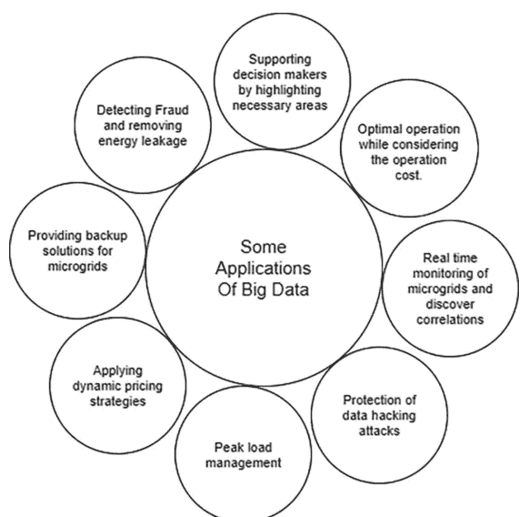

图 8.2 大数据应用。

### 8.5.1 各类应用的规划与设计

无论是改善城市能源使用还是进行微电网规划，都可以通过大数据支持向可再生能源生产演变来实现 [76]。要取得最佳效果，需要包含销售和运营数据的适当规划。能源市场通常倾向于结合不同的能源来源（风能和生物质能）。大数据使政策制定者在处理各种能源来源时具有选择性。Huang 等人 [77] 描绘了一种可应用大数据的高效发电厂设计。他们的方法表明，收集屋顶材料、逆变器规格和最大功率点追踪单元等数据有助于建立屋顶发电厂。该系统采用自适应和谐搜索。大数据和云计算可用于管理市场需求监控、数据收集等。飓风和风暴等情况也可以借助微电网中的大数据应用来应对。

### 8.5.2 电力生成预测

通过从库存与容量之间的不足中学习，提出了一项在微电网大数据中结合云计算应用与规划的决策 [78]。基于收集的数据（消费者档案、生成数据、负载数据和历史天气存储），可以预测电力生成。为了数据检索，HDFS 也用于执行数据处理。MapReduce 用于预测和进一步处理。Grolinger 等人 [79] 提出了一种基于本土知识并结合大数据支持向量回归的能耗预测模式。Daki 等人 [80] 还提出了一种解决方案，用于将摩洛哥一所工程学院的生成与消费相匹配，该方案基于大数据并适用于能源预测系统。风力涡轮机等间歇性来源对于提高电力预测输出很重要，这可以通过大数据实现。在中国鹤壁，对微电网中风能发电产量进行短期预测使用了大数据的博弈论分析。太阳能光伏发电预测系统基于大数据，能够准确预测光伏能量，并在神经网络中对数据进行实时处理。这也像太阳能和风能（可再生能源）的最优运行一样估算输出功率。在电网准备中可以加入适当的强度，使其提前数小时甚至数天进行天气预报，从而改善电网中所有来源的调度。

### 8.5.3 设备评估控制

大数据中使用的技术可以以这种方式实现，即监控电力系统并评估可视化和决策过程 [81]。半监督 SVM 结合合并可用于实时区分故障和未故障的组件。这是通过使用 Hadoop 从传感器收集数据并执行 BDA 来实现的。利用辐照度数据，系统可以轻松预测生产功率，并应用基于密码的加密组密钥分配协议来保护数据传输。当发生故障时，基于某些分析，可以采取所需的决策以替代预防和快速响应 [82]。有一种系统被提出用于减少工业和挖掘领域的能源消耗，这也为各种决策者提供了进一步的数据理解和可视化。它使用 MongoDB 来存储数据，并创建和打包与独立的 Apache Spark 集成的多级数据。识别与废物生产相关的区域以及需要改进的区域，有助于减少能源消耗，并规划出帮助公司确定路径的轨迹。所有这些都可以通过对实时挖掘和制造公司的排放、能源消耗和货币价值应用 BDA 来完成。这以表 8.2 的浓缩形式实现。

Spark 和 Hadoop 可帮助提供各种不同的服务，例如即将到来的能源需求预测和经济模拟，其中还包括政策因素、基于监控的调试服务等 [83]。这在很大程度上通过一项基于多余能源存储的可再生能源管理系统研究得以实现，并使用大数据对其进行分析 [83]。该系统使用各种应用，例如将 Hadoop 与 BDA 结合用于账单数据和度量信息，使用 Sqoop 来组装有组织的数据，使用 MapReduce 来处理和运行模拟，以及使用 Apache Chukwa 和 ZooKeeper 来方便地搜索和同步数据。Liu 等人 [84] 发现了一种使用 Java 的系统


| 应用 | 摘要 |
| :--- | :--- |
| 应用规划与设计 [76, 77] | 通过考虑特定领域（太阳能、风能和水能）的所有方面，可以实现适当的规划。这在需要时甚至有助于做出正确的决策。 |
| 电力生成预测 [78–80] | 这里实现了各种发电方法，同时结合天气和间歇性预报报告。 |
| 控制设备评估 [81–85] | 利用大数据检测设备故障。管理和监控是此方法可实现的其他功能。 |
| 客户负荷 [86, 87] | 提供实时读数。为实现此目标，还使用了物联网（IoT）。 |
| 营销增强 [88] | 这里完成了客户细分和所需统计。 |
| 数据攻击与检测 [89, 90] | 建议了各种攻击及其预防方法（k-means聚类）。 |

用于收集传感器和智能电表数据并将其存储以供处理的程序，而另一个则提供了一种基于使用相量测量单元（PMU）数据的硬件和软件实现来获取稳定性估计和监控的方法。MapReduce处理使用了实际经过去趋势处理的并行波动，用于分析从openPDC收集的PMU数据的快速检测测量。[85]

### 8.5.4 客户负荷

另一项研究提出了对SCADA系统[86]上大数据应用负荷进行实时建模。稳态读数与广域监测系统（WAMS）动态数据的交织是一种新方法。定价和优化电力效率是大数据在客户分析中的几个应用。Hadoop平台基于数据清洗进行建模。通过使用数据挖掘，可以实现改进的规划和负荷侧管理。表8.2列出了此处使用的主要应用。智能建筑电器可以通过大数据和物联网（IoT）进行控制。一种集成的基于物联网的带传感器BDA系统可以几乎实时地流式传输和传输来自其他传感器的数据，使用传输控制协议来强制代理并将数据存储在HDFS中。进一步的处理使用Spark和自动调优进行可视化[87]。通过使用Apache Storm（它通过感知建筑物是否空置并断开设备来工作），我们可以通过移除选定负荷来减少峰值时的负载。Storm流的一个数据spout是从客户的手机位置收集的，而另一个spout代表设备的测量。

### 8.5.5 数据攻击与检测及营销增强

大数据分析（BDA）支持客户细分和市场统计。为进行能耗统计，Yu等人提出了一种基于云的Hadoop平台原型[88]。此处的数据以键值对形式处理，其中键可以代表客户的序列号，评估代表可用作能源馈送资源的来源，如风能、热能和水电。电网中数据的增长使其更容易遭受黑客攻击。传输的数据包包含具有多种子类型的敏感信息。大数据允许对这些攻击进行分类。图8.2还代表了该领域的一些鲜为人知的应用。在K-means聚类的帮助下，并结合对与SCADA通信数据包历史的分析，Paramkusen等人[89]提出了一种基于Hadoop的方法，该方法对SCADA节点中存在的通信数据包进行大数据分析，该方法基于Mahout用于识别攻击[90]。

## 8.6 大数据分析中的蜂窝网络设计

在最近关于蜂窝网络设计的大数据分析（BDA）研究中，我们发现无线传感器网络（WSN）领域的主题备受关注。移动蜂窝网络已成为海量数据的生成者和载体。BDA可以提高移动蜂窝网络的性能并最大化运营商的收入。

### 8.6.1 故障检测、预测与恢复

移动网络结合了共享相同基础设施的不同通信技术。尽管每种技术完成不同的网络要求，但也阻碍了网络运行。在蜂窝网络中，面临着失败切换、网络优化以及异常检测等各种挑战。

- i. 失败切换的数据分析

  通过进行驱动测试或网络仿真，分析提出，当今最常见的通话中断问题可以通过各种不同的方法得到适当解决，但使用大数据的方法能给出更合理、更高效的结果。基站（BS）应用部分用于分析移动交换中心与BS子系统之间交换的消息，并进一步使用Hadoop进行分析。识别发生断开连接（3G）的位置，并定期更新发生跨技术切换的位置，这在很大程度上是通过使用提供的小区ID来实现的[91]。

- ii. 基于数据的长期演进（LTE）网络优化

  结合全面信令、来自无线源的用户环境信息以及自组织网络技术，可以实现全规模级别的网络优化。开发了一个基于信令数据的平台，该平台能够在以下三个阶段优化蜂窝网络：首先，通过挖掘外部数据表示（XDR）关键字，这些关键字定义了网络性能指标。信令的关键信息包含在XDR中。完整的信令方法状态也可以通过它来定位。其次，通过问题发现，基于XDR的性能指标可用于反映网络信令平面状态、服务建立率、丢失率等。第三，通过提出可行方案，通过配对已识别和解决的问题，可以提供优化经验，从而验证各种其他问题，因此可以用于提供所需的解决方案[45]。

- iii. 异常检测

  蜂窝网络中发生的中断首先由用户感知。此类服务可以通过研究通话详单（CDR）来识别。这些CDR文件包含包括时长和ID在内的大量信息，并在呼叫时生成。Karpepe等人[92]提出了一种基于CDR的异常检测方法，用于检测异常。CDR数据首先从网络节点收集并存储在中介部门。然后，收集的CDR被分发到相关部门。最后，在Hadoop平台的帮助下找到异常，然后将其推送到中介部门进行适当处理。

- iv. 自愈

  对于故障排除，可以使用处理和维护数据库。然而，数据库体积相对较大，因为它既托管与正常间隔相关的数据，也托管与退化间隔相关的数据，从而使数据难以处理。因此，一种更好的提议方法是通过独立并行化此过程来单独分析每个基站，效果更好。此外，通过利用邻近基站的测量，可以检测休眠小区或断开小区，从而测量此断开的后果。检测过程依赖于一种非常特定的方法，涉及资源输出周期、故障管理、配置管理和性能管理[93]。

- v. 小区站点设备故障预测

  通过分析单个小区中的带宽趋势，可以发现设备故障和基础设施故障。BDA在分析此处收集的大量数据中成为主要参与者。客户接收到的带宽会随时间收集，然后进行分析以了解当前流。

### 8.6.2 网络监测

大数据分析（BDA）可以提高移动蜂窝网络的性能并最大化运营商的收入。最具代表性的例子可以通过使用大量信令数据、大量流量数据、大量位置数据、大量无线波形数据和


移动蜂窝网络中存在大量异构数据。此外，还有关于互联网运营商及其大数据参与的信息 [11]。

- i. 流量分析

相对较大的蜂窝网络通常会使用大容量服务器进行流量监控和分析，以提供高性能，支持大型网络对高要求和良好数据率链路的需求。然而，近年来人们注意到，面对当今海量数据的规模和速率时，上述方法的分析并不完全到位 [94]。为改进上述不足，建议采用先进的分布式计算平台，利用 Hadoop、HBase、HDFS 和 MapReduce。在操作硬件时，能够处理如此海量数据的能力派上了用场。

- ii. 大数据移动互联网运营商

一种以运营商为中心的电信生态系统最早在中国联通被广泛关注，2012 年拥有惊人的 2.5 亿用户；据研究指出 [95]，它是其最大的 3G WCDMA（宽带码分多址）移动运营商。互联网移动用户通常生成的数据可以由上述大数据平台理解和处理。在分布式存储方面，通常会选择 HDFS 平台作为合适的候选方案；它提供多种其他功能，例如提升性能、增强存储过程以及加快事务（数据库）速度。该集群拥有约 1.9 PB 的数据存储空间和 188 个节点，用于各种用途，从对数据进行统计分析到存储和管理数据。HDFS 上存在的结构化数据通常借助 HBase 的每秒 145k 条记录写入速率和非常大的存储空间进行处理，HBase 既充当大型分布式存储，也充当数据库。与其他数据库（如 oracle）相比，发现其插入速率要低得多，且查询率更低且更好。

### 8.6.3 内容分发与缓存

利用 BDA 推进边缘缓存能力的需求被视为一种有前景的方法，可用于提高网络效率并缓解未来网络中对无线资源的高需求，这是一个充满大量机遇的当前研究领域。

- i. 分配带宽的内容分发

在当今与移动网络行业一样竞争激烈的市场中，QoS 是一项没有人想落后的服务，鉴于各种设施（如基于互联网的应用）每日增加。因此，正确分配带宽以确保畅通无阻的连接至关重要。互联网连接可以轻松提供给用户，但网络上的视频共享仍然非常昂贵且负载很高。针对 BS 面临的这一问题，曾提出通过将 LTE 系统作为组播技术来运作的解决方案，但由于该过程的复杂性，很快被放弃。Fan 等人 [96] 提出了一个框架，由一组希望下载内容的用户组成，他们可以通过共享 BS 的无线信道来实现。这一想法通过降低 BS 的负载并释放其资源以供更好地使用，为改进留出了空间。它还为连接集群中的用户提供了更好的数据速率，同时为未加入集群的用户提供了享受这些资产益处的绝佳机会。

- ii. 缓存与跟踪

社交媒体社区拥有庞大的用户基础，同样，社区中共享的内容也非常庞大。因此，当发生有趣的事件时，它会吸引大量关注和大量信息共享。病毒式数据会在网络中经过大量服务器，因此很容易耗尽系统。可以通过监控热门社交媒体网站并识别热门趋势和内容的增长，对其进行不同分析，识别内容被哪个年龄段群体分享最多，从而为各个 BS 缓存数据来处理此类问题。通过在所需分析上使用大数据，各种识别出的模型可以提供良好的结果，其结果是所需的缓存内容 [97]。

- iii. 5G 网络与缓存

识别并猜测最具病毒传播力的内容并将其存储在缓存中，可以帮助该缓存系统移动网络的订阅用户；在此节省的带宽可以帮助网络以其他方式利用。Basteg 等人 [97] 通过利用机器学习和大数据能力，研究了 5G 网络中内容的批准评级分布，预测了一种主动缓存方法。该策略已被证明能提供更好的用户体验 [98]。以原始形式收集的数据会借助各种平台进行分析，并从中提取有用数据以用于各种目的。然后对数据进行分析，以预测内容流行度的激增。

### 8.6.4 网络优化

BDA 是一种最先进的工具，用于优化网络，并将其从仅仅传输数据的盲管转变为一个认知的、自觉的、自我优化的实体，能够根据用户的需求进行智能适应。

- i. 蜂窝网络中的 QoS

切换及其成功率是蜂窝网络中非常关键的组成部分，主要因为其依赖于移动性和呼叫连续性，特别是当用户从一个地方移动到另一个地方时。此类服务的不足会使运营商陷入非常棘手的境地，因为 QoS 会直接受到影响。提出了两种方法来处理这些问题：自配置，与新小区相关；自优化，与已有小区的切换过程相关。

在安装 BS 以安排新小区时，需要邻区小区列表（NCL）。首先，会考虑天线类型、小区位置（候选）以及定向小区的角度。然后，选择距离最短、交通负载容量最大的小区，并将其提升为自配置。当前小区的自优化：借助网络管理系统，收集的数据会使用关键绩效指标（KPI）统计测量进行处理，以检查切换是否有效。通过收集的数据，将值低于预设量的小区从 NCL 列表中排除，并考虑将值高于预设量的小区用于该时隙。

- ii. 资源分配优化

KPI 对获得整体更好的性能体验至关重要。Kiran 等人 [99] 提出利用用户数据（数据库中的告警、条目和更新）及网络数据。本研究的主要目的是为向无线接入网用户分配无线资源时出现的问题提供可行的替代方案。这主要通过 BDA 实现，即识别网络和用户行为。首先，处理从核心网和其他蜂窝网络侧获取的数据。通过将蜂窝 KPI 的级别与预设值进行比较，定期生成二进制值。然后，在订阅者级别执行相同过程。最后，按请求生成二进制性质的模式。这会创建一个矩阵，根据各数据的更新情况对其进行更新和合并各种数据。这是通过将数据传递给 PRB（伪随机二进制）来完成的，它使用模糊二进制模式匹配算法。

- iii. 使用消耗预测实现网络灵活性

服务类别和客户的地理位置是消耗分析的两个主要因素。消耗趋势通常被称为长期、季节性和短期。将数据（服务使用情况，通常称为用户数据）与其他不同数据（每日新闻、事件等）相关联，有助于得出更准确的估计。借助大数据，他们可以在不影响订阅者服务的情况下，获得精确的节点部署位置。

## 8.7 未来研究问题与挑战

大数据分析中的关键问题是数据库系统与数据挖掘和统计分析等分析工具之间缺乏协调。

### 8.7.1 大规模生产与计算结构

当今逻辑系统生成的海量数据应保留多份副本作为备份。这指出，生成的大型数据集必须以一种方式进行访问，使数据能够得到妥善记录 [98]。生成的数据将有多种形式，包括但不限于浏览、非浏览、有组织、无组织和半组织化的格式。


### 8.7.2 网络安全问题

由于微电网中隐私、可访问性、可靠性、验证等方面被泄露而产生的问题，通常统称为网络安全问题。为处理这些重要且紧迫的问题，已提出许多方法 [100]。其中包括机器学习和向量，它们可共同用于解决大数据的安全问题。物联网（IoT）是另一种出色的方法，提供了许多优质服务，但安全与隐私方面缺乏稳定基础设施限制了其在该领域可提供的接入 [101]。

### 8.7.3 实时数据处理

考虑到生成的数据量不断增加，渐进式分析的存在以及在物理时间中进行处理的重要性是重要问题 [102]。这可以借助近似分析来解决。可使用估计问题来生成估计结果，同时，结果的有效性和被拒绝的节点均被视为成功分析的重要方面。

### 8.7.4 深度技术与社交媒体问题

机器学习结合大数据可用于解决关键分析问题，并借助正确的统计和分析工具。会考虑数据中值的概率，并应用统计方法来构建有用数据。与这些问题类似，社交媒体的问题也可以通过类似框架加以纠正 [23]。可使用各种不同方法将社交媒体与不同陈述中的数据相互关联，以获得适当的准确性和不同视角。

### 8.7.5 错误处理

某些应用（如错误识别和暂态波动查找）的响应时间少于几毫秒。此类网络平稳运行所期望的快速即时服务通常由云计算提供，但网络拥堵、复杂逻辑算法以及必须妥善处理的海量数据，往往会导致休眠 [103]。以保留为基础的数据库对于此类任务来说是不合适的方法，而名为 HANA 的数据库可用于开发和分发潮流。

### 8.7.6 可视化数据

图表和各种不同图表的构思有时会让操作人员对不同电压和工作频率的非常显著且明确的变化有所察觉，从而构建出一种不仅能描绘趋势，还能发现来源于多个来源的数据之间趋势的有效方法 [104]。这是一项艰巨的任务，可作为进一步研究的来源；一些重要课题涉及绘图算法、数据挖掘等。

## 8.8 结论

大数据是一个每天呈指数级扩展的领域。随着每一项新改进的引入，其覆盖范围和应用不断扩展到各种远程技术。人们认为，大数据目前正处于与 20 世纪 90 年代互联网相当的阶段，其能力远超 dot net 繁荣时期所能及的范围。大数据在 WSNs 中的应用需要一种非常全面的资源组合，并采用节能意识方法，以克服大数据当前面临的最大挑战。本章讨论了大数据在微电网中提供的机会可能性，并对各领域大数据集成的各个方面进行了总结性调查。电网的数据生成源、各种不同应用及其相应的高级工具，以及涉及错误检测、维护电网稳固性和电源单元理想设计等前景，都是本次调查的支柱。还介绍了某些大数据问题及其拟议解决方案，具体为呼叫掉线和实时数据存储。随着越来越多的数据被收集和处理，这个蓬勃发展的领域将继续在许多领域产生合理影响；新的独特数据将始终需要基于大数据处理基础的新颖快速分析。

## REFERENCES

- 1. Lv, Z., Song, H., Basanta-Val, P., Steed, A., & Jo, M. (2017). 下一代大数据分析：现状、挑战与未来研究课题。IEEE 工业信息学期刊, 13(4), 1891–1899. doi:10.1109/tii.2017.2650204.
- 2. Wang, X., Yang, L. T., Liu, H., & Deen, M. J. (2018). 大数据即服务框架：现状与展望。IEEE 大数据期刊, 4(3), 325–340. doi:10.1109/tbdta.2017.2757942
- 3. Moharm, K. (2019). 微电网中大数据应用的现状：综述。先进工程信息学, 42, 100945. doi:10.1016/j.aei.2019.100945.
- 4. Cui, Y., Kara, S., & Chan, K. C. (2020). 制造业大数据生态系统：系统文献综述。机器人与计算机集成制造, 62, 101861. doi:10.1016/j.rcim.2019.101861.
- 5. Nie, X., Fan, T., Wang, B., Li, Z., Shankar, A., & Manickam, A. (2020). 水下管理中运行安全管理的大数据分析和 IoT。计算机通信, 154, 188–196.
- 6. Nazir, S., Khan, S., Khan, H. U., Ali, S., Garcia-Magarino, I., Atan, R. B., & Nawaz, M. (2020). 医疗健康大数据管理、分析与科学编程的全面分析。IEEE Access, 8, 95714–95733. doi:10.1109/access.2020.2995572.
- 7. Zou, H., Mao, S., Wang, Y., Zhang, F., Chen, X., & Cheng, L. (2019). 互连多微电网能源管理综述。IEEE Access, 7, 72158–72169. doi:10.1109/access.2019.2920008.
- 8. Yamashita, D. Y., Vechiù, I., & Gaubert, J. (2020). 建筑微电网层次化控制综述。可再生能源与可持续能源评论, 118, 109523. doi:10.1016/j.rser.2019.109523.
- 9. Ghorbanian, M., Dolatabadi, S. H., & Siano, P. (2019). 智能电网中的大数据问题：综述。IEEE 系统期刊, 13(4), 4158–4168. doi:10.1109/jsyst.2019.2931879.
- 10. Brem, A., Adrita, M. M., O'Sullivan, D. T., & Bruton, K. (2020). 工业智能和微电网系统——系统映射研究。清洁生产期刊, 244, 118828. doi:10.1016/j.jclepro.2019.118828.
- 11. Bhushan, B., & Sahoo, G. (2017). 无线传感器网络中攻击、技术挑战、漏洞及其对策的最新进展。无线个人通信, 98(2), 2037–2077. doi:10.1007/s11277-017-4962-0.
- 12. Bhushan, B., & Sahoo, G. (2020). 无线传感器网络中的需求、协议和安全挑战：工业视角。计算机网络与网络安全手册, pp. 683–713. doi:10.1007/978-3-030-22277-2_27.
- 13. Kim, B., Kim, K., Shah, B., Chow, F., & Kim, K. (2019). 大数据系统的无线传感器网络。传感器, 19(7), 1565. doi:10.3390/s19071565.
- 14. Hadi, M. S., Lawey, A. Q., El-Gorashi, T. E., & Elmirghani, J. M. (2018). 无线和有线网络设计的大数据分析：综述。计算机网络, 132, 180–199. doi:10.1016/j.comnet.2018.01.016.
- 15. Oussous, A., Benjelloun, F., Lahcen, A. A., & Belfkih, S. (2018). 大数据技术：综述。国王沙特大学计算机与信息科学期刊, 30(4), 431–448. doi:10.1016/j.jksuci.2017.06.001.
- 16. Kang, C., Wang, Y., Xue, Y., Mu, G., & Liao, R. (2018). 中国电力行业的大数据分析：现代信息、通信技术和数以百万计的智能电表。IEEE 电力与能源杂志, 16(3), 54–65. doi:10.1109/mpe.2018.2790819.
- 17. Lu, R., Zhu, H., Liu, X., Liu, J. K., & Shao, J. (2014). 迈向大数据时代的高效隐私保护计算。IEEE 网络, 28(4), 46–50. doi:10.1109/mnet.2014.6863131.
- 18. Khan, M. A., Uddin, M. F., & Gupta, N. (2014). 大数据的七个 V：理解大数据以提取价值。美国工程教育协会第 1 区 2014 年会议论文集。doi:10.1109/aseezone1.2014.6820689.
- 19. Akhavan-Hejazi, H., & Mohsenian-Rad, H. (2018). 电力系统大数据分析：范式转换障碍与前景评估。能源报告, 4, 91–100. doi:10.1016/j.egyr.2017.11.002.
- 20. Baek, H., & Park, S. (2015). 通过绿色 IT 扩张实现韩国可持续发展计划：大数据有效利用的政策问题。可持续性, 7(2), 1308–1328. doi:10.3390/su7021308.
- 21. Amaro, N., & Pina, J. M. (2017). 电力系统中的大数据：利用电网优化和波浪能集成。2017 年工程、技术与创新国际会议 (ICE/ITMC)。doi:10.1109/ice.2017.8279997.
- 22. Haupt, S. E., & Kosovic, B. (2017). 可变发电功率预测作为大数据问题。IEEE 可持续能源期刊, 8(2), 725–732. doi:10.1109/tste.2016.2604679.
- 23. Hu, H., Wen, Y., Chua, T., & Li, X. (2014). 迈向可扩展大数据分析系统：技术教程。IEEE Access, 2, 652–687. doi:10.1109/access.2014.2332453.
- 24. He, X., Ai, Q., Qiu, R. C., Huang, W., Piao, L., & Liu, H. (2015). 基于随机矩阵理论的智能电网大数据架构设计。IEEE 智能电网期刊。doi:10.1109/tsg.2015.2445828.
- 25. Bruce, S., Li, Z., Yang, H., & Mukhopadhyay, S. (2019). 大数据的非参数分布式学习架构：算法与应用。IEEE 大数据期刊, 5(2), 166–179. doi:10.1109/tbdata.2018.2810187.
- 26. Goudarzi, M. (2019). MapReduce 范式下大数据批处理的异构架构。IEEE 大数据期刊, 5(1), 18–33. doi:10.1109/tbdata.2017.2736557.


- 27. Zhao, J., Liu, Y., & Zhou, P. (2018). 构建面向数据分析系统的可持续架构：一项探索性研究. IEEE Access, 6, 61600–61613. doi:10.1109/access.2018.2872673.

- 28. Rustagi, A., Manchanda, C., & Sharma, N. (2020). IoE：对人类的福音与威胁. 2020 年第 9 届 IEEE 通信系统与网络技术国际会议 (CSNT). doi:10.1109/csnt48778.2020.9115748.

- 29. Arora, A., Kaur, A., Bhushan, B., & Saini, H. (2019). 物联网的安全问题与未来趋势. 2019 年第 2 届智能计算、仪器与控制技术国际会议 (ICICICT). doi:10.1109/icicict46008.2019.8993222.

- 30. Shuai, Z., Sun, Y., Shen, Z. J., Tian, W., Tu, C., Li, Y., & Yin, X. (2016). 微电网稳定性：分类与综述. 可再生能源与可持续能源评论, 58, 167–179. doi:10.1016/j.rser.2015.12.201.

- 31. Wang, Y. F., Deng, M. H., Bao, Y. K., Zhang, H., Chen, J. Y., Qian, J., & Guo, C. X. (2014). 基于大数据的电力系统灾害缓解调度平台. 2014 年电力系统技术国际会议. doi:10.1109/powercon.2014.6993940.

- 32. Yan, Y., Sheng, G., Qiu, R. C., & Jiang, X. (2018). 电力传输设备的大数据建模与分析：一种新型随机矩阵理论方法. IEEE Access, 6, 7148–7156. doi:10.1109/access.2017.2784841.

- 33. Wu, X., Zhao, J., & Tong, Y. (2018). 面向复杂设备装配流程的大数据分析与调度优化系统. IEEE Access, 6, 36479–36486. doi:10.1109/access.2018.2852791.

- 34. Lai, C., Chien, W., Yang, L. T., & Qiang, W. (2019). 工业电气设备大数据特征识别的 LSTM 与边缘计算. IEEE 工业信息学交易, 15(4), 2469–2477. doi:10.1109/tii.2019.2892818.

- 35. Trindade, F. C., Ochoa, L. F., & Freitas, W. (2016). 智能配电网中的数据分析：应用与挑战. 2016 年 IEEE 亚洲创新智能电网技术会议 (ISGT-Asia). doi:10.1109/isgt-asia.2016.7796448.

- 36. Aiello, M., & Pagani, G. A. (2014). 智能电网的数据生成潜力. 2014 年计算机科学与信息系统联合会议论文集. doi:10.15439/2014f509.

- 37. Sucu, G., Vulpe, A., Martian, A., Halunga, S., & Vizireanu, D. N. (2015). 基于去中心化云 M2M 系统的可再生能源遥测大数据处理. 无线个人通信, 87(3), 1113–1128. doi:10.1007/s11277-015-2527-7.

- 38. Nopens, I., Benedetti, L., Jeppsson, U., Pons, M., Alex, J., Copp, J. B., ... Vanrolleghem, P. A. (2010). 基准仿真模型 2：厂区布局最终确定与默认控制策略. 水科学与技术, 62(9), 1967–1974. doi:10.2166/wst.2010.044.

- 39. Zhao, Y., Liu, P., Wang, Z., Zhang, L., & Hong, J. (2017). 基于大数据分析方法的电动汽车电池故障与缺陷诊断. 应用能源, 207, 354–362. doi:10.1016/j.apenergy.2017.05.139.

- 40. Chin, W., Li, W., & Chen, H. (2017). 基于物联网的智能电网通信中能源大数据安全威胁. IEEE 通信杂志, 55(10), 70–75. doi:10.1109/mcom.2017.1700154.

- 41. Hussain, B., Hasan, Q. U., Javaid, N., Guizani, M., Almogren, A., & Alamri, A. (2018). 面向发展中国家物联网智能家居的创新启发式算法. IEEE Access, 6, 15550–15575. doi:10.1109/access.2018.2809778.

- 42. Zhou, C., Su, F., Pei, T., Zhang, A., Du, Y., Luo, B., ... Xiao, H. (2020). COVID-19：大数据背景下地理信息系统面临的挑战. 地理学与可持续发展, 1(1), 77–87. doi:10.1016/j.geosus.2020.03.005.

- 43. Wu, J., Guo, S., Li, J., & Zeng, D. (2016). 大数据迎接绿色挑战：面向绿色应用的大数据. IEEE 系统期刊, 10(3), 888–900. doi:10.1109/jsyst.2016.2550530.

- 44. Chih-Lin, I., Liu, Y., Han, S., Wang, S., & Liu, G. (2015). 面向更环保、更灵活无线接入网的大数据分析. IEEE Access, 3, 3068–3075. doi:10.1109/access.2015.2469737.

- 45. Shankar, A., Jaisankar, N., Khan, M. S., Patan, R., & Balamurugan, B. (2019). 无线传感器网络中安全感知簇头选择的混合模型. IET 无线传感器系统, 9(2), 68–76. doi:10.1049/iet-wss.2018.5008.

- 46. Bhushan, B., & Sahoo, G. (2019). E^(2] SR^(2]: 面向无线传感器网络的基于确认的可充电传感器移动沉节点路由协议. 无线网络, 25(5), 2697–2721. doi:10.1007/s11276-019-01988-7.

- 47. Ding, X., Tian, Y., & Yu, Y. (2016). 基于室内无线传感器网络的工业运行风险分析实时大数据采集算法. IEEE 工业信息学交易, 12(3), 1232–1242. doi:10.1109/tii.2015.2436337.

- 48. Harb, H., Makhoul, A., & Jaoude, C. A. (2018). 密集分布传感器网络的实时海量数据处理技术. IEEE Access, 6, 56551–56561. doi:10.1109/access.2018.2872687.

- 49. Feng, J., & Chen, H. (2019). 大规模异构无线传感器网络中大数据采集的可信信息覆盖洞修复. IEEE Access, 7, 155347–155360. doi:10.1109/access.2019.2949136.

- 50. Dao, T., Nguyen, T., Pan, J., Qiao, Y., & Lai, Q. (2020). 基于改进 SVM 分类的无线传感器网络簇头聚合故障数据识别. IEEE Access, 8, 61070–61084. doi:10.1109/access.2020.2983219.

- 51. Ang, K. L., Seng, J. K., & Zungeru, A. M. (2018). 带移动收集器的大规模无线传感器网络中大数据采集的能耗优化. IEEE 系统期刊, 12(1), 616–626. doi:10.1109/jsyst.2016.2630691.

- 52. Goyal, S., Sharma, N., Kaushik, I., Bhushan, B., & Kumar, A. (2020). 基于边缘计算的物联网优先级与问题. 2020 年第 9 届 IEEE 通信系统与网络技术国际会议 (CSNT). doi:10.1109/csnt48778.2020.9115789.

- 53. Cai, H., Xu, B., Jiang, L., & Vasilakos, A. V. (2017). 云计算中基于物联网的大数据存储系统：前景与挑战. IEEE 物联网期刊, 4(1), 75–87. doi:10.1109/jiot.2016.2619369.

- 54. Bao, H., Wang, Y., & Xu, F. (2020). 面向物联网大数据 JointCloud 存储的自适应纠删码. IEEE 物联网期刊, 7(3), 1613–1624. doi:10.1109/jiot.2019.2947720.

- 55. Sharma, S. K., & Wang, X. (2017). 无线物联网中协作边缘与云处理的实时数据分析. IEEE Access, 5, 4621–4635. doi:10.1109/access.2017.2682640.

- 56. Boubiche, S., Boubiche, D. E., Bilami, A., & Toral-Cruz, H. (2018). 无线传感器网络中的大数据挑战与数据聚合策略. IEEE Access, 6, 20558–20571. doi:10.1109/access.2018.2821445.

- 57. Bhushan, B., & Sahoo, G. (2017). 无线传感器网络中安全与节能路由协议及数据收集方法的综合综述. 2017 年信号处理与通信国际会议 (ICSPC). doi:10.1109/cspc.2017.8305856.

- 58. Bhushan, B., & Sahoo, G. (2019). WSN 环境中的 ISFC-BLS（基于平衡负载子簇形成的智能安全模糊聚类算法）. 无线个人通信. doi:10.1007/s11277-019-06948-0.

- 59. Shankar, A., Sivakumar, N. R., Sivaram, M., Ambikapathy, A., Nguyen, T. K., & Dhasarathan, V. (2020). 基于簇状授粉的无线传感器网络容错能力与网络寿命提升. 环境智能与人本化计算期刊. doi:10.1007/s12652-020-02325-z.

- 60. Chidean, M. I., Morgado, E., Sanroman-Junquera, M., Ramiro-Bargueno, J., Ramos, J., & Caamano, A. J. (2016). 面向自组织大规模无线传感器网络的数据耦合聚类能效与数据重构质量. IEEE 传感器期刊, 16(12), 5010–5020. doi:10.1109/jsen.2016.2551466.

- 61. Takaishi, D., Nishiyama, H., Kato, N., & Miura, R. (2014). 迈向密集分布传感器网络中的节能大数据采集. IEEE 新兴计算主题交易, 2(3), 388–397. doi:10.1109/tetc.2014.2318177.

- 62. Hu, S., Liu, L., Fang, L., Zhou, F., & Ye, R. (2020). 一种新型的无线传感器网络节能隐私保护数据聚合方法. IEEE Access, 8, 802–813. doi:10.1109/access.2019.2961512.

- 63. Alahakoon, D., Halgamuge, S., & Srinivasan, B. (n.d.). 面向数据挖掘的自增长簇发展方法. SMC’98 会议论文集：1998 年 IEEE 系统、人与控制论国际会议 (Cat. No.98CH36218). doi:10.1109/icsmc.1998.725103.

- 64. Wu, M., Tan, L., & Xiong, N. (2014). 无线传感器网络中大数据采集的结构保真方法. 传感器, 15(1), 248–273. doi:10.3390/s150100248.

- 65. Geng, D., Zhang, C., Xia, C., Xia, X., Liu, Q., & Fu, X. (2019). 基于大数据的改进数据采集与存储系统用于工业数据平台设计. IEEE Access, 7, 44574–44582. doi:10.1109/access.2019.2909060.

- 66. Guo, H., Liu, J., & Zhao, L. (2019). FiWi 增强型智能电网下的失效大数据采集. IEEE 新兴计算主题交易, 7(3), 420–432. doi:10.1109/tetc.2017.2675911.

- 67. Saneja, B., & Rani, R. (2017). 医疗保健大传感器数据中异常值检测的有效方法. 国际通信系统杂志, 30(17). doi:10.1002/dac.3352.

- 68. Mahmud, M. S., Huang, J. Z., Salloum, S., Emara, T. Z., & Sadatdiyinov, K. (2020). 支持大数据分析的数据分区与采样方法综述. 大数据挖掘与分析, 3(2), 85–101. doi:10.26599/bdma.2019.9020015.

- 69. Salloum, S., Huang, J. Z., & He, Y. (2019). 随机样本分区：面向大数据分析的分布式数据模型. IEEE 工业信息学交易, 15(11), 5846–5854. doi:10.1109/tii.2019.2912723.

- 70. Vatrapu, R., Mukkamala, R. R., Hussain, A., & Flesch, B. (2016). 社交集合分析：一种面向大数据分析的集合论方法. IEEE Access, 4, 2542–2571. doi:10.1109/access.2016.2559584.

- 71. Feng, M., Zheng, J., Ren, J., Hussain, A., Li, X., Xi, Y., & Liu, Q. (2019). 面向犯罪数据有效可视化与趋势预测的大数据分析与挖掘. IEEE Access, 7, 106111–106123. doi:10.1109/access.2019.2930410.

- 72. Younis, O., & Fahmy, S. (2004). HEED：面向自组织传感器网络的混合节能分布式聚类方法. IEEE 移动计算交易, 3(4), 366–379. doi:10.1109/tmc.2004.41.

- 73. Li, H., Wang, H., Xiong, A., Lai, J., & Tian, W. (2018). 面向大数据应用的节能调度算法比较分析. IEEE Access, 6, 40073–40084. doi:10.1109/access.2018.2855720.

- 74. Singh, S., & Yassine, A. (2019). 智能电网中家庭用能行为模式挖掘. IEEE 新兴计算主题交易, 7(3), 404–419. doi:10.1109/tetc.2017.2692098.

- 75. Din, S., Ahmad, A., Paul, A., Rathore, M. M., & Jeon, G. (2017). 基于簇的无线多传感器系统大数据分析数据融合技术. IEEE Access, 5, 5069–5083. doi:10.1109/access.2017.2679207.

- 76. Tiwari, A., Sharma, N., Kaushik, I., & Tiwari, R. (2019). 大数据中的隐私问题与安全技术. 2019 年计算、通信与智能系统国际会议 (ICCCIS). doi:10.1109/icccis48478.2019.8974511.


77. Huang, Y., & Chang, S. (2017). 基于大数据分析的太阳能发电最优模型挖掘. *太阳能, 155*, 224–232. doi:10.1016/j.solener.2017.06.035.

78. Mayilvaganan, M., & Sabitha, M. (2013). 智能电网中大数据分析的云架构：一项提案. *2013 IEEE计算智能与计算研究国际会议*. doi:10.1109/iccic.2013.6724168.

79. Grolinger, K., Capretz, M. A., & Seewald, L. (2016). 基于大数据的能源消耗预测：平衡预测精度与计算资源. *2016 IEEE大数据国际大会（BigData Congress）*. doi:10.1109/bigdatacongress.2016.27.

80. Daki, H., Hannani, A. E., & Ouahmane, H. (2018). 摩洛哥一所工程学校电力消耗预测的HBase存储系统. *2018年第4届优化与应用国际会议（ICOA）*. doi:10.1109/icoa.2018.8370520.

81. Guo, Y., Yang, Z., Feng, S., & Hu, J. (2018). 使用大数据平台和机器学习算法的复杂电力系统状态监测与评估：综述与案例研究. *复杂性, 2018*, 1–21. doi:10.1155/2018/8496187.

82. Liu, Y., Pu, Y., Li, D., Zhou, L., & Wan, L. (2017). 阿奇霉素通过抑制气道上皮细胞凋亡改善气道重塑. *生命科学, 170*, 1–8. doi:10.1016/j.lfs.2016.11.024.

83. Choi, J., Kim, M., & Yoon, J. (2015). 需求侧能源管理大数据管理系统的实现. *2015 IEEE计算机与信息技术国际会议；普适计算与通信国际会议；可靠、自治与安全计算国际会议；普适智能与计算国际会议*. doi:10.1109/cit/iucc/dasc/picom.2015.227.

84. Liu, R., Kuo, C., Yang, C., Chen, S., & Liu, J. (2016). 基于大数据技术构建智慧校园能源监测服务. *2016年第7届云计算与大数据国际会议（CCBD）*. doi:10.1109/ccbd.2016.026.

85. Marziali, E., Munroe-Blum, H., & Mccleary, L. (1997). 群体凝聚力与群体联盟对团体心理治疗结果的贡献. *国际团体心理治疗杂志, 47*(4), 475–497. doi:10.1080/00207284.1997.11490846.

86. Yuan, R. C., Yan, H., Zhou, X. M., Di, F. C., & Li, L. X. (2014). 基于大数据技术的电力调度与配电系统应用及架构. *先进材料研究, 1070–1072*, 1425–1429. doi:10.4028/www.scientific.net/amr.1070-1072.1425.

87. Bashir, M. R., & Gill, A. Q. (2016). 迈向物联网大数据分析框架：智慧建筑系统. *2016 IEEE第18届高性能计算与通信国际会议；IEEE第14届智慧城市国际会议；IEEE第2届数据科学与系统国际会议（HPCC/SmartCity/DSS）*. doi:10.1109/hpcc-smartcity-dss.2016.0188.

88. Yu, G. C., Long, C. Z., & Xiang, M. T. (2012). 认知无线电系统中基于能量检测的检测灵敏度. *先进材料研究, 462*, 500–505. doi:10.4028/www.scientific.net/amr.462.500.

89. Paramkusem, K. M., & Aygun, R. S. (2018). 大数据框架中SCADA攻击类别的分类. *数据科学年鉴, 5*(3), 359–386. doi:10.1007/s40745-018-0141-8.

90. Liu, M., Wang, M., Wang, J., & Li, D. (2013). 电子舌数据分类中随机森林、支持向量机和反向传播神经网络的比较：橙饮料和中国食醋识别应用. *传感器与执行器B：化学, 177*, 970–980. doi:10.1016/j.snb.2012.11.071.

91. Celebi, O. F., Zeydan, E., Kurt, O. F., Dedeoglu, O., Iieri, O., Aykutsungur, B., ... Ergut, S. (2013). 利用大数据增强网络覆盖分析. *ICT 2013*. doi:10.1109/ictel.2013.6632155.

92. Karatepe, I. A. & Zeydan, E. (2014). 使用大数据分析的蜂窝网络数据异常检测. 欧洲无线2014；第20届欧洲无线会议，西班牙巴塞罗那，2014年，第1–5页.

93. Khatib, E. J., Barco, R., Munoz, P., Bandera, I. D., & Serrano, I. (2016). 大数据下移动网络自愈. IEEE通信杂志, 54(1), 114–120. doi:10.1109/mcom.2016.7378435.

94. Liu, J., Liu, F., & Ansari, N. (2014). 使用Hadoop监测和分析大规模蜂窝网络的大流量数据. IEEE网络, 28(4), 32–39. doi:10.1109/mnet.2014.6863129.

95. Huang, W., Chen, Z., Dong, W., Li, H., Cao, B., and Cao, J. (2014). 中国联通移动互联网大数据平台. 清华科学与技术, 19(1), 95–101. doi:10.1109/tst.2014.6733212.

96. Fan, B., Leng, S., & Yang, K. (2016). 具有用户和网络大数据的移动网络动态带宽分配算法. IEEE网络, 30(1), 6–10. doi:10.1109/mnet.2016.7389824.

97. Bastug, E., Bennis, M., Zeydan, E., Kader, M. A., Karatepe, I. A., Er, A. S., & Debbah, M. (2015). 大数据遇见电信运营商：主动缓存视角. 通信与网络杂志, 17(6), 549–557. doi:10.1109/jcn.2015.000102.

98. Ahmad, A., Bhushan, B., Sharma, N., Kaushik, I., & Arora, S. (2020). 5G中物联网的重要性与演进. 2020 IEEE第9届通信系统与网络技术国际会议（CSNT）. doi:10.1109/csnt48778.2020.9115768.

99. Kiran, P., Jibukumar, M. G., & Premkumar, C. V. (2016). 使用大数据分析的LTE-A/5G网络资源分配优化. 2016年信息网络国际会议（ICOIN）. doi:10.1109/icoin.2016.7427072.

100. Popiolek, M., & Czaplewski, M. (2017). 波兰互联网用户个人在线隐私管理：问题概述与研究综述. 北欧和波罗的海信息与通信技术杂志, 2017(1), 33–44. doi:10.13052/nbjct1902-097x.2017.003.

101. Potdar, V., Chandran, A., Batool, S., & Patel, N. (2018). 智能电网大数据能源管理——问题、挑战与最新进展. 智慧城市计算机通信与网络, 177–205. doi:10.1007/978-3-319-76669-0_8.

102. Zhao, Z., & Ma, Q. (2012). 大规模交通传感器数据实时处理系统. 2012年互联车辆与展览国际会议（ICCVE）. doi:10.1109/icceve.2012.34.

103. Waheed, A., & Ali, Q. (2017). 工程问题中基于需求的大数据处理软件涌现. 2017 IEEE第2届大数据分析国际会议（ICBDA）. doi:10.1109/icbda.2017.8078858.

104. Kennedy, S. J. (2012). 将大数据转化为知识：动态可视化实验技术. 博士论文，麻省理工学院.


泰勒与弗朗西斯

泰勒与弗朗西斯集团

http://taylorandfrancis.com

# 9 智能电网语境下负荷分解的新算法

Jézer Oliveira Pedrosa, Julio Cesar Pereira, Rangel Arthur, Ana Carolina Borges Monteiro, Reinaldo Padilha França, 和 Yuzo Iano

坎皮纳斯州立大学（UNICAMP）

## 目录

- 9.1 引言 .................................................... 165
- 9.2 文献背景 ........................................ 167
- 9.2.1 电能质量 .............................................. 168
- 9.2.2 电能质量研究 ................................ 168
- 9.2.3 智能电网 .................................................... 170
- 9.2.4 智能房屋 ................................................... 171
- 9.2.5 监测系统 ........................................... 171
- 9.2.6 小波变换 ............................................ 172
- 9.2.7 神经网络与负荷估计 ........................ 172
- 9.3 材料与方法 .......................................... 173
- 9.3.1 信号采集 ....................................... 173
- 9.4 方法论 ...................................................... 188
- 9.5 结果与讨论 ........................................... 190
- 9.6 趋势 ............................................................ 195
- 9.7 结论 ....................................................... 195
- 参考文献 ............................................................ 196

## 9.1 引言

世界发展与世界电力需求直接相关。这种增长常常因能源缺乏而放缓。家庭浪费、滥用，甚至对家用电器消耗量的无知，都可以列为世界缺电的一些重要原因[1–3]。此外，近年来，巴西观察到降雨分布不均，导致


水库维持在低水位，并需要运行热电厂，而热电厂会产生高水平的污染 [4–6]。

所谓的智慧城市是现代社会的主要愿景之一。智慧城市的前提包括通信系统的互联、服务监测以及能源的合理优化利用。除智慧城市概念外，还出现了智能电网或 Smart Grid 概念。这一概念范围广泛，可从不同方面加以阐述，但始终旨在高效、经济地确保一个损耗低、供电质量和安全性高的可持续能源系统 [7–8]。

引入智能电网概念，促成了能源生成、传输和分配基础设施与数字通信及数据处理基础设施之间的融合。后者充当设备物联网，互联所谓的智能电子设备（IEDs），并在电网的各个部分之间交换信息和控制动作。这种技术融合将需要为电气系统的运行开发新的控制、自动化和优化方法，并强烈倾向于使用基于多智能体的分布式问题求解技术 [9–11]。巴西的电力公用事业公司必然需要为这一融合做好准备。

除了对用户单位能耗进行精确计量外，能源特许经营商还关注其所供电能的质量指标的确定，依据是巴西国家电力能源署（National Electric Energy Agency）2010年12月17日第424号决议。因此，开发能够持续监测配电网各点电气量，并能高效发出可能故障事件及其位置信号的系统至关重要 [12–14]。

考虑到最终用户，电费账单并未区分住宅中每台电气设备的消耗量及其对电费的影响。这可能是一种鼓励改变习惯和/或用低耗能设备替换旧设备的有效方式。基于这一原则，并如上文所述，本研究旨在提出一种方法来分析和识别家庭中的主要电气负载。为此并与该动机保持一致，提出了一种基于家庭中电气设备电流测量的负载拆分新算法。创建了一个数据库来训练巴西存在的主要负载，一种使用小波变换系数和神经网络的方法可以区分负载。

因此，本章旨在为家庭负载创建电流信号数据库，并提出一种识别此类负载的技术，这是 Smart Grid 背景下负载拆分的必要步骤。所提技术的负载拆分基于神经网络和小波变换的使用。电气负载识别旨在发现连接到公用电源的设备是什么。因此，可以分别计算每台设备的耗电量。从所提算法得出的信息中获得的结果将被讨论和展示。基于小波和神经网络的算法处理及负载识别是使用 MATLAB® 环境开发的。结果证明了所提技术的效率。

在第 9.2 节中，介绍了理解研究所需的基本概念的一般理论综述。在第 9.3 节中，介绍了材料和方法，包括所提算法的图表和所有说明。在第 9.4 节中，介绍了所提方法论。在第 9.5 节中，介绍了所提方法的实验和结果。在第 9.6 节中，规划了未来研究和工作以改进所提方法论。最后，在第 9.7 节中，介绍了相关结论。

## 9.2 文献背景

本节将介绍理解本研究提案所需的理论基础。首先，定义了一些与电能质量相关的重要概念，以及 Smart Grid 概念的定义，后者涉及基于高效通信网络对整个配电系统进行智能监测和控制。将主题进一步限定，阐述了智能家居的概念，其中一个前提是控制和监测住宅中设备及电子设备的消耗。然后，定义了非侵入式负载监测以及用于负载估计的小波变换和神经网络的一般概念。最后，我们对文献中目前可用的分解技术进行评述。

### 9.2.1 电能质量

能源质量原则主要旨在发现和避免浪费点并减少损耗，这些损耗会降低特许经营商的利润，并由此抑制对依赖此能源的部门（主要是工业部门）进行更大投资。近年来，工业现代化备受重视，自动化程度更高，设备更现代化。这通常意味着对设备进行节能电子控制，而这类设备往往比其电机机电前辈对电压供应偏差更为敏感。因此，就像家庭中灯泡闪烁一样，工业客户现在更意识到电气系统中的微小干扰。这些紊乱可能涉及大量资金 [15,16]。

随着电气系统中非线性负载的增加，谐波畸变问题变得愈发显著。某些节能措施，例如使用变频器控制电机转速、调光器、使用带电子镇流器的紧凑型荧光灯、淋浴用电源控制器等，可能会干扰电气系统的质量，从而增加损耗，甚至对消费者和特许经营商造成损害和损失 [17,18]。

永久或过渡运行模式下考虑的产品质量方面如下：

- a. 供电连续性，通过采用能源供应中断的持续时间和频率（DEC [每消费者单位等效中断持续时间] 和 FEC [每消费者单位等效中断频率] 指标）来量化：
- b. 适当的电压水平，通过控制消费者的最小和最大电压限值，以及评估连接消费者违反相同限值频率的指标来获得；
- c. 通过评估谐波和次谐波频率的存在来评估波形畸变；
- d. 即使在可变负载下，也要围绕标称值进行电压调节，量化电压波动的幅度和频率；
- e. 网络的标称频率，目前通过生产者和消费者系统之间的能量平衡来建立；
- f. 功率因数，其当前最小值（0.92）通过特定立法来监管；
- g. 相位间的不平衡，以负序和零序分量相对于正序的百分比数值给出 [19,20]。

### 9.2.2 电能质量研究

在参考文献 [21] 中，提出了一种用于低成本数字信号处理器（DSP）的谐波估计技术，该技术针对在 DSP 中实现的一种具有较低计算复杂度的谐波估计（幅度和相位）新技术。该技术使用信号解调后再进行滤波。结果，得到了基波分量 1/2、1 和 2 个周期的谐波估计。使用合成电气信号和真实（测量）信号获得的结果表明，所提技术在低成本 DSP 中实现非常有趣。使用 DSP TMS320F2812 评估了该技术在有限精度下实现的适用性。

在文献 [22] 中，介绍了一种用于检测和分类电能质量（QEE）扰动的系统，该系统基于将电压信号分解为两个新信号（分别指基波分量和误差信号）。随后，使用八阶统计量从每个类中提取有代表性的参数，以简化检测和分类算法。作为检测器，使用了基于贝叶斯理论的算法；为实现分类算法，使用了人工神经网络。该系统在六类扰动的仿真中进行了测试，对这类扰动的整体效率接近 100%。

在另一项研究 [23] 中，提出了在电能质量监测应用中检测扰动的问题，当被分析的电压信号间隔对应于电力信号基波分量周期的分数倍时。此外，还提出了一种在单相信号中检测扰动的技术，当其离散版本至少包含 16 个采样点时。这种检测技术使用二阶陷波滤波器（带阻滤波器）将电压信号分解为两个分量。从这些分量中提取基于高阶统计量的参数，随后，它们被用作最大似然准则贝叶斯检测器的参数向量。所提技术的巨大优势在于，根据


在信号采集所使用的采样率下，可以在非常短的时间间隔内检测到干扰的存在。

Ref [23]中提出的技术的性能由作者使用合成数据库和真实数据库进行了分析，并与文献中发现的另一种检测技术的性能进行了比较。数值结果表明，所提出的检测技术在应用于合成和真实数据库时表现出非常满意的性能。最后，两种技术之间的比较分析表明，所提出的技术在性能分析的所有方面均表现出优越的性能。

在Ref [24]中，目标是开发、实现并表征一种用于监测低压单相电网能量的设备。所开发的原型基于带有DSP和带有附加电路的印刷电路板的开发套件。DSP被编程了用于检测和分类电网中通常发生的各种干扰所需的算法。电源也被实现以为整个系统供电。

电能质量分析仪能够检测电网中的干扰，同时不消耗高计算资源。为此，电能质量分析方法在DSP中实现，以实时监测网络。

所有算法（无论用于信号分析还是干扰检测）均能正确运行。它们都产生了可行的结果，并且从根本上促进了分析仪的正常工作，即检测到了电网的模拟或真实干扰，并具有明确定义的幅度和持续时间值。形态学操作通常用于图像分析，在电能质量测量中可以发挥重要作用。由于算法的实现方式，如果程序员希望如此，阈值电平可以轻松调整到更高灵敏度的水平 [24]。

Ref [25]中提出的方法检测暂变、波形畸变、短时和长时干扰以及电压暂降或暂升等干扰。该方法的开发特别关注其在DSP中实现和实时运行的适用性。所提方法采用两组算法。数字滤波和数学形态学用于暂变和波形畸变的情况；对于短时和长时干扰（如电压暂降、暂升或中断），则使用电压有效值（RMS）的分析。

Ref [25]中所提方法的性能在单相电力系统的长时间监测过程中得到了验证。与基于离散小波变换（DWT）的解决方案相比，所提方法更简单且计算开销更小。虽然DWT需要分解到更高的分解级别（例如第六级），但所提方法使用简单的高通滤波器并计算输入信号的RMS值，以检测QEP（电能质量）中广泛的干扰。所提方法使用的所有算法都适合在基于测试系统的DSP中实现和执行。

### 9.2.3 智能电网

智能电网是一种电力网络，能够高效整合所有连接用户的行为和行动，以经济地确保一个低损耗、高供电质量和安全性的可持续能源系统 [11,26]。

消费者将能够控制其消耗的能源的使用，并履行其环境责任，从而提高电力效率 [26,27]。

当前网络标准的这一革命更加现代高效，为所有电力消费者带来了无数益处。巴西矿业与能源部颁布了第440号令，日期为2010年4月15日，成立了一个工作组，以分析和确定支持制定关于实施巴西智能电网计划—智能电网的公共政策所必需的行动。

智能电网使这种转型成为可能，带来了新的哲学、概念和技术，例如，允许将互联网作为电网的一种公用设施。最重要的是，它允许其他工程领域的现有技术来现代化网络，以发挥其全部潜力 [27,28]。

引入智能电网概念将导致能源生成、传输和分布基础设施与数字通信和数据处理基础设施之间的显著融合。后者将作为设备互联网发挥作用，互联所谓的IED（智能电子装置），并在电网的各个部分之间交换信息和控制动作。这种技术融合将需要开发电气系统运行的新控制、自动化和优化方法，并强烈倾向于使用基于多智能体的分布式问题求解技术 [28,29]。

基于智能电网概念构建能源生成、传输和分配系统必然使用电信系统来执行其基本功能 [30,31]。

由于这是向消费者输送能源方式的变化，特许经营商与客户的关系将被重塑，可用信息的数量可能会改变消费习惯并提高所提供服务的质量。这一技术变革将影响经济的多个部门，从工业到劳动力专业化，并可能使电网更加可靠 [31,32]。

智能电网是一种电气网络，可以智能地结合连接到它的所有人的行动——生产者、消费者或两者兼具，其目标是高效分配可持续、经济且安全的电力供应 [32,33]。

在智能电网的背景下，出现了一些最终成为网络杰出特征的新技术 [33,34]。在过去二十年中，人们对监测通过传输和分配系统传输的QEE的兴趣日益增加，因为主要由大消费者引起的干扰开始干扰供给其他消费者的能源，危及通信、计算机和其他系统等敏感负载。

近年来，特别是随着电力部门全球化和私有化的兴起，一直在竞相建立能够实时评估能源质量且适用于任何类型安装或供电条件的指标。所寻求的是提取真正表达给定分析点能源质量的瞬时指标，当当地电压和电流条件远离供电和消费的理想状态时 [35,36]。

获得此类指标后，可以采用预设限值在本地或远程监测电力，定性和定量评估一个或多个消费者和/或拥有发电、输电和配电特许权的公司所造成的干扰。国家和国际标准提供了一系列定义和建议，这些可以而且应该被用来评估能源质量 [35,36]。

### 9.2.4 智能房屋

根据Ref [37,38]，智能房屋的概念与“家居自动化”（domotics）一词相关，该词由拉丁语“domus”（房屋）与“robotics”（对某事物的自动化控制）组合而成。后一术语丰富了系统，使人们的日常生活更加简单，满足其通信、舒适和安全需求。当家居自动化出现时（1980年代的首批建筑），其目的是控制照明、空调、安保以及这三者之间的互联。

如今，基本理念相同，区别在于系统设计的背景：不再是军事或工业背景，而是家庭背景。尽管仍然不为人所知且宣传不足，但由于其能提供的舒适和便利，家居自动化有望拥有众多拥护者。这样一来，它允许使用设备来自动化家庭的日常程序和任务。通常，会进行房间温度、照明和声音控制，其与普通控制的区别在于有一个控制一切的中心，该中心有时与计算机和/或互联网相连 [38,39]。

在智能房屋的概念中，对每个设备的消耗行为进行优化和监测是一个基本要素，尤其是在替代能源和局部化能源生产来源（例如光伏板获得的能源）将大规模使用之时 [39,40]。

### 9.2.5 监控系统

在智能电网概念的研究领域之一，是有可能按安装连接的设备细分电费。从此，可以知道哪些设备消耗更多，甚至可以分析住宅中每个设备的效率。这样一来，就有可能更加合理地使用甚至更换某些设备 [41,42]。

该领域的各项工作一直在研究识别正在使用的设备的方法，以分配其消耗的能源份额。当使用视频和录像等技术来确定设备类型时，该技术被称为侵入式技术 [43–45]。该技术的主要问题正是隐私问题。另一方面，非侵入式技术使用传感器来确定设备状态，从而保护人们的隐私 [46]。


考虑到几项负载分离工作使用了小波变换和神经网络，以下各节将探讨这两个主题。然后，将介绍分解技术的文献综述。

### 9.2.6 小波变换

为了从信号中提取信息并揭示信号动态，需要采用适当的处理技术。通常，信号处理会将信号从时域转换到另一个域，因为时域中包含的特征信息在其原始形式下不易观察 [47,48]。

小波变换是一种将信号转换为不同形状的工具。这种转换揭示了原始信号中隐藏的特征。小波是一种具有振荡波形特征的小波，其能量集中在时间上 [48,49]。

对小波的最早追溯可以追溯到20世纪初。Haar对正交函数系统的研究促成了一组基于矩形的函数的开发。Haar小波以这组函数命名，也是迄今开发的小波家族中最简单的一个 [49,50]。

小波变换允许使用不同窗口大小和变量来分析信号中不同的频率分量。通过基小波函数的尺度变换和时移，小波变换可以提取其整个频谱中的分量，使用小尺度分解高频部分，使用大尺度分析低频分量 [49–51]。

### 9.2.7 神经网络与负载估计

神经网络是电力部门不同应用分析中的重要资源，主要用于预测某消费者区域将需求的电力负载 [52,53]。

神经网络是受动物中枢神经系统（特别是大脑）启发的计算模型，能够进行机器学习和模式识别。人工神经网络通常表现为“能够从输入计算数值的互连神经元”系统。例如，一个手写识别神经网络由一组输入神经元定义，这些神经元可以由输入图像中的像素激活。这些神经元的激活随后通过网络设计者确定的函数进行加权和变换，传递给其他神经元。这个过程重复进行，直到最终激活一个输出神经元。这确定了读取的是哪个字符 [53,54]。

与其他机器学习（人工智能）方法一样，神经网络作为从数据中学习的系统，已被用于解决使用基于常规规则的编程难以解决的大量任务，包括计算机视觉和语音识别 [54,55]。

神经网络最古老的例子是感知网络，具有一层输出节点，通过一组权重与输入相连。这种拓扑可被视为前馈网络的最简单形式。对每个输出节点，计算权重与输入的乘积之和，如果计算值超过某个阈值（通常为0），神经元就会发火并将输出设置为1；如果计算值小于阈值，输出设置为–1。具有这种行为的神经元称为McCulloch–Pitts神经元或阈值神经元。同时，学习算法计算计算输出与输入数据之间的差异，并使用差异值来调整网络权重 [55,56]。

感知器是一个简单的神经网络。它由输入层和输出层组成。对于每个输入，都有一个相关的权重，输出值为每个输入与其各自权重的乘积之和。因此，神经元具有全或无的行为，因此需要建立一个阈值函数，当神经元活跃或处于休息状态时触发。感知器可以学习其能表示的所有内容 [56,57]。只有两层的感知器可以表示所有线性可分函数。

反向传播学习算法的性能既取决于人工神经网络中采用的建模，也取决于调整网络连接间突触权重过程中使用的数据集 [56,57]。

感知器的有效性在反向传播模型中得到证明，这使得实现学习XOR所需的第三层成为可能。使用类似于感知器中使用的神经元网络，反向传播将输出错误向后传播到之前的层。错误是预期（预定义）输出与实际网络输出之间比较的结果。借助这种反向传播，连同分数值阈值函数（摆脱全或无），可以表示非线性函数，从而允许训练XOR函数。出于这个原因，反向传播已成为最常用的网络之一，因为其可能表示的范围很广 [57,58]。

此后创建了几种其他模型，尽管前面提到的那些最为突出，因为它们是先驱，并定义了当今存在的神经网络模型的范式。

## 9.3 材料与方法

本章讨论了用于获取本工作所用负载信号的方法、分析这些信号的方法以及测试和结果。然后，对所发现的结果及其对创建商业原型的影响进行了讨论。

### 9.3.1 信号获取

由于未找到可免费可靠分发的数据库，有必要创建一个包含家用电子设备不同负载波形的数据库。由此，购买了一个Agilent® 1146A爪形示波器探头，其制造商给定的灵敏度为100mA。使用的示波器是Agilent的DSO-254A型号，运行Windows操作系统。然后以20 kSa/s（每秒千个样本）的采样率对信号进行可视化和记录，这代表每个60-Hz周期采集333.3个样本。

然后为创建基准选择了一些主要电子设备：15W、40W和60W白炽灯，15W电子灯，空调，搅拌机，冰箱，微型系统收音机，电热水淋浴，便携式风扇，烤面包机，笔记本电脑和14英寸电视，如表9.1所示。我们选择在不同配置下使用设备，即淋浴的不同温度设置，风扇和搅拌机的不同速度，以及微型系统的收音机模式和播放CD，电视处于待机和运行状态。

从每个独立工作的设备以及两个或多个负载同时工作的信号组合中提取了电流信号。后者使我们能够观察谐波对负载测量的影响。此外，它还允许比较网络中各种负载提供的电流信号以及各负载单独工作的总和。

在图9.1–9.24中，展示了每个案例中发现的波形的小时间隔，与20 kSa/s的采样率相对应。获取的信号总共有131,072个点，相当于约6.55秒。

如预期，电子设备（电子灯、微型系统、笔记本电脑、电视和搅拌机），如图9.1–9.10所示，具有谐波分量。当这些非线性负载与线性负载一起工作时，也会出现相同的行为，图9.11–9.14。另一方面，白炽灯、冰箱、风扇、烤面包机、淋浴以及某些负载的总和仅显示了60 Hz的主导分量，如图9.15–9.24所示。在图9.25和9.26中，通过信号的离散傅里叶变换图展示了具有谐波分量的两个负载示例。

### 表9.1
测试所用设备

| 设备 | 功率 |
| :--- | :--- |
| 紧凑型荧光灯—Taschibra | 15W |
| 笔记本电脑—Positivo | 65W |
| 播放CD的微型系统—Philco | 12.5W |
| 高音量收音机模式下的微型系统—Philco | |
| 低音量收音机模式下的微型系统—Philco | |
| 开启的14英寸电视—LG | 65W |
| 待机模式下的14英寸电视—LG | |
| 档位1的搅拌机—Walita | 350W |
| 档位2的搅拌机—Walita | |
| 档位3的搅拌机—Walita | |
| 白炽灯—Philips | 15W |
| 白炽灯—Philips | 40W |
| 白炽灯—Philips | 60W |
| 冰箱—Consul | 300W |
| 最高档风扇—Arno | 50W |
| 最低档风扇—Arno | |
| 烤面包机—British | 850W |
| 夏季模式下的电热水淋浴—Lorenzetti | 4,600W |
| 冬季模式下的电热水淋浴—Lorenzetti | 5,500W |
| 空调—York | 7,000BTU |


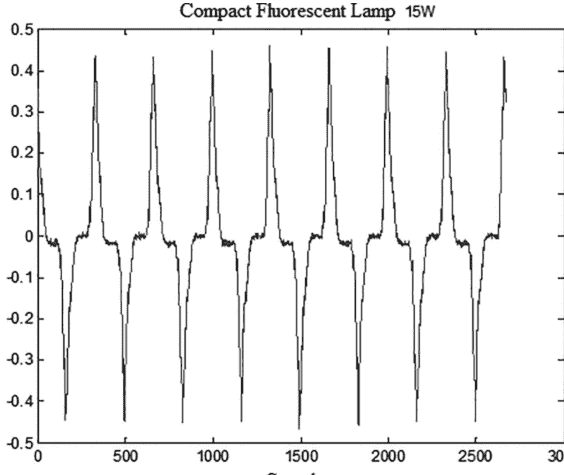

图 9.1 15W台灯。

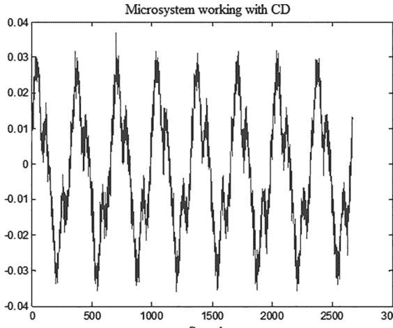

图 9.2 微型系统 CD。

## 低音量收音机配合微型系统工作

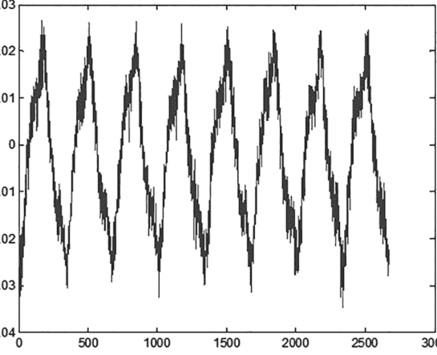

图 9.3 微型系统（低音量）。

## 高音量收音机配合微型系统工作

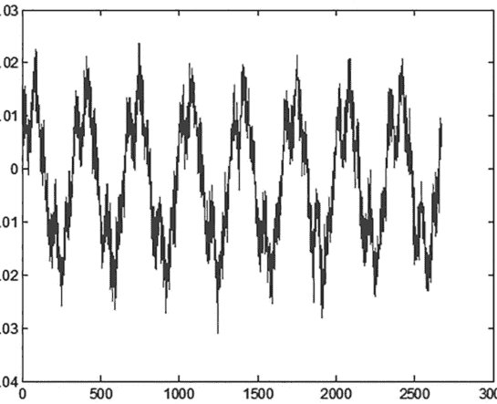

图 9.4 微型系统（高音量）。

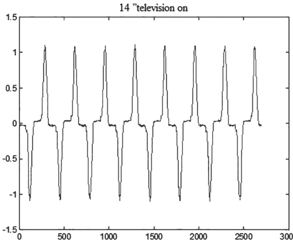

图 9.5 电视机开启。

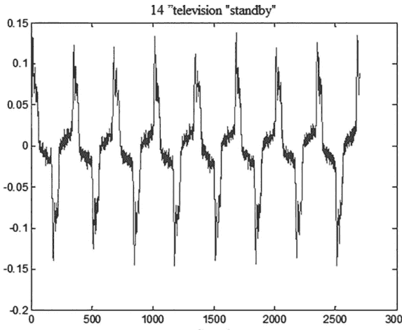

图 9.6 电视机待机。

## 笔记本电脑

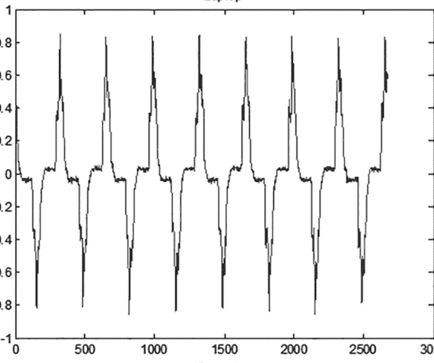

图 9.7 笔记本电脑。

## 档位1的搅拌机

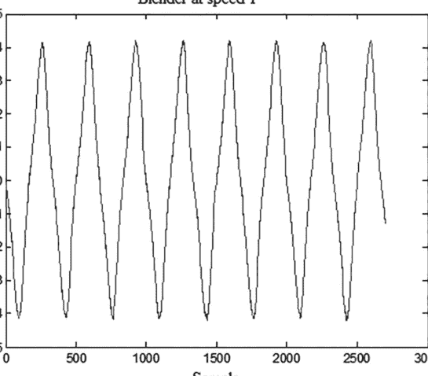

图 9.8 搅拌机（速度1）。

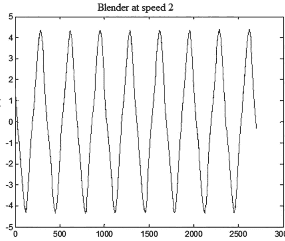

图 9.9 搅拌机（速度2）。

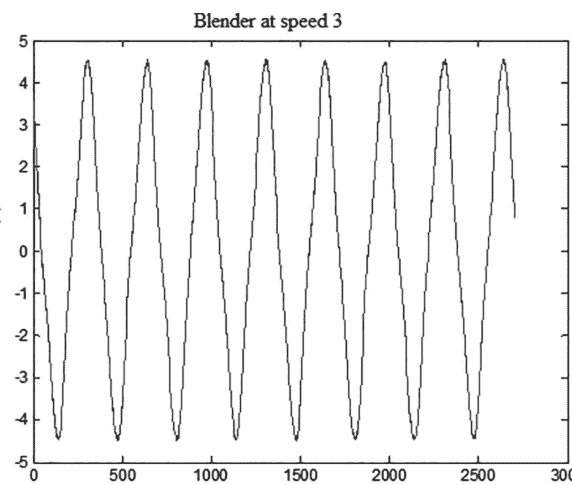

图 9.10 搅拌机（速度3）。

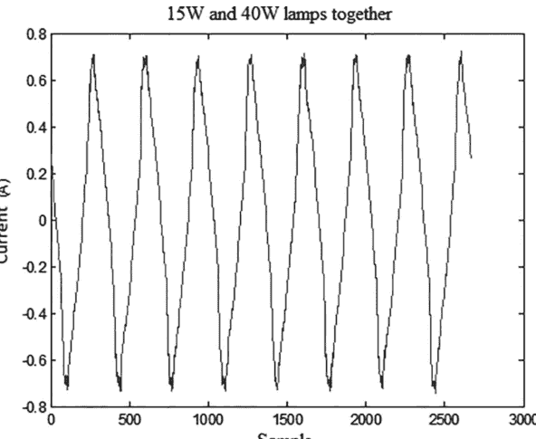

图 9.11 15W台灯 + 40W。

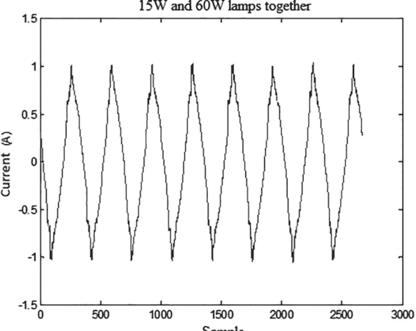

图 9.12 15W台灯 + 60W。

## 15W、40W和60W灯同时工作

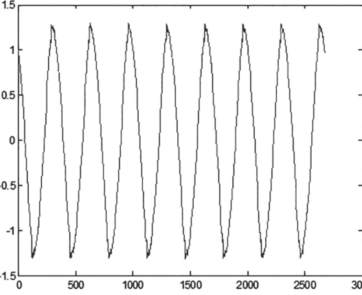

图 9.13 15W台灯+40W + 60W。

## 60W台灯 + 播放CD的微型系统

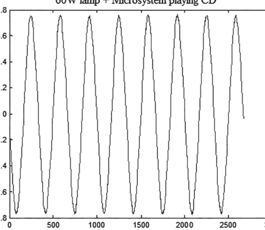

图 9.14 60W + 微型系统。

## 冰箱开启

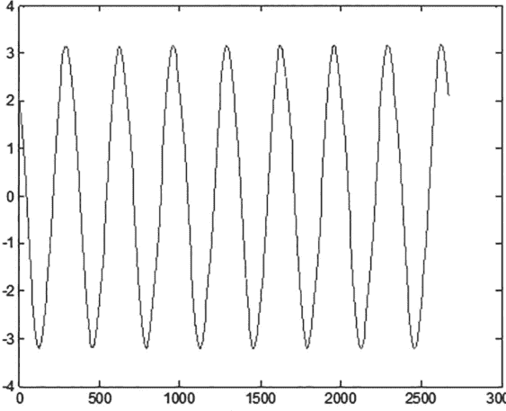

图 9.15 冰箱。

## 850W烤面包机

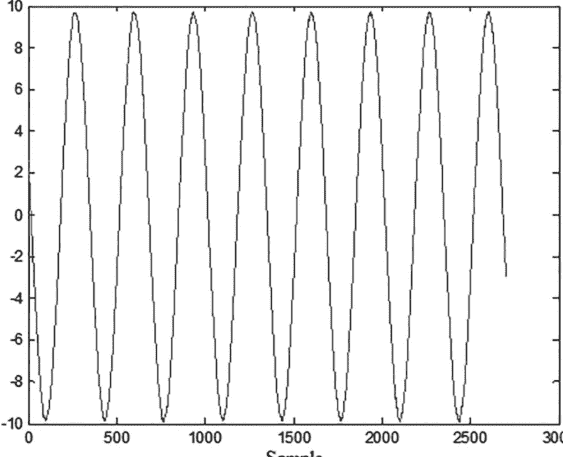

图 9.16 烤面包机。

## 最低档风扇（50W）

图 9.17 风扇（最低速度）。

## 最高档风扇（50W）

图 9.18 风扇（最高速度）。

## 夏季档位淋浴

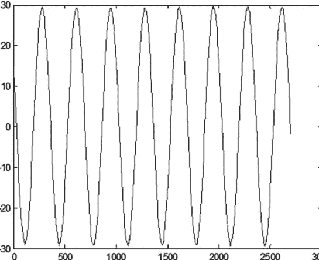

图 9.19 淋浴（夏季）。

## 冬季档位淋浴

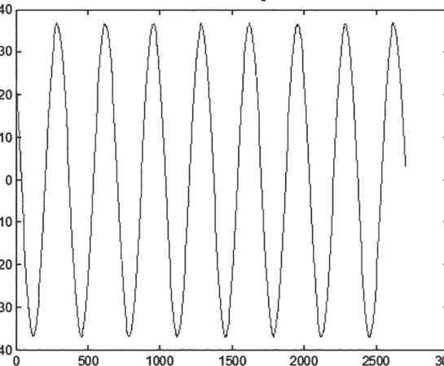

图 9.20 淋浴（冬季）。

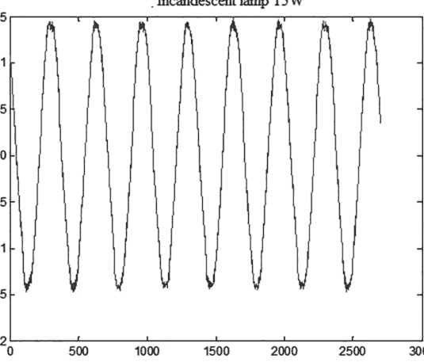

图 9.21 15W白炽灯。

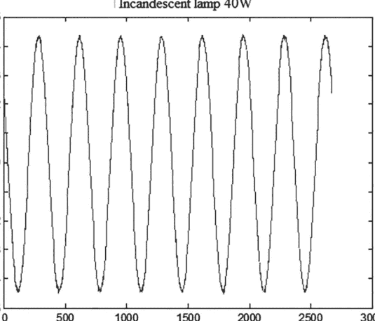

图 9.22 40W白炽灯。

## 60W白炽灯

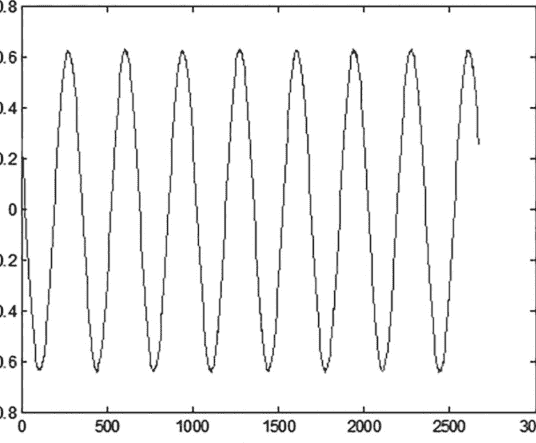

图 9.23 60W白炽灯。

## 40W和60W白炽灯同时工作

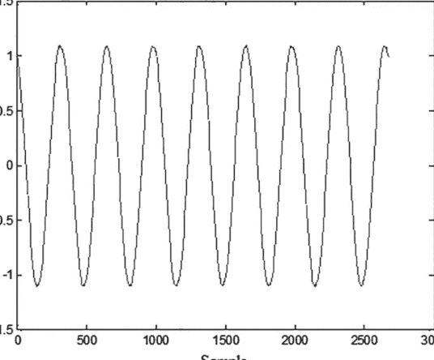

图 9.24 40W白炽灯 + 60W。

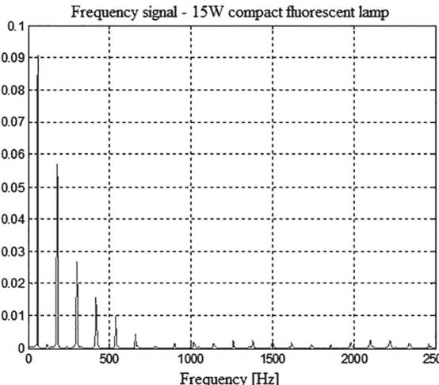

图 9.25 频率信号 15W。


图 9.26 频率信号 60W + 15W。

以下是测量设备的电流图表，分单独测量和汇总测量两种。

## 9.4 方法论

该工作可分为两个阶段。在第一阶段，完成所选负载电流的整体提取及神经网络训练，如图 9.27 所示。而第二阶段与负载识别的仿真相关；图 9.28 显示了该阶段所开发阶段的框图。

在对每个选定电器的电流进行勘测后，实验部分对应于执行在 MATLAB 中开发的三个程序，以识别这些电气负载。

第一个程序使用反向传播配置的神经网络，这对应于最常用的标准配置，包含两层，第一层由八个神经元组成。第一次测试从 2 个神经元开始，然后增加数量，直到网络返回的信号与标准目标信号之间达到最小可能差异，使用八个神经元实现了该结果。

选择反向传播算法，因为它寻求所需输出（目标）与神经网络获得的输出（网络响应）之间的最小差异，且误差最小。该算法调整每次迭代中发现的误差传播层之间的权重。

从包含 131,072 个点的原始信号中，创建了三个信号（P、T 和 S），每个信号包含 2,670 个点以表征八个周期，这是一个经验定义。如果每个周期给出恰好 256 个样本，八个周期将产生 2,048 个样本和 15.36kHz 的采样率。由于电流以 20 kSa/s 的速率采集，每个信号获得 2,670 个点，以便在图表视觉上表现八个周期。


图 9.27 步骤。


图 9.28 电气负载识别仿真。

P 信号和 T 信号用于创建和训练网络，然后使用 S 信号模拟网络。产生的信号 Y 对应于神经网络作为仿真结果返回的信号。换句话说，S 信号是提交给网络的信号，Y 信号是网络返回的信号。

完成第一个程序后，执行第二个程序以提取测试信号的系数，包括一个近似系数和三个细节系数。因此，每个信号可以由其小波变换系数表示。

选择小波变换是因为它是一种以其分解函数并再次重建它们的特性而闻名的工具。选择了离散小波，由于其简单性，使用了 Haar 小波，也称为 Daubechies 1 小波的一个特例，它在许多应用中被广泛使用，特别是在模式识别中。

由于某些信号产生了非常接近的系数，从而使负载识别变得困难，因此决定计算系数范数之和，试图为接近的系数获得不同值，从而简化识别过程。这样，可以增加相似系数之间的差异。

此计算由第三个程序执行，随后将此值与由每个负载的“标准”信号的小波系数范数之和构建的数据库进行比较。该信号对应 T 信号，在神经网络中用作目标。这样，可以知道来自神经网络的信号（信号 Y）是否确实对应于正在测量的信号（信号 S）。在识别中，比较信号之间允许 1% 的误差，如果误差更大，算法将返回无法识别该负载。

## 9.5 结果与讨论

在所有对单独测量的负载进行的实验中，算法能够在规定的 1% 容差内正确识别负载。在信号求和实验中，识别是可能的，根据信号不同，容差提高到 2%、3% 和 11%。但是，随着容差的增加，之前正确识别的信号开始变得混淆。

模拟所有负载后，结果很有希望，因为所提出的算法能够识别所有测量的负载，以及同时测量的负载集，假设模拟负载与标准负载之间存在 1% 的误差。然而，所提出的算法在基于单独信号求和的仿真识别方面需要更多的研究和细节。这些测试的结果概述于表 9.2 中。

图 9.29–9.31 显示了单独负载信号的图表，作为在容差范围内被完美识别的负载示例。因此，图 9.32–9.36 显示了表 9.1 中提到的单个波形之和的图表，以便与这些负载运行时直接在网络上测量的信号进行比较。因此，在所有图表中，横坐标对应样本数，纵坐标对应安培的电流。

表 9.2
附加负载识别

| 模拟负载 | 容差 | 已识别 |
|---|---|---|
| 15W 紧凑型灯 + 40W 白炽灯 + 60W 白炽灯 | 是 | 1% |
| 15W 紧凑型灯 + 40W 白炽灯 | 是 | 2% |
| 40W 白炽灯 + 60W 白炽灯 | 是 | 3% |
| 15W 紧凑型灯 + 60W 白炽灯 | 是 | 11% |
| 60W 白炽灯 + 播放 CD 的微型系统 | 否 | - |


神经网络输入信号


神经网络返回的信号


图 9.29 15W 紧凑型荧光灯。

可以感知到，虽然视觉差异不显著，但进一步评估表明，该过程未能在最小公差内完成识别，更进一步凸显了测量过程中一个负载对另一个负载的影响。然而，相关事实与贯穿整个研究的负载识别过程有关。

神经网络输入信号


神经网络返回的信号


图 9.30 15W 白炽灯。

神经网络输入信号


神经网络返回的信号


图 9.31 笔记本电脑。

神经网络输入信号


神经网络返回的信号


图 9.32 60W 白炽灯加上播放 CD 的微型系统。

神经网络输入信号


神经网络返回的信号


图 9.33 15W 紧凑型荧光灯加上 40W 白炽灯。

神经网络输入信号


神经网络返回的信号


图 9.34 40W 白炽灯加上 60W 白炽灯。

神经网络输入信号


神经网络返回的信号


图 9.35 15W 紧凑型荧光灯加上 60W 白炽灯。

神经网络输入信号


神经网络返回的信号


图 9.36 15W 紧凑型荧光灯加上 40W 白炽灯加上 60W 白炽灯。

## 9.6 趋势

作为未来研究，计划采用其他小波函数开展进一步测试，并表征过渡时段。同样，还计划通过已安装的自动化系统，在不同类型负载的家庭中进行测试。同时，计划用新负载（包括低功率负载）丰富数据库。最后，计划开发一款产品，使负载识别与鉴别的整个过程可以与家用电表时钟耦合。

## 9.7 结论

如本章所示，已创建家用负载电流信号数据库，并提出了一种负载处理、识别与分解的新方法。所提方法涉及通过小波变换提取系数以及基于神经网络的训练。由于一个负载对另一个负载波形的影响，提出采用自动激活的单个负载组合来训练神经网络。该提案与智能电网概念相关，并允许对家庭中设备使用进行精细监测，这主要由于干旱问题以及因此导致的电力产量低而至关重要。

该工作的主要贡献包括对负载分解技术进行深入的文献回顾，以及创建包含家庭主要负载行为的数据库，进而提出了一种基于测量链的负载分解新算法。

该已创建并向学术界开放的数据库在该领域代表了一项成就，因为不存在这样的免费且精心获得的基础数据。希望该数据库也能对其他研究人员有用，使他们可以直接采用识别技术。该数据库由“txt”格式的文件组成，包含测量设备的电流样本。

负载分解任务复杂，在存在非线性负载时会更加恶化，因为一个设备产生的谐波会改变其他设备中测量信号的行为。具体而言，原因之一是巴西制造的设备缺乏滤波器，因为该国的立法在这方面不够严格。

因此，考虑单独连接负载的信号之和与负载同时工作时的信号不同；也就是说，可用于家庭自动化系统典型激活的继电器，但这将允许获取设备单独和同时连接时的信号。因此，本工作中的分析是静态的，未考虑过渡时段。基于所创建数据库的结果表明，在识别孤立负载和组合负载的所有情况下均高效。

## 参考文献

- 1. Batlle, E. A. O., Palacio, J. C. E., Lora, E. E. S., Reyes, A. M. M., Moreno, M. M., & Morejón, M. B. (2020). 高等教育机构建筑中基准能耗估算与电力能源消耗节约量化方法：联邦伊塔巴雅大学（UNIFEI）案例研究. Journal of Cleaner Production, 244, 118551.
- 2. Ogunjuyigbe, A. S., Ayodele, T. R., & Ogunnuyiwa, S. M. (2020). 尼日利亚食品和饮料行业现有建筑改造以降低电力能源消耗和温室气体排放. Journal of Electrical Systems and Information Technology, 7, 1–21.
- 3. Russell, J., Cazier, J., Hassler, E., & Mueller, T. (2020). 利用数据分析了解住宅建筑的电力消耗模式. Journal of Architectural Engineering, 26(1), 04019032.
- 4. Neto, V. L. S., Batista, E. D., Junior, W. B. L., Fabris, Z. V., & Rodrigues, P. J. A. W. (2020). 托坎廷斯州曼努埃尔·阿尔维斯·达·纳蒂维达德河流域降雨侵蚀性的空间分布.
- 5. de Souza, R. V., Fernandes, E. H. L., de Azevedo, J. L. L., dos Santos Passos, M., & Corrêa, R. M. (2020). 热能向电能转换的潜力：巴西海洋热能公园及其反向人为影响. Renewable Energy, 161, 1155–1175.
- 6. Machado, B. G. F., & Bhagwat, P. C. (2020). 发电结构对巴西水电报酬当前监管框架的影响. Energy Policy, 137, 111129.
- 7. Lee, S., Yaqub, M. A., & Kim, D. (2020). 智慧城市中 IoT 设备的邻居感知协议——概述、挑战与解决方案. Electronics, 9(6), 902.
- 8. Suvarna, M., Búth, L., Hejny, J., Mennenga, M., Li, J., Ng, Y. T., ... Wang, X. (2020). 智慧城市的智能制造——概述、洞察与未来方向. Advanced Intelligent Systems, 2(10), 2000043.
- 9. Rathor, S. K., & Saxena, D. (2020). 智能电网能源管理系统：概述与关键问题. International Journal of Energy Research, 44(6), 4067–4109.
- 10. Maheswari, M., & Gunasekharan, S. 智能电网：概述. In Yang, P. (eds), 《绿色能源与可持续发展案例》, pp. 324–349. IGI Global, 2020.
- 11. Dileep, G. (2020). 智能电网技术及其应用综述. Renewable Energy, 146, 2589–2625.
- 12. Azmoodeh, A., Dehghantanha, A., Conti, M., & Choo, K. K. R. (2018). 基于能耗足迹的 IoT 网络中加密勒索软件检测. Journal of Ambient Intelligence and Humanized Computing, 9(4), 1141–1152.
- 13. Zame, K. K., Brehm, C. A., Nitica, A. T., Richard, C. L., & Schweitzer III, G. D. (2018). 智能电网与能源存储：政策建议. Renewable and Sustainable Energy Reviews, 82, 1646–1654.
- 14. 巴西国家电力局（ANEEL）。全国电力系统电力分配程序（PRODIST），模块 8——电力质量，第 3 次修订，自 2011 年 9 月 6 日起生效。
- 15. Chang, G., Maity, S., Chatterjee, B., & Sen, S. (2018). 具有宽带能量-质量可扩展性的医用无线电接收机前端：通过电路和架构级重构. IEEE Journal on Emerging and Selected Topics in Circuits and Systems, 8(3), 369–378.
- 16. Wojciechowski, J., Stelmach, Ł., Wójtowicz, M., & Młyńczak, J. (2018 年 9 月). 铁路交通控制设备电能质量. In 《运输系统理论与实践科学技术会议》（第 77–86 页）. Springer, Cham.


- 17. Shaburov, E., Fedyukhin, A., & Derevianko, O. (2019年6月). 城市固体废物用于热能和电能生产的能效分析. 在 IOP 会议系列：地球与环境科学 (第272卷, 第2期, 第022105页). IOP出版社, 布里斯托尔.

- 18. Iris, Ç., & Lam, J. S. L. (2019). 港口能效综述：运营策略、技术和能源管理系统. 可再生能源与可持续能源评论, 112, 170–182.

- 19. Leabman, M. A., & Brewer, G. S. (2018). 美国专利第9,887,739号. 华盛顿特区: 美国专利商标局.

- 20. Ganjavi, A., Ghoreishi, H., & Ahmad, A. A. (2018). 一种新型单输入双输出三电平DC-DC变换器. IEEE工业电子学杂志, 65(10), 8101–8111.

- 21. Marques, C. A. G., Ribeiro, M. V., Gomes, P. H. C., Silva, E. A. B. 低成本DSP实现的谐波估计技术. 控制与自动化杂志. 第20卷 第4期. 2009年10月、11月和12月.

- 22. Ferreira, D. D., Cerqueira, A. S., Marques, C. A. G., Duque, C. A., Ribeiro, M. V. 电能质量中电气扰动自动检测与分类系统. 控制与自动化杂志. 第20卷, 第1期. 2009年1月、2月和3月.

- 23. Marques, C. A. G. 能源质量扰动检测监测技术. 硕士学位论文. 朱伊斯德福拉联邦大学. 2007年3月.

- 24. Xavier, P. E. A. 基于DSP的电能质量分析仪. 硕士学位论文. 里斯本技术大学. 2011年4月.

- 25. Radil, T., Vaclav, M., Janeiro, F. M., Ramos, P., Serra, A. C. (2007). 单相电力系统中电能质量扰动的在线检测与分类. 在 2007年电力工程、能源与电气传动国际会议 (第713–718页). IEEE. 塞图巴尔, 葡萄牙.

- 26. Shaukat, N., Khan, B., Ali, S. M., Mehmood, C. A., Khan, J., Farid, U., ... Ullah, Z. (2018). 智能电网系统中电动汽车交通综述. 可再生能源与可持续能源评论, 81, 1329–1349.

- 27. Rehmani, M. H., Davy, A., Jennings, B., & Assi, C. (2019). 基于软件定义网络的智能电网通信：一项全面综述. IEEE通信调查与教程, 21(3), 2637–2670.

- 28. Kumar, P., Lin, Y., Bai, G., Paverd, A., Dong, J. S., & Martin, A. (2019). 智能电网计量网络：安全、隐私与开放研究问题综述. IEEE通信调查与教程, 21(3), 2886–2927.

- 29. Kagan, E., & Koval, R. A. (2019). 美国专利第10,275,840号. 华盛顿特区: 美国专利商标局.

- 30. Ghosal, A., & Conti, M. (2019). 智能电网高级计量基础设施的密钥管理系统综述. IEEE通信调查与教程, 21(3), 2831–2848.

- 31. Vogt, M., Marten, F., & Braun, M. (2018). 智能电网协同仿真的综述与统计分析. 应用能源, 222, 67–78.

- 32. Desai, S., Alhadad, R., Chilamkurti, N., & Mahmood, A. (2019). IoE支持的智能电网高级计量基础设施中隐私保护方案综述. 集群计算, 22(1), 43–69.

- 33. Ahmed, S., Gondal, T. M., Adil, M., Malik, S. A., & Qureshi, R. (2019年3月). 智能电网通信技术综述. 在 2019年IEEE PES GTD亚洲大型国际会议及展览(GTD Asia) (第7–12页). IEEE. 曼谷.

- 34. Abdmouleh, Z., Gastli, A., & Ben-Brahim, L. (2018). 关于卡塔尔智能电网、能效与可再生能源应用公众认知的调查. 可再生能源与可持续能源评论, 82, 168–175.

- 35. Al-Badi, A. H., Ahshan, R., Hosseinzadeh, N., Ghorbani, R., & Hossain, E. (2020). 全球智能电网概念与技术演示综述：侧重阿曼视角. *应用系统创新*, 3(1), 5.

- 36. Mathas, C. M., Grammatikakis, K. P., Vassilakis, C., Kolokotronis, N., Bilali, V. G., & Kavallieros, D. (2020年8月). 智能电网系统威胁态势. 在 *第15届可用性、可靠性与安全国际会议论文集* (第1–7页). 虚拟会议.

- 37. Younis, M. I., & Hussein, T. F. (2018). 非接触式智能房屋网络系统的设计与实现. *国际电气与计算机工程杂志*, 8.

- 38. Kryvenchuk, Y., Shakhovska, N., Shvorob, I., Montenegro, S., & Nechepurenko, M. (2018). 基于智能房屋的医疗数据收集与分析系统. 在 *IDDM（信息学与数据驱动医学国际研讨会）* (第205–214页). 利沃夫.

- 39. Zaidan, A. A., Zaidan, B. B., Qahatan, M. Y., Albahri, O. S., Albahri, A. S., Alaa, M., ... Lim, C. K. (2018). 基于物联网技术的智能家居通信组件综述. *电信系统*, 69(1), 1–25.

- 40. Parkhomenko, A., Tulenkov, A., Sokolynskii, A., Zalyubovskiy, Y., Parkhomenko, A., & Stepanenko, A. (2018年3月). 远程实验室在智能家居系统能效、安全性和网络安全研究中的应用. 在 *远程工程与虚拟仪器国际会议* (第395–402页). 杜塞尔多夫: Springer. Cham.

- 41. Kabalci, E., & Kabalci, Y. 智能电网架构导论. 在 Yang, P. (编), *智能电网及其通信系统*, 第3–45页. Springer, 新加坡, 2019.

- 42. Gao, J., Asamoah, K. O., Sifah, E. B., Smahi, A., Xia, Q., Xia, H., ... Dong, G. (2018). 电网监测：智能电网中基于安全主权区块链的监测. *IEEE Access*, 6, 9917–9925.

- 43. Bian, X., Abowd, G. D., Rehg, J. M. 家庭环境中声源定位的应用. 在: *普适计算国际会议论文集*, 2005. 慕尼黑.

- 44. Chen, J., Kam, A. H., Zhang, J., Liu, N., Shue, L. 基于声音的浴室活动监测. 在: Gellersen, H.-W., Want, R., Schmidt, A. (编) *Pervasive 2005*. LNCS, 第3468卷, 第47–61页. Springer, 海德堡, 2005.

- 45. Koile, K., Tollmar, K., Demirdjian, D., Howard, S., Trevor, D. 上下文感知计算中的活动区域. 在: Dey, A.K., Schmidt, A., McCarthy, F.F. (编) *Ubicomp 2003*. LNCS, 第2864卷. Springer, 海德堡, 2003.

- 46. Tapia, E. M., Intille, S. S., Larson, K. 使用简单而普及的传感器进行室内活动识别. 在: Ferscha, A., Mattern, F. (编) *Pervasive 2004*. LNCS, 第3001卷, 第158–175页. Springer, 海德堡, 2004.

- 47. Rhif, M., Ben Abbes, A., Farah, I. R., Martínez, B., & Sang, Y. (2019). 非平稳时间序列分析中小波变换的应用：综述. *应用科学*, 9(7), 1345.

- 48. Ghadimi, N., Akbarimajd, A., Shayeghe, H., & Abedinia, O. (2018). 基于多块预测引擎的智能电网新预测模型. *环境智能与人性化计算杂志*, 9(6), 1873–1888.

- 49. Zaporozhets, A., Eremenko, V., Serhiienko, R., & Ivanov, S. (2018年9月). 基于智能电网技术的热电设备诊断方法与硬件. 在 *计算机科学与信息技术会议* (第476–489页). 利沃夫, Springer, Cham.

- 50. Reisenhofer, R., Bosse, S., Kutyniok, G., & Wiegand, T. (2018). 基于Haar小波的图像质量评估感知相似度指数. *信号处理：图像通信*, 61, 33–43.

- 51. Rojas, L., Rojas, C., Pacheco, C., Caballero, E., & Molina, M. (2020年5月). 小电网中质量参数的定位：使用小波变换的离网案例. 在 IOP 会议系列：材料科学与工程 (第844卷, 第1期, 第012066页). IOP出版社. 布里斯托尔.

- 52. Xiang, W., Musau, P., Wild, A. A., Lopez, D. M., Hamilton, N., Yang, X., ... Johnson, T. T. (2018). 机器学习、自主系统和神经网络验证综述. arXiv预印本 arXiv:1810.01989.

- 53. Wu, Z., Pan, S., Chen, F., Long, G., Zhang, C., & Philip, S. Y. (2020). 图神经网络综合综述. IEEE神经网络与学习系统杂志.

- 54. Khan, A., Sohail, A., Zahoora, U., & Qureshi, A. S. (2020). 深度卷积神经网络近期架构综述. 人工智能评论, 1–62.

- 55. Guo, Y. (2018). 量化神经网络的方法与理论综述. arXiv预印本 arXiv:1808.04752.

- 56. Jin, L., Li, S., Hu, B., & Liu, M. (2019). 投影神经网络及其应用综述. 应用软计算, 76, 533–544.

- 57. Tarasov, D., Buevich, A., Shickin, A., Subbotina, I., Tyagunov, A., & Baglaeva, E. (2018年7月). 使用多层感知神经网络和多层感知残差克里金法进行铬分布预测. 在 AIP会议论文集 (第1978卷, 第1期, 第440019页). AIP Publishing LLC.

- 58. Aseeri, A. O., Zhuang, Y., & Alkateiri, M. S. (2018年7月). 面向资源受限物联网的基于机器学习的XOR PUF安全漏洞研究. 在 2018年IEEE物联网国际大会(ICIOT) (第49–56页). IEEE.


## Taylor & Francis

泰勒和弗朗西斯集团  
http://taylorandfrancis.com

# 10 WSN、IoT 和 CPS 的安全范式：挑战与解决方案

Aqeel Khalique, M. Afshar Alam,  
Mohammad Muzammil Khan, and Imran Hussain  
贾米亚·哈姆达德大学

## CONTENTS

| 章节 | 页码 |
|---------|------|
| 10.1 引言 | 201 |
| 10.2 安全原语 | 202 |
| 10.3 安全范式 | 207 |
| 10.3.1 安全范式：WSN | 207 |
| 10.3.1.1 安全要求 | 207 |
| 10.3.1.2 WSN 架构 | 208 |
| 10.3.2 安全范式：IoT | 208 |
| 10.3.2.1 安全要求 | 209 |
| 10.3.2.2 IoT 架构 | 210 |
| 10.3.3 CPS 中的安全 | 210 |
| 10.3.3.1 安全要求 | 211 |
| 10.3.3.2 CPS 架构 | 211 |
| 10.4 WSNs、IoT 和 CPS 的安全挑战与解决方案 | 213 |
| 10.4.1 WSNs 的安全挑战与解决方案 | 213 |
| 10.4.2 IoT 的安全挑战与解决方案 | 214 |
| 10.4.3 CPS 的安全挑战与解决方案 | 215 |
| 10.5 面向 CPS 的统一可扩展安全框架 | 215 |
| 10.6 结论 | 218 |
| 参考文献 | 218 |

## 10.1 引言

安全性，定义为免受危险或威胁的状态，源自拉丁语 securus——意为“无后顾之忧”。它由制定的标准所定义，用于保护事物免受可能面临的任何危险。今天，我们在日常生活中使用安全性，无论是发送电子邮件、即时通信、云计算，还是与物联网（IoT）设备交互，或是在互联网上与受保护的领域进行一般交互。这种安全性被称为计算机安全、信息安全或网络安全 [1]，更准确地说，是为防止旨在对所提供服务、硬件、软件或电子数据的整体或部分造成损害或中断而采取的保护措施。随着我们从传统的计算方式过渡到使用无线网络、智能设备和物联网的更互联的计算方式，安全性的需求比以往任何时候都更加重要。

信息安全或网络安全已被证明在其实施的各种多样化用例中至关重要。根据参考文献 [2]，该领域影响着各种当代社会，从低级别的（如智能识别、用途）到更高级、更复杂、更精密的操作和干预（如军事行动）。

在此，我们讨论安全强度的级别取决于所保护的数据或事物的价值，也就是说，安全程度应直接取决于所涉信息的价值，以及信息一旦暴露可能造成的损害程度。关于安全的关键在于，我们必须做好准备，应对并尽量减少入侵造成的损害。由于不太可能知道系统所面临的确切攻击类型，因此很难做好充分准备。因此，我们提出一种基于概率的方法，根据可用数据和过去经验定义应采取的措施，将影响和损害降到最低。我们还讨论实施此类方法的一般参数。

本章结构如下：第 10.2 节介绍了建立安全所需的安全原语以及安全的基本需求。然后在第 10.3 节中，我们逐一讨论无线传感器网络（WSN）、物联网（IoT）和网络物理系统（CPS）的安全范式，列出安全要求，并简要讨论这些系统的架构。在第 10.4 节中，我们讨论了 WSNs、IoT 和 CPS 的安全挑战，包括每一层可能发生的某些攻击以及如何防范这些攻击。在第 10.5 节中，我们介绍了用于 CPS 安全的框架。该框架为我们架构中描述的每一层提供统一、可扩展且资源高效的解决方案。最后，第 10.6 节总结了本章。

## 10.2 安全原语

对安全性的依赖是确保保护数据流通、完整性和可用性的能力之间取得平衡的关键因素。这被称为 CIA 三元组 [3]——机密性、完整性和可用性。

- 机密性是强制执行授权访问级别的能力。
- 完整性是确保只有授权人员可以修改、更新或删除数据，以防止未经授权的修改。
- 可用性是在需要时且按需提供数据的能力。

现在，为了实现这些要求并保持平衡，我们可以利用许多现有标准中的 AAA 框架。AAA 或三A 模型指身份验证、授权和计费 [3,4]。这些要求在图 10.1 中以图形形式清晰说明：


图 10.1 安全要求。

- 身份验证确保当您连接到服务时，您是您所声称的那个人。这与识别不同，因为您不仅要说明自己是谁，还要证明这一点。
- 授权确保您拥有足够的访问权限/特权。这可以通过使用最小权限原则（PoLP）[5] 来实施。该原则最早于 1975 年提出，指出访问权限应仅授予用户完成工作所必需的程度，且不得多于此。这样可以确保，在身份验证受到威胁的情况下，损害最小且仅限于特定领域。
- 计费是指记录用户在登录任何给定服务时所做的所有操作。这意味着拥有用户执行的操作的不可辩驳的证据和不可否认性。在发生任何灾难时，可以借助数字指纹追踪或其他旨在记录操作的措施，将损害追溯到攻击者或恶意用户。

安全机制基于将在任何时间点发生的攻击的预测或类型。然而，攻击的性质和严重程度对安全分析师来说是未知的。因此，安全机制基于多个方面，以确保对攻击进行适当的预防。图 10.2 显示了一个通用时间线，其中潜在威胁或漏洞可能成为攻击。因此，所有安全机制主要基于威胁或漏洞进行设计。

实施安全机制的方面取决于所需的安全强度。安全强度取决于对任何可能攻击的预测以及为应对其所采取的措施。安全强度通过评估处理攻击的能力来衡量。安全与强度成正比，而强度基于各种因素，我们将这些因素分类为特定资产的价值、环境、资产相关的风险、攻击的严重程度和预测。

1. 资产价值：这指的是需要被保护的资产的效用和价值。如果某物被高度机密且仅供组织内部流通，则其价值可能被视为尽可能高。例如，设计专利草稿、国家机密和代码文档。另一方面，如果某物应当公开可访问且在公开域中可用，则对其访问实施安全措施似乎有些过度。例如，如果我们为只是想使用搜索引擎的用户部署完整的身份验证和授权机制，那将几乎没有任何用处。因此，安全性应与资产的价值呈正相关。

2. 环境：资产部署的地点是已知环境。安全环境可能是指攻击和入侵机会较低的环境。如果环境对资产来说易受攻击，例如公开域，则应加强安全性。

3. 风险关联：某些资产附带其自身的一组风险。这些风险与资产相关联。例如，硬件存在物理访问风险，软件存在代码故障风险。很少有资产没有风险；因此，我们必须记录这些资产及可能相关的风险。

4. 攻击严重程度：指可以处理的攻击规模的衡量指标。只有已知，容忍限度才能扩展。因此，攻击的容忍度和限度应当已知。

5. 预测：指通过查看之前的尝试（包括失败和成功，这些尝试在性质和环境上相似）来预测攻击发生的可能性。知识和经验在这里非常重要，因为这将允许对现有安全标准进行基准测试，并有助于创建更安全的环境。

IoT 的新兴应用展现出巨大潜力。图 10.2 显示了按时间顺序发生的一系列操作。随着 IoT 设备带来的便利，个人工艺品和其他可识别信息泄露的风险也随之而来，这些信息可用于操纵设备本身或将数据用于其他恶意目的。从门禁卡到智能设备管理 [6]，这些应用的复杂性呼唤更多的安全保障。安全性不可忽视，因为 IoT 设备安全漏洞将导致信息泄露，可能影响整个结构并产生不可想象的整体结果 [7]。


图 10.2 攻击时间线。

通常，WSN 由众多具有感知、处理、监控和通信能力的设备组成。WSN 生成数据的安全性至关重要。WSN 中的节点资源受限，因此只能执行有限的任务。这些限制包括能量消耗、内存限制、通信可靠性、无人值守操作、延迟等 [8]。这些限制在拥有可靠安全性或缺乏安全性方面起着重要作用。因此，根据您试图保护的数据的重要性实施足够的安全措施也至关重要，这与参考文献 [9] 中提出的类似。

WSN 的安全性可以分为两类，可以在这两类中发现漏洞并防止其被利用。这些类别称为节点特定和网络特定。

- 节点特定：节点执行三个关键功能，即数据收集、数据传递和数据路由。这些功能承载敏感数据，这些数据的暴露可能会破坏完整性和机密性，从而导致安全失效。这可以通过篡改数据、节点劫持、中继攻击等方式实现。但是，如果妥善处理，可以避免这些漏洞利用。解决方案包括对节点和数据进行完整性检查、采用适合操作的正确且最新的身份验证标准、使用基于会话的时间戳、加密数据流、使用基于哈希的消息身份验证代码（HMAC）等。

- 网络特定：数据在网络的节点之间共享。控制整个网络意味着控制节点及其数据，正如我们所讨论的，节点拥有不可泄露的关键信息。拥有网络访问权限的人可以添加恶意节点，该节点可以与其他节点共享和接收数据。因此，我们必须保护网络免受非法使用，以防止网络范围的攻击。

各种攻击可能发生在 WSN 的不同层级上。这些攻击可以根据被利用的弱点进行分类。例如，物理层负责处理与现实世界的交互（如检测、加密和调制）[10]，常常暴露在敌对或不安全的环境中，因此更容易被利用。攻击者可以对物理层实施各种类型的攻击，例如干扰和篡改。在部署 WSN 时，需要将这些攻击考虑在内。

- 拒绝服务攻击（DoS）：该攻击包括通过各种技术试图阻止合法用户使用服务。它会降低网络执行其正常功能的能力 [11]。该攻击可能发生在网络的不同层级上，需要特殊指令来应对。因此，应对每种类型的攻击在计算上成本更高，由于 WSN 的资源稀缺，这不可行。网络各层级面临的不同攻击类型如下：
  - 物理层：干扰和篡改；
  - 访问控制层：碰撞、资源耗尽和不公平；
  - 网络层：黑洞、女巫攻击、Hello 泛洪和确认报文泛洪；
  - 传输层：泛洪和去同步；
  - 无线层：窃听、劫持和阻塞；
  - 传感层：虚假信息转发和窃取信息；
  - 应用层：破坏和否认。

- 节点复制：这种攻击是通过复制（复制）现有节点的标识符来创建新节点，该新节点随后将模仿合法节点。在利用方面，这种做法的可能性无穷无尽，因为它可能导致数据包发送到错误的目的地，读取正确的信息但向服务器发送错误的信息，同时将正确的数据包发送到其他地方，破坏网络等。

- 隐私泄露：WSN 通过部署传感器收集数据，WSN 中的隐私管理尤其困难 [12]，因为它们承载了不应暴露的敏感信息。由于网络是无线管理的，拥有远程访问权限的攻击者将立即访问整个网络和大量敏感数据，因为远程访问时，攻击者不需要出现在节点处。这些攻击可能包括以下内容：
  - 窃听：未经授权监听通信的行为。
  - 流量分析与被动监控：分析通过网络的流量并将其存储以供未来处理。
  - 伪装：使用被攻破的节点重新路由流量并伪装成正常节点（在节点复制中提及）。

从上述讨论可以清楚地看出，攻击者可以使用各种已知技术发起攻击，网络对所有层级的攻击都存在漏洞。此外，参考文献 [13] 的作者认为，攻击者可能还在使用其他尚未发现的攻击类型。

多年来，研究人员开发了日常生活中使用的强大系统。随着技术的进步，系统变得复杂并演变为一种基于过去技术并改进它的新范式。云计算的引入开启了全新的计算时代，并随着时间的推移，使每个人使用其带来的好处变得指数级容易。虽然仍处于起步阶段，CPS 也是如此。这些系统是指一种新一代系统，它在计算上集成了诸如与人类进行物理交互等能力 [14]。它们是智能活动 [15] 的基础，包括可穿戴设备、国防系统、智能制造、智能车辆和智能城市。它们的增长极大地影响了我们的生活方式，我们已经习惯了它们。然而，增长伴随着一系列安全和机密性问题。与 IoT 和 WSN 一样，CPS 的使用也存在安全问题，例如机密性、完整性、可用性、真实性、授权、问责制和不可否认性。CPS 继承了能力的优点和改进，但也继承了需要审查的安全缺陷。

参考文献 [16] 的作者认为，CPS 安全的根本问题在于其异构性质，即构成整个系统的元素在种类上各不相同。随着它们的添加和集成带来了自身的安全缺陷，并进一步成为可能导致 CPS 攻击的因素，再加上网物理交互复杂，增加了系统的整体复杂性。

## 10.3 安全范式

### 10.3.1 安全范式：WSN

WSN 引起了广泛关注。有许多 WSN 应用，并且在不断增长。然而，正如我们之前讨论的，网络通常部署在敌对环境中，由于其分布式特性，容易受到攻击。攻击可能对整个网络造成毁灭性打击，如果不小心，可能会被忽略。许多攻击，正如所讨论的，是安全要求受损和资源限制的结果。这些安全要求包括数据机密性、数据完整性、数据新鲜度等的平衡 [17]。我们还讨论了 WSN 的一般架构、正在进行的攻击以及可能有助于防范这些攻击的解决方案。

#### 10.3.1.1 安全需求

要求很简单——要保护某物，你需要基本措施的平衡，并应用逻辑框架，这些框架可以在给定限制条件下高效地保护该物。在 WSN 的背景下，这种平衡最为需要，因为资源有限，功率和计算能力有限。WSN 安全的要求如下：

- 数据机密性：这里，机密性意味着在任何情况下，从传感器收集的数据都应保持 utmost 机密性，并且除受益人外不得有任何暴露。更简单地说，数据除了其预期的接收者外，任何人都不应看到。
- 数据完整性：数据必须在没有任何篡改的情况下传输给预期的受益人，从而确保内容未被修改。有许多方法可以确保这一点，例如加密内容和使用 HMAC。
- 数据新鲜度：新鲜度意味着传输的数据是当前数据，而不是已经发生过的事件的数据。这可以防止诸如攻击者重传已经传输过的数据并随后重新处理等攻击。这对网络不利，因为这将占用资源匮乏单元的计算能力。
- 真实性：恶意节点可以轻易冒充合法节点并传输不真实的数据，从而转发虚假


信息。因此，必须知道待处理的接收数据是真实的，且并非合法性受损的结果。

- 可用性：它表示在几乎随时保持服务的能力。这会受到拒绝服务攻击和洪水攻击等攻击的威胁。网络应能克服这些攻击并为网络提供服务。
- 鲁棒性与生存能力：这是指在遭受攻击时隔离损害的能力。这意味着如果某个节点受到攻击，不应将整个系统都拖垮。
- 不可否认性：这一度量确保已完成的操作无法以任何方式被否认，以确保问责制。在发生损害时，可以将其追溯到导致它的操作。

#### 10.3.1.2 WSN Architecture

无线传感器网络（WSN）的架构主要基于开放系统互连参考模型 [18,19,20]，直到2011年被标准化为IEEE 1451.5-802.11 [21]。图10.3中的WSN架构展示了标准中所呈现的内容并对其进行了概括。我们的架构由表10.1中描述的七层堆叠结构组成。

| 层 |
| --- |
| 应用层 |
| 传感层 |
| 无线层 |
| 传输层 |
| 网络层 |
| 访问控制层 |
| 物理层 |

| 层 | 描述 |
| --- | --- |
| 应用 | 根据标准，由收发器服务和无线通信模块（具备网络功能的应用处理器或无线换能器接口模块）组成。负责流量管理，并将来自不同应用或查询的数据翻译以获取信息。 |
| 传感 | 由节点中使用的传感器组成。传感器根据请求的特性收集其周围环境的数据。 |
| 无线 | 由节点用于与其他节点和整个网络通信的无线协议组成。 |
| 传输 | 提供拥塞避免和可靠性。可根据标准使用传输控制协议或用户数据报协议。 |
| 网络 | 路由是该层的主要功能。根据应用，它面临诸多挑战，加之资源稀缺。它还为数据传输定义了可靠的交互路径。 |
| 访问控制 | 处理访问策略、缓冲区管理、调度和错误控制。在WSN中，这对于兼顾能源稀缺、可靠性、高吞吐量、快速访问等因素是必需的。 |
| 物理 | 它提供通过某些物理介质进行比特流传输的接口。频率选择、频率生成、信号检测、数据加密和调制是该层的职责。 |

图10.3 WSN节点架构。

### 10.3.2 安全范式：物联网

物联网是一组异构性质的互联网络。这种性质意味着，随着越来越多此类异构设备的连接，复杂性会增加，正如我们之前讨论的，因为它们带来的漏洞。根据2019年进行的一项研究 [22]，在被调查的候选人中，28%的候选人表示，由于物联网设备可能带来的安全风险，他们不会拥有物联网设备。同一项调查显示，75%的候选人不信任数据共享的方式。物联网安全包括物理安全和网络安全，其要求取决于各种机制和参数 [23]，例如数据机密性、完整性、隐私性、三A认证和可用性。我们还将讨论物联网架构及其攻击和解决方案。

#### 10.3.2.1 安全要求

物联网设备的安全要求取决于设备的应用、其用途、数据共享方式、交互等。此类要求及其简要定义列于以下。

- 1. 数据机密性、完整性和隐私性：由于物联网数据需经过多个网络传输，加密是确保数据机密的必备手段。物联网设备、网络和服务各异，如我们之前讨论的，某些资产存在相关风险，连接这些资产可能会危及数据完整性，从而使攻击者能够为恶意目的修改和存储数据。
- 2. 认证、授权与记账（即三A模型）：如前所述，要保障某物的安全，需要应用认证机制来防止未经授权的访问。在物联网环境中，应用的多样性和异构架构增加了构建通用认证机制的难度。授权确保只有获授权的节点、设备、人员等才能查看或修改数据或服务。在此，PoLPs可以证明是有益的。另一项重要要求是记账。记账确保安全网络机制的审计和报告可靠性。
- 3. 可用性：物联网提供的服务易受针对其可用性的攻击。这些攻击用于阻断，或至少减慢，合法用户的服务。它们可能通过干扰、重放攻击或拒绝服务攻击发生。因此，物联网设备或服务必须确保其可用性，以保证其服务质量。
- 4. 能源效率：与WSN一样，这些物联网设备通常拥有电力、存储和处理等稀缺资源。攻击会增加这些资源的消耗，而这些资源原本可以用于处理合法使用。因此，物联网服务在处理此问题时应高效。

#### 10.3.2.2 物联网架构

物理对象、智能车辆、设备、建筑物、传感器和软件等的网络被称为物联网 [24]。它基于使用传感器在物理世界和数字世界之间建立连接 [25]。在此背景下，架构是一个用于定义网络物理部分及其功能、数据、原则和流程的框架。由于物联网设备应用领域广泛，目前没有单一公认的物联网架构。大多数研究人员同意一种由应用层和网络层堆叠在感知层之上的三层架构 [24]。然而，这对于物联网研究来说是不够的。因此，研究人员定义了五层架构，如图10.4所示 [24,26]，并已在表10.2中详细描述了该架构。

### 10.3.3 CPS中的安全

CPS是一种由计算机算法监控或控制机制的系统。这些系统在本质上是异构的，并在物理资产和虚拟资产的生态系统中进行通信。由于这些设备的特性，它们极易暴露于可能危及敏感信息甚至机密信息的威胁。访问授予用户操作这些系统的权限，这在错误的人手中可能很危险。在此，我们讨论CPS的安全要求及CPS架构。

| 层 |
| --- |
| 业务层 |
| 应用层 |
| 处理层 |
| 传输层 |
| 感知层 |

图10.4 物联网的五层架构。

| 层 | 描述 |
| --- | --- |
| 业务 | 管理整个系统，包括应用程序、模型和用户隐私 [27]。 |
| 应用 | 负责为用户提供应用程序服务。 |
| 处理 | 分析、存储和处理正在传输的大量数据。同时，为较低层提供多种服务。这里使用数据库、大数据模块和云计算等技术。也称为中间件层。 |
| 传输 | 用于传输使用感知/物理层收集的传感器数据。 |
| 感知 | 这是架构的物理层，与环境交互并基于智能感知信息。 |

#### 10.3.3.1 安全要求

CPS安全不应仅限于涉及的组件，还必须考虑物理环境。已提出一种保护CPS的模型，将其考虑在内，即物理网络安全 [4]。典型CPS的要求包含以下五个方面。

- 经认证的感知：处理验证感知过程。
- 存储安全：要求防止网络空间和物理空间中存储的数据被篡改。
- 执行安全：指确保未经适当授权时不进行任何执行操作。
- 反馈安全：指保障CPS反馈系统所需的控制系统安全。
- 通信安全：指CPS之间和CPS内部信息交换的安全性。

#### 10.3.3.2 CPS架构

异构设备连接并相互通信，形成由物理资产和计算能力组成的生态系统，受某些确定性算法控制，称为CPS [28]。连接这些设备的主要目的是增强业务增长和绩效。CPS设备的可能性是无限的。例如，查看认知CPS的场景，这些场景通常以“智能-”为后缀：一个根据外部条件调整音量的音频播放器被称为“智能音频播放器”；“智能汽车"


是一辆能够推断交通状况并相应调整速度的自动驾驶汽车；以及能够检测使用模式中的异常并采取额外安全预防措施的网站，仅举几例。IoT架构与CPS有许多共同之处。然而，与CPS相比，IoT在连接形式上更加受限，因为IoT仅连接设备，而CPS与物理世界也有更广泛的交互。如图10.5所示，该架构由相互堆叠的五层组成。各层的功能在表10.3 [29] 中有所描述。


图10.5 CPS架构。

表10.3 CPS架构描述

| 层 | 描述 |
|---|---|
| 配置 | 从网络空间向物理空间提供反馈，并对主管或机器进行自配置控制。充当一种韧性控制系统，用于应用纠正和预防性决策。 |
| 认知 | 生成报告并提供管理良好的监控系统。随后，监控系统用于为专家用户提供信息，以支持决策能力。 |
| 网络 | 充当从每个连接设备推入的信息的中心枢纽。这些数据用于解释数据，并为机器群之间的自比较提供分析。 |
| 转换 | 从接收到的数据中推断出有意义的信息。系统需要计算大量数据才能得出近乎完美的结论。研究人员已开发用于估计设备剩余使用寿命的算法，这些算法可用于计算，从而使设备具有自我意识。 |
| 连接 | 负责与一切（如网络上的设备和物理对象）建立智能连接。CPS应用程序可能通过传感器或控制器获取数据，例如企业资源计划（ERP）、制造执行系统（MES）、供应链管理（SCM）和能力成熟度模型（CMM）[29]。 |

## 10.4 安全挑战与WSN、IoT和CPS中的解决方案

### 10.4.1 WSN中的安全挑战与解决方案

本节将逐一讨论WSN架构各层的攻击，并提供相应的预防措施。由于WSN通常部署在敌对或开放环境中，因此具有更多的安全风险和漏洞 [30]。由于资源受限，也很难实现安全机制。因此，在进行风险评估时，知道保护什么以及如何保护至关重要。无线通信也容易受到威胁。架构各层更多威胁和攻击的描述如下。

构建安全WSN的解决方案是融入机密性、价值完整性、应用身份验证、使用严格授权，并进行风险评估。在表10.4中，列出了WSN节点架构各层的一些解决方案。

表10.4 WSN的攻击与预防措施

| 层 | 攻击 | 解决方案 |
| --- | --- | --- |
| 应用层 | 数据损坏、否认、DoS、恶意访问等。 | 利用加密方法和验证来允许访问并理解数据。 |
| 传感器层 | 未经授权的访问 | 一套严格的访问和修改协议。PoLPs将使网络受益。 |
| 无线层 | 数据机密性、干扰、窃听、劫持、泛洪、中断等。 | 无线连接在通过无线介质传输数据时应使用加密。这将确保数据不会被窃听。还应考虑完整性检查，以确保没有未经授权的修改。 |
| 传输层 | 拥塞、泛洪、SYN攻击、DoS、中断[31] | 使用基于会话的服务来处理请求。这样，一旦会话过期，请求就无法重新传输或受理。 |
| 网络层 | 下沉洞、选择性转发、蠕虫洞、节点复制、未经授权的访问等。 | 使用带时间范围的基于会话的请求处理，即每个连接允许的时间窗口。如果无活动，这些时间范围将允许网络清除拥塞。考虑使用基于会话的处理来过滤垃圾请求，只受理新请求。 |
| 访问控制 | 数据劫持、重放、电量耗尽、误导数据流等。 | |
| 物理层 | 干扰、DoS、复制、密钥和图纸被盗，以及其他恶意用途 | 利用加密方法进行通信，无需本地存储密钥，例如Diffie–Hellman密钥交换[32]，以进行通信。节点在交换数据时还应使用身份验证机制。 |

### 10.4.2 IoT中的安全挑战与解决方案

本节将逐一讨论IoT架构各层的攻击，并提供相应的预防措施。

IoT架构的每一层都容易受到安全威胁和攻击，这些攻击可以是主动的或被动的。它们可能源于外部网络或内部网络。主动攻击被定义为旨在停止服务的攻击，而被动类别倾向于监控流经网络的信息。

为了消除攻击的可能性或将攻击造成的损害降至最低，我们在表10.5中讨论了一些预防措施，这些措施应能基于所描述的IoT架构各层防止攻击。

表10.5 IoT的攻击与预防措施

| 层 | 攻击 | 解决方案 |
|---|---|---|
| 业务层 | 结构漏洞、内部攻击等。 | 业务层应充当架构中所有与安全相关事项的入口守卫。该层应配备防火墙和资源以保护下层。该层被攻破将为其他层漏洞敞开大门，攻击者可以利用这些漏洞。 |
| 应用层 | 病毒、脆弱性、网络钓鱼、蠕虫、恶意软件等可能因各种原因而受到攻破，包括病毒、脆弱性、网络钓鱼、蠕虫、恶意软件、薄弱保护以及用于保护应用程序的验证、权限不匹配、风险评估不足等措施[33]。 | 应用程序应具有强大的用户验证以保护完整性和隐私。还建议使用强加密机制，以防止泄露和未经授权访问环境。应为特权用户使用特殊策略和权限，并应实施PoLPs。服务质量检查应包括风险评估和预防，以了解系统安全的现状。 |
| 处理层 | 易受云攻击、第三方攻击、基础架构安全等影响。 | 处理层用于处理数据。这种处理不会在本地进行，因为那样会耗费资源，数据会被发送到某处（通常是云资源）进行处理。数据可能包含机密信息且可能敏感。因此，如果数据存储或发送到云端，需要使用加密。所有数据集中在单一点也是一个问题。如果该特定云发生泄露，所有数据都将被泄露。使用分片和冗余散射可以帮助将数据存储在云的不同部分。 |
| 传输层 | 完整性、机密性和传输受损。DoS、中间人攻击、欺骗、授权等。 | 传输中的数据面临最大风险，因为数据会通过可能受损的介质离开系统。我们需要确保数据保持完整，通过验证完整性并应用数据机密性措施。此外，传输中的数据路由应安全；如果不受保护，数据将暴露给攻击者。因此，使用加密方法是必须的。 |
| 感知层 | 通常是硬件攻击，例如干扰、DoS、虚假信息、数据噪声、恶意代码插入等。 | 该层处理IoT网络中的物理实体。因此，攻击者需要访问这些实体才能造成危害。然而，攻击者可以通过远程连接在不实际在场的情况下获得访问权限。因此，我们需要通过实施设备身份验证并在整个系统中强制执行此标准来保护对这些设备的访问。由于攻击者还可能破坏完整性，我们需要采用措施来确保数据完整性。 |

### 10.4.3 CPS中的安全挑战与解决方案

本节将逐一讨论CPS架构各层的攻击，并提供相应的预防措施。

CPS的高灵敏度、可靠性和连接性使其性能远高于普通互联网。由于它们可能涉及异构网络，因此需要考虑这些网络带来的安全风险 [34]。因此，这里我们根据架构各层重点介绍了CPS的一些攻击。

所述攻击仅为其中少数。可能存在从这些基本攻击演变而来的更多攻击。然而，预防措施应能大大限制可能的攻击。此类预防措施连同攻击一起在表10.6中有所描述。

## 10.5 CPS统一且可扩展的安全框架

本节介绍了一种针对CPS攻击的统一且可扩展的解决方案框架。各国政府也已认识到CPS在工业4.0中的重要性 [36]。与更传统的嵌入式系统不同，CPS是一个具有物理输入和输出的交互元素网络。CPS在多个方向（如精度、纳米级制造、碰撞避免、深海探索、搜救以及危险环境中的操作等）具有巨大的潜力。


### 表 10.6

CPS 的攻击与预防

| 层 | 攻击 | 解决方案 |
| :--- | :--- | :--- |
| 配置层 | 内部攻击、未授权访问、虚假信息、分散注意力和混淆 [35] | 采用适当的授权和最小权限原则 (PoLP)。应定期检查用户的权限及其可访问内容。 |
| 认知层 | 运行中断、行为操纵以及数据和策略损坏 | 数据完整性验证。使用加密函数也有助于防止攻击。 |
| 网络层 | 中间件被攻破、数据操纵等。 | 接收到的数据应加密并检查数据完整性。应正确使用加密函数进行加密，例如 E2EE 和密钥协商。还应实施相互身份验证。 |
| 转换层 | 数据损坏 | 应考虑与网络层所述相同的预防措施。然而，应注意应用程序可能有所不同。 |
| 连接层 | 网络物理破坏、窃听和通信中断 | 连接建立应有标准协议。连接节点应通过相互身份验证机制或其他合适技术进行首次身份验证。 |

针对 WSNs 和 IoT 网络攻击有很多解决方案 [9]; 因此，考虑到路径，我们提出了一个统一的框架，意味着它可以适应任何地方，并且是可扩展的，意味着此框架的规模可根据便利性和需求进行上下扩展。我们提出的框架考虑了约束和稀缺资源。该框架如图 10.6 所示。在此框架中，某些活动在


图 10.6 CPS 的拟议安全框架。

CPS 架构的每个层执行。相应地，这些活动必须为每个层采用安全机制，如图 10.6 所示。该框架可能在很大程度上克服挑战和现有攻击；然而，拟议模型的主要特征是一个统一的框架和可扩展的方法，可以部署在现有框架上。

在图 10.6 中，展示了架构的每一层（左侧）、其用途（右侧）以及我们框架提供的预防措施（中间）。连接层向转换层提供基于条件的监测，转换层向网络层提供预测与健康管理，网络层随后作为 CPS 传输数据。CPS 提取的数据为弹性控制系统所使用的决策支持系统提供决策能力。

这些活动总结如下：

- 弹性控制系统：此活动在 CPS 层架构的配置层执行，它控制 CPS 环境并确保整个 CPS 服务架构的弹性。必须采用授权等安全机制来提供安全解决方案。

- 决策支持系统：此活动在 CPS 层架构的认知层执行，它主要侧重于基于人工智能和机器学习确定的认知和智能来采取和执行决策。必须采用加密等安全机制来提供安全解决方案。

- 网络物理系统：此活动在 CPS 层架构的网络层执行，它侧重于从网络获取数据，并负责将数据进一步发送到决策支持与执行以及其上层。必须采用端到端加密 (E2EE) 等安全机制来提供安全解决方案。

- 预测与健康管理：此活动在 CPS 层架构的转换层执行，它侧重于提供诊断和预测能力，利用日益增加的传感器数据等可用性。必须采用完整性验证和 E2EE 等安全机制来提供安全解决方案。

- 基于条件的监测：此活动在 CPS 层架构的连接层执行，它侧重于监测逻辑执行，使 CPS 能够为执行工业任务进行自动化决策。必须采用相互身份验证等安全机制来提供安全解决方案。

在我们的框架中，配置层受 PoLP 和适当授权保护。认知层有加密防护，而网络层有 E2EE。完整性验证和 E2EE 保护转换层，相互身份验证用于在连接层建立安全连接。

该框架可考虑部署，在此，我们列出框架的属性。

- 统一：该框架可以轻松适配任何系统，甚至是现有系统，因为其要求简单。

- 可扩展：该框架可根据需要进行上下扩展。

- 约束设备的最佳选择：框架描述的解决方案资源利用率高，因此最适合资源匮乏和受约束的设备。

- 每层解决方案：该框架为 CPS 架构的每一层提供解决方案。

## 10.6 结论

随着不断进步的技术带来便利，然而它们也带来新的挑战和风险。在本章中，我们讨论了 WSNs、IoT 网络和 CPS 的进展，这些进展影响了社会的运作，并为深入研究工业 4.0 确定了它们的架构。我们讨论了 WSNs、IoT 网络和 CPS 的安全范式。我们还讨论了所有三种不同范式中安全性、漏洞和挑战的要求及其解决方案。研究进一步展示了这些范式之间的关系和演变，从 WSNs 到 IoT 网络，再到 CPS。此外，我们还为 CPS 提出了一个统一且可扩展的安全框架，可以应用于现有 CPS 架构。该框架解决了现有领域的问题，并且本质上可扩展，适用于 CPS 网络中可用的受约束设备。

## 参考文献

- 1. Schatz, D., Bashroush, R., & Wall, J. (2017). 迈向更具代表性的网络安全定义。*数字取证、安全与法律杂志*, 12(2), 53–74.
- 2. Stevens, T. (2018). 全球网络安全：理论与方法的新方向。*政治与治理*, 6(2), 1–4.
- 3. Nweke, L. O. (2017). 使用 CIA 和 AAA 模型解释网络安全活动。*PM 世界杂志*, 6, 1–2.
- 4. Metz, C. (1999). AAA 协议：面向互联网的身份验证、授权和记账。*IEEE 互联网计算*, 3(6), 75–79.
- 5. Saltzer, J. H., & Schroeder, M. D. (1975). 计算机系统中的信息保护。*IEEE 学报*, 63(9), 1278–1308.
- 6. Sundmaeker, H., Guillemin, P., Friess, P., & Woelfflé, S. (2010). 实现物联网的愿景与挑战。*欧洲物联网研究项目簇，欧洲委员会*, 3(3), 34–36.
- 7. Jing, Q., Vasilakos, A. V., Wan, J., Lu, J., & Qiu, D. (2014). 物联网安全：视角与挑战。*无线网络*, 20(8), 2481–2501.
- 8. Sen, J. (2012). 无线传感器网络安全：现状与未来趋势, 407, 408.
- 9. Khalique, A., Hussain, I., Alam, M. A., & Khan, T. A. (2020). 基于云存储中广义 RSA 的数据分类可扩展安全。载于 *ICETIT 2019 论文集*, 印度 (第 973–983 页)。Springer, Cham.
- 10. Wang, Y., Attebury, G., & Ramamurthy, B. (2006). 无线传感器网络安全问题综述。
- 11. Wood, A. D., & Stankovic, J. A. (2002). 传感器网络中的拒绝服务攻击。*计算机*, 35(10), 54–62.
- 12. Gruteser, M., Schelle, G., Jain, A., Han, R., & Grunwald, D. (2003, 5月). 隐私感知定位传感器网络。载于 *HotOS* (第 3 卷, 第 163–168 页)。
- 13. Perrig, A., Stankovic, J., & Wagner, D. (2004). 无线传感器网络安全。*ACM 通讯*, 47(6), 53–57.
- 14. Baheti, R., & Gill, H. (2011). 网络物理系统。*控制技术的影响*, 12(1), 161–166.
- 15. Alquiyev, R., Imamverdiyev, Y., & Sukhostat, L. (2018). 网络物理系统及其安全问题。*工业中的计算机*, 100, 212–223.
- 16. Humayed, A., Lin, J., Li, F., & Luo, B. (2017). 网络物理系统安全—综述。*IEEE 物联网杂志*, 4(6), 1802–1831.
- 17. WSN 中的安全要求。Shodhganga。https://shodhganga.inflibnet.ac.in/bitstream/10603/35011/11/11_chapter%203.pdf。
- 18. Hossain, M., Muslima, U., & Islam, H. (2015). 无线传感器网络安全分析。*网络*, 2(1), 2.
- 19. Kuorilehto, M., Hännikäinen, M., & Hämäläinen, T. D. (2005). 无线传感器网络中应用分布综述。*EURASIP 无线通信与网络杂志*, 2005(5), 859712.
- 20. Alkhatib, A. A. A., & Baicher, G. S. (2012). 无线传感器网络架构。载于 *2012 国际计算机网络与通信系统会议 (CNCS 2012)*, 马来西亚。
- 21. Song, E. Y., Lee, K. B., Fick, S. E., & Donmez, A. M. (2011, 5月). 基于 IEEE 1451.5-802.11 标准的带嵌入式 WTIM 的无线传感器网络。载于 *2011 年 IEEE 国际仪器与测量技术会议* (第 1–6 页), 中国。IEEE。
- 22. 信任机遇：探索消费者对物联网的态度，互联网协会。https://www.internetsociety.org/wp-content/uploads/2019/05/CI_IS_Joint_Report-EN.pdf
- 23. Khan, M. A., & Salah, K. (2018). IoT 安全：综述、区块链解决方案与开放挑战。*未来世代计算机系统*, 82, 395–411.
- 24. Jamali, M. A. J., Bahrami, B., Heidari, A., Allahverdzadeh, P., & Norouzi, F. (2020). IoT 架构。载于 *迈向物联网* (Jamali, M. A. J. 等, 编), (第 9–31 页)。Springer, Cham。
- 25. Atzori, L., Iera, A., & Morabito, G. (2010). 物联网：综述。*计算机网络*, 54(15), 2787–2805.
- 26. Mahmoud, R., Yousuf, T., Aloul, F., & Zualkernan, I. (2015, 12月). 物联网 (IoT) 安全：现状、挑战与前景措施。载于 *2015 年第 10 届互联网技术与安全交易国际会议 (ICITST)*, 伦敦, (第 336–341 页)。IEEE。
- 27. Mukherjee, M., Adhikary, I., Mondal, S., Mondal, A. K., Pundir, M., & Chowdary, V. (2017). IoT 视野：具有德拉顿视角的应用、挑战与机遇。载于 *智能通信、控制与设备国际会议论文集*, 印度, (第 553–559 页)。Springer, Singapore。
- 28. Venkatasubramanian, K. K., Nabar, S., Gupta, S. K., & Poovendran, R. (2012). 普及型健康监测系统的网络物理安全解决方案。(Watfa, M. K., 编)。载于 *电子医疗系统和无线通信：当前与未来挑战* (第 143–162 页)。IGI Global。
- 29. Lee, J., Bagheri, B., & Kao, H. A. (2015). 基于工业 4.0 的制造系统的网络物理系统架构。*制造快报*, 3, 18–23。


- 30. Islam, K., Shen, W., & Wang, X. (2012 年 5 月). 智能家居环境中无线传感器网络的安全与隐私考量. 在《2012 年 IEEE 第 16 届计算机支持协作设计国际会议 (CSCWD) 论文集》, 中国, (第 626–633 页). IEEE.

- 31. Salleh, A., Mamat, K., & Darus, M. Y. (2017 年 8 月). 无线传感器网络与 Web of Things 集成: 安全视角. 在 2017 年 IEEE 第 8 届控制与系统研究生研讨会 (ICSGRC), 马来西亚, (第 138–143 页). IEEE.

- 32. Joshi, P., Verma, M., & Verma, P. R. (2015 年 12 月). 基于 WSN 的 Diffie-Hellman 密钥交换算法安全认证方法. 在 2015 年控制、仪表、通信计算技术国际会议 (ICCICCT), 印度, (第 527–532 页). IEEE.

- 33. Rao, T. A., & Haq, E. U. (2018). 面向 IoT 层的安全挑战及其防护措施. 计算机应用国际期刊, 975, 8887.

- 34. Li, B., & Zhang, L. (2017 年 5 月). 物理 - 网络系统安全分析. 在 AIP 会议论文集, 中国, (第 1839 卷, 第 1 期, 第 020178 页). AIP 出版有限公司.

- 35. Ali, A. A. (2016). CPS 安全: 车辆编队系统网络攻击识别与建模 (博士论文, 硕士论文, 纽卡斯尔大学).

- 36. Wolf, W. (2007). 新闻简报. Computer, 40(11), 104–105. doi:10.1109/mc.2007.404.

# 11 物联网: 基础与挑战

拉维·维尔马  
拉德拉马南斯技术与科学学院

## 目录

- 11.1 物联网简介....................................................222  
- 11.1.1 物联网定义....................................................223  
- 11.1.2 根据 IEEE....................................................223  
- 11.1.3 根据 ETSI....................................................223  
- 11.1.4 根据 ITU ....................................................223  
- 11.1.5 根据 IETF....................................................224  
- 11.1.6 根据 OASIS....................................................224  
- 11.1.7 根据 W3C....................................................224  
- 11.2 本章组织....................................................224  
- 11.3 物联网的演进....................................225  
- 11.4 互联网中“事物”的含义....................................227  
- 11.4.1 物联网基本元素....................................................227  
- 11.4.2 基于嵌入式软件的设备....................................228  
- 11.4.3 通信媒介....................................................228  
- 11.4.4 数据对象上的操作....................................................228  
- 11.4.5 图形用户界面 (GUI)...........................................228  
- 11.4.6 执行器....................................................229  
- 11.4.7 协议....................................................229  
- 11.4.8 网关....................................................229  
- 11.5 物联网概念流程 ................................................230  
- 11.5.1 传感器....................................................230  
- 11.5.2 预处理微控制器 ............................................230  
- 11.5.3 通信信道....................................................231  
- 11.5.4 多服务运行技术....................................231  
- 11.5.5 应用服务接口 ............................................231  
- 11.6 物联网与赋能技术的通信 ............................231  
- 11.7 物联网分层架构 ................................................233  
- 11.7.1 应用层 ....................................................233  
- 11.7.2 多服务层....................................................235  
- 11.7.3 网络层 ....................................................235  
- 11.7.4 传感层 ....................................................235  
- 11.8 物联网应用 .................................................... 236  
- 11.8.1 家庭智能家居护理应用 ........................ 237  
- 11.8.2 社会安全与控制应用 ...................... 238  
- 11.8.3 环境感知应用 .......................... 239  
- 11.8.4 技术智能智慧应用...................... 239  
- 11.8.5 智能应急与控制系统应用.... 240  
- 11.9 物联网安全与挑战 ........................................... 240  
- 11.9.1 技术挑战 ............................................. 240  
- 11.9.1.1 安全 ....................................................... 241  
- 11.9.1.2 连接、协调与通信 [CCC] ......................................... 241  
- 11.9.1.3 技术兼容性............................. 242  
- 11.9.1.4 协议 ...................................................... 242  
- 11.9.1.5 数据分析 ............................................... 242  
- 11.9.2 业务与应用挑战 .......................... 242  
- 11.9.2.1 信任与安全 ........................................... 243  
- 11.9.2.2 成本 ........................................................ 243  
- 11.9.2.3 互操作性 ............................................... 243  
- 11.9.3 社会挑战 ................................................ 243  
- 11.10 物联网优点 ............................................................ 244  
- 11.10.1 技术进步 ...................................... 244  
- 11.10.2 高效服务与结果 ................................. 244  
- 11.10.3 节省时间 ........................................................ 244  
- 11.10.4 资源利用与减少浪费 .................... 245  
- 11.10.5 决策者.................................................... 245  
- 11.10.6 责任制 .................................................... 245  
- 11.11 物联网缺点 .......................................................... 245  
- 11.11.1 安全问题 ................................................... 245  
- 11.11.2 隐私问题 .................................................... 245  
- 11.11.3 灵活性问题 ................................................ 246  
- 11.11.4 复杂的维护与部署 ........................... 246  
- 11.11.5 断电与关机的可能性 ........................ 246  
- 11.12 物联网结论、未来发展与研究需求 ..... 246  
- 参考文献.......................................................................... 247  

## 11.1 物联网简介

随着通信网络世界的不断进步，世界正迈向新的发展，一切皆围绕名为“物联网 (IoT)”的技术展开。物联网旨在通过整合全球范围内所有已连接与未连接的事物，来推进互联网服务的发展。正如参考文献 [1] 所定义，物联网激励其用户，并提供一个平台，以最合适的方式整合所有未连接的活跃对象，使其能够更高效、更高质量地彼此连接和通信，并与其他人互动。在日常商业生活中，这种进步以智能方式考量诸多事物，意味着网络资源的价值可以得到最有效的利用，并用于提供更多服务。物联网营造了一种技术环境，以更简便的方式帮助网络用户，并智能化地提供网络服务质量。正如参考文献 [2] 所示，当前所有传统的无线传感器网络 (WSN) 架构都在通过整合基于物联网的网络架构与协议来升级网络服务。当谈及基于传感器的网络服务时，还需要考虑安全因素和挑战，以发展出具备更高可靠性、安全性和可信度的整个通信网络及其服务。事实表明，在过去几十年中，信息共享、交换和传输通过各种网络源从一个地方到另一个地方，以及对移动数据对象进行数据操作，始终是一个非常敏感的问题；对于信息研究科学家来说，这并非易事。因此，本章将物联网的所有基本概念及其基础集中在一处，以便从安全视角更好地理解。为了阐述物联网的实际概念，不同时期陆续提出了各种定义。这里讨论了其中一些定义，以帮助理解物联网。

### 11.1.1 物联网定义

### 11.1.2 根据 IEEE

众所周知，电气和电子工程师学会 (IEEE) 是一个致力于发明、设计和制定通信标准与协议的全球标准化专门组织，该学会于 2014 年 3 月发布的一份关于物联网的报告 [3] 将“物联网”描述如下：物联网是一种具有多种网络目标的网络，所有目标均通过互联网服务连接，并内嵌了网络传感器，旨在建立连接并提供实时虚拟应用服务。

### 11.1.3 根据 ETSI

欧洲电信标准协会 (ETSI) 是另一个完全致力于电信行业的非营利性独立标准组织，负责发明、设计和制定电信行业标准，并于 2010 年定义了类似的物联网概念，如下：“机器间 (M2M) 通信是一种机器与机器之间交互的概念，在通信过程中不涉及人为中断，旨在实现通信流程的自动化，无需直接的人力参与” [4]。

### 11.1.4 根据 ITU

国际电信联盟 (ITU) 是一个致力于为不同无线电频道发明、设计和分配信令服务，并通过卫星轨道系统建立通信的标准组织。ITU 在其 2005 年发布的报告中将物联网定义如下：物联网是网络元素和设备的集体环境，可通过该环境提供网络服务。


可随时随地访问 [5]。国际电信联盟（ITU）使用“无处不在网络”（ubiquitous network）一词来指代 IoT，这意味着网络服务永远可用，面向所有人，随时随地可用，就像移动电话电信服务一样。

### 11.1.5 根据 IETF

互联网工程任务组（IETF）是最致力于让多家厂商、设计师和科学家共同合作以推动互联网技术未来的组织之一，互联网的演进源于 IETF，IETF 还为任何个人提供参与并展示其研究以推进网络技术发展的机会。2010 年，IETF 将 IoT 定义为“Internet”和“things”，因为 IoT 背后的实际理念是一种通信环境，它使网络中的多种电气、电子及非电气/非电子对象能够以无缝方式相互参与，无需额外努力即可执行网络操作。

### 11.1.6 根据 OASIS

结构化信息标准促进组织（OASIS）是面向信息和通信技术的非营利标准组织之一，致力于为 IoT、云计算、大数据及其他管理技术制定和管理安全标准。OASIS 向任何个人开放以吸纳新事物，并于 2014 年发布了一份报告，其中将 IoT 定义为“一种通过基于传感器的工具和技术，将互联网与物理世界元素连接起来的系统，形式为多种可用对象，例如手机、手表、房间、笔、笔记本电脑、建筑物、任何家庭传感器，以及地面内、地表下和地表外的大量传感器” [6]。

### 11.1.7 根据 W3C

万维网联盟（W3C）致力于 Web 标准的发展。W3C 为其内部工作人员和外部公众成员提供一个用户友好的环境，共同设计和开发 Web 标准。它将 IoT 定义为“万物网（WoT）”，其中 Web 被定义为 Web 元素如何与多个活跃和非活跃的通信目标相连，以促进应用层服务，从而使物理事物可以通过虚拟表现形式来执行基于应用的 Web 服务。

## 11.2 本章组织

本章旨在以简洁且有影响力的方式介绍物联网的基础知识与挑战，激励该领域的新读者理解和学习物联网的基本概念。为实现这一目标，本章的组织安排如下：

第 11.1 节介绍了物联网的入门部分，涵盖当前与未来的物联网概念。基本上，本节激励读者提升对物联网技术的知识和兴趣。通过不同的参考文献和研究，考虑物联网的各种要素及其基础知识，许多标准和组织参与技术创新；因此，不同组织不时发布了不同的定义。第 11.1 节描述了物联网的不同定义，第 11.2 节介绍了完整章节的组织安排，以系统化的方式通过不同主题呈现章节流程。

物联网是当前及未来互联网的一项发展技术；因此，第 11.3 节探讨物联网的演进部分，这对于理解任何发明的技术设计、发展和增长的背景概念始终是必要的。由于物联网集成了许多使能技术，本节通过不时发布的不同参考文献对物联网进行了系统性调查（表 11.1）。第 11.4 节定义了作为物联网一部分需要考虑的初始“事物”。根据不同的需求和业务平台，物联网提供各种日常服务。为了利用物联网机制扩展业务服务，第 11.4.1 节介绍了物联网的基本元素和组件，例如协议、网关、软件和硬件。第 11.5 节解释了物联网的概念性流程；基本上，它定义了物联网系统的工作方式。本节还描述了物联网神奇服务背后的进程间通信。第 11.6 节描述了各种使能技术的集成，因为物联网通过互联网为各种操作提供服务。它还定义了物联网如何与多供应商技术和平台并行工作的概念。

第 11.7 节以分层形式详细解释了物联网的服务架构。每个层都有不同的服务角色，这使得物联网成为各种基于互联网服务的强大服务平台。

第 11.8 节描述了物联网的各种应用领域，以及用于生活和商业各个方面的应用，并涵盖了物联网在医疗、社会保障及其他领域中的应用和运作。

第 11.9 节描述了本章的主要目的，即物联网安全与挑战，因为每项成功技术背后都存在一系列问题和挑战。所有这些基础知识均在本节中描述。第 11.10 节介绍了物联网在各种技术方面和互联网应用中的优点；例如，物联网使人们的生活在应对数字环境时变得更加便捷和先进。第 11.11 节介绍了物联网的缺点，目的是提高使用基于物联网的设备和系统服务的意识，因为缺点总是伴随着优点。在本章末尾，第 11.12 节描述了物联网进一步研究与开发的必要性，以便能够开发出更先进、安全且有效的物联网服务架构。

## 11.3 物联网的演进

物联网始于一个概念，当有人希望通过互联网连接事物，使日常生活自动化时，这种愿望创造了一个神奇的事物，将计算机等机器的梦想转化为出现并想象为周围所有通信事物的中心点，以控制和管理智能家居设备。参考文献 [1] 将所有这些想象定义为半个世纪前作为互联网未来的提案。根据参考文献 [2] 中 A. Stankovic 的观点，他们想象自动化设备如何工作并使生活更轻松，同样的事物也通过《杰森一家》等许多电视节目呈现出来，在旅程中，许多研究人员和发明家也抱有同样的期望，他们开始创建原型，并基于集成、自动化和互联的网络网络概念提出了许多想法，以使其成为现实，连接生活中每一个基本需求与虚拟网络连接，以便智能健康、家庭、城市、国家能够全天候提供智能服务。

1959 年，美国国家展览会通过展示名为“神奇厨房”的理念惊动了世界，其中进行了许多与厨房相关的活动，例如自清洁、按所需计量清洗蔬菜、通过自动化工具烹饪以完美利用资源，并根据维生素、矿物质等的医学测量结果保持健康生活方式。与基本家庭需求相关的最近物联网发明包括智能电视、智能手机、智能洗衣机、智能家居室内照明系统，这些系统完全用于全控制操作，包括随时随地开关，这类事物需要设备与应用界面集成，使用户能够使用自己的智能手机在指尖轻松完成操作。表 11.1 展示了物联网随年份推移的发展历程，包括渐进式发明及其需求。

| 年份 | 描述 |
| :--- | :--- |
| 1990 | John Romkey 发明了一种名为烤面包机的设备。它是第一台通过其自身计算机进行控制和操作的物联网设备 |
| 1999 | 当年，凯文·阿什顿先生以一种新方式介绍了物联网，物联网被描述为计算设备的眼睛和耳朵 |
| 2000 | 那时，许多公司正在致力于自动化机器的制造，尤其是用于家庭需求的机器，例如电视、冰箱和洗衣机。在此之前，所有此类机器均为手动操作，但在 2000 年，LG 成为第一个推出具有自动化功能的冰箱的制造商 |
| 2008 | 现在，物联网在商业界越来越受欢迎；因此，首届物联网会议在瑞士举行，该地区的研究人员和科学家在会上分享新想法和信息 |
| 2010 | 托尼·法德尔在物联网发展中提出了一种新发明，即智能恒温器设备，可控制人类需求的许多日常活动，Google 扩展了智能恒温器的服务 |
| 2014 | 在数字娱乐领域，发生了许多技术发明，例如 Echo 扬声器（又名 Alexa），由亚马逊设计和发明，为用户提供基于语音助手的便捷高效服务 |
| 2016 | 由于物联网技术发明而日益流行，2016 年我们发现攻击者集中于突破物联网设备的安全功能；2016 年，总共 600 万台设备通过恶意软件攻击被感染 |
| 2020 | 互联网用户在增长。各年龄段的人们现在都在使用互联网应用程序、软件包和物联网设备，严格的安全检查激励互联网用户使用物联网设备处理机密和非机密活动。在最近的研究中，我们发现全球有 200 亿人正在使用物联网提供的服务 |


## 11.4 互联网中“事物”的含义

当我们谈论物联网中存在的事物时，可以考虑互联网中所有物理、已连接和未连接的对象。有许多事物各自执行角色以满足网络需求，但在物联网中，“事物”一词指传感器形式的对象，它们为跨多个通道的通信提供无缝方式，并使互联网能够为用户提供更多服务，这被称为物联网。所有这些跨多个平台提供连接性的事物——包括用户电子设备、远程系统、移动设备、智能家居电器、家具、房间以及许多其他事物——都可用于数据交换，并使所有未连接的设备能够连接到互联网，从而通过互联网服务构建轻松可用的系统，这被称为物联网。

传感器节点是指对象中嵌入了一些编程、电子电路、软件或集成网络系统。硬件旨在将互联网连接和服务扩展到更广泛的范围；换句话说，我们可以说物联网有助于为大规模应用领域扩展互联互通服务。

考虑到物联网中事物的安全性，物联网以更安全可靠的方式改进互联网服务。现在，通过多重安全检查，机密银行和商业服务可以更安全地提供，这使商业系统对人们更加值得信赖。物联网提供具有更高便携性和可靠性的机密数据访问服务，而基于物联网的应用通过云计算和大数据管理服务架构保护我们的数据。

日常生活中人们使用的许多事物现在都可以通过物联网进行智能处理，例如维护健康系统，并通过互联网的虚拟进步利用各种人工智能算法、数据收集技术和机器学习机制对事物进行监控和跟踪以进行观察，从而随时随地提供按需及时的医疗和其他所需服务。图 11.1 显示了物联网中多个事物的组合。

### 11.4.1 物联网的基本元素

要在虚拟环境中提供互联网服务，物联网借助一些基于传感器的设备执行其基本操作。电路、传统网络节点（如路由器、交换机）以及嵌入式软件编程设备（如智能手机、智能手表、智能电视和自动洗衣机）共同协作，通过称为物联网的互联网技术改进和推进服务。本节旨在向读者介绍物联网的基本元素及其在物联网中的实用性。


图 11.1 物联网中的各种事物。

### 11.4.2 基于嵌入式软件的设备

传感器是已预先编程嵌入式软件的设备，有助于从各种周围应用和数据源收集实时数据；这些数据对象帮助物联网进行信息挖掘、决策制定和模式匹配，并以更高的准确性及时预测各种商业决策。目前，物联网正在通过智能手机等设备开展各种监控和跟踪服务通信平台，例如 GPRS 用于基于位置的跟踪操作；其他可穿戴设备有助于随时维护和观察许多健康指标，如血压水平、血糖水平、心率脉搏，并提供警报通知以供当前和未来的进一步治疗；同样，许多基于物联网的智能应用和基于设备的服务让人们的生活更加轻松舒适。

### 11.4.3 通信媒介

要将数据从一个地方传输到另一个地方，通信媒介在连接问题中发挥重要作用，通过它数据可以在云基础设施中交换、传输和收集。通信媒介将从一端到另一端连接所有周围的传感器节点以执行物联网操作，且有多种类型的媒介，例如移动信号、蓝牙频道、Wi-Fi 信号以及用于无线电或微波低和高范围通信的电磁频谱。

### 11.4.4 数据对象的操作

从多个来源收集数据对象后，需要对数据执行各种操作以获取用于天气预报和温度管理的精确信息，并且需要对收集的数据进行挖掘，以便我们的系统能保护许多人免受地震等自然灾害的影响。为了实时采取这些措施，物联网的新兴动态服务以持续的方式每天 24 小时、每周 7 天对数据对象执行虚拟操作。

### 11.4.5 图形用户界面（GUI）

GUI 是物联网的关键元素，任何人在需要或要求时都可以通过它获取所需信息。信息的可用性至关重要；因此，我们需要一个用户友好的界面，允许我们处理请求，并以警报或通知的形式获取信息以供进一步处理。此类服务的最佳示例是通过基于物联网的通信系统维护的智慧城市项目，在该项目中，所有 CCTV 摄像头都安装在城市的主要区域周围，并且为了使用智能手机从 Web 服务器轻松访问特定 CCTV 摄像头的数据，需要一个界面。

在某些情况下，用户可能需要经过多个界面来执行一系列流程以实现目标。例如，如果用户想从任何远程位置更改冰箱设置，他们可以随时使用基于云的移动界面进行更改。

### 11.4.6 执行器

传感器在物联网中是必不可少的。同样，执行器也是物联网的重要元素。两者彼此相反。也就是说，传感器感知信号以执行任何操作，而执行器根据信号执行操作。传感器始终处于活动状态以检测环境中的任何变化，而执行器等待任何警报触发以采取行动。

为了理解传感器和执行器的需求，我们可以通过智能空调系统的示例来了解：当传感器感知到区域内没有人时，执行器将停止气流。根据行业要求，许多应用要求执行器与传感器一起执行开启和关闭功能，以提高应用程序在高级水平上的效果。

### 11.4.7 协议

协议对通信系统始终是必要的。没有协议，无法衡量可靠性、准确性、安全性和效率。标准协议在物联网中起着关键作用；换句话说，我们可以说“协议是一套规则和法规，系统可以通过它们来管理和控制通信功能以实现其目标”。

协议帮助物联网的多个物理对象建立连接，并从一端到另一端安全地传输和交换数据；因此，协议的主要职责是提供一个无缝的通信平台，使用某种秘密语言允许两个或多个物理对象安全地连接。

对于多个 Web 和应用级别服务，协议的选择取决于不同功能，例如从一端到另一端的数据传输速度、通信范围、功耗水平和操作效率。为了衡量所有这些因素，物联网中有不同类型的通信协议，例如蓝牙、Wi-Fi、Zigbee 和 MQTT。这些协议的作用是在物联网中数据传输和数据交换的每个级别上提供安全高效的平稳通信。

### 11.4.8 网关

网关是将传感器数据传输到云端的媒介。网关的主要职责是确保特定网络范围内所有参与设备之间实现无缝、无错误的通信。此外，


网关在物联网（IoT）通信过程中管理数据流量方面起着至关重要的作用，同时还为整个网络提供安全防护，使网络免受攻击者、病毒和未经授权的外部用户的侵害。网关还具有分析数据大小并在根据流量管理策略将数据发送到下一级之前进行预处理的能力。

## 11.5 IoT 概念流程

本节定义了IoT的实际工作原理。要了解这一点，我们需要了解确切的流程，并且每个系统都有一些层级结构以遵循指令和通信。IoT是传统Internet服务的扩展；因此，IoT涉及一些额外流程，以构建面向多厂商设备和基础设施应用服务的智能通信平台，使用户能够以更可行、更舒适的状态使用Internet服务。如今，智能家居、医疗、化工和数据库服务易于维护，但为IoT提供所有带有安全考虑的智能应用服务始终是一项关键任务，因为网络中有许多针对网络服务的攻击者；特别是，商业银行服务在保持安全方面面临着真正的挑战。由于IoT是不同网络技术的混合体，因此保护应用程序和数据免受病毒和未经授权用户的侵害始终很困难。IoT结合云计算、雾计算和边缘计算基础设施等各种新兴技术问题，为IoT用户提供更多可扩展性、灵活性和可用性。

IoT流程以某种方向代表传感器、执行器、预处理器和多厂商应用服务提供商的作用，所有阶段在IoT背后发挥各自作用，并通过以用户友好的方式提供智能家居和其他日常服务，为用户提供抽象解决方案。IoT以消除用户背后复杂性的方式汇集所有流程。

为了实现这种机制的概念，我们需要了解以下术语，它们在通信过程中的作用在图11.2中讨论。

### 11.5.1 传感器

IoT中针对不同解决方案使用了多种类型的传感器，例如生物传感器、神经传感器、医疗传感器、红外传感器和智能手机传感器。所有此类传感器都包含用于智能执行操作的嵌入式软件。一个应用程序可以拥有多个传感器来收集外部世界的数据，因此传感器是IoT中智能对象的必要处理元素。

### 11.5.2 预处理微控制器

预处理器帮助IoT以统一方式占用执行任何操作所需的资源，并在多线程中集成多个进程，以降低背景机制的复杂性级别。


图 11.2 物联网概念流程

### 11.5.3 通信信道

通信信道以安全方式在不同站点之间接收、交换和传输数据，使用不同的标准和协议来保护信息免受攻击和病毒侵害。

### 11.5.4 多服务操作技术

IoT为用户提供各种智能应用程序服务以执行功能。多服务技术在虚拟增强服务、实时虚拟服务、分析服务、挖掘服务和业务流程服务等方面发挥着重要作用。

### 11.5.5 应用服务接口

IoT带来了许多与日常生活需求相关的应用程序服务，只需几秒钟即可在指尖处理智能家居、医疗护理、智能商业和银行服务；为此，IoT将应用服务接口与其他流程集成，以智能方式处理用户需求。

## 11.6 物联网与使能技术的通信

物联网（IoT）支持异构基础设施，以解决企业和用户端的数据导向问题。今天，IoT通过集成传统网络中的物理对象和虚拟对象，并为物体（物理和虚拟）的互连启用新技术，从而推动诸多进步，实现新的信息交换和智能对象的智能运作。利用IoT技术，通信技术正在增长，并通过Internet利用每个人周围的所有连接和非连接对象来扩展业务。IoT是各种通信技术的绝佳示例，例如机器对机器通信、基于传感器的信令系统、GPRS、Zigbee以及其他无线传感器网络[7]。除了短程和长程通信之外，IoT还在应用层为多种智能IoT服务允许并涌现出许多使能技术。高级使能技术如图11.3所示可分为三大类。

上述所有功能使多厂商技术能够支持和配合IoT智能应用平台，因为IoT并不局限于少量操作；因此，技术集成帮助IoT基础设施在应用层、网络层和安全层发挥作用。第一和第二功能帮助IoT通过许多智能IoT设备进行智能、流畅和智能操作，而第三功能专门用于提供每个IoT应用所需的基本要求。

IoT不是单一的权威或技术；相反，它是多种技术的组合，这是当前商业世界的需求。为了适应通过Internet启用设备的智能运作，IoT需要与各种先进的前端和后端应用程序以及底层硬件和软件支持相关联并合作。如今，智能手机可以通过应用程序平台执行各种操作，例如健康服务、基于GPRS位置的跟踪和搜索服务以及智能家居服务。所有这些只有在


图 11.3 IoT使能技术的功能


图 11.4 IoT与先进使能技术的集成

当IoT与先进的使能技术集成时才成为可能。图11.4展示了先进使能技术与IoT的集成。

## 11.7 IoT的分层架构

描述那些各种事物混合体的技术架构始终是困难的。正如我们在本章介绍部分所讨论的，许多标准组织以不同方式定义IoT，因为IoT支持动态事物的集成，并随时随地提供解决方案。IoT考虑需求的每个方向；因此，如果说IoT是世界的未来，我们并没错。IoT已以良好的方式扩展了Internet的服务。如参考文献[8]所定义，我们考虑的IoT架构包含用于通信的各种层，以及其基本功能和应用，如表11.2所示。所有层都发挥各自作用，以服务于不同技术之间的互操作性、可扩展性、高效流程管理、安全性以及IoT在不同应用领域的执行。

### 11.7.1 应用层

应用层在IoT中的作用是通过智能手机和可穿戴智能通信设备等智能设备提供基于用户界面的智能服务。该层包括智能应用领域，例如用于能源利用、智慧城市、建筑、电子商务企业、商业企业、家庭、城市、医院和医疗护理单元以及基于GPRS的跟踪和搜索操作的智能项目。应用与产业、城市和企业的集成带来了服务质量的提升以及制造和生产的增长；因此，如今各个年龄段的人们都喜欢在日常生活需求中使用智能应用程序来获取按需服务。


表 11.2 IoT 分层架构

| 层级 | 技术规范 | 安全需求 |
|---|---|---|
| 应用层 | 智能医疗解决方案 \| 智能家居设备应用<br><br>智能城市访问、控制和监控应用<br><br>智能商业分析工具和应用 | 由上下文感知软件组成的应用层<br>集成自动化可复用工具的服务<br>集成用于自我管理和自我修复事物的工具 |
| 多服务层 | 业务流程服务 \| 数据存储和维护<br>加密和解密 \| 卫星通信<br>信号处理和控制 \| 互操作性服务<br>挖掘和分析服务 \| 虚拟服务<br>边缘、雾和绿色计算技术<br><br>数据科学与安全服务 | 为通信设计和实施一套新规则<br>集成与网格计算基础设施协作的工具<br>将使能技术与数据科学和分析相结合，以实现高效搜索引擎 |
| 通信（网络）层 | 网络设备管理器 \| 信号服务管理器<br>网络到网络接口（NNI） \| 用户到网络接口（UNI）<br><br>防火墙、路由器、集线器、网关等网络连接和安全设备 | 用于 5G 支持的网络服务的集成工具<br>传统工具向芯片网络发展的新兴技术进步 |
| 传感器通信层 | 局域网（以太网） \| 个人区域网络（ZigBee、蓝牙）<br><br>电磁频谱频率信号（信道）<br><br>支持无线、微波频率的无线传感器 | 自供电传感器<br>改善智能决策能力 |

### 11.7.2 多服务层

本层的关键职责是通过对海量数据采用过滤技术，维护各类应用流程、数据管理服务和数据分析，并执行数据挖掘规则，以实现智能 IoT 应用的分析与决策。本层的主要职责是为业务和流程控制设计规则和标准。此类规则帮助 IoT 管理不同对象和技术之间的互操作性，从而智能地执行 IoT 操作。例如，以 GPRS 为基础的交通控制应用，系统始终准备好根据当前情况对交通原始数据进行分析，以便及时选择路线时提供最佳决策。同样，在发生某些医疗紧急情况时，IoT 系统会智能地响应紧急指示，提醒医院工作人员注意患者的治疗状况。在这一分析中，多服务层使用规则引擎、分析决策工具和逻辑编程，以使 IoT 系统更具交互性和响应性。

### 11.7.3 网络层

网络层的关键职责是为 IoT 系统提供一个便捷的通信服务平台。本层负责传输介质以及带有隐私和安全保障的数据连接管理。传感器产生海量数据，需要一种坚固的通信介质（有线或无线），具备高效的处理和传输速率。IoT 通信域并不局限于特定区域。IoT 支持各种异构网络域，涵盖私有、公共和混合类别的通信网络，以更好地服务于任何需要各种通信协议的场景，这些协议可在实时应用环境中支持机器对机器通信以及短距离或长距离通信。本层的特性如下：

- 它在通信全过程中确保最佳的传输介质。
- 它确保介质安全和隐私。
- 它根据要求控制和维护延迟、带宽和数据处理速率。
- 它支持通信的公共、私有和混合网络模型。
- 它支持并整合具有异构配置的不同技术，使其协同工作。

### 11.7.4 传感器层

这是所有层级中最低的一层。传感器层负责收集带有集成传感器的智能设备，以高效地访问、控制和处理智能 IoT 服务。传感器具有预定义的编程，可根据通信需求和结构，使任何设备以物理或虚拟方式连接到任何对象。传感器的主要职责是收集其所在环境中的所有上下文信息；因此，在 IoT 中，不同任务使用了各种类型的传感器。根据传感器的编程，我们可以进行各种测量，例如温度、空气污染、大气湿度和水质 [9,10]。根据应用需求，一些传感器可能还具有存储测量值的内存，用于比较、未来研究和其他科学操作。传感器的最佳特性是它们可以记录任何测量值，在收集测量值后，可将其转换为信号，以便接收设备能以适当方式获取。有时，应用需要一组传感器来执行任何操作。在这种情况下，许多传感器会为特定目的分组在一起，例如，用于观察实时健康状况的身体测量传感器，以及用于从某个远程位置访问、监控和控制智能家居设备的家电传感器。

## 11.8 IoT 应用

IoT 是当今商业世界中发展最快的技术和应用，深受数字世界人群的喜爱。自 IoT 始，它便按需以最便捷的方式为用户提供互联网服务，结果是，用户对 IoT 服务和架构的扩展需求不断增加。这种需求激励 IoT 开发者通过不同的应用领域覆盖我们周围大多数已连接或未连接的对象，使 IoT 能够考虑人们生活的各个方面，并以高效方式提供按需服务。

根据参考文献 [11]，IoT 由世界各地不同的对象组成，称为“事物”，这些事物以一种方式连接和管理，使不同的计算操作可以及时进行，并能以用户友好的方式远程访问和控制。图 11.5 显示 IoT 存在于世界各地生活的各个部分；同样，IoT 的设计和实施方式使其被视为一个维持大量应用的范式。现在，许多研究人员、科学家、商务用户、网络用户和应用用户都期待在不久的将来看到物联网的大规模普及。如参考文献 [11] 所定义，IoT 技术具备出色的能力，能够在有限的计算资源（如处理器、内存和电力）需求下支持和配置各种嵌入式软件包，以完成任何任务。IoT 的这种卓越性能反映出一个信息：在很短的时间内，IoT 将为商业和生活的每个领域开发出众多应用。

每年，IoT 都支持各种技术，用于发明和实施新的应用领域。2012 年，许多研究人员提出了一份关于 IoT 应用领域发展和增长的报告 [12]。该研究解释了 IoT 最常见的 50 种应用，用于帮助人们解决不同目的和问题。目前，市场上有许多应用可与带有嵌入式软件的智能设备配合使用，这些软件专为解决日常生活中的多用途问题而设计。


图 11.5 IoT 应用领域。

以下是 IoT 的不同应用领域，可为其用户、企业和通信的数字世界提供各种便利：

- 国内智能家居护理应用
- 社会安全与控制应用
- 环境感知应用
- 技术智能应用
- 智能紧急和控制系统应用

### 11.8.1 国内智能家居护理应用

此应用领域考虑了各年龄段人群日常生活的需求，例如智能家电、智能建筑需求、带有智能房间的智能家电、智能电子设备、智能厨房和智能家具，也用于满足多用途的日常生活需求，如参考文献 [11] 所述。国内应用，如智能家居娱乐，可对家庭娱乐设备（如智能电视、智能音乐系统、智能洗衣机及更多其他设备）提供智能访问和控制，这些设备可以通过智能手机等其他便携式设备访问，从而可以随时随地开启或关闭；同样，智能家居应用还提供智能报警系统，当有人来到门口时发出警报，并根据情况调整灯光开关功能。


天气情况。另一方面，智能家居应用（如智能浴室）能够智能地考虑许多事项，以更舒适的方式洗澡，例如根据天气和季节维持水温，有时还可用于提供水泄漏和溢水问题的警报。

IoT 通过提供智能厨房应用，为家庭提供一个智能且智慧的平台，从多方面使生活更轻松、更简单；例如，对于独自生活或一起生活且日程非常繁忙的人群，这非常有帮助。智能厨房可以帮助从远程位置烹饪食物，节省时间，并在需要时准备食物。它还充当报警系统，用于指示许多事项，例如燃气泄漏和食物过热。如今市场上有多种可穿戴设备，能够根据需求更恰当地照料与家庭监控、控制和观察生物不同区域相关的许多事项；例如，通过 CCTV 智能摄像头应用进行持续监控并保留未来记录，人们可以保护建筑物内外区域。

### 11.8.2 社会安全与控制应用

社会安全与控制应用的主要目标是覆盖属于小群体、城市或国家的人们的社会需求和要求。IoT 在社会的许多方面提供帮助，以最便捷的方式提供更好的安全、交通管理、智能出行和数据收集。目前，印度各大城市正在推进智慧城市项目，旨在远程提供更好的交通、实时按需交通管理和智能停车服务，节省时间和成本，更重要的是，有利于最大限度地利用资源；例如，通过采用智能路灯概念，根据天气状况智能执行开关操作，实现电力的最佳利用；这样一来，智慧城市项目可以节省电力和国家资源。在 Refs. [13,14] 中，基于智能传感器的追踪应用帮助我们的情报系统和犯罪控制机构在极短时间内解决犯罪和意外案件；为此，传感器在追踪罪犯详细信息方面发挥着重要作用，智能传感器帮助系统指导用户正确遵循驾驶规程和各项事项。

使用 GPRS 系统，人们可以利用智能交通控制应用找到最佳路线，准时到达目的地。目前，各种在线电子商务网站提供上门配送服务，配送许多产品。智能 GPRS 系统使这一做法对社会更加可靠、便捷和易于使用。智慧城市项目还致力于根据不同条件和类别收集人们的数据，以便这些数据在不久的将来可用于提供更先进、更好的服务。现在，人们可以通过政府机构在线提交数据，以解决特定问题或以适当方式获取政府设施。未来，许多智慧项目应用将使用这些数据，使生活更简单、更轻松。

### 11.8.3 环境感知应用

该领域旨在解决与始终围绕人类的环境相关的问题。它考虑智能绿色环境维护设备、智能灾害与安全管理以及智能污染控制系统。智能环境软件提供关于未来自然灾害（如气旋和地震）发生可能性的预先信息，以便人们有足够时间做好准备，在不损失生命和资源的情况下应对此类灾难。该领域还考虑智能水资源管理系统以满足社会需求；与此同时，IoT 生态系统提供关于水质和空气质量及其他纯度测量的各种信息和警报通知。智能生态应用根据住宅、工业和医院等特定区域，维护空气污染和水质测量的各种数据集。此类应用的主要职责是提供环境自然需求的持续监测，并不时提供最佳解决方案和通知，以便提前采取措施。智能农业应用处理在更短时间内实现高产量的测量。实际上，此类智能农业应用指导人们根据天气变化以最合适的方式实施新事物，以便根据需求，农业企业可以向人们提供最高质量的产品。使用专业的农业企业应用，人们可以学习如何使用化学组合，以更低的成本和时间生产大量蔬菜。

### 11.8.4 技术智能应用

为了高效处理各种业务运营的责任，我们拥有这个智能应用领域，其中 IoT 智能应用为使用智能手机应用进行银行和投资、在线产品营销的电子商务服务、商业规划以及以最高效、最透明的方式进行产品交付等商业活动提供了最可靠的方式。智能技术应用工具帮助许多企业就不同产品的制造和营销进行决策，分析工具帮助以完美的方式维持供需比，以便企业可以相应地规划其活动。智能技术 IoT 应用为当前商业世界带来了一个神奇的平台，任何人都可以通过使用互联网上各种虚拟可用对象来创办自己的业务。云网络以更低的成本以更有效的方式提供虚拟存储、应用程序和基础设施服务。信息管理、安全和检索是当今商业世界中非常具有挑战性的任务，但智能 IoT 应用在开放环境中使用不同的身份验证和授权机制，以安全的方式管理信息。IoT 智能应用还承担在运行期间和之后保持高安全性和安全措施的责任；因此，人们可以信任不同商业应用提供的服务。目前，印度正在向数字化迈进，Google Pay 应用和 PhonePe 应用等各种支付选项最受欢迎，并被许多商业平台使用。

与数据科学、雾计算和绿色计算以及大数据分析与管理等各种使能技术集成的 IoT 智能应用，始终被视为当今 IoT 智能项目的骨干，用于及时通信、分发和维护信息。

### 11.8.5 智能紧急与控制系统应用

该领域考虑许多与自然相关或由于人为错误而发生的紧急事件。例如，它包括紧急智能警报指示；智能医疗单位；用于陆军、海军及其他安保或警卫部队的智能情报；以及智能火灾管理解决方案。

此类智能应用程序的主要职责是提前预测与天气和气候变化相关的自然意外事件的可能性，以便可以在有解决方案的情况下做出进一步决策。基于传感器的控制技术涵盖我们生活中关键且具有挑战性的因素；例如，如果我们谈论地球轨道系统，随时都有可能有人攻击它或它可能被任何辐射感染，从而危害人们的生命和地球上的许多事物。为了减少当前或未来此类事件发生的可能性，已引入 IoT 智能情报紧急应用，该应用通过卫星通信系统协调的众多传感器保护地球。医疗紧急情况是人们随时可能面临的关键情况之一；因此，紧急医疗救治单元始终处于活跃状态，并通过此类智能紧急应用程序与人们连接，以实时监控、观察并提供解决方案 [15]。

## 11.9 IoT 安全与挑战

IoT 是最成功的技术之一，但现实中，每个成功背后都有一大串问题。IoT 不是一组独立的技术；相反，它是许多技术的组合，使手机、可穿戴设备和电子设备等众多事物能够以智能且高效的方式执行各种生活实践。此外，IoT 必须以抽象的方式处理技术，以便新兴技术的复杂性永远不会传达给其用户。为了实现这一点，IoT 提供了一个高效的技术架构，在具有嵌入式软件包、多种使能技术和多供应商平台的不同设备之间构建起便捷的合作与沟通桥梁，使其并行工作，并为使人类生活更轻松提供了互联网服务的新时代。Ni 等人 [16,17] 将 IoT 的各种挑战分为以下三大类（图 11.6）：

### 11.9.1 技术挑战

发明与挑战总是相辅相成的两件事；同样，IoT 始终在处理技术挑战，因为 IoT 是一种多供应商技术。在操作层面，不同的协议正在帮助 IoT 实现其组件。在后台，IoT 需要卓越的协调和通信


### 图 11.6 各类别中 IoT 的挑战。

以智能方式整合多个事物以找到最佳结果的策略，但除此之外，在 IoT 中任何流程的执行前、执行中或执行后，出现技术挑战的概率都非常高。由于 IoT 是多种技术的组合，IoT 任何集成部分的设计不佳都可能给任何企业或世界造成巨大损失。以下五个因素导致了 IoT 中的技术挑战。

#### 11.9.1.1 安全

目前，IoT 设备、应用程序和网络已成为人类生活和许多企业的重要组成部分，这是一个普遍事实：当任何技术发展良好并在许多人中获得高度流行时，总会被某人黑客攻击或攻击；许多供应商正在制作仿冒产品，并试图传播病毒以获取有价值的信息来造成损失，这种情况会导致人们和商业世界对 IoT 失去信任。一旦信任失去，就很难重新获得，因为信息对每个人都非常重要。因此，IoT 应该在技术上可靠、受到保护，并且足够安全，以保护我们的网络及其对 IoT 服务的信任，如文献 [18,19] 所述。

#### 11.9.1.2 连接性、协调性和通信 [CCC]

在不久的将来，连接性、协调性和通信这三个 C 因素将成为 IoT 中的主要挑战，因为准确且适当的连接以及完整的协调和通信是任何互联网服务平台的支柱。如今，IoT 参与了大多数业务和服务。可以想象，用户数量正在呈指数级增长，IoT 正在赢得大多数人和商业世界对未来服务的信任。IoT 通过提供集中式分布式连接、协调和通信服务来管理数十亿用户、应用程序和设备（作为 IoT 网络的一部分），从而带来用户满意度。根据用户的当前需求，IoT 具备管理三个 C 因素而不会遇到任何挑战的足够能力，但将来要扩展相同的 IoT 集中式分布式服务结构始终是困难的，因为到那时，这种单一网络将不如今天高效，并且会因 IoT 连接、协调和通信服务的高需求而遭受瓶颈问题。

#### 11.9.1.3 技术兼容性

不同技术之间的兼容性问题将是未来 IoT 的主要研究领域，因为 IoT 并非单一结构或相似技术的组合；相反，它是一种异构的技术组合结构，为其用户和企业提供异构服务。当人们讨论当前的 IoT 及其支撑技术时，绝不能将其用于未来的业务和应用程序。未来的 IoT 要求对底层硬件和软件技术进行重大变革，并采用新的通信协议定义。因此，这样的系统需要高昂的资金投入和成本，以相应地升级和维护旧版本的 IoT。

#### 11.9.1.4 协议

协议是整合多种技术和多供应商设备的规则和法规集合，用于管理通过许多传感器控制和循环的信息和流程。通信协议的关键职责是将多个传感器之间的通信服务质量传递给 IoT 用户。协议是任何通信系统的生命线；因此，协议集成和管理未来可能成为巨大的挑战，因为多种技术之间的技术公约和整合对于任何 IoT 网络来说都是一项非常复杂的任务 [20]。

#### 11.9.1.5 数据分析

数据分析是任何 IoT 网络非常有用的程序。传感器正在持续生成数据并对其进行处理以供进一步操作。如此大量的数据很难管理和长期存储。在此情况下，需要对数据进行挖掘，使其对 IoT 运营的当前和未来足够有用；许多 IoT 应用程序会根据数据分析的效率和准确性，针对任何流程执行智能决策和操作，数据分析工具帮助传感器进行决策，并相应地执行进一步操作以获得结果。为所有 IoT 设计人员和开发人员发明这样一种高效的数据分析工具，能够处理使用多学科 IoT 智能应用程序的更多用户以及大量数据以生成准确结果，是一项巨大的挑战。为此，IoT 需要将高级数据分析工具与机器学习、深度学习和数据科学技术等新技术概念相结合，以确保基于数据分析的各种操作。

### 11.9.2 业务和应用程序挑战

如今，IoT 作为主要服务提供商参与了大多数商业应用；因此，可以说 IoT 是当前和未来商业阶层的生命线。同样，IoT 可能在不久的将来通过连接设备满足数十亿用户的需求。这种参与可能在商业世界中导致以下挑战：

#### 11.9.2.1 信任和安全

如文献 [21,22] 所示，每个人都知道信任是通过安全性获得的，安全性越高，信任越高；同样的做法也体现在理论中，即 IoT 通过提供跨多个平台的透明且安全的通信服务，赢得了人们和商业世界的完全信任，但要在大规模上保持信任和安全性，以覆盖 IoT 通信的每种方式中的安全措施，具有挑战性。

#### 11.9.2.2 成本

预算在每项业务的成功中起着至关重要的作用，因此通过 IoT 智能设备和应用程序参与 IoT 并扩展业务需要高额投资成本，这对于 IoT 技术及其与商业应用集成的未来来说是不可行的。同样，将 IoT 网络扩展到大量人员和企业对于未来的业务增长来说非常具有挑战性。为了解决成本问题，IoT 开发人员需要设计和开发低成本设备、基础设施和通信系统来管理预算 [23]。

#### 11.9.2.3 互操作性

互操作性是任何 IoT 网络的核心要求，因为 IoT 并行组合多种标准，以通过智能应用程序提供实时按需服务。因此，互操作性对 IoT 至关重要，它提供了一个通信平台，其中多供应商技术和异构设备可以相互协作和通信而不会失去所需的功能，但在未来，IoT 需要高度的互操作性，因为随着 IoT 用户数量的增长，协议、设备、基础设施和技术也同样会快速变化和升级。

### 11.9.3 社会挑战

IoT 提供各种智能和智慧应用程序，以在许多方面为社会服务提供众多便利。根据当前场景，IoT 涵盖了社会需求的大部分内容，但在未来提供最佳按需服务至关重要且具有挑战性。如果展望 IoT 技术的社会未来，可能会出现以下挑战，需要使用 IoT 应用程序智能地加以解决：

- 社会需要高度重视智能手机应用程序的使用安全性，确保信息免受外部攻击者的侵害。
- IoT 技术在极短时间内获得流行；因此，IoT 始终面临保护我们的社会免受外部攻击者侵害的挑战，这些攻击者通过黑客攻击某些商业应用程序以转移和提取资金为目的，突破安全参数。
- IoT 为我们的社会提供了更便捷的设施，用于从某些远程位置跟踪和监控正在发生的事情。它确实是一项非常好的设施，用于


通过互联网控制、观察和管理待连接的物理对象以提供不同服务的目的，但如果有人黑客攻击了此类对象，那么保护事物免遭他人滥用将非常困难且具有挑战性。

- IoT 智能应用帮助社会以更快速、更便捷的方式向周围许多人传播任何信息，但在社会中，有些人总是试图滥用信息或传播错误信息，这可能会导致社会中敲诈勒索和散布谣言等网络犯罪数量增加。在规划未来 IoT 发展时，应铭记此类挑战。

## 11.10 MERITS OF IoT

IoT 是通信世界的神奇时代，它以非常顺畅的方式服务于许多事物。因此，IoT 在很短时间内赢得了企业和用户的信任。大多数企业和人们正在使用 IoT 智能应用来满足日常生活中不同目的的需求。IoT 将其服务扩展到许多领域，因此不容易涵盖 IoT 的所有好处，但我们尝试在以下部分考虑 IoT 的关键好处。

### 11.10.1 TECHNOLOGICAL ADVANCEMENT

IoT 帮助多个技术单元设计和开发具有更高级要求的新事物，例如机械设计和制造单元、医疗设备设计与开发、医疗保健制造单元以及电子智能设备制造单元 [24,25]。为完成这些工作，IoT 传感器从多个来源收集数据作为信息，并基于收集的数据产生新想法，以便在未来进行更先进、更好的开发。例如，汽车设计师和制造商正在从嵌入式汽车传感器收集数据，以便对汽车下一个版本进行必要的更改。

### 11.10.2 EFFICIENT SERVICES AND RESULTS

IoT 是一种实时输出处理技术，通过不同的 IoT 平台按需工作，因为 IoT 拥有各种传感器来收集、处理并生成用于后续处理的结果，这定义了其高效的工作机制，IoT 如此高效的性能吸引了许多商业平台和互联网用户，将 IoT 技术作为许多商业类别的高效服务平台来使用。

### 11.10.3 TIME-SAVER

时间对任何企业或用户都非常重要 [26]。由于 IoT 智能应用可以随时随地访问，IoT 的这一特性通过节省宝贵时间并帮助商业世界按时实现预期目标来吸引其用户。

### 11.10.4 Resource Utilization and Reducing Wastage

IoT 支持异构技术来智能处理任何任务，IoT 基础设施建议以利用最大网络资源并减少浪费的方式将多种生物和非生物事物连接到互联网。IoT 的这一特性定义：IoT 通过适当利用资源，以低成本投资实现高结果来启动其工作。

### 11.10.5 Decision-Maker

IoT 采用多种数据分析工具和技术，以便为未来规划和分析目的找到最佳决策。在许多应用中，此类决策制定功能的品质使 IoT 成为许多处理紧急和关键服务的应用的最佳工具，用于最佳规划和决策制定。

### 11.10.6 Accountability

此功能使 IoT 成为当前和未来互联网服务的最佳服务平台，因为问责制定义了任何企业在发现问题、分析记录、规划和构建以及确保服务持续可用性（即 24×7 小时）方面的实力。

## 11.11 Demerits Of IoT

IoT 是当今最受欢迎且最成功的技术，但每个成功背后都有一连串需要在商业和人们生活遭受重大损失之前解决的问题。以下是 IoT 的主要缺点：

### 11.11.1 Security Issues

如文献 [27,28] 所述，IoT 技术在其自身的身份验证和安全控制措施下，为企业和用户提供保密和非保密平台的服务，但有时这些措施不足以维持安全。用户正在通过智能手机应用程序进行银行操作，使用的登录凭据可能被他人黑客攻击和访问；因此，安全措施和边界需要足够强大，以保护并维持 IoT 中高度的安全措施。

### 11.11.2 Privacy Issues

IoT 应用程序处理用户的个人数据，这些数据在开放平台上进行处理、交换和存储。IoT 用户对此一无所知，此类私人数据可能被任何第三方服务提供商访问和滥用；因此，隐私措施是 IoT 技术的重大问题。

### 11.11.3 FLEXIBILITY ISSUES

IoT 架构遵循各种技术的集成和不同通信协议的协作；因此，灵活性问题是 IoT 技术中需要衡量的关注点。

### 11.11.4 COMPLEX MAINTENANCE AND DEPLOYMENT

IoT 架构相当复杂，因为集成多种技术以将主动和非主动对象纳入服务提供并非易事。复杂的架构可能导致部署和维护中高度复杂。

### 11.11.5 CHANCES OF POWER FAILURE AND SHUTDOWN

IoT 涉及一组低功耗备份的微型传感器对象以参与过程，在这种情况下，过程中断电的可能性非常高，如果发生这种情况，可能导致整个系统宕机。

## 11.12 CONCLUSION, FUTURE DEVELOPMENT, AND RESEARCH NEEDS FOR IoT

世界上有一个非常普遍的事实，“世界上没有完美的事物”。同样的概念适用于 IoT 技术。IoT 为企业和人们带来众多好处，尽管技术伴随着局限性，但每项发明和发展都有其自身的风险和弱点，这些风险、局限性和弱点激励开发人员和科学家重新设计和重新部署旧事物，并以修订版本作为具有更合适功能的技术新版本。

在本节中，我们试图介绍一项关于升级当前 IoT 版本的研究，以改善互联网和 IoT 平台的未来。在这里，我们讨论了在 IoT 技术领域未来发展和研究中需要考虑的事项。正如我们在过去的研究中所经历的那样，旧版本的 IoT 未考虑更高程度的保密性和安全性，因此未来开发人员的关键责任是重新设计和重新开发 IoT 平台的新标准，这些标准可以合作并执行安全考虑，使 IoT 成为未来商业阶层和人们最安全、最值得信赖的技术。

如文献 [29,30] 所定义，技术发展正在增长，我们可以想象，在不久的将来，大约有数万亿人将成为 IoT 的一部分，这可能给开发人员带来巨大挑战，即如何开发支持如此庞大用户数量的应用程序。

在硬件设备和电路开发领域，需要开展纳米技术领域的研究和开发，因为将纳米技术集成到 IoT 中并结合先进的开发可能会导致计算领域发生重大变化。除此之外，科学家还需要开展关于开发和设计芯片组的研究，以最小化尺寸并赋予超低功耗电路的功能，从而解决功耗限制问题。

研究需要考虑传感器节点的弱点，并创建自供电和智能传感器，以使 IoT 网络更强大。在计算进步领域，研究需要专注于开发 IoT 以整合 5G 网络，开发用于远距离通信的统一多频通信协议，并通过开发用于广域网络的新协议来解决互操作性问题。

在网络技术领域，研究需要根据 IoT 部署升级网络，以支持具有自配置和自修复网络功能的新兴服务。同样，在软件和开发领域，需要设计和开发新的面向传感器和基于传感器的智能、自愈、自配置和上下文感知软件 [31]。由于需要考虑与 IoT 结合的各种使能技术，因此需要在各种操作领域开展研究和开发，这既是巨大的挑战也是要求；例如，需要考虑数据和信号技术、知识发现、数据科学、大数据、数据分析和机器学习技术，用于“物联网”领域的未来研究和开发。

## 参考文献

- 1. J. Gubbi et al., “物联网：愿景、架构元素和未来方向,” Future Gener. Comput. Syst., vol. 29, no. 7, pp. 1645–1660, Sep. 2013.
- 2. A. Stankovic, “物联网的研究方向,” IEEE Internet Things J., vol. 1, no. 1, pp. 3–9, Feb. 2014.
- 3. IEEE, The Institute, “特别报告：物联网。” 2015, http://theinstitute.ieee.org/static/special-report-the-internet-of-things.
- 4. ETSI 技术规范, “机器对机器通信 (M2M); M2M 服务要求。” 技术规范。ETSI TS 102 689 V1.1.1 (2010–08), 2010.
- 5. ITU, Y 系列：全球信息基础设施，互联网协议方面和下一代网络，下一代网络框架和功能架构模型。2013, https://www.itu.int/ITU-T/recommendations/rec.aspx?rec=11912&lang=en.
- 6. OASIS, “面向开放、互操作物联网的开放协议,” 2014, https://www.oasis-open.org/presentations/open-protocols-and-internet-of-thingsoasis.ppt.
- 7. C. Stergiou, B. Gupta, “IoT 与云计算的安全集成,” Future Gener. Comput. Syst., vol. 78, pp. 964–975, Jan. 2018.
- 8. N. Woznowski et al., “住宅环境中医疗保健的多模态传感器基础设施,” in Proceedings of the IEEE International Conference on Communication Workshop (ICCW), Jun. 2015, London, pp. 271–277.
- 9. A. H. Ngu, M. Gutierrez, “IoT 中间件：问题和使能技术调查,” IEEE Internet Things J., vol. 4, no. 1, pp. 1–20, Feb. 2017.
- 10. W. Li et al., “三层物事云的系统建模与性能评估,” Future Gener. Comput. Syst., vol. 70, pp. 104–125, May 2017.
- 11. A. Zanella et al., “面向智慧城市的物联网,” IEEE Internet Things J., vol. 1, no. 1, pp. 22–32, Feb. 2014.
- 12. C. Nave, O. Postolache, “基于智能步行器的 IoT 物理康复系统,” in Proceedings of the International Symposium in Sensing and Instrumentation in IoT Era (ISSI), Shanghai, China, Sep. 2018, pp. 1–6.


- 13. G. Yang 等人，“基于智能可穿戴臂带和机器学习的 IoT 支持的中风康复系统,” IEEE J. Transl. Eng. Health Med., vol. 6, pp. 1–10, 2018.
- 14. M. Marjani 等人，“大型 IoT 数据分析：架构、机遇与开放研究挑战,” IEEE Access, vol. 5, pp. 5247–5261, 2017.
- 15. A. J. A. Majumder 等人，“一种节能的可穿戴智能 IoT 系统用于预测心脏骤停,” Adv. Hum. Comput. Interact. vol. 2019, pp. 1–21, Feb. 2019.
- 16. J. Ni 等人，“面向物联网应用的雾计算安全：挑战与解决方案,” IEEE Commun. Surveys Tuts., vol. 20, no. 1, pp. 601–626, 1st Quart. 2018.
- 17. L. Coetzee, J. Eksteen，“物联网：未来的承诺？导论,” in IST-Africa Conference Proceedings, May 2011, pp. 1–9. IEEE, Gaborone, Botswana.
- 18. S. Seneviratne 等人，“可穿戴设备与挑战综述,” IEEE Commun. Surveys Tuts., vol. 19, no. 4, pp. 2573–2620, 4th Quart. 2017.
- 19. J. Kirkland，“物联网：来自 Red Hat 的见解”。https://developers.redhat.com/blog/2015/03/31/internet-of-things-insights-from-red-hat/, 访问日期：2 Feb. 2018.
- 20. D. Preuveneers 和 Y. Berbers，“智能家居环境中直观交互与协调的智能小部件,” in Proceedings of the 8th International Conference on Intelligent Environments (IE), Guanajuato, Mexico, 2012, pp. 157–164.
- 21. I. U. Din 等人，“面向物联网的信任管理技术：综述,” IEEE Access, vol. 7, pp. 29763–29787, 2019.
- 22. A. Sidhu, S. Singh，“基于改进 TOPSIS 方法的信任评估框架，用于确定云服务提供商的可信度,” J. Grid Computing, vol. 15, no. 1, pp. 81–105, 2017.
- 23. P. Winkleman 等人，“情感-认知交互的具身视角,” in Mirror Neuron Systems, J. A. Pineda, Ed. New York: Humana Press, pp. 235–257, 2009.
- 24. A. Brezlianu 等人，“基于感应传感器的 IoT 心脏活动监测,” Sensors, vol. 19, no. 15, p. 3284, 2019.
- 25. C. Vo 等人，“面向普适计算环境交互的任务导向系统,” in Proceedings of the 7th International ICST Conference on MobiQuitous. Berlin: Springer, 2010, pp. 332–339.
- 26. F. Lamonaca 等人，“血压监测中医疗物联网概述,” in Proceedings of the IEEE International Symposium on Medical Measurements and Applications (MeMeA), Istanbul, Turkey, Jun. 2019, pp. 1–6.
- 27. A. Zhang 等人，“智慧城市应用中的安全与隐私：挑战与解决方案,” IEEE Commun. Mag., vol. 55, no. 1, pp. 122–129, Jan. 2017.
- 28. A. Mosenia, N. K. Jha，“物联网安全综合研究,” IEEE Trans. Emerg. Topics Comput., vol. 5, no. 4, pp. 586–602, Dec. 2017.
- 29. A. K. Lee 等人，“IoT 网络的未来：综述,” Appl. Sci., vol. 7, no. 10, p. 1072, 2017.
- 30. M. Frustaci 等人，“评估 IoT 世界中的关键安全问题：当前与未来挑战,” IEEE Internet of Things J., vol. 5, no. 4, pp. 2483–2495, Aug. 2018.
- 31. H. Cai 等人，“基于 IoT 的产品生命周期管理可配置信息服务平台,” IEEE Trans. Ind. Inform., vol. 10, no. 2, pp. 1558–1567, 2014.

# 12 面向 IoT 和 IIoT 的支持技术、攻击及基于机器学习的对策

Tanvi Attri  
HMR 技术与管理学院  

Bharat Bhushan  
沙尔达大学  

## 目录

- 12.1 引言 .................................................................... 250
- 12.2 IIoT 背景............................................................ 251
  - 12.2.1 IIoT 框架与架构.................................... 252
  - 12.2.2 IIoT 通信协议 ........................................ 253
    - 12.2.2.1 Modbus.................................................................. 253
    - 12.2.2.2 BACnet.................................................................. 253
    - 12.2.2.3 DNP3.................................................................... 253
    - 12.2.2.4 ZMQ 消息设计模型...................................... 254
    - 12.2.2.5 同步攻击............................................ 254
    - 12.2.2.6 鲁棒时间同步 ...................................... 254
  - 12.2.3 IoT 支持技术 ........................................... 255
    - 12.2.3.1 物联网.................................................. 255
    - 12.2.3.2 区块链技术.............................................. 255
    - 12.2.3.3 云计算...................................................... 255
    - 12.2.3.4 虚拟现实与增强现实.................................... 256
    - 12.2.3.5 机器学习..................................................... 256
- 12.3 IoT 中的攻击.................................................................... 256
  - 12.3.1 主动攻击 .............................................................. 256
    - 12.3.1.1 DoS 攻击............................................................ 257
    - 12.3.1.2 欺骗攻击 ...................................................... 257
    - 12.3.1.3 Sybil 攻击 .......................................................... 257
    - 12.3.1.4 干扰攻击........................................................ 258
    - 12.3.1.5 中间人攻击....................................258
    - 12.3.1.6 选择性转发攻击....................................258
    - 12.3.1.7 节点捕获或篡改攻击............................258
    - 12.3.1.8 拒绝睡眠攻击.......................................259
    - 12.3.1.9 蠕洞攻击..............................................259
    - 12.3.1.10 MQTT 漏洞利用................................................259
    - 12.3.1.11 排名攻击.................................................260
  - 12.3.2 被动攻击...................................................260
    - 12.3.2.1 被动信息收集（窃听）....................................260
    - 12.3.2.2 节点宕机....................................................261
    - 12.3.2.3 流量分析...............................................261
- 12.4 IIoT 的机器学习..........................................................261
  - 12.4.1 机器学习技术 ................................................261
    - 12.4.1.1 监督学习............................................262
    - 12.4.1.2 无监督学习..........................................263
  - 12.4.2 IIoT 的机器学习/IIoT 安全 .......................................265
- 12.5 IoT 挑战 ...................................................265
  - 12.5.1 高效数据管理方案 .............................265
  - 12.5.2 数据安全 .....................................................265
  - 12.5.3 基础设施问题...........................................266
  - 12.5.4 IIoT 中协议与无线技术的共存...266
  - 12.5.5 异构 IIoT 系统间的协作...............266
  - 12.5.6 IIoT 系统中的信任 ...........................................267
  - 12.5.7 IIoT 公共安全...............................................267
  - 12.5.8 实时更新问题 ..........................................267
- 12.6 结论 ..........................................................268
- 参考文献..................................................................268

## 12.1 引言

工业物联网（IIoT）被定义为一个高度互联且相当智能的工业系统网络；它还通过高效管理和实时监控，以高效的成本控制提取高生产率 [1]。物联网（IoT）用于在无需任何人工干预的情况下将电气设备与服务器和通信相连。IIoT 的主要理念是在工业领域充分利用 IoT 系统。它们相互交互，对设备进行实时监控、实时数据分析和采集，还收集系统中发生的整个事件的信息 [2]。在工业领域使用 IoT 技术有助于增强安全性和网络智能，以及工业自动化流程 [3]。IIoT 存储大量数据，随后用于时间管理、成本控制和预测性维护。IIoT 属于 IoT 范畴，需要系统内可靠、安全的通信。虽然用户可以轻松访问其设备，但设备更容易受到主动攻击和被动攻击等攻击 [4]。


在工业应用中，由于其敏感性，安全已成为工业物联网系统的主要关注点 [5]。安全性缺失会影响通信协议，并危及此类系统的安全性、可靠性和可用性 [6]。因此，为了实现安全的物联网系统，机器学习（ML）技术（如监督学习和非监督学习方法）被用作一种有前途的手段 [7]。机器学习是人工智能的一个子集，不需要进行详尽的编程 [8]。此外，它可以轻松超越动态网络。而且，机器学习技术还可以帮助训练机器，以识别不同类型的攻击，这些攻击可以在早期阶段被识别，从而制定相应的防御策略。因此，机器学习技术利用各种学习技能智能地处理攻击。因此，机器学习算法可以为系统生成潜在的安全协议，使其更加可靠 [9]。只要考虑工业系统的安全性，工业物联网和机器学习就是提供理想解决方案的不可分割的实体 [10]。但是，在将机器学习模型用于实际系统之前，需要对数据集进行测试和训练。

本章对工业物联网进行了生动的介绍，并阐述了工业物联网系统面临的主要挑战。探讨了可能存在于物联网系统中的各种攻击类型及其基于机器学习的应对措施，并突出了在工业物联网生态系统中起关键作用的赋能技术。本章的主要贡献如下。

- 提供了物联网和工业物联网的架构、框架及通信协议的背景知识。
- 突出了物联网、区块链、云计算和机器学习等赋能技术，这些技术为工业物联网奠定了基础。
- 对物联网场景中普遍存在的各种攻击类型进行了全面讨论。
- 全面调查了基于机器学习的技术在保障物联网和工业物联网系统安全方面的作用。
- 概述了物联网和工业物联网系统面临的最突出的挑战。

本章剩余部分的组织安排如下。第12.2节介绍了物联网的框架和架构，并阐述了物联网的赋能技术和通信协议。第12.3节探讨了发生在工业物联网系统中的攻击类型（主动攻击和被动攻击）。第12.4节全面调查了基于机器学习的技术在保障物联网和工业物联网系统安全方面的作用。最后，第12.5节突出了物联网系统面临的最突出挑战，随后在第12.6节得出结论。

## 12.2 工业物联网背景

本节主要关注工业物联网的框架和架构、通信协议以及赋能技术。

### 12.2.1 工业物联网的框架和架构

Campobello等人 [11] 将无线自动化演进（WEVA）作为一种工业物联网解决方案提出。它基于通信协议和开源软件。其架构包括应用程序、服务、传感器、执行器板、协议、接入网关和 motes，以及操作系统。WEVA将简易无线传感器网络（WSN）作为图形管理工具使用。作者建议采用IPv6以实现工业物联网的灵活性。但是，将网络技术整合以实现高性能工业物联网并非易事。不过，许多研究人员提出了解决方案；他们解决了高性能问题，但忽略了在工业应用中起重要作用的WSN集成。

Lee等人 [12] 提出了一套工业物联网方案，以实现再工业化，涵盖了所有制造过程中实例对象位置的各种挑战及其实时识别，并建立了一种网络系统，允许对象与其他对象在实时和网络中进行通信。云平台和智能中心是工业物联网的主要组成部分。智能中心作为物联网设备的入口，并在不同位置管理物联网设备。智能中心专注于完成三项任务。首先，它有助于促进物联网设备中的数据处理、数据交换和通信。其次，在使用最新物联网设备扩展系统时，它提供适当的解决方案。第三，通过执行格式化、过滤、数据收集和聚集，在云平台和物联网设备之间提供安全连接的通道。物联网云平台充当工业物联网方案的大脑。它还负责执行负载均衡、身份和访问管理、控制物联网设备、设备配置、监控和路由算法。

Khan等人 [13] 提出了一种基于物联网的架构，用于监控和控制石油和天然气行业的运营。该架构由三个模块组成，包括控制中心、网关和智能对象。所有模块执行一种独特的功能，该功能包括三层：网络层、感知层和应用层。这些智能对象配备了不同类型的传感器，用于检测火灾和泄漏等各种事件。智能对象的感知数据随后被发送到控制系统，该系统包括用于管理应用程序、数据存储、数据分析、智能对象接口和数据可视化工具的数据库。

异构工业物联网设备的配置、交互和部署是一些主要问题。为处理此类问题，Tao等人 [14] 提出了一种基于中心的工业物联网，称为IIHUB。它包括三个模块。第一个模块称为定制访问模块（CA-Module），负责通过一组通信协议连接异构设备（即物理制造资源 PMRs）。访问中心（A-Hub）是第二个模块，通过Wi-Fi和一些受限应用协议，充当智能终端、CA-Module和工厂工人之间的链接。智能终端或本地池服务（LPS）是第三个也是主要模块之一。LPS执行各种任务，负责智能决策、数据收集、存储和处理。基于PMRs产生的数据，LPS进行实时数据处理，并估算总能耗、PMRs的预测性维护以及预期生产率。

### 12.2.2 工业物联网通信协议

本节提出了一种分类法，展示了工业物联网中的不同通信协议。本节还介绍了所有通信协议及其漏洞。

#### 12.2.2.1 Modbus

它是SCADA系统中最常用的协议之一。在该协议中，通信基于主从配置建立，且为串行通信。主站是请求信息的设备，而从站是提供信息的设备。主站也可以将数据写入从站的内存寄存器。在标准Modbus网络中，一个主站可以拥有247个从站，每个从站都有一个唯一的识别代码。从站设备有四个表用于存储数据：两个用于数值模拟数据，两个用于存储数字数据。Modbus流量以未加密的文本传输；因此，它缺乏机密性。它不提供任何私钥或公钥管理，因此不存在身份验证。此外，缺乏足够的安全机制使攻击者更容易篡改数据的完整性。

#### 12.2.2.2 BACnet

它最初是为控制系统和楼宇自动化设计的。该标准是ASHRAE常设标准项目委员会135的一部分。与大多数工业通信协议一样，它在设计时未考虑安全视角。该标准提供多种通信选项，例如主从、令牌传递、以太网和点对点。该协议没有身份验证策略，也缺乏适当的数据机密性机制，这使得侦察攻击成为可能。新版本的BACnet标准中包含了一些加密机制，例如高级加密标准和数据加密标准。通常，加密会给系统带来巨大的开销和通信延迟；因此，它们在工业系统中几乎从不使用。人机界面（HMI）和可编程逻辑控制器（PLC）的扫描周期通常在毫秒级，由于数据的解密和加密需要更长时间，目前尚不可行。此外，拒绝服务（DoS）攻击可用于停止服务并攻击系统可用性。

#### 12.2.2.3 DNP3

它是应用于SCADA系统的另一种标准协议。它不提供任何足够的安全机制；因此，大多数DNP3设备缺乏加密、身份验证和访问控制。DNP3中有四个OSI（开放系统互连）层：物理层、应用层、数据链路层和网络层。通信在具有多个主站和多个从站的主从配置中进行；也可以以点对点模式进行。该协议中未建立消息认证，因此使数据的完整性面临风险。由于数据没有加密，伪装和窃听很容易实施。DoS攻击容易影响系统的运行。IEEE在2012年发布了该协议的新版本，允许进行安全身份验证


通过采用 IEC 60870-5 标准 [15]。上述系统借助数字签名提供身份验证。然而，公钥基础设施 (PKI) 的使用目前尚不可行，因为它增加了可管理的物联网设备无法处理的某些复杂性。

#### 12.2.2.4 ZMQ 消息传递设计模型

Meng 等人 [16] 提出了这种 ZMQ 消息传递设计模型，其中机器之间存在一种用于数据共享以及事件和命令通知的灵活通用机器对机器 (M2M) 消息传递机制。利用食品制造生产质量检测微波传感器案例研究进行的实验得出结论，ZMQ 技术是机器发现与存在、机器连接以及接受数据交互和数据访问消息传递的有前途工具，适用于丰富感知物联网应用。该技术有助于解决工业物联网应用的异构性问题和复杂结构，并提供跨平台能力，使其可以在不同的轻量级设备和强大计算机上实现。

#### 12.2.2.5 同步攻击

Yang 等人 [17] 提出了两种不同的时间同步攻击类型，即时隙模板 (TT) 和绝对时隙号 (ASN)，并分别提出了阈值滤波 (TOF) 和 Sec_ASN 算法两种算法，以基于 IIoT 协议栈的 IEEE802.15.4e 应对这两种拟议攻击。在新节点和网络连接时，在 ASN 攻击中可能会得到一些不准确的 ASN 值。而在 TT 攻击中，有害节点会误导合法节点计算错误的时钟偏移。Sec_ASN 是一种名为 2s + 1 的方法与身份验证的关联。身份验证可通过两步实现：一是验证发送方的数据，然后检查发送的信息在通信过程中是否有任何篡改。在 2s + 1 方法中，从周围节点中选择一个节点作为同步的时间父节点。TOF 算法用于通过最小二乘法估计时钟偏移，利用节点发送时间与正常节点时间之间的变化。

#### 12.2.2.6 鲁棒时间同步

Qiu 等人 [18] 提出了一种名为 R-Sync 的鲁棒时间同步方案，该方案移除孤立节点以降低整个同步过程中的能耗，并使所有节点同步。借助两个计时器，孤立节点被拉入连接同步网络。其中一个计时器借助双向消息交换用于时间同步，而另一个计时器用于存在于开始阶段的同步过程。作者还引入了节点选择算法，用于传感器节点的均衡能量利用以及延长传感器网络的寿命。该算法与已存在的其他三种算法形成对比：基于生成树的节能时间同步、传感器网络时钟同步协议以及分组对选择算法。该比较证明，R-Sync 算法能耗更低，尤其是在大规模且密集连接的网络中。

### 12.2.3 物联网的使能技术

工业物联网的基础是通过允许包含物联网、大数据、虚拟现实 (VR)、物理系统、人机 (H2M) 和人工智能在内的大量技术来建立的。

#### 12.2.3.1 物联网

在联网工厂场景下，物联网设备有助于实时执行和数据采集。这些设备有助于追踪全球范围内的工厂资产。使用物联网设备监控成品的整个流程，以减少手动系统管理和人力成本。在高度互联的工业物联网系统中，物联网设备分布在工厂的各个设施中。然而，设备的部署、配置、维护和监控是一项繁重的工作，还需要高素质的技术人员。Liu 等人 [19] 提出了 Tornado，这是一种基于相应算法和空间结构账本的高性能区块链系统，以便在物联网中实现区块链。

#### 12.2.3.2 区块链技术

它是工业物联网中的主要技术之一。物联网允许智能工业中的设备生成大量数据。这些由物联网设备产生的数据随后被处理和分析，用于监控性能、诊断、异常检测、资产监控、设备预测性维护以及产品的完整生命周期追踪。然而，在 IIoT 系统中与所有实体共享数据是一项艰巨的任务。使区块链技术适合于工业物联网的独特特性包括可追溯性、分布式特性、信任、安全性、生存性、抗篡改性和固有数据溯源。区块链技术还用于物联网设备的访问控制和固件更新。Aderibole 等人 [20] 提出了一种关于智能电网领域国家标准与技术研究所标准的概念模型，涉及区块链的主要特性：激励、信任和去中心化。此外，该研究有助于指导和识别智能电网区块链的发展。

#### 12.2.3.3 云计算

工业物联网需要高性能计算系统来控制、检查、存储和处理海量数据。云计算技术支持网络和存储服务，并计算整体工业物联网系统设施。所有应用程序和连接设备均立即与后端云对接。这些云服务模型构建为公有云、私有云或混合云。招聘技术人员和云服务的建立需要高昂的成本。因此，私有云服务模式并非中小型企业可行的替代方案。然而，已建立良好且规模庞大的跨国企业希望部署私有云，以确保安全、隐私和保障，并管理工业监控以获得竞争优势。Shen 等人 [21] 提出了一种基于新颖块设计的密钥协议，利用对称平衡不完全区组设计的优势。此外，该协议的容错特性允许借助云计算进行组内数据共享，以抵御各种密钥攻击。

#### 12.2.3.4 虚拟现实与增强现实

增强现实 (AR) 技术通过一些复杂操作协助工业工人，例如机械拆卸/组装、任务关键型系统和复杂工业产品。AR 技术允许在操作期间监控机器和工人，并同时生成通知或警报，以减少错误数量。虚拟现实 (VR) 技术有助于在工业物联网系统实施之前设想工业模块和功能的重新配置与配置。VR 有助于缩短停机时间并减少工业机器和工厂的配置时间。VR 模拟的规划考虑了开放标准，这同样考虑了工业物联网系统和网络物理系统 (CPS) 中的异构性。Ping 等人 [22] 提出了一种基于光学透明头戴式显示器的深度感知性能比较 AR 与 VR 系统的方法，结果表明 AR 在深度估计方面比 VR 更精确。

#### 12.2.3.5 机器学习

机器学习方法用于多级资源，有助于实现跨级优化并适应灵活的优化目标。基于机器学习的应用分为两类：问题求解和分类。分类包括在未知输入模式分析中的分类知识。其主要目的是了解分类标准。在针对给定目标状态的问题求解中，使用动作序列从当前状态生成目标状态。机器学习的主要重点是获取知识，从而提高工业物联网中的问题求解效率。

机器学习的一些关键学习特性包括合成规则、专业化、泛化和生成。机器学习从本质上适合配置问题或参数设置。多目标决策保障工业物联网的服务质量 (QoS)，并满足实际网络状态的各种需求。在工业物联网分析中，机器学习方法可以整合过滤技术和多代理理论来自动处理相关数据。这扩大了监控范围并减少了传输数据量。同时，工业物联网环境的安全性在网络边缘得到提升，以阻止有害网络数据。

## 12.3 物联网中的攻击

近年来，物联网系统面临各种攻击，促使用户和制造商在使用和开发物联网设备时更加谨慎。本节描述了物联网中各种类型的攻击、攻击面及其后果。

### 12.3.1 主动攻击

主动攻击通过简单连接到区域并干扰网络通信，试图在数据安全方面取得进展。当入侵者进入网络并获取相应数据，以中断某些服务并操纵系统配置时，就会发生主动攻击。存在


一些在主动攻击下针对物联网设备干预、安全性、修改和干扰的攻击方式。DoS 攻击、洞攻击、Sybil 攻击、干扰攻击、选择性转发攻击、中间人攻击等都是主动攻击的示例 [23]。

#### 12.3.1.1 DoS 攻击

DoS 攻击因产生大量不必要的请求而导致系统服务中断。因此，用户无法与物联网设备通信和访问，这使得得出适当结论变得有些困难。此外，DoS 攻击会持续使物联网设备保持开启状态，进而影响电池寿命。分布式 DoS (DDoS) 是一种特殊的攻击类型，当多个攻击使用不同 IP 进行，以使服务器保持忙碌并产生一些请求时发生。这使得难以将其与攻击流量和正常流量进行比较 [24]。在过去几年中，一种称为 Mirai 的物联网僵尸网络病毒引发了灾难性的 DDoS 攻击，通过入侵给许多物联网设备造成了危害。

#### 12.3.1.2 欺骗攻击

在欺骗攻击期间，系统的问题是物联网设备的可检测性，这是一个安全问题。攻击通过创建路由循环、生成虚假错误消息以及少量其他技术实施。欺骗者在开始时甚至不会发送信号来服从相关发射器。然而，当相关发射器停止向相应接收器发送信号时，欺骗者便开始发送虚假信号。例如，入侵者通过共享虚假路由数据污染网络。在 Instagram 上，用户被要求“点赞”才能被引导至虚假的 Instagram 页面。这个虚假页面会获取用户凭据，然后在向用户显示登录错误之前重定向到真实页面。这个例子展示了用户信息是如何被窃取的 [25]。

#### 12.3.1.3 Sybil 攻击

物联网的出现使系统暴露于 Sybil 攻击之下，该攻击在单个节点上拥有众多身份。这意味着攻击者可以同时出现在多个位置。它降低了资源利用率和数据安全性的完整性。2012 年，在线社交网络显示了 Sybil 攻击的统计证据——每周约有 2000 万 Sybil 身份出现在 Twitter 上，Facebook 上有 72%（7600 万）的假用户。Sybil 攻击通过生成其恶意软件来从网站窃取数据。可以看出，Sybil 伪装成看起来与普通用户相似的外观，但实际上并不是。Instagram、Twitter 和 Facebook 等社交媒体极易受到 Sybil 攻击。因此，如今，维护物联网系统并建立安全防御以使其正常运行非常重要。Sybil 攻击和欺骗攻击基本上窃取用户的身份（介质访问控制 (MAC) 和射频识别 (RFID) 地址），以在物联网中非法获取系统。此外，观察发现 TCP/IP 协议栈没有可靠的安全性，从而使物联网设备通常更容易受到欺骗。此外，Sybil 攻击甚至可以帮助发起其他可能对系统造成损害的严重攻击，例如 DoS 攻击和中间人攻击。

#### 12.3.1.4 干扰攻击

干扰攻击利用故意的无线电干扰来损害无线通信，通过使通信介质保持繁忙，因此每当无线介质繁忙时，发射器就会退避。干扰攻击大多发生在物理层，但有时也可能发生跨层攻击。在无线网络中通过向物联网设备共享不需要的信号来进行传输，会因为网络持续繁忙而给用户带来一些困难 [26]。此外，这种攻击在一定程度上会通过利用额外内存、带宽、能量等来破坏物联网设备的执行。

#### 12.3.1.5 中间人攻击

在这种中间人攻击中，入侵者可以窃听消息，并试图在两个节点之间转交信息，使节点认为它们正在直接通信。例如，入侵者可能会向执行器发送一些恶意命令，假装将传感器的错误响应共享给 PLC 或充当 PLC。此外，入侵者可以操纵或丢弃消息。这类攻击使用有效语法，因此基于规则的 IDS 无法从消息格式中识别它们。此类攻击可以通过加密技术来防范。因此，中间人入侵者或攻击者伪装成处于通信系统中，而攻击者实际上直接连接到另一个用户设备。攻击者或入侵者可以通过误导和提供伪造数据来轻松中止消息的传输，以便处理原始数据并通过窃听拦截信息。

#### 12.3.1.6 选择性转发攻击

在选择性转发攻击中，通信系统充当一个节点，允许在传输过程中丢弃少量数据包。因此，网络中会产生一个漏洞。这种攻击很难避免和识别。该攻击通过仔细选择要转发的数据包来实现。借助此攻击，更容易发起 DoS 攻击。此攻击的主要目标是过滤任何协议并破坏路由路径。在低功耗和丢失网络路由协议 (RPL) 中，入侵者可以共享所有 RPL 控制消息并转发剩余流量。在子节点和父节点之间创建动态路径或不相交路径可以是这种攻击的一种解决方案。在另一种解决方案中，攻击者将无法通过加密方法来定位流量流。心跳协议（通常用于揭示网络拓扑中的任何类型扰动）也用于防范选择性转发攻击。对于 IDS 的检测，针对这种攻击的解决方案提供了算法数据包丢失的端到端适应。此类攻击应被清除和检测。

#### 12.3.1.7 节点捕获或篡改攻击

节点捕获是一种由物理攻击、主动攻击和被动攻击组合而成的复合攻击类型。单个对抗设备通过收集与目标节点相关的所有信息来协助窃听。除此之外，对抗者可以充当网络中的活跃参与者。攻击者收集足够的信息，这需要一定时间来捕获节点。收集所有信息所需的时间会根据不同对抗者的配置、强度和其他网络约束而有所不同。根据处理能力、能量、通信能力以及对抗者在内存方面的强度（如长攻击、中攻击和短攻击），此攻击还可进一步分为三种类型。当入侵者花费超过 30 分钟时，就会发生长攻击，此时节点正在被攻破。当入侵者花费少于 30 分钟时，就会发生中攻击，此时节点正在被攻破。当入侵者花费少于 5 分钟时，就会发生短攻击，此时节点被攻破 [27]。

#### 12.3.1.8 睡眠拒绝攻击

1999 年，Anderson 和 Stajano 提出了睡眠拒绝攻击。此类攻击针对 MAC 层，并阻止无线电进入睡眠模式。这些攻击可以缩短传感器寿命并耗尽电池寿命。由于 MAC 协议控制收发机，因此它成为不同睡眠拒绝攻击的目标。MAC 协议告诉收发机何时休眠、何时监听信道以及何时传输数据包。大多数协议的设计目的是通过使收发机保持在睡眠模式来节省能源。

#### 12.3.1.9 虫洞攻击

此攻击的主要目标是干扰流量流和网络拓扑。此外，该攻击是因为通过其传输选择性流量并在两个隧道之间创建隧道而发生的。可使用 Merkle 树身份验证构造来防范虫洞攻击。在 Merkle 树中，形成是从叶节点到根节点发起的，而在 RPL 树中，形成是从根节点到叶节点发起的。它使用节点的公钥和 ID 来计算哈希。每个子节点识别其父节点。节点身份验证在根节点发起并在目标节点处结束。身份验证失败时，子节点会忽略错误的父节点选择。虫洞节点通过在目的地和源之间形成虚假路由来吸引数据包。虫洞节点提取的数据包可以被修改、释放，或为了有害目的与中介共享信息。虫洞攻击有点难以识别，并且可能对网络服务的实现产生强烈影响，例如时间同步、数据融合和定位。此攻击是对无线网络的主要威胁，尤其是在路由协议的情况下 [28]。

#### 12.3.1.10 MQTT 漏洞利用

MQTT（遥测传输）是一种应用层、开源的发布–订阅消息协议，专为物联网通信和轻量级 M2M 设计。利用 MQTT 作为应用层协议的一些知名项目示例包括 Flood Net 和 Smart Lab。其架构主要基于发布–订阅模型，其唯一目的是通过一个具有不可根除的可靠性的公共代理在客户端之间交换信息。在发布–订阅架构中，所有信息都发布在特定地址或主题下，该主题可供所有订阅该主题的其他节点使用。由代理订阅到特定主题的所有节点都能够接收相关消息。


#### 12.3.1.11 等级攻击

在 RPL 中，等级值从根节点向子节点递增。通过修改等级值，入侵者可以利用子节点来改进某些指标或选择父节点，并吸引向根节点移动的大量流量。等级攻击的变化形式基于现有的攻击跨度（不连续或连续）以及 DODAG 信息对象（DIO）数据的更新或不更新，分为四种不同类型，并针对网络 QoS 参数和 RPL 环境进行评估。等级攻击可能导致一些后果，例如：在没有任何检测的情况下生成环路、生成未优化路径、拓扑中存在完全未使用的优化路径、当攻击者数量增加时交付数据包比例下降且端到端延迟变化很小，并且有害节点附近的拓扑还被假设会发生变化。如果路由数据在 DIO 中泛洪，则会产生更多控制开销，随后其邻居也应泛洪其拓扑。此外，为了防御等级攻击，版本号和等级认证（VeRA）是最新的安全服务，可防止恶意节点出于攻击动机降低等级值。VeRA 通过生成哈希链并应用由根节点决定的随机数，防止发布非法降低的等级，从而提供帮助。新生成的哈希链只是一个等级。因此，入侵者无法更改等级值，因为更改等级值需要先前的哈希链值。

### 12.3.2 被动攻击

被动攻击包括窃听和监控，其中用户是匿名的且 IoT 通信不受干扰。此类攻击用于在未经用户许可的情况下收集用户数据，并最大限度地利用这些数据以获取其受保护和私密数据的访问权限。流量分析和窃听是通过 IoT 网络实施被动攻击的两种重要方式。此外，IoT 设备可用作传感器，用于收集和滥用用户的一些敏感数据和位置 [29,30]。

#### 12.3.2.1 被动信息收集（窃听）

像 AI 音箱这样的 IoT 设备利用音频传感器接收和发出语音命令以及其他一些属性。当有害应用程序安装在 IoT 设备中时，就可以借助音频传感器实现窃听，以提取和记录对话的信息和内容 [31,32]。语音助手和 Soundcomber 是用于实施窃听的典型攻击。在这种情况下，有害应用程序会借助 IoT 设备传感器秘密记录用户的对话。由于其在设备后台运行的录音应用程序，用户对该攻击毫无防备。例如，当与信用卡公司或银行等金融公司进行对话时，如果用户披露社会安全号码或信用卡号码等个人数据，则可能暴露于此类威胁。恶意软件可以作为语音助手应用程序，对不同的有害活动（例如 Wi-Fi 和 SMS 传输、语音命令复制）有所帮助。它可以通过 Wi-Fi 和 SMS 外部控制信道进行处理。Li 等人 [33] 提出了一种新型的窃听方案。利用窃听的独特特征，通过应用拉格朗日乘数法，可以将复杂的混合整数非线性规划问题转化为凸优化问题。由于所提窃听方案的局限性，当合法监控器用于窃听的功率不足时，则应用启发式算法以在窃听比率和窃听能源效率之间实现权衡。

#### 12.3.2.2 节点中断

节点中断是指节点停止工作的状态。如果受害节点和主节点对网络来说是同一个节点，则可能是恶意的。当节点停止正常工作以执行其常规功能时，就会发生此攻击。例如，如果异构网络的簇头未能完成其常规功能，WSN 协议将通过为网络路径提供不同路由和/或选举新的簇头，变得足够强大以克服此类节点中断的负面影响。

#### 12.3.2.3 流量分析

流量分析被视为网络中的一大威胁。入侵者可以通过分析网络流量模式来推断数据包的内容，即使数据已加密。像流量分析这样的攻击可以利用加密智能手机通信中的易受攻击点，找出用户正在浏览的网站。Web 应用程序的性质可能使其易受攻击。Web 应用程序分为两部分：服务器端和客户端。在这种架构下，Web 应用程序需要跨网络交换数据包。交换的数据包流包含在网络中，并可被嗅探器捕获。如果网络流量未加密，则通过读取数据包中的内容，更容易对流量进行分类和识别。虽然这项任务并不那么简单，但当流量加密时，它仍然可以实现。入侵者可以利用先进的密码学技术中的侧信道泄露来推断数据包内容并发现网络流量模式，即使流量已加密。流量特征包括与秘密有效载荷（如数据包数量、长度和时间）相关的数据，这些数据是可察觉的，并且通过监控流量可以泄露此类信息。因此，这些特征为流量提供了独特的特性。

## 12.4 IIoT 的机器学习

在本节中，介绍了有助于早期检测 IIoT 系统中发生的攻击的机器学习（ML）技术。此外，通过应用各种 ML 算法，为 IIoT 系统提供了适当的解决方案。

### 12.4.1 ML 技术

它包括无监督技术、强化学习（RL）和有监督技术。这些技术可用于查找存在于 IoT 设备中的智能攻击，并有助于构建安全的防御策略。无监督和有监督学习技术基本上专注于数据分析查询，而 RL 用于决策和比较问题。这种 ML 技术的选择和分类主要取决于所提供数据的性质。当输出和输入数据的类别已知时，可以使用有监督学习。因此，系统被训练以将输入映射到所需的输出。回归和分类是有监督学习技术的类型，其中回归用于连续输出，分类用于离散输出。Hussain 等人 [34] 对基于 ML 和 DL 的资源管理机制在 IoT 和蜂窝无线网络中的应用进行了深入且系统的研究。

#### 12.4.1.1 有监督学习

它是 ML 中的主要学习方法之一，其中输出基于学习算法进行分布，训练数据集用作输入。有监督学习可分为回归学习和分类。分类学习是 ML 中的一种有监督算法，其中输出是固定的，并且给出的离散值/类别为 [是，否] 或 [假，真] 等。以下小节展示了不同类型的分类学习，例如随机森林（RF）、贝叶斯定理、关联、k 最近邻（KNN）和支持向量机（SVM）。当从某些特定输入集中确定要达到的一些特定目标时，可以进行有监督学习。在这种学习中，首先对数据进行标记，然后使用标记数据进行训练。它有助于从有效数据集中自动识别规则、定义各种类别并预测属于该给定类的元素。

##### 12.4.1.1.1 支持向量机

该算法应用于使用分类和回归分析研究数据。SVM 在两个类之间构建一个称为超平面的平面。超平面的主要目的是最大化与所有类的距离，从而在大边距上以较小的错误区分所有类别 [35]。分析后，如果超平面是非线性的，则 SVM 使用核函数添加一些新特征以使其线性。在某些情况下，在 SVM 中利用最优函数有点困难。然而，SVM 的高精度水平使其适用于 IoT 安全应用，例如入侵检测 [36,37]、智能电网攻击 [38] 等。

##### 12.4.1.1.2 k-最近邻算法

在有监督学习中，KNN 被称为一种非参数统计过程，它使用欧氏距离 [39]。此外，未知节点在 KNN 中的平均值（即 k 最近邻）是通过使用欧氏距离来确定的 [40]。例如，如果节点位置错误，则可以使用最近邻的平均值来预测它。生成的值不太准确，但以某种方式有助于查找可能丢失的节点。这种方法通常用于 IoT 中的恶意软件检测、异常检测和入侵检测。


##### 12.4.1.1.3 随机森林

它是机器学习的一项重要技术，利用一些决策树（DTs）来生成一种算法，以便为输出构建强大且精确的近似模型。许多树被随机训练并开发用于某种特定动作，这是模型的主要输出。RF用于DDoS攻击决策[41]、物联网设备的未授权识别[42]以及网络表面攻击中的异常检测[43]。先前的文献证明，RF在基于KNN、人工神经网络（ANN）和SVM的DDoS攻击检测中提供了更优的结果。虽然RF在实时应用中并不十分有帮助，但它需要更多的训练集来构建DTs，这些DTs有助于识别突然的未授权入侵。

##### 12.4.1.1.4 决策树

它是一种监督学习方法，像树一样运作，具有叶子和分支。它们用于根据样本的当前值来判断提供的样本。然而，这种技术存在一些缺点，例如由于其庞大的结构，需要大量存储空间来存储数据。Wang等人[44]提出了一种基于同态加密的决策树分类模型，该模型包括外包隐私保护。决策树由从真实数据集训练而来的分类模型组成，涵盖从癌症到心脏病分类等范围。

##### 12.4.1.1.5 神经网络

神经网络（NN）是基于人脑结构创建的，其中使用了神经元。NN使用机器学习技术，有助于处理非线性和复杂的问题[45]。在NN算法中，存在两种相互连接且分层的网络类别，它们基于神经元的各种功能层（通常为输入层、输出层和隐藏层）。NN技术提高了物联网系统的性能并减少了网络响应时间。此外，NN在计算上很复杂，在物联网分布式系统中实现相当困难。它是一种监督学习算法，通常使用链来构建级联决策链以解决复杂问题[46]。它构建一个带有特定数量输入的网络以触发输出。文献中可以使用不同种类的神经网络，例如卷积神经网络、循环神经网络和多层感知器[47–49]。Chen等人[50]提出了一种基于机器学习算法的ANN，也用于解决无线网络的不同问题。它还介绍了基于ANN开发的机器学习技术的全面教程，以满足无线网络的要求。

#### 12.4.1.2 无监督学习

在这种学习类型中，给定输入变量没有提供输出数据。在试图收集数据集相似性时，数据大多是未标记的。基于此，它们被分类为称为簇的各种组。本小节主要关注以下无监督学习类别，其中还包括k-means聚类技术和主成分分析（PCA）。在无监督学习中，环境仅提供没有所需目标的输入。它不需要任何标记数据；因此，可以基于未标记数据之间的比较进行研究，然后将数据分类为各组。在无监督学习[51, 52]中，不存在与训练数据集关联的显式标签。其主要目的是从输入数据进行推断并建模底层或隐藏数据以理解数据。无监督算法的主要示例之一是聚类。

##### 12.4.1.2.1 主成分分析

它也被称为特征降维技术，有助于将大数据集转换为较小的数据集，但保留与较大集相等的数据。因此，PCA减少了系统的复杂性。通过PCA与其他机器学习方法的关联，可以提供强大的安全协议。Zhao等人[53]提出了一种使用分类器算法和PCA（如SoftMax回归和KNN）的模型，以构建一个组织良好的系统。它是一种无监督机器学习算法，是一种用于数据压缩的多变量技术。此外，它有助于大数据集的降维，并有助于提取所需信息，形式为由称为“主成分”的正交变量组成的集合。这些成分按方差的升序排列，其中第一个成分与持续的高数据方差相关联。方差较小的组件将被丢弃。

##### 12.4.1.2.2 k-均值聚类

这种方法使用小组将数据样本分类为簇。它是一种常用聚类方法的算法。应用此技术的几条简单规则如下：
- 首先，将数据集转换为不同的簇，每个簇都有一个k-质心（centroid），找到每个簇的k-质心是主要目标。
- 从每个簇中选择一个节点并将其与最近的质心关联，继续实施此过程直到所有节点都被处理。

这种学习技术在智慧城市中特别有用，用于寻找适合居住目的的适当区域。k-均值算法在物联网系统中不需要标记数据时也很有用。然而，与监督学习相比，该算法效率低下。通常k-均值聚类用于Sybil攻击检测[54]。

##### 12.4.1.2.3 强化学习

它允许系统通过与环境通信并执行增加总反馈所需的操作来学习[55]。反馈被视为奖励，由给定任务的结果决定。在强化学习中，对于给定任务不存在预定义的操作，而是机器使用试错方法。通过使用此方法，代理可以轻松地利用其经验实施并识别最合适的方法，以获得最佳可用奖励。大多数物联网设备（例如，空调、电动玻璃和传感器）使用RL来根据环境进行更改。此外，RL技术还应用于物联网设备的保护，以及Q-learning、决策后状态（PDS）、Dyna-Q和深度Q网络（DQN），用于检测不同的物联网攻击并为设备提供所需的安全协议。此外，PDS和DQN可以分别保护系统免受恶意软件检测和干扰攻击。

## 12.4.2 物联网/工业物联网安全的机器学习

机器学习是一种人工智能技术，通过各种算法训练机器，帮助设备从经验中学习，而无需对它们进行显式编程。机器学习不需要复杂的数学方程和人工协助，可以在动态网络中运行。因此，机器学习方法可以通过检查物联网设备的特性，在初始阶段应用于检测不同的物联网攻击。然而，可以通过使用各种机器学习算法为资源受限的物联网设备发布合适的解决方案。基于机器学习的物联网设备安全解决方案领域已在研究领域浮现，并且也吸引了研究人员的关注，这导致近年来出现了更多研究工作。Zolanvari等人[56]提出了工业物联网协议和各种漏洞，以及在工业物联网面临的易受攻击性中使用机器学习。它还介绍了机器学习模型在最近入侵检测文献综述中提供的解决方案。

## 12.5 物联网中的挑战

本节介绍了工业物联网系统中可能出现的一系列挑战，必须妥善解决这些挑战，以实现可靠且安全的工业物联网系统。以下小节介绍了工业物联网系统中存在的可能挑战。

### 12.5.1 高效数据管理方案

物联网异构设备的广泛应用导致数据量急剧增加。与工业设备集成的执行器和传感器产生越来越多的高速感知数据流。然后，感知到的数据存储在工业物联网的不同设备、云服务器、边缘服务器/本地网关上，并用于未来和实时决策。存储、可用性、传输和处理是需要付出巨大努力的艰巨任务。因此，需要高效的数据管理模型来应对这些挑战。此类数据管理模型必须足够高效，以处理工业物联网异构设备生成的大量原始数据。这些模型必须提供数据管理、安全可靠的数据存储、高速处理和快速数据流检索等服务。解决物联网应用中的挑战、采用框架和机制来收集、管理和存储物联网过程中生成的数据，是未来的一项主要研究关注点。此外，分析工具也可能有助于分析生成的数据，以提高性能、生产各种应用并做出更好的工业决策。

### 12.5.2 数据安全

所有学习算法都需要可靠且清晰的数据样本，可基于所述技术对其进行训练，以保护系统。这些学习技术通常从现有数据集中感知不同的属性，并将其应用于准备


训练数据集。在此情况下，数据身份验证、数据质量和数据可用性在学习方法的数据集训练中起着重要作用。此外，与其他学习技术不同，机器学习（ML）需要可用的、高质量的和大规模的训练数据集，以开发精确的 ML 技术。由低质量数据组成且包含噪声的数据集可能会中断精确和全面的学习方法。因此，训练数据集的身份验证是 ML 技术在物联网（IoT）网络有效安全中非常突出的挑战。为了在 IoT 系统中实现 ML 算法，需要足够的数据集，而根据系统能否针对已识别威胁采取合适行动，这些数据集通常很难筹集。因此，增强数据是基于现有真实数据生成足够数据集的一个可行方法。为了在 ML 算法中实现最大精度，生成的数据集应妥善分布在不同类别中。

## 12.5.3 基础设施问题

当软件程序员或供应商发布其软件时，他们对已推出产品的弱点毫不知情，这使攻击者能够收集有关基础设施的信息，然后通过软件入侵其中。此类攻击令人警觉，被称为零日攻击，使用常规安全技术来预先防范此类攻击相当复杂。因此，为了在 IoT 系统中开发适当的安全性，需要强大的软件基础设施。在 IoT 系统的所有阶段，都必须插入保护，从硬件一直到软件，以确保整个系统处于无漏洞环境中。

## 12.5.4 IIoT 中协议与无线技术的共存

如今，IIoT 正在吸引工业界和学术界的关注。因此，为了实现信息交换，有必要在 IIoT 中进行通信，以便连接大量异构设备、提供低延迟的确定性行为，并为数据传输提供足够带宽。此外，某些工业应用有工业要求、可用性、可靠性和时间限制。IIoT 使用通信技术、标准和协议。与过去的有线连接相比，通常无线设备和系统正在引起广泛关注。无线技术正在带来许多挑战。各种协议和无线系统的共存也是 IIoT 面临的挑战。由于存在不同类型的通信技术，因此很难选择最适合给定应用的通信协议和技术。一种通信协议或技术无法提供所有能够完美契合 IIoT 中不同应用需求的优势和特性。因此，选择通信协议和技术是一项巨大的挑战。

## 12.5.5 异构 IIoT 系统之间的协作

IoT 可以表征为系统中设备的异构性，这些设备预计将从通信和计算角度呈现各种能力。对这种高级别异构性的管理必须在协议和架构级别得到支持。IIoT 系统套件是各种多厂商和异构技术的协作，例如机器人技术、工业管理、执行器、边缘节点、网关、传感器、云/边缘数据传感器、蜂窝网络以及不同的无线/有线通信、协作和集成。其中，IIoT 系统的多厂商和异构技术相当具有挑战性。资源共享、数据隐私、同步、互操作性和数据共享等各种元素使协作和集成更加复杂。为了实现高效和灵活的互操作性和协作方法，需要进行研发。

## 12.5.6 IIoT 系统中的信任

用户适应和接受基本上与技术的成功相关，并在很大程度上受消费者对技术信任的影响。借助商业用户帮助分发基于 IIoT 的系统，其顺利程度受 IIoT 系统信任的影响。IIoT 系统仍处于早期阶段，在最近的文献中，系统的隐私和安全性被突出为一项重大挑战。隐私和安全性与用户的信任相关联。因此，薄弱的隐私和安全性会影响用户的信任，并阻止他们采用 IIoT 系统。因此，应通过有效的客户信任模型为 IIoT 系统的工业适应和部署赢得客户的信任。因此，为了 IIoT 系统的成功接受，在客户信任模型领域需要更多的研究。

## 12.5.7 IIoT 公共安全

在 IIoT 的灾难和紧急情况下，公共安全被高度重视。在灾难发生时，工业设备和工人的安全取决于及时生成警报、事件检测、警报通知以及向紧急响应服务提供商（如消防部门、灾害管理单位、交通警察、救护车和其他执法机构）进行站点定位。然而，通信基础设施的故障或缺失可能是灾害地区的一个主要问题。此外，不同 IIoT 设备和其他通信系统之间的通信和协作也是一大问题。少数最近的研究展示了基于公共安全通信的未来智慧城市和 IIoT 网络架构，采用边缘计算、软件定义网络（SDN）、无人驾驶航空器（UAV）和其他先进通信技术（例如 4G/5G、长期演进（LTE）等）。然而，需要进行一些研究工作来设计抗灾、自主的架构，这些架构应能在任何正常情况下实现高效交互。此外，此类架构用于确保紧急情况下公共安全的灾难恢复机制。

## 12.5.8 实时更新问题

IoT 设备正在快速增长；因此，对 IoT 设备的软件更新和固件更新需要妥善分析。应用更新并跟踪所有 IoT 设备相当困难，因为并非所有设备都支持空中更新。此外，还需要应用手动更新，例如实时数据消耗，这有时对用户来说难以管理。因此，引入了“终身学习课程”这一术语，以指导机器持续搜索更新，并增强其防火墙以应对更新的威胁。由于 IoT 系统的动态性质，每天都有新的电子设备和应用程序连接到网络，这导致了新的未指定攻击。因此，为 IoT 安全采用实时和智能的 ML 算法来检测未知攻击是一项艰巨的任务。

## 12.6 结论

IIoT 的未来在很大程度上是广阔的，因为技术的发展。IIoT 系统通过使用 IoT 的智能服务帮助工业收集和分析网络中的数据。这也进一步提高了系统的整体性能。虽然 IIoT 系统使生活更轻松、顺畅和舒适，但在安全性方面存在一定欠缺。并未提供充分的安全性，而这对于 IIoT 的发展至关重要。因此，为了更好地推进安全性，必须在不久的将来解决有前景的研究问题。此外，大数据分析和 ML 有助于克服 IIoT 系统面临的安全问题。在本章中，详细讨论了 IoT 和 IIoT 系统的背景、通信协议、攻击、基于 ML 的对策以及其他使能技术。本章探讨了导致 IoT 和 IIoT 系统安全性受阻的各种类型的攻击。此外，为了克服这些安全问题，本章全面回顾了应用最广泛的 ML 技术，用于识别智能威胁并实现安全 IoT 基础设施的开发。最后，本章突出了 IoT 和 IIoT 场景中面临的最突出的挑战。

## 参考文献

- 1. Zhao, L., Matsuo, I. B., Zhou, Y., & Lee, W. (2019). Design of an industrial IoT-based monitoring system for power substations. IEEE Transactions on Industry Applications, 55(6), 5666–5674. doi: 10.1109/tia.2019.2940668.
- 2. Lan, L., Shi, R., Wang, B., Zhang, L., & Jiang, N. (2019). A universal complex event processing mechanism based on edge computing for Internet of Things real-time monitoring. IEEE Access, 7, 101865–101878. doi: 10.1109/access.2019.2930313.
- 3. Hassija, V., Chamola, V., Saxena, V., Jain, D., Goyal, P., & Sikdar, B. (2019). A survey on IoT security: Application areas, security threats, and solution architectures. IEEE Access, 7, 82721–82743. doi: 10.1109/access.2019.2924045.
- 4. Lounis, K., & Zulkernine, M. (2020). Attacks and defenses in short-range wireless technologies for IoT. IEEE Access, 8, 88992–88932. doi: 10.1109/access.2020.2993553.
- 5. Mouratidis, H., & Diamantopoulou, V. (2018). A security analysis method for industrial Internet of Things. IEEE Transactions on Industrial Informatics, 14(9), 4093–4100. doi: 10.1109/tii.2018.2832853.
- 6. Meneghello, F., Calore, M., Zucchetto, D., Polese, M., & Zanella, A. (2019). IoT: Internet of Threats? A survey of practical security vulnerabilities in real IoT devices. IEEE Internet of Things Journal, 6(5), 8182–8201. doi: 10.1109/jiot.2019.2935189.


- 7. Fettes, Q., Clark, M., Bunescu, R., Karanth, A., & Louri, A. (2019). 基于监督学习与强化学习技术的NoC动态电压频率调整. 《IEEE计算机学报》, 68(3), 375–389. doi: 10.1109/tc.2018.2875476.

- 8. Chen, I., & Bastani, F. (1991). 基于人工智能规划程序对系统可靠性的影响. 《IEEE可靠性学报》, 40(3), 364–369. doi: 10.1109/24.85458.

- 9. Arachchige, P. C., Bertok, P., Khalil, I., Liu, D., Camtepe, S., & Atiquzzaman, M. (2020). 工业物联网系统中机器学习的可信隐私保护框架. 《IEEE工业信息学学报》, 16(9), 6092–6102. doi: 10.1109/tii.2020.2974555.

- 10. Goyal, S., Sharma, N., Kaushik, I., Bhushan, B., & Kumar, A. (2020). 基于边缘计算的IoT优先级与问题. 2020年第9届IEEE通信系统与网络技术国际会议(CSNT). doi: 10.1109/csnt48778.2020.9115789.

- 11. Campobello, G., Castano, M., Fucile, A., & Segreto, A. (2017). WEVA: 工业物联网的完整解决方案. 《计算机科学讲义：自组织、移动和无线网络》, 231–238. doi: 10.1007/978-3-319-67910-5_19.

- 12. Lee, C. K., Zhang, S. Z., & Ng, K. K. (2017). 面向再工业化的智能工厂工业物联网套件开发. 《制造业进展》, 5(4), 335–343. doi: 10.1007/s40436-017-0197-2.

- 13. Khan, W. Z., Aalsalem, M. Y., Khan, M. K., Hossain, M. S., & Atiquzzaman, M. (2017). 石油天然气行业可靠的基于物联网的架构. 2017年第19届先进通信技术国际会议(ICACT). doi: 10.23919/icaact.2017.7890184.

- 14. Tao, F., Cheng, J., & Qi, Q. (2018). IIHub: 基于物理—信息融合系统的面向智能制造的工业物联网枢纽. 《IEEE工业信息学学报》, 14(5), 2271–2280. doi: 10.1109/tii.2017.2759178.

- 15. IEEE标准协会. (2019). [在线]. 可用: https://standards/1815-2012.html. [访问日期: 2019年3月].

- 16. Meng, Z., Wu, Z., Muvianto, C., & Gray, J. (2017). 面向工业物联网应用的面向数据的M2M消息传递机制. 《IEEE物联网期刊》, 4(1), 236–246. doi: 10.1109/jiot.2016.2646375.

- 17. Yang, W., Wan, Y., & Wang, Q. (2017). 基于IEEE 802.15.4e的工业物联网增强安全时间同步协议. 《IET信息安全》, 11(6), 369–376. doi: 10.1049/iet-ifs.2016.0232.

- 18. Qiu, T., Zhang, Y., Qiao, D., Zhang, X., Wymore, M. L., & Sangaiah, A. K. (2018). 工业物联网鲁棒时间同步方案. 《IEEE工业信息学学报》, 14(8), 3570–3580. doi: 10.1109/tii.2017.2738842.

- 19. Liu, Y., Wang, K., Qian, K., Du, M., & Guo, S. (2020). Tornado: 通过空间结构化方法在异构物联网中实现区块链. 《IEEE物联网期刊》, 7(2), 1273–1286. doi: 10.1109/jiot.2019.2954128.

- 20. Aderibole, A., Aljarwan, A., Rehman, M. H., Zeineldin, H. H., Mezher, T., Salah, K., & Svetinovic, D. (2020). 面向智能电网的区块链技术：去中心化的NIST概念模型. 《IEEE Access》, 8, 43177–43190. doi: 10.1109/access.2020.2977149.

- 21. Shen, J., Zhou, T., He, D., Zhang, Y., Sun, X., & Xiang, Y. (2019). 基于区块设计的云计算群组数据共享密钥协商. 《IEEE可信与安全计算学报》, 16(6), 996–1010. doi: 10.1109/tdsc.2017.2729553.

- 22. Ping, J., Liu, Y., & Weng, D. (2019). 虚拟现实与增强现实系统中深度感知的比较. 2019年IEEE虚拟现实与3D用户界面会议(VR). doi: 10.1109/vr.2019.8798174.

- 23. Bhushan, B., & Sahoo, G. (2017). 无线传感器网络中攻击、技术挑战、漏洞及其对策的最新进展. 《无线个人通信》, 98(2), 2037–2077. doi: 10.1007/s11277-017-4962-0.

- 24. Arora, A., Kaur, A., Bhushan, B., & Saini, H. (2019). 物联网的安全问题与未来趋势. 2019年第2届智能计算、仪器与控制技术国际会议(ICICICT). doi: 10.1109/icicict46008.2019.8993222.

- 25. Goel, A. K., Rose, A., Gaur, J., & Bhushan, B. (2019). 物联网中的攻击、对策与安全范式. 2019年第2届智能计算、仪器与控制技术国际会议(ICICICT). doi: 10.1109/icicict46008.2019.8993338.

- 26. Jaitly, S., Malhotra, H., & Bhushan, B. (2017). 无线传感器网络中抗干扰攻击的安全漏洞与对策：一项综述. 2017年计算机、通信与电子国际会议(Comptelix). doi: 10.1109/comptelix.2017.8004033.

- 27. Sinha, P., Rai, A. K., & Bhushan, B. (2019). 信息安全威胁与攻击及其可设想的对策. 2019年第2届智能计算、仪器与控制技术国际会议(ICICICT). doi: 10.1109/icicict46008.2019.8993384.

- 28. Bhushan, B., & Sahoo, G. (2017). 无线传感器网络中蠕洞攻击的检测与防御机制. 2017年第3届计算、通信与自动化进步国际会议(ICACCA)(秋季). doi: 10.1109/icaccaf.2017.8344730.

- 29. Altawy, R., & Youssef, A. M. (2016). 物理—信息融合系统中的安全权衡：可植入医疗设备案例研究综述. 《IEEE Access》, 4, 959–979. doi: 10.1109/access.2016.2521727.

- 30. Spachos, P., Papapanagiotou, I., & Plataniotis, K. N. (2018). 物联网时代智能建筑中的微定位：技术、技巧与方法综述. 《IEEE信号处理杂志》, 35(5), 140–152. doi: 10.1109/msp.2018.2846804.

- 31. Varshney, T., Sharma, N., Kaushik, I., & Bhushan, B. (2019). 物联网中安全威胁及其对策的架构模型. 2019年计算、通信与智能系统国际会议(ICCCIS). doi: 10.1109/icccis48478.2019.8974544.

- 32. Saini, H., Bhushan, B., Arora, A., & Kaur, A. (2019). 信息通信技术中的安全漏洞：区块链来拯救（区块链技术综述）. 2019年第2届智能计算、仪器与控制技术国际会议(ICICICT). doi: 10.1109/icicict46008.2019.8993229.

- 33. Li, B., Yao, Y., Zhang, H., Lv, Y., & Zhao, W. (2018). 多链路无线系统中主动窃听的能源效率. 《IEEE Access》, 6, 26081–26090. doi: 10.1109/access.2018.2837059.

- 34. Hussain, F., Hassan, S. A., Hussain, R., & Hossain, E. (2020). 蜂窝与物联网网络中资源管理的机器学习：潜力、现有方案与开放挑战. 《IEEE通信调查与教程》, 22(2), 1251–1275. doi: 10.1109/comst.2020.2964534.

- 35. Buczak, A. L., & Guven, E. (2016). 面向网络安全入侵检测的数据挖掘与机器学习方法综述. 《IEEE通信调查与教程》, 18(2), 1153–1176. doi: 10.1109/comst.2015.2494502.

- 36. Dovom, E. M., Azmodeh, A., Dehghantanha, A., Newton, D. E., Parizi, R. M., & Karimipour, H. (2019). 面向物联网边缘恶意软件检测与分类的模糊模式树. 《系统架构》, 97, 1–7. doi: 10.1016/j.sysarc.2019.01.017.

- 37. Liu, Y., & Pi, D. (2017). 面向网络入侵检测的基于博弈论的新型核心SVM算法. 《KSII互联网与信息系统学报》, 11(8). doi: 10.3837/tiis.2017.08.016.

- 38. Karimpour, H., & Dinavahi, V. (2017). 针对智能电网动态状态估计的虚假数据注入攻击研究. 2017年IEEE智慧能源网格工程国际会议(SEGE). doi: 10.1109/sege.2017.8052831.

- 39. Chen, F., Deng, P., Wan, J., Zhang, D., Vasilakos, A. V., & Rong, X. (2015). 面向物联网的数据挖掘：文献综述与挑战. 《分布式传感器网络国际期刊》, 11(8), 431047. doi: 10.1155/2015/431047.

- 40. Deng, Z., Zhu, X., Cheng, D., Zong, M., & Zhang, S. (2016). 面向大数据的高效kNN分类算法. 《神经计算》, 195, 143–148. doi: 10.1016/j.neucom.2015.08.112.

- 41. Puri, D., & Bhushan, B. (2019). 无线传感器网络中安全性与能源效率的提升：机器学习来拯救. 2019年计算、通信与智能系统国际会议(ICCCIS). doi: 10.1109/icccis48478.2019.8974465.

- 42. Jindal, M., Gupta, J., & Bhushan, B. (2019). 面向物联网的机器学习方法及其未来应用. 2019年计算、通信与智能系统国际会议(ICCCIS). doi: 10.1109/icccis48478.2019.8974551.

- 43. Gaur, J., Goel, A. K., Rose, A., & Bhushan, B. (2019). 机器学习的新兴趋势. 2019年第2届智能计算、仪器与控制技术国际会议(ICICICT). doi: 10.1109/icicict46008.2019.8993192.

- 44. Wang, C., Wang, A., Xu, J., Wang, Q., & Zhou, F. (2020). 基于加密数据的外包隐私保护决策树分类服务. 《信息安全与应用期刊》, 53, 102517. doi: 10.1016/j.jisa.2020.102517.

- 45. Manchanda, C., Rathi, R., & Sharma, N. (2019). 基于深度学习的印度交通密度调查与道路事故分析. 2019年计算、通信与智能系统国际会议(ICCCIS). doi: 10.1109/icccis48478.20198974528.

- 46. Diao, W., Liu, X., Zhou, Z., & Zhang, K. (2014). 你的语音助手是我的. 第4届ACM智能手机与移动设备安全与隐私研讨会论文集(SPSM’14). doi: 10.1145/2666620.2666623.

- 47. Chauhan, J., Seneviratne, S., Hu, Y., Misra, A., Seneviratne, A., & Lee, Y. (2018). 面向资源受限物联网设备的基于循环神经网络的呼吸认证. 《计算机》, 51(5), 60–67. doi: 10.1109/mc.2018.2381119.

- 48. Karbab, E. B., Debbabi, M., Derhab, A., & Mouheb, D. (2018). MalDozer: 基于深度学习的Android恶意软件检测自动化框架. 《数字调查》, 24. doi: 10.1016/j.diin.2018.01.007.

- 49. Sakurai, K. (2018). 基于图像识别的物联网恶意软件轻量级分类. 2018年第42届IEEE计算机软件与应用年会(COMPSAC). doi: 10.1109/compsac.2018.10315.

- 50. Chen, M., Challita, U., Saad, W., Yin, C., & Debbah, M. (2019). 面向无线网络的基于人工神经网络的机器学习：教程. 《IEEE通信调查与教程》, 21(4), 3039–3071. doi: 10.1109/comst.2019.2926625.

- 51. Haddadpajouh, H., Dehghantanha, A., Khayami, R., & Choo, K. R. (2018). 面向物联网恶意软件威胁狩猎的基于深度循环神经网络的方法. 《未来生成计算机系统》, 85, 88–96. doi: 10.1016/j.future.2018.03.007.

- 52. Khanum, M., Mahboob, T., Intiaz, W., Ghafoor, H. A., & Sehar, R. (2015). 面向自动化、分类与维护的无监督机器学习算法综述. 《计算机应用国际期刊》, 119(13), 34–39. doi: 10.5120/21131-4058.

- 53. Zhao, S., Li, W., Zia, T., & Zomaya, A. Y. (2017). 面向物联网异常入侵检测的降维模型与分类器. 2017年IEEE第15届可信、自治与安全计算国际会议，第15届普适智能计算国际会议，第3届


大数据智能与计算国际会议暨网络科学与技术大会 (DASC/PiCom/DataCom/CyberSciTech). doi: 10.1109/dasc-picom-datacom-cyberscitec.2017.141.

- 54. Xie, M., Huang, M., Bai, Y., & Hu, Z. (2017). 基于模糊聚类的物联网边缘数据匿名化保护算法. *电气与计算机工程杂志*, 2017, 1–10. doi: 10.1155/2017/2970673.

- 55. Grover, M., Verma, B., Sharma, N., & Kaushik, I. (2019). 基于强化学习的V-2-V交通控制方法. *2019计算、通信与智能系统国际会议 (ICCCIS)*. doi: 10.1109/icccis48478.2019.8974540.

- 56. Zolanvari, M., Teixeira, M. A., Gupta, L., Khan, K. M., & Jain, R. (2019). 基于机器学习的工业物联网网络漏洞分析. *IEEE物联网杂志*, 6(4), 6822–6834. doi: 10.1109/jiot.2019.2912022.

# 13 物联网中的人工智能与机器学习应用

Mohammad Sufian Badar
University of California

Shazmeen Shamsi and
Mohammad Maksuf Ul Haque
Jamia Millia Islamia

Adel Shamar Aldalbahi
King Faisal University

## 目录

- 13.1 引言 .................................................................... 274
- 13.2 人工智能...................................................... 275
- 13.3 机器学习：基本概念 ...................................... 277
- 13.4 物联网 ........................................................... 278
- 13.4.1 IoT的含义 ............................................................ 278
- 13.4.2 IoT的重要性 ........................................................ 278
- 13.4.3 IoT的范围：应用与示例 ........................ 279
- 13.4.3.1 提高效率 ................................................ 280
- 13.4.3.2 改善健康与安全 ...................................... 280
- 13.4.3.3 提升体验 .............................................. 281
- 13.5 应用 ................................................................... 282
- 13.5.1 商业 ...................................................................... 282
- 13.5.2 教育 .................................................................... 282
- 13.5.3 车辆与道路安全 ............................................. 283
- 13.5.4 制造业和工厂............................. 283
- 13.5.5 医疗保健 .................................................................. 284
- 13.5.6 家庭自动化 ........................................................ 285
- 13.5.7 区块链 ................................................................... 286
- 13.6 潜在未来................................................................... 287
- 13.7 结论 ........................................................................ 288
- 参考文献.................................................................................. 288

## 13.1 引言

智人（Homo sapiens）是现代人类的科学术语，在拉丁语中意为“智人”。智慧是区分人类与其他实体并使其在自然界中对其他物种拥有绝对统治力的唯一美德 [1]。智慧可以理解为推理、解决问题、批判性思维、理解和领会理念、操控、沟通、预测、自我纠正以及对各种刺激做出反应的能力。有些人甚至将其视为对自然选择的一种适应，即人们开始运用大脑解决简单问题以求生存。简单来说，智慧可以被视为“人运用其智力能力的能力，其特征是运用逻辑解决问题”。

人工智能（AI）通过让人类不仅能运用智慧，还能设计和创造智能事物 [2]，将人类的智能提升到一个新的水平。这需要对人类行为进行深入了解——包括知识的感知、其表征、在大脑中的保留、解决方案的产生、情绪行为、刺激如何被感知、处理并最终转化为反应，以及模式如何生成以帮助人类运用批判性思维进行预测或规划。在过去二十年中，技术行业发生了惊人的变化，而AI的飞速发展正是其关键原因。AI涵盖了由非生命实体执行的所有认知任务。它是一门非常有趣的认知领域，无疑正在为构建智能实体做出卓越贡献，这些实体有望通过推进生活的方方面面——医疗 [3]、体育 [4]、法律 [5]、交通 [6]、商业 [7] 和家庭自动化 [8] 等——来实现人类生活的超现代化。

如本章将解释的，基于AI/ML的物联网系统正在不断推进技术和社会的所有领域，因此，即使以泛化的方式了解它们，也能帮助我们在各自的细分领域中成长。这项技术融合所蕴含的潜力不是我们可以也不应该回避的东西，因为它已经证明了其在所有领域和行业中的实用性。未来，它无疑将在短短几年内从一项附加技能变为必备技能。

本章将为您介绍当今技术领域的热门术语——AI、ML 和 IoT——以及它们如何集成。您将深入了解基于AI的物联网系统这一蓬勃发展的领域，并了解它们如何在生活的不同方面得到实施，以使我们的生活更加轻松、体验更加丰富。由于将解释的应用性质多样，您的视野将扩大，了解这项技术如何被使用，以及您如何从中受益。

在本章接下来的内容中，您将首先了解AI和 ML的基础知识，然后，我们将通过具体示例描述物联网，以帮助您更好地掌握主题内容。接着，本章将讨论AI/ML在物联网系统中的基本集成及其优势，最后探讨该技术的当前应用和未来前景。

### 13.2 人工智能

现在，我们都对AI有了一定的了解。总结引言中给出的概述，我们可以将AI定义为“计算机科学的一个广泛分支，致力于构建能够在不进行人工干预的情况下执行智能任务的智能实体，即在机器中模拟人类智能，使其具备模仿和表现得像人类的能力”。这些实体统称为一个总称——智能代理（IAs）[9]。IA是指任何能够感知环境、理解环境并对其采取行动的实体。它可以被视为由三部分组成。第一部分是传感器。它指的是IA中帮助其感知来自环境的刺激的部分。第二部分是执行器。它帮助IA整合机制以产生预期结果。代理的第三部分是效应器，它帮助IA对环境采取行动。这引导我们理解PEAS [2] 的概念。PEAS代表绩效指标、环境、执行器、传感器。PEAS帮助我们详细理解IA，以帮助设计更好的理性代理。

绩效指标是对性能的评判。环境是指周围环境，包括涉及其中的实体。执行器是包含所执行机制的部件/工具。传感器是感知来自环境刺激的部分。让我们借助图 13.1 中所示的一个简单示例来理解这一点，该图展示了一个拣选机器人的PEAS情况。


图 13.1 拣选机器人中的PEAS示意图。


以拣选零件的机器人为例，其中代理就是机器人本身，其性能衡量标准将取决于其将正确零件放入正确垃圾桶的能力，例如将可生物降解的废弃物放入专门用于可生物降解废弃物的垃圾桶，将不可生物降解的废弃物放入相应的垃圾桶。环境将包括带有零件的传送带和垃圾桶。执行器将是机器人的手臂和手部。传感器是指机器人中的摄像头和芯片传感器。毫无疑问，AI 是一项革命性技术，它在人们生活方式的方方面面带来了里程碑式的转变和现代化，帮助人们在完成最艰巨的工作时也能体验到终极的舒适。因此，在进一步了解其细节之前，我们必须先了解它的历史。

AI 领域第一个被认可的工作由 Warren McCulloch 和 Walter Pitts 于 1943 年完成，他们从人脑中汲取灵感。他们使用了 Alan Turing 在 1936 年提出的图灵计算理论概念 [10]。根据这一理论，如果一个问题存在算法，那么图灵机就一定能够解决它。现在问题来了：什么是图灵机？它是一种基于数学模型的抽象机器，捕捉了计算的概念。尽管它是在 20 世纪 30 年代设计的，但如今，在将近一个世纪之后，它仍然是 AI 概念围绕的核心思想。AI 促成了一个极其重要的子领域的出现，即机器学习（该术语由 Arthur Samuel 于 1959 年创造），这是迈向机器智能的开创性一步。

现在，让我们快进到 2020 年。如今，全球大多数人都拥有智能手机。我们都使用过 Google 助手或 Siri（取决于我们使用的是 Android 手机还是 iPhone），来了解天气、新闻和食谱，并获得我们问题的答案。Google 助手和 Siri 都是基于 AI 的虚拟智能助手，能够数字化完成大量任务，从回答用户的问题到根据用户指令设置闹钟，或从使用 Google Lens 识别不同事物到进行货币交易。Google Duplex 是 Google 助手的扩展功能，使我们能够预约、叫车、购票等。为此，假设我们要在下周举办一个聚会，需要预订一个宴会厅。我们不必再浪费时间到处寻找符合所有要求的场所，只需在家坐着，请 Google Duplex 为我们办理即可 [11]。Google Duplex 会向我们显示所有宴会厅的列表及其详细信息，例如距离您家的距离、可容纳多少人、它们提供的设施，甚至那些已经去过的人的真实评价。这有助于我们简化搜索，并最终轻松做出决定。一旦决定预订哪个宴会厅，Google 助手会询问我们希望在哪个时间、哪个日期预订，以及有多少人参加。然后，它会采取必要步骤预订宴会厅。如果该宴会厅在特定时间不可用，它会显示其可用的时间和日期。然后用户可以寻找另一个宴会厅或更改聚会日期。助手还可以完成货币交易。

## 13.3 机器学习：基本概念

代代相传，人类不断进步。这种进步主要归功于发现新事物，减少了人力劳动。当我们开发出最好的工具和复杂的控制系统（计算机）时，这种进步达到了顶峰。然而，万物皆有限度，并非所有事物都可以硬接线或用零和一来编写。同样，对于计算机来说，也没有可以编程的通用规则集来区分猫和狗，或奶牛和水牛。这是因为计算机并不把奶牛看作奶牛；相反，它把它看作是一个包含许多数字的图像——简单来说，就是一组彩色的点。因此，几乎不可能写出一组规则来找出区别。然而，这并不是进步的终点。随着现代计算机的兴起，我们现在也能够以数字形式模仿人脑。尽管我们的能力远远无法模拟整个人脑，但我们可以模仿足够多的部分，来完成传统计算机无法胜任的非常简单的任务。例如，我们现在可以使用计算机软件将猫分类为猫，将狗分类为狗。为了解释其背后的过程，我们可以举一个孩子学习骑自行车的例子。他们不会在一天内学会。这是通过试错来完成的。每次失败后，他们都会获得更多洞察，直到能完美地骑行。计算机的学习也是如此，只不过方式更为激进。我们首先将图像分解为数字，并对其应用数学运算。如果计算机猜对了，我们就给它一个比喻式的拍肩鼓励。如果它做不到，我们就会告知计算机其错误，并让它自我纠正。这一过程会重复多次，直到应用的数学运算通过巧妙的试错方法得到足够改进。这种教会计算机学习的方法被称为机器学习（ML）[12]。尽管这是一项伟大的技术，但训练模型的复杂性（训练后的最终数学运算）对我们来说过于复杂，难以理解。在实践中，我们称之为黑箱，因为我们知道如何训练它，但不知道它如何使用数字和数学运算来完成工作。因此，有时很难预测该系统在不寻常情况下会做什么。这引入了当今我们面临的许多 ML 问题，其中最大的问题是不确定性。这项技术也与 IoT 相结合。它是一项将使人类生活更轻松的技术。其核心思想是构建一个互联网连接设备的网络，以控制/自动化我们自己执行的任务，从开风扇到无论身在何处都能为家里的植物浇水。在这方面，机器学习在 IoT 中扮演着重要角色，因为它是 IoT 设备中使用的预测模型和智能算法的支柱，帮助它们在没有用户输入的情况下自动工作，分析大型数据集中的模式和序列，并根据这些模式和序列为我们提供预测或建议。这些与 ML 工具相结合的设备将自动化一切可自动化的事物。例如，一些农民使用基于 IoT 的设备来经营农场并监控家畜。

现在我们对 AI 和 ML 有了一些了解，让我们来了解一下在技术领域带来彻底革命的技术——“物联网”。

## 13.4 物联网

### 13.4.1 IoT 的含义

让我们来谈谈你的智能手机。它能做什么？它可以用来打电话、发短信和流式传输任何可用的内容，无论是歌曲、电影、书籍等。它是如何完成这项任务的？当然是通过互联网。没有互联网，它就是一个功能有限的设备。将事物连接到互联网可以带来许多惊人的好处，这一点在我们的电子设备（如智能手机、笔记本电脑和平板电脑）上表现得很明显。这同样适用于其他一切，从您拥有的电气设备和家电，到您的其他资产，实际上是一切。IoT 的概念非常简单，即将一切都连接到互联网 [13]。关于 IoT 的所有困惑都基于这样一个事实：其定义和概念非常宽泛且界限模糊，产生了大量的示例和可能性，使得很难将其视为一个概念来把握。为了理解这一点，我们首先应该知道将一切都连接到互联网为什么重要。

### 13.4.2 IoT 的重要性

连接到互联网赋予事物发送或接收信息的能力，或两者兼而有之。这种能力使事物获得“智能”标签，例如智能手机、智能电视和智能家居，因为它们通过连接到互联网，超越了自己能做什么以及如何做的限制。让我们再次考虑我们的智能手机。现在，我们可以在手机上随时聆听任何想听的歌曲。这并不是因为我们把所有歌曲都存储在设备上，因为我们无法存储世界上所有的歌曲。这就是互联网派上用场的地方。它是如何工作的？因为世界上每一首歌都存储在某个设备上，当像我们自己的手机这样的设备请求时，该设备可以发送信息（在此例中为歌曲）；它交换互联网为我们提供的信息，让我们能够收听歌曲。这种交换信息的能力就是互联网为我们提供的功能。因此，即使像我们的智能手机这样小小的设备，也只需轻点一下，就能访问高容量存储设备或超级计算机的所有潜力。这就是连接到互联网的事物的力量，也就是 IoT 的力量。连接到 IoT 或互联网的一切事物大致分为三类，它们各有作用和益处，并相互产生积极影响：

- 收集并发送信息的事物
- 接收信息并据此采取行动的事物
- 既能收集又能发送信息的事物

这些设备称为传感器。就像我们的感觉器官从周围环境收集信息并发送到大脑进行处理一样，这些传感器也从环境中收集信息。可能包括温度、湿度、湿气、光照、风速等。现在，当我们将这些传感器连接到互联网时，它们就变成了更有用的工具。以前，信息被存储在设备的某个地方


以便我们稍后访问。现在，你可以从世界任何地方实时访问该信息。

- 接收信息并据此采取行动的事物：
  我们都使用过这样的物体：向它们发送信号，它们就会执行相应操作。例如，当我们向打印机发送一份文档时，它就会打印出来。我们汽车上的自动锁只需按一下按钮即可工作。这些指令可以简单如开/关命令，也可以复杂如在蓝牙音箱上播放贝多芬的旋律。

- 具备这两种功能的事物：
  在所有连接到物联网（IoT）的事物中，最强大的是那些能够收集信息、发送信息、接收信息并据此采取行动的事物。物联网的真正潜力就在此刻体现出来。

让我们举个例子来理解前两点，然后将它们合并，以展示物联网系统有多么强大：

假设一位农民在农场安装了湿度传感器，这些传感器将信息直接发送到他家中的计算机或移动设备，以告知他实时的湿度百分比。这是一个非常基础的无线传感器网络（WSN）示例。利用这些信息，农民可以在需要时轻松灌溉农作物，从而防止过度灌溉或灌溉不足以及随后的农作物歉收，为他节省一大笔费用。现在，假设他安装了一个自动灌溉系统来灌溉农作物。如果该系统实现自动化并连接到互联网，会怎样呢？在这种情况下，土壤中的传感器在接收到湿度百分比较低且农作物需要灌溉的信号时，可以对其进行处理并直接发送到自动灌溉系统。该系统将自动灌溉农作物，减轻农民的工作量。由于万物互联，我们可以为系统加入算法，以查看天气更新。根据天气预测，可以提前规划灌溉。例如，如果天气显示未来一小时内会下雨，那么可以取消自动灌溉。这将进一步降低农民的成本。

### 13.4.3 物联网的范围：应用与示例

物联网带来了一种可能性，可以惠及每个组织，无论其工作领域如何，都能为工作增值并以前所未有的方式拓展工作。如果我们继续增加设备、事物、人员和环境，就能实现看似神奇的结果。请思考我们在日常生活中遇到的、物联网发挥作用的事物。我们使用过，或认识使用智能手表、智能 LED 灯泡，甚至智能吊扇的人。当今，许多连接到互联网并成为我们自身物联网系统一部分的设备都被视为“智能”设备。那些手表或其他智能穿戴设备收集生理数据，并让我们了解自己的健康状况和日常活动。只要连接到互联网，你还可以通过移动设备从任何地方控制许多智能家电。例如，你可以在到家前 5–10 分钟打开空调，或在沙发上准备洗澡前打开热水炉。随着时间的推移，这些家电会学习你的习惯和模式，并据此自行执行这些任务。为了便于理解，请记住，物联网承担以下一项或多项工作：提高效率、改善健康/安全，以及提升用户体验。

#### 13.4.3.1 提高效率

高效是指从所获得的任何输入中产生尽可能好的输出。如果一个灯泡能够利用它获得的所有电能并将其完全转化为光，则该灯泡被视为高效。基于此定义，效率提高意味着以相同的工作量获得更好的结果，或以更少的工作量获得相同的结果。这种工作/输出可以是从消耗的电量和产生的光，到每次收获的作物产量等任何东西。

个人层面上，我们有时可以承受低效率。但是，当我们谈论组织或行业时，提高效率变得非常重要，因为它直接影响投资和收入。以下是一些示例：

- 工厂可以在制造设备中嵌入传感器，帮助识别工作流程中的一些瓶颈。通过解决这些瓶颈，他们可以减少所花时间或劳动力/材料的浪费，从而提高效率。

- 预测性维护是当今一些现代行业的一部分。它使用先进的传感器或感知机器以及分析技术，帮助预测设备的维护周期。公司无需按照计划进行维护，而是可以在需要时对机器进行维护。这有两个好处。首先，它将延长设备的使用寿命，因为设备将在需要维护时得到维护。其次，它有助于降低维护成本，因为不会有任何不必要的维护。这还降低了事故发生的几率，因为机器正在实时监控，防止任何故障。

#### 13.4.3.2 改善健康与安全

物联网的这一方面既涉及个人，也涉及大规模组织甚至政府。这是因为物联网提供了更高效的监控、检测和监视措施。一些示例如下：

- 在医院，患者可以随时间被监测，即使其生理状况出现微小变化。这些机器随后可以根据患者的生理状况，学习预测患者随时间的行为结果。一个训练有素的算法甚至可以在患者开始出现任何症状或感到任何疼痛之前推断出心脏病发作。因此，医生可以得到警告，更多生命得以挽救，因为我们将知道即将发生什么。

- 物联网传感器和分析机器在灾害预警系统中可以发挥重要作用。有了足够的数据和实时监控，传感器可以检测环境中的微小变化，这些变化预示着海啸或飓风等大规模自然灾害事件的发生。因此，可以提前发布疏散警报，让人们安全离开或妥善避难。这将减少对生命和财产的损害。

#### 13.4.3.3 提升体验

随着时间推移，通过物联网和机器学习（ML），电子设备或任何可连接互联网的事物的世界将开始以一种方式自我塑造，让我们感到更舒适，因为事物将更易于使用，设备将根据我们的心情做出反应等。与设备目前被动响应我们的输入的工作方式相比，这将是一场巨大的飞跃。设备将自动适应我们的需求，并根据随时间观察我们的活动所得出的模式采取行动。例如，居住在配备智能恒温器的智能家居中，该恒温器可以根据室外天气调整其设置。

现在，基于我们的知识，可以看到尽管 AI、ML 和 IoT 彼此关系非常密切，它们的领域也相互交叉，但它们之间仍存在微小但重要的差异，我们需要承认这一点。让我们尝试理解这种差异。想象你正在玩一个游戏，你需要从对手团队从不同方向朝你扔来的许多不同颜色的气球中，将所有白色气球戳破，而不能戳破任何其他颜色的气球。

你将分三步完成：

- 1. 你观察气球，看看有多少种不同颜色的气球。
- 2. 基于此，你将决定哪些气球是白色的。
- 3. 你最终判断哪些气球需要戳破，哪些需要避免在激动冲动中被戳破。

在上述示例中，步骤 1 涉及物联网。我们知道，物联网包括带有传感器的物体，这些传感器可以通过互联网捕获和传输数据。

步骤 2 涵盖机器学习，因为玩家试图通过逻辑推理来解释气球的颜色。可以通过开发一个帮助机器区分不同颜色的程序来实现这一点。

步骤 3 指的是人工智能，这是一个训练机器变得独立并自行决定是否戳破气球的分支。因此，它有助于决策，这是人类的天然能力。

物联网设备捕获大量数据。因此，机器应经过适当训练，并具备足够的能力来对数据做出决策，例如将其分离到不同的类别中，以便可以系统地存储在服务器上，并在需要时轻松检索。存储仅仅是其中一个方面。物联网设备需要人工智能来做出决策并据此行动。

总之，人工智能和物联网本身都是极其强大的技术。它们的融合以一种我们的祖先认为不可能的方式现代化了人类生活。


## 13.5 应用

后续讨论有助于理解 AI、ML 与 IoT 结合的力量。此处，我们提及了现实世界中的应用，举例说明了一些已有的系统，并运用创新思路，更好地阐释这些技术的交汇如何为普通大众的生活带来翻天覆地的变化。

### 13.5.1 商业

在这个领域，沟通至关重要。相关人员需要全面了解自身产品，知道如何增加销售，并掌握同领域其他公司的重要信息。与其浏览可能不真实的不同来源，不如直接使用聊天机器人收集所有必要信息 [14]。利用 AI 驱动的 IoT 设备对员工进行个性化配置，有助于他们保持工作与生活平衡，从而提高绩效效率，进而提升任务产出。

将此技术引入任何公司的人力资源（HR）部门，有望为公司带来有益的变革。当由 HR 部门手动管理的海量数据交由 AI 设备管理时，出错的几率会大幅降低。员工的压力也会减轻，因为这些经过训练的机器能快速完成任务。在公司的招聘流程中，使用 AI 驱动的机器人进行筛选，能使流程更加透明可靠，因为不存在裙带关系的可能，管理人员可以确信只有有能力的员工才会被雇佣到公司。这是计算智能与各种传感器数据协同工作的一个例子。

### 13.5.2 教育

教育是人类所能拥有的最强大工具。受过教育的人传播正能量，促进心理健康和谐社会的发展。技术与该领域的交汇正是当今所需。通过为教室配备智能屏幕和数字助手，可以提供智能教育。

与其使用真实标本进行解剖，不如利用增强现实（AR）技术，在不使用真实标本的情况下提供与真实解剖等同的体验和教学 [15]。这是一种互动式学习方式，学生也无需担心损坏标本。解剖过真实标本的生物学生对此深有体会。这可以消除为每个学生购买昂贵标本的需求，从而带来巨大收益。这在医学科学大学中尤其有利，因为许多医学院需要为全球数百万学生准备人体尸体——这是一项艰巨且昂贵的工作。

另一个重要应用可以是批改学生的考试答卷、评分以及生成最终成绩。这减轻了教师的负担，因为全程由计算机生成。在统计分数或评估成绩时也不会出现任何错误。

### 13.5.3 车辆与道路安全

如今道路上车辆数量不断增加，道路安全已成为一个令人担忧的问题。疲劳和交通拥堵导致驾驶员忽视限速，试图尽快完成任务。这是道路事故的主要原因。通过为车辆配备 IoT、AI 和 ML 功能，这一问题可以轻松解决 [16]。汽车可以嵌入全球定位系统（GPS）功能，以帮助捕获实时位置数据，以及连接到互联网并持续将数据发送到云端的传感器。在一个名为“AI for Road Safety”的项目中，该项目旨在保障道路安全，汽车安装了摄像头来捕获驾驶员的即时行为，并将该信息发送到云端。这是通过使用情感识别来实现的，情感识别利用 ML 的深度学习技术来识别驾驶员的情绪。如果预计会出现异常驾驶行为，通知将同时发送给驾驶员和公司相关负责人。

另一个应用是自动驾驶或自主汽车 [17]。这些汽车已由丰田、日产、特斯拉、沃尔沃等几家公司进行了测试。它们配备了 IoT 传感器、执行器、强大的深度学习算法和 AI 技术，使其能够感知障碍物并迅速避让。它们对儿童、老年人和残障人士极其有益。

### 13.5.4 制造业与工厂

工业中结合 IoT、AI 和 ML 具有变革产出并帮助取得更好结果的潜力。例如智能电表之类的机器会持续向管理人员和现场工程师传输数据，他们可以从任何地方远程监控工作。智能电表还可以持续记录资源消耗量，并将数据发送到存储库，即云端。工程师监控这些数据，有效地管理和控制任何失误。在此，我们可以看到 WSNs 可以在工业层面上使用，并且有助于节能。

工业还可以使用连接的工具和机械，消除手动设置参数时出错的可能性。工人使用嵌入 RFID（射频识别）等传感器的工业可穿戴设备，极大地提高了他们的安全性和工作效率，因为他们不再容易陷入危险境地 [18]。这大大提高了他们工作的质量。这些技术还可用于计算在不同环境下工作的风险。如果发现某个环境过于危险，可以对其进行改造，使其变得安全可用于工作。工业可穿戴设备或智能个人防护装备（PPE）始终与主管的机器连接。他们可以及时了解即使是最微小的问题，并且可以轻松解决该问题 [19]。

例如，德国公司 QOOWEAR 为工业制造智能保暖服装，这些服装可以根据环境周围温度自动更改和调整温度。Skoda 的 ProGloves 是智能工业手套，帮助工人识别他们正在触摸的部件，从而确保使用正确的部件。总部位于美国的 RealWear 公司开发了一种智能可穿戴设备，可以夹在工人的头盔上。它配有摄像头，可帮助记录工人的步骤，还具有内置语音识别功能，可在需要时轻松与主管沟通。所有这些工业智能穿戴设备如图 13.2 所示。


图 13.2 工业中使用的智能可穿戴设备。

设备和零部件的预测性维护是最新优势之一，它使我们能够在故障发生前预测故障，从而防止整个系统崩溃。

该领域的另一个绝佳优势体现在供应链管理中。这项技术提供了关于商品制造的更真实数据的洞察，帮助主管计算所需时间和产品、检查产品质量、计算相互依赖关系，并采取所有必要措施来维护和改进产品质量和制造。

### 13.5.5 医疗保健

尽管医学领域取得了巨大进步，但随着世界人口呈指数级增长，工作量日益加剧。服务成本也很高，全球许多人无法获得这些服务。另一个问题是医疗保健行业各个部门之间缺乏适当协调，这有时会导致其提供的护理服务质量受到影响。在该行业，不应做出这样的妥协。得益于最新技术，当 IoT 与最新的 AI 和 ML 技术相结合并与其融合时，这些问题很快将得到解决。这种医疗保健服务被称为电子医疗保健或电子健康。一个优势是，现在记录可以以电子健康记录（EHR）[20] 的形式数字化维护，这些记录存储在云端，任何人可以随时随地访问。其最大的好处是，一个人不必担心在家里维护自己的健康记录文件（尽管这是一种良好的做法）。如果发生自然灾害或存放某人健康记录文件的建筑物被毁，文件可以


仍然可以被访问，因为它们的安全私密副本已经备份在云存储上。临床决策支持系统是另一个惊人的优势，医疗专业人员通过该系统为患者提供临床决策支持 [21]。这是一种针对性技术，旨在协助护理人员在流程的不同阶段进行决策任务，包括预防性护理、诊断、治疗、常规监测和随访程序；它是计算智能在医学领域应用的绝佳示例。生物传感器是该行业的福音。互操作性是可以通过正确使用医疗技术来优化的最大因素之一。医疗网络中不同的实体可以被连接并汇聚到一个共同的场域中。这将有助于解决许多问题。例如，医院可以与他们购买药品的制药公司连接。在药品库存耗尽之前，安装在存储架上的 IoT 传感器可以将这些数据发送到云端，在那里使用 ML 技术，得出需要补充库存的结论。最后，使用 AI 技术做出最终决定，即需要新库存。将通知发送给制药公司，向医院运送新库存。这防止了医院药品短缺，是医学领域中 WSNs 的一个示例。

这些技术在临床医疗保健中的一个示例是最近为抑郁症开发的智能手表。其主要目的是改善人们的心理健康，这直接影响一个人的认知技能以及身体健康。人们推测，随着世界变得更加技术增强和现代化，抑郁症病例正在增加。智能手表通过观察心跳节律的变化来检测情绪状态的细微波动。这些波动由 ML 算法分析，并与该人的正常心率数据进行比较。手表会捕捉并记录该人的惊恐发作症状以及压力症状。使用 AI 技术，手表将能够预测任何未来的惊恐发作。这是一个重要的步骤，因为压力和焦虑可能导致心脏病。未来，这些手表将连接到医疗中心。假设佩戴此类设备的人发生发作，其位置将自动发送到医疗中心，医疗中心会立即向该位置派遣援助。数据共享被允许给特定的医疗提供者，因为患者已对此表示同意。如前面本章开头所讨论的，数据在云端被系统地收集和存储，因此护理人员可以轻松地从那里检索它们。整个场景如图 13.3 所示。


图 13.3 描绘了由 AI、ML 和 IoT 驱动的智能手表如何拯救一个人的生命的场景。

### 13.5.6 家居自动化

技术的进步，直到这种现代化带入我们家庭的舒适之前，都是不完整的。家居自动化是一个术语，指以这种方式改造我们的家园，即从手动任务框架转向自动任务框架。最常见的示例是机器人吸尘器 Roomba® [22]。它的传感器在清洁房间时有助于检测墙壁或家具等障碍物。就像普通吸尘器一样，它安装有用于清洁其安装表面的刷子。通过连接到互联网，房主即使不在家也可以开关它并清洁房屋。在当今世界，这是一个巨大的优势，因为人们可以无需动手就轻松完成必要的任务。另一个示例是自动化智能照明，它可以与我们的用户界面 (UI) 连接。智能锁是另一个极其强大的应用。使用这个强大的工具，人们无需担心丢失钥匙、被盗或迟到。智能锁使人可以从任何地方锁上家门，但当它们使用视觉能力检测周围可疑活动时，会通过发送通知来告知房主。基于自然语言的 AI 机器人、家庭空气质量/水质监测器，甚至可以转换为电视屏幕的智能镜子是其他一些示例。增强的舒适和护理以及改进的安全是将这项技术带入我们家庭的最终目标。

### 13.5.7 区块链

区块链是一种分布式账本技术，它是去中心化的，并消除了对第三方作为其监督者的需求 [23]。区块链的主要特征如下：

- 分布式：它是一种分布式技术，允许数据/事务在链中的所有实体之间分布，而不是被复制或转移。
- 去中心化：这意味着不需要第三方来管理数据和事务，因为链中的每个实体都拥有账本的精确副本。
- 不可篡改性：一旦数据存储在区块中就不能更改，因为构建此技术所使用的数据结构只允许追加数据，但如果大多数节点认为有效，我们可以添加新区块。如果节点认为无效，它将被拒绝。这也归因于该技术不可腐化的特性。
- 透明度：任何两人之间单个区块或事务的添加都会反映在所有区块中。因此，任何事都不会对任何人隐藏。
- 对等网络：区块链允许事务在两方之间私下进行，排除了对任何第三方的需求。事务可以由发送方使用其私钥和接收方的公钥进行数字签名。只有正确的接收方才能使用其私钥和发送方的公钥来解密正确的代码。哈希算法——单向函数，像陷门一样——是签名生成的重要组成部分，这使得破解密钥在实际上是不可能的。发送方可以放心，网络犯罪分子无法篡改他们的数据。

什么是区块？区块只不过是相互链接的区块链上的数字记录，形成记录链。

我们可以想象，如果所有这些强大的技术——AI、ML、IoT 和区块链——相遇，它们就有能力将技术行业变得更好。这些技术的融合已经在进行中，结合所有最佳特性将导致此类应用程序的开发，这真正证明了现代化的本质。在上述应用程序中，我们已经看到 AI、ML 和 IoT 如何共同帮助转型行业，但将它们添加到区块链中将优势提升到完全不同的水平。安全是一个主要问题，没有任何行业或个人愿意对此妥协。尽管 AI 和 IoT 技术可以无缝融合，安全仍然是困扰专业人士的问题。网络犯罪分子随时准备攻击并窃取我们的数据以供其使用。这个问题最可靠地通过区块链技术得到解决，通过使用盲签名或数字签名 [24]。数字签名是手写签名的网络对应物，由非常难以破解的算法支持。它们只能由接收方使用其自身私钥和发送方的公钥来解码。这有助于使整个交易个性化，使用户对所提供的安全级别感到满意。

## 13.6 潜在未来

对基于 AI 的 IoT 设备 [25] 和公司的投资一直在增加。从制定 IoT 策略到评估潜在的新 IoT 项目，或提升现有 IoT 系统的效率，许多公司都希望探索 AI。IoT 与 AI/ML 配对帮助我们了解市场趋势以及市场和所有大公司（如 Shell [26] 和 Walmart [27]）在整合这项技术方面的发展方向。我们现在看到的只是冰山一角。未来，几乎不可能找到不利用 AI 服务的 IoT 系统。换句话说，IoT 的未来是 AI。国际数据公司曾预测，到 2019 年，AI 将支持一种“全方位有效”的 IoT 努力，没有它，部署的数据将具有“有限价值” [28]。我们可以看到它已经来了


与今日相比。全球各大行业的公司已从在其物联网部署中使用人工智能中受益。然而，伴随着上述令人叹为观止的优势，隐私与安全问题的新时代也随之而来，这必将推动立法和法定机构通过法律，使攻击者知晓其意图造成的任何侵权行为的后果。网络犯罪分子将试图开发更具抗性的攻击形式。因此，研究人员需要准备好强大的安全协议，以抵御网络恶徒所企图的攻击。考虑到全球隐私与安全问题，可以说，将区块链技术与AI、ML和物联网相结合将在各方之间的数据交换方面带来巨大变化，从而营造出信任氛围，让每个人都能无所畏惧地充分利用这项技术。今天，我们拥有智能设备，但为未来发展智慧城市和智能公司的工作已经开始。主要目的是通过更聪明地工作而不是更努力地工作来让生活更轻松。预计未来，我们将拥有能够及时执行我们的任务（甚至在我们想到要去做之前就完成），并为我们提供生活方方面面（无论是个人、职业还是社交）的实时数据和洞察的设备，从而让我们的生活比今天更加便利。这将通过自动化实现，从而体现物联网的真正精髓。只有一个限制，即平滑连接的问题，解决该问题或许将实现新触觉互联网的目标，旨在实现对所有动态过程的远程控制。如果我们为此领域的未来范围的实现而不懈努力，我们今天的生活方式很快就会成为过去式。

## 13.7 结论

正如我们所学到的，AI、ML和物联网本身都是超级技术，而它们的融合促成了如此令人难以置信的应用的开发。尽管开发此类机器和复杂算法并训练它们自行做出决策需要大量的耐心、辛勤工作和脑力，但结果是值得的。开发人员在设计新应用时应牢记法律和隐私伦理，并且不应伤害那些不直接属于系统一部分的其他实体。将所有这些技术以一种服务于目标、提供更好结果并解决用户金钱和隐私问题的方式进行对齐，是开发人员应处理的重要要求。总之，物联网可以被视为一个互联实体网络，其大脑是通过ML技术获得经验的AI。

## 参考文献

- 1. J. M. Hunt, 智能与经验. 英国牛津: Ronald, 1961, 第vii, 416页.
- 2. T. Dartnall, 编, 人工智能与创造力：一种跨学科方法. 荷兰: Springer, 1994.
- 3. D. Gruson, T. Helleputte, P. Rousseau, 和 D. Gruson, ‘数据科学、人工智能与机器学习：临床医学的机遇与积极监管的价值’, Clin. Biochem., vol. 69, pp. 1–7, 2019年7月, doi: 10.1016/j.clinbiochem.2019.04.013.
- 4. R. R. Nadikattu, ‘在体育中实施人工智能的新方式’, Social Science Research Network, 纽约罗切斯特, SSRN学术论文ID 3620017, 2020年5月. doi: 10.2139/ssrn.3620017.
- 5. R. Sil, A. Roy, B. Bhushan, 和 A. K. Mazumdar, ‘基于人工智能与机器学习的法律应用：现状与未来研究趋势’, 收录于 2019年计算、通信与智能系统国际会议 (ICCCIS), 2019年10月, pp. 57–62, doi: 10.1109/ICCCIS48478.2019.8974479.
- 6. M. Hofmann, F. Neukart, 和 T. Bäck, ‘汽车工业中的人工智能与数据科学’, ArXiv170901989 Cs, 2017年9月, 访问日期: 2020年9月2日. [在线]. 可用: http://arxiv.org/abs/1709.01989.
- 7. N. Soni, E. K. Sharma, N. Singh, 和 A. Kapoor, ‘商业中的人工智能：从研究与创新到市场部署’, Procedia Comput. Sci., vol. 167, pp. 2200–2210, 2020年1月, doi: 10.1016/j.procs.2020.03.272.
- 8. X. Guo, Z. Shen, Y. Zhang, 和 T. Wu, ‘智能家居中人工智能应用综述’, Smart Cities, vol. 2, no. 3, 2019年9月, doi: 10.3390/smartcities2030025.
- 9. D. Bhargava, ‘智能代理与自主机器’, 速度自动化：概念、方法论、工具与应用, 2019. www.igi-global.com/chapter/intelligent-agents-and-autonomous-robots/222476 (访问日期: 2020年8月10日).
- 10. L. De Mol, ‘图灵机’, 收录于 斯坦福哲学百科全书, 2019年冬季, E. N. Zalta, 编, 斯坦福, CA: 斯坦福大学形而上学研究实验室, 2019.
- 11. Y. Leviathan 和 Y. Matias, Google Duplex: 通过电话完成现实世界任务的人工智能系统. 2018.
- 12. T. M. Press, ‘机器学习导论 | 麻省理工学院出版社’. https://mitpress.mit.edu/books/introduction-machine-learning (访问日期: 2020年8月10日).
- 13. K. L. Lueth, ‘物联网基础：入门物联网’, 2015.
- 14. S. A. Abdul-Kader 和 D. J. Woods, ‘语音对话系统中聊天机器人设计技术综述’, Int. J. Adv. Comput. Sci. Appl. IJACSA, vol. 6, no. 7, 2015, doi: 10.14569/IJACSA.2015.060712.
- 15. C. A. Campisi, E. H. Li, D. E. Jimenez, 和 R. L. Milanaik, ‘医学教育与培训中的增强现实：从医生到患者’, 收录于 教育中的增强现实：一种新的教学与学习技术, V. Geroiomenko, 编. Cham: Springer International Publishing, 2020, pp. 111–138.
- 16. D. Zeng, ‘人工智能伦理：科幻与技术现实的交汇’, IEEE Intell. Syst., vol. 30, no. 3, pp. 2–5, 2015年5月, doi: 10.1109/MIS.2015.53.
- 17. V. Shreyas, S. N. Bharadwaj, S. Srinidhi, K. U. Ankith, 和 A. B. Rajendra, ‘自动驾驶汽车：各种自动驾驶系统概述’, 收录于 数据与信息科学进展, 新加坡, 2020, pp. 361–371, doi: 10.1007/978-981-15-0694-9_34.
- 18. L. Tarricone 和 J. Grosinger, ‘面向物联网及更远领域的增强RFID技术’, Sensors, vol. 20, no. 4, 2020年1月, doi: 10.3390/s20040987.
- 19. H. Cao, ‘个人防护设备和服装的智能技术’, Smart Text. Prot., pp. 229–243, 2012年12月, doi: 10.1016/B978-0-85709-056-0.50008-X.
- 20. A. Y. A. Alsafi 和 B. V. Gay, ‘电子个人健康记录概述’, Health Policy Technol., vol. 7, no. 4, pp. 427–432, 2018年12月, doi: 10.1016/j.hlpt.2018.10.004.
- 21. L. Boroczky, Y. Xu, J. Drysdale, M. C. Lee, L. A. Meinel, 和 T. Buelow, ‘临床决策支持系统和方法’, US10504197B2, 2019年12月10日.
- 22. J. L. Jones, ‘机器人处于转折点：通往iRobot Roomba之路’, IEEE Robot. Autom. Mag., vol. 13, no. 1, pp. 76–78, 2006年3月, doi: 10.1109/MRA.2006.1598056.
- 23. D. J. Yaga, P. M. Mell, N. Roby, 和 K. Scarfone, ‘区块链技术概述’, 2018年10月, 访问日期: 2020年8月10日. [在线]. 可用: https://www.nist.gov/publications/blockchain-technology-overview.
- 24. R. L. Rivest 和 A. Shamir, '获取数字签名和公钥密码体制的方法', Secure Commun. Asymmetric Cryptosyst., vol. 21, p. 217, 2019.
- 25. D. Schatsky 和 S. Bumb, '智能物联网：将人工智能的力量带入物联网', 2017年12月12日. https://www2.deloitte.com/us/en/insights/focus/signals-for-strategists/intelligent-iot-internet-of-things-artificial-intelligence.html?id=us:2pm:3ad:lookag ainfly18:eng:greendot:em:3772:cn:aiot:custom:custom:51580719#endnote-sup-1.
- 26. R. Millman, '壳牌通过使用物联网节省100万美元', Internet of Business, 2016年3月31日. https://internetofbusiness.com/shell-reportedly-saves-1m-using-iot/ (访问日期: 2020年8月10日).
- 27. B. Marr, '沃尔玛如何使用机器学习人工智能、物联网和大数据提升零售业绩', Forbes. https://www.forbes.com/sites/bernardmarr/2017/08/29/how-walmart-is-using-machine-learning-ai-iot-and-big-data-to-boost-retail-performance/ (访问日期: 2020年8月10日).
- 28. 'IDC预见DX经济黎明与数字原生企业崛起', 2016年11月01日.https://www.businesswire.com/news/home/20161101005193/en/IDC-Sees-Dawn-DX-Economy-Rise-Digital-Native (访问日期: 2020年8月10日).


# 14 心理障碍的管理、评估、治疗与康复中的无处不在计算

Rishipal 和 Ravinder Kumar
Shri Vishwakarma Skill University

## CONTENTS

- 14.1 简介 .....291
- 14.2 无处不在计算 .....293
- 14.3 医疗保健中的无处不在计算 .....294
- 14.4 心理健康问题管理中的无处不在计算 .....296
- 14.5 无处不在计算：心理障碍的补救前景 .....297
- 14.6 心理健康领域无处不在计算的当前趋势 .....298
- 14.6.1 虚拟现实设备/系统 .....299
- 14.6.2 心理健康应用 .....299
- 14.6.3 疾病与自我管理应用 .....299
- 14.6.4 改善心理处理与训练的应用 .....299
- 14.6.5 数据采集与症状记录设备 .....299
- 14.7 应用的认证与评估 .....300
- 14.8 心理医疗中无处不在计算的未来前景 .....300
- 14.9 心理医疗中的无处不在计算：挑战与问题 .....301
- 14.10 结论 .....302
- 参考文献 .....303

## 14.1 简介

现代人已经处于这样一种状态：想象一个摆脱技术和物质援助存在的世界似乎非常困难。技术和物质支持已经深入渗透到人类生活的方方面面以及日常生活事务中，以至于一旦撤除，最基本的人类需求的可获得性、供应甚至利用都将完全不可能。如果我们回顾遥远的过去，人类掌握生火、驯服火并将其用于个人目的的能力，被认为是现代技术和物质发展进化过程的起源。

随着火、轮子、水车、火山灰质（砖和砂浆）、指南针、时钟、蒸汽机、电力、农具和设备、疫苗、药品和外科手术的发明，现代技术和物质进步的进化过程在原始时代得以推进 [1]。到17世纪，技术发展的步伐开始逐渐加快，后来在18和19世纪，大量发明和发现促进了各个发展领域的显著进步。但即便如此，这一时期技术进步和发现的速度仍然很慢，且多年才发生一次。20世纪记录了技术发展的常规和频繁现象，在20世纪后期，通过新发明和新发现，技术创新在各个发展领域出现变得非常频繁。20世纪末至21世纪初被称为“技术进步爆炸”时代。这一时期的技术创新成为其自身上一代技术现有版本的残酷竞争对手。进步的步伐如此之快，以至于在某些情况下，一项典型技术甚至都未诞生，该领域另一项先进创新便已问世 [2]。在现代，跟上技术进步的步伐已变得非常艰巨和困难。

在过去20至25年里，技术进步以一种方式演进，使得全新且截然不同的技术类型应运而生。计算机与信息技术就是这样一个刚刚兴起但已发展到非常先进阶段的领域。这项技术不仅对自身发展作出了重大贡献，还极大地影响并干预了几乎所有其他技术和发展领域。计算机技术正以如此之快的速度增长和发展，以至于引发了关于哪种计算机技术版本是最新的混乱。在任何最新版本的计算机技术问世之前，其下一代已准备好进入市场。计算机技术的创新和进步如此之快、如此之广，以至于该领域的专家也难以跟上其进步步伐。计算机技术对所有其他技术领域有直接干预。因此，计算机技术在其他技术领域和学科中的干预是多方面的；它彻底改变了人类和机器的当前工作状态。计算机技术已成为人类与机器之间的接口，因为它快速、易于使用、便携，并可以与任何其他形式的技术融合。计算机技术与其他技术的融合提高了人类和机器的生产力、有效性和效率。

存在不同类型的计算机，如超级计算机、大型机、小型机、工作站和个人计算机，用于各种技术学科的不同目的。个人计算机根据其设计、位置和用途进一步分类：塔式机、台式机、笔记本电脑、笔记本、小型笔记本电脑、掌上型、掌上电脑和个人数字助理（PDA）。为了有效且适当地使用计算机技术，不同领域、组织和学科需要不同类型的计算技术。此类计算方法的示例包括云计算、网格计算、实用计算、分布式计算、集群计算、农场计算和无处不在计算。本章将讨论无处不在计算 [3]。

本章其余部分的组织如下：第14.2节介绍了无处不在计算的基本概述。第14.3节描述了无处不在计算在医疗保健中的应用。第14.4节讨论了心理健康问题管理中的无处不在计算。第14.5节解释了无处不在计算及其对心理健康障碍的补救前景。第14.6节讨论了心理健康领域无处不在计算的当前趋势。第14.7节解释了心理障碍应用的认证与评估。第14.8节讨论了无处不在计算在心理医疗中的未来前景。第14.9节解释了心理医疗中的无处不在计算及其挑战和问题，第14.10节给出了本章的结论。

## 14.2 无处不在计算

信息和计算机技术（ICT）的应用和实施已变得如此普遍和便捷，以至于既有直接干预的可能，也有间接干预的可能。ICT已成为人类、环境、空间和宇宙发展所有领域的主要前提之一。ICT在理解、描述、预测和推进人类成长与发展的不同领域（如体能、社会、心理、文化、健康、经济、科学、技术、教育、环境和日常生活）中的使用已成为一个关键因素 [4]。除此之外，ICT在不同领域中的应用进一步触发了变革和进步的进程，而由此产生的后果只能由即将出台的创新版本ICT发明来解决。新版本的新ICT始终对其实施的相应领域产生不断扩大和提升的影响，这进一步要求对其进行管理，而为了再次应对这一新出现的状态，需要产生新技术。ICT既有软件格式也有硬件格式的应用。软件的适用性只有借助硬件计算机才能实现 [5]。不同类型的计算机硬件格式（如超级计算机、大型机、小型机、工作站和个人计算机）可供使用，可用于不同技术学科的不同目的。各种个人计算机（如塔式机、台式机、笔记本电脑、笔记本、小型笔记本电脑、掌上型、掌上电脑和PDA）按需以不同设计和尺寸提供，以满足其位置、地位和用途的需求。过去十年中，电话和互联网技术的无线移动性进一步扩展了ICT的实施、变革能力和应用 [5]。信息和服务的数字化进一步简化了ICT移动性的可能性，从而催生了一种被称为无处不在计算的新计算趋势。

根据剑桥在线词典，“无处不在计算”术语中“ubiquitous”一词的意思是无处不在、出现或发现的任何事物。因此，无处不在计算是可见或不可见计算技术在所有可能的生活领域中的存在、出现或可用性。无处不在计算是可见或不可见计算技术在所有可能的


技术、发展和人类生活，用于在地球上生成、开发、处理、共享、存储、利用、传输和修改所有类型的有形和无形作品的信息。尺寸、形状和速度是普适计算设备的主要关注点，并已成为备受关注的问题。普适计算是将智能、小型、高速的计算机技术或智能设备（如微处理器）嵌入日常工作的机器、设备、小工具和工具的主体结构中的过程 [6]。普适计算技术成为母机/对象不可识别的永久人工智能部分，并且不具有独立实体。使用普适计算的目的是将计算机技术融入日常生活活动和物体的所有领域，例如机器、设备、衣服、铅笔、纸张、工具、玩具、家庭、医院和公用设施 [7]。

在过去50年中，计算机技术经历了不同阶段的计算技术发展。1960年至1980年期间是大型机计算机时代，主要由大型公司、组织和机构使用。后来，由于20世纪80年代小型、易于管理且价格合理的计算机的发展，计算机进入了普通大众的生活。个人计算机进入了许多工作领域和人类的个人生活。在下一个阶段，计算机技术通过引入具有高速网络功能的移动计算设备，带来了显著发展，而这种新技术的出现为随时随地的计算铺平了道路。这种新技术的引入大大提高了计算能力，并在用户使用计算机方面带来了范式转变。这种新兴的ICT用普通人取代了训练有素的工程师和专业计算机操作员团队。目前，普通人能够有效且轻松地全天参与操作大量复杂的计算设备。

这种革命性的ICT发展正朝着一个新时代迈进，即在更智能的环境中，人类使用的更智能、更互联的机器/对象，其中高度复杂的计算技术被有效地编织和嵌入人类环境的结构中，以完成和执行日常生活中不同工作的活动 [5]。新兴的普遍计算技术在人类生活的许多领域有效运作，例如医疗保健、体育和教育。医疗错误的减少可以是使用普适计算技术的主要好处之一。医学与心理学的识别和融合可以创造更好的用户友好型医疗保健系统。

### 14.3 面向医疗保健的普适计算

技术干预彻底革新了医疗保健领域；医学领域因技术进步而见证了里程碑式的变化 [8–11]。过去50年来，在技术应用方面，医疗服务提供的对比显示出其实践方式和有效性发生了巨大变化。技术在很大程度上帮助医疗保健领域改进，并为人类带来了更有效、更好的健康。如果不使用技术，医疗保健服务的质量将严重下降。医疗技术是医疗保健不同维度的建设性辅助手段，例如理解疾病、告知人们如何保护自己免受疾病侵害、诊断疾病、治疗人、管理患者、调动医疗保健资源、管理医疗保健组织、为大众发展医疗保健以及医学领域的研究和开发 [12]。不同类型的技术在医疗实践中有不同类型的干预。对医学领域的技术支持始于使用非常简单的工具、设备、小工具、机器和其他基础设施。从机械到核能、激光和计算机技术的所有工程领域都广泛为医学领域的发展做出了贡献。计算机技术被认为是工程发展中最现代的领域；计算机技术的应用对医疗保健产生了显著影响，该领域已完全改革了医学职业和实践。计算机技术已渗透到医疗护理的最微小活动中 [13]。

不同类型的计算机、计算策略和计算机网络在医疗系统中都有应用。在现代，国际和国家层面的健康管理是一项重大活动，而可能需要管理某些微观生物过程。ICT可以轻松干预这两种极端的医疗保健过程。为了满足医疗保健管理的需求，从超级计算到普适计算的所有计算技术在医疗护理的各个维度中都有有效应用。本章将讨论普适计算在医疗保健领域的应用，特别参考其在心理障碍管理中的应用。

普适计算不仅在医疗保健的组织、社会和个人领域具有可访问的可能性，而且在健康与疾病、日常医疗保健活动、医疗专业性和机构管理方面也是如此。普适医疗设备、植入物、工具和设备已被证明是在患者医疗状态治疗和监测方面的重大辅助手段。普适计算支持临床医生在临床环境内外查找和访问临床及其他信息，以有效治疗患者。普适计算具有改革和重新设计临床实践的能力，使暂时/永久性功能障碍和残疾患者（尤其是卧床、老年人和残疾人）获得能力 [14]。普适计算显著帮助发展了不同层次医疗保健之间的新角色和关系，使医疗保健提供者能够在诊所内外的有效治疗中发挥积极且更有用的作用。医疗信息学也通过支持生物医学信息学、维护患者记录、远程医疗、治疗计费以及医疗保健组织之间的行政维护而发生了革命。普适计算的引入还为心理障碍人群的评估、诊断、治疗、管理和康复开辟了新的前景和领域 [15]。

### 14.4 心理健康问题管理中的普适计算

在国家和国际层面应对疾病可能有三种模式：

- 1. 在人们生病时通过提供所需的医疗保健设施来治疗他们。
- 2. 在童年时期为人们接种疫苗或用药，以便他们能够免受疾病侵害。
- 3. 教育和培训人们过上典型的生活方式，并保持理想的、无疾病可能性的环境条件。

全世界各国都在投入其国内生产总值的巨大比例来实践所有这三种医疗保健管理模式，但仍未能实现“所有人永远健康”的基本最低目标 [16–19]。以下是为有效维持健康和医疗服务而需要管理和执行的医疗保健流程：

- 识别疾病及其特征。
- 开发调查和诊断工具。
- 开发治疗、管理和预防计划。
- 开发疾病期间的患者护理计划。
- 康复计划，以防疾病导致身体部分或功能的部分或完全丧失。
- 关于疾病及其预防的意识。

上述医疗保健流程的完成和管理需要来自医学和技术学科的专业人士关注。如果我们批判性地审视和比较医学和技术学科在医疗服务管理中的贡献，那么技术在疾病及其特征的识别、调查和诊断工具的开发、治疗和管理流程、疾病期间的患者护理计划、康复以及疾病和预防意识方面发挥了关键作用 [20]。如果技术对医疗服务提供的支持被撤回，医疗服务将变得完全瘫痪。上述医疗保健管理流程是医疗服务所有不同学科（包括心理障碍的治疗）的强制性因素。因此，对于心理障碍人群的诊断、治疗、管理和康复，需要技术干预。

即使在当今教育和科学进步的现代时代，心理健康问题也不被视为健康问题或医学疾病；相反，它们被视为耻辱、内疚和厌恶的事情。面临心理障碍的人们对分享自己的心理问题感到羞耻，并且犹豫不决地寻求治疗。如果有人敢于这样做，人们通常会嘲笑他们并奇怪地对待他们。情况因治疗和康复领域没有显著突破而进一步恶化


从事精神病学和精神障碍的人群。所以，从历史上看，精神疾病一直被刻意忽视，被视为禁忌话题。亟需提高意识并开展研发以解决这一问题。在国际机构、各国政府、非政府组织和医疗专业人员为提升公众对精神疾病的认识所作努力的推动下，情况正在发生变化，人们开始分享自己的心理健康问题和挑战。由于所有这些共同努力，社会对精神疾病的认识有所提高，人们开始讨论自己的精神疾病，以寻求补救和治疗。正如前面所讨论的，技术在治疗除精神疾病外的医疗问题中发挥着关键作用。同样，为了为心理障碍的治疗建立一个有效的医疗保健系统，有必要开发技术，尤其是ICT。泛在计算可以在改善和管理心理健康方面发挥重要作用，提供补救手段 [21]。

精神病学和心理学领域已经拥有大量技术支持，包括许多用于检测、识别、管理、治疗和康复心理障碍人群的机器、设备和测试。ICT在心理障碍人群的检查、评估、管理、治疗和康复方面也做出了很大贡献。

### 14.5 泛在计算：精神障碍的补救前景

泛在计算技术在数据采集、记录维护、信息共享、有效治疗和心理健康问题管理方面开辟了新的范式。诸如手机、平板电脑和其他手持设备等泛在设备正在协助社区；心理障碍人群；参与精神疾病治疗和管理的医疗专业人员；以及研究人员获取、处理、理解和创建信息，以便进一步共享信息，用于监测、预测和改善心理健康问题人群的恶化心理状态 [22]。与本地/全球网络连接的泛在计算设备可以是在适当时间将信息传达给心理健康服务提供专业人员的危机中心以获得所需帮助的最简单但非常有效的手段。以应用形式存在的泛在技术可用于极其先进的手机、平板电脑或掌上电脑 [23]。泛在设备的这些内置应用可用作传感器，收集数据并将其处理为有用信息，以识别、理解和预测精神疾病患者的典型行为模式。如果泛在设备的内置应用感知到其用户行为模式的变化，它可以记录这些变化，并且同时，这些变化可以在发生不测之前传达给专业专家 [24]。ICT，尤其是泛在计算，是一项非常近期的引入。ICT和泛在计算已开始介入心理障碍管理的所有活动和流程。已开发出许多基于软件和硬件的支持，以为心理健康问题的治疗和管理提供虚拟和物理援助。

心理健康管理领域新引入的泛在计算技术在技术专家和心理健康从业者中引起了广泛兴奋，他们希望利用应用和设备开发的巨大机遇来治疗心理障碍。这种兴奋和开发面向心理障碍人群及其支持专业人员的应用的渴望，导致了应用开发的一种井喷。市场上已经充斥着大量泛在应用和设备，还有许多正等待进入或处于开发过程中。但是，由于ICT在精神疾病领域是一名非常新的进入者，存在以下某些局限性：

- 新开发应用和设备的可靠性和有效性尚不完备和适当。
- 此技术未经认证，因此其使用中存在大量模糊性。
- 由于此技术将用于人类的治疗和康复，因此在使用前需要一个监管机构对其进行适当评估。
- 缺乏关于此技术使用和有效性的数据。

这些局限性并未被视为泛在计算有效干预心理障碍人群治疗和康复道路上的障碍。技术专家与心理健康专业人员的联合研究工作正在努力克服这些局限性，从而为以下方面铺平道路：

- 1. 正在开发基于泛在计算的评估工具。
- 2. 用于收集、分析和记录数据，并将其转换为有用信息以共享和预测心理状态，进而监测、治疗和管理相同心理状态的新型泛在技术设备。
- 3. 基于ICT的新心理治疗策略正在开发过程中。
- 4. 用于识别行为模式、记录、共享、监测、治疗和康复精神疾病的涉及泛在计算的技术正在开发过程中。
- 5. 传统心理治疗正在被改革和修改为一套新的基于泛在计算的治疗干预措施。
- 6. 涉及ICT作为主要因素之一的多学科治疗方法正在成为一种新的治疗策略。
- 7. 正在开发基于泛在计算的设备，以理解、描述、预测和改善记忆、思维和学习等某些心理过程。

### 14.6 心理健康领域泛在计算的当前趋势

信息与计算机技术专家团队和心理健康专业人员正在共同开发软件/硬件/应用以管理心理健康问题；一些非常显著的、有助于治疗心理健康疾病的进展如下 [25]。

### 14.6.1 虚拟现实设备/系统

虚拟是指具有真实存在但无实体存在的事物。借助ICT的应用，软件的使用可以产生类似效果，生成逼真的图像、声音和感觉，但实际上它没有任何实体。可以创建基于虚拟现实的头显、设备或大型房间系统，使用者能够感知图像、聆听声音，并感受人工创建的动画对象的感觉。借助虚拟现实技术，正在开发此类设备，有助于应对抑郁、焦虑及其他障碍。

### 14.6.2 心理健康应用

心理健康监测和治疗应用用于手机、平板电脑或其他便携式轻量级泛在计算设备等手持设备。这些应用有助于在危急情况下测量和监测情绪、压力、焦虑和抑郁的模式。由于其尺寸非常小且便携，其使用非常简单易行。

### 14.6.3 疾病与自我管理应用

疾病与自我管理应用通过使用其内置指令和信息来工作，并基于此向用户或专家提供反馈，以监测行为并为用户提供治疗。这些应用还对跟踪位置、姿态、工作状态、呼吸频率、血压、脉搏率等有帮助，尤其是在心理健康恶化状态下。疾病管理应用正在变得用户友好，并有助于成瘾、创伤后应激障碍、焦虑、失眠和抑郁的干预和治疗。

### 14.6.4 改善心理处理和培训的应用

通过使用泛在计算技术，正在开发某些应用以改善个人的心理处理，例如记忆、思维、学习、感觉和高级认知过程。这些应用对不同心理现象的培训也有帮助。

### 14.6.5 数据采集和症状记录设备

已开发出配备传感器的泛在计算设备，通过感知障碍产生的身体反应来记录与心理障碍相关的数据。在躁狂、强迫症和抑郁等神经症或精神病障碍发生之前，行为模式的变化开始出现，这些变化可以被感知、记录，并传达给心理健康从业者以采取补救措施。


### 14.7 应用程序的认证与评估

如前所述，用于开发设备和应用程序的普适计算技术并未经过认证，因为缺乏对这些应用程序进行认证的监管机构、指南或规则。迫切需要对这些系统进行认证，每个心理健康应用程序都应经过严格的有效性测试。应制定国际标准来评估这些应用程序的有效性。由于用于开发这些支持系统的技术变化和进步非常迅速，这些应用程序的认证和评估存在严重问题 [26]。在开具或使用应用程序之前，应牢记以下几点：

- 1. 始终咨询资质合格且经过专业培训的人员，以获取此类应用程序的处方。
- 2. 检查应用程序为其开发目的所具备的有效性和可靠性。
- 3. 正确理解应用程序的使用方法，并寻找其有效使用所需的所有信息和指南。
- 4. 在使用应用程序期间，定期与您的专业专家保持联系。

### 14.8 普适计算在心理健康领域的未来前景

人工智能正在缓慢渗透到人类所有可能的微小活动中，涉及任何生活领域或学科研究。以普适计算形式出现的信息通信技术正在接管所有领域以促进其发展。信息通信技术已经为心理健康领域做出了很大贡献，但仍有大量工作需要完成。普适计算的一些未来期望如下：

- - 通过普适计算对心理障碍进行识别、评估和理解的有效干预。
- - 普适计算在更广泛的心理障碍治疗、管理和康复中的有效应用。
- - 开发融合普适计算的新型治疗干预措施，用于治疗大多数心理障碍。
- - 开发易于使用且便携的普适设备，作为心理健康问题治疗的支持系统。
- - 用虚拟现实技术取代面对面接触或远程咨询的有效应用。
- - 普适计算在数据收集、信息开发、通信、数据存储、记录保存和信息共享中的广泛应用。
- - 使用普适技术完成日常活动。

### 14.9 心理健康领域的普适计算：挑战与问题

计算机技术的发明是发现史上的一个里程碑事件。人类发明了无数种技术，所有这些技术都对人类及其环境的发展做出了重大贡献。在过去的半个世纪里，地球上的技术以非常快的速度发展，并极大地促进了其他技术的发展。但是，如果谈到计算机技术的发展速度，它是地球上发展最快的技术，不仅如此，计算机技术在其他技术中具有广泛的介入和渗透，并彻底改变了其他技术的发展和进步。计算机技术正以其不同的格式发展和出现，从超级计算到普适计算。普适计算是计算技术的一种形式，在这种形式中，安装了应用程序或软件的极小型计算设备被开发成不同的形状和尺寸，以便插入计算或非计算机器中 [27]。普适计算对人们交互和使用计算机及其他机器的方式产生了深远影响。普适计算设想并发展了一个新世界，其中嵌入式或内置的微处理器、处理器、计算机、传感器和数字单元在人类、机器和环境中大量存在，使它们的工作高度智能化和自动化。普适计算帮助其用户开发一个环境，将便携式、小型和高速计算设备与其他技术合并为其嵌入式和集成的栖息地。这些嵌入式普适栖息地设备以新的功能风格工作，为更好的有效工作提供专门要求的服务。将普适设备插入所有现有机器、设备、小工具和工具中并非一项简单的任务；它带来了问题和挑战 [28]。普适计算在医疗保健（尤其是治疗和管理心理障碍人士）中的应用是一项巨大的挑战。技术专家在心理健康领域开发和应用普适计算时面临的问题和挑战如下 [29]。

- 1. 心理健康学科范围非常广泛和全面，因此为普适计算应用进行其映射是一项挑战。
- 2. 普适计算的当前潜力有限，因此在受限设备中应用是一项挑战。
- 3. 为不同应用领域开发不同尺寸、形状、速度和其他技术特征的普适设备很困难。
- 4. 普适计算在心理健康领域的应用面临技术、社会、经济和法律挑战。
- 5. 普适计算领域快速且频繁的技术创新和进步导致验证问题，因为心理健康领域普适设备的验证是一个漫长的过程。正在验证的普适计算技术可能在验证完成之前因其下一代技术的出现而过时。
- 6. 将微型计算机集成到物理对象和机器中并用于心理健康是一项挑战。
- 7. 普适设备的特性，如嵌入主系统、尺寸小、对用户不可见、无处不在、移动性和便携性，是挑战的原因。
- 8. 微电子和通信领域的进步和创新是心理健康领域开发普适计算的技术挑战。
- 9. 普适计算是一项快速发展的技术，因此将其与心理健康世界集成是一项艰巨的任务。
- 10. 普适计算基于信息和通信技术运行，但在心理健康领域中不可能原样实施。
- 11. 普适计算彻底改变了计算机的使用方式，因此其使用和操作成为一项挑战，需要专门培训。
- 12. 普适计算的工作基于不同的自动运行进程，这些进程依赖于用户的指令。
- 13. 普适设备的安全性和用户的保密性是一个问题。
- 14. 对普适设备的使用存在怀疑和疑虑，因为用户不知道它是否代表其工作，还是也允许外部人员介入。这是一种侵犯用户隐私的行为。
- 15. 普适设备生成的海量数据是一个问题。
- 16. 用户的隐私权，即未经其同意，其数据不得由他人共享和利用。
- 17. 在使用普适计算时，环境问题是一个严重问题。
- 18. 用户和专家对技术的依赖是一项严重挑战。
- 19. 与商业和贸易相关的问题也是一项挑战。
- 20. 普适计算的发展及其影响是一个问题。

### 14.10 结论

本研究章节的目标是了解普适计算在心理障碍人士的管理、治疗和康复中的应用和前景。本章还强调了与普适计算相关的问题和挑战的评估。本研究基于定性技术，提出了一项描述性研究。进行了全面的文献调查，以盘点现有知识，了解和描述普适计算在心理障碍和残疾人士的管理、评估、治疗和康复中的前景、问题和挑战。本章识别了普适计算技术在管理、评估、治疗和


对精神障碍人士的康复。本研究调查了在心理学领域实施普适计算技术时面临的问题和挑战。研究采用定性方法和描述性研究设计，并涉及二次数据收集方法。为了更好地推广研究结果，有必要基于定量技术开展实证研究。研究结果将为研究人员和专业人员提供新的视角和更深入的见解，以全面、更好地利用普适计算来促进心理障碍人士的心理福祉。与当前研究相关的因素现有研究较少；本研究为心理障碍人士的有效管理、评估、治疗和康复创造了新知识。

## REFERENCES

- 1. Musson, A. E., Robinson, E. (1969). 工业革命中的科学与技术. University of Toronto Press. p. 506.
- 2. Nye, D. E. (1990). 电气化的美国：新技术的社会意义. Cambridge, MA, USA and London, England: The MIT Press.
- 3. Ifrah, G. (2001). 计算通史：从算盘到量子计算机. New York: John Wiley & Sons. ISBN 978-0-471-39671-0.
- 4. Lavington, S. (1980). 早期英国计算机. Manchester University Press. ISBN 978-0-7190-0810-8.
- 5. Lavington, S. (1998). 曼彻斯特计算机简史（第2版）. The British Computer Society. ISBN 978-1-902505-01-5.
- 6. Greenfield, A. (2006). Everyware：普适计算时代的黎明. New Riders. pp. 11–12. ISBN 9780321384010.
- 7. Poslad, S. (2009). 普适计算：智能设备、智能环境和智能交互（PDF）. Wiley. ISBN 978-0-470-03560-3.
- 8. Kumar, A., & Kumar, R. (2020). 电子健康记录的隐私保护：现状与未来方向. In Handbook of Computer Networks and Cyber Security, B. Gupta, G. Perez, D. Agrawal, & D. Gupta, Eds., (pp. 715–739). Springer, Cham.
- 9. Kumar, A., Kumar, R., & Sodhi, S. S. (2020). 基于软计算的智能隐私保护电子健康记录框架. Journal of Information and Optimization Sciences, vol. 41, no. 7, 1–18.
- 10. Kumar, A., & Kumar, R. (2019, March). 使用扰动方法的垂直分区电子健康记录的隐私保护. In 2019 6th International Conference on Computing for Sustainable Global Development (INDIACom) (pp. 161–166). IEEE, New Delhi.
- 11. Aggarwal, S., Kumar, A., & Kumar, R. (2019, March). 使用Python中的软计算保护患者健康记录的隐私. In 2019 6th International Conference on Computing for Sustainable Global Development (INDIACom) (pp. 156–160). IEEE, New Delhi.
- 12. Bajwa, M. (2014). 21世纪新兴医疗技术. Pakistan Journal of Medical Sciences. pp. 649–655.
- 13. Touati, F., & Tabish, R. (2013). U-Healthcare系统：现状综述与挑战. J. Med. Syst., vol. 37, no. 3, p. 9949.
- 14. Abascal, J. & Civit, A. (2000). 残疾人和老年人的移动通信生活：自主生活的新机遇. Proceeding of the 6th ERCIM Workshop, New Delhi.
- 15. Marks, I. (1999) 计算机辅助心理健康护理. Canadian Journal of Psychiatry, 44, pp. 548–555.
- 16. Knight, J. F., Schwirtz, A., Psomadelis, F., Baber, C., Bristow, H. W., & Arvanitis, T. N. (2005). Sunvest的设计. Personal and Ubiquitous Computing, vol. 9, no. 1, pp. 6–19.
- 17. Khamparia, A., Singh, P. K., Rani, P., Samanta, D., Khanna, A., & Bhushan, B. (2020). 基于物联网健康事物的深度学习框架，用于利用迁移学习检测和分类皮肤癌. Transactions on Emerging Telecommunications Technologies. doi: 10.1002/ett.3963.
- 18. Sharma, N., Kaushik, I., Bhushan, B., Gautam, S., & Khamparia, A. (2020). WSN和生物识别模型在医疗保健领域的适用性. Deep Learning Strategies for Security Enhancement in Wireless Sensor Networks Advances in Information Security, Privacy, and Ethics, pp. 304–329. doi: 10.4018/978-1-7998-5068-7ch016.
- 19. Bhushan, B., & Sahoo, G. (2017). 无线传感器网络中攻击、技术挑战、漏洞及其对策的最新进展. Wireless Personal Communications, 98(2), pp. 2037–2077. doi: 10.1007/s11277-017-4962-0.
- 20. Omary, Z., Mtenzi, F., Wu, B., & O'Driscoll, C. (2011). 普适医疗保健信息系统：对患者信息影响的评估. International Journal of Information Security Research, vol. 1, no. 2, pp. 71–77.
- 21. Ravikumar, N., Metcalfe, N. H., Ravikumar, J., & Prasad, R. (2016). 基于云的可嵌入式植入物普适医疗保健智能手机应用. Wireless Personal Communications, vol. 86, no. 3, pp. 1439–1446.
- 22. Aminian, M., & Naji, H. R. (2013). 使用无线传感器网络的医院医疗监测系统. Journal of Health Medicine Informatics, vol. 4, no. 2, p. 121.
- 23. Kumar, A., & Kumar, R. (2019). 电子健康记录的隐私保护关联规则挖掘. International Journal of Information Systems & Management Science, vol. 2, no. 2.
- 24. Nykanen, P. (2008). 电子健康系统：其应用与未来愿景. In Medical Informatics: Concepts, Methodologies, Tools, and Applications, J. Tan, Ed. Hershey, PA: IGI Global, pp. 281–293.
- 25. Zhang, Y., Sun, L., Song, H., and Cao, X. (2014). 用于医疗保健的普适WSN：最近进展与未来展望. IEEE Internet Things Journal, vol. 1, no. 4, pp. 311–318.
- 26. Miorandi, D., Sicari, S., De Pellegrini, F., & Chlamtac, I. (2012). 物联网：愿景、应用与研究挑战. Ad Hoc Networking, vol. 10, no. 7, pp. 1497–1516.
- 27. Park, K., & Pak, J. (2012). U-Healthcare环境中各种PHD的集成网关. International Journal of Bio-Medical Research, vol. 2012, Art. no. 954603, pp. 1–7.
- 28. Ralston, A., Hemmendinger, D., & Reilly, E. D., eds. (2000). 计算机科学百科全书（第4版）. Nature Publishing Group. ISBN 978-1-56159-248-7.
- 29. Kim, J., Kim, S., Kim, H., Kim, K., Yang, S., & Shin, Y. (2011). 基于医疗专业人员经验的U-Health服务实施策略开发. Telemedicine e-Health, vol. 17, no. 2, pp. 80–87.

# 15 医疗和医疗行业中基于WSN的IoT的挑战与漏洞

Deepanjali Mehra, Amartya, and Deepak Kumar Sharma
内塔吉·苏巴斯技术大学
（原内塔吉·苏巴斯技术学院）

Sudhir Kumar Sharma
信息技术与管理学院

## CONTENTS

- 15.1 Introduction .................................................................... 306
  - 15.1.1 当代WSN-和IoT-使能技术概述 .................... 306
  - 15.1.2 无线医疗监测系统的设计考虑.................... 309
  - 15.1.3 IoT与WSN之间关系和差异的概述..... 310
- 15.2 医疗和医疗行业中与基于WSN的IoT技术相关的挑战、问题和威胁 .................... 311
  - 15.2.1 硬件级.................................................................... 312
  - 15.2.2 物理层 .................................................................... 313
  - 15.2.3 MAC层 ....................................................................... 314
  - 15.2.4 传输层.................................................................... 315
  - 15.2.5 网络层 ................................................................... 316
  - 15.2.6 应用层 ............................................................... 317
  - 15.2.7 与层无关的挑战 ................................................ 318
- 15.3 确保医疗和医疗行业中基于WSN技术的安全与隐私的对策和潜在解决方案.................... 320


- 15.3.1 基于WSN的物联网技术三因素匿名认证协议 321
- 15.3.2 基于选择性认证的针对DoS攻击的地理机会路由 322
- 15.3.3 针对硬件、物理层、网络层和应用层威胁与攻击的防护解决方案概述 323
- 15.3.3.1 物理层 323
- 15.3.3.2 网络层 324
- 15.3.3.3 传输层 325
- 15.3.3.4 应用层 325
- 15.4 WSNs和物联网在医疗健康行业中的应用及相关工作 326
- 15.4.1 日常生命体征追踪应用 326
- 15.4.2 医疗状态和药物摄入应用 327
- 15.4.3 运动追踪应用 328
- 15.4.4 位置追踪应用 328
- 15.5 结论 329
- 参考文献 330

## 15.1 引言

无线传感器网络（WSNs）具有高度实用性，并在各行各业广泛存在，从高度复杂的医疗保健行业到极其危险的制造业条件，均因其无线传输特性和小巧尺寸而适用。本节首先介绍当代WSN-和物联网支持技术的总体概述。然后，概述了WSN-based IoT技术解决方案中需考虑的各种设计因素。最后，重点阐述了WSNs与IoT之间的关系，并划清了它们之间的差异。

### 15.1.1 当代WSN-和物联网支持技术概述

19世纪末无线通信的发现是一项历史性事件，无疑可被标记为信息与通信技术（ICT）领域新时代的诞生。自那以后，世界见证了前所未有的进步，这些进步以其无处不在的存在触及了几乎每一个人。另一项对世界历史产生深远影响的重大事件是19世纪末互联网的发展。随着互联网的兴起而声名鹊起的领域之一是物联网（IoT）。

物联网（IoT）可定义为可用于通过互联网收集、跟踪、监控和交换数据的互联设备集合。随着物联网以史无前例的速度增长，WSN的开发也随之展开。WSN可定义为几种同构和异构感知设备的集合，这些设备连接起来以收集远程区域中物理参数的信息。收集到的信息随后以数据包的形式通过无线通信方式传输到基站（或汇聚节点）。

在物联网支持技术中，每个设备都被分配一个唯一的IP地址用于数据传输。随着我们周围智能设备数量以比人类更快的速度增加，对商业可用物联网框架的需求也在增长。不同的公司提供了不同的商业可用物联网框架，以支持多种设备，例如三星的SmartThings、微软的Azure IoT Suite、苹果的HomeKit、谷歌的Brillo以及亚马逊的AWS IoT。上述物联网框架及其提供商列表并不详尽，但仍是行业内几种最常用的物联网框架。

WSN-和物联网支持技术不仅在覆盖范围方面，而且在所应用的众多行业方面都起到了先驱作用。在讨论当代WSN-和物联网支持技术之前，有必要指出，这些设备资源受限，用于感知周围参数。为了讨论，物联网和WSN的相似之处在于，它们都由能够获取和传输环境物理变量的感知设备组成，并用于危险环境中的跟踪、监控和监视。

WSN支持的物联网技术应用如下：

- 家居自动化系统：家用电器与智能手机的互连极大地革新了家居自动化。它使得家用电器可以通过智能手机的一次触摸，从世界任何地方使用和自动化。这对老年人和年轻人尤其有益 [1]。

- 智慧农业：不断增长的世界人口导致了更高的食物消费率，从而给农业造成了负担。印度的农业为基础的产业长期以来大多不组织化，并且迄今仍远离技术进步。但是，随着需求的增加和创新的到来，智慧农业不再是印度普通农民遥不可及的梦想。WSN-和物联网技术现在被用于评估土壤质量、湿度、土壤含水量和养分，以预测在特定季节播种的最佳作物类型，同时可远程咨询科学家，并自动化农民的灌溉需求。这可以为一个地下水水位下降和过量使用肥料导致土壤质量下降令人深感担忧的国家，铺平高效利用水和肥料的道路 [2]。

- 智能交通管理系统：有效的道路交通管理一直是WSNs和物联网的显著应用领域之一。随着大城市汽车负担的增加，有效追踪汽车一直是一大难题，而中央管理部门对救护车或消防警察车辆等紧急服务发出警报以避开特定路线已成为可能。此外，这项技术还可使用汽车内置传感器来追踪屡犯交通规则的人员 [3]。

- 智能健康监测系统：WSN-和物联网支持技术的主要用户之一恰好是医疗健康行业，其中患者数据可由医护人员远程追踪，其治疗进展也能有效跟踪。智能健康监测系统的使用因需求加速，目的是降低慢性病患者重复每日体检的费用，并监测和追踪生物医学数据（即血糖水平、血压和心率），并在紧急情况下发出通知，尤其是针对老年人。

- 洪水检测与避免系统：在洪水常见的自然灾害发生地区，这些系统有助于检测并发出早期预警。这通过湿度、温度、水流量和水位水平来实现。该技术中使用的传感器之一是浮子传感器，它由水转子、霍尔效应传感器和塑料阀体组成。它用于检查水体中的水流 [4]。

除上述领域外，该技术还应用于工业加工、智能移动、电力传输智能电网、公共安全和环境监测。现代世界中WSN-和物联网技术的应用列表是无穷无尽的。WSN-based IoT技术的各种应用在图15.1中描述。


图15.1 WSN-based IoT技术的各种应用。


### 15.1.2 无线医疗监测系统的设计考虑

现代使用的无线医疗监测系统具有多种应用，各应用在不同网络中各感知节点所获取的数据类型上差异很大。因此，在设计无线医疗监测系统时起作用的设计考虑因素和属性的一般概述包括以下内容：

- 人体工程学考虑：对于无线健康系统，设计考虑包括设备的耐用性、可穿戴性、舒适程度、易移动性和不显眼性。上述属性是通常由个人佩戴、其常规生理和生物医学数据被持续追踪的设备的重要促成因素。经常监测的生理参数包括血糖水平、心率、血压或心电图（ECG）；因此，保持与传感器节点的紧密身体接触至关重要，且不能限制患者的活动能力。

- 硬件考虑：WSN通常在可用资源（如有限电源和低计算能力）的限制内运行。这些属性构成了在设计传感器节点硬件时需要考虑的关键挑战。必须仔细平衡，使传感器节点能够节能高效地运行，并在传输信号时消耗最佳功率而不影响信号质量。

- 应用流量配置文件：在设计传输频率和信号带宽时，另一个起关键作用的考虑因素是应用流量配置文件或所传输的数据类型。例如，检测运动和跌倒的无线系统所需的比特频率、延迟敏感度和采样频率，与监测心电图的无线系统不同。因此，传输频率及其相关属性由应用流量配置文件决定。

- 网络架构：患者的应用和位置以及其移动性也在设计网络架构中发挥重要作用。对于移动性低且数据率低的患者，均质WSN架构就足够了。在这种情况下，患者靠近信息汇，因此使用较低密度的传感器和更简单的架构以降低能耗。对于移动性高的患者或在高密度区域运行的患者，可能需要复杂的异构架构以及更高的传输率，从而需要更高的功率消耗，以便一次服务更多患者。

- 频率选择：为了避免与同一覆盖区域中其他网络的其他WSN在相同频率范围内运行时产生相互干扰，由于频率范围重叠，频率范围的考虑往往起着关键作用。

- 选择适当的数据包：在CSMA-CA MAC机制的情况下，每个数据包传输的样本数量会限制网络性能，因为数据包丢失率和数据包延迟与较长的数据包长度直接相关。然而，较长的数据包长度变得可以接受，因为这会导致较低的数据包丢失率并支持更多用户。因此，在选择每个数据包发送的样本数量时，在三个参数之间取得平衡很重要。

### 15.1.3 IoT与WSN之间关系和差异概述

随着基于WSN和IoT的设备无处不在，这两种技术之间的差异往往变得模糊。因此，经常跟随的一系列逻辑问题是：如果WSN设备连接到互联网，WSN和IoT之间有什么区别？这些词是互补的还是可互换的？WSN技术对IoT有何影响？

IoT可以定义为连接具有感知和潜在可编程能力的唯一可识别设备的网络。IoT使用标准通信协议连接各种设备和组件（称为“事物”）以形成自适应和复杂的网络。这些设备具有感知和执行能力，并具有用于通信的唯一IP地址。这些“事物”可以随时远程操作，无论是否有人工干预。WSN是空间分布的节点网络，这些节点协调感知和控制环境物理参数，并通过无线连接将数据传输到中心位置。这些无线网络由三个组件组成：传感器节点、网关和用户。网关和传感器节点通过无线互连，尽管它们可能与互联网相连也可能不相连。

因此，从上述技术定义来看，连接到互联网是WSN和IoT之间最显著的区别因素之一。因此，WSN可以被视为IoT系统中一大组传感器节点。WSN因此是一种网状网络，可用于通过沉淀节点、基站或路由器在IoT系统中收集和中继数据到互联网。基于上述定义，连接到互联网的有线设备是IoT系统的一部分，但可能也可能不是WSN的一部分。

进一步根据应用需求的类型，IoT和WSN可以根据应用的相关性和网络类型轻松区分。根据网络和应用的需求，WSN的敏感度（以及由此产生的安全性和隐私性）可以从中等到高变化。例如，防盗管理系统所需的隐私性高于洪水检测系统。同样，WSN的数据处理能力几乎可以忽略不计，而另一方面，IoT系统被编程为智能网络。图15.2给出了WSN和IoT之间的同义词关系映射，该映射基于IEEE、ACM和UNESCO的定义对不同学科进行了映射。

本章组织如下：第15.2节概述了与基于WSN的IoT技术相关的系统性挑战和外部威胁


图15.2 IoT与WSN之间的同义词关系。

在医疗和医疗行业的背景下。第15.3节介绍了针对冒充、重放攻击和DoS攻击的拟议对策和解决方案，并概述了基于WSN的IoT架构各层提供的解决方案，而第15.4节则侧重于该技术在医疗和医疗背景下的应用。最后一部分通过得出相关结论来总结本章。

本章的主要贡献包括全面评估基于WSN的IoT技术在医疗行业面临的挑战和威胁，并针对DoS攻击、冒充攻击、被盗智能卡攻击、特定会话信息攻击、内部攻击和重放攻击提出了对策。它还识别了普适医疗系统这一敏感数据丰富领域中数据隐私和安全的障碍。本章的创新之处包括对基于WSN的IoT架构进行广泛的描述性研究，并将先前引入的对策与新提出的解决方案进行对比。本章将对未来的研究人员产生重大贡献，因为本章强调了在医疗和医疗需求背景下，为克服系统架构和外部威胁所带来的挑战而提供的解决方案。最后，本章将有助于深入了解基于WSN的IoT在医疗行业中的多方面应用。

### 15.2 医疗和医疗行业中基于WSN的IoT技术相关的挑战、问题和威胁

在本节中，我们试图了解在设计普适系统时观察到的一系列细微差别的挑战和威胁，这些系统对于许多即将出现的技术至关重要，这些技术用于追踪、监测和分析医疗数据记录的医学上


依赖型个体能够快速有效地响应。这些挑战将有助于夯实当代医疗保健系统更有效、更具结论性研究的基础，并为应对这些挑战铺开更具创新性的新解决方案和方法的道路。

### 15.2.1 硬件层

在基于 WSN 的物联网技术中遇到的各层挑战中，首要问题出现在硬件层。WSN 的硬件层由传感器、发射单元、处理单元以及支持整个硬件配置的电池等物理设备组成。所有这些组件的体积可小于一立方厘米。就研究而言，硬件单元的能效与处理能力是两大主要挑战。

硬件层的设备和组件变得资源受限，必须在受限的能量、存储和处理能力下运行。因此，高级加密技术及类似的高级安全解决方案虽然看似必要，但在实际技术中不切实际，从而导致该层出现安全问题。数据加密在很大程度上受到处理能力的限制，因为必须确保数据的机密性。这反过来要求改用轻量级加密技术，以减轻资源负担。此外，数据隐私是另一项挑战。一般而言，隐私在很大程度上取决于用户在数据被记录和分析前的同意。同样，必须确保来自患者传输的数据（可能成为攻击者的关键信息）在记录、传输和分析过程中得到保护和保障。

与这些挑战伴随的是，系统易受拒绝服务（DoS）攻击和物理干扰等攻击的影响，这些攻击可能阻碍数据的身份验证。

- 不显眼性：WSN 基础物联网技术在医疗保健领域最常见的应用之一是跌倒检测系统。患者随身携带贴附在身体上的这些传感器，以检测其运动并在跌倒时通知医护人员。在此，不显眼性成为一项重大挑战。对更不笨重、更不显眼的设备的需求日益突出，例如绷带式心电图传感器或手表形活动记录器。将传感器设备集成到织物中的研究已引起大量研究人员和论文 [5] 的关注。

- 灵敏度与校准：在不同地区长时间保持灵敏度和校准是硬件设备的一项重大挑战。对于医疗领域使用的设备，在设计安全耐用的传感设备时，需要考虑其在恶劣环境和物理因素下的鲁棒性。已知汗液会劣化可穿戴设备中换能器的校准并降低灵敏度。已有人提出引入类似三轴加速度计的自校准算法的建议 [6]。亟需低维护、高灵敏度、自校准的传感器，以扩大医疗保健系统的应用范围。

- 能源：如前所述，WSN 基础物联网中最大的难题之一是能源消耗及其有效利用。出于医疗目的，让患者和老年人随传感器携带可充电电池因其重量及使用后需充电的需要而显得累赘。设计低功耗传感器（尤其是可穿戴传感器设备）是工程师面临的最大障碍之一。利用太阳能传感器的设想对于衣着下的设备来说已被证明是徒劳的。因此，开发利用人体热能为电池充电的收集技术正在日益受到重视。

- 数据采集效率：传感器的数据采集效率在医疗保健设备中至关重要，以确保医疗保健系统能够快速有效地响应。这种需求在 3 导心电图中得到了体现，该设备配备足够功能来识别心脏骤停。此外，采集数据并对其进行分析是必不可少的。设备与时间戳的同步以及事件的时间顺序排列在患者研究和分析中起着至关重要的作用。

### 15.2.2 物理层

如同无线电通信系统一样，WSN 通过发送调制电磁波在两个节点之间传输数据。基于 WSN 的物联网的物理层负责频率选择与生成，同时对加密数字数据进行调制和解调。传感器网络的物理层最易受两种主要类型攻击的影响，即干扰和篡改。

干扰是一种攻击类型，攻击者会破坏或干扰通信信道的频率。这是一种高度普遍的攻击形式，通常涉及利用功率来干扰信号和网络。篡改是一种攻击类型，攻击者通过物理方式损坏或访问节点，包括物理更换设备、损坏设备，或通过节点询问获取访问敏感信息的密钥。虽然这类攻击在医疗和健康行业的 WSN 中相对较不普遍，但仍必须防范自然因素，以确保数据的适当加密和隐私。

为了防范此类攻击（尤其是篡改），人们通过安装防篡改封装采用了各种方法。一种可能的预防措施是允许特定授权人员在设备运行期间操作和物理处理设备，并严格告知用户不要进行篡改并保持安全措施。另一种防御形式是自毁，即设备在被攻破后销毁内存和所获取的数据。虽然这是防止数据丢失的有效方法，但可能成本高昂，并可能导致系统中断。

物理层面临的挑战如下：

- 信号特性：WSN 使用相对较低的带宽进行通信。新传感器节点以近 250 kbps 的速率运行，并采用占空比机制，通过降低实际可用带宽进一步降低功耗。尽管这既能降低功耗又能以较低带宽传输数据，但这种方法在传输诊断医学影像数据时效率低下，后者需要高达 MBps 级别的数据传输速率。这促使开发出压缩算法，在保持低能耗、低处理能力和低内存的同时压缩多媒体数据。

- 容错与可靠性：由于发送和接收数据使用低带宽且需要低传输功率，传感器往往具有较低的信噪比（SNR）。这是网络节点间有用数据传输的一项障碍，尤其是在医疗行业。随着 SNR 降低，比特错误的概率增加，并进一步减少每个节点的网络覆盖区域。因此，降低通信能耗和增加带宽成为无误医疗数据传输中的主要权衡。基于时分多址（TDMA）的协议被提出作为容错与可靠性的潜在解决方案之一。在这种网络编码技术中，每个传感器通过两个中继传输数据，然后中继节点在中继前对数据包进行异或（XOR）运算。该技术通过仿真证明了其在降低数据包丢失率方面的价值，并且实时传输脑电图和心电图类生理信号的试验正在进行中。这些拟议的解决方案正在经过测试和研究，以用于体域传感器网络（BASNs）中的可靠数据传输。

- 互操作性：通常，用于传输的传感节点会相互中继信息，并连接到运行于不同频率的其他设备进行集成。更糟糕的是，网络中互联的不同设备可能使用不同的协议和频率。当设备使用免许可的工业、科学和医疗无线频段导致干扰时，这是常见的挑战。正在开发设备以实现成功的互操作性，并扩大无处不在和互联的医疗保健系统的范围。

### 15.2.3 MAC 层

WSN 的 MAC 层处理用于短距离无线通信的标准。在医疗行业的应用中，这些标准旨在以低复杂度、低成本、低功耗和高可靠性运行，以在人体内或周围实现耐用且强健的性能。这些技术通常涉及无线体域网络（WBANs）、无线个域网络（WPANs）、GPRS/UMTS 技术以及射频识别（RFID），用于低能量传输和可穿戴设备。由于能效是可靠且成功的 WSN 的基石，MAC 层挑战的主要重点是降低在


医疗保健监测。其他挑战包括紧急交通的服务质量要求。

一项提案建议将抢占式服务调度算法纳入现有的 802.11e QoS MAC 中，旨在 MAC 方案中为医疗紧急通道优先访问信道 [7]。802.15.4 MAC 协议正在从医疗中心角度及其在低功耗 WSN 中的 QoS 感知方面进一步研究。为便于讨论，可以合理假设节点已连接到网关，因此存在用于通过 WAN 中继数据并充当附近接入点的基站。在此，多跳通信和单跳通信使用不同的协议，以扩大服务边界，例如通常用于单跳通信的基于 TDMA 的 MAC 协议。随着对统一医疗监测和追踪传感器及系统的需求日益增长，多跳通信的需求也在加速。

对能够传输敏感数据并实现无延迟紧急上报的协议和应用程序的需求更为迫切，这对 WSNs 的成功至关重要。这促成了紧急数据优先级机制的产生。对需要立即医疗关注的问题分类、聚类和量化以衡量紧急程度的指标的任务至关重要。这导致了延迟优化型 MAC 设计的发展，该设计根据估计的竞争者数量优化各个传感器的竞争窗口大小，并针对视频感知网络的事件公平性方案 [8]。

### 15.2.4 TRANSPORT LAYER

WSN 的传输层管理端到端连接。在医疗保健和医疗行业的 WSN 中，关键数据的无延迟传输至关重要，因此拥有可靠的数据传输机制变得必不可少。对手的主要目标是端点，例如数据的发送端和接收端。不同层存在多种可靠性机制，例如 MAC 层的自动重传请求（ARQ）。

基于 WSN 的 IoT 技术中的传输层面临两大威胁，例如洪水攻击和去同步攻击。洪水攻击被定义为通过重复的连接请求导致端节点内存耗尽。这通常是通过发起新的连接请求来耗尽资源或达到最大限制。解决此问题的方案有多种，例如在创建连接之前设置约束，要求每个节点都要解答 CAPTCHA 或谜题。另一种方案是为单个用户设置最大请求限制，以跟踪并消除来自单个用户的多个请求。这些方案背后的理念是耗尽对手的资源和时间。此类攻击造成的重大损失之一是，在攻击发生时，合法请求无法得到及时处理。

去同步会导致现有连接或通信信道被破坏，从而阻止最终用户交换数据。这是通过反复伪造消息来重新传输丢失的帧或报告错误接收，导致接收端资源耗尽。为防止此类攻击，会对每个交换的数据包进行身份验证，从而使路径安全。

由于医疗行业丢失的信息数据包会导致严重后果并可能引起误读，医疗感知网络中的端到端可靠性至关重要，可能需要数据包级或事件级解决方案。数据丢失的广泛影响可以在生命体征感知设备的周期性通信中观察到，其中数据包级可靠性很重要。传输层中控制拥塞和流量的机制正当其时，但难以找到。例如，为传输足够数量的数据包而开发了用于事件上报应用程序的事件到沉点可靠传输（ESRT）协议；另一方面，针对生理报告和生命体征报告（如心电图（ECG））等周期性数据收集和中继的其他协议也在开发中，其中每个数据包都需要被传输 [9]。

### 15.2.5 NETWORK LAYER

迄今为止的讨论表明，优化延迟和能源效率是两大根本挑战。随着多模式和多媒体传感器网络数量的增加，优化数据流量拥塞以及将紧急数据流量引导至持续数据流量之上等挑战也日益增加。为此，负载均衡协议仍在研究和开发阶段，用于检查速率控制并避免数据拥塞，同时还将多种数据压缩技术纳入系统中。

网络层中资源受限的另一个挑战也在研究中。观察发现，当传感器承受高负荷时，容易过热，并可能对设备组件及用户造成严重损害。这些问题在体内传感器网络中尤其突出。因此，数据延迟机制、负载均衡、数据拥塞与优先级以及能源效率之间的权衡继续困扰着研究人员和开发人员。

网络层是 WSN 中最脆弱的层之一，因此会发生多种攻击以突破安全性并获取高优先级数据。网络层上的攻击可大致分为以下几类：

- Sybil 攻击：这是一种恶意节点攻击，节点获取多个身份并在网络中创建虚拟冗余。此类攻击在最容错的协议中尚未得到解决。可用于抵御此类攻击的少数对策包括限制邻居数量以及应用强验证方案以避免 Sybil 攻击，尽管它们可能效率低下。

- Sinkhole/Wormhole 攻击：Sinkhole 是一种攻击类型，对手访问通过恶意节点的数据，而 Wormhole 是一种攻击类型，攻击者攻击两个节点之间的弱链路。这些节点使整个网络容易受到攻击，因为它们使整个网络变得脆弱。节点身份验证和监控是应对此类攻击的仅有两种可用防御机制。

- 选择性转发：当恶意节点被对手访问以丢弃通过恶意节点传输的某些或全部数据包，并可能选择转发几个其他选择性引入的新数据包时，就会发生此类攻击。这会导致接收端的数据接收混乱。黑洞攻击是一种特定的选择性转发攻击，其中所有通过恶意节点的数据都会被丢弃。选择性转发的对策包括通过严格监控识别恶意节点，以及通过多路径中继数据在数据传输中引入冗余。

- Hello Flood 攻击：在此类攻击中，攻击者向网络发送 hello 消息。攻击者可能使用高功率天线通过节点广播这些消息。这会导致合法节点与恶意节点连接，并最终可能失效。为防止此类攻击，建议进行双向验证以验证发送方的无线范围，因为此类攻击使用高功率天线和超出无线范围的信号。

- 确认伪造：恶意节点可以通过窃听发往另一节点（可能不活跃或不在范围内）的数据包来在网络中伪造确认消息。这可以使用死连接或弱连接来完成。消息加密和序列号验证是用于应对此类攻击的可用方法。

这些攻击成为讨论的关键点，因为医疗监测中通过节点传输的数据需要高度的隐私和身份验证。在网络中引入伪造消息可能导致接收端的数据收集中断或混乱，尤其是在紧急情况下。此外，还需要维持更高程度的加密和安全性，这可以通过端到端加密或逐跳加密，以及 TLS/SSL、IPSec 和抗 DDoS 等机制来实现。

### 15.2.6 APPLICATION LAYER

基于 WSN 的 IoT 的应用层承担三项重要职责：整理获取的传感器数据、从整理后的数据中分析有意义的洞察，以及协调 WSN 的各个层。整理传感器数据是首要任务，要求根据医学术语对数据进行排序和评估。机器学习和人工智能这一新兴领域在这一过程中发挥着重要作用。通过自学习技术并分析每个用户的各种参数和生命体征，机器学习算法正在为量身定制的自主医疗监测系统铺平道路。

由于每个设备需要不同等级的安全性和隐私性，应用层发挥着多方面的作用，不仅可以防止数据泄露，还可以


维护用户的保密性和匿名性，并根据不同的安全需求进行访问控制。因此，应用层的安全要求可以进一步分为两部分：第一，确保异构网络中的真实性；第二，确保数据的隐私性和保护性。在所有这些要求之上，网络应高度用户友好，因为应用层直接面向用户。

### 15.2.7 与层无关的挑战

有一些挑战绕过了所有与层相关的挑战，并且对网络的几乎每一层都至关重要。这些包括以下内容：

- 隐私性：WSN 和 IoT 中数据的隐私性和授权是开发安全医疗监测系统的基石。隐私问题主要源于两种物理限制：第一，由于网络节点终端可用的内存和计算能力有限，限制了使用高端算法和机制的可能性；第二，无线传感器物联网网络中使用无线数据传输会留下漏洞，使终端暴露于对手（例如窃听和篡改）的攻击之下。

在医疗监测系统中，隐私性尤为重要。一项研究表明，公众对使用传感器网络处理医疗相关数据的不信任会导致这些资源利用率不足，这凸显了隐私的重要性。同样，关于用户健康信息可访问性的担忧也正在被合理地提出。关于隐私性和灵活性的另一个两难话题有待进一步研究，即在健康紧急情况下，公共卫生信息应在多大程度上公开于公共领域，这可能对个人社会福祉产生何种影响，以及必要的隐私保障措施可能是什么。

这些担忧已得到证实，因为即使是确保数据加密的现有隐私机制也受到了基于指纹和时序的窃听（FATS）攻击。在此类攻击中，攻击者只需两种信息（即每条无线消息的指纹和时间戳 [10]）即可监控用户的 ADL。有些国家比其他国家更为谨慎，已制定法律法案来保护用户加密数据的隐私，例如美国联邦法律 HIPAA 1996，而其他国家则建议应进一步强调公众对隐私及其影响的认识。

- 安全性：系统的安全性已被以多种方式解释。美国商务部将安全性定义为建立和维护防护措施所产生的一种状态，该状态确保免受敌对行为或影响的侵犯。通过利用这些网络的跟踪功能仅暴露位置，设备及由此延伸的个人安全性可能面临威胁 [11]。

传感器网络中的安全问题大致分为两类，即系统安全性和信息安全性。系统安全性涵盖源于网络架构的网络管理相关问题，并进一步分为管理级、物理级和技术级安全性。信息安全性围绕有价值数据的保密性、加密、完整性、身份验证和新鲜度保护等问题展开，以减少破坏、窃取或操纵的风险。传感器网络高度暴露于物理世界，且缺乏外部安全特性，因此极易受到篡改等物理威胁。此外，数据传输的虚拟特性进一步使数据暴露于怀有恶意的攻击者发起的虚拟攻击。近年来更为常见的攻击包括窃听、数据修改、冒充和重放。对传输中的生物医学数据的特殊攻击（例如基于时间令牌的窃听、数据修改和冒充攻击）凸显了信息安全性的重要性，攻击者试图破坏数据的完整性、加密和新鲜度保护。

为减轻这些攻击，常提出的对策是引入明确的用户层级，并配合强身份验证协议进行访问控制和限制未授权访问。该措施已被证明有助于减少管理级安全问题，同时降低网络管理开销。通过精心设计传感器使其防篡改并限制对传感器的物理访问，可以减少物理级安全问题。此前，通过监控服务器、磁盘和其他物理设备来减少包括入侵和路由不一致在内的技术级问题，但后来证明这种方法成本效益低下，因此将重点转向安全路由方法和创建安全用户组等解决方案。在信息级安全领域，已讨论了使用基于 ID 的加密方案，并结合新型架构来保护敏感数据 [12]。

- 用户友好性：医疗监测应用和传感器中患者的多样性带来了用户友好性的挑战。由于传感器网络用户中很大一部分是老年人和特殊能力人群，使用需要技术和技能的环境可能会减少交互。一项研究调查了用户友好程度，并得出结论：应用程序的用户界面需要采用用户建模参与来增加交互并使界面更加自然 [13]。这不仅适用于改善患者方面的交互，也适用于医疗专业人员。

- 开发便捷性和可扩展性：预计到 2020 年底，全球将有近 2000 万台设备连接到 IoT 网络。在如此庞大的设备生态系统中，无处不在的医疗系统需要同时跟踪和监测用户的多个生命体征，以追踪任何正在发展或尚未发现的疾病。

### 表 15.1

不同安全威胁、要求和潜在解决方案

| 安全威胁 | 安全要求 | 可能的安全解决方案 |
| :--- | :--- | :--- |
| 未经授权的访问 | 密钥建立和信任设置 | 随机密钥分发<br>公钥加密 |
| 消息泄露 | 保密性和隐私性 | 网络层加密<br>访问控制 |
| 消息修改 | 完整性和身份验证 | 基于密钥的安全哈希函数<br>数字签名 |
| 拒绝服务 (DoS) | 可用性 | 入侵检测<br>冗余 |
| 节点捕获和受损节点 | 抗节点妥协 | 不一致性检测<br>节点吊销<br>防篡改 |
| 路由攻击 | 安全路由 | 安全路由技术 |
| 入侵和高级安全攻击 | 安全组管理<br>入侵检测和安全数据检测 | 安全组通信<br>入侵检测 |

这将需要可扩展的软件，以支持多个可配置设备无缝且轻松地通信和传输生物医学数据。尽管由于云服务和 Web 服务的限制，直接将智能设备与云连接在一起并非可行方案，但关于创建全局数据平面以实现无缝互连的提案正在讨论中。

- 移动性：WSN 之所以崭露头角，也归功于其比之前存在的有线技术具有更高的移动性，适用于在高功能环境中运行的患者。允许移动的设备示例之一是移动追踪手腕带。不同安全威胁、要求和解决方案在表 15.1 中简要描述。

## 15.3 确保医疗保健和医疗行业基于 WSN 的技术的安全性和隐私性的对策和潜在解决方案

WSN-based IoT 技术面临的挑战已通过众多在资源限制和有限计算能力范围内运行的创新对策得到解决。以下部分讨论了针对 DoS 和冒充攻击的对策。它以层级特定挑战中提供的一系列解决方案结束。


### 15.3.1 基于WSN的物联网技术三因素匿名身份认证协议

“智能设备”的出现表明了可用于诊断以及生理和生物医学数据监测的技术的相关性。这很大程度上归功于不断发展的无线技术以及使用RFID等相对简单的技术进行远程感知和控制。虽然为了使传感器可穿戴、不显眼且节能，通常会在高端复杂身份认证协议与数据隐私之间做出权衡。在2009年进行的先前研究中，开发了一种涉及使用智能卡的WSN身份认证方式，这推动了进一步用户身份认证协议和机制的发展 [14]。后来，该研究因互认证、密钥协商和用户匿名性等多项弱点而受到审查，并遭受网关绕过、传感器节点捕获和DoS攻击等攻击。在物联网环境中实现WSN身份认证的探索，通过开发基于椭圆曲线密码体制的双因素身份认证系统得以推进，该系统提供的安全性优于传统加密机制，且较少占用传感器节点的计算资源。然而，互认证、密钥协商和用户匿名性问题仍然存在 [15]。随后，Shi等人 [16] 在2013年对该双因素身份认证系统进行了升级，却发现该系统容易受到未知密钥共享攻击和智能卡窃取攻击。该领域的进一步发展导致了基于临时凭证的用户身份认证系统的出现，但该系统因离线密码猜测、篡改和冒充攻击而受到批评 [17]。后来改进的Xue身份认证方案被发现容易受到用户冒充和追踪攻击 [18, 19]。为应对所有这些挑战，Jiang等人 [20] 提出了一种基于ECC的不可追踪用户身份认证方案。所有这些在优化计算资源消耗的同时改进用户身份认证的努力都有改进空间。面临的主要挑战包括时钟同步和会话特定信息攻击、与物联网环境的不完全契合，以及缺乏错误密码检测和密码更换机制。

这些挑战通过所提出的三因素匿名用户身份认证协议得以解决。该协议利用模糊承诺方案进行指纹识别，这是最广泛使用的生物识别身份认证方法之一。与允许身份认证包含三个阶段的Jiang所提身份认证方案不同，三因素身份认证方案允许四个阶段，包括传感器注册、用户注册、登录、身份认证和密码更换，从而保留了先前提出模型的优点。所提模型建议使用随机数方法来确保交换消息的新鲜度，并避免使用时间戳；这确保了发送的消息仅属于当前会话。它还通过确保没有任何通信消息包含用户身份，来确保机制中的用户匿名性。此外，为确保对手无法通过公共信道从交换的消息中追踪用户的不同会话，每个会话都会生成不同的随机数，这使得一个会话的登录请求消息与其他会话不同。该匿名性特性同样适用于传感器节点。除了所有这些优点外，该机制在密码更换方面效率极高。此外，与其他身份认证机制不同，在用户与传感器节点之间使用可信第三方来传输感官数据，不仅增加了传感器节点的生命周期，还降低了通信能耗。

因此，凭借所提协议的上述所有优点，它可以降低冒充或伪造攻击、智能卡窃取攻击、特定会话信息攻击、内部人攻击以及带时间戳的重放攻击的风险，同时增强用户匿名性、不可追踪性和有效的非法登录检测。它还引入了密钥协商和互认证的概念，同时在低功耗设备上保持高效的通信和计算开销。

### 15.3.2 基于选择性认证的地理机会路由防御DoS攻击

过去二十年中，医疗行业见证了多项技术进步，这些进步有助于减轻在实验室进行昂贵生理数据检测的负担，转而采用不显眼、普遍的可穿戴传感器系统。这些可穿戴设备系统使用户生理监测，从而疾病和疾患的诊断对医务人员来说变得更加容易，且方式更加可量化和全面。然而，随着这些严重依赖无线通信的设备不断增多，隐私和安全问题日益受到关注。根据这些系统各种形式的缺陷，怀有恶意意图的人找到了多种方式来攻击并获取这些设备采集的敏感数据。最主要的攻击形式之一就是DoS（拒绝服务）攻击。

WSN在医疗行业取得成功的最关键原因之一是无线数据传输。然而，直到最近，数据传输系统仍基于原始的多路径路由策略。因此，数据传输变得脆弱，容易因信号衰减或干扰而导致链路故障。这促使机会路由的发展，在这种路由中，数据包的路径不是预先确定的，但多个数据转发者可以因为共享网络而监听数据包传输。然后，数据由数据包发送者指示的优先级进行路由。数据进一步通过多个数据转发者传输，因此，只要有一个数据转发者成功中继信息，数据传输就不会中断。这种方式具有多路径路由方法中出现的最小传输竞争，并且性能得到改善。机会路由中使用的路由方法进一步与地理路由相结合，因为它利用WSN的动态特性，不使用单一的既定路由或节点进行传输，而是使用多条路径。

然而，在机会路由中DoS攻击进一步加剧，因为攻击者向节点发送带有非法签名的无效数据以破坏正常操作，而机会路由会可靠地将这些无效数据传送给接收方。因此，有必要构建一个安全身份认证系统，在传输前验证合法数据包并检查它们是否被修改或篡改。然而，这个安全传输系统也面临挑战。首先，验证每个数据包所需的计算成本和时间意味着数据传输会被延迟。其次，这会导致节点中数据优先级从传输转向验证，从而增加节点资源的成本。第三，传输携带删除重复数据信息的数据包以减少每个节点上的冗余验证，这意味着每个数据包的数据量会增加。这些挑战可以通过一种轻量级身份认证机制来克服，该机制可以缓解DoS攻击，并在数据转发者和中继者之间共享验证方案。

基于选择性认证的地理机会路由对于应对上述所有挑战并创建可靠安全的网络至关重要。这种路由机制利用无线网络的统计状态信息来构建基于SSI的信任模型。除了安全路由机制外，它还使用基于熵的选择性身份认证算法，通过执行签名来提高数据完整性。这将高熵签名与不确定状态相关联，将低熵签名与确定状态相关联，从而利用此参数进行身份认证并减少计算负担。此外，引入验证方案采用“验证消息”和“警告推送”，其中“验证消息”有助于减轻转发节点执行冗余验证的负担，从而将优先级恢复到数据传输。“警告推送”通过传递无效签名的验证信息来隔离对手。通过大量比较，上述基于选择性认证的地理机会路由可以拦截80%的无效数据并节省50%的计算资源。该方案被发现即使在普遍的无线网络中也是防御未来DoS攻击的非常有效方法 [21]。图 15.3 描述了基于选择性认证方法的地理机会路由的各种特性。

### 15.3.3 针对硬件、物理、网络和应用层威胁与攻击防护解决方案概述

#### 15.3.3.1 物理层

系统中曾多次提出保护物理层安全的方案。所提供的解决方案包括“群体智慧”，它被提出作为一种跨层安全解决方案，但重点放在检测干扰和DoS攻击上。同样，干扰区域映射（JAM）服务是一项提议的服务，用于识别受干扰路由或易受干扰的路由，并随后基于这些数据转移数据流量 [22]。为保护节点免受节点篡改，使用防篡改硬件，在发生物理攻击时，该硬件将擦除节点用于传输以及其中存储的任何计算数据的内存。然而，


图 15.3 基于选择性认证的地理机会路由概览。

该方法有效，但成本效益不高。因此，防止物理攻击的其他解决方案包括禁用 JTAG 接口和使用密码保护。将节点与周围环境伪装同样有效，尤其是在工业背景下。定期检查传感器的物理状况同样重要 [23]。

#### 15.3.3.2 网络层

异常检测协议是一种用于检测每个节点上的黑洞攻击和数据包丢弃攻击的 IDS 协议，已被证明是有效的。同样，REWARD 方案不仅检测黑洞攻击，还在检测到黑洞后提供路由算法。路线会更改以持续正常运行。另一种常见且成本效益高的方法是使用网状拓扑，通常比星型或树型拓扑更受青睐，以应对黑洞攻击 [24]。

一种基于看门狗的流行入侵检测系统 [25] 在检测黑洞和防御选择性转发攻击方面是有效的。在集群式 WSN 中，传感器节点通过查看邻居并将其与集群头通信，利用概率检测不当行为，从而具备入侵检测能力。另一方面，ActiveTrust 使用多条检测路线来检测黑洞攻击 [26]。通过使用多条检测路线，攻击者会在不同节点上发动多次攻击而暴露自己，从而让 ActiveTrust 获取信息以避开这些路径。同样，协调器节点负责身份验证过程、节点故障和黑洞检测。因此，在检测到后，被识别的节点会被从网络中切断。

网络层另一种经常发生的攻击是 hello 泛滥。为防御这种攻击，两种解决方案之一是强制每个节点使用可信基站对其邻居节点进行身份验证。在这种情况下，如果节点协议继续在节点之间双向发送消息，则可以防止 hello 泛滥攻击，因为协议确保链路的双向性。另一种提议的解决方案包括两个步骤：首先，使用双向验证检测 hello 泛滥，然后，使用多路径多基站来避免 hello 泛滥 [27]。在微时序流媒体丢包容忍身份验证（μTESLA）协议中使用对称密钥加密，该协议属于 SPINS 协议集，可提供可靠广播，因此近期也在采用减少数据包开销的方法 [28]。此外，为防止选择性转发攻击，采用了两种方法：

- 检测用于选择性转发的节点
- 准备具备韧性的路由方案，即使在受攻击时也能传输数据包

为检测选择性转发攻击，使用的方法之一是确认消息。然而，如今，这种方法的缺陷在于，即使被攻破的节点也能在数据包被丢弃时生成确认消息。因此，使用多路径路由可以有效应对选择性转发和黑洞攻击。

#### 15.3.3.3 传输层

为防御通信免受去同步攻击，需要对每个传输的数据包进行身份验证，并确保传输协议头中存在完整的控制字段。该机制基于攻击者无法进行身份验证，而通信会检测到差异并忽略恶意数据包这一假设。如前所述，使用谜题是防御泛滥攻击的绝佳方法。要连接到基站，每个客户端或节点必须事先解决谜题。专用基站负责在整个网络中创建和传播这些谜题，供客户端求解。

#### 15.3.3.4 应用层

应用层安全和隐私面临的最大挑战是基于会话的劫持攻击，最近推广的应对措施是参考文献 [29] 中描述的轻量级身份验证协议。同样，另一种常见解决方案是数据报传输层安全（DTLS），它是传输层协议（TLS）的应用层变体。但 DTLS 的最大缺点之一是该算法需要大量计算，这可能对 CoAP 漏洞有效，但成本高昂且可能导致消息分片。另一种对安全解决方案构成天敌的攻击是 DoS 攻击 [30]。特别是，基于路径的 DoS 攻击要求协议检测重放消息。这通过采用单向哈希链的轻量级方法来实现。同样，为防止系统中错误信息的注入，已提议“统计路径过滤”，它提供了一种方法，在通过共识使用集体秘密检测到错误信息后加以遏制 [31]。

## 15.4 WSNs 和 IoT 在医疗和医疗行业中的应用及相关工作

为使医疗监测系统更加精准、更具技术驱动力以获得更好的诊断结果，并更加居家中心化，最近的技术进步推动了无线传感技术的使用。这项技术对老年人和残疾患者是福音，尤其是那些难以去医院进行定期检查且无法负担昂贵居家护理费用的患者。根据应用类型，主要类别包括：日常生命体征活动跟踪、医疗状态和药物摄入跟踪、运动跟踪以及位置跟踪应用。这些应用将在下一节进一步讨论。

### 15.4.1 日常生命体征活动跟踪应用

跟踪老年人和认知障碍患者活动的需求是日常生命体征活动跟踪应用发展的前提。这些应用利用位置传感器和压力传感器来跟踪患者的日常活动。因此，不同的应用根据被观察患者的类型跟踪不同的活动。

一种使用位置感知活动识别方法的提案已被采用，该方法将无线传感器融入日常家居物品中，作为环境智能兼容物体（AICOs）[32]。该方法的有效性可以从以下事实评估：它成功同时跟踪了患者进行的多项活动，例如学习时听音乐。该方法的最大挑战是将传感器/物品集成到家居物品中，且不影响患者与用户之间的交互。该方法最初使用垫子下的压电垫作为地板 AICO 进行原型设计。另一个优秀应用是 CareNet 显示屏 [33]。这是一个数字液晶显示相框，允许照护者通过触摸屏幕上的图标与显示屏交互。屏幕显示用户或患者的照片，以及七个事件图标，提供患者日常活动以及癫痫或跌倒等医疗情况的信息。所有这些活动的信息都使用放置在老人周围的传感器网络进行跟踪，允许用户为不同活动选择要显示的信息，并确保用户数据的隐私。

同样，照护者助手系统 [34] 用于监测老年人的日常活动。该系统通过患者佩戴的 RFID 标签与配备 RFID 标签的家居物品之间的交互来运行。这允许基于位置的患者实时跟踪，从而可以分析从这些廉价传感器收集的数据，通过分析与 ADL 基线的波动来进行分析。上述技术凸显了 RFID 标签的重要性，RFID 标签已被广泛用于跟踪日常活动。广泛使用的主要原因是它们无需电池、技术成熟、高度可用且成本低廉。


### 15.4.2 医疗状态和药物摄入应用

持续一段时间监测患者的医疗状态并跟踪药物摄入情况，是基于WSN的IoT技术的两大应用领域之一。研究表明，药物摄入持续时间和剂量仍然是老年人和认知障碍患者面临的最大挑战之一。因此，能够帮助远程通知医务人员药物规律摄入情况的系统和设备，可作为跟踪治疗进展的重要输入。

使用RFID标签和传感器网络来跟踪患者的药物摄入情况，是最具成本效益和高效的方法之一 [35]。高频RFID标签用于医药瓶识别和称重，以跟踪药物取用情况。此外，患者佩戴一个超高频RFID标签，它是患者监测系统的一部分，用于提醒患者服用所需药物。该医疗监测系统和患者监测系统共同连接到基站，基站维护整个系统并根据每位患者的治疗方案分析剂量。相比之下，医疗监测设备面临着可穿戴性的挑战。例如，MobiHealth将不同的可穿戴设备集成到手机中，并在医疗保健中同时使用BAN、PAN和WAN等多种技术 [36]。

CodeBlue由哈佛大学开发，其硬件部分包括脉搏血氧仪、心电图和运动分析传感器板，软件框架基于订阅例程框架 [37]。AlarmNet是另一种无线医疗监测系统，用于监测心率、血液中氧饱和度和心电图等生命体征，并具备位置共享功能。AlarmNet使用无线传感器和加速度计收集数据，存储数据以供数据挖掘，并使用IP网络确保隐私和安全 [38]。

在某些领域，医疗跟踪应用的开发可以增强个人所参与的工业流程。例如，FireLine是专为消防员设计的项目，用于追踪其心脏活动并在紧急情况下采取必要措施。通过这种方式，使用无线传感器、心率传感器和三个电极，基站可以追踪消防员的心脏活动，并监控基准测量值及异常情况下的基准偏差 [29]。同样，LifeGuard最初是为宇航员设计的，用于追踪心电图、血压、脉搏率和血氧仪等参数 [40]。LifeGuard中使用的可穿戴设备在中央生理观察设备（CPOD）中收集和存储数据。

此外，基于WSN的IoT技术的应用已扩展至COVID-19追踪和康复，利用症状数据收集、隔离/检疫中心监测、数据分析中心以及面向医疗医生的接口。在上述所有组件中，贴在身体上的生物传感器用于追踪个人的健康和症状，例如发烧、咳嗽、喉咙痛、疲劳和呼吸急促。此外，症状通常使用不同的生物传感器进行追踪，包括氧气传感器、温度传感器、运动和心率传感器以及基于图像的分类。这些症状一经记录，就会通过无线信道传输到数据分析中心，该中心将这些症状与个人邻居的健康状况一起分析，以识别和追踪疾病传播。此外，基于WSN的IoT还使用机器学习算法来追踪健康和非技术数据，包括患者的旅行史、过去3–4周的接触史、年龄、性别和病史。这些参数已被证明对于评估和预测不同年龄组的致死率至关重要。基于WSN的IoT的使用还帮助医疗专业人员在保持社交距离的同时为患者提供服务 [41, 42]。此外，已开发出匿名追踪患者接触史直至其COVID-19检测呈阳性的应用，从而确保患者隐私 [43]。

### 15.4.3 运动追踪应用

研究表明，65岁以上人群的意外跌倒是导致死亡的主要原因之一。因此，运动追踪应用对于追踪老年人的跌倒检测、姿态和步态至关重要。为该应用开发的技术使用从加速度计和陀螺仪到连接到网络的非侵入式视频摄像头传感器等各种组件。

居家辅助生活信息技术（ITALH）的一项提案使用视频摄像头和加速度计来检测跌倒。一旦使用加速度计数据实时检测到跌倒，传感器节点就会打开蓝牙摄像头将跌倒情况实时传输到手机，如果手机的初始请求失败，则连接紧急联系人。这是医疗行业使用最为高效的跌倒检测机制之一 [44]。

智能家庭护理网络是使用的跌倒检测系统之一。该技术的关键特征是它是一种多模态跌倒检测系统，协调各种无线和图像传感器形成传感器网络。在这个网络中，加速度计与具有语音传输功能的用户徽章一起放置，并使用图像传感器分析情况并发出警报。如果确认跌倒，则激活接收信号强度指示器（RSSI）以发送患者的大致位置，用户徽章使用IEEE 802.15.4无线链路建立连接。

运动追踪应用不仅限于跌倒检测系统，还扩展到姿态和步态分析。姿态分析系统的一个应用体现在HipGuard中。髋关节置换手术需要长达12周的恢复期，且在老年人中非常普遍。该系统通过在腰部、大腿、小腿和脚部放置节点来运行。这些节点连接到一个中央控制单元，当肢体在施加负载时的位置超过专业医疗人员设定的限制时，该单元会以触觉振动形式发出警报 [45]。为了使该系统允许轻松移动并保持舒适，传感器可以安装在衣物中。

### 15.4.4 位置追踪应用

位置追踪应用也许是医疗和医疗行业中使用最重要的单一应用。老年人、认知障碍患者，


图 15.4 医疗行业中不同的基于WSN的IoT应用和服务。

和儿童是这项技术的最大用户。位置追踪应用的突出特征是基于时间和坐标上下文的追踪，这有助于在癫痫发作和其他紧急情况下同时警告医务人员。

RFID标签用于识别路径并记录患者经过设备追踪标签附近的时间，已被用于认知障碍患者。借助带有内置RFID追踪器的PDA，可以追踪患者做出某些方向决策的地点 [46,47]。该技术性能可靠，效率持久。同样，如同跌倒检测系统一样，ALMAS项目使用多媒体分析和无线技术来检测老年人的位置 [48]。除了系统中用于帮助检测位置的RFID标签外，通过录像进行的视频分析有助于记录动作，并连接到中央PC。在这项技术中，位置是通过RFID收发器接收的无线电频率强度来追踪的。

此外，图 15.4 中描述了不同类型的服务和应用。

## 15.5 结论

随着信息和通信技术（ICT）日复一日地进步，对能够使人类生活更轻松、更舒适的技术和系统的需求与日俱增。这并非新趋势，然而人类将WSN和IoT应用的领域已前所未有。对世界各地许多人来说，医疗保健仍是一种奢侈品，尽管医生和医学界付出了最大努力，最佳医疗保健距离触及文明中最偏僻、最遥远的地区仍有很长的路要走。鉴于此，基于WSN的IoT在医疗和医疗行业对患者和医生同样是一大福音。


即使旨在服务于人民的技术，也面临着系统本身的物理挑战之外的多重挑战，包括安全、隐私、机密性、身份验证等问题，以及攻击者利用该平台窃取敏感信息的威胁。这一直是制约技术增长、发展及其在大众中普及的重大障碍。为了克服这一障碍，本章提出了多种即将采用的解决方案和对策，包括基于选择性身份验证的抗 DoS 攻击地理机会路由，以及用于确保隐私、机密性和防范冒充攻击的三因素身份验证协议。虽然本章旨在阐明所有潜在的解决方案和对策，但要覆盖所有内容是不可能的任务。

正在构建一个由异构和同构设备组成的生态系统，这有助于利用用户佩戴传感器所采集的数据，挖掘远程诊断以及早期预防各类紊乱、疾病和病症的巨大潜力。这不仅是一种更具成本效益、能够挽救生命的患者治疗方法，也是一种经济高效的方法，有潜力减轻每位医生及医院内部资源承担的患者数量压力，同时还能为新患者定期与医务人员接触提供更多空间。

使用 RFID 标签、无线体域网络和其他无线传感器等技术进行健康追踪，表明所提供的技术多年来已趋成熟，因此可以轻松投入大规模生产——这是任何行业所需的关键工业方面之一，因为这些设备和组件并非医疗保健行业所独有，因此所开发的解决方案也能同样轻松地应用于其他行业。因此，开发一种更节能、计算资源更丰富且更具成本效益的方法，仍然是构建面向现有项目和未来事业的全方位、普惠医疗保健系统所必须跨越的行业障碍。

## 参考文献

- 1. Wazid, M., Das, A., Odelu, V., Kumar, N. 和 Susilo, W., 2020. 面向智能家居环境的安全远程用户身份验证密钥建立协议。IEEE Transactions on Dependable and Secure Computing, 17(2), pp. 391–406.
- 2. Ayaz, M., Ammad-Uddin, M., Sharif, Z., Mansour, A. 和 Aggoune, E., 2019. 基于物联网（IoT）的智能农业：让田野“说话”。IEEE Access, 7, pp. 129551–129583.
- 3. Wazid, M., Bagga, P., Das, A., Shetty, S., Rodrigues, J. 和 Park, Y., 2019. AKM-IoV：基于雾计算的车联网部署中的身份验证密钥管理协议。IEEE Internet of Things Journal, 6(5), pp. 8804–8817.
- 4. Shah, W.M., Arif, F., Shahrin, A.A. 和 Hassan, A., 2018. 基于物联网的洪水预警系统的实现。International Journal of Advanced Computer Science and Applications, 9(11), pp. 620–623.
- 5. Borges, L., Barroca, N., Velez, F. 和 Lebres, A., 2009. 用于胎儿健康监测的智能服装无线弯曲传感器腰带网络。载于 2009 年第 3 届普适计算医疗技术国际会议，伦敦；第 1–4 页，doi: 10.4108/ICST.PERVASIVEHEALTH2009.6028.
- 6. Gietzelt, M., Wolf, K. H., Marschollek, M. 和 Haux, R. 2008 年 1 月. 用于医疗应用的佩戴式三轴加速度计自动自校准。载于第二届普适计算医疗技术国际会议论文集，芬兰坦佩尔；第 177–180 页。开放获取图书馆。[在线] 可从：<http://www.oalib.com/references/9247406> 获取 [访问日期：2020 年 7 月 14 日].
- 7. Benhaddou, D., Balakrishnan, M. 和 Yuan, X., 2008. 基于传感器网络的远程医疗监测系统架构。2008 年 IEEE 第 5 区会议，密苏里州堪萨斯城；第 1–6 页，doi: 10.1109/TPDS.2008.4562760.
- 8. Sahoo, P.K., Pattanaik, S.R. 和 Wu, S.L., 2019. 一种面向无线传感器网络的新型同步 MAC 协议及其性能分析。Sensors, 19(24), p. 5394.
- 9. Chanak, P. 和 Banerjee, I., 2020. 用于智能医疗应用的 IoT 使能无线传感器网络的无拥塞路由机制。IEEE Transactions on Consumer Electronics, 66(3), pp. 223–232.
- 10. Butt, S.A., Diaz-Martinez, J.L., Jamal, T., Ali, A., De-La-Hoz-Franco, E. 和 Shoaib, M., 2019 年 7 月. IoT 智能健康安全威胁。载于 2019 年第 19 届计算科学及其应用国际会议（ICCSA），俄罗斯圣彼得堡；第 26–31 页，doi: 10.1109/ICCSA.2019.000-8.
- 11. Gholamhosseini, L., Sadoughi, F., Ahmadi, H. 和 Safaei, A., 2019 年 4 月. 健康物联网：优势、劣势、机会与威胁。载于 2019 年第 5 届网络研究国际会议（ICWR），伊朗德黑兰；第 287–296 页，doi: 10.1109/ICWR.2019.8765286.
- 12. Sharma, P.K. 和 Mahajan, R., 2020. 基于 ID 的签密认证算法用于无线 mesh 网络中的域内和域间切换。Iranian Journal of Science and Technology, Transactions of Electrical Engineering, 44(2), pp. 659–667.
- 13. Boumpa, E. 和 Karakounias, A., 2020. 面向老年人的家庭支持型智能系统。载于面向新兴应用的 ICT 与智能设备融合。EAI Springer Innovations in Communication and Computing。Springer, Cham. https://doi.org/10.1007/978-3-030-41368-2_4.
- 14. Das, M., 2009. 无线传感器网络中的双因素用户身份验证。IEEE Transactions on Wireless Communications, 8(3), pp. 1086–1090.
- 15. Yeh, H., Chen, T., Liu, P., Kim, T. 和 Wei, H., 2011. 一种基于椭圆曲线密码学的无线传感器网络安全身份验证协议。Sensors, 11(5), pp. 4767–4779.
- 16. Shi, W. 和 Gong, P., 2013. 一种基于椭圆曲线密码学的无线传感器网络新用户身份验证协议。International Journal of Distributed Sensor Networks, 9(4), p. 730831.
- 17. Choi, Y., Lee, D., Kim, J., Jung, J., Nam, J. 和 Won, D., 2014. 一种基于椭圆曲线密码学的安全增强型无线传感器网络用户身份验证协议。Sensors, 14(6), pp. 10081–10106.
- 18. Xue, K., Ma, C., Hong, P. 和 Ding, R., 2013. 一种基于临时凭证的无线传感器网络相互身份验证与密钥协商方案。Journal of Network and Computer Applications, 36(1), pp. 316–323.
- 19. He, D., Kumar, N. 和 Chilamkurti, N., 2015. 一种带伪身份的安全基于临时凭证的无线传感器网络相互身份验证与密钥协商方案。Information Sciences, 321, pp. 263–277.
- 20. Jiang, Q., Ma, J., Wei, F., Tian, Y., Shen, J. 和 Yang, Y., 2016. 一种用于无线传感器网络的基于 ECC 的不可追踪基于临时凭证的双因素身份验证方案。Journal of Network and Computer Applications, 76, pp. 37–48.
- 21. Lyu, C., Zhang, X., Liu, Z. 和 Chi, C., 2019. 一种面向物联网的抗 DoS 攻击无线传感器网络基于选择性身份验证的地理机会路由。IEEE Access, 7, pp. 31068–31082.
- 22. Ambika, N., 2020. 应对物联网中的干扰攻击。载于物联网（IoT）。Springer, Cham. https://doi.org/10.1007/978-3-030-37468-6_8.
- 23. Sharma, K. 和 Ghose, M.K., 2010. 无线传感器网络：其安全威胁概述。IJCA，专刊，“移动自组网络” MANETs，第 42–45 页。
- 24. Liu, Y., Li, Y. 和 Man, H. 2005. 自组网络中的 MAC 层异常检测。第六届 IEEE 系统、人与控制论（SMC）信息保障研讨会论文集，纽约西点；第 402–409 页，doi: 10.1109/IAW.2005.1495980.
- 25. Tiwari, M., Arya, K.V., Choudhary, R. 和 Choudhary, K.S., 2009 年 11 月. 基于本地信息的 WSN 中检测黑洞和选择性转发攻击的入侵检测设计。载于 2009 年第四届计算机科学与融合信息技术国际会议，首尔；第 824–828 页，doi: 10.1109/ICCIT.2009.290.
- 26. Liu, Y., Dong, M., Ota, K. 和 Liu, A., 2016. ActiveTrust：无线传感器网络中的安全可信路由。IEEE Transactions on Information Forensics and Security, 11(9), pp. 2013–2027.
- 27. Hamid, M.A., Rashid, M.O. 和 Hong, C.S., 2006. 传感器网络路由安全：Hello 泛洪攻击与防御。IEEE ICNEWS, 2, pp. 2–4.
- 28. Perrig, A., Szewczyk, R., Tygar, J.D., Wen, V. 和 Culler, D.E., 2002. SPINS：传感器网络安全协议。Wireless Networks, 8(5), pp. 521–534.
- 29. Hassan, W.H., 2019. 物联网（IoT）安全的当前研究：一项综述。Computer Networks, 148, pp. 283–294.
- 30. Bharathi, K.S. 和 Venkateswari, R., 2019. 无线体域网络的安全挑战与解决方案。载于计算、通信与信号处理。智能系统与计算进展，第 810 卷。Springer, Singapore. https://doi.org/10.1007/978-981-13-1513-8_29
- 31. Ye, F., Luo, H., Lu, S. 和 Zhang, L., 2005. 传感器网络中注入虚假数据的统计式路径过滤。IEEE Journal on Selected Areas in Communications, 23(4), pp. 839–850.
- 32. Lu, C.-H. 和 Fu, L.-C. 2009. 基于无线传感器网络的关怀型家庭中稳健位置感知活动识别。IEEE Transactions on Automation Science and Engineering, 6(4), pp. 598–609.
- 33. Consolvo, S., Roessler, P. 和 Shelton, B., 2004. CareNet 显示器：来自家中环境显示器内部评估的经验教训。载于：Davies N., Mynatt E.D., Siio I. (编) UbiComp 2004：普适计算。UbiComp 2004。计算机科学讲义，第 3205 卷。Springer, Berlin, Heidelberg. https://doi.org/10.1007/978-3-540-30119-6_1
- 34. Philipose, M., Consolvo, S., Choudhury, T., Fishkin, K., Perkowitz, M., Fox, I.S.D., Kautz, H. 和 Patterson, D., 2004. 对多样日常人类活动进行快速、详细的推断。Ubicomp 演示，7, p. 2004.
- 35. Abugabah, A., Nizamuddin, N. 和 Abuqabbeh, A., 2020. 医疗保健领域 RFID 技术实施的挑战与障碍综述。Procedia Computer Science, 170, pp. 1003–1010.
- 36. Van Halteren, A., Bults, R., Wac, K., Konstantas, D., Widya, I., Dokovsky, N., Koprinkov, G., Jones, V. 和 Herzog, R., 2004. 移动患者监护：mobi-health 系统。Journal on Information Technology in Healthcare, 2(5), pp. 365–373.
- 37. Parihar, N., 2019. 基于无线传感器网络的医疗保健和医院监控系统综述论文。International Journal of Computer Science and Mobile Computing, 8(1).
- 38. Mallick, A., Saha, A., Chowdhury, C. 和 Chattopadhyay, S., 2019. 面向环境辅助生活环境的节能路由协议。Wireless Personal Communications, 109(2), pp. 1333–1355.


- 39. Baker, C.R., Armijo, K., Belka, S., Benhabib, M., Bhargava, V., Burkhart, N., Der Minassians, A., Dervisoglu, G., Gutnik, L., Haick, M.B. and Ho, C., 2007年5月. 面向家庭医疗保健的无线传感器网络. 在第21届高级信息网络和应用研讨会(AINAW'07)上, 安大略省尼亚加拉瀑布, 2007, pp. 832–837. doi: 10.1109/AINAW.2007.376.
- 40. Montgomery, K., Mundt, C., Thonier, G., Tellier, A., Udoh, U., Barker, V., Ricks, R., Giovangrandi, L., Davies, P., Cagle, Y. and Swain, J., 2004年9月. 救生员—面向极端环境的个人生理监测仪. 在IEEE医学与生物学工程学会第26届年会上, 旧金山, CA; pp. 2192–2195. doi: 10.1109/IEMBS.2004.1403640.
- 41. Otoom, M., Otoum, N., Alzubaidi, M.A., Etoom, Y. and Banihani, R., 2020. 基于物联网的COVID-19病例早期识别与监测框架. 生物医学信号处理与控制, 62, p. 102149.
- 42. Singh, R.P., Javaid, M., Haleem, A. and Suman, R., 2020. 物联网(IoT)应用对抗COVID-19大流行. 糖尿病与代谢综合征:临床研究与评论, 第14卷, 第4期, pp. 521–524.
- 43. Garg, L., Chukwu, E., Nasser, N., Chakraborty, C. and Garg, G., 2020. 保护匿名性的基于物联网的COVID-19及其他传染病接触者追踪模型. IEEE Access, 8, pp. 159402–159414.
- 44. Hansen, T.R., Eklund, J.M., Sprinkle, J., Bajcsy, R. and Sastry, S., 2005年11月. 使用智能传感器和摄像头手机检测并验证老年人跌倒. 在欧洲医学、生物学与工程会议上(第20卷, 第25期, 第2486页).
- 45. Iso-Ketola, P., Karinsalo, T. and Vanhala, J., 2008年1月. HipGuard: 髋关节手术恢复患者的可穿戴测量系统. 在2008年第二届医疗保健普适计算技术国际会议上, 坦佩雷, pp. 196–199. doi: 10.1109/PCTHEALTH.2008.4571068.
- 46. Kim, S.C., Jeong, Y.S. and Park, S.O., 2013. 基于RFID的室内位置追踪,以确保智能家居环境中老年人的安全. 个人与普适计算, 17(8), pp. 1699–1707.
- 47. Kunhoth, J., Karkar, A., Al-Maadeed, S. and Al-Ali, A., 2020. 室内定位和导航系统: 一项综述. 以人为本的计算与信息科学, 10, pp. 1–41.
- 48. Comai, S., De Bernardi, E., Masciadri, A., Matteucci, M., Salice, F. and Veronese, F., 2017年11月. ALMA: 一种面向老年人的室内定位与导航系统. 在面向社会公益的智能对象与技术国际会议上. GOODTECHS 2017. 计算机科学、社会信息学和电信工程研究所讲义, 第233卷. Springer, Cham. https://doi.org/10.1007/978-3-319-76111-4_9


## 泰勒和弗朗西斯

泰勒和弗朗西斯集团

http://taylorandfrancis.com

# 16 区块链技术在医疗保健云端数据隐私与安全中的应用

Rehab A. Rayan
亚历山大大学

Imran Zafar
巴基斯坦虚拟大学

Christos Tsagkari
克里特大学

## 目录

- 16.1 引言 ....................................................336
- 16.2 健康信息系统 ....................................337
- 16.3 医疗保健中的隐私与安全 ........................339
- 16.3.1 隐私及其前景................................339
- 16.3.2 医疗服务中安全的重要性...........339
- 16.3.3 医疗保健中的安全 ......................................340
- 16.3.4 具有未来前景的医疗保健隐私与安全 ....340
- 16.4 区块链技术 .........................................341
- 16.5 医疗保健中的区块链 .....................................341
- 16.5.1 区块链在医疗保健中的重要性................342
- 16.5.2 医疗数据的共享与管理 ......................343
- 16.5.3 药物研发与供应链完整性 .........343
- 16.5.4 投诉、发票管理与欺诈 ..........343
- 16.5.5 面向维护 ......................................343
- 16.5.6 医学检查 .......................................344
- 16.5.7 病例管理 ...........................................344
- 16.6 量子计算 .............................................344
- 16.7 局限性 .......................................................345
- 16.7.1 技术局限性 .....................................345
- 16.7.2 法律局限性............................................346
- 16.8 结论 ......................................................347
- 参考文献....................................................................348

## 16.1 引言

区块链是一种基于记录的先进创新，旨在改变或明确取代对计算机化交易的观点。区块链被描述为一种分布式、去中心化、分散式账本，包含所有与个人参与部分相关的交易记录 [1]。区块链交易按顺序请求创建和存储 [2]，允许成员在没有中央账本 [3] 的情况下跟踪计算机化资源（例如，数字货币和数字信息）。区块链的关键特点之一是，参与的系统节点将包含整个区块链的副本 [4]。区块链上的所有交易都必须获得认可，因为交易只有在参与个人的共识理解下才合法。此外，所有交易都可辨别，使得虚假交易不可避免 [5]。当客户（客户 A）需要使用区块链与另一客户（客户 B）进行交易时，将创建包含该交易的新区块。每笔交易都会发送到系统节点以进行确认。如果新交易得到确认，则将新区块添加到区块链中，并分发到系统节点，以便不同节点更新其区块链 [6]。

健康是一个数据生成领域，每天都会产生、流转、存储和访问大量数据。例如，在患者接受计算机化断层扫描等检查时会产生数据，随后数据会传输给放射科医生，最后传输给医师。因此，就诊结果会存储在医疗机构中，网络中其他医疗机构的医师日后可能会访问这些结果。显然，技术可以通过优化数据分析以做出明智的临床决策，并可能通过分配资源和考虑工具及人员等因素来大幅改善患者护理质量并尽量降低费用。例如，将纸质数据转移到系统中具有挑战性，因为存在数据输入错误和成本问题。此类障碍可能导致缺乏证据的临床决策、因信息不足而进行重复检查，或数据存储在遥远的位置。由于医疗部门的性质，维护健康数据的隐私、安全性和完整性是不可避免的，因此需要一个用于管理数据的安全系统 [7]。

近期趋势显示，越来越多的呼吁要求照护者让患者自行核查自身健康记录。在同一背景下，关于如何让卓越的医疗保健提供者交换健康数据的安全问题，导致此类框架的执行出现失误。安全交换信息的能力至关重要，因此可以向患者提供无边界的新型协调医疗服务管理。由于其去中心化特性，区块链创新是推动协调医疗保健取得真正必要进展的合适主要动力，能带来新的洞察力，并解决医疗服务众多领域中可能最大的困难。区块链使医疗服务提供者能够通过无中央权力的系统来登记和管理共享交易 [8]。

在本章中，我们讨论区块链创新的理念及其在医疗服务中的应用障碍。本章首先介绍健康信息系统的背景；


随后，它突显了医疗保健中当前和未来的隐私与安全状态。进一步，它讨论了区块链技术及其在医疗保健中的重要应用。它还探索了量子计算技术。最终，它以审查在医疗保健中融合区块链和量子计算技术的技术和法律局限性而结束。

## 16.2 健康信息系统

电子病历（CMRs）涉及由指定医疗专业人员托管的患者健康相关数据，以便日后检索 [9]。为增强对 CMRs 的管理，传统健康信息系统（HISs）用于生成新的 CMR 实例、托管、查询或检索感兴趣的 CMRs [10]。HISs 可能是一种相当原始的解决方案，大致由代表前端的图形用户界面或 Web 服务以及后端的数据库组成，采用集中式或分布式部署。随着患者频繁出入某国，使多个互操作的独立 CMR 解决方案能够在不同医疗提供者之间以及跨越国界（视需要，例如在新加坡等医疗旅游中心）交换实时健康数据，已成为明显的需求。

电子健康记录（EHRs）的数据框架比 CMRs 更丰富。系统化设计的 HISs 和 EHRs 对于患者数据交换和可移植性是必要的。某些 EHR 解决方案能够转移患者病史，或允许多个医疗服务提供者在国内或国外不同地点的各种医疗设施中访问 [11]。多个国家和国际项目正在加强基础设施和 HISs，以满足未来的需求 [12]。

最近，Android、iOS 和可穿戴设备等智能设备的普及在医疗领域引起了重大变化。这些设备可以由患者拥有，也可以由医疗服务提供者部署，用于评估患者的健康状况并实现医疗监测和管理。例如，在健康、减肥、健身及其他与健康相关的主题中，有大量的智能手机应用程序（apps）。此类应用程序主要作为监测工具，用于记录用户锻炼、统计消耗的卡路里或步数以及其他数据 [13]。

其他一些设备，例如用于更复杂医疗功能的手机、无线体感传感器（例如收集生命体征，如通过腕带在运动中评估心率，或使用自我评估设备测量血糖水平）也在被使用 [14]。这些生理数据可以定期收集并实时传输到智能设备，随后再传输到远程健康云服务以进行更多调查。另一个案例是基于环境辅助的健康干预，用于通过先进的远程医疗或远程健康服务实现远程个人健康跟踪 [15]。此类创新为个人健康记录（PHRs）打开了大门，患者在其中积极参与跟踪自身健康状况，并通过其可穿戴设备或移动设备收集数据 [16]。

然而，PHRs 面临患者自身收集数据的可靠性、相关医疗专业人员对这些数据的验证，或因诊断延迟或误诊而产生的法律责任等挑战，因为决策是基于从患者设备传输的数据做出的，这些数据后来可能被发现是错误的，可能是由于传感器故障。尽管存在这些挑战以及随之而来的法律问题，构建一个互操作的 HIS，在各种软件和智能手机应用程序之间物理共享，并由多个医疗服务提供者用于托管患者健康数据和轻松交换数据，对所有用户（医疗服务提供者、患者和医疗保健系统）都将具有价值 [7]。

云计算是一个有前途的选择，能够不受空间位置限制地支持即时数据交换，允许按需访问资源，处理医疗大数据，并持有大数据分析，以便在分析此类数据用于研究和战略决策时获得有价值的见解。图 16.1 展示了云如何能够在医疗服务提供者之间启用健康数据交换，帮助所有专业人员维护数据，促进 PHRs 和 EHRs 之间的共享和可能的数据验证，并允许对零散的每个患者健康记录具有集成和通用的特性。因此，集中式云计算可以将各种医疗服务提供者与其 PHR 程序相连，以应对任何突发情况 [17]。


图 16.1 基于云的 PHR/EHR/CMR 模型。

## 16.3 医疗保健中的隐私与安全

隐私的分类有着深厚的记录根源；然而，由于其多面性，隐私已被证明难以界定，并且一直是研究中学者、社会学家和法律顾问广泛且经常激烈讨论的主题。“隐私”一词通常被使用，但该术语没有公认的含义，并且关于隐私含义的重要性、价值和范围仍存在混淆。个人在个体层面上体验隐私，并且它对不同的人通常意味着不同的事情。在当今世界，隐私一词用于指代各种不同但重叠的概念，例如现实隐私权或不受干扰性追踪或监视的权利。

### 16.3.1 隐私及其视角

隐私涉及个人数据的收集、存储和使用，并审查信息是否可以被收集，以及为何为一个目的收集的信息可以用于另一个目的的任何辩护。在分析隐私时的一个重要问题是，个人是否已确认对其自身数据的特定用途。

### 16.3.2 医疗服务中安全的重要性

医疗服务中的数据创新对患者或客户的生命至关重要，特别是对于其数据的安全性。这可能会让心理健康专家面临棘手的法律和道德领域。有时，患者会回来接受不同的治疗，在这种情况下，查找其信息并不困难，这将有助于了解疾病是如何被评估的。你可能觉得自己工作出色，并试图通过在线社交网络和信息服务改善体验，向他们介绍线索和其他提供健康信息的专业机构。当然，对于任何与医疗保险相关的事情，个人都可以在线处理，并通过 HIPAA 合规性真正感到足够安全。创新在不断进步，例如出于热情或怀疑，有了它，我们可以面对挑战。我们应该意识到，保护不应该是您唯一的风险管理工具。一个人应该关注准则以避免非法活动。建议，如果有人不确定正在使用什么信息，最好联系由在健康技术方面表现出色的企业或专业协会提供的安全信息。

### 16.3.3 医疗保健中的安全

确保健康科学研究中的信息安全至关重要，因为健康研究需要收集、存储和使用大量个人可识别的健康数据，其中许多数据可能过于敏感并可能令人尴尬。如果发生安全妥协，其健康数据未得到充分保护的个人可能会受到伤害。个人数据的泄露可能会造成内部伤害，因为个人数据为他人所知。另一种潜在威胁是财务损失。如果不恰当的数据成为公开信息，人们可能会失去工作、医疗保险或住房。人们也可能遭受社会或精神损害。例如，泄露个人感染艾滋病病毒或另一种性传播疾病可能导致社会隔离和/或其他精神上的有害结果。最终，安全漏洞可能使人们面临数据欺诈。

### 16.3.4 面向未来的医疗保健隐私与安全

健康数据包含个人机密信息，这可能会引诱网络犯罪分子。例如，网络犯罪分子试图通过窃取这些数据并将其出售给其他供应商、机构或公司来获取经济利益，这些实体可能会分析此类数据以确定因其医疗状况或遗传疾病而没有保险的个人。近年来，大规模医疗服务提供商或工业实体对健康数据的管理引起了相当大的担忧。保险公司或雇主能够访问医疗数据并由此对其将覆盖或雇佣的人产生歧视，迄今一直是主要关切 [18]。医师群体也表达了与隐私状态相关的担忧。在某些情况下，他们还表现出对医疗服务去中心化的兴趣 [19]。

因此，保护 PHR/EHR/CMR 模型及其相关系统的环境至关重要，尽管由于组件之间的异构性和交互作用，这具有挑战性。此外，健康数据的一致性和保护既应防止外部网络入侵，也应防止内部未经授权的访问攻击，例如来自医疗人员或云服务供应商的攻击。这些入侵无论是数据泄露还是篡改，都可能是无意或蓄意为之，机构根据《健康保险可携性和责任法案》可能会因这些违规行为受到惩罚或被追究刑事责任 [7]。

保护 PHR/EHR/CMR 模型的环境并保持数据的一致性和保护是一个动态研究的领域。技术涉及应用加密原语，例如构建在公共云和公钥结构之上的原语，以保障数据隐私和保密性 [20]。例如，在数据外包到云之前会进行编码。然而，这限制了数据查询，因为医疗服务提供者在探索数据之前必须解码此类大数据（下载、解码和探索），导致检索数据的成本和时间增加 [21]。

访问控制框架已被应用于根据预先设计的访问策略控制和最小化数据访问 [22]。这些框架对外部攻击可能有好处；然而，它们通常不足以应对


内部系统，因为预期它们会被允许访问数据。此外，还有方法将访问控制与某些加密原语相结合，例如基于属性的加密 [23]。

## 16.4 区块链技术

根据 IBM 的说法，区块链技术可以定义为“一个用于记录交易、跟踪资产和建立信任的共享、不可篡改账本”，并正被全球越来越多的企业采用。这样的账本可以使用公钥加密和工作量证明方法安全地转移价值单位的所有权 [24]。区块链的开端可以追溯到 1991 年，当时 Haber 和 Stornetta 使用加密技术保护了若干区块。防止文档时间戳被篡改是这项技术的最大优势。1992 年，Merkle 哈希（又称 Merkle 树）被纳入区块链设计，使得多个文档证书可以被收集在同一个区块中 [25]。Merkle 树于 1979 年获得专利，由一种加密模式组成，允许安全验证大型数据结构的内容。

2008 年，区块链设计在金融领域被概念化，使得时间戳区块摆脱了由可信方签名的负担，并使得区块引入链中的稳定速率变得更加复杂 [26]。简而言之，这构成了当时加密货币的理论基础。加密货币使区块链加密货币的参与者能够独立且经济地验证和审计交易。当然，区块链技术的潜力不仅限于比特币。它已经在包括金融服务、慈善和非营利组织、艺术以及电子商务在内的广泛领域获得了相当大的关注 [27]。

区块链技术的关键特性包括同步、共识、资产来源和去中心化 [25, 28]。区块链适用于多组织商业网络，例如供应链、金融联盟和医疗保健网络，因为它在设计上就是分布式和同步的。共识是区块链安全性的一个组成部分。由区块链支持的交易以“智能合约”的形式在参与者之间事先商定。不遵循共识原则的交易被归类为欺诈并被排除。在保护隐私并排除时间戳的前提下，资产来源确保了准确性。通过记录数据的不可篡改性，可以跟踪任何资产的当前位置和历史记录。去中心化被认为是这项技术最引人注目的特点。区块链网络在没有中央控制的情况下维持运行，无论这种控制是指政府服务、公司还是银行。去中心化是一个动态概念，与网络的扩展同步演进。

## 16.5 医疗保健中的区块链

目前国家健康框架面临的困难值得注意。从脆弱的信息共享方法和临床初步研究及临床检查的模糊性，到复杂的指控和棘手的合规性，医疗服务公司都感到有必要控制成本并继续提供高质量的患者护理。

### 16.5.1 区块链在医疗保健中的重要性

设想每位患者都能安全、私密地访问其完整的临床病历。想象一下这样一个场景：你可以查看患者的完整生命体征病史、服用的每一种药物、每次专科就诊的数据、已进行的治疗和医疗操作。这对患者及其培训和整个行业来说将是多么有帮助？

在21世纪的医疗保健中，最常见的货币可能是数据——个人患者数据、临床试验数据以及各种实验数据。个体医疗保健从业者最常处理的是个性化数据集，例如患者病史、实验室或影像学检查结果。从学术界和医院到制药业的各种国家或商业实体，都在处理更大规模的患者或非患者人群数据集 [29]。

最近得益于比特币的成功，由于需要保护健康数据，区块链获得了更多关注。一般来说，区块链是一种创建开放且分布式云端存储库的技术，该存储库包含一系列被称为区块的相连数据实体，其中一个区块指向下一个区块，即所谓的区块链。这些区块不是集中存储的，而是分布在框架的多个集群中。每个区块由其开发时间戳、前一个区块的哈希值以及处理数据（患者健康数据和医疗提供者信息）组成 [30]。基于或与医疗保健行业相关的医疗保健公司和举措概览见表 16.1。

| 公司 | 工作流程 |
| :--- | :--- |
| Gem | 探索区块链技术在临床试验中的应用的区块链应用平台 |
| Guardtime | 与爱沙尼亚电子健康当局合作的区块链安全公司 |
| Brontech | 澳大利亚区块链公司，创建了 CyphMD 平台，利用智能合约改进数据共享 |
| MedRec | 为管理医疗记录而设计的平台，其目标是让患者能够跨多个提供方控制其健康数据 |
| Blockchain Health Corporation | 总部位于旧金山的区块链应用公司，为研究人员和患者提供数据交换框架，搭建两者之间的桥梁 |
| HPEC | 由 L. Houston MD 资助的倡议，旨在为每位医生提供包含其凭证的个性化数字档案。该档案由个别医生直接拥有和控制。由于数字凭证可携带，使医生能够快速更换工作 |

在这里，我们揭示了区块链创新改变医疗体系和一些原则的巨大潜力。

### 16.5.2 共享和管理医疗数据

区块链可以促进国家和跨国医疗系统之间患者记录的传输，改善管理与健康管理的协调，降低交易成本和风险，甚至支持医疗旅游。单个设备无法控制存储在区块链上的医疗数据。因此，它可以在个人和组织群体之间分布。链中的每个交易都带有时间戳，并成为集合的永久记录，之后无法更改。

### 16.5.3 药物开发和供应链完整性

医疗区块链可以提高供应链的可追溯性和透明度，涵盖每笔医药交易的宏观视角和最微小细节。IBM、沃尔玛和 UPS 等公司已经在使用区块链技术来优化供应链的完整性。当供应数据存储在区块链中时，患者可以获取每种药物从生产到抵达零售药店的实时信息。条形码标记允许将其他功能集成到系统中，例如：

- 监测门诊诊所中药品的可用性
- 药品转移给了谁
- 转移的药品数量

这样一来，区块链可以将系统从属于单个设备的离散数据片段，转变为任何数据源的真实来源，无论是患者记录还是在供应链中流通的药物。

### 16.5.4 投诉、发票管理和欺诈

使用基于区块链自动化的系统可以大幅降低与投诉、付款和处理时间相关的行政成本，使中介变得不必要。正如 Capital One–Gem Health 合作所示，区块链有可能改善与可靠性相关的物流信息跟踪的重大挑战。

### 16.5.5 面向维护

区块链可以提供关于供应商的准确信息来源。区块链账本可以将所有网络利益相关方——付款方、提供方和患者——聚集在一起，并通过只要求在网络上进行更新来提高系统的效率。智能区块链合同可以改变目前处理会员投诉和争议的手动方式。


个人保险可以整合到所有利益相关方都同意并可用的智能合约或程序中。账户可以自动验证，缩短周期，降低成本，并几乎消除诉讼。

### 16.5.6 医疗检查

拥有新疗法临床试验和患者结果的安全集中存储可以显著改善患者护理和结果。不可篡改、带时间戳的临床试验和结果区块链记录有助于减少结果共享、数据监控和不道德报告，从而减少欺诈和错误。

区块链可以通过更广泛地共享患者结果（经患者同意）来推动新的创新研究计划。此外，更广泛地共享患者结果（经患者同意）将催化新的创新研究计划，从而激励参与者和研究人员之间的显著合作。

### 16.5.7 病例管理

区块链也可以对患者管理产生积极影响。一旦患者看过医生并制定了治疗计划，治疗计划表可以作为患者病历的一部分添加到区块链账本中。

然后可以开发包含所有患者管理要素的智能合约。该合约规定了患者治疗目标的框架，结合智能协议中定义的规则来监测和评估患者的进展。当患者记录集成到区块链中时，它可以提供关于护理提供和患者反应的按时间顺序的数据。

当患者的健康信息从便携式社交媒体监控设备和应用程序中移除，然后上传到患者的个人区块链注册表时，可以发现另一层好处。同样，智能合约可以衡量患者在多大程度上实现其健康目标。

该流程的优势在于网络中的每个人都可以查看患者数据，但前提是患者同意，这消除了对集中控制的需求并降低了 PHI 数据被盗的风险。

## 16.6 量子计算

量子计算是一门迅速发展的学科，在推动生物医学研究（尤其是医疗分析）方面具有巨大潜力。量子计算的概念源于物理学。早在20世纪50年代，理查德·费曼就为量子力学铺平了道路。量子力学在20世纪初就已在计算机科学中被概念化。本质上，量子计算用三变量系统取代了二进制算法，其中0或1，以及0和1都是可能的。这种对二进制计算的扩展使得函数的更复杂、因此更现实的上下文成为可能 [31]。

量子计算医疗应用最近引起了研究人员的关注。总体而言，它被视为一种在增强我们对基因组学、生理学、药理学以及医学和医疗保健其他几个领域的理解方面具有巨大潜力的工具。由于量子计算尚未可用于商业用途，其实际用途大多未知。创新研究设施可以访问此类模式。IBM最近发布了一个平台，全球的研究人员可以在该平台上模拟基于量子计算的数据分析，揭示其潜力 [26, 32]。

金融领域受区块链保护的数据已扩展至几个千兆字节。随着二进制计算转向量子计算，这种增长预计将变得指数级。到目前为止，量子计算在区块链的复杂性和大小方面带来了一些挑战。然而，安全性仍有待讨论。

近期，新西兰维多利亚大学惠灵顿分校数学与统计学院的研究人员Rajan和Visser发表了一篇关于概念性量子区块链的论文。根据他们的说法，数据可以以光子的形式编码。这些光子可以按时间顺序链接，将纠缠从空间转移到时间。量子数据可以编码在同时存在于现在和过去的两个光子中。由于它们相互纠缠，试图违反量子区块链的攻击者无法访问已经不存在的先前光子。

区块链的特性在于所有块都是以串行方式相互连接的，例如，当前块与前一个块 [32]。对光子当前量子状态的任何干扰都会影响与它在过去相连的光子。即便如此，这种范式仍然是量子计算无限可能（目前仍为概念性）应用的强有力标识。此外，它表明针对医学问题的解决方案可以走多远，并为保护生物医学数据（临床试验、药物分子、患者记录等）开辟了新路径 [18]。

## 16.7 局限性

### 16.7.1 技术局限性

虽然区块链的数据一致性和共享仓储/可访问性为管理健康数据提供了潜力，但与区块链衍生技术相关的挑战需要进行彻底调查。

区块链技术可能具有颠覆性，需要在整个环境中重新考虑和大规模投入，例如修改业务工作流程或更改当前系统。

在采用之前，政府资助的医疗保健提供者应启动成本效益分析，以了解投资回报率及其他可能的财务或法律问题。例如，同一记录可能分布在多个网络节点上，这些节点位于不同国家，有着不同的保密和数据保护要求 [33]。

另一个实际问题是如何准备区块链来存储健康数据，这尚不清楚。最初，区块链是为记录相当线性和有限的交易数据而开发的，唯一的关注点是正在进行的交易是否可以追溯到原始交易。与此同时，健康数据（如治疗计划和图像）可能是关系型且庞大的，需要进一步研究 [7]。

尽管保护量子计算衍生数据的数量似乎是区块链演变的固有部分，但我们应该考虑量子计算在区块链安全性方面带来的危险 [18]。

量子计算可以扩展对区块链加密的解密。这对所谓的区块链难以攻破性构成了严重威胁。最严重的担忧来自金融领域，即医疗相关区块链的源头 [31]。鉴于量子计算机比传统计算机更快，它们可以加速密码破解或加密解密的方式。

使用量子引擎进行黑客攻击对加密网络的安全标准产生了怀疑。对加密区块链网络的预期影响可能在防止未经授权的访问方面产生相当大的冲击，搅乱局面 [31, 34]。

量子计算机被视为比特币区块链的阿喀琉斯之踵。其压倒性的计算加速优势理论上使它们能够干扰包括去中心化区块链账本在内的各种加密方法的活动。

量子计算机可以加速破解算法的生成和激活。迄今为止，比特币基于最耐破的“无法破解”算法之一。然而，从这个角度来看，量子计算作为人类智慧的工具，增加了溶解区块链隐私的可能性 [24, 35]。

一般来说，由于财务利益，无论是与健康数据无关还是相关（涉及保险公司或雇主时），区块链都可能成为量子计算的目标。

无论攻破区块链难以攻破性的理由如何，一旦实现，健康数据将面临风险 [36]。

### 16.7.2 法律局限性

区块链强大数据一致性的特性导致了不可侵犯性，即一旦数据被存储在区块链中，就无法更改或删除。同时，如果登记册包含健康数据，这些个人数据将受到保密法规的保护；几项法律不允许永久存储个人数据。欧盟的《通用数据保护条例》强化了个人要求删除此类数据的权利。经济合作与发展组织隐私原则中的一条规则启发了多项数据保护法规，允许个人删除这些数据。鉴于健康数据的敏感性，那些打算实施区块链来存储此类数据的人不应忽视这一法律义务 [7]。

这些场景背后的责任问题相当复杂，因为区块链代表了最安全的数字环境之一。虽然开发量子计算辅助区块链破解工具的压力在增加，但区块链方面开发对策的努力也在增长。尽管


在区块链巨大潜力的背景下，关于数据保护——保密性、竞争和合同法——存在相当大的争议。此外，预计区块链和量子技术的推广甚至会改变法律职业 [37]。

预计政策制定者在为区块链制定条款之前，会要求更加健全的保障措施。如果不能尽早采取行动，安全缺失可能会表现为多个微小问题或一个爆炸性问题。无论如何，无论是为了保密患者记录，还是为了避免国际经济动荡，政策制定都必须与区块链领域相适应 [38]。

为解决这些局限性，提出了链下数据仓储概念，即数据保存在区块链外部的传统或分布式数据存储库中；然而，数据哈希存储在区块链中。在此提议的模型中，健康数据存储在链下，并可根据需要进行保护、更新或删除。同时，不可更改的健康数据哈希存储在链上，以验证链下健康记录的准确性和合法性。然而，该模型面临更严格的全球数据保护法律以及保密委员会将个人数据元数据标记为个人数据的努力等挑战。因此，单个数据哈希也可能被标记为个人数据；因此，将区块链应用于存储个人数据的整个论点可能再次被提及 [7]。

当我们迈入第四次工业革命时，重要的是要注意，区块链距离在医疗领域产生显著影响可能还需要十年。然而，大型企业、政府和学术机构需要为其在大多数领域乃至更为重要的我们生活中可能引起的颠覆做好准备。基于或与区块链相关的公司和倡议已经在医疗保健领域出现 [39]。

## 16.8 结论

考虑到医疗领域的特性，保护健康数据的隐私、安全性和完整性是不可避免的；因此，亟需一个用于管理数据的受保护系统。该技术可以通过优化数据分析以做出明智的临床决策，并可能通过有效分配资源来最大限度地降低费用，从而大幅提高患者护理质量。健康数据和服务正逐渐转移到云端，因为云端展示了实时访问完整患者病历的实用性，以及管理健康数据和医疗经济学方面的节约。然而，在不断发展的云环境中，应用传统加密原语和访问控制模式来解决隐私和安全问题具有挑战性。因此，区块链因其在保护健康数据方面的作用而受到关注。尽管区块链的数据一致性和共享仓储/可访问性为管理健康数据提供了潜力，但与区块链衍生技术相关的挑战需要深入调查。此外，医疗服务提供者是否愿意转向区块链技术仍有争议，除非有确凿证据证明区块链能抵御量子计算模式的攻击。

## 参考文献

- 1. Gupta, S., Sinha, S. 和 Bhushan, B., 2020年4月6日. 区块链技术的出现：基础、工作原理及其各种应用. doi: 10.2139/ssrn.3569577.
- 2. Joshi, A.P., Han, M. 和 Wang, Y., 2018. 区块链技术安全和隐私问题综述. 计算数学基础, 1(2), 第121页.
- 3. Ji, S., Cai, Z., Han, M. 和 Beyah, R., 2015年6月. 认知无线电网络频谱空白测量与虚拟骨干构建：从社会视角出发. 在 2015年第12届IEEE感知、通信与网络国际会议(SECON) (第435–443页). IEEE, 西雅图, 华盛顿州.
- 4. Duan, Z., Yan, M., Cai, Z., Wang, X., Han, M. 和 Li, Y., 2016. 移动众筹系统中社会成本最小化的真实性激励机制. 传感器, 16(4), 第481页.
- 5. Efanov, D. 和 Roschin, P., 2018. 区块链技术的无处不在. 计算机科学快报, 123, 第116–121页.
- 6. Bhushan, B., Khamparia, A., Sagayam, K.M., Sharma, S.K., Ahad, M.A. 和 Debnath, N.C., 2020. 智慧城市区块链：架构、集成趋势及未来研究方向综述. 可持续城市与社会, 61, 第102360页.
- 7. Esposito, C., De Santis, A., Tortora, G., Chang, H. 和 Choo, K.K.R., 2018. 区块链：医疗保健云端数据安全与隐私的万能药？. IEEE云计算, 5(1), 第31–37页.
- 8. Bhushan, B., Sahoo, C., Sinha, P. 和 Khamparia, A., 2020. 区块链与物联网（BIoT）的统一：要求、工作模型、挑战及未来方向. 无线网络, 第1–36页.
- 9. Steward, M., 2005. 电子病历：隐私、保密与责任. 法律医学杂志, 26(4), 第491–506页.
- 10. Haux, R., 2006. 医疗信息系统——过去、现在与未来. 国际医学信息学杂志, 75(3–4), 第268–281页.
- 11. Häyrinen, K., Saranto, K. 和 Nykänen, P., 2008. 电子健康记录的定义、结构、内容、使用和影响：研究文献综述. 国际医学信息学杂志, 77(5), 第291–304页.
- 12. Ciampi, M., De Pietro, G., Esposito, C., Sicuranza, M. 和 Donzelli, P., 2013. 健康信息系统的联邦互操作性架构. 国际互联网协议技术杂志, 7(4), 第189–202页.
- 13. He, D., Kumar, N., Wang, H., Wang, L., Choo, K.K.R. 和 Vinel, A., 2016. 一种面向移动医疗社交网络的可证明安全的跨域带症状匹配握手方案. IEEE可靠与安全交易, 15(4), 第633–645页.
- 14. You, I., Choo, K.K.R. 和 Ho, C.L., 2018. 基于智能手机的可穿戴传感器用于实时生理数据监测. 计算机与电气工程, 65, 第376–392页.
- 15. Memon, M., Wagner, S.R., Pedersen, C.F., Beevi, F.H.A. 和 Hansen, F.O., 2014. 环境辅助生活医疗保健框架、平台、标准及质量属性. 传感器, 14(3), 第4312–4341页.
- 16. Marceglia, S., Fontele, P., Rossi, E. 和 Ackerman, M.J., 2015. 一种基于标准的架构提案，用于将患者mHealth应用集成到电子健康记录系统中. 应用临床信息学, 6(3), 第488页.
- 17. Casola, V., Castiglione, A., Choo, K.K.R. 和 Esposito, C., 2016. 云端医疗相关数据：挑战与机遇. IEEE云计算, 3(6), 第10–14页.
- 18. Tariq, N., Asim, M., Al-Obeidat, F., Zubair Farooqi, M., Baker, T., Hammoudeh, M. 和 Ghafari, I., 2019. 包括区块链在内的雾启用物联网应用中大数据的安全性：一项综述. 传感器, 19(8), 第1788页.
- 19. HPECio, 2019. 区块链技术. hpec.io. https://hpec.io/how-it-works/.
- 20. Nepal, S., Ranjan, R. 和 Choo, K.K.R., 2015. 混合云中医疗大数据的可信处理. IEEE云计算, 2(2), 第78–84页.
- 21. Poh, G.S., Chin, J.J., Yau, W.C., Choo, K.K.R. 和 Mohamad, M.S., 2017. 可搜索对称加密：设计与挑战. ACM计算机调查(CSUR), 50(3), 第1–37页.
- 22. Alam, Q., Malik, S.U., Akhunzada, A., Choo, K.K.R., Tabassum, S. 和 Alam, M., 2016. 云计算跨租户访问控制（CTAC）模型：形式规范与验证. IEEE信息取证与安全交易, 12(6), 第1259–1268页.
- 23. Li, M., Yu, S., Zheng, Y., Ren, K. 和 Lou, W., 2012. 基于属性加密的云计算中个人健康记录的可扩展安全共享. IEEE并行与分布式系统交易, 24(1), 第131–143页.
- 24. Latif, S., Qadir, J., Farooq, S. 和 Imran, M.A., 2017. 5G无线（及伴随技术）将如何彻底改变医疗保健？. 未来互联网, 9(4), 第93页.
- 25. Zubaydi, H.D., Chong, Y.W., Ko, K., Hanshi, S.M. 和 Karuppayah, S., 2019. 区块链技术在医疗领域的作用综述. 电子学, 8(6), 第679页.
- 26. Yue, X., Wang, H., Jin, D., Li, M. 和 Jiang, W., 2016. 医疗数据网关：基于区块链和新型隐私风险控制构建医疗智能. 医学系统杂志, 40(10), 第218页.
- 27. Rogaway, P., Bellare, M. 和 Black, J., 2003. OCB：一种用于高效认证加密的分组密码操作模式. ACM信息与系统安全交易(TISSEC), 6(3), 第365–403页.
- 28. Liang, X., Zhao, J., Shetty, S., Liu, J. 和 Li, D., 2017年10月. 移动医疗应用中区块链的数据共享与协作集成. 在 2017年IEEE第28届个人、室内和移动无线通信国际研讨会(PIMRC) (第1–5页). IEEE, 蒙特利尔, 魁北克省.
- 29. Alex Tsado, 2016. 医疗保健中的区块链.
- 30. Azaria, A., Ekblaw, A., Vieira, T. 和 Lippman, A., 2016年8月. Medrec：使用区块链进行医疗数据访问和权限管理. 在 2016年第2届开放与大数据国际会议(OBD) (第25–30页). IEEE, 维也纳.
- 31. Solenov, D., Brieler, J. 和 Scherrer, J.F., 2018. 量子计算和机器学习推动临床研究并改变医学实践的潜力. 密苏里医学, 115(5), 第463页.
- 32. Rajan, D. 和 Visser, M., 2019. 基于时间纠缠的量子区块链. 量子报告, 1(1), 第3–11页.
- 33. Presutti, L., 2018. 区块链技术：挑战与法律问题.
- 34. Baldini, G., Bottermann, M., Neisse, R. 和 Tallacchini, M., 2018. 物联网中的伦理设计. 科学与工程伦理, 24(3), 第905–925页.
- 35. Dilsizian, S.E. 和 Siegel, E.L., 2014. 医学与心脏影像中的人工智能：利用大数据和先进计算提供个性化的医学诊断与治疗. 当前心脏病学报告, 16(1), 第441页.
- 36. Bandyopadhyay, D. 和 Sen, J., 2011. 物联网：技术与标准化中的应用与挑战. 无线个人通信, 58(1), 第49–69页.
- 37. Yu, K.H., Beam, A.L. 和 Kohane, I.S., 2018. 医疗保健中的人工智能. 自然生物医学工程, 2(10), 第719–731页.
- 38. Patra, M.R., Das, R.K. 和 Padhy, R.P., 2012年10月. CRHIS：基于云的农村医疗信息系统. 在 第6届电子政务理论与实践国际会议论文集 (第402–405页), 奥尔巴尼, 纽约.
- 39. Coll, S., 2014. 权力、知识与隐私主体：将隐私理解为监视的盟友. 信息、传播与社会, 17(10), 第1250–1263页.


## Taylor & Francis

Taylor & Francis Group

http://taylorandfrancis.com

## Index

人工智能 38, 48, 58, 66, 121, 172, 217, 251, 255, 265, 274, 275, 300, 317
大数据 10, 58, 122, 135–157, 211, 224, 227, 240, 247–255, 264, 338, 340
区块链 38, 58, 249, 251, 255, 273, 286, 287, 288, 335–347
区块链技术 38, 58, 249, 255, 287, 288, 335, 337, 343, 347
云计算 49, 122, 140, 145, 148, 156, 201, 206, 211, 224, 227, 230, 249–251, 255, 293, 338, 339
保密性 4, 5, 9, 25–27, 34, 35, 38, 83, 87, 88, 202, 205, 206, 207, 209, 213, 215, 249, 253, 302, 312, 318, 319, 320, 330, 340, 345–347
密码分析 2, 10, 65, 67–69, 78, 89, 96
密码学 10, 13, 18, 19, 34, 35, 81–89, 92, 96, 214, 253, 319, 320, 325
医疗保健 2, 284, 285, 291, 293–297, 300–302, 305–330, 335–347
工业物联网 18, 23, 37, 142, 144, 146, 167, 171, 217, 239, 250–256, 265–267, 283, 284, 308, 314, 324, 327, 330, 340, 347
物联网 (IoT) 18, 53, 82, 122, 136, 201, 221–226, 231, 236, 247, 249, 250, 255, 273, 277, 278, 306
物联网网络 38, 145, 218
物联网安全 88, 209, 222, 225, 240, 262, 268
机器学习 (ML) 26, 38, 58, 68, 79, 122, 154, 156, 172, 217, 227, 242, 247, 249, 251, 256, 273, 276, 277, 317, 328
移动自组网 (MANETs) 101–115
微电网 135–141, 145–157
移动计算 45–52, 294
神经网络 (NNs) 65–73, 111–125, 132, 149, 165–167, 172, 195, 263
普适计算 45–60, 294
电力系统 149, 169
隐私 7, 51, 57, 88, 146, 156, 171, 206, 209, 211, 214, 222, 235, 145, 255, 267, 288, 302, 305, 310, 311, 312, 313, 317
公钥密码学 34, 83
路由协议 101–116, 259
安全 1–3, 6, 9, 13, 17–38, 45–59, 65–79, 81–96, 101–116, 121–132, 135–157, 165–195, 201–218, 221–247, 249–268, 273–288, 191–302, 305–330
安全服务 82, 83, 87, 88, 234
传感器 2, 9, 18, 19, 20, 25, 27, 35, 37, 38, 50–57, 59, 93, 102, 121–132, 136–157, 171, 206–212, 221–224, 227–247, 252–258, 260, 264–267, 275–285, 297–299, 301–330
简单密码 74, 75
智慧农业 121–132, 239, 307
智能电网 146, 165–167, 170, 171, 195
泛在计算 45–59, 291–302
小波变换 165–169, 172, 189, 195
无线传感器网络 1, 2, 3, 17–38, 81–82, 95, 99, 102, 117, 121, 135–137, 202, 232, 306
无线传感器网络安全 3, 19, 25, 27, 207

## Taylor & Francis eBooks

www.taylorfrancis.com

泰勒与弗朗西斯电子书的单一目的地，提供增强功能和改进的用户体验，以满足客户需求。

90,000+ 本由全球编辑和作者网络撰写的人文学科、社会科学、科学、技术、工程和医学领域的获奖学术内容电子书。

### TAYLOR & FRANCIS EBOOKS OFFERS:

- 为我们的图书馆客户提供精简体验
- 所有电子书内容的单一发现点
- 改进图书和章节级别的内容搜索与发现

申请免费试用
support@taylorfrancis.com

