# 生物信息学与机器学习算法整合分析：鉴定一种基于共刺激分子的预测肺腺癌免疫微环境状态的新型诊断模型

# 生物信息学与机器学习算法的整合分析鉴定一种基于共刺激分子的预测腺癌微环境状态的新型诊断模型

查看更新

Wen-Yhu Zhou,¹¹ Fang-Fang Duan,¹¹ Zhi-Yhi Wang,¹¹ Jun-Ye Wang,¹¹ Ze-Rui Zhao,*¹ Yao-Bin Lin,*¹ Bing-Yao Rao,*¹ Si Chen,*¹ Lie Zheng,* and Hao Long¹¹

¹来自中山大学，胸胸外科系，²医学肿瘤内科系，³以及医学影像与介入放射科，华南方肿瘤学重点实验室，癌症医学协同创新中心，肺癌研究中心；中山大学，广州。

已接受发表
2022年6月29日

共刺激分子是激活免疫细胞不可或缺的信号。然而，肺腺癌（LUAD）中许多共刺激分子（CMGs）的特征尚不为人知。本研究系统地探究了LUAD患者肿瘤微环境（TIME）中CMGs的表达模式。其表达谱从GEO数据库下载。通过K聚类分析（K-clustering）识别出“热”和“冷”两个亚集，并利用组织表达评估了恶性肿瘤中的浸润免疫细胞。“热”亚集表明免疫细胞的激活程度较高，并在免疫细胞受体信号通路和适应性反应中存在富集。通过绝对签名选择算子（Absolute Signature Selection Operator）和生存最值回归（Survival Maximum Regression）算法，筛选出三种CMGs（CD80、LTB和TNFSF8）作为诊断标志物。开发的预测LUAD组织状态的列线图在Gene Atlas训练队列以及GSE62110和GSE13847队列中均满足了诊断准确性要求。对16份标本的免疫组化染色显示，CMGs的表达与对免疫治疗的病理反应之间存在明显的正相关性。因此，独立预测LUAD患者的状态具有良好的预测准确性，可作为识别免疫治疗反应者的检测手段。（Am J Pathol 2022, 1922–1443; https://doi.org/10.1016/j.ajpath.2022.06.016）

信函请寄：Hao Long，医学博士，华南方肿瘤学重点实验室，癌症医学协同创新中心中山大学中心，广州市越秀区东路651号，邮编510006。haolongzhou@sysu.edu.cn
⁴医学影像与介入放射科，中山大学中心，广州市越秀区东路651号，邮编510006。

肺癌是最常见的恶性肿瘤，也是全球范围内癌症死亡的首要原因。非小细胞肺癌（NSCLC）占所有肺癌的85%，其中最常见的亚型是腺癌（LUAD）。尽管在过去的几十年里，接受新型治疗策略和分子靶向治疗的LUAD患者生存率有所提高，但LUAD患者的临床预后持续不理想，5年生存率仅为16%。此外，基于多学科治疗的个体化治疗是必要的，但目前尚未得到充分阐明。

受广东省自然科学基金支持，项目号2019IA1515011001
W.-Y.-Z., F.-F.-D., 和 Y.-W. 对本工作有贡献并共同第一作者。

近年来，免疫治疗的革命性突破推动了肺癌治疗的发展，这得益于对肿瘤微环境（TIME）日益的关注和重视，TIME包含了肿瘤细胞、间质细胞等。这些多样化的成分通过多种配体和分子机制产生相互作用，进一步导致它们对肿瘤不同阶段（包括肿瘤发生、发展、进展、转移和抗肿瘤免疫）产生至关且多方面的影响。

生物学免疫治疗的发展受到TIME异质性或多组学遗传表达谱独特特征的限制。这促进了精准医学的发展，并识别了对免疫治疗有良好反应的候选者，参数是从整个数据源提取的，还是仅限于肺细胞类型的小样本空间关系。

上述研究中有些是评估空间数据的，因为它们从治疗反应和功能机制的信息中学习。因此，它们很少被应用于临床实践。

免疫治疗，特别是使用检查点抑制剂（ICs）阻断程序细胞死亡蛋白1（PD-L1）或程序细胞死亡蛋白2（PD-1）以及T淋巴细胞抗原4（CTLA-4），已使肺癌取得了进展，由于对肿瘤微环境（TIME）的日益认识和关注，TIME包含了肿瘤细胞、间质细胞等。在局部晚期或转移性NSCLC一线治疗中，临床试验显示ICs可以产生T细胞激活的持续反应。由于局部TIME的高度异质性和克隆多样性，使得肿瘤能够逃避监视。

肿瘤细胞计数、PD-L1和免疫功能排斥评分已被识别为预测LUAD免疫治疗效果的指标。

然而，其临床应用受到敏感性和检测技术的限制，在不同临床研究中的预测准确性较低，因此需要为预测免疫治疗设计有效的生物标志物。

共刺激分子由B7-CD8和肿瘤坏死受体家族（TNF）组成。B7-CD8家族包括CD80、CD86、PD-L1、以及诱导T细胞检查点（H-B17、H-B3a和HERV-LR抗原2）；TNF家族包含了来自TNF配体家族的19个分子和来自受体家族的29个成员。这些共刺激分子为T细胞提供信号，并参与细胞的增殖、分化、激活和功能。

然而，在LUAD中，大多数分子（包括PD-1等）的特征仍尚不为人知。本文介绍了LUAD患者共刺激基因的探索。

我们利用从癌症基因组图谱（TCGA）和基因表达数据库获取的LUAD患者转录谱对肿瘤亚型进行分类（“热”和“冷”）。通过一系列生物信息学和机器学习算法，建立了基于LUAD患者CMGs的新型签名。

该性能在内部和外部队列中得到了验证。此外，小样本免疫组化（IHC）探索了所鉴定CMG标志物表达水平与免疫治疗反应之间的性。

本研究已获得中山大学中心伦理委员会批准（IRB编号：B2019-116-1），并根据赫尔辛基宣言的原则进行。回顾性研究的书面知情同意已由相关院长豁免。

LUAD项目的转录组计数数据于2021年11月4日从TCGA（TCGA, nci.cancer.nih.gov）获取。利用GEO查询页面从基因表达数据库（https://www.ncbi.nlm.nih.gov/gse/）的GSE321510和GSE92137数据下载了基因表达谱。

根据淋巴细胞的数量将肿瘤分为“热”肿瘤和“冷”肿瘤.^33。GSE180347 数据集仅作为诊断列命名图的外部验证队列。GSE93157 数据集包含 22 名接受免疫治疗的非小细胞肺癌（NSCLC）患者，用于探索共刺激分子基因（CMGs）对免疫治疗反应的作用。其中一名患者完全缓解，五名疾病稳定的患者有积极反应；另有 9 名疾病进展的患者未产生反应。在构建和验证诊断列命名图之前，使用 SVA 和 limma 包去除了所有微阵数据集的影响。共展示了 60 个 CMG，包括 8 个属于 B7 家族、18 个属于 C28 家族和 29 个属于 TNSF 家族，详见补充表 S1。

为了阐明热肿瘤和冷肿瘤在生物学功能和富集通路上的可能差异，使用 GSEA（版本 4.0.1；http://www.msigdb.org/gsea/downloads.html）进行了基因富集分析。使用 Gene C5 V7 中的基因百科书和 CMGs 以及 C5 V7 中的基因本体进行功能注释和通路富集.^34 假发现率 < 0.05 且 P < 0.05 被认为具有统计学意义。

使用 K-means 算法（一种无监督共识聚类学习算法）在 TCGA 和 GSE12310 数据集中将患者分类为具有不同 CMG 模式的不同聚类。在分析之前，使用 factoextra 包在这两个数据集中寻找最佳聚类数。通过主成分分析展示聚类的视视化结果，并评估聚类效能。

使用最小绝对收缩和选择算（LASSO）、支持向量递归特征消除（SVRFE）和逻辑回归筛选热免疫类型的诊断生物标志物。在 TCGA 数据集上使用 R 包中的最小绝对收缩选择回归（LASSO）和向量机递归消除算法，并使用 caret 包显示候选 CMG 的数量。对上述生物标志物进行多因素逻辑回归，识别出具有显著特征的 CMG 作为 TCGA 中的诊断生物标志物。在 GSE12310 数据集中也进行了相同的工作。最后，汇总 TCGA 和 GSE12310 中的诊断生物标志物，以确定最终的 CMG 诊断生物标志物。

基于估计数据的评估肺肿瘤间质和免疫细胞（ESTIMATE）也利用基因集计算免疫评分、间质评分和肿瘤纯度.^34 高免疫评分代表高水平的免疫浸润，被鉴定为“热”。使用 ESTIMATE 包计算 TCGA 和 GSE12310 数据集的免疫评分、间质评分和肿瘤纯度，并将 LUAD 患者分为热冷肿瘤。GSE180347 数据集每视野视野至少有 50 个淋巴细胞，被鉴定为热。

使用 TCGA 数据集作为训练集，建立整合 CMG 诊断生物标志物的列命名图，用于预测 LUAD 患者的生存时间。使用 GSE12310 和 GSE180347 作为验证数据集评估该诊断列命名图的性能。在所有三个集中均绘制了校准和操作特征曲线。此外，比较了列命名图和 PD-L1 的面积值，并通过决策分析在三个数据集中评估了列命名图的临床价值。

以每 1000 为单位，使用 CIBERSORT 算法研究 TCGA 和 GSE12310 数据集中 22 种免疫细胞的浸润情况.^35 比较了“热”肿瘤和“冷”肿瘤之间免疫细胞类型与 CMG 模式之间的相关性。

2018 年 1 月至 2022 年 1 月期间，从中山大学肿瘤中心接受新辅助免疫治疗的 LUAD 患者队列中收集了 16 份术后标本。其有效率来自中山大学癌症中心的病理报告。16 名 LUAD 患者的免疫治疗细节见补充表 S2。将福尔林固定石蜡包肿瘤切片通过梯度乙醇和水混合物进行脱平行和复水。切片在含有 EDTA 缓冲液（pH 9.0）的磷酸缓冲盐水和 0.1% Tween 20 的生理盐水中加热至沸点 5 分钟。用 3% 甲醇 H2O2 封闭内源性过氧化酶活性，随后用 1 倍 磷酸缓冲盐水和 0.1% Tween 20 清洗。四组切片用蛋白块（赛京生物，中国北京）封闭 60 分钟，然后用一抗体 CD48（兔源，Abcam）、CD67（兔源，Abcam）和淋巴毒素（LTB）（兔源，Abcam）在 37°C 下孵育 1 小时。肿瘤切片用中性胶封片，并在显微镜下观察。

# 结果

在生成 TCGA 和 GSE12310 基因表达谱后，使用 SVA 和 limma 去除这两个集的批次效应。TCGA 集合包含 488 名患者，GSE12310 集合包含 CMGs。本研究的流程图见图 1。

根据 CMG 的表达水平，进行无监督聚类分析以将患者分为不同的聚类。如图 2 所示，K 值分别在 TCGA 和 GSE12310 数据集中确定最佳聚类为 6 和 7。主成分分析显示 TCGA 可以清晰地分为七类（2B），GSE12310 分为六类（2D）。

使用 ESTIMATE 算法计算 TCGA 和 GSE12310 数据集中 LUAD 的免疫评分、间质评分和肿瘤纯度。如补充图 S1 所示，与聚类 1 和 4 相比，聚类 2、3、5、6 和 7 的免疫评分和间质评分较高（S1A S1B）。在 GSE12310 数据集中，聚类 1 和 4 的免疫评分和间质评分较高（S1C S1D），而聚类 5 和 6 的肿瘤纯度较高（2B）。

采用 R 方法转换 TCGA 和 GSE12310 患者的表达谱。基于径基函数的 SVM 模型用于识别免疫治疗中的 CMGs。卷积测试比较了我们的基因组与 PD-L1 的操作特征。使用 Mann-Whitney T 检验和 Kruskal-Wallis 检验比较组间的免疫评分、间质评分和肿瘤纯度。使用 Spearman 分析确定病理反应与 H 分之间的相关性。

在 TCGA 队列中，平均分为 886.07，而 1、2、3、4、5、6、7 组的平均免疫评分分别为 -3437.2、1258.8、1266.6、369.19、2071.0、1814.3 和 1881.9。

| TCGA (N = 488) | GSE31210 (N = 226) |
|---|--|
| LASSO 算法 | SVM-RFE 算法 |
| 回归分析 | |
| 重叠识别的标记物 | |
| 基于 TCGA 数据集的列线图构建 | |
| 诊断列线图的验证 | |
| TCGA 内部验证 (N = 488) | GSE31210 (N = 144) |

714 例肺鳞状细胞患者的表达

共刺激分子（60 个基因）

| TCGA (N = 488) | GSE31210 (N = 226) |
|---|--|

| “冷肿瘤” | “热肿瘤” |

**图 1** 研究设计概览。ESTIMATE：使用表达数据估算恶性肿瘤组织中的间质和免疫细胞；LASSO：最小绝对收缩和选择法；SVM-RFE：支持向量机递归特征富集；TCGA：癌症基因组图谱。

数据集，整个集合的平均免疫分为 1715.73，而聚类 1、2、3、4 和 5 的平均免疫分分别为 1679.43、1893.61、1964.72、2290.91、12146.7 和 884.34。聚类 5 和 6 的平均免疫评分明显低于热肿瘤队列。因此，我们分析了 TCGA 数据集中聚类 2、3 和 7 中的 LUAD 患者，而聚类 1、4 和 5 中的患者则未（作为重点）分析。在 GSE31210 数据集中，聚类 1 到 4 的患者被归类为热肿瘤，其他被归类为冷肿瘤。如图所示，TCGA 数据具有明显更高的免疫评分 (P < 0.001)（图 3A）和间质评分 (P < 0.001)（图 3B）。同样，GSE31210 数据集中的热肿瘤富集了显著更高的免疫评分 (P < 0.001)（图 3C）和间质评分。此外，冷肿瘤在 TCGA 和 GSE31210 数据集中具有显著更高的肿瘤密度（补充材料 S3）。

M1 巨噬细胞（P = 0.001）和 γ T 细胞（P = 0.001）相比于冷肿瘤（图 4B）。此外，22 种免疫细胞的相关性是显著的，在三种免疫浸润类型之间发现了正相关性。在 TCGA 数据中观察到 CD4 激活 T 细胞与 M1 巨噬细胞（相关性 = 0.21）、CD8 细胞与 M1 巨噬细胞（相关性 = 0.48）、CD4 激活 T 细胞与 CD8 T 细胞（相关性 = 0.03）之间的正相关。在 GSE31210 数据集中观察到 CD8 细胞与 M1 巨噬细胞（相关性 = 0.45）、CD8 T 细胞与 M1 巨噬细胞（相关性 = 0.28）以及 CD4 激活 T 细胞与 CD8 T 细胞（相关性 = 0.53）之间的正相关。

为了探索热、冷肿瘤之间的潜在功能和通路，利用基因本体（Gene Ontology）和京都基因与基因集数据库（KEGG）进行了基因集富集分析。在 LUAD 热肿瘤中，京都 KEGG 分析显示，基因主要富集在免疫反应和免疫细胞功能相关的通路，例如 JAK-STAT 信号通路。B 和 T 细胞受体信号、细胞因子-细胞因子受体信号、趋化因子信号和自然杀伤细胞介导的信号通路在 TCGA 和 GSE31210 数据集中（图 5）。基因本体分析显示，基因主要富集在适应性免疫反应、淋巴细胞分化调节通路、淋巴细胞激活调节、T-

使用 CIBERSORT 算法研究 TCGA 和 GSE31210 集中 22 种免疫浸润的格局。热肿瘤内浸润的总体免疫细胞。在 TCGA 数据中，CD8 T 细胞（P = 0.01）、CD4 激活 T 细胞（P < 0.001）和 M1 巨噬细胞的比例在热肿瘤中显著富集（图 4A）。同样，在 GSE31210 数据集中，热肿瘤表现出显著更高的 CD8 T 细胞（P = 0.021）、CD4 激活 T 细胞（P < 0.001），

Zhai 等

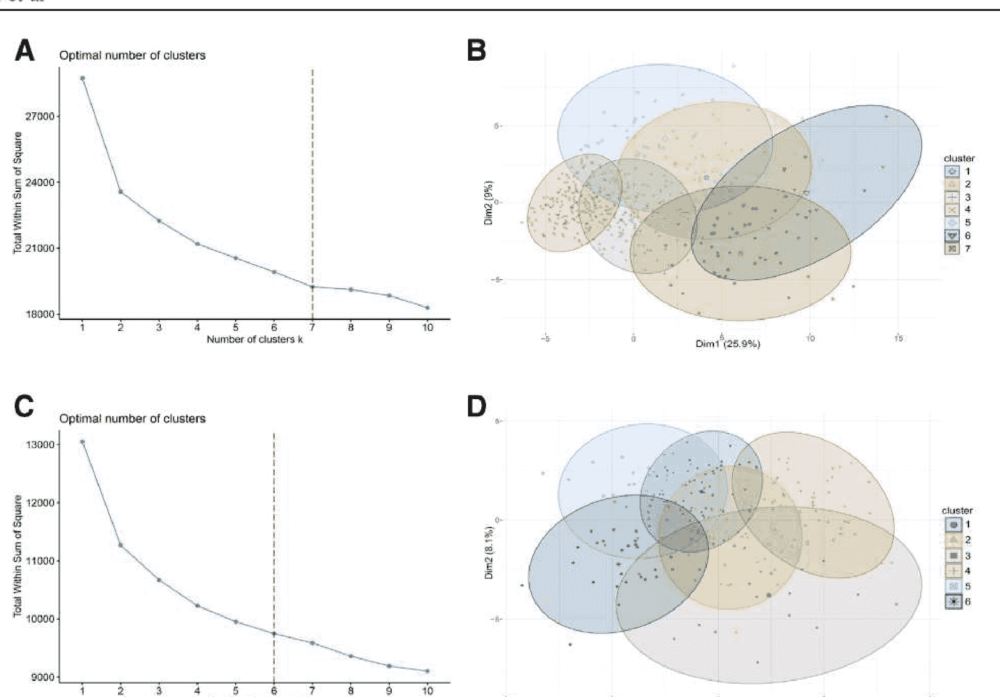

**图 2.** 基于振荡分子基因的肺腺癌患者聚类。A：在癌症基因组图谱（The Cancer Genome Atlas）集中对应聚类数 k 的平方误差总和的曲线。B：癌症基因组图谱集中聚类患者的主成分分析图。C：GSE31210 数据集（https://www.ncbi.nlm.nih.gov/geo/query/acc.gse31210）中对应聚类数的平方误差总和曲线。D：GSE31210 数据集中聚类患者的主成分分析图。红色虚线 (A) 和 (C) 表示最佳聚类数。

细胞活性和分化，以及 TCGA 数据集的免疫受体激活（图 5B）。在 GSE31210 数据集中，基因通过适应性免疫反应的激活、淋巴细胞活动调节、T 细胞激活、免疫反应中的淋巴细胞激活和免疫受体活性进行合并（图 5D）。

TCGA 数据集中的机器学习-递归特征消除分析（图 6, D 和 E）分别筛选了 16（图 6F）个候选 CMG（共刺激分子基因）。使用逻辑方法识别出 12 个重叠的 CMG，其中 6 个 CMG 被认为具有显著（补充图 S4）。

使用 TCGA 和 GSE31210 数据集在批效应处理后从 58 个 CMG 中鉴定生物标志物。在 TCGA 数据集中，最小绝对收缩和选择算（LASSO）筛选出 33 个候选 CMG（图 6, A 和 B），支持向量-递归特征消除法识别出 36 个 CMG（图 6C）。通过这两种算法的重叠 CMG 鉴定出 32 个共同的生物标志物。TCGA 中保留了 15 个诊断生物标志物，并通过多因素逻辑分析（补充图 S4）。

随后，将 GSE31210 数据集中的生物标志物与三个 CMG（CD60、LT 和 TNFS8）重叠，确定为最终诊断生物标志物（补充图 S4）。在此阶段分析了补充表 S3。

在 GSE31210 数据中，最小绝对收缩和选择算支持支持向量

如图 7A 所示，开发了一个整合 CD60、LT 和 TNFS8 的诊断预后模型，用于预测 LUAD 患者的个体 TIME（肿瘤免疫微环境）状态。在该模型中，三个 CMG 诊断生物标志物根据其表达值在点线上得分；每个患者获得得分，这

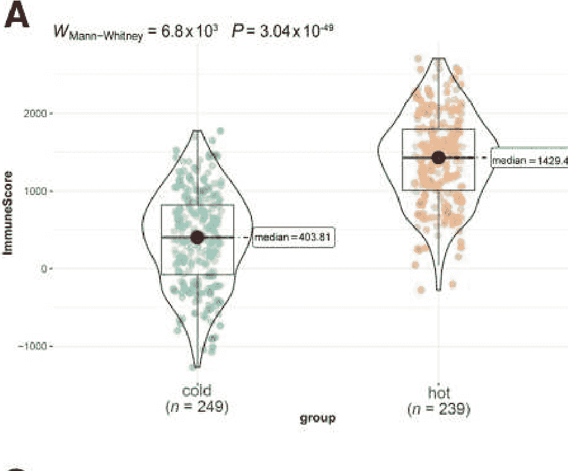

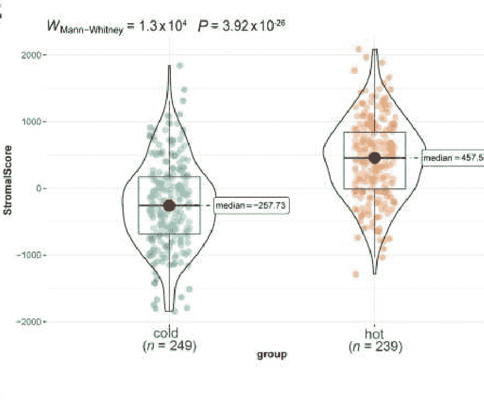

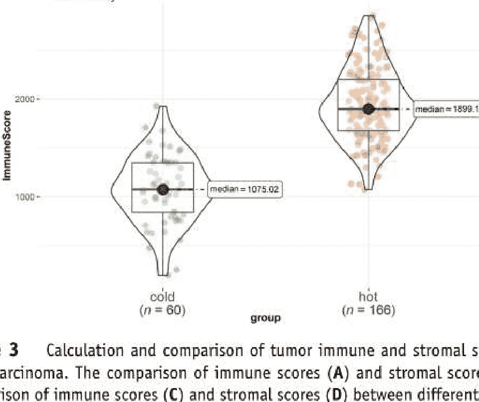

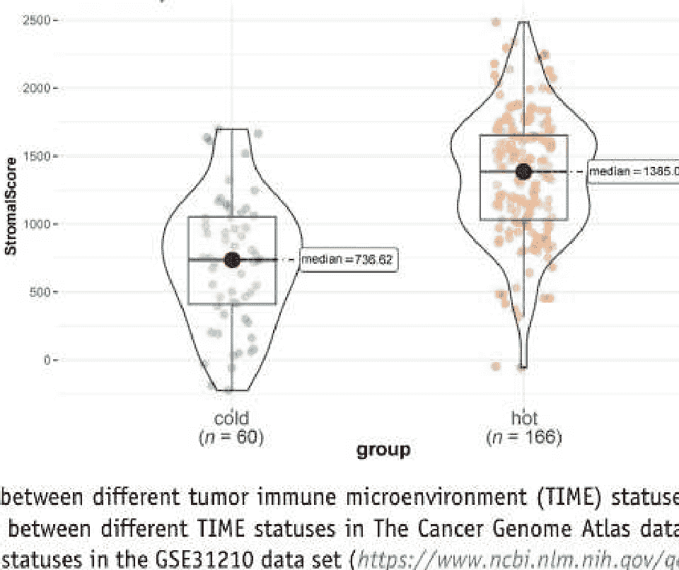

**图 3** 在不同免疫微环境（TIME）状态下的免疫和间质评分的计算与比较。肺腺癌。免疫评分 (A) 和间质评分 (B) 在癌症基因组图谱中的比较。免疫评分 (C) 和间质评分 (D) 在 GSE31210 数据集（https://www.ncbi.nlm.nih.gov/geo/query/acc.gse31210）中的比较。免疫评分 (A) 和间质评分 (B) 在癌症基因组图谱中的比较显示 0.953、0.96 和 0.902，这些显著高于 PD-L1。校准曲线显示了三个集中计算概率与预测概率的一致性（图 7, E）。此外，决策曲线显示使用我们的列线图的患者获益（图 7, H–J）。免疫学，收集了 16 份手术样本。此外，在 GSE93157 数据集中，三特征 SVM 模型预测免疫治疗反应的准确率很高。22 例中有19 例正确（补充图 S5A）。该 SVM 的曲线下面积 0.838，显著高于 PD-L1（补充图 S5B）。

为了研究三个 CMG 标记物的表达水平与免疫治疗效果的相关性

# Zhai 等

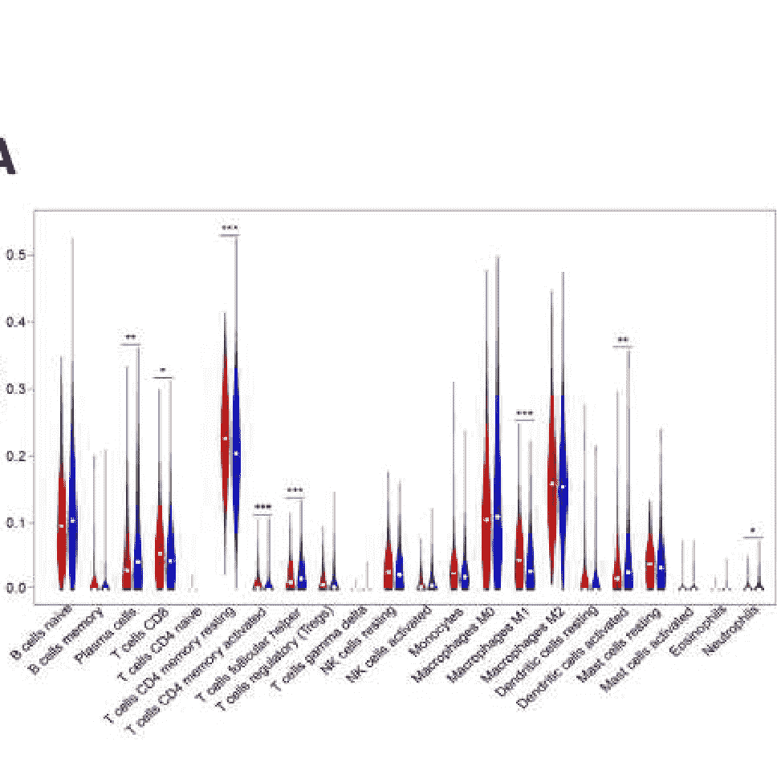

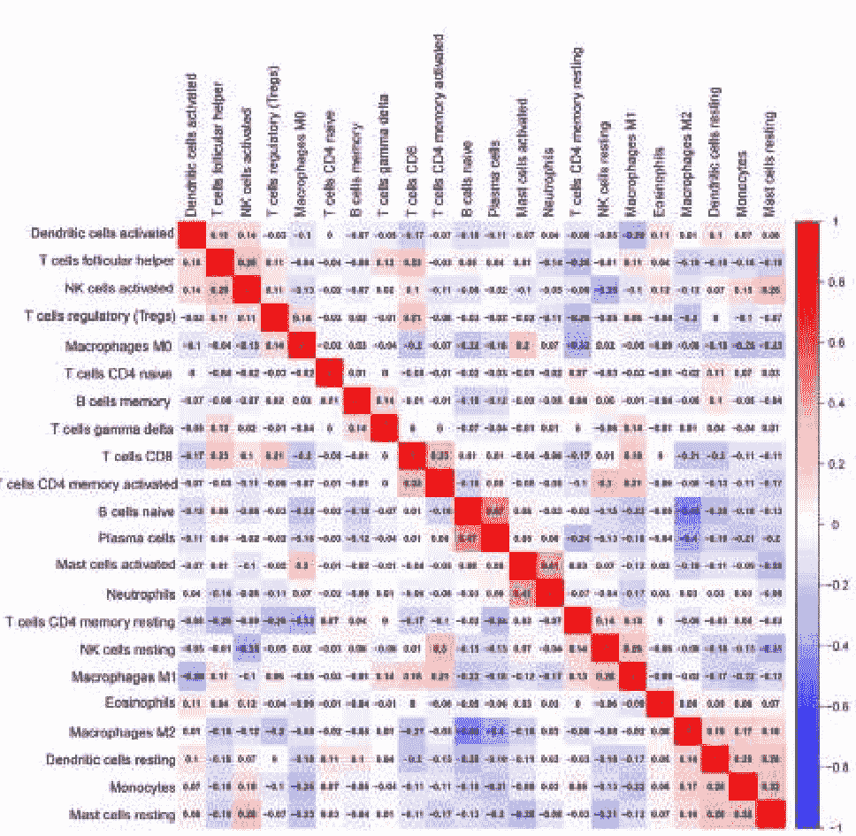

**图 4** 不同肿瘤间 22 种免疫细胞类型浸润景观的评估与可视化。左侧的小提琴图描绘了“热肿瘤组”与“冷肿瘤组”之间免疫细胞类型间的浸润情况（在癌症基因组谱 (A) 和 GSE32120 (C) 数据集中）。相关性图（右侧）显示了癌症基因组谱 (B) 和 GSE32120 (D) 数据集中两组之间免疫细胞的相关相关性。内部颜色方块显示相关性强度：颜色越大，相关性越强。蓝色代表负相关，红色代表正相关。*P < 0.05, **P < 0.01, ***P < 0.001*。自然色。

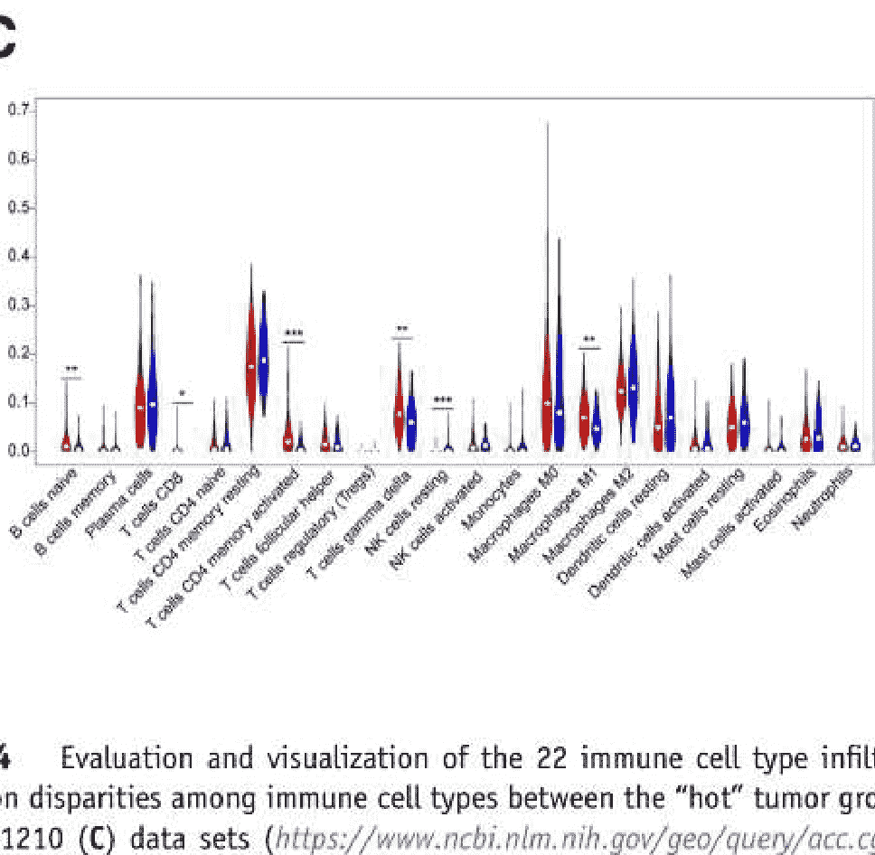

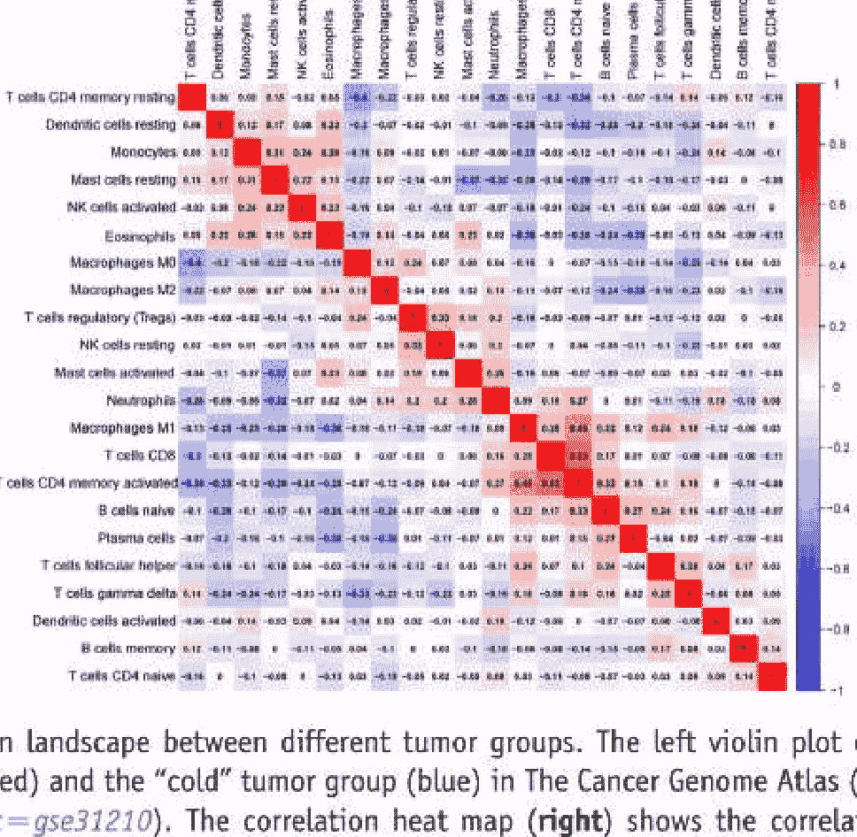

随着免疫治疗和多组学分析的发展，针对肿瘤免疫微环境（TIME）内分子和细胞机制的新兴研究正在密集进行，但大多数研究集中在免疫细胞表型。肿瘤细胞通常通过 TIME 内的共刺激分子信号和表达向免疫细胞传递错误信息，从而进一步增强免疫逃逸。作为 T 细胞激活的信号，肺腺癌（LUAD）中共刺激分子的详细阐述仍较不清楚。本研究使用无监督聚类方法基于 LUAD 中的共刺激分子基因（CMGs）识别亚型，并显著突出了 LUAD 队列中 CMGs 的综合特征及其在这些队列中的诊断价值。此外，通过免疫组化（IHC）对真实世界小样本进行探索性分析显示，在 GSE9157 数据中，三种 CMGs 的表达水平与新辅助免疫治疗的病理反应明显正相关，使用 CMGs 的 SVM 模型在预测免疫治疗反应方面也显示出高准确性。

在过去的几年中，免疫治疗，特别是针对 PD-L1/细胞死亡蛋白 1 和 CTLA-4 的免疫检查点抑制剂（ICIs），展现了革命性的巨大疗效，并被推荐作为改善三分之二患者生存状况一线治疗。然而，仍需改善 ICI 反应的策略，这可能包括对高反应或无反应肿瘤进行分层。目前，PD-L1 是美国食品药品管理局（FDA）用于非小细胞肺癌（NSCLC）免疫治疗最广泛使用的预测因子。例如，除非肿瘤细胞上 PD-L1 表达 >50%，否则帕博利单抗（pembrolizumab）未被认为是 NSCLC 患者的一线治疗。然而，Davis 等分析了 2016 年至 2019 年 4 月 FDA 批准的 45 项策略，发现 PD-L1 仅是 28.9% 的患者。在相同肿瘤类型中，PD-L1 阳性反应源于不同的检测方法以及沿不同组织样本的不稳定性。基因突变负荷也被探索作为 LUAD 患者的潜在生物标志物，但由于缺乏标准的阳性值以及在不同环境和治疗策略中预测能力的不一致，其其实际应用有限。新兴研究聚焦于 TIME 内复杂的相互作用和免疫细胞相互作用，它们受限于免疫细胞的分布、空间关联，并忽略了免疫细胞激活期间的信号调节。

在本研究中，对 LUAD 患者进行了细胞毒性分子（激活 T 细胞不可缺的信号）的整合分析。Zhang 等全面评估了 LUAD 患者细胞毒性分子的景观并开发了基于 CGMs 的预后模型。然而，他们建立的是基于个人的模型，这需要适当使用生存信息（监督）。本研究使用无监督共识聚类来评估肿瘤微环境内 CGMs 的特征。这通过最大化同一簇内免疫成分的异质性和不同细胞之间的异质性，增强了发现的统计功效。通过机器学习算法识别出共 60 个 CMGs，其中 CD80、LTB 和 TNFS8 使用 TIME 方法进行了验证，该方法涉及对苏木精和伊红染色中的淋巴细胞进行估计，以验证其诊断有效性。CD80 是一种糖蛋白，在抗原呈递细胞表面称为 B7-1。

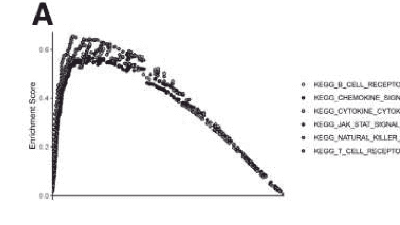

- HEGAS_B_CELL_RECRUITING_PRIMARY
- HEGAS_CHEMOKINOME_SIGNALING_PRIMARY
- HEGAS_CYTOKINE_CYTOKINE_RECEPTOR_INTERACTION
- HEGAS_AXC_SIGNALING_PRIMARY
- HEGAS_DRUG_RESISTANCE_SIGNALING_CYTOXICITY
- HEGAS_T_CELL_RECEPTOR_SIGNALING_PRIMARY

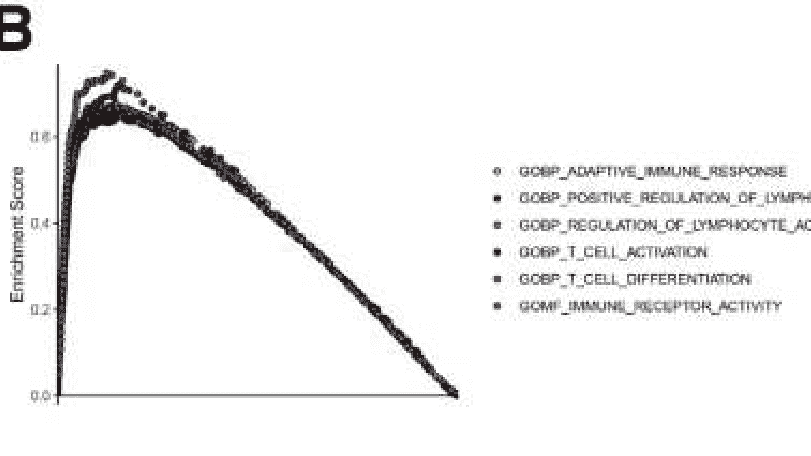

- GORAB_ACTIVATION_OF_IMMUNE_RESPONSE
- GORP_POSITIVE_REGULATION_OF_LYMPHOCYTE_DIFFERIATION
- GORP_NEURAL_DIFFERIATION_ACTIVATION
- GORP_T_CELL_ACTIVATION
- GORP_B_CELL_DIACTATION
- GORP_IMMUNE_RECEPTOR_ACTIVITY

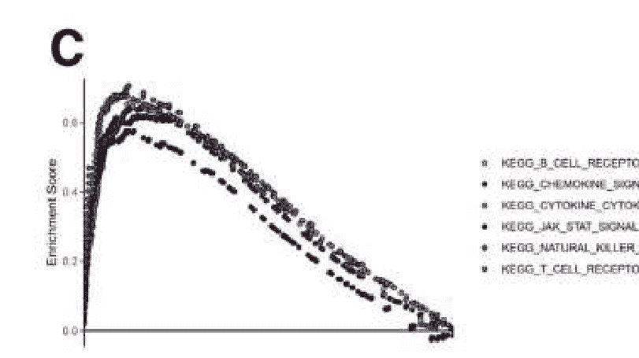

- HEGAS_B_CELL_RECRUITING_PRIMARY
- HEGAS_CHEMOKINOME_SIGNALING_PRIMARY
- HEGAS_CYTOKINE_CYTOKINE_RECEPTOR_INTERACTION
- HEGAS_T_CELL_RECEPTOR_SIGNALING_PRIMARY

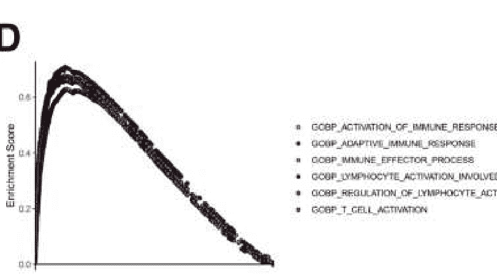

**图 5** 显示了“热”肿瘤的功能分析。京都基因组（KEGG）富集分析用于癌症基因组谱 (A) 和 GSE32110 (C) 数据集（https://www.ncbi.nlm.nih.gov/geo/query/acc.cgi?acc=g32110）。基因本体（GO）分析用于癌症基因组谱 (B) 中的生物学过程。

# Zhai 等

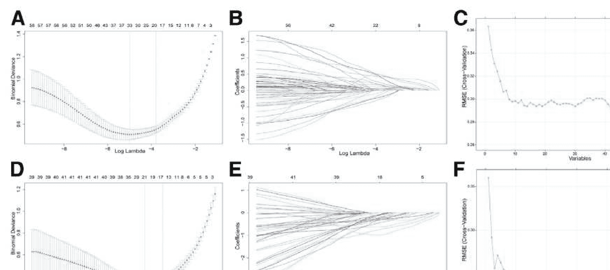

**图 6** 细胞毒性分子（CMGs）的选择，A：横轴为 lambda 值，纵轴为非零系数 CMGs 的数量；绝对收缩和选择算子（LASSO）显示了癌症基因组谱（TCGA）中每个基因的交叉验证，B：33 个候选基因的 LASSO 曲线。C：使用支持向量机递归特征消除（SVM-RFE）在 TCGA 数据集中识别标记。D：GSE32110 数据集中非零系数 CMGs 的定义（https://www.ncbi.nlm.nih.gov/geo/query/acc=Gse32110）。E：GSE32110 数据集中十折交叉验证后 21 个候选基因的 LASSO 曲线。F：RMSE，均方误差。

| 0 | 10 | 20 | 30 | 40 | 50 | 60 | 70 | 80 | 90 | 100 |
|---|---|---|---|---|---|---|---|---|---|---|---|
| | | | | | | | | | | | |

| 1 | 2 | 3 | 4 | 5 | 6 | 7 | 8 | 9 | 10 |
|---|---|---|---|---|---|---|---|---|---|---|
| | | | | | | | | | | | |

| 4 | 5 | 6 | 7 | 8 | 9 | 10 | 11 | 12 | 13 |
|---|---|---|---|---|---|---|---|---|---|---|---|
| | | | | | | | | | | | |

| 1 | 2 | 3 | 4 | 5 | 6 | 7 | 8 | 9 | 10 |
|---|---|---|---|---|---|---|---|---|---|---|---|
| | | | | | | | | | | | |

| 0 | 20 | 40 | 80 | 100 | 120 | 140 | 160 | 180 | 200 | 220 | 240 |
|---|---|---|---|---|---|---|---|---|---|---|---|---||
| | | | | | | | | | | | | |
## 热肿瘤的概率
| 0.01 | 0.1 | 0.3 | 0.5 | 0.8 | 0.9 | 0.99 |
|---|---|---|---|---|---|---|---|
| | | | | | | | | |

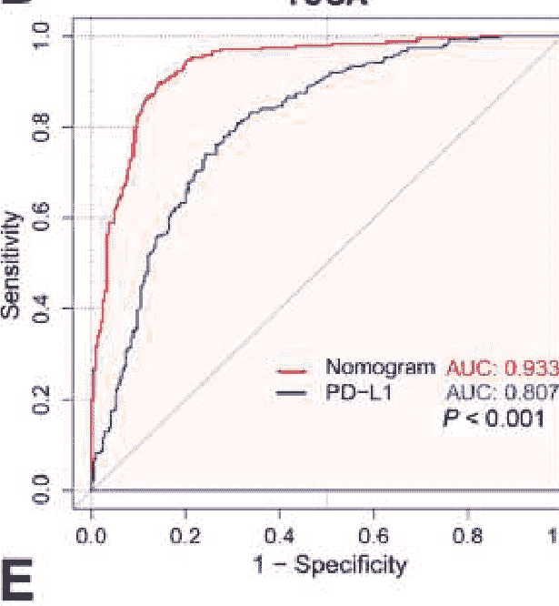

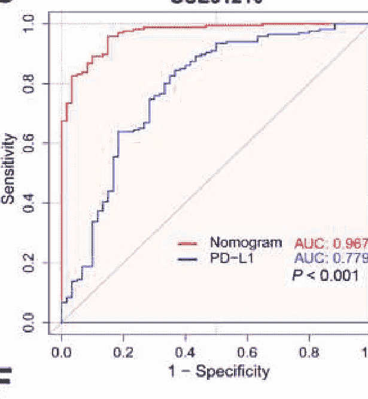

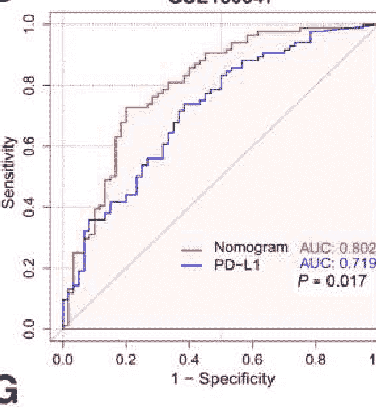

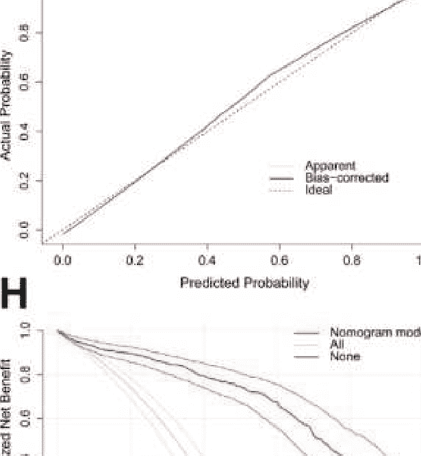

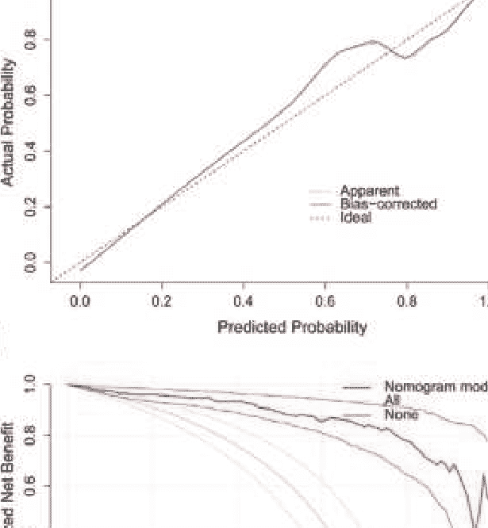

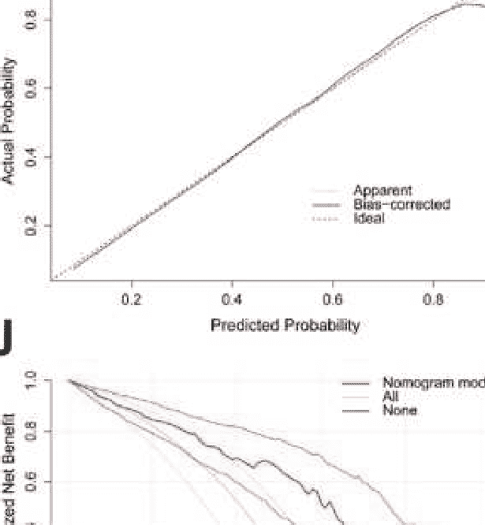

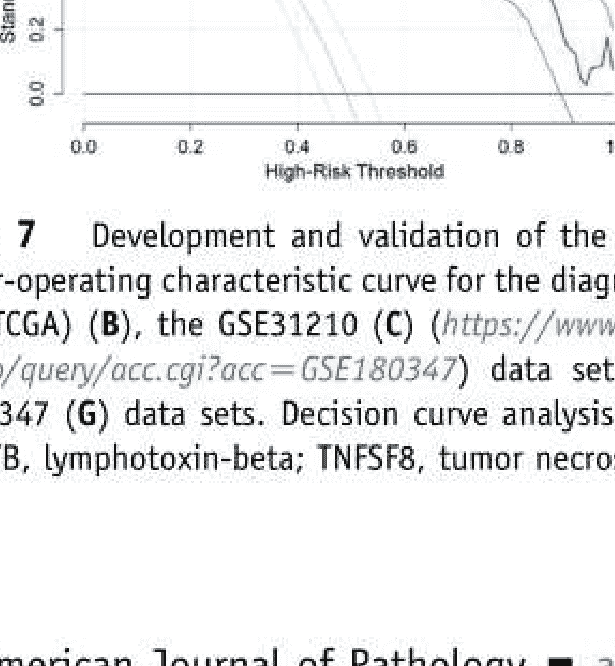

**图 7** 诊断数量的开发与验证：一种用于诊断个体免疫状态的列线图。在癌症基因组谱（B)、GSE32120 (C) (https://www.ncnlm.nih.gov/geo/query/acc.cgi?gse=GSE32120) 和 GSE180347 (D) (https://www.ncnlm.nih.nlm/geo/query/acc.cgi?gse=GSE180347) 数据集中数量和细胞死亡配体 1 (PD-L1) 的诊断效能受体激活分类曲线。TCGA (H)、GSE32120 (F) 和 GSE180347 (J) 数据集的治疗指导临床价值的决策曲线分析。淋巴毒素-beta；TNFSF8，肿瘤坏死因子家族成员 8。

Zhai 等

## B
## C

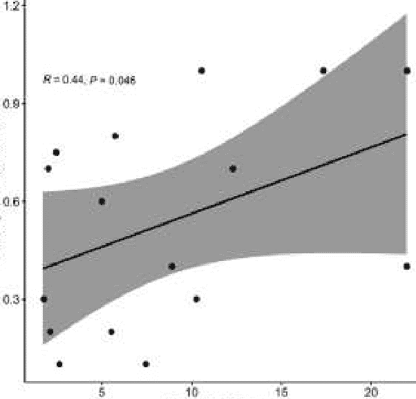

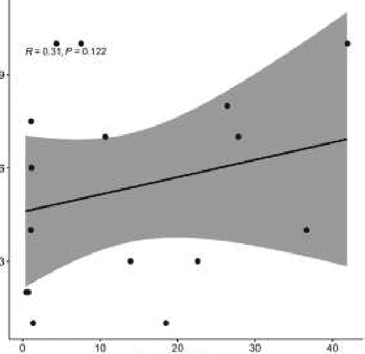

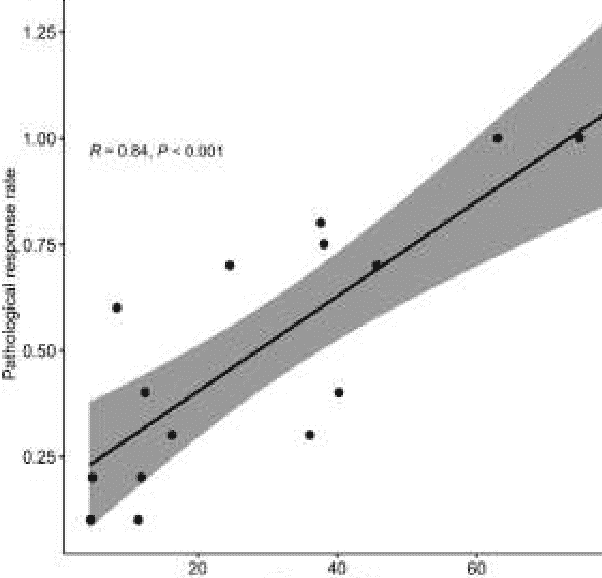

## F

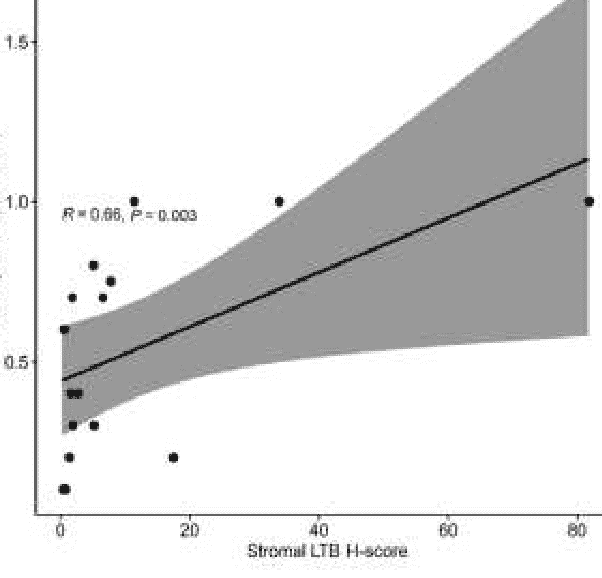

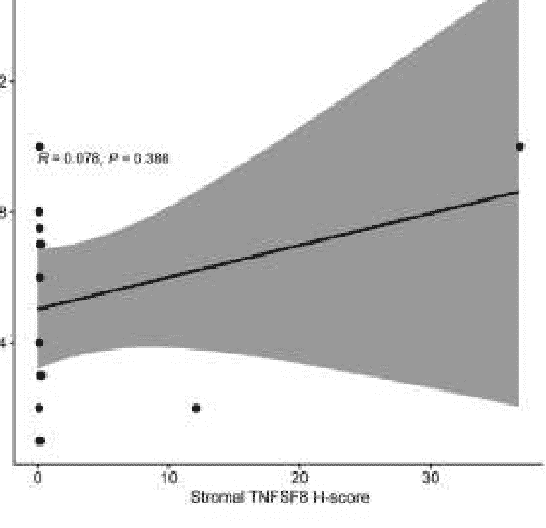

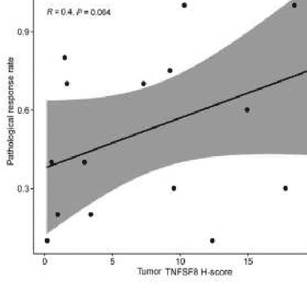

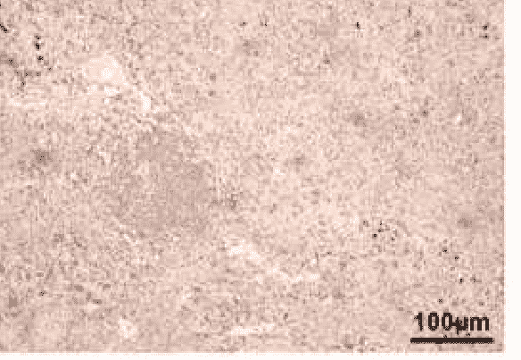
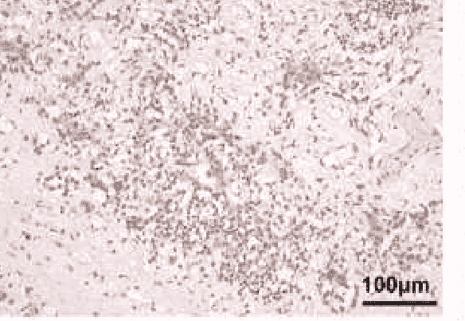

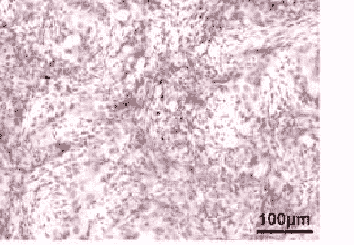

## G

## NR

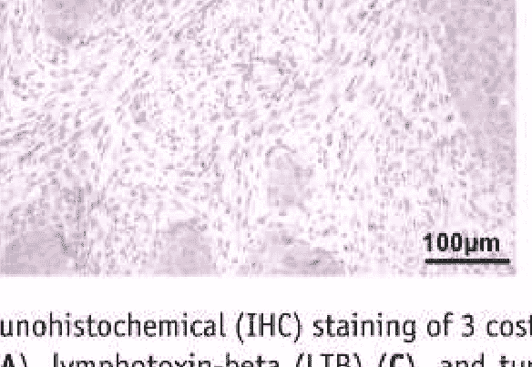
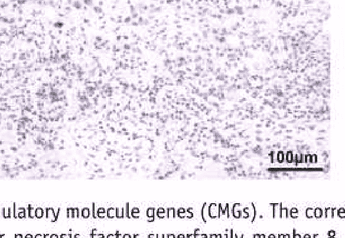

# 翟（Zhai）等
Teifarino, M, William N, Haycock J: 辅助性免疫治疗对比辅助性检查点阻滞在非小细胞癌中的疗效。Cancer Res 2018; 78(13):S1719

Sharma H, Hu-Lienstein S, Wargo JR, Rios A: 癌症中原发性和适应性免疫治疗耐药性。Cell Immunol. 2017; 68:107–123

Sharma K, Liu V, Verma W, Mahesh, Yi J, Ju D: 使用检查点抑制剂和免疫治疗联合治疗非小细胞肺癌：面临挑战与进展。Cancer Commun (2020) 63(11)
Tume PC, Harvey CL, Yearley JH, Shinaku P, Taylor EM, Roche L, Chminski B, Spasi M, Henry G, Ciobanu V, West A, Marini K, Micovac S, Sagay E, Ferry G, Gutierrez J, Trorchio M, Faban F, Hellman, Elashoff A: PD-L1 阻滞通过抑制适应性反应导致耐药。Nature 2014; 515:567–571
Kalibai A, Rimer A: 肿瘤对检查点抑制剂的免疫耐性：肿瘤微环境的作用。Nat Immunol 2019; 19:797
Inza A, Martin-Partini P, Di Lietto F, Rasoni M, Martini G, Napolitano S, Viccinini G, Gappicornia, Francesco R, Morello F, Cell CM: KRAS 突变 NSCLC 患者一线治疗预后。J Clin Oncol Med 2017; 35(24):3555

Zhai RI, Bao CH, Reichertman N, Lee KH, Liu A, M J, van der Heiden MV, Solinas A, Le Mooyte S, Robert A, Shin L, Choi J, Kim S, Gordon EM, Gonzalez JR, Shepherd FA, Gaal S, Nakagawa K, Raja, Briggs HH, Boothman A-M, Sluzalski L, Chen PC, Chang Y: 在转移性非小细胞肺癌一线线治疗中，达达单抗联合化疗对比标准化疗的研究：3 期随机临床试验。Am J Oncol 2020; 6:651–6646

Hellman RD, Zhai VA, Miller JG, Gottzner S, Horvath H, Brahmer JR, Rea RE, Defer JW, Cho J, Luqueras RA, Sher P, Gordon AS, Guse Y: 纳武单抗作为晚期非小细胞肺癌的一线治疗（CheckMate 012）：开放标签、1 期多中心研究结果。Lancet Oncol 2017; 18:8:911

Jing G, Gu Sa P, Du F, Su J, Hu A L, Li X, Zhang N, Bu X, Li J, Freeman GJ, Brown MA, Maheswry KW, Liu S: 转移性非小细胞肺癌中帕博利珠单抗联合化疗。Natron Med 2018; 25:1850

Junkrajin M, Choi JM, Zhao A, Sarano J, Xu X: HXLA2 和 TIGIT: B7 和 CD28 家族的新免疫治疗靶点
Croft M, Segal RM: 回到 TNF？克服检查点治疗耐药性的 TNF 超家族通路。Nat Rev Drug 2012; 12:1467

Kraembraels L, Weng-C, Eghbali S, Woldijk J, Mosderth H: 通过靶向微环境增强癌症免疫治疗。Pathways Clin Oncol 2019; 39:57–60
Scholberg KA, Klein SR, Freeman GA, Sharma AH: 阻阻 B7/CD28 配体-受体相互作用通路。Immunity 2014; 40:1041–1058

Lee A, Song Y, Yang J, Lu H, Sun X, Li J, Lu Y, and Zhai H: 识别一种协同分子相关基因签名以预测非小细胞肺鳞状癌患者的生存期。Front Cell Dev Biol 2021; 9:669533

Se G, Hua X, Chen J, Xiao H, Zhang Z, Lu J, Liang C T: 识别一种预测肺癌患者预后的协同分子相关签名。Front Genet 2021; 12:666001

33. Keifrei J, Kümpfels C, Fehnich A, Heindel G, Cilicic M, Vasić I, Marwitz S, Goldmann T, Pasternack H, Bohner S, Jotić D, Kuhlner M, Orfanoello A, Busch H, Sherner S: PD-L1 诱导的景观适应性组学：肺腺癌免疫微环境分析以预测患者。Cancer Basel 2019

34. Kato J, Xu X, Chen Y, Duan J, Yang- H, Mei I: 干扰素诱导的蛋白 3 在肺微环境中的作用。Science 2022

35. Newman AM, Liu CL, Green M, Green AJ, Feng X, Yang H, Delmia R: 浸润评估：用于预测治疗反应的细胞浸润谱。Nat Methods 2015

36. Subramanjian A, Tamayo P, Pootha V, Mukherjee S, Mukherjee E, Bell G, Gallile M, Somaiya R: 基因集富集分析。Am J Genet 2012

37. Li-Szaljiang Y, Chen L, Shen M: LASSO 相关基因组对免疫治疗的预测。Cell Immunolol 2017
38. Zhang Y, Sun N, Wang G, Lu Y, Chen H, Zhang Z: 预测免疫治疗反应的基因组基因组识别。Front Med Thor Oncol 2019

39. Teicald C, Vairo N, Reys R, Regaut R: 非小细胞肺癌中的 PD-L1 表达。The J Med Oncol 2018

40. Bolandardi A, Arremani H, Baghtadeh A, Sharifzadeh F, Marini O, Bonardi B, Servanello S: 原肿瘤对检查点抑制剂的阳性和负性免疫反应。Nat J Clin Oncol 2021

41. Cusumano M, El Redondo J, Jung P, Sheridan L, Mukherjee S, Mukherjee B: Galatacept（抗 CD80）单隆抗体联合flix 的安全性与疗效：功能性淋细胞免疫预后指数（FLIP）评分的治疗预测价值。Ann Clin Oncol 2012; 22:2356–2362

42. Wang Y, Wankee P: 肺癌检查点抑制剂综述。ajmp.ajjournal.org American Journal of Pathology

48. Yamada T, Miki Y, Suzuki M, Kotelub O, Saito-Koyama R, Ono K, Okada Y, Sasano H: 非小细胞肺癌原发及淋巴结转移灶中的 B7-1 和程序细胞死亡配体-1。Cancer Med 2022; 11:479–491

49. Banach-Orlowska M, Wyszyńska R, Pyrzyńska B, Maksymowicz M, Goląb J, Miączyńska M: 胆固醇限制 LT[betaR 触发的非经典 NF[kappa]B 信号通路。Cell Commun Signal 2019; 17:171

50. Pao W, Xiong Y, Famulski K, Brinkman CC, Li J, Toner N, Wagner C, Saxena V, Simon T, Bromberg JS: 通过靶向 LT[betaR 介导的非经典 NF[kappa]B 信号调节 T 细胞向性淋巴迁移。Nat Commun 2018, 9:3020

