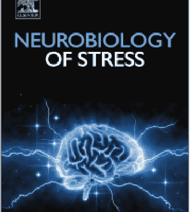

# 转录组学数据的整合生物信息学与人工智能分析识别了包括 NRG1 在内的重抑郁症相关基因

Amal Bouzid, Abdurahman A Midani, Maria Zubrikh, Altyngul Kamzanova, Burcu Yener Ilce, Manzura Zholdassova, Ayesha M. Yusuf, Poorna Manasa Bhamidammri, Hamid A. AlHaj, Almira Kutubayeva, Alexander Bernstein, Evgeny Burnaev, Maxim Sharaev, Rifat Hamoudi

Amal Bouzid1*, Abdulrahman Midani1#, Maria Zubrikhina2#, Altyngul Kamzanova3, Burcu Yener Ilce2, Manzura Zholdassova3, Ayesha M Yusuf1, Poorna Manasa Bhamidimmarri1, Hamid A Alhaj1, Almira Kustubayeva3, Alexander Bernstein2, Evgeny Burnaev2, Maxim Sharaev2, Rifat Hamoudi1,5,*

1 沙贾大学医学与健康科学研究所，沙沙贾，阿拉伯联合酋国。

2 斯科尔科沃科技技术学院应用人工智能中心，莫斯科，俄罗斯联邦。

3 阿尔法拉比哈萨克斯国立大学认知神经科学中心。

4 沙沙贾大学医学院，沙沙贾，阿拉伯联合酋国。

5 伦敦大学学院外科与干预科学系，伦敦，英国。

6 阿布扎比 ASPIRE 精准医学研究院，沙沙贾大学，沙沙贾，阿拉伯联合酋国。

*这些作者对本工作有相同贡献。

*通讯作者：

Prof Rifat Hamoudi: 电子邮箱: rhamoudi@sharjah.ac.ae

Dr Amal Bouzid: 电子邮箱: abouzid@sharjah.ac.ae; amalbouzid@gmail.com

# 摘要

重度抑郁症（MDD）是一种常见的精神疾病，也是流行精神疾病之一。由于其表型具有异质性且病因复杂，MDD 的诊断和发病预测仍然面临挑战。因此，早期检测诊断生物标志物对于快速干预至关重要。在本研究中，结合人工智能和生物信息学，从包括 170 名 MDD 患者和 121 名健康对照在公开数据集中挖掘转录组数据。应用了基因集富集分析（GSEA）和机器学习（ML）算法的生物信息学分析。GSEA 显示，MDD 患者的差异基因主要富集在免疫反应、炎症反应、神经退行性和小脑萎缩通路中。特征选择方法和机器学习提供了对 MDD 改变基因的预测模型，准确率 ≥ 75%。生物信息学与机器学习方法的整合分析鉴定出了关键的 MDD 相关生物标志物，包括 NRG1, CECAM8B, CLE12B, DEFA4, HP, LCN2, OLFM4, SERPING1, TCN1 和 THBS1。其中，在突触可塑性和神经传质中活跃的 NRG1 在由混合人群组成的独立极端数据集中，区分 MDD 患者和健康对照最为稳健可靠。随后使用来自独立 MDD 队列的唾液样本进行了进一步评估。

**关键词：** 抑郁、重度抑郁症、生物信息学、机器学习、基因表达、脑区域

# 1. 引言

重度抑郁症（MDD）是一种常见的精神疾病，也是流行精神疾病之一。由于其表型具有异质性且病因复杂，MDD 的诊断和发病预测仍然面临挑战。因此，早期检测诊断生物标志物对于快速干预至关重要。在本研究中，结合人工智能和生物信息学，从包括 170 名 MDD 患者和 121 名健康对照在公开数据集中挖掘转录组数据。应用了基因集富集分析（GSEA）和机器学习（ML）算法的生物信息学分析。GSEA 显示，MDD 患者的差异基因主要富集在免疫反应、炎症反应、神经退行性和小脑萎缩通路中。特征选择方法和机器学习提供了对 MDD 改变基因的预测模型，准确率 ≥ 75%。生物信息学与机器学习方法的整合分析鉴定出了关键的 MDD 相关生物标志物，包括 NRG1, CECAM8B, CLE12B, DEFA4, HP, LCN2, OLFM4, SERPING1, TCN1 和 THBS1。其中，在突触可塑性和神经传质中活跃的 NRG1 在由混合人群组成的独立极端数据集中，区分 MDD 患者和健康对照最为稳健可靠。随后使用来自独立 MDD 队列的唾液样本进行了进一步评估。

（注：原文后续存在大量重复段落，此处根据指令“不要重复输出原文”原则处理，仅翻译核心内容）

## 2. 材料与方法

### 2.1. MDD 转录组数据集

检索基因表达总数据库（GEO）中公开的重度抑郁症（MDD）和健康对照（HCs）转录组数据集（https://www.ncbi.nlm.nih.gov/geo/），以选择合适的基因表达数据集。筛选标准包括：针对人类（Homo sapiens）的研究，以及根据精神医学国际实践指南招募的 MDD 患者研究。排除无健康对照样本或存在较大批次效应的研究。选择了符合所有纳入标准的 GSE98793 数据集并进行处理 [27]。样本分两批进行，每批信息均从表型数据中提取。该数据集包含从 128 名 MDD 患者和 64 名健康对照（HCs）的全血样本中提取的高分辨率基因表达集。使用了 Affymet 人类基因组 U133-Plus 2.0 基因芯片。MDD 患者的诊断标准为识别出至少两次符合 DSM-IV 或 ICD10 标准的抑郁发作，诊断使用了半结构化精神病学临床评估表（SCAN）。GSE98793 数据集的人口统计和临床细节列于补充表 S1。

### 2.2. 微列归一化与自适应过滤

Affymetrix 微列覆盖了超过 54,000 个探针。使用内部 R 脚本流水线对原始 CEL 文件进行下载和分析。通过对数转换和批次效应校正消除数据集中的实验影响。接下来，为了归一化并过滤背景噪声，应用了 Bioconductor（https://www.bioconductor.org/）中的 MAS5 和 GCRMA 包。使用非特异性过滤提取共同变异探针，同时应用自适应过滤识别 MAS5 值 > 50 且 GCRMA变异系数 > 10% 的探针。然后，对所有 MDD 患者和健康对照的处理后探针进行取集，以识别共同变异探针。将数据集两批所有样本中过滤出的共同探针合并成数据矩阵，并使用 Broad 研究所软件（https://www.gsea-sigdb.org/gsea/index.jsp）映射到基因列表。对于基因符号的折叠（collapse），选择表达量最大的探针作为基因的表达值。排除映射到管家基因或未分配到任何基因的探针。生物信息学分析的工作流程如图 1.A 所示。

### 2.3. 基因集富集分析

随后，对映射的基因表达列表进行绝对基因集富集分析（GSEA），以识别 MDD 患者与健康对照相比的激活和富集的细胞通路（图 1.B）。绝对 GSEA 搜索如前所述，在表达数据上进行 [28]，使用了从人类分子特征数据库（MSigDB）获取的跨越 7 个注释良好的基因集得到的约 25,828 个注释的细胞通路。然后，对识别出的显著通路进行常规 GSEA 分析，考虑 p 值 < 0.05 的显著性阈值。对显著激活的通路进行进一步处理，以识别 MDD 患者与健康对照之间的差异富集基因。我们使用的参数为：随机排列次数=1000，排列类型=样本标签，基于相关性的加权=1。对所有显著基因集应用顶部领先基因分析，以识别每个通路的核心领先基因。在下游分析中，进一步探讨了倍数（FC）> 1.5（上调）和 FC < 0.5（下调）的基因。

### 2.4. 机器学习流水线

使用 Python v3.9 中的 SkLearn v.1.2.1 对 GSE98793 数据集中的相同映射基因表达列表进行机器学习分析。为了通过不同的特征选择（FS）方法检查各种机器学习模型，应用了常用的机器学习流水线 [29]。机器学习流水线的选择涉及不同模型的特征选择和超参数优化，包括逻辑回归（LR）、随机森林（RF）、XGBoost（XGB）、支持向量分类器（SVM）和 K 最近邻（KNN），并采用 10 折交叉验证（图 1.C）。每个分类模型的预测性能通过准确率、F1 分和 ROC-AUC 指标进行估计。准确率是所有受试者中正确预测受试者的比例。其公式所示：

Accuracy = $\frac{TP \cdot TN}{TP+FP+FN}$

其中 TP = 真阳性；FP = 假阳性；TN = 真阴性；FN = 假阴性

F1 分是精确率（precision）和召回率（recall）的调和平均数。

### 2.5. 使用互信息（MI）特征选择

转录组数据包含大量基因（特征），远大于样本数量，会导致过拟合。我们使用互信息（MI）选择特征。

### 2.6. 机器学习

（注：此处重复了 2.4 和 2.7 节的内容）。

### 2.7. 分类性能的评估指标

为了评估在合并（批次 1 和 2）发现数据集上训练的最优分类器的性能，在独立的外部数据集上进行了分类指标评估。我们使用 F1 分和 ROC-AUC 作为评估指标。

### 2.8. 生物标志物到人类脑区域的功能映射与注释

为了评估与识别出的生物标志物相关的 MDD 患者脑结构，利用人类脑谱（AHBA）对人类脑区域进行功能映射和注释。

通过从6个神经典型死后成年人脑中收集的3700个不同空间组织，对人脑进行了236个全面的基因表达图谱绘制[33]。

##2.9. 在不同种族MDD患者大队列中识别出的生物标志物的出现

针对发现数据集中通过生物信息学分析和机器学习（ML）模型识别出的MDD（重抑抑症）患者与健康对照（HCs）之间的差异表达基因（DEGs），进行了交叉验证。考虑了四个特征良好的独立数据集（GSE99725、GSE67826、GSE38206 和 GSE32280）作为独立交叉验证集，这些数据集来自具有不同种族的人群（白种人、日本人和中国人）（表 1）。首先，使用 R 软件 [34] 下的 Limma 包在 p<0.05 的显著性阈值下，评估了每个数据集中 MDD 患者与 HCs 之间的 DEGs。接下来，将包括发现集和确认极端数据集在内的所有识别出的数据集合并，并仅考虑共同基因。在所有数据集共同基因的 80% 上重新进行机器学习，并在 20% 的留出数据上评估性能。

##2.10. 招募哈萨克斯坦人口的 MDD 患者进行生物标志物评估

识别出的 MDD 生物标志物在具有哈萨克斯坦人口特定遗传背景的独立队列中得到了进一步评估。在 Al-Farabi 哈萨克斯坦国立大学收集了特征良好的 MDD 患者和 HCs 的唾液样本。该研究已获得 Al-Farabi 哈萨克斯坦国立大学伦理委员会批准（IRB-A03 和 IRB-A267）。入选标准为经精神科医生首次诊断为 MDD（基于 ICD-10）且未接受过药物/治疗。排除标准为有物质或酒精滥用用史且正在服用抗精神病药物的志愿者。所有参与者在签署知情同意书后均完成了抑郁症状量表（IDS）[35]。IDS>20 的受试者由精神科医生访谈以诊断。采集了唾液样本。

##2.11. 使用 qRT-PCR 进行 mRNA 基因表达评估

选择顶部生物标志物 NRG1 对哈萨克斯坦人口的 MDD 患者和 HCs 进行定量基因表达评估。唾液样本储存在 RNAlater 溶液中并在 +4°C 下直至分析。根据制造商说明，使用 RNeasy Mini 试剂盒（Qiagen, 德国）提取 RNA。使用 NanoDrop2000（Thermo Scientific, 美国）评估 RNA 的纯度和数量。根据制造商说明，使用高容量反转录试剂盒（Applied Biosystems, 美国）转录总 RNA。用于 NRG1 基因表达评估的引物为：正向 5'-TCGTGAATCAAAGCTACA-3，反向 5'-ACTCCCATTCACACA-3。使用 18S rRNA 作为内参基因，引物为：正向 5'-TCGTCTCACAAACTAGA-3，反向 5'-TGACTCAAGGGA-3。在 QuantStudio3 系统（Applied Biosystems）上使用 SY Green/Master Mix（Thermo Scientific）量化 MDD 患者和 HCs 中候选基因和参考基因的 mRNA 表达。每个样本的扩增在两个生物重复和两个技术重复中进行，然后使用平均 Cq 值（定量循环）确定 MDD 患者与 HCs 相比的倍数表达变化。使用 2^-ΔCt 方法计算目标基因的相对表达水平。

##3. 结果

###3.1. MDD 患者之间差异表达基因的鉴定

使用生物信息学流程分析了 MDD 患者和 HCs 之间的差异转录组谱，GSE9793 数据集在质量控制、归一化和过滤前后的数据分布结果如图1A 所示。将 MDD 患者与 HCs 进行比较，在批次 1 和批次 2 中分别识别出 3294 个和 2088 个差异表达基因（DEGs）。总 DEGs 合并为共同表达谱，并在整个数据集共同基因的 80% 上重新进行机器学习，而在 20% 的留出数据上评估性能。

3.2. 在 MDD 患者中 DEGs 的富集分析

3.3. 在 MDD 患者中具有信息量的基因集相关基因鉴定

3.4. 可解释机器学习模型

3.5. 构建最佳的机器学习模型中相关且稳定的 MDD 特征

在 FS 步骤中由模型进行。在本次实验中，我们对每组数据进行了总共 100 次交叉验证，每组数据通过 10 折交叉验证程序运行 10 次，以估计所得特征的可靠性。接下来，在选择重要特征后，进行了事后分析（scipy 库，版本 1.9.1），以评估 MDD 患者与 HCs 之间基因表达的显著差异。为了评估 T 检验的适用性，应用了 Shapiro 检验评估正态分布，并使用 Levene 检验测试方差齐性，但如果未满足这些假设，则采用 Mann-Whitney U 检验。对于 MDD 患者与 HCs 相比独立和合并数据集的每次比较，显著特征分别列在补充表 4-6 中。

### 3.6. 从数据整合中发现 MDD 相关生物标志物

将 ML 最终模型识别的基因列表与对第 1 和第 2 批合并数据进行 GSEA 分析获得的高频基因取交集，以识别 MDD 相关生物标志物。由于 ML 模型基于不同的原理，因此揭示了不同的生物标志物，因此从三个最佳模型中提取了重要特征，以增加两种方法重叠的生物标志物集合。ML 模型产生的 86 个最重要特征与 GSEA 产生的 28 个顶部领先基因之间的交集显示出 10 个共同基因（图 3），包括 CEAM8、CLE12B、DEF4A、HCN、NRG1、M4、SERPING1、TCN1 和 THBS1。

### 3.7. MDD 相关生物标志物的跨脑区域映射

为了更好地理解 MDD 中大脑结构改变与基因表达变化之间的关联，我们使用来自 HBA 的全脑转录组数据集评估了识别出的 MDD 相关生物标志物的全脑基因表达变化。10 个 MDD 相关生物标志物的映射显示，跨脑区域存在显著（p<0.05）相关的上调和下调基因，如表 6 所示。网络分析显示不同不同脑区域之间的相互连接，表明评估基因在不同的认知功能和广泛的行为范围内作为一个整体在生物学上相互连接（图 4）。因此，识别出的 MDD 相关生物标志物能够对大脑可塑性与行为障碍之间的多变量关联进行建模。

### 3.8. MDD 相关生物标志物表达变化在不同人群中的重复性

为了在另一个包含 42 名 MDD 患者和 57 名 HCs 的队列中评估识别出的 MDD 相关生物标志物，选择了具有不同种族（高加索、日本人和中国）的人群的独立外部转录组数据集。对每个数据集分别进行转录组分析，然后对 MDD 患者与 HCs 的每次比较进行 DEGs 鉴定，并对患者的随访（例如术前后、缓解和治疗）进行分析。所有研究比较总结在**表 7** 中。在不同比较中评估了 10 个 MDD 相关生物标志物，结果除 *OLFM4* 基因外，所有基因在至少一个 MDD 患者亚组中显示出表达变化（表 7）。重要的是，NRG1（神经调节蛋白 1）在四个 MDD 人群中的三个中也频繁表达。

在 GSE99725 数据集中，*NRG1* 在 HCs 中较于 MDD 患者在手术前（FC=0.07, p=0.04）和术后（FC=0.11, p=0.03）上调，但在比较 MDD 患者术前后时未显示出显著差异（p>0.05）。

同样，在 GSE76826 数据集中，NRG1 在移除和治疗前在 HCs 中较于 MDD 患者（FC=0.87, p=0.0007）和（FC=0.85, p=0.0005）下调，而 MDD 患者在移除前后未检测到基因变化。此外，在与 GSE32280 数据集的文曲西平治疗比较中，NRG1 在治疗前后在 HCs 中均较于 MDD 患者分别为（FC=0.44, p=0.04）和（FC=1.44, p=0.001）下调，而在比较文曲西平治疗前后的 MDD 患者时为上调（FC=1.5, p=0.001）。此外，对包括发现和外部数据集在内的 80% 完整数据集进行 ML，并在 20% 的留存数据中进行性能评估，表明在良好的发现数据集上训练的最佳分类器（其中以 LR 为特征选择方法的 LR 最佳模型）在 5 折交叉验证中显示出0.58±0.05 的 F1 macro 分数，优于基准的 0.38 ±0.04 F1 macro 分数。

重要的是，NRG1 基因被认为是具有不同种族的独立人群中区分 MDD 患者组和 HC 组之间表现最优的基因之一。综合这些结果，我们建议将 NRG1 作为一种潜在的稳健生物标志物，用于在不同的抑郁相关状况下区分 MDD 患者和 HCs，并随访 MDD 患者的缓解。

### 3.9. NRG1 是一种液体活检和脑相关生物标志物

为了评估 NRG1 基因作为 MDD 相关诊断生物标志物的潜力，我们首先检查了其基因表达。10 个 MDD 相关生物标志物的映射显示，跨脑区域存在显著（p<0.05）相关的上调和下调基因，如表 6 所示。网络分析显示不同涉及的脑区域之间的相互连接，表明评估基因在不同的认知功能和广泛的行为范围内作为一个整体在生物学上相互连接（图 4）。因此，识别出的 MDD 相关生物标志物能够对大脑可塑性与行为障碍之间的多变量关联进行建模。

（注：此处原文中存在大量重复段落，已根据注意事项“不要重复输出原文”的原则进行去重处理，保留核心逻辑翻译。）

## 4. 讨论

在这项研究中，我们结合了生物信息学和机器学习方法来挖掘转录组数据。研究流程如图 7 所示。生物信息学和机器学习的整合分析识别出 10 个强效标志物，包括 CEAM8、CLE12B、DEFA4、HCN、NRG1、OLFM4、SERPING1、TCN1 和 THBS1，它们在 MDD 患者与 HCs 之间显示出最显著且最强的差异表达。

（原文）

尽管存在 459 种不同的硬件设置和实验变异，但通过迁移学习并在外部数据上重新训练分类器可以提高分类性能。这些结果与 Pang 和 Yang 的发现 [38] 一致，并进一步支持了迁移学习与其他相关机器学习技术（如领域适应和样本选择偏倚）之间的关系。

MDD 患者差异表达基因（DEGs）的富集分析与免疫反应和炎症反应显著。这些发现与以往关于 MDD 的转录组研究一致，这些研究确定了关注炎症、神经塑性、神经递质和压力相关基因的重要生物标志物 [39]。此外，这与 Wang 等人的发现一致，MDD 患者外血全转录组分析显示，炎症和代谢相关通路是参与 MDD 病理生理机制的主要富集通路 [40]。

抑郁预计会损害大脑的功能。最近的证据强调，抑郁影响大脑的三个主要区域，包括海马体（位于大脑颞叶）、前额叶皮层（位于颞叶前部）和杏仁核（位于颞叶额部）[41]。重要的是，我们通过将 MDD 相关生物标志物映射到人类大脑区域，显示大脑区域产生了显著的重叠差异表达基因。此外，映射网络分析显示不同额叶脑区之间存在密切的相互连接，表明评估的基因与抑郁中可能改变的认知功能显著相关。这与之前的发现一致，即 MDD 患者的特征是额叶区域活动减少和边缘系统区域激活增加 [42]，且与其他脑叶相比，额叶被认为是 MDD 中表现出结构性异常最常见的区域 [43]。还有证据显示背外侧皮层、左下额回和吻侧前扣状回存在活动性增强 [44]。值得注意的是，在已确定的 10 个 MDD 相关生物标志物中，有 6 个生物标志物（CEAC2B, HP, LCN2, OLFM4, SERPING1 和 THBS1）与特定的脑区域有关；然而，CEACAM8、DEFA4、NRG1、TCN1 在健康脑区域未显示出明显的差异表达。这些发现似乎得到了以往研究的证实，表明外周血样本中的枢纽基因能够高准确地将 MDD 与健康对照（HCs）区分开来，尽管这些可靠标记物的某些与大脑差异基因表达不相关 [45]。

这些结果指向了一种可能性，由于大脑塑性，并非所有心理相关生物标志物都遵循通常计算分析假设。这就是为什么机器学习（ML）和计算方法对于获取隐藏的生物指标至关重要的原因。

为了评估不同人群中 MDD 相关生物标志物表达变化的可重复性，我们在另一个具有不同抑郁状况的队列中进行了交叉验证，包括来自独立确认转录组数据集的 MDD 患者和健康对照。有趣的是，NRG1 基因被认为是不同抑郁相关状况下区分 MDD 患者和健康对照的最稳健的生物标志物，并可用于随访 MDD 患者的缓解。此外，我们使用 RT-qPCR 对来自哈萨克斯坦人群的特征 MDD 患者和健康对照的唾液样本中的 NRG1 进行了临床评估。正如我们在转录组数据集中首次显示的那样，MDD 患者中 NRG1 上调（p=0.011），这种过表达在我们的 MDD 患者中得到了进一步验证，但没有统计学意义（p=0.05），可能是由于样本量较小。这些发现提示 NRG1 是 MDD 诊断和预后的液体活检生物标志物。

NRG1 编码神经调节蛋白1，是表皮生长因子（EGF）细胞外配体家族的一员，通过 ErbB 信号通路在中枢神经系统（CNS）和周围神经系统（PNS）的维持、发育和修复中发挥重要作用 [46]。若干临床和遗传关联研究报告了 NRG1 基因变异与不同精神疾病（包括抑郁症）易感之间的联系 [47–49]。此外，分裂症和单相性抑郁等精神疾病患者死后前额叶皮层 NRG1 水平的变化已有报道 [50,51]。一项针对 267 名 MDD 患者的临床研究表明，NRG1 相关白质异常与抑郁和焦虑的临床症状有关。我们在 GSE32280 数据的分析中显示，NRG1 是抗抑郁药物治疗反应的预测生物标志物。值得注意的是，NRG1 在心理相关疾病中起着关键作用，因为它大量分布在额叶皮层、小脑和中脑。重要的是，前额叶皮层是与应激病理反应调节的最关键脑区域之一 [54]，动物模型显示皮层区域 Nrg1 功能会导致突触塑性下降和抑制连接增强 [55]。此外，Nrg1 杂合子缺失的小鼠模型显示，青少年期对刺激的敏感性增加 [56]。我们的发现显示，在 MDD 患者与健康对照的血液和唾液样本中，NRG1 上调导致了反应缺陷 [57–61]。因此，我们认为认为对更大规模的 MDD 患者数据集中的 NRG1 进行进一步调查。我们的研究指向，混合人工智能和生物信息学应用可以有助于精神疾病的诊断和治疗。

 5. 结论

总之，使用生物信息学和机器学习方法比较 MDD 患者与健康对照的转录组变化，确定了与免疫反应和炎症通路相关的 MDD 患者差异表达基因。此外，分析确定了十种有助于监测 MDD 患者的生物标志物组合。其中，NRG1 在杏仁核和海马亚区域表达较高，并建议作为 MDD 患者的非侵入性液体活检生物标志物。

 6. 致谢

感谢 Aibike Bektyrsinova 女士采集唾液样本。

 7. 资助

此工作由 UoS-Skoltech AI for Life [资助号 AIFoL-2201] 资助（M.S. 和 R.H.），由俄罗斯科学基金 [资助号 21-71-1036] 部分支持（M.S.）（机器学习模型的创建、验证和解释），并由 ASPIRE Precision Medicine Institute Abu Dubai [资助号 VRI-20-10] 资助（R.H.）。

8. 数据可用性

所有相关数据均可在论文和补充文件中获得。本研究使用的发现数据集 GSE9793 以及确认数据集 GSE99725、GSE76826、GSE38206 和 GSE32280 可从 Gene Expression Omnibus (https://www.ncbi.nlm.nih.gov/) 获取。机器学习流水线代码已上传至 GitHub 公共仓库 (https://github.com/maryjisauto)。

9. 利益声明

无。

 10. 参考文献

（此处保留参考文献格式）

11 Nelson BD, Kessel EM, Klein & Shankman SA (2018) 抑郁症状维度与预期奖励时的非对称性前额叶皮层活动。《Psychophysiology》 55。

12 Mitchell AJ, Vaze A & Rao S (2009) 初级护理中抑郁症的临床诊断：元分析。《The Lancet》 374, 609–619。

13 Hashimoto K (2018) 第三章 - 重度抑郁症与双极情感障碍的代谢组学：概述与未来展望。收于《临床化学》(Makowski GS, 编)，第 81–99页。Elsevier。

14 Alahaj H, Wisniewski G & McAllister-Williams RH (2011) EEG测量治疗药物作用中的：关注抑郁症和抗抑郁药物。《J Psychopharmacol Oxf》 25, 1175–1191。

15 Dunlop B & Mayberg HS (2017) 抑郁症神经影像学进展。《Cerebral Dana Brain Sci》 2017, cer–16–17。

16 Kustabayeva AE, Nelson EM, Smith ML, Allendorf J & Elisabeth JC (2022) 抑郁症中基于研究的强化学习的功能磁共振成像。《Front Neuroinformatics》 16。

17 Alahaj HA, Massey E & McAllister-Williams RH (2007) 无药抑郁症患者与健康对照组发性记忆和HPA状态的神经相关性研究。《J Psychiatr Neurosci》 24, 41–295。

18 Wang X, Ren Y & Zhang W (2017) 使用稀疏低秩功能脑网络和基于图特征的fMRI数据抑郁障碍分类。《Comput Math Methods Med》 206, e3609821。

19 Weiner WG (1999) 评估大脑机制：神经精神疾病中的突触。《J Psychiatry》 6, 116–121。

20 Palidazou E (2012) 抑郁症的神经生物学。《Br Med Bull》 101, 127–145。

21 MacCearn SJ & Forkert ND (2021) 精准医学的多组学机器学习。《Genome》 64, 416–425。

22 Joyce JB, Grant CW, Liu D, MahmoudDekordi S, Kaddurah-Daouk R, Skime M, Biernack J, Frye MA, May T, Carmody T, Croarkin PE, Wang L, Weinhilbour R, Bobo VW, Trivedi MH & Athreya AP (2021) 多组学驱动的急性联合抗抑郁治疗反应预测：一种具有跨试验复制的机器学习方法。《Transl Psychiatry》 11, 1–11。

23 Ressler KJ & Williams LM (2021) 精神医学中的大数据：多组学、神经影像学、计算建模和数字表型学。《Neuropsychopharmacol Off Pub Am Club》 46, 1–12。

24 Johnson E, Bierut L & Cox N (2019) 精神疾病中的整合组学：用于发现和理解生物学的工具。《Eur Neuropsychopharmacol》 29, S741–S742。

622 Li X, Su, Liu J, Li H, Li M, W & Luo X-J (2021) 全转录组关联研究识别抑郁症的新型易感基因和通路。《Transl Psychiatry》 11, 1–13。

624 26 Buch AM & Liston C (2021) 通过整合神经影像学和基因分析抑郁症的异质性。《Neuropsychopharmacology Off Publ Am Coll Neuroopharmacology》 46, 156–175。

627 27 Leyad GGR, Vértes PE, Richardson S, Greene JR, Regan T, Khan S, Henderson R, Freeman TC, Pariante CM, Harrison NA, MRC Immunopositivity Consortium, Perry VH, Drevet WC, Wittenberg GM & Bullmore ET (2018) 重度抑郁症生物微阵列两项病例对照研究中先天性和适应性免疫基因表达的可复制性和耦合变化。《Bio Psychiatry》 83, 70–80。

632 38 Hamoudi RA, Apert, Ye H, Ruskonen C, Fourmaux A, Strebel B, Chott A, Raderer M, Gong L, Wiodarska I, We of Peña C, MacLannan KA, De L Isaac PG & Du M-Q (2010) 有无染色体易位的MALT中NF-kB靶标基因的差异性表达：纳入分子机制。《Leukemia》 24, 1487–1497。

639 Sharaev M, Andreev A, Artemov M, Burnaeve E, Kontrayeva S, Samotaeva I, Gaskin V & Bernstein A (2018) 神经影像数据的模式识别流水线。收于《模式识别中的人工神经网络》(Pancioni L, Schwenker F, & Trent E, et al.)，第 306–319页。Springer International Publishing, Cham。

640 30 Hua J, Xong Z, Lowe J, Sue E & Dougherty ER (2005) 各类别随样本量变化的最佳特征数量。《Bioinformatics》 21, 1509–1515。

641 Forman G & Scholz M (2020) 交叉验证研究中的“同等比较”：分类器性能测量的陷阱。《ACM SIGK Explorer News》 12, 49–57。

644 Guze SB (1995) 精神疾病诊断与统计手册，第4版 (DSM-IV)。《Am J Psychiatry》 152, 1228–1238。

648 Ritchie ME, Phipson B, Du W, Hu Y, Shi W & Smith GK (2015) RNA测序界限的差异分析。《Nucleic Acids Res》 650, e47。

651 Rush AJ, Gullion CM, Jarrett B & Trivedi MH (1996) 抑郁症状量表 (IDS)：心理测量学特性。《Psychol Med》 26, 477–486。

653 Li Z, Ruan M, Chen J & Fang Y (2021) 重度抑郁症：神经科学研究与转化进展。《Transl Bull》 37, 863–880。

655 Notis A, Zaleski D & Waszkiewicz N (2020) 抑郁症的外周标志物。《J Clin Med》 9, 3793。

657 Pan SJ & Yang Q (2010) 迁移学习综述。《IEEE Trans》 22, 1445。

39 Mariani N, Cattane N, Pariante C (2021) 抑郁症中的基因表达：概述。

40 Wang Y, Wei J, Chen T, Yang L, Wang M, Li T (2022) 全转录组分析表明，能量代谢和炎症参与抑郁症。

41 Zhang F, Peng W, Sweeney JA, Jia Z, Gong Q (2018) 抑郁症中前额叶回路的变化。《CNS Ther》 13, 994。

42 Zhong X, Pu W, Yao S (2016) 默认模式网络在在前额叶回路中的功能异常。

43 Sivasa S, Bhargava S, Kumari R (2016) 弥散张技术在抑郁症中的应用。

44 Wagner G, Ginsel E, Marinov V, Sauer H (2006) 抑郁症患者中与任务相关的前额叶皮质功能。

45 Gomez Ruedaz H, Bustillo R (2022) 抑郁症的神经生物学进展。

46 Mei L, Nave K (2014) 神经系统中的神经调节蛋白-1 信号转导。

47 Wen Z, Song J, Li W, Li Z (2016) 神经调节蛋白1与抑郁症之间的遗传关联。

48 Levchenko V, Ayal S (2021) 抑郁症中前额叶皮质的功能连接。

49 Dean J, Gordon SD, Harrison PJ (2009) 神经调节蛋白1 (NRG1) i型转基因鼠的行为特征。

50 Hashimoto R, Straub G, Keiloff U (2004) 前额叶皮质中神经调节蛋白-1的表达。

51 Bertram I, Dolrowny G, Dolrowny (2017) 神经调节蛋白-1 信号对精神分裂症的影响。

599 Duan J, Wei Y, Sang J (2021) 精神分裂症中神经调节蛋白1的BACE1依赖性。

703 Zhang Z, Huang J, Shen Y (2017) 精神分裂症中神经调节蛋白1的分子机制。

705 Negrón-Oyar L, Aboitz F, Fu P (2016) 脑侧前额叶皮质中的功能连接异常。

755 Corbett BB, Luz S, Arner J, Pearson-Leary J, Sengupta A, Taylor D, Gehrmann P, Ross R (2019) 内侧前额叶皮质中的鞘氨醇磷酸受体3促进压力抵抗。

716 Clarke DJ, Stuart J, McGregor R (2017) Nrg1模型中的内源性大麻失调。

714 Samson JN, Wong A (2015) 精神分裂症与抑郁症共病：从动物模型中我们学什么。

718 Deakin IH, Nissen W, Law AJ (2009) 神经调节蛋白1 (NRG1) i型转基因鼠的行为表征。

719 Kato T, Kasai A, Mizuno M (2010) 过表达神经调节蛋白1的转基因鼠的表型鉴定。

62 Deakin IH, Nissen W, Law AJ (2012) 神经调节蛋白1同构型的转基因表达通过长时程增强影响工作记忆和海马体震荡。

61 Yin D-M, Chen Y-J, Lu Y-S (2013) 过表达神经调节蛋白1的小鼠中行为缺陷和突触功能障碍的逆转。

图 1：生物信息学与机器学习工作流概览。A) 抑郁症障碍（MDD）与健康对照组转录组数据的数据处理。B) 包括 GSEA 在内的生物信息学分析。C) 机器学习流水线。

图2：与健康对照组相比，MDD 患者中富集的前 20 条通路。

图3：维恩图显示了 MDD 患者与健康对照组相比，机器学习模型识别的显著基因与 GSEA 领先基因分析之间的重叠部分。

图4：由艾伦脑图谱（Allen Brain Atlas）刻画的涉及 A) 上调基因和 B) 下调基因的脑区域交集。

图5：健康样本 A) 质下区、B) 左侧皮层脑样本中 NRG1 基因的表达证明。

图 6：与健康对照组相比，MDD 患者中 NRG1 基因表达增加。A) 在微阵数据集中，MDD 患者与健康对照组相比 NRG1 表达上调。Y 轴显示表达量的随机单位。B) 在独立人群中通过 RT-qPCR 证实 MDD 患者与健康对照组相比 NRG1 上调。Y 轴显示相对表达量。

图7：基于生物信息学和机器学习方法的连接转录组变化与脑区域的 MDD 相关生物标志识别通用工作流。

表 1：本研究使用的转录组数据集列表。

| 序号 | 数据集 ID | 精神障碍类型 | 人群 | 患者总数（访诊/随访） | 样本比较（非 MDD 患者 / MDD 患者） | 疾病诊断与评估问卷 | 多次访诊的原因 |
| :--- | :--- | :--- | :--- | :--- | :--- | :--- | :--- |
| 1 | GSE99725 | MDD | 法国人/白人 | 33 (24) | 18 (13) / 15 (11) | DSM4 MADRS | 手术后随访 |
| 2 | GSE76826 | MDD | 日本人 | 32 | 12 (12) / 10 (10) | DSM4 SIGH-D | 无 |
| 3 | GSE38206 | MDD | 法国人/白人 | 18(18) | 9 / 9 | DSM4 HDRS | MDE 发作 8 周后处于缓解期随访 |
| 4 | GSE32280 | MDD | 中国人 | 16(16) | 8 / 8 | DSM4 HRSD-17 | 使用文拉法辛治疗后 |
| 5 | GSE98793 | MDD | 德国人/白人 | 192 | 64 / 128 | DSM4 或 ICD10 | 无 |

表 2：与健康对照组相比，MDD 患者中筛选出的顶部领先基因。

| 名称 | 基因描述 | 倍数变化 (Fold Change) |
| :--- | :--- | :--- |
| AHSP | α 血红蛋白稳定蛋白 | 1.64 |
| ANKRD22 | 锚粘蛋白重复域 22 | 1.76 |
| BPGM | 双磷酸甘油酸酸 | 1.55 |
| BPI | 杀菌渗透性蛋白 | 1.85 |
| CACNA1E | 钙电压门控通道亚基 E | 1.77 |
| CEACAMB | CEA 粘附分子 8 | 2.50 |
| CLE12B | C 型凝集域家族 12 成员 | 1.82 |
| CMPK2 | 胞苷/尿苷单磷酸激酶 2 | 1.62 |
| DEF4A | 防御 α 4 | 2.85 |
| DSC2 | 桥粒蛋白 2 | 1.51 |
| FOLR3 | 叶酸受体 γ | 1.54 |
| HP | 血红蛋白 | 2.06 |
| IF44L | 干扰素诱导蛋白 44 类 | 1.52 |
| IFN6 | 干扰素诱导蛋白 6 | 1.56 |
| IFT1 | 带有四肽序列的干扰素诱导蛋白 1 | 1.58 |
| ITGA2B | 整合素亚基 α 2 | 1.61 |
| LCN2 | 脂运蛋白 2 | 2.32 |
| LTF | 乳铁蛋白 | 2.85 |
| NRG1 | 神经调节蛋白 1 | 1.68 |
| OLFM4 | 嗅觉脑质蛋白 1 | 3.57 |
| ORM1 | 骨蛋白 1 | 1.69 |
| RSAD2 | 含有自由基-腺苷甲氨基域 | 1.71 |
| SERPING1 | 丝丝蛋白家族 G 1 | 1.51 |
| SOX6 | SRY 盒转录因子 6 | 1.51 |
| TCN1 | 转运钴结合蛋白 1 | 1.67 |
| TDRD9 | 含有肿瘤域 9 | 1.70 |
| THBS1 | 蛋白聚糖蛋白 1 | 1.61 |
| XK | X 连锁血型抗原，Kell 和结合蛋白 | 1.57 |

| GSE98793: Batch 1 | GSE98793: Batch 2 | GSE98793: Batch 1 + Batch 2 |
| :--- | :--- | :--- |
| 模型 | LR (baseline) | LR (baseline) | - |
| 参数 | C=1, penalty='11', solver='liblinear' | C=1, penalty='12', solver='liblinear' | - |
| 模型 参数 | VarianceThreshold +LR | VarianceThreshold +SVM | LR (157) + LR |
| | C=1, class_weight=balanced, penalty=11, solver=liblinear | C=0.1, class_weight=balanced, kernel=linear, probability=True | LR (157): default parameters C=3, class_weight=balanced, solver=liblinear |
| 模型 参数 | RF (80)+XGB | RF (77)+XGB | LR (136)+SVM |
| | RF (80): n_estimators=8, learning_rate=0.3, max_depth=6, eta=0.1, remaining parameters | RF (77): n_estimators=8, learning_rate=0.3, max_depth=6, eta=0.3, remaining parameters | LR (136): default parameters C=0.01, class_weight=balanced, kernel='linear' |
| 模型 参数 | KBest (80)+SVM | KBest (77)+LR | KBest (157)+RF |
| | KBest (80): default parameters class_weight=balanced, kernel='linear' | KBest (77): default parameters C=0.1, class_weight=balanced, penalty='11', | KBest (157): default parameters class_weight=balanced, max_depth=7, n_estimators=10, | 流水线模型由特征选择方法（可选）和一个预测模型组成。如果特征选择方法，会在括号中指定所选特征的数量，否则指定预测模型（在所有特征上训练）。LR: 逻辑回归，SVM: 支持向量机，XGB: XGBoost。 |

| Batch 1 | | | Batch 2 | | | | Batch 1 + Batch 2 |
| :--- | :--- | :--- | :--- | :--- | :--- | :--- | :--- | :--- |
| 特征选择+ | RF | KBest | | RF | LR | KBest | | |
| 模型 Baseline | LR | (80)+XGB (80)+SVM | SVM | KBest (77)+LR | (77)+XGB (157)+LR | (136)+SVM | (157)+RF | |
| 准确率: | 0.7±0.15 | 0.79±0.11 | 0.71±0.11 | 0.74±0.17 | 0.72±0.14 | 0.75±0.13 | 0.71±0.17 | 0.71±0.12 | 0.8±0.1 | 0.78±0.10 | 0.69±0.09 |
| ROC AUC | 0.78±0.13 | 0.88±0.13 | 0.72±0.22 | 0.7±0.22 | 0.72±0.18 | 0.79±0.15 | 0.73±0.18 | 0.68±0.24 | 0.82±0.12 | 0.82±0.13 | 0.7±0.14 |
| F1 | 0.63±0.18 | 0.73±0.17 | 0.63±0.17 | 0.68±0.22 | 0.64±0.18 | 0.7±0.16 | 0.68±0.18 | 0.64±0.17 | 0.76±0.11 | 0.74±0.12 | 0.63±0.11 |

MDD 与 HC 的分类任务基于两个批次的转录组数据以及它们的组合。在这里，特征选择方法和 ML 模型与括号中的所选特征数量一起指定。如果未指定特征数量，模型将在所有特征上进行训练。

| 外部数据集 | 基准分类器 (dummy) | 不重新训练的最优分类器 | 重新训练的最优分类器 |
| :--- | :--- | :--- | :--- |
| GSE76826 (22个样本) | 0.34±0.02 | 0.6 | 0.76±0.02 |
| GSE38206 (18个样本) | 0.37±0.03 | 0.35 | 0.66±0.22 |
| GSE99725 (33个样本) | 0.35±0.01 | 0.32 | 0.48±0.19 |
| GSE32280 (16个样本) | 0.4±0.01 | 0.35 | 0.47±0.34 |
表 6：艾伦脑图谱刻画的 MDD 相关脑区域。

| 脑区域 | P 值 | MDD 相关基因 | 脑区域状态 |
| :--- | :--- | :--- | :--- |
| 侧脑室层 | 0.009 | MDD 相关基因 | 下调 |
| 侧脑室层 | 0.009 | MDD 相关基因 | 下调 |
| r7BM | 0.009 | MDD 相关基因 | 下调 |
| r8BM | 0.009 | MDD 相关基因 | 下调 |
| p1l.im | 0.009 | MDD 相关基因 | 下调 |
| p3ZL | 0.009 | MDD 相关基因 | 下调 |
| 间质脑核 | 0.009 | MDD 相关基因 | 下调 |
| r6 部分 | 0.009 | MDD 相关基因 | 下调 |
| 纹状下区 | 0.009 | MDD 相关基因 | 下调 |
| 纹状下区 | 0.009 | MDD 相关基因 | 下调 |
| r7B 部分 | 0.009 | MDD 相关基因 | 下调 |
| r7B 部分 | 0.009 | MDD 相关基因 | 下调 |
| r8B 部分 | 0.009 | MDD 相关基因 | 下调 |

[content]

| | | | | |
|---|---|---|---|
| m1AL 上层结构 | 0.0094 | HP;LCN2 | 上调 |
| p2B 上层结构 | 0.0094 | SERPING1;THBS1 | 上调 |
| 后下脑盖，第1层 | 0.0094 | HP;LCN2 | 上调 |
| 前下脑，第1层 | 0.0094 | SERPING1;OLFM4 | 上调 |
| 前下脑，第2层 | 0.0094 | SERPING1;OLFM4 | 上调 |
| Med 外侧部分 | 0.0094 | OLFM4;THBS1 | 上调 |
| PrS 第2层 | 0.0094 | SERPING1;OLFM4 | 上调 |
| 脑脑网状形成 m1il 内侧部分 | 0.0094 | HP;LCN2 | 上调 |
| 内侧杏仁核，后外侧部分 | 0.0094 | LCN2;SERPING1 | 上调 |
| 内侧（快速性）小脑核 | 0.0094 | OLFM4;THBS1 | 上调 |
| 蛛膜下核，尾部 | 0.0094 | HP;LCN2 | 上调 |
| 下丘脑脑束核，吻端部 | 0.0094 | HP;LCN2 | 上调 |
| TG 上层 | 0.0094 | LCN2;THBS1 | 上调 |
| m1AL 中间层 | 0.0094 | HP;LCN2 | 上调 |
| m1Lim 中间层 | 0.0094 | HP;LCN2 | 上调 |
| 前下脑 | 0.0253 | SERPING1;OLFM4 | 上调 |

| GSE | 比较 | 对照组数量 | 患者数量 | 重叠差异表达基因 |
|---|---|---|---|---|
| GSE99725 | 健康对照组（减重手术）vs MDD 患者（减重手术） | 18 | 15 | NRG1, SERPING1 ↑ |
| 健康对照组（减重手术后）vs MDD 患者（减重手术后） | 13 | 11 | NRG1 ↑, CLEC2B, HP† |
| MDD 患者（减重手术前）vs MDD 患者（减重手术后） | 15 | 11 | LCN2 ↑, HP† |
| GSE76826 | 健康对照组 vs MDD 患者 | 12 | 10 | NRG1 ↓ |
| 健康对照组 vs 缓解期 MDD 患者 | 12 | 10 | NRG1 ↑, HP↑ |
| 缓解期 MDD 患者 vs MDD 患者 | 10 | 10 | HP↓ |

| GSE32280 | 健康对照组（文拉法西汀治疗前）vs MDD 患者（文拉法西汀治疗后） | 8 | 8 | NRG1 ↓, THBS1 ↑ |
| 健康对照组（文拉法西汀治疗后）vs MDD 患者（文拉法西汀治疗后） | 8 | 8 | NRG1 ↓ |
| MDD 患者（文拉法西汀治疗前）vs MDD 患者（文拉法西汀治疗后） | 8 | 8 | NRG1 ↑ |
| GSE38206 | 健康对照组 vs MDD 患者 | 9 | 9 | LCN2 ↑, THBS1 ↓, DEFA4 ↓, HP↑, CEAM8↑ |
| 健康对照组 vs 缓解期 MDD 患者 | 9 | 9 | LCN2 ↑, SERPING1 ↑, THBS1 ↓, TN1↑, CEAM8↑ |
| 缓解期 MDD 患者 vs MDD 患者 | 9 | 9 | HP↑ |

| 特征名称 | 得分 (%) | p 值 | 统计检验 |
|---|---|---|---|
| LCN2 | 100 | 0.0008 | Mann-Whitney U test |
| CNNAP3 | 100 | 0.0053 | Mann-Whitney U test |
| SERPING1 | 100 | 0.0097 | Mann-Whitney U test |
| RNF103 | 100 | 0.0011 | T-test |
| FCERA1 | 90 | 0.0068 | T-test |
| PDK4 | 90 | 0.0173 | T-test |

| | | | |
|---|---|---|---|
| LINC02273 | 90 | 0.0305 | T-test |
| ABHD4 | 90 | 0.0262 | T-test |
| TP53IG3 | 80 | 0.0018 | Mann-Whitney U test |
| KLRK1 | 80 | 0.0018 | T-test |
| HOXB-AS1 | 70 | 0.0035 | T-test |
| PPMIL | 70 | 0.0174 | T-test |
| SMPD3 | 60 | 0.0266 | T-test |
| NME7 | 60 | 0.0010 | Mann-Whitney U test |
| PYH11 | 60 | 0.0013 | T-test |
| CBS | 60 | 0.0041 | Mann-Whitney U test |
| GRB10 | 50 | 0.0002 | T-test |
| HNRPM | 50 | 0.0004 | Mann-Whitney U test |
| OLFM1 | 50 | 0.0069 | T-test |
| EIF2B3 | 50 | 0.0055 | T-test |
| RAB13 | 50 | 0.0002 | T-test |
| ZNF195 | 50 | 0.0003 | T-test |

| | | | |
| SCAPER | 50 | 0.0013 | T-test |
| CABP7 | 50 | 0.0031 | T-test |
| DCRE1B | 50 | 0.0033 | T-test |
| NDE1 | 40 | 0.0008 | T-test |
| RHDM1 | 40 | 0.0010 | T-test |
| KAT6A | 40 | 0.0052 | T-test |
| CRYZ | 40 | 0.0071 | Mann-Whitney U test |
| CEP78 | 30 | 0.0071 | T-test |
| ARFGE1 | 30 | 0.0018 | Mann-Whitney U test |
| NAPRT | 30 | 0.0038 | Mann-Whitney U test |
| CCDC50 | 20 | 0.0017 | T-test |
| KREMEN1 | 20 | 0.0059 | T-test |
| NIPA1 | 20 | 0.0298 | Mann-Whitney U test |
| DZIP3 | 20 | 0.0241 | T-test |
| MGST1 | 20 | 0.0139 | T-test |

| 特征名称 | 得分 (%) | p 值 | 统计检验 |
|---|---|---|---|
| SLC26A8 | 100 | 0.0008 | T-test |
| PROS1 | 100 | 0.0002 | T-test |
| ERAP2 | 100 | 0.0304 | Mann-Whitney U test |
| CLEC12B | 100 | 0.0106 | Mann-Whitney U test |
| FAM200B | 90 | 0.0030 | Mann-Whitney U test |
| CHI31 | 90 | 0.0372 | Mann-Whitney U test |
| NRG1 | 90 | 0.0165 | T-test |
| APTR | 90 | 0.0074 | Mann-Whitney U test |
| CCDC7 | 80 | 0.0052 | T-test |
| AARS2 | 80 | 0.0073 | Mann-Whitney U test |
| SRSF6 | 80 | 0.028 | T-test |
| TTC7B | 70 | 0.0001 | Mann-Whitney U test |
| ZP3 | 60 | 0.0081 | Mann-Whitney U test |
| ITGB5 | 60 | 0.0135 | T-test |
| PRKCQ-AS1 | 50 | 0.0080 | T-test |

| | | | |
| HP | 50 | 0.0023 | T-test |
| TNFAIP6 | 40 | 0.0021 | T-test |
| SORTL1 | 40 | 0.0108 | T-test |
| SNX20 | 40 | 0.0074 | Mann-Whitney U test |
| SLPI | 40 | 0.0027 | Mann-Whitney U test |
| OLFM4 | 40 | 0.0098 | T-test |
| MEF2A | 40 | 0.0092 | Mann-Whitney U test |
| MANIA1 | 40 | 0.0038 | T-test |
| ITGB3 | 40 | 0.0135 | T-test |
| EFHC1 | 40 | 0.0009 | T-test |
| DEFA4 | 40 | 0.0471 | Mann-Whitney U test |
| CDC42 | 40 | 0.0162 | Mann-Whitney U test |
| ADAM10 | 40 | 0.0071 | Mann-Whitney U test |
| CASZ1 | 30 | 0.0191 | Mann-Whitney U test |
| TRAV5 | 20 | 0.0065 | T-test |
| SPTBN1 | 20 | 0.0101 | Mann-Whitney U test |

| 特征名称 | 得分 (%) | p 值 | 统计检验 |
|---|---|---|---|
| GRB10 | 100 | 0.0045 | Mann-Whitney U test |
| STAT5B | 90 | 0.0294 | Mann-Whitney U test |
| RPS27L | 80 | 0.0043 | Mann-Whitney U test |
| SERPING1 | 80 | 0.0196 | T-test |
| CNTNAP3 | 70 | 0.0007 | Mann-Whitney U test |
| THEM4 | 70 | 0.0020 | Mann-Whitney U test |
| OLFM4 | 70 | 0.0001 | Mann-Whitney U test |
| HP | 60 | 0.0002 | T-test |
| B3G7 | 50 | 0.0013 | Mann-Whitney U test |
| HP | 50 | 0.0005 | T-test |

| | | | |
|---|---|---|
| CAMK2 | 100 | 0.0090 | T-test |
| THBS1 | 100 | 0.0466 | Mann-Whitney U test |
| CLEC12B | 100 | 0.0106 | Mann-Whitney U test |
| CEAM8 | 100 | 0.0030 | Mann-Whitney U test |
| TMEM33 | 100 | 0.0012 | T-test |
| ANKRD | 100 | 0.0013 | Mann-Whitney U test |
| TCN1 | 90 | 0.0070 | T-test |
| CCDC50 | 90 | 0.0017 | Mann-Whitney U test |
| TTC7B | 90 | 0.0222 | Mann-Whitney U test |
| AHI1 | 90 | 0.0142 | Mann-Whitney U test |
| F5 | 90 | 0.0002 | Mann-Whitney U test |
| TRAV5 | 70 | 0.0014 | T-test |
| ZCCH2 | 70 | 0.0036 | T-test |
| PROS1 | 70 | 0.0004 | T-test |

[/content]

- 1- Amal Boudid 是沙迦大学生物信息学与功能基因组实验室的博士后研究员。她的专业领域是生物信息学、人类遗传学和组学数据分析。
- 2- Abdulrahman Al Midani 是沙迦大学的一名医学本科学生。他的研究和兴趣集中在神经科学和多组学数据。
- 3- Maria Zubrikina 在俄罗斯斯科尔沃科科技学院（Skoltech）攻读博士。她隶属于研究人工智能中心的神经科学实验室。她的兴趣包括神经影像和多组学数据中的多模态深度学习方法。
- 4- Ayng Kamzanova 是生物物理学、生物医学和神经科学系的副教授。她的研究兴趣结合了认知神经科学、心理学和个体差异。
- 5- Burcu Yener 是沙迦大学生物信息学与功能基因组实验室的博士后研究员。她在先进分子生物学技术方面拥有经验。
- 6- Manzura Zholdassova 是阿尔法法比比哈萨克斯国立大学认知神经科学中心的研究员。她于2012年在阿尔法法比哈萨克斯国立大学获得心理学博士学位。
- 7- Ayesha M Yusuf 是沙迦医学研究学院生物信息学与功能基因组实验室的博士博士生。她对神经系统疾病的分子发病机制感兴趣。
- 8- Poorna Manasa Bhamidimarri 是沙迦大学生物信息学与功能基因组实验室的博士后研究员。她的专业领域是先进分子生物学和生物技术。
- 9- Hamid Alhaj 是副教授兼精神科医生。他担任沙迦大学家庭医学科主任。他的研究重点是心理健康问题。
- 10- Almira Kustabayeva 是认知神经科学中心主任、生物物理、生物医学和神经科学系主任。她在人民友好大学（People's Friendship University）获得生理学博士学位。
- 11- Alexander Bernstein 是斯科尔沃科技学院计算与数据密集科学与工程中心的教授。他的研究重点是数学建模与统计学、智能数据分析、机器学习及其应用。
- 12- Evgeny Burnaev 是斯科尔沃科技学院应用人工智能中心的教授兼主任。他专长机器学习、工业预测分析和3D 计算机视觉。
- 13- Maxim Sharaev 是斯科尔沃科技学院（Skolkovo Institute of Science and Technology）的科学家。他致力于应用生物医学问题，重点关注大规模多模态神经影像数据分析。
- 14- Rifat Hamoudi 是沙迦大学医学院教授。他专长计算医学、生物信息学、数学建模和个性化医学。

利益声明：无

