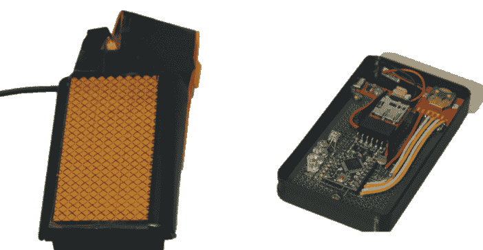
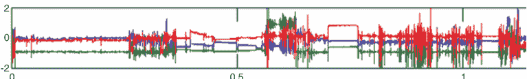

# 交互系统设计的智能计算 ｜｜ 移动电话的个人上下文—案例研究 5

## 从移动手机获取的个人语境——案例研究 5
Jason Wiese

移动手机是推断个人语境的理想平台；许多人整天随身携带手机，并在许多不同的情境中用它来处理各种个人事务。这些特征意味着手机可以提供多种类型的数据，从中可以推断个人语境。同样，手机在一天中被用于如此多的情境这一事实本身，使得准确的情境推断尤其有价值。然而，尽管个人语境推断潜在价值巨大，但在推断个人语境以及将这些推断应用于面向用户的系统时，仍存在许多陷阱和挑战。

本章描述了两个项目，它们展示了从移动设备推断个人语境过程的不同方面：一个项目推断手机放置位置，另一个项目根据通信行为推断社交语境。接下来，我们将使用这些示例中展示的经验，突出从移动手机推断个人语境时的一些常见模式和挑战。

## 9.1 什么是个人语境？

当我们提到个人语境时，指的是与某人当前情境相关的任何信息。Dourish 指出了这方面的一些问题 [Dourish 2004]。具体来说，他指出，在给定情境中存在无穷无尽的潜在语境片段，但绝大多数情境信息在任何特定时刻都不相关。此外，信息可能会非常快速且流动地从情境相关变为不相关，或者反之。因此，更常见的解释是：说“与某人当前情境*潜在相关*的任何信息”。Dey 通过识别一些常见类别使这一点更加具体：位置（在哪里）、身份（谁）、时间（何时）和活动（做什么）[Dey 2010]。然而，其他类别也可以被视为个人语境，例如，人际关系的社交语境。

目前，我们无需纠结于精确的定义，只需制定一些准则来帮助您识别个人语境的实例。个人语境是个人的：它与个人相关。它在某个时间尺度上发生变化，无论是毫秒级、小时级、周级，甚至是年级。出于我们的目的，它还应该是合理有用的：如果没有人能想出拥有该语境在某种方式上有帮助或重要的理由，那么推断语境就无关紧要。

在这些准则范围内，个人语境仍有许多不同的可能性。例如，时间不仅仅局限于钟表时间，它可能是更相对的东西，比如“早餐时间”。“*早餐时间*”对于特定应用来说，可能比指定一个我们预期用户吃早餐的钟表时间更有用的语境片段。它甚至有一个相当明确的定义：“用户在早晨吃早餐的时间段。”然而，这并不意味着从手机传感器推断这个语境片段也同样简单：我们如何从可用的数据源中知道用户实际上在吃早餐？在更基本的层面上，可用的语境来源有哪些？

### 9.1.1 个人数据的连续谱

虽然思考个人语境的“类型”可能很有用，如上所述，另一种思考语境的方式是思考个人数据中的抽象层次。个人语境是一种个人数据——它是关于个人的数据。个人数据也是推动个人语境推断的燃料。图 9.1 显示了个人数据的连续谱，从最左侧的低级数据流一直到最右侧的整体理解。一般来说，推断个人语境的过程意味着获取连续谱上某个点的数据（通常更靠左侧），并开发模型或推断将其沿连续谱向右侧移动。例如，可以使用加速度计和陀螺仪数据（最左侧）来推断步数。然后可以使用步数（可能结合其他因素）来推断身体活动，并将其作为推断临床抑郁症的输入。有关这些想法的更详细探讨，请参见 Wiese et al. [2017]。

这个连续谱说明了推断个人语境的潜力：有如此多类型的个人数据可用，也有如此多潜在的不同类型的个人语境可供推断。本章描述了展示连续谱上两个不同点的项目。

| 低级数据流 | 可读事件 | 个人推断 | 整体理解 |
| :--- | :--- | :--- | :--- |
| 加速度计 | 通话记录 | 睡眠良好吗？ | 是否抑郁？ |
| 陀螺仪 | 搜索历史 | 压力大吗？ | 要学习什么技能？ |
| 麦克风 | 购买记录 | 社会参与度高吗？ | 要改变什么行为？ |
| 温度 | App 使用情况 | 身体活跃吗？ | |

图 9.1 个人数据连续谱从左侧非常低级的数据（如描述用户行为和环境的传感器数据）到右侧非常高级的数据（描述个人可能自己都不知道的信息）。连续谱较低层级的信息通常可以直接感知，但较高层级的数据需要手动提供或通过组合较低层级的数据推断得出。版权所有 © 2017 Taylor & Francis Group, LLC。经 Taylor & Francis Group 授权，转载自 Wiese et al. [2017]。

首先，第 9.2 节使用低级数据流来推断一种可读事件：手机放置位置。接着，第 9.3 节使用通话记录、短信记录和联系人列表来推断关于用户社交关系的信息。

### 9.1.2 开发新个人语境推断前需考虑的问题

下文描述的两个示例展示了从移动设备推断个人语境的两种非常不同的机会。完成每个项目的过程并不简单：它需要大量的规划和前期思考。直接开始训练模型可能很诱人。但是，正如人机交互（HCI）告诉我们，在开始编写应用程序之前应该考虑设计，在推断个人语境时，前期思考和规划也非常重要。下面列出了一些这些问题。

#### 9.1.2.1 Q1: 我实际在推断什么？

对将要推断的具体内容有一个清晰的描述是重要的第一步。假设你想要开发一个“附近有人吗？”的推断。那是一个二分类（是/否）分类器，还是在猜测附近有多少人？“附近”实际上是什么意思？在一定距离内？在同一个房间里？这个推断会变化多频繁？对推断实际内容有一个明确的描述将是回答其余问题的必要背景。

#### 9.1.2.2 Q2: 该分类器的最终目标是什么？

确定开发分类器的目的很重要。目标是证明其可行性并建立其工作效果如何？还是分类器将作为应用程序的一部分在生产环境中使用？如果将被部署，推断结果将以编程方式提供给第三方开发者，还是仅在您自己的应用程序内使用？理解最终目标会影响开发的其他方面，例如从数据源收集数据的流程以及生成分类器的稳健性。它还可能影响模型调优，例如在精确率和召回率之间进行权衡。

#### 9.1.2.3 Q3: 我需要什么数据，我想要什么数据？

接下来，需要考虑用于分类的数据源。有许多可能的数据源：惯性测量单元（IMU）传感器、位置、手机状态、应用使用情况，以及许多应用的日志数据。推断是否依赖于拥有长期数据历史来计算特征，还是即时测量就足够了？例如，第 9.3 节中描述的亲密度和生活方面分类器需要在通话和短信日志中拥有足够的数据，以便从中计算特征。如果没有最低限度的数据，分类器就无法工作。相比之下，第 9.2 节中的手机放置模型只需要即时数据。

#### 9.1.2.4 Q4: 我的训练数据将来自哪里，且是否足够好？

在涉及这个问题时，许多推断个人语境的想法都不攻自破。与许多其他类型的推断不同，个人语境分类器很少能从现有的“大数据”风格数据集中计算得出。一个主要原因是，数据标签通常难以获取。例如，在上面假设的“附近有人吗？”分类器中，数据标签来自哪里？您可以让用户 *在现场* 标记数据，就像我们在第 9.2 节描述的工作中所做的那样。在其他情况下，例如第 9.3 节中的关系分类器，您可以让用户 *事后* 标记这些数据。推断个人语境的挑战在于其名称：它是 *语境相关* 的，这意味着数据标签取决于特定的 *个人* 及其所处的情况。在某些情况下，数据标签可能来自用户以外的人（这可能代价高昂并引入其他问题），但大多数时候不能。

训练数据需要考虑的另一个重要方面是其覆盖率。思考覆盖率的一种方法是考虑这个问题：“我的训练数据覆盖了百分之多少的独特现实场景？”在实践中，这是一个非常难以回答的问题，但将其分解可以使其变得更容易处理一些。

首先，考虑数据集在特定个人方面是否存在系统性缺口。例如，如果你依赖用户提供的数据标签，是否存在用户可能不提供任何标签的情况（例如，开车时、开会时、看电视时）。接下来，考虑你的训练集参与者相对于更广泛人群的代表性。什么类型的多样性可能很重要？这个人的工作、年龄、居住情况、文化、性别或其他因素对于这个推断是否重要？虽然始终重要，但在分类器最终将部署到生产环境时，这一点尤为重要。这类疏忽在生产环境中确实会发生。例如，中国的一名男子因他的脸出现在公交车侧面的广告上而被错误指控乱穿马路，训练数据未能考虑到这种情况¹。另一个例子发生在亚马逊提供的自动图像标签解决方案将美国国会议员（特别是有色人种）的图像分类为罪犯时²。在这种情况下，更好的训练数据可能会帮助开发者认识到，这根本不应该是开发的模型。这些只是两个高知名度的例子，如果用于开发这些模型的训练数据能准确反映潜在用户和上下文的多样性，这些糟糕的情况本可以避免，但还有无数例子。潜在用户群中存在许多类型的多样性，责任在于你（开发者）去考虑你特定的模型应该考虑哪些类型的多样性。

#### 9.1.2.5 Q5: 开发此分类器的隐私和伦理影响是什么？

在此基础上，必须考虑开发模型或分类器的隐私和伦理影响。仅仅因为我们不太擅长预见工作的负面后果，并不意味着我们不应该尝试。作为一个领域，计算机科学正面临这样一个现实：我们开发的技术可能被用于我们最初意图之外的目的。

在更基本的层面上，用户不太可能预料到你可以用他们的数据做什么。例如，一个应用程序可以请求访问用户的加速度计，这看起来很无害。但如果该应用程序将这些数据作为“醉酒程度如何？”分类器[Gharani et al. 2017]的输入，这些数据就变得*非常*敏感了。在这种情况下，向用户提供通知（即解释你将如何使用这些数据）和选择（即不使用该功能的选项）很重要。即使这样也可能复杂化，并导致不公平和其他问题。

#### 9.1.2.6 Q6: 通用分类器还是个性化分类器？

接下来，你是要训练一个适用于所有用户的通用分类器，还是一个针对每个用户个性化的分类器？这是两个极端：通用分类器开箱即用，但永远无法适应或改变以适应用户的特定情况。然而，完全个性化的分类器在有足够数据之前无法工作。在这些情况下，折中方案可能更可取。一种方法是基于通用分类器启动服务，但收集训练数据并在模型部署到用户后重新训练模型。

#### 9.1.2.7 Q7: 当分类器出错时会发生什么？

最后，考虑当分类器错误地推断上下文时会发生什么，这在某些时候是不可避免的。在这些情况下，应用程序会表现不当吗？它会给用户纠正错误推断的能力吗？或者禁用与分类器连接的功能？考虑分类器错误推断的最坏情况场景，以及可以采取哪些措施来解决其负面影响，这一点很重要。

### 9.1.3 总结

上述问题为考虑从手机推断个人上下文的不同项目提供了指导框架。接下来的两个部分描述了从这个角度来看，图9.1连续体上不同位置的两个研究项目。

## 9.2 示例：推断手机位置

从手机推断个人上下文的一个机会是推断关于手机的特定上下文方面，而这反过来可能与个人上下文相关。一个示例是推断手机放在哪里。这可以作为灵活身份验证系统的辅助[Hayashi et al. 2013]，可以作为解释另一传感器输出的有用上下文[Singla et al. 2018]，或者作为动态通知方案中的一个因素[Weber et al. 2016, Komninos et al. 2018]。本节描述的示例发表在Wiese et al. [2013]中，并重用了该论文中发布的部分文本。

### 9.2.1 Q1: 我实际上在推断什么？

如果我们要构建一个手机位置分类器，首先要问的是我们想要推断哪些可能的类别。换句话说，“人们实际上把手机放在哪里？”我们需要知道可能的标签是什么，以便收集适当的数据。我们可以尝试自己列出这个列表，但那样会使分类器偏向于我们自己的经验。我是一种特定类型的手机用户，如果我自己列出这个列表，它就受制于我自己经验的偏见。回答这个问题的另一种方法是尝试在文献中寻找答案。如果文献没有答案，花时间和精力提出一个不仅基于我自己和合作者经验的答案是值得的。在这个项目中，我们通过访谈、调查以及通过体验取样法（ESM，参见Larson and Csikszentmihalyi [2014]）收集的*原位*数据来做到这一点。

我们在公司通常的办公环境中，与50名基于办公桌的办公室职员进行了简短的半结构化访谈，开始了对手机位置的调查。我们走近参与者的办公室，如果他们同意参与，我们就问：

- 1. 他们的手机目前位于哪里？
- 2. 他们通常在工作、家里睡觉和清醒时、在车里以及外出散步时把手机放在哪里？
- 3. 他们如何决定把手机放在哪里？
- 4. 在十个预先确定的地点中，他们曾经把手机放在过多少个地方，过去24小时内手机在哪些地方待过？

对于第4题，我们利用过去的文献来建议人们可能存放移动设备的地点[Ichikawa et al. 2005, Patel et al. 2006, Dey et al. 2011]。此外，我们对下文描述的ESM和实验室研究的参与者进行了同一份调查的修改版本（省略了“现在”问题）（一些人两者都参与，但只接受了一次访谈）。我们总共有93名（37名女性）办公室职员参与者（OWork）。

为了了解结果的更广泛普遍性，并避免来自内部办公室职员群体的任何可能偏见，我们在亚马逊的机械土耳其（MTurk）上向美国（U.S.）的600名参与者（242名女性）部署了一份基于我们访谈问题的调查。关于使用众包平台收集研究数据的良好概述，参见Egelman et al. [2014]。

我们捕捉了人们放置手机的各种广泛地点，我们进一步将其分类为包、车内、外出和口袋（有关详尽列表，请参见表9.1）。

| 类别 | 原始子类别 | 来自“其他”响应的子类别 | 封闭类 | 随身携带类 | 四分类 |
| :--- | :--- | :--- | :--- | :--- | :--- |
| 包 | 背包, 手提包, 肩背包, 其他 | 无 | 封闭 | 其他 | 包 |
| 车内 | 支架, 杯架, 仪表盘, 膝上, 副驾驶座, 其他 | 中控台, 车门口袋 | 外出 | 其他（"膝上"除外） | 外出 |
| 外出 | 桌子, 床头柜, 手中, 办公桌, 柜台, 其他 | 沙发/椅子, 沙发/椅子扶手, 支架/充电站, 地板, 膝上, 书架 | 外出 | 其他（"手中"和"膝上"除外） | 外出（"手中"除外） |
| 口袋 | 裤子前口袋, 裤子后口袋, 衬衫口袋, 外套口袋, 其他 | 围裙, 臂带, 枪套 | 封闭 | 随身携带 | 口袋 |

第一列显示了“手机在哪里？”ESM应用中提供的四个顶级类别。第二列显示了参与者具体说明手机位置的第二层选项。第三列显示了如果参与者回答“其他”时，来自其自由文本响应的其他子类别。最后三列显示了每个项目在三个模型中被映射到的预测类。请注意，还有两个类别未包含在任何分类中：“不知道”，参与者在不确定手机在哪里时会选择此项，以及我们无法编码到任何现有或新建类别中的“其他”响应。

基于这些类别，我们选择了以下每个分类问题：

- **封闭或外露：** 手机是处于外露状态（可能被用户看到）还是已收纳。此模型的应用包括防止口袋误拨，以及了解视觉通知机制（例如，闪烁灯光或屏幕）是否会被注意到。

- **随身或未随身：** 手机是否在用户身上。此模型的应用包括动态通知偏好（来自调查受访者的主要关切，例如，是否振动）以及渐进式身份验证（用户是否需要重新验证身份，取决于上次验证身份后他们是否可能与手机分离）。

- **在包中、在口袋中、外露或在手中：** 手机位于更细粒度的位置。这对于 *查找我的手机* 功能很有用（例如，“您的手机自上午11:22以来一直在包中”是调查回答中表达的关切），以及用于共享用户/手机的上下文以提供社交意识。

### 9.2.2 Q2: 该分类器的最终目标是什么？

虽然我们可以想象这种分类器的几个最终目标，但在这个项目中，目标只是证明这种分类是可能的，并开始描述手机放置分类器在现实环境中部署时可能工作得如何。

### 9.2.3 Q3: 我需要什么数据，我想要什么数据？

启动本项目时，我们头脑风暴了可能对这种分类有用的数据。我们决定，*加速度计数据* 对我们的分类器至关重要。在实践中，这一决定在很大程度上受到这样一个事实的影响：我们知道这是我们可以从部署中收集的数据。

然而，我们假设额外的数据也会有用，在进行野外数据收集后，我们在实验室研究中添加了以下数据源：

- **近距离传感器和光传感器：** 这些传感器已经存在于许多移动设备中。在实地收集这些数据会更可取，但由于访问这些传感器的技术限制以及设备上缺少这些传感器的各种配置，这使得在ESM研究期间收集数据不可行。在实验室研究中，我们使用一台开发手机收集了数据，该手机让我们可以访问设备上的所有传感器。

图 9.2 实验室数据收集中使用的电容式（左）和多光谱（右）原型传感器。多光谱传感器有一个保护组件的盖子。经 ACM 许可，转载自 Wiese et al. [2013]。

- **二维电容阵列：** 虽然几乎所有移动设备都在触摸屏中使用电容技术，但大部分电容输入的处理是在硬件中完成的。该传感器最明显的功能是检测手何时抓住手机。也许不太明显的是，该传感器还能通过裤袜内衬检测到人的腿的存在。因此，我们构建了一个与 Saponas et al. [2011] 类似的电容感应原型设备。我们的设备以大约100Hz的频率报告来自10x20网格的原始电容信号。该设备的外形尺寸与当今的移动手机相似（参见图 9.2，左侧）。

- **多光谱传感器：** 检测手机放置位置的一种方法是获取设备所接触材料的信息。我们尽可能紧密地遵循 Harrison 和 Hudson [2008] 采用的方法，构建了一个由红、绿、蓝、紫外线（UV）和红外线（IR）发光二极管（LED）、光敏电阻和 TSL235R 光频转换器组成的感应设备（图 9.2，右侧）。该设备由 Arduino Pro Mini（Arduino LLC，美国波士顿，马萨诸塞州）控制，将两个传感器的读数记录到板载 microSD 卡中。尽管当前形式的设备并不完全满足不打扰用户的标准，但我们相信，经过精心设计的该传感器版本可能几乎察觉不到。像电容传感器一样，我们构建了此设备以镜像手机的外形尺寸。

移动设备的背景。这些标准共同导致计算机视觉或音频方法失败。另一个标准是这些技术最终不应打扰用户。这消除了之前提出的一些技术，这些技术会发出声音 [Kunze and Lukowicz 2007] 或激活振动电机 [Shafer 2011]。

### 9.2.4 Q4: 我的训练数据从哪里来，足够好吗？

收集训练数据时需要考虑许多因素。一个主要的权衡在于数据的外部有效性（在实际情境中从不同人群收集真实数据）与探索消费设备上不可用的数据源的能力（已描述）之间。因此，我们决定进行两次不同的数据收集——一次野外收集和一次实验室收集。这使我们能够从两个不同的角度探索分类问题。野外数据收集和标注是一项重大挑战。我们在此描述这两次数据收集。

#### 9.2.4.1 收集现场标注数据

为现场收集传感器数据，我们使用了 ESM（参见 Larson 和 Csikszentmihalyi [2014] 以获取详细描述），从32名参与者的个人智能手机中收集加速度计数据，并附带描述手机放置位置的实地真实标签。这些现场标签补充了手机放置访谈中的回顾性自我报告数据。虽然访谈参与者无疑已尽可能详尽，但现场调查数据丰富了我们对用户选择将手机放在何处的理解。

我们在 Windows Phone 7.5 平台（Microsoft Corporation，美国华盛顿州雷德蒙德）上构建了一款名为 Where’s Your Phone?（WYP）的数据收集应用程序。WYP 大约每30分钟收集10秒钟的加速度计数据（三个维度，频率为50Hz）。然后提示参与者回答“你的手机在 XX:XXpm 在哪里？”在此问题下，参与者有六个选项，包括“其他”和“我不知道”。每个类别有几个子类别（所有23个子类别见表 9.1）。我们根据手机放置访谈的回答选择类别，以尽量减少 ESM 参与者需要输入自由文本“其他”回答的情况。

未回答的调查在下一组加速度计数据收集时过期，未标记的加速度计数据被删除。参与者指定了 WYP 关闭的就寝时间和恢复的起床时间。参与者还可以一次将 WYP “暂停” 最多2小时。调查回答和相应的加速度计数据会自动上传到服务器。

我们从一个 Windows Phone 7.5 电子邮件列表中招募了32名参与者（16男，16女）。59%的参与者年龄在20至39岁之间，其余的人年龄较大。我们的参与者提交了5,524份 ESM 回答，尽管提交数量因人而异（中位数 [med]: 147.5，最小值 [min]: 29，最大值 [max]: 358）。男性（52%，2,847）和女性（48%，2,677）参与者的回答总数相似。重要的是要承认 ESM 回答在全面性方面的潜在局限性；手机不在其主人身边的时间会被低报。

#### 9.2.4.2 在实验室中收集数据

使用第 9.2.3 节中描述的三种设备（开发手机、电容感应原型和多光谱传感器），我们从15名参与者（6名女性）那里收集了数据。73%的参与者年龄在20至39岁之间，其余的人年龄较大。

我们要求参与者携带他们可能通常放手机的任何东西，包括夹克、手包或其他包。我们从每个参与者那里收集了他们报告将手机放在的以下任何位置的数据：前裤袋、后裤袋、夹克口袋、包/手包和手。我们根据我们的手机放置调查回答选择了这些位置。为了提高这项研究的外部有效性，我们没有让参与者将我们的感应设备放在他们通常不会放手机的地方。虽然这意味着我们对某些参与者收集的数据比其他参与者更多，但它也最大限度地提高了所收集数据的真实性。

对于参与者通常放置手机的每个位置，他们完成了一系列活动，以模拟设备在日常生活中处于该位置时可能遇到的各种条件。对于除包/手包外的所有放置位置，活动包括：坐在沙发上、坐在办公椅上、原地站立和走动。我们没有让参与者在后裤袋放置位置下坐下。对于包/手包，我们让参与者让包放在地板上、拿着包站立和携带包行走。参与者每项活动花费20秒。由于每个设备至少有一个方向传感器（例如，朝向裤袋中的腿），我们对每个放置位置使用每个设备朝向内侧和外侧收集了所有数据。我们一次从两个设备收集数据，以尽量减少试验次数。

与其他放置位置不同，将设备放在表面上的大部分变化涉及寻找各种表面。因此，我们自己收集了表面特定数据，遵循与其他放置位置类似的过程：我们记录了每个设备在正面向上和正面向下两种方向下的数据。总共，我们为18个表面收集了数据，包括桌子、办公桌、椅子、沙发、金属文件柜上的表面和内部，甚至枕头上。

对于每个放置位置（例如，口袋或桌面），我们从三个原型机中各收集了两个方向的数据（例如，朝内和朝外）。我们将每个位置的这六个传感器录音组合成一个单一的虚拟录音。这模拟了一个具有三个原型机传感能力并集的虚拟设备。这意味着单个收集的数据实例包括：电容数据（朝前和朝后）、多光谱数据（朝前和朝后）、手机光/近距离传感器数据（朝前和朝后）以及手机加速度计读数。我们只考虑一组手机加速度计读数，因为手机朝向另一方向的第二组数据是冗余的。

### 9.2.5 Q5: 开发此分类器的隐私和伦理影响是什么？

虽然这个分类器对我们来说是一个学习工具，而不是生产系统，但考虑潜在的隐私或伦理影响仍然很重要。其中一个影响是，用户可能不会意识到你可以从加速度计读数中推断出这些数据。因此，如果开发者拥有此分类器并请求访问加速度计数据，却不披露他们具有这种推断能力，这可能被视为隐私侵犯。另一个潜在问题是，基于个人的放置行为，可能能够推断出关于个人的其他特征。例如，我们在收集的数据中看到了男性和女性行为之间的差异。因此，即使用户未披露该信息，此分类器也可用作用户性别的线索。最后，虽然我们尝试从各种参与者那里收集数据，但我们的样本人口远不能代表更广泛人群的所有不同特征。虽然这对于初步研究工作可能可以接受，但仅使用这些数据来训练生产分类器将是非常不负责任的。

### 9.2.6 Q6: 通用分类器还是个人分类器？

在这个项目中，我们特别关注通用分类器，原因主要在于我们收集的数据量。此外，对于许多这些用例来说，分类器开箱即用、无需用户进行任何训练（即冷启动问题）也是可取的。但是，我们收集的数据确实表明，个性化分类器可能比通用分类器表现更好。我们识别了不同的用户原型（即，不同的人对不同类别有不同的先验概率）。此外，其他上下文因素（例如，位置、一天中的时间、日历信息）对个人可能有用，但在人群中难以概括。

图 9.3 研究期间收集的加速度计数据示例。

### 9.2.7 Q7: 当分类器出错时会发生什么？

鉴于下一节的结果，很明显这个分类器相当经常出错。这对分类器应该用于哪些类型的场景有影响。在某种意义上，分类器的结果更多是一个_嘈杂的上下文提示_，而不是可靠的上下文推断。为了演示可行性和建立基准，这是可以的。但是，你可能不希望这个分类器来决定你的手机何时应该或不应该静音：你可能会因为分类错误而错过电话，或者在别人做演示时打断对方。

### 9.2.8 Q8: 分类器表现如何？

在问完并回答完所有这些问题后，我们准备构建和评估分类器。它们在所有收集的数据上表现如何？

#### 9.2.8.1 基于原位数据建模手机放置

我们使用了 ESM 参与者原位收集的带标签加速度计数据（示例见图 9.3）。使用第 2 章和第 3 章的技术，我们从受之前工作启发，提取了加速度计数据每个轴上 1 秒窗口的以下特征 [Kunze et al. 2005, Shi et al. 2011, Tsai et al. 2011, Vahdatpour et al. 2011]：

- 均值；方差；均方根（RMS）：($\sqrt{\frac{1}{N} * \Sigma_i x_i^2}$)
- 四分位间距；25%、50%、75% 四分位数（见第 2.5.2.2 节）
- 前五个小波层级的细节系数之和

我们使用这些特征来评估三个分类问题的模型（如下）。所有模型都使用 Weka 工具包的序列最小优化（SMO）支持向量机（SVM）和多项式内核构建 [Hall et al. 2009]。有关 SVM 的说明，请参见第 4.2.2.2 节。我们通过对之前收集的试点数据进行实验，选择了这些特征和 SMO 算法。结果采用留一参与者交叉验证报告。这种交叉验证方法有助于确保我们不会在同一参与者的数据上进行训练和测试，这可能导致过拟合，从而高估模型的准确性。

#### 表 9.2 针对三个分类问题的 ESM 研究结果

| | 封闭 | 外 | 精确率 | 召回率 |
|---|---|---|---|---|
| 封闭 | 1690 | 599 | 0.74 | 0.83 |
| 外 | 337 | 3742 | 0.92 | 0.86 |

| | 在人身上 | 其他 | 精确率 | 召回率 |
|---|---|---|---|---|
| 在人身上 | 2335 | 402 | 0.85 | 0.89 |
| 其他 | 511 | 4120 | 0.86 | 0.82 |

| | 口袋 | 包 | 外 | 手 | 精确率 | 召回率 |
|---|---|---|---|---|---|---|
| 口袋 | 1570 | 25 | 73 | 335 | 0.78 | 0.78 |
| 包 | 141 | 32 | 85 | 28 | 0.11 | 0.25 |
| 外 | 188 | 25 | 2961 | 194 | 0.88 | 0.86 |
| 手 | 124 | 44 | 308 | 235 | 0.33 | 0.30 |

对于所有三个混淆矩阵，左侧的标签表示正确类别，顶行的标签表示预测类别。

总结三个不同分类器的结果：

- **封闭或外**：该模型达到了 85.3% 的平均准确率。混淆矩阵可见表 9.2，以及精确率和召回率值。

- **在人身上或不在**：该模型达到了 85.7% 的平均准确率（表 9.2）。

- **在包中、在口袋中、外或在手中**：该模型的性能低于前两个模型，正如我们在增加类别数量时所预期的那样。该模型达到了 75.4% 的平均准确率，其中外被最准确地分类，其次是口袋。包和手的表现要差得多。

在四类模型中，有几个值得注意的地方。首先，重要的是要注意，表现非常差的包和手，在我们的数据集中的实例数也明显少于口袋和外。

加速度计可以被视为捕捉设备的方向，但是，不同于放在桌子上（通常平放，要么面朝上，要么面朝下），手机可能以多种方式放入包中，取决于包的样式、其口袋的方向等等。此外，包在任何给定时间可能有人携带，也可能没有人携带，这可能使这些特征与其他类别（例如，口袋）混淆。

#### 9.2.8.2 基于实验室中其他传感器的手机放置建模

如第 9.2.3 节所述，我们在实验室中收集了额外数据。我们从朝一个方向的加速度计和朝两个方向的其他传感器中提取了特征。这使我们能够模拟一个两侧都有传感器的设备。

遵循 Harrison 和 Hudson [2008] 的方法，我们的多光谱特征分别是：针对无光、红光、蓝光、绿光、UV 和 IR，来自光频率转换器和光电电阻各的一个读数。对于手机上的光和近距离传感器，我们取了 20 秒窗口内环境光水平和二进制近距离状态的平均值。最后，我们取了电容感应网格中每个“像素”在 1 秒窗口上的平均值，并计算了网格上的三个特征：像素平均值、中位数像素值、非零像素数量（检测到电容的像素）。我们使用了与前一节 ESM 研究中相同的 1 秒窗口加速度计特征。

我们的分类技术和评估遵循 ESM 研究的方法：留一参与者交叉验证，其中我们将每个人或表面视为单独的参与者。我们通过处理与 ESM 研究中识别的相同分类任务来分析实验室研究数据：封闭或外、在人身上或不在、以及在包中、在口袋中、外或在手中。此外，我们使用不同的数据源组合训练了每个模型：每个数据源单独训练，然后将新数据源与加速度计数据合并。这样做的目的是了解设备上已常见的加速度计之上的额外传感器的价值。

与 ESM 数据一样，我们使用 Weka 的 SMO SVM 和多项式内核构建了封闭或外模型。在试点数据实验中，我们发现使用 Weka 的随机森林实现 [Breiman 2001]（如第 4.2.2.3 节所述，是决策树的集合）对在人身上或不在以及在包中、在口袋中、外或在手中的问题分类效果好得多。因此，我们在实验室研究中对这些问题采用随机森林分类器。

表 9.3 概览了这些模型的准确率。从这些结果中，我们可以看到一些有趣的趋势：

- 1. 封闭或外：也许不出所料，手机的光和近距离传感器似乎是分类最有用的传感器，平均准确率达到 98%。除此之外，似乎有些证据表明加速度计可以帮助消除仅使用光/近距离传感器时的少数错误，甚至在一种情况下达到 100% 的准确率。

- 2. 在人身上或不在：相比之下，在分类手机是否在参与者身上时，光/近距离传感器在各个单独传感器中表现最差（71%）。在这种情况下，电容传感器是

表 9.3 三个分类问题中实验室研究传感器所有组合的准确率结果

| | 封闭式 | 随身携带 | 口袋/包/外出/手中 |
|---|---|---|---|
| 加速度计 (AC) | 89% | 82% | 79% |
| 光/接近 (L/P) | 98% | 71% | 70% |
| 多光谱 (MS) | 89% | 80% | 76% |
| 电容式 (CAP) | 58% | 88% | 73% |
| AC + L/P | **100%** | 84% | 83% |
| AC + MS | 92% | 82% | 78% |
| AC + CAP | 85% | **90%** | 79% |
| AC + L/P + MS | 99% | 80% | 81% |
| AC + L/P + CAP | 97% | **90%** | **85%** |
| AC + L/P + MS + CAP | 98% | 88% | **85%** |

每个分类问题中最高的准确率在表中已加粗。

最有用的单一传感器，单独使用即可达到 88% 的准确率。再次添加加速度计最有帮助，将准确率提高到 90%，而多光谱和光/接近传感器似乎无法提高准确率。电容式感应栅格之所以如此有帮助，可能是因为它既可以感知对设备的握持，也可以通过许多裤子口袋的内衬检测到人的腿。

- 3. 在包中、在口袋中、外出或在手中：在四分类中，加速度计优于任何单一传感器（79%），多光谱传感器也展现了其价值（76%）。有趣的是，这两个传感器的组合不如加速度计与光/接近传感器的组合有价值，后者达到了 83% 的综合准确率。最终，加速度计、光/接近传感器和电容式传感器的组合最有效，达到了 85% 的准确率。该模型的错误主要来自于设备是在口袋中还是在包中的混淆。我们曾希望电容式传感器在这种情况下更有价值，帮助区分是在包中还是贴近某人的皮肤。尽管如此，相对于仅使用加速度计，整体改进仍然非常显著。

**与 ESM 数据的比较**：总体而言，实验室研究中仅使用加速度计的模型与 ESM 研究中的模型之间没有重大差异，尽管 ESM 数据来自各种不同的设备，并且是 *原位* 收集的。

## 9.3 从通信行为推断社会关系

上一节探讨了一种相当低级别的个人上下文类型。另一种非常不同的上下文是社会关系的上下文。对于手机中的某个联系人，你如何认识该个人，与他们有多亲密？社会关系的上下文可用于过滤在界面中呈现的信息、优先处理电子邮件，甚至自动确定隐私设置 [Wiese et al. 2011]。在本工作中，我们的目标是开发模型，从智能手机上的通话记录、短信记录和联系人列表中推断社交亲密度和生活领域。本节中描述的示例已发表于 Min et al. [2013] 和 Wiese et al. [2015]，并重用了该论文中发布的部分文本。同样，我们从提出核心问题开始。

### 9.3.1 Q1：我实际上在推断什么？

在本项目中，我们想要推断关于社会关系的两类信息。第一类是生活领域：你认识某人的渠道，或者他们现在融入你生活的哪个部分。第二类是关系强度：你与那个人有多亲近。

对于生活领域，我们从 11 个不同的类别开始，然后将其分为三个生活领域：家庭（直系家庭、扩展家庭和伴侣）、工作和社交（邻里、宗教、家庭朋友、通过他人认识、学校、爱好和其他）。我们通过结合多个来源 [Hill and Dunbar 2003, Spencer and Pahl 2006, Kelley et al. 2011, Wiese et al. 2011] 来选择这些子类别的名称，旨在全面性（为了数据丰富性）与简单性（为了防止错误并最大限度减少参与者负担）之间取得平衡。最终，我们决定推断三个生活领域，而不是子类别。部分原因是我们不同子类别的训练数据量，但也因为预期 11 类分类器的复杂性和低性能。

关系强度的性质给构建此模型带来了挑战。关系强度可以根据关系强度问题的答案被视为数值类别值。然而，1 分和 2 分之间的差异不一定等于 2 分和 3 分之间的差异。因此，我们在这些模型中将非常强关系、中等强关系和弱关系的关系强度水平作为名义类别值。

我们根据以往工作 [Zhou et al. 2005] 分配了这些类别标签，如下：

- 强关系—顶级组（排名 1–4）

- 中等关系—中间组（排名 5–19）

- 弱关系—剩余联系人

我们还决定为关系强度问题探索二分类和三分类分类器：

- 3 类：分类为强、中强或弱

- 2-非常强：二元分类器，将中强和弱关系合并为一类

- 2-中强：二元分类器，将强和中强关系合并为一类

### 9.3.2 Q2：此分类器的最终目标是什么？

与第 9.2 节中描述的工作类似，本项目的主要目标是研究：计划不是开发模型或系统并将其部署到实际应用中，而是仅表征问题空间，并展示其可行性和表现如何。然而，如果工作特别成功，这里训练的分类器可能有助于进一步研究，以探索一些假设的应用（例如，跟进我们之前关于这些关系维度与隐私偏好之间关联的工作 [Wiese et al. 2011]）。

### 9.3.3 Q3：我需要什么数据，我想要什么数据？

为开发这些分类器，我们计划使用运行 Android 操作系统的手机上的通话记录、短信记录和联系人列表。不幸的是，在进行这项研究时，这些数据存在一些限制。特别是，默认情况下，Android（Alphabet Inc.，美国加利福尼亚州山景城）手机将通话记录限制为最近 500 次通话，并且通常每个联系人默认限制 200 条短信。这导致日志所代表的天数存在广泛差异（范围：21–369；中位数：80；平均值：108）。这对数据集是一种严重限制，但如果不进行更长期的数据收集，就很难收集更多数据。另一个挑战是，联系人列表有许多字段，但在实践中，联系人列表中的数据相当稀疏。为保护隐私，我们没有收集短信内容。但是，我们确实收集了描述性信息，例如电子邮件域名、电话号码的前六位数字以及城市/州/邮政编码。

决定收集哪些数据的另一个方面是确定为哪些联系人获取基础真实标签。任何个人的绝大多数联系人都将是弱关系，因此随机抽样不太可能出现中等和强关系。然而，在这项工作中，我们希望最大限度地提高收集强关系信息的可能性。为实现这一目标，我们要求参与者生成符合特定社会类别的联系人列表，无论它们是否出现在手机联系人列表中。参与者在以下每个类别中列出了五个人：直系家庭、扩展家庭、与他们同住的人、同事、他们感到亲近的人，以及与他们一起爱好的人。我们根据过去的定性工作选择了这些群体，这些工作表明这些类别将包含个人的强关系，以及来自不同生活领域的人 [McCarty 2002, Spencer and Pahl 2006, Wiese et al. 2011]。最终，每个参与者都得到了一个包含 70 个联系人的列表，这些联系人是他们提供的姓名、在我们收集的数据中频繁联系的联系人以及随机选择的姓名的混合体。

除了上述通信日志、联系人数据和类别标签外，我们还决定从参与者那里收集一些额外数据，包括一些我们认为未来可能易于收集的数据。参与者为 70 人名单中的每个联系人提供了人口统计信息，例如性别、年龄和关系持续时间。

最后，由于关系强度难以定义的性质，参与者还回答了四个关于他们与每个联系人关系的问题，这些问题改编自 Marin and Hampton [2007]：

- 1. 你与这个人感觉有多亲近？

- 2. 你有多强烈同意“I 与这个人讨论重要事情”这一陈述？

- 3. 你有多强烈同意“我愿意向这个人借款 100 美元或更多”这一陈述？

- 4. 你有多强烈同意“我喜欢与这个人进行社交互动”这一陈述？

#### 9.3.3.1 定义特征

当我们考虑如何将这些数据转换为用于训练模型的特征时，通信数据的真正复杂性就很明显了。首先，我们定义了五个因素，用于表征在生活领域和关系强度背景下的通信模式：强度、规律性、时间倾向、渠道选择/回避和维护成本。

**强度和规律性：**通信动作的数量和持续时间在过去的工作中已被用于预测关系强度 [Hill and Dunbar 2003, Roberts and Dunbar 2011]。例如，语音呼叫对家庭来说非常常见

关系。与此同时，办公室互动和个人互动表现出不同的规律性 [Do and Gatica-Perez 2013]。

#### 时间倾向
在朋友-熟人研究中，Eagle 和 Pentland [2006] 观察到了联系他人的时间倾向。我们的参与者在一天中的不同时间和一周中的不同日子拨打家庭、工作和社交联系人的电话。例如，人们经常在下午（12pm–3pm）和傍晚（3pm–6pm）给家人打电话，并在周五下午更多地联系社交朋友。他们不太可能在周末给工作场所联系人打电话。

#### 通道选择与避免
人们倾向于根据与之沟通的人偏爱某种通信媒介 [Mesch 2009]。根据我们的调查结果，参与者根据联系人的关系，以不同优先级通过面对面、电话、短信和 Facebook 进行沟通。

#### 维护成本
Roberts 和 Dunbar [2011] 认为，人们在维护不同类型的关系时会投入不同程度的努力，其中努力（成本）可以根据两个个体之间上次联系的时间来评估。然而，根据数据收集日期，这个值可能偶然小于实际成本。为尽量减少这种巧合，我们将过去 2 周（短期视角）和过去 3 个月（相对长期视角）内的通信次数作为给定关系的维护成本。在以下部分，我们将描述如何将这些类别转化为具体的机器学习特性。

我们从移动数据中定义了 153 个特性：17 个来自电话簿，66 个来自通话日志，36 个来自消息日志，34 个来自通信（通话 + 消息）日志（参见表 9.4）。

#### 电话簿联系人配置文件特性（配置文件特性）
我们从姓氏、电子邮件域、电话号码的前六位（区号 + 交换机）和公司名称等方面，测量了我们的参与者与其联系人之间的相似性。对于电子邮件域，我们排除了几个流行的免费托管域，例如 @gmail.com。我们还捕捉了每个联系人电话号码上的标签，例如家庭、工作、移动和其他，这些标签在 Android 中预定义。由于只有少数参与者在电话簿中拥有自己和联系人的邮寄地址，我们只是检查联系人的邮寄地址是否存在，并为地址的每个标签（家庭、工作和其他）测量了一个二进制特性。我们还为其他联系人信息（例如铃声、备注，或联系人是否在 Android 联系人列表中被标记为收藏）设置了额外的二进制特性。

#### 表 9.4 从移动数据中提取的 153 个特性

| 模式 | 变量 | 描述 |
|---|---|---|
| 调查 | 同性别；年龄差异；是否为 Facebook 好友；见面频率 | 来自 SNS 和 GPS |
| 配置文件特性 | {姓氏、电子邮件域、公司名称、电话号码} 的相似性；拥有 {照片、铃声、网页、备注、关联、工作电话和地址、家庭电话和地址、电子邮件}；是否加星；事件类型；配置文件完整性 | 联系信息 |
| 通话日志 | 总 {#, dur.} 通话数；总 # 长通话数； | 强度 |
| | 每周 {AVG, SD, MIN, MAX, MED} 次 {外拨, 来电} 通话；# 被叫天数/已记录天数；{AVG, MAX} {外拨, 来电} 通话时长 | 规律性 |
| | {#, dur.} 外拨通话/总通话数；#{失败, 未接} 通话/外拨（来电）通话 | 渠道选择与避免 |
| | {#, dur.} 在 {一天中的时间, 一周中的日期} 的通话/总通话数；#{长, 失败, 未接} 通话在 {一天中的时间, 一周中的日期}/总（外拨, 来电）通话 | 时间倾向 |
| | {#, dur.} {过去 2 周, 过去 3 个月} 的通话/总通话数 | 维护成本 |
| 消息日志 | 总 {#, 长度} 消息 | 强度 |
| | 每周 {AVG, SD, MIN, MAX, MED} 次 {外拨, 来电} 消息；# 消息天数/已记录天数； | 规律性 |
| | {#, 长度} 外拨消息/总消息数；# 已回复消息/总消息数 | 渠道选择与避免 |
| | {#, 长度} 在 {一天中的时间, 一周中的日期} 的消息/总消息数 | 时间倾向 |
| | {#, 长度} {过去 2 周, 过去 3 个月} 的消息/总消息数 | 维护成本 |

我们使用了四个时间段和四个星期几段：早晨（上午 6 点–中午），下午（中午–下午 6 点），傍晚（下午 6 点–午夜），以及夜晚（午夜–上午 6 点）；工作日（周一–周四），周五，周六，周日。请注意，“总”通信表示与该联系人的所有先前（已记录）通信。COMM，通信；MSG，消息。

#### 表 9.4（续）

| 模式 | 变量 | 描述 |
| :--- | :--- | :--- |
| COMM（通话和消息）日志 | 总 #COMMs | 强度 |
| | 有 COMMs 的天数/已记录天数 | 规律性 |
| | #外拨 COMMs/总 COMMs；# 通话/总 COMMs | 渠道选择 |
| | #COMMs 在 {一天中的时间, 一周中的日期, 节假日}/总 COMMs；# 通话/总 COMMs 在 {一天中的时间, 一周中的日期}；# 外拨 COMMs 在 {一天中的时间, 一周中的日期, 节假日}/总 COMMs | 时间倾向 |
| | #COMMs 在 {过去 2 周, 过去 3 个月}/总 COMMs | 维护成本 |

最后，我们计算了每个配置文件的完整性。这作为一种弱代理来衡量用户填写联系人信息的努力。Android 手机可以通过与 Google+ [Alphabet Inc., Mountain View, CA, USA] 和 Facebook (Facebook Inc., Menlo Park, CA, USA) 等在线社交网络服务（SNS）同步来自动填充联系人列表数据。在我们的 70 个联系人列表数据集中，50% 的移动联系人有照片，表明大约一半的参与者使用了自动同步。有趣的是，我们仍然发现大多数联系人拥有少于三个配置文件属性，包括姓名、电话号码和电子邮件地址。因此，更多的联系人信息仍然可能是一个潜在有用的信号。

#### 通话特性
我们创建了多个特性来检查语音通信的强度，包括每个联系人的总通话数和总通话时长。我们统计了长通话的数量，其时长是平均时长的两倍。为了衡量通话的规律性，我们计算了每周通话次数的五个统计值（AVG、SD、MIN、MAX 和 MED）。对于通话时长，我们分别计算了 AVG 和 MAX 以衡量简单的规律性和突发性。我们还通过计算外拨通话、失败（时长 <5s）通话和未接来电的比例，衡量了用户的渠道选择和避免行为。时间倾向和维护成本也从通话日志中提取，如表 9.4 所示。

#### 消息（MSG）特性
我们定义了许多与通话特性类似的消息特性，如表 9.4 所示。在这里，我们将 MMS 的长度计为 160 个字符，即 SMS 的最大长度。在他们的大规模短信研究中，Battestini 等人 [2010] 应用了 20 分钟响应时间的时间度量，将消息分组为对话。我们使用该度量来捕捉已回复消息的比例。

#### 通信（COMM）特性
消息经常涉及其他通信渠道 [Battestini et al. 2010]。例如，人们通常会以语音方式回拨以回应短信。因此，我们将通话和消息均视为 COMM 特性。对于强度、规律性和渠道选择特性，我们分别计算了总 #COMMs、有 COMMs 的天数/已记录天数以及通话比例（# 通话/总 COMMs）。我们还包含了检查 4 天 COMMs 的特性，在美国，这些日期通常承载某种意义。这些日期包括感恩节、圣诞节、元旦和情人节。最后，我们从调查结果中提取了四个特性，例如同性别、年龄差异、是否为 Facebook 好友和见面频率，将其称为调查特性（参见表 9.4）。当前智能手机不存在这些数据，但我们将这些作为特性包含在内，因为部分信息可以从当今的 SNS 获取，其他信息则可能由未来的智能手机捕获。例如，性别和年龄等人口统计信息可以自动从 Facebook 个人资料中检索（或从智能手机使用模式中估计 [Altshuler et al. 2012]），面对面沟通可以通过蓝牙近距离 [Do and Gatica-Perez 2013] 或 GPS 共定位 [Cranshaw et al. 2010] 来检测。

### 9.3.4 Q4: 我的训练数据从哪里来，是否足够好？

不同的人有不同类型的社会关系，我们希望最大限度地提高接触到多样化用户群的可能性。为此，我们通过在多个地方发布广告，招募了 40 名分布在美国各地的参与者（13 名男性和 27 名女性）：在美国六个主要城市的 Craigslist 上、在一个招募研究参与者的全国性网站上、在一个发布社会关系研究的网站上，以及在我们大学的参与者池中。最终，55% 的参与者是学生（研究生或本科生），35% 从事各种职业，10% 失业。参与者年龄在 19 至 50 岁之间（平均值 = 28.0 岁，标准差 [SD] = 8.9）。参与者下载了我们的 Android 应用，该应用将其联系人列表、通话日志和 SMS 日志复制到数据库文件中。然后，参与者通过为本研究设计的自定义网站将该文件上传到我们的服务器。整个研究均通过该网站进行。参与者被指示在 2 周内完成基准真理标注，并获得 80 美元的报酬。

这几乎肯定不足以用于生产模型，但就我们的目的而言，我们确信这足以查看是否存在信号 in

这些数据与否。最终，我们不得不权衡许多权衡，以平衡参与者的数量、他们将评估的联系人数量以及谁会被激励参与。由于我们收集的是潜在敏感数据，并且提供基准真相需要投入大量精力，这是一个特别难以收集的数据集。

### 9.3.5 Q5: 开发此分类器的隐私和伦理影响是什么？

开发这些分类器的一个问题是，我们要求参与者提供的敏感数据量非常大。虽然我们获得了大学机构审查委员会（IRB）的批准，但归根结底，我们要求参与者信任我们，将他们的通信记录交给我们。

如果分类器最终工作良好，还有几个严重的后果需要考虑。拥有关于某人关系的这种上下文信息，对某些类型的社会工程攻击可能非常有价值。另一个问题是，根据该分类器的使用方式，它可能会被操纵。例如，如果分类器被用来自动确定隐私和共享偏好，对手可能会以某种方式与目标进行通信，使分类器被骗，认为对手应该获得他们不应获得的数据访问权限。

最后，了解个人的社会支持情况存在潜在的伦理影响，尤其是当他们没有太多支持时。例如，如果某人社交孤立，他们可能面临抑郁或自残行为的风险。或者他们可能只是拥有多部手机，因此我们能够访问的数据只是用户社交互动的一幅不完整图景。在这种情况下，开发人员或研究人员有什么责任？他们是否应该寻求帮助？建议用户寻求帮助？还是简单地忽略这些信息？虽然我们不打算部署此分类器，但这些担忧是真实且复杂的。

### 9.3.6 Q6: 通用分类器还是个人分类器？

对于这些分类器来说，个人分类器并不十分合理，因为这些（生活侧面和关系强度）不太可能改变，即使改变，也可能会在很长一段时间内缓慢变化。因此，拥有一个个性化分类器来告诉我谁是我四个最亲近的人是没有意义的——我知道那些人是谁，一旦我将这些训练数据提供给分类器，分类器就不需要再次分类那些联系人了。这个分类器的价值在于用户永远不需要告诉手机，而是由手机自动推断这些信息，因此在这里通用分类器更合理。

### 9.3.7 Q7: 当分类器出错时会发生什么？

同样，因为开发这些模型的目的是为了研究，而不是为了生产系统，所以错误分类的即时成本相对较低。然而，Q5 的答案清楚地表明，如果我们不小心使用分类器，最终可能会暴露用户不希望暴露的信息。这种风险，加上关系强度和生活侧面不太可能改变的相对较低可能性，表明处理错误分类的一种策略是使用户轻松确认分类是否正确，或者在出错时将其更正。由于不太可能频繁改变，手动更正错误分类所需的精力相对较少。

### 9.3.8 分类器的表现如何？

在考虑了这些问题之后，分类器的表现如何？

#### 9.3.8.1 生活侧面分类

为了评估生活侧面分类，我们构建了一个使用 SVMs（多项式核；d = 2）的模型。由于 SVM 原本是二分类器，我们组合了三个二两两 SVMs（家庭-vs.-工作，家庭-vs.-社交，以及工作-vs.-社交），并使用最大投票法组合它们的输出。我们还使用 WEKA [Hall et al. 2009] 将结果与两个不同的模型进行了比较：基于规则的模型（决策树 C4.5）和概率模型（朴素贝叶斯 [NB]）。
我们还将数据分为三个不同的类别，并为每个数据集训练了模型：

- all 包括 70 人名单上的所有联系人
- contactlist 仅包括 70 人名单中出现在用户通讯录中的联系人
- somecomm 仅包括 70 人名单中至少有一条已记录的短信或通话的联系人

对于 70 联系人列表数据集，SVMs 在使用调查功能时显示了 65.5% 的准确率，并在使用所有功能时提高到 81.0%（参见表 9.5）。请注意，70 联系人列表中一半的联系人是在线朋友，也就是说，个人资料和移动通信功能不包含他们的数据。尽管如此，这种方法在使用调查功能时仍能实现 13.2% 的准确率提升。SVMs 在使用个人资料和移动通信功能时，在通讯录列表上取得了 68.5% 的准确率。对于用户实际进行通信的联系人（通信列表集），准确率提高到 88%。

表 9.5 预测生活侧面的三次十折交叉验证的平均准确率（和标准差）

| 数据集 | 方法 | 调查 | 个人资料 | 移动 | 个人资料 + 移动通信 | 使用 |
|---|---|---|---|---|---|---|
| all | C4.5 | 68.0 (5.1) | NA | NA | NA | 74.2 (4.4) |
| | NB | 72.4 (5.6) | NA | NA | NA | 67.1 (3.6) |
| | SVM | 65.5 (4.4) | NA | NA | NA | 81.0 (4.5) |
| contactlist list | C4.5 | 69.1 (6.9) | 52.8 (7.7) | 64.7 (6.0) | 64.5 (7.8) | 76.1 (7.5) |
| | NB | 72.5 (7.2) | 54.3 (6.6) | 65.5 (5.5) | 65.4 (5.6) | 65.6 (5.5) |
| | SVM | 66.7 (7.4) | 51.1 (7.2) | 67.9 (6.4) | 68.5 (6.0) | 83.1 (5.9) |
| somecomm | C4.5 | 66.0 (9.9) | 53.1 (8.7) | 75.8 (7.2) | 75.9 (6.7) | 75.6 (5.5) |
| | NB | 69.1 (10.) | 55.2 (9.0) | 76.4 (8.8) | 76.4 (8.8) | 76.6 (8.6) |
| | SVM | 60.8 (10.) | 52.9 (8.4) | 87.1 (5.0) | 88.0 (5.3) | 90.5 (4.8) |

请注意，70 联系人列表中的在线朋友没有移动功能（在表中显示为 NA）。

仅使用个人资料功能，所有分类器的准确率都较低，因为用户的通讯录中没有足够的联系人信息。例如，在通讯录列表上，SVMs 的准确率仅为 51.1%。共有 396 名家庭成员接受评估，其中 175 名被正确分类为家庭，而 186 名和 35 名分别被错误分类为工作和社交。有趣的是，个人资料功能对分类工作类型的联系人有效，但对其他侧面则不然。这是因为与家庭侧面强烈相关的个人资料变量（如姓氏和 Is-starrer）在许多联系人中缺失，或者仅与少数最强联系相关联。另一方面，我们可以使用移动通信功能正确分类家庭和社交联系人，而许多工作类型的联系人由于没有通信日志而被混淆为社交。

个人资料和通信功能的组合未能分类工作侧面，如表 9.5 所示。我们有两种可能的解释。首先，个人资料功能的数量（17 个）远少于通信功能的数量（136 个），因此在组合特征向量中可能影响力较小。其次，个人资料功能有许多缺失值，而 SVM 不能很好地处理缺失数据。为了解决这些问题，我们需要一个特征选择方案或分类器组合方法，分别在每种类型的特征上构建两个不同的模型。

调查报告中的四个功能（相同性别、年龄差异、面对面沟通频率以及是否为 Facebook 好友）解决了

| 类别条件 | 数据集 | 准确率 | Kappa (κ) |
|---|---|---|---|
| 3-class | all | 69.60% | 0.279 |
| 3-class | contactlist | 61.11% | 0.251 |
| 3-class | somecomm | 46.28% | 0.179 |
| 2-verystrong | all | 91.55% | 0.361 |
| 2-verystrong | contactlist | 88.64% | 0.361 |
| 2-verystrong | somecomm | 75.46% | 0.297 |
| 2-mediumstrong | all | 75.00% | 0.367 |
| 2-mediumstrong | contactlist | 68.06% | 0.317 |
| 2-mediumstrong | somecomm | 63.11% | 0.192 |

预测类别是关系强度类别。对于 2-verystrong，中等和低关系强度类别被合并，而对于 2-mediumstrong，中等和高类别被合并。

#### 9.3.8.2 关系强度分类

我们使用 Weka Toolkit 的 [Hall et al. 2009] SVM 实现来训练关系强度模型。我们进行了留一参与者交叉验证（每个折叠包含一名参与者的数据）。这防止了特定参与者数据中的任何异常导致性能被高估。我们训练了九个模型，改变了输入数据的两个方面。首先，我们改变了模型正在分类的内容（如 Q1 中所述，在三分类器和两个不同的二分类器之间（表 9.6 的第一列）。其次，类似于生活侧面模型，我们还改变了分类器的输入数据（表 9.6 的第二列）。

分类结果差异很大（表 9.6），从 46.28%（κ = 0.179）到 91.55%（κ = 0.361）不等。κ 统计量衡量预测分类与观察分类之间的一致性，并校正了偶然发生的一致性。表 9.6 揭示了明显的趋势。首先，在每个类别条件内，分类器对 all 的表现最好，其次是 contactlist，而 somecomm 最差。大多数不在通讯录中的联系人（因此被排除在 contactlist 模型之外）或没有通信历史的联系人（因此被排除在 somecomm 模型之外）不是强关系联系人，因此更容易分类。结果，包含它们的模型表现更好。

最成功的类条件是 2-verystrong，其次是 2-mediumstrong。3-class 表现最差。这在多类模型中很常见，与二进制分类器相比，通常会导致性能下降。

模型将更多的强关系错误分类为弱关系，而非正确分类为强关系（在表 9.6 中，强关系类的召回率是正确分类的强关系百分比）。

另外，约一半被分类为强关系的联系实际上并非强关系（在表 9.6 中，强关系的精确率是被分类为强关系的联系中实际为强关系的百分比）。

这些误分类凸显了使用通话和 SMS 日志推断关系强度的局限性，以及将这些日志作为关系强度直接代理的问题。

这一结果在表 9.6 中 2-verystrong 模型的强关系类召回率中表现得尤为明显。

2-verystrong-all 模型（表现最佳的模型）仅检测出三分之一的强关系。

#### 9.3.8.3 错误分析：参与者访谈

我们想了解这些模型中强关系类召回率特别低的原因。为此，我们与七名参与者进行了半结构化访谈。对每位参与者，我们选取了五到十个其标记为强关系但我们误分类为弱关系的联系人（共 58 个联系人）。访谈通过电话进行，每次约半小时，并进行了录音以便做笔记。我们就每个选定联系人与参与者的关系性质及沟通情况提出了开放式问题：

- 您何时以及如何认识此人的？
- 是什么促成了这一亲密关系？
- 从您们变得亲密到现在之间，是否发生了任何变化？
- 从那时到现在，您与此人沟通所使用的渠道或沟通频率是否有所不同？

浮现出几个主题，有助于解释沟通频率与关系强度之间的差异。

**沟通渠道。** 我们最初变得亲密时更常通过电话交谈（58 个联系人中的 7 个）。在这些情况下，参与者表示以前更频繁地通话，但现在通话频率较低，主要只是简单寒暄。在某些情况下，这似乎是由于生命阶段的变化（无论是用户还是其联系人）和/或地理位置的变化造成的。例如，一位参与者抱怨说，在他朋友结婚之前，他过去更经常与该朋友保持联系，而现在他们几乎不说话了。生命阶段变化和地理位置变化将在下文的“关系演变”部分中更详细讨论。

此类别中的其他联系人似乎处于关系恶化中，但亲近感依然存在。一位参与者提到多次主动联系一位朋友却未得到回应：“我想做朋友，但如果我们不都付出努力，这行不通。”

面对面沟通（58 个联系人中的 11 个）。参与者还指出了他们主要面对面交流的人。联系人与家的距离较近似乎起着重要作用。一位参与者描述了在遇到邻居时随机与其交谈。另一位详细说明了她如何经常与 11 岁的儿子交谈，只不过不是通过电话。三位参与者描述了课堂和宿舍的朋友，他们在见面时交谈。

扩展家庭成员通常属于此类别。许多参与者表示主要与父母、兄弟姐妹及其他家人面对面交流。在一个案例中，一位参与者报告每月去几次父母家，但大多不给爸爸打电话。在这些情况下，缺乏通信日志并不意味着在维护关系方面缺乏努力。在讨论这些联系人时，一些参与者特别提到每年特意出差一次以见面，或在他们碰巧在同一地点时特意聚会。

其他沟通渠道（58 个联系人中的 25 个）。对于某些强关系，参与者指出他们经常沟通，但不是通过电话或短信。对于几位参与者，与联系人的沟通几乎完全通过 Facebook 进行。其他参与者使用即时通讯、电子邮件、Skype（Skype Technologies S.A.R.L.，卢森堡市，卢森堡）或 WhatsApp（WhatsApp Inc.，美国加利福尼亚州山景城）等短信替代品与亲密联系人保持联系。

**关系演变。** 地点不同或生命阶段不同（58 个联系人中的 27 个）。当被问及他们从变得亲密到现在之间的关系有何不同之处时，许多参与者立即表示，他们或其联系人搬家了。参与者表示，随着地理位置的变化，沟通频率发生了变化，但亲近感的感知没有改变。搬家通常由生命阶段的变化触发（例如，上大学、毕业、找到新工作）。然而，即使没有搬家，重大的生命阶段变化本身也可能引发沟通变化（例如，结婚或生育）。

无论沟通如何，家人都很亲近（58 个联系人中的 17 个）。许多被误分类的参与者是家庭成员。几位参与者从义务角度描述了特定的家庭关系，这暗示了更深层的复杂性。例如，一位参与者说她拒绝接祖母的电话，称祖母打电话太频繁且话题重复。然而，该参与者仍表示与祖母关系非常亲近。另一位参与者，一位 11 岁孩子的母亲，说“当然我和他关系亲近，”但并不需要他们打电话交谈。另一位参与者说她的叔叔“肯定很亲近，但他与其他亲近的人不同。他是那种非常严厉的叔叔，想告诉我该如何生活，所以我不太和他交谈，也许每隔几个月一次。”

**访谈总结。** 这些访谈凸显了关系强度模型效果有限的问题。一个主要问题是关系的时效性。特别是，两人变得亲密时的环境不一定与当前关系的环境相同，即使两人依然亲密。通信日志只捕捉相对近期的行为。因此，它们不包含指示牢固长期关系的数据。另一个主要组成部分是，电话和短信之外仍有大量的人际互动，包括其他媒体上的沟通以及面对面沟通。基于通话和短信的模型未将此考虑在内。

## 9.4 结论

手机可用的个人数据是惊人的上下文信息来源，有可能揭示许多关于数据主体个人的情况。然而，上下文推断的想法与该推断的生产级实现之间存在巨大差距，而且绝大多数此类推断都远非完美。本章描述的分类器也远非完美。虽然这不一定应该劝阻你开发新的个人上下文推断，但保持清醒认识很重要。仔细规划你的方法可以为你节省大量时间（例如，辛苦地收集标记数据，却发现需要不同的数据），并有助于为你的分类器所能实现的目标设定现实的期望。

## 9.5 后续问题

虽然我们无法提供这些研究的数据，但你仍可以自行探索个人上下文推断的领域。例如，你可以使用数据收集应用程序从自己的手机收集一些传感器数据，例如

谷歌的科学日记应用（https://play.google.com/store/apps/details?id=com.google.android.apps.forscience.whistlepunk）。你可以使用它来收集来自许多传感器的数据，而不仅仅是加速度计。以下是一些问题，用于指导你探索手机放置位置：

- 在你能为手机放置位置训练出准确模型之前，需要收集并标记多少传感器数据？
- 你存放手机的地点与我们通过调查和访谈识别出的地点相比如何？
- 如果你合并一些标签（例如，如我们所做的 enclosed/not enclosed），分类器的表现是否会更好？
- 你能否添加其他特征，例如一天中的时间或位置，来改进你的模型？
- 当你使用自己的数据训练模型并也在自己的数据上进行测试时，模型表现如何？这与使用你的数据训练、然后使用朋友或同学的数据测试相比如何？
- 你能否故意欺骗分类器，让它以为你把手机放在了你并未放置的地方？

仅基于你自己的数据训练用于关系强度的分类器具有挑战性，原因如第 9.3.6 节所述，而且从隐私角度来看，向他人索要他们的数据也可能存在问题。然而，一个有趣的可能性是使用你自己的数据来分类生活侧面。你可以先给其中几个联系人做标签，看看它在其余未标记联系人上的表现如何。应用商店中有一些应用可以让你以文件形式下载自己的通信数据。你还可以通过从社交网络网站下载数据来访问一些自己的数据（例如，Facebook 允许你下载一些自己的数据）。

- 使用你自己的数据分类生活侧面，需要多少训练数据？
- 鉴于我们的结果，你认为哪些特征将最有用？
- 由于你是你自己社交关系方面的 *这位* 专家，你会更改或添加哪些特征来改进这些模型？它们是否改进了推断？你认为它们在其他人的数据上也有效吗？

## 致谢

感谢我的合著者和合作者，他们为本章描述的项目做出了贡献：A.J. Brush、Sauvik Das、Jason Hong、Jun-Ki Min、Scott Saponas 和 John Zimmerman。同时也感谢匿名审稿人和图书编辑，他们对本章提出了反馈意见并帮助改进了本章。

## 参考文献

Y. Altshuler, M. Fire, N. Aharony, Y. Elovici, and A. S. Pentland. 2012. 多少人才算一群？社区覆盖作为学习演化因素的探讨. In 《社交计算、行为文化建模与预测国际会议》论文集. Springer, 43–52. DOI: https://doi.org/10.1007/978-3-642-29047-3_6.

A. Battestini, V. Setlur, and T. Sohn. 2010. 短信使用的大规模研究. In 第 12 届人机交互与移动设备与服务国际会议论文集. ACM, 229–238.

L. Breiman. 2001 年 10 月. 随机森林. 机器学习. 45, 1, 5–32. ISSN: 0885-6125. DOI: https://doi.org/10.1023/A:1010933404324.

J. Cranshaw, E. Toch, J. Hong, A. Kittur, and N. Sadeh. 2010. 连接物理位置与在线社交网络之间的鸿沟. In 第 12 届 ACM 普适计算国际会议论文集，UbiComp’10. ACM, New York, NY, 119–128. ISBN: 978-1-60558-843-8. DOI: http://doi.acm.org/10.1145/1864349.1864380.

A. K. Dey. 2010. 感知上下文计算. In 普适计算基础，第 8 章，J. Krumm (编). Chapman and Hall/CRC, New York, 321–352.

A. K. Dey, K. Wac, D. Ferreira, K. Tassini, J.-H. Hong, and J. Ramos. 2011. 更近一步：用户与智能手机距离的实证研究. In 第 13 届普适计算国际会议论文集，UbiComp’11. ACM, New York, NY, 163–172. ISBN: 978-1-4503-0630-0. DOI: http://doi.acm.org/10.1145/2030112.2030135.

T. M. Do and D. Gatica-Perez. 2013. 智能手机邻近网络中的人类交互发现. 个人与普适计算. 17, 3, 413–431. DOI: https://doi.org/10.1007/s00779-011-0489-7.

P. Dourish. 2004 年 2 月. 当我们谈论上下文时我们在谈论什么. 个人与普适计算. 8, 1, 19–30. ISSN: 1617-4909. DOI: http://dx.doi.org/10.1007/s00779-003-0253-8.

N. Eagle and A. Pentland. 2006. 现实挖掘：感知复杂社会系统. 个人与普适计算. 10, 4, 255–268.

S. Egerman, E. H. Chi, and S. Dow. 2014. 人机交互研究中的众包. Springer New York, New York, NY, 267–289. ISBN: 978-1-4939-0378-8. DOI: https://doi.org/10.1007/978-1-4939-0378-8_11.

P. Gharani, B. Suffoletto, T. Chung, and H. Karimi. 2017. 用于运动模式分析以估计血液酒精含量水平的人工神经网络. 传感器. 17, 12, 2897.

M. Hall, E. Frank, G. Holmes, B. Pfahringer, P. Reutemann, and I. H. Witten. 2009 年 11 月. Weka 数据挖掘软件：更新. SIGKDD 探索通讯. 11, 1, 10–18. ISSN: 1931-0145. DOI: http://doi.acm.org/10.1145/1656274.1656278.

C. Harrison and S. E. Hudson. 2008. 面向位置感知移动计算的轻量级材料检测. In 第 21 届 ACM 用户界面软件与技术年会论文集，UIST’08. ACM, New York, NY, 279–282. ISBN: 978-1-59593-975-3. DOI: http://doi.acm.org/10.1145/1449715.1449761.

E. Hayashi, S. Das, S. Amini, J. Hong, and I. Oakley. 2013. CASA：感知上下文的可扩展身份验证. In 第九届可用隐私与安全研讨会论文集，SOUPS’13. ACM, New York, NY, 3:1–3:10. ISBN: 978-1-4503-2319-2. DOI: http://doi.acm.org/10.1145/2501604.2501607.

R. Hill and R. I. M. Dunbar. 2003. 人类的社会网络规模. 人类自然. 14, 53–72. DOI: https://doi.org/10.1007/s12110-003-1016-y.

F. Ichikawa, J. Chipchase, and R. Grignani. 2005. 手机在哪里？公共空间中手机位置研究. In 2005 年第 2 届亚太移动技术、应用与系统会议, 1–8. DOI: https://doi.org/10.1109/MTAS.2005.243793.

P. G. Kelley, R. Brewer, Y. Mayer, L. F. Cranor, and N. Sadeh. 2011. Facebook 好友分组调查. In 人机交互 – INTERACT 2011，P. Campos, N. Graham, J. Jorge, N. Nunes, P. Palanque, and M. Winckler (编). Springer Berlin Heidelberg, Berlin, Heidelberg, 216–233. ISBN: 978-3-642-23765-2. DOI: https://doi.org/10.1007/978-3-642-23765-2_15.

A. Komninos, J. Besharat, V. Stefanis, and J. Garofalakis. 2018. 智能环境中多任务处理期间移动通知模式的可感知性. In 2018 年第 14 届智能环境国际会议（IE 2018）. IEEE, 17–24.

K. Kunze and P. Lukowicz. 2007. 通过主动采样加速度和声音签名进行符号对象定位. In 普适计算国际会议. Springer, 163–180. DOI: https://doi.org/10.1007/978-3-540-74853-3_10.

K. Kunze, P. Lukowicz, H. Junker, and G. Tröster. 2005. 我在哪里：识别可穿戴传感器的贴身位置. In 位置和上下文感知国际研讨会. Springer, 264–275. DOI: https://doi.org/10.1007/11426646_25.

R. Larson and M. Csikszentmihalyi. 2014. 体验取样法. Springer Netherlands, Dordrecht, 21–34. ISBN: 978-94-017-9088-8. DOI: https://doi.org/10.1007/978-94-017-9088-8_2.

A. Marin and K. N. Hampton. 2007. 简化个人网络名称生成器：传统多名称和单名称生成器的替代方案. 野外方法 19, 2, 163–193. DOI: https://doi.org/10.1177/1525822X06298588.

C. McCarty. 2002. 个人网络中的结构. JoSS 3, 文章 1. 2020 年 12 月 2 日从 https://www.cmu.edu/joss/content/articles/volume3/McCarty.html 检索.

G. S. Mesch. 2009. 青少年中的社会背景与沟通渠道选择. 计算机与人类行为. 25, 1, 244–251. DOI: https://doi.org/10.1016/j.chb.2008.09.007.

J.-K. Min, J. Wiese, J. I. Hong, and J. Zimmerman. 2013. 挖掘智能手机数据以分类社会关系的生活侧面. In 2013 年计算机支持协作工作会议论文集，CSCW’13. ACM, New York, NY, 285–294. ISBN: 978-1-4503-1331-5. DOI: http://doi.acm.org/10.1145/2441776.2441810.

S. N. Patel, J. A. Kientz, G. R. Hayes, S. Bhat, and G. D. Abowd. 2006. 远比你想象的更远：用户与其手机距离的实证研究. 在

- UbiComp 2006：无处不在计算，P. Dourish 和 A. Friday（编）。Springer Berlin Heidelberg，Berlin, Heidelberg，123–140。ISBN：978-3-540-39635-2。DOI：https://doi.org/10.1007/11853565_8。

- S. G. Roberts 和 R. I. Dunbar. 2011. 社交网络中的沟通：亲属关系、网络规模和情感亲近度的影响。Pers. Relat. 18, 3, 439–452。DOI：https://doi.org/10.1111/j.1475-6811.2010.01310.x。

- T. S. Saponas, C. Harrison, 和 H. Benko. 2011. 口袋触控：织物电容式触摸输入。载于《第 24 届 ACM 用户界面软件与技术年会论文集》，UIST '11。ACM，纽约，纽约，303–308。ISBN：978-1-4503-0716-1。DOI：http://doi.acm.org/10.1145/2047196.2047235。

- I. Shafer. 2011. 从振动中学习位置。DOI：http://www.mrcaps.com/proj/LocationVibration/files/vibration-ishafer-paper.pdf。

- Y. Shi, Y. Shi, 和 J. Liu. 2011. 基于旋转的移动设备在体位置检测方法。载于《第 13 届全球无处不在计算国际会议论文集》，UbiComp'11。ACM，纽约，纽约，559–560。ISBN：978-1-4503-0630-0。DOI：http://doi.acm.org/10.1145/2030112.2030212。

- S. Singla, D. Bansal, A. Misra, 和 G. Raheja. 2018. 迈向空气质量监测与暴露估计的综合框架——综述。Environ. Monit. Assess. 190, 9, 562。DOI：https://doi.org/10.1007/s10661-018-6940-8。

- L. Spencer 和 R. Pahl. 2006. 重新思考友谊：今日的隐性团结。普林斯顿大学出版社。DOI：https://doi.org/10.2307/j.ctv346r5j。

- M.-C. Tsai, F.-C. Chou, Y.-F. Kao, K.-C. Yang, 和 M. Chen. 2011. 礼貌铃声 II：基于传感器融合的来电铃声交互系统。载于《第 13 届全球无处不在计算国际会议论文集》，UbiComp'11。ACM，纽约，纽约，567–568。ISBN：978-1-4503-0630-0。DOI：http://doi.acm.org/10.1145/2030112.2030216。

- A. Vahdatpour, N. Amini, 和 M. Sarrafzadeh. 2011 年 3 月. 健康和医疗监测应用的在体设备定位。载于《2011 年 IEEE 普及计算与通信国际会议》(PerCom)。IEEE，37–44。DOI：https://doi.org/10.1109/PERCOM.2011.5767593。

- D. Weber, A. Voit, P. Kratzer, 和 N. Henze. 2016. 多设备环境中通知的原位研究。载于《2016 年 ACM 普及与无处不在计算国际联合会议论文集》。ACM，1259–1264。DOI：https://doi.org/10.1145/2971648.2971732。

- J. Wiese, P. G. Kelley, L. F. Cranor, L. Dabbish, J. I. Hong, 和 J. Zimmerman. 2011. 你和我亲近吗？你附近吗？：对社交群体、亲近度和分享意愿的调查。载于《第 13 届全球无处不在计算国际会议论文集》，UbiComp'11。ACM，纽约，纽约，197–206。ISBN：978-1-4503-0630-0。DOI：http://doi.acm.org/10.1145/2030112.2030140。

- J. Wiese, T. S. Saponas, 和 A. J. B. Brush. 2013. Phoneproiception：使移动电话能够推断其存放位置。载于《人机交互 SIGCHI 会议论文集》，CHI'13。ACM，纽约，纽约，2157–2166。ISBN：978-1-4503-1899-0。DOI：http://doi.acm.org/10.1145/2470654.2481296。

- J. Wiese, J.-K. Min, J. I. Hong, 和 J. Zimmerman. 2015. “你从不打电话，你从不写信”：通话和短信记录并不总是表明关系强度。载于《第 18 届 ACM 计算机支持协作工作与社会计算会议论文集》，CSCW'15。ACM，纽约，纽约，765–774。ISBN：978-1-4503-2922-4。DOI：http://doi.acm.org/10.1145/2675133.2675143。

- J. Wiese, S. Das, J. I. Hong, 和 J. Zimmerman. 2017. 个人行为数据生态系统的演化。Hum. Comput. Int. 32, 5–6, 447–510。DOI：https://doi.org/10.1080/07370024.2017.1295857。

- W.-X. Zhou, D. Sornette, R. A. Hill, 和 R. I. Dunbar. 2005. 社交群体规模的离散层级组织。Proc. R. Soc. B Biol. Sci. 272, 1561, 439–444。DOI：https://doi.org/10.1145/2971648.2971732。

## 作者简介

### Parisa Eslambolchilar

**Parisa Eslambolchilar** 于 1999 年获得德黑兰阿米尔卡比尔理工大学（University of Amirkabir）硬件工程学士学位，2002 年获得伊朗德黑兰大学（University of Tehran）机器人与人工智能工程硕士学位，以及 2007 年获得爱尔兰国立大学梅努斯分校汉密尔顿学院（Hamilton Institute, National University of Ireland, Maynooth）计算机科学博士学位。2007 年 3 月，她加入斯旺西大学（Swansea University）计算机科学系担任讲师。2017 年 3 月，Parisa 在卡迪夫大学（Cardiff University）信息学与计算机科学学院担任高级讲师的新职务。她目前是卡迪夫大学人机交互（HCI）读者，并领导该学院的复杂系统研究组和人因技术研究优先领域。

Parisa 的研究兴趣包括 HCI、无处不在计算，以及设计支持自我反思、自我监测、反馈（音频、触觉、视觉和体感）、劝说、沉浸和导航的交互系统。她的工作利用物联网（IoT）、可穿戴设备、智能手机、增强现实和虚拟现实。

### Andreas Komninos

Andreas Komninos 拥有格拉斯哥卡利多尼安大学（Glasgow Caledonian University）计算机研究荣誉学士学位（2001 年）和英国斯特拉斯克莱德大学（University of Strathclyde）计算机与信息科学博士学位（2005 年）。他曾在格拉斯哥卡利多尼安大学担任讲师，专注于移动与无处不在计算（2005–2013 年），并在希腊公开大学、帕特拉斯大学和技术教育学院担任兼职教职人员（2010–2019 年）。他还在 2013 至 2020 年期间，担任英国斯特拉斯克莱德大学、计算机技术研究所与出版社“Diophantus”以及希腊工业系统研究所移动与无处不在计算相关项目的博士后研究员。他目前是希腊帕特拉斯大学计算机工程与信息学系网络中心系统助理教授。

Andreas 的研究兴趣专注于交互式和上下文感知的移动与无处不在计算系统，这些系统利用传感器、物联网和机器学习技术。他在包括移动和智能手表文本输入、多模态导航、物联网与传感器系统以及增强现实在内的多个领域工作并发表过科学论文。他的出版物和专业信息可在 http://www.komninos.info 查找。

### Mark Dunlop

Mark Dunlop 博士是英国斯特拉斯克莱德大学（University of Strathclyde）计算机与信息科学系计算机科学高级讲师。他分别于 1988 年和 1991 年获得格拉斯哥大学（University of Glasgow）荣誉学士学位和博士学位。他在格拉斯哥大学、西苏格兰大学以及目前的斯特拉斯克莱德大学担任过学术职务，此外还在丹麦国家实验室（Risø Danish National Laboratory）担任高级研究员。他是《个人与无处不在计算》（Personal and Ubiquitous Computing）和《国际移动人机交互杂志》（International Journal of Mobile Human Computer Interaction）的副编辑，并是 ACM MobileHCI 国际指导委员会成员（他于 1998 年共同创办了该会议系列，并担任过本地主席和项目联合主席）。他曾担任 ACM CHI 可用性与用户体验委员会主席，还在澳大利亚和美国的移动可用性专利案件中担任过专家证人。

Mark 的研究专注于移动系统的可用性，包括传感器和众包驱动的交互、更智能的文本输入，以及移动 HCI 研究在健身/数字健康领域的应用。他遵循以用户为中心的方法，融入参与式设计和正式可用性实验的元素。他的教学围绕 HCI 和移动应用程序开发展开。

## 索引

- absolute zero, 62, 66 -> 绝对零度, 62, 66
- activation functions, 155-160 -> 激活函数, 155-160
- actuation, 31-32 -> 驱动, 31-32
- Adaptive Performance Engine module (APE module), 256 -> 自适应性能引擎模块 (APE 模块), 256
- adaptive probabilistic touch interfaces, motivation for, 379-381 -> 自适应概率触控界面, 动机, 379-381
- adaptive technologies for individualized BCI-VR interaction, 256-258 -> 面向个性化 BCI-VR 交互的自适应技术, 256-258
- adaptive touch interfaces -> 自适应触控界面
  - complex touch behaviors and integrate into UIs, 381-382 -> 复杂触摸行为及其集成到 UI 中, 381-382
- declarative language, 396-397 -> 声明式语言, 396-397
- development examples, 389 -> 开发示例, 389
- ethics and, 407-408 -> 伦理与, 407-408
- generalizing GUI target representations, 398-399 -> GUI 目标表示的泛化, 398-399
- handle and react to uncertain user behavior information, 383-384 -> 处理和响应不确定的用户行为信息, 383-384
- key challenges for developing, 381 -> 开发面临的关键挑战, 381
- limitations and extensions, 399-400 -> 局限性与扩展, 399-400
- probabilistic GUI concept, 397-398 -> 概率 GUI 概念, 397-398
- ProbUI framework, 384-389 -> ProbUI 框架, 384-389
- recognize touch behaviors probabilistically, 382-383 -> 以概率方式识别触摸行为, 382-383

- reflection from developer perspective, 396 -> 开发者视角的反思, 396
- simple counter button, 390-391 -> 简单计数器按钮, 390-391
- swiping through gallery, 391-392 -> 画廊滑动, 391-392
- transition effects using ProbUI probabilities, 392-394 -> 使用 ProbUI 概率的过渡效果, 392-394
- UI elements adapt to hand postures, 394-396 -> UI 元素随手部姿态调整, 394-396
- adaptive user interface, 379-381 -> 自适应用户界面, 379-381
- adjacent electric field, 241 -> 相邻电场, 241
- Advanced analysis methods, 244 -> 高级分析方法, 244
- Advanced Brain Monitoring, 240 -> Advanced Brain Monitoring, 240
- advanced health monitoring systems, 23 -> 高级健康监测系统, 23
- aliasing, 111-112 -> 混叠, 111-112
- alpha, 76 -> alpha, 76
- alternative hypothesis, 74 -> 备择假设, 74
- ambient intelligence, 21, 23 -> 环境智能, 21, 23
- ambient sunlight, 30 -> 环境光, 30
- American Civil Liberties Union (ACLU), 39-40 -> 美国公民自由联盟 (ACLU), 39-40
- analog signal sampling, 110-111 -> 模拟信号采样, 110-111
- analog-to-digital conversion (ADC), 110, 135 -> 模拟-数字转换 (ADC), 110, 135
- aliasing and anti-aliasing, 111-112 -> 混叠与抗混叠, 111-112
- analog signal sampling, 110-111 -> 模拟信号采样, 110-111
- coding of quantized samples, 114 -> 量化样本编码, 114
- in interactive systems prototyping, 116-117 -> 交互式系统原型设计中, 116-117
- quantization, 112-114 -> 量化, 112-114
- sample-and-hold circuits, 116 -> 采样保持电路, 116
- analog-to-digital converters (ADCs), 114, 241 -> 模拟-数字转换器 (ADC), 114, 241
- flash ADCs, 114 -> 闪速型 ADC, 114
- SARs, 114 -> SARs, 114
- analysis of variance (ANOVA), 5, 61, 83-85, 252 -> 方差分析 (ANOVA), 5, 61, 83-85, 252
- Anderson-Darling test, 78 -> Anderson-Darling 检验, 78
- Android Pattern Unlock, 324-325 -> Android 图案解锁, 324-325
- anger, 17 -> 愤怒, 17
- anti-aliasing, 111-112 -> 抗混叠, 111-112
- APE module. See Adaptive Performance Engine module (APE module) -> APE 模块。另见 自适应性能引擎模块 (APE 模块)
- aperiodic signals, 109 -> 非周期信号, 109
- apparatus, 414-415 -> 装置, 414-415
- application programming interfaces (APIs), 6, 200, 325, 381. See also graphical user interface (GUI) -> 应用程序编程接口 (API), 6, 200, 325, 381。另见 图形用户界面 (GUI)
- Arduino Uno, 116 -> Arduino Uno, 116
- area under the ROC (AUROC), 329-330 -> ROC 曲线下面积 (AUROC), 329-330
- artifact removal, 249 -> 伪迹去除, 249
- artifact subspace reconstruction method (ASR method), 249 -> 伪迹子空间重建方法 (ASR 方法), 249
- artificial neural networks (ANNs), 250, 412, 417 -> 人工神经网络 (ANN), 250, 412, 417
- assisted living, 23-25 -> 辅助生活, 23-25
- Association for Computing Machinery (ACM), 17 -> 计算机协会 (ACM), 17
- associative property, 135 -> 结合律, 135
- attacks against gesture-based authentication, 332 -> 针对基于手势身份验证的攻击, 332
- audio signals, 106 -> 音频信号, 106
- auditory-verbal navigation tasks, 415 -> 听觉-言语导航任务, 415
- recall task, 412 -> 召回任务, 412
- tasks, 410 -> 任务, 410
- augmentative and alternative communication interfaces (AAC interfaces), 280 -> 增强和替代沟通界面 (AAC 界面), 280
- augmented reality (AR), 31, 277. See also virtual reality (VR) -> 增强现实 (AR), 31, 277。另见 虚拟现实 (VR)
- authentication systems, 324 -> 身份验证系统, 324
- auto-complete, keyboard with, 284-285 -> 自动补全, 键盘自带, 284-285
- autocorrelation, 129 -> 自相关, 129
- application, 131-132 -> 应用, 131-132
- correlation coefficient, 130 -> 相关系数, 130
- function, 130-131 -> 函数, 130-131
- automated techniques, 249 -> 自动化技术, 249
- automotive user interface, ethics in, 431 -> 汽车用户界面, 其中的伦理, 431
- awareness, 25-27 -> 意识, 25-27
- Azure, 202, 209 -> Azure, 202, 209
- back-propagation, 158-160 -> 反向传播, 158-160
- bad channel removal, 249 -> 坏通道去除, 249
- bandpass filters, 127, 249 -> 带通滤波器, 127, 249
- baseband units (BBUs), 36 -> 基带单元 (BBU), 36
- Bayes’ rule, 279 -> 贝叶斯法则, 279
- Bayes’ theorem, 148-149 -> 贝叶斯定理, 148-149
- Bayes’ theory, 250 -> 贝叶斯理论, 250
- Bayesian inference layer (BIL), 256 -> 贝叶斯推断层 (BIL), 256
- Bayesian optimization (BO), 189 -> 贝叶斯优化 (BO), 189
- BBC micro:bit, 116 -> BBC micro:bit, 116
- BCI and VR, 240 -> BCI 与 VR, 240
- BCI2000, 243 -> BCI2000, 243
- beam search, 290 -> 束搜索, 290
- beam width, 290 -> 束宽, 290
- behavioral change, 25-27 -> 行为改变, 25-27
- Beilharz, K., 340 -> Beilharz, K., 340
- Bentham, Jeremy, 378 -> Bentham, Jeremy, 378
- Berg, Hans, 237 -> Berg, Hans, 237
- BerkeleyLM, 288 -> BerkeleyLM, 288
- between-subjects, 60 -> 组间, 60
- bias estimator, 85n18 -> 偏差估计量, 85n18

- big data, 32, 44 -> 大数据, 32, 44
- big datasets, 160-161 -> 大型数据集, 160-161
- bimodal values, 70 -> 双峰值, 70
- binary classification, 169, 177-178 -> 二元分类, 169, 177-178
- Biosemi, 240 -> Biosemi, 240
- biosignals, 106 -> 生物信号, 106
- Bluetooth low energy (BLE), 28 -> 蓝牙低能耗 (BLE), 28
- Boyle, David, 101 -> Boyle, David, 101
- brain, interfacing with, 241 -> 大脑, 与其接口, 241
  - hardware, 241-242 -> 硬件, 241-242
  - participant recruitment, 248 -> 参与者招募, 248
  - posteriori analysis, 248-251 -> 事后分析, 248-251
  - preparation, 245-246 -> 准备, 245-246
  - requirements, 241 -> 要求, 241
  - signal acquisition, 246-247 -> 信号采集, 246-247
  - software, 242-244 -> 软件, 242-244
  - study setup, 245 -> 研究设置, 245
- Brain Products, 240 -> Brain Products, 240
- brain-computer interfaces (BCI), 4, 32, 136, 239-240, 251, 273. -> 脑机接口 (BCI), 4, 32, 136, 239-240, 251, 273。
- ethical issues in, 273-274 -> 其中的伦理问题, 273-274
- interacting with VR, 251-262 -> 与 VR 交互, 251-262
- with interactive systems, 240-241 -> 与交互式系统, 240-241
- interfacing with brain, 241-251 -> 与大脑接口, 241-251
- brain-machine interfaces (BMIs), 239 -> 脑机接口 (BMI), 239
- BrainVision Analyzer, 244 -> BrainVision Analyzer, 244
- BrainVoyager, 244 -> BrainVoyager, 244
- brute force guessing attack, 332-334 -> 暴力猜测攻击, 332-334
  - comparison between dictionary guessing attacks and, 335-336 -> 与字典猜测攻击的比较, 335-336
- business indicators, 209 -> 业务指标, 209
  - univariate models, 209-211 -> 一元模型, 209-211
  - univariate predictions on hotel data, 211-212 -> 酒店数据上的单变量预测, 211-212
- C4.5 algorithm, 175-176 -> C4.5 算法, 175-176

- CAA. See UK Civil Aviation Authority (CAA) -> CAA。另见 英国民航局 (CAA)
- carbon (C), 241 -> 碳 (C), 241
- case studies (CS), 7, 23, 380 -> 案例研究 (CS), 7, 23, 380
- categorical data. See nominal and ordinal data -> 类别数据。另见 名称数据和顺序数据
- Caton, Richard, 237 -> Caton, Richard, 237
- Celsius scale, 65 -> 摄氏温标, 65
- central nervous system (CNS), 248 -> 中枢神经系统 (CNS), 248
- central processing units (CPUs), 291 -> 中央处理器 (CPU), 291
- central tendency measures, 69-70 -> 集中趋势度量, 69-70
- character error rate (CER), 295 -> 字符错误率 (CER), 295
- character language model, 293 -> 字符语言模型, 293
- charge-coupled device (CCD), 107 -> 电荷耦合器件 (CCD), 107
- chemical sensing, 106 -> 化学感应, 106
- chi-squared test, 90-91 -> 卡方检验, 90-91
- chirp spread spectrum (CSS), 29 -> 扩频啁啾 (CSS), 29
- classic “Graz” MI paradigm, 259 -> 经典“格拉茨”MI 范式, 259
- classification, 164 -> 分类, 164
  - algorithms, 143-144, 187-189 -> 算法, 143-144, 187-189
  - DT, 171-176 -> 决策树 (DT), 171-176
  - NB, 164-168 -> 朴素贝叶斯 (NB), 164-168
  - NNs, 177-179 -> 神经网络 (NN), 177-179
  - SVM, 169-171 -> 支持向量机 (SVM), 169-171
- classifiers, 250 -> 分类器, 250
- cloud radio access network (C-RAN), 36 -> 云无线接入网 (C-RAN), 36
- cloud-based computing, 32 -> 基于云的计算, 32
- clustering, 144, 179-189 -> 聚类, 144, 179-189
- coding, 3, 105, 110. See also decoding of quantized samples, 114 -> 编码, 3, 105, 110。另见 量化样本解码, 114
  - projects, 396 -> 项目, 396
- cognitive load -> 认知负荷
  - classification using driver physiological data, 413-424 -> 基于驾驶员生理数据的分类, 413-424
  - detection through physiological measures, 412-413 -> 通过生理措施的检测, 412-413
  - measures, 411-412 -> 度量, 411-412
- Cohen's d, 85 -> Cohen's d, 85
- Cohen's f, 86 -> Cohen's f, 86
- comma separated values (CSVs), 206 -> 逗号分隔值 (CSV), 206
- common spatial patterns filter (CSPs filter), 251 -> 通用空间模式滤波器 (CSP 滤波器), 251
- commutative property, 133-134 -> 交换律, 133-134
- complementary metal-oxide semiconductor (CMOS), 107-108 -> 互补金属氧化物半导体 (CMOS), 107-108
- computer science, 17-18 -> 计算机科学, 17-18
- computing paradigms for IIoE data analysis, 32 -> IIoE 数据分析的计算范式, 32
- cloud-based computing, 32 -> 基于云的计算, 32
- edge computing, 33-34 -> 边缘计算, 33-34
- fog computing, 35-36 -> 雾计算, 35-36
- MCC, 34-35 -> MCC, 34-35
- MEC, 36-37 -> MEC, 36-37
- conditional probability, 147 -> 条件概率, 147
- confidence interval (CI), 74-76 -> 置信区间 (CI), 74-76
- confidence score, 302 -> 置信分数, 302
- confounding variables, 60 -> 混杂变量, 60
- confusion matrix, 187-189 -> 混淆矩阵, 187-189
- confusion network, 290-291, 299-302 -> 混淆网络, 290-291, 299-302
- consensus hypothesis, 290 -> 共识假设, 290
- consequentialist ethics, 16 -> 后果论伦理, 16
- contingency table, 89n24 -> 列联表, 89n24
- continuing professional development (CPD), 7 -> 持续专业发展 (CPD), 7
- continuous or quantitative data. See interval and ratio data -> 连续或定量数据。另见 间隔数据和比率数据
- continuous probabilities, 147-148 -> 连续概率, 147-148
- continuous-time signals, 108-109 -> 连续时间信号, 108-109
- continuous-value signals, 109 -> 连续值信号, 109
- control variables, 60 -> 控制变量, 60
- conventional security, 38-39 -> 常规安全, 38-39
- convolution, 132-133 -> 卷积, 132-133
- correction procedure, 80 -> 校正程序, 80
- correlation coefficient, 130 -> 相关系数, 130
- corrgram() function, 214 -> corrgram() 函数, 214
- count cutoff, 286 -> 计数截止, 286

- covariance function, 130, 162 -> 协方差函数, 130, 162
- critical value, 74, 76 -> 临界值, 74, 76
- cross-entropy, 289 -> 交叉熵, 289
- difference selection, 287 -> 差异选择, 287
- CUED-RNNLM, 288 -> CUED-RNNLM, 288
- cumulative distribution function (cdf), 147-148 -> 累积分布函数 (CDF), 147-148
- custom mapping of probabilities, 383 -> 概率自定义映射, 383
- data -> 数据
  - collection, 66-68 -> 收集, 66-68
  - confidentiality, 37-42 -> 机密性, 37-42
  - controller, 40-41 -> 控制者, 40-41
  - epoching, 249-250 -> 分段, 249-250
  - preparation for ML, 419-420 -> 机器学习准备, 419-420
  - preprocessing, 184-185 -> 预处理, 184-185
  - processor, 41 -> 处理者, 41
  - protection regulations, 39-42 -> 保护法规, 39-42
  - source, 414-417 -> 来源, 414-417
- data-dredging, 73n9, 102 -> 数据窥探, 73n9, 102
- decimation-in-time algorithm, 120 -> 时域抽取算法, 120
- decision trees (DTs), 145, 171-176, 412, 417 -> 决策树 (DT), 145, 171-176, 412, 417
- declaration, 382-383 -> 声明, 382-383
- declarative language, 396-397 -> 声明式语言, 396-397
- decoding, 289 -> 解码, 289
  - confusion network, 290-291 -> 混淆网络, 290-291
  - parameter tuning, 294-297 -> 参数调优, 294-297
  - search completion and result representation, 294 -> 搜索完成和结果表示, 294
  - search process and pruning, 293-294 -> 搜索过程和修剪, 293-294
  - speed, 306-307 -> 速度, 306-307
  - VelociTap decoder, 291-293 -> VelociTap 解码器, 291-293
- deontological ethics, 16 -> 义务论伦理, 16
- dependent sample t-test. See paired samples t-test -> 依赖样本 t-检验。另见 配对样本 t-检验
- dependent variables (DVs), 60 -> 因变量 (DV), 60
- descriptive statistics, 69 -> 描述性统计, 69
  - central tendency measures, 69-70 -> 集中趋势度量, 69-70
  - variability measures, 70-72 -> 变异度量, 70-72
- deterministic approach, 278 -> 确定性方法, 278
- deterministic signals, 109 -> 确定性信号, 109
- devices, 27-28 -> 设备, 27-28
- dichotomy, 89n23 -> 二分法, 89n23
- dictionary guessing attack, 334-335 -> 字典猜测攻击, 334-335
  - comparison between brute force and, 335-336 -> 与暴力攻击的比较, 335-336
- Digit group, 334 -> 数字组, 334
- digital filtering, 123, 414 -> 数字滤波, 123, 414
  - comparisons of FIR and IIR filters, 126-127 -> FIR 和 IIR 滤波器的比较, 126-127
  - filter order, 128-129 -> 滤波器阶数, 128-129
  - types, 127-128 -> 类型, 127-128
- digital signal processing (DSP), 2, 15, 22, 105 -> 数字信号处理 (DSP), 2, 15, 22, 105
  - analog-to-digital conversion, 110-117 -> 模拟-数字转换, 110-117
  - autocorrelation, 129-132 -> 自相关, 129-132
  - DFT, 118-129 -> DFT, 118-129
  - digital-to-analog conversion, 117-118 -> 数字-模拟转换, 117-118
  - elements and enabling technologies for, 27-32 -> 其要素与使能技术, 27-32
  - ethical issues, 141-142 -> 伦理问题, 141-142
  - importance in IoE applications, 23-27 -> 在 IoE 应用中的重要性, 23-27
  - LTI systems, 132-135 -> LTI 系统, 132-135
  - signals, 106-109 -> 信号, 106-109
  - as tools for HCI design and evaluation, 5-6 -> 作为 HCI 设计与评估的工具, 5-6
  - use case example, 135-136 -> 用例示例, 135-136
- digital-to-analog conversion, 117-118. See also analog-to-digital conversion (ADC) -> 数字-模拟转换, 117-118。另见 模拟-数字转换 (ADC)
- digital-to-analog converter (DAC), 117 -> 数字-模拟转换器 (DAC), 117
- dimensionality reduction, 144, 185, 215-218 -> 降维, 144, 185, 215-218
- dipoles, 244 -> 偶极体, 244
- discrete cosine transform (DCT), 27 -> 离散余弦变换 (DCT), 27
- discrete data. See nominal and ordinal data -> 离散数据。另见 名称数据和顺序数据
- discrete Fourier transform (DFT), 105, 118. See also fast Fourier transform (FFT) -> 离散傅里叶变换 (DFT), 105, 118。另见 快速傅里叶变换 (FFT)
  - digital filtering, 123-129 -> 数字滤波, 123-129
    - FFT, 120-123 -> FFT, 120-123
- discrete probabilities, 147-148 -> 离散概率, 147-148
- discrete-time signals, 108-109, 387 -> 离散时间信号, 108-109, 387
- discrete-value signals, 109 -> 离散值信号, 109
- dispersion, 70 -> 离散度, 70
- displacement, 106-107 -> 位移, 106-107
- distribution-free tests, 77 -> 无分布检验, 77
- distributive property, 134 -> 分配律, 134
- "divide and conquer" strategy, 172 -> "分而治之"策略, 172
- δ rhythm, 239 -> δ 节律, 239
- downsampling, 248 -> 下采样, 248
- Draw-a-Secret (DAS), 324 -> 画秘密 (DAS), 324
- DriftBoard, 278 -> DriftBoard, 278
- driver cognitive load detection methods, 410-411 -> 驾驶员认知负荷检测方法, 410-411
  - cognitive load detection through physiological measures, 412-413 -> 通过生理措施的认知负荷检测, 412-413
  - cognitive load measures, 411-412 -> 认知负荷度量, 411-412
- driver distraction, 409-410 -> 驾驶员分心, 409-410
- driver state estimation, motivation for, 409 -> 驾驶员状态估计, 动机, 409
- due diligence, 17 -> 尽职调查, 17
- Duncan's test, 88 -> Duncan 检验, 88
- Dunlop, Mark, 434 -> Dunlop, Mark, 434
- duty-based ethics. See deontological ethics -> 义务制伦理。另见 义务论伦理
- Dvorak, 60, 74, 89 -> Dvorak, 60, 74, 89
- Dynamic Time Warping (DTW), 327 -> 动态时间整列 (DTW), 327

边缘计算, 33-34

EdgeWrite, 280

EEGLAB, 244

效应值, 84

Electrical Geodesics, Inc. (EGI), 240

心电图 (ECG), 27, 105-106, 411, 415

电化学机器, 237

皮肤电活动 (EDA), 106

电极, 242-243

脑电图 (EEG), 4, 106, 237, 411, 413
- 放大器, 242
- 频段或节律, 237-238
- 客户端软件, 241
- 基于 EEG 的 BCI 系统, 240-241
- 电极, 241
- 数据段, 249-250
- 信号, 135-136

肌电图 (EMG), 106

椭圆曲线加密 (ECC), 38

发射分布, 387

Emotiv EPOC, 240

能量, 30-31

Engelbart, Doug, 1

集成认证, 327-329

熵, 173
- 剪枝, 286

环境感知, 107

数据段, 250

ε (ε), 80

等错误率 (EER), 329

等间隔, 62, 66

误差避免技术, 297-298, 307-310

纠错方法, 298-302, 307-310

检错方法, 302-303

Eslambolchilar, Parisa, 433

Eta 平方 (η²), 85

伦理框架, 16-17

伦理问题
- 在 BCI 中, 273-274
- 在 DSP 中, 141-142
- 在 ML 中, 195-196
- 在概率文本输入中, 321-322

伦理
- 与自适应触摸界面, 407-408
- 在汽车用户界面中, 431
- 与个人情境, 377-378
- 与安全手势, 339

幸福, 17

欧洲数据格式 (EDF), 243

欧洲电信标准化组织 (ETSI), 44

欧盟 (EU), 40, 58

监督算法的评估指标, 186
- 分类算法, 187-189
- 回归算法, 186-187

偶点量表, 64

事件处理, 388-389

事件空间, 146

事件相关电位 (ERP), 417

期望最大化算法 (EM 算法), 180

可扩展数据格式 (XDF), 243

外部评估, 288

眼动追踪指标, 411

F 统计量, 84

F 检验。参见 方差分析 (ANOVA)

因素研究, 60

因子。参见 自变量 (IVs)

假阴性 (FN), 188
假阴性率, 86

假阳性 (FP), 188
假阳性率, 76, 86

快速傅里叶变换 (FFT), 118, 120, 414
- 示例, 122–123
- 窗函数, 121–122

Faster RNNLM, 288

特征相关性分析, 214–215

特征工程, 185

特征提取, 250, 417–419

前馈神经网络, 157, 177

现场可编程门阵列 (FPGA), 27–28

Field-Trip, 244

滤波器阶数, 128–129

滤除异常值, 73

FINDPEAKS 函数, 419

有限冲激响应 (FIR), 125

有限状态机 (FSM), 256–257

第 1 四分位数 (Q1), 71n8

5G 公私合作伙伴关系 (5G-PPP), 36

捕捞法。参见 数据挖掘

FITCDISCRI 函数, 422

FITCNB 函数, 422

FITCTREE 函数, 422

闪速型 ADC, 114

雾计算, 34–36

人流数据, 202–205

强制选择量表。参见 偶点量表

自由式手势, 323–324
- 密码, 325

分数频数 (FCS), 329, 331

Friedman 检验, 91–92

功能性磁共振成像 (fMRI), 239

G*Power20 软件, 86

增益比, 176

皮肤电反应 (GSR), 411
- 传感器, 415

γ 节律, 239

游戏投入度问卷 (GEQ), 261

游戏节奏, 93n25

Garda, 327–329
- 基于 ROC 的 Garda 认证系统评估, 330–331

高斯分布, 149–150, 327–328

高斯混合模型 (GMM), 145, 180–183, 387

高斯过程, 161–163

注视位置和眨眼率, 411

凝胶基电极, 242

通用分类器, 346

通用数据保护条例 (GDPR), 40, 58

泛化 GUI 目标表示, 398–399

几何图形组, 334

基于手势的认证, 攻击类型, 332–336
- 暴力猜测攻击, 332–334
- 暴力破解与字典猜测攻击的比较, 335–336
- 字典猜测攻击, 334–335
- 肩部窥视攻击, 332

基于手势的交互, 5

手势, 323–324, 339

格拉斯哥市营销局 (GCMB), 198

格拉斯哥数据, 199
- 足球数据, 202–205
- 酒店预订数据, 205–206
- Skyscanner 航班搜索数据, 206–209

格拉斯哥旅游业, 197–198

GLoVe 方法, 287

GNU Octave 项目, 244

金 (Au), 241

Google Trends (GT), 199

梯度下降, 160

图形正态性检验, 78

图形密码, 324

图形用户界面 (GUI), 244, 380
- 泛化 GUI 目标表示, 398–399
- 概率 GUI 概念, 397–398

Greenhouse–Geisser 校正, 80

网格搜索, 189

国内生产总值 (GDP), 197

H-范围。参见 四分位距 (IQR)

手部/全身手势, 4

惯用手, 260

免提电话交谈, 415

幸福, 17

硬间隔支持向量机, 169–170

硬件, 241–242

HARKing, 102

医疗保健, 23–25

心率 (HR), 412

隐马尔可夫模型 (HMM), 385–387

高通滤波器, 127

“Hmisc” 包, 214

Holt–Winters 季节性方法（加法模型）(HWA), 209

Holt–Winters 季节性方法（乘法模型）(HWM), 209

方差齐性, 77n12

酒店预订数据, 205–206

HSD 检验。参见 Tukey 诚实显著差异检验 (HSD 检验)

交互系统的人类用户, 407

人本设计 (HCD), 4

人机交互 (HCI), 1–3, 32, 59, 131, 241, 343, 379, 433
- 新型 HCI 中的数据驱动机遇与挑战, 3–5
- 作为 HCI 设计与评估工具的统计学、DSP 和 ML, 5–6

人机器人交互 (HRI), 2

湿度, 107

Huynh–Feldt 校正, 80

超参数, 163

假设检验, 73
- α, 76
- 置信区间, 74–76
- 临界值, 76
- Mauchly 球形性检验及校正, 79–80
- 正态性检验, 78–79
- 单尾和双尾检验, 76–77
- 参数检验和非参数检验, 77–78

同一性, 62, 66

属性, 133

冲激响应, 125–126

车载信息娱乐系统, 410

独立同分布正态随机变量 (IID 正态随机变量), 61

独立成分分析 (ICA), 244, 249

独立样本 t 检验, 81–82, 255

自变量 (IV), 60

个性化 BCI-VR 交互的自适应技术, 256–258

惯性测量单元 (IMU), 107, 344

Infer.NET, 381

推断统计学, 80n15

无限冲激响应 (IIR), 125

信息与通信技术 (ICT), 8, 22, 199

信息文件 (. info 文件), 68

信息增益, 173

信息技术 (IT), 32

基础设施即服务 (IaaS), 34

输入模型(ing), 279。另参见 语言模型(ing)
- 带自动补全的键盘, 284–285
- T9 电话键盘, 280–282
- 触摸屏键盘, 282–284

输入感知, 277

输入/输出操作 (I/O 操作), 27–28

基于实例的方法, 145

电气和电子工程师学会 (IEEE), 28

集成开发环境 (IDE), 382

智能车辆技术, 409

交互系统
- 交互系统原型中的模拟到数字转换, 116–117
- 与交互系统结合的 BCI, 240–241

有意到访者, 207

有意访客, 207

万物互联 (IoE), 7, 21, 57
- 挑战与未来方向, 42–44
- IoE 数据分析的计算范式, 32–37
- IoE 应用中 DSP 和 ML 的要素与赋能技术, 27–32
- IoE 应用中 DSP 和 ML 的重要性, 23–27
- 安全、隐私和数据保密性, 37–42

物联网 (IoT), 3, 21, 433

四分位距 (IQR), 71, 253

间距数据和比率数据, 66

间距量表, 65–66

内部评估测试, 289

傅里叶逆变换 (IFT), 119

铁 (Fe), 241

IRSTLM, 288

迭代二分器 3 算法 (ID3 算法), 173–175

联合概率, 147

K-means 算法, 145

K 近邻分类器 (KNN 分类器), 27, 250, 412, 417

Kaiser 准则, 216–217

康德, Immanuel, 16

KenLM, 288

核, 162
- 函数, 171

带自动补全的键盘, 284–285

按键节省 (KS), 309

Kneser–Ney 4-gram 词模型, 306

Komninos, Andreas, 434

Kruskal–Wallis H 检验。参见 Kruskal–Wallis 检验

Kruskal–Wallis 检验, 92–93

实验室流层 (LSI), 243

语言模型(ing), 279, 285–289, 306
- 语言模型性能评估, 288–289
- n-gram 语言模型, 285–287
- 神经网络语言模型, 287–288
- 相关资源, 288

网格, 290

层排序, 158

惰性学习方法。参见 基于实例的方法

学习率, 160

字母组, 334

测量水平, 61–66

LIBSVM 工具箱, 420

似然函数, 151–152

可能到访者, 207

可能访客, 207

Likert 量表, 63
- Likert 量表数据重编码, 64

limbo, 163

线性分类器, 250

线性判别分析 (LDA), 185, 250–252, 412, 417

线性插值, 117, 287

线性映射方法, 64

线性回归 (LR), 145, 151–153

时不变线性系统 (LTI 系统), 105–106, 132
- 卷积, 132–133
- 性质, 133–135

边缘对数似然, 163

日志记录, 66–68

逻辑回归, 412

LORETA, 244

低通滤波器, 127

低功耗广域网络 (LPWAN), 29

下界修正, 80n14

Lucas, Edward, 377

机器学习 (ML), 2, 15, 22, 143–144, 202, 242, 288, 379, 407
- 数据准备, 419–420
- 要素与赋能技术, 27–32
- 伦理问题, 195–196
- 在 IoE 应用中的重要性, 23–27
- 方法, 412–413, 417
- 基于 MI 的 BCI, 248
- MI-BCI 交互, 255
- 模型构建, 420–422
- 实践方面, 183–189
- 实际意义, 422–424

- 使用……预测关键业务指标，221–228
- 概率入门，145–150
- 结果，422
- 信号处理与特征提取，417–419
- 监督学习，150–179
- 作为 HCI 设计与评估的工具，5–6
- 无监督学习，179–183
- 振动磁捕获，30
- 脑磁图 (MEG)，239
- 幅值，62, 66
- Mainsbridge, M. M.，340
- 管理总线 (MBus)，28
- Mann–Whitney U 检验，92–93
- MapReduce 范式，32
- 边缘似然估计 (MLE)，163
- 边缘概率，147
- 边缘化特性，148
- Matérn 类核函数，162
- 数学函数组，334
- MATLAB，123–125, 244, 420–421
- Mauchly 球形性检验及校正，79–80
- 最大后验概率方法 (MAP 方法)，279
- 一元语概率的最大似然估计，285
- McMenemy, David，321, 431
- McNemar 检验，88–90
- 均值，69
- 平均绝对百分误差 (MAPE)，199
- 均方误差 (MSE)，158, 187
- 中位数 (Mdn)，69–70, 253
- 中介变量，384
- 基于内存的方法。参见基于实例的方法
- 心算任务，415
- 奔驰疲劳检测系统，409
- 金属，241
- 指标文件，66–67
- 麦克风，106
- 中距跨度。参见四分位距 (IQR)
- 微型振动电机，31
- MITLM，288
- MNE-Python，244
- 移动云计算 (MCC)，34–35
- 移动健康应用 (mHealth 应用)，25
- 手机，341
- 模型，145
- 基于模型的算法，145
- 选择，189
- 最高有效位 (MSB)，114
- 运动图像脑机接口 (MI-BCI)，239, 251
- 多接入边缘计算 (MEC)，34, 36–37
- 多通道信号，109
- 多类分类，178–179
- 多维信号，109
- 多层感知机 (MLP)，250
- 多模式
- 值，70
- VR 反馈，254
- 多模式反馈，VR 效应，254–256
- 多路径方法，29
- 多点触控方法，278
- 多重比较检验 (MRT)，88
- 多笔迹手势，323
- 多元预测，212
- 特征相关性分析，214–215
- 多元特征，213–214
- 使用 ML 预测关键业务指标，221–228
- 使用统计建模预测关键业务指标，218–221
- 降低数据集复杂度，215–218
- 多元拆分，172
- Muse 头带，240
- MuseLab 软件，418
- Muse™，414
- 音乐符号组，334
- n-回溯任务，412, 415
- N 最佳列表，290
- n-gram 语言模型，285–287
- NADS miniSim™，414
- 朴素贝叶斯 (NB)，145, 164–168, 412, 417
- NASA 任务负载指数，411
- 自然用户界面 (NUI)，3
- 近场通信 (NFC)，31
- 近红外光谱 (NIRS)，244
- 负对数预测概率 (NLPP)，187
- 网络功能虚拟化 (NFV)，36
- 网络，28–30
- 神经网络自回归 (NNAR)，209, 221
- 神经网络语言模型，287–288
- 神经网络 (NNs)，145, 153–161, 177–179
- 神经系统疾病，248
- Neuroptype，243
- Neurosky Mindwave，240
- NeuRow，254
- nnetar() 函数，221
- 名目和顺序数据，66
- 名目量表，62–63
- 非线性贝叶斯分类器，250
- 非线性分类，171
- 非负矩阵分解 (NNMF)，185
- 非参数模型，145, 161
- 非参数 Spearman 相关性，261–262
- 非参数检验，77–78, 88。另参见参数检验
- 卡方检验，90–91
- Mann–Whitney U 和 Kruskal–Wallis 检验，92–93
- McNemar 检验，88–90
- Wilcoxon 符号秩和 Friedman 检验，91–92
- 非快速眼动 (NREM)，136
- 非均匀标量量化，113–114
- 非侵入性 EEG，237
- 非参数统计检验，244
- 正态分布，149
- 正态性检验，78–79
- 归一化，184–185
- 归一化均方误差 (NMSE)，187
- 归一化均方根误差 (NRMSE)，220
- 陷波滤波器，127
- Nozick, Robert，274
- 原假设，73
- 奈奎斯特频率，112
- 奈奎斯特定理，241, 248
- 奈奎斯特–香农采样定理，112
- 观测索引，294
- 设备端传感器数据处理，42–43
- 1 最佳，290
- 1-gram 语言模型，286
- 1.5×IQR 规则，73
- 单侧检验，76–77
- 单因素方差分析，84
- 开放 EEG，240
- 开放电表标准 (OMS)，28
- 开放科学框架，102
- 开放系统互连 (OSI)，44
- OpenBCI，4, 240
- 开放性/透明性，18
- Openvibe，243
- 顺序量表，63
- Likert 量表，63
- Likert 量表数据重标度，64
- 振荡性脑活动，239
- 词外 (OOV)，285, 293
- 异常值，72–73
- 过拟合，185–186
- p-hacking。参见数据挖掘
- P300 脑机接口，239
- 配对样本 t 检验，82
- Parakeet 语音识别接口，299
- 参数，61
- 调参，304–305
- 参数模型，145, 161
- 参数检验，77–78, 80。另参见非参数检验
- 方差分析，82–84
- 效应量，84
- 事后多重比较检验，87
- 统计效能，85–87
- t 检验，80–82
- 参与者，414
- 招募，248
- 图案解锁，324
- 模式匹配引擎 (PME)，27
- PATTERNNET 函数，421
- pcr() 函数，218, 220
- Pearson 的 χ² 检验，90
- 感知机，154–155
- 基于感知的指标，411
- 周期采样，110
- 周期信号，109
- 困惑度，289
- 个人分类器，346
- 个人上下文，341–342
- 实际推断，343
- 数据源，344
- 分类器的最终目标，344
- 伦理与，377–378
- 通用分类器或个人分类器，346
- 个人数据连续体，342–343
- 隐私与伦理影响，345–346
- 开发新的个人上下文推断前需考虑的问题，343
- 训练数据，344–345
- 个人数据连续体，342–343
- 普适计算，8
- 物理计算，8
- 物理运动，107
- 生理伪迹，249
- 生理数据
- 认知负载分类
- 使用驾驶员，413
- 数据源，414–417
- ML 模型，417–424
- 记录，431
- 平台即服务 (PaaS)，34
- POLYFIT 函数，419
- 多项式核，162n8
- 合并方差，81n17
- 估计，81
- 总体，60–61
- 事后
- 多重比较检验，87
- 功效分析，86
- 事后分析，248
- 分类，250–251
- 特征提取，250
- 与 VR 交互，251–262
- 预处理，248–250
- 功率谱密度 (PSD)，418
- prcomp() 函数，216–217
- 预定义手势，381
- 预处理，248–250
- 预训练语言模型，288
- 预防原则，18
- 在场问卷 (PQ)，262
- 主成分 (PC)，216
- 主成分分析 (PCA)，185, 216
- 先前游戏经验，258–260
- 先验功效分析，85
- 隐私，37–42, 57
- 概率论方法，278, 379
- 概率图形用户界面
- 概念，397–398
- 框架，384
- 概率推理框架，381
- 概率推理，383
- 概率文本输入
- 解码，289–297
- 其中的伦理问题，321–322
- 输入建模，279–285
- 语言建模，285–289
- 统计表述，279
- 系统，288
- 智能手表输入，303–310
- 不确定文本输入，277–278
- 用户界面问题，297–303
- 概率用户界面
- 框架 (ProbUI 框架)，380–381
- 推导概率模型，385–388
- 概述，384–385
- PML，385
- 规则与事件处理，388–389
- 使用 ProbUI 概率的过渡效果，392–394
- UI 元素随手势姿态自适应，394, 396
- 概率
- 质量函数，147
- 理论，145
- I 类错误的概率，86
- II 类错误的概率，86
- 概率密度函数 (PDF)，113, 147–148
- 概率入门，145
- 离散和连续概率，147–148
- 高斯分布，149–150
- 概率论形式化，146
- 概率的性质，148–149

- ProbUI 的建模语言 (PML), 385, 396
- 乘法规则, 148
- 生产部署, 380
- 职业道德, 17–18
- 演示编程, 381, 383
- Proton 语言, 382
- 监考员, 326–327
- 剪枝, 293–294
- 精神障碍, 248
- Python 软件, 244
- pytorch, 160
- 二次插值, 117
- 二次规划求解器 (QP solver), 169
- 定性数据. 参见名义数据和顺序数据
- 体验质量 (QoE), 35
- 量化, 110, 112
  - 失真, 113
  - 误差和噪声, 113
  - 非均匀标量, 113–114
  - 均匀标量, 112–113
- QWERTY 虚拟键盘, 60, 86, 303–304
- R 语言, 209
- R-2R 梯形网络, 117
- 径向基函数算法 (RBF 算法), 27, 413
- 无线接入网 (RAN), 36
- 无线远程头 (RRHs), 36
- 随机信号, 109
- 随机变量, 60, 146
- 随机重启爬山法, 296
- 范围, 71

- 快速眼动 (REM), 136
- 树莓派, 117
- 比率尺度, 66
- 有理二次核, 162
- 原始文件, 66–67
- 实时采集, 243
- 接收者操作特性 (ROC), 329
- Gardabv 认证系统
  - 其评估, 330–331
  - 及相关参数, 329–330
- 识别方法, 325
  - DTW, 327
  - 分数频次计数, 331
  - Garda, 327–329
  - Gardabv 认证系统
    - 基于 ROC 的评估, 330–331
  - 评估指标, 329
  - 监考员, 326–327
  - ROC 及相关参数, 329–330
- 识别系统, 325
- 循环神经网络语言模型 (RNNLMs), 287–288
- 重定向, 206
- 缩减误差剪枝, 176
- 回归, 150
  - 算法, 143–144, 186–187
  - 高斯过程, 161–163
  - 线性, 151–153
  - 神经网络, 153–161
- 正则化 LDA, 250
- 强化学习 (RL), 143
- 重复测量方差分析, 84
- 重复测量设计. 参见被试内设计
- 资源受限设备, 42
- 响应变量. 参见因变量 (DVs)

- Rivest–Shamir–Adleman 密码体制 (RSA 密码体制), 38
- 道路运输, 25–26
- 滚动 PCAR 技术, 220
- 均方根误差 (RMSE), 222
- 规则后剪枝, 176

- Sakoe–Chiba 带, 334
- 样本/抽样, 60–61, 110
  - 频率, 110
  - 周期, 110
  - 程序, 61
  - 速率, 241
- 采样保持电路, 116
- 大小, 61
- 空间, 146

- scale() 函数, 216
- 散点, 70
- scatterplotMatrix() 函数, 214
- screeplot() 函数, 216
- 搜索, 206

- 基于 Loess 和朴素预测器的季节性与趋势分解 (STL–naïve), 209
- 第二四分位数 (Q2), 71n8
- 安全手势, 323–324
  - 针对基于手势认证的攻击, 332–336
  - 伦理与, 339
  - 评估识别方法的指标, 329–331
  - 识别问题, 324–325
  - 识别方法, 325–329
- 安全, 37–42
- 代理感 (SoA), 340
- 感知, 31–32
- 感觉运动系统, 239

- 传感器, 409
- 串行外设接口 (SPI), 117
- Shapiro–Wilk 检验, 78, 94
- 信号(s), 106
  - 采集, 246–247
  - 放大, 241
  - 连续时间 vs. 离散时间, 108–109
  - 连续值 vs. 离散值, 109
  - 确定性和随机, 109
  - 频谱, 118
  - 多通道和多维, 109
  - 周期性和非周期性, 109
  - 处理, 108, 417–419
  - 采样, 110

- 显著性水平, 74, 76
- 银 (Ag), 241
- 氯化银 (AgCl), 241
- 简单手动调谐方法, 295
- 简单可视化, 229–230
- Skyscanner, 200
  - 航班搜索数据, 206–209
- 小型振动电机, 31

- 中小企业 (SME), 32
- 智慧城市, 235
  - 伦理与, 235–236
- 智慧旅游, 197
- 智能手机, 379
  - 应用程序, 431
- 智能手表
  - 解码速度, 306–307
  - 开发集和测试集, 303–304
  - 错误纠正与避免, 307–310
  - 键盘, 283
  - 语言建模, 306
  - 参数调优, 304–305
  - 在其上打字, 303
- 平滑, 286
- 数据窥探. 参见数据捞取
- 软间隔 SVM, 170–171
- softmax 激活函数, 179, 421
- 软件, 242–244
- 软件即服务 (SaaS), 34
- 软件开发工具包 (SDKs), 6
- 软件定义网络 (SDN), 35
- Sony SmartWatch 3, 303
- 源重构, 244
- 特殊字符组, 334
- 语音识别, 302
- 球形性, 79
- SplitBoard, 278
- 分割准则, 172
- 分割特征, 172
- 分割谓词, 172
- 离散度, 70
- 平方指数核, 162
- SRILM, 288
- 标准差 (SD), 71–72, 185, 255
- 标准误 (SE), 71–72
- 均值标准误 (SEM), 72
- 标准化, 184–185
- 初创公司, 32
- 统计量, 61
- 统计公式, 279
- 统计方法, 59
  - 案例研究, 93–95
  - 数据采集和日志, 66–68
  - 描述性统计, 69–72
  - 假设检验, 73–80
  - 测量水平, 61–66
  - 非参数检验, 88–93
  - 异常值, 72–73
  - 参数检验, 80–87
  - 样本和总体, 60–61
  - 术语, 60
- 统计建模，预测关键业务指标, 218–221
- 统计正态性检验, 78
- 统计功效分析, 85–87
- 统计和机器学习工具箱, 420
- 统计学作为 HCI 设计与评估工具, 5–6
- 稳态视觉诱发电位 (SSVEP), 239
- 钢, 241
- 随机线性回归, 151
- 阻带滤波器, 127
- 停止准则, 172
- Student–Newman–Keuls 法 (SNK 法), 88n22
- 被试, 40
- 主观措施, 411
- 逐次逼近型 ADC (SAR), 114
- 求和规则, 148
- 有监督学习 (SL), 143, 150, 256, 420. 另见无监督学习 (UL)
  - 分类, 164–179
  - 回归, 150–163
- 有监督机器学习算法, 414
- 支持向量机 (SVM), 145, 169–171, 250, 412–413, 417
- Swipeboard, 278
- SwipeKey, 278
- 片上系统 (SoC), 28
- 系统的频率响应, 118

- t 检验, 80
  - 独立样本 t 检验, 81-82
  - 配对样本 t 检验, 82
- T9 电话键盘, 280-282
- 触觉反馈, 31-32
- TANSIG 函数, 421
- 任务负荷指数 (TLX), 261
- 技术, 431
- TensorFlow, 160, 288
- 测试条件, 60
- 3-gram 语言模型 (三元语言模型), 286
- 第三四分位数 (Q3), 71n8
- 时频分析, 244
- 锡 (Sn), 241
- tiny-dnn, 160
- 标记, 291-292, 294
- TouchML 工具包, 284
- 触摸屏
  - 手势, 323
  - 键盘, 282-284
- 旅游, 197
  - 分析, 199
- 传输控制协议 (TCP), 243
- 处理, 60
- 树剪枝, 176
- 三峰值, 70
- 真阴性 (TN), 188
- 真阳性 (TP), 188
- 信任, 22, 39, 196
- Tukey 诚实显著差异检验 (HSD 检验), 88n21
- Tukey 内围栅, 73
- Tukey 范围检验, 88n21
- Twitter, 287
- 2D 高斯输入模型, 284

- 2-gram 语言模型 (二元语言模型), 286
- 双尾独立样本 t 检验, 82
- 双尾检验, 76-77
- 第一类错误, 76
- 在智能手表上打字, 303-310
- 英国民用航空局 (CAA), 200
- 不确定文本输入, 277-278
- 欠拟合, 185-186
- 单向脑机通信, 239
- 均匀采样, 110
- 均匀标量量化, 112-113
- 单笔画手势, 323
- 一元模型, 209-211
- 酒店数据上的单变量预测, 211-212
- 一元分割, 172
- 未剪枝语言模型, 306
- 无监督学习 (UL), 143-144, 179. 另见有监督学习 (SL)
  - 有监督算法的评价指标, 186-189
  - 高斯混合模型, 180-183
  - K-means 聚类, 179-180
  - 模型选择, 189
  - 过拟合, 185-186
- 使用场景, 278
- 用户设备 (UE), 35
- 用户错误, 278
- 用户界面 (UI), 379-381
  - 复杂触摸行为及集成, 381-384
  - 元素适应手部姿态, 394-396
  - 错误避免技术, 297-298
  - 错误纠正, 298–302
  - 错误检测, 302–303
  - 问题, 297
- 用户画像, 260–262
- 变异度量, 70–72
- 方差, 72
  - 估计, 153
- 车辆自动化, 431
- 车速, 411
- VelociTap 解码器, 291–293, 306
  - 输入模型, 282–283
  - 参数优化过程, 297
- 虚拟网络功能 (VNF), 36
- 虚拟现实 (VR), 31, 240, 277
  - 面向个性化 BCI-VR 交互的自适应技术, 256–258
  - 面向 BCI 交互设计 VR, 252
  - 先前游戏经验, 258–260
  - 沉浸式 VR 的效果, 252–254
  - 与之交互, 251
  - LDA, 251–252
  - 多模态反馈的效果, 254–256
  - 理解 BCI 交互中的用户特征, 258
  - 用户画像, 260–262
  - 带有运动准备条件的虚拟现实 (VRMP 条件), 252–253
- 虚拟基带单元 (vBBU), 36
- 美德伦理, 17

- VISAR AR 键盘, 298
- 视觉感知–手动控制, 410
- 视觉信号, 107–108
- 视觉–手动任务, 410
- Web, 287
  - 搜索, 200
- WebTEM, 68n7
- 马克·韦瑟, 1–2
- weka, 160
- 杰森·威斯, 377
- Wilcoxon 符号秩检验, 91–92
- 分窗, 121–122
- 有线 EEG 放大器, 242
- 无线 EEG 放大器, 242
- 无线 meter-bus (WM-B), 28
- 无线传感器网络 (WSN), 27
- 被试内方差分析. 参见重复测量方差分析 被试内, 60
- Witten-Bell 平滑, 306
- 词误率 (WER), 288
- 词模型, 306
- 词-手势键盘方法, 280
- Word2Vec 方法, 287
- 每分钟词数 (wpm), 66, 302
- Wyrm, 244
- XDF. 参见可扩展数据格式 (XDF)
- XOR 函数, 155
- z 分布, 81n16
- 零阶保持或阶梯近似, 117
- ZoomBoard, 278
