# 工业 4.0 智能信息物理系统安全：应用、挑战与管理


由 SP Technologies India Pvt Ltd (Straive) 排版

*Jyoti Sekhar Banerjee 将本书献给他亲爱的父母、妻子 (Arpita) 和可爱的儿子 (Rishik)。*
*Siddhartha Bhattacharyya 将本书献给亲爱的妻子 Rashny。*
*Ahmed J Obaid 将本书献给妻子 Zainab R.。儿子 Hamzah 以及女儿 Fatema, Malak, Teba 和 Basmalah。他还献给库法大学计算机科学与数学学院。*
Wei-Chang Yeh

# 前言

近年来，我们见证了各种类型信息物理系统（CPS）的发展和部署呈指数级增长。它们对我们日常生活的各个方面都带来了影响，例如电网、石油和天然气输送、交通系统、医疗设备、家用电器等。许多系统部署在关键基础设施和生命支持设备中。因此，预计它们没有任何漏洞并免疫所有类型的攻击。

随着 CPS 的指数级增长，新的安全挑战也随之出现。新一代 CPS 引入了各种漏洞、威胁、攻击和控制措施。然而，对于 CPS 问题还缺乏系统性的研究。特别是 CPS 组件的异构性和系统的多样性，使得在狭范围内研究变得非常困难。

智能信息物理系统和工业 4.0 都是目前最有前景的研究领域。安全可能是数字世界维护系统最大的挑战。第四次工业革命（工业 4.0）与智能 CPS 安全问题密切相关。本书介绍了智能 CPS 安全的最新应用、挑战、管理以及对社区社会经济的影响。工业 4.0 在安全连接、控制和维护以及通过连接设备加强人机互联方面提出了不同的建议。

本卷为工业 4.0 工业 CPS 的网络安全提供了新的可靠解决方案。本卷还关注网络物理攻击的类型、攻击模型、安全策略和程序、系统设计的架构方法以及工业 4.0 背景下的集成。除了引言和结论章节外，本卷包含 12 个贡献章节，报告了该方向的最新进展。


国家关键基础设施，如家庭自动化系统、交通网络、电网以及支持物联网的其他服务，依赖于 `CPS`。同样，`CPS` 是工业 4.0 中不可或缺的一部分。由于其应用广泛，在这些应用中应赋予 `CPS` 安全性极高的优先级。如果这些作为关键基础设施组成的系统遭到破坏，将导致灾难性的后果。为了保护 `CPS`，需要对安全危险、漏洞和攻击有深入的了解。第 1 章 探讨并探讨了 `CPS` 的安全威胁、解决方案和挑战。当前的安全市场和安全问题为 `CPS` 的实施带来了各种障碍。研究中还包含了对 `CPS` 漏洞、安全分析和攻击的调查。最后，作者针对每种 `CPS` 安全风险系统提供了补偿措施，并概述了应对未来困难的可能方案。

增强现实（AR）系统的出现从根本上改变了计算设备和当前的技术趋势。在这场革命之后，这些系统的妥当身份验证仍然是一个大问题。在涉及系统的安全和授权访问时，身份验证是首要防御措施。目前，`AR` 系统中的身份验证通过智能手机或个人笔记本电脑进行，有时也会被忽视。第 2 章 中，作者描述了当前 `AR` 系统使用的几种身份验证协议以及其他提出的机制。我们详细比较了不同的协议，并根据它们对攻击的防御能力以及所使用的加密法/算法对问题进行了分类。此书还强调了 `AR` 与 `CPS` 在原型制作方面的集成，旨在对现有协议提供更好的理解，以便在未来开发或更新更安全且难以破解的现有协议。

随着社交媒体中丰富的数字文本，文本隐写术已成为隐藏通信的一种获利方法。最近，人们提出了许多不同的文本隐写方法，但尚未发现任何针对现有手动覆盖文本选择的自动化方法。第 3 章 介绍了一种自动覆盖文本选择系统，旨在更快地生成隐写文本。秘密文本的不同属性，结合应用模糊聚类对所选隐写算法进行的需求研究，有助于从预采集的覆盖文本库中找到最准确的覆盖文本。为此，设计了一个交互式系统，将隐写算法和秘密文本作为输入。通过分析输入生成阈值秘密文本向量，并从覆盖文本库的每个覆盖文本中获取覆盖文本向量。模糊聚类法最终找到可以使用所选隐写算法隐藏所选秘密文本的最接近覆盖文本。所提方法经过实验测试，被证明是准确且有效的。

在新兴的物联网（IoT）时代，数以十亿的智能设备和机器通过互联网无缝连接，以交换信息并支持决策。`IoT` 逐渐成为第四次工业革命（通常称为工业物联网 [`IIoT]` 或工业 4.0）的重要方面，为彻底改变传统的生产制造流程提供了前所未有的机会。为了实现 `IIoT` 的目标并实现愿景，一种专门为低功耗丢包网络设计的通信协议（即 `RPL`）脱颖而出，并迅速成为 `IIoT` 有前景的路由协议。然而，在设计 `RPL` 时，安全和隐私问题并不是主要关注。因此，它无法满足 `IIoT` 的安全需求。第 4 章 作者首先介绍了 `RPL` 路由协议及其主要组件 `Trickle` 算法。然后，他们识别并分析了 `IIoT` 中各种针对 `RPL` 的攻击，讨论了相应的应对措施，并通过初步仿真结果展示了其对性能的影响。最后，该章以未来的研究方向结束，包括跨学科方面。

在线网络攻击可能产生与数字世界类似的现实世界后果，这并不是一个新概念。针对物理世界的网络物理攻击数量正在快速增加。自从万物互联概念出现以来，连接互联网的智能设备数量呈指数级增长。随着这种增长，“攻击面”也随之增加。网络物理攻击是对物理世界产生直接影响的网络攻击或安全漏洞。黑客可以入侵系统并控制用户或企业安装的各种 `IoT` 设备，进行恶意活动，甚至损坏财产并威胁生命。第 5 章 中，作者强调了 `IoT` 环境中发生的网络物理攻击，以及某些未能消除但显著减少这些攻击并使其具有可持续性的措施。

在数据通信系统中，必须专注于安全性。由于密钥的随机化，安全性以及处理安全的算法复杂性有所增加。因此，最近的加密算法必须能够在硬件平台上平衡巨大的内存和执行时间 `FPGA`（现场可编程门阵列）作为一种可重编程设备，被极具用于实现加密算法的硬件。高级加密标准（`AES`）是一种高效且成本效益的对称加密算法，广泛应用于 ATM、智能卡、手机和互联网服务器，以维护数据机密性。安全稳健的加密系统依赖于 `AES` 替换盒，第 6 章提出了混沌组件，包括一个有效的伪混沌数生成器（`PCNG`）、全局扩散和块密码。有限域被用于定义 `PCNG`，消除了随后的动态退化导致安全性下降的危险。同时，混沌映射的数值实现始终以实数表示。在改进的伯努利过程中，通过水平加扩散（`HAD`）和垂直加扩散（`VAD`）有效地提高了扩散属性。通过各种基准标准对替换盒的加密强度进行了详细测试。实验结果和性能检查表明，这种基于盒盒伯努利过程提出的混沌高级加密算法（`CA-Sbox-BP`）在 98 Kbps 速率下，75 毫秒内实现了 96% 的效率、64% 的非线性标准和 41% 的严格雪崩效应。


CPS（信息物理系统）的整体增长导致了新安全挑战的出现。针对未来的 CPS 版本，已经实施了大量的漏洞、威胁、攻击和控制措施。CPS 的快速且大幅增长对人类的整体福祉产生了影响，并促进了各种服务和应用的创建，包括电子医疗、智能家居和电子商务。另一方面，虚拟世界与现实世界的互联带来了新的且关键的安全挑战。然而，对 CPS 安全研究的系统性综述仍然稀缺。CPS 组件的异构性以及 CPS 系统的多样性阻碍了使用单一通用模型研究该问题的尝试。第 7 章讨论了 CPS 中可以实施的各种攻击形式，以及缓解方法和攻击防御策略。文中提供了并研究了现有的安全方法，并讨论了其主要局限性。最后，根据整个深度回顾的关键发现，提出了了一些建议和对策。

人类生活在数字世界中。大数据、云计算、物联网（IoT）、人工智能（AI）、智能消费电子产品等技术让生活变得舒适，并节省了大量的人力资源。但这些技术嵌入的漏洞、危害和缺陷有时会随着近期网络攻击的增加和不可控威胁的出现而使生活变得令人担忧。这在传统网络安全技术的缺乏上是显而易见的，这些挑战带来了能够解决网络技术领域和社会网络意识范围内全球需求的新技术。网络安全是突出的研究领域之一，因为人类一天与一天地将各种操作转移到网络世界。工业 4.0 完全依赖于数字化的自主过程。因此，安全性是设计任何系统时的首要任务。第 8 章将研究 CPS、当前的网络安全问题、信息物理攻击及其解决方面，并重点强调了深度学习和机器学习方法。这种反思有助于填补在处理任何网络安全问题时出现的空白，从而更有信心、更快速地解决问题。

CPS 设计应该使其能够面对一种一种类型的攻击。在第 9 章中，作者介绍了 CPS 的特征，以及攻击者如何探测信息物理生态系统的弱点。作者开展了全面的文献综述，代表了所有为了开发威胁模型及其适用领域的研究工作。他们建议应用时间逻辑来开发威胁模型，包括分支时间模型的先验理论（Prior’s theory）、皮尔（Peircean）分支时间时间逻辑模型和奥卡姆（Ockhamist）分支时间时间逻辑模型。文中展示了关于即使攻击者篡改了 CPS 中的执行器或传感器，如何缓解威胁的实验结果。实验结果还显示了所提模型的良好性能。未来，可以使用混合模型来开发威胁模型，以进一步挑战 CPS，以及如何应对此类攻击者的威胁。本章通过强调所提威胁模型的益处以及它们为 CPS 安全设计者提供的支持程度作为总结。

SDN，或软件定义网络，是一种新型网络范式，引起了学术界、研究人员和企业的兴趣。基础网络架构与应用程序分离，网络智能和状态在理论上是集中的。SDN 通过提供网络状态的全局知识增强了网络安全，并能够从逻辑中心快速解决争议。尽管 SDN 正在快速发展，但距离被认为是安全可靠的仍很远，这阻碍了它的快速采用。为了弥补 SDN 接受与部署之间的差距，科学界近年来被推动研究 SDN 安全领域。随着更多 SDN 设备和系统的可用，SDN 的安全性必须成为首要考虑。第 10 章涵盖了一系列基本思想和原则，以便快速概述 SDN 架构和 `OpenFlow` 协议。它还强调了关键的安全挑战，并列出了每一层检测到的最常见攻击列表，以及 CPS 中 SDN 的概述。

“工业 4.0”术语包含了对另一种现代变革的保证：一种通过物联网改进制造程序以使世界更加数字化和先进的变革。工业 4.0 术语结合物联网有助于构建互联的框架，这些框架传输、分解和使用数据来驱动现实世界的更智能的活动。CPS 和机器学习（ML）应用通常用于工业 4.0、先进机械和实际安全。CPS 中 ML 策略的改进与 CPS 的意义密切相关。在大多数情况下，ML 通过利用从大规模信息中创建的智能模型帮助 CPS 进行学习和调整。第 11 章总结了基于安全相关领域和行业的 AI 和 ML 研究，并提出了增强不同部门之间协作的想法，在实时基础上将正确的统计数据交给正确的人员。

航空电子系统是用于飞机、航天器、火箭和卫星的测量仪器以及飞行控制和监控设备，用于在整个行程期间成功导航。为了成功保持安全的飞行环境，航空电子设备必须坚定且功能完备。航空宇宙工业正迅速将启用 AI 的系统集成到航空电子设备中，以升级飞行控制过程，实现更高的可靠性和无错误计算。这些 CPS 需要基于精密的数学建模和相关的航空宇宙工程仿真的新 AI 算法。第 12 章引入了三角测量增强 AI 算法，由一系列新型数学模型组成，这些模型可以有效地实施以启用人工智能系统，最终辅助航天器航空电子系统的管理，以便在遭受严重干扰导致其自动稳定条件失效的飞行器上执行姿态稳定标准。遵循不同的功能模块，引入了为了实现增强的信息物理航空电子功能的三角测量数学建模（这考虑了改进的车辆性能），它使用了一种三角确定数学公式。


两辆或多辆汽车可以在车辆通信网络（VCN）中相互通信。另一方面，车辆之间发送消息的安全性至关重要。我们必须防止通信过程中收到的各种类型信标中的数据被滥用。在第 13 章中，作者们讨论了 VCN 中各种基于预测的认证方案，包括基于隐私的认证、椭圆曲线数字签名、基于光的认证方案、基于区块链的安全认证方案、条件隐私保护认证方案、基于位置的预测技术等。这种方法有助于预测各种安全攻击。该方案可用于分析丢包并提前设置信标以进行适当的车辆通信。这些方法为车辆之间提供了更安全、更有效的通信，以及更好的网络资源管理。

最后，第 14 章对安全信息物理系统（CPS）的属性进行了总结，并参考了该领域对计算智能算法的需求。

本书解释了更广泛地实施云计算和大数据的必要性，同时应对了工业 4.0 对工业物联网（IIoT）设备群产生的海量数据流的需求。此外有必要引入工业 4.0 垂直和工业集成的技术与概念，例如语义服务导架构（SSOA）以实现数字孪生；然而，这些对于基于唯一标识符的数据建模和设备表示的无缝数据集成和上下文化是必须的。本书的主要读者包括计算机科学和信息技术领域的研究生，也包括软件专业人士，他们可以借鉴急需的发展理念来提升自己在这些相关领域的知识。

印度，加尔各塔

印度，比尔布姆

伊拉克，库法

台湾，新竹

2022 年 5 月

**Jyoti Sekhar Banerjee**

**Siddhartha Bhattacharyya**

**Ahmed J Obaid**

**Wei-Chang Yeh**

# 编辑者

Jyoti Sekhar Banerjee（B.Tech, M.E, Ph.D. (Engg.)）目前担任印度加尔各塔孟加拉理工学院计算机科学与工程（人工智能与机器学习）系主任，并任任英国诺丁汉姆·特伦特大学的访问学者（博士后）。此外，他还是 BIT 研发与咨询中心的负责人教授。他拥有 18 年的教学和研究经验，完成了一项由 IEI 资助的项目。他是 CSI、IEEE、ISTE、IEI、ISOC 和 IAENG 的终身会员，以及 IETE 的会员。他是现任 ISTE 西孟拉分区的荣誉秘书兼财务。他也是现任印度计算机学会加尔各塔分会的荣誉秘书。他是 IETE 加尔各塔中心的执行委员会成员。他在各种国际期刊、会议论文和书籍章节中发表了 50 多篇论文。他是《精通数字电子：原理、器件与应用》一书的主作者。他还申请了两项印度专利。他还合著了另一本书，目前正在与 Springer、CRC Press、De Gruyter 等知名国际出版社合作处理六本编书。目前，他还在处理另外两本教科书，这些已印刷。目前，他担任 GCAIA 2021、2023 以及 ICHCSC 2022、2023 的大会主席。Banerjee 博士曾担任 IOP《地球与环境科学物理学》杂志 ICAUC\_ES 2021 和 ICPAS-2021 期的客编辑，Scopus 收录论文集以及 JESTEC 期刊（Scopus, WOS）的客编辑。他的研究兴趣领域包括计算智能、认知无线电、传感器网络、AI/ML、网络安全、不同的计算技术、物联网、WBAN（电子医疗）和专家系统。

Siddhartha Bhattacharyya 分别于 1995 年、1998 年和 2000 年在印度加尔各塔大学获得物理学士、光学与光电学士以及光学与光电硕士。他于 2008 年在印度贾达普尔大学获得计算机科学与工程博士学位。他是加尔各塔大学的硕士金奖获得者。他获得了多项备受推崇的荣誉，包括 2017 年印度计算机学会孟买分会颁发的卓越系主任奖和卓越教授奖、南美大学授予的荣誉博士（D. Litt.），以及 2017 年东南亚区域计算联合会（SEARCC）国际数字奖“年度 ICT 教育工作者”。他被任命为 2018–2020 年期间的 ACM 特别演讲员。他于 2020 年入选美国 ACM 名堂。他被任命为 2021–2023 年期间的 IEEE 计算机学会访问学者。他被选为俄罗斯自然科学院和俄罗斯工程院的全外成员。他是香港亚太人工智能协会（AAIA）加尔各塔分会的创始主席。

他目前担任比尔布姆 Rajnagar Mahavidyalaya 的校长。他曾担任班加罗尔克莱斯特大学（Christ University）计算机科学与工程系的教授。他曾在 2017–2019 年期间担任印度加尔各塔 RCC 信息学院的校长。他还曾过捷克奥斯特拉瓦 VSB 技术大学电气工程与计算机科学学院的高级研究员（2018–2019 年）。在此之前，他是加尔各塔 RCC 信息学院的信息技术教授。他在 2014 年至 2016 年担任该学院系主任。在此之前，他在 2005–2011 年担任印度尔德万大学技术学院计算机科学与信息技术助理教授。他在 2001–2005 年担任印度卡亚尼政府工程学院的信息技术讲师。他是六本书的合著者，是 88 本书的合编，并在国际期刊和会议论文集中发表了 400 多篇研究论文。他在专利合作条约（PCT）下获得了两个专利，并拥有 19 项专利。他曾担任国内外多个会议的组织委员会和技术委员会成员。他是 ICCICN 2014、ICRCICN（2015,2016,2017,2018）以及 ISSIP（2017,2018）（印度加尔各塔）的创始主席。他曾担任多个国际会议的大会主席，如 WCNSSP 2016（泰国清迈）、ICACCP（2017,2019；印度锡姆姆）、ICICC 2018（印度新德里）和 ICICC 2019（捷克奥斯特拉瓦）。

他是多家知名期刊的副编辑，包括 *Applied Soft Computing》、《*IEEE Access》、《*Evolutionary Intelligence* 和 *IET Quantum Communications*。他是《International Journal of Pattern Recognition Research》的编辑，以及 Inderscience 出《International Journal of Hybrid Intelligence》的创始主编。他曾与多个国际期刊合作编辑特刊。他担任 IGI Global 图书系列“信息质量与管理进展（AIQM）”的编辑、De Gruyter 图书系列“计算智能前沿（FCI）”、CRC Press 图书系列“计算智能与应用”及“量子机器学习”、Wiley 图书系列“智能信号与数据处理”、Elsevier 图书系列“混合计算智能用于模式分析与理解”以及 Springer “以人为本的计算专著”系列的编辑。


他的研究兴趣包括混合智能、模式识别、多媒体数据处理、社交网络和量子计算。

他是印度光学学会（OSI）的终身会员、国际研究与开发协会（ISRD）的终身会员、英国伦敦皇家艺术、制造与商业协会（RSA）的全会员、英国工程与技术学院（IET）会员、印度电子与电信工程师协会（IETE）会员以及印度工程师学会（IEI）会员。他还是美国电气电子工程师学会（IEEE）的高级会员、香港国际工程与技术学院（IETI）的高级会员、美国计算机协会（ACM）高级会员以及香港亚太人工智能协会（AAIA）的高级会员。

他是印度密码学研究协会（CRSI）、印度计算机学会（CSI）、印度技术教育协会（ISTE）、印度模式识别与人工智能协会（IUPRAI）、教育增长研究中心（CEGR）、综合商会（ICCI）以及行业领导者与工业协会（ALI）的终身会员。他还是国际粗糙集协会（IRSS）成员、香港国际工程师协会（IAENG）成员、美国计算机科学教师协会（CSTA）成员、美国国际学术、学者、科学家和工程师协会（IAASSE）成员、印度医生工程师科学家学院（IDES）成员、国际服务创新专业人士协会（ISSIP）以及数字信息与无线通信协会（SDIWC）成员。他还是印度工程师学会（IEI）的认证注册工程师。他担任香港国际工程与技术学院（IETI）的董事会成员。

Ahmed J Obaid 是库法大学计算机科学与数学学院计算机科学系的全全职助理教授。他于 2005 年获得安巴尔大学计算机科学学院的信息系统（IS）学士学位；2012 年获得印度贾瓦哈尔德技术大学（JNTUH）SIT 的计算机科学与工程硕士学位；2017 年获得巴比伦大学的网络挖掘和数据挖掘博士学位。他的主要研究方向是 Web 挖掘技术与应用、Web 平台中的图像处理、图像处理、遗传算法和信息理论。Ahmed J. Obaid 是《巴西运营与生产管理杂志》（ESCI）的副编辑、KEM（关键工程材料，Scopus）期刊客座编辑、IOP 物理学期刊（Scopus 收录论文集）MAICT-19 和 ICMAICT-20 期的客座编辑、JESTEC 期刊（Scopus, WOS）客座编辑、美国《美国商业与运营研究杂志》（AJBOR）主编辑以及 IJAST Scopus 期刊的副编辑。Ahmed J. Obaid 还是许多 Scopus 期刊（Scientific publication, Taylor and Francis, ESTA 等等）的审稿人。他也是 ICOITES、MAICT-19、MAICT-20 活动的负责人。Ahmed J. Obaid 在其主要工作领域指导了多个本科和硕士的最终毕业设计。他编 own 过一些书籍，例如 Scientific.net 出版社的《先进材料科学与工程》，并在期刊和会议上发表和合著了多篇科学论文，是国际期刊和国际会议的频繁评审员。

叶伟昌 目前是台湾国立清华大学工业工程与工程管理系的卓越教授。他在德克萨斯大学大学阿林格顿分校工业工程系获得硕士和博士学位。他的大部分研究集中在算法上，包括精确解法和软计算。他在高排名期刊和会议上发表了 350 多篇研究论文，并两次获得台湾科技部（MOST）颁发的卓越研究奖、一次卓越学者研究计划奖以及两次海外研究奖金。他受邀担任三本期刊的副编辑，分别是 `IEEE Transactions on Reliability`、`IEEE Access` 和 `Reliability Engineering & System Safety`。他提出了两种新算法，称为简化群优化算法（SSO）和二进加法树算法（BAT），这些算法证明了他的 `SSO` 和 `BAT` 在解决 NP 难题上的简单性、有效性和高效。他已获得 54 项专利，入选斯坦福大学全球前 2% 科学家名单（2020 年），并获得了国际院士称号（包括科技部院士）、国光发明奖，以及由中国创新发明学会授予的台湾卓越发明奖和“学博士”称号。

# 贡献者

**Ankita Agarwal**
Babu Banarasi Das Institute of Technology and Management
Lucknow, India

**Vartika Agarwal**
Graphic Era (Deemed to be University)
Dehradun, Uttarakhand, India

**Mehtab Alam**
Jamia Hamdard
New Delhi, India

**Chirag R. Anand**
Harvard University
Cambridge, Massachusetts, United States

**Aneke chikezie Samuel**
University of Uyo
Akwa Ibom State, Nigeria

**Philip Asuquo**
University of Uyo
Akwa Ibom State, Nigeria

**Afolabi Awodeyi**
University of Uyo
Akwa Ibom State, Nigeria

**Ajay Kumar Balmiki**
Maulana Abul Kalam Azad University of Technology
Kolkata, West Bengal, India

**Jyoti Sekhar Banerjee**
Bengal Institute of Technology
Kolkata, India

**Siddhartha Bhattacharyya**
Rajnagar Mahavidyalaya
Birbhum, India

**Bibhorr**
IUBH International University
Mulheimer Str. 38, Bad Honnef, Germany

**Somenath Chakraborty**
The University of Southern Mississippi
Hattiesburg, MS, USA

**A. S. Chakravarthy**
JNTUK
Vizianagaram, India

**Suvamoy Changder**
National Institute of Technology
Durgapur, India

**Joyati Chattopadhyay**
Techno International New Town
Kolkata, India

**Kuntala Das**
Bengal Institute of Technology
Kolkata, India

**Sima Das**
Maulana Abul Azad University of Technology
Kolkata, India

**Ihtiram Raza Khan**
Jamia Hamdard
New Delhi, India

**Anandaprova Majumder**
Dr. B. C. Roy Engineering College
Durgapur, India

**Kaushik Mazumdar**
IIT Dhanbad (ISM)
India

**Roohie Naaz Mir**
National Institute of Technology
Srinagar, India

**V. Nandan**
Vel Tech Rangarajan Dr Sagunala Institute of Science and Technology
Tamil Nadu, India

**Hemlata Pant**
Maharishi University of Information Technology
Lucknow, India

**Cong Pu**
Marshall University
United States

**R. Gowri Shankar Rao**
Vel Tech Rangarajan Dr Institute of Science and Technology
Tamil Nadu, India

**Pranjali Shah**
Babu Banarasi Das Institute of Technology and Management
Lucknow, India

**Sachin Sharma**
Graphic Era (Deemed to be University)
Dehradun, India

**Aman Srivastava**
Babu Banarasi Das Institute of Technology and Management
Lucknow, India

**Bliss Stephen**
University of Uyo
Akwa Ibom State, Nigeria

**Midighe Usoh**
University of Uyo
Akwa Ibom State, Nigeria

**Manas Kumar Yogi**
JNTUK
Kakinada, India

**Omerah Yousuf**
National Institute of Technology
Srinagar, India

# 1 工业 4.0 智能网络物理系统安全：引言

**Kuntala Das** 和 **Jyoti Sekhar Banerjee**
Bengal Institute of Technology, Kolkata, India

**Joyati Chattopadhyay**
Techno International New Town, Kolkata, India

**Siddhartha Bhattacharyya**
Rajnagar Mahavidyalaya, Birbhum, India

DOI: [10.1201/9781003241348-1](https://dx.doi.org/10.1201/9781003241348-1)


我们的物理世界和在线世界已经融合到一个被称为信息物理系统（CPS）的新型系统中。在平衡和层次方面，它与各种网络系统和物理系统深度集成。在 CPS 中，一种由数字计算、讨论和监管构成的氛围被称为“网络环境”。当涉及到物联网（IoT）和传感器时，物理环境是一个持续的障碍。人机界面和其他理念都与 CPS 的嵌入式系统、执行器、传感器、硬件、软件等组件相联。为了对有关物理环境的信息进行收集、处理、计算和分析，使用一个由控制设备、执行器和传感器组成的网络。随后，该网络的输出被应用于物理环境。在物联网的背景下，CPS 是一种基于系统的分布式控制系统，它将带有执行器和传感器的真实世界设备与调节它的计算组件集成在一起。由于信息通信技术的快速兴起，物理世界和网络世界之间存在大量的互联性 \[1\] \[2]。制造业、医疗、交通和能源部门正日益依赖 CPS。

我们可以将 CPS 视为一种连接物理系统和网络系统的网络形式。在大规模计划中，CPS 将互联的处理资源集成到物理过程中，为这一独特系统提供新的能力，并提供实时的洞察、数据服务和主动控制。在当今世界，CPS 用于电力、化学工程、钢铁工业、核设施等等多个领域，这些领域与人们的工作和国家经济交织在一起 \[2\] (图 1.1)。

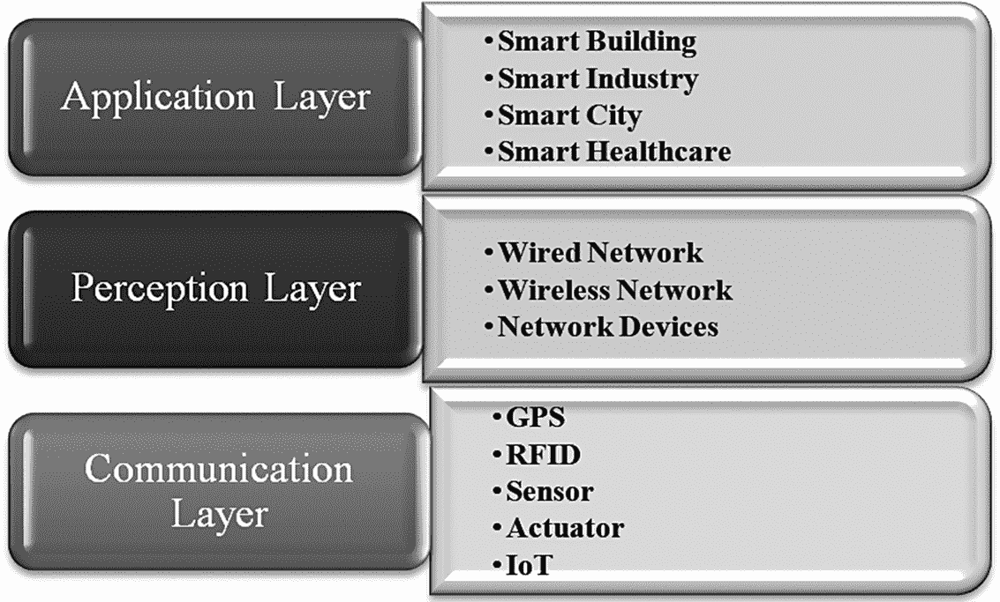

图 1.1 CPS 的三层。

应用层、数据传输层和感知层是 CPS 的三个层次 \[3]。在第一层，即感知层中，我们拥有物联网、摄像头、执行器、传感器、射频识别（RFID）和全球定位系统（GPS）。

由于节点间的协作，传感器数据可能会立即在本地局域和广域范围内生成。因此，数据通过感知层收集并发送到通信层，再由通信层连接网络中的物联网设备 \[2, 4\]。传感器和应用在通信中交换数据，这由通信层处理。路由器、交换机、广域网（WAN）、局域网（LAN）、5G、4G、WiFi、ZigBee 和蓝牙均用于此层通信。CPS 传统上在全局和局部考虑方面具有广泛的光谱，这是其主要组成部分之一。实时（RT）传输的可靠性和延迟都是通信层的责任。根据需求，应用层可能会有多个不同的名称，并应用于各种领域。

本研究采用跨层方法，从多个层的安全角度探索了 CPS。CPS 安全分为三个层次 \[5\]。

1. **通信层**：CPS 传统上在全局和局部考虑方面具有广泛的光谱，这是其主要组成部分之一。实时（RT）传输的可靠性和延迟都是通信层的责任。根据需求，应用层可能会有多个不同的名称，并应用于各种领域。
2. **安全方面**：本研究采用跨层方法，从多个层的安全角度探索了 CPS。CPS 安全分为三个层次 \[5\]。

## 1.1 智能家居安全
高级电表基础设施（AMI）已成为郊区的一个关键组件。因为在电网运行的人非常多，能源消耗的微小可能会产生重大影响 \[5\]。智能家居需要安全控制来方便活动。

## 1.2 智能家居的网络攻击
智能家居网络安全主题引起了研究人员的极大兴趣。这已经不是智能设备缺陷首次被公开了。最近的一个例子是 Google 温度温器，它被证明存在漏洞。如果设置得当，入侵者可以远程控制 Nest 温度温器。事实上，针对智能设备的网络攻击是新闻中一个频繁出现的话题。

### 1.1.1 智能家居安全
高级电表基础设施（AMI）已成为郊区的一个关键组件。因为在电网运行的人非常多，能源消耗的微小可能会产生重大影响 \[5\]。智能家居需要安全控制来方便活动。

### 1.1.2 智能家居的网络攻击
智能家居网络安全主题引起了研究人员的极大兴趣。这已经不是智能设备缺陷首次被公开了。最近的一个例子是 Google 温度温器，它被证明存在漏洞。如果设置得当，入侵者可以远程控制 Nest 温度温器。事实上，针对智能设备的网络攻击是新闻中一个频繁出现的话题。

## 1.2 文献综述
在本章中，作者根据已进行的研究，汇总了一份关于面向工业 4.0 的智能 CPS 安全的综合报告。Kim 等人强调了当前 CPS 安全研究的性以及 CPS 的独特属性 \[1\]。


通过威胁分析，Lu 等人 [2]\] 开发了一种针对信息物理系统（CPS）的安全范式，该体系从损害、脆弱性、威胁和资产四个维度考虑风险评估。该研究使用了 Emulab、可编程逻辑控制器（PLC`）和 `Matlab` 来模拟 CPS。在 CPS 仿真中，可以混合使用真实世界和计算机生成的组件。为了构建网络化工业控制系统的部分，他们提出了一种使用物理部分仿真和名为 Emulab 的仿真测试台的方法。`Matlab Simulink` 被用于创建物理系统模型，并利用 `Matlab` 生成 `C` 代码。仿真测试台组件可以与在仿真测试台中开发的 `RT` 代码进行通信。`PLC` 可以作为人与人之间交互的一个绝佳示例。在实际运行时，`PLCs` 从物理层获取数据，制定“本地执行策略”，然后向执行器发送指令。监视控制与数据采集（`SCADA`）服务器（主站）为 `PLCs` 提供指令，由 `PLCs` 执行这些指令，同时它们还可以根据请求提供全面的物理层数据。

Lee 等人 [3]\] 解释了 5C 级框架/架构。为了创建一个 CPS 应用，必须从机器以及组成这些设备的组件中收集数据。传感器可以直接收集数据，也可以通过控制器或企业生产系统（如 `ERP`、`MES`、`SCM` 和 `CMM`）收集数据。在此阶段必须处理两个关键变量。考虑到数据的多样性，需要一种平滑且无缝的技术来控制数据采集过程并将数据传输到中央服务器，而 `MTConnect` 等专用协议非常有效。另一方面，第一级的另一个方面方面选择合适的传感器（规格和类型）。

Huang 等人 [4]\] 为建议的工业 CPS 提供了一种灵活且具有韧性的网络安全防护架构，用于构建工业 CPS 网络安全策略。设计中至关重要的层是 `RT` 控制层安全，因为控制器直接连接物理设备，其操作对物理层具有瞬时影响。入侵容性防护的闭环防御框架旨在确保控制层的安全，并考虑了工业控制系统的领域特性。研究以一个网络化水位管理系统作为案例，评估了网络安全防护架构的有效性。对于网络化水位控制系统，构建了一套 `AADL`（奥角架构分析与设计语言）工具集以验证网络安全防护过程。

Wurm 等人 [5]\] 从跨层视角审视了 CPS，并考虑了各个层面的安全性。在很大程度上他们深入探讨了当前 CPS 结构的安全隐患。作者在整个辩论过程中详细阐述了每一层的安全需求。作者没有将 CPS 视为单一实体并尝试为整个系统设计安全解决方案，而是识别了每一层存在的许多安全问题并详细说明了应对措施。具体来说，这项研究建立了三个不同的安全级别，涵盖了从智能家居设备到低层硬件安全的所有内容。

根据 Oliveira 等人 [6]\]，`OS` 应该发展到更深入地参与底层硬件，并在确保其扩展程序安全方面发挥更积极的作用。计算机系统就像免疫系统，应该调节原始内核与扩展之间的对话，以减少发生安全漏洞的风险。针对 `OS` 防御，我们提出了一种硬件-软件协作架构（`HWSW`）。作为一个一般原则，`OS` 的设计是为计算机和其他设备提供必要的智能，以执行保护内核及其扩展程序的安全规则，同时允许它们和平共存。作为一个起点，考虑了以下安全规则：第一步，不允许内核扩展程序直接写入数据段和内核代码（包括栈段的受限区域）。在大多数情况下，内核扩展程序应通过暴露的函数与其他扩展程序和内核进行通信。

物理不可克隆函数（`PUF`）是一种基于半导体的技术，可以根据内在材料在网络实体和物理基质之间创建安全连接。该研究的作者 [7]\] 讨论了如何利用 `PUF` 技术来提高 CPS 的安全性。通过使用组合方法，他们证明了将许多 `PUF` 部分合并成一个随机且强大的系统级 `PUF` 的优势。

Kocher 等人 [8]\] 描述了差分功耗分析（`DPA`）、简单功耗分析（`SPA`）以及其他类似方法。通过对目标设备的功耗（或其他侧信道）进行测量，这些攻击可以获取密钥。所有主算法都可能被这些技术破解。此外，作者还提供了基于功耗迹及其属性的攻击，并对其进行了概述。下一种攻击是简单的 `DPA` 攻击。它们是实用的、非侵入的，且非常有效，即使在复杂性和噪声水平较高的系统中（此时加密计算仅占总功耗的极小部分）。作者还讨论了 `DPA` 攻击以及开发即使在会泄密的硬件中实现也是安全的加密系统。

Gupta 等人 [9]\] 对软件代码中的智能合约（`SC`）隐私漏洞进行了研究，这些漏洞可能被恶意用户利用或威胁整个区块链（`BC`）生态系统。这项研究的基础目标是研究人工智能（`AI`）在 `SC` 应用中的功能以及它如何帮助解决安全、隐私和计算问题。作者对 `SC` 隐私保护和漏洞 AI 方法提供了彻底的评估，这是文章的主要贡献之一。其次，他们以系统的方法强调了新的用于 `SC` 的去中心 AI 平台。最后，讨论了基于 AI 的 `SC` 面临的突出困难和挑战。最后，他们展示了一个利用 `SC` 和 `AI` 维护隐私和安全的零售营销用例。

Stefanov 等人 [10]\] 描述了电力系统网络安全的必要性。测试台框架是识别安全增强、CPS 漏洞、网络攻击缓解和影响分析的精确有效工具。该测试台用于模拟电力系统的网络攻击和入侵场景。实验使用了 `IEEE 39-bus` 系统。从网络攻击导致的停电中快速恢复的问题已引起关注。作者还涉及了 `SCADA` 测试台设计、网络入侵场景和影响分析以及仿真结果。

CPS 仿真和建模是系统开发方面的两个重要考虑因素。Oks 等人 [11]\] 建议开发具有可尺寸、模块化和可扩展性的 CPS。作者还提出了一种工业 CPS 参考架构用于设计，使其能够在各种扩展性和复杂性的配置中表示工业 CPS。


对于云端物理信息系统（`C2PS`），这项工作 [12] 为数字孪生架构参考模型提供了分析性描述，其中每个现实实体都与一个云托管的赛实体相关。可以通过直接物理接触或通过云端的间接数字孪生连接建立点对点（`P2P`）链接。计算、控制和通信在本文中都经过了分析建模。基于建议的云端 CPS 参考模型，他们还给出了自动驾驶辅助应用的设计规范。C2PS 架构介绍中还详细描述了一种基于远程信息学的汽车驾驶辅助应用（表 1.1）。

### 表 1.1 CPS 安全解决方案、解释与来源

| 解决方案类型 | | 解释 | 来源 |
| --- | --- | --- | --- |
| CPS 待解决问题 | | 物联网物理信息系统安全性的威胁、挑战、解决方案和问题：综述 | Kim et al. [1] |
| --- | --- | --- | --- |
| 物理不可克隆函数（`PUFs`）、固件多样性和机器学习方法。 | 物理信息系统安全的跨层方法 | Jacob Wurm [2] |
| --- | --- | --- | --- |
| 使用 `Matlab`、`PLC` 和 `Emulab` 进行 CPS 仿真。 | 新多级框架下的物理信息系统安全 | Tianbo Lu [3] |
| --- | --- | --- | --- |
| 适用于工业 CPS 的适应且稳健的多层网络安全防护架构。 | 使用物理信息系统保护工业过程 | Shuang Huang [4] |
| --- | --- | --- | --- |
| 使用 `HWSW` 平台实现操作系统（`OS`）安全。 | 使用低开销的 `Ianus` 性能估计 CPU 和系统基准测试。描述了一种提供 OS 安全性的软硬件架构。 | Oliveira et al. [6] |
| PUF | 数字指纹可用于微处理器等半导体设备作为唯一标识符 | Al Ibrahim et al. [7] |
| --- | --- | --- | --- |
| DPA | 为了防止攻击者，研究明文和密文信息的入口 | Kocher et al. [8] |
| --- | --- | --- | --- |
| 提高 `SCADA` 系统的网络安全 | 分析 CPS 及其安全的影响 | Stefanov et al. [10] |

## 1.3 CPS 5C 级架构

提出的五级 CPS 结构，特别是 5C 架构，为构建和组织用于高级功能的 CPS 提供了一个渐进式的框架。CPS 通常由两个主要元素组成 [1]：卓越的连接性，确保了从物理世界获取 `RT` 信息以及来自赛博空间的数据建议；以及智能的数据组织、分析和计算能力，它们构建了网络空间 [2]。另一方面，这种义务是非常理论性的，通常不足以用于执行目的。相比之下，这里提出的 5C 架构 [3] 显然以一种时间工作流的方式描述了如何从早期数据获取到分析，再到最终价值形成来构建 CPS。5C 架构如图图 1.2

图 1.2 CPS 5C 级架构。

CPS 的普通说明包括工业控制系统（考虑到所谓的工业 4.0 的，这变得特别有趣，因为它本质上是信息系统、公司数据和计算机生产系统的紧密集成）、机械车辆和飞机控制、无线传感器网络、智能电网以及几乎每个特征性地包含在 `IoT` 中的设备。再次，许多医疗设备（主要是如起搏器等植入式设备）也正在成为 CPS。此类系统通常是现代关键基础设施的关键组成要素，因此对我们社会的财务可行性和社会稳定性至关重要。出于这些原因，CPS 的安全性、安全性和可靠性对于可持续社会至关重要 [3]。

## 1.4 CPS 安全问题与挑战

随着网络安全重要性的发展，更快速发送 CPS 安全通知至关重要。通信安全、物理安全以及操作与控制安全是 CPS 安全的三个方面。物理环境的安全侧重于网络环境下的数据防御、松散连接系统中的数据聚合、发布和大规模划分；通信安全侧重于面对网络攻击时的信息防御和控制方案责任 [2]。智能设备的安全风险可以根据攻击它们的方法分为六组。图 1.3 显示了智能设备安全漏洞的种子。

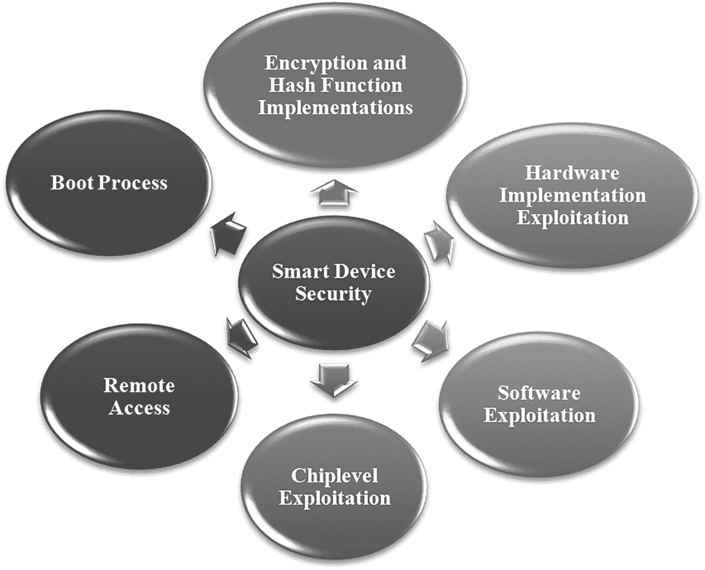

图 1.3 智能设备中的安全漏洞。

### 1.4.1 安全框架

现在检查 CPS 的安全性集中于信息的保护。信息安全解决了在规模化、混合、松散连接环境中的数据收集、处理和非破坏性发布的问题。其主要点是增强安全方法、用户隐私保护、大数据组织的加密。控制安全解决了通过攻击系统意见控制算法获取权限的问题 [2]。

#### 1.4.1.1 感知问题与挑战

在环境的各种感知中，CPS 包括传感器、执行器和物理生态问题。物理环境提取控制单元的训练，大量和受控的数据被广播到控制单元。实时数字仿真（`RTDS`）主要用于电力行业以生成现场机器的输入信号。在水电系统中，现场机器由泵、传感器和水箱组成。环境具有访问点，非法物品可以进入并影响网络。必须先执行程序以保护系统免受恶意黑客攻击。除了基本二进制代码可以信任外，程序不保证其他程序的执行。在这里，IoT 安全涉及设备和前端传感器、内部 IT 程序和网络，而 IoT 机密涉及机器隐私、传输中的隐私和隐私数据空间问题 [1]。

#### 1.4.1.2 应用层的挑战与问题

CPS 应用负责控制、测量和监控物理环境。现实设备和系统被用于研究构建控制。由于所应用的多样性，今天的应用领域存在广泛的安全考虑，包括智能工业、智能城市、智能建筑、智能电网和智能医疗 [1]。


通过使用从控制状态接收的不同形式的数据（如事件、控制状态和测量值），`CPS` 的通信层向负责连接控制系统与设备 Web 的设备和系统发布指令。通信需求不仅关注应用层，还需要影响物理层、中间层和网络层。每个设备与各种设备（如路由器）的无线连接质量、整体网络负载和能力等因素，在 `CPS` 通信领域的困难中都起着作用，在选择合适的通信标准之前必须解决这些问题。在处理 `CPS` 安全挑战时，在不同级别实施的安全措施与实施成本之间找到平衡非常重要 [13]。作为传输难题，`SDN`（软件定义网络）可能会改变路由规则，而 `CPS` 上下的变化会影响路由控制和服务质量，同时维持 `RT` 需求、可靠性和安全性 [1]。

## 1.5 CPS 安全攻击与可能的措施

在 `CPS` 中，单个层级可能会受到物理或侵进性的破坏，造成严重的物理伤害。针对 `CPS` 传感器和网络的网络攻击也是可能的 [14]。感知层的问题包括针对执行器和传感器的网络攻击（主要针对 `IoT`）；包含系统通信的通信层面临着数据损坏和威胁；以及应用层的危险包括恶意代码和伪造攻击。这些不同的危险被归类为 `CPS` 安全问题（图 1.4）。`CPS` 安全问题包括保护物理、网络和系统空间的方法。这些解决方案了智能电网、智能城市、智能医疗、智能工业和智能建筑等智能环境的重要性。

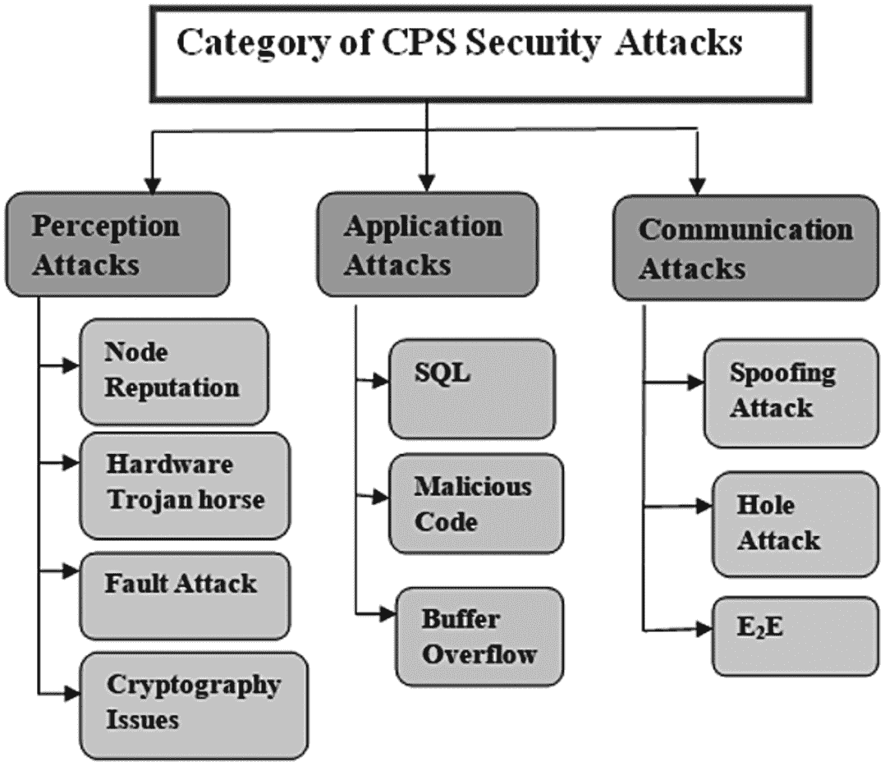

图 1.4 CPS 安全攻击分类。

1. **感知攻击**：内存功能和物理环境，例如传感器的 `RFID` 成了感知层。这些设备通常放置在户外，当设备或组件被更换时，它们会暴露于物理攻击之下 [15]。此外，大多数 `CPS` 安全研究集中在网络空间，忽略了硬件层的脆弱性，有必要对该主题进行研究。节点信誉、数据密码威胁、数据篡改、感知数据损坏、拒绝服务攻击、故障攻击、电磁干扰、电磁泄漏、线路故障和设备故障都是物理风险。

    * **节点信誉**：针对节点信誉的攻击包括节点捕获、影子节点和节点节点。为了确保整个系统的安全，节点捕获代表节点获取或交出加密信息 [16]。通过在网络中创建新节点，假节点能够发送有害数据。节点能量可能被攻击数据完整性并执行 `DoS` 攻击 [17]。通过中断节点接收和收集数据的能力，被称为“节点中止”的攻击会损害完整性和可用性 [18]。稳定性、完整性、可用性。

    * **硬件木马**：行为性、可用性、安全性。

    * **硬件木马**：`trojan` [19]。

    * **故障攻击**：`SDN`, `AES` [20]。

    * **密码问题**：`SubBytes`, `AddRoundKey` [22]。

2. **应用攻击**：该层是收集大量信息的地方，可能导致。漏洞攻击、`DoS/DDoS`、控制命令伪造、恶意代码、未经授权的访问和隐私泄露都是应用层攻击示例。

    * **结构化查询语言 (SQL)**：`SQL`。

    * **恶意代码**：`malicious code`。

    * **缓冲区溢出**：`overflow` [23]。

3. **通信攻击**：必须保护 `CPS` 的通信以防止系统出现任何缺陷。应该让能够在轻量化、韧性和范围方面扩展以满足其需求的 `CPS` 保护尽可能多的服务器、基础设施设备和现场设备。传输危害包括路由环、空洞攻击（例如灰洞攻击、黑洞攻击、虫洞攻击、汇聚点攻击）、女巫攻击、后门、泛洪攻击、控制攻击、`DoS` 攻击和路由攻击。


- **空洞攻击**：灰洞攻击、黑洞攻击和汇洞攻击都是空洞攻击的示例。针对名为“虫洞”的传感器网络（WSN）路由协议的攻击涉及两种类型。利用虫洞隧道，两个可疑元素在网络的一个区域搜索数据包并通过它们传输到网络的其余部分，从而提供一种距离很的错觉。入侵者可能接管网络中的许多路径，导致路由系统故障[24]。汇洞攻击是汇洞中的可疑元素，提供了通基站的最直接路径。数据在被汇洞节点删除或发送到基站之前可能会被篡改[25]。

- **端到端 (E2E)**：E2E 可能让 DDoS 和 DoS 威胁、加密技术和密钥管理变得更加困难。此外，在大规模系统中，CPS（信息物理系统）设备分布在广泛的地理区域。分散的设备需要安全通信，这些设备可能会暴露给其他利益相关者并构成经济和安全威胁。因此，应该使用大规模 CPS 来保护网络 E2E 端免受网络攻击。在从能源或智能电表收集数据的传输过程中，保护单个数据传输的安全支持也被指定为一种不可协商的 E2E 安全协助。如果没有 E2E 安全支持，大型 CPS 可能会失去可靠性[26]。

## 1.6 CPS 安全问题解决方案

应用隐私[27, 28]、网络安全和数据保护都是 CPS 安全[29, 30]范围的一部分，其范围从物理环境延伸到应用环境。如图 1.5 所示，CPS 安全解决方案可以分为四大类：应用解决方案、恶意代码检测、网络访问检测和设备保护。

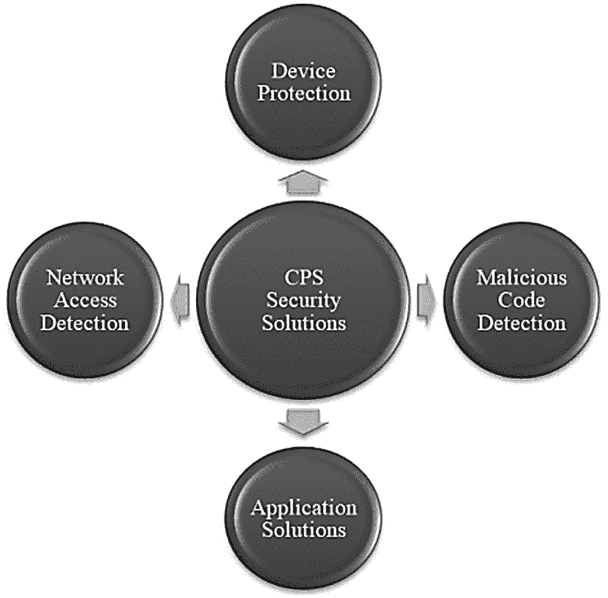

图 1.5 CPS 隐私与安全解决方案。

- **应用解决方案**：智能电网、医疗保健、工业、城市、建筑和其他连接方案是许多适用于应用解决方案的智能设置之一[31, 32, 33, 34 和 35]。

- **恶意代码检测**：在互联网上，已经提出了许多恶意软件检测算法[36]。然而，由于这些技术仅识别互联网上的恶意代码，无法用于控制在 CPS 中传播危险程序。

- **网络访问检测**：系统中包含了一种使用网络访问（`SDN`）的虫洞和防御检测技术[37, 38 和 39]。然而，在该领域全球正在进行严谨的研究。

- **设备保护**：基于此，创建一个能够抵抗网络攻击的安全硬件平台至关重要。不同的研究人员已经提出了各种架构来应对 CPS。也就是说，系统还必须显示 CPS 的理想特性：可用性、隐私性、可靠性和安全性。

## 1.7 结论

由于 CPS 安全并不是一个与当前场景完全不同的独立领域，应用程序和传感器都通过 CPS 传输，而 CPS 是可以处理广泛信息的传输媒介。在本研究中，我们分类了大量的安全理念、风险和面临的 CPS 问题，并针对每种威胁提出了解决方案。在 CPS 安全的背景下，我们研究了可用解决方案作为可能的未来路径。由于 CPS 被用于许多不同场景，包括智能电网、医疗、工业和城市，CPS 的安全应该是重中之重。随着智能环境变得越来越普遍，CPS 安全的重要性预计将增加。

## 参考文献

1. Kim, N. Y., Rathore, S., Ryu, J. H., Park, J. H., & Park, J. H. ([ch1.xhtml#R_ref1_1]) (2018). A survey on cyber physical security for IoT: Issues, challenges, threats. Journal of Information Processing Systems, *14*(6), 1361–1384.
2. Lu, T., Xu, B., Guo, X., Zhao, L., & Xie, F. ([ch1.xhtml#R_ref1_2]) (2013, March). A new framework for cyber-physical system. In *First international Workshop on Swarm at the Cloud*.
3. Lee, J., Bagheri, B., & Kao, H. ([ch1.xhtml#R_ref1_3]) (2015). A cyber-physical systems architecture for industry 4.0-based manufacturing systems. Manufacturing Letters, *3*, 18–23.
4. Huang, S., Zhou, C. J., Yang, S. H., & Qin, Y. Q. ([ch1.xhtml#R_ref1_4]) (2015). Cyber-physical system security for networked industrial processes. International Journal of Automation and Computing, *12*(6), 567–578.
5. Wurm, J., Jin, Y., Liu, Y., Hu, S., Heffner, K., Rahman, F., & Tehranipoor, M. ([ch1.xhtml#R_ref1_5]) (2016). Introduction to cyber-physical system security: A cross-layer perspective. IEEE Transactions on Multi-Scale Computing Systems, *3*(3), 215–227.
6. Oliveira, D., Wetzel, N., Bucci, M., Navarro, J., Sullivan, D., & Jin, Y. ([ch1.xhtml#R_ref1_6]) (2014). Hardware-software collaboration for secure coexistence with kernel extensions. ACM SIGAPP Applied Computing Review, *14*(3), 22–35.
7. Al Ibrahim, O., & Nair, S. ([ch1.xhtml#R_ref1_7]) (2011, July). Cyber-physical security using system-level PUFs. In *2011 7th International Wireless Communications and Mobile Conference* (pp. 1672–1676).
8. Kocher, P, Jaffe, J, Jun, B., & Rohatgi, P. ([ch1.xhtml#R_ref1_8]) (2011). Introduction to differential power analysis. Journal of Cryptographic Engineering, *1*(1), 5–27.
9. Gupta, R., Tanwar, S., Al-Turjman, F., Italiya, P., Nauman, A., & Kim, S. W. ([ch1.xhtml#R_ref1_9]) (2020). Smart contract privacy protection using AI in cyber-physical systems: Tools, techniques and challenges. IEEE Access, *8*, 24746–24772.
10. Stefanov, A., & Liu, C. C. ([ch1.xhtml#R_ref1_10]) (2014). Cyber-physical system security and impact analysis. IFAC Proceedings Volumes, *47*(3), 11238–11243.
11. Oks, S. J., Jalowski, M., Fritzsche, A., & Möslein, K. M. ([ch1.xhtml#R_ref1_11]) (2019). Cyber-physical modeling and simulation: A reference architecture for designing demonstrators for industrial cyber-physical systems. Procedia CIRP, *84*, 257–264.
12. Alam, K. M., & El Saddik, A. ([ch1.xhtml#R_ref1_12]) (2017). C2PS: A digital twin architecture reference model for the cloud-based cyber-physical systems. IEEE Access, *5*, 2050–2062.
13. Burg, A., Chattopadhyay, A., & Lam, K. Y. ([ch1.xhtml#R_ref1_13]) (2017). Wireless communication and security issues for cyber–physical systems and the Internet-of-Things. Proceedings of the IEEE, *106*(1), 38–60.
14. Peng, Y., Lu, T., Liu, J., Gao, Y., Guo, X., & Xie, F. ([ch1.xhtml#R_ref1_14]) (2013, October). Cyber-physical system risk assessment. In *2013 Ninth International Conference on Intelligent Information Hiding and Multimedia Signal Processing* (pp. 442–447). IEEE.


15. Shafi, Q. (2012, 6). 物理信息系统安全：简要调查。发表于*2012 12th International Conference on Computational Science and Its Applications* (pp. 146–150)。 IEEE。

16. Mahmoud, R., Yousuf, T., Aloul, F., & Zualkernan, I. (2015, 12). 物联网（IoT）安全：现状、挑战与前性措施。发表于*2015 10th International Conference for Internet Technology and Secured Transactions (ICITST)* (pp. 336–341)。 IEEE。

17. Zhao, K., & Ge, L. (2013, 12). 物联网安全综述。发表于*2013 Ninth International Conference on Computational Intelligence and Security* (pp. 663–667)。 IEEE。

18. Bhattacharya, R. (2013). 无线传感器网络物理攻击的比较研究。International Journal of Research in Engineering and Technology, *2*(1), 72–74。

19. Tehranipoor, M., & Koushanfar, F. (2016). 硬件木马分类与检测综述。IEEE Design & Test of Computers, *27*(1), 10–25。

20. Khelil, F., Hamdi, M., Guilley, S., Danger, J. L., & Selmane, N. (2008, 11). 对 FPGA AES 实现的故障分析攻击。发表于*2008 New Technologies, Mobility and Security* (pp. 1–5)。 IEEE。

21. He, W., Breier, J., Bhasin, S., & Chattopadhyay, A. (2016, 5). 在物理信息系统中使用激光故障注入绕过奇偶校验保护加密。发表于*Proceedings of the 2nd ACM International Workshop on Cyber-Physical System Security* (pp. 15–21)。

22. Kocher, P., Jaffe, J., Jun, B., & Rohatgi, P. (2011). 差分功率分析导论。Journal of Cryptographic Engineering, *1*(1), 5–27。

23. Zhu, B., Joseph, A., & Sastry, S. (2011, 10). SCADA 系统的网络攻击分类。发表于*2011 International Conference on Internet of Things and 4th International Conference on Cyber, Physical and Social Computing* (pp. 380–388)。 IEEE。

24. Gupta, G. (2015). WSN 中基于频率的虫洞攻击检测算法。International Journal of Advanced Research in Computer Engineering & Technology, *4*(7), 3057–3060。

25. Pirzada, A. A., & McDonald, C. (2005, 5). 规避无线传感器网络中的汇洞和虫洞。发表于*IWWAN’05: Proceedings of International Workshop on Wireless Ad-hoc Networks* (Vol. *71*)。

26. Kim, Y., Kolesnikov, V., & Thottan, M. (2016). 物理信息系统通信的弹性端到端保护。IEEE Transactions on Smart Grid, *9*(4), 2478–2487。

27. Banerjee, J., Maiti, S., Chakraborty, S., Dutta, S., Chakraborty, A., & Banerjee, J. (2019, 3). 机器学习在各种网络安全应用中的影响。发表于*2019 3rd International Conference on Computing Methodologies and Communication (ICCMC)* (pp. 276–281)。

28. Chakraborty, A., Banerjee, J. S., & Chattopadhyay, A. (2020). 认知无线电网络中可靠频谱感知的恶意节点限制量化数据融合方案。Journal of Mechanics of Continua and Mathematical Sciences, *15*(1), 39–56。

29. Das, K., & Banerjee, J. S., (2022). 工业 4.0 中智能物理信息系统的绿色物联网：赋能技术与解决方案综述。发表于 GCAIA 21*: Proceedings of 2nd Global Conference on Artificial Intelligence and Applications (pp. 463–478)。

30. Das, K., & Banerjee, J. S. (注：原文在此处重复或存在错误)。


数字世界组件与个人对现实世界的感知融合成了增强现实（AR）[[1, 2, 3, 4, 5, 6 和 7]]。它改变了人们看待现实世界的方式，从而在幻想与现实之间建立了一个界面。它通过让用户的现实世界环境具有交互性，对其信息进行数字操纵。因此，AR 将现实世界与虚拟世界的结合以及交互整合在一起。所以，AR 本身并不是真实的，而是对预先存在的现实进行补充。它不是用数字世界取代现实世界，而是将数字世界的物体放入现实世界中[8]]。AR 的使用不仅限于游戏和娱乐，还扩展到了业务领域。AR 可以在屏幕、手机和眼镜等设备上显示。并非所有现代设备都支持 AR，但许多设备都是支持的。智能手机、平板电脑、智能眼镜和智能镜片属于适合 AR 的设备类别。

通过 AR 增强数字通信也导致了数字威胁的增加，从而强调了 AR 技术对安全和保护的迫切需求。AR 可能带来的安全担忧需要在其广泛使用之前得到解决。此类技术被用于共享空间，因此引发了新的安全挑战，包括身份验证方面的挑战。AR 系统不仅带来了挑战，也提供了改进安全和隐私的机会。身份验证是识别设备原始所有者的基本过程。由于 AR 技术非常新，还没有一种机制是完全可靠且安全的。随着安全威胁和攻击每天都在发生，研究人员为 AR 设备引入了不同类型的身份验证机制。因此，在本章中，

1. 我们讨论了目前可用的大多数常用机制。
2. 我们研究了这些协议并提供了简要信息。
3. 在某些性能和安全标准的基础上对它们进行了比较。

这使我们创建了一张调查表，可以一目了然地对这些身份验证机制的安全性提供概述。我们根据以下标准对身份验证机制进行了分类：

1. 使用的密码学或算法。
2. 针对多种潜在攻击的防御能力。

本章结构安排如下：Section 2.2] 探索了基于人类的方案，并使用了私有通道来实现 AR 系统中的身份验证。这种方案对头戴式设备进行某种计算。尽管该协议在某种程度上确保了可靠性，但由于使用了伪造功能，它容易受到中间人攻击（MiTM）的影响，并且存在拒绝服务攻击（DoS）的威胁。

Krishna 等[10] 使用了脑电图（EEG）信号和眼追踪机制。他们利用机器学习方法处理 EEG 信号，并使用支持向量机（SVM）来构建。然后，眼追踪信号被用于训练随机森林分类器。虽然这种方法使用了更复杂的特征，但它仍然是脆弱的。

Gaebel 等[11] 采用了 Diffie-Hellman 密钥算法来建立共享密钥，并利用人脸识别进行最终的真实性验证。这种协议确保了防御中间人攻击的安全性，人脸识别提供了防止伪造的额外安全措施。

Wang 等[12] 提议了一种使用 IMU 传感器的 Nod-to-Auth 协议，通过点头动作解锁头戴式设备。他们使用了颈长度变化、平均颈长度和头部方向等特征。这种协议在 AR 中非常廉价且易于实现，因为大多数设备现在都配备了 IMU 传感器。

Bhalla 等[13] 使用了头戴设备中的传感器来获取用户的空间和行为模式，然后通过 k-NN、SVM 和随机森林等机器学习算法对不同参数进行评估。

Wazir 等[14] 提议使用涂鸦进行身份验证。他们利用 AR Drawing（Google 创意实验室）和手机屏幕在 AR 空间内生成涂鸦，然后匹配涂鸦的坐标以完成身份验证。

更详细的身份验证机制定义和审查将在 Section 2.6 中讨论。

## 2.3 AR 历史

AR 在过去几年中经历了巨大的增长，但它已经存在很久了。20 世纪早期就出现了 AR 的首次提及。最近的发展证明了 AR 有望成为下一个巨大的商业资产。主要的 AR 设备是由哈佛大学教授伊万·苏瑟兰（Ivan Sutherland）设计并开发的，他和他的学生 Bob Sproull 一起完成。他将第一台 AR 设备命名为“达摩克利斯之”（The Sword of Damocles），它本质上是一个头戴式设备，悬挂在天花板上。由于体验了计算机图形，它给用户带来了另一种现实的感觉。


该领域的下一次发展是由 Myron Krueger 在 1974 年完成的，被称为 Videoplace \[8]。它在投影系统和视频摄像机的配合下，在屏幕上产生阴影。这给用户带来了一种交互环境的感觉。“增强现实”（augmented reality）这一术语是由波音的一名研究员 Tom Caudell 在 1990 年提出的。第一个真实且可运行的 AR 系统由 Louis Rosenburg 于 1992 年创建，他属于美国空军阿姆斯特朗研究实验室。它被命名为“虚拟固定装置”（virtual fixtures）。这可以被认为是目前大多数 AR 系统所实现的前版本 [16]]。

两年后，即 1994 年，创作了一部使用 AR 的剧作。该剧名为《在网络空间中舞蹈》（Dancing in Cyberspace），由 Julie Martin 制作。它展示了杂技演员在虚拟物体及其周围的舞蹈。

该领域的重大进展出现在 2000 年，当时来自日本奈良科学技术大学的加藤和（Hirokazu Kato）创建并发布了一个名为 `ARToolKit` 的软件。借助该软件，可以捕捉现实世界的动作并将其与虚拟物体的交互相结合 [17]。在 2009 年，借助该软件，AR 已可以在互联网浏览器中使用。

自诞生以来，AR 取得了巨大的进展，而它在过去几年中的演变被证明是更具前景。

## 2.4 与 VR 的比较

从数字角度来看，AR 和 VR 这两种技术都提供了丰富的体验。一方面，VR 由 75%的真实内容组成，而 25%的内容是虚拟的。另一方面，AR 由 25%的虚拟内容组成，其余 75%是真实内容。VR 需要使用耳机，而 AR 则没有这种需求。VR 控制人的视觉感官，而在使用 AR 时，总能感受到处于真实环境之中。虽然 AR 是在现有事物上添加某些东西，但 VR 是完全沉浸式的，因为它生成了三维图像。因此，在 VR 中，用户感觉自己仿佛被图像所包围[17]。为了获得最高质量的体验，AR 需要更高的带宽（超过 100 mbps），而 VR 则至少需要 25 mbps 的较低带宽进行流传输。与 AR 相比，VR 需要更先进、复杂的。。AR 系统需要传感器来收集来自真实世界的数据，但 VR 没有这种需求，因为它将用户与真实世界隔离开。AR 的实施比 VR 的实施便宜，因为 VR 需要高成本设备。

与 VR 产品相比，像`Google glasses`这样的 AR 产品已经可用，而 VR 产品尚未普及，因为它们需要将用户完全沉浸到不同的世界中。VR 使用的算法和软件比 AR 使用的更复杂。VR 还需要更多的图形处理和处理能力。尽管 AR 和 VR 之间存在这些差异，但两者在教育、游戏、市场和商业等不同领域的未来都极具前景。这两种技术通过结合虚拟世界和现实世界共同提升了用户体验。

## 2.5 应用

近年来，目睹了 AR 在使用量和应用上的巨大增长。这归功于消费者通过 AR 获得的便利。他们可以在实际购买之前可视化并想象使用该产品，并体验该服务。对于开发者创建 AR 应用，2017 年，Apple 发布了`ARKit`，Google 为 Android 发布了`ARCore`。由于 AR 的复杂性和成本效益，对 AR 的需求和投资在未来一段时间将增加。

### 2.5.1 医疗

AR 在医疗行业的需求与在同一物理空间内可视化患者和医疗数据的需求相关。此外，AR 在医疗领域的应用可见于超声成像 [18, 19 和 20]。

### 2.5.2 军事

AR 用于展示真实战场的场景。在城市地形中提供军事训练时可以使用 AR。借助 AR，还可以显示动画地形，这对军事干预规划有所帮助 [21]。

### 2.5.3 机器人

机器人使用 AR 技术向人类传递信息。这主要用于展示复杂信息。AR 技术与手术机器人系统的结合可头部手术 [22]。

### 2.5.4 可视化

AR 用于将计算机图形叠加到现实世界。通过 AR，不可见的概念和事件也可以可视化。这可以通过将虚拟物体叠加到物理环境中来实现。抽象科学概念也可以通过 AR 可视化 [23, 24]。

### 2.5.5 教育 

通过实施 AR，教学和学习领域有了新的机会。学生可以可视化并体验现实世界中不可能实现的现象。借助 AR 还可以进行二维和三维合成物体的交互 [25]。

### 2.5.6 旅游 

通过基于 AR 的现场导为游客提供文化遗产地的信息及其考古信息。这是为了增强文化旅游体验 [20, 26]。

### 2.5.7 营销 

汽车工业是首次将 AR 用于广告目的行业。汽车的三维模型显示在屏幕上。这种方法随后扩展到鞋类、家具等领域。这对用户非常有帮助，因为他们可以通过测试颜色、配件和型号找到适合自己的产品 [27, 28]。

### 2.5.8 制造 

AR 可用于在开发产品和工艺的同时制造工艺。它可以改变人们对周围环境的感知。这将降低成本并提高制品的质量 [29, 30]。

### 2.5.9 娱乐与游戏 

AR 被广泛用于各种游戏的创建。它还用于体育直播。通过 AR，游泳池和足球场也可以方便地准备 [31]。

## 2.6 AR 与 CPS 的集成

AR 系统可用于用于物理系统（CPS）的规划、感知、学习和控制原型。Omidshafiei 等人 [32] 开发了一个用于自动驾驶汽车的框架。计算机网络系统与物理过程的融合构成了 CPS。CPS 未来发展范围的关键特征是其与物理世界及其过程交互的能力。此外，借助计算和通信，它可以扩大物理世界的能力。


将 CPS 和 AR 整合的一种方法是在建筑业中整合 CPS。这将提高这些行业的生产力和效率。为了促进虚拟世界与物理世界之间的这种协调，需要开发一种机制。这还涉及在关键物理组件上设计传感器的正确位置 [33]。

进行这种集成的替代方案是将 CPS 概念与移动 AR 结合。AR 的增长见证了手持系统的转变。这将导致地理空间数据的抽象视图以及地下基础设施的可视化。由于 CPS 的复杂性，开发 CPS 面临巨大挑战。因此，为了实现有效集成，需要在不同层次解决不同的问题。

## 2.7 AR 中的身份验证

AR 系统中的身份验证用于提供一种验证层，以识别用户是否真实以及其声称的身份。随着 AR 系统和 VR 系统演变为独立设备，用户无法简单地像在使用手机和/或电脑那样使用身份验证机制，因此不同的研究人员提出了多种身份验证协议。本节简要讨论了某些提出的或用于用于 AR 系统的身份验证技术（图 2.1）。

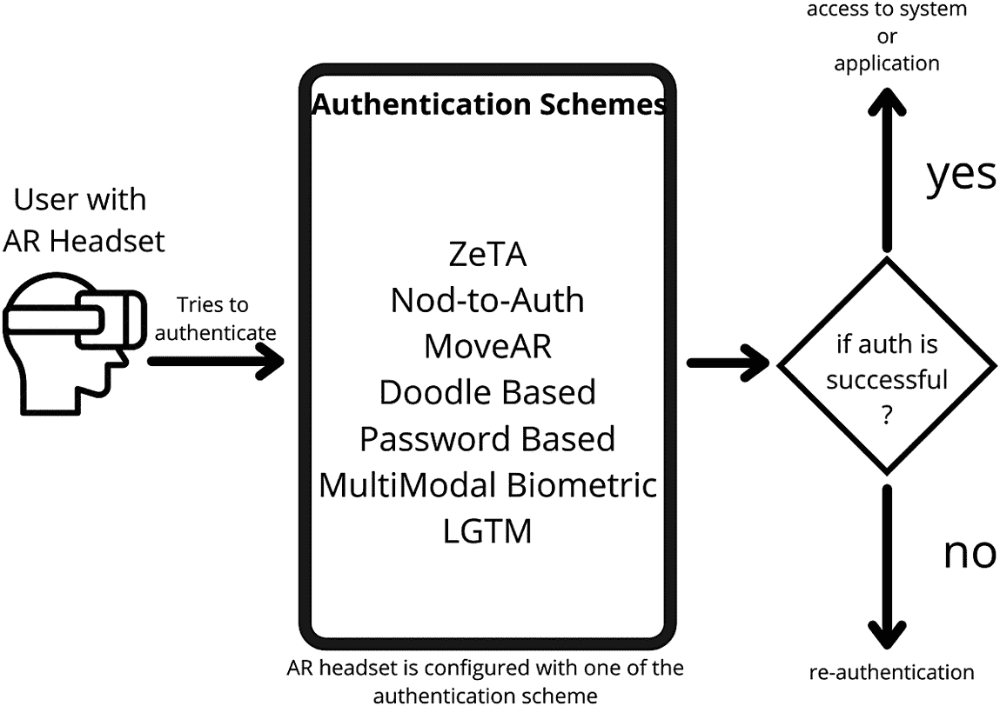

图 2.1 增强现实系统中的身份验证流程。

### 2.7.1 ZeTA—零信任认证

用于身份验证过程的设备和通道需要可靠的才能进行适当的身份验证。ZeTA（零信任认证）协议是一种基于人类计算的身份验证方案，旨在减少身份验证过程中使用不可信设备和通道带来的威胁。ZeTA 协议背后的想法是记忆身份密钥。当用户注册时，ZeTA 会生成并分配密钥给用户。注册是在系统和用户之间的私有通道帮助下完成的。该密钥由不同的单词组成，词汇之间存在如 `AND`、`OR` 和 `NOT` 等逻辑连接。根据语义和词汇之间建立的逻辑连接，对特定属性进行确认或否定。该协议测试用户对密钥中所用单词及其含义的语义知识。系统会提出与密钥的常知识相关的个性化问题及答案。该协议的意义在于它利用了人类处理。存储在我们语义记忆中的知识与大量的跨人相关性相关。该协议背后的概念不需要用户进行任何数学运算。用户被要求确认或否定与密钥语义和属性相关的问题。因此，ZeTA 可以扩展到任意安全级别 [9]。

该协议分为三类：

1. 它使用语义和人类计算来解决不可信设备和通道问题，并具有形式规范和安全分析。
2. 该协议提出了一项安全研究，以评估所提身份验证协议的预期性能。
3. 可用性研究的结果探讨了在这种情况下使用人类计算的可能性。

防止不可信设备、通信以及窥视者（shoulder-surfers）是建议协议应具备的两个主要属性。提出了一种挑战-响应交互样式来实现这一点。用户部分必须在脑中完成，且不使用任何外部人工制品。

## 2.8 多模态生物识别认证

EEG 信号可以与可戴式头设备（即 AR/VR）结合使用，提供额外的非侵入式输入模态。脑机接口（BCI）算法的一个根本困难是 EEG 数据的泛化性能差。由于这些用户差异，利用该技术在手机上进行人脸识别的可能性应运而生。

此外，使用了此类头设备中通常提供的眼动追踪数据进行评估。针对这些系统以及它们的融合，正在开发生物识别认证方法。使用公开的 EEG 运动想象数据和眼动追踪数据来构建评估范式。

该系统的三个主要步骤是 EEG 身份验证、眼动追踪认证和多模态融合。

在运动想象任务期间生成的 ERP 用于分析 EEG 身份验证中的 EEG 数据。为了对 EEG 信号进行分段和预处理，使用了 `MNE` 程序 [34]。为了创建一个特征的 `64 X1` 向量，使用了最大互相关值。具有线性内核径向基函数（`RBF`）内核的 `SVM` 应用于特征向量。在眼动追踪认证中，使用由连接的眼动追踪信号组成的特征向量来训练具有 100 树的随机森林分类器。该模型预测提供的样本属于每个 `n = 5` 个授权用户和未授权可能标签组（共 `n + 1 = 6` 个桶）的后验概率数组。多模态融合使用了两种融合方法：加权平均和使用具有线性内核的 `SVM` 进行融合，两者都根据单个预测产生归一化的匹配分 [35]。在此过程中，当基于数据集组成进行评估时，具有线性内核的 SVM 和随机森林分类器在识别准确率方面优于单一模态。

### 2.8.1 Looks Good To Me

为了在 AR 头设备之间共享内容，用户身份验证起着至关重要的作用。在没有中央认证服务器的情况下，传统的认证协议无法满足需求。Looks Good To Me（LGTM）认证协议出现并提供了用户身份验证。LGTM 协议利用了 AR 头设备独特的硬件和上下文，意在将人类信任机制引入数字世界 [11]。

### 2.8.2 基于涂鸦的认证


基于涂鸦的认证的核心在于增强现实（AR）与涂鸦密码的结合。在 AR 空间中，为了创建涂鸦密码，智能手机使用了`touch-gesture-recognition`（触摸手势识别）。研究发现，基于涂鸦的密码非常复杂且困难。因此，涂鸦密码为系统提供了安全性。对于这种 AR 与涂鸦密码的融合，选择了 AR Drawing。AR Drawing 是通过 AR 实现的 Google 创意实验室。为了通过涂鸦笔画创建密码，需要触摸手机屏幕并在 3D 空间中移动。这样做是为了绘制一个将设置为密码的涂鸦形状。总共需要绘制五个涂鸦，其中前四个用于注册，第五个涂鸦用于认证。在用户完成涂鸦后，会获取所绘制涂鸦的坐标。这是通过向量数学库实现的。动态数组列表存储了注册涂鸦的坐标。随后，在认证过程中，会使用这些数组列表。

为了对用户进行认证，系统要求用户再次绘制与注册时完全相同的涂鸦。然后，将绘制的涂鸦与用户在注册时绘制的所有五个涂鸦进行匹配`[14]`。在坐标之间进行差异检查，并在此基础上提取相似性。只有当两个涂鸦的大小和坐标匹配时，认证才会成功。破解涂鸦密码非常困难，因为在给定空间内可以产生大量的涂鸦。因此，可以证明这是一个非常强大的认证方案。

### 2.8.3 Nod-to-Auth（点头认证）

随着 AR/VR 设备的日益普及，研究人员正越来越关注它们的认证方法。大多数基于密码认证的技术使用了外部输入设备，这些设备携带和操作可能不方便。此外，与智能手机和可穿戴设备不同，AR/VR 头显经常在用户之间共享，因此比个人设备更需要频繁认证。这些都需要新颖的 AR/VR 认证方法，让用户以最少的输入快速完成。

在 `Nod-to-Auth` 协议中，一种独特的 AR/VR 机制允许用户通过简单的点头手势解锁头戴设备。由于该技术基于大多数 AR/VR 设备使用的 `IMU` 传感器，因此它可以简单且廉价地扩展到各种设备中。

`IMU` 传感器用于从佩戴者的头颈部获取生物识别特征`[12]`。平均颈长度、头部手势期间颈长度的变化、头部方向以及头部手势轨迹的特征都是这些特征的示例，这些特征捕捉了用户之间细微但重要的模式。应用典型的机器学习模型来识别用户，根据一项 10 人测试，对于 5、4、3 和 2 人组，其平均准确率分别达到了 97.1%、97.7%、98.5% 和 99.1%。

### 2.8.4 MoveAR

如今，消费者可以轻松获得 AR 头显。由于这些设备缺乏传统的输入接口，因此有必要研究新的技术来提供诸如用户认证等安全原语。鉴于头显使用多个惯性传感器将用户置于环境中，该协议允许根据人们移动头部和与虚拟世界交互的各种方式建立持续的生物识别认证系统。一组佩戴 AR 头显的用户提供了空间和行为模式的样本。基于这些数据开发了多种新颖模型和机器学习流水线，学习 AR 用户在与虚拟世界和 AR 对象交互时的独特特征。针对两个不同的输入数据集和参数，评估了如 `k-nearest neighbors`（k-最近邻）、`random forest`（随机森林）、`SVM`（支持向量机）和符号傅里叶近似符号包（`BOSS`）等多种机器学习算法。在当前数据集上，结合自适应增强随机森林分类器和 AR 特有的预处理算法，实现了 92.675% 的平衡准确率得分和 11% 的 `EER`。该协议证明，AR 头戴显示器的用户必须根据其头部动作和手势进行建模和认证`[13]`。

该协议的主要目标是开发一种新颖且高精度的模型，利用设备传感器收集的数据认证混合现实头显的佩戴者。基于时间序列的模型和基于特征的模型是该协议的两大类。基于特征的模型接受集合 `S` 中每个时间序列的特征向量表示，而基于时间序列的模型接受集合 `S` 中传感器数据的原始时间序列。结果，基于时间序列的方法不需要提取特定的特征向量。在两种情况下，都会为数据集中的每个唯一用户创建二分类分类器。

## 2.9 各种认证技术的比较

文中描绘了若干种用于 AR 系统的认证技术。调查结果总结在 `Table 2.1` 中。从调查可以看出，`ZeTA` 和 `Nod-to-Auth` 可以带来更好的性能和改进的安全特性。此外，下面提到了基于某些参数对若干认证方案的分析，并总结在 `Table 2.2` 中。

`表 2.1 AR 中使用的不同认证技术调查`

| 性能评估 || 在此方案中，研究人员探索了基于人类的计算。该方案通过多种方式确保安全，从而防止伪装和暴力破解。 || 此方案采用使用 `Diffie–Hellman Exchange`（迪菲-赫尔曼交换）算法进行认证以建立连接。 || 此方案通过建立对称密钥进行认证，随后通过脸部识别验证。 | `Nod-to-auth` 利用 `IMU` 传感器匹配头部手势进行认证。 | 该方案通过在 3D 空间创建密码，避免了伪装问题。 | 该方案包含三个主要步骤：`EEG` 认证、眼动追踪认证和多模态融合。 |

| --- | --- | --- | --- | --- | --- |

| 年份 || 2016 | 2016 | 2021 | 2021 | 2020 | 2019 |

| 作者与参考文献 || `Gutmann et al. [9]` | `Gaebel et al. [11]` | `Wang et al. [12]` | `Bhalla et al. [13]` | `Wazir et al. [14]` | `Krishna et al. [10]` |

| 技术 || `ZeTA` | `LGTM` | `Nod-to-Auth` | `MoveAR` | `基于涂鸦的认证` | 多模态生物识别 |

`表 2.2 现有 AR 认证方案对比`

| **防御中间人攻击 (MiTM)** || 是 | 是 | 不适用 | 不适用 | 否 | 否 |

| --- | --- | --- | --- | --- | --- | --- |

| **防御拒绝服务 (DoS)** || 否 | 否 | 不适用 | 否 | 否 | 否 |

| **防御用户伪装** || 是 | 是 | 否 | 否 | 不适用 | 是 |

| **密码学/算法** || || `迪菲-赫尔曼密钥交换` | `随机森林分类器` | `KNN 分类器` | `ARCore` | 提取特征并使用机器学习。 |

| **时间同步** || 是 | 是 | 是 | 不适用 | 不适用 | 不适用 |

| **源认证** || 是 | 是 | 是 | 是 | 是 | 是 |


此参数用于验证源消息的源 ID。在接收端对每条广播消息进行验证是必要的。

### 2. 使用的密码学/算法

加密方案可以是对称或非对称数字签名。而算法是构建身份验证方案的规则集。在我们的比较中，协议被给出了其所使用的特定加密方法或所使用的机器学习算法。

### 3. 防御用户身份充的安全性

在对两个 AR 设备进行身份验证时，攻击者可能会伪装成合法用户，并使其通过目标设备的身份验证。

### 4. 防御拒绝服务（DoS）的安全性

与其他任何事物一样，这些身份验证算法也可能受到 DoS 攻击。在我们的比较表中，如果某些方案容易受到 DoS 攻击，我们会给出说明。

### 5. 防御中间人攻击（MiTM）的安全性

在大多数情况下，要么是两个 AR 设备相互验证，要么是用户向 AR 设备验证身份；在这两种情况下，身份验证都是通过无线传感器网络（WSN）进行的，而该网络容易受到 MiTM 攻击。我们的比较表中有一列专门用于说明某些方案是否容易受到此类攻击。

### 6. 时间同步

要求发送者在发送消息时不需要发送相应的密钥。因此，这种安全检查有助于接收者进行验证。在表格中，某些协议需要共享密钥，因此该检查适用于它们；但另一些方案使用了基于机器学习的方案，这些方案有时不需要共享密钥，因此它们被标记为“不适用（Not Applicable）”。

#### 安全列中的选项：

- **Yes (是)**：该协议对该类型的攻击具有安全性。
- **No (否)**：该协议未针对该类型的攻击提供安全性。
- **NA (不适用)**：该类型的攻击对该协议不适用，因为它可能导致人体部位的重复（这在宏观上是不可能的），和/或者协议使用的技术不包含任何用于此类攻击的终端。

## 2.10 结论

在本章中，阐明了身份验证在 AR 系统中的重要性。此外，据推测未来有许多可能的方向。文中讨论了各种协议。这些身份验证协议提供了一个清晰的概念，并区分了授权访问和未经授权的访问。比较对于确定和量化不同协议以检查哪种方案优于另一个非常有用。每个协议都有其自身的优缺点。上述协议的范围并不局限于文字部分，它们具有进一步研究的可能性。该领域最具挑战性的部分是构建一个广泛支持 AR 系统的中间件。

## 参考文献

1. Gramfort, Alexandre, Luessi, Martin, Larson, Eric, Engemann, Denis A., Strohmeier, Daniel, Brodbeck, Christian, Parkkonen, Lauri, & Hämäläinen, Matti S.. (2014 年 2 月). 用于 MEG 和 EEG 数据的 MNE 。NeuroImage 86, 446–460. doi:[10.1016/j.neuroimage.2013.10.027](http://dx.doi.org/10.1016/j.neuroimage.2013.10.027)
2. Saidin, Nor, Abd Halim, Noor, & Yahaya, Noraffandy. (2015). A review of research on augmented reality in education: Advantages and applications. International Education Studies 8. doi:[10.5539/ies.v8n13p1](http://dx.doi.org/10.5539/ies.v8n13p1)
3. Wazir, W., Khattak, H. A., Almogren, A., Khan, M. A., & Din, I. U. (2020). Doodle-based authentication technique using augmented reality. IEEE Access 8. doi:[10.1109/access.2019.2963543](http://dx.doi.org/10.1109/access.2019.2963543)
4. Yu, K.Y., Yuen, T.H., Chow, S.S.M., Yiu, S.M., & Hui, L.C.K. (2012) PE(AR)2: Privacy-Enhanced Anonymous Authentication with Reputation and Revocation. In: Foresti, S., Yung, M., & Martinelli, F. (eds) Computer Security – ESORICS 2012. ESORICS 2012. Lecture Notes in Computer Science, vol 7459. Springer, Berlin, Heidelberg. doi:[10.1007/978-3-642-33167-1\_39](http://dx.doi.org/10.1007/978-3-642-33167-1_39)
5. Gutmann, A., Renaud, K., Maguire, J., Mayer, P., Volkamer, M., Matsuura, K., & Muller-Quade, J. (2016). ZeTA-Zero-Trust Authentication: Relying on Innate Human Ability, Not Technology. In *2016 European Symposium on Security and Privacy (EuroSP)*. doi:[10.1109/eurosp.2016.35](http://dx.doi.org/10.1109/eurosp.2016.35)
6. Gaebel, E., Zhang, N, Lou, W., & Hou, Y. (2016). Looks Good To Me. In *Proceedings of 6th International Workshop on Trustworthy Devices (TrustED)*. doi:[10.1145/299528](http://dx.doi.org/10.1145/299528)
7. Duezgen, Reyhan, Mayer, Peter, Das, Sanchari, & Volkamer, Melanie. (2020). Towards Secure and Usable Authentication for Augmented and Virtual Reality Head-Mounted Displays. arXiv:2007.1163.
8. Krishna, V., Ding, Y., Xu, A., & Höllerer, T. (2019). Multimodal Biometric Authentication for VR/AR using Eye Tracking. In *Adjunct of 2019 International Conference on Multimodal Interaction (ICMI)*. doi:[10.1145/335129.336055](http://dx.doi.org/10.1145/335129.336055)
9. Wang, Xue & Zhang, Yang (2021). Nod to Auth: Fluent AR/VR Authentication with User-Neck Modeling. In *Extended Abstracts of 2021 CHI Conference on Human Factors in Computing Systems* (pp. 1–7). doi:[10.1145/341176.341179](http://dx.doi.org/10.1145/341176.341179)
10. Silva, Rodrigo, Oliveira, Jauvane, & Giraldi, G. (2003). Introduction to augmented reality. National Laboratory for Scientific Computation, 11, 1–11.
11. Carmigniani, Julie, & Furht, Borko (2011). Augmented Reality: An Overview. In: Furht, Borko (ed) Handbook of Augmented Reality. doi:[10.1007/978-1-4614-0064-1](http://dx.doi.org/10.1007/978-1-4614-0064_1)
12. Carmigniani, Julie, Furht, Borko, Anisetti, Marco, Ceravolo, Paolo, Damiani, Ernesto, & Ivkovic, Misa (2010). Augmented reality technologies, systems and applications. Multimedia Tools and Applications 51, 341–377. doi:[10.1007/s11042-010-0660](http://dx.doi.org/10.1007/s11042-010-0660)
13. Gandolfi, Enrico (2018). Virtual Reality and Augmented Reality. In: Miedany, Yasser El (ed.) Rheumatology Teaching (pp. 403–427). Springer, Cham.
14. Cibilić, Iva, Posloncec-Petric, Vesna, & Tominić, Kristina (2021). Implementing augmented reality in tourism. Proceedings of the ICA 4, 1–5. doi:[10.5194/ica-proc-4-21-2021](http://dx.doi.org/10.5194/ica-proc-4-21-2021)
15. Hull, Jonathan, Erol, Berna, Graham, Jamey, Ke, Qifa, Kishi, Hidenobu, Moraleda, Jorge, & Olst, Daniel. Paper-Based Augmented Reality. In *17th International Conference on Artificial Reality and Telexistence (ICAT 2007)* (pp. 205–209). doi:[10.1109/ICAT.2007.49](http://dx.doi.org/10.1109/ICAT.2007.49).
16. Sallow, Amira, & Younis, Mohamed. (2019). Augmented reality: A review. Academic Journal of Nawroz University 8, 76. doi:[10.25007/ajnu.v8n3a399](http://dx.doi.org/10.25007/ajnu.v8n3a399)
17. Bhalla, Arman, Sluganovic, Ivo, Krawiecka, Klaudia, & Martinovic, Ivan. (2021). MoveAR: Continuous Biometric Authentication for Augmented Reality Headsets. In *Proceedings of the 7th ACM on Cyber-Physical System Security Workshop (CPSS '21). Association for Computing Machinery* (pp. 41–52). New York, NY. doi:[10.1145/3457339.3457983](http://dx.doi.org/10.1145/3457339.3457983)


# 3 文本隐写自动化载体选择系统

## 3.1 引言

隐写术是将某些秘密信息隐藏在任何载体文件中，而不会引起任何非授权接收者的怀疑。加密学作为隐写学的灵魂姐妹，遵循一种不同的数据加密方式，使信息对任何非授权接收者都是不可破解的。

隐写术的核心在于以一种不可识别的方式建立安全可靠的数据传输，并避免引起任何可疑的。

隐写术最早的记录是希罗多德关于剃光头奴隶的历史故事。


在现代隐写术算法中，载体文件通过三种方式之一进行更新：载体修改、载体选择和载体合成[3, 5]]。如果采用载体修改，加密算法以不可察觉的方式修改载体文件的位。如果使用载体选择，则不修改载体文件；而是使用某种映射技术进行数据隐藏。如果使用载体合成进行数据隐藏，则生成一个新的载体文件作为加密算法的输出。如果所选载体文件的类型为文本，则特定的隐写技术可以命名为文本隐写。由于文本文件中缺乏重复或冗余信息，且难以在原始文本文件中隐藏修改，文本隐写被认为是最困难的隐写类型[6]。在通用文本隐写模型中，如图 3.1 所示，嵌入函数在发送端工作，并将秘密文本、载体文本和某些可选密钥作为输入生成隐写载体，并通过通信通道发送。接收端对接收到的隐写载体应用提取算法，并重新生成发送端发送的秘密信息。大量的隐写方法已应用于不同类型的载体媒体文件，如文本[7, 8]、图像[9, 10, 11 和 12]、音频[13]以及视频文件[1, 14]。

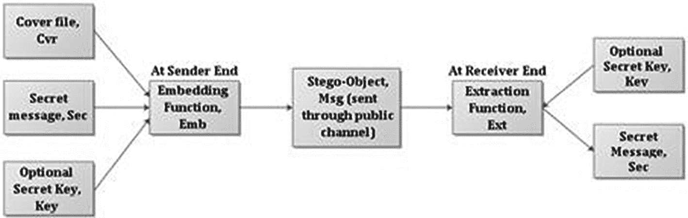

图 3.1 通用隐写模型

本章介绍了一种新颖，用于从大量载体文本文件的可用数据库中自动选择最准确的载体文本，这些文本文件可以是报纸存档或在线博客中的任何具有足够长度的文本段落，并可用于其中其中所选的秘密文本。所提的方法应用于发送端的数据加密阶段，从数千个数字化资源中寻找最合适的载体文本文件，从而在不产生任何怀疑的情况下无害地隐藏所选消息。与现有的手动流程相比，合适的载体文本选择过程需要自动化以实现快速应用。随着各种文本隐写算法出现，如果能够快速选择准确的载体文件，将使加密系统被广泛接受。

为了妥善解释这项研究，我们在不同章节中详细讨论了它的不同部分。在下一节中，我们继续介绍性讨论。接下来的第 3.2 节讨论了关于现有文本隐写方法和使用机器学习的自然语言处理的相关文献研究。从该研究中，我们得到了动机，并在第 3.3 节中介绍了我们提出的自动载体文本检测系统的贡献。实验结果和一些对比分析在第 3.4 节中得到了进一步讨论。在第 3.5 节中，我们最终对本章进行了总结，并在后续的参考文献部分引用了相关文献。

## 3.2 相关文献研究

隐写术根据所使用的载体媒体文件类型（如图像、文本、音频、视频文件等）分为不同的类别。然而，媒体文件中存在多少冗余信息，或者嵌入后载体文件看起来有多相似，是衡量隐写效果的关键问题。对载体文件的改动越小，所采用隐写算法的效果越好。隐写术中出现了不同的嵌入方法，如插入式、替换式和生成式。插入式方法选择载体中的可忽略区域来隐藏消息。替换式方法使用载体内部的冗余数据来隐藏消息。生成式技术合成一个新的载体文件而不是更新现有文件。

文本隐写方法结合了多种过程，如改变现有文本的格式、更改现有文本中的单词、生成遵循上下文无关文法的文本等。由于存在足够的冗余信息，秘密在图像、音频或视频文件中更容易隐藏，而在文本隐写中并不容易。文本文档结构是可见的，而图像的文档结构则不同。从存储角度来看，文本文件需要的内存空间较小，且与其他任何类型的隐写方法相比通信速度更快。总之，文本隐写方法被分为若干类。现在，我们将研究近期提出的不同成熟方法。

### 3.2.1 基于格式的方法

改变文本的物理格式[15, 16]是在应用于基于格式的方法时用来隐藏秘密信息的。这种方法存在某些缺点。用文字处理器打开隐写文件很容易识别出拼写错误和额外的空格。字体大小的变化也可能引起阅读文档者的怀疑。如果对原始文本和怀疑的隐写文本进行比较，更新过的文本部分将变得非常明显。基于格式的方法因为应用简单而非常成熟。

### 3.2.2 基于随机和统计的生成方法

生成自己的载体文本通常被隐写术从业者认为是更好的做法，以避免与现有文本进行比较。一种遵循的方法是借助随机字符序列隐藏信息。单词长度和字母频率的统计属性被用于在不同方法中创建具有所随语言实际单词相同统计属性的单词。

### 3.2.3 语言隐写


在语言隐写中，特别考虑了所创建和更新文本所具有的不同语言属性。在许多情况下，语言结构（如空格）被用于秘密数据隐藏。上下文无关文法 [19]] 会产生树形结构。这些结构被用于隐藏秘密比特位（bits），其中左分支可能用于隐藏‘0’，右分支用于隐藏‘1’。`GNF` 中的文法也可以用于此目的，其中，为了隐藏比特位 0，使用产生式中的第一个选项，而使用第二个选项来隐藏比特位 1。在这种情况下也存在某些缺点。首先，较小的文法会导致文本表示出现大量重复。其次，尽管文本在语法上完美无缺，但可能缺乏语义结构，这意味着含义可能会被改变，从而导致一系列脱离上下文的句子。

### 3.2.4 现有文本隐写方法

在接下来的章节中，将讨论一些为人知的文本隐藏技术，即文本隐写的方法。

### 3.2.4.1 行移法 (Line Shift)

在文本隐写的行移法中，通过对文本行进行一定程度的垂直位移来实现数据隐藏。使用两条未标记的控制行以及位于标记行两侧各一条标记行，用以寻找标记行的移动方向。为了隐藏比特位 0 和 1，相应地向上或向下移动一行。行向上或向下方向的位移是通过计算标记行中心与其控制行之间的距离确定的 [7]。通过重新输入文本或使用光学字符识别程序，隐藏的信息将会发生变化，从而变得毫无意义。这些距离也可以通过特殊设备进行测量。

### 3.2.4.2 词移法 (Word Shift)

在该方法中，可以通过向右或向左方向对单词进行水平位移，从而相应隐藏比特位 0 或 1，实现秘密数据隐藏。使用相关性方法来检测词位移。它将配置文件视为波形，并检查它是否是由中间块向左或右移动的波形生成的 [6, 8]。这种方法可能较难被识别，因为改变单词之间的距离以填充行是一种相当常见的做法。但对于了解距离算法的人来说，将所应用的算法与隐写文本（stego-text）进行比较并发现其中是否隐藏了内容是非常容易。

### 3.2.4.3 语法法 (Syntactic Method)

该方法使用不同的标点符号来隐藏数据比特 0 和 1，例如句号（.),逗号（,）和分号（;) [7]]。该方法需要正确识别插入不同标点符号的的位置。因此，需要更谨慎的方法来防止读者识别出标点符号的错误使用。

### 3.2.4.4 空隐 (White Steg)

该方法使用空格隐藏秘密数据。通过使用空格发现了三种数据隐藏方法。在句间间距的情况下，在每个终止字符末尾放置一个空格隐藏比特位 0，放置两个空格隐藏比特位 1。在行尾空格的情况下，在每行末尾插入预定义数量的空白 [6]。在词间间距技术中，单词后的一个空格用于表示比特 0，而表示比特 1 则在单词后使用两个空格。但是，空格不一致的使用可能会引起外人的注意。

### 3.2.4.5 特征编码 (Feature Coding)

可以通过更改或修改文本的一个或多个特征或属性，以便发送者使用这种方法隐藏秘密数据。通过解析器检查文档，并提取出它能找到的所有特征。在句子脱离上下文的情况下 [7]，其含义可能会被改变。例如，在字母 `i` 和 `j` 处可以发生偏移，或者 `d`、`h` 等字母可以被缩短。这种方法也存在缺点。如果进行重新输入或使用光学字符识别系统，隐藏的数据就会被破坏。

### 3.2.4.6 词映射法 (Word Mapping)

通过遗传交叉交叉的词映射技术对秘密数据进行加密。在覆盖文件中，通过在奇偶长度的单词之间使用某些空格，一次性隐藏数对比特位 [8]。随后将结果保存并共享给接收者。

### 3.2.4.7 Word 文档 (Word Document)

在该方法中，文档中的文本段被退化，并根据选择的秘密文本能力进行嵌入 [6, 7]。数据隐藏的方式呈现为协作输出。

### 3.2.4.8 使用 AITSTEG 的文本隐写

Jing Zhang 等人在 2018 年提出了一种在社交媒体中发送文本的创新传输技术。它通过社交媒体在终端用户之间提供端到端安全。这种方法在鲁棒性、嵌入容量、不可检测性以及相对于现有算法的安全性方面显示更好的结果 [20]。

### 3.2.4.9 基于特征的无覆盖文本隐写

无覆盖文本隐写是近期的研究热点，因为对覆盖层进行零修改增加了系统的隐蔽性。Kaixi Wang 等人在 2019 年提出了一种基于特征的无覆盖文本隐写系统，如所示 [21]]。该系统分析了汉字的笔画数及其统计特征。研究人员利用奇偶性表示二进制位，并利用其组合表示二进制比特串。

### 3.2.4.10 通过重新排列 CSS 文件进行电子书隐写

2019 年，Da Chun Wu 等人针对 EPUB 格式的电子书提出了一种新的数据隐藏方法。秘密比特位被隐藏在级联样式表中，而不改变电子书的外观。级联样式规则中选择及其声明的字典顺序被用于将信息隐藏到级联样式表中，如所示 [22]。

### 3.2.5 来自文献综述的动机


通过研究相关研究领域的不同贡献，我们收集了关于不同类型的现有文本隐写方法的知识。我们还获取了载文必须具备的属性概念，这些属性能够以一种无法被识别的方式隐藏给定的秘密文本。手动选择载文的尝试错误过程非常耗时，而这一过程可以通过自动化来提高速度。可以从网上提供的海量数字文本资源中构建一个载文数据库，并可以使用一些自然语言处理技术选择最适合隐藏相应秘密文本的载文。

## 3.3 提出的自动化载文选择系统

随着对系统更快速输出的需求日益增长，载文的选择过程需要实现自动化。即使在在如今，这仍然是一个手动过程，因此非常耗时。所提出的系统是一种使载文选择过程自动化的方法。该方法将使用给定的文本隐写算法，选择最准确的载文来隐藏给定的秘密文本。所提出的模型是由六个组件子模块组成的良好组合，在发送端建立了自动载文选择，这些子模块如图图 3.2 所示。

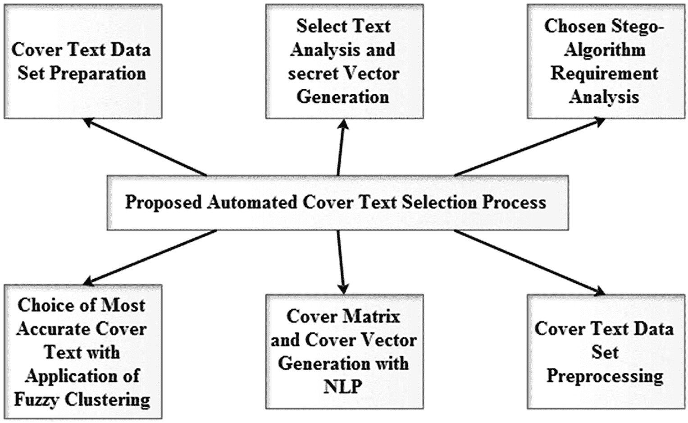

图 3.2 提出的自动载文选择过程的组件子模块。

所有六个子模块都在后台以不同的功能运行，通过这些功能的应用，生成了应用于发送端的所提自动化系统。在发送端，所提出的系统接受秘密消息和要实现的隐写算法作为输入。在分析秘密文本后，系统生成阈值秘密向量，随后对所选隐写算法进行需求分析。借助自然语言处理技术，对载文文件进行分析以产生载文向量。接下来应用模糊聚类算法从数据库中选择最准确的载文，以无害地隐藏输入的秘密文本。所提出的方法可以通过如图图 3.3 所示的流程图进行解释。

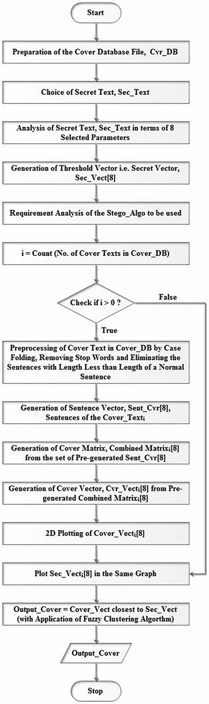

图 3.3 所提方法的流程图。

### 3.3.1 载文数据集准备

在文本隐写应用中，载文是隐藏秘密数据的介质，使得秘密文本的存在不会被非预期的接收者察觉。通常，任何足够长的载文都可以被选择为隐藏媒介。

对于我们提出的自动系统，为了应用该系统，我们收集了 50 篇这样的载文，这些无非是无害的、公开的、足够大的英语段落，从在线博客、报纸文章、故事书章节等获得。载文数据集快照如图图 3.3 所示。

### 3.3.2 秘密文本分析与秘密向量生成

发送者要共享的秘密文本隐藏在载文中，为了实现这一点，首先需要对秘密文本进行分析，以实现载文的自动选择。在秘密消息作为输入后，秘密向量的过程按照以下步骤开始：

*   秘密文本 `Sec_Text` 从字母数字格式转换为等效 ASCII 格式，随后将 ASCII 模式转换为二进制模式，这是系统进一步分析的原始数据。
*   秘密向量是一个行向量，通过从秘密文本的二进制模式计算八个不同的值生成，如下：

### 3.3.2.1 容量

该属性计算总比特数或比特长度。这是从秘密文本的二进制模式中得到的第一个属性，用于从数据库中选择能够无害隐藏输入秘密文本的最准确的载文。

(3.1)
```
V_{1} = \sum n_{i}
```

### 3.3.2.2 频率

该属性是一个布尔值，如果比特流中 0 和 1 的数量相等，则在秘密向量 `Sec_Vect` 的第二个组件中存储为 `true`，否则存储为 `false`。

(3.2)
```
V[2]=Either true false
```

### 3.3.2.3 0 的百分比

如果秘密比特流中 0 的总数，这将有助于找到能够隐藏这些 0 的准确载文。该属性是秘密向量 `Sec_Vect` 的第三个组件。

(3.3)
```
V_{3} = \frac{Total count of '0'}{Total bits in the stream}}
```

### 3.3.2.4 海明重量

海明重量的值将给出比特流中 1 的数量，这些信息对于选择载文是所需的。它是秘密向量 `Sec_Vect` 的第四个组件。

(3.4)
```
V[4]=Σ Total count of '1' in binary form of Sec_Text
```

### 3.3.2.5 0 存在的独立性检验

该属性计算秘密二进制比特流中 0 的相对存在率。流的总长度从属性 `V[1]` 获取，其一半的值被视为 0 的预期计数。再次扫描比特流得到 0 的观测计数。通过以下公式计算该方法的方差值，以填充元素值 `V[5]`。

(3.5)
```
V_{5} = \chi_{[0]}^{2} = \left. \sum\frac{\left( \mathbf{observed} - \mathbf{expected}} \right)^{2}}{\mathbf{expected}} \right.
```

### 3.3.2.6 1 存在的独立性检验

该属性计算秘密二进制比特流中 1 的相对存在率。流的总长度从属性 `V[1]` 获取，其一半的值被视为 1 的预期计数。再次扫描比特流得到 1 的观测计数。通过以下公式计算该方法的方差值，以填充元素值 `V[6]`。

(3.6)
```
V_{6} = \chi_{[1]}^{2} = \left. \sum\frac{\left( \mathbf{observed} - \mathbf{expected}} \right)^{2}}{\mathbf{expected}} \right.
```

### 3.3.2.7 1 之后 0 出现的概率

该属性 `V[7]` 衡量在秘密文本转换后的模式中，0 在 1 之后出现的次数。该概率值给出了 `Sec_Text` 生成的模式中“10”模式的出现次数。该属性在考虑四分类的隐写算法情况下出现，因此一次隐藏两个比特，且这两个比特可以有四种排列方式。

### 3.3.2.8 0 之后 1 出现的概率


该属性 `V[8]` 衡量了源自载体文本的转换位模式中“1”紧随“0”之后出现的次数。该概率值给出了从 `Sec_Text` 生成的位模式中“01”模式出现的计数。在考虑四元分类并一次隐藏两个比特（即四种不同方式）的隐形算法中，该属性就会发挥作用。

*   结合这八个组件，生成秘密向量 `Sec_Vect`。`Sec_Vect` 提供了阈值向量，其需要与从载体文本集中不同载体文件中获得的向量进行检查。

```
Sec_Vect = V[1] V[2] V[3] V[4] V[5] V[6] V[7] V[8]
```

### 3.3.3 隐形算法需求分析

分析不同的文本隐写算法隐藏给定的秘密文本的需求，可以找到实现目的的准确载体文本。需要预先分析隐形算法隐藏任何秘密文本的需求，以便获得关于哪种载体文件最适合该算法应用的反馈。所提工作的原型模型使用了六种成熟且流行的文本隐写算法，该模型生成一个自动化的载体文件选择系统。对所有选定的六种算法的需求进行了研究，并借助机器学习的自然语言处理模块对载体数据集进行了相应的分析。我们为实现目的而考虑的六种最流行的文本隐写算法是：

1. 使用同义词替换的文本隐写
2. 使用标点符号的文本隐写
3. 使用特征编码的文本隐写
4. 使用空白方法的文本隐写
5. 基于英语字母中曲线的文本隐写
6. 通过在不同句子的特定字符中隐藏数据进行文本隐写

对于所有六种算法，我们都研究了它们为了最准确地隐藏秘密信息所需的载体文本类型的需求。这项研究对于所提系统的准确性至关重要。

### 3.3.4 载体文本数据集预处理

在利用机器学习模块对文本进行分析之前，首先对集合中的载体文件应用预处理方法，以提高寻找载体文本的准确性。首先对载体文件进行大小写转换和停用词消除。之后，通过将句子长度除以相应载体文件中最大句子的长度，计算句子的归一化长度。归一化长度超过预设阈值的句子被用于数据隐藏。如果 `α[i]` 表示第 `i` 个句子的归一化长度，则通过 `n[i]` 除以 `n[l]` 计算，其中 `n[i]` 是第 `i` 个句子中的单词数，`n[l]` 表示文件中最长句子的单词数。

```
α[i] = n[i]/n[l]
```

### 3.3.5 使用 NLP 生成载体矩阵和载体向量

使用自然语言处理对载体文件进行分析，并根据选定的算法从载体文件中选择标记，以便相应处理以隐藏“0”和“1”。对这些标记进行相应的计数，并从相应载体文件的每个句子生成不同的句子向量 `Sent_Cvr[8]`。载体矩阵的行数将等于载体文件中的句子数。生成的句子向量按照它们出现的顺序以行的方式排列，从而生成载体矩阵 `Combined_Matrix[8]`。因此，位置 `Combined_Matrix[i,j]` 的条目将是来自载体文件第 `j` 个句子的第 `i` 个属性值。通过按列方式对载体矩阵中的条目求和，生成载体向量 `Cover_Vect[8]`。

| Sent_Cvr[8] = | S[1] | S[2] | S[3] | S[4] | S[5] | S[6] | S[7] | S[8] |
| :--- | --- | --- | --- | --- | --- | --- | --- | --- |
| Combined_Matrix[8] = | M[1] = S[1.1] | M[1, 2] = S[2.1] | M[1, 3] = S[3.1] | ……. | | | | |
| | …… | | | | | | | |
| M[i,1] = S[1.i] | M[i,2] = S[2.i] | ……. | | | M[i,i] = S[j.i] | | | |
| Cover_Vect[8] = | C[1] = M[1] + M[1, 2] + M[1, 3] + … + M[i,1] | C[2] | C[3] | C[4] | C[5] | C[6] | C[7] | C[8] |

### 3.3.6 应用模糊聚类选择最准确的载体文本

（注：用户提供的文本在最后一个块中包含了一个 3.3.6 节，但输入文本结束于 3.3.5 表格。根据提供的“需要排版的文本”，其结构遵循所提供片段逻辑。）


在本提议的实验工作中，考虑了六种不同的文本隐写算法作为实施的样本隐写算法集，以便在发送端加密处创建一个易于用户交互的系统。根据所提出的实现系统，前端提供了六种不同的现有算法供选择，每次选择其中一种。系统要求输入秘密消息，任何字母数字样本均可视为秘密文本。输入秘密数据后，通过自然语言处理对其进行分析，并生成相应的秘密向量，该向量将作为阈值向量。之后，系统会检查所选算法并对其进行需求分析。然后，系统从数据集中逐一分析载文文件，根据待实现隐写算法的需求生成相应的载文向量。接下来将载文向量与阈值向量绘制图中图中并使用模糊聚类算法寻找最近匹配。与阈值向量匹配最近的载文向量文件被视为最准确的载文文件，并用于相应的隐写算法进行数据隐藏。最初，所有的载文向量点都被视为通用载文点簇。然后，计算图中秘密向量点到所有载文向量点的欧几里得距离，并根据距离从可能的载文点簇中剔除远的点。可能的载文点簇代表能够隐藏所选秘密文本的载文文件。最终，与所选载文文本匹配最近的载文文件即自动选择系统的输出。

对不同秘密文本样本的所有算法都进行了测试，自动载文文件检测系统在所有情况下均运行良好。此处显示了一些样本示例输出文件。系统对带标点符号的文本隐写算法进行了测试，选择隐藏的秘密文本为“Hello”。秘密文本首先经过文本预处理步骤。然后，计算秘密向量的八个分量并相应生成秘密向量。现在研究带标点符号的文本隐写算法的需求，某些标点用于隐藏‘0’，另一些用于隐藏‘1’。根据这些信息从载文文件中生成载文向量。最后，将载文向量与秘密向量进行匹配，选择与秘密向量值最近的载文向量作为输出并显示在前端，如图 3.5 和 3.6 所示。

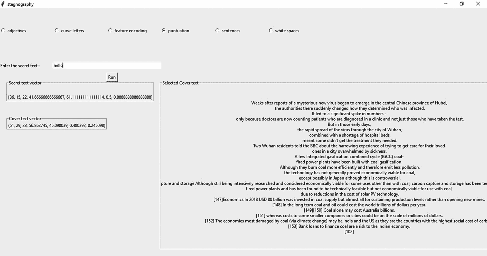

图 3.5 带标点符号的文本隐写算法的应用。

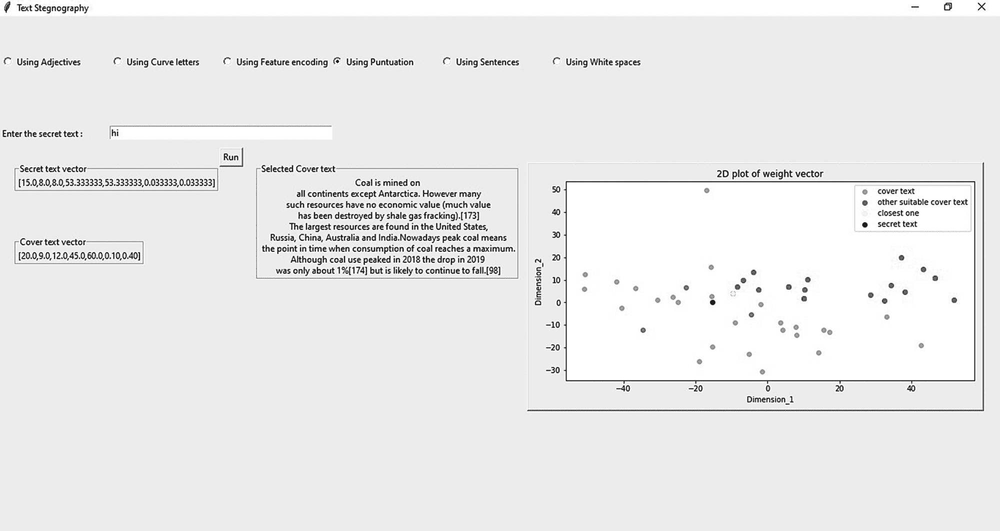

图 3.6 带图的带标点符号文本隐写的应用界面。

图 3.7 和 3.8 显示了带特征编码的文本隐写算法的应用界面。在这种情况下，某些字母的特殊特征用于数据隐藏，我们的系统在文本分析后，将这些特征用于隐藏‘1’和‘0’。此处用于数据隐藏的秘密消息为“Hi there”。

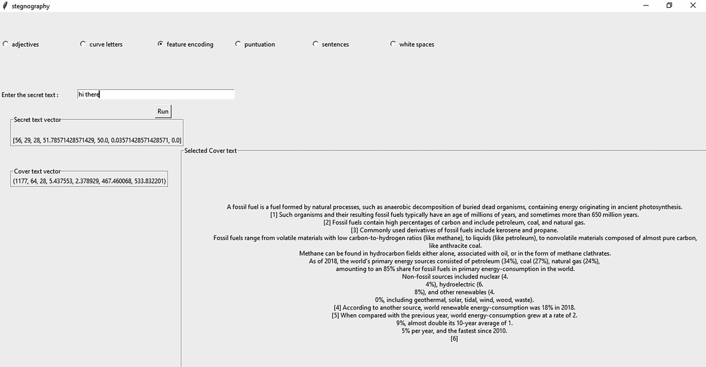

图 3.7 带特征编码的文本隐写的应用界面。

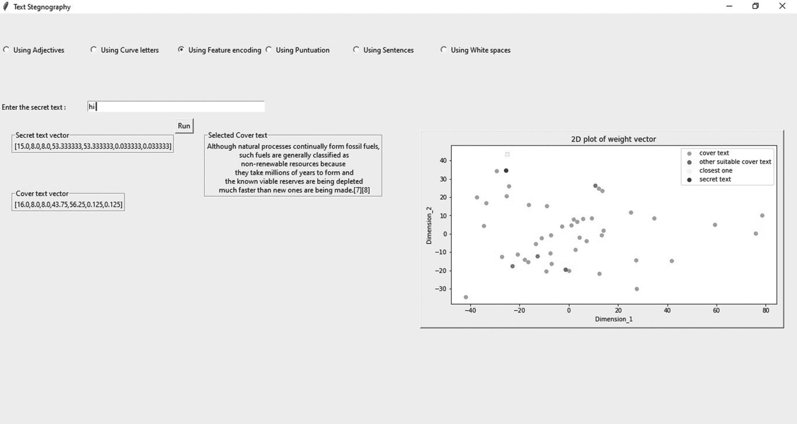

图 3.8 带图的带特征编码文本隐写的应用界面。

图 3.9 和 3.10 显示了使用英文字母中曲线测试文本隐写算法实现的另一个样本界面。带有曲线的字母用于隐藏‘0’，不带曲线的字母用于隐藏‘1’。相应的，系统生成载文向量，从消息“hi there”生成的秘密向量与其进行匹配，最终输出最准确的载文文本。

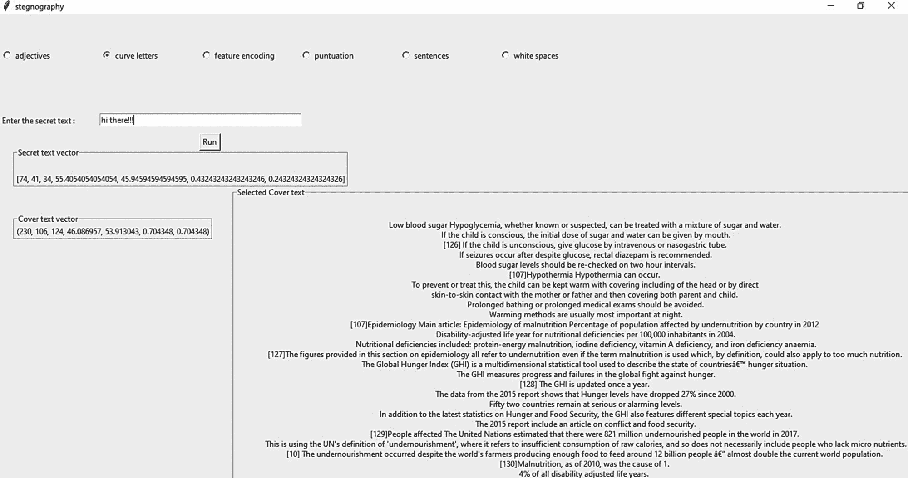

图 3.9 基于英文字母曲线的数据隐藏的应用界面。

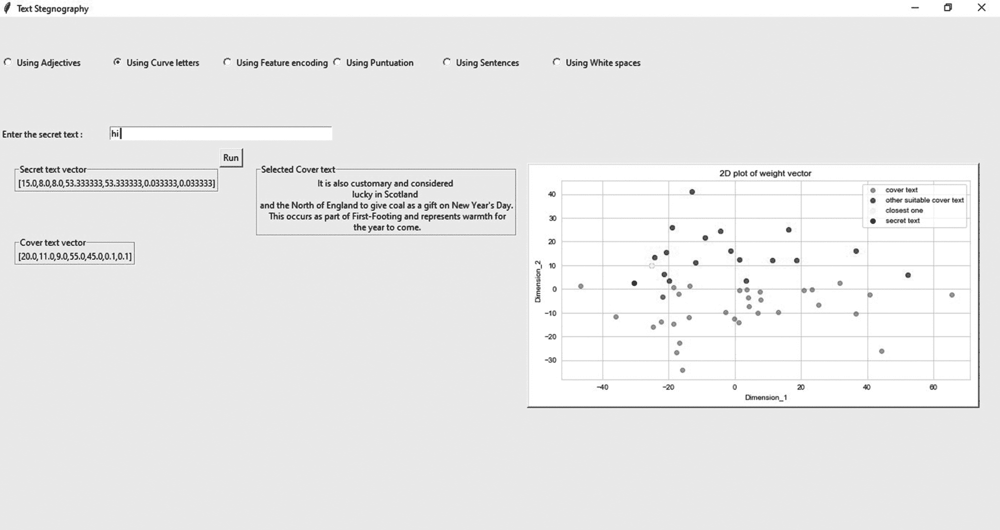

图 3.10 带图的基于英文字母曲线的数据隐藏的应用界面。

本研究使用的过程可用于从任何样本载文数据集中自动选择载文文件，并适用于任何文本隐写算法的应用。

## 3.4.2 实验数据的对比分析

所提方法已通过实验应用，并针对有限规模的载文数据集和有限的文本隐写算法进行了分析。同样的过程适用于任何大小的载文数据集和任何数量的文本隐写算法。载文数据的自动选择过程使得隐藏过程快得多。手动选择过程与所提自动选择过程的对比见表 3.1。

表 3.1 手动与自动载文选择对比

| 使用的文本隐写算法 | 手动选择成功率 (%) | 所提自动选择成功率 (%) | 自动过程所需时间对比 (%) |
| :--- | :--- | :--- | :--- |
| 同义词替换 | 98.5 | 100 | <50 |
| 使用标点符号的文本隐写 | 98.8 | 100 | <60 |
| 使用特征编码的文本隐写 | 99 | 100 | <50 |
| 使用空白方法的文本隐写 | 99.2 | 100 | <60 |
| 在不同句子特定字符中隐藏数据的文本隐写 | 99.5 | 100 | <60 |
| 基于英语曲线的文本隐写 | 99 | 100 | <50 |

通过分析表 3.1 所示的对比数据可以很好地说，所提自动方法在选择秘密数据隐藏的载文方面具有更高的成功率，所需时间也远少于手动过程。

## 3.4.3 所提方法的时间复杂度

所提方法分为三个基本步骤，所提自动载文选择过程的时间复杂度可以通过完成该过程的总时间得出，它是三个子步骤所需时间之和。完成所提方法所需的总时间`T[total]`可以通过相加预处理所需的时间`T[pre-processing]`（载文数据库生成+待应用算法的需求分析）、生成秘密向量所需的时间`T[secret-vector generation]`、生成载文向量所需的时间`T[cover-vector generation]`以及匹配秘密向量与载文向量以寻找最合适者所需的时间`T[matching]`得到。它可以用以下公式表示：


`T[total] = T[pre-processing] + T[secret-vector generation] + T[cover-vector generation] + T[matching]`

预处理 预处理时间是固定的，且仅在算法开始时应用一次。同样，秘密向量（即阈值向量生成）和覆盖向量生成过程也需要固定的时间。此外，秘密向量与覆盖向量匹配所需的时间也是固定的。因此，所提算法运行所需的总时间是固定的，时间复杂度可以表示为 `O(1)`，因为它不随输入规模的大小而变化。

## 3.5 结论与未来研究

本文提出了一种基于模糊聚类方法的自动覆盖文本选择系统。通过机器学习的自然语言处理模块对覆盖文本文件进行了分析，并研究了不同文本隐写算法的需求。最后，将生成的覆盖向量与预生成的秘密向量进行匹配，并选择覆盖向量值大于阈值向量值的覆盖文件。在二维平面图中绘制覆盖文本向量和秘密向量后，测量了覆盖向量相对于秘密向量的距离，并使用模糊聚类方法找到了距离秘密向量最近的覆盖向量。这种系统的出现是因为现在公开发了大量的数字文本数据，从中可以任选一个作为覆盖文件，但必须选择最准确的一个以产生看起来更无害的覆盖文件。此外，与现有的手动流程相比，该选择过程是自动化的且非常快速。

所提模型已包含 50 个样本覆盖文本的覆盖文件数据库上进行了测试，并考虑了六种现有的文本隐写算法。根据要隐藏的秘密文本和用于隐藏的隐写算法使用模糊聚类算法，获得了生成最无害隐写文本的最准确覆盖文本，作为所提系统的自动生成输出。

所提出的新方法可以在未来研究范围内轻松用于选择任何区域语言的数字覆盖文本。

## 参考文献

1. [Patel, R., Lad, K., Patel, M. et al. A hybrid DST-SBPNRM approach for compressed video steganography. Multimedia Systems, 2021. [https://doi.org/10.1007/s00530-020-00735-9]
2. [Zhu, Z., Ying, Q., Qian, Z. et al. Steganography in animated emoji using self reference. Multimedia Systems, 2021. [https://doi.org/10.1007/s00530-020-00723-z]
3. [Liu, J., Ke, Y., Zhang, Z. et al., Recent advances of image steganography with generative adversarial networks. IEEE Access, 8, 60575–60597, 2020. [https://doi.org/10.1109/ACCESS.2020.2983175]
4. [Uljarević, D., Veinović, M., Kunjadić, G. et al. A new way of covert communication by steganography via JPEG images within a Microsoft Word document. Multimedia Systems, 23, 333–341, 2017. [https://doi.org/10.1007/s00530-015-0492-3]
5. [Yeung, Y., Lu, W., Xue, Y. et al. Secure binary image steganography based on LTP distortion minimization. Multimedia Tools and Applications, 78, 25079–25100, 2019. [https://doi.org/10.1007/s11042-019-7731]
6. [Majumder, A., Changder, S. A novel approach for text steganography: Generating text using reflection. Procedia Technology, 10, 112–120, 2013.
7. [Majumder, A., Changder, S., Debnath, N. C. A new text steganography method based on sudoku puzzle. Lecture Notes in Electrical Engineering (pp. 961–972), Sep. 2019.
8. [Maji, G., Mandal, S. A forward email based high capacity steganography technique using randomized and indexed dictionary. Multimed Tools and Applications, 79, 26549–26569, 2020. [https://doi.org/10.1007/s11042-020-0929]
9. [Debnath, Bikash, Das, Jadav, Debash. Reversible logic-based steganography using quantum cellular automata for secure communication. IET Circuits, Devices & Systems, 11(1), 58–67, 2017.
10. [Emad, E., Safey, A., Refaat, A. A secure image steganography algorithm based on least significant bit and integer transform. Journal of Systems Engineering and Electronics, 29(3), 639–649, June 2018. [https://doi.org/10.21629/JSEE.2018.0321]
11. [Ghosal, S., Chatterjee, A., Sarkar, R. Image steganography based on Kirsh edge detection. Multimedia Systems, 27, 73, 2021. [https://doi.org/10.1007/s00530]
12. [Li, Y., Xiong, C., Han, X. et al. Retracted article: Image steganography using cosine transform with large-scale multimedia. Multimed Tools and Applications, 77, 28969–28989, 2018. [https://doi.org/10.1007/s11042-017]
13. [Ghasemzadeh, Hamzeh, Kayvanrad, Mohammad. Comprehensive review of audio steganalysis. IET Signal Processing, 12(6), 673–687, 2018.
14. [Zarmehi, Nemat, Akhaee, Mohammad. Digital video steganalysis toward spread spectrum data. IET Image Processing, 10(1), 8, 2016.
15. [Baagyere, E., Agbedem, P., Qin, Z. et al. A multi-layered data encryption and decryption based on genetic algorithm and residual numbers. IEEE Access, 8, 10438–10447, 2020. [https://doi.org/10.1109/ACCESS.2020.299783]
16. [Saad, A. H. S., Mohamed, M. S., Hafez, E. Coverless image steganography based on optical mark recognition and machine learning. IEEE Access. [https://doi.org/10.1109/ACCESS_2021.30507]
17. [Wu, Hanzhou, Wang, Wei, Dong, Jing et al. A graph-theoretic model to steganography on social networks. Available at https://arxiv.org/abs/1712.03621, Last accessed: August 2020.
18. [Liu, G., Liu, W., Dai, Y. et al. Adaptive steganography based on block complexity and matrix embedding. Multimedia Systems, 20(2), 227–238, 2014.
19. [Xiang, L., Wu, W., Li, X. et al. A linguistic steganography based on word compression and candidate selection. Multimed Tools and Applications, 77, 28969–28989, 2018. [https://doi.org/10.1007/s11042-018]
20. [Taleby Ahvanooey, M., Li, Q., Hou, J. et al. AITSteg: An innovative text steganography technique for hidden transmission of text message via social media. IEEE Access, 6, 65981–65995, 2018. [https://doi.org/10.1109/ACCESS.2018.2866063]
21. [Wang, K., Gao, Q. A coverless plain text steganography based on character features. IEEE Access, 7, 95665–95676, 2019. [https://doi.org/10.1109/ACCESS.2019.2929123]


22. Wu, D., Su, H. 通过重排 CSS 文件内容利用 EPUB 格式电子书进行隐写。IEEE Access, 8, 20459–20472, 2020. [`doi.org/10.1109/ACCESS.2020.2966889`](https://doi.org/10.1109/ACCESS.2020.2966889)
23. Zhang, Z., Fu, G., Ni, R. et al. 基于辅助语义覆盖合成的生成式隐写方法。清华科学技术, 25(4), 516–527, 2020 年 8 月。 [`doi.org/10.26599/TST.2019.9010027`](https://doi.org/10.26599/TST.2019.9010027)
24. Kraetzer, C., Dittmann, J. 通过合成进行隐写：人脸变脸等常见图像处理可以创建合理的隐写信道吗？在*第 13 届国际可用性、可靠性与安全国际会议论文集，ARES 2018，计算机协会*中，美国纽约州纽约市，文章 11，1–8 页。 [`doi.org/10.1145/3230833.3233263`](https://doi.org/10.1145/3230833.3233263)
25. Qin, J, Wang, J, Tan, Y et al. 基于生成对抗网络的无盲图像隐写。Mathematics, 8(9), 1394, 2020。 [`doi.org/10.3390/math8091394`](https://doi.org/10.3390/math8091394)
26. Zhou, Z., Mu, Y., Wu, Q. M. 使用部分重复图像检索的无盲图像隐写。Soft Computing, 23, 4927–4938, 2019。
27. Liao, X., Yu, Y., Li, B. et al. 彩色图像隐写中的新载荷划分策略。IEEE 视频技术电路与系统汇, 30(3), 685–696, 2020 年 3 月。 [`doi.org/10.1109/TCSVT.2019.2896270`](https://doi.org/10.1109/TCSVT.2019.2896270)
28. Liao, X., Yin, J., Chen, M. et al. 基于图像纹理特征的多图像隐写自适应载荷分布。IEEE 可靠与安全计算汇刊。 [`doi.org/10.1109/TDSC.2020.3004708`](https://doi.org/10.1109/TDSC.2020.3004708)

# 4 基于 RPL 的工业物联网中的网络攻击与防御措施

Cong Pu
马歇尔大学，美国，亨廷廷顿
DOI: [10.1201/9781003324690-1](https://dx.doi.org/10.1201/9781003324690-1)

## 4.1 引言

当我们进入 21 世纪的第三个十年，我们正预示着`IoT`新时代的黎明。`物联网`（`IoT`）的概念被广为人知的`4.0`。根据`Statista`的数据，到`2025`年，活跃的`IoT`设备数量将达到`390 亿`。根据`GlobeNewswire`，`IoT`的效益约为`2650 亿`。随着`IoT`使用的持续增长，`数据科学`、`网络安全`和`工程`等领域出现了高需求的工作。

为了保护`IoT`的各种资产，安全专家需要做好基础和先进技术的准备，如`入侵检测与防御系统`、`威胁建模`和`安全分析`。`Check Point Research`报告称，与`2020`年`1 月`到`6 月`相比，每日勒索软件攻击次数增加了 50%。随着大量的`数据和信息`被存储和处理，`勒索软件`成为一个具有挑战性的问题。`IoT`产生的`数据和信息`的真实价值处于核心。

为了实现`IIOT`的目标和愿景，高效的通信和可靠的信息传输起着重要作用。“路由协议`的主要目标是指定`IIOT`设备如何相互通信以发布信息，这使得所有`IIOT`设备能够在之间选择路由。近年来，`IIOT`的`路由协议`在工业界和学术界受到了广泛关注。一个典型的例子是最近披露的`Cisco`和`IETF`合作提出了一种针对资源受限和丢包链路的网络的新通信方案，称为`RPL`。


然而，当网络工程师和学术研究人员设计或提出路由协议时，功能性是他们关注重点，而安全性往往是事后考虑的。因此，许多表现良好的路由协议在模拟环境（即网络仿真）中表现出色，但在现实环境中会失败，因为它们在设计中没有考虑安全和隐私问题。例如，`RPL` 路由协议具有几个内在且迷人的特性，如自动配置、对网络结构变化的动态响应、路由环纠正以及不同网络实例的可用性 [7]。具体而言，自动配置功能使网络能够动态发现路由路径。在环检测和规避方面，`RPL` 路由协议能够在网络拓扑发生变化时识别路由环并能够修复这些路由环。基本上，`RPL` 被认为是 `IIoT` 极具前景的候选通信算法之一，因为它具有许多吸引人的特性，使其能够更容易满足各种工业应用的服务质量（`QoS`）需求。尽管 `RPL` 路由协议已经具有足够的成熟度，但仍存在许多挑战性问题尚未解决。例如，根据 `RPL` 规范，由于对系统性能的顾虑，各种安全功能的实现部分或全部是可选的。结果是 `RPL` 路由协议受到继承自无线网络的几种已知攻击以及 `RPL` 特有攻击的影响 [14]。

尽管已有大量精力致力于评估和增强 `RPL` 路由协议在各种应用/系统中的性能，但我们将讨论 `RPL` 中的安全和隐私问题，主要关注 `IIoT` 中的安全攻击和防御措施。本章的动机源于两个方面：首先，我们关注 `RPL` 路由协议和 `IIoT`，它们由于其广泛的适用性而引起了大量的关注。我们仔细分析了 `RPL` 路由协议以及 `Trickle` 通信算法，以便其他人员对基于 `RPL` 的 `IIoT` 有更好的理解。其次，我们选择了先进的 `RPL` 特有攻击，并分析了它们的恶意操作以及对 `IIoT` 的性能影响，这突显了采用先进防御机制和措施来保护基于 `RPL` 的 `IIoT` 的必要性。在本章中，首先介绍了 `RPL` 路由协议及其主要组件 `Trickle` 算法。然后，我们识别并分析了 `IIoT` 中的各种 `RPL` 特有攻击，并讨论了相应的防御措施。最后，我们以未来的研究方向总结全文，包括跨学科方面和见解。

## 4.2 相关工作

自 `RPL` 路由协议发布以来，许多学术研究人员和工业工程师研究了 `RPL` 的安全和隐私问题，并提出了最先进的防御措施来抵各种攻击。

在 [15] 中，作者开发了一种入侵检测系统（也称为 `DETONAR`）来防御 `IoT` 中的 `RPL` 特有攻击。首先，作者进行了大量实验，并针对若干种 `RPL` 特有攻击收集了网络流量。仿真结果被整理并呈现为 `RPL 路由攻击数据集`（`RADAR`）。其次，他们开发了一个 `IDS` —— `DETONAR` 来检测 `RPL` 路由协议中的某些安全攻击。`DETONAR` 利用的主要技术是数据包嗅探，采用一组安全策略（基于签名/异常的规则）来检测传入互联网流量中的可疑活动。正如其实验结果所示，对于十种攻击，`DETONAR` 的正检测率超过了 80%，且计算开销较小。[16] 中的作者首先研究了版本号攻击，该攻击试图通过针对 `RPL` 路由协议的全局修复机制来耗尽网络资源（例如电能、内存存储和计算能力）。然后，他们提出了一种版本号攻击检测机制。在特征提取方法中，使用前向特征选择方案来选择理想特征。仿真和实验结果证明，该检测机制极具竞争力，在检测准确性和计算开销方面表现良好。在 [17] 中，作者对 `IoT` 中与 `RPL` 的 `IDS` 进行了文献综述。文献 [17] 的主要贡献是作者根据各种安全攻击及其影响识别了入侵检测系统的几项基本设计需求。此外，作者还讨论了入侵检测系统研究社区中的最佳实践和研究空白。

在 [18] 中，作者致力于`目标导向有无环图 (DODAG) 信息请求 (DIS)` 攻击，研究了攻击特性，然后在运行 `RPL` 的 `IIoT` 网络中设计了防御机制。在 `DIS` 攻击中，攻击者多播 `DIS` 消息以频繁重置 `DODAG 信息对象 (DIO)` 消息的计时器，导致网络控制消息拥塞。为了识别 `DIS` 攻击，研究人员提出了一种可以减少 `DIO` 消息对 `DIS` 消息响应率的防御措施。实验研究证明可以减少通信开销和能量消耗。[19] 中的作者提出了一种基于深度学习的检测机制来检测/缓解 `IoT` 环境下的洪水攻击（hello flooding）。洪水攻击的主要目标是消耗 `IoT` 设备的有限资源。作者通过对比现有基准方案（如支持向量机 `SVM` 和逻辑回归）进行了实验。20] 中的作者研究了女巫攻击并提出了一种防御机制。基本思想是所有节点被组织成树形结构，每个非叶节点在内存中存储一个检测表。接收数据包时，节点将携带的源节点 ID 和前一跳节点 ID 与检测表中的条目进行检查。如果没有匹配项，则将源节点 ID 和前一跳节点 ID 加入检测表。如果检测表中存在匹配项，接收节点将广播告警包以宣布可能的女巫攻击。经过仔细分析，发现所提方案具有巨大的计算和存储开销。例如，如果检测中有大量条目，女巫攻击的检测开销将显著增加。[21] 中，作者识别了一种新的 `RPL` 特有攻击，命名为非伪装模仿攻击（non-spoofed copycat attack），并研究了其对基于 IPv6 的个人局域网络的性能影响。通过利用非伪装模仿攻击，攻击者隐式监控邻居的 `DIO` 消息，然后多次播放捕获的 `DIO` 消息。非伪装模仿攻击的主要目的是影响基于 IPv6 的个人局域网络中 `RPL` 的性能（即通信延迟和数据包交付率 `PDR`）。


在[22]中，作者采用信任技术来检测女巫攻击，其中根据当前和旧的信任值对设备行为进行评估。如果检测到女巫攻击，攻击者将被分配较低的信任值。结果是，低信任值的节点（可能是攻击者）无法参与常规路由操作。在[23]中，提出了一种名为`SVELTE`的入侵检测系统，用于检测网络层和路由层攻击。在`SVELTE`中，入侵检测方案和防火墙协作检查网络流量并识别可疑活动。在[24]中，作者提出了一种基于伪装的方法，用于检测具有能量采集能力的无线网络中的丢包攻击。在所提方法中，每个节点刻意伪装成能量采集节点（即无法执行隐式监控），然后秘密地监控邻居节点的转发操作。如果相邻邻居选择不重发收到的数据包，就可以检测到丢包攻击。在[25]中，作者研究了 IoT 网络中的等级攻击，攻击者针对`RPL`路由协议中的等级值并破坏等级规则以影响网络性能。在[26]中，作者提出了一种使用安全哈希函数的身份验证方案，以保护基于`RPL`的 IoT 通信免受攻击者的侵害。[27]]中的作者对`RPL`的安全性威胁进行了分析。在他们的工作中，他们阐述并分析了潜在的安全挑战和基本的防御机制。在[28]中，作者关注了`IEEE 802.15.4`介质访问控制协议及其在 IoT 环境中的用法和局限性。[29, 30]中提供了针对 IoT 的拒绝服务攻击的综述。[31]]中的作者回顾了`RPL`路由协议的历史和发展，并指出了未来研究的几个方向。

## 4.3 背景

### 4.3.1 RPL 路由协议

`IIoT`通过赋能“哑终端”设备使其能够在互联网上采集、处理和发送数据流，并能够与其他`IIoT`设备以及信息通信系统进行无缝通信，使其变得更加智能[32]。`IIoT`这一缩写有望在人工智能、机器学习和先进有线/无线通信技术的帮助下提高常规操作的效率。但是，`IIoT`包含了广泛的工业级应用，其应用范围非常广。`IIoT`远不仅限于概念模型，它可以出现在各种领域，从 ABB 智能机器人到空中客士未来工厂，再到亚马逊智能仓储[33]。部署用于这些应用的`IIoT`设备通常在处理和存储能力以及电池能量方面处于容量限制状态[34]。`IIoT`设备之间的互连链路的特点是数据速率较低且丢包率较高。此外，`IIoT`网络的设备数量可以从几十个扩展到数千个，且通信流量可以分为一对一、一对多和多对一模式。为了在资源受限且链路丢损的`IIoT`环境中实现高效可靠的通信，Cisco 联合 IETF 于 2012 年提出了针对此类网络的路由协议[7]，该协议被称为`RPL`。

基于`RPL`的`IIoT`示例如图图 4.1 所示，其中有三个`DODAG`和两个`RPL`实例。具体而言，`RPL`路由协议将`IIoT`设备（后续节点）组织成层次树形结构，称为面向目的的定向无环图（`DODAG`）。通常，一个`DODAG`包含一个网关节点和一组常规节点。在这里，网关节点被称为`DODAG`根，连接到互联网以便`IIoT`节点可以跨网络通信。对于大规模`IIoT`网络（例如在工业环境中部署了数千个节点），节点可以自组织成许多`DODAG`，而`DODAG`可以进一步分组为不同的`RPL`实例。对于来自同一`RPL`实例的多个`DODAG`，它们具有相同的`RPL`实例 ID。创建和维护多个`RPL`实例的原理是在`IIoT`网络中安排不同的任务，其中一个`RPL`实例负责一个任务，并与其他`RPL`实例独立运行。例如，在`IIoT`网络中可以建立两个`RPL`实例，一个负责收集和传输温度数据，另一个负责监控人员移动。每个节点都有一个`rank`值。节点离`DODAG`根越近（或越远），`rank`值就越小（或越大）。此外，`rank`值被用于避免`DODAG`环路并允许节点区分`DODAG`中的父节点、子节点和兄弟节点。

![图 4.1 运行 RPL 的 IoT，三个 DODAG 形成两个实例[57]](images/fig4_1.jpg)

图 4.1 运行 RPL 的 IoT，三个 DODAG 形成两个实例 [57]

关于`RPL`路由协议中的流量，支持三种不同的通信范式：(i)一对一通信；(ii)一对多通信；以及(iii)多对一通信。一对一通信被`DODAG`中的任意成对节点所采用。当`DODAG`根有命令需要发布给`DODAG`中的其他节点时，它采用一对多通信模式。如果普通节点有数据发送给`DODAG`根，可以使用多对一通信模式。

为了实现上述所有功能，`RPL`路由协议定义了四种控制消息：`DIO`、`DAO`、`DAO-ACK`和`DIS`。`DIO`消息携带网络信息。通常，`DODAG`根节点发起`DIO`消息形成新的`DODAG`，建立向下路由路径，并帮助新节点发现并加入附近的`DODAG`。`DAO`消息由`DODAG`的叶子节点传输，以便向上路由信息从叶子节点传播到`DODAG`根节点。`DAO-ACK`消息用于确认`DAO`消息已成功接收。新节点将采用`DIS`消息加入网络中现`DODAG`。


为了维护 DODAG 的下行路由，RPL 路由协议可以配置为两种模式之一运行：(i) 缓存模式和 (ii) 非缓存模式。缓存模式的基本思想是每个节点都将在内存中存储指向向下节点的路由信息。例如，如果节点接收到 `DAO` 消息，它会首先缓存附加的路由，然后将自己的节点标识添加到聚合路由中，并将 `DAO` 消息传递给上行节点。当节点接收到数据包且目标是其后代节点之一时，它通过缓存的下行路由将数据包转发到目标节点。如果其后代节点不是数据包的目标，数据包将发送到父节点。然而，在非缓存模式下，DODAG 的根节点是唯一存储向下节点路由信息的节点。因此，当有数据包要发送时，包必须通过上行路由发送到 DODAG 的根节点，然后由根节点通过缓存的下行路由将数据包转发到目标节点。缓存模式和非缓存模式的一一通信流程图所示图 4.2。

![图 4.2 缓存模型和非缓存模式下一一通信流程图 [57]。](images/fig4_2_B.jpg)

图 4.2 缓存模型和非缓存模式的一一通信流程图 [57].

### 4.3.2 Trickle 算法

在不稳定且哈希环境中，稳健且高效地调节信息交换至关重要。`Trickle` 通信算法 [35] 用于实现网络信息一致性的目标。Trickle 通信算法的逻辑是节点能够根据信息一致的程度动态调整其数据包传输率。RPL 的 Trickle 通信算法用于控制 `DIO` 消息的传输速率。由于 `DIO` 包通常携带关键的网络信息，因此 `DIO` 数据包的传输值得特别关注。具体来说，如果节点检测到不一致性，该节点将增加其 `DIO` 数据包的传输率。另一方面，如果没有检测到不一致信息，节点将降低其 `DIO` 数据包的传输率。根据 [35]，采用了六个主要的系统参数来实现 Trickle 通信算法的目标。

- `I`[`min`]: 定时器的下限。
- `I`[`max`]: 定时的上限。
- `k`: 冗余参数。
- `I`: 当前计时器的长度。
- `t`: 当前计时器内的时间。
- `c`: 计数参数。

控制 `DIO` 包传输的伪代码见算法 1 [57]。


### 4.3.3 系统与对手模型

我们假设 IIoT 由 `DODAG` 组成，每个节点都有受限的计算和存储能力。在 `DODAG` 中，根节点直接和间接地进行通信。此外，每个节点都预分配了一个 `ID` [36]。由于 IIoT 节点通常部署在无人区域，它们很容易被对手捕获并破解 [37]。通过探测攻击，对手可能能够访问安全关键模块、检索敏感数据，然后对其进行重编程 [38]。

IIoT 节点通常需要运行一段时间 [39]。然而，电池电只能维持 5.8 天 [40]。因此，更换 IIoT 节点变得不可避免，以确保网络能够生存。然而，IIoT 节点通常部署在难以到达的地方，因此补充电池变得极具挑战性甚至是不可能的 [41]。维持网络的运行。

## 4.4 RPL 特定攻击与防御措施

由于无线介质的特殊性、IIoT 节点的资源限制以及安全机制的可选实现，RPL 容易受到各种网络攻击 [42]。此外，在设计 RPL 时，安全和隐私问题并不是首要考虑，因此它无法满足当前系统的安全需求。已发现，现有的 IIoT 操作系统 [43] [44] 都不包含安全机制。目前存在几种安全机制来保护基于 RPL 的 IIoT 免受安全攻击，例如入侵检测系统 [17] 和哈希链认证技术 [45]。这些安全机制可以有效检测外部攻击者；但无法防御任何内部攻击者。对手可能会控制网络中的部分 IIoT 节点，并访问加密密钥，导致保护机制很容易被绕过。以下介绍了几种代表性的 RPL 特定攻击，并简要讨论了相应的防御措施。

### 4.4.1 Sy 巫攻击 (Sybil Attack)

对于新节点，它可以发送 `DIS` 消息向相邻节点请求 DODAG 相关信息以加入网络。接收到 `DIS` 消息后，邻节点会准备并响应 `DIO` 消息，携带 RPL 实例 ID、版本号、rank 值和其他网络配置参数。通过这些网络相关信息，新节点可以选择父节点、计算 rank 值并加入网络。遗憾的是，攻击者可以 `DIS` 消息的漏洞对 IIoT 网络发动女巫攻击 [46]。具体而言，攻击者首先创建许多带有伪造节点 ID 的恶意 `DIS` 包，然后广播这些包。在这里，伪造节点标识可以是对手随机生成的介质访问地址。如果正常节点接收到恶意包，它会认为新节点急于成为网络成员。根据 Trickle 通信方案，正常节点需要重启其 `DIO` Trickle 超时期并广播 `DIO` 包。然而，广播 `DIO` 包将需要正常节点消耗能量资源 [47]。


例如，在图 4.3 中，攻击者 `A` 正通过广播带有伪造标识符的攻击消息 `DIS`，对合法节点 `n[1]`、`n[2]` 和 `n[4]` 发起 Sybil 攻击。显然，`n[1]` 和 `n[2]` 是 DODAG 根节点与 DODAG 中其他节点之间重要的桥接节点。如果桥接节点不可（即消耗了所有能量资源），网络将分裂分为若干部分。当 `n[1]` 和 `n[2]` 接收到 `DIS` 消息时，它们假设一个非成员节点可能想要加入 DODAG，并向邻居节点索取 DODAG 相关信息。根据 RPL 规范，`n[1]` 和 `n[2]` 首先将它们的 `DIO` Trickle 超时时间重置为 `I`[`min`]`，然后在计时器过期后广播 `DIO` 消息。在这里，由于 `n[1]` 和 `n[2]` 不是相邻节点，其中一个节点的 `DIO` 消息无法阻止另一个节点的 `DIO` 消息。当攻击者 `A` 传输大量带有虚假 ID 的恶意 `DIS` 消息时，`n[1]` 和 `n[2]` 必须通过传输相应数量的 `DIO` 消息来响应。由于频繁收发消息，`n[1]` 和 `n[2]` 会迅速消耗其有限的电池电量。结果是节点寿命缩短。当电池能量完全耗尽时，DODAG 中将形成网络分区，其他节点（例如 `n[3]`）将无法再次与 DODAG 根节点 `n[r]` 通信。为了证明图 4.3 所示 Sybil 攻击在 DODAG 中的严重后果，在 OMNeT++ \[48]] 中进行了初步实验。根据 [35]，我们在实验中设置 `I`[`min`]` = 0.1 sec，`I`[`max`]` = 6,554 sec，且 `k` = 1。在图 4.4 中，我们获得了随实验时间变化的 `DIO` 数据包数量。根据图 4.4，明显显示随着实验时间长度的增加，传输的 `DIO` 消息数量随之增加。另一方面，对于没有攻击者的场景，传输的 `DIO` 消息数量保持在较低的水平。

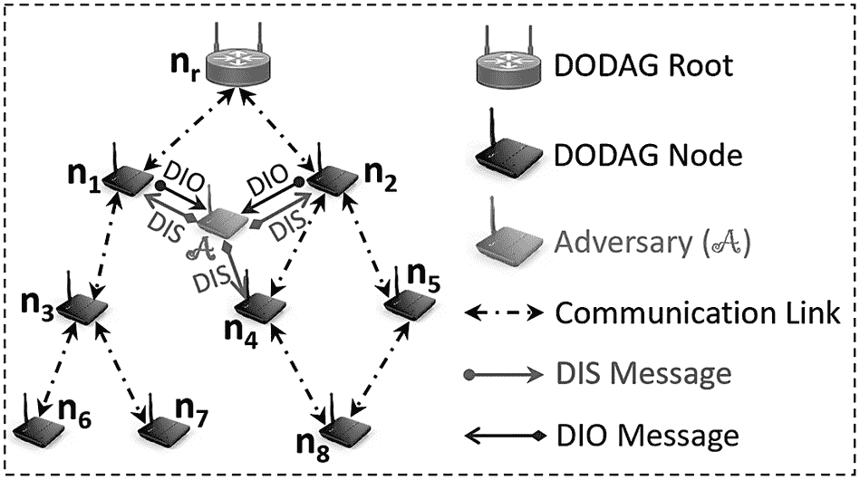

图 4.3 Sybil 攻击。

![图 4.4 Sybil 攻击的影响 [57].](images/fig4_4_B.jpg)

图 4.4 Sybil 攻击的影响 [57].

在 [49, 50] 中，采用 Gini 系数技术通过测量统计离散度来检测 Sybil 攻击。具体而言，在观测窗口期间，每个网络节点都会跟踪 `DIS` 消息中节点 ID 的统计离散度，然后计算 Gini 系数。在将 Gini 系数与预定义的边界值比较后，合法节点可以检测到 Sybil 攻击的存在。然而，提出的 Gini 系数检测方案有一个潜在缺点：检测延迟和准确性与观测窗口的长度密切相关。如果观测窗口较短，我们可以预期检测延迟较低但准确性较低。然而，如果观测窗口很长，检测延迟将会增加，但获得较高的检测准确性。

#### 4.4.2 丢包攻击

在 RPL 路由协议中，在网络节点部署在目标区域后，DODAG 根节点需要发布 `DIO` 数据包以形成 DODAG。`DIO` 消息通常附带 DODAG 根节点的 ID、DODAG 根节点的 rank 值以及一个目标函数。在这里，目标函数指定了每个节点如何根据预定义的指标计算 rank 值。接收到 `DIO` 消息后，如果网络节点计划加入现有的 DODAG，可以将 `DIO` 消息的发送者 ID 添加到父节点列表中。此外，它会计算自己的 rank 值，然后将携带有自身标识符和 rank 值的 `DIO` 数据包传递给其他节点。如果一个节点的父列表中多个节点，rank 值最小的列表成员将成为首选父节点。当网络节点有数据流量要发送 DODAG 根节点时，首选父节点会自动选择为下一跳节点发送数据流量。然而，攻击者可以故意在 `DIO` 数据包中放置较小的 rank 值并将数据包传输给其他网络节点，导致其他节点选择攻击者作为其首选父节点。因此，当攻击者从其他节点接收数据流量时，它可以故意丢弃任何数据包以使 DODAG 根节点陷入沉默。

例如，在图 4.5 中，攻击者 `A` 正在 DODAG 中发起丢包攻击。首先，攻击者 `A` 广播带有较小 rank 值的 `DIO` 消息，使其子节点（例如 `n[8]`）选择其作为首选父节点。然后，当 `n[8]` 向攻击者 `A` 发送数据包时，攻击者 `A` 故意丢弃这些数据包而不转发。结果是，DODAG 根节点 `n[r]` 无法接收数据包。为了揭示图 4.6 中丢包的严重后果，我们进行了初步实验，获得了随丢包率和信道错误（`r`）变化的 PDR。如图 4.6 所示，随着丢包率的增加，PDR 显著下降。由于更多数据包被攻击者 `A` 丢弃，传输到根节点的数据包数量减少。此外，PDR 受到信道错误 `r` 的显著影响。其原因是数据包在转发过程中可能会丢失。因此，测量得了较低的 PDR。

![图 4.5 丢包攻击 [57].](images/fig4_5_B.jpg)

图 4.5 丢包攻击 [57].

![图 4.6 丢包攻击的影响 [51].](images/fig4_6_B.jpg)

图 4.6 丢包攻击的影响 [51].

在 [51] 中，设计了一种基于监控的机制来检测/缓解恶意丢包行为，并将攻击者从基于 RPL 的物联网中隔离。在向首选父节点发送数据流量后，发送者继续监控接收者的后续操作。如果接收者丢弃数据包而不转发，发送者可以将首选父节点的丢包率与邻居节点的平均丢包率进行比较。如果首选父节点的丢包率低于邻居节点的平均丢包率，则可以检测到攻击者的丢包活动。当捕获的丢包活动总数大于预定义的边界值时，检测节点将发布告警包，以便所有邻居节点不再向攻击者发送任何包。基于监控机制的思想简单直接，但其缺点也显而易见。预定义的阈值需要仔细选择。如果采用较大的阈值，可能会观察到更高的漏检。另一方面，如果阈值太小，误报率将很高。

#### 4.4.3 DAO 离散攻击


在 RPL 路由协议中，缓存模式允许网络节点通过缓存附加在 DAO 消息中的路由信息，主动获取到其后代节点的向下路由路径。通过缓存向下路由信息，每个网络节点都拥有了将数据流量传送到目的地的下一中继节点的信息。然而，缓冲区中的向下路由可能会过时（例如，路由上的某一个中间节点不可用），如果选择了过时的路由来发送数据流量，则数据将无法传送到目的地。因此，为了从缓冲区中清除过时路由，数据包头中的 `Forwarding-Error` 标志被用于快速识别不可达的下一跳节点并在网络中报告错误路由。具体而言，当节点无法根据缓存的路由信息将网络流量发送到下一中继节点时，它会设置 `Forwarding-Error` 标志，创建一个错误消息，然后将该错误消息发送给父节点。当设置了 `Forwarding-Error` 标志的错误消息到达父节点时，父节点必须根据 RPL 规范从其缓冲区空间中移除被报告的向下路由。最初，`Forwarding-Error` 标志的设计初目的是报告并丢弃网络中的错误路由，最终提高 RPL 路由协议的性能。然而，这一功能可能会被攻击者利用，针对 IIoT 系统发起 DAO 分歧攻击 [52]。

在图 4.7 中，攻击者 A 从节点 `n[2]` 接收到一个数据包。攻击者 A 没有将数据流量转发到下一中继节点 `n[8]`，而是选择丢弃该数据包。之后，攻击者 A 创建了一个设置了 `Forwarding-Error` 标志的错误包，并用错误包响应 `n[2]`。当 `n[2]` 接收到错误包时，它认为到 `n[8]` 的缓存向下路由失效，因此从缓冲区中删除了缓存的向下路由。为了展示 IIoT 网络中 DAO 分歧攻击的严重后果，我们进行了初步实验。网络中建立了一个由 11 个节点组成的向下路由，其中节点 `n[1]` 和 `n[6]` 分别是 DODAG 根节点和攻击者 A。在这里，攻击率表示攻击者 `n[6]` 回复带有 `Forwarding-Error` 标志的错误包的频率。图 4.8 测量了向下路由沿每个节点的能量消耗，当攻击者执行更多攻击时，位于攻击者 `n[6]` 之前的每个节点（即 `n[1]`、`n[2]`、`n[3]`、`n[4]` 和 `n[5]`）的能量消耗都会增加。随着攻击者生成并回复更多错误包，其父节点必须丢弃缓冲区中的有效向下路由信息。如果其父节点或祖节点后续有指向相同目的地的网络流量，父节点或祖节点需要向其相应的父节点生成并回复错误包。这是因为用于到达目的节点的向下路由信息已被丢弃。因此，向下路由上攻击者 A 的祖节点需要响应错误包，这导致中间节点的能量消耗增加。为了防御 DAO 不一致攻击，父节点可以建立一种机制来检测此类异常。


对于 RPL，一对点通信设计用于任意两个 DODAG 节点之间的通信 [54]。如果数据包发送者有一个发送其相邻节点的数据包，它直接将数据包转发到相邻节点，而不是发送到其首选父节点。在所有其他情况下，RPL 的配置（缓存模式或非缓存模式）将决定一对点通信的执行方式。具体而言，如果 RPL 路由协议配置为非存储模式（non-storing mode），则除 DODAG 根节点外的节点不缓存指向后代节点的向下路由。如果有数据包需要发送，网络节点首先必须通过向上路径将数据包传输到 DODAG 根节点。接收数据包后，DODAG 根节点附加源路由并将数据包发送到目标节点。然而，如果 RPL 路由协议配置为存储模式（storing mode），则每个节点将存储指向后代节点的向下路由。如果有发往后代节点的数据包，可以通过缓存的向下路由进行转发并最终到达后代节点。否则，数据包应通过发送者的首选父节点发送到 DODAG 根节点。在数据包到达 DODAG 根节点后，DODAG 根节点将把数据包发送到目标节点。

在基于 RPL 的 IIoT 中，一对点通信通常用于发送数据流量以及 DODAG 中任意两个节点之间的端端确认。遗憾的是，一对点通信可能会被攻击者以恶意利用，从而影响网络性能。在图 4.11 中，攻击者 A 向节点 `n[7]` 发送大量数据包。如果 RPL 路由协议配置为非缓存模式，数据包必须首先通过向上路径传输到 DODAG 根节点 `n[r]`。然后，DODAG 根节点 `n[r]` 在数据包中附加源路由信息并将其发送到 `n[7]`。如果 RPL 路由协议配置为缓存模式，数据包需要转发到攻击者 A 和节点 `n[7]` 的第一个共同祖先，即 DODAG 根节点 `n[r]`。之后，DODAG 根节点 `n[r]` 将所有数据包转发到 `n[7]`。根据上述分析，目前 RPL 路由协议使用哪种模式并不重要，一系列中间节点（如 `n[3]`、`n[1]`、`n[r]`、`n[2]` 和 `n[4]`）需要发送大量数据包。然而，这些大量的发送操作会导致能量消耗的增加。由于每个 IIoT 节点的电池电非常有限，能量耗尽攻击可以迅速耗尽每个节点的电池电，最终导致网络无法工作。

![图 4.11 能量滥用攻击 [55].](images/fig4_11_B.jpg)

图 4.11 能量滥用攻击 [55]。

在图 4.12 中，获得了在不同攻击者数量和攻击率 `r[atk]` 下的能量使用情况。这里，攻击率 `r[atk]` 表示攻击者发送攻击数据包的频率。图 4.12 所示，如果网络中没有攻击者，RPL 路由协议的能量消耗最低。随着网络中存在更多攻击者，在能量滥用攻击（EDA）下可以观察到能量消耗的增加。由于攻击者产生了更多的攻击数据包，每个中间节点都需要传输更多的攻击包。结果是能量消耗将会增加。此外，当攻击者执行更多攻击时，能量消耗也会增加。随着攻击率 `r[atk]` 的增大，攻击者将发送更多的攻击数据包。结果，由于频繁的接收和转发操作，中间节点必须消耗更多的能量资源。

![图 4.12 能量滥用攻击的影响 [55].](images/fig4_12_B.jpg)

图 4.12 能量滥用攻击的影响 [55]。

在[55]中，作者提出了一种检测机制，基于 RPL 的 IIoT 中的节点行为来检测/缓解 EDA。该检测机制的逻辑是：相邻节点会记录预定义时间范围内发送的数据包数量。然后，将计数数字与阈值进行比较。当发送的数据包数量大于边界值时，即可检测到 EDA。

## 4.5 结论与未来研究方向

由无缝连接的智能设备组成的 IIoT 已经出现在各种工业领域，例如库存的自动监控、质量控制、供应链优化和工厂安全改进。为了提高通信效率并彻底改变传统的工业流程，针对 IIoT 提出了一种名为 RPL 的路由协议。由于 RPL 路由协议中缺乏安全机制，IIoT 容易受到继承自无线网络的几种已知攻击以及 RPL 特有攻击的影响。本章介绍了了几种代表性的 RPL 特有网络攻击，例如女巫攻击、丢包攻击、DAO 分叉攻击、Hatchetman 攻击和 EDA，并讨论了针对这些攻击的潜在防护。

为了进一步探索 IIoT 的潜力，我们推荐两个具有跨学科意见的具前景的研究领域。首先，由于 IIoT 设备通常由电池供电，因此更换电池或补充能量是不可避免或无法实现的 [40]。因此，能量采集成为延长 IIoT 设备寿命的理想解决方案 [24]。其次，加密方案可以提供基础保护，即机密性、完整性和可用性。遗憾的是，这些加密方案无法直接应用于资源受限微处理器的 IIoT 设备 [56]。因此，轻量级协议成为保障 IIoT 的唯一解决方案。

最后，我们相信本章有潜力帮助研究人员发现值得追求的新研究方向，并通过对网络攻击、防御措施和未来研究的详细讨论为 IIoT 社区做出贡献。

1. K. Tange, M. D. Donno, X. Fafouts, and N. Dragoni, “A Systematic Survey of Industrial Internet of Things: Requirements and Fog Computing,” IEEE Communications Surveys & Tutorials, vol. 22, no. 4, pp. 2489–2520, 2020.
2. C. Pu, “A Novel Blockchain-Based Trust Management for Vehicular Networks,” in *IEEE Proc. WTS*, pp. 1–6, 2021.
3. M. Bansal, A. Goyal, and A. Choudhary, “Industrial Internet of Things (IIoT): A Vivid Perspective,” Inventive Systems and Control, vol. 204, pp. 939–949, 2021.
4. Industrial IoT (IIoT) Market Worth $263.4 Billion by 2027, 2020. [`www.globewswire.com/`](https://www.globewswire.com/)
5. The Opportunities of the Industrial Internet of Things. [`www.roevin.ca/blog/2019/august/opportunities-industrial-internet-of-things/`](https://www.roevin.ca)
6. Securing the Internet of Things: A Proposed Framework. [`tools.cisco.com/security/center`](https://tools.cisco.com)
7. T. Winter, et al., “RPL: IPv6 Routing Protocol for Low-Power and Lossy Networks,” RFC, vol. 6550, pp. 1–157, 2012.


8. F. Al-Turjman, “一种受灾难启发的物联网认知路由协议，”未来代计算机计算机系统, vol. 92, pp. 1103–1115, 2019.
9. T. Behera, S. Mohapatra, U. Samal, M. Khan, M. Daneshmand, and A. Gandomi, “I-SEP: 一种用于物联网环境监测的异构无线传感器网络改进路由协议，”IEEE Internet of Things Journal, vol. 7, no. 1, pp. 710–717, 2019.
10. R. Coutinho, A. Boukerche, and A. Loureiro, “用于海洋物联网的新型机会功率控制路由协议，”Computer Communications, vol. 150, pp. 72–82, 2020.
11. B. Djamaa, M. Senouci, H. Bessas, B. Dahmane, and A. Mellouk, “物联网的高效无状态 P2P 路由机制，”IEEE Internet of Things Journal, vol. 8, no. 14, pp. 11400–11414, 2021.
12. S. Jazebi and A. Ghaffari, “RISA: 使用洗乱蛙跳跃优化算法的物联网路由方案，”Journal of Ambient Intelligence and Humanized Computing, vol. 11, no. 10, pp. 4273–4283, 2020.
13. R. Yarinezhad and S. Azizi, “一种基于地理位置和链路质量的物联网网络节能路由协议，”Computer Networks, vol. 193, p. 108116, 2021.
14. A. Verma and V. Ranga, “物联网中基于 RPL 的 6LoWPAN 网络安全性：综述，”IEEE Sensors Journal, vol. 20, no. 11, pp. 5666–5690, 2020.
15. A. Agiollo, M. Conti, P. Kaliyar, T. Lin, and L. Pajola, “DETONAR: 基于 RPL 的物联网路由攻击检测，”IEEE Transactions on Network and Service Management, vol. 18, no. 2, pp. 1178–1190, 2021.
16. M. Osman, J. He, F. Mokbal, N. Zhu, and S. Qureshi, “ML-LGBM: 基于轻量级梯度提升机用于 RPL 网络版本攻击检测的机器学习，”IEEE Access, vol. 9, pp. 83 654–83 665, 2021.
17. G. Simoglou, G. Violettas, S. Petridou, and L. Mamatas, “RPL 安全的入侵检测系统：对比分析，”Computers & Security, vol. 104, p. 102219, 2021.
18. F. Medjek, D. Tandjaoui, N. Djedjig, and I. Romdhani, “基于 RPL 的物联网组播 DIS 攻击缓解，”Journal of Information Security and Applications, vol. 61, p. 102939, 2021.
19. S. Cakir, S. Toklu, and N. Yalcin, “基于 GRU 的物联网网络 RPL 攻击检测与防御，”IEEE Access, vol. 8, pp. 183 678–183 689, 2020.
20. P. Kaliyar, W. Jaballah, M. Conti, and C. Lal, “LiDL: 物联网网络中 Sybil 和虫洞攻击的早期检测，”Computers & Security, vol. 94, p. 101849.
21. A. Verma and V. Ranga, “CoSec-RPL: 使用异常值分析检测 RPL6WP 中的复制攻击，”Telecommunication Systems, vol. 75, pp. 43–61, 2020.
22. D. Airehrour, J. Gutierrez, and S. Ray, “SecTrust-RPL: 用于物联网的安全信任感知路由协议，”未来代计算机系统, vol. 93, pp. 860–876, 2019.
23. S. Raza, L. Wallgren, and T. Voigt, “SVELTE: 物联网中的实时入侵检测，”Ad Hoc Networks, vol. 11, no. 8, pp. 2661–2674, 2013.
24. C. Pu and S. Lim, “Spy vs. Spy: 能量采集网络中基于伪装的检测，”IEEE Proc. MILCOM, pp. 903–908, 2015.
25. A. Le, J. Loo, A. Lasebae, Y. Chen, and M. Chai, “Rank 攻击对低功耗链路路由协议拓扑的影响，”IEEE Sensors Journal, vol. 13, no. 10, pp. 3685–3692, 2013.
26. A. Dvir, T. Holczer, and L. Butty, “RPL 中的 VeRA 版本号和 Rank 认证，”Proc. IEEE MASS, pp. 709–714, 2011.
27. T. Tsao, R. Alexander, M. Dohler, V. Daza, and M. Richardson, “低功耗链路路由协议(RPL)的安全威胁，”RFC 7416, 2015 年 1 月. Doi: 10.17487/RFC7416
28. S. M. Sajjad and M. Yousaf, “物联网(IoT)背景 IEEE 802.15.4 MAC 安全性分析，”Proc. IEEE CIACS, pp. 9–14, 2014.
29. P. Kasinathan, C. Pastrone, M. A. Spirito, and M. Vinkits, “6LoWPAN 物联网中的拒绝服务检测，”Proc. IEEE WiMob, pp. 600–607, 2013.
30. A. Rghioui, A. Khannous, and M. Bouhorma, “6LoWPAN-RPL 网络的拒绝服务攻击：威胁与入侵检测系统，”Journal of Advanced Computer Science & Technology, vol. 3, no. 2, pp. 143–152, 2014.
31. H. Kim, J. Ko, D. Culler, and J. Paek, “挑战低功耗链路网络的 IPv6 路由协议(RPL)：一项调查，”IEEE Communications Surveys & Tutorials, vol. 19, no. 4, pp. 2502–2525, 2017 年 9 月.
32. C. Pu, J. Brown, and L. Carpenter, “物联网中基于泰尔指数的对抗吸血鬼攻击防御措施，”IEEE Proc. HPSR, pp. 1–6, 2020.
33. [前 20 大工业物联网应用](https://www.iotworldtoday.com/2017/09/)
34. K. Pister, P. Thubert, S. Dwars, and T. Phinney, “低功耗链路网络中的路由需求，”RFC 5673, pp. 19–27.
35. P. Levis, T. Clausen, J. Hui, O. Gnali, and J. Ko, “Trickle 算法，”互联网工程任务组,RFC6206, pp. 1–13.
36. C. Pu and X. Zhou, “低功耗链路网络组播中的抑制攻击，”Sensors, vol. 18, no. 10, p. 3236, 2018.
37. C. Pu, X. Zhou, and S. Lim, “低功耗链路网络组播中的抑制攻击缓解，”IEEE Proc. LCN, pp. 251–254, 2018.
38. C. Pu, S. Lim, B. Jung, and J. Chae, “EYES:能量采集网络中的转发行为缓解，”Computer Communications, vol. 124, pp. 17–30, 2018.
39. C. Pu, S. Lim, B. Jung, and M. Min, “能量采集网络中的隐蔽碰撞攻击缓解，”IEEE Proc. MILCOM, pp. 539–544, 2017.
40. C. Pu, T. Gade, S. Lim, M. Min, and W. Wang, “能量采集传感器中的轻量级转发协议，”IEEE Proc. MILCOM, pp. 1053–1059, 2014.
41. S. Mnasri, N. Nasri, and T. Val, “无线传感器网络部署：方法论、近期工作与应用，”Proc. PEMWN, 2014.
42. C. Pu and L. Carpenter, “物联网中基于数字签名的傀儡攻击防御措施，”IEEE Proc. NCA, pp. 1–4, 2019.
43. [Contiki 操作系统](http://www.contiki-os.org/)
44. [TinyOS](http://www.tinyos.net/)
45. G. Glissa, A. Rachedi, and A. Meddeb, “一种基于 RPL 的物联网安全路由协议，”IEEE Proc. GLOBECOM, pp. 1–7, 2016.
46. C. Pu, “针对物联网路由协议的垃圾 DIS 攻击，”IEEE Proc. ICNC, pp. 73–77, 2019.


47. C. Pu and S. Lim, “无线传感器网络中转发异常的轻量级防御措施：设计、分析与评估,” IEEE Systems Journal, vol. 12, no. 1, pp. 834–842, 2018.
48. A. Varga, OMNeT++, 2014. [`www.omnetpp.org/`](http://www.omnetpp.org)
49. B. Groves and C. Pu, “一种基于基尼指数的针对物联网 Sybil 攻击防御措施，”在 *Proc. IEEE MILCOM*, pp. 1–6, 2019.
50. C. Pu, “基于 RPL 的物联网中的 Sybil 攻击：分析与防御,” IEEE Internet of Things Journal, vol. 7, no. 6, pp. 4937–4949, 2020.
51. C. Pu and S. Hajjar, “缓解基于 RPL 的低功耗丢包网络中的转发异常，”在 *IEEE Proc. CCNC*, pp. 1–6, 2018.
52. C. Pu, “缓解基于 RPL 的低功耗丢包网络中的 DAO 不攻击，”在 *IEEE Proc. CCWC*, 2018, pp. 570–574.
53. C. Pu and T. Song, “手斧攻击：针对低功耗丢包网络中路由的拒绝服务攻击，”在 *IEEE Proc. CSCloud*, pp. 12–17, 2018.
54. C. Pu, “针对物联网路由协议的能量耗尽攻击，”在 IEEE Proc. CCNC, pp. 1–4, 2019.
55. C. Pu and B. Groves, “低功耗丢包网络中的能量耗尽攻击：分析与防御，”在 *IEEE Proc. ICDIS*, pp. 14–21, 2019.
56. C. Pu and Y. Li, “利用物理不可克隆函数和混沌系统的无人机轻量级身份验证协议，”在 *IEEE Proc. LANMAN*, pp. 1–6, 2020.
57. C. Pu and K. Choo, “基于布隆和物理不可克隆函数的 IoT 轻量级 Sybil 攻击检测,”Elsevier Computers & Security, vol. 113, p. 10254, 2022.

# 5 网络物理攻击与物联网

Mehtab Alam and Ihtiram Raza, Jamia Hamdard, New Delhi, DOI: [10.1201/97810321348-5](https://dx.doi.org/10.1201/97810321348-5)

## 5.1 引言

网络攻击是组织或个人为了未经授权访问用户或组织的数据库或信息系统而进行的蓄意且恶意的冒险。网络攻击可以产生许多影响，从窃取数据、禁用计算机系统，到被入侵的计算机在日后用作发射平台。在当今世界，网络攻击正冲击着各企业。思科年度报告提到，2019 年 1 月至 10 月期间，网络攻击及相关犯罪的总数增加了一倍以上（[CISCO, 2019]）。随着组织和终端用户希望从物联网和其他技术中获益，网络犯罪每天都在增加。这些恶意用户大多数在寻找索金机会。某些攻击者试图修改系统和数据，以类似于“黑客主义”（[Stefano Baldi, 2003]）。

2018 年，You 等人讨论了一种轻量级基于规范的监控解决方案，旨在识别网络物理系统（CPS）中嵌入式 IoT 设备的攻击（You, et al., 2018）。2019 年，Sen 等人研究并分析了针对大数据和 CPS 的网络攻击。他们进一步讨论了如何稳定各种 CPS 系统（[Sen & Jayaward, 2019]）。在另一篇文章中，Li 等人尝试基于能量审计检测 IoT 网络物理攻击（CPA）。在电能表的帮助下，他们开发了一个双学习模型。他们识别了网络攻击也包括物理攻击（[Li, Shinde, & Song, 2019]）。2020 年，Rana 等人提出了一种使用 IoT 作为基础通信系统的 CPS。他们在工作中使用了同步机估计技术（[Rana, Khan, & Abdelhadi, 2020]）。2021 年，Elsisi 等人引入了一种用于监控气体绝缘开关柜的 IoT 架构。它源于工业 4.0 中的 CPS 和 CPA 概念（[Elsisi, et al., 2021]）。在另一篇文章中，Jahromi 等人为 CPS 提供了一种两级集成员攻击检测和归因框架，以防止 CPA（[Jahromi, Karimipour, Dehantanha, & Choo, 2021]）。

本章分为五个节。第 5.1 节

图 5.1 常见的网络攻击.


### 5.2.1.1 恶意软件

任何恶意软件，包括蠕虫、病毒、间谍软件和勒索软件，统称为恶意软件。当用户点击非真实的链接或邮件附件时，恶意软件会通过网络漏洞进入用户系统，一个未知程序在用户不知情的情况下安装在系统之中（Rieck, Holz, Willems, Dussel, & Laskov, 2008）。一旦恶意软件进入系统，它可以执行以下任务：

*   阻止对网络关键模块的访问（勒索软件）。
*   安装不受欢迎的应用程序和程序，这些程序可用于收集用户的信息和私有数据。
*   将收集到的敏感数据从硬盘传输到外部世界（间谍软件）。
*   通过破坏系统的关键组件使系统瘫痪。

#### 5.2.1.2 钓鱼攻击

钓鱼是一个发送恶意链接的过程，这些链接对用户看起来真实且有效。当用户点击此类链接时，他们会被引导到一个与某些信誉来源相似的网页。钓鱼的主要目的是窃取用户数据（如登录信息以及借记卡和信用卡详情）或在受害者的系统中安装后门。这非常常见的网络攻击类型（Hong, 2012）。

#### 5.2.1.3 中间人攻击

中间人攻击（MitM）也称为窃听攻击，因为攻击者坐在两个通信方之间，监听他们所有的对话。该攻击的主要目标是从双方手中获取敏感信息并窃取数据（Mallik, 2019）。

MitM 攻击可能发生在以下两种场景：

*   当使用开放公共 Wi-Fi 网络时，恶意用户在用户不知情的情况下介入到用户设备和互联网之间。用户在网络上传传输的所有信息都会经过攻击者。
*   如果计算机上激活了恶意软件，攻击者就有权安装并加载任何软件来窃取受害者的所有信息。

#### 5.2.1.4 拒绝服务攻击

在拒绝服务（DoS）攻击中，攻击者发送成千上万个不需要的请求，增加服务器和网络的流量。这导致服务器无法响应对其发出的合法请求，导致用户需要等待（Moore, Shannon, Brown, Voelker, & Savage, 2006）。如果攻击者使用多个一个系统来淹没服务器和网络，则被称为分布式拒绝服务（DDoS）攻击。

#### 5.2.1.5 SQL 注入

正如名称所示，结构化查询语言（SQL）注入发生在恶意用户向运行 SQL 的服务器搜索查询中插入一段不受欢迎且有害的代码时。这迫使服务器显示在正常情况下不应被显示的数据（Halfond, Viegas, & Orso, 2006）。

#### 5.2.1.6 零日漏洞利用

当用户向开发者报告某些问题，且开发者确认并宣布该漏洞，并且攻击在补丁或解决方案实施之前发生时，这就称为零日漏洞利用。攻击者将该漏洞作为目标并进入系统窃取数据。这种威胁检测需要持续的监控和警惕（Bilge & Dumitras, 2012）。

#### 5.2.1.7 DNS 隧道

在此类攻击中，攻击者在 DNS 查询和响应中对其他程序或协议的数据进行编码。通常，数据负载被附加到受感染的 DNS 服务器上，并被服务器或其他应用程序使用（Van Leijenhorst, Chin, & Lowe, 2008）。

## 5.2.2 网络攻击趋势

在本节中，我们列出了几个最容易受到网络攻击的行业。图 5.2 显示了网络攻击趋势。

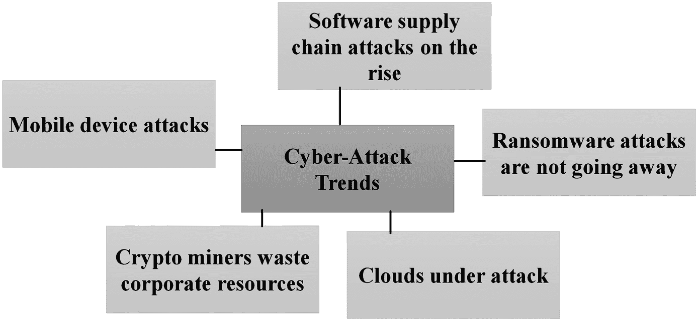

### 5.2.2.1 软件链攻击正在上升

在此类攻击中，攻击者在软件链中插入一段不受欢迎且有害的代码（Ellison, Goodenough, Weinstock, & Carol, 2010）。软件供应链的强度取决于其最薄弱的一环。

这些类型的攻击大致分为两类。第一类攻击的目标是攻破精心定义的目标，例如 `SolarWinds` 黑客攻击。另一类包括使用托管服务提供商（MSPs）所使用的软件。最近发生的的此类攻击之一是 `Kaseya` 攻击。在这次攻击中，网络犯罪分子获得了客户网络的访问。

#### 5.2.2.2 勒索软件攻击将长期存在

勒索软件已成为组织最常见的网络安全关注类型之一。勒索软件恶意使企业运营、系统和数据面临巨大风险，有时甚至是不可能恢复的（Gazet, 2008）。

勒索软件攻击在近期非常成功。这导致了更具创新性且更难破解的攻击的增长和发明。由于这类攻击易于实施且利润丰厚，它们继续以出人意料的速度增长。勒索软件攻击者不断精炼其技术和实施攻击的方法。

#### 5.2.2.3 云系统也面临攻击

随着公共云架构接受率的提高，针对这些平台的网络攻击数量也随之增加。这些云包含了用户的敏感和个人数据。这些资源的漏洞和管理不善仍然是吸引黑客关注的最显著威胁。这是导致全球范围内大量数据泄露的网络攻击的主要原因之一（Manoj & Bhaskari, 2016）。

云端加密货币挖掘操作因最新且升级的技术而流行，这些技术完全能够规避基础的云安全协议（Krishan, Saketh, & Tej, 2015）。

#### 5.2.2.4 挖矿程序浪费企业资源

加密货币挖掘或加密劫持（cryptojacking）是一个在黑客获取的机器上执行加密货币挖掘的过程，这些机器被称为“受感染机器”。这些操作消耗巨大的 CPU 资源，从而消耗大量的电力来执行挖矿过程，进而为网络犯罪分子获取财务利润（Williamson, 2018）。

大众对加密货币的广泛兴趣催生了日益增加的挖矿恶意软件。最近的非同化代币（NFT）为数字加密货币提供了所有权，这使得网络犯罪分子的活动倍增（Dowling, 2021）。

### 5.2.2.5 移动设备攻击


在当前的 COVID-19 大流行期间，随着居家办公和灵活工作空间需求的出现，移动设备的使用量大幅增加（Alam, Parveen, & Khan, Role of Information Technology in Covid-19 Prevention, 2020）。个人电脑和智能设备成为所有业务工作和运营的核心，这又被网络犯罪分子视为一种机会（Mobile, 2021）。

据报道，有超过 46% 的机构报告了涉及在用于公司业务和任务的设备上下载恶意应用程序的网络犯罪活动。由于于由于有大量公司开始提供远程办公能力，工人和员工需要保持警惕，因为通过短信和电子邮件攻击用户的移动恶意软件和钓鱼攻击数量正在激增。

## 5.2.3 信息物理系统攻击：日益增长的全球威胁

为了了解 CPA（信息物理攻击），我们首先需要了解 CPS（信息物理系统）。CPS 由相互作用的数字、模拟、物理和人类组件组成，通过集成物理和逻辑工程实现特定功能（Pasqualetti, Dorfler, & Bullo, 2011）。CPS 是三个不同过程的结合：计算、网络和物理过程。在嵌入式系统和网络的帮助下，通过反馈回路对 CPS 进行控制和监控，物理过程影响计算，反之亦然。CPS 是业务 3.0 演进到业务 4.0 的基础（Alam & Khan, Business 4.0-A New Revolution, 2020）。它在转型全球制造流程方面起着重要作用。

## 5.2.4 信息物理攻击的类型

在本节中，我们列出了一些 CPA。图 5.3 显示了某些 CPA。

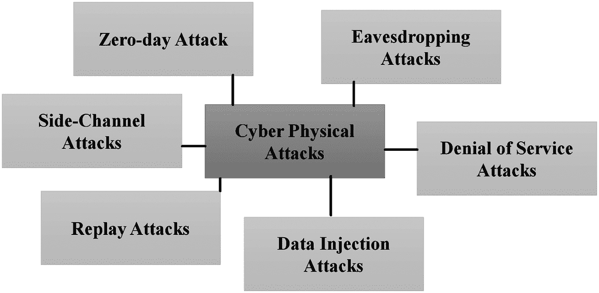

图 5.3 信息物理攻击。

### 5.2.4.1 零日攻击

当用户向开发者报告某些问题，开发者确认并宣布该漏洞，且攻击在补丁或解决方案实施之前发生时，这被称为零日利用。攻击者将该漏洞作为目标并进入系统窃取数据。这种威胁检测需要持续的监控和意识（Bilge & Dumitras, 2012）。

### 5.2.4.2 窃听攻击 (MitM)

中间人攻击（MitM）也称为窃听攻击，因为攻击者坐在两个通信方之间倾听他们所有的对话。攻击的主要目的是从两个身上获取敏感信息并窃取数据（Mallik, 2019）。

MitM 攻击可能发生在以下两种场景：

*   使用开放公共 Wi-Fi 网络时，恶意用户在用户不知情的情况下渗透到用户设备和互联网之间。用户在网络上传输的所有信息都会经过攻击者那里。
*   如果计算机上激活了恶意软件。

### 5.2.4.3 拒绝服务攻击

在拒绝服务（DoS）攻击中，攻击者向服务器发送数千个请求，使其无法响应。这导致了流量拥堵（Moore, 2006）。

### 5.2.4.4 数据注入 (SQL)

如其名所示，结构化查询语言（`SQL`）注入发生在恶意用户向查询中插入有害代码时。这导致服务器被破坏（Alam & Khan, 2020）。

### 5.2.4.5 重放攻击

在重放攻击中，攻击者截获通信并重新发送。这可以由恶意用户完成（Malik, 2019）。

### 5.2.4.6 信道攻击

信道攻击取决于通过物理测量获得的信息。它是非常危险的（Tiri, 2007）。

## 5.2.5 网络安全

网络安全是保护计算机系统、数据、移动设备和网络免受未经授权访问的概念，它也是信息安全。它可以应用于多种环境（Solms & Van Niekerk, 2013）（Geers, 2011）。图 5.4 描述了某些网络安全类别。

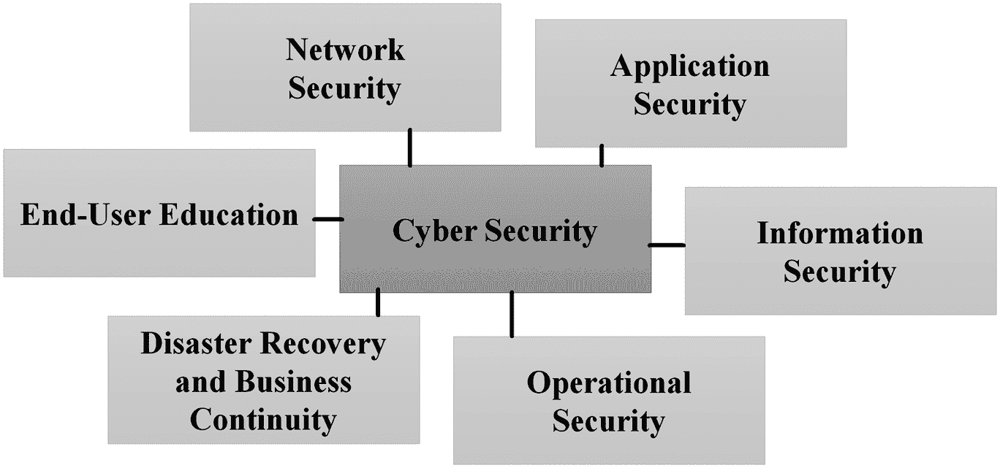

图 5.4 网络安全。

### 5.2.5.1 网络安全

网络安全意味着保护网络和其他设备免受恶意用户的侵害。

### 5.2.5.2 应用安全

应用安全意味着维护和保护软件组件。安全性应该在设计阶段，远在应用安装之前就实施。

### 5.2.5.3 信息安全

信息安全模块的工作是保护存储设备中的数据以及在节点之间传输中的数据的完整性和隐私性。

### 5.2.5.4 运营安全

运营安全涉及处理和保护价值数据的流程和决策。所有用户权限和网络访问能力都在此模块中处理。如何以及在哪里存储数据也在此模块中考虑。

### 5.2.5.5 灾难恢复与业务连续性

该模块解释了业务如何应对网络安全事件。它还定义了数据丢失或运营中断时的业务功能。它定义了业务在危机期间如何运行的策略，以及它如何需要恢复到网络攻击事件之前的运行能力。

### 5.2.5.6 终端用户教育

该模块解释了产品或服务终端用户的网络安全。让用户了解可能发生在产品和服务中的威胁和风险是首要任务。

## 5.2.6 网络威胁的类型

网络威胁分为三个方面：

*   **网络犯罪**：它涉及个人或群体针对系统以获取某些经济利益或对业务造成某种扰乱。
*   **网络攻击**：包括为了窃取和收集信息的政治动机。


* **网络恐怖主义**：网络恐怖主义的主要目的是破坏计算机和电子系统，以引起突然的焦虑和/或恐怖。

以下列出了一些著名的网络威胁：

* 恶意软件
* SQL 注入
* 钓鱼攻击
* 中间人攻击
* 拒绝服务攻击

## 5.3 IoT（物联网）

IoT 是由无线或有线设备互连的系统，例如传感器、执行器、智能设备、人工智能（AI）语音控制器等。这些设备从周围环境中收集数据，并能够在无需任何人工交互的情况下通过网络将数据发送到下一个节点。此外，数据要么在下一个节点被消费，要么传输到云端进行处理和分析（Alam, Khan, & Tanweer, IoT in Smart Cities: A survey, 2020 年 5 月 5 日）。

物联网中的“物”（thing）可以是指任何可以连接到互联网并被分配唯一 IP 地址的设备。它可以包括智能穿戴手带、智能超速检测摄像头、脖子上挂着应答器的农场动物，以及智能车辆或自动驾驶车辆中的传感器。

最近，越来越多的行业开始采用 IoT 和智能设备技术来提高效率和生产力。这有助于他们更好地理解客户及其需求，并提供更优质、更增强的服务。这些智能设备帮助他们做出明智选择，而 AI 正被用于决策。所有这些都增加了业务价值（Alam & Khan, Internet of Things as key Enabler for Efficient Business Processes, 2019 年）。

### 5.3.1 IoT 是如何工作的？

IoT 设备由嵌入式系统组成，包括微处理器、与其他节点通信的硬件、传感器等。这些设备和传感器是数据生成器或数据收集器。它们从周围环境中收集信息。某些设备还能根据其收集的数据采取行动。这些设备进一步连接到 IoT 网关、节点或其他边缘的设备，随后将数据发送到云端进行进一步分析。这些设备还能与周围的其他设备通信。它们可以共享相关信息并据此采取。IoT 设备不需要人工干预，但需要时人类可以与这些设备交互。主要的人工交互包括设置设备、设置指令，以及根据需要读取和访问收集的数据（Mahler & Westergren, 2019）。图 5.5 展示了 IoT 的工作原理。

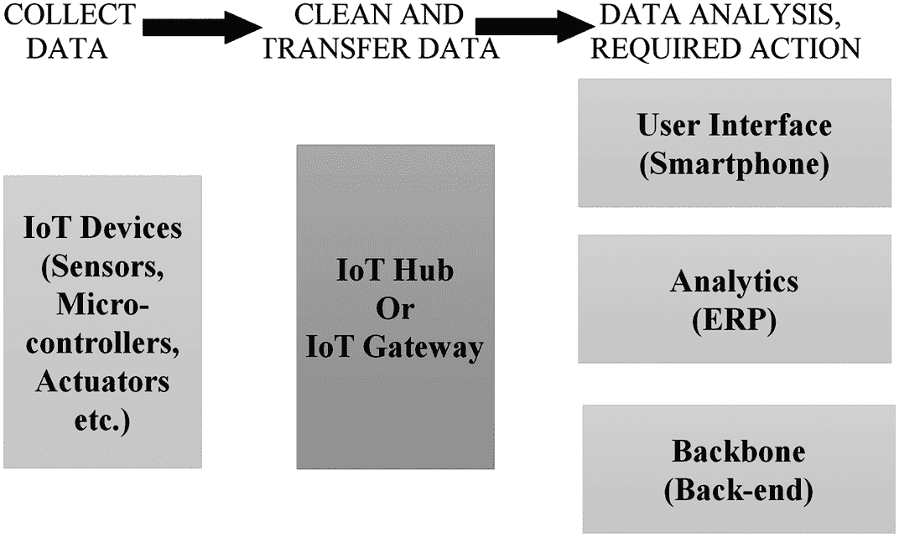

图 5.5 IoT 的工作原理

部署的 IoT 应用有助于设置这些设备，并对设备使用的各种协议（如通信、网络和连接）具有完全控制权。

AI 和机器学习（ML）现在被广泛应用于 IoT。这些技术使得数据收集和数据处理变得更加简单、高效和动态（Anuj, Alam, & Khan, 2021）。

### 5.3.2 IoT 的重要性

IoT 正在帮助社区智能生活和工作，并完全掌控自己的生活。它提供了智能设备来自动化日常任务和流程，保持其安全和受保护，使我们的生活更加轻松。同样，IoT 对业务也至关重要。IoT 为业务提供了更好的洞察和建议，使制造业、物流、营销、建筑和其他业务变得更高效、更简单、更快速、更有效。它们帮助工程师实时监控大型机器、引擎、桥梁等的健康和状况，并在发生故障前很早提供警报（Wang, Valerdi, Zhou, & Li, 2015）。

IoT 帮助行业实现了几乎所有流程的自动化，反过来大幅减少了他们承担的人力成本。它有助于减少产生的浪费，并改进服务交付流程。费用减少了，客户在业务和交易中获得了透明度。

最近，IoT 已成为我们日常最重要的技术进步之一，按照目前的接受率，更多人愿意采纳它只是时间问题。

### 5.3.3 IoT 的优势

自 IoT 诞生以来，机构和行业获益良多。IoT 的益处可能适用于特定行业（Dlamini & Johnston, 2016）。下面我们列出了一些共同益处：

* 有助于监控所有过程
* 有助于改善客户体验
* 节省时间与金钱
* 提高员工生产力
* 有助于适应和整合新的业务模式
* 有助于做出面向未来的决策
* 有助于增加收入

IoT 正在推动业务重新思考行动方案。如今，IoT 在几乎每个行业都找到了家，无论是农业、医疗保健、零售、制造业、运输还是物流。

IoT 在农业中的应用让农民的工作变得非常简单。可以在农场周围部署智能传感器，收集土壤水分和肥力含量、土壤温度、湿度、降水量等因素的数据，这将有助于并自动化耕作技术。动物可以通过标签进行追踪，防止它们丢失。

IoT 还可以通过传感器和摄像头监控基础设施。它们可以监控并报告建筑、桥梁和许多其他基础设施结构中非预期的变化。这有助于节省因损坏导致的费用，节省时间，并让管理者对结构了如指。

智能家居是目前的趋势。智能设备正被监控和控制建筑的所有电气和机械系统。智能城市是让市民生活舒适便利 Great 愿景。它有助于减少浪费和能源消耗，使旅行和医疗保健更快、更便宜（Alam, Khan, Siddique, Wiquar, & Anwar, 2020）。

### 5.3.4 IoT 的优缺点

在本节中，我们讨论了 IoT 的一些优缺点（Ploennings, Cohn, & Stanford-Clark, 2018）。

**优点：**
* 提供了任何时间通过任何设备访问所需信息的能力。
* 改善了连接设备之间的通信质量。
* 节省了在互联网上收发数据所需的时间资金。
* 日常或频繁任务的自动化极大提高了业务质量并减少了人工干预。

**缺点：**
* 随着智能设备数量的增加，设备产生和共享的数据越来越多。
* 随着信息和设备的增加，黑客攻击的可能性也成倍增加。


*   大型企业和业务可能需要大量的智能设备来完成单项任务。管理这些设备并收集数据可能成为一项挑战。
*   由于多米诺效应，如果一个节点发生故障，每个节点都可能随之发生，导致整个系统崩溃。
*   目前，还没有全球通的物联网（IoT）兼容性标准。这使得来自不同制造商的设备无法相互通信。

### 5.3.5 某些物联网标准

在这一节中，我们将讨论一些知名的物联网标准。图 5.6 展示了某些物联网标准。

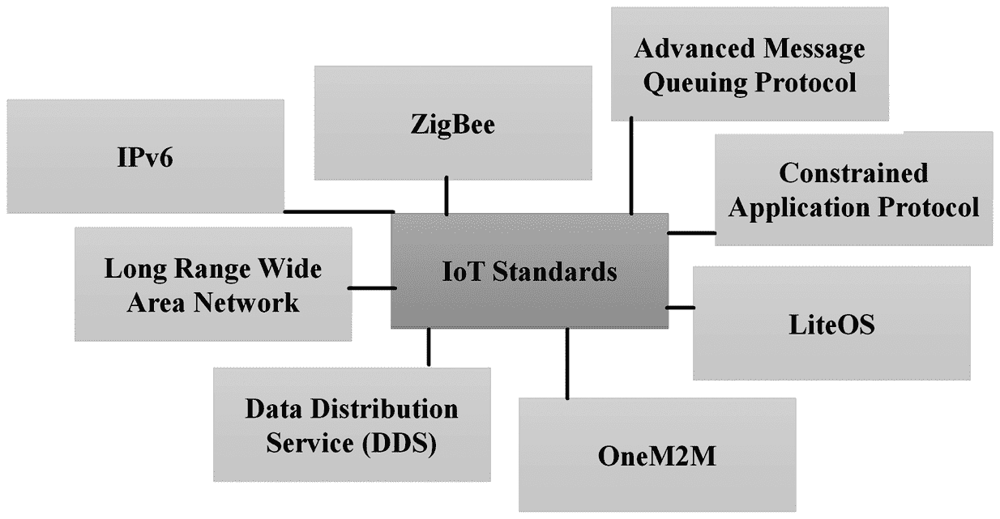

图 5.6 某些物联网标准。

#### 5.3.5.1 IPv6

`IPv6` 代表互联网协议第 6 版。它是一种网络层协议，使用分组交换网络技术，覆盖多个 IP 网络。它可以帮助低功耗设备连接到互联网并与其他类似设备通信。它在 2.4 GHz 频率范围内运行，传输率为 250 kbps。蓝牙低能（`BLE`）和 Z-Wave（用于家居自动化）就是示例 (Huitema, 1995)）。

#### 5.3.5.2 ZigBee

这是一种低功耗的低数据率无线网络。它在 2.5 GHz 频率范围内运行，速度为 250 kbps。允许的最大节点数为 1024 个，范围可达 200 米。它使用 128 位 AES 加密 (Ramya, Shanmugaraj, & Prabakaran, 2011)）。

#### 5.3.5.3 LiteOS

这是一种轻级的、基于 Unix 的操作系统，主要用于传感器设备。手机、可穿戴设备、智能家居设备和智能汽车都支持 `LiteOS` (Cao, Abdelzaher, Stankovic, & He, 2008)）。

#### 5.3.5.4 OneM2M

M2M 代表机器对机器。`OneM2M` 的建立是为了开发技术规范，以解决通用 M2M 服务层的需求，该层可以嵌入到具有多种硬件软件的小型物体中 (Swetina, Lu, Jacobs, Ennesser, & Song, 2014)。

#### 5.3.5.5 实时系统数据分布服务 (DDS)

它是首个用于实时、可扩展和高性能 M2M 通信的开放国际物联网中间件标准 (Kang, Kapitanova, & Son, 2012)。

#### 5.3.5.6 高级消息队列协议 (AMQP)

`AMQP` 是一种用于通过线路进行异步消息传递的开放应用层协议。它是面向消息的，使用了队列技术，并且可靠安全 (Appel, Sachs, & Buchmann, 2010)。

#### 5.3.5.7 受限应用协议 (CoAP)

`CoAP` 是一种专门为资源受限的物联网设备设计的应用层协议。它由 IEFT 提出 (Bormann, Castellani, & Shelby, 2012)。

#### 5.3.5.8 远距离广域网 (LoRaWAN)

`LoRaWAN` 是一种用于广域网（WAN）的网络协议，旨在用于大型网络（如智能城市）中的无线电池供电设备，这些网络拥有数十亿个低功耗智能设备 (Adelantado)。

### 5.3.6 物联网框架

本节讨论了物联网框架。图 5.7 展示了某些物联网框架。


图 5.7 某些物联网框架。

#### 5.3.6.1 亚马逊服务 (AWS)

`AWS` 是亚马逊开发的。它是一种网络层协议，帮助低功耗设备连接到互联网并与其他类似设备通信。它在 2.4 GHz 频率范围内运行，传输率为 250 kbps。蓝牙低能（`BLE`）和 Z-Wave（用于家居自动化）就是示例 (Huitema, 1995)。

#### 5.3.6.2 Arm Mbed

`Mbed` 是 Arm 的。它是一种网络层协议，帮助低功耗设备连接到互联网并与其他类似设备通信。它在 2.4 GHz 频率范围内运行，传输率为 250 kbps。蓝牙低能（`BLE`）和 Z-Wave（用于家居自动化）就是示例 (Huitema, 1995)。

#### 5.3.6.3 微软 Azure

它可以对数据进行可视化、聚合和多维分析 (Verma, Malla, Choudhary, & Arora, 2019)。

#### 5.3.6.4 谷歌 Brillo/Weave

`Brillo` 是 Android 的轻量级版本。`Weave` 是内置到 `Brillo` 中的通信协议 (Google, 2015)。

#### 5.3.6.5 爱立信 Calvin

`Calvin` 是爱立信发布的。它是开源的。它可以帮助事物进行通信 (Personn & Angelsmark, 2015)。


IoT 正在全球几乎每个业务领域被接受。数十亿设备已经连接到互联网，而且这个数字预计将在不到十年内翻一倍。这些设备的安全性和隐私是关注的核心。随着设备数量的增加，攻击者的攻击面也随之扩大。

2016 年，IoT 遭遇了截至为止最危险的攻击——`Mirai`。这是一个渗透进域名服务器提供商 `Dyn` 的僵尸网络。在几分钟内，全球许多网站无法访问。它被标记为最大的 DDoS 攻击之一。后来证实，攻击者是通过利用网络上安全性较低的 IoT 设备获得了网络访问权限 (Kolias, Kambourakis, Stavrou, & Voas, 2017)。

由于大量的 IoT 设备紧密连接，黑客需要做的工作仅仅利用单个漏洞获取网络访问权限并操纵或删除数据。制造商应该定期更新其设备，以保护它们免受此类威胁的影响。

黑客并不是 IoT 带来的唯一威胁；用户隐私是用户关注的下一个主要关注点。制造商可以使用用户的个人数据并出售这些数据 (Palani, 2020)。除了泄露用户的个人数据外，IoT 还包括对关键重要基础设施的风险，包括电力、金融服务和运输。

## 5.4 针对 IoT 的网络物理攻击

IoT 设备的网络物理攻击（CPA）并不是一个新问题。随着 IoT 设备数量的增加，它们越来越渗透到我们的日常生活中。这导致了总攻击面的增加。如今大多数部门正日益依赖最新的智能技术来实现工作和个人生活的自动化。由于设备正变得智能化并连接到互联网，这些网络攻击带来的物理风险正在缓慢增加。多米诺效应在 IoT 环境中最为常见，智能物体攻击其他智能物体并在过程中使其失效。这种会一直持续到整个设备网络被禁用。这意味着如果一个节点受到攻击且入侵者获得了其访问权限，获取网络上其他设备的访问权限将变得轻而易掌。当节点被破坏时，所有关键细节如 `Wi-Fi` 详情、位置等重要信息都会对入侵者开放。简而言之，我们可以说整个系统的安全性取决于其最薄弱的环节。

### 5.4.1 针对 IoT 设备的攻击具有多米诺效应

在 IoT 中，所有的传感器、执行器和其他设备每天都会产生大量且多样的数据。这些数据在组织 IT 基础设施和数据存储的各种区域中被使用、发送或存储。多米诺效应在 IoT 中带有负面含义，就像单一的负面步骤或行动可能导致一系列的负面行动，而这些行动的影响比上一个或一个更大。

### 5.4.2 针对 IoT 的网络物理攻击

在本节中，我们列出了针对 IoT 设备的若干 CPA。图 5.8 展示了某些针对 IoT 的 CPA。

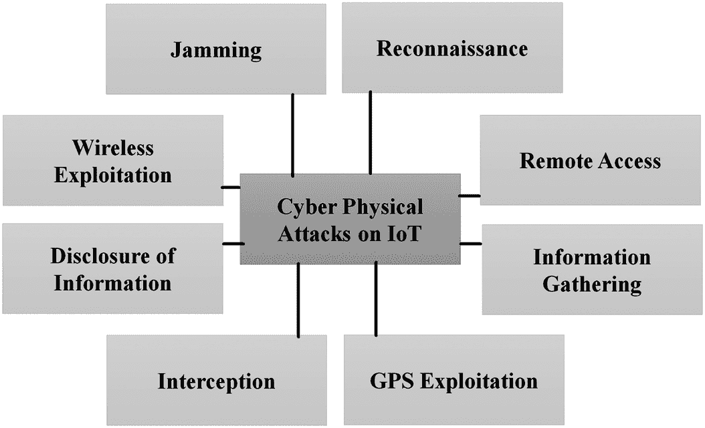

图 5.8 针对 IoT 的 CPA

### 5.4.2.1 无线利用

顾如其名，它需要系统的关键信息，它利用设备的无线能力，然后尝试获取主路由器或系统的远程访问和控制。同时，它会破坏整个系统的运行 (Checkoway, et al., 2011)。

### 5.4.2.2 干扰

在干扰中，主要目标是阻止设备的互联网访问，或简单阻止用户侧对 IoT 设备的访问。在这种情况下，设备状态变为不可用。这是由于发送大量不受欢迎的信息、随机认证信息或无线干扰信号引起的 (Rushanan, Rubin, Kune, & Swanson, 2014)。

### 5.4.2.3 侦察

也被称为足迹（foot printing）。在这种技术中，另一方收集有关用户计算机系统及其所属的所有实体的信息和足迹。这主要通过传播恶意软件来实现。这导致了数据泄露 (Miller & Rowe, 2012)。

### 5.4.2.4 远程访问

这是通过获取远程访问实现的，可能导致停电和财务损失。它可以用于将系统武器化 (Vavra & Hromada, 2015)。

### 5.4.2.5 信息泄露

一旦获得未经授权的访问，隐私和个人信息都可能被截获 (Halperin, Heydt, Kohno, & Maisel, 2008)。

### 5.4.2.6 拦截

拦截意味着进入对话中间，在双方不知情的情况下进行窃听 (Checkoway, et al., 2011)。

### 5.4.2.7 GPS 利用

`GPS` 代表全球定位系统；在这种攻击中，攻击者获得了对用户 `GPS` 设备的访问权限，导致对用户的持续监控和跟踪 (Checkoway, et al., 2011)。

### 5.4.2.8 信息收集

硬件和软件制造商对其大部分设备持续收集、采集和分析日志文件。这些信息可能包含个人信息，并用于营销目的。

## 5.5 避免 IoT 的 CPA

在本节中，我们讨论了防止日常生活中发生 CPA 的方法和手段。

### 5.5.1 如何防御网络物理攻击

消除上述在线威胁和风险是一项不可能的任务。工程师或安全官员努力做的是将攻击减少到最低。专家表示，为了保持系统的安全，安全测试需要从软件设计的非常初就开始实施，也就是说需要在整个软件开发生命周期（`SDLC`）中实施。安全需要成为系统的一部分。作为一个完全独立的实体，只会为能力不断提升的黑客打开更多大门。

随着互联网范围的扩大和越来越多的设备连接到网络，网络威胁及其攻击面也在不断扩大和演变。因此，安全系统也需要演变以确保用户安全。2019 年有效的机制在当今世界可能不再足够高效。万物都在演变，安全也是如此。现在的安全系统使用 AI 和其他智能技术来确保用户安全。

政府需要越来越多地参与到这些安全规范的实施中。


### 5.5.2 网络攻击是可预防的

尽管网络攻击大幅增加，但仍有超过 99% 的公司和企业没有得到有效的保护。应当理解的是，超过 90% 的网络攻击是可以预防的。网络防御的关键在于点对点和端到端的网络安全框架。它需要一个多层框架，涵盖网络上的所有设备，无论是服务器、端点、移动设备、云端等。正确的框架将帮助管理层在单一框架内整合多层安全系统和控制策略。

下面我们列举了预防网络攻击时需要采取的几项关键行动：

*   定期更新安全补丁
*   预防优于检测
*   确保整个网络和所有设备的安全
*   实施并使用最新技术
*   威胁情报应具备最新的特征定义

### 5.5.3 终端用户保护

网络安全最关键的部分之一是终端用户保护。也称为端点保护，旨在阻止未经授权的恶意用户或群体攻击并破坏终端用户设备，如桌面电脑、笔记本电脑、智能手机和物联网设备。通常情况下，技术水平较低的用户往往会在不知意的情况下下载并向设备中安装恶意代码，从而成为网络威胁的源头。加密技术是网络安全数据保护的主要技术。它对敏感数据进行加密并始终保护它们，无论是在传输过程中还是在硬盘上。

终端用户在系统上安装的安全软件会扫描并保护计算机免受危险程序和恶意代码的侵害。每当检测或发现此类代码时，程序会被隔离或从系统中完全删除。这些软件甚至具备扫描主引导记录（`MBR`）的能力，恶意代码可能隐藏在其中，一旦激活，可能会擦除系统上的所有数据。

电子安全协议的主要目标是实时检测可疑代码和恶意软件。它们利用启发式方法并对疑似程序及其代码的行为进行分析，以保护用户不受蠕虫、广告软件、木马和病毒的侵害。它们将可疑程序捕获到远离主系统或网络的安全沙泡中，以研究恶意代码的行为，用于未来的防护和安全。

新的威胁和攻击每天都会发现。安全程序需要演进以保护用户。新威胁需要新的方法来应对。终端用户需要了解如何使用这些软件。更新等任务需要用户定期执行。用户需要知道，运行和更新安全软件是任何网络安全范式中最重要的方面。

### 5.5.4 网络安全技巧——保护免受网络攻击

在本节中，我们列出了一些网络安全建议。图 5.9 描绘了一些网络安全建议。

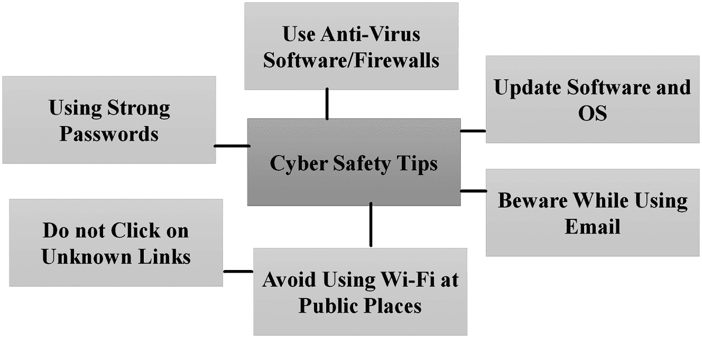

图 5.9 网络安全建议。

### 5.5.4.1 定期更新软件和操作系统

为了修复漏洞，需要定期更新软件固件。这些更新可能包含最新的安全补丁。

#### 5.5.4.2 使用杀毒套件

使用如 Bit Defender、卡斯基或 Norton 等安全杀毒套件，并持续监控设备，以检测威胁。

### 5.5.4.3 使用强密码

用户需要使用强密码，避免密码易被破解。

#### 5.5.4.4 不要打开来自未知发件人的附件

不要打开来自未知发件人的邮件附件，这些附件可能会感染文件。

#### 5.5.4.5 不要点击邮件中的未知链接

不要点击邮件中的未知链接，这些链接可能是钓鱼网站。

#### 5.5.4.6 避免在公共场所使用不安全的 Wi-Fi

避免在公共场所连接不安全的 Wi-Fi，这些连接可能导致遭受 `MitM` 攻击。

## 5.6 结论

在本章中，我们讨论了物联网和 CPS 的影响。此外，物联网设备需要内置安全措施以确保其安全。为了避免法律诉讼，公司需要透明地采取安全措施。这些措施对于用户来说是至关重要的。


- [Alam, M., Parveen, R., & Khan, I. R.] (2020). 信息技术在新冠-19 预防中的作用。《国际商业教育与管理杂志》，65–75。doi:[10.6084/m9.figshare.14369627.v1](http://dx.doi.org/10.6084/m9.figshare.14369627.v1)
- [Amour, L. S.] (2012). 互联网：一个前所未有的创新与变革平台。收于 L. S. Amour (编), 《全球创新指数》(pp. 157–162)。世界产权组织 (WIPO)。
- [Anderson, R., Barton, C., Bohme, R., Clayton, R., Van Eeten, M. J., Levi, M.], … Savage, S. (2013). 衡量网络犯罪成本。收于 R. Bohme (编), 《信息安全与隐私的经济学》(pp. 265–300)。柏林：Springer，柏林，海德堡。doi:[10.1007/978-3-642-39498-0_12](http://dx.doi.org/10.1007/978-3-642-39498-0_12)
- [Anuj, R., Alam, M., & Khan, I. R.] (2021). 使用物联网的智能垃圾监控系统。*第二届数学科学与计算新兴趋势国际会议 (IEMSC-21)*。加尔各答：西孟拉邦。doi:[10.2139/ssrn.3902056](http://dx.doi.org/10.2139/ssrn.3902056)
- [Appel, S., Sachs, K., & Buchmann, A.] (2010). 走向 AMQP 基准测试。*第四届 ACM 分布式事件驱动系统国际会议*。纽约：ACM Press。doi:[10.1145/1827418.1827438](http://dx.doi.org/10.1145/1827418.1827438)
- [Bermudez, I., Traverso, S., Mellina, M., & Munafo, M.] (2013). 从被动测量探索云：亚马逊 AWS 案例。*IEEE INFOCOM 会议* (pp. 230–234)。意大利于灵：IEEE。doi:[10.1109/INFCOM.2013.6566769](http://dx.doi.org/10.1109/INFCOM.2013.6566769)
- [Bilge, L., & Dumitras, T.] (2012). 在我们发现之前：现实世界零日攻击的实证研究。*2012 年 ACM 计算机与通信安全会议 (CCS '12)* (pp. 833–844)。纽约：ACM。doi:[10.1145/2382196.2382284](http://dx.doi.org/10.1145/2382196.2382284)
- [Bormann, C., Castellani, A. P., & Shelby, Z.] (2012). CoAP：一种适用于数十亿个微型网络节点的应用协议。《IEEE Internet Computing》，*16*(2), 62–67。doi:[10.1109/MIC.2012.29](http://dx.doi.org/10.1109/MIC.2012.29)
- [Cao, Q., Abdelzaher, T., Stankovic, J., & He, T.] (2008). LiteOS 操作系统：面向无线传感网络的类 Unix 抽象。*传感器网络信息处理国际会议 (IPSN 2008)* (pp. 233–244)。美国密苏里州圣路易：IEEE。doi:[10.1109/IPSN.2008.54](http://dx.doi.org/10.1109/IPSN.2008.54)
- [Checkoway, S., McCoy, D., Anderson, D., Kantor, B., Shacham, H., Savage, S.], … Kohno, T. (2011). 汽车攻击面的全面实验分析。《USENIX 安全研讨会论文》(pp. 77–92)。旧金山。
- [CISCO]. (2019, 10 月)。CISCO 网络安全系列 2019。检索自 CISCO:[`www.cisco.com/c/m/en_au/products/security/offers/cybersecurity-reports.html`](https://www.cisco.com)
- [Denning, P. J., & Denning, D. E.] (2010). 讨论网络攻击。《ACM 通信》，*53*(9), 29–31。doi:[10.1145/1810891.1810904](http://dx.doi.org/10.1145/1810891.1810904)
- [Dlamini, N., & Johnston, K.] (2016). 零售业中物联网（IoT）的使用、收益与挑战：文献综述。《计算与通信工程国际会议 (ICACCE)》(pp. 430–436)。德班：doi:[10.1109/ICACCE.2016.80737](http://dx.doi.org/10.1109/ICACCE.2016.80737)
- [Dowling, M.] (2021). 土地非同质化代币。《研究快报》，10296。doi:[10.1016/j.frl.2021.10296](http://dx.doi.org/10.1016/j.frl.2021.10296)
- [Ellison, R. J., Goodenough, J., Weinstock, C., Carol, W.] (2010). 评估与缓解供应链风险。《软件工程》，卡内基梅隆大学，匹兹。
- [Elsisi, M., Tran, M.-W., Mansour, K., Lehtonen, M., & Darwish, M.] (2021). 基于物联网和机器学习的安全在线监控。《IEEE Access》，*9*, 78415–78427。doi:[10.1109/ACCESS.2021.308349](http://dx.doi.org/10.1109/ACCESS.2021.308349)
- [Gazet, A.] (2008). 勒索软件的比较分析。《计算机病毒学》，*6*, 77–90。doi:[10.1007/s11416-008-2](http://dx.doi.org/10.1007/s11416-008-2)
- [Geers, K.] (2011). 战略网络安全。爱沙尼亚：北约合作卓越中心。
- [Google]. (2015)。Google 的物联网解决方案。检索自 Google Developers:[`developers.google.com/iot`](https://developers.google.com)
- [Halfond, W., Viegas, J., & Orso, A.] (2006). SQL 攻击分类。《IEEE 国际软件工程研讨会》(pp. 13–15)。IEEE。
- [Halperin, D., Heydt-Benjamin, T. S., Fu, K., Kohno, T., & Maisel, W.] (2008). 植入式医疗设备的安全与隐私。《IEEE Pervasive Computing》，*9*(1), 30–39。doi:[10.1109/MPRV.2008.16](http://dx.doi.org/10.1109/MPRV.2008.16)
- [Hampton, K. N.] (2010). 网络使用与劣势集中：全球化与城市底层阶。《美国行为科学家》，*53*(8), 1111–1132。doi:[10.1177/000276420935624](http://dx.doi.org/10.1177/000276420935624)
- [Hendrik, S., & Mochalski, K.] (2009). 2008/2009 网络研究。德国莱比锡：I Report 37。
- [Hong, J.] (2012). 钓鱼攻击现状。《ACM 通信》，*55*(1), 74–81。doi:[10.1145/2063176.2063197](http://dx.doi.org/10.1145/2063176.2063197)
- [Huitema, C.] (1995). `IPv6`：新的互联网协议。美国：Prentice-Hall, Inc.
- [Jahromi, A. N., Karimipour, H., Deghantanha, A., & Choo, K.-K. R.] (2021). 物联网启用信息物理系统中网络攻击的检测与归因。《IEEE Internet Things Journal》，*8*, 13712–13722。doi:[10.1109/JIOT.2021.3067667](http://dx.doi.org/10.1109/JIOT.2021.3067667)
- [Kang, W., Kapitanova, K., & Son, S. H.] (2012). `RDDS`：用于信息物理系统的实时数据分发服务。《IEEE Transactions on Industrial Informatics》，*8*(2), 393–405。doi:[10.1109/TII.2012.2183878](http://dx.doi.org/10.1109/TII.2012.2183878)
- [Kolias, C., Kambourakis, G., Stavrou, A., Voas, J.] (2017). 物联网中的 DDoS 攻击：Mirai 及其他机器人网络。《计算机》，*50*(7), 80–84。doi:[10.1109/MC.2017.201](http://dx.doi.org/10.1109/MC.2017.201)
- [Krishan, H., Saketh, S., & Tej, V.] (2015). 加密货币挖矿向云端的转型。《先进计算机科学与应用国际杂志》，*6*(9), 115–124。doi:[10.14569/IJACSA.2015.060915](http://dx.doi.org/10.14569/IJACSA.2015.060915)
- [Li, F., Shi, Y., Shinde, A., Ye, J., & Song, W.] (2019). 通过能源审计增强物联网中的信息物理安全。《IEEE Internet Things Journal》，*6*(3), 5224–5231。doi:[10.1109/JIOT.2019.2899492](http://dx.doi.org/10.1109/JIOT.2019.2899492)


* Mahler, V., & Westergren, U. H. (2019). 物联网工作 – 一项通过采用物联网系统详细说明工作场所数字化的案例研究。在 L. Strous, & V. Cerf (编.), IFIP 信息与通信技术进展 (pp. 178–193). Cham: Springer. doi:[10.1007/978-3-030-15651-0_15](http://dx.doi.org/10.1007/978-3-030-15651-0_15)

* Malik, K. M., Malik, H., & Baumann, R. (2019). 迈语音驱动接口的脆弱性分析及重放攻击的防御措施。*IEEE 多媒体信息处理与检索会议 (MIPR)* (pp. 523–528)。 圣何塞，加州: IEEE. doi:[10.1109/mipr.2019.00106](http://dx.doi.org/10.1109/mipr.2019.00106)

* Mallik, A. (2019). 中间人攻击：简单易懂的理解。Cyberspace: 信息技术教育期刊，*2*(2), 109. doi:[10.22373/cj.v2i2.3453](http://dx.doi.org/10.22373/cj.v2i2.3453)

* Manoj, S. A., & Bhaskari, L. (2016). 云端取证 - 一种调查云环境中网络攻击的框架。Procedia Computer Science, *85*, 149–154. doi:[10.1016/j.procs.2016.05.2](http://dx.doi.org/10.1016/j.procs.2016.05.2)

* Miller, B., & Rowe, D. (2012). 关键基础设施事件 SCADA 调查。*第一届年度信息技术研究会议 – RIIT '12* (pp. 51–56)。 纽约: ACM. doi:[10.1145/238079.238085](http://dx.doi.org/10.1145/238079.238085)

* Mobile, T. (2021, 2 月 24). 黑客攻击移动设备的五个原因以及如何停止。检索自福布：[`www.forbes.com/sites/tmobile/2021/02/24/5-reasons-hackers-target-mobile-devices-and-how-stop-them/?sh=7f0af91a28`](https://www.forbes.com)

* Moore, D., Shannon, C., Brown, D., Voelker, G. M., & Savage, S. (2006). 推断互联网拒绝服务活动。ACM 计算机系统事务，*24*(2), 115–139. doi:[10.1145/113206.11327](http://dx.doi.org/10.1145/113206.11327)

* Mutlag, A., Ghani, M. K., Arunkumar, N., Mohammad, M. A., & Mohd, O. (2019). 医疗健康物联网中边缘计算的关键技术。Future Generation Computer Systems, *90*, 62–78. doi:[10.1016/j.future.2018.07.049](http://dx.doi.org/10.1016/j.future.2018.07.049)

* Palani, N. (2020). 医疗设备与物联网 ONE-GUI 设计介绍。在 P. S. Shanmugam, L. Chokkalingam, & P. Bakthavalam (编.), 医疗设备的发展趋势 (pp. 17–34)。Academic Press. doi:[10.1016/B978-0-12-82096-8.0002-2](http://dx.doi.org/10.1016/B978-0-12-82096-8.0002-2)

* Pasqualetti, F., Dorfler, F., & Bullo, F. (2011). 电物理攻击：模型、基础限制与监控设计。第 50 届 IEEE 决策与控制会议 (CDC) (pp. 2195–2201)。奥兰多，佛罗里达。 doi:[10.1109/CDC.2011.61041](http://dx.doi.org/10.1109/CDC.2011.61041)

* Personn, P., & Angelsmark, O. (2015). Calvin – 合并云与物联网。Procedia Computer Science, *52*, 210–217. doi:[10.1016/j.procs.2015.0529](http://dx.doi.org/10.1016/j.procs.2015.0529)

* Ploennings, J., Cohn, J., & Stanford-Clark, A. (2018). 物联网的未来。IEEE 物联网杂志，*1*(1), 28–33. doi:[10.1109/IOTM.2018.17002](http://dx.doi.org/10.1109/IOTM.2018.17002)

* Poongodi, T., Krishnamurthi, R., Indrakumari, R., Suresh, P., & Balusamy, B. (2019). 可穿戴设备与物联网。在 V. Balas, Solanki, R. Kumar, & M. Ahad (编.), 生物医学物理系统物联网手册 (pp. 245–273)。Springer.

* Ramya, C. M., Shanmugar, M., & Prabakaran, R. (2011). ZigBee 技术研究。第 3 届电子技术会议 (pp. 287–301)。坎亚库姆，印度。 doi:[10.1109/ICECH.2011.59421](http://dx.doi.org/10.1109/ICECH.2011.59421)

* Rana, M. M., Khan, M. R., & Abdelhadi, A. (2020). 使用无迹卡尔曼滤波的物理系统物联网架构。第二届计算应用创新研究会议 (ICIRCA) (pp. 910–913)。哥培巴特尔，印度。 doi:[10.1109/ICIRCA.48905.2020.91835](http://dx.doi.org/10.1109/ICIRCA.48905.2020.91835)

* Rieck, K., Holz, T., Willems, C., Dussel, P., & Laskov, P. (2008). 恶意软件的学习与分类。在 D. Zamboni (编.), 入侵入、恶意软件检测及脆弱性评估 (pp. 108–125)。 柏林：海德堡。 doi:[10.1007/978-3-540-70542-6](http://dx.doi.org/10.1007/978-3-540-70542-6)

* Ruan, J., Jiang, H., Zhu, C., Hu, X., Shi, Y., Liu, T., … Chan, F. (2019). 农业物联网：新兴趋势、合作与展望。IEEE 无线通信，*26*(6), 56–63. doi:[10.1109/MWC.001.190096](http://dx.doi.org/10.1109/MWC.001.190096)

* Rushanan, M., Rubin, A. D., Kune, D. F., & Swanson, C. M. (2014). SoK：植入式医疗设备和体域网络的安全与隐私。*IEEE 安全与隐私会议* (pp. 524–539)。 伯克利，加州，美国：IEEE. doi:[10.1109/SP.2014.40](http://dx.doi.org/10.1109/SP.2014.40)

* Sen, S., & Jayawardena, C. (2019). 大数据物联网与物理系统中的网络攻击分析——网络安全建模的技术方法。第 5 届技术融合国际会议 (I2CT) (pp. 1–7)。孟买，印度：IEEE. doi:[10.1109/I2CT45611.2019.903821](http://dx.doi.org/10.1109/I2CT45611.2019.903821)


*   Von Solms, R., & Van Niekerk, J. (2013). 从信息安全到网络安全。Computers & Security, *38*, 97–102. doi:[10.1016/j.cose.2013.04.004](http://dx.doi.org/10.1016/j.cose.2013.04.004)
*   Wang, P., Valerdi, R., Zhou, S., & Li, L. (2015). 引言：物联网研究与应用的进展。Information Systems Frontiers, *17*(2), 239–241. doi:[10.1007/s10796-015-9549-2](http://dx.doi.org/10.1007/s10796-015-9549-2)
*   Williamson, S. (2018). 比特币是资源的浪费吗？SSRN Electronic Journal, 107–115. doi:[10.20955/r.2018.107-15](http://dx.doi.org/10.20955/r.2018.107-15)
*   Xiao, P. (2018). 使用 ARM Mbed 设计嵌入式系统与物联网 (IoT)。Wiley。
*   You, I., Yim, K., Sharma, V., Choudhary, G., Chen, I.-R., & Cho, J.-H. (2018). 信息物理系统中物联网异常行为检测。*第 23 届亚太地区可靠计算国际研讨会 (PRDC)* (pp. 89–90)。台湾台北：IEEE. doi:[10.1109/PRDC.2018.00033](http://dx.doi.org/10.1109/PRDC.2018.00033)

# 6 在 S-Box 中使用仿射变换的混沌加密算法及其在 FPGA 中的实现

V. Nandan 和 R. Gowri Shankar Sagunthala R，印度泰米尔纳德邦科学技术学院 DOI: [10.1201/9781032413486](https://dx.doi.org/9781032413486)

## 6.1 概述

在数据通信系统中，必须关注安全性。由于密钥的随机化，安全性和算法复杂性随之增加。最近，加密算法必须能够在硬件平台 FPGA（现场可编程门阵列，一种可编程设备）上平衡巨大的内存和执行时间。`AES` 作为一种高效且成本效益的对称算法，被广泛应用于 ATM、智能卡和互联网服务器等领域。一个安全、稳健的加密系统依赖于 `AES` 替换盒，本章提出了混沌组件。它由一个有效的混沌数生成器 (`PCNG`)、全局扩散和分组密码组成。有限域被用于定义 `PCNG`，从而消除了安全性降低的问题。同时，混沌映射的数值实现通常表述为实数。在改进的伯努利过程中，通过水平相加 (`HAD`) 和垂直相加 (`VAD`) 增加了扩散特性。通过各种基准标准对建议的 `S-Box` 强度进行了详细测试。实验结果表明，使用伯努利过程的混沌高级加密算法 (`CA-Sbox-BP`) 在 75 ms 内实现了 96% 的效率、64% 的非线性和 98% 的严格雪崩效应。

## 6.2 引言

`NIST`（美国国家标准技术研究院）评审发布了一种名为高级加密标准 (`AES`) 的分组密码。Joan Daemen 和 Vincent Rijmen 设计了该 `AES` 标准。`FIPS` 代表联邦信息处理标准并发布了该标准 ([Hossehani et al., 2012])。使用模运算来生成 8 位 `S-Box`，其目的是为了体现 `AES` 加密中的非线性。解密通过构建正向 `S-Box` 和反向 `S-Box` 来完成 ([Paul et al., 2012])。`GF(2)` 下的特定多项式 `{11B}` 和加数 (`63`)（由于 `GF(2)` 中的模数而导致不可约）被用于生成 `AES` 标准 `S-Box`。Rijndael 在原始设计中使用这种特定的模数和加数。为了生成更具动态性的 `S-Box` ([Ozkaynak, 2018])，它使用了使用了模数和常量 ([Jingmei et al., 2007])。加密算法的安全性由 `NIST` 的某些标准表征。106 阶随机性的长二进制序列通过 `NIST` 测试套件中的 15 项统计测试进行了验证。该长二进制序列通过几个步骤确保序列的随机性；第一步是选择适用于加密应用的生成器。根据 `NIST` 的声明，统计测试不能替代密码学分析 ([Rahim et al., 2019])。使用多个 `S-Boxes` 生成 `AES` 密文，随后根据所选的特定 `S-Box` 测试其随机性和安全性 ([Zhun and Sun, 2018])。混淆和扩散是分组加密算法提供的两个基本属性。替换盒 (`s-box`) 结构（称为加密组件）是通过若干分组加密算法中的混淆属性提供的。因此，`s-box` 的结构为分组加密算法提供了强度。`s-box` 是通过代数法、伪随机和启发式方法设计的 ([Zhang et al., 2018])。根据强代数关系，近期的分组加密算法经常使用 s-box 设计技术，Nyberg 提出了许多新算法 ([Ahmed et al., 2019])。`AES` 的 `s-box` 分组加密算法使用了这种方法 ([Murugan et al., 2020])。由代数 `s-box` 设计的算法被上十年提出的混沌 `s-box` 技术所交替。密码学与混沌之间的相似性是混沌系统中设计 `s-box` 的基础 ([Guo et al., 2018])。随机源被用于混沌系统的设计。混沌系统的输出产生 `S-box` 结构 ([Wang et al., 2018])。在检查基于混沌的 `s-box` 结构的性能标准时，加密 `AES s-box` 结构的属性差于 `AES s-box` 结构 ([Ping et al., 2018])。例如，112 是 `AES` `s-box` 的非线性值 ([Zhu et al., 2018])。


许多研究人员开发了 S 盒的设计，以增加非线性和降低 DP 值。设计 S 盒时，混沌理论与密码学之间应该存在稳健的相似性。依赖于敏感性、遍历性和混合性的初始条件是许多研究人员所使用的 `Chaos` 的一些内在属性 (Kocarev, 2001)。1D、2D 和 3D 混沌映射被用于设计 S 盒 (Belazi et al., 2018; Tang et al., 2005)。`6D 混沌映射`和人工蜂群算法 (Hussain et al., 2013) 展现了 S 盒的设计。通过七种不同的优化算法确定了与四种混沌算法一致的最初始条件和控制参数值 (Tanyildizi and Ozkaynak, 2019)。

优化的混沌映射设计了另一个比 AES S 盒稳健性更低的 S 盒。从密码学角度来看，3D 等离子属性被用于设计 S 盒的生成。混沌映射、Baker 映射以及线性线性生成器 (`LCG`) 中正弦混沌映射的结合被用于无线传感器网络的 S 盒设计 (Yi et al., 2019)。在为置换-变换网络设计密码学方法时，通过混沌逻辑帐篷映射和黄金序列结果进行线性变换，生成了新的 S 盒 (Khan et al., 2019)。通过使用帐篷-逻辑混沌映射，设计了一种新的 S 盒。这种帐篷-逻辑混沌映射包含了一种用于生成 s 盒的新型线性映射方案 (Lu et al., 2019)。图像加密通过混沌 Jaya 优化算法 (Hayat et al., 2018) 进行，其中通过 S 盒更好地实现了密码学属性。一些研究人员引入了一些混沌结果的方法以生成强 S 盒。`Chaos` 与代数的结合获得了更合适的密码学结果。提出了一种单维离散空间混沌映射 (Lambić, 2020)。对其在混沌行为存在时的动态特性进行了分析。结果是生成了采用最佳密码学混沌映射的 S 盒。提出了一种依赖图像加密算法的安全且高效的混沌 S-Box (Lu et al., 2020)。置换密钥序列和置换与明文图像内容相关，这种方法允许密码系统能够抵抗选择明文攻击 (CPA)。

## 6.4 系统模型

本节解释了有效 AES S 盒的计算及其初步工作。图 6.1 显示了输入参数，以及在伯努利过程和块密文辅助下通过 s 盒构建的加密过程。

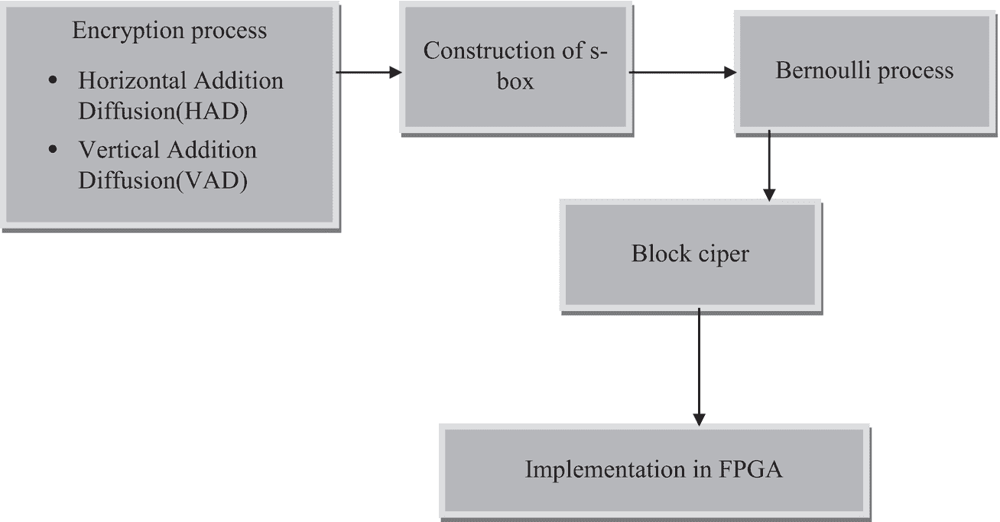

Figure 6.1 System architecture for proposed CA-S-box-BP.

### 6.4.1 加密过程

图 6.2 代表加密过程。密钥密钥控制 `PCNG`（伪混沌数生成器），并使用 `PCNG` 的样本来处理加密，包括全局扩散操作和块密码操作。扩散属性通过全局扩散得到了增强。在步骤 1 中，使用带有扩散层的全局扩散操作来处理整个输入明图。`HAD`（水平相加扩散）由 `VAD`（垂直相加扩散 `VAD`）继续，并结合依赖于伯努利过程的置换层在此全局扩散操作中。`PCNG` 提供了此过程所需的参数。此扩散过程将重复 `rg` 次。然后，全局扩散的输出被划分为包含 16 字节的块，每个块为 4 × 4 字节。对于块加密，使用了一种名为 `E(.)` 的块密码内核算法，该算法由由一个基于高级加密标准 SBox 的混淆层、一个密钥加操作 (`XOR`) 和一个扩散层组成。修改后的二维猫映射，`PCNG` 馈入 `XOR` 运算符需要 `Kp`；`Kc`。最终密文通过重复块密码操作 `r` 次获得。

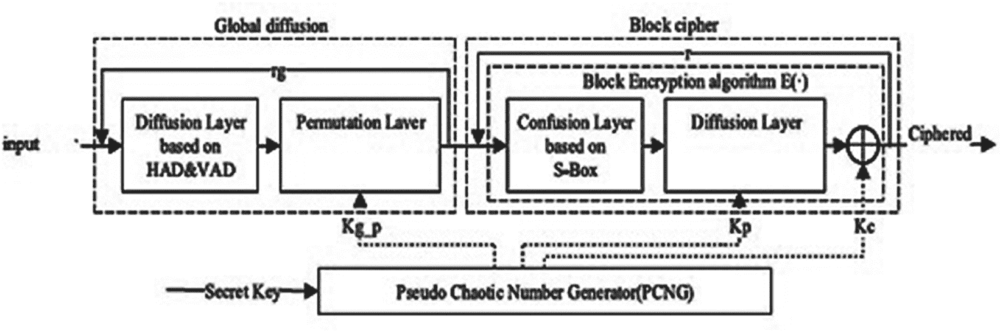

Figure 6.2 Encryption process of chaos-based method.

### 6.4.2 S 盒的构造

置换盒非线性组件存在于对称块算法中。S 盒负责防御差异攻击和线性攻击。`GF(2)8` 到 `GF(2)8` 的非线性映射用于在数学上生成 8 × 8 S 盒，其中 `GF(2)8` 是具有 28 个元素的向量空间，表示为来自 `GF(2)` 的 8 位位组。

以下步骤构造 S 盒：

*   将 `n` 赋值为 `as16` 并考虑 `p` 为 `a`
*   将 `n` 赋值为 `as16` 并考虑 `p` 为 `a`
*   将 `n` 赋值为 `as16` 并考虑 `p` 为 `a`
*   将 `n` 赋值为 `as16` 并考虑 `p` 为 `a`
*   将 `n` 赋值为 `as16` 并考虑 `p` 为 `a`
*   将 `n` 赋值为 `as16` 并考虑 `p` 为 `a`
*   将 `n` 赋值为 `as16` 并考虑 `p` 为 `a`
*   将 `n` 赋值为 `as16` 并考虑 `p` 为 `a`
*   将 `n` 赋值为 `as16` 并考虑 `p` 为 `a`
*   将 `n` 赋值为 `as16` 并考虑 `p` 为 `a`
*   将 `n` 赋值为 `as16` 并考虑 `p` 为 `a`
*   将 `n` 赋值为 `as16` 并考虑 `p` 为 `a`
*   将 `n` 赋值为 `as16` 并考虑 `p` 为 `a`
*   将 `n` 赋值为 `as16` 并考虑 `p` 为 `a`
*   将 `n` 赋值为 `as16` 并考虑 `p` 为 `a`
*   将 `n` 赋值为 `as16` 并考虑 `p` 为 `a`
*   将 `n` 赋值为 `as16` 并考虑 `p` 为 `a`
*   将 `n` 赋值为 `as16` 并考虑 `p` 为 `a`
*   将 `n` 赋值为 `as16` 并考虑 `p` 为 `a`
*   将 `n` 赋值为 `as16` 并考虑 `p` 为 `a`
*   将 `n` 赋值为 `as16` 并考虑 `p` 为 `a`
*   将 `n` 赋值为 `as16` 并考虑 `p` 为 `a`
*   将 `n` 赋值为 `as16` 并考虑 `p` 为 `a`
*   将 `n` 赋值为 `as16` 并考虑 `p` 为 `a`
*   将 `n` 赋值为 `as16` 并考虑 `p` 为 `a`
*   将 `n` 赋值为 `as16` 并考虑 `p` 为 `a`
*   将 `n` 赋值为 `as16` 并考虑 `p` 为 `a`
*   将 `n` 赋值为 `as16` 并考虑 `p` 为 `a`
*   将 `n` 赋值为 `as16` 并考虑 `p` 为 `a`
*   将 `n` 赋值为 `as16` 并考虑 `p` 为 `a`
*   将 `n` 赋值为 `as16` 并考虑 `p` 为 `a`
*   将 `n` 赋值为 `as16` 并考虑 `p` 为 `a`
*   将 `n` 赋值为 `as16` 并考虑 `p` 为 `a`
*   将 `n` 赋值为 `as16` 并考虑 `p` 为 `a`
*   将 `n` 赋值为 `as16` 并考虑 `p` 为 `a`
*   将 `n` 赋值为 `as16` 并考虑 `p` 为 `a`
*   将 `n` 赋值为 `as16` 并考虑 `p` 为 `a`
*   将 `n` 赋值为 `as16` 并考虑 `p` 为 `a`


基于 `W` 律的行为，越靠近 0 和 1 端点，空框将显示各种渐近性相当宽的范围。

- 情况 `μ < ∞` 且 `ν < ∞`：`Ln` 在分布和均值上聚集，少数 `L` 具有适当且非化的律。
- 情况 `μ = ∞` 且 `ν < ∞`：`Ln` 概率收敛于零。
- 情况 `μ < ∞` 且 `ν = ∞`：`Ln` 存在弱收敛概率模式，并经过适当的中心化和标准化。
- 情况 `μ = ∞` 且 `ν = ∞`：`Ln` 的渐近性通过 `P{W≤x}/P{1−W≤x}` 的性能比例在 `x↓0` 时调节。同时，`W` 律将巨大的质量分配给 1 的附近，忽略 0 等于该比例趋于 0，且 `Ln` 根据渐近方法呈现为较大。在这种情况下，`Ln` 是弱收敛的结果。

### 6.4.4 块密码

完成全局扩散后，将扩散后的图像分为 `4 × 4` 字节的一一个块。使用块加密算法 `E(∙)` 处理每个块。为了获得更好的安全性能，重复加密过程 `r` 次。`AES` s-box 是块加密算法的首要组件，且 `AES` 加密算法中的子字节包含两个数学变换：具有乘法逆 `g` 的有限伽尔罗斯域 `GF (2⁸)` 和一个可逆的仿射变换 `f`。该变换具有字节非线性特征。

在 `S(p_old)= f(g(p_old))` 中：p_old -> p_new，新的替换字节 `p_new` 替换每一个旧字节 `p_old`。函数 `g` 和 `f` 被应用于 `[0×00; 0×ff]` 范围内的每个数，以在 `[0×00; 0×ff]` 中存在的每个值之间获得替换盒映射 (`S`)。通过 s-box 映射，可以从块密码中 s-box 的每个输入 `p_old` 瞬时且简单地输出 `p_new`。

输入的位置通过改进伯尔努利过程进行置换，其目的是强化扩散效应。最后，从改进的伯尔努利过程中获得输出块，它们之间的像素应用 `XOR` 算子，动态密钥 `Kc` 履行掩码任务。`PCNG` 馈送 `Kp` 和 `Kc` 并为每个块和每一轮 `r` 持续改变它们的值。每个块的每一轮使用 `Kp` 中的 8 位，实现 `1/4` 的 `PCNG` 样本 `(X(n))`，由于 `Kc` 需要 4 个 `PCNG` 样本对应 16 字节，因此加密一个块需要 `1/4` 的 `PCNG` 样本。块密码需要 `[(1/4 + 4) × r × N[b]]` 个 `PCNG` 样本，其中处理的若干块文本为 `N[b]`。

## 6.5 性能分析

此处设计的基于 S-box 伯尔努利过程的混沌加密算法 (CA-Sbox-BP) 已使用 VHDL 进行捕获，并使用 Spartan-3 XC3S400、Spartan-3 XC3S50（迭代）、Spartan-3 XC3S50（串行）、Virtex-5 XC5VLX50（迭代）和 Virtex-5 XC5VLX50（串行）进行实例化。该设计通过对比现有方法在 FPGA 设备上综合，例如基于混沌的仿射变换生成 (CATG) 方法和线性同余生成器 s-box (LCGS-box)。采用吞吐量、延迟、效率、非线性准则和雪崩效应等参数来对所提的 CA-Sbox-BP 实现进行估计。为了实现所提方法，仿真参数设置见表 6.1。

表 6.1 各种 FPGA 的仿真设置

| 平台 | Flipflops | LUT | Slices |
| --- | --- | --- | --- |
| Spartan-3 XC3S400 | 300 | 478 | 203 |
| Spartan-3 XC3S50(iterative) | 178 | 325 | 142 |
| Spartan-3 XC3S50 (serial) | - | - | 156 |
| Virtex-5 XC5VLX50(iterative) | 564 | 156 | 226 |
| Virtex-5 XC5VLX50(serial) | 271 | 321 | 54 |

#### 效率

S-box 的效率被认为可以减少开销时间并为不同的滑动窗口保持良好的准确性。它可以定义如下：

(6.5)
$${Efficiency}\ (\%) = \frac{throughput}{{number}\ {of}\ {utilized}\ {slices}}$$

表 6.2 显示了基于混沌的仿射变换生成 (CATG) 方法、线性同余生成器 s-box (LCGS-box) 与所提的 S-box 伯尔努利过程算法之间的效率对比。

表 6.2 效率分析

| FPGA 平台 | CATG | LCGS-box | CA-Sbox-BP |
| --- | --- | --- | --- |
| Spartan-3 XC3S400 | | | |
| Spartan-3 XC3S50(iterative) | | | |
| Spartan-3 XC3S50 (serial) | | | |
| Virtex-5 XC5VLX50(iterative) | | | |
| Virtex-5 XC5VLX50(serial) | | | |

*(注：原文中的效率表格数据不完整；结构根据文本流保持。)*


图 6.5 通过分析现有的 `CATG`、`LCGS-box` 以及提出的 `CA-Sbox-BP`，展示了各种 FPGA 平台之间的延迟对比。结果发现，现有方法如 `CATG` 和 `LCGS-box` 分别达到 `81 ms` 和 `79 ms`，而提出的方法 `CA-Sbox-BP` 实现了 `75 ms`，比 `CATG` 和 `LCGS-box` 分别提升了 `6 ms` 和 `4 ms`。相比之下，X 轴表示 s-box，Y 轴表示以 ms 为单位获取的延迟。

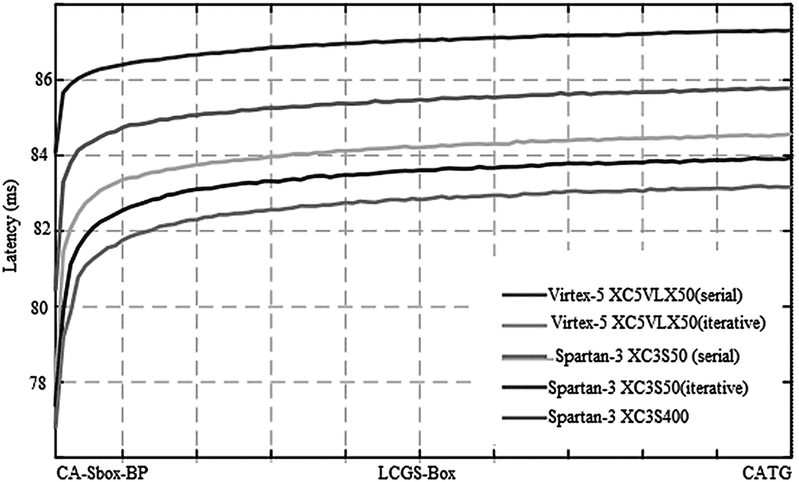

图 6.5 延迟对比。

### 非线性准

非线性准是 S-box 性能评估系统中的一个主要特征。非线性越高，S-box 防御非线性攻击的能力越强。非线性准公式如下：

`N_f = \min [d_H(f, l)]`

表 6.5 比较了现有基于混沌的仿变换生成方法 (`CATG`)、线性同余生成器 s-box (`LCGS-box`) 与提出的使用 S-box 伯努利过程的基于混沌的高级加密算法 (`CA-Sbox-BP`) 的非线性准。

表 6.5 非线性准分析 (%)

| FPGA 平台 || CATG | LCGS-box | CA-Sbox-BP |
| --- | --- | --- | --- |
| Spartan-3 XC3S400 || 70 || 68 || 65 |
| --- | --- | --- | --- |
| Spartan-3 XC3S50(iterative) || 72 || 70 || 68 |
| Spartan-3 XC3S50 (serial) || 75 || 72 || 70 |
| Virtex-5 XC5VLX50(iterative) || 76 || 75 || 71 |
| Virtex-5 XC5VLX50(serial) || 77 || 76 || 72 |

图 6.6 通过分析现有的 `CATG`、`LCGS-box` 以及提出的 `CA-Sbox-BP`，展示了各种 FPGA 平台之间的非线性准对比。结果发现现有方法如 `CATG` 和 `LCGS-box` 分别达到 `65%` 和 `67%`，而提出的方法 `CA-Sbox-BP` 实现了 `64%`，比 `CATG` 和 `LCGS-box` 分别提升了 `1%` 和 `3%`。相比之下，X 轴表示 s-boxes，Y 轴表示以百分比表示的非线性准。

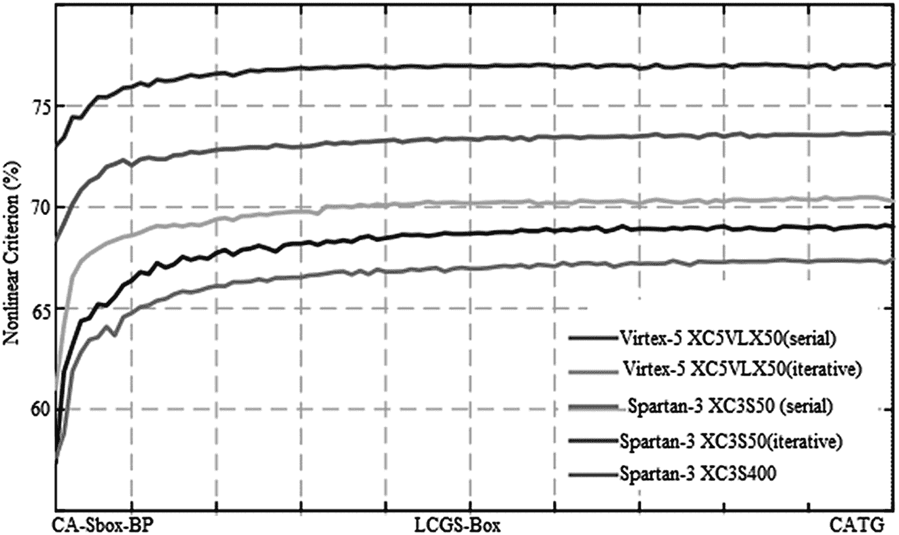

图 6.6 非线性准对比。

### 严格雪崩效应

SAC 相关矩阵可以衡量 S-box 的效果。如果每个 SAC 相关矩阵都接近 0.5，则 S-box 满足严格雪崩效应。

表 6.6 展示了现有基于混沌的仿变换生成方法 (`CATG`)、线性同余生成器 s-box (`LCGS-box`) 与提出的使用 S-box 伯努利过程的基于混沌的高级加密算法 (`CA-Sbox-BP`) 的严格雪崩效应对比。

表 6.6 严格雪崩效应分析

| FPGA 平台 || CATG | LCGS-box | CA-Sbox-BP |
| --- | --- | --- | --- |
| Spartan-3 XC3S400 || 50 || 48 || 45 |
| --- | --- | --- | --- |
| Spartan-3 XC3S50 (iterative) || 52 || 50 || 48 |
| Spartan-3 XC3S50 (serial) || 55 || 52 || 50 |
| Virtex-5 XC5VLX50 (iterative) || 56 || 55 || 51 |
| Virtex-5 XC5VLX50 (serial) || 57 || 56 || 52 |

图 6.7 通过分析现有的 `CATG`、`LCGS-box` 以及提出的 `CA-Sbox-BP`，比较了各种 FPGA 平台之间的严格雪崩效应。相比之下，X 轴显示各种 s-box，Y 轴给出百分比形式的严格雪崩效应。因此，现有方法如 `CATG` 和 `LCGS-box` 分别达到 `45%` 和 `43%`，而提出的方法 `CA-Sbox-BP` 实现了 `41%`，比 `CATG` 和 `LCGS-box` 分别提升了 `4%` 和 `2%`。表 6.7 展示了现有基于混沌的仿变换生成方法 (`CATG`)、线性同余生成器 s-box (`LCGS-box`) 与提出的使用 S-box 伯努利过程的基于混沌的高级加密算法 (`CA-Sbox-BP`) 的整体对比。

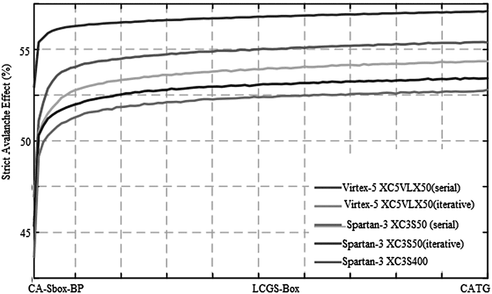

图 6.7 严格雪崩效应对比。

表 6.7 现有方法与提出方法的对比

| 参数 || CATG | LCGS-box | CA-Sbox-BP |
| --- | --- | --- | --- |
| 效率 (%) || 92 || 94 || 96 |
| --- | --- | --- | --- |
| 吞吐量 (kbps) || 93 || 95 | 98 |
| 延迟 (ms) || 81 || 79 | 75 |
| 非线性准 (%) || 65 || 67 | 64 |
| 严格雪崩效应 (%) || 45 || 43 | 41 |

## 6.6 总结

提出的 `CA-Sbox-BP` 在各项指标上均表现优异。结果显示，`CA-Sbox-BP` 优于现有的 `CATG` 和 `LCGS-box`。

## 参考文献

*   A. K. Ahmed, M. F., H. N., “One AES S-box to increase complexity and its cryptanalysis”, Journal of Systems Engineering and Electronics, vol. 18, no. 2, pp. 427–433, 2007.
*   A. Faz, D. Riy,,
*   I. Hussain, T.., M. A. Gondal and H. Mahmood, “Efficient method for designing chaotic S-boxes based generalized Baker’s map and TDER chaotic sequence”, Nonlinear Dynamics, vol. 74, no. 1, pp. 271–275, Oct. 2013.
*   J. Jing,, et.. “A............................
*   L. Kocarev, “Chaos-based cryptography: A brief overview”, *IEEE Circuits Syst. Mag.*., vol. 1, no. 3, pp. 6–21, Mar. 2001.
*   M. F. Khan, A. Ahmed, K. Saleem and T. Shah, “A novel design of cryptographic SP-network based on gold sequences and chaotic tent system”, IEEE Access, vol. 7, pp. 84980–84991, 2019.
*   R. Hosseinkhani, et., “Using cipher key to generate dynamic S-box in AES cipher”, International Journal of Computer Science and Security (IJCSS), vol. 6, pp. 19–28, 2012.
*   U. Hayat, N. A. Azam and M. Asif, “A method of generating $8\times8$ substitution boxes based on elliptic curves”, *Wireless Pers. Commun.*, vol. 101, no. 1, pp. 439–451.


*   Dragan Lambić, “基于整数乘法的新型离散空间混沌映射及其在 S-box 设计中的”, Nonlinear Dynamics, vol. 100, no. 1, pp. 699–711, 2020.
*   Q. Lu, C. Zhu and X. Deng, “基于 LSS 混沌映射和单 S-box 的高效图像加密方案”, IEEE Access, vol. 31, no. 8, pp. 25664–25678, 2020 年 1 月.
*   Q. Lu, C. Zhu and G. Wang, “基于新型复合混沌系统的新型 S-box 设计算法”, Entropy, vol. 21, no. 10, p. 1004, 2019 年 10 月.
*   S. Murugan, S. Jeyalaksshmi, B. Mahalakshmi, G. Suseendran, T. N. Jabeen and R. Manikandan, 在新兴 MANET 和 VANET 基础设施中基于能量消耗和负载平衡的 ACO 与 PSO 算法对比. Journal of Critical Reviews, vol. 7, no. 9), 2020. DOI: [10.31838/jcr.07.09.219](http://dx.doi.org/10.31838/jcr.07.09.219)
*   F. Özkaynak, “非线性动力学在图像加密中应用简述”, Nonlinear Dynamics, vol. 92, pp. 305–313, 2018.
*   R. Paul, S. Saha, J. K. M. S. U. Zaman, S. Das, A. Chakrabarti and R. Ghosh, 一种简单的 1 字节 1 时钟 RC4 硬件设计及其在 FPGA 协处理器中用于安全以太网的实现, Proc. National Workshop on Cryptology, VIT University & CRSI, Vellore, India, 2012 年 8 月 6–8 日.
*   P. Ping, J. Fan, Y. Mao, F. Xu and J. Gao, “一种基于数字级排序和块扩散的混沌图像加密方案”, IEEE Access, vol. 6, pp. 67581–67593, 2018.
*   R. Rahim, S. Murugan, S. Priya, S. Magesh, and R. Manikandan, “用于能量感知安全路由协议的泰勒型灰狼优化算法 (TGWOA)”, International Journal of Computer Networks And Applications, vol. 7, no. 4, p. 93, 2019.
*   G. Tang, X. Liao and Y. Chen, “基于混沌映射的 S-box 设计的新方法”, Chaos Solitons Fractals, vol. 23, no. 2, pp. 413–419, 2005 年 1 月.
*   E. Tanyildizi and F. Ozkaynak, “利用一维混沌映射参数优化的新型混沌 S-box 生成方法”, IEEE Access, vol. 7, pp. 117829–117838, 2019.
*   X. Wang, X. Zhu and Y. Zhang, “基于约瑟环遍历和混合混沌映射的图像加密算法”, IEEE Access, vol. 6, pp. 23733–23746, 2018.
*   L. Yi, X. Tong, Z. Wang, M. Zhang, H. Zhu and J. Liu, “基于混沌 S-box 的无线传感器网络新型块加密算法”, IEEE Access, vol. 7, pp. 53079–53090, 2019.
*   T. Zhang, P. Chen, L. Chen, X. Xu and B. Hu, “基于易经算子的高度非线性替换盒设计”, IEEE Transactions on Cybernetics, vol. 48, no. 12, pp. 3349–3358, 2018 年 12 月.
*   S. Zhu, C. Zhu and W. Wang, “基于混沌和压缩感知的新型压缩加密方案”, IEEE Access, vol. 6, pp. 67095–67107, 2018.
*   C. Zhun and K. Sun, “加密分析与改进”, IEEE Access, vol. 6, pp. 18759–18770, 2018.

## 7.1 攻击与防御措施

信息物理系统（CPS）已被确定为物联网（IIoT）的关键部分 [Gupta 等, 2020]。随着物理过程的协调，CPS 已变得日益流行 [Hamdan 等, 2021]。由于无线传感器网络（WSN）、下一代网络（NGN）等可用网络的固有特性和优势，CPS 面临着日益增长的安全挑战 [Chawla 等, 2021]。

信息安全根据 ISO/IEC 27001 定义 [Wang 等, 2011]，是指确保信息的机密性、完整可用性的过程。由于复杂的电物理相互作用，威胁和漏洞变得难以评估，并产生了新的安全挑战。此外，识别、追踪和检查源于针对多个 CPS 组件的威胁是挑战性的 [Islam 等, 2015]。在开发安全系统之前，对漏洞和威胁有深入了解至关重要 [Khaitan 和 McCalley, 2015]。

本章介绍了 CPS 安全、漏洞评估、威胁和缓解方案的现状。还探讨了与 CPS 相关的安全需求和问题，并对可能的解决方案和未来的研究机会进行了讨论。本章节的后续部分安排如下：在第 7.2 节中，将介绍 CPS 的现状和安全需求。在第 7.3 节中，我们将讨论 CPS 中不同类型的威胁和攻击。缓解威胁的不同控制机制将在第 7.4 节中讨论。在第 7.5 节中，我们概述了每个 CPS 应用领域的主要威胁、漏洞、攻击和控制方法。在第 7.6 节中将讨论 CPS 的开放性问题和安全挑战。本章将在第 7.7 节中通过对 CPS 安全研究结果的总结来完成。


物理世界通过信息物理系统（CPS）进行监控和控制。为了满足现实世界的约束，CPS 必须满足以下要求。

- **实时响应**：信息物理系统需要根据应用满足实时性约束。例如，在测量数据方面，如果过程是电性的，那么系统的响应时间应该优于水系统。然而，每个过程都有其的一的实时性能要求。任何由缺陷或漏洞（例如拒绝服务攻击）引起的信号传播延迟都可能导致灾难性的后果。
- **资源限制**：众周知，CPS 拥有大量资源受限的设备。例如，模拟数字转换器、传感器设备、远程运行的输入输出设备以及控制器，通常是为了执行特定功能而开发的，但它们在存储和计算能力方面具有局限性。主要目标是拥有极强稳健性、能够长时间运行并满足实时性能约束的设备。
- **可用性**：关闭一个工厂比重启一台服务器要困难得多。CPS 的可用性是一个至关重要的前提。这些系统的敏感性要求具有极高的可用性，例如关键生物过程中的温度调节器。由于运行时间长，对于 CPS 而言，更改硬件和软件尤为困难。主要目标是避免干预 CPS 的功能。

## 7.3 CPS 作为关键基础设施

最近，CPS 已取代了电力、交通、医疗保健和制造领域传统的工程化系统。这些 CPS 通常都是任务关键型系统：它们的可靠性和高效运行至关重要。本节探讨了作为关键基础设施的 CPS 分类：

1. **安全感知应用**：安全感知应用上的网络安全威胁通常会由于 rootkit、实现不当的代码和后门等安全漏洞导致 CPS 安全违规。
2. **任务关键型应用**：任务关键型系统是业务或组织运行和生存必需的系统。任务关键型系统的故障或中断会对公司开展业务的能力产生重大影响。
3. **业务关键型应用**：组织为了执行维持组织成功运行所需的常规业务操作而依赖的任何系统统称为业务关键型系统。换句话说，当业务的成功需要任务关键型系统时，它们被称为业务关键型系统。一旦任务关键系统受到攻击，企业可能会遭受财务损失、客户不满和生产力损失。
4. **安全关键型应用**：安全本质型系统必须正常运行，以防止人员伤亡、财产破坏和收入损失，以及环境退化和严重的系统性影响。当系统使用与危险相关时，被称为安全关键型（一种可能产生毁灭性影响的严重错误）。安全关键型系统设计用于确保受危害系统的安全运行，危害被定义为任何系统运行不当将不可避免地导致事故的状态或条件；例如，高速行驶的火车被认为具有危险性。

## 7.4 CPS 架构

CPS 可以由许多传感器和执行器组成，它们通过智能决策系统连接（Kumar and Patel, 2014），如图 7.1 所示。CPS 表现出跨域传感器协作、异构信息流和智能决策等特征。可以从不同的层次考虑 CPS 架构。CPS 最常用的架构分为 ISO/OSI 框架的七个主层（Johnson, 2020; Kocabas et al., 2016）。

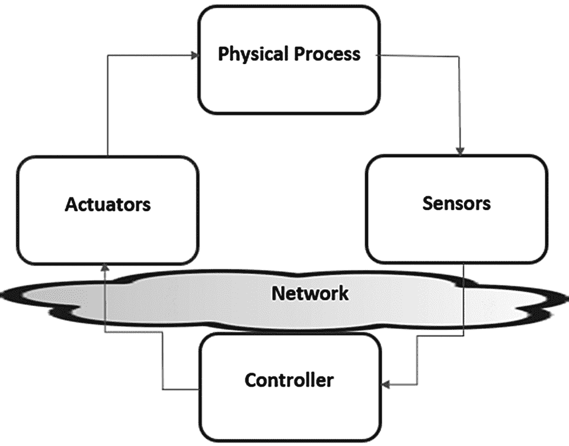

图 7.1 信息物理系统的架构。

1. **物理层**：嵌入式传感器、执行器、移动设备终端和基于 RFID 的标签读器构成了物理层（Ferdinando et al, 2006）。这些元素将物理世界连接到物理层。这些组件的首要工作是通过收集数据、声音、热量并执行预设指令来进行监控或追踪。一旦数据被收集并发送到应用程序，它们将经过检查和处理以进行决策。在这一层级修改或篡改这些数据可能会导致整个系统的灾难性后果。因此，需要安全的通信代码或加密机制来确保足够的隐私保护。该层的问题之一是控制器在解码后保留了密钥（Kumar and Patel, 2014）。需要的是一种被称为同态加密的加密类型，它允许在不先解密数据的情况下对加密数据进行计算。数据在应用程序内必须这种方式保持准确和安全（Johnson, 2010）。
2. **网络层**：网络层的主要任务是在应用程序和物理层之间传递和交换大量数据以及信号命令控制。下一代网络（如互联网、局域网、蓝牙和 Wi-Fi）管理网络层。当大量数据和转换超过该层的能力时，可能会出现问题。这会导致网络拥塞，使其容易受到拒绝服务（`DOS`）攻击、分布式拒绝服务（`DDOS`）攻击和黑洞攻击。数据丢失完整性攻击可以通过欺骗攻击导致（Ye et al., 2016）。
3. **应用层**：应用层是开发智能环境 CPS 主要组件。智能电网功能放置在智能环境中完成。该层的首要任务是接收和分析执行控制命令。从这里，所有命令被传输，并使用复杂的算法对收集的数据进行处理（Ferdinando et al, 2006）。该层的另一个任务是监控整个信息物理系统。应用层监控系统行为并改变物理设备行为以管理预设内容（Ferdinando et al, 2006）。存储系统也可以放置在此层之下，以控制任何修改 CPS 行为的事件。该层最关键的作用是保护数据隐私（Chun et al., 2010）。此处的任何隐私侵犯（如隐私数据泄露、恶意代码和结构化查询语言（`SQL`）注入攻击）将被识别为对整个系统的威胁。

## 7.5 信息物理系统安全挑战概述


在当今数字时代，网络安全担忧已成常态，新的网络事件层出不穷。事实上，网络攻击可能对大量人员产生直接影响（Heng, 2014）。最重要的是，一次针对零售店的网络安全攻击（Gries et al., 2017）损害了美国三分之一的人口。在该案例中，从目标供应商处窃取的凭据被用于利用该系统（Ferdinando, 2006）。这种损害目标及其客户的网络攻击类型只是网络攻击实施的多种方式中的一种说明。尽管如此，规模较小的泄露事件依然是高昂的，2012 年的损失达 540 万美元，而 2012 年美国数据被盗窃的平均成本为每个用户账户 188 美元（Chun et al., 2010）。正如公开数据所示，CPS（信息物理系统）泄露事件已显著增加。2013 年，典型的美国公司遭受了 16,856 次攻击（Rad et al., 2015）。2014 年，该行业报告的数据泄露和网络攻击较 2013 年增加了 23.9%，其中 761 次泄露暴露了 83,176,279 条记录（Haidegger et al., 2020）。这些网络攻击对个人和整个政府都是破坏性的。更重要的是，数据网络、计算机系统以及相关的分配通道是我们国家关键基础设施的关键组成部分。

CPS 的安全涉及安全和弹性策略的实施，以及它们在系统设计和实施中的应用。为了有效实施增强我们对各种相互依赖关系的了解、预测未来状况并辅助决策和政策制定的服务，必须结合系统论和博弈论的方法工具、适当的技术、预测分析、激励技术、社会学和认知科学（Siddappaji and Akhilesh, 2020）。在 CPS 已有效部署的许多领域（Lee et al., 2015）中，例如化学过程控制和建筑自动化，CPS 的价值已显著增长。由于这些成就，CPS 控制系统和网络正面临实时攻击（Chun et al., 2010）。例如，黑客可以利用控制系统的连接实施拒绝服务，这将导致响应延迟，并引发电网基础设施的严重系统性问题（Lee et al., 2015）。信号加密可能是在需要通过网络进行持续、可靠转换功能的情况下，提高安全性的有效方法。然而，仅使用加密可能在缓解内部人员泄露风险或由于算法效率低下导致的延迟（Lee et al., 2015）、以及随着交互设备数量增加导致的大规模系统过载（Rad et al., 2015）方面并不有效。

## 7.6 CPS 中的安全挑战

采取安全措施提供了许多优势，例如确保 CPS 组件、层级和应用领域的安全。无论这些优势如何，每当实施这些加密机制时，CPS 系统都会受到影响，具体如下：

1. **操作程序导致的延迟**：当实施任何类型的安全解决方案时，在启用安全机制之前会进行培训，在此期间服务不可用或处于原始状态，因此容易受到网络安全威胁。
2. **高计算能力需求**：计算能力有限且能量受限的 CPS 端设备面临着巨大问题，特别是在这种情况下。当功耗较高时，设备寿命会缩短，并且需要更高的运行成本来维持其工作。
3. **传输延迟**：在实时和关键系统中，如加密机制等加密协议会产生额外的传输开销，导致极高的计算延迟和数据包丢失。尽管这些安全机制为缓解 CPS 攻击提供了解决方案（如主动和被动窃听、中间人攻击以及其他攻击），但它们可能会扭曲从源端到目的地 CPS 设备的数据传输。尽管它提供了防御优势，但它非常不适用于实时关键保护系统。
4. **计算开销**：标准加密协议为数据传输增加了额外的开销成本。传统的安全机制（如非对称的公钥基础设施（`PKI`））为 CPS 网络增加了更多的计算成本。这些加密机制在密钥初始化阶段、培训、更新和运行阶段产生额外开销，当由于 CPS 网络中的恶意节点需要撤销证书时也是如此。
5. **性能下降**：当实施无处不在的传统的加密安全机制时，CPS 系统的性能可能会受到损害。对于实时以及时间/事件驱动型应用，这种下降可能会中断常规或事件驱动的运行，并可能需要人工干预以保持服务更新。
6. **互操作性问题**：CPS 系统中的主要问题之一是互操作性。技术、语法、语义和跨领域互操作性是欧洲电信标准协会（ETSI）和欧洲互操作性互操作性框架（EIF）为复杂系统建立的四层互操作性。由于 CPS 的复杂性，许多安全机制并不兼容，且无法在这些系统上实施。这可能是由于所使用的固件或操作系统造成的。CPS 中的安全挑战如图图 7.2 所示。


图 7.2 CPS 的安全挑战

## 7.7 CPS 中的安全威胁与漏洞

CPS 中的威胁分为不同的层级，如下：

### 1.1 物理层攻击

物理层攻击包括干扰 DoS 和节点捕获。

1. **干扰 DoS**：这是一种在物理层实施的`DoS`类型（Hu and Sharma 2005）。信号可以通过恶意设备通过相同频率传输受到干扰。这会在载波中产生噪声并降低信噪比，导致节点无法接收正确数据。干扰可以阻止节点通信。另一种防止传输的方法是随机间隔地实施干扰。
2. **节点捕获（篡改）**：这是攻击者物理获取传感节点的控制权，例如连接电缆并访问 WSN 中正在进行的传输（Butun et al., 2013）。这使得攻击者能够篡改存储在内存中的数据并控制节点。节点捕获是非常关键的，因为加密相关的密钥可能会暴露，导致对手控制整个 WSN。这里的问题是，这些受损的节点可能会发送虚假查询（可用性攻击）或向授权用户提供错误数据（完整性攻击）。表 7.1 概述了物理层安全威胁、攻击模式、攻击结果以及攻击防御措施。

表 7.1 信息物理系统中的物理层威胁概述

### 1.2 数据链路层攻击


数据链路由于数据链路算法，特别是介质访问（`MAC`）方案，而容易受到拒绝服务（DoS）攻击的影响。信道可能会持续受到 `MAC` DoS 攻击的干扰，这是为 DoS 攻击提供窗口的一个典型示例（Butun, Österberg, and Song 2020）。数据链路层可以执行以下攻击：

1. **冲突**：攻击者监控网络中授权节点发送数据包的时间，并同时从同一授权节点信道发送其自己的数据包，从而导致数据包冲突。由于数据包冲突会导致传输过程中的冲突损失（`循环冗余校验`），这使得接收端无法从发送端获取完整且有效的数据包（Borgohain, Kumar and Sanyal, 2015）。接收端由于数据包无用而将其丢弃，并向发送者发送请求重新发送数据包。攻击者偏于冲突攻击而非干扰攻击，因为传输的能量较低且被检测的可能性也较低（Znaidi, Minier and Babau, 2008）。

2. **睡眠剥夺**：冲突攻击或重复握手（请求发送和清除发送）可以防止节点睡眠。这会导致电池消耗其存储的能量。这种攻击的目的是强制节点耗尽电池中的所有能量（Butun et al., 2013）。

3. **不同步**：时间同步跳频（`TSCH`）作为一种 `MAC` 层协议，可以通过在分配给其他用户的调度时间内传输数据来受到攻击（Sajjad and Yousaf, 2014）。这会导致冲突和数据包丢失。当攻击者产生一系列此类事件时，相邻的节点就会失去同步。

4. **耗尽**：当受攻击的选节点由于不同步而耗尽电池能量时，这种攻击被称为耗尽攻击（Znaidi, Minier and Babau, 2008）。笔记本电脑或具有在类似传感器频段下发送无线信号能力的简单节点可用于实施这种攻击（Butun, Österberg and Song, 2019）。

5. **链路层泛洪**：在链路层泛洪中，受损节点的相邻节点会收到来自 `MAC` 的不必要数据包或控制包。这种攻击的目的是消耗电池电或执行 DoS。此外，链路层泛洪还会导致信道带宽资源的耗尽（Liu, Li, and Man, 2005）。

6. **链路层干扰**：这种攻击聚焦于干扰数据包等重要数据包。数据包的到达时间被获取并用于对抗数据包传输。`B-MAC`、`L-MAC` 和 `S-MAC` 等 `MAC` 协议容易受到链路层干扰（Znaidi, Minier and Babau, 2008）。

7. **欺骗/ARP 欺骗**：恶意节点模仿受害节点的 `MAC` 地址。随后恶意节点使用该 `MAC` 地址生成不同的合法身份并使用这些身份（Shabana, Khan, and Rehman, 2016）。8. **不公平性**：网络中的不公平性可以由恶意节点产生（Wood and Stankovic, 2002）。这会影响服务质量。


- **误导（Misdirection）**：通过伪造路由公告并在相邻节点的路由表中更新这些错误信息，故意将传输的消息重定向到错误的路径（Parno et al., 2005）。受攻击的节点在发布虚假路由信息后会被完全删除；因此它们无法再次接收数据包。
- **网络分区（Network partitioning）**：攻击者在全连接网络中实施分区，即使不同分区之间的节点在网络中仍连接在一起，也无法相互通信（Butun et al, 2020）。
- **环路（Routing loop）**：通过欺造路由更新在路由路径中形成路由环路。发送的消息将持续通过该相同路径路由。这种事件最终会导致能量耗尽并最终导致网络故障（Huang and Lee, 2003）。
- **伪造、修改或重放路由信息（Spoofed, altered, or replay routing information）**：对网络节点之间交换的路由信息进行修改。这会对路由方案产生有害影响（Butun et al, 2020）。
### 5. **女巫攻击（Sybil attack）**：在女巫攻击中，恶意节点在网络中呈现不同的身份。攻击者向合法节点发送冲突的路由路径，从而导致混乱。网络容错方案的有效性降低，对地理路由协议构成了显著威胁（Gupta et al, 2014）。网络层威胁、攻击模式、攻击结果及其防御措施的摘要见表 7.3。

表 7.3 赛博物理系统中网络层威胁摘要

| **OSI 层** | **传输层攻击**

 两个或多个节点之间的连接由传输层控制。建立这些节点之间连接的协议成为攻击目标（Raymond and Midkiff, 2008）。传输层的攻击包括：

1. **不同步（Desynchronization）**：通过使传输不同步来终止两个节点之间建立的原始链路。实现这种攻击的典型方法是不断向通信的两个节点发送带有错误标志的序列，导致它们失去同步（Wood, and Stankovic, 2002）。
2. **消息队列遥测传输（MQTT）漏洞**：MQTT 旨在实现资源受限设备之间的通信，并使用发布/订阅消息技术运行。然而，MQTT 设计并未包含安全层，因此用户承担解决安全问题的责任（Singh, Rajan, Shivraj and Balamuralidhar, 2015）。
3. **会话劫持（Session hijacking）**：这是利用和篡改真实会话以非法访问系统信息或服务的的过程。由于它是 IP 网络扩展，会话劫持对于物联网（IoT）网络将是一个一个大问题（Nikiforakis, Meert, Younan, Johns and Joosen, (2011)）。
4. **SYN 洪水（SYN-flooding）**：攻击者的目标是通过发送多个请求而不完成任何连接来耗尽节点内存。这将使缓冲区过载并导致节点崩溃（Wood, and Stankovic, 2002）。

### **应用层**

DOS 攻击用于攻击应用层。可以在融合、数据聚合、节点定位等协议上执行阻塞或规避。

1. **受限应用协议（CoAP）**：CoAP 被设计为资源受限设备的 HTTP 副本。CoAP 的安全性带来了许多挑战（Rahman and Shah, 2016）。
2. **虚假数据注入（False data injection）**：这种攻击由恶意节点在语义层面发生（Manandhar et al., 2014）。
3. **基于路径的 DoS（Path-based DoS）**：遵循遵循端到端通信路径（Deng et al., 2005）。
4. **重编程（Reprogramming）**：当网络被重新编程或打补丁时，攻击者可能会进入这段脆弱时期（Ghildiyal et al., 2014）。
5. **传感器淹没（Sensor overwhelming）**：通过发送虚假干扰并压制这些传感器，传感器的测量敏感性可能会受到攻击或改变。网络层威胁、攻击模式、攻击结果及其防御措施的摘要见表 7.5。

[表 7.4 赛博物理系统中传输层威胁摘要]

| **OSI 层** | **安全威胁** | **攻击模式** | **攻击结果** | **防御措施** |
| :--- | :--- | :--- | :--- | :--- |
| **传输层** | 不同步 | 破坏节点之间建立的通信 | 这是一个资源耗尽攻击 | 设备授权 |
| MQTT 漏洞 | 破坏通信 | 破坏节点之间的通信 | 可以使用会话密钥管理以及发放 SSL/TLS 证书或轻量级加密机制 |
| 会话劫持 | 伪造受害者 IP 地址 | DoS 攻击 | 软件更新、端点安全、为每个用户提供生物识别认证 |
| SYN 洪水 | 与受害者节点开启 TCP 连接 | DoS 攻击 | 部署 IPS 和网络设备等通用安全机制必须安装最新版本 |

表 7.5 赛博物理系统中应用层威胁摘要]

| **OSI 层** | **安全威胁** | **攻击模式** | **攻击结果** | **防御措施** |
| :--- | :--- | :--- | :--- | :--- |
| **应用层** | CoAP 漏洞 | DoS | 阻塞攻击、请求延迟攻击、响应延迟不匹配攻击、攻击攻击、请求分重组攻击 | 使用数据传输层安全 (DTLS)、TLS 或 OSCORE 提供额外的层保护 |
| 虚假数据注入 | 恶意节点 | 影响整体测量或读数 | 实现统计路由过滤 (SEF) |
| 基于路径的 DoS | 泛洪端到端通信路径 | 路径上的源到目的节点都会受到影响 | 认证和防重放保护 |


| 威胁 | 影响 | 缓解措施 |
| :--- | :--- | :--- |
| 重编程 | 向节点发送虚假消息；将其推入不稳定或死亡状态 | 身份验证和防重放保护。身份验证流 |
| 传感器过载 | 发送虚假干扰；CPS 设备处于不稳定状态 | 传感器调优、数据聚合 |

### ### 网络物理系统威胁

#### 1. 工业控制系统 (ICS)
* `ICS` 的无线潜力可能被犯罪攻击者利用，以控制 `ICS` 应用并可能中断其功能 (Humayed et al., 2017)。
* 具有技能的客户可能会从物理上更改设备或插入虚假信息来误导公用事业，从而减少客户的电费并给公司造成财务损失 (Turk, 2005)。
* 控制中心可能被攻击者误。物理威胁可能来自攻击者通过对传感器施冷或加热来伪造温度传感器 (Humayed et al., 2017)。
* 在战争期间，敌对国家可能通过注入恶意软件或获取访问并控制现场的这些设备，远程针对其敌国的关键基础设施，导致其关闭、损坏或利用其对环境产生污染 (Tsang, 2010)。

#### 2. 智能电网
* 公用事业公司的计费系统可能被客户通过篡改智能设备来减少电费而欺骗 (Mo et al., 2011)。
* 公用事业公司与智能表之间通信产生的消费者隐私信息可能被武装劫匪劫取，并用于实施他们的抢劫攻击 (Sridhar et al, 2011)。
* 敌对国家可以远程访问智能电网基础设施以导致一个国家停电 (McDaniel, and McLaughlin, 2009)。

#### 3. 医疗设备
* 犯罪分子可能通过简单的远程访问患者的医疗设备并注入虚假数据来伤害患者，目的是改变设备状态导致患者出现不良的健康状况。此外，设备信号可能被干扰以防止设备之间的通信，导致设备不稳定，从而无法为患者提供预期的治疗 (Halperin et al., 2008)。
* 攻击者可能通过拦截医疗设备与医院之间的通信或未经授权访问医院数据库来侵犯患者的隐私和机密性，目的是暴露患者疾病或更改患者数据，这可能导致错误的处方并最终导致死亡 (Le et al., 2011)。
* 在网络战中，敌对国家可以利用医疗设备的无线通信远程暗杀该国的政治人物，造成严重的健康状况或死亡。

#### 4. 智能汽车
* 攻击者可能通过 `TCU` 漏洞拦截汽车的私有通信，从而侵犯车主的隐私 (Checkoway et al., 2011)。利用无线接口的缺陷并攻击汽车的 `ECUs` 可能会导致智能汽车失去控制或碰撞。
* 用于引导驾驶者的 GPS 导航系统可能被执法部门用于跟踪车辆 (Brooks et al., 2008)。
* 汽车制造商可以在未经车主同意的情况下故意出售在 `ECU` 中收集的汽车日志数据。这导致了隐私入侵 (Hoppe et al., 2011)。
* 敌对国家可以通过针对该国的交通部门对国家发起网络攻击，导致道路上智能汽车之间的碰撞 (Checkoway et al., 2011)。

#### 5. 智能家居
智能家居由无线互连的传感器和执行器组成。对这些敏感设备的任何破坏或更改都可能导致网络出现重大风险。智能家居可以通过两种方式受到攻击：

* **价格网络攻击**
  通过更改电价计划来异常增加智能家居的功耗，从而增加智能家居的电压和电流来攻击智能家居 (Wurm et al, 2016)。
* **隐私入侵**：
  黑客可能拦截智能家居设备内部的通信导致隐私入侵。这些传感器和执行器可能会被注入虚假数据，目的是改变这些设备的状态，给智能家居居民带来不良后果，甚至导致死亡。
* **偷电**：
  可以操纵智能家居中的能量流，以减少攻击者房屋的负载并增加智能家居的负载，从而增加房屋的电费并减少攻击者的账单。这是因为特定社区的账单是根据智能家居的每次能量消耗计算的 (Qiu et al., 2017)。

### ### CPS 漏洞产生
`CPS` 漏洞的原因是：

1. **连接性增强**：由于制造商提供的服务增加，`CPS` 的连接性不断增加。这些服务依赖于基于无线连接和开放网络的技术。对 `ICS` 的攻击通常是内部的，但最近来自外部源（基于互联网） (Byres and Lowe, 2004)。此外，现场使用的大多数设备直接连接到互联网，以便对事件做出快速响应、进行简单的配置和管理，导致攻击增加 (Leverett and Wightman, 2013)。
2. **异构性**：用于设计 `CPS` 应用的专有组件、商用现货组件 (COTS) 和第三方组件在本质上是异构的。它们最可能是多供应商系统，每个系统都有安全漏洞 (Ericsson, 2010)。此外，所使用的集成异构组件是隐藏的，可能会导致不可预测的性能。它们为根本性的易感性铺平了道路 (Amin et al., 2013)。
3. **隔离假设**：`CPS` 的初步设计是“隐性安全”。主要思想是通过保护这些系统不受外部世界的影响来使 `CPS` 变得可靠和安全。传统的 `ICS` 和电网安全依赖于保护这些系统免受外部世界的影响来实现安全，从而进行本地操作 (Halperin et al., 2008)。目前开发的 `CPS` 应用在设计上不是基于隔离的，而是基于多连接构建的，这导致了攻击增加。

## 7.8 CPS 攻击的缓解方案和控制机制

### ### A. 加密解决方案


加密措施主要用于保护端到端通信通道免受主动和被动的 CPS 威胁及攻击，防止未经授权的访问和拦截，特别是在 SCADA 系统中（American Gas Association, 2005）。由于 CPS 系统的资源限制性，在这些系统中实现加密协议非常困难。因此，重点不应仅放在数据安全上，还应维护并保证整个系统过程的效率。在 Kocabas (2016) 中，作者对用于安全存储 CPS 数据的传统和新兴加密系统进行了独立调查。他们评估并描述了用于保护分布式能源资源（DER）系统的常用加密和身份验证机制（Kirkpatrick, 2009）。Ding et al. (2018) 对工业 CPS 安全控制和攻击检测的当前改进提供了概述，特别是针对伪装、重放和泛洪攻击。Sklavos 等人（2016）研究了 CPS 安全要求的实现效率。他们指出，实施用户身份验证可以保护单个 CPS 节点免受恶意活动的影响。开发了一种用于理解安全相关风险和威胁的新方法（Hahn et al., 2015）。该方法对 CPS 攻击因素进行了彻底检查，例如攻击者及其目标、网络利用、控制机制以及 CPS 的特定特征。Stouffer et al. (2007) 提供了一份完整的 ICS 安全指南，涉及操作控制，如无处不在的安全机制和传统的加密解决方案。在 Nicholson (2012) 中，使用社会工程和网络钓鱼技术进行了模拟攻击，安全专家利用钓鱼技术导致员工因网络安全习惯不差而获取了其数据。Sharma et al. (2018) 提出了一种用于多级安全评估的稳健安全框架。结果，他们对所提安全框架是否适用于资源受限的网络应用进行了全面评估。该安全框架为企业网络管理员在初始部署期间提供了建议，以满足适当的安全需求。因此，本章根据 NIST 网络安全要求对各种解决方案进行了分类，并在下文中进行了讨论。

**机密性**：保护 CPS 通信链路至关重要，因此提供了许多加密解决方案。Zhang 等人（2014）提出了一种使用压缩算法的加密技术。该算法是一种对称轻量级认证算法。同样，Bogdanov et al. (2007) 提出了一种轻量级加密机制以及一种适用于无处计算应用的极低延迟块密码。使用块加密是因为其低成本、低延迟，并且能够为通信和计算能力低的 CPS 设备提供加密块。Shahzad et al. (2015) 为 Modbus 通信网络提出了一种端到端安全框架。该系统的开发是为了防止流量分析和窃听等机密性威胁。这导致了明文转换过程中产生的额外开销。在工业应用中，美国天然气协会（AGA）提出了一种`bump-in-the-wire` 方法；但所提出的解决方案延迟非常高。Vegh 等人（2016）基于 `ElGamal` 为 CPS 网络提出了一种安全框架。Zhou et al. (2020) 为事件驱动的 CPS 提出了一种密钥管理方案，包括车载自构网络（Luallen, 2012）。作者声称所提出的 `datagram transport security` 是安全且可靠的。He et al. (2018) 为 CPS 应用引入了一种基于属性的加密方案。他们的结果显示所提系统是轻量级的。Zhao 等人（2018）为 CPS 提出了一种基于区块链的架构，提供了数据机密性。Sepúlveda 等人（2019#ch7.xhtml#ref7_83）利用 `DTLS` 通过分层加密提供安全需求。

**完整性**：保持 CPS 设备良好运行需要防止来自源、中继和目的地的实时包受到逻辑或物理破坏。因此，提供了多种解决方案。Harshe et. (2015 为 CPS 网络提出了一种 `TAIGA` 框架。`TAIGA` 确保了控制工厂中的工业和监控节点是安全的。低功耗设备安全展示了一种 `SSU`，作为 SIEM 系统的额外安全。Ghaleb 等. (2018 为传输包提出了一种加密级别，以防止中间人、重放和命令修改攻击。Cao 等. (2013 开发了一种使用 `hash` 系统和分层层次安全策略保护敏感数据的策略。

**可用性**：保持 CPS 设备运行至关重要。因此，文献中提出了许多减少和解决可用性问题的策略。Amin 等人 (2011 为完整性测试提出了一种过程控制系统。他们的仿真结果显示系统对完整性和 DoS 攻击具有鲁棒性，但计算开销较大。Cárdenas 等. (2011 优先考虑加密方案以提供分层安全。他们证明了自己的系统能够克服 DoS 攻击。Gao 等人（2018）为 SCADA 网络解决方案开发了一种测试方案。该方案是为 CPS 框架下的网络仿真和控制器之间的过程控制交互开发的。Alves 等. (2018 提出了一种基于机器学习的 IPS 架构，使用开源可编程逻辑控制器来防止恶意用户的活动。所提出的框架能够防御系统受 DoS、伪装、虫洞和流量分析攻击。

### B. 非加密解决方案


针对 CPS（信息物理系统）网络，已经提出了几种基于非加密方法的通用安全机制。大多数此类安全机制部署了入侵检测系统（`IDS`）、防火墙和蜜罐技术。因此，本文简要讨论了文献中提出的几种策略。

### 入侵检测系统

CPS 网络中 `IDS` 的实现归功于可用的各种网络配置。在检测、设置、定价和网络位置方面，每种 `IDS` 方法都有其自身的优缺点。根据 `Almohri et al. (2013)` 的观点，部署了多种网络安全策略来缓解针对 CPS 网络的威胁。`Shu et al. (2015)` (#ch7.xhtml#ref7_3) 指出，`Xu et al. (2016)` (#ch7.xhtml#ref7_99) 清楚地表明可以识别异常。他们利用时空数据来检测特定威胁，例如无人机（`UAVs`）(`Mitchell and 2013`) 和智能电网(`Urbina, 2016`)。`Zimmer et al. (2010)` 使用静态分析来识别特定类型的攻击。另一种策略是 `2014` 年提出的用于检测代码注入的行为基型 `IPS`。

### 入侵检测方案

检测方法论分为基于签名、基于异常、基于行为和基于混合的四类。`Zarpel et al. (2017)` (#ch7.xhtml#ref7_103) 为现实中的 `IDS` 提供了这些方法论。

1. **基于异常的检测**：这种类型在系统偏离典型行为时会触发警报。然而，这种方法的误报率较高。`Hong et al. (2009)` 使用基于签名的检测来评估所提议方案的健壮性。`Gupta et al. (2013)` (#ch7.xhtml#ref7_33) 提出了一种基于计算智能的 `IDS` 架构。`Lee et al. (2014)` 为每个 IP 地址建立了行为特征。系统对 `IDS` 的能耗进行监控；如果节点行为不符合预期，系统将其标记为异常并从网络中移除。`Summerville et al. (2015)` (#ch7.xhtml#ref7_90) 使用签名匹配策略来识别 CPS 中的异常。`Thanigaivelan et al. (2016)` (#ch7.xhtml#ref7_91) 成功设计了一种内部异常检测系统，用于检查包大小和数据速率。此外，`Pongle and Chavan (2015)` (#ch7.xhtml#ref7_75) 了一种用于识别 IoT 设备中虫洞攻击的 `IDS` 框架。该方案能够识别并移除恶意节点。`Demertzis et al. (2017)` (#ch7.xhtml#ref7_24) 提出了一种基于神经网络的 `IDS` 机制，利用时间数据来表征网络活动。该方法识别了与 APT 攻击相关的行为异常。根据作者的观点，`SOCCADF` 非常适用于涉及大量数据的复杂问题。他们得出结论认为，`SOCCADF` 以更低的计算开销、效率和可靠性优于其他技术。

* **基于签名的检测**：这种 `IDS` 策略是部署最简单的 `IDS` 方法形式之一。然而，它仅适用于识别已知威胁。基于签名的 `IDS` 容易受到未知威胁的侵害。由于补丁未知，签名需要频繁更新，这使得新旧攻击的检测变得非常困难（`Liao et al., 2013` (#ch7.xhtml#ref7_63)；`Vacca, 2012` (#ch7.xhtml#ref7_95)）。`Oh et al. (2014)` 比较了传输数据的载荷与攻击签名，旨在降低计算成本。`Liu et al. (2011)` 提出了一种人工免疫系统（AIS）策略，通过开发的免疫细胞通过签名匹配来区分和分类恶意与非恶意实体。`Kasinathan et al. (2013)` (#ch7.xhtml#ref7_53) 关注资源受限 CPS 网络中的 DoS 攻击检测。他们通过采用 `Suricata4` 开发了用于 6LoWPAN 网络的基于签名的 `IDA`。此旨在降低网络中的误报率。


### 2. 基于行为（Behavior-based）
“基于行为”一词是指用于指定工作站和服务器等网络元素预期操作的策略和边界。一旦网络行为发生偏差，即可检测到入侵。这种方法极大依赖于数据的结构化和时空建模。基于行为的检测与基于异常的检测类似，不同之处基于规范的系统需要人类专家显式设计每条规范规则。因此，其误报率低于基于异常的检测（Mitchell and Ing-Ray, 2014；Butun 等人，2013）。结果是，这种方法不需要训练，因为它们安装后即可直接使用。然而，这种方法并不适用于所有情况，并且可能会有很大的延迟。由于互操作性问题，大多数 CPS（物理信息系统）框架部署了中间件架构，这些架构必须像 Misra 等人 (2011) 提出的那样免受 DoS 攻击的保护。作者开发了一种使用阈值机制的安全系统，以便系统在传输请求超过指定阈值时进行检测。Le 等人 (2011) 提出了一种新的基于规范的技术，旨在通过网络监控操作和恶意行为检测指定 RPL 行为来检测 RPL 攻击。根据 Zarpelão 等人 (2017)，他们的实验结果在整个过程中具有较高的真阳率和较低的误报率，但与正常的 RPL 网络相比，也导致了巨大的能量成本。Amaral 等人 (2014) 开发了一种基于规范的 IDS（入侵检测系统），允许网络管理员创建和维护规则以识别任何潜在攻击。当规则被违背时，IDS 会立即向事件管理系统（EMS）发送警报，EMS 会关联网络中所有可用节点的告警。网络管理员的专业知识以及其经验和能力的结合，对于 Misra 等人 (2011) 和 Amaral 等人 (2014) 的成功至关重要。因此，任何错误的规范都会导致极高的误报率和/或高漏报率，对网络安全构成潜在的主要风险。

### 3. 混合 IDS（Hybrid IDS）
它基于使用基于签名和基于异常的检测方法（这些方法是基于规范的），以便最大化利用其优势的同时限制其缺点。Raza 等人 (2013) 引入了 SVELTE，这是一种混合 IDS，它在基于签名方法的存储成本和基于异常方法的计算成本之间取得了正确的平衡。Krimmling 等人 (2014) 使用他们引入的 IDS 评估框架测试了他们的基于异常和基于签名的 IDS。他们的发现表明，每种策略都无法独立检测特定威胁。因此，作者合并了各种方法以涵盖并识别更广泛的攻击。Cervantes 等人 (2015) 发表了《针对物联网 6LoWPAN 的黑洞攻击入侵检测 (INTI)》，该方法结合了基于异常的技术与这些节点之间的数据包交换来检测并隔离黑洞攻击。这是通过利用基于规范的方法，根据信任和声誉提取评估节点来实现的。Cervantes 等人构建了一种情境，在将 SVELTE 9 (Pongle and Gurunath, 2015) 与 INTI IDS 比较时，INTI IDS 检测黑洞的速率高达 92%。在特定情况下该速率仅为 75%。无论如何，与 SVELTE 相比，它的误报率和漏报率较低。

## 7.9 挑战与待解决问题
CPS 具有开发新市场和提供社会问题解决方案巨大潜力，但它们对质量、安全、防护和隐私提出了严格要求。为了成功应对外部和内部变化，需要进行基础科学研究以达到可预测的验证程度和测量质量。根据上述对最新 CPS 安全研究的分析，未来的研究方向包括以下任务：

1. 检查由于网络和物理威胁快速发展产生的主要 CPS 问题，这需要开发一种可靠且容错的架构，以确保高水平的安全成本效益。
2. 大多数现有研究没有考虑系统模型参数中的过程噪声和不确定性。它们还假设受攻击系统的状态轨迹是完全指定的并且可以精确测量。以往研究中的这些假设需要重新审视。一个值得追求的问题如何在更真实的假设下对攻击。调查攻击者的意图和行为对于创建有效的防御策略至关重要。了解各种类型的攻击如何影响系统性能可以为攻击检测和弹性控制提供理论指导。
3. 随着 CPS 安全方法的增长，需要一个测试平台来评估开发的想法、方法和策略。测试平台应该提供一个真实实时的环境来开展攻防实验。通常，CPS 安全是一门困难的学科，需要来自混合系统、离散事件系统、网络控制系统和大数据分析等多个领域的技术。
4. 由于缺乏保护 CPS 系统免受非用户的多因素认证程序，上述许多认证策略并不适用于安全设备。
5. 尽管有许多基于异常、基于行为和基于签名的 IDS 类型，它们通常用于物联网 领域，并非专门为 CPS 设计的。

## 7.10 结论
本章总结了 CPS 安全威胁的现状以及应对日益增长风险的当代方法。由于物联网、智能家居/汽车/能源等技术的快速采用以及网络与物理世界的深度融合，这个问题将变得日益重要。对 CPS 威胁进行了简要评估，并提出了 CPS 安全需求。还有用于缓解这些攻击的类型分类。最后，我们希望本文对工业界和学术界都有帮助。

## 参考文献
* Aazam, M., S. Zeadally, and K. Harras “Deploying Fog Computing in Industrial Internet of Things and Industry 4.0.” IEEE Transactions on Industrial Informatics 14, (2018): 4674–4682.
* Amaral, João P., Luís M. Oliveira, Joel J.P.C. Rodrigues, Guangjie Han, and Lei Shu “Policy and network-based intrusion detection system for IPv6-enabled wireless sensor networks.” In *2014 IEEE International Conference on Communications (ICC)*, pp. 1796–1801. IEEE, 2014.
* Almohri, Hussain MJ, Danfeng Yao, and Dennis Kafura “Process authentication for high system assurance.” IEEE Transactions on Dependable and Secure Computing 11, no. 2 (2013): 168–180.


-   Alves, Thiago, Rishabh Das, and Thomas Morris. “在可编程逻辑控制器上实现嵌入加密与机器学习入侵防御系统。” IEEE Embedded Systems Letters 10, no. 3 (2018): 99–102.
-   美国气体协会. *SCADA 通信的加密保护第 1 部分：背景、策略与测试计划*. No. 12 Part 1. AGA Report, 2005.
-   Amin, Saurabh, Galina A. Schwartz, and Alefiya Hussain “探索网络物理系统安全风险的基准。” IEEE Network 27, no. 1 (2013): 19–24.
-   Amin, Saurabh, Galina A. Schwartz, and S. Shankar Sastry “论网络控制系统中可靠性与安全性之间的相互依赖性。” 见于 *2011 年第 50 届 IEEE 决策与控制会议及欧洲控制会议*, pp. 4078–4083. IEEE, 2011.
-   Ashibani, Y. and Mahmoud, Q. 网络物理系统安全：分析、挑战与解决方案。Computer Security 68 (2017): 81–97. [`www.sciencedirect.com/science/article/pii/S0167404817300809`](https://www.sciencedirect.com).
-   Bogdanov, Andrey, Lars R. Knudsen, Gregor Leander, Christof Paar, Axel Poschmann, and Matthew J.B. Robshaw, Yannick Seurin, and Charlotte Vikkelsoe. “PRESENT：一种超轻量级分组密码。” 见于 *加密硬件与嵌入式系统国际会议*, pp. 450–466. Springer, Berlin, Heidelberg, 2007.
-   Borgohain, Tuhin, Uday Kumar, and Sugata Sanyal “物联网安全与隐私问题调查。” *arXiv preprint arXiv:1501.02211* (2015).
-   Brar, Suman and Mohit Angurala “灰洞攻击检测与防御综述。” International Journal of Advance research, Ideas and Innovations in Technology 2, no. 5 (2016): 1–4.
-   Brooks R.R., S. Sander, J. Deng, and J. Taiber “汽车系统安全：挑战与现状。” 见于 *第 4 届网络安全与情报研究年度研讨会论文：应对未来网络安全与情报挑战的策略*, pp. 1–3. 2008.
-   Butun, Ismail, Patrik Österberg, and Houbing Song “物联网安全：漏洞、攻击与应对措施。” IEEE Communications Surveys & Tutorials 22, no. 1 (2019): 616–644.
-   Butun, Ismail “无线传感器网络入侵的预防与检测”, 2013.
-   Butun, Ismail, Salvatore D. Morgera, and Ravi Sankar “无线传感器网络入侵检测系统综述。” IEEE Communications Surveys & Tutorials 16, no. 1 (2013): 266–282.
-   Byres, Eric and Justin Lowe “工业控制系统安全的迷言与事实。”
-   Cao, Huayang, Peidong Zhu, Xicheng Lu, and Andrei Gurtov “网络关键基础设施的分层加密机制。” IEEE Network 27, no. 1 (2013): 12–18.
-   Cárdenas, Alvaro., Saurabh Amin, Zong-Syun Lin, Yu-Lun Huang, and Shankar Sastry “针对过程控制系统的攻击：风险评估、检测与响应。” 见于 *神经网络工程应用国际会议*, pp. 122–134.
-   Cervantes, Christian, Diego Poplade, Michele Nogueira, and Aldri Santos “支持物联网 6LoWPAN 安全路由的汇洞攻击检测。” 见于 *2015 年 IFIP/IEEE 网络管理国际会议*, pp. 606–611.
-   Chawla, Astha, Animesh Singh, Prakhar Agrawal, Bijaya Ketan Panigahi, Bhavesh R.Bhalja, and Kolin Paul “基于同步相量的广域防护拒绝服务攻击框架。” IEEE Systems Journal 16 (2021): 1570–1581.
-   Checkoway, Stephen, Damon McCoy, Brian Kantor, Danny Anderson, Hovav Shacham, Stefan Savage, Karl Koscher, Alexei Czeskis, Franziska Roesner, and Tadayoshi Kohno “汽车攻击面的综合实验分析。” USENIX Security, vol. 4 (2011): 447–462.
-   Chun, Ingeol, Jeongmin Park, Wontae Kim, Woochun Kang, Haeyoung Lee, and Seungmin Park “用于物理系统的自治计算技术。” 见于 *2010 年第 12 届先进通信国际会议 (ICACT)*, vol. 2, pp. 1009–1014. IEEE, 2010.
-   Conti, Mauro., Roberto Di Pietro, and Angelo Spognardi “克隆战争：移动传感器网络克隆攻击的分布式检测。” Journal of Computer and System Sciences 80, no. 3 (2014): 654–669.
-   Demertzis, Konstantinos., Lazaros Iliadis, and Stefanos Spartalis “工业控制系统安全的脉冲单类异常检测框架。” 见于 *神经网络工程应用国际会议*, pp. 122–134. Springer, Cham, 2017.
-   Deng, J., Han, R., and Mishra, S. “防御无线传感器网络中基于路径的 DoS 攻击，” 见于 *第 3 届 ACM 节点与传感器安全研讨会*, pp. 89–96. ACM, 2005.
-   Ding, Derui, Qing-Long Han, Yang Xiang, Xiaohua Ge, and Xian-Ming Zhang “工业物理系统安全控制与攻击检测综述。” Neurocomputing 275 (2018): 1674–1683.
-   Ericsson, Göran N. “网络安全与电力系统通信——智能电网基础设施的基础部分。” IEEE Transactions on Power Delivery 25, no. 3 (2010): 1501–1507.
-   Di Antonio, Ferdinando, Paul Ezhilchelvan, Michael Dales, and Jon Crowcroft “一种用于可靠广播任意大小消息的 QoS 协商中间件系统。” 见于 *第 9 届 IEEE 面向对象和组件的实时分布式计算 (ISORC’06)*, p. 8. IEEE, 2006.
-   Gao, Haihui, Yong Peng, Kebin Jia, Zhonghua Dai, and Ting Wang “基于仿真、物理和模拟的 ICS 测试平台设计 (eps-ics testbed)。” 见于 *2013 年第 9 届智能信息隐藏与多媒体信号处理国际会议*, pp. 420–423. IEEE, 2013.
-   Ghaleb, Asem, Sami Zhioua, and Ahmad Almulhem “论 PLC 网络安全。” International Journal of Critical Infrastructure Protection 22 (2018): 62–69.
-   Ghildiyal, Sunil, Amit Kumar Mishra, Ashish Gupta, and Neha Garg “无线传感器网络拒绝服务（DoS）攻击分析。” IJRET: International Journal of Research in Engineering and Technology 3 (2014), ISSN 2319-1163.
-   Gries, Stefan, Marc Hesenius, and Volker Gruhn “级联数据损坏：网络物理系统中的依赖关系：海报。” 见于 *第 11 届 ACM 分布式与事件系统国际会议*, pp. 345–346. 2017.


- Gupta, Astha, Ramanuj Maurya, R.K. Roy, Samir V. Sawant, and Hemant Kumar Yadav “基于 AFLP 的海棠遗传关系与种群结构分析。”Scientia Horticulturae 154 (2013): 1–7.
- Gupta Hari, Prabhat, S. V. Rao, Amit Kumar Yadav, and Tanima Dutta. “障碍物聚类无线传感器网络中的地理路由。”IEEE sensors Journal 15, no. 5 (2014): 2984–2992.
- Gupta, R., S. Tanwar, F. Al-Turjman, P. Italiya, A. Nauman, and S. Kim “赛博物理系统中基于 AI 的智能合约隐私保护：工具、技术与挑战。”IEEE Access 8 (2020): 24746–24772.
- Hadley, M. D., K. A. Huston, and T. W. Edgar “AGA-12，第 2 部分性能测试结果。”太平洋西北国家实验室 (2007)。
- Hahn, Adam, Roshan K. Thomas, Ivan Lozano, and Alvaro Cardenas “赛博物理系统的多层及杀链链的安全分析框架。”International Journal of Critical Infrastructure Protection 11 (2015): 39–50.
- Halperin, Daniel., Thomas S. Heydt-Benjamin, Kevin Fu, Tadayoshi Kohno, and William H. Maisel. “植入式医疗设备的安全性与隐私。”IEEE Pervasive Computing 7, no. 1 (2008): 30–39.
- Hamdan, M., M. Mahmoud, and U. Baroudi “存在同时混合随机攻击的离散时间赛博物理系统事件触发控制方案。”ISA Transactions 122 (2021): 1–12. [`www.sciencedirect.com/science/article/pii/S001905782100224X`](https://www.sciencedirect.com)
- Harshe, Omkar A., N. Teja Chiluvuri, Cameron D. Patterson, and William T. Baumann “工业控制系统安全框架的设计与实现。”2015 年工业仪表与控制国际会议 (ICIC), 码 127–132 页。IEEE, 2015.
- He, Qian, Ning Zhang, Yongzhuang Wei, and Yan Zhang “用于移动云辅助赛博物理系统的轻量级属性加密方案。”Computer Networks 140 (2018): 163–173.
- Heng, Stefan “工业 4.0：等待开发的巨大价值创造潜力。”德意志银行研究 (2014): 8–10.
- Hoppe, T., S. Kiltz, and J. Dittmann “汽车网络安全威胁——实际案例与选定的短期。”第 27 届安全、可靠性与安全国际会议 (SAFECOMP '08), 码 235–248 页。Springer-Verlag, Heidelberg, 2011.
- Howladar, P., P. Roy, and H. Rahaman “MEDA 生物芯片：赛博物理攻击的检测、预防与纠正技术。”IEEE/ACM Transactions on Computational Biology and Bioinformatics 19 (2021): 2345–2355.
- Hu, Fei, and Neeraj Sharma “自组织网络的安全考量。”Ad Hoc Networks 3, no. 1 (2005): 69–89.
- Hu Y.-C., Adrian Perrig, and David. Johnson “数据绳圈：无线网络中对抗虫洞攻击的防御。”在 IEEE INFOCOM 2003. IEEE 计算机与通信学会第二十二届年度会议 (IEEE 目录号 033728), 第 3 卷, 码 1976–1986。IEEE, 2003.
- Huang, Y. A., and W. Lee “自组织网络的协作检测系统。”在自组织网络安全学术会议上，码 135–147 页。
- Humayed, Abdulmalik, Jingqiang Lin, and Bo Luo “物联网安全综述。”Internet of Things Journal 4, no. 6 (2017): 1802–1831.
- Islam, S., D. Kwak, M. Hossain “物联网安全综述。”IEEE Access 3 (2015): 678–708.
- Johnson, Robert E. “SCADA 安全研究。”2010 年物联网技术国际会议，码 1–5 页。
- Juma, M., and K. Shaalan “智能城市中的群智能应用。”[`www.sciencedirect.com/science/article/pii/B97801281000`](https://www.sciencedirect.com)
- Karlo, C., and D. Wagner “无线传感器网络中的安全路由。”Ad Hoc Networks 1, no. 2 (2003): 293–315.
- Kasinathan, Prabhakaran, Claudio Pastrone, and Maurizio Spirito “用于 6LoWPAN 的 RPL 拓扑攻击防护 IDS。”第 5 届物联网国际会议，码 30–36 页。
- Kaur, Rupinder, and Parminder Singh “黑洞与灰洞攻击综述。”International Journal of Multimedia & Its Applications 6 (2014).
- Khaitan, S., and J. McCalley “赛博物理系统的设计技术与应用。”IEEE Systems Journal 9 (2015): 350–365.
- Kibirige, George W., and Camilius Sanga “无线网络汇洞攻击检测综述。”arXiv:1505.01941 (2015)。
- Kocabas, Ovunc, Tolga Soyata, and Mehmet K. Aktas “医疗赛博物理系统的新兴安全机制。”IEEE/ACM Transactions on Computational Biology and Bioinformatics 13, no. 3 (2016): 401–416.
- Krimmling, Jana, and Steffen Peter “智能城市中 CoAP 的集成与评估。”2014 年 IEEE 通信与网络会议，码 73–78 页。IEEE, 2014.
- [Kumar, J. Sathish, and Dhiren R. Patel “物联网综述：安全与隐私问题。”International Journal of Computer Applications 90, no. 11 (2014). DOI:[10.5120/15764-4454](http://dx.doi.org/10.5120/15764-4454)


-   Liu, Y., Li, Y., and Man, H. “自组织网络中的 MAC 层异常检测。”收于 *Information Assurance Workshop, 2005. IAW’05. Proceedings from the Sixth Annual IEEE SMC*, pp. 402–409. IEEE, 2005.
-   Luallen, Matthew E. “SANS SCADA 与过程控制安全调查。” *A SANS Whitepaper, February* (2013)。
-   Manandhar, Kebina, Xiaojun Cao, Fei Hu, and Yao Liu. “利用卡尔曼滤波检测智能电网中包括虚假数据攻击的故障和攻击。”IEEE Transactions on Control of Network Systems 1, no. 4 (2014): 370–379.
-   Patrick, McDaniel, and Stephen McLaughlin “智能电网中的安全与隐私挑战。”IEEE Security & Privacy 7, no. 3 (2009): 75–77.
-   Misra, Sudip, P. Venkata Krishna, Harshit Agarwal, Antriksh Saxena, and Mohammad S. Obaidat “一种基于学习机的防止物联网分布式拒绝攻击的解决方案。”收于 *2011 International Conference on Internet of Things and 4th International Conference on Cyber, Physical and Social Computing*, pp. 114–122. IEEE, 2011.
-   Mitchell, Robert, and Ing-Ray Chen. “信息物理物理系统入侵检测技术综述。”ACM Computing Surveys (CSUR) 46, no. 4 (2014): 1–29.
-   Mitchell, Robert, and Ray Chen. “基于行为规则规范的恶意无人机自适应入侵检测。”IEEE Transactions on Systems, Man, and Cybernetics: Systems 44, no. 5 (2013): 593–604.
-   Yilin, Mo, Tiffany Hyun-Jin Kim, Kenneth Brancik, Dona Dickinson, Heejo Lee, Adrian Perrig, and Bruno Sinopoli. “智能电网基础设施的电物理安全。”Proceedings of the IEEE 100, no. 1 (2011): 195–209.
-   Nicholson, Andrew, Stuart Webber, Shaun Dyer, Tanuja Patel, and Helge Janicke. “网络战视角下的 SCADA 安全。”Computers & Security 31, no. 4 (2012): 418–436.
-   Nikiforakis, Nick, Wannes Meert, Yves Younan, Martin Johns, and Wouter Joosen. “SessionShield: 防止会话劫持的轻量级保护。”收于 *International Symposium on Engineering Secure Software and Systems*, pp. 87–100. Springer, Berlin, Heidelberg, 2011.
-   Bryan, Parno, Adrian Perrig, and Virgil Gligor “传感器网络中节点复制的分布式检测。”收于 *2005 IEEE Symposium on Security and Privacy (S&P)*, pp. 49–63. 2005.
-   Pongle, Pavan, and Gurunath Chavan “物联网中的实时入侵与虫洞检测。”International Journal of Computer Applications 121, no. 9 (2015): 1–9.
-   Qiu, Tie, Kaiyu Zheng, Houbing Song, and Burak Kantarci “一种智能电网的带自恢复功能的局部优化应急调度。”IEEE Transactions on Industrial Informatics 13, no. 6 (2017): 3195–3205.
-   Rad, Ciprian-Radu, Olimpiu Hancu, Ioana-Alexandra Takacs, and Gheorghe Olteanu “土豆作物智能监控：田间的电物理系统架构。”Agriculture and Science Procedia 6 (2015): 73–79.
-   Rahman, R. A. and Shah, B. “物联网协议安全分析：侧重 CoAP，”收于 *Big Data and Smart City (ICBDSC), 2016 3rd MEC International Conference*, pp. 1–7.
-   Raymond, David., and Scott F. Midkiff. “无线传感器网络中的拒绝服务：攻击与防御。”IEEE Pervasive Computing 7, no. 1 (2008): 74–81.
-   Raza, Shahid, Linus Wallgren, and Thiemo Voigt. “SVELTE: 物联网中的实时入侵检测。”Ad Hoc Networks 11, no. 8 (2013): 2661–2674.
-   Rubio-Hernán, José, Luca Cicco, and Joaquin Garcia-Alfaro. “重新审视基于水印的检测以处理电物理攻击。”收于 *2016 11th International Conference on Cyber Security*.
-   Sajjad, Syed Muhammad, Nigar Fida, and Musfiq Rahman](#ch7.xhtml#R_ref7_82) “物联网背景下 802.15.4 的安全分析。”收于 *2014 Information Assurance and Cyber (CIACS)*, pp. 9–14.
-   Sepúlveda, Johanna, Shiyang Liu, and Jose M. Bermudo](#ch7.xhtml#R_ref7_83) “后量子加密电物理系统。”Embedded Systems 11, no. 4 (2019): 106–110.
-   Sharma, Mridula, Fayez Gebali, Haytham Elmiligi, and Jae-Young Cho](#ch7.xhtml#R_ref7_85). “针对 MODBUS 传输的加密安全设计。”International Journal of Advanced Research in Computer Science and Electronics (IJARC) 5, no. 7 (2016): 81–87.
-   网络安全评估。收于 *2018 IEEE 9th Annual Information Technology, Electronics and Mobile Communication (IEMCON)*, pp. 1145–1151. IEEE, 2018.
-   Sklavos, Nicolas, and Ioannis D. Zaharakis “通过加密和复杂事件处理实现电物理系统的安全高效通信。”收于 *2016 8th IFIP International Conference on New Technologies, Mobility and Security (NTMS)*, pp. 1–2.
-   Siddharth, Sridhar, Adam Hahn, and Manimaran Govindarasu “电网的电物理系统安全。”Proceedings of the IEEE 100, no. 1 (2011): 210–224.
-   Stouffer, Keith, Joe Falco, and Karen Scarf “工业控制系统(ICS)安全指南。”NIST Special Publication 800 (2007): 82.
-   Summerville, Douglas H., Kenneth M. Zach, and Yu Chen “物联网设备的超轻量级数据包异常检测。”收于 *2015 IEEE 34th International Performance Computing and Communications Conference (IPCCC)*, pp. 1–8. IEEE, 2015.
-   Thanigaivelan, Nanda Kumar, Ethiopia Nigussie, Rajeev Kumar Kanth, Seppo Virtanen, and Jouni Isoaho “物联网分布式异常检测系统。”收于 *2016 IEEE 13th annual consumer communications & networking conference (CCNC)*, pp. 319–320. IEEE, 2016.
-Tsang Rose “SCADA 网络的网络威胁、漏洞与攻击。”加州大学伯克利分校工作报告，`http://gspp.berkeley.edu/iths/TsangSCADA%20Attacks.pdf`（截至 2011 年 12 月 28 日）（2010）。
-   Turk, Robert J. *涉及系统的网络事件.*编号 `INL/EXT-05-00671`。爱达荷国家实验室 (INL)，2005.
-   Vegh, Laura, and Liviu Miclea “通过加密和复杂事件处理实现电物理系统的安全高效通信。”收于 *2016 International Conference on Communications (COMM)*, pp. 273–276. IEEE, 2016.


* Vacca, John R. 《计算机与信息安全手册》。Newnes, 2012.
* Wang, Y., Ruan, D., Gu, D., Gao, J., Liu, D., Xu, J., Chen, F., Dai, F. & Yang, J. 智能电网安全标准分析。2011 IEEE 计算机科学与自动化国际会议。第 4 卷，页 697–701. 2011.
* Wood, A. D. and Stankovic, J. A. “传感器网络中的拒绝服务”，“Computer, vol. 35, no. 10, pp. 54–62, 2002.
* Wurm Jacob, Yier Jin, Yang Liu, Shiyan Hu, Kenneth Heffner, Fahim Rahman, and Mark Tehranipoor. “信息物理系统安全导论：跨层视角。” IEEE Transactions on Multi-Scale Computing Systems 3, no. 3 (2016): 215–227.
* Xu, Kui, Ke Tian, Danfeng Yao, and Barbara G. Ryder “更敏锐的自我：用于上下文敏感异常检测的程序行为概率推理。”在*2016 第 46 届 IEEE/IFIP 可靠系统与网络国际会议 (DSN)*，页 467–478. IEEE, 2016.
* Yang, H., H. Luo, F. Ye, S. Lu, and L. Zhang “移动自组网络安全：挑战与解决方案。”IEEE Wireless Communications 11, no. 1, (2004): 38–47.
* Ye, Haina, Xinzhou Cheng, Mingqiang Yuan, Lexi Xu, Jie Gao, and Chen Cheng “大数据安全与隐私综述。”在*2016 第 16 届通信与信息技术国际对称会议 (ISCIT)*，页 268–272. IEEE, 2016.
* Yemini, M., A. Nedic, A. Goldsmith, and S. Gil “信息物理系统分布式共识中的信任与韧性表征。”IEEE Transactions On Robotics 38, (2021): 1–21.
* Zarpelão, Bruno Bogaz, Rodrigo Sanches Miani, Cláudio Toshio Kawakani, and Sean Carlisto de Alvarenga “物联网入侵检测综述。”Journal of Network and Computer Applications 84 (2017): 25–37.
* Zeadally, Sherali, Ray Hunt, Yuh-Shyan Chen, Angela Irwin, and Aamir Hassan “车载自组网络 (VANETs)：现状、结果与挑战。”Future Generation Computer Systems 50, 2011.
* Zhou, Tianqi, Jian Shen, Xiong Wang, and Haowen “网络安全的本体论。”博士论文，INRIA, 2008.

# 8 解决漏洞的 8 种深度学习方法

## 8.1 引言

网络安全由两个词组成：网络（Cyber）和安全（Security）。安全意味着任何保护。网络意味着任何设备。网络安全不仅限于互联网，“网络”已成为一个伞用术语，并与各种信息物理系统（CPS）相关。

在图 8.1 中，我们看到了当前场景中各种智能家电。仅这一领域的增长就非常有前景。每个智能设备都可以被远程控制。

图 8.2 显示了人工智能（AI）如何为网络领域的广泛问题提供关键解决方案。它主要展示了我们需要关注的三个方面，如下：

1. 通过自动化代理强化学习进行实时系统监控。
2. 用于异常事件分析的实时离群值分析。
3. 系统内所有连接节点的信号流检查。

目前，网络安全领域最活跃的分支如下：

1. 互联网安全
2. Web 应用和智能手机应用级安全
3. 计算机网络和基础设施级安全
4. 入侵检测与渗透测试
5. 数字取证与事件响应级安全
6. 终点保护和智能手机安全
7. 数据治理、风险与合规
8. 云计算安全
9. 电力站和电网安全
10. 中心化、去中心化和分布式计算安全
11. 家庭、汽车、办公室和安全设备的应用层安全
12. 物联网设备的集成安全。


计算机网络和分布式计算在多年来发生了巨大的变化。它由硬件网络设备、物理电缆、各种类型的传感器等组成。这种将庞大的、巨大的物理结构和通信系统作为一个集成控制结构的模式被称为 `CPS`（信息物理系统）。在该研究领域，M. Burmester 等人对 `CPS` 模型的安全性进行了很好的表述 [1]。这个庞大的、包含所有大规模异构系统和设备的巨型 `CPS` 并不完美。存在许多软件、硬件、网络和通信漏洞以及后门，使得 `CPS` 容易受到各种类型的攻击。一些臭名昭著的近期攻击包括斯库网（Stuxnet）蠕病毒的创建，它控制了伊朗核离心机的可编程逻辑控制器（`PLCs`） [2]。随后，这类斯库网蠕病毒在全球范围内传播，目前已有超过 123 个国家受到了此类病毒的影响。另一个是针对澳大利亚昆士兰某污水处理设施的攻击，该攻击操纵 SCADA 系统将原污水排放到当地的河流和公园中 [3] (图 8.3)。。


图 8.3 仅需在浏览前检查安全的 https 即可避免数百万在线攻击

如果仅讨论美国最近的攻击，根据《哈佛商业评论》[4]，公司和个人所支付的款项增加了 300%。

这些网络攻击中的许多使用了复杂的硬件和软件技术。2021 年使用勒索软件作为攻击媒介的网络攻击包括了针对殖民地储管道公司（Colonial Pipeline）、马萨诸塞州轮渡局（Steamship Authority of Massachusetts）、全球最大的肉类加工商 JBS Foods 以及华盛顿特区大警察局的攻击。这些针对美国公司和组织的攻击导致了关键基础设施的关闭、造成必要食品和石油供应短缺、商品和服务成本增加，以及各种财务损失，因为许多公司由于风险因素被迫部分或完全停止运营，甚至因为必须向黑客支付赎金而损失金钱。

各种类型的网络攻击如下：

1. 与恶意软件相关的攻击
2. 钓鱼攻击
3. 与密码盗取相关的攻击
4. 分布式拒绝服务（DDoS）攻击
5. 中人攻击
6. 旁路下载攻击
7. 与虚假广告相关的攻击
8. 恶意软件攻击

现在，本章将详细介绍某些攻击。然后，它将介绍传统方法和机器学习方法，以防止并设计更具鲁棒性的保护系统。

## 8.3 恶意软件相关攻击与防御模型

恶意软件攻击是网络安全中最常见的类型。恶意软件是一种特殊的缺陷软件，如病毒软件、间谍软件、广告软件、蠕虫软件、木马软件、僵尸网络软件等，它们通过利用漏洞可能损害计算系统。有时，它会产生各种危害并窃取宝贵信息。恶意软件通常会在整个系统中传播。蠕虫和病毒的区别在于，蠕虫可以自我传播并破坏系统，而某些高级恶意软件能够进行伪装。根据《网络安全》[5]，每天约创建 100 万个文件，网络犯罪将损害世界经济。

### 表 8.1 传统方法

| 研究工作 | 方法概述 | 纳入年份 |
| :--- | :--- | :--- |
| T. Lunt [6] | 自动审计分析 | 1988 |
| S. Axelsson [7] | 分类 | 2000 |
| Schultz et al. [8] | 使用 API 生成字符串 | 2001 |
| Sing et al. [9] | LTL 机制 | 2003 |
| Kinder et al. [10] | 树逻辑验证 | 2005 |
| Zhang et al. [11] | 多分类器集成学习 | 2007 |
| Karnik et al. [12] | 余弦相似性分析 | 2007 |
| Moser et al. [13] | 执行路径检测 | 2007 |
| Martignoni et al. [14] | 基于行为分析 | 2009 |
| Griffin et al. [15] | 字符串签名自动生成 | 2009 |
| Anderson et al. [16] | 基于图的分析 | 2011 |
| Cha et al. [17] | 分布式方法 | 2011 |
| Isohara et al. [18] | 基于内核的行为分析 | 2011 |
| Shabtai et al. [19] | 基于主机的特征监控系统 | 2012 |
| Song et al. [20] | 模型分析 | 2012 |
| Baldangombo et al. [21] | 数据挖掘方法 | 2013 |
| Park et al. [22] | 图聚类方法 | 2013 |
| Islam et al. [23] | 集成静态和动态特征分析 | 2013 |


| Naval 等 al. \[24\] | 渐近等分性 (AEP) 分析 | 防逃避恶意软件检测 | 2015 |
| Hao 等 al. \[25\] | 可疑桶过滤机制 (`RScam`) | 云端恶意软件检测 | 2015 |
| Huang 等 al. \[26\] | 多任务神经网络 | 动态恶意软件检测 | 2016 |
| Norouzi 等 al. \[27\] | 数据挖掘分类方法 | 基于行为的恶意软件检测 | 2016 |
| Das 等 al. \[28\] | 基于语义的在线检测 | 基于行为的恶意软件检测 | 2016 |
| Aashima 等 al. \[29\] | 基于混合模式的文本挖掘方法 | 恶意软件检测 (`DBScam`) | 2016 |
| Cimitile 等 al. \[30\] | 基于系统发育树检查的方法 | Android 恶意软件演化 | 2017 |
| Jyothsna 等 al. \[31\] | 用于评估入侵范围的元启发评估模型 | 入侵检测技术 | 2018 |

传统的恶意软件检测技术主要依赖于分析，这种分析无法保护系统。它们大多使用监督技术和启发式技术，这些技术主要依赖于过去的数据库和特征格式。该系统的主要缺点是它不是完全实时的，而且之前使用的数据库无法以精确的方式提供系统的动态行为。由于需求的紧迫性，研究人员正在探索新技术。2016 年之后，深度学习、强化学习、区块链技术变得非常流行，几乎每个领域都从中受益。网络安全也不例外。各种网络安全方法被整合、部分使用，有时完全取代了旧方法，以探索系统的漏洞，并通过深度学习机制构建受保护系统来保护系统。

表 8.2. 调查并展示了近期引入的所有新类型机器学习技术。

表 8.2 用于恶意软件检测的深度学习方法

| 研究工作 | 方法概述 | 目标 | 包含年份 |
| :--- | :--- | :--- | :--- |
| Zhu 等 al. \[32\] | 提出了一种 `DBN` 模型、用于分析混合特征的 `DeepFlow` 技术 | 用于恶意软件检测的深度学习方法 | 2017 |
| Xiao 等 al. \[33\] | `Q-learning`、基于决策状态学习的方案 | 移动设备的云端恶意软件检测 | 2017 |
| Narayanan 等 al. \[34\] | 四阶段框架、在线检测与表示 | 基于在线的恶意软件检测 | 2017 |
| Lee 等 al. \[35\] | 堆叠卷积网络 (`CNN`) | 恶意软件检测 | 2018 |
| Wang 等 al. \[36\] | 自动编码器 | 恶意软件检测 | 2019 |
| Qin 等 al. \[37\] | 多类分类 | 恶意软件检测 | 2019 |
| Sun 等 al. \[38\] | 基于深度学习的方法 | 恶意软件检测 | 2019 |
| Zou 等 al. \[39\] | 字节码序列 | 恶意软件检测 | 2019 |
| Chen 等 al. \[40\] | 基于签名的检测 | 识别应用程序如 `permission`、`API` 等等恶意特征 | 恶意软件检测 | 2019 |
| Ren 等 al. \[41\] | 长短期记忆 (`LSTM`) | IoT 设备的检测 | 2020 |
| Alzayee 等 al. \[42\] | 深度学习系统 (`DL`) | 检测恶意应用 | 2020 |
| Zhu 等 al. \[43\] | 有状态的输入 | 动态分析 | 2020 |
| Li 等 al. \[44\] | 助码序列分析 | 恶意软件检测 | 2020 |
| Su 等 al. \[45\] | 深度信念网络 (`DroidDeep`) | 分析大量 Android 应用程序 | 2020 |


钓鱼攻击主要通过电子邮件欺骗发生。有时，这些邮件对受害者或任何用户来说看起来非常真实。

图 8.4. 给出了钓鱼攻击涉及的三个步骤的总体概述。最初，用户收到大量邮件，其中包含许多可疑的假网站链接，这些链接以某种方式伪装，利用优渥的优惠或潜在利益诱导用户点击该链接。然后，弹出一个假网站，看起来非常真实，包含表单填写字段，用户提供了他们的宝贵信息。最后，网络捕食者或钓鱼攻击者窃取这些信息并出售，或利用这些信息牟利。


图 8.4 钓鱼攻击步骤的概述

目前有许多研究在探索机器学习以更高效的方式解决该问题的潜力。

监督、半监督、无监督和强化学习算法，如径向基函数网络（`RBFN`）、朴素贝叶斯分类器（`NB`）、决策树、反向传播神经网络（`BPNN`）、k-近邻（`kNN`）、随机森林（`RF`）、支持向量机（`SVM`）、统计混合和元模型以及深度学习，被应用于不同的文献中。表 8.3. 展示了了这方面的最新机器学习方法。

表 8.3 用于防止钓鱼攻击和检测钓鱼网站的机器学习方法

| 研究工作 || 方法概述 | 目标 | 年份 |
| --- | --- | --- | --- |
| Abdelhamid 等人 \[46\] || 他们利用嵌入在网络浏览器并应用于网站源码的 `PHP` 脚本，对具有 30 个特征的大量网站进行了调查。 | 分析并将网站分类为钓鱼网站或否。 | 2017 |
| --- | --- | --- | --- |
| Harikrishnan 等人 \[47\] || 分布式表示，即用于数值表示分类钓鱼邮件的 `TF-IDF` 方法 | 钓鱼邮件检测 | 2018 |
| Vinayakumar 等人 \[48\] || 使用深度学习方法分类领域生成算法（`DGAs`）以检测钓鱼网站 | 在不依赖特征工程或任何语言、上下文、语义和统计信息的情况下，检测并分类伪随机域名或钓鱼网站 | 2018 |
| Fang 等人 \[49\] || 一种具有多级向量和注意力机制的改进递归卷积神经网络（`RCNN`）模型，他们将该模型命名为 `THEMIS` | 钓鱼检测 | 2019 |
| Alsari 等人 \[50\] | 基于机器学习的检测 | 钓鱼 URL 检测 | 2020 |
| Sameen 等人 \[51\] | 集成机器学习 | 钓鱼 URL 检测 | 2020 |
| Indras 等人 \[52\] | 使用 `SVM` 的鲁棒性机器学习 | 钓鱼检测 | 2021 |
| Chen 等人 \[53\] | 基于数据挖掘的检测 | 钓鱼检测 | 2021 |

## 8.6 方法论与传统系统的批判比较

过去几年中，深度学习有许多方面。网络安全是其中的前沿。总体而言，`vulnerability` 的性能是-`the-performance-of-cyber-security`-`vulnerability`-`the-vulnerability-of-existence`（等等，原文写的是 `the-performance-of-cyber-security`-`vulnerability`）。

## 8.7 结论

本章探索了不同的网络方面及其相应的研究，强调了机器学习的视角。综合研究重点关注钓鱼检测、实时性和成本效益。未来将研究其他类型的网络安全。

## 参考文献

1. M. Burmester, E. Magkos, and V. Chrissik. 赛博物理系统安全建模。`IJCIP`, 5(3)–118–126, 2012.
2. N. Falliere, L. Murchu, and E. Chien. W32.Stuxnet 卷宗, 2011.
3. J. Slay and M. Miller. Maroochy 水泄露事件的教训。在 E. Goetz, S. Shenoi (Eds.), 关键基础设施保护, IFIP 253, pages 73–82. Springer, 2007.
4. 《哈佛商业评论》网络系列通讯，，2020, 2021。
5. S. Morgan. 2019/2020 网络安全年鉴：100 个事实、数字、预测和统计。访问日期：2021 年 12 月 5 日。[在线]。可用地址：[`cybersecurityventures.com/cybersecurity-almanac-2019`](https://cybersecurityventures.com/cybersecurity-almanac-2019)。
6. T. F. Lunt. 自动审计跟踪分析和入侵检测：综述，在*第 11 届国家计算机安全会议论文*,1988，卷 353：Baltimore, MD。
7. S. Axelsson. 入侵检测系统：综述与分类，技术报告 2000。
8. M. G. Schultz, E. Eskin, F. Zadok, and S. J. Stolfo. 检测新恶意可执行文件的数据挖掘方法，在*IEEE 安全与隐私会议论文*,2001 年 5 月。
9. P. Singh and A. Lakhotia. 使用模型检查对二进制执行文件中蠕虫和病毒行为的静态验证，2003。


10. J. Kinder, S. Katzenbeisser, C. Schallhart, and H. Veith, 通过模型检测检测恶意代码，发表于*Proc. Int. Conf. Detection Intrusions Malware, Vulnerability Assessment*。德国柏林：Springer, 2005。

11. B. Zhang, J. Yin, J. Hao, D. Zhang, and S. Wang, 基于集成学习的恶意代码检测，发表于*Autonomic and Trusted Computing (Lecture Notes in Computer Science)*，第 4610 卷。德国柏林：Springer, 2007, pp. 468–477。

12. A. Karnik, S. Goswami, and R. Guha, 使用余弦相似性分析检测混淆病毒，发表于*Proc. 1st Asia Int. Conf. Modeling Simulation (AMS)*，2007 年 3 月。

13. A. Moser, C. Kruegel, and E. Kirda, 用于恶意软件分析的多执行路径探索，发表于*Proc. IEEE Symp. Secur. Privacy (SP)*，2007 年 5 月。

14. L. Martignoni, R. Paleari, and D. Bruschi, 云端基于行为的恶意软件分析框架，发表于*Proc. Int. Conf. Inf. Syst. Security*。德国柏林：Springer, 2009。

15. K. Griffin, S. Schneider, X. Hu, and T.C. Chiueh, 恶意软件检测字符串的自动生成，发表于*Proc. Int. Workshop Recent Adv. Intrusion Detection*。德国柏林：Springer, 2009。

16. B. Anderson, D. Quist, J. Neil, C. Storlie, and T. Lane, 基于动态分析的图结构恶意软件检测，*J. Comput. Virol.*，第 7 卷，第 4 期，pp. 247–258，2011 年 11 月。

17. S. K. Cha, I. Moraru, J. Jang, J. Truelove, D. Brumley, and D. G. Andersen, SplitScreen: 实现高效的分布式恶意软件检测，*J. Commun. Netw.*，第 13 卷，第 2 期，pp. 187–200，2011 年 4 月。

18. T. Isohara, K. Takemori, and A. Kubota, 用于 Android 恶意软件检测的基于内核的行为分析，发表于*Proc. 7th Int. Conf. Comput. Intell. Secur.*，2011 年 12 月。

19. A. Shabtai, U. Kanonov, Y. Elovici, C. Glezer, and Y. Weiss, Andromaly: 一种 Android 设备的行为恶意软件检测框架，*J. Intell. Inf. Syst.*，第 38 卷，第 1 期，pp. 161–190，2012 年 2 月。

20. F. Song and T. Touili, 使用模型检测的高效恶意软件检测，发表于*Proc. Int. Symp. Formal Techn*。德国柏林：Springer, 2012。

21. U. Baldangombo, N. Jambaljav, and S.-J. Horng, 一种使用数据挖掘方法的静态恶意软件检测系统，2013, arXiv:1308.2831。[在线]。可用：[`arxiv.org/abs/1308.2831`](https://arxiv.org)。

22. Y. Park, D. S. Reeves, and M. Stamp, 通过图聚类推导常见的恶意软件行为，*Comput. Secur.*，第 39 卷，pp. 419–430，2013 年 11 月。

23. R. Islam, R. Tian, L. M. Batten, and S. Versteeg, 基于集成静态和动态特征的恶意软件分类，*J. Netw. Comput. Appl.*，第 36 卷，第 2 期，pp. 646–656，2013 年 3 月。

24. S. Naval, V. Laxmi, M. Rajarajan, M. S. Gaur, and M. Conti, 将程序语义用于恶意软件检测，*IEEE Trans. Inf. Forensics Security*，第 10 卷，第 12 期，pp. 2591–2604，2015 年 12 月。

25. H. Sun, X. Wang, J. Su, and P. Chen, RSc: 基于云的恶意软件检测，发表于*Proc. Int. Conf. Detection Intrusions, Vulnerability Assessment*。德国柏林：Springer, 2009。

26. W. Huang and J. Stokes, MtNet: 一种多任务恶意软件检测，发表于*Proc. Int. Conf. Detection Intrusions, Vulnerability Assessment*。德国柏林：Springer。

27. M. Norouzi, A. Souri, and J. Zamini, 基于统计方法的恶意软件检测，*J. Netw.*。

28. S. Das, Y. Liu, W. Zhang, and M. Chand, 使用程序语义进行恶意软件检测，*IEEE Trans. Inf. Forensics Security*，第 10 卷，第 12 期，pp. 2591–2604，2015 年 12 月。

29. A. Malhotra, K. Takemori, and A. Kubota, 基于集成静态和动态特征的恶意软件分类，*IAENG Int. J. Comput. Sci.*。

30. T. Isohara, K. Takemori, and A. Kubota, 基于内核的行为分析，发表于*Proc. 7th Int. Conf. Comput. Intell. Secur.*，2011 年 12 月。

31. X. Qin, F. Zeng, and Y. Zhang, 基于多类特征的 Android 恶意软件检测器，*ACM Celebration*。

32. W. Wang, M. Zhao, and J. Wang, 使用深度学习的 Android 恶意软件检测，*IEEE Symp. Secur.*。

33. L. Xiao, Y. Li, and X. Du, 用于移动设备的云端恶意软件检测，*IEEE Trans. Mobile Comput.*，第 16 卷，第 10 期，pp. 2742–2750，2017 年。

34. Narayanan, Annamalai, and Mahin, 上下感知、适应且扩展的恶意软件检测，*Emerging Topics in Computational Intelligence*。

35. W. Y. Lee, J. Saxe, and R. Harang, SeqDroid: 基于字节码序列的深度学习恶意软件检测，发表于*Mamoun Alazab, Ming Tang (Eds.), Deep Learning Applications for Cyber Security*。Springer, 2019, pp. 197–210。

36. W. Wang, M. Zhao, and J. Wang, 基于深度自编码器和卷积神经网络混合模型的有效 Android 恶意软件检测，*J. Ambient Intell. Humanized Comput.*，第 10 卷，第 8 期，pp. 3035–3043，2019 年。

37. X. Qin, F. Zeng, and Y. Zhang, 基于多类特征和深度信念网络的 Android 恶意软件检测器，发表于*ACM Celebration-China*,2019, pp. 1–5。

38. Y. Sun, Y. Chen, Y. Pan, and L. Wu, 基于代码图像深度学习的 Android 恶意软件家族分类，*IAENG Int. J. Comput. Sci.*，第 46 卷，第 4 期，2019。

39. K. Zou, X. Luo, P. Liu, W. Wang, and H. Wang, ByteDroid: 基于字节码序列深度学习的 Android 恶意软件检测，发表于*Proc. Chin. Conf. Trusted Comput. Inf. Sec*。Springer, 2019, pp. 159–176。

40. T. Chen, Q. Mao, M. Lv, H. Cheng, and Y. Li, DroidvecDeep: 基于 Word2Vec 和深度信念网络的 Android 恶意软件检测，*TIIS*，第 13 卷，第 4 期，pp. 2180–2197,2019。

41. D. Zhu, T. Xi, P. Jing, D. Wu, Q. Xia, and Y. Zhang, 一种用于 Android 应用的透明多模态恶意软件检测方法，发表于*Proc. 22nd Int. ACM Conf. Modeling, Anal. Simulation Wireless Mobile Syst.*,2019, pp. 51–60。


42. D. Li, L. Zhao, Q. Cheng, N. Lu, and W. Shi, 基于卷积神经网络的 Android 恶意软件指令序列分析，Concurrency Comput. Pract. Exper., vol. 32, no. 18, p. e5308, 2020.

43. Z. Ren, H. Wu, Q. Ning, I. Hussain, and B. Chen, 基于深度学习的 Android IoT 设备端到端恶意软件检测，Ad Hoc Netw., vol. 101, Apr. 2020, Art. no. 102098.

44. M. K. Alzaylaee, S. Y. Yerima, and S. Sezer, Dl-Droid: 基于深度设备的 Android 恶意软件检测，Comput. Secur., vol. 89, Feb. 2020, Art. no. 101663.

45. X. Su, W. Shi, X. Qu, Y. Zheng, and X. Liu, DroidDeep: 使用深度信仰网络表征和检测 Android 恶意软件，Soft Comput., Vol. 24, pp. 1–14, 2020.

46. Abdelhamid, Neda, Fadi A. Thabtah and Hussein Abdel-Jaber, 网络钓鱼检测：基于内容和特征的近期机器学习模型比较，2017 IEEE International Conference on Intelligence and Security (ISI) (2017): 72–77.

47. Harikrishnan, N. B., R. Vinayakumar, K. P. Soman and Das A. Verma R.M., 一种网络钓鱼邮件检测的机器学习方法，C@SPA。

48. R Vinayakumar, KP Soman, Prabaharan Poornachandran, and S Sachin Kumar, 评估表征和分类 DGAs 的深度学习方法，Journal of Intelligent & Fuzzy Systems, 34(3):1265–1276, 2018.

49. Y. Fang, C. Zhang, C. Huang, L. Liu and Y. Yang, 使用多级向量和注意力机制的改进 RCNN 模型进行钓鱼邮件检测，IEEE Access, vol. 7, pp. 56329–56340, 2019, doi: 10.1109/ACCESS.2019.291305.

50. Y. A. Alsari, V. E. Adeyemo, A. O. Balogun and A. Alazzawi, AI 元学习器和用于钓鱼网站检测的 Extra-Trees 算法，IEEE Access, vol. 8, pp. 142532–14254, 2020, doi: 10.1109/ACCESS.2020.301369.

51. M. Sameen, K. Han and S. O. Hwang, PhishHaven—一种高效实时钓鱼检测系统，IEEE Access, vol. 8, pp. 83425–83443, 2020, doi: 10.1109/ACCESS.2020.299103.

52. P. L. Indrasiri, M. N. Halgamuge and A. Mohammad, 用于过滤钓鱼 URL 的鲁棒集成机器学习模型：可扩展随机梯度投票分类器 (`ERG-SVC`),IEEE Access, vol. 9, pp. 15012–15061, 2021, doi: 10.1109/ACCESS.2021.312468.

53. S. Chen, L. Fan, C. Chen, M. Xue, Y. Liu and L. Xu, GUI 劫持攻击：钓鱼 App 的自动生成，IEEE Transactions on Dependable and Secure Computing, vol. 18, no. 6, pp. 2551–2568, 1 Nov.–Dec. 2021, doi: 10.1109/TDSC.2019.295603.

# 9 时序逻辑构建智能信息物理系统威胁模型的应用

Manas Kumar Yogi 和 A. S. N. Chakravarthy
JNTUK, Kakinada, India
DOI: [10.1201/9781003241](https://dx.doi.org/10.1201/9781003241)

## 9.1 引言

随着技术创新在人类生活中日益日益重要，信息物理系统的出现也增强了它们在生活中各个领域的参与。在现代世界的所有智能系统中，智能实体的概念与人工智能和机器学习原理的应用的多样化程度有关 (Gritzalis, et al., 2019))。目前，我们可以说我们运行在 `CPS 1.0` 生态系统中，到 2030 年，我们将转向 `CPS 2.0` 生态系统。智能城市、智能车辆和智能工业制造单元都是 `CPS 1.0` 生态系统的一部分 (Keliris, et al., 2016)。因此，什么是 `CPS 2.0` 生态系统的功能单元？我们可以传播这样一个观点：`CPS 2.0` 将通过移动计算模型和云计算模型实现异构组件之间更高程度的交互 (Konstantinou, 2021))。时空属性将得到更广泛的探索，执行环境将变得更加开放。信息物理系统之系统的范式将比仅仅称为信息物理系统有更广泛的应用 (Muyeen and Rahman, 2017))。

智能 `CPS` 将包含两个主要特征：一个是自调节，另一个是自动优化 (Ospina, et al, 2021)。自调节是一个动态过程，需要大量数据来根据所需的语境进行调整。为了实现这一点，智能 `CPS` 的设计者应该遵循上下文计算原理以实现自调节属性。该领域的研究人员由于缺乏生成上下文感知规则的标准而面临挑战 (Chen, et al., 2014)。另一个因素自动优化可以通过多种形式化模型来实现 (Queiroz, et al., 2011)。这些形式化模型在理论上被认为是鲁棒的构建，但在实践中实施更具挑战性。许多设计师还应用了生物启发模型进行自动优化，但其计算复杂度仍然阻碍了其优势的应用 (Dorsch, et al., 2014)。


由于信息物理系统（CPS）利用的飞猛发展以及展示的理想机会，安全危险尚未被视为 CPS 配置周期中的主要配置挑战。然而，尽管已经提出了一些安全措施，但大部分是针对网络攻击（Stanovich, et al., 2013）。尽管如此，有目的的（报复性目标）或意外的（正常或生态性灾难）物理攻击仍代表了几个基本的规划考量。结果，出现了一个关键问题：如何在 CPS 配置周期期间插入实际的安全措施？通常情况下，CPS 会在配置阶段或组织阶段之前（制造后测试阶段）进行进一步的测试和安全弱性检查。尽管如此，在运行期间可能会发生一些意外的（正常、自然或偶然的灾难）和蓄意的危险（Boschert and Rosen, 2016）。为了在运行期间应用某些安全措施，迫切需要在 CPS 中具备运行发现和选择能力。尽管如此，由于资产限制和能源预算，这限制了运行时安全措施的范围，并带来了一个核心的研究问题：如何在考虑资产要求和预算的情况下，规划一种包含尽可能安全弱性的特定运行安全措施？

针对网络安全危害的定性评估需要引导研究的协会和会议提供 CPS 设计和经验的框架信息（Zhou, et al., 2019）。另一方面，定量研究确定了准确的风险评分，有助于优先级排序和缓解系统。其他利用仿真的研究有助于评估网络攻击的比较影响。此外，分析人员还在考虑通过制定框架和攻击影响来强化调整风险评估模型，以进行风险评分。最近的研究提出了多种风险评估技术的组合，结合了多种方法的优点，并提供了更合理的评估（Huang, et al., 2016）。

虽然所有现代领域的制造商都在日益试图满足这一不断发展的“智能物品”市场的需求，他们在创建和制造这些新型且日益复杂的物品和系统方面面临着巨大困难。这些物理系统需要计算（虚拟）世界与物理（连续）世界之间的紧密协调和结合（Ospina, et al., 2019）。

总而言，攻击者模型由以下主要方面组成：受控资源、如何使用受控资源的知识，以及特殊性和访问权限。所谓的白盒攻击是指恶意意图或攻击者配备了关于有关系统架构、其内部工作参数以及系统不同内部状态的最大有用信息的攻击（Keliris, et al., 2018）。灰盒攻击是指攻击者内在具有系统部分知识的攻击。在黑盒攻击中，攻击者对系统一无所知，但试图通过部署置信度来攻击系统。如果攻击者获得了其控制的少量资源，他就可以轻松地破坏系统。

## 9.2 动机与贡献

我们现在将讨论攻击者如何探测物理系统生态弱性的过程。CPS 中的主要弱性可以分为以下几类：

1. **网络相关弱性**：
   这些弱性由于开放布线/无线通信和连接的破坏、通信栈（网络层/传输层/应用层）的漏洞、与中间人攻击、欺骗、窃听、后门、重放、拒绝服务（`DoS`）/分布式拒绝服务（`DDoS`）、数据包操纵攻击和嗅探攻击相关的攻击而产生（Xiang, et al., 2017）。

2. **管理相关弱性**：
   当参与 CPS 操作的组织没有安全指南相关的稳健流程或政策时，就会产生这种弱性。

3. **平台相关弱性**：
   它是由软件配置或硬件配置弱性甚至是数据库相关的漏洞驱动的。

来自应用环境和通信技术的安全问题应该在规划阶段就处理。此外，由于使用可用网络（如无线传感器网络 WSN、下一代网络和互联网）的内在特性和优势，CPS 正在日益面临新的安全挑战，例如获取会约和在 CPS 子系统之间建立信任（Tian et al., 2020）。CPS 中大量的计算子系统依赖于现成品（COTS）部件。与传统的商用专用和闭源框架相比，COTS 部件提供了关键控制程度、更低的组织成本和更低的功能成本。然而，这使得 CPS 暴露在更多弱性和危险之中。例如，现代控制框架在不与外界连接时被认为是安全的，而不考虑内部攻击（Tu, et al., 2020）。随后，这表明数字部件和物理部件的广泛可用引发了重大的安全问题。

CPS 中的故障可以大致分为以下两类：

1. **独立故障**：独立故障大多数情况下是硬件故障，在发生重大故障时必须更换。在少数情况下，它们可以修复或重新配置。
2. **相关性故障**：与上述不同，相关性故障具有多个故障源，如下所述。

由于通常连续的物理元件与安装的测量设备的离散元件之间紧密耦合，相关性故障的风险在 CPS 中变得尤为显著（Pan, et al., 2017）。

相关性故障始于至少一种以下情况：

1. **同步攻击**：针对性的数字攻击（例如，由于 Stuxnet 引起的故障）；非针对性的数字攻击（例如，由于 Slammer 蠕虫引起的故障、传输的 `DoS` 攻击、共享组织的阻塞）；受便利的物理攻击（例如，武装分子引起的故障）
2. **同步缺陷**：共模故障（例如，多个 ICT 组件以相同的方式故障、编程错误）；随机故障（例如，地震和台风等自然事件，以及管理员失误，例如，错误的固件更新）
3. **级联故障**：一个 CPS 子网络中节点（部件）的微小部分故障可能会引发其他子网络故障的连锁反应加速（例如，影响通信组织的停电）。

由于数据安全的成本极其高昂，考虑决定随的措施往往太昂贵了：


- 哪些设备故障和程序错误导致了框架性失效？
- 这种框架性失效是由持续性的质量缺陷、安全缺陷还是两者兼有造成的？

从原则上说，这些数据本质上在各种要素（参与者）之间波动，例如 CPS 抄员、SCADA 和 ICT 商户、网络专家组织、客户以及社区/行政办事处（或政府）(Barua and Al Faruque, 2020）。数据不足出现源于个体参与者之间的利益冲突，这些人的决策影响了 CPS 的成功率。人们可以说，相关的失效会导致外部性，从而导致参与者的激励因素发生偏差（即：独立理想的 CPS 安全保障与社会理想的保障之间是分离的）。此外，在数据匮乏且进一步偏离（且私有）的情况下，相关 CPS 失效的文化成本通常超过了影响 CPS 活动的物品和管理的单个参与者者的不幸，而 CPS 的成功率也取决于这些参与者的活动（Venkataramanan, et al., 2019）。特别是，CPS 中安全与可靠性失效之间的相互依赖关系可能会导致负面外部性。在这种情况下，单个参与者在安全方面的投入往往低于社会理想的基准（Zhang, et al., 2019）。这需要一种制度手段计划，来重新对齐单个参与者的动机，使其在安全中获得足够的利益。制度手段的实例包括：要求参与者确保其具备特定的安全能力的准则，以及要求参与者通过设立的渠道与政府部门或潜在公众共享安全事件数据的正当原则。

## 9.3 相关工作

威胁建模是系统或网络设计人员使用的一种技术，用于在攻击发生之前发现系统中的弱点。执行威胁建模后，会开发缓解策略来应对威胁。显而易见，对 CPS 进行风险建模是关重要的，因为它们的权衡会对矩阵活动以及财务和社会繁荣产生悲性的后果。尽管如此，CPS 由不同的层和资源组成；因此，由于时间跨度、精力投入、资源和成本，要彻底分析可能作为框架弱点的每个潜在情况往往是尝试性的（Kuruvila, et al., 2020）。为了解决这些问题，在不损害框架可靠性的情况下，已经提出了许多新颖风险建模机制，期望关注弱点并帮助执行强有力的安全组件。这些策略通过展示巨大的资源（通常称为“宝石”），并根据其对框架的可能影响和部署简易性来调查风险，提供了一个框架的全方位视角。

利用这些威胁建模方法中的任何一种，通过研究与相关弱点相关的流行威胁背景来评估风险。下一步是任何内在风险的结果，定义为通过已执行的控制措施对威胁的缓解，并包含了剩余风险的比例。这种相互可能会随着额外控制措施的识别和执行，以及不断演进的威胁能力的识别和详述而重复。估算风险水平并识别有助于持续缓解网络威胁的功能周期，应该为基于风险的大型测量提供一种通报能力。故障树分析 (FTA) 是安全风险评估中最早的创新，是一种广泛用于 CPS 危险和风险评估的图形化程序。FTA 的主要目标是引入可能导致高层不预期事件的可能典型和故障事件。故障树由以下部分组成：节点（框架中的不预期事件）、门（节点之间的关系；可以是与或或门）和边（不预期事件通过框架的路径）。失效模式和影响分析 (FMEA) 是一种用于框架安全分析的组织和基于小组的技术，用于识别、评估和对预期失效及其的影响评分。失效模式指的是某物可能缺陷的方式，影响分析被用于对不同失效模式的严重性评分。风险优先级数 (RPN) 术是 FMEA 定量分析的一部分；它是严重性、发生概率和检测概率的结果。基于模型的工程 (MBE) 是一种用于创建持续框架行为模型并调查模型进行需求确认以确保 CPS 安全的技术。首先，该策略考虑框架安全以决定一组预期属性，然后，提取物理环境、计算单元和信息物理连接的属性，最后调查理论模型以评估正常属性并确认安全需求。


`STRIDE` 和 `DREAD` 是用于在整个生命周期内对项目和管理进行安全评估的基于威胁的结构（Liu, et al., 2020）。例如，`STRIDE` 利用信息流图作为威胁显示度。信息流图将框架威胁映射到相应的脆弱框架部分。鉴于 `CPES` 的依赖性概念，攻击者可以利用各个组件的弱点来重新考虑框架活动。因此，为了确保整个框架的安全，不仅应该在组件层面处理弱点，还应该处理组件内部关系中的问题（如信息流图所示）。

`DREAD` 被认为用于评估和分配威胁严重程度的优先级。一个 `DREAD` 调查包含六个阶段：资源识别证明、框架设计安排、应用退化、威胁识别、威胁记录和威胁影响评分。`DREAD` 和 `STRIDE` 策略也可以结合使用，以进行深的网络防护评估。

除了 `STRIDE` 和 `DREAD` 之外，网络防护领域还提出并使用了不同的安全评估方法。例如，`OCTAVE` 是机构在执行主要数据创新（IT）安全评估和数字威胁关键准备时使用的一种可选方法。然而，最近的研究证实了 `OCTAVE` 对于 `CPS` 安全评估的适用性，包括可能威胁的规范以及维持明显框架运行的措施计划。`OCTAVE` 安全评估的后续主要步骤包括：根据功能需求改进风险评估措施、基础资源识别、基础资源弱点及相关威胁发现，以及威胁影响评估。

`DREAD` 和 `STRIDE` 是预攻击背景下执行威胁显示检查和识别弱点的可靠工具。妥协后的敌方行为检查也同样重要。现在，敌人已经攻破第一道防线并接触到了框架资产。显然，关于启动双重交易和边缘防护的使用有广泛的研究。然而，在获得初始访问后的敌方周期方面存在信息空白。

为了解决上述纠缠并支持威胁显示、风险检查、缓解程序，以及入侵前和入侵后的事件处理，MITRE 开发了 `ATT&CK for Enterprise` 系统。`MITRE ATT&CK` 是一个开源知识库，整合了常见的对抗攻击设计（例如攻击、方法和策略）（Orojloo and Azgomi, 2018）。`ATT&CK` 知识库通过最新的攻击事件不断更新，以通过揭示框架弱点提升网络防护，并为企业和组织提供更安全的运行环境。主要分类包括：

1. 资源，包括控制服务器、设计工作站、现场控制器、人机界面 (`HMI`) 等。这部分资源在每个框架中可能并不会显而易见。这是由 `ATT&CK` 策略确定的，该策略研究针对单个资源及其与其他现代资源相互作用的攻击。

2. 第二个核心是关注设计功能限制的考量。这些级别描述了敌人已实现的入侵深度。级别范围从 `Level 0`（对应配置现代循环的实际设备）到 `Level 2`（包括管理控制框架和设计工作站）。结构的最后两个部分围绕对抗策略和方法展开。

3. “策略”（strategies）一词是指敌人执行某项活动背后的动机，即敌人目标，例如破坏现代循环控制计划。“方法”（procedures）描述了敌人为实现攻击目标而采用的活动，即说明攻击者“如何”通过移动来实现其目标，例如通过调整 `PLC` 控制逻辑。


致力于稳健网络信息物理系统（CPS）安全与隐私的研究人员还开发了各种风险评估策略。我们现在转向风险评估的这一方面，以及该领域的领先水平。“危害评估”（hazard appraisal）这一表达暗示了涉及区分可能的危险及其对框架活动影响的方法，就像根据这些危险的严重程度来决定系统是缓解、让让还是承认这些危险。数字危险危害评估是 CPS 需要经常执行的一项基本活动。CPS 新进展的呈现与维护的 ICT 基础的互操作性理念相结合，构建了源于数字领域（例如估计、控制指令或通信完整性攻击）和物理区域的威胁。通常，危害评估策略依赖于概率调查，这些调查影响 `Markov-chains`、`Petri-nets`、`Bayesian conviction organizations` 或 `game hypothesis`（博弈论假设），用以衡量敌对事件对框架活动的影响。

在另一个任务中，例如，分析师将攻击者和框架防御措施建模为具有不同活动集和目标的专家。由于此类专家的任务不匹配，相关活动的结果取决于对框架资源进行反复考量的能力，或者根据攻击者或防御方的视角单独识别报复性攻击的能力。许多工作针对危害评估检查提出了最坏结果预测，这些检查利用大量的 `MonteCarlo recreations`（蒙特卡洛模拟）并关注 CPS 的各种活动领域，例如程序化控制 (Kuruvila et al., 2020)。然后，不同的分析师检查了此类 EPS 区域与危险缓解组件之间的关系。例如，分析师审计了数字攻击引发的异常任务对运输和输电线路的影响。他们同样检查了如果相应建立了强有力的安全框架程序（例如由复合运输和输电线路跳闸组成），敌对情况可以如何得到缓解。

尽管概率危险检查和可能的最坏结果评估在明确要求下可以提供有用的结果（即，如果运气好，分析了框架的某部分），但在引入协调模型的情况下，将此类策略应用于快速演进的大规模泛化领域可能是一项艰巨的任务。海量的资源扩展了全面技术的搜索空间，例如 `MonteCarlo-based danger analyses`。对于每个资源和每种被探索的可能攻击，危险评估指标都应该重新评估和计算。由于互连的 CPS 架构，危险计算开销也随之加剧。上述策略除了计算开销大之外，还可能受到精度差的负面影响。这些技术的安全危害评估准确性取决于 CPS 实际部分的准确演示 (Fan, et al., 2019)。未能适当演示 CPES 可能会掩盖部件及其层（数字或物理）之间的互连状态，从而干扰危险评分估计指标。引入的危害评估方法如果在某种程度上执行了安全评估则是可靠的，即：它们忽略了捕捉详尽框架机会，因为它们的重点在 CPS 的特定部分，忽视了对基础其他部分的影响扩散。

许多专家已经提出了协助 CPS 危害评估调查的程序（因为危险显示、CPS 系统检查和执行措施保证已经完成），通过这种方式，可以递归评估缓解策略，直到满足相关的风险目标。例如，如果 CPS 资源被破坏，可能会实施不同的防御系统来缓解攻击。然而，这些系统中的部分执行可能会产生关键影响（例如，不经济活动、不完全的框架解体等），或由于其相关性而影响框架的不同部分。持续评估危害缓解工具充分性的能力为 CPS 提供了关键优势，这意味着调整安全目标和框架执行。

### CPS 攻击方法

CPS 攻击方法可以分为两类：大规模破坏和精确打击。攻击首先从基于网络的媒体发出；虚假信息的传播程度取决于实际框架和非正式组织的特征。通过这种方式，监控对于识别、收集和分析实际框架以及非正式组织的特征至关重要。至于智能框架干扰，信息获取可能与人际组织、电力框架、社会与框架耦合以及传播模型有关。在某些情况下，攻击者可以通过与实际框架关联来检测 CPS 状态而不需要中断 CPS。例如，当攻击者想要检测电力的的发生时，如果相应建立了强有力的安全框架程序（例如复合运输和输电线路跳闸），敌对情况可以如何得到缓解。

尽管概率危险检查和可能的最坏结果评估在明确要求下可以提供有用的结果（即，如果运气好，分析了框架的某部分），但在引入协调模型的情况下，将此类策略应用于快速演进的大规模泛化领域可能是一项艰巨的任务。海量的资源扩展了全面技术的搜索空间，例如 `MonteCarlo-based danger analyses`。对于每个资源和每种被探索的可能攻击，危险评估指标都应该重新评估和计算。由于互连的 CPS 架构，危险计算开销也随之加剧。上述策略除了计算开销大之外，还可能受到精度差的负面影响。这些技术的安全危害评估准确性取决于 CPS 实际部分的准确演示 (Fan, et al., 2019)。未能适当演示 CPES 可能会掩盖部件及其层（数字或物理）之间的互连状态，从而干扰危险评分估计指标。引入的危害评估方法如果在某种程度上执行了安全评估则是可靠的，即：它们忽略了捕捉详尽框架机会，因为它们的重点在 CPS 的特定部分，忽视了对基础其他部分的影响扩散。

许多专家已经提出了协助 CPS 危害评估调查的程序（因为危险显示、CPS 系统检查和执行措施保证已经完成），通过这种方式，可以递归缓解策略，直到满足相关的风险目标。例如，如果 CPS 资源被破坏，可能会实施不同的防御系统来缓解攻击。然而，这些系统中的部分执行可能会产生关键影响（例如，不经济活动、不完全的框架解体等），或由于其相关性而影响框架的不同部分。持续评估危害缓解工具充分性的能力为 CPS 提供了关键优势，这意味着调整安全目标和框架执行。

### CPS 攻击方法

CPS 攻击方法可以分为两类：大规模破坏和精确打击。攻击首先从基于网络的媒体发出；虚假信息的传播程度取决于实际框架和非正式组织的特征。通过这种方式，监控对于识别、收集和分析实际框架以及非正式组织的特征至关重要。至于智能框架干扰，信息获取可能与人际组织、电力框架、社会与框架耦合以及传播模型有关。在某些情况下，攻击者可以通过与实际框架关联来检测 CPS 状态而不需要中断 CPS。例如，当攻击者想要检测电力的发生时，如果相应建立了强有力的安全框架程序（例如复合运输和输电线路跳闸），敌对情况可以如何得到缓解。

虚假信息制造是社交消息的武器化。这些信息的目标是精确影响实际框架；然而，其初始步骤是通过充分控制网络客户执行的，即：它们可以可靠地通过网络媒体传播并被相关客户接受。准备工作包括：

1. **选择框架、培养个人并培养组织**：为了引起个人客户配置的改变并最终导致整个组织配置发生重大调整，消息应该经过仔细计划，并且可能，一系列消息预计将引导客户持续接近并理解攻击者的目标。
2. **发布内容、将内容注入媒体并黑暗开始**：目标是将虚假信息传播给那些最可能接受它的客户，他们的后续活动将引发正常的实际影响。


### 3. 泛泛化传播并误导大众

由于智能网络的存在，伪造信息可能带有价值数据或框架通知的形式被识别，这将引发客户端通过基于网络的媒体改变电力负荷，以达到敌人的预期。另一个必要条件是信息的有效性，它确保了特定数量的客户端或特定客户端能够发挥其真实的处理能力。

为了进行强大且有效的传播，对人际组织的观察和检查至关重要，包括社交用户的传播、他们的接受意愿以及与实际框架的耦合 (Yang, et al., 2018)。选择社交用户的安排是一个增强问题，其控制可能会对精密的框架造成最大的扰动。不同领域的虚假信息具有不同的影响。国家可以利用虚假信息对群体实施统治。组织可以利用虚假信息来维护或修复自己的声誉，或损害竞争者的声誉。据追踪，网络媒体和智能网络的漏洞可以被利用，当虚假信息按构型扩散时，秩序和控制即将开始。攻击将从社交空间进入，通过数字区域，并到达实际空间以改变电力负载。当受控利益与真实利益之间的差异巨大时，实际框架的状态可能会发生不常的变化。

## 9.4 时序逻辑在开发威胁模型的作用

我们章节的主要动机是，目前在开发一个解决基于时间问题的攻击框架方面工作有限，攻击者可以此形式化策略来尝试对 CPS 生态系统的各个层进行攻击。

本节将讨论利用时序逻辑稳健元素来开发威胁模型的新方法。时序逻辑在过去的 50 年里一直被用于表示自然语言中的时间表达式。基于攻击者心理学的威胁模型设计有助于 CPS 设计师意识到某些弱点元素并在设计阶段本身克服它们。攻击发生后，缓解技术会变得更加昂贵，这增加了维护 CPS 安全的总成本。开发威胁模型是降低这种成本的一种有效方法。在我们的工作中，更注重恶意用户在攻击 CPS 生态系统时的思维方式。攻击者的这种思维在整个攻击过程中保持不变。在攻击者获取了 CPS 实体的某些资源后，其策略可能会变得更具侵略性。这将利用攻击者的心态来思考替代的攻击路径。为了建模这种思维，攻击模型必须获得时序逻辑的支持。然而，一阶时序逻辑有助于开发威胁的形式模型，但它们无法帮助开发非确定性威胁模型。非确定性威胁模型考虑了攻击历史，这些历史可能会或可能改变受攻击 CPS 实体的状态。由于 CPS 实体可以建模为动态系统而非静态系统，时序逻辑的变体适用于建模对手对 CPS 生态系统的威胁。

威胁建模是系统或网络设计人员的一种技术，用于在攻击发生之前发现系统中的弱点。执行威胁建模后，会开发缓解策略来应对威胁。

### 9.4.1 我们所提威胁模型中使用的数学概念

时序逻辑在两种流行的模型中支持事件。我们使用相同的模型来描述如 CPS 等这种高度动态系统中的对手威胁。

1. 基于瞬间的时间模型
2. 基于间隔的时间模型

**基于瞬间的时间模型 (Time Model based on Instant)**：

它的逻辑基于后向线性模型是可能的。这意味着过去的事件无法被改变；它是固定的，但未来事件可能是开放的，意味着未来事件可能存在多个分支。

**基于间隔的时间模型 (Time Model based on Interval)**：

基于间隔的模型假设时间是线性的。在任何情况下，它们在本体上都比基于时刻的模型更复杂，因为时间间隔之间的潜在连接远多于时间时刻之间的连接。

如果我们将时间瞬间表示为 `TINS`，可以通过以下方程表示优先关系的二元关系 `α`：

(9.1)
`TINS = (TINS, α)`

反射性、非反射性、传递性和非对称性的属性在上述方程上成立。

在 CPS 环境中，会发生连续以及离散的时间模型事件。因此，威胁模型应该包含正向离散和后向离散模型的概念。正向离散模型中，每个具有后继的时间瞬间也将具有对应的直接后继。在后向离散模型中，每个具有前驱的时间瞬间也将具有对应的直接前驱。

我们将借助以下三个模型对攻击者的威胁进行建模：

1. Prior 的分支时间模型
2. Peircean 分支时间时序逻辑模型
3. Ockhamist 分支时间时序逻辑模型

#### 1. Prior 的分支时间模型

根据该理论，时间与模态之间的相互关系由历史表示，历史是线性的，且现在分支成多条路径。两个瞬间可能共享共同历史。我们如下所示建模对手威胁 `ATH`：

(9.2)
`ATH = (ATH, α)`

对手可以获取传感器数据或任何其他敏感信息并尝试对其伪造，将其作为另一个 CPS 设备的输入，从而触发整个 CPS 生态系统的故障。如果攻击失败，攻击者将通过改变旧攻击包含的少数元素来尝试新的攻击路径。旧攻击的路径现在成为历史的一部分。

假设 `H (ATH)` 是通过 `ATH` 中给定时间瞬间 `t` 扩散的历史集。

对于攻击者来说，`H(ATH)` 包含一系列最终将损害系统的攻击。因此，我们现在可以如下公式化攻击历史路径：

(9.3)
`H (ATH) = {A[1], A[2], A[3],…A[n]}`

其中 `A[1]`、`A[2]`、`A[3]`、… `A[n]` 是对手执行的不同攻击序列。

此外，攻击 `A[1]`、`A[2]`、`A[3]`、… `A[n]` 具有历史连接性。这意味着只有当先前的攻击 `A[i]` 未能将 CPS 设备的正确状态改为恶意状态时，才会启动攻击 `A[j]`。现在，我们提出了一个因子 `φ`，表示攻击之间的历史连接性程度。


因此，如果 `φ(A[i], A[j])` 的值较小，意味着 `A[i]` 和 `A[j]` 在攻击序列上具有更大的差异性。我们将 `φ` 值分配在 0.00 到 1.00 之间。上面的图显示了攻击 `H` (ATH) 与 `φ` 值之间的关系 (图 9.1)。

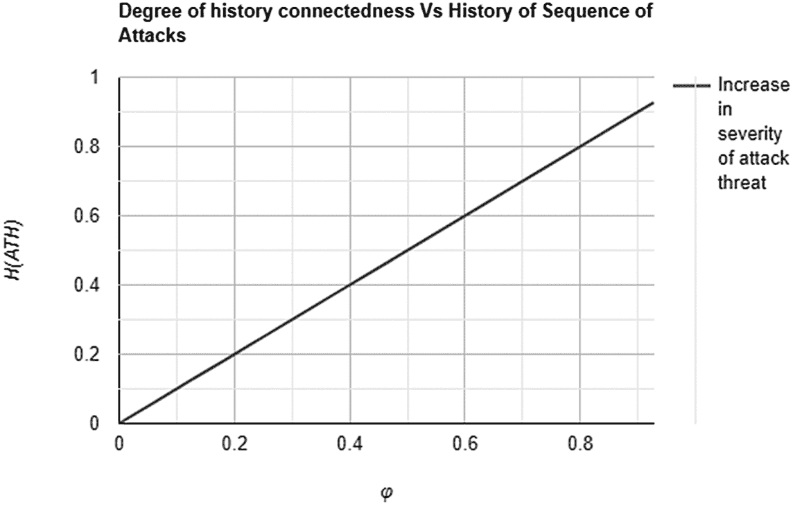

图 9.1 历史连通性程度与攻击序列历史的关系图。

我们可以从上面的图中观察到，随着 `φ` 值的增大，攻击之间的差异程度之增大，这表明攻击 `A[i]` 和 `A[j]` 之间的历史连通性也较低。

现在，我们讨论使用这种模型的益处。这种威胁模型有助于我们观察攻击的相似性，并帮助我们理解攻击中发生的变化。遵循此威胁模型的攻击遵循特定的路径，该路径可以通过时间逻辑来表示。然而，在制定这种威胁模型时所做的假设迫使我们在其他稳健的方向上投入努力。

#### 2. 皮尔斯分支时间逻辑模型

在此类时间逻辑中，我们引入了一个表示为 `F[op]` 的未来算子。`F[op]` 的上下文语义是“它将导致一种的情况”。现在，模型可以公式化为

(9.4)

`ATH = (ATH, F[op])`

它推断出现在，如果 `A[1]`、`A[2]`、`A[3]`……`A[n]` 是对手对 CPS 实体实施的各种攻击，那么对于所有攻击 `A[1]`、`A[2]`、`A[3]`……`A[n]`，未来真值被视为真。因此，对于任何两种攻击 `A[i]` 和 `A[j]`，`A[i]` 和 `A[j]` 发生的概率均等。如果我们想进一步加强攻击模型，则可以在攻击模型中包含 `α` 关系。因此，攻击模型现在可以表示为：

(9.5)

`ATH = (ATH, α, F[op])`

下面展示了 `F[op]` 与攻击概率之间的图，以便于清晰理解。攻击概率从 0 到 1，未来算子的值考虑从 0.00 到 1.00。

我们可以观察到，随着 `F[op]` 值的增加，攻击概率也随之增加。该模型在关于攻击历史方面的假设较少。每次攻击被认为发生的概率相等，且具有相同的恶意强度。在最坏的情况下，它可能会对传感器数据造成破坏，或对执行器组件造成破坏 (图 9.2)。

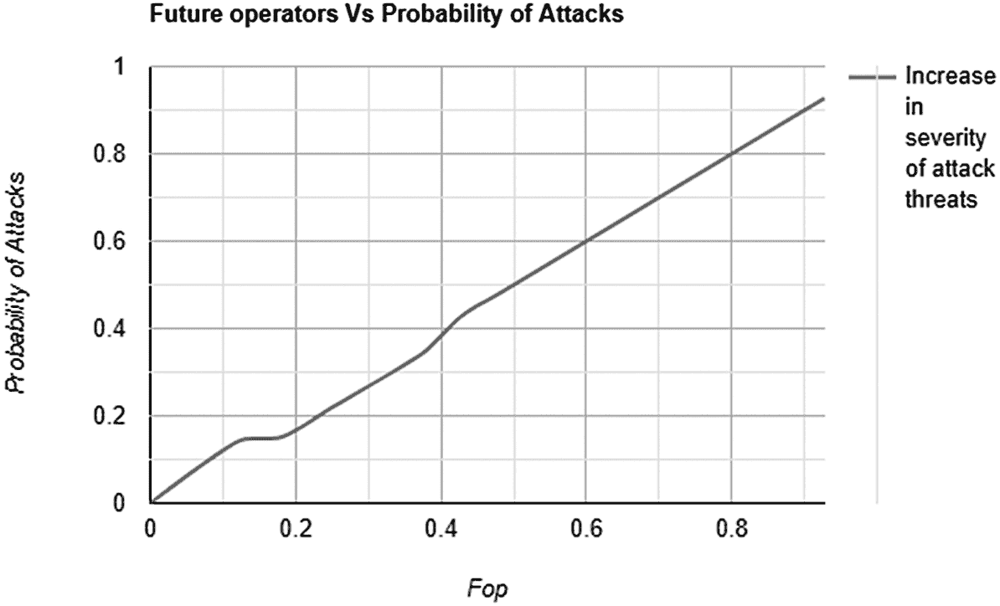

图 9.2 未来算子与攻击概率的关系图。

#### 3. 奥卡分支时间逻辑模型

该模型比其他两个模型更强大，因为它与一个时间时刻相关，并且与通过该时刻的历史相关。因此在该模型中，未来算子 `F[op]` 可以表示为“根据给定的历史，它将导致一种情况……”。在该模型中，结合 `F[op]`，我们还使用了算子 `P[st]`（攻击的历史）以及算子 `Ɛ`、`£`，它们是表示覆盖对手攻击历史的量词对偶模态算子。

随后，攻击模型可以表示为：

(9.6)

`ATH = ATH(F[op])`

攻击模型可以定义为 `ATH(F[op])`。接下来的图表示了 `P[st]`、`£` 的未来。我们可以发现，随着 `P[st]` 值的增加，攻击百分比增加。但我们也可以观察到，与 `Ɛ`、`£` 函数相比，严重性的百分比增加得并不。

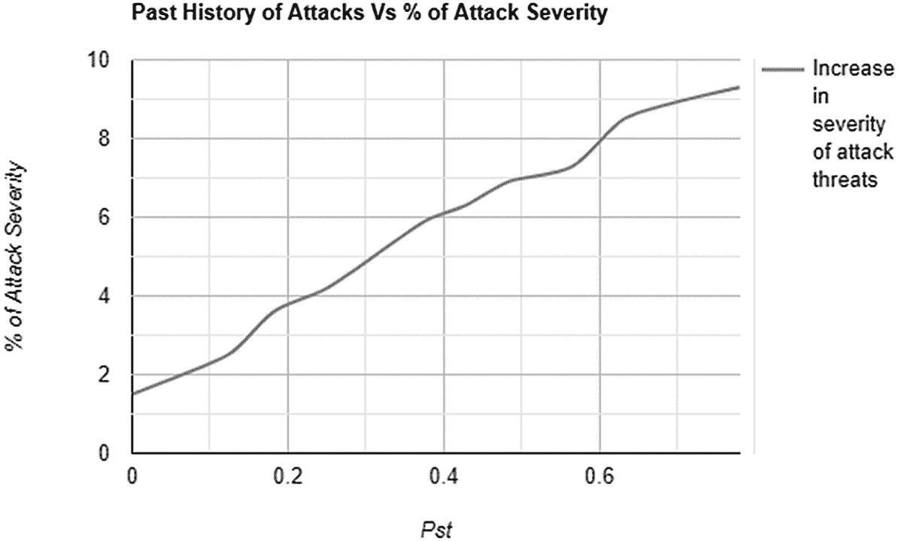

图 9.3 攻击历史与严重性百分比的关系。

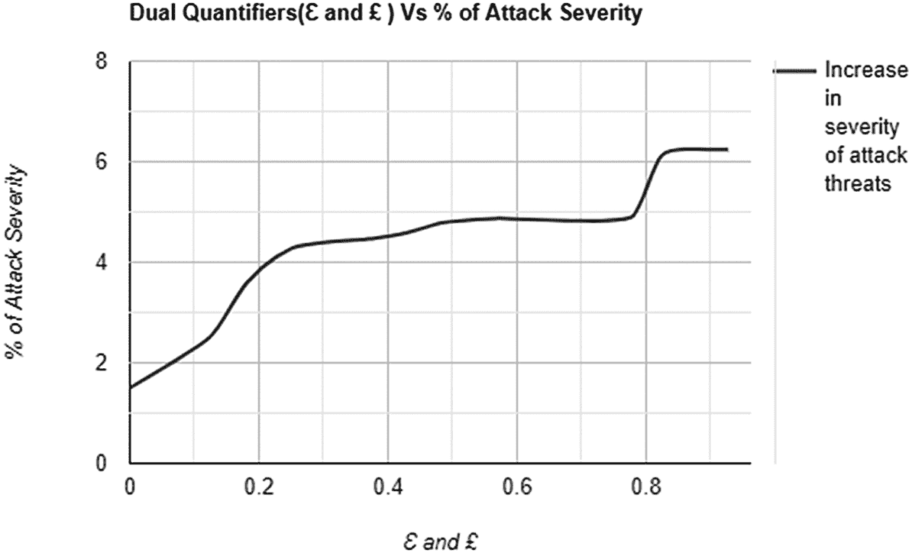

图 9.4 双重量词与严重性百分比的关系。

## 9.5 实验结果

我们从 Kaggle 获取了 Kitsune 网络攻击数据集，其中包含了从包含许多物联网 (IoT) 实体的网络中挖掘的九个攻击数据集。每个数据集包含许多网络包和各种网络攻击。

每次攻击都包含以下内容：

1. 一个预处理的数据集（csv 格式）
2. 每个数据集的标签向量（csv 格式）

下面的图显示了 `STRIDE`、`DREAD` 以及基于普里先分支时间理论的攻击模型的性能 图 9.5、图 9.6 和 图 9.7。

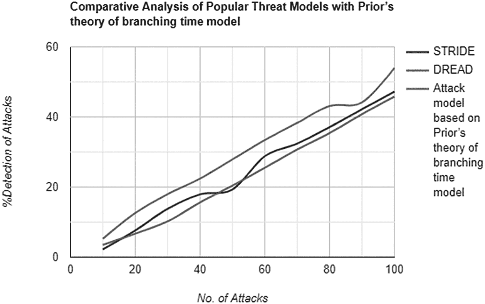

图 9.5 流行威胁模型相对于基于普里先分支时间理论的攻击模型的性能对比。

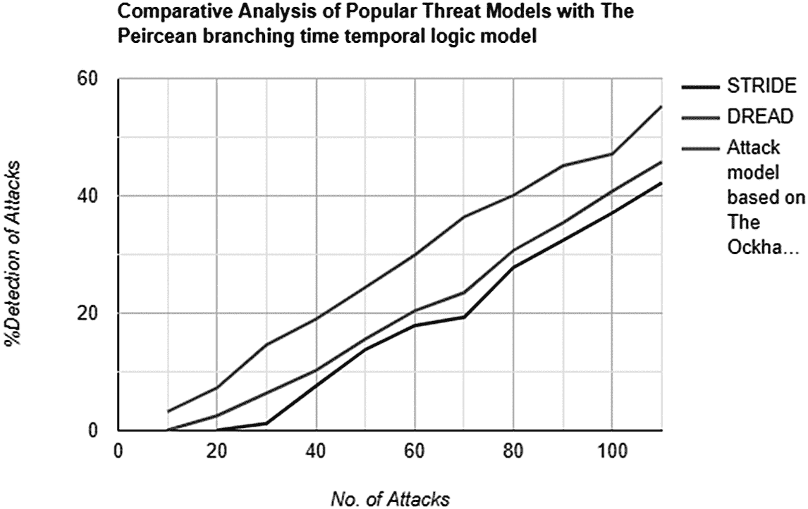

图 9.6 流行威胁模型相对于基于皮尔斯分支时间逻辑的攻击模型的性能对比。

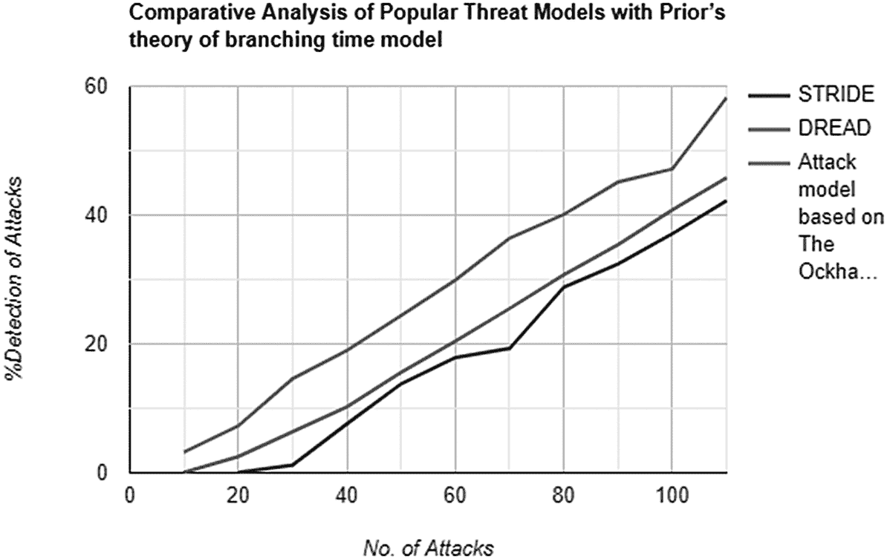

图 9.7 流行威胁模型相对于基于奥卡分支时间逻辑的攻击模型的性能对比。

我们可以观察到，随着威胁数量的增加，我们提出的威胁模型在检测威胁方面的速率表现更好。`STRIDE` 和 `DREAD` 是在几乎 80% 到 90% 的 CPS 生态系统中使用的流行威胁模型。因此，我们仅选择了这两种技术进行对比分析。

我们提出的威胁模型根据以下优先级考虑了数据集中的攻击：

*   优先级 1（最高）——人员健康与安全


- `Priority 2 (High)` – 服务或服务质量的负面影响
- `Priority 3 (Medium)` – 业务损失
- `Priority 4 (Low)` – 对设备造成的损坏

随着智能世界原则的演进，许多医疗和健康机构正在进行自我改造以成为智能革命的一部分，这使得 `CPS` 实体的安全性变得更加重要。因此，我们开发了主要适用于健康医疗系统的威胁模型。接下来，我们考虑了可能影响服务质量的攻击模型，攻击者可能会使服务变得不可用。这导致了 `CPS` 生态系统整体功能的失平衡。因此，我们对此类攻击情况赋予了高优先级。下一个优先级分配给由于攻击导致的财务损失，这些损失可以通过应用各种安全框架来控制。设备损坏的重要是最低的，因为在识别出攻击后，这些设备是可以替换的。

## 9.6 未来方向

我们的威胁模型无法应用于某些攻击。这是由于 `CPS` 设备是异构的。并非所有设备的行为都相同，因此我们无法确定在哪个时间点，设备的设备行为可能被攻击者利用进行攻击。此外，根据设计限制，选择合适的设计模型可能比想象中更困难。另一个挑战是从攻击历史中存储给定时刻的规格说明。我们列出了各种因素及其对所提威胁模型的适用程度（表 9.1）。

表 9.1 CPS 攻击因素及其对所提威胁模型的适用程度

| 威胁模型 | | 威胁因素（适用程度） |
| --- | --- | --- |
| | 来源/攻击者 | 目标 | 动机 | 攻击向量 | 可用性 | 拒绝服务 |
| Prior 的分支时间模型理论 | 高 | 高 | 高 | 高 | 高 | 低 |
| --- | --- | --- | --- | --- | --- | --- |
| Peircean 分支时间序逻辑模型 | 高 | 高 | 高 | 高 | 中 | 低 |
| Ockhamist 分支时间序逻辑模型 | 高 | 低 | 高 | 高 | 高 | 低 |

我们可以很容易观察到 `Prior’s theory of branching time model` 对 `DoS` 攻击的适用性较低，因为攻击者的行为与攻击序列的历史没有任何相关性。接下来，我们可以推断 `Peircean branching time temporal logic model` 对 `DoS` 攻击的适用性也较低，对可用性攻击的适用性中等。这是因为影响 `CPS` 节点服务的攻击会停止数据的可用性，而这些数据必须作为输入提供给传感器节点。`Peircean branching time temporal logic model` 保证以 100% 的成功率处理此类攻击。最后，我们可以观察到 `Ockhamist branching time temporal logic model` 对于目标和 `DoS` 攻击并不十分。在这种情况下，目标可能是 `CPS` 实体，例如传感器或执行器，它们通常遭受断电故障攻击和物理攻击。`Ockhamist branching time temporal logic model` 无法阻止攻击者发动会导致组件损坏的物理攻击，因此 `CPS` 安全设计人员只能对此类威胁进行建模。

未来，`CPS` 的安全设计人员需要开发基于时间逻辑的多量化器威胁模型。攻击者可能使用混合机制进行攻击，这会使我们的威胁模型变得薄弱，因为我们没有关于如何处理所提威胁模型可以应对的混合攻击的规定。另一个需要密切考虑的方面是在高风险 `CPS` 实体上开发模型时的置信度。少数 `CPS` 生态系统对时间非常敏感，记录其历史中的不同状态可能是困难的。即使威胁模型设计人员能够记录历史，使用此类历史的置信水平可能也不高。这仍然是未来需要解决的一个挑战。最后的挑战是模型可能会受到某些历史扰动的影响，可能会干扰攻击相关性，从而使威胁模型失效。这种损失可能会导致攻击模型相对于攻击向量的适用程度显著降低。因此，未来设计人员面临的挑战是，历史中发生的历史扰动被隔离，或者其影响被威胁模型使用的量化器所消除。

## 9.7 结论

本章介绍了使用时间逻辑的应用层威胁模型。我们专门使用了 `Prior’s theory of branching time model`、`Peircean branching time temporal logic model` 以及 `Ockhamist branching time temporal logic model`。这些模型通过引入 `CPS` 攻击者的动态和对抗性思维元素，增强了 `CPS` 威胁模型的开发强度。实验结果表明，考虑到用于验证流行数据集的标准的数据集，时间模型的性能优于传统的 `STRIDE` 和 `DREAD` 威胁模型。未来方向表明，由于在开发威胁模型应用逻辑以及将其映射到时间逻辑范围时所采取假设带来的固有限制，所提模型还有进一步改进的空间。总体而言，通过本章，我们强烈支持这些威胁模型的适用性，因为它们是基于攻击者的心理学并结合了适应时间不性的规定而开发的。

## 参考文献

- D. Gritzalis, M. Theocharidou, and G. Stergiopoulos, Critical infrastructure security and resilience, Cham: Springer, January, 2019, pp. 0–16.
- A. Keliris, C. Konstantinou, N. G. Tsoutsos, R. Baiad, and M. Maniatakos, “Enabling multi-layer cyber-security assessment of industrial control systems through hardware-in-the-loop testbeds,” in *2016 21st Asia and Pacific Design Automation Conference (ASP-DAC)*. IEEE, 2016, pp. 511–518.
- C. Konstantinou, “Towards a secure and resilient all-renewable energy grid for smart cities,” Consumer Electronics Magazine, 11, 33–41, 2021.
- S. Muyeen and S. Rahman, Communication, control and security challenges for the smart grid. The Institution of Engineering and Technology, 2017.
- J. Ospina, X. Liu, C. Konstantinou, and Y. Dvorkin, “On the feasibility of load-changing attacks in power systems during the covid-19 pandemic,” IEEE Access, 9, 2545–2563, 2021.
- B. Chen, K. L. Butler-Purry, A. Goulart, and D. Kundur, “Implementing a real-time cyber-physical system test bed in rtds and opnet,” in *2014 North American Power Symposium (NAPS)*, 2014, pp. 1–6.
- C. Queiroz, A. Mahmood, and Z. Tari, “Scadasim—A framework for building scada simulations,” IEEE Transactions on Smart Grid, 2(4), 589–597, 2011.


-   [N. Dorsch, F. Kurtz, H. Georg], C. Hägerling, and C. Wietfeld](#ch9.xhtml#R_ref9_8), “智能电网通信的软件定义网络：应用、挑战与优势”，发表于*2014 IEEE International Conference on Smart Grid Communications (SmartGridComm)*。IEEE, 2014, pp. 422–427.
-   H. Georg, S. Müller, N. Dorsch, C. Rehtanz, and C. Wietfeld, “Inspire: 用于实时评估的电力与 ICT 系统集成联合仿真”，发表于*2013 IEEE International Conference on Smart Grid Communications (SmartGridComm)*, 10, 2013, pp. 576–581.
-   M. J. Stanovich, I. Leonard, K. Sanjeev, M. Steurer, T. P. Roth, S. Jackson, and M. Bruce, “智能电网信息物理系统测试平台的开发”，发表于*2013 IEEE PES Innovative Smart Grid Technologies Conference (ISGT)*, 2013, pp. 1–6.
-   S. Boschert and R. Rosen, 数字孪生——仿真方面。Cham: Springer International Publishing, 2016, pp. 59–74. [在线]. 可：[`doi.org/10.1007/978-3-319-32156-15`](https://doi.org/10.1007/978-3-319-32156-15)
-   M. Zhou, J. Yan, and D. Feng, “数字孪生框架及其在电网在线分析中的应用”，CSEE Journal of Power and Energy Systems, 5(3), 391–398, 2019.
-   T. Huang, F. R. Yu, C. Zhang, J. Liu, J. Zhang, and Y. Liu, “大规模软件定义网络（SDN）测试平台调查：方法与挑战”，IEEE Communications Surveys & Tutorials, 19(2), 891–917, 2016.
-   J. Ospina, N. Gupta, A. Newaz, M. Harper, M. O. Faruque, E. G. Collins, R. Meeker, and G. Lofman, “考虑发电预测和实时价格的光伏集成储能系统基于采样的模型预测控制”，IEEE Power and Energy Technology Systems Journal, 6(4), 195–207, 2019.
-   A. Keliris, C. Konstantinou, M. Sazos, and M. Maniatakos, “通过开源工具进行的低成本能源部门网络攻击”，发表于*2018 IFIP/IEEE International Conference on Very Scale Integration (VLSI-SoC)*。IEEE, 2018, pp. 101–106.
-   Y. Xiang, L. Wang, and N. Liu, “信息物理环境下的电力电系统协同攻击”，Electric Power Systems Research, 149, 156–168, 2017.
-   J. Tian, B. Wang, T. Li, and F. Shang, “电力系统中的协同信息物理攻击”，International Journal of Robust and Nonlinear Control, 30(11), 4345–4358, 2020.
-   H. Tu, Y. Xia, K. Chi, and X. Chen, “一种用于信息物理电力系统的混合攻击模型”，IEEE Access, 8, 11476–11483, 2020.
-   K. Pan, A. Teixeira, M. Cvetkovic, and P. Palensky, “电力系统估计中的数据攻击：有限的对抗知识与有限的资源”，发表于*IECON 2017—43rd Annual Conference of the IEEE Electronics Society*, 2017, pp. 4313–4318.
-   A. Barua and M. A. Faruque, “霍尔欺骗：对并网逆变器的非侵入性攻击”，发表于*29th USENIX Security Symposium (USENIX Security)*, 2020, pp. 1273–1290.
-   V. Venkataramanan, A. Hahn, and A. Srivastava, “Cp-sam: 用于监控微电网韧性的信息物理安全指标”，IEEE Transactions on Smart Grid, 11(2), 1055–1065, 2019.
-   Y. Zhang, V. Krishnan, J. Pi, K. Kaur, A. Srivastava, “用于交易电系统的信息物理安全分析”，IEEE Transactions on Smart Grid, 11(2), 1055–1065, 2019.
-   X. Liu, J. Ospina, and C. Konstantinou, “风电集成微电网固件攻击检测”，IEEE Access, 8, 20837–20894, 2020.
-   H. Orojloo and M. A. Azgomi, “评估信息物理系统攻击影响的随机博弈模型”，Journal of Network and Systems Management, 26(4), 929–965, 2018.
-   Y. Fan, J. Li, D. Zhang, J. Pi, J. Song, and G. Zhao), “支持受网络攻击威胁的变电站可持续维护：一种网络安全风险评估方法”，Sustainability, 11(4), 982, 2019.
-   [Y. Yang, S. Wang, M. Wen, and W. Xu, “考虑通信故障的信息物理系统（CPS）可靠性建模与评估”，Journal of the Franklin Institute, 358, 1–16, 2018.

# 10 软件定义网络安全

Omerah Yousuf 和 Roohie Naaz
国立技术学院，斯林格尔
DOI: [10.1201/978-3-319-32156-10](https://dx.doi.org/10.1201/978-3-319-32156-10)

## 10.1 引言

软件定义网络（SDN）设计方法日益受到关注。越来越多的企业开始根据这种策略规划其网络。传统网络需要购买额外的设备来扩展。SDN 与传统网络的区别在于，前者需要额外的设备，而后者只需要输入。在典型的计算机网络中，路由由路由器、交换机和网关处理，这些设备通过连接和节点进行连接。这些是应用服务质量（QoS）因素的网络元素。这些网络组件对每个供应商都是唯一的。因此，这些组件的可编程性取决于网络厂商的标准和兼容性（Fraser 等人，2013）。为了消除这种限制并使网络更具可性，SDN 被开发出来。控制平面和数据平面是网络的两个平面。控制平面是网络的大脑，它可以管理整个网络以适应应用程序的需求，无论标准如何。当请求数据时，数据平面是将其传递到控制平面的转发器（Prathima Mabel, Vani, & Rama Mohan Babu, 2019）。


SDN（软件定义网络）正在逐渐变为现实，许多支持 SDN 设备正在开发中。云计算和虚拟化技术在研究领域已探索多年，如今通过离散控制任务与数据平面任务的合并以及网络可编程性找到了商业应用（Scott-Hayward, O’Callaghan, & Sezer, 2013）。由于 SDN 网络有时包含私人和机密信息，它们必须遵守与传统网络相同的安全标准。SDN 极大改变了网络组件的设计和相互通信特性，为试图破坏安全的攻击者创造了一个全新的平台。因此，它需要与传统网络相似的安全水平，但要防范更广泛的攻击（Spooner & Zhu, 2016）。SDN 在允许有效网络管理的同时，被发现比传统网络更容易受到攻击，针对转发设备和控制器的攻击影响了网络通信原理，使网络易受到安全攻击和问题的影响。

**章节结构**：本章其余部分的安排如下：第 10.1 节和第 10.2 节介绍了 SDN 发展和基本原理的简要总结。第 10.3 节讨论了 SDN 的安全性分析。第 10.4 节讨论了整个 SDN 发展过程中出现的许多问题。第 10.5 节和第 10.6 节描述了 SDN 架构中的各种问题和解决方案。第 10.9 节简要讨论了 CPS（信息物理物理系统）中的 SDN。最后，第 10.8 节对本章进行了总结，并讨论了未来的研究目标。最后，列出了参考文献。

### 10.1.1 SDN 的演进

斯坦福大学于 2005 年首次提出了 SDN 的概念。SDN 的主要目标是通过将网络逻辑从转发硬件分离来使网络更易构建。SDN 已经存在了十多年。在 SDN 最初发布时，许多人认为引人夺目的软件定义网络最终将取代紧耦合、垂直集成的网络解决方案。SDN 历史的三个阶段如图图 10.1; Stancu, Halunga, Suciu, & Vulpe, 2015）：

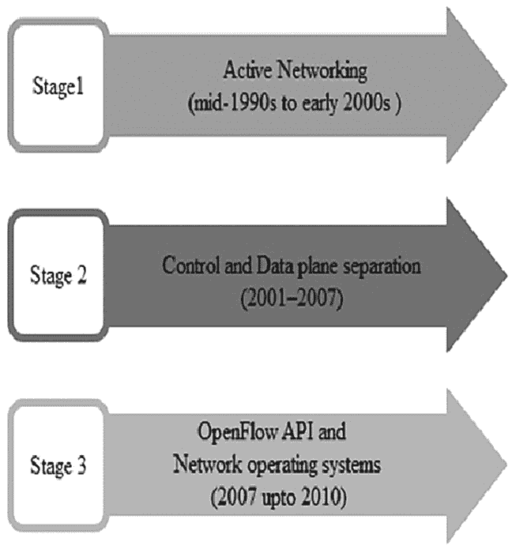

图 10.1 SDN 演进。

1. 激活网络（20 世纪 90 年代中期到 21 世纪初），通过向网络引入可编程函数允许了进一步的创新；
2. 控制平面与数据平面的分离（2001–2007 年间），导致了开放的控制和数据平面接口；
3. OpenFlow 应用程序接口（API）和网络操作系统是第一个主要的开放接口应用，它们从 2007 年到大约 2010 年研究了使控制-数据平面分离具有可扩展性和可信的方法。

#### 阶段 1：激活网络

激活网络是一个开创性的概念，因为它创建了一个编程接口，暴露单个网络节点上的资源，并允许构建可以应用于通过该节点的部分数据包的定制功能。激活网络提供了一种针对网络架构的早期“白板”方法。激活网络中有两种编程范式：

* 胶囊模型——携带要执行代码的数据包在带内传输。
* 可编程路由器/交换机模型——要执行代码在带外传输。

尽管激活网络并未被广泛使用，但对 SDN 的三大贡献包括：

1. **通过编程降低创新障碍的网络功能**
激活网络最早提议利用可编程网络来解决网络进展缓慢的问题。尽管许多早期的 SDN 概念强调控制平面的可编程性，但激活网络促进了数据平面的可编程性。最近的 SDN 研究关注于 OpenFlow 等 SDN 技术，以提供更广泛的数据平面任务。

2. **基于数据包头部的网络虚拟化和解复用**
激活网络开发了一个允许测试各种编程范式的框架。由于这一需求，网络监控的需求应运而生。这种范式有趣地被引入 Planet-Lab 设计中，根据数据包头部被解复用到正确的执行环境中，并在虚拟环境中进行各种实验。

3. **统一中间盒编排架构**
在激活网络时期，从未完全实现中间盒的统一控制。虽然这项研究对网络功能虚拟化（NFV）没有直接影响，但某些发现现在可以应用于统一部署。

#### 阶段 2：控制平面与数据平面的分离

* 在此期间，流量稳步增长，使得网络可靠性和性能变得更加重要。网络运营商寻求更好的网络管理功能，例如对传输通道的控制。他们注意到由于控制平面和数据平面的紧密集成，传统路由器和交换机在网络管理方面存在困难。发现这一问题后，人们尝试将两者分离。尽管这些分离尝试是务实的，但它们构成了对互联网传统的路由计算与数据包转发紧耦合的重大理念转变。SDN 在分离数据和控制平面时探索了以下概念：
    * 具有开放数据平面接口的集中式访问控制
    * 大规模状态管理

#### 阶段 3：OpenFlow API 和网络操作系统

* 研究人员和资金机构对大规模网络测试的概念感兴趣，因此建立了 OpenFlow。它在完全可编程网络的愿景与确保其实实现的现实之间取得了平衡。尽管如此，OpenFlow 包含了许多之前平面分离工作的概念；它仍然是一个正在进行的工作。


SDN 仍在开发操作抽象层的过程中。SDN 有几种通用定义，每种定义都与维护的控制面分散程度有关。开放网络基金会（ONF）是一个致力于 SDN 开发、认证和商业化的非营利组织。ONF 对 SDN 最详尽且最受认同的定义如下（Xia, Wen, Foh, Niyato, & Xie, 2015）：

SDN 是一种将网络控制与转发解耦并使其直接可编程的网络架构。与传统网络架构相比，SDN 是一种范式转变，它使用基于软件的控制使得策略的执行和实施更加容易。它使用定义的应用程序编程范式来抽象数据并管理路由器、交换机等网络设备的操作。

### 10.2.2 用于 SDN 的 OpenFlow

ONF 创建了 `OpenFlow` 作为在网络设备中部署 SDN 的多厂商标准。`OpenFlow` 协议用于连接 `OpenFlow` 控制器和 `OpenFlow` 交换机，如图 10.2 所示。`OpenFlow` 交换机可能会接收来自 `OpenFlow` 控制器的指令，说明如何处理传入的 `OpenFlow` 数据包（Vaughan-Nichols, 2011）。

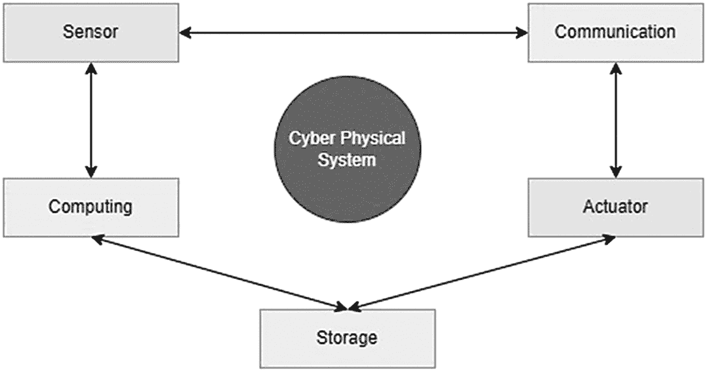

图 10.2 OpenFlow 交换机。

`OpenFlow` 交换机可以配置为：(1) 根据各种数据包头部识别和识别来自输入端口的包；(2) 以各种方式处理包，以及 (3) 拒绝或将包转发到指定的输出端口。

`OpenFlow` 命令从 `OpenFlow` 控制器发送到 `OpenFlow` 交换机以创建“流”。每个流包含包匹配字段、流优先级、唯一计数、包处理指令、流超时和 cookie。表用于组织这些流。在从出口端口离开之前，入站数据包 `OpenFlow` 是一种开放协议，可能用于控制流表。网络管理员可以将流量划分为生产流和研究流。研究人员可以选择其数据包经过的路径以及如何被处理，允许他们管理自己的流。在同一网络上，业务流量以目前相同的方式进行分离和路由（Hu, Hao, & Bao, 2014; Upc, 2012）。

### 10.2.3 体系模型

SDN 架构定义了 SDN 在不同层面的功能，以及如何确保软件的安全性和可靠性。在 SDN 中，有三层：数据层、控制层应用层，如图 10.3 所示。向上和向下的 API 用于这些层之间的交互（Rana, Dhondiyal, & Chamoli, 2019）。

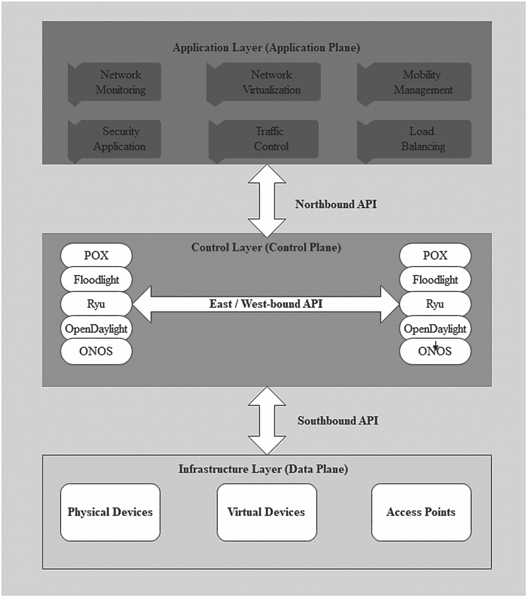

图 10.3 SDN 架构。

#### 10.2.3.1 数据平面

该平面由构成网络架构的转发设备组成，其主要职责包括根据控制指令对流包施加转发操作，并在网络应用请求时提供网络状态指标。它类似于 OSI 模型的物理层，由处理数据流的真实和虚拟设备等网络元素组成。它被称为 SDN 转发平面，在物理上负责利用控制面协议将包帧从入口接口传递到出口接口（Pradhan & Mathew, 2020）。

#### 10.2.3.2 控制平面

该平面容有控制器，控制器负责流控制、路由、错误控制、传输控制、安全和其他网络关键任务。控制器是网络的大脑，汇了网络所有的智能。它具有可编程接口，用于建立网络 QoS 设置，以及路由、流管理、错误控制机制和安全策略。它是一个接受应用层任务并将其发送到 SDN 组件的逻辑实体。控制器的功能是从硬件设备收集重要数据，并以包含各种网络事件的抽象网络快照的形式传递给 SDN 应用（Nunes, Mendonca, Nguyen, Obraczka, & Turletti, 2014）。

#### 10.2.3.3 应用平面

应用平面是一个包含应用程序和服务的层，它们从控制平面和数据平面发起网络功能请求。业务中使用的不同应用程序根据业务需求告知网络做什么，控制器利用 API 向路由器、SDN 交换机和其他设备发送命令以完成所需任务。

向上和向下的接口（通常被称为 SDN 架构 API）定义了应用程序、控制器和网络系统之间的通信。控制器通过向上接口与应用程序通信，而控制器通过向下接口连接到实际的网络设备。由于 SDN 是一种虚拟网络覆盖层，这些组件不需要在物理上位于同一区域。

## 10.3 SDN 的安全性分析

SDN 通过允许网络可编程促进了通信创新，并整合了网络控制，以提高资源可见性、简化网络管理、实现一致的网络策略执行以及新功能部署的简单性等益处。然而，如果忽视了这些特性，可能会使 SDN 面临极其脆弱的安全忧。。事实上，安全性是一个巨大的难题，ONF 已经建立了一个安全工作组来解决这个问题。因此，查看 SDN 面临的安全问题并提出解决方案至关重要。

### 10.3.1 用于改进安全性的 SDN

如今的企业网络面临着不断受到新威胁攻击的问题。为了应对这个问题，需要新的业务网络管理和保护技术来增强安全性。这需要网络架构和安全性的改进。在网络增长的这一水平，SDN 能够更好地适应这些挑战。

随着网络边缘的消失，物联网（`IoT`）将成为一个更大的安全问题。由于数百万不安全的 `IoT` 设备，网络威胁格局变得更加危险。随着 `IoT` 设备被广泛使用，坏分子可能会利用 `IoT` 设备中的漏洞进行分布式拒绝服务攻击（`DDoS`）和其他攻击。在攻击向量日益复杂的世界上，企业网络安全必须是保护数据和资产的防线。了解如何利用 SDN 架构创建一个更灵活、自适应的网络安全基础，是强化那条防线的最有效方法。SDN 设计具有许多强大的安全特性，如图 10.4 所示并如下文讨论（Seungwon Shin, Xu, Hong, & Gu, 2016）：

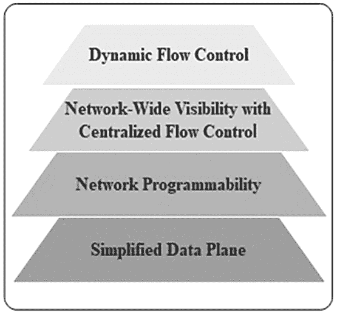

图 10.4 SDN 安全特性。


## 1. 动态流控制

由于 `SDN` 的基本特性，网络应用可以动态管理网络流。在网络安全方面，动态控制网络流具有多项优势，包括：(i) 通过 `SDN`，我们可以更高效地管理网络流，而无需额外的中间件。我们还可以利用 `OpenFlow` 交换机/路由器或任何具有 `SDN` 能力的网络设备进行访问控制；(ii) 它也使得实时区分有害（或可疑）网络流量与良性网络数据变得容易得多。

## 2. 具有全网可见性的中心化位置流控制

“全网可见性”是指网络控制能够随时随地查看安装在任何地方的网络设备的状态。`SDN` 可以辅助进行全网监控，并识别和防御全网攻击。由于其基本属性（即以集中方式控制和监控整个网络），`SDN` 可以通过收集网络数据并接收它们的流请求信号，轻松地监控任何网络设备。这一特性通过将定义的网络流导向必要的/特定的安全设备（如硬件组件、中间盒和网络组件的虚拟网络功能），有助于增强安全设备的使用。

## 3. 网络可编程性

`SDN` 允许独立于提供物理连接的网络硬件来控制网络行为。因此，网络运营商可以更改其网络功能，以实现新服务甚至针对特定的客户端。例如，得益于支持网络灵活性的网络编程性，网络运营商可以根据构成网络环境组件对数据平面进行参数化。它允许广泛的安全服务和系统作为网络应用进行部署，既可以是控制器应用程序，也可以在它们自身的安全应用层中。

## 4. 简化的数据平面

由于指令是由 `SDN` 控制器而非许多特定厂商的设备和协议提供的，在采用开放标准时，`SDN` 简化了网络设计和运行。由于 `SDN` 设计中分离了数据平面和控制平面，数据平面具有相对简单的逻辑。这种精简化的数据平面允许我们尝试新功能。这一思想也可以扩展到安全领域。`SDN` 的数据平面可以被扩展以更符合安全需求。

### 10.3.2 SDN 安全的需求

在不引入 `SDN` 安全挑战的情况下，传统的网络安全漏洞已经足够严重。然而，通过使用 `SDN`，企业可能会使其网络暴露在新的漏洞和攻击中，特别是当他们没有足够的策略时。`SDN` 控制器是 `SDN` 安全问题的主要来源之一。网络智能存储在控制器中。控制器掌握在所有访问它的人手中。这意味着企业必须建立规则和网络架构，以确保正确的人负责。由于对 `SDN` 控制器的成功攻击可能会完全中断网络操作，这是安全会话中的重要方面。组织可以使用基于角色的验证来防止这些威胁，确保只有适当的人员才能访问系统和数据。希望掌握 `SDN` 安全风险的机构应关注以下三个关键领域 (Hayajneh, Bhuiyan, & McAndrew, 2020):

- 数据隐私必须受到保护。
- 维护系统的可靠性。
- 确保网络服务在需要时可用。


所有网络设备都支持 SDN，这使得在新网络中实施 SDN 变得简单易行。转换为 SDN 面临着独特的挑战，因为遗留网络可能包含正在运行的业务和网络组件。大多数企业和网络都需要转向 SDN，这将要求一段与遗留-SDN 混合架构的兼容期。如果开发出一种既支持 SDN 通信，又能与现有控制面技术向后兼容的协议，SDN 和传统网络节点就可以协同工作。在切换到 SDN 时，成本、风险和业务中断都将降至最低。

### 10.4.3 性能

性能是所有网络面临的最严重问题。如果一个网络运行不好，其耐用性、安全性、可扩展性或互操作性都将毫无意义。由于独特的控制面和数据平面配置，网络可能会面临延迟。这在大网络中可能导致不可持续的延迟，从而降低网络性能。此外，当控制器的响应时间和吞吐量相结合时，可能会出现性能下降，增加扩展的复杂性。

大型且动态网络中的许多性能问题可以通过在数据平面引入更多智能，或切换到分布式控制面设计来解决。虽然这改进了 SDN，但也复制了基于广泛分散的智能设备的传统网络，这与 SDN 的初始目标相悖。必须在不损害网络性能或建立单点故障的情况下维护虚拟化，这需要精细的平衡。

### 10.4.4 可靠性

在开发任何软件时，可靠性都是至关重要的；如果系统故障，应该通知用户并且补救措施应自动生效。软件可靠性是指在给定环境和特定时间内按预期执行的概率。SDN 控制器的网络管理设置必须智能且经过验证，以提高网络可用性并避免处理问题。为了保持遗留网络中的流控制和连续性，当设备故障或停止运行时，网络流量将重定向到其他相邻路径/节点。

### 10.4.5 安全性

到为止，与 SDN 相关的安全漏洞一直是研究课题。随着 SDN 被更广泛的使用和部署，必须考虑安全问题。ONF 带着此考虑组织了一个安全工作组。控制器-应用程序级别的身份验证和授权被认为是最危险的安全漏洞之一。SDN 安全必须纳入架构中并作为服务提供，以确保所有相关资源和信息的信誉、真实性和保密性。为了在架构内部提供安全性，用户必须执行以下任务：

*   保护控制器：必须严格控制对 SDN 控制器的访问。
*   防护控制器：如果网络宕机（例如，由于 DDoS 攻击），SDN 控制器也会之宕机；因此，必须维护其可用性。
*   建立信任：保持网络通信的安全至关重要。这涉及确保 SDN 控制器、应用程序及其管理的设备都是正常且可靠的。
*   建立稳固的策略框架：频繁的系统审查对于确保 SDN 控制器的执行完全符合预期至关重要。
*   执行科学调查和修复：你必须能够找出哪里出了问题，从从中恢复，极可能对其进行追责，并在未来发生错误时做好自我保护。

## 10.5 SDN 架构的安全问题

将各个面分离并将控制面任务合并到一个系统中对于未来的网络来说可能是必要的，但它引入了新的漏洞。由于具有极高的可见性，控制面更容易受到威胁，特别是 `DDoS` 攻击。例如，平面之间的通信可能会成为攻击目标。图 10.6 描述了发生在各个层级的众多危险。


控制器负责逻辑中心化的转发选择，处理了 OpenFlow 大部分的复杂性。如果要求控制器为每个新的数据流流应用流规则，它可能会迅速成为瓶颈。在具有 `10 Gbps` 线路的高速网络上采用 `OpenFlow` 时，观察到如今的控制器实现无法处理海量的新流。根据 Seungwon Shin, Yegneswaran, Porras, & Gu (2013) 的说法，扩展性的缺乏使得针对性攻击能够导致控制面饱和，这在 SDN 中造成的后果比传统网络中更为严重。由于其可扩展性问题，控制器是 DoS 和分布式 DoS（DDoS）攻击的常见目标。

现有控制器实现面临的另一个挑战是，确定为了满足延迟限制，单个控制器必须维护的转发设备数量。这一时间跨将随着控制器上流的数量而同步增长，而流的数量主要取决于控制器的处理能力。控制器能力的限制可能会导致单点故障（Yao, Bi, & Guo, 2013）。

## 2. DoS 攻击

对 SDN 控制器最严重的安全威胁是 DoS 和分布式 DoS 攻击。如果 SDN 控制器被破解或因交换机请求而无法访问，整个网络将停滞。随着数据链路中流的数量增加，交换机将用流设置请求淹没控制器，导致其性能下降。

DDoS 是一种针对中心化控制器的已知攻击，通过使用欺骗等手段，从一组受感染的（僵尸）服务器向网络中注入大量具有非重复头部的数据包。这些数据包的负担最终变得巨大，以至于控制器无法进行正常的网络操作（Ali et al., 2020）。

## 3. 分布式控制面挑战

为了适应无法由单个 SDN 控制器管理的大量多样化设备，必须部署许多控制器，将网络划分为不同的子域。如果网络被碎片化许多软件定义的子网络，信息聚合和保持每个子网络中独特的隐私标准将变得困难（Bannour, Souihi, & Mellouk, 2018）。

## 4. 基于应用的问题

运行在控制面之上的应用可能会危及其安全性。通常，控制器的安全性挑战体现在控制器在验证服务和批准应用所用资源方面的能力，同时还要保持足够的隔离、审计和监控。此外，在授予网络信息和资源的访问之前，必须根据其安全影响对某些应用进行隔离。分离应用对于显式地验证和批准第三方应用及运营商应用，以及为每个程序设置审计是必要的（Mubarakali & Alqahtani, 2019）。

### 数据 数据面问题

SDN 数据面在数据包传输到控制器后会缓存流，以便设置流规则。`OpenFlow` 流的数据面安全问题正在研究中。此外，通过 SDN，转发设备被简化并高度依赖于控制器。因此，转发设备无法区分合法与错误或恶意的流规则。由于缓冲区流限制，数据面容易受到多种形式的攻击，因为恶意流存储在缓冲区中。该平面的各种安全问题如下：

#### 1. 流规则安装

`OpenFlow` 控制器在 `OpenFlow` 网络中 `OpenFlow` 交换机的流表中添加流规则。这些流规则可以在新主机开始交付数据包之前（主动规则安装）或在第一个数据包传输之后（响应式规则安装）进行配置。由于交换机不再具有决策权，识别有效的流规则并与欺诈或敌意的规则区分开来是第一个也是最重要的安全挑战。

#### 2. 注入故障控制包

当目标交换机易受模糊攻击时，可能会由于接收带有错误或误用头部的伪造控制包而被驱动进入意外状态，这些头部经过精心设计，以揭示现有的漏洞或在不适当输入条件下看到的错误行为（Yoon et al., 2017）。

#### 3. 交换机-控制器链路

在 SDN 等拆分架构中，如果交换机因为控制面故障或断开无法从控制面获取转发指令，数据面将停止运行。因此，利用 `switch-controller link` 攻击网络可能是一种现实策略。由于控制面和数据面是分离，攻击者可以使用 `OpenFlow` 规则秘密地操控流（Zhang, Beheshti, & Tatipula, 2011）。

## 10.6 SDN 平面的安全解决方案

在网络认证、异常检测、攻击检测和攻击修复方面这些都是我们的专业领域。SDN 可以提高任何传统网络的安全级；然而，这些收益也带来了新的风险和漏洞。图 10.7 展示了保护三个 SDN 平面的各种安全措施和解决方案，并讨论如下（Shu et al., 2016）：

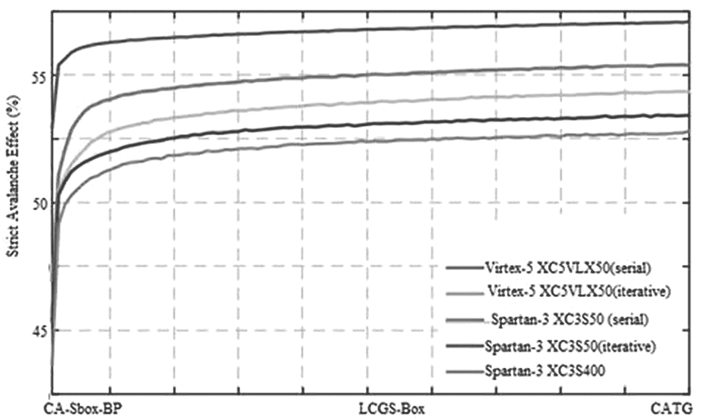

图 10.7 各种安全解决方案

### 10.6.1 应用面安全解决方案

`NICE` 是一个 `OpenFlow` 应用正确性检查器，它将模型检查与符号执行结合，采用一种新颖技术来遍历为流行的 `NOX` 平台开发的未经修改的控制器状态空间（Canini, Venzano, & Perě, 2012）。

创建了一种解决扩展性问题的新策略，它将模型验证与事件处理程序的符号化执行相结合。此外，为了减少状态空间，设计了一种更简单的 `OpenFlow` 交换机模型，以及创建事件交错的有效方法，以检测 OpenFlow 应用中的弱点。`NICE` 结合了符号执行、模型验证和搜索方法。当应用于基本实例时，它的速度快五倍且开销很小。

Son, Shin, Yegneswaran, Porras, & Gu (2013) 构建了 `FLOVER`，这是一个运行在控制器上的 `OpenFlow` 应用，它能够验证控制器生成的任何新规则均不违反既定的属性集。作者制作了流验证工具（`FLOVER`）的原型，该工具将流表转换为 `Yices` 语句序列，然后评估这些断言是否违反了网络安全策略。`FLOVER` 可以以两种方式使用：


1. 内联模式，其中 `FLOVER` 在每次流规则的每次修改后都会检查流规则，以及
2. 批量模式，通过定期验证控制器来提高响应速度。

经确定，该方法的性能可以在不到 120 毫秒和 131 毫秒内分别揭示多达 200 条规则的调整和违规情况。

FRESCO 是由 Seugwon Shin 等人（2013）构建的一个 OpenFlow 安全应用框架，它由模块库组成，这些模块可以用于构建整个网络安全应用程序，或者为检测模块识别出的每种危险输出流规则。该解决方案采用 OpenFlow 应用程序提供了一个受 Click 启发的编程平台，允许安全研究人员设计、分发和组合各种漏洞检测和缓解工具。FRESCO 已被证明具有低开销，能够用更少的代码快速构建常见的安全任务。这项技术为当今开发和部署新型安全解决方案提供了一个坚实的新平台。

根据 Ball 等人 (2014)，VeriCon 是一种用于验证控制器软件正确性，并在所有拓扑和网络事件序列上大规模检测 SDN 问题的工具。该技术验证了每个单个网络事件相对于定义不变不变的正确性，使其能够扩展以容纳庞大的应用程序。它提供了一种推断不变性的独特技术，这种技术已被证明在基础控制器系统中是有效的，减轻了程序员提供归纳不变性的负担，并被认为是迈向用于全网络不变性验证 SDN 应用的现实工具的第一步。这种方法在提供感兴趣的控制器程序的功能正确性方面具有巨大的潜力，鼓励了该领域进行更多研究。

Wundsam, Levin, Seetharaman, & Feldmann (2019) 设计了一种种名为 `OFRewind` 的方法，它可以捕获并重放指定的网络数据以跟踪网络异常。它是一种协助操作人员重现软件故障、识别数据路径限制以及定位网络问题的工具。它允许在调试过程中控制捕获并随后重放的拓扑和流量。该框架足够小，甚至可以在生产网络中默认开启。这可以保持流顺序，且计时足够精确，适用于各种应用。另一方面，进一步的发展将增加其适用性。然而，研究人员未来可能会收集并维护一组一致的轨迹集，这些轨迹将作为自动化回归测试的输入以及新网络组件测试的基准。此外，预计该策略将有助于解决正在进行的 OpenFlow 部署工作中的生产挑战。

Elazim, Sobh, & Bahaa-Eldin (2019) 设计了一种名为 `PermOF` 的细粒度权限系统，它使用了带有自定义权限列表的线程隔离技术。OF 控制器由于涉及第三方而容易受到权限滥用的影响，这导致了一系列可能损害整个网络的控制面攻击。为了减少这种危险，在关注降低 OF 应用程序权限之前，已经设计了不同的可能的补救措施。该授权系统提供了访问控制令牌，可以用于允许或拒绝任何应用程序。它包含四种权限类型，包括：

1. 读取权限，允许查看敏感数据。
2. 通知权限，允许程序接收事件通知。
3. 写入权限，允许更改控制器的状态。
4. 系统权限，授予对操作系统的访问权限。

### 10.6.2 控制平面安全解决方案

OF-GUARD 是由 Wang, Xu, & Gu (2015) 提出的一种轻级 SDN 设计，它使用了两个模块：包迁移和数据平面缓存。为了控制数据包交付的速度，包迁移使用了取决于网络利用率的调度策略。表缺失包被发送到数据平面缓存（`DPC`），该缓存包含主动流规则、缓存表缺失包并区分虚假包和真实数据包。然而，随着攻击数量的增加，带宽变得稀缺。它保护了整个网络，但这是是以延迟为代价的。

Seunyeon Lee, Kim, Shin, Porras, & Yegnesaran (2017) 开发了 Athena，一种基于 SDN 协议的软件解决方案，具有结构良好的开发接口和通用功能，能够以较少的编程工作快速生成各种异常检测服务和网络监控活动。这是一个分布式系统应用托管架构，与现的安全监控尝试相比，提供了无与伦比的扩展性。它设计为运行在当前的 SDN 基础设施上，使其实现简单且高效。它在 SDN 控制器实例之上以分布式方式积累和开发网络特征，然后将网络特征广播到分布式数据库中。它具有机器学习（`ML`）架构，可用于构建异常检测技术并将其作为任务部署在整个计算集群中以加速实时检测模型的构建。它提供了高层 API，允许操作人员用极少的代码快速创建和部署检测应用。这种方法在减少异常检测总计算时间的同时，改进了执行这些算法的数据管理系统的扩展性。

Fernandez (2013) 提出了一种结合了响应和主动技术的稳健控制器，主动控制器以其扩展能力而闻名，响应控制器以其对流量的理解而闻名。复合控制器是一种根据请求配置路由的响应控制器，但它也可以主动调整并预测流量模式，使其能够作为主动控制器增强整体系统性能。该解决方案通过提供按需创建路径的新型交换机解决了扩展性问题，在保持响应方法运行的同时提升了主动方法的性能。


Phemius, Bouet, & Leguay (n.d.) 提出了 `DISCO` 以克服多域 SDN 网络中的单点故障，这是一种开放的分布式 SDN 控制平面。该架构由两个模块组成：(i) 域内模块，结合了控制器的主要功能；它负责监管和监控网络，并对网络问题做出动态响应以偏离任何潜在危险流量；(ii) 域间模块，管理与其他 DISCO 控制器的通信。域间模块由两个部分组成：(i) `Messenger` 和 (ii) `Agents`。`Messenger` 构建控制器之间的通信路由，允许它们共享信息并发出请求。消息导向、优先级队列、路由、一致性交付和安全性都是高级消息队列协议 (`AMQP`) 的元素，该协议被用于 `messenger` 通信。`Agents` 辅助预留程序和 QoS 路由。

根据 Voellmy & Wang (2012)，`McNettle` 是一个可扩展的 SDN 控制系统，支持控制算法，并要求在流到达速率发生全局可见的状态变化，其控制事件处理速度随系统 CPU 核心数缩放。这是一个简单且可扩展的 SDN 控制器设计，使用 `OpenFlow` 交换机来提高控制服务器性能并降低延迟，同时保持全局可见性。即使是最严苛的网络控制应用也能由这些拥有充足内存、输入输出处理资源的多核架构处理。它被用于跟踪和监控互联网流，并响应可能出现的任何危害。它在核心数恒定时运行良好，但随着交换机数量的增加，吞吐量会下降。当交换机数量超过 500 时，延迟随着核心数的增加而减少。

Tootoonchian and Ganjali (2010) 提出了 `HyperFlow`，这是一种具有基于事件的分布式控制平面的 `OpenFlow` 控制平面。`HyperFlow` 在理论上是中心化的，但在物理上是分散的，在允许可扩展性的同时保持了集中网络控制的优势。它还使得加入独立管理的 `OpenFlow` 网络成为可能，这在目前大多数 `OpenFlow` 安装中是无法实现的。`OpenFlow` 交换机作为数据转发和事件传播的方法，而 `NOX` 控制器作为决策组件。每个交换机都分配一个特定的控制器。当某个控制器故障时，与其连接的交换机必须修改以链接到相邻控制器。它采用了一种需要事件存储的消息系统，维护同一控制器广播的事件顺序，并允许每个分区在分发从控制器到其他分区的事件时独立运行。它确保了所有控制器都能看到整个网络。预计它通过将生成和安装新流规则的时间减半，使反应时间减少了一半。

### 10.6.3 数据平面安全解决方案

`FortNOX` 是由 Porras et al. (2012) 建立的一项软件创新，允许 `OF` 安全应用设置可强制执行的流限制。它使用规则冲突检测引擎，并通过该引擎发送流规则插入请求。当检测到冲突时，具有高安全权限的规则插入用户可以接受或拒绝新规则。这种策略是使 `OF` 网络更安全的重要第一步，但在某些方面还需要做更多工作。

Khurshid, Zou, Zhou, Caesar, & Brighten (2013) 设计了 `VeriFlow` 作为实时监控流规则的解决方案。它被用于在检查延迟的同时保持网络性能。`VeriFlow` 是一个处于于控制器和交换机之间的层，在规则添加、更新或删除时检查动态违规情况。它包含一个用于测试自定义不变性的 API。根据连接到 `Mininet` 的原型实现，它可以在几百微秒内完成验证。`VeriFlow` 被假设是一个工具。

`DELTA` 是由 Seungsoo Lee 等 (2017) 提出的一种革命性 SDN 安全评估系统。它能够对 SDN 模块自动执行攻击场景并识别安全问题。它是开发关键漏洞方法的重要第一步。该框架为启用 `OpenFlow` 的网络构建，并已升级为与市场上流行的 `OpenFlow` 控制器工作，是目前第一个也是唯一的针对 SDN 的评估工具。还引入了一种集成了 `DELTA` 的通用 SDN 特定黑盒测试技术。这种模糊测试方法供运营商对数据输入逻辑进行深度测试。

Kreutz, Yu, Esteves-Verissimo, Magalhaes, 和 Ramos (2017) 提出了 `KISS`，意为“保持简单”（Keep It Simple Stupid）。具有密钥分配技术和安全通道支持的安全通信架构是解决安全问题同时降低成本和复杂性的第一步。它是基于传统 `TLS` 和 `PKI` 配置的现有系统的替代，旨在提高控制通信的可靠性并降低基础设施的复杂性。集成设备验证值 (`iDVV`) 是一种预测但随机的代码生成方法，是系统的最新组件。从健壮性和简单性来看，`iDVV` 将对 SDN 的身份验证和安全通信做出重大贡献。

`FlowChecker` 配置验证工具由 Al-Shaer and Al-Haj (2010) 设计，用于发现内部交换配置错误。通过使用二进制决策图编码 `FlowTables` 配置，它采用模型检查方法模拟链接的 `OpenFlow` 交换机。它是一个中心服务器应用程序，接收 `OpenFlow` 应用请求，分析并诊断故障，然后报告。它可以作为独立服务运行，通过安全的 `SSL` 通道与 `OpenFlow` 控制器通信。控制器发送带有拓扑、用户、控制器 ID 和名称绑定信息的 `FlowChecker` 查询。`CTL` 语言允许编写更复杂的查询，以验证特定属性或为 QoS 分析检索数据。


Sherwood 等人 (2009) 提出了 FlowVisor，一种新型交换机虚拟化解决方案，其中同一个硬件转发平面可以被多个逻辑网络使用，每个网络都有自己的转发逻辑。网络虚拟化层位于交换机和控制器之间，并使用 `OpenFlow` 协议控制底层物理网络。通过交换机级虚拟化构建了一个研究平台，允许多个网络实验在与实际流量的同时运行，同时保持隔离性和硬件转发速率。这种方法利用了通交换芯片组，不需要使用可编程硬件。这种方法也被认为会增加控制层和数据转发层操作的开销。此外，FlowVisor 将从交换机到控制器的流消息接收延迟增加了 16 毫秒，对于敏感应用来说，这种延迟为 16 毫秒，相对于系统而言是一个巨大的开销；如果没有 FlowVisor，开销为 12 毫秒。

## 10.7 物理信息系统 (CPS) 中的软件定义网络

CPS 由许多传感器或基于传感器的设备组成，它们从各种来源收集数据。它由经常通信的自包含单元组成。基于 CPS 的系统的几个例子包括智能家居、智能电网、智能城市、移动自接网络 (MANETs) 和车载自接网络 (VANETs)。在边缘网络中，CPS 经常拥有执行节点。它们利用边缘节点计算资源作为资源受限设备上任务执行的代理。当这样使用 CPS 时，CPS 执行中的资源限制被消除。由于对边缘的利用，CPS 的采用和能力不断提高。CPS 面临许多设计和实现问题，包括 (Kathiravelu & Veiga, 2017):

- 执行环境的不稳定性，
- 系统内的互操作性，
- 在系统或网络故障的情况下，安全性、全球容错和恢复都是重要的考虑因素，
- 控制大规模地理分布执行环境是一项挑战，
- 系统建模与设计，以及
- 智能体管理与编排。

通过将控制层作为统一控制器从分散的网络数据转发部分分离出来，SDN 为网络提供了可重用性和管理能力，以及许多其他优势。最近的研究人员已经研究了使用 SDN 来帮助 CPS 部署。为了增加 CPS 中多网络的稳健性，提出了 SDN。通过 SDN 辅助仿真，SDN 已被用于保护 CPS 网络并增加其韧性 (Ahmed, Blech, Gregory, & Schmidt, 2016)。

### 10.7.1 软件定义物理信息网络：挑战与收益

以下讨论了支持 SDN 的物理信息网络的优缺点 (Molina & Jacob, 2018)：

#### 10.7.1.1 可管理性

日益增多的网络设备需要使用先进的管理解决方案。为了实现复杂的高层网络规则，传统方法通常需要网络运营商处理底层的特定特定配置。另一方面，软件定义网络的管理被大大简化，因为所有部分都通过标准协议处理。因此，SDN 实现了网络可编程性，这正成为未来网络的需求。

Rinaldi, Ferrari, Brandao, and Sulis (2015) 使用 SDN 技术创建了异构智能电网网络。通过实验和文献分析了 SDN 技术作为简化和自动化智能电网 (SG) 网络工程解决方案的潜力。可能需要通过大量的实验工作和建模对 SG 的 SDN 系统进行特定评估。

#### 10.7.1.2 资源分配

难以解决的路由问题受益于具有网络全局视角的独特控制逻辑。因此，控制器可以确定最佳的资源分配。在发现阶段之后，SDN 控制器负责 CPS 网络中的流量工程，定义单播和多播流在发送者和接收者之间的路由路径。

Huth & Houyou (2013) 描述了工业网络网络虚拟化的系统架构。企业和电信概念被映射并用于满足工业需求。作为域控制器的 `Slice Manager` 直接操控异构网络，同时为规划和管理应用提供简单的抽象视图。运行在名为“切片”的虚拟网络上，该网络具有明确的 QoS 保证和带宽策略。

#### 10.7.1.3 时间敏感 SDN

为了强制延迟限制，时间感知网络控制器应该收集网络设备提供的关键性能测量，例如转发延迟。这些信息可能用于安排数据路径、规划流量并为时间敏感流预留带宽。然而，根据 CPS 公共工作组 (PWG)，SDN 技术可能对定时性能产生不利影响，应该彻底调查 SDN 对定时性能的影响。

Huang, He, Duan, Yang, and Wang (2014) 研究了使用流聚合进行 SDN 中 QoS 提供的准入控制。在这里，创建了一个用于流聚合准入控制的模型，并建立了分析工具来估计必须在交换机上分配的所需带宽和缓冲区空间，以满足延迟和丢包的性能标准。构建的建模和分析可用于具有不同实现的基于 `OpenFlow` 的 SDN。根据分析和数值研究，流池化似乎提升了 `OpenFlow` 交换机的带宽和缓冲区利用率，以及 `OpenFlow` 控制器的可扩展性。

#### 10.7.1.4 工业级可靠性

根据增强任务关键 CPS 可靠性的 SDN 标准，控制器可以通过预先填充转发表提供故障转移解决方案，使用预先安装的指令作为备份规则，或通过网络设备的请求提供。SDN 控制器可以根据移动节点的位置和移动数据做出合适的路由决策。


...


* [Elazim, N. M. A., Sobh, M. A., & Bahaa-Eldin, A. M.] (2019). 软件定义网络：攻击与防御措施。*Proceedings – 2018 13th International Conference on Computer Engineering and Systems, ICCES 2018*, 555–567. [`doi.org/10.1109/ICCES.2018.8639429`](https://doi.org/10.1109/ICCES.2018.8639429)
* [Feamster, N., Rexford, J., & Zegura, E.] (2014). 通向 SDN 之路：可编程网络的智史。Computer Communication Review, *44*(2), 87–98. [`doi.org/10.1145/2602204.2602219`](https://doi.org/10.1145/2602204.2602219)
* [Fernandez, M. P.] (2013). OpenFlow 控制器模式的可扩展性比较：响应式与主动式。*Proceedings – International Conference on Advanced Information Networking and Applications, AINA*, 1009–1016. [`doi.org/10.1109/AINA.2013.113`](https://doi.org/10.1109/AINA.2013.113)
* Foschini, L., Mignardi, V., Montanari, R., & Scotece, D. (2021). 一种 IT/OT 融合网络的 SDN 架构：DDoS 攻击下的提案与定性分析。Future Internet, *13*, 258. [`doi.org/10.3390/fi13100258`](https://doi.org/10.3390/fi13100258)
* [Fraser, B., Sezer, S., Scott-Hayward, S., Chouhan, P.K., Lake, D., Finnegan, J., Viljoen, N., Miller, M., & Rao, N.] (2013). 我们准备好迎接 SDN 吗？软件定义网络的实现挑战。IEEE Communications Magazine, *51*, 36–43.
* [Hayajneh, A. Al, Bhuiyan, M. Z. A., & McAndrew, I.] (2020). 通过软件定义网络（SDN）提升物联网（IoT）安全性。Computers, *9*(1). [`doi.org/10.3390/computers9010008`](https://doi.org/10.3390/computers9010008)
* [Hu, F., Hao, Q., & Bao, K.] (2014). 软件定义网络与 `OpenFlow` 述：从概念到实现。IEEE Surveys and Tutorials, *16*(4), 2181–2206. [`doi.org/10.1109/COMST.2014.232617`](https://doi.org/10.1109/COMST.2014.232617)
* [Huang, J., He, Y., Duan, Q., Yang, Q., & Wang, W.] (2014). 软件定义网络中用于 QoS 提供的流聚合接入控制。2014 全全球通信大会，`GLOBECOM`, 1182–1186. [`doi.org/10.1109/GLOBECOM.2014.70369`](https://doi.org/10.1109/GLOBECOM.2014.70369)
* [Huang, T., Yan, S., Yang, F., Pan, T., & Liu, J.] (2016). 在扩展的 `openSwitch` 上构建基于 `sdn` 的车载传感器网络。Sensors (Switzerland), *16*(1), 1–17. [`doi.org/10.3390/s16010108`](https://doi.org/10.3390/s16010108)
* Huth, H.-P., & Houyou, A. M. (2013). 工业网络的资源感知虚拟化。*Dcnet*, 44–50.
* [Kathiravelu, P., & Veiga, L.] (2017). `SD-CPS`: 使用软件定义方法应对信息物理系统的挑战。2017 第 4 届软件定义系统国际会议，`SDS 2017`, 6–13. [`doi.org/10.1109/SDS.2017.793133`](https://doi.org/10.1109/SDS.2017.793133)
* [Khurshid, A., Zou, X., Zhou, W., Caesar, M., & Brighten Godfrey, P.] (2013). `VeriFlow`：实时验证全网不变性。*Proceedings of the 10th USENIX Symposium on Networked Systems and Implementation, `NSDI 2013`*, 15–27.
* [Kreutz, D., Yu, J., Esteves-Verissimo, P., Magalhaes, C., & Ramos, F. M.] (2017). 软件定义网络中的 `KISS` 原则：一种保持简单安全的架构。获取自 [`arxiv.org/abs/1702.04294`](http://arxiv.org/abs/1702.04294)
* Lee, Seunghyeon, Kim, J., Shin, S., Porras, P., & Yegneswaran, V. (2017a). Athena: 一种用于软件定义网络可扩展异常检测的框架。*Proceedings – 第 47 届 IEEE/IFIP 可靠系统与网络国际会议，`DSN 2017`*, 249–260. [`doi.org/10.1109/DSN.2017.42`](https://doi.org/10.1109/DSN.2017.42)
* Lee, Seungsoo, Yoon, C., Lee, C., Shin, S., Yegneswaran, V., & Porras, P. (2017b). `DELTA`: 一种用于软件定义网络的安全评估框架（三月）。[`doi.org/10.14722/ndss.2017.23457`](https://doi.org/10.14722/ndss.2017.23457)
* [Molina, E., & Jacob, E.] (2018). 信息物理系统中的软件定义网络：一种综述。Computers and Electrical Engineering, *66*, 407–419. [`doi.org/10.1016/j.compeleceng.2017.05013`](https://doi.org/10.1016/j.compeleceng.2017.05013)
* [Mubarakali, A., & Alqahtani, A.] (2019). 软件定义网络（SDN）：挑战与应对。2019 第 2 届信息与技术国际会议，`ICT`（三月），180–185. [`doi.org/10.1109/ICT.2019.871139`](https://doi.org/10.1109/ICT.2019.871139)
* [Nunes, B. A., Mendonca, M., Nguyen, X., Obraczka, K., & Turletti, T.] (2014). 软件定义网络综述：过去、现在与未来。IEEE Surveys and Tutorials, *16*(3), 1617–1634. [`doi.org/10.1109/SURV.2014.2314`](https://doi.org/10.1109/SURV.2014.2314)
* [Pradhan, D., Dhondiyal, S., & Chamoli, S.] (2019). 软件定义网络（SDN）挑战、问题与解决方案。Procedia Computer Science, *171*, 2581–2589. [`doi.org/10.1016/j.procs.2019.0502`](https://doi.org/10.1016/j.procs.2019.0502)
* [Rinaldi, S., Ferrari, P., Brandao, D., & Sulis, S.] (2015). 应用于电网异构基础设施的软件定义网络。*IEEE 现场通信系统国际研会议，`WFCS`, 2015-7 月*. [`doi.org/10.1109/WFCS.2015.716057`](https://doi.org/10.1109/WFCS.2015.716057)


* Sherwood, R., Gibb, G., Yap, K., Appenzeller, G., Casado, M., McKeown, N., … Appenzeller, G. (2009). FlowVisor: 一个网络虚拟化层。
* Shin, Seugwon, Porras, P., Yegneswaran, V., Fong, M., Gu, G., Tyson, M., … Park, M. (2013a). FRESCO : 软件定义网络的模块化可组合安全服务，*2*(2 月)。
* Shin, Seungwon, Xu, L., Hong, S., & Gu, G. (2016). 通过软件定义网络 (SDN) 增强网络安全。*2016 第 25 届计算机通信与网络国际会议, ICCCN 2016*。[`doi.org/10.1109/ICCCN.2016.7568520`](https://doi.org/10.1109/ICCCN.2016.7568520)
* Shin, Seungwon, Yegneswaran, V., Porras, P., & Gu, G. (2013b). AVANT-GUARD: 软件定义网络中可扩展且警的交换流管理。*ACM 计算机与通信安全会议论文集*,413–424。[`doi.org/10.1145/2508859.2516684`](https://doi.org/10.1145/2508859.2516684)
* Shu, Z., Wan, J., Li, D., Lin, J., Vasilakos, A. V., & Imran, M (2016). 软件定义网络安全：威胁与应对策略。移动网络与应用，*21*(5), 764–776。[`doi.org/10.1007/S11036-016-0676-X/TABLES/1`](https://doi.org/10.1007/S11036-016-0676-X/TABLES/1)
* Son, S., Shin, S., Yegneswaran, V., Porras, P., & Gu, G (2013). OpenFlow 中不变性安全属性的模型检查。IEEE 国际通信会议，1974–1979。[`doi.org/10.1109/ICC.2013.6654813`](https://doi.org/10.1109/ICC.2013.6654813)
* Spooner, C.;, & Zhu, J (2016). SDN 专有问题解决方案述。国际高级计算机科学与应用期刊 (IJACSA)，*7*(8)。[`doi.org/10.14569/IJACSA.2016.0708`](https://doi.org/10.14569/IJACSA.2016.0708)
* Stancu, A., Halunga, S., Suciu, G., & Vulpe, A (2015). 软件定义网络概述研究。IEEE 2015 国际会议论文集，*3*(4 月)，取自 [www.conferenceie.ase.](http://www.conferenceie.ase/)
* Tootochian, A., & Ganjali, Y (2010). HyperFlow: 面 OpenFlow 的分布式控制面。*2010 互联网网络管理/企业网络研讨会, INM/WREN 2010*。
* Upc, F. I. B.#ch10.xhtml#R_ref10_46) (2012). OpenFlow: 校园网络创新助力。
* [Vaughan-Nichols, S. J.#ch10.xhtml#R_ref10_47) (2011). Open: 下一代网络吗？
* [Voellmy, A., & Wang, J (2012). 可扩展的软件定义网络控制器。计算机通信，*42*(4), 289–290。[`doi.org/10.1145/237767.237735`](https://doi.org/10.1145/237767.237735)
* Wang, H., Xu, L., & Gu, G (2015). FloodGuard: 软件定义网络中的 DoS 攻击防护扩展。*2015 可靠系统与网络国际会议论文集，2015-9 月*，239–250。
* Wen, X., Chen, Y., Hu, C., & Wang, Y (2013). 面向 OpenFlow 的安全平台。*2013 ACM 软件网络热点工作会*，171–172。[`doi.org/10.1145/2508859.2516684`](https://doi.org/10.1145/2508859.27)
* Wundsam, A., Levin, D., Seetharaman, S., & Feldmann, A (2019). 用于网络的记录与回放。*USENIX 年度技术会议*，327–340。
* Xia, W., Wen, Y., Foh, C., Niyato, D., & Xie, H (2015). 软件定义网络综述。*IEEE 通信综述与教程*，电气电子学会。[`doi.org/10.1109/COMST.2014.23309`](https://doi.org/10.1109/COMST.2014.23309)
* Yao, G., Bi, J., & Guo, L (2013). 软件定义网络多控制器级联故障。*网络协议国际会议*，1，3–4。[`doi.org/10.1109/ICC.2013.6654813`](https://doi.org/10.1109/ICC.2013.27)
* Yoon, C., Lee, S., Kang, H., Park, T., Shin, S., Yegneswaran, V, … Gu, G. (2017). 流：软件定义网络攻击面与防御的系统化。*IEEE/ACM 网络期刊*，*25*(6),3514–3530。[`doi.org/10.1109/TNET.2017.2748159`](https://doi.org/10.1109/TNET.2017.27)
* Zhang, Y., Beheshti, N., & Tatipula, M (2011). 分离架构网络的韧性。GLOBECOM – IEEE 全球电信会议。[`doi.org/10.1109/GLOCOM.2011.6134496`](https://doi.org/10.1109/GLOCOM.2011.27)

# 11 基于 AI/ML 的工业 4.0 赛博物理系统安全研究综述

Sima Das 和 Ajay Kumar Balmiki

Maulana Abul Kalam Azad 技术大学，加尔各答，西加加拉邦，印度

Kaushik Mazumdar

印度理工学院 (IIT) 丹巴德 (ISM)，印度

DOI: [10.1201/9781003324690-1](https://dx.doi.org/10.1201/9781003324690-1)

## 11.1 引言


信息物理系统（CPS）[1, 2, 3, 4, 5, 6 和 7] 可以被视为数据处理、言语交换和躯体方法的混合体，其中嵌入式数据处理和网络可以管理物理系统和设备。设备、传感器、嵌入算法计算智能和对话实现的总和，使得 CPS 能够通过网络连接（IoT）强力支持计算机总算法来显示和控制物理组件。具有算法技能的最新传感器授权了兼容和分析型实现，正成为 CPS 和关键保护系统的中心。CPS 在贸易数字化中也发挥着至关重要的作用。类似的策略除了云端分析，还需要计算机统计访问和事实存储。物理设备与云端之间的便捷通信是一项关键挑战。计算技术、人工智能（AI）[8] 以及通信、传感器和执行器程度的不断升级，允许系统通过与周围环境的交互来过滤其整体产出。演化和自主需要出现在每一个时刻，并且必须考虑容错操作和韧性。由于对安全有极高的要求，每当考虑关键框架的管理时，都需要运行过程中的网络安全。综上所述，可以注意到，当今 CPS 的设计在集成新的 AI 方法论的同时，必须在保持高水平安全性和韧性方面面临若干挑战。关注的主题包括但不限于：CPS 和 IoT 的设计方法；CPS 和 IoT 以及安全关键系统的形式化评估与验证；网络安全组件（包括加密算法、协议、电子服务等许多其他领域）；AI 驱动的 CPS 和 IoT 安全解决方案对整体 CPS 性能的影响；攻击预测建模；工业数字化；以及 CPS。CPS 已成为一个合并术语，指此类系统中的网络元素（即计算和通信组件）与物理组件在框架和性能的某些阶段都紧密集成。此类系统使用算法计算和传输来深度沉浸并与个人物理技术交互，同时增强现有能力并添加新技能。因此，CPS 是算法、网络和物理过程的结合。嵌入式计算机系统和网络显示并控制物理策略，反馈回路使得物理策略对计算产生影响，反之亦然。此类结构的经济和社会能力远大于已实现的水平，全球正在投入基础投资以增加其产生。用于智能 CPS 的 AI 范式专注于利用基于 AI 策略的最新进展来影响松散的 CPS。本电子书对 CPS 计算智能范式学科领域内的当今研究问题、程序和成就提供了研究。本书涵盖了独立结构、获取控制权限、系统学习以及入侵检测与防御系统等要点，专适用于寻求合成智能和 CPS 现代研究的工程师、企业专业人士、从业人员、科学家、经理、学生、学者和研究人员。本章其余部分如下：动机和贡献将在第 11.2 节中讨论，工业 4.0 的基于 AI-ML 的 CPS 安全特性将在第 11.3 节中讨论，文献综述将在第 11.4 节中讨论，机器学习在工业 4.0 安全中的应用、优势和缺点将在第 11.5 节中讨论，最后一节讨论所提系统的结论和未来工作。

## 11.2 动机与贡献

本章构建了关于工业 4.0 需求和可用性的概念和思想的工作；因此它也概念化了工业 4.0 的目标。但在各个行业和领域存在需要处理的事实和点，即安全与保护。我们需要改进安全性，从而升级系统性能和制造。由于嵌入了各种类型的设备、系统、功能和技术，威胁和安全管理变得更加困难，因此为我们提供了解决安全问题以及设备之间实时妥当通信与参与的议程和动机。如果参与良好，输出将是准确的，系统也将变得更加安全可靠。

## 11.3 工业 4.0 的基于 AI-ML 信息物理系统安全特性

在本节中，我们讨论了工业 4.0 的基于 AI-ML 的 CPS 安全特性。

### 11.3.1 工业 4.0

在过去的几年里，兴起了第四次当代革命，被称为工业 4.0。在物联网（IoT）连接、持续信息接收以及现代物理框架分配的支持下，工业 4.0 将现代革命重点从几十年前推向了前所未有的轨道。工业 4.0 (图 11.1) 提供了更好的拒绝覆盖、互连性和处理或管理过程的全面方法。它与现代技术物理连接，并考虑了良好的协作以及与合作者、商人、产品等人的分工。工业 4.0 吸引商人能够更容易地监控和控制其工作的每个部分，并允许他们利用实时细节来帮助效率、开发阶段并驱动演变。

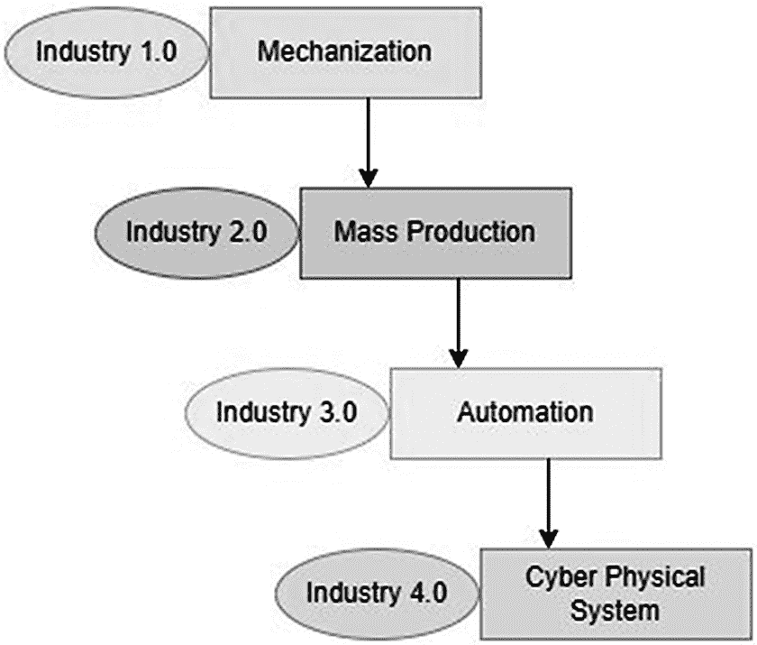

图 11.1 工业评估。


- **企业资源计划 (ERP)**：业务经理管理可用于控制全公司人口特征的工具。
- **IoT**：物联网（internet of things），这一概念为解释了物理设备（如传感器）与互联网之间的连接。
- **IIoT**：工业物联网（industrial internet of things），这一概念属于与制造相关的人类、记录和机器之间的连接或互连。
- **大数据**：大数据指的是海量的既有或无结构信息，可以对其进行收集、存储、组织和分析，以揭示模式、趋势、关联和机会。
- **AI**：`AI` 是一个关于计算机执行任务和做出判断潜力的概念，这种判断在传统上可能需要人类的智力。
- **M2M**：机器对机器（mobile-to-mobile），指通过 `Wi-Fi` 或压力网络在两个独立系统之间进行的通信。
- **演进与现代化**：属于将一种数据或细节收集并转换为高级布局。
- **先进制造单元**：先进的数字化工厂掌握着 `Industry 4.0` 技术、解决方案和技术。
- **云计算**：云计算是指使用互联网提供的远程服务器来保存、操作和维护确定性。
- **瞬时或实时记录操作**：瞬时统计操作属于笔记本电脑设计、框架和设备持续、常规处理数据并生成瞬时结果和感知的能力。

### 11.3.2 物理信息系统

`CPS` (图 11.2.)，也被称为信息生产，属于一种 `Industry 4.0` 授权的构建环境，能够对生产执行的每个环节产生实时数据序列、检测和透明度。`CPSs` 是计算、网络和物理过程的集成；它们是各种技术的结合，主要目标是操纵物理过程，并根据反馈实时管理到最新状态。`CPSs` 是一种重构，就像人类和系统结构连接在一起，仅仅因为网络改变了人类与数据互动的方式。

人类在这种情况下始终是至关重要的。虽然最灵活和智能的“实体”位于 `CPS` 内部，但人类期望其功能是某种“高级管理实例”，用于这些通常自功能和自组织方案的执行。由于一个 `CPS` 由许多不同要素组成，需要复杂的模式来总结每个子机器及其行为。随后，活跃的互连子结构通过一个主模型进行编排：一个受管理的实体，确保每个子系统的确定性行为。当前的设计设备需要升级，以防忘记不同子结构之间的相互作用、关联和提取。总体而言，交互导致了平衡、范围和可靠性的状态，这在很大程度上受到子结构之间随机通信的影响。

如果我们说无线社区，机器区域、生产条件和访客负载交换等点会随时间发生变化。这种方式使得语言通信社区也希望被总结为通用 `CPS` “版本模式”中的模式之一。执行受管理任务的时间对于实现准确的运行设备至关重要。物理方法是并排制造的几个对象的混合。时间模型（与时间维度实际性和时间同步保持静态的模型）需要在所有模式中进行系统化。

在未来，`CPSs` 可能活跃在所有业务领域和工业 4.0 范式中。`CPSs` 将创造生产方法，改变未来行业的质量。制造领域可以实现自配置、自管理和自优化，主要是为了额外的能力、舒适性和成本依赖。如文文所示，制造系统的每个实际要素都可能是复杂的，从架构到制造，通过交付系统，并增加客户业务和支持。在这种情况下，未来的制造工厂可能是一个 `CPS`，或 `CPSs` 的集合，其中非常有才华的员工可以直接从协调的智能系统和强制管理实体感知执行情况。该制造工厂可能是联网的且数据密集的，取决于 100% 舒适的工业级 5G 网络。

机构进行现代演变的节奏和技术将有所不同。然而，迈完全 `Industry 4.0` 范式的逐行步骤分布方向被解释得特别清楚。它包含六个阶段，每个阶段基于前一个阶段，总结如下：

1. **自动化与互连**：前两个步骤。目前尚未实现自动化、计算、网络和物理方法的总和。
2. **实时透明化**：在第三步中，通过使用系统和先进模式，实时实现技术事实和策略的透明度。现代和先进的双生模式是这里运动的一部分。
3. **虚拟模式**：通过虚拟模式，部门不仅可以看到正在发生什么，还可以发现并理解它，实现透明度的第四步。在这里，重要的是通过全事实检测（在任何工厂层级）来净化和阐明记录。
4. **预测能力**：预测能力和预见将是下一步，即第五步。它设定在制造的特殊情中，预测发生的概率，并为可能的结果做好准备。然后对数字模型进行动态更新。
5. **适应性**：然而，`Industry 4.0`可以通过第 6 也是最后一步来实现应用：适应性。它准备好立即采取适应性措施，并在需要时无需人类参与。

总结我们到为止讨论的所有内容，无线网络、云和改进设备系统领域的研发可以帮助我们理解 `CPSs` 的全部潜力。

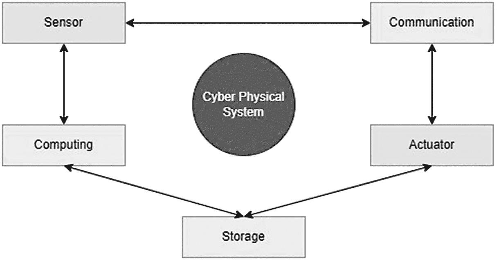

### 11.3.3 机器学习与人工智能

机器学习 [9–15] 是让计算机使用 `AI` 来发现并改进它们相互通信的方式，而无需被告知或编程。十年前，“工业 4.0”这一术语被创造出来用于描述商业世界的数字化进程。从那时起专注于部署或执行诸如 `IoT`、区块链以及所有 `AI` 分支（机器学习、深度学习、认知智能等）等现代数字技术的群体数量明显增加。


Infinium Global Research 在一份文件中详细阐述了工业 4.0 中计算的益处。技术的实施（包括设备对该领域的认知）有助于提升制造和生产性能，并允许更快速、更具活性且更具组织性的运营。该报告还指出，投入于该行业或地区现代化建设的人员增长，正在滋养业务领域市场。

在这条道路上，欧盟正以公司的步伐向前迈进。2020 年 2 月，欧盟委员会发布了《人工智能白皮书》。这是所有欧盟国家的一项联合战略，由其主席乌尔苏拉·冯·德莱恩（Ursula von der Leyen）总结，目标是在未来十年内吸引超过 200 亿欧元的人工智能投资。据总体统计预测，通过人员的投入和国家补贴将实现这一目标。根据 Global Research 分析师的说法，公共资金将推动工业 4.0 和电子部门的现代进步、云计算技术的应用以及现代制造设施的部署。

来自特殊行业的机构也可能从企业内部机器学习等软件技术的益处中获益，特别是四个战略区域将成为该技术的受益主体：陶瓷、汽车、组装以及电力控制与食品。这些业务领域从设备学习中获得最大的收益。陶瓷、汽车、能源控制以及食品饮料市场的公司已经通过机器学习算法实施人工智能来变现益处。他们正在强化一种允许他们预测负面和错误行为、优化制造技术并分析市场或需求强度的代际，这将使他们更好地实现并因此更准确地适应消费者需求。以下是人工智能和物联网（IoT）在工业 4.0 中的应用领域。

*   **陶瓷**：在陶瓷领域 \[30\]，人工智能开始参与主要功能。陶瓷领域设备学习系统的应用带来了益处。机器学习算法一直被使用，主要是在精细操作程序中。通过许多算法，可以预测织物在高温下的行为，并识别出瓷砖的异常和缺陷。该过程在人工智能的帮助下进行，在整个生产过程中寻找物质的异常或典型行为，使得管理和利用添加剂变得可行，从而产生比目前合成更好的抗性情况。通过识别错误模式，他们可能及早发现产品异常，减少浪费并提高益处。现在，我们已经发现了一些正在与这一时代合作并在该领域或其他领域使用此类技术的机构。他们主要是陶瓷、瓷质砖和地板领域的集团。
*   **汽车**：在汽车领域，人工智能也是一个被高度用于开发业务方法的时代。汽车及所有相关领域都在使用机器学习来提高产量。使用机器学习的益处在汽车行业已开始为人知。该行业利用此类技术对元件耐用性进行预测性评估，并对异常问题进行早期识别。机器学习在汽车领域的另一个用处是输送系统的最有效化。机器学习技术为汽车领域机构的生产流程提供了黄金机会。在这种经验中，他们很好地管理了不同能力之间的特殊规定供应所需的库存范围。相关汽车领域的大多数公司正在利用系统学习来开发其制造策略。
*   **安装与电力控制**：在安装和电力控制部门，人工智能通过设备学习正在取得巨大的进步。组装和电力效率领域系统学习的益处。该地区这些技术的创造正在变为智能网络或智能电网。根据 Business Insider 门户网站，这种形式的网络将利用设备学习技术的优势来发现实时计算，通过识别输入设计来更好地调节输送到需求的电力，并减少供应系统任何时候可能发生的灾难或中断。电力计算的另一个进步可能与增强社区的运行和提升有关。根据设备学习技术优势，这种处的处，人工智能的部署在电力管理带来了特殊益处。
*   **食品行业**：在食品行业 \[31\]，人工智能通过设备学习开始发挥关键作用。食品和饮料行业系统学习的益处。该行业技术的创造正在演变为智能网络或智能电网。


应当解释的是，计算策略的虚拟进化和应用在采购行业已经持续一段时间。与 20 世纪 60 年代和 70 年代全球范围内出现的生产问题相比，几乎整个大型企业都高效地管理了正确的应用，例如丰田的制造战略。这类方法依赖于系统变量和产品能力组合的持续计算和算法计算。随着此类数据或细节的能力和存储空间变得先进，计算机系统被引入以构建这些预测模型。这成为了当今流行的先进预测的前驱。然而，由于数据爆炸的持续，传统的算法计算无法支持这种高维、非结构化的记录传输。这正是深度学习大放异彩并震撼人心的地方因为它因为它能够处理惊人的非线性统计模式，并允许你发现或识别那些使用统计学家或统计模型建模非自动化极难发现的功能。机器学习和深度学习中的质量控制。机器学习，特别是深度学习，可以显著增强大型生产线中的最佳操作任务。事实上，根据福布斯的报道，分析和 `ML` 驱动的系统以及良好的开发预计将增长 35%，流程可视化和自动化预计将增长 34%。传统上，系统仅擅长识别具有高水平指标的第一级问题，例如产品的重量或长度。在不利用极其先进的计算机视觉系统的情况下，要在组件在生产线上以高速运行的同时，发现第一级问题上弥散的光学线索是不可能的。

## 11.4 文献综述

在本节中，对文献进行了综述。

此外，工业 4.0 的一致性、网络化和智能化系统增加了网络威胁的结构。在工业 4.0 的信息物理系统 (`CPS`) 架构和安全需求中，提出了一种基于云计算和软件定义网络 (`SDN`) 的 `CPS` 测试平台，即 `CPSTCS`（`基于云系统的信息物理系统测试平台`）。`CPSTCS` 利用基于云计算和 `SDN` 的网络测试平台来重现 `CPS` 的网络因素和物理组件的实时设备。`CPSTCS` 允许在关键基础设施的虚拟和物理维度上验证网络威胁 [21]。

工业 4.0 是一个新概念；因此，威胁评估至关重要。人们针对工业控制系统 (`ICS`) 和工业 4.0 预见了许多威胁计算策略，但很难识别针对 `ICS` 的网络攻击对物理全球的影响，因为其中许多策略是基于软件模拟的。他们关注风险评估和 `ICS` 测试平台的使用，这可以从解决开销复杂性中获益。在工业 4.0 中，信息物理设备需要自持续的判断和执行；它主要基于统计学以及人工智能 (`AI`) 和云技术的使用。目前的研究检查了利用 `AI` 和云使用 `ICS` 测试平台针对 `ICS` 攻击的网络风险。所提出的技术可以澄清网络危险对实际全球的影响，并提供一致的应对措施 [22]。

他们 [23] 目前正在经历信息物理系统方面的第四次制造革命。这些结构是业务自动化的，通过其网络化允许许多先进功能，并接入了网络全球，因此极大地改变了我们的正常生活。在这个框架下，目前无法实现的创新商业模式、作业方法和改进策略将变为可能。这些变化可能会强烈影响社会以及生活在家庭、购物等领域的人。然而，工业 4.0 同时指出了构成信息物理系统改进、可靠性、性和记录安全挑战的特征。在对工业 4.0 进行简要介绍后，本章描述了一个展示最重要部分的典型应用。

工业 4.0 代表企业和工业革命的第四阶段，其特殊在于它运行在互联网连接的智能系统上，具有自动工厂、企业、按需生产和`准时制`制造。工业 4.0 将由 `CPSs`、`IoT`、云和边缘计算模型结合而成，用于发展智能设备、智能家居和智能城市。鉴于工业 4.0 包含了传感器场、执行器、边缘和云处理范式以及社区结构，关键挑战的操作性表现包括：同时处理各种基础，并维护与物理环境连接的大型、数据驱动系统的安全性。在本章中，通过一种新型威胁情报方案处理场景，该方案模拟了企业组件（包括物理和网络结构）的动态交互。该组织包含两个部分：一个智能管理模块和一个智能模块。智能信息控制部分连接到工业 4.0 机器以处理不同的记录资源 [24]。

由于当前网络攻击的增长，特别是针对工业、科学和能源生态系统的关键系统，安全替换 [25] 一直是一个过度问题。尽管基于 `AI` 驱动维护的先进制造组织，完全基于损坏数据生成的预测绝对会对生命和财产造成损害。不足的记录安全机制很容易损害社区的安全和可靠性。测试环境在增强区块链关联后，避免了长连接的证书机构的延迟，并将提高价格的吞吐量。

工业 4.0 在制造业中拥有 `IoT` 的理念。智能联盟配备的物体可能能够相互通信并与其他物体进行自动增强。这些制造单元被称为 `CPS`。工业 4.0 相关的业务机器人软件包和 `CAE/CAD` 软件的示例基于 `EPLAN P8` 的识别，通过知识预测价格 [26]。

## 11.5 优势、局限领域

下面讨论了基于 AI-ML 的工业 4.0 的优势：


- 通过预测性维护降低成本，可以获得更低的维护费用，识别或减少更少的人力成本。它还减少了清单和物质或物品的浪费。
- 预测剩余使用寿命 (RUL)：监控系统运行也可以产生增强性能的状况，同时管理系统健康状况。预测 `RUL` 可以最大限度地减少导致意外中断的事件。
- 通过高效的库存控制以及卓越观察和现代化的制造流程，开发了供应链管理。
- 独立机器和电机：它们使用自给的卷升器和车辆来加速从卡车、船和其他车辆上卸箱箱的过程。
- 优质标准管理，通过主动意识不断提高质量标准。
- 发达与数字人工设备之间的协作提高了工人安全性，并提升了正常工作性能。
- 以购买者为中心的生产：非常容易改变或适应市场需求。

### 11.5.2 基于 AI-ML 的工业 4.0 的局限性

以下讨论了基于人工智能 (`AI`)- 机器学习 (`ML`) 的工业 4.0 的局限性：

- 实施案例取决于你试图执行的内容，可能会被拖长时间。
- 集成挑战以及当前结构中缺乏专业知识。
- 与其他结构和系统的可用性和互操作性。

### 11.5.3 基于 AI-ML 的工业 4.0 的应用

以下讨论了基于 `AI` 和机器学习 (`ML`) 的工业 4.0 的应用：

- 智能工厂：其特征是能够连接海量记录，正在推行工业 4.0 的智能行业在其制造流程中使用 `AI`。正确认同了数字革命的建设者可以各自建立并利用其数据，利用 `AI` 和系统主，通过分析设备能力和细致地组织工厂轨迹，来改进满意的控制、调整和维护。尽管 `AI` 在制造策略方面的优势是巨大的，但重要的是记住企业必须制定好 AI 发展计划，这是应用自动化策略的概念。
- 预测：实时积累数据，以便在预测性维护情况下观察系统。其目的是创建一个可以帮助预测并从长远上防止故障的轨迹；越来越多，通过学习算法，`AI` 正在被用于实现这一目标。一旦分析维护实现了自动化，在预测系统状况和预测何时必须维护时，计划可以更具战略性。当然，基于 `ML` 的解决方案的操作可以提高概率和设备的可访问性。
- 计算机视觉 (`CV`)：在各种 `AI` 中，`CV` 是数据科学的一个领域，专注于让计算机系统能够像人类一样识别和处理照片和视频中的物体。该领域发展的因素之一是产生的数据数量，这些数据随后用于训练和提高机器视觉。感谢 `AI` 的发展以及深度学习和人工神经网络的现代化，该领域已经明智地取得了几个世纪，并在预测和分类对象的某些任务上取代了人类。
- `CPS`：`CPS` 将软件嵌入物理世界，并表现为由智能电网、机器人和智能生产组成的综合程序。基于互联网的系统和应用程序的快速发展为工业利用互联网空间从任何地方进行高效且强大的日常连接提供了机会，从而提供一个完全分布的工业环境。
- 工业机器人：工业机器人是由机器人控制、可编程、多功能的机械手臂。不同的应用包括焊接、喷漆、熨烫、组装、拾取放置和测试，这些都可以以极大的耐心、速度和精度完成。

## 11.6 结论与未来展望

本章结束了对基于安全相关领域和部门的 `AI` 和机器学习的研究。本章还提供了在制造方面改进工业 4.0 的概念，并提出了增强不同部门之间协作的想法，将正确的数据实时地传递给正确的人员。这一概念不仅适用于此领域，也适用于安全和保护的其他领域。为了获取实时数据，不仅需要数据采集，还需要适当的测量和行动。因此，如果该领域变得薄弱，也将影响安全和数据保护领域。目标是便于在正确的时间做出正确的决策。在未来，我们可以像食品行业一样，并将此系统实施到各种行业，因此这将从业务方面提高该行业的增长。

## 参考文献

1. `J. Jiang`, “An improved cyber-physical systems for Industry 4.0 smart factories,” *2017 International Conference on Applied Innovation (ICASI)*, 2017, pp. 918–920. DOI: `10.1109/ICASI.798859`
2. `Z. You` and `L. Feng`, “Integration of Industry 4.0 related technologies in construction: A Framework of cyber-physical system,” IEEE Access, vol. 8, pp. 12908–12922, 2020. DOI: `10.1109/ACCESS.300720`
3. `J. Ruan`, `W. Yu`, `Y. Yang`, and `J. Hu`, “Design and realize of tire production monitoring system based on cyber-physical systems,” *2015 International Conference on Computer Science and Mechanical Automation (CSMA)*, 2015, pp. 175–179. DOI: `10.1109/CSMA.2015.42`
4. `M. Ramadan`, “Industry 4.0: Development of smart sunroof ambient light manufacturing system for automotive industry,” *2019 Advances in Science and Engineering Technology International Conferences (ASET)*, 2019, pp. 1–5. DOI: `10.1109/ICASET.8714236`
5. `W. Matsuda`, `M. Fujimoto`, `T. Aoyama`, and `T. Mitsunaga`, “Cyber security risk assessment on Industry 4.0 using ICS testbed with AI and Cloud,” *2019 IEEE Conference on Application, Information and Network Security (AINS)*, 2019, pp. 54–59. DOI: `10.1109/AINS47559.2019.8968698`


6. L. Cavanini 等, “工业 4.0 信息物理系统的初步研究：智能工厂自动导引车辆车的建模与协同仿真，”*2018 年工业 4.0 计量学与物联网研讨会*, 2018, pp. 169–174. DOI: [10.1109/METROI4.2018.8428334](http://dx.doi.org/10.1109/METROI4.2018.8428334)

7. M. Yu, M. Zhu, G. Chen, J. Li 和 Z. Zhou, “基于工业 4.0 的电力设备检测系统的信息物理架构，”*2016 年状态监测与诊断国际会议 (CMD)*, 2016, pp. 782–785. DOI: [10.1109/CMD.2016.7757942](http://dx.doi.org/10.1109/CMD.2016.7757942)

8. G. Cheng, L. Liu, X. Qiang 和 Y. Liu, “智能制造的工业 4.0 的发展与应用，”*2016 年信息系统与人工智能国际会议 (ISAI)*, 2016, pp. 407–410. DOI: [10.1109/ISAI.2016.0092](http://dx.doi.org/10.1109/ISAI.2016.0092)

9. W. Caesarendra, T. Wijaya, B. K. Pappachan 和 T. Tjahjowidodo, “利用机器学习和云计算改进航空航天制造业中传统的去刺方法，”*2019 年第 12 次信息通信技术与系统国际会议 (ICTS)*, 2019, pp. 120–124. DOI: [10.1109/ICTS.2019.8850990](http://dx.doi.org/10.1109/ICTS.2019.8850990).

10. H. Ouanan 和 E. H. Abdelwahed, “矿业中的图像处理与机器学习应用：矿矿 4.0，”*2019 年智能系统与高级计算科学国际会议 (ISACS)*, 2019, pp. 1–5. DOI: [10.1109/ISACS48493.2019.9068884](http://dx.doi.org/10.1109/ISACS48493.2019.9068884)

11. C. Weber 和 P. Reimann, “MMP – 一个用于在工业 4.0 中管理机器学习模型的平台，”*2020 年 IEEE 第 24 次国际企业对象计算研讨会 (EDOCW)*, 2020, pp. 91–94. DOI: [10.1109/EDOCW49879.2020.0025](http://dx.doi.org/10.1109/EDOCW49879.2020.0025)

12. M.-Q. Tran, M. Elsisi, K. Mahmoud, M.-K. Liu, M. Lehtonen 和 M. F. Darwish, “通过有前景的物联网和机器学习进行感应在线诊断的实验设置：迈向工业 4.0，”IEEE Access, vol. 9, pp. 115429–115441, 2021. DOI: [10.1109/ACCESS.2021.310597](http://dx.doi.org/10.1109/ACCESS.2021.310597)

13. E. Balamurugan, L. R. Flaih, K. Sangeetha, A. Jayanthildevi 和 T. S. Kumar, “人工智能在机器学习制造 4.0 中的用例，”*2019 年计算智能与知识经济国际会议 (ICCIKE)*, 2019, pp. 656–659. DOI: [10.1109/ICCIKE47802.2019.900427](http://dx.doi.org/10.1109/ICCIKE47802.2019.900427)

14. K. S. Kiangala 和 Z. Wang, “通过融合机器学习技术工业 4.0 制造 SCADA 系统参数配置的自适应框架，”*2020 年人工智能、大数据、计算与数据系统国际会议 (icABCD)*, 2020, pp. 1–6. DOI: [10.1109/icABCD49160.2020.91838](http://dx.doi.org/10.1109/icABCD49160.2020.91838)

15. F. S. Cebeloglu 和 M. Karakose, “工业 4.0 中使用机器学习的网络安全对比分析，”*2020 年 IEEE 系统工程研讨会 (ISSE)*, 2020, pp. 1–5. DOI: [10.1109/ISSE49799.2020.92723](http://dx.doi.org/10.1109/ISSE49799.2020.92723)

16. A. Dey, “Deep IDS：基于 IDS 的入侵检测的深度学习方法，”*2020 年工业 4.0 可持续技术国际会议 (STI)*, 2020, pp. 1–5. DOI: [10.1109/STI50764.2020.935041](http://dx.doi.org/10.1109/STI50764.2020.935041)

17. K. R. Thoorpu 和 N. Prafulla, “用于工业 4.0 的深度神经网络序列 dtc 嵌入，”*2020 年 IEEE 第 7 次工业工程与应用国际会议 (ICIEA)*, 2020, pp. 912–915. DOI: [10.1109/ICIEA49774.2020.91020](http://dx.doi.org/10.1109/ICIEA49774.2020.91029)

18. R. Ozdemir 和 M. Koc, “使用深度学习方法的智能工厂质量控制应用，”*2019 年 IEEE 第 14 次计算机科学与技术国际会议 (CSIT)*, 2019, pp. 46–49. DOI: [10.1109/STC-CSIT.2019.89297](http://dx.doi.org/10.1109/STC-CSIT.2019.89297)

19. M. Miškuf 和 I. Zolotová, “专注于工业 4.0 的多分类器与深度学习对比，”*2016 年控制论与信息学 (K&I)*, 2016, pp. 1–5. DOI: [10.1109/CYBERI.2016.74381](http://dx.doi.org/10.1109/CYBERI.2016.74381)

20. H. Subakti 和 J.-R. Jiang, “工业 4.0 智能工厂的室内威胁方案，”*2018 年 IEEE 第 42 次计算机通信会议 (COMAC)*, 2018, pp. 63–68. DOI: [10.1109/COMAC.2018.1020](http://dx.doi.org/10.1109/COMAC.2018.1020)

21. Z. Rahman, “关键工业 4.0 信息物理系统的基于区块链的安全框架，”IEEE Communications Magazine, vol. 59, no. 5, pp. 128–134, 2021 年 5 月 DOI [10.1109/MCOM.001.200067](http://dx.doi.org/10.1109/MCOM.001.200067)

22. W. Matsuda, Y. Peng, K. Jia, Z. Wen 和 H. Li, “基于云定义的工业 4.0 网络风险评估，”*2015 年 IEEE 应用信息网络安全会议 (AINS)*, 2015, pp. 337–340. DOI: [10.1109/AINS.2015.50](http://dx.doi.org/10.1109/AINS.2015.50)

23. D. Lukač, “第四次 ICT 工业革命‘工业 4.0’——HMI 以及使用 EPLAN P8 的 CAE/CAD 创新案例，”*2015 年第 23 次 Telfor 论坛 (TELFOR)*, 2015, pp. 835–838. DOI: [10.1109/TELFOR.2015.737759](http://dx.doi.org/10.1109/TELFOR.2015.737759)

24. S. Das, L. Ghosh 和 S. Saha, “利用人工智能工具分析游戏对认知负荷的影响，”*2020 年 IEEE 电子、计算与通信技术国际会议 (CONECCT)*, 2020. DOI: [10.1109/CONECCT50063.2020.919866](http://dx.doi.org/10.1109/CONECCT50063.2020.919866)


28. S. Das 和 A. Bhattacharya, “ECG 评估心率，在观看电影时使用 BPNN 进行分类并通过 Telegram 发送电影评分。”  Tavares J.M.R.S., Chakrabarti S., Bhattacharya A., 和 Ghatak S. (编) 数据挖掘与信息安全中的新兴技术。网络与系统讲义录，第 164 卷。Springer，新加坡， 2021. [`doi.org/10.1007/978-981-15-9774-9_43`](https://doi.org/10.1007/978-981-15-9774-9_43)。

29. Dnyandip Bhamare, Pranaynil Saikia, Manish Rathod, Dibakar Rakshit, 和 Jyotirmay Banerjee, “一种基于机器学习和深度学习的相变材料集成建筑围护热性能预测方法，”建筑与环境，第 199 卷，第 107927 页，2021. [10.1016/j.buildenv.2021.107927](http://dx.doi.org/10.1016/j.buildenv.2021.107927)。

30. 穆天洪, 王芬, 王秀峰和罗洪杰, “人工智能辅助古代陶瓷鉴定的研究，”陶瓷国际，第 45 卷，2019. DOI: [10.1016/j.ceramint.2019.06.003](http://dx.doi.org/10.1016/j.ceramint.2019.06.003)

31. N. R. Mavani, J. M. Ali, S. Othman 等, “人工智能在食品工业中的应用——指南，”食品工程评论，第 14 卷，2021. DOI: [10.1007/s12393-021-09290-z](http://dx.doi.org/10.1007/s12393-021-09290-z)

# 12 用于实现智能飞行稳定性能能力的三角测量增强 AI 算法

Bibhorr

IUBH 国际大学，德国，Bad Honnef

Chirag R. Anand

哈佛大学，美国马萨诸塞州，剑桥

DOI: [10.1201/9781003241348-12](https://dx.doi.org/10.1201/9781003241348-12)

## 12.1 符号列表

| 符号 | 含义 |
| --- | --- |
| `Δk` | 角度姿态变化 |
| `X` | 杂力 |
| `T` | 推力 |
| `M` | 合力矩 |
| `N` | 中性 |
| `I` | 作用载荷 |
| `l` | 力矩载荷 |
| `x, y, z` | 坐标数据 |
| `t` | 时间 |
| `(I) ∪ (B)` | 取向数组 |
| `(T) ∪ (A)` | 取向数组 |
| `x′, y′, z′` | 修改后的数据 |
| `a, b, c` | 修订后的数据 |
| `F` | 力 |
| `D` | 角度 |
| `α, β, γ` | 偏角 |
| `R` | 恢复 |
| `L` | `f` 的总限制 |
| `k` | 最大值累加 |
| `Z` | `f(y, t)` 的总限制 |
| `N` | `f(z, t)` 的总限制 |
| `T′` | 时间矩阵 |
| `V` | 最终偏转 |
| `e` | 编码周期 |
| `f[i]` | 信号持续 |
| `t[i], T[i]` | 时刻 |
| `x~` | 输入 `y` 的连续重构 |

## 12.2 背景

航空电子系统正变得越来越依赖软件运行，相关软件涵盖了广泛的应用领域：飞机和航天器的飞行控制、武器管理、防御任务计算、指挥控制、传感器管理与处理、监控、遥测。飞行控制系统已从完全机械发展到液压机械以及数字稳定/控制 [1。根据飞机的类型，系统和特性可能会有所不同。飞机使用主系统和副系统。主控制系统由升降舵、副翼和舵组成，它们对于在大多数飞行阶段安全操作飞机至关重要。副控制系统由襟翼、配平系统和扰流板组成，它们提高了飞机的性能特性，也有减轻飞行员过度控制力的负担。


在特定的飞行条件下，飞机可能表现出稳定的性能，但在其他情况下，它可能不再像之前操作时那样稳定，或者表现出完全的不稳定状态。这意味着如果一架飞机在直平飞行期间是稳定的，那么它在倒飞飞行阶段可能会变得不稳定，而这种过程也反之亦然。某些飞机（如教练机）被设计为精确稳定，但战斗机和其他军用飞行器等器具往往倾向于极不稳定的。某些军事战斗机被特意设计成具有固有的不稳定性，以增强机捷性并随后减少阻力。这些缺乏气动稳定性的飞行器会产生极其危险的后果性场景，因此必须由经验丰富的飞行员来驾驶。这便要求使用一种完全可靠且高效的高级自动人工稳定系统。由于系统故障可能导致灾难性的后果，航空航天工程师不会在民用飞机中赋予其固有不稳定性。但通过适当的安全措施，可以将稳定性水平降低到低于之前的设计水平，从而以减少阻力的形式产生益处。在分析飞行器飞行动力学中的稳定性时，会考虑飞行器姿态和速度的短和中期响应。稳定性考虑了飞行器对偏差的响应，以维持平稳和安全的飞行。当一架飞机的一侧机翼指向地球而另一侧指向天空飞行时，它在受到干扰时通常会恢复到初始位置。这种飞机被标记为调力异常（out of trim），但不被认为是不稳定的。在飞机的稳定和不稳定状态之间定义了一个中间状态。这是飞机在受到干扰时遵循的状况，在这种状态下，它既倾向于回到平衡姿态，也不会进一步偏离初始位置，而是倾向于保持新位置。这种中性稳定性在某些情况下是飞机本质上优选的特征。

在考虑空中交通管理问题时，稳定性要求变得更加复杂。预计飞机将遵循参考轨迹，但飞机之间必须保持距离，以避免近距离接触和空中碰撞 [2]`。不稳定的控制系统代表了潜在危险，因此是稳定性控制系统和工程中最重要的问题 [3]`。如果一架飞机保持稳定的均匀飞行并突出角姿态变化 `Δk`，那么除推力 `T` 以外的杂力 `x` 和绕重心产生的合力矩 `m` 必须等于零。满足这一要求的飞机被认为处于平衡状态。该标准在数学上的定义为：

(12.1)

`Δk = f(x, m) = 0`

根据这些方面，稳定性从根本上分为静态性和动态稳定性。静态稳定性表示飞行器对扰动响应的初始趋势，这种趋势会导致平衡恢复。动态稳定性与飞行器从平衡点受到干扰后的运动时间映射蓝有关。静态稳定的飞行器可以被认为是动态不稳定的。因此，静态稳定性不能保证任何形式的动态稳定性。

图 12.1 展示了飞行器在受到冲力引起轨迹扰动后可能表现出的典型行为响应。飞行器行为的结果被还原为对作用的反应。这种作用（在这种情况下是指由于冲力引起的运动）可能会导致行为上的静态稳定性、中性或不稳定性。相反，图 12.2 描述了动态稳定性响应条件，突显了对冲力导致飞行器维持平衡状态的典型行为响应。

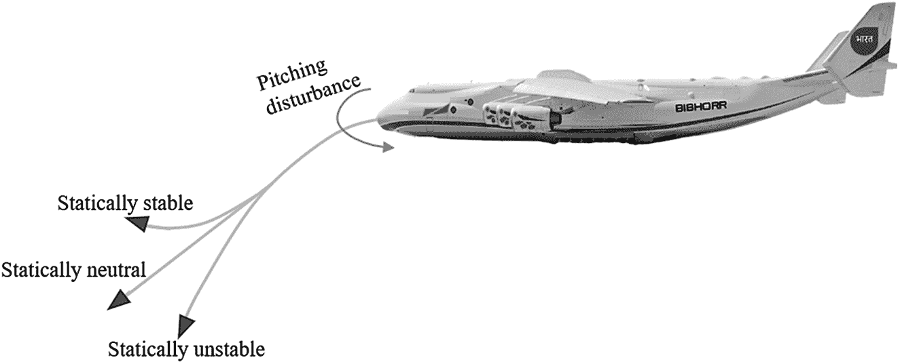

图 12.1 对刺激的响应示意图，可以反映行为上的静态稳定性、中性或不稳定性。

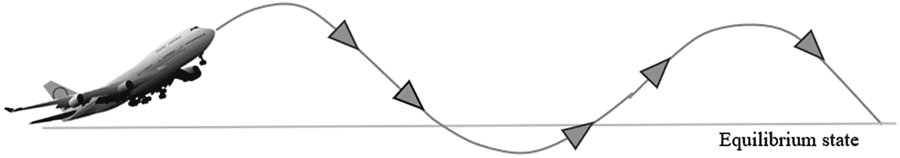

图 12.2 动态稳定性响应条件示意图。

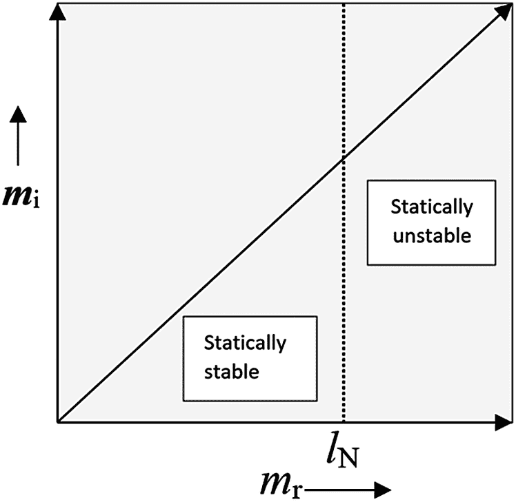

图 12.3 冲力 `mi` 与恢复力矩 `mr` 的关系图。

作者在数学上将静态稳定行为场景定义为：

(12.2)

`m[i] = m[r] | m[r] < l[N] (静态稳定条件)`

(12.3)

`m[i] = l[N] (静态中性条件)`

(12.4)

`m[i] > l[N] (静态不稳定条件)`

其中 `m[i]` 代表冲力，`m[r]` 表示恢复力矩，`l[N]` 是中性极限。

中性极限是飞行器无法提供恢复信号且被认为极不安全的交叉点。在图 12.3（如下所示）展示了 `m[i]`、`m[r]` 和 `l[N]` 之间的关系。

##12.3 三角化增强人工智能（AI）算法

### 12.3.1 基础概念

三角化是一种用于工程应用中精确测量的多维方法，由一组几何匹配的计算子程序组成。它是分析计算几何问题的基础程序，根据问题类型将复杂的几何图形首先分解为最简单的形式（如四面体和三角形），然后进一步分析以寻找所需的工程解决方案。

三角化是计算机几何和图形学中的关键程序。三角化允许通过一系列点来表示三维物体。这对于显示的速度、质量和分辨率至关重要。多边形三角化用于地理信息系统和数字地形建模过程 [4]`。三角化是利用两张可见该点的照片计算该点三维位置的技术。这种程序需要空间中已知直线的交叉。然而，如果由于噪声的存在这种交叉没有发生，则必须估计最佳近似值。


三角化可以被理解为将铺分划分为若干相互连接且不重叠的三角形。三角化中的三角形是通过区域 `Ω` 中的点建立的。在三角化的过程中，点集表示为：

`P` = {*p[i]}`, `i` = 1, ��…, ��`N`,

广泛的光学沉积监测技术依赖于三角化规则。其传统的执行方式是利用偏移激光扫描目标表面，并利用图像传感器识别测试点位置。三角测量测量法基于三角学原理，即如果已知三角形的一边和两个角，则未知边可以很容易评估。传统测量中的三角化方法涉及基准的测量（基准是形成三角形之一边的线）、测量每个三角形的角，以及通过规则顺序中的连续三角形计算两点之间的距离。由此形成的三角网根据测量精度分为：一级、二级和三级。有多个系统使用并高度依赖三角网格计算——其中一些系统主要包括全球导航卫星系统、方位角法和 RTL 系统。三角化用于各种仿真，特别是在空气动力学中，三角化可用于在网格生成准则期间制造无误差晶格结构。三角化技术在用于复杂的先进场景时，涉及轨迹识别、轨迹转换以及空气动力学性能参数化和高效空间交通管理的有效集成。如今，随着每天不断的变化，新概念和基于 AI 的解决方案挑战着传统陈旧的方法，三角化在空间交通管理中的实施范围在保持未来技术发展安全控制力方面是巨大的。利用三角化概念的潜力，这项工作启动了一种实现飞行稳定能力的 AI 算法。

### 12.3.2 起

Kisabo 等人（2012）研究了两个自动飞行器的设计、建模和分析：一个模糊比例积分微分（PID）控制器及其与 PID 控制器的混合体，用于控制飞机的俯仰面动力学。在他们的工作中，模糊逻辑控制器设计使用了 Mamdani 型模糊推理系统作为模糊推理系统（FIS）。S.N. Deepa 等人（2013）详细说明了混合模糊 PID 控制器的标准，以提高飞机的纵向控制性能。使用模糊算法的类似工作虽然缓慢，但在超关键实时情况下的核心问题解决在实际场景中仍然模糊。由于缺乏在该航空航天领域采用 AI 的核心工程工作，作者认为研究这一问题具有关键必要性。由于模糊逻辑的局限性，如预测并不总是准确、某些情况下存在歧义以及运行速度缓慢，作者发现寻找新的模型和算法是合适的，导致了这项工作的开发和启动。启动的算法基于三角化逻辑，该概念允许变量或问题的多个逻辑值跨越 0 到 `2*π` 之间。

### 12.4 AI-算法架构

如图 12.4 所示，由 AI 支撑的算法架构通过一系列独特的动作确定性地启动的，这些动作广泛分为两种轨迹——由 `p` 表示的推动作（push actions）和由 `m` 表示的数学动作（mathematical actions）。尽管所有过程动作（推和数学）都涉及数学建模准则，但在某种程度上，它们是孤立建立的，因为它们根据通信、数学建模规模、机电过程等因素具有实现所需动作的主导能力。动作 `p` 和 `m` 是受时间限制的，因为姿态扰动的关键性是算法设计的关键特征。根据 `m` 和 `p` 代码对动作序列进行分类（如下图 12.4 所示）的目的是为了 AI 算法整体功能的参数化成功分布制定策略。动作的添加、减法或替换可以通过该计划在制定实验需求后良好地进行。为了提高 AI 算法的成功率，在于切换这些代码。


主要的取向建模在冲压动作完成后出现。该动作作为数学主导过程的代表，将数据转换为新的代码，以便进一步发送进行计算和仿真。取向建模数组（`I` ∪ `B`）∪ (`T` ∪ `A`）是聚合过程的结果，其数学表达式为：

(12.9)

(`I` ∪ `B`) ∪ (`T` ∪ `A`) = {`x`,`y`,`z`,`t`[`x`],`t`[`y`],`t`[`z`],`x`′,`y`′,`z`′,`a`,`b`,`c`}

其中

(12.10)

`I` = {`x`,`y`,`z`}; `B` = {`x`′`y`′`z`′}; `A` = {`a`,`b`,`c`} and `T` = {`t`[`x`],`t`[`y`],`t`[`z`]}

在这里，`B` 是修改后的数学激增数据，`A` 是修订后的数学数据。大多数情况下，满足以下等式：

(12.11)

`x`′ = `a`; `y`′ = `b`; `z`′ = `c`

然而，情况并非总是如此。为了简单起见，简要回顾公式 (12.2) 到 (12.11) 的场景如下：

* 公式 (12.2)、(12.3) 和 (12.4) 根据动力力矩、回复力矩和中性极限描述了静态稳定场景。
* 公式 (12.5) 和 (12.6) 描述了推力和数学作用上的载荷分布场景。
* 公式 (12.7) 表示通过接收陀螺仪信号得到的姿态数组。
* 公式 (12.8) 描述了启动时间标记阶段获得的时间戳数组。
* 公式 (12.9) 描述了取向建模数组。
* 公式 (12.10) 描述了修改后的数学激增数据和修订后的数学数据。
* 公式 (12.11) 进一步描述了修改后的数学激增数据评分的方程。

力和力矩的估计是根据接收到的测量数据和时间戳数据完成的。该估计动作给出：

(12.12)

`F` ∪ `M` = {`p`[`x`],`p`[`y`],`p`[`z`],`p`[`R`],`m`[`x`],`m`[`y`],`m`[`z`],`m`[`R`]}

其中带有下标 `x`, `y`, `z` 的 `p` 表示力，带有相同下标的 `m` 表示沿其相应轴向的力矩。`p`[`R]` 和 `m`[`R]` 分别是合力和合力矩。在这里，`F` 是力数组，`M` 是力矩数组，给出如下：

(12.13)

`F` = {`p`[`x`],`p`[`y`],`p`[`z`],`p`[`R`]}

(12.14)

`M` = {`m`[`x`],`m`[`y`],`m`[`z`],`m`[`R`]}

角偏角 `D` 在此过程中并行分析，并扩展写为：

(12.15)

`D` = {`α`, `β`, `γ`}

其中 `α`, `β`, `γ` 分别是沿 `x`, `y` 和 `z` 方向的偏角。

随后，信息被传输到高级数学数据处理计算机 (AMDPC)，在那里数据经过过滤、处理、分析、计算、仿真，并进一步分发以映射行为模式并收集随时间的变化蓝图。信息随后被传输用于用于建立行为学习的稳健算法和数学检查，最终产生时间卷积数据集。这些卷积数据集有助于预测用于估计回复力和回复力矩的行为结果。回复力建模 `R` 的数学表达式为：

(12.16)

`R` = {`r`[`x`],`r`[`y`],`r`[`z`],`r`[`R`] `n`[`x`],`n`[`y`],`n`[`z`,],`n`[`R`]}

其中带有下标 `x`, `y`, `z` 的 `r` 表示力，带有相同下标的 `n` 表示沿其相应轴向的力矩。`r`[`R]` 和 `n`[`R]` 分别是合力和合力矩。在估计了力和力矩后，相应地执行控制，最终达到平衡。

## 12.5 姿态识别

姿态显示器是飞行系统仪表之一，用于指示航天器的取向，提供飞行器相对于自然地平线的角度信息，以便重新调整航天器并对抗空间迷失。姿态显示器本质上是一种陀螺飞行仪表，显示屏上带有微型车辆和地平线。显示屏上的微型车辆模拟飞行器相对于实际地平线的实时取向。为了呈现姿态信息，它可以设计为移动地平线格式或移动车辆格式。俯仰角和横倾角的限制通常取决于模型的设计。姿态显示器是最确凿的飞行仪表之一，能够在仪表盘上实时提供代表飞行器的最准确信息。基于移动地平线格式设计的显示器将车辆指示器作为稳定元素，而人工地平线根据实时情况和自然地平线相对于车辆的位置作为移动元素。在移动地平线格式中，车辆的倾斜方向与人工地平线的运动方向相反，即左倾通过人工地平线向右运动来指示，而车辆的俯仰通过地平线线的上下运动来指示。另一方面，移动车辆格式设计在中心显示车辆表示和人工地平线，其中横倾角通过车辆表示的运动显示，而人工地平线相对于仪表盘保持水平位置，俯仰角则通过人工地平线的上下运动来指示，与另一种格式类似。为了使姿态显示器有效工作，当飞行器绕其滚转和俯仰时，陀螺必须保持垂直直立。


虽然此类设备遇到的摩擦最小，但即使是极微小的摩擦也会对陀螺产生约束，导致其进动和倾斜。仪表外壳内部的立直机构在陀螺偏离垂直位置时会提供一个力以减少这种倾斜。该力的作用是将旋转轮带回其垂直位置。由于较新的仪表不再具备任何翻滚限制，因此它们缺少了在飞行器机动超过仪表限值时锁定陀螺的笼锁机构。在发动机启动时，陀螺并非立直状态。仪表内部由重力触发的自动立直机构会施加一个处理力，使陀螺升到垂直位置。此类与姿态显示器和其他飞行系统仪表相关的陀螺仪表已被更先进的姿态和头部参考系统所取代，这些系统的功能与陀螺系统相似；通过初始航向指示，姿态和头部参考系统可以同时确定姿态和磁航向。通过俯仰和横滚控制，可以实现符合空间定向的飞行器稳定控制。飞行器纵轴与真实水平面之间的角度关系由俯仰姿态控制控制。姿态显示器提供了俯仰姿态的清晰且直接的指示。对于所需的任何俯仰姿态，都利用控制装置将飞行器模型显示在屏幕上，相对于水平线或视线。尽管姿态显示器是主要的姿态参考，但主仪表和辅助仪表的概念并没有削弱特定飞行仪表在设定和维持俯仰横滚姿态时的重要性（只要它可用）。它是唯一能够实时准确描述实际飞行姿态的仪表。

## 12.6 时间标记

在姿态识别之后，进入时间标记阶段，每个数据集都会被进行时间戳标记，以便进一步执行和管理人工智能性能算法。时间标记阶段形成了整个基于人工智能的姿态稳定模型中的微小组成部分。图 12.7 描述了时间标记阶段，该阶段始于接收姿态数据，并在时间接近`k` 时结束。此阶段由数据编码过程和数据转储组成。额外数据会被刻意地泄漏并丢弃，因为系统仅选取实际上对于进一步计算所需的名义数据。

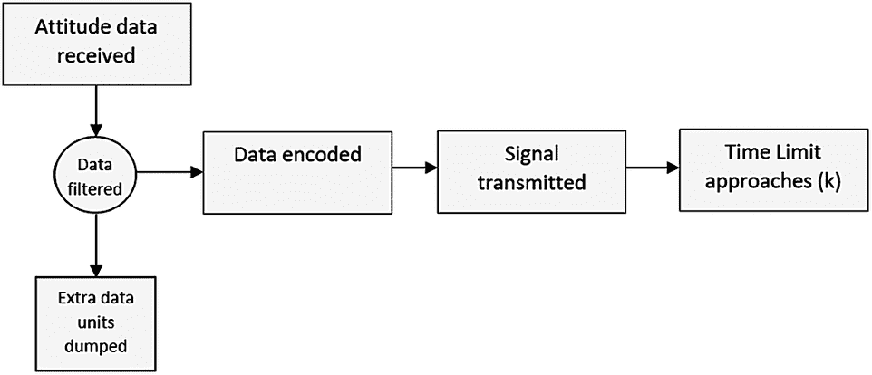

图 12.7 描述基于 AI 稳定算法中时间标记阶段的流程图。

时间点数据得分（如图 12.8 所示）标记为 `t[x]`、`t[y]` 和 `t[z]`，是时间和和轴坐标数据的函数。它们的数学表达形式如下：

(12.17)

$$tx = f\\ \\left( {x,t} \right) = \left. \int\frac{1}{x} \right.dt$$

(12.18)

$$ty = f\\ \\left( {y,t} \right) = \left. \int{\\frac{1}{y}\ } \right.dt$$

(12.19)

$$tz = f\\ \\left( {z,t} \right) = \left. \int\frac{1}{z} \right.\ dt$$

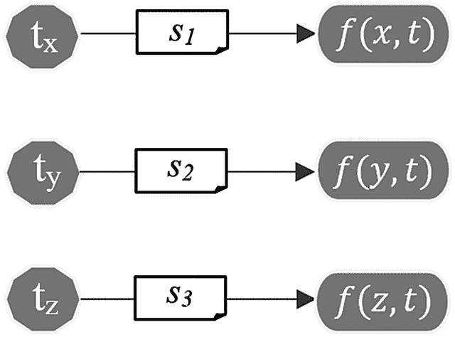

图 12.8 以时间及轴描述坐标的函数显示的时间标记数据集。

当时间 `t` 接近 `k` 时，函数 `f (x,t*)` 的总时间限制为 `L`。这里，`k` 表示分配给动作的最大时间积累。其数学表示为：

(12.20)

$$\lim\\limits\_{t\\rightarrow k}\\ f\\ \\left( {x,t} \right) = L$$

当时间 `t` 接近 `k` 时，函数 `f (y,t*)` 的总时间限制为 `Z`。同样，`k` 表示分配给动作的最大时间积累。其数学表示为：

(12.21)

$$\lim\\limits\_{t\\rightarrow k}\\ f\\ \\left( {y,t} \right) = Z$$

同样，对于 (`z, t*)`，方程给出：

(12.22)

$$\lim\\limits\_{t\\rightarrow k}\\ f\\ \\left( {z,t} \right) = N$$

每个坐标数据的时间矩阵由原始元素、编码元素和最终输出元素表示。这种三值时间数组表示如下：

(12.23)

$$T\\prime = \\ \\left\\lbrack {\\begin{matrix} a \\ b \\ c \\ \\end{matrix}\\ } \right\\rbrack$$

其中 `T’` 表示时间矩阵，`a`、`b` 和 `c` 分别是原始、编码和最终输出元素。

## 12.7 姿态建模

姿态建模始于接收时间标记数据，结束于输出可读数据。一旦接收到时间标记数据，数据就会重新编码为合适的格式，然后在仿真过程中检测微元素。这些微元素细节被永久存档或保留备用，并输出重复的可读数据以完成该阶段。此过程通常不受时间限制；然而，一个上限的偏好时间限制始终有助于确保快速处理 (图 12.9)。

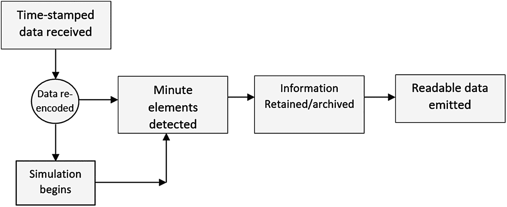

图 12.9 姿态建模的流程图。

变化坐标像素的仿真在一个三维数字扩展框架上渲染，位置的大小以相应的比例编码，以便进一步发送数据以完成数学建模。这是估计力和力矩的预阶段。如图 12.10 所示，接收的数据被编码为像素或其他计算机计算和分析的格式。可读数据是该动作的输出，随后有助于力和力矩的估计。

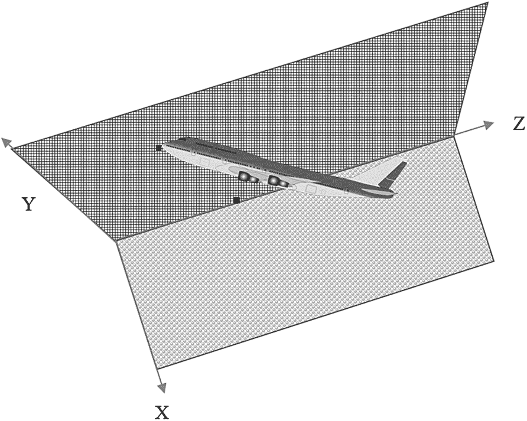

图 12.10 基于 AI 姿态稳定算法的姿态建模。

## 12.8 角偏差与力矩估计

在算法动作的阶段，飞行器的当前位置通过数字处理与预期的平衡位置重合。这是通过计算坐标像素数据与预期平衡像素元素数据之间的差异来实现的。不匹配程度越高，整个算法的负载越大。偏差沿所有轴向以及合力方向进行分析 (图 12.11)。

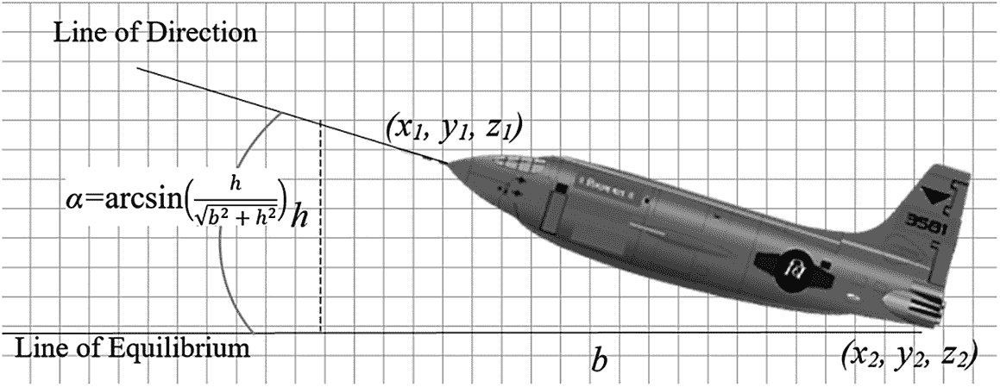

图 12.11 基于 AI 稳定算法中角偏差的流程图。


偏转数据经过多次过滤和编码数学处理，直到得到最终的偏转数组 `V`：

(12.24)

`V`= {*`q`[*α*],`q`[*β*],`q`[*γ*],`q`[*x*],`q`[*y*],`q`[*z*]}

在这里，

(12.25)

$$q_{\\alpha} = \\frac{p\_{x}}{\alpha};\\ q_{\\beta} = \\ \\frac{p\_{y}}{\beta};\\ q_{\\gamma} = \\frac{p}{\\gamma}$$

同样，

(12.26)

$$q\_{x} = \\frac{m\_{x}}{x};\\ q\_{y} = \\frac{m\_{y}}{y};\\ q\_{z} = \\frac{m}{z}$$

回顾公式(12.13)和(12.14)，带下标 `x`, `y`, `z` 的 `p` 表示力，相同下标的 `m` 表示沿各自轴向方向的力。同样回顾公式(12.15)，`α`, `β`, `γ` 分别是沿 `x`, `y` 和 `z` 方向的偏转角。

## 12.9 高级数学数据处理计算机

如图 12.12 所示，AMDPC 的概念由三个阶段组成，即数据输入阶段、数据处理阶段和数据输出阶段。数据输入阶段涉及数据采集/收集、数据过滤、为了提高速度而故意的数据泄露、编解码处理周期、数据通信、数据传输以及数据存档/存储。下一阶段是数据处理阶段，包括仿真性能、数据分析、行为分析、数学运算执行、误差索引检测、计算误差的操作与纠正、数据蓝图估计，最后发送未识别数据。AMDPC 的最后一个阶段强调数据分类、数据存储、编解码循环、用于进一步传输的数据展示，以及以防系统故障时供未来参考的数据归档。


图 12.12 显示高级数学数据处理计算机功能的流程图。

如果接收到的典型数据为数组 `A`, `B`, `C`, `D` 和 `E` 的形式：

(12.27)

`A`= {*x**,`y**,`z**,`k**,`l**,`m**,`u**,`v**,`y**}

(12.28)

`B`= {*x`^′,`y`^′,`z`^′,`k`^′,`l`^′,`m`^′,`u`^′,`v`^′,`y`^′}

(12.29)

`C`= {*x`*[1],`y`*[1],`z`*[1],`k`*[1],`l`*[1]}

(12.30)

`D`= {*x`*[2],`y`*[2],`z`*[2],`k`*[2],`l`*[2],`m`*[2],`u`*[2],`v`*[2],`y`*[2]}

(12.31)

`E`= {*x**,`y**,`k**,`l**,`u**,`x`*[1],`y`*[1,]`u`*[2],`v`*[2]}

那么，过滤数据的典型标准是通过消除重复元素（如 `E` 中的元素）以及等效元素（`C` 和 `D`）来实现的，仅选择以下数据集进行进一步处理：

(12.32)

`A`= {*x**,`y**,`z**,`k**,`l**,`m**,`u**,`v**,`y**}

(12.33)

`B`= {*x`^′,`y`^′,`z`^′,`k`^′,`l`^′,`m`^′,`u`^′,`v`^′,`y`^′}

这种过滤是有益的，因为它有助于提高数据处理速度，并有助于防止由于过度存档不需要的数据而可能导致的存储累积延迟。

对于输入数据 `i`，编码周期 `e` 根据以下方程工作：

(12.34)

`e`= ∫`f`(`i`) `f`(`t`−`i`) `d`**i`

其中 `t` 代表编码元素。

编码也可以处理为：

(12.35)

`e`= ∫`f`(`i`) `f`(`t`−`i`) `d`**i`

## 12.10 行为算法

回顾公式(12.13)和(12.14)，带下标 `x`, `y`, `z` 的 `p` 表示力，相同下标的 `m` 表示沿各自轴向方向的力。同样回顾公式(12.15)，`α`, `β`, `γ` 分别是沿 `x`, `y` 和 `z` 方向的偏转角。


`H`(`z`) = `F`(`z`) `G`(`z`)

记为 `f` * `g` 的逆函数 `h` 是 `f` 和 `g` 的卷积。经典卷积理论指出，`H` 是 `f` 和 `g` 的卷积 `h` 的变换，表示为：

(12.41)

$$
h\left( t \right) = \left( {f \ast g} \right)\left( t \right) = \int\limits\_{0}^{t}f\left( {t - s} \right)g\left( s \right)ds
$$

## 12.12 恢复力矩估计

角偏转与力矩估计阶段以及时间卷积阶段的混合导致了恢复力和力矩的估计。时间卷积的最优绘图有助于实现所需的估计标准。算法通过全面的分步方法观察了整个扰动的蓝图，并根据分步蓝图数据的逆向条件启动平衡恢复操作。如果在在此逆向操作过程中，算法检测到错误，则将评估并考虑额外的力和力矩，并相应地驱动控制面。此动作导致被发现处于主要扰动下的飞机恢复平衡状态。恢复力矩 `m`[r] 可以定义为最终模拟行为蓝图数据 `b` 函数的逆积分。其数学表达式给于：

(12.42)

`m`[`r`] = –∫ `f` (`b`) `d`*`b`*

其中方程 (12.42) 右侧的负号表示逆向过程。

## 12.13 实验结果

由于冲动力矩 `m`[i]，车辆承受了角姿态变化 `Δk`。为了稳定状态，算法生成恢复角 `b` 的预测，当考虑到该角度时，算法操纵控制产生恢复力矩 `m`[`r]`，最终通过实际恢复的姿态角 `Δj` 恢复车辆。原型机在实验测试条件下的场景所示所示。在数据中，`w` 表示数字模拟原型力矩的未媒介标准哈希项。

| `Δk` (°) | `m`[i] (w) | `m`[`r`] (w) | `b` (°) | `Δj` (°) |
| --- | --- | --- | --- | --- |
| 1 | 0.66 | 0.64 | 0.9918 | 0.9 |
| 1.5 | 0.68 | 0.67 | 1.5016 | 1.5 |
| 2 | 0.78 | 0.79 | 2.0012 | 2 |
| 2.5 | 0.79 | 0.81 | 2.5061 | 2.5 |
| 3 | 0.81 | 0.83 | 3.011 | 3 |
| 3.5 | 0.85 | 0.84 | 3.4991 | 3.4 |
| 4 | 0.89 | 0.91 | 4.0128 | 4 |
| 4.5 | 0.93 | 0.95 | 4.5218 | 4.5 |
| 5 | 0.97 | 0.98 | 5.016 | 5 |
| 5.5 | 1.12 | 1.1 | 5.5 | 5.5 |
| 6 | 1.3 | 1.3001 | 6.0001 | 6 |
| 6.5 | 1.5 | 1.5004 | 6.51018 | 6.5 |
| 7 | 1.68 | 1.69 | 7.019 | 7 |
| 7.5 | 1.79 | 1.83 | 7.06 | 7.5 |
| 8 | 2.2 | 2.3 | 8 | 8 |
| 8.5 | 2.1 | 2.2 | 8.5 | 8.5 |
| 9 | 2.3 | 2.4 | 9 | 9 |
| 9.5 | 2.4 | 2.5 | 9.5 | 9.5 |
| 10 | 2.6 | 2.7 | 10 | 10 |
| 10.5 | 2.8 | 2.89 | 10.5 | 10.5 |
| 11 | 3.1 | 3.2 | 11 | 11 |
| 11.5 | 3.2 | 3.3 | 11.5 | 11.5 |
| 12 | 3.3 | 3.4 | 12 | 12 |
| 12.5 | 3.5 | 3.6 | 12.5 | 12.5 |
| 13 | 3.7 | 3.8 | 13 | 13 |
| 13.5 | 3.9 | 4.0 | 13.5 | 13.5 |
| 14 | 4.1 | 4.2 | 14 | 14 |
| 14.5 | 4.3 | 4.4 | 14.5 | 14.5 |
| 15 | 4.5 | 4.6 | 15 | 15 |

## 12.14 结论

角偏转与力矩估计阶段以及时间卷积阶段的混合导致了恢复力和力矩的估计。时间卷积的最优绘图有助于实现所需的估计标准。算法通过全面的分步方法观察了整个扰动的蓝图，并根据分步蓝图数据的逆向条件启动平衡恢复操作。如果在在此逆向操作过程中，算法检测到错误，则将评估并考虑额外的力和力矩，并相应地驱动控制面。此动作导致被发现处于主要扰动下的飞机恢复平衡状态。恢复力矩 `m`[r] 可以定义为最终模拟行为蓝图数据 `b` 函数的逆积分。其数学表达式给于：

(12.42)

`m`[`r`] = –∫ `f` (`b`) `d`*`b`*

其中方程 (12.42) 右侧的负号表示逆向过程。

## 12.13 实验结果

由于冲动力矩 `m`[i]，车辆承受了角姿态变化 `Δk`。为了稳定状态，算法生成恢复角 `b` 的预测，当考虑到该角度时，算法操纵控制产生恢复力矩 `m`[`r]`，最终通过实际恢复的姿态角 `Δj` 恢复车辆。原型机在实验测试条件下的场景所示所示。在数据中，`w` 表示数字模拟原型力矩的未媒介标准哈希项。

| `Δk` (°) | `m`[i] (w) | `m`[`r`] (w) | `b` (°) | `Δj` (°) |
| --- | --- | --- | --- | --- |
| 1 | 0.66 | 0.64 | 0.9918 | 0.9 |
| 1.5 | 0.68 | 0.67 | 1.5016 | 1.5 |
| 2 | 0.78 | 0.79 | 2.0012 | 2 |
| 2.5 | 0.79 | 0.81 | 2.5061 | 2.5 |
| 3 | 0.81 | 0.83 | 3.011 | 3 |
| 3.5 | 0.85 | 0.84 | 3.4991 | 3.4 |
| 4 | 0.89 | 0.91 | 4.0128 | 4 |
| 4.5 | 0.93 | 0.95 | 4.5218 | 4.5 |
| 5 | 0.97 | 0.98 | 5.016 | 5 |
| 5.5 | 1.12 | 1.1 | 5.5 | 5.5 |
| 6 | 1.3 | 1.3001 | 6.0001 | 6 |
| 6.5 | 1.5 | 1.5004 | 6.51018 | 6.5 |
| 7 | 1.68 | 1.69 | 7.019 | 7 |
| 7.5 | 1.79 | 1.83 | 7.06 | 7.5 |
| 8 | 2.2 | 2.3 | 8 | 8 |
| 8.5 | 2.1 | 2.2 | 8.5 | 8.5 |
| 9 | 2.3 | 2.4 | 9 | 9 |
| 9.5 | 2.4 | 2.5 | 9.5 | 9.5 |
| 10 | 2.6 | 2.7 | 10 | 10 |
| 10.5 | 2.8 | 2.89 | 10.5 | 10.5 |
| 11 | 3.1 | 3.2 | 11 | 11 |
| 11.5 | 3.2 | 3.3 | 11.5 | 11.5 |
| 12 | 3.3 | 3.4 | 12 | 12 |
| 12.5 | 3.5 | 3.6 | 12.5 | 12.5 |
| 13 | 3.7 | 3.8 | 13 | 13 |
| 13.5 | 3.9 | 4.0 | 13.5 | 13.5 |
| 14 | 4.1 | 4.2 | 14 | 14 |
| 14.5 | 4.3 | 4.4 | 14.5 | 14.5 |
| 15 | 4.5 | 4.6 | 15 | 15 |


9. [A. B. Kisabo, F. A. Agboola, C. A. Osheku, M. A. L. Adetoro, A. A. Funmilayo] (2012) “利用人工智能控制飞机的俯仰，《Journal of Scientific Research & Reports》，1, 1–16。
10. [S. N. Deepa, G. Sudha] (2013) “利用人工智能实现飞机的纵向控制，《International Journal of Engineering & Technology》，5(6), 4752–4760。
11. [Bibhorr] (2019) “利用三角测量法技术对工程应用中测量方法的分析研究，”科学技术术语使用国家研讨会，科学与技术术语委员会，MHRD。
12. [H. Liu, J. Kotker, H. Lei, B. Ayazifar], 离散系统与卷积，加利福尼亚大学，伯克利分校。
13. [M. Bohner, G. S. Guseinov] (2007). “时间尺度上的卷积，”摘要与应用分析，2007, 1–24。

# 13 车载通信网络中资源管理的基于预测的认证方案

Vartika Agarwal 和 Sachin Sharma
Graphic Era (认定大学)，印度德拉杜敦
DOI: [10.1201/9781003241348-13](https://dx.doi.org/10.1201/9781003241348-13)

## 13.1 引言

各种类型的设备，如传感器、发射器和接收器被用于车辆之间的通信。这些设备提升了驾驶体验。从安全角度来看，车辆向其他驾驶员告知任何紧急情况可以完全防止事故。我们有多种基于预测的认证方案，帮助我们提前预测资源和信标。基于预测的认证（PBA）方案适用于即时验证。通过这些方案，我们可以预测两个信标之间的车辆移动。PBA 安全可靠，并能分析数据包丢失的影响。PBA 记录的消息以代码的形式存在。TESLA 方案基于密码学。如果消息未在规定时间内递送给另一辆车，则消息将不再再次发送。在这里，我们可以预测如果消息未在特定时间内递送，则可能存在安全攻击。椭圆曲线数字签名技术（ECDSA）是一种附在消息上的数字签名。通过这种签名，我们可以提前预测信标并保持消息的机密性。位置预测方案可以提前预测车辆的位置，以便我们分析下一个即将出现的信标的到达情况。

## 13.2 文献综述


关于车载通信网络（VCN）资源管理的身份验证方案已有许多相关研究报告。为了实现消息身份验证和安全性，我们回顾了基于预测的 VCN 资源管理身份验证方案。

2007 年，Vinod Namboodiri 引入了基于预测的路由协议（`PBR`）。该协议针对变化的车辆密度进行了广泛评估。`PBR` 显著减少了路由失败，并导致了高数据包交付率[1]。2010 年，Vaishali 讨论了两辆或多辆汽车之间的通信过程。她试图比较用于建立车辆间通信的不同仿真器的性能和缺点[2]。

2015 年，Chen Lyu 了一种有效的认证方案，有助于保护信息免受各种安全攻击。`PBA` 存储消息签名的缩短认证码。该方案在提前预测信标方面表现良好[3]。2017 年，Abdullah Al Mamun 对负载预测方案进行了综述。该方案用于控制各种操作，如调度和全分配。本章重点关注使用机器学习的混合方法[4]。

2017 年，Joerg Evermann 使用循环神经网络关注业务流程中的事件预测。[5]。2018 年，Harmanjot Kaur 描述了基于聚类的路由方法，并主要关注每种技术的优缺点[6]。2019 年，Mohammad Masdari 提出了一种负载预测方案以改进云计算中的资源管理。他们引入了负载预测方案来识别现实生活中可能发生的更真实、复杂的请求模式[7]。

2020 年，Mustafa Maad Hamdi 对车载自组织网络的概念、应用和特征进行了概述。他们描述了各种工具，如 `GrooveSim`、`NHTSA`、`FLEETNET` 或许多其他工具来解决车载自组织网络仿真问题[8]。2020 年，Raj. K. Jaiswal 将 `Kalman Filter` 引入基于位置的路由协议。这些预测使用 `C++` 库实现，与其他协议相比具有极高的效率[9]。

2020 年，Vartika 等人强调了用于 V2V 通信的 `Bluetooth`、`Wi-Fi` 等各种技术[10]。2020 年，Vartika 回顾了物联网在交通管理系统中的应用。他们强调了用于交通管理的交通管理模块[11]。2020 年，Muhammad Mansoor 比较了两种用于负载预测的人工神经网络技术[12]。

2021 年，Vartika 等人提交了关于任务调度的网络调度技术的综述章节。此类技术非常高效，并提供了整个调度过程的概述[13]。2021 年，Vartika 等人研究了改进 VCN 无线资源管理的深度学习技术。将讨论负载预测和双向长短期记忆网络（`LSTM`）技术。`Bi-LSTM` 网络可以通过输入变量进行训练。金融数据的预测模型可以使用 `LSTM` 网络对未来数据进行预测，具有更好的准确性和优于其他类型预测模型的性能。基于 `LSTM` 的预测方法有捕捉时间序列数据中任何模式的能力。与其他测试方法相比，其性能更好。异常检测系统可以检测并防止内部攻击。此外，还可以使用基于 `Dempster-Shafer` 和贝塔 分布的理论模型来提高系统准确性。该方案与其它异常识别方案相比表现良好[14]。

2020 年，Hui Liu 引入了多目标优化相关理论。本章对该技术进行了全面综述。他们讨论了该技术的优缺点，并指出了进一步研究的空白。短期负载和价格预测使用了互信息、随机森林和递归特征消除技术。可以使用可用于价格和负载预测的 `UMASS` 数据集。该技术在准确性和性能方面优于其他测试方法[15]。

Zongjian He 提出了一种用于车辆通信的软件定义网络架构。该架构增加了通信速度并提供了更好的吞吐量[16]。P. Deepalaksmi 提出了一种检测恶意节点的椭圆曲线数字签名技术。该方案提高了网络性能并提供了更高的吞吐量[17]。Chia-Hui Liu 提出了一种监测血压、心率和体温的用户认证方案。他们使用无线传感器网络存储认证数据[18]。

2021 年，Azeem Irshad 为基于智能电网的需求资源管理设计了一种安全认证方案。该方案对于基于智能电网的需求资源管理效果良好[19]。2021 年，Sajid Hussain 引入了用于车辆的基于椭圆曲线的认证方案[20]。2021 年，Dipanwita Sadhukhan 提出了用于智能设备的认证方案。他们使用 `AVISPA` 仿真工具验证系统[21]。2020 年，Mohd Shariq 提出了射频识别方案。`Scyther` 工具验证了该方案的稳健性[22]。2021 年，Muhammad Asghar Khan 提出了超椭圆密码（`HECC`）[23]。2021 年，Chenyu Wang 提出了一种用于节点的隐私保护认证方案。该方案安全性高且计算成本低[24]。2020 年，Sunakshi Singh 引入了雾节点的轻量级认证方案。他们基于身份加密的概念[25]。2021 年，Merzougui Salah Eddine 提出了针对节点复制攻击、虫洞攻击、分布式拒绝攻击等的基于区块链的认证方案[26]。2021 年，Damandeep Kaur 提出了一种用户认证方案。该方案与其他技术相比更可靠、更安全[27]。2021 年，Ya-Fen Chang 提出了三因子认证方案。他们使用了哈希函数以及 NOR 操作[28]。2020 年，Chi-Tung Chen 提出了一种使用无线传感网络的高效安全认证方案。该方案在效率和消耗方面具有优越性能[29]。2021 年，Diksha Rangwani 提出了一种用于无线传感网络的隐私保护安全认证方案。他们使用 `AVISPA` 仿真工具验证系统的准确性[30]。2019 年，Mohammed EI-hajj 回顾了基于物联网（`IoT`）的认证领域。它比较了各种认证方案及其优缺点并得出了结论[31]。2017 年，Ashwini Bhore 提出了一种基于射频系统的安全目标跟踪认证方案。仿真结果显示该方案具有更多的安全特征，优于其他方案[32]。2022 年，Cong Dai 提出了一种基于椭圆密码的密码保护方案。该方案减少了密码更改和猜测尝试。提供了更高级别的安全性[33]。2017 年，Sunil Kumar 回顾了用于车载自组织网络的各种认证方案。他们讨论了此类技术的优点、缺点、结果和未来前景[34]。


我们在本章中的贡献总结如下：

*   回顾了各种用于维护信息机密性、完整性和安全性的认证方案。此项工作的动机是分析不同认证方案中的缺点，以便我们实现具有更安全、更可靠特征的更好方案。
*   强调了 `VCN` 中网络资源管理的优势。
*   本章的结论。

## 13.3 车辆通信网络的重要性

`VCN` 非常重要，因为它在不同车辆之间建立了通信。它扩展了道路的视野范围并传播了安全信息。在这个网络中，车辆能够交换信息。配备有适当软件的车辆可以使用来自其他车辆的消息。建立 `VCN` 的主要目标是避免意外情况。`VCN` 通常在高速交通场景和城市环境中运行。在高速交通场景中，环境较为简单，而在城市中环境较为复杂。在 `VCN` 中，车辆受到道路拓扑的限制并必须对其他移动车辆做出响应，导致其移动性具有可预测性。`VCN` 对于交通管理非常有效，可以帮助驾驶员并提高燃油效率。`VCN` 可以防止发生碰撞。通过 `VCN` 我们可以减少高达 70% 到 80% 的事故。从图 13.1，我们可以看到有一个 `ENodeB` 用于车辆之间的通信。通过 `ENodeB`，车辆可以相互通信。


图 13.1 车辆通信网络。 ¶  ¶ 图 13.1 详细说明 ¶ 在此图中有三辆车辆正在相互通信。它们交换并共享关于交通、路线、路径等信息。EnodeB 是车辆进行通信的源。¶ 

表 13.1 用于 `PBA` 的参数。

| 参数 || 描述 |
| --- | --- |
| 发送者的计算开销 || 签名生成的平均时间 |
| --- | --- |
| 接收者的计算开销 || 签名验证的平均时间 |
| 数据包处理率 || 攻击的验证安全性 |
| 信标验证的存储成本 || 车辆存储的字节数 |

使用 `VCN` 有若干优势：

*   `高效的交通管理`：通过 `VCN`，我们可以跟踪车辆的位置，识别交通区域，并找到到达目的的最短路线（图 13.2）。
*   `驾驶辅助`：`VCN` 指导驾驶员到达目的的最短路径，帮助驾驶员避免不安全的漂移。
*   `安全`：`V2V` 通信非常安全，因为有很多方案可以验证消息的真实性。
*   `隐私`：`VCN` 处理关于驾驶员的私有数据。这些数据将高度安全且不会被任何人跟踪。
*   `安全`：`VCN` 通过及时协助驾驶员提供安全保障。
*   `高效燃油消耗`：在 `VCN` 中，所有车辆都必须调整速度和位置，以便进行有效通信。
*   `高效的路线优化`：在 `VCN` 中，所有车辆都能获得关于路线、交通、目的地的必要信息。
*   `防止可能发生的碰撞`：`VCN` 可以防止碰撞并减少 70% 到 8%。


图 13.2 VCN 的优势。

表 13.2 不同基于网络的技术的比较研究。

| 作者 || 技术 || 准确率 |
| --- | --- | --- |
| Vinod Nambood 等人. 1 | 基于预测的路由协议 | 该协议不适用于功率控制。95 |
| Chen Lyu 等人. 3 | 基于预测的认证方案 | 该方案不满足隐私和安全需求。99 |
| Harmanjot Kaur 等人. 6 | 基于聚类的路由方法 | 吞吐量和丢包率较低。85 |
| Sami Abduljabbar Rashid 等人. 8 | 传感器中的簇 | 不适用于小型网络。90 |
| Zongjian He 等人. 16 | 基于 SDN 的车辆通信 | 缺乏扩展性和安全性。80 |
| P.Deepalakshmi 等人 17 | 椭圆曲线数字签名技术 | 吞吐量和丢包率较低。90 |
| Chenyu Wang 等人. 24 | 隐私保护认证方案 | 它仅适用于传感器 80 |
| Sunakshi Singh 等人. 25 | 轻量级双向认证方案 | 安全性且计算成本高。88 |
| Merzoungi 等人. 26 | 基于区块链的安全认证 | 消息丢弃率高。75 |
| Damandeep Kaur 等人. 27 | 用户认证方案 | 可靠性较低。80 |

## 13.4 车辆通信网络网络资源管理的优势

高效的车辆通信需要资源。它们负责整个通信过程。在 `VCN` 中，资源可以是传感器、传输器、接收器或其他许多。网络资源管理具有以下优势（图 13.3）。


图 13.3 VCN 网络资源管理的优势。

*   `资源利用`：资源利用意味着资源的正确使用。这意味着资源被发挥到最大潜力以提供及时响应。
*   `解决意外问题`：资源有助于解决车辆通信期间发生的的意外问题。


- **存储**：在某处跟踪所有细节总是很困难的。资源有助于将所有信息存储在数据库中，以便用户在需要时可以检索信息。
- **透明性**：资源为一切事务提供了更好的视图，提供了更高的可见性并理清了整个通信过程的流程。
- **预测未来**：资源管理帮助我们预测预测资源的结果。
- **风险分析**：风险分析涉及检查由于风险事件影响导致结果发生的变化。
- **识别瓶颈**：资源管理帮助我们提前识别瓶颈，以便我们进行修复。
- **性能测量**：资源管理是一项持续活动。在规划之后，它展示了整个过程的清晰蓝图。
- **防止误解**：每个资源都分配了相应的任务。因此，发生任何混乱或误解的机会就会减少。

## 13.5 资源管理中的安全性

- **及时验证**：在这种身份验证机制中，接收者必须检查消息是否由有效车辆发送。接收者还检查消息在传输过程中是否被篡改。它维护了信息的机密性（图 13.4）。
- **不可否认性**：它为第三方提供了权限，用于在发送者和接收者之间生成消息。
- **抗拒绝攻击**：在这里，我们可以轻松验证无效签名。如果未经授权的人可以反复发送无效签名，那么可能存在拒绝攻击风险。
- **丢包**：丢包是无线传感器网络中的正常过程。如果在传输过程中发生丢包，机制应当验证下一个数据包。
- **攻击检测**：需要检测攻击以避免未经授权的访问。这维护信息的机密性是必要的。
- **系统故障**：备份是安全的主要部分。如果系统故障，我们必须通过数据库或其他资源恢复数据。


图 13.4 网络资源管理中的安全性。

## 13.6 网络资源管理身份验证方案

VCN 中的网络资源管理有不同的身份验证方案。这些技术防止来自不同类型安全攻击的消息，并维护信息的机密性（图 13.5）。


图 13.5 网络资源管理身份验证方案。

1. **基于预测的身份验证方案**：该方案基于对称加密。它提高了身份验证的效率。最小了身份验证的计算开销。它分析了车辆通信过程中发生的攻击。高效的身份验证方案应该提供及时的消息。它在传输过程中验证消息的真实性。这种技术保持短消息，使其不会被拒绝服务（DoS）攻击或其他安全攻击篡改。
2. **基于预测的身份验证方案**：该方案基于对称加密。它提高了身份验证的效率。最小了身份验证的计算开销。（图 13.6）

- **链密钥**：在这一步中，车辆生成私钥。
- **位置预测**：在每次攻击时，车辆预测自己的位置。
- **Merkle 树构建**：预测位置后，车辆使用公钥作为私钥。
- **签名生成**：Merkle 树构建后，将开始生成过程。
- **介访问存储**：在接收端，计算带宽并验证结果数据。在这里，PBA 提供了消息的安全。
- **签名验证**：在 MAC 存储过程之后，通过 `TESLA` 密钥验证签名。图 13.7 阐述了该方案。（注：原文提到：`图 13.7 阐述了 PBA 方案`）


图 13.6 基于预测的身份验证方案。


图 13.7 PBA 身份验证过程。

```
- 车辆注册
- 显示节点并选择通信的源和目的车辆
- 计算并分配带宽
- 将消息发送给接收者
- 身份验证、授权和校验
```

在计算时间后，我们可以画出图表，并衡量该方案的准确性和性能。表 13.1 列出了用于基于预测的身份验证方案的参数。这些参数可以用于计算发送方和接收方的计算成本。表 13.2 阐了不同技术的对比研究。


### 椭圆曲线数字签名技术
该安全方案用于预测和检测路由中的异常节点。该技术可以识别中断车辆间通信的节点，并将这些节点从网络中隔离。它包括密钥生成、签名生成以及签名验证。密钥生成包括主密钥生成器，签名生成用于验证消息，签名验证用于异常异常。它维护了成功发送的数据包数量与丢包数量的比例。该技术确保了节点的可用性和完整性，并提高了网络性能。它提供了可靠的车辆通信。该方案增强了 VCN 中的吞吐量和异常节点检测（图 13.8）。


图 13.8 椭圆曲线数字签名技术。 ¶ ¶ 图 13.8 详细描述 ¶ 该方案用于预测路由中的受攻击节点。它包括密钥生成、签名生成以及签名验证等。它维护数据包发送与丢包的比例。 ¶ 

### 基于区块链的安全认证方案
物联网（IoT）已广泛应用于教育、交通和军事等各种应用。物联网面临的挑战性任务之一是识别设备认证。该方案使用平方根算法验证设备的真实性。与其他认证方案相比，该方案提供了更准确的结果。在此方案中，有一个主节点负责整个认证过程。该节点通过唯一编号验证设备，并向用户发送关于设备认证的消息。从图 13.9 中，我们可以看到存在一个区块链网络。有一个主节点负责车辆认证，并向相关用户发送消息。


图 13.9 基于区块链的安全认证方案。 ¶ ¶ 图 13.9 详细描述 ¶ 该方案通过唯一编号验证设备，并向用户发送关于设备认证的消息。 ¶ 

### 基于位置的预测技术
该技术预测受攻击车辆的位置。在这种方法中，我们可以识别中断 VCN 的攻击者位置。该方案将受攻击节点从网络中屏蔽，使得该节点不再中断通信，且该过程运行顺畅。当同时发生多次攻击时，该技术可能会失效。这种状态被称为阻塞（blockage），是该技术的局限性。在该技术中，我们可以提前预测攻击者的位置，从而避免 VCN 的中断（图 13.10）。


图 13.10 基于位置的预测技术。 ¶ ¶ 图 13.10 详细描述 ¶ 该方案将受攻击节点从网络中屏蔽，使得该节点不再中断通信，且该过程运行顺畅。 ¶ 

### TESLA
TESLA 代表定时高效容错协议（timed efficient loss-tolerant protocol）。它被用于车辆之间的消息交换。它只发送短消息并维护信息的安全性。接收者解码消息、读取内容并用短消息进行回复，以便任何未经授权的用户无法访问（图 13.11）。


图 13.11 TESLA 认证技术。 ¶ ¶ 图 13.11 详细描述 ¶ 该方案仅发送短消息并维护信息的安全性。接收者解码消息、读取并用短消息回复。 ¶ 

### 隐私保护认证方案
该方案基于公钥和私钥。公钥用于发送者对消息加密，私钥用于接收者解密消息。公钥和私钥负责认证。该方案主要用于防止黑客修改消息。对于该方案，所有车辆必须配备车载单元（`OBU`）和传感器单元（图 13.12）。


图 13.12 隐私保护认证方案。

### 用户认证方案
在此方案中，用户的身份性验证由智能设备完成。这些设备检查接收者是否成功收到了消息（图 13.13）。


图 13.13 用户认证方案。

### 轻量级相互认证方案
该方案保护整个网络免受未经授权的访问。它实现了双方之间的相互认证。该方案降低了计算和通信复杂度。该方案对攻击具有鲁棒性，且消耗的计算和通信能量成本较低。从图 13.14 中可以看到一个包含三辆车辆的网络。通过轻量级相互认证方案，完成了用户验证。


图 13.14 轻量级相互认证方案。

### 条件隐私保护认证方案 (CPPA)
该方案基于密码学概念。在这里，主密钥、签名辅助节点、任务分配和令牌用于维护信息的机密性。该方案安全且能够保护信息的完整性免受未经授权源的破坏。

#### CPPA 方案的步骤：


1. **主签名和次签名** – 它以消息长度作为输入并将其转换为最短形式，以维护信息的机密性（图 13.15）。


图 13.15 条件隐私保护认证方案。

2. **签名辅助节点** – 它是由车辆在向附近的车辆发送信息之前生成的。这基本上用于验证和确认消息的真实性。接收车辆只需验证签名并对消息的真实性做出决策。

3. **签名生成器** – 接收信息后，接收车辆生成签名并连同确认消息发送给发送者。发送者验证签名并确保消息已送达目的地。

4. **令牌分配器** – 当车辆需要注册时，将分配一个令牌。该令牌将验证车辆的许可。如果任何车辆没有令牌，它必须从车辆通信过程中剔除。

5. **验证者** – 验证者检查消息的有效性。验证者检查从发送者到接收者的整个过程并验证消息的机密性。

6. **公钥、私钥签名 (PKS)** – 发送者随消息附带公钥。发送者以加密的形式发送消息。接收者使用私钥解密消息。

## 13.7 结论与未来展望

在本章中，我们研究了各种认证系统，这些系统可以帮助我们预测并识别攻击者。签名生成、MAC 存储和签名验证是 PBA 方案的三个主要步骤。该方案的主要优点是安全可靠。这种方法的主要缺点是它没有解决隐私问题。PBA 保持了消息的私性和机密性。未经授权的人无法访问。椭圆曲线数字签名技术防止未经授权的用户修改机密信息。它更安全，但丢包率较高。基于区块链的安全认证方案保护信息免受各种网络攻击。此类技术具有较高的消息丢包率。用户认证方案基本上用于验证用户。它使用公钥和私钥进行用户身份识别。对于未来，我们需要改进这些技术。每种技术都存在一些安全可靠性问题。我们需要克服这些问题并尝试改进这些技术。这些技术非常有效、轻量级，并可分析丢包情况。在 VCN 中，基于预测的认证技术对于管理网络资源特别为有效且高效。在未来，我们可以通过提供准确的预测模型来改进这种方法。我们可以使用机器学习和认知科学技术来获得更好的指标值。我们还可以考虑隐私问题。这种方法可以在现实环境中实施。在未来，我们必须关注隐私和安全标准，以及准确率。

## 参考文献

1. Namboodiri, V., & Gao, L. (2007). 车载自组织网络基于预测的路由。IEEE Transactions on Vehicular Technology, 56(4), 2332–2345.

2. Khairnar, V. D., & Pradhan, S. N. (2010). 车辆自组织网络仿真的对比研究。International Journal of Computer Applications, 4(10), 15–18.

3. Lyu, C., Gu, D., Zeng, Y., & Mohapatra, P. (2015). PBA：车车通信基于预测的认证。IEEE Transactions on dependable and Secure Computing, 13(1), 71–83.

4. Al Mamun, A., Sohel, M., Mohammad, N., Sunny, M. S. H., Dipta, D. R., & Hossain, E. (2020). 使用单一和混合预测模型的负载预测技术综述。IEEE Access, 8, 134911–134939.

5. Evermann, J., Rehse, J. R., & Fettke, P. (2017). 使用深度学习预测过程行为。Decision Support Systems, 100, 129140.

6. Vehicular, R. A. I. (2018). 车载自组织网络中基于聚类的路由方法综述。International Journal of Advanced Research in Computer Engineering & Technology (IJARCET), 7(2). DOI: [10.17485/ijst/2015/v8i1/106884](http://dx.doi.org/10.17485/ijst/2015/v8i1/106884)

7. Masdari, M., & Khoshnevis, A. (2020). 风能预测技术与应用中多目标优化框架综述。Energy Conversion and Management.

8. Hamdi, M., Audah, L., Rashid, S., Mohammed, A., Alani, S., & Mustafa, A. (2020). 在 *2021 年第 5 届国际智能计算与控制会议 (ICICCS)*，. 198–202.

9. Jaiswal, R. K. (2020). 使用卡尔曼滤波的基于位置路由协议。Computers & Electrical Engineering, 83, 106599.

10. Agarwal, Vartika, Sharma, Sachin, & Agarwal, Piyush (2021). 基于物联网的交通管理。Computer Networks, Big Data and IoT，709–716.

11. Agarwal, Vartika, Sharma, Sachin, & Bansal, G. (2020). 物联网智能交通管理。信息研究会议，207–216.

12. Mansoor, M., Grimaccia, F., Leva, S., & Mussetta, M. (2021). 用于需求响应电力负载预测的回声状态网络与前馈神经网络对比。Mathematics and Computers in Simulation, 184, 282–293.

13. Agarwal, Vartika, Sharma, Sachin (2022). 改进车载通信网络无线资源管理的深度学习技术。*国际可持续先进计算会议 (ICSAC 2021)*。

14. Liu, H., Li, Y., Duan, Z., & Chen, C. (2020). 风能预测技术与应用中多目标优化框架综述。Energy Conversion and Management, 224, 113324.

15. He, Z., Cao, J., & Liu, X. (2016). SDVN: 为异构车载通信提供快速网络创新。IEEE Network, 30(4), 10–15.


17. Deepalakshmi, P., & Kumanan, T. (2020，9 月). 无线自组织网络中基于椭圆曲线数字签名技术的异常节点检测. 于 *IOP Conference Series: Materials Science and Engineering* (第 925 卷, 第 1 期), p. 012075. IOP Publishing。

18. Liu, C. H., & Chung, Y. F. (2017). 无线医疗传感器网络的安全用户认证方案。Computers & Electrical Engineering, 59, 250–261。

19. Irshad, A., Chaudhry, S. A., Alazab, M., Kanwal, A., Zia, M. S., & Zikria, Y. B. (2021). 一种智能电网的安全需求响应管理认证方案。Sustainable Energy Technologies and Assessments, 48, 101571。

20. Hussain, S., Chaudhry, S. A., Alomari, O. A., Alsharif, M. H., Khan, M. K., & Kumar, N. (2021). 汇聚安全：一种基于 ECC 的无人机群认证方案。IEEE Systems Journal, 15, 4431–4438。

21. Sadhukhan, D., Ray, S., Biswas, G. P., Khan, M. K., & Dasgupta, M. (2021). 基于椭圆曲线学的 IoT 通信轻量级远程用户认证方案。The Journal of Supercomputing, 77(2), 1114–1151。

22. Shariq, M., Singh, K., Maurya, P. K., Ahmadian, A., & Ariffin, M. R. K. (2021). URASP：一种利用置换操作的超轻量级 RFID 认证方案。Peer-to- Networking and Applications, 14, 1–21。

23. Khan, M. A., Ullah, I., Alkhalifah, A., Rehman, S. U., Shah, J. A., Uddin, I. I., … 以及 Algarni, F. (2021). 一种用于无人机驱动的智能交通系统的可证明且保护安全的认证方案。IEEE Transactions on Industrial Informatics, 18, 3416–3425。

24. Wang, C., Wang, D., Xu, G., & He, D. (2022). 适用于工业 4.0 的具有前向安全的高效隐私保护使用认证方案。Science China. Information Sciences, 65(1), 1–15。

25. Singh, S., & Chaurasiya, V. K. (2021). 雾计算环境下的 IoT 设备相互认证方案。Cluster Computing, 24(3), 1643–1657。

26. Eddine, M. S., Ferrag, M. A., Friha, O., & Maglaras, L. (2021). EASBF：一种基于区块链的雾计算支持的车联网高效认证方案。Journal of Information Security and Applications, 59, 102802。

27. Kaur, D., & Kumar, D. (2021). 智能家居双因子用户认证方案的密码分析与改进。Journal of Information Security and Applications, 58, 102787。

28. Chang, Y. F., Tai, W. L., Hou, P. L., & Lai, K. Y. (2021). 一种物联网环境下的安全三因子匿名用户认证方案。Symmetry, 13(7), 1121。

29. Chen, C. T., Lee, C. C., & Lin, I. C. (2020). 适用于 IoT 环境下 WSN 的高效安全三方相互认证密钥协商协议。PloS One, 15(4), e0232277。

30. Rangwani, D., Sadhukhan, D., Ray, S., Khan, M. K., & Dasgupta, M. (2021). 一种用于农业无线传感网络的改进隐私保护远程用户认证方案。Transactions on Emerging Telecommunications Technologies, 32(3), e4218。

31. El-Hajj, M., Fadl, A., Chamoun, M., & Serhrou, I. (2019). 认证方案综述。Sensors, 19(5)。

32. Bhore, M., & Bhandari, G. (2021). *物联网分析*。

33. Dai, C., & Xu, Z. (2022). 一种基于椭圆曲线的三因子认证方案。Ad Hoc Networks, 127。

34. Manvi, S., & Tang, S. (2017). VANET 认证方案。Vehicular Communications, 9–30。

# 14 面向工业 4.0 的智能信息物理系统：结语

Jyoti Sekhar
加尔加塔理工学院，加尔加塔

Siddhartha Bhattachary
Rajnagar Mahavidaya，Birbhum，印度

DOI: `10.1201/978103241344` (https://dx.org/10.1201/978103241344)

## 14.1 引言

随着电子传感器和执行器驱动当今生活的方方面，对于数据泄露、数据受损以及盗窃的担忧日益增加。入侵者在拦截平台方面变得比以往任何时候都勤奋。因此，确保这些处于关键生活的平台 [10] 的安全至关重要。

信息物理安全正如其名，是指与用于网络安全解决方案的物理系统相关的安全问题，[15] 包括物联网 [11]、[12]、[13] 和 [14] 工业物联网（IIoT）、运营技术以及工业控制系统，例如 [1]、[2]、[3] 和 [4]。

信息物理系统包含嵌入式传感器、高速多数据处理器以及用于感知与物理世界或环境交互的物理执行器的智能网络系统，从而确保基础设施和物流的无缝实时运行。受益于传感和网络技术的进步，这些技术成本相对较低，并且可以进行远程管理。


-   **物理访问**：尽管这看起来是一个简单的要求，但应该确保对网络端口、网线、网络连接甚至电源连接具有稳健的物理访问，以防止连接物理设备被篡改。这可以通过采用物理锁、防篡螺丝、封装电缆以及部署硬线设备来实现。

-   **环境条件**：信息物理系统平稳运行最重要的关注点之一是保护这些设备免受极端温度、湿度、沙子/尘土和其他腐蚀性元素形式的环境危害的影响。因此，设备在投入实时运行之前，需要在极端的环境条件下进行测试。

-   **网络安全**：由于这些设备本质上是分布式网络系统，它们容易出现任何其他类似系统或应用中存在的电子缺陷。通过对固有的固件组件通过不同的安全检查（包括渗透测试、漏洞评估、变更控制和补丁管理），可以避免这方面的潜在威胁。这还包括对这些资源控制的外部设备进行适当的物理操作，因为它们会对人类生命和物理环境构成同等威胁。

-   **规划**：由于这些设备专门用于管理信息物理系统的安全性，因此相应的操作程序和规划在各方面都应当是独特的。因此，不建议在正常运行期间进行主动渗透测试。简单的故障排除过程也不适用于这些设备，因为对这些运行系统中识别出的故障进行任何修复尝试都可能导致其他系统模块的功能异常。因此，需要拥有适当的操作备份计划、停机流程和异常处理机制，以确保服务不中断。

-   **风险分析**：由于这些设备需要与物理世界交互，因此在每个操作层都需要对相关风险进行适当评估，以估计风险的潜在影响和相应的缓解策略，从而防止任何灾难性事故。

-   **隐私**：这些数据密集型系统处理大量从录制器到摄像头到读卡器获取的个人身份信息。由于这些数据的敏感性，必须确保这些数据的适当加密、安全存储和隐私，以保护私人信息。

-   **可靠性**：任何信息物理系统的主要属性是其运行的可靠性。因此，完全不建议频繁重启这些系统，因为这将阻碍设备的无缝运行。因此，电源故障的管理和修复以及其他故障的恢复应安排在运行时间之外，以防损害这些系统的正常运行。

-   **可支持性**：考虑到系统组件随时间的推移而产生的磨损，需要密切关注的重要属性之一是这些系统中所有组件的可支持性。可支持性是指对物理组件备件持续生命周期可用性的支持，以及对软件升级和安全补丁的支持。此外，由于这些系统具有高度的可扩展性，还应确保系统组件的无中断升级。否则，系统可能会在计划折旧期结束之前变得无法运行。

## 14.3 计算智能在信息物理安全系统中的作用

几乎所有讨论的属性都需要人工干预和人类智能来确保妥当的管理和评估。因此，每个属性的性能受到人为错误和理解的影响。因此，需要对这些属性进行完全自动化和智能化的管理，以防止人工干预。计算智能方法 [9, 17 和 18]] 归益于智能工具和技术的演进，在这方面可能大有裨益。因此，所有属性可以通过智能方法进行进一步引导，以消除人工解释和理解，从而为传统的属性评估程序提供一种稳健且防错的替代方案，同时考虑到人类观察中的不确定性和不精确性。[19, 20 和 21]]

因此，底是将计算智能引入安全机制中，使其具备知识并自自力。

## 参考文献

1. Kim, N. Y., Rathore, S., Ryu, J. H., Park, J. H., & Park, J. H. (2018). A survey on cyber physical system security for IoT: issues, challenges, threats, solutions. Journal of Information Processing Systems, 14(6), 1361–1384.
2. Lee, J., Bagheri, B., & Kao, H. A. (2015). A cyber-physical systems architecture for industry 4.0-based manufacturing systems. Manufacturing Letters, 3, 18–23.
3. Huang, S., Zhou, C. J., Yang, S. H., & Qin, Y. Q. (2015). Cyber-physical system security for networked industrial processes. International Journal of Automation and Computing, 12(6), 567–578.
4. Wurm, J., Jin, Y., Liu, Y., Hu, S., Heffner, K., Rahman, F., & Tehranipoor, M. (2016). Introduction to cyber-physical system security: A cross-layer perspective. IEEE Transactions on Multi-Scale Computing, 3(3), 215.
5. Gupta, R., Tanwar, S., Al-Turjman, F., Italiya, P., Nauman, A., & Kim, S. (2020). Smart contract privacy protection using ai in cyber-physical systems: Tools, techniques and challenges. IEEE Access, 8, 24746–24772.
6. Stefanov, A., & Liu, C. C. (2014). Cyber-physical system security and impact analysis. IFAC Proceedings Volumes, 47(3), 11238–1243.
7. Oks, S. J., Jalowski, M., Fritzsche, A., & Möslein, K. (2019). Cyber-physical modeling and simulation: A reference architecture for designing demonstrators for industrial cyber-physical systems. Procedia CIRP, 84, 257–264.
8. Alam, K. M., & El Saddik, A. (2017). C2PS: A digital twin architecture reference model for the cloud-based cyber-physical systems. IEEE Access, 5, 2050–2062.
9. Bhattacharyya, S., Maulik, U. & Bandyopadhyay, S. (eds. Dai, Y., Chakraborty, B., & Shi, M.). Soft Computing and its Applications. Kansei Engineering and Soft Computing: Theory and Practice, IGI Global, Hershey PA, USA, pp. 1–30, 2011.
10. Das, K., & Banerjee, J. S. (2022). Green IoT for Intelligent Cyber-Physical Systems in Industry 4.0: A Review of Enabling Technologies, and Solutions. In GCAIA 21: Proceedings of 2nd Global Conference on Artificial Intelligence and Applications (pp. 463–478).


11. Das, K., & Banerjee, J. S. (2022). 认知无线电赋能的物联网 (CR-IoT)：一种迈向智能世界的集成方法。收于 *GCAIA 21: 第二届全球人工智能与应用会议论文集*，第 541–555 页。

12. Biswas, S., Sharma, L. K., Ranjan, R., Saha, S., Chakraborty, A., & Banerjee, J. S. (2021). 基于物联网的智能农业和节水节水智能灌溉系统实现。收于 *计算智能赋能研究的最新趋势 (Recent Trends in Computational Intelligence Enabled Research)* (pp. 339–354)。Academic Press。

13. Roy, R., Dutta, S., Biswas, S., & Banerjee, J. S. (2020). Android Things：从物体到智能显示和扬声器的全面解决方案。收于 *物联网包容性生活国际会议 (ICIIL 2019)*，印度昌得迪加尔 NITTTR (pp. 339–352)。Springer，新加坡。

14. Pandey, I., Dutta, H. S., & Banerjee, J. S. (2019, 3 月). WBAN：一种下一代电子医疗系统的智能方法。收于 *2019 年第三届计算方法论与通信国际会议 (ICCMC)* (pp. 344–349)。IEEE 电气工程师学会。

15. Banerjee, J., Maiti, S., Chakraborty, S., Dutta, S., Chakraborty, A., & Banerjee, J. S. (2019, 3 月). 机器学习在各种网络安全应用中的影响。收于 *2019 年第三届计算方法论与通信国际会议 (ICCMC)* (pp. 276–281)。IEEE 电气工程师学会。

16. Chakraborty, A., Banerjee, J. S., & Chattopadhyay, A. (2020). 用于认知无线电网络中可靠频谱感知的恶意节点限制量化数据融合方案。《连续力学与数学科学杂志》，15(1), 39–56。

17. Chakraborty, A., Singh, B., Sau, A., Sanyal, D., Sarkar, B., Basu, S., & Banerjee, J. S. (2022). 智能车辆事故检测与智能救援系统。收于 *工程中的机器智能应用 (Applications of Machine Intelligence in Engineering)* (pp. 565–576)。CRC Press。

18. Chattopadhyay, J., Kundu, S., Chakraborty, A., & Banerjee, J. S. (2018, 11 月). 人机交互的面部表情识别。收于 *计算视觉与生物启发计算国际会议* (pp. 1181–1192)。Springer，Ch 姆。

19. Banerjee, J. S., Chakraborty, A., & Chattopadhyay, A. (2021). 用于协作认知无线电网络协作中继选择最佳可靠中继队列的决策模型：基于层次分析法的模糊 AHP 解决方案。《无线网络 (Wireless Networks)，27(4), 2909–2930。

20. Chakraborty, A., Banerjee, J. S., & Chattopadhyay, A. (2019). 用于认知无线电网络协作频谱感知中节省数据速率和减少控制道开销的非均匀量化数据融合规则。《无线个人通信 (Wireless Personal Communications)，104(2), 837–851。

21. Banerjee, J. S., Chakraborty, A., & Chattopadhyay, A. (2022). CR 网络中可靠中继选择的协作策略：博弈论解决方案。《无线个人通信 (Wireless Personal Communications)，122(1), 41–67。

# 索引

## A

- AADL, 4
- AMI, 3
- 应用攻击 (Application Attacks), 10
- 活跃网络 (Active networking), 179
- 进数学数据处理计算机 (AMDPC), 231
- 高级加密标准 (AES), 106
- 基于 AI 的工业 4.0 优势 (Advantages of AI-Based Industry 4.0), 231
- VPN 的优势 (Advantages of VCN), 242
- AI 算法 (AI algorithm), 221
- 角度时刻 (Angular moment), 230
- AI 应用 (Application of AI), 210
- 基于 AI 的工业 4.0 优势 (Advantages of AI-Based Industry 4.0), 212
- 攻击 (Attack), 178, 183
- CPS 攻击 (Attack of CPS), 206
- 态态 (Attitude), 223
- 增强现实 (AR), 18
- AR 中的认证 (Authentication in AR), 23
- 自动覆盖 (Automated cover), 39

## B

- 行为学习 (Behaviour Learning), 233
- VCN 的优势 (Benefits of VCN), 243
- 伯努利过程 (Bernoulli Process), 110
- 块密码 (Block Cipher), 110
- 基于区块链的认证 (Blockchain-based authentication), 248
- 脑机接口 (BCI), 24

## C

- 条件隐私认证 (CPPA), 252
- S 盒构造 (Construction of S-Box), 109
- CPS 架构 (CPS Architecture), 221
- 作为关键的 CPS (CPS as a Critical), 221
- CPS 要求 (CPS Requirements), 120
- 网络攻击 (Cyber-attack), 84
- 物联网中的物理网络攻击 (Cyber-Physical Attacks on IoT), 96
- 物理信息系统 (Cyber-Physical System), 1, 206
- 物理信息系统的各种攻击 (Cyber-Physical Systems and Different kinds of Attacks), 149
- 物理网络威胁 (Cyber-Physical Threat), 132
- 网络威胁 (Cyber-threats), 89
- 卡方检验 (Chi Square Test), 42
- 云端 CPS (C2PS), 6
- 通信攻击 (Communication Attacks), 11
- 覆盖矩阵 (Cover Matrix), 44
- 文本数据预处理 (Cover Text Data Preprocessing), 44
- CPS 五级 架构 (CPS 5C level architecture), 6
- 网络攻击 (Cyberattack), 3


## F
- 故障攻击 (Fault Attack), 10
- 模糊聚类算法 (Fuzzy Clustering Algorithm), 39

## H
- 斧手攻击 (Hatchetman Attack), 70
- 海明重量 (Hamming Weight), 42
- 硬件木马 (Hardware Trojan horse), 10
- 洞攻击 (Hole attack), 11

## I
- 物联网 (IoT), 1, 89
- 工业互联网 (IIoT), 119
- 工业 4.0, 205
- 入侵检测系统 (Intrusion Detection Systems), 153
- 物联网标准 (IoT Standards), 92

## J
- 干扰拒绝服务攻击 (Jamming DoS), 125

## L
- 轻量级相互认证方案 (Lightweight mutual authentication scheme), 252
- 基于人工智能机器学习的工业 4.0 的局限性 (Limitation of AI-ML Based Industry 4.0), 213
- 看起来不错 (LGTM), 25

## M
- 防止钓鱼攻击的机器学习方法 (Machine Learning Methods for Preventing Phishing Attacks), 154
- 恶意软件 (Malware), 82
- 与恶意软件相关的攻击 (Malware-related Attacks), 150
- 中人攻击攻击 (Man-in-the-middle Attack), 83
- 动量时刻 (Moment of impetus), 220
- 恢复时刻 (Moment of restoration), 220
- MoveAR, 26
- 多模态生物识别 (Multimodal Biometric Authentication), 24
- 机器学习 (Machine Learning), 43
- 恶意代码 (Malicious code), 11
- 现代隐写术 (Modern steganography), 34

## N
- 自然语言处理 (Natural Language Processing), 35
- 网络功能虚拟化 (NFV), 180
- 网络层攻击 (Network Layer Attacks), 127
- 网络资源管理认证方案 (Network Resource Management Authentication Scheme), 245
- 节点认证 (Node auth), 26
- 节点复制 (Node replication), 129

## O
- OpenFlow, 181
- 定向 (Orientation), 229

## P
- 感知 (Perception), 9
- 物理层 (Physical), 5
- 丢包攻击 (Packet Dropping), 60
- 钓鱼 (Phishing), 83
- 钓鱼攻击 (Phishing Attacks), 153
- 物理层 (Physical), 125
- 基于位置的技术 (Position-based technique), 250
- 基于预测的认证 (Prediction-based authentication), 239
- 基于预测的方案 (Prediction-based scheme), 246

## R
- 冗余 (Redundancy), 35
- 需求 (Requirement), 43
- 勒索软件 (Ransomware), 85
- 重放攻击 (Replay Attacks), 87
- 恢复时刻 (Restoration moment), 234
- 路由 (Routing), 129
- RPL 协议 (RPL Protocol), 58

## S
- 密钥文本 (Secret Text), 39
- 密钥生成 (Secret Generation), 40
- 密钥合约 (Secret contract), 5
- 伪骗 (Spoofing), 11
- SDN 架构 (SDN architecture), 181
- SDN 挑战 (SDN Challenges), 85
- SDN 概念 (SDN Concepts), 180
- SDN 演进 (SDN Evolution), 178
- SDN 安全分析 (Security Analysis of SDN), 183
- CPS 安全挑战 (Security Challenges in CPS), 123
- SDN 架构的安全问题 (Security Issues to the SDN Architecture), 188
- 侧道攻击 (Side-Channel Attacks), 87
- 伪骗/ARP 伪骗 (Spoofing/ARP-spoofing), 127
- 静态稳定性 (Static stability), 220
- 结构化查询语言注入 (Structured Query Language Injection), 83, 87
- 女巫攻击 (Sybil Attack), 60

## T
- 阈值密钥向量 (Threshold Secret Vector), 39
- 时间复杂度 (Time Complexity), 53
- 时间卷积 (Time convolution), 234
- 时间限制函数 (Time limit function), 228
- 时间戳标记 (Time stamping), 223
- 传输层攻击 (Transport Layer Attack), 129
- 三角测测量 (Triangulation), 221
- Trickle 算法 (Trickle Algorithm), 59

## U
- 单元动作负载分布 (Unit Action Load Distribution (UALD)), 223

## V
- 车联网通信网络 (Vehicular Communication Network (VCN)), 242
- 虚拟现实 (VR), 20
- CPS 漏洞 (Vulnerabilities in CPS), 134

## Z
- 零信任认证 (Zero Trust Authentication (ZeTA)), 23
- 零日攻击 (Zero-day Attacks), 86
- 零日利用 (Zero-day Exploit), 83

