# 智能移动恶意软件检测

# 前言

如今，智能手机被广泛用于拨打电话、发送消息、存储个人数据、浏览互联网、网上银行等。因此，智能手机已成为涉及恶意软件的网络攻击目标。网络犯罪分子正在针对智能手机传播恶意软件，以窃取手机中存储的资金和机密数据。特洛伊短信和特洛伊银行木马等恶意软件应用程序会给用户造成巨大的经济损失。特洛伊短信可以在后台向高费率号码发送短信，而特洛伊银行木马可以在用户不知情的情况下窃取用户的网上银行详细信息。因此，保护智能手机免受恶意软件攻击已变得非常必要。

随着 Android 操作系统的广泛使用，针对 Android 智能手机的恶意软件数量急剧增加。几乎 98% 的智能手机恶意软件都是为 Android 设备设计的。大多数现有的反恶意软件产品仍然依赖于基于静态和签名的恶意软件检测机制。静态分析是一种在不执行应用程序的情况下，通过分析应用程序的源代码来检测恶意软件应用程序的方法。在基于签名的分析中，将应用程序的哈希值与已知恶意应用程序的哈希值列表进行比较，以识别该应用程序是否属于列出的恶意软件之一。这些检测机制很容易被代码转换攻击规避。因此，开发基于动态分析的新型恶意软件检测机制以进行准确的恶意软件检测至关重要。动态分析机制考虑运行时信息，例如系统指标、网络级信息、系统调用等，以检测应用程序的恶意行为。恶意应用程序通常以自动方式调用敏感 API 来执行特权操作。API 调用的这种自动调用会反映在应用程序的系统调用序列中。因此，系统调用被认为是捕获应用程序恶意行为的最有效特征之一。

大多数现有的基于系统调用的恶意软件检测机制都考虑系统调用序列中的系统调用频率或共现情况来进行恶意软件检测。基于系统调用频率的机制使用机器学习分类器，根据整个序列中每个单独系统调用的独立出现情况来检测恶意软件。这些机制不考虑系统调用序列中系统调用之间的关系。在基于系统调用共现的机制中，序列中系统调用之间的相互关系被考虑用于恶意软件检测。然而，这些方法不考虑识别应用程序恶意行为所必需的系统调用之间的复杂关系。

本书试图介绍使用图和随机模型对 Android 恶意软件进行表示和表征，并利用这些表示和表征来检测 Android 恶意软件。首先，本书介绍了最先进的静态恶意软件检测机制及其局限性。随后，将详细介绍一种混合恶意软件检测机制和四种基于系统调用的动态 Android 恶意软件检测机制，这些机制基于作者的最新研究。本书将教导读者如何使用图中心性度量、图信号处理和图卷积网络开发有效的 Android 恶意软件检测机制。附录中还提供了源代码，以便轻松实现这些机制。本书将对 Android 恶意软件研究人员、开发人员、学生和网络安全专业人员非常有用。

在 第 1 章 和 第 2 章 中，讨论了 Android 操作系统和 Android 恶意软件的基础知识。在 第 3 章 中，介绍了最先进的静态恶意软件检测机制及其局限性。在 第 4 章 中，介绍了一种基于树增强朴素贝叶斯（TAN）的混合恶意软件检测机制，该机制使用应用程序功能所需的相关静态和动态特征（`API calls`、`permissions` 和 `system calls`）之间的条件依赖关系。三个对应于应用程序 `API calls`、`permissions` 和 `system calls` 的岭正则化逻辑回归分类器与 TAN 模型一起用于识别应用程序是否为恶意应用程序。在 第 5 章 中，介绍了一种恶意软件检测机制，该机制使用机器学习分类器对应用程序系统调用有向图计算的各种中心性度量进行分析。在 第 6 章 中，图卷积神经（`GCN`）网络用于从系统调用有向图中检测恶意行为。在 第 7 章 中，描述了一种使用图信号处理（`GSP`）从系统调用构建低维特征向量（`graph signals`）的方法。这些图信号被用作机器学习分类器的特征向量，用于识别恶意行为。通过这些方法的实现，表明基于图的机制在检测恶意软件应用程序方面比传统机制更加准确和高效。在 第 4 章、第 5 章、第 6 章、第 7 章 中，使用机器学习分类器来检测恶意软件。机器学习方法的主要问题是难以找到唯一表征 Android 恶意软件的属性或特征。为此，在 第 8 章 中，表明可以通过检查其系统调用序列中是否存在唯一的短系统调用子序列（`malicious system call code`）来检测大多数 Android 恶意软件。这种检测机制不需要任何机器学习分类器。通过实验，表明在大多数在后台使用系统资源的恶意软件应用程序中都存在恶意系统调用代码。本书以 第 9 章 结束，该章包括结论、局限性和未来研究方向。

# 致谢

我们感谢喀拉拉邦政府通过喀拉拉邦规划委员会项目 `CRICTR` 对本项目的支持。

我们谨向喀拉拉邦数字科学、创新与技术大学、印度信息技术与管理学院-喀拉拉分校以及查尔斯达尔文大学的同事们致以诚挚的感谢，他们为我们提供了完成本书所需的时间和空间。

本书受益于多位人士的见解和指导，包括我们研究论文的匿名评审人。我们借此机会向所有支持并间接为本书项目做出贡献的人表示衷心的感谢。

我们感谢出版社 `CRC Press/Taylor & Francis` 在整个过程中提供的宝贵支持。

我们感谢家人和朋友的支持，使本书得以完成。

最后，我们感谢所有读者对 Android 恶意软件分析的兴趣，并投入时间阅读本书。

# 关于作者

**Dr. Tony Thomas** 目前是印度喀拉拉邦数字科学、创新与技术大学（原 `IIITM-K`）计算机科学与工程学院的副教授。他从印度理工学院坎普尔分校获得硕士和博士学位。完成博士学位后，他在韩国先进科学技术院进行博士后研究。之后，他加入了印度班加罗尔的通用汽车研究实验室，担任研究员。随后，他转任新加坡南洋理工大学计算机工程学院，担任研究员。2011 年，他加入印度信息技术与管理学院-喀拉拉分校（`IIITM-K`）担任助理教授。他是多家期刊的副编辑和评审人。他是多所大学学术委员会的成员。他目前的研究兴趣包括：恶意软件分析、生物识别、密码学、量子计算以及网络安全中的机器学习应用。他在这些领域发表了许多研究论文、书籍章节和书籍。他是由 Springer 出版的书籍 *Machine Learning Approaches in Cyber Security Analytics* 的作者。

**Dr. Roopak Surendran** 目前在喀拉拉邦数字科学创新与技术大学的喀拉拉邦安全审计与保证中心（`K-SAAC`）担任渗透测试员。他曾在喀拉拉邦规划委员会资助下进行 Android 恶意软件分析的博士研究。在加入博士项目之前，他从印度信息技术与管理学院-喀拉拉分校获得了网络安全方向的计算机科学 MPhil 学位。他发表了许多与恶意软件分析和网络钓鱼检测相关的研究论文。此外，他还开发了基于 Python 的工具和沙箱，以保护设备免受网络钓鱼和恶意软件攻击。他的兴趣包括：Web 应用程序安全、移动应用程序安全、恶意软件分析和网络钓鱼检测。

**Ms. Teenu S. John** 拥有印度喀拉拉邦科钦科学技术大学下属 TocH 科学技术学院的计算机科学数据安全方向 MTech 学位，以及印度喀拉拉邦科钦科学技术大学下属佩鲁蒙工程学院的信息技术 BTech 学位。她目前正在喀拉拉邦数字科学创新与技术大学（原印度信息技术与管理学院-喀拉拉分校 `IIITM-K`）进行对抗性恶意软件检测的博士研究。她的研究兴趣包括：恶意软件分析、网络安全机器学习、数据分析和网络威胁检测。

**Dr. Mamoun Alazab** 是 Charles Darwin University（澳大利亚）工程、信息技术与环境学院的副教授，也是 NT 学术网络安全与创新中心（ACCI）的主任。他获得澳大利亚联邦大学科学、信息技术与工程学院的计算机科学博士学位。他是一名网络安全研究员和实践者，拥有行业和学术经验。Dr. Alazab 的研究具有多学科特征，聚焦网络安全，包括网络环境中的当前和新兴问题，如网络物理系统和物联网，重点研究网络犯罪检测与预防。他发表了 300 多篇研究论文、11 本著作和编辑的书籍，以及 3 项专利。截至 2022 年 3 月，Google 上显示有 9256 次引用。多年来，他的研究为多个成功的安全商业系统的开发做出了贡献。他的著作《使用人工智能和深度学习进行恶意软件分析》在大约一年内达到了 40k 次下载，并被 Microsoft Research 和 Google Research 引用。他获得了多项重要奖项，包括澳大利亚政策与科学研究所（AIPS）颁发的 NT 年轻杰出人才奖（2021 年）以及通过澳大利亚科学院获得的日本学术振兴会（JSPS）奖学金。他此前曾担任澳大利亚国立大学的高级讲师和麦格理大学的讲师。他是 IEEE 的高级会员，也是 IEEE 北领地（NT）分部的创始主席。他担任《IEEE Transactions on Computational Social Systems》、《IEEE Transactions on Network and Service Management (TNSM)》、《ACM Digital Threats: Research and Practice》以及《Complex & Intelligent Systems》的副主编。

# Symbols

| `α` | 衰减因子 |
| --- | --- |
| `β` | 阻尼因子 |
| `γ` | 惩罚值 |
| `δ` | 回归参数 |
| `λ` | 邻接矩阵的最大特征值 |
| `ϵ` | 信息距离值 |
| `μ` | 稳态分布 |
| `Pr(.)` | 概率 |
| `H(.)` | 熵 |
| `𝒜` | 基于权限的特征向量 |
| `ℬ` | 基于 API 调用的特征向量 |
| `𝒞` | 基于系统调用频率的特征向量 |
| `𝒟` | 标记数据集 |
| `ℰ` | 应用程序的标签 |
| `ℒ[1]` | API 调用分类器 |
| `ℒ[2]` | 权限分类器 |
| `ℒ[3]` | 系统调用分类器 |
| `𝒯[1]` | `ℒ[1]` 的阈值 |
| `𝒯[2]` | `ℒ[2]` 的阈值 |
| `𝒯[3]` | `ℒ[3]` 的阈值 |
| `𝒯` | TAN 模型的阈值 |
| `𝒵[1]` | `ℒ[1]` 的输出 |
| `𝒵[2]` | `ℒ[2]` 的输出 |
| `𝒵[3]` | `ℒ[3]` 的输出 |
| `K(.)` | Katz 中心性 |
| `C1` | 特征向量中心性 |
| `PC2` | 介数中心性 |
| `C3` | 接近中心性 |
| `P(.)` | PageRank |
| `S` | 系统调用集合 |
| `S[i]` | `i`^(*t**h*) 个系统调用 |
| `Y` | 系统调用序列 |
| `X` | 精炼的系统调用序列 |
| `G` | 系统调用图 |
| `E` | 系统调用图的边 |
| `A` | 系统调用图的邻接矩阵 |
| `N` | 系统调用图的邻域矩阵 |
| `T` | 转移概率矩阵 |
| `Q` | 来自 `T` 的秩 1 矩阵 |
| `V[0]` | 图信号向量 |
| `V[1]` | 变换后的图信号向量 |
| `h̃[S[i]]^(*t*)` | `S[i]` 的隐藏向量 |
| `W^(*t*)` | 权重矩阵 |
| `z[S[i]]` | `S[i]` 的节点嵌入向量 |
| `Tr` | 图的训练集 |
| `lb[i]` | `i`^(*t**h*) 个图的标签 |
| `σ[ji]` | 从 `j`^(*t**h*) 个顶点到 `i`^(*t**h*) 个顶点的最短路径长度 |
| `P` | 系统调用模式 |

## 1 Internet and Android OS

DOI: [10.1201/9781003121510-1](https://doi.org/10.1201/9781003121510-1)

Android 操作系统是全球市场份额占比最大的移动操作系统。本章介绍了 Android 操作系统及其架构。我们还讨论了为什么 Android 操作系统被广泛用于开发智能且可扩展的物联网（IoT）基础设施。在本章末尾，我们还简要讨论了物联网的安全性，以及迄今为止物联网中的各种恶意软件攻击。

Android 操作系统（Android OS）于 2003 年在加利福尼亚州帕洛阿尔托开发 \[136\]。它基于 Linux 内核，并作为开源软件提供。由于其开源特性，开发者发现构建具有不同功能的新应用程序很容易。Android OS 在 2020 年 6 月以 74.14% 的份额主导了移动操作系统市场，这清楚地表明了其广泛的使用。Figure 1.1 显示了全球移动操作系统的市场份额。该图清楚地显示了与其他移动操作系统相比，Android OS 的受欢迎程度。

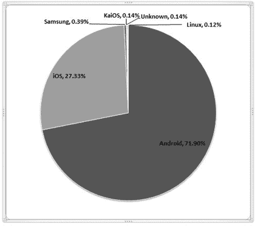

Figure 1.1 移动操作系统市场份额。

Android 的第一个版本（即 Android 1.0）于 2008 年 9 月发布。自那时起，已发布了多个版本，具有各种功能\[170\]。以下部分详细讨论了 Android OS 的架构。

## 1.1 Android OS

Android OS 包含一堆软件组件。Figure 1.2 显示了其架构。Android OS 有五个层。它们是：

1. Linux Kernel;
2. Libraries;
3. Android Runtime;
4. Application Framework; and
5. Applications.

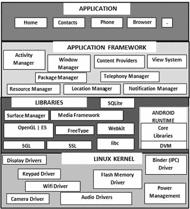

Figure 1.2 Android OS 架构。

现在，我们将在以下部分详细讨论这些层。

### 1.1.1 Linux kernel

在 Android 中，Linux 内核构成了软件堆栈的底层。Linux 内核可以支持硬件驱动程序，并用于管理来自用户的输入和输出请求。Linux 内核中存在的设备驱动程序是用于与特定设备通信的软件。例如，如果我们需要访问相机并拍照，驱动程序会向相机硬件发出必要的命令来执行此操作。Linux 内核还提供了广泛的功能，例如进程管理、内存管理、设备管理等。Android 的每个版本都有其自己的 Linux 内核版本。截至 2022 年，Android 使用内核版本 4.4、4.9、4.14、5.4 或 5.10。

### 1.1.2 Native libraries

在 Linux 内核之上，存在原生库层，该层由各种 C/C++ 核心库和基于 Java 的库组成，例如 SQLite、WebkitSurface Manger、OpenGL、SSL、libc、Graphics、Media 等。这些库用于处理不同类型的数据。Surface Manager 库用于管理显示，而 SGL 和 OpenGL 库用于管理 3D 和 2D 图形。Media 库用于管理和存储视频和音频文件，SQL 库用于数据库支持，WebKit 库用于 Web 浏览器支持。SSL 库用于管理安全性。FreeType 库用于字体支持，而 libc 库用于支持 C 库。

### 1.1.3 Android runtime

## Android Runtime (ART)

Android runtime (ART) 由核心库和 Dalvik 虚拟机 (DVM) 组成。ART 构成了应用程序框架的基础，并帮助使用库启动 Android 应用程序。DVM 是一个基于 Java 的虚拟机，它帮助 Android 应用程序运行其自身的虚拟机实例。DVM 还帮助同时运行多个虚拟机实例，确保内存管理、安全性、隔离性和线程处理。DVM 还帮助运行从 `.class` 文件创建的 `.dex` 文件。ART 中存在的核心库有助于使用 Java 语言创建 Android 应用程序。

## 1.1.4 应用程序框架

应用程序框架以应用程序编程接口 (API's) 的形式为应用程序提供服务。应用程序框架包含以下组件：

*   Activity Manager：Activity Manager 用于管理应用程序的生命周期。
*   Content Providers：Content Providers 管理应用程序之间的数据共享。
*   Telephony Manager：Telephony Manager 管理所有与电话相关的功能。
*   Location Manager：Location Manager 用于获取设备地理位置的定期更新。
*   Resource Manager：Resource Manager 管理应用程序中使用的各种类型的资源。

## 1.1.5 应用层

应用层构成最顶层。该层包含系统中预构建的 Android 应用程序，例如 SMS 客户端应用、联系人管理器，以及开发者构建的自定义应用程序。应用程序利用应用程序框架层的服务来构建所需的应用程序。Android 应用程序使用 Java 编程语言开发\[173\] \[148\]。Android 应用程序的主要组件如下：

*   Activity：Activity 为与 Android 应用程序交互提供用户界面。
*   Services：该组件处理后台操作，例如上传/下载数据。服务组件没有用户界面。
*   Broadcast receiver：该组件处理外部事件，例如接收短信、重启设备等。
*   Content provider：它为不同应用程序之间的数据访问提供一致的接口。

## 1.2 Android 应用程序开发

Android 应用程序的代码包含应用程序功能所需的必要组件。最初，Java 源代码使用 Java 编译器转换为字节码 (`.class` 文件)。然后，字节码 (`.class` 文件) 使用 `dx` 工具转换为 Dalvik 可执行格式 (`.dex` 文件) \[7\]。最后，`aapt` 工具 \[6\] 用于将 `.dex` 文件转换为 Android 应用程序 (`.apk` 文件)。

Android 应用程序的开发阶段如 Figure 1.3 所示。

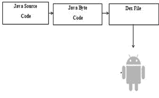

Figure 1.3 Android application development.

## 1.3 Google Play 商店

Google Play 商店是 Android 应用程序的官方存储库。开发者可以将应用程序提交到 Google Play 商店以发布它们。提交的应用程序通过名为 `bouncer` 的内置机制接受安全检查 \[159\] \[198\] \[145\]。Google 未透露 `bouncer` 的算法。`Bouncer` 在虚拟机中执行提交的应用程序并检查恶意活动。只有当 `bouncer` 未检测到恶意活动时，Google Play 才会发布应用程序。发布后，用户可以直接将应用程序安装到其设备上。Google Play 中有几类 Android 应用程序。Google Play 中应用程序的示例类别如下。

*   Gaming apps
*   Sports related apps
*   Social networking apps
*   Banking apps
*   Education apps
*   Communication apps
*   Photography apps
*   News and magazine apps
*   Weather apps
*   Parenting apps etc.

## 1.4 Intents 和 Intent Filters

Intents 是用于与同一应用程序的组件以及与其他应用程序的组件交互的对象。Intents 有两种类型，即显式 Intents 和隐式 Intents \[32\]。它们如下描述。

*   Explicit intents：显式 Intents 通常用于在特定应用程序本身中启动组件。例如，响应用户操作在应用程序中启动新 Activity。
*   Implicit intents：隐式 Intents 声明要执行的一般操作，并帮助来自另一应用程序的组件处理它。例如，如果应用程序想向用户显示地图上的位置，则可以使用隐式 Intent 请求其他应用程序（如 Google Maps）显示位置。

应用程序可以使用 Intent Filters 允许其他应用程序访问其组件 (`activity`、`service`、`broadcast receiver` 等)。Intent Filters 的元素如下：

*   Action：它指示调用组件执行的操作类型。例如，`ACTION_VIEW` 用于查看内容。
*   Data：它指示 Intent 接收的数据类型。
*   Category：它指定组件的启动位置。

## 1.5 Android 安全

在 Android 中，实现了特权升级模型，以确保应用程序无法访问其他应用程序的代码或数据。Android 应用程序安全性通过权限、应用程序沙箱、应用程序签名和数据加密实现 \[26\]。

### 1.5.1 权限

为了限制应用程序访问设备的敏感功能（如电话、网络、联系人、SD 卡和位置），Android 在其应用程序框架中提供基于权限的安全模型\[36\]。Android 权限分为四个保护级别。它们是 `normal`、`dangerous`、`signature` 和 `signatureOrSystem`。`Normal` 权限在应用程序安装时默认授予。`Dangerous` 权限被视为高风险权限，因为它们有能力访问私有数据和重要设备传感器（如摄像头）。`Signature` 权限仅在请求应用程序使用相同开发者证书签名时授予。它们在安装时自动授予。`SignatureOrSystem` 权限仅在应用程序使用与 Android 系统镜像相同的证书签名时授予。它们也在安装时自动授予。

### 1.5.2 应用程序沙箱

Android 使用基于 Linux 操作系统的保护来确保每个应用程序的资源是隔离的。它还提供唯一的用户标识 (`UID`) 以确保隔离。每个应用程序还在其自己的 `DVM` 或 Android Runtime (`ART`) 中运行。进程通过 `Binders` 相互通信。`Binders` 既充当进程间通信系统，也充当远程方法调用系统。为了与其他进程通信，应用程序向 `Binder` 发送消息，`Binder` 检查 `Activity Manager` 以验证应用程序是否有权通信。

### 1.5.3 应用程序签名

# Android 应用签名与数据加密

Android 应用签名确保应用未被恶意开发者篡改。如果应用被反编译，签名将不再被视为有效。签名由应用开发者使用证书完成。Android 提供三种生成应用签名的方案，如下所示\[14\]。

*   `APK Signature Scheme v1`: v1 方案基于 JAR 签名。但是，v1 签名方案只能保护应用的部分内容。

*   `APK Signature Scheme v2`: v2 签名方案在 Android 7.0 中引入。它具有更快的应用安装速度，并对未经授权的 APK 操作提供更多保护。

*   `APK Signature Scheme v3`: v3 签名方案在 Android 9 中引入。v3 签名方案的格式与 v2 类似。但是，v3 签名方案添加了有关受支持 SDK 版本的信息。

### 1.5.4 数据加密

Android 还确保数据加密以保护用户数据 \[21\]。Android 使用对称加密来保护用户数据。在 Android 中，有两种加密类型：基于文件的加密和全盘加密。基于文件的加密由 Android 7.0 及更高版本支持。在此加密中，每个文件使用不同的密钥进行加密。Android 9 使用带有硬件支持的元数据加密。在元数据加密中，未由基于文件的加密加密的内容（如目录布局、文件大小、权限等）使用单个密钥进行加密。该密钥由 KeyMaster 保护，而 KeyMaster 又由 Verified Boot 保护。Verified Boot 确保所有执行的代码都来自可信源（通常是设备 OEM），而不是来自攻击者或损坏。在全盘加密中，使用单个密钥加密所有文件，该密钥由设备密码保护。这种加密类型由 Android 5.0 到 Android 9 支持。

# 1.6 物联网

物联网（IoT）描述了物理对象或事物的网络，这些对象嵌入了传感器、软件和其他技术，目的是通过 Internet 与其他设备和系统进行连接和交换数据\[33\]。借助 IoT，数十亿个对象可以感知、共享信息并自行做出决策。本节讨论 IoT 的各种组件\[163\]，以及 Android Things 如何帮助构建可扩展且安全的 IoT 基础设施。

## 1.6.1 IoT 架构

IoT 架构由各种相互支持的技术组成，以实现可扩展性、可用性、可维护性和功能性。Android 架构由传感器、网关和网络、管理服务及应用程序组成。Figure 1.4 显示了 IoT 架构。IoT 的不同层包括传感器层、网关和网络层、管理服务层和应用层。详细信息如下小节所示。

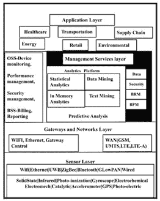

Figure 1.4 IoT 架构。

### 1.6.1.1 传感器层

传感器层由集成了传感器的智能对象组成，这些传感器能够测量温度、速度、湿度和其他因素。在某些情况下，这些传感器还可能具有一些内存来记录某些测量值。这些传感器随后以局域网（LAN）形式连接到传感器聚合器，例如以太网、WiFi 连接或个人区域网络（PAN），例如 ZigBee、Bluetooth 和超宽带（UWB）\[163\]。在某些类型的传感器中，不连接到传感器聚合器，而是使用广域网（WAN）实现与后端服务器/应用程序的连接，例如全球移动通信系统（GSM）、分组无线业务（GPRS）和长期演进（LTE）。具有低功耗和低数据率连接的传感器构成无线传感器网络（WSN）。

### 1.6.1.2 网关和网络

传感器感知的数据通过网关和网络发送。该层的主要功能是处理从传感器收集的信息，并将其转换为数字化和聚合的版本。为了支持更广泛的应用程序和事务服务，我们可以使用具有不同访问协议的多个网络。这些网络可以是公共、私有或混合网络，以确保延迟、带宽和安全性。网关通过 WAN、WiFi 或以太网实现。

### 1.6.1.3 管理服务层

管理服务层包含业务和流程规则引擎。管理服务层中的规则引擎有助于做出决策并提供自动化流程，以获得更高效的 IoT 系统。该层还提供业务规则管理（BRM）和业务流程管理（BPM）。它还具有各种分析工具，用于从原始数据中提取信息。这里使用了不同类型的分析，例如内存分析和流分析。在内存分析中，大量数据被缓存在 RAM 中进行分析。而流分析则实时执行数据分析。该层还具有控制数据的能力，以降低隐私泄露的风险。此外，该层还提供各种服务，如访问控制、加密、数据管理等，以确保数据安全。该层中存在的运营支持系统（OSS）用于自动化网络管理功能，而业务支持系统（BSS）支持计费和报告。

### 1.6.1.4 应用层

应用层包含在 IoT 中工作的各种智能应用程序，例如与农业、工厂、供应链、医疗保健等相关的应用程序。

# 1.7 Android Things

构建 IoT 系统的主要挑战是互操作性、安全性和可扩展性。为了解决这些问题，Google 于 2015 年发明了 Android Things。Android Things 是一个基于 Android 的操作系统，专为 IoT 设计。它可以解决连接设备遇到的安全问题。Android Things 的主要优势是易于开发的环境，使开发人员能够在智能显示屏、数字标牌和 Kiosk 上工作。Figure 1.5 显示了 Android Things 架构。

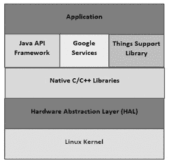

Figure 1.5 Android Things 架构。

Android Things 还通过允许多个设备在没有任何兼容性问题的情况下协同工作，解决了互操作性问题。借助 Android Things，硬件制造商获得经过认证的操作系统和硬件，从而轻松构建产品。此外，Android Things 还确保安全的 IoT 基础设施。这是通过 Google 发送定期安全更新和补丁来实现的，以避免隐私泄露。

Android OS 与 Android Things 的主要区别在于，Android Things 中不存在系统应用程序和内容提供程序。此外，Android Things 具有一个 Things 支持库，其中包含外围 I/O API，允许应用程序使用接口和协议与传感器和执行器进行通信。Things 支持库还具有用户驱动程序 API，允许应用程序注入硬件事件。HAL 和原生 C/C++ 库与 Android 操作系统相同。此外，Google 服务还为 Android 提供 Google API。Java API 框架提供 API，用于在传感器和执行器之间进行通信。

# 1.8 IoT 安全

物联网设备的普及吸引了网络犯罪分子针对这些系统发起攻击。2018 年，来自 69,000 个 IP 地址的约 1200 万次攻击被发起。物联网需要大量数据来开发智能和智慧设备。针对物联网的攻击可以分为以下三种类型。

*   通信攻击：这些攻击针对服务器和物联网设备之间传输的数据。攻击者可能会收集物联网设备和服务器之间发送的数据，以访问敏感数据。

*   软件攻击：攻击者可以利用 Web 应用程序和设备软件中的漏洞来推送恶意固件更新并窃取凭据。

*   物理攻击：攻击者可以针对芯片、固件和物理接口来发起攻击。

## 1.8.1 物联网中的恶意软件威胁

根据卡巴斯基的研究，物联网恶意软件增长了三倍。最常见的攻击形式是僵尸网络。Linux Hydra 是第一种能够发起分布式拒绝服务攻击的物联网恶意软件。从那以后，Psybot、Chuck Norris 和 Tsunami 等各种恶意软件相继出现。在针对物联网的各种恶意软件攻击中，Mirai 僵尸网络攻击影响了超过 600,000 台设备。该攻击感染了搭载 Argonaut RISC Core (ARC) 处理器的设备，并将其转变为僵尸网络。BrickerBot、VPNFilter 等恶意软件是最近出现的 Mirai 变体。常见的恶意软件感染途径是通过弱 Telnet 密码。表 1.1 显示了截至 2020 年出现的一些著名的物联网恶意软件家族。

Table 1.1 物联网恶意软件攻击。

| Year | Malware | Type |
| --- | --- | --- |
| 2008 | Hydra | Botnet |
| 2009 | Psybot/NetworkBluePill | Router Based Botnet |
| 2010 | Chuck Norris | Botnet |
| 2011 | Umbreon/Umreon/Rebonum/Neobrum | Rootkit |
| 2012 | Carna Botnet | Botnet |
| 2012 | LightAidra/Linux Aidra | Botnet |
| 2013 | Tsunami/Kaiten | Botnet |
| 2013 | Linux Darlloz/Zollard | Worm |
| 2014 | Gafgyt/BASHLITE/Lizkebab/ Torlus/Qbot/LizardStresser | DDoS Botnet |
| 2014 | Spike/Dafloo/MrBlack/Wrkatk/ Sotdas/AES.DDoS | DDoS Botnet |
| 2014 | TheMoon | Botnet |
| 2015 | Linux Moose/Elan | Worm |
| 2016 | VPNfilter | Spyware |
| 2016 | Mirai | Botnet |
| 2016 | IRCTelnet/LinuxIRCTelnet/NewAidra | Botnet |
| 2017 | Amnesia | DDoS Botnet |
| 2017 | Linux.MulDrop.14 | Trojan |
| 2018 | Hide ‘N Seek | Botnet |
| 2019 | Echobot | Botnet |
| 2020 | Mukashi | DDoS Botnet |
| 2020 | Rhombus | DDoS Botnet |

## 1.9 结论

在本章中，我们详细讨论了 Android 操作系统的架构以及物联网架构。我们还讨论了物联网中的安全威胁以及截至 2020 年出现的著名物联网恶意软件家族。

# 2 Android 恶意软件

DOI: [10.1201/9781003121510-2](https://doi.org/10.1201/9781003121510-2)

恶意软件或恶意程序是一种旨在损坏或破坏设备或计算机系统的程序。这些恶意软件可以访问并损坏组织的宝贵网络资产。尽管安全供应商和研究人员正在努力控制恶意软件，但网络犯罪分子正在寻找新的方法来规避检测。本章解释了恶意软件在过去几年中的演变过程。我们还解释了 Android 恶意软件的类型和家族，以及开发安全系统以抵御 Android 中恶意软件攻击的必要性。

## 2.1 PC 恶意软件与 Android 恶意软件

第一个 PC 恶意软件是名为 Brain 的病毒，出现于 1986 年。该病毒包含隐藏的版权消息，并感染了软盘的引导扇区。从那以后，各种具有不同威胁能力的恶意软件类型和变体不断演变。PC 被恶意软件感染的最常见方式是通过以下机制。

1. 垃圾邮件：最常见的恶意软件感染形式是垃圾电子邮件。用户可能会收到一封声称包含中奖详情、购买物品收据或发票的带附件电子邮件。当用户打开附件时，附件会被下载，恶意软件会被安装到系统中。

2. 感染的可移动驱动器：这种感染模式是通过 USB 闪存驱动器或外部硬盘等可移动驱动器进行的。这些硬盘安装了可能危险的恶意软件，可以在系统上执行恶意活动。

3. 与其他软件捆绑：在这种攻击类型中，恶意软件与合法软件捆绑在一起。这些恶意软件可以在第三方网站和点对点网络中看到。一些伪装成软件密钥生成器的恶意程序也可以将恶意软件安装到 PC 中。

4. 被黑客攻击或受损的网站：在这种攻击类型中，当用户访问被黑客攻击或受损的网站时，攻击者可以利用设备中存在的软件漏洞来感染恶意软件。因此，建议定期更新软件，以使系统免受这些威胁。

随着安全供应商使其产品更有效地检测 PC 恶意软件，网络犯罪分子正在针对智能手机进行恶意活动。自 Android 成为广泛使用的移动操作系统以来，Android 恶意软件显著增加。Android 恶意软件的感染模式与 PC 恶意软件不同。这给开发反恶意软件解决方案带来了重大挑战，因为与 PC 恶意软件相比，Android 恶意软件使用完全不同类型的攻击方法进行感染。Android 恶意软件最常见的感染方法或来源如下。

1. 第三方应用商店：恶意软件开发者可能会在第三方应用商店中发布以合法应用程序命名的恶意应用程序。如果用户下载了这些应用程序，则设备可能会被恶意软件感染，该恶意软件可能会窃取用户的个人信息或加密设备中的文件。

2. 中间人攻击：在这种情况下，将 Android 移动设备连接到恶意 Wi-Fi 热点会使设备暴露给攻击者，攻击者可以向设备发送恶意软件。

3. 恶意广告：在这种技术中，恶意软件被插入到合法的广告应用程序中。当用户点击广告时，设备会被恶意软件感染。一些恶意广告会显示设备的整个屏幕，当用户触摸屏幕时，恶意负载将被下载。

4. 诈骗：在这种攻击类型中，用户会被通过弹出窗口或 Web 重定向重定向到恶意网页。在此过程中，恶意软件可能会被下载。

5. 物理妥协：在这种攻击类型中，攻击者可以物理访问设备。他们将设备连接到 PC 并直接下载恶意应用程序。

## 2.2 恶意软件趋势

由于连接设备被广泛用于共享数据，攻击者现在正在利用网络、操作系统和软件的漏洞发起恶意攻击。根据美国国家标准与技术研究院（NIST）[43]的一项调查，2020 年漏洞数量急剧增加。尽管开发并发布了补丁，攻击者仍在寻找新方法来规避各种攻击检测机制。

最新趋势表明，恶意软件借助插件接口配备了多种功能[162]。PlugX 恶意软件就是其中之一[51]。插件允许恶意软件在无需重新安装的情况下更新其功能。此外，这些插件允许恶意软件适应新环境的变化。也就是说，如果环境使用了杀毒软件，恶意软件可以隐藏其恶意功能。在过去，恶意软件攻击并非针对特定用户或组织。然而，新趋势表明，近期 70%–90%的恶意软件攻击都是针对特定组织的。最近的趋势是多态恶意软件的出现，以规避杀毒软件的检测。另一种设计趋势是用于隐藏恶意软件存在的规避技术类型。可以看到，近期恶意软件使用了多种规避技术，如死代码插入、打包、反模拟技术等，以隐藏其行为。

### 2.2.1 Windows 恶意软件趋势

在 Windows 恶意软件方面，无文件攻击已经出现，其中恶意软件利用合法程序进行感染[144]。无文件恶意软件可以规避最先进的威胁检测机制[149]。无文件感染直接进入内存并在其中运行。许多无文件恶意软件利用 Windows PowerShell（一种用于配置管理和任务自动化的工具）来执行攻击。这些攻击通常采用社会工程学手段，诱使用户点击钓鱼电子邮件中的附件或链接。除了无文件恶意软件，勒索软件和加密货币挖矿程序也在增加[184] [135]。根据 FireEye 发布的报告[201]，到 2020 年，与勒索软件相关的泄露事件显著增加。此外，大多数攻击针对制造业组织。由于 COVID-19 爆发，大学开始虚拟授课时，勒索软件也针对学术机构[48]。当攻击者在加密设备之前窃取敏感信息时，勒索软件攻击构成严重威胁。在这种类型的勒索软件攻击中，如果受害者未支付赎金，将被威胁公开敏感信息[201]。另一种称为勒索软件即服务（Ransomware as a Service，RaaS）攻击的勒索软件攻击[47]也出现了。在 RaaS 攻击中，恶意软件开发者将恶意软件工具包出售给需要针对企业发起攻击的个人。这些工具包在暗网上出售[147]。

### 2.2.2 Android 恶意软件趋势

在 Android 方面，Google Play 商店的检测机制在检测恶意应用程序方面完全无效。Android 恶意软件的最新趋势显示僵尸网络攻击急剧增加[44]。僵尸网络是一组由攻击者控制的移动设备，用户对此一无所知[64]。根据 McAfee 的威胁报告，存在一种名为 Shopper 的新型 Android 恶意软件[45]。这种恶意软件可以获取用户的 Google 或 Facebook 账户凭据，然后代表用户在流行的娱乐和购物网站上发布评论。为了规避检测，这些恶意软件使用隐藏图标的方法。该恶意软件通过恶意广告分发，并在 Discord 聊天服务中被发现[19]。另一种观察到的趋势是所采用的规避方法类型。如今，大多数恶意软件使用自我隐藏机制来隐藏其功能[180]。这些恶意软件可以伪装成具有相似图标和名称的合法应用程序，并在安装后很快隐藏其图标。Fakeapp 恶意软件就是其中之一，它模仿合法的 FaceApp Android 应用程序并访问用户的图库[23]。

在 Android 恶意软件中观察到的最危险趋势是，一些恶意软件已被发现用于间谍活动，收集关于某国政治和国防事务的敏感信息。MalBus 就是其中一种恶意软件[37]，由一名韩国开发者开发。该恶意软件推送恶意负载，然后将其上传到 Google Play 账户。当用户下载它时，恶意软件会扫描设备中与军事和国家相关的文档。被这些恶意软件感染的应用程序还包含一个额外的库，用于下载恶意插件。

最近，研究人员发现了两种名为 Hornbill 和 SunBird 的新型 Android 监控软件（监控恶意软件）家族，由高级持续性威胁（APT）组织用于针对军事、核和选举实体。这两种恶意软件家族具有复杂的功能，可以外泄短信、加密消息应用程序的内容、地理位置以及其他类型的敏感信息。Hornbill 最早于 2018 年 5 月初被发现，该恶意软件的较新样本于 2020 年 12 月被发现。SunBird 最早于 2017 年被发现，最后一次活跃于 2019 年 12 月。SunBird 的样本被发现托管在第三方应用商店中，伪装成安全服务应用程序。Hornbill 应用程序冒充各种聊天和系统应用程序。两种恶意软件家族都能收集通话记录、联系人、设备元数据（如电话号码、型号、制造商详细信息和 Android 操作系统版本）、地理位置、存储的图片和 WhatsApp 文件。SunBird 比 Hornbill 具有更多的恶意功能，能够定期将所有数据上传到其服务器。此外，它可以以 root 身份运行任意命令或下载恶意负载。相比之下，Hornbill 更像是一种被动侦察恶意软件，而非 SunBird。Hornbill 仅在初始运行时上传数据，而不像 SunBird 那样定期上传。之后，它只上传数据的变化。

## 2.3 恶意软件检测机制的类型

恶意软件检测是一项非常重要的任务，因为潜在的恶意软件可能会损坏设备和文件。基于传统签名的恶意软件检测机制无法检测复杂的零日恶意软件。这是因为多态恶意软件可能具有不存储在防病毒数据库中的不同签名。因此，如今许多恶意软件检测机制都在使用机器学习技术\[199\]。为了检测应用程序的恶意行为，使用了静态、动态和混合机制 \[72\] \[68\]。静态机制在不运行代码的情况下分析应用程序。静态分析的优势在于，其开销较低且代码覆盖率高。然而，其劣势在于，这些机制无法检测使用动态代码加载和混淆的规避型恶意软件。为了解决这些问题，可以使用动态恶意软件检测机制。在动态检测中，恶意软件在沙箱环境中运行，并收集执行痕迹以捕获恶意行为。尽管有其优势，但某些恶意软件可以使用反仿真技术来检测它们是否在沙箱环境中运行，从而隐藏其恶意行为。反仿真技术存在于许多不同的 Android 恶意软件家族中，例如最近在 Google Play 中发现的 Android Adload 广告软件。为了利用静态和动态恶意软件检测机制的优势，也使用了混合检测机制。然而，具有先进规避能力的恶意软件仍在每天不断涌现。因此，安全研究人员正在努力研发新机制来检测新兴恶意软件。

## 2.4 恶意软件类型

恶意软件应用程序可以根据其恶意功能分为不同类型。某些恶意软件应用程序可以使用应用程序框架提供的敏感 API 调用，而其他应用程序则可以利用设备的漏洞来执行恶意活动。恶意软件应用程序的功能如下 \[104\]。

* 窃取私人信息：某些恶意软件应用程序倾向于从设备中窃取私人信息，例如信用卡号码、用户登录凭证、IMEI 代码等。

* 向高费率号码发送短信：某些恶意软件应用程序倾向于在后台向高费率号码发送短信。

* 监控攻击：某些恶意软件应用程序倾向于通过在后台秘密拍摄照片或视频来捕获周围环境。

* 录制电话：某些恶意软件应用程序倾向于在后台录制来电和去电。

* 加密文件：某些恶意软件应用程序倾向于加密设备中的文件，并索要解密赎金。

* 锁定设备：某些恶意软件应用程序倾向于锁定设备，并索要解锁赎金。

* 显示广告：某些恶意软件应用程序倾向于以弹窗形式显示广告以获取收益。

根据其功能，不同类型的恶意软件应用程序如下：

1. 特洛伊间谍软件；

2. 特洛伊短信软件；

3. 后门；

4. 勒索软件；

5. 漏洞利用；和

6. 僵尸网络。

特洛伊间谍软件可以在用户不知情的情况下记录设备上的活动。间谍软件可以执行各种活动，例如按键记录、录制电话、窃取短信等。Triout 和 Bouncing golf 是此类别中的两个恶意软件家族。Triout 于 2018 年被识别\[54\]。Triout 可以录制电话并将其发送到远程服务器。Bouncing golf 于 2019 年被识别。Bouncing golf\[40\]可以收集短信、联系人、已安装应用列表等信息，并将其发送到远程服务器。

特洛伊短信软件可以在后台频繁向高费率号码发送短信。Boxer 和 Opfake 是此类别中的两个恶意软件家族。Boxer 于 2011 年被识别。它在后台向高费率号码发送短信。Opfake 于 2012 年被识别。它也在后台向高费率号码发送短信。

后门可以在所有者不知情的情况下将设备控制权转移到远程服务器。在这里，恶意服务器可以执行各种攻击，例如窃取信息、监控用户活动等。AndroRAT 是一个后门恶意软件家族。它于 2013 年被识别。AndroRAT 可以控制设备并执行各种攻击，例如发起电话、获取设备联系人等。

勒索软件是一种阻止用户访问设备的恶意软件，直到用户向攻击者支付赎金为止。Simplocker 是一个示例勒索软件家族。它于 2014 年被识别。Simplocker 可以加密设备中的文件并索要解密赎金\[49\]。

漏洞利用倾向于利用设备内核中的漏洞来执行特权操作。Gingermaster 是此类别中的一个示例恶意软件家族。它于 2011 年被识别\[27\]。Gingermaster 可以通过漏洞利用代码利用 Android OS Gingerbird 版本中的漏洞来执行各种特权操作。

僵尸网络是一组相互通信以执行恶意活动（例如 DDoS 攻击）的受感染设备。这些设备感染了恶意软件，使攻击者能够控制它们。Zazdi 是一个僵尸网络家族的示例。它于 2019 年被识别。Zazdi 僵尸网络使用 Firebase Cloud Messaging (FCM) 服务与受感染设备通信。

## 2.5 Android 中的恶意软件攻击

Android 中的恶意软件攻击可以通过以下三种方式发生：

* 即时下载攻击和

* 更新攻击和

* 重打包攻击。

### 2.5.1 即时下载攻击

在这种情况下，攻击者首先创建一个包含恶意软件应用程序的恶意网站，这些应用程序可以自动下载到系统中。然后，攻击者通过电子邮件、短信或社交网络网站将网站链接发送给受害者。这些类型的恶意网站包含错误信息，诱导一些用户访问该页面 \[96\]。当用户访问网站时，恶意软件会自动下载到手机上。例如，Rumms 是一种通过短信分发的即时下载 Android 恶意软件 \[203\]。当用户点击短信中提供的链接时，Rumms 恶意软件会自动下载到手机上。

### 2.5.2 更新攻击

在这种情况下，恶意软件开发者在应用商店中发布一个应用程序，该应用程序在安装后会自动更新为具有恶意功能的版本。例如，Vmvol 恶意软件应用程序在安装后会更新为带有恶意负载的版本 \[203\]。

### 2.5.3 重打包攻击

在这种情况下，攻击者将恶意负载添加到良性应用程序中。首先，攻击者获取一个合法应用程序并对其进行解压缩。在下一步中，编辑字节码。在此步骤中，攻击者使用第三方工具从字节码中恢复源代码，以便将恶意代码插入其中并编译修改后的代码。最后，攻击者压缩结果并使用自签名证书对其签名。例如，Walkinwat 恶意软件应用程序\[29\]是合法 Walktext 应用程序的重打包版本。

## 2.6 Android 中恶意软件攻击的历史

第一款名为‘Cabir’\[3\] \[15\]的移动病毒出现于 2004 年，它针对的是运行在 ARM 处理器上的 Symbian 操作系统。当 Android 操作系统变得流行时，第一款名为‘FakePlayer’的 Android 恶意软件于 2010 年出现\[4\]。该恶意软件伪装成媒体播放器，并向一些高级号码发送短信，每条短信费用约为 5 美元。当恶意软件被执行时，它会显示俄语消息。2016 年，在野外发现了 HummingBad 恶意软件\[62\]。它由一家中国广告公司创建。该恶意软件还会在受感染设备上安装欺诈性应用程序。

2010 年，第一款名为‘Zitmo’\[67\]的木马出现。它旨在窃取银行发送的 mTan 代码。2011 年，发现了 Droiddream\[57\]，这是一种向远程服务器发送信息的恶意软件。2012 年，Boxer\[56\]恶意软件在野外被发现。它通过短信传播，一旦安装，就会向高级号码发送短信。2013 年，发现了 FakeDefender\[52\]，这是第一款针对 Android 应用程序的勒索软件。它伪装成假冒的防病毒程序。该恶意软件显示了一张动物从字母‘OZ’中窥视的图片。2014 年，SimLocker 恶意软件出现\[49\]。该恶意软件是一种勒索软件，会扫描设备的 SD 卡并加密某些文件类型。被针对的文件类型为.mp4、.jpeg 和.png。2015 年，Gazon\[11\]（一种金融欺诈应用程序）被发现针对 Android。2017 年，发现了一款名为 ExpensiveWall 的恶意软件，它会向高级号码发送短信。同年，Marcher、Xavier、DVMap 和 BankBot 等其他恶意软件也出现了\[2\]。Marcher 被发现会窃取用户的登录凭据，并且它出现在第三方应用程序网站中。该恶意软件显示 Citibank、Walmart、Paypal 等的假冒登录页面。Xavier 是一种木马广告软件，会录制通话、更改铃声等\[2\]。此外，该恶意软件使用先进的机制来逃避静态和动态分析。另一方面，DvMap 安装恶意模块并以 root 权限执行它们。Bankbot 恶意软件/Anubis 通过看起来像合法登录页面的假冒覆盖屏幕窃取支付卡数据。2019 年，发现了 Cereberus 银行木马。它具有远程访问木马（RAT）\[25\]功能。除此之外，该恶意软件还访问设备的解锁图案。

随着 2020 年 COVID 大流行的爆发，恶意软件开发者利用冠状病毒应用程序追踪器的功能来传播银行恶意软件 Anubis\[10\]。另一个版本的冠状病毒应用程序被发现是一种间谍软件，用于拍照、录制视频等。2020 年，Joker 恶意软件\[66\]也在 Google Play 商店中被发现。该恶意软件可以访问用户的设备信息、联系人列表等。该恶意软件还能够在用户不知情的情况下注册高级无线应用协议（WAP）服务。2021 年初，研究人员还发现了一款针对巴基斯坦用户的间谍软件\[41\]。该间谍软件隐藏在合法应用程序中，并窃取用户的敏感数据，如联系人列表和短信。尽管有强大的安全机制，新的恶意软件仍在日复一日地出现。因此，强大且有效的恶意软件检测机制已成为当务之急。

## 2.7 结论

在本章中，我们讨论了 Android 恶意软件、恶意软件趋势、恶意软件类型以及恶意软件检测的重要性。我们还讨论了 Android 中流行的恶意软件攻击。由于恶意软件威胁正在迅速演变，需要更有效的威胁检测机制。由于基于人工智能（AI）的恶意软件也在增加\[95\]，也应调查机器学习技术在检测高级恶意软件威胁方面的有效性。

# 3 静态恶意软件检测

DOI: [10.1201/9781003121510-3](https://doi.org/10.1201/9781003121510-3)

静态分析是通过分析源代码来检测恶意应用程序的技术。应用程序相关的源代码是使用逆向工程工具获取的。源代码包含 API 调用、权限、硬件组件、意图、意图过滤器和应用程序组件等特征。静态分析的优势在于其代码覆盖率高且分析开销小。在本章中，我们将介绍各种现有的静态恶意软件检测机制。

## 3.1 逆向工程和静态分析

逆向工程是获取 Android 应用程序源代码以了解其功能的过程。逆向工程出于以下原因进行。

*   查找应用程序代码中的漏洞。

*   检测恶意代码以进行恶意软件分析。

*   修改 Android 应用程序的功能。

在 Android 中，逆向工程涉及反汇编和反编译的过程。反汇编是指将字节翻译为助记符。在 Android 中，smali 代码是在反汇编 Android 应用程序后获得的输出。将应用程序二进制文件转换为编写源代码的高级语言的过程称为反编译。在 Android 中，反编译是将 dex 文件转换为 Java 源代码文件的过程。

### 3.1.1 使用 Apktool 和 Dex2jar 进行逆向工程

在本节中，我们将讨论如何使用 Apktool 和 Dex2jar 对 Android 应用程序进行逆向工程。各个步骤如下。

*   步骤 1：安装 Apktool。

*   步骤 2：下载我们要分析的 Android 应用程序，并将其放在 apktool 所在的同一文件夹中，如下所示。

    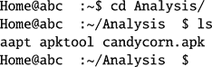

*   步骤 3：运行命令，

    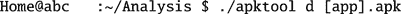

输入上述代码后，将创建一个包含反编译内容的新目录。该目录包含`AndroidManifest.xml`文件和 smali 代码。Smali 代码是 Java 代码的字节码版本，类似于汇编代码。下面给出了一个示例 smali 代码。

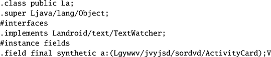

反汇编后，要分析应用程序的 Java 源代码，我们可以使用 dex2jar 和 JD-GUI。Dex2jar 用于将 dex 文件转换为 jar（Java）文件。要查看 Java 文件，我们可以使用 JD-GUI。可以按以下方式操作：

*   下载 dex2jar。

*   解压缩 apk.zip 并打开它。

*   从 apk 文件夹复制`classes.dex`文件并将其粘贴到 dex2jar 文件夹中。

*   运行命令：`sh d2j-dex2jar.sh classes.dex`以获取`classes_dex2jar.jar`文件。

*   使用 JD-GUI 打开生成的`classes_dex2jar.jar`文件。

### 3.1.2 静态恶意软件分析工具

静态 Android 恶意软件分析工具对恶意软件研究人员分析 Android 应用程序的恶意功能非常有用。流行的静态 Android 恶意软件检测工具如下。

*   Amandroid – Amandroid 是一种静态分析工具，用于 Android 应用程序的组件间数据分析。

*   APK Analyzer – APK Analyzer 是一种静态分析工具，具有比较两个 apk 的能力。

*   SmaliSCA – SmaliSCA 是一种用于检查 smali 文件的静态分析工具。

*   Maldrolyzer – Maldrolyzer 是一种从 Android 恶意软件中提取‘可操作’数据（如 C&C、电话号码等）的工具。

*   `Argus-SAF` – `Argus-SAF` 是一个具有多种功能的工具，例如 Java 原生接口分析、基于注解的分析等。

*   `DroidRA` – `DroidRA` 为 Android 恶意软件提供反射分析。

*   `Androwarn` – `Androwarn` 是一个 Dalvik 字节码分析工具，可用于识别 Android 应用程序的可疑权限及其他活动。

*   `PScout` – `PScout` 是一个 Android API 调用到权限映射工具，可用于恶意软件分析。

*   `Androguard` – `Androguard` 是一个功能强大的工具，可与其他工具集成用于恶意软件分析。它提供类分析、方法分析、权限分析等。

## 3.2 Android 应用程序的组件

Android 应用程序包含以下组件\[5\]。

*   `Java Source Files`: `Java` 文件包含使用 `Java` 编程语言编写的应用程序源代码。

*   `res/drawable-hdpi`: 此目录包含运行 Android 应用程序所需资源的值。它包括样式、颜色、尺寸等。

*   `res/layout`: 此目录包含应用程序用户界面的详细信息。

*   `res/values`: 此目录包含一组资源，例如颜色定义和字符串。

*   `AndroidManifest.xml`: 它存储元数据，例如包名、所需权限、一个或多个组件（如 `Activities`、`Services`、`Broadcast Receivers` 或 `Content Providers`）的定义、最小和最大版本支持、要链接的库等。在清单文件中，开发者可以指定应用程序的硬件组件和软件要求。开发者可以在清单文件中指定所需的最小和最大 `SDK`。

*   `Build.gradle`: 此文件是自动生成的文件，包含 `compileSdkVersion`、`targetSdkVersion`、`versionCode`、`versionName` 等。`compileSdkVersion` 是调试和编译 Android 应用程序的版本。`targetSdkVersion` 是应用程序开发运行的 Android 版本。

## 3.3 API 调用分析

`API` 代表 `Application Programming Interface`。它可以定义为一组协议、过程和工具，允许两个应用程序之间进行交互 \[65\]。在 Android 中，构成原生库顶部的应用层提供 `API`。这些 (`APIs`) 以 `java` 类的形式构建。`API` 包含庞大的类库（一组包），适用于构建我们自己的应用程序。Android 的 `API` 级别是一个整数值，有助于识别 Android 平台版本提供的 `API` 修订版 \[13\]。Android 每次推出的新 `API` 级别与旧版本兼容。下面的代码展示了如何在 Android 应用程序的 `java` 源代码中导入 `API` 包。

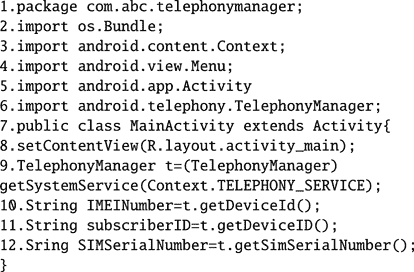

在上面的代码第 6 行中，`android.telephony` 是包名，`TelephonyManager` 是 `API` 类名。`API` 调用是 `API` 类的方法。第 10、11 和 12 行显示了类 `TelephonyManager` 的 `API` 方法。`API` 类和方法对于识别 Android 应用程序的行为至关重要。在转换为 `java` 源文件之前，也可以直接分析 smali 代码以了解应用程序的 `API`s。下面的代码展示了 `API` 包、类和方法在 smali 中的出现方式。这里 `Landroid/telephony` 是包名，`TelephonyManager` 是 `API` 类名，`listen()` 是 `API` 方法名。

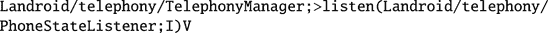

Android 恶意软件可能会使用某些 `API`s 来访问移动电话的敏感资源，例如位置、设备 ID 等，以执行其恶意活动。以下部分描述了如何使用 `API` 来检测 Android 恶意软件。

### 3.3.1 恶意软件应用程序使用的 API

我们可以按请求的实用程序和资源类型对不同的 `API`s 进行分类，以识别恶意行为 \[68\]。它们是应用程序特定资源 `API`s、Android 框架资源 `API`s、DVM 相关资源 `API`、系统资源 `API`s 和实用程序 `API`s。

1.  **应用程序特定资源 API's**

    应用程序特定资源 `API`s 可分为 `Content resolver` 类、`Context` 类和 `Intent` 类。

    1.  `Content resolver` 类: `content resolver` 类提供对内容提供程序的访问。恶意软件可能会使用该类的 `delete()`、`insert()`、`query()` 等方法来执行恶意活动。

    2.  `Context` 类: `Context` 类提供有关类、资源和资产的信息。该类中的 `startService()` 方法经常被恶意软件用于在后台启动服务。`getFilesDir()` 和 `openFileOuput()` 等方法是该类的其他 `API`s，被恶意软件用于创建文件并获取其绝对路径。

    3.  `Intent` 类: Intents 用于与手机硬件交互，也用于启动活动和服务。恶意软件在该类中频繁调用的 `API`s 是 `setFlags()`、`addFlags()` 和 `setDataAndType()`。

2.  **Android 框架资源 API's**

    Android 框架资源 `API`s 可分为 `Activity Manager` 类、`Package manager` 类、`Telephony SMS manager` 和 `Telephony` 类。

    1.  `ActivityManager` 类: `ActivityManager` 类有助于与设备上运行的其他活动进行交互。恶意软件调用的 `getRunningServices()` 方法用于查找设备上是否有任何防病毒服务正在运行。另一个名为 `getMemoryInfo()` 的方法被恶意软件用于检查是否有足够的内存来杀死其他进程。方法 `restartPackage()` 被恶意软件调用以杀死其他应用程序服务。

    2.  `PackageManager` 类: 包管理器类包含设备上已安装应用程序包的信息。`getInstalledPackages()` 方法用于扫描设备，以检查设备上是否有任何防病毒程序正在运行以将其杀死。

    3.  `Telephony/SmsManager` & `Telephony/gsm/SmsManager`: 这些类中的方法允许恶意软件开发者从受感染设备发送高费率短信，从而给用户造成经济损失。`sendTextMessage()` 是该类的一种此类方法。

    4.  `Telephony Manager`: 恶意软件可能会使用该类的方法，例如 `getSubscriberId()`、`getSimSerialNumber()`、`getLine1Number()`、`getNetworkOperator()`、`getCellLocation()`、`getDeviceId()`、`getNetworkType()` 等，以访问用户的设备信息。Android 恶意软件如 `Ginmaster`\[58\]、`Exodus`\[22\] 等使用了此 `API`。

3.  **DVM 相关资源 API's**

    DVM 相关资源 `API`s 可分为 `DexClassLoader` 类和 `Runtime` 和 `System` 类。

    1.  `DexClassLoader` 类: `DexClassloader` 类有助于加载 `classes.dex` 文件。恶意软件可能会使用名为 `loadClass()` 的方法来执行不属于应用程序的代码，以逃避恶意软件检测机制。

    2.  `Runtime` 和 `System` 类: 在这种情况下，`Runtime` 和 `System` 类中的 `Runtime.getRuntime.exec()` 方法帮助恶意软件开发者以 shell 脚本的形式执行恶意代码以逃避检测。方法 `loadLibrary()` 用于动态加载本机库。这可以被恶意软件开发者用于运行本机代码。

4.  **系统资源 API's**

    系统资源 `API`s 可分为 `ConnectivityManager`、`NetworkInfo` 和 `WifiManager` 类，`HttpURLConnection` 和 `Sockets` 类以及 `OS` 包和 `IO` 包类。

1. `ConnectivityManager`, `NetworkInfo`, 和 `WifiManager` 类：`ConnectivityManager`、`NetworkInfo` 和 `WifiManager` 类提供与网络相关的功能，例如回答关于不同连接和网络接口的查询。Android 恶意软件可能会调用 `ConnectivityManager` 类中的 API，例如 `getNetworkInfo()`、`NetworkInfo()`、`getExtraInfo()`、`getTypeName()`、`isConnected()`、`getState()`，以及 `WifiManager` 类中的方法，例如 `setWifiEnabled()` 和 `getWifiState()`，以建立网络连接并与恶意远程服务器交互。这些 API 被 Android 恶意软件 Basebridge \[55\] 使用。

2. `HttpURLConnection` 和 `Sockets` 类：这些类中使用的方法用于建立与远程服务器的连接，并通过 Web 发送或接收数据。`SetRequestMethod()` 和 `getOutputStream()` 等是恶意软件用于与远程服务器建立连接的方法。

3. OS 包类：OS 包类中诸如 `kill process()` 的方法通常被恶意软件调用，以终止在给定进程 ID 上运行的进程。OS 包还包含用于进程和线程管理的多个 API。

4. IO 包类：此包提供对数据流、文件等的读写功能。恶意软件使用诸如 `writeBytes()` 的 API 将某些文件上传到恶意 URL，使用 `readLines()` 读取恶意负载，并使用 `delete()`、`mkdir()` API 发起各种恶意活动。

5. **Utilities API's**

Utilities API's 可分为字符串和 `StringBuilder` 类、`Crypto` 类、`ZipInputStream` 类和 [`w3c.dom`](http://w3c.dom) 类。

1. 字符串和 `StringBuilder` 类：此类中的方法被恶意软件广泛用于代码混淆。`indexof()`、`getBytes()` 和 `replaceAll()` 等 API 调用用于创建和操作字符串。

2. `Timer`：恶意软件可能使用此类的 API，例如 `schedule()` 和 `cancel()` 来规避检测。

3. `Crypto` 类：此类中的方法允许实现加密操作。`getInstance()`、`doFinal()` 和 `Crypto.spec.DESKeySpec()` 等 API 调用被恶意软件用于代码混淆。

4. `ZipInputStream` 类：恶意软件可能使用方法来解压缩恶意的 .zip/.rar 文件。`Read()`、`close()`、`getNextEntry()` 等是此类的其他 API 方法，被恶意软件使用。

5. [`w3c.dom`](http://w3c.dom) 类：恶意软件可能使用 `getDocumentElement()`、`getElementByTagName()` 和 `getAttribute()` 与机器人通信并对数据进行编码。

## 3.4 API 调用基础的静态检测

API 调用基础的恶意软件检测机制有两种类型。它们是使用 API 独立出现的机制和使用 API 调用图的机制。在本节中，我们解释了一些 API 调用基础的恶意软件检测机制。

### 3.4.1 使用 API 独立出现的机制

在此机制中，分析基于 API 调用的特征的独立出现情况，以查找恶意行为。基于 API 调用特征的独立出现构建应用程序的二进制特征向量在计算上复杂度较低。以下机制使用 API 的独立出现来检测恶意软件。

在 `DroidAPIMiner` \[68\] 中，使用机器学习算法分析源代码 API 级别特征，例如包名、类名和函数名，以查找恶意行为。在此机制中，他们选择了在其数据集中更频繁出现在恶意应用中的 API 级别特征。有时，良性应用可能会使用在恶意应用中频繁出现的非恶意特征。在这种情况下，良性应用可能会被误判为恶意软件。

在 \[158\] 中，API 调用被用作训练好的深度卷积神经网络（CNN）分类器的特征向量，用于预测应用程序是否为恶意软件。作者使用了非常有限数量的恶意软件（216 个样本）来评估他们的方法。

在 \[123\] 中，Hou 等人提出了一种机制，通过分析其中的 API 调用来检测 Android 恶意软件应用。在此方法中，使用训练好的深度置信网络（DBN）分类器，根据其中的 API 调用来预测应用程序是否为恶意软件。此方法在计算上成本较高。

Han 等人 \[117\] 提出了一种使用 API 调用的 Android 恶意软件检测机制。他们的机制使用 `SVM` 来检测恶意软件。Shankarpanni 等人 \[181\] 提出了一种使用 API 调用来检测混淆恶意软件的恶意软件检测机制。在 \[142\] 中，作者提出了一种使用 API 的结构和行为特征来检测恶意软件的检测机制。在 \[69\] 中，作者提出了一种结合权限和 API 调用的恶意软件检测机制。Android 倾向于不时修订其 API 调用。因此，不断发展的恶意软件应用可以使用较新的 API 调用来执行恶意活动。在这种情况下，较新的良性应用程序可能会在这些检测机制中被错误地标记为恶意，反之亦然。因此，在这些机制中需要频繁重新训练分类器。

### 3.4.2 使用 API 调用图的机制

在这些机制中，分析 API 调用或组件间通信图以进行恶意软件检测。从 API 调用序列或图中，我们可以轻松推断出 Android 恶意软件家族/类别背后的潜在语义。以下作品使用 API 调用图来检测恶意软件。

Zhang 等人 \[218\] 提出了一种机制，通过其 API 调用依赖图检测 Android 恶意应用，以判断应用程序是否为恶意。在此方法中，使用图相似度指标来测量与应用程序关联的 API 调用依赖图与已知恶意应用程序的图之间的相似性。此方法无法检测具有未见 API 调用序列的恶意软件应用。

在 `Faldroid` \[102\] 中，使用由恶意软件家族生成的频繁 API 调用子图来查找恶意行为。此方法有两个步骤。在第一步中，作者采用基于聚类的方法来提取每个恶意软件家族的常见恶意行为（频繁子图）。在第二阶段，他们采用基于加权敏感 API 调用的图匹配方法来分类未知恶意软件应用程序。此方法无法检测包含权限提升漏洞的恶意软件应用。

## 3.5 权限和 Intent 基础的静态检测

在本节中，我们解释了如何使用权限和 Intent 分析进行 Android 恶意软件检测。

### 3.5.1 权限分析

# 权限概述

A permission is a unique text string that is defined by Android or third party developers `[103]`. In Android, permissions are requested when an application is accessing the resources of the device. In Android, the permissions are divided into four types based on the protection levels they offers. They are normal, dangerous, signature, and signatureOrSystem`[63]`. Types of some sample permissions are given in `Table 3.1`. These levels are assigned based on the damage they may cause if the user grants it. While installing the application, the Android package installer will not ask the user for approval for the permissions that have the safe protection levels. But in the case of the permissions with dangerous protection levels, the user will be asked for a consent to install the applications that needs it. The Android system grants signature permissions at the application installation time provided that the app that is asking for the permission must be signed with the same certificate as that of the application that defines the permission. The signatureOrSystem level permission on the other hand requires the application to be a system application. However, this type of signatureOrSystem level permission is deprecated from API level 23 onwards.

`Table 3.1` 各种权限类型。

| 权限类型 | 示例 |
| --- | --- |
| Normal | `ACCESS_LOCATION_EXTRA_COMMANDS` |
| | `ACCESS_NETWORK_STATE` |
| | `CHANGE_NETWORK_STATE` |
| | `ACCESS_WIFI_STATE` |
| Signature | `BIND_ACCESSIBILITY` |
| | `BIND_ACCESSIBILITY_SERVICE`, |
| | `BIND_AUTOFILL_SERVICE`, |
| | `BIND_CARRIER_SERVICES` |
| Dangerous | `READ_CONTACTS` |
| | `WRITE_CONTACTS` |
| | `GET_ACCOUNTS` |
| | `ACCESS_FINE _LOCATION` |
| | `ACCESS_COARSE_LOCATION` |
| | `SEND _SMS` |
| | `RECEIVE_SMS` |
| SignatureOrSystem | `DELETE_PACKAGES` |

Android permissions prevent malware developers from accessing the sensitive resources of the device. However, the vulnerability in the permission framework of Android can be exploited by the malware to execute various malicious activities. In 2019, researchers found a vulnerability called “StrandHogg” that was able to exploit the permission pop up mechanism in Android. In this type of attack, malware abused the permission called `SYSTEM_ALERT_WINDOW`, that allowed an application to display a window on top of other applications. By using this pop up mechanism, the malware displayed fake banking login pages and fraudulent ads. Initially, Google blocked the apps that used this permission. But, it affected the normal functionality of legitimate apps such as Facebook that need to show pop up windows for chat operations. Hence from Android 6.0 onwards, the restriction has been taken out by the Google. However, the applications that use this permissions are analyzed by the Bouncer mechanism before making it available to the users. According to the recent threat report`[30]`, 74% of ransomware, 57% of adware and 14% of banker malware abuse this permission for doing malicious activities. There are several other permissions that are used by the malware for their activities. The following subsection provides some of the permissions abused by the malware developers to launch attack against Android.

## 3.5.1.1 Permissions used by the malware applications

The various permissions used by the malware applications and the details are given below.

1. `ACCESS_COARSE_LOCATION` and `ACCESS_FINE_LOCATION`: These permissions are used by the malware applications to locate the network provider information and GPS information of the user. Tekya malware `[169]` and Malbus malware`[38]` use this permission to access the GPS location and network provider information.

2. `ACCESS_NETWORK _STATE`: Malware use this permission to monitor the network connection of the device. This permission is used by a malware to connect the device to a malicious remote server. DroidKungfu malware uses this permission to collect the information about the device`[20]`.

3. `ACCESS_WIFI _STATE`: This permission is used by a malware to access the wifi connectivity of the user. Malware may send wifi information to the remote server to monitor the wifi connectivity of the user. CoronaTracker malware that appeared recently uses this permission to obtain the wifi connectivity information`[17]`.

4. `BROADCAST_PACKAGE_REMOVED`: This permission is used to notify that an application package has been removed. Malware may use this to kill other running applications such as antivirus applications.

5. `CALL_PHONE`: This permission helps to make calls without user's consent. Malicious applications use this permission to make calls resulting in huge call charges to the user. Basebridge `[55]` malware uses this permission to make phone calls.

6. `CHANGE_WIFI _STATE`: This permission is used to change the wifi state of the device. This permission is used by the malware application to connect to the malicious servers. FakeAngry `[24]` malware uses this permission.

7. `DELETE_PACKAGES`: This permission is used to delete the application packages that are installed in the device. Malware may use this to delete the antivirus programs that are running on the device.

8. `INSTALL_PACKAGES`: This permission is used to install packages to the device. Malware may use this to install malicious application packages.

9. `INTERNET`: This permission is used by the application to access the Internet. Malware may use this permission to establish a connection with a remote server. The Cerebrus malware `[25]` uses this permission.

10. `KILL BACKGROUND PROCESSES`: This permission is used by the application to kill the background process. This permission may be used by the Android application to kill the antivirus process running in the background.

11. `MOUNT_UNMOUNT _FILESYSTEMS`: This permission is used by the Android application for mounting or unmounting storage devices. Malware may use this permission to access the SD cards in the device for reading and writing the data from or to the device.

12. `PROCESS_OUTGOING_CALLS`: An application with this permission is able to monitor the details of outgoing calls. A malware may use this permission to monitor the phone numbers and personal details that are stored in the device.

13. `READ _CONTACTS`: This permission allows an application to read the contact information saved in the device. Malware may use this information to infect other devices using the contact information. Malware such as Comebot `[16]` and Cerebrus `[25]` use this permission.

14. `READ_PHONE_STATE`: This permission allows to read the current cellular network information and the status of ongoing calls from the device. Malware may use this permission to eavesdrop the phone call activities of the user. Malware such as Comebot`[16]`, and Exodus`[22]` use this permission.

15. `READ_SMS`: This permission is used by the application to read SMS. Malware may use this permission to gather the sensitive information of the user. Basebridge`[55]` malware uses this permission.

16. `RECEIVE_BOOT_COMPLETED`: This permission allows the application to start as soon as the system has finished booting. Malware may use this permission to start the malicious activity as soon as the system is booted. The malware DroidKungfu`[20]` uses this permission.

## 17. RECEIVE_SMS

`RECEIVE_SMS` 权限由应用程序用于接收合法服务的短信。恶意软件使用此权限在用户不知情的情况下监听并转发短信到远程服务器。FakeInstaller[\[1\]](#bibliography1.xhtml#refbib_1) 恶意软件使用此权限。

## 18. SEND_SMS

`SEND_SMS` 权限允许应用程序发送短信。恶意软件使用此权限向高费率号码发送短信。Mobts[\[16\]](#bibliography1.xhtml#refbib_16)、FakeAngry[\[24\]](#bibliography1.xhtml#refbib_24) 和 FakeInstaller[\[1\]](#bibliography1.xhtml#refbib_1) 等恶意软件使用此权限。

## 19. SET_WALLPAPER

`SET_WALLPAPER` 权限用于设置壁纸，恶意软件利用此权限从远程服务器下载恶意内容。某些恶意软件还可能使用此权限通过多次重启设备来使设备崩溃。

## 20. WAKE_LOCK

`WAKE_LOCK` 是用于保持设备屏幕激活的权限。恶意软件可能使用此权限在保持设备激活的状态下在后台执行恶意活动。

## 21. WRITE_APN_SETTINGS

`WRITE_APN_SETTINGS` 权限允许应用程序写入 APN 设置并读取用户名和密码等敏感字段。恶意软件可能使用此权限收集设备的敏感信息。

## 22. WRITE_CONTACTS

`WRITE_CONTACTS` 权限允许应用程序写入用户的联系人数据。恶意软件应用程序可能使用此权限访问 Google、Facebook 等账户。Mobts[\[16\]](#bibliography1.xhtml#refbib_16) 恶意软件使用此权限。

## 23. WRITE_EXTERNAL_STORAGE

`WRITE_EXTERNAL_STORAGE` 权限用于读取或操作手机中存储的文件。恶意软件可能使用此权限访问设备中存储的文件。Ginmaster[\[58\]](#bibliography1.xhtml#refbib_58) 恶意软件使用此权限。

## 24. WRITE_SMS

`WRITE_SMS` 权限用于写入短信。恶意软件可能使用此权限向高费率号码发送短信。FakeAV[\[59\]](#bibliography1.xhtml#refbib_59) 和 Dendroid[\[18\]](#bibliography1.xhtml#refbib_18) 等恶意软件使用此权限。

Table 3.2 显示了一些流行恶意软件应用程序用于执行各种恶意活动的权限。

Table 3.2 恶意软件家族使用的权限。

| Permission | Geinimi | DroidDream | PjApp | GoldDream | Adrd |
| --- | --- | --- | --- | --- | --- |
| `ACCESS_COARSE_LOCATION` | x | | | x | |
| `ACCESS_FINE_LOCATION` | x | | | x | |
| `ACCESS_NETWORK_STATE` | | | | x | x |
| `ACCESS_WIFI_STATE` | | | | x | |
| `BROADCAST_PACKAGE_REMOVED` | | | | x | |
| `CALL_PHONE` | x | | | x | |
| `CHANGE_WIFI_STATE` | | x | | x | |
| `DELETE_PACKAGES` | | | | x | |
| `INSTALL_PACKAGES` | | | | x | |
| `INTERNET` | x | x | x | x | x |
| `KILL_BACKGROUND_PROCESSES` | | | | | |
| `MOUNT_UNMOUNT_FILESYSTEMS` | x | | | | |
| `PROCESS_OUTGOING_CALLS` | x | | | x | |
| `READ_CONTACTS` | x | | | | |
| `READ_PHONE_STATE` | x | x | | x | |
| `READ_SMS` | | | | x | |
| `RECEIVE_BOOT_COMPLETED` | | | | x | x |
| `RECEIVE_SMS` | | | x | x | |
| `SEND_SMS` | x | | | | |
| `SET_WALLPAPER` | x | | | | |
| `WAKE_LOCK` | | | | | |
| `WRITE_CONTACTS` | x | | | | |
| `WRITE_EXTERNAL_STORAGE` | x | | | | |

## 3.5.1.2 Component-based permission escalation attack

在 Android 中，每个应用程序都在自己的沙箱中运行。这意味着每个应用程序都有自己的资源，且应用程序之间无法相互交互。然而，传递式权限攻击可以通过允许非特权应用程序利用另一个应用程序的特权来打破 Android 的安全模型。基于组件的权限提升攻击就是此类攻击之一。此攻击利用 MAC 引用模型。Figure 3.1 展示了基于组件的权限提升攻击。

这里的三个 Android 应用程序 `A`、`B` 和 `C` 彼此隔离。每个应用程序都在自己的沙箱中运行。应用程序 `A` 有两个组件 `A1` 和 `A2`，未授予任何权限；应用程序 `B` 有两个组件 `B1` 和 `B2`，拥有权限 `P2`。应用程序 `C` 有两个组件 `C1` 和 `C2`，分别受权限 `P1` 和 `P2` 保护。应用程序 `A` 的组件不允许直接访问应用程序 `C` 的组件，因为它们受权限 `P1` 和 `P2` 保护。然而，应用程序 `B` 可以访问应用程序 `A` 的组件。在基于组件的权限提升攻击中，应用程序 `A` 通过 `B` 的组件间接访问应用程序 `C` 的组件。

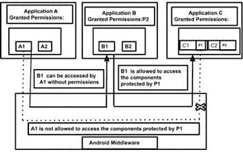

Figure 3.1 Component-based permission escalation.

## 3.5.2 Intent-based analysis

在本节中，我们解释 Android 应用程序中的意图（Intent）如何用于恶意软件检测。我们还解释 Android 中基于意图的漏洞，以及恶意软件应用程序如何利用意图发起恶意活动。

意图是发送给活动、外部应用程序和内置 Android 服务的请求。一个应用程序有许多活动，每个活动可能有与其关联的按钮、文本和标签。意图机制有助于将数据从一个活动推送到另一个活动。意图在 `AndroidManifest.xml` 文件中以意图过滤器的形式定义。意图对象携带确定要启动的组件及组件动作的信息。意图对象包含以下内容。

1. Component Name: 意图对象保存 Android 应用程序组件的名称。组件名称指示活动、服务或 BroadcastReceiver 类。
2. Action: 动作用于定义组件要执行的任务。
3. Data: 数据定义意图指定的数据类型。
4. Category: 类别是一个字符串，用于指定应处理意图的组件类型。
5. Extras: 额外值用于向组件提供附加信息。
6. Flag: 标志用于告诉 Android 系统如何启动活动，以及活动启动后如何执行。

意图有两种类型：显式意图和隐式意图。隐式意图用于基于特定数据或值执行操作。例如，如果应用程序需要拨打电话，隐式意图如下：

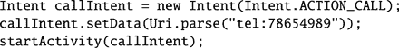

显式意图则用于响应用户操作或另一个活动来调用某个活动。例如，如果应用程序需要在用户点击按钮时发送消息，则使用显式意图。显式意图如下：

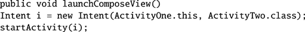

### 3.5.2.1 Intents used for malware attacks

恶意软件用于发起恶意活动的各种意图如下。

1. `android.intent.action.BOOT_COMPLETED`: 此意图由恶意软件应用程序用于在设备完成启动过程时启动恶意活动。DroidKungfu[\[20\]](#bibliography1.xhtml#refbib_20) 恶意软件使用此意图。
2. `android.intent.action.BATTERY_LOW`, `android.intent.action.BATTERY_OKAY`: 恶意软件可能使用这些意图来检查设备的电池电量状态，以加载各种恶意负载。
3. `android.intent.action.INPUT_METHOD_CHANGED`: 此意图用于检查设备的输入法是否更改。

4. `android.intent.action.ACTION_POWER_CONNECTED`: 此 intent 由恶意软件用于检查设备是否已连接电源，以便发起恶意应用更新。恶意软件 `Basebridge` \[55\] 使用此 intent。

5. `android.provider.Telephony.SMS_RECEIVED`: 此 intent 由恶意软件应用程序用于检查设备是否已收到短信，以便将其转发到恶意服务器。

6. `android.intent.action.USER_PRESENT`: 此 intent 由恶意软件应用程序用于检查用户是否在场，方法是检查设备是否已解锁。`Tekya` 恶意软件使用此 intent\[169\]。

7. `android.intent.action.SCREEN_ON`: 此 intent 由恶意软件用于检查设备的屏幕是否开启。

8. `android.intent.action.SCREEN_OFF`: 此 intent 用于检查设备的屏幕是否关闭。恶意软件 `FakeAV`\[59\] 使用此 intent。

9. `android.intent.action.SIG_STR`: 此 intent 由恶意软件应用程序用于检查设备的信号强度。

10. `android.intent.action.PACKAGE_INSTALL`: 此 intent 由恶意软件用于检查恶意软件包是否已安装。

11. `android.intent.action.PACKAGE_ADDED`: 此 intent 由恶意软件应用程序用于检查恶意软件包是否已添加。

12. `android.intent.action.PHONE_STATE`: 此 intent 由恶意软件用于检查设备是否有任何来电。

13. `android.app.action.DEVICE_ADMIN_ENABLED`: 此 intent 用于检查管理员权限是否已启用以管理设备。

14. `android.intent.action.ACTION_EXTERNAL_APPLICATIONS_AVAILABLE`: 此 intent 由恶意软件用于在应用程序位于 SD 卡时启动该应用程序。

15. `android.intent.action.QUICKBOOT_POWERON`: 此 intent 由恶意软件用于在设备启动时启动服务。`Comebot` 恶意软件使用此 intent\[16\]。

#### 3.5.2.2 基于 intent 的漏洞

Android 恶意软件的最新趋势表明，恶意软件可以利用 Android intent 机制中存在的漏洞\[31\]。在本节中，我们将讨论 Android 应用程序中的基于 intent 的漏洞。

Android 应用程序可能包含许多私有组件，其他应用程序不允许访问这些组件。但是，intent 重定向漏洞允许恶意软件访问应用程序的私有组件并窃取敏感数据。在 2021 年，数千个购物应用程序遭受了 intent 重定向漏洞的攻击 \[81\]。在下一段中，我们将解释 Android 中的 intent 重定向漏洞。

Android 应用程序由 `Activity`、`Service`、`Broadcast Receiver` 和 `Content Providers` 等组件组成。这些组件是私有的，只能由同一应用程序的其他组件访问。但是，如果组件被声明为公共组件，则也可以被其他应用程序的组件访问。这些组件通过 intents 和特定 API 调用。假设有两个应用程序 `A1` 和 `A2`，其中 `A1` 是恶意应用程序，`A2` 是合法应用程序。设应用程序 `A2` 有两个组件：一个公共组件表示为 `pu`，一个私有组件表示为 `pr`。`A2` 的私有组件 `pr` 的设计方式是提取和处理来自应用程序 `A1` 的 intent `I` 发送的数据。恶意应用程序 `A1` 访问 `A2` 的私有组件的方式如下。首先，`A1` 发送 intent `I` 以访问 `A2` 的公共组件 `pu`。除了 `I` 之外，恶意软件还向 `I` 添加另一个 intent 对象 `I`^′，以访问合法应用程序的私有组件 `pr`。当公共组件 `pu` 接收到 intent `I` 时，`pu` 会提取并将其转发给 `pr`。私有组件 `pr` 从其 intent `I` 中提取数据，该 intent 包含一个额外的 intent 对象以访问私有组件 `pr`。通过这种方式，攻击者能够访问合法应用程序的私有组件。Figure 3.2 展示了此攻击的实施方式。

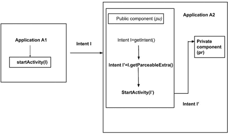

Figure 3.2 Intent redirection attack.

### 3.5.3 使用权限和 intent 进行恶意软件检测

本小节解释了基于权限和 intent 的恶意软件检测机制。

Android 清单文件的功能，例如 intents 和权限，可能不会随时间变化。因此，如果我们使用权限和 intents，则不需要频繁重新训练分类器。

Talha 等人 \[193\] 提出了一种名为 `Apkauditor` 的基于签名的恶意软件识别机制。该机制分析基于应用程序请求的权限的签名，以识别其是否为恶意软件。与其他方法相比，该方法的准确性较低。

Shahriar 等人 \[179\] 开发了一种机制，通过分析 Android 恶意软件应用程序请求的权限来检测恶意软件。在第一步中，他们使用 `Latent Semantic Indexing (LSI)` 来查找大多数恶意软件应用程序请求的常见权限。在第二步中，他们在未知应用程序中搜索这些常见权限，以识别恶意行为。作者未提及其方法的准确性。

在 `ICCDetector` \[213\] 中，分析了组件间通信模式以查找恶意行为。该方法分为两个步骤。在第一步中，使用几个已知良性软件和恶意软件应用程序的 ICC 相关特征训练机器学习分类器。在下一阶段，使用分类器根据 ICC 模式预测未知应用程序是否为恶意软件。

基于 intent 的机制在检测通过调用其他应用程序的组件来执行恶意行为的恶意软件应用程序方面非常准确。但是，这些机制在重打包的恶意软件应用程序的情况下将不起作用。也就是说，攻击者可以在不添加或删除应用程序组件的情况下添加恶意功能。在这种情况下，恶意软件应用程序可能会被错误地标记为良性软件。

Feizollah 等人\[105\] 开发了一种机制，通过分析 Android 恶意软件的权限和 intent 相关特征来检测恶意软件。在第一步中，他们使用 `Bayesian network` 构建恶意软件检测模型。在第二步中，他们使用 `K2` 和 `HillClimber` 等启发式搜索算法来降低模型的复杂性。`Bayesian network` 模型能够根据权限和 intents 预测应用程序是否为恶意软件。在该方法中，训练 `Bayesian network` 算法所需的时间非常高。在 \[129\] 和 \[124\] 中，作者提出了一种结合权限和 intents 的恶意软件检测机制。`Sato` 等人\[177\] 提出了一种使用各种静态特征（如权限、intents、intent 过滤器、重新定义的权限数量等）的轻量级恶意软件检测机制。其机制达到了 91% 的准确率。`Andre` 等人\[108\] 提出了一种使用权限和 intents 的恶意软件检测机制。其机制使用 `Adaboost Random Forest (ARF)` 分类器达到了 97% 的准确率。

尽管权限对于检测恶意软件很有用，但某些良性应用可能出于合法原因请求危险权限。例如，银行应用程序可能会出于合法目的请求 `SEND_SMS` 权限。在这种情况下，良性应用程序可能会被误判为恶意软件。此外，恶意软件应用程序倾向于与合法应用程序共享其用户 ID 以继承权限 \[204\]。所有这些因素都可能降低分类器的准确性。

## 3.6 基于操作码的静态检测

当 Android 应用程序被编译时，会生成 Dalvik 操作码。Android 运行时环境 (ART) 将操作码转换为处理器的指令集。Android 应用程序中有 221 个唯一的操作码。下面给出了 Android Dalvik 操作码的示例。

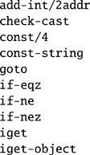

操作码提供了 Android 应用程序的执行路径，并有助于理解应用程序的功能。使用操作码作为 Android 恶意软件检测特征的主要优势在于，它们可以在无需专家分析的情况下检测恶意软件\[91\]。从 Android 应用程序中提取操作码的 Shell 脚本在附录中给出。

### 3.6.1 使用操作码进行恶意软件检测

分析操作码已被发现对检测 Android 恶意软件非常有效。表 3.3 提供了用于检测恶意软件的前 5 个操作码 3-gram。在本节中，我们讨论了各种使用操作码分析的恶意软件检测机制。

Table 3.3 恶意软件应用程序使用的前 5 个操作码 3-gram。

| 序号 || 操作码 |

| --- | --- |

| 1 || move-result-object,move-object/from16,invoke-virtual |

| --- | --- |

| 2 || move-object/from16,iget-object, invoke-virtual |

| --- | --- |

| 3 || if-eqz,check-cast,goto |

| 4 || move-object, check-cast, if-eqz |

| 5 || move-object/from16,iget-object, move-object/from16 |

操作码被发现是检测 Android 恶意软件的有用特征，因为它们与应用程序代码密切相关\[91\]。Canfora 等人\[91\] 提出了一种基于操作码 `n`-gram 频率的检测 Android 恶意软件的技术。Jerome 等人\[125\] 也提出了一种基于操作码 `n`-gram 并使用机器学习技术的技术。Chen 等人\[94\] 提出了一种名为 TinyDroid 的机制，该机制使用压缩技术来减少特征集。他们的技术能够以较低的误报率实现更高的准确率。Pektas 等人 \[164\] 也提出了一种使用深度学习和指令调用图来检测 Android 恶意软件的技术。Bacci 等人 \[78\] 提出了一种混合机制，通过结合操作码和系统调用来检测恶意软件。Bai 等人 \[79\] 提出了一种通过结合 Dalvik 操作码和权限来检测 Android 恶意软件的机制。Kim 等人\[131\] 提出了一种多模式深度学习技术，通过结合操作码和各种特征来检测 Android 恶意软件。Bakhshinejad 等人\[80\] 也提出了一种使用操作码作为特征的压缩机制来检测 Android 恶意软件的机制。在 \[137\] 中，Rao 等人提出了一种基于操作码的恶意软件检测机制。他们的机制使用了循环神经网络 (RNN) 并达到了 96% 的准确率。Tang 等人 \[195\] 提出了 MGOPDroid，以操作码序列作为特征来检测混淆变体的 Android 恶意软件。在 \[146\] 中，作者提出了一种基于 PercieverIO 的模型，可以有效地处理长序列的操作码以进行恶意软件检测。

上述许多检测机制都可以通过代码注入攻击\[127\] \[95\] \[139\] 被绕过，这可能会降低检测机制的准确性。

## 3.7 结论

在本章中，我们讨论了用于 Android 恶意软件检测的静态分析方法。我们还讨论了恶意软件如何使用敏感 API、权限和意图进行各种恶意活动。本章将帮助网络安全研究人员和开发人员了解如何有效地使用静态分析机制进行恶意软件检测，并开发更有效的检测机制。

# 4 动态和混合恶意软件检测

DOI: [10.1201/9781003121510-4](https://doi.org/10.1201/9781003121510-4)

所有静态分析机制都可以通过动态代码加载攻击 \[171\] 被绕过。动态代码加载攻击包含三个步骤。在第一步中，恶意软件开发人员创建一个包含两个字节码的应用程序：恶意代码和合法代码。在下一步中，他加密恶意字节码。在最后一步，他在主字节码（合法字节码）中编写解密程序来解密恶意字节码并编译应用程序。因此，恶意字节码不以明文形式可用于分析。在运行时，恶意代码会被解密并在系统中执行。因此，需要考虑应用程序的运行时信息来检测采用动态代码加载攻击的恶意应用程序。

## 4.1 基于模拟器的动态分析

动态分析依赖于运行时特征，例如网络数据包级别信息、系统指标、敏感 API 调用和系统调用，以识别恶意行为。在基于模拟器的动态分析中，动态分析是通过在模拟器中执行应用程序来进行的。为了进行动态分析，我们最初在 PC 上设置了一个 Android 模拟器。步骤如下：

*   下载并安装 Android Studio；

*   打开 Android Studio；

*   转到 tools -> Android -> AVD Manager -> Create Virtual Device；

*   通过选择手机类型和 API 级别信息创建 AVD，以及

*   从 AVD Manager 启动 AVD (Android Virtual Device)。

设置模拟器后，我们将测试应用程序安装到模拟器中。命令如下。

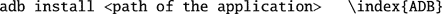

在动态分析期间，我们使用自动化测试用例生成工具注入多个伪随机事件，以实现更好的代码覆盖率。在这里，我们使用 `monkeyrunner` 作为自动化测试用例生成工具来注入伪随机事件。命令如下。

在应用程序执行期间，我们可以使用模拟器中的系统实用程序来收集动态信息。为了收集系统调用，我们可以在模拟器中使用 `strace` 工具。收集系统调用的命令如下。

为了收集网络数据包，我们可以在模拟器中使用 `tcpdump` 命令。收集网络数据包的命令如下。

通过这种方式，我们可以使用模拟器中的工具或框架来收集各种其他动态信息，例如 CPU/内存使用情况、电池利用率、API 调用等。

## 4.2 动态恶意软件检测机制

我们将现有机制分为以下几类：

1.  系统指标分析（类别 1）；

2.  网络数据包分析（类别 2）；

3.  敏感 API 调用分析（类别 3）；

4.  系统调用分析（类别 4）。

现有动态分析机制的比较分析如下，见 表 4.1。

Table 4.1 动态恶意软件检测机制的比较分析。

| 类别 || 性能 || 局限性 |

| --- | --- | --- |

| Category 1 \[152\] || 精确率：0.84，F1 分数：0.84 || 假阳性率高 |

| --- | --- | --- |

| Category 1 \[182\] || 准确率：0.99 TPR：0.98 FPR：0.01 || 性能不明确 |

| Category 1 \[178\] || 检测准确率：0.88 TPR：0.91 || 准确率低 |

| Category 2 \[82\] || 检测率：0.77 || 假阳性高 |

| Category 2 \[130\] || TPR：0.96，准确率：0.96 || 易受 API 调用注入攻击 |

| Category 3 \[119\] || 检测率：0.73，FPR：0.04 || 恶意软件检测率低 |

| Category 3 \[73\] || 检测率：0.90 || 特征提取成本高 |

| Category 4\[89\] || N/A || 未给出性能结果 |

| Category 4 \[71\] || 准确率：1 || 性能不明确 |

| Category 4\[199\] || TPR：0.99，准确率：0.99 || 系统调用关系缺失 |

| Category 4\[91\] || TPR：0.97，准确率：0.97 || 无法检测未知恶意软件家族 |

| Category 4 \[100\] || 准确率：0.96 || 特征向量维度高 |

| Category 4 \[122\] || 准确率：0.92 || 需要大量训练数据集 |

| Category 4\[209\] || TPR：0.98 F1 分数：0.98 || 特征向量维度高 |

| Category 4 \[85\] || 准确率：0.94 || 特征提取成本高 |

| Category 4\[208\] || TPR：0.98 F1 分数：0.98 || 特征向量维度高 |

| Category 4\[219\] || TPR：0.97 准确率：0.98 || 特征向量维度高 |

| Category 4 \[83\] || TPR：0.94 F1 分数：0.91 || 需要多个系统调用日志 |

| Category 4 \[210\] || 精确率：0.91 准确率：0.94 || 易受系统调用重排序攻击 |

| Category 4 \[99\] || TPR：0.96，准确率：0.94 || 需要模拟器定制 |

### 4.2.1 系统度量和流量分析（类别 1）

在这些机制中，系统度量（如 CPU 使用率、内存使用率、电池电量信息和网络流量）被分析用于恶意软件检测。在这种方法中，由于系统级特征可能不会随时间变化，因此不需要频繁重新训练分类器。

在 Andromaly \[178\] 中，运行应用程序时会记录系统级特征，如 CPU 以及内存使用率和电池利用率。然后，这些特征用于训练好的 ML 分类器进行恶意软件检测。与其他机制相比，这种方法的准确率较低。

在 \[182\] 中，系统级特征（如 CPU 使用率、内存使用率和网络流量信息）每 5 秒记录一次，这些特征用于训练好的 ML 分类器来查找恶意行为。这种方法在非常有限数量的应用程序（20 个良性软件和 6 个恶意软件应用）上进行了测试。因此，在大型和现实数据集上的性能不明确。

在 \[152\] 中，与 CPU 和内存使用率相关的相关特征被用作机器学习分类器的输入特征，以识别应用程序是否为恶意软件。在这种方法中，他们使用了特征选择算法来减少机器学习分类器中的特征数量。这种方法的计算复杂度较低。然而，这种方法的假阳性率较高。

根据 Gheorghe et al. \[112\]，一些恶意软件应用的系统资源消耗极少。因此，对于这些应用程序，系统度量值（CPU 使用率、内存使用率）并不高。在这种情况下，基于系统度量的恶意软件检测机制可能无法检测这类恶意软件。

### 4.2.2 网络数据包分析（类别 2）

在这些机制中，网络数据包被分析以查找恶意行为。这些方法在检测试图在后台与远程服务器通信的恶意应用程序方面非常准确。

在 \[73\] 中，网络数据包级信息（如平均数据包大小、入站与出站字节比等）用于预测恶意行为。在这种方法中，使用训练好的 ML 分类器根据网络流量特征预测应用程序是否为恶意软件。这种方法中特征提取的成本非常高。

在 AppFA\[119\] 中，He 等人提出了一种机制，使用聚类算法构建应用程序的网络行为配置文件。然后，这些网络行为配置文件与历史数据和选定的同伴组（大小、类别等相似的应用程序）的配置文件进行比较，以识别恶意行为。这种方法中恶意软件检测率（0.734）较低。

一些恶意软件不需要互联网连接即可执行其活动。例如，一些恶意软件会在后台向高价号码发送短信。通过分析网络数据包无法检测这类恶意软件。这是这种方法的一个主要缺点。

### 4.2.3 敏感 API 调用分析（类别 3）

应用程序需要调用敏感 API 调用才能在设备上执行特权操作。因此，可以从应用程序在运行时调用的 API 调用中识别其恶意行为。

在 \[82\] 中，Bao 等人建议通过分析敏感 API 调用来检测 Android 恶意软件的机制。在这种方法中，通过检查恶意 API 调用的存在来识别未知应用程序的恶意行为。这种方法无法检测不断演变的恶意软件应用。

在 \[130\] 中，Kim 等人提出了一种基于后缀树的机制来检测 Android 恶意软件应用，该后缀树包含 API 调用子迹。在这种方法中，使用隐马尔可夫模型从后缀树生成概率置信值以识别恶意行为。这种方法无法检测包含权限提升漏洞利用的恶意软件应用。

这种方法在检测试图通过生成敏感 API 调用序列与设备中的敏感资源进行通信的恶意软件应用方面非常准确。有时，良性应用程序（良性软件）会调用敏感 API 调用来执行特权操作。在这些情况下，良性应用程序可能被错误地分类为恶意软件。

### 4.2.4 系统调用分析（类别 4）

在本节中，我们讨论基于系统调用的动态分析机制来检测恶意软件应用程序。恶意软件应用不需要用户触发即可调用敏感 API \[101\]。在没有用户触发的情况下调用 API 调用会反映在相应的系统调用序列中 \[211\]。因此，系统调用分析是动态恶意软件检测的一种强大方法。基于系统调用的动态分析机制可以分为：

*   基于系统调用频率或 TF-IDF（术语频率-逆文档频率）的方法；

*   基于系统调用依赖图或马尔可夫链的方法；

*   基于系统调用系统发育的方法；

*   基于系统调用行为或序列分析的方法。

#### 4.2.4.1 基于系统调用频率或 TF-IDF 的方法

在这些机制中，系统调用的计数或 TF-IDF 值被机器学习算法分析，以查找恶意行为。基于应用程序系统调用序列中系统调用的计数或 TF-IDF 值构建特征向量在计算上很容易。

Crowdroid \[89\] 是一种基于云架构的行为导向型动态恶意软件检测机制。在这种方法中，客户端应用程序从设备收集所有系统调用事件并发送到远程服务器。然后服务器预处理这些系统调用数据，并使用 `k-means` 聚类算法来确定应用程序是否为恶意应用程序。该方法可以通过系统调用注入攻击来击败。也就是说，攻击者可以在应用程序的系统调用序列中注入不相关的系统调用，例如信息维护系统调用、错误系统调用等。

Amamra 等人 \[71\] 提出了一种机制，通过分析影响应用程序行为的系统调用频率来检测 Android 恶意软件应用程序。在这种方法中，使用已知恶意软件和良性软件应用程序产生的行为系统调用频率训练二进制机器学习分类器。该分类器用于根据行为系统调用的频率来预测应用程序是否为恶意软件。作者使用了一个有限的数据集（100 个恶意软件和 100 个良性软件）来评估他们的方法。

Vinod 等人 \[199\] 建议了一种新的特征选择方法，用于找到最相关的系统调用，这些系统调用在检测恶意软件和良性软件应用程序时能提供更高的准确性。在这种方法中，使用机器学习分类器来根据所选系统调用的 TF-IDF（术语频率 - 逆文档频率）值来预测应用程序是否为恶意软件。在这种方法中，不考虑系统调用关系信息。

在 \[209\] 中，Xiao 等人提出了一种机制，通过分析 Android 恶意软件应用程序在运行时的系统调用来检测它们。使用预训练的机器学习分类器来根据系统调用共现值和序列中每个系统调用的频率值来预测未知应用程序的恶意行为。在这种方法中，特征向量的维度很高。

Canfora 等人 \[91\] 提出了一种机制，通过分析应用程序系统调用序列中固定长度连续子序列的计数来检测 Android 恶意软件应用程序。他们使用训练好的 `SVM` 分类器来根据固定长度连续系统调用子序列的计数来识别应用程序是否为恶意软件。该方法无法检测未知的恶意软件家族。

#### 4.2.4.2 基于系统调用依赖图或马尔可夫链的方法

在这些机制中，系统调用图或系统调用的马尔可夫链序列被分析以查找恶意行为。这里，系统调用依赖信息被考虑用于查找恶意行为。

Maline \[100\] 是一种基于系统调用序列检测 Android 设备中恶意软件应用程序的工具。在 Maline 中，使用训练好的分类器来通过查找每个系统调用的依赖关系及其出现频率来预测应用程序是否为恶意应用程序。该方法可以通过系统调用注入攻击来击败。也就是说，攻击者可以在应用程序的系统调用序列中注入不相关的系统调用，例如信息维护系统调用、错误系统调用等，并击败检测机制。

在 \[122\] 中，Hu 等人提出了一种从系统调用图中检测 Android 恶意软件应用程序的机制。在这种方法中，他们使用深度学习分类器来根据基于系统调用图的特征来识别应用程序是否为恶意应用程序。该机制依赖于深度学习算法进行恶意软件检测。它需要非常大的训练数据集。

Xiao 等人 \[208\] 建议了一种从应用程序系统调用的马尔可夫链序列中检测 Android 恶意软件的机制。使用几个良性软件和恶意软件应用程序，用系统调用状态转移概率训练一个反向传播神经网络 \[120\]。该神经网络 \[120\] 用于预测应用程序的恶意行为。在这种方法中，特征向量的维度很高。

在 `CSCdroid` \[219\] 中，分析应用程序的马尔可夫链系统调用序列以检测恶意软件应用程序。该方法有两个步骤。在第一步中，他们通过将序列中的所有正常系统调用替换为特定系统调用来构建系统调用马尔可夫链序列。在第二步中，使用二进制机器学习分类器（例如 `SVM`）来根据应用程序的系统调用马尔可夫链状态转移概率矩阵来检测应用程序的恶意行为。该方法可以通过系统调用注入攻击来击败。也就是说，攻击者可以在应用程序的系统调用序列中注入不相关的系统调用，例如信息维护系统调用、错误系统调用等，并击败检测机制。

Bandari 等人 \[85\] 提出了一种从应用程序的马尔可夫链系统调用序列中检测 Android 恶意软件应用程序的机制。在这种方法中，他们从系统调用马尔可夫链图中提取语义相关路径，并将其用作机器学习分类器的特征向量以查找恶意行为。从应用程序的系统调用马尔可夫链图中提取语义相关路径至少需要 30 分钟。

#### 4.2.4.3 基于系统调用系统发育的方法

在这些机制中，恶意软件样本之间的系统调用系统发育关系被分析以查找恶意行为。

Bernadi 等人 \[83\] 提出了一种机制，用于从系统调用执行指纹（`SEF`）基础特征向量中检测 Android 恶意软件应用程序。这种 `SEF`（系统调用执行指纹）基础特征可以用于表征恶意行为并追踪恶意软件系统发育。在这种机制中，使用训练好的机器学习分类器来从 `SEF` 基础特征中识别应用程序的恶意行为。收集单个应用程序的多个系统调用日志并构建特征向量在实践中非常困难。

#### 4.2.4.4 基于系统调用行为或序列分析的方法

在这些机制中，系统调用序列或子序列被分析以查找恶意行为。

Xiao 等人 \[210\] 提出了一种基于 `LSTM`（长短期记忆）的机制，用于从系统调用序列中检测 Android 恶意软件应用程序。在这种方法中，使用两个训练好的 `LSTM` 分类器（分别对应恶意软件和良性软件系统调用序列）来预测由应用程序生成的系统调用序列中的恶意行为。攻击者可以通过重新排序源代码来重新排序系统调用序列。此外，它需要非常大的训练数据集。

在 \[99\] 中，Dash 等人提出了一种名为 `DroidScribe` 的机制，该机制利用 `Copperdroid` \[194\] 从系统调用中重构高级行为，并将这些行为用作机器学习分类器的特征，以识别恶意应用程序。需要定制模拟器才能从系统调用序列中重构恶意行为。

所有现有的系统调用分析机制都可以通过采用系统调用劫持攻击 \[168\] 来击败。也就是说，攻击者可以通过更改系统调用表中的系统调用名称，来击败基于系统调用的恶意软件检测机制。在这种情况下，恶意应用程序可能会被错误地标记为良性软件，反之亦然。

在本节中，我们讨论了各种动态分析机制及其局限性。动态分析机制只有在应用程序在分析时间内至少表现一次恶意行为时，才能检测出恶意应用程序。因此，恶意软件开发人员可以通过在分析时间后采用更新攻击来击败动态分析机制。

## 4.3 混合分析

混合分析是静态分析和动态分析的结合。现有混合分析机制的比较分析见 `Table 4.2`。现有的混合检测机制可分为两类。它们是：

*   基于单一分类器的混合检测（类别 1）；

*   基于分类器集成的混合检测（类别 2）。

`Table 4.2` 混合恶意软件检测机制的比较分析。

| 类别 || 性能 || 局限性 |

| --- | --- | --- |

| 类别 1 \[160\] || F1 分数：0.920 || 易受 API 调用注入攻击 |

| --- | --- | --- |

| 类别 1 \[217\] || 准确率：0.967 || 需要非常大的训练数据集 |

| 类别 1 \[74\] || 准确率：0.948 || 未考虑系统调用 |

| 类别 1 \[214\] || 准确率：0.947 || 需要非常大的训练数据集 |

| 类别 1 \[93\] || 准确率：0.938 || 特征向量的高维性 |

| 类别 2 \[143\] || 准确率：0.897 || 特征向量的高维性 |

| 类别 2 \[76\] || 静态准确率：0.980 动态准确率：0.820 混合准确率：N/A || 动态分析准确率低 |

### 4.3.1 基于单一分类器的混合检测（类别 1）

在这些机制中，静态特征和动态特征都用作机器学习分类器的特征，用于识别恶意行为。在这些机制中，特征融合由分类器本身完成。因此，这种方法不需要特征融合机制。

在 \[74\] 中，Arora 等人提出了一种基于权限和网络流量特征来检测 Android 恶意软件的机制。在这种方法中，权限和网络流量特征用于频繁模式增长算法来检测恶意行为。这种方法只能检测试图与远程服务器通信的恶意应用程序。

在 \[160\] 中，Onwuzurike 等人提出了一种用于检测 Android 恶意应用程序的混合分析机制。在这种方法中，来自静态分析和动态分析的抽象 API 调用马尔可夫链序列被结合起来用于检测恶意行为。攻击者有可能在系统调用序列中注入额外的 API 调用。在这种情况下，恶意应用程序可能会被错误地标记为良性软件。

在 `StormDroid` \[93\] 中，静态特征（如权限、敏感 API 调用及其序列）和来自 droidbox 的动态特征（如 `sendSMS`、`recvnet`、`sendnet` 等）被用于机器学习分类器来识别恶意行为。在这种机制中，特征向量的高维性不必要地增加了分类器的存储空间和处理时间。

在 `DroidDetector` \[217\] 中，静态特征（如敏感 API、请求的权限）和来自 droidbox 的动态特征被用于深度学习模型来识别恶意行为。这种机制依赖于深度学习算法进行恶意软件检测。它需要非常大的训练数据集。

Xu 等人提出了一种名为 `HADM` \[214\] 的恶意软件检测机制。在这种方法中，混合特征（如可疑调用、意图过滤器、网络 API、与广告网络（如 Google 广告和 AdMob）相关的 API、指令序列和系统调用）被用作 `DNN`（`Deep Neural Network`）分类器的特征向量，用于识别恶意行为。需要在大量高维特征向量上训练 `DNN` 分类器。由于复杂性高，无法将此机制用于实时恶意软件检测。

在这些机制中，单个分类器中使用了太多特征。因此，恶意软件开发人员可以通过注入良性应用程序中经常出现的特征来击败这些机制。

### 4.3.2 基于集成分类器的混合检测（类别 2）

在这些机制中，使用分类器集成来从静态和动态特征中识别恶意行为。这些机制比其他机制更准确。

`Samadroid` \[76\] 是一种用于 Android 设备的混合恶意软件检测模型。`Samadroid` 分两步工作。在第一步中，从源代码中提取静态特征（如请求的硬件组件、请求的权限、使用的权限、应用程序组件、意图过滤器和 API 调用），并在执行应用程序后收集动态特征（如应用程序产生的文件和网络相关系统调用，例如 `open`、`read` 等）。在第二阶段，这些静态和动态特征被预处理，并用作两个机器学习分类器（如 `SVM`）的输入，以识别应用程序是否为恶意软件。如果应用程序被静态和动态分类器都标记为恶意，则将其视为恶意软件。由于其动态分析部分的准确率低，这种方法的准确率较低。

在 `Omnidroid` \[143\] 中，使用基于投票的机器学习分类器集成来融合从恶意软件和良性软件应用程序中提取的静态和动态特征。在这种方法中，特征向量的维度很高。特征向量的高维性不必要地增加了分类器的存储空间和处理时间。

这些机制中使用了多个分类器。因此，需要开发创新机制来结合不同机器学习分类器的预测结果，以实现准确的恶意软件检测。

## 4.4 静态和动态特征之间的相关性

Android 恶意软件应用程序包含恶意代码，并拥有适当的权限，可在未经用户授权的情况下访问设备上的敏感资源。根据 Zhang 等人 \[218\]，源代码级 API 调用可以确定应用程序的底层语义。这些 API 受到某些权限的保护，这些权限需要在清单文件中声明 \[106\]。开发者可以在没有 API 调用的情况下声明权限，反之亦然。因此，仅使用权限或 API 调用作为特征不足以检测应用程序的恶意行为。因此，需要结合 API 调用和权限才能准确检测恶意软件应用程序。与良性软件不同，恶意软件应用程序不需要用户触发即可调用敏感 API 调用 \[101, 176, 211\]。这种 API 调用的自动调用会体现在系统调用序列中 \[211\]。已知，应用程序在运行时会根据 API 调用的执行生成系统调用 \[183\]。因此，我们可以得出结论：静态特征（如 API 调用、权限）和动态特征（如系统调用）是检测恶意应用程序的相关特征。

每当应用程序进程调用 API 调用时，系统进程会检查其所需的相应权限 \[106\]。然后，如果授予了权限，它将允许该 API 执行。例如，系统进程仅在授予 `SEND_SMS` 权限时才允许 `sendTextMessage()` API 调用执行。因此，我们可以假设 API 调用与其权限有条件依赖。硬件抽象层（HAL）接受调用的 API 调用，并通过生成系统调用与 Linux 内核通信 \[86\]。因此，我们可以假设系统调用和 API 调用之间存在某些条件依赖关系。API 调用的条件依赖执行在 图 4.1 中给出。

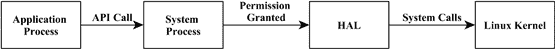

图 4.1 特征之间的条件依赖关系。

### 4.4.1 树增强朴素贝叶斯（TAN）模型

朴素贝叶斯分类器基于特征相互独立的假设构建了一个简单的概率模型。在现实中，此假设可能不成立。如果我们可以将特征之间的依赖关系信息纳入朴素贝叶斯模型，则可以提高分类准确性。树增强朴素贝叶斯（TAN）就是这样一种模型，其中特征不像朴素贝叶斯那样相互独立。在 TAN 中，每个特征都有条件地依赖于类和（一个）来自特征集的另一个特征。

在 TAN 模型中，保留了朴素贝叶斯模型的基本结构。但是，类节点和所有特征节点通过有向边连接。因此，在计算条件概率 `Pr(C|A[1]…A[n])` 时，它会考虑所有特征，其中 `C` 是类变量，`A[1]`、…、`A[n]` 是特征。除了根变量（类）之外，树中的每个变量都有一个或两个父节点：一个是类节点，另一个（如果存在）是对应于特征的另一个随机变量。由于属性之间的交互仅限于一个，因此该模型的计算复杂度较低。

要构建树结构，我们需要找到相关的特征。这就是找到每个特征父节点的方式。这样一来，构建最大似然树的问题可以归约为图中构建最大权重生成树的问题。为了找到最相关的特征，会在每对属性之间计算互信息，这些互信息构成边的权重。边会在高度相互依赖的特征之间添加。如果有 `n` 个特征，图中将有 `n` 个节点和 `n - 1` 条边。带有边上互信息的结果图将形成最大权重生成树。为了构建 TAN 模型，我们需要借助带有类标签 `ℰ` 的先前已知数据集来测量预测器（对应于特征的随机变量）之间的相关程度。这是通过测量该标记数据集中所有预测器对之间的条件互信息来完成的。两个随机变量 `A[i]` 和 `A[j]` 之间的条件互信息 `I(A[i], A[j] | E)` 计算如下，

$$
\begin{array}{r}
\left. I(A_{i}, A_{j} \middle| E) = {\sum\limits_{x,y,k}{(Pr(}A_{i} = x, A_{j} = y, E = k). \right. \\
{\log\frac{\left. Pr(A_{i} = x, A_{j} = y \middle| E = k) \right.}{\left. Pr(A_{i} = x \middle| E = k) Pr(A_{j} = y \middle| E = k) \right.}),} \\
\end{array}
$$

(4.1)

其中，概率值 `Pr(A[i] = x, A[j] = y, E = k)`、`Pr(A[i] = x, A[j] = y | E = k)` 和 `Pr(A[i] = x | E = k) Pr(A[j] = y | E = k)` 从数据集中获取。计算 CMI 值后，预测器变量之间的条件依赖关系被建模为一棵树。这棵树可用于分类。

## 4.5 使用 TAN 分类器的混合分析

在前一节中，我们了解到特征、API 调用、权限和系统调用之间存在条件依赖关系。但是，在机器学习分类器中将条件依赖的静态和动态特征作为特征向量用于混合分析，可能会导致多重共线性问题 \[70\]。在 \[188\] 中，使用三个朴素贝叶斯分类器（分别对应 API 调用、权限和系统调用）的输出概率值的平均值来进行恶意软件检测。但是，在这种方法中，异常概率值可能会影响模型的性能。在 \[191\] 中，使用 TAN 分类器来融合分别对应 API 调用、权限和系统调用的分类器的预测结果。在本节中，我们将介绍这种 TAN 分类器。

# 基于 TAN 的混合恶意软件检测机制

为了克服这些局限性，在本章中，我们讨论了一个 TAN 模型\[191\]，用于结合基于条件依赖关系的静态特征（如 API 调用、权限）和动态特征（如系统调用）对应的分类器输出变量，以预测恶意行为。因此，我们可以使用 Tree Augmented Naive Bayes（TAN）模型来结合这些相关特征的概率，以识别它是否为恶意软件。TAN 是一种基于贝叶斯定理的受限贝叶斯网络。TAN 可以用于将随机变量之间的条件依赖关系建模为树。此外，它的分类性能优于朴素贝叶斯分类器。这种基于 TAN 的模型可以捕捉静态特征和动态特征之间的相互依赖关系，以预测恶意行为。假设，在一个应用程序中，`sendTextMessage()` API 调用被声明但没有 `SEND_SMS` 权限。在这种情况下，`sendTextMessage()` API 调用将不会执行。因此，在没有 `sendTextMesssage()` API 调用执行的情况下，恶意系统调用将不会生成。在这种情况下，只有 API 调用特征向量会有非零值。因此，基于 API 调用的分类器可能会将此应用程序分类为异常，而基于权限的分类器和基于系统调用的分类器可能会将此应用程序分类为良性软件。因此，结合这三个分类器输出的 TAN 模型将正确地将该应用程序分类为良性软件。然而，在集成特征融合方法中，分类器可能会因为特征向量中存在 API 调用而错误地将应用程序分类为恶意软件。Ridge regularized logistic regression 模型（`RRLR`）用于在此 TAN 模型中进行训练和测试。`RRLR` 分类器的优势在于其能够在数据集中存在噪声样本的情况下预测异常行为 \[172\]。在 `RRLR` 分类器中，使用正则化来调整参数，以最小化由噪声应用程序引起的预测错误。

我们现在将讨论基于 TAN 的混合恶意软件检测机制的细节 \[191\]。该机制有两个阶段。在第一阶段，我们将使用 `RRLR`（`Ridge Regularized Logistic Regression`）分类器来估计静态 API 调用、权限和系统调用中异常行为的概率。在第二阶段，我们使用 TAN 结合这些概率，以有效地预测恶意行为。混合恶意软件检测机制如 Figure 4.2 所示。

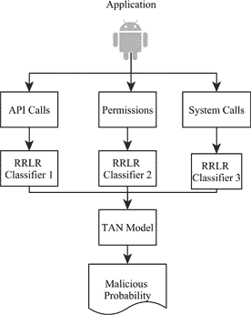

Figure 4.2 Hybrid malware detection mechanism.

## 4.5.1 API 调用、权限和系统调用之间的依赖关系

在本节中，我们将借助数据集说明这些 API 调用、权限和系统调用之间的条件依赖关系。

## 4.5.2 岭正则化逻辑回归（RRLR）

逻辑回归是将对数几率函数或 S 曲线逻辑函数拟合到数据集，以便根据一组自变量的值计算分类事件发生的概率。逻辑模型可能会根据应用程序的静态或动态特征，预测给定应用程序为恶意软件的可能性。

一个自变量的逻辑回归的一般形式为，

$$
\begin{array}{r}
{h_{\delta}(x) = \frac{1}{1 + e^{- (\delta_{0} + \delta_{1}x)}}.} \\
\end{array}
$$

逻辑回归可以推广到多个自变量，形式为，

$$
\begin{array}{r}
{h_{\delta}(X) = \frac{1}{1 + e^{- (\delta_{0} + \delta_{1}x_{1} + \ldots + \delta_{n}x_{n})}} = \frac{1}{1 + e^{- \delta^{T}X}},} \\
\end{array}
$$

其中 $\delta = (\delta[1], \ldots, \delta[n])^{(T)}$ 和 $X = (x[1], \ldots, x[n])^{(T)}$。给定 $X$ 时，因变量 $Y$ 发生的概率可以直接估计为，

$$
\begin{array}{r}
\left. h_{\delta}(X) = Pr(Y \middle| X) = \frac{1}{1 + e^{- \delta^{T}X}}, \right. \\
\end{array}
$$

其中 $\delta = (\delta[1], \delta[2], \ldots, \delta[n])^{(T)}$ 是回归参数。这些回归参数是从训练数据中估计出来的。

Ridge 和 Lasso 是两种正则化技术，用于减少或收缩生成的回归中的系数。这可以减少模型中的方差，并可以避免过拟合问题。过拟合会导致模型无法泛化。也就是说，模型在用于训练模型的数据上表现良好，但在新的数据集上表现不佳。逻辑回归系数 $\delta[0], \ldots, \delta[n]$ 是通过最小化负对数似然来找到的。Ridge 和 Lasso 正则化通过向对数似然函数添加惩罚项来工作。在岭回归的情况下，惩罚项是 $\sum \delta[i]²$，而在 Lasso 的情况下，它是 $\sum |\delta[i]|$。在本章中，我们将采用岭正则化来估计概率。

令 $D = \{(X[i], Y[i]): i = 1, 2, \ldots, m\}$ 为一个标记数据集，其中每个 $X[i]$ 是一个 $n$ 维向量，$Y[i]$ 表示其标签。回归参数向量 $\delta = (\delta[1], \delta[2], \ldots, \delta[n])$ 可以通过数据集 $D$ 使用岭正则化来估计。参数 $\delta$ 估计为，

$$
\begin{array}{r}
\left. \arg\max\limits_{\delta} \sum\limits_{i = 1}^{m} \log(Pr(Y_{i} \middle| X_{i}: \delta)) - \gamma \sum\limits_{i = 1}^{n} \delta_{i}^{2}, \right. \\
\end{array}
$$

其中 $\gamma$ 是通过交叉验证方法计算的惩罚值 \[172\]。$Pr(Y[i] | X[i]: \delta))$ 计算为，

$$
\begin{array}{r}
\left. Pr(Y_{i} \middle| X_{i}: \delta) = h_{\delta}{(X_{i})}^{Y_{i}}{(1 - h_{\delta}(X_{i}))}^{(1 - Y_{i})}. \right. \\
\end{array}
$$

## 4.5.3 概率估计

`RRLR` 分类器用于查找与 $q$ 维特征向量 $X$（基于权限或 API 调用或系统调用）相关的异常（恶意行为）的概率。令 $Y = 1$ 表示异常（恶意），$Y = 0$ 表示非异常（非恶意）。那么，$Pr(Y = 1 | X)$ 计算为：

$$
\begin{array}{r}
\left. Pr(Y = 1 \middle| X) = \frac{1}{1 + exp( - \delta^{T}X)}, \right. \\
\end{array}
$$

其中 $\delta = (\delta[1], \delta[2], \ldots, \delta[q])$ 是回归参数。这些回归参数在训练阶段估计。

令 $D = \{(X[i], Y[i]): i = 1, 2, \ldots, m\}$ 为一个标记数据集，其中 $X[i] = (X[i1], \ldots, X[iq])$ 是对应于第 $i$ 个元素的 $q$ 维特征向量，$Y[i] \in \{0, 1\}$ 表示其标签（1 表示异常，0 表示非异常）。在训练期间，我们从数据集 $D$ 中估计回归参数 $\delta = (\delta[1], \delta[2], \ldots, \delta[q])$ 为 $\left. \arg\max\limits_{\delta} \sum\limits_{i = 1}^{m} \log(Pr(Y_{i} \middle| X_{i}: \delta)) - \gamma \sum\limits_{i = 1}^{q} |\delta_{i}^{2}| \right|$，其中 $\gamma$ 是通过交叉验证方法计算的惩罚值 \[172\]。

## 4.5.4 异常检测

在此阶段，我们将检查应用程序生成的 API 调用、请求的权限和系统调用，以发现异常行为。在基于 TAN 的模型中，API、权限和系统调用特征中的异常是指其异常或可疑行为。异常的 API 调用、权限和系统调用是用于在设备上执行高权限操作的。恶意应用程序的源代码可能包含风险 API 调用（异常），用于执行高权限操作，例如拨打电话、发送短信、拍照、录制音频等。为了执行这些高权限操作，应用程序需要适当的风险权限（异常），例如 `CALL_PHONE` 和 `SEND_SMS`，这些权限需要在清单文件中声明。这些风险权限是运行时执行 API 调用（异常）所必需的。为了在运行时执行这些风险 API 调用（异常），会生成不常见的风险系统调用序列（异常）。这些系统调用序列（异常）旨在在设备上执行高权限操作。在此，我们训练三个不同的脊正则化 LR 分类器，分别对应一组恶意软件和良性软件应用程序的 API 调用、权限和系统调用序列。

### 4.5.4.1 应用权限分析

在此阶段，我们将分析应用清单文件中声明的权限，以估计异常行为。该过程包含两个步骤。在第一步中，我们将使用已知恶意软件和良性软件应用程序的权限训练一个 RRLR（脊正则化逻辑回归）分类器 \[138\]。在第二步中，训练好的 RRLR 分类器用于基于基于权限的特征来估计未知应用程序的恶意概率。

让 `𝒜 =(𝒜[1], …, 𝒜[*u*])` 表示基于应用清单文件中提到的权限的特征向量，`ℰ ∈ {0,1}` 表示应用程序 `ℱ` 的二元随机变量，其中 1 表示异常，0 表示非异常。`𝒜` 中的 `𝒜[*i*]` 计算如下：

$$
\begin{array}{l} 
{\mathcal{A}_{i} = \left\{ \begin{array}{ll} 
{1,} & {\text{如果第 }i\text{个权限存在于 }\mathcal{F}\text{ 中；}} \\\\ 
{0,} & {\text{否则。}} \\\\ 
\end{array}~ \right.} \\\\ 
\end{array}
$$  

让 `𝒯[1]` 是介于 0 到 1 之间的阈值。让 `𝒵[1]` 是一个二进制值，指示应用程序的应用清单权限是否被 RRLR 分类器 `ℒ[1]` 视为异常。即，

$$
\begin{array}{l} 
{\mathcal{Z}_{1} = \left\{ \begin{array}{ll} 
1 & \left. \text{如果 }Pr(\mathcal{E} = 1 \middle| \mathcal{A}) \geq \mathcal{T}_{1}；\right. \\\\ 
0 & {\text{否则。}} \\\\ 
\end{array}~ \right.} \\\\ 
\end{array}
$$  

### 4.5.4.2 静态 API 函数调用分析

在此阶段，我们将分析应用程序的静态 API 函数调用，以预测异常行为。该过程包含两个步骤。在第一步中，我们将使用已知恶意软件和良性软件应用程序的静态 API 函数调用训练一个 RRLR（脊正则化逻辑回归）分类器 \[138\]。在第二步中，训练好的 RRLR 分类器用于基于其中的静态 API 函数调用来估计未知应用程序的恶意概率。

假设 `ℬ =(ℬ[1], …, ℬ[*v*])` 表示基于静态 API 函数调用的特征，`ℰ ∈ {0,1}` 表示应用程序 `ℱ` 的二元随机变量，其中 1 表示异常，0 表示非异常。`ℬ` 中的 `ℬ[*i*]` 计算如下：

$$
\mathcal{B}_{i} = \left\{ \begin{array}{ll} 
{1,} & {\text{如果第 }i\text{ 个 API 调用存在于 }\mathcal{F}\text{ 中；}} \\\\ 
{0,} & \text{否则。} \\\\ 
\end{array}~ \right.
$$  

让 `𝒯[2]` 是介于 0 到 1 之间的阈值。让 `𝒵[2]` 是一个二进制值，指示应用程序的静态 API 函数调用是否被 RRLR 分类器 `ℒ[2]` 视为异常。即，

$$
\begin{array}{l} 
{\mathcal{Z}_{2} = \left\{ \begin{array}{ll} 
1 & \left. \text{如果 }Pr(\mathcal{E} = 1 \middle| \mathcal{B}) \geq \mathcal{T}_{2}；\right. \\\\ 
0 & {\text{否则。}} \\\\ 
\end{array}~ \right.} \\\\ 
\end{array}
$$  

### 4.5.4.3 系统调用分析

在此阶段，我们将分析系统调用序列中各个系统调用的计数。该过程包含两个步骤。在第一步中，我们将使用已知恶意软件和良性软件应用程序的系统调用计数训练一个 RRLR（脊正则化逻辑回归）分类器 \[138\]。在第二步中，训练好的 RRLR 分类器用于基于其中的系统调用计数来估计未知应用程序的恶意概率。

假设 `𝒞 =(𝒞[1], …, 𝒞[*w*])` 表示基于系统调用计数的特征向量，`ℰ ∈ {0,1}` 表示应用程序 `ℱ` 的二元随机变量，其中 1 表示异常，0 表示非异常。

让 `𝒯[3]` 是介于 0 到 1 之间的阈值。让 `𝒵[3]` 是一个二进制值，指示应用程序的系统调用计数是否被 RRLR 分类器 `ℒ[3]` 视为异常。即，

$$
\begin{array}{l} 
{\mathcal{Z}_{3} = \left\{ \begin{array}{ll} 
1 & \left. \text{如果 }Pr(\mathcal{E} = 1 \middle| \mathcal{C}) \geq \mathcal{T}_{3}；\right. \\\\ 
0 & {\text{否则。}} \\\\ 
\end{array}~ \right.} \\\\ 
\end{array}
$$  

## 4.5.5 使用基于 TAN 的模型进行恶意软件检测

在本节中，我们使用树增强朴素贝叶斯算法 \[97\] \[111\] 结合机器学习分类器的输出。假设 `ℱ` 是一个未知应用程序，`𝒜`、`ℬ`、`𝒞` 分别对应基于清单权限的特征向量、基于静态 API 调用的特征向量和基于系统调用计数的特征向量。假设 `𝒵[*i*]` 对于 `i = 1, 2, 3` 表示二元值随机变量，指示应用程序 `ℱ` 是否已被 RRLR 分类器 `ℒ[*i*]`（对于 `i = 1, 2, 3`）声明为异常。TAN 模型如 图 4.3 所示。树增强朴素贝叶斯算法 \[97\] 如下所示：

1. 测量 `𝒵[*i*]` 和 `𝒵[*j*]` 在 `i ≠ j` 时的条件互信息 `I(𝒵[*i*],𝒵[*j*]|ℰ)`。两个机器学习分类器输出 `𝒵[*i*]` 和 `𝒵[*j*]` 之间的条件互信息 `I(𝒵[*i*],𝒵[*j*]|ℰ)` 计算如下，

    $$
    \begin{array}{r} 
    \left. I(\mathcal{Z}_{i},\mathcal{Z}_{j} \middle| \mathcal{E}) = {\sum\limits_{u = 0}^{1}{\sum\limits_{v = 0}^{1}{\sum\limits_{k = 0}^{1}{(Pr(}}}}\mathcal{Z}_{i} = u,\mathcal{Z}_{j} = v,\mathcal{E} = k). \right. \\\\ 
    {\log\frac{\left. Pr(\mathcal{Z}_{i} = u,\mathcal{Z}_{j} = v \middle| \mathcal{E} = k) \right.}{\left. Pr(\mathcal{Z}_{i} = u \middle| \mathcal{E} = k)Pr(\mathcal{Z}_{j} = v \middle| \mathcal{E} = k) \right.})}. \\\\ 
    \end{array}
    $$  

    (4.2)

2. 构建一个无向图，`𝒵[1]`、`𝒵[2]`、`𝒵[3]` 作为顶点，通过权重为 `I(𝒵[*i*],𝒵[*j*]|ℰ)` 的边连接。

3. 从得到的无向图中提取一个无向最大生成树。

4. 通过任意选择一个节点作为根并向外设置有向边，将无向最大生成树转换为有向最大生成树。

5. 通过添加一个顶点 `ℰ` 并添加从 `ℰ` 到所有其余顶点的边来构建 TAN 模型。

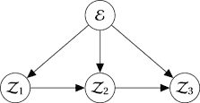

图 4.3 用于恶意概率估计的 TAN 模型。

应用程序的恶意概率值 `Pr(ℰ=1|𝒵[1],𝒵[2],𝒵[3])` 使用 TAN 计算如下，

$$\\begin{array}{r} \\left. Pr(\\mathcal{E} = 1 \\middle| \\mathcal{Z}\_{1},\\mathcal{Z}\_{2},\\mathcal{Z}\_{3}) = \\frac{\\left. Pr(\\mathcal{E} = 1).Pr(\\mathcal{Z}1,\\mathcal{Z}\_{2},\\mathcal{Z}\_{3} \\middle| \\mathcal{E} = 1) \\right.}{Pr(\\mathcal{Z}\_{1},\\mathcal{Z}\_{2},\\mathcal{Z}\_{3})}. \\right. \\\\ \\end{array}$$  

(4.3)

概率 `Pr(𝒵[1],𝒵[2],𝒵[3]|ℰ=1)` 的计算如下，

$$\\begin{array}{r} \\left. Pr(\\mathcal{Z}\_{1},\\mathcal{Z}\_{2},\\mathcal{Z}\_{3} \\middle| \\mathcal{E} = 1) = Pr(\\mathcal{Z}\_{1} \\middle| \\mathcal{E} = 1).Pr(\\mathcal{Z}\_{2} \\middle| \\mathcal{Z}\_{1},\\mathcal{E} = 1).Pr(\\mathcal{Z}\_{3} \\middle| \\mathcal{Z}\_{2},\\mathcal{E} = 1). \\right. \\\\ \\end{array}$$  

概率 `Pr(𝒵[1], 𝒵[2], 𝒵[3])` 的计算如下，

$$\\begin{array}{rll} {Pr(\\mathcal{Z}\_{1},\\mathcal{Z}\_{2},\\mathcal{Z}\_{3})} & = & \\left. Pr(\\mathcal{E} = 1).Pr(\\mathcal{Z}\_{1},\\mathcal{Z}\_{2},\\mathcal{Z}\_{3} \\middle| \\mathcal{E} = 1) \\right. \\\\ & \\left. + Pr(\\mathcal{E} = 0).Pr(\\mathcal{Z}\_{1},\\mathcal{Z}\_{2},\\mathcal{Z}\_{3} \\middle| \\mathcal{E} = 0). \\right. & \\\\ \\end{array}$$  

令 `𝒯` 为介于 0 和 1 之间的阈值。如果恶意概率值 `Pr(ℰ=1|𝒵[1],𝒵[2],𝒵[3])` 超过 `𝒯`，则该应用程序被判定为恶意软件。

## 4.6 实验与分析

在本节中，我们讨论了基于 TAN 的混合模型在现有恶意软件和良性软件数据集上的性能。我们从 Drebin \[75\] 和 AMD \[203\] 中选取了 1000 个恶意软件应用程序，并从 Google Play (GP) \[28\] 中选取了 1000 个良性软件应用程序，用于评估该方法的性能。该方法的实现是在一台预装 Android 4.4 模拟器的 Intel Core i5 Windows 10 PC 上进行的，内存为 8GB。

在静态分析中，提取了 3200 个应用程序的 API 调用和权限。为了提取 API 调用和权限，我们使用了 Androguard \[98\] 工具。提取特征后，使用 Python 代码从这些提取的 API 调用和权限构建了二进制特征向量，并保存在单独的文件中。在数据集中，我们观察到某些权限在恶意软件应用程序中比在良性软件应用程序中出现得更频繁，反之亦然。我们将这些选为基于权限的特征。选定的权限如 表 4.3 所示。

表 4.3 用于恶意软件检测的选定权限。

| ID || Permission || ID || Permission |

| --- | --- | --- | --- |

| 1 || `READ_PHONE_STATE` || 2 || `WRITE_CONTACTS` |

| --- | --- | --- | --- |

| 3 || `CALL_PHONE` || 4 || `READ_CONTACTS` |

| 5 || `Internet` || 6 || `SEND_SMS` |

| 7 || `DISABLE_KEYGUARD` || 8 || `PROCESS_OUTGOING_CALLS` |

| 9 || `RECEIVE_BOOT_COMPLETED` || 10 || `READ_SMS` |

| 11 || `FACTORY_TEST` || 12 || `DEVICE_POWER` |

| 13 || `HARDWARE_TEST` || 14 || `CHANGE_WIFI_STATE` |

| 15 || `GET_ACCOUNTS` || 16 || `READ_HISTORY_BOOKMARKS` |

| 17 || `WRITE_APN_SETTINGS` || 18 || `MODIFY_PHONE_STATE` |

| 19 || `WRITE_HISTORY_BOOKMARKS` || 20 || `ACCESS_LOCATION` |

| 21 || `EXPAND_STATUS_BAR` || 22 || `WRITE_EXTERNAL_STORAGE` |

| 23 || `RECEIVE_SMS` || 24 || `WRITE_SMS` |

| 25 || `ACCESS_WIFI_STATE` || 26 || `MODIFY_AUDIO_SETTINGS` |

| 27 || `KILL _BACKGROUND_PROCESS` ||  ||  |

我们观察到某些敏感 API 调用在恶意软件应用程序中比在良性软件应用程序中出现得更频繁，反之亦然。我们将这些选为基于 API 调用的特征。选定的 API 调用如 表 4.4 所示。

表 4.4 用于恶意软件检测的选定 API 调用。

| ID || API Call || ID || API Call |

| --- | --- | --- | --- |

| 1 || `getNetworkType` || 2 || `getNetworkOperator` |

| --- | --- | --- | --- |

| 3 || `loadClass` || 4 || `getClassLoader` |

| 5 || `getMethod` || 6 || `getLongitude` |

| 7 || `getLatitude` || 8 || `createFromPdu` |

| 9 || `getInputStream` || 10 || `getOutputStream` |

| 11 || `getWifiState` || 12 || `abortBroadCast` |

| 13 || `getAccountName` || 14 || `RequestFocus` |

| 15 || `getSubscriberId` || 16 || `getDisplayOriginatingAddress` |

| 17 || `sendTextMessage` || 18 || `getCredential` |

| 19 || `getDisplayMessageBody` || 20 || `getPackageInfo` |

| 21 || `getIMEI` || 22 || `getLastKnownLocation` |

| 23 || `getAppPackageName` || 24 || `takepicture` |

| 25 || `getCookies` || 26 || `killProcess` |

| 27 || `exec` || 28 || `getMessage` |

对于动态分析，我们提取了数据集中 2000 个应用程序的系统调用序列。数据集中的应用程序在模拟器中安装，并使用 `strace` 实用程序收集系统调用日志。在此过程中，在收集系统调用序列时，我们使用 `monkeyrunner` 工具注入了 1000 个随机事件。我们使用 Python 代码将系统调用序列转换为基于系统调用计数的特征向量。

收集系统调用序列后，构建了基于系统调用频率的特征向量并保存在文件中。Wang 等人 \[202\] 表明，内存管理调用、错误系统调用和信息维护系统调用对恶意行为没有任何显著影响。因此，可以从记录的系统调用中避免这些系统调用，以有效识别异常行为。选定的系统调用及其替代符号如 表 4.5 所示。

表 4.5 用于恶意软件检测的选定系统调用。

| ID || Notation || System Call || ID || Notation || System Call |

| --- | --- | --- | --- | --- | --- |

| 1 || `A` || `recvfrom` || 2 || `B` || `write` |

| --- | --- | --- | --- | --- | --- |

| 3 || `C` || `ioctl` || 4 || `D` || `read` |

| 5 || `E` || `sendto` || 6 || `F` || `dup` |

| 7 || `G` || `writev` || 8 || `H` || `pread` |

| 9 || `I` || `close` || 10 || `J` || `socket` |

| 11 || `K` || `bind` || 12 || `L` || `connect` |

| 13 || `M` || `mkdir` || 14 || `N` || `access` |

| 15 || `O` || `chmod` || 16 || `P` || `open` |

| 17 || `Q` || `rename` || 18 || `R` || `fchown32` |

| 19 || `S` || `unlink` || 20 || `T` || `pwrite` |

| 21 || `U` || `unmask` || 22 || `V` || `lseek` |

| 23 || `W` || `fcntl` || 24 || `X` || `recvmsg` |

| 25 || `Y` || `sendmsg` || 26 || `Z` || `epoll` |

| 27 || `A1` || `dup2` || 28 || `A2` || `fchown` |

| 29 || `A3` || `readv` || 30 || `A4` || `chdir` |

| 31 || `A4` || `execve` ||  ||  ||  |

### 4.6.1 训练阶段

我们随机选取了 500 个恶意软件和 500 个良性软件样本用于训练三个岭正则化的逻辑回归分类器 `ℒ[1]`、`ℒ[2]`、`ℒ[3]`。训练过程的不同步骤如下：

*   对 `ℒ[1]`、`ℒ[2]`、`ℒ[3]` 进行阈值估计；

*   条件概率估计。

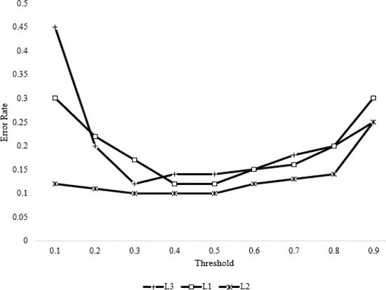

图 4.4 不同阈值下的分类误差率。

#### 4.6.1.1 对 `ℒ[1]`、`ℒ[2]`、`ℒ[3]` 进行阈值估计

我们将训练数据集分为两个子集，其中一个用于训练分类器，另一个用于验证。我们使用了 250 个恶意软件和 250 个良性软件样本来训练分类器 `ℒ[1]`、`ℒ[2]` 和 `ℒ[3]`。然后，我们使用剩余的恶意软件和良性软件样本对它们进行了测试，并记录了分类器输出概率 `Pr(ℰ=1|𝒜)`、`Pr(ℰ=1|ℬ)` 和 `Pr(ℰ=1|𝒞)`。基于 API、权限和系统调用的分类器在不同阈值（概率）下的误差率（在 第 2 章 中讨论）如 图 4.4 所示。从 图 4.4 可以看出，分类器可以在 0.3 到 0.6 之间的任何阈值（概率）下有效检测异常。在此，我们分别为分类器 `ℒ[1]`、`ℒ[2]` 和 `ℒ[3]` 选择了 0.5 作为阈值 `𝒯[1]`、`𝒯[2]` 和 `𝒯[3]` 的值。

### 4.6.1.2 条件概率估计

在此阶段，我们使用 TAN 模型确定分类器输出 `𝒵[1]`、`𝒵[2]` 和 `𝒵[3]` 之间的条件概率。为此，我们使用了包含 250 个恶意应用和 250 个良性应用的验证集。验证数据集中应用程序的静态（API 调用、权限）和动态特征（系统调用）作为输入提供给分类器 `ℒ[1]`、`ℒ[2]` `ℒ[3]`，并记录了分类器输出 `𝒵[1]`、`𝒵[2]`、`𝒵[3]`。然后，我们使用 TAN 模型计算 `𝒵[1]`、`𝒵[2]` 和 `𝒵[3]` 之间的条件概率值。最初，我们计算 `𝒵[i]` 和 `𝒵[j]`（其中 `i ≠ j`）之间的条件互信息 `I(𝒵[i],𝒵[j]|ℰ)`。然后，我们构建一个无向图，以 `𝒵[1]`、`𝒵[2]` 和 `𝒵[3]` 作为顶点集合，边的权重为 `I(𝒵[i],𝒵[j]|ℰ)`，并从中提取最大有向生成树。无向图和最大有向生成依赖树分别给出在 图 4.5 和 图 4.6。

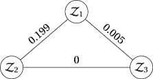

图 4.5 对应于分类器输出的无向依赖图。

图 4.6 对应于分类器输出的最大生成有向依赖树。

令 `|𝒵[3]=j,𝒵[2]=i,ℰ=k|` 表示事件 `𝒵[3] = j`、`𝒵[2] = i` 和 `ℰ = k` 的联合发生次数，`|𝒵[2]=i,ℰ=k|` 表示事件 `𝒵[2] = i` 和 `ℰ = k` 的联合发生次数。那么，概率 `Pr(𝒵[3]=j,𝒵[2]=i|ℰ=k)` 计算如下，

$$
\begin{array}{r}
\left. Pr(\mathcal{Z}_{3} = j \middle| \mathcal{Z}_{2} = i,\mathcal{E} = k) = \frac{\left| \mathcal{Z}_{3} = j,\mathcal{Z}_{2} = i,\mathcal{E} = k \right|}{\left| \mathcal{Z}_{2} = i,\mathcal{E} = k \right|}. \right. \\
\end{array}
$$  

令 `|𝒵[2]=j,𝒵[1]=i,ℰ=k|` 表示事件 `𝒵[2] = j`、`𝒵[1] = i` 和 `ℰ = k` 的联合发生次数，`|𝒵[1]=i,ℰ=k|` 表示事件 `𝒵[1] = i` 和 `ℰ = k` 的联合发生次数。那么，概率 `Pr(𝒵[2]=j,𝒵[1]=i|ℰ=k)` 计算如下，

$$
\begin{array}{r}
\left. Pr(\mathcal{Z}_{2} = j \middle| \mathcal{Z}_{1} = i,\mathcal{E} = k) = \frac{\left| \mathcal{Z}_{2} = j,\mathcal{Z}_{1} = i,\mathcal{E} = k \right|}{\left| \mathcal{Z}_{1} = i,\mathcal{E} = k \right|}. \right. \\
\end{array}
$$  

令 `|𝒵[1]=i,ℰ=k|` 表示事件 `𝒵[1] = i` 和 `ℰ = k` 的联合发生次数。那么，概率 `Pr(𝒵[1]=i|ℰ=k)` 计算如下，

$$
\begin{array}{r}
\left. Pr(\mathcal{Z}_{1} = i \middle| \mathcal{E} = k) = \frac{\left| \mathcal{Z}_{1} = i,\mathcal{E} = k \right|}{\left| \mathcal{E} = k \right|}. \right. \\
\end{array}
$$  

令 `|ℰ=k|` 是 `ℰ = k` 的发生次数，`|ℰ|` 是数据集中应用程序的总数。那么，概率值 `Pr(ℰ = k)` 计算如下，

$$
\begin{array}{r}
{Pr(\mathcal{E} = k) = \frac{\left| \mathcal{E} = k \right|}{\left| \mathcal{E} \right|}.} \\
\end{array}
$$  

条件概率分别给出在 表 4.6、表 4.7 和 表 4.8。

表 4.6 随机变量 `𝒵[1]` 的条件概率表。

| 类别标签 || `𝒵[1]` || `Pr(𝒵[1]|ClassLabel)` |

| --- | --- | --- |

| `ℰ = 1` || 1 || 0.95 |

| --- | --- | --- |

| `ℰ = 1` || 0 || 0.05 |

| `ℰ = 0` || 1 || 0.15 |

| `ℰ = 0` || 0 || 0.85 |

表 4.7 随机变量 `𝒵[2]` 的条件概率表。

| 类别标签 || `𝒵[1]` || `𝒵[2]` || `Pr(𝒵[2]|𝒵[1],ClassLabel)` |

| --- | --- | --- | --- |

| `ℰ = 1` || 1 || 1 || 0.89 |

| --- | --- | --- | --- |

| `ℰ = 1` || 0 || 1 || 0.45 |

| --- | --- | --- | --- |

| `ℰ = 1` || 1 || 0 || 0.11 |

| --- | --- | --- | --- |

| `ℰ = 1` || 0 || 0 || 0.55 |

| `ℰ = 0` || 1 || 1 || 0.27 |

| --- | --- | --- | --- |

| `ℰ = 0` || 1 || 0 || 0.73 |

| --- | --- | --- | --- |

| `ℰ = 0` || 0 || 1 || 0.20 |

| --- | --- | --- | --- |

| `ℰ = 0` || 0 || 0 || 0.80 |

表 4.8 随机变量 `𝒵[3]` 的条件概率表。

| 类别标签 || `𝒵[2]` || `𝒵[3]` || `Pr(𝒵[3]|𝒵[2],ClassLabel)` |

| --- | --- | --- | --- |

| `ℰ = 1` || 1 || 1 || 0.85 |

| --- | --- | --- | --- |

| `ℰ = 1` || 1 || 0 || 0.15 |

| --- | --- | --- | --- |

| `ℰ = 1` || 0 || 1 || 0.73 |

| --- | --- | --- | --- |

| `ℰ = 1` || 0 || 0 || 0.27 |

| `ℰ = 0` || 1 || 1 || 0.09 |

| --- | --- | --- | --- |

| `ℰ = 0` || 1 || 0 || 0.91 |

| --- | --- | --- | --- |

| `ℰ = 0` || 0 || 1 || 0.06 |

| --- | --- | --- | --- |

| `ℰ = 0` || 0 || 0 || 0.94 |

TAN 方法针对不同阈值（恶意概率）的假阳性率（FPR）和假阴性率（FNR）给出在 图 4.7。从 图 4.7 可以看出，在 0.3 − 0.8 范围内的任何阈值下，FPR 和 FNR 值均最低。因此，我们可以将 0.3 − 0.8 范围内的任何值作为阈值。在此，我们选择中间值 0.5 作为 TAN 分类器的阈值 `𝒯`。

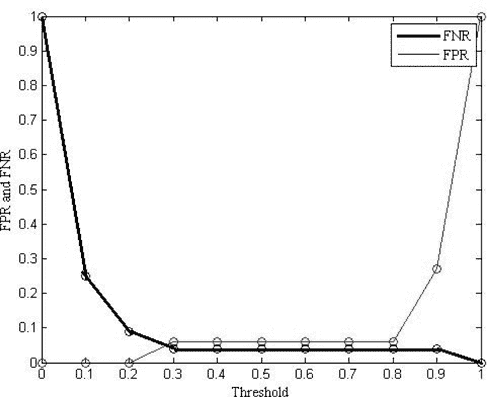

图 4.7 针对不同阈值的假阳性率和假阴性率。

### 4.6.2 评估阶段

该机制的性能使用了 500 个恶意应用和 500 个良性应用进行评估。评估阶段包含两个步骤。在第一步中，我们从应用程序的 API 调用、权限和系统调用特征中找出分类器输出 `𝒵[1]`、`𝒵[2]` 和 `𝒵[3]`。在第二步中，我们找出恶意概率值。该方法的性能给出在 表 4.9。在 表 4.9 中，我们可以看到 TAN 模型可以以最高 0.98 的准确率对恶意应用进行分类。提取 API、权限和系统调用特征的源代码给出在附录中。此处，使用 Androguard 工具 `[98]` 从应用程序中提取 API 调用和权限以构建 CSV 文件。

表 4.9 基于 TAN 的模型性能。

| 数据集 || TPR || FPR || Precision || Accuracy || F1Score |

| --- | --- | --- | --- | --- | --- |

| AMD+Drebin || 0.98 || 0.04 || 0.96 || 0.97 || 0.96 |

| --- | --- | --- | --- | --- | --- |

| Drebin || 1 || 0.04 || 0.96 || 0.98 || 0.98 |

## 4.7 结论

在本章中，我们讨论了一种通过探索恶意活动相关的静态和动态特征的条件依赖性来检测 Android 恶意应用程序的机制。这种混合检测机制能够比现有的静态和动态分析机制更准确地捕捉恶意行为。此外，该模型可扩展以检测不断演变的恶意软件和良性应用程序。不断演变的恶意软件和良性应用程序可能会使用新特征来执行其活动 `[154]`。在这种情况下，分类器需要使用新的特征集重新训练。因此，通过重新训练，我们可以使 TAN 模型保持最新。为了克服频繁重新训练的局限性，可以在 RRLR 分类器中采用主动机器学习算法。

应用程序可能通过继承其他应用的权限来执行恶意活动。在这种情况下，应用可以使用其他应用清单文件中声明的权限。在这种情况下，`AAPT` 工具无法通过分析清单文件获取这些继承的权限。因此，基于权限特征训练的分类器可能会错误分类该应用程序。然而，API 调用仍然存在于应用程序的源代码中，执行这些 API 调用后，也会生成恶意系统调用。最后，基于 API 调用和系统调用的分类器可以正确分类该应用程序。因此，在大多数情况下，结合基于权限、API 调用和系统调用的分类器的输出，我们可以检测恶意行为。

在本章中，我们讨论了 API 调用、权限和系统调用在恶意软件检测中的有效性。API 调用和权限通常比系统调用包含更多信息。然而，当良性应用程序调用典型的恶意软件 API 调用和权限时，API 调用和权限的可靠性可能受到质疑。与良性应用程序不同，恶意软件应用程序调用敏感 API 调用不需要任何用户触发 \[101\]。在良性应用程序中，用户触发通过意图机制传播以调用敏感 API，例如 `sendTextMessage()` \[101\]。在这些情况下，数据引用不会通过 IPC（进程间通信）通道发送 \[194\]。然而，没有用户触发的敏感 API 调用会反映在应用程序生成的系统调用序列中 \[211\]。因此，应用程序的系统调用跟踪包含比应用程序调用的独立敏感 API 调用更多关于恶意行为的相关信息。

大多数现有的基于系统调用的动态分析机制依赖于基于机器学习（ML）的方法来检测恶意行为。这些基于 ML 的检测机制将系统调用频率 \[71\]、共现矩阵 \[209\] 或马尔可夫链状态转移概率矩阵 \[208\] 作为 ML 分类器的特征向量。这些方法可能导致特征向量的高维度 \[110\]。维度灾难（特征向量的高维度）是一个问题，即特征向量中特征数量越多，会导致数据的稀疏性越高 \[110\]。数据中的这种高稀疏性会不必要地增加分类器的存储空间和处理时间。现有基于系统调用的动态分析机制的局限性在 表 4.10 中给出。为了克服这些局限性，在以下章节中，我们讨论使用图中心性度量和图信号进行低维特征构建，以实现有效的恶意软件检测。这些基于图的低维特征随后被纳入机器学习算法中，以自动化恶意软件检测任务。

表 4.10 现有基于系统调用机制的局限性。

| 方法 || 局限性 |

| --- | --- |

| Burguera 等人 \[89\] || 高维度/缺乏系统调用依赖 |

| --- | --- |

| Xiao 等人 \[208\] || 高维度 |

| Xiao 等人 \[209\] || 高维度 |

| Zhang 等人 \[219\] || 高维度 |

| Bernadi 等人 \[83\] || 特征构建需要多个系统调用日志 |

| Yu 等人 \[216\] || 高维度 |

| Xiao 等人 \[210\] || 系统调用重排序攻击 |

| Canfora 等人 \[91\] || 高维度 |

| Bhandari 等人 \[85\] || 高维度 |

# 5 基于图中心性度量的检测

DOI: [10.1201/9781003121510-5](https://doi.org/10.1201/9781003121510-5)

在 第 4 章 中，我们展示了 TAN 模型可用于结合静态和动态特征以实现准确的恶意软件检测。在基于 TAN 的检测模型中，恶意软件开发人员可能通过采用对抗性攻击 \[126\] 来规避 API 调用和基于权限的分类器。

针对 Android 恶意软件检测机制的对抗性攻击确实具有威胁性。它们可以使攻击者未经授权地访问设备。在基于 ML 的恶意软件检测中，特征值非常重要，因为特征值的微小变化可能会影响分类器的输出。除此之外，许多对抗性攻击是可迁移的。也就是说，针对特定基于 ML 的分类器的攻击也可能导致其他基于 ML 的分类器出现误分类。存在许多简单的特征操纵技术，例如在应用程序代码末尾注入字节或追加字节。通过监控 Android 应用程序的文件结构，可以轻松检测这些简单的特征操纵。然而，如果对手采用细粒度的特征修改，则不易被检测到。

对抗性攻击可能会影响 第 4 章 中讨论的基于 TAN 的检测模型的性能。然而，对于对手来说，在不更改应用程序源代码中底层语义的情况下，更改应用程序生成的系统调用序列是不可能的。此外，已知恶意软件应用程序以自动化方式调用敏感 API。这种没有用户触发的 API 调用会反映在相应的系统调用序列中 \[211\]。因此，应用程序的系统调用序列包含比敏感 API 调用更多关于恶意行为的相关信息。因此，基于系统调用的恶意软件检测机制对对抗性攻击更具鲁棒性。许多现有的基于系统调用的检测机制使用与系统调用频率相关的独立特征来从系统调用跟踪中检测恶意行为。独立特征可能无法捕获与恶意软件应用程序相关的系统调用跟踪的所有特征。因此，使用这些特征训练的机器学习分类器可能会将恶意软件应用程序错误分类为良性软件，反之亦然。为了克服这一局限性，在 \[187\] 中提出了一种基于图中心性的方法。因此，在本章中，我们讨论使用图中心性度量从系统调用跟踪中计算更具信息量的特征，以实现准确的恶意软件检测。

## 5.1 来自系统调用序列的有向图

在第 3 章中，我们解释了跟踪应用程序系统调用序列 `X` 的机制。有向图（digraph）是建模复杂序列中元素之间成对关系的便捷方式。应用程序的系统调用序列 `X` 可以表示为有向图 `G = (S, E, A)`，其中 `S = {S[i]: i = 1, 2, …, n}` 是 `n` 个系统调用的集合，`A` 是加权邻接矩阵，其中每个 `a[ij] ∈ A` 是系统调用序列 `X` 中系统调用 `S[j]` 紧随系统调用 `S[i]` 出现的次数，`E` 是 `S` 中顶点之间的 `m` 条有向边的集合。如果且仅当 `a[ij] > 0` 时，边 `e[ij]` 从顶点 `S[i]` 存在于顶点 `S[j]`，也就是说，如果且仅当在应用程序的执行中至少有一次系统调用 `S[j]` 紧随系统调用 `S[i]` 发生。选定的系统调用集合 `S` 给出在 表 5.1。

表 5.1 相关系统调用列表。

| **替代名称** || A || B || C || D || E || F || G || H |

| --- | --- | --- | --- | --- | --- | --- | --- | --- |

| **系统调用** || recvfrom || write || ioctl || read || sendto || dup || writev || pread |

| **替代名称** || I || J || K || L || M || N || O || P |

| **系统调用** || close || socket || bind || connect || mkdir || access || chmod || open |

| **替代名称** || Q || R || S || T || U || V || W || X |

| **系统调用** || rename || fchown32 || unlink || pwrite || umask || lseek || fcntl || recvmsg |

| **替代名称** || Y || Z || A1 || A2 || A3 || A4 ||  ||  |

| **系统调用** || sendmsg || epoll || dup2 || fchown || readv || chdir ||  ||  |

Wang et al. \[202\] 显示，内存管理调用、错误系统调用和信息维护系统调用对恶意行为没有任何显著影响。因此，可以从记录的系统调用中删除这些系统调用，以有效识别恶意行为。因此，系统调用序列需要通过消除这些系统调用来精炼。选定的系统调用给出在表 3.5 (第 3 章)。

walkinwat 特洛伊在模拟器中执行后的精炼系统调用序列如 图 5.1 所示。系统调用日志可以使用 `strace` 实用程序收集。在此，我们在收集系统调用序列时使用 `monkeyrunner` 工具注入了 1000 个随机事件。

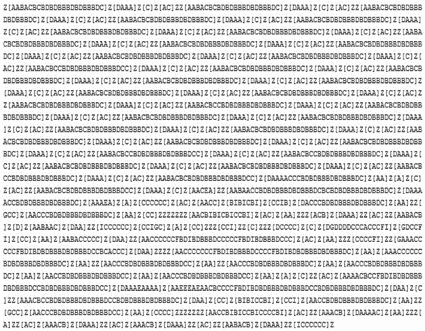

图 5.1 Walkinwat 特洛伊的系统调用序列。

从系统调用序列获得的 walkinwat 特洛伊的系统调用有向图如 图 5.2 所示。这些系统调用图可以捕获该系统调用序列中系统调用之间的复杂关系。在将系统调用序列建模为有序图后，我们根据中心性度量推断与系统调用相关的相关信息。

图 5.2 Walkinwat 特洛伊的系统调用有向图。

## 5.2 来自系统调用有向图的中心性度量

顶点的中心性是顶点在有向图 `G` 中影响力的度量 \[157\]。存在不同类型的中心性度量，例如，入度中心性、特征向量中心性、介数中心性、紧密中心性等。它们如下描述。

1. **特征向量中心性**: 令 `N = {n[ij]: i, j = 1, 2, 3, …, n}` 为图 `G` 的邻域矩阵，其中 `n[ij]` 计算如下：

   $$
   \begin{array}{l}
   {n_{ij} = \left\{ \begin{array}{ll}
   {1,} & {\text{if~}a_{ij} \neq 0;} \\
   {0,} & {\text{otherwise.}} \\
   \end{array} \right.}
   \\\\
   \end{array}
   $$

   顶点 `S[i]` 的特征向量中心性计算如下：

   $$
   \begin{array}{r}
   {C_{1}(S_{i}) = \frac{1}{\lambda}{\sum\limits_{j = 1}^{n}n_{ij}}C_{1}(S_{j}),}
   \\\\
   \end{array}
   $$

   (5.1)

   其中 `λ` 是邻接矩阵的最大特征值。

2. **紧密中心性**: 它是顶点在有向图中与其他顶点接近的速率。在连通图中，顶点 `S[i]` 的紧密中心性计算如下：

   $$
   \begin{array}{r}
   {C_{2}(S_{i}) = \frac{n - 1}{\sum\limits_{j = 1}^{n}\sigma_{ji}},}
   \\\\
   \end{array}
   $$

   (5.2)

   其中 `σ[ji]` 是从顶点 `S[j]` 到顶点 `S[i]` 的最短路径长度，`n` 是顶点的数量。

3. **介数中心性**: 介数中心性是顶点 `S[i]` 位于有向图中其他顶点之间最短路径上的速率。顶点 `S[i]` 的介数中心性 `C3` 计算如下：

   $$
   \begin{array}{r}
   {C_{3}(S_{i}) = {\sum\limits_{j = 1}^{n}{\sum\limits_{k = 1}^{n}\frac{\sigma_{jik}}{\sigma_{jk}}}}}
   \\\\
   \end{array}
   $$

   (5.3)

   其中 `σ[jk]` 是从顶点 `S[j]` 到顶点 `S[k]` 的最短路径数量，`σ[jik]` 是从顶点 `S[j]` 到顶点 `S[k]` 通过顶点 `S[i]` 的最短路径数量。

4. **入度中心性**: 它是有向图 `G` 中顶点的入边数量。顶点 `S[i]` 的入度中心性计算如下：

   $$
   \begin{array}{r}
   {C_{4}(S_{i}) = {\sum\limits_{j = 1}^{n}a_{ji}},}
   \\\\
   \end{array}
   $$

   (5.4)

   其中 `a[ji]` 是从顶点 `S[j]` 到顶点 `S[i]` 的边数量。

walkinwat 特洛伊的邻接矩阵和最短距离矩阵分别如 图 5.3 和 图 5.4 所示。计算出的入度、特征向量、介数和紧密中心性值给出在 表 5.3。

图 5.3 walkinwat 恶意软件的邻接矩阵。

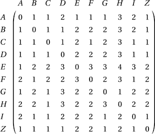

图 5.4 walkinwat 恶意软件的最短距离矩阵。

表 5.2. 系统调用计数及其归一化值。

| 系统调用（替代名称） || 计数 || 归一化计数 |

| --- | --- | --- |

| A || 416 || 0.190650779 |

| --- | --- | --- |

| B || 641 || 0.293767186 |

| --- | --- | --- |

| C || 402 || 0.184234647 |

| --- | --- | --- |

| D || 355 || 0.162694775 |

| --- | --- | --- |

| E || 7 || 0.003208066 |

| --- | --- | --- |

| F || 10 || 0.004582951 |

| --- | --- | --- |

| G || 5 || 0.002291476 |

| --- | --- | --- |

| H || 5 || 0.002291476 |

| --- | --- | --- |

| I || 31 || 0.014207149 |

| --- | --- | --- |

| Z || 310 || 0.142071494 |

表 5.3 walkinwat 有向图中系统调用的中心性值。

| 系统调用 || 入度中心性 || 特征向量中心性 || 介数中心性 || 紧密中心性 |

| --- | --- | --- | --- | --- |

| A || 0.19 || 0.4218 || 11.83 || 0.2700 |

| --- | --- | --- | --- | --- |

| B || 0.29 || 0.4305 || 7.58 || 0.2700 |

| --- | --- | --- | --- | --- |

| C || 0.18 || 0.4591 || 22.08 || 0.2945 |

| --- | --- | --- | --- | --- |

| D || 0.16 || 0.1874 || 0.67 || 0.1705 |

| --- | --- | --- | --- | --- |

| E || 0.003 || 0.1959 || 0 || 0 |

| --- | --- | --- | --- | --- |

| F || 0.004 || 0.1021 || 0 || 0.1800 |

| --- | --- | --- | --- | --- |

| G || 0.002 || 0.2120 || 8.25 || 0.1906 |

| --- | --- | --- | --- | --- |

| H || 0.002 || 0.0471 || 0 || 0.1409 |

| --- | --- | --- | --- | --- |

| I || 0.014 || 0.3538 || 5.50 || 0.2314 |

| --- | --- | --- | --- | --- |

| Z || 0.014 || 0.4120 || 10.08 || 0.2492 |

将系统调用序列表示为有向图并提取中心性度量（如特征向量中心性、介数中心性和紧密中心性）的代码在附录中给出。在此，我们使用了 `nextworkx` 包 \[116\] 在 `python` 中用于将系统调用序列表示为有向图并提取中心性度量。

## 5.3 恶意软件检测阶段

应用程序的恶意行为可以通过集成学习方法使用中心性度量来检测。令 `C[1] = (C[1, 1], C[1, 2], …, C[1, n])` 表示应用程序的特征向量，该特征向量基于特征向量中心性，其中 `C[1, i]` 对于 `i = 1, 2, …, n` 表示系统调用 `S[i]` 的特征向量中心性。令 `C[2] = (C[2, 1], C[2, 2], …, C[2, n])` 表示应用程序的特征向量，该特征向量基于接近中心性，其中 `C[2, i]` 对于 `i = 1, 2, …, n` 表示系统调用 `S[i]` 的接近中心性。令 `C[3] = (C[3, 1], C[3, 2], …, C[3, n])` 表示应用程序的特征向量，该特征向量基于介数中心性，其中 `C[3, i]` 对于 `i = 1, 2, …, n` 表示系统调用 `S[i]` 的介数中心性。

可以使用 `C[1]`、`C[2]`、`C[3]` 作为特征向量分别训练三个 ML 分类器。这三个分类器根据未知应用程序的基于中心性的特征向量 `C[1]`、`C[2]` 和 `C[3]` 给出恶意分数的估计。这些恶意分数进一步结合起来，以检测未知应用程序是否为恶意软件。

令 `O[i] ∈ [0, 1]` 对于 `i = 1, 2, 3` 为基于未知应用程序的中心性特征 `C[1]`、`C[2]` 和 `C[3]` 的三个分类器生成的恶意分数。应用程序的平均恶意分数 `O[avg]` 计算如下，

$$\\begin{array}{r} {O_{avg} = {\\sum\\limits_{i = 1}^{3}w_{i}}.O_{i},} \\\\ \\end{array}$$  

其中 `w[i] ∈ [0, 1]`，对于 `i = 1, 2, 3` 是分类器的权重，且 ${\\sum\\limits_{i = 1}^{3}w_{i}} = 1$。如果平均恶意分数 `O[avg]` 大于阈值 `T`，则该应用程序可以被视为恶意软件。

## 5.4 实验与分析

在本节中，我们讨论了这种检测机制的性能。在 第 5.4.1 节 中，我们讨论了所使用的良性和恶意软件数据集。在 第 5.4.2 节 中，我们讨论了性能结果，并将其与其他方法进行比较。

### 5.4.1 数据集

在本节中，我们讨论了数据集。我们构建了一个包含 2600 个恶意和良性应用程序的平衡数据集，以展示这种机制的性能。恶意软件应用程序是根据所使用的代码混淆技术和恶意软件应用程序的类型，从 Drebin \[75\] 和 AMD 数据集 \[203\] 中收集的。该数据集包含 685 个使用至少一种混淆技术的恶意软件应用程序。该数据集中混淆恶意软件应用程序采用的代码混淆技术如下：

* 字符串重命名；

* 动态代码加载；

* 字符串加密；

* 嵌入本机代码。

混淆恶意软件应用程序的分布在 表 5.4 中给出。良性应用程序从 Google Play 商店下载。所有良性应用程序都提交到了 virustotal \[60\] 以验证其合法性。

表 5.4 所选恶意软件应用程序中使用的混淆技术统计。

| 混淆技术 || 恶意软件应用程序数量 |

| --- | --- |

| 字符串重命名 || 435 |

| --- | --- |

| 动态代码加载 || 277 |

| 字符串加密 || 507 |

| 嵌入本机代码 || 250 |

可以使用 Android 模拟器来收集数据集中所有恶意和良性应用程序的系统调用日志。在我们的实验中，Android 模拟器安装在一台配备 8GB 内存的 Intel Core i5 PC 上。在这里，我们使用 `strace` 工具来收集安装在 Android 模拟器中的应用程序的系统调用跟踪 \[185\]。Monkey runner 工具被用作自动化测试用例生成工具，用于跟踪系统调用 \[153\]。Monkey runner 工具可以在一分钟内获得最大代码覆盖率 \[82\]。一分钟后，我们终止了应用程序的执行，并将系统调用跟踪保存为日志文件。收集到的系统调用日志通过删除参数并从中消除不相关的系统调用进行预处理。从这些预处理后的系统调用日志中，我们构建了一个 `csv`（逗号分隔值）文件，对应于 1300 个良性和 1300 个恶意应用程序的基于特征向量中心性、接近中心性和介数中心性的特征。

### 5.4.2 性能结果

在本节中，我们讨论了在 第 5.4.1 节 中描述的数据集上基于中心性的检测机制的性能。我们使用了 75% 的恶意软件和良性应用程序的特征来训练分类器，并使用了 25% 的恶意软件和良性应用程序的特征来测试模型的性能。但是，对于测量混淆恶意软件应用程序的性能，我们使用了新的 ML 模型，这些模型使用了 75% 的恶意软件（混淆和非混淆）和良性软件（之前模型中使用的样本）的特征进行训练，并使用了 25% 的恶意软件（混淆）和良性软件（之前模型中使用的样本）的特征进行测试。在这里，我们使用了 `ANN`（人工神经网络）分类器来测试性能。

我们将三个中心性度量视为三个不同 ANN 分类器的三个不同特征向量。因此，我们训练了三个 ANN 分类器，使用接近中心性、特征向量中心性和介数中心性度量作为特征，并结合它们的输出进行恶意软件检测。各个 ANN 分类器及其集成在各种阈值下的性能结果在 图 5.5 中给出。从该图中我们可以得出结论，分类器的集成能提供更好的准确性。因此，这些三个分类器的集成被用于最终预测。此外，请注意，当阈值接近 0.5 时，准确率最高。因此，我们将 0.5 设定为所有分类器的阈值（恶意软件-良性软件边界）。

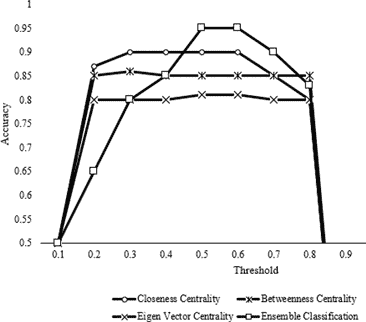

图 5.5 单个分类器和分类器集成的性能结果。

为了分析模型的性能，我们为三个分类器分配了各种权重 `w[i] ∈ [0, 1]`，其中 `i = 1, 2, 3`，使得 `w[1] + w[2] + w[3] = 1`，用于结合恶意分数。性能结果在 表 5.5 中给出。从 表 5.5 中可以看出，基于集成平均的机制可以在使用人工神经网络作为 ML 分类器的同时，以良好的准确率和 F1 分数检测恶意软件应用程序。请注意，当对应于基于接近中心性特征的分类器的权重 `w[2]` 被赋予较高值时，准确率为 98% 的最佳性能出现。此外，这种机制可以检测使用混淆技术的恶意软件样本，准确率为 97%。因此，这种机制可以以几乎相同的准确率检测混淆和非混淆恶意软件。我们还发现，基于集成平均的机制比基于多数投票的集成方法（采用分类器输出的类别的多数票）略微更准确。

表 5.5 不同权重下的分类器性能结果。

| 数据集 || `w[1]` || `w[2]` || `w[3]` || 真阳性率 || 假阳性率 || 阳性预测值 || 准确率 || F1 分数 |

| --- | --- | --- | --- | --- | --- | --- | --- | --- |

| 所有恶意软件应用程序 || $\\frac{1}{3}$ || $\\frac{1}{3}$ || $\\frac{1}{3}$ || 0.95 || 0.03 || 0.97 || 0.96 || 0.96 |

| --- | --- | --- | --- | --- | --- | --- | --- | --- |

| 所有恶意软件应用程序 || 0.30 || 0.40 || 0.30 || 0.97 || 0.02 || 0.98 || 0.97 || 0.97 |

# 6 用于检测的图卷积网络

DOI: [10.1201/9781003121510-6](https://doi.org/10.1201/9781003121510-6)

图卷积网络（Graph Convolutional Network，GCN）是一种图表示学习方法，它将图的结构和特征表示在低维欧几里得空间中。GCN 已被发现可在许多现实世界应用中取得有希望的结果，例如学习社交网络\[206\]、交通预测\[220\]、药物反应预测 \[156\] 等，以及在 Android 恶意软件检测 \[128\] 中。在本章中，我们讨论了 GCN 在 Android 恶意软件检测中的应用，并以系统调用图中混淆 Android 恶意软件的检测为例进行说明。我们按如下方式组织本章。第 6.2 节 介绍了 GCN 及其在许多现实世界问题中的应用，第 6.3 节 解释了基于 GCN 的恶意软件检测，第 6.4 节 给出了结果和讨论，第 6.5 节 描述了一个案例研究，第 6.6 节给出了结论。

## 6.1 GCN 简介

学习复杂图的结构是许多现实世界应用中的一个挑战性问题\[207\]。为了解决这个问题，使用了图表示学习方法，其中图的结构和特征通过嵌入技术表示在低维欧几里得空间中。虽然图嵌入技术在许多应用中取得了有希望的结果，但这些机制存在浅层学习的局限性，即它们无法发现图中存在的复杂结构复杂性。虽然 CNN、RNN 等深度学习机制可以解决浅层学习机制的问题，但图的非欧几里得特征使得卷积和滤波无效 \[207\]。因此，最近提出了一种称为图神经网络（Graph Neural Network，GNN）的模型 \[88\]，它利用深度学习的力量进行图表示学习。为了对图数据进行卷积，近年来还出现了一种称为 GCN 的 GNN 变体 \[207\] \[133\]。GCN 模型是神经网络模型，可以学习图结构，并以卷积方式聚合节点信息。GCN 有两种类型：基于空间的 GCN 和基于频谱的 GCN\[207\]。在空间 GCN 中，图卷积是通过收集附近节点以及其自身的信息来定义的，而在频谱 GCN 中，卷积是在傅里叶域中通过计算图拉普拉斯矩阵的特征分解来定义的\[207\]。在本章讨论的恶意软件检测机制中，我们将使用空间 GCN，它聚合系统调用图中系统调用的特征，以获得 Android 应用程序的紧凑特征表示。以下各节解释了如何有效地使用 GCN 来检测 Android 恶意软件。

## 6.2 基于 GCN 的恶意软件检测

我们将该机制的性能与各种基于 ML 的机制进行了比较，这些机制使用其他基于系统调用的特征，例如系统调用频率、转移概率矩阵和系统调用图信号 \[189\]。在这里，我们提取了数据集中 2600 个应用程序的系统调用频率、转移概率矩阵和基于图信号的特征，并将其用作不同 ML 分类器的特征。在这里，对于所有这些特征向量，我们使用随机森林（RF）分类器获得了最高准确率。性能结果在 表 5.6 中给出。从 表 5.5 和 表 5.6 可以看出，基于中心性特征的机制优于其他基于特征的机制，具有更好的准确率。

表 5.6 各种特征向量的 RF 分类器性能。

| 特征向量 || TPR || 假阳性率 || 阳性预测值 || 准确率 || F1 分数 |
| --- | --- | --- | --- | --- | --- | --- |
| 系统调用频率向量 || 0.91 || 0.14 || 0.86 || 0.88 || 0.88 |
| 系统调用转移概率矩阵 || 0.89 || 0.11 || 0.89 || 0.89 || 0.89 |
| 图信号 || 0.96 || 0.03 || 0.97 || 0.96 || 0.96 |

分类程序代码在附录中给出。我们使用 R 编程语言来训练和测试 ANN 分类器。训练和测试文件作为输入传递给 `nnet()` 函数，`predict()` 函数返回的预测概率被平均在一起。如果平均概率值超过 0.5，则将应用程序视为恶意软件。

## 5.5 结论

在本章中，我们讨论了结合许多可以从系统调用图中推断的特征类型用于恶意软件检测的优势。图中心性特征比许多现有机制中使用的独立特征提供了更好的准确率。此外，该机制能够检测采用混淆技术的恶意软件应用程序。

在我们的实验中，大约 3% 的良性应用程序被错误分类为恶意软件。这是因为某些良性应用程序试图为其执行请求更多权限。同样，大约 5% 的恶意软件应用程序未能被检测出来。这是因为这些恶意软件应用程序在分析期间并未充分表现出其恶意行为。为了克服这些局限性，可以尝试从系统调用有向图中推断更多特征以提高准确率。

| 所有恶意软件应用 || 0.25 || 0.50 || 0.25 || 0.98 || 0.02 || 0.98 || 0.98 || 0.98 |
| 所有恶意软件应用 || 0.25 || 0.45 || 0.35 || 0.98 || 0.02 || 0.98 || 0.98 || 0.98 |
| 混淆恶意软件应用 || $\\frac{1}{3}$ || $\\frac{1}{3}$ || $\\frac{1}{3}$ || 0.94 || 0.03 || 0.97 || 0.96 || 0.95 |
| 混淆恶意软件应用 || 0.30 || 0.40 || 0.30 || 0.96 || 0.02 || 0.98 || 0.97 || 0.96 |
| 混淆恶意软件应用 || 0.25 || 0.50 || 0.25 || 0.96 || 0.02 || 0.98 || 0.97 || 0.96 |
| 混淆恶意软件应用 || 0.25 || 0.45 || 0.35 || 0.96 || 0.02 || 0.98 || 0.97 || 0.96 |

恶意软件开发者可以采用多种机制来规避检测，通过生成模仿合法应用程序的恶意软件变体\[196\]。常见的规避策略包括重新打包、有效载荷插入、字符串加密等。反恶意软件在检测混淆变体方面的无效性此前已被广泛讨论\[107\]。在 2021 年，许多恶意软件变体已规避了 Google Play Protect 机制\[35\]。选择静态特征进行恶意软件检测的无效性在过去已被广泛讨论\[107\]。因此，为了应对新兴的恶意软件威胁，许多恶意软件检测机制正在使用基于系统调用的检测来检测混淆的 Android 恶意软件\[91\]。原因是，应用程序发出的所有请求在到达设备内核之前都会经过系统调用接口。因此，即使应用程序被混淆，系统调用也可用于确定 Android 应用程序的恶意性质 \[109\]。许多研究工作表明，系统调用之间的结构依赖性对于检测恶意软件是有效的\[122\]。因此，在本章中，我们介绍了一种称为图卷积网络\[186\]的新兴深度学习方法，该方法能够捕捉系统调用图中系统调用之间的相互依赖关系。该方法的主要特点如下：

*   一种基于 GCN 的 Android 恶意软件检测机制，它利用深度学习和系统调用依赖信息的力量来检测 Android 恶意软件。

*   一种四维特征表示，以中心性值作为分类特征，能够更好地表示 Android 恶意软件的行为。

*   能够检测混淆的恶意软件变体。

该机制的详细信息将在以下各节中介绍。

### 6.2.1 系统调用图构建

Android 内核调用调用可以分为 Binder 调用、系统调用和套接字调用\[50\]。当应用程序请求 Android 内核提供所需资源时，请求会被传输到系统调用接口。该接口作为用户空间和内核空间之间的层。然后在内核空间中执行系统调用，并将控制权传回用户空间。为了捕获系统调用，Android 应用程序在模拟器中运行。之后，使用 monkeyrunner 工具向应用程序注入一千个伪随机事件，例如触摸事件和按键事件。然后使用`strace`实用程序提取系统调用。在获得系统调用后，删除参数，然后选择用于文件管理和网络访问的系统调用来构建图。表 6.1 显示了为开发本章讨论的检测机制而选取的相关系统调用。选择这些系统调用的主要目的是，恶意软件使用这些系统调用来访问设备中的敏感资源。

应用程序的系统调用序列`X`可以表示为有向图`G = (S, E)`，其中`S = {S[i]: i = 1, 2, …, n}`是`n`个相关系统调用的集合，`E`是有向边的集合。如果系统调用`S[j]`紧随系统调用`S[i]`之后，则存在从顶点`S[i]`到顶点`S[j]`的边`e[ij]`。需要注意的是，系统调用有向图没有多重边。图 6.1 和 6.2 显示了 Cerebrus 恶意软件和一个良性 Android 应用程序的系统调用有向图。

表 6.1 最相关的 26 个系统调用。

| 替代名称 || 系统调用 || 描述 || 替代名称 || 系统调用 || 描述 |

| --- | --- | --- | --- | --- | --- |

| A || recvfrom || 用于从套接字接收消息的系统调用 || B || write || 用于向文件描述符写入的系统调用 |

| --- | --- | --- | --- | --- | --- |

| C || ioctl || 用于操纵底层设备参数的系统调用 || D || read || 用于读取操作的系统调用 |

| E || send to || 用于在套接字上发送消息的系统调用 || F || dup || 用于创建文件描述符副本的系统调用 |

| G || writev || 用于写入数据以操纵缓冲区的系统调用 || H || pread || 用于从给定偏移量向文件描述符写入或读取的系统调用 |

| I || close || 用于关闭文件描述符的系统调用 || J || socket || 用于创建通信端点的系统调用 |

| K || bind || 用于将名称绑定到套接字的系统调用 || L || connect || 用于在套接字目录上启动连接的系统调用 |

| M || mkdir || 用于创建目录的系统调用 || N || access || 用于检查用户访问文件权限的系统调用 |

| O || chmod || 用于更改文件权限的系统调用 || P || open || 用于打开由路径名指定的文件的系统调用。 |

| Q || fchown || 用于更改文件所有权。 || R || rename || 用于更改文件位置或名称的系统调用。 |

| S || unlink || 用于删除文件的系统调用 || T || pwrit || 用于从文件描述符写入或读取的系统调用。 |

| U || unmask || 用于获取文件模式创建掩码的系统调用 || V || fcntl64 || 用于更改文件描述符的系统调用 |

| W || recvmsg || 用于从套接字接收消息的系统调用 || X || sendmsg || 用于在套接字上发送消息的系统调用 |

| Y || getdents64 || 用于获取目录项的系统调用 || Z || epoll wait || 用于等待 I/O 事件的系统调用 |

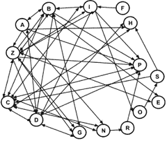

图 6.1 伪装成 COVID 追踪器的 Cerebrus 恶意软件的系统调用有向图。

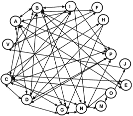

图 6.2 良性 Android 应用程序的系统调用有向图。

构建系统调用有向图后，我们使用 GCN 来确定应用程序生成的有向图是否对应于恶意软件。我们使用四个图中心性度量作为检测恶意软件的特征。这些中心性度量帮助我们识别最具区分度的系统调用，这些系统调用可用于检测恶意软件。在本章中，我们采用了`Katz`、`Closeness`、`Betweenness`和`Page Rank`作为不同的中心性度量。这些中心性度量的详细信息如下。

1.  Katz 中心性：该中心性值用于指示有向图中顶点的影响力。设`A`为有向图`G = (S, E)`的邻接矩阵。有向图`G`中节点`S[i]`的 Katz 中心性计算如下，

    $$\\begin{array}{r} {K(S\_{i}) = {\\sum\\limits\_{k = 1}^{\\infty}{\\sum\\limits\_{j = 1}^{n}\\alpha^{k}}}A\_{ij}^{k}} \\\\ \\end{array}$$  

    (6.1)

    其中`A[i][j]^k`是`A^k`的`(i, j)^(th)`项，等于顶点`S[i]`和`S[j]`之间长度为`k`的路径总数，`α`表示用于惩罚它们之间距离的衰减因子。

2. 接近度中心性：它是顶点与有向图中其他顶点接近程度的比率。在连通图中，顶点 `S[i]` 的接近度中心性计算如下，

$$
\begin{array}{r}
{C_{2}(S_{i}) = \frac{n - 1}{\sum\limits_{j = 1}^{n}\sigma_{ji}},}
\\
\end{array}
$$

(6.2)

其中 `σ[ji]` 是从顶点 `S[i]` 到顶点 `S[i]` 的最短路径长度，`n` 是顶点数量。

3. 中介度中心性：中介度中心性是顶点 `S[i]` 位于有向图中其他顶点之间最短路径上的比率。顶点 `S[i]` 的中介度中心性 `C3` 计算如下，

$$
\begin{array}{r}
{C_{3}(S_{i}) = {\sum\limits_{j = 1}^{n}{\sum\limits_{k = 1}^{n}\frac{\sigma_{jik}}{\sigma_{jk}}}} ,}
\\
\end{array}
$$

(6.3)

其中 `σ[jk]` 是从顶点 `S[j]` 到顶点 `S[k]` 的最短路径数量，`σ[jik]` 是通过顶点 `S[i]` 从顶点 `S[j]` 到顶点 `S[k]` 的最短路径数量。

4. PageRank：PageRank 中心性值用于查找有向图中顶点的重要性，其影响力超越直接连接。顶点 `S[i]` 的 PageRank 值通过迭代计算得出。初始时，所有顶点的 PageRank 值均为 1。在每次迭代中，顶点 `S[i]` 的 PageRank 值将更新为，

$$
\begin{array}{r}
{P(S_{i}) = (1 - \beta) + \beta(\frac{P(S_{r})}{d(S_{r})} + \ldots + \frac{P(S_{t})}{d(S_{t})}),}
\\
\end{array}
$$

(6.4)

其中 `β` 是阻尼系数，取值为 0.85，`P(S[r])`、…、`P(S[t])` 是指向顶点 `S[i]` 的顶点 `S[r]`、…、`S[t]` ∈ `S` 的 PageRank 值，`d(S[r])`、…、`d(S[t])` 是它们的出度。

如果应用程序中缺少任何系统调用，我们将其表示为有向图中的孤立节点，所有中心性值均为 0。

### 6.2.2 用于低维特征表示的 GCN

系统调用图中 `n` 个顶点的 `b` 个中心性值为 Android 应用程序提供了一个 `n × b` 特征矩阵表示。GCN 可用于将此 `n × b` 特征矩阵转换为大小为 `l × m` 的低维特征矩阵，其中 `l ≤ n` 且 `m ≤ b`，用于恶意软件检测。由于系统调用有向图有 26 个顶点，每个顶点有 4 个中心性值，在我们的情况中，`n` 的值为 26，`b` 的值为 4。GCN 将此 26 × 4 特征矩阵转换为 1 × 4 特征矩阵。因此，使用 GCN，我们将获得 Android 应用程序的 4 维特征表示。图 6.3 显示了该方法的各个步骤。低维特征表示通过 GCN 如下获得。

在 GCN 的 `t^(t^th)` 层中，顶点 `S[i]` ∈ `S` 有一个隐藏向量 `h[S[i]]^(t)`，其中中心性值 `h[S[i]]⁰ = (K(S[i]), C2, C3, P(S[i]))` 表示隐藏向量的初始值。这些隐藏向量是顶点 `S[i]` 的 Katz、接近度、中介度和 PageRank 中心性值。在 `t^(t^th)` 层，顶点 `S[i]` 从相邻顶点收集信息。然后它计算节点 `S[i]` 的隐藏向量 `h[S[i]]^(t)` 如下，

$$
\begin{aligned}
{\widetilde{h}}_{S_{i}}^{t} & {= {\sum\limits_{u \in N(S_{i}) \cup \{ S_{i}\}}h_{u}^{t - 1}}}
\\
\end{aligned}
$$

(6.5)

$$
\begin{aligned}
h_{S_{i}}^{t} & {= \sigma({\widetilde{h}}_{S_{i}}^{t}W^{t}),}
\\
\end{aligned}
$$

(6.6)

其中 `N(S[i])` 表示与节点 `S[i]` 连接的节点集合（相邻节点）。`W^(t)` 表示大小为 `d[t − 1] × d[t]` 的权重矩阵，其中 `d[t]` 表示 `t^(t^th)` 层中隐藏向量的大小，`σ` 表示 Sigmoid 激活函数。以这种方式，每一层中所有节点的隐藏向量都被计算出来。最后，最后一层（`k^(t^th)` 层）的隐藏向量是节点 `S[i]` 的节点嵌入向量，表示为，

$$
\begin{array}{r}
{z_{S_{i}} = h_{S_{i}{}^{k}}}
\\
\end{array}
$$

(6.7)

在计算最后一层的隐藏向量后，所有节点的节点嵌入向量被相加以形成池化层，从而给出图表示 `z[G]`。即，

$$
\begin{array}{r}
{z_{G} = {\sum\limits_{S_{i} \in S}z_{S_{i}}},}
\\
\end{array}
$$

(6.8)

其中 `z[S[i]]` 表示节点 `S[i]` 的节点嵌入向量。

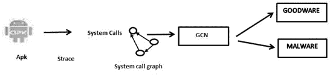

图 6.3 提出的方法。

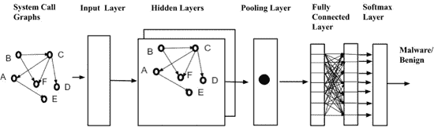

图 6.4 基于 GCN 的恶意软件检测。

### 6.2.3 GCN 的训练

在训练阶段，GCN 的输入将是良性和恶意应用程序的系统调用图的邻接矩阵和特征矩阵。设 `Tr = {(A[i],N[i],Y[i]):i=1,…,p}` 为 `p` 个图（应用程序）的训练集，其中 `A[i]` 表示邻接矩阵，`N[i]` 表示特征矩阵（即节点中心性值的矩阵），`lb[i]` 表示第 `i^(t^th)` 个图 `G[i] = (S[i], E[i])` 的标签。最优权重 `W` 计算如下。首先，权重被随机初始化。然后，GCN 被用来预测训练样本（`A[i]`，`N[i]`）的标签，然后将其与实际标签 `lb[i]` 进行比较。然后，误差或损失函数被计算为预测标签与实际标签 `Y[i]` 之间的差异。权重矩阵可以表示为大小为 `d[t − 1] × d[t]` 的矩阵 `W`，其中 `d[t − 1]` 是第 `t − 1` 层隐藏向量的维度，`d[t]` 是第 `t` 层隐藏向量的维度。我们可以使用 Adam 优化算法 `[132]` 来更新权重。

### 6.2.4 使用 GCN 进行系统调用图分类

要将 Android 应用程序分类为恶意软件或良性软件，在 GCN 的池化层之后添加一个带有 Softmax 函数的全连接层。该层的功能是从池化层获取图表示 `z[G]` 并提供应用程序为恶意软件的概率。图 6.4 显示了 GCN 的架构。

## 6.3 实验与分析

为进行实验，我们从 Drebin`[75]`、AMD `[203]` 和 Malgenome `[222]` 收集了恶意软件样本。收集的恶意软件家族的详细信息见 表 6.2。良性应用程序从 Google Play Store 下载并上传到 VirusTotal 进行验证。为构建模型，总共采集了 1560 个样本。其中，有 560 个恶意软件样本和 1000 个良性软件样本 `[165]`。使用一台配备 64 位 Windows 10 操作系统、Intel(R) Core(TM) i7-6700K CPU @ 4.00GHz 和 32 GB RAM 的系统来进行实验。

为了收集系统调用，Android 应用程序在 Android Genymotion 模拟器中运行。使用 Monkeyrunner 工具向应用程序注入伪随机事件，并使用 `strace` 实用程序收集系统调用。然后使用系统调用序列生成系统调用图。构建图表后，计算中心性度量并将其作为节点属性提供给图表。然后使用邻接矩阵和中心性值来训练 GCN 模型。实验结果表明，四个中心性值可以区分良性软件和恶意软件。表 6.3 显示了 6 个系统调用的 Katz 中心性值。这表明，即使只有少数系统调用的 Katz 中心性值，也可能能够区分恶意软件和良性应用程序。

表 6.2 Android 恶意软件家族。

| Android 恶意软件家族 | 混淆类型 | 恶意软件类型 |
| --- | --- | --- |
| Andup | 字符串加密和重命名 | Adware |
| Boxer | 字符串加密和重命名 | Trojan-SMS |
| DroidKungFu | 本地有效载荷、字符串加密、重命名 | Backdoor |
| FakeAngry | 字符串加密和重命名 | Backdoor |
| FakePlayer | 重命名 | Trojan-SMS |
| Mmarketpay | - | Trojan |
| Lotoor | 动态加载和重命名 | HackerTool |
| Kuguo | 重命名 | Adware |
| Kyview | 重命名、字符串加密 | Adware |
| Lnk | - | Trojan |
| Mecor | - | Trojan-spy |
| Minimob | 重命名 | Adware |
| Zitmo | 重命名 | Trojan-Banker |
| Nandrobox | - | Trojan |
| RuMMS | 重命名、字符串加密、动态加载 | Trojan-SMS |
| Winge | 重命名 | Trojan-Clicker |
| Penetho | - | HackerTool |
| Mseg | 重命名 | Trojan |
| BrainTest | 动态加载 | Backdoor |
| Stealer | 重命名 | Trojan-SMS |
| FakeDoc | 重命名 | Trojan |
| Tesbo | 重命名、字符串加密、动态加载 | Trojan-SMS |
| Mtk | 重命名、字符串加密、动态加载 | Trojan |
| Utchi | 重命名 | Adware |
| Cerebrus | Java 反射 | Banker |

表 6.3 选定系统调用的 Katz 中心性值。

| 系统调用 | 恶意软件 | 良性 |
| --- | --- | --- |
| `fcntl64` | 0.3361 | 0.1824 |
| `open` | 0.2134 | 0.1674 |
| `access` | 0.2321 | 0.2187 |
| `write` | 0.3657 | 0.2402 |
| `pread` | 0.2844 | 0.2621 |
| `sendto` | 0.3192 | 0.2141 |

### 6.3.1 实现细节

从 1560 个应用程序样本中，我们选取了 1248 个样本用于训练，156 个样本用于测试，156 个样本用于验证。在 GCN 模型中，我们选择了三个隐藏层。在隐藏层中，两个是图卷积层，第三个是单个池化层。与层大小相关的准确率值在 表 6.4 中给出。我们在隐藏层大小分别为 26、11 和 4 时获得了最大准确率。我们使用准确率、精确率、召回率和 F1 值等指标来评估模型的性能。真阳性 (TP) 表示被正确分类为恶意软件的恶意应用程序数量，真阴性 (TN) 表示被正确分类为良性软件的良性应用程序数量，假阳性 (FP) 表示被错误分类为恶意软件的良性应用程序数量，假阴性 (FN) 表示被错误分类为良性软件的恶意应用程序数量。模型的准确率和 F1 值计算如下。

$$
\begin{array}{r}
{Accuracy = \frac{TP + TN}{TP + FN + TN + FP}} \\
\end{array}
$$

$$
\begin{array}{r}
{Precision = \frac{TP}{TP + FP}} \\
\end{array}
$$

$$
\begin{array}{r}
{Recall = \frac{TP}{TP + FN}} \\
\end{array}
$$

$$
\begin{array}{r}
{F1 - measure = \frac{2 \times Precision \times Recall}{Precision + Recall}} \\
\end{array}
$$

GCN 分类器使用 100 个 epoch 和 0.01 的学习率进行训练。我们使用了早期停止值为 10 的 Adam 优化。

表 6.4 GCN 隐藏层大小与准确率。

| 隐藏层大小 | 准确率 |
| --- | --- |
| `(26,11,4)` | 0.913 |
| `(32,32,16)` | 0.873 |
| `(32,16,4)` | 0.853 |

表 6.5 显示了该机制在 AMD、Drebin 数据集以及一些使用混淆的最新恶意软件家族（AMD 2020）[203] 上的性能。我们可以看到该机制的准确率为 91.30%。

表 6.5 性能结果。

| TPR | FPR | FNR | TNR | Precision | Recall | F1 Score | Accuracy |
| --- | --- | --- | --- | --- | --- | --- | --- |
| 0.912 | 0.086 | 0.088 | 0.914 | 0.913 | 0.912 | 0.912 | 0.913 |

为了评估基于 GCN 的恶意软件检测机制的有效性，我们将其与 Fei 等人提出的基于系统调用频率的现有机制[197]（使用 Malgenome 数据集）以及使用 SVM（支持向量机）和决策树的基于系统调用频率的检测机制（使用 Drebin 数据集）进行了比较。Malgenome 数据集现在是 Drebin 数据集的一部分[222]。表 6.6 显示了比较结果。我们发现，使用 GCN，我们可以以 93.3% 的准确率对恶意软件进行分类。为了实现 SVM 和决策树，我们使用了带有 10 折交叉验证的 WEKA 3.8。

表 6.6 GCN 方法与其他方法的比较。

| 方法 | TPR | FPR | FNR | TNR | Precision | Recall | F1 Score | Accuracy | 数据集 |
| --- | --- | --- | --- | --- | --- | --- | --- | --- | --- |
| GCN 方法 | 0.938 | 0.071 | 0.062 | 0.929 | 0.929 | 0.938 | 0.933 | 0.933 | Drebin |
| Fei et al. \[197\] | - | - | - | - | - | - | - | 0.901 | Malgenome |
| SVM | 0.873 | 0.137 | 0.863 | 0.127 | 0.868 | 0.864 | 0.873 | 0.868 | Drebin |
| 决策树 | 0.890 | 0.084 | 0.110 | 0.916 | 0.913 | 0.8907 | 0.901 | 0.903 | Drebin |

## 6.4 新兴恶意软件检测

Android 恶意软件日复一日地不断出现，因此以有效且可扩展的方式检测恶意软件具有挑战性[212]。因此，在本节中，我们探讨 GCN 是否可以检测不断发展的 Android 恶意软件。

表 6.7 恶意软件家族。

| 恶意软件 | 样本数量 | 类型 | 年份 |
| --- | --- | --- | --- |
| MystryBot | 5 | Ransomware, Keylogger | 2018 |
| SMS 恶意软件 | 15 | Spywares | 2020 |
| 银行恶意软件 | 20 | Trojan | 2019 |
| Comebot | 5 | Banking Spyware | 2019 |
| Descarga | 10 | Banking Trojan | 2016 |
| Xbot | 1 | Ransomware | 2016 |
| Covidlures | 3 | Spyware | 2020 |

为了测试 GCN 机制是否能检测最新的 Android 恶意软件应用程序，我们准备了一个测试集，其中包含 表 6.7 中给出的恶意软件样本。恶意软件样本是从公共存储库中收集的\[9\],\[8\]。图 6.5 显示了 Xbot 恶意软件\[12\]的系统调用图。Xbot 恶意软件是 2014 年出现的名为 Aulrin 的木马的后续版本。在 Android 设备上安装后，此恶意软件开始与命令和控制服务器（C2 服务器）通信。该恶意软件请求名为 `RECEIVE_BOOT_COMPLETED` 的权限，该权限允许恶意软件在受感染设备上持续存在。然后，它窃取用户的信用卡信息。之后，它加密用户的文件。为了逃避检测，此恶意软件使用多种混淆技术。从系统调用图中，我们可以看到 `writv()`、`socket()`、`sendmsg()`、`recvfrom()` 和 `connect()` 系统调用之间存在连接，这些调用用于建立与 C2 服务器的连接以加密文件。性能结果给出在 表 6.8。根据这些性能结果，我们可以得出结论：带有中心性度量的 GCN 可以检测许多新兴的恶意软件应用程序。

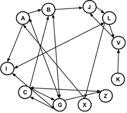

图 6.5 Xbot 恶意软件的系统调用图。

表 6.8 新兴恶意软件的检测率。

| TPR || FPR || FNR || TNR || Precision || Recall || F1 Score || Accuracy |

| --- | --- | --- | --- | --- | --- | --- | --- |

| 0.890 || 0.084 || 0.110 || 0.916 || 0.913 || 0.8907 || 0.901 || 0.903 |

| --- | --- | --- | --- | --- | --- | --- | --- |

GCN 的代码在附录中给出。使用了 `Keras` 和 `Tensorflow` 等包来编写 GCN。我们使用了\[87\]的实现来构建我们的 GCN 模型。

## 6.5 结论

在本章中，我们介绍了一种使用 GCN 的基于系统调用图的恶意软件检测机制。该机制在我们的数据集中能够以 91.3% 的准确率检测 Android 恶意软件。我们还探讨了 GCN 是否能够检测不断发展的 Android 恶意软件。我们在最新的 Android 恶意软件应用程序数据集上获得了 90% 的准确率。本章提出的想法将帮助网络安全研究人员和开发人员揭示 GCN 在开发自动化网络安全解决方案方面的潜力。

# 7 基于图信号处理的检测

DOI: [10.1201/9781003121510-7](https://doi.org/10.1201/9781003121510-7)

在前几章中，我们讨论了基于系统调用图的恶意软件检测机制的有效性。这些机制考虑了顶点级特征，例如中心性，用于恶意软件检测。在当前设置中，将高维边级特征（如邻接矩阵）纳入机器学习分类器非常困难。为了克服这一限制，\[189\]中提出了一种基于图信号处理的方法。在本章中，我们首先讨论如何从应用程序的系统调用序列生成各种图信号，以构建低维特征向量。随后，我们讨论了使用这些特征向量，采用各种机器学习分类器进行有效的恶意软件检测。

## 7.1 图信号处理及其应用

包含 `n` 个相关元素的数据集中的信息可以表示为图 `G = (S, E, A)`，其中，`S = {S[1],…,S[n]}` 是由数据集中的元素组成的顶点集，`E` 是边集，`A = (A[i j])[n × n]` 是加权邻接矩阵，其中每个 `a[i j]` 表示顶点 `S[i]` 和 `S[j]` 之间关系的程度。

在本章中，我们将 `S` 上的图信号 `V` 视为列向量。即，

$$
\begin{array}{r}
{V(S) = {\lbrack V(S_{1})\ldots V(S_{n})\rbrack}^{T}.}
\\\\
\end{array}
$$

为了方便，当顶点集 `S` 显而易见时，我们将 `V(S)` 表示为 `V`。

存在大量工程和科学应用，其中信号自然存在于图表示中，例如定义在基因网络上的基因表达模式、流行病传播网络上的感染数量、人口网络上的谣言或模因、电信网络节点上的拥塞水平等等。在这些情况下，复杂系统由多个节点组成，全局网络行为是连接节点之间局部交互的结果。在许多情况下，我们感兴趣的对象是定义在图之上的信息，即与图节点相关的信息。图信号处理（GSP）可以通过使用图建模数据结构，然后将可用信息视为其上定义的信号来提取此信息。在 GSP 中，信号首先定义在图的每个节点上。然后，使用图中的各种连接关系对这些信号进行处理。得到的信号值可以更好地洞察图所代表的数据。图移位就是这样一种操作。

即，

$$
\begin{array}{r}
{\widetilde{V(S)} = A{\lbrack V(S_{1})\ldots V(S_{n})\rbrack}^{T}.}
\\\\
\end{array}
$$

GSP 已在各个领域找到了巨大的应用，例如脑疾病预测 \[161\]、社交网络分析 \[121\]、天气预测 \[175\] 等等。在脑疾病预测 \[161\] 中，人类活动信号被映射到人脑网络的区域（节点）。然后，使用脑区域（节点）之间的连接信息对这些信号进行处理。处理后的信号随后用于识别人脑中的异常或疾病，例如阿尔茨海默病。在社交网络分析 \[121\] 中，关于谣言（信号）的信息被映射到社交网络中的人（节点）。然后，使用人与人之间的关系信息对这些信号进行处理。处理后的信号随后用于寻找谣言的源头。在天气预测 \[175\] 中，从各种传感器（节点）获得的温度信息被视为信号。然后，使用传感器之间的距离信息对这些信号进行处理。处理后的信号随后用于分析地理区域内相对温度分布。在下一节中，我们将讨论将 Android 应用程序的系统调用序列表示为图信号。

## 7.2 来自系统调用序列的图信号

在本节中，我们讨论将系统调用序列表示为有向图并为每个节点计算图信号。它包含两个步骤。在第一步中，我们提取应用程序生成的系统调用序列，并按照 第 5 章 中所述构建有向图。在第二步中，我们在此系统调用图的顶点上构建适当的信号。

Walkinwat 木马的系统调用序列显示在 图 7.1，系统调用有向图显示在 图 7.2。所选系统调用集给出在 表 7.1。系统调用频率给出在 表 7.2，邻接矩阵给出在 图 7.3。

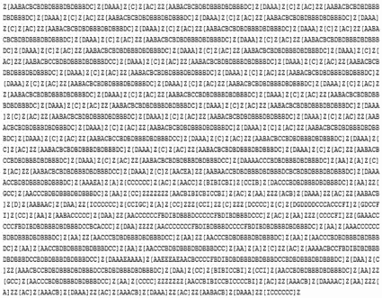

图 7.1 Walkinwat 木马的系统调用序列。

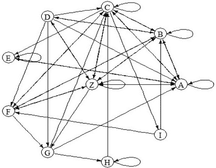

Figure 7.2 Walkinwat 恶意软件应用程序的系统调用有向图。

Table 7.1 相关系统调用列表。

| 替代名称 || A || B || C || D || E || F || G || H |

| --- | --- | --- | --- | --- | --- | --- | --- | --- |

| **系统调用** || recvfrom || write || ioctl || read || sendto || dup || writev || pread |

| --- | --- | --- | --- | --- | --- | --- | --- | --- |

| **替代名称** || I || J || K || L || M || N || O || P |

| **系统调用** || close || socket || bind || connect || mkdir || access || chmod || open |

| **替代名称** || Q || R || S || T || U || V || W || X |

| **系统调用** || rename || fchown32 || unlink || pwrite || umask || lseek || fcntl || recvmsg |

| **替代名称** || Y || Z || A1 || A2 || A3 || A4 ||  ||  |

| **系统调用** || sendmsg || epoll || dup2 || fchown || readv || chdir ||  ||  |

Table 7.2 系统调用频率值。

| 系统调用名称 || 系统调用（替代名称） || 频率 |

| --- | --- | --- |

| recvfrom || A || 416 |

| --- | --- | --- |

| write || B || 641 |

| ioctl || C || 402 |

| read || D || 355 |

| sendto || E || 7 |

| dup || F || 10 |

| writev || G || 5 |

| pread || H || 5 |

| close || I || 31 |

| epoll || Z || 310 |

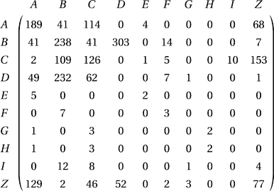

Figure 7.3 Walkinwat 恶意软件图的邻接矩阵。

在第二步中，我们首先将该系统调用有向图顶点上的信号定义为该系统调用出现的归一化频率。然后，通过在这些信号上应用图移位操作（邻接矩阵）来细化这些信号，以获取包含系统调用依赖关系信息的图信号。

图信号处理有助于分析系统调用连接有向图的结构。我们首先考虑系统调用有向图 `G` 中系统调用 `S[i]`（`i = 1, …, n`）的频率值 `F(S[i])`，用于构建图信号。每个系统调用 `S[i]` 的出现频率 `F(S[i])` 除以系统调用总数 `∑(j = 1 to n)F(S_j)`。系统调用的这些归一化频率值（概率）被视为初始信号值。换句话说，每个系统调用的出现概率被视为初始信号值。系统调用序列 `X` 中每个系统调用 `S[i]` 的出现率信息可以从其系统调用序列中推断出来。`S[i]` 上的图信号 `V[0]` 定义为，

$$
\begin{array}{r}
{V_{0}(S_{i}) = \frac{F(S_{i})}{\sum\limits_{j = 1}^{n}{F(S_{j})}}}
\end{array}
$$

(7.1)

系统调用有向图的邻接矩阵 `A` 中，从系统调用 `S[i]` 到另一个系统调用 `S[j]` 的邻接值 `a[ij]` 计算为系统调用 `S[j]` 在系统调用 `S[i]` 之后出现的次数，∀1 ≤ `j` ≤ `n` 在系统调用序列中。

从系统调用 `S[i]` 到另一个系统调用 `S[j]` 的归一化邻接值 $\hat{A_{ij}}$ 计算为，

$$
\begin{array}{r}
{\hat{A_{ij}} = \frac{\left| A_{ij} \right|}{\left. \left. \sum\limits_{k = 1}^{n} \right|A_{ik} \right|}, \forall 1 \leq i,j \leq n}
\end{array}
$$

(7.2)

图信号 `V[0]` 可以通过各种图信号处理操作转换为其他信号 `V`。我们使用归一化邻接矩阵 $\hat{A} = (\hat{A_{ij}})$ 将图信号转换为 `V`，如下，

$$
\begin{array}{r}
{V = \hat{A}V_{0}.}
\end{array}
$$

Walkinwat 恶意软件应用程序的图信号和转换信号如 Table 7.3 所示。

Table 7.3 Walkinwat 木马的图信号。

| 系统调用名称 || 系统调用（替代名称） || **V**[**0**] || **V**[**1**] |

| --- | --- | --- | --- |

| recvfrom || A || 0.190650779 || 0.1969 |

| --- | --- | --- | --- |

| write || B || 0.293767186 || 0.2181 |

| ioctl || C || 0.184234647 || 0.1985 |

| read || D || 0.162694775 || 0.2067 |

| sendto || E || 0.003208066 || 0.1689 |

| dup || F || 0.004582951 || 0.1886 |

| writev || G || 0.002291476 || 0.1616 |

| pread || H || 0.002291476 || 0.1486 |

| dup || I || 0.014207149 || 0.1863 |

| epoll || Z || 0.142071494 || 0.1909 |

## 7.3 用于恶意软件检测的机器学习分类

从 Android 应用程序的系统调用有向图中获得的图信号或处理后的信号可用作监督机器学习分类器的特征向量，用于恶意软件检测。在此，可使用任何机器学习算法（如朴素贝叶斯、支持向量机（SVM）、决策树等）来对图信号进行分类以检测恶意行为。

### 7.3.1 低维特征向量的构建

设 `V(S)` 表示 Android 应用程序的信号向量。那么我们可以得到 `n` 维特征向量，如下，

$$
\begin{array}{r}
{[V(S_{1}) \ldots V(S_{n})]^{T}.}
\end{array}
$$

可以通过仅使用少数选定系统调用的信号值作为特征向量来降低特征维度。可以通过分析恶意软件和良性软件应用程序中系统调用的信号值来选择系统调用。某些系统调用的信号值在恶意软件应用程序中可能高于良性软件应用程序。这是因为恶意软件可能会调用良性软件应用程序中不存在的某些特殊系统调用序列。这些特殊系统调用序列旨在执行恶意活动。例如，许多恶意软件应用程序会调用 GPS 和摄像头等敏感资源来执行恶意活动。`dup()` 系统调用的主要目的是通过共享内存通道执行 IPC。恶意软件依赖 `dup()` 和 `close()` 系统调用与敏感资源进行通信。也就是说，恶意软件可能会调用由 `F`（`dup()`）和 `I`（`close()`）组成的恶意系统调用代码，以在后台访问敏感资源。在这些情况下，系统调用 `F`（`dup()`）和 `I`（`close()`）的信号值在恶意软件中可能高于良性应用程序。

可以选择那些在良性软件和恶意软件应用程序之间存在较大差异的系统调用的信号值，因为它们在区分恶意软件和良性软件方面更具信息性。可以选择 ‘`d`’ 个此类系统调用的图信号值，`1 ≤ d ≤ n`，其中 ‘`n`’ 是系统调用图中系统调用（顶点）的数量，作为低维特征向量。突出系统调用的选择可以如下进行。

设 $\overline{V}(S_{i} \mid malware)` 表示一组 `m[1]` 个恶意软件应用程序中系统调用 `S[i]` 的信号值的均值。即，

$$
\begin{array}{r}
\overline{V}(S_{i} \mid malware) = \frac{\sum\limits_{malware}\mathcal{V}(S_{i})}{m_{1}}
\end{array}
$$

(7.3)

设 $\overline{V}(S_{i} \mid goodware)` 表示一组 `m[2]` 个良性软件应用程序中系统调用 `S[i]` 的信号值的均值。即，

$$
\begin{array}{r}
\overline{V}(S_{i} \mid goodware) = \frac{\sum\limits_{goodware}V(S_{i})}{m_{2}}
\end{array}
$$

(7.4)

还需要计算恶意软件应用程序集和良性软件应用程序集中每个系统调用的信号值的方差。系统调用信号值的低方差表示该组恶意软件或良性软件中各应用程序的信号值更集中且更一致。设 $\overline{D}(S_{i})$，∀`i` 表示均值差。即，

$$\\begin{array}{r} \\left. \\overline{D}(S\\_{i}) = \\overline{V}(S\\_{i} \\middle| malware) - \\overline{V}(S\\_{i} \\middle| goodware),\\forall i \\right. \\\\ \\end{array}$$  

(7.5)

那些信号值均值差大于阈值的系统调用可以被选中，其信号值可作为应用程序的特征。

假设系统调用图中有 20 个系统调用 (`A,B,…,T`)，我们已获取如 表 7.4 所示的信号值均值、方差和差值。在此情况下，我们可以继续使用与 20 个系统调用 (`A,B,…,T`) 的信号值对应的 20 维特征向量。然而，这里可以进行降维。在 表 7.4 中，我们可以看到系统调用 `A,B,E,F,K,N,P` 和 `S` 的信号值差高于阈值 `t` = 0.275。然而，系统调用 `K` 和 `P` 的方差较高。因此，我们可以选择系统调用 `A,B,E,F,N` 和 `S` 的信号值作为 6 维特征向量，而不是 20 维特征向量，并继续进行 ML 分类。

表 7.4 恶意软件和良性软件应用中信号的均值和方差。

| SI.No || 系统调用 || $\\overline{\\mathbf{\\mathbf{V}}}$ (`S`[`i`]| 恶意软件) || 方差 || $\\overline{\\mathbf{\\mathbf{V}}}$ (`S`[`i`]| 良性软件) || 方差 || $\\mathbf{\\overline{D}}$ (`S`[`i`]) |

| --- | --- | --- | --- | --- | --- | --- |

| 1 || A || 0.639 || 0.021 || 0.278 || 0.038 || **0.361** |

| --- | --- | --- | --- | --- | --- | --- |

| 2 || B || 0.775 || 0.021 || 0.464 || 0.019 || **0.311** |

| --- | --- | --- | --- | --- | --- | --- |

| 3 || C || 0.445 || 0.025 || 0.309 || 0.059 || 0.136 |

| --- | --- | --- | --- | --- | --- | --- |

| 4 || D || 0.685 || 0.041 || 0.570 || 0.096 || 0.115 |

| --- | --- | --- | --- | --- | --- | --- |

| 5 || E || 0.514 || 0.044 || 0.200 || 0.092 || **0.314** |

| --- | --- | --- | --- | --- | --- | --- |

| 6 || F || 0.452 || 0.003 || 0.173 || 0.090 || **0.279** |

| --- | --- | --- | --- | --- | --- | --- |

| 7 || G || 0.242 || 0.076 || 0.104 || 0.042 || 0.138 |

| --- | --- | --- | --- | --- | --- | --- |

| 8 || H || 0.309 || 0.073 || 0.182 || 0.060 || 0.127 |

| --- | --- | --- | --- | --- | --- | --- |

| 9 || I || 0.110 || 0.037 || 0.006 || 0.002 || 0.104 |

| --- | --- | --- | --- | --- | --- | --- |

| 10 || J || 0.180 || 0.057 || 0.080 || 0.038 || 0.100 |

| --- | --- | --- | --- | --- | --- | --- |

| 11 || K || 0.565 || **0.214** || 0.275 || 0.031 || **0.290** |

| --- | --- | --- | --- | --- | --- | --- |

| 12 || L || 0.755 || 0.007 || 0.674 || 0.025 || 0.081 |

| --- | --- | --- | --- | --- | --- | --- |

| 13 || M || 0.655 || 0.012 || 0.582 || 0.038 || 0.073 |

| --- | --- | --- | --- | --- | --- | --- |

| 14 || N || 0.813 || 0.008 || 0.445 || 0.029 || **0.368** |

| --- | --- | --- | --- | --- | --- | --- |

| 15 || O || 0.746 || 0.003 || 0.713 || 0.024 || 0.033 |

| --- | --- | --- | --- | --- | --- | --- |

| 16 || P || 0.366 || 0.026 || 0.037 || **0.217** || **0.329** |

| --- | --- | --- | --- | --- | --- | --- |

| 17 || Q || 0.033 || 0.015 || 0.011 || 0.005 || 0.022 |

| --- | --- | --- | --- | --- | --- | --- |

| 18 || R || 0.041 || 0.015 || 0.023 || 0.009 || 0.018 |

| --- | --- | --- | --- | --- | --- | --- |

| 19 || S || 0.457 || 0.020 || 0.049 || 0.017 || **0.408** |

| --- | --- | --- | --- | --- | --- | --- |

| 20 || T || 0.007 || 0.003 || 0.006 || 0.002 || 0.001 |

## 7.4 实验与分析

在本节中，我们在包含 1000 个恶意软件和良性软件应用的平衡数据集上说明了基于图信号的恶意软件检测。恶意软件应用从 Drebin/AMD 数据集 \[75\] \[203\] 下载，良性软件应用来自 Google Play 商店/Androzoo \[28\]。在 第 4 章 中，我们不考虑恶意软件的行为选择了恶意软件应用。在本章中，我们选择了试图在后台访问摄像头、GPS、电话等系统资源的恶意软件应用。AMD 数据集包含一些逃避检测环境的恶意软件应用。在此，我们未考虑这类逃避型恶意软件应用。此外，我们从恶意软件和良性软件数据集中删除了重复样本，仅选择了唯一样本。

### 7.4.1 实验设置

恶意软件检测系统在配备 8 GB 内存的 Intel Core i5 PC 上实现，并使用 Android 模拟器。从 1000 个恶意软件和良性软件样本计算出了图信号 `V[1]` 的数据集。在数据集构建阶段，样本恶意软件和良性软件应用在模拟器中执行，并使用 `strace` 实用程序 \[185\] 记录系统调用。使用 Python 代码通过消除参数和无关系统调用来预处理相关系统调用序列（文件和网络管理）。然后，使用 `networkx` 包中的函数将这些预处理的系统调用建模为控制流有向图。每个应用程序的系统调用频率 `F(S[*i*])`: `1 ≤ i ≤ n` 和归一化邻接矩阵 `Â` 从控制流图和系统调用序列中计算得出。然后，每个应用程序的特征向量作为矩阵乘积计算得出，

$$\\begin{array}{r} {\\hat{A} \\times {\\lbrack\\frac{F(S\\_{1})}{\\sum\\limits\\_{j = 1}^{n}{F(S\\_{j})}}\\ldots\\frac{F(S\\_{n})}{\\sum\\limits\\_{j = 1}^{n}{F(S\\_{j})}}\\rbrack}^{T}.} \\\\ \\end{array}$$  

图信号构建的 Python 代码载于附录。此图信号构建代码接收多个应用程序的系统调用序列作为输入，并输出图信号向量。在此过程中，Python 代码首先通过消除参数和无关系统调用来预处理系统调用序列。然后，它为系统调用分配替代名称，以替代其原始名称以便使用。之后，它从每个系统调用序列中提取系统调用计数值和邻接矩阵。接着，它计算变换后的图信号，并将其保存为 CSV 文件以供机器学习分类。

### 7.4.2 各种 ML 分类器的性能分析

在本节中，我们讨论了以图信号作为特征向量的各种机器学习分类器的性能。恶意软件检测机制涉及在选定节点上运行任何机器学习分类器，以图信号作为特征向量。我们展示了以下五种机器学习分类器的性能：

1. 朴素贝叶斯；

2. SVM（支持向量机）；

3. 决策树（DT）；

4. 随机森林（RF）；

5. ANN（人工神经网络）。

在此，90% 的恶意软件和良性软件应用的信号值用于训练机器学习分类器。分类器的性能在其余 10% 的恶意软件和良性软件应用的信号值上进行评估。以图信号作为特征的五种流行机器学习分类器的检测性能载于 表 7.5。在此，所有顶点上的信号值均用于特征向量构建。在 表 7.5 中，我们可以看到，基于信号向量的特征表示在 SVM、ANN 和随机森林分类器上表现良好。分类器的 Python 代码载于附录。文件 `graphsignals.csv` 按 9:1 的比例分割用于训练和测试。即，90% 的样本用于训练，其余 10% 的样本用于测试。这些训练和测试数据集作为输入提供给各种 ML 算法以确定其性能。在此，`label_pred` 是 ML 分类器的输出（预测类）。

表 7.5 各种 ML 分类器的性能。

| 算法 || TPR || FPR || 精确率 || 准确率 || F1 分数 |

| --- | --- | --- | --- | --- | --- |

| 朴素贝叶斯 || 0.81 || 0.20 || 0.81 || 0.81 || 0.81 |

| --- | --- | --- | --- | --- | --- |

| SVM || 0.83 || 0.12 || 0.88 || 0.86 || 0.85 |

| ANN || 0.93 || 0.14 || 0.86 || 0.89 || 0.89 |

| 决策树 (DT) || 0.93 || 0.21 || 0.82 || 0.86 || 0.87 |

| 随机森林 (RF) || 0.94 || 0.13 || 0.85 || 0.90 || 0.90 |

## 7.5 图信号的杂项操作

除了图移位运算之外，还有几种其他技术，例如图傅里叶变换和图滤波，可用于将图信号转换为不同的形式。其中一些变换可能会提供更好的信号值和特征向量。对于计算信号向量 `V[0]` 的图傅里叶变换，需要计算邻接矩阵 `A` 的广义特征向量矩阵 `F`，并将其与图信号相乘。矩阵 `A` 的特征向量变换可以表示为：

$$
\begin{array}{r} {A.F = \lambda.F,} \\ \\end{array}
$$

其中 `λ` 是特征值向量。图信号 `V[0]` 的傅里叶变换 `V[1]` 计算如下：

$$
\begin{array}{r} {V_{1} = F^{- 1}.V_{0}.} \\ \\end{array}
$$

这些经过傅里叶变换的信号 `V[1]` 可以作为输入提供给机器学习分类器，用于恶意软件分类。此外，分析师可以根据系统调用有向图的特性设计线性且时不变（LSI）图滤波器 `h(A)`。LSI 滤波器矩阵 `h(A)` 的计算方法如下：

$$
\begin{array}{r} {h(A) = {\sum\limits_{i = 0}^{n}h_{i}}.A^{i},} \\ \\end{array}
$$

其中，`i = 1, 2, …, n` 的数值 `h[i]` 被称为图滤波器抽头。滤波后的信号 `V[3]` 的计算方法如下，

$$
\begin{array}{r} {V_{2} = h(A).V_{0}.} \\ \\end{array}
$$

## 7.6 结论

在本章中，我们讨论了基于图信号处理的动态特征向量构建方法。图信号可以与各种机器学习分类器配合使用，以高精度检测 Android 恶意软件。这些图信号也可以作为混合分类器和集成分类器的附加特征。

某些恶意软件应用程序在执行恶意活动时，会生成与良性应用程序相似的系统调用序列[200]。因此，如果仅考虑系统调用序列，这些恶意软件应用程序可能会被误分类为良性软件应用程序，反之亦然。这可能导致假阴性（假阳性）的增加。此外，在我们对新型恶意软件应用程序的实验中，我们发现，如果仅考虑系统调用序列，像 camscanner 这样的多阶段恶意软件应用程序可能无法被检测到。多阶段恶意软件应用程序最初表现为合法应用程序，并从在线存储库下载恶意功能。在线服务器通信是通过向网络管理系统调用（例如 `sendto()` 和 `recvfrom()`）传递参数来完成的。一些恶意软件应用程序将恶意命令、文件或数据作为参数注入到系统调用（例如 `open()`、`execve()`）中，以执行各种恶意活动 [141]。系统调用 `execve()` 既被良性软件也被恶意软件使用。一些恶意软件应用程序请求 root 权限，以利用系统实用程序中的漏洞来获得未经授权的访问权限。它使用“`/xbin/su`”作为系统调用 `execve()` 的参数来检查 root 权限。在所有这些情况下，恶意行为可以从系统调用参数而不是系统调用本身推断出来。因此，可以将系统调用参数中的信息与系统调用序列结合起来，用于构建特征向量。可以根据系统调用参数之间的依赖关系，为应用程序构建系统调用行为图[134]。然而，这种参数依赖关系仅存在于某些类型的应用程序中[134]。因此，不可能为所有类型的应用程序构建此类图[134]。为了克服这些限制，可以同时考虑系统调用参数关系和控制依赖信息，以构建新型图模型。

在 第 4 章 到 第 7 章 中，我们讨论了机器学习算法在 Android 恶意软件检测中的效率和准确性。然而，机器学习算法需要根据新恶意软件和良性软件应用程序的出现频繁重新训练。为了克服这一限制，在下一章中，我们将讨论恶意软件应用程序中某些短系统调用子序列的存在和提取。利用这些子序列，可以检测恶意软件应用程序。

# 8 基于系统调用模式的检测

DOI: [10.1201/9781003121510-8](https://doi.org/10.1201/9781003121510-8)

在前几章中，我们使用机器学习分类器进行恶意软件检测。机器学习机制通常需要良好的特征表示，以便对数据点进行准确分类。识别和表示数据点的正确特征是一项挑战。此外，基于机器学习的检测机制在计算上可能具有挑战性，可能不适合在设备上进行实时部署。因此，已有许多尝试基于各种签名来检测恶意软件。

根据 Artenstein 等人 [77] 的说法，恶意软件应用程序可以利用 Android IPC 中的漏洞执行各种攻击，例如发送短信、窃取信息等。恶意软件应用程序可以借助敏感 API 调用，调用服务器进程提供的服务，从而发起各种攻击。在内核级别，`ioctl()` 系统调用用于请求服务器进程提供的服务。然后，内核验证请求并创建共享内存用于通信。通信结束后，共享内存被释放。因此，恶意软件应用程序与服务器进程之间的这种 IPC（进程间通信）在整个系统调用序列中表现为短系统调用模式。在 [190] 中，已证明 Android 应用程序的系统调用序列包含特有于恶意软件的特殊模式。发现 Android 应用程序的系统调用序列是平稳的一阶遍历马尔可夫链。因此，恶意软件应用程序的系统调用序列中存在短系统调用模式，这些模式包含整个系统调用序列中的恶意信息。即使是单个模式也可以在多个恶意软件应用程序家族中找到。这些模式可用于高效的基于签名的恶意软件检测和识别。在本章中，我们将讨论如何从恶意软件应用程序中提取此类恶意系统调用模式，并将其用于恶意软件检测。

## 8.1 从系统调用序列中提取模式

大多数恶意软件应用程序会频繁尝试在后台访问敏感资源。它会在后台静默地与敏感资源通信，一旦该资源可用，立即生成一个系统调用模式（两个忙等待系统调用之间的连续系统调用序列）。由此可见，系统调用序列中存在某些系统调用模式（两个忙等待系统调用之间的连续系统调用序列），这些模式包含关于恶意行为的相关信息。因此，我们可以通过在系统调用序列 `X` 中的此类连续子序列来识别系统调用序列 `X` 中的恶意行为。

### 8.1.1 将系统调用序列表示为遍历马尔可夫链

在前面的章节中，我们详细讨论了跟踪应用程序系统调用序列的方法。在应用程序的系统调用序列中，我们消除了不相关的系统调用，只保留相关的系统调用。相关系统调用列表 `S` = {`S`[`i`]:`i`=1,2,3…`n`} 如 表 8.1 所示。令 `X` = {`X`[`j`]:`j`=1,2,…`m`} 表示消除不相关系统调用后得到的精炼系统调用序列。

表 8.1 相关系统调用列表。

| 替代名称 || A || B || C || D || E || F || G || H |

| --- | --- | --- | --- | --- | --- | --- | --- | --- |

| **系统调用** || recvfrom || write || ioctl || read || sendto || dup || writev || pread |

| --- | --- | --- | --- | --- | --- | --- | --- | --- |

| **替代名称** || I || J || K || L || M || N || O || P |

| **系统调用** || close || socket || bind || connect || mkdir || access || chmod || open |

| **替代名称** || Q || R || S || T || U || V || W || X |

| **系统调用** || rename || fchown32 || unlink || pwrite || umask || lseek || fcntl || recvmsg |

| **替代名称** || Y || Z || A1 || A2 || A3 || A4 ||  ||  |

| **系统调用** || sendmsg || epoll || dup2 || fchown || readv || chdir ||  ||  |

### 8.1.2 系统调用序列中信息的计算

令 `T` = (`t`[`i`][`j`]) 为系统调用序列的转移概率矩阵。从系统调用 `S`[`i`] 到另一个系统调用 `S`[`j`] 的转移概率 `t`[`i`][`j`] 可计算为，

$$
\begin{array}{r}
\left. t\_{ij} = Pr(S\_{j} \middle| S\_{i}) = \frac{n\_{ij}}{\sum\limits_{k = 1}^{n}n\_{ik}},\forall 1 \leq i,j \leq n \right. \\
\end{array}
$$

(8.1)

其中 `n`[`i`][`k`] 是在 `X` 中从状态 `S`[`i`] 到状态 `S`[`k`] 的状态转移次数，∀1 ≤ `k` ≤ `n`。

由于系统调用序列 `X` 可以视作一个遍历马尔可夫链，$\lim\limits_{k\rightarrow\infty}T^{k} = Q$，其中 `Q` 是一个具有相同行的矩阵，即 `μ` = (`μ`[1], `μ`[2],…, `μ`[`n`])。也就是说，

$$
\begin{array}{l}
{\lim\limits_{k\rightarrow\infty}T^{k} = \left\lbrack \begin{array}{llll}
\mu\_{1} & \mu\_{2} & \ldots & \mu\_{n} \\
\ldots & \ldots & \ldots & \ldots \\
\mu\_{1} & \mu\_{2} & \ldots & \mu\_{n} \\
\end{array} \right\rbrack} \\
\end{array}
$$

`μ` 被称为马尔可夫链 `X` 的 `stationary distribution`（平稳分布）。马尔可夫链的熵 `H`(`X`) 是衡量 `X` 中信息量的指标。对于遍历马尔可夫链 `X`，其计算公式为：

$$
\begin{array}{r}
{H(X) = - {\sum\limits_{i = 1}^{n}{\sum\limits_{j = 1}^{n}\mu\_{i}}}t\_{ij}log(t\_{ij}),} \\
\end{array}
$$

其中 `T` = (`t`[`i`][`j`]) 是 `X` 的转移概率矩阵，`μ` = (`μ`[1], `μ`[2],…, `μ`[`n`]) 是 `X` 的平稳分布。计算熵的步骤如 算法 1 所示。状态转移概率矩阵 `T` = (`t`[`i`][`j`]) 作为 算法 1 的输入。该算法首先通过计算 `T` 的幂次，直到矩阵 `Q` = `T`^(`i`) 的秩变为 1，从而从 `T` 计算得到平稳分布 `μ`。当秩变为 1 时，`Q` 的所有行都变得相同，`Q` 的第一行（或任意一行）即给出了 `X` 的平稳分布 `μ`。`X` 的熵率 `H`(`X`) 使用 `t`[`i`][`j`] 和 `μ` 进行计算。

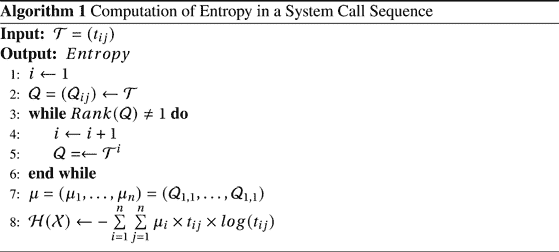

### 8.1.3 系统调用模式的识别

应用程序在执行过程中会经历不同的状态 \[183\]。这些状态包括：

*   Ready：进程已准备好与可用资源进行通信；

*   Running：进程通过操作系统生成系统调用序列与资源进行通信；

*   Waiting：进程正在等待资源或用户输入的可用性。应用程序在此状态下会发出 `epoll_wait()` 系统调用。

恶意应用程序在执行期间倾向于访问系统资源。应用程序通过轮询过程检查资源的可用性。在轮询过程中，应用程序检查所需资源的文件描述符状态，以了解资源的可用性。如果资源可用，应用程序会立即开始与设备通信，从而生成多个系统调用。在系统调用序列中，两个忙等待调用（`epoll_wait`）之间生成的此类系统调用被提取，并以系统调用模式的形式存储。已知，每个应用程序都需要 B（`write()`）和 C（`ioctl()`）系统调用来与系统中的敏感资源进行通信 \[174\]。因此，我们可能不考虑那些不包含 B（`write()`）和 C（`ioctl()`）系统调用的系统调用模式。

令 `X`[`u`]^(`k`[`u`]) = (`X`[`u`], …, `X`[`u` + `k`[`u`] − 1]) 为两个忙等待系统调用 `Z` 之间的一系列系统调用。我们称 `X`[`u`]^(`k`[`u`]) 为系统调用模式。模式 `X`[`u`]^(`k`[`u`]) 与系统调用序列的马尔可夫链 `X` 之间的信息距离 `ϵ`[`u`] 计算如下，

$$
\begin{array}{r}
\left. \epsilon\_{u} = \middle| - \frac{1}{k\_{u}}\log\Pr(X\_{u},\ldots,X\_{u + k\_{u} - 1}) - H(X) \middle| . \right. \\
\end{array}
$$

如果信息距离 `ϵ`[`u`] ≈ 0，则恶意应用程序的实际行为完全集中在 `system call patterns`（系统调用模式）`X`[`u`] 上。

## 8.2 Walkinwat 木马中的系统调用模式

在本节中，我们将解释如何从 Walkinwat 木马中提取系统调用模式，并获得系统调用序列的最佳近似。已知，Walkinwat 木马会执行恶意活动，例如向设备上的所有联系人发送短信、窃取信息等。为了执行这种恶意行为，Walkinwat 恶意软件需要通过基于共享内存机制的 IPC 访问服务器进程提供的服务，例如电话服务。因此，Walkinwat 木马的系统调用序列可能包含代表恶意活动的系统调用模式，例如在后台访问电话和 GPS 等系统资源。

Walkinwat 木马的系统调用序列如 图 8.1 所示，系统调用有向图如 图 8.2 所示。将系统调用序列 Z,A,A,B, …视为状态转换有向图 `G` 中的一次行走。我们知道系统调用行走从系统调用 Z 开始，即 `X`[1] = Z。上下文切换后，应用程序生成系统调用序列 {A,A,B,A,C,…,C} 并发出 `epoll`（`Z`）系统调用。因此，序列 {Z,A, A,B,A,C,…,C,Z} 成为 Walkinwat 状态转换有向图 `G` 中的一次闭合行走。在 Walkinwat 木马执行过程中，此过程会重复多次。转移概率矩阵 `T` 如 表 8.2 所示。

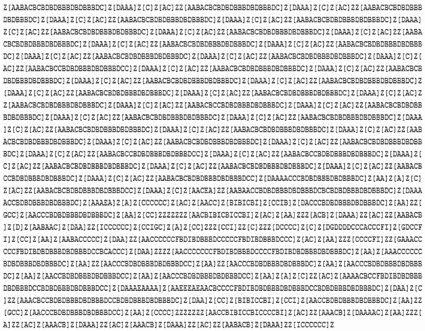

图 8.1 Walkinwat 木马的系统调用序列。

图 8.2 Walkinwat 恶意软件应用程序的系统调用有向图。

表 8.2 Walkinwat 木马的状态转移概率矩阵。

|  || A || B || C || D || E || F || G || H || I || Z |

| --- | --- | --- | --- | --- | --- | --- | --- | --- | --- | --- |

| A || 0.454 || 0.098 || 0.274 || 0 || 0.009 || 0 || 0 || 0 || 0 || 0.163 |

| --- | --- | --- | --- | --- | --- | --- | --- | --- | --- | --- |

| B || 0.063 || 0.369 || 0.063 || 0.470 || 0 || 0 || 0 || 0 || 0.021 || 0.010 |

| C | 0.004 | 0.268 | 0.310 | 0 | 0.002 | 0.024 | 0 | 0 | 0.012 | 0.376 |

| D | 0.139 | 0.659 | 0.176 | 0 | 0 | 0 | 0.002 | 0 | 0.019 | 0.002 |

| E | 0.714 | 0 | 0 | 0 | 0.285 | 0 | 0 | 0 | 0 | 0 |

| F | 0 | 0.700 | 0 | 0 | 0 | 0 | 0 | 0 | 0.300 | 0 |

| G | 0.166 | 0 | 0.500 | 0 | 0 | 0 | 0 | 0.333 | 0 | 0 |

| H | 0 | 0 | 0.400 | 0 | 0 | 0 | 0 | 0.600 | 0 | 0 |

| I | 0 | 0.480 | 0.320 | 0 | 0 | 0 | 0.04 | 0 | 0 | 0.160 |

| Z | 0.414 | 0.006 | 0.147 | 0.167 | 0 | 0 | 0.009 | 0 | 0.006 | 0.247 |

现在，我们知道 $\lim\limits_{k\rightarrow\infty}T^{k} = Q$，其中 `Q` 是一个秩为 1 的矩阵，其行相同，记为 `μ`=(`μ`[1],…, `μ`[*n*])。通过将 `T` 提升到足够大的幂 `k`，我们可以得到矩阵 `Q` 和 Walkinwat 木马的稳态分布 `μ`，如下所示，

$$
\begin{array}{r}
{\mu = (0.1900,0.2954,0.1841,0.1626,0.0031,0.0045,0.0023,0.0019,0.014,0.1414).}
\\
\end{array}
$$

Walkinwat 木马的系统调用序列的熵可以使用 `T` 和 `μ` 计算，如下所示，

$$
\begin{array}{r}
{H(X) = - {\sum\limits_{i = 1}^{n}{\sum\limits_{j = 1}^{n}{\mu_{i}t_{ij}log(t_{ij})}}} = 1.7512.}
\\
\end{array}
$$

Walkinwat 木马生成的系统调用模式及其信息距离 `ϵ` 如 表 8.3 所示。系统调用模式中连续出现的相同系统调用使用幂表示法表示。例如，系统调用模式 AACBIBICBICCBI 在幂表示法中表示为 A²CBIBICBIC²BI 以方便。在这里，我们可以选择信息距离最小的系统调用模式（模式 1）作为 Walkinwat 木马的 `恶意系统调用模式`。

表 8.3 系统调用模式和信息距离值。

| ID | 系统调用模式 | `ϵ` |

| --- | --- | --- |

| 模式 1 | A²C⁷FBDIBDB³DC⁴FBDIBDBDB³DBDB³DC | 0.05 |

| --- | --- | --- |

| 模式 2 | A²E³AEA³CBC⁴FBDIBDBDB³DBDB³DC²BDBDBDB³DBDB³DC | 0.07 |

| --- | --- | --- |

| 模式 3 | GA³C⁵FBDIBDBDB³DBDB³DC²BCAC³ | 0.18 |

| --- | --- | --- |

| 模式 4 | A²CBIBICBIC²BI | 1.05 |

## 8.3 基于系统调用模式的恶意软件检测与分类

基于系统调用模式的恶意软件检测与分类涉及将测试应用程序的系统调用模式与已知恶意软件的系统调用模式进行比较。因此，我们需要首先构建一个已知恶意软件的系统调用模式数据集。各种恶意软件样本生成的系统调用必须经过精炼，并按照 第 8.1 节 中所述提取系统调用模式。然后，将每个模式与数据库（先前创建）中存储的每个 `恶意系统调用模式` 进行比较。比较使用 Jaro-Winkler 相似度量度 \[155\] 进行。系统调用模式中的系统调用具有重复性。通常，相似系统调用模式中的前几个系统调用是相等的。因此，相似系统调用模式具有共同前缀。因此，可以使用 Jaro-Winkler 相似度量度来比较系统调用模式，因为 Jaro-Winkler 在比较时考虑共同前缀。

Jaro-Winkler 相似度量度是一种用于测量两个序列之间编辑距离的字符串度量。两个字符串的 Jaro-Winkler 距离越高，字符串越相似。分数被归一化，使得 1 对应于精确匹配，0 对应于完全不相似。如果匹配分数大于阈值 `T` ∈ \[0, 1\]，则应用程序可以被标记为恶意，并且过程可以终止。否则，需要将相似度比较与测试应用程序中的其他系统调用模式进行。如果在所有情况下 Jaro-Winkler 相似度分数都小于或等于阈值 `T`，则可以将应用程序声明为良性软件。恶意软件检测步骤如 算法 2 所示。

设 `P`[1] 和 `P`[2] 为两个系统调用模式。那么，`P`[1] 和 `P`[2] 的 Jaro 分数 `J` 由以下公式给出：

$$
\begin{array}{r}
{J = \frac{1}{3}(\frac{m}{\left| P_{1} \right|} + \frac{m}{\left| P_{2} \right|} + \frac{(m - t)}{m}),}
\\
\end{array}
$$

(8.2)

其中 `m` 是匹配的系统调用数量，`t` 是转置数量，|`P`[1]|,|`P`[1]| 是这些模式的长度。Jaro-Winkler 分数 `J`[`w`] 计算如下：

$$
\begin{array}{r}
{J_{w} = J + (lp(1 - J)),}
\\
\end{array}
$$

(8.3)

其中 `l` 是共同前缀的长度，`p` 是一个缩放常数，其值等于 0.1。`P`[1] 和 `P`[2] 中的两个字符只有在相同且不远于

$$
\left\lfloor \frac{\left. \max( \middle| P_{1} \middle| , \middle| P_{2} \middle| ) \right.}{2} \right\rfloor - 1.
$$

时才被视为匹配。

`P`[1] 的每个字符都与 `P`[2] 中的所有匹配字符进行比较。匹配（但序列顺序不同）的字符数量除以 2 定义了转置的数量。

使用系统调用模式匹配和 Jaro-Winkler 分数的恶意软件检测机制如 算法 2 所示。训练阶段从各种恶意软件家族中获得的 `恶意模式` 集合 `MP` = {`MP`[1],…`MP`[`l`]}，通过运行测试应用程序（第 8.3 节）获得的系统调用模式集合 `P` = {`P`[`u`]=(`P`[`u`, `v`]:`v`=1,2,…`k`[`u`]):`u`=1,2,…`k`} 以及阈值 `T` 作为输入提供给 算法 2。`State` 变量保存值 0 表示良性软件，1 表示恶意软件。在 算法 2 中，|`MP`[`i`]| 表示第 `i`^(`t`^`h`) 个 `恶意模式` 的长度，|`P`[`u`]| 表示测试应用程序中第 `u`^(`t`^`h`) 个系统调用模式的长度，`m`[`i`, `u`] 表示匹配的系统调用数量，`t`^`r`[`i`, `u`] 表示转置数量，`l`[`i`, `u`] 表示系统调用模式 `MP`[`i`] 和 `P`[`u`] 之间的共同前缀。首先，为每个 `恶意模式` `MP`[`i`] ∈ `MP` 和系统调用模式 `P`[`u`] ∈ `P` 的对计算 Jaro 分数 `J`，然后计算 Jaro-Winkler 分数。如果对于任何这样的对，Jaro-Winkler 相似度分数超过预定义的阈值 `T`，则应用程序被标记为恶意软件，否则，应用程序被标记为良性软件。

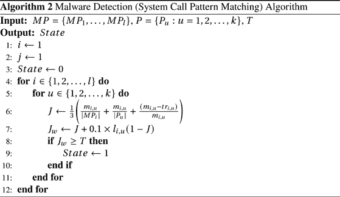

## 8.4 实验与分析

# 恶意系统调用模式检测机制的性能分析

本节将考察基于恶意系统调用模式的恶意软件检测机制的性能。我们考虑一个包含 2000 个样本的初始数据集，其中包括良性软件（goodware）和恶意软件（malware）应用程序。良性软件应用程序从 Google Play 商店下载，恶意软件应用程序从 Drebin 和 AMD 数据集下载。此外，我们还从外部仓库下载了感染 Judy 的自动点击广告软件应用程序和勒索软件。测试的恶意软件应用程序包括间谍软件权限提升程序、短信发送程序、广告软件和勒索软件等。间谍软件是可以执行许多恶意活动的应用程序，例如窃取 IMEI 代码等信息、监控位置、监听电话、通过控制摄像头嗅探周围环境等，针对受感染设备。权限提升程序是利用设备中的漏洞，在所有者不知情的情况下获取其受保护资源访问权限的恶意软件应用程序。短信发送程序可以在后台悄悄向高费率号码发送短信。间谍软件、权限提升程序和短信发送程序可以归类为木马。这些恶意软件可以在没有任何用户意图的情况下执行恶意活动。广告软件从服务器加载广告以给攻击者带来收益。某些类型的广告软件可以在广告上生成自动点击。勒索软件分为两种类型：加密勒索软件和锁定勒索软件。加密勒索软件加密设备中的文件并要求支付赎金以解密。锁定勒索软件通过锁定屏幕阻止设备使用，直到用户向攻击者支付赎金。测试的良性软件应用程序包括游戏应用程序、社交应用程序等。

该方法在配备 16 GB 内存的 Intel Core i5 PC 上实现，并配备具有 ARM v8 架构的 Android 模拟器。该模拟器可以模拟真实 Android 设备的硬件资源。在模式提取阶段，样本恶意软件应用程序在模拟器中执行，使用 monkey runner 工具注入 1000 个随机事件。然后，使用 strace 实用程序记录生成的系统调用。

提取了三类恶意软件应用程序（木马、恶意广告软件和勒索软件）的恶意系统调用模式。木马是倾向于在后台访问系统资源的恶意软件应用程序。用于模式提取的木马包括 Android.Tapsnake（木马间谍软件）、Android.wakinwat（木马短信）和 Droidkungfu 应用程序（权限提升程序）。恶意广告软件倾向于为第三方生成许多广告以获取收益。在此类别中，我们考虑了 Judy 恶意软件进行模式提取。勒索软件加密文件或锁定设备以索要赎金。我们分析了 Simplocker 加密勒索软件和 VideoPlayer 锁定勒索软件。这些恶意软件应用程序生成的系统调用模式在表 8.4 中给出。在表 8.4 中，我们可以看到特定类别恶意软件的系统调用模式中存在最长公共子序列（LCS）。因此，我们可以从应用程序生成的系统调用模式中识别类别。良性软件应用程序生成的系统调用模式在表 8.5 中给出。与恶意软件的情况不同，我们可能无法在良性软件应用程序中找到最长公共子序列（LCS）。模式提取中使用的恶意软件样本的系统调用大小在表 8.6 中给出。提取应用程序系统调用模式的 Python 代码在附录中给出。

## 表 8.4 各种恶意软件的系统调用模式

| Pattern ID | Application Category | Application Type | Application Name | System Call Pattern | LCS |
| --- | --- | --- | --- | --- | --- |
| Pattern 1 | Trojan | Trojan Spy | Android.TapSnake | AABCCFBDIBDBDBBBDBDBBBDC | |
| | | | | | FBDIBD |
| Pattern 2 | Trojan | Trojan SMS | Android.Wakinwat | AACCCCCCCFBDIBDBBBDCCCC | |
| | | | | FBDIBDBDBBBDBDBBBDC | |
| Pattern 3 | Trojan | Privilege Escalator | DroidKungFu | ACCCCCCFBDIBDBBBDC | |
| Pattern 4 | Malvertising Application | Autoclicking Adware | Judy | GCGCCCCGCCCCCCCCGBP | |
| | | | | DDDDDDDDDDDDDDDDDDDDD | |
| | | | | DDDDDDDDDDDDDDDDDDDDD | |
| | | | | DDDDDDDDDDDDDDDDDDDDD | |
| | | | | DDDDDDDDDDDDDDDDDDDDD | |
| | | | | DDDDDDDDDDDDDDDDDDDDD | |
| | | | | DDDDDDDDDDDDDDDDDDDDD | |
| | | | | DDDDDDDDDDDDDDDDDDDDD | |
| | | | | DDDDDDDDDDDDDDDDDDDDD | |
| | | | | DDDDDDDDDDDDDDDDDDDDD | |
| | | | | DDDDDDDDDDDDDDDDDDDDD | |
| | | | | DDDDDDDDDDDDDDDDDDDDD | |
| | | | | DDDDDDDDDDDDDDDDDDDDD | |
| | | | | DDDDDDDDDDDDDDDDDDDDD | |
| | | | | DDDDDDDDDDDDDDDDDDDDD | |
| | | | | DDDDDDDDDDDDDDDDDDDDD | |
| | | | | DDDDDDDDDDDDDI | |
| Pattern 5 | Ransomware | Crypto Ransomware | Simplocker | DAAAEAABACBDBDCCCCB | BACBDBD |
| Pattern 6 | Ransomware | Locker Ransomware | Videoplayer | DAAABACBDBDBDGBDBDBDBDBDB | |
| | | | | DBDBDBDBDBDBDBDBDBDGBDBDBD | |
| | | | | BDBDBDBDBDBDBDBDBDBDBDBDBDB | |
| | | | | DBDBDBDBDBDBDBDBDGBDBDBDCCCB | |

## 表 8.5 各种良性软件的系统调用模式

| Application Category | Pattern ID | System Call Pattern |
| --- | --- | --- |
| Calculo IMC App | Pattern 1 | AABCBDDBBDDBDDCCBDDCCBDDBDDBDDCCBDDC |
| Calculator App (System) | Pattern 2 | AACBDDBDDBDDCCCB |
| Superb Booster App | Pattern 3 | DAAAACBBBBBDBDCCB |

## 表 8.6 模式提取中使用的恶意软件样本的系统调用大小

| Category | Application | Number of Events | Size of the Trace |
| --- | --- | --- | --- |
| Trojan | Android.TapSnake | 1000 | 4703 |
| Trojan | Android.WakinWat | 1000 | 2182 |
| Trojan | DroidKungFu | 1000 | 1814 |
| Malvertising App. | Judy | 1000 | 38007 |
| Ransomware | Simplocker | 1000 | 1214 |
| Ransomware | Videoplayer | 1000 | 8472 |

在测试阶段（通过与已知系统调用模式进行比较进行恶意软件检测），2000 个良性软件和恶意软件应用程序样本在模拟器中执行并收集了系统调用。这些系统调用日志被分段和优化。然后，计算了每个应用程序中的系统调用模式与训练阶段（见表 8.4）中恶意软件的已知系统调用模式的 Jaro-Winkler 相似度分数。

发现任何应用程序的 Jaro-Winkler 相似度分数下界为 0.66。这是因为每个应用程序倾向于生成带有单个系统调用的模式（见图 8.1），例如 `read()`、`recvfrom()` 和 `ioctl()`，用于执行从设备驱动程序读取数据报等简单操作。系统调用模式还至少包含一个 `ioctl()`、`read()` 和 `recvfrom()` 系统调用。因此，带有单个系统调用的系统调用模式，例如 `ioctl()`、`read()` 或 `recvfrom()`，其 Jaro-Winkler 相似度大于或等于 0.66。这可以如下证明。

设 `P[1]` 为应用程序中带有单个系统调用（例如 `read()`、`recvfrom()` 或 `ioctl()`）的模式，`P[ε]` 为长度 `l[ε]` 的系统调用模式。那么 `P[1]` 和 `P[ε]` 之间的 Jaro 分数为

$$
\begin{aligned}
J & {= \frac{1}{3}(\frac{m}{| P_{1} |} + \frac{m}{| P_{\epsilon} |} + \frac{(m - t)}{m})} \\
& {= \frac{1}{3}(\frac{1}{1} + \frac{1}{l_{\epsilon}} + \frac{(1 - 0)}{1}) \geq \frac{2}{3} = 0.66.} \\
\end{aligned}
$$

(8.4)

注意 `m = 1` 和 `t = 0`，因为 `P[1]` 中只有一个系统调用。现在 Jaro-Winkler 分数 `J[w]` 为，

$$\\begin{array}{r} {J_{w} = J + (lp(1 - J)) \\geq 0.66} \\\\ \\end{array}$$  

(8.5)

因此，任何应用程序的最大 Jaro-Winkler 相似度分数的最小值为 0.66。

恶意软件检测涉及计算测试应用程序的系统调用模式与数据库中已知恶意软件应用程序的系统调用模式之间的 Jaro-Winkler 相似度分数。如果 Jaro-Winkler 相似度分数高于预设阈值，则测试应用程序将被视为恶意软件。各种阈值下（包含 6 个恶意软件的系统调用模式）的 FPR 和 FNR 值如 图 8.3 所示。从 图 8.3 可以得出结论，`T = 0.85` 是区分恶意软件和良性软件应用程序的良好阈值。所提方法在各种数据库中的检测率如 表 8.7 所示。从 表 8.7 可以得出结论，基于系统调用模式的机制可以有效检测恶意应用程序，准确率和 F1 分数均约为 0.95。不同恶意软件家族的检测率如 表 8.8 所示。

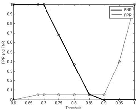

图 8.3 不同阈值下的假阳性率和假阴性率。

表 8.7 性能结果。

| 数据集 || TPR || TNR || FPR || FNR || PPV || 准确率 || F1\_Score |

| --- | --- | --- | --- | --- | --- | --- | --- |

| Drebin +AMD+ 外部仓库 || 0.940 || 0.961 || 0.039 || 0.060 || 0.95 || 0.949 || 0.95 |

| --- | --- | --- | --- | --- | --- | --- | --- |

| Drebin || 0.935 || 0.961 || 0.039 || 0.065 || 0.959 || 0.948 || 0.947 |

| AMD 数据集 || 0.940 || 0.961 || 0.039 || 0.06 || 0.96 || 0.95 || 0.955 |

| 外部仓库 || 1 || 1 || 1 || 1 || 1 || 1 || 1 |

表 8.8 不同恶意软件家族的检测率。

| 恶意软件家族 || 测试样本 || 类别 || 检测率 |

| --- | --- | --- | --- |

| Adrd || 20 || 特洛伊木马 || 1 |

| --- | --- | --- | --- |

| Andrup || 45 || 特洛伊木马 || 0.92 |

| Base Bridge || 20 || 特洛伊木马 || 0.80 |

| DrodKungFu || 147 || 特洛伊木马 || 0.91 |

| GoldDream || 37 || 特洛伊木马 || 0.92 |

| AndroRAT || 45 || 特洛伊木马 || 0.97 |

| Boxer || 44 || 特洛伊木马 || 0.88 |

| MobileTX || 17 || 特洛伊木马 || 0.64 |

| Rumms || 50 || 特洛伊木马 || 1 |

| Lottor || 100 || 特洛伊木马 || 0.90 |

| Mseg || 128 || 特洛伊木马 || 0.92 |

| Penetho || 18 || 特洛伊木马 || 1 |

| Vidro || 23 || 特洛伊木马 || 1 |

| Mercor || 178 || 特洛伊木马 || 1 |

| MMarketPay || 9 || 特洛伊木马 || 0.77 |

| Lnk || 5 || 特洛伊木马 || 1 |

| FakeDoc || 21 || 特洛伊木马 || 1 |

| FakeAV || 5 || 特洛伊木马 || 1 |

| FakeInstall || 15 || 特洛伊木马 || 1 |

| FakePlayer || 16 || 特洛伊木马 || 1 |

| FakeTimer || 10 || 特洛伊木马 || 1 |

| Simplocker || 19 || 勒索软件 || 1 |

| VideoPlayer || 18 || 勒索软件 || 1 |

| Judy || 11 || 恶意广告 || 1 |

|  ||  || 应用程序 ||  |

系统调用模式的 Jaro-Winkler 相似度匹配的 Python 代码载于附录。

## 8.5 结论

在本章中，我们讨论了一种恶意软件检测机制，该机制利用应用程序系统调用序列中系统调用模式的存在。最初，需要识别已知 Android 恶意软件的系统调用模式，并将不同的模式存储为恶意软件签名。单个系统调用模式可以代表许多恶意软件家族。恶意软件检测通过检查应用程序系统调用序列中是否存在任何已知系统调用模式来工作。这种恶意软件检测方法可以克服许多现有基于机器学习的检测机制的局限性。

强化学习技术可用于识别恶意行为，即使系统调用序列发生变化。也就是说，可以使用时序差分算法来学习已知恶意系统调用模式的属性，并识别未知系统调用模式的恶意概率值 \[192\] \[215\]。此外，将系统调用参数与系统调用结合使用，可能更好地表征恶意软件家族。

# 9 结论与未来方向

DOI: [10.1201/9781003121510-9](https://doi.org/10.1201/9781003121510-9)

在本章中，我们讨论了新兴恶意软件的趋势、第 4 章 至 第 8 章 中描述的检测机制的有效性，以及克服这些恶意软件检测机制局限性的可能研究方向。所提议的检测机制扩展可以检测和防止大多数恶意软件攻击。

在 第 4 章 中，我们表明，通过结合 API 调用、权限和系统调用，可以准确检测恶意行为。然而，攻击者可以通过使用对抗性技术来规避静态恶意软件分类器。在这种情况下，静态和混合分析机制并不十分有用。然而，攻击者在不修改程序语义的情况下，很难更改应用程序的系统调用序列。因此，可以从系统调用序列本身识别恶意行为。然而，在当前设置中，由于有限的代码覆盖率问题，系统调用分析并不十分准确。此外，它仅限于试图在后台访问敏感资源的恶意软件。为了克服这些局限性，我们需要采用机制来覆盖应用程序源代码在执行过程中的所有部分。此外，我们需要开发技术来识别未见系统调用序列中的恶意行为。

## 9.1 最近的恶意软件攻击

在 COVID-19 爆发期间，网络犯罪分子利用 COVID-19 追踪应用程序作为诱饵，进行各种恶意活动。冠状病毒的传播帮助攻击者发布伪装成 COVID 追踪器的恶意应用程序。这些恶意软件大多以特洛伊木马、间谍软件和勒索软件的形式出现。这些恶意软件使用反检测技术来防止被检测到。此外，在此期间，间谍软件和勒索软件攻击急剧增加，导致巨大的经济损失和严重的安全漏洞。

Pegasus 是由以色列公司 NSO Group 开发的间谍软件\[46\]。Pegasus 可以提取用户的个人详细信息，并在未经用户许可的情况下访问设备的麦克风和摄像头。它还可以访问设备的位置、阅读短信并跟踪通话。早期版本的 Pegasus 通过定向网络钓鱼安装在智能手机上。然而，最新版本的 Pegasus 通过“零点击”攻击传播，即恶意软件在不点击恶意链接或用户交互的情况下进入设备。这种恶意软件有能力通过 WhatsApp 上的未接来电安装，并在安装后删除未接来电记录。另一种安装技术是向用户手机发送消息而没有任何通知。在 Android 操作系统中，Pegasus 使用一种名为 framaroot 的 root 方法来访问设备。这种 root 方法很隐蔽，因此用户认为设备未被感染。

由于比特币的流行，网络犯罪分子现在正利用 Android 应用程序传播加密货币挖矿恶意软件\[61\]。这些加密货币挖矿恶意软件通过 Google Play 商店和其他第三方应用商店分发，伪装成游戏应用、流媒体应用和 VPN。大多数伪装的应用程序以用于观看足球比赛的应用程序形式出现。攻击者使用的一种常见方法是在 Android 应用程序中隐藏一个 Coinhive JavaScript 挖矿程序。当用户观看直播时，应用程序会打开一个包含嵌入式 JavaScript 挖矿程序的 HTML 文件。这种 JavaScript 将用户的 CPU 算力转化为挖掘加密货币的工具。加密货币挖矿恶意软件也以广告软件的形式出现。最近，一个名为 [Trojan.AndroidOS.Coinge.j](http://Trojan.AndroidOS.Coinge.j) 的加密货币挖矿恶意软件家族出现，它会将自身安装为色情应用或系统应用。攻击者利用这种恶意软件监控设备的电池和温度，以调节挖矿活动。加密货币挖矿程序是一种真正的威胁，因为它们可能会对设备性能产生不利影响，并可能触发基于网络的攻击。

## 9.2 识别利用攻击

Wagner 等人 \[200\] 表明，某些恶意软件应用程序在执行恶意活动时，会生成与良性软件应用程序相似的系统调用序列。如果仅考虑系统调用序列，这些恶意软件应用程序可能会被错误地分类为良性软件应用程序（反之亦然），这可能导致假阴性（假阳性）增加。在这些情况下，恶意行为可以通过系统调用参数以及系统调用序列来识别。例如，恶意软件应用程序可以通过利用系统实用程序或程序中的缓冲区溢出漏洞来执行恶意活动 \[141, 90, 84\]。也就是说，恶意软件应用程序可以尝试将恶意命令、文件或数据作为参数注入到某些类型的系统调用中，例如 `open()`、`execve()`，以执行恶意活动 \[141\]。系统调用 `execve()` 既被良性软件也被恶意软件使用。恶意软件请求 root 权限以利用系统实用程序中的漏洞，从而获得未经授权的访问权限。恶意软件应用程序将 “`/xbin/su`” 作为系统调用 `execve()` 的参数，用于检查 root 权限。因此，在这些情况下，恶意行为可以从系统调用参数而不是系统调用本身来推断。

对新恶意软件应用程序的实验表明，多阶段恶意软件应用程序（如 camscanner）可以逃脱许多检测机制。多阶段恶意软件应用程序最初表现为合法应用程序，随后从在线服务器下载恶意代码。在线服务器通信是通过向网络管理系统调用（例如 `sendto()` 和 `recvfrom()`）传递参数来完成的。在这种情况下，本书中讨论的检测机制可能无效。在 \[134\] 中，Kolbitch 等人提出了一种机制，用于根据系统调用参数之间的依赖关系构建应用程序的系统调用行为图。然而，这种参数依赖关系仅存在于某些类型的应用程序中 \[134\]。因此，不可能为所有类型的应用程序构建这种图 \[134\]。为了克服不使用系统调用参数的局限性，可以考虑同时使用系统调用参数关系和控制依赖信息来构建图模型。

## 9.3 缓解模拟器逃逸和代码覆盖率问题

许多恶意软件检测机制（包括本书中讨论的机制）依赖于 Android 模拟器来跟踪应用程序产生的系统调用。然而，某些恶意软件应用程序可以通过使用诸如验证运动传感器的存在、检查 IMEI 代码中的空值等技术来绕过基于模拟器的检测机制 \[166\]。可以通过采用修改模拟器、传感器事件的现实模拟、敏锐的二进制转换和硬件辅助虚拟化等技术来解决这个问题 \[166\],\[166\]。

动态恶意软件检测系统只有在恶意软件在执行过程中至少一次表现出恶意行为时才能检测到它。在本书中，我们使用 monkey runner 工具在运行时注入伪随机事件，例如点击事件、触摸事件等。Monkey runner 依赖于随机探索策略来生成输入测试用例。某些恶意软件应用程序（如 Xhelper）仅在用户按下特定键或发生特定事件时才会执行恶意活动。此外，恶意软件应用程序可以在运行时通过从在线存储库下载恶意代码来扩展其功能 \[167\]。这种行为称为动态加载。在这种情况下，恶意软件应用程序可以在执行几分钟后或发生特定事件后，从在线来源更新自身或加载一些恶意代码。在这些情况下，恶意软件应用程序可能会被误判为良性。为了克服这些局限性，我们可以采用机制，在执行过程中覆盖应用程序源代码的所有部分。为此，我们可以使用基于应用程序控制流图的前向执行，同时收集系统调用序列 \[221\]。也就是说，我们最初根据应用程序的源代码构建控制流图，然后注入用户或系统事件以探索该控制流图中的所有可能路径。收集到的系统调用序列将包含与应用程序相关的所有可能信息，并可用于从中识别恶意行为。

## 9.4 对系统调用序列变化的弹性

我们可以采用强化学习技术来识别恶意行为，即使恶意软件的系统调用序列发生了变化。也就是说，我们可以使用时序差分算法来学习已知恶意系统调用模式的属性，并识别未知系统调用模式的恶意概率值 \[192\] \[215\]。此外，我们可以考虑系统调用参数以及系统调用序列来构建随机模型。

## 9.5 串通攻击

在本书中，我们只考虑了单个应用程序的恶意行为。我们没有考虑来自多个应用程序的串通攻击。在串通攻击中，恶意代码被分割成几个部分并分布在多个应用程序中 \[150\]。这些应用程序通过隐蔽通道相互通信以执行恶意活动。例如，应用程序 ‘A’ 窃取信息并将其发送到应用程序 ‘B’。应用程序 ‘B’ 将该信息发送给攻击者。在这种情况下，与其他进程的后台通信可能会在设备中所有串通应用程序的系统调用序列中体现出来。我们没有共同考虑由多个应用程序进行的这种类型的恶意攻击（串通）（多个应用程序场景中的恶意行为）。我们需要找到一些新颖的机制，通过关联设备中所有应用程序生成的系统调用序列，来检测多个应用程序场景中的这种恶意行为。

# 附录

## 第 3 章源代码

以下 shell 脚本可用于从 Android 应用程序中提取操作码。

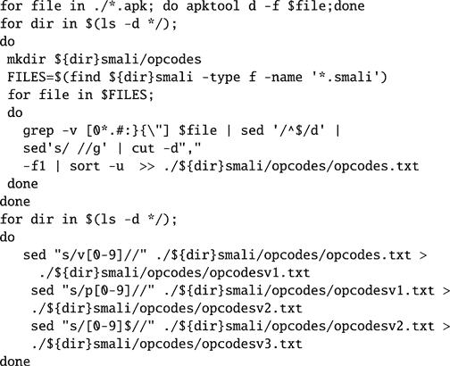

## 第 4 章源代码

下面给出了用于提取 API、权限和系统调用特征的源代码。这里，使用 Androguard 工具 \[98\] 从应用程序中提取 API 调用和权限，以构建 csv 文件。

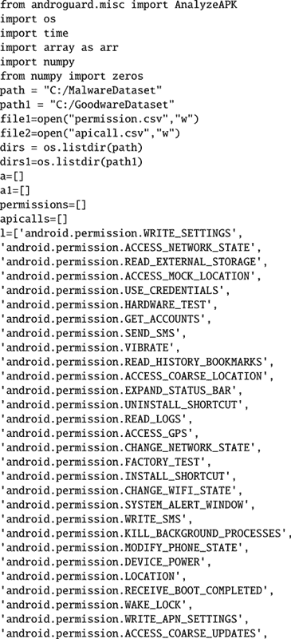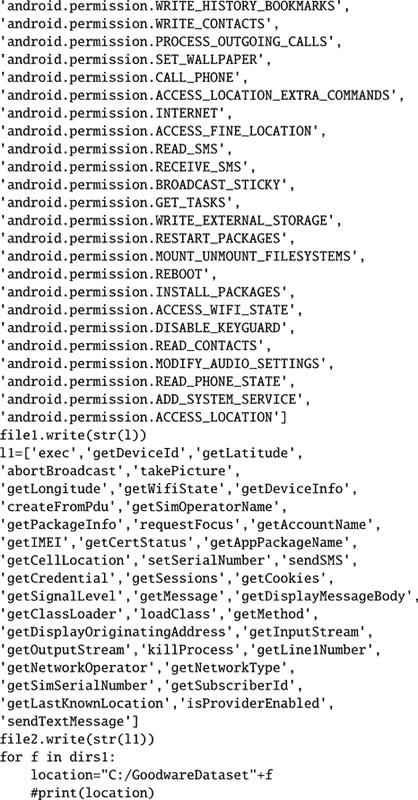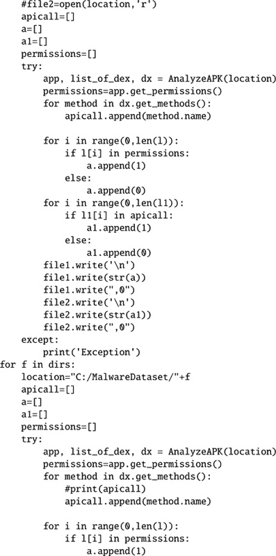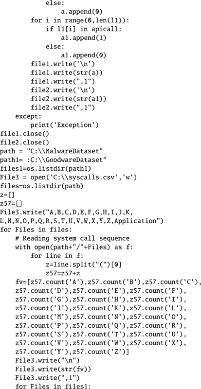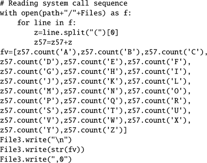

## 第 5 章源代码

下面给出了将系统调用序列表示为有向图并提取中心性度量（如特征向量中心性、介数中心性和接近中心性）的代码。

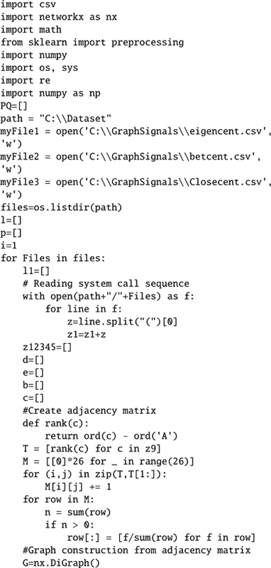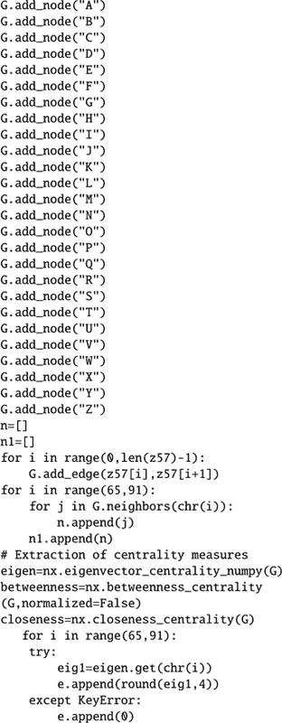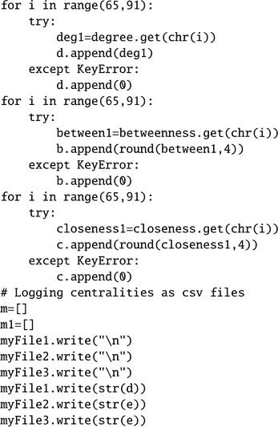

下面给出了分类程序代码。我们使用 R 编程语言来训练和测试 ANN 分类器。训练和测试文件作为输入传递给 `nnet()` 函数，`predict()` 函数返回的预测概率被平均计算。如果平均概率值超过 0.5，则将这些应用程序视为恶意软件。

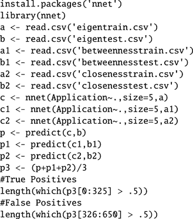

## 第 6 章源代码

下面给出了 GCN 的代码。使用 Keras 和 Tensorflow 等包来编写 GCN。我们使用 \[87\] 的实现来构建我们的 GCN 模型。

`layer.py`: `layer.py` 文件用于创建神经网络的不同层。代码如下。

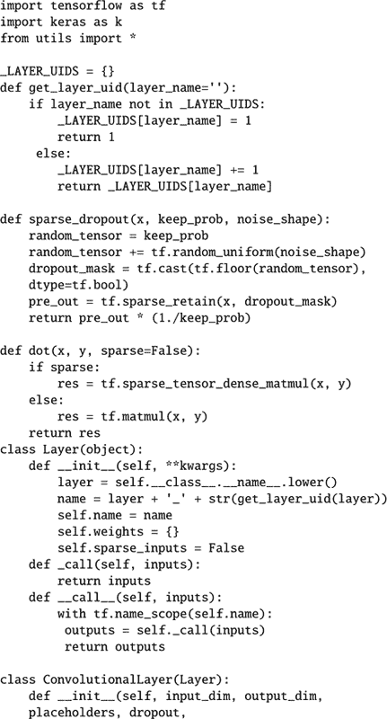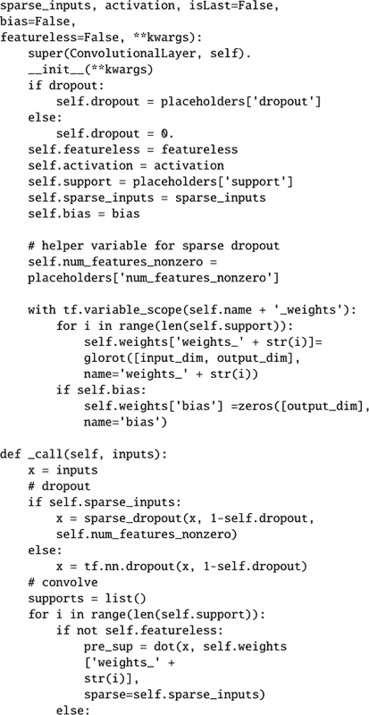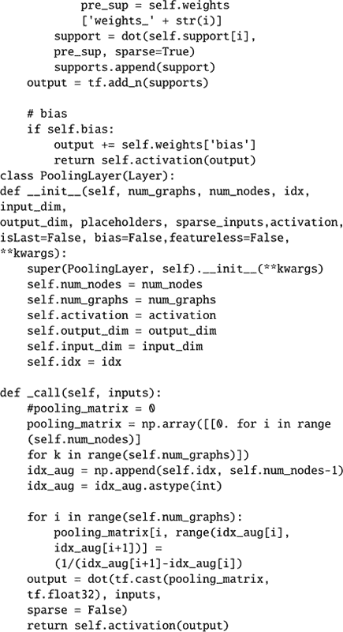

`fileutils.py`: `fileutils.py` 文件为 GCN 分类器提供各种实用工具。此文件包含加载输入并对其进行处理以供学习的代码。为此，GCN 的输入（如特征矩阵、图标签等）被转换为 numpy 数组（.npz 格式）。`fileutils.py` 的代码如下。

`neural networks.py`: `neural network.py` 包含 GCN 如何学习系统调用图以分类系统调用图是否为恶意的代码。

`Graph Classification Using GCN.py`: `graph classification using GCN.py` 文件包含指定用于学习图表示的参数的代码，例如 epoch 数量、学习率等。`graph classification using GCN.py` 的代码如下。

## 第 7 章源代码

下面给出了图信号构建的 Python 代码。此图信号构建代码接收多个应用程序的系统调用序列作为输入，并输出图信号向量。在此过程中，Python 代码首先通过消除参数和无关的系统调用来预处理系统调用序列。然后，它为系统调用分配替代名称，而不是使用其原始名称以方便使用。之后，它从每个系统调用序列中提取系统调用计数值和邻接矩阵。然后，它计算变换后的图信号，并将其保存在 csv 文件中以供机器学习分类。

下面给出了分类器的 Python 代码。文件 `graphsignals.csv` 按 9:1 的比例分割用于训练和测试。即 90% 的样本用于训练，剩余 10% 的样本用于测试。这些训练和测试数据集作为输入提供给各种 ML 算法以确定其性能。这里，`label_pred` 是 ML 分类器的输出（预测类）。

## 第 8 章源代码

下面给出了提取应用程序系统调用模式的 Python 代码。

下面给出了用于系统调用模式的 Jaro-Winkler 相似度匹配的 Python 代码。

# 参考文献

*   [\[1\]](#chapter3.xhtml#b3refbib_1) FakeInstaller 导致对 Android 手机的攻击。[`www.mcafee.com/blogs/mobile-security/fakeinstaller-leads-the-attack-on-android-phones/`](https://www.mcafee.com)。访问日期：03-04-2022。

*   [\[2\]](#chapter2.xhtml#b2refbib_2) 2017 年登上头条的 5 种 Android 恶意软件。[`www.wxii12.com/article/5-types-of-android-malware-that-made-headlines-in-2017/14508001`](https://www.wxii12.com)。访问日期：03-06-2021。

*   [\[3\]](#chapter2.xhtml#b2refbib_3) 移动恶意软件简史 ProAndroidDev。[`proandroiddev.com/a-short-history-of-mobile-malware-296570ed5c1b`](https://proandroiddev.com)。访问日期：03-06-2021。

*   [\[4\]](#chapter2.xhtml#b2refbib_4) trojan-sms.androidos.fakeplayer 分析。AT & T alien labs。[`cybersecurity.att.com/blogs/labs-research/analysis-of-trojan-sms.androidos.fakeplayer`](https://cybersecurity.att.com)。访问日期：03-06-2021。

*   [\[5\]](#chapter3.xhtml#b3refbib_5) Android 应用程序解剖。[`www.tutorialspoint.com/android/android\_hello\_world\_example.html`](https://www.tutorialspoint.com)。访问日期：03-06-2021。

*   [\[6\]](#chapter1.xhtml#b1refbib_6) Android aapt 工具。[`androidaapt.com/`](https://androidaapt.com)。访问日期：03-06-2021。

*   [\[7\]](#chapter1.xhtml#b1refbib_7) Android dx 工具。[`github.com/rover12421/AndroidDx`](https://github.com)。访问日期：03-06-2021。

*   [\[8\]](#chapter6.xhtml#b6refbib_8) Android 恶意软件 2019。[`github.com/sk3ptre/AndroidMalware2019`](https://github.com)。访问日期：03-06-2021。

*   [\[9\]](#chapter6.xhtml#b6refbib_9) Android 恶意软件样本。[`github.com/ashishb/android-malware`](https://github.com)。访问日期：11-02-2022。

*   [\[10\]](#chapter2.xhtml#b2refbib_10) Android 恶意软件利用 covid-19。[`www.buguroo.com/en/labs/Android`](https://www.buguroo.com) 恶意软件利用 covid 19。访问日期：03-06-2021。

*   [\[11\]](#chapter2.xhtml#b2refbib_11) Android 遭受“Gazon”恶意软件爆发。[`www.silicon.co.uk/mobility/mobile-apps/android-mobile-malware`](https://www.silicon.co.uk)。访问日期：03-06-2021。

*   [\[12\]](#chapter6.xhtml#b6refbib_12) 愤怒的 Android 黑客将 xbot 恶意软件隐藏在热门应用程序图标中。[`blog.avast.com/2015/02/17/angry-android-hacker-hides-xbot-malware-in-popular-application-icons/`](https://blog.avast.com)。访问日期：03-06-2021。

*   [\[13\]](#chapter3.xhtml#b3refbib_13) API 级别。[`www.dre.vanderbilt.edu/`](http://www.dre.vanderbilt.edu) schmidt/android/android-4.0/out/target/common/docs/doc-comment-check/guide/appendix/api-levels.html/。访问日期：27-11-2021。

*   [\[14\]](#chapter1.xhtml#b1refbib_14) 应用程序签名。[`source.android.com/security/apksigning`](https://source.android.com)。访问日期：03-06-2021。

*   [\[15\]](#chapter2.xhtml#b2refbib_15) Bluetooth-worm: Symbos/cabir 描述，F-Secure 实验室。[`www.f-secure.com/v-descs/cabir.shtml`](https://www.f-secure.com)。访问日期：03-06-2021。

*   [\[16\]](#chapter3.xhtml#b3refbib_16) Comebot。[`github.com/ashishb/android-malware`](https://github.com)。访问日期：03-06-2021。

*   [\[17\]](#chapter3.xhtml#b3refbib_17) CovidLock: Android 勒索软件在 COVID-19 流行期间传播。[`cyware.com/research-and-analysis/covidlock-android-ransomware-spreading-amid-covid-19-epidemic-4a5b`](https://cyware.com)。访问日期：03-06-2021。

# 参考文献

*   [\[18\]](#chapter3.xhtml#b3refbib_18) Dendroid 恶意软件可接管您的摄像头、录制音频并潜入 Google Play。 [`https://www.lookout.com/blog/dendroid`](https://www.lookout.com). 访问日期：03-06-2021.

*   [\[19\]](#chapter2.xhtml#b2refbib_19) Discord，您的聊天和闲聊场所。 [`https://discord.com/`](https://discord.com). 访问日期：03-06-2021.

*   [\[20\]](#chapter3.xhtml#b3refbib_20) DroidKungFu 及 Android 平台的 Rage Against The Cage 和 Exploid 漏洞利用程序。 [`https://www.malware.unam.mx/en/content/droidkungfu-and-exploits-rageagainstthecage-and-exploid-android`](https://www.malware.unam.mx). 访问日期：03-06-2021.

*   [\[21\]](#chapter1.xhtml#b1refbib_21) 加密。 [`https://source.android.com/security/encryption`](https://source.android.com). 访问日期：03-06-2021.

*   [\[22\]](#chapter3.xhtml#b3refbib_22) Exodus。 [`https://www.sophos.com/en-us/threat-center/threat-analyses/viruses-and-spyware/Exodus`](https://www.sophos.com). 访问日期：03-06-2021.

*   [\[23\]](#chapter2.xhtml#b2refbib_23) Faceapp 恶意软件。 [`https://www.forbes.com/sites/kateoflahertyuk/2019/12/03/fbi-faceapp-investigation-confirms-threat-from-apps-developed-in-russia/?sh=45354a5645bc`](https://www.forbes.com). 访问日期：11-04-2022.

*   [\[24\]](#chapter3.xhtml#b3refbib_24) 伪装成愤怒的小鸟游戏的 Android 市场恶意软件传播。 [`https://thehackernews.com/2012/01/fake-angry-birds-game-spreading-malware.html`](https://thehackernews.com). 访问日期：03-06-2021.

*   [\[25\]](#chapter2.xhtml#b2refbib_25) Cerberus（一款 Android 银行木马）的完整报告。 [`https://www.buguroo.com/en/labs/full-report-on-cerberus-an-android-banking-trojan`](https://www.buguroo.com). 访问日期：03-06-2021.

*   [\[26\]](#chapter1.xhtml#b1refbib_26) Android 基础安全模型。 [`https://medium.com/modulotech/the-fundamental-android-security-models-64f07dda006a`](https://medium.com). 访问日期：03-06-2021.

*   [\[27\]](#chapter2.xhtml#b2refbib_27) Gingermaster 恶意软件被发现利用 Android Gingerbread 根权限漏洞（Threatpost 报道）。 [`https://threatpost.com/gingermaster-malware-seen-using-root-exploit-android-gingerbread-081811/75559/`](https://threatpost.com). 访问日期：03-06-2021.

*   [\[28\]](#chapter4.xhtml#b4refbib_28) Google Play 商店。 [`https://play.google.com/store`](https://play.google.com/store). 访问日期：21-8-2017.

*   [\[29\]](#chapter2.xhtml#b2refbib_29) 旨在打击应用盗版的 Hacktivist Android 木马 | PCWorld。 [`https://www.pcworld.com/article/223842/hacktivist_android_trojan_designed_to_fight_app_piracy.html`](https://www.pcworld.com). 访问日期：03-06-2021.

*   [\[30\]](#chapter3.xhtml#b3refbib_30) 攻击者如何利用 Android 应用权限？ [`https://searchsecurity.techtarget.com/answer/How-can-Android-app-permissions-be-exploited-by-attackers`](https://searchsecurity.techtarget.com). 访问日期：03-06-2021.

*   [\[31\]](#chapter3.xhtml#b3refbib_31) 研究人员警告：热门 Android 应用中的 Intent 重定向漏洞凸显动态代码加载的危险。 [`https://portswigger.net/daily-swig/intent-redirection-vulnerabilities-in-popular-android-apps-spotlight-danger-of-dynamic-code-loading-warn-researchers`](https://portswigger.net). 访问日期：03-06-2021.

*   [\[32\]](#chapter1.xhtml#b1refbib_32) Intent 和 Intent 过滤器。 [`https://developer.android.com/guide/components/intents-filters`](https://developer.android.com). 访问日期：03-06-2021.

*   [\[33\]](#chapter1.xhtml#b1refbib_33) 物联网。 [`https://en.wikipedia.org/wiki/Internet_of_things`](https://en.wikipedia.org). 访问日期：03-04-2022.

*   [\[34\]](#chapter1.xhtml#b1refbib_34) 物联网攻击面：威胁与安全解决方案。 [`https://en.wikipedia.org/wiki/Internet_of_things`](https://en.wikipedia.org). 访问日期：03-06-2021.

*   [\[35\]](#chapter6.xhtml#b6refbib_35) Joker 恶意软件携 17 个变种攻击 Google Play。 [`https://securityintelligence.com/news/joker-malware-hits-Google-play-with-17-variants/`](https://securityintelligence.com). 访问日期：11-02-2021.

*   [\[36\]](#chapter1.xhtml#b1refbib_36) Android 安全模型的各个层级。 [`https://proandroiddev.com/the-layers-of-the-android-security-model-90f471015ae6`](https://proandroiddev.com). 访问日期：03-06-2021.

*   [\[37\]](#chapter2.xhtml#b2refbib_37) Malbus：流行的韩国巴士应用系列在 Google Play 上开发 5 年后被发现投放恶意软件 | McAfee 博客。 [`https://www.mcafee.com/blogs/other-blogs/mcafee-labs/malbus-popular-south-korean-bus-app-series-in-Google-play-found-dropping-malware-after-5-years-of-development/`](https://www.mcafee.com). 访问日期：03-06-2021.

*   [\[38\]](#chapter2.xhtml#b2refbib_38) 恶意软件定义。 [`http://techterms.com/definition/malware`](http://techterms.com). 访问日期：03-03-2022.

*   [\[39\]](#chapter2.xhtml#b2refbib_39) 恶意软件演进：基于 PC 与移动端。 [`https://blog.checkpoint.com/2013/01/02/malware-evolution-pc-based-vs-mobile-2/`](https://blog.checkpoint.com). 访问日期：03-06-2021.

*   [\[40\]](#chapter2.xhtml#b2refbib_40) 移动端活动“弹跳高尔夫”影响中东地区。 [`https://www.trendmicro.com/en_us/research/19/f/mobile-cyberespionage-campaign-bouncing-golf-affects-middle-east.html`](https://www.trendmicro.com). 访问日期：03-04-2022.

*   [\[41\]](#chapter2.xhtml#b2refbib_41) 新型 Android 间谍软件瞄准巴基斯坦用户 – Sophos 新闻。 [`https://news.sophos.com/en-us/2021/01/12/new-android-spyware-targets-users-in-pakistan/`](https://news.sophos.com). 访问日期：03-06-2021.

*   [\[42\]](#chapter1.xhtml#b1refbib_42) 2018 年新型物联网恶意软件增长三倍。 [`https://www.kaspersky.com/about/press-releases/2018_new-iot-malware-grew-three-fold-in-h1-2018`](https://www.kaspersky.com). 访问日期：03-06-2021.

*   [\[43\]](#chapter2.xhtml#b2refbib_43) NIST 网络安全框架（CSF）。 [`https://www.gsa.gov/technology/technology-products-services/it-security/nist-cybersecurity-framework-csf`](https://www.gsa.gov). 访问日期：03-06-2021.

*   [\[44\]](#chapter2.xhtml#b2refbib_44) 2020 年 11 月最受关注的恶意软件：臭名昭著的 Phorpiex 僵尸网络再次成为影响最大的感染源。 [`https://www.globenewswire.com/news-release/2020/12/09/2142018/0/en/November-2020-s-Most-Wanted-Malware-Notorious-Phorpiex-Botnet-Returns-As-Most-Impactful-Infection.html`](https://www.globenewswire.com). 访问日期：06-04-2022.

*   [\[45\]](#chapter2.xhtml#b2refbib_45) 超过 14% 的印度人受到“Shopper”恶意软件影响。 [`https://www.thehindu.com/sci-tech/technology/internet/over-14-indians-affected-by-shopper-malware/article30555480.ece`](https://www.thehindu.com). 访问日期：03-06-2021.

*   [\[46\]](#chapter9.xhtml#b9refbib_46) Pegasus 间谍软件与公民监控：您需要知道的事。 [`https://www.cnet.com/tech/mobile/pegasus-spyware-and-citizen-surveillance-what-you-need-to-know/`](https://www.cnet.com). 访问日期：03-06-2021.

*   [\[47\]](#chapter2.xhtml#b2refbib_47) Ransom.Sodinokibi - Malwarebytes Labs。 [`https://blog.malwarebytes.com/detections/ransom-sodinokibi/`](https://blog.malwarebytes.com). 访问日期：03-06-2021.

*   [\[48\]](#chapter2.xhtml#b2refbib_48) 勒索软件犯罪分子瞄准美国大学。 [`https://theconversation.com/ransomware-criminals-are-targeting-us-universities-141932`](https://theconversation.com). 访问日期：03-06-2021.

*   [\[49\]](#chapter2.xhtml#b2refbib_49) Simplocker – Android 勒索软件警报！ [`https://blogs.quickheal.com/simplocker-android-ransomware-alert/`](https://blogs.quickheal.com). 访问日期：03-06-2021.

*   [\[50\]](#chapter6.xhtml#b6refbib_50) Android 恶意软件家族的系统调用分析。 [`https://sciresol.s3.us-east-2.amazonaws.com/IJST/Articles/2016/Issue-21/Article62.pdf`](https://sciresol.s3.us-east-2.amazonaws.com). 访问日期：03-06-2021.

*   [\[51\]](#chapter2.xhtml#b2refbib_51) 深入分析 PlugX 恶意软件。 [`https://logrhythm.com/blog/deep-dive-into-plugx-malware/`](https://logrhythm.com). 访问日期：03-06-2021.

# 参考文献

*   [\[52\]](#chapter2.xhtml#b2refbib_52) 它们来了，它们藏起来，它们搞乱一切 - Android.Obad 和 Android.Fakedefender。 [`https://blogs.quickheal.com/they-come-they-hide-and-they-mess-up-android-obad-and-android-fakedefender/`](https://blogs.quickheal.com). 访问日期：03-06-2021。

*   [\[53\]](#chapter1.xhtml#b1refbib_53) IoT 恶意软件时间轴。 [`https://www.stratosphereips.org/blog/2020/4/26/timeline-of-iot-malware-version-1`](https://www.stratosphereips.org). 访问日期：03-06-2021。

*   [\[54\]](#chapter2.xhtml#b2refbib_54) Triout Android 间谍软件框架卷土重来，滥用拥有 5000 万次下载量的应用 – Bitdefender Labs。 [`https://labs.bitdefender.com/2019/02/triout-android-spyware-framework-makes-a-comeback-abusing-app-with-50-million-downloads/`](https://labs.bitdefender.com). 访问日期：03-06-2021。

*   [\[55\]](#chapter3.xhtml#b3refbib_55) 木马：Android/BaseBridge.A。 [`https://www.f-secure.com/v-descs/trojan_android_basebridge.shtml`](https://www.f-secure.com). 访问日期：03-06-2021。

*   [\[56\]](#chapter2.xhtml#b2refbib_56) 木马：Android/Boxer 描述 | F-Secure Labs。 [`https://www.f-secure.com/v-descs/trojan/androidboxer.shtml`](https://www.f-secure.com). 访问日期：03-06-2021。

*   [\[57\]](#chapter2.xhtml#b2refbib_57) 木马：Android/droiddream.a 描述 | f-secure labs。 [`https://www.f-secure.com/v-descs/trojan/android/droiddream/a.shtml`](https://www.f-secure.com). 访问日期：11-04-2022。

*   [\[58\]](#chapter3.xhtml#b3refbib_58) 木马：Android/GinMaster.A。 [`https://www.f-secure.com/v-descs/trojan_android_ginmaster.shtml`](https://www.f-secure.com). 访问日期：03-06-2021。

*   [\[59\]](#chapter3.xhtml#b3refbib_59) 木马-fakeav。 [`https://encyclopedia.kaspersky.com/knowledge/trojan-fakeav/`](https://encyclopedia.kaspersky.com). 访问日期：03-06-2021。

*   [\[60\]](#chapter5.xhtml#b5refbib_60) Virustotal-免费在线病毒、恶意软件和 URL 扫描器。 [`https://www.virustotal.com/en`](https://www.virustotal.com). 访问日期：29-04-2022。

*   [\[61\]](#chapter9.xhtml#b9refbib_61) 警告：加密货币挖矿正在瞄准您的 Android。 [`https://www.mcafee.com/blogs/mobile-security/warning-crypto-currency-mining-targeting-android/`](https://www.mcafee.com). 访问日期：03-06-2021。

*   [\[62\]](#chapter2.xhtml#b2refbib_62) 一个大故事：Hummingbad 卷土重来 - Check Point Software。 [`https://blog.checkpoint.com/2017/01/23/hummingbad-returns/`](https://blog.checkpoint.com). 访问日期：03-06-2021。

*   [\[63\]](#chapter3.xhtml#b3refbib_63) Android 权限有哪些不同的保护级别？ [`https://blog.mindorks.com/what-are-the-different-protection-levels-in-android-permission`](https://blog.mindorks.com). 访问日期：03-06-2021。

*   [\[64\]](#chapter2.xhtml#b2refbib_64) 什么是僵尸网络？ | Kaspersky。 [`https://www.kaspersky.co.in/resource-center/threats/botnet-attacks`](https://www.kaspersky.co.in). 访问日期：03-06-2021。

*   [\[65\]](#chapter3.xhtml#b3refbib_65) 什么是 API 调用？ [`https://rapidapi.com/blog/api-glossary/api-call/`](https://rapidapi.com). 访问日期：03-06-2021。

*   [\[66\]](#chapter2.xhtml#b2refbib_66) 什么是 Joker 恶意软件？它如何影响应用 - The Week。 [`https://www.theweek.in/news/sci-tech/2020/07/13/What-is-the-Joker-malware-Heres-how-it-affects-apps.html`](https://www.theweek.in). 访问日期：03-06-2021。

*   [\[67\]](#chapter2.xhtml#b2refbib_67) Zitmo (Zeus-in-the-mobile) 木马攻击 Android 和 Blackberry 智能手机。 [`https://www.enigmasoftware.com/zitmo-zeus-in-the-mobile-trojan-attacks-android-blackberry-smartphones`](https://www.enigmasoftware.com). 访问日期：11-04-2021。

*   [\[68\]](#chapter2.xhtml#b2refbib_68) Yousra Aafer, Wenliang Du, 和 Heng Yin. Droidapiminer: 为 Android 中强大的恶意软件检测挖掘 API 级特征. 在 Security and Privacy in Communication Networks 中, 页码 86–103. Springer, 2013.

*   [\[69\]](#chapter3.xhtml#b3refbib_69) Moutaz Alazab, Mamoun Alazab, Andrii Shalaginov, Abdelwadood Mesleh, 和 Albara Awajan. 使用权限请求和 API 调用进行智能移动恶意软件检测. Future Generation Computer Systems, 107:509–521, 2020.

*   [\[70\]](#chapter4.xhtml#b4refbib_70) Aylin Alin. 多重共线性. Wiley Interdisciplinary Reviews: Computational Statistics, 2(3):370–374, 2010.

*   [\[71\]](#chapter4.xhtml#b4refbib_71) Abdelfattah Amamra, Jean-Marc Robert, Andrien Abraham, 和 Chamseddine Talhi. 用于基于系统调用过滤和抽象过程的 Android 异常检测系统的生成式与判别式分类器. Security and Communication Networks, 9(16):3483–3495, 2016.

*   [\[72\]](#chapter2.xhtml#b2refbib_72) Abdelfattah Amamra, Jean-Marc Robert, 和 Chamseddine Talhi. 使用系统调用过滤和抽象过程增强 Android 系统的恶意软件检测. Security and Communication Networks, 8(7):1179–1192, 2015.

*   [\[73\]](#chapter4.xhtml#b4refbib_73) Anshul Arora, Shree Garg, 和 Sateesh K Peddoju. 基于网络流量分析的 Android 移动设备恶意软件检测. 在 2014 年第八届下一代移动应用、服务和技术国际会议中, 页码 66–71. IEEE, 2014.

*   [\[74\]](#chapter4.xhtml#b4refbib_74) Anshul Arora 和 Sateesh K Peddoju. Ntpdroid: 一种使用网络流量和系统权限的混合 Android 恶意软件检测器. 在 2018 年第 17 届 IEEE 信任、安全与隐私计算与通信国际会议中, 页码 808–813. IEEE, 2018.

*   [\[75\]](#chapter4.xhtml#b4refbib_75) Daniel Arp, Michael Spreitzenbarth, Malte Hubner, Hugo Gascon, Konrad Rieck, 和 CERT Siemens. Drebin: 有效且可解释的 Android 恶意软件检测，就在您的口袋里. 在 NDSS 研讨会论文集中, 页码 23–26, 2014.

*   [\[76\]](#chapter4.xhtml#b4refbib_76) Saba Arshad, Munam A Shah, Abdul Wahid, Amjad Mehmood, Houbing Song, 和 Hongnian Yu. SAMADroid: 针对 Android 操作系统的新型 3 级混合恶意软件检测模型. IEEE Access, 6:4321–4339, 2018.

*   [\[77\]](#chapter8.xhtml#b8refbib_77) Nitay Artenstein 和 Idan Revivo. 绑定器中的中间人：谁控制 IPC，谁就控制 Droid. 在 `Europe Blackhat Conference` 中, 2014.

*   [\[78\]](#chapter3.xhtml#b3refbib_78) Alessandro Bacci, Alberto Bartoli, Fabio Martinelli, Eric Medvet, Francesco Mercaldo, 和 Corrado Aaron Visaggio. 代码混淆对基于静态和动态分析的 Android 恶意软件检测的影响. 在 ICISSP 中, 页码 379–385, 2018.

*   [\[79\]](#chapter3.xhtml#b3refbib_79) Hongpeng Bai, Nannan Xie, Xiaoqiang Di, 和 Qing Ye. FAMD: 一种快速多特征 Android 恶意软件检测框架、设计和实现. IEEE Access, 8:194729–194740, 2020.

*   [\[80\]](#chapter3.xhtml#b3refbib_80) Nazanin Bakhshinejad 和 Ali Hamzeh. 一种基于压缩的新方法，用于使用操作码进行 Android 恶意软件检测. `19th CSI International Symposium on Artificial Intelligence and Signal Processing, AISP 2017`, 页码 256–261, 2018.

*   [\[81\]](#chapter3.xhtml#b3refbib_81) Adam Bannister. 流行 Android 应用中的意图重定向漏洞凸显动态代码加载的危险，研究人员警告。 [`https://portswigger.net/daily-swig/intent-redirection-vulnerabilities-in-popular-android-apps-spotlight-danger-of-dynamic-code-loading-warn-researchers`](https://portswigger.net). 访问日期：03-06-2021。

*   [\[82\]](#chapter4.xhtml#b4refbib_82) Lingfeng Bao, Tien-Duy B Le, 和 David Lo. 挖掘沙箱：我们到那里了吗？ 在 `2018 IEEE 25th International Conference on Software Analysis, Evolution and Reengineering (SANER)` 中, 页码 445–455. IEEE, 2018.

*   [\[83\]](#chapter4.xhtml#b4refbib_83) Mario Luca Bernardi, Marta Cimitile, Damiano Distante, Fabio Martinelli, 和 Francesco Mercaldo. 使用进程挖掘进行动态恶意软件检测和系谱分析. International Journal of Information Security, 18(3):257–284, 2019.

*   [\[84\]](#chapter9.xhtml#b9refbib_84) Massimo Bernaschi, Emanuele Gabrielli, and Luigi V Mancini. Operating system enhancements to prevent the misuse of system calls. In *Proceedings of the 7th ACM Conference on Computer and Communications Security*, pages 174–183, 2000.

*   [\[85\]](#chapter4.xhtml#b4refbib_85) Shweta Bhandari, Rekha Panihar, Smita Naval, Vijay Laxmi, Akka Zemmari, and Manoj Singh Gaur. SWORD: semantic aware Android malware detector. Journal of Information Security and Applications, 42:46–56, 2018.

*   [\[86\]](#chapter4.xhtml#b4refbib_86) Parnika Bhat and Kamlesh Dutta. A survey on various threats and current state of security in Android platform. ACM Computing Surveys (CSUR), 52(1):1–35, 2019.

*   [\[87\]](#chapter6.xhtml#b6refbib_87) Boris Brizzi. Graph-classification-with-gcn. [`https://github.com/BrizziB/Graph-Classification-with-GCN`](https://github.com). Accessed on 03-06-2021.

*   [\[88\]](#chapter6.xhtml#b6refbib_88) Michael M. Bronstein, Joan Bruna, Yann LeCun, Arthur Szlam, and Pierre Vandergheynst. Geometric deep learning: Going beyond euclidean data. IEEE Signal Processing Magazine, 34(4):18–42, 2017.

*   [\[89\]](#chapter4.xhtml#b4refbib_89) Iker Burguera, Urko Zurutuza, and Simin Nadjm-Tehrani. Crowdroid: behavior-based malware detection system for android. In *Proceedings of the 1st ACM Workshop on Security and Privacy in Smartphones and Mobile Devices*, pages 15–26, 2011.

*   [\[90\]](#chapter9.xhtml#b9refbib_90) Davide Canali, Andrea Lanzi, Davide Balzarotti, Christopher Kruegel, Mihai Christodorescu, and Engin Kirda. A quantitative study of accuracy in system call-based malware detection. In *Proceedings of the 2012 International Symposium on Software Testing and Analysis*, pages 122–132, 2012.

*   [\[91\]](#chapter3.xhtml#b3refbib_91) Gerardo Canfora, Eric Medvet, Francesco Mercaldo, and Corrado Aaron Visaggio. Detecting Android malware using sequences of system calls. In *Proceedings of the 3rd International Workshop on Software Development Lifecycle for Mobile*, pages 13–20, 2015.

*   [\[92\]](#chapter2.xhtml#b2refbib_92) Victor Chebyshev. Mobile malware evolution 2019. [`https://securelist.com/mobile-malware-evolution-2019/`](https://securelist.com). Accessed on 03-06-2021.

*   [\[93\]](#chapter4.xhtml#b4refbib_93) Sen Chen, Minhui Xue, Zhushou Tang, Lihua Xu, and Haojin Zhu. Stormdroid: A streaminglized machine learning-based system for detecting Android malware. In *Proceedings of the 11th ACM on Asia Conference on Computer and Communications Security*, pages 377–388. ACM, 2016.

*   [\[94\]](#chapter3.xhtml#b3refbib_94) Tieming Chen, Qingyu Mao, Yimin Yang, Mingqi Lv, and Jianming Zhu. Tinydroid: a lightweight and efficient model for Android malware detection and classification. Mobile Information Systems, 2018.

*   [\[95\]](#chapter2.xhtml#b2refbib_95) Xiao Chen, Chaoran Li, Derui Wang, Sheng Wen, Jun Zhang, Surya Nepal, Yang Xiang, and Kui Ren. Android HIV: A Study of Repackaging Malware for Evading Machine-Learning Detection. IEEE Transactions on Information Forensics and Security, 15:987–1001, August 2018.

*   [\[96\]](#chapter2.xhtml#b2refbib_96) Elliot J. Chikofsky and James H Cross. Reverse engineering and design recovery: A taxonomy. IEEE software, 7(1):13–17, 1990.

*   [\[97\]](#chapter4.xhtml#b4refbib_97) C Chow and Cong Liu. Approximating discrete probability distributions with dependence trees. IEEE Transactions on Information Theory, 14(3):462–467, 1968.

*   [\[98\]](#chapter4.xhtml#b4refbib_98) [`code.google.com.Androguard`](http://code.google.com.Androguard). [`http://code.google.com/p/androguard/`](http://code.google.com/p/androguard/). Accessed on 03-06-2021.

*   [\[99\]](#chapter4.xhtml#b4refbib_99) Santanu Kumar Dash, Guillermo Suarez-Tangil, Salahuddin Khan, Kimberly Tam, Mansour Ahmadi, Johannes Kinder, and Lorenzo Cavallaro. Droidscribe: Classifying Android malware based on runtime behavior. In *2016 IEEE Security and Privacy Workshops (SPW)*, pages 252–261. IEEE, 2016.

*   [\[100\]](#chapter4.xhtml#b4refbib_100) Marko Dimjašević, Simone Atzeni, Ivo Ugrina, and Zvonimir Rakamaric. Evaluation of Android malware detection based on system calls. In *Proceedings of the 2016 ACM on International Workshop on Security And Privacy Analytics*, IWSPA ‘16, pages 1–8, New York, USA, 2016. ACM.

*   [\[101\]](#chapter4.xhtml#b4refbib_101) Karim O Elish, Xiaokui Shu, Danfeng Daphne Yao, Barbara G Ryder, and Xuxian Jiang. Profiling user-trigger dependence for Android malware detection. Computers & Security, 49:255–273, 2015.

*   [\[102\]](#chapter3.xhtml#b3refbib_102) Ming Fan, Jun Liu, Xiapu Luo, Kai Chen, Zhenzhou Tian, Qinghua Zheng, and Ting Liu. Android malware familial classification and representative sample selection via frequent subgraph analysis. IEEE Transactions on Information Forensics and Security, 13(8):1890–1905, 2018.

*   [\[103\]](#chapter3.xhtml#b3refbib_103) Zheran Fang, Weili Han, and Yingjiu Li. Permission based android security: Issues and countermeasures. Computers & Security, 43:205–218, 2014.

*   [\[104\]](#chapter2.xhtml#b2refbib_104) Parvez Faruki, Ammar Bharmal, Vijay Laxmi, Vijay Ganmoor, Manoj Singh Gaur, Mauro Conti, and Muttukrishnan Rajarajan. Android security: a survey of issues, malware penetration, and defenses. IEEE Communications Surveys & Tutorials, 17(2):998–1022, 2014.

*   [\[105\]](#chapter3.xhtml#b3refbib_105) Ali Feizollah, Nor Badrul Anuar, Rosli Salleh, Guillermo Suarez-Tangil, and Steven Furnell. Androdialysis: Analysis of Android intent effectiveness in malware detection. Computers & Security, 65:121–134, 2017.

*   [\[106\]](#chapter4.xhtml#b4refbib_106) Adrienne Porter Felt, Erika Chin, Steve Hanna, Dawn Song, and David Wagner. Android permissions demystified. In *Proceedings of the 18th ACM Conference on Computer and Communications Security*, pages 627–638. ACM, 2011.

*   [\[107\]](#chapter6.xhtml#b6refbib_107) Pengbin Feng, Jianfeng Ma, Cong Sun, Xinpeng Xu, and Yuwan Ma. A novel dynamic Android malware detection system with ensemble learning. IEEE Access, 6:30996–31011, 2018.

*   [\[108\]](#chapter3.xhtml#b3refbib_108) André Prata Ferreira, Chetna Gupta, Pedro R. M. Inácio, and Mário M. Freire. Behaviour-based malware detection in mobile android platforms using machine learning algorithms. Journal of Wireless Mobile Networks, Ubiquitous Computing, and Dependable Applications (JoWUA), 12(4):62–88, 2021.

*   [\[109\]](#chapter6.xhtml#b6refbib_109) Stephanie Forrest, Steven A Hofmeyr, Anil Somayaji, and Thomas A Longstaff. A sense of self for unix processes. In *Proceedings 1996 IEEE Symposium on Security and Privacy*, pages 120–128. IEEE, 1996.

*   [\[110\]](#chapter4.xhtml#b4refbib_110) Jerome H Friedman. On bias, variance, 0/ 1—loss, and the curse-of-dimensionality. Data Mining and Knowledge Discovery, 1(1):55–77, 1997.

*   [\[111\]](#chapter4.xhtml#b4refbib_111) Nir Friedman, Dan Geiger, and Moises Goldszmidt. Bayesian network classifiers. Machine learning, 29(2):131–163, 1997.

*   [\[112\]](#chapter4.xhtml#b4refbib_112) Laura Gheorghe, Bogdan Marin, Gary Gibson, Lucian Mogosanu, Razvan Deaconescu, Valentin-Gabriel Voiculescu, and Mihai Carabas. Smart malware detection on android. Security and Communication Networks, 8(18):4254–4272, 2015.

*   [\[113\]](#chapter8.xhtml#b8refbib_113) [`github.com`](http://github.com). Collection of Android malware samples. [`https://github.com/killvxk/Android-Malwares-1`](https://github.com). Accessed on 03-04-2021.

*   [\[114\]](#chapter8.xhtml#b8refbib_114) [`github.com`](http://github.com). Collection of Android malware samples. [`https://github.com/ashishb/android-malware`](https://github.com). Accessed on 03-06-2021.

*   [\[115\]](#chapter8.xhtml#b8refbib_115) [`github.com`](http://github.com). Ransomware. [`https://github.com/Sh1n0g1/Ransomware`](https://github.com). Accessed on 18-01-2018.

*   [\[116\]](#chapter5.xhtml#b5refbib_116) Aric Hagberg, Pieter Swart, 和 Daniel S Chult. 使用 networkx 探索网络结构、动态和功能。技术报告，Los Alamos National Lab.(LANL)，Los Alamos, NM (美国)，2008 年。

*   [\[117\]](#chapter3.xhtml#b3refbib_117) Hyoil Han, SeungJin Lim, Kyoungwon Suh, Seonghyun Park, Seong-je Cho, 和 Minkyu Park. 增强的 Android 恶意软件检测：一种基于 SVM 的机器学习方法。在 `2020 IEEE International Conference on Big Data and Smart Computing (BigComp)` 中，第 75–81 页。IEEE，2020 年。

*   [\[118\]](#chapter2.xhtml#b2refbib_118) Juan Manuel Harán. 80 年代的恶意软件：回顾脑病毒和莫里斯蠕虫。[`https://www.welivesecurity.com/2018/11/05/malware-1980s-brain-virus-morris-worm/`](https://www.welivesecurity.com)。访问日期：04-11-2021。

*   [\[119\]](#chapter4.xhtml#b4refbib_119) Gaofeng He, Bingfeng Xu, 和 Haiting Zhu. Appfa：一种在网络上检测恶意 Android 应用程序的新方法。Security and Communication Networks，2018 年。

*   [\[120\]](#chapter4.xhtml#b4refbib_120) Robert Hecht-Nielsen. 反向传播神经网络理论。在 Neural Networks for Perception 中，第 65–93 页。1992 年。

*   [\[121\]](#chapter7.xhtml#b7refbib_121) Seyyedali Hosseinalipour, Jie Wang, Yuanzhe Tian, 和 Huaiyu Dai. 通过图信号处理对不规则网络进行感染分析。IEEE Transactions on Network Science and Engineering，2019 年。

*   [\[122\]](#chapter4.xhtml#b4refbib_122) Shifu Hou, Aaron Saas, Lifei Chen, 和 Yanfang Ye. Deep4maldroid：一种基于 Linux 内核系统调用图的 Android 恶意软件检测深度学习框架。在 `2016 IEEE/WIC/ACM International Conference on Web Intelligence Workshops (WIW)` 中，第 104–111 页。IEEE，2016 年。

*   [\[123\]](#chapter3.xhtml#b3refbib_123) Shifu Hou, Aaron Saas, Yanfang Ye, 和 Lifei Chen. Droiddelver：一种基于 API 调用块的深度信念网络的 Android 恶意软件检测系统。在 International Conference on Web-Age Information Management 中，第 54–66 页。Springer，2016 年。

*   [\[124\]](#chapter3.xhtml#b3refbib_124) Syed Jawad Hussain, Usman Ahmed, Humera Liaquat, Shiba Mir, NZ Jhanjhi, 和 Mamoona Humayun. Imiad：用于 Android 平台的智能恶意软件识别。在 `2019 International Conference on Computer and Information Sciences (ICCIS)` 中，第 1–6 页。IEEE，2019 年。

*   [\[125\]](#chapter3.xhtml#b3refbib_125) Quentin Jerome, Kevin Allix, Radu State, 和 Thomas Engel. 使用操作码序列检测恶意 Android 应用程序。在 `2014 IEEE International Conference on Communications (ICC)` 中，第 914–919 页。IEEE，2014 年。

*   [\[126\]](#chapter5.xhtml#b5refbib_126) Teenu S John 和 Tony Thomas. 恶意软件检测分类器中的对抗性攻击与防御。在 Handbook of Research on Cloud Computing and Big Data Applications in IoT 中，第 127–150 页。2019 年。

*   [\[127\]](#chapter3.xhtml#b3refbib_127) Teenu S. John 和 Tony Thomas. 规避静态和动态 Android 恶意软件检测机制。Communications in Computer and Information Science，1364:33–48，2021 年。

*   [\[128\]](#chapter6.xhtml#b6refbib_128) Teenu S John, Tony Thomas, 和 Sabu Emmanuel. 用于具有系统调用图的 Android 恶意软件检测的图卷积网络。在 `2020 Third ISEA Conference on Security and Privacy (ISEA-ISAP)` 中，第 162–170 页。IEEE，2020 年。

*   [\[129\]](#chapter3.xhtml#b3refbib_129) Kartik Khariwal, Jatin Singh, 和 Anshul Arora. Ipdroid：使用意图和权限进行 Android 恶意软件检测。在 `2020 Fourth World Conference on Smart Trends in Systems, Security and Sustainability (WorldS4)` 中，第 197–202 页。IEEE，2020 年。

*   [\[130\]](#chapter4.xhtml#b4refbib_130) TaeGuen Kim, BooJoong Kang, 和 Eul Gyu Im. Android 恶意软件的运行时检测框架。Mobile Information Systems，2018: 1–15，HIndawi。

*   [\[131\]](#chapter3.xhtml#b3refbib_131) Taeguen Kim, Boojoong Kang, Mina Rho, Sakir Sezer, 和 Eul Gyu Im. 一种使用各种特征进行 Android 恶意软件检测的多模态深度学习方法。IEEE Transactions on Information Forensics and Security，14(3):773–788，2019 年。

*   [\[132\]](#chapter6.xhtml#b6refbib_132) Diederik P Kingma 和 Jimmy Ba. Adam：一种随机优化方法。arXiv 预印本 arXiv:`1412`.`6980`，2014 年。

*   [\[133\]](#chapter6.xhtml#b6refbib_133) Thomas N. Kipf 和 Max Welling. 带有图卷积网络的半监督分类。`5th International Conference on Learning Representations, ICLR 2017 - Conference Track Proceedings`，2019 年。

*   [\[134\]](#chapter7.xhtml#b7refbib_134) Clemens Kolbitsch, Paolo Milani Comparetti, Christopher Kruegel, Engin Kirda, Xiao-yong Zhou, 和 XiaoFeng Wang. 端主机上的有效且高效的恶意软件检测。在 USENIX Security Symposium 中，第 4 卷，第 351–366 页，2009 年。

*   [\[135\]](#chapter2.xhtml#b2refbib_135) KPMG. COVID-19 期间勒索软件的兴起。[`https://home.kpmg/xx/en/home/insights/2020/05/rise-of-ransomware-during-covid-19.html`](https://home.kpmg)。访问日期：03-06-2021。

*   [\[136\]](#chapter1.xhtml#b1refbib_136) Iggy Krajci 和 Darren Cummings. Android 操作系统的历史与演变。在 Android on x86 中，第 1–8 页。Springer，2013 年。

*   [\[137\]](#chapter3.xhtml#b3refbib_137) A Lakshmanarao 和 M Shashi. 使用 RNN 从操作码序列进行深度学习的 Android 恶意软件检测。International Journal of Interactive Mobile Technologies，16(1)，2022 年。

*   [\[138\]](#chapter4.xhtml#b4refbib_138) Saskia Le Cessie 和 Johannes C Van Houwelingen. 逻辑回归中的岭估计量。Journal of the Royal Statistical Society: Series C (Applied Statistics)，41(1):191–201，1992 年。

*   [\[139\]](#chapter3.xhtml#b3refbib_139) Deqiang Li 和 Qianmu Li. 对抗性深度集成：用于恶意软件检测的规避攻击与防御。IEEE Transactions on Information Forensics and Security，15:3886–3900，2020 年。

*   [\[140\]](#chapter2.xhtml#b2refbib_140) Shanhong Liu. 2013 年至 2020 年全球 Android 操作系统版本份额。[`https://www.statista.com/statistics/271774/share-of-android-platforms-on-mobile-devices-with-android-os/`](https://www.statista.com)。访问日期：03-06-2021。

*   [\[141\]](#chapter7.xhtml#b7refbib_141) Federico Maggi, Matteo Matteucci, 和 Stefano Zanero. 通过系统调用序列和参数分析检测入侵。IEEE Transactions on Dependable and Secure Computing，7(4):381–395，2008 年。

*   [\[142\]](#chapter3.xhtml#b3refbib_142) Robert Layton Manoun Alazab, Sitalakshmi Venkataraman, Paul Watters, Mamoun Alazab, 和 Robert Layton. 基于 API 调用结构和行为特征的恶意软件检测。[`http://citeseerx.ist.psu.edu/viewdoc/summary?doi=10.1.1.470.6890`](http://citeseerx.ist.psu.edu/viewdoc/summary?doi=10.1.1.470.6890)，2010 年。访问日期：03-06-2021。

*   [\[143\]](#chapter4.xhtml#b4refbib_143) Alejandro Martn, Raúl Lara-Cabrera, 和 David Camacho. 通过混合特征融合和集成分类器进行 Android 恶意软件检测：Andropytool 框架和 Omnidroid 数据集。Information Fusion，52:128–142，2019 年。

*   [\[144\]](#chapter2.xhtml#b2refbib_144) McAfee. 什么是无文件恶意软件？[`https://www.mcafee.com/enterprise/en-in/security-awareness/ransomware/what-is-fileless-malware.html`](https://www.mcafee.com)。访问日期：03-06-2021。

*   [\[145\]](#chapter1.xhtml#b1refbib_145) Stuart McIlroy, Nasir Ali, 和 Ahmed E Hassan. Fresh apps：Google Play 商店中频繁更新的移动应用程序的实证研究。Empirical Software Engineering，21(3):1346–1370，2016 年。

*   [\[146\]](#chapter3.xhtml#b3refbib_146) Niall McLaughlin. Malceiver：具有分层和多模态特征的用于 Android 恶意软件检测的 Perceiver。arXiv 预印本 arXiv:`2204`.`05994`，2022 年。

*   [\[147\]](#chapter2.xhtml#b2refbib_147) Marisa Mdler. 勒索软件即服务 (RaaS) 威胁。[`https://insights.sei.cmu.edu/sei_blog/2020/10/ransomware-as-a-service-raas-threats.html`](https://insights.sei.cmu.edu)。访问日期：03-06-2021。

*   [\[148\]](#chapter1.xhtml#b1refbib_148) Reto Meier. Professional Android for Application Development. John Wiley & Sons, 2012.

*   [\[149\]](#chapter2.xhtml#b2refbib_149) Allie Mellon. Fileless malware 101: Understanding non-malware attacks allie mellen. [`https://www.cybereason.com/blog/fileless-malware`](https://www.cybereason.com). Accessed on 27-06-2021.

*   [\[150\]](#chapter9.xhtml#b9refbib_150) Atif M Memon and Ali Anwar. Colluding apps: Tomorrow's mobile malware threat. IEEE Security & Privacy, 13(6):77–81, 2015.

*   [\[151\]](#chapter2.xhtml#b2refbib_151) Microsoft. How malware can infect your pc. [`https://support.microsoft.com/en-us/windows/how-malware-can-infect-your-pc-872bf025-623d-735d-1033-ea4d456fb76b`](https://support.microsoft.com). Accessed on 04-11-2021.

*   [\[152\]](#chapter4.xhtml#b4refbib_152) Jelena Milosevic, Miroslaw Malek, and Alberto Ferrante. A friend or a foe? detecting malware using memory and cpu features. In SECRYPT, pages 73–84, 2016.

*   [\[153\]](#chapter5.xhtml#b5refbib_153) Peter Mooney and Padraig Corcoran. Using osm for lbs–an analysis of changes to attributes of spatial objects. In Advances in Location-Based Services, pages 165–179. 2012.

*   [\[154\]](#chapter4.xhtml#b4refbib_154) Annamalai Narayanan, Mahinthan Chandramohan, Lihui Chen, and Yang Liu. Context-aware, adaptive, and scalable Android malware detection through online learning. IEEE Transactions on Emerging Topics in Computational Intelligence, 1(3):157–175, 2017.

*   [\[155\]](#chapter8.xhtml#b8refbib_155) Gonzalo Navarro. A guided tour to approximate string matching. ACM Computing Surveys, 33(1):31–88, 2001.

*   [\[156\]](#chapter6.xhtml#b6refbib_156) Thanh-Tuan Nguyen, Giang Thi Thu Nguyen, Thin Nguyen, and Duc-Hau Le. Graph convolutional networks for drug response prediction. IEEE/ACM Transactions on Computational Biology and Bioinformatics, 19(1):146–154, 2022.

*   [\[157\]](#chapter5.xhtml#b5refbib_157) Juhani Nieminen. On the centrality in a graph. Scandinavian Journal of Psychology, 15(1):332–336, 1974.

*   [\[158\]](#chapter3.xhtml#b3refbib_158) Robin Nix and Jian Zhang. Classification of android apps and malware using deep neural networks. In 2017 International Joint Conference on Neural Networks (IJCNN), pages 1871–1878. IEEE, 2017.

*   [\[159\]](#chapter1.xhtml#b1refbib_159) Jon Oberheide and Charlie Miller. Dissecting the android bouncer. Summer Conference 2012, New York, 95:110, 2012.

*   [\[160\]](#chapter4.xhtml#b4refbib_160) Lucky Onwuzurike, Mario Almeida, Enrico Mariconti, Jeremy Blackburn, Gianluca Stringhini, and Emiliano De Cristofaro. A family of droids-Android malware detection via behavioral modeling: Static vs dynamic analysis. In `2018 16th Annual Conference on Privacy, Security and Trust (PST)`, pages 1–10. IEEE, 2018.

*   [\[161\]](#chapter7.xhtml#b7refbib_161) Antonio Ortega, Pascal Frossard, Jelena Kovačević, José MF Moura, and Pierre Vandergheynst. Graph signal processing: Overview, challenges, and applications. Proceedings of the IEEE, 106(5):808–828, 2018.

*   [\[162\]](#chapter2.xhtml#b2refbib_162) Jasseca Ortega. Fake joomla! plugin keyscaptcha still in the wild. [`https://www.sitelock.com/blog/tag/malicious-plugin/`](https://www.sitelock.com). Accessed on 03-04-2021.

*   [\[163\]](#chapter1.xhtml#b1refbib_163) Keyur K Patel, Sunil M Patel, et al. Internet of things-iot: definition, characteristics, architecture, enabling technologies, application & future challenges. International Journal of Engineering Science and Computing, 6(5), 2016: 6122–6131.

*   [\[164\]](#chapter3.xhtml#b3refbib_164) Abdurrahman Pektaş and Tankut Acarman. Learning to detect Android malware via opcode sequences. Neurocomputing, 396:599–608, 2020.

*   [\[165\]](#chapter6.xhtml#b6refbib_165) Feargus Pendlebury, Fabio Pierazzi, Roberto Jordaney, Johannes Kinder, and Lorenzo Cavallaro. `{TESSERACT}`: Eliminating experimental bias in malware classification across space and time. In `28th USENIX Security Symposium (USENIX Security 19)`, pages 729–746, 2019.

*   [\[166\]](#chapter9.xhtml#b9refbib_166) Thanasis Petsas, Giannis Voyatzis, Elias Athanasopoulos, Michalis Polychronakis, and Sotiris Ioannidis. Rage against the virtual machine: hindering dynamic analysis of Android malware. In `Proceedings of the Seventh European Workshop on System Security`, pages 1–6, 2014.

*   [\[167\]](#chapter9.xhtml#b9refbib_167) Sebastian Poeplau, Yanick Fratantonio, Antonio Bianchi, Christopher Kruegel, and Giovanni Vigna. Execute this! analyzing unsafe and malicious dynamic code loading in android applications. In NDSS, volume 14, pages 23–26, 2014.

*   [\[168\]](#chapter4.xhtml#b4refbib_168) Boris Procházka, Tomas Vojnar, and Martin Drahansky. Hijacking the linux kernel. In `Sixth Doctoral Workshop on Mathematical and Engineering Methods in Computer Science (MEMICS'10)–Selected Papers`, 2011.

*   [\[169\]](#chapter3.xhtml#b3refbib_169) Ford Quin. New tekya ad fraud found on google play. [`https://www.trendmicro.com/en_in/research/20/f/new-tekya-ad-fraud-found-on-google-play.html`](https://www.trendmicro.com). Accessed on 03-06-2021.

*   [\[170\]](#chapter1.xhtml#b1refbib_170) JR Raphael. Android versions: A living history from 1.0 to 11. [`https://www.computerworld.com/article/3235946/android-versions-a-living-history-from-1-0-to-today.html`](https://www.computerworld.com). Accessed on 29-04-2022.

*   [\[171\]](#chapter4.xhtml#b4refbib_171) Vaibhav Rastogi, Yan Chen, and Xuxian Jiang. Catch me if you can: Evaluating android anti-malware against transformation attacks. IEEE Transactions on Information Forensics and Security, 9(1):99–108, 2013.

*   [\[172\]](#chapter4.xhtml#b4refbib_172) Payam Refaeilzadeh, Lei Tang, and Huan Liu. Cross-validation. In Ling Liu and M. Tamer Özsu, editors, Encyclopedia of Database Systems, pages 1–7, New York, 2016. Springer.

*   [\[173\]](#chapter1.xhtml#b1refbib_173) Rick Rogers, John Lombardo, Zigurd Mednieks, and Blake Meike. `Android application development: Programming with the Google SDK`. O'Reilly Media, Inc., 2009.

*   [\[174\]](#chapter8.xhtml#b8refbib_174) Peter Jay Salzman, Michael Burian, and Ori Pomerantz. The linux kernel module programming guide. [`https://tldp.org/LDP/lkmpg/2.6/html/lkmpg.html`](https://tldp.org). Accessed on 03-06-21.

*   [\[175\]](#chapter7.xhtml#b7refbib_175) Aliaksei Sandryhaila and José MF Moura. Discrete signal processing on graphs. IEEE Transactions on Signal Processing, 61(7):1644–1656, 2013.

*   [\[176\]](#chapter4.xhtml#b4refbib_176) Riccardo Sartea, Alessandro Farinelli, and Matteo Murari. Secur-ama: active malware analysis based on monte carlo tree search for android systems. Engineering Applications of Artificial Intelligence, 87:103303, 2020.

*   [\[177\]](#chapter3.xhtml#b3refbib_177) Ryo Sato, Daiki Chiba, and Shigeki Goto. Detecting Android malware by analyzing manifest files. Proceedings of the Asia-Pacific Advanced Network, 36(23–31):17, 2013.

*   [\[178\]](#chapter3.xhtml#b3refbib_178) Asaf Shabtai, Uri Kanonov, Yuval Elovici, Chanan Glezer, and Yael Weiss. Andromaly: a behavioral malware detection framework for android devices. Journal of Intelligent Information Systems, 38(1):161–190, 2012.

*   [\[179\]](#chapter3.xhtml#b3refbib_179) Hossain Shahriar, Mahbubul Islam, and Victor Clincy. Android malware detection using permission analysis. In Southeast Conference, 2017, pages 1–6. IEEE, 2017.

*   [\[180\]](#chapter2.xhtml#b2refbib_180) Zhiyong Shan, Iulian Neamtiu, and Raina Samuel. Self-hiding behavior in Android apps: Detection and characterization. In `Proceedings - International Conference on Software Engineering`, pages 728–739. IEEE Computer Society, 2018.

*   [\[181\]](#chapter3.xhtml#b3refbib_181) Madhu K Shankarapani, Subbu Ramamoorthy, Ram S Movva, and Srinivas Mukkamala. Malware detection using assembly and api call sequences. Journal in Computer Virology, 7(2):107–119, 2011.

*   [\[182\]](#chapter4.xhtml#b4refbib_182) Abhijith Shastry, Murat Kantarcioglu, Yan Zhou, and Bhavani Thuraisingham. Randomizing smartphone malware profiles against statistical mining techniques. In Data and Applications Security and Privacy XXVI, pages 239–254. Springer, 2012.

*   [\[183\]](#chapter4.xhtml#b4refbib_183) Abraham Silberschatz, Peter Baer Galvin, and Greg Gagne. Operating System Concepts Essentials. John Wiley & Sons, Inc., 2014.

*   [\[184\]](#chapter2.xhtml#b2refbib_184) Cammilie Singleton. Ransomware 2020: Attack trends affecting organizations worldwide. [`https://securityintelligence.com/posts/ransomware-2020-attack-trends-new-techniques-affecting-organizations-worldwide/`](https://securityintelligence.com). Accessed on 03-06-2021.

*   [\[185\]](#chapter5.xhtml#b5refbib_185) [`Sourceforge.net`](http://Sourceforge.net). Strace Linux system call tracer. [`https://sourceforge.net/projects/strace`](https://sourceforge.net). Accessed on 03-06-21.

*   [\[186\]](#chapter6.xhtml#b6refbib_186) Orathai Sukwong, Hyong Kim, and James Hoe. Commercial antivirus software effectiveness: an empirical study. IEEE Computer Architecture Letters, 44(03):63–70, 2011.

*   [\[187\]](#chapter5.xhtml#b5refbib_187) Roopak Surendran and Tony Thomas. Detection of malware applications from centrality measures of syscall graph. Concurrency and Computation: Practice and Experience, 34(10), 2022.

*   [\[188\]](#chapter4.xhtml#b4refbib_188) Roopak Surendran, Tony Thomas, and Sabu Emmanuel. Android malware detection mechanism based on bayesian model averaging. In Proceedings of the 5th International Conference on Advanced Computing, Networking, and Informatics. Springer, 2017.

*   [\[189\]](#chapter5.xhtml#b5refbib_189) Roopak Surendran, Tony Thomas, and Sabu Emmanuel. Gsdroid: Graph signal based compact feature representation for Android malware detection. Expert Systems with Applications, 159:113581, 2020.

*   [\[190\]](#chapter8.xhtml#b8refbib_190) Roopak Surendran, Tony Thomas, and Sabu Emmanuel. On existence of common malicious system call codes in Android malware families. IEEE Transactions on Reliability, 70(1):248–260, 2020.

*   [\[191\]](#chapter4.xhtml#b4refbib_191) Roopak Surendran, Tony Thomas, and Sabu Emmanuel. A tan based hybrid model for Android malware detection. Journal of Information Security and Applications, 54:102483, 2020.

*   [\[192\]](#chapter8.xhtml#b8refbib_192) Richard S Sutton and Andrew G Barto. Reinforcement learning: An introduction. MIT press, 2018.

*   [\[193\]](#chapter3.xhtml#b3refbib_193) Kabakus Abdullah Talha, Dogru Ibrahim Alper, and Cetin Aydin. Apk auditor: Permission-based android malware detection system. Digital Investigation, 13:1–14, 2015.

*   [\[194\]](#chapter4.xhtml#b4refbib_194) Kimberly Tam, Salahuddin J Khan, Aristide Fattori, and Lorenzo Cavallaro. Copperdroid: Automatic reconstruction of Android malware behaviors. In NDSS, pages 1–15, 2015.

*   [\[195\]](#chapter3.xhtml#b3refbib_195) Junwei Tang, Ruixuan Li, Yu Jiang, Xiwu Gu, and Yuhua Li. Android malware obfuscation variants detection method based on multi-granularity opcode features. Future Generation Computer Systems, 129:141–151, 2022.

*   [\[196\]](#chapter6.xhtml#b6refbib_196) Mobile Threat Response Team. Slocker mobile ransomware starts mimicking wannacry - trendlabs security intelligence blog. [`https://www.trendmicro.com/en\_in/research/17/g/slocker-mobile-ransomware-starts-mimicking-wannacry.html`](https://www.trendmicro.com). Accessed on 03-06-2021.

*   [\[197\]](#chapter6.xhtml#b6refbib_197) Fei Tong and Zheng Yan. A hybrid approach of mobile malware detection in Android. Journal of Parallel and Distributed Computing, 103:22–31, 2017.

*   [\[198\]](#chapter1.xhtml#b1refbib_198) Nicolas Viennot, Edward Garcia, and Jason Nieh. A measurement study of google play. In `2014 ACM International Conference on Measurement and Modeling of Computer Systems`, pages 221–233, 2014.

*   [\[199\]](#chapter2.xhtml#b2refbib_199) P Vinod, Akka Zemmari, and Mauro Conti. A machine learning based approach to detect malicious android apps using discriminant system calls. Future Generation Computer Systems, 94:333–350, 2019.

*   [\[200\]](#chapter7.xhtml#b7refbib_200) David Wagner and Paolo Soto. Mimicry attacks on host-based intrusion detection systems. In `Proceedings of the 9th ACM Conference on Computer and Communications Security`, pages 255–264, 2002.

*   [\[201\]](#chapter2.xhtml#b2refbib_201) Kelle Wanderlee. They come in the night: Ransomware deployment trends. [`https://www.fireeye.com/blog/threat-research/2020/03/they-come-in-the-night-ransomware-deployment-trends.html`](https://www.fireeye.com). Accessed on 03-06-2021.

*   [\[202\]](#chapter4.xhtml#b4refbib_202) Xinran Wang, Yoon-Chan Jhi, Sencun Zhu, and Peng Liu. Detecting software theft via system call based birthmarks. In 2009 Annual Computer Security Applications Conference, pages 149–158. IEEE, 2009.

*   [\[203\]](#chapter2.xhtml#b2refbib_203) Fengguo Wei, Yuping Li, Sankardas Roy, Xinming Ou, and Wu Zhou. Deep ground truth analysis of current Android malware. In International Conference on Detection of Intrusions and Malware, and Vulnerability Assessment, pages 252–276. Springer, 2017.

*   [\[204\]](#chapter3.xhtml#b3refbib_204) Lukas Weichselbaum, Matthias Neugschwandtner, Martina Lindorfer, Yanick Fratantonio, Victor van der Veen, and Christian Platzer. Andrubis: Android malware under the magnifying glass. `Vienna University of Technology, Tech. Rep. TRISECLAB-0414-001`, 2014.

*   [\[205\]](#chapter3.xhtml#b3refbib_205) Ryan Welton and Grassi Marco. Current state of android privilege escalation. [`https://filepursuit.unblockproject.org/file/18925610-D2-Ryan-Welton-and-Marco-Grassi-Current-State-of-Android-Privilege-Escalation-pdf/`](https://filepursuit.unblockproject.org). Accessed on 27-04-2022.

*   [\[206\]](#chapter6.xhtml#b6refbib_206) Le Wu, Peijie Sun, Richang Hong, Yanjie Fu, Xiting Wang, and Meng Wang. Socialgcn: An efficient graph convolutional network based model for social recommendation. arXiv preprint arXiv:`1811`.`02815`, 2018.

*   [\[207\]](#chapter6.xhtml#b6refbib_207) Zonghan Wu, Shirui Pan, Fengwen Chen, Guodong Long, Chengqi Zhang, and S Yu Philip. A comprehensive survey on graph neural networks. IEEE Transactions on Neural Networks and Learning Systems, 32(1):4–24, 2020.

*   [\[208\]](#chapter4.xhtml#b4refbib_208) Xi Xiao, Zhenlong Wang, Qing Li, Shutao Xia, and Yong Jiang. Back-propagation neural network on markov chains from system call sequences: a new approach for detecting android malware with system call sequences. IET Information Security, 11(1):8–15, 2017.

*   [\[209\]](#chapter4.xhtml#b4refbib_209) Xi Xiao, Xianni Xiao, Yong Jiang, Xuejiao Liu, and Runguo Ye. Identifying android malware with system call co-occurrence matrices. Transactions on Emerging Telecommunications Technologies, 27(5):675–684, 2016.

*   [\[210\]](#chapter4.xhtml#b4refbib_210) Xi Xiao, Shaofeng Zhang, Francesco Mercaldo, Guangwu Hu, and Arun Kumar Sangaiah. Android malware detection based on system call sequences and lstm. Multimedia Tools and Applications, 78(4):3979–3999, 2019.

*   [\[211\]](#chapter4.xhtml#b4refbib_211) Liang Xie, Xinwen Zhang, Jean-Pierre Seifert, and Sencun Zhu. PBMDS: a behavior-based malware detection system for cellphone devices. In `Proceedings of the Third ACM Conference on Wireless Network Security`, pages 37–48. ACM, 2010.

*   [\[212\]](#chapter6.xhtml#b6refbib_212) Ke Xu, Yingjiu Li, Robert Deng, Kai Chen, and Jiayun Xu. Droidevolver: Self-evolving Android malware detection system. In `2019 IEEE European Symposium on Security and Privacy (EuroS&P)`, pages 47–62. IEEE, 2019.

*   [\[213\]](#chapter3.xhtml#b3refbib_213) Ke Xu, Yingjiu Li, and Robert H Deng. Iccdetector: Icc-based malware detection on android. IEEE Transactions on Information Forensics and Security, 11(6):1252–1264, 2016.

*   [\[214\]](#chapter4.xhtml#b4refbib_214) Lifan Xu, Dongping Zhang, Nuwan Jayasena, and John Cavazos. Hadm: Hybrid analysis for detection of malware. In Proceedings of SAI Intelligent Systems Conference, pages 702–724. Springer, 2016.

*   [\[215\]](#chapter8.xhtml#b8refbib_215) Xin Xu. Sequential anomaly detection based on temporal-difference learning: Principles, models and case studies. Applied Soft Computing, 10(3):859–867, 2010.

*   [\[216\]](#chapter4.xhtml#b4refbib_216) Wei Yu, Hanlin Zhang, Linqiang Ge, and Rommie Hardy. On behavior-based detection of malware on android platform. In 2013 IEEE Global Communications Conference (GLOBECOM), pages 814–819. IEEE, 2013.

*   [\[217\]](#chapter4.xhtml#b4refbib_217) Zhenlong Yuan, Yongqiang Lu, and Yibo Xue. Droiddetector: Android malware characterization and detection using deep learning. Tsinghua Science and Technology, 21(1):114–123, 2016.

*   [\[218\]](#chapter3.xhtml#b3refbib_218) Mu Zhang, Yue Duan, Heng Yin, and Zhiruo Zhao. Semantics-aware Android malware classification using weighted contextual api dependency graphs. In `Proceedings of the 2014 ACM SIGSAC Conference on Computer and Communications Security`, pages 1105–1116, 2014.

*   [\[219\]](#chapter4.xhtml#b4refbib_219) Shaofeng Zhang and Xi Xiao. Cscdroid: Accurately detect Android malware via contribution-level-based system call categorization. In `2017 IEEE Trustcom/BigDataSE/ICESS`, pages 193–200. IEEE, 2017.

*   [\[220\]](#chapter6.xhtml#b6refbib_220) Ling Zhao, Yujiao Song, Chao Zhang, Yu Liu, Pu Wang, Tao Lin, Min Deng, and Haifeng Li. T-gcn: A temporal graph convolutional network for traffic prediction. IEEE Transactions on Intelligent Transportation Systems, 21(9):3848–3858, 2019.

*   [\[221\]](#chapter9.xhtml#b9refbib_221) Min Zheng, Mingshen Sun, and John CS Lui. Droidtrace: A ptrace based android dynamic analysis system with forward execution capability. In 2014 International Wireless Communications and Mobile Computing Conference (IWCMC), pages 128–133. IEEE, 2014.

*   [\[222\]](#chapter6.xhtml#b6refbib_222) Yajin Zhou and Xuxian Jiang. Dissecting android malware: Characterization and evolution. In 2012 IEEE Symposium on Security and Privacy, pages 95–109. IEEE, 2012.

# Index

*   Accuracy, 44

*   Activity, 4

*   Adjacency matrix, 69

*   Adversarial attacks, 68

*   AMD dataset, 58

*   AndroGuard, 58

*   Android malware, 13

*   Android operating system, 1

*   Android Runtime, 2

*   `AndroidManifest.xml`, 25

*   ANN classifier, 75

*   API call, 26

*   AVD, 42

*   Backdoor, 18

*   Battery utilization, 43

*   Betweenness centrality, 71

*   Botnet, 18

*   Broadcast receivers, 4

*   Centrality, 69

*   Closeness centrality, 71

*   CNN, 30

*   Code coverage problem, 115

*   Code obfuscation, 74

*   Collusion attack, 118

*   Conditional probability, 52

*   Content provider, 4

*   CPU usage, 43

*   Dalvik opcodes, 40

*   DBN, 30

*   Deep learning, 50

*   Digraph, 69

*   Disassembling, 23

*   DNN, 50

*   Drebin dataset, 58

*   Drive by download attack, 19

*   DVM, 28

*   Dynamic analysis, 42

*   Dynamic loading, 117

*   Eigen vector centrality, 71

*   Emulator, 43

*   Ensemble classifiers, 50

*   Entropy, 104

*   Ergodic Markov chain, 102

*   Exploits, 18

*   F1 Score, 44

*   FPR, 44

*   GCN, 79

*   GNN, 79

*   Google play, 58

*   Graph shift, 91

*   Graph signal processing, 90

*   HAL, 51

*   Hybrid analysis, 49

*   Indegree centrality, 71

*   Intent, 6

*   Intent filters, 6

*   IoT, 1

*   IPC, 95

*   Jaro-Winkler similarity, 108

*   K-means clustering, 46

*   Katz centrality, 82

*   Keylogging, 18

*   Linux kernel, 1

*   Logistic regression, 54

*   LSTM classifier, 48

*   Machine learning, 30

*   Markov chain, 47

*   Multicollinearity problem, 52

*   Multistage malware, 116

*   Network packet, 43

*   PC malware, 13

*   Permissions, 6

*   Polling process, 104

*   Precision, 44

*   Random forest classifier, 76

*   Ransomware, 18

*   Reinforcement learning, 113

*   Repacking attack, 19

*   Reverse engineering, 23

*   RRLR classifier, 53

*   Services, 4

*   Shared memory, 95

*   Spam mail, 13

*   Static analysis, 23

*   Stationary distribution, 104

*   Strace, 43

*   Surveillance attacks, 17

*   SVM classifier, 47

*   System call, 43

*   System call graph, 69

*   System call patterns, 104

*   System metric, 43

*   TAN, 51

*   Temporal difference algorithm, 113

*   TF-IDF, 46

*   TPR, 44

*   Transition probability matrix, 76

*   Trojan SMS, 18

*   Trojan spy, 18

*   Update attack, 19

*   Virustotal, 74

