# 预测性数据分析智能技术

## 关于编辑

## 贡献者列表

## 前言

## IEEE Press Editorial Board

**Sarah Spurgeon**, *Editor-in-Chief*

| Moeness Amin | Ekram Hossain | Desineni Subbaram |
| --- | --- | --- |
| Jón Atli Benediktsson | Brian Johnson | Tony Q. Quek |
| Adam Drobot | Hai Li | Behzad Razavi |
| James Duncan | James Lyke | Thomas Robertazzi |
| | Joydeep Mitra | Diomidis Spinellis |

Wiley 还以多种电子格式出版书籍。印刷版中的某些内容可能在电子格式不可用。有关 Wiley 产品的更多信息，请访问我们的网站：`www.wiley.com`。

姓名：Singh, Neha（电子工程教授），编辑。 | Birla, Shilpi，编辑。 | Ansari, Mohd Dilshad，编辑。 | Neeraj Kumar Shukla，编辑。 | John Wiley & Sons，出版者。

标题：预测数据分析的智能技术 / Neha Singh, Shilpi Birla, Mohd Dilshad Ansari, Neeraj Kumar Shukla。

## 关于编辑


**Neha Singh 博士**是一位多才且充满活力的教学专业人士，在电子与通信工程领域培养本科和研究生工程学生方面拥有 19 年以上的深厚经验。她目前担任印度拉拉贾斯坦邦马尼帕尔大学雅布尔大学电子与通信系的助理教授（遴级）。她于 2020 年获得博士学位。她的研究兴趣涵盖图像处理、机器学习、数据分析和 VLSI 设计。她拥有一个印度专利，并在知名期刊和会议上发表了多篇论文，并在索引书中撰写了许多章节。她曾合著过工程教科书，并担任索引书籍的编辑。她曾担任审稿人。


**Shilpi Birla 博士**是一位多才且充满活力的教学专业人士，在电子与通信工程领域培养本科和研究生工程学生方面拥有 19 年以上的经验。她目前担任印度拉拉贾斯坦邦马尼帕尔大学雅布尔大学电子与通信系的助理教授（遴级）。她于 2020 年获得博士学位。她目前在学术和工业领域拥有 16 年以上的经验。她专注于低功耗 VLSI 设计、数字电路、低功耗 VLSI 设计、纳米器件和图像处理。她在知名期刊和会议上发表了 60 多篇研究论文，并在 `HSPICE`、`TCAD` 和 `XILINX` 等方面有重要贡献。她是 `IEEE` 的高级成员。


**Mohd Dilshad Ansari 博士**目前在印度哈里亚纳邦索内帕特 SRM 大学计算机科学与工程系任教授。他于 2018 年和 2011 年分别从瓦克纳哈特杰皮信息大学获得计算机科学与工程博士和硕士学位。他于 2009 年从北方邦拉什邦技术大学获得信息技术学士学位。他在学术和研究领域拥有 12 年以上的经验；他在国际期刊上发表了 80 多篇论文。他是 `IEEE`、`UACEE` 和 `IACSIT` 等技术和专业协会的成员。他被任命为众多期刊的编辑和审稿委员会，并在 IEEE/Springer 会议上组织特别会议。他的研究兴趣包括数字和模糊图像处理、机器学习、物联网和云计算。


**Neeraj Kumar Shukla 博士**目前担任沙特阿拉伯王国阿布哈哈立叶德大学电气工程系的教授。他拥有超过 20 年的学术、研究和工业经验。他在低功耗 VLSI 设计领域获得博士学位。他在知名期刊和国际会议上撰写了 110 多篇研究论文，此外他还拥有 2 项专利，指导了 1 名博士。他指导了 20 篇硕士论文和 50 个本科项目，并开展了 50 期短期技能开发培训课程和 30 场专家讲座。他是多场国际会议和期刊的审稿人。他的研究领域为低功耗 VLSI 设计、数字设计和机器学习。

## 贡献者名单

**Karan Aggarwal**

电子与通信工程系

Maharishi Markandeshwar（认定大学）

安姆巴，印度

**Poojan Agrawal**

信息与通信技术，潘迪·迪恩亚能源大学（Pandit Deendayal Energy University）

甘地纳加尔，古吉拉特，印度

### Sayed Q.Y. Al Khalidi

信息技术系，哈立·哈立德大学

阿哈，沙特阿拉伯王国

### Mohd Dilshad Ansari

计算机科学与工程系

SRM 大学 德里-NCR

索内帕特，印度

### SMD Azash

法学院

总统大学（Presidency University）学院

班加罗尔，卡纳塔克邦，印度

### Indu Bala

电气与电子工程学院，洛夫利尔专业大学（Lovely Professional University），旁遮普，印度

### Paolo Barsocchi

无线网络 (WN)

信息科学与技术国家研究委员会，比萨，意大利

### Pankaj Bhambri

信息技术系，古鲁·纳纳克德夫工程学院，卢迪纳

旁遮普，印度

### Akash Kumar Bhoi

无线网络 (WN)

信息科学与技术国家研究委员会，比萨，意大利；锡金姆马尼帕尔大学研究处，甘金托，锡金姆，印度

### Ruchi Doshi

计算机科学与工程系，阿斯特卡大学（Universidad Azteca Chalco），墨西哥

### Nafees Akhter Farooqui

计算机科学与工程（CSE）系，科内鲁·拉克什马亚教育基金会（Koneru Lakshmaiah Education Foundation）

瓦德斯瓦拉姆，安得拉邦，印度

### Vijay Gali

电气与计算机工程系，纳扎巴耶大学

阿斯塔，哈萨克斯坦

### Deepika Ghai

电子与电气学院，洛夫利尔专业大学，法格瓦拉，印度

### Umashankar Ghugar

计算机科学与工程（CSE）系

OP·金达尔大学（OP Jindal University）

赖伊加尔，印度

### Murat Gök

计算机工程系

亚洛瓦大学，亚洛瓦，土耳其

### Nand Kishor Gupta

电气与电子工程系，普尔尼玛大学（Poornima University）

斋浦尔，印度

### Mohammed Sayeeduddin Habeeb

电气工程系

哈立·哈立德大学工程学院，阿哈，沙特阿拉伯

### Mohd. Haleem

计算机科学系

Era 大学，勒克瑙

北方邦，印度

### Kamal Kant Hiran

计算机科学与 IT 学院，辛比奥应用科学大学（Symbiosis University of Applied Sciences），印多尔，印度

### Mohammad Ishrat

计算机科学与工程（CSE）系

科内鲁·拉克什马亚教育基金会，瓦德斯瓦拉姆

安得拉邦，印度

### Sardar M.N. Islam

可持续工业与宜居城市研究所，维多利亚大学

墨尔本，澳大利亚

### Wasim Khan

计算机科学与工程（CSE）系

科内鲁·拉克什马亚教育基金会，瓦德斯瓦拉姆

安得拉邦，印度

### Bidita Khandelwal

内科系

锡金·姆尼帕尔医学科学学院，锡金·姆尼帕尔大学

甘金托，锡金姆，印度

### Alex Khang

人工智能系

全球技术与工程研究学院

福特·拉利，市，北卡罗来纳州，美国

### P. Pavan Kumar

计算机科学与工程系，科内鲁·拉克什马亚教育基金会，海得拉巴

特伦甘纳邦，印度

### Prakash Kuppuswamy

计算机科学与工程系，SRM 大学 德里-NCR，索内帕特，印度

### Maad M. Mijwil

计算机技术工程系，巴格达经济科学大学

巴格达，伊拉克

### M. Mohan

计算机科学与工程系，SRM 大学 德里-NCR，索内帕特，印度

### Sunpreet Kaur Nanda

电子与电信工程系

P.R. Pote·帕蒂尔工程与管理学院

圣·加奇·巴巴·阿姆拉维蒂大学

阿姆拉维蒂，印度

### Rakesh Nayak

计算机科学与工程（CSE）系

OP·金达尔大学

赖伊加尔，印度

### O. Obulesu

计算机科学与工程系，科内鲁·拉克什马亚教育基金会，海得拉巴

特伦甘纳邦，印度

### Ranjit Panigrahi

计算机应用系，锡金·姆尼帕尔技术学院

锡金·姆尼帕尔大学，印度

### Ameya Patil

商学院

MIT 世界和平大学（MIT World Peace University）

浦那，印度

### Balla Adi Narayana Raju

电气与电子工程学院，洛夫利尔专业大学

法格瓦拉，印度

### Ch. Rajaramesh

计算机科学与工程（CSE）系，维金技术与科学学院（Vignan Institute of Technology and Science）

特伦甘纳邦，印度

### Sita Rani

计算机科学与工程系，古鲁·纳纳克德工程学院，卢迪纳

旁遮普，印度

### Shantanu Saha

Ramcharan 领导力学院，MIT 世界和平大学，浦那，印度

### Santosh Kumar Satapathy

信息与通信技术，潘迪·迪恩亚能源大学，甘地纳加尔

古吉拉特，印度

### Rajeev Sengupta

商学院

德尔·维什瓦纳特·卡尔德 MIT 世界和平大学，浦那，印度

### Namra Shah

信息与通信技术，潘迪·迪恩亚能源大学，甘地纳加尔

古吉拉特，印度

### Potala Venkata Subbaiah

营销系

GITAM 商学院，GITAM（认定大学）

维沙卡帕特纳姆

安得拉邦，印度

### Suman Lata Tripathi

电气与电子工程学院，洛夫利尔专业大学

法格瓦拉，印度

### Vivek Upadhyaya

电气与电子工程系，普尔尼玛大学

斋浦尔，印度

### N. Venkateswarulu

计算机科学与工程系，科内鲁·拉克什马亚教育基金会，海得拉巴

特伦甘纳邦，印度；计算机科学与工程系

G. 纳扬纳玛技术与科学学院，海得拉巴

特伦甘纳邦，印度

### Lucia Vilcekova

管理学院，布拉蒂斯瓦康梅纽斯大学（Comenius University Bratislava），布拉蒂斯瓦

斯洛伐克

## 前言

在当代数据分析的动态图谱中，智能技术已成为释放预测性见解全部潜力的迫切需求。本名为《预测性数据分析的智能技术》（`Intelligent Techniques for Predictive Data Analytics`）的著作，是一部综合汇编，涵盖了医疗保健、农业和其他应用领域的数据挖掘和预测数据分析的错综细节。

第 4 章介绍了预测数据技术在医疗保健领域的应用，阐明了智能技术如何彻底改变诊断、治疗规划和患者结局。随后，第 5 章侧重于基于信号波形的自动睡眠分期系统对睡眠障碍相关生理信号进行准确解释，以诊断睡眠障碍。

第 6 章展示了在购物场中使用带有自动账单系统的智能购物车，利用预测性分析进行产品营销和销售的应用。

第 7 章探索了预测性分析结合相关的财务数据、技术指标和先进统计方法，将其作为改进股市预测的有力工具。

第 8 章讨论了由于数据、通信系统和网络威胁激增带来的网络安全日益严峻的挑战。其目标是通过利用智能人工智能系统面对不断演变的网络威胁进行动态决策和自动化安全更新，以增强网络安全。

第 9 章和第 10 章共同探索了前沿技术与传统耕作方法的结合，以实现精细化作物管理的精准农业。智能传感器产生的大量数据被智能地用于植物疾病预测，并为农民提供受控的、数据驱动的见解，以管理决策优化资源利用、增加产量并促进可持续耕作方法。

第 11 章阐明了智能技术在预测性维护和负载预测中的应用，通过在各行业主动调度维护任务来优化操作、增强可靠性并节省维护成本。

预测公司运营中多个方面（包括客户流失、贷款违约、员工表现等）未来事件发生的概率，可以为行业节省大量的成本。最后，第 12 章目标是研究使用预测性分析工具预测员工离职率，并将员工组分为留任者和离开者，以便对人力资源进行有效规划。

作为编辑，我们的目标是策划一个不仅反映智能技术现状，而且预见未来趋势和挑战的论文合集。

我们相信，这本书对于寻求深层理解预测数据分析并利用智能技术力量的研究人员、专业人士和学生来说，将是一份无价的资源。内容的跨学科性质确保了不同背景的读者都能找到相关的见解，培养对预测性分析在我们数据驱动世界中变革潜力的全面欣赏。

祝阅读愉快！

编辑

## 致谢

作为编辑，我们对为本合辑著作做出贡献的许多人士表示最诚挚的谢意。

首先，我们对尊崇的作者们表示最深切的感谢，他们的专业知识、奉献精神以及分享知识的意愿对于将本合集塑造为一份全面的资源至关重要。

我们诚心感谢 Wiley 团队，感谢他们为该项目的圆满完成所付出的专业精神、专业知识和不懈的努力。从最初的构想到最终出版，你们对细节的细致关注和对卓越的追求在每一个环节显而易见。

我们还向评审员表示特别感谢，他们建设性的反馈和深思熟虑的批判有助于完善和加强本书的内容。你们的专业知识和对促进学术对话的奉献深受赞赏。

对于我们的家人和爱人，感谢你们在无数小时中付出的坚定耐心、理解和鼓励，我们感激不尽。

最后，我们将本书献给那些将接触书中内容的读者——希望它能激发你们的好奇心和批判性思维。

编辑

Wiley

# 1 用于预测性分析的数据挖掘

Prakash Kuppuswamy¹, Mohd Dilshad¹, M. Mohan¹, Sayed Q. Khalidi

¹计算机科学与工程系, SRM 大学 Delhi-NCR，印度

²信息技术系, 凯里德大学，沙特阿拉伯

## 1.1 引言

数据挖掘是利用计算算法从数据集中发现有意义的模式、相关性和关系的过程[1]–[3]。它涉及数据预处理、模式发现等多个步骤，以从大型数据集中提取信息[4]–[6]。它结合了统计学、机器学习、人工智能和数据库系统等多个领域的技术，对数据进行分析以获取见解[7]–[9]。本章旨在探讨数据挖掘的概念、方法、应用和未来前景。

数据挖掘的主要目标是预测、分类、关联和异常检测[10]–[11]。这些技术帮助企业和研究人员获得有价值的见解，支持决策并发现隐藏模式[12]–[13]。在图 1.1 中，数据挖掘的过程通常包括数据收集、数据预处理、特征选择、算法选择、模式发现和评估[14]–[16]。

```
图 1.1 数据挖掘阶段
```

**图 1.1** 数据挖掘阶段。

### 1.1.1 数据挖掘过程

数据挖掘涉及一个从数据集中提取知识或模式的系统过程。数据挖掘过程通常包括以下阶段：

1. **数据收集**：收集相关且全面的数据集对于准确预测至关重要[17]–[18]。

2. **数据清洗**：原始数据通常包含不一致性、缺失值和异常。数据清洗涉及消除或修正这些错误，以确保数据的准确性和可靠性[19]–[20]。

3. **数据集成**：许多情况下，数据来自多个源，需要集成到一个统一的数据集中。这一阶段涉及合并并整合来自不同源的数据，为分析建立一个全面的数据集[21]–[22]。

4. **数据转换**

数据转换涉及将原始数据转换为适用于分析的格式。这一过程包括数据归一化、标准化和特征工程 [13, 23]。

5. **数据挖掘算法**

根据数据的性质和预期结果选择合适的算法至关重要。各种数据挖掘算法，如决策树、神经网络和关联规则，可用于预测分析 [24, 25]。

6. **模型开发与评估**

一旦应用了数据挖掘算法，就可以使用历史数据开发模型。随后，使用性能指标对这些模型进行评估，以衡量其准确性和有效性 [26, 27]。

7. **模型部署**

一旦模型被认为是可靠的，就可以将其部署到现实场景中，根据新数据做出预测 [28, 29]。

数据分析工具涵盖了一系列旨在实现数据提取、分析和可视化的软件和平台。这些工具利用多种技术，包括数据挖掘、统计分析、机器学习和可视化，将原始数据转换为可操作的洞察。数据分析工具具有多种功能，能够实现高效的数据挖掘，包括数据集成、数据预处理、探索性数据分析、统计建模、机器学习算法和可视化能力。使用数据分析工具进行数据挖掘具有多种优势，包括改进决策、提高生产力、增强效率、提高准确性，以及发现数据中隐藏模式和趋势的能力 [12, 30, 31]。最流行的数据挖掘技术如下：

* 分类
* 聚类
* 关联规则挖掘
* 回归
* 异常检测

## 1.2 背景研究


在现代，全球范围内产生了海量数据，这是一个数据时代。可以使用基础计算机对小规模、低维度的数据进行分析。在医学科学领域，数据挖掘技术的利用已成为一种新兴趋势。然而，传统的文本挖掘方法不足以应对当前激增的发布数据 [32]。为了在大量数据中发现隐藏的特征和相关性，正在开发和使用基于人工智能的文本挖掘工具。在工业数据挖掘领域，大规模数据和预测分析面临着最大的挑战 [33]。在从数据库中提取和分析底层知识的背景下，由于工业环境的快速变化和海量客户数据的可用，有必要使用数据挖掘和机器学习技术。更好的管理将使未来能够做出更好的决策来管理资源并提高效率 [34]。以创造业务价值为目标，业务分析使组织能够做出更好、更快、更智能的决策。目前，描述性分析和预测性分析在学术和工业研究中占据主导。寻求确定最佳行动方案的规范性分析领域近年来引起了越来越多的关注。通常，预测性分析被视为通过提前改进决策来提高业务性能的后续步骤 [35]。

利用描述性分析获取对过去发生情况的洞察的数据挖掘技术。预测性分析中使用预测和统计技术来预知未来可能发生的情况。预测性分析技术使用算法来确定应该采取哪些行动来改变未来可能发生的情况。从分析介绍开始，考察了数据挖掘以及机器学习和人工智能在分析中的作用。根据这些技术的使用用途进行了比较。

## 1.3 数据挖掘的应用

数据挖掘过程改变了各行业的决策过程，使组织能够预测趋势、做出准确预测并优化运营——从营销、医疗保健到金融和供应链管理。随着技术的不断进步，数据挖掘有望对决策产生更深远的影响，开启新机会并驱动创新。

### 1.3.1 医疗保健行业

数据挖掘在医疗领域发挥着至关重要的作用，对患者记录、医学图像、临床试验数据和基因组数据的分析提供了宝贵的洞察。此外，它在疾病诊断、患者监测、药物发现和个性化医疗中起着重要作用。它协助医疗专业人员识别相关性、预测疾病结果并优化治疗方案。数据挖掘在医疗领域的关键应用包括：

* **疾病预测与诊断**：通过分析大规模患者记录，数据挖掘算法识别模式、风险因素和早期指标。这有助于预测疾病结果、提高诊断准确性并促进个性化治疗。
* **药物发现与开发**：数据挖掘技术可以分析大量的化合物数据库以识别潜在候选药物，通过减少传统实验室方法的时间成本来加速药物发现过程。
* **医疗管理与成本降低**：数据挖掘使医疗机构能够分析患者数据、优化资源分配并识别潜在的降本领域。它有助于简化运营、提高效率并增强医疗护理。

### 1.3.2 金融与银行

数据挖掘在金融和银行领域的应用彻底改变了金融机构的运营方式。利用大量金融数据具有多种优势：

* **欺诈检测**：数据挖掘算法可以识别欺诈活动模式，如信用卡欺诈、洗钱或身份盗用。通过分析交易数据，可以检测到异常和可疑模式，从而实现及时干预。
* **客户细分与个性化营销**：通过分析客户数据，数据挖掘使金融机构根据行为、偏好和需求将客户划分为不同的群体。这有助于创建目标营销活动和个性化优惠，提高客户满意度和忠诚度。
* **风险分析与评估**：数据挖掘技术帮助金融机构评估信用风险、预测贷款违约并识别潜在投资机会。通过分析历史数据和市场趋势，数据挖掘算法协助做出明智决策并降低金融风险。

### 1.3.3 零售与电子商务

数据挖掘在零售和电子商务领域发挥着关键作用，这些领域会产生海量的客户数据。它帮助企业洞察客户行为、购买模式、市场趋势和销售预测。它使企业能够做出数据驱动的决策，改进营销策略并优化业务运营。数据挖掘在该行业中的应用和用途包括：

1. **购物篮分析**：数据挖掘算法可以分析客户的购买模式，识别产品之间的关联和相关性。这有助于交叉销售、提供产品推荐以及优化库存管理。
2. **客户流失预测**：通过分析客户数据，数据挖掘技术可以预测客户流失，从而实施针对性的留存策略。这有助于减少客户流失、改进客户服务并提高客户满意度。
3. **价格优化与需求预测**：数据挖掘使零售商能够分析历史销售数据、市场趋势和客户行为以优化定价策略。通过预测需求，零售商可以设定具有竞争力的价格并实现利润最大化。

### 1.3.4 制造业与供应链

数据挖掘广泛应用于制造业和供应链领域，以优化运营、提高效率并降低成本。关键应用包括：

1. **预测性维护**：通过分析传感器数据和历史维护记录，数据挖掘技术可以预测设备故障，实现主动性维护。这有助于最小化停机时间、降低维护成本并优化生产效率。
2. **供应链优化**：数据挖掘算法可以分析供应链数据，以识别瓶颈、低效环节和改进领域。这促进了优化的库存管理、需求预测和高效分发，从而节省成本并提高客户满意度。
3. **质量控制与缺陷检测**：数据挖掘技术可以分析生产数据，以识别产品缺陷的模式、相关性和根本原因。这使得及时干预成为可能，提高产品质量，减少浪费并确保客户满意度。

### 1.3.5 推荐系统

推荐系统利用数据挖掘技术向用户推荐相关的商品、电影、音乐或新闻文章。协同过滤和基于内容的过滤在推荐引擎中被广泛。

### 1.3.6 社交媒体分析

数据挖掘允许通过分析社交媒体数据来理解用户偏好、进行情感分析并执行病毒式营销活动。它帮助企业和组织洞察消费者行为并增强品牌声誉。

## 1.4 数据挖掘中数据分析的挑战

1. **数据质量**：数据挖掘严重依赖于数据的质量和完整性。噪声或不完整的数据会导致不准确的结果，并阻碍数据挖掘技术的有效性。
2. **数据隐私与伦理**：数据分析必须解决与数据隐私、安全和伦理考虑的问题。组织需要遵守隐私法规，实施稳健的安全措施，并确保负责任的数据处理。
3. **可访问性与可解释性**：为了让更广泛的读者能够数据分析，工具和技术应该易于理解和使用。可解释性模型对于获得用户信任、确保符合监管要求以及解释决策背后的原因至关重要。
4. **数据质量与集成**：数据分析严重依赖于各种来源数据的质量和集成。组织需要投资数据治理、数据清洗和数据集成，以确保准确可靠的分析结果。
5. **可扩展性与计算能力**：随着数据持续指数级增长，数据分析技术需要进行高效扩展。分布式计算平台、云计算和高性能计算在处理大规模数据分析任务方面将发挥至关重要的作用。
6. **可解释人工智能与公平性**：为了获得用户信任并满足监管要求，数据分析技术需要具有可解释性和公平性。研究人员正在积极探索使 `AI` 模型更透明、更可解释且无偏见的技术。

## 1.5 数据分析工具对数据挖掘的意义

1. **商业智能与决策**：数据分析工具帮助企业从数据中获取洞察，实现明智决策。这些工具促进了市场分析、客户细分、销售预测以及业务数据趋势和模式的识别。
2. **欺诈检测与风险管理**：数据分析工具在检测欺诈活动和管理风险方面起着关键作用。它们分析大量数据以识别异常模式和异常值，帮助组织防止欺诈、分析风险并确保合规。
3. **医疗保健与医学研究**：在医疗行业，数据分析工具辅助诊断、患者监测、药物发现和个性化医疗。这些工具分析医疗记录、临床数据和基因信息来识别相关性，预测疾病结果并支持医学研究。
4. **社交媒体分析**：数据分析工具有助于分析社交媒体数据，以理解用户偏好、情感分析和品牌声誉管理。这些工具挖掘社交媒体平台以识别影响力、检测趋势并评估营销活动的效果。
5. **网络安全**：数据分析工具是检测和防止网络威胁的重要手段。它们分析网络流量、系统日志和用户行为模式以识别异常、检测入侵尝试并增强安全措施。
6. **电信**：数据分析工具协助电信公司分析客户数据、通话记录和网络性能，以优化网络容量、提高服务质量并识别客户流失模式。

## 1.6 数据分析的生命周期

预测分析已成为组织寻求竞争优势不可或缺的工具。它使企业能够从数据中提取有价值的洞察，识别模式并对未来事件和结果做出准确预测。然而，利用预测分析的过程并不如看起来那么简单。它需要一个定义良好且结构化的方法来确保分析的成功和有效性。在本章中，我们将探索预测分析的生命周期，它包含组织必须经历的各种阶段和任务，以解锁数据驱动决策的力量。图 1.2 描述了数据分析模型的生命周期过程。

### 1.6.1 定义问题

预测分析生命周期的第一步是定义组织旨在解决的问题或问题。这涉及理解业务目标、识别关键绩效指标 (`KPI`) 以及确定哪些特定的洞察或预测将为组织创造价值。定义问题为生命周期的后续阶段奠定了基础，并指导了合适数据和方法选择。

### 1.6.2 数据收集与准备

预测分析的成功在很大程度上取决于所用数据的质量和相关性。在此阶段，组织从各种来源收集必要的数据，这些来源包括内部数据库、外部来源、公共库或客户反馈。收集的数据可能是结构化的、非结构化的或半结构化的。一旦收集了数据，就需要对其进行清洗、转换并为分析做好准备。这涉及处理缺失值、移除离群值、标准化格式以及确保数据完整性等任务。

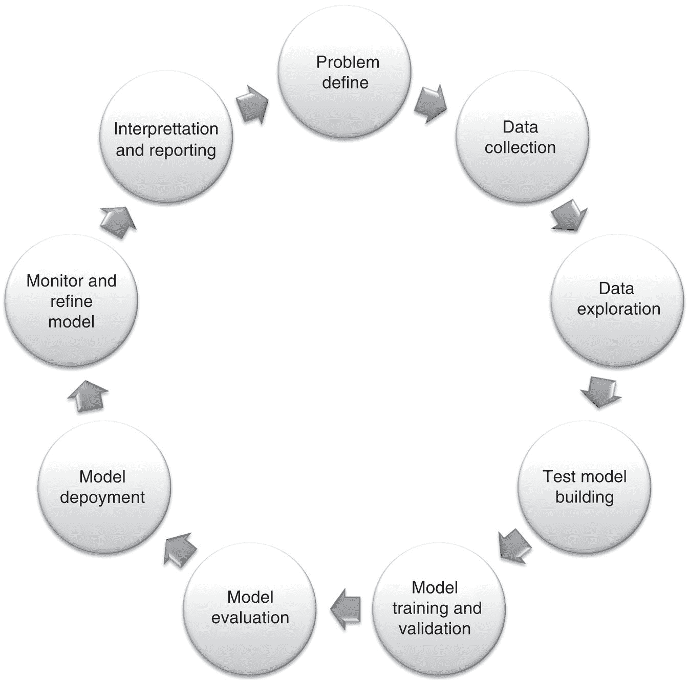

图 1.2 预测分析的生命周期。

### 1.6.3 数据探索与可视化

在此阶段，组织探索收集的数据，以对其特征、模式和关系建立全面的理解。通过描述性统计、数据分析和可视化技术，分析师可以发现隐藏的见解、识别趋势并检测异常。数据探索有助于特征选择，因为它允许分析师确定哪些变量与预测模型相关并应该包含在进一步的分析中。

### 1.6.4 模型开发

一旦数据准备就并被理解，组织就会进入模型开发阶段。这涉及选择适当的算法或技术来构建预测模型，以便根据预期结果生成准确的预测。模型的选择取决于问题的性质、可用数据以及所需的准确性水平。预测分析中常用的模型包括回归模型、决策树、神经网络和支持向量机。

### 1.6.5 模型训练与验证

选择好模型后，组织需要使用可用数据的子集（通常称为训练集）对其进行训练。在训练阶段，模型从数据中学习模式、关系和规则。训练完成后，需要对模型进行验证以评估其预测性能。这涉及使用另外另一个数据子集（验证集）来评估模型的准确性，并确保其不会对训练数据产生过拟合。使用交叉验证和留出验证等策略来评估模型的泛化能力。

### 1.6.6 模型评估与选择

在此阶段，组织根据预定义的评估指标评估不同模型的性能。常见的指标包括准确率、精确率、召回率、`F1` 分数以及受试者工作特征曲线（`ROC`）曲线下的面积。所选的评估指标取决于问题的性质，例如分类、回归或时间序列预测。评估过程有助于组织确定最适合其特定需求的部署模型。

### 1.6.7 模型部署与集成

一旦选定了优选模型，就会将其部署并集成到组织现有的系统或流程中。这可能涉及模型集成到软件应用程序、网站或自动决策系统中。模型应在生产环境中实现，以便其能够接收实时数据输入并提供预测或建议。监控部署模型的性能至关重要，以确保其随时间的推移保持准确和有效。

### 1.6.8 模型监控与维护

预测模型不是静态的实体；它们需要持续的监控和维护以确保其持续有效。组织需要持续跟踪模型性能，监控输入输出，评估其准确性，在需要时重新校准并在新数据可用时更新模型。监控有助于识别任何漂移或退化。

### 1.6.9 解释与报告

预测分析的最后阶段涉及解释模型结果并向利益相关者报告。这可能涉及创建可视化图、仪表板或报告，有效地传播预测及其影响。预测分析的生命周期是一种结构化方法，引导组织通过问题定义、数据收集与准备、模型开发、训练、评估和部署等阶段。每个阶段对于确保预测模型的准确性、有效性和效率都起着至关重要的作用。

## 1.7 预测分析模型

预测分析已成为一种变革性技术，使组织能够对未来事件做出准确的预测和判断。通过分析历史数据并应用各种统计和机器学习技术，预测分析有助于获取见解、识别趋势并做出明智决策。在本章中，我们将探索预测分析方法及其应用。

### 1.7.1 回归分析

回归分析是最广泛使用的预测分析方法之一。它涉及分析因变量与一个或自变量之间的关系。通过对历史数据拟合数学模型，回归分析允许组织根据自变量预测因变量的未来值。这种方法对于预测销售、需求和定价特别有用。

### 1.7.2 时间序列分析

时间序列分析专注于分析随时间定期收集的数据点。其目标是识别数据中的模式、趋势和季节性，并利用它们做出准确的未来预测。时间序列预测技术（如移动平均、指数平滑和自回归移动平均（`AR`）模型）有助于组织根据历史模式预测未来值。时间序列分析在金融、销售预测和需求规划中有广泛应用。

### 1.7.3 分类

分类是一种机器学习技术，涉及根据一组输入特征预测给定观测值的类别或种类。它使用具有已知分类的历史数据构建模型，并应用该模型来预测新的、未见数据的类标签。分类被应用于各种领域，如客户细分、欺诈检测和情感分析。流行的分类算法包括逻辑回归、决策树、支持向量机和随机森林。

### 1.7.4 聚类

聚类是预测分析中的一种技术，根据数据点之间的相似性或距离将相似的数据点分组。它有助于在没有预定义类标签的数据集中识别隐藏的模式和结构。聚类算法（包括 `k-means` 聚类和层次聚类）使组织能够在客户细分、市场研究和异常检测中发现价值的见解。

### 1.7.5 神经网络

神经网络是一种受人类大脑结构和功能启发的机器学习算法。它们由相互互连的人工神经元组成，通过从历史数据中学习来做出预测或决策。神经网络在处理数据中复杂的非线性关系时特别为强大。它们被应用于多个领域，如图像和语音识别、欺诈检测和预测性维护。图 1.3 概述了预测性分析模型和算法。

### 1.7.6 决策树

决策树是一种流行的预测性分析方法，能够以视觉化表示决策及其可能的后果。该方法涉及创建一个树状结构，其中每个内部节点代表一个基于某个属性的决策，每个叶子节点代表一个结果或类别标签。决策树易于解释和理解，适用于风险评估、客户流失预测以及医疗领域的诊断。

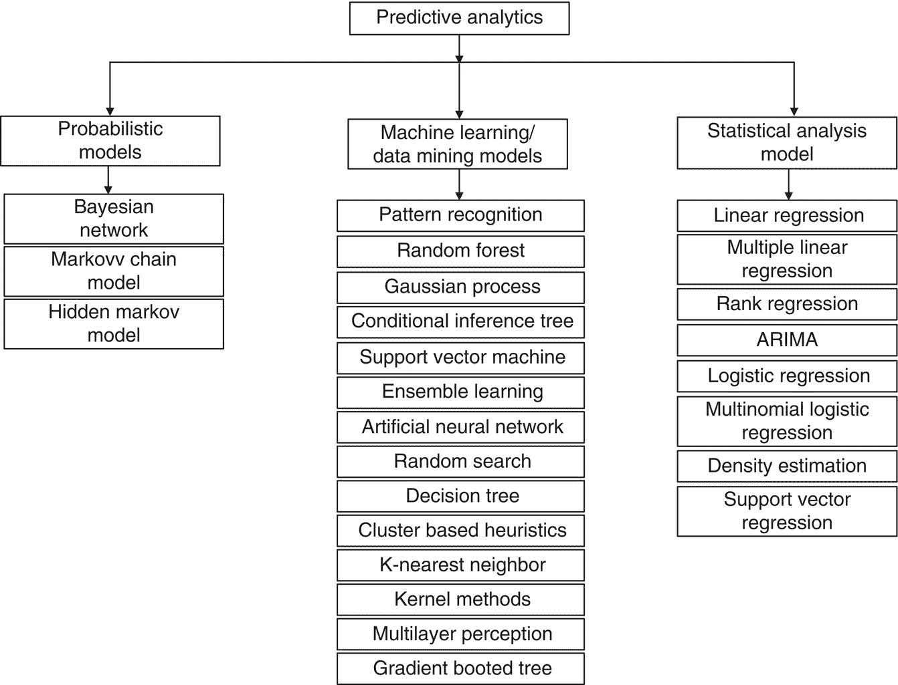

图 1.3 预测算法。

### 1.7.7 集成方法

集成方法通过结合多个独立模型的预测来创建更准确、更稳健的预测。袋法（`Bagging`）、提升（`Boosting`）和叠加（`Stacking`）是常用的集成技术。`Bagging` 使用自助聚合（bootstrap aggregation）生成多样化的模型，而 `Boosting` 侧重于迭代改进弱模型的性能。`Stacking` 使用元学习器（`meta-learner`）结合多个模型的预测。集成方法广泛应用于信用评分、股票市场预测和异常检测。

### 1.7.8 文本分析

文本分析，也称为文本挖掘或自然语言处理（`NLP`），关注从非结构化文本数据中提取意义和洞察。它涉及情感分析、主题建模和文本分类等技术，用于分析海量文本并做出预测或识别趋势。文本分析应用于社交媒体分析、客户反馈分析和市场研究。

### 1.7.9 异常检测

异常检测涉及识别偏离常态的异常或罕见事件、模式或数据点。它帮助组织检测欺诈、网络入侵、设备故障或任何其他意外行为。采用了多种统计技术，如 `Z`-score、分位数间距（`IQR`）和修正 `z`-scores。

### 1.7.10 协同过滤

协同过滤是推荐系统中常用的一种技术，根据相似用户或物品的偏好来预测用户的偏好或兴趣。它利用用户与物品交互的历史数据来提供个性化推荐。协同过滤广泛应用于电子商务、社交媒体和流媒体平台，为用户提供个性化建议并增强客户体验。

预测性分析方法通过让组织能够看到未来、预测趋势并做出明智的战略选择，彻底改变了各业的决策流程。从回归分析、时间序列预测到聚类、神经网络和集成方法，随着数据可用性的增加和日益复杂的算法的出现，预测性分析技术的范围不断扩大。通过利用预测性分析的力量，组织可以优化其运营、预测客户行为、降低风险，并在当今的数据驱动型环境中赢得竞争优势。

## 1.8 数据分析工具

在当今的数字时代，数据被视为新石油。组织淹没在来自各种来源的海量数据中。为了提取价值的洞察并获得竞争优势，他们转向了预测性分析——这是数据分析的一个分支，利用历史和实时数据来预测未来的趋势和结果。通过利用先进的统计模型和算法，预测性分析赋予了决策者做出明智选择、减轻风险和优化机会的能力。本节探讨了预测性分析工具的广泛用途及其对广泛应用的转型性影响。

### 1.8.1 RapidMiner

`RapidMiner` 是一种流行的开源数据分析工具，用于数据挖掘和预测性分析。它提供了一个具有拖放功能的用户友好型界面，使得具有不同技术专长的用户都能使用。`RapidMiner` 的一些关键特性包括：

1. **数据预处理**：`RapidMiner` 提供了广泛的数据预处理功能，如数据清洗、过滤和特征选择。
2. **可视化**：`RapidMiner` 提供了多种可视化工具来直观地探索数据，包括散点图、直方图、决策树等，帮助用户理解模式。
3. **机器学习算法**：`RapidMiner` 支持多种机器学习算法，如决策树、神经网络、聚类和关联规则挖掘。用户可以使用这些算法来构建预测模型。
4. **部署与集成**：`RapidMiner` 可以将模型部署到生产环境中。它提供了 `API` 和集成选项，与其他系统无缝集成。

`RapidMiner` 应用于医疗保健、金融、营销和制造业等行业，使组织能够从数据中获取可操作的洞察。

### 1.8.2 Konstanz 信息挖掘器 (KNIME)

`KNIME` 是一种开源数据分析平台，为构建数据工作流提供了一个图形化界面。它提供了广泛的数据挖掘和机器学习功能。`KNIME` 的一些显著特性包括：

1. **拖放界面**：`KNIME` 直观的界面允许用户通过拖动和释放节点来创建数据工作流。每个节点代表特定的操作或分析，使得无需编写代码即可设计复杂的数据工作流。
2. **丰富的节点选择**：`KNIME` 提供了一个庞大的预构建节点库，涵盖数据清洗、数据转换、特征选择和模型构建等任务。用户可以组合这些节点来创建自定义的数据挖掘工作流。
3. **集成分析**：`KNIME` 与 `R` 和 `Python` 等流行的分析工具无缝集成。这允许用户在 `KNIME` 环境中利用他们偏好的编程语言和库。
4. **协作与共享**：`KNIME` 通过允许共享工作流、分析和模型，实现了团队成员之间的协作。这促进了知识共享并提高了效率。

`KNIME` 应用于多个领域，包括金融、生命科学、零售和制造业。

### 1.8.3 统计分析系统 (SAS)

`SAS` 是一种全面且广泛使用的分析平台，为数据挖掘和预测性分析提供系列工具。`SAS` 提供了丰富的特性和功能，适用于复杂的分析任务。`SAS` 的关键特性包括：

1. **数据管理**：`SAS` 提供了数据管理能力，包括数据集成、数据清洗和数据转换。它允许用户为分析准备大型数据集，并有效处理处理缺失值和离群值。
2. **统计分析**：`SAS` 提供了广泛的统计程序，用于探索性数据分析、假设检验和回归分析。用户可以应用这些程序从数据中提取有意义的洞察。


### 3. 机器学习与预测建模

SAS 提供了一套全面的机器学习算法，用于构建预测模型。这些算法包括决策树、神经网络、支持向量机等。

### 4. 可视化分析

SAS 提供了交互式且视觉吸引力强的可视化分析工具用于探索性数据分析。用户可以创建引人注目的可视化效果、仪表板和报告，以有效地传播洞察。

SAS 广泛应用于金融、医疗和政府等行业，在这些行业中，复杂的分析和数据挖掘对于决策至关重要。

### 1.8.4 结合 Scikit‐learn 的 Python

Python 作为一种流行的编程语言，结合 `Scikit‐learn` 库，为数据挖掘和预测分析提供了强大且灵活的环境。`Python` 和 `Scikit‐learn` 提供以下功能：

1. **广泛的数据挖掘和机器学习库：** `Python` 的 `Scikit‐learn` 库提供了用于分类、回归、聚类和降维的广泛算法。包括决策树、支持向量机、随机森林等。

2. **与其他库的集成：** `Python` 与 `NumPy`、`pandas` 和 `Matplotlib` 等库无缝集成，提供了完整的数据分析生态系统。这些库允许高效的数据处理、数据可视化和数据预处理。

3. **灵活性与定制性：** `Python` 为用户自定义其数据挖掘和预测分析工作流提供了灵活性。它允许用户定制分析和模型以满足特定需求并解决独特的挑战。

4. **活跃的开源社区：** `Python` 拥有活力且活跃的社区，不断为数据挖掘和预测分析开发新的包和工具。这确保了 `Python` 处于数据分析工具的前沿。

结合 `Scikit‐learn` 的 `Python` 广泛应用于金融、医疗、电子商务和网络安全等行业。

### 1.8.5 R 语言编程

`R` 语言是数据分析领域广泛使用的编程语言。它们提供了许多专门为数据挖掘设计的库和包，如 `Scikit‐learn`、`TensorFlow`、`Keras`、`Pandas`、`NumPy` 和 `SciPy`。这些库提供了广泛的数据挖掘算法，允许用户高效地预处理、分析和可视化数据。

### 1.8.6 威卡卡托知识分析环境 (Weka)

`Weka` 是一种用 `Java` 开发的热门开源数据挖掘工具。它提供了全面的机器学习算法和工具，用于数据预处理、分类、回归、聚类、关联规则挖掘和可视化。`Weka` 还具有用户友好的界面，并支持与其他编程语言集成。

### 1.8.7 Tableau

`Tableau` 是一种广泛使用的数据可视化工具，使用户能够以交互和直观的方式分析和可视化数据。它允许用户创建具有视觉吸引力的仪表板、图表和图形，提供了一个强大的平台，用于探索数据挖掘结果并有效地向利益相关者展示发现的结论。

### 1.8.8 Microsoft Power BI

`Microsoft Power BI` 是一种商业智能工具，能够连接到多个数据源，转换和清洗数据，并创建交互式可视化和报告。它提供了强大的数据分析能力，包括数据挖掘算法、时间序列分析、预测和 `NLP`。

## 1.9 预测分析技术的优势

预测分析彻底了组织处理客户行为分析的方法，允许他们对客户进行预测性细分并提供个性化产品。本节探讨了预测分析如何应用于各种细分、流失预测、需求预测和推荐系统，帮助组织优化营销策略等。

1. **增强决策：** 数据分析技术使组织能够根据证据和洞察做出数据驱动的决策，而不是直觉。高级建模和分析技术提供了准确的预测，降低了风险并识别了机会。

2. **提高运营效率：** 数据分析技术优化了资源配置，简化了流程并提高了效率。预测分析帮助组织避免缺货或积压，而规范性分析则建议了最佳生产计划和资源配置。

3. **个性化客户体验：** 系统和细分析技术允许组织个性化客户体验。通过理解客户偏好和行为模式，组织可以提供针对性的推荐、定制的营销活动和个性化的产品。

4. **欺诈检测与风险缓解：** 数据分析技术（包括异常检测和网络分析）有助于识别欺诈活动并降低风险。组织可以主动检测异常、调查可疑活动并防止财务损失和安全漏洞。

5. **创新与竞争优势：** 数据分析技术通过发现新兴的市场趋势、客户偏好和隐藏模式为创新开辟了道路。组织可以通过利用这些洞察开发创新的产品、服务和业务策略来获得竞争优势。

## 1.10 预测分析模型的应用

组织正以前所未有的速度产生大量数据。挑战在于利用这些数据并将其转化为价值的洞察。这就是数据分析发挥作用的地方。数据分析是检查、清洗、转换和建模数据以发现有用信息、得出结论并支持决策的实践。在本章中，我们将探索数据分析在各个部门和行业的众多应用。

### 1.10.1 商业智能

数据分析在商业智能中起着至关重要的作用，为组织提供了性能、客户行为和市场趋势的可视化。通过分析客户偏好，组织可以获得消费者行为模式的洞察，从而实现针对性的营销和产品开发策略。数据分析还帮助企业识别销售趋势、优化定价策略并预测需求，促进更好的决策并增加盈利。

### 1.10.2 医疗保健

数据分析彻底改变了医疗行业，实现了更好的患者护理、医学研究以及疾病模式的识别。分析患者数据允许医疗提供者识别趋势和风险因素，实现早期干预和疾病预防。通过利用数据分析，医学研究人员可以从大数据集中提取洞察，推动治疗方案、药物发现和临床结果的改进。

### 1.10.3 金融

数据分析改变了金融行业，使组织能够做出数据驱动决策并更有效地管理风险。通过分析历史金融数据，组织可以识别趋势、模式和异常，实现欺诈检测、风险管理和投资决策。实时数据分析还允许金融机构监控交易、检测可疑活动并及时响应市场变化。

### 1.10.4 供应链管理

数据分析通过改进库存管理、物流和需求预测，在优化供应链管理方面发挥着至关重要的作用。通过分析历史购买数据，组织可以预测未来需求、优化库存水平并增强采购流程。数据分析还使组织能够跟踪和监控供应商性能、识别瓶颈并提高整体运营效率。

### 1.10.5 制造业

数据分析正通过促进预测性维护、质量控制和流程优化来改变制造业。通过分析来自机械设备的实时传感器数据，组织可以预测并防止设备故障，减少停机时间和维护成本。数据分析还使组织能够实时识别质量问题，减少产品缺陷并提高客户满意度。此外，数据分析帮助制造商优化生产流程、最大限度地减少浪费并实现整体生产率化。

### 1.10.6 营销与广告

数据分析改变了营销和广告的面貌，允许组织更有效地定位目标受众并衡量营销活动的成功。通过分析客户数据，组织可以识别目标受众的人口统计特征、偏好和购买行为，从而实现个性化的营销活动。数据分析还为营销人员提供了有关各种营销渠道有效性的宝贵见解，并帮助更高效地分配广告预算。

### 1.10.7 智慧城市

数据分析在智慧城市的发展中起着关键作用，能够改善城市规划、资源管理和市民服务。通过分析来自传感器、卫星和社交媒体的数据，政府部门可以收集有关交通模式、空气质量、能源消耗和公共服务的宝贵见解。这种数据驱动的方法允许当局优化资源配置、减少拥堵并提高市民的生活质量。

数据分析的应用广泛且发展迅速，正在改变各行业并使组织能够做出数据驱动的决策。从商业智能、医疗到金融、供应链管理、制造业、营销和智慧城市，数据分析已成为组织寻求竞争优势不可或缺的工具。随着数据的持续指数级增长，数据分析在提取价值见解方面的重要性将不断增加。

## 1.11 结论

由于能够从海量数据中提取价值见解，数据挖掘已成为各个行业和领域不可或缺的工具。数据分析模型已成为数据挖掘任务的核心，使组织能够从大型且复杂的数据集中提取价值的见解。这些工具提供了包括数据预处理、分析、可视化和建模在内的广泛功能。用于预测性分析的数据挖掘是一项强大的工具，使企业和组织能够从海量数据中提取价值见解。通过实施系统化的数据挖掘流程，组织可以利用历史数据构建预测模型，辅助各行业的战略决策制定。利用数据挖掘技术具有许多益处，例如改进决策、获得竞争优势以及识别隐藏模式。然而，也面临着需要克服的挑战，包括数据可用性、扩展性和隐私问题。随着企业继续生成和收集海量数据，数据挖掘与预测性分析的整合对于获得竞争优势和推动创新将变得越来越至关重要。用于数据挖掘的数据分析工具在从大型数据集中提取价值见解方面发挥着重要作用。这些工具使各行业的组织能够利用数据驱动的见解，优化决策过程，并在当今数据为中心的世界中获得竞争优势。数据分析工具的未来对于改进决策、提高效率以及使组织利用数据力量获得竞争优势充满前景。

## 参考文献

1. **1** Gupta, M.K. and Chandra, P. (2020). 数据挖掘综合综述。*International Journal of Information Technology* 12 (4): 1243–1257.

2. **2** Yan, H., Yang, N., Peng, Y., and Ren, Y. (2020). 建筑行业的数据挖掘：现状、机遇与未来趋势。*Automation in Construction* 119: 103331.

3. **3** Arumugam, K., Naved, M., Shinde, P.P. et al. (2023). 使用机器学习算法进行多种疾病预测。*Materials Today: Proceedings* 80: 3682–3685.

4. **4** Johnson, M., Albizri, A., Harfouche, A., and Fosso‐Wamba, S. (2022). 将人类知识整合到人工智能以解决复杂和模糊的问题：知情人工智能。*International Journal of Information Management* 64: 102479.

5. **5** Sharmin, S., Ahammad, T., Talukder, M.A., and Ghose, P. (2023). 用于乳腺癌检测的混合可靠深度特征提取和基于集合的机器学习方法。*IEEE Access* 11: 87694–87708.

6. **6** Fan, C., Chen, M., Wang, X. et al. (2021). 针对从建筑运营数据中高效可靠知识发现的数据预处理技术综述。*Frontiers in Energy Research* 9: [`doi.org/10.3389/fenrg.2021.652801`](https://doi.org/10.3389/fenrg.2021.652801).

7. **7** Kumar, P., Tveritnev, A., Jan, S.A., and Iqbal, R. (2023). 挑战中的机遇：从非结构化数据管理中获取价值。*SPE Gas & Oil Technology Showcase and Conference*, Dubai, UAE (2023 年 3 月 14 日)。

8. **8** Niu, Y., Ying, L., Yang, J. et al. (2021). 使用大数据分析的组织商业智能和决策。*Information Processing & Management* 58 (6): 10275.

9. **9** Adnan, K., Akbar, R., and Ali, B. (2020). 数据挑战的角色。在*Data Management, Analytics and Innovation*, 第 1042 卷 (编：N. Sharma, A. Chakrabarti, and V. Balas), 301–323. Springer. https://doi.org/10.1007/978-3-0199222

10. **10**1, X., Ding, Y., Tang, H., and (2021). 基于手机传感器数据的建筑用电模式识别和异常检测框架。*Energy and Buildings* 231: 110601.

11. **11** Phillips‐Wren, G., Daly, M., and Burstein, F. (2021). 协调商业智能、分析与支持系统：更多数据，更深见解。*Decision Support Systems* 146: 113560.

12. **12** Dogan, A. and Birant, D. (2021). 制造业中的机器学习和数据挖掘。*Expert Systems with Applications* 166: 114060.

13. **13** Bharadiya, J.P. (2023). 机器学习在转型商业智能方面的作用。*International Journal of Computing and Artificial Intelligence* 4 (1): 16–24.

14. **14** Thakkar, A. and Lohiya, R. (2023). 用于神经网络入侵检测系统的统计重要性融合特征选择。*Information Fusion* 90: 353–363.

15. **15** Siddiqui, M.K., MoralesいくMenendez, R., Huang, X., and Hussain, N. (2020). 使用机器学习分类器进行癫痫发作检测的综述。*Brain Informatics* 7 (1): 1–8.

16. **16** Ahmed, N., Rafiq, J.I., and Islam, M.R. (2020). 基于手机传感器数据的混合特征选择模型的增强人体活动识别。*Sensors* 20 (1): 317.

17. `17` Tunyasuvunakool, K., Adler, J., Wu, Z. et al. (2021). 人类蛋白质组的高精度蛋白质结构预测。*Nature* 596 (7873): 590–596.

18. `18` Shillan, D., Sterne, J.A.C., Champneys, A., and Gibbison, B. (2019). 使用机器学习分析常规收集的重症监护室数据：系统性回顾。*Critical Care* 23 (1): 1–11.

19. `19` Shi, X., Prins, C., Van Pottelbergh, G. et al. (2021). 结合临床知识的电子健康记录自动数据清洗方法*BMC Medical Informatics and Decision Making* 21 (1): 1–10.

20. `20` Faiz, T. (2019). 中型企业数据清洗的多种方法。*2019 年国际数字化会议 (ICD)*, 阿联酋沙界（2019 年 11 月 18–19 日），页码 75–86.

21. `21` Bayoudh, K., Knani, R., Hamdaoui, F., and Mtibaa, A. (2021). 计算机视觉深度多模态学习综：进展、趋势、应用和数据集。*The Visual Computer* 38 (8): 2939–2970.

22. `22` Mavrogiorgou, A., Kiourtis, A., Perakis, K. et al. (2019). 分析数据和数据源以确保医疗 4.0 中端到端数据和数据源质量的统一方法*Computer Methods and Programs in Biomedicine* 181: 104967.

23. `23` Clarke, D.J., Jeon, M., Stein, D.J. et al. (2021). Appyters：将 Jupyter 笔记本转换为数据驱动的 Web 应用程序。*Patterns* 2 (3): 100213.

24. `24` Alsalman, Y.S., Halemah, N.K. A., AlNagi, E.S., and Salameh, W. (2019). 使用决策树和人工神经网络预测学生的学术表现。*2019 年第 10 届信息与通信系统国际会议 (ICICS)*, 约约旦（2019 年 6 月 11–13 日），页码 104–109.

25. `25` Arcinas, M.M., Sajja, G.S., Asif, S. et al. (2021). 数据挖掘在教育中的作用：通过社会变革提高学生表现*土耳其物理治疗与康复期刊* 32 (3): 6519–6526.

26. `26` Ramesh, T.R., Lilhore, U.K., Poongodi, M. et al. (2022). 基于机器学习的心脏疾病预测分析。

27. `27` Yang, K., Wu, C., and Yang, Y. (2019). 人类蛋白质组的高精度蛋白质结构预测。*Nature* 596 (7873): 590–596.

28. `28` Rakesh, N., Rajaramesh, C., and Umashankar, G. (2023). 基于机器学习的心脏疾病预测分析。

29. `29` Li, C., Chen, Y., and Shang, Y. (2022). 中型企业数据清洗的多种方法。

30. `30` Sun, P., Chowdhary, R., and Chattopadhyay, M. (2022). 计算机视觉深度多模态学习综：进展、趋势、应用和数据集。

31. `31` Antons, D., Grünwald, E., and Cich, P. (2020). 分析数据和数据源以确保医疗 4.0 中数据质量的统一方法。

32. `32` Dai, H.N., Wong, R., and Wang, H. (2019). 结合临床知识的电子健康记录自动数据清洗方法。

33. `33` Diez‐Olivan, A., Galar, J., and Sierra, B. (2019). 使用决策树和人工神经网络预测学生的学术表现。

34. `34` Lepenioti, K., Bousdekis, A., Apostolou, D. (2020). 数据挖掘在教育中的作用：通过社会变革提高学生表现。

35. `35` Mentzas, G. (2021). Appyters：将 Jupyter 笔记本转换为数据驱动的 Web 应用程序。

---

# 构建预测模型的 2 个挑战

Rakesh Nayak¹, Ch. Rajaramesh², 和 Umashankar, G.

¹

¹ OP Jindal 大学, Raigarh, CSE 系系


² Vignan 技术与学院, 特伦甘纳, CSE 系系

## 2.1 引言

预测建模是利用数据构建一个可以预测未来结果模型的过程。它是数据分析、机器学习和人工智能（AI）的一个重要方面。对于企业和组织来说，这是一项价值巨大的工具，因为它可以帮助他们做出更好的决策并提高性能。它涉及统计模型和算法来分析数据、识别模式并对未来进行预测。预测模型应用于多个行业，包括医疗保健、金融、营销、交通等。然而，构建预测模型可能是一项挑战性任务。许多因素会影响预测模型的准确性和性能。这些因素包括数据质量、模型选择以及训练评估模型的方式。本章讨论了构建预测模型的一些挑战。它还将提供克服这些挑战并构建准确可靠模型的建议。

数据获取是从各种来源收集和采集数据的过程。它是预测建模过程的一个重要组成部分，因为数据质量将直接影响准确性。获取构建预测模型所需的数据可能是挑战性的。数据可能分散在不同的来源、不完整或不准确，或者格式不易使用。

预测模型的成功在很大程度上取决于训练算法的数据可用性、质量、数量、格式、访问、兼容性、一致性和多样性。数据获取是预测建模过程中的关键步骤，因为它允许我们从多个源收集数据，进行清洗和转换以实现可靠准确的预测。然而，由于存在许多访问数据的仪表板、数据库和 `APIs`，数据获取并非没有挑战。本章旨在强调构建预测模型数据获取的一些重大挑战。

### 2.1.1 不同的预测模型

Yang 等人 [[2]](#c02.xhtml#c2-bib-0002) 总结了用于各种软件工程活动的 148 种预测建模策略，以便人们更好地了解预测模型。[[2]](#c02.xhtml#c2-bib-0002) 中的表 8 显示了 2009‐2020 年间各类预测模型及相关研究出现的次数。可以看出，有 27 项研究使用了基于规则的预测建模技术，其中 `JRip` 和 `RIPPER` 是最常用的基于规则的模型。统计模型根据其功能分为四类，其中降维技术（例如线性判别分析 `LDA`）被应用最广泛，其次是状态模型。自然语言处理（`NLP`）族包括专门用于处理人类语言的模型。在我们的主要研究中，只有三篇文章使用了相关方法作为预测模型。在所有学习器中（跨越了 7 个不同的族），机器学习模型是最常用的预测模型，有 100 多项研究使用 `logistic regression`、`Naive Bayes` 和支持向量机（`SVM`）模型来解决软件工程问题。回归族包含 25 种不同的回归算法，其次是基于机器学习（`ML`）的 `SVM` 和决策树族预测建模方法。`SVM` 族和决策树族各有 12 种不同的算法。

除了上述标准的机器学习技术外，研究还经常采用基于实例的算法，如 `k‐nearest neighborhood`（`kNN`）及其变体。此外，机器学习高度依赖聚类方法和排序学习（`LTR`）族。[[2]](#c02.xhtml#c2-bib-0002) 中的表 8（见附录）显示，在 `DL` 出现后的几年，机器学习被广泛使用，这表明尽管这些学习器引入得较晚，但它们在解决适当问题方面仍然有效。

许多研究使用了集成算法来解决软件工程（`SE`）问题；广泛而言，这些可以分为三类：`random Forest`、`bagging` 和 `boosting`。超过 65% 的研究倾向于使用 `Random Forest` 作为预测模型，而非 `bagging` 和 `boosting`。有五十四篇论文在实验中使用 `Boosting` 方法，其中 `AdaBoost` 和 `XGBoost` 是最常用的预测建模策略。二十三项关于 `SE` 的研究使用了 `bagging` 集成方法。大多数使用深度学习作为预测模型的研究是在 2018 年到 2020 年之间进行的，这与 `DL` 技术的兴起相吻。这表明在近年来，将深度学习应用于软件工程的兴趣日益高涨。[[2]](#c02.xhtml#c2-bib-0002) 中的表 8 显示，有 113 项研究使用了深度学习技术（深度神经网络 `DNN` 族）来解决软件工程难题。由于有 24 项研究采用了它，`CNN` 是最广泛使用的深度学习模型。神经网络（`ANN`）和长短期记忆网络（`LSTM`）紧随其后。在所考虑的论文中，只有五篇使用了深度置信网络（`DBNs`）。`Perceptron` 模型在 32 项研究中被应用，主要以 `multi‐layer perceptron` 的形式存在。

### 2.1.2 与数据获取相关的挑战

预测建模的数据获取面临着若干挑战，包括 [[3]](#c02.xhtml#c2-bib-0003)：

*   **数据可用性：** 数据获取始于数据发现，即识别可能与考虑的预测相关的源。数据获取的重大挑战之一是特定源数据的可用性。某些数据库可能受限并需要行政批准，而另一些可能由于法律或隐私限制而无法访问。数据的可用性还会影响数据的多样性，这对于构建稳健的预测模型至关重要。数据多样性的缺乏可能导致模型做出不准确的预测。

*   **数据质量：** 构建预测模型最大的挑战之一是数据质量。换句话说，数据质量或数据的可信任程度仍然数据获取中的一个重大挑战。数据的质量影响预测模型的准确性和可靠性。从各种来源获得的数据可能包含缺失数据、不完整数据、重复数据和不一致的数据。糟糕的数据质量会导致产生噪声或偏差模型，使其缺乏准确预测的能力。`Missing data` 可能会偏偏模型预测，而 `duplicate data` 可能导致过拟合。为了克服数据质量挑战，我们应该确保拥有清洁且完整的数据。我们可以使用数据清洗技术，如 `imputation`、`duplication removal` 和 `outlier removal` 来提高数据质量。此外，我们可以使用数据质量指标，如 `completeness`、`accuracy`、`consistency` 和 `timeliness` 来评估数据质量。收集足够数量的完整且一致的数据可以增加构建可靠预测模型的可能性。

*   **数据量：** 训练预测模型所需的数据量可能需要在数据获取上投入大量精力。构建准确模型所需的数据量可能非常大。大型数据集还需要大量的存储、处理能力和网络带宽。因此，投资于能够处理大数据的要求的的数据获取解决方案至关重要。

*   **数据格式：** 数据必须是预测建模算法可以使用的格式。这可能需要将数据转换为不同的格式，这可能是一个耗时且具有挑战性的任务。数据获取的主要挑战之一是处理多样化的数据格式。当从不同源收集数据时，每个数据集具有其独特的结构、命名规范、日期格式等是常见现象。数据格式的多样性使得清洗和整合数据变得极具挑战性且耗时。此外，当我们训练预测模型时，确保输入数据格式正确并正确执行任何必要的转换至关重要。未能解决数据格式问题可能会导致预测不准确、模型性能不佳或不可靠的洞察。因此，建立稳健的数据获取策略并包含清洗和预处理步骤以解决数据获取过程中与数据格式相关的挑战至关重要。

*   **数据访问：** 数据可能位于各种源中，例如数据库、文件和传感器。这使得访问和收集数据变得困难。数据获取的主要挑战之一是数据访问，特别是在处理敏感或专有数据时。某些数据源的访问受限或需要权限，这会减慢收集并整合到预测模型中的过程。此外，不同的数据源可能需要不同的访问方法或 `APIs`，这可能为从多个源收集数据的团队带来额外挑战。此外，某些数据源对访问的数据量有限制，或对进行数据的分析类型实施限制。因此，建立合适的数据访问协议并确保获得所有必要的许可和允许，对于解决数据获取过程中的访问挑战至关重要。

*   **数据兼容性：** 从多个源获取的数据可能与预测建模工具偏好的格式不兼容。需要对数据源的处理要求、文件格式和数据结构进行协调，以便将其集成到预测建模解决方案中。这是一个可能耗时的过程，需要数据采集专业人员投入大量精力。

*   **数据一致性：** 从各种来源获取的数据可能有不同程度的一致性，使得将其合并为单个数据集具有挑战性。不一致通常会导致模型错误，从而导致预测结果不佳。必须进行数据分析以识别这些不一致之处，包括格式问题、无效字符和重复记录。

*   **数据多样性：** 数据采集过程中数据多样性的主要挑战之一是寻找多样化的数据源。根据行业或应用领域，寻找准确代表结果变量（被预测的变量）的多样化数据可能非常困难。例如，想象构建一个使用历史销售数据预测未来销售的预测模型。如果销售数据仅来自一个地理位置，该模型可能无法很好地推广到其他地区。

*   **数据清洗与准备：** 获取数据后，我们需要对其进行清洗并为分析做好准备。这可能涉及删除错误、纠正不一致以及将数据转换为模型可以使用的格式。数据清洗和准备是构建预测模型过程中的关键步骤。用于训练模型的数据质量直接影响模型的准确性。构建预测模型过程中数据清洗和准备的挑战可能来自多种来源。主要挑战包括处理数据输入错误、数据缺失或不完整、识别并处理异常值、解决数据质量和一致性问题以及管理数据不平衡。此外，确保数据格式正确并正确执行任何必要的转换可能具有挑战性，决定模型中包含或排除哪些特征也具有挑战性。此外，选择合适的建模技术和进行适当的模型验证也会给数据清洗和准备带来挑战。因此，建立一个稳健的数据清洗和准备框架至关重要，该框架应包含良好的数据验证和质量控制实践，并选择合适的特征、建模技术和验证指标，以确保预测模型运行良好并提供可靠的见解 [[4]](#c02.xhtml#c2-bib-0004)。

*   **数据输入错误：** 数据输入错误是数据质量最常见的问题之一。当数据手动输入系统或从一个系统传输到另一个系统时，就会发生这些错误。

*   **缺失数据：** 缺失数据也会成为预测建模的问题。当当数据集中的所有记录都未收集数据，或者数据丢失或损坏时，就会出现这种情况。缺失或不完整的数据可能由多种原因引起，如数据输入错误、调查不完整或参与者退出研究。处理缺失数据需要根据分析目标和缺失数据量选择合适的插补方法或选择具有完整数据的样本。

*   **异常值：** 异常值与其余数据有显著不同的数据点。异常值会偏曲预测模型的结果，因此识别并处理它们至关重要。识别异常值需要视觉检查和统计测试（例如箱线图、散点图或 `z`‐scores），而处理它们可能涉及删除它们、转换它们或创建一个新类别。

*   **数据不平衡：** 当数据集倾向于某一类别或结果时，就会出现数据不平衡，使得训练预测模型变得困难。处理数据不平衡需要选择合适的采样方法，如过采样、欠采样或合成少数类过采样（`SMOTE`），或者对不同的类使用不同的技术。

*   **不一致数据：** 不一致的数据也会成为预测建模的问题。当相同的数据以不同的方式存储，或者不同的人以不同的方式输入相同的数据时，就会发生这种情况。

*   **数据偏偏：** 当数据不能代表你试图建模的人群时，就会发生数据偏偏。这可能导致预测不准确。除了数据清洗，数据准备还涉及选择和转换用于训练模型的变量。关于模型中包含或排除哪些特征的决策可能具有挑战性，需要领域知识、直觉和经验测试。特征选择涉及识别预测感兴趣结果的最相关且信息丰富的变量，并减少变量数量以提高模型性能并减少过拟合。最后，选择合适的建模技术和进行适当的模型验证也会给数据清洗和准备带来挑战。建模方法的选择取决于分析目标、数据特征以及可用的资源和知识。

本章包含四个部分，Section 2.1 描述了预测模型及其方法。Section 2.2 描述了预测模型的文献综述。Section 2.3 描述了应对所有挑战问题的克服技术，Section 2.4 描述了结论。

## 2.2 文献综述

特征工程是将原始数据转换为可用于构建预测模型的特征的过程。它是从数据选择、转换和提取有用特征的过程，以提高模型的准确性并最小化减少过拟合。特征工程可能是一项艰巨的任务，因为它涉及识别影响结果变量的相关变量。此外，特征工程需要领域知识、耗时、直觉和经验测试来识别信息丰富的特征，在复杂数据集中具有挑战性。为了克服特征工程的挑战，我们应该利用领域知识来识别相关特征。我们还应该使用数据可视化技术来识别引导特征选择的相关性和模式。此外，他们可以使用自动化特征选择算法，如主成分分析 (`PCA`) 和 `LDA` [[5]](#c02.xhtml#c2-bib-0005)。

### 2.2.1 特征选择的挑战

这是为模型选择正确特征的过程。特征选择有多种方法，每种方法都有自己的优缺点。常见的特征选择方法包括：

*   **过滤方法：** 过滤方法根据特征的统计属性（例如与目标变量的相关性或方差）来选择特征。
*   **包装方法：** 包装方法通过在不同的特征子集上迭代构建和评估模型来选择特征。
*   **嵌入方法：** 嵌入方法在模型构建过程中选择特征。

### 特征创建

这是从现有特征创建新特征的过程。创建新特征有多种方法，例如聚合、转换和离散化。一些最常见的特征创建方法包括：

*   **聚合：** 聚合是将多个特征合并为一个单个特征的过程。例如，你可以将多个销售数据点聚合为一个单一的月销售额。
*   **转换：** 转换是改变特征尺度或分布的过程。例如，你可以将一个特征归一化，使其均值为 0，标准差为 1。
*   **离散化：** 离散化是将连续特征转换为分类特征的过程。例如，你可以将连续年龄特征离散化为年龄段，如 <18、18–25、25–35。

### 针对不同模型的特征工程

相同的特征对于不同模型可能重要性并不相等。例如，线性回归模型可能对连续特征更敏感，而决策树模型可能对分类特征更敏感。因此，针对将使用的模型专门进行特征工程至关重要。

特征工程的主要挑战之一是从可用数据中选择相关特征。特征选择涉及识别能够预测感兴趣结果的最相关且信息量丰富的变量，并丢弃无关或冗余的变量。特征选择的过程可能具有挑战性，因为它需要评估每个特征的重要性、多重共线性程度（变量之间的相关性）以及数据集中噪声或无关信息的水平。特征工程的另一个挑战是特征的转换以提高其预测能力。特征转换涉及将数据转换为更有用的形式，如分布归一化、缩放和降维。分布归一化涉及将数据转换以遵循正态分布，这对于某些假设正态性的机器学习算法非常重要。缩放涉及标准化变量范围，以确保它们在模型中是可比的并具有相同的权重。降维涉及减少模型中使用的特征数量，以提高其性能并减少过拟合。处理缺失数据是特征工程的另一个挑战。缺失数据可能由于数据输入错误、调查调查不完整或参与者退出研究而产生。处理缺失数据需要根据分析目标和缺失数量选择合适的插补方法，例如均值插补、回归插补或多重插补。处理离群值是特征工程的另一个挑战。离群值是指与其余数据不符的观测值，可能会扭曲分析结果。识别离群值需要视觉检查和统计测试，例如箱线图、散点图或 `z`-scores，处理它们可能涉及删除、转换或创建一个新类别 [[6]](#c02.xhtml#c2-bib-0006)。最后，选择合适的建模技术和进行适当的模型验证也是特征工程中面临的挑战。建模方法的选择取决于分析目标、数据特征以及可用的资源和专业知识。使用适当的模型验证技术（如交叉验证）有助于确保模型是可靠且具有泛化性的。

### 2.2.2 模型选择中的挑战

有各种模型，包括线性回归、决策树、随机森林和神经网络。每个模型都有其优缺点。因此，选择合适的模型对于准确预测至关重要。模型的性能取决于许多许多因素，如模型复杂度、模型偏差、模型方差、数据可用性和计算资源 [[7]](#c02.xhtml#c2-bib-0007)。

*   **模型复杂度：** 市上有许多种不同的模型可用，从简单的线性模型到复杂的神经网络。模型越复杂，训练所需的数据越多，过拟合数据的概率就越大。
*   **模型偏差：** 当模型无法捕捉特征与目标变量之间的真实关系时，就会发生模型偏差。这由几个因素引起，例如数据缺失、数据中的噪声或模型选择不当。
*   **模型方差：** 当模型的预测在一个数据样本和另一个样本之间差异巨大时，就会发生模型方差。这由许多因素引起，例如样本量小、数据中的噪声或模型选择不当。
*   **数据可用性：** 可用数据量会影响模型选择过程。通常，数据越多越好，因为它允许模型学习特征与目标变量之间的真实关系。然而，收集和存储大量数据可能是昂贵且耗时的。
*   **计算资源：** 训练和评估模型所需的计算资源可能差异巨大。例如，训练大型神经网络可能需要强大的计算机和大量的时间。

为了克服模型选择的挑战，数据科学家应该理解他们想要解决的业务问题和数据特征。他们还应该使用均方根误差 (`RMSE`)、准确率、精度、召回率和 F1 分等指标来评估模型的性能。此外，他们还可以使用交叉验证和集成方法等模型选择技术来提高模型性能 [[8]](#c02.xhtml#c2-bib-0008)。

### 2.2.3 训练和评估模型中的挑战

一旦选定了模型，你需要在你的数据上对其进行训练。这涉及将数据输入模型并允许它学习特征与目标变量之间的关系。模型一旦训练完成，你需要在留出数据集上评估其性能。构建准确的预测模型是金融、医疗保健、营销和工程等各个领域的一项关键任务。这些模型用于识别模式、预测未来趋势和做出明智决策。然而，由于数据质量、特征工程、算法选择、训练和评估等各种因素，构建预测模型充满了挑战 [[9]](#c02.xhtml#c2-bib-0009)。

训练模型的主要挑战之一是数据的可用性和质量。不准确或不完整的数据会影响模型的性能，导致偏差或错误的预测。此外，数据中可能包含离群值、缺失值或噪声特征，这些都会影响训练过程。数据清洗、预处理和特征工程是确保用于训练模型的数据质量和相关性的必要步骤。训练模型的另一个挑战是选择合适的模型，例如学习率、正则化或批量大小。这些超参数控制模型在训练期间的行为，并会影响其性能。调优超参数需要实验和评估的迭代过程。然而，超参数的数量及其可能的组合可能会让人应接 overwhelming，使得寻找最佳设置的过程既耗时又挑战性 [[10]](#c02.xhtml#c2-bib-0010)。


模型的性能很大程度上取决于训练数据集的大小和质量。较小的数据可能无法提供足够的信息来捕捉问题的复杂性，并导致过拟合，即模型记住了训练数据而无法泛化到新数据。相比之下，大型数据集可能需要大量的计算资源才能进行有效训练，这使得扩展训练过程变得具有挑战性。此外，数据的规模和分布会影响不同算法的性能，并需要不同的训练策略。评估模型的性能是构建预测模型的另一项重大挑战。仅仅测量准确率或错误率可能无法提供关于模型行为的足够洞察，并且可能泛化到新数据。一个健壮的评估过程应该包含多种指标，例如精确率、召回率、F1 分或 ROC 曲线，以捕捉模型性能的不同方面。此外，评估过程应包括交叉验证，将数据划分为训练集和测试集，并在不同的划分上评估多个模型，以确保结果的可泛化性 [\[11\]](#c02.xhtml#c2-bib-0011)。

## 2.2.4 部署与维护模型的挑战：参数调优

一旦你训练了模型，就需要对其进行部署以便用于进行预测。这可能涉及创建一个 Web 应用程序、将模型集成到现有系统中，或者简单地将模型保存到文件中。模型部署后，你需要通过监控其性能并在需要时重新训练来维护它。部署和维护预测模型是机器学习过程的重要部分。然而，由于多种因素，这可能是一项挑战性任务 [\[12\]](#c02.xhtml#c2-bib-0012)。

以下是部署和维护模型的一些挑战：

*   **模型复杂度**：随着预测模型复杂性的增加，它可能需要额外的硬件资源，如内存、处理能力或专门的计算基础设施来支持。这会增加开发和部署的成本。此外，模型变得越复杂，其部署失败的可能性就越大。这可能是因为安装不正确或配置错误，这使得部署一个正常运行的模型变得更加困难。例如，大型神经网络可能需要专门的环境来运行，并且很难用新数据更新模型。

*   **模型偏差**：识别和纠正预测模型内部的偏差可能是困难且耗时的。模型开发者可能需要审查训练数据，以检测任何数据不准确之处或模型假设。此外，标准算法可能需要修改以消除固有偏差。

    最小化模型中偏差的过程可能需要对数据输入、算法配置和模型设计进行调整。它还需要领域专家的合作，提供定期的指导和反馈，以确保模型的预测是公平无偏的。

*   **模型漂移**：当数据分布发生变化并与训练模型的原始数据显著不同时，就会发生模型漂移。这可能是由于几个原因，例如业务或市场状况的变化、新的客户画像和用户行为模式 [\[13\]](#c02.xhtml#c2-bib-0013)。结果是模型可能会做出错误的预测或提供次优的结果，导致准确性下降以及对模型信任信任。

    检测模型漂移可能是挑战性的，因为这些变化可能是微妙的并长时间发生的。模型开发者必须始终监控生产环境中模型的性能，以确保它们继续提供可靠的预测。他们可能需要利用工具和流程，使能够实时收集数据并跟踪模型输出的变化。

*   **数据过时**：当用于训练模型的数据过时到不再代表当前世界场景时，就会发生数据过时。这可能是由于各种原因，例如未考虑到的业务状况变化、市场动态或客户行为变化。在这些过时数据上训练时，模型可能无法捕捉输入数据中的新模式，导致预测性能下降。这个问题在数据不断演变的动态领域可能特别为具有挑战性。此外，检测数据过时可能是困难的，它可能需要适当的技术，涉及定期的更新和测试，以确保模型的输入保持相关性且预测性能保持稳定。为了缓解数据过时，机器学习模型必须定期使用代表当前状态的新鲜数据进行更新。这可能需要重新考虑模型的特征，检查它们相关性，并使用更新后的数据训练模型以反映最新趋势和变化的模式。这一过程应该定期重复，以确保机器学习模型随时间推移保持准确并能够提供可靠的预测 [\[14\]](#c02.xhtml#c2-bib-0014)。

*   **模型版本控制**：跟踪预测模型的不同版本至关重要，因为机器学习模型通常在随时间变化的数据上进行训练，训练数据的变化可能导致性能不同的模型版本。此外，模型会定期使用新特征进行更新，测试新算法，并可能对模型的超参数进行微调以提高其效率。跟踪这些修改提供了一种准确的方法，来理解不同的变化如何影响模型性能和决策过程。此外，当模型部署在生产环境中时，跟踪和监控机器学习模型的不同版本变得特别关键，变化可能会导致产生重大影响的反馈回路。

    因此，维护预测模型的不同版本可以帮助为改进后的模型、算法和实验结果创建审计轨迹，这些结果为影响模型性能和随时间变化的有效性的变化提供了宝贵的见解。跟踪模型的不同版本还有助于调试、解释和排除机器学习模型所做决策的故障 [\[15\]](#c02.xhtml#c2-bib-0015)。

## 模型文档

机器学习模型的文档（例如其特征、参数和性能指标）可以为模型提供完整的总结——即模型的功能是什么以及执行效果如何。这些文档有助于随时间的推移跟踪并复制模型的训练与开发，并对比和比较不同的模型版本。此外，文档还充当审计轨迹，提供模型开发和训练的全面记录。这些信息对于故障排除、解释、调试和重用模型具有重要价值。此外，跟踪模型的特征可以使数据科学家能够以新颖和替代的方式对模型行为进行实验和重新解释。详细的模型文档可以帮助根据基准测试比较不同的模型，并允许数据科学家准确地描述模型的相对性能。性能指标的文档可以对模型错误、准确性、训练与验证损失、数据漂移以及正则化技术提供见解。最后，文档良好的机器学习模型能够实现开发者、工程师和业务用户等不同利益相关者之间的沟通。记录良好的机器学习模型可以作为团队间知识交换和传递的手段，促进透明度、责任感协作。因此，文档有助于确保模型被正确使用，并能够容易地更新和维护 16。

在现实场景中部署和维护模型带来了一系列新挑战，需要克服这些挑战以确保模型按预期运行。部署和维护模型面临的关键挑战之一是参数调优。在本章中，我们将深入探讨这一挑战并讨论可能的解决方案。参数调优是寻找模型参数最佳值的过程。这些参数控制模型的行为并决定其性能。在现实场景中，模型使用的数据可能与训练模型时使用的数据不同。此外，模型运行的环境可能会随时间发生变化，导致数据分布发生偏移。因此，模型的参数可能需要调整以适应这些变化。未能这样做可能会导致模型性能和准确性的下降。参数调优的一种常用方法是手动调优，由专家根据其经验和直觉调整参数值。虽然这种方法可能有效，但它耗时、昂贵且具有主观性。此外，手动调优可能不具扩展性，特别是在处理多个模型或大型数据集时。另一种方法是自动参数调优，使用优化算法调整模型参数。这种方法被证明是有效的，特别是处理具有许多参数的复杂模型时。然而，自动参数调优也可能成本很高，因为它需要大量的计算资源，并可能需要额外的数据和时间来执行优化 17。部署和维护模型需要一个健壮的监控和评估系统，能够检测性能变化并提醒用户。该系统的设计应该处理不同类型的错误，并能够适应数据分布的变化。此外，系统应该在需要时触发重新训练和参数调优，确保模型保持更新并反映环境的当前状态。

### 2.2.5 可解释性、解释能力和可扩展性的挑战

构建预测模型是一项令人兴奋的任务，涉及从数据预处理到特征工程、模型选择和训练的多个步骤。随着模型变得越来越准确、强大，企业对技术的要求也提高，这一过程变得越来越复杂。然而，随着模型变得复杂，一个新挑战随之出现，即模型的可解释性、解释能力和扩展性。预测模型的可解释性和解释能力是指理解模型内部机制以及其如何得出预测结果。换句话说，它是证明模型是基于有效逻辑而非随机因素做出决策的能力 18。扩展性是指模型处理海量数据的能力。这很重要，因为用于训练模型的可用数据量在不断增长。实现可解释性和解释能力面临的关键挑战之一是模型的复杂性。机器学习模型可能非常复杂，在做出预测时需要考虑许多因素。因此，解释这些模型的决策过程可能具有挑战性 19。

另一个挑战是可扩展性。随着数据量的持续增长，模型必须设计为处理大型数据集，这导致复杂性增加且可解释性降低。当模型跨多个参数处理数百万数据点时，要解释特定决策是如何做出的变得困难。

可解释性是理解模型为何做出特定预测的能力。这对于许多原因都非常重要，包括 20：

*   **信任**：用户需要信任模型正在做出准确的预测，才能将其用于决策过程。

*   **公平性**：不可解释的模型更有可能歧视某些群体。

*   **持续学习**：如果模型是不可解释的，那么很难从其错误中学习并随着时间的推移提高其性能。

解释能力是一个与可解释性相关的概念。解释能力是指为模型的预测结果提供人类可理解的解释的能力。这可以通过多种方式实现，例如提供一个在做出预测中最重要的特征列表，或提供一张显示特征如何交互影响预测的图表。

在构建可解释、可阐明且可扩展的模型时，需要考虑许多挑战 21。

### 2.2.6 可解释性的挑战

*   **复杂模型**：当我们说一个模型很复杂时，意味着它包含了大量的参数、层和非线性函数，这使得难以理解模型是如何做出预测的。因此，解释模型的行为并理解其为何做出某些预测具有挑战性，这在可解释性至关重要的领域（如医疗或金融）可能是一个重大挑战。此外，这些模型的复杂性使得识别潜在的偏差和错误变得困难，可能会对模型的性能产生不利影响。总而言，机器学习模型的复杂性是 AI 领域面临的最重大挑战之一，研究人员正在积极开发技术以提高这些模型的可解释性。

*   **数据稀缺**：当我们试图训练一个可解释的机器学习模型时，我们需要足够的数据让模型学习有意义的模式。然而，获取足够的数据来训练模型并同时保持可解释性可能是挑战性的。这是因为在某些情况下，数据可能无法 easily 获得，或者收集额外数据的成本可能高得令人接受。

此外，在某些领域，敏感数据（如机密医疗记录或财务信息）可能受到严格监管，这使得数据收集和共享更具挑战性。此外，在需要可解释性的情况下，可能需要限制模型的复杂性，这会限制可特征类型，并减少模型对数据的需求。

获取足够的数据来训练可解释模型可能是具有挑战性的，并且通常需要在收集足够的数据以实现有意义的学习，与尊重隐私考量以及保持可解释性之间进行仔细的平衡。

*   **成本**：当我们开发可解释模型时，它需要高技能专业人士（包括领域专家和数据科学家）投入大量的时间和精力。这包括选择和精炼特征、定义决策边界、创建可视化结果以及优化模型性能等任务。

可解释模型可能还需要专门的硬件或软件，例如图形处理器（`GPUs`）或专用的模型解释开发和部署工具。这些工具的获取和维护成本高昂，并且可能需要额外的培训才能使用。

最后，在生产环境中部署可解释模型需要周密的计划并与组织内的其他利益相关者进行协调。这包括确保模型符合相关的法规标准，提供支持模型决策的文档，以及培训终端用户如何使用模型。创建可解释模型可能是一个昂贵的过程，需要大量的专业知识、专门的工具以及仔细的计划和协调。然而，可解释模型的潜在收益（包括提高决策过程中的问责性和信任）使得这项投资对许多组织来说是值得的 [[22]](#c02.xhtml#c2-bib-0022)。

## 2.2.6.1 可解释性的挑战

*   **缺乏标准**：机器学习模型可能非常复杂，让用户能够解释模型是如何做出决策的至关重要。然而，目前还没有关于如何解释机器学习模型输出的既定标准。这使得用户难以理解和信任模型的输出。

不同的机器学习模型有不同的方法解释其预测，且这些解释的质量和完整性可能存在很大。此外，解释本身可能太复杂，用户无法轻易理解，特别是对于具有许多层级和数百万参数的深度学习模型而言。

这些挑战可能会为机器学习在某些领域的采用带来障碍，例如医疗保健、金融和其他领域，在这些领域中模型的可解释性非常重要。开发一种解释机器学习模型预测的标准可以增强用户对这些模型的理解和信任，从而进一步促进其采用。

*   **复杂性**：机器学习模型可能利用许多因素来生成特定的输出，包括输入数据、模型结构和参数以及外部因素。这种复杂性使得用户难以理解输出是如何确定的以及如何解释结果。为机器学习模型提供解释可能是一个耗时的过程，因为它需要定义模型的决策规则并开发可视化结果以支持解释。此外，模型在生成输出时涉及的潜在因素数量可能导致解释变得非常详尽。

可解释性取决于机器学习模型的复杂性和结构。简单的模型（如 `linear regression` 或 `decision trees`）比像 `deep neural networks` 这样复杂的模型更具可解释性和说明性。尽管存在这些挑战，但解释机器学习模型的预测对于让用户理解这些模型是如何运作的，并对决策是如何做出的获得洞察力是至关重要的。

## 2.2.6.2 可扩展性的挑战

*   **计算资源**：在大数据集上训练算法模型的过程通常需要大量的计算资源，因为这涉及处理海量数据和计算复杂的数学方程。这可能包括使用强大的 `GPUs`（它们提供高速的并行处理能力）来加速模型的训练过程。部署模型也需要大量的计算资源。大模型可能需要大量的内存来存储模型，此外还需要进行最终预测所需的处理能力。这会导致硬件成本的增加以及部署过程中复杂性的增加。

总体而言，训练和部署大型机器学习模型可能是计算密集型的，并可能需要投资专用硬件或云服务来支持模型的处理需求。此外，这对于规模较小的组织或没有大量计算资源的组织来说具有挑战性，使他们难以采用这些模型。

*   **数据存储**：当需要存储大量数据时，会占用大量的磁盘空间或内存。根据保存的数据大小、结构或类型，可以使用不同类型的数据存储。传统的存储方法（如硬盘）通常存储容量有限，且容易故障。企业现在正转向云存储，一种在线存储服务可以扩展以容纳更大容量的数据并提供更重要的冗余选项。

此外，数据存储所需的大额投资还包括基础设施、硬件、软件和数据中心，用于监控数据存储系统、在需要时备份和恢复数据，并提供安全保护存储的数据。

存储大量数据可能需要在资源和基础设施方面投入大量，以确保它们能够被妥善保存、管理和保护。

解决解释性和说明性挑战的一种可能方案是使用透明模型。这些模型更简单，使用的参数更少，更容易理解。`Decision trees` 和 `regression models` 是透明模型的良好示例，可以用于构建具有良好可解释性和说明性的模型。这些模型更容易扩展，使其成为大型数据集的理想选择。然而，使用透明模型可能需要代价。由于这些模型较简单，它们可能无法捕捉现实场景的复杂性，并可能导致预测准确性降低 [[23]](#c02.xhtml#c2-bib-0023)。在某些情况下，权衡是在准确性和可解释性之间做出选择，取决于业务的具体需求。

解决解释性和说明性挑战的另一个方案是使用可视化和仪表板，以终端用户易理解的方式通信模型的输出。可视化有助于识别模型输出不易发现的模式和相关性 [[17]](#c02.xhtml#c2-bib-0017)。

## 2.2.6.3 伦理与监管挑战中的挑战

构建预测模型彻底改变了我们在各个领域做出决策的方式。从医疗保健到金融到营销，预测模型已被用于预测结果和指导决策。然而，在构建和使用这些模型时，需要考虑若干伦理和监管挑战 [[24]](#c02.xhtml#c2-bib-0024)。

*   **公平性**：最大的挑战之一是确保预测模型是公平的。这意味着它们不应该对任何特定群体产生歧视。如果模型在不代表其目标服务的人群的数据上进行训练，就可能会产生偏差。这可能导致模型系统性地使某些群体或个人处于劣势。例如，一个在大多数白人脸部数据上训练的面部识别模型在尝试识别有色人种时表现不佳。这可能导致模型无法识别其面部而导致个人被误指甚至被捕。

*   **隐私性**：另一个重要的伦理问题是隐私。预测模型通常依赖大量的个人数据，保护这些数据免受未经授权的访问非常重要。模型可能包含敏感数据，如健康记录或财务信息，必须保护保护以防止非法访问。在医疗或金融等领域使用预测模型还会引发关于使用个人信息辅助决策的伦理担忧。

*   为了解决这些担忧，组织必须采取严格的数据隐私政策，包括数据收集、存储和使用的指南。此外，实施安全的数据存储和传输系统以防止数据泄露和未经授权的访问也至关重要。

*   **透明度**：对于预测模型的工作原理保持透明度也很重要。这意味着用户应该能够理解模型是如何构建的以及它是如何做出预测的。例如，用于做出医疗决策的预测模型在做出诊断时所考虑的因素应该是透明的。

*   **监管**：在构建预测模型时面临的监管挑战也可能由于其使用的潜在后果而产生。例如，医疗提供者可能会使用预测模型来指导治疗决策，这会对患者的结局产生重大影响。因此，监管机构可能要求在临床环境中使用之前对模型的准确性和可靠性进行正式评估。

为了应对监管挑战，组织必须遵循伦理指南和最佳实践，包括透明度、问责制和严格的验证流程。这可能涉及对模型的准确性和公平性进行独立评估，提供关于模型如何工作的详细文档，并为其实施清晰的使用指南。例如，欧盟的《通用数据保护条例》（`GDPR`）对处理个人数据的组织规定了一系列要求。

## 2.3 克服上述挑战的若干建议

构建准确的预测模型需要大量工作，但这是一次非常有意义的经历。通过克服数据清洗和准备的挑战，你可以构建出帮助你做出更好决策并改进业务的模型 24。

以下是克服预测建模中特征工程挑战的一些技巧：

*   **清晰理解业务需求**：你试图预测什么？你需要什么数据来做出预测？

*   **识别数据源**：数据位于何处？数据是什么格式的？

*   **探索数据**：深入了解数据，包括数据分布、特征之间的关系以及是否存在异常值。

*   **选择合适的特征**：使用多种技术（如统计检验、领域知识和机器学习算法）为你的模型选择合适的特征。

*   **创建新特征**：利用聚合、转换和离散化等多种技术从现有特征中创建新特征。

*   **针对不同模型进行特征工程**：专门为将使用的模型进行特征工程化设计。

*   **防止过拟合**：使用正则化和交叉验证来防止过拟合。

*   **处理数据稀疏性**：使用降维和特征选择等技术来处理数据稀疏性。

*   **保持耐心和坚持**：特征工程可能具有挑战性，但它是机器学习过程中不可或缺的步骤。通过保持耐心和坚持，你可以构建模型来帮助做出更好的决策并改进业务。

*   **使用公平的机器学习算法**：有很多设计时考虑到公平性的机器学习算法。这些算法可以用于构建不易歧视任何特定群体的预测模型。

*   **保护隐私**：在构建和使用预测模型时，有很多保护隐私的技术。这些技术包括匿名化、差异隐私和安全多方计算。

*   **保持透明**：对预测模型的工作原理保持透明非常重要。这可以通过记录模型、提供预测解释以及开放模型检查来实现。

*   **遵守法规**：在某些情况下，构建和使用预测模型时必须遵守法规。这可以通过与专门负责数据隐私安全的专家合作来实现。

*   **选择正确的模型**：某些模型比其他模型更具解释性。例如，线性回归比深度学习模型更具解释性。

*   **使用解释性技术**：有很多技术可以使模型更具解释性。这些技术包括特征选择、降维和可视化。


*   **模型文档**：对模型进行记录，包括其特征、参数和性能指标。这可以帮助用户理解模型并信任其预测。
*   **制定标准**：需要制定如何解释模型预测的标准。这将使用户更容易理解并信任模型。
*   **自动化解释**：需要开发自动解释模型预测的技术。这将降低解释模型的成本和复杂性。
*   **使用云计算**：云计算可以提供训练和部署大型模型所需的计算资源。
*   **使用分布式计算**：分布式计算可用于在多计算机上训练和部署模型。
*   **使用数据压缩**：数据压缩可以减少需要存储和处理的数据量。

## 2.4 结论与未来方向

构建预测模型面临许多挑战，包括伦理、隐私和监管问题。应对这些挑战需要所有利益者（包括开发团队、政策制定者和用户）的共同努力。数据化收集、隐私政策和公平评估流程等措施有助于缓解偏差风险并增加模型的可信度。预测模型的使用将继续增长，技术（如人工智能和机器学习）的突破将带来更深入洞察和创新。然而，重要的是继续优先考虑伦理考量和法规，以确保这些模型得到负责任且有效的使用。

## 参考文献

1.  **1** Li, Y., Yu, X., and Koudas, N. (2021). Data acquisition for improving machine learning models. *arXiv preprint arXiv:2105.14107*.
2.  2 Yang, Y., Xia, X., Lo, D. et al. (2022). 软件工程中的预测模型：挑战与机遇。*ACM Transactions on Software Engineering and Methodology (TOSEM)* 31 (3): 1–72.
3.  3 Hazen, B.T., Boone, C.A., Ezell, J.D., and Jones‐Farmer, L.A. (2014). 供应链管理中的数据科学、预测性分析与大数据数据质量：问题引言及研究与应用建议。*International Journal of Production Economics* 154: 72–80.
4.  4 McCue, C. (2014). *数据挖掘与预测性分析：情报收集与犯罪分析*. Butterworth‐Heinemann。
5.  5 Li, R., Zhao, Z., Zhou, X. et al. (2014). 蜂窝无线接入网络流量的预测性分析：从熵理论到网络实践。*IEEE Communications Magazine* 52 (6): 234–240.
6.  6 Hofmanninger, J., Prayer, F., Pan, J. et al. (2020). 常规影像中的自动肺分割主要是数据多样性问题，而非方法论问题。*European Radiology Experimental* 4 (1): 1–13.
7.  7 Krishnan, S., Haas, D., Franklin, M.J., and Wu, E. (2016). 走向可靠的交互式数据清洗：用户调查与建议。*SIGMOD/PODS'16: 数据管理国际会议*, 加州旧金山 (2016 年 6 月 26 日–7 月 1 日)。
8.  8 Zhang, S., Zhang, C., and Yang, Q. (2003). 数据挖掘的数据准备。*Applied Artificial Intelligence* 17 (5‐6): 375–381.
9.  9 Bhatia, K. and Syal, R. (2017). 糖尿病诊断中使用混合聚类的预测性分析。收录：*2017 年控制、自动化与电力工程最新进展 (RDCAPE)*, 印度诺伊达, 447–452. IEEE [`doi.org/10.1109/RDCAPE.2017.8358313`](https://doi.org/10.1109/RDCAPE.2017.8358313)。
10. 10 Khurana, U., Samulowitz, H., and Turaga, D. (2018). 基于强化学习的预测建模特征工程。*AAAI 人工智能智能会议论文集* (第 32 卷，第 1 期), 美国路易斯安州新奥尔良 (2018 年 2 月 2 日–7 日)。
11. 11 Mao, J. and Jain, A.K. (1995). 用于特征提取和多变量数据投影的人工神经网络。*IEEE Transactions on Neural Networks* 6 (2): 296–317.
12. 12 Wang, L., Wang, X., and Feng, J. (2006). 基于图像矩阵的特征提取算法。*IEEE Transactions on Systems, Man, and Cybernetics, Part B (Cybernetics)* 36 (1): 194–197.
13. 13 Ando, T. (2011). 预测性贝叶斯模型选择。*American Journal of Mathematical and Management Sciences* 31 (1‐2): 13–38.
14. 14 Paxton, C., Niculescu‐Mizil, A., and Saria, S. (2013). 使用电子健康记录开发预测模型：挑战与陷阱。*AMIA 年度会议论文集* 2013: 1109. 美国医学信息学协会。
15. 15 Paleyes, A., Urma, R.G., and Lawrence, N.D. (2022). 机器学习部署中的挑战：案例研究调查。*ACM Computing Surveys* 55 (6): 1–29.
16. 16 Ogumerem, G.S. and Pistikopoulos, E.N. (2019). 迈向智能金属氢储氢系统设计的参数化优化与控制。*AIChE Journal* 65 (10): e16680.
17. 17 Nebeker, C., Harlow, J., Espinoza Giacinto, R. et al. (2017). 使用泛在感知和其他新兴技术研究的伦理与监管挑战：IRB 视角。*AJOB Empirical Bioethics* 8 (4): 266–276.
18. 18 Gade, K., Geyik, S.C., Kenthapadi, K. et al. (2019). 工业中的可解释人工智能。*第 25 届 ACM SIGKDD 知识发现与数据挖掘国际会议论文集*, pp. 3203–3204, 阿拉斯加州安克奇 (2019 年 7 月 25 日)。纽约：计算机机器协会。
19. 19 Palmer, A. and Greenhough, B. (2021). 走出实验室，进入现场：社会视角。*Philosophical Transactions of the Royal Society* 376 (1831): 2020.
20. 20 Zhao, L., Dong, C., Luo, C. et al. (2021). 深度学习：可扩展且解释的框架。*Computational and Structural Biotechnology* 19: 271.
21. 21 Tahmassebi, A., Motamedi, M., Alavi, A. (2022). 工程问题的可解释人工智能。*Engineering Computations* 39 (2): 609.
22. 22 Ahmad, M., Eckert, C. (2018). 医疗健康中的机器学习。*第 9 届生物信息学、计算生物学与健康信息国际会议*, 华盛顿特 (2018 年 8 月 29 日)。
23. 23 Cohen, I., Amarasingham, R., Shah, A. et al. (2014). 预测性分析的法律与伦理关注。*Health Affairs* 33 (7): 1139.
24. 24 Cockelbergh, M. (2019). 人工智能：一些伦理问题。*Technology and Regulation* 2019: 31.

# 3 AI 驱动的数字孪生与工业 4.0 生态系统中的资源优化

Pankaj Bhambri¹, Sita Rani², Alex Khang³

¹ 信息技术系，Guru Nanak Dev College，卢迪
² 计算机科学与工程系，Guru Nanak Dev College，卢迪
³ 人工智能系，全球技术与工程研究所，北罗来纳州福市

## 3.1 引言

在工业 4.0 时代，数字技术与物理世界的融合重新定义了工业运营。这场变革浪潮带来了企业资源管理的范式转变。这场革命的核心在于数字孪生概念。当与人工智能的力量相结合时，这些 AI 驱动的数字孪生成为实现前所未有水平的有力工具。

本章将深入探索 AI 驱动的数字孪生及其在工业 4.0 生态系统中的不可或缺的作用。它详细阐述了如何利用人工智能技术创建现实资产和系统的数字副本，使组织能够以前所未有的精确性和洞察力对其运营进行监控、分析和优化。从制造工厂、电网到医疗设施和物流网络，AI 驱动的数字孪生的应用非常广泛，在减少停机时间、提高产品质量、增强可持续性以及竞争优势方面有望带来巨大的收益。

在我们探讨本章的过程中，我们将揭示构成 AI 驱动数字孪生的核心组件，从数据获取技术到高级建模和分析。现实世界的案例和成功故事将阐明采用这种创新方法的切实益处，同时我们还将揭示组织在迈向这一目标过程中必须面对的挑战，包括数据安全和集成障碍。

此外，我们将展望未来，设想一个 AI 驱动的数字孪生不仅是工具，更是战略资产的未来，它们将重塑行业并促进可持续增长。通过这一探索，我们旨在对 AI、数字孪生与工业 4.0 之间的共生关系提供全面的理解，为在追求卓越运营和资源优化方面充分利用这些技术潜力的研究人员、行业从业者和决策者提供有价值的见解 [13, 14]。

## 3.1.1 工业 4.0 概述

工业 4.0 通常被称为第四次工业革命，代表了工业运营和业务流程管理方式的根本性变革。其特征是将数字技术、自动化、数据分析和物联网（IoT）集成到制造和生产的各个方面。工业 4.0 的关键组件包括以下内容 [15–19]：

*   **数字化**：工业 4.0 涉及物理资产和流程的数字化，将其转化为可以进行实时监控和控制的数字表示。这包括使用传感器、`RFID` 标签和其他数据捕获技术。
*   **连接性**：设备和系统的无缝连接是工业 4.0 的标志。通过 `IoT` 平台和高速网络，机器、产品和人员之间可以进行有效的通信与协作。
*   **数据分析**：工业 4.0 生成的海量数据通过高级分析（包括机器学习和 AI）进行利用。这种数据驱动的方法实现了预测性维护、质量优化和明智决策。
*   **自动化**：智能工厂和流程实现了高度自动化，减少了日常任务中对人工干预的需求。通常会使用机器人、自动驾驶车辆和 `cobots`（协作机器人）。
*   **互操作性**：工业 4.0 系统强调互操作性，使不同的设备和软件能够无缝工作。这促进了更灵活、适应性强的制造环境。
*   **定制化**：随着工业 4.0 的发展，大规模定制变得可行，因为生产流程可以轻松调整，以满足个人客户的需求，同时不损害效率。
*   **资源效率**：通过实时监控和优化，工业 4.0 旨在增强资源利用率，减少浪费并促进可持续发展。
*   **网络安全**：随着连接性的增加，人们对网络安全的关注日益提高，以保护敏感数据并防止网络攻击。
*   **人机协作**：虽然自动化是一个关键要素，但工业 4.0 也强调人机协作。工人通常配备数字工具，以增强他们的决策能力和生产力。

工业 4.0 对多个领域具有深远影响，包括制造、物流、医疗保健和能源。它承诺通过提高效率、降低成本和开启新的创新机会来彻底变革行业。然而，它也带来了挑战，例如需要对劳动力进行技能培训以及解决网络安全问题。总体而言，工业 4.0 代表了工业化历史上的一个关键时刻，具有推动重大经济和技术进步的潜力 [20–22]。

## 3.1.2 AI 驱动的数字孪生的角色

AI 驱动的数字孪生在连接物理和数字领域发挥着至关重要的作用，通过提供实时洞察、预测能力和优化机会来彻底变革行业。这些物理资产和流程的数字副本在 AI 和数据分析的赋能下，使组织能够以前所未有的精度监控、控制和优化运营。它们促进了实时监控和控制，允许立即检测异常和偏差，从而实现主动维护、减少停机时间并增强运营效率。此外，AI 驱动的数字孪生在预测分析方面表现卓越，利用历史和实时数据预测未来的行为和问题，使组织能够做出明智决策、优化资源利用并精确安排维护，最终节省成本、延长资产寿命并提高可持续性。它们在模拟和测试方面加速了产品开发并提高了质量。在个性化和定制化方面增强了跨行业的竞争力。AI 驱动的数字孪生将在塑造行业未来方面发挥变革性作用 [23–30]。

AI 驱动的数字孪生通过创建物理资产、流程和系统的虚拟副本，在工业 4.0 中发挥着关键作用。这些数字对应物利用 AI 和数据分析提供实时洞察、预测能力和优化机会。以下是说明 AI 驱动的数字孪生在各行业应用的实时示例 [31–34]：

*   **制造业与预测性维护**：在制造业领域，AI 驱动的数字孪生用于监控和维护复杂机械。例如，考虑水处理设施中的大型泵。该泵的 AI 驱动数字孪生持续收集来自物理泵传感器的数据，如温度、压力和振动水平。这些数据由 AI 算法进行实时分析。它发挥以下作用：
    *   **预测性维护**：AI 驱动的数字孪生可以根据传感器数据的异常或偏差预测泵何时可能故障。
    *   **优化维护计划**：通过在需要时安排维护，公司可以减少停机时间并节省维护成本。
    *   **提高效率**：持续监控允许对泵的操作进行实时调整，优化能源消耗并延长设备寿命。
*   **智能医疗与患者监测**：在医疗保健领域，AI 驱动的数字孪生用于远程患者监测和个性化治疗。考虑一位患有慢性心脏病的患者。通过持续收集来自可穿戴传感器、电子健康记录甚至基因信息的数据，创建患者的 AI 驱动数字孪生。它发挥以下作用：
    *   **实时监控**：AI 驱动的数字孪生跟踪患者的生命体征、药物依从性和生活方式。
    *   **预测性健康洞察**：通过分析这些数据，AI 算法可以预测潜在的健康问题或状况恶化。
    *   **个性化治疗**：医生可以使用数字孪生根据每个患者的具体需求量身定制治疗方案和干预措施，从而改善效果。

在这两个示例中，AI 驱动的数字孪生充当了物理世界与数字世界之间的桥梁，实现了主动决策、减少停机时间并优化资源配置。对于实时数据和预测性洞察对运营效率和增强客户体验至关重要的行业，它们是极具价值的工具。这些应用展示了 AI 驱动的数字孪生跨多个领域的变革力量 [35–38]。

## 3.2 数字孪生技术

数字孪生技术是指物理对象、系统、过程或实体的虚拟副本或仿真。这种虚拟表示被称为“数字孪生”，是其物理实体的详细且实时的对应，通常用于监控、分析、预测和优化物理资产或系统的性能。数字孪生技术在制造业、医疗保健、航空航天和基础设施管理等行业特别流行，在这些领域提供了宝贵的见解和利益 [39–45]。

### 3.2.1 定义与概念

数字孪生技术是一种尖端概念，涉及创建物理对象、系统、过程或实体的虚拟表示或副本，被称为“数字孪生”。该数字孪生是其物理实体的详细且动态的对应物，与来自传感器和其他数据源的实时数据保持持续同步。它旨在模拟物理资产或系统的行为、属性和交互，提供一个全面且具有交互性的数字模型。通过利用 `IoT` 连接、数据分析和 `AI` 等先进技术，数字孪生技术能够实现对物理资产或过程的实时监控、分析、预测和优化。它应用于各种行业，提供了弥合物理世界与数字世界之间差距的见解、效率和创新，最终提升性能、决策和资源利用率 [46–51]。

### 3.2.2 数字孪生的组成

数字孪生是物理资产、过程或系统的复杂虚拟模型，能够以高精度复制其现实世界的对应物。为了实现这种保真度，数字孪生由几个互连的组件组成，共同工作以捕获、仿真和分析数据。以下是数字孪生的关键组件 [52–56]：

*   **物理实体或对象**：数字孪生的核心是正在被复制的物理资产、过程或系统。可以是从制造机器、飞机发动机到城市交通管理系统，甚至是个人的健康参数的任何事物 [57, 58]。
*   **传感器与数据采集**：传感器和数据采集设备用于从物理实体收集实时数据。根据资产或系统的类型，这些传感器可以测量温度、压力、振动、位置等多种参数。
*   **IoT 连接**：数字孪生依赖 `IoT` 建立物理实体与数字对应物之间的连接。`IoT` 设备和网络实现了数据从物理世界到虚拟世界的无缝传输。
*   **数据处理与存储**：收集的数据被处理并存储在数据库或云平台中。这些数据可能是大量且多样，需要稳健的存储和处理能力来应对其规模和复杂性。
*   **数字模型或表示**：数字孪生的核心是物理实体的数字模型或表示。该模型包含了几何、行为、属性和任何准确模拟现实对象或系统的相关参数。它根据输入的数据不断更新。
*   **仿真与分析引擎**：数字孪生通常包含仿真引擎和分析工具。这些引擎使用数字模型和实时数据来模拟各种场景、预测行为并提供可操作的见解。机器学习和 `AI` 算法经常被用于数据分析。
*   **可视化接口**：为了让用户可以使用数字孪生，通常有一个可视化界面。这可以是 3D 渲染、仪表板或用户友好的应用程序，允许操作员、工程师或决策者与数字孪生的数据和见解进行交互。
*   **控制与反馈环**：在某些情况下，数字孪生具有控制元素，允许用户根据从虚拟模型得出的见解对物理实体进行实时调整。这种闭环控制机制可以优化过程并防止问题的发生。
*   **通信与协作**：数字孪生可以促进利益相关者之间的通信与协作。例如，在智慧城市中，多个实体可以使用数字孪生来协调城市规划和开发。
*   **网络安全措施**：考虑到数据的敏感性和潜在的漏洞，稳健的网络安全措施对于保护数字孪生生态系统免受网络威胁和未经授权的访问至关重要。

### 3.2.3 实时数据集成


# 数字孪生技术的实时数据集成

数字孪生技术的实时数据集成是将物理资产或系统的实时数据整合到其数字对应中的连续且瞬间的过程。这种集成确保了虚拟模型或数字孪生与现实对象或过程保持同步，反映其当前的状态和行为。通过传感器和 `IoT` 设备，从物理资产采集数据，安全地传输到中央存储库，经过处理后用于更新数字孪生的数字模型。这种实时同步使组织能够精确地监控、分析并做出数据驱动的决策，提供性能见解、预测问题并即时优化运营。这实现了动态分析、预测能力和主动维护 [59–63]。

# 3.3 工业 4.0 生态系统

“工业 4.0 生态系统”是指定义第四次工业革命的数字技术、流程和利益相关者的集成网络。工业 4.0 的核心利用 `IoT`、`AI`、自动化和数据分析等先进创新来彻底改变制造业工业实践。这一生态系统培养了互联的智能工厂，其中机器、系统和数据无缝协作，以优化运营、提高效率并增强决策。它扩展到工厂之外，涵盖了供应链、物流甚至客户互动，促进了实时数据驱动的见解、可持续性和创新 [64–67]。本质上，工业 4.0 生态系统代表了向智能、敏捷和数字化赋能工业系统的转型转变，重新定义了产品制造和服务交付的方式。

## 3.3.1 组件与技术

工业 4.0 生态系统中的组件和技术描述如下：

*   **IoT**：`IoT` 设备和传感器是工业 4.0 的骨干，为机器和系统提供实时数据采集和连接。它们实现了物理资产的监控与控制，并促进了生态系统内部的数据交换。
*   **人工智能与机器学习**：`AI` 算法分析海量数据集以获取洞察、做出预测并优化流程。机器学习模型被应用于各业的预测性维护、质量控制和决策支持。
*   **大数据分析**：大数据技术处理并分析由 `IoT` 设备和其他源产生的大数据。这种分析带来了可操作的洞察，使数据驱动的决策和流程成为可能。
*   **云计算**：云平台提供可扩展的存储和处理能力，允许组织随时随地存储、访问和分析数据。云服务是处理工业 4.0 中产生的海量数据的不可或缺的一部分。
*   **边缘计算**：边缘设备和边缘计算解决方案在靠近数据源的地方处理数据（即在网络的“边缘”）。这降低了延迟，实现了更快的决策速度，并对工业 4.0 中的实时应用至关重要。
*   **网络安全**：随着连接性的增强，强大的网络安全措施对于保护数据和系统免受网络威胁至关重要。工业 4.0 强调确保从传感器到云服务的整个生态系统的安全性。
*   **增强现实 (AR) 与虚拟现实 (VR)**：`AR` 和 `VR` 技术通过将数字信息叠加到物理世界上来增强人机交互。它们被用于工业 4.0 中的培训、维护和远程协助。
*   **区块链**：区块链技术为生态系统中利益相关者之间提供了安全透明的数据共享和交易。它对于确保供应链和交易中的信任和追溯性具有价值。
*   **自主机器人**：这些配备了 `AI` 传感器的机器人能够自主执行任务。它们被用于制造、物流甚至医疗领域，执行物料处理和手术等任务。
*   **增材制造 (3D 打印)**：3D 打印实现了快速原型制作、定制和按需生产。它被用于制造业创建复杂且独特的组件。
*   **智能传感器**：先进传感器嵌入机器和系统中，用于监控温度、压力和振动等变量。它们在实时数据采集和预测性维护中起着关键的作用。
*   **5G 连接**：`5G` 网络提供高速、低延迟的连接，实现了设备和系统之间的实时通信。对于需要瞬时数据传输的应用至关重要。
*   **数字孪生**：数字孪生是物理资产和过程的虚拟副本，提供实时监控、分析和优化。它们是工业 4.0 的核心，用于创建物理世界的数字对应物。
*   **人机接口 (HMI)**：直观的用户界面和人机接口允许人类与机器及系统交互。它们的范围从触摸屏显示到语音命令和手势识别。
*   **供应链可见性工具**：这些工具实现了供应链的端到端可见性和优化，允许更好的需求预测、库存管理和物流规划。

## 3.3.2 物联网集成

在工业 4.0 生态系统中，“物联网集成”是一个基础且具有变革性的元素，它强调了物理过程与数字技术之间的融合。物联网集成涉及在工业环境中战略性地部署物联网设备和传感器，以实现实时数据采集和无缝连接。这些物联网设备被精细地嵌入机械、设备甚至产品中，充当工业生态系统的感官延伸。它们持续收集丰富的数据，涵盖温度、压力、机器性能和环境条件等变量。这些数据随后通过互联网络进行传输。

物联网集成在工业 4.0 中的意义是多方面的。它赋予了组织对资产的实时可视性，允许进行监控和控制。不仅仅是观察，物联网集成还利用高级分析和机器学习将原始数据转换为可操作的洞察。预测性维护作为一个标志性应用，依赖物联网生成的数据来预测设备故障，从而减少昂贵的停机时间。当物联网传感器监控并标记制造过程中的偏差时，质量控制机制也随之增强。

物联网集成还驱动了能源效率，跟踪能源消耗模式并识别优化机会，从而有助于可持续发展目标。在供应链中，物联网设备在增强可见性以及跟踪产品位置和状况方面发挥着关键作用，改进了物流规划和库存管理。工业 4.0 中物联网的互联特性促进了利益相关者之间的有效通信，最终促进了更明智的决策和运营效率。从本质上说，物联网集成是工业 4.0 的枢纽，开启了数据驱动、互联和智能化流程的新纪元。

## 3.3.3 信息-物理系统

信息-物理系统 (CPSs) 是工业 4.0 生态系统中核心且具有变革性的组成部分，象征着物理领域与数字领域的无缝集成。`CPS` 将物理资产（如机器和传感器）与数字技术（包括实时数据分析和连接）相结合，形成智能且互联的系统。这些系统以以前所未有的精度和效率促进了物理过程的监控、控制和优化。

`CPS` 在工业 4.0 中通过促进实时数据采集和分析、实现预测性维护、增强自动化以及支持敏捷决策而发挥着关键作用。它们赋予行业快速响应变化的条件和客户需求，提高产品质量并降低运营成本。此外，`CPS` 支撑了智能工厂、自动驾驶车辆和响应性供应链的发展，开启了以灵活性、适应性和数据驱动创新为特征的先进制造和工业卓越的新纪元。

# 3.4 数字孪生中的人工智能

人工智能在增强数字孪生能力方面发挥着关键作用，使它们变得更智能、更具影响力。数字孪生中的人工智能涉及将机器学习、数据分析和高级算法集成到物理资产或过程的虚拟副本中。这种人工智能的注入使数字孪生超越了单纯的数据可视化和监控；它们现在可以实时分析海量数据集，识别模式，预测未来行为并提供可操作的洞察。例如，`AI` 驱动的数字孪生可以预测制造过程中的设备故障，实现主动维护。在医疗领域，这些孪生可以模拟患者对不同治疗方案的反应，制定个性化的医疗计划。`AI` 与数字孪生的协同效应通过优化运营、改进决策以及通过预测分析和实时智能驱动创新，正在彻底改变行业。

## 3.4.1 机器学习与 AI 算法

机器学习和 `AI` 算法构成数字孪生中 `AI` 的骨干，为这些虚拟副本赋予了智能和分析能力。这些算法使得数字孪生不仅能够复制物理资产或流程，还能分析数据、识别模式并预测未来行为。在制造业等行业中，`AI` 算法可以筛选来自嵌入机械设备的传感器的海量数据集，以预测维护需求，防止昂贵的停机并优化运营效率。在医疗保健领域，它们可以模拟患者对不同治疗方案的反应，促进个性化护理计划。机器学习和 `AI` 为数字孪生引入了动态且主动的维度，使其能够提供实时洞察、预测能力和数据驱动的建议。它们在 `AI` 驱动的数字孪生中发挥着核心作用，通过自动化决策、改进资源分配以及通过数据分析的力量加速创新，彻底变革各行业。

## 3.4.2 用于预测性维护的数据分析

预测性维护的数据分析在将 `AI` 集成到数字孪生中起着至关重要的作用，特别是在工业环境中。这种应用利用了集成到物理机械和资产中的传感器和 `IoT` 设备收集的历史和实时数据。数字孪生内部的数据分析组件利用先进算法（通常基于机器学习和 `AI`）来分析这些数据。通过识别模式、异常和趋势，它可以预测设备何时可能发生故障或需要进行维护。

这种方法的主要优势之一是，它使组织从“响应性维护”（即仅在资产故障时才修理）转变为“主动和预测性维护”。通过 `AI` 驱动的数字孪生，可以提前预判维护需求，允许公司在生产低谷期或最具成本效益的时期安排维护。这种方法最大限度地减少了意外停机，延长了机械寿命，并降低了维护成本。此外，通过从新数据中不断学习，这些 `AI` 算法随着时间的推移提高了其预测准确性，使维护计划更加高效。

从本质上说，`AI` 驱动数字孪生中的预测性维护数据分析通过增强资产可靠性、优化资源分配并最终确保更平稳、更具效益的运营，改变了工业格局。这不仅提高了企业的利润，还通过减少不必要的资源消耗和浪费有助于可持续发展目标。

# 3.5 资源优化

资源优化涉及对能量、材料和人力等资源的动态管理和分配，以使工业过程中效率最大化并将浪费最小化。`AI` 驱动的数字孪生通过持续收集和分析来自传感器和 `IoT` 设备的实时数据发挥核心作用，使组织能够获得资源利用情况的精确洞察。这些洞察实现了数据驱动的决策，帮助企业识别可以优化的区域 [74, 75]。

例如，在制造业中，`AI` 驱动的数字孪生可以监控能耗、机器性能和产量，以精调运营并降低能源成本。在智能建筑中，它们可以根据占用和环境条件调节加热、冷却和照明系统，从而实现巨大的节约。此外，`AI` 算法可以通过预测需求波动和动态调整库存水平来优化供应链物流，确保资源的有效分配。

## 3.5.1 在工业 4.0 中的重要性

资源优化不仅提高了运营效率，还通过减少资源消耗和环境影响贡献于可持续发展目标。它在工业 4.0 中发挥着至关重要的作用，帮助组织在日益竞争和重视资源的环境中蓬勃发展，同时推动向更可持续、更高效的未来进步。

资源优化在工业 4.0 的背景下具有巨大意义，因为它与这一变革性工业范式的总体目标完美契合。在一个竞争力取决于效率、可持续性和敏捷决策的时代，由 `AI` 驱动的数字孪生赋能的资源优化是一个关键。它使组织能够利用实时数据分析和预测能力，从其资源（无论是能源、原材料还是劳动力）中提取最大价值。这不仅转化为运营成本的降低和利润的提高，还与日益增长的环境责任和可持续增长的关注相契合。在连接、数据和自动化占据主导地位的工业 4.0 中，资源优化是一项驱动生产力、韧性和竞争力的战略性必要任务，为组织在数字时代的取得长期成功奠定了基础。

## 3.5.2 降本策略

降本策略作为资源优化的基本组成部分占据了中心位置。`AI` 与数字孪生的集成为组织提供了强大的工具，用以识别各行业中的低效环节并简化运营。通过持续监控和分析实时数据，这些技术可以准确定位资源利用不足的区域或浪费情况。例如，在制造业中，由 `AI` 驱动的数字孪生支持的预测性维护可以减少昂贵的故障和计划外停机，从而在维修和更换成本上大幅节省。同样，在智能建筑中，资源优化可以根据占用模式动态调整能耗，显著减少公用事业费用 [[76]](#c03.xhtml#c3-bib-0076)]。降本策略不仅增强了利润，还提升了整体竞争力，这是工业 4.0 范式中的一个关键目标，其中效率和可持续性是至关重要的。

## 3.5.3 能源效率

能源效率是资源优化的基石。通过 `AI` 与数字孪生的融合，组织可以实现前所未有的能源优化和可持续性水平。这些技术实现了对能耗模式的实时监控和分析，允许对进行精确调整。例如，在制造业中，`AI` 驱动的数字孪生可以协调机械和设备的运行以匹配生产需求，从而减少闲置期间的能量浪费。在智能建筑中，它们可以根据占用情况动态控制加热、冷却和照明系统，在保持居住者舒适的同时降低能源成本 [[77]](#c03.xhtml#c3-bib-0077)]。由 `AI` 驱动的数字孪生支持的能源效率不仅对节约成本做出重大贡献，还与环境责任无缝衔接，这是工业 4.0 承诺可持续和重视资源实践的关键方面。

# 3.6 AI 驱动的资源分配

它指的是利用 `AI` 技术在组织或系统内部智能且动态地分配资源（如人力、材料、设备或能量）的过程。这种方法涉及利用 `AI` 算法、机器学习模型和数据分析，在实时或近实时范围内优化资源分配 [[78]](#c03.xhtml#c3-bib-0078)]。`AI` 驱动的资源分配旨在通过根据当前需求、优先级和可用数据将资源分配到任务或流程，从而实现效率最大化、减少浪费并提高整体生产力。

在制造设施中，`AI` 驱动的资源分配可以通过考虑机器可用性、劳动力能力和材料可用性等因素来优化生产计划。在智能电网系统中，`AI` 可以动态分配发电和配电资源，以满足波动的需求的同时最小化能量损耗。在医疗保健领域，`AI` 驱动的资源分配可以优化患者预约、高效分配医疗人员，并根据病情严重程度分配资源。

总体而言，`AI` 驱动的资源分配对于资源高效利用至关重要的行业和系统起着关键作用，帮助组织实现成本节省、增强运营效果并对变化的情况做出快速响应。

## 3.6.1 资源监控

在 `AI` 驱动的资源分配背景下，资源监控是一项基础流程，涉及对组织或系统内部关键资产和组件进行持续、实时监控。这种监控通过部署各种监控机制实现，包括传感器、`IoT` 设备和数据收集工具，这些工具收集与资源可用性、利用和性能相关的核心数据。资源监控是 `AI` 驱动资源分配中明智决策的基石。通过不断收集和分析数据，组织可以获得有关资源状态的价值见解，使其能够就资源分配做出精确且由数据驱动的决策。

例如，在制造业中，资源监控可以跟踪机器运行时间、能耗和材料使用情况，提供生产运营的全局视图。在智能建筑背景下，它可以监控占用模式、温度和照明条件，以优化能量消耗和空间利用。从资源监控获得的数据不仅用于理解当前的资源使用情况，还用于预测未来需求并实时检测异常或低效现象。

资源监控使 `AI` 驱动的资源分配系统能够根据最新的信息动态调整资源分配，确保资源分配高效且有效。此外，它在预测性维护中发挥着主导作用，使组织能够在需要时精确安排维修和维护活动，从而最大限度地减少停机时间并降低维护成本。资源监控是 `AI` 驱动资源分配的基础要素，使组织能够利用数据的力量来优化其资源利用、提高运营效率，并积极响应变化的需求和状况。它代表了通过促进各个领域和行业的智能决策和资源优化，迈向实现工业 4.0 目标的关键一步。

## 3.6.2 优化算法的角色与类型

优化算法是 `AI` 驱动资源分配的关键组成部分。这些算法对于做出有关资源分配的智能决策以实现特定目标至关重要。在这里，我们深入探讨此类背景下常用的优化算法的角色和各种类型：

*   **线性规划 (LP) 和整数线性规划 (ILP)**：`LP` 和 `ILP` 算法是基础优化技术，用于处理变量之间的线性关系。在资源分配中，`LP` 模型可以将资源（如劳动力、材料和机器）分配给任务或项目，在遵守约束条件的同时实现效率最大化或成本最小化。`ILP` 将此方法扩展到决策变量必须取整数值的问题，适用于离散资源分配问题。
*   **遗传算法**：遗传算法的灵感来自自然选择和进化。它们可以通过在多个代中生成和演化潜在解决方案种群，来发现资源分配问题的优解。遗传算法对于解决具有许多变量的复杂、非线性资源分配问题特别有用。
*   **模拟退火算法**：模拟退火是一种受冶金中退火过程启发的概率优化算法。它通过迭代修改资源分配来探索解空间，同时以递减的概率接受不太理想的解决方案。这种方法对于在大型复杂的资源分配场景中寻找近优解是有效的。
*   **粒子群优化 (PSO)**：`PSO` 是一种受鸟类或鱼类群集社交行为启发的优化技术。它通过模拟粒子在多维空间中的移动来应用于资源分配问题，每个粒子代表一个可能的解决方案。该算法不断完善资源分配，以收敛至最优或近优解。
*   **强化学习**：强化学习算法是机器学习的一个分支，可以通过训练智能体根据过去的经验和反馈做出分配决策来实现资源分配。在动态环境中，强化学习可以随时间调整资源分配策略以优化性能。
*   **启发式算法**：启发式算法是基于规则的方法，可能无法保证最优解，但可以在合理时间内为资源分配问题提供实用的解决方案。示例包括贪心算法（在每一步都做出局部最优选择）以及禁忌搜索和蚁群算法等元启发式算法。
*   **混合整数非线性规划 (MINLP)**：`MINLP` 算法处理具有混合类型变量（结合连续和离散决策变量）的资源分配问题。它们适用于需要做出连续和整数决策的复杂优化场景。

## 3.6.3 AI 驱动资源分配的优化算法

在制造业中，`AI` 驱动的资源分配通过优化资源利用率和运营效率带来了范式转变。这种变革性的方法被应用于多种用例，彻底改变了传统的制造流程。例如，由 `AI` 算法和资源分配模型支持的预测性维护，使制造商能够在需要时精确安排设备维修，减少停机时间，并确保劳动力和备件等资源得到高效分配。另一个用例是智能生产调度，它利用实时数据动态分配劳动力和机器，适应波动的生产需求并最大限度地减少闲置时间。此外，制造业中的节能资源分配确保了实时分配能量以满足生产需求，同时最大限度地减少低峰期间的消耗，有助于实现成本节省和可持续发展目标。在这些及许多其他场景中，`AI` 驱动的资源分配赋予了制造商优化运营、增强竞争力并适应工业 4.0 时代动态需求的能力。

# 3.7 挑战与考虑

在工业 4.0 生态系统中实施 `AI` 驱动的数字孪生和资源优化不仅带来了巨大的潜力，也引发了显著的挑战和考虑因素。首先，数据隐私和安全变得至关重要，因为 `IoT` 设备的集成和敏感数据的共享增加了对网络威胁的脆弱性。组织必须投资于稳健的网络安全措施以保护关键信息。其次，需要熟练的人员来管理、解释并对这些系统生成的数据采取行动。数据科学和 `AI` 等领域的人才短缺可能会构成障碍。此外，实施这些技术的初期成本可能是巨大的，需要仔细的预算规划和资源分配。此外，在集成不同的系统和技术时可能会出现互操作性问题，需要标准化的协议以及组件之间的无缝通信。最后，必须解决涉及数据使用、透明度和问责制的伦理考虑，以确保 `AI` 驱动的系统以负责且符合道德的方式运行。在利用 `AI` 驱动的数字孪生和资源优化带来的机遇的同时，解决这些挑战对于目标在工业 4.0 格局中蓬勃发展的组织来说至关重要。

# 3.8 未来趋势

工业 4.0 生态系统中 `AI` 驱动的数字孪生和资源优化的未来充满了充满前景且具有变革性的趋势。首先，`5G` 和边缘计算等技术的融合将实现更实时的数据处理和决策，允许组织实现无与伦比的响应能力和灵活性。其次，`AI` 和机器学习算法的持续进步将产生日益复杂的数字孪生，它们能够进行预测性和规范性分析，超越了仅仅的监控，从而提供可操作的见解和自主决策。此外，“自我优化数字孪生”的概念正在兴起，这些虚拟副本可以在无需人工干预的情况下进行自我适应和优化，进一步提高资源效率。


互操作性标准和框架预计将趋于成熟，实现不同系统的无缝集成并促进跨行业协作。随着可持续性受到越来越多的关注，`AI` 驱动的数字孪生将在实现环保制造和资源利用方面发挥关键作用，并与全球环境目标保持一致。此外，`AI` 工具和平台的民主化将使中小型企业能够利用这些技术的优势，促进整个行业的创新和竞争力。总而言之，`AI` 驱动的数字孪生和资源优化的未来趋势预示着这样一种图景：组织可以以前所未有的精度、效率和可持续性来预测、适应和优化运营，为工业 4.0 的持续演变奠定基础。

## 3.9 结论

工业 4.0 生态系统中的 `AI` 驱动数字孪生和资源优化概述了穿越现代工业实践变革性格局的深刻历程。我们探索了 `AI`、`IoT` 和数字孪生等尖端技术的融合，以及它们在重塑工业 4.0 范式内资源分配和管理方式方面的关键作用。本章强调了 `AI` 驱动的数字孪生在提高效率、降低成本以及从制造业到供应链和智能基础设施等各个领域的可持续方面的深刻影响。

然而，正如我们观察到的，此类先进系统的实施并非没有挑战，包括网络安全担忧、对技能人才的需求以及伦理考虑。尽管如此，这些挑战被优化运营、增强竞争力和实现环境可持续性的巨大潜力所抵消。展望未来，我们预计将呈现以日益复杂的数字孪生、日益自主的资源优化和无缝互操作性为特征的轨迹，而这一切都以 `AI` 工具的民主化为基础。本章为寻求应对工业 4.0 格局的组织提供了指引方向的光，概述了 `AI` 驱动的数字孪生和资源优化如何引导他们迈向数字时代空前的高效率和创新未来。

## 参考文献

1. **1** Abrol, N., Shaifali, R., Rattan, M., and Bhambri, P. (2005). Implementation and performance evaluation of `JPEG 2000` for medical images. *International Conference on Innovative Applicationsof Information Technology for Developing World*, Shanghai, China (17–18 January 2006). New York: IEEE.

2. **2** Bai, C., Dallasega, P., Orzes, G., and Sarkis, J. (2020). Industry 4.0 technologies assessment: a sustainability perspective. *International Journal of Production Economics* 229: 107776.

3. **3** Bathla, S., Bhambri, P., and Jindal, C. (2007). Wearablecomputers: smart era in computing. *National Conference on Advances in Computer Technology and Applications,* GGNIMT, Ludhiana, Punjab, India (1–2 May 2007).

4. **4** Bathla, S., Jindal, C., and Bhambri, P. (2007). Impact of technology on societal living. *International Conference on Convergence and Competition*, PCTE, Ludhiana, Punjab, India (1–2 March 2007), p. 14.

5. **5** Bhambri, P., Gupta, O.P., Hans, S., and Singh, R. (2011). Conceptual translation as a part of GENE expression. *International Conference on Advanced Computing and Communication Technologies*, APIIT, Panipat, Haryana, India (5 November 2011), pp. 506–508.

6. **6** Bhambri, P. (2010). Anadaptive and resource efficient hand off in recovery state in geographic adhocnetworks. *International Conference on Engineering Innovations‐A Fillip to Economic Development,* CGI, Fatehgarh Sahib, Punjab (18–20 February 2010).

7. **7** Bhambri, P. and Hans, S. (2010). Evaluation of integrated development environments for embedded system design. *Apeejay Journal of Management and Technology* 5 (2): 138–146.

8. **8** Bhambri, P., Singh, M., Suresh, H., and Singh, I. (2010). Data mining model for protein sequence alignment. *Advanced Computing and Communication Technologies (IEEE Sponsored)*, APIIT, Panipat, Haryana, India (30 October 2010).

9. **9** Bhambri, P. and Thapar, V. (2010). Iris biometric – a review. *National Conference on Cellular and Molecular Medicine*. PG Dissertation. Punjab Technical University, Jalandhar, Punjab, India.

10. Bhambri, P. and Hans, S. (2009). 用于图像压缩的直接非迭代解决方案神经网络。*PIMT Journal of Research* 2 (2): 64–67.

11. Bhambri, P., Hans, S., and Singh, M. (2009). 非谐波信号合成与分析。*Technia‐International Journal of Computing Science and Communication Technologies* 1 (2): 199–201.

12. Bhambri, P. and Singh, M. (2009). *蛋白质序列对齐的数据挖掘模型*。Jalandhar: Punjab Technical University.

13. Bhambri, P. and Thapar, V. (2009). VLSI 中的电源分配挑战：引论。发表于*IT 下降趋势挑战国际会议*, PCTE, Ludhiana, Punjab, India (2009 年 5 月 22 日)，第 63 页。

14. Bhambri, P., Hans, S., and Singh, M. (2008). 生物信息学——比特与基因之间的友谊。*先进计算与通信技术国际会议*, APIIT, Panipat, Haryana, India (2008 年 11 月 8–9 日)，第 62–65 页。

15. Bhambri, P., Hans, S., and Singh, M. (2008). 分形图像压缩技术：一种分形图像压缩方法。*先进计算与通信技术国际会议*, APIIT, Panipat, Haryana, India (2008 年 11 月 8–9 日)，第 6576–6660 页。

16. Bhambri, P. and Singh, M. (2008). 用于图像压缩的直接非迭代解决方案神经网络。*PCTE Journal of Computer Sciences* 5 (2): 1–4.

17. Bhambri, P. and Singh, M. (2008). 生物识别：使用特征脸的人脸识别。*Apeejay Journal of Management and Technology* 3 (2): 160–164.

18. Bhambri, P. and Singh, M. (2008). 针对易拥塞拥塞网络的 JPEG 图像的传输协议。*PIMT Journal of Research* 1 (1): 55–61.

19. Bhambri, P. and Nischal, P. (2008). 印度跨部门增长的新兴趋势，特别参考了服务部门。*PIMT Journal of Research* 1 (2): 10–18.

20. Bhambri, P. and Nischal, P. (2008). 印度电信领域的新兴新经济。*新兴全球背景下的业务挑战与策略国际会议*, PCTE, Ludhiana, Punjab, India (2008 年 5 月 30 日)，第 26 页。

21. Bhambri, P., Singh, H., and Gupta, S. (2007). 从示例生成模糊规则和隶属函数。*计算机技术与应用进展国家会议*, GGNIMT, Ludhiana, Punjab, India (2007 年 5 月 25 日)。

22. Bhambri, P., Nischal, P., and Gupta, S. (2007). 生物信息学与计算生物学。*工程与技术最新趋势某些方面国家会议*, PCET, Lalru, Mohali (2007 年 4 月 28 日)，第 29 页。

23. Bhambri, P. and Mangat, A.S. (2005). 无线安全。*UGC 资助新兴计算技术国家会议摘要*, HRMMV, Jalandhar,第 101 页。

24. Bhambri, P. and Gupta, S. (2007). 交互式语音识别系统。*建模与仿真进展国家会议*, LLRIET, Moga (2006 年 1 月 20–21 日)，第 107 页。

25. Bhambri, P. and Singh, M. (2006). 人工智能。*电子治理国家研讨会——进步之路**, SSIET, Derabassi,第 14 页。

26. Bhambri, P. and Sharma, N. (2005). 可持续文明的优先事项。*全球化环境下的技术教育国家会议——知识、技术与教师* (2005 年 2 月 25–26 日), SBBSIET, Padhiana, Jalandhar,第 108 页。

27. Bhambri, P. and Gupta, S. (2005). 容错多级网络的综述与排列。*工程与技术数学应用国家会议* (2005 年 3 月 26–28 日), MIMIT, Malout,第 13 页。

28. Bhambri, P. and Bhandari, A. (2005). 无线安全的不同协议。*建模与仿真进展国家会议* (2006 年 1 月 20–21 日), LLRIET, Moga,第 8 页。

29. Bhambri, P., Singh, I., and Gupta, S. (2005). 机器人系统。*UGC 资助新兴计算技术国家会议* (2005 年 9 月 29–30 日), HRMMV, Jalandhar,第 27 页。

30. Bhambri, P. and Singh, I. (2005). 电气执行系统。*工程与技术数学应用国家会议*, MIMIT, Malout.

48. Gupta, S., Kaur, R., and Bhambri, P. (2007). 通用信令系统 #7：电信的全球标准。*通信与 IT 新兴趋势国家会议*，RIEIT, Nawanshahr (2007 年 2 月 24–25 日)，pp. 130–134。

49. Gupta, S., Nischal, P., and Bhambri, P. (2007). 带有 Diffie‐Hellman 密钥交换的数据加密标准 (DES) 算法。*通信与 IT 新兴趋势国家会议*，RIEIT, Nawanshahr (2007 年 2 月 24–25 日)，pp. 135–143。

50. Garg, D. and Bhambri, P. (2006). 竞争性市场正在将站点搜索技术推向新高度。*品牌印度国际会议：问题、挑战与机遇*，LIM, Phagwara (2006 年 4 月 29–30 日)，p. 34。

51. Habib, M.K. and Chimsom, C. (2019). 工业 4.0：可持续性与设计原则。*发表于 2019 年第 20 届机电研究与教育国际会议 (REM)*。

52. Jain, V.K. and Bhambri, P. (2005). *信息技术与计算机编程基础*，第四次。Katson Publishers。ISBN 81‐88458‐59‐7。

53. Kamra, A. and Bhambri, P. (2007). *计算机外围与接口*。Pune: Technical Publications: Pune。ISBN 978‐81‐8431‐308‐6。

54. Kaur, G., Bhambri, P., and Sohal, A.K. (2006). 经济负荷分配的审查分析。*信息技术未来趋势国家会议论文集*，SJPMLIET, Radaur, Yamuna Nagar, Haryana, India (2005 年 3 月 6–7 日)。

55. Kothandaraman, D., Manickam, M., Balasundaram, A. et al. (2022). 用于高效物联网的去中心化链路故障预防路由 (DLFPR) 算法。*智能自动化与软计算* 34 (1): 655–666。

56. Kumar, P., Banerjee, K., Singhal, N. et al. (2022). 使用基于多项式的阈值秘密共享方案结合鱼算法在医疗系统中可验证、安全的移动代理迁移。*Sensors* 22 (22): 8620。

57. Kumar, R., Rani, S., and Awadh, M.A. (2022). 探索物联网在工业 4.0 中的应用领域：综述、文献计量和内容分析。*Sensors* 22 (11): 4276。

58. Machała, S., Chamier‐Gliszczyński, N., and Królikowski, T. (2022). AR/VR 技术在工业 4.0 中的应用。*Procedia Computer Science* 207: 2990–2998。

59. Rani, S., Kataria, A., Kumar, S., and Tiwari, P. (2023). 用于智能医疗系统中安全 IoMT 应用的联邦学习：综合综述。*Knowledge‐based Systems* 274: 110658。

60. Rani, S., Kataria, A., and Chauhan, M. (2022). 网络安全技术、架构与设计。收于*网络安全中量子密码学的整体方法*（编者：S. Bhushan, M. Kumar, and P. Kumar），41–66。CRC Press。

61. Rani, S., Kataria, A., Chauhan, M. et al. (2022). 智慧城市应用中信息物理系统部署的安全与隐私挑战：前沿工作。*Materials Today: Proceedings* 62: 4671–4676。

62. Rani, S., Mishra, R.K., Usman, M. et al. (2021). 先进技术用于智慧城市环境的可持续发展：综述。*IEEE Access* 9: 150060–150087。

63. Rattan, M., Bhambri, P., and Shaifali (2005). 使用软计算技术的信息检索。*发表于生物信息计算国家会议*，TIET, Patiala, Punjab, India (2005 年 3 月 18–19 日)，pp. 58–60。

64. Rattan, M., Bhambri, P., and Shaifali (2005). 迈向可持续文明的机构：在技术文化中协商变革。*发表于全球化环境下的技术教育国家会议——知识、技术与**。

65. Singh, C., Oner, M., and Cevik, E. (2018). 工业 4.0 的概念性框架。收于*工业 4.0*（编者：A. Ustandag and E. Cevik），23。

66. Saucedo, J., Martínez-Gliszczyński, N., and Królikowski, T. (2022). AR/VR 技术在工业 4.0 中的应用。*Procedia Computer Science* 207: 2990–2998。

67. Rani, S., Kataria, A., Kumar, S., and Tiwari, P. (2023). 用于智能医疗系统中安全 IoMT 应用的联邦学习：综合综述。*Knowledge‐based Systems* 274: 110658。

68. Rani, S., Kataria, A., and Chauhan, M. (2022). 网络安全技术、架构与设计。收于*网络安全中量子密码学的整体方法*（编者：S. Bhushan, M. Kumar, and P. Kumar），41–66。CRC Press。

69. Rani, S., Kataria, A., Chauhan, M. et al. (2022). 智慧城市应用中信息物理系统部署的安全与隐私挑战：前沿工作。*Materials Today: Proceedings* 62: 4671–4676。


## 参考文献

70. Rani, S., Mishra, R.K., Usman, M. et al. (2021). 先进技术用于智慧城市环境的可持续发展：综述。*IEEE Access* 9: 150060–150087。

71. Rattan, M., Bhambri, P., and Shaifali (2005). 使用软计算技术的信息检索。*发表于生物信息计算国家会议*，TIET, Patiala, Punjab, India (2005 年 3 月 18–19 日)，pp. 58–60。

72. Rattan, M., Bhambri, P., and Shaifali (2005). 迈向可持续文明的机构：在技术文化中协商变革。*发表于全球化环境下的技术教育国家会议——知识、技术与*。

73. Singh, C., Oner, M., and Cevik, E. (2018). 工业 4.0 的概念性框架。收于*工业 4.0*（编者：A. Ustandag and E. Cevik），23。

74. Saucedo, J., Martínez-Gliszczyński, N., and Królikowski, T. (2022). AR/VR 技术在工业 4.0 中的应用。*Procedia Computer Science* 207: 2990–2998。

75. Singh, P., Singh, M., and Bhambri, P. (2005). 一项比较研究：安全算法。……

78. Yadav, V.S., Singh, A., Raut, R.D. et al. (2022). 探索工业 4.0 技术在农业食品供应链中的应用：系统性文献综述。*Computers &Industrial Engineering* 169: 108304。

预测分析是高级分析的一个子集，利用历史数据结合统计建模、数据挖掘和机器学习来预测未来事件。通过利用这些数据中的趋势，企业可以使用预测分析来识别潜在的风险和机会。大数据和数据科学与预测分析密切相关。公司目前充斥着数据，其范围从日志文件到照片和视频，并存储在组织内的各种数据仓库中。数据科学家采用深度学习和机器学习算法来检测模式并预测未来事件，从而从这些数据中获得洞察。`神经网络`、`决策树`以及`逻辑回归`和`线性回归模型`是其中的一些统计方法 [[1]](#c04.xhtml#c4-bib-0001)。这些建模方法建立在早期的预测学习的基础上，以得出新的预测理解。预测分析模型的创建旨在分析历史数据、识别模式、跟踪趋势，并利用这些知识预测未来趋势。分类、聚类和时间序列模型是标准的预测分析模型。

在医疗保健领域，预测分析被用于追踪多种感染，并识别和管理慢性病患者的护理。为了更好地理解此类疾病的检测和管理，需要使用预测分析进行健康挖掘的医学信息。根据此前获得过诊断的患者病历，许多研究人员开发了预测模型。这些模型对高生存率患者做出了令人印象的预测 [[2]](#c04.xhtml#c4-bib-0002)。为了诊断、监测或治疗医学疾病，“医学影像”指的是几种用于观察人体的技术。每种技术类型都就所研究或治疗的身体部位与潜在疾病、损伤或医疗护理疗效的关系提供特定信息。医学影像、药物和临床研究数据集为在疾病早期正确地分类、聚类和预测疾病提供了洞察。标准的监督学习分类模型（如`决策树`、`随机森林`、`神经网络`、`朴素贝叶斯`和`逻辑回归`）负责数据分段；无监督聚类模型（如`层次聚类`、`均值偏移`、基于密度的空间聚类算法 `DBSCAN`、使用高斯混合模型 `GMMs` 的期望最大化 `EM` 聚类以及 `k`-means 聚类）负责相似数据的分组；而时间序列模型（如自回归 `AR`、移动平均 `MA`、`ARMA` 和 `ARIMA` 自回归移动平均模型）负责绘制数据趋势、季节性和周期行为的图表。

如今的医疗保健部门从各个方面产生大量数据，包括患者健康相关的文档、医疗设备数据、临床结果数据、实验室测试数据、药物研究数据、带有图形、音频和视频数据的图像、健康保险数据、健康政策数据以及患者评估数据。这些生成的数据以结构化和非结构化的形式被收集。这些数据必须数字化，以便在当前的新媒体和信息时代使用 [[3]](#c04.xhtml#c4-bib-0003)。医学数据的数字化还将有助于提供质量更有效的增强护理，并降低医疗机构的成本。医疗联盟可以由于信息数字化提供便捷获取的设备和技术。大数据分析为所有形式的数据提供了海量存储、更高的处理能力以及管理和处理能力。

## 4.2 医学影像中的预测分析

医学影像描述了用于产生内脏图像的方法和程序 [[4]](#c04.xhtml#c4-bib-0004)。通过这些手段，可以识别、追踪和治疗各种医学疾病。医学影像有多种形式，每种都有其的应用。几种最典型的医学影像类型是：

- **X 射线**：利用电磁辐射，X 射线成像产生某些软组织和骨骼的图像。它经常识别牙科问题、肺感染和骨折。

- **计算机断层扫描 (CT)**：为了创建人体横断面图像，CT 扫描结合了 X 射线技术和计算机处理。这提供了内部结构的精确细节。

- **磁共振成像 (MRI)**：利用强大的磁场和无线波，MRI 创建大脑、器官和软组织的精确图像。它对于检查关节、腹部器官和中枢神经系统特别有帮助。

- **正电子发射断层扫描 (PET)**：在 PET 扫描期间注射产生正电子的放射性示踪剂。PET 扫描仪记录正电子与区域组织之间的相互作用，创建显示代谢活动的图像。PET 受益于癌症的分期和诊断。

- **核医学**：在核医学中，向体内注射少量放射性物质，并用专用摄像机监测。这使得生理过程变得可见，并可用于甲状腺疾病、癌症和骨骼异常等疾病的诊断。

- **超声**：超声成像中使用高频声波提供人体内部器官和组织的实时图像。它经常在整个怀孕期间用于监测发育中的胎儿，并观察心脏、肝脏和肾脏等器官。

- **乳腺摄影**：乳腺摄影产生乳腺组织的专用 X 射线图像。它们用于乳腺癌的早期识别和筛查。

- **荧光透视**：一种名为荧光法的实时 X 射线成像技术，使移动组件（包括循环系统和消化系统）可视化。它在血管造影和钡剂试验等过程中被频繁使用。

通过提供非侵入性的手段研究内部器官和身体过程，这些化的影像模式改变了医学实践。它们帮助医学专家准确地识别疾病、制定有效的治疗方案并跟踪治疗的疗效。

使用数据分析方法（通常由机器学习和人工智能（AI）驱动），医学影像中的预测分析旨在预测结果或从医学图像中提供见解 [[5]](#c04.xhtml#c4-bib-0005)。这种策略可以改善患者的预后、诊断程序以及医疗资源的利用率。

预测分析在医学影像中的应用方式如下：

1. 治疗反应监测
2. 诊断与风险评估
3. 早期检测
4. 疾病进展预测
5. 个性化治疗计划
6. 资源优化
7. 人口健康管理
8. 减轻放射科医生负担

### 1. 治疗反应监测

在确定患者对疗法的反应时，预测分析可能有所帮助。通过对比治疗前后的医学照片，算法可以发现肉眼无法立即察觉的微小变化。这在癌症治疗中特别有用，因为跟踪肿瘤的大小和治疗反应至关重要。

### 2. 诊断与风险评估

大型医学影像数据数据集可用于训练机器学习算法，以识别与特定疾病相关的模式。这些算法在训练完成后，可以帮助放射科医生做出准确且及时的诊断。例如，算法可以检查肺部 X 光片，寻找提示肺炎或肺癌等肺疾病的模式。

### 3. 早期检测

与传统方法相比，预测分析有助于更早地发现潜在的健康风险。算法通过检查照片和患者数据，可以识别出指向疾病早期发作的小异常之处。

### 4. 疾病进展预测

预测模型通过查看从患者那里收集的纵向影像数据，可以预测某些疾病的进展。临床医生可以使用这些信息制定合适的干预和治疗方案。例如，预测分析可能根据脑部 MRI 图像的变化，预见到阿尔茨海默等神经退行性疾病的认知功能衰化。

### 5. 个性化治疗计划

预测模型可以帮助创建针对每个患者需求的治疗计划。例如，算法可以检查患者的乳腺癌活检图像，预测对各种治疗方案的反应概率，协助医生选择最佳行动方案。

### 6. 资源优化

医疗机构可以通过使用预测分析来更有效地分配资源。例如，医院可以根据影像数据识别哪些患者最需要即时干预，从而优先考虑他们的治疗和资源分配。

### 7. 人口健康管理

通过对从社区收集的影像数据进行趋势和模式分析，可以帮助理解疾病的频率和分布。公共卫生策略和倡议可以由这些知识指导。

### 8. 减轻放射科医生负担

放射科医生可以受益于 AI 驱动的预测算法，这些算法可以自动识别并标记医学图像中的问题。这并不是取代放射科医生，而是让他们能够专注于需要其专业知识的病例。

医学影像中的预测分析需要高质量的数据、经过仔细构虑的算法以及严格的验证，以确保准确性和可靠性。在医疗背景下使用基于 AI 的系统时，监管和道德问题对于维护患者安全和数据隐私至关重要。

## 4.3 制药行业中的预测分析

制药行业的首要目标是药物和治疗剂的研究、开发、生产和营销。这些药物用于各种疾病的管理、预防和治疗。通过开发和制造高效的药物，制药行业对公共健康做出了巨大贡献。

制药行业的关键方面包括：

### 开发 (R&D)

这是发现和创造新药的过程。它涉及密集的科学研究，包括治疗靶点的识别和临床前研究。

### 临床试验

临床试验在人体上进行，通过涉及不断增加志愿者人数的阶段来测试安全性和有效性。

### 监管批准

政府健康机构（如 `EMA` 或 `FDA`）必须在药物上市和销售之前对其批准 [[6]](#c04.xhtml#c4-bib-0006)。

### 生产

药物必须由制药公司按照严格的质量标准生产。这涉及大规模生产和质量控制测试。

### 营销与销售

制药公司在药物获得许可后启动营销活动，向消费者和医疗专业人员推销其产品。这包括公关工作。

### 知识产权与专利

在创造新药时，研发至关重要。制药公司经常申请专利来保护其发明，使其在规定时间内（通常为 20 年）获得制造和销售该药物的专属权利。

### 通用药

当药物专利过期时，其他公司可以制造其仿制版本。通用药物在活性成分、剂型和预期用途方面与品牌药物相同，但通常价格更低。

### 生物制药与生物技术

生物制药是利用生物技术方法制造的药物，目前已成为该行业的一部分。蛋白质疗法、单克隆抗体和基因疗法是其中的一些药物。

### 药物定价与获取

药物的可及性和定价一直是讨论和关注的焦点，因为某些新型疗法可能非常昂贵，限制了患者的获取。这引发了关于在创新和成本之间取得平衡必要性的讨论。

- **药物发现与开发**：通过对分子结构、生物信息和先验成功率进行检查，预测性分析有助于识别可能的候选药物。通过减少最有可能产生预期药理效应的分子数量，有助于加速药物发现过程。

- **临床试验优化**：通过预测患者入组率、计算试验完成时间以及识别潜在困难，预测模型可以帮助优化临床试验设计。这使得研究运行得更有效，降低成本并缩短新药上市的时间。

- **安全性与药物警戒**：预测性分析可用于跟踪药物上市后的不良结果并识别潜在的药物安全问题。通过检查患者数据和不良事件报告，公司可以发现可能指向新安全问题的趋势和模式。

- **供应链管理** [7：预测性分析可以帮助制药公司优化其供应链。这涉及预测药物需求、控制库存水平，并确保药物在需要的时间和地点可以获得。

- **制造优化**：在制造运营中，预测性分析可用于预测设备故障、质量差异和生产效率低的问题。这确保了产品质量的一致性，并有助于防止中断。

- **市场预测**：为了预测对特定药物或疗法的消费者需求，预测模型可能会检查市场趋势、患者人口统计和竞争环境。这些信息可以影响营销和销售策略。

- **个性化医疗**：通过检查患者数据、遗传学和疾病特征，预测性分析有助于开发个体化治疗方案。这使制药公司能够为特定定制药物，提高治疗效果。

- **药物定价与报销**：在预测性分析的帮助下，可以根据市场需求、开发成本和竞争环境制定最佳药物定价方案。有助于企业确定平衡患者获取能力与盈利能力的定价。

- **患者依从性与参与**：通过检查过去的患者数据和行为，预测性分析可以预测患者对药物的依从性。利用这些数据可以制定干预措施以提高患者的依性和结果。

- **监管合规**：通过检查有关监管标准和规范的数据，预测模型可以帮助预测潜在的合规问题。这使制药公司能够主动处理合规困难。

- **知识产权管理**：通过检查市场模式和竞争环境，预测性分析可评估知识产权（包括专利和创新）的潜在价值。

必须记住，在制药行业应用预测性分析需要访问高质量数据、尖端分析工具以及数据科学和领域知识专家。在这一高度监管的行业应用预测性分析时，考虑伦理问题、患者隐私和监管合规至关重要。

## 4.4 临床研究中的预测性分析

临床研究是对人体新型疗法、药物、医疗设备和干预措施的系统评估，以评估其有效性、安全性和 [6。它是医学创新创造中的关键阶段，对于增强患者护理和扩展医学知识至关重要。

临床研究涉及几个阶段并遵循清晰的过程：

- **临床前研究**：临床前研究在人体测试之前对新药物或治疗方法进行。为了评估化合物的安全性特征、可能的作用机制和初步有效性，需要实验室和动物研究。如果结果令人鼓舞，人员就可以启动临床试验。

- **临床试验**：临床试验有多个阶段，每个阶段都有明确的目标：

    - **第一期试验**：这些研究侧重于确定药物的安全性、剂量和潜在副作用，并涉及少数健康志愿者。

    - **第二期试验**：为了确定药物的效力并进一步评估安全性，在此阶段会对更多的患者进行研究。

    - **第三期试验**：这些研究涉及更多的患者，旨在验证药物的有效性，同时跟踪其负面影响，并与其他可用疗法进行对比评估。

    - **第四期试验**：也称为上市后监测，这些研究在药物获得批准并上市后进行。它们获取了更多关于药物优势和风险的数据，同时关注其长期安全性。

- **知情同意**：个人在参加临床试验之前，将获得有关试验目标、方法、潜在风险和益处以及他们作为参与者的权利的全面信息。知情同意是确保人们做出知情决策的一个重要伦理需求。

- **随机对照试验 (RCTs)**：RCT 是一种流行的临床试验类型，它将参与者随机分配到治疗组（接受所研究的干预措施）或对照组（接受安慰剂或常规治疗）。随机化减少了偏，并为比较治疗结果提供了起点。

- **终点**：临床试验中使用特定的终点来衡量结果。这些终点可能包括临床结果（如肿瘤缩小）、替代标记物（如血压下降）或患者报告的结局（如生活质量评估）。

- **数据收集与分析**：为了评估干预措施的安全性和有效性，会收集并分析临床试验数据。通过统计分析，可以对治疗的效果和发现差异的重要性得出结论。

- **监管批准**：在成功完成证明安全有效性的临床试验后，研究人员向美国的 `FDA` 或欧洲的 `EMA` 等监管机构提交新药申请 (`NDA`) 或同等申请。这些机构将检查数据以决定是否批准该干预措施供公众使用。

- **伦理考虑**：临床研究必须遵循的伦理标准，包括保护参与者的权利和福利。为了维护伦理标准，研究方案将由机构审查委员会 (`IRBs`) 或伦理委员会进行审查和批准。

- **上市后监测**：在药物或疗法批准并向公众发布后，持续监测会跟踪其长期有效性和安全性。患者结局和不良事件也得到持续监测。

利用数据分析方法（通常由机器学习和人工智能驱动），预测分析被用于临床研究，以对临床试验和研究的许多要素进行预见并做出明智的判断 [\[7\]](#c04.xhtml#c4-bib-0007)。通过分析历史和当前数据，预测分析可以帮助优化试验设计、患者招募、数据管理以及其他关键活动。

预测分析在临床研究中的应用方式如下：

* **患者招募与入组**：通过检查患者数据和电子病历，预测分析可以帮助识别可能的试验参与者。研究人员通过关注可能符合试验标准的患者人口统计特征，可以加速招募并缩短试验周期。

* **试验设计优化**：在预测模型的帮助下，临床试验设计可以变得更加高效。研究人员可以通过模拟不同的试验设计和情况，估计最佳样本量、治疗组和结果，以产生显著结果。

* **中心选择**：根据有关患者招募率、数据质量和中心表现的历史数据，预测分析可以帮助寻找顶级临床试验中心。这确保了试验在成功概率较高的地点进行。

* **实时监控**：预测模型可以检查来自临床试验中心的实时数据，以发现潜在问题，如不可预见的不良事件或违反方案的情况。这使得及时干预和纠正措施成为可能。

* **患者依从性与退出预测**：使用预测分析可以预测患者退出试验的可能性。研究人员利用这些知识解决任何问题并确保数据的完整性。

* **数据质量与验证**：通过比较来自各种来源的数据，预测模型可以帮助识别数据质量中的问题和差异。通过这种方式，确保了数据的可靠和准确。

* **风险评估与管理**：临床试验研究人员可以使用预测分析检测潜在风险和障碍，主动处理可能对试验成功产生负面影响的问题。

* **优化临床试验供应链**：根据入组率、治疗计划和其他变量，预测模型可以预见药物或治疗用品的需求。这使得确保研究物资的充足成为可能。

* **方案可行性**：通过检查历史数据并识别患者招募、结果及其他方面的潜在问题，预测分析可以评估临床试验计划的可行性。

* **患者分层与个性化医疗**：预测模型可以帮助识别可能从治疗中获益的患者亚群。这对于个性化医疗策略的研究尤为重要。

* **监管合规**：通过发现潜在问题或偏差，预测分析有助于验证试验方案是否符合监管要求。

* **自适应试验**：预测分析可以支持根据中期分析更改试验参数的自适应试验设计。这使研究人员能够最大限度地利用资源和实验结果。

临床研究在使用预测分析，这需要访问高质量数据、尖端分析工具以及对临床试验技术和数据科学的了解。为了确保预测分析在临床研究中的伦理和高效使用，必须妥善处理患者隐私、监管合规等问题。

## 用于疾病预测的 AI

利用多种数据驱动的方法，疾病预测——也称为疾病风险预测或疾病预测——估计一个人患某种特定疾病或医疗状况的概率 [\[8\]](#c04.xhtml#c4-bib-0007)。为了确定一个人患疾病的风险，该方法基于对各种因素的分析，包括人口统计特征、病史、生活方式选择和环境暴露。疾病预测的目标是使早期干预、个体化护理和预防措施成为可能。

疾病预测以多种方式运行，例如：

* **数据收集**：收集个人的相关信息，包括年龄、性别和种族、病史、生活方式决定、遗传标记和环境因素（地点）。


*   **特征选择**：从获取的数据中选择相关特征或变量。这些特征可能包括生物标志物、病史和生活方式元素。
*   **数据预处理**：对数据进行标准化、清洗，并为分析做好准备。发现离群值，解决缺失值，并根据需要修改数据。
*   **特征工程**：为了提高模型预测结果的能力，对相关特征进行转换或整合。特征工程可能涉及选择已有变量的子集或发明新变量。
*   **模型开发**：使用统计方法和机器学习创建预测模型。这些模型是利用具有已知结果（疾病的存在与否）的历史数据进行开发。
*   **模型训练**：使用数据的子集来训练预测模型。根据问题的复杂程度，可以使用许多方法，包括`逻辑回归`、`随机森林`、`支持向量机`和`神经网络`。
*   **验证与测试**：为了评估训练模型的性能和泛化能力，会在另一组数据（验证集或测试集）上对其进行测试。准确性、敏感性、特异性和接收者工作特征曲线下的面积（`AUC–ROC`）是常见的评估标准。
*   **模型评估与解释**：评估模型的有效性，并确定各种元素的相对重要性。这有助于理解影响疾病风险最大的因素。
*   **预测**：在模型经过评估并声明准确后，可以根据新个人的个人特征和数据预测其疾病风险。
*   **临床应用**：医疗保健专业人员可以使用预测模型来帮助他们识别可能患某种特定疾病的患者。这使得针对性的干预、预防行动和个性化医疗建议成为可能。
*   **持续改进**：随着新数据的可用，可以对预测模型进行修改，提高其准确性和用途。

必须记住，疾病预测算法无法可靠地预测疾病何时发生。基于事实，它们提供概率和风险评估。伦理、患者隐私和数据安全至关重要，因为疾病预测模型使用了敏感的个人数据。

### 数据收集与整合

为了实现准确预测，AI 算法需要大量且多样化的数据集。这包含了健康历史、遗传数据、生活方式信息和其他相关数据。为了构建个人健康的全面画像，AI 可以整合来自基因组数据库、可穿戴技术和电子健康记录中的数据。

### 特征选择与工程

AI 算法会自动从数据中找到能够预测疾病风险的最准确特征或变量。为了提高模型性能，会通过特征工程对各种特征进行组合和改进。

### 机器学习算法

AI 使用不同的机器学习算法来创建预测模型。`逻辑回归`、`随机森林`、`支持向量机`、`梯度提升`和`神经网络`都是典型算法的示例。每种算法在识别数据中特定关系和模式方面都表现出色。

### 深度学习与神经网络

对于复杂和高维数据，深度学习技术（特别是神经网络）尤为适用。循环神经网络（`RNNs`）被用于序列数据（例如时间序列医疗数据），而卷积神经网络（`CNNs`）则频繁用于基于图像的疾病预测。

### 模型训练与验证

AI 模型在历史数据上进行训练后，使用不同的数据集对其进行验证，以确定其对新数据的泛化能力如何。交叉验证技术有助于确保模型的可靠性。

### 预测准确性

通过检测人类观察者可能无法发现的细微模式和交互，AI 模型可以准确预测患病风险。因此，早期识别和干预成为可能。

### 个性化风险评估

通过检查个人特定的特征组合（例如遗传倾向、生活方式选择和医疗病史），AI 实现了个性化的风险评估。

### 实时监控

利用可穿戴设备和远程传感器，AI 驱动的系统可以实时监测人员健康。任何预示疾病风险的变化都能被快速识别。

### 早期检测与预防

即使在临床症状出现之前，AI 也能协助识别更容易患特定疾病的人。这使得早期干预和预防措施成为可能。

### 整合临床实践

基于 AI 的疾病预测模型可以纳入临床流程和电子病历中。这些技术可以帮助医疗保健人员做出明智决策并建议个性化的干预。

### 挑战与注意事项

尽管疾病预测 AI 前景良好，但对高质量数据、算法可解释性、伦理考量以及监管批准的要求只是其必须克服的障碍之一。确保模型透明、易于理解且无偏见至关重要。

### 多样化应用

AI 被处理多种疾病，包括癌症、心血管疾病、糖尿病、传染性疾病和神经系统疾病。用于早期识别、风险分类、治疗结果预测和结果预后。

通过提供更主动、个性化且高效的患者护理，AI 驱动的疾病预测具有彻底改变医疗保健的潜力 [[9]](#c04.xhtml#c4-bib-0009)。然而，要在临床实践中实现其潜力，需要严密的验证、负责任的应用以及医生、数据科学家和监管机构之间的紧密协作。

## 4.6 用于疾病预测的医学图像分类

利用机器学习和深度学习技术，用于疾病预测的医学图像分类涉及分析医学图像，并根据特定疾病或状态的存在与否进行分类。这种策略可以辅助早期检测、诊断和治疗计划。

为了预测疾病，医学图像被分类为：

1. **数据收集**：收集患者的医学图像，包括 X 光、MRI、CT 扫描、乳腺摄影和组织病理学切片。分类模型使用这些照片作为输入数据。
2. **数据预处理**：对原始医学图像进行预处理以提高其质量并为分析做好准备。缩放、归一化、降噪和对比度增强都是预处理技术。
3. **数据标注**：医疗专业人员为每个图像分配相应的疾病或状态。为了构建稳健的分类模型，准确的标注是必须的。
4. **特征提取**：传统的机器学习算法从照片中提取相关信息。这些特征可能包括边缘信息、纹理、形状和强度。
5. **深度学习与卷积神经网络 (CNNs)**：特别是 `CNNs` 在医学图像分类中展现了惊人的性能。复杂的视觉模式受益于 `CNNs` 从图像中自动学习分层特征的能力。
6. **模型训练**：基于标记数据集训练分类模型。模型在整个训练过程中获得了识别区分不同疾病类别的模式和特征的能力。
7. **验证与超参数调优**：使用不同的数据集验证已训练模型的性能。为了获得最佳结果，会对学习率和网络设计等超参数进行调整。
8. **性能评估**：使用准确率、敏感性、特异性、召回率和 `F1-score` 等指标来评估分类性能。这些指标显示了算法分类正例和负例的能力如何。
9. **数据增强**：经常利用人为增加训练数据集大小的技术。这涉及到对照片进行调整（如旋转、翻转和裁剪）以产生变体。
10. **迁移学习**：迁移学习涉及从预训练的深度学习模型（如 `ImageNet`）开始，针对医学图像分类任务优化预训练深度学习模型。这种方法利用了从巨大图像数据库获得的信息。
11. **集成方法**：使用集成方法结合多个模型以增强整体分类性能。使用 bagging 和 boosting 等策略可以提高模型的稳健性和泛化能力。
12. **临床整合**：分类模型在训练和验证后可以纳入临床流程，帮助放射科医生和其他医疗从业人员评估医学图像并得出可靠的诊断。
13. **挑战与注意事项**：对标注数据的需求、模型可解释性、修正类别不平衡以及管理各种图像模态都是医学图像分类的挑战。此外，伦理考量和合规性也至关重要。

通过提供更快更准确的诊断，用于疾病预测的医学图像分类具有彻底改变医学诊断的潜力 [[10]](#c04.xhtml#c4-bib-0010) (Table 4.1)。要实现其成功的临床整合，需要严密的验证、领域知识以及医疗专业人员与数据科学家之间的合作。

| 预测分析工具 | 描述 |
| --- | --- |
| IBM SPSS Modeler | 借助这一全面的预测分析工具，用户可以在无需任何编程知识的情况下创建预测模型。它为数据预处理、建模、评估和部署提供了直视化界面。 |
| Microsoft Azure Machine Learning | 该应用程序是微软 Azure 云服务的一个组成部分，允许用户创建、使用和管理机器学习模型。它能与其他 Azure 服务集成，并提供多种算法。 |
| KNIME | 用户可以使用开源平台 KNIME 为预测分析和数据科学构建数据流水线。它提供了一种视觉化且模块化的工作流构建技术。 |
| SAS Predictive Analytics | 用户可以使用 SAS 为预测分析提供的工具集来创建和应用预测模型。对于高级分析，它包含了多种统计和机器学习方法。 |
| Alteryx | 尽管其主要优势在于数据融合和预处理，但 Alteryx 也提供了预测分析能力。它具有拖放式界面，允许用户创建预测模型。 |
| RapidMiner | 这种名为 RapidMiner 的开源预测分析工具为数据准备、建模和部署提供了一个视觉化用户界面。它支持许多机器学习算法。 |
| Google Cloud AI Platform | 通过 Google 的 AI 平台可以使用机器学习模型的开发、训练和部署工具。它集成了 TensorFlow 和 Google Cloud 服务。 |
| Python 和 R | 这些是经常用于预测分析的编程语言，而非工具本身。预测建模大量使用了如 `scikit‐learn`、`XGBoost`、`LightGBM` 和 `TensorFlow`（针对 Python）以及 `caret`、`randomForest` 和 `xgboost`（针对 R）。 |
| H2O.ai | 一个名为 `H[2]O` 的开源平台提供了预测分析和机器学习能力。它可以用于分类、回归和聚类等应用，并支持多种技术。 |
| DataRobot | 自动化机器学习平台 DataRobot 的目标是简化预测模型的创建和使用。它自动处理了机器学习流水线的多个阶段。 |

根据最近几天更新的最新知识，机构和数据专业人士正在使用许多广受欢迎的预测分析解决方案 [11, 12]，以下资源非常有帮助。

预测分析是一个动态领域，因此自我上次更新以来可能已经开发了新工具。评估你项目的精确需求，并选择与公司目标和领域知识相符的工具至关重要。为了做出明智的选择，请务必参考最新的事实。

## 参考文献

1. **1** Jain, D., Kadecha, B. and Iyer, S. (2019). 医疗保健领域机器学习技术的比较研究。*2019 6th International Conference on Computing for Sustainable Global Development (INDIACom)*, pp. 455–460, New Delhi, India (13–15 March 2019). New York: IEEE.
2. **2** Ganesan, M. and Sivakumar, N. (2019). 基于机器学习模型的医疗保健物联网心脏病预测与诊断模型。*2019 IEEE International Conference on System, Computation, Automation and Networking (ICSCAN)*, pp. 1–5, Pondicherry, India (29–30 March 2019). New York: IEEE.
3. **3** Pahwa, K. and Chauhan, S. (2021). 医疗保健中的大数据与机器学习：工具与挑战。*2021 3rd International Conference on Advances in Computing, Communication Control and Networking (ICAC3N)*, pp. 326–330, Greater Noida, India (17–18 December 2021). New York: IEEE.
4. **4** Ritter, F., Boskamp, T., Homeyer, A. et al., “医学图像分析”,*IEEE Pulse*, vol. 2, no. 6, pp. 60–70, 2011, [`doi.org/10.1109/MPUL.2011.942929`](https://doi.org/10.1109/MPUL.2011.942929).
5. **5** Raj, R.J.S., Shobana, S.J., Pustokhina, I.V., Pustokhin, D.A., Gupta, D. and Shankar, K. (2020). “医疗物联网中基于深度学习模型的最优特征选择医学图像分类”，于 *IEEE Access*, vol. 8, pp. 58006–58017, 2020, [`doi.org/10.1109/ACCESS.2020.2981337`](https://doi.org/10.1109/ACCESS.2020.2981337).
6. **6** Wenqian Chen, Sung Joon Park, Thomas Nok Hin Cheng, Nicholas Wai Hoi Lau, Liang Fa Khaw, Dan Lee‐Lane, Xizhong Chen, Muhsincan Sesen (2022). “医药行业”，于 Sharifzadeh, M. *Industry 4.0 Vision for the Supply of Energy and Materials: Enabling Technologies and Emerging Applications*, Wiley, 2022, pp. 313–337, [`doi.org/10.1109/ACCESS.2020.2981337`](https://doi.org/10.1109/ACCESS.2020.2981337).
7. **7** Seyedan, M. and Mafakheri, F. (2020). 供应链需求预测性大数据分析：方法、应用与机会。*Journal of Big Data* 7: 53. [`doi.org/10.1186/s40537‐020‐0329`](https://doi.org/10.1186/s40537-00329).
8. **8** Dahiwade, D., Patle, G. and Meshram, E. (2019). 使用机器学习方法设计疾病预测。2019 3rd International Conference on Computing Methodologies and Communication (ICCMC)*, pp. 211–215, Erode, India.
9. **9** Vayadande, K., Golawar, R., and Srikanth, K. (2022). 使用机器学习算法的心脏病预测。2022 International Conference on Computational Intelligence and Sustainable Engineering (CICES)*, pp. 393–401, Noida, India.
10. **10** Li, B., Li, W. and Zhao, D. (2013). 基于多尺度特征的医学图像分类。Proceedings of 2013 3rd International Conference on Computer Science and Network*, pp. 1182–1186, Dalian, China.
11. **11** Landset, S., Khoshgoftar, T., Richter, A. and Hasanin, T. (2015). Hadoop 生系统中机器学习开源工具综述。*Journal of Big Data* 2: 24. [`doi.org/10.1186/s40537‐015‐0032`](https://doi.org/10.1186/s40537-015-0032).
12. **12** Pynam, V., Spanadna, R., and Srikanth, K. (2018). 对数据分析工具（Rapid Miner, Weka, R, Orange）的广泛研究。*SSRG International Journal of Computer Science and Engineering (SSRG – IJCSE)* 5 (9): 4–11.
13. **13** Nithya, B. and Ilango, V. (2017). 使用机器学习工具和技术的医疗保健预测分析, 2017 *International Conference on Intelligent Computing and Control Systems* (ICCONS), Madurai, India, pp. 492–499, [`doi.org/10.1109/ICCONS.2017.8250771`](https://doi.org/10.1109/ICCONS.2017.8250771).

从历史上来看，人们对睡眠的普遍认知是一种无意识的稳定状态。然而，事实是它具有活跃且动态的生命周期，在此期间大脑功能完全正常 [1](#c05.xhtml#c5-bib-0001)。事实上，良好的睡眠习惯可以显著改善心脏功能，并维持适当的心理恢复、注意、巩固和行为。睡眠是人类基本的生理活动。人类大约花费三分之一的时间在睡觉。睡眠对于身体维持活力和健康是必要的。睡眠不足会导致白天敏捷性和产出下降、注意力集中，并对正常的昼夜律产生不利影响 [2, 3]。它还会导致生理损害、影响免疫力、降低认知功能并引起其他健康问题。睡眠是一个连续的动态过程，具有时间周期性的结构框架 [4](#c05.xhtml#c5-bib-0004)。

快速眼动和非快速眼动被认为是睡眠中最具潜力的阶段。这些睡眠阶段通过独特的神经活动特征进行区分 [5, 6]。REM 睡眠强调了增强的神经参与，而 NREM 睡眠则引发代谢率、血压、心率和交感神经活动的降低，同时增强了副交感神经活动 [7](#c05.xhtml#c5-bib-0007)。睡眠阶段的分类依赖于权威机构认可的明确标准。多睡眠监测（PSG）正成为分析睡眠阶段的精确标准。PSG 涉及同时多种参数，包括脑电图（EEG）、心电图（ECG）、眼电图（EOG）、肌电图（EMG）、血氧饱和度、通气和呼吸努力 [8](#c05.xhtml#c5-bib-0008)。PSG 通常在睡眠实验室内进行，PSG 数据被分为 30 秒一个时期（epoch），每个时期被精确归类为三种 NREM 睡眠阶段之一（N1、N2、N3）、REM 睡眠或清醒状态。美国睡眠医学学会（AASM）手册 [[9]](#c05.xhtml#c5-bib-0009), [10] 详细概述了这五个睡眠阶段的定义特征如下：

*   **W 阶段**：特征为下巴肌肉活动规律或增加、阅读性眼动或眨眼 [[11]](#c05.xhtml#c5-bib-0011)。


*   **N1 阶段：** 特征为眼球缓慢移动以及高概率的觉醒或唤醒。Alpha 波不能超过宽频带的一半，EEG 信号幅度应在 2–7 Hz 的频率范围内且保持小于 200 mV。N1 通常占据总睡眠时间的 5% [[11]](#c05.xhtml#c5-bib-0011)。

*   **N2 阶段：** N2 中出现的觉醒和醒来阶段比 N1 少，且眼球缓慢移动开始消失。如果在上一个周期的后 50% 或当前周期的前 50% 存在一个或多个 K 复合波或纺锤波群，则判定为 N2。N2 通常占据单晚睡眠周期的一半 [[12]](#c05.xhtml#c5-bib-0012)。

*   **N3 阶段：** 它在 EEG 信号中以慢波和 delta 波为主，并有周期性的觉醒或醒来。可能会出现 K 复合波和纺锤波，如果慢波占周期的比例超过 20%，则判定为 N3。N3 通常占据整体睡眠的 20%。它描述了一种深睡模式 [[13]](#c05.xhtml#c5-bib-0013)。

*   **REM 阶段：** 梦梦阶段以快速眼动和 N3 阶段的活跃脑波为特征。在 REM 中，觉醒和醒来很常见。EEG 显示为混合频率和低电压。在过渡到 W 阶段或 N3 阶段之前，REM 记为此。REM 睡眠占据总睡眠时间的四分之一。Rechtschaffen 和 Kales (R&K) 以及美国睡眠医学学会（AASM）是基于多睡眠监测（PSG）数据进行睡眠阶段评分的两套指南 [[13]](#c05.xhtml#c5-bib-0013)。

对形成睡眠期间获取的生理体征的生理机制理解不足，是睡眠阶段分析的障碍之一（表 5.1）。睡眠模式已知随年龄变化，但这些变化的来源尚未知 [[14]](#c05.xhtml#c5-bib-0014), 15。生理过程与可观测体之间缺乏明显的因果关系增加了数据解释的复杂性。此外，这一动态领域正在发现新的、精细的关联 [[16]](#c05.xhtml#c5-bib-0016)。

图 5.1 在 EEG 信号分析中机器学习（ML）算法及替代技术的应用。

表 5.2 利用 EEG 信号辅助睡眠分期分类的所选研究结果概述。

| 现有研究 | 数据集 | 特征提取与选择方法 | 分类方法 | 准确率 |
| --- | --- | --- | --- | --- |
| 1 | 受试者：20 人 领域：健康 年龄组：25 至 35 岁 | 线性评估技术 | 支持向量机 | 准确率：约 88% |
| 3 | EDF 数据集（基准睡眠） | 信号样本熵和时频小波滤波 | 针对二分类问题的支持向量机 | 准确率：最高约 98% |
| 2 | EDF 数据集 | 线性特征（局部极值） | 多类支持向量机 | 准确率：最高约 98% |
| 4 | 受试者：23 人 领域：健康成人 性别：男性 年龄范围：23–45 岁 | 同步概率和相对熵 | 支持向量机和 K-最近邻技术 | 准确率：约 93% |
| 6 | Sleep-EDF 数据库 | 嵌套五类睡眠分分类 | 随机森林 (RFC) | 准确率：约 95% |
| 7 | Sleep-EDF 数据库 | 基于频率特征的耦合技术 | 朴叶贝斯分类器 | 准确率：约 94% |
| 8 | Sleep-EDF 数据库 | 小波变换技术 | 基于 Sleep-EDF 数据库的自助聚合 (Bagging) 的六类分类 | 准确率：约 92% |
| 9 | Sleep-EDF 数据库 | 离散傅里叶变换（DFT） | 随机森林（RFC） | 准确率：约 90% |
| 10 | Sleep-EDF 数据集 | 集成经验模态分解 | RUS Boost | 准确率：约 98% |
| 11 | 小波变换技术 | 随机森林（RFC）（六类睡眠分分类） | 准确率：约 91% |
| 12 | Sleep-EDF 数据库 | 时域和频域特征以及熵结构图表示 | K-means 聚类技术 | 准确率：约 96% |
| 13 | 受试者：25 名成人 领域：睡眠呼吸暂停 数据集：由 St. VUHUCD 提供 | 两阶段多视图学习方法 | K-means 聚类、SVM 算法 | 准确率：约 81% |
| 15 | 受试者：25 人 年龄范围：40–60 岁 | 混合方法 | RFC | 准确率：约 98% |
| 14 | Sleep-EDF 数据库 | 时频域特征 | 多类支持向量机 | 准确率：约 88% |
| 16 | 受试者：20 名婴儿 领域：克罗地亚 年龄组：三个月 | 广义零交叉点法 | 支持向量机 | 准确率：90% |
| 17 | 受试者：28 人 领域：疑似睡眠呼吸暂停 年龄范围：35–55 岁 | 递归特征消除技术 | 二分类支持向量机 | 准确率：约 85% |

### 5.2.2 心电图 (ECG)

无心律失常的 ECG 捕捉了心脏的电活动，其组件可以通过视觉检查单独识别。这些 ECG 信号显示出细微的变化，特别是与睡眠期间的自主神经系统（ANS）活动一致，例如证明容量的减少。因此，PSG 信号（如心率和呼吸频率）随睡眠阶段而变化。这些重叠强调了睡眠状态与生理症状之间复杂的关系（图 5.2; 表 5.3）。

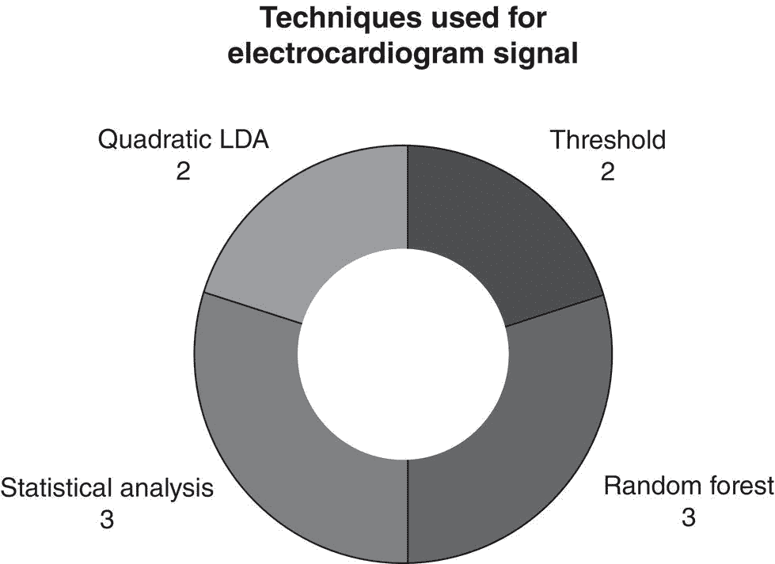

图 5.2 用于分析 ECG 信号的机器学习算法及替代技术的应用。

表 5.3 利用 ECG 信号辅助睡眠分期分类的精选研究结果综述。

| 关键词 | 统计与图表 | 特征提取与选择方法 | 分类方法 | 推论 |
| --- | --- | --- | --- | --- |
| 18 | CinC 使用的 ECG 呼吸统计数据 | | 随机森林（RFC） | 准确率 87% |
| 19 | SLEEP 数据集和 PhysioNet | 形态方法 | 随机森林（RFC） | 最高约 87% |
| 20 | 受试者：51 人（男 37，女 14）患阻塞性睡眠暂停 (OSA)，源于 SNUH | 变异性分析 | 阈值变异方法 | 准确率：约 88% |
| 21 | 受试者：75 人患睡眠暂停，源于 SPTCM | 统计技术、功率谱 | | |
| 22 | EDF 睡眠 | 非频域 | 随机森林（RFC） | 准确率：约 89% |
| 23 | SIESTA 数据库 领域：呼吸暂停-ECG | 统计技术、功率谱 | 阈值变异方法 | 准确率：约 58% |
| 24 | 受试者：71 人 领域：健康女性 组组：绝经后 | 统计技术、线性统计技术、非频域 | 统计分析 | 无 |
| 25 | 受试者：31 人 性别：男性 | 源自 ECG 呼吸的线性统计技术 | 二次线性判别分析 | 准确率最高约 76% |
| 26 | 受试者：37 人 | 线性统计技术 | 线性判别分析 | 无 |
| 27 | 受试者：14 人 领域：健康 | 统计参数、线性统计技术和血压参数 | 统计分析技术和比较方法 | 无 |

### 5.2.3 呼吸努力与眼电图

眼电图（EOG）通过测量角膜视网膜电位检测快速眼动（REM）阶段，从而用于追踪眼动。AASM 建议将 EOG 电极放置在左右眼角外侧 1 cm 处。这种放置方法简单，患者可以完成，是连续睡眠分期评估和长期监测的有效工具（图 5.3; 表 5.4）。

### 5.2.4 多信号整合 (PSG)

使用多种生理信号提供了冗余信息，因为某一个信号中的关键细节可能会被遗漏，但在另一个信号中会被发现 [[32]](#c05.xhtml#c5-bib-0032)。因此，记录 EEG、ECG、EOG 和 EMG 信号的多导睡眠图（PSG）已成为检测睡眠问题的金标准 [[33]](#c05.xhtml#c5-bib-0033)。PSG 记录通常贯穿整个夜间。睡眠图是由专业睡眠专家每 30 秒对睡眠阶段进行一次人工评分而成的。生理信号结合 ECG、EEG、EOG 和 EMG 以构建自动睡眠分期系统 [[34]](#c05.xhtml#c5-bib-0034)（图 5.4 和 5.5；表 5.5）。

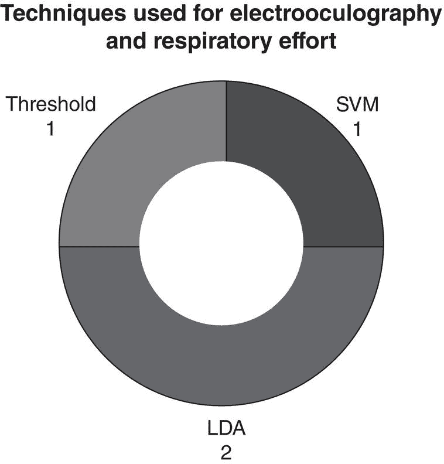

**图 5.3** ML 算法和替代技术在 EOG 和呼吸努力分析的应用。

**表 5.4** 利用 EOG 信号的所选研究睡眠分期评审结果概述。

| 作者 | 统计数据与图表 | 特征提取与选择方法 | 分类方法 | 推论 |
| --- | --- | --- | --- | --- |
| [[28]](#c05.xhtml#c5-bib-0028) | EOG Physio net DB | 离散小波变换 (DWT) 系数和统计分析 | 使用支持向量机处理六分类问题 | 准确率：约高达 92% |
| [[29]](#c05.xhtml#c5-bib-0029) | EOG | 频谱分析 | 五类睡眠阶段分类 | 准确率（精确率）：约 83% |
| [[30]](#c05.xhtml#c5-bib-0030) | 受试者：48 人 领域：健康（呼吸努力） | 统计分析和频谱功率 | 二次线性判别分析 | 准确率：约 80% |
| [[31]](#c05.xhtml#c5-bib-0031) | 受试者：265 人 领域：健康（EOG） | 频谱分析 | 睡眠阶段分类百分比类的阈值 | 准确率：约 73% |

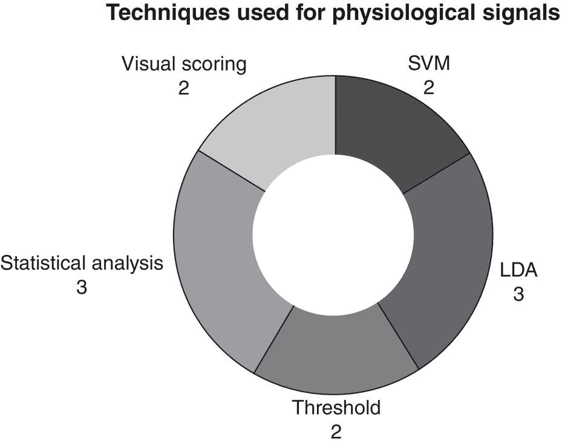

**图 5.4** ML 算法和替代技术处理 PSG 信号的部署。

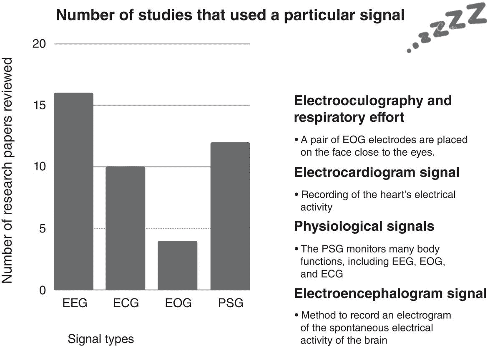

**图 5.5** 使用 EOG、PSG、ECG、EEG 信号的 42 篇研究论文的图示。

## 5.3 方法

预处理、特征选择与提取以及分类模型和算法是定量睡眠分期程序的主要步骤 [[42]](#c05.xhtml#c5-bib-0042)。在特征提取之后，某些研究引入了特征选择阶段，以选择最重要和相关的特征。下图描绘了自动睡眠分期的过程（图 5.6）。

**表 5.5** 结合多种生理信号的所选研究睡眠分期评审结果。

| 作者 | 统计数据与图表 | 特征提取与选择方法 | 分类方法 | 推论 |
| --- | --- | --- | --- | --- |
| [[28]](#c05.xhtml#c5-bib-0028) | EOG Physio net DB | 离散小波变换 (DWT) 系数和统计分析 | 使用支持向量机处理六分类问题 | 准确率：约高达 92% |
| [[29]](#c05.xhtml#c5-bib-0029) | EOG | 频谱分析 | 五类睡眠阶段分类 | 准确率（精确率）：约 83% |
| [[30]](#c05.xhtml#c5-bib-0030) | 受试者：48 人 领域：健康（呼吸努力） | 统计分析和频谱功率 | 二次线性判别分析 | 准确率：约 80% |
| [[31]](#c05.xhtml#c5-bib-0031) | 受试者：265 人 领域：健康（EOG） | 频谱分析 | 睡眠阶段分类百分比类的阈值 | 准确率：约 73% |

在 EEG 信号的非线性动力学中，非线性测量在信号处理策略中起着至关重要的作用。特别是它们被应用于睡眠分评分的特征提取。基于熵的方法可以量化时域信号的不规则性和不纯 [[46]](#c05.xhtml#c5-bib-0046)。本质上，较低的熵值表示信号窗口内的模式更具规律，而较高的值则表示不规则性增加。基于分形的方法通过在几何碎片上迭代应用算子生成类噪声的形式。尽管它们具有基于规则的行为，但某些实例表现出噪声倾向，增加了其动力学的复杂性。

### 5.3.1 预处理

预处理涉及清洗 EEG 信号以去除伪影并增强信息成分。这是为了防止测量噪声、生理变量和病理状况等因素导致错误或失真的结果。尽管在记录时使用了硬件滤波器，外部源仍可能污染 EEG 信号 [44, 45]。

### 5.3.2 特征提取

特征提取包括识别信号中的信息属性，这对于有效的分类至关重要。这些派生的特征必须具有独立性，并封装最独特的数据以避免冗余。为了从 EEG 记录中提取睡眠阶段见解，可以使用多种信号处理技术。时域特征具有简单性和实时性，因为它们阐明了信号的形态特征。频域特征则通过将时间序列转换为频率域来捕捉 EEG 信号的变化。频谱估计方法包括参数化和非参数化方法，例如周期图和 Welch 方法，能够分解信号的频率成分（图 5.7）。

### 5.3.3 特征选择

在特征提取阶段，某些睡眠分分类方法（特别是多通道方法）使用特征选择算法来获取区分性特征子集。其目标是在不牺牲准确性的情况下减少特征数量，同时避免过拟合并缩短计算时间。当在使用大量的夜间 PSG 记录并检索多种类型的特征时，特征选择非常有用。文献中已经开发了确定合适且具有区分性的特征子集的统计策略。序列后向（SB）和序列前向（SF）采样是检查特征并确定最优子集的简单方法。相反，SF 和 SB 采样具有局限性且无法回溯。相比之下，遗传算法和粒子群优化等元启发式算法经常用于特征选择 [47, 48]。

### 5.3.4 用于睡眠障碍检测的 ML 和 DL

考虑到睡眠障碍的重要性，研究人员已转向创新方法，特别是 ML 和 DL 算法，以增强检测方法。这些计算技术在模式识别和数据分析方面表现出色，为更准确、更高效地识别和诊断睡眠障碍提供了有前景的手段。通过分析包含睡眠模式、生理信号和其他相关参数的大型数据集，ML 和 DL 算法可以揭示传统诊断方法可能忽略的复杂模式和相关性 [49, 50]。

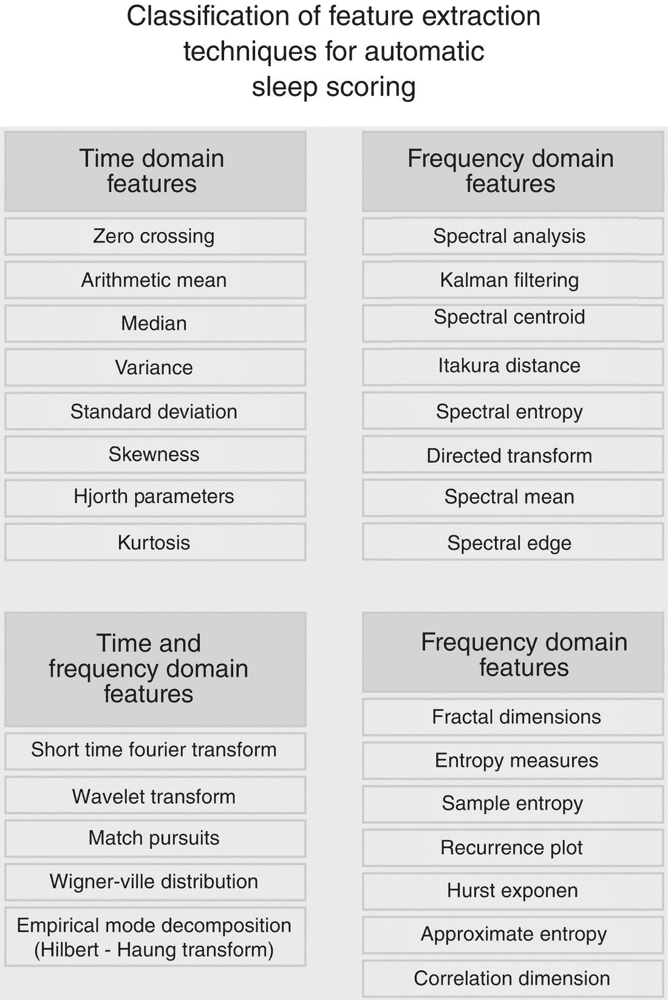

图 5.7 自动睡眠评分特征提取技术分类。

### 5.3.4.1 传统方法的局限性

传统评分方法的局限性包括：

*   **侵入性：** 传统方法通常要求患者在环境中环境中睡眠，这会影响他们自然的睡眠模式，并可能导致被称为“第一夜效应”的现象。
*   **主观性：** PSG 中睡眠阶段和事件的人工评分容易受到评分者间差异性的影响，导致结果不一致。


### 5.3.4.1 传统方法的局限性

*   **可及性：** 睡眠实验室数量有限且地理位置可能较远，使得某些患者难以获得这些设施。
*   **成本：** PSG 及相关测试费用昂贵，不仅涉及设备，还需要用于评分和解释的专业知识。
*   **数据局限：** 传统方法提供的是受控环境下的单夜数据，可能会错掉睡眠模式随时间的变化和波动。

### 5.3.4.2 对自动化方法（ML/DL）的需求

基于 ML/DL 的睡眠模式分类自动化方法对于以下几点至关重要（图 5.8）。

*   **一致性和价值链：** 机器学习（ML）和深度学习（DL）模型提供了实用且标准的方法，减少了人工评分员之间的差异。这确保了研究设计的客观性，并保证了研究结果的一致性。
*   **非侵入性睡眠监控：** 通过带有传感器的可穿戴设备，可以在家中舒适监控个人的睡眠模式。这保留了受试者的自然睡眠行为，让他们能够准确地复制其典型的睡眠模式。
*   **高效的大规模研究：** ML 和 DL 方法提供的自动化有助于筛查。这种早期检测能力能够及时干预，并显著减轻了专科医院的压力，最终提高了医疗服务的普及率。
*   **深层特征提取：** ML 和 DL 算法擅长提取同时存在于不同生理信号中的复杂模式。这种增强的能力具有揭示传统分析方法可能忽略的洞察力的潜力。
*   **实时分析与反馈：** 某些自动化系统为用户提供实时反馈，使他们能够做出即时调整以改善睡眠。这种即时反馈有助于持续的改进。一旦开发了自动化系统，它们为资源密集型的专科医院和重复性测试提供了一种成本效益的替代方案。这些潜在的成本节约对于增强医疗保健的可及性和负担能力具有巨大前景，系统将变得明显更容易获得且廉价。

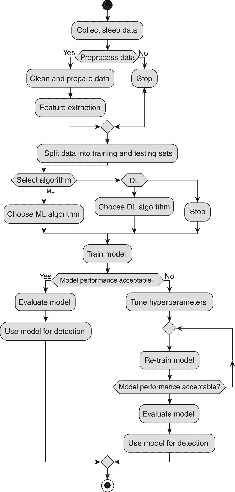

图 5.8 通过 ML & DL 方法实现自动睡眠评分的综合流程图。

*   **经济解决方案：** 一旦开发完成，自动化系统为资源密集型的专科医院和重复测试提供了成本效益的替代方案。这些成本减少可以大幅提高医疗服务的负担能力和可用性。

## 5.4 结论

在报告中，我们探讨了 ML 和 DL 算法在变革睡眠障碍检测方面的巨大潜力。通过全面的文献综述，我们见证了这些算法对医疗健康的显著影响。ML 和 DL 在睡眠障碍检测中的应用展示了它们处理来自可穿戴设备生理信号的能力，为失眠症、睡眠呼吸暂停和嗜睡症等障碍提供了见解。这些算法解码 EEG、ECG 和其他信号中复杂模式的能力，表明了它们在理解睡眠复杂性方面的实力。成功的关键在于特征选择，它凸显了数据预处理的重要性。特征选择与模型开发的结合产生了创新模型，例如 `Deep Sleep`、`SleepNet` 和 `NarcoNet`。`CNNs` 和 `RNNs` 的复杂架构使得这些模型能够识别睡眠阶段和障碍的发生。从模型开发转向性能评估，准确率、敏感性和特异性等指标验证了这些算法在现实临床语境下的可靠性。这些指标确认了算法在应对睡眠障碍多方面复杂格局方面的有效性。

## 5.5 未来工作

所提的研究为我们为使用 PSG 信号进行睡眠分期研究贡献了许多途径。在未来，我们希望通过进一步分析诊断不同类型睡眠相关障碍过程中的复杂性，发现更多新的、令人兴奋的框架和技术。本论文获得的方法可以在几个方面进行扩展，例如：

*   通过考虑一种包含识别最有效特征的选择性聚合技术，可以扩展所提出的集成学习模型的性能。
*   在论文中，我们仅使用了健康对照受试者和少数睡眠障碍受试者的记录。未来，我们将关注受多种多种睡眠疾病影响的受试者的大规模睡眠记录。
*   应用不同的小波分解技术和其他时频特征，以更好地分析睡眠行为在不同睡眠阶段的变化差异。

## 参考文献

1. **1** Jiang, X., Zhao, J., Du, B., Yuan, Z. (2021). Self‐supervised Contrastive Learning for EEG‐based Sleep Staging, Harvard. *2021 International Joint Conference on Neural Networks (IJCNN)*, Shenzhen, China (18–22 July 2021). New York: IEEE, pp. 1–8.

2. **2** Seifpour, S., Niknazar, H., Mikaeili, M., and Nasrabadi, A.M. (2018). A new automatic sleep staging system based on statistical behavior of local extrema using single channel EEG signal. *Expert Systems with Applications* 104: 277–293. [`doi.org/10.1016/j.eswa.2018.03.020`](https://doi.org/10.1016/j.eswa.2018.03.020).

3. **3** Sharma, M., Goyal, D., Achuth, P.V., and Acharya, U.R. (2018). An accurate sleep stages classification system using a new class of optimally time‐frequency localized three‐band wavelet filter bank. *Computers in Biology and Medicine* 98: 58–75. [`doi.org/10.1016/j.compbiomed.2018.04.025`](https://doi.org/10.1016/j.compbiomed.2018.04.025).

4. **4** Chriskos, P., Frantzidis, C.A., Gkivogkli, P.T. et al. (2018). Achieving accurate automatic sleep staging on manually pre‐processed EEG data through synchronization feature extraction and graph metrics. *Frontiers in Human Neuroscience* 12: [`doi.org/10.3389/fnhum.2018.00110`](https://doi.org/10.3389/fnhum.2018.00110).

5. **5** Long, X., Foussier, J., Fonseca, P. et al. (2014). Analyzing respiratory effort amplitude for automated sleep stage classification. *Biomedical Signal Processing and Control* 14: 197–205. [`doi.org/10.1016/j.bspc.2014.08.001`](https://doi.org/10.1016/j.bspc.2014.08.001).

6. **6** Memar, P. and Faradji, F. (2018). A novel multi‐class EEG‐based sleep stage classification system. *IEEE Transactions on Neural Systems and Rehabilitation Engineering* 26 (1): 84–95. [`doi.org/10.1109/TNSRE.2017.2776149`](https://doi.org/10.1109/TNSRE.2017.2776149).

7. **7** Dimitriadis, S.I., Salis, C., and Linden, D. (2018). A novel, fast and efficient single‐sensor automatic sleep‐stage classification based on complementary cross‐frequency coupling estimates. *Clinical Neurophysiology* 129 (4): 815–828. [`doi.org/10.1016/j.clinph.2017.12.039`](https://doi.org/10.1016/j.clinph.2017.12.039).

8. **8** Hassan, A.R. and Subasi, A. (2017a). A decision support system for automated identification of sleep stages from single‐channel EEG signals. *Knowledge‐Based Systems* 128: 115–124. [`doi.org/10.1016/j.knosys.2017.05.005`](https://doi.org/10.1016/j.knosys.2017.05.005).

9. **9** da Silveira, T.L., Kozakevicius, A.J., and Rodrigues, C.R. (2017). Single‐channel EEG stage classification based on a streamlined set of statistical features in wavelet domain. *Medical & Biological Engineering & Computing* 55 (2): 343–352. [`doi.org/10.1007/s11517‐016‐1519`](https://doi.org/10.1007/s11517-016-1519).

10. **10** Hassan, A.R. and Bhuiyan, M.I. (2017b). Automated identification of sleep states from EEG signals by means of ensemble mode decomposition and random under sampling. *Computer Methods and Programs in Biomedicine* 140: 201–210. [`doi.org/10.1016/j.cmpb.2016.12.015`](https://doi.org/10.1016/j.cmpb.2016.12.015).

11. **11** Hassan, A.R. and Bhuiyan, M.I. (2016). A decision support system for automatic sleep from EEG signals using tunable Q‐factor wavelet transform and spectral features. *Journal of Neuroscience Methods* 271: 107–118. [`doi.org/10.1016/j.jneumeth.2016.07.012`](https://doi.org/10.1016/j.jneumeth.2016.07.012).

12. **12** Diykh, M., Li, Y., and Wen, P. (2016). EEG stages classification based on time domain features and structural graph. *IEEE Transactions on Neural Systems and Rehabilitation Engineering* 24 (11): 1159–1168. [`doi.org/10.1109/TNSRE.2016.25539`](https://doi.org/10.1109/TNSRE.2016.25539).

13. **13** Shi, J., Liu, X., Li, Y. et al. (2015). Multi‐channel EEG‐based sleep stage classification with joint collaborative representation and multiple kernel learning. *Journal of Neuroscience Methods* 254: 94–101. [`doi.org/10.1016/j.jneumeth.2015.07.006`](https://doi.org/10.1016/j.jneumeth.2015.07.006).

14. **14** Bajaj, V. and Pachori, R. (2013). Automated sleep stages based on time‐frequency image. *Computer Methods and Programs in Biomedicine* 112 (3): 320–328. [`doi.org/10.1016/j.cmpb.2013`](https://doi.org/10.1016/j.cmpb.2013).

15. **15** Şen, B., Peker, M., Çavuş, A., Çelebi, F. (2014). A comparative study on sleep stages based on heart rate variability and selection. *Journal of Medical Systems* 38 (3). [`doi.org/10.1007/s11517‐014‐018`](https://doi.org/10.1007/s11517-014-018).

16. **16** Čić, M., Šoda, J., and Bonković, M. (2013). Automated sleep stages based on instantaneous frequencies. *Computers in Biology and Medicine* 43 (12): 2110–2117. [`doi.org/10.1016/j.compbi.2013`](https://doi.org/10.1016/j.compbi.2013).

17. **17** Koley, B. and Dey, D. (2012). Automatic sleep staging using SVD, VMD, HHT and single channel EEG. *Expert Systems with Applications* 102: 1186–1195. [`doi.org/10.1016/j.eswa.2009`](https://doi.org/10.1016/j.eswa.2009).

18. **18** Pini, N., Ong, J., Yilmaz, G. et al. (2022). An automated sleep staging using wearable electrocardiogram. *Frontiers in Neuroscience* 16: 974192. [`doi.org/10.3389/fnins.2022`](https://doi.org/10.3389/fnins.2022).

19. **19** Yücelbaş, S., Yücelbaş, C., Tezel, G. et al. (2018). A novel multi‐class EEG‐based sleep stage classification system. *Expert Systems with Applications* 102: 193–206. [`doi.org/10.1016/j.eswa.2017`](https://doi.org/10.1016/j.eswa.2017).

20. **20** Yoon, H., Hwang, S., Choi, J. et al. (2017). REM sleep estimation based on autonomic dynamics R–R intervals. *Physiological Measurement* 38 (4): 631–651. [`doi.org/10.1088/1361-6579`](https://doi.org/10.1088/1361-6579).

21. **21** Liu, S., Teng, J., Qi, X. et al. (2017). Comparison between heart rate variability and pulse rate during different sleep stages for sleep apnea patients. *Technology and Health Care* 25 (3): 435–445. [`doi.org/10.1016/j.eswa.2017`](https://doi.org/10.1016/j.eswa.2017).

24. Virtanen, I., Ekholm, E., Polo‐Kantola, P., 和 Huikuri, H. (2007). 绝经后女性非线性心率动力学依赖于睡眠阶段的模式。*Autonomic Neuroscience* 134 (1–2): 74–80. [`doi.org/10.1016/j.autneu.2007.01.010`](https://doi.org/10.1016/j.autneu.2007.01.010).


# 参考文献

25. Redmond, S.J., de Chazal, P., O’Brien, C et al. (2007). 使用心肺呼吸信号进行睡眠分期。*Somnologie ‐ Schlafforschung und Schlafmedizin* 11 (4): 245–256. [`doi.org/10.1007/s11818‐007‐0314‐8`](https://doi.org/10.1007/s11818-007-0314-8).

26. Redmond, S.J. 和 Heneghan, C. (2006). 阻塞性睡眠暂停受试基于心肺呼吸的睡眠分期。*IEEE Transactions on Biomedical Engineering* 53 (3): 485–496. [`doi.org/10.1109/TBME.2005.869773`](https://doi.org/10.1109/TBME.2005.869773).

27. Trinder, J., Kleiman, J., Carrington, M et al. (2001). 人类睡眠期间自主神经活动随时间和睡眠阶段的变化函数。*Journal of Sleep Research* 10 (4): 253–264. [`doi.org/10.1046/j.1365‐2869.2001.00263.x`](https://doi.org/10.1046/j.1365-2869.2001.0026.x).

28. Rahman, M.M., Bhuiyan, M.I.H., 和 Hassan, A.R. (2018). 使用单通道眼电图的睡眠阶段分类。*Computers in Biology and Medicine* 102: 211–220. [`doi.org/10.1016/j.compbiomed.2018.08.022`](https://doi.org/10.1016/j.compbiomed.2018.08.022).

29. Liang, S.F., Kuo, C.E., Lee, Y.C et al. (2015). 基于眼电图的自动睡眠监测眼罩的开发。*IEEE Transactions on Instrumentation and Measurement* 64 (11): 2977–2985. [`doi.org/10.1109/TIM.2015.2433652`](https://doi.org/10.1109/TIM.2015.2433652).

30. Long, X., Fonseca, P., Foussier, J et al. (2014). 使用动态时间规法通过体动和呼吸努力进行睡眠与清醒分类。*IEEE Journal of Biomedical and Health Informatics* 18 (4): 1272–1284. [`doi.org/10.1109/JBHI.2013.2284610`](https://doi.org/10.1109/JBHI.2013.2284610).

31. Virkkala, J., Hasan, J., Värri, A et al. (2007). 使用双通道眼电图的自动睡眠阶段分类。*Journal of Neuroscience Methods* 166 (1): 109–115. [`doi.org/10.1016/j.jneumeth.2007.06.016`](https://doi.org/10.1016/j.jneumeth.2007.06.016).

32. Pini, N., Ong, J.L., Yilmaz, G et al. (2021). 一种基于心率的睡眠阶段分类算法：使用传统 PSG 和创新可穿戴 ECG 设备进行验证。*medRxiv* 16 (974192): 1–18.

33. Takatani, T., Takahashi, Y., Yoshida, R et al. (2018). 新生儿睡眠期间心率变异性频率谱与自主神经活动之间的关系。*Brain and Development* 40 (3): 165–171. [`doi.org/10.1016/j.braindev.2017.09003`](https://doi.org/10.1016/j.braindev.2017.09003).

34. Fonseca, P., Long, X., Radha, M et al. (2015). 使用 ECG 和呼吸努力进行睡眠阶段分类。*Physiological Measurement* 36 (10): 2027–2040. [`doi.org/10.1088/0967-3334/36/2027`](https://doi.org/10.1088/0967-3334/36/2027).

35. Helland, V., Gapelyuk, A., Suhrbier, A et al. (2010). 通过睡眠脑图进行自动睡眠阶段分类的研究。*Methods of Information in Medicine* 49 (05): 467–472. [`doi.org/10.3414/ME09-0052`](https://doi.org/10.3414/ME09-0052).

36. Willemen, T., Van Deun, D., Verhaert, V et al. (2014). 心肺呼吸和运动特征在睡眠阶段分类中的评估。*IEEE Journal of Biomedical and Health Informatics* 18 (2): 661–669. [`doi.org/10.1109/JBHI.2013.22768`](https://doi.org/10.1109/JBHI.2013.22768).

37. Kishi, A., Yasuda, H., Matsumoto, T et al. (2011). NREM 睡眠阶段超昼节律。*Sleep* 34 (10): 1423–1432. [`doi.org/10.5665/SLEEP.1292`](https://doi.org/10.5665/SLEEP.1292).

38. Kesek, M., Franklin, K.A., Sahlin, C., 和 Lindberg, E. (2009). 基于人群的睡眠期间心率变异性与睡眠暂停。*Clinical Physiology and Functional Imaging* 29 (4): 309–315. [`doi.org/10.1111/j.1475-097X.2009.0873`](https://doi.org/10.1111/j.1475-097X.2009.0873).

39. Montgomery-Downs, H.E., O’Brien, L.M., Gulliver, T.E., 和 Gozal, D. (2006). 学龄前及早期儿童的睡眠脑图特征。*Pediatrics* 117 (3): 741–753. [`doi.org/10.1542/peds.2005-1067`](https://doi.org/10.1542/peds.2005-1067).

40. Estévez, P.A., Held, C.M., Holzmann, C. et al. (2002). 婴儿睡眠-清醒状态的多睡眠图模式识别。*Medical & Biological Engineering & Computing* 40 (1): 105–113. [`doi.org/10.1007/BF023403`](https://doi.org/10.1007/BF023403).

41. Tracik, F. 和 Ebersbach, G. (2001). 金金森病中的日发性入睡：睡眠图记录。*Movement Disorders* 16 (3): 500–506. [`doi.org/10.1002/mds.1083`](https://doi.org/10.1002/mds.1083).

42. Satapathy, S.K. 和 Loganathan, D. (2023). 使用睡眠图信号进行多睡眠阶段自动分类：九层 1D 卷积神经网络方法。*Multimedia Tools and Applications* 82 (6): 8049–8091. [`doi.org/10.1007/s11042-022-13195-2`](https://doi.org/10.1007/s11042-022-13195-2).

43. Satapathy, S.K., Bhoi, A.K., Loganathan, D et al. (2021a). 用于自动睡眠分期的集成堆叠模型机器学习。

44. Satapathy, S.K. 和 Loganathan, D. (2021b). 双层集成堆叠的自动睡眠预后。

45. Acharya, U.R., Sudarshan, V., Adeli, H et al. (2015). 使用 EEG 计算机辅助诊断抑郁。*European Neurology* 73 (5): 329–336.

46. Erguzel, T., Ozekes, S., Tan, O., 和 Gultekin, S. (2015). 脑电信号的特征选择与分类：人工神经网络和遗传算法。*Clinical EEG and Neuroscience* 46: 321–326.

48. Surantha, N., Lesmana, T.F., 和 Isa, S. (2021). 用于医疗大数据的极学习机和粒子群优化的睡眠阶段分类。*Journal of Big Data* 8 (1): 14. [`doi.org/10.1186/s40537-020-0406-6`](https://doi.org/10.1186/s40537-220-0406-6).

49. Korkalainen, H., Leppanen, T., Aakko, J et al. (2019). 疑似睡眠暂停临床人群中基于深度学习的准确睡眠分期。*IEEE Journal of Biomedical and Health Informatics* 1–1. [`doi.org/10.1109/JBHI.2019.2951346`](https://doi.org/10.1109/JBHI.2019.2951346).

50. Sekkal, R.N., Bereksi-Reguig, F., Ruiz-Fernandez, D et al. (2022). 自动睡眠阶段分类：从传统机器学习方法到深度学习。*Biomedical Signal Processing and Control* 77: 103751. [`doi.org/10.1016/j.bspc.2022.103751`](https://doi.org/10.1016/j.bspc.2022.103751).

# 使用 LBPH 和 Faster R‐CNN 基于商场带自动计费系统的智能购物车的产品营销与销售预测性分析

Balla Adi Narayana Raju¹, Deepika Ghai¹, Suman Lata Tripathi¹, Sunpreet Kaur Nanda², 和 Sardar M.N. Islam³

¹ 印度法格瓦拉，Lovely Professional University，电子与电气工程学院

² 印度阿姆拉蒂，Sant Gadge Baba Amravati University，P.R. Pote Patil 工程与管理学院，电子与电信工程系

³ 澳大利亚墨尔本，维多利亚大学（Victoria University），可持续工业与宜居城市研究所

## 6.1 引言

在过去的十年里，互联网与经济同时繁荣，导致了足不出家中客厅即可享受无忧购物的时代的诞生。互联网技术在追踪客户购买习惯并利用这些习惯方面一直处于优势。然而，传统的零售店尚未实现类似的针对性广告和精选的购物体验 [1, 2]。零售店中的 IoT 技术在自动化、图像处理和人工智能（AI）方面的进展仍然相对滞后。考虑到超市是客户持续供应日常用品（如食品、服装、电子设备和家用电器）的地方 [3, 4]；因此，任何基于客户偏好的进步都能导致销售额和产品感知的直接增长。超市面临着持续的挑战，例如扫描许多条码物品 [2, 5]，这会增加时间并导致排队延迟，如图 6.1 所示。条码扫描器耗时较长，但可以通过在每个物品上贴上 RFID 标签来避免这一点，然后可以使用既真实又紧凑的 RFID 扫描器进行扫描 [4–7]。

![图 6.1 超市中的问题。¶来源：Yewatkar 等人. [4]/经 Elsevier 许可复制。](images/c06f001.jpg)

图 6.1 超市中的问题。¶ *来源：* Yewatkar 等人。[[4]](#c06.xhtml#c6-bib-0004)/经 Elsevier 许可复制。

## 6.2 主要贡献

本章提出了一种高效且有效的基于购物车的模型，用于监控商店以及客户的购买习惯，以预测物品并获得更高的利润。所提购物车的亮点在于，它提供了客户人脸识别、自动计费、客户追踪和商店分类功能。该智能购物车由 `RFID` 读器、`pi‐camera`、超声波传感器、`ATmega328P` 控制器和 Broadcom BCM2837 高级风险机器 (ARM7) 四核处理器作为主要组件构建 [8, 9]。商店里的客户可以使用 `RFID` 读器扫描物品上的每个 `RFID` 标签，并在手机应用程序上查看产品名称、价格以及总余额等信息。由于账单随每次扫描物品而更改并在扫描掉物品后移除，客户具有更大的活性。这种购物车还可以帮助客户查看总账单，有助于控制预算 [10–12]。管理接口系统 (`MIS`) 获取有关产品及其成本的信息，并在需要及时向货架上添加新物品时提醒商店经理。最初配合 `pi‐camera` 使用的人脸识别将检测客户详情并发送到 `MIS`，以提供更好的购物体验，并获取客户购买模式的兴趣。在购物车两侧使用的 `HC‐SR04` 超声波传感器将帮助根据客户的移动决定路径，以提供无忧的体验 [13–15]。最后，人们将在线支付账单，而不是排长队。

本章通过结合 `IoT`、图像处理、超声波传感和 `RFID` 技术提出了一种统一的购物车系统。`RFID` 已成为经济行业中物品级扫描的一种快速增长的技术 [5, 16, 17]。在未来几天里，这些 `RFID` 标签可能会是最常用的。32 位的 `ARM7` 处理器和 `ATmega328` 控制器是购物车的内核，它们与 `MIS` 接口连接。

研究人员已经针对基于推车的系统提出了多种方法。2011 年，Agarwal 等人 [[6]](#c06.xhtml#c6-bib-0006) 构建了一个基于 `RFID` 的自动购物购物车，让客户在店内环境中获得更优越的购物体验。这种购物购物车包含一个安装在推车上的用于客户图形界面的触摸屏、一个客户卡，以及一个用于扫描购物车内物品标签的物品阅读器，这使其非常符合用户直觉。

2013 年，McBeath [[7]](#c06.xhtml#c6-bib-0007) 认为，零售商需要适应另一种技术，以应对日益复杂的商品种类。他们需要准确、实时且单品级的库存快信息。`RFID` 已证明能将商店交易效率提高 20%–30%。JC Penney 使用 `RFID` 在产品采集过程中将库存准确率从 75% 提高到 99%。

Kumar 等人 [[8]](#c06.xhtml#c6-bib-0008) 提出了一种自主超市推车系统，该系统使用了 `RFID` 技术、`ZigBee` 和微控制器。该系统有一个启动按钮，当带有 `RFID` 标签的物品被放入推车时，推车会被激活。`RFID` 阅读器读取标签 ID，如果数字与数据库匹配，则会将该 ID 标记的产品信息显示在液晶显示器 (`LCD`) 上。该显示器还有一个结束购物按钮，按下此按钮后，购物车内所有物品的总列表将通过 `ZigBee` 发送到主电脑。`LCD` 中还有一个从购物车中移除特定物品的选项。此笔账单将根据客户的选择进行更新。该系统的局限性在于，最后的付款是在结账台完成的，用户仍需要在物品结算上再次花费时间，而且推车不够智能，无法与商店周围环境进行交互。

2014 年，Kamble 等人 [[9]](#c06.xhtml#c6-bib-0009) 使用 `RFID` 技术构建了一个多处理购物购物车系统。物品信息在结账时收集，并使用 `RFID` 扫描器进行读取。该购物车系统由以下三部分组成：显示组件和用户界面、服务器通信组件以及自动计账组件，所有部分共同工作，创建一个显著缩短结账时间的智能购物车。某些问题（如库存维护）在该方案中并未解决。也就是说，如果掉落在车的物品未被读取，所需的补救措施将无法处理。

Yewatkar 等人 [[4]](#c06.xhtml#c6-bib-0004) 讨论了使用 `RFID` 和 `ZigBee` 并构建具有自动计账、产品信息和产品推荐功能的智能购物车系统所需的组件，并带有防盗功能使用了 `AT89S52` 微控制器、电可擦除可编程读存储器 (`EEPROM`) 和 `LCD`。文中显示了对高数据速率、电压、通信协议和频率的要求，以及微控制器与 `EEPROM` 之间集成电路 (`I2C`) 协议的相关信息。内存大小和对更复杂通信协议的需求都是这种配置的缺点。

2015 年，Bhatwal 等人 [[10]](#c06.xhtml#c6-bib-0010) 提出了一种使用 `RFID` 技术的自动自助结账系统，该系统由显示面板、`RFID` 阅读器和主电脑组成。被动标签最初由阅读器扫描，如图 6.2 所示，然后在触摸显示面板上显示；如果用户想要移除物品，他/她可以使用面板上的取消按钮移除物品。此笔账单将根据客户的选择进行更新。


# 相关研究综述

Devipriya 等人 [[31]](#c06.xhtml#c6-bib-0031) 提到，为了提高视障人士和盲人的生活质量，目前已经提出了许多方法。然而，在没有他人帮助的情况下在超市里购买商品对他们来说仍然是一个巨大的挑战。本章的目的是为视障人士提出一种智能商店助手。该助手解决了三个主要问题，即：寻找产品、识别产品和购买产品。该系统包含三个模块：产品识别器、智能手套和智能推车。`RFID` 用于产品识别模块中识别产品。通过用智能手套扫描产品，买家会收到解释产品规格的音频指令。产品一被放入购物车，自动计费系统就会为所购商品提供最终账单。未来将开发一种室内导航系统，以便从用户的位置定位所需的产品。这项工作展示了一个工作原型模型的设计和实现。如果该原型能够实时实施，则可以将目前工作中的短程 `RFID` 阅读器（`EM-18`）改进或替换为长程 `RFID` 阅读器。

2019 年，Gunawan 等人 [[32]](#c06.xhtml#c6-bib-0032) 开发了一种自动移动推车，以解决客户在商店里寻找所需产品时产生的不便和时间浪费问题。在超市购物时，购物推车或购物车的目的是将物品运到收银台，而不是将它们带出商店。本章描述了基于此前开发的双轮移动机器智能推车系统的硬件和软件设计。本章使用了各种传感器、`IOIO` 微控制器和 `Android` 智能手机。`Android` 手机通过向与执行器配对的控制器发送信号来控制机器人，并利用手机摄像头监控状况。该系统还包含一个 `Navisens` 室内定位系统，它使用手机的加速度计和陀螺仪检测用户位置。经过机器人导航测试的结果，基于 `Navisens` 框架的智能推车系统可以移动并向用户显示其位置。`Navisens` 在任何地方都提供更好的室内定位系统，因为它使用惯性推算系统、加速度计和陀螺仪来更新估计位置，而不是使用 `Wi-Fi` 指纹。尽管在 1 米和 3 米的距离表现良好，但在超过 3 米的距离上，智能推车的稳定性并不高。根据分析，未来将研究智能推车系统是否需要自动校准器以确保推车不会偏离路径。

2020 年，Anitha 等人 [[33]](#c06.xhtml#c6-bib-0033) 指出，本章的目标是消除购物时排队和浪费时间的问题。该研究提出了一种基于 `RFID` 标签的智能推车计费系统，该系统可以审计购买的商品并自动在线支付。购物车会自动识别并扫描产品，最终账单直接在推车上处理。此外，它为客户提供了使用 `RFID` 的集中式和自动化计费系统，使其成为一种合理且有利润的智能购物车。本文提供了一种节省时间、以商业为导向、基于技术的系统，增强了客户的购物体验。所提的系统还根据用户的购买历史推荐产品。有了所提的系统，商店里的每件商品都应该有一个 `RFID` 标签，每辆推车都应该有一个 `RFID` 阅读器，这将节省时间并简化购物。本章展示了智能购物面临的一些挑战，即，有时由于标签的朝向、尺寸和形状的原因，物品无法被检测到。这些交互通常相当复杂。该应用解决了这些缺点。`LCD` 屏幕在智能推车上显示自动计费金额。

Das 等人 [[34]](#c06.xhtml#c6-bib-0034) 提出了一种可以同时处理购物和计费的智能推车。购物可以是兴奋且有吸引力的，但当你必须排长队付账单时，它也可能是耗时无聊的。有了这个系统，客户可以直接进入商店，使用智能推车购买产品并离开。他可以通过邮件接收电子账单，并在线查看购买详情。为了管理产品和客户信息，它需要一个 `Arduino` 板、`RFID` 阅读器、`RFID` 标签、`LCD`、`ESP8266` `Wi-Fi` 模块和一个可以在世界任何地方访问的网站。这个基于 `IoT` 的系统允许推车与全球网络进行交互。

2021 年，Shailesh 等人 [[35]](#c06.xhtml#c6-bib-0035) 提出了一种用于购物的智能推车。周末和假日市场通常会出现巨大的人潮，特别是在大都市。巨大的折扣和优惠使得人潮更加拥挤。我们在购物中心得到推车，将从不同架子上打算购买的所有物品放在其中。在将所有物品放入推车后，我们到达收银台结账，导致了长队。为了解决这个问题，推车上安装了条码扫描器和 `LCD` 屏幕。当物品放入推车时，条码扫描器会自动检测产品的条码并在屏幕上显示物品详情。物品费用随后添加到账单中，并在 `Raspberry Pi` 的帮助下完成所有工作。这种做法将消除收银台的长队，因为推车将完成所有的计费。

2022 年，Shete 等人 [[36]](#c06.xhtml#c6-bib-0036) 解释说，对于视障人士来说，看不清或完全看不见只是冰山一角。这些群体面临着各种社会挑战、污名、恐惧和信念，使他们成为少数，而我们没有足够的关注他们所面对的问题。在追求人工智能和机器人等热词以创建复杂技术来解决琐碎问题时，忽视大局是不正确的，但记住人类可以利用大局来拯救地球其余部分也是至关重要的。从导航到在购物场购物，视障人士面临着各种困难。通过盲文辅助按钮和触觉反馈控制，本章提出了一种智能购物车的想法，帮助视障人士在购物场的各个过道中穿行，并在无需人工帮助的情况下购买物品。

Patil 等人 [[37]](#c06.xhtml#c6-bib-0037) 解释说，有几个现代购物中心（超市）我们可以在那里购买广泛的商品，如玻璃、玩具、厨房具、杂货和装饰品。折扣、送货服务等因素促使人们去购物。由于行程繁忙、无聊以及对收银台提供的服务不满意，客户不得不排长队，特别是在周末。针对 COVID-19，我们实施了有效的社交距离方法来避免这些问题。作为对这一独特客户问题的解决方案，特别是在计费方面，所提出的系统是智能推车，它在物品放入时进行扫描，并在 `LCD` 屏幕上并行显示购买金额和物品。它可以使用 `RFID` 技术扫描大量物品，为商场和消费者节省时间。

尽管许多研究人员已经提出了大量的想法 [[1, 4, 6–13, 29–37]]，但仍需实现一种适用于所有应用的单一统一方法 [[38]](#c06.xhtml#c6-bib-0038)。在本章中，提出了一种通用的推车框架，该框架统一描述了商店内的智能购物方式，通过推车交互机制显示路径并预测客户的购买模式。

## 6.4 提出的方法

推车架构由四个模块组成，如图 6.4 所示。每个模块在获取客户详情、产品细节、分类商店环境以及顾客追踪方面都有其优势。此外还使用了图像分类技术来监控环境以进行产品识别，并对客户购买模式进行预测以制定营销策略。

### 6.4.1 模块 1 – 人脸识别

推车通过摄像头模块识别客户面部。面部将与商店数据集进行比对，以检查该面部是否存在于数据库中。如果找到匹配的面部特征，推车将被激活，并将与客户应用 ID 对应的数据检索到客户端应用程序中，并附带其兴趣爱好和历史交易记录的详细图表。客户也可以使用其前置摄像头手动登录，接收一个可以在推车上扫描的快速响应（`QR` 码）。在这种情况下，如果数据集中未找到该面部，则将该面部添加到数据库（`DB`）中，并生成新的 ID 并通过新客户 ID 激活。面部特征识别使用了高精度的人脸识别算法，即 `OpenCV` 库中的局部二值模式直方图（`LBPH`），以避免与人脸检测相关的错误 [[14]](#c06.xhtml#c6-bib-0014)。图 6.5 显示了人脸识别过程的流程。

以下是人脸识别系统涉及的阶段：

1. **图像采集**：获取输入图像阶段。
2. **人脸检测**：在数字图像中识别人脸的技术本质上是用于各种应用程序的计算机技术。
3. **人脸识别**：一种生物识别技术，通过将高级图像数据与个人的存储记录进行比较来识别特定个体。
4. **图像预处理技术**：需要预处理技术来提高输入图像的质量。在此过程中使用了彩色到灰度图像转换技术，将输入图像转换为灰度图像。彩色到灰度图像转换的数学表示如下：

   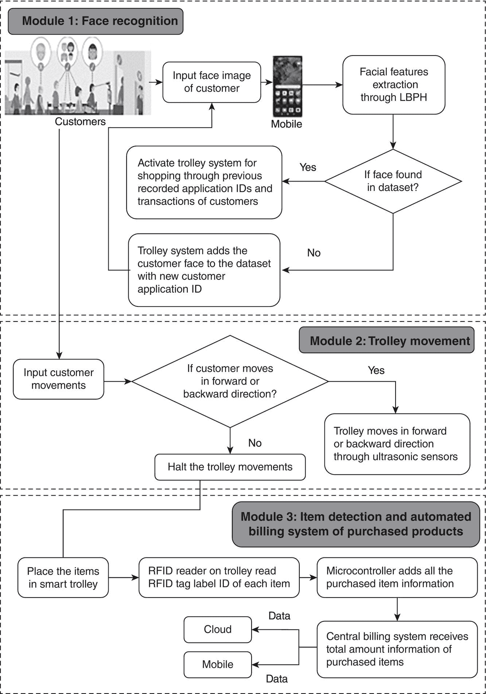

   **图 6.4** 提出的推车架构流程图。¶ 来源：Hayesphotography/Getty Images.

   - **亮度**：`(max(R, G, B) + min(R, G, B)) / 3`
   - **平均值**：`(R + G + B) / 3`
   - **明度**：`0.21R + 0.72G + 0.07B`

   其中 `R`、`G` 和 `B` 代表图像中的红、绿、蓝分量。

5. **数据集**：为了识别一个个体，数据集包含了其面部的不同数量的图像。
6. **数据库**：人脸识别本身需要将面部图像与待识别的图像数据库进行比较。
7. **训练集**：人脸识别通过将待识别的面部与记录的面部外观数据库进行匹配来完成 [[15]](#c06.xhtml#c6-bib-0015)。我们将算法面部包含在准备集中，并识别它们属于哪些客户。当需要识别未知面部并进行计算时，会使用训练包来操作。

   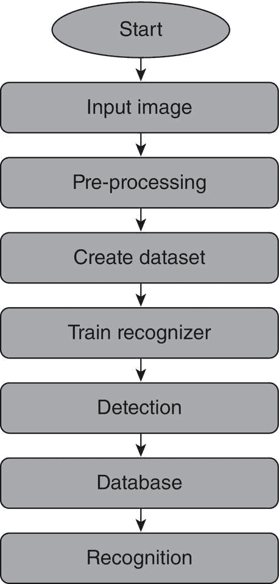

   **图 6.5** 人脸识别过程的流程图。

人脸识别有三种策略：`OpenCV` 库中的 `Eigenfaces`、`Fisherfaces` 和 `LBPH`。上述三种策略中的每种使用准备集的方式不同。`Eigenfaces` 和 `Fisherfaces` 定位整个准备集中最流行特征的科学描述。准备集中的每个脸都由 `LBPH` 独立且广泛地检查。该推车系统使用的 `LBPH` 算法不仅能检测正脸，还能以 90% 的准确率检测侧脸。对于各种输入图像的人脸检测，使用了带有 `Haar cascade 分类器` 的 `OpenCV` [[16, 17]]。`AdaBoost` 算法被 `Haar cascade 分类器` 用于检测多个脸，而 `LBPH` 算法用于识别。`LBP` 算子的描述见图 6.6。`LBP` 算子的正式描述见公式 ([Eq. 6.1](#c06.xhtml#c6-disp-0004))：

```
LBP(x, y) = sum_{n=0}^{N-1} 2^n S(i_n - i_c)
```

这里 `x_c`、`y_c` 是具有强度 `i_c` 的中心像素；`i_p` 是相邻像素的强度。符号函数 `S` 定义为：

```
S(x) = {1 if x >= 0, 0 else}
```

该思想是在可变半径的圆周上调整主观相邻数量，以便捕获相邻值，如图 6.7 所示。

对于给定的点 `x_c`、`y_c`，相邻点 `x_n`、`y_n` (`n ∈ N`) 的位置可以通过公式 ([Eq. 6.2](#c06.xhtml#c6-disp-0004)) 计算得出。

```
x_n = x_c + R * cos(2 * pi * n / N)
y_n = y_c - R * sin(2 * pi * n / N)
```

其中 `R` 是圆半径，`N` 是采样点数量。


**图 6.6** 原始 LBP 算子。

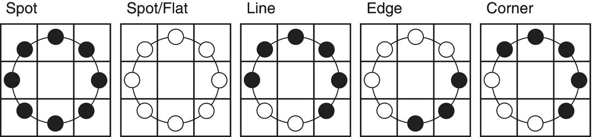

**图 6.7** 变半径下悬浮点的邻居数量。

这种扩展的 LBP 算子也被称为圆形 LBP 算子。如果圆上的点坐标与图像坐标不对应，则对点进行插值。双线性插值在 OpenCV 中实现（[公式 6.3](#c06.xhtml#c6-disp-0005)）。

```
F(x, y) = [1-x, x] * [[f(0,0), f(0,1)], [f(1,0), f(1,1)]] * [1-y, y]^T
```

使用 `Raspberry Pi Model B` 和 `Pi Camera v2` 的人脸识别模块处理流程如图 6.8 所示。

### 6.4.2 模块 2 – 推车移动

该模块包含传感器，使推车成为独立移动的用户管理的车辆。传感器被安装在推车的两侧以做出相应。推车的移动由客户的移动控制：如果客户向前移动，推车就会跟随并在它们之间保持一定的距离。因此，在商店周围运送结账商品使得系统变得易于使用，客户可以更好地关注购物体验。推车移动的示意图如图 6.9 所示。

### 6.4.3 模块 3 – 商品检测

客户需要选择感兴趣的商品并将其放入推车。`RFID` 阅读器扫描商品标签，并将商品信息发送到服务器。在结账处，无需扫描任何标签，客户即可完成支付。该设置的示意图如图 6.10 所示。

### 6.4.4 模块 4 – 物体与分类

该模块包含一个安装在推车上的摄像头，通过多种任务和计算来识别物体或物品。物体分类的流程如下：(i) 首先对各种商店图像进行标记和训练；(ii) 摄像头获取图像并进行预处理；(iii) 对图像进行特征提取并传递给 `CNN`；(iv) 分类结果显示在顾客处。其次，它还可以预测客户在特定货架处持有的商品详情。图 6.11 显示了 `Faster R-CNN` 的流程。

# 第 4 章 – 对象与物品分类


产品识别的实现是通过如 `Faster R‐CNN` 等深度 CNN 算法完成的。算法中使用了多种深度学习 `Python` 库来实现不同的目的。集成开发环境（即 `Spyder`）用于算法的开发。程序开发使用了 `Python 3.5` 编程语言。收集商店物品图像，然后使用标记工具将其转换为 `XML` 文件。随后将标记后的图像交给 CNN 进行训练。网络完全训练后的输出结果如图 6.16 所示。在模拟器中训练是在 `anaconda simulator` 中进行的离线训练，这对于调试非常有用，并允许机器人在环境中行走而无需担心损坏环境或其电池。首先，通过在周围区域随机查找寻找商店图像来识别初始训练图像。根据训练条件，它可以在这种场景下处理更复杂的情况。

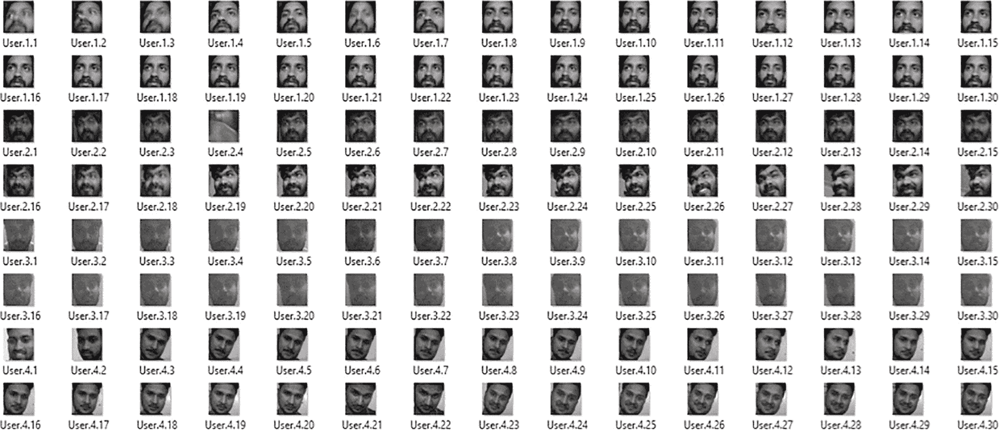

**图 6.12** 店内客户数据集。

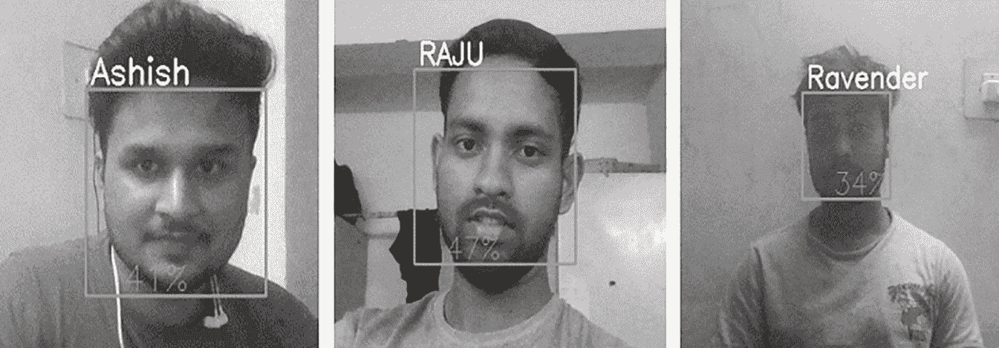

**图 6.13** 检测到的客户脸部。

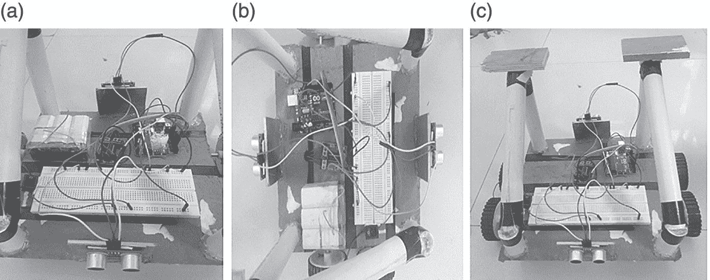

**图 6.14** 推车移动模块硬件：(a) 前向，(b) 后向，(c) 双向。


**图 6.15** RFID 模块硬件。¶ 来源：`Arduino Serial Monitor 2.0`。


**图 6.16** 商店内的产品识别。

在实时场景中，每辆推车都有唯一的识别号，这将帮助客户，在结算时避免任何客户遇到问题。

## 6.5.2 关于 IoT 安全性的讨论

如今，大多数社区使用无线网络，如 `Wi‐Fi`、`Zigbee`、`GSM` 等进行自动化和实时监控。但 `IoT` 系统面临着被黑客攻击的威胁。因此，为了确保实时使用 `IoT` 模块的安全，采取以下措施更为 [1, 25,37–40]。

1. 用户不应在云端共享和存储个人数据及密码。用户应使用经过验证的网站安装软件。

2. 用户不应安装任何未经身份验证的恶意软件。

3. 用户不需要时应关闭 `Wi‐Fi` 网络和 `IoT` 网络，因为基于手机的应用程序更容易受到攻击。

4. `IoT` 服务供应商应使用认证软件进行智能设备应用。

5. `IoT` 服务供应商应为智能手表、`IoT` 传感器、`IoT` get、手机上的健康应用以及其他 `IoT` 设备提供定期软件补丁。这提高了 `IoT` 设备的安全性。这些修复应能够处理最新的恶意软件和病毒。

6. 房主应谨慎，确保没有未经许可的未认领 `IoT` 设备被安装或放置在他们的财产上。随后，黑客可能会利用这些设备进行恶意目的。

## 6.6 结论

今天，在商场或超市购物一天已是一项日常活动。在周末和特价销售日，可以看到商场内人如牛。人们购买各种物品并放入推车，前往结算台。收银员使用条码扫描枪在结算台扫描账单。本章旨在开发一种用于智能购物和结算的自动推车系统，以最大限度地减少结算台的人力短缺。这里的核心思想是方便客户缩短日常购物中购买产品花费的时间。所提模型配备四个模块：(i) 使用 `LBPH` 进行脸识别以获取客户详情；(ii) 使用连接到 `Arduino Uno` 板的超声波传感器使用户独立行走的同时防止与其他物体碰撞；(iii) 使用贴在物品上的 `RFID` 标签扫描并计算购物车产品，并使用 `IoT` 技术发送数据，以便于结算和商店库存警报；以及(iv) 用于检测周围商店过道的对象分类和物品分类。

## 参考文献

1. **1** Shraddha, D.D., Trupti, D.J., and Priyanka, S.S. (2016). `IoT‐based intelligent trolley for the shopping mall. *International Journal of Engineering Development*.

2. **2** Sarac, A., Absi, N., and Peres, S. (2010). A literature review on the impact of `RFID` technologies on supply chain. *International Journal of Production* 77–95.

3. **3** Ali, Z. and Sonkus, R. (2014). RFID based shopping: an overview. In: *International Conference on Advances in Communication* Technologies.

4. **4** Yewatkar, A., Inamdar, F., Singh, R., and Bandal, A. (2016). Smart cart with automatic billing. *7th International Conference on Communication and Virtualization*.

5. **5** Jalkote, V., Patel, A., Gawande, V., et al. (2013). Futuristic trolley with amalgamation of `RFID` and `ZigBee`. *International Journal of Computer Science* 209–212.

6. **6** Agarwal, A.A., Sultania, S. (2011). RFID based automatic cart. *Control Theory and Informatics* 39–44.

7. **7** McBeath, B. (2013). The Explosion of Retail Item‐level RFID: A Foundation for Retail*, Chain Research.

8. **8** Kumar, R., Gopalakis, K., and Ramesha, K. (2013). Intelligent shopping cart. *International Journal of Engineering Science* 499–507.

9. **9** Kamble, S., Meshram, S., Thokal, R., and Gakre, R. (2014). Developing a multitasking trolley based on `RFID` technology. *International Journal of Soft Computing and Engineering* 179–183.

10. **10** Bhatwal, P. and Chamoli, O. (2015). Automated self‐billing system using `RFID` technology. *International Journal of Emerging Trends in Computer Science* 212.

11. **11** Lee, J.G., Kim, M.S., Hwang, T.M., and Kang, S.J. (2016). A mobile robot that can follow and lead humans by detecting user location and behavior with wearable devices. *IEEE International Conference on Consumer Electronics*, 209–210.

12. **12** Chiang, H.H., You, W.T., Lin, S.H., et al. (2016). Development of smart shopping carts with customer‐oriented service. *2016 International Conference on System Science and Engineering*, 1–2.

13. **13** Wu, B.F., Yao, S. J., Hou, L.W., et al. (2016). Intelligent shopping assistant system. *2016 International Automatic Control Conference*, 236–241.

14. **14** Ahmed, A., Guo, J., Ali, F., et al. (2018). `LBPH based improved face recognition at low resolution. *International Conference on Artificial Intelligence and Big Data*, 144–147.

15. **15** Zhao, X. and Wei, C. (2017).一种基于改进 LBPH 算法的实时人脸识别系统。*第二届 IEEE 信号与图像处理会议*，新加坡（2017 年 8 月 4–6 日）。纽约：IEEE, 第 72–76 页。

16. **16** Garg, V. and Garg, K. (2016). 使用 Haar 级联分类器的人脸识别。*新兴技术与创新研究杂志*。3: 140–142。

17. **17** Xiang, Z., Tan, H., and Ye, W. (2018). 密集网格 HOG 特征在人脸识别中相比 Gabor 和 LBP 的卓越特性。*IEEE Access* 6: 29306–29319。

18. **18** Ghai, D., Gera, D., and Jain, N. (2016). 基于 DWT 和 K-means 聚类的从图像提取文本的新方法。*国际计算智能系统期刊* 9: 900–916。

19. **19** Ghai, D. and Jain, N. (2019). 多尺度小波分解和 `k`‐means 聚类文本提取的对比分析。*无线个人通信* 109: 455–490。

20. **20** Kumar, S., Singh, S., and Kumar, J. (2019). 使用混合特征和 SVM 分类器的多人脸检测。在：*数据与通信网络*，智能系统与计算进展，847 (L.C. Jain, V.E. Balas 和 P. Johri 编)。新加坡：Springer [`doi.org/10.1007/978‐981‐13‐2254‐9\_23`](https://doi.org/10.1007/978-981-13-2254-9_23)。

21. **21** Kumar, S., Singh, S., and Kumar, J. (2021). 使用改进的 SegNet 架构和模糊估计技术的人脸欺骗检测。*国际生物识别学杂志* 13: 131–149。

22. **22** Kumar, S., Singh, S., and Kumar, J. (2018). 使用多特征方法的机器学习人脸活体检测。*无线个人通信* 103: 2353–2375。

23. **23** Kumar, S., Singh, S., and Kumar, J. (2018). 使用 haar 小波特征和 SVM 的遗传算法进行自动实时面部表情检测。*无线个人通信* 103: 2435–2453。

24. **24** Kumar, S., Prasad, K.M.V.V., Gupta, M.M. 等人 (2020)。 Joyo：智能家居的家务助手技术。*计算、电气与电子智能技术国际会议*，印度班加罗尔（2020 年 10 月 9–10 日）。纽约：IEEE, 第 355–360 页。

25. **25** Kumar, S., Swetha, S., Kiran, V.T., and Johri, P. (2018)。 基于 IoT 的智能家居监控与自动化。*2018 国际计算、电力与通信技术会议*，印度大格诺伊（2018 年 9 月 28–29 日）。纽约：IEEE, 第 786–790 页。

26. **26** Srikrishnaswetha, K., Kumar, S., and Johri, P. (2018)。*各种人脸检测技术的对比研究*。*第四届计算、通信与自动化国际会议*，印度大格诺伊（2018 年 12 月 14–15 日）。纽约：IEEE, 第 1–5 页。

27. **27** Srikrishnaswetha, K., Kumar, S., and Mahmood, M.R. (2019)。 使用人脸识别和 IoT aadhar 的智能电子投票机研究。在：*电子与通信工程创新*，网络与系统讲义录，第 65 卷 (H. Saini, R. Singh, G. Kumar 等 编)。新加坡：Springer [`doi.org/10.1007/978‐981‐13‐3765‐9\_10`](https://doi.org/10.1007/978-981-13-3765-9_10)。

28. **28** Srikrishnaswetha, K., Kumar, S., and Ghai, D. (2020)。 使用具有唯一身份号和 IoT 的生物识别技术的安全电子投票机。在：*电子与通信工程创新*，网络与系统讲义录，第 107 卷 (H.S. Saini, R.K. Singh, M.T. Beg 和 J.S. Sahambi 编)。新加坡：Springer [`doi.org/10.1007/978‐981‐15‐3172‐9\_31`](https://doi.org/10.1007/978-981-15-3172-9_31)。

29. **29** Sarala, T., Sudha, Y.A., Sindhu, K.V. 等人 (2018)。 商场用智能电子购物车。*第三届 IEEE 电子、信息与通信技术最新趋势会议*，印度班加罗尔（2018 年 5 月 18–19 日）。纽约：IEEE, 第 2422–2427 页。

30. **30** Keerthana, S., Inaya, S.A., and Abarna, S. (2018)。 为视障人士设计的智能购物辅助器。*生物医学与药学杂志* 11: 2143–2149。

31. **31** Devipriya, D., Sri, V., and Inna, M. (2018)。 针对视障者的智能商店助手。*计算、通信与信息学进展国际会议*，印度班加罗尔（2018 年 9 月 19–22 日）。

32. **32** Gunawan, A.A., Stevanus, V., Farley, A. 等人 (2019)。 使用安卓手机的智能购物车。*Procedia Computer Science* 157: 629。

33. **33** Anitha, R., Subburam, S., Keerthana, G., and Yoganandar, K. (2020)。 带有自动账单功能的智能购物车。*欧洲分子与临床医学杂志* 11: 2268。

34. **34** Das, T.K., Tripathy, A., and Srinivasan, K. (2020)。 购物智能购物车。*2020 系统、计算与自动化国际会议*，印度本地遮迪里（2020 年 7 月 3–4 日）。纽约：IEEE, 第 1–5 页。

35. **35** Shailesh, S., Deb, P., Chauhan, R., and Tyagi, V. (2021)。 智能购物车。*2021 先进计算与创新技术国际会议*，印度大格诺伊（2021 年 3 月 4–5 日）。纽约：IEEE, 第 242–245 页。

36. **36** Shete, V., Shaikh, A., Sawant, R. 等人 (2022)。 视障人士购物。*计算机工程评论* 9: 122–134。

37. **37** Patil, S., Mathad, S., Gandhad, S., and Ellemmi, M. (2022)。 使用 Arduino 的智能购物车。*IAES 人工智能杂志* 2: 2268。

38. **38** Raju, B.A.N., Ghai, D., and Rawal, K. (2021)。 未来系统的设计。在：*智能城市的大数据分析与智能技术*，223–247。CRC Press。

39. **39** Ghai, D., Tiwari, S., and Das, N.N. (2021)。 底层增强进化算法的数字图像安全。*信息安全与应用杂志* 61: 1–8。

40. **40** Nanda, S.K., Ghai, D., and Pande, S. (2021)。 基于 VGG‐16 的视频取证人脸口罩识别框架。在：*数据分析与管理会议*，数据工程与通信技术讲义录，第 91 卷 (D. Gupta, Z. Polkowski, A. Khanna 等 编)。新加坡：Springer。[`doi.org/10.1007/978‐981‐13‐3765‐9\_10`](https://doi.org/10.1007/978-981-13-3765-9_10)。

股市是买方和卖方的聚集地，为交易各种公司的股票提供了一个场所。金融市场通过促进国际贸易、信息汇集、折现以及传播有关机构和经济未来前景的信息，助力了经济增长。全球证券交易所每天交易的金额高达数万亿美元的金融证券。随着技术的出现和诸如 `Zerodha` 和 `Upstox` 等在线交易应用的普及，普通人对股市的兴趣日益增长。在印度等新兴国家，许多人在新冠肺炎（Covid-19）疫情期间被股市所吸引。这一点可以从 2020 年在 `Zerodha` 等在线平台上开的新证券托管账户（demat accounts）数量创历史记录中得到证实。


# 股市预测

股市预测长期以来是一个困难且令人困惑的问题，引起了普通大众、该领域专业人士以及经济学家和计算机科学家等专家的关注。成功预测股价走势可以通过战略性行动获得丰厚的回报，这使得股市趋势预测成为了一项值得投入关注和努力的任务。股市预测是一项非常艰巨的工程，必须解决各个方面的问题才能做出有效的市场预测。考虑到股票价格取决于许多方面的因素，仅考虑一或两个标准不足以提供足够的信息来估计股价走势。因此，包含尽可能多的相关和有用数据以确保更准确的估计是合适的。

那些做出正确买卖选择的投资者可以实现盈利。旨在分析趋势的股市预测是复杂的，因为股市在趋势方面本质上是充满噪声的，并且存在大量的波动性 [1]。现有方法中已开发出多种策略来预测股市趋势。金融市场预测的可靠性和基于模型的获利交易的可行性受到一系列因素的影响。这些因素包括市场成熟度、所使用的预测方法、预测的时间范围，以及用于评估模型和模拟交易所采用的方法 [2]。

股市预测的努力始于基本面分析和技术分析。基本分析是一种投资分析，其中对公司的过去和预估销售额、利润和其他财务参数，以及基于影响公司价值的因素的其他经济因素进行分析。这类分析根据股票的内在价值（即公允价值）来评估股价。这种方法最适用于长期预测。技术分析基于图表和趋势。这种分析利用历史股价来预测价格趋势。机器学习（`ML`）和 `AI` 模型的输入特征也可以结合基于经验的技术指标。`ML` 的基本思想是通过数据提炼知识。此外，使用线性模型进行时间序列预测以进行股市预测正非常流行，包括 `ARIMA` 和 `GARCH`。21 世纪的特点是电子市场的快速发展，以及由计算技术实现的计算机驱动高频交易的出现 [3]。考虑到股市的混沌本质，人工神经网络（`ANNs`）等非线性模型随后被用于克服线性模型的局限性。利用时间序列分析技术进行股票预测对于创建股票交易策略和获得更高的交易回报至关重要 [4]。用于预测股市的 `ML` 技术正盛行（注：此处 vogue 译为流行）。许多利用 `ML` 进行金融时间序列预测的研究似乎能够以高达 80% 的准确率预测未来的市场事件 [2]。分析师和投资者非常重视预测股价变化的能力。做出准确且高效的股市预测这一挑战非常复杂，应该考虑各种因素。股票价格对市场变化、季度财报公告和不断变化的消费者模式做出反应。交易者利用源自每日股票数据的各种技术指标。

本章的目的是对预测未来趋势和股票收益的方法进行深入研究。本章考虑了以往研究中使用的多种股市预测方法。

## 7.2 影响股价的因素

股市收益可以通过基于历史股票收益以及财务和经济指标的方法进行预测。股市收益的预测使投资者调查了预测性的基础。用于预测的各种变量应被考虑在内 [5]。预测股票趋势是一项困难的技术，因为它取决于多种因素，例如特定的市场模式、投资者的预期以及财务状况。许多新闻和事件也会影响股价。此外，股市在定义上是动态、复杂、充满噪声、非参数且非线性的。由于波动、异常和趋势变化等复杂特性，时间序列预测面临挑战。每天都会产生大量的股票数据，并从证券交易所网站、经济评论等渠道获取。不同的研究使用了不同的因素集作为输入 [6]。

以下数据已被用于预测股票：

1.  **市场数据**：市场数据是指与金融市场及其内部交易活动相关的信息和统计数据。它包含了有关价格和成交量的各种类型数据。也包括现价、开盘价、收盘价、最高和最低价。
2.  **文本数据**：来自新闻、社交媒体和网络搜索的个体文本被称为文本数据。作为替代数据源，这些统计数据难以获取和评估。然而，它们可以提供聚合市场数据中未反映的价值见解。此外，它们可能提供聚合市场数据中未反映的有用信息。
3.  **宏观经济数字**：国内生产总值（`GDP`）、通胀率、利率等宏观经济指标揭示了特定国家、地区或行业的经济状况。这些指标与股市存在联系，因为它们反映了整个市场，并可以验证股票涨的有效性。
4.  **图像数据**：图像数据可用于创建股市数据可视化图，例如 K 线图和折线图。一些研究人员研究了使用卫星图像或航空图像收集与经济活动相关的信息，例如分析停车场的占用率或估计石油储量水平，这些信息可能会间接影响某些股票或行业。
5.  **基本面数据**：会计数据（如资产和负债）是最典型的基本面数据，按季度报告。公司的财务信息，如销售额、收益、资产、负债和其他财务比例，构成了基本面数据。基本面数据揭示了公司的财务状况，并能影响其股价。
6.  **推荐数据**：分析师推荐数据是指金融分析师或经纪公司提供的关于特定股票或投资机会的意见和建议。分析师对公司和行业进行研究和分析，并根据其发现发布包含特定股票买入、卖出或持有建议的报告。

## 7.3 市场可以被预测吗？

有效市场假说（`EMH`）是金融理论的核心观点，认为市场价格代表了所有可用信息。因此，无法获得无风险利润 [[7]](#c07.xhtml#c7-bib-0007)。根据 `EMH`，由于市场价格呈随机波动，无法使用过去的数据预测未来价值。如果一个投资者在风险调整后收益方面能够持续优于市场，`EMH` 可能会被打破。尽管该假说很流行，但并没有被广泛接受，因为它无法解释许多微小但重大的市场失灵案例。这些异常包括机构投资者获得更高的回报率、市场的过度反应和反应不足，以及资产价格的高波动性。

### 7.3.1 不同的股票预测技术

许多预测模型假设利用过去的数据来预见未来的股市波动。多种机器学习（`ML`）和计量经济学方法已用于股市预测。金融时间序列预测（频繁使用机器学习技术）领域声称，复杂的预测算法可以有效预测股市的价格走势，并且基于这些预测进行交易可以产生利润。相反，金融经济学家则提到金融市场的信息效率，这对价格预测和获利交易的前景表示怀疑 [[2]](#c07.xhtml#c7-bib-0002)。一些研究利用了两种或两种以上方法的组合来共同预测股市。许多研究工作使用了基本面数据和技术指标的结合。

*   **基本面分析**：在此类分析中，影响业务或行业的底层元素被用作预测属性 [[8]](#c07.xhtml#c7-bib-0008)。基本面分析关注基本面信息，主要包含在公司的年度报告中，例如公司的销售和利润、各种财务参数的年度增长率、公司在市场中的地位及其前景 [[9]](#c07.xhtml#c7-bib-0009)。基本面分析的一个重要方面是经济分析，它侧重于宏观经济参数，如国民收入、出口数据和利率，这些参数本应影响在证券交易所上市的运营。此外，行业信息（本应影响特定板块的股票）也被纳入基本面分析中。通过使用这些信息，可以得出公司未来的现金流，从而得出公司的价值，并用于预测其股价。对股市预测的早期研究显示了对基本指标和相关变量的兴趣 [10, 11]。基本面分析与人工神经网络（`ANNs`）结合可以产生更优的回报 [12, 13]。
*   **技术分析**：技术分析是指对之前的股票价格和成交量信息进行评估以预测股价变化 [[14]](#c07.xhtml#c7-bib-0014)。技术分析基于对可交易工具当前供需关系的分析。多种技术指标被用于生成“买入”和“卖出”信号。大多数通过机器学习技术进行股价预测的研究工作采用了技术指标 [[15]](#c07.xhtml#c7-bib-0015)。技术分析和历史市场波动有在活跃交易环境中预判每日收益的能力 [[16]](#c07.xhtml#c7-bib-0016)。使用了移动平均线、震荡器和趋势线等技术指标。一些研究将技术指标作为预测股市的输入 [17, 18]。在 `AI` 时代，技术指标作为神经网络的输入以提高预测准确性 [19, 20]。
*   **情绪分析**：随着全球互联网的普及，互联网和社交媒体传播了大量与股票相关的信息，并方便用户表达对相关股票的观点。情绪分析方法涉及分析投资者情绪和市场心理以判断市场方向。情绪分析包括监控新闻、社交媒体和市场指标以评估市场参与者的整体情绪和倾向。纳入某些公共情绪维度可以提高股市预测的准确性 [[21]](#c07.xhtml#c7-bib-0021)。当应用当时，情绪分析工具辅助的投资可以产生回报。情绪分析和集体智能可以自动计算股市的未来表现 [22]。社交媒体文本数据的特征提取可以描述投资者的情感倾向，并提高股价预测的精确度 [23]。新闻标题中的文本信息与股价预测相关 [24, 25]，使用来自股票价格的技术指标和来自文本新闻文章的情绪来构建一个分层深度学习神经网络预测模型，这带来了更多的预测增强。

## 7.4 使用预测分析进行股票预测

一种被称为预测性分析的数据驱动方法结合了统计算法和历史数据来预测即将发生的事件或结果。预测性分析是创建算法的过程，可以使用先前的股市数据预测未来的股票价格或寻找潜在的交易机会。与股市及其个股相关的海量结构化和非结构化异构数据，可以通过先进的人工神经网络进行有效分析。在预测分析方面，机器学习和人工智能被广泛使用。

以下是利用预测分析进行股票预测的典型步骤：

1.  **数据收集**：收集你想要研究的股票的历史数据。这通常包括每日或日内价格数据、成交量以及其他相关信息，如财务报表或经济指标。此外，为了进行更全面的研究，可以包含公司特定数据和新闻情绪数据。
2.  **数据预处理**：通过处理缺失值、离群值，并在必要时对数据进行归一化来清洗和预处理数据，确保数据符合分析格式。
3.  **特征选择**：确定对股票定价产生影响最重要的特征或元素。技术指标、财务比率、经济指标和新闻评分都是示例。在特征选择方面，研究人员调查了股价与某些变量之间的关系，例如政治因素、宏观因素和投资者情绪，并将其纳入预测模型。
4.  **模型选择**：根据事实和目标选择合适的预测模型。回归方法、时间序列模型如 `ARIMA`、`GARCH` 或 `ML` 算法通常用于股票预测。
5.  **模型训练**：将历史数据分为两部分：训练集和测试集。使用训练集通过拟合历史数据来训练预测模型，调整模型参数并优化性能。
6.  **评估与调优**：使用测试集评估模型的性能。均方误差（`MSE`）、均方根误差（`RMSE`）、准确率和精确率-召回率是常用的股票预测指标。如果模型性能不佳，可以进行超参数调优和模型调整以提高准确性。
7.  **预测与决策**：一旦模型完成训练和评估，使用它来预测未来股价或根据新数据发现潜在交易机会。监控并分析预期结果以确定模型的有效性，并在必要时调整方法。

### 7.4.1 使用 ML 和 AI 进行股票预测

专家长期以来强调预测的需求，尤其是当环境变得更加混乱和动荡时。预测的技术进步可以获得必要指标集的辅助。相反，预测基于以往事件，且无法轻松整合所有信息，特别是非结构化信息。`AI` 与数据分析的结合将使投资者受益。

由于金融市场的不规则性，简单模型无法准确预测未来资产价值 [26]。因此，一些投资者和机构使用 `ML` 和 `AI` 算法在大量数据中寻找模式或趋势。这些技术可以帮助根据历史数据生成预测。许多 `ML` 模型已证明了利用股价、汇率或金融指数等金融市场数据进行时间序列预测的 `ML` 模型价值。它们还根据模型预测识别了盈利性交易机会。观察发现，`ML` 算法在预测金融市场方面优于大多数传统的随机方法 [27]。

## 7.5 神经网络

神经网络作为一种智能信息挖掘方法和深度学习方法，通过监督学习模型从数据集和经验中逐渐学习。神经网络提供了一种革命性的技术，在建模阶段不需要预先指定，因为它们可以自己理解变量内在的联系。这在证券投资领域特别有益，那里有很多假设，但对决定股价的原理了解较少。由于它们具有学习输入和输出之间非线性映射的天赋 [28]，神经网络被用于预测股票市场价格 [29]。由于资本市场产生了大量信息，机器将掌握许多设计，允许它们做出合理的预测 [30]。由于其能够学习数据中复杂的模式和关系，神经网络在股票预测中得到了广泛使用。

### 7.5.1 人工神经网络

`ANN` 是一种旨在理解标准 `ML` 方法或现有神经网络无法解决的复杂问题的算法。`ANNs` 将人类从经验中学习能力转移到一个可以模拟大脑工作原理的计算机环境中。`ANNs` 构建了比大脑更复杂的互连网络 [31]。该方法使用代数方程将数据引导至模型或时间序列线。通过自学习方法，`ANN` 可以发现隐藏特征。这些是良好的近似器，可以找到巨大复杂数据集的输入和输出关系。因此，`ANN` 是预测股价的合适替代方案。`ANN` 用于揭示股票性能与相关财务及技术变量之间的复杂相关性 [32]。通常，财务变量作为输入，股票性能是结果输出，用于 `ANN` 应用。

反向传播（`BP`）算法是一种广泛用于训练人工神经网络（`ANN`）的优化技术。`BP` 是一种监督学习算法，用于在训练过程中调整神经网络的权重和偏置，旨在最小化预测输出与实际输出之间的差异。在大多数相关研究中，`BP` 算法被广泛使用，特别是在训练数据集方面。然而，由于股票市场数据具有高水平的噪声和复杂的维度，`ANN` 在学习模式方面存在一些局限性。因此，许多研究应用了混合模型，将传统的 `BP` 算法与其他算法结合使用。`ANN` 与遗传算法（`GAs`）进行特征离散化的混合模型在这种背景下被广泛使用。经典的 `BP` 学习算法在 `GA` 和模拟退火（`SA`）等全局搜索技术的帮助下，可以显著提高预测精度 [[36]](#c07.xhtml#c7-bib-0036)。可以使用增强型算法（如改进的麻雀算法）对神经网络进行改进。利用该算法调优 `BP` 神经网络的初始权重和阈值，实现了对股价的高精度短期预测 [[37]](#c07.xhtml#c7-bib-0037)。改进的正弦余弦算法（`ISCA`）结合 `BP` 神经网络以及 `Google Trends`，实现了 87% 的预测精度 [[38]](#c07.xhtml#c7-bib-0038)。神经网络在利用非线性独立分量分析（`NLICA`）辅助特征提取时，可以提高预测精度 [[39]](#c07.xhtml#c7-bib-0039)。

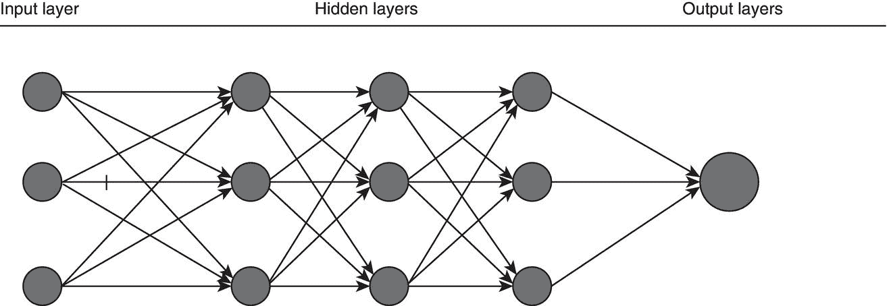

`图 7.1` 人工神经网络示例。

### 7.5.1.1 循环神经网络 (RNN)

根据架构和用途的不同，`ANN` 有多种种类。前馈神经网络（`FNN`）是 `ANN` 的一种类型，信息单向流动，即从输入层流向输出层。`FNN` 将历史股票价格信息以及相关特征（如成交量、技术指标或经济数据）作为输入，预测未来的股价或市场趋势。股票市场预测研究主要使用 `RNN`，这是一种通过考虑信息的时间维度来处理序列数据的神经网络架构。`RNN` 的主要特征是能够捕捉并将从之前时间步的信息传播到当前时间步，允许它们对序列数据中的依赖和模式进行建模。在股票预测中，`RNN` 可用于处理随时间变化的历史股价数据和其他相关特征，捕捉有助于预测股价的模式和关系。

被称为长短期记忆（`LSTM`）的 `RNN` 架构特别擅长识别序列数据中的长期依赖关系和模式。`LSTM` 网络由记忆单元组成，这些单元随时间存储和更新信息，以及用于调节信息通过网络流的门结构。组成 `LSTM` 的三个门是输入门、遗忘门和输出门。不符合算法的信息将被遗忘门擦除。因此，只有符合要求的数据会被保留 [[40]](#c07.xhtml#c7-bib-0040)。为了预测股价，可以对 `LSTM` 网络进行训练，以学习历史股价数据以及其他相关特征中的模式和关系。通过考虑数据的序列性质并结合记忆单元，`LSTM` 网络能够捕捉到对预测未来股价至关重要的趋势、季节性或其他模式。

`LSTM` 基本上作为一个三步过程进行运行。在第一步中，`LSTM` 决定在特定时间步从单元中省略哪些信息。这一决策是在 `sigmoid` 函数的帮助下做出的，该函数利用先状态和当前输入计算函数。第二层包含两个函数，即 `sigmoid` 函数和 `tanh` 函数。`sigmoid` 函数决定哪些值被允许通过（0 或 1）。`tanh` 函数为通过的值分配权重，在 -1 到 1 之间决定其重要性水平。第三阶段确定最终结果。首先，需要运行 `sigmoid` 层，确定单元状态的哪些部分进入输出。然后将单元状态传递给 `tanh` 函数，该函数将值推向 -1 和 1 之间，并乘以 `sigmoid` 门的输出。

卷积神经网络（`CNN`）可以应用于股票预测的某些方面。`CNN` 是一种前馈神经网络。与传统神经网络相比，`CNN` 具有更多的隐藏层。为股票预测挑战设计 `CNN` 架构可能是一个值得进一步研究的关键问题。首先，`CNN` 可用于数据可视化目的，将金融数据转换为视觉表示，如 K 线图、市场深度图或热力图。这些可视化可以帮助交易者和分析师洞察市场趋势和模式。其次，`CNN` 可能用于金融时间序列数据的特征提取和预处理。接下来，`CNN` 还可以通过处理新闻文章、社交媒体帖子或财务报告等文本数据进行情感分析。`CNN` 还可以分析替代数据源，如卫星图像、网络抓取数据或来自传感器的视觉数据。应用深度 `CNN` 框架从大量金融变量中提取高层特征，可以显著提高预测精度 [[5]](#c07.xhtml#c7-bib-0005)。

`RNN` 受到梯度消失问题 [41] 的限制，这使得它们难以识别序列数据中的长期依赖关系。另一种名为门控循环单元（`GRU`）的 `RNN` 被用于解决这个问题。`GRU` 的主要特点是引入了门控机制，允许网络控制跨时间的信息流，从而使网络能够在更长的序列中保留和更新相关信息。通过门控机制，`GRUs` 擅长捕捉序列数据中的长距离依赖关系，使其更适用于对长期信息保留至关重要的应用。与 `LSTM` 不同（其输出门控制其他单元看到的内容），`GRU` 没有受控的内存暴露机制。`GRUs` 可用于时间序列预测，将历史股价和其他相关信息输入网络，由模型预测未来的股票价格或市场趋势。`GRUs` 检测数据中时间依赖关系的能力可能对于识别股价变动中的模式和趋势很有用。通过学习输入数据的有意义的表示，模型可以捕获可能影响股价的复杂模式。此外，`GRUs` 还可以从时间序列数据中提取特征。输入中的时间序列事件可以被 `LSTM` 和 `GRU` 模型成功捕获。此外，利用全连接神经网络来结合许多独立的预测结果以提高预测准确性 [42]。`GRUs` 可用于利用金融新闻文章或与股市相关的社交媒体贴文等文本数据进行情感分析。输入历史价格和情感评分的 `GRU` 模型取得了极佳的预测结果 [24]。将金融新闻情感与股票属性结合作为输入可以显著提高 `LSTM` 和 `GRU` 的性能 [43]。整合了多条 `CNN` 流水线以及单向或双向 `GRUs` 的深度学习模型在增强股票预测方面发挥了重要作用 [44]。其变体之一嵌套 `GRU`（`NGRU`）采用嵌套结构来增加模型深度并消除股票数据特征中的噪声。通过学习股票数据的特征，研究发现 `NGRU` 更加敏感且有效。

### 7.5.1.2 深度学习模型


深度学习专注于构建多层 `ANNs`。深度学习方法使用数据来以更少的假设解决复杂问题。深度学习自动从数据中提取特征，要求很少或完全不需要人工干预特征选择。“深”一词是指代构成神经网络架构的许多层级。深度学习使用具有多个隐藏层的神经网络，允许网络在不同抽象层次上学习数据的表示。网络中的每一层都从前一层学习到的表示中提取更高层次的特征，从而创建出学习特征的层级结构。深度神经网络整合了深度学习和神经网络的优点。因此，它们比传统的 ML 算法能更有效地处理非线性问题 45。此类网络能够以更少的人力投入和极少的调优获得更高的精度。深度学习已应用于股票预测，特别是在时间序列分析的背景下，因为它具有理解从过去数据中提取复杂模式和表示的能力。深度学习模型需要海量的输入数据来构建复杂的神经网络模型 46。在这里，市场数据是最佳选择也是最流行的选择。文本数据是第二种常用类型。这是因为社交媒体和在线新闻网站非常流行，且获取这类数据很容易。大多数深度学习系统根据之前的股价、成交量或衍生数据产生预测 4。深度学习对于股市预测可能具有吸引力，因为它可以从历史数据中理解复杂的模式和表示 47。深度学习方法在股市预测中具有吸引力，因为它可以通过多种网络结构、激活函数和其他模型参数来提高预测精度。根据实证发现，数据表示方式对神经网络的性能有显著影响。

## 7.6 结论

股票预测一直是从业者和投资者关注的领域。然而，由于市场是复杂的、波动的且非线性的，这项任务具有挑战性 41451017420。随着 AI 的出现，将基础分析和技术分析的变量引入 `ANNs` 已被广泛使用。结合多种方法并包含特征选择可以增加预测准确性。循环神经网络特别是 `LSTM`、`GRU` 和 `CNN` 现在被广泛应用于股票预测。神经网络中的传统反向传播算法通过其他多种方法改进了预测精度。

1. **4** Liu, H., Zhao, T., Wang, S., and Li, X. (2023). 结合行业属性和股票价格数据的股票排名预测方法。Information Processing & Management* 60 (4): 103358. [`doi.org/10.1016/j.ipm.2023.103358`](https://doi.org/10.1016/j.ipm.2023.103358).

2. **5** Hoseinzade, E. and Haratizadeh, S. (2019). CNNpred: 使用多样化变量的 CNN 股票市场预测。Expert Systems with Applications* 129: 273–285. [`doi.org/10.1016/j.eswa.2019.03.029`](https://doi.org/10.1016/j.eswa.2019.03.029).

3. **6** Kumbure, M.M., Lohrmann, C., Luukka, P., and Porras, J. (2022). 股票市场预测的机器学习技术和数据：文献综述。Expert Systems with Applications* 197: 116659. [`doi.org/10.1016/j.eswa.2022.116659`](https://doi.org/10.1016/j.eswa.2022.116659).

4. **7** Fama, E.F. (1970). 有效资本市场：理论与实证研究回顾。The Journal of Finance* 25 (2): 383–417. [`doi.org/10.2307/2325486`](https://doi.org/10.2307/2325486).

5. **8** Bustos, O. and Pomares‐Quimbaya, A. (2020). 股市波动预测：系统性综述。Expert Systems with Applications* 156: 113464. [`doi.org/10.1016/j.eswa.2020.113464`](https://doi.org/10.1016/j.eswa.2020.113464).

6. **9** Nair, B.B. and Mohandas, V.P. (2015). 用于股票交易的智能推荐系统。Intelligent Decision Technologies* 9 (3): 243–269. [`doi.org/10.3233/IDT‐140220`](https://doi.org/10.3233/IDT-140220).

7. **10** Ou, J.A. and Penman, S.H. (1989). 财务报表分析与股票收益预测。Journal of Accounting and Economics* 11 (4): 295–329. [`doi.org/10.1016/0165-4101(89)90017-7`](https://doi.org/10.1016/0165-4101(89)90017-7).

8. **11** Holthausen, R.W. and Larcker, D.F. (1992). 使用财务报表信息预测股票收益。Journal of Accounting and Economics* 15 (2–3): 373–411. [`doi.org/10.1016/0165-4101(92)90025-W`](https://doi.org/10.1016/0165-4101(92)90025-W).

9. **12** Lam, M. (2004). 财务绩效的神经网络技术：整合基本面与技术面分析。Decision Support Systems* 37 (4): 567–581. [`doi.org/10.1016/S0167-9236(03)00088-5`](https://doi.org/10.1016/S0167-9236(03)00088-5).

10. **13** Shen, K.Y. and Tzeng, G.H. (2015). 基于基本面分析的价值股选择组合软计算模型。Applied Soft Computing* 37: 142–155. [`doi.org/10.1016/j.asoc.2015.07.030`](https://doi.org/10.1016/j.asoc.2015.07.030).

11. **14** Lohrmann, C. and Luukka, P. (2019). 使用随机森林对标普 500 日内收益进行分类。International Journal of Forecasting* 35 (1): 390–407. [`doi.org/10.1016/j.ijforecast.2018.004`](https://doi.org/10.1016/j.ijforecast.2018.004).

12. **15** Kumar, G., Jain, S., and Singh, U. (2020). 使用计算智能进行股市预测：综述。Archives of Computational Methods in Engineering* 28 (3): 1069–1101. [`doi.org/10.1007/s11831-020-09413-5`](https://doi.org/10.1007/s11831-020-09413-5).

13. **16** Bitvai, Z. and Cohn, T. (2015). 多任务学习分析下的日内交易利润最大化。Machine Learning* 101: 187–209. [`doi.org/10.1007/s10994-014-5480-x`](https://doi.org/10.1007/s10994-014-5480-x).

14. **17** Brock, W., Lakonishok, J., and LeBaron, B. (1992). 简单的交易规则与股票收益的随机属性。The Journal of Finance* 47 (5): 1731–1764. [`doi.org/10.1111/j.1540-6261.1992.tb04681`](https://doi.org/10.1111/j.1540-6261.1992.tb04681).

15. **18** Bessembinder, H. and Chan, K. (1998). 市场效率与技术分析的收益。Financial Management* 5–17. [`doi.org/10.2307/3666289`](https://doi.org/10.2307/3666289).

16. **19** Thawornwong, S., Enke, D., and Dagli, C. (2003). 作为股票交易决策者的神经网络：技术分析方法。International Journal of Smart Engineering Design* 5 (4): 313–325. [`doi.org/10.1080/102558103924527`](https://doi.org/10.1080/102558103924527).

17. **20** Sezer, O.B., Ozbayoglu, M., and Dogdu, E. (2017). 基于优化参数的深度神经网络股票交易系统。Procedia Computer Science* 114: 473–480. [`doi.org/10.1016/j.procs.2017.09.031`](https://doi.org/10.1016/j.procs.2017.09.031).

18. **21** Bollen, J., Mao, H., and Zeng, X. (2011). Twitter 情绪预测股市。Journal of Computational Science* 2 (1): 1–8. [`doi.org/10.1016/j.jocs.2010.1207`](https://doi.org/10.1016/j.jocs.2010.1207).

19. **22** Devi, K.N. and Bhaskaran, V.M. (2015). 用于市场预测的语义增强社交媒体情感。International Journal of Economics and Management* 9 (2): 678–682. [`doi.org/10.5281/zenodo.1100501`](https://doi.org/10.5281/zenodo.1100501).

20. **23** Ji, X., Wang, J., and Yan, Z. (2021). 基于深度学习技术的股票价格预测方法。International Journal of Crowd Science* 5 (1): 55–72. [`doi.org/10.1108/IJCS-05-2020-0012`](https://doi.org/10.1108/IJCS-05-2020-0012).

21. **24** Puh, K. and Bagić, M. (2023). 使用自然语言处理预测股市。American Journal of Business* 38 (2): 41–61. [`doi.org/10.1108/AJB-08-2022-0124`](https://doi.org/10.1108/AJB-08-2022-0124).

22. **25** Li, X., Wu, P., and Wang, W. (2020). 整合股票价格与新闻进行市场预测。Information Processing & Management* 57 (5): 102212. [`doi.org/10.1016/j.ipm.2020.102212`](https://doi.org/10.1016/j.ipm.2020.102212).

23. **26** Moghar, A. and Hamiche, M. (2020). 使用 LSTM 循环神经网络进行股市预测。Procedia Computer Science* 170: 1168–1173. [`doi.org/10.1016/j.procs.2020.03.049`](https://doi.org/10.1016/j.procs.2020.03.049).

24. **27** Patil, P., Parasar, D., and Charhate, S. (2021). 应用于股市的机器学习技术综述。Proceedings of DDCI 2021, Udaipur, India, 121–135.

25. **28** Adhikari, R. and Agrawal, R. (2014). 随机游走模型结合人工神经网络的时间序列预测。Neural Computing and Applications* 24: 1441–1449. [`doi.org/10.1007/s00521-013-1386`](https://doi.org/10.1007/s00521-013-1386).

26. **29** Shahvaroughi Farahani, M. and Razavi Hajiagha, S.H. (2021). 使用集成人工神经网络和元启发式算法进行股价预测。Soft Computing* 25 (13): 8483–8513. [`doi.org/10.1007/s00500-021-0575-5`](https://doi.org/10.1007/s00500-021-0575-5).

27. **30** Agarwal, D., Sheth, R., and Shekokar, N. (2021). 基于机器学习和神经网络的算法交易。在：Computer Networks, Big Data and IoT: Proceedings of ICCBI 2020, 407–421. Singapore: Springer.

28. **31** Chhajer, P., Shah, M., and Kshirsagar, A. 人工神经网络、支持向量机长短期记忆在股市预测中的应用。Decision Analytics Journal* 2: 100015. [`doi.org/10.1016/j.dajour.2021.100015`](https://doi.org/10.1016/j.dajour.2021.100015).

29. **32** Quah, T.S. and Srinivasan, B. (1999). 通过神经网络选择提高股票投资收益。Expert Systems with Applications* 17 (4): 295–301. [`doi.org/10.1016/S0957-4174(99)00041-X`](https://doi.org/10.1016/S0957-4174\(99\)00041-X).

33. Wiranata, R.B. and Djunaidy, A. (2021). 使用机器学习技术进行股市预测：一项全面且系统的文献综述。*Jurnal Ilmu Komputer dan Informatika* 14 (2): 91–112.

34. Mohammed, W.A. (2020). 股票预测的挑战。在：*当代企业中的估值挑战与解决方案*（S.D. Köseoğlu 编），234–252。 IGI Global [`doi.org/10.4018/978‐1‐7998‐1086‐5.ch013`](https://doi.org/10.4018/978-1-7998-1086-5.ch013).

35. Prasad, A., Bakhshi, P., and Guha, D. (2023). 使用深度学习预测印度 VIX 指数的每日变化方向。*IIMB Management Review* 35 (2): 149–163. [`doi.org/10.1016/j.iimb.2023.05.002`](https://doi.org/10.1016/j.iimb.2023.05.002).

36. Selvamuthu, D., Kumar, V., and Mishra, A. (2019). 使用人工神经网络在逐笔数据上进行印度股市预测。*Financial Innovation* 5 (1): 1–12. [`doi.org/10.1186/s40854‐019‐0131‐7`](https://doi.org/10.1186/s40854-019-0131-7).

37. Qiu, M., Song, Y., and Akagi, F. (2016). 人工神经网络在股市收益预测的应用：以日本股市为例。*Chaos, Solitons & Fractals* 85: 1–7. [`doi.org/10.1016/j.chaos.2016.01.004`](https://doi.org/10.1016/j.chaos.2016.01.004).

38. Liu, X., Guo, J., Wang, H., and Zhang, F. (2022). 基于 ISSA‐BP 神经网络的股市指数预测。*Expert Systems with Applications* 204: 117604. [`doi.org/10.1016/j.eswa.2022.117604`](https://doi.org/10.1016/j.eswa.2022.117604).

39. Hu, H., Tang, L., Zhang, S., and Wang, H. (2018). 使用结合 Google Trends 的优化神经网络预测股市方向。*Neurocomputing* 285: 188–195. [`doi.org/10.1016/j.neucom.2018.01.038`](https://doi.org/10.1016/j.neucom.2018.01.038).


# 8 预测性分析与网络安全

Mohammed Sayeeduddin Habeeb

沙特阿哈，金哈利德大学工程学院电气工程系

## 8.1 引言

在当今的数字时代，对技术和互连性的日益依赖，为网络安全领域带来了新的威胁和挑战。机构和企业是网络犯罪分子和黑客的首要目标。除了考虑业务策略和不断变化的市场之外，企业所有者目前正围绕网络安全以及他们取得的成就进行讨论。这些框架在管理网络风险方面起着至关重要的作用，其双重目标是：第一个是制定对抗网络攻击的策略，而第二个至关重要的目标是专注于制定主动预防并大幅减少影响的策略。

网络攻击已变得更加复杂且无处不在，对个人、企业和政府构成了重大风险。黑客不断修改其策略，努力保持优势。因此，建立一个精简的报告机制并持续向首席信息安全官（`CISO`）通报新方法变得至关重要。这种方法旨在将响应时间缩短到最短。

当传统的安全措施难以跟上快速演变的威胁时，将预测性分析与网络安全相结合已成为加强网络安全的一种变革性方法。预测性分析具有在安全漏洞发生之前就识别它的潜力。类似于揭示对手即将到达的雷达，高级分析可以指示攻击可能发生的概率和位置。这使您的企业能够发布警报、加强防御，并为即将到来的威胁做好准备。

通过利用预测性分析和机器人，对运营进行持续监控，通过自主学习分析和检测方法提供关键的洞察。这使组织能够在在缺乏精确攻击特征的情况下发现威胁，解决了当前在面对具有独特攻击标识的新型“点击即点”漏洞时显得不足的问题。预测性分析可以即时检测数据和流量模式中的异常，在潜在安全问题发生之前及时通知您。预测性分析的应用跨越多个领域，进一步提升了其在帮助组织检测和应对安全脆弱性方面的重要性。

## 8.2 网络安全与预测分析

网络安全领域处于不断的演变之中。新威胁不断涌现，新技术不断引入，随着组织确定哪些措施有效、哪些无效，安全协议也随之进行调整。为了在这些动态中保持优势，必须对数据进行仔细分析，识别安全漏洞所在的位置，并勾勒减少这些漏洞的可操作措施。预测性分析具有成为网络安全领域变革力量的潜力。前瞻性洞察是安全的一个基本方面。它使组织能够根据历史数据评估各种场景发生的概率 [\[4\]](#c08.xhtml#c8-bib-0004)。这让组织能够在威胁发生前对其予以阻止。预测性分析将预测分析提升到了更高的层次。它不仅局限于单一的预测，而是产生多个假设，以确定给定事件最可能的结果。这包括根据一系列变量（涵盖历史数据、用户行为和外部影响）预测特定结果的几率 [\[2\]](#c08.xhtml#c8-bib-0002)。

本章探讨了预测性分析与网络安全的交汇点，并对其应用和益处进行了深入分析。文中简要解释了机器学习（`ML`）方法，然后讨论了从主动网络安全到实时威胁检测，再到网络风险分析，预测性分析在缓解网络威胁和增强组织整体安全态势方面起着至关重要的作用。

## 8.3 机器学习

`ML` 分类器可学习数据集以分类算法并进行准确预测。使用 `ML` 的目标是利用先前的网络攻击来预测未来的攻击并做出智能决策。在网络问题发生之前预判它们的能力将有助于减轻有害活动的影响。这种独特的过程与漏洞扫描形成对比，后者评估的是与敌对行动相关的指标。鉴于网络事件发生之前没有明显的指示，预测性研究必须依赖于非传统的信号，这些信号可能可能与潜在目标实体有关。作者在 [\[5\]](#c08.xhtml#c8-bib-0005)中利用信息检索领域经常使用的向量空间模型，引入了一种战术、技术和程序（`TTP`）攻击分类器。该研究展示了一个初步结果，利用贝叶斯分类器检查了来自全球事件和社交媒体的信号 [\[6\]](#c08.xhtml#c8-bib-0006)。

相反，作者采用了一种 `ML` 方法来构建一个自动分配“正常”或“攻击”标签的分类器。根据数据集情况，有类 `ML` 方法：监督学习和无监督学习。在本节中，将解释用于网络安全预测分析的 `ML` 分类模型。支持向量机（`SVM`）、决策树（`DT`）、`K‐mean` 聚类、人工神经网络（`ANN`）、快速学习网络（`FLN`）、K-最近邻（`KNN`）和集成方法都是网络安全中使用的 `ML` 算法示例。如图 8 所示。

### 8.3.1 监督学习与无监督学习

`ML` 分两类：监督和无监督。在监督 `ML` 中，处理的是有标签的数据。无监督 `ML` 采用无标签数据的场景。然而，由于系统缺乏预定义数据，其精度通常低于监督学习 [\[7\]](#c08.xhtml#c8-bib-0007)。

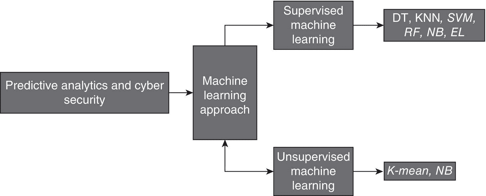

**图 8.1 ML 分类**

### 8.3.2 网络安全的 ML 方法

在本节中，我们探索适用于网络安全的 `ML` 方法，以及它们与预测分析中威胁的关联。这些数据为预测网络攻击提供了线索。预测分析的 `ML` 方法所示 `images/c08f002.jpg`。从网络节点收集的数据根据正常攻击类别进行预处理和归一化 [\[11\]](#c08.xhtml#c8-bib-0011)。根据某些特征选择算法（如`部分群优化算法` `PSA`、`鲸鱼优化算法` `WOAs` 等，取决于需求），某些不需要的特征被丢弃。特征选择后选择了 `SVM`、`DT`、`K‐mean` 聚类、`ANN`、`FLN`、`KNN` 等分类器模型，然后使用混淆指标计算性能 [\[12\]](#c08.xhtml#c8-bib-0012)（表 8.1）。

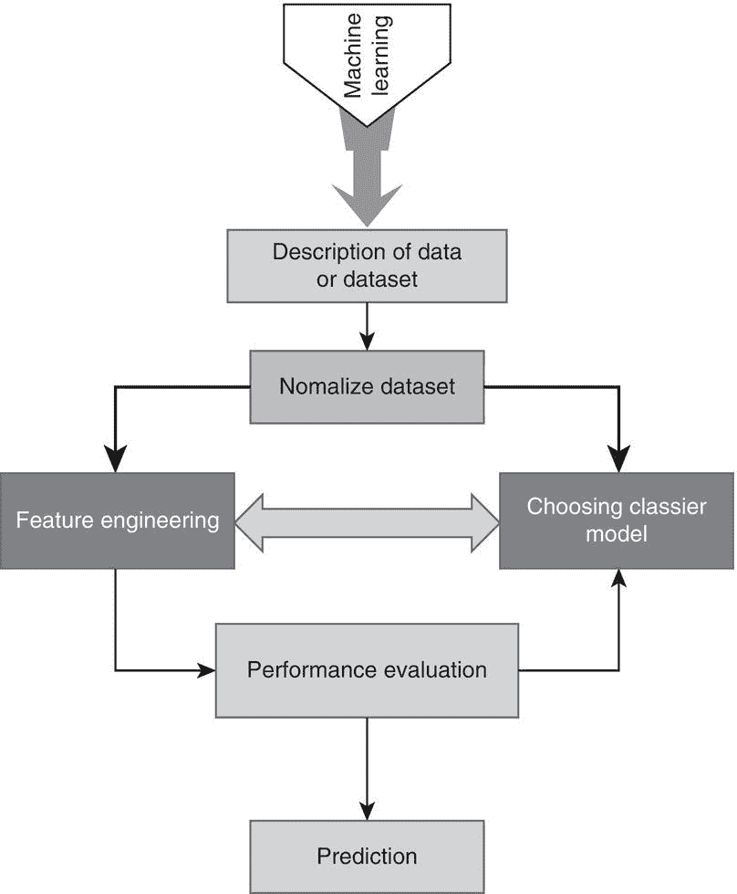

**图 8.2 ML 方法**

- **用户身份行为异常**：通过监控用户行为模式，`ML` 算法可以识别可能表明账户被入侵或内部威胁的异常情况。例如，从异常位置突然访问敏感数据可能会触发警报 [\[14\]](#c08.xhtml#c8-bib-0014)。

- **恶意软件检测**：`ML` 算法可以根据文件的属性（如文件类型、来源和行为）预测文件为恶意软件的概率。这有助于在潜在威胁造成伤害之前识别并隔离它们 [\[15\]](#c08.xhtml#c8-bib-0015)。

- **零日漏洞检测**：`ML` 模型可以分析软件代码并识别出可能指示潜在漏洞的模式。这种预测性分析可以帮助开发人员在漏洞被利用之前进行修补或缓解漏洞 [\[14\]](#c08.xhtml#c8-bib-0014)。

- **欺诈检测**：在金融系统中，`ML` 可以通过学习历史欺诈模式和实时数据来预测欺诈交易。偏离正常行为的异常交易会触发警报以便进一步调查 [\[16\]](#c08.xhtml#c8-bib-0016)。

- **钓鱼攻击防护**：`ML` 可以通过分析邮件内容、发送者信誉和上下文来预测邮件为钓鱼尝试的概率。这使得邮件过滤器能够标记可疑邮件并降低攻击成功的风险 [\[17\]](#c08.xhtml#c8-bib-0017)。

- **网络入侵检测**：通过分析网络流量模式和异常，`ML` 可以在网络入侵发生之前预测潜在的入侵。这可以为安全团队提供更多的时间来响应和防止泄露 [\[17\]](#c08.xhtml#c8-bib-0017)。

- **高级持续性威胁 (APT) 检测**：`ML` 模型可以从历史数据中学习复杂的 `APT` 行为，并实时预测它们的行动。这允许对正在进行的攻击进行早期检测和缓解 [\[18\]](#c08.xhtml#c8-bib-0018)。

- **补丁管理优化**：`ML` 可以根据系统配置和补丁历史等因素预测哪些系统更容易脆弱。这有助于 IT 团队优先考虑补丁部署，以实现最大影响 [\[19\]](#c08.xhtml#c8-bib-0019)。

- **数据泄露防护**：`ML` 可以通过分析组织内部的数据移动模式来预测数据泄露。这有助于识别潜在的数据外泄尝试，并防止敏感信息离开网络 [\[20\]](#c08.xhtml#c8-bib-0020)。

参考 `ML` 的预测性数据分析为网络安全专业人员提供了洞察，使其能够更有效地预测并应对威胁，最终增强组织的整体安全态势。

## 8.4 主动网络安全与实时威胁检测

在快速演变的网络安全格局中，组织正在采取主动策略，强调对网络威胁的预判、预防和实时响应。主动网络安全侧重于通过预测漏洞、理解攻击模式以及实施在漏洞被利用之前即可缓解风险的措施，从而保持领先于攻击者。与实时威胁检测相结合，这种方法创建了一个稳健的防御框架，帮助组织将损害最小化并保护其数字资产。

### 8.4.1 理解主动网络安全

传统的网络安全措施主要依赖于反应性方法，即安全团队在事件发生后才做出响应。然而，这种方法往往让组织容易受到新及新兴威胁的侵害。主动网络安全采取了更具预防性的立场，利用预测性分析在潜在漏洞和威胁出现之前对其进行预测和应对 [\[21\]](#c08.xhtml#c8-bib-0021)。

主动网络安全源于对历史数据、威胁情报馈送和过去攻击模式的分析。通过理解常见的攻击向量和新兴趋势，预测模型可以预测未来的潜在威胁 [\[22\]](#c08.xhtml#c8-bib-0022)。这使组织能够采取先发措施，增强其安全态势，并有效防止网络攻击者利用漏洞。

- **预测性分析**：主动网络安全利用预测性分析来预测潜在威胁和漏洞。分析历史数据以识别可能指示攻击的模式 [\[23\]](#c08.xhtml#c8-bib-0023)。

- **威胁情报**：收集和分析威胁情报可以提供对攻击者 `TTP`（技术、战术和过程）的洞察。这有助于组织识别潜在威胁并部署相应的防御措施 [\[24\]](#c08.xhtml#c8-bib-0024)。

- **风险评估与管理**：主动方法涉及评估组织的风险状况、识别关键资产并分配风险分。这允许主动保护高价值目标并最小化潜在影响 [[25]](#c08.xhtml#c8-bib-0025), 26。

- **漏洞管理**：定期的漏洞评估和渗透测试有助于在攻击者利用之前识别漏洞。这包括根据风险对系统和应用程序进行扫描 [\[27\]](#c08.xhtml#c8-bib-0027)。

- **安全意识培训**：向员工普及网络威胁、社会工程和安全实践使他们能够识别并报告可疑活动。训练良好的员工队伍是防御攻击的额外防线 [\[28\]](#c08.xhtml#c8-bib-0028)。

### 8.4.2 实时威胁检测

实时威胁检测是现代网络安全策略的关键组成部分，旨在网络威胁发生时识别并对其做出响应，从而最小化潜在损害和数据泄露。这种方法涉及对网络活动的持续监控、实时数据分析以及对可疑或恶意活动的及时响应。通过快速检测并消除威胁，组织可以显著减少网络攻击的影响 [\[29\]](#c08.xhtml#c8-bib-0029)。

- **入侵检测与防御系统 (IDPS)**：`IDPS` 持续监控网络流量和系统活动，寻找未经授权访问、恶意软件或其他恶意活动的象。通过立即检测异常，这些系统会触发警报或自动响应，防止泄露 [\[30\]](#c08.xhtml#c8-bib-0030)。

- **行为分析**：实时行为分析跟踪用户和实体行为，是否偏离正常模式。突然的变化可能表明账户被入侵或存在内部威胁，引发进一步调查 [\[31\]](#c08.xhtml#c8-bib-0031)。

- **安全信息事件管理 (SIEM)**：`SIEM` 解决方案实时汇总并关联来自各种来源的安全事件。通过分析事件数据并应用规则，`SIEM` 系统可以在威胁发生时检测并响应 [\[32\]](#c08.xhtml#c8-bib-0032)。

- **威胁狩猎 (Hunting Threat)**：主动威胁狩猎是指在组织环境中主动寻找潜在威胁和漏洞。这种方法涉及分析数据、识别异常并进一步调查，以发现潜在风险 [\[33\]](#c08.xhtml#c8-bib-0033)。

- **自动化响应**：实时威胁检测通常涉及自动化响应，例如隔离受感染的系统、阻止恶意 IP 地址或隔离疑文件。这些操作有助于遏制威胁并防止其扩散 [\[34\]](#c08.xhtml#c8-bib-0034)。

### 8.4.3 使用预测性分析进行威胁检测

实时威胁检测是现代网络安全的基石。识别并及时响应网络威胁的能力可以减少攻击的影响并防止数据泄露。在先进机器学习（`ML`）算法的驱动下，预测性分析在实现实时威胁检测方面着核心作用 [35, 36]。

机器学习模型持续分析来自各种来源的海量数据，例如网络流量、系统日志和用户行为。通过从历史攻击模式中学习，这些模型可以检测出可能指示潜在网络入侵的异常和异常活动。通过不断适应和学习，预测模型保持敏捷性，领先于不断演变的威胁，并为组织提供实时应对攻击的工具 [\[37\]](#c08.xhtml#c8-bib-0037)。

## 8.5 网络安全分析

网络安全分析是一种全面的网络安全方法，涉及收集、分析和解释来自各种网络源的数据，以检测并响应潜在的网络威胁。该策略超越了传统的安全措施，利用先进技术和算法来识别指示恶意活动的异常、模式和行为。通过整合多样化的数据源并应用分析技术，组织可以增强其实时识别和缓解威胁的能力 [\[38\]](#c08.xhtml#c8-bib-0038)。

### 8.5.1 使用预测性分析增强网络安全

作为现代企业的支柱，网络是连接各种设备和系统的生命线。然而，它们也是寻求网络攻击者试图渗透组织关键资产和数据的主要目标。预测性分析通过持续分析网络流量并识别潜在威胁，在增强网络安全方面发挥着至关重要的作用 [39, 40]。

### 8.5.2 机器学习在网络安全中的作用

机器学习通过提供先进技术来检测、预防和缓解各种类型的网络威胁，在网络安全中发挥着重要且不断进的作用。机器学习算法彻底改变了网络安全分析。监督学习模型在包含正常和恶意网络活动实例的标记数据上进行训练，可以准确地分类和检测不同类型的网络威胁。相反，无监督学习技术擅长识别异常和以前未见的攻击模式，使其在对抗零日威胁方面具有无法价值的值 \[31。

深度学习模型（如神经网络）擅长处理海量的复杂网络数据。它们从看似无关的数据点中提取意义模式和相关性的能力进一步加强了网络安全分析。通过持续学习和适应，机器学习算法确保网络安全在面对动态网络威胁时保持稳健性 [41, 42]。

通过监控网络行为，预测模型可以为正常活动建立基准。任何偏离这些基准的情况（例如数据传输的突然激增或异常的通信模式）都可以被标记为潜在的安全漏洞。这使网络管理员能够及时调查并响应新出现的威胁，减少数据丢失和业务中断的风险 [\[43\]](#c08.xhtml#c8-bib-0043)。以下是机器学习对网络安全的的一些关键方式：

- **威胁检测与异常检测**：机器学习算法可以学习网络行为的正常模式，并识别偏离这些模式的异常。这有助于检测各种类型的攻击，例如分布式拒绝服务攻击、内部威胁和数据外泄尝试。通过持续分析网络流量和用户行为，机器学习模型可以识别异常活动并触发警报以便进一步调查。

- **入侵检测与防御系统 (IDS/IPS)**：机器学习可以通过使 `IDPS` 能够适应并学习新的攻击模式来增强其能力。这些系统可以使用机器学习实时分析网络流量，通过识别传统基于规则的方法难以识别的模式，来检测已知和未知威胁 [44。

- **恶意软件检测**：机器学习可以根据行为特征来识别和分类恶意软件。通过在已知恶意软件样本的大数据集上进行训练，机器学习模型可以学习识别指示恶意软件的模式，并帮助检测新的和演变的威胁 [15。

- **自适应安全**：机器学习允许安全系统通过从新数据中不断学习来随时间适应和进化。这种适应性对于跟踪快速演变的网络威胁和攻击技术至关重要 [45。

然而，需要注意的是，虽然机器学习提供了显著收益，但它并非万灵药，应该与其他安全措施结合使用。此外，机器学习模型可能会受到对抗攻击和偏差的影响，这需要持续的研究和缓解工作。

## 8.6 网络风险分析


# 网络风险分析与预测性分析在网络安全中的应用

网络风险分析利用数据分析技术（如统计、预测和机器学习方法）来评估、量化和管理与网络威胁及安全事件相关的潜在风险的过程 [46]。它涉及收集、处理和解释各种类型的数据，以对组织的网络安全态势、潜在漏洞以及不同网络风险发生的概率产生洞见 [1]。以下是对网络风险分析关键层面的详细观察：

- **数据收集：** 网络风险分析依赖于来自各种来源的数据，包括网络流量、系统日志、用户行为、威胁情报馈送、历史事件数据等。这些数据为分析和建模提供了基础 [3]。
- **风险评估：** 网络风险分析涉及评估不同网络风险的严重程度和可能性。这种评估有助于组织理解各种威胁对其运营、资产、声誉和合规状态的潜在影响 [46]。
- **预测建模：** 预测性分析使用历史数据和机器学习算法预测未来的网络威胁和事件。通过识别数据中的模式和相关性，预测模型可以帮助组织预测潜在风险并采取主动措施 [47]。
- **威胁检测：** 网络风险分析在检测新兴威胁和异常方面起着至关重要的作用。通过分析网络行为和系统数据，组织可以识别偏离正常模式的情况，这表明存在潜在的安全漏洞或恶意活动 [48]。

## 8.6.1 理解网络风险管理

网络风险分析旨在评估组织对网络威胁的暴露程度，并量化与这些风险相关的潜在财务损失。它涉及一种系统化的方法，用于识别和分析潜在的漏洞、评估网络攻击的可能性，并估算其对组织的影响 [49]。

网络安全中基于风险的方法涉及根据风险的严重程度概率对资源和努力进行优先级排序。通过将预测性分析纳入网络风险管理，组织可以做出明智的决策，并有效分配资源以应对最严重的威胁 [50]。

## 8.6.2 用于网络风险评估的预测建模

预测建模是网络风险分析的核心，为组织提供了有效预测和准备应对网络威胁的工具。通过分析历史数据和威胁情报，预测模型可以估计各种网络攻击场景发生的概率以及对组织的潜在财务影响 [51]。

蒙特卡洛模拟被广泛应用于网络风险评估。通过模拟成千上万的潜在网络攻击场景，组织可以理解它们可能面临的潜在损失范围。贝叶斯网络通过考虑不同风险因素之间的相互依赖关系，提供了更全面的网络风险视角，从而提供更准确的风险评估 [26]。

## 8.7 预测性分析对网络安全格局的影响

利用安全分析，组织可以通过准确定位与恶意行为相关的指标来反击网络攻击。分析师可以通过采用预测性见解来增强对此类场景的准备工作，为他们赢得额外的响应和策略制定时间。例如，想象一个组织注意到来自特定国家的用户登录量激增。作为回应，他们可以构建一个预测模型来衡量这种模式是否意味着潜在的恶意意图 [52]。

预测性分析还赋予安全团队预测攻击时间线并做出明智的准备。这种主动方法可能包括提高对新兴威胁的意识，使团队成员能够快速检测并处理潜在问题。此外，预测性分析可以帮助预见即将发生的攻击的成功率，促使采取立即响应和应对措施 [2]。

考虑一种场景：组织检测到来自某个国家的用户登录频率增加，并伴有恶意行为迹象。在这种背景下，构建一个预测模型来预测潜在的恶意行为，允许安全团队做好防备，并可能在事件发生前将其阻止 [4]。

## 8.8 将预测性分析应用于网络安全面临的挑战

在网络安全领域利用预测性分析带来了某些需要审慎考虑的挑战。虽然预测性分析在增强安全策略方面具有巨大潜力，但必须解决若干固有的障碍，以确保其有效实施并产生有意义的结果。

- **数据准确性与质量：** 用于训练预测模型的数据准确性和质量对其有效性起着至关重要的作用。如果输入数据不完整、过时或错误，预测将变得不可靠。确保数据的完整性至关重要 [2]。
- **偏差与无关变量：** 预测模型如果包含无关变量或训练数据存在偏差，就会受到影响。这种偏差可能导致错误的决策。彻底的数据处理是关键 [4]。
- **模型过拟合与泛化：** 在拟合训练数据（过拟合）与能够泛化的模型（欠拟合）之间取得正确平衡是复杂的。过拟合会导致模型在训练数据上表现良好，但无法泛化到新数据 [38]。
- **特征选择与相关性：** 确定模型中包含哪些特征或变量需要仔细考虑。包含无关或冗余变量会导致预测结果不准确 [53]。
- **动态与改进的威胁：** 网络威胁的快速演变要求模型能够适应并保持有效。预测模型必须定期更新和重新训练，以应对不断变化的技术 [54]。
- **数据隐私：** 预测性分析的使用涉及处理敏感数据。遵守数据保护法规和维护个人隐私至关重要，这可能会引入复杂性 [55]。
- **缺乏理解：** 预测性分析可以识别模式或异常，但理解这些发现背后的背景至关重要。由于缺乏背景将模式误判为威胁会导致误报 [56]。
- **人为因素：** 有效利用预测性分析需要能够解释并根据见解采取行动的专业人才。对这些工具的培训和理解不足会限制其有效性 [37]。
- **假阳性和假阴性：** 预测模型可能会产生假阳性（指示并不存在的威胁）或假阴性（未能检测到实际威胁），这会导致安全运营效率低下 [53]。

解决这些挑战需要全面的方法，涉及数据治理、模型验证、持续监控以及对预测分析和网络安全领域的深入理解。虽然预测性分析在增强网络安全方面具有巨大潜力，但组织必须克服这些障碍以充分利用其优势。

## 8.9 结论

预测性分析与网络安全的整合代表了组织应对和对抗网络威胁的范式转变。通过采取主动策略，组织可以在攻击发生前预测并阻止。由预测性分析驱动的实时威胁检测能够对新兴威胁做出快速响应，从而减少网络攻击的影响。

将预测性分析纳入网络安全，使组织能够及时识别异常和潜在泄露，保护其数字基础设施和关键资产。此外，网络风险分析有助于组织优先考虑努力和资源，使其能够处理最严重的威胁。

随着网络威胁不断演变，预测性分析在网络安全中的作用将变得更加关键。通过利用数据驱动见解和先进机器学习技术的力量，组织可以领先网络对手一步，构建一个更具韧性和更安全的数字未来。预测性分析与网络安全的融合是实现所有人更安全、更可靠数字生态系统的关键。

## 参考文献

1. Srivastava, N. and Jaiswal, U.C. (2019). 网络安全中的大数据分析技术：综述。*第三届计算方法论与通信国际会议论文集, ICCMC 2019*，第 579–585 页，印度埃罗德（2019 年 3 月 27–29 日）。纽约：IEEE。 [`doi.org/10.1109/ICCMC.2019.8819634`](https://doi.org/10.1109/ICCMC.2019.8819634)

2. Bhardwaj, A. and Kaushik, K. (2022). 云基础基础设施基于预测性分析的网络安全框架。*国际云应用与计算杂志* 12 (1): 1–20。 [`doi.org/10.4018/IJCAC.297106`](https://doi.org/10.4018/IJCAC.297106)

3. Yeboah‐Ofori, A., Islam, S., Lee, S.W. et al. (2021). 用于改进网络供应链安全的网络威胁预测性分析。*IEEE Access* 9: 94318–94337。 [`doi.org/10.1109/ACCESS.2021.3087109`](https://doi.org/10.1109/ACCESS.2021.3087109)

4. Eastman, R., Versace, M. and Webber, A. (2015). 大数据与预测性分析：网络安全前线 IDC 白皮书。

5. Gallagher, B. and Eliassi‐Rad, T. (2008). HTTP 攻击分类：对 ECML/PKDD 2007 发现挑战的研究。*高级信号与图像科学中心 (CASIS) 研讨会*。[`www.briangallagher.net/pubs/gallagher‐llnltr‐2009.pdf`](http://www.briangallagher.net/pubs/gallagher-llnltr-2009.pdf)（2023 年 8 月 2 日访问）。

6. Okutan, A., Yang, S.J., and McConky, K. (2017). 使用非常规信号通过贝叶斯网络预测网络攻击。*第 12 届网络与信息安全研究年度会议论文集 (CISRC '17). 计算机协会*，美国纽约州纽约市，文章 13。 [`doi.org/10.1145/3064814.3064823`](https://doi.org/10.1145/3064814.3064823)

7. Ahmad, Z., Khan, A.S., Shiang, C.W. et al. (2021). 网络入侵检测系统：机器学习与深度学习方法的系统性研究。*新兴电信技术汇报* 32 (1): [`doi.org/10.1002/ETT.4150`](https://doi.org/10.1002/ETT.4150)

8. Giancarlo, E. and Villano, V. (2018). *使用机器学习进行分类*。

9. Husák, M. and Kašpar, J. (2018). 通过信息交换和数据挖掘预测网络攻击。*2018 第 14 届国际无线通信与移动计算会议, IWCMC 2018*，第 536–541 页，塞浦路斯利马索（2018 年 6 月 25–29 日）。纽约：IEEE。[`doi.org/10.1109/IWCMC.2018.845012`](https://doi.org/10.1109/IWCMC.2018.845012)

10. Alberto, B. and Massaron, L. (2016). *Python 数据科学基础：成为高效的数据从业者*。

11. Habeeb, M.S. and Babu, T.R. (2022). 网络入侵检测：基于人工智能的技术综述。*专家系统* 39 (9): e13066。[`doi.org/10.1111/EXSY.13066`](https://doi.org/10.1111/EXSY.13066)

12. Deng, X., Liu, Q., Deng, Y., and Mahadevan, S. (2016). 基于混淆矩阵构建分类问题基础概率的改进方法。*信息科学* 340–341: 250–261。[`doi.org/10.1016/j.ins.2016.0133`](https://doi.org/10.1016/j.ins.2016.0133)

13. Sree, V.S., Koganti, C.S., Kalyana, S.K., and Anudeep, P. (2021). 网络安全领域的人工智能预测狩猎。*2021 第 2 届全球技术进步大会, GCAT 2021*，印度班加罗尔（2021 年 10 月 1–3 日）。纽约：IEEE。[`doi.org/10.1109/GCAT52182.2021.958707`](https://doi.org/10.1109/GCAT52182.2021.958707)

14. Pannell, G. and Ashman, H. (2010). 用户建模与异常检测。见：De Bra, P., Kobsa, A., Chin, D. (编) 用户建模、适应与个性化。计算机科学讲义，卷 6075。海德堡。

15. Yeboah‐Ofori, A. and Boachie, C. (2019). 网络供应链背景下使用机器学习的恶意软件攻击预测分析。*2019 网络安全与物联网国际会议, ICSIOT 2019*（第 66–73 页），加纳（2019 年 5 月 29–31 日）。纽约：IEEE。[`doi.org/10.1109/ICSIOT4725.2019.0019`](https://doi.org/10.1109/ICSIOT4725.2019.0019)

16. Singla, A. and Jangir, H. (2020). 实时财务数据欺诈的机器学习预测分析比较方法。*2020 通信、控制与计算新兴趋势国际会议, ICONC 2020*，印度拉克什米加尔（2020 年 2 月 21–22 日）。纽约：IEEE。[`doi.org/10.1109/ICONC345789.2020.911735`](https://doi.org/10.1109/ICONC345789.2020.911735)

17. Raja, S.E. and Ravi, R. (2020). 使用深度机器学习和 CANTINA 的软件定义网络预防网络空间钓鱼攻击的性能分析。*计算机* 153: 375–381。[`doi.org/10.1016/j.com.2019.11047`](https://doi.org/10.1016/j.com.2019.11047)

18. Chen, P., Desmet, L., and Huygens, C. (2014). 高级性威胁的研究。见：*通信与多媒体安全. CMS 2014*。计算机科学讲义，卷 8735（B. Decker 和 A. Zquete 编）。海德堡：Springer [`doi.org/10.1007/978-3-662-44885-4`](https://doi.org/10.1007/978-3-662-44885-4)

19. Grotto, A. and Dempsey, J. (2021). AI/ML 系统的漏洞披露与管理：带有政策建议的工作论文。*SSRN 电子期刊*。[`doi.org/10.2139/SSRN.3964084`](https://doi.org/10.2139/SSRN.3964084)

20. Balajee, J.M. (2018). 医疗保健机器学习中的数据清洗与数据泄漏。[`papers.ssrn.com/abstract=3708142`](https://papers.ssrn.com/abstract=3708142)（2023 年 8 月 15 日访问）。

21. Craig, A.N., Shackelford, S.J., and Hiller, J.S. (2015). 主动网络安全：行业与监管比较分析。*美国商业法杂志* 52 (4): 721–787。[`doi.org/10.1002/ETT.4150`](https://doi.org/10.1002/ETT.4150)

22. Offner, K., Sitnikova, E., Joiner, K., and MacIntyre, C. (2021). 迈向网络安全能力：近期趋势、威胁与缓解的系统综述。*安全智能* 92–121。[`doi.org/10.1007/978-3-662-44885-4`](https://doi.org/10.1007/978-3-662-44885-4)

27. Tang, M.J., Alazab, M., and Luo, Y. (2019). 网络安全的大数据：漏洞披露趋势与依赖关系。*IEEE Transactions on Big Data* 5 (3): 635–647. [`doi.org/10.1109/TBDATA.2017.2723570`](https://doi.org/10.1109/TBDATA.2017.2723570)

28. Kemper, G. (2021). 提高员工网络安全意识。*Computer Fraud & Security* 2019 (8): 11–14. [`doi.org/10.1016/S1361‐3723(19)30085‐5`](https://doi.org/10.1016/S1361-3723(19)30085-5)

29. Cichonski, P., Millar, T., Grance, T., and Scarfone, K. (2012) “美国标准与技术研究院计算机安全事件处理指南建议”。美国标准与技术研究院。 [`doi.org/10.6028/NIST.SP.800‐61r2`](https://doi.org/10.6028/NIST.SP.800-61r2)

30. Borkar, A., Donode, A. and Kumari, A. (2018). 入侵检测系统 (IDS) 及内部入侵检测与保护系统 (IIDPS) 综述。*2017 年创新计算与信息学国际会议 (ICICI 2017)*，第 949–953 页，印度哥培巴特尔 (2017 年 11 月 23–24 日)。纽约：IEEE。 [`doi.org/10.1109/ICICI.2017.8365277`](https://doi.org/10.1109/ICICI.2017.8365277)

31. Soni, J., Prabakar, N. and Upadhyay, H. (2019). 使用 LSTM seq‐seq、余弦相似度和 Jaccard 相似度进行实时异常检测的系统调用序列行为分析。*2019 年第六届计算科学与计算智能年度会议 (CSCI 2019)*，第 214–219 页，内华达州拉斯维加斯 (2019 年 12 月 5–7 日)。纽约：IEEE。 [`doi.org/10.1109/CSCI49370.2019.00043`](https://doi.org/10.1109/CSCI49370.2019.00043)

32. González‐Granadillo, G., González‐Zarzosa, S., and Diaz, R. (2021). 安全信息和事件管理 (SIEM)：关键基础设施中的分析、趋势与应用。*Sensors* 21 (14): 4759。 [`doi.org/10.3390/S21144759`](https://doi.org/10.3390/S21144759)

33. Mavroeidis, V. and Jøsang, A. (2018). 使用 sysmon 进行数据驱动的威胁猎。*第二届密码学、安全与隐私国际会议 (ICCSP 2018)。美国计算机协会*，美国纽约州纽约，第 82–88 页。[`doi.org/10.1145/3199478.319940`](https://doi.org/10.1145/3199478.319940)


# 9 精准农业与预测性分析：提升农业效率与产量

## 参考文献

34. Kanoun, W., Cuppens‐Boulahia, N., Cuppens, F., and Araujo, J. (2008). 基于风险分析的入侵检测系统的攻击者自动反应。*2008 年第三届互联网风险与安全国际会议 (CRiSIS 2008)*，第 117–124 页，突尼斯突泽尔 (2008 年 10 月 28–30 日)。纽约：IEEE。[`doi.org/10.1109/CRISIS.2008.475741`](https://doi.org/10.1109/CRISIS.2008.475741).

35. More, R., Unakal, A., Kulkarni, V., and Goudar, R. (2017). 云端大数据实时威胁检测。*2017 年 IEEE 电子、信息通信技术最新趋势国际会议 (RTEICT 2017)*，印度班加罗尔 (2017 年 5 月 19–20 日)，第 126–124 页。[`doi.org/10.1109/RTEICT.2017.825601`](https://doi.org/10.1109/RTEICT.2017.825601).

36. Masood, A. and Hashmi, A. (2019). AIOps：运营中的预测分析与机器学习。在：*认知计算教程*(Masood 和 Hashmi 编)，359–382。Apress [`doi.org/10.1007/978-4842-4106-7`](https://doi.org/10.1007/978-4842-4106-7).

37. Mayhew, M., Atighetchi, M., Adler, A., and Greenstadt, R. (2015). 大数据分析中机器学习的应用。*2015 年 IEEE 军事通信会议 (MILCOM)*，第 915–922 页，佛罗里达州坦帕 (2015 年 10 月 26–28 日)。纽约：IEEE。[`doi.org/10.1109/MILCOM.2015.735762`](https://doi.org/10.1109/MILCOM.2015.735762).

38. Mahmood, T. and Afzal, U. (2013). 安全分析：网络安全的大数据分析：趋势、技术与工具综。*2013 年第二届信息保障会议 (NCIA 2013)*，第 129–134 页，巴基斯坦拉瓦尔坎第 (2013 年 12 月 11–12 日)。纽约：IEEE。[`doi.org/10.1109/NCIA.2013.672537`](https://doi.org/10.1109/NCIA.2013.672537).

39. Sengan, S., Subramaniyaswamy, V., Nair, S. 等 (2020)。用混合智慧城市网络架构增强信息物理系统以实现安全数据网络。*未来代计算机系统* 112: 724–737。[`doi.org/10.1016/J.FUTURE.2020.0628`](https://doi.org/10.1016/J.FUTURE.2020.0628).

40. Priyadarshini, I., Kumar, R., Tuấn, L.M. 等 (2021)。一种用于医疗信息物理系统的新型增强网络安全框架。*软件密集信息物理系统* 35 (3–4): 159–183。[`doi.org/10.1007/S00450-021-427-3/METRICS`](https://doi.org/10.1007/S00450-021-427-3/METRICS).

41. Tavallaee, M., Bagheri, E., Lu, W., and Ghorbani, A.A. (2009). KDD CUP 99 数据集的详细分析。*2009 年 IEEE 安全与防御应用计算智能研讨会 (CISDA 2009)*，安大略渥渥华 (2009 年 7 月 8–10 日)。纽约：IEEE。[`doi.org/10.1109/CISDA.2009.535652`](https://doi.org/10.1109/CISDA.2009.535652).

42. Deng, J., Zhang, Z.; Marchi, E., and Schuller, B. (2013). 基于稀疏自编码器的语音情感识别特征迁移学习。*2013 年情感计算与交互会议论文*，第 511–516 页，日内瓦。纽约：IEEE。[`doi.org/10.1109/ACII.90`](https://doi.org/10.1109/ACII.90).

43. Moustafa, N. and Slay, J. (2015). UNSW‐15 入侵检测系统的自动反应。*2008 年第三届互联网风险与安全国际会议 (CRiSIS 2008)*，第 117–124 页，突尼斯突泽尔 (2008 年 10 月 28–30 日)。纽约：IEEE。[`doi.org/10.1109/CRISIS.2008.475741`](https://doi.org/10.1109/CRISIS.2008.475741).

44. Akbar, S., Srinivasa Rao, T., and Ali Hussain, M. (2016)。基于大数据的自适应方案。*印度科学期刊* 9 (3)。https://doi.org/10.1108/ijst.937](https://doi.org/10.1108/ijst.937).

45. Lin, H., Yan, Z., and Fu, Y. (2019). 带有上下文信息的安全数据采集。*网络与计算机应用* 126: 88–103。[`doi.org/10.1016/j.jnca.2018.11.02`](https://doi.org/10.1016/j.jnca.2018.11.02).

46. Radanliev, P., De Roure, D., Page, K. 等 (2020)。在极端环境下的由人工智能和机器学习支持的动态自适应系统。*极端环境中的安全* 2 (3): 219–230。[`doi.org/10.1007/S42797-021-002-1`](https://doi.org/10.1007/S42797-021-002-1).

47. Radanliev, P., De Roure, D., Walton, R. 等 (2020)。边缘侧预测性网络风险分析的人工智能与机器学习。*应用科学报* 2 (11): 1–8。[`doi.org/10.1007/S42452-020-0359-4`](https://doi.org/10.1007/S42452-020-0359-4).

48. Gheyas, I.A. and Abdallah, A.E. (2016)。网络安全内部威胁的检测与预测：系统性文献综述与元分析。*大数据分析* 1 (1): 1–29。[`doi.org/10.1186/S41044-016-0006-0`](https://doi.org/10.1186/S41044-016-0006-0).

49. Refsdal, A., Solhaug, B., and Stølen, K. (2015). “网络风险管理”，计算机科学简教程，33–47 页。[`doi.org/10.1007/978-3-319-23570-7_5`](https://doi.org/10.1007/978-3-319-23570-7_5).

50. Lee, I. (2020). 物联网 (IoT) 网络安全：文献回顾与 IoT 网络风险管理。*Future Internet* 12 (9): 157. [`doi.org/10.3390/FI12090157`](https://doi.org/10.3390/FI12090157).

51. Tubío Figueira, P., López Bravo, C., and Rivas López, J.L. (2020). 通过引入威胁发生预测模型改进信息安全风险分析。*Computers & Security* 88: 101609. [`doi.org/10.1016/J.COSE.2019.101609`](https://doi.org/10.1016/J.COSE.2019.101609).

52. Sharma, P. and Dash, B. (2023). 大数据分析和 ChatGPT 对网络安全的影响。*2023 4th International Conference on Computing and Communication Systems, I3CS 2023*，印度诗洛齐 (2023 年 3 月 16-18 日)。新纽约：IEEE。 [`doi.org/10.1109/I3CS58314.2023.10127411`](https://doi.org/10.1109/I3CS58314.2023.10127411).

53. Soni, V.D. (2020). 美国网络安全人工智能面临的挑战与解决方案。*SSRN 电子期刊* [`doi.org/10.2139/SSRN.3624487`](https://doi.org/10.2139/SSRN.3624487).

54. Sarker, I.H. (2022). 网络安全中智能数据分析与自动化的机器学习：现状与未来前景。在：*Annals of Data Science* (Y. Shi 编辑)，1–26。[`doi.org/10.1007/S40745-022‐00444‐2/FIGURES/6`](https://doi.org/10.1007/S40745-022-00444-2/FIGURES/6).

55. Keim, D.A., Mansmann, F., Schneidewind, J., and Ziegler, H. (2006). 视觉数据分析中的挑战。*信息视觉化国际会议论文集*，第 9–14 页，英国伦敦 (2006 年 7 月 5-7 日)。新纽约：IEEE。[`doi.org/10.1109/IV.2006.31`](https://doi.org/10.1109/IV.2006.31).

56. Moustafa, N. (2021). 用于大数据分析和网络安全的系统性 物联网-雾-云架构：雾计算回顾。*Secure Edge Computing* 41–50。[`doi.org/10.1201/97810030286354`](https://doi.org/10.1201/97810030286354).

57. Amalina, F., Hashem, I.A., Azizul, Z. et al. (2020). 融合大数据分析：挑战回顾与近期研究。*IEEE Access* 8: 3629–3645。[`doi.org/10.1109/ACCESS.2019.292370`](https://doi.org/10.1109/ACCESS.2019.292370).

## 作者信息

Akhter Farooqui¹, Mohd. Haleem², 和 Mohammad Ishrat¹。

Koneru Lakshmaiah, Vaddeswaram, 印度安得拉邦德邦。

Era University, 印度北方塔西纳邦。

## 9.1 引言

“农业系统”一术是指涉及农产品生产、管理和分配的各种组件、过程和活动之间复杂的相互作用。农业系统，通常被称为农场系统或耕作系统，涵盖了生产食物、纤维和其他农产品过程中涉及的复杂流程、实践和技术网络。这是一个综合性框架，整合了各种元素，在考虑经济、环境和社会因素的同时确保高效生产。

农业系统随时间推演演变以适应不断的变化。正因为农民面临着许多困难，农业部门的技术演进已成为一个关键问题。利用远程监控和控制技术来提高农业效率和竞争力正在迅速扩大。这可能通过使用智能农业和精准农业来实现。这两个词短语描述了利用尖端技术实现精细化作物管理的过程。为了提高竞争力和盈利能力，智能农业技术可以为农民提供来自耕作区域的价值环境数据。此类技术进步可以改进农业系统的几乎每一个方面。无人机（`UAVs`）和其他形式的智能传感器处于遥感技术的前沿，外部刺激（输入信号）被传感器转换为测量信号。宏观量可以通过传感器设备转换为定量值。无人机（`UAVs`）是不带飞行员的飞机；相反，它们可以独立飞行或远程控制。用于远程监控的无人机是无人机系统（`UAS`）的一部分。它包含了飞越和管理无人机以及采集数据所需的所有硬件和软件。地球观测（`EO`）通过三种方式受到无人机的支持：提高精度、扩大现场监测，并覆盖难以访问的重要区域。物联网（`IoT`）范式包括传感器和无人机等设备。物联网是通过单个局域网连接大量智能设备的先进通信网络。其特征是智能设备检测并实时通知用户事件。计算能力、资源可用性和智能对象自主通信的能力有限。由于缺乏指导农民如何构建自己的 IoT 系统的模型，智能农业的广泛实施受到了阻碍。由于 IoT 部署通常具有密集性和异质性，所需组件的无缝集成受到了很大限制。然而，基于最新升级 IoT 技术的有效架构可以促进智能设备在日常活动中的采纳和部署。

精准农业可以被认为是一种收集数据并将其发送到分析系统的自动运行过程。数据挖掘在农业中的应用已变得非常重要，它可以处理海量数据以发现新信息并改进目前的工作方式。在这种情况下，土壤剖面是您在对农业做出良好选择之前需要的信息之一。土壤采样是获取这些有用知识的好方法，但它昂贵且耗时。此外，并不总是需要对每个田进行测试，因为状况可能与当地田块相同。精准农业也被称为特定现场耕作或卫星农业，是一种利用技术优化作物生产的现代农业管理方法。本章探讨了将预测性分析整合到精准农业及其提高农业效率和产量的潜力。通过利用数据驱动的见解，农民可以就灌溉、施肥、病虫害和其他影响作物健康和产量的关键因素做出明智决策。

精准农业及其组成部分涉及先进技术的使用，例如全球定位系统 (`GPS`)、地理信息系统 (`GIS`)、遥感和数据分析 [\[9\]](#c09.xhtml#c9-bib-0009)。这些工具使农户能够收集和分析数据。通过理解农田内的时空变化，农民可以据此调整其管理实践，从而改进资源分配并提高生产力。

## 9.2 背景

通过利用许多技术，精准农业领域已取得了显著进展，例如用于决策支持系统和数据分析的物联网 (`IoT`) 和机器学习 (`ML`) 等。背景解释分为三个子部分：(i) 物联网与网络，(ii) 预测分析，以及 (iii) 精准农业系统的应用。不同领域中精化的组成系统地阐述如下：

### 9.2.1 IoT 与网络

“无线传感器网络 (`WSN`)”应用于多种农学背景，能够对环境和土壤状况进行远程监测，以促进对作物生长状况的预测。这些网络用于根据湿度、温度、土壤水分和盐度预测农田的灌溉计划。研究人员已经开发了可扩展的网络架构、基于 IoT 的控制系统以及用于各种应用的 IoT 框架。Ahmed 等人 [\[10\]](#c09.xhtml#c9-bib-0010) 提出了一种用于监测和控制农田的可扩展网络架构。该系统结合了远距离网络和雾计算解决方案以实现高吞吐量。

Muangprathub 等人 [\[11\]](#c09.xhtml#c9-bib-0011) 应用 IoT 改进了农业产量、质量和成本。他们开发了一种名为 Smartnode 的优化作物发育系统，使用硬件和软件监测农气象参数。Oliver 等人 [\[12\]](#c09.xhtml#c9-bib-0012) 提出了 SEnviro 平台，利用边缘计算监测葡萄园农田。Elkarim 等人 [\[13\]](#c09.xhtml#c9-bib-0013) 建议了一种使用 IoT 和 ML 的模型，通过环境传感器预测作物疾病。Jawad 等人 [\[14\]](#c09.xhtml#c9-bib-0014) 综述了基于 WSN 的农业应用，并比较了几种无线技术和协议。

Sikeridis 等人 [\[15\]](#c09.xhtml#c9-bib-0015) 将 ML 与 IoT 结合以提高公共安全网络的能源效率。Hsu 等人 [\[16\]](#c09.xhtml#c9-bib-0016) 提出了一种基于云 IT 平台的按需方法，创新地增强了公共到物理的连接以及 IoT 处理速度。为了在有限的信息资源下整合和自动化种植，可以使用云集成进行大区域的数据收集和分析。在精准农业中，已经开发了使用“氮磷钾 (`NPK`)”的 IoT 系统，该传感器利用比色原理监测和分析土壤营养。Google 的云数据库提供了需要时随时访问数据的便捷途径。营养的确定使用了应用于所收集数据的模糊逻辑方法。开发的 IoT 系统对于拥有高作物产量的农民最有用。许多研究人员探索了在“智能”农场中使用 IoT 的潜力，包括远程温室监测、高效的作物监测以及来自农田的数据收集 [\[17\]](#c09.xhtml#c9-bib-0017)。一些作者使用了多种技术，如“`WSN`”、“`IoT`”、“气象站”和“无人机相机”，来从农田收集并分析数据。开发的 SmartFarmNet 平台用于处理与各种参数的数据并预测作物状态 [\[18\]](#c09.xhtml#c9-bib-0018)。

### 9.2.2 预测分析

早期的信息技术，检测作物疾病和虫害的传统方法非常繁琐，且往往导致人为错误。使用数据分析从经验中学习的 ML 在预测作物疾病和虫害方面变得越来越有用。所使用的技术包括用于识别的“人工神经网络 (`ANN`)”、“支持向量机 (`SVM`)”和“模糊技术” [\[19\]](#c09.xhtml#c9-bib-0019)。

多项研究使用 ML 方法预测作物疾病和虫害，例如使用随机森林、K 近邻算法、SVM 和朴素贝叶斯算法对苹果病进行分类。其他研究使用 IoT 和 ML 来改进有限资产的服务，例如 Ramesh 等人 [\[20\]](#c09.xhtml#c9-bib-0020) 使用 IoT 和 ML 技术预测马铃薯晚疫病，利用环境参数检测疫病的程度和风险。Farooqui 等人 [\[21\]](#c09.xhtml#c9-bib-0021) 使用图像处理和 ML 算法预测特定产量，准确率超过 80%。


Cetişli 和 Büyükçingir [\[22\]](#c09.xhtml#c9-bib-0022) 提出了一种采用 AI 和时间序列预测的新型苹果砂病早期预测技术。Balducci 等人 [\[23\]](#c09.xhtml#c9-bib-0023) 强调了使用连续数据进行决策的重要性。Hamad 等人 [\[24\]](#c09.xhtml#c9-bib-0024) 强调了智能系统在获取实际农业事实（如土壤水分、湿度温度）方面的益处。

农业在喂养世界人口方面的重要性是无法衡量的。尽管人类不断增长，但农田保持不变 [\[25\]](#c09.xhtml#c9-bib-0025)。在设计和维护农场时，识别类别、土壤质量、肥料和气候之间的化学关系至关重要。这些元素的多样性使得无法用传统方法有效选择它们。Kan 等人 [\[25\]](#c09.xhtml#c9-bib-0025) 声称，这些来源的变化对农业生产产生了不利影响 [\[11\]](#c09.xhtml#c9-bib-0011)。全球变暖已显示对农业生产力产生了显著的负面影响。由于农业资源不稳定且管理不当，低农业产量仍然是农民面临的问题。由于重复使用以及对补充浪费营养所需元素缺乏了解，用于耕作的土地不断退化，使产量下降更加令人担忧。结果，需要食物的人口增加需要新的策略。农业领域迫切需要一种准确预测土壤化学特性、肥料和气候状况的方法，以便作物健康生长。此外，高作物产量严重依赖于对这些资源的优化组合 [\[26\]](#c09.xhtml#c9-bib-0026)。由于缺乏关于增加农业出的因素适用性的信息，作物产量受到了严重影响，特别是在发展中国家。适用于作物的土壤类型和粪肥需要以高效自动化的方式确定。这些数据农业领域迫切需要，以防止由于产量短缺导致的灾难性粮食短缺 [\[27\]](#c09.xhtml#c9-bib-0027)。

此外，精准农业作为农业领域的一项突破出现，其目标是实现农业作业自动化，以提高产量和质量，确保长期粮食安全。为了获得最大的产量和质量，“智能农场”实施了技术解决方案和基于人工智能的管理系统[\[28\]](#c09.xhtml#c9-bib-0028)。精准农业的发展为农业领域带来了创新，通过自动化农业流程，实现了自然饮食生产中产量和质量的双重提高。精准农业涉及用于增强农场管理和提高作物生产的技术[\[29\]](#c09.xhtml#c9-bib-0029)。初次农业革命是农业机械化（工具和机械的使用），第二次是绿色革命，其重点是作物种子和动物品种的改良[\[30\]](#c09.xhtml#c9-bib-0030)。精准农业和智能耕作之间具有某些相似之处，但两者并非同一等概念。它们都能帮助缩小知识差距，并主要关注增加收成产量。约翰迪尔公司（John Deere）被广泛认为在 1990 年提出了数字农业的概念，当时复杂的仪器使得播种和施肥成为可能[\[30\]](#c09.xhtml#c9-bib-0030)。这种新方法的开发是为了增加作物产量并鼓励更多人从事农业。为了准确预测作物产量，智能农场主收集并分析有关土壤质量、化学需求和天气等不同参数的数据。这些信息被用于开发农业资源的自动化监督和管理模型[\[23\]](#c09.xhtml#c9-bib-0023)。对于像尼日利亚这样的发展中国家，创新的农业实践和/或精准农业尤为重要，那里的农业主要以传统形式进行。

机器学习（ML）方法是可靠预测这些关键农业方面的理想选择。在这方面，Ali 等人[\[31\]](#c09.xhtml#c9-bib-0031) 强调了机器学习在保护性智能耕作预测中的作用。Pandiarajaa[\[32\]](#c09.xhtml#c9-bib-0032) 表示，机器学习的自动化可能适用于人类活动的每一个领域。作为全球经济最大的单一部门和重要的食物来源，农业也需要这些进步。智能耕作（也称为精准农业）高度依赖机器学习，而机器学习是农业数字化运动的核心[\[31\]](#c09.xhtml#c9-bib-0031)。已经提出了各种机器学习策略来应对作物、土壤、肥料和天气的不同条件[\[33\]](#c09.xhtml#c9-bib-0033)。研究人员还提出了使用深度学习和集成模型进行智能农业预测的解决方案[\[34\]](#c09.xhtml#c9-bib-0034)。这些机器学习算法提高了产量和质量，扩大了农业在全球经济中的作用。在实践实践中，利用真实世界数据进行训练的学习模型可以独立于人类的监督而运行[\[33\]](#c09.xhtml#c9-bib-0033)。作者[\[4\]](#c09.xhtml#c9-bib-0004) 介绍了一种基于物联网（IoT）的农场管理系统，通过接入互联网的移动设备访问的 Web 应用程序实现。对于像尼日利亚这样的发展中国家，创新的农业实践和/或精准农业尤为重要，那里的农业主要以传统形式进行。

### 9.2.3 精准农业系统的应用

精准农业和预测分析是两个密切相关的概念，受到了广泛关注。精准农业利用先进技术优化耕作，而预测分析利用数据驱动的模型来预测未来事件。本节探讨了这两个领域的交叉点，重点介绍了其应用、优势和挑战。

精准农业与预测分析的整合具有许多优势，包括提高生产力、资源效率、减少环境影响以及更好的风险管理。然而，挑战包括数据收集、技术实施的复杂性以及对能够解读数据的人的需求。

随着技术的进步，精准农业和预测分析之间的协同作用可能会加深。人工智能和机器学习的引入提高了预测模型的准确性，实现了实时决策支持。农业科学家、数据分析师和技术开发人员之间的协作将在推动创新方面发挥关键作用。

精准农业与预测分析的结合对彻底农业实践具有巨大潜力。通过控制数据驱动的洞察，农民将能够优化资源利用、增加产量并促进可持续农业。这些领域的持续研究开发将塑造农业的未来，有助于全球粮食安全和环境保护。

根据作者的研究，他们提供了多种用于智能农业的学习模型。重要的农业作业，如土壤化学分析、天气预报、作物产量预测和灌溉管理模型都得到了讨论，还讨论了机器学习最新进展对这些预测任务的影响[\[27\]](#c09.xhtml#c9-bib-0027)。本研究关注与肥料、土壤养分和多种作物有利天气条件相关的不同参数，旨在对机器学习技术在创建智能农业模型方面的最新研究进行简要概述。精准农业系统的应用如图 9.1 所示。

精准农业利用 GPS、遥感、无人机和传感器等技术来收集不同参数的数据，然后分析这些数据以实现在各种农业流程中的精确决策，例如：

*   **变率应用**：精准农业允许农民在农田内以不同的速率施用肥料、农药和水。这优化了资源利用并减少了浪费。
*   **产量监测**：先进的传感器和 GPS 实现了实时产量监测，帮助农民识别农田内高产和低产区域。这些信息有助于制定更好的管理策略。

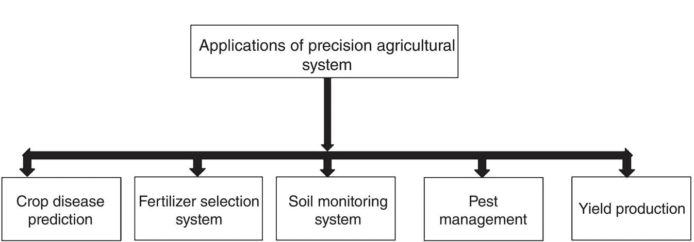

图 9.1 与精准农业相关的应用。

*   **场域特定作物管理**：根据土壤类型、养分可用性以及作物的生长阶段，生产者可以调整其方法以满足农田不同区域的需求。
*   **病虫害管理**：精准农业能够通过遥感和预测模型及早发现病虫害的暴发，从而进行针对性的干预。
*   **改善土壤健康**：详细的土壤制图和分析有助于了解土壤成分和结构，促进土壤健康改善策略的实施。

## 9.3 精准农业技术与方法

为了收集和评估精准农业所需的所有数据，需要专门的软件和硬件。精准农业需要使用硬件和软件，且必须由经过培训的专业人员安装。然而，只要投入努力，农业本身也具备这种能力。精准农业方法可以分为三类：地面、空中和空间。前者可用于机械管理、生产规划、制图和测量。后两者适用于解决更具全球性的挑战，例如随时间、随地的产量评估。结合不同的方法可以帮助你获得更准确的结果。

### 9.3.1 GPS 在现代作物管理中的作用

GPS 是一种基于卫星的导航系统，能够在地球任何地方的任何天气条件下提供位置和时间信息 [[38]](#c09.xhtml#c9-bib-0038)。图 9.2 是基于 GPS 的卫星导航系统的示例。在精准农业中，GPS 为制图和导航提供精确的位置信息。GPS 在精准农业中的主要用途之一是制图和农田级数据采集。农民可以使用安装在车辆或设备上的 GPS 接收器来收集农田形状、大小，以及农田内特定特征（如灌溉系统、排水沟和围栏线）的位置。详细的农田地图用于规划和调度农田作业、在农业投入管理中实施变率技术以及分析农田性能。


图 9.2 卫星导航系统拍摄的农田图像。

农民还可以使用基于 GPS 的引导系统，帮助他们以高精度在农田周围引导车辆和设备，减少错误风险并提高效率。

### 9.3.2 智能农业监控系统的架构

近年来，对既有效又环保的农业方法的需求增加。智能农业（也称为精准农业）已成为解决这一需求的极具前景的解决方案。得益于物联网（IoT）、云计算、手持设备以及数据分析等创新技术的帮助，智能农业监控系统提供了实时洞察和自动化能力，以优化作物生产和资源管理 [[8]](#c09.xhtml#c9-bib-0008)。智能农业监控系统的设计可以影响具有转型农业部门潜力的尖端工具。通过集成传感器、通信基础设施、数据分析和可视化，这些系统使农民能够做出数据驱动的决策，优化资源配置并提高作物产量。智能农业系统的优势不仅限于提高生产率，它们还有助于可持续资源管理和风险缓解。随着对高效和可持续农业实践的需求不断增长，智能农业监控系统的采用在未来几年将变得越来越普遍。智能农业的框架如图 9.3 所示。传感器将数据即时发送到中心枢纽，以便进行处理和评估。

2.  **通信基础设施**：稳健的通信基础设施对于传感器、研究中心枢纽与智能农业与其他组件之间的无缝数据传输至关重要。它包含了无线协议和卫星系统，用于通信整个系统并高效维护通信 [[11]](#c09.xhtml#c9-bib-0011)。

    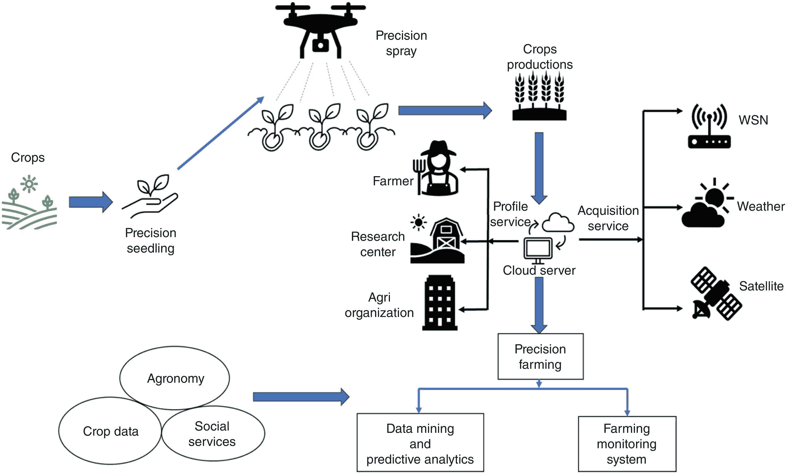

    图 9.3 智能农业系统的框架。

3.  **研究中心枢纽**：研究中心枢纽是智能农业监控系统的神经中心。它接收来自传感器网络的数据并进行实时分析以生成可操作的洞察。研究中心枢纽可以是物理服务器或控制云计算以处理大量数据并执行复杂分析算法的云平台。各种数据科学家分析数据并进行评估和测量。

4.  **预测分析**：应用尖端分析方法对传感器网络收集的信息进行处理和研究。`ML` 算法用于识别模式、预测作物发育、识别异常并优化资源配置。这些洞察使农业工作者能够做出更新的决策并采取积极措施以增加产量并最小化资源浪费 [[3]](#c09.xhtml#c9-bib-0003)。

5.  **可视化和用户界面**：数据分析过程的输出通过直观的可视化和用户界面呈现给农民。这允许农民轻松解释数据并实时监控作物状态。可以通过 Web 或移动应用程序访问用户界面，为农民提供灵活性和便利。

智能农业系统在提高生产率、监控作物和维护杂草控制系统方面具有多种益处，提高了作物生产效率。通过持续监测环境状况和作物健康，智能农业系统使农民优化资源配置，例如水、化肥和农药。这导致效率的提高和成本的降低。智能农业系统提供的实时洞察帮助农民识别潜在问题并采取及时纠正措施 [[39]](#c09.xhtml#c9-bib-0039)。这带来了更好的作物管理实践、更高的产量和卓越的质量。智能农业系统通过最小化资源浪费促进可持续农业实践。根据作物需求精确施用水和肥，农民可以节约并减少对环境的影响。智能农业系统提供了疾病、病虫害和不利天气的早期预警。通过快速识别这些风险，农民可以采取预防措施，减少作物损失并确保更稳定的收入。

### 9.3.3 农业经济管理

农业系统因其在提供食物、原材料、就业和贸易机会方面的作用，对全球经济产生了深远影响。农业在全球经济、粮食安全、贸易和整体经济发展中发挥着重要作用。农业系统与全球经济紧密相连，影响着粮食安全、就业、贸易、原材料供应、农村发展、创新等。农业生产实践、技术和政策的变化对个体经济和世界经济都会产生深远影响 [34]。农业经济管理植根于农业生产，旨在实现过程和产出的高效化。图 9.4 展示了信息化时代农业经济管理运行方式的简化表示。

传感器、天气和气候监测站、卫星以及政府机构都为用于改进农业经济管理的数据集做了贡献 [38]。数据采集至关重要，因为它确保了数据流在存储之前的连续性。虽然其预期的演进将涵盖交易服务，但这里的重点是构成一流数据和画像服务的组件。得益于大数据、数据采集、决策系统以及农业技术的重大发展，许多农民现在使用基于精度的农业技术来增加产量并更好地管理全球经济 [17]。

农田传感器通过监测和报告土壤状况、温度和气压等因素，提高农场的准确性和经济管理。为了提高作物产量，深度学习使得机器人决策工具成为可能，这些工具能够在正确的时间和适当的位置使用适当的输入。通过创新的自动灌溉系统，农民不再需要密切跟踪农业经济管理来收集数据 [11]。精准农业预测监测系统以更精确的方式运行，利用农业经济管理。在智能精准农业系统的帮助下，农民可以通过智能协议和混合方法自动进行田间观测，在持续的田间监测中节省精力和时间。为了解决经济问题，必须进行预测分析以便在水需求增加时实现自动灌溉 [6]。

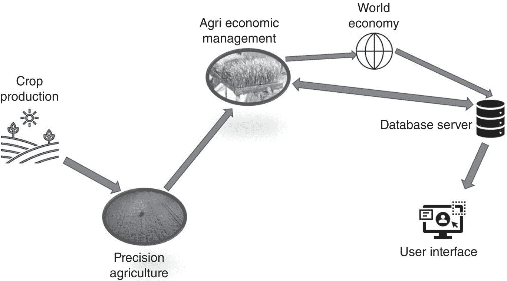

图 9.4 精准农业经济管理。

## 9.4 智能农业种植推荐系统

智能农业种植推荐系统的目标是帮助农民最大化水资源的利用，为未来更精确的农业做准备。它在特定规模农田中的应用确保了水的高效利用和丰收。由于气候变化和全球人口增加，2050 年对水的需求将是前所未有的。找到一种最大化农业用水以同时满足食物和水需求的方法是困难的。考虑与作物发育相关的因素，可以做出尽可能科学的农业决策 [40]。提供健康的饮食对于维持人类生命至关重要。在非洲等地区，食物和水等必需品短缺。

由于环境的不确定性，传统耕作方法所需的人力和时间导致了较低的产量 [41]。现有解决方案的局限性在精准农业中仍然是一个问题 [42]。理解耕地的生态系统并战略性地分配水资源对于实现最大产量至关重要。通常，土壤测试建议会被推迟到以后 [43]。图 9.5 展示了用于精准农业的 ACRIS 多参数优化系统。`AMOP` 方法使农民能够评估作物生长期间使用的当前灌溉计划，并根据该评估做出决策。利用作物生长特征作为输入数据集，预测降水、雨量和蒸发量的灌溉计划 [44]。

最先进的 `Agro ANN_Genetic Algorithm` (`AAGA`) 被用于创建 `AMOP` 系统，它是 `ANN` 和 `GA` 的结合。用户可以通过构建在尖端 `AAGA` 之内的 `AMOP` 系统来确定其农场的最佳浇水计划。通过 `AMOP` 系统的调节和整合，可以对降水和蒸散量范围进行预测，通过受控灌溉启动土壤水稳定性，并提高产出。由于 `ANN` 和 `GA` 以前从未这样结合，这是该系统的主要创新 [44]。`AAGA` 利用水的速度用于灌溉目的。此前预测会有下雨，尽管必须对预测的降水量总量进行调整。

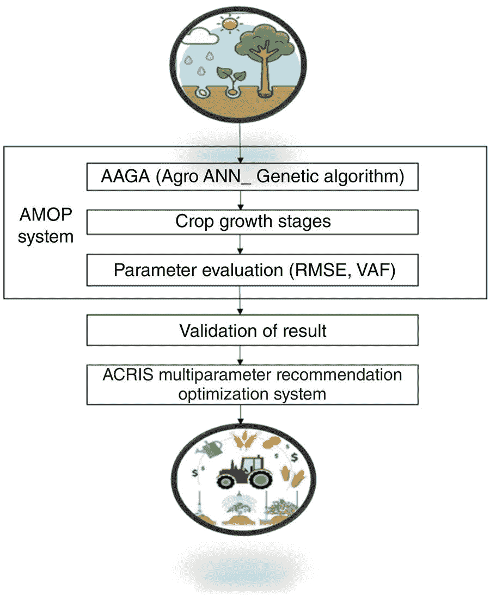

图 9.5 农业种植推荐系统。

## 9.5 结论


# 理解人工智能在农业中差异与意义的一种简单方法

*Karan Aggarwal ¹, Ruchi Doshi ², Maad M. Mijwil ³, Kamal Kant Hiran⁴, Murat Gök ⁵, and Indu Bala⁶*

*¹ 印度安姆巴，Maharishi Markandeshwar（被视为大学），电子与通信工程系*

*² 墨西哥查尔科，Azteca 大学，计算机科学与工程系*

*³ 伊拉克巴格达，巴格达经济科学大学，计算机技术工程系*

*⁴ 印度印多尔，Symbiosis 应用科学大学，计算机科学与 IT 学院*

*⁵ 土耳其亚洛洛瓦，Yalova 大学，计算机工程系*

*⁶ 印度旁遮普邦，Lovely 职业大学，电气与电子工程学院*

## 1 引言

此时，设备技术革命正在日如一日地发展。我们生活在一个帮助完成生活中许多任务的设备时代。技术以前所未有的方式解决了人们的经济状况，这些在 20 年前是无法想象的。在计算机科学中，人工智能（`AI`）科学出现了，它是不可或缺的一部分，也是在许多领域发展最最充分的科学，包括医学领域、军事、人员追踪、社交网络网站和许多无尽的应用 [1, 2]。`AI` 科学可以代表机器或计算机执行与人类思维相关的任务的能力，例如思考、推理、泛化以及从过去的事情和经验中学习，以执行大于或等于人类完成能力的功能 [3]。1956 年，出现了一个改变了计算机科学许多理念的概念——`AI`，它在达特茅会议上被提到。在这次活动中，我们讨论了如何智能地实现和支持计算机软件。`AI` 这个术语并没有满足在场某些科学家（包括纽威尔和西蒙）的目的，但同时，约翰·麦卡锡、马文·明斯基和克劳德·香农在构建 `AI` 理念方面提供了很大帮助，他们批准了它。创造机器人的想法并不新鲜。相反，这是一个追溯多年的古老思想。尽管如此，仍然存在赋予无机生命并将其转化为智能高效对象的例子。在希腊神话中，代达洛斯试图制造统治风的人造人的尝试可以被视为 `AI` 的第一个例子。通常，科学家们总是通过将计算机与智能连接起来，基于 `AI` 的理念开发机器 [4, 5]。这其中最重要的例子是英国数学家艾伦·图灵在 1943 年提出的图灵机（`the enigma machine`）。

图灵在 1950 年的著名论文《计算机器与智能》中声称，计算机可以计算并开发一种测试来判断机器是否智能 [6]。1960 年后，许多研究描述了人类大脑与计算机控制事物能力之间的差异。在此基础上，工程和认知建模被设计出来并缩小了人机差距，这种趋势仍在持续。然而，人是机器的工程师并为它们奠定了基础。但最关键的问题是计算机是否具有像人类一样思考的能力。今天，我们见证了许多关于技术融入我们生活的文章和研究 [7, 8, 9]。此外，`AI` 在应对疾病方面发挥着重要作用，特别是新冠肺炎疫情，因为它可以追踪和诊断计算机图像（`Ct‐scan`）和胸部 X 光片 [10–12]。许多科电影涉及这种计算机融入生活的想法，最著名的包括《超越》（2014）、《美丽内部》（2013）、《人工智能》（A.I. AI，2001）和《机械姬》（2014）。在这项工作中，我们将简要且实用地讨论在许多领域广泛传播应用的三个重要主题：机器学习、深度学习以及数据科学。

`AI` 的进化相当复杂，可以总结为两个概念：机器学习和深度学习。这些术语有时听起来像流行语，但实际上是同义词，这就是为什么了解如何区分它们以及它们为什么如此重要的至关重要。周围有很多例子；例如，Netflix 知道你喜欢看什么电影和剧集，Facebook 知道照片中显示是谁，两者都是自动驾驶汽车（`Autonomous`）的原因。

## 2 机器学习

它被认为是 `AI` 领域影响最大的分支，负责设计能够学习而不需要显式编程的算法。换句话说，开发者或程序员不需要坐几个小时来编写代码或可能的情景以产生更新的算法。他们要求的只是向这些算法输入大量数据，让算法学习并知道它们需要做什么和完成什么，而无需担心。学习有两种类型：监督学习和无监督学习（见图 10.1）。

## 参考文献

1. N. R. Council (2010). *Toward Sustainable Agricultural Systems in the 21st Century*. National Academies Press.

2. Khanna, A. and Kaur, S. (2019). Evolution of internet of things (IoT) and its significant impact in the field of precision agriculture. *Computers and Electronics in Agriculture* 157: 218–231.

3. Singh, P.K. and Sharma, A. (2022). 一种基于 WSN-UAV-IoT 的精细农业应用智能框架。*Computers and Electrical Engineering* 100: 107912.

4. Triantafyllou, A., Sarigiannidis, P., and Bibi, S. (2019). 精准农业：一种遥感监控系统架构。*Information* 10 (11): 348.

5. Hassler, S.C. and Baysal‐Gurel, F. (2019). 无人机系统（UAS）技术在农业中的应用。*Agronomy* 9 (10): 618.

6. Farooqui, N.A., Mishra, A.K., and Mehra, R. (2022). 基于机器学习方法的物联网自动化温室。*International Journal of Intelligent Systems and Applications in Engineering* 10 (2): 226–231.

7. Hakkim, V.M.A., Joseph, E.A., Gokul, A.J.A., and Mufeedha, K. (2016). 精准农业：印度农业的未来。*Journal of Applied Biology and Biotechnology* 4 (6): 68–72.

8. Liang, C. and Shah, T. (2023). 农业中的物联网：精准监测和数据驱动农业的未来。*Eigenpub Review of Science and Technology* 7 (1): 85–104.

9. Firouraghi, N., Kiani, B., Jafari, H.T. et al. (2022). 地理信息系统和全球定位系统在痴呆症护理和研究中的作用：范围综述。*International Journal of Health Geographics* 21 (1): 1–13.

10. Ahmed, W., Zhang, Q., Lobos, A. et al. (2018). 降水影响沿海亚热带水域雨水排水口的病原细菌和抗生素抗性基因丰度。*Environment International* 116: 308–318.

11. Muangprathub, J., Boonnam, N., Kajornkasirat, S. et al. (2019). 智能农场的物联网与农业数据分析。*Computers and Electronics in Agriculture* 156: 467–474.

12. Oliver, S.T., González‐Pérez, A., and Guijarro, J.H. (2019). 使用田间物联网（IoT）节点适应预警葡萄园真菌病害的模型。*Sustainability* 11 (2): 416.

13. Elkarim, G.A., Alotaibi, N.M., Samuel, N. et al. (2017). 小儿脑膜积水中的社交媒体网络：利用情况的点患率分析。*Journal of Neurosurgery Pediatrics* 20 (2): 119–124.

14. Jawad, H.M., Nordin, R., Gharghan, S.K. et al. (2017). 用于精准农业的高能无线传感器网络：综述。*Sensors* 17 (8): 1781.

15. Sikeridis, D., Tsiropoulou, E.E., Devetsikiotis, M., and Papavassiliou, S. (2018). 无线供电公共安全物联网：一种面向能效的 UAV 自适应学习方法。*Journal of Network and Computer Applications* 123: 69–79.

16. Hsu, T.‐C., Chang, S.‐C., and Hung, Y.‐T. (2018). 如何学习和教学计算思维：基于文献综述的建议。*Computers and Education* 126: 296–310.

17. Rehman, A., Saba, T., Kashif, M. et al. (2022). 智能农业监控与控制策略中物联网技术的重访。*Agronomy* 12 (1): 127.

18. Sinha, B.B. and Dhanalakshmi, R. (2022). 智能农业中物联网的最新进展与挑战：综述。*Future Generation Computer Systems* 126: 169–184.

19. Farooqui, N.A., Mishra, A.K., and Mehra, R. (2022). 改进 LSTM 拼接深特征增强作物疾病分类。*International Journal of Intelligent Robotics and Applications* 1–25.

20. Ramesh, P.S., Kokila, T., and Geetha, D. (2015). 使用油骨（*Emblica officinalis*）果提取物的植物介导银纳米颗粒绿色合成及抗菌活性。*Spectrochimica Acta, Part A, Molecular and Biomolecular Spectroscopy* 142: 339–343.

21. Farooqui, N.A., Mishra, A.K., and Mehra, R. (2022). 通过改进的异常分割结合启发式级联深度学习模型实现作物疾病自动识别。*Intelligent Decision Technologies* 16 (2).

22. Ceti, S. and Büyükşşir, E. (2013). 基于时间序列预测的苹果白粉病。*Agricultural Data* 12 (3): 67–72.

23. Balducci, F., Impedovo, D., and Pirlo, G. (2018). 智能农场的机器学习应用。*Machines* 6 (3).

24. Hamad, A., Han, J.‐R, and Kim, B. (2018). 纳米技术在主要作物中的应用。*Saudi Journal of Biological Sciences* 116.

25. Kan, Z.‐R, and He, Z. (2020). 耕作对产量和水效率的响应。*Field Crops Research* 249: 10776.

26. Kurşun, G. and Dengiz, O. (2020). 黑色土壤的作物适应性。*Eurasian Journal of Soil* 9.

27. Mehra, R., Farooqui, N.A., and Tyagi, A. (2020). 无线传感器网络的数据挖掘与融合。在 *Handbook of Wireless Sensor Networks: Issues and Current Scenario*, vol. 1132 (编者 P.K. Singh, B.K. Bhargava). Springer [`doi.org/10.1007/978-3-030-40305-8`](https://doi.org/10.1007/978-3-030-40305-8).

28. Adamides, G., Kalatzis, N., and Stylianou, A. (2021). 物联网配备与人工智能驱动的下一代智能农业：关键综述与未来趋势。*IEEE Access* 10: 21219–21235.

29. Jat, R., et al. (2023). 基于系统的综合养分管理提高花生-小麦轮作的产量、利润和能效。*Sustainability* 15 (2): 1361.

30. Borlaug, N.E. (2002). *绿色革命*。Nobprize.org。

31. Ali, M., Miah, M.S., and Haque, J. et al. (2021). 钙钛矿太阳能电池中主导复合机制的识别。*Energy Reports* 8: 7957.

32. Pandiaraj, P. (2021). 机器学习综述。*Turkish Journal of Computer and Mathematics (TURCOMAT)* 12 (2): 2295–2302.

33. Parikh, N., Pandey, M., and Kumar, M. et al. (2022). 识别主导复合机制。*Machine Learning with Applications* 5: 10036.

34. Migliavacca, M., Musavi, T., and Mahecha, M.D. et al. (2021). 陆地功能的三大主轴。*Nature* 598 (7881): 468–472.

35. Martini, B., Helfer, G., and Barbosa, J. et al. (2021). IndoorPlant：基于上下文的室内农业智能服务模型。*Sensors* 21 (5): 1631.

36. Karthik, M., Abhinav, J., and Shankar, K.V. (2021). 铜锡合金的形貌和机械行为——综述。*Metals and Materials International* 27: 1915–1946.

40. Partarini, N.M.C. (2019). TRMM（热带降雨测量任务）降雨数据验证。于 *Sebagai Alternatif Data Hidrologi di Sub‐DAS Lesti’* (ed. N.M.C. Partarini), 1–214. Brawijaya 大学。

41. Xia, G.‐S. Bai, X., Ding, J. *et al*. (2018). DOTA: 一个用于航空图像目标检测的大规模数据集。*Proceedings of the IEEE Conference on Computer Vision and Pattern Recognition*, pp. 3974–3983, Salt Lake City, UT (18–23 June 2018). New York: IEEE.

42. Ilie‐Ablachim, D., Pătru, G.C., Florea, I.‐M., and Rosner, D. (2016). 用于精准农业培养基质生长参数的监测设备：缩写：MoniSen。*2016 15th RoEduNet Conference: Networking in Education and Research*, pp. 1–7, Bucharest, Romania (7–9 September 2016). New York: IEEE.

43. Sureshkumar, S., Kirthiga, N., Kumar, T.A. et al. (2023). 云端数据存储与共享的双重访问控制。*2023 2nd International Conference on Vision Towards Emerging Trends in Communication and Networking Technologies (ViTECoN)*, Vellore, Tamil Nadu, India (5–6 May 2023). New York: IEEE, pp. 1–6.

44. Kumar, P., Udayakumar, A., Kumar, A.A. et al. (2023). 精准农业中基于土壤水分估计的高级灌溉规划与调度 DCNN 多参数优化系统。*Environmental Monitoring and Assessment* 195 (1): 13.


此外，在机器学习中构建模型意味着通过对训练数据进行泛化和学习来设计一种数学表示。然后，将设计的机器学习模型应用于新数据以进行预测并产生效果。所设计的模型可以是基于目标变量（通常称为 `Y` 变量）的回归模型或分类模型。因此，如果目标变量具有定量值，我们必须创建一个回归模型。相反，如果目标变量的数据类型是定性的，则必须建立分类模型。在构建机器学习模型时，数据的缺失可能是一项挑战。分类机器学习模型最重要的指标是准确率（accuracy）。此外，精确率（precision）是测试数据集中正确预测的总数与数据点总数之比值。换句话说，准确率是评估模型执行情况的一种方法，但还有其他方法。尽管如此，与不同的指标相比，准确率为给定数据集的模型性能提供了最合理的视角。我们使用指标来评估模型的执行情况。模型参数是在训练过程中从数据集中学习并评估的值。该值必须通过训练数据进行近似。因此，模型参数是机器学习模型的内部变量。它的值是根据训练结果设置的。机器学习模型使用这些值来创建预测。这基于模型参数值的准确性。模型参数值对模型的复杂性具有某种程度的控制。模型复杂度曲线是一种用于表示模型复杂性的图形纹理。它显示出随着示例数量增加，信息相对增加。此外，它还可以用于数据删除和加速学习过程，而不考虑分类准确率。

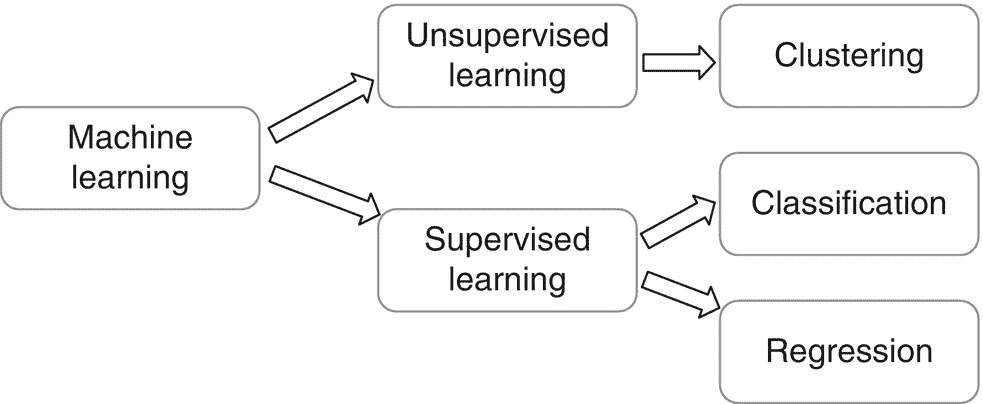

图 10.1 机器学习类型。¶ *来源：* Tkatek, Said et al. (2020)/Putting the world back to work: An expert system using big data and artificial intelligence in combating the spread of COVID‐19 and similar contagious diseases.

## 10.3 深度学习

深度学习是一种应用于许多领域的机器学习方法，其特征是使用许多层非线性处理单元来提取和转换特征。此外，每一后续层都将上一层的输出作为输入。算法可以是监督的（如分类）或无监督的（如模式分析）[14–16]。深度学习是一种进化的机器学习模型，它利用可编程的神经网络允许机器在没有人工干预的情况下做出合理的判断。表 10.1 阐明了机器学习与深度学习的区别。深度学习包含了一系列高度依赖学习和数据表示的架构 17。它通过从低级属性推导出高级级属性，支持数据层次化表示的设计。这种表示学习了对应于不同抽象程度的多级表示。此外，深度学习模型主要依赖数据表示。例如，当提到图像表示时，它可以被视为每个像素的强度值向量或边缘、形状等特征。然而，某些特征能更好地表示数据。作为这种场景的优势，深度学习模型利用高效算法提取充分的特征，而不是手工提取特征。深度学习模型利用逻辑结构来分析数据，以进行推理。事实上，深度学习应用利用人工神经网络来执行特定操作。神经网络的愿景灵感来源于人类的生物神经网络，它产生了比传统机器学习模型更具潜力的学习过程。

表 10.1 机器学习与深度学习的区别。

| 区别 | 机器学习 | 深度学习 |
| --- | --- | --- |
| 数据集 | 小到中等数据集 | 大数据集 |
| 硬件要求 | 低端机器 | 需要 GPU 的机器 |
| 工程特性 | 理解数据的特征 | 理解数据的功能 |
| 训练时间 | 短 | 长 |
| 处理时间 | 秒或几小时 | 小时或几周 |
| 算法数量 | 多 | 少量 |
| 数据解释 | 容易 | 困难 |

## 10.4 数据科学

数据科学可以被视为一种实践，旨在对所有形式的数据进行收集、协调、分析、审查和提取最关键的特征。这门科学将计算机科学领域、统计学与其他现代科学相整合。如今，数据科学是劳动力市场上需求量最大的学科之一，因为它是机器学习、深度学习和大数据等许多学科的基础。它是支持人工智能技术发展的科学。公司寻求利用数据科学技术来分析其数据并做出决策，以帮助更广泛地扩展业务。决策并非易事，因此数据科学是一门涵盖数学、计算机科学、统计学和商业的混合多学科教育。证据分析过程有助于提高商业、政府和行政决策以及科学研究的质量。数据科学的发展应用于医疗、军事、农业等许多领域。在许多情况下，数据科学能够对许多复杂问题提供深刻的见解，并具有不可置信的准确性和及时性。数据科学包含了许多关键且复杂的流程，旨在于采取独特行动之前，对数据进行预测、分类或识别模式，或生成建议。数据科学是一种跨学科方法，通过整合分析方法、专家知识和现代技术来发现和提取多种类型的数据。这种方法通常依赖于使用机器学习技术进行数据挖掘和预测、对此类预测进行分析、统计学以及文本分析。总的来说，大多数组织缺乏专家来将其大数据转型以发现见解并解决组织未察觉的问题。为了正确理解并变现数据科学的价值，组织需要将预测纳入其数据中，并改进其运营和业务系统。如今，许多机构寻求培养专门的干人员来分析其系统数据，这些人员将通过机器学习技术为项目的开发和实施。简而言之，该领域正在不断发展，我们在未来几年可能会听到很多关于它的信息。数据科学包含了说明、诊断、预测和教育能力，这表明通过数据科学，组织可以利用数据来学习发生了什么、为什么发生、将发生什么，以及他们应该做什么以达到预期。

## 10.5 农业行业中的人工智能

### 10.5.1 农业技术

在本节中，回顾了人工智能技术在农业行业的重要性，以及现代技术如何促进农业部门的发展。在该领域，许多食品生产者面临作物受威胁的风险，以及一种损害作物的疾病的出现。通常情况下，农业部门依赖自然力量来管理作物。换句话之，气候性质的变化和降水的缺乏导致了该部门可用劳动手的短缺，这导致了农业产量的下降，特别是在拉克，它认为是受气候变化和作物缺乏影响最大的国家之一，且严重依赖邻国的进口，这导致了食品价格大幅上涨。面对所有这些挑战，世界各国关注的主要问题是农业行业的自动化。人口每天呈指数级增长，随着人口密度的增加，对食物和工作的需求也每天增加。农业工作者使用的方法不足以满足这些要求。因此，增加了现代自动化的方法以使事情变得更简单、更高效。随着人工智能技术的增长，在农业部门应用这门科学已变得至关重要。全球学者正寻求开展关于在农业行业中使用人工智能技术的研究。在未来几年里，人工智能将具有足够的容量产生更好的预测见解，因为它将对增加农业生产做出重大贡献，同时为全球数百万人提供工作机会[18, 19]。

有大量文献将深度学习技术用于诊断和分类作物疾病。在 Tiwari 等人 [[20]](#c10.xhtml#c10-bib-0020) 的研究中，他们建议应用像 `VGG-19` 模型这样的深度学习技术来研究和检测马铃薯叶病。这项研究的准确率超过 97%。在 Rangarajan 等人 [[21]](#c10.xhtml#c10-bib-0021) 的另一项研究中，他们应用了两种基于深度学习架构 `AlexNet` 和 `VGG-16` 网络来分类西红柿作物疾病。这项研究两种架构的准确率分别达到了 97.29% 和 97.49%。农业行业可以从人工智能驱动的解决方案中受益，通过使用天气预报管理环境挑战，建立土壤和作物健康监测系统，并通过使用技术收集有关如何提高生产决策所需的信息和数据进行预测分析，并创建检测对农业有害锈菌的设计。近期，机器学习和深度学习技术已成为农业行业赖以的关键要素，以持续提高效率和产量。此外，这些技术帮助农业工作者通过分析信息、了解人口增长率以及发现可以开发以建立农田的新区域以跟上这种人口增长来预测需求。此外，这些技术还有助于通过无人机（见图 10.2）喷洒和清除毒草及无用杂草。最后，这些技术有助于减少过量农药、水和除草剂的使用，维持土壤肥力，帮助高效利用并在提高质量的同时提高生产。

### 10.5.2 智能农业

近年来，许多政府已开始开发和应用智能农业，这指的是在农业部门应用现代先进技术，旨在整合最新的技术创新，通过获取有关农产品状态和天气的准确信息和数据做出最优决策。智能农业已成为一个快速发展的重要趋势，得益于帮助农业工作者建立先进农田的发展，这被称为精准农业。此外，智能农业通过依赖智能应用程序有助于解决农业工作者面临的许多问题，预计预计到 2025 年将有助于农业产量增加 70%[23]。这一比例在 2030 年之后可能会进一步增加。图 10.3 说明了使用无人机将农业数据发送给农业工作者的手机。智能农业带来了许多好处，其中一些可以突出：

![图 10.2 农业部门的无人机。(a) 植种无人机。(b) 灌溉无人机。(c) 土壤分析无人机。(d) 作物监测无人机。(e) 作物喷洒无人机。(f) 健康评估无人机。 来源自 Casadiego [22], ORCID, CC0 1.0.](images/c10f002.jpg)

图 10.2 农业领域的无人机。(a) 植种无人机。(b) 灌溉无人机。(c) 土壤分析无人机。(d) 作物监测无人机。(e) 作物喷洒无人机。(f) 健康评估无人机。*来源：*来自 Casadiego [22, ORCID, CC0 1.0。

![图 10.3 无人机将农业数据发送到农业工作者的手机。来源：来自 Rehman 等人. [24] / MDPI / CC BY 4.0。](images/c10f003.jpg)

图 10.3 无人机将农业数据发送到农业工作者的手机。*来源：*来自 Rehman 等人. 24 / MDPI / CC BY 4.0。

*   它有助于增加收益，因为新技术允许降低水、能源或肥料等资源的成本，并以满足橄榄需求的更高质量增加产量。
*   对所有与植种相关的任务进行完全控制，并协助农业工作者在更短的时间内完成职责，同时支持他们做出正确的决策。
*   通过整合工具和应用程序，并简化控制和极远远程控制过程，而无需亲临现场，它有助于提高农民和农业领域工作人员的生活质量。
*   智能应用程序的特点是农业领域和农业生产的许多方面的自动化，因为它们节省了的时间和成本。
*   基于 AI 的农业解决方案具有高度的可持续性，因为这些应用寻求实现更具可持续性和高效率的作业。

大数据是 AI 推动农业领域增长的因素之一。此外，农业已开始整合先进应用，能够日益提取数据、统计数据和数字，通过提取影响并确定生产率最高且最符合消费者需求的农业类型，以满足未来需求。智能传感器被用于获取土壤、水质、天气或植物数据，并高效地将这些细节传递给种植者的手机，同时用图表说明每日农业活动。预计到 2030 年，机器人和无人机在农业任务中使用将增加，以便以高精度和高信誉度提取高质量数据（见图 10.4）。这些无人机有助于持续监测农作物，并在更短的时间更低的成本检测潜在问题，例如控制害虫和防止疾病在植物间的传播。一方面，AI 有助于创建允许远程集成农业领域各种要素的应用程序、用于治理和管理农业生产过程的先进软件，以及采用全球定位系统（`GPS`）并可以通过智能手机处理的农业机械的重大发展。自动化被认为是向智能农业转型过程主要要素之一，在农业生产阶段，根据智能传感器等工具制作的先验数据和记录，各个方面和元素都实现了自动化。例如，灌溉或天气的自动化使得实现植物生产所需的良好气候成为可能。AI 在农业领域具有重要且有影响力的作用，因为它不断寻求开发帮助采集作物、预测天气并提供更高效系统的机器和工具。精准农业是农业行业的一种 AI 解决方案。该技术应用于植物的健康监测、田间收割、杂草和害虫控制、土壤短缺检测以及其他有利于农业工作者的任务。毫无疑问，智能农业仍有很多工作要做才能达到非常先进的阶段，并促进决策、提高农作物质量，并使用智能传感器监测气候、水或土壤的变化，并通过智能手机、笔记本电脑或任何其他连接到互联网的设备对其进行远程控制。

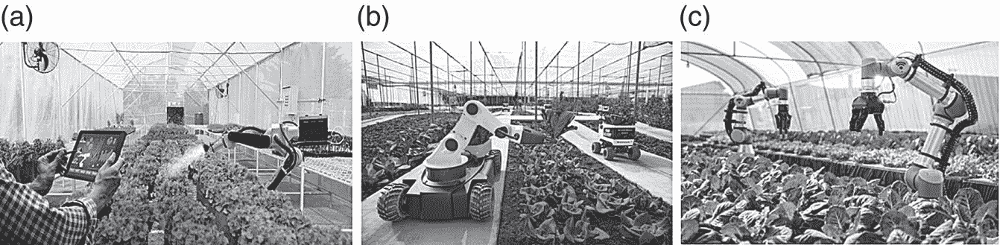

图 10.4 让机器人参与农业生产。(a) sompong\_tom/Adobe Stock Photos。(b) kinwun/Adobe Stock Photos。(c) Pugun & Photo Studio/Adobe Stock Photos。

智能农业涉及信息和数据技术，以优化复杂的农业系统。优先事项是数据访问以及生产者如何能够智能地利用组织好的信息。智能农业中采用的技术范围从 `IoT` 和机器人到无人机和 AI。通过这些设备，农业工作者无需亲临现场即可监测农场要素。这允许他们对整个区域、大量区域甚至单株植物做出决策。然而，智能农业不仅适用于大型农业工作者，也可供小型农业工作者、有机种植者或其他规模的操作使用。整个智能农业技术由软件处理并由传感器监测。此外，自动化在生产效率、质量和可持续性方面带来了巨大的收益。智能农业面临的挑战之一是所有技术与不同数字倡议之间的互操作性，以鼓励对生成数据的访问。随着农业复杂性的增加，感兴趣的方数量以及信息流的复杂性也随之增加目前的生产技术使用了多个制造商的机器和软件。因此，生产者必须处理许多专有的数据格式、代码列表等。因此，需要标准的接口和数据格式来获得互操作性。这种互连暗示了投入品制造商、生产者、食品行业和服务提供者之间的信息互动。甚至客户也包含在，他们日益根据信息的可用性做出购买决策。总而言之，利用信息技术的目的是通过获取、分析和利用数据来优化流程和决策，提高生产者的经济效益，降低活动风险并鼓励日益可持续的技术。

## 10.6 结论

AI 技术在许多不同行业（如交通、金融、医疗保健，现在还有农业）中具有重要且独特的作用。此外，它已帮助农业工作者以巨大的优势监测其农产品。此外，农业 AI 不仅帮助农业工作者实现作业自动化，还通过精准农业以更少的资源获得更好的作物产量和质量。AI 采用了现代技术，帮助农业工作者在无需个人进入农场的情况下监测作物。如今许多公司和初创公司期望开发农业 AI。农业 AI 正在重新定义传统的耕作模式。通过各种先进策略，农业 AI 的未来在实现整体转型方面已变得进步。

## 参考文献

1. Dadhich 等人 (2021)。大流行锁定期间混合在线学习门户的教学感知。*Advances in Intelligent Systems and Computing* 119–129。[`doi.org/10.1007/978‐981‐16‐1696‐9\_11`](https://doi.org/10.1007/978-981-16-1696-9_11)

2. Mijwil, M.M., Gök, M., Doshi, R. 等. (2023). 利用人工智能技术提高无线节点的性能. 载于：*无线通信系统中的人工智能应用*（编：K. Kumar）， 150–162. [`doi.org/10.4018/978‐1-6684‐7348‐1.ch010`](https://doi.org/10.4018/978-1-6684-7348-1.ch010)

3. Stahl, B.C., Andreou, A., Brey, P. 等. (2021). 面向人类繁荣的人工智能——超越机器学习的原则。*商业研究杂志* 124: 374–388. [`doi.org/10.1016/j.jbusres.2020.11.030`](https://doi.org/10.1016/j.jbusres.2020.11.030)

4. Al‐mashhadani, M.I., Hussein, K.M., Khudir, E.T., 和 Ilyas, M. (2022). 使用大数据在不同的 Facebook/Twitter 数据集领域中利用优化特征集进行情感分析。*伊拉克计算机科学与数学杂志* 3 (1): 64–70. [`doi.org/10.52866/ijcsm.2022.01.01.007`](https://doi.org/10.52866/ijcsm.2022.01.01.007)

5. Salem, I.E., Mijwil, M.M., Abdulqader, A.W., 和 Ismaeel, M.M. (2022). 使用 Dijkstra 算法进行航班计划安排并与路径查找比较。*国际电气与计算机工程杂志* 12 (2): 1675–1682. [`doi.org/10.11591/ijece.v12i2.pp1675‐1682`](https://doi.org/10.11591/ijece.v12i2.pp1675-1682)

6. Turing, A.M. (1950). 机器机器与智能。*心灵* 59 (236): 433–460. [`doi.org/10.1093/mind/LIX.236.433`](https://doi.org/10.1093/mind/LIX.236.433)

7. Verma, S., Sharma, R., Deb, S., 和 Maitra, D. (2021). 营销中的人工智能：系统性综述与未来研究方向。*国际信息管理数据洞察杂志* 1 (1): 100002. [`doi.org/10.1016/j.jjimei.2020.100002`](https://doi.org/10.1016/j.jjimei.2020.100002)

8. Zhang, H., Lee, I., Ali, S. 等. (2022). 将伦理、职业未来与技术学习相结合以提高中学生的学生的 AI 素养：一项探索性研究。*国际教育人工智能杂志* 2022: 1–35. [`doi.org/10.1007/s40593‐022‐00293‐3`](https://doi.org/10.1007/s40593-022-00293-3)

9. Hiran, K.K. 和 Doshi, R. (2013). 一基于数字图像分割检测脑肿瘤的人工神经网络方法。*计算机科学新兴趋势与技术国际杂志* 2 (5): 227–231.


# 参考文献

10. **10** Mijwil, M.M. (2023). 用于从胸部 X 光图像检测 COVID‐19 的深度卷积神经网络架构。*伊拉克科学杂志* 64 (5): 2561–2574. [`doi.org/10.24996/ijs.2023.64.5.38`](https://doi.org/10.24996/ijs.2023.64.5.38).

11. **11** Mijwil, M.M. 和 Al‐Zubaidi, E.A. (2021). 使用卷积神经网络进行冠状病毒疾病（COVID‐19）医学医学分类。*伊拉克科学杂志* 62 (8): 2740–2747. [`doi.org/10.24996/ijs.2021.62.8.27`](https://doi.org/10.24996/ijs.2021.62.8.27).

12. **12** Dadhich, M., Hiran, K.K., Rao, S.S., 和 Sharma, R. (2022). covid‐19 对高等教育教师和学生教学的影响。*移动多媒体杂志* 18 (4): 957–980. [`doi.org/10.13052/jmm1550-4641`](https://doi.org/10.13052/jmm1550-4641).

13. **13** Ali, A., Abdullah, M.Z., Abdul‐wahab, S.N., 和 Alsajri, M. (2020). 基于机器学习的大数据分析简述。*伊拉克计算机科学与数学杂志* 1 (2): 13–15. [`doi.org/10.52866/ijcsm.2020.01.01.007`](https://doi.org/10.52866/ijcsm.2020.01.01.007).

14. **14** Faieq, A.K. 和 Mijwil, M.M. (2022). 利用支持向量机和人工神经网络预测心脏疾病。*印尼电气工程与计算机科学杂志* 26 (1): 374–380. [`doi.org/10.11591/ijeecs.v26.i1.pp374`](https://doi.org/10.11591/ijeecs.v26.i1.pp374).

15. **15** Aggarwal, K., Bhamrah, M.S., 和 Ryait, H.S. (2018). 通过新索引对肝硬化超声图像进行纹理分析。*计算智能研究*，卷 713，93–101.

16. **16** Dadhich, S., Pathak, V., Mittal, R., 和 Doshi, R. (2021). 用于天气预报的机器学习。**可持续发展的机器学习*（编：K.H. Hiran, D. Khazanchi, A.K. Vyas, and S. Padmanaban），161–174. De Gruyter [`doi.org/10.1515/9783110702514-010`](https://doi.org/10.1515/9783110702514-010).

17. **17** Lusci, A., Pollastri, G., 和 Baldi, P. (2013). 化学信息学中的深度架构和深度学习：药物分子的水溶性预测。*化学信息与建模杂志* 53 (7): 1563–1575. [`doi.org/10.1021/ci40087y`](https://doi.org/10.1021/ci40087y).

18. **18** Koyuncu, B. 和 Gok, M. (2019). 回归方法预测植物育种中的基因型产值。*花园* 48 (2): 79–85.

19. **19** Marcos, A.P., Rodovalho, N.L.S., 和 Backes A.R. (2019). 使用卷积神经网络检测咖啡叶锈病。*2019 年 XV 计算机视觉工作会议*，第 1–6 页，巴西圣贝尔纳多·坎普（2019 年 9 月 9 日至 11 日）。纽约：IEEE

20. **20** Tiwari, D., Ashish, M., Gangwar, N., Sharma, A., Patel, S., 和 Bhardwaj, S. (2020). 使用深度学习检测马豆叶病。*智能计算与控制系统国际会议集*，第 1–6 页，印度马杜来（2020 年 5 月 13 日至 15 日）。纽约：IEEE

21. **21** Rangarajan, A.K., Purushothaman, R., 和 Ramesh, A. (2018). 使用预训练深度学习算法进行番茄作物疾病分类。*计算机科学进展* 133: 1040–1047. [`doi.org/10.1016/j.procs.2018.07.070`](https://doi.org/10.1016/j.procs.2018.07.070).

22. **22** Casadiego, Y.A.S. (2020). 人工智能（IA）及其在现代农业中的应用。人工智能（AI）及其在现代农业中的应用，哥伦比亚（2022 年 9 月），第 1–11 页。

23. **23** Rehman, A., Iqbal, M.A., Xing, H., 和 Ahmed, I. (2021). 机器学习和深度学习技术赋能 COVID‐19 检测：系统性综述。*应用科学杂志* 11 (8): 374–380. [`doi.org/10.11591/ijeecs.v26.i1.pp374`](https://doi.org/10.11591/ijeecs.v26.i1.pp374).

24. **24** Rehman, A., Saba, T., Kashif, M. 等. (2022). 物联网技术在智能农业中监测和控制策略的重审。*农学杂志* 12 (1): 227–231. [`doi.org/10.3390/agronomy1201027`](https://doi.org/10.3390/agronomy1201027).

WileyPRE

# 11 预测性维护与负载预测概述

*Nand Kishor Gupta¹, Vivek Upadhyaya¹, 和 Vijay Gali²*

¹ 普尔尼玛大学电气与电子工程系，印度 Jaipur

² 纳扎巴耶夫大学电气与计算机工程系，哈萨克斯坦 阿斯

## 11.1 引言

随着预测性维护和负载预测的出现，“预防胜于治疗”这一老格言在工业操作和能源分配领域具有了全新的含义。由于这两个相互关联领域的影响，许多企业的资产管理、维护方法和能源优化实践将需要经历范式转移。

过去的大多数维护实践都是计划性或响应性的，这导致了意料之外的故障、高昂的维修费用以及生产停工。相反，`PdM`（预测性维护）的出现使得更具主动性成为可能。`物联网 (IoT)`、数据分析和机器学习均被用于 `PdM`，以预测设备何时会损坏。同时，负荷预测已演变为能源管理不可不可缺的组成部分。这使得公用企业能够预测客户需求模式并优化发电和分配的能力。

本章将开始深入研究 `PdM` 和负荷预测这两个相互关联的领域。我们将探讨基本思想、方法、优点和挑战，以及现实应用，以突显这些内容在当代工业和能源领域中的重要性。随着自动化继续对商业世界和支持它的电气系统产生深远影响，工程师、学者、管理人员和政治家对 `PdM` 和负荷预测有全面的理解至关重要。本章分为三个部分，如图 11.1 展示了构成维护方法的主要步骤推测。

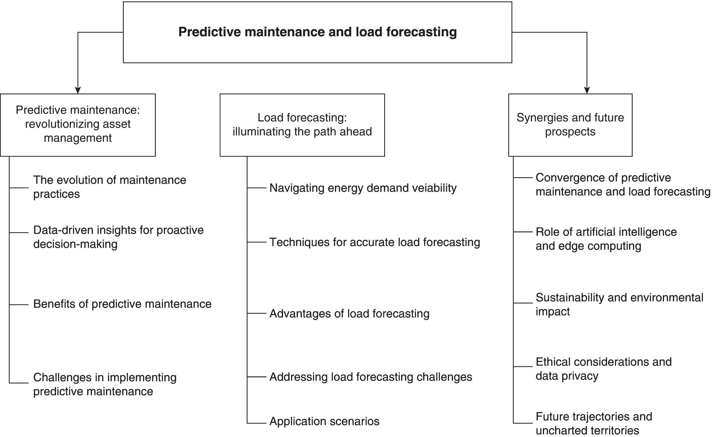

图 11.1 章节结构。


图 11.2 维护过程的基本阶段。

### 11.2.1.1 响应性维护

第一阶段与众不同，因为它采用了“坏了后修”的方法，这意味着在设备故障时才执行预防性维护程序。尽管这种方法可以快速解决问题，但导致了更长的停机时间、工作效率低下以及运行问题。

### 11.2.1.2 预防性维护

下一步是建立在设定时间或根据使用因素进行的定期维护任务。该计划的目标是在故障发生前通过更换或维护来减少故障。尽管减少了很多停机时间，但预防性维护并不准确，且经常在不需要时更换部件。

### 11.2.1.3 预测性维护

随着数据驱动洞察、高级分析和 `IoT` 的兴起，预测性维修变得可能。这种预防方法利用传感器数据、实时跟踪和预测算法确定设备何时会损坏。`PdM` 分析模式和异常值，使维护计划更加高效。这节省了资金，减少了停机时间并让技术使用寿命更长。

作者提出了一种利用声学传感器检测异常数据的两阶段无监督方法[5]。最初，研究人员将声学数据划分为时间间隔，随后采用了三种不同的技术，即线性预测编码(`LPC`) [6]、梅尔频率倒谱系数(`MFCC`) [7] 和伽马转换系数(`GMCC`) [8]，来从未处理的数据中提取特征。

初始阶段涉及采用 `BIRCH` 方法将数据划分为许多微簇，并利用计算出的特征作为划分依据。在第二阶段，根据质心之间的距离进行分组合并。具体而言，如果发现两个质心之间的距离低于预定的阈值值，则执行合并操作。相反，如果距离超过阈值，则认为这些组互不互斥且不进行合并。最终结果包含两个不同的类别：第一类包含动作点，第二类包含异常事件。

除了包含负面刺激外，还通过利用枪声、玻璃破碎声、警报声和痛苦的声音表达等听觉线索来收集上下文信息。该方法表现出良好，测量准确率、记忆和 F1 分数超过了 90%。F1 分数和准确率指数与仅依赖宏聚类方法的一步法相比，表现出优异的性能。

作者在文献 [9] 中引入了一种去中心化架构，短期异常检测任务通过无监督人工神经网络 (`ANN`) 算法在传感器节点处执行。在此阶段，从传感器节点收集的数据被整合并分析，以实现信息的无缝集成。随后的阶段将在云基础设施中实现，并预计会被及时检测。

检查具有高度相关性的传感器之间的关联。因此，短期分析涉及评估不确定概率和数据受影响的时间跨，而云计算需要更长的时间，并依赖过去的数据来确定传感器更换和异常检测。需要注意的是，作者利用受限玻尔兹曼机 (`RBMs`) 来利用创意游戏的概念 [10]，并特别是在考虑传感器点能力限制的情况下在云计算环境中训练 `ANN` 技术。

此外，值得注意的是，传感器节点在其边缘不保留任何数据。这意味着不仅是算法，其他相关信息也没有写入设备中。[11] 的作者提供了一个跟踪和分发系统。该解决方案的架构由一组低功耗设备和头部组成，这些是位于传感器节点附近的节能设备。

检测模型最初在离线训练阶段使用主成分分析 (`PCA`) [12, 13] 构建，以计算训练数据的特征向量和特征值矩阵。此时，利用特征向量和特征值矩阵对每个点进行参数不等式计算。负检测过程涉及在调查过程中识别超出既定计算边界的变量值。传感器点的数据平均处理有助于通过将数据传输到板卡来生成新模式。板然后利用从多个传感器点获得的数据构建新的全局模型，随后将其传回节点。

该方法的有效性通过生成合成对象并随后利用英特尔伯克利研究实验室 (`IBRL`) 提供的传感器网络输入数据进行了评估。结果表明，与仅使用局部模型相比，局部和全局检测模型的整合产生了更优的结果。当该方法与源自时空关系的发现分布进行比较时，结果表明只有一种方法在价值分析方面表现出优异性能，而测量系统被认为是不准确的。然而，作者发现这种方法缺乏全面性。

### 11.2.2 用于主动决策的数据驱动洞察

特别是在预测性维护 (PdM) 和优化技术的背景下，数据驱动洞察的时代为主动决策带来了了一种新的范式。本节深入探讨了数据驱动洞察的革命性影响，这种洞察是由 `IoT`、大数据分析和机器学习算法实现的。本节的最终目标是实现主动决策。

#### 11.2.2.1 IoT 和传感器网络的作用

`IoT` 彻底改变了数据采集和传输过程。由于集成到机器、设备和流程中的传感器持续采集，产生了连续的数据流。这些传感器网络能够监测温度、压力、振动和性能指标等因素，并提供运行状况的全面视角。

#### 11.2.2.2 大数据分析与机器学习

由于 `IoT` 设备提供的数据量巨大且复杂，因此需要复杂的分析工具。大数据分析工具与机器学习算法相结合，可以筛选这些数据以寻找传统方法无法发现的模式、异常和趋势。这些算法从以前的数据中学习，并根据变化的情况调整其行为，从而提高预测准确性。

#### 11.2.2.3 预测算法

数据驱动的洞察能够创建预测算法，识别设备老化或即将故障的早期迹象。通过将实时数据与历史记录进行比较，这些算法可以识别偏离正常运行模式的情况。这种主动方法允许维护团队在故障发生之前干预，最大限度地减少停机时间并优化资源配置。

#### 11.2.2.4 实时监控与告警

实时监控与数据分析相结合使工业能够在检测到异常时接收实时告警。维护团队可以及时响应，根据实际设备状态而非通用的时间间隔安排维护活动。

#### 11.2.2.5 数据驱动洞察的益处

采用数据驱动洞察进行主动决策具有许多优势。通过及早识别问题，工业可以避免灾难性故障、优化维护计划、延长设备寿命并提高运营效率。此外，预测性洞察有助于降低运营成本和非计划停机时间。

#### 11.2.2.6 局限性与挑战

尽管具有潜力，但利用数据驱动洞察面临着挑战。确保数据质量、管理跨系统的数据集成以及训练准确的机器学习模型需要专门的努力。组织还解决解决数据隐私、安全以及复杂算法的可解释性相关的问题。

通过数据驱动的方法，学习基于从工厂传感器和执行器中收集的数据。随着 `IIoT` 和 `CPS` 14 等技术的普及，这种方法变得更加重要。收集的信息可以用于研究部件是如何损坏的，或者建立一个可以预测其剩余使用寿命（RUL）的模型。近年来，研究人员探讨了数据驱动方法在“大数据”时代的前景。这是因为它可以与多种不同的模型方法与其他方法结合使用。例如，利用统计学或机器学习，可以使用收集的数据来建立行为模型，或获取特定表达式的物理模型。多层系统可以处理当今业务世界的复杂性，并利用来自旧系统的数据。这是可能的，因为旧数据可以与数据驱动系统的标准混合，使该方法运行得更好。

处理数据的方法（如视觉搜索、统计和机器学习）可以分为两类。关于预测性维护（PdM）的许多模型和方法已有报道，例如`隐马尔可夫模型`（HMM`） 15、`维纳过程模型`（`WPM`） 16、`伽马过程模型` 17、`比例风险模型` 18 以及`自回归模型`。`ARMA` 代表等效线性移动平均模型 19。使用了许多机器学习技术，如 `ANN` 20、21 及其变体、`SVM` 22、`RF` 23、`xGBoost` 24 以及 `SOM` 25。随着 `IIoT` 和 `CPS` 14 等技术变得普遍，这种方法变得更加重要。收集的数据可以用于研究部件是如何损坏的，或者从数据中建立行为模型并确定它们的 RUL。近年来，对数据驱动方法在“大数据”时代的前景进行了大量研究。这主要是因为这些方法可以以“多模态”的方式与其他方法结合使用。例如，可以使用统计或机器学习技术对收集的数据进行处理，建立系统工作方式的模型或特定部件的物理模型。多层系统可以处理当今业务世界的复杂性，并利用来自旧系统的数据。这是可能的，因为旧数据可以与数据驱动系统的标准混合，使该方法运行得更好。

处理数据的方法（如视觉搜索、统计和机器学习）可以分为两类。在研究领域，有许多用于 PdM 的模型和方法。这些包括 `HMM` 15、`WPM` 16、`Gamma Process Model` 17、`Proportional Hazards Model` 18 以及 `Autoregressive Model`。`ARMA` 代表等线性移动平均模型 19。使用了许多机器学习技术，如 `ANN` 20、21 及其变体、`SVM` 22、`RF` 23、`xGBoost` 24 以及 `SOM` 25。在本章的下一部分，我们将讨论数据驱动预测方法，并强调表 11.1](#c11.xhtml#R_c11-tbl-001) 所示每种方法的贡献。数据驱动洞察重塑了决策从被动变为主动，特别是在 PdM 的背景下。IoT、大数据分析和机器学习的结合使行业能够利用实时信息、识别模式并预测潜在设备故障。随着技术的演进，数据驱动洞察在促进主动决策方面的作用对于确保高效、可靠和韧性的工业运营将是至关重要的。表 11.1 数据驱动方法总结。

| 技术 | 参考文献 | 主要贡献 | 案例研究 |
| :--- | :--- | :--- | :--- |
| 统计方法 | `SUDM` 26 | 使用传感器数据更新退化模型 | 仿真模型 |
| | `SUDM` 27 | 基于 SLD 的模型和 `SUDM` 的优势 | 仿真模型 |
| | `PF`; `WMQE` 28 | 新健康指标 | 轴承测试 |
| | `WPM`; `PF` 29 | 基于年龄和状态的 RUL | 涡轮扇发动机 |
| | `KS`; `Chi2` 30 | 自动数据标记 | 电气机器绝缘 |
| | `WPM` 31 | 考虑硬故障 | 铅电池 |
| 机器学习方法 | `ANN` 32 | 由 `ANN` 创建的正常行为模型 | 风力涡电机机轮箱 |
| | `RBM`; `SOM` 33 | `RBM` 提取改进 RUL 预测的特征 | 轴承数据 |
| | `PF`; `RF` 34 | 集成方法 | 飞机轴承；飞机发动机 |
| | `SVM`; `ANN` 35 | MEP 组件的寿命延长 | MEP 组件 |
| | `DBF` 36 | 专家知识、实时信息和配置参数的融合 | 热轧机 |
| | `XGBoost`; `RF` 37 | 应用于真实环境 | 消费品工厂 |

### 11.2.3 PdM 的收益

PdM 是一项变革性策略，它利用数据驱动洞察和先进技术来彻底改变各行业的维护实践。通过在故障发生前主动识别潜在的设备故障，它提供了许多收益，重塑了运营效率、资源利用和成本效益。其主要优势之一是通过及时干预尽地减少停机时间。通过分析实时数据和历史模式，PdM 使组织能够在计划停机期间安排维护，减少意外故障的影响，并确保更长的运行时间，这直接转化为生产力的提高和收入的。

此外，PdM 通过提供设备实际状况的准确洞察来优化资源分配。维护团队和资源根据设备的实时健康状况部署，减少了不必要的干预并节省了贵的资源。这不仅降低了成本，还简化了整个维护过程，使其更加高效。

该策略延长设备寿命的能力另一个重要优势。通过在小问题变成重大故障之前处理它们，PdM 确保设备运行良好且寿命更长。这直接减少了频繁更换的需求，降低了设备采购成本并有助于整体的可持续性。


成本效率是 PdM 的显著优势。该策略用计划的预防性措施取代了昂贵的被动维护做法。意外故障、紧急维修和备件的过度积存减少到了最低，从而实现了更高效的资源利用和运营成本的降低。这种成本效益延伸到整体运营，优化的维护实践提高了盈利能力和财务稳定性。

PdM 还增强了安全性和可靠性。通过解决可能对人员和环境构成风险的潜在设备故障，该策略促进了更安全的工作环境。此外，设备的可靠运行确保了产品质量的一致性和客户满意度，从而提升了组织的声誉和市场地位。

知情决策是另一个关键益处。PdM 的数据驱动基础使组织能够根据历史数据和实时信息做出战略性选择。这导致了更好的规划和执行，提高了整体的运营效率和资源管理。决策不再是被动反应，而是根据从大量数据分析中获得的见解和趋势来指导的。

通过 PdM，运营效率得到了显著提高。停机时间的减少、资源的优化配置以及设备寿命的延长共同促进了运营效率的提升。各行业能够更持续地实现生产目标，减少中断，并使流程产出最大化。这直接影响到整体业务竞争力和性能。

基于状态的维护概念是 PdM 带来的一项关键创新。与传统的基于时间的维护方法（可能导致维护过度或维护不足）不同，PdM 仅在设备显示出劣化迹象或即将发生故障时才进行干预。这种精确的方法消除了与计划性维护相关的猜测，减少了不必要的干预和成本。

实时监控和警报是 PdM 成功的核心。这种即时通知系统允许维护团队对设备检测到的异常做出迅速响应。早期干预防止了潜在的发生，减轻了对运营的影响，并进一步减少停机时间和相关成本。

总之，PdM 重新定义了行业处理维护实践的方式。其综合效益包括停机时间极小化、优化资源配置、延长设备寿命、提高效率、提高安全性、增强运营效率、知情决策以及向基于状态维护的战略转变。通过整合数据驱动的见解和先进技术，PdM 不仅改变了维护操作，还使组织成为效率、可靠性和效益方面的行业领导者。

### 11.2.4 实施 PdM 的挑战

调查不准确性时最大的问题之一是不准确性的产生原因有很多。虽然由发动机故障或损坏引起的故障包含重要数据，但由传感器故障、电池没电或其他外部干扰引起的故障被视为噪声，并可能导致误解 [38]。因此，研究提出了一种利用不同传感器之间的关系、减少由传感器问题导致的数据错误的新方法 [39]，但只有 Liu 等人和 ElMenshawy 等 [40, 41] 中提到的方法清楚地显示了噪声数据与相关事件异常数据的区别。然而，这种方法通常需要对阈值和限制等某些参数进行微调。此外，由于性能不佳和新的外部条件，设备需要进行修改，这需要特殊的工程知识，如 Liu 等人所示 [40]。此外，在使用传感器之间的关系时，这种不确定性会导致关系发生显著变化，但它会由于设备运行的增益或其他异常而改变。相反，Yoo 提出的跟踪方法 [42] 需要大量的记录数据来建立模型。

在构建和测试漏洞检测系统时，精确信息的缺失是必须克服的挑战之一。由于此，许多文献利用了忽略策略 [9, 43, 44]。用于生成性能指标的数据被扩展，除了呈现的结果之外还包含了负影响，以改进这一过程。例如，在 Janjua 等人 [5] 中，作者包含了枪声、玻璃破碎声、尖叫声和警报声，但没有典型的背景噪声；而在 Cauteruccio 等 [9] 中，传感器与灯泡和硅胶袋混淆了。Janjua 等人和 Cauteruccio 等 [5, 9] 均可以在网上找到。在真实的工业环境中，可能会出现并非立即而见的故障。除了噪声、碰撞和发动机损坏外，实际数据是独特的，需要大量的独特工程工作。因此，异常检测领域尚未拥有这样详尽的数据集。结果是，本部分研究中利用的大多数数据集在正常行为数据集中整合了合成错误。这些缺陷可能无法正确代表异常数据的真实行为，这在下文中将进一步讨论。

商业世界对大数据越来越感兴趣，且现代商业世界的竞争环境需要快速且有效的反应。由于它们可能将多个代理（或执行体）的工作分布在多个层级上，多层级和去中心化系统近年来变得越来越流行。此外，如果发现传感器网络中的信息不一致或无关，则无需保存或传输这些信息，这允许更高效地利用可用资源。需要注意的是，缺陷的检测起着重要作用，因为这种方法的结果可以通过两种方式在 PdM 系统的下一阶段进行技术研究：价值信息可能会被删除，以及生产调整、停机、加油等。重要的是，缺陷的检测起着重要作用，因为这种方法的结果可以在 PdM 系统的下一步中进行技术研究。传感器数据可以识别异常，然后将其整合到 `RUL` 预测模型中。这可以提高预测模型的准确性水平。

在 PdM 中，建模或基于智能的方法与数据驱动的方法相结合以做出复杂的预测。尽管研究人员在该领域取得了进展，但仍有一些问题未得到解答。特定的方法仅适用于某个项目或多个项目，不能通用。某些数据在各种应用中证明是有益的；例如，Lee 等人 [45] 在预测刀具和轴承状态时显示准确率高于 90%；但这是通过使用多种机器学习模型（如不同类型的 `SVM` 和 `ANN`）实现的。此外，该解决方案对任何其他产品的损坏将不予涵盖。此外，故障建模和产品相互作用没有使用风险因素分析或故障树 (`DFT`) 等模型 [46。

轴承是研究最充分的产品之一[[28, 29, 33, 47]]，通过大量的实验已经收集了充足的信息来模拟产品的失效。对于简单的物品，从材料中产生模式模式比从压力机或成型机等复杂设备中产生模式要简单得多。此外，数据库和合成数据通常不能代表真实数据中存在的相同同质性[[26, 27]]。因此，该模型的验证性不如在实际工业背景下测试的模型验证性那样强。

然而，统计方法具有坚实的理论基础；尽管如此，它们假设参数遵循特定的分布（如指数分布或韦布尔分布等），而不是使用可能与相关行为更贴合的真实分布。此外，统计方法有时基于具有多个组件的已知疲劳或断裂模式，但该方法无法在其他工业设备上重复。这是因为已知模式特定于相关设备。相反，机器学习技术具有表示高度多样化和非线性模型的能力，但训练该模型需要大量的数据和大量的处理能力。

数据驱动的方法确实有其优势；然而，它确实需要大量的数据，而且由于没有足够的数据来准确预测它们，失效模式经常被忽略。此外，这项研究没有以任何方式将扰动模型与异常或事件的识别结合起来。然而，异常检测也可以用于检测诸如油位填充、更改发动机设置和改变运行状况等事件。如前提到的，异常检测旨在检测可能触发紧急警报的故障或发生。然而，异常检测也可以用于检测此类事件。异常检测还可以用于发现可以泛化并用作预测模型特征的条件，这有助于为预测性维护（PdM）系统提供共同基础。这可以通过比较不同 PdM 系统的结果来实现。最后，负向检测是一种可能用于消除噪声数据的技术，这会降低模型预测的准确性。隐性检测和分类的潜力在 Coelho 等人报告的研究中可见[[[48]](#c11.xhtml#c11-bib-0048)]。在这项工作中，作者通过将时间划分和异常检测方法与 ML 分类算法相结合，预测了高压缩下的机械故障。当同时使用盲检测、分段和机器学习时，`F1` 指标分可以提高到 22.971%。这为增加类似方法预测额外资产的 `RUL` 开启了大门。

## 11.3 负载预测：展望未来

在当前的能源格局下，负载预测是一个基本工具，有助于公用事业和电网运营商有效管理功率输出、分配和消费。它使利益相关者能够管理波动能源需求的复杂性，最大化利用可用资源，并欢迎可再生能源的整合。本章深入探讨了负载预测的几个方面，包括其方法、优势和困难，以及若干应用案例。

### 11.3.1 应对能源需求变异

#### 11.3.1.1 负载模式与峰值

有效预测负载需要对负载模式以及峰值需求有基本的理解。全天负载变化的分布受各种活动的影响，包括商业和住宅部门的活动。电网的稳定性受到峰值的威胁，峰值通常发生在极端天气或年份中的特定时间。

#### 11.3.1.2 季节和天气影响

季节和天气对电力需求有深远影响。例如，寒冷的冬季会导致加热负载增加，而炎热的夏季增加了空调的使用。准确捕捉这些依赖关系至关重要。

从时间角度来看，负载预测可以分为四类。不同的 `ML` 算法基于不同的 `ML` 算法：短期预测（VSTLF）、短期预测（STLF）、中期预测（STLF）以及长期预测（LTLF）。`VSTLF` 适用于秒级到分钟级的预测。在 `VSTLF` 中，可以根据过去的负载进行预测[[[49]](#c11.xhtml#c11-bib-0049)]。因此，可以选择温度、经济和土地利用的数据。与其对天气、负载、时间之间的关系，可以使用可视化方法。由于长期运输可以通过 `STLF` 进行预测，研究人员通常选择开发该领域的预测模型。为了开发更好的短期预测模型，需要很好地理解影响负载的因素。这些因素包括天气、季节、地区类型和时间等。重要的是与负载需求进行整合，因为每小时的需求都是不同的。`MTLF` 通常用于预测跨越几天几月的负载[[[51]](#c11.xhtml#c11-bib-0051)]。冬季或夏季峰值，等等。`LTLF` 在季节性变量预测中流行，如所有时间段的 `LTLF`[[[52]](#c11.xhtml#c11-bib-0052)]。考虑历史运输和天气信息、组内的客户数量、地区的特定产品等。

### 11.3.2 精确负载预测技术

#### 11.3.2.1 时间序列分析

时间序列分析涉及检查历史负载数据以识别模式和趋势。如自回归移动平均（ARIMA）[[53–55]]和季节性分解（STL）等被广泛用于短期预测。

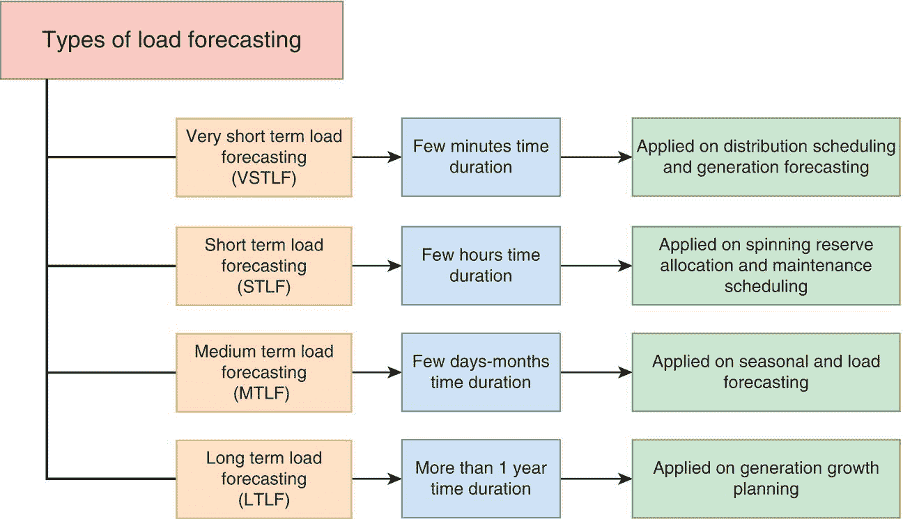

图 11.3 (#c11.xhtml#R_c11-fig-0003) 负荷预测的类型。

#### 11.3.2.2 机器学习模型

机器学习模型，包括 `ANNs`、`支持向量机 (SVMs)` 和 `随机森林`，在捕捉复杂的非线性关系方面表现出色。在结合天气、经济指标和消费者行为等外部变量时，这些模型对于中长期预测尤为有用。

#### 11.3.2.3 混合方法

混合方法结合了统计模型和机器学习模型，以利用各自的优势。例如，将 `ARIMA` 与 `ANNs` 结合可以通过平衡简单性和预测能力来提高预测准确性。

关于负荷预测分析技术有大量的文献可用。研究人员使用的所有可能的负荷预测技术的汇总形式见图 11.4。

### 11.3.3 负荷预测的优势

负荷预测（预测未来电力需求的过程）在能源行业的各个领域提供了许多优势。负荷预测是现代能源管理的基石，提供了无数益处，有助于电网稳定性、经济效率、环境可持续性和消费者赋能。随着技术的不断进步，负荷预测方法正变得越来越复杂，进一步增强了它们在快速演变的能源格局中的优势。这些优势对于高效能源管理、资源分配和电网稳定性至关重要。以下是负荷预测的主要优势。

#### 11.3.3.1 电网稳定性与资源规划

准确的负荷预测有助于公用事业平衡供需，从而有助于维护电网的稳定性。它有助于资源规划，并确保发电和传输的基础设施能够满足未来的需求。

#### 11.3.3.2 可再生能源的整合

太阳能和风能等可再生能源可能会产生间歇性发电 [[56]](#c11.xhtml#c11-bib-0056)。电网运营商能够高效地平衡供需，是通过负荷预测实现的，它预测了可再生能源将在何时以及产生多少能量。这促进了它们的整合。

#### 11.3.3.3 需求侧管理与消费者赋能

由于负荷预测，消费者能够对使用的能源做出更明智的判断。作为需求侧管理计划的一部分，消费者被鼓励将用电转移到低峰时，这降低了成本和电网总负荷。

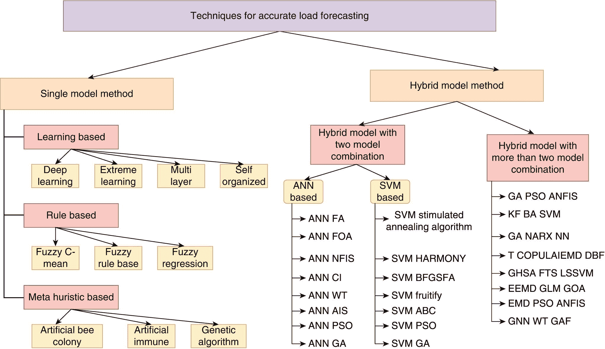

图 11.4 (#c11.xhtml#R_c11-fig-0004) 准确负荷预测的技术。

### 11.3.4 负荷预测的故障排除

尽管负荷预测过程面临许多困难，但它是能源管理不可或缺的组成部分。克服这些障碍对于获得准确且可靠的负荷估计是绝对必要的。为了有效应对这些困难，需要结合数据管理最佳实践、先进建模方法以及对该领域新技术发展和趋势的关注。预计用于负荷预测的方法将随着技术的发展不断变得复杂，从而为这些问题提供更好的答案。在涉及负荷预测时，这些是需要考虑的最重要事项。

#### 11.3.4.1 数据粒度与质量

在预测负荷时，使用适当的信息非常重要。三个问题之一是信息并不总是完整或正确的。智能监测器和其他收集数据的新方法正在帮助解决这些问题。

#### 11.3.4.2 动态因素的结合

在估计负荷时，需要考虑许多不断变化的因素，例如新技术、客户习惯的变化以及规则的改变。保持模型更新并允许人员对其修改非常重要。

#### 11.3.4.3 监管与市场不确定性

由于法规的变化和市场因素，负荷预测存在不确定性。公用事业公司需要考虑这些因素，以确保他们良好地分配资源和规划财务。

### 11.3.5 应用场景：从智慧城市到农村电气化

预测将使用多少电在很多情况下都是很有用，从让城市变得智能化到为农村地区供电。在智慧城市中，负荷预测非常重要，因为它有助于实现能源利用最大化、减少浪费并提高可持续性。它有助于确保资源得到良好分配。在农村电力项目中，负荷预测有助于建立运行良好且成本不高的离网能源系统。这使得更多人更容易能源。负荷预测是一个灵活的工具，可以处理各种景观下的能源需求，因为它可以调整以适应极其发达的城市和偏远地区。

#### 11.3.5.1 智能电网：启用需求响应 (DR)

智能电网的重要部分（使得实时 DR 可能）是预测将使用多少电。智慧城市利用负荷预测帮助减少浪费。在智能电网背景下，负荷预测发挥着至关重要的作用，特别是在使 DR 程序成为可能的范围内。DR 是现代电网管理的关键组成部分，因为它使公用事业和消费者能够根据供需的变化实时调整他们的能源使用模式。DR 也是智能电网技术的重要部分。

##### 实时数据与决策

负荷预测为公用事业和网络运营商提供了电力需求的准确短期长期预测。网络运营商通过持续分析结合实时数据的负荷预测，可以预测需求高峰和潜在的供应限制。

##### 负荷转移与峰值管理

负荷预测使公用事业能够识别高峰时段，这些通常是夏季最热的下午和冬季最冷的晚上。公用事业可以与用户互动，鼓励错峰使用电器，从而减少负载并优化整体消耗。

##### 动态定价策略

负荷预测支持动态定价模型的发展。公用事业可以根据负荷预测确定电力的实时定价。消费者能够根据这些成本做出明智选择，并在高价期间调整用电以省钱，或在低价期间增加消费。

智能电网经常整合可再生能源，例如太阳能和风能，这些能源的产生具有一定的波动性。为了有效平衡供需，负荷预测有助于确定可再生能源何时可用，以及需要多少的常规发电容量。

##### 消费者参与与赋能

通过使用负荷预测，消费者可以获得预测电价以及需求模式的概述。通过这些知识，客户能够对其能源消耗做出明智决策，使其能够根据个人偏好和财务限制定制用电量。

##### 能源效率的激励措施

当公用事业公司识别出高需求高消耗区域时，他们能够利用机会提高能源效率。准确的负荷预测展示了这些机会。能源公司可以通过说服客户使用节约措施，激励他们降低整体用电量以及能源公司使用的能量。

##### 峰值负荷削减

由负荷预测驱动的需求响应（DR）具有大幅降低峰值负荷的潜力。因此，公用事业公司可以通过消除开发额外基础设施以管理峰值需求而节省资金，从而降低成本。

为了实施高效的 DR 程序，负荷预测是智能电网不可或缺的组成部分。负荷预测帮助企业和消费者做出明智的决策，优化能源使用，节省成本，提高电网可靠性，并促进可持续高效的电力消耗模式。它通过提供实时和未来的负荷预测来实现这一点。它是向更具韧性、响应能力和可持续性的能源系统转型的关键构建组件。

#### 11.3.5.2 发展中国家：弥补能源缺口

在仍经济建设阶段的国家，负荷预测是农村电气化计划中极其重要的组成部分。它有助于构建从财务角度来看高效的离网系统，并帮助扩大能源获取，从而提高数百万人的生活质量。

## 11.4 协同效应与未来前景

能源领域正在发生 `PdM`（预测性维护）与负荷预测的颠覆性融合。这种融合是由技术进步以及对高效、可持续和稳健的能源系统日益增长的需求驱动的。在本节中，将研究这种集成的协同效应和未来前景，以及它可能对资产管理、决策、可持续性、伦理考量以及面临的未知领域产生的潜在影响。

### 11.4.1 PdM 与负荷预测的融合

负荷预测与 `PdM` 的结合是一个令人兴奋的新突破，对能源管理和资产优化具有引人入胜的意义。数据分析、机器学习和 `IoT` 领域的改进正导致这两个在历史上相互分离的领域变得日益交织。这种融合提供了许多机会和利益，可能带来更高效、更可靠的能源系统，例如：

#### 11.4.1.1 全局性资产管理与效率提升

`PdM` 技术与负荷预测的汇合使得端到端的资产管理成为可能。能源供应商能够监控其基础设施的健康状况并主动修复问题，从而最大限度地减少停机时间并优化资产效率。这是通过利用实时数据和预测分析实现的。这种协同效应不仅提高了系统的可靠性，还减少了运行所需的资金，并延长了设备的使用寿命。

#### 11.4.1.2 能源系统的实时决策

在电力系统中，实时做出决策的能力至关重要，以便立即对需求变化、电网中断和设备故障做出反应。得益于 `PdM` 和负荷预测的结合，能源供应商现在能够根据实时数据做出决策，这有助于维持高效的发电、配电和负荷平衡。这种能力提高了网络的可靠性并降低了中断的可能性。

### 11.4.2 人工智能 (AI) 与边缘计算的作用

#### 11.4.2.1 用于本地化数据的边缘分析

`AI` 与边缘计算的结合将数据处理推向数据的原始源。当应用于电力系统时，这允许生成用于 `PdM` 和负荷预测的本地化洞察。配备 `AI` 的边缘设备能够进行数据分析、发现异常并预测设备故障。这降低了延迟并保证了快速响应。

#### 11.4.2.2 AI 控制的维护与运营自动化

`AI` 在维护和运营的自动化中起着关键作用。AI 驱动的 `PdM` 可以自主调度维修、订购配件，甚至预测维护需求。这种协同效应在减少人工排放的同时提高了运营效率。

### 11.4.3 可持续性与环境影响

#### 11.4.3.1 通过优化运营减少碳足迹

`PdM` 与负荷预测的集成通过优化能源运营有助于可持续性。它允许更高效地利用资源。通过防止设备故障和优化负荷分配，能源部门可以显著减少其环境影响。

#### 11.4.3.2 电动汽车 (EV) 与储能系统的集成

随着 `EVs` 和储能系统变得日益普及，负荷预测变得更加关键。这些技术与能源系统的集成需要预测何时以及何地需要能源。`PdM` 确保了 `EV` 充电基础设施和能量系统的可靠性，有助于电网稳定和清洁的能源结构。

### 11.4.4 伦理考量与数据隐私

#### 11.4.4.1 平衡数据利用与消费者隐私


`PdM` 与负荷预测之间的协同引发了关于数据利用和消费者隐私的伦理问题。虽然收集和分析大量数据对于准确预测至关重要，但必须负责任地进行。在数据利用和保护消费者隐私之间取得平衡是至关重要的。

## 11.4.4.2 自动化系统中的透明度与问责

随着 `AI` 驱动的系统变得越来越自动化，透明度和问责制至关重要。保持预测生成和行动采取的透明度是必要的。此外，为系统故障建立问责机制对于建立对这些自动化系统的信任至关重要。

## 11.4.5 未来轨迹与未知领域

### 11.4.5.1 认知 PdM：融合 AI 与人类知识

未来可能会出现结合了 `AI` 能力与人类专家知识的认知 `PdM` 系统。这些系统将利用 `AI` 进行数据分析和预测，同时让人类专家参与决策验证和解决复杂问题。这种 `AI` 与人类知识的融合可以带来更具韧性和适应性的系统。

### 11.4.5.2 去中心化能源格局下的负荷预测

随着分布式能源资源（`DERs`）和微电网的发展，能源格局正向去中心化转型。负荷预测需要适应这些变化，在更复杂、更分布式的环境中预测需求模式。在这些去中心化系统中，与 `PdM` 的集成对于优化 `DERs` 的性能至关重要。

## 11.5 结论

`PdM` 重新定义了工业领域维护实践的方法。其综合效益包括：减少停机时间、优化资源配置、延长设备寿命、提高成本效益、提升安全性、增强运营效率、提供明智决策以及向基于状态的维护进行战略性转变。通过整合数据驱动的见解和先进技术，`PdM` 不仅改变了维护操作，还使组织在效率、可靠性和成本效益方面处于行业领先地位。

负荷预测在现代能源管理中不可或缺，它为应对能源需求波动性、优化资源配置以及促进可再生能源的整合提供了路线图。技术、数据质量和适应性的进步正推动负荷预测在塑造能源可持续性和电网韧性未来方面发挥关键作用。从智能城市到农村电气化工作，负荷预测正在照亮通往更高效、可持续能源未来的道路。

`PdM` 与负荷预测的融合代表了能源行业的转型性转变。这种协同效应有望实现整体资产管理、实时决策、可持续性以及能源运营的自动化。然而，它也对数据隐私引发了伦理考量和挑战。随着能源部门持续演进，这两个学科的整合将在塑造更高效、可持续且具韧性的能源未来方面发挥关键作用，开启新的轨迹和未知领域。

## 参考文献

1. Garg, S., Kaur, K., Batra, S. et al. (2020). A multi‐stage anomaly detection scheme for augmenting the security in IoT‐ enabled applications. *Future Generation Computer Systems* 104: 105–118.

2. Kursa, M.B., Jankowski, A., and Rudnicki, W.R. (2010). Boruta – a system for feature selection. *Fundamenta Informaticae* 101 (4): 271–285.

3. Kar, A.K. (2016). Bio inspired computing – a review of algorithms and scope of applications. *Expert Systems with Applications* 59: 20–32.

4. Lee, I. and Yang, J. (2009). Common clustering algorithms. In: *Vol. 2 Comprehensive Chemometrics* (ed. S.D. Brown, R. Tauler, and B. Walczak), 577–618. Elsevier.

5. Janjua, Z.H., Vecchio, M., Antonini, M., and Antonelli, F. (2019). IRESE: an intelligent rare‐event detection system using unsupervised learning on the IoT edge. *Engineering Applications of Artificial Intelligence* 84: 41–50.

6. Shaughnessy, D.O. (1988). Linear predictive coding. *IEEE Potentials* 7 (1): 29–32.

7. Bansal, P., Imam, S.A., and Bharti, R. (2015). Speaker recognition using MFCC, shifted MFCC with vector quantization and fuzzy. *2015 International Conference on Soft Computing Techniques and Implementations (ICSCTI)*, pp. 41–44, Faridabad, India (8–10 October 2015). New York: IEEE.

8. Valero, X. and Alias, F. (2012). Gammatone cepstral coefficients: biologically inspired features for non‐speech audio classification. *IEEE Transactions on Multimedia* 14 (6): 1684–1689.

9. Cauteruccio, F., Fortino, G., Guerrieri, A. et al. (2019). Short‐long term anomaly detection in wireless sensor networks based on machine learning and multi‐para‐ meter edit distance. *Information Fusion* 52: 13–30.

10. Shin, H., Lee, J.K., Kim, J., and Kim, J. (2017). Continual learning with deep generative replay. In: *Advances in Neural Processing Systems*, vol. 2017, 2991–3000.

11. Rassam, M.A., Maarof, M.A., and Zainal, A. (2018). A distributed anomaly detection model for wireless sensor networks based on the one‐class classifier. *International Journal of Sensor Networks* 27 (3): 200–214.

12. Xie, Z., Quirino, T., Shyu, M.L. et al. (2006). UNPCC: A novel un‐supervised classification for network intrusion. *Proceedings – International Conference on Tools with Artificial Intelligence*, pp. 743–750, Arlington, VA (June 2006).

13. Rassam, M.A., Zainal, A., and Maarof, M.A. (2012). One‐class classifier for anomaly detection in wireless sensor network. *2012 Fourth International Conference on Computational Aspects of Social Networks (CASN)*, pp. 271–276, Sao Carlos, Brazil (21–23 November 2012). New York: IEEE.

14. Rajkumar, R., Lee, I., Sha, L., and Stankovic, J. (2010). Cyber‐physical systems: the next computing revolution. *Proceedings' Design Automation Conference*, pp. 731–736, Anaheim, CA (13–18 June 2010). New York: IEEE.

15. Rabiner, L. (1989). A tutorial on hidden Markov models and selected applications in speech recognition. *Proceedings of the IEEE* 77 (2): 257–286.

16. Iqbal, I.M. and Aziz, N. (2011). Comparison of various Wiener identification in modelling process. *2011 3rd Conference on Data Mining and Optimization (DMO)*, pp. 134–140, Putrajaya, Malaysia (28–29 June 2011). New York: IEEE.

17. Singpuralla, N. and Youngren, M. (1993). Multivariate distributions induced by dynamic environments. *Scandinavian Journal of Statistics* 20 (3): 251–261.

18. Leemis, L.M. (2010). Variate Generation in Reliability. In: *Simulation Methods for Reliability and Availability of Complex Systems*, Vol. 36 Reliability Engineering (ed. J. Faulin), 85–103. London: Springer.

19. Box, G.E.P., Jenkins, G.M., and Reinsel, G.C. (2008). *Time Series Analysis, Wiley Series in Probability and Statistics*. Wiley.

20. Namuduri, S., Narayanan, B.N., Davuluru, V.S.P. et al. (2020). Review—deep learning methods for sensor based predictive maintenance and future perspectives for electrochemical sensors. *Journal of the Electrochemical Society* 167 (3): 037552.

21. Schmidhuber, J. (2015). Deep learning in neural networks: an overview. *Neural Networks* 61: 85–117.

22. Hsu, C‐W. and Lin, C‐J. (2002). A comparison of methods for multiclass support vector machines. *IEEE Transactions on Neural Networks* 13 (2): 415–425.

23. Breiman, L. (2001). Random forests. *Machine Learning* 45 (1): 5–32.

24. Chen, T. and Guestrin, C. (2016). XGBoost. *Proceedings of the 22nd ACM SIGKDD International Conference on Knowledge Discovery and Data Mining*, pp. 785–794, ACM, New York.

25. Kohonen, T. (1990). The self‐organizing map. *Proceedings of the IEEE* 78 (9): 1664–1480.

26. Kaiser, K.A. and Gebraeel, N.Z. (2009). Sensor‐based degradation models. *IEEE Transactions on Systems, Man, and Cybernetics* 39 (4): 840–849.

27. You, M.Y., Liu, F., Wang, W., and Meng, G. (2010). Statistically planned and individually improved predictive maintenance management for continuously monitored degrading systems. *IEEE Transactions on Reliability* 59 (4): 744–753.

28. Lei, Y., Li, N., Gontarz, S. et al. (2016). A model‐based method for remaining useful life prediction of machinery. *IEEE Transactions on Reliability* 65 (3): 1314–1326.

29. Li, N., Lei, Y., Yan, T. et al. (2019). A Wiener‐process‐model‐based method for remaining useful life prediction considering unit‐to‐unit variability. *IEEE Transactions on Industrial Electronics* 66 (3): 2092–2101.

30. Gianoglio, C., Ragusa, E., Bruzzone, A. et al. (2020). Unsupervised monitoring system for predictive maintenance of high voltage apparatus. *Energies* 13 (5): 1109.

31. Hu, J. and Chen, P. (2020). 基于比例风险模型的易发生性故障系统预测性维护。*Reliability Engineering & System Safety* 196: 106707.

32. Garcia, M.C., Sanz‐Bobi, M.A., and del Pico, J. (2006). SIMAP: 用于预测性维护的智能系统。风力发电机齿箱健康状况监测的应用。*Computers in Industry* 57 (6): 552–568.

33. Liao, L., Jin, W., and Pavel, R. (2016). 用于预测与健康评估的预测性正则化。*IEEE Transactions on Industrial Electronics* 63 (11): 7076–7083.

34. Li, Z., Wu, D., Hu, C., and Terpenny, J. (2019). 一种基于学习的具有退化依赖权重的剩余寿命预测预测方法。*Reliability Engineering & System Safety* 184: 110–122.

35. Cheng, J.C., Chen, W., Chen, K., and Wang, Q. (2020). 基于 BIM 和 IoT 并使用机器学习算法的 MEP 组件数据驱动预测性维护规划框架。*Automation in Construction* 112: 103087.

36. Ruiz‐Sarmiento, J.R., Monroy, J., Moreno, F.A. et al. (2020). 工业 4.0 背景下工业机械维护的预测模型。*Engineering Applications of Artificial Intelligence* 87: 103289.

37. Ayvaz, S. and Alpay, K. (2021). 制造业生产线的预测性维护系统：一种利用 IoT 数据的机器学习方法。*Expert Systems with Applications* 173: 114598.

38. Li, D., Wang, Y., Wang, J. et al. (2020). 传感器故障诊断的进展：综述。*Sensors and Actuators, A: Physical* 309: 111990.

39. Zhao, B., Li, X., Li, J. et al. (2020). IoT 大数据基于区域上下文的信誉检测。*Mobile Information Systems* 2020: 1–12.

40. Liu, Y., Dillon, T., Yu, W. et al. (2020). 制造业工业 IoT 传感器数据存在显著异常时的噪声剔除。*IEEE Internet of Things Journal* 7 (8): 7084–7096.


# 参考文献

41. ElMenshawy, D. and Helmy, W. (2018). 一种基于相关性的区分物联网事件与噪声的方法。*International Journal of Advanced Computer Science and Applications* 9 (12): 79–83.

42. Yoo, Y.J. (2020). 基于相关性的数据驱动故障检测过程。*Computers in Industry* 122: 103279.

43. Gupta, R.A. and Gupta, N. (2015). 去监管环境下微电网运行的鲁棒优化方法。*Energy Conversion and Management* 93: 121–131.

44. Gupta, N. (2014). 并网微电网中 `PCC` 处的发电调度。*International Conference on Recent Advances and Innovations in Engineering (ICRA‐2014)*, pp. 1–5.

45. Lee, W., Wu, H., et al. (2019). 应用于健康状况的人工机床系统预测性维护。*Procedia CIRP* 80: 506–511.

46. Dugan, J., Bavuso, S., and Boyd, M. (1992). 容错系统的动态故障树模型。*IEEE Transactions on Reliability* 41 (3): 363–377.

47. Lee, J., Ni, J., Djurdjanovic, D. et al. (2006). 智能预测工具与电子维护。*Computers in Industry* 57 (6): 476–489.

48. Coelho, D., Costa, D., Rocha, E. et al. (2022). 通过时间序列分段、异常检测和分类对传感器化压力机进行预测性维护。*Procedia Computer Science* 2022: 1184–1193.

49. Katzir, L. (2015). 系统特性对极短期负荷预测的影响。*Przegląd Elektrotechniczny* 1 (11): 121–125.

50. Haq, M.R. and Ni, Z. (2019). 一种短期电负载预测的新混合模型。*IEEE Access* 7: 12513–12543.

51. Abu‐Shikhah, N., Elkarmi, F., and Aloquili, O.M. (2011). 使用多变量线性是非线性回归中期电负载预测。*Smart Grid Renewable Energy* 2 (2): 126–135.

52. Ye, S., Zhu, G., and Xiao, Z. (2012). 基于支持向量回归的长负荷预测。*Energy Power Engineering* 4 (5): 380–385.

53. Gupta, N., Sharma, K.G., Mangal, A. et al. (2022). 随机性框架下的太阳能预测。*Proceedings of International Conference on Computational Intelligence and Emerging Power System: ICCIPS 2021 at Engineering College Ajmer*, pp. 223–233.

54. Gupta, R.A. and Gupta, N. (2014). 考虑可再生能源不确定性的鲁棒微电网运行。*2014 Eighth National Power Systems Conference (NPSC)*, Guwahati, India (18–20 December 2014). New York: IEEE, pp. 1–6.

55. Gupta, N. (2016). 微电网并入配系统的研究。博士论文。MNIT Jaipur.

56. 基于人工智能的电质改进技术。在：*Congress on Intelligent Systems* (编辑 H. Sharma, M. Saraswat, S. Kumar 和 J.C. Bansal), 577–587。新加坡：Springer Singapore。

# 预测性分析：员工流失策略决策的工具

**SMD Azash, Potala Venkata Subbaiah 和 Lucia Vilcekova**

¹ 法律学院，总统大学学院，班加罗尔，卡纳塔克邦，印度

² 营销系，GITAM 商学院，GITAM（认定大学），维沙卡帕特姆，安得拉拉邦，印度

³ 管理学院，布拉迪斯瓦大学，布拉迪斯瓦，斯洛伐克

员工流失在 IT 行业中起着重要作用，并受到业务扩张速度的影响。该经济部门的增长并非预先决定。在我们国家，我们先建立基础，然后启动业务。了解人们为什么频繁更换职业非常有趣，因为流失的原因多种多样。确实，更高的收入和更好的福利仍然是现代跳槽的主要动力。然而，有许多因素需要考虑，而且人们确实会因为独特的原因更换职业。与此同时，持续的下降不能完全归咎于员工。员工经常评估其雇主的声誉、伦理和工作环境。

## 12.2 文献综述

Mathi 和 Malathi [1] 通过开展题为“IT 行业流失原因分析——员工与雇主的意见”的研究研究了过度流失的问题。在这项研究中，来自钦奈的 IT 专家参与其中。研究采用了描述性研究，并收集了代表性样本进行分析。总共通过开放式回答问卷对 500 名员工和 50 家企业进行了调查 [1, 2]。使用检验对数据进行分析。研究结果，员工和雇主在组织和家庭问题上达成共识，但在人力资源和工作相关问题上存在分歧。因此，如果你想留住人才并保持低流失率，重视员工的独特观点非常重要。

Kumar 和 Melba [3] 分析了导致女性 IT 员工离职的因素，包括工作满意度、留任率、安全性、工作环境和工作与生活的平衡。采用了描述性研究，以 523 名受访者作为样本量。使用问卷调查了 Technopark Thiruvananthapuram 员工流失的根本原因 [2, 3]。采用了因素分析的统计方法。工作需求的变化、薪酬政策的调整以及工作环境的改进都是企业应该实施的留任方法示例。

IT 行业正在经历增长，并将变革明天的业务实践 [4]。信息技术部门通过数字化转型向第四次工业革命（工业 4.0）的推动在全球范围内取得了显著进展。估计到 2020 年，印度在信息技术方面的支出将达到 940 亿美元。然而，显而易见，整个 IT 行业正遭受高流失率或高周转率的困扰 [5, 6]。由于替换成本高昂以及招募新员工时损失的时间，关键人才、高绩效者或接受过最新技术领域培训的员工的流失可能是令人担忧的主要原因。然而，某种程度的流失是自然的，甚至是理想的，因为它有助于组织注入新人才并管理利润率。作者们进行了定性和定量的探索性研究，以识别并分类影响员工辞职或留任公司决定的因素。总共有 140 名参与者接受了调查、访谈或参与了焦点小组，其中大多数人从事 IT 行业。使用 Cronbach alpha 系数、单样本 T 检验、组测试和独立样本检验检验了构念的效度。检查了薪资、公司文化、晋升机会和工作与生活平衡领域的可信度。研究确定并建议，在优先考虑这些因素的公司中，员工流失率更低，士气更高。

印度软件行业专业软件员工的流失率显著上升，使得留才成为该行业的一大难题 [7, 10]。本章的主要目标是评估软件行业失业对个人和企业的影响 [8]。总共通过问卷对来自 10 家不同软件公司的 100 名员工进行了调查以获取一手数据。数据显示，员工离开公司的倾向受个人和环境因素的影响。然而，个人的某些方面对离职意愿做出了很大贡献。由于全球外包以及流入中国、俄罗斯和印度的大量外国直接投资（FDI），这些国家对技能软件专家的需求和供应都是巨大的。流失率的上升是这种激烈竞争的副作用，在印度尤其如此。

本研究的主要目的是阐明 BPO 员工及其雇主面临的现状和问题 [9]。因此，开发了一种周密且系统化的研究方法。为了获得所需数据，进行了一项调查。新德里国家首都区部分 BPO 企业的员工构成了研究总体。研究团队确定了 1200 的样本量。由于采用了随机抽样方法选择受访者，他们代表了广泛的年龄、性别、婚姻状况和其他人口统计变量。然而，收集的数据限于入职员工和初级经理，这是流失最常见的群体。年龄、教育、性别、婚姻状况和工龄仅是从问卷中收集到的少数人口统计特征。问卷还收集了 BPO 行业员工流失原因的数据，例如员工的工作满意度、薪资满意度、组织承诺以及离开当前职位的倾向。数据使用专为社会科学设计的统计程序 `SPSS 11.0` 进行分析。

## 12.3 研究的需求与重要性

预测性分析是各行业（包括 IT 行业）战略决策的宝贵工具。当应用于员工流失背景时，预测性分析可以在帮助组织理解、预测和管理其员工方面发挥至关重要的作用。以下是预测性分析管理 IT 行业员工流失的需求的重要性：

- **预测流失**：预测性分析使用历史数据和高级算法来识别模式和趋势。通过分析过去的员工流失数据，组织可以建立模型，预测哪些员工离开的风险较高。这种主动的方法允许公司采取预防措施来留住人才。

- **降低成本**：员工流失是昂贵的。它涉及与招聘、培训、入职和生产力损失相关的成本。预测性分析可以通过让组织在员工决定离开之前介入来减少这些成本，从而减少对持续招聘和培训的需求。

- **人才留存**：通过预测性分析，组织可以识别导致流失的因素。这种洞察允许他们实施针对性的策略来提高员工满意度、参与度和工作与生活的平衡，最终增加留住技能专业人士的可能性。

- **数据驱动的决策**：预测性分析提供了指导决策的数据驱动洞察。人力资源和管理层不再依赖于直觉或猜测，而是根据统计分析做出明智选择，从而制定更有效的留才策略。

- **定制化干预**：预测模型可以确定导致流失的特定因素，例如项目不满意、职业增长空间不足或工作生活平衡差。这使得组织能够针对个人员工或特定团队设计定制干预措施来解决这些问题。

- **更好的劳动力规划**：通过预测流失，组织可以进行继任计划，识别因员工离职而可能产生的空缺。这使得交接更加平稳，并最大限度地减少对项目时间表的干扰。

- **竞争优势**：在印度竞争激烈的 IT 行业，吸引和留住顶尖人才对于成功至关重要。有效利用预测性分析降低流失率并提高员工满意度的公司，通过建立稳定且高效的员工队伍获得了竞争优势。

- **持续改进**：预测性分析是一个迭代过程。通过不断收集和分析数据，组织可以随时间完善其模型和策略，从而做出更准确的预测和更好的决策。

- **员工参与度与满意度**：预测性分析有助于识别与员工满意度和参与相关的趋势。这些信息可以指导政策和计划的实施，以改善整体工作环境和员工体验。

- **伦理考虑**：虽然预测性分析可以提供无价的见解，但考虑伦理影响至关重要，例如确保员工隐私并避免基于预测模型的歧视性做法。

## 12.4 研究目标

- 将判别分析作为预测员工流失的预测性工具。
- 将员工群体分为留任者（stayer）和离职者（leaver）。

## 12.5 研究假设

- **H01**: 工作环境不利是员工流失的良好预测因子。
- **H02**: 职业增长有限是员工流失的良好预测因子。
- **H03**: 工作时间不规律是员工流失的良好预测因子。
- **H04**: 压力和工作与生活的平衡是员工流失的良好预测因子。
- **H05**: 缺乏合理的报酬是员工流失的良好预测因子。
- **H06**: 考核评分是员工流失的良好预测因子。
- **H07**: 工作负量不合理是员工流失的良好预测因子。
- **H08**: 工作不安全感是员工流失的良好预测因子。
- **H09**: 团队领导是员工流失的良好预测因子。

## 12.6 研究方法

海得拉巴有约 3000 名个人就职于该市部分 IT 公司。样本量是指从整个总体中随机抽取用于研究的条目总数。本研究总共随机抽取了 300 名 IT 工作人员。统计查询的数据和信息以相同的方式从初级和次级来源收集。新的原始信息被称为初级数据。本研究的初级数据来自闭式格式的问卷。研究大部分次级数据来自公司本身和 IT 行业档案。研究者选择使用随机采样法。

## 12.7 数据分析程序与讨论

可以使用基于判别分析的方法根据回复的共同特征和独特特征将其分为不同的子集。本研究使用判别分析来确定已知影响员工流失的九因素（敌对工作环境、缺乏晋升机会、无休息的长工时、高压力水平、低薪、负面绩效评估、工作量过度、缺乏工作安全感和团队领导不力）是否能准确预测 IT 公司样本员工的离职状态（留任或离职）。研究人员首先在 `SPSS` 版本 21 中执行了共线性检查，以确保预测变量之间不存在完美的线性关系。表 12.1 显示了多重共线性测试的结果，结果显示判别分析的容差值在 0.1 以上、10 以下。

表 12.2 显示了小组对以下问题的统计分析结果：“工作环境不利”、“职业增长有限”、“工作时间不规律”、“压力和工作与生活的平衡”、“缺乏合理的报酬”、“考核评分”、“工作量不合理”、“工作不安全感”和“团队领导”。管理角色、工作量、角色冲突和角色模糊仅是九个独立变量中的少数，它们的均值揭示了留任员工与离开组织员工之间的区别。仅举一例说明，“留任者”类别中人员的“工作时间不规律”、“工作量不合理”和“工作不安全感”的平均值均低于“离职者”类别，这表明存在差异。

### 表 12.1 多重共线性评估系数

| 模型 | 非标准化系数 B | 标准误 | t | 显著性 | 容差 | 方差膨胀因子 |
| --- | --- | --- | --- | --- | --- | --- |
| (常数) | 0.043 | 0.048 | 0.882 | 0.378 | | |
| 工作环境不利 | 0.903 | 0.112 | 8.081 | 0.000 | 0.040 | 4.767 |
| 职业增长有限 | −0.009 | 0.162 | −0.053 | 0.958 | 0.019 | 5.161 |
| 工作时间不规律 | 0.003 | 0.039 | 0.085 | 0.932 | 0.042 | 3.697 |
| 压力和工作与生活的平衡 | 0.002 | 0.086 | 0.022 | 0.982 | 0.068 | 4.685 |
| 缺乏合理的报酬 | 0.009 | 0.059 | 0.158 | 0.875 | 0.145 | 6.880 |
| 考核评分 | −0.007 | 0.113 | −0.063 | 0.950 | 0.039 | 5.494 |
| 工作量不合理 | −0.006 | 0.032 | −0.181 | 0.857 | 0.060 | 7.780 |
| 工作不安全感 | 0.016 | 0.033 | 0.468 | 0.640 | 0.056 | 7.841 |
| 团队领导 | 0.009 | 0.058 | 0.158 | 0.875 | 0.148 | 7.753 |

### 表 12.2 离职状态 (leaver) 对小组问题的统计分析、均值和标准差

| 离职状态 (leaver) | 项目 | 均值 | 标准差 | N | 加权 |
| --- | --- | --- | --- | --- | --- |
| 留任者 (stayer) | 工作环境不利 | 1.0667 | 0.25014 | 180 | |
| | 职业增长有限 | 1.4567 | 0.29326 | 180 | |
| | 工作时间不规律 | 3.8100 | 1.40016 | 180 | |
| | 压力和工作与生活的平衡 | 1.1056 | 0.30813 | 180 | |
| | 缺乏合理的报酬 | 1.1333 | 0.34088 | 180 | |
| | 考核评分 | 1.1111 | 0.31515 | 180 | |
| | 工作量不合理 | 3.7056 | 1.46351 | 180 | |
| | 工作不安全感 | 3.6722 | 1.46783 | 180 | |
| | 团队领导 | 1.1667 | 0.37372 | 180 | |
| 总计 | 工作环境不利 | 1.4400 | 0.49722 | 300 | |
| | 职业增长有限 | 1.4567 | 0.49895 | 300 | |
| | 工作时间不规律 | 3.8100 | 1.40016 | 300 | |
| | 压力和工作与生活的平衡 | 1.4633 | 0.49949 | 300 | |
| | 缺乏合理的报酬 | 1.4800 | 0.50043 | 300 | |
| | 考核评分 | 1.4667 | 0.49972 | 300 | |
| | 工作量不合理 | 3.7833 | 1.40819 | 300 | |
| | 工作不安全感 | 3.7833 | 1.40819 | 300 | |
| | 团队领导 | 1.5000 | 0.50084 | 300 | |

该研究结果证实了 Essiam 等人 [11] 的发现，他们发现诸如不友好的工作环境、晋升机会少、工作时间长、压力大、低薪、绩效评估不佳、工作量过大、就业前景不确定以及团队领导能力弱等因素在解释员工流失（离职状态）方面的效应量实际上很小（Table 12.3）。

表 12.4 显示，IT 员工的 Wilks' Lambda 值为 0.150，接近 0.0，而 0.0 表示由不受欢迎的环境、晋升机会少、压力大、工作时间长、低薪、绩效评估不佳、工作量过大、就业前景不确定以及缺乏强有力的领导等因素引起的员工流失存在显著差异。


Table 12.5 总结了标准判别函数，表明该模型通过九个与工作相关的因素（不受理想的工作环境、晋升机会有限、不规律的工作时间、高压力水平、薪酬不足、绩效评估不佳、工作量过大、缺乏工作安全感以及团队领导糟糕）解释了员工流失 66.02% 的方差。

Table 12.3 Box 协方差矩阵相等检验。

| Box's M | 107.801 |
| --- | --- |
| `F` | 大约 4.906 |
| --- | --- |
| 自由度 1 | 21 |
| 自由度 2 | 69 613.243 |
| 显著性值 | 0.000 |

总体协方差矩阵等的零假设。

Table 12.4 Wilks' lambda。

| Wilks' lambda |
| --- |
| 函数检验 | Wilks' lambda | 卡方 | 自由度 | 显著性 |
| 1 | 0.150 | 556.619 | 9 | 0.000 |
| --- | --- | --- | --- | --- |

Table 12.5 标准判别函数摘要。

| 特征值 |
| --- |
| 函数 | 特征值 | 方差占比 | 累积百分比 | 标准相关 |
| 1 | 5.662 | 100.0 | 100.0 | 0.922 |
| --- | --- | --- | --- | --- |

^a 分析中使用了前 1 个标准判别函数。

标准化函数系数和结构矩阵（表 12.6 和 12.7）揭示了 IT 员工的判别流失是由敌对的工作环境、缺乏晋升机会、工作时间长、压力大、缺乏财务回报、工作量不公平、经理不可靠以及未来不确定等因素造成的。工作环境不利、缺乏职业增长机会、压力和工作与生活的平衡、评估评分、薪酬不足以及团队领导糟糕是 IT 员工流失的下一个重要预测因素，按顺序排列。员工的这些方面是员工流失的显著预测因子。

Table 12.7 详细说明了最初分配到留任类或离职类的患者的比例。总体而言，96% 的交叉验证案例根据模型对员工在不久后是否想留在组织内的预测被正确归类。数据显示，计划离开工作的员工的识别准确率（96%）低于有意向留在当前职位的员工（100%）（Table 12.8）。

Table 12.6 标准化判别函数系数。

| 函数 |
| --- |
| 1 | 工作环境不利 | 0.997 |
| --- | --- |
| 职业增长有限 | -0.011 |
| 工作时间不规律 | 0.026 |
| 压力与工作与生活的平衡 | 0.003 |
| 缺乏适当薪酬 | 0.014 |
| 评估评分 | -0.010 |
| 工作量不合理 | -0.047 |
| 工作不安全 | 0.125 |
| 团队领导 | 0.015 |

最大值接近 1。

Table 12.7 结构矩阵。

| 结构矩阵 |
| --- |
| | 函数 |
| --- | --- |
| 1 | 工作环境不利 | 0.994 |
| 职业增长有限 | 0.822 |
| 压力与工作与生活的平衡 | 0.774 |
| 评估评分 | 0.752 |
| 缺乏适当薪酬 | 0.678 |
| 团队领导 | 0.594 |
| 工作不安全 | 0.041 |
| 工作量不合理 | 0.029 |
| 工作时间不规律 | 0.028 |

组内相关性。判别变量按绝对值排序。值大于 0.6。

## 12.8 建议

**数据收集与质量**：收集准确且相关的数据，包括员工人口统计、参与度调查和流失历史。

**协作**：建立涉及人力资源、数据分析师和业务领导的跨部门团队。

**特征选择**：识别影响流失的因素，如参与度、职业增长机会和薪酬。

Table 12.8 分类结果。

| 分类结果 |
| --- |
| | | 离职状态 | 预测成员 | 总 |
| 留任 | 留任 | 168 | 12 | 180 |
| --- | --- | --- | --- | --- |
| 离职 | 0 | 120 | 120 |
| 百比 | 留任 | 93.3 | 6.7 | 100.0 |
| 离职 | 0.0 | 100.0 | 100.0 |

^a 原始分组案例的 96% 被正确归类。

^b 交叉验证分组案例的 96% 被正确归类。

^c 交叉验证仅针对分析中的案例进行。在交叉验证中，每个案例根据其他所有案例生成的函数进行分类。

**模型开发**：利用机器学习算法等高级分析技术开发预测模型。在可用新数据时定期更新和完善这些模型。

**伦理考量**：优先考虑员工隐私和公平。确保预测模型不歧视任何群体，并且干预措施旨在提高整体体验。

**可操作的见解**：将预测见解转化为可操作的策略。针对模型出的特定问题进行干预，例如提供技能培训或增强工作与生活的平衡。

**持续监控**：建立反馈回路以监控所实施策略的有效性。定期评估流失率是否符合预测，并进行必要的调整。

## 12.9 结论

在印度 IT 行业的动态背景下，管理员工流失是一项关键挑战。预测性分析作为一种强大的工具，可以指导解决这一问题的战略性决策。通过利用历史数据、高级算法和跨部门协作，组织可以预测流失模式并采取主动措施。

预测性分析不仅有助于降低成本和留住人才，还能推动向数据驱动的人力资源实践转型。所获得的洞解使组织能够定制化干预措施、优化劳动力规划并提高员工参与度。此外，预测性分析通过帮助公司建立稳定、高技能且充满动力的员工队伍，提供了竞争优势。

然而，权衡伦理考量并确保预测模型不会损害员工隐私或导致歧视性做法至关重要。根据持续的反馈定期提炼模型和策略，对于保持预测性分析在管理员工流失方面的相关性和准确性至关重要。

在印度 IT 行业背景下，顶尖人才的竞争异常激烈，利用预测性分析进行员工流失的战略决策可能成为规则的改变者。有效实施这些建议的组织将能够创建一个吸引、留住并培养优秀人才的工作环境，从而为其在行业的长期成功做出贡献。

## 参考文献

1. **1** Mathi, K.M. and Malathi, G. (2016). Analysing the causes of attrition in IT industries – opinion of employee and employer. *Asia Pacific Journal of Research* 1 (4): 1–20.

2. **2** Gupta, V. (2013). An analysis of attrition: retention strategy for IT/BPO industry. *International Journal of Advance Research in Computer Science and Management Studies* 7: 434–442.

3. **3** Kumar, R.M. and Melba, A.A. (2017). A study on employee attrition in IT industry with special reference to Technopark, Thiruanthapuram. *IEEE Conference on Acoustics, and Signal Processing (ICASSP) 2017*, New Orleans, LA (5–9). New York.

4. **4** Tandon, D., Gupta, S., and Tandon, N. (2020). Attrition in the information technology (IT) industry using HR analytics. *Test Engineering and Management* 83: 980–993.

5. **5** Dhal, S. and Nayak, A.C. (2013). A study on employee attrition in BPO industries in India. *International Journal of Science and Research (IJSR)* 4: 2246–2249.

6. **6** Loganathan, M. and Ashwini, S. (2017). A study on employee attrition and retention in manufacturing industries. *International Journal of Commerce and Management Research* 3: 43–45.

7. **7** Thirulogasaram, V. and Kumar, S. (2012). Assessment of individual propensity for job attrition on software industry: employees in Bangalore, India. *European Journal of Business and Management* 4: 48–54.

8. **8** James, M. and Faisal, U. (2013). Empirical study on high employee attrition in BPO industry focusing on salary and other factors in Karnataka and Kerala states. *Research Journal of Management Sciences* 2: 7–11.

9. **9** Priya, R., Vinothini, G., and Jesu, C.D. (2019). A study on reasons for employee attrition in Indian BPO industry. *Journal of Advanced Research in Dynamical and Control Systems* 11: `https://doi.org/10.5373/JARDCS/V11/20192752`.

10. **10** Suresh, S., Visvalingam, D., Lu, A., and Wright, B. (2020). Evaluating and improving attrition models for the retail banking industry. *2020 Systems and Information Engineering Design, SIEDS 2020*, Charlottesville, VA (24 April). New York.

11. **11** Essiam, J.O., Mensah, M.E., Kudu, L.K., and Gyamfi, G.D. (2015). Influence of job stress on job satisfaction among university staff: Analytical evidence from a public university in Ghana. *International Journal of Economics, Commerce, and Management* 3: 1–15.

## 索引

### a

* 异常检测 1, 3, 12–14, 18, 160, 206–207, 214–215
* 蚁群优化 61
* 资产管理 203–206, 223, 225
* 自回归积分移动平均 (`ARIMA`) 12, 217

### b

* 贝叶斯
    * 分类器 153
    * 网络 13, 162
* 大数据 28, 53, 71–72, 182, 184, 191, 193, 194, 197, 208–210, 214
* 商业智能 7, 17, 19, 20

### c

* 分类模型 72, 84, 98, 153, 199
* 临床研究 78–80
* 云计算 1, 44, 53, 181, 207–208
* 卷积神经网络 (`CNN`) 82, 84, 144
* 作物产量 173–176, 179, 181, 184, 199
* 交叉验证 10, 32, 43, 82, 239, 241
* 网络安全 8, 49, 52, 53, 62, 151

### d

* 数据采集 25, 26, 51
* 数据流失 56
* 数据分析工具
    * `Alteryx` 15
    * `KNIME` 16, [85]
    * `Microsoft Power BI` 17
    * `Python` 17
    * `Scikit-learn Python` 16, [85]
    * `RapidMiner` 15, [85]
    * `SAS` 系统 16, [85]
    * `Tableau` 17
    * `Weka` 知识库 17
* 数据驱动
    * 决策支持 5, 8, 11, 18–20, 53, 57, 59, 179, 234
    * 人力资源实践 242
    * 创新 55
    * 洞见 21, 53, 164, 172, 203, 205, 206, 208–213, 225, 234
    * 方法论 81, 140, 215
    * 模型 176
    * 建议 56
    * 系统 210
* 数据挖掘
    * 应用 5
    * 挑战 7
    * 阶段 3
* 数据预处理 1, 3, 15, 17, 21, 37, 81, 83, 140, 163
* 数据科学 62, 71, 78, 80, 85, 190–194
* 数字孪生技术 50–52
* 降维 16, 26, 32, 43
* 疾病预测 4, 81–84
    * 作物‐ 177

### e

* 边缘计算 53, 62, 173, 205, 223
* 特征值 208, 239
* 心电图 (`ECG`) 90, 94–96, 98, 99, 105
* 脑电图 (`EEG`) 90–92, 96, 100, 101, 105
* 伦理考量 7, 44, 62, 63, 79, 83, 84, 205, 223–225, 241, 242
* 探索性数据分析 3, 16

### f

* F1 分数 10, 34, 207
* 快速学习网络 (`FLN`) 153, 155
* 特征工程 1, 30–33, 37, 42, 43, 81, 82, 155
* 特征提取 84, 91–104
* 特征选择 1, 9, 15, 30, 31, 43, 81–82, 98, 100–101, 105, 140, 145, 147, 154, 163
* 欺诈检测 5, 7, 12, 18, 19, 156

### g

* Gamma 过程模型 210
* 遗传算法 (`GA`) 60, 101, 143, 219
    * `Agro ANN(GA)` 183, 184
* 全球定位系统 (`GPS`) 173, 177–179, 197
* 网格稳定性 218, 224

### h

* `H2O.ai` 85
* 启发式算法 (也称为) 61, 101
* 隐马尔可夫模型 13, 210

### i

* 工业 4.0 生态系统 53, 54
* 整数线性规划 60

### k

* k-最近域 13, 26, 93, 153

### l

* 线性判别分析 26, 96, 97, 99
* 线性规划 60

### m

* 医学影像 72–75
* 混合整数规划 (`MINLP`) 61
* 模型偏差 32, 34
* 模型开发 2, 3, 10, 11, 36, 81, 85, 105, 241
* 模型训练 9, 10, 36, 81, 82, 84

### n

* 朴素贝叶斯 26, 72, 92, 93, 154, 174
* 神经网络 3, 10, 12, 14–16, 32, 40, 71–72, 81–82, 84, 136–137, 139, 141–146, 159, 174, 193

### p

* 粒子群优化 (`PSO`) 61, 101, 219
* 模式分析 75, 192
* 医药 75–78
* 生理信号 89, 91, 96, 98, 99, 102–103, 105
* 睡眠医学 90, 94, 96, 98, 99, 101, 103, 105
* 精准农业 171–185
* 预测性分析 71
    * 分类 15
    * 聚类 12
    * 协同过滤 14
    * 决策树 12
    * 集成方法 13
    * 回归分析 11, 14, 16
    * 时间序列 12, 71, 72, 136, 140, 146, 217
* 预测建模 25
* 主动决策 50, 205, 208, 219
    * 分配 59
* `Python` 15–17, 85, 126

### r

* 随机森林 12, 13, 16, 26, 32, 72, 81, 82, 92, 93, 95, 96, 154, 174, 218
* 随机对照试验 78
* 实时监控 49–51, 54, 80, 83, 185, 209, 213
* 受者工作特征 10, 81
* `循环神经网络` (`RNNs`) 82, 105, 142–145
* `强化学习` 61, 193
* `可再生能源` 216, 218, 221, 222, 225
* `资源优化` 47, 48, 57, 58, 60, 62, 63, 74, 75
* `RFID` 48, 111–120, 123, 125–126, 128, 130
* `风险分析` 5

### s


# 索引

## t

*   `禁忌搜索` 61
*   `时间序列预测` 10, 12, 14, 136–128, 141, 145–146, 174
*   `迁移学习` 84
*   `图灵机` 190

## w

*   `鲸鱼优化算法` 154
*   `维纳过程模型` 210
*   `Wilks' Lambda` 238

## x

*   `XGBoost` 26, 85, 210, 211

## z

*   `ZigBee` 114, 116, 129

## 其他术语

*   `模拟退火` 60, 143
*   `智能城市`
    *   `农业` 183, 195–198
    *   `城市` 20, 52, 220–221, 225
    *   `电网` 59, 154, 221, 222
    *   `传感器` 54, 197
*   `统计分析` 5, 13, 16, 79, 236
*   `股票预测` 136, 138, 140–142, 144–145
*   `战略决策` 21, 233, 241, 242
*   `供应链管理` 4, 19, 20, 77
*   `支持向量机` 10, 12, 16, 81, 82, 174, 218

# Wiley 用户许可协议

访问 `www.wiley.com/go/eula` 以获取 Wiley 的电子书用户许可协议。
