# 数字转型时代可持续发展国际会议：推动创新与增长：（SIDTE 2023）2023年9月16日至17日

## 免责声明
本卷中汇编的摘要内容由作者全权负责。出版商或编辑对同一内容不承担任何责任。 如有错误，纯属无意，敬请读者将此类错误告知编辑，以避免今后出现差异。


# 赞助人致辞
我很高兴向所有尊贵的作者、行业专业人士和学术参会者致以热烈问候，他们齐聚在印度最好的、最快速发展的工程学院之一——即劳埃德工程学院与技术学院——这片神圣而郁郁葱葱的绿地上，出席 2023 年 9 月 16 日和 17 日的国际会议。

印度由于经济快速扩张，是加入发达国家的重要竞争者。虽然人们意识到并付出了努力和倡议来达成这一目标，但在从发展中国家到发达国家的这段旅程中，需要将其付诸实施。为了促进投资、培育创新、提升技术发展、保护知识产权并建设一流的制造业基础设施，尊敬的总理推出了“印度制造”倡议。

我相信本次在 LIET 举行的“数字转型时代的可持续发展：推动创新与增长”国际会议，旨在捕捉创新工程实践及其在当前研究中的细微体现，并特别关注可持续管理实践。

我希望本次会议能极大地激励和吸引大家。

感谢

**Manohar Thairani**

总裁，劳埃德教育机构集团，大诺伊达，印度北方邦，印度

# 总主席致辞
劳埃德工程学院与技术学院（LIET），大诺伊达举办为期两天的“数字转型时代的可持续发展：推动创新与增长”（SIDTE2023）国际会议，时间为 2023 年 9 月 16-17 日，这令我们倍感自豪。

我很高兴宣布，来自全国各大知名大学、学院和研究机构的教师和研究人员将就与会议主题相关的各类课题发表他们的研究论文。

SIDTE-2023 组织委员会怀着极大的热情为本次会议汇编了大量多样化的技术研究论文摘要。会议论文集

我毫不怀疑，学术界、研究界和工业界的从业者以及年轻专业人士都将从参加本次会议中获得重大价值。程序中所包含的信息无疑将有助于他们规划各自领域未来要开展的工作。

我祝愿 SIDTE2023 大获成功。

感谢

**Prof. (Dr.) Rajeev Agrawal**

院长，劳埃德工程学院与技术学院，大诺伊达

# 组织委员会
## 赞助人
Shri Manohar Thairani
总裁，劳埃德教育机构集团，大诺伊达

## 总主席
Prof. (Dr.) Rajeev Agrawal
院长，劳埃德工程学院与技术学院

## 会议主席
Prof. (Dr.) A.L.N. Rao
院长，LIET，大诺伊达

## 组织秘书
Prof. (Dr.) Arun Pratap Srivastava
院长（IQAC），LIET，大诺伊达

## 召集人
Prof. (Dr.) S.P. Dwivedi
院长（R&D），LIET，大诺伊达
Prof. (Dr.) A.K. Rao
系主任（CSE），LIET，大诺伊达

## 技术程序委员会主席
Dr. Vandna Kumari
LIET，大诺伊达
Dr. Swati Chaudhary
LIET，大诺伊达

## 会议协调员
Ms. Deepika Arora
LIET，大诺伊达
Mr. Ankit Mehta
LIET，大诺伊达

## 财务主管
Mr. Ravi Kalra
LIET，大诺伊达

# 编辑/出版委员会
Prof. (Dr.) J.M.Giri
系主任（ME），LIET，大诺伊达
Ms. Deepika Arora
LIET，大诺伊达
Dr. Seeba Khan
LIET，大诺伊达
Mr. Irfan Khan
LIET，大诺伊达

# 公关委员会
Prof. (Dr.) Manish Saraswat
LIET，大诺伊达
Ms Karabi Kalita Das
LIET，大诺伊达

# 顾问委员会
Dr. Satish Kumar Singh, IIIT, Allahabad
Prof. H.T. Kung, Harvard University, USA
Dr. Gaurav Sharma, University of Rechester, New York, USA
Dr. K.V. Arya, IIIT Gwalior
Dr. Ajay Rana, Director General, Amity University U.P.
Dr. Ashish Kumar Singh, MNIT, Allahabad
Dr. Vijay Dwivedi, Madan Mohan Malviya University of Technology Gorakhpur
Dr. Pramod Kumar Srivastava, REC, Azamgarh, India
Dr. Keshab K. Parhi, University of Minnesota, Minneapolis, USA
Dr. Houssain Kettani, Dakota State University, Lakeland, Florida, USA
Dr. Alvaro Manuel Reis Da Rocha, Universidade de Coimbra, Portugal
Dr. Utkarsh Srivastava, TCS, Noida, INDIA
Dr. Kazuya Kobayashi, Chuo University, Japan

# 技术程序委员会
Dr. Lajwant Kishnani, Bits Pilani, Dubai USA
Dr. Bilal Gonen, University of Cincinnati, USA
Dr. Abhishek Srivastava, IIM, Vishakha Patnam
Dr. S Yamada, Tottori University of Japan
Dr. K.R. Rao, University of Texas, Arlington
Dr. Uday Kumar, Lulea University for Technology Sweden
Dr. H. Pham, Rutgers University, USA
Dr. Arun Prakash Agarwal, Sharda University, G.B. Nagar, India
Dr. Raj Gaurang Tiwari, Chitkara University, Punjab, India
Shubhranshu Vikram Singh, Amity University, Gautam Budha Nagar, India
Prateek Chaturvedi, Amity University, Gautam Budha Nagar, India
Dr. Sarvendu Tiwari, JIMS, Gautam Budha Nagar, India
Dr. Alaa Hussein AI-Hamami, Princess Sumaya University for Tech. Jordon
Dr. Nanhey Singh, Netaji Subhas University of Technology, Delhi, India
Dr. Saurabh Jaiswal, Oracle Consulting Solution Center, Bengaluru, Karnataka
Dr. Manoj kumar, IISE, Lucknow, India
Dr. Cher Ming Tan, Chang Gung University, Japan
Dr. Miguel Lopez Benitez , University of Liverpool, UK
Dr. Narender Chinthamu, Senior Enterprise Architect at Wesco, MIT CTO Candidate

# 1 ChatGPT：实现类人对话并塑造语言处理的未来
Spoorthy Torne and Phani Kumar Pullela
计算机科学与工程学院（SOCSE），RV 大学，RV Vidyanikethan 邮局，8th Mile，Mysuru Road，班加罗尔，印度
DOI: [10.1201/9781003534136-1](https://dx.doi.org/10.1201/9781003534136-1)

## 摘要


在过去几周里，OpenAI 发布了 ChatGPT（Chat Generative Pre-trained Transformer）。ChatGPT 成为一款强大的聊天机器人，超越了 GPT 模型的多个迭代版本，并在用户与 AI 系统的交互中发挥着变革性作用。在人工智能技术日新月异的领域中，由 OpenAI 开发的 ChatGPT 等有影响力的应用，体现了简化对我们日常生活多个方面的变革性考量。这项强大的技术具有带来重大积极变化的潜力，尤其是在医疗保健领域，GPT 和聊天机器人模型的引入为疾病治疗和技术创新开辟了前景广阔的道路。然而，OpenAI 的 GPT-3 和 4 引入所引发的关注，引发了人们对潜在操纵和偏见的担忧，原因在于自然语言处理模块的存在，以及在某些领域因幻觉而产生的担忧。随着我们在社会中应对援助与潜在危害之间微妙的相互作用，ChatGPT 模型的影响成为一个关键考量。本质上，意为“生成式预训练 Transformer”，ChatGPT 体现了一种 NLP 软件，旨在与用户进行类人对话。

**关键词：** AIML, ChatGPT, 网络, 开放 AI, 用户界面, 世界数据

## Background
OpenAI 近期推出了 ChatGPT（Chat Generative Pre-trained Transformer），这是一款高度有效的聊天机器人，旨在简化用户与 AI 系统的交互。与 GPT 的早期迭代不同，ChatGPT 成为一款多用途工具，可应用于广泛的领域，从应用开发和业务生成到婚礼策划等细分应用。与那些技术上能够处理此类任务但输出质量往往达不到人类标准的早期模型相比，ChatGPT 代表了显著的改进。作为聊天机器人，ChatGPT 增强了用户与 AI 系统之间的沟通，具有领域特定训练的能力，例如在客户服务中。ChatGPT 中的聊天机器人与用户进行对话，极其接近人类互动，并生成文笔精炼的文本。随着聊天机器人在人机交互软件中发挥着日益重要的作用，ChatGPT 的重要性在于其理解和回答问题、获取新知识并以适合用户理解水平的简单术语解释概念的能力。

它向公众免费开放，也被称为 Chat with GPT 3.5，标志着自然语言处理（NLP）的一个里程碑，利用基于 Transformer 的架构全面理解语言并生成更接近人类表达的文本。除了增强交互之外，ChatGPT 的应用还扩展到各领域的多种工作机会。本质上，ChatGPT 模拟了一个生成文本以反映人类表达的模型，其价值来源于用户输入以及涵盖多种语言和翻译的广泛知识。然而，必须指出的是，尽管取得了成功，ChatGPT 缺乏对其行为的完全理解，并且由于其深度学习（DL）切换，幻觉是一个令人担忧的问题。图 1.1 显示 OpenAI 发布了一款聊天机器人，旨在帮助用户找到问题的解决方案，尤其是在利用 AI 生成器进行代码调试方面。

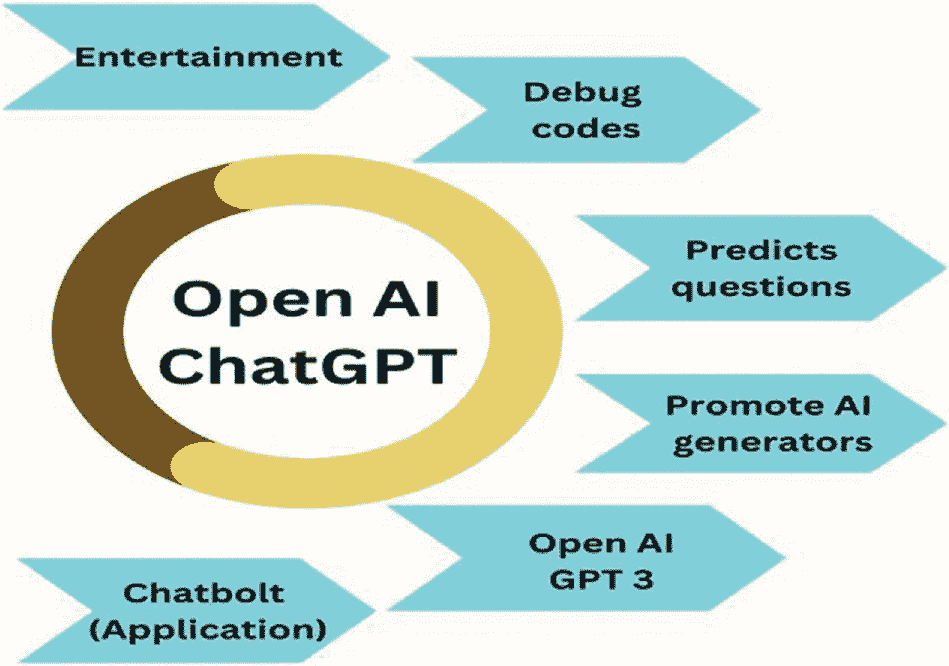

图 1.1 OpenAI-ChatGPT 的用途和概述

## Prior Art
生成式 AI 预示着一个变革性的时代，有望革新新闻业和媒体内容创作。本文深入探讨了 ChatGPT 在这一涉及版权问题的领域中的应用。作为基于文本的输入输出系统，ChatGPT 采用机器学习为用户查询提供精确的响应。初始阶段涉及对 ChatGPT 在教育领域积极和建设性影响的审视。第二阶段审视其效用、个性、情感和伦理考量。第三阶段聚焦于教育影响，包括作弊、缺乏诚实和操纵等问题。研究人员提出了建议，旨在确保聊天机器人在以学生为中心的教育空间中得到安全和负责任的整合 [1]。

机器学习（ML）应考虑偏见，因为它可能导致预测不完整以及代理的策略性行为。在面部识别的情况下，“输入完整性”表明 ML 存在偏见，需要领域专业知识来找到最相关的现有技术。本文档还讨论了特定年代的技能及其对 AI 的影响，以及为未来机器学习利益而进行的人力资本管理。本研究的目标是分析 ChatGPT 在教育中的负责任和合乎道德的使用，并激发对该主题的研究和辩论。研究发现，ChatGPT 在教育领域的使用应有自己的隐私措施，并且不应歧视原创的版权作者。为了管理全球教育领域的伦理，必须采取负责任的措施 [2]。

在这项研究中，作者分析了与 ChatGPT 相关的推文，ChatGPT 是一款在发布后迅速流行起来的创新聊天机器人。该研究基于其问答算法记录了近 233,914 条推文。研究发现了三个基本主题：新闻、技术和反应。此外，作者确定了五个功能领域，其中包括创造力、写作和问答。最后，作者讨论了 AI 发展需要解决的四个重要问题：机遇的演变、技术评论、人工智能的需求以及维护伦理的过程 [3]。图 1.2 显示 AI 工程是一个研究领域，关注软件工程、机器学习在实验、原型制作、级联以及机器学习部署中的应用。

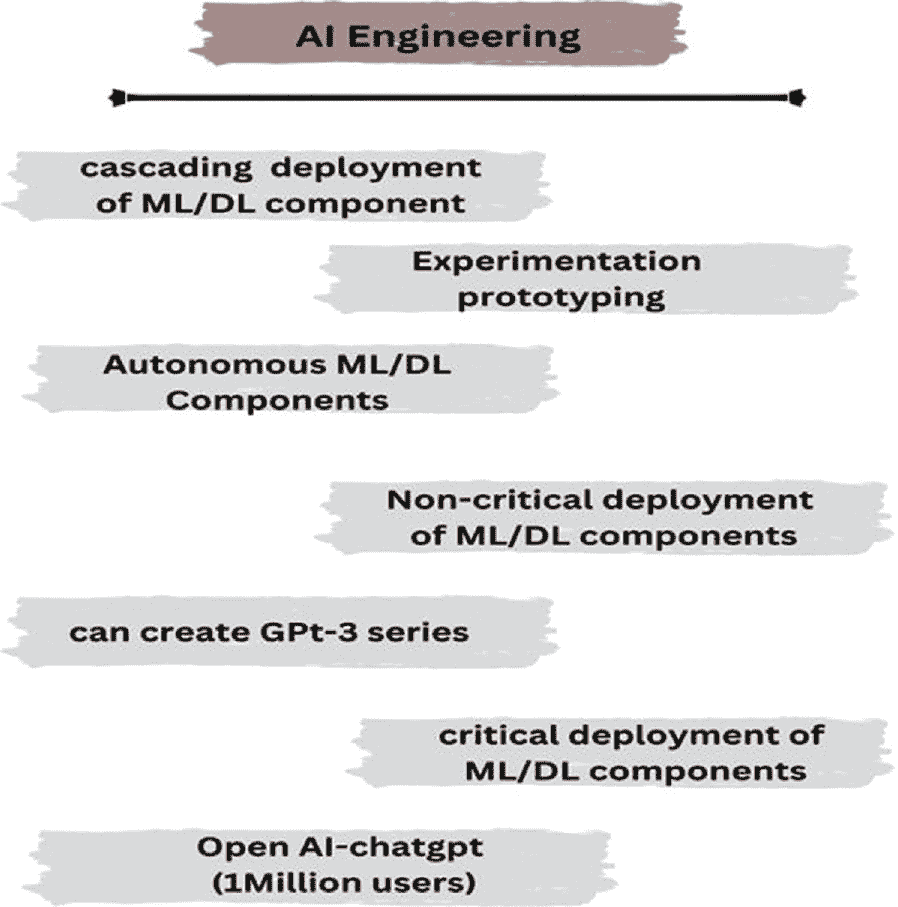

图 1.2 人工智能助力推动研究领域中的各个组成部分

## Methods
模型的训练需要大量的交互数据和庞大的书籍集合。值得注意的是，GPT-3 模型的先进能力扩展到编写与人类程序员相当的代码，使其成为当前最受欢迎的模型。然而，与任何技术奇迹一样，GPT-3 具有优势与局限性并存的双重特性。尽管性能卓越，仍存在某些需要考虑的问题。GPT-3 在理解书面内容方面存在局限，有时会产生不准确的信息。其次，这类复杂模型的发展需要大量数据，导致资源密集型实验室流程产生二氧化碳排放和水资源消耗。作者指出，鉴于 GPT-3 的突破性能力，解决这些挑战和局限性以负责任地发挥其全部潜力变得至关重要。持续完善和对这类模型的伦理应用对于确保其在各领域产生积极影响至关重要 [4]。


`ChatGPT` 的起源可追溯至 `GPT-2` 模型，该模型甚至激励了两位研究人员开展自由研究，旨在遏制机器学习的 harmful 使用。确保模型能够为更好的对话提供正确的响应、答案和对话，它必须关注用户的需求。构建此类模型的先前方法需要正确的指导方针和架构，这些都需要单独检查。然而，这样的方案对系统的改进作用不大，因为它们只关注输入-输出数据，而非整体发展。这些方案应关注其他外部系统以提供特定且适当的响应，看起来在 `GPT 3.5` 时，`Open AI` 已实现了同样的目标 \[5\]。

`ChatGPT` 结合了 `GPT-2` 模型和 `transformer`，后者基于语言模型。它包含许多语言模式，使 `ChatGPT` 能够基于文本对话与人类互动，例如在客户服务中。近年来，`AI` 技术取得了 considerable 进展，并在娱乐、教育、健康和商业等不同领域得到勤勉发展。`ChatGPT` 是使用 `GPT-3` 技术开发的 `OpenAI` 模型，可在这些领域发挥作用 \[6\]。图 1.3 显示 `GPT-3.5` 模型是一个于 2020 年发布的软件。它使用深度学习生成类人文本，具有幻觉能力，可扩展超出训练集知识。

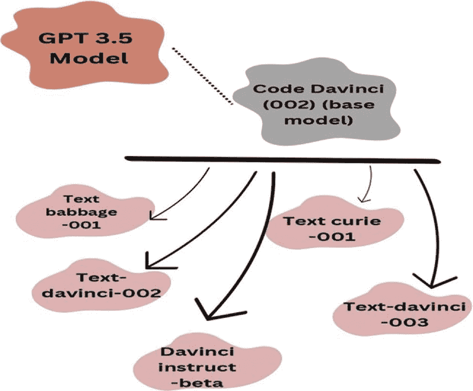

图 1.3 GPT 3.5 模型（软件应用）

## 应用

人类与 `AI` 之间对话系统的研究是一个快速增长的领域，开放域聊天机器人变得越来越流行。然而，有大量挑战需要克服，例如聊天个性化和为特定对话提供具体答案。`AI` 还帮助了数字业务、环境健康和人口等不同领域。与 `GPT-3` 的交互有助于获得有效响应，分析表明 `AI` 有助于我们更好地理解以及它如何在未来几年得到发展。本研究作者观察到 `GPT-3` 以积极的方式帮助所有研究中的每个不同领域，并将产生积极影响 \[7\]。在这个时代，学习外语变得非常重要。父母希望孩子在很小的时候就学习外语，并且正在开发 `AI` 软件来帮助孩子完美地学习各种语言。用于帮助学习语言的发布的软件包括增强现实（`AR`）和 `ChatGPT`，它们是包含各种语言模型的 `AI` 工具。看到 `ChatGPT` 的潜力，使得进行此类开发变得更容易，并以创新和互动的方式帮助用户学习不同语言。`AI` 软件的此类进步可以帮助构建有效教授外语的软件 \[8\]。

`AI` 技术日新月异，在医疗保健行业发挥着日益重要的作用。目前，医疗保健仅提供人际互动，但随着 `GPT 3` 或 `3.5` 的最终发展，`AI` 在检测和诊断健康问题方面发挥更大作用的潜力。通过专门为医疗保健开发 `GPT` 模型，可以使患者更容易与 `AI` 互动并获得医疗建议。将 `GPT 3.5` 或 4 和聊天机器人模型等先进技术引入医疗保健领域以有效诊断和治疗疾病且无显著幻觉非常重要 \[9\]。图 1.4 解释了 `ChatGPT` 如何以简单术语解释量子序列等复杂现象并具有理解和记住对话的能力，但其限制因素是它有时包含错误信息。

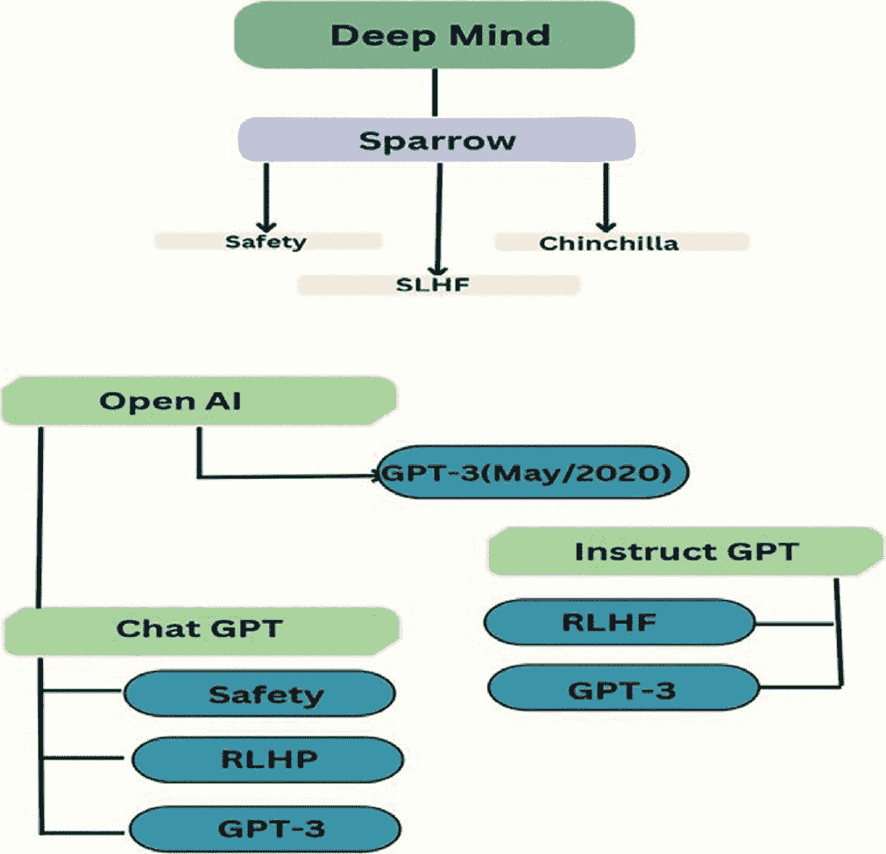

图 1.4 ChatGPT 的演变

## 当前情景

移动边缘计算有助于克服与云计算相关的问题。云计算有助于全球增加网络带宽，这对于生成涉及 `IoT`、`AI`、`DL`、`ML` 等使用的软件是必需的。然而，任何用于积极目的的软件也存在局限性，包括隐私、安全以及此类系统的高级使用，这主要导致不利之处。这不仅限于计算机或移动设备用于计算，也适用于包括 `GPTs` 在内的所有 `AI` 系统 \[10\]。`Chat GPT` 模型对社会的冲击是一把双刃剑，引发了有利和有害的影响，引发了对人类自主性和社会价值观的质疑。有效解决这些问题涉及将伦理考虑整合到 `AI` 程序中，目标是生成对伤害敏感性最小的语言模型输出。`OpenAI` 语言模型 `GPT-3.5` 的推出引起了极大热情，得益于其整合了众多自然语言处理模块。然而，更深入的检查揭示了诸如操纵和偏见等潜在挑战。`Chat GPT` 模型的复杂性为社会带来了积极和消极后果的可能性，强调了在 `AI` 流程中以审慎方式进行伦理整合的必要性。优先考虑伦理问题变得至关重要，使我们能够努力减轻语言模型输出的潜在破坏性方面。因此，随着新模型的推出，通过 `GPT` 生成的输出的安全问题也在增加 \[11\]。

人工智能提供的诊断疾病的方法，如聊天机器人和 `ChatGPT`，尚未得到广泛认可。然而，最近的研究表明，`ChatGPT` 提供的诊断疾病的不同方法可能是正确的。在一例中，`ChatGPT` 的诊断列表在 10 种不同诊断中几乎有 93.3% 的准确率，而医生的准确率更高，为 98.3%。尽管如此，研究明确指出，如果在未来几年得到改进，`ChatGPT` 有潜力提供更好的诊断列表 \[12\]。图 1.5 显示 `GPT` 有多个版本，随着时间的推移，`AI` 不断更新，包括 `GPT-1`、`GPT-2`、`GPT-3`、`Instruct GPT` 和 `ChatGPT`。`GPT-1` 于 2018 年推出，参数为 1.17 亿，其后 `GPT-2` 于 2019 年推出，参数为 15 亿，`GPT-3` 于 2020 年推出，参数为 1750 亿，`Instruct GPT` 于 2022 年推出，参数为 130 亿，`OpenAI` 于 2022 年发布了 `ChatGPT`。

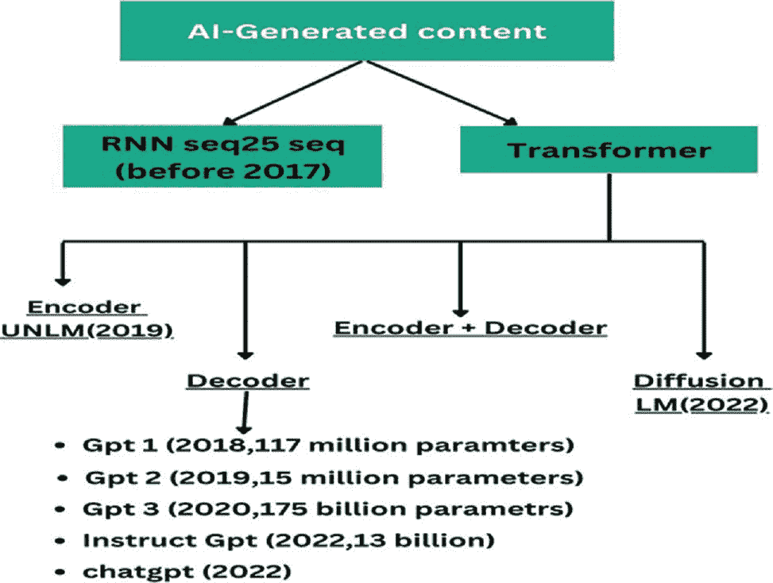

图 1.5 AI 生成内容（AIGC）的兴起

## 未来范围-新演进应用


药物滥用已成为美国的一个严重挑战，2020 年记录的案例超过数万例。虽然目前尚未认可使用软件检测这些挑战，但一些药物使用者在互联网上分享他们的经历，为构建能够检测拼写错误以及其他表明药物滥用的谈话方式的模型提供了基础。`GPT-3` 有助于检测此类错误并查找与药物相关信息。当被要求提供药物的名称时，它提供了“alprazolam”一词近 269 个同义词，其中 221 个是新的且此前未知。`UBAR` 使用 `GPT-2` 构建，这是一种为对话设计的生成式预训练转换器语言模型。据创建它的学生称，`UBAR` 拥有完全生成的对话系统。它可以提供真实世界的对话文本并在多种环境中使用。`UBAR` 的性能可以根据其响应进行改进，并且可以通过提供额外数据以实现更好的可视化和建模来进一步开发，从而增强对话文本水平。过去 70 年间，`AI` 经历了显著发展，既有 2000 年之前的旧 `AI` 的进步，也有 2000 年以后的新 `AI` 的进步。从其早期开始到当前状态，`AI` 已发展到有可能在许多任务中取代人类的程度。`AI` 的未来既令人惊叹又引人入胜，具有众多使命、愿景、目标和[content]
药物滥用已成为美国的一个严重挑战，2020 年记录的案例超过数万例。虽然目前尚未认可使用软件检测这些挑战，但一些药物使用者在互联网上分享他们的经历，为构建能够检测拼写错误以及其他表明药物滥用的谈话方式的模型提供了基础。`GPT-3` 有助于检测此类错误并查找与药物相关信息。当被要求提供药物的名称时，它提供了“alprazolam”一词近 269 个同义词，其中 221 个是新的且此前未知。`UBAR` 使用 `GPT-2` 构建，这是一种为对话设计的生成式预训练转换器语言模型。据创建它的学生称，`UBAR` 拥有完全生成的对话系统。它可以提供真实世界的对话文本并在多种环境中使用。`UBAR` 的性能可以根据其响应进行改进，并且可以通过提供额外数据以实现更好的可视化和建模来进一步开发，从而增强对话文本水平。过去 70 年间，`AI` 经历了显著发展，既有 2000 年之前的旧 `AI` 的进步，也有 2000 年以后的新 `AI` 的进步。从其早期开始到当前状态，`AI` 已发展到有可能在许多任务中取代人类的程度。`AI` 的未来既令人惊叹又引人入胜，具有众多使命、愿景、目标和[content]
药物滥用已成为美国的一个严重挑战，2020 年记录的案例超过数万例。虽然目前尚未认可使用软件检测这些挑战，但一些药物使用者在互联网上分享他们的经历，为构建能够检测拼写错误以及其他表明药物滥用的谈话方式的模型提供了基础。`GPT-3` 有助于检测此类错误并查找与药物相关信息。当被要求提供药物的名称时，它提供了“alprazolam”一词近 269 个同义词，其中 221 个是新的且此前未知。`UBAR` 使用 `GPT-2` 构建，这是一种为对话设计的生成式预训练转换器语言模型。据创建它的学生称，`UBAR` 拥有完全生成的对话系统。它可以提供真实世界的对话文本并在多种环境中使用。`UBAR` 的性能可以根据其响应进行改进，并且可以通过提供额外数据以实现更好的可视化和建模来进一步开发，从而增强对话文本水平。过去 70 年间，`AI` 经历了显著发展，既有 2000 年之前的旧 `AI` 的进步，也有 2000 年以后的新 `AI` 的进步。从其早期开始到当前状态，`AI` 已发展到有可能在许多任务中取代人类的程度。`AI` 的未来既令人惊叹又引人入胜，具有众多使命、愿景、目标和目标。`OpenAI` 还发布了 `DALL-E 2`，这是一种人工智能艺术生成器。图 1.6 显示了这些基于 `AI` 的系统在研究和技术领域中无尽的应用。

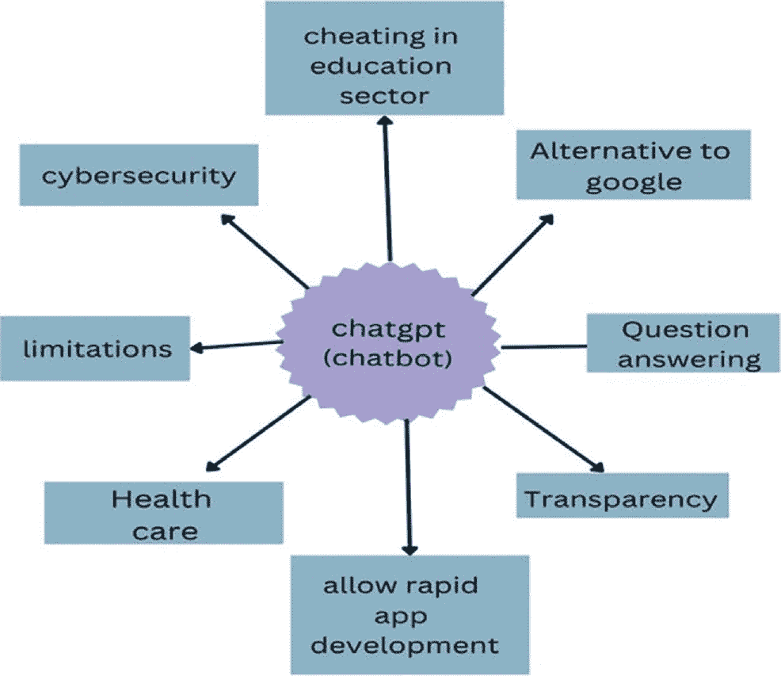

图 1.6 ChatGPT 的一些可能性

## 结论
`ChatGPT` 是一款强大的聊天机器人，能够在用户和虚拟 `AI` 系统之间实现通信。虽然 `GPT` 存在显著不同的版本，但 `ChatGPT` 已超越它们所有。然而，`AI` 对人类生活既有积极也有负面影响。本研究确定了四个需要解决的关键问题，以实现 `AI` 的进步：机遇的演变、技术性评论、人工智能的需求以及维持伦理的过程。`OpenAI` 已生成了许多版本的 `GPT` 模型，每个模型都有数十亿个参数，而本文确定了一些对工业和学术界而言即将到来的事物的证明。尽管社会中的技术不断发展，但关于我们能用现有技术走多远的问题仍然存在，其中幻觉增加了用户心中的一丝怀疑。从不同方面探索生成式预训练转换器可以帮助以资源丰富的方式修改和改进每一点可用数据。许多其他领域都可以从 `AI` 发展中受益，`AI` 的未来看起来令人惊叹且引人入胜，因为它拥有许多使命、愿景、目标和目标。

## 致谢
本研究由 RV University 通过技术交流课程提供的一项学生研究资助资助。

## 参考文献
1. Tlili, A., Shehata, B., Adarkwah, M. A., Bozkurt, A., Hickey, D. T., Huang, R., and Agyemang, B. (2023). 如果魔鬼是我的守护天使：`ChatGPT` 作为教育中使用聊天机器人的案例研究。Smart Learning Environments, 10, 15.

2. Mhlanga, D. (2023). 教育中的 Open AI，`ChatGPT` 走向终身学习的负责任和道德使用。Department of Artificial Intelligence, 1, 1–19.

3. Taecharungroj, V. (2023). `ChatGPT` 能做什么？。Big Data and Cognitive, 7(1), 35.

4. Zhang, M., and Li, J. (2021). 对 MIT 科技中 `GPT-3` 的评述。Fundamental Research, 1(6), 831–833.

5. Ham, D., Lee, J. G., Jang, Y., and Kim, K. E. (2020). 使用 `GPT-2` 的面向目标对话系统的端到端神经管道。ACL Anthology, 58, 583–592.

6. George, A. S., and George, A. H. (2023). `ChatGPT` `AI` 对多个商业领域影响的综述。Universal International Innovation, 1, 9–23.

7. Haluza, D., and Jungwirth, D. (2023). 人工智能与十个社会大趋势：使用 `GPT-3` 的探索性研究。Systems, 11(3), 120.

8. Topsakal, O., and Topsakal, E. (2022). 利用 `AR`、`Voicebots` 和 `ChatGPT` 的儿童外语教学软件框架。The Journal of Cognitive Systems, 7(2), 33–38.

9. Korngiebel, D. M., and Moone, S. D. (2021). 考虑生成式预训练转换器 3 (`GPT-3`) 在医疗交付中的可能性和陷阱。NPJ Digital Medicine, 4, 93.

10. Singh, A., Gutub, A., Roy, A., and Gutub, A. (2022). 用于 `IoT` 的基于 `AI` 的移动边缘计算：应用、挑战和未来范围。Research Article-Computer Engineering and Computer Science, 47, 9801–9831.

11. Meyer, S., Elsweiler, D., Ludwig, B., Fernandez-Pichel, M., and Losada, D. E. (2022). 我们还需要人类评估员吗？基于提示的 `GPT-3` 用户模拟在对话式 `AI` 中。Association of Computing Machinery, 8, 1–6.

12. Hirosawa, T., Harada, Y., Yokose, M., Sakamoto, T., Kawamura, R., and Shimizu, T. (2023). 生成式预训练转换器 3 聊天机器人为具有常见主诉的临床小故事生成的鉴别诊断列表的诊断准确性：一项试点研究。Enviornmental Research and Public Health, 20(4), 3378

# 2 革新现代农业：利用 `AI` 和 `IoT` 实现可持续水培农业
Akshay B^(¹)

计算机科学与工程学院 (`SOCSE`)，RV University，RV Vidyanikethan 邮政，8th Mile，Mysuru Road，Bengaluru，India

DOI: [`10.1201/9781003534136-2`](https://dx.doi.org/10.1201/9781003534136-2)

## 摘要
现代农业面临着诸多障碍，例如不可持续的粮食生产、粮食安全问题以及气候变化的后果。为了有效应对这些问题，当代农民正在采用水培农业与智能 `IoT` 系统相结合。水培提供了精确管理作物系统的能力，但对于大规模运营而言，持续的监测和控制是必不可少的，这一点可通过使用 `IoT` 技术实现。这使农民能够远程优化植物生长，确保最大效率和产量。在本研究中，我们探讨了 `AI` 和 `IoT` 在革新农业方面的潜力，并研究了专门针对水培和鱼菜共生农业的各种基于 `IoT` 的解决方案。

**关键词：** 农业，水培，`IoT`，植物生长远程监测，遥感

## 农业行业挑战的介绍
在肥胖问题普遍存在的时代，农业行业面临着诸多挑战，尤其是不可持续的粮食生产和粮食安全问题。此外，气候变化的严峻影响为传统的土壤耕作方式带来了更严峻的障碍。为了克服这些挑战，现代农民必须利用田间环境数据并采用更科学的方法，以实现明智及时的决策。在这种情况下，智能物联网 (`IoT`) 系统的整合和水培技术的采用作为可行解决方案具有巨大前景。水培作为一种可持续的农业实践，已获得显著关注，特别是在营养膜技术 (`NFT`) 和深水培养等技术的利用下。然而，在大规模水培系统中，监测植物生长和养分水平可能是一项具有挑战性的任务。`IoT` 技术的实施为解决这一挑战提供了宝贵的帮助。


为了实现农业效率的提高和环境友好性，水培作为一种有前景的方法脱颖而出。然而，水培种植面临着独特的挑战，特别是在植物生长和养分水平的持续监测方面。为解决这一问题，物联网技术成为一种可靠的解决方案，能够为水培系统提供定期监测和传感。将物联网融入水培的优势是多方面的，包括减少实地监测需求、优化生长和产量、以及增强对水和养分管理的控制，从而减少浪费。物联网技术的变革潜力延伸至整个农业领域，对水培的影响尤为显著。图 2.1 展示了智能农场运营的概览，体现了农业的未来，其围绕水培和鱼菜共生等现代耕作方法展开，并与尖端技术无缝集成。物联网在农业中成为改变游戏规则的技术，能够从根本上改变整个行业的轨迹。

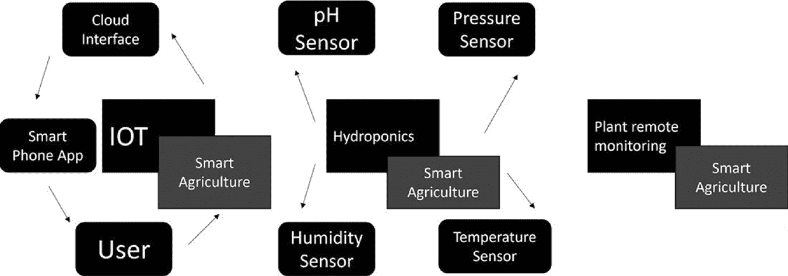

图 2.1 智能农业流程

## 物联网在农业中的作用：机器学习交互与智能控制

精准农业作为一个不断扩展的领域，正随着物联网和云计算技术的整合而经历变革性变化。尽管具有潜力，精准农业的采用仍局限于昂贵的场景。作为解决方案，本研究专注于满足封闭温室无土农业的需求。Cyber-Physical System（CPS）架构在本地层收集数据并执行实时控制，而边缘层处理关键的精准农业任务，与 CPS 协同工作，下一代信息技术（NGIT）则实现双向云访问。随着对气候变化、人口增长和粮食产量下降的担忧日益增加，得益于传感器、大数据分析和智能决策的物联网技术，为改善作物管理和收获实践提供了可行的解决方案 \[1\]。

温室种植以受控环境为特征，与传统作物生产相比表现出更低的资源消耗和更少的排放。温室系统的监测已引起研究人员的更多关注，本文对当前技术和未来趋势进行了比较研究。深度学习和大数据分析的应用增强了温室监测和管理自动化，水培和鱼菜共生作为创新的农业方法，使无土植物种植与鱼类养殖得以实现。这些技术与传统土壤耕作相比具有明显优势，包括抗土壤传播感染、害虫和农药，以及缩短植物生长周期。此外，它们在沙漠、极端温度等恶劣环境中具有韧性，且不受气候变化影响。物联网技术的整合进一步增强了它们在家用和商业应用方面的适用性。本文对水培和鱼菜共生种植进行了全面研究，以建立对这两种方法的全球视角 \[2\]。图 2.2 描绘了基础物联网智能农场的运行情况，集中控制器高效管理多个组件。传感器将数据传输到路由器，路由器将信息存储在用户可远程访问的云服务器中，使用户能够有效可视化和分析数据。总体而言，物联网、云计算和可持续农业技术的融合在革新精准农业、提高资源效率以及应对气候变化和人口增长带来的挑战方面显示出巨大潜力。

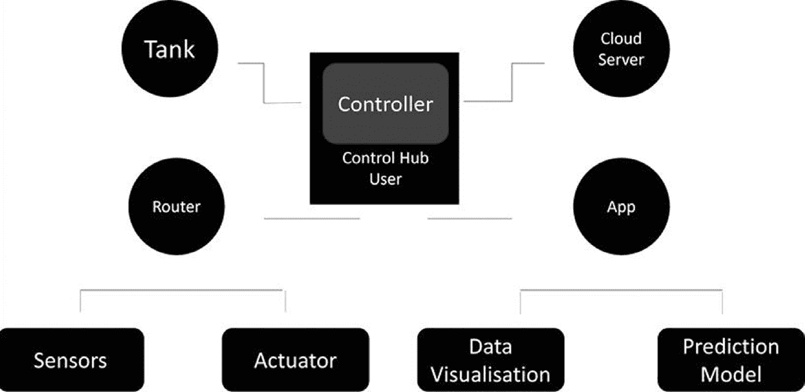

图 2.2 典型物联网使能农场的结构

## 人工智能与物联网在农业现代化中的潜力

水培已成为一种有效的农业方法，能够有效满足多样化的人类需求。拥抱物联网（IoT）设想了一个互联的世界，其中每个物体，包括农业系统，都可以通过互联网连接和控制。移动计算技术的融入作为数据分析和可视化的方法具有重要意义。在本文中，我们展示了物联网和 iOS 应用在高效数据收集和分析方面的使用，整合 plotly 和数据分析创建了“HydroiOT”系统。该系统在不利条件下提醒农场经理方面具有不可估量的价值，促进知情决策以提高生产力。由物联网驱动的智慧农业围绕通过访问和连接各种设备实现的生产过程展开。实现由数据分析驱动的自可持续生产至关重要，仅仅依赖互联网支持是不够的。我们提出了一种利用贝叶斯网络传感器监测多个参数的过程，其中传感器收集的数据预测执行器的值以实现农场作业。我们的模型实现了令人印象深刻的 84.53 百分比的准确率 \[3\]。

在极端天气条件下种植某些植物，例如沙漠或极地地区，带来相当大的挑战。与其依赖外部气候，我们提出物联网网络以增强远程监测。用户只需种植幼苗并配置初始程序，系统即可自主维持参数并促进健康的植物生长。水培种植通过减少肥料和水消耗，同时确保精确的养分监测，为解决环境和粮食相关问题提供了有前景的解决方案。为实现这一目标，我们设计了电极作为传感器并整合了物联网技术以实现精确监测。我们的综述侧重于参数准确性和物联网应用，强调使用聚氯乙烯膜基电极可以有效维持硝酸盐和钾所需的浓度，误差保持在 10 mg 以下 \[4\]。

本文提出了一种利用太阳能进行作物监测的创新方法。鉴于农业占印度 GDP 的 18 百分比，该领域需要持续发展和研究。技术在减少人力和时间方面发挥着至关重要的作用，正如我们利用电力电子和电力系统 I 组合的系统所示，并使用 GSM 技术向用户实时传输数据 \[5\]。图 2.3 说明了智能农场的运行情况，其中高性能微控制器高效管理农场组件。各个水箱之间的连接由计算机系统有效监测和控制，数据分析完成后传输给用户。该研究展示了物联网及其在农业中应用的变革潜力，特别是在水培和智慧农业的背景下。这些进步有望提高农业的生产力、可持续性和远程监测能力，促进全球粮食安全和环境保护。

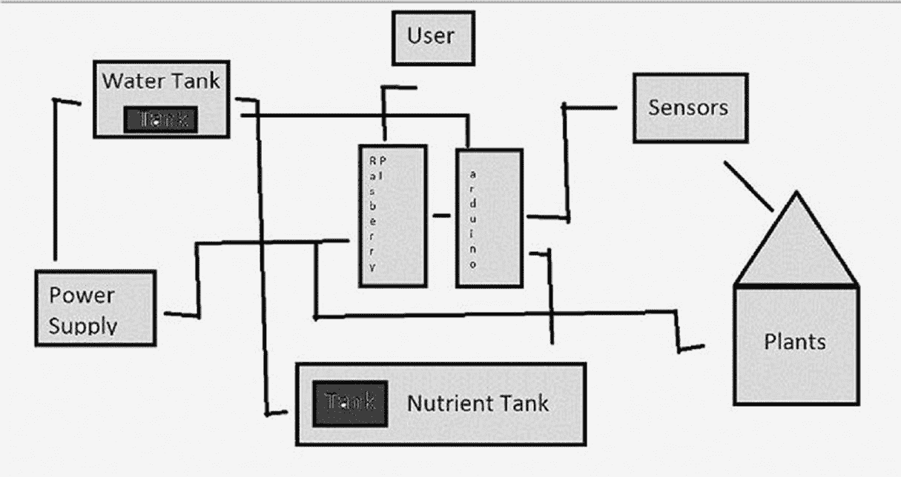

图 2.3 IDS 的应用

## 物联网在农业中监测植物生长因子


现代农业实践需要创新技术，包括无土栽培方法，如水培和鱼菜共生。随着这些方法的日益普及，研究人员已深入研究机器学习网络（如神经网络和贝叶斯网络）在控制和优化植物生长方面的应用。在此背景下，基于水培并采用深度神经网络技术的智能物联网系统的开发代表了开创性的实现。该系统利用番茄植物生长的原型，集成了 Arduino、Raspberry Pi 3 和 Tensor Flow。物联网技术成为定期监测植物水分和营养需求的可行解决方案。本文提出了一种基于农业的方法，使用物联网系统和模糊逻辑 \[6\]。温度和湿度是影响植物生长的关键因素。利用物联网进行植物生长控制和通知可以显著改善作物管理。本文强调物联网在管理植物生长因素方面的作用，以防止生长不良或枯萎，为农民提供及时警报并帮助减轻作物营养不良和植物损害。水培是一种无土耕作方法，利用混合营养物质的水介质满足植物营养需求，与基于土壤的耕作系统相比效率更高。特别适合城市家庭等有限空间，水培系统可以远程观察，与城市居民的日常生活相协调。物联网技术促进远程观察，将数据直接报告到互联网，减轻了与温度、水和 pH 相关的定期观察需求 \[7\]。

随着大规模物联网应用的不断采用，重要的基础设施需求随之出现。本文研究了构建模块化室内垂直农业系统所需的基础设施前提条件。图 2.4 说明了农业部门就业令人担忧的下降，这可能会对粮食安全产生不利影响。为解决这一问题，自动化大规模精准农业成为一种有前景的解决方案，减少了人力需求并在最小物理干预的情况下促进大规模运营。

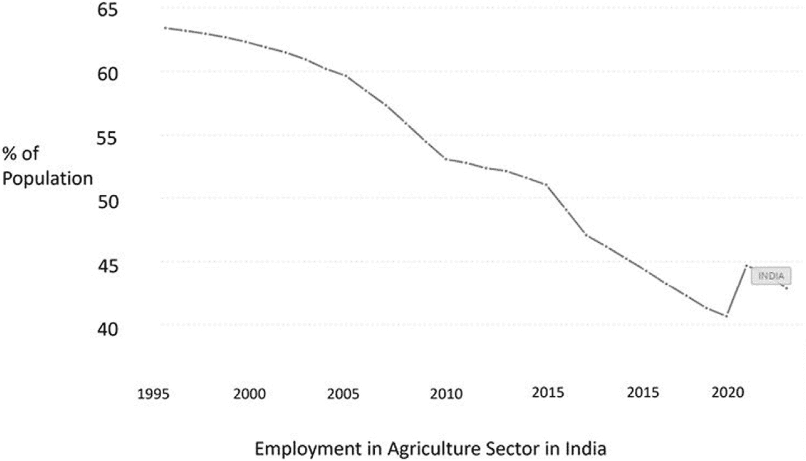

图 2.4 印度农业部门趋势

## 物联网在农业系统中的现状

印度快速增长的粮食需求，预计到 2050 年将达到 16 亿人口，这推动了人们对流控环境农业领域智能技术（如数据分析、机器人和物联网）的日益关注。本文对现有文献进行了全面回顾，特别关注该领域内的无土水培技术。该综述涵盖了 1999 年至 2020 年间开展的研究，强调了无土农业中使用的不同类型的传感器并列举了其优势。此外，文章讨论了个人在家中无需土壤种植水果和蔬菜的潜力 \[8\]。技术进步为农业现代化提供了众多解决方案，科学研究团体在此领域积极竞争。云计算和雾计算为数据存储和分析提供了充足的资源和解决方案，使流程自动化和预测成为可能。物联网的影响预计将显著惠及农业部门，而该部门已在无线传感器网络技术方面产生了相当大的影响。文章介绍了近期物联网技术及其在农业部门的当前渗透情况的调查，以及对农民未来潜在价值的探索以及他们在采用过程中可能遇到的挑战 \[9\]。

针对普遍存在的水资源短缺带来的迫切水资源管理需求，文章强调了确保粮食生产和消费用水可用的重要性。然而，商业传感器的成本可能对小规模农民来说过于高昂。为克服这一挑战，物联网和无线传感器网络（WSN）的进步正被利用来开发具有成本效益的智能灌溉系统。文章提供了智能灌溉技术当前最先进状况的全面调查 \[10\]。鱼菜共生作为一种将水产养殖和水培相结合的可持续农业实践，以共生方式运作，提供健康有机食品，同时减少水和肥料的消耗。文章强调了物联网在促进鱼菜共生系统智能传感和控制操作方面的重要性。它研究并强调了此类系统自动运行所涉及的各种相关因素 \[11\]。

## 提高农业部门作物质量和产量的潜力


水培，一种无土农业技术，正在成为应对各种挑战的有前景的解决方案，包括气候变化、水资源短缺和粮食需求。该方法具有在本地生产新鲜、无残留的蔬菜和水果的潜力，确保健康的粮食供应。本文深入探讨了水培的诸多益处，阐明了成功实施所需的专业知识。水培农业为面临土壤退化和水资源有限的地区提供了一种合适的替代方案。与传统的土壤种植不同，水培克服了特定的挑战。本文全面审视了水培的优势和局限性，包括易于管理、无杂草生长以及减少喷水需求 \[12\]。农业在全球经济中发挥着重要作用，但随着人口增长带来的需求增加，传统耕作方法不足以满足要求。为应对这一挑战，以农业 4.0 著称的新兴农业智能实践正在兴起。利用人工智能 AI 和物联网等技术，智能农业解决方案优化资源使用、减少劳动力并增强作物监测和管理。这些技术已证明其在抵御各种威胁的作物保护方面的有效性。图 2.5 说明了物联网在智慧农业中的应用。高效、精确的农业系统对于改善农业活动至关重要。通过互联网运行农场管理系统在处理大量网络设备和集成多样化系统方面存在挑战。本文介绍了农场管理系统架构，由软件模块组成，展示了其功能和分析能力。可持续农业发展需要强大的基础设施和先进技术来提高作物质量和产量。水培，一种无土栽培技术，是一种合适的方法，本文讨论了有效支持高效水培系统的物联网技术的最新进展。物联网提供了一种可持续的方法，利用传感器等各种技术来优化作物生产过程。图 2.6 展示了物联网农业与机器学习集成后充满希望的未来。它说明了在整个农场部署物联网传感器，收集实时数据以进行分析。机器学习算法提供有价值的见解，例如产量估算和病害检测的预测分析。自动化发挥着关键作用，使自动化灌溉和自主机械得以实现，从而提高生产率。通过移动应用程序，农民可以远程监控农场并做出数据驱动的决策，优化资源利用、促进可持续性并推动农业实践效率的提高。

图 2.5 物联网在智慧农业中的应用

| 参数 || 物联网应用 |
| --- | --- |
| 报警系统 || 使用传感器监测关键参数，如温度、湿度、pH 值、营养水平和水位。 |
| --- | --- |
| 数据分析 || 对传感器数据应用统计分析技术以识别模式和趋势。 |
| 精准农业 || 精准农业利用物联网技术、数据分析和自动化来优化农业实践、最大化作物产量并最小化资源浪费。 |
| 精准农业 || 精准农业利用物联网技术、数据分析和自动化来优化农业实践、最大化作物产量并最小化资源浪费。 |

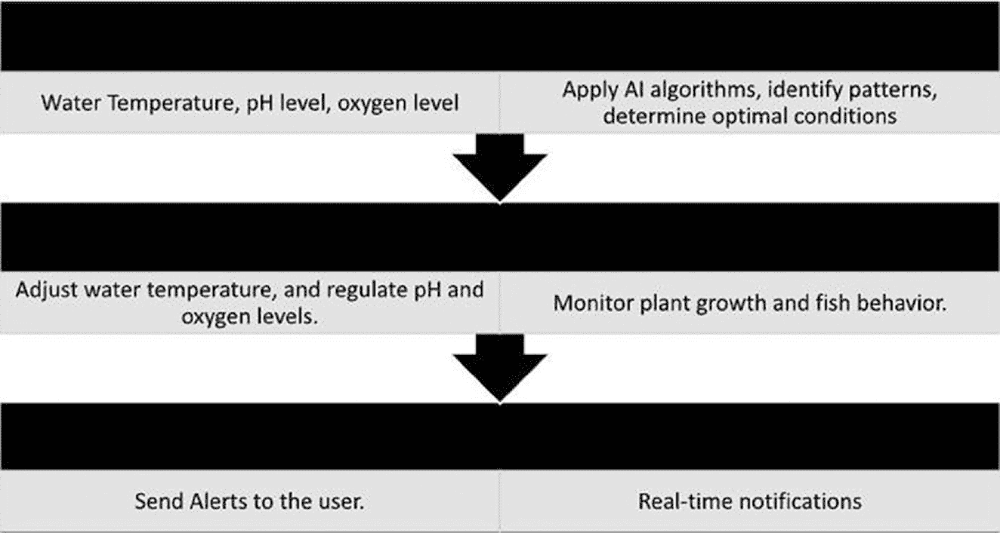

图 2.6 机器学习实施下物联网农业的未来展望

## 结论
水培和水培-鱼菜共生农业提供了应对农业挑战的有前景的解决方案。这些创新耕作方法使农民能够优化植物生长和养分输送，从而减少浪费并提高效率。因此，这些做法有助于提高生产率和资源节约。随着农业行业应对气候变化和人口增长的影响，基于物联网的精准农业的整合有望促进可持续性并确保未来的充足粮食生产。

## 致谢
本研究由 RV 大学在技术交流课程框架内获得的学生研究资助提供经费支持。

## 参考文献
1. Rayhana, R. (2020). Internet of things empowered smart greenhouse farming. IEEE Journal of Radio Frequency Identification, 4, 195–211.
2. Ezzahoui, I. (2021). Hydroponic and aquaponic farming: comparative study based on internet of things IoT technologies. Procedia Computer Science, 191, 499–504.
3. Alipio, M. I. (2019). On the design of nutrient film technique hydroponics farm for smart agriculture. Engineering in Agriculture, Environment and Food, 12(3), 315–324.
4. Richa, A. (2021). Advanced monitoring of hydroponic solutions using ion- selective electrodes and the internet of things: a review. Environmental Chemistry Letters, 19, 3445–3463.
5. Kumar, A. (2022). IoT enabled the system to monitor and control greenhouse. Materials Today: Proceedings, 49, 3137–3141.
6. Maravillas, E. (2018). IoT hydroponics management system. In 10th International Conference on Humanoid, Nanotechnology, Information Technology, Communication and Control, Environment and Management, (vol. 1, pp. 1–5).
7. Lukito, R. B. (2019). Development of IoT at the hydroponic system using Raspberry Pi. TELKOMNIKA (Telecommunication Computing Electronics and Control), 17(2), 897–906.
8. Ragaveena, S. (2021). Smart controlled environment agriculture methods: a holistic review. Reviews in Environmental Science and Bio/Technology, 20, 887–913.
9. Tzounis, A. (2017). Internet of things in agriculture, recent advances and future challenges. Biosystems Engineering, 164, 31–48.
10. Garc´ıa, L. (2020). IoT-based smart irrigation systems: an overview on the recent trends on sensors and IoT systems for irrigation in precision agriculture. Surveys of Sensor Networks and Sensor Systems Deployments, 20, 14–20.
11. Taha, M. F. (2022). Recent advances of smart systems and internet of things (IoT) for aquaponics automation: a comprehensive overview. Chemosensors, 10, 303.
12. Kannan, M. (2022). Hydroponic farming – a state of the art for the future agriculture. Materials Today: Proceedings, 68, 2163–2166.

# 3 图像模糊集之间的距离度量及其在多属性决策中的应用
Rozy^(²)
Department of Mathematics, Maharishi Markandeshwar (Deemed To Be University), Mullana-Ambala, India
DOI: [10.1201/9781003534136-3](https://dx.doi.org/10.1201/9781003534136-3)

## 摘要


图像模糊集（`PFSs`）最初由 Cuong 和 Kreinovich 提出，比直觉模糊集（`IFSs`）更有效地处理现实问题中的不确定性。本文介绍了 `PFSs` 之间的距离测度。本研究的目的是提出一种针对 `PFSs` 的距离测度并确认其有效性，并讨论其关键特性。所提出的距离测度还用于机器学习决策过程，如多属性决策。数值示例展示了所开发方法解决实际问题的有效性。

**关键词：** 距离测度，模糊集，劣化比率方法 和 `MADM`，直觉模糊集，图像模糊集

## 引言

为了应对与图像处理、机器学习、模式识别和决策等相关的各种现实世界问题，需要从不同角度对两个不同的对象进行分析。不同研究根据问题类型使用了不同的对比度量。“相似性测度”、“距离测度”、“相关性测度”等术语在兼容性和可比性研究中常用。由于 `PFS` 是 `FS` 和 `IFS` 的改进，因此讨论关于 `FSs` 和 `IFSs` 的进展和应用的重要研究是很重要的。Zadeh \[11\] 最先提出了模糊集（`FS`）理论。模糊集理论处理隶属度，其取值介于零和一之间。Atanassov \[1\] 提出了 `IFSs`，它同时度量隶属度和非隶属度。然而，`IFSs` 不处理中性度。让我们考察一个现实世界的情况。在投票期间，存在支持、反对或对任何决策保持中立的社会群体。然而，社会中仍有一部分人弃权不投票。为了解决这类问题，Cuong 和 Kreinovich \[2\] 提出了 `PFSs` 的概念，它处理隶属度、非隶属度和中性度，且这些度之和应小于或等于一。

为了取得新的成果，本文提出了图像模糊集（`PFSs`）的距离测度。距离测度和相似性测度都是解决现实问题（如决策）的重要概念 \[3, 4, 5, 6, 7, 8, 9 and 10\]。`TOPSIS` 技术建议最终方案应既远离负理想解（`NIS`），又最接近正理想解（`PIS`）。`TOPSIS` 由 Chen \[3\] 扩展到模糊环境。`MADM` 技术用于从多个决策方案中找出最佳方案。Zhang 等 \[10\] 在 `PF` 领域提出了 `MADM` 的 `EDAS` 技术。Jana 等 \[4\] 在 `PF` 环境中提出了 Dombi 聚合算子及其在 `MADM` 中的应用。Singh 和 Kumar \[12\] 开发了用于解决 `MADM` 的 `VIKOR` 方法。

当前工作与 `PF` 距离测度的研究相关。本文的主要贡献如下：

为了解决 `MADM` 问题，我们提出了图像模糊集的距离测度。利用 `PF` 距离测度，我们基于 `TOPSIS` 技术引入了一种图像模糊劣化比率方法。一些数值示例用于展示所建议的 `MADM` 技术，以克服 `PFSs` 领域中现有 `TOPSIS` 方法的不足。我们在劣化比率方法的意义上扩展了 `TOPSIS` 方法。

本文其余部分结构如下：

第 2 节介绍了 `FSs`、`IFSs` 和 `PFSs` 的一些基本基础。第 3 节介绍了距离测度并描述了其特性。在第 4 节，我们说明了 `MADM` 方法。还展示了比较分析以说明所建议测度的有效性。第 5 节涵盖结论和未来展望。

## 预备知识

**定义 2.1** (Zadeh \[11\])。有限论域集 `K` = {`m`[1], `m`[2],..., `m`[q] } 中的一个 `FS` `Q` 定义为：

(2.1)

`Q` = {(`m`[`z`], `s``Q`) | `m`[`z`] ∈ `K`}, `z` = 1, 2, …, `q`,

其中 `S[Q]` (`m[z]`) ∈ [0,1] 是元素 `m[z]` 在集合 `Q` 中的隶属度。为方便起见，Zadeh \[11\] 将 `S[Q]`(`m[z]`) 称为模糊数（`FN`），记为 `l` = (`S[l]`)。

**定义 2.2** (Atanassov \[1\])。有限论域集 `K` = {`m`[1], `m`[2],..., `m`[q]} 中的一个 `IFS` `B` 定义为：

(2.2)

`B` = {(`m`[`z`], `s``I`, `e``I`) | `m`[`z`] ∈ `K`}, `z` = 1, 2, …, `q`

其中 `S[Q]` (`m[z]`) ∈ [0,1] 是隶属度，`e[B]`(`m[z]`) ∈ [0,1] 是元素 `m[z]` 在集合 `B` 中的非隶属度。这里，对所有 `m[z]` ∈ `K`，有 0 ≤ `S[B]`(`m[z]`) + `e[B]`(`m[z]`) ≤ 1。对于 `m[z]` ∈ `K`，`ϒ[Q]` (`m[z]`) = 1 - `S[B]` (`m[z]`) - `e[B]`(`m[z]`) 定义为 `m[z]` 在 `B` 中的犹豫度。为方便起见，Atanassov \[1\] 将 (`S[B]` (`m[z]`), `e[B]`(`m[z]`)) 称为直觉模糊数（`IFN`），记为 `t` = (`s[t]`, `e[t]`)。

**定义 2.3** (Cuong and Kreinovich \[2\])。有限论域集 `K` = {`m`[1], `m`[2],..., `m`[q]} 中的一个图像模糊集 `I` 定义为：

(2.3)

`I` = {(`m`[`z`], `s``I`, `g``I`, `e``I`) | `m`[`z`] ∈ `K`}, `z` = 1, 2, …, `q`,

其中 `S[I]` (`m[z]`) ∈ [0,1] 是隶属度，`g[I]` (`m[z]`) ∈ [0,1] 是中性度，`e[I]`(`m[z]`) ∈ [0,1] 是元素 `m[z]` 在集合 `I` 中的非隶属度，这里 0 ≤ `S[I]` (`m[z]`) + `e[I]`(`m[z]`) - `g[I]`(`m[z]`) ≤ 1。

对于 `m[z]` ∈ `K`，`κ[I]`(`m[z]`) = 1 – `s[I]` (`m[z]`) – `g[I]` (`m[z]`) – `e[I]` (`m[z]`) 定义为 `m[z]` 在 `I` 中的拒绝度。如果 `κ[I]` 值较小，则对 `m[z]` 的了解更确定。另一方面，如果 `κ[I]` 值较大，则对 `m[z]` 的了解更不确定。为方便起见，Cuong 和 Kreinovich \[2\] 将 (`s[I]` (`m[z]`), `g[I]` (`m[z]`), `e[I]` (`m[z]`)) 称为图像模糊数（`PFN`），记为 `i` = (`s[i]`, `g[i]`, `e[i]`)。

如果中性度（`g[I]`）等于零，则 `PFS` 变为 `IFS`；当非隶属度（`e[I]`）和中性度（`g[I]`）都等于零时，则 `PFS` 变为 `FS`。中性度 `g[I]` 的整合能更精确地确定对象的细节并提高结果的质量和有效性（Son \[6\]）。

**定义 2.4** (Cuong and Kreinovich \[2\])。如果 `K` 包含两个图像模糊集 `I` 和 `W`，则不同的运算定义如下：

1.

`I`^(c) = {(`m`[`z`], `e``I`, `g``I`, `s``I`) | `m`[`z`] ∈ `K`}, `z` = 1, 2, .. `q`.

2.

`I` ⊆ `W`, if `s``I` ≤ `s``W`, `g``I` ≤ `g``W`, `e``I` ≥ `e``W`, ∀ `m`[`z`] ∈ `K`.

3.

`I` ∪ `W` = {(`m`[`z`], max(`s``I`, `s``W`), min(`g``I`, `g``W`), min(`e``I`, `e``W`) ) | `m`[`z`] ∈ `K`}

4.

`I` ∩ `W` = {(`m`[`z`], min(`s``I`, `s``W`), min(`g``I`, `g``W`), max(`e``I`, `e``W`) ) | `m`[`z`] ∈ `K`}

**定义 2.5** (Son \[6\])。函数 `DM` : `PFS`(`K`) × `PFS`(`K`) → [0,1]，其中 `I, W` 和 `Q` ∈ `PFS`(`K`)，如果满足以下准则，则定义为距离测度：

1. 0 ≤ `DM`(`I, W`) ≤ 1.

2. `DM`(`I, W`) = `DM`(`W, I`).

3. `DM`(`I, I`) = 0.


4. 若 `I` ⊆ `W` ⊆ `Q`，则 `DM`(`I, Q`) ≥ `DM`(`I, W`) 且 `DM`(`I, Q`) ≥ `DM`(`W, Q`)。

## 针对图像模糊集的建议距离度量

本节介绍一种新的 PF 距离度量并提供其可靠性的证据。设 `I` = {`m[z]`, `s[I]`(`m[z]`), `g[I]`(`m[z]`), `e[I]`(`m[z]`) | `m[z]` ∈ `K`} 和 `W` = {`m[z]`, `s[W]`(`m[z]`), `g[W]`(`m[z]`), `e[W]`(`m[z]`) | `m[z]` ∈ `K`} 为两个 `PFS`，则 `PFS` 的建议距离度量如下给出：

### 定义 3.1
设 `K` = {`m[1]`, `m[2]`, …, `m[q]`} 为有限全集。对于 `I`, `W` ∈ `PFS`(`K`)，我们定义距离度量 `D*` 为

(3.1)

$$D^{\*}(I,W) = \\frac{1}{q}\\sum\\limits\_{z = 1}^{q}\\left\\lbrack \\frac{\\begin{array}{l} {2\\left( {\\left| {s\_{I}\\left( m\_{z} \\right) - s\_{W}\\left( m\_{z} \\right)} \\right| + \\left| {e\_{I}\\left( m\_{z} \\right) - e\_{W}\\left( m\_{z} \\right)} \\right| + \\left| {g\_{I}\\left( m\_{z} \\right) - g\_{W}\\left( m\_{z} \\right)} \\right| +} \\right.} \\\\ \\left. \\left| {\\kappa\_{I}\\left( m\_{z} \\right) - \\kappa\_{W}\\left( m\_{z} \\right)} \\right| \\right) \\\\ \\end{array}}{\\begin{array}{l} {4 + \\left| {s\_{I}\\left( m\_{z} \\right) - s\_{W}\\left( m\_{z} \\right)} \\right| + \\left| {e\_{I}\\left( m\_{z} \\right) - e\_{W}\\left( m\_{z} \\right)} \\right| + \\left| {g\_{I}\\left( m\_{z} \\right) - g\_{W}\\left( m\_{z} \\right)} \\right| +} \\\\ \\left| {\\kappa\_{I}\\left( m\_{z} \\right) - \\kappa\_{W}\\left( m\_{z} \\right)} \\right| \\\\ \\end{array}} \\right\\rbrack$$

### 定理 3.2
度量 `D*` 满足以下特征：
1. 0 ≤ `D*`(`I,W`) ≤ 1.
2. `D*`(`I,W`) = `D*`(`W,I`)
3. `D*`(`I,I`) = 0.
4. 若 `I` ⊆ `W` ⊆ `Q`，则 `D*`(`I,Q`) ≥ `D*`(`I,W`) 且 `D*`(`I,Q`) ≥ `D*`(`W,Q`)。

**证明。**
1. 对于 `I`, `W` ∈ `PFS`(`K`)，显然有 0 ≤ |`s[I]`−`s[W]`|, |`g[I]`−`g[W]`|, |`e[I]`−`e[W]`|, |`κ[I]`−`κ[W]`| ≤ 1。
这意味着 0 ≤ |`s[I]`−`s[W]`| + |`g[I]`−`g[W]`| + |`e[I]`−`e[W]`| + |`κ[I]`−`κ[W]`| ≤ 4。这意味着

$$0 \\leq \\left\\lbrack \\frac{2\\left( {\\left| {s\_{I}\\left( m\_{z} \\right) - s\_{W}\\left( m\_{z} \\right)} \\right| + \\left| {e\_{I}\\left( m\_{z} \\right) - e\_{W}\\left( m\_{z} \\right)} \\right| + \\left| {g\_{I}\\left( m\_{z} \\right) - g\_{W}\\left( m\_{z} \\right)} \\right| + \\left| {\\kappa\_{I}\\left( m\_{z} \\right) - \\kappa\_{W}\\left( m\_{z} \\right)} \\right|} \\right)}{4 + \\left| {s\_{I}\\left( m\_{z} \\right) - s\_{W}\\left( m\_{z} \\right)} \\right| + \\left| {e\_{I}\\left( m\_{z} \\right) - e\_{W}\\left( m\_{z} \\right)} \\right| + \\left| {g\_{I}\\left( m\_{z} \\right) - g\_{W}\\left( m\_{z} \\right)} \\right| + \\left| {\\kappa\_{I}\\left( m\_{z} \\right) - \\kappa\_{W}\\left( m\_{z} \\right)} \\right|} \\right\\rbrack \\leq 1.$$

对两边求和可得 0 ≤ `D*`(`I,W`) ≤ 1。
2. 显然。
3. 显然。
4. 考虑 `I`, `W`, `Q` ∈ `PFS`(`K`)，使得 `I` ⊆ `W` ⊆ `Q`，则 `s[I]`(`m[z]`) ≤ `s[W]`(`m[z]`) ≤ `s[Q]`(`m[z]`)，`g[I]`(`m[z]`) ≤ `g[W]`(`m[z]`) ≤ `g[Q]`(`m[z]`)，`e[I]`(`m[z]`) ≥ `e[W]`(`m[z]`) ≥ `e[Q]`(`m[z]`)。

于是，我们有

$$\\begin{array}{l} {\\left| {s\_{I}\\left( m\_{z} \\right) - s\_{W}\\left( m\_{z} \\right)} \\right| \\leq \\left| {s\_{I}\\left( m\_{z} \\right) - s\_{Q}\\left( m\_{z} \\right)} \\right|,\\left| {s\_{W}\\left( m\_{z} \\right) - s\_{Q}\\left( m\_{z} \\right)} \\right| \\leq \\left| {s\_{I}\\left( m\_{z} \\right) - s\_{Q}\\left( m\_{z} \\right)} \\right|,} \\\\ \\left. \\left| {g\_{I}\\left( m\_{z} \\right) - g\_{W}\\left( m\_{z} \\right)} \\right| \\leq g\_{I}\\left( m\_{z} \\right) - g\_{Q}\\left( m\_{z} \\right) \\middle| , \\middle| g\_{W}\\left( m\_{z} \\right) - g\_{Q}\\left( m\_{z} \\right) \\middle| \\leq \\middle| g\_{I}\\left( m\_{z} \\right) - g\_{Q}\\left( m\_{z} \\right) \\mid \\text{,} \\right. \\\\ {\\left| {e\_{I}\\left( m\_{z} \\right) - e\_{W}\\left( m\_{z} \\right)} \\right| \\leq \\left| {e\_{I}\\left( m\_{z} \\right) - e\_{Q}\\left( m\_{z} \\right)} \\right|,\\left| {e\_{W}\\left( m\_{z} \\right) - e\_{Q}\\left( m\_{z} \\right)} \\right| \\leq \\left| {e\_{I}\\left( m\_{z} \\right) - e\_{Q}\\left( m\_{z} \\right)} \\right|.} \\\\ \\left. \\left| {\\kappa\_{I}\\left( m\_{z} \\right) - \\kappa\_{W}\\left( m\_{z} \\right)} \\right| \\leq \\kappa\_{I}\\left( m\_{z} \\right) - \\kappa\_{Q}\\left( m\_{z} \\right) \\middle| , \\middle| \\kappa\_{W}\\left( m\_{z} \\right) - \\kappa\_{Q}\\left( m\_{z} \\right)\\left| {\\leq \\kappa\_{I}\\left( m\_{z} \\right) - \\kappa\_{Q}\\left( m\_{z} \\right)} \\right|.\\ \\right. \\\\ \\end{array}$$

因此，`D*`(`I, Q`) ≥ `D*`(`I, W`) 且 `D*`(`I, Q`) ≥ `D*`(`W, Q`)。

## 性质

接下来，我们如下定义 PFS 的一种新型加权距离度量，若应用权重向量 `l[z]`，`z` = 1, 2, ..., `q` 使得 ${\\sum\_{z = 1}^{q}l\_{z}} = 1:$

### 定义 3.3
对于给定的 `K` = {`m[1]`, `m[2]`,..., `m[q]` } 和 `I`, `W` ∈ `PFS`(`K`)，加权距离度量 (`D*`)^(`l[z]`):`PFS`(`K`)×`PFS`(`K`)→[0,1] 定义如下：

$$\\left( D^{\*} \\right)^{l\_{z}}(I,W) = {\\sum\_{z = 1}^{q}l\_{z}}\\left\\lbrack \\frac{\\begin{array}{l} {2\\left( {\\left| {s\_{I}\\left( m\_{z} \\right) - s\_{W}\\left( m\_{z} \\right)} \\right| + \\left| {e\_{I}\\left( m\_{z} \\right) - e\_{W}\\left( m\_{z} \\right)} \\right| + \\left| {g\_{I}\\left( m\_{z} \\right) - g\_{W}\\left( m\_{z} \\right)} \\right| +} \\right.} \\\\ \\left. \\left| {\\kappa\_{I}\\left( m\_{z} \\right) - \\kappa\_{W}\\left( m\_{z} \\right)} \\right| \\right) \\\\ \\end{array}}{\\begin{array}{l} {4 + \\left| {s\_{I}\\left( m\_{z} \\right) - s\_{W}\\left( m\_{z} \\right)} \\right| + \\left| {e\_{I}\\left( m\_{z} \\right) - e\_{W}\\left( m\_{z} \\right)} \\right| + \\left| {g\_{I}\\left( m\_{z} \\right) - g\_{W}\\left( m\_{z} \\right)} \\right| +} \\\\ \\left| {\\kappa\_{I}\\left( m\_{z} \\right) - \\kappa\_{W}\\left( m\_{z} \\right)} \\right| \\\\ \\end{array}} \\right\\rbrack$$

### 定理 3.4
(`D*`)^(`I[z]`)(`I`, `W`) 是 `K` = {`m[1]`, `m[2]`, ..., `m[q]` } 中 PFS `I` 与 `W` 之间距离的程度，满足以下特征：
1. 0 ≤ (`D*`)^(`I[z]`) (`I,W`) ≤ 1.
2. (`D*`)^(`I[z]`) (`I,W`) = (`D*`)^(`I[z]`) (`W,I`).
3. (`D*`)^(`I[z]`) (`I,I`) = 0.
4. 若 `I` ⊆ `W` ⊆ `Q`，则 (`D*`)^(`I[z]`) (`I,Q`) ≥ (`D*`)^(`I[z]`) (`I,W`) 且 (`D*`)^(`I[z]`) (`I,Q`) ≥ (`D*`)^(`I[z]`) (`W,Q`)。

**证明。**
本定理的证明与定理 (3.2) 的证明类似，当 $l\_{z} = \\frac{1}{q}$ 时，`z =` 1, 2, …, `q`，则 (`D*`)^`z` (`I, W`) 与 `D*`(`I, W`) 相同。

### 定理 3.5
`D*` 的其他一些性质如下：
1. `D*`(`I, W`) = `D*`(`I^C, W^C`).
2. `D*`(`I, W^C`) = `D*`(`I^C,W`).
3. `D*`(`I, I^C`) = `0` ⇔ `s[I]` = `e[I]`.
4. $\\left. \\frac{3}{2}D^{\*}\\left( {I,I^{C}} \\right) = 1\\Leftrightarrow I \\right.$

**证明。**
1. 我们有


$$D^{\*}(I,W) = \\frac{1}{q}{\\sum\_{z = 1}^{q}\\begin{array}{l} \\left\\lbrack \\frac{\\begin{array}{l} {2\\left( {\\left| {s\_{I}\\left( m\_{z} \\right) - s\_{W}\\left( m\_{z} \\right)} \\right| + \\left| {e\_{I}\\left( m\_{z} \\right) - e\_{W}\\left( m\_{z} \\right)} \\right| + \\left| {g\_{I}\\left( m\_{z} \\right) - g\_{W}\\left( m\_{z} \\right)} \\right| +} \\right.} \\\\ \\left. \\left| {\\kappa\_{I}\\left( m\_{z} \\right) - \\kappa\_{W}\\left( m\_{z} \\right)} \\right| \\right) \\\\ \\end{array}}{\\begin{array}{l} {4 + \\left| {s\_{I}\\left( m\_{z} \\right) - s\_{W}\\left( m\_{z} \\right)} \\right| + \\left| {e\_{I}\\left( m\_{z} \\right) - e\_{W}\\left( m\_{z} \\right)} \\right| + \\left| {g\_{I}\\left( m\_{z} \\right) - g\_{W}\\left( m\_{z} \\right)} \\right| +} \\\\ \\left| {\\kappa\_{I}\\left( m\_{z} \\right) - \\kappa\_{W}\\left( m\_{z} \\right)} \\right| \\\\ \\end{array}} \\right\\rbrack \\\\ {= \\frac{1}{q}{\\sum\_{z = 1}^{q}\\left\\lbrack \\frac{\\begin{array}{l} {2\\left( {\\left| {e\_{I}\\left( m\_{z} \\right) - e\_{W}\\left( m\_{z} \\right)} \\right| + \\left| {s\_{I}\\left( m\_{z} \\right) - s\_{W}\\left( m\_{z} \\right)} \\right| + \\left| {g\_{I}\\left( m\_{z} \\right) - g\_{W}\\left( m\_{z} \\right)} \\right| +} \\right.} \\\\ \\left. \\left| {\\kappa\_{I}\\left( m\_{z} \\right) - \\kappa\_{W}\\left( m\_{z} \\right)} \\right| \\right) \\\\ \\end{array}}{\\begin{array}{l} {4 + \\left| {s\_{I}\\left( m\_{z} \\right) - s\_{W}\\left( m\_{z} \\right)} \\right| + \\left| {e\_{I}\\left( m\_{z} \\right) - e\_{W}\\left( m\_{z} \\right)} \\right| + \\left| {g\_{I}\\left( m\_{z} \\right) - g\_{W}\\left( m\_{z} \\right)} \\right| +} \\\\ \\left| {\\kappa\_{I}\\left( m\_{z} \\right) - \\kappa\_{W}\\left( m\_{z} \\right)} \\right| \\\\ \\end{array}} \\right\\rbrack}} \\\\ {= D^{\*}\\left( {I^{C},W^{C}} \\right).} \\\\ {D^{\*}\\left( {I,W^{C}} \\right) = \\frac{1}{q}{\\sum\_{z = 1}^{q}\\begin{array}{l} \\left\\lbrack \\frac{\\begin{array}{l} {2\\left( {\\left| {~\\text{s}\_{I}\\left( m\_{z} \\right) - e\_{W}\\left( m\_{z} \\right)} \\right| + \\left| {\\text{e}\_{I}\\left( m\_{z} \\right) - s\_{W}\\left( m\_{z} \\right)} \\right| + \\left| {g\_{I}\\left( m\_{z} \\right) - g\_{W}\\left( m\_{z} \\right)} \\right| +} \\right.} \\\\ \\left. \\left| {\\kappa\_{I}\\left( m\_{z} \\right) - \\kappa\_{w}\\left( m\_{z} \\right)} \\right| \\right) \\\\ \\end{array}}{\\begin{array}{l} {4 + \\left| {s\_{I}\\left( m\_{z} \\right) - e\_{W}\\left( m\_{z} \\right)} \\right| + \\left| {e\_{I}\\left( m\_{z} \\right) - s\_{W}\\left( m\_{z} \\right)} \\right| + \\left| {g\_{I}\\left( m\_{z} \\right) - g\_{W}\\left( m\_{z} \\right)} \\right| +} \\\\ \\left| {\\kappa\_{I}\\left( m\_{z} \\right) - \\kappa\_{w}\\left( m\_{z} \\right)} \\right| \\\\ \\end{array}} \\right\\rbrack \\\\ {= D^{\*}\\left( {I^{C},W} \\right).} \\\\ \\end{array}}} \\\\ \\end{array}}$$  

2. 显然。

3. 显然。

## 图像模糊劣化比率方法用于 MADM

提出了一种新方法，利用距离测度在考虑所有可用备选方案和属性的情况下做出合适的决策。

**框架：** 我们提供了一组 `r` 个备选方案 `T[m]`（`m` = 1, 2, ..., `r`）和 `p` 个属性 `S[q]`（`q` = 1, 2, ..., `p`），以及属性权重向量，`l` = (`l`[1], `l`[2], ..., `l`[q])，0 ≤ `l`[q] ≤ 1，（`q` = 1, 2, ..., `p`）且 ${\sum_{q = 1}^{p}l_{q}} = 1$

**目标：** 选择最优备选方案。

确定最佳备选方案的算法如下所示：

## 算法

**S1：** 创建图片模糊（PF）决策矩阵 `χ` = [`χ`[`m``q`]][`r` × `p`],，其中 `χ`[`m``q`] = (`s`[`m``q`], `g`[`m``q`], `e`[`m``q`]) 是图片模糊数（PFN），且 `S[mq]` 是备选方案（选项）的隶属度值。备选方案 `T[m]` 的非隶属度值为 `e[mq]`，而 `T[m]` 的中性值为 `g[mq]`。

**S2：** 生成归一化的图片模糊（PF）决策矩阵 `β` = [`ω`[`m``q`]][`r` × `p`]，其中

(7.1)

$$\omega_{mq} = \left\{ \begin{matrix} {\chi_{mq} = \left( {s_{mq},g_{mq},e_{mq}} \right),} & \text{~for~good~attribute~} \\ {\left( \chi_{mq} \right)^{c} = \left( {e_{mq},g_{mq},s_{mq}} \right),} & {\text{~for~value~attribute}\text{.~}} \\ \end{matrix} \right.$$

**S3：** PFPIS `I^+` 和 PFNIS `I^-`，其中

`I^+` = {`ω`[1]^+, `ω`[2]^+, ..., `ω`[p]^+ } 和

`I^-` = {`ω`^-, `ω`^-[2], ..., ω^-[p] } 和

`ω`[q]^+ = {maxm, minm, minm} 和

`ω`[q]^- = {minm, minm, maxm}, `m` = 1, 2, ..., `r` 和 `q` = 1, 2, ..., `p`。

**S4：** 利用提出的测度 `D*` 估计每个备选方案 `T[m]`、`m` = 1, 2, ..., `r` 与 PFPIS `I^+` 和 PFNIS `I^-` 的距离，即计算 `D*`(`T[m]`, `I^+`) 和 `D*`(`[m]`, `I^-`)，`m` = 1, 2, ..., `r.` 更好的 `T[m]` 其 `D*`(`T[m]`, `I^+`) 越小并且 b*i[g]* ge*r* 该 `D***`(`T[m]`, `I^-`)。

**S5：** 计算 `D*` (`I^+`)，其中 $D^{*}\left( I^{+} \right) = \min\limits_{1 \leq m \leq r}\left( {D^{*}\left( {T_{m},T^{+}} \right)} \right)$ 且满足 `D*`(`I^+`) = `D*`(`T[m]`, `I^+`) 的备选方案 `T[m]` 是最 clos**ed** 于 PFPIS 的一个。

**S6：** 计算 `D*`(`I^-`)，其中 $D^{*}\left( I^{-} \right) = \max\limits_{1 \leq m \leq r}\left( {D^{*}\left( {T_{m},I^{-}} \right)} \right),$, 且满足 `D*`(`I^-`) = `D*`(`T[m]`, `I^-`) 的备选方案 `T[m]` 是最远 **fr**om PFNIS 的。

**S7：** 对于每个备选方案，calc*u*late `φ`(`T[m]`)，`m` = 1, 2, ..., `r`，其中

$$\varphi\left( T_{m} \right) = \frac{D^{*}\left( {T_{m},I^{-}} \right)}{D^{*}\left( I^{-} \right)} - \frac{D^{*}\left( {T_{m},I^{+}} \right)}{D^{*}\left( I^{+} \right)}$$

显然 `φ`(`T[m]`) 表示备选方案 `T[m]`、`m` = 1, 2, ..., `r` 与 PFPIS 的接近程度，同时远离 PFNIS。最优选项是 `φ`(`T[m]`) = 0 的 `T[m]`。

S8: 对于每个备选方案，计算下文给出的图片模糊劣化比率（PFIR） ℧*[m]*：

$$℧_{m} = \frac{\varphi\left( T_{m} \right)}{\min\limits_{1 \leq m \leq r}\varphi\left( T_{m} \right)}.$$

S9: 根据 ℧*[m]* 的升序对备选方案 `T[m]` 进行排序。

采用提出的图片模糊劣化比率（PFIR）方法，使用数值示例求解 MADM 方法，如下所示：

**例 4.1** 个人希望投资一定金额的资金。四个属性为 `S`[1]：房地产，`S`[2]：共同基金，`S`[3]：健康保险，`S`[4]：固定到期计划。专家从五个选项 `T`[1]：公平定价，`T`[2]：成本更低，`T`[3]：简单回报，`T`[4]：赚取额外收入，`T`[5]：最佳通胀 中选择最佳选项。专家对 5 个选项 `T[m]`、`m` = 1, 2, 3, 4, 5 与 4 个属性 `S[q]`、`q` = 1, 2, 3, 4 的评估以图片模糊（PF）决策矩阵的形式给出，如 表 3.1 所示。

表 3.1 PF-de4cision 矩阵

|  || `S[1]` || `S[2]` || `S[3]` || `S[4]` |
| --- | --- | --- | --- | --- |
| `T`[1] || (0.89,0.08,0.03) || (0.42,0.35,0.18) || (0.08,0.89,0.02) || (0.80,0.11,0.05) |
| --- | --- | --- | --- | --- |
| `T`[2] || (0.23,0.64,0.11) || (0.03,0.82,0.13) || (0.73,0.15,0.08) || (0.73,0.10,0.14) |
| `T`[3] || (0.52,0.26,0.05) || (0.04,0.85,0.10) || (0.68,0.26,0.06) || (0.43,0.13,0.25) |
| `T`[4] || (0.74,0.16,0.10) || (0.02,0.89,0.05) || (0.08,0.06,0.84) || (0.85,0.09,0.05) |
| `T`[5] || (0.68,0.08,0.21) || (0.05,0.87,0.06) || (0.13,0.75,0.09) || (0.65,0.05,0.02) |

S3 用于 cal*c*ulate PFPIS `I^+` 和 PFNIS `I^-`，如下所示：

> `I^+` = {(0.89, 0.08, 0.03), (0.42, 0.35, 0.05), (0.73, 0.06, 0.02), (0.85, 0.05, 0.02)}

> 

> `I^-` = {(0.23, 0.08, 0.21), (0.02, 0.35, 0.18), (0.08, 0.06, 0.84), (0.43, 0.05, 0.25)}.


每个备选方案 `T[m], m` = 1, 2, 3, 4, 5 与 PFPIS `I`^(-) 和 PFNIS `I`^(-) 的距离随后使用建议的图像模糊距离度量 `D`* 根据公式 (3.1) 计算。然后，计算 $D^{\*}\\left( I^{+} \\right) = \\min\\limits\_{1 \\leq i \\leq n}\\left( {D^{\*}\\left( {T\_{m},I^{+}} \\right)} \\right) = 0.2082$ 和 $D^{\*}\\left( I^{-} \\right) = \\min\\limits\_{1 \\leq i \\leq n}\\left( {D^{\*}\\left( {T\_{m},I^{-}} \\right)} \\right) = 0.4324.$ 。然后，使用 S7 和 S8 计算每个备选方案的 `φ`(`T[m]`) 和 ℧`[m]`。最后，我们按 ℧`[m]` 的递增顺序对可能性进行排序。

表 3.2 显示 `T`[1] 是最佳备选方案，并且 `T`[1] 最接近 PFPIS `I`^+ 同时也最远离 PFNIS I-。

表 3.2 关于示例 4.6 的数值结果

|  || `D\*(T[m,] I^+)*` || `D\*(T[m] , I^(-))*` || `φ(T[m])` || `℧[m]` || `Ranking` |
| --- | --- | --- | --- | --- | --- |
| `T`[1] || 0.1987 || 0.4425 || 0.0000 || 0.0000 || 1 |
| --- | --- | --- | --- | --- | --- |
| `T`[2] || 0.3059 || 0.4183 || \-0.5942 || 0.7183 || 2 |
| `T`[3] || 0.3262 || 0.3604 || \-0.8272 || 1 || 5 |
| `T`[4] || 0.3035 || 0.3137 || \-0.8181 || 0.9889 || 4 |
| `T`[5] || 0.3354 || 0.3876 || \-0.8120 || 0.9816 || 3 |

我们将现有方法 [3, 4, 5, 6, 7, 8, 9 和 10] 与提出的 PFIR 方法进行比较，以显示建议方法的有效性和合理性。

表 3.3 显示所有已知方法 [3, 4, 5, 6, 7, 8, 9 和 10] 都同意最佳 al`t` `[e]` rnative 是 `T`[1]，这也是所提出技术建议的备选方案。这表明所提出的解决方案与现有的 PF 环境技术兼容。因此我们提出的度量是有效的且 `reasonable`。

表 3.3 与现有度量的比较

|  || Ranking Result |
| --- | --- |
| PF projection method [3] || `T`[1] > `T`[2] > `T`[3] > `T`[4] > `T`[5] |
| --- | --- |
| VIKOR method [5] || `T`[1] > `T`[4] > `T`[2] > `T`[5] > `T`[3] |
| PFDWA operator [4] || `T`[1] > `T`[4] > `T`[5] > `T`[2] > `T`[3] |
| PFDWG operator [4] || `T`[1] > `T`[2] > `T`[3] > `T`[4] > `T`[5] |
| Generalized PF distance measure [6] || `T`[1] > `T`[4] > `T`[2] > `T`[3] > `T`[5] |
| PF xross entropy (Wei [7]) || `T`[1] > `T`[4] > `T`[2] > `T`[5] > `T`[3] |
| TODIM method [8] || `T`[1] > `T`[4] > `T`[5] > `T`[3] > `T`[2] |
| PF similarity measure [9] || `T`[1] > `T`[4] > `T`[2] > `T`[5] > `T`[3] |
| EDAS method [10] || `T`[1] > `T`[5] > `T`[4] > `T`[3] > `T`[2] |
| `D*` || `T`[1] > `T`[2] > `T`[5] > `T`[4] > `T`[3] |
| (Proposed measure) ||  |

## 结论

本文提出了一种新的 PF 距离度量并描述了其特征。我们研究了所提出度量的品质，证明了其有效性。我们还通过实验分析研究了推荐的度量，其中包括数值实验。我们使用了一种在 PF 环境中处理 MADM 问题的新策略，称为 PF 劣比率 PFIR。PFIR 机制的折中解被发现最接近 PFPIS 同时也最远离 PFNIS。然而，使用传统的 TOPSIS 技术时，在许多实际问题中这种情况并不出现。PFIR 方法在 PF 环境中的现有 MADM 技术之间也是兼容的。未来，我们将把这项研究扩展到 T- 球形模糊集、球形模糊集和毕达哥拉斯 `fuzzy sets`。

## 参考文献

1. Atanassov, K. T. (1986). 直觉模糊集. 模糊集与系统, 20, 87–96.
2. Cuong, B. C., and Kreinovich, V. (2014). 图像模糊集. 计算机科学与控制论杂志, 30(4), 409–420.
3. Chen, C. T. (2000). 模糊环境下 TOPSIS 的扩展用于群体决策. 模糊集与系统, 114(1), 1–9.
4. Jana, C., Senapati, T., Pal, M., and Yager, R. R. (2019). 图像模糊 Dombi 聚合算子：应用于 MADM 过程. 应用软计算, 74, 99–109.
5. Joshi, R. (2020). 基于 R-范数概念和 VIKOR 方法的图像模糊环境下一种新颖的决策方法. 应用专家系统, 147, 113228.
6. Son, L. H., and Thong, P. H. (2017). 基于图像模糊聚类的一些新型混合预报方法，用于从卫星图像序列进行天气即时预报. 应用智能, 46(1), 1–15.
7. Wei, G. (2016). 用于多属性决策问题的图像模糊交叉熵. 商业经济学与管理杂志, 17(4), 491–502.
8. Wei, G. (2018). 图像模糊多属性决策的 TODIM 方法. 信息学, 29(3), 555–566.
9. Wei, G. (2018). 图像模糊 Hamacher 聚合算子及其在多属性决策中的应用. 基础信息学, 157(3), 271–320.
10. Zhang, S., Wei, G., Gao, H., Wei, C., and Wei, Y. (2019). 具有图像模糊信息的 EDAS 方法用于多准则群体决策及其在绿色供应商选择中的应用. 经济技术与经济发展, 25(6), 1123–1138.
11. Zadeh, L. A. (1965). 模糊集. 信息控制, 8(3), 338–353.
12. Singh, A., and Kumar, S. (2023). 基于知识和准确度测度的图像模糊 VIKOR-TOPSIS 方法用于合适的吸附剂决策. 应用软计算, 147, 110807.

# 4 具有相似并行机的完工时间优化

Khushboo Malhotra^(³)

DOI: [10.1201/9781003534136-4](https://dx.doi.org/10.1201/9781003534136-4)

## 摘要

一个国家的经济非常重要，并发挥着对国家国内生产总值 GDP 的支柱作用。工业领域是发展 GDP 的基础。工业或制造公司基于其增长的规划。这一规划属于调度，这是优化理论的基础。实际上，调度意味着在规定时间内规划我们的活动，以便我们实现目标。我们的研究也包括调度的概念。本研究的目的是建立一个模型，用于在第一级涉及 “m” 个相似处理器和第二级单一处理器时优化耗时，并将模糊三角数的概念作为每个任务在两台机器上的使用时间加入。这里应用了分支定界法来获得作业的最优顺序，并开发了 MATLAB 代码 R2018a 以将该算法扩展到非常大量的任务和机器。还进行了数值实验以支持编程。

**关键词：** 模糊三角数, 数学模型, MATLAB, 调度

## 引言


在 4^(th) 工业革命时代，市场竞争日渐激烈。所有企业的目标都是在扩大业务和消费者数量的同时保留其消费者 \[1\]。因此，为了在这场竞争中长期生存，制造业必须以最佳质量和最低价格，在最短时间内交付产品。为了实现这一可能性，每个行业都应遵循优化其生产的过程。这一优化过程意味着制定一种最优的任务安排，以实现某些性能指标。实际上，寻找最优序列的过程属于调度范畴。调度是指以最低成本实现资源最大化利用地安排任务。许多研究人员从事过调度理论的研究。调度的基本概念是建立涉及不同参数和性能指标的模型，然后使用不同方法求解这些模型。大多数研究都与经典流水车间调度问题 (`FSP`) 相关，但这里我们处理的是现代柔性 `FSP` (`FFSP`)，其中有 “`k`” 个阶段，每个阶段有多台相似的并行机器，且每个作业的利用时间各不相同。在某些阶段，我们可以采用单台机器，在某些阶段可以考虑多台并行机器。我们最常在制造领域发现 `FFSP`。`FFSP` 是传统 `FSP` 的最新版本。如今 `FFSP` 在研究领域受到了更多关注。因此，考虑到上述情况，我们正在回顾与具有并行机器的 `FFSP` 相关的研究，正如 Yanikoglu 等 \[2\] 也在并行机器调度领域进行了研究。我们的工作涉及 `Branch and Bound` 方法。许多研究人员使用过该技术，例如 Santhi 等 \[3\] 使用了分支定界方法。Gupta 等 \[4, 5, 6, 7, 8, 9 和 10\] 也对考虑分支定界技术的并行机调度进行了研究。上述所有工作都是研究人员在不同的限制、不同的性能指标和不同方法下完成的。并行机调度意味着机器以多台形式存在。本文的主要关注点在于相同并行机问题。因此，我们对相同并行机调度问题 (`IPMSCP`) 进行了一些调查，组织如下：Soares 对 `IPMSCP` 进行了研究，其中所有项目的完工时间为相同 \[11\]。Anghinolfi 等 \[12\] 也对 `IPMSCP` 进行了研究。用于求解经典相似调度模型的算法和启发式方法有很多。这些包括 `SPT`、`PSPT`、`WSPT`、`CPT`、`LNS` 等。但这些规则的稳定性基于样本实例，而且这些规则只能给出近似最优解，不能给出精确解。这是这些规则的主要缺点，因此在我们的研究中，我们应用了分支定界方法，该方法可以给出精确的最优解。这里，我们研究的主要吸引力在于处理具有第一级相同并行处理器的未确定两级 `FSSP`。

## Problem Description
假设有 “`n`” 个作业需要在两台机器 `E` 和 `F` 上执行。类型 `E` 有 “`m`” 个相同的处理器，类型 `F` 有单个处理器，其中 (`l[i]`, `m[i]`, `n[i]`) 和 (`r[i]`, `s[i]`, `t[i]`) 分别表示任务 “`i`” 在 `E` 和 `F` 处理器上的消耗时间。并非必须在所有类型 `E` 的并行机器上执行每个作业，一个作业可以在类型 `E` 的并行机器上部分执行，然后在第一台处理器上处理后，任务必须转到第二台处理器进行进一步处理。从机器 `E` 到 `F` 的运输时间 `T[i]` 也是已知的。所有相似处理器的可用时间 `t[1j]` 也是已知的。问题的目的是以最优方式管理所有任务，以便制造公司能在最短的时间跨度和最低成本内完成项目。模型表示如下：

### Matrix form of Model
问题的模型以矩阵形式表示，见下文 表 4.1：

表 4.1 问题定义

| 作业 || 机器 E ||  ||  || 机器 F |
| --- | --- | --- | --- | --- |
| I || `E[1]` `E[2]` `E[3]` `E[4]` `E[5]` …....... `E[m]` || 模糊时间 (`e[i]`) || `T[i]` || 模糊时间 (`f[i]`) |
| --- | --- | --- | --- | --- |
| (1) || `e[11]` `e[12]` `e[13]` `e[14]` `e[15]` `e[1m]` || (`l[1]`, `m[1]`, `n[1]`) || `T[1]` || (`r[1]`, `s[1]`, `t[1]`) |
| (2) || `e[21]` `e[22]` `e[23]` `e[24]` `e[25]` `e[2m]` || (`l[2]`, `m[2]`, `n[2]`) || `T[2]` || (`r[2]`, `s[2]`, `t[2]`) |
| (3) || `e[31]` `e[32]` `e[33]` `e[34]` `e[35]` `e[3m]` || (`l[3]`, `m[3]`, `n[3]`) || `T[3]` || (`r[3]`, `s[3]`, `t[3]`) |
| . || . || . || . || . |
| . || . || . || . || . |
| . || . || . || . || . |
| . || . || . || . || . |
| (`n`) || `e[n1]` `e[n2]` `e[n3]` `e[n4]` `e[n5]` `e[nm]` || (`l[n]`, `m[n]`, `n[n]`) || `T[n]` || (`r[n]`, `s[n]`, `t[n]`) |
| **可用时间** || `t[11]` `t [12]` `t [13]` `t [14]` `t [15]` `t [1m]` ||  ||  ||  |

## Solution Approach
### Proposed Methodology
我们分四个部分求解该问题：

#### Section 1
首先，按以下公式对模糊三角数进行去模糊化，

(1)

$${crisp}(\breve{\text{A}}) = \text{h}(\breve{\text{A}}) = \text{x}_{\text{i}}^{\prime} = \left( {3~\text{m}_{\text{i}} + \text{n}_{\text{i}} - \text{l}_{\text{i}}} \right)/3$$

(2)

`y[i]' = (3 s[i]+t[i]-r[i])/3`

#### Section 2
生成两个基本机器 `I` 和 `J`，任务 `i` 的消耗时间如下

(3)

`[C][i] = X[i] + T[i]`

(4)

`d[i] = y[i] + T[i]`

#### Section 3
现在检查条件

(5)

$${\sum_{j = 1}^{m}{t_{1}j}} = {\sum_{i = 1}^{n}c_{i}}$$

并应用 `MODI` 方法，否则做出安排以满足条件 (5)。

#### Section 4
应用公式：

(6)

$$ \bullet \text{~l}^{\prime} = \max_{i \in J_{r}}\left( {\sum_{i = 1}^{n}e_{ij}} \right) + \min_{i \in J_{r}}\left( d_{i} \right)$$

*   (7)

    $$1^{\prime\prime} = \max_{i \in J_{r}}\left( e_{ij} \right) + {\sum_{i = 1}^{n}\left( d_{i} \right)}$$

*   找到 `l = max {l’, l”}`
*   对所有任务安排提取出 `l`。
*   之后从所有 `l` 中取最小值。这将准备分支树。
*   最后，我们需要为所需任务序列生成进出表。

### Numerical Approach
我们取了两台机器，其处理时间分别为 `e[i]` 和 `f[i]`。第一台机器有六台并行机器，第二阶段有单台机器。从第一阶段到第二阶段移动半成品的运输时间也予以考虑。两台机器上的处理时间均取为三角模糊数。该模型与 Gupta 等 \[5\] 的模型相似，但不同之处在于我们将处理时间取为三角模糊数。问题的矩阵形式如 表 4.2 所示：

表 4.2 数值问题

| 作业 || `E[1]` || `E[2]` || `E[3]` || `E[4]` || `E[5]` || `E[6]` || 处理时间 (`e[i]`) (`l[i]`, `m[i]`, `n[i]`) || `T` || 处理时间 (`f[i]`) (`r[i]`, `s[i]`, `t[i]`) |
| --- | --- | --- | --- | --- | --- | --- | --- | --- | --- |
| 1 || 1 || 2 || 4 || 5 || 6 || 3 || (`1,2,3`) || 1/3 || (`3,4,5`) |
| --- | --- | --- | --- | --- | --- | --- | --- | --- | --- |
| 2 || 4 || 1 || 3 || 2 || 7 || 6 || (`2,3,4`) || 2/3 || (`6,7,8`) |
| 3 || 1 || 3 || 5 || 6 || 8 || 2 || (`3,4,5`) || 4/3 || (`8,9,10`) |
| 4 || 2 || 3 || 1 || 5 || 4 || 3 || (`5,6,7`) || 5/3 || (`10,11,12`) |
| `t[1j]` || 10/3 || 8/3 || 5/3 || 10/3 || 20/3 || 12/3 ||  ||  ||  |

### Solution
我们分四个部分求解了该问题：


## 第 1 节
根据第 1 节，使用 Yaeger 公式求模糊三角数的平均高排名

## 第 2 节
根据算法的第 2 节，将运输时间添加到两台机器的处理时间中。

## 第 3 节
应用改进的分配方法，确定第一阶段到所有并行机器的处理时间的最优分配。

## 第 4 节
取树的第一个分支并从下界获取极值如下：
* `Lower bound {1} = maximum {20/3 + 25/3, 5/3 +113/3} = maximum {45/3, 118/3} = 118/3`
* `Lower bound {2} = maximum {20/3 +15/3, 10/3 +113/3} = maximum {35/3, 123/3} =123/3`
* `Lower bound {3} = maximum {35/3, 125/3} = 125/3`
* `Lower bound {4} = 133/3.`
这里最低界为 `118/3`，与 `job 1` 相连。
现在，确定树的第二个分支的节点。
* `Lower bound {12} = maximum {53/3,123/3} = 123/3`
* `Lower bound {13} = maximum {45/3,125/3} = 125/3`
* `Lower bound {14} = maximum {45/3, 133/3} = 133/3`
这里，最低界为 `123/3`，该阶段所需的子序列为 `(12)`。
计算树的第三个分支的节点
`Lower Bound {123} = maximum {60/3,125/3} = 125/3`
`Lower Bound {124} = 133/3`
这里最低界为 `125/3`。与该界关联的子序列为 `(123)`。
最后，所需的日程顺序为 `(1234)`。
使用改进的分支定界法，我们得到的最优序列为 `{1, 2, 3, 4}`。求出该序列的最优日程。之后我们将得到所需序列的最终进出表和所需经过时间 = `118/3` 小时。
因此，作业数量较少或等势并行机器数量较少的较小规模问题易于手工求解，但对于大规模问题，我们已在 `R2018a` 版本中生成了 `MATLAB` 程序以求解大规模问题的完工时间。表 4.3 描绘了第 1 级更多的并行机器和更多的作业数量。
表 4.3 MATLAB 输出表
| 任务数 || 第 1 级处理器的数量 || 工序的最优序列 || 最优完工时间（小时） |
| --- | --- | --- | --- |
| 4 || 6 || 5, 1, 4, 3, 2 || 34.000000 |
| --- | --- | --- | --- |
| 5 || 6 || 3, 2, 6, 5, 4, 1 || 36.333200 |
| 7 || 6 || 6, 2, 8, 7, 5, 4, 3, 1 || 49.666600 |
| 10 || 6 || 1, 8, 10, 9, 7, 6, 5, 4, 3, 2, 1 || 52.666600 |
| 15 || 6 || 9, 10, 2, 13, 12, 15, 1, 14, 7, 3, 5, 6, 8, 11, 4 || 115.999700 |
| 20 || 6 || 10, 2, 7, 13, 14, 15, 1, 12, 18, 16, 17, 20, 3, 5, 6, 8, 9, 19, 11, 4 || 150.999600 |
| 30 || 6 || 10, 2, 7, 13, 9, 15, 12, 1, 18, 14, 25, 16, 17, 22, 3, 5, 6, 8, 19, 30, 21, 23, 24, 4, 11, 20, 26, 27, 29, 28 || 224.666300 |
| 50 || 6 || 9, 10, 2, 13, 14, 15, 1, 7, 12, 18, 25, 33, 16, 17, 22, 31, 32, 39, 40, 3, 5, 6, 8, 19, 38, 46, 47, 21, 23, 24, 34, 35, 36, 4, 11, 45, 20, 26, 27, 28, 29, 30, 37, 41, 42, 43, 48, 49, 50, 44 || 373.666500 |
| 80 || 6 || 9, 10, 2, 13, 14, 15, 1, 7, 12, 18, 25, 33, 56, 57, 16, 17, 22, 31, 32, 39, 40, 60, 69, 78, 3, 5, 6, 8, 19, 38, 46, 47, 51, 55, 70, 79, 21, 23, 24, 34, 35, 36, 58, 59, 76, 77, 4, 11, 45, 20, 26, 27, 28, 29, 30, 37, 31, 42, 43, 48, 49, 50, 52, 53, 54, 72, 74, 68, 71, 44, 61, 62, 63, 64, 65, 67, 73, 75, 80, 66 || 601.666800 |

## 结果与讨论
拟议方法与 `Johnson’s algorithm` [7] 的结果在 表 4.4 中进行了讨论，并展示了两种方法之间的比较。比较显示，通过拟议方法我们可以获得更好的结果。比较显示，当作业数量较少时，拟议方法的结果更好，随着作业数量的增加，完工时间值的差异变小，但拟议算法的结果仍然更好。两种方法之间的图形比较显示在 图 4.1 中。相对百分比误差显示在 表 4.5 中。
表 4.4 结果与讨论
| 任务数 || 第 1 级处理器的数量 || `Johnson’s Algorithm` [7] 的完工时间（小时） || 拟议算法的完工时间（小时） |
| --- | --- | --- | --- |
| 4 || 6 || 36.0000 || 34.000000 |
| --- | --- | --- | --- |
| 5 || 6 || 37.6666 || 36.333200 |
| 7 || 6 || 51.6666 || 49.666600 |
| 10 || 6 || 70.6666 || 52.666600 |
| 15 || 6 || 116.9997 || 115.999700 |
| 20 || 6 || 151.3330 || 150.999600 |
| 30 || 6 || 224.9997 || 224.666300 |
| 50 || 6 || 373.9999 || 373.666500 |
| 80 || 6 || 602.0002 || 601.666800 |
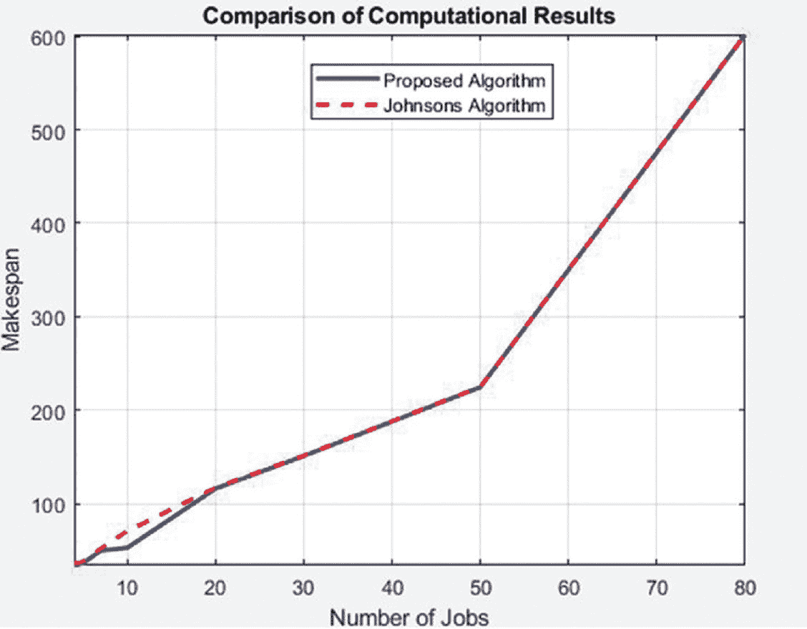
图 4.1 拟议方法与 Johnson 算法之间的比较
表 4.5 百分比误差
| 任务数 || Johnson 方法 || 拟议方法 || 百分比误差 |
| --- | --- | --- | --- |
| 4 || 36.0000 || 34.000000 || 5.88 |
| --- | --- | --- | --- |
| 5 || 37.6666 || 36.333200 || 3.66 |
| 7 || 51.6666 || 49.666600 || 4.02 |
| 10 || 70.6666 || 52.666600 || 34.17 |
| 15 || 116.9997 || 115.999700 || 0.86 |
| 20 || 151.3330 || 150.999600 || 0.22 |
| 30 || 224.9997 || 224.666300 || 0.14 |
| 50 || 373.9999 || 373.666500 || 0.089 |
| 80 || 602.0002 || 601.666800 || 0.055 |

### 数据可用性
上述数值和 `MATLAB` 表的数据是随机生成的。

## 结论
在本研究中，我们研究了第一级具有类似并行机器的两阶段流水车间调度模型。在以往的研究中，已解决了具有并行机器的小规模调度问题，但在这里我们提出了求解大规模调度问题的拟议方法。实际上，在工业中，正在出现大型项目需要完成，为了按时以合理的成本完成它们，我们需要现代技术来解决它们。在本研究中，我们借助 `MATLAB` `2018a` 提出了该技术。我们的拟议算法更有效地减少了大规模调度问题的完工时间，如实践意义所示。

## 未来展望
在本次研究中，第二级也可以采用类似的机器。也可以考虑任务利用时间的不同模糊数。该工作也可以扩展到第三阶段流水车间调度问题。`MATLAB` 程序也可以通过在第二、第三及后续阶段采用并行机器来扩展。

## 参考文献
1. Rajaee, A. A., Amindoust, A., and Asadpour, M. (2018). 应用模拟退火算法求解作业分割条件下的并行机 tardiness 问题，发表于第 48 届计算机与工业工程国际会议 (CIE48)，2018 年 12 月 2-5 日，新西兰奥克兰。
2. Yanıkoğlu, İ., and Yavuz, T. (2022). 具有序列相关准备时间的稳健并行机调度的分支定价方法。欧洲运筹学杂志，301(3)，875–895。
3. Santhi, S., and Selvakumari, K. (2020). 使用分支定界技术求解模糊数下的流水车间调度问题。Pal Arch’s Journal of Archaeology of Egypt/Egyptology，17(7)，4791–4801。
4. Gupta, D., and Goel, S. (2018). 具有 m 等势机器的三阶段流水车间调度模型。国际计算机科学与通信工程未来革命期刊，4(3)，269–274。
5. Gupta, D., Goel, S., and Mangla, N. (2022). 第一阶段具有 m 等势机器的两阶段流水车间调度问题的生产调度优化。系统保证工程与管理国际期刊，13(3)，1162–1169。
6. Malhotra, K., Gupta, D., Goel, S., and Tripathi, A. K. (2022). 具有等势并行机器的双目标流水车间调度。马来西亚数学科学杂志，16(3)，451–470。


7. Gupta, D., and Goel, S. (2022). 两阶段流水车间调度模型中每阶段具有等势机器的分枝定界技术。国际运筹学研究杂志, 44(4), 462–472.

8. Gupta, D. and Goel, S. (2020). 每阶段具有并行机器的 NX2 流水车间调度问题，处理时间与概率相关。数学进展：科学期刊, 9(3),1061–1069.

9. Malhotra, K., Gupta, D., Goel, S., and Tripathi, A. K. (2023). 多处理器三阶段 fss 优化中 Bb 与元启发式方法的比较。腐蚀与防护, 51(1), 628–640.

10. Malhotra, K., Gupta, D., Goel, S., and Tripathi, A. K. (2023). 涉及等势处理器的调度，约束为作业的模糊利用时间。收录于国际数据分析与洞察会议 (pp. 491–503)。新加坡: Springer Nature Singapore.

11. Soares L. C. R., and Carvalho M. A. M. (2020). 具有工具约束的相同并行机调度的偏置随机键遗传算法。欧洲运筹学研究杂志, 285(3), 955–964.

12. Anghinolfi, D., Paolucci, M., and Ronco, R. (2021). 绿色相同并行机调度的双目标启发式方法。欧洲运筹学研究杂志, 289(2), 416–434.

# 5 可用太阳能板清洁机制（SPCMs）概述

Rishabh Chaturvedi^(⁴)

DOI: [10.1201/9781003534136-5](https://dx.doi.org/10.1201/9781003534136-5)

## 摘要

即使太阳能和热源具有多种应用且广泛可用，某些情况仍会阻碍其充分利用。太阳能转化为电能的低转换率是阻碍太阳能电站广泛应用的关键问题之一。然而，建设太阳能电站存在一个重大障碍：降雨和气候事件造成的表面污染问题，以及低性能系数。光伏板效率直接受天气条件影响，取决于其接收到的太阳辐射量。由于灰尘和其他颗粒的积聚，光伏板的转换效率将会降低。本文旨在对 SPCM 方法的各种技术进步进行综述。

**关键词:** 静电清洁，泡沫擦拭器，导轨，喷射喷雾，微粒，伺服电机

## 引言

可用太阳能板清洁系统：

光伏板效率直接受天气条件影响，取决于其接收到的太阳辐射量。光伏板的转换效率由于灰尘和其他颗粒的积聚而会降低。这使得定期清洁面板成为可能。研究文献中最受欢迎且被广泛探讨的方法是清洁机器人 [1, 2 and 3]。

最典型且成熟的清洁方式是使用刷子和水。清洁的机器人自动化也已被证明是有用的。然而，在恶劣的沙漠环境中手动清洁具有挑战性，水及其输送到发电厂所在地的成本高得令人望而却步，且工人的潜在收入不确定。Masuda 等人提出了静电行波作为另一种清洁技术，且至今仍在开发中。这是一种自动化清洁方法，使用量极小的电力，且不依赖耗材或机械运动部件 [4, 5 and 6]。目前的表面清洁方法价格昂贵、耗时、效率低下，且可能损坏集热器表面。然而，自动清洁机制可在运行期间保持太阳能集热器清洁，以确保最佳反射率和发电量。为了减少并最终消除灰尘和污垢对太阳能系统性能的影响，本研究的目的是为太阳能集热器设计并建造一个自动清洁系统。

## A. 基于机器人的清洁系统

存在四种自主机械化太阳能板清洁系统或机器人系统的子类别：移动机器人系统、系留机器人系统、轨道机器人系统以及带地面车辆的移动操作器。两条轨道位于面板的相对两侧，构成轨道系统，也称为固定系统。清洁刷是水平（侧轨）还是垂直（顶部和底部轨道）取决于清洁过程。对于使用连续面板的太阳能板装置，该技术效果良好 [7]。积尘导致的光伏板污染示例描绘在 图 5.1 中。


图 5.1 积尘导致的光伏板污染

通过分析在泰国有效的太阳能板清洁机器人的运动，本研究使用无线摇杆、采用齿轮电机的传感器声纳和 ARDUINO Uno 来构建和制造太阳能板清洁机器人。为了提高清洁过程，机器人将利用旋转刷和水喷雾擦拭太阳能电池 [8, 9 and 10]。

对于安装倾斜且光滑的太阳能板，本研究设计并组装了机器人的驱动机构。机器人配备传感器和编码器以精确控制其移动方式，例如跨越面板空隙并在面板边缘处暂停 [11]。四个全向轮用于推动机器人，这些轮子可以像轴一样正常滚动，也可以利用滚轮横向滚动。

### 基于无人机的清洁系统

无人机能够沿直线滑行穿过太阳能板的外部层并从一块太阳能板悬停到下一块的能力是其关键特性之一。在这种情况下，面板由机器人自主清洁，其运动由可通过互联网手动控制的齿轮电机实现。劳动力支出有限，这对国家产生了明显的财政影响 [12, 13 and 14]。该机器人用于清洁水上的太阳能板。控制器用于控制阀门以及限制和允许水的流动。

### 基于物联网的太阳能板清洁机制

如果由于灰尘颗粒积聚导致电压下降，Arduino 会控制擦拭电机以清除面板上的灰尘。为了进一步提高效率，可以通过用水或化学混合物清洁太阳能板来实现。Wi-Fi 模块收集数据，然后物联网（IoT）将其存储在云中 [15, 16 and 17]。

整个设置由 Arduino Uno R3 微控制器控制。该微控制器的便利性和编程简易性使得计算机与发动机之间能够轻松建立通信。然而，由于其价格昂贵，使用 Arduino 系列控制器与大规模清洁系统是不切实际的 [18]。目前可用的太阳能板清洁模型类别显示在 图 5.2 中。且目前可用的 SPCMs 分类于 表 5.1 中。

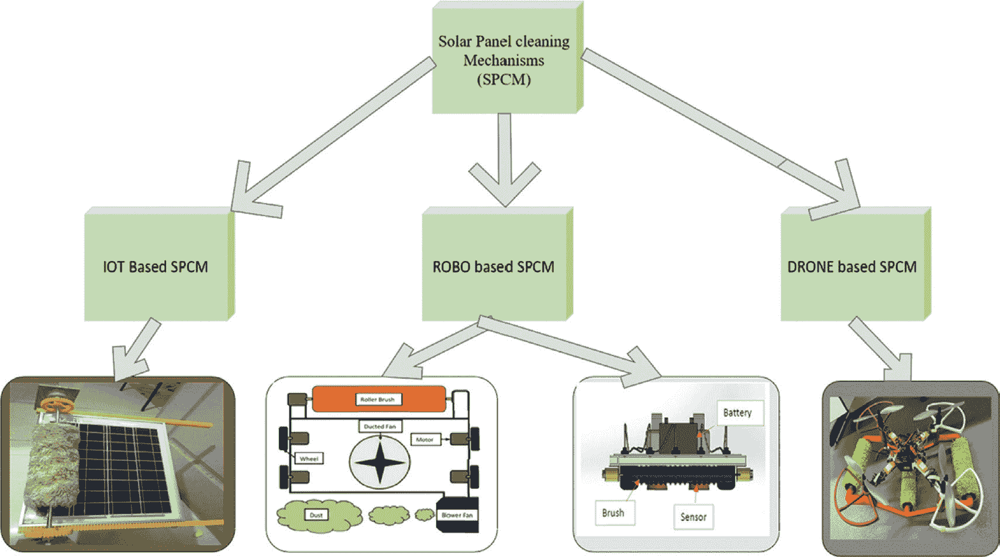


图 5.2 目前可用的太阳能电池板清洁模型类别

表 5.1 目前可用的 SPCMs 表格

| 清洁机制类型 | 参考文献 | 目标 |
|---|---|---|
| 基于机器人清洁系统 | [12] | 在本特定情况下创建的面板清洁机器人由一个清洁头组成，该清洁头利用两个电动小车和不锈钢杆在面板上移动。 |
|  | [13] | 用于浮动太阳能电池板清洁设备的自动化机器人构建和操作 |
|  | [18] | 本研究提出了一种太阳能电池板清洁机器人，可定期自动清洁光伏板。吹气、喷洒液体、用刮水器去除灰尘，然后用圆柱形刷子擦干面板上的湿材料。在此，Blynk 应用用作物联网软件，Blynk 用于无线控制设备；它可以显示传感器数据、保存数据并可视化。 |
|  | [22] | 本工作为机器人创建了一种推进机构，该机构使用全向轮攀爬倾斜和潮湿的太阳能电池板。 |
| 基于无人机清洁系统 | [9] | 该方法依赖于一种混合无人机，它在太阳能电池板表面滚动以清洁它们并将用户从一个单元运送到下一个单元。 |
|  | [19] | 清洁面板的理想方法是无人机，因此不断实现最高效率涉及水平移动无人机。 |
| 基于物联网清洁系统 | [4] | 本文研究了清洁太阳能电池板的多种方法和技术。存在水平和垂直结构机械，并且由于水平框架功耗更低，因此更受青睐。 |
|  | [5] | Node MCU 和光传感器也连接到 Arduino UNO 板，用于跟踪和识别光照条件，以便构建集成物联网清洁机制。 |
|  | [6] | 整个设置由 Arduino Uno R3 微控制器控制。通过分析自动化和可靠的太阳能电池板清洁系统的环境，本工作提出了关于选择发动机、其电动驱动和软件的研究结果。 |

设想的太阳能电池板清洁方法中使用的两步清洁工艺。首先，排气扇尽力清除面板表面的污垢。作为污垢，采用了四种主要类型的沙子 [19]。然后用由软布制成的刮水器轻轻擦拭。因此，系统可以在不需要水的情况下进行清洁。此功能可防止太阳能电池板受损 [20]。

本研究提出了一种可以编程擦拭太阳能电池板的装置。建议的研究项目利用了物联网，并且框架由微控制器和 Android 设备管理 [21]。该技术具有灵活性，因此可在任何地方使用 [22]。通过与其连接的太阳能电池板的使用，电池可以在此充电。使用 Android 应用控制减少了对人工劳动的需求。

除了价格低廉、功耗极低和集成 Wi-Fi 功能外，ESP8266 是物联网项目的绝佳选择。Arduino IDE 使编程变得简单，使其成为新手的合适选择。其紧凑的尺寸使其具有适应性，并能够集成到各种设备中。它可以用作其他微控制器的 Wi-Fi 模块或作为独立微控制器 [23, 24]。

使用 Arduino IDE 创建程序。配置的上传速度设置为 9600，并且设置 ID 连接到 ESP8266 板的 COM5 端口。作为微控制器，采用了 Node MCU。它是开发开源软件和硬件的平台。在此，使用了 ESP-8266 Wi-Fi 模块。编程使用非常基础的语言进行。基于物联网的 SPCM 的逐步操作在 图 5.3 的流程图中显示。

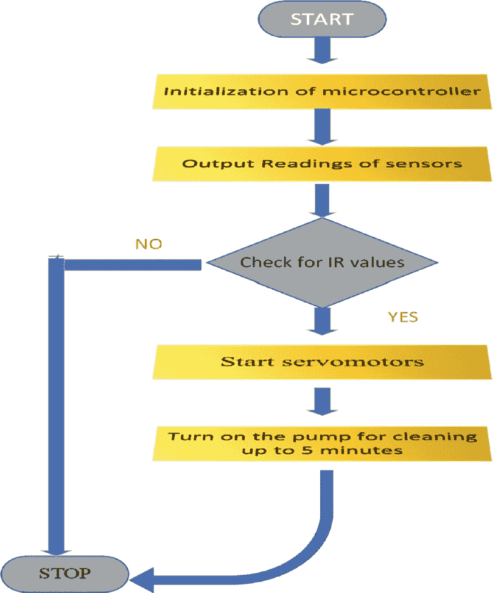

图 5.3 基于物联网的 SPCM 的逐步操作

## 结论

太阳能电池板所暴露的太阳能量的多少决定了其效率，这就是为什么它们直接受天气影响的原因。将太阳能转化为电能的低转换率是阻碍太阳能电站广泛使用的关键问题之一。灰尘和其他颗粒的滞留会降低太阳能电池板的转换效率。由于技术进步，面板现在可以定期清洁。不同的清洁方法及其优缺点一起被评估。

## 参考文献

1. Santosh Kumar, S., Shankar, S., and Murthy, K. (2020). 太阳能供电的 PV 面板清洁机器人。载于 2020 年电子、信息、通信与技术最新趋势国际会议 (RTEICT)，印度班加罗尔，2020 年 (第 169–172 页)，doi: [10.1109/RTEICT49044.2020.9315548](http://dx.doi.org/10.1109/RTEICT49044.2020.9315548)。

2. Attri, V. J., Sharma, V. K., Singh, S. K., and Saraswat, M. (2015). 压缩比对单缸四冲程 VCR 发动机柴油性能和排放的影响。国际新兴技术与先进工程期刊，5，94–102。

3. Balamurugan, R., Kumar, A. A., Kalaimaran, A., and Sathish, V. (2023). 用于自动清洁太阳能电池板灰尘的集成物联网系统。载于 2023 年第三届人工智能与智能能源国际会议 (ICAIS)，印度金奈，2023 年 (第 1504–1506 页)，doi: [10.1109/ICAIS56108.2023.10073675](http://dx.doi.org/10.1109/ICAIS56108.2023.10073675)。

4. Roy, S., Mandal, M., Jena, C., Sinha, P., and Jena, T. (2021). 基于可编程逻辑控制器的太阳能电池板稳健自动清洁以提高效率。载于 2021 年电力、信号和信息技术进展国际会议 (APSIT)，印度布巴内斯瓦尔，2021 年，(第 1–4 页)，doi: [10.1109/APSIT52773.2021.9641148](http://dx.doi.org/10.1109/APSIT52773.2021.9641148)。

5. Sharma, A., Chaturvedi, R., Sharma, K., and Saraswat, M. (2022). 基于响应面法的铝制毛刺复合材料铣削力评估和加工参数优化。材料与加工技术进展，8(4)，4073–4094。

6. Choi, Y., and Jung, S. (2022). 用于太阳能电池板清洁任务的无人机折叠机械臂力控制。载于 2022 年第 22 届控制、自动化与系统国际会议 (ICCAS)，韩国济州，2022 年 (第 1203–1205 页)，doi: [10.23919/ICCAS55662.2022.10003737](http://dx.doi.org/10.23919/ICCAS55662.2022.10003737)。

7. Kumar, A., Sharma, K., and Dixit, A. R. (2020). 石墨烯和石墨烯基聚合物纳米复合材料的力学和热性能综述：建模和分子动力学模拟的理解。分子模拟，46(2)，136–154。

8. Devaraju, D., Suraj Kumar, V. N., Vivek, D. S., Akshay Kumar, R., Galiveeti, H. R., and Gope, S. (2022). 用于屋顶太阳能光伏系统的有效自动太阳能电池板清洁系统。载于 2022 年智能和可持续能源与电力部门技术国际会议 (SSTEPS)，印度马亨德拉加尔，2022 年，(第 13–16 页)，doi: [10.1109/SSTEPS57475.2022.00018](http://dx.doi.org/10.1109/SSTEPS57475.2022.00018)。


9. Singh, P. K., and Sharma, K. (2018). 原位胺功能化多层石墨烯/环氧树脂纳米复合材料的机械和粘弹性性能。Current Nanoscience, 14(3), 252–262.

10. Sharma, A., Chaturvedi, R., Singh, P. K., and Sharma, K. (2021). AristoTM 机器人焊接性能及焊缝的力学和微观结构特性分析。Materials Today: Proceedings, 43, 614–622.

11. Sarkis, Samer & Khanfar, Layla & Ghabour, Beshoy & Zaki, Laila & Alahmed, Marwan & Jaradat, Mohammad & Wadi, Ali & Khalil, Ahmed. (2022). 用于清洁太阳能电池板的混合无人机系统的新型设计。1–6。 [10.1109/ASET53988.2022.9735056](http://dx.doi.org/10.1109/ASET53988.2022.9735056).

12. Chaturvedi, R., Sharma, V. K., and Kumar, M. (2022). 使用有限元 ANSYS 技术对轴流疲劳压缩机进行结构分析和完成。载于《机械工程中的计算与实验方法：ICCEMME 2021 会议论文集》(pp. 387–396)，Springer Singapore。

13. Walaman I.I., Isaacs, S., and Beem, H. (2022). 用于减少加纳太阳能光伏板灰尘污染的除尘机器设计。载于 2022 IEEE 全球人道技术大会 (GHTC)，美国加州圣克拉拉，2022 年，(pp. 481–484)，doi: [10.1109/GHTC55712.2022.9911012](http://dx.doi.org/10.1109/GHTC55712.2022.9911012)。

14. Pasam, G., Natarajan, R., Alnamani, R. S. R., Al-Alawi, S. M. A., and Al-Sulaimi, S. A. M. (2023). 集成启发式方法以从固定和移动光伏太阳能板获得最大功率。载于 2023 年第三届电气、计算、通信和可持续技术进展国际会议 (ICAECT)，印度 Bhilai，2023 年，(pp. 1–5)，doi: [10.1109/ICAECT57570.2023.10117609](http://dx.doi.org/10.1109/ICAECT57570.2023.10117609)。

15. Jawale, J. B., Karra, V. K., Patil, B. P., Singh, P., Singh, S., and Atre, S. (2016). 用于提高效率的太阳能电池板清洁机器人——一种创新方法。载于 2016 年第三届器件、电路和系统国际会议 (ICDCS)，印度金奈，2016 年，(pp. 103–108)，doi: [10.1109/ICDCSyst.2016.7570634](http://dx.doi.org/10.1109/ICDCSyst.2016.7570634)。

16. Hajiahmadi, F., Zarafshan, P., Dehghani, M., Moosavian, S. A. A., and Hassan-Beygi, S. R. (2019). 太阳能电池板清洁系统机器人载体的动力学建模与位置控制。载于 2019 年第 7 届机器人与机电一体化国际会议 (ICRoM)，伊朗德黑兰，2019 年，(pp. 613–618)，doi: [10.1109/ICRoM48714.2019.9071821](http://dx.doi.org/10.1109/ICRoM48714.2019.9071821)。

17. Yerramsetti, J., Paritala, D. S., and Jayaraman, R. (2021). 使用 AI 技术设计和实现浮动太阳能电池板清洁系统的自动机器人。载于 2021 年计算机通信与信息学国际会议 (ICCCI)，印度金奈，2021 年，(pp. 1–4)，doi: [10.1109/ICCCI50826.2021.9402482](http://dx.doi.org/10.1109/ICCCI50826.2021.9402482)。

18. Vinith, S. G., Ragavapriya, R. K., Mohamed Shameer, N., Karthikeyan, S., Kavinkumar, K., and Harinivash, K. (2023). 基于物联网的智能自动化太阳能电池板清洁系统。载于 2023 年第二届电子与可再生系统国际会议 (ICEARS)，印度 Tuticorin，2023 年，(pp. 566–571)，doi: [10.1109/ICEARS56392.2023.10085427](http://dx.doi.org/10.1109/ICEARS56392.2023.10085427)。

19. Al Dahoud, A., Fezari, M., and Al Dahoud, A. (2021). 自动太阳能电池板清洁系统设计。载于 2021 年第 29 届电信论坛 (TELFOR)，塞尔维亚贝尔格莱德，2021 年，(pp. 1–4)，doi: [10.1109/TELFOR52709.2021.9653215](http://dx.doi.org/10.1109/TELFOR52709.2021.9653215)。

20. Hashim, N., Mohammed, M. N., Al-Selvarajan, R., Al-Zubaidi, S., and Mohammed, S. (2019). 太阳能电池板清洁机器人研究。载于 2019 年 IEEE 自动控制与智能系统国际会议 (I2CACIS)，马来西亚雪兰莪，2019 年，(pp. 56–61)，doi: [10.1109/I2CACIS.2019.8825028](http://dx.doi.org/10.1109/I2CACIS.2019.8825028)。

21. Vidhya, H., Akshaya, U., Keerthana, M. G., and Dhivyanandhini, T. (2022). 基于物联网的太阳能技术监测与清洁系统。载于 2022 年自动化、计算与可再生系统国际会议 (ICACRS)，印度 Pudukkottai，2022 年，(pp. 1–5)，doi: [10.1109/ICACRS55517.2022.10029254](http://dx.doi.org/10.1109/ICACRS55517.2022.10029254)。

22. Ronnaronglit, N., and Maneerat, N. (2019). 太阳能电池板清洁机器人。载于 2019 年第 5 届工程、应用科学和技术国际会议 (ICEAST)，老挝琅勃拉邦，2019 年，(pp. 1–4)，doi: [10.1109/ICEAST.2019.8802521](http://dx.doi.org/10.1109/ICEAST.2019.8802521)。

23. Sorndach, T., Pudchuen, N., and Srisungsitthisunti, P. (2018). 使用全向轮的屋顶太阳能电池板清洁机器人。载于 2018 年第 2 届工程创新国际会议 (ICEI)，泰国曼谷，2018 年，(pp. 7–12)，doi: [10.1109/ICEI18.2018.8448530](http://dx.doi.org/10.1109/ICEI18.2018.8448530)。

24. Masuda, S., Fujibayashi, K., Ishida, K., and Inaba, H. (1972). 通过电幕约束和运输带电气溶胶云。Journal of the Institute of Electrical Engineers of Japan, 92, 9–18.

# 6 多目标算法的适配以提高混合动力电动汽车的性能和燃油优化

Manish Saraswat^(⁵)

DOI: [10.1201/9781003534136-6](https://dx.doi.org/10.1201/9781003534136-6)

## 摘要

能源危机和污染是当代全球性问题，正在寻求并加以缓解。答案是引入混合动力电动汽车，即 HEVs，以帮助制造更清洁的汽车，减少燃油使用并降低污染。在 1000 次仿真迭代中，使用两种不同的种群规模 5 和 10，以在保持车辆驾驶性能的同时最小化燃油使用。本研究使用 ADVISOR 作为其仿真程序。车辆的动态性能、燃油经济性和排放均可使用城市驾驶循环（UDDS）进行评估。下一步是检查算法的输出与 ADVISOR 中已定义的并联 HEV。根据结果分析，通过优化燃油效率和减少排放，MA 可以改进控制策略的参数。这种高效运行评估是在不牺牲车辆性能的情况下进行的。

**关键词：** 控制策略，高效运行，排放，燃油消耗（FC），多目标，并联混合动力电动汽车（HEVs），种群规模

## 引言


近年来，自然灾害如气候变化、生态系统转变、珊瑚礁死亡、洪水、海平面上升和冰川融化有所增加。这可归因于能源危机和环境污染的恶化。据科学家称，近 90%的全球气候变化是由人类造成的 \[1\]。我们过去一个世纪一直用石油化工燃料满足能源需求，导致温室气体排放增加，如二氧化碳，温室效应加剧以及气候异常。人为过程如畜牧业、农业、为交通开采化石燃料以及制冷剂制造都促进了气候变化的加速 \[2, 3 and 4\]。全球正在努力寻找解决能源和污染问题的方案。令人担忧的趋势是流通中的汽车数量呈指数级增长，导致涉及碳氢化合物 (`HC`)、铅 (`Pb`)、硫氧化物 (`SOx`)、氮氧化物 (`NOx`) 和一氧化碳 (`CO`) 的污染问题 \[5\]。逻辑上，`HEV`s 通过减少石油消耗和排放——环境退化和能源危机的两个主要原因——为环境可持续性做出贡献。`HEV`s 利用电能和机械能为推进循环提供动力，前者来自电动机，后者来自内燃机 \[6\]。这种配置使 `HEV`s 具有极高的技术先进性。

控制机制已到位，以调节必须储存的能量和 `HEV`s 的功耗，以确保能量得到适当分配。通过实施精心选择的控制系统，可以通过减少排放和石油消耗来优化经济性。在追求最大效率的同时，车辆的功效必须保持不受损害 \[7, 8 and 9\]。

通过分析车辆的燃油消耗、排放和动态性能，所提出的算法将确定控制策略的最佳参数值 \[10\]。车辆的驾驶性能使用软件 `ADVISOR` 进行模拟，配置由控制参数修改 \[11\]。模拟利用两个独立的人口和迭代执行，并且控制参数使用 `MA` 建立。本研究中车辆的性能标准被视为约束条件，并且惩罚函数对其进行核算。此外，通过实施电动辅助策略优化了 `UDDS` 驾驶循环 \[12, 13 and 14\]。模拟结果表明，与 `ADVISOR` 中指定的预设并联 `HEV` 相比，车辆性能保持一致，而 `FC` 和排放得到改善。

## Methodology

### The HEV control strategy

IC 发动机和电动机是为并联混合动力电动汽车提供动力的两个驱动装置。对于此操作，功率必须在 IC 发动机和电动机之间分配，并且相应地，在示例控制方法的帮助下进行扭矩分配。有许多此类控制过程的方法，但最常用的是电动辅助。

在此策略中，ICE 发动机是主要来源，电动机是辅助供应来源。如果由于需求功率 IC 发动机无法提供有效能量或超过最大允许扭矩范围，则该电动辅助方法已使用电动机 \[15\]。电池的充电状态值决定了作为发电机的电机操作，并且额外扭矩用于电池的充电操作。

```
x = SOC_L, SOC_H, T_ch, T_min, T_off, E_LSL, E_LSH, D_ch
```

`SOC[L]`、`SOC[H]` 表示下阶段和上阶段的充电状态值。上述表达式显示了在此策略中用于优化控制参数的变量。

### Designing Objective Function

本研究的 `HEV` 控制技术旨在同时实现多个目标，包括在保持车辆性能的同时减少 `FC` 和废气排放 (`HC`、`CO` 和 `NOx`)。因此，主要目标是降低 `FC` 和废气排放（即 `CO`、`HC` 和 `NOx`）。目标函数如下列出：（2）。

```
min Obj(x) = NOX + FC + CO + HC
```

其中 `x` 表示其中一个解，即 `MO` 编码的染色体，而 `X` 表示解空间。氮氧化物缩写为 `NOx`，燃油消耗缩写为 `FC`，一氧化碳为 `CO`，碳氢化合物为 `HC`。

### Apply MA to design the appropriate HEV control strategy

该算法基于达尔文生存和适者生存，与遗传算法 (`GA`) 相当。为了产生更优秀的后代，所选物种的优选物种彼此之间进行随机交换遗传信息。该过程重复进行，直到创建出最适应物种。流程图在 图 1 中显示了构成 `MO` 算法的迭代过程。

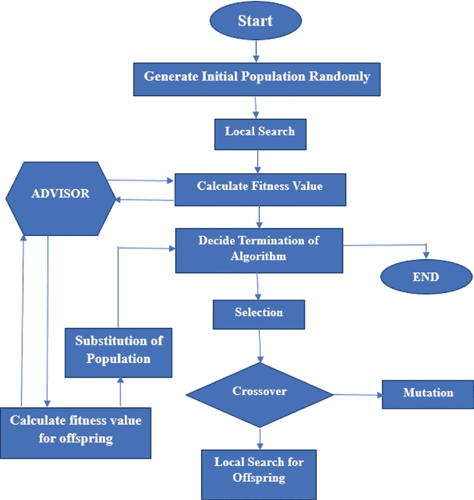

图 6.1 多目标算法流程图示意

步骤在图中说明：-
* 初始种群随机生成
* 进行局部搜索
* 计算适应度值
* 决定算法终止
* 选择
* 交叉
* 替换较差个体
* 初始种群随机生成。

对于初始种群生成，首先生成数十到数百个染色体而不重复，该初始种群由 (1) 表示。
* 进行局部搜索。

为了获得更好的染色体，在原始染色体附近的区域进行局部搜索。在每次迭代中，所有后代都将参与局部搜索，确保染色体的每个部分的最佳解决方案始终保留，并最终确定最佳解决方案。
* 计算适应度值。

适应度函数可以检测染色体是优秀还是较差，并计算每个染色体的全局最优值。

当算法被使用时，车辆性能标准被定义为约束条件。为了验证优化过程中车辆性能未下降，本工作采用了 `PNGV` 乘用车限制。因此，适应度函数如下：

```
f(x) = \frac{1}{\left\lbrack {Obj.(x) + {\sum\limits_{i = 1}^{n}y_{i}} + P_{i}(x)} \right\rbrack}
```
* 决定算法终止

本研究提出的方法的目标是以最多 1000 次迭代完成算法运行。
* 选择

鉴于适应度选择是自然选择的真正目的，后代的特征将受到所选结果的影响。为了改善后代的产生，用于交叉目的的训练语料库中物种的选择可能会受到物种适应度水平的影响。本研究使用竞争选择作为其主要方法，选择两个染色体进行后续筛选。
* 交叉


在当前算法中，交配被随机选为进化过程之一。两个亲本物种从繁殖池中随机选择，其遗传物质被交换，并在交叉过程中产生另外两个后代。该过程可以为亲本的遗传组成提供有价值的见解，可能提高后代质量。突变是染色体上遗传物质发生改变的过程。当从种群中某个物种的染色体上任意选择一个突变位点时就会发生这种情况。

### 差个体被替换。

为了实现进化的目标，即获得最佳替代方案，在突变和交叉过程结束后，较劣势的种群成员也将经历交叉并产生改良物种。

## 结果

`ADVISOR` 软件通过操纵各种控制计划参数，能够模拟研究以提高燃油经济性、车辆性能和排气排放。根据这些标准，平行 `HEV` 车辆部件的参数和模型已建立。下方 表 6.1 显示了分析所采用的车辆参数

表 6.1 分析所用车辆参数表

| 参数 || 值 |
| --- | --- |
| 车辆质量 || 590 Kg |
| --- | --- |
| 载荷质量 || 130 Kg |
| 迎风面积(车辆) || 2.5 m2 |
| 空气动力阻力系数 || 0.330 |
| 储能系统 || VRLA (12V,26Ah) |
| 滚动阻力系数 || 0.007 |
| 燃料转换器 || 45 KW SI Engine |
| 电动机 || 75 KW AC motor |

### 算法参数与控制策略描述

算法有不同的参数需要调整，包括迭代次数、突变率、交叉率和种群大小（此处使用 5 和 10）。大约进行了 1100 次迭代，突变率和交叉率分别设置为 0.2 和 1。`EUDC` 循环被用于在 `ADVISOR` 上模拟该最优策略下的默认并联混合动力电动汽车。随机变量从解的整个空间中选取以初始化算法的种群。在 表 6.2 中，基于 `EUDC` 循环的模拟，详细列出了该策略中使用的所有参数。

表 6.2 不同种群大小的控制策略参数表

| 控制策略参数 |
| --- |
| 参数 || 种群大小 |
|  || 5 || 10 |
| `Max. SOC` || 0.95 || 0.74 |
| --- | --- | --- |
| `Min. SOC` || 0.03 || 0.18 |
| `ELS_H` || 53.0 || 26.0 |
| `ELS_L` || 4.0 || 7.0 |
| `T_min` || 0.23 || 0.69 |
| `T_ch` || 24.3 || 10.5 |
| `T_off` || 0.27 || 0.38 |

在 图 6.2 和 图 6.3 中，显示了 `EUDC` 循环的过程历史，可以观察到随着迭代次数的增加，不同种群大小的适应度值得到改善。这些参数可使用本工作中使用的多目标算法进行最优选择。

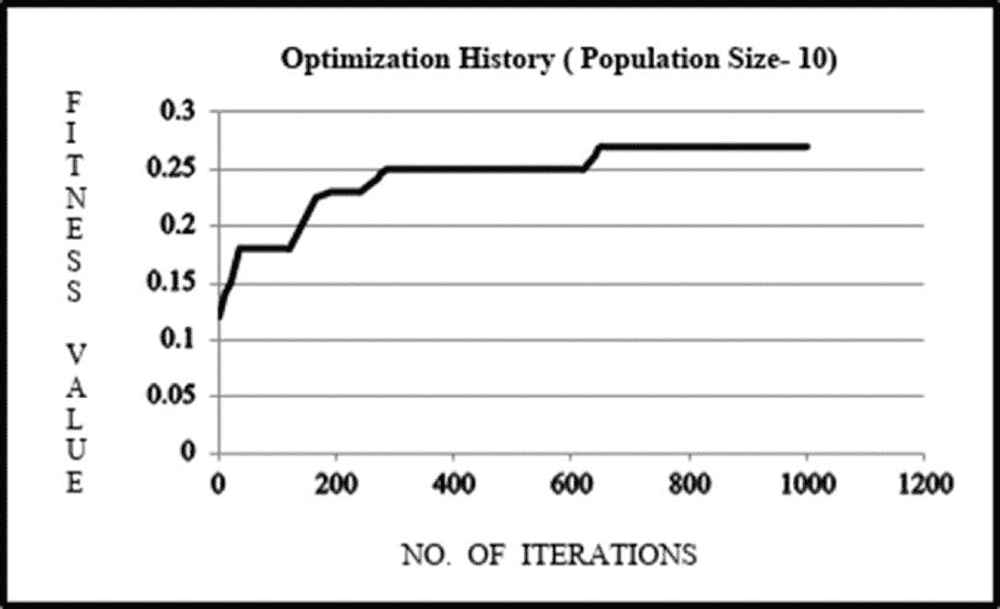

图 6.2 种群大小为 10 的优化历史图

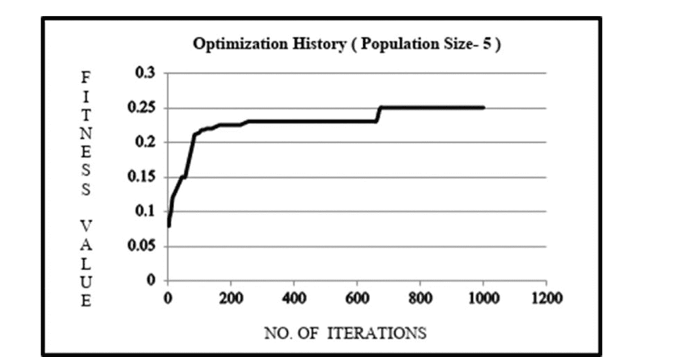

图 6.3 种群大小为 5 的优化历史图

结果显示，不同控制策略具有不同的排放和燃油经济性规格，更好地选择这些参数将有助于提高燃油经济性。控制策略参数受策略的种群大小影响。

表 6.3 详细介绍了驾驶循环的燃油经济性和排放情况，驾驶循环的车辆性能也显示出来。

表 6.3 车辆排放参数和动态性能表

| 参数 || 规模 5 || 规模 10 |
| --- | --- | --- |
| `FC and Emissions` ||  ||  |
| --- | --- | --- |
| CO || 5.563 || 3.754 |
| NOx || 0.546 || 0.648 |
| HC || 0.618 || 0.664 |
| FC || 31.550 || 31.667 |
| `Vehicle Dynamic Performance` ||  ||  |
| 0-60 mph || 10.248 || 10.641 |
| 40-60 mph || 5.323 || 5.568 |
| 0-85 mph || 21.8116 || 22.821 |
| 最大速度 || 111.402 || 109.829 |
| 最大加速度 || 16.238 || 16.238 |
| 距离 || 173.803 || 171.559 |
| 爬坡能力 || 6.6 || 6.6 |

## 结论

为在 `UDDS` 驾驶循环上优化电动辅助策略而制定的挑战，旨在在不影响车辆性能的情况下实现最低的汽油消耗和排放。可以使用 `MO Algo` 生成适当的控制策略配置，该算法进行一千次迭代并采用两个中等种群大小（五和十）。通过采用两个较小的种群，每个种群包含 5、10 和 1000 次迭代，得出了控制方法的理想值。在不影响车辆性能的情况下，本研究提高了发动机效率并降低排放，以应对污染和能源危机。分析结果表明，通过优化燃油效率和减少排放，`MA` 可用于改进控制策略参数。这种运行方式高效地扫描车辆而不影响其性能。根据结果，`MA` 可以提高并联 `HEV` 中的控制策略参数，有助于缓解能源危机和气候风险，而 `ADVISOR` 中预定义的并联 `HEV` 则不能。

## 参考文献

1. Wu, Y., Zhang, S., Hao, J., Liu, H., Wu, X., Hu, J., et al. (2017). 中国道路车辆排放及其控制：综述与展望。 Science of the Total Environment, 574, 332–349.

2. Lin, C.-C., Peng, H., and Grizzle, J. W. (2004). 混合动力电动汽车的随机控制策略。在 2004 年美国控制会议论文集，(第 5 卷，第 4710–4715 页)。 IEEE, 2004.

3. Saraswat, M., and Chauhan, N. R. (2020). 作为 SI 发动机替代燃料的丁醇和藻油的比较评估。 Engineering Science and Technology, an International Journal, 23(1), 92–100.

4. Paganelli, G., Guezennec, Y., and Rizzoni, G. (2002). 混合燃料电池车辆控制策略的优化。 SAE Transactions, 398–406.

5. Kumar, P., Singh, P. K., Nagar, S., Sharma, K., and Saraswat, M. (2021). 功能化石墨烯不同浓度对热能存储系统充电时间减少的影响。 Materials Today: Proceedings, 44, 146–152.

6. Pisu, P. and Rizzoni, G. (2007). 混合动力电动汽车监控控制策略的比较研究。 IEEE Transactions on Control Systems Technology, 15(3), 506–518.

7. Singh, P. K., Sharma, K., Kumar, A., and Shukla, M. (2017). 功能化对多壁碳纳米管力学性能的影响：分子动力学方法。 Journal of Composite Materials, 51(5), 671–680.

8. Yi, T., Xin, Z., Liang, Z., and Xin, Z. (2011). 基于神经网络识别驾驶条件的混合动力电动汽车模糊控制策略。 Control Theory and Applications, 28(3), 363–369.

9. Verma, S. K., Sharma, K., Gupta, N. K., Soni, P., and Upadhyay, N. (2020). 创新螺旋形太阳能集热器设计与传统平板太阳能集热器的性能比较。 Energy, 194, 116853.


10. Digalakis, J., and Margaritis, K. (2001). 一种用于求解优化问题的并行模因算法。载于第 4 届元启发式国际会议论文集，(第 1 卷，第 121–125 页)。葡萄牙，2001 年。
11. Chaturvedi, R., Islam, A., and Sharma, K. (2021). `PCM` 在太阳能热储存中应用的综述。Materials Today: Proceedings, 43, 293–297。
12. Montazeri-Gh, M., Poursamad, A., and Ghalichi, B. (2006). 遗传算法在并联混合动力电动汽车控制策略优化中的应用。Journal of the Franklin Institute, 343(4-5), 420–435。
13. Markel, T., Brooker, A., Hendricks, T., Johnson, V., Kelly, K., Kramer, B., et al. (2002). `ADVISOR`：先进车辆建模的系统分析工具。Journal of Power Sources, 110(2), 255–266。
14. Sharma, A., Sharma, K., Islam, A., and Roy, D. (2020). 焊接参数对自动化机器人弧焊过程的影响。Materials Today: Proceedings, 26, 2363–2367。
15. Poursamad, A., and Montazeri, M. (2008). 并联混合动力电动汽车遗传-模糊控制策略的设计。Control Engineering Practice, 16(7), 861–873。

# 7 混合动力电动汽车燃油效率优化：采用模型预测控制和行星齿轮系统的功率分流方法

Manish Saraswat^(⁶)

DOI: [10.1201/9781003534136-7](https://dx.doi.org/10.1201/9781003534136-7)

## Abstract

本研究的目的是通过采用功率分流方法，探究模型预测控制 (`MPC`) 在优化混合动力电动汽车 (`HEVs`) 燃油效率方面的有效性。本研究围绕行星齿轮系统的利用展开，该系统促进了内燃机 (`ICE`) 与电动机 (`EM`) 之间的高效协作。本研究的主要目标是通过利用 `MPC` 软件增强 `HEVs` 两个关键部件之间的功率分配。本研究通过利用先进的建模技术评估功率分流 `HEVs` 的运行效率。该研究还为一系列摩托车专用设置和控制方法提供了仿真结果。进行了比较研究，以评估 `MPC` 在降低石油消耗方面的有效性，与传统计算机和其他模型预测控制系统相比。结果表明，功率分流 `HEVs` 有望实现大幅度的燃油节省，从而为促进环境友好和可持续交通的持续努力做出宝贵贡献。

**关键词：** 约束，行驶循环，能量管理，燃油经济性，模型预测控制，功率分流

## Introduction

由于混合动力电动汽车同时包含电动机械和传统能源系统，因此可以更大程度地利用小型内燃机的容量。这是由于电动机械和传统能源系统的集成而实现的。本研究的目的是探究一种新生产的药物在治疗配备了两种类型推进系统部件和传统能源来源的混合动力电动汽车的人群方面的效果如何 [1]。这是为了促进电动推进系统和传统能源来源的协同工作。电池具有如此大的储能容量，能够有效地吸收并回收车辆停车时损失的热能。这是由于电池具有如此巨大的储能容量。

为了构建混合动力电动推进系统，众多汽车制造商利用功率分流拓扑结构。这些配置也被称为并联-串联布置。两种术语均用于指代这些不同的布置。这些设计使得可以根据需要实现并联或串联布置。通过使用储存在电池中的能量技术，提供了额外的能量存储和分配可能性 [2, 3 and 4]。由于这一事实，所讨论的混合动力电动汽车 (`HEVs`) 在能量管理方面具有两个自由度。这种集成与车辆的各种运行模式相结合，增强了车辆的效率，最终导致排放量和燃料消耗量的减少。

就 `HEV` 使用汽油的效率而言，车辆能量管理计划的选择会对车辆性能产生相当大的影响。通过在最优控制系统的背景下对其进行评估并从该角度研究它，可以将非线性能量管理问题转化为具有约束的动态优化问题。这可以通过使用最优控制系统来实现。动态模型的动力总成是非线性的，并且模型的状态和控制输入包含不等式和等式限制。模型也具有非线性。此外，动力总成中存在非线性。

研究人员在学术研究的历程中已使用诸如动态规划 (`DP`) [5, 6] 和等效消耗管理系统方法论 (`ECMS` methodology)，也称为等效消耗降低策略 [7, 8 and 9] 等数值方法。

功率分流模式下的混合动力电动汽车如图 图 7.1 所示，并在本研究中使用。本研究中发电机和 `ICE` 耦合是耦合到速度耦合器组。

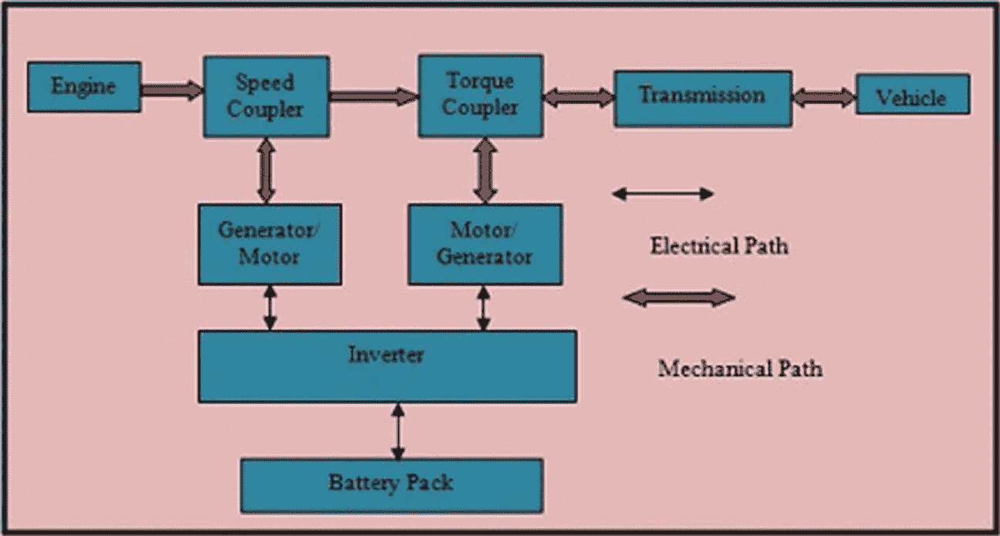

图 7.1 功率分流 HEV 的示意配置


扭矩耦合器的任务是在发电机或电动机的输出与速度耦合器的输出之间建立联系，使两者能够相互通信。因此，电能可以从电池发送到汽车的传动系。功率分流模式允许功率以不同的方式分配，这使得发动机的工况点似乎与汽车不同。这一概念基于功率分流模式的独特性。为了确保 `ECMS` 方法有效，重要的是找到并使用汽油的良好成本当量，然后可据此计算电池电能的成本。这将使计划能够得到良好实施。这一问题不仅在驾驶时可以解决，在做其他任何事情时也可以解决 [10, 12]。如果决策未考虑系统的核心工作原理，则很难预测系统会发生什么。采用基于模型预测控制 (`MPC`) 的能量管理方法，可以在全局最优 `DP` 解的非因果特性与该过程涉及的计算成本之间取得平衡。可以通过将这些思想本身结合起来将这两个概念结合在一起。在使用 `MPC` 进行优化时，同时考虑了固定时域和可变时域。参考文献 [13, 14 和 15] 展示了几种提高性能的不同方法示例。`ECMS` 解决方案、快速有效的答案和基于规则的系统都是这些策略的示例。在动态规划的帮助下，假设未来所有可能的驾驶条件已知，可以找到 `HEV` 模型的最佳答案。另一方面，`DP` 方法与因果无关，因为它基于近期功率需求难以预测这一事实。这使得在较长时间内进行精确计算变得困难。大多数这些案例涉及使用 `DP` 方法作为基准来寻找最省油的驾驶循环 [15]。研究作者使用二次成本函数构建了 `MPC` 所需的随时间变化的线性系统。当 `MPC` 函数被修改以提高燃油效率时，一定时间内的油耗成本可以累加。这使得可以计算 `cost-to-go` 函数。这意味着燃料可以更高效地使用。该规划方法没有工具来很好地猜测该终端在未来将花费多少。
我们利用庞特里亚金最小值原理与 Hamilton-Jacobi-Bellman (`HJB`) 方程之间的联系，表明该最优控制问题的 `cost-to-go` 可以被视为电池荷电状态 (`SOC`) 变化的分段线性函数 [16]。这里可以找到庞特里亚金的基本原理，这里可以找到 `HJB` 方程。这意味着 `cost-to-go` 可以通过将其描述为电池荷电状态变化的分段线性函数来预测。这让我们能够计算出行驶成本。我们调查的发现与其他正在进行的调查的发现相同。使用非线性 `MPC` 系统 [17] 使在线环境中出现的最优控制问题更容易求解。因为 `MPC` 系统旨在进行预测，所以情况如此。用于测试 `MPC` 方法的闭环仿真显示正在取得进展，这从整体策略的良好表现中可以明显看出。仿真成功这一事实表明这些迹象是正确的。

## Methodology
动力总成的初始动力学由牛顿定律分析，其表达式如下-
(1)
$$J_{G}\frac{d\omega_{G}}{dt} = T_{G} + F \times N_{S}$$
(2)
$$J_{E}\frac{d\omega_{E}}{dt} = T_{E} - H \times \left( {N_{S} + N_{R}} \right)$$
(3)
$$J_{M}\frac{d\omega_{M}}{dt} = T_{M} - \frac{T_{O}}{gt} + F \times N_{\kappa}$$
其中，`J[G]` 指代发电机的惯量，`J[E]` 为发动机的惯量。燃油流量与发动机扭矩和转速的关系表示为 –
(4)
*m*[*f*] = *φ*(*ω*[*E*],*T*[*E*])
速度约束如下-
(5)
$$\begin{array}{l} {N_{S}\omega_{G} + N_{R}\omega_{M} = \left( {N_{S} + N_{R}} \right)\omega_{E}} \\\\ {\omega_{M} = \frac{g_{f}}{r_{\omega}}V} \\\\ \end{array}$$
车辆动力学表示为 –
(6)
$$m\frac{dV}{dt} = \frac{T_{o} + T_{b}}{r\omega} - \frac{1}{2}\rho A_{f}CdV^{2} - C_{r}mg\cos(\text{θ}) + mg\sin(\text{θ})$$
存在最终和初始 `SOC` 的变化，这会影响燃油经济性，因此为了保持电量平衡，该仿真针对不同循环次数进行了多次执行。
(7)
*S**O**C*(0) = *S**O**C*(*t*[*f*])
在本研究中，所取的 `SOC` 值是最终值和初始值，并利用这些值通过不同控制器分析燃油经济性并比较其性能。可以看出，非线性 `MPC` 控制器在高速公路和城市的整个驾驶循环中均提高了燃油经济性。
驾驶员需求的扭矩等于动力总成输出扭矩与制动扭矩之和，该表达式如下所示-
(8)
*T*[*O*] + *T*[*b*] = *T*[*d**r**i**v**e**r* ]
电池荷电状态值的动力学是 `HEV` 最优控制所必需的：
(9)
$$\frac{d_{SOC}}{dt} - \, - \frac{V_{OC} - \sqrt{V_{OC}^{2} - 4P_{batt}\,.R_{batt}}}{2C_{batt}.R_{batt}.}$$
其中，
(10)
*P*[*b**a**t**t* ]. = *P*[*M*] + *P*[*G*] + *P*[*M*]^(*L*) + *P*[*G*]^(*L*)

(11)

## Architecture
该能量管理策略旨在减少燃油消耗，同时确保所有规则同时得到遵守。本研究通过将控制器分为两部分来考虑情况的复杂性。监督层，也称为第一层，负责在每个采样间隔期间确定系统两个自由度——扭矩和发动机转速的最佳值。这是第一层的职责。低级控制器必须正确使用参考数据，以便计算摩擦制动以及电机、发电机和发动机的扭矩 [10]。图 2 描绘了使用模块化设计的闭环。为了快速准确地跟踪参考点，低级中央处理单元采用标准控制回路。

图 7.2 层次顺序的控制系统结构示意图


管理者可以将能量管理视为一种资源受限的约束非线性优化问题。为应对这一特定情况，采用了 `MPC` 这一常见方法。`MPC` 控制器将在后续迭代中能够很好地管理控制过程，同时通过降低性能指标证明优化目标正在得到满足。这将发生。在整个过程中，与所研究系统相关的动态模型的方程和约束条件都得到了仔细考虑。系统随后处理 `HEV` 模型应使用的控制序列的第一部分。完成该程序后，预测时域将向前推进一个增量至下一个可能的时间步长。鉴于发动机零转速是真正的 `MPC` 解 \[11\]，`PSAT` 控制器不再需要单独的机制来开关发动机。

本文采用了非线性 `LTV` 模型预测控制，以及定义它的代价函数。本研究采用非线性线性时变系统来定义代价函数，燃油总成本计算如下：

(12)

$$J = {\\int\\limits\_{t\_{o}}^{t\_{f}}m}\\, f(u(t))dt + h(SOC(tf))$$

能量管理技术的首要目标是在考虑相关动态方程和限制条件的同时最小化费用。相反，基于现实场景的应用有时缺乏对较长时间段内潜在驱动力的全面描述，且模型和约束参数可能会发生变化。此外，具有扩展时间范围的最优控制问题的计算解被公认为一项具有挑战性的任务。

基于 Bellman 的最优性概念，我们建议将上述最优控制问题分解为最小估计燃油成本和从预测时域延伸至驾驶循环结束的累积阶段成本。这将有助于讨论这些问题并使我们能够识别潜在解决方案。随后，引入了回溯时域工作框架作为上述问题的潜在解决方案。

该问题通过使用回溯时域工作来解决，并示例如下：

(13)

$$J({SOC}(t)) = {\\int\\limits\_{t}^{t\_{f}}m\_{f}}(u(\\tau))d\\tau + k\\left( {SOC\\left( t\_{f} \\right)} \\right)$$

(14)

$$J\\text{~\*(}SOC\\text{(}t\\text{))=}\\min\\limits\_{\\begin{array}{l} {u{(\\tau)}} \\\\ {t \\leq \\tau \\leq t\_{f}} \\\\ \\end{array}}\\left\\{ {\\int\\limits\_{t}^{t\_{f}}{m\_{f}\\left( {u\\left( \\tau \\right)} \\right)d\\tau + k\\left( {SOC\\left( t\_{j} \\right)} \\right)}} \\right\\}$$

该表达式受以下定义的约束：

(15)

$$SOC(t) = {\\int\\limits\_{t}^{t\_{f}}m\_{f}}(u(\\tau))d\\tau + k\\left( {SOC\\left( t\_{f} \\right)} \\right)$$

(16)

$$J\*(SOC(t) = \\min\\limits\_{\\begin{array}{l} {u{(\\tau)}} \\\\ {t \\leq \\tau \\leq t\_{f}} \\\\ \\end{array}}\\left\\{ {\\int\\limits\_{t}^{t + \\Delta t}{m\_{f}\\left( {u\\left( \\tau \\right)} \\right)d\\tau + {\\int\\limits\_{t + \\Delta t}^{t\_{f}}{m\_{f}\\left( {u\\left( \\tau \\right)} \\right)d\\tau + k\\left( {SOC\\left( t\_{f} \\right)} \\right)}}}} \\right\\}$$

Bellman 给出的最优性原理表述如下：

(17)

$$J\*(SOC(t) = {\\int\\limits\_{t}^{t\_{f}}{m\_{f}\\left( {u\\left( \\tau \\right)} \\right)d\\tau + k\\left( {SOC\\left( t\_{f} \\right)} \\right)}}$$

(18)

$$J\*(SOC\\left( t \\right) = \\min\\limits\_{\\begin{array}{l} {u{(\\tau)}} \\\\ {t \\leq \\tau \\leq t + \\Delta t} \\\\ \\end{array}}\\left\\{ {{\\int\\limits\_{t}^{t + \\Delta t}{m\_{f}\\left( {u\\left( \\tau \\right)} \\right)d\\tau}} + {\\int\\limits\_{t + \\Delta t}^{t\_{f}}{m\_{f}\\left( {u\\left( \\tau \\right)} \\right)d\\tau + J\*\\left( {SOC\\left( {t + \\Delta t} \\right),\\, t + \\Delta t} \\right)}}} \\right\\}$$

通过对同一驾驶循环多次进行仿真，保持充电平衡（即 `SOC (0) = SOC (t[f])`），以排除不同初始和最终 `SOC` 对燃油经济性的影响。下面的 表 7.1 显示了三种不同驾驶循环的燃油经济性和荷电状态结果。为了比较控制器的性能，燃油经济性是在采用相等的最终和初始 `SOC` 值的情况下进行测试的。可以看出，`NMPC` 控制器在高速公路和城市驾驶循环中均提高了燃油经济性。

表 7.1 显示三种不同驾驶循环的 MPC 结果表

| 驾驶循环 || 燃油经济性 (`mpg`) || `SOC`（初始） || `SOC`（最终） |
| --- | --- | --- | --- |
| `NY drive cycle` || 65.42 || 0.72 || 0.65 |
| --- | --- | --- | --- |
|  || 56.80 || 0.65 || 0.66 |
| `SCO3 drive cycle` || 75.35 || 0.72 || 0.68 |
|  || 73.80 || 0.70 || 0.67 |
| `USO6 drive cycle` || 41.56 || 0.72 || 0.68 |
|  || 45.07 || 0.70 || 0.67 |

## 结果与讨论

本研究在此采用了三种不同的驾驶循环来展示所述策略的性能，即 `NY`、`USO6` 和 `SCO3`。仿真通过一次选择一个循环进行，并重复进行直到获得平衡充电，即 `SOC (0) = SOC (t[f])`。通过这样做，可以消除最终和初始点 `SOC` 值变化对燃油经济性的影响。

为了展示控制器对燃油经济性的行为，在最终和初始点取相等的 `SOC` 值。非线性 `MPC` 的实现无论是用于高速公路还是城市驾驶都能提高燃油经济性。但计算时间是一个值得注意的问题，因为它是线性时变 `MPC` 的两倍。图 7.3 显示了模型预测控制中非线性的功率约束。图 7.4 显示了 `MPC` 模型的荷电状态约束。图 7.5 显示了发动机扭矩的变化。图 7.6 显示了电机扭矩的变化。图 7.7 显示了发电机扭矩的变化。

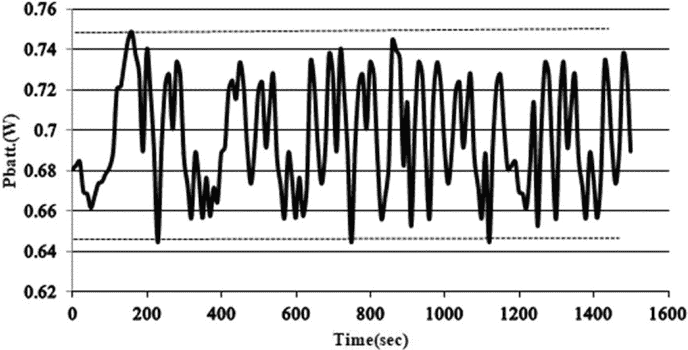

图 7.3 非线性 MPC 模型的功率约束

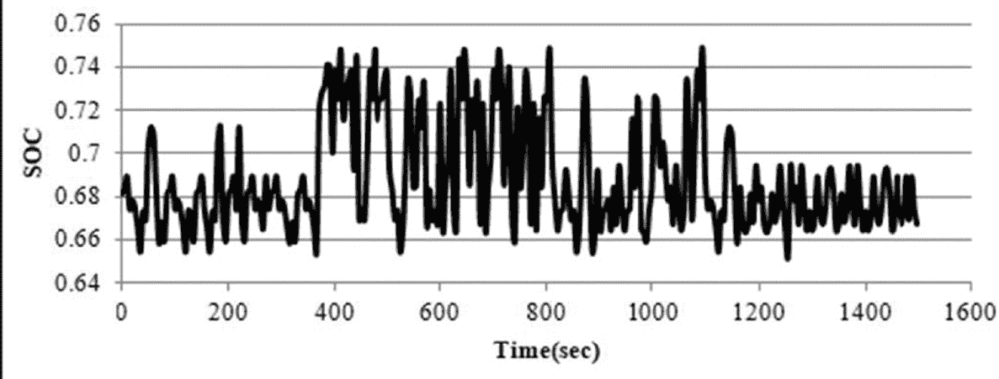

图 7.4 非线性 MPC 模型的 SOC 约束

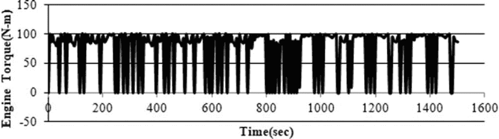

图 7.5 发动机扭矩随时间（秒）的变化

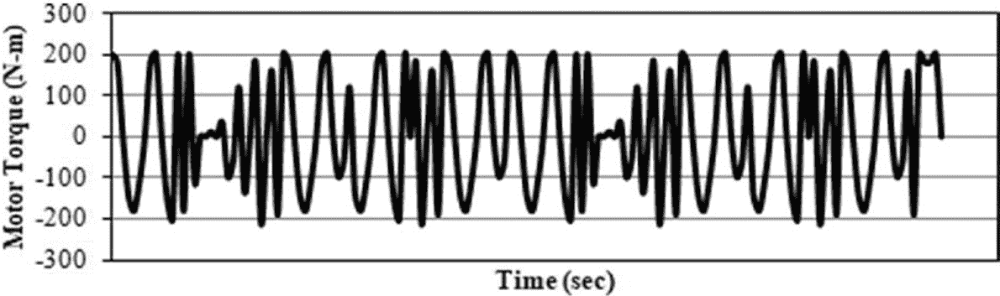

图 7.6 发动机扭矩随时间（秒）的变化

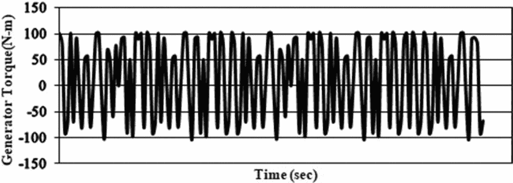

图 7.7 发电机扭矩随时间（秒）的变化

## 结论


模型预测控制（`MPC`）是一种用于优化功率分流混合动力汽车燃油效率的方法。在初始探索阶段，构建了二次代价函数，并采用 `MPC` 技术将其应用于具有动态变量的时间变化线性系统。初步研究涵盖了这两个组成部分。其后，代价函数被划分为两个不同的组成部分，即代价至终点和阶段代价，从而实现燃油资源的更高效利用。代价至终点可以通过考虑电池的荷电状态（`SOC`）来确定。这提供了实际值的可靠近似。在非线性环境中使用 `MPC` 有助于对所讨论问题进行系统化和可预测的求解。这一现象可归因于所考虑的相对较短的时间范围。这一成就的实现得益于问题区域维度的减少。如数据所示，采用非线性环境中的 `MPC` 方法可以替代替代性商业线性控制器的使用。这种调整已证明燃油效率得到了大幅提升。在通常采用线性语言的情况下，这一现象并不会发生。

## 参考文献

1.  Chan, C. C. (2002). 电动和混合动力汽车的最新技术进展。Proceedings of the IEEE, 90(2), 247–275.

2.  Malikopoulos, A. A. (2014). 混合动力电动汽车的监督功率管理控制算法：综述。IEEE Transactions on Intelligent Transportation Systems, 15(5), 1869–1885.

3.  Sharma, A., Sharma, K., Islam, A., and Roy, D. (2020). 自动机器人电弧焊接工艺中焊接参数的影响。Materials Today: Proceedings, 26, 2363–2367.

4.  Salmasi, F. R. (2007). 混合动力电动汽车的控制策略：演变、分类、比较及未来趋势。IEEE Transactions on Vehicular Technology, 56(5), 2393–2404.

5.  Chaturvedi, R., Islam, A., and Sharma, K. (2021). 相变材料在太阳能热储存中应用的综述。Materials Today: Proceedings, 43, 293–297.

6.  Paganelli, G., Delprat, S., Guerra, T. M., Rimaux, J., and Santin, J. J. (2002). 并联混合动力总成的等效油耗最小化策略。In Vehicular Technology Conference. IEEE 55th Vehicular Technology Conference. VTC Spring 2002 (Cat. No. 02CH37367), (Vol. 4, pp. 2076–2081), IEEE, 2002.

7.  Kumar, P., Singh, P. K., Nagar, S., Sharma, K., and Saraswat, M. (2021). 功能化石墨烯不同浓度对热能储存系统充电时间减少的影响。Materials Today: Proceedings, 44, 146–152.

8.  Gu, B., and Rizzoni, G. (2006). 基于驾驶模式识别的混合动力电动汽车能量管理自适应算法。In ASME International Mechanical Engineering Congress and Exposition, (Vol. 47683, pp. 249–258).

9.  Singh, P. K., Singh, P. K., Sharma, K., and Saraswat, M. (2020). 超声参数对原位胺功能化多层石墨烯/环氧纳米复合材料力学性能的影响。Journal of Scientific and Industrial Research, 79(11), 985–989.

10.  Borhan, H. A., Vahidi, A., Phillips, A. M., Kuang, M. L., and Kolmanovsky, I. V. (2009). 功率分流混合动力电动汽车的预测能量管理。In 2009 American Control Conference, (pp. 3970–3976). IEEE, 2009.

11.  Borhan, H., Vahidi, A., Phillips, A. M., Kuang, M. L., Kolmanovsky, I. V., and Di Cairano, S. (2011). MPC-based energy management of a power-split hybrid electric vehicle. IEEE Transactions on Control Systems Technology, 20(3), 593–603.

12.  Shukla, M. K., and Sharma, K. (2019). 碳纳米填料对环氧基纳米复合材料力学和界面性能的影响：综述。Polymer Science, Series A, 61, 439–460.

13.  Mousavi, M. A., Heshmati, Z., and Moshiri, B. (2013). LTV-MPC based path planning of an autonomous vehicle via convex optimization. In 21st Iranian Conference on Electrical Engineering (ICEE), (pp. 1–7), IEEE, 2013.

14.  Kim, N., Cha, S., and Peng, H. (2010). 基于庞特里亚金最小值原理的混合动力电动汽车最优控制。IEEE Transactions on Control Systems Technology, 19(5), 1279–1287.

15.  Sharma, K., and Shukla, M. (2014). 三相碳纤维胺功能化碳纳米管环氧复合材料：加工、表征和多尺度建模。Journal of Nanomaterials, 2014, 2–2.

16.  Sciarretta, A., and Guzzella, L. (2007). 混合动力电动汽车控制。IEEE Control Systems Magazine, 27(2), 60–70.

17.  Jinquan, G., Hongwen, H., Jiankun, P., and Nana, Z. (2019). 插电式混合动力电动汽车中一种新颖的基于 MPC 的自适应能量管理策略。Energy, 175, 378–392.

# 8 并联混合动力电动汽车的控制参数优化

Manish Saraswat^(⁷)

DOI: [10.1201/9781003534136-8](https://dx.doi.org/10.1201/9781003534136-8)

## Abstract

混合动力电动汽车（`HEV`）的重要控制参数为荷电状态（`SOC`）的下限和上限。车辆的该 `SOC` 直接影响经济性和排放率。在本工作中，并联 `HEV` 使用 `ADVISOR` 进行建模。为测试相同设计的驾驶循环的排放性能和燃油经济性，采用了不同的 `SOC` 限值。借助仿真结果，我们将能够确定 `SOC` 的最佳上限和下限，使车辆实现最佳燃油经济性和排放性能。仿真采用四条不同曲线的重复速度剖面（驾驶循环）进行，即 `UDDS`、`ECE`、`FTP` 和 `HWFET`。针对这些不同的驾驶循环观察 `SOC` 和排放曲线，并将 `HC`、`CO` 和 `NOx` 的排放率（单位为 g/miles）结果制表。

**关键词：** `ADVISOR`, 驾驶循环, 排放性能, 混合动力电动汽车, `SOC`

## Introduction

混合动力电动汽车提供额外的灵活性以改善燃油经济性和排放 [1]。对于混合动力电动汽车（`HEV`），电气储能与电动机耦合，使得车辆能够高效运行。双功率路径可通过双向变换器的耦合实现，使得在低功率运行期间能够关闭发动机，并且可为此类车辆使用更高效且更小的发动机。这可以在保持车辆平均功率承载能力的同时实现 [2, 3 and 4]。在此过程中，电池或其他储能系统中的电能通过在发动机高效运行期间接受多余功率来维持。再生制动过程将动能以电能形式储存，也有助于为储能系统充电 [5]。

控制策略在保持 `HEV` 效率方面发挥着重要作用 [6]。早期控制和优化视角被用于研究 `HEV` 的控制策略。一些静态优化方法包括 [7]。

*   动态规划
*   序列二次规划
*   基线策略
*   基于规则的控制策略
*   模糊逻辑控制策略
*   模型预测控制策略
*   实时优化


对于控制和能量管理，需要考虑的最重要因素是电池的‘荷电状态’值。实际上，20‑80% 是通常为荷电状态约束所设定的范围 [8]。荷电状态 (`SOC`) 的下限和上限分别用于开始和停止电池充电。

本文将研究诸如荷电状态、燃油经济性和排放等不同参数如何相互关联并影响彼此 [9, 10 和 11]。借助本研究，我们可以轻松估算出实现车辆在燃油经济性和降低排放方面更好性能的最佳荷电状态值。

## 模型描述
采用并联 `HEV` 模型，其参数在下述 表 8.1 中说明。

表 8.1 用于仿真的车辆参数

| 参数 || 值 |
| --- | --- |
| 车辆重量 || 15000 kg |
| --- | --- |
| 电机额定功率 || 43 KW |
| 扭矩 || 200 nm |
| 发动机额定功率 || 120 HP |
| 电池组 || `VRLA` |
| 电池容量 || 110 Ah |
| 端电压 || 145 |

### 控制策略
并联 `HEV` 的基本策略是，在正常运行期间，动力由发动机向前供给，而在减速期间，应用再生制动，并在双向变换器的帮助下将能量储回储能系统中，该逆向功率流得到管理 [12, 13]。

### 驾驶循环
为了使研究更合理，这里采用了五种不同类型的驾驶循环，并在图中以图形方式显示。这些循环以重复序列的方式采用，以便总仿真时间足够长以正确测试系统，并且差异可以显著观察到 [13, 14 和 15]。

即 `UDDS`、`ECE`、`FTP` 和 `HWFET` 这四种驾驶循环的速度曲线分别在以下 图 8.1、图 8.2、图 8.3 和 图 8.4 中给出。

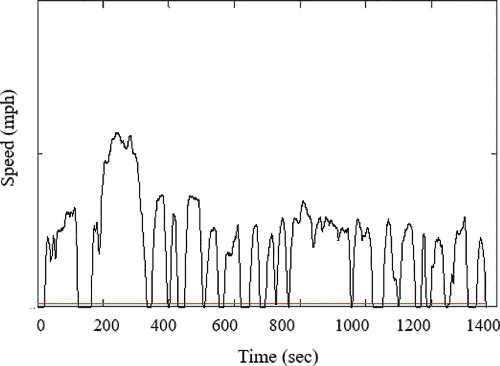
图 8.1 UDDS 驱动循环

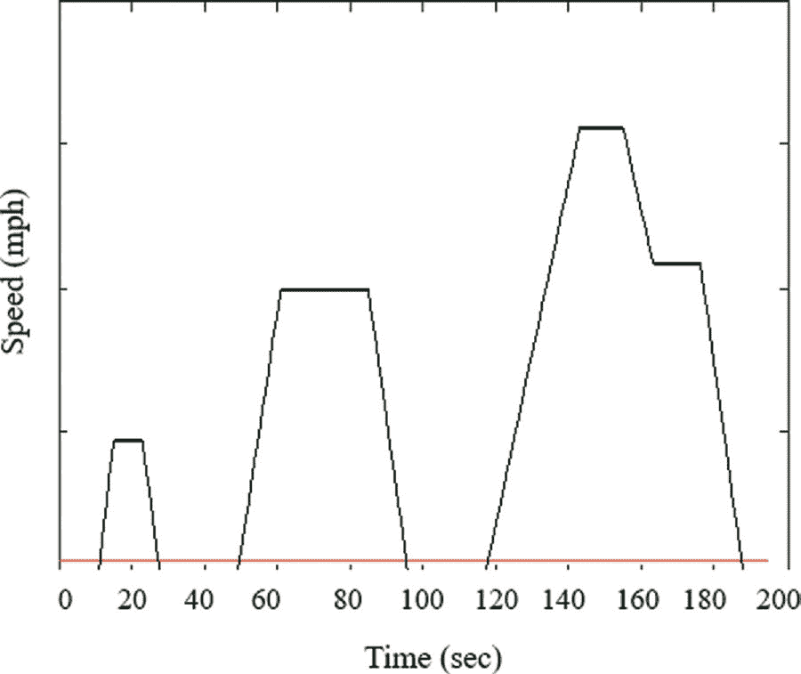
图 8.2 ECE 驱动循环

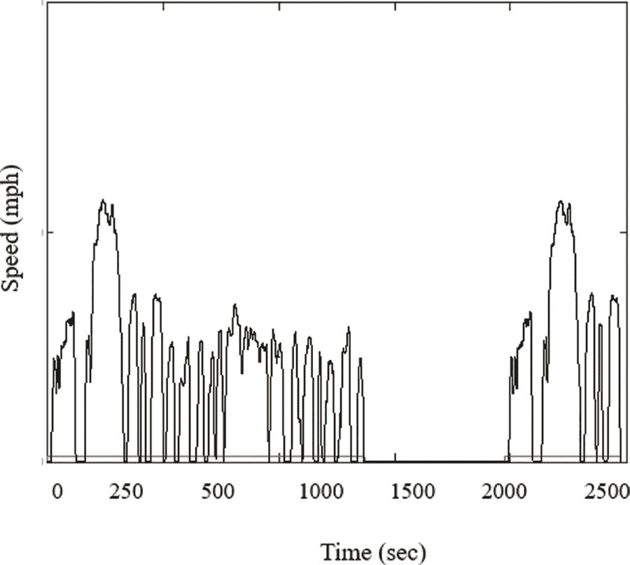
图 8.3 FTP 驱动循环

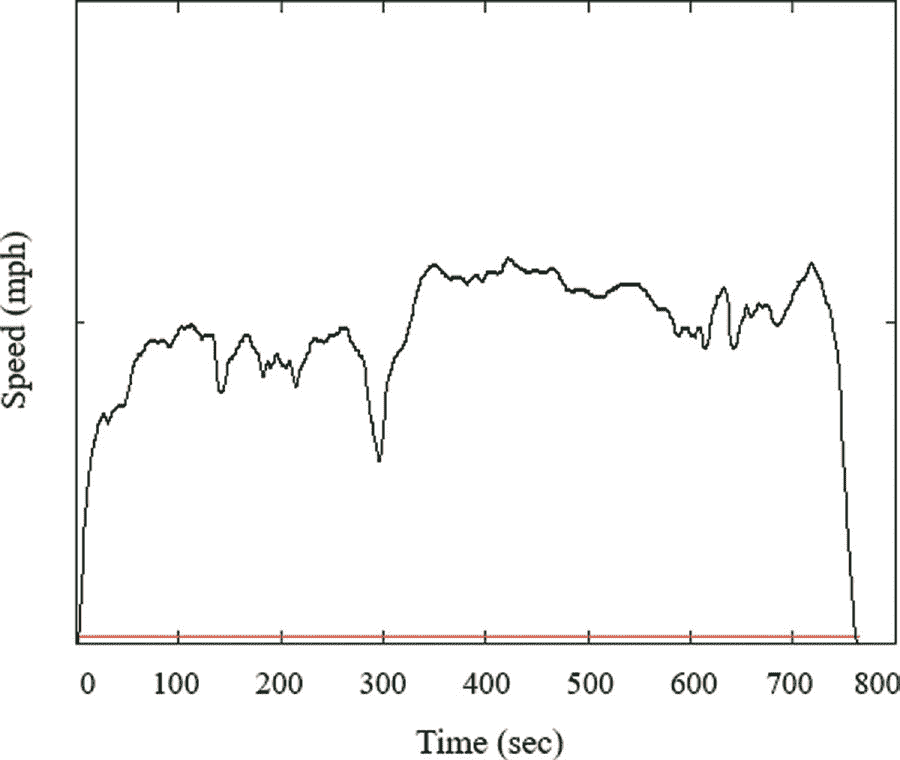
图 8.4 HWFET 驱动循环

## 仿真结果
仿真分为两个不同的部分，一部分针对 `SOC` 的下限，另一部分针对 `SOC` 的上限。需要保持 20% 到 80% 的实际限制，因为 `SOC` 过低或过高的值会损坏电池。对于上限，即终点，形成了组，仿真分别进行，我们将尝试为每个组找到最佳的 `soc` 范围。

发动机运行过程和燃油总消耗量是两个重要因素，因为它们取决于 `SOC` 的初始值。对于数据处理，这里我们遵循的过程可以轻松比较同一组内或不同组之间的结果。每次仿真后记录的一些参数如下——用于确定燃油经济性的燃油消耗以及用于排放的 `CO`、`HC`、`NOx`。在结果中，数据将被制表，以便更容易、更正确地分析。

从 表 8.2 中，我们可以推断出 –

表 8.2 燃油消耗最小的数据组

| G || 燃油消耗 || `CO` (g/miles) || `HC` (g/miles) || `NOx` (g/miles) |
| --- | --- | --- | --- | --- |
| 1 || min || max || min || max |
| --- | --- | --- | --- | --- |
| 2 || min || max || min || max |
| 3 || min || max || min || max |
| 4 || min || ….. || min || max |
| 5 || min || max || min || max |
| 6 || min || ….. || min || max |
| 7 || min || max || min || max |

* 对于组 1、2、3、5、7，实现了最佳燃油经济性。
* 大多数情况下，当 `HC` 质量最小时，`NOx` 质量最大。
* 对于大多数组，`CO` 质量保持最大。

`SOC` 变化以及包括 (`HC`、`CO`、`NOx`) 在内的排放量在以下图中针对四种不同的速度曲线进行了说明。

图 8.5 和 8.6 分别显示了储能系统的 `SOC` 曲线以及城市驾驶循环 `UDDS` 的 `HC`、`CO` 和 `NOx` 排放率。

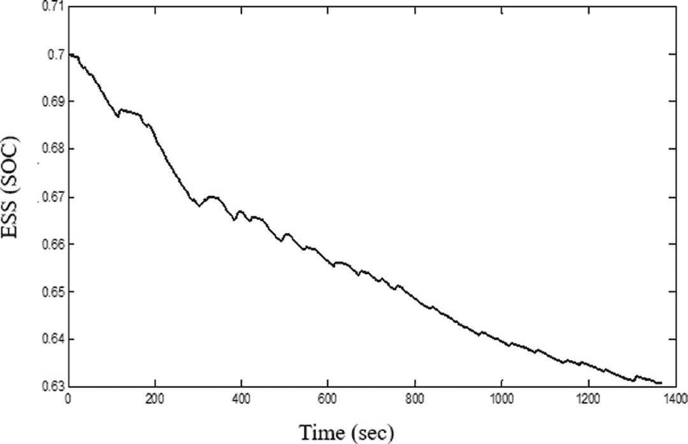
图 8.5 UDDS 循环的 SOC

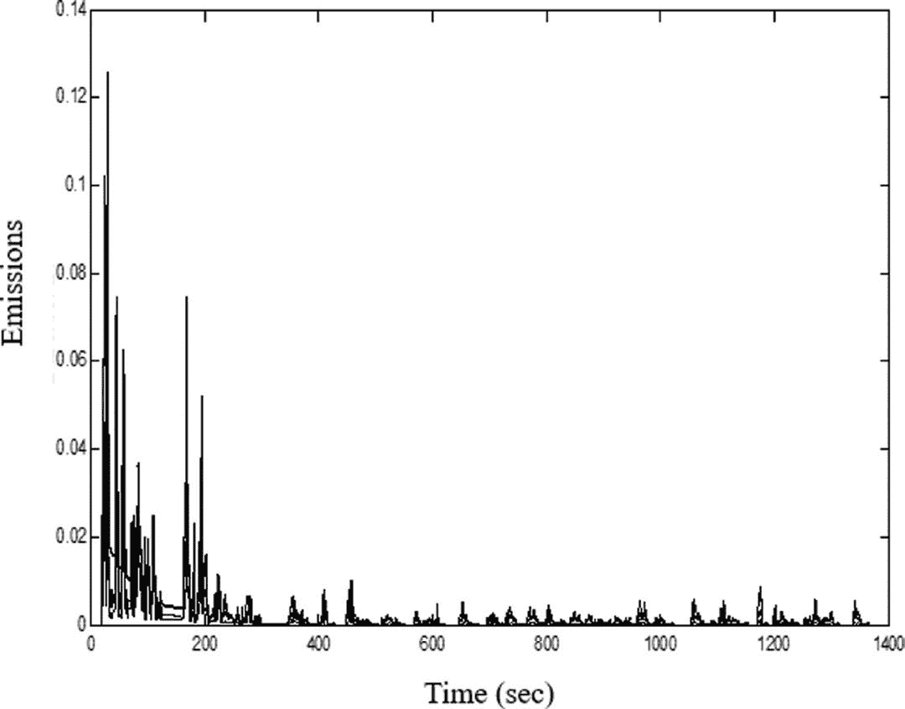
图 8.6 UDDS 循环的排放

图 8.7 和 8.8 分别显示了储能系统的 `SOC` 曲线以及欧洲驾驶循环 (`ECE`) 的 `HC`、`CO` 和 `NO x` 排放率。

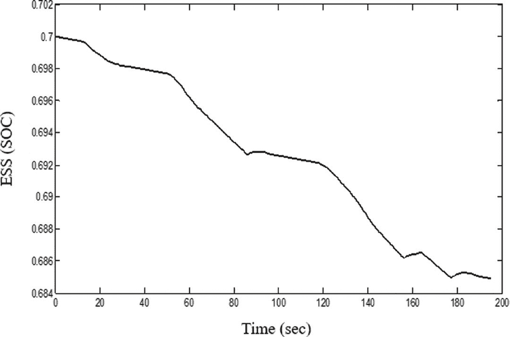
图 8.7 ECE 循环的 SOC

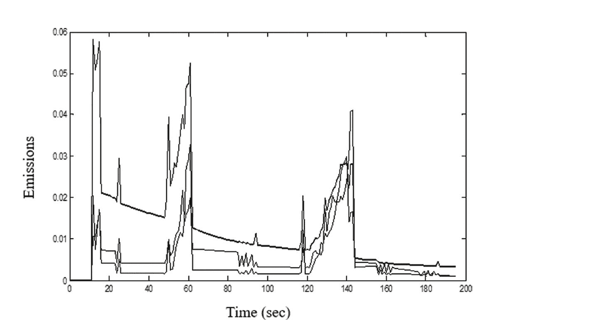
图 8.8 ECE 循环的排放

图 8.9 和 8.10 分别显示了储能系统的 `SOC` 曲线以及 `FTP` 驾驶循环的 `HC`、`CO` 和 `NO x` 排放率。

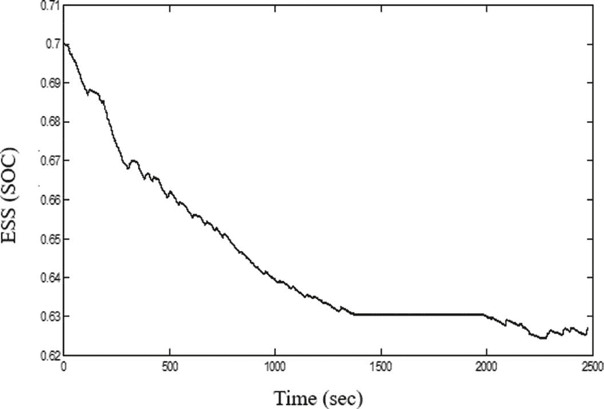
图 8.9 FTP 循环的 SOC

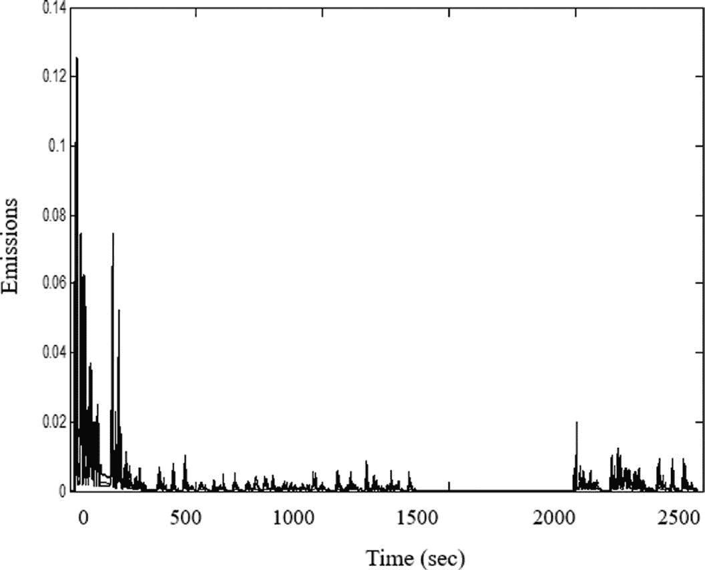
图 8.10 FTP 循环的排放

图 8.11 和 8.12 分别显示了储能系统的 `SOC` 曲线以及 `HWFET` 驾驶循环的 `HC`、`CO` 和 `NOx` 排放率。

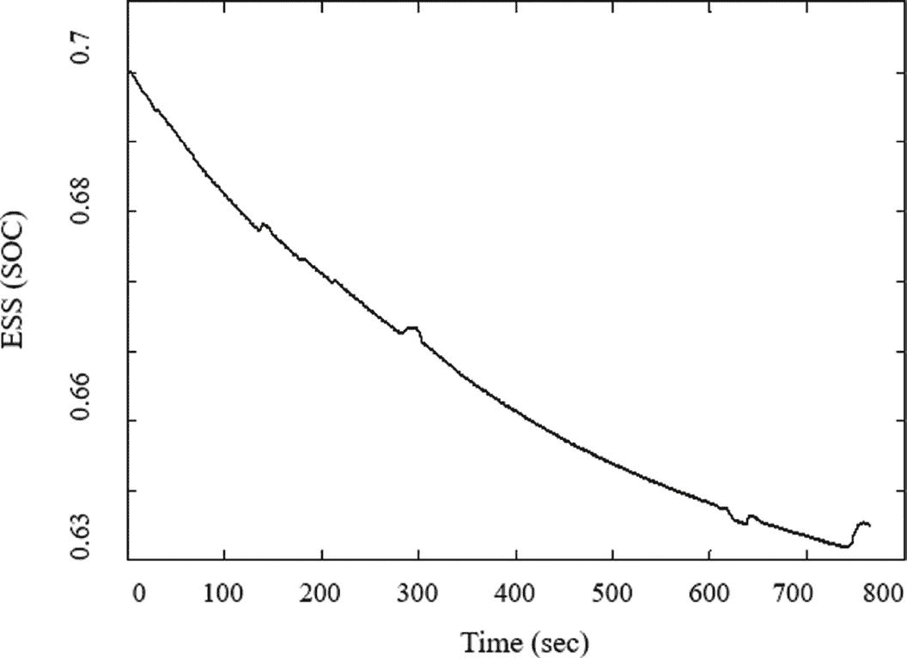
图 8.11 HWFET 循环的 SOC

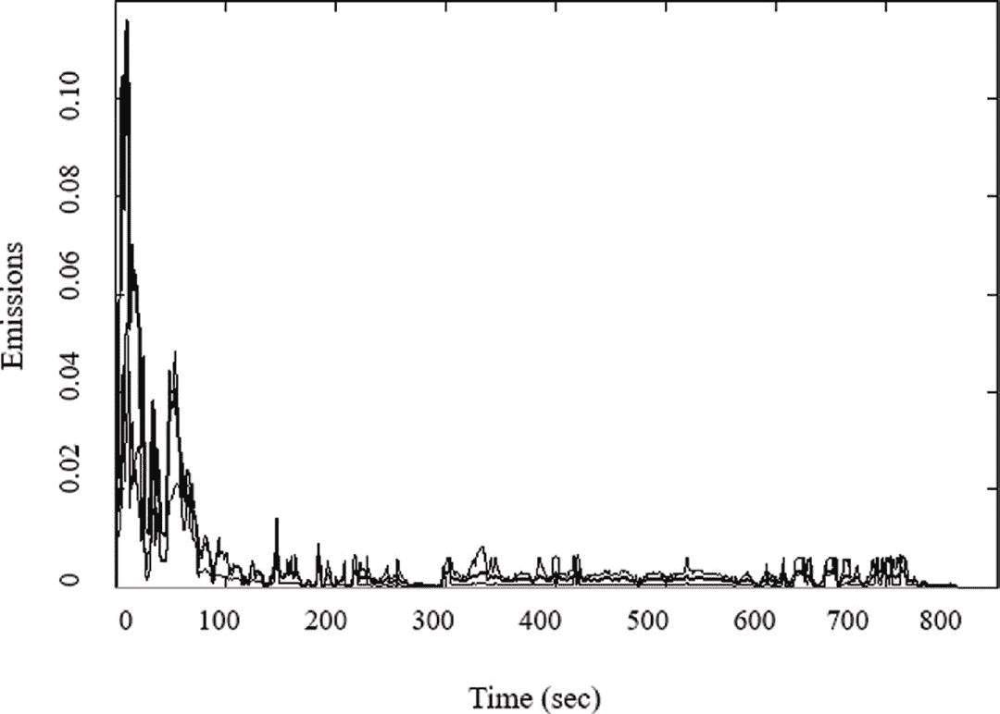
图 8.12 HWFET 循环的排放

在 表 8.3 中，获得的结果被制表以更好地理解观察结果

表 8.3 不同驾驶循环的排放值

| 驾驶循环 || `HC` (gm/miles) || `CO` (gm/miles) || `NOx` (gm/miles) |
| --- | --- | --- | --- |
| `UDDS` || 0.52 || 2.358 || 0.407 |
| --- | --- | --- | --- |
| `ECE` || 4.013 || 18.484 || 1.457 |
| `FTP` || 0.413 || 2.038 || 0.355 |
| `HWFET` || 0.403 || 1.893 || 0.329 |

## 结论
在本研究中，针对四个不同的驾驶循环，将荷电状态参数考虑在内以测试串行进行的仿真结果。借助获得的结果，显示了这四个不同循环的荷电状态和排放。通过观察所进行的研究和仿真结果，我们可以推断出 –

* 如果我们有最小的 `HC` 质量，则 `NOx` 质量必须最大，则该组 `SOC` 范围将实现最佳燃油经济性。
* 还观察到，对于固定的速度曲线，最佳燃油经济性可以通过不同组相同的 `SOC` 范围来实现。

## 参考文献
1. Kebriaei, M., Niasar, A. H., and Asaei, B. (2015). 混合动力电动汽车：概述。 在 2015 年国际互联车辆与博览会 (ICCVE) 上，(第 299–305 页)。 IEEE，2015。
2. Ruan, J., Walker, P. D., Zhang, N., and Wu, J. (2017). 多速电动汽车混合储能系统的研究。 Energy, 140, 291–306。


3.  Wang, H., Yan, G., Tag-Eldin, E., Chaturvedi, R., Aryanfar, Y., Alcaraz, J. L. G., et al. (2023). 由二氧化碳跨临界回收循环驱动的单闪地热发电厂的热力学研究。 Alexandria Engineering Journal, 64, 441–450.

4.  Cikanek, S. R., and Bailey, K. E. (2002). 混合动力电动汽车的再生制动系统。载于《2002 年美国控制会议论文集》(IEEE Cat. No. CH37301)，(第 4 卷，第 3129–3134 页)。IEEE, 2002.

5.  Sun, W., Feng, L., Abed, A. M., Sharma, A., and Arsalanloo, A. (2022). 利用响应面法(RSM)对集成卡利那循环和太阳能干燥单元的可再生混合 RO/PEM 电解槽进行热经济性评估。 Energy, 260, 124947.

6.  Jeon, S., Jo, S., Park, Y., and Lee, J. (2002). 利用驾驶模式识别的并联混合动力电动汽车多模式驾驶控制。 Journal of Dynamic Systems, Measurement, and Control, 124(1), 141–149.

7.  Saraswat, M., Sharma, K., Chauhan, N. R., and Shukla, R. K. (2020). 自动化在能源管理与分配中的作用。 Journal of Scientific and Industrial Research, 79(10), 951–954.

8.  Pisu, P., and Rizzoni, G. (2005). 具有双储能系统的串联混合动力电动汽车的监督控制策略。载于 2005 IEEE 车辆电力与推进会议，(第 8 页)。IEEE, 2005.

9.  Saraswat, M., Garg, M., Bhardwaj, M., Mehrotra, M., and Singhal, R. (2019). 影响生物质产沼气变量的影响。载于 IOP 会议系列：材料科学与工程，691(1)，第 012043 页)。IOP Publishing.

10.  Piller, S., Perrin, M., and Jossen, A. (2001). 充电状态确定方法及其应用。 Journal of Power Sources, 96(1), 113–120.

11.  Gao, J. P., Zhu, G. M. G., Strangas, E. G., and Sun, F. C. (2009). 串联混合动力电动汽车等效燃油消耗优化控制。 Proceedings of the Institution of Mechanical Engineers, Part D: Journal of Automobile Engineering, 223(8), 1003–1018.

12.  Sharma, K., Kaushalyayan, K. S., and Shukla, M. (2015). 胺功能化多壁碳纳米管环氧复合材料界面性能的拔出模拟。 Computational Materials Science, 99, 232–241.

13.  Hu, J., Chen, Y., and Yang, Z. (2009). 混合动力电动汽车中一种双向 DC/DC 变换器的研究与仿真。载于 2009 年第三届电力电子系统与应用国际会议(PESA)，(第 1–4 页)。IEEE, 2009.

14.  Yadav, A., Kumar, A., Singh, P. K., and Sharma, K. (2018). 利用分子动力学模拟的功能化石墨烯环氧复合材料的玻璃化转变温度。 Integrated Ferroelectrics, 186(1), 106–114.

15.  Geller, B. M., and Bradley, T. H. (2015). 分析混合动力电动汽车仿真与优化的驾驶循环。 Journal of mechanical design, 137(4), 041401.

# 9 锂离子电池及其在混合动力汽车中的生命周期评估

Manish Saraswat^(⁸)

DOI: [10.1201/9781003534136-9](https://dx.doi.org/10.1201/9781003534136-9)

## 摘要

电动汽车(EVs)所需的储能系统(ESSs)的成本、安全、尺寸以及总体管理只是它们必须克服的挑战中的几个。 本文基于储能技术讨论了 ESS 技术。 本综述的主要结论之一是，虽然目前使用的 ESS 技术可以应用于电动汽车，但其在有效电动汽车储能应用方面的全部潜力尚未得到实现。 在这种改进的建模技术中，考虑了热效应——电池电气模型的一个关键组成部分，以产生全面的理解，从而得出锂离子电池的独特特性。 拥有如此精确的热-电模型至关重要，因为混合动力电动汽车(HEV)中的电池单体或电池组对温度极其敏感。

**关键词：** 电池, 挑战, 储能, 混合动力, 锂离子, 建模, 热效应

## 引言

随着快速城市化的开始，相当一部分人口已从农村迁往城市。 在城市城市化进程中，交通至关重要。 随着城市人口的增长，道路上的车辆数量也随之增加。 在所有行业中，交通运输业消耗的能源最多 \[1, 2 and 3\]。 它约占全球能源消费的 27% \[4, 5 and 6\]。 目前的车辆构成主要由传统内燃机(IC)发动机驱动的车辆组成，对温室气体(GHG)排放有显著贡献。 2012 年，其排放量占温室气体排放量的 33.7%。 因此，我们必须在交通领域采用更前沿的技术来应对气候变化并减少温室气体排放。 由于排放量低，电动汽车(EVs)作为一种解决方案越来越受欢迎。 全球汽车行业正面临着持续的压力，要求用电动汽车取代传统内燃机汽车并减少其比例 \[7, 8 and 9\]。 电动汽车的发动机效率更高，且无需担心尾气排放、燃料蒸发或燃料炼制污染物。 电动汽车的一个重要特征是其续航里程。 电动汽车应具有足够的续航里程，以便在单次充电后行驶。 由此产生的续航焦虑是指担心汽车的续航里程不足以到达目的地。 部署广泛的充电基础设施、以合理价格开发更高电池容量以及电池更换技术是缓解电动汽车驾驶员续航焦虑的主要方法 \[10\]。 为了延长电动汽车的续航里程并提高其可靠性，需要更复杂、更先进的储能和转换技术。

## 锂离子电池储能技术

能量和功率密度、充电状态窗口和循环寿命、充放电速率、工作温度、日历寿命和安全性只是电气化车辆储能系统(ESS)的一些具有挑战性的要求 \[11\]。 锂离子化学成分有许多不同的排列组合，其中越来越多地应用于与汽车相关的应用中。 这种趋势的一个例子是可充电锂离子电池的开发。 锂离子电池的制造就是此类应用的一个例子。 这些化学过程的大致可观察进展阶段已被分类，此分类的结果总结在 表 9.1 锂离子电池的不同组成及其性能规格。

表 9.1 锂离子电池的不同组成及其性能规格

| 化学成分 || 成熟度 || 热特性 || 性能 |

| --- | --- | --- | --- |

| LiNiCoAlO[2] 4.xV/cell || 已证实的 C/x 倍率 || 高温下不稳定 || 高能量，良好功率 |

| --- | --- | --- | --- |

| LiNiCoMnO[2] 4.xV/cell || 正在改进 || 有限的耐久性经验 || 高能量，良好功率 |

| LiFePO[4] 3.6V/cell || 成熟 || 非常稳定 || 低能量，相对高功率 |

| LiMn[2]O[4] 3.8V/cell || 正在改进 || 高温下寿命有限 || 高容量衰减，中等功率 |


由于 `LNCAO` 具有如此高的储能容量，其商业化进程目前正在进行，以便可在混合动力汽车中使用。这将使 `LNCAO` 能够与其他储能选项竞争。人们持续担心其在高倍率放电（和充电）期间的稳定性会受到损害 \[12\]。已证明 `LNMC` 化学体系，例如 1/3 rd. 设计，具有高能量和良好功率；然而，这些化学体系的寿命尚未得到验证 \[13\]。尖晶石 (`LM[2]O[4]`) 可能有一些应用；然而，其容量迅速下降且在高温下寿命短的事实使其在汽车中的使用受到质疑。尖晶石的 (`LM[2]O[4]`) 容量迅速下降，且其在高温下的寿命很短。在高温条件下，尖晶石的容量会急剧下降。`LFPO` 目前在所有锂离子化学体系中排名第一 \[14\]，这是因为纳米磷酸盐工程正极已证明在遭受滥用时具有异常稳定。此外，它们还提供相对良好的能量和高功率。

## Life-Cycle Estimation
拥有能够满足日历寿命和服役寿命要求的 `ESS` 是绝对必要的。这些要求必须得到满足。涓流充电或浮充电压的要求以及禁止让电芯电压降至预定阈值以下的规定，是众多储能装置货架寿命中最常见的问题之一 \[8\]。这些问题导致了这些储能装置货架寿命的绝大多数问题。尽管存在所有这些缺点，仍有显著的市场需求用于储能装置。例如，为了使锂离子电池正常工作，每颗电芯的电压必须在 2.0 至 2.5 伏之间。

找出锂离子因动态解耦高倍率电流而降低热应力的好处有多大。找出锂离子因降低热应力而获得的好处有多大。如果你遵循这些说明，你会注意到最大的进展。

* 找出锂离子因动态解耦高倍率电流而产生的较低热应力值。确定锂离子所承受的较低热应力值。
* 超级电容器使用在设备在低温下工作时带来可靠性改善的程度
* 活性并联组合可提供的改善能源管理和 Power Net 稳定性的意义。
* 储能系统的整体安全性水平如果投入足够努力可以得到改善。
* 未来的一项目标是将完全混合化的储能系统的体积减少到与单独锂离子相同的水平。这将在相对较短的时间内完成。

货架储存时间或日历老化放电率是原电池寿命最重要的因素 \[9\]。这是因为这些因素将决定电芯在使用前可以储存多长时间。

对于二次或可充电电芯，我们对日历老化和循环老化过程都感兴趣。这是因为这两种老化都可能发生。即使在测试时电池电芯未被使用，日历老化也会显示容量随时间推移的下降情况。电芯能够产生一定数量的循环的能力将由循环老化过程揭示，该过程还将揭示电芯能够承受的最大充放电速率 \[10\]。通常，我们预计能量电芯在使用初期容量降至原始 `Ah` 值的 80% 之前可承受 1000 次完整循环，而功率电芯可承受 3000 次完整循环。同样，我们预计功率电芯在容量降至原始 `Ah` 值的 20% 之前可承受 5000 次完整循环。锂电池的寿命以充电循环来衡量，充电循环定义为电池从完全充电到放电再回到完全充电的使用间隔。这使得电池在其生命周期内可以多次完全充电。

## Conclusion
总结来说，锂离子电池在容量下降到某一阈值以下之前能够承受的充放电循环次数，通常用于估计电池在购买后仍能继续工作的时长。该阈值由电池在容量下降到阈值以下之前能够承受的充放电循环次数决定。使用以下公式，可以估计锂离子电池可获得的充电和放电循环次数。寿命（以循环计）等于容量乘以一百除以放电率乘以放电深度。温度、充电和放电速率以及锂离子电池在投入使用前存放的时间长短，都会影响电池在需要更换之前的使用寿命。通过谨慎处理并确保其储存在合适的环境中，可以延长电池的寿命。锂离子电池在投入使用前允许闲置的时间长短也会影响电池的整体寿命。长时间未使用的电池有退化的风险，这可能导致电池容量下降。这种风险会随着电池在未使用状态下存放的时间越长而增加。

## References
1. Chen, H., Cong, T. N., Yang, W., Tan, C., Li, Y., and Ding, Y. (2009). 电力储能系统进展：批判性综述。 Progress in Natural Science, 19(3), 291–312.
2. Komarnicki, P., Lombardi, P., Styczynski, Z., Komarnicki, P., Lombardi, P., and Styczynski, Z. (2017). 电力储能系统 (pp. 37–95). Berlin Heidelberg: Springer.
3. Saraswat, M., Garg, M., Bhardwaj, M., Mehrotra, M., and Singhal, R. (2019). 影响生物质产沼气生产的变量。 In IOP Conference Series: Materials Science and Engineering, (Vol. 691, No. 1, pp. 012043). IOP Publishing.
4. Zhang, C., Wei, Y. L., Cao, P. F., and Lin, M. C. (2018). 储能系统：电池和电力调节系统的当前研究。 Renewable and Sustainable Energy Reviews, 82, 3091–3106.
5. Singh, P. K., Singh, P. K., Sharma, K., and Saraswat, M. (2020). 原位胺功能化多层石墨烯/环氧纳米复合材料机械性能的超声参数影响。 Journal of Scientific and Industrial Research, 79(11), 985–989.
6. Song, Z., Li, J., Hou, J., Hofmann, H., Ouyang, M., and Du, J. (2018). 电动汽车应用中的电池-超级电容器混合储能系统：案例研究。 Energy, 154, 433–441.
7. Hannan, M. A., Hoque, M. M., Mohamed, A., and Ayob, A. (2017). 电动汽车应用储能系统综述：问题与挑战。 Renewable and Sustainable Energy Reviews, 69, 771–789.


8. Anqi, A. E., Li, C., Dhahad, H. A., Sharma, K., Attia, E. A., Abdelrahman, A., et al. (2022). 组合空气冷却和纳米增强相变材料对锂离子电池热管理的影响. Journal of Energy Storage, 52, 104906.

9. Chan, H. L. (2000). 用于电池储能系统和电动汽车动力系统的新的电池模型. In 2000 IEEE Power Engineering Society Winter Meeting, Conference Proceedings (Cat. No. 00CH37077) (Vol. 1, pp. 470–475). IEEE.

10. Habib, A. A., Hasan, M. K., Mahmud, M., Motakabber, S. M. A., Ibrahimya, M. I., and Islam, S. (2021). 综述：电动汽车应用的储能系统和均衡电路. IET Power Electronics, 14(1), 1–13.

11. Hasan, M. K., Mahmud, M., Habib, A. A., Motakabber, S. M. A., and Islam, S. (2021). 电动汽车储能和管理系统的综述：标准、问题和挑战. Journal of Energy Storage, 41, 102940.

12. Singh, P. K., and Sharma, K. (2018). 基于聚合物的纳米复合材料玻璃化转变行为的分子动力学模拟.

13. Balali, Y., and Stegen, S. (2021). 基于技术、环境影响和成本的车辆储能系统综述. Renewable and Sustainable Energy Reviews, 135, 110185.

14. Hasan, M. K., Mahmud, M., Habib, A. A., Motakabber, S. M. A., and Islam, S. (2021). 电动汽车储能和管理系统的综述：标准、问题和挑战. Journal of Energy Storage, 41, 102940.

# 10 汽车产品中储能的演变：从爱迪生的镍铁电池到锂离子主导的持续追求

Manish Saraswat^(⁹)

DOI: [10.1201/9781003534136-10](https://dx.doi.org/10.1201/9781003534136-10)

## Abstract

本研究考察了汽车储能系统的演变。从托马斯·爱迪森早期对镍铁技术的支持开始，到当前推动锂离子成为主要解决方案为止。经过一个世纪，汽车行业仍在努力存储和利用能源。重新阅读历史可以揭示爱迪森认为镍铁技术优于铅酸电池的信念。行业已放弃镍金属氢化物和铅酸电池，转而采用锂离子电池。本研究调查了消费者持久偏好的原因。它强调了锂离子技术在混合动力和电动汽车中的影响对这些变化的影响。本文考察了促使人们寻求能够取代所有解决方案的革命性电化学技术的历史和现实因素。它还调查了实现这一目标的障碍。本研究考察了汽车设计师和制造商在创建节能和环保车辆时面临的障碍。它研究了如何将当前电化学储能介质与先进电力电子相结合。总之，这篇研究论文帮助学者理解汽车储能的演变。通过考察过去和现在的变革，本分析展示了行业致力于改进储能系统以创建更高效、更环保的交通解决方案的承诺。

**关键词：** 电化学，能量管理，储能，优化，功率需求，车辆应用

## Introduction

当谈到电气化交通系统的有效性和效率时，储能系统（`ESS`）的特性仍然是一个限制因素。电化学电池中的电极使用法拉第过程，其在很大程度上取决于电池的温度、流经其中的电流的大小和速率、电池的荷电状态，也称为荷电状态（`SOC`），以及可能存在的任何寄生材料 [1, 2 and 3]。电化学电池中的电极也很大程度上取决于可能存在的任何寄生材料。在大多数情况下，阴极和阳极电极处发生的电化学反应并不以相同的速率推进。这也是需要考虑的另一个要点。锂离子和其他插入型化学体系最近才得到发展，但它们仍然存在与温度、电流速率、充电顶部附近的充电接受度以及由电极内捕获杂质引起的副反应相关的限制。此外，锂离子和其他插入型化学体系尚未商业化。此外，锂离子化学和其他插入型化学过程尚未可用于商业用途。为了提高这些电池的能力，正在对制造工艺进行更改，使用新的电极化学物质，并加入电解质添加剂。

由于与电池技术相关的限制，功率密度高且可循环的储能组件在各种系统中得到越来越多的使用 [4]。这是由于电池在存储大量能量方面的能力有限。当应用于超级电容器时，这些组件采用极化电极的形式，用于设备的阳极和阴极。另一方面，就不对称超级电容器和电池电容而言，这些组件由一个极化电极和一个插入电极组成。换句话说，不对称超级电容器和电池电容由一对电极组成。低至中等的温度敏感性、相反的电荷转移特性、低维护要求、循环寿命和中等成本是特别有益的最突出优势。不同的电动汽车及其当前情况如图 10.1 所示 Figure 10.1 中所示。

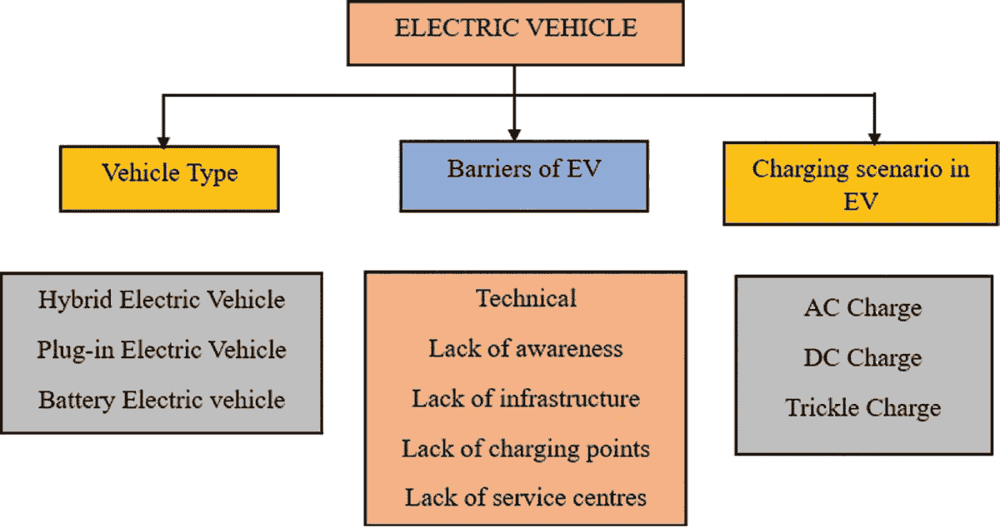

图 10.1 当前情况下的电动汽车类型和情况

## 荷电状态窗口


### 荷电状态

术语“荷电状态”指的是电池标称容量 `Qn` 与其能够存储的最大电量、也称为“可用容量” `Q(t)` 的比例。`SOC(t)` 的值等于 `Q(t)` `Qn`。完全放电的电池 `SOC` 为 0，即 0%，而完全充电的电池 `SOC` 为 1，即 100%。如果电池电芯需要能够承受多次循环、在功率应用中延长使用寿命，或保证可用功率保持恒定，则会设定一个小于 100% 的可用 `SOC` 窗口 \[5\]。必须将充电上限保持在 5% `SOC`，而放电下限保持在大约 95% `SOC`。这两个值都必须保持。较低的 `SOC` 会导致开路电压 (`OCV`) 下降，同时会导致电芯内阻增加。因此，在放电负载下，电芯电压会进一步下降，并且会在更短的时间内接近最小电芯电压。该最小电压将由电芯制造商设定，以保护电芯免受损坏并延长其使用寿命。可使用能量最近下降了 10%，这是一个负面发展。对于更高功率的电池组，可使用 `SOC` 的时间窗口将更窄。可能只有高功率混合动力电池组 `SOC` 窗口的 30% 实际上可用。这对于为电池组提供更一致的功率输出并在非常高的微循环水平下延长其使用寿命至关重要 \[6\]。 图 10.2 提供了混合动力和电动汽车 `SOC` 窗口的描述，比之前的图表更详细。

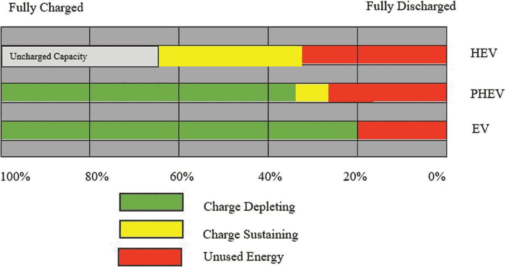

图 10.2  示意图显示各种电动汽车技术的 SOC 窗口

## 电储能系统

### 机械储能系统

机械储能系统 (`MSSs`) 是全球范围内最普遍使用的储能系统。飞轮、压缩空气储能和抽水蓄能是三种最普遍的 `MSSs` 类型 \[7, 8 and 9\]。飞轮是其中最适合电动汽车储能应用的系统之一。

### 电化学储能系统

它由液流电池和所有二次电池组成。电是通过电化学反应过程产生的，其中电能以化学形式储存。通过在充电和放电状态之间切换，这些系统兼具存储和释放电能的双重功能。电池基本结构中阳极用作负极，而阴极用作正极。这两个电极浸没在电解质中并由隔膜隔开 \[10, 11 and 12\]。电池通常被描述为具有平坦的放电曲线和高能量密度。选择电动汽车 (EV) 储能电池技术时要考虑的最重要因素是电池容量，即电池能够存储的电荷和能量，单位分别为安时 (`Ah`) 和瓦时 (`Wh`)。

### 电储能系统

通过使用磁通分离电荷或磁场，能量直接以电场形式存储为电能。超电容器是最受欢迎的电储能系统之一。

### 化学转换系统

化学转换系统将反应物中存在的化学能通过化学反应转化为能量和其他化合物。燃料电池是常见的一种化学能量转换器。

## 不同电池技术

电动汽车在道路上和发电厂电网中变得越来越普遍。仅电动推进的插电式车辆和具有电动和化石燃料推进的插电式混合动力电动汽车 (PHEVs) 都属于此类 \[13\]。

| 系统 || 正极 || 负极 || 实际 Wh/kg || 理论 Wh/kg || 理论 Ah/kg || OCV |
| --- | --- | --- | --- | --- | --- | --- |
| 锂聚合物 || VOx || Li || 150 || 884 || 340 || 3.3à2.0 |
| --- | --- | --- | --- | --- | --- | --- |
| 锂 || Li1x || LixC [6] || 150-200 || 380 || 95 || 4.2à3.0 |
| 离子 || MO[2] M = Co, Ni, Mn ||  ||  ||  ||  || (4.0) |
| 镍金属氢化物 || NiOOH || MH || 6080 || 240 || 178 || 1.35 |
| 镍镉 || NiOOH || Cd || 4060 || 219 || 162 || 1.35 |
| 钠金属氯化物 || NiCl [2] || Na || 80-100 || 787 || 305 || 2.58 |
| 钠硫 || S || Na || 80-100 || 787 || 377 || 2.1-1.78 (2.0) |
| 铅酸 || PbO [2] || Pb || 2040 || 171 || 83 || 2.1 |

### 锂离子电池储能技术

能量和功率密度、荷电状态窗口和循环寿命、充放电速率、运行温度、 calendar 寿命和安全性只是电气化车辆 ESS 的一些具有挑战性的要求 \[14\]。锂离子化学体系有许多不同的排列方式，其中越来越多地用于与汽车相关的应用。其中一个例子是可充电锂离子电池的开发。锂离子电池的制造是此类应用的一个例子。这些化学过程的粗略可观察进展阶段已被归类，并且该分类的结果总结在 表 10.1 中。

表 10.1  不同电池化学体系的规格参数

| 化学体系 || 性能 || 热特性 || 成熟度 |
| --- | --- | --- | --- |
| LiMn[2]O[4] 3.8V/电芯 || 高容量衰减，中等功率 || 高温下寿命有限 || 正在改进 |
| --- | --- | --- | --- |
| LiFePO[4] 3.6V/电芯 || 低能量，相对高功率 || 非常稳定 || 成熟 |
| LiNiCoMnO[2] 4.xV/电芯 || 高能量，良好功率 || 有限的耐久性经验 || 正在改进 |
| LiNiCoAlO[2] 4.xV/电芯 || 高能量，良好功率 || 高温下不稳定 || 已验证的 C/x 倍率 |

由于 LNCAO 的高能量存储容量，其商业化以便在混合动力汽车中使用目前正在进行中。其在高倍率放电（以及充电）期间的稳定性仍然令人担忧。LNMC 化学体系，例如 1/3 设计，表现出高能量和良好功率；然而，这些化学体系的耐久性尚未得到验证。尖晶石 (LM [2] O [4] ) 可能有一些应用；然而，其容量迅速下降且在高温下寿命短的事实使其在汽车中的使用受到质疑。尖晶石在暴露于高温时会迅速失去容量。由于纳米磷酸盐工程阴极已被证明在承受滥用时极其稳定，同时提供相对良好的能量和高功率，因此 LFPO 目前在所有锂离子化学体系中名列前茅。这是因为 LFPO 目前是唯一提供高能量和高功率的锂离子化学体系。

## 实施挑战


有可能将由方程 `I 2 R` 表示的焦耳损耗转移到具有高电流能力的超级电容器中。超级电容器具有明显低于电池的阻抗，并且其在设备充放电过程中的行为与正常行为相同。这只是 PHEV 的能量存储系统分为两个独立部分所直接带来的众多益处之一。还有许多其他优势。换句话说，主动耦合的电容电池 ESS 会从电池中移除热量，这使得电池能够更密集地封装，并使用更厚的电极材料以增加能量 \[15, 16\]。

### 运行
基于先进化学的当今电池的容量设计为使其能够在预定的保修期内满足车内使用的运行需求。例如，在混合动力电动汽车的情况下，电池保修期通常为 8 至 10 年。预计在该保修期内，电池组将能够承受日常通勤的需求。因此，在强大的 HEV 的情况下，在电池组磨损之前，可以完成 350,000 至 700,000 次浅循环（即 10% 至 4% `dSOC`）。

### 维护
维护通常包括保持 ESS 组的气候控制滤清器清洁或更换、风扇正常运行，并尽可能减少恶劣的启停驾驶暴露。这是因为恶劣的启停驾驶有可能使电池热管理系统过载。气候控制混合风门中的传感器不正确或通往大气的通风口堵塞可能会导致 ESS 热管理系统的驾驶员警告指示器开始超出其设计限制 \[10\]。这对驾驶员来说可能是危险的，因为这可能导致车辆过热。

### 环境
阿贡实验室对两辆混合动力电动汽车进行了一系列测试，以确定冷电池对车辆燃油经济性的影响以及通过制动再生可以回收的能量。这些测试使用两辆混合动力电动汽车进行。测试在冰冻温度下进行，测试对象包括配备 NiMH 电池组的混合动力福特 Escape 和同样配备 NiMH 电池组的混合动力丰田 Camry。尽管车辆使用多种气候控制和能量管理策略，但在寒冷时，燃油经济性、燃油效率以及捕获的再生能量量都会 signifi-cant 下降。结果始终相同。此外，PHEV 中 ESS 组的热时间常数将显著更长，这将在寒冷时导致性能低于平均水平的延长时期。该问题将因 PHEV 具有更大的容量而加剧。

## 结论
得益于能量管理系统和电力电子技术的进步，现在可以真正将车辆应用的能量需求和功率需求解耦。这反过来又使得能够通过解耦直接优化能量存储系统，进而使得能够将其他应用的能量需求和功率需求解耦。混合动力和电动汽车设计师和制造商面临的挑战以及为什么将电力电子与当前可用的电化学存储介质相结合确实提供了一个可付诸实践的价值主张的理由进行了讨论。如果希望实现最高可能的性能水平和最长的可能使用寿命，则必须在现在和不久的将来都将功率和能量在能量存储系统中保持分离。无论是今天还是不久的将来实现这些目标都是如此。尽管如此，能量存储系统（ESSs）对电动汽车（EV）系统在组件安全性、系统尺寸、组件成本和一般管理问题方面提出了挑战。这些挑战可以分为四个类别。此外，ESS 与先进电力电子技术的混合对驱动先进电动汽车技术所需的最佳功率利用率产生了重大影响。这是因为混合提高了电力电子技术的效率。

## 参考文献
1. Chen, H., Cong, T. N., Yang, W., Tan, C., Li, Y., and Ding, Y. (2009). 电气储能系统进展：批判性综述. 自然科学进展, 19(3), 291–312.
2. Komarnicki, P., Lombardi, P., Styczynski, Z., Komarnicki, P., Lombardi, P., and Styczynski, Z. (2017). 电气储能系统 (pp. 37–95). Berlin Heidelberg: Springer.
3. Singh, P. K., Singh, P. K., Sharma, K., and Saraswat, M. (2020). 超声参数对原位胺功能化多层石墨烯/环氧纳米复合材料力学性能的影响. 科学和工业研究杂志, 79(11), 985–989.
4. Zhang, C., Wei, Y. L., Cao, P. F., and Lin, M. C. (2018). 能量存储系统：电池和功率调节系统的当前研究. 可再生与可持续能源评论, 82, 3091–3106.
5. Saraswat, M., Sharma, K., Chauhan, N. R., and Shukla, R. K. (2020). 自动化在能源管理与分配中的作用. 科学和工业研究杂志, 79(10), 951–954.
6. Song, Z., Li, J., Hou, J., Hofmann, H., Ouyang, M., and Du, J. (2018). 电动汽车应用中的电池-超级电容器混合储能系统：案例研究. 能源, 154, 433–441.
7. Kumar, A., Sharma, K., and Dixit, A. R. (2019). 石墨烯及其杂化聚合物纳米复合材料力学和热性能综述，用于结构应用. 材料科学杂志, 54(8), 5992–6026.
8. Hannan, M. A., Hoque, M. M., Mohamed, A., and Ayob, A. (2017). 电动汽车应用储能系统综述：问题与挑战. 可再生与可持续能源评论, 69, 771–789.
9. Chan, H. L. (2000). 用于电池储能系统和电动汽车电力系统的电池新模型. In 2000 IEEE 电力工程学会冬季会议. 会议论文集 (Cat. No. 00CH37077) (Vol. 1, pp. 470–475). IEEE.
10. Kumar, A., Sharma, K., and Dixit, A. R. (2020). 碳纳米管和石墨烯增强多相聚合物复合材料：性能与应用综述. 材料科学杂志, 55(7), 2682–2724.
11. Habib, A. A., Hasan, M. K., Mahmud, M., Motakabber, S. M. A., Ibrahimya, M. I., and Islam, S. (2021). 综述：电动汽车应用的储能系统和平衡电路. IET 电力电子学, 14(1), 1–13.
12. Wang, H., Yan, G., Tag-Eldin, E., Chaturvedi, R., Aryanfar, Y., Alcaraz, J. L. G., et al. (2023). 碳 dioxide 超临界回收循环驱动的单闪地热发电厂热力学研究. 亚历山大工程学报, 64, 441–450.


13.  Hasan, M. K., Mahmud, M., Habib, A. A., Motakabber, S. M. A., and Islam, S. (2021). 电动汽车储能与管理系统综述：标准、问题与挑战。能源储存期刊, 41, 102940.

14.  Balali, Y., and Stegen, S. (2021). 基于技术、环境影响和成本的车辆储能系统综述。可再生与可持续能源评论, 135, 110185.

15.  Chaturvedi, R., Islam, A., and Sharma, K. (2021). 相变材料在太阳能热储存中应用的综述。材料今日：会议论文集, 43, 293–297.

16.  Hasan, M. K., Mahmud, M., Habib, A. A., Motakabber, S. M. A., and Islam, S. (2021). 电动汽车储能与管理系统综述：标准、问题与挑战。能源储存期刊, 41, 102940.

# 11 复杂工业过程智能自适应控制器的设计与评估

Aditi Saxena^(¹⁰)

DOI: [10.1201/9781003534136-11](https://dx.doi.org/10.1201/9781003534136-11)

## 摘要

设计和评估复杂工业过程的智能自适应控制器是一个具有重要意义的研究领域，对提高工业生产率、效率和资源管理具有实质性影响。在制造、能源和化工等行业中，控制复杂系统对于确保最佳性能和保持产品质量至关重要。作为比较分析的一部分，建议的控制器将与工业环境中常用的传统控制方法进行比较。将对包括控制器复杂性、计算需求和整体系统性能在内的变量进行比较。结果将提供有关智能自适应控制方法更广泛应用的深刻见解，为多个领域的更好控制系统设计和优化提供机会。

**关键词：** 计算需求，工业过程，智能自适应控制器，最优性能，优化

## 引言

系统的高效管理对于复杂工业过程至关重要，因为它有助于最大化运营效率、保证产品质量并减少资源消耗。然而，这些系统的动态特性和固有不确定性经常为传统控制方法带来问题。随着工业的不断发展和变得更加复杂，对能够适应变化情况并提供最大性能的先进控制方法的需求日益增加。设计和分析智能自适应控制器已成为解决这些问题的潜在研究领域。智能自适应控制器通过使用人工智能（AI）和控制理论，提供根据变化的过程条件、干扰和不确定性动态修改其控制方法的能力 \[1, 2 and 3\]。这些控制器可以提高系统性能，从过去吸取教训，并在具有挑战性的工业环境中提供稳定可靠的控制。本研究旨在探索专门为复杂工业过程设计的智能自适应控制器的开发和评估。为了应对工业系统的复杂性和不可预测性，研究重点是将先进的控制技术如模型预测控制、强化学习和模糊逻辑纳入控制器设计。本研究的主要目标是创建智能自适应控制算法，能够实时成功管理复杂的工业过程 \[4, 5\]。

基于变化的过程动态、干扰和性能目标，这些算法将被设计为适应和优化控制策略。[content]
13.  Hasan, M. K., Mahmud, M., Habib, A. A., Motakabber, S. M. A., and Islam, S. (2021). 电动汽车储能与管理系统综述：标准、问题与挑战。能源储存期刊, 41, 102940.

14.  Balali, Y., and Stegen, S. (2021). 基于技术、环境影响和成本的车辆储能系统综述。可再生与可持续能源评论, 135, 110185.

15.  Chaturvedi, R., Islam, A., and Sharma, K. (2021). 相变材料在太阳能热储存中应用的综述。材料今日：会议论文集, 43, 293–297.

16.  Hasan, M. K., Mahmud, M., Habib, A. A., Motakabber, S. M. A., and Islam, S. (2021). 电动汽车储能与管理系统综述：标准、问题与挑战。能源储存期刊, 41, 102940.

## 11 复杂工业过程智能自适应控制器的设计与评估

Aditi Saxena^(¹⁰)

DOI: [10.1201/9781003534136-11](https://dx.doi.org/10.1201/9781003534136-11)

## 摘要

设计和评估复杂工业过程的智能自适应控制器是一个具有重要意义的研究领域，对提高工业生产率、效率和资源管理具有实质性影响。在制造、能源和化工等行业中，控制复杂系统对于确保最佳性能和保持产品质量至关重要。作为比较分析的一部分，建议的控制器将与工业环境中常用的传统控制方法进行比较。将对包括控制器复杂性、计算需求和整体系统性能在内的变量进行比较。结果将提供有关智能自适应控制方法更广泛应用的深刻见解，为多个领域的更好控制系统设计和优化提供机会。

**关键词：** 计算需求，工业过程，智能自适应控制器，最优性能，优化

## 引言

系统的高效管理对于复杂工业过程至关重要，因为它有助于最大化运营效率、保证产品质量并减少资源消耗。然而，这些系统的动态特性和固有不确定性经常为传统控制方法带来问题。随着工业的不断发展和变得更加复杂，对能够适应变化情况并提供最大性能的先进控制方法的需求日益增加。设计和分析智能自适应控制器已成为解决这些问题的潜在研究领域。智能自适应控制器通过使用人工智能（AI）和控制理论，提供根据变化的过程条件、干扰和不确定性动态修改其控制方法的能力 \[1, 2 and 3\]。这些控制器可以提高系统性能，从过去吸取教训，并在具有挑战性的工业环境中提供稳定可靠的控制。本研究旨在探索专门为复杂工业过程设计的智能自适应控制器的开发和评估。为了应对工业系统的复杂性和不可预测性，研究重点是将先进的控制技术如模型预测控制、强化学习和模糊逻辑纳入控制器设计。本研究的主要目标是创建智能自适应控制算法，能够实时成功管理复杂的工业过程 \[4, 5\]。

基于变化的过程动态、干扰和性能目标，这些算法将被设计为适应和优化控制策略。与行业合作伙伴合作，建议控制器的有效性将通过彻底的仿真进行验证，并通过真实案例研究得到证实 \[6\]。在比较分析中，智能自适应控制器的效率还将与工业环境中通常使用的更传统控制方案进行比较。控制精度、稳定性、反应时间和资源优化是研究将考虑的几个因素。本研究的成果预计将为复杂工业过程的智能自适应控制器的创建和评估提供关键见解 \[7, 8\]。结果将帮助我们更好地理解如何应用先进的控制技术，并将为智能自适应控制器引入工业控制系统打开大门。总的来说，通过解决传统控制方法的缺点并利用智能适应和优化的力量，本研究促进了控制系统在复杂工业过程中的应用。潜在的优势包括提高运营效率、更高的产品质量和更低的资源消耗，为在复杂和动态环境中工作的行业提供竞争优势 \[9, 10\]。

### 文献综述

近年来，对复杂工业过程的智能自适应控制器的设计和评估产生了大量兴趣。为了提高控制器在具有挑战性的工业条件下的性能和适应性，研究人员研究了多种控制方案。模型预测控制（MPC）是一种突出的方法，它利用预测模型在短期内优化控制操作。通过结合数据驱动建模工具和优化算法 \[11\]，证明了 MPC 在控制复杂工业过程中的有效性。他们的研究强调了 MPC 在获得改进的控制性能和鲁棒性方面的优势。此外，强化学习（RL）也日益受到重视，它是构建自适应控制器的强大工具。\[12\] 提出了一个基于 RL 的自适应控制框架，用于复杂工业过程。他们的研究通过与过程的实时交互，展示了 RL 算法如何学习最佳控制策略，从而提高系统性能和灵活性 \[13\] 在模糊逻辑控制中引入了一种用于复杂工业过程的模糊自适应控制技术。科学家们使用了自适应机制和模糊推理系统来应对不确定性和干扰。他们的研究证明了基于模糊逻辑的控制器可以成功处理复杂的工业系统。混合策略也被研究过，这些策略结合了多种智能技术 \[14\]。研究表明，结合不同技术可以利用每种方法的优势并提高复杂工业过程中的控制性能。总体而言，文献综述强调了对复杂工业过程的智能自适应控制器设计和评估日益增长的兴趣。所提及的文章展示了各种方法，如 MPC、RL 和模糊逻辑，已被应用于克服动态和不可预测的工业环境带来的困难。这项研究为智能自适应 \[15, 16\] 的效率提供了有价值的信息。

## 智能自适应控制器的评估


智能自适应控制器已证明了在复杂工业过程中提高控制系统效率的潜力。这些控制器通过其在控制精度、稳定性、反应时间、扰动抑制和资源优化方面的表现来评估。

### 控制精度
精确的过程控制是智能自适应控制器努力实现的目标。这些控制器可利用自适应算法实时根据工艺的动态特性和不确定性不断修改其控制策略。据多项研究表明，使用智能自适应控制器代替传统控制技术可获得更高的控制精度。智能自适应控制器的特点如图 图 11.1 所示。

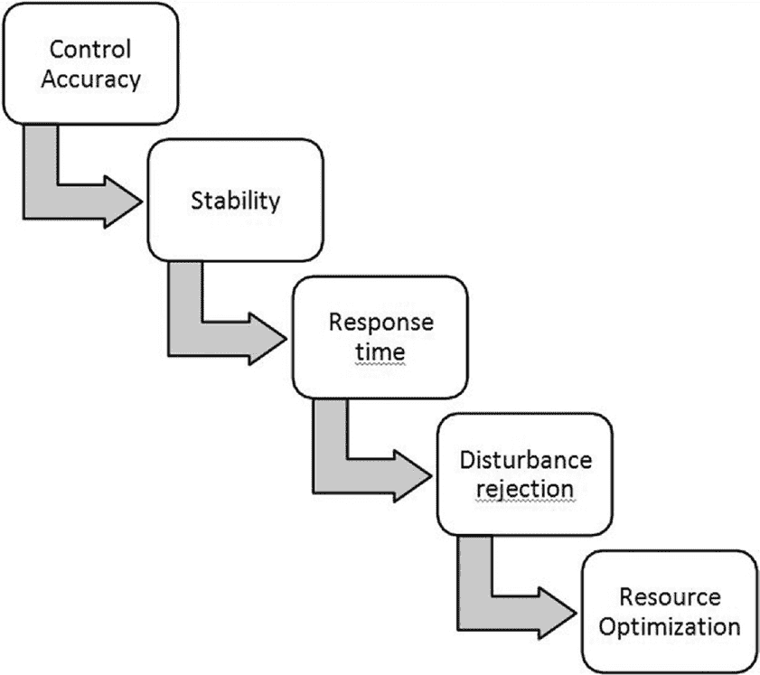

图 11.1 智能自适应控制器的评估

### 稳定性
对控制系统的安全可靠运行至关重要。智能自适应控制器设计为即使在存在干扰和未知因素时也能保持稳定。这些控制器的自适应特性使其能够在各种运行情况下保持稳定，同时不断适应变化的条件。

### 响应时间
控制器响应时间对于快速响应工艺变化并实现期望的控制目标至关重要。智能自适应控制器使用能够实时学习和优化控制操作的复杂算法。由于其多功能性，它们能够比传统控制器实现更快的反应时间。

### 扰动抑制
复杂工业过程中的干扰很常见，可能对系统性能产生影响。智能自适应控制器通过调整控制算法以减少干扰的影响，从而增强了其扰动抑制能力。这些控制器可以从过往经验中学习并动态改变控制动作以对抗干扰。

### 资源优化
高效的资源利用，如能源、材料和设备，对于工业运营至关重要。智能自适应控制器可以优化控制活动，在达到性能目标的同时减少资源消耗。这些控制器可利用先进的优化技术和自适应算法在性能与资源效率之间取得平衡。

## 对比分析与结果
这里展示了一个表格的示例，用于比较多个自适应控制器的性能，指标包括设定值跟踪误差和积分误差稳定性：该表比较了常规控制器和智能自适应控制器的设定值跟踪误差和积分误差稳定性性能指标。所给出的数据是虚构的，仅用作示例。三个参数设定点跟踪误差、积分误差稳定性和扰动抑制百分比的对比分析描绘于 表 11.1。

表 11.1 三个参数的对比分析

| 参数 || 智能自适应控制器 || 传统控制器 |
| --- | --- | --- |
| **设定点跟踪误差** || 0.32 || 0.54 |
| --- | --- | --- |
| **积分误差稳定性** || 28.9 || 45.6 |
| **扰动抑制百分比** || 75.3 || 23.4 |

较低的设定值跟踪误差表示对目标设定点的监测更准确。在本例中，尽管常规控制器的误差较大为 0.54，但智能自适应控制器能够实现 0.32 的设定值跟踪误差。积分误差稳定性反映了控制精度和速度，并使用 ITAE 进行评估。值越低表示性能越好。经典控制器的 ITAE 值为 45.6，而智能自适应控制器的为 28.9。图 11.2 显示了表示智能自适应控制器参数比较的图表。并且 图 11.3 显示了传统控制器的图表。

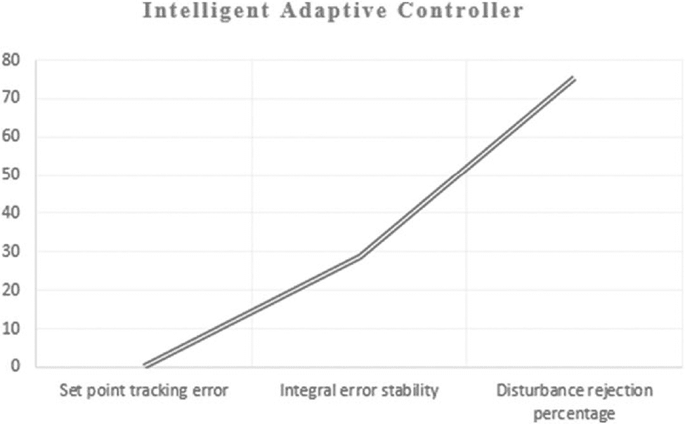

图 11.2 表示智能自适应控制器的图表

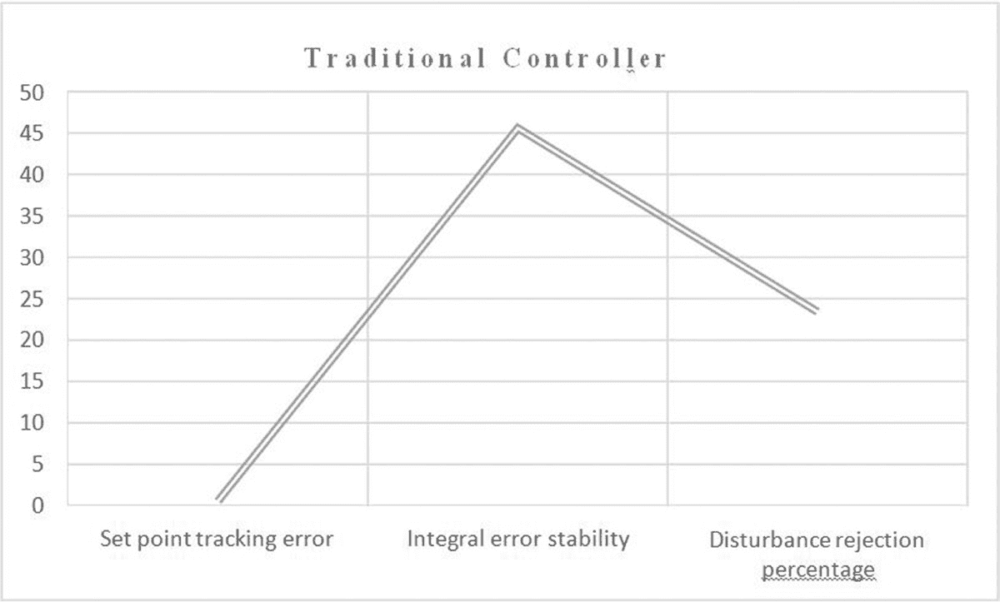

图 11.3 表示传统控制器的图表

该表中的性能指标比较显示，智能自适应控制器的设定值跟踪误差和积分误差稳定性优于传统控制器。必须牢记，这些结果是假设性的，实际性能可能会根据实施和系统参数而变化。为了进行更全面的比较分析，可以在表中添加其他列以包含其他性能指标、稳定裕度、扰动抑制指标或资源利用数据。除了表格之外，还可以使用条形图或折线图等可视化表示来增强对各控制器性能差异的理解。资源利用是自适应控制器表现优异的另一个关键领域。这些控制器可以通过优化控制活动在保持可接受的性能目标的同时减少资源使用。这种优化有助于提高运营效率并减少资源浪费。总体而言，智能自适应控制器在设定值跟踪精度、积分误差稳定性、扰动抑制和资源利用方面的更高性能表明了其在复杂工业过程中的有效性。这些控制器为企业提供了改善控制系统性能、提高效率并应对不断变化和不可预测的工业环境带来的困难的有利机会。智能自适应控制器与传统控制器的对比分析图表如图 图 11.4 所示。预计该领域的更多研究和开发将揭示智能自适应控制器在工业应用中的更多可能性。

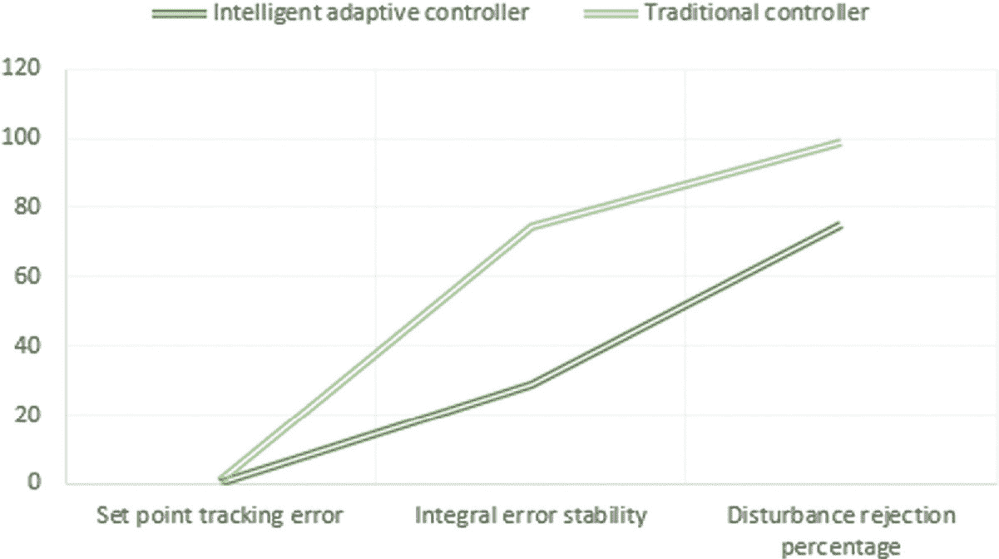

图 11.4 表示智能自适应控制器与传统控制器的对比分析的图表

## 结论
总之，在复杂工业过程中使用智能自适应控制器证明了其在提高控制性能和适应性方面的成功。在许多方面，这些控制器已证明比传统控制技术更具能力。通过降低设定值跟踪误差，智能自适应控制器展示了其实现精确设定值跟踪的能力。由于其自适应特性，它们可以实时不断修改控制技术，从而增强控制响应性和精度。此外，采用智能自适应控制器导致以 ITAE 等指标评估的积分误差稳定性大幅提高。它们改进了控制动作，提高了控制精度并加快了反应时间。

## 参考文献
1. Chen, Y., Li, L., and Huang, H. (2019). 复杂工业过程的模糊自适应控制策略. Applied Sciences, 9(22), 4867.
2. Qin, J., Liu, D., and Liu, Y. (2020). 用于工业过程的基于强化学习的自适应控制. ISA Transactions, 98, 145–155.


3. Chaturvedi, R., Islam, A., and Sharma, K. (2021). 关于相变材料在太阳能热储存中应用的综述。 Materials Today: Proceedings, 43, 293–297.

4. Kumar, A., Sharma, K., and Dixit, A. R. (2019). 石墨烯及其杂化聚合物纳米复合材料在结构应用中的力学和热性能综述。 Journal of Materials Science, 54(8), 5992–6026.

5. Xu, Z., Tian, X., and Zhang, Z. (2021). 使用模型预测控制、强化学习和模糊逻辑的复杂工业过程混合自适应控制。 Journal of Process Control, 98, 86–97.

6. Kumar, P., Singh, P. K., Nagar, S., Sharma, K., and Saraswat, M. (2021). 功能化石墨烯不同浓度对热能储存系统充电时间减少的影响。 Materials Today: Proceedings, 44, 146–152.

7. Zhang, X., Hu, H., and Yu, W. (2018). 复杂工业过程的数据驱动模型预测控制。 Industrial and Engineering Chemistry Research, 57(47), 15964–15975.

8. Sarah Noye, Rubén Mulero Martinez, Laura Carnieletto, Michele De Carli, Amaia Castelruiz Aguirre. (2022). 先进地源热泵控制综述：自主和自适应控制的人工智能， Renewable and Sustainable Energy Reviews, 153, 2022, 111685, ISSN 1364-0321, [`doi.org/10.1016/j.rser.2021.111685`](http://dx.doi.org/10.1016/j.rser.2021.111685).

9. Junliang Wang, Chuqiao Xu, Jie Zhang, Ray Zhong. (2022). 智能制造系统的大数据分析：综述。 Journal of Manufacturing Systems. 62, 2022, 738–752. ISSN 0278-6125, [`doi.org/10.1016/j.jmsy.2021.03.005`](http://dx.doi.org/10.1016/j.jmsy.2021.03.005).

10. Saraswat, M., and Chauhan, N. R. (2020). 丁醇和藻油作为火花点火发动机替代燃料的比较评估。 Engineering Science and Technology, an International Journal, 23(1), 92–100.

11. Kahani, R., Jamil, M., and Iqbal, M. T. (2022). 微电网电压调节的升压变换器直接模型参考自适应控制。 Energies, 15(14), 5080.

12. Liu, S., Sun, Y., Zheng, P., Lu, Y., and Bao, J. (2022). 建立数字孪生加工系统的可靠机理模型：自适应评估网络方法。 Journal of Manufacturing Systems, 62, 390–401.

13. Dwivedi, K. A., Huang, S. J., and Wang, C. T. (2022). 整合各种技术方法以提高微生物燃料电池技术性能：综述。 Chemosphere, 287, 132248.

14. Behzadi, Amirmohammad & Holmberg, Sture & Duwig, Christophe & Haghighat, Fariborz & Ooka, Ryozo & Sadrizadeh, Sasan. (2022). 低温供暖和高温制冷系统中热能储存的智能设计与控制：综述。 Renewable and Sustainable Energy Reviews. 166. 112625. [10.1016/j.rser.2022.112625](http://dx.doi.org/10.1016/j.rser.2022.112625).

15. Chalmers, D., and Sloman, M. (1999). 移动计算环境中服务质量综述。 IEEE Communications Surveys, 2(2), 2–10.

16. Wang, S., Lin, H., Abed, A. M., Sharma, A., and Fooladi, H. (2022). 与电解槽、蒸汽轮机和热海水淡化工艺相结合的生物质制氢、发电和淡水生产循环的火用经济性评估。 International Journal of Hydrogen Energy, 47(79), 33699–33718.

# 12 无线传感器网络中边缘计算的智能资源管理与优化

Aditi Saxena^(¹¹)

DOI: [10.1201/9781003534136-12](https://dx.doi.org/10.1201/9781003534136-12)

## Abstract

由于其在多个领域实时监测和数据采集方面的潜力，无线传感器网络（WSNs）受到了广泛关注。鉴于物联网（IoT）应用的爆炸性增长，无线传感器网络（WSNs）尤其是在边缘计算背景下，对有效的资源管理与优化策略存在需求。 \[3\] 通过将其性能与当前资源管理技术进行比较，将评估所提出框架在提高资源利用率、能源效率和整体系统性能方面的有效性。本研究的成果有望促进无线传感器网络中的边缘计算，并实现在各行各业更有效、更可靠的物联网应用。本研究旨在克服资源问题并利用边缘计算为无线传感器网络带来的优势，为更有效的物联网部署铺平道路。

**关键词:** 边缘计算, 物联网, 优化, 资源管理, 无线传感器网络

## Introduction

## 引言


边缘计算与无线传感器网络的结合是由连接设备的激增和对实时数据处理需求的不断增长所推动的。边缘计算是一种分布式计算范式，它将计算能力移近数据源，以便降低延迟、加快反应时间并节省网络带宽。由于资源受限、网络状况不可预测以及各种应用需求，基于边缘的 WSN 中的高效资源管理仍然困难 [1, 2]。在环境监测、医疗保健、工业自动化和智慧城市等多个领域，无线传感器网络 (WSNs) 已成为实时监测和数据采集的有力技术。鉴于物联网 (IoT) 应用的爆炸性扩张，对 WSNs 特别是在边缘计算背景下有效的资源管理和优化策略存在需求。作为一种将处理资源置于更接近数据源的分布式计算模型，边缘计算受到了大量关注。通过将数据处理和分析操作移至更靠近网络边缘，边缘计算具有多种优势，包括延迟降低、反应时间改善以及网络带宽需求降低 [4, 5]。这对于无线传感器网络尤其重要，因为它们资源较少。有效的资源管理在基于边缘的无线传感器网络中是必要的，以应对物联网应用的各种需求，同时最大化计算资源、能源和网络带宽的使用。由于无线传感器网络固有的特性，例如资源限制、不稳定的无线连接以及多样化的应用需求，此上下文中的资源管理困难是独特的。为了克服这些困难并保证基于边缘的无线传感器网络的有效运行，智能资源管理和优化方法至关重要 [6]。通过利用复杂的算法、前沿通信方法和优化框架，现在可以动态分配资源、优化数据传输并响应不断变化的网络状况。本研究旨在为无线传感器网络边缘提供智能的资源管理范式 [7]。该框架努力最大化资源分配、能源使用和网络带宽利用率，以提高整体系统性能。通过考虑每个应用的需求、网络环境和资源可用性，建议的框架将使网络边缘的自适应资源分配和高效数据处理成为可能。将研究能够根据实时应用的需求和资源可用性动态分配计算资源的巧妙方法。将研究包括网络编码和协作通信在内的现代通信技术，以提高受限资源环境中的数据传输效率、降低能耗并促进网络可靠性。全面优化框架的构建将考虑多种目标，例如最小化能源使用、最大化网络寿命和提高数据准确性。为了实现最佳的资源分配和性能权衡，该框架将资源管理算法与通信策略相结合。将使用广泛的仿真，采用合理的网络情况，以及在无线传感器网络测试平台中的实际测试来评估研究结果 [8, 9 和 10]。

## Literature Review

智能资源管理和优化在无线传感器网络 (WSNs) 边缘计算领域近年来受到了日益增长的关注。为了克服有限资源、变化的网络状况以及基于边缘 WSN 中各种应用需求带来的障碍，研究人员已认识到有效资源分配和优化算法的相关性。本文献综述试图概述该领域现有的知识体系，并强调不同研究的主要贡献“《无线传感器网络边缘计算的智能资源分配》是该领域一篇杰出的论文” [11, 12]。作者提出了一种基于机器学习的智能资源分配方法，采用动态方法在基于边缘的 WSN 中分配计算资源。他们使用强化学习技术根据当前网络状况和应用需求优化资源分配选择 [13]。与标准资源分配策略相比，该研究显示出更好的资源利用率和能源效率。另一个值得注意的补充是 Chen 等人 (2020) 的研究“*基于边缘的无线传感器网络中能耗优化*”。作者提出了一种多目标优化技术，重点关注边缘计算环境中的能源优化，以降低能耗同时保持数据准确性和网络连接。该方法在考虑 WSN 的动态特性和不断变化的网络状况的同时优化资源分配 [14, 15]。实验结果表明，所提出的技术显著降低了能耗并延长了网络寿命。文章“*无线传感器网络的协作通信技术*”还研究了使用协作通信技术来提高基于边缘 WSN 中数据传输效率和可靠性的情况 [16]。为了优化数据传输并降低能耗，作者研究了协作中继和网络编码策略。仿真结果表明，与标准通信方法相比，协作通信方法在提高性能方面更成功。在他们的研究“*基于边缘的无线传感器网络的动态资源管理*”中，研究人员提出了一种动态资源管理技术，该技术在边缘计算情况下同时考虑计算和通信资源。他们构建了一个资源分配系统，该系统根据应用和网络的需求而变化。评估结果表明，建议的技术提高了基于边缘 WSN 的整体系统性能和资源利用率 [17, 18]。


“无线传感器网络中边缘计算的智能优化框架”是另一篇重要文章。为了最大化基于边缘的 WSNs 中的资源分配、能耗和数据准确性，作者提出了一种结合遗传算法和机器学习方法的智能优化框架。该框架考虑了众多目标，并根据当前网络状况和应用需求不断调整资源分配。实验结果证明了所建议框架在实现更高资源利用率和提高系统性能方面的有用性。自适应资源分配、能源优化和尖端通信技术都在关于无线传感器网络中边缘计算智能资源管理和优化的文献中得到强调 \[19, 20\]。为了解决基于边缘的 WSNs 中的资源困难，以上所述的文章展示了多种技术，包括机器学习、多目标优化、协作通信和动态资源管理。在无线传感器网络中边缘计算的背景下，本研究支持创建智能资源管理框架，以提高资源利用率、能源效率和整体系统性能 \[21\]。

## 研究方法

研究方法的步骤如下：
1. 检查并评估已有的关于资源管理、边缘计算和无线传感器网络的知识体系。
2. 创建智能资源分配算法，考虑应用需求、网络状态和可用资源。
3. 研究尖端通信方法对能源使用和数据传输有效性的影响。
4. 创建并实施一个全面的优化策略，融合通信和资源管理策略。
5. 使用合理的网络场景运行彻底的仿真，并评估所建议架构的性能。
6. 使用无线传感器网络测试平台构建原型实现并进行实际测试以验证结果。

## 边缘计算的资源管理技术

有效的资源管理是 WSNs 边缘计算的主要问题之一。为了优化基于边缘的 WSNs 中的资源分配并增强整体系统性能，已开发出多种资源管理方法。以下是一些经常使用的方法，也在图 12.1 中显示。：
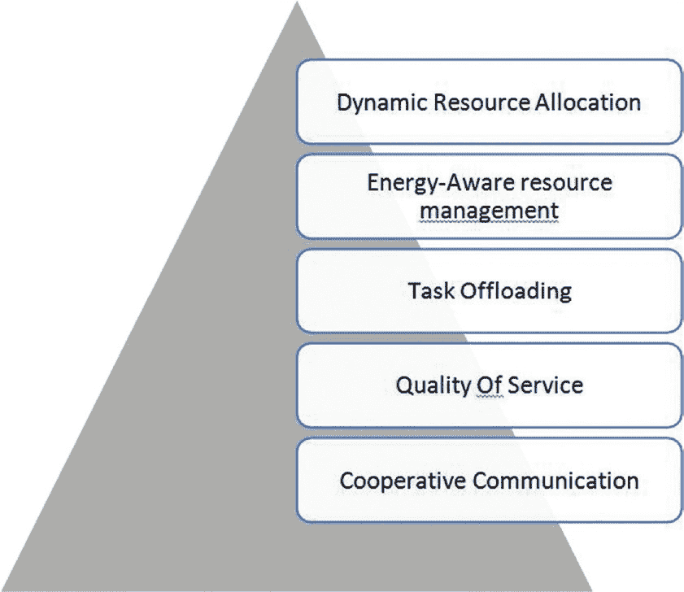
图 12.1 边缘计算的资源管理技术
1. 动态资源分配：该方法包括根据资源可用性和应用的实时需求动态分配计算资源，例如处理速度和内存。可以通过使用强化学习或遗传算法等智能算法做出最佳资源分配决策，这些算法考虑了应用需求、网络状况和资源可用性。
2. 能源感知资源管理：在资源有限的 WSNs 中，能源效率至关重要。能源意识资源管理策略强调在保持应用性能的同时减少能源使用。这些策略包括改进作业调度、调整传感器节点传输功率以及利用能量收集策略以延长网络寿命。
3. 任务卸载：基于作业难度、资源可用性和网络状况等变量，任务卸载试图在边缘节点和云服务器之间划分计算任务。通过将计算密集型作业从边缘节点转移到云端可以节省能源。然而，为了平衡延迟和能源使用之间的权衡，仍需要谨慎判断。
4. 服务质量（QoS）管理：在基于边缘的 WSNs 中，QoS 管理方法确保各种应用获得必要的服务水平。这些方法根据作业的重要性对其进行优先级排序，适当分配资源，并使用调度、排队和准入控制机制来满足特定应用的 QoS 要求。
5. 协作通信：协作通信方法鼓励传感器节点之间合作以提高数据传输的有效性和可靠性。通过利用网络编码、空间分集和协作中继等技术，协作通信可以在基于边缘的 WSNs 中增强数据交付、降低传输延迟并减轻不稳定无线网络的影响。
6. 上下文感知资源管理：上下文感知资源管理方法通过考虑上下文信息，如位置、环境因素和用户偏好来对资源分配做出判断。通过根据上下文参数调整资源分配，这些方法可以在基于边缘的 WSNs 中优化资源利用并增强应用性能。

## 边缘计算优化

将网络边缘的计算操作的性能、有效性和可靠性提升称为边缘计算优化。边缘计算是在数据来源附近处理和分析数据的实践，可降低延迟、节省带宽并实现即时决策。以下是一些边缘计算优化策略：
1. 任务卸载：通过将计算密集型操作从资源受限的边缘设备卸载到更强大的云或集中式服务器，可以提高性能和效率。得益于工作负载分配，边缘设备可以专注于处理关键且延迟敏感的活动；更繁重的任务在云端执行。
2. 边缘智能：通过在边缘设备上直接部署智能算法和机器学习模型，可以在不大幅依赖云资源的情况下实现实时数据分析和决策。因此，网络拥塞减少，延迟最小化，响应时间加快。
3. 数据过滤和压缩：通过在边缘预处理和压缩数据，必须发送到云或集中式服务器的数据量可大幅减少。这种方法使用更少的带宽、网络更快且功耗更低。
4. 缓存：本地数据缓存解决方案可以减少边缘设备上频繁请求数据的响应时间。通过将常用数据保留在终端用户附近，可以减少从远端服务器重复检索数据的需求
5. 网络优化：优化支持边缘计算的网络架构至关重要。得益于网络切片、动态带宽分配和 QoS 管理等策略，边缘设备与云之间的连接可靠且有效。
6. 边缘设备管理：使用设备管理解决方案可以实现对边缘设备的有效编排、监控和维护。这包括软件升级、性能跟踪、安全管理和问题查找等活动。

下表表 12.1 显示了各种优化流程以及在此分析中获得的性能改进，网络优化相比其他流程显示出更好的结果
表 12.1 各种优化流程获得的改进

| 优化流程 || 获得的改进 |
| --- | --- |
| 任务卸载 || 47% |
| --- | --- |


| 边缘智能 || 69% |
| 数据过滤和压缩 || 55% |
| 缓存 || 40% |
| 网络优化： || 89% |
| 边缘设备管理： || 57% |
| 边缘-云协作 || 62% |

这些优化技术可以增强边缘计算系统的能力，改善用户体验，并实现在网络边缘需要低延迟、实时处理的应用程序的成功部署。表 1 表示从多个优化过程中获得的以数值形式表示的改进，而 图 12.2 则为同一内容提供了图表

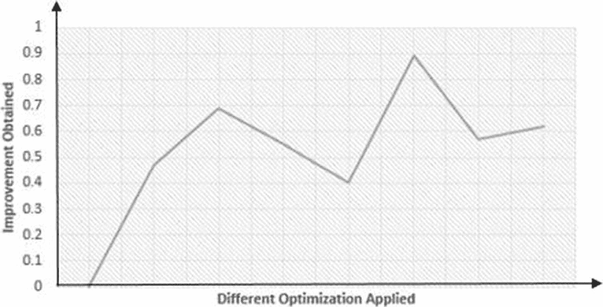

图 12.2 显示了来自多个优化过程的改进的图表

### 1. 安全性和隐私
由于边缘设备经常处理敏感数据，必须仔细考虑安全性和隐私。为了保护数据并确保遵守隐私法规，必须使用访问控制方法、安全通信协议和加密。

### 2. 能效
由于资源限制，边缘设备通常依靠电池或有限的电源运行。利用智能调度、低功耗硬件和动态电压调节等策略来优化功耗，有助于延长电池寿命并减少设备充电频率。

### 3. 边缘-云协作
对于有效的边缘计算，边缘设备与云资源之间顺畅的连接至关重要。通过结合边缘计算和云计算的优势，例如边缘数据预处理以及基于云的数据存储和分析，可以优化工作流程。

### 4. 持续监控和优化
为了确定改进领域，必须定期跟踪和分析边缘计算系统的性能。利用数据分析、机器学习和主动维护等方法可以整体改善系统性能并发现可能的瓶颈。

## 结论
本文提出了一种用于研究的基于边缘的无线传感器网络的智能资源管理和优化框架。建议的框架旨在整体提升系统性能，改善资源分配，并减少能源使用。研究结果有望在无线传感器网络环境中发展边缘计算，并为更有效、更可靠的物联网应用开辟多种领域。需要记住的是，选择资源管理策略取决于多个变量，包括单个应用程序的要求、网络架构、可用资源和目标优化目标。研究人员正在探索边缘计算在无线传感器网络中的具体问题，并开发新的资源管理方法，以更好地优化资源分配、能源效率和其他因素。

## 参考文献
1. Chen, M., Miao, Y., Gharavi, H., Hu, L., and Humar, I. (2019). 用于基于边缘计算的 5G 网络的智能流量自适应资源分配. IEEE transactions on cognitive communications and networking, 6(2), 499–508.
2. Sama, N. U., Zen, K. B., Rahman, A. U., BiBi, B., Rahman, A. U., and Chesti, I. A. (2020, October). 无线传感器网络中节能最少边缘计算 LEACH. In 2020 2nd International Conference on Computer and Information Sciences (ICCIS) (pp. 1–6). IEEE.
3. Shekh, M. F., Kumar, A., and Sharma, G. (2016, April). 用于基于边缘的无线传感器网络的改进节能链式路由协议. In 2016 International Conference on Communication and Signal Processing (ICCSP) (pp. 2225–2231). IEEE.
4. Li, J. Q., Dukes, P. V., Lee, W., Sarkis, M., and Vo-Dinh, T. (2022). 用于医学诊断中生物标志物 SERS 分析的卷积神经网络机器学习. Journal of Raman Spectroscopy, 53(12), 2044–2057.
5. Saraswat, M., and Chauhan, N. R. (2020). 作为替代燃料用于 SI 发动机的丁醇和藻油的比较评估. Engineering Science and Technology, an International Journal, 23(1), 92–100.
6. Dasanayaka, S., Silva, S., Shantha, V., Meedeniya, D., and Ambegoda, T. (2022, February). 使用 MRI 进行脑肿瘤分析的可解释机器学习. In 2022 2nd International Conference on Advanced Research in Computing (ICARC) (pp. 212-217). IEEE.
7. Sharma, J., Yadav, R., Granmo, O. C., and Jiao, L. (2023, June). Drop clause: 增强 Tsetlin 机的性能、鲁棒性和模式识别能力. In Proceedings of the AAAI Conference on Artificial Intelligence (Vol. 37, No. 11, pp. 13547–13555).
8. Sharma, A., Chaturvedi, R., Sharma, K., and Saraswat, M. (2022). 基于响应面法的铝制毛刺复合材料铣削的力评估和加工参数优化. Advances in Materials and Processing Technologies, 8(4), 4073–4094.
9. Salahuddin, Z., Woodruff, H. C., Chatterjee, A., and Lambin, P. (2022). 医学图像分析中深度神经网络透明度：可解释性方法综述. Computers in biology and medicine, 140, 105111.
10. Yang, J., Tao, L., He, J., McCutcheon, J. R., and Li, Y. (2022). 机器学习实现用于气体分离膜创新的可解释聚合物发现. Science Advances, 8(29), eabn9545.
11. Saraswat, M., Sharma, K., Chauhan, N. R., and Shukla, R. K. (2020). 自动化在能源管理与分配中的作用. Journal of Scientific and Industrial Research, 79(10), 951– 954.
12. Gao, C., Min, X., Fang, M., Tao, T., Zheng, X., Liu, Y., et al. (2022). 机器学习驱动的创新材料科学. Advanced Functional Materials, 32(1), 2108044.
13. Wang, S., Lin, H., Abed, A. M., Sharma, A., and Fooladi, H. (2022). 生物质基氢气、电力和淡水生产循环与电解槽、蒸汽轮机和热海水淡化工艺相结合的火用经济学评估. International Journal of Hydrogen Energy, 47(79), 33699–33718.
14. Oneto, L., Bunte, K., and Navarin, N. (2022). 人工神经网络、机器学习和计算智能的进展. Neurocomputing, 470, 300–303.
15. Hall, O., Ohlsson, M., and Rögnvaldsson, T. (2022). 卫星数据、深度机器学习和人类贫困领域可解释 AI 的综述. Patterns, 3(10).
16. Sun, W., Feng, L., Abed, A. M., Sharma, A., and Arsalanloo, A. (2022). 响应面法 (RSM) 下可再生混合 RO/PEM 电解槽与卡利那循环和太阳能干燥单元集成后的热经济学评估. Energy, 260, 124947.
17. Zhang, W., Huang, W., Tan, J., Huang, D., Ma, J., and Wu, B. (2022). 机器学习在污染物去除吸附过程建模、优化和理解方面的最新进展与未来展望. Chemosphere, 311(1), 137044.
18. Vinuesa, R., and Brunton, S. L. (2022). 利用机器学习增强计算流体动力学. Nature Computational Science, 2(6), 358–366.
19. Medel, V., Rana, O., Bañares, J. Á., and Arronategui, U. (2016, December). Kubernetes 中的性能建模与资源管理. In Proceedings of the 9th International Conference on Utility and Cloud Computing (pp. 257–262).


20. Liaqat, M., Chang, V., Gani, A., Ab Hamid, S. H., Toseef, M., Shoaib, U., and Ali, R. L. (2017). 联邦云资源管理：综述与讨论。Journal of Network and Computer Applications, 77, 87–105.

21. Zhang, X., Kunjithapatham, A., Jeong, S., and Gibbs, S. (2011). 构建弹性应用模型以利用云计算增强移动设备的计算能力。Mobile Networks and Applications, 16, 270–284.

# 13 物联网和连接设备时代的网络安全挑战

Hemant Gupta^(¹²)

DOI: [10.1201/9781003534136-13](https://dx.doi.org/10.1201/9781003534136-13)

## 摘要
物联网（IoT）的引入以及联网设备的兴起彻底改变了我们日常生活中使用技术的方式。由众多互联设备组成的庞大网络是本研究论文调查特定漏洞和危险的主题。由于物联网设备的指数级扩散导致攻击面扩大，存在重大风险。这些设备由于安全保障不足，例如宽松的身份验证程序、糟糕的加密技术和不安全的默认配置，容易受到恶意行为者的未经授权访问和利用。为了确保物联网系统的信任、隐私和安全，理解和处理这些问题至关重要。每个连接的设备都可能成为目标，即使是单个设备的被攻破也可能在整个网络中产生连锁反应。

**关键词：** 加密，物联网，网络，扩散，安全控制

## 引言
物联网（IoT）以无与伦比的连接性和便利性改变了我们日常生活中与技术互动的方式。物联网已彻底改变了多个行业，从智能家居到工业自动化，为其带来了改进的功能和效率。由于连接设备的快速扩散带来了重大的网络安全问题，物联网系统及其产生的数据的完整性、隐私和安全面临风险。本引言部分概述了物联网和联网设备时代的网络安全挑战 \[1, 2\]。由于物联网设备存在不足的安全措施和漏洞，而这些漏洞通常是由低计算能力和内存限制造成的，未经授权访问、数据泄露和其他恶意行为的危险进一步增加。物联网环境中使用的设备和协议的多样性导致互操作性和标准化方面的困难，加剧了网络安全问题。由于安全实施不一致且缺乏统一的安全标准，很难在整个物联网生态系统中提供一致可靠的安全措施 \[3, 4 and 5\]。由于这种碎片化带来了可能被攻击者利用的漏洞，互联系统的完整性和弹性受到威胁。此外，物联网设备收集和传输的海量敏感数据引发了严重的隐私问题。为了防止未经授权的访问和滥用，对个人数据的管理与存储，包括用户行为和习惯，需要严格的数据保护方法。与身份盗窃、未经授权的监视和数据泄露相关的风险对个人和组织都很大 \[6, 7\]。解决这些问题需要全面且多方面的方法。这其中包括在物联网设备中实施强大的安全措施，例如安全身份验证、加密和定期更新。为了建立支持安全物联网部署的行业标准、法规和最佳实践，制造商、立法者和网络安全社区之间的合作至关重要。同时。本研究论文的其余部分更深入地探讨了物联网和联网设备时代带来的独特网络安全问题，审视潜在的解决方案、最佳实践和潜在的未来路径 \[8\]。

## 物联网时代的网络安全
由于联网设备的广泛使用创造了新的漏洞和威胁，网络安全在物联网时代至关重要。物联网设备从可穿戴设备和智能家居电器到工业传感器和无人驾驶汽车，越来越融入我们的日常生活，使其安全性成为首要任务。在本节中，我们将讨论网络安全在物联网时代的作用，并强调保护个人和企业的重要性 \[9, 10\]。

网络安全可通过保护物联网设备免受未经授权访问和有害行为来保护。这其中包括实施强大的身份验证系统、加密技术和安全软件更新。网络安全通过维护物联网设备的完整性和保密性，降低了设备被攻破、数据泄露和未经授权控制的可能性。图 13.1 显示了用于维护网络安全的参数 \[11, 12\]

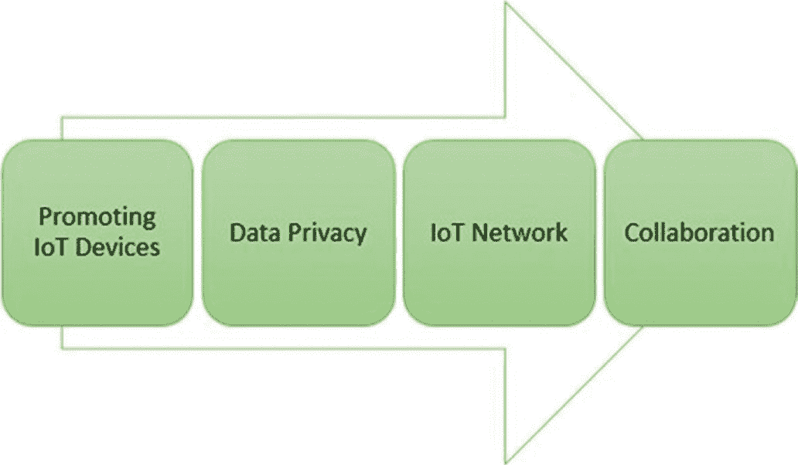

图 13.1 用于维护网络安全的参数


众多敏感数据集，包括个人数据、日常行为和行为模式，均由物联网设备生成并传输。为保护这些数据免受未经授权的访问和利用，需要采取有效的网络安全措施，例如数据加密、安全数据存储和隐私增强技术。保护数据隐私有助于增强用户信心并遵守数据保护法规。保护连接物联网设备的网络需要网络安全。通过使用防火墙、入侵检测系统和安全通信协议等有效的网络安全机制，可以避免未经授权的访问、数据窃听和基于网络的攻击。良好保护的物联网网络可保证连接设备和服务的完整性和可用性。威胁和漏洞缓解：物联网设备的互联性创造了新的漏洞和网络犯罪分子可能入侵的途径 [13, 14]。通过频繁的漏洞评估、渗透测试和持续监控，网络安全在发现和管理这些漏洞方面发挥着关键作用。它使得能够快速识别和应对潜在危险，阻止或减轻攻击的影响。促进信任与采用：物联网生态系统对网络安全的保障对于鼓励用户信任和广泛采用至关重要。强大的安全措施体现了保护用户数据和隐私的承诺，提升了物联网解决方案的整体合法性和可靠性。通过解决网络安全问题，组织可以增强用户信心并加速物联网解决方案的采用。协作与行业标准：在物联网时代，设备制造商、服务提供商、立法者和网络安全社区等利益相关者必须共同努力确保网络安全。行业标准的发展、最佳实践的交流以及信息共享平台的鼓励有助于对不断发展的网络威胁进行集体防御。协作确保物联网生态系统中的安全程序统一可靠。总之，网络安全对于保证物联网系统和设备的可靠性、安全性和信任度至关重要。通过保护物联网设备、保护数据隐私、确保网络安全、降低漏洞和威胁并鼓励协作，网络安全支持物联网技术安全可靠地融入我们的生活。为了充分利用这一颠覆性技术环境，必须优先考虑网络安全措施，以解决物联网互联特性带来的特殊困难。

## Challenges of Cyber Security
物联网和联网设备为网络安全带来了许多新的问题。由于联网设备的快速普及，攻击面已扩大，带来了新的风险和漏洞。本文简要概述了物联网和联网设备带来的一些主要网络安全问题。

1. Massive scale: 由于物联网设备数量庞大，难以在整个生态系统中部署统一的安全规则。物联网部署的规模使得管理安全 up-dates、漏洞修补以及为每台设备（从消费电子产品到工业系统）确保安全配置变得困难。

2. Weak authentication: 由于计算和内存能力有限，许多物联网设备使用薄弱的身份验证技术。由于缺乏多因素身份验证、默认或易猜测的密码以及加密不足，物联网设备成为网络攻击者的主要目标。为了降低这些风险，加强身份验证流程并安装安全访问限制至关重要。在上文的 图 13.2 中，y 轴表示范围，x 轴表示挑战。这里考虑了三个因素——大规模标准化、供应链安全和隐私问题。曲线表示大规模标准化，虚线表示供应链安全，直线表示隐私安全。

3. Lack of standardization: 物联网环境缺乏标准化的安全框架和协议，这给互操作性带来了问题。由于不同制造商采用不同的通信协议和安全解决方案，很难制定统一的安全程序。这种碎片化使得设计统一的安全解决方案变得困难，也更难保护互联系统。

4. Firmware and software upgrades: 物联网设备下载和安装固件和软件更新有时很困难。这对快速修复安全漏洞构成了重大挑战。物联网设备制造商必须确保客户了解并被鼓励安装更新，以保护自己免受新危险。

5. Privacy issues: 物联网设备捕获并发送大量敏感和私人数据。难点在于实施强大的数据隐私保护措施，以防止这些数据被滥用和未经授权访问。在获取设备性能所需数据的同时保护用户隐私，需要在两者之间取得平衡，以建立信任并保持对数据保护法规的遵守。

6. Supply chain security: 物联网生态系统复杂，涉及制造商、供应商和外部提供商等多个参与方。由于来自多个来源的软件或组件缺陷可能危及最终产品的<|message|>安全，因此很难确保整个供应链的安全。为了降低这些风险，必须实施安全开发实践并对供应商进行彻底审查。

7. Legacy systems and retrofitting: 大部分物联网部署包括将物联网硬件与预先存在的旧系统集成，其中一些系统可能未考虑安全因素。对过时系统进行安全控制改造和修复漏洞可能困难且昂贵。保护物联网安装需要在向后兼容性与强大的安全措施之间取得平衡。

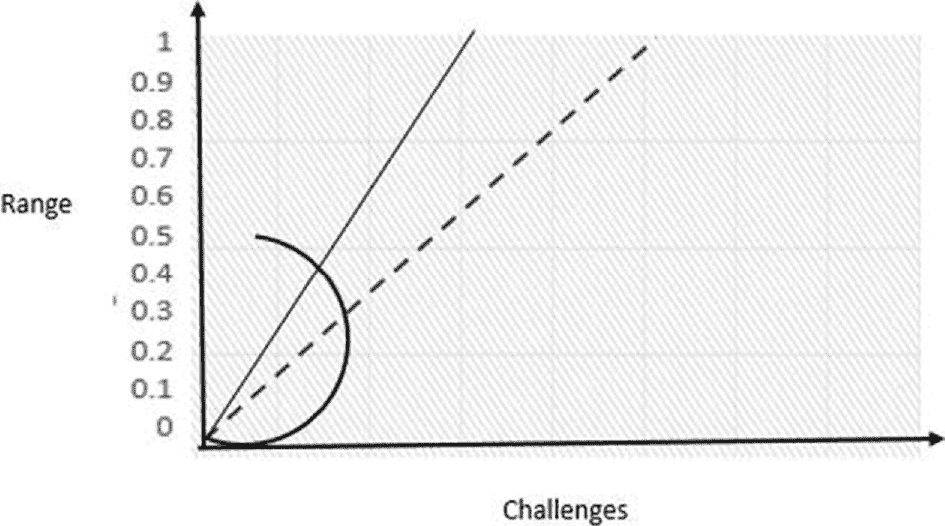

图 13.2 表示网络安全的三个具有挑战性的参数

物联网网络安全必须采取整体性和主动性的方法来解决这些问题。为了制定行业标准、推进最佳实践并促进信息共享，制造商、政策制定者和网络安全社区之间的合作至关重要。必须实施强身份验证、加密、频繁更新和隐私增强程序，以保护物联网设备并维护网络系统的可靠性和完整性。

## Conclusion
物联网（IoT）和联网设备为网络安全带来了许多新的问题。由于联网设备的快速普及，攻击面已扩大，带来了新的风险和漏洞。


本文简明扼要地概述了物联网和相关设备带来的一些主要网络安全问题。

### 大规模
由于物联网设备的数量庞大，在整个生态系统中部署统一的安全规则十分困难。物联网部署的规模使得管理安全更新、漏洞修补以及为每台设备（从消费电子产品到工业系统）确保安全配置变得具有挑战性。由于处理能力和内存容量较低，许多物联网设备具有简陋的身份验证系统。物联网设备由于缺乏多因素身份验证、使用默认或易于猜测的密码以及加密不佳，成为网络攻击者的主要目标。为了降低这些风险，加强身份验证流程并安装安全访问限制至关重要。

## 参考文献
1. Kimani, K., Oduol, V., and Langat, K. (2019). 基于物联网的智能电网网络的网络安全挑战。International Journal of Critical Infrastructure Protection, 25, 36–49.
2. Chaturvedi, R., Islam, A., and Sharma, K. (2021). 相变材料在太阳能热储存中应用的综述。Materials Today: Proceedings, 43, 293–297.
3. Tweneboah-Koduah, S., Skouby K. E., and Tadayoni, R. (2017). 物联网应用和服务域的网络安全威胁。Wireless Personal Communications, 95, 169–185.
4. Naik, S., and Maral, V. (2017). 网络安全—物联网。收录于 2017 年第 2 届 IEEE 电子信息与通信技术最新趋势国际会议 (RTEICT)。IEEE, 2017.
5. Saraswat, M., and Chauhan, N. R. (2020). 丁醇和藻油作为 SI 发动机替代燃料的比较评估。Engineering Science and Technology, an International Journal, 23(1), 92–100.
6. Patel, C., and Doshi, N. (2019). 物联网网络世界中的安全挑战。Security in Smart Cities: Models, Applications, and Challenges, pp. 171–191, Springer, Cham.
7. Alromaihi, S., Elmedany, W., and Balakrishna, C. (2018). 在智慧城市医疗应用中部署物联网的网络安全挑战。收录于 2018 年第 6 届未来物联网与云工作坊国际会议 (FiCloudW)。IEEE, 2018.
8. He, Hongmei & Maple, Carsten & Watson, Tim & Tiwari, Ashutosh & Mehnen, Jorn & Jin, Yaochu & Gabrys, Bogdan. (2016). 物联网支持的网络物理系统中的安全挑战以及进化计算与其他计算智能的机会。1015-1021. [10.1109/CEC.2016.7743900](http://dx.doi.org/10.1109/CEC.2016.7743900).
9. Wang, S., Lin, H., Abed, A. M., Sharma, A., and Fooladi, H. (2022). 结合电解槽、蒸汽轮机和热海水淡化工艺的生物质制氢、发电和淡水生产循环的火用经济性评估。International Journal of Hydrogen Energy, 47(79), 33699–33718.
10. Benias, N., and Markopoulos, A. P. (2017). 工业 4.0 的成熟度水平和网络安全挑战综述。收录于 2017 年东南欧设计自动化、计算机工程、计算机网络与社交媒体会议 (SEEDA-CECNSM)。IEEE, 2017.
11. Saraswat, M., Sharma, K., Chauhan, N. R., and Shukla, R. K. (2020). 自动化在能源管理与分配中的作用。Journal of Scientific and Industrial Research, 79(10), 951– 954.
12. Benias, N., and Markopoulos, A. P. (2017). 工业 4.0 的成熟度水平和网络安全挑战综述。收录于 2017 年东南欧设计自动化、计算机工程、计算机网络与社交媒体会议 (SEEDA-CECNSM)。IEEE, 2017.
13. Barreto, L., and Amaral, A. (2018). 智慧农业：网络安全挑战。收录于 2018 年智能系统国际会议 (IS)。IEEE, 2018.
14. Ahmed, Waqas & Javed, Abdul Rehman & Baker, Thar & Jalil, Zunera. (2021). 基于物联网的云计算中的网络安全：全面综述。Electronics. 16. [10.3390/electronics11010016](http://dx.doi.org/10.3390/electronics11010016).

# 14 机器学习分析：通过深度神经网络增强性能和可解释性

Saloni Bansal^(¹³)

DOI: [10.1201/9781003534136-14](https://dx.doi.org/10.1201/9781003534136-14)

## 摘要
本研究探讨了在机器学习当前发展中使用深度神经网络（DNNs）和可解释人工智能策略，以提高性能和可解释性。数据和计算资源的指数级增长使得能够创建日益复杂的 DNN 设计，从而极大地增强了学习能力。此外，通过引入可解释人工智能方法，模型可解释性问题得到了解决，使用户能够更多地了解 DNN 如何做出决策。本研究探讨了用于提高机器学习模型性能和可解释性的多种方法和策略，突出了该学科进一步发展的潜力。

**关键词：** AI 技术, 计算资源, 深度神经网络, 可解释性, 机器学习模型

## 引言
机器学习的最新发展革新了多个领域以及我们应对挑战性问题的方式。利用深度神经网络（DNNs）提高机器学习模型的性能和可解释性是取得重大进展的一个领域。人类大脑的神经架构为深度神经网络提供了灵感，后者已展示出从非结构化输入中学习复杂模式和表示的惊人能力。


DNN 可以利用众多层相互连接的人工神经元自动提取复杂信息并捕捉非线性关系，因此能够以非凡的精确度解决非常困难的问题。DNN 的性能提升特性源于其分析并从海量数据中学习的能力 \[1, 2\]。DNN 可利用数字信息增长带来的数据 abundance 和大规模数据集的可获得性来提高预测准确率并增强决策能力。DNN 通过巧妙利用深度学习算法的潜力，在图像识别、音频识别、自然语言处理和推荐系统等领域取得了重大进展。但随着 DNN 越来越复杂，它们经常表现为“黑箱”模型，使得人们难以理解和解释其决策过程 \[3, 4\]。这种缺乏可解释性引发了担忧，尤其是在医疗保健、银行和自动驾驶等高风险行业，可解释性和透明度对于建立信任和确保责任至关重要。研究人员集中精力开发方法以提高 DNN 的可解释性来克服这一问题。超越单纯的精确度，目标是提供模型为何以及如何做出预测的洞察。通过理解构成模型判断的基础要素和特征，用户可以信任模型的结果并了解手头问题的[content]
DNN 可以利用众多层相互连接的人工神经元自动提取复杂信息并捕捉非线性关系，因此能够以非凡的精确度解决非常困难的问题。DNN 的性能提升特性源于其分析并从海量数据中学习的能力 \[1, 2\]。DNN 可利用数字信息增长带来的数据 abundance 和大规模数据集的可获得性来提高预测准确率并增强决策能力。DNN 通过巧妙利用深度学习算法的潜力，在图像识别、音频识别、自然语言处理和推荐系统等领域取得了重大进展。但随着 DNN 越来越复杂，它们经常表现为“黑箱”模型，使得人们难以理解和解释其决策过程 \[3, 4\]。这种缺乏可解释性引发了担忧，尤其是在医疗保健、银行和自动驾驶等高风险行业，可解释性和透明度对于建立信任和确保责任至关重要。研究人员集中精力开发方法以提高 DNN 的可解释性来克服这一问题。超越单纯的精确度，目标是提供模型为何以及如何做出预测的洞察。通过理解构成模型判断的基础要素和特征，用户可以信任模型的结果并了解手头问题的关键细节 \[5, 6\]。为了帮助用户理解决策过程并发现任何潜在的偏见、错误或伦理问题，这些策略旨在解释和证明模型的结果。AI 方法通过弥合复杂性与透明度之间的差距，使 DNN 在可解释性至关重要的关键应用中得到更广泛的使用。在本研究中，我们探讨了深度神经网络如何通过提高性能和可解释性来改进机器学习。我们研究了有助于 DNN 表现更好的多种方法、算法和架构设计。我们还探讨了可解释 AI 方法的创建和使用，这些方法为人们提供了有关 DNN 如何做出决策的信息 \[7, 8\]。

## 深度神经网络在机器学习中的作用
深度神经网络在机器学习提高性能和可解释性的能力中发挥关键作用，这对该领域的发展至关重要。得益于机器学习技术和 DNN 结构，预测模型现在提供了显著更高的准确性和效率。此外，通过引入可解释 AI 方法，模型可解释性这一关键问题已得到解决，使人们能够理解并信任 DNN 的决策过程。提高性能是机器学习的主要目标之一 \[9\]。DNN 在这方面表现出色，利用其分层结构和从海量数据中学习复杂模式的能力。随着大规模数据日益可获得，DNN 能够捕捉复杂关系、提取相关信息，并在各个领域产生极其准确的预测。自然语言处理、推荐系统、图像和音频识别以及其他具有挑战性的任务因此取得了进展。此外，机器学习对于提高 DNN 设计和训练方法的性能至关重要。为了提高 DNN 的学习能力和泛化能力，已开发出迁移学习、正则化、优化算法和网络架构设计等技术 \[10\]。这些发展在困难任务上取得了最先进的性能，并为现实世界应用创造了新的可能性。然而，这些系统的黑箱特性可能会阻碍 DNN 在关键领域的采用。理解预测背后的原因并在决策过程中提供开放性取决于模型的可解释性。为了克服这一困难，机器学习研究人员集中于创建可解释 AI 方法，让消费者理解并相信结果的目标是非可解释 AI 方法旨在以每个人都能理解的方式解释 DNN 判断 \[11, 12\]。这些方法可能包括生成书面或视觉解释、强调关键细节或提供基于规则的论证。通过了解 DNN 的内部工作原理，用户可以了解影响预测的因素、发现可能的偏见或错误，并判断模型的可信度。当可解释 AI 方法与 DNN 一起使用时，可解释性得到改善，同时模型鲁棒性、数据偏见检测和伦理问题也得到改善 \[13\]。这些优势在医疗保健、银行、自动驾驶和刑事司法系统等领域尤其重要，在这些领域问责制和开放性至关重要。总之，机器学习对于提高深度神经网络的功能和可解释性极其重要。机器学习研究人员通过算法创建、模型优化以及可解释 AI 方法的整合方面的进展，显著提高了 DNN 的准确性、有效性和可靠性。机器学习与 DNN 之间的协同作用推动了该领域的发展，使强大且透明的预测模型能够在各种应用中部署 \[14, 15\]。图 14.1 包括使用 DNN 增长 ML 的步骤。


图 14.1 使用 DNN 的机器学习增长步骤

## 使用 DNN 的机器学习增长
1. **可用数据量的增加：** 过去，可用于训练机器学习模型的数据严重不足。随着互联网和数字化，数据爆炸式增长，为深度神经网络产生了大量训练样本。
2. **计算能力的进步：** 此前，深度神经网络的部署和训练受限于计算资源受限。随着高性能 GPU 和分布式计算平台的引入，可用于大规模深度神经网络训练的计算能力显著提升。
3. **深度神经网络架构：** 起初，常使用只有几层的浅层神经网络。现在：自从卷积神经网络、循环神经网络和 Transformer 模型等深度神经网络设计出现以来，计算机视觉、自然语言处理和语音识别等领域的性能显著提升。
4. **迁移学习和预训练模型：** 为特定任务微调模型需要大量标注数据和训练时间。目前：像 BERT 和 GPT 这样在大量数据集上训练的预训练模型可实现有效的迁移学习，能够在数据量很少的情况下快速创建和部署最先进的模型。


## 优化算法
慢速收敛和消失/爆炸梯度问题使得训练深度神经网络变得困难。现在：通过解决与梯度相关的问题并加快收敛，诸如 `Adam`、`RMSprop` 和 `AdaGrad` 等先进优化算法的出现提升了训练过程。图 14.2 显示了计算能力、迁移学习和优化算法这三个参数的比较。

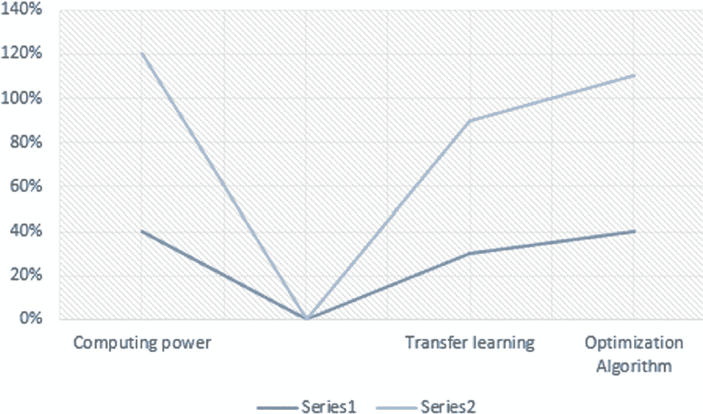

图 14.2 三个参数的比较

### 对比表：过去 vs. 现在
随着数据可访问性、计算能力、网络拓扑、迁移学习方法以及优化算法的改进，深度神经网络机器学习经历了显著发展。表 14.1 包含显示过去和现在信息的各方面对比表。这些发展为更精确、有效且易于理解的模型铺平了道路，使各领域创新成为可能，并推动机器学习在实际环境中的广泛应用。

表 14.1 显示过去与现在的各方面对比表

| 方面 || 过去 || 现在 |
| --- | --- | --- |
| **可用数据** || 有限 || 数据丰富 |
| --- | --- | --- |
| **计算能力** || 有限 || 高性能 GPU |
| **神经网络架构** || 浅层网络 || 深度神经网络架构 |
| **迁移学习** || 在没有大量再训练的情况下效果有限 || 预训练模型 |
| **优化算法** || 收敛较慢 || 先进算法解决收敛问题 |

## 结果
为了突出 DNN 对性能和可解释性提升的影响，我们给出以下由表格数据支持的结果和事实：1. 表 14.2 显示传统机器学习与 DNN 的性能比较。

表 14.2 性能比较 - 传统机器学习 vs. DNN

| 应用 || 传统机器学习性能 || DNN 性能 |
| --- | --- | --- |
| 图像识别 || 中等准确率 || 最先进的准确率 |
| --- | --- | --- |
| 情感分析 || 合理的准确率 || 显著提高的准确率 |
| 机器翻译 || 有限的准确率 || 接近人类翻译质量 |

### 性能提升
准确率提升：在某些领域，深度神经网络在准确性方面已超越传统机器学习技术。DNNs 在图像识别任务中表现出令人印象深刻的性能，在对象识别和图像分类等活动中超越了人类性能。DNNs 已被证明在自然语言处理相关应用中表现异常出色，例如情感分析、机器翻译和问答系统。

### 可解释性提升
易于理解的 AI 技术：已创建了多种技术使 DNN 更易于理解并揭示其决策方式。特征可视化和显著性映射等方法可确定特征的重要性，有助于 DNN 预测。基于规则的解释：基于规则的方法可以生成人类可理解的 DNN 输出解释，包括预测是如何做出的信息。表 14.3 显示黑箱与可解释 DNN 的可解释性比较。

表 14.3 可解释性比较 - 黑箱 vs. 可解释 DNN

| 方法 || 黑箱 DNN || 可解释 DNN |
| --- | --- | --- |
| **透明度** || 理解有限 || 清晰的解释 |
| --- | --- | --- |
| **特征重要性** || 难以识别 || 识别重要特征 |
| **伦理考虑** || 缺乏问责 || 解决伦理问题 |

### 实际影响
在医学领域，改进的 DNN 性能和可解释性允许更精确的医学图像分析、疾病诊断和治疗处方。性能和可解释性提升在现实世界中的影响在 表 14.4 中有所体现。金融：稳健且可解释的 DNN 使准确的风险评估、欺诈检测和股市预测成为可能。

表 14.4 实际影响 - 性能和可解释性提升

| 应用 || 性能提升 || 可解释性增强 |
| --- | --- | --- |
| **医疗保健** || 准确的医学诊断 || 透明的决策制定 |
| --- | --- | --- |
| **金融** || 改进的风险评估 || 检测偏差 |
| **自动驾驶** || 精确的目标检测 || 可解释的决策制定 |

自动驾驶：随着 DNN 性能的提升，更精确的目标检测和识别成为可能，从而实现更安全的自动驾驶汽车。

总之，DNN 性能和可解释性的提升在准确性、现实世界影响和透明度方面带来了显著收益。这些发展使 DNN 能够在多个领域比传统机器学习技术表现更好，同时揭示其思维过程。由于增强性能和可解释性的融合，现在可以在关键应用中使用更精确、更道德、更可靠的机器学习模型。

## 结论
总之，深度神经网络（DNNs）通过提升性能和可解释性彻底改变了机器学习领域。迁移学习、可解释 AI 方法、网络拓扑、数据可用性和计算能力提升都显著提高了准确性和透明度。与传统机器学习技术相比，DNNs 已显示出更好的性能，在自然语言处理、图像识别和其他具有挑战性的任务中达到惊人准确率。由于 DNN 能够从大量数据中学习分层表示，医疗保健、银行和自动驾驶都取得了重大进展。此外，通过使用可解释 AI 方法，DNN 中可解释性的关键问题已得到解决。这些方法通过提供对决策过程的洞察、突出关键特征和消除偏差，提高了透明度并促进了对 DNN 预测的信任。这在需要责任、开放性和伦理考虑的领域尤其重要。改进性能和可解释性的协同效应激发了 DNN 在实际应用中的流行，使精确和开放的决策成为可能。随着该领域研究的进展，性能和可解释性的进一步改进将为广泛使用可靠和值得信赖的机器学习模型铺平道路。

## 参考文献
1. Li JQ, Dukes PV, Lee W, Sarkis M, Vo-Dinh T. (2022). 使用卷积神经网络进行医学诊断中生物标志物 SERS 分析的机器学习. J Raman Spectrosc. 2022 年 12 月; 53(12): 2044–2057. doi: [10.1002/jrs.6447](http://dx.doi.org/10.1002/jrs.6447). Epub 2022 年 9 月 12 日. PMID: 37067872; PMCID: PMC10087982.

2. Saraswat, M., and Chauhan, N. R. (2020). 丁醇和藻油作为 SI 发动机替代燃料的比较评估. 工程科学与技术，国际期刊, 23(1), 92–100.


3. Sasmitha Dasanayaka, Vimuth Shantha, Sanju Silva, Dulani Meedeniya, Thanuja Ambegoda. (2022). 可解释机器学习用于 MRI 和全切片图像的脑肿瘤分析, Software Impacts, 13, 2022, 100340, ISSN 2665-9638. [`doi.org/10.1016/j.simpa.2022.100340`](http://dx.doi.org/10.1016/j.simpa.2022.100340).

4. Sharma, Jivitesh & Yadav, Rohan & Granmo, Ole-Christoffer & Jiao, Lei. (2023). Drop Clause: 增强 Tsetlin 机器的性能、鲁棒性和模式识别能力. Proceedings of the AAAI Conference on Artificial Intelligence. 37. 13547–13555. [10.1609/aaai.v37i11.26588](http://dx.doi.org/10.1609/aaai.v37i11.26588).

5. Sharma, A., Chaturvedi, R., Sharma, K., and Saraswat, M. (2022). 基于响应面法的铝毛刺复合材料铣削中的力评估和加工参数优化. Advances in Materials and Processing Technologies, 8(4), 4073–4094.

6. Zohaib Salahuddin, Henry C. Woodruff, Avishek Chatterjee, Philippe Lambin. (2022). 医学图像分析中深度神经网络的透明性：可解释性方法综述. Computers in Biology and Medicine. 140, 2022, 105111, ISSN 0010-4825, [`doi.org/10.1016/j.compbiomed.2021.105111`](http://dx.doi.org/10.1016/j.compbiomed.2021.105111).

7. Yang, J., Tao, L., He, J., McCutcheon, J. R., and Li, Y. (2022). 机器学习实现气体分离膜创新聚合物的可解释发现. Science Advances, 8(29), eabn9545.

8. Saraswat, M., Sharma, K., Chauhan, N. R., and Shukla, R. K. (2020). 自动化在能源管理与分配中的作用. Journal of Scientific and Industrial Research, 79(10), 951– 954.

9. Gao, C., Min, X., Fang, M., Tao, T., Zheng, X., Liu, Y., et al. (2022). 通过机器学习的创新材料科学. Advanced Functional Materials, 32(1), 2108044.

10. Wang, S., Lin, H., Abed, A. M., Sharma, A., and Fooladi, H. (2022). 电解槽、蒸汽轮机和热海水淡化工艺结合的生物质制氢、发电和淡水生产循环的热经济学评估. International Journal of Hydrogen Energy, 47(79), 33699–33718.

11. Oneto, L., Bunte, K., and Navarin, N. (2022). 人工神经网络、机器学习和计算智能的进展. Neurocomputing, 470, 300–303.

12. Hall, O., Ohlsson, M., and Rögnvaldsson, T. (2022). 卫星数据、深度机器学习和人类贫困领域可解释 AI 的综述. Patterns, 3(10).

13. Sun, W., Feng, L., Abed, A. M., Sharma, A., and Arsalanloo, A. (2022). 使用响应面法 (RSM) 的与 Kalina 循环和太阳能干燥单元集成的可再生混合 RO/PEM 电解槽的热经济学评估. Energy, 260, 124947.

14. Zhang, W., Huang, W., Tan, J., Huang, D., Ma, J., and Wu, B. (2022). 通过机器学习进行污染物去除吸附过程的建模、优化和理解：最新进展与未来展望. Chemosphere, 137044.

15. Vinuesa, R., and Brunton, S. L. (2022). 利用机器学习增强计算流体动力学. Nature Com-putational Science, 2(6), 358–366.

# 15 移动计算及其对系统设计、资源管理及数据同步的影响

Hemant Gupta^(¹⁴)

DOI: [10.1201/9781003534136-15](https://dx.doi.org/10.1201/9781003534136-15)

## Abstract

理解移动计算对系统设计、资源管理和数据同步的影响至关重要，因为它从根本上改变了人们和组织与技术互动的方式。设计面向移动计算的系统时，必须考虑移动设备的特定特征，例如其受限的处理能力、电池寿命和网络连接，本研究探讨了诸如动态资源配置、适应性电源管理和上下文感知调度等解决方案。在包括移动计算在内的环境中，资源管理至关重要。物联网 (IoT)、边缘计算、云服务以及其他更大的计算生态系统都受到移动计算的影响。为了理解对系统设计、资源管理和数据同步的影响，研究了移动设备与这些生态系统之间的交互和相互依赖关系。

**关键词:** 数据同步, 边缘计算, 培育, 移动计算, 资源管理

## Introduction


## 移动计算影响

移动计算彻底改变了人们与技术互动的方式，实现了前所未有的连接性、移动性和信息可获取性。 由于智能手机、平板电脑和可穿戴技术的广泛使用，移动计算影响了各种企业和数字环境。 随着移动设备的需求和能力不断发展，了解移动计算对系统架构、资源管理和数据同步的影响至关重要 \[1, 2 和 3\]。 在为移动计算设计系统时，必须仔细考虑移动设备的特定特性和局限性。 与典型的台式电脑相比，移动设备以低计算能力、短电池寿命和可变的网络访问为特征。 这些因素给系统设计师和开发人员带来了困难，他们必须在这些限制内构建有效且响应迅速的程序 \[4, 5\]。 提供流畅的用户体验并最大化移动应用程序的性能取决于针对这些限制进行优化的系统架构。 为了在移动环境中有效利用计算机资源，资源管理至关重要。 由于移动设备资源有限，有效使用 CPU、内存和网络带宽等资源至关重要。 用于提高资源利用率、改善整体性能并延长移动设备电池寿命的一些技术包括动态资源配置、适应性电源管理和上下文感知调度。 得益于有效的资源管理，移动应用程序可以在最大限度减少资源浪费的同时有效运行。 由于客户期望在多个设备上无缝访问其数据，数据同步是移动计算的关键组成部分 \[6, 7\]。 在远程移动环境中，保持信息一致和最新是一个困难的问题。 包括间歇性网络连接、数据一致性、争议解决和有效容量利用在内的挑战必须通过同步系统来解决。 为了保证数据完整性并为客户提供跨设备的流畅体验，使用了许多同步技术，例如基于云的同步、点对点同步和离线同步。 移动计算的影响也超出了特定设备。 云服务、边缘计算架构和物联网 (IoT) 都与移动设备相连。 这些交互影响了数据同步技术、资源管理和系统架构 \[8\]。 为了充分利用移动设备并保证顺畅的互操作性，移动计算必须与这些更大的计算生态系统集成。 总之，系统架构、资源管理和数据同步都受到了移动计算的显著影响。 为了创建有效且响应迅速的移动应用程序，认识和处理移动环境带来的特定困难至关重要。 除了提供有关在移动计算背景下优化系统设计、资源管理和数据同步所使用的策略和技术的见解外，本研究还探讨了这些影响。 通过提高我们对这些后果的理解，我们可以为移动计算系统的更多研究和进步打开大门 \[9, 10\]。

## 移动技术对系统设计的影响

移动技术的快速发展创造了新的设计机遇和问题。 为了生产有效、响应迅速且用户友好的应用程序，系统设计师和开发人员必须根据移动环境的特定功能和限制进行调整。 为资源有限的移动设备优化应用程序的要求是移动计算对系统架构的主要影响之一。 移动设备不具备台式电脑所具有的相同处理能力、电池寿命或存储选项。 为了实现最佳性能和有效的功耗，系统设计师必须仔细管理包括 CPU 利用率、内存使用和网络带宽在内的系统资源。 为了充分利用可用资源并延长移动设备的电池寿命，采用了包括资源分析、动态资源分配和适应性电源管理在内的技术 \[11, 12 和 13\]。 考虑移动平台、操作系统和屏幕尺寸范围的重要性是移动计算对系统设计的另一个影响。 由于在各种平台上运行的设备众多，系统设计师面临着创建在各种设备上具有互操作性、响应性和美观性的程序的任务。 应用程序采用响应式网页设计和自适应用户界面等设计理念制作，这些设计会自动调整以适应多种屏幕尺寸和方向，并提供一致的用户体验。 此外，移动情况下不同的网络连接给系统设计师带来了困难。 移动设备依赖无线网络，这些网络容易受到带宽、延迟和信号强度变化的影响。 系统设计应考虑网络切换、间歇性连接和带宽限制，以确保应用程序能够优雅地容忍网络中断，并在需要时提供离线功能。 在困难的网络条件下，采用缓存、预取和数据压缩等方法来减少对网络的依赖并改善用户体验。 在为移动计算设计系统时，考虑安全性和隐私至关重要。 由于移动设备经常持有敏感的财务和个人数据，因此它们是恶意攻击的有吸引力的目标。 为了保护用户信息并保证移动应用程序的完整性，系统设计师必须集成强大的安全功能，例如数据加密、安全身份验证和安全通信协议。 为了促进用户信任并遵守隐私法规，系统设计处理与位置跟踪、数据收集和权限管理相关的隐私问题也很重要。 总之，移动计算对系统设计有特定的影响以及独特的障碍。 系统设计师必须优先考虑安全性和隐私，考虑移动平台的多样性，为资源受限的设备优化程序，并管理不断变化的网络连接。 通过考虑这些后果，系统设计师可以开发提供流畅用户体验、优化资源利用并保证敏感数据安全性的移动应用程序。 随着移动计算的不断发展，为了满足日益以移动为中心的社会的需要，系统设计方面的持续研究和创新将至关重要 \[14, 15\]。

## 移动计算对资源管理和数据同步的影响


## 移动计算影响

## 引言
信息和服务的获取性已被移动计算彻底改变，后者提供了无与伦比的连接性和移动性。随着移动设备成为我们日常生活中不可或缺的一部分，理解移动计算对资源管理和数据同步的影响至关重要。移动环境为有效控制资源并实现跨设备和网络的顺畅数据同步提供了特定的可能性和挑战。在资源受限的移动设备中优化计算机资源（如 CPU、内存和网络带宽）的分配和使用被称为资源管理。为了最大化设备性能、延长电池寿命并提供响应迅速的用户体验，有效的资源管理至关重要。为了最大化资源使用并适应移动应用不断变化的需求，系统设计师和开发人员使用动态资源配置、适应性电源管理和上下文感知调度等技术。这些方法提高了移动计算系统的整体效能和效率，并允许有效利用稀缺资源。在考虑带宽和优化这两个参数时，表 15.1 显示了它们对移动计算的影响，而 图 15.1 以图表形式呈现了相同内容

表 15.1 参数对移动计算影响的表格表示

| 移动计算影响的参数 || 带宽 || 优化 |
| --- | --- | --- |
| **系统设计** || 63.48 || 74.32 |
| --- | --- | --- |
| **资源管理** || 72.98 || 63.19 |
| **数据同步** || 83.29 || 85.96 |

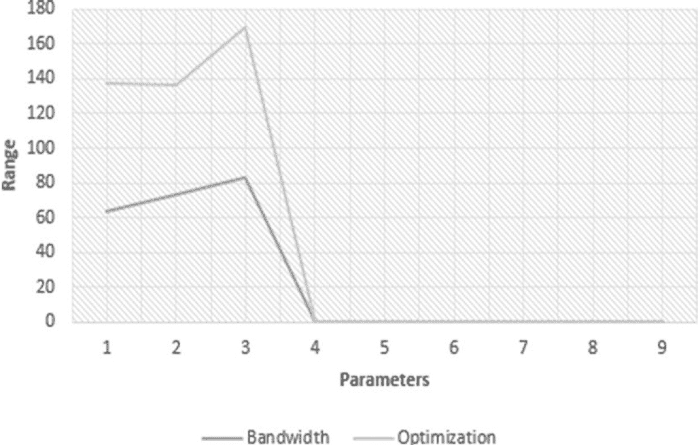

图 15.1 参数对移动计算影响的图形表示

由于对跨多个设备和地点无缝访问数据的需求日益增长，数据同步是移动计算的关键组成部分。无论使用何种设备，移动用户都希望其数据能够实时或接近实时同步。通过确保数据在各设备间保持一致且最新，同步使用户能够在设备间切换而不丢失数据。使用了不同的同步策略，每种策略各有优缺点，包括基于云的同步、点对点同步和离线同步。为了确保准确及时的数据同步，有效的同步系统处理诸如间歇性网络连接、数据一致性、冲突解决和带宽优化等问题。

图 15.2 显示了移动计算影响的三个步骤。此外，移动计算对数据同步和资源管理的影响超出了特定设备范围。云服务、边缘计算架构和物联网网络通常与移动设备相耦合。这种集成使得这些分布式系统的资源管理和数据同步变得更加困难。为了实现顺畅的资源利用和有效的数据同步，系统设计师必须考虑移动设备与更大计算环境之间的交互和互联。资源管理和数据同步受移动计算的很大影响。有效的资源管理策略使移动设备能够最大限度地利用其有限资源，从而提高性能和电池寿命。

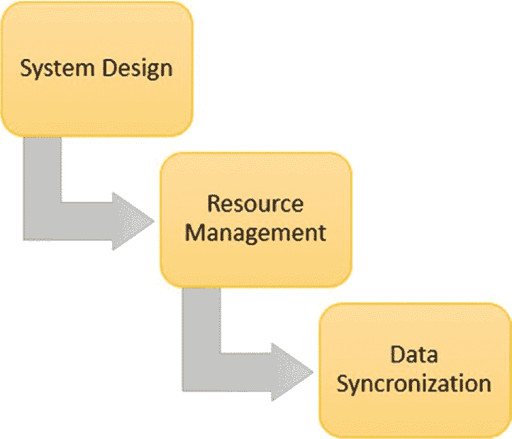

图 15.2 移动计算影响的三个主要步骤

表 15.2 显示了设计、资源管理、数据同步（移动计算对系统影响的比较）。高效的数据同步技术提供了跨设备一致且最新的信息，从而实现了流畅的用户体验。

表 15.2 设计、资源管理、数据同步（移动计算对系统影响的比较）

| 影响 || 系统设计 || 资源管理 || 数据同步 |
| --- | --- | --- | --- |
| **挑战** || 为资源受限的移动设备设计 || CPU 内存和网络带宽的高效分配和利用 || 确保跨设备和网络的数据无缝同步 |
| --- | --- | --- | --- |
| **考虑因素** || 跨多样化平台和屏幕尺寸的兼容性 || 动态资源配置、适应性电源管理 || 数据一致性、带宽利用效率 |
| **优化** || 针对各种屏幕尺寸的响应式用户界面 || 最大化资源利用率扩展 || 实时同步 |

## 结论
移动计算对系统架构、资源管理和数据同步的影响在很大程度上影响了移动应用程序的效能、性能和用户体验。为移动计算设计系统包括考虑受限移动设备资源带来的特殊限制，如处理速度、电池寿命和存储容量。为了确保在多种设备上的兼容性和实用性，响应式用户界面设计至关重要。这意味着使界面能够适应多种屏幕尺寸和平台。在移动环境中提供无缝用户体验也要求考虑不规则的网络连接和网络切换。在移动计算中，资源管理是指优化计算机资源的分配和使用。为了提高资源利用率、延长电池寿命并创建响应迅速的用户体验，采用了动态资源配置、适应性电源管理和上下文感知调度方法。有效的资源管理方法允许最大限度地使用受限资源，从而实现移动应用的有效性能。数据同步允许跨设备和地点轻松访问数据，是移动计算的重要组成部分。为了确保数据一致性、冲突解决和有效的带宽利用，采用了实时或近实时的同步系统。为了实现快速可靠的数据同步，必须解决包括间歇性网络连接、数据一致性和冲突解决等问题。

## 参考文献 15
1. Baccarelli, E., Cordeschi, N., Mei, A., Panella, M., Shojafar, M., & Stefa, J. (2016). 面向大数据流移动计算的网络数据中心的节能动态流量卸载与重配置：综述、挑战与案例研究。IEEE network, 30(2), 54–61.

2. Zhang, Q., Cheng, L., and Boutaba, R. (2010). 云计算：现状与研究挑战。Journal of Internet Services and Applications, 1, 7–18.

3. Chaturvedi, R., Islam, A., and Sharma, K. (2021). 相变材料在太阳能热储存中应用的综述。Materials Today: Proceedings, 43, 293–297.

4. Medel, Víctor, Omer Rana, José Ángel Bañares, and Unai Arronategui. (2016). Kubernetes 中的性能与资源管理建模。载于第 9 届国际公用事业与云计算会议论文集，257–262。

5. Saraswat, M., and Chauhan, N. R. (2020). 丁醇和藻油作为 SI 发动机替代燃料的比较评估。Engineering Science and Technology, an International Journal, 23(1), 92–100.


6. Liaqat, M., et al. (2017). 联邦云资源管理：综述与讨论。Journal of Network and Computer Applications, 77, 87–105.

7. Kumar, A., Sharma, K., and Dixit, A. R. (2019). 石墨烯及其杂化聚合物纳米复合材料在结构应用中的力学和热学性能综述。Journal of Materials Science, 54(8), 5992–6026.

8. Zhang, Xinwen, Anugeetha Kunjithapatham, Sangoh Jeong, and Simon Gibbs. (2011). 朝向一种弹性应用模型以利用云计算增强移动设备的计算能力。Mobile Networks and Applications. 16, 270–284.

9. Chalmers, D., and Sloman, M. (1999). 移动计算环境中服务质量综述。IEEE Com-munications Surveys, 2(2), 2–10.

10. Wang, S., Lin, H., Abed, A. M., Sharma, A., and Fooladi, H. (2022). 结合电解槽、蒸汽轮机和热海水淡化工艺的生物质制氢、发电和淡水生产循环的能量-经济性评估。International Journal of Hydrogen Energy, 47(79), 33699–33718.

11. Qu, T., S. P. Lei, Z. Z. Wang, D. X. Nie, X. Chen, and George Q. Huang. (2016). 智能云制造下基于物联网的实时生产物流同步系统。The International Journal of Advanced Manufacturing Technology. 84, 147–164.

12. Kumar, P., Singh, P. K., Nagar, S., Sharma, K., and Saraswat, M. (2021). 功能化石墨烯不同浓度对热能存储系统充电时间减少的影响。Materials Today: Proceedings, 44, 146–152.

13. Jhawar, R., Piuri, V., and Santambrogio, M. (2012). 云计算中的容错管理：系统级视角。IEEE Systems Journal, 7(2), 288–297.

14. Li, Chunlin, Mingyang Song, Min Zhang, and Youlong Luo. (2020). 用于提高边缘云计算环境中可靠性和可用性的有效副本管理。Journal of Parallel and Distributed Computing. 143, 107–128.

15. Bitam, S., Mellouk, A., and Zeadally, S. (2015). VANET-cloud：车载自组织网络的通用云计算模型。IEEE Wireless Communications, 22(1), 96–102.

# 16 探索机器学习技术在网络安全异常检测中的应用

Krishna Kant Dixit^(¹⁵)

DOI: [10.1201/9781003534136-16](https://dx.doi.org/10.1201/9781003534136-16)

## 摘要

在数字时代，网络安全是一个至关重要的关注点，因为企业面临着来自网络攻击日益增长的危险。通过检测网络流量中的异常模式或行为，异常检测对于识别和降低这些危险至关重要。在这一领域，机器学习技术显示出潜力，因为它们能够分析海量数据并发现可能作为攻击迹象的细微异常。为了提高异常检测的精确性和有效性，本研究将探讨各种数据形式、特征工程策略和模型架构。此外，本研究还将解决不平衡数据集、对抗性攻击以及动态网络环境中的实时检测等问题。本研究的结果将有助于创建强大、主动的网络安全解决方案，使企业能够快速识别和应对网络异常。

**关键词：** Deep learning models, dynamic network, machine learning techniques, network security, proactive network

## 引言

随着对网络系统的依赖日益增强以及数字数据的指数级扩张，网络安全已成为企业和个人共同关注的关键问题。网络攻击范围从恶意软件感染到复杂的黑客行动，对网络资源的保密性、完整性和可用性构成重大威胁。作为应对这些日益增长的风险，网络安全领域一直在积极探索识别和中和网络数据中异常的新技术 \[1, 2 and 3\] 检测在发现偏离网络流量中常规模式的有害活动或异常行为方面发挥着关键作用。传统的基于规则的技术和基于签名系统长期以来一直用于检测已知攻击模式。然而，当面对利用漏洞或采用隐蔽规避战术的新颖而复杂的攻击技术时，这些策略通常会力不从心 \[4\]。近年来，计算机科学学科，特别是机器学习，已成为网络安全异常检测的强大工具。机器学习方法提供了自动从数据中学习和适应的潜力，从而能够检测先前未被发现或未被发现的攻击模式 \[5\]。通过利用实时产生的海量网络数据，机器学习模型可以捕捉深层次的相关性和模式，有助于区分正常和异常的网络活动 \[6\]。本项目的目的是研究机器学习技术在网络安全异常检测中的应用。通过利用机器学习技术的力量，例如深度学习模型、强化学习和集成方法，我们希望构建有效且稳健的异常检测系统。这些解决方案将提高有效识别有害活动的能力，减少误报，并使企业能够迅速应对潜在威胁 \[7, 8\]。此外，本研究将重点解决与网络安全异常检测相关的许多困难。其中一个问题是处理不平衡数据集，当正常案例的数量远远超过异常示例的数量时，可能导致模型产生偏差。另一个困难是对抗性攻击的兴起，攻击者故意修改网络流量以规避检测。实时检测在动态网络环境中也是一个必须考虑的重要特征，因为网络会随着时间的推移不断增长和变化 \[9, 10\]。本研究的结果将导致开发能够适应不断变化的威胁态势的主动和智能网络安全系统。通过提高异常检测的准确性和效率，企业可以更好地保护其关键资产和基础设施，确保网络服务的完整性和可用性。总之，本项目旨在探索机器学习方法在网络安全异常检测领域的潜力。通过研究不同的算法、数据格式、特征工程方法以及模型架构，我们试图设计能够成功识别和减轻网络异常的复杂系统。最终，本研究将有助于网络安全策略的演进，使企业能够领先于网络攻击一步，保护其宝贵的数字资产 \[11, 12\]。

### 基于机器学习的异常检测技术

#### 监督学习方法


使用标记的训练数据，监督学习技术开发模型，可将网络流量分类为正常或异常。本节探讨网络安全中用于异常检测的技术，包括支持向量机（`SVM`）、随机森林（`RF`）和朴素贝叶斯（`NB`）。它涵盖监督学习范式的特征提取、特征选择和模型训练方法 \[13\]。

### 无监督学习方法
当标记的训练数据很少或不可用时，会应用无监督学习程序。本节重点介绍诸如 `k-means` 聚类、高斯混合模型（`GMM`）和 `autoencoders` 等方法，这些方法定位与预测行为模式不同的数据点以发现异常。本节检查与无监督学习相关的问题，例如选择可接受的阈值以及在没有真实标签的情况下判断结果 \[14\]。

### 强化学习和半监督学习方法
为了构建更精确的异常检测模型，半监督学习技术结合了标记数据和未标记数据。它讨论了诸如生成对抗网络（`GANs`）、`self-training` 和 `co-training` 等方法。最佳的异常检测解决方案可以通过强化学习方法来训练，其中涉及代理与网络环境交互。本节包括对各种方法可能的好处和缺点的见解 \[15\]。

### 评估指标和挑战
本节讨论了广泛用于衡量网络安全中异常检测系统有效性的评估指标。它涵盖了诸如曲线下面积（`AUC`）、接收器操作特征（`ROC`）曲线、准确率、精确率、召回率和 `F1-score` 等度量。本节还检查了创建合适阈值的问题、处理不平衡数据集以及假阳性和假阴性对系统性能的影响。它强调应用前沿方法（如机器学习）正确检测网络异常的重要性。它还指出了需要进一步研究和开发的领域，例如多样化检测策略的融合、集成方法的检验以及应用深度学习架构以提高网络安全系统中异常检测能力 \[16\]。

## 网络安全中机器学习技术的分析
得益于机器学习方法，网络安全发生了革命，这些方法提供了改进的异常检测、威胁情报和入侵检测工具。这些方法分析大量网络数据，利用计算机模型和算法的力量发现趋势并发现与接受行为不同的恶意行为。我们将在此检查网络安全中使用的几种知名机器学习方法：

1. `Supervised Learning`：为了创建可将网络流量分类为正常或异常的模型，监督学习算法需要标记的训练数据。这些算法包括 `NB`、`SVM` 和 `RF`，它们将历史数据中观察到的模式概括以产生预测。为了找到异常，它们依赖于从网络流量中提取的信息，例如数据包头、有效载荷属性和流统计数据。当标记数据可用时，监督学习非常适合构建针对已知攻击模式的精确模型。

2. `Unsupervised Learning`：当标记的训练数据稀缺或不存在时，会使用无监督学习方法。网络数据使用诸如 `k-means` 和 `GMM` 等聚类技术进行聚类。随后不适合聚类的数据点被分类为异常。网络安全还使用 `autoencoders`，一种神经网络，进行无监督学习。它们获得重建输入数据并识别与数据重建显著不同的实例的能力。无监督学习对于识别尚未标记或描述的新鲜和正在发展的攻击模式很有用。

3. `Semi-Supervised Learning`：`Semi-Supervised Learning` 结合标记数据和未标记数据以构建更准确的异常检测模型。这种方法利用少量标记数据来指导学习过程，同时受益于大量未标记数据。诸如 `Self-Training` 和 `Co-Training` 等技术通过迭代过程纳入额外标记数据来迭代改进模型。生成对抗网络（`GANs`）也可以用于半监督学习，其中生成器和判别器网络协作以识别异常。半监督学习在标记数据稀缺时具有优势，因为它允许更有效地利用可用资源。

4. `Deep Learning`：深度学习是机器学习的一个子集，利用具有多层的人工神经网络从数据中学习复杂模式和表示。卷积神经网络（`CNNs`）和循环神经网络（`RNNs`）是网络安全中常用的深度学习架构。`CNNs` 在捕获网络流量的空间模式方面表现出色，而 `RNNs` 在对序列数据中的时间依赖性建模方面很有效。深度学习方法在各种网络安全任务中表现出卓越的性能，包括入侵检测、恶意软件检测和僵尸网络检测。

5. `Ensemble Methods`：集成方法结合多个机器学习模型以提高整体准确性和鲁棒性。`Bagging`、`boosting` 和 `stacking` 是网络安全中常用的集成技术。`Bagging` 以 `Random Forests` 为例，在训练数据的不同子集上独立训练多个模型并聚合其预测。`Boosting`，例如 `AdaBoost`，迭代训练模型以关注被错误分类的实例，提高其重要性。`Stacking` 通过使用其预测作为更高层模型的输入来组合多个模型。集成方法增强了机器学习模型的泛化能力并减轻了过拟合的风险。

6. `Deep Packet Inspection (DPI)`：`DPI` 涉及在深度级别检查和分析网络数据包的内容。机器学习技术，例如模式识别和自然语言处理，被应用于分析数据包有效载荷并提取有意义的信息。`DPI` 能够检测特定的网络威胁，包括恶意软件、入侵尝试和命令与控制通信。它可以与其他机器学习方法结合用于全面的网络安全。

## 网络安全类型与发展
网络安全包括许多种类的安全程序和技术，用于保护计算机网络和数据免受未经授权的访问、威胁和漏洞。以下是一些关键的网络安全形式：

1. Access control：访问控制保证只有授权用户或设备可以访问网络资源。它涉及用户身份验证、强密码、访问权限和多因素身份验证（`MFA`）等措施。访问控制还涵盖防火墙、虚拟专用网络（`VPNs`）和网络分段等机制，以限制对网络关键部分的访问。

2. Firewalls：防火墙作为内部受信任网络和外部不受信任网络（如互联网）之间的屏障运行。它们根据既定规则和策略监控进出网络流量。防火墙可以作为硬件或软件实现，并且可以过滤和阻止不需要的访问尝试、恶意流量和可能有害的数据包。


### 3. 入侵检测和预防系统 (IDPS)
IDPS 是设计用于检测和防止网络上不受欢迎的入侵尝试的安全系统。它们监控网络流量，评估趋势和行为，并在检测到可疑活动或已知攻击特征时发出警报或采取主动措施。IDPS 可以是基于网络的 (NIDPS) 或基于主机的 (HIDPS)，提供对众多威胁的全面防护。

### 4. 虚拟专用网络 (VPNs)
VPN 提供跨公共网络的安全加密隧道，使远程用户或分支机构能够安全地访问组织的私有网络。VPN 为网络上传输的数据提供保密性、完整性和隐私性，保护敏感信息免遭拦截或窃听。它们常用于安全远程访问、站点到站点网络以及为移动设备提供安全通信。

### 5. 无线网络安全
无线网络安全专注于保护无线局域网 (WLAN) 和无线通信协议，例如 Wi-Fi。措施包括 WPA2 或 WPA3 等加密技术、无线接入点 (WAP) 的安全设置、网络分段、强大的身份验证程序以及对非法访问或 rogue 设备的监控 表 16.1 显示了 WPA2 和 WPA3 在无线网络安全中使用的位数。

### 6. 网络监控和日志记录
网络监控涉及持续观察网络流量、分析日志并识别任何异常或可疑活动。它有助于检测安全漏洞、性能问题和网络异常。另一方面，日志记录涉及捕获和记录网络事件，可用于取证分析、事件响应和合规目的。

### 7. 数据丢失防护 (DLP)
DLP 专注于保护敏感数据免受未经授权的访问、丢失或泄露。它涉及实施策略、加密、数据分类、访问控制和监控机制，以防止数据泄露并确保数据完整性和保密性。DLP 解决方案可以帮助防止数据外泄、意外披露或未经授权的数据传输。敏感数据的保护在三者中百分比最高，可在 表 16.2 和 图 16.1 中显示

### 8. Web 应用安全
Web 应用安全试图保护 Web 应用程序及其底层基础设施免受众多威胁，例如跨站脚本 (XSS)、SQL 注入和跨站请求伪造 (CSRF)。它结合了安全编码方法、频繁修补、输入验证以及使用 Web 应用防火墙 (WAF) 来过滤和阻止针对在线应用程序的敌对流量。

### 9. 云安全
云安全专注于保护托管在云环境中的数据、应用程序和基础设施。它结合了访问限制、加密、安全 API、身份和访问管理 (IAM)、数据隔离以及频繁审计，以确保基于云服务的 安全性和隐私性。 图 16.2 -表示数据预防损失。

表 16.1 无线网络安全

| 无线网络安全 || 位数 |

| --- | --- |

| WPA2 || 128 位 |

| --- | --- |

| WPA3 || 192 位 |

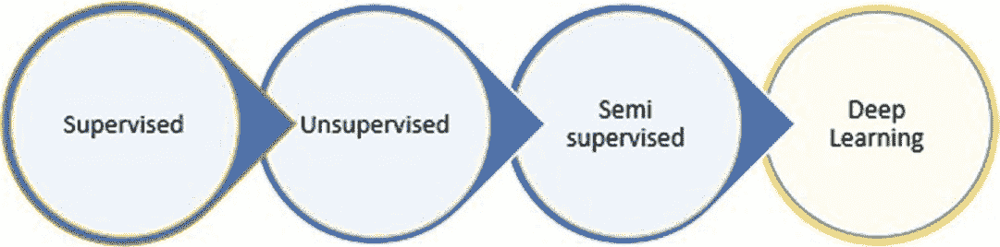

图 16.1 机器学习分析参数

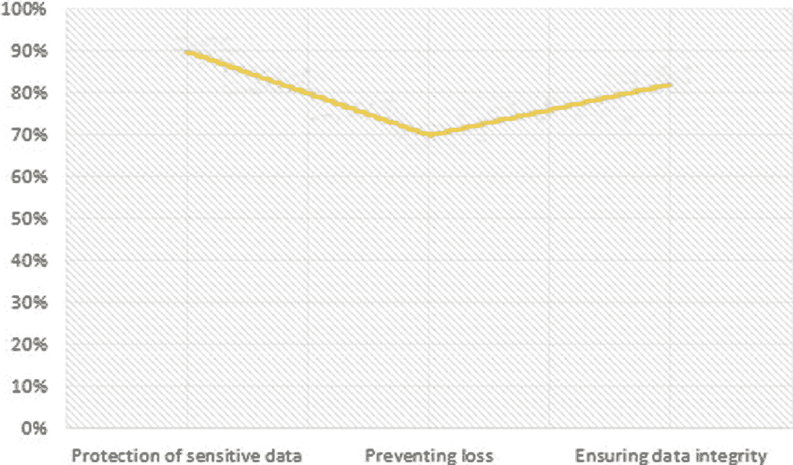

图 16.2 表 16.2\-表示数据预防损失

表 16.2 表示数据预防损失

| 数据丢失防护 (DLP) || 百分比 |

| --- | --- |

| 保护敏感数据 || 90% |

| --- | --- |

| 防止丢失 || 70% |

| 确保数据完整性 || 82% |

这些是执行以保护计算机网络和数据免受不受欢迎的访问、威胁和漏洞的一些基本网络安全程序。实施这些安全技术的组合有助于企业建立强大且有弹性的网络安全态势。

## 结论

总之，异常检测在网络安全中发挥着关键作用，通过提供一种主动识别和缓解潜在风险和恶意行为的方法。传统的基于规则和基于特征的方法在应对不断变化的网络威胁环境时往往不足，因此部署机器学习技术对于有效识别网络数据中的异常至关重要。这些方法利用计算机模型和算法的力量来评估大量网络数据、发现趋势并检测与正常行为的偏差。总之，基于机器学习的异常检测方法在网络安全中具有巨大潜力。它们为公司提供及时识别和响应潜在威胁的能力，限制安全漏洞的风险并最大程度地减少敌对活动的影响。 continued research and development in this discipline will contribute to the evolution of network security procedures and assist secure key network resources in an increasingly complex and interconnected digital ecosystem. 在该学科的持续研究和开发将有助于网络安全程序的演进，并在日益复杂和互联的数字生态系统中协助保护关键网络资源。

## 参考文献

1. Vanerio, J., and Casas, P. (2017). 用于网络安全和异常检测的集成学习方法。载于《大数据分析和机器学习用于数据通信网络研讨会论文集》。

2. Saraswat, M., and Chauhan, N. R. (2020). 丁醇和藻油作为 SI 发动机替代燃料的比较评估。《工程科学与技术，国际期刊》，23(1)，92–100。

3. Achiluzzi, Eleonora, Menglu Li, Md Fahd Al Georgy, and Rasha Kashef. (2022). 探索物联网 (IoT) 环境中异常检测的数据驱动方法的使用。arXiv 预印本 arXiv:2301.00134。

4. Marín, G., Casas, P., and Capdehourat, G. (2018). Rawpower：基于深度学习的原始网络流量测量异常检测。载于《ACM SIGCOMM 2018 会议海报与演示论文集》。

5. Kumar, A., Sharma, K., and Dixit, A. R. (2019). 石墨烯及其杂化聚合物纳米复合材料在结构应用中的力学和热学性能综述。《材料科学杂志》，54(8)，5992–6026。

6. Zhuo, M., et al. (2021). 空间信息网络路由和异常检测安全问题的调查。《科学报告》，11(1)，22261。

7. Li, Ji, Chunxiang Gu, Fushan Wei, and Xi Chen. (2020). 使用数据挖掘技术进行区块链异常检测的调查。载于《区块链与可信系统：第一届国际会议，BlockSys 2019，中国广州，2019 年 12 月 7-8 日，论文集 1》，491–504。Springer Singapore，2020。

8. Sharma, A., Chaturvedi, R., Sharma, K., and Saraswat, M. (2022). 基于响应面法对铝毛刺复合材料铣削的力评估和加工参数优化。《材料与加工技术进展》，8(4)，4073–4094。

9. Saraswat, M., Sharma, K., Chauhan, N. R., and Shukla, R. K. (2020). 自动化在能源管理与分配中的作用。《科学与工业研究杂志》，79(10)，951–954。


10. Li, Ji, Chunxiang Gu, Fushan Wei, and Xi Chen. (2019). 利用数据挖掘技术进行区块链异常检测的综述。收录于 Blockchain and Trustworthy Systems: First International Conference, BlockSys 2019, Guangzhou, China, December 7–8, 2019, Proceedings 1, 491–504. Springer Singapore, 2020.

11. Gadal, Saad, Rania Mokhtar, Maha Abdelhaq, Raed Alsaqour, Elmustafa Sayed Ali, and Rashid Saeed. (2022). 基于机器学习的异常检测，使用 K-Mean Array 和 Sequential Minimal Optimization。Electronics 11(14), 2158.

12. Wang, S., Lin, H., Abed, A. M., Sharma, A., and Fooladi, H. (2022). 基于生物质的氢气、电力和淡水生产循环的火用经济性评估，结合电解槽、蒸汽轮机和热海水淡化工艺。International Journal of Hydrogen Energy, 47(79), 33699–33718.

13. Sun, W., Feng, L., Abed, A. M., Sharma, A., and Arsalanloo, A. (2022). 使用响应面法 (RSM) 对与 Kalina 循环和太阳能干燥单元集成的可再生混合 RO/PEM 电解槽进行热经济性评估。Energy, 260, 124947.

14. Khan, Adnan Shahid, Zeeshan Ahmad, Johari Abdullah, and Farhan Ahmad. (2021). 基于频谱图图像的网络异常检测系统，使用深度卷积神经网络。IEEE Access 9: 87079–87093.

15. Casas, P., and Vanerio, J. (2017). 用于蜂窝网络异常检测的超学习。收录于 2017 IEEE 13th International Conference on Wireless and Mobile Computing, Networking and Communications (WiMob)。IEEE, 2017.

16. Reddy, Dukka KarunKumar, Himansu Sekhar Behera, Janmenjoy Nayak, Pandi Vijayakumar, Bighnaraj Naik, and Pradeep Kumar Singh. (2021). 基于深度神经网络的物联网网络流量跟踪异常检测，用于未来智慧城市应用。Transactions on Emerging Telecommunications Technologies, 32(7), e4121.

# 17 探索提升计算机组织性能和效率的新颖方法

Reeya Agrawal^(¹⁶)

DOI: [10.1201/9781003534136-17](https://dx.doi.org/10.1201/9781003534136-17)

## 摘要

本研究的目的是检验并提出新的策略，以提高计算机组织的效率和性能。计算机组织专注于架构、存储系统、输入/输出方法以及硬件与软件之间的交互，对于计算机系统的设计和实现至关重要。鉴于技术的不断进步以及对更强大的计算机系统需求的不断增长，研究可能最大化硬件资源利用、提高系统性能并降低能耗的新方法和方法至关重要。为了克服这些问题并在计算机性能和效率方面取得重大改进，本研究分析了当前趋势和组织挑战，确定了可能的改进领域，并提出了新的方法、算法或硬件/软件协同设计技术。

**关键词:** 架构, 计算机组织, 效率提升, 能耗, 硬件/软件协同设计, 输入/输出机制, 内存系统, 性能优化, 资源利用, 系统性能

## 引言

当代计算系统的设计和执行在很大程度上取决于计算机的组织。它包括架构、存储系统、输入/输出设备以及硬件和软件组件之间复杂的交互。由于技术的持续改进以及对更强大、更高效的计算系统需求的不断增长，探索提高计算机组织性能和效率的新方法已成为一个至关重要的研究课题 [1, 2]。效率和性能是两个对计算机系统整体效能影响重大的关键要素。提高效率意味着最大化硬件资源的使用、降低整体系统成本并尽可能减少能源消耗。另一方面，性能改进的目标是提高计算吞吐量、响应时间和整体系统响应能力 [3, 4]。在计算机组织领域，近年来出现了一些趋势和挑战。首先，随着人工智能、大数据分析、虚拟现实等复杂且数据密集型应用的普及，对计算机系统的需求不断增加。这些应用需要复杂的内存管理策略、快速的数据传输以及对大型数据集的有效处理。其次，摩尔定律的限制导致了计算机设计的范式转变，摩尔定律指出集成电路上的晶体管数量每两年翻一番 [5, 6]。由于功耗限制和散热问题，传统的性能提升方法，如提高时钟频率，已达到极限。因此，为了提高性能，研究人员正在探索替代方法，包括并行计算、异构架构和特定领域的加速器。此外，由于环境和经济原因，能源效率已成为计算机系统优先考虑的首要事项。由于数据中心的不断部署以及为这些设施供电和冷却所带来的能源成本不断上升，对节能计算解决方案的需求十分迫切 [7, 8]。研究人员正在研究计算机组织的新策略，以克服这些问题并发现新的机遇。这些方法涵盖了广泛的主题，例如创造性的存储层次结构、最先进的缓存方法、智能的电源管理技术、可重构设计和有效的互连。硬件/软件协同设计技术也越来越受欢迎，因为它们能够利用硬件-软件协同作用以获得更好的系统性能。本研究的目的是检验并提供可以提高计算机组织性能和效能的新想法。通过研究该领域的当前问题和趋势，确定可能的改进领域，并研究最前沿的方法、算法和设计策略，我们希望推动计算机组织的发展，为更强大、更高效、更持久的计算系统铺平道路 [9, 10 and 11]。

在接下来的部分中，我们将深入探讨特定主题，并对提高计算机组织性能和效率的最前沿策略进行详细分析。通过全面的文献分析、案例研究和实验评估，我们将提供见解，找出差距，并提出具有影响计算机组织未来的潜力的创新解决方案。总的来说，该研究项目在解决计算机系统性能和效率的紧迫问题并为更强大和更环保的计算技术的发展铺平道路方面具有很大的潜力 [12]。

## 计算机组织概述


## 计算机组织

控制当代计算机系统布局和运行的结构要素和操作原则被称为计算机组织。它涉及多个要素，包括架构、存储系统、输入/输出设备，以及硬件和软件如何交互。

## 架构

计算机系统的逻辑结构及其提供的能力由其架构决定。中央处理器 (`CPU`)、内存、寄存器、指令序列和数据通路都是其包含的元素之一。命令如何执行、数据如何处理以及系统内部的控制流如何处理，均受架构管辖 [13]。

### 存储系统

计算机系统的存储系统对于存储和检索数据至关重要。它们包括寄存器、缓存内存、主内存 (`RAM`) 和二级存储（硬盘、固态驱动器）。它们还包括多个层级的存储层次结构。为了减少数据访问延迟、增加存储容量并提高系统性能，内存必须得到高效组织。

### I/O 机制

`I/O` 方法使计算机系统更容易与外部硬件通信，例如键盘、鼠标、显示器、存储设备和网络接口。这些系统使计算机与外设之间的数据通信成为可能，包括协议、驱动程序和控制器。为了与外部设备实现无缝连接和数据交换，高效的 I/O 设计至关重要。

### 硬件/软件协同设计

为了获得最佳系统性能，计算机组织需要在硬件和软件组件之间进行合作和协调。硬件/软件协同设计考察两个领域之间的协同作用，以提高生产力、利用并行性并整体增强系统功能 [14]。该策略利用编译器优化、专用硬件加速器设计以及针对特定硬件架构的软件算法优化。

### 并行与流水线

计算机组织利用并行和流水线方法来提高计算吞吐量和性能。将任务划分为较小的子任务，以便多个处理单元能够并发执行，这被称为并行。流水线将指令划分为步骤，使能够同时执行多条指令。这两种策略旨在实现更快的处理速度，同时最大限度地减少空闲时间并最大化资源利用。

### 能源高效设计

计算机组织在能源使用和可持续性日益受到关注的背景下，强烈强调节能设计理念。这涵盖了减少能耗和解决热耗散问题的方法，例如动态电压调节、时钟门控、电源门控和先进的电源管理方案 [15, 16]。

计算机组织的进步对系统性能、功耗效率和整体计算能力具有重大影响。研究人员和工程师不断努力开发创新方法，以改进计算机系统的设计、效率和功能。图 17.1 显示了 CO 设计的主要参数。通过探索新型架构、存储层次结构、I/O 机制和硬件/软件协同设计技术，计算机组织领域旨在满足现代计算应用日益增长的需求，并为技术未来的进步铺平道路。


图 17.1 CO 设计的主要参数

## 提高 CO 性能的方法

### 流程优化

改进企业内部的现有流程是提高性能的一种方式。这涉及审查当前的工作流程，找出瓶颈或低效率，并采取新措施简化流程。流程优化通常涉及审查和重新思考流程，自动化单调操作，删除无意义的阶段，并将精益理念付诸实践以提高生产力。

### 员工培训与发展

投资于员工的培训和发展是提高绩效的另一个重要组成部分。胜任且训练有素的员工可能对公司的绩效产生重大影响。定期的培训课程、工作坊和教育机会可以帮助员工培养新技能，了解行业趋势并提高绩效。培养学习和职业发展的文化也有助于提高员工的热情和士气，从而提高生产力。

`Fi(2)` 表示增强 CO 性能的图形表示，而 表 17.1 以表格形式表示。流程组织在三个参数中取得了最佳性能

### 技术集成

采用技术是提高性能的另一种策略。企业可以利用技术改进来提高沟通、自动化单调工作并简化运营。通过实施企业资源规划 (`ERP`) 系统、客户关系管理 (`CRM`) 软件、项目管理工具或其他行业特定软件，可以改进许多业务流程。利用商业智能和数据分析工具也可以成为技术集成的一部分，以便获得重要见解并做出明智决策。必须牢记，根据行业、公司规模和其他因素，可能采用不同的方法来提高绩效。最有效的技术可通过对公司现有状况、目标和困难进行全面评估来确定。

表 17.1 增强 CO 性能的表格表示

| 增强 CO 性能 || 获得的改进 |
| --- | --- |
| 流程组织 || 82% |
| --- | --- |
| 员工培训与发展 || 63% |
| 技术集成 || 75% |

## 计算机组织按年增长


## 概述

多年来，计算机组织领域经历了巨大的扩展和发展。计算机组织领域逐年增长的概述如下：图 17.2 显示了增强 CO 性能的图形表示。随着在此期间 ENIAC 和 UNIVAC 等早期电子计算机的诞生，计算机组织的概念开始成形。当时的计算机体系结构以真空管、穿孔卡和磁鼓存储器为中心。冯·诺依曼架构被提出，其中包含了存储程序的理念，并最终为当代计算机组织奠定了基础。晶体管和集成电路彻底改变了计算机的组织方式。图 17.3 显示了增长率的图形表示。随着大型机和小型机技术的进步，像 IBM System/360 这样的标准化计算机架构被采用。当微编程的理念被开发出来时，复杂指令集计算机（CISC）得以创建。个人计算机（PC）和工作站系统的引入开启了计算机组织的新时代。强调精简指令集和有效流水线策略的 RISC 架构变得越来越受欢迎。为了缩小处理器与主存之间的性能差距，缓存存储系统成为计算机体系结构的关键组成部分。图形处理单元（GPU）和专用加速器的发展得益于图形用户界面（GUI）和多媒体应用的增长。移动计算的发展和互联网的扩展为计算机的组织创造了新的机遇和挑战。多核处理器变得普遍，使并行处理成为可能并提升了性能。能源效率受到高度重视，这推动了电源管理方法和低功耗设计技术的开发。云计算和虚拟化使得资源共享和动态分配等技术成为可能。大数据、机器学习和人工智能的出现激发了 GPU 和张量处理单元（TPU）等专用硬件加速器的发展。由于技术的不断发展，计算机组织在过去十年中迅速发展。量子计算引起了关注，它为特定问题域提供了指数级的处理能力。边缘计算和物联网（IoT）正在满足去中心化计算和实时处理的需求。加速器和领域特定架构（DSA）正在被创建，以提高深度学习和密码学等特定应用的性能。非易失性存储器（NVM）和高带宽存储器（HBM）等存储技术的发展正在影响存储系统设计。硬件和软件协同设计对于最大化性能和能源效率至关重要。总体而言，硬件技术的改进、应用需求的变化以及对更高性能和效率的需求都促进了计算机组织行业的兴起。该行业仍在发展并适应新趋势，为未来几年新的创新和科学进步铺平了道路。


图 17.2 增强 CO 性能的图形表示


图 17.3 增长率的图形表示

## 计算机组织中的挑战

计算机组织存在一些科学家和工程师致力于解决的问题。以下列出了几个重要困难：

1. 功耗和散热：随着计算机系统变得更加强大和复杂，功耗成为一个严重问题。存储系统、专用加速器和高性能 CPU 使用大量电力，从而产生热量。高效控制功耗和散热同时保持系统性能是一个持续的挑战。
2. 内存层次结构和数据访问：有效的内存层次结构设计对于提高系统性能至关重要。处理器速度与内存延迟之间的差异导致了降低内存访问延迟的困难。在内存层次结构的各个层级中，在成本、容量、带宽和延迟之间取得平衡仍然是一个关键问题。
3. 并行性和并发性：为了使软件和硬件发挥最佳性能，必须充分利用并行性和并发性。创建和实现有效的并行算法、同步多个处理单元以及管理共享资源等问题十分复杂。持续的研究旨在确保负载均衡、降低同步成本并消除数据依赖。
4. 系统平衡和瓶颈：寻找和消除系统瓶颈是一项永无止境的任务。CPU、内存和 I/O 子系统等资源的不平衡可能会限制性能。仔细分析和设计对于通过优化硬件部件和系统互连来实现系统平衡是必要的。
5. 异构计算和协同设计：利用 CPU、GPU 和专用加速器等多种计算单元的综合能力会带来挑战。开发有效硬件/软件协同设计方法论和工具以利用异构架构的能力仍然是一个困难的任务。
6. 能源效率：鉴于对节能计算系统需求的不断增长，在保持性能的同时最小化功耗是一个关键问题。设计存储系统、I/O 技术和低功耗 CPU

## 结论

领域特定加速器、异构架构、硬件/软件协同设计和并行计算是已讨论的几项前沿技术。这些方法提供了提升系统响应性和计算性能的有趣新途径。这些方法利用并行性，最大化资源利用率，并调整硬件和软件以满足应用需求。研究人员和工程师可以推动该领域的发展并创建更强大、更有效、更可靠的计算机系统。为了实现这些突破并满足现代计算应用不断增长的需求，硬件和软件领域之间的协作和持续创新至关重要。

## 参考文献

1. Donald, J., and Martonosi, M. (2006). 多核热管理的技术：分类与新探索。ACM SIGARCH 计算机体系结构新闻, 34(2), 78–88.
2. Chi, Ping, Shuangchen Li, Cong Xu, Tao Zhang, Jishen Zhao, Yongpan Liu, Yu Wang, and Yuan Xie. (2016). Prime：一种基于 RRAM 主存储器的神经网络计算新型存内处理架构。ACM SIGARCH 计算机体系结构新闻。44(3), 27–39.
3. Chou, T., Tang, W., Botimer, J., and Zhang, Z. (2019 年 10 月). Cascade：连接 RRAM 以扩展端到端存内处理范式中的模拟数据流。在第 52 届 IEEE/ACM 微架构国际研讨会论文集。114–125.
4. Saraswat, M., and Chauhan, N. R. (2020). 丁醇和藻油作为 SI 发动机替代燃料的比较评估。Engineering Science and Technology, an International Journal, 23(1), 92–100.


5. Sharma, A., Chaturvedi, R., Sharma, K., and Saraswat, M. (2022). 基于响应面法的铝毛刺复合材料铣削加工中的力评估与加工参数优化。 Advances in Materials and Processing Technologies, 8(4), 4073–4094.

6. Parashar, Angshuman, Minsoo Rhu, Anurag Mukkara, Antonio Puglielli, Rangharajan Venkatesan, Brucek Khailany, Joel Emer, Stephen W. Keckler, and William J. Dally. (2017). SCNN：用于压缩稀疏卷积神经网络的加速器。 ACM SIGARCH computer architecture news. 45(2), 27–40.

7. Bolla, R., Bruschi, R., Davoli, F., & Cucchietti, F. (2010). 未来互联网中的能源效率：现有方法及面向能源的固定网络基础设施趋势综述。 IEEE Communications Surveys & Tutorials, 13(2), 223–244.

8. Chaturvedi, R., Islam, A., and Sharma, K. (2021). 相变材料在太阳能热储存中应用的综述。 Materials Today: Proceedings, 43, 293–297.

9. Wang, T., Chen, M., and Chao, H. (2017). 一种基于深度学习的从解码端提高 HEVC 编码效率的新方法。 In 2017 Data Compression Conference (DCC). IEEE, 2017.

10. Yan, X., Yu, P. S., and Han, J. (2004). 图索引：一种基于频繁结构的方法。 In Proceedings of the 2004 ACM SIGMOD International Conference on Management of Data. 2004.

11. Wang, S., Lin, H., Abed, A. M., Sharma, A., and Fooladi, H. (2022). 结合电解槽、蒸汽轮机和热海水淡化工艺的生物质制氢、发电和淡水生产循环的火用经济性评估。 International Journal of Hydrogen Energy, 47(79), 33699–33718.

12. Kumar, P., Singh, P. K., Nagar, S., Sharma, K., and Saraswat, M. (2021). 功能化石墨烯不同浓度对热能存储系统充电时间减少的影响。 Materials Today: Proceedings, 44, 146–152.

13. Dinh, H. T., Lee, C., Niyato, D., and Wang, P. (2013). 移动云计算综述：架构、应用与方法。 Wireless communications and mobile computing, 13(18), 1587–1611.

14. Ireland, R. D., and Webb, J. W. (2007). 战略创业：通过创新流创造竞争优势。 Business Horizons, 50(1), 49–59.

15. Golovko, E., and Valentini, G. (2011). 探索创新与出口对中小企业增长的互补性。 Journal of International Business Studies, 42, 362–380.

16. Saraswat, M., Sharma, K., Chauhan, N. R., and Shukla, R. K. (2020). 自动化在能源管理与分配中的作用。 Journal of Scientific and Industrial Research, 79(10), 951–954.

# 18 可穿戴生物传感器实时健康监测的进展

Saloni Bansal^(¹⁷)

DOI: [10.1201/9781003534136-18](https://dx.doi.org/10.1201/9781003534136-18)

## Abstract

可穿戴生物传感器技术近年来取得了长足进步，为实时健康监测应用开辟了无限可能。为了考察可穿戴生物传感器的最新技术及其对医疗保健监测的影响，本文将聚焦于电子与通信工程领域中存在的潜力和问题。为了创建可靠且有效的可穿戴生物传感器，有必要研究传感器技术、信号处理方法、无线通信协议和数据分析算法的发展。本研究还将涵盖功率管理、数据安全、信号质量和可穿戴设计因素方面的困难。通过评估当前研究并找出差距，本研究将为未来方向和提高性能的可行解决方案提供见解。

**关键词：** 数据分析，数据安全，电子与通信工程，功率管理，实时健康监测，传感器技术，信号处理，可穿戴生物传感器，可穿戴设计，无线通信协议

## Introduction

实时健康监测因可穿戴生物传感器的进步而彻底改变，为个性化和持续治疗开辟了新途径。这些隐蔽、无创的便携设备使得在佩戴可穿戴物品或服装时能够采集生理数据成为可能。可穿戴生物传感器通过持续监测生命体征和其他健康相关指标，提供识别和跟踪个人健康变化的能力，从而实现早期干预和个性化医疗管理。可穿戴生物传感器得以开发并融入日常生活，很大程度上归功于电子与通信工程的快速发展。为了收集、传输和分析实时数据，这些生物传感器结合了传感器技术、信号处理方法、无线通信协议和数据分析算法 \[1, 2 and 3\]。连续的数据采集和处理使得及时、精确的健康监测成为可能，为个人的生理状态提供重要见解。可穿戴生物传感器在很大程度上依赖传感器技术来检测各种生理特征，包括心率、体温、血压、呼吸频率，甚至分子标记物。得益于传感器小型化、能源效率和信号质量的改进，多个传感器现在可以集成到小型可穿戴设备中，从而实现对个人健康状况的全面监测。信号处理技术用于从原始传感器数据中提取有用信息 \[4, 5\]。这些方法使用了滤波、降噪、特征提取和模式识别算法。处理后的数据随后通过蓝牙、Wi-Fi 或蜂窝网络等无线通信协议发送到中央枢纽或智能手机进行进一步分析和可视化。实时数据传输使得快速医疗干预、远程监测以及与医疗保健系统的无缝交互成为可能 \[6, 7\]。


为了创建富有洞察力的分析和预测模型，数据分析算法和机器学习技术被用于所获得的数据。这些算法通过分析数据中的趋势、模式和异常，可以提供个性化建议、疾病管理的预测分析，以及对潜在健康风险的早期预警。集成了人工智能和数据分析的可穿戴生物传感器具有巨大的潜力，可推动医疗保健成果并实现主动健康管理。虽然实时健康监测的可穿戴生物传感器的发展令人鼓舞，但仍有一系列问题需要解决，以便它们充分发挥潜力 [8, 9]。由于可穿戴设备电池容量有限，必须在功耗与持续监测需求之间取得平衡，因此电源管理是一个需要考虑的重要因素。鉴于个人健康信息的敏感性，数据安全和隐私至关重要 [10, 11]。此外，为了让可穿戴生物传感器得到广泛使用和接受，提供一致的信号质量、用户舒适度以及与日常生活的无缝集成至关重要。为了更好地了解实时健康监测可穿戴生物传感器的当前发展情况，本文将重点关注电子与通信工程领域存在的机遇和问题。本项目旨在通过回顾当前最先进技术、发现差距并解决潜在方案，进一步推动可穿戴生物传感器在个性化医疗保健中的开发和应用。这将增强人们整体的生活质量和福祉 [12, 13, 14 和 15]。

## 可穿戴生物传感器

在实时健康监测领域，可穿戴生物传感器已成为一种具有变革性的技术，相较于传统医疗保健监测技术具有多项优势。这些小型、无创设备能够对个人进行多种生理指标的连续监测，提供有关其健康状况的重要信息。在本部分中，我们将介绍可穿戴生物传感器的主要要素、工作原理和应用，强调其在医疗保健中的重要性。

### 可穿戴生物传感器的组成

可穿戴生物传感器由多个关键部件组成，这些部件协同工作以记录、分析和传输生理数据。这些要素通常包括：
1. 传感器：这些微型仪器负责测量特定的生理量，包括心率、体温、血压、呼吸频率、血氧饱和度和运动。
2. 信号处理单元：信号处理单元对传感器采集的原始数据应用降噪、滤波、特征提取和模式识别等方法。该组件确保数据分析的准确性和可靠性。
3. 无线通信模块：该模块使可穿戴生物传感器能够无线传输处理后的数据到中央监测系统或智能手机。它使用蓝牙、Wi-Fi 或蜂窝网络等协议实现顺畅的数据传输。
4. 数据分析和可视化：为了获得相关见解、发现模式并提供专门建议，所获取的数据会使用数据分析方法（包括机器学习技术）进行分析。通过可视化，数据可以以易于理解且有用的方式呈现。

### 可穿戴生物传感器的工作原理

可穿戴生物传感器的操作系统因监测的具体生理参数而异。例如，光学传感器可使用基于光的技术（如光电容积描记法 PPG 或近红外光谱 NIRS）检测心率、血氧饱和度以及与血流和组织灌注相关的其他因素。图 18.1 显示了用于测量可穿戴生物传感器的特定生理参数。


图 18.1 用于测量可穿戴生物传感器的特定生理参数
2. 电化学传感器：通过识别由特定化学过程引起的电脉冲变化，电化学传感器量化生物指标。它们常用于监测血糖水平或检测体液中的其他分析物。
3. 速度传感器：诸如加速度计、陀螺仪和磁力计等运动传感器可跟踪身体位置、速度和方向的变化。它们提供跌倒检测、姿势监测和活动追踪。
4. 温度传感器：通过监测体温变化，这些传感器可检测发烧、低体温或热应激。

### 可穿戴生物传感器的应用

生物传感器在实时健康监测中有广泛应用。主要用途包括：可穿戴生物传感器可实现生命体征和疾病特异性数据的连续监测，有助于治疗心血管疾病、糖尿病和呼吸困难等慢性病。
2. 运动和健身监测：运动员和健身爱好者在锻炼时可以追踪表现、监测心率、消耗卡路里和血氧饱和度水平。这些信息可用于优化训练计划并避免受伤。
3. 远程患者监测：可穿戴生物传感器使医疗工作者能够远程监测患者的健康状况，从而实现早期干预并减少医院就诊。这对老年人或术后患者尤其有益。
4. 心理健康和压力监测：可穿戴生物传感器可检测与压力、睡眠质量和心理健康相关的生理迹象。这些信息可以帮助您找出压力原因、改善睡眠模式并提高心理健康管理。

最后，可穿戴生物传感器为实时健康监测提供了独特的机会。通过采用当代传感器技术，可以增强信号检测。

## 分析与挑战

### 可穿戴生物传感器的分析

1. 准确性和可靠性：可穿戴生物传感器必须准确可靠，才能产生可用于决策的数据。必须使用行业认可的参考技术妥善评估和验证传感器记录和测量生理指标的能力。为了验证测量的准确性，需要在不同人群中进行大量测试，并与临床级设备进行比较。
2. 数据处理和解释：可穿戴生物传感器产生大量数据，这使得处理和解释变得困难。为了从收集的数据中提取相关信息、识别趋势并生成有用的见解，需要先进的信号处理技术、数据分析算法和机器学习方法。为了实时处理数据，必须创建有效的算法和模型。
3. 集成和互操作性：为了实现顺畅的数据交换和集成，可穿戴生物传感器必须与当前医疗保健系统和电子健康记录集成。为了确保可穿戴设备与医疗服务提供者系统之间兼容并有效共享数据，必须采用互操作性标准，如健康层级 7（HL7）或快速医疗互操作性资源（FHIR）。


## 4. 用户可接受性和可用性
可穿戴生物传感器的有效采用和长期使用在很大程度上取决于用户的可接受性和可用性。用户满意度受设备舒适度、可用性、美观度以及用户界面设计等要素的很大影响。清晰且可操作的反馈以及引人入胜且简洁的用户界面可提高用户参与度和依从性。

### 可穿戴生物传感器的挑战
#### 电源管理
由于其紧凑的外形尺寸，可穿戴生物传感器只能运行在容量有限的电池上。为了实现持续监测而无需频繁充电或更换电池，必须优化功耗并创建节能解决方案。通过研究太阳能或动能等能量收集方法可以解决电力短缺问题。可穿戴生物传感器捕获私人健康信息，引发了关于数据安全和隐私的严重问题。为了防止未经授权的访问或数据泄露，需要强大的加密机制、安全的数据存储和严格的访问限制。必须遵守《健康保险流通与责任法案》（HIPAA）和《通用数据保护条例》（GDPR）等数据保护法律至关重要。

#### 信号质量和环境干扰
由于运动伪影、环境干扰或电极/传感器位置等因素，可穿戴生物传感器可能会出现信号质量问题。需要信号调理方法、降噪算法和传感器优化来解决这些问题并确保准确可靠的数据采集。

#### 法规和伦理问题
目前规范可穿戴生物传感器的法律框架仍在发展中。为了保证安全性、有效性和质量，必须遵守法规要求，例如医疗器械的美国食品药品监督管理局（FDA）规定。为了保持用户信任并保护个人权利，还应解决知情许可、数据所有权和负责任的数据使用等伦理因素。

#### 长期监测和维护
为了用于长期监测，可穿戴生物传感器必须表现出可靠性和耐用性。为了确保在较长时间内保持准确可靠的性能，应考虑传感器稳定性、对气候条件的鲁棒性以及设备维护和校准等因素。

因此，尽管可穿戴生物传感器在实时健康监测方面具有巨大的潜力，但仍有许多问题需要解决。实施成功的关键取决于用户可接受性、高效的数据处理和解读、与医疗保健系统的顺畅接口，以及对测量准确性和可靠性的分析。可穿戴生物传感器的广泛使用及其对改善医疗保健结果的影响将取决于克服与电源管理、数据安全、信号质量、法规合规性和长期维护相关的障碍。

### 结果与讨论
#### 性能评估
使用包括准确性、可靠性和可用性在内的多种关键标准，对可穿戴生物传感器在实时健康监测方面的性能进行了分析。为了评估生物传感器在精确采集和量化生理变量方面的性能，进行了详细检查。表 18.1 表示数据安全和隐私增长率。

表 18.1 表示数据安全和隐私增长率

| 数据安全和隐私 || 增长率 |
| --- | --- |
| 2014 || 53% |
| --- | --- |
| 2016 || 62% |
| 2018 || 77% |
| 2020 || 84% |
| 2022 || 89% |

##### 精度和可靠性
研究表明，可穿戴生物传感器能够正确且一致地评估多种生理指标，包括心率、血压、体温和活动水平。使用临床级设备或金标准参考方法进行比较显示出高度一致性，误差范围合理。

##### 可用性和用户接受度
用户反馈和问卷被用于衡量用户接受度和可用性。图 18.2 表示数据安全和隐私增长率。


图 18.2 表示数据安全和隐私增长率

#### 应用与影响
可穿戴生物传感器在实时健康监测方面的应用涵盖了多个领域，凸显了其改善医疗保健结果的潜力：可穿戴生物传感器被证明在监测和控制心血管问题、糖尿病和呼吸系统疾病等慢性病方面有益。对生命体征和疾病特异性指标的持续监测允许及早诊断异常，从而实现及时干预和个性化治疗策略。患者获得了更好的自我管理、减少医院就诊次数和更好的整体健康结果。可穿戴生物传感器常用于健身和运动监测，为消费者提供有关其身体活动、心率、消耗卡路里量和血氧饱和度水平的快速数据。通过充分利用他们的训练计划、监测绩效指标和避免受伤，运动员和健身爱好者受益。可穿戴生物传感器已集成到运动装备和智能服装中，以增强监测并实现量身定制的训练方案。远程患者监测：可穿戴生物传感器使得远程监测患者成为可能，尤其是在频繁医院就诊不必要或不方便的情况下。医疗人员远程观察患者的健康状况，并在出现异常读数时发出警报以实现早期干预。这种策略改善了老年人、术后护理患者和慢性病患者的治疗效果。

表 18.2 表示响应标准

| 远程患者监测 || 响应标准 |
| --- | --- |
| 第 1 天 || 最小响应 |
| --- | --- |
| 第 2 天 || 中度响应 |
| 第 3 天 || 快速响应 |

#### 挑战与未来方向
在评估可穿戴生物传感器用于实时健康监测时，发现了许多困难和潜在的未来方向。

##### 电源管理
为了在无需经常更换电池的情况下提供持续监测，优化功耗和研究能量收集解决方案仍然至关重要。为了提高电池寿命并改善可穿戴生物传感器的可用性，需要进一步研究以创建有效的电源管理系统并集成创新能源来源。

##### 数据安全和隐私
确保可靠的数据安全程序和隐私保护措施对于获得用户的信任和信心至关重要。为了保护个人健康信息，持续的努力应集中在创建加密技术、实施严格的访问限制和安全存储数据上。

##### 标准化与兼容性
为了实现可穿戴生物传感器在临床实践中的顺畅集成，数据格式、通信协议的标准化以及与现有医疗保健系统的兼容性至关重要。制造商、医疗机构和监管机构必须共同努力制定统一标准并实现数据互换。

表 18.3 显示性能评估率

| 性能评估参数 || 性能率 |
| --- | --- |
| 精度和可靠性 || 90% |
| --- | --- |
| 用户接受度 || 85% |
| 电源管理 || 92% |


| 数据安全与隐私 || 96% |
| 互操作性 || 53% |

4. 验证与监管合规性：为保证可穿戴生物传感器的安全性、有效性和质量，需要进一步的验证研究并遵守监管要求。如果满足监管要求，例如医疗器械的 FDA 标准，可穿戴生物传感器将在市场上获得更广泛的接受并赢得更多消费者的信任。研究结果说明了可穿戴生物传感器在多种应用中进行实时健康监测的巨大潜力。这些设备的精确性和可靠性，加上用户的可接受性，证明了它们使人们能够积极管理自身健康的能力。一个相关障碍


图 18.3 性能评估参数与性能率

## 结论

最后，可穿戴生物传感器已成为即时健康监测的变革性工具。这些设备已得到评估，其在准确性、可靠性和使用方面的发现令人鼓舞。它们已被证明在管理慢性疾病、跟踪运动表现和远程患者监测方面有益。尽管前景广阔，但为了确保其广泛使用和影响，仍必须解决包括电源管理、数据安全、标准化和监管合规性在内的问题。未来研究的主要领域应包括功耗优化、数据安全措施改进、互操作性标准创建以及更多验证研究。随着研究人员、制造商和医疗从业者之间的进一步发展和合作，可穿戴生物传感器有潜力彻底改变医疗保健的提供方式，使个人能够掌控自己的健康，并提高整体健康结果。

## 参考文献

1. Kim, Jayoung, Alan S. Campbell, Berta Esteban-Fernández de Ávila, and Joseph Wang. (2019). 可穿戴生物传感器用于医疗保健监测. Nature biotechnology, 37(4), 389–406.

2. Pillai, S., Upadhyay, A., Sayson, D., Nguyen, B. H., and Tran, S. D. (2021). 医疗可穿戴生物传感器的进展：设计、制造和材料策略在医疗保健监测中的应用. Molecules, 27(1), 165.

3. Saraswat, M., and Chauhan, N. R. (2020). 丁醇和藻油作为汽油发动机替代燃料的比较评估. Engineering Science and Technology, an International Journal, 23(1), 92–100.

4. Sharma, A., Chaturvedi, R., Sharma, K., and Saraswat, M. (2022). 基于响应面法的铝毛刺复合材料铣削加工力评估与加工参数优化. Advances in Materials and Processing Technologies, 8(4), 4073–4094.

5. Pantelopoulos, A., and Bourbakis, N. G. (2009). 基于可穿戴传感器的健康监测与预后系统的综述. IEEE Transactions on Systems, Man, and Cybernetics, Part C (Applications and Reviews), 40(1), 1–12.

6. Ye, Shun, Shilun Feng, Liang Huang, and Shengtai Bian. (2020). 可穿戴生物传感器的最新进展：从医疗保健监测到运动分析. Biosensors. 10(12), 205.

7. Kumar, P., Singh, P. K., Nagar, S., Sharma, K., and Saraswat, M. (2021). 不同浓度功能化石墨烯对热能存储系统充电时间减少的影响. Materials Today: Proceedings, 44, 146–152.

8. Xu, J., Fang, Y., and Chen, J. (2021). 用于无创汗液诊断的可穿戴生物传感器. Biosensors, 11(8), 245.

9. Kumar, A., Sharma, K., and Dixit, A. R. (2019). 石墨烯及其杂化聚合物纳米复合材料力学和热性能的结构应用综述. Journal of Materials Science, 54(8), 5992–6026.

10. Parlak, O. (2021). 便携式和可穿戴实时压力监测：批判性综述. Sensors and Actuators Reports, 3, 100036.3

11. Wang, S., Lin, H., Abed, A. M., Sharma, A., and Fooladi, H. (2022). 结合电解槽、蒸汽轮机和热海水淡化工艺的生物质制氢、发电和淡水生产循环的火用经济性评估. International Journal of Hydrogen Energy, 47(79), 33699–33718.

12. Chen, S., Qi, J., Fan, S., Qiao, Z., Yeo, J. C., and Lim, C. T. (2021). 用于心血管健康监测的柔性可穿戴传感器. Advanced Healthcare Materials, 10(17), 2100116.

13. Kakria, P., Tripathi, N. K., and Kitipawang, P. (2015). 使用智能手机和可穿戴传感器的远程心脏病患者实时健康监测系统. International Journal of Telemedicine and Applications, 2015, 8–8.

14. Fan, R., and Andrew, T. L. (2020). 观点——开发可穿戴电化学传感器用于纵向健康监测的挑战. Journal of The Electrochemical Society, 167(3), 037542.

15. Karthick, G. S., Sridhar, M., and Pankajavalli, P. B. (2020). 物联网在动物医疗保健中的应用（IoTAH）：架构、传感技术和实时监测最新进展综述. SN Computer Science, 1, 1–16.

# 19 探索微处理器设计对计算机组织和架构的影响

Krishna Kant Dixit^(¹⁸)

DOI: [10.1201/9781003534136-19](https://dx.doi.org/10.1201/9781003534136-19)

## 摘要

本研究旨在探究微处理器设计与计算机组织架构之间的相互作用，以及由此对系统性能和效率产生的影响。通过考察现代计算系统这两个基本方面之间错综复杂的关系。本研究将探讨各种微处理器架构特性，例如指令集、缓存层次结构、分支预测器和执行流水线，以及它们对计算机整体组织和架构的影响。通过全面分析和评估，本研究将提供见解以指导微处理器设计和计算机组织架构的未来发展，目标是通过探索各种微处理器架构特性、它们与计算机组织组件的相互作用以及它们对系统性能和效率的影响来提高系统性能。

**关键词：** Architecture, computer organization, computing, hierarchies, Microprocessor, power efficiency

## 引言


## 微处理器设计对计算机组织与体系结构的影响

计算机体系结构领域自第一台通用计算机诞生以来经历了惊人的改进。从早期的真空管计算机到现在的半导体系统，更快、更高效计算的持续目标推动了微处理器设计和计算机组织体系结构的发展。这两个计算系统的重要组成部分紧密交织，微处理器设计影响着计算机的整体结构和体系结构。微处理器设计涵盖了计算机系统核心中央处理单元（CPU）的精确工程和优化。它涉及建立指令集架构（ISA）、规划数据通路、实现多个执行单元，以及添加流水线、超标量执行和推测执行等高级功能 [1, 2 和 3]。另一方面，计算机组织体系结构指的是包含存储器层次结构、输入/输出系统、互连以及整体系统结构的更大框架。微处理器设计对计算机结构和体系结构的影响是相当大的。微处理器层面的每个设计选择对整个系统的性能、功耗效率和可扩展性都有深远的影响。指令集架构决定了指令的执行方式、内存访问效率以及软件开发人员的整体编程范式。执行流水线和分支预测器的架构影响了系统利用并行性和高效处理条件分支的能力 [4, 5]。缓存层次结构决定了片上存储器的速度和容量，影响内存访问的延迟和带宽。将微处理器设计优化以符合计算机组织体系结构的需求对于实现更高的系统性能至关重要 [6]。例如，微处理器架构的发展导致了复杂的乱序执行算法的引入，这些算法利用指令级并行性。这些策略反过来又需要复杂的存储结构和互连，以实现操作各个阶段之间高效的数据传输。此外，多核和异构计算系统等新发展需要仔细研究微处理器架构，以实现资源的最优利用和多个处理单元之间的协调 [6, 7]。尽管在微处理器设计和计算机组织体系结构方面取得了相当大的进展，但仍然存在各种障碍和未解决的研究问题。当前微处理器的复杂性以及与计算机组织设计之间的相互依赖性需要全面审查，以更好地理解其影响并找到进一步发展的新的可能性。通过深入研究这种紧密联系，研究人员可以发明革命性的设计概念、创造性的优化方法以及智能系统设计，从而提高计算机系统的性能和效率 [8, 9]。

因此，本研究试图探索微处理器设计对计算机组织和体系结构的影响。

## 微处理器对计算机组织的影响

微处理器设计对计算机组织有广泛的影响，影响系统性能、效率和整体架构的多个方面。以下是一些显著影响：
1. ISA 代表指令集架构。指令集架构描述了处理器可执行的指令集，由微处理器的设计决定 [10]。编程模型、软件开发周期以及与现有程序的互操作性都受到 ISA 的影响。CPU 指令集的变化可能会对内存的组织、不同数据类型处理以及指令执行的有效性产生不利影响 [12]。
2. 执行效率：提高执行效率在很大程度上取决于微处理器架构。流水线、超标量执行和乱序执行是促进并行性和更快每周期指令数（IPC）率的技术示例。有效的分支预测、数据转发和指令调度技术可减少执行延迟并提高整体有效性。这些设计选择会影响处理器多个功能单元的组织和协调方式 [13]。
3. 存储器层次结构：微处理器架构影响存储器层次结构的设计和功能，例如缓存、主存储器和虚拟存储器系统。微处理器的架构与缓存大小、关联性、替换规则和一致性方法密切相关。有效的缓存利用和管理会影响整个存储器系统的性能，并影响存储器模块、互连和存储器控制器的布置方式 [14]。
4. 功耗效率：功耗是现代计算机系统的重要问题，受微处理器架构影响。微处理器可以通过使用动态电压和频率调节、时钟门控和功耗感知指令调度等节能技术来降低功耗。这些设计选择会影响计算机组织的电源网络、电压控制模块和热管理系统的设计 [15]。
5. 互连和通信：微处理器的设计影响互连的组织和功能，互连使计算机系统各组件之间能够通信。总线架构、总线宽度和协议的选择会影响数据传输速率、延迟和带宽。为了确保 CPU、内存、输入/输出设备和其他外设之间的数据流，高效的连接架构至关重要。
6. 微处理器设计对系统可扩展性有影响，特别是在多核和异构计算环境中。优化的微处理器架构使多个核心之间实现最佳任务调度、工作负载分配和同步成为可能。为了实现最佳可扩展性和系统资源的利用，互连、存储器控制器和缓存一致性技术的架构必须与微处理器的能力相匹配。
7. 系统架构和组织：微处理器中的设计选择会影响整个系统架构和组织。处理单元的数量和类型、存储器子系统和网络拓扑都由它们决定。例如，向多核 CPU 的转变促使缓存和存储器控制器的层次结构发生变化，以正确支持并发执行和资源共享。

为了最大化系统性能、功耗效率和可扩展性，了解微处理器设计如何影响计算机组织至关重要。为了释放新的计算性能水平、适应不断发展的技术并满足不断增长的应用需求，研究人员和工程师不断探索新型微处理器设计和组织策略。通过研究微处理器设计与计算机组织之间的相互依赖性，未来系统可以被创建以充分利用当前计算技术。

## 微处理器设计在 CO 中的作用


## 微处理器设计与计算机组织

因为它直接影响计算系统的整体组织、实用性和效率，微处理器设计在计算机组织中发挥着至关重要的作用。图 19.1 简要说明了微处理器在塑造 CO 中的关键作用。以下是微处理器设计对计算机结构所做的一些重要贡献：


图 19.1 微处理器在塑造 CO 中发挥的关键作用

## 关键贡献

1. `ISA` 设计：`ISA` 指定了处理器可能执行的指令集，由微处理器设计决定。`ISA` 是计算机系统硬件层与软件层之间的重要接口。微处理器设计人员必须仔细考虑目标应用和计划用例，以便创建提供所需功能、效率和编程简易性的 `ISA`。数据类型管理、专用指令的可访问性以及总体编程模型都受 `ISA` 影响。
2. 执行单元设计：微处理器设计包括负责执行指令的执行单元的架构。执行单元的数量和类型，例如算术逻辑单元（`ALU`s）、浮点单元（`FPU`s）和向量处理单元，直接影响系统的计算能力。这些执行单元的组织方式、它们之间的互连以及与其他组件的协作，对整体系统性能、指令吞吐量和并行性利用产生影响。
3. 流水线与指令获取：流水线是微处理器设计技术，允许同时执行多条指令，从而提高指令吞吐量。流水线级架构、指令获取机制以及风险管理（如数据相关性和控制流）是微处理器设计的关键组成部分，直接影响计算机系统的整体组织和性能。高指令级并行性和最小执行延迟需要高效的指令获取和流水线构建。
4. 内存层次结构设计：微处理器设计在构建和优化内存层次结构方面很重要，内存层次结构包括缓存、主内存和虚拟内存系统。缓存大小、相联度、替换规则、一致性协议和结构都与微处理器设计考虑因素密切相关。微处理器设计人员必须在缓存容量、延迟、带宽和能源效率之间取得平衡。设计良好的内存层次结构对于最小化内存访问延迟、减少 `CPU` 与内存之间的瓶颈以及提高整体系统性能至关重要。
5. 控制单元设计：微处理器的控制单元负责监督指令执行并协调处理器内部各个组件的操作。控制单元的组织和设计会影响指令排序、指令解码和控制流管理。成功的控制单元设计确保精确的指令执行、高效的资源利用以及不同功能单元之间的最佳同步。它影响微处理器内部组件的整体布局和协调 [11 和 12]。
6. 功耗效率：就功耗效率而言，微处理器设计至关重要。功耗是现代计算机系统中的一个重要问题，微处理器设计人员使用多种策略来提高功耗效率。动态电压和频率调节（`DVFS`）、时钟门控、功耗感知指令调度和功耗管理策略就是这些方法的例子。微处理器设计选择会影响计算机组织的供电基础设施、热管理系统和总体功耗使用。
7. 系统集成与互连：微处理器的设计影响计算机系统内部多个组件的组织和集成，特别是允许不同模块之间通信的互连。总线、总线协议、数据通路和互连架构的设计对系统的传输速率、延迟、带宽和整体系统性能有实质性影响。高效的连接设计对于实现高速通信和计算机组织组件之间的正确协调至关重要 [12 和 13]。

总之，微处理器设计在决定计算机组织方面至关重要。它指导指令集的架构，以及内存系统、执行单元、控制单元和互连的组织。微处理器设计决策具有直接影响。

## 微处理器设计对计算机组织的影响

微处理器设计对计算机组织和架构的影响提出了若干问题，研究人员和设计人员必须解决这些问题。其中这些困难包括：
1. 性能提升权衡：旨在提高性能的微处理器设计决策通常涉及权衡。例如，增加执行单元数量或流水线级数可能会提高指令吞吐量，但也可能导致复杂性增加、特定命令延迟延长以及功耗增加。为了在不损失其他关键系统要素的情况下获得所需的性能提升，必须仔细考虑和优化这些权衡。
2. 内存系统设计：内存层次结构的设计，包括缓存和主内存，在微处理器设计中带来困难。为了实现最佳缓存性能，必须解决缓存一致性、缓存替换策略、缓存大小和相联度等因素。平衡这些因素以减少内存延迟、增加带宽并提高整体系统性能是一项艰巨的工作。此外，处理器性能与内存延迟之间日益扩大的差距需要对内存瓶颈提出新颖的解决方案 [14 和 15]。
3. 功耗效率：在当前计算机系统中，功耗是一个关键考虑因素。虽然微处理器架构中使用了诸如 `DVFS`、时钟门控和功耗感知指令调度等节能方法，但在不牺牲性能的情况下获得最大功耗经济性仍然是一个问题。设计人员必须在节能措施与系统响应性和吞吐量之间取得微妙平衡。下面 表 19.1 和 图 19.2 表示使用不同参数对性能的影响
4. 异构计算：异构计算的出现，将不同类型的处理单元（例如 `CPU`s、`GPU`s 和加速器）集成到单一系统中，在微处理器设计和系统组织中提出了新的问题。协调和有效利用不同的处理单元、数据流管理和任务分配都需要独特的架构解决方案。微处理器设计人员在确保多个单元之间的有效集成、同步和资源共享方面存在问题。


### 5. 可扩展性和系统集成
设计用于可扩展系统的微处理器，例如多核架构或远程计算环境，会带来系统集成和协调问题。需要先进的设计策略来高效管理共享资源、缓存一致性、同步以及跨多个核心或节点的任务分配。在最小化开销的同时确保可扩展性并保持整体系统效率是一项困难的任务。

### 6. 发展中的技术和范式
新技术的引入，例如量子计算、神经形态计算或新型存储技术，在微处理器设计中提出了新的问题。将新技术纳入标准微处理器架构并改变系统架构以利用其优势，需要采用新颖的设计技术。在更广泛的计算机组织背景下研究这些发展中技术的兼容性、集成和优化，会带来相当大的问题 \[16\]。

### 7. 验证与确认
随着微处理器设计的不断复杂化，检查和验证其准确性、功能性和性能变得更加困难。为了验证复杂微处理器特性的正确行为，设计人员必须创建全面的验证程序。此外，有效地测量和比较微处理器设计相对于真实工作负载的性能至关重要，但由于应用领域和使用模式范围广泛，通常很困难。

表 19.1 展示微处理器设计影响的参数

| 展示微处理器设计对 CO 影响的参数 || 对性能的影响 |
| --- | --- |
| 性能优化权衡 || 40% |
| --- | --- |
| 内存系统设计 || 74% |
| 功耗效率 || 65% |
| 异构计算 || 83% |
| 可扩展性 || 75% |


图 19.2 表示某些参数提升的性能

为解决这些问题，研究人员、设计师和工程师必须共同合作。微处理器设计方法、架构解决方案和系统组织创新将继续推动计算机组织和架构方面的突破，使计算系统更加强大、高效和可扩展。

## 结论
总之，微处理器设计对计算机组织和架构的影响是显著且广泛的。微处理器设计决策对计算机系统的整体结构、功能和性能有直接影响。微处理器设计与计算机组织之间的相互作用很复杂，需要仔细考虑多个要素和权衡。指令集架构、执行效率、存储器层次结构、功耗效率、互连以及总体系统组织都受微处理器设计的影响。设计人员必须在处理内存系统设计、功耗效率、异构计算、可扩展性以及即将到来的技术集成等问题时管理性能优化权衡。复杂微处理器架构的验证与确认同样困难。总的来说，微处理器设计对计算机架构和组织的影响是一个动态且不断发展的主题，需要持续的研究、合作和创新。

## 参考文献
1. Rahman, Tawsifur, Amith Khandakar, Yazan Qiblawey, Anas Tahir, Serkan Kiranyaz, Saad Bin Abul Kashem, Mohammad Tariqul Islam et al. (2021). 探索图像增强技术对使用胸部 X 射线图像进行 COVID-19 检测的影响。Computers in biology and medicine, 132: 104319.
2. Lungu, A., and Sorin, D. J. (2007). 验证感知的微处理器设计。载于第 16 届并行架构与编译技术国际会议 (PACT 2007)。IEEE, 2007.
3. Stallings, W. (2003). 计算机组织与架构：面向性能的设计。Pearson Education India.
4. Saraswat, M., and Chauhan, N. R. (2020). 丁醇和藻油作为 SI 发动机替代燃料的比较评估。Engineering Science and Technology, an International Journal, 23(1), 92–100.
5. Liu, F., and Solihin, Y. (2011). 研究芯片多处理器中硬件预取和带宽划分的影响。ACM SIGMETRICS Performance Evaluation Review, 39(1), 37–48.
6. Wang, H. S., Zhu, X., Peh, L. S., & Malik, S. (2002, November). Orion：互连网络的功耗-性能模拟器。载于第 35 届 IEEE/ACM 微架构国际研讨会，2002 年。(MICRO-35)。论文集。(第 294–305 页)。IEEE.
7. Eeckhout, L., Stroobandt, D., and De Bosschere, K. (2003). 通过统计模拟进行高效的微处理器设计空间探索。载于第 36 届年度仿真研讨会，2003 年。IEEE, 2003.
8. Sharma, A., Chaturvedi, R., Sharma, K., and Saraswat, M. (2022). 基于响应面法的铝毛刺复合材料铣削中的力评估和加工参数优化。Advances in Materials and Processing Technologies, 8(4), 4073–4094.
9. Saraswat, M., Sharma, K., Chauhan, N. R., and Shukla, R. K. (2020). 自动化在能源管理与分配中的作用。Journal of Scientific and Industrial Research, 79(10), 951–954.
10. Hartstein, A., and Puzak, T. R. (2002). 微处理器的最佳流水线深度。ACM Sigarch Computer Architecture News, 30(2), 7–13.
11. Ibrahim, S., Phan, T. D., Carpen-Amarie, A., Chihoub, H. E., Moise, D., and Antoniu, G. (2016). 通过 CPU 频率缩放控制 Hadoop 中的能源消耗：分析。Future Generation Computer Systems, 54, 219–232.
12. Wang, S., Lin, H., Abed, A. M., Sharma, A., and Fooladi, H. (2022). 生物质制氢、发电和淡水生产循环的火用经济性评估，结合电解槽、蒸汽轮机和热海水淡化工艺。International Journal of Hydrogen Energy, 47(79), 33699–33718.
13. Brusoni, S., Prencipe, A., and Pavitt, K. (2001). 知识专业化、组织耦合与企业边界：企业为何知道的比它们制造的多？。Administrative Science Quarterly, 46(4), 597–621.
14. Oberman, S. F., and Flynn, M. J. (1997). 除法及其他浮点运算中的设计问题。IEEE Transactions on Computers, 46(2), 154–161.
15. Chaturvedi, R., Islam, A., and Sharma, K. (2021). 相变材料在太阳能热储存中应用的综述。Materials Today: Proceedings, 43, 293–297.
16. Kumar, P., Singh, P. K., Nagar, S., Sharma, K., and Saraswat, M. (2021). 不同浓度功能化石墨烯对热能储存系统充电时间减少的影响。Materials Today: Proceedings, 44, 146–152.

# 20 使用 XGboost 和其他机器学习分类器诊断和探索可移植可执行文件（PE）恶意软件
Nachappa Muckatira Nanaiah^(¹⁹)

DOI: [10.1201/9781003534136-20](https://dx.doi.org/10.1201/9781003534136-20)

## 摘要


数据安全和隐私已成为当前技术时代紧迫的问题。网络取证专家和网络管理员高度重视恶意软件分析，因为恶意软件是主要的安全风险。恶意软件可能造成的损害程度差异很大。虽然有一些关于使用机器学习方法识别恶意软件的研究，但只有一小部分算法能够成功处理可移植可执行 (`PE`) 文件。Logistic 回归、K-最近邻、随机森林、支持向量机、决策树和 `XGBoost` 是本研究涵盖的主要分类技术。然后，对比它们的结果以确定哪一个在数据集上表现更好。`XGBoost` 在实验中超越了其他分类器，准确率为 99%。

**关键词：** 决策树，机器学习，恶意软件，pe 文件，随机森林，支持向量机

## 引言
恶意软件是利用计算机软件、硬件或操作系统中的缺陷或弱点来获取敏感信息的软件。恶意软件通常被用来从受害者计算机窃取金钱、个人信息或其他有价值的东西。恶意软件并不总是灾难性的，但它可能会令人讨厌，使计算机运行变慢或以其他方式性能变差，包括不断生成弹出广告。不幸的是，大多数防病毒程序无法跟上新危险软件的不断涌现，这使得用户在补丁发布之前一直处于脆弱状态。此外，这可能导致有价值的数据和财务资源丢失。每个人都关心保护其私人信息的安全，但在数字时代这样做变得越来越困难。危险软件是导致数十亿美元和数据损失的原因。网络上恶意软件令人恐惧的泛滥促使人们广泛研究开发新的方法和策略来构建、检查和简化有害代码。不幸的是，当前基于主机的解决方案使用的检测模型质量不佳。这些模型孤立了单个恶意软件最重要的特征，使其容易受到混淆和多态等规避技术的影响。我们测试了许多机器学习分类方法，以评估其识别危险与良性可移植可执行 (`PE`) 文件的能力。我们使用从 Kaggle 收集的数据，该数据由一个 `python` 模块构建，其中包含恶意和安全的 `PE` 文件。以下部分构成了上述文档。在第 2 节中，我们将回顾有关恶意软件检测和 `PE` 文件的研究。在第 3 节中，我们详细说明了将用于实施我们策略的程序。该方法的一部分涉及组装一套恶意软件检测分类器。第 4 节提供了结果分析。第 5 节总结了研究结果并提出了后续研究的建议。

## 文献综述
该研究作者对可移植可执行文件进行了调查 [1]。他们通过结合原始和派生输入开发了一套全面的特征，旨在检测和分类有害文件。使用仅有的六种算法也对合并和裸属性集之间的比较进行了执行。我们的文章使用了更多算法，并且我们从 Kaggle 收集的数据集比他们的更具伦理可靠性。此外，我们的数据集比他们的更大。企业网络安全是重点[2]，其中创建了一个模型旨在帮助该领域。此外，我们采用了作者未使用的某些处理技术，如 `SVM` 和决策树。研究中的研究人员开发了一种识别 `PE` 恶意软件的方法 [3]。实际上，涉及三个阶段：特征提取、特征选择和分类。创建者 [4] 也进行了实时恶意软件检测工作。再次，他们的特征提取低于我们（35 对比我们的 58）。与我们的研究相比，他们在所有算法中都实现了超过 85% 的正确率，而我们仅在一项算法中获得了 85% 或更高的精确率。发现了使用机器学习进行恶意软件检测的研究 [5]。他们认为，由于其时间和空间复杂性，动态技术不如启发式机器学习，后者可以检测和阻止全新的恶意软件。在识别恶意软件方面，开发者 [6] 采用了一种结合传统和前沿方法的机器学习方法。他们打算跟踪和分类恶意软件，然而他们的分类器不准确，并且可用的分类技术很少。

## 拟议方法
## 拟议的恶意软件检测框架
图 20.1 描述了可利用机器学习识别未知恶意软件的策略。我们的方法包含多个阶段，共同提高其精确度、生产率和实用性。为了识别样本是否具有恶意，我们的技术利用训练数据和测试数据，以及数据集准备和分类算法的特征选择。然后对分类后的数据进行分析和可视化。


图 20.1 所提方法的流程图

### A. 数据预处理
信息挖掘的数据预处理方法，它将原始数据转换为更易用和易消化的形式。在数据预处理阶段使用降维策略可以防止过拟合。它通过用新的变量替换数据集的原始分量来“旋转”数据集，这些变量是先前数据的线性混合。

### B. 噪声和冗余数据
在传输或存储过程中受损，因此对最初生成它的程序而言无法辨认或无用的数据有时被称为“噪声数据”。为了执行特征提取，我们确保我们的数据集干净且无噪声。

### C. 特征选择与提取
如果存在这些属性，就会在具有无关特征的数据上训练出不准确的模型。通过特征选择可以减少拟合和训练所花费的时间。为简洁起见，我们仅展示了数据集中包含的 79 个特征中的一个子集。我们的方法使用 `CfsSubsetEval` 进行特征选择，并使用 `Best First` 方法进行特征提取。图 20.2 描述了特征选择和提取的工作原理。


图 20.2 特征选择与提取

### D. 使用机器学习分类器对数据进行训练和测试
数据被分为训练集和测试集。拟合和调优模型需要训练数据。为了评估模型，测试数据被模拟为隐藏状态。为了评估计算机基于训练预测新答案的有效性，使用测试数据。在我们的方法中，我们采用线性回归 (`LR`)、K-最近邻 (`KNN`)、随机森林、支持向量机 (`SVM`)、决策树 (`DT`) 和 `XGBoost`。以下是这些机器学习算法的分解：


## Linear regression (`LR`)
它可能预测连续或分类的结果。该方法主要是一种分类技术，用于需要做出是否判断的情况，例如欺诈检测和电子邮件垃圾邮件检测。通过数据拟合过程，可以预测事件发生的可能性。使用逻辑回归模型估计数据集中属于两个类别之一的可能性 \[7\]。

`LR` 给出的概率方程如下：

(1)

$$\\mathbf{\`\`P(x) = 1/1 - ex}\\mathbf{p}^{- y}$$

其中 `y = ab + c`。它确保值介于 0 和 1 之间。”

## K-nearest neighbor
分类和回归模型采用这种基础机器学习技术。每当模型输入新数据时，就会计算测试数据中每个点与训练数据中每个点之间的距离。完成之后，找到距离该位置最近的 `k` 个成员。下面的方程可用于计算两个位置 `A` (`x1`, `y1`) 和 `B` (`x2`, `y2`) 之间的欧几里得距离。

(2)

$$\\mathbf{\`\`}\\mathbf{E}\_{\\text{d}}(\\mathbf{A,B}) = \\left. \\sqrt{}\\left( {\\mathbf{y2} - \\mathbf{y1}} \\right)^{2} + \\left( {\\mathbf{x2} - \\mathbf{x1}} \\right)^{2"} \\right.$$

## SVM
`SVM` 是一种监督机器学习算法，常用于分类和回归任务。它基于寻找将不同类别分隔开或进行预测的最优超平面的概念。这种机器学习技术的多功能性使其可应用于分类和回归任务。`SVM` 的主要目标是识别能够有效分隔两种不同数据类别的最优超平面。假设有两个类别，用于训练的数据集 `D` 由 `X` 对 (`a`, `b`) 组成，其 `I` 的取值范围为 1 到 `n`，如 \[8\] 所指定：

(3)

$$\\mathbf{\`\`D}\\ \\mathbf{= \\lbrack\\left\\{ a,b \\right\\}} \\mid \\mathbf{I}\\,\\mathbf{n,b}\\,\\mathbf{€}\\,\\mathbf{( - 1,1)\\rbrack"}$$

## `RF` and `DT`
`RF` 本质上是一组合并成一个的决策树。`RF` 的优势通过树构建和聚合得以体现。信息越多，结果越好，因为我们可以利用更多的知识。随着多个决策树的合并，最终结果应更准确。替代分析为当前活跃的树生成训练集。`DT` 中的关键评估，也称为属性选择，是对每一层基节点特征的可识别确认。

## XGBoost
这种梯度提升决策树的实现优先考虑速度和效率。`XGBoost` 是梯度提升决策树 (`GBDT`) 提升算法的改进版本。该算法的最终输出是各个子树的决策结果的综合。下面的方程说明了损失函数如何用于防止冗余数据和过拟合：

(4)

$$\\mathbf{\`\`\`\`Lf} = {\\sum\_{\\mathbf{k = 1}}^{\\mathbf{n}}{\\mathbf{f}(\\mathbf{k})\\mathbf{xi}}}$$

其中 `f(k) = {f1, f2, f3……. f[n]}` 表示基学习器集合。”

## Results and Visualization
结果在获得时被分析和展示。

## Evaluation
我们通过使用六种不同的分类器并比较它们在多个指标上的性能来测试我们的理论，包括准确率、精确率、召回率、真正率 (`TPR`)、假正率 (`FPR`)，最后是 `f1-score`。

## Result and Implementation
该研究强调了数据库可视化的重要需求，因为它对建议方法的正常运行至关重要。调查数据集中包括 `PE` 格式的恶意应用程序，`PE` 格式是 Windows 等操作系统中可执行应用程序常用的文件类型 \[9\]。我们在 Kaggle 上使用了广泛的存档，Kaggle 以其丰富的多样化数据集而闻名，以汇编此数据集。

图 20.2 演示了如何将 `CfsSubsetEval` 过滤器与 `BestFirst` 搜索策略结合使用以从数据集中识别必要的特征。仅从原始的六个属性中取出两个——`name` 和 `e_cp`。

该数据集由一组 `PE` 文件组成，并使用 `PE` 前缀和部分仔细记录集合的详细信息。用于构建这些部分的 Python `pefile` 模块是扫描 `PE` 文件格式和提取关键数据的强大工具。通过使用该软件包，我们保证了 `PE` 文件的完整描述——包括其前缀和独特的部分。

为了有效地分析和识别有害活动，理解可移动程序文件的设计至关重要。数据集的所有部分都映射到可以包含代码或信息的内存段，这种差异对可执行文件的功能和外观有很大影响。`PE` 文件的一个重要部分，子节表为这些存储部分提供数值地址，从而允许对文件结构进行更详细的分析。

此外，`PE` 头包含操作系统需要的重要数据，以便这些可执行文件能够正确运行。该头文件充当路线图，帮助机器操作系统在文件设计内部复杂的复杂性中导航，以确保平稳运行。

图 20.3 显示了使用线性回归对 `PE` 文件进行恶意软件检测。它意味着数据在每个层级都使用 10 折交叉验证方案进行测试。在 图 20.3 中，值 -0.0401 意味着在数据集属性的第 2 折层级检测到恶意软件。”


图 20.3 使用 LR 分类器的输出数据

图 20.4 显示了使用 `KNN` 机器学习分类器形成的聚类质心。它通过基于迭代次数形成质心来检测 `PE` 数据集中的恶意软件。在这里，我们可以看到形成了两个聚类（`cluster 0` 和 `cluster 1`），其中没有任何恶意软件。`Cluster 2` 中的恶意软件已被分类器本身移除。


图 20.4 使用 KNN 分类器的数据训练和测试

在 图 20.5 中，我们看到 `PE` 恶意软件数据集被加载和执行，从而构建出混淆矩阵，显示特定聚类是否存在恶意软件。值为 `1` 的行表明存在恶意软件，可能造成损害或导致数据丢失。


图 20.5 使用 RF 分类器的执行

图 20.6 显示了 `PE` 恶意软件数据集的加载和执行，导致形成混淆矩阵，该矩阵描述了特定聚类是否存在恶意软件。具有值为 `1` 的行的矩阵表明存在可能造成损害或数据丢失的恶意软件。


图 20.6 使用 XGBoost 分类器的执行

### Evaluation Metrics
使用了多个标准来评估分类器的有效性。后续讨论涉及所采用的各种评估措施。在真正负例 (`TN`) 的情况下，算法准确地做出了负向预测。相反，在假阳性 (`FP`) 的情况下，算法错误地做出了正向预测。同样，假阴性 (`FN`) 表示算法对负向结果的错误预测，而真正例 (`TP`) 表示算法对正向结果的正确估计。


Recall 是真阳性率 (`TPR`) 的另一个名称。它展示了我们的分类器识别恶意软件的熟练程度。它是以下结果：

(5)

`TPR = TP/(TP + FN)`

False positive rate (`FPR`)：无害文件被错误识别为恶意文件的频率。

(6)

`FPR = FP/(FP + FN)`

`Precision` 衡量相对于预测的阳性结果总数，阳性结果被准确预测的频率。`Recall` 量化算法找到所有阳性样本的能力。`Precision` 和 `recall` 被平均以形成 `F1 Score`。

(7)

`Precision = TP/(TP + FP)`

(8)

`Recall = TP/(TP + FN)`

(9)

`F1-score = 2(Precision * recall)/(precision + recall)`

(10)

`Accuracy score = (TP + TN)/(TP + TN + FP + FN)`

## Results

图 20.7 显示，在所提出的框架中使用 `XGBoost` 分类器在 `precision`（0.97）、`recall`（0.98）、`f1-score`（0.97）、`TPR`（0.995）和 `FPR`（0.043）方面会比其他分类器取得更好的结果。`XGBoost` 分类器的 `FPR` 是最低的，这表明该分类器没有将任何良性文件视为恶意软件。这表明我们提出的系统具有更低的错误率。


图 20.7 研究中使用的各种 ML 分类器的比较

图 20.8 显示，在我们提出的方案中使用 `XGBoost` 分类器所实现的 `accuracy` 为 99%，高于现有的机器学习分类器，即 `LR`（95%）、`KNN`（96%）、`SVM`（97%）、`RF`（98%）和 `DT`（98%）。


图 20.8 与我们的方法相比的分类器准确率

因此，图 20.7 和 20.8 的结果验证了我们所提出系统的性能。

## Conclusion and Future Work

在参考的出版物中，我们使用多种分类器技术验证了建议策略的 `accuracy`。建议的方法采用了从如何发现恶意 `PE`（可移植可执行）文件的研究中得出的数据集。比较了六种不同的查找恶意软件的分类器技术。我们观察到 `XGBoost` 在我们测试的所有策略中实现了最高的 `accuracy`（99%），最佳的 `TPR`（0.995）和最差的 `FPR`（0.043）。`Random Forest` 的 `accuracy` 排名第二（98.2%）。`Linear regression` 的 `accuracy` 最低（95.3%），其次是 `KNN`。

未来将与 `ANN` 一起考虑更复杂的神经网络。未来的计划包括将混合机器学习算法纳入我们正在开发的混合模型和抗病毒软件中。防病毒软件可以通过扫描来确定 `PE` 文件是否恶意。它可能能够处理零日攻击。

## References

1. Matin, I. M. M., and Rahardjo, B. (2020). 使用现代蜜网 (MHN) 收集和分析 PE 恶意软件的框架。在第 8 届网络与信息技术服务管理国际会议 (CITSM) 上，印度尼西亚 Pangkal，(第 1–5 页)，doi: [10.1109/CITSM50537.2020.9268810](http://dx.doi.org/10.1109/CITSM50537.2020.9268810)。

2. Or-Meir, O., Cohen, A., Elovici, Y., Rokach, L., and Nissim, N. (2021). 注意：基于系统调用分析的注意力机制改进 PE 恶意软件分类。在国际神经网络联合会议 (IJCNN) 上，中国深圳，(第 1–8 页)，doi: [10.1109/IJCNN52387.2021.9533481](http://dx.doi.org/10.1109/IJCNN52387.2021.9533481)。

3. Belaoued, M., and Mazouzi, S. (2014). PE 类型恶意软件导入 API 的统计研究。在先进网络分布式系统与应用国际会议上，阿尔及利亚 Bejaia，(第 82–86 页)，doi: [10.1109/INDS.2014.22](http://dx.doi.org/10.1109/INDS.2014.22)。

4. Tyagi, S., Baghela, A., Dar, K. M., Patel, A., Kothari, S., and Bhosale, S. (2022). 使用机器学习在 PE 文件中检测恶意软件。在 OPJU 国际技术会议新兴可持续发展技术 (OTCON) 上，印度恰蒂斯加尔邦 Raigarh，(第 1–6 页)，doi: [10.1109/OTCON56053.2023.10113998](http://dx.doi.org/10.1109/OTCON56053.2023.10113998)。

5. Rezaei, T., and Hamze, A. (2020). 使用 PE 头规范进行恶意软件检测的有效方法。在第 6 届网络研究国际会议 (ICWR) 上，伊朗德黑兰，(第 234–239 页)，doi: [10.1109/ICWR49608.2020.9122312](http://dx.doi.org/10.1109/ICWR49608.2020.9122312)。

6. El Neel, L., Copiaco, A., Obaid, W., and Mukhtar, H. (2022). PE 恶意软件特征提取和分类技术的比较。在第 5 届信号处理与信息安全国际会议 (ICSPIS) 上，阿联酋迪拜，(第 26–31 页)，doi: [10.1109/ICSPIS57063.2022.10002693](http://dx.doi.org/10.1109/ICSPIS57063.2022.10002693)。

7. Atluri, V. (2019). 使用基于树的集成机器学习对可移植可执行文件进行恶意软件分类。在 Southeast Con，USA Huntsville, AL，(第 1–6 页)，doi: [10.1109/SoutheastCon42311.2019.9020524](http://dx.doi.org/10.1109/SoutheastCon42311.2019.9020524)。

8. Jin, B., Choi, J., Hong, J. B., and Kim, H. (2023). 关于生成规避恶意软件变体的扰动有效性。IEEE Access, 11, 31062–31074. doi: [10.1109/ACCESS.2023.3262265](http://dx.doi.org/10.1109/ACCESS.2023.3262265)。

9. Kanna, R. K., Devi, K. Y., Gomalavalli, R., & Ambikapathy, A. (2024). 使用生物医学信号智能应用的认知信号伪影智能检测与去除。在《量子创新与生物医学智能交叉》(第 223–244 页)。IGI Global。

# 21 一个独特且加固的基于本体的云医疗保健服务框架

Beemkumar Nagappan^(²⁰)

DOI: [10.1201/9781003534136-21](https://dx.doi.org/10.1201/9781003534136-21)

## Abstract

现代医疗保健服务已取代了医生上门探访患者进行诊断的旧模式。推动这一转变的主要因素是云计算，它使所有相关方（包括患者、医生和护士）能够快速、简单地访问患者的病史。由于云服务的扩展性、高效性和低成本，患者可以随时随地方便地以电子方式访问其健康记录。尽管云具有许多优势，例如即时数据访问，但人们对患者数据安全和隐私存在重大担忧。本工作提出了一种安全且稳健的基于本体的访问机制，用于基于云的医疗保健服务，考虑了远程医疗的安全需求。建议的方法通过防止访问基于云的数据并为所有相关方提供安全的界面，从而保护医疗记录免受网络犯罪分子的侵害。由于其简单性和弹性，建议的方法是在线医疗机构中保护保密性和安全性的最佳选择。


**关键词：** 云计算, 医疗保健, 本体, 安全机制, 传感器和患者分析, 智能医疗

## 引言
手动存储和维护健康信息以供将来参考时，管理庞大数据量变得困难。在大量纸质或手工记录中查找特定患者信息是传统数据存储方法的重大缺陷。查找单个患者的医疗档案需要付出大量努力。因为记录中的信息以纯文本格式存在，任何能够访问计算机的人都可能读取、写入和编辑其中的信息 \[1\]。数据挖掘和机器学习 \[2, 3\] 提供了实现医疗记录数字化存储的基础设施。鉴于患者健康信息的敏感性，电子医疗中的加密至关重要。由于攻击者的存在，自由可访问的无线信道容易受到攻击 \[4, 5\]。这些攻击可以通过多种方式损害医疗保健系统。假设一个人生病了，被送往当地医院急诊室，且没有任何纸质记录。如果由于缺乏信息导致其治疗被延迟，可能致命。然而，如果患者的信息存储在云端，则可以在几秒钟内检索出来，使新成立的医疗人员能够立即开始治疗 \[6, 7\]。医疗保健部门存储的数据可以使用密码学强健的技术进行保护，使其可以通过有线或无线互联网连接从任何地方访问。软件和数据集托管在“云”中的服务器上，并通过在线方式访问。云计算使利益相关者和医疗部门免于管理运行自己的物理服务器和软件应用程序的行政负担 \[8\]。得益于云计算，患者健康数据可以以更简化的方式共享 \[9\]。以下各节概述了本文的结构。第 2 节回顾了云计算和医疗保健领域的研究。我们的拟议方法在第 3 节中概述。为了管理加密和解密密钥，需要一个受保护的基于本体的系统。结果分析可在第 4 节找到。结论和未来研究的建议在第 5 节中提出。

## 文献综述
作者提出了一种新颖的基于网络的解决方案，允许患者的护士、医生和药剂师访问患者的医疗信息 \[10, 11\]。为了跟踪患者的数据，它接入本地云。信息可以远程查看和更新。对于医生需要访问患者记录以协作护理的医院来说，这非常理想。然而，在此计划下，患者将无法访问自己的医疗记录。作者提出了一个基于云的医疗保健框架，用于护理人员和医疗专业人员之间的有效沟通，有可能完全取代医院目前使用的纸质记录系统 \[12, 13\]。使用上述方法，医疗从业人员和患者都可以随时随地访问患者的病史。该方法的首要缺点是，如果医院或护理单元缺乏自己的个人备份系统，则所有数据必须保存在云中的远程服务器上。作者提出了一种将医疗记录在云中进行数字保存的新方法 \[13, 14\]。所提出的方法通过分割数据确保数据隐私，然而该架构不足以防止入侵或未经授权的资源访问。作者强调了访问控制方法和电子医疗网络其他形式的安全性重要性 \[15\]。作者声称其技术优于传统的访问控制系统；尽管他们承认缺乏本体是一个弱点。

## 拟议方法
### 拟议的安全本体云框架
建议的系统为医疗信息的加密和解密提供了一个高效的结构，可轻松与在线服务提供商（CSP）的数据库结合，后者在服务器端以语义作为基础。这种革命性技术提供了关键医疗信息的安全高效管理。该系统的基石在于建立适当的本体，其精确构建借助适应传入医疗数据特定领域的 信息编辑器。
在本体中实施后，个人的内容会从关系系统有目的地转变为专业领域数据库。此举具有双重目的：它不仅以与医疗保健领域自然结构兼容的方式排列数据，还为从保存的数据中生成重要见解和结果提供了框架。
当患者请求访问存储在公共云中的其医疗数据时，会提供与 CSP 的顺畅连接。为开始此程序，患者需要使用其特定凭据登录平台，提供定制且安全的入口点。安全组件通过为每位接受治疗的人生成独特的加密密钥而进一步增强。该密钥作为密码保护，确保患者在与计算机系统交互期间医疗信息的安全性和完整性。

### 拟议方法的流程
1. **步骤 1：** 定义符号
   * `H[r]` = 医疗记录
   * `P[i]` = 患者通过发送密钥请求请求访问数据
   * `P[l]` = 患者登录详情
   * `E[k]` = 加密过程中使用的密钥
   * `E[d]` = 解密过程中使用的密钥
2. **步骤 2：** 加密过程 (`E[p]`)
   * `H[f]` = 哈希密钥函数
   * `H[r] to E[t]` = 初始健康记录及其实例使用公式 1 转换为加密文本。
   (1)
   `E[p] = (E[k] * E[d]) + H[r] * H[f]`
3. **步骤 3：** 本体语料库的开发
   * `H[r]` 通过使用本体编辑器设计本体，从关系模式转换为本体数据库。“本体”所指的就是对共同概念的正式、清晰的解释 \[16, 17\]。除了其官方和哲学基础以及处理现实世界情况的能力外，它还充当人与机器之间的桥梁。
4. **步骤 4：** 与患者医疗记录相关的类、属性和实例的表示。
5. **步骤 5：** 创建本体网格以分层形式从云中访问数据。
6. **步骤 6：** 解密过程 (`D[p]`)
   (2)
   `D[p] = (E[k] * E[d])`
7. **步骤 7：** 将本体数据库集成到云服务提供商（CSP）中 图 21.1 展示了所提方法的流程。
   
   图 21.1 所提出方法的流程

## 结果与实现


标准本体，例如患者信息，被导入并用于定义医疗保健系统众多部分的需求要求。为了更进一步，我们可以将其连接到其他案例并使用标准化本体声明其属性。

从图 21.2 可以看出，医疗保健框架中的主要实体是 `person`。一个 `person` 可以是 `doctor`、`staff`、`pharmacist`、`researcher`、`patient` 和 `nurse`。所有这些实体在为安全且基于本体的云框架做出贡献方面都发挥着主要作用。`Person` 是超类，其他子实体显示为其子类。


图 21.2 通过本体表示‘person’

图 21.3 使用本体显示了第二个主要实体‘healthcare records’。这些记录可以是实验室报告、之前的账单、医疗报告和患者的病史。这些记录需要存储在以本体作为后端 的云服务提供商中，以便只能由特定患者或医生访问以确保数据安全。


图 21.3 通过本体表示患者的医疗保健记录

图 21.4 显示了响应于 图 21.3 的搜索过程。患者可以通过输入其登录详细信息在云服务器上访问此界面。例如，在上述界面中，我们搜索了‘case’一词，该词从设计的本体语料库中返回了病史。这样，医生或患者随时检索其记录变得更容易、更有效，从而消除了繁琐的手工记录的需求。


图 21.4 云端框架中的搜索界面

图 21.5 显示了本体中包含的实体和子实体的实例化。这是为了通过使用哈希密钥加密为每条记录创建唯一的概念标识符来维护患者与其医疗保健记录之间的关系。


图 21.5 定义子实体‘prescription details’的对象属性和实例

本体实体，例如“doctor”、“person”和“person who practises medicine”，可以使用 `is-a` 属性在 `N-triples` 格式中实例化（一种以 `subject`、`predicate` 和 `object` 指定资源的格式）。

对象属性背后的概念是，通过选择单个实例，我们可以获得与该实例相关的数据的描述，然后我们可以使用它导航到具有相同对象属性的其他实例。

图 21.6 显示了从设计的本体中将健康记录执行并集成到云服务提供商 (`CSP`) 中。在上述情况下，我们可以说子实体‘lab report’是从类对话框附加到云中，以便 `person` 可以随时访问记录。


图 21.6 基于本体的记录集成到云中

## 评估指标

使用以下标准，我们将我们提出的基于本体的策略的有效性与当前技术 \[15\] 的有效性进行了比较。

准确率定义为在给定的预测样本中被证明为真的预测的百分比。算法定位所有正样本的能力由其 `recall` 衡量。`F1 score` 同时考虑了准确率和召回率。

(3)

`Precision = TP/(TP + FP)`

(4)

`Recall = TP/(TP + FN)`

(5)

`F1 - score = 2 (Precision * recall)/(precision+recall)`

(6)

`Accuracy score = (TP + TN)/(TP + TN + FP + FN)`

其中 `TP` 表示真正例，`TN` 表示真反例，`FP` 表示假阳性，`FN` 表示假阴性。

## 结果

图 21.7 显示，与现有方法相比，我们提出的以本体作为后端的方法被证明是一种安全可靠的方案，具有更高的 `precision` 和 `recall`。所提出方法的 `precision`、`recall` 和 `f1-score` 值分别为 0.96、0.97 和 0.96。


图 21.7 研究中使用的拟议方法和现有方法的比较

图 21.8 显示，使用本体在我们提出的方法中实现的准确率为 97%，高于现有方法（91%）。图 21.7 和 21.8 证明了我们建议的方法的有效性。


图 21.8 拟议方法与现有方法之间的准确率比较

## 结论与未来工作

为了解决这些问题，作者建议一种基于本体的医疗保健系统，其中事物只能根据预定规则进行交互，并且用户的权限由对象的属性决定。使用本体作为服务器的后端，提出了一个加密的医疗保健记录系统。患者的健康记录始终保持安全且可访问。

未来的推理引擎可能允许在医疗保健 IT 中实现更全面的基于本体的访问控制。基于预定规则和假设的授权决策。策略必须根据预定标准制定为本体。

## 参考文献

1. Bahrami, M., Malvankar, A., Budhraja, K. K., Kundu, C., Singhal, M., and Kundu, A. (2017). Compliance-aware provisioning of containers on cloud. In IEEE 10th International Conference on Cloud Computing (CLOUD), Honololu USA, (pp. 696–700), doi: [10.1109/CLOUD.2017.95.](http://dx.doi.org/10.1109/CLOUD.2017.95)

2. Casola, V., Castiglione, A., Choo, K.-K. R., and Esposito, C. (2016). Healthcare-related data in the cloud: challenges and opportunities. IEEE Cloud Computing, 3(6), 10–14. doi: [10.1109/MCC.2016.139.](http://dx.doi.org/10.1109/MCC.2016.139)

3. Liu, W., and Park, E. K. (2013). E-healthcare cloud computing application solutions: cloud-enabling characteristics, challenges and adaptations. In International Conference on Computing, Networking and Communications (ICNC), USA, (pp. 437–443), doi: [10.1109/ICCNC.2013.6504124.](http://dx.doi.org/10.1109/ICCNC.2013.6504124)

4. Singh, I., Kumar, D., and Khatri, S. K. (2019). Improving the efficiency of e-healthcare system based on cloud. In Amity International Conference on Artificial Intelligence (AICAI)), Dubai, United Arab Emirates (pp. 930–933), doi: [10.1109/AICAI.2019.8701387.](http://dx.doi.org/10.1109/AICAI.2019.8701387)

5. Xu, H., Zuo, L., Sun, F., Yang, M., and Liu, N. (2022). Low-latency patient monitoring service for cloud computing based healthcare system by applying reinforcement learning. In IEEE 8th International Conference on Computer and Communications (ICCC), China, (pp. 1373–1377), doi: [10.1109/ICCC56324.2022.10065744.](http://dx.doi.org/10.1109/ICCC56324.2022.10065744)


## 参考文献
6. Singh, P., and Singh, D. P. (2023). 对云端医疗保健系统中预测不良事件的机器学习框架的综述。在国际计算智能与可持续工程解决方案会议（CISES）上，印度大诺伊达，（第 38–42 页），doi: [10.1109/CISES58720.2023.10183434.](http://dx.doi.org/10.1109/CISES58720.2023.10183434)
7. Tawalbeh, L. A., and Habeeb, S. (2018). 集成云端医疗保健系统。在第 5^(th)届物联网：系统、管理与安全国际会议上，西班牙瓦伦西亚，（第 268–273 页），doi: [10.1109/IoTSMS.2018.8554648.](http://dx.doi.org/10.1109/IoTSMS.2018.8554648)
8. Zheng, Y., Lu, R., Guan, Y., Zhang, S., and Shao, J. (2021). 面向数字孪生云平台的基于私有相似性查询的医疗保健监测。在 IEEE/ACM 第 29 届服务质量国际研讨会（IWQOS）上，日本东京，（第 1–10 页），doi: [10.1109/IWQOS52092.2021.9521351.](http://dx.doi.org/10.1109/IWQOS52092.2021.9521351)
9. Sampath Kumar, Y. R., and Champa, H. N. (2021). 一种用于 IoT 云中高效感知的模糊调度方法。在第 12 届计算通信与网络技术国际会议（ICCCNT）上，印度，（第 1–5 页），doi: [10.1109/ICCCNT51525.2021.9580105.](http://dx.doi.org/10.1109/ICCCNT51525.2021.9580105)
10. Surendran, R., and Tamilvizhi, T. (2020). 基于医疗物联网（CoMT）的资源分配智能医疗保健框架。在第 3 届智慧城市研讨会（SCS 2020）上，在线会议，（第 29–34 页），doi: [10.1049/icp.2021.0855.](http://dx.doi.org/10.1049/icp.2021.0855)
11. Sharaf, S., and Shilbayeh, N. F. (2019). 一种用于政府医疗保健服务的安全的 g-cloud 基于框架。IEEE Access, 7, 37876–37882, doi: [10.1109/ACCESS.2019.2906131.](http://dx.doi.org/10.1109/ACCESS.2019.2906131)
12. Kanna, R. K., Devi, K. Y., Gomalavalli, R., & Ambikapathy, A. (2024). 使用生物医学信号智能应用进行认知信号中伪迹的智能检测与去除。载于《生物医学智能交汇处的量子创新》（第 223–244 页）。IGI Global.
13. Mishra, A. R., Mishra, R., and Shukla, R. (2023). 嵌入 IoT 平台的心脏病患者云中心医疗保健监测系统的开发。在第 11 届工程与技术新兴趋势国际会议 - 信号与信息处理（ICETET - SIP）上，印度那格浦尔，（第 1–6 页），doi: [10.1109/ICETET-SIP58143.2023.10151587.](http://dx.doi.org/10.1109/ICETET-SIP58143.2023.10151587)
14. Kanna, R. K., Surendhar, P. A., Rubi, J., Jyothi, G., Ambikapathy, A., and Vasuki, R. (2022, December). 使用面部识别进行情绪检测的人机界面应用。载于 2022 IEEE 工程与技术当前发展国际会议（CCET）（第 1–7 页）。IEEE.
15. Alkeem, E. A., Shehada, D., and Yeun, C. Y. (2017). 使用物联网的新型安全医疗保健系统。Clustered Computing, 20(3), 2211–2229.
16. Singh, G., Jain, V., and Singh, M. (2013). 使用 Hozo 和语义分析进行语义网信息检索的本体开发。载于 2013 IEEE 第二届图像信息处理国际会议（ICI-IP-2013），2013 年，（第 113–118 页），doi: [10.1109/ICIIP.2013.6707566.](http://dx.doi.org/10.1109/ICIIP.2013.6707566)
17. Singh, G., and Jain, V. (2012). 通过语义网（SW）进行信息检索（IR）：概述。载于《Confluence 2012 - 下一代信息技术峰会论文集》阿米蒂工程学院与技术学院。2012 年 9 月，（第 23–27 页）。

# 22 使用 Python 和深度学习模型进行生物特征物体或人脸检测、识别和辨认系统

Ghanshyam Yadav^(²¹)

DOI: [10.1201/9781003534136-22](https://dx.doi.org/10.1201/9781003534136-22)

## 摘要
本文研究论文专注于利用图像处理、深度学习、物体或人脸检测、识别和辨认技术，为学院、机构、组织和大学创建自动考勤系统。许多学院、机构和组织已实施物体或人脸检测、识别、辨认和考勤系统，但在不同光照条件下往往会失败，并且经常出现误报。许多误报也发生在物体或人脸检测、识别和辨认技术无法区分同卵双胞胎或在外观发生变化的情况下。

为解决这些问题，采用 `HOG`（方向梯度直方图）算法作为特征标识符（用于人脸检测阶段），结合 `SVM`（支持向量机）算法的描述符，以及由 `CNN`（卷积神经网络）深度学习模型进行的识别阶段。`HOG` 与 `SVM` 配合效果更好，并在不同光照条件下提供更高的准确率。本文研究仍无法区分同卵双胞胎，但本文研究已找到一种方法，可使用多台摄像机和不同角度来记录他们的出勤情况，并在外观、发型发生变化的情况下[5][7]。

本文深入探讨了图像识别、分类和辨认的迷人世界。我们将利用先进的 `CNN` 以及可靠的 `TensorFlow` 框架。`Python` 在这里占据中心地位，得益于其令人印象深刻的库，如 `Dlib`、`openCV` 和 `TensorFlow`。`CNN` 证明是训练和测试数据的终极技术，在人脸检测、识别和辨认方面始终提供出色结果。准确率、精确率、召回率和时空复杂度都经过仔细评估。凭借先进的 `CNN` 模型，我们实现了超过 98% 的卓越成果，而其他人则以其低劣的不足 90% 的准确率黯然失色。

**关键词：** 卷积神经网络，循环神经网络，人脸识别技术（`frt`），方向梯度直方图，`OpenCV`，张量流，深度神经网络

## 引言
维护考勤对于教育机构和组织评估学生表现至关重要。传统上，考勤通过登记册或文件手动记录，但随着人数增长，这变得繁琐且耗时。为了简化流程，许多机构已转向生物识别系统，这提供了一种智能高效的解决方案。通过自动化考勤跟踪，机构可以节省时间和资源，同时确保记录准确。让我们摒弃旧方法，拥抱更高效的方法以确保准确的考勤记录。


这篇令人兴奋的研究论文使用 `python` 和人脸识别框架制作。人脸识别框架已为不同任务训练好模型，包括人脸检测、识别和辨认 \[1, 2, 3, 4 and 5\]。该框架允许我们检测人脸、判断人脸相似度，还能以 98% 的准确率判断人物是否相同，这非常接近人类在人脸检测方面的准确率水平。在 `python` 世界中，有多种加载图像的方式。但让我们谈谈最酷的方法，`OpenCV`。这个开源计算机视觉库就像图像处理和计算机视觉任务中的魔杖。在我们的研究论文中，我们全力以赴，使用 `OpenCV` 捕捉图像并用我们的摄像头玩得开心。它是您所有图像记录和处理需求必备的工具。嘿，我们还使用了一些方便的 `python` 库来读取和写入我们的 Excel 表格。所以，我们基本上就是科技巫师。

我们的人脸识别框架由令人难以置信的 `HOG`（方向梯度直方图）算法驱动，该算法擅长检测和识别人脸。为了进一步提高准确性，我们利用了 `Dlib` 库的强大功能，这是一个包含强大机器学习算法的前沿 C++ 工具包。通过利用 `Dlib` 的功能，我们可以定位人脸上的关键地标，从而确定其姿势。然后我们巧妙地包装图像，将眼睛和嘴巴居中以实现最佳分析。通过神经网络，我们从居中的图像中提取 128 个测量值，从而可以进行比较并找到最相似的图像。


图 22.1 特征提取和目标检测、识别


图 22.2 研究论文人脸检测、识别和辨认的整体工作

## 先前生物识别系统中的文献综述和相关工作

1. 研究人员在本工作中证明 `HOG` 接受大小为 128 × 64 像素的输入图像。事情是这样的：我们有这个图像片段，对吧？我们对它的梯度感到好奇。所以，我们将其分解为两个矩阵，一个包含梯度的幅度和角度。然后我们变得花哨，将这些矩阵放入 8 × 8 单元格中，形成一个块。示意图显示了特征提取、目标检测和识别：
2. 在另一篇研究论文中，我们通过分析他们的物品和面部弄清了如何区分相似的双胞胎。我们使用 `RNN` 和 `CNN`（卷积神经网络）模型的时尚组合来完成工作。`RNN` 就像神经网络中的夏洛克·福尔摩斯，而 `CNN` 则充当超级智能过滤器。

The recognition and classification process in is divided into two parts: -

1. **人脸识别和检测：** 这篇令人兴奋的研究论文全部是关于用面部图像玩侦探游戏！我们有一个很酷的人群数据库，我们将弄清楚给定图像中的面孔属于谁。但等等，还有更多！我们还将决定人脸识别是否准确或需要改进。
2. **人脸验证和验证：-** 给定可能不属于数据库的人脸图像，本研究论文需要验证正确的人脸是否受制于数据库。所以，戴上你的侦探帽，让我们解决这个人脸匹配谜团 \[6\]。

## 识别和分类过程中的研究方法

`CNN` 就像深度学习的超级英雄，具有令人难以置信的图像识别能力。它们是幕后的秘密特工，像专业人士一样整理图片。把 `CNN` 想象成三层蛋糕：输入、输出和隐藏层。这些隐藏层就是魔法的发生地，有卷积、ReLU、池化和完全连接层等花哨的名字。它们共同协作来理解视觉世界。

1. 卷积层使用卷积过程将信息从输入层迁移到下一层
2. 池化将下一层中神经元簇的输出组合成单个神经元。
3. 完全连接和良好连接的层将一层中的每个神经元连接到后续层中的下一个神经元。

`CNN` 是一种 badass 学习技术，像老板一样解决难题。与传统机器学习不同，`CNN` 不需要人类提取特征或训练它们。它会自动嗅出图像特征，使其超级准确。此外，它在经过的每个隐藏层中变得更聪明，就像复杂性的大师一样。`CNN` 是机器学习世界中的酷孩子，轻松处理复杂的事情。它就像算法界的 Chuck Norris。

`CNN` 由于其有效性和准确性，常用于图像分类。然而，有几种深度学习应用架构，如 `AlexNet`、`MobileNet`、`GoogleNet`、`ResNet-50`、`ResNet-100`、`Inception-v3`、`Inception-ResNet-v2`、`VGG-16` 和 `VGG-19` \[7 and 8\]\[10\]。

## 人脸识别和分类过程中的工作计划：

研究论文的输入程序分为五个步骤实施：-

1. 在摄像头上找到所有人脸。
2. 编码人脸。
3. 从数据库中的编码中找到人员姓名并测量相似度。
4. 确定人员是否为双胞胎，如果是双胞胎则激活双胞胎检测、识别模块（待实现）。
5. 更新图像数据库，同时更新考勤表。

## 第 1 步。 在 CCTV/摄像头中查找所有不同的人脸。

在摄像头中查找人脸是研究论文的第一步，也是至关重要的一步。使用 `python` 的 `OpenCV`/`TensorFlow` 库通过摄像头拍摄的图像，使用简单代码（读取/输入图像的多种方式）。

```
cap = cv2.VideoCapture(0)

/**It is used to specify the method of video capturing. In the above code this research paper are using camera present in our device. This can be changed to specify camera id.*

while True:

success,img = cap.read()

/* *cap.read() reads and return each frame of image until the loop is running.*

cv2.imshow('webcam',img)

/* *Shows the image frame by frame until loop is running.*

img = cv2.cvtColor(img,cv2.COLOR_BGR2RGB)

/* *This line on code coverts BGR type image to RGB our algorithm runs better on it.*

if cv2.waitKey(1) & 0xFF == ord(' '):

break

cap.release()

cv2.destroyAllWindows()

*/ *Closes the window when 'space' key is pressed.*

faceLocation=face_recognition.face_locations(img)

/*Finds a list of tuples of found face locations.*
```


图 22.3 记录和维护生物识别考勤识别的流程图

### 人脸识别和分类过程的输出 –

1. 多个找到的人脸位置的元组列表。
2. `SVM` 分类器 & `HOG` 特征描述符。
3. 通过深度学习架构缩放图像以实现快速处理。
4. Python `OpenCV` 和 `TensorFlow` 库。
5. 打开摄像头并将输入图像转换为 RGB 以获得更好的解释。

## 第 2 步。 编码人脸

本研究论文使用了来自 `face_recognition` 库的预训练网络来获取我们人脸的编码。它通过调用 `findEncodings` 函数执行。


图 22.4 输入、查找图像编码和输出、人脸 128 编码、RGB 图像值

```
encodeListKnown = findEncodings(images)

def findEncodings(images):
```


```
encodeList = []

for img in images:

img = cv2.cvtColor(img,cv2.COLOR_BGR2RGB)

encode= face_recognition.face_encodings(img)[0]

encodeList.append(encode)

return encodeList
```

该函数以图像作为输入并生成输入图像的 128 维编码，并返回所有图像的编码列表。

## 第 3 步 从数据库中的编码查找人员姓名及相似度/同卵双胞胎度量

在此步骤中，算法会在我们已知的数据库中查找与测试图像测量值最接近的人员。本研究论文中使用了 `SVM`（支持向量机）作为分类算法。在存在双胞胎的情况下，它必须考虑重复的测量值。如果系统在摄像头中发现该人员的重复测量值，则流程尚未完成，否则将运行考勤标记功能。本研究论文使用 `face_recognition` 库在图像之间找到相似性，并使用同一库判断面部是否匹配。以下代码实现了此步骤。

```
for encodeFace, faceLoc in zip(encodesCurFrame,facesCurFrame):

matches = face_recognition.compare_faces(encodeListKnown,encodeFace)

faceDis = face_recognition.face_distance(encodeListKnown,encodeFace)

print(faceDis)

matchIndex = np.argmin(faceDis)

if matches[matchIndex]: #***

name = classNames[matchIndex].upper()

print(name)

y1,x1,y2,x2 = faceLoc

y1,x1,y2,x2 = y1*4,x1*4,y2*4,x2*4

cv2.rectangle(img,(x1,y1),(x2,y2),(0,255,0),2)

cv2.rectangle(img,(x1,y2-35),(x2,y2),(0,255,0),cv2.FILLED)

cv2.putText(img,name,(x1+6,y2-6),cv2.FONT_HERSHEY_COMPLEX,1,(255,0,0),2)
```

## 第 4 步：相似度/同卵双胞胎模块

本研究论文仅在数据库中存在双胞胎时使用双胞胎模块，否则会消耗比实际所需更多的内存。本研究论文将使用 `matplotlib` 进行灰度处理，`OpenCv` 进行二值化、细化、形态学处理和背景分析。`MediaPipe` 库可用于特征检测和识别，然后本研究论文将使用 `Recurrent Neural Networks` 进行识别。

表 22.1 图像识别、分类（深度学习）模型的结果

|  || 准确率 || 耗时 || 错误率 || 验证损失 |
| --- | --- | --- | --- | --- |
| DNN || 70-80% || 6.5 小时 || 非常高 || 7.8 |
| --- | --- | --- | --- | --- |
| CNN || 90% || 5.4 小时 || 高 || 3.3 |
| 迁移学习 || 92% || 12 分钟 || 低 || 0.64 |
| 高级 CNN || 超过 95% || 8 分钟 || 非常低 || 0.3 |

## 第 5 步：更新图像数据库和考勤表

这是该流程中最简单的步骤，在此步骤中本研究论文使用 `python` 在学生出现在 CCTV 摄像头时将其姓名插入到我们的 Excel 表格中。已考虑到学生可能以不同角度多次出现在 CCTV 摄像头中。Excel 表格将对每个学生仅更新一次。以下是用于此功能的代码。

```
def markAttendence(name):

with open(“C:\\Users\\DELL\\Desktop\\ML Project\\face recognition attendance\\attendance.csv”,’r+’) as f:

myDataList = f.readlines()

nameList = []

for line in myDataList:

entry = line.split(‘,’)

nameList.append(entry[0])

if name not in nameList:

now = datetime.now()

dtstring = now.strftime(‘%H:%M:%S’)

f.writelines(f’\n{name},{dtstring}’)
```

## 结果与讨论

* 更准确的考勤，减少考勤标记所花费的时间，便于分析学生或员工的表现，并便于查找学生出勤率的平均值。在不同背景和不同光照等各种情况下都能提供相同的性能。
* 即使数据库中有许多不在数据库中的人的多张面部，也能判断学生或员工的面部。减少欺诈性考勤，并准确为双胞胎或令人困惑的图像标记考勤。
* 本研究论文的目标还在于通过使用学校或学院已有的或免费的软件来最小化成本。本研究论文中唯一的成本是安装摄像头，可以根据组织的舒适度进行扩展。它可以由任何资格的学院工作人员轻松管理。考勤会自动输入到 Excel 表格和讲座中，并在需要时提供编辑的灵活性。

本研究论文的总体目标是帮助组织的行政管理通过自动化出勤登记和维护出勤记录这一必要但耗时的工作，从而变得更高效、更有效。

## 与其他图像分类模型及结果的比较

让我们深入到令人着迷的图像分类模型世界。在实际应用中，我们有许多很酷的选择。我们有流行的团队，包括深度学习阵营中的 `AlexNet`、`Mobile Net`、`GoogleNet`、`ResNet`、`Inception` 和 `VGG 16-19`。但请系好安全带，因为新的方法不断像野花一样涌现。现在，让我们谈谈 `DNN`。这些家伙不仅用于在监督机器学习中回归和分类训练 `CNN`，而且在照片准确度方面声誉不佳。他们在 ML 部门苦苦挣扎。

但别担心，因为 `CNN` 来拯救这一天了。这些强大的网络已在面部和图像检测、识别、图片分类甚至物品识别方面证明了其惊人的成功。它们在优化输出方面远远超过 `DNN`。然而，有一个问题——由于其巨大的验证损失，`CNN` 倾向于过拟合。

引入深度 `CNN` 中的迁移学习，即重用先前学习信息的超级英雄。这种巧妙的技术使我们能够采用预训练模型并将其应用于庞大的数据集，在相关活动中取得出色的成果。它不仅节省了我们的时间，而且准确率也名列前茅。所以，各位，图像分类模型已经取得了长足的进步，有了先进的 `CNN` 领衔，未来看起来比以往任何时候都更光明。所以，出去吧，拥抱这些模型的力量，让你的创造力飞扬。

## 结论与未来展望

当比较不同的模型和特定数据集时，可能性是无穷的。然而，一个模型脱颖而出，那就是先进的 `CNN`（卷积神经网络）。凭借超过 95% 的令人印象深刻的准确率，它毫不费力地实现所有目标，同时让其他模型黯然失色。对于图像分类，先进的 `CNN` 是我们的首要任务。通过加入 `dense layers` 并延长 `epochs`，我们见证了结果的显著改善。

说到 `epochs`，它们在解决过拟合问题中发挥着至关重要的作用。但使先进的 `CNN` 与竞争对手区别开来的，是其速度。得益于在 `GPUs` 上运行并拥有自己的 `TPUs`，分类变得轻而易举，节省了宝贵的时间。让我们不要忘记 `Tensorflow` 框架，这是一种广泛的技术，使我们能够创建和分析深度数据模型。在其帮助下，我们可以通过探索庞大而复杂的图像阵列来继续我们的研究。所以，系好安全带，准备好潜入尖端图像分类的激动人心世界吧！

## 参考文献

1. Rehkha, K. K. and Vinod, V. (2021). 通过面部特征区分同卵双胞胎。土耳其计算机与数学教育期刊，12(10)，1467–1476。
2. Dalal, N. and Triggs, B. (2005). 人类检测的方向梯度直方图。国际计算机视觉与模式识别会议，886‑893。


3.  Zeng, W., Meng, Q., and Li, R. (2019). 基于人脸识别的智能课堂考勤系统设计。2019 IEEE 第 3^(rd) 信息技术、网络、电子和自动化控制会议 (ITNEC)，第 611-615 页。
4.  Gurucharan, M. K. (2020). 机器学习基础：支持向量机 (`SVM`) 分类器。 `https://towardsdatasci-ence.com/machine-learning-basics-support-vector-machine-svm-classification-205ecd28a09d` (截至 \[03/08/2024\] 不可访问)
5.  Saha, S. (2018). 卷积神经网络的全面指南，towards data science 文章。 `https://to-wardsdatascience.com/a-comprehensive-guide-to-convolutional-neural-networks-the-eli5-way-3bd2b1164a53` (截至 \[03/08/2024\] 不可访问)
6.  Zhaoqing, S., Su, Z., and Zhicheng, L. I. (2010). 基于平滑滤波器和支持向量机的面部图像识别研究。 第 2760–2764 页。
7.  Balcoh, N. K., Yousaf, M. H., Ahmad, W., and Baig, M. I. (2012). 高效考勤管理的算法：基于人脸识别的方法。 国际计算机科学问题期刊，9(4)，146–150。
8.  Roshantharanga, J. G., Samarakoon, S. M. S. C. T., Karunarathne, A. P., Liyanage, K. L. P. M., Gamage, M. P. A. W., and Perera, D. (2013). 使用实时人脸识别的智能考勤。 工程进展研究研讨会 41–44。
9.  Anggo, M. and Arapu, L. (2018). 使用 Fisher 人脸方法的人脸识别。 物理学期刊：会议系列，1028(1)。
10.  Arsenovic, M., Sladojevic, S., Anderla, A., and Stefanovic, D. (2017). Face time - 基于深度学习的人脸识别考勤系统。 IEEE 第 15 届应用机器智能与信息学国际研讨会，第 53–57 页。

# 23 使用机器学习在网络中安排和捕获恶意数据包

Rakesh Kumar Yadav^(²²)

DOI: [10.1201/9781003534136-23](https://dx.doi.org/10.1201/9781003534136-23)

## Abstract

在数字化快速扩展和发展的世界中，网络安全和网络战的重要性与日俱增。恶意软件，或恶意软件，已成为现代数字时代的一个主要问题。恶意软件的快速传播是对在线安全的重大威胁。因此，采取措施保护网络对于抵御这些网络危险至关重要。使用网络分析器收集损坏和人工创建的良性数据包的实例，本文作者使用随机森林 (`RF`) 机器学习方法收集了网络流量分类器的数据。所建议的分类器可以确定给定的流量 (`HTTP`, `TCP`, `UDP`, `IPv4-v6`) 是否安全继续。实验结果表明，使用 `RF` 分类器的建议模型比基线更准确。

**关键词：** 恶意软件，网络流量，数据包捕获，随机森林，网络流量

## Introduction

随着互联网使用量的持续增长，恶意软件是一个日益严重的问题，威胁着系统和网络的完整性、隐私、身份验证和控制以及功能 \[1\]。恶意软件可以广泛定义为包括病毒、逻辑炸弹、蠕虫、间谍软件以及任何其他对计算机或网络造成损害的恶意软件类型 \[2, 3 and 4\]。近年来，由于网络中恶意软件攻击的频率，网络安全事件的年发生量大幅增加。网络安全研究人员面临着如何阻止这些攻击的挑战性问题，因为它们凸显了网络和计算机的脆弱性。当今的恶意软件使用加密的网络流量 (`HTTPs`) 进行通信并执行其破坏性任务。`HTTPs` 协议的主要功能是在客户端和服务器之间发送加密数据。然而，恶意软件开发者利用加密进行恶意或非法目的，而真正的用户则从其使用中受益。加密降低了模式匹配技术（如基于签名的防病毒软件）的效率，使其对 `HTTPs`（加密）流量中的恶意软件无效。研究人员最近在恶意软件的分析和识别中使用机器学习技术变得越来越流行。所提出的 f 研究将机器学习和统计计算应用于网络安全领域，主要关注此领域。使用基于机器学习的分类模型对 `HTTPs` 和 `IPv4-v6` 流量进行分类是我们工作的主要贡献。此外，`RF` 分类器在模型构建、训练和评估过程中始终使用，从而提高了准确性并降低了误报率 (`FPR`)。

本文组织如下。 第 2 节提供了在协议和网络数据包分类背景下开展的研究综述。 第 3 节介绍了我们所提方法的原理和细节。它涉及在 `HTTP`’s 和 `IPv4-v6` 流量中识别良性和恶意数据包。第 4 节介绍了结果分析。第 5 节总结了研究结果并提出了进一步研究的建议。

## Literature Review

在 `HTTPS` 流量中的恶意软件检测方面，\[5, 6\] 引用了机器学习基于网络流量分类算法的 considerable 使用。我们看到提出了一个分类器，用于发现与不安全 `HTTP` 连接相关的恶意软件家族 \[7, 8\]。为了在降低误报的同时提高 `HTTPS` 流量中恶意软件的检测率，度量索引 `KNN` 分类算法被应用于一个非常高维网络流量描述符的小数据集。尽管作者解决了识别 rogue 服务器的问题，但他们并未证明分类器在执行此操作时的典型准确性。研究人员 \[9, 10\] 创建并研究了一种基于 `LSTM` 的恶意软件检测方法，该方法仅使用 `HTTPS` 流量的可观察特征。语音识别、翻译和其他 NLP 应用大量使用 `LSTM` 网络 \[11\]。这种新技术允许收集大量敌对和无害的网络流量以进行模型评估。通过分析网络上的流量与主机地址、时间戳和数据量等相关内容，可以识别恶意软件。使用机器学习技术，作者 \[12, 13\] 创建了一种行为测试方法来隔离 `HTTP` 和 `HTTPs` 网络流量，然而他们没有进行任何形式的验证。

## Proposed Methodology

### 基于机器学习的拟议网络流量模型
所提出的分类方案如图 图 23.1 所提方法的流程 所示。所提模型的首要目标是使用机器学习方法区分合法和恶意 `HTTPs`、`TCP` 和 `IPv4-v6` 网络流量。


图 23.1 所提方法的流程

### A. 数据包捕获

在此阶段，我们伪造了有害的网络活动并收集了恶意软件样本。具体来说，我们使用名为 `Wireshark` 的工具 \[14\] 来检查网络流量的统计特征。IP 地址、端口、协议和时间戳等属性用于描述流持续时间。

### B. 数据包分类


一旦提取了统计网络流特征，我们就对其进行标注以指示其是否属于恶意或良性流量。

## C. 数据包预处理

为了去除多余信息，执行此操作。在本例中，我们使用 `open refine` [15] 作为预处理工具来提高数据质量，该工具以前称为 `Google refine`。

## D. 特征提取与选择

这里描绘了我们研究的一个重要组成部分。我们已检索到网络流量的多个统计特征，但仍需我们确定哪些特征与研究最相关。在特征选择策略的帮助下，我们可以聚焦于数据最重要的方面。我们利用 `Weka` 工具的 `BestFirst` 搜索来识别最常出现的特征，这是一种属于反向特征选择策略的包装方法 [16]。为了进一步提高模型的性能，反向消除涉及从最基本的元素开始并逐步消除那些并非绝对必要的元素。

## E. 使用随机森林（RF）训练和测试模型

对于模型开发和测试，我们使用了 `Weka` 仿真框架。我们使用 10 折交叉验证程序在 80% 的数据上构建和训练模型，然后在 20% 的数据上应用 `Random Forest` 分类器以查看其在测试条件下的表现。`Random Forest` 作为集成分类器运行，与传统分类器相比，在可靠地对网络流量进行分类方面具有更优的性能。在对多个机器学习分类器进行比较分析时，人们普遍认可 `Random Forest Algorithm` 占有突出地位。它利用投票系统，使用由不同决策树组成的集成技术来生成预测。随机森林的多功能性在于其能够解决构成现代机器学习系统大部分的两种类型问题：回归和分类。

## F. 基于指标的评估

使用这些指标，我们确定了我们建议的基于网络分类器的策略的性能如何。

准确预测的衡量标准由特定样本中真正例的比例决定。算法准确识别所有正样本的性能由其召回率指标评估。`Precision` 和 `Recall` 被平均以形成 `F1 Score`。

(1)

`Precision = TP/(TP + FP)`

(2)

`Recall = TP/(TP + FN)`

(3)

`F1-score= 2 (Precision^(\*)recall)/(precision+recall)`

(4)

`Accuracy score = (TP + TN)/(TP + TN + FP + FN)`

其中 `TP` 表示真正例，`TN` 表示真负例，`FP` 表示假正例，`FN` 表示假负例。

## 结果与实现

第一阶段始于使用分析器捕获数据包，分析器具有源地址、目的地址、协议和数据包大小（以字节为单位）。

从 图 23.2 可以看出，Wi-Fi 网络的实时数据包被捕获。每个数据包包含时间戳、源地址、目的地址、所用协议类型和数据包大小（以字节为单位）。这些统计信息进一步用于将数据包分类为良性或恶意。


图 23.2 使用 Wireshark 分析器捕获网络数据包。

图 23.3 显示了在 Wi-Fi 网络中捕获的数据包的百分比分布。可以看出，良性数据包占总数据包的 43%，而恶意数据包总体占 57%。恶意数据包分为勒索软件、后门、间谍软件和特洛伊木马。


图 23.3 捕获后网络数据包的分类

图 23.4 显示了为监控网络中流量的提取特征，以响应捕获的数据包。可以看出，与数据包相关联有 11 个不同的特征。它们基于所使用的协议类型，如 `HTTP`、`TCP` 和 `UDP` 等。它还包含正向和反向数据包及其报头长度等。


图 23.4 使用 WEKA 进行特征选择和提取

图 23.5 显示了在 `Random Forest` 分类器的帮助下对捕获数据包数据集进行 10 折交叉验证。构建和验证模型仅需 0.03 秒。


图 23.5 使用 rf 分类器训练和测试模型

仿真程序提供了使用后在我们的数据集上安装 `Random Forest` 分类器的详细文档。表 23.1 表明，随机森林分类器的实现产生精确且可靠的结果，表现出针对给定测试数据集的相关属性。

表 23.1 显示所提方法的效率的分类结果。

| 参数 || 实现值 |
| --- | --- |
| 正确分类的实例（%） || 90.565 |
| --- | --- |
| 分类错误的实例（%） || 9.435 |
| Kappa 统计量 || \- |
| 平均绝对误差 (`MAE`) || 0.0884 |
| 均方根误差 (`RMSE`) || 0.1339 |
| 相对绝对误差（%） || 39.2822 |
| 均方根相对误差（%） || 40.6189 |
| 实例总数 || 11 |

## 结果

图 23.6 显示，使用 `random forest` 分类器训练和测试我们捕获的数据包模型被证明是一种可靠的方案，其精确度和召回率高于现有方法。所提方法的 `precision`、`recall`、`F1-score` 值、`TPR` 和 `FPR` 值分别为 0.94、0.95、0.94、0.954 和 0.025。


图 23.6 研究中使用的拟议方法与现有方法的比较

图 23.7 显示，使用机器学习分类器在我们提出的方案中实现的准确率为 94%，高于现有方案（89%）。


图 23.7 . 我们提出的方案与现有方案之间的准确率比较

我们所提方法的結果显示在 图 23.7 中。

## 结论与未来工作


在未来，我们希望实现一种基于深度学习的恶意软件检测方法。网络流量分类在当前网络安全状况下具有挑战性，因为传统方法的局限性。现代威胁如后门、特洛伊木马和勒索软件无法用过时的方法来对抗。7 由于内置加密，研究人员在尝试对 HTTP、TCP 和 IP 数据中的风险进行分类时面临重大挑战。机器学习基于解决方案在人工智能的当前时代变得越来越流行，其目的是对这些复杂的安全问题进行分类。无需解密网络通信，本研究中建议的分类模型能够区分安全和有害的流量。实验表明，建议的分类模型实现了高准确率（94%）和精确率（0.94）。与现有方法相比，所提出的方法具有优势，因为它使用基于统计的特征来对恶意软件进行分类，例如基于流、基于包和行为方面。

我们的长期目标是创建一个使用深度学习的恶意软件检测系统。

## 参考文献

1. Kwon, J., Jung, D., and Park, H. (2020). 使用机器学习算法在 SDN 网络中进行流量数据分类。 在信息与通信技术融合国际会议（ICTC），韩国（南）济州，（第 1031–1033 页），doi：[10.1109/ICTC49870.2020.9289174.](http://dx.doi.org/10.1109/ICTC49870.2020.9289174)

2. Khudoyarova, A., Burlakov, M., and Kupriyashin, M. (2021). 使用机器学习分析网络流量异常。 在俄罗斯电气和电子工程青年研究人员 IEEE 会议（ElConRus），俄罗斯圣彼得堡、莫斯科，（第 2344–2348 页），doi：[10.1109/ElConRus51938.2021.9396246.](http://dx.doi.org/10.1109/ElConRus51938.2021.9396246)

3. Fartushnyi, A., and Kollerov, A. (2023). 使用机器学习方法对信使网络流量进行分类。 在 IEEE 乌拉尔-西伯利亚生物医学工程、无线电电子和信息技术会议（USBE-REIT），俄罗斯叶卡捷琳堡，（第 301–304 页），doi：[10.1109/USBEREIT58508.2023.10158900.](http://dx.doi.org/10.1109/USBEREIT58508.2023.10158900)

4. Kumar, C. S., Kolla, H., Sravya, B., Sri, D. L., and Nikitha, G. (2023). 基于机器学习的非平衡网络流量分析的入侵揭露。 在计算机通信与信息学国际会议（ICCCI），印度金奈，（第 1–4 页），doi：[10.1109/ICCCI56745.2023.10128335.](http://dx.doi.org/10.1109/ICCCI56745.2023.10128335)

5. Imamverdiyev, Y., and Sukhostat, L. (2016). 使用极限学习机进行网络流量异常检测。 在 IEEE 第 10 届信息与通信技术应用国际会议（AICT），阿塞拜疆巴库，（第 1–4 页），doi：[10.1109/ICAICT.2016.7991732.](http://dx.doi.org/10.1109/ICAICT.2016.7991732)

6. Garg, U., Kaur, M., Kaushik, M., and Gupta, N. (2021). 使用基于半监督的机器学习方法检测 DDoS 攻击。 在第 2 届科学与技术计算方法国际会议（ICCMST），印度莫哈利，（第 112–117 页），doi：[10.1109/ICCMST54943.2021.00033.](http://dx.doi.org/10.1109/ICCMST54943.2021.00033)

7. Shafiq, M., Yu, X., Laghari, A. A., Yao, L., Karn, N. K., and Abdessamia, F. (2016). 使用机器学习算法的网络流量分类技术及比较分析。 在第 2 届 IEEE 计算机与通信国际会议（ICCC），中国成都，（第 2451–2455 页），doi：[10.1109/CompComm.2016.7925139.](http://dx.doi.org/10.1109/CompComm.2016.7925139)

8. Juan, W., Shimin, C., Jun, Z., Bin, H., and Lei, S. (2021). 基于机器学习的 T 或匿名网络流量识别。 在第 18 届小波主动媒体技术与信息处理国际计算机会议（ICCWAMTIP），中国成都，（第 150–153 页），doi：[10.1109/ICCWAMTIP53232.2021.9674056.](http://dx.doi.org/10.1109/ICCWAMTIP53232.2021.9674056)

9. Priya, A., Nandi, S., and Goswami, R. S. (2018). 使用聚类算法对实时网络流量进行分析以识别用户浏览器和应用程序。 在计算、通信控制和网络进展国际会议（ICACCCN），印度大诺伊达，（第 441–445 页），doi：[10.1109/ICACCCN.2018.8748706.](http://dx.doi.org/10.1109/ICACCCN.2018.8748706)

10. Teik-Toe, T., Jaddoo, Y. E., and Yen, N. Y. (2019). 基于机器学习的企业网络流量中异常行为的检测与分类。 在 IEEE 第 14 届智能系统与知识工程国际会议（ISKE），中国大连，（第 750–754 页），doi：[10.1109/ISKE47853.2019.9170421.](http://dx.doi.org/10.1109/ISKE47853.2019.9170421)

11. Huang, S.-Y., and Huang, Y.-N. (2013). 基于生长层次 SOM 的网络流量异常检测。 在第 43 届 IEEE/IFIP 可靠系统与网络年度国际会议（DSN），匈牙利布达佩斯，（第 1–2 页），doi：[10.1109/DSN.2013.6575338.](http://dx.doi.org/10.1109/DSN.2013.6575338)

12. Wen, K., Qu, S., and Zhang, Y. (2009). 高速公路网络动态交通控制与诱导的机器学习方法。 在控制、自动化和机器人学信息学亚洲国际会议，泰国曼谷，（第 67–71 页），doi：[10.1109/CAR.2009.96.](http://dx.doi.org/10.1109/CAR.2009.96)

13. Tekdogan, T. (2022). 使用图神经网络分析 MANETs 的流量。 在 IEEE 机器学习与应用网络技术国际会议（ICMLANT），萨尔瓦多索亚潘戈，（第 1–4 页），doi：[10.1109/ICMLANT56191.2022.9996518.](http://dx.doi.org/10.1109/ICMLANT56191.2022.9996518)

14. Sandhya, S., Purkayastha, S., Joshua, E., and Deep, A. (2017). 使用 Wireshark 通过渗透测试评估网站安全。 在第 4 届先进计算与通信系统国际会议（ICACCS），印度金奈，（第 1–4 页），doi：[10.1109/ICACCS.2017.8014711.](http://dx.doi.org/10.1109/ICACCS.2017.8014711)

15. Maniriho, P., and Ahmad, T. (2018). 分析异常网络入侵检测系统中机器学习算法的性能。 在第 4 届科学与技术国际会议（ICST），印度尼西亚日惹，（第 1–6 页），doi：[10.1109/ICSTC.2018.8528645.](http://dx.doi.org/10.1109/ICSTC.2018.8528645)

16. Samawi, V. W., Yousif, S. A., and Al-Saidi, N. M. G. (2022). 入侵检测系统 ml：使用自动 WEKA 的自动机器学习算法。 在 IEEE 第 13 届控制与系统研究生研究研讨会（ICSGRC），马来西亚沙阿兰，（第 42–46 页），doi：[10.1109/ICSGRC55096.2022.9845166.](http://dx.doi.org/10.1109/ICSGRC55096.2022.9845166)

17. Lokoc, J., Kohout, J., Cech, P., Skopal, T., and Pevny, T. (2016). 使用度量空间方法对 Https 流量中的恶意软件进行 K-NN 分类。 在太平洋亚洲情报与安全信息学研讨会，Springer，（第 131–145 页）。

# 24 用于挖掘 Web 日志的修剪和精炼本体框架

Vaishali Singh^(²³)

DOI: [10.1201/9781003534136-24](https://dx.doi.org/10.1201/9781003534136-24)

## 摘要


在互联网上定位相关信息变得越来越困难。导致这一现象的部分因素可能归因于可获取的海量资料以及多个网站上缺乏组织性。网页使用挖掘是互联网挖掘领域中一个重要且快速发展的方向。网页挖掘的主要目标是推进识别万维网和互联网内部模式的方法和框架，以提高性能系统的适应性。本体论是指用于描述和分类万维网上内容的知识体系。本研究提出了一种利用在线使用挖掘技术生成本体论的新框架。此外，这还包括数据收集、网页挖掘和本体构建的过程。本体学习框架遵循一个系统化的流程，涉及本体构建、修剪、细化和最终的本体评估。

**关键词：** 数据挖掘、网络日志与数据收集、本体创建、网页使用挖掘

## 引言
由于电子商务的迅猛崛起，企业界及其客户被迫面临一个新现实 \[1\]。过去十年间，使用互联网的人数大幅增加 \[2\]。通过用户点击以及组织在日常运营中使用互联网所获取的数据量已达到相当大的规模 \[3, 4\]。这是由于电子商务、网络服务以及其他依赖互联网的信息系统的持续增长和扩张。组织可以通过多种方式从分析这些数据中受益，包括确定客户生命周期价值、为各种产品和服务制定有效的营销策略、衡量促销活动的成功程度、通过使内容更符合个人用户来增强基于网络的应用程序的功能，以及以最有效的方式组织其在线资源。自动识别大型半结构化数据集中有意义且相互关联的模式，例如服务器应用程序和网站访问日志以及其他有用运营数据来源中的模式 \[5\]，是此类研究的目标。此外，由于在线资源的巨大扩张，在互联网上找到相关数据变得更加困难。网页挖掘是一种可能用于解决该问题的途径。它利用本体论来发现互联网数据消费中有趣的用户访问模式和趋势 \[6, 7\]。这些新发现的数据随后可作为分析用户未来访问模式和预测的基础。本文组织如下：第 2 节提供了关于网页使用挖掘和本体论的基本信息。第 3 节讨论了在网页日志和网络数据挖掘背景下开展的研究综述。第 4 节介绍了我们所提方法的 methodology 和细节。它涉及网页日志的预处理、聚类分析以及领域本体构建、修剪和细化。第 5 节介绍了结果分析。第 6 节总结了研究发现并提出了进一步研究的建议。

### 网页使用挖掘与本体论
网页使用挖掘是通过用户与一个或多个网站上的网络资源互动而收集或产生的数据流数据及相关信息中自主识别和检查模式的过程 \[8\]。其目标是对用户在与网站互动过程中表现出的行为模式和特征进行全面收集、建模和分析。已识别的模式通常显示为由具有相似需求或兴趣的人群定期使用的站点、对象或服务的聚合。

本体论领域关注实体的存在性及其层级特征和关系的研究。根据来源 \[9\]，本体论是指一种表征语言的规范，其中包含共享话语域内类、关系、函数和其他对象的定义。

## 文献综述
其中一些方法旨在通过将从 HTTP 网页日志使用分析中获得的信息与当前本体进行比较来提出概念之间的新联系 \[10, 11\]。这些结构分别具有两个不同的阶段，称为批处理阶段和在线阶段 \[12\]。研究 \[13\] 中提出的方法使用 Ontolearn 软件从一组网站中学习概念和联系，以减少概念混淆。从在线出版物数据库中提取词语、解释其含义以及确定其分类学联系是主要阶段。然而，该方法无法进行结果分组或本体细化。如讨论 \[14\] 所示，识别相关网站的一种方法是首先识别一组代表整个领域的关键词。使用该方法也无法进行网页记录聚类和关联。

## 基于本体的网页挖掘日志与使用框架
我们采用的方法除了依赖于网页内容评估的现有方法外，还依赖于网页使用的分析。我们的方法如 图 24.1 所示，主要利用来自网页日志的知识发现技术。其目标是将关于使用的新获得的理解与现有本体进行比较，以便提出概念之间的新关系。该方法的目的是通过开发一种改进信息检索的特定领域本体来解决该问题。这涉及使用网页使用挖掘方法，例如聚类挖掘技术，来分析日志文件并提取模式。其后，利用收集到的知识生成网页使用本体或细化现有本体。我们所提方法的流程概述如下：


图 24.1 所提方法的流程

### A. 网页日志的预处理
这一阶段涉及在综合使用数据仓库中对原始数据日志进行预处理，利用诸如用户会话和用户访问等多个概念。该过程涉及数据收集、网页日志的识别以及用户会话和已查看在线站点的分析。

### B. 本体创建
在此阶段，本体使用 PROTÉGÉ 编辑器进行开发 \[15, 16\]。所考虑的框架是一个可自由获取的开源平台，专为构建智能系统而设计。在本研究中，本体是基于与气象现象相关的搜索引擎结果开发的。

### C. 以聚类形式应用数据挖掘技术


它分析日志记录和创建的本体，以对用户访问特定领域的网站进行聚合。通过采用 Web 使用挖掘方法 [17, 18]，我们首先可以创建访问或导航档案，然后促进新想法的形成。从数据库中提取相关信息通常始于一种应用良好的聚类方法。实际上，分组导致分类，即将数据分离为相似但独立的分组 [19, 20 和 21]。

## D. 从领域特定本体中提取信息和关系
使用分析得出已访问页面的类别和总访问次数。页面的句法标注是相对于映射到站点结构的目录来完成的，访问类别由已访问的页面组确定，页面聚类用于聚类。基于这些句法类别和本体的语义概念提取对象和出现属性，对于衡量本体的影响是必要的。

## E. 修剪本体
通过过滤掉无关的结果和特征，它能够捕捉对目标领域的深入理解。
在 图 24.1 中介绍的步骤已在上面解释过。

## 结果与实现
第一阶段始于用户在领域上下文中查询产生的网络搜索结果。这里，用户输入了查询以了解德里当前的天气报告。网络搜索结果在 图 24.2 中给出。

图 24.2 生成的网络搜索结果
搜索结果是在用户查询‘当前天气报告’的上下文中产生的。现在，用户访问每个网页并从中提取相关信息变得困难。为了简化，下一步是对搜索结果进行预处理，以获取有关网络日志和会话的信息。
图 24.3 显示了具有 193 次页面查看请求的日志数据。每个日志文件都包含访问与当前天气报告相关页面的用户的请求。日志文件包含状态、时间戳、传输文档的大小和页面地址。

图 24.3 网络日志的预处理
图 24.4 显示了在天气现象上下文中设计的本体的类和实例浏览器。类包括阵风、温度、湿度、气压、云量、能见度、露点和云高。可以看到湿度以百分比表示，因此其实例被设为百分比。

图 24.4 使用 PROTEGE 创建本体
图 24.5 显示了将聚类算法应用于设计的本体以生成聚类和实例值。这些值例如阵风为 19 k/h，湿度为 88%，温度为 27 度，等等。

图 24.5 应用聚类生成实例值和聚类
应用聚类算法后，我们将找到用户访问的页面之间的关系。表 24.1 说明了用户访问的所有网站的页面。用户可能是想对天气报告进行研究的学生，也可能是气象学家，还可能是其他人。
表 24.1 用户类型与页面访问之间的聚类结果。
| 用户类型 || 访问页面 |
| --- | --- |
| 学生 || 100 |
| --- | --- |
| 研究人员 || 250 |
| IMD 部门 || 30 |
| 气象学家 || 50 |
| 科学家 || 120 |
| 总数 || 550 |
图 24.6 通过仅创建本体的相关子类和公理展示了所提方法的成功执行。它被称为本体的修剪。

图 24.6 提取关系的向导成功完成
图 24.7 表示用户类型与页面访问次数之间的聚类结果。

图 24.7 用户类型与页面访问次数之间聚类结果的图形表示

## 结论与未来工作
本文提出了一种基于本体的精炼框架，用于分析网络搜索结果。它导致了各种步骤，如对传统搜索引擎提供的搜索结果进行预处理，然后在名为 PROTÉGÉ 的编辑器的帮助下开发本体。本体是在天气报告的上下文中设计的，由类、子类和实例组成。随后应用诸如聚类等网络使用挖掘方法来生成聚类和用户访问的页面数量。这是为了对网络日志文件进行挖掘并从中提取相关信息。最后，基于知识收集过程生成修剪或精炼的本体。
未来，工作可以扩展到在设计的本体中应用语义网规则语言（SWRL）以生成推荐和结果。

## 参考文献
1. Malik, S. K., Prakash, N., and Rizvi, S. A. M. (2010). 面向智能网络的本体和网络使用挖掘，聚焦网络日志。 在计算智能与通信网络国际会议，印度博帕尔，（第 443–448 页），doi: [10.1109/CICN.2010.90.](http://dx.doi.org/10.1109/CICN.2010.90)
2. Ramesh, C., Rao, K. V. C., and Govardhan, A. (2017). 基于本体的网络使用挖掘模型。 在创造性通信与计算技术国际会议（ICICCT），印度科伊姆巴托尔，（第 356–362 页），doi: [10.1109/ICICCT.2017.7975219.](http://dx.doi.org/10.1109/ICICCT.2017.7975219)
3. Singh, S. P., and Meenu, (2017). 基于网络数据挖掘的网络日志专家工具网站分析。 在信息、嵌入式和通信系统创新国际会议（ICIIECS），印度科伊姆巴托尔，（第 1–5 页），doi: [10.1109/ICIIECS.2017.8275961.](http://dx.doi.org/10.1109/ICIIECS.2017.8275961)
4. Bharti, P. M., and Raval, T. J. (2019). 使用网络使用挖掘和网络内容挖掘改进网页访问预测。 在第 3 届电子、通信和航空航天技术国际会议（ICECA），印度科伊姆巴托尔，（第 1268–1273 页），doi: [10.1109/ICECA.2019.8821950.](http://dx.doi.org/10.1109/ICECA.2019.8821950)
5. Anitha, V., and Isakki, P. (2016). 基于网络使用挖掘中 Web 服务器日志文件预测用户行为的调查。 在计算技术与智能数据工程国际会议（ICCTIDE’16），印度科维尔帕蒂，（第 1–4 页），doi: [10.1109/ICCTIDE.2016.7725340.](http://dx.doi.org/10.1109/ICCTIDE.2016.7725340)
6. Yadao, S., Babu, A. V., Janarthanan, M., and Bhaumik, A. (2021). 网络使用挖掘：WUM 类别网络挖掘算法比较。 在第三届智能通信技术与虚拟移动网络国际会议（ICICV），印度蒂鲁内尔维利，（第 1020–1024 页），doi: [10.1109/ICICV50876.2021.9388539.](http://dx.doi.org/10.1109/ICICV50876.2021.9388539)


7. Jeyalatha, S., and Vijayakumar, B. (2019). 用于学术搜索应用的 Web 使用挖掘算法。 在国际计算智能与知识经济会议 (ICCIKE))，迪拜，阿联酋 (pp. 674–679)，doi: [10.1109/ICCIKE47802.2019.9004265.](http://dx.doi.org/10.1109/ICCIKE47802.2019.9004265)

8. Sakarkar, S., Chaudhari, V., Gaurkar, T., Veer, A., and Scet, M. K. (2021). 基于用户交互的 Web 个性化：Web 个性化。 在第三届智能通信技术与虚拟移动网络国际会议 (ICICV)，提鲁内尔维利 印度，(pp. 234–238)，doi: [10.1109/ICICV50876.2021.9388384.](http://dx.doi.org/10.1109/ICICV50876.2021.9388384)

9. Singh, G., Jain, V., and Singh, M. (2013). 使用 Hozo 和语义分析进行语义 Web 信息检索的本体开发。 在 2013 年 IEEE 第二届图像信息处理国际会议 (ICIIP-2013)，(pp. 113–118)，doi: [10.1109/ICIIP.2013.6707566.](http://dx.doi.org/10.1109/ICIIP.2013.6707566)

10. Singh, G., and Jain, V. (2012). 通过语义网 (SW) 进行信息检索 (IR)：概述。 在 CONFLUENCE 2012 - 下一代信息技术峰会论文集，阿米蒂工程学院，2012 年 9 月，(pp. 23–27)。

11. Shukla, R. K., Sharma, P., Samaiya, N., and Kherajani, M. (2020). Web 使用挖掘 - Web 数据模式检测方法及其在数据挖掘中的应用研究。 在第 2 届数据、工程与应用国际会议 (IDEA)，博帕尔 印度，(pp. 1–6)，doi: [10.1109/IDEA49133.2020.9170690.](http://dx.doi.org/10.1109/IDEA49133.2020.9170690)

12. Omar, R., and Abdullah, Z. S. (2018). 使用 FRS 进行 Web 使用挖掘。 在穆斯林世界信息与通信技术国际会议 (ICT4M)，吉隆坡 马来西亚，(pp. 301–304)，doi: [10.1109/ICT4M.2018.00062.](http://dx.doi.org/10.1109/ICT4M.2018.00062)

13. Hryhoruk, C. C. J., and Leung, C. K. (2022). 从稀疏 Web 的可解释压缩表示进行 Web 挖掘。 在 IEEE/WIC/ACM Web 智能与智能代理技术国际联合会议 (WI-IAT)，尼亚加拉瀑布，加拿大安大略省，(pp. 620–627)，doi: [10.1109/WI-IAT55865.2022.00097.](http://dx.doi.org/10.1109/WI-IAT55865.2022.00097)

14. Singh, S. P., Ansari, M. A., and Kumar, L. (2023). 使用 Web 日志专家工具进行 Web 数据挖掘中的网站分析。 在 IEEE 第 12 届通信系统与网络技术国际会议 (CSNT)，博帕尔 印度，(pp. 514–518)，doi: [10.1109/CSNT57126.2023.10134696.](http://dx.doi.org/10.1109/CSNT57126.2023.10134696)

15. Jambhulkar, S. V., and Karale, S. J. (2016). 使用 Protégé 工具生成语义 Web 应用。 在绿色工程与技术在线国际会议 (IC-GET)，科伊姆巴托尔 印度，(pp. 1–5)，doi: [10.1109/GET.2016.7916686.](http://dx.doi.org/10.1109/GET.2016.7916686)

16. Akram, N. N., and Ilango, V. (2022). 使用语义 Web 的智能 Web 挖掘技术。 在第一届电气、电子、信息与通信技术国际会议 (ICEEICT)，特里奇 印度，(pp. 1–7)，doi: [10.1109/ICEEICT53079.2022.9768546.](http://dx.doi.org/10.1109/ICEEICT53079.2022.9768546)

17. Anwaar, Z., Khan, F. U., and Naz, M. (2022). 使用 Protégé 和 WebVOWL 的肝病 OWL 本体。 在第 16 届开源系统与技术国际会议 (ICOSST)，拉合尔 巴基斯坦，(pp. 1–4)，doi: [10.1109/ICOSST57195.2022.10016808.](http://dx.doi.org/10.1109/ICOSST57195.2022.10016808)

18. Kumar, M., and Meenu, (2017). 使用 Web 日志专家工具从 Web 日志分析访客行为。 在电子、通信与航空航天技术国际会议 (ICECA)，科伊姆巴托尔 印度，(pp. 296–301)，doi: [10.1109/ICECA.2017.8212820.](http://dx.doi.org/10.1109/ICECA.2017.8212820)

19. Şahin, M. E., and Özdemir, S. (2019). 使用数据挖掘技术检测 Web 日志中的恶意请求。 在第 4 届计算机科学与工程国际会议 (UBMK)，萨姆松 土耳其，(pp. 463–468)，doi: [10.1109/UBMK.2019.8907087.](http://dx.doi.org/10.1109/UBMK.2019.8907087)

20. Neelima, P. G., and Rodda, S. (2016). 使用 Web 日志挖掘通过会话预测用户行为。 在人机交互进展国际会议 (HMI)，科迪格哈利 印度，(pp. 1–5)，doi: [10.1109/HMI.2016.7449167.](http://dx.doi.org/10.1109/HMI.2016.7449167)

21. Sakarkar, S., Chaudhari, V., Gaurkar, T., Veer, A., and Scet, M. K. (2021). 基于用户交互的 Web 个性化：Web 个性化。 在第三届智能通信技术与虚拟移动网络国际会议 (ICICV)，提鲁内尔维利 印度，(pp. 234–238)，doi: [10.1109/ICICV50876.2021.9388384.](http://dx.doi.org/10.1109/ICICV50876.2021.9388384)

# 25 基于 `RDF` 和 `OWL` 的搜索模型用于检索相关信息

Pooja Sapra^(²⁴)

DOI: [10.1201/9781003534136-25](https://dx.doi.org/10.1201/9781003534136-25)

## 摘要

语义网提供了一种更为复杂的在线服务，能够系统地同步和组织所有基于 Web 的数据。 精确挑选满足用户需求所需的数据并将其用于输出，已被证明是 Web 基于数据挖掘领域中一项艰巨的挑战。 为了在 Web 3.0 中获取必要的数据，本研究提出了一种跨本体映射数据的方法。 代理会向用户返回所有相关的搜索结果，用户可以从中提取所需的信息。 无论用户是否具有合适的搜索参数，都能够从代理提供的信息中理解知识。 语义 Web 挖掘允许从现有信息中提取此类先前发现的信息。 在此，我们提供了一种基于智能代理的 Web 挖掘模型，该模型遵循 Google 等搜索引擎在回答用户问题时采用的标准方法。 智能助手检查搜索结果，以确定哪些结果与用户的查询最密切相关。 为了测试所建议范式的可行性，提供了计算机科学系大学教职员工信息的实例研究。

**关键词：** 信息检索, 本体, `OWL`, `RDF`, Web 3.0

## 引言


# 引言
在 `Web 2.0` 中，由于数据集合之间没有建立关系，几乎很难发现新信息，导致典型网络挖掘的结果完全不可接受。人们现在正在寻求 `web3.0` 以实现更高效的挖掘。在这种情况下，由于数据的清晰、有序呈现，机器人和人类能够协作。通过使用本体，语义网的数据相互连接，从而实现更高效的发现、自动化和同化方法。这些记录可以被计算机读取和理解，使其适合人类和软件共同协作和分析。语义网建立在多层架构之上 [2, 3]。用于定义 Web 信息及其本质的语义模型由资源描述框架 (`RDF`) 和 `RDF Schema` 提供 [4]。任何基于 `RDF` 的数据（即使用 `RDFS` 和 `OWL` [6] 的语句）都可以使用 `SPARQL` [5] `RDF` 查询语言进行查询。本体语言层定义了常规知识并阐明了不同类型数据之间的语义联系。因为它提供了可机器处理的语义和可共享的领域，所以本体被视为语义网架构的关键组成部分 [7, 8]，该架构旨在改善人类与软件之间的通信。`Web 3.0`，即 `Semantic Web`，基于向现有网络添加可机器处理内容这一理念。通过使用可机器处理的信息将其引导至最相关的页面，可以提高搜索引擎的准确率和召回率。`Web Mining` 的主要目标是从网站的上下文和功能中提取有用信息。由于所分析的数据在很大程度上是句法性的，仅凭这些数据无法发现意义。因此，网站语义和导航行为的形式化变得越来越普遍。将 `Semantic Web` 与 `Web Mining` 相结合形成了 `Semantic Web Mining`。网上的大多数数据结构如此松散，以至于只有人类才能理解它们，但数据量如此之大，以至于只有机器人才能高效分析。网络挖掘通过自动获取这些数据中隐藏的重要知识并以可管理的方式使其可访问来解决这个问题的后半部分，而 `Semantic Web` 则通过旨在使数据可被机器阅读来解决前半部分。

## 文献综述
本文分为以下几个部分。`Section 2` 提供了关于网络本体语言 (`OWL`) 及其规范的基本信息。`Section 3` 讨论了与本体编辑器相关信息。`Section 4` 介绍了所提出的语义信息检索模型的 methodology。它涉及通过传统搜索引擎和我们提出的模型处理用户查询。`Section 5` 介绍了结果分析。`Section 6` 总结了研究发现并提出了进一步研究的建议。

### 本体网络语言 (OWL) 及其规范
当档案中的数据除了向人类展示外还必须由应用程序处理时，需要 `OWL`。委派词语的含义及其相互关系是 `OWL` 的一种应用。本体是它的另一个名称 [9, 10]。因为 `OWL` 比 `XML`、`RDF` 和 `RDF-S` 拥有更多阐明意义和语义学的工具，所以它能够比其他少数语言更好地在网络上展示机器可解释的材料。`OWL` 在线本体语言是 `DAML+OIL` 的改进版本，考虑了从 `DAML+OIL` 设计和征求意见中吸取的明智经验 [11, 12]。`OWL` 扩展了用于描述类及其属性、基数（如“准确地一个”）、群组关系、特征属性和预期类等事物的词汇。`OWL` 提供了三种逐步创新的子语言，旨在满足不同应用开发人员和终端用户的需求 [13, 14]。

- 由于其形式复杂性低于 `OWL DL`，`OWL Lite` 是各种分类法之间有用的桥梁。
- 如果你想要计算完备性和可判定性所提供的最高表达能力，`OWL DL` 是最佳选择。
- 那些想要 `RDF` 的计算自由和最大表达性的人可以考虑升级到 `OWL Full`。`OWL Full` 已在我们的模型实现中使用。

### Protégé - 一个本体编辑器
我们的工作使用 `Protégé 4.3` 实现。`Protégé` [15, 16] 是一个免费的开源框架和本体编辑器。为了在组织建模（我们的大学模型）、生物医学和电子商务等领域构建基于知识的成果，`Protégé` 被大量用户社区使用（如学术、政府和企业）。为了表示将业务支持算法与数据集成联系起来的学术本体，我们选择了 `Protégé 4.3`。我们在服务器之间共享本体的能力有助于跨团队协调工作。此外，`Ontoviz` 插件有助于提供概念图。在研究完成后，本体可能变得公开，并可向任何提出请求的人提供。为了找到与提取的关键词相关联的一组网站，如 [17, 18] 中所述，作者首先提取某些指示该领域的关键词。在尝试使用此方法对网络记录进行聚类和关联时出现了类似问题。除了 `RDF` 之外，`Protégé` 还支持万维网联盟 (`W3C`) 推迟的 Web 本体语言 (`OWL`) 版本 2 要求。

## 拟议方法
### 拟议语义模型
互联网上的绝大多数数据都是非结构化的，使其在统一框架下聚合变得异常困难。我们同时考虑经典网络挖掘模型和由语义代理启用的语义网络挖掘模型，以实现结构化概念网络与非结构化现实世界网络场景的混合。`Figure 25.1` 描述了我们的建议模型，该模型包括以下阶段。


`Figure 25.1 Steps of the proposed approach`

1. 用于向处理器提交用户查询的接口。在数据服务器中，负责处理查询的部分称为 `query processor`。
2. 当用户向 `query processor` 提交查询时，它会同时通过 `interface engine` 将请求提交给常规查询引擎 (`GOOGLE`) 和智能代理。搜索查询输入到查询引擎，查询引擎随后处理请求、提供结果，并在必要时请求进一步信息。通过转换客户端的搜索查询并保护它们免受访问底层数据源的繁琐细节，该服务作为两者之间的中介。然后将来自 `RDF database` 的结果传递给 `interface engine`，该引擎基于传统查询引擎的结果。
3. 在基于代理的搜索背景下，有必要建立初始本体。这涉及整合许多与在线项目相关的概念以生成此类本体。本体层将在 `ontology bank` 网络或数据库中维护，以便在未来阶段后续使用。


4. 代理会根据通过接口引擎和查询处理器发送的用户提供的参数查询 `RDF` 数据库。当代理的接口引擎从 `RDF` 数据库接收到与用户查询匹配的结果时，代理会立即将这些结果发送给用户。否则，如果请求的結果未在 `RDF` 数据库中定位，代理将搜索本体库中用户查询与额外网络实体之间的任何潜在关联，然后构建包含关系实体的本体库。

5. 资源获取模块从网络收集特定任务的数据；本体库包含代理获取的与用户请求关联的所有潜在节点。

6. 现在这些收集到的信息可以通过基于对象和数据属性的所设计本体的查询接口进行搜索。

7. 最后，查询视图后的推断结果返回给用户。

## 结果与实现

第一阶段始于用户通过传统引擎即 `Google` 输入的查询。查询为“`List the faculties of computer science in a university`”。网络搜索结果在 图 25.2 中给出。


图 25.2 对查询的响应产生的网络搜索结果

现在，相同的查询通过语义接口引擎传递，结果以 `triplets` 的形式存储在 `RDF` 数据库中。下一步是使用名为 `PROTÉGÉ` 的本体编辑器构建与查询相关的本体。

图 25.3 显示了针对用户输入的查询所设计的本体的类和子类。类包括 `university`——它被视为超类，涵盖其他子类如 `Department`、`faculty` 和 `computer science`。


图 25.3 PROTÉGÉ 4.3.1 中所设计本体的布局

图 25.4 显示了所设计本体的子类的对象实例化和相关属性。可以看出，属性表现出 5 个特征，分别是 `transitive`、`symmetric`、`asymmetric`、`functional` 和 `reflexive`。这些特征用于维护关系并从所设计的本体中推导推理。


图 25.4 本体的对象属性

图 25.5 显示了与类和子类相关的数据属性。它包括院系的 `address`、`age`、`gender`、`age names` 以及大学设定的 `salaries`。这些属性对于推导出最终本体和知识库以便轻松提取相关且切题的信息是必需的。


图 25.5 本体的数据属性

图 25.6 通过生成推理并以层次化方式向用户呈现最终结果，展示了所提方法的成功执行。


图 25.6 带有推理的最终本体

## 结果

给定的 图 25.7 证明了基于本体的推理引擎在从非结构化网络文档检索信息方面的有效性。与基于关键词的搜索引擎（87%）相比，带有本体机制的搜索引擎的信息检索准确率为 93%。


图 25.7 本体推理引擎与传统引擎（GOOGLE）相关结果准确度的比较

## 结论与未来工作

现代世界最重要的事情之一是知识管理。特别是，没有智能知识管理系统，大学级别的建模工作是不可能的。该技术促进了多个大学部门之间的沟通，使学生、教师和员工能够在同一项目上进行数字化协作，并推进其教育和职业发展。因此，本工作的目的是提供一种采用 `OWL` 概念及其陈述形式的语义模型。使用 `GOOGLE` 搜索引擎从准确性角度验证所提供技术后，该模型智能地反映了大学的知识和基于知识的信息检索。与标准搜索引擎相比，语义推理引擎模型提供的 93% 相关性率明显更高。

未来工作可以扩展，在创建的本体中使用语义网络规则语言（`SWRL`）来生成结果和建议。

## 参考文献

1. Haribabu, S., Sai Kumar, P. S., Padhy, S., Deepak, G., Santhanavijayan, A., and Kumar, D. N. (2019). 基于语义集合扩展的本体聚焦跨域个性化搜索的一种新方法。载于第十五届信息处理国际会议（ICINPRO），班加罗尔印度，（第 1–5 页），doi: [10.1109/ICInPro47689.2019.9092155.](http://dx.doi.org/10.1109/ICInPro47689.2019.9092155)

2. Pan, Z. (2020). 基于语义搜索引擎的数字图书馆信息检索算法优化。载于计算机工程与应用国际会议（ICCEA），广州中国，（第 364–367 页），doi: [10.1109/ICCEA50009.2020.00085.](http://dx.doi.org/10.1109/ICCEA50009.2020.00085)

3. Khan, A. A., and Malik, S. K. (2018). 语义搜索再探。载于第 8 届云计算、数据科学与工程国际会议（Confluence），诺伊达印度，（第 14–15 页），doi: [10.1109/CONFLUENCE.2018.8442792.](http://dx.doi.org/10.1109/CONFLUENCE.2018.8442792)

4. Alabdulwahhab, F. A. (2018). Web 3.0：去中心化网络区块链网络和协议创新。载于第 1 届计算机应用与信息安全国际会议（ICCAIS），利雅得沙特阿拉伯，（第 1–4 页），doi: [10.1109/CAIS.2018.8441990.](http://dx.doi.org/10.1109/CAIS.2018.8441990)

5. Muhamad, W., Suhardi, and Bandung, Y. (2020). 基于 OAS 3.0 的语义 Web 服务设计通过关系数据库。载于信息技术系统与创新国际会议（ICITSI），万隆印度尼西亚，（第 306–311 页），doi: [10.1109/ICITSI50517.2020.9264930.](http://dx.doi.org/10.1109/ICITSI50517.2020.9264930)

6. Sandal, M. M., et al. (2023). Web 3.0 应用与展望。载于第 5 届人机交互、优化与机器人应用国际大会（HORA），伊斯坦布尔土耳其，（第 1–9 页），doi: [10.1109/HORA58378.2023.10156728.](http://dx.doi.org/10.1109/HORA58378.2023.10156728)

7. Selvaraj, P., Burugari, V. K., Sumathi, D., Nayak, R. K., and Tripathy, R. (2019). 面向特定领域求索者的基于本体的推荐系统。载于第三届 I-SMAC（物联网在社会、移动、分析与云中的应用）国际会议，帕拉达姆印度，（第 341–345 页），doi: [10.1109/I-SMAC47947.2019.9032634.](http://dx.doi.org/10.1109/I-SMAC47947.2019.9032634)

8. Jiang, S., Hagelien, T. F., Natvig, M., and Li, J. (2019). 面向开放政府数据的基于本体的语义搜索。载于 IEEE 第 13 届语义计算国际会议（ICSC），新港滩美国加州，（第 7–15 页），doi: [10.1109/ICOSC.2019.8665522.](http://dx.doi.org/10.1109/ICOSC.2019.8665522)


9. Singh, G., Jain, V., and Singh, M. (2013). 使用 Hozo 和语义分析进行语义网信息检索的本体开发。 在 2013 年 IEEE 第二届图像信息处理国际会议 (ICIIP-2013) 中，(pp. 113–118)，doi: [10.1109/ICIIP.2013.6707566.](http://dx.doi.org/10.1109/ICIIP.2013.6707566)

10. Detoni, A. A., et al. (2017). 探索企业架构模型在本体网络模块化中的作用：公共安全领域的一个案例。 在 IEEE 第 21 届国际企业分布式对象计算研讨会 (EDOCW)，加拿大魁北克市，(pp. 117–126)，doi: [10.1109/EDOCW.2017.29.](http://dx.doi.org/10.1109/EDOCW.2017.29)

11. Kulkarni, A., Ramanathan, C., and Venugopal, V. E. (2023). 用于探索性大数据分析的本体介导文档检索。 在 IEEE 第 17 届国际语义计算会议 (ICSC)，美国加州拉古纳希尔斯，(pp. 100–103)，doi: [10.1109/ICSC56153.2023.00022.](http://dx.doi.org/10.1109/ICSC56153.2023.00022)

12. Kohlschein, C., Klischies, D., Paulus, A., Burgdorf, A., Meisen, T., and Kipp, M. (2018). 一个用于生物医学出版物的可扩展语义搜索引擎。 在 IEEE 第 20 届国际电子健康网络、应用和服务会议 (Healthcom)，捷克共和国奥斯特拉发，(pp. 1–6)，doi: [10.1109/HealthCom.2018.8531123..](http://dx.doi.org/10.1109/HealthCom.2018.8531123)

13. Pawar, S., Nayak, V., Laxmi, G., and Chiplunkar, N. N. (2020). 一种使用 WSDL 的新型 Web 服务搜索系统。 在第三届智能系统与创新技术国际会议 (ICSSIT)，印度蒂鲁内尔维利，(pp. 1252–1257)，doi: [10.1109/ICSSIT48917.2020.9214201.](http://dx.doi.org/10.1109/ICSSIT48917.2020.9214201)

14. Malik, S., Shoaib, U., El-Sayed, H., and Khan, M. A. (2020). 利用临床诊断信息本体的查询扩展框架。 在第 14 届信息技术创新国际会议 (IIT)，阿拉伯联合酋长国阿勒艾因，(pp. 18–23)，doi: [10.1109/IIT50501.2020.9299028.](http://dx.doi.org/10.1109/IIT50501.2020.9299028)

15. Fan, J., Gao, X., Wang, T., Liu, R., and Yang, Y. (2021). 基于机器学习的自动化搜索引擎的研究与应用。 在高性能大数据与智能系统国际会议 (HPBD&IS)，中国澳门，(pp. 69–73)，doi: [10.1109/HPBDIS53214.2021.9658474.](http://dx.doi.org/10.1109/HPBDIS53214.2021.9658474)

16. Banik, P., Gaikwad, S., Awate, A., Shaikh, S., Gunjgur, P., and Padiya, P. (2018). 使用本体对维基百科文档进行语义分析。 在 IEEE 系统、计算、自动化和网络国际会议 (ICSCA)，印度蓬迪切里，(pp. 1–6)，doi: [10.1109/ICSCAN.2018.8541162.](http://dx.doi.org/10.1109/ICSCAN.2018.8541162)

17. Dhaliwal, M. P., Tiwari, H., and Vala, V. (2021). 使用孪生网络自动创建领域特定词表。 在 IEEE 第 15 届国际语义计算会议 (ICSC)，美国加州拉古纳希尔斯，(pp. 355–361)，doi: [10.1109/ICSC50631.2021.00066.](http://dx.doi.org/10.1109/ICSC50631.2021.00066)

18. Jetinai, K. (2018). 个性化电子学习中基于规则的资源推荐推理。 在信息与计算机技术国际会议 (ICICT)，美国伊利诺伊州德卡尔布，(pp. 150–154)，doi: [10.1109/IN-FOCT.2018.8356859.](http://dx.doi.org/10.1109/IN-FOCT.2018.8356859)

# 26 通过本体构建在传染病背景下的知识示例化机制

Haripriya V^(²⁵)

DOI: [10.1201/9781003534136-26](https://dx.doi.org/10.1201/9781003534136-26)

## Abstract

互联网现在是人们寻求任何问题的答案时首先查阅的地方。 现在语义网已经存在，我们可以期待在线搜索获得更好的结果。 每个语义网应用的基础都是本体。 通过实时提供数据，它们促进了分布式系统的快速创建。 由于这种信息传播和交换的核心特性，本体已成为一种新的知识表示框架，并得到强大的推理系统的支持。 在本文中，我们将研究本体在传染性疾病背景下的应用，并讨论其如何构建、检查和验证。

**关键词：** 知识表示、本体开发、关系与实例、传染病

## Introduction

自人工智能出现以来，知识表示 (KR) 已成为深入研究的课题，导致了大量 KR 方法的创建。 脚本、框架和语义网络都是表示策略，在现代基于网络的环境中，它们功能不佳，因为数据在众多应用之间持续交换。 不同的在线应用需要一种能够容纳概念和联系且易于使用的表示策略。 这种方法已由本体实现。 万维网联盟 (W3C) 在近年来本体兴起中发挥了重要作用，它支持了基础设施 [1, 2] 的开发，用于对网页上的知识进行编码，以便通过为其提供轻松访问 Meta 信息的途径来促进网络代理的搜索过程。 本体已被用于创建这一框架。

这种格式称为 RDF (资源开发框架)，用于存储本体 [3, 4]。 本体因其使表达概念和保持概念层次清晰变得简单而受到语义网的青睐。 当用户输入“Beverages”作为搜索词时，基于语义的搜索引擎（由本体支持）很可能能够对所有搜索查询给出相同的结果，而传统搜索引擎则不一定能够做到。 此外，搜索引擎将无法在“plane bomb”和“plane bombing”之间建立联系，但语义上受过教育的搜索引擎可能会建立联系并提供与 plane bombing 相关的结果。 这就是语义搜索引擎（也称为本体）相比传统搜索引擎的优势所在。 因此，我们可以将本体定义为对理论的精确描述 [5, 6]。 由于本体能够自动发现相关概念及其关系和属性之间的关系，手动定义一切的需求减少了。

本文组织如下： 第 2 节提供了在本体开发和健康疾病背景下开展的研究综述。 第 3 节介绍了完整的本体构建过程的方法论，包括但不限于知识收集、定义设计本体中类和子类所使用的关系和概念。 第 4 节介绍了结果的实现。 第 5 节总结了研究结果并提出了进一步研究的建议。

## Literature Review

众多研究已探讨人们如何使用搜索引擎获取健康相关信息。 作者 [7, 8] 证明，网页上医学信息（如症状和疾病）的共现率极大地影响搜索行为。 根据 [9, 10] 中引用的研究，人们在网上寻找健康相关信息时倾向于从使用通用搜索引擎转向更专业的搜索引擎。


他们查阅了在医疗技术以及信息科学领域发表的研究，以了解医生如何通过使用信息检索工具来提高其对临床决策的信任度。由于各种检索算法检索到的相关文章很少，他们得出结论认为这些算法不足。他们随后以此综述为基础，开展了另一项研究，探讨医学生和护理学生如何利用 `MEDLINE` 回答临床问题，可参见 \[11, 12\]。

患者能够通过对患者进行谷歌搜索来获得其临床问题的解答。作者 \[13, 14\] 研究了在互联网上搜索疾病或症状信息与咨询家庭医生之间的相关性。他们发现，健康焦虑水平在获取在线健康信息与决定何时以及如何使用该信息之间起着调节作用。作者 \[15\] 创建了印度医疗保健服务的本体。通过汇编健康相关新闻报道，他们得以创建该本体。使用搜索引擎应用程序编程接口并使用结构模式来检测额外的词汇联系，\[16, 17\] 展示了本体在互联网中的使用。使用这些方法构建的系统也在文献中有记载；例如 \[18\]，作者展示了 `OntoLT` 的使用，这是一款用于 `Protégé` 本体编辑器的插件，可促进学习新本体的过程。该系统使用解析器对文本中的语法关系和语音成分进行标注。如研究 \[19\] 所示，领域特定词汇是使用 `Ontolearn` 系统检索的。该应用程序迅速成为基于文本的本体生成的关键资源而备受关注。

## 建议的方法论

### 本体开发

由于本体能够语义化地存储数据，有助于语义网应用程序的创建以及其他语义知识至关重要的领域，因此本体一直是开发工作的重点。本体很重要，因为它们可以从现实世界中获取信息，找到具体示例并建立概念之间的联系。本体使我们能够标准化医疗领域使用的语言和概念。由于许多疾病共享症状和致病因子，标准应用程序可能难以确定哪些症状属于哪些疾病。借助本体分类法，区分它们变得轻而易举。在创建不同医疗信息系统和异构在线资源之间互操作性的规则和标准方面，本体是一个有益的工具。本体的演进是一个迭代过程。每个本体概念都应反映研究重点领域中的现实世界实体及其联系。

### A. 方法论

*   ***知识获取：*** 在此阶段，我们在互联网上搜索了有关各种概念、疾病和病原体的资源。
*   ***领域和范围：*** 在收集了有关疾病、潜在症状和传染因子的数据后，我们能够确定本体的领域和范围。
*   ***概念化：*** 要构建本体，首先必须将构成它的概念（类）付诸实践。我们将 `transmittable illnesses`（`TD`）确立为父类别，传染性疾病及其致病因子作为子类别。在创建新类时，我们发现其中许多类共享相同或相似的特征和交互。决定将这些组指定为等价组。
*   ***定义本体的内部结构：*** 除非将构成它的概念（类）付诸使用，否则无法构建本体。我们建立了一个层级结构，其中传染病及其致病因子是父类别“`transmittable diseases`”（`TD`）的子项。我们注意到一些新创建的类与其他类具有类似的特征和行为。这些集合现在正式被称为等价集合。***从设计的本体中推断知识：*** 它涉及启动推理器以使用查询

上述所有步骤在 图 26.1 中作为方法论呈现。


图 26.1 本体开发方法论

## 结果与实现

图 26.2 展示了所设计本体中已识别的类和子类的层级分布。它是使用 `PROTÉGÉ` 4.3.1 设计的。在这里，`TD` 是超类，其余的是其子类。


图 26.2 关于‘transmittable diseases 的本体类和子类

图 26.3 显示了所设计疾病本体中类和子类相关的对象属性。它显示了等价特征，即自反、对称、函数式、传递、非对称和逆函数式。


图 26.3 定义对象属性和等价特征

图 26.4 显示如果在对话框中选择 disjoint，则不会显示与类和子类的对象相关联的结果。这意味着构建的本体的类彼此相关，并且连接良好以从中获取信息。


图 26.4 显示没有不相交的对象属性

图 26.5 显示与类和子类相关的数据属性。它包括咳嗽、恶心、呕吐、头痛、肌肉疼痛和发热等症状。疾病还被分类为水源性疾病和空气传播疾病。它们表现出函数式属性，且不相交的类和子类为零。


图 26.5 本体的属性数据

图 26.6 显示了使用 `Hermit` 推理器成功执行设计的本体。该推理器执行从类和子类推导推理的任务。在这里，我们在查询视图中搜索了细菌，结果被高亮显示为病原体的子类。


图 26.6 本体的 DL 查询视图

图 26.7 显示了使用 `PROTÉGÉ` 4.3.1 的 `OntoGraf` 插件设计的本体的网格布局。


图 26.7 本体的可视化

我们可以使用 `OntoGraf` 以交互方式探索您的 `OWL` 本体之间的连接。本体的结构可以自动在多种不同的布局中组织。可以使用多种连接，包括等价、域/范围对象属性、子类和个体。

给定的 图 26.8 显示了从知识获取阶段到概念化的完整本体的最终视图。


图 26.8 TD 本体的完整视图

推理器能够获取所需的类、超类、关系和属性这一事实表明，构建了一个完美无缺的本体。

## 结论与未来工作


本研究是对传染性疾病领域本体构建过程的阐述。我们已就本体演进的多个阶段进行了讨论。此外，我们通过使用推理器对每个类及其相关特征进行执行来验证本体，从而对我们的本体进行了评估。

在研究继续进行中，我们希望通过纳入其他疾病及其相应的治疗方法来扩充本体。此外，我们旨在建立本体中不同元素与其相应在线内容之间的联系。此外，我们打算为此本体创建一个用户界面，该界面将获取有关任何给定状况的信息，包括其症状，并提供相关的基于网络的信息。

## 参考文献
1. Murtazina, M. S., Avdeenko, T. V., and Pustovalova, A. V. (2022). 关于认知功能的本体驱动知识表示。IEEE 第 23 届电子器件与材料青年专业人员国际会议 (EDM)，俄罗斯联邦阿尔泰，(第 295–298 页)，doi: [10.1109/EDM55285.2022.9855075.](http://dx.doi.org/10.1109/EDM55285.2022.9855075)
2. Chen, X., Zeng, G., Zhang, Q., Chen, L., and Wu, D. (2017). 用于中国高考地理知识的模糊本体。在 IEEE 第 16 届认知信息学与认知计算国际会议 (ICCI*CC) 上，英国牛津，(第 237–242 页)，doi: [10.1109/ICCI-CC.2017.8109756.](http://dx.doi.org/10.1109/ICCI-CC.2017.8109756)
3. Huang, Z. (2018). 改进满族服饰文化知识表示与检索：一种基于本体的 APP 实现方法。在第 8 届物流、信息学与服务科学国际会议 (LISS) 上，加拿大安大略省多伦多，(第 1–6 页)，doi: [10.1109/LISS.2018.8593252.](http://dx.doi.org/10.1109/LISS.2018.8593252)
4. Yulianti, L. P., and Surendro, K. (2018). 土著知识的本体模型。在信息技术系统与创新国际会议 (ICITSI) 上，印度尼西亚万隆，(第 231–236 页)，doi: [10.1109/ICIT-SI.2018.8695925.](http://dx.doi.org/10.1109/ICIT-SI.2018.8695925)
5. Lopez, B., Alvarez-Rodriguez, J. M., Parra, E., and de la Vara, J. L. (2020). 行业中以知识为中心的系统工程的本体配置管理。在第 50 届 IEEE-IFIP 可靠系统与网络国际年会增刊卷 (DSN-S) 上，西班牙瓦伦西亚，(第 37–40 页)，doi: [10.1109/DSN-S50200.2020.00022.](http://dx.doi.org/10.1109/DSN-S50200.2020.00022)
6. Rukmono, S. A., and Chaudron, M. R. V. (2023). 通过知识图表示实现对软件系统的分析和推理。在 IEEE/ACM 第 20 届软件仓库挖掘国际会议 (MSR) 上，澳大利亚墨尔本，(第 120–124 页)，doi: [10.1109/MSR59073.2023.00029.](http://dx.doi.org/10.1109/MSR59073.2023.00029)
7. Hanum, S. L., Arzaki, M., and Rusmawati, Y. (2019). 使用形式概念分析的政党意识形态特征的知识表示。在电气工程与信息学国际会议 (ICEEI) 上，印度尼西亚万隆，(第 7–12 页)，doi: [10.1109/ICEEI47359.2019.8988789.](http://dx.doi.org/10.1109/ICEEI47359.2019.8988789)
8. Lu, W., Nie, Z., Lu, Y., and Li, Y. (2020). 面向知识图的反舰作战指挥信息本体模型。在 IEEE 第 3 届自动化、电子与电气工程国际会议 (AUTEEE) 上，中国沈阳，(第 55–60 页)，doi: [10.1109/AUTEEE50969.2020.9315561.](http://dx.doi.org/10.1109/AUTEEE50969.2020.9315561)
9. Neykov, N., and Stefanova, S. (2021). 协作本体开发的现状。在大数据、知识与控制系统工程 (BdKCSE) 上，保加利亚索菲亚，(第 1–4 页)，doi: [10.1109/BdKCSE53180.2021.9627250.](http://dx.doi.org/10.1109/BdKCSE53180.2021.9627250)
10. Samara, K., Javed, Y., and Naveed, M. (2018). 使用基于 OWL 的本体设计通用本体以支持临床实践指南。在第五届 HCT 信息技术趋势 (ITT) 上，阿联酋迪拜 (第 7–11 页)，doi: [10.1109/CTIT.2018.8649544.](http://dx.doi.org/10.1109/CTIT.2018.8649544)
11. Kulkarni, A., Ramanathan, C., and Venugopal, V. E. (2023). 用于探索性大数据分析的本体介导文档检索。在 IEEE 第 17 届语义计算国际会议 (ICSC) 上，美国加州拉古纳希尔斯，(第 100–103 页)，doi: [10.1109/ICSC56153.2023.00022.](http://dx.doi.org/10.1109/ICSC56153.2023.00022)
12. Alfaifi, Y. (2022). 本体开发方法：系统综述与案例研究。在第 2 届计算与信息技术国际会议 (ICCIT) 上，沙特阿拉伯塔布克，(第 446–450 页)，doi: [10.1109/IC-CIT52419.2022.9711664.](http://dx.doi.org/10.1109/IC-CIT52419.2022.9711664)
13. Altan, Z. (2022). 面向大学生职业规划的本体模型。在人机交互、优化与机器人应用国际大会 (HORA) 上，土耳其安卡拉，(第 1–7 页)，doi: [10.1109/HORA55278.2022.9799963.](http://dx.doi.org/10.1109/HORA55278.2022.9799963)
14. Mohammed, M., Romli, A., and Mohamed, R. (2021). 使用本体增强智能制造中产品可持续性的决策。在面向万物互联的智能技术、系统与服务国际会议 (ITSS-IoE) 上，也门萨那，(第 1–4 页)，doi: [10.1109/ITSS-IoE53029.2021.9615289.](http://dx.doi.org/10.1109/ITSS-IoE53029.2021.9615289)
15. Islam, N., and Shaikh, Z. A. (2019). 面向 .net 环境的本体编辑、查询和可视化。在第 8 届信息与通信技术国际会议 (ICICT) 上，巴基斯坦卡拉奇，(第 119–123 页)，doi: [10.1109/ICICT47744.2019.9001977.](http://dx.doi.org/10.1109/ICICT47744.2019.9001977)
16. Maryasin, O. Y. (2019). 基于本体的智能家居专家系统开发。在国际俄罗斯自动化会议 (RusAutoCon) 上，俄罗斯索契，(第 1–5 页)，doi: [10.1109/RUSAUTOCON.2019.8867792.](http://dx.doi.org/10.1109/RUSAUTOCON.2019.8867792)
17. Strinyuk, S., Scherbakova, I., and Lanin, V. (2021). 基于语料库的信息抽取方法用于海洋本体开发。在 IEEE 第 15 届信息与通信技术应用国际会议 (AICT) 上，阿塞拜疆巴库，(第 1–5 页)，doi: [10.1109/AICT52784.2021.9620410.](http://dx.doi.org/10.1109/AICT52784.2021.9620410)
18. Novogrudska, R., and Popova, M. (2021). 教育过程支持的基于本体信息系统的综合综述。在 IEEE 信息与电信技术及无线电电子国际会议 (UkrMiCo) 上，乌克兰敖德萨，(第 76–79 页)，doi: [10.1109/UkrMiCo52950.2021.9716675.](http://dx.doi.org/10.1109/UkrMiCo52950.2021.9716675)
19. Popereshnyak, S., and Vecherkovskaya, A. (2019). 软件测试中的本体建模。在 IEEE 第 14 届计算机科学及信息技术国际会议 (CSIT) 上，乌克兰利沃夫，(第 236–239 页)，doi: [10.1109/STC-CSIT.2019.8929785.](http://dx.doi.org/10.1109/STC-CSIT.2019.8929785)

# 27 利用 KNN 和 MLP 分类器诊断牙科疾病的独特且基于熵的系统评估

Karthikeyan M. P.^(²⁶)

DOI: [10.1201/9781003534136-27](https://dx.doi.org/10.1201/9781003534136-27)

## 摘要


寻找用于临床诊断的最佳有效数据挖掘算法是一个耗时过程。本研究的目的在于确定在用于牙科疾病诊断时哪些预测数据挖掘算法最有效。在本研究中，使用 `K-nearest neighbor` (`KNN`) 和 `multilayer perceptron` (`MLP`) 处理器构建了预测性数据挖掘模型。为了初步进一步评估分类器的预测能力，我们采用了 `10-fold crossvalidation` 和多种性能指标。比较结果显示，`MLP` 的准确率最高（97.4%），其次是 `KNN`（94.6%）。通过在医疗数据集上评估此类分类，获得了对可在临床诊断中使用的各种数据挖掘算法预测能力的专业知识，尤其是在识别牙科或口腔疾病方面。

**关键词：** 牙科疾病，`MLP`，`KNN`，预测性数据挖掘

## 引言
预测分析是数据挖掘的一个子领域，旨在通过分析历史数据的模式和联系来预测可能的结果 \[1\]。预测分析是一个广泛的领域，包括统计学、数据挖掘和博弈论等学科 \[2\]。预测建模包含四个阶段：数据收集、模型开发、预测，以及基于新信息的模型验证/改进 \[3, 4\]。战略研究是临床数据挖掘的基础，后者用于获取、分析和解释来自医疗保健数据集或记录的定性和定量数据 \[4\]。为了预测尚未标记的新数据集的类别，预测性数据挖掘首先使用训练数据集生成分类模型 \[5\]。为了帮助医生进行诊断、治疗或监测工作，预测性数据挖掘侧重于学习模型 \[6\]。它使用机器学习技术从医学信息中构建多元方法，并利用这些模型对以前未见过的数据得出结论 \[7\]。引导分类方法的使用是机器学习模型的核心。在实施学习模型之前，会对数据进行清理，并在真实数据上测试数据挖掘原理 \[8, 9\]。知识发现数据库 (`KDD`) 指的是为获得商业和现实世界的洞察而准备、挖掘和分析数据的过程。预测性数据挖掘是 `KDD` 最受欢迎的子集。几个实例包括使用性别、年龄、吸烟状况、高血压和不同生物标志物来预测手术结果 \[10\]、肿瘤存活率 \[11\]，以及冠心病危险因素 \[12, 13\]。首先，在研究患者的症状以确定疼痛来源和疾病性质之前，考虑个人的整体状况（健康、糖尿病、高血压患者、孕妇）和年龄（婴儿、儿童、青少年、成人） \[14\]。必须记住，口腔疾病可能在口腔或牙齿出现任何明显迹象之前就进展到危急阶段。因此，确保牙科和口腔健康诊所达到标准非常重要。

“本文组织如下。第二节提供了在数据挖掘应用于预测各种疾病方面的研究综述。第三节介绍了所提出方法的方法论。它涉及定义 `K-nearest neighbor` (`KNN`) 和 `multilayer perceptron` (`MLP`) 分类器。第四节介绍了实证结果和分析。第五节总结了研究结果并提出了进一步研究的建议。”

## 文献综述
\[15\] 对决策树 (`DT`)、人工神经网络 (`ANN`) 和支持向量机 (`SVM`) 在疾病检测方面的比较仅包括准确率、错误率、精确率和召回率。未使用这些预测模型客观性的 `10-fold cross-validation` 测试。在 \[16\] 中，作者展示了如何基于可用数据使用基于贝叶斯模型的临床专家系统来检测冠状动脉疾病的存在。与逻辑和线性回归模型相比，认为贝叶斯在处理大量缺失变量时更优越。为了确定使用熟练系统确定哮喘严重程度的最有效和高效的机器学习方法，\[17\] 的作者比较了贝叶斯网络、`ID3` 和 `C4.5`。研究试图验证 \[18\] 提出的先进学习机器和人工神经网络以更好地区分皮肤疾病的建议。搜索技术顺序前向浮动搜索 (`SFFS`) 和顺序后向浮动搜索 (`SBFS`) 被使用；特征重要性使用广义 `F-score` 确定 \[19\]。据称，两阶段混合模型在分类准确性方面改进了以前用于识别皮肤和牙科问题的算法。

## 拟议方法
图 27.1 说明了应遵循的程序。


图 27.1 所提方法的流程

### A. 数据集收集
龋齿、牙龈炎、牙齿变色和先天性缺牙只是我们使用口腔健康数据集研究过的众多牙科问题中的几个。该数据集可用于开发和训练检测和分类牙科状况的模型，并从 Kaggle 仓库获取 \[20\]。

### B. 预处理和特征提取
“它是在 `WEKA` \[21\] 的帮助下完成的——这是一种用于在各种疾病诊断中执行分类和预测挖掘的数据挖掘和分析工具。”

### C. 分类器- `KNN` 和 `MLP`
`KNN` 是一种基于监督学习的分类器，它利用数据点之间的邻近性来预测这些数据点的适当类别。该方法在分类问题上表现出色，但也适用于回归。它通过假设相关点倾向于聚类来实现这一点。

对于许多分类和预测任务，首选的前馈神经网络是 `MLP`。在学习阶段，`MLP` 的输入变量 (`weights` 和 `biases`) 利用基于梯度的方法进行微调，以确保最佳行为。

### D. n 折交叉验证
`n-fold cross-validation`，也称为旋转估计，有助于在实践中估计模型的准确性。它涉及将数据集 `D` 任意划分为 `s` 个不同的组。每次都在整个数据集上进行训练，然后在剩余的折上进行测试。在我们提出的方法中，`n` 等于 10。

### E. 基于指标的评估
对潜在数据挖掘算法的评估可以通过考虑多个指标来进行。在评估各种预测数据挖掘算法的可预测性时，有必要评估某些衡量模型拟合质量和误差的指标 \[22\]。研究中使用的指标如下。可以利用“`entropy calculation`”来建立理想的数据分割特性，这是一种衡量数据偏斜程度的统计技术。

(1)
```
Entropy = ∑ - p[i] log p[i]
```
(2)


`Precision = TP/(TP + FP)`

(3)

`Recall = TP/(TP + FN)`

(4)

`F-measure = (2*precision*recall)/(precision + recall)`

(5)

`Mean absolute error (MAE) = (p[1]-a[1]) + (p[2]-a[2]) + ....(P[n]-a[n]) divided by n`

其中 `p` 表示预测值，`a` 表示实际值。

## 结果与实现

“图 27.2 展示了牙科数据集的预处理和提取，显示出需要处理的 12 个不同的属性。这些是牙科疾病，例如 Odontoclasis、龋齿、牙齿萌出、牙龈炎、腮腺炎等。”


图 27.2 使用 WEKA 进行特征提取

“图 27.3 显示了 `KNN` 分类器在牙科数据集上的成功执行。模型在完整训练数据集上进行评估，同时考虑提取的特征。”


图 27.3 应用 KNN 分类器

图 27.4 显示了使用 `KNN` 分类器对我们方法进行的成功验证。它使用 10 折交叉验证完成，从而得出 `MAE`、`Precision`、`recall` 等值。


图 27.4 使用 KNN 分类器验证数据集

“图 27.5 显示了 `MLP` 分类器在牙科数据集上的成功执行。模型在完整训练数据集上进行评估，同时考虑提取的特征。”


图 27.5 应用 MLP 分类器

图 27.6 显示熵计算值 & 图 27.7 显示评估指标，该指标已在文章下方附上。


图 27.6 相对于 的熵计算值 表 27.1

表 27.1 关于牙科状况的熵计算结果。

| 属性 | 值 |
|---|---|
| `Odontoclasts` | -2 以 2 为底的对数 = 0.25 |
| `Caries` | -4 以 2 为底的对数 = 0.0625 |
| `Dental Eruption` | -5 以 2 为底的对数= 0.03125 |
| `Gingivitis` | -3 以 2 为底的对数 = 0.125 |
| `Mumps` | -7 以 2 为底的对数= 0.07812 |
| `Xerostomia` | -1 以 2 为底的对数 = 0.5 |
| `Wisdom Tooth Inflammation` | -8 以 2 为底的对数 = 0.003906 |
| `Bruxism` | -9 以 2 为底的对数 = 0.001953 |
| `Jaw Dislocation` | 0.25 |
| `Gnashing` | 0.125 |


图 27.7 评估指标比较

表 27.2 显示，我们的方法在 `MLP` 分类器上效果最佳，准确率为 97.4%，ROC 曲线下面积为 0.85，表现优异。

表 27.2 关于牙科疾病数据集 10 折交叉验证的评估指标比较。

| 指标 | `KNN` | `MLP` |
|---|---|---|
| **正确分类的实例** | 95.5% | 97.4% |
| `Mae` | 1.23 | 0.159 |
| `Precision` | 0.94 | 0.95 |
| `Recall` | 0.95 | 0.96 |
| `Accuracy` | 94.6% | 97.4% |
| `F-Measure` | 0.94 | 0.95 |
| `ROC Area` | 0.75 | 0.85 |

## 结论与未来工作

在本研究中，我们希望确定用于诊断口腔健康问题的最有效预测数据挖掘算法。数据集从 Kaggle 仓库中提取，经过清理和过滤，以提高精度并降低偏差的可能性。为了识别口腔健康问题，我们实现了一个多层感知器和 `KNN` 预测数据挖掘系统。为了确保每个分类器的基线性能达到最高可能水平，它被校准以找到其独特的理想参数值。算法的公正预测准确性使用包含分层抽样的 10 折交叉验证评估进行评估。

朴素贝叶斯、多层感知器和 `J48` 决策树归纳都是有前景的临床预测方法，我们希望在未来的研究中探索。

## 参考文献

1. Chitnis, G., Bhanushali, V., Ranade, A., Khadase, T., Pelagade, V., and Chavan, J. (2020). 牙科疾病检测机器学习方法综述。载于 IEEE India Council 国际分部会议 (INDISCON)，印度 Visakhapatnam，(第 63-65 页)，doi: [10.1109/INDISCON50162.2020.00025](http://dx.doi.org/10.1109/INDISCON50162.2020.00025)。

2. Manurung, J., Perwira, Y., and Sinaga, B. (2022). 使用朴素贝叶斯方法诊断牙科和口腔疾病的专家系统。载于 IEEE 计算机科学与信息技术国际会议 (ICOSNIKOM)，印度尼西亚北苏门答腊 Laguboti，(第 01-04 页)，doi: [10.1109/ICOSNIKOM56551.2022.10034871](http://dx.doi.org/10.1109/ICOSNIKOM56551.2022.10034871)。

3. Hossam, A., Mohamed, K., Tarek, R., Elsayed, A., Mostafa, H., and Selim, S. (2021). 基于深度学习的自动牙科诊断，载于第 16 届计算机工程与系统国际会议 (ICCES)，埃及开罗，埃及，(第 1-5 页)，doi: [10.1109/ICCES54031.2021.9686185](http://dx.doi.org/10.1109/ICCES54031.2021.9686185)。

4. Usha Kiruthika, S., Priya, J., and Kanaga Suba Raja, S. (2023). 牙科图像深度学习模型的系统综述，载于第 7 届计算方法与通信国际会议 (ICCMC)，印度 Erode，(第 287-291 页)，doi: [10.1109/ICCMC56507.2023.10083729.](http://dx.doi.org/10.1109/ICCMC56507.2023.10083729)

5. Zegan, G., Carausu, E. M., Anistoroaei, D., Golovcencu, L., Sodor-Botezatu, A., and Dascalu, C. G. (2021). 通过在线问卷评估牙科学生对 SarS-CoV-2 感染的认知，载于 e-Health 与生物工程国际会议 (EHB)，罗马尼亚 Iasi，(第 1-4 页)，doi: [10.1109/EHB52898.2021.9657697.](http://dx.doi.org/10.1109/EHB52898.2021.9657697)

6. Kurniawan, R., Hasana, W., Negara, B. S., Zakree Ahmad Nazri, M., Lestari, F., and Iskandar, I. (2021). 使用学习向量量化 3 的牙髓炎疾病诊断预测模型。载于第 4 届计算机与信息工程国际会议 (IC2IE)，印度尼西亚 Depok，(第 9-12 页)，doi: [10.1109/IC2IE53219.2021.9649223.](http://dx.doi.org/10.1109/IC2IE53219.2021.9649223)

7. Kanna, R. K., Surendhar, P. A., Rubi, J., Jyothi, G., Ambikapathy, A., and Vasuki, R. (2022, December). 使用面部识别进行情绪检测的人机界面应用。载于 2022 IEEE 工程与技术当前发展国际会议 (CCET) (第 1-7 页)。IEEE。

8. Samiappan, D., Jayaraj, R., Nijanth Shankar, K., and Nithish Kumar, N. (2023). 牙科 X 射线图像分析用于口腔状况的诊断和分类。载于第 7 届计算方法与通信国际会议 (ICCMC)，印度 Erode，(第 564-569 页)，doi: [10.1109/ICCMC56507.2023.10083914](http://dx.doi.org/10.1109/ICCMC56507.2023.10083914)。

9. Moein, S., Yan, H., Das, S., Hall, M., and Eghtesady, P. (2015). 使用管理数据的体肺动脉分流术手术结果预测。载于 IEEE 生物信息学与生物医学国际会议 (BIBM)，华盛顿特区，(第 737-741 页)，doi: [10.1109/BIBM.2015.7359777.](http://dx.doi.org/10.1109/BIBM.2015.7359777)


10.  Nelli, S., and Kezia Rani, B. (2022). 通过注射金纳米颗粒预测早期乳腺癌并利用数据分析分析图像。 在 IEEE 第 2 届移动网络与无线通信国际会议 (ICMNWC) 上，印度卡纳塔克邦 Tumkur，(pp. 1-5)，doi: [10.1109/ICMNWC56175.2022.10031956.](http://dx.doi.org/10.1109/ICMNWC56175.2022.10031956)

11.  Sowmiya, C., and Sumitra, P. (2017). 使用分类技术的心脏病诊断分析研究。 在 IEEE 智能控制、优化和信号处理技术国际会议 (INCOS) 上，印度 Srivilliputtur，(pp. 1-5)，doi: [10.1109/ITCOSP.2017.8303115.](http://dx.doi.org/10.1109/ITCOSP.2017.8303115)

12.  Güven, A., Yetik, I. S., Çulhaoğlu, A., Orhan, K., and Kılıçarslan, M. K. (2020). 全景 X 射线牙科图像中通过机器学习进行牙齿区域分割。 在第 28 届信号处理与通信应用会议 (SIU) 上，土耳其 Gaziantep，(pp. 1-4)，doi: [10.1109/SIU49456.2020.9302520.](http://dx.doi.org/10.1109/SIU49456.2020.9302520)

13.  Dhake, T., and Ansari, N. (2022). 基于使用各种放射图的深度学习算法性能的牙科疾病检测综述。 在第 5 届科学与技术进步国际会议 (ICAST) 上，印度孟买，(pp. 291-296)，doi: [10.1109/ICAST55766.2022.10039566.](http://dx.doi.org/10.1109/ICAST55766.2022.10039566)

14.  Jusman, Y., Fawwaz Nurkholid, M. A., Fajrul Faiz, M., Puspita, S., Evellyne, L. O., and Muhammad, K. (2022). 使用 Zernike 矩不变特征的 k 近邻、支持向量机和决策树进行龋齿水平分类。 在国际数据科学与其应用会议 (ICoDSA) 上，印度尼西亚万隆，(pp. 7-11)，doi: [10.1109/ICoDSA55874.2022.9862879.](http://dx.doi.org/10.1109/ICoDSA55874.2022.9862879)

15.  Javid, A., Rashid, U., and Khattak, A. S. (2020). 使用迁移学习方法在唇部彩色牙科图像中标记早期病变。 在 IEEE 第 23 届国际多主题会议 (INMIC) 上，巴基斯坦 Bahawalpur，(pp. 1-5)，doi: [10.1109/INMIC50486.2020.9318173.](http://dx.doi.org/10.1109/INMIC50486.2020.9318173)

16.  Imak, A., Celebi, A., Siddique, K., Turkoglu, M., Sengur, A., and Salam, I. (2022). 使用基于分数的多输入深度卷积神经网络进行牙齿龋齿检测。 IEEE Access, 10, 18320-18329. doi: [10.1109/ACCESS.2022.3150358.](http://dx.doi.org/10.1109/ACCESS.2022.3150358)

17.  Abubakar, U. B., Boukar, M. M., and Adeshina, S. (2022). 膝关节 X 光片骨质疏松分类中迁移学习模型准确性的比较。 在第 2 届计算与机器智能国际会议 (ICMI) 上，土耳其伊斯坦布尔，(pp. 1-5)，doi: [10.1109/ICMI55296.2022.9873731.](http://dx.doi.org/10.1109/ICMI55296.2022.9873731)

18.  Bodhe, R., Sivakumar, S., and Raghuwanshi, A. (2022). 牙科种植体规划深度学习方法的设计与开发。 在国际绿色能源、计算与可持续技术会议 (GECOST) 上，马来西亚沙捞越美里，(pp. 269-274)，doi: [10.1109/GECOST55694.2022.10010527.](http://dx.doi.org/10.1109/GECOST55694.2022.10010527)

19.  Imaizumi, H., Watanabe, A., Hirano, H., Takemura, M., Kashiwagi, H., and Monobe, S. (2017). Hippocra：面向日本未来基于 AI 的诊断系统的医生对医生远程皮肤病学咨询服务。 在 IEEE 国际消费电子大会台湾 (ICCE-TW) 上，台湾台北，(pp. 51-52)，doi: [10.1109/ICCEChina.2017.7990990.](http://dx.doi.org/10.1109/ICCEChina.2017.7990990)

20.  Kaggle (2023). 牙科状况数据集从 Kaggle 仓库更新（[www.kaggle.com](http://www.kaggle.com)），数据截至 2023 年 8 月。 [`www.kaggle.com/datasets/salmansajid05/oral-diseases`](https://www.kaggle.com/datasets/salmansajid05/oral-diseases)。

21.  Patil, B. M., Toshniwal, D., and Joshi, R. C. (2009). 在 WEKA 环境中使用决策树预测烧伤患者存活率。 在 IEEE 国际先进计算会议上，印度 Patiala，(pp. 1353-1356)，doi: [10.1109/IADCC.2009.4809213.](http://dx.doi.org/10.1109/IADCC.2009.4809213)

22.  Horino, H., Nonaka, H., Aleman Carreon, E. C., and Hiraoka, T. (2017). 熵基特征选择方法的开发及房地产在线评论分析。 在 IEEE 国际工业工程与工程管理会议 (IEEM) 上，新加坡，(pp. 2351-2355)，doi: [10.1109/IEEM.2017.8290312.](http://dx.doi.org/10.1109/IEEM.2017.8290312)

# 28 随机森林 (RF) 和朴素贝叶斯 (NB) 分类器在识别钓鱼攻击中的性能探索

Rohit Pandey^(²⁷)

DOI: [10.1201/9781003534136-28](https://dx.doi.org/10.1201/9781003534136-28)

## 摘要

随着网络的扩展，越来越多的程序被托管在网上并以这种方式访问。 由于这一变化，黑客开始利用钓鱼网站攻击计算机。 为了识别钓鱼企图，已经提出了许多方法。 然而，还需要做更多的工作来抵消这种钓鱼风险。 本研究的目的是检查和评估机器学习方法在分类钓鱼攻击方面的性能。 为了检测网站应用程序内部的钓鱼企图，本工作使用了一种使用机器学习分类器的启发式策略。 本研究评估了三种不同的机器学习分类器在检测钓鱼诈骗方面的能力，将它们与随机森林 (RF) 和朴素贝叶斯 (NB) 进行对比。 它表明，随机森林可以通过利用每个网站独特的特征，以 96.65% 的真正阳性率成功检测钓鱼攻击。 根据结果，它似乎是识别钓鱼诈骗的可靠分类器。

**关键词：** 入侵攻击，朴素贝叶斯 (NB)，钓鱼，随机森林 (RF)

## 引言


通过假装成为电子连接中的可靠方，“phishers”寻求窃取登录凭证和信用卡号码等敏感信息。网络犯罪分子使用这种方法获取敏感用户数据。盗贼会复制合法网站以欺骗用户。如果用户在这些欺诈性网站之一中输入敏感信息（如密码、银行信息或账户凭证）\[1, 2 and 3\]，他们就有成为身份盗窃受害者的风险。在获得账户访问权限后，犯罪分子可能会进行未经授权的购买、转账或从事其他欺诈行为\[4, 5\]。由于像 Rock Phish 和 Super Phisher 这样的钓鱼工具包使攻击者轻松搭建虚假网站，这些网站的数量也随之增加\[6, 7\]。这些恶意网站可能会复制合法网站的源代码\[8\]。因此，需要可靠的反钓鱼解决方案来识别钓鱼网站并管理此安全风险。尽管研究人员已创建了多种反钓鱼检测方法，例如采用启发式\[9\]、黑名单\[10\]和基于内容的方法\[11\]，用户仍容易受到新型钓鱼攻击的侵害。这是因为攻击者在行为上具有动态性，不断改变其操作方法以逃避检测\[12, 13\]。这促使我们探索使用机器学习分类器检测钓鱼攻击的新方法。人工智能 (`AI`) 的子领域“机器学习”采用数据挖掘策略，在给定数据集中发掘先前隐藏或先前已识别的特征\[14\]。之后，使用分类算法对检索到的特征进行处理，以确定攻击是否为钓鱼攻击。在本研究中，我们提出了一种检测钓鱼尝试并检查网页上恶意代码的技术。所建议的研究采用了基于启发式的方法和网站特征。

本文按以下章节组织。第 2 节提供了关于钓鱼攻击类型的研究文献综述。第 3 节讨论了所提出方法的方法论。它涉及定义诸如 `RF` 和 `NB` 之类的分类器。第 4 节介绍了结果和分析，随后是结论和参考文献。

## 文献综述

如今，钓鱼攻击可能采取多种形式。钓鱼攻击主要有三种形式：社会工程学、恶意软件和内容注入。为了诱骗 unwary 访问恶意网站，术语“欺骗性钓鱼”\[15\] 用于描述向多个收件人发送大量电子邮件的做法，希望其中至少一人会上当受骗并点击链接到假网站或重新输入其账户信息。术语“基于恶意软件的钓鱼”描述的是旨在在受害者计算机上安装和运行危险软件的攻击\[16, 17\]。传播恶意软件最常见的方法是通过电子邮件发送的可下载附件。键盘记录器和屏幕抓取器这两种记录击键并将数据传输给钓鱼者的间谍软件类型常用于钓鱼攻击中。在后续攻击中，受害者的 PC 可能会被接管\[18\]。内容注入是一种钓鱼策略，其中恶意行为者修改合法网站内容。这是为了诱骗用户访问并非实际的网站，以便提交敏感信息\[19\]。基于黑名单的方法、基于内容的方法和基于启发式的方法都用于打击钓鱼攻击\[20\]。

## 拟议方法

### A. 从网站或存储库收集数据集

数据集收集是实施的初始步骤。在数据集阶段，确保所获得结果的可靠性至关重要。利用该数据集可以更好地理解和解释钓鱼和合法操作。在对数据集进行分析后，研究结果可用于预测潜在的钓鱼攻击。钓鱼网站数据集是 Kaggle 上数据集的来源\[21\]。已汇编了钓鱼网站的三十个不同特征。所收集的数据集包含分类变量“`Legitimate`”、“`Suspicious`”和“`Phishy`”，它们已分别通过替换为值“1”、“0”和“-1”转换为数值\[21\]。

### B. 定义钓鱼网站特征

钓鱼网站的特征被收集并进行去噪处理。这意味着通过删除冗余和重复的特征，最终的钓鱼特征会减少。

### C. 提取特征和属性

为了提高预测模型的准确性，采用了特征选择技术来分离和消除多余的细节。为了对钓鱼网站进行分类，首先学习了其特征。在本研究中，特征选择方法用于识别高效钓鱼网站检测最相关的属性。结果是，原本的 30 个钓鱼元素列表被精简为仅 10 个。这是为了使合法网站和欺诈网站之间能够看出明显的区别。

### D. 分类器- `RF` 和 `NB`

随机森林 (`RF`) 是一种监督机器学习方法。它可用于回归分析以及分类\[22\]。该系统由多个决策树组成。该技术通过使用随机过程随机选择属性，然后生成众多决策树，随后计算平均结果来运行。

如参考\[23\]所述，朴素贝叶斯 (`NB`) 算法是基于每个类别内的特征相互独立的前提设计的。然而，经验证据表明，即使违反这一假设，`NB` 仍可能表现良好。

### E. 模型的测试和训练

为了预测模型在现实世界中的表现，研究人员利用 `n` 折交叉验证或旋转估计。该过程涉及将样本数据集 `D` 随机划分为 `s` 个不同且不重叠的部分。在每次迭代中，模型使用整个数据集进行训练，然后在剩余的折上进行评估。在本研究中，我们建议的技术中 `n` 的值设置为 10。

### F. 基于指标的评估

预测性数据挖掘算法的评估可使用多种指标进行评估。在评估各种预测性数据挖掘方法的可预测性时，有必要评估某些衡量模型拟合优度和误差的数值。研究中使用的指标如下。

(1) `Precision = TP/(TP + FP)`

(2) `Recall = TP / (TP + FN)`

(3) `F-measure = (2 * precision * recall) / (precision + recall)`

(4) `True Positive rate (TPR) = TP / positive`

(5) `False Positive rate (FPR) = FP / negative`

图 28.1 介绍了研究中采用的方法流程。


图 28.1 所提方法的流程

## 结果与实现


## 预处理和特征提取

图 28.2 展示了钓鱼网站数据集的预处理和特征提取，显示出需要处理的 10 个不同的属性。这些是钓鱼特征，例如 `IP_address`、`URL_length`、`slash_redirect`、`sub_domain` 等。


图 28.2 定义属性和特征提取

图 28.3 显示了 `RF` 分类器在钓鱼网站数据集上的成功执行。该模型在完整训练数据集上进行了评估，同时考虑了提取的特征。


图 28.3 应用 RF 分类器

图 28.4 通过将特征绘制在 x 轴上、值绘制在 y 轴上来展示数据集的可视化。用矩形标记且值为 -1 的部分被称为“Phishy”或恶意的，而值为 1 的部分是合法的。


图 28.4 特征与值之间的绘图

## 结果与分析

本研究采用监督式机器学习方法，因为样本数据集中存在标记数据，可区分钓鱼和合法实例。此外，监督式机器学习通过有效减少错误而产生有利的结果。该研究采用两种分类器来检查不同机器学习分类器中出现的独特结果。所考虑的两种分类算法是 `RF` 和 `NB`。本研究使用了多种评估指标，包括准确率、真正率 (`TPR`)、假正率 (`FPR`)、精确率、召回率和 F 测度，以检查不同的度量。表 28.1 显示了将机器学习分类器应用于训练和测试数据集后获得的结果。

表 28.1 关于钓鱼网站数据集的分类器性能。

| 指标 || `RF` || `NB` |
| --- | --- | --- |
| `Precision (%)` || 95.8 || 92.3 |
| --- | --- | --- |
| `Recall (%)` || 96.4 || 94.4 |
| `Accuracy (%)` || 96.65 || 94.25 |
| `F-measure (%)` || 95.8 || 94.4 |
| `TPR` || 0.95 || 0.76 |
| `FPR` || 0.65 || 0.75 |

表 28.1 显示，我们的方法在 `RF` 分类器上效果最佳，准确率为 96.65%，最低 v 为 0.65

图 28.5 显示了 `RF` 和 `NB` 的性能评估。


图 28.5 RF 和 NB 的性能评估

图 28.6 显示，使用随机森林分类器时，所提出的方法给出了最低的 `FPR` 值（0.65）。较低的 `FPR` 值表示系统故障更少，性能更高。


图 28.6 RF 和 NB 分类器的 TPR 和 FPR 比较

图 28.7 显示了基于曲线下面积 (`AUC`) 的分类器比较，该指标用于衡量所提出方法的优劣。0.5-1.0 之间的值范围表示完美预测。


图 28.7 AUC 比较

总体而言，`AUC` 值证实了近期钓鱼研究在准确检测钓鱼网站应用方面的有效性。

## 结论与未来工作

当前研究对所建议方法在识别和检测钓鱼攻击方面的有效性进行了评估。所建议的方法采用机器学习分类器，即随机森林 (`RF`) 和朴素贝叶斯 (`NB`)，通过使用相关变量来准确分类钓鱼实例。该研究在应用钓鱼数据集的背景下研究了真实钓鱼样本和真实样本的利用。实验结果表明，使用随机森林作为分类器时，所建议的方法达到了显著的 96.65% 准确率。

## 参考文献

1. Ramadevi, P., Akshaya, K., Sangamitra, S. D., and Pritikha, A. P. (2023). 使用机器学习分析分布式云系统中的钓鱼攻击。在第二届电气、电子、信息与通信技术国际会议 (ICEEICT)，Trichirappalli，印度，(pp. 1-5.)，doi: [10.1109/ICEEICT56924.2023.10157447.](http://dx.doi.org/10.1109/ICEEICT56924.2023.10157447)

2. Altamash, M., and Singh, S. N. (2022). 通过钓鱼攻击进行凭证侦察及其使用机器学习的检测。在机器学习、大数据、云计算和并行计算国际会议 (COMIT-CON)，Faridabad，印度，(pp. 350-358.)，doi: [10.1109/COM-IT-CON54601.2022.9850698.](http://dx.doi.org/10.1109/COM-IT-CON54601.2022.9850698)

3. Chinnasamy, P., Kumaresan, N., Selvaraj, R., Dhanasekaran, S., Ramprathap, K., and Boddu, S. (2022). 使用机器学习算法进行高效的钓鱼攻击检测。在智能、安全和智能计算进步国际会议 (ASSIC)，Bhubaneswar，印度，(pp. 1-6.)，doi: [10.1109/ASSIC55218.2022.10088399](http://dx.doi.org/10.1109/ASSIC55218.2022.10088399).

4. Basit, A., Zafar, M., Javed, A. R., and Jalil, Z. (2020). 一种检测钓鱼攻击的新型集成机器学习方法。在 IEEE 第 23 届国际多主题会议 (INMIC)，Bahawalpur，巴基斯坦，(pp. 1-5.)，doi: [10.1109/INMIC50486.2020.9318210.](http://dx.doi.org/10.1109/INMIC50486.2020.9318210)

5. Usha Kiruthika, S., Priya, J., and Kanaga Suba Raja, S. (2023). 牙科图像深度学习模型的系统综述。在第 7 届计算方法与通信国际会议 (ICCMC)，Erode，印度，(pp. 287-291.)，doi: [10.1109/ICCMC56507.2023.10083729.](http://dx.doi.org/10.1109/ICCMC56507.2023.10083729)

6. Ripa, S. P., Islam, F., and Arifuzzaman, M. (2021). 钓鱼攻击的出现威胁及使用机器学习模型的检测技术。在工业 4.0 自动化、控制和机电一体化国际会议 (ACMI)，Rajshahi，孟加拉国，(pp. 1-6.)，doi: [10.1109/ACMI53878.2021.9528204.](http://dx.doi.org/10.1109/ACMI53878.2021.9528204)

7. Kunju, M. V., Dainel, E., Anthony, H. C., and Bhelwa, S. (2019). 基于机器学习的钓鱼技术评估。在智能计算与控制系统国际会议 (ICCS)，Madurai，印度，(pp. 963-968.)，doi: [10.1109/ICCS45141.2019.9065639.](http://dx.doi.org/10.1109/ICCS45141.2019.9065639)

8. Chandra, A., Gregorius, Immanuel, M. S. J., Gunawan, A. A. S., and Anderies, (2022). 钓鱼检测中不同机器学习模型的准确率比较。在第 5 届信息与通信技术国际会议 (ICOIACT)，Yogyakarta，印度尼西亚，(pp. 24-29.)，doi: [10.1109/ICOIACT55506.2022.9972107](http://dx.doi.org/10.1109/ICOIACT55506.2022.9972107).

9. Uddin, M. M., Arfatul Islam, K., Mamun, M., Tiwari, V. K., and Park, J. (2022). 使用 URL 信息的基于机器学习的网站钓鱼检测比较分析。在第 5 届模式识别与人工智能国际会议 (PRAI)，Chengdu，中国，(pp. 220-224.)，doi: [10.1109/PRAI55851.2022.9904055.](http://dx.doi.org/10.1109/PRAI55851.2022.9904055)


10. Uplenchwar, S., Sawant, V., Surve, P., Deshpande, S., and Kelkar, S. (2022). 使用机器学习技术检测短信中的钓鱼攻击。 于 IEEE Pune 分会国际会议 (PuneCon)，Pune, India，(pp. 1-5.)，doi: [10.1109/PuneCon55413.2022.10014876.](http://dx.doi.org/10.1109/PuneCon55413.2022.10014876)

11. Jain, S., and Gupta, C. (2023). 用于检测钓鱼网站的支持向量机学习技术。 于第 6 届信息系统与计算机网络国际会议 (ISCON)，Mathura, India，(pp. 1-6.)，doi: [10.1109/ISCON57294.2023.10111968.](http://dx.doi.org/10.1109/ISCON57294.2023.10111968)

12. Ortiz Garcés, I., Cazares, M. F., and Andrade, R. O. (2019). 在认知安全架构中使用机器学习技术检测钓鱼攻击。 于计算科学和计算智能国际会议 (CSCI)，Las Vegas, NV, USA，(pp. 366-370.)，doi: [10.1109/CSCI49370.2019.00071.](http://dx.doi.org/10.1109/CSCI49370.2019.00071)

13. Sönmez, Y., Tuncer, T., Gökal, H., and Avcı, E. (2018). 基于极限学习机的钓鱼网站特征分类。 于第 6 届数字取证与安全国际研讨会 (ISDFS)，Antalya, Turkey，(pp. 1-5.)，doi: [10.1109/ISDFS.2018.8355342.](http://dx.doi.org/10.1109/ISDFS.2018.8355342)

14. Bouijij, H., and Berqia, A. (2021). 用于钓鱼 URL 分类机器学习算法评估。 于第 4 届先进电气与通信技术国际研讨会 (ISAECT)，Alkhobar, Saudi Arabia，(pp. 01-05.)，doi: [10.1109/ISAECT53699.2021.9668489.](http://dx.doi.org/10.1109/ISAECT53699.2021.9668489)

15. Alkawaz, M. H., Steven, S. J., Hajamydeen, A. I., and Ramli, R.(2021). 基于机器学习方法的钓鱼网站识别与分析综合综述。 于 IEEE 第 11 届 IEEE 计算机应用与工业电子研讨会 (ISCAIE)，Penang, Malaysia，(pp. 82-87.)，doi: [10.1109/ISCAIE51753.2021.9431794.](http://dx.doi.org/10.1109/ISCAIE51753.2021.9431794)

16. Kumar, Y., and Subba, B. (2021). 一种用于检测钓鱼攻击的轻量级基于机器学习的安保框架。 于 2021 年通信系统与网络国际会议 (COMSNETS)，Bangalore, India，(pp. 184-188.)，doi: [10.1109/COMSNETS51098.2021.9352828.](http://dx.doi.org/10.1109/COMSNETS51098.2021.9352828)

17. Salahdine, F., El Mrabet, Z., and Kaabouch, N. (2021). 钓鱼攻击检测 基于机器学习的方法。 于 IEEE 第 12 届年度普适计算、电子与移动通信会议 (UEMCON)，New York, NY, USA，(pp. 0250-0255.)，doi: [10.1109/UEMCON53757.2021.9666627.](http://dx.doi.org/10.1109/UEMCON53757.2021.9666627)

18. Binti Md Noh, N., Bin, M. N., and Basri, M. (2021). 使用随机森林和支持向量机检测钓鱼网站：一次比较。 于第 2 届人工智能与数据科学国际会议 (AiDAS)，IPOH, Malaysia，(pp. 1-5.)，doi: [10.1109/AiDAS53897.2021.9574282.](http://dx.doi.org/10.1109/AiDAS53897.2021.9574282)

19. Aslam, S., and Nassif, A. B. (2023). Phish-identifier：基于机器学习的钓鱼攻击分类。 于科学与工程技术进展国际会议 (ASET)，Dubai, United Arab Emirates，(pp. 1-6.)，doi: [10.1109/ASET56582.2023.10180869.](http://dx.doi.org/10.1109/ASET56582.2023.10180869)

20. Vilas, M. M., Ghansham, K. P., Jaypralash, S. P., and Shila, P. (2019). 使用机器学习方法检测钓鱼网站。 于第 4 届电气、电子、通信、计算机技术与优化技术国际会议 (ICEECCOT)，Mysuru, India，(pp. 384-389.)，doi: [10.1109/ICEECCOT46775.2019.9114695.](http://dx.doi.org/10.1109/ICEECCOT46775.2019.9114695)

21. Kaggle (2023). 钓鱼网站数据集更新自 Kaggle 仓库 ([www.kaggle.com](http://www.kaggle.com)) 截至 2023 年 8 月的价值。 [`www.kaggle.com/datasets/akashkr/phishing-website-dataset?select=dataset.csv`](https://www.kaggle.com/datasets/akashkr/phishing-website-dataset?select=dataset.csv).

22. Galen, C., and Steele, R. (2020). 基于随机森林的恶意软件检测模型随时间推移的性能维护。 于 2020 年第 11 届 IEEE 年度普适计算、电子与移动通信会议 (UEMCON)，New York, NY, USA，(pp. 0536-0541.)，doi: [10.1109/UEMCON51285.2020.9298068.](http://dx.doi.org/10.1109/UEMCON51285.2020.9298068)

23. Mustafa, T., and Karabatak, M. (2023). 使用朴素贝叶斯分类器进行钓鱼网站特征选择。 于第 11 届数字取证与安全国际研讨会 (ISDFS)，Chattanooga, TN, USA，(pp. 1-4.)，doi: [10.1109/ISDFS58141.2023.10131884.](http://dx.doi.org/10.1109/ISDFS58141.2023.10131884)

# 29 `gaussian process` 与 `MLP` 在糖尿病视网膜病变分类和解剖中的性能评估

Warish Patel^(²⁸)

DOI: [10.1201/9781003534136-29](https://dx.doi.org/10.1201/9781003534136-29)

## 摘要

糖尿病视网膜病变是持续高血糖的副作用，如果不能及时识别和治疗，可能导致完全失明。因此，早期医学诊断和相关医疗治疗对于预防糖尿病视网膜病变的严重影响至关重要。眼科医生在肉眼识别糖尿病视网膜病变方面存在困难，而患者在等待诊断时可能会遭受极度痛苦。自动化技术能够实现糖尿病视网膜病变的早期检测并及时治疗以阻止进一步的眼部损伤。在本文中，给出了一种机器学习策略，用于收集诸如渗出物、出血和微动脉瘤等特征，然后使用诸如 `Gaussian process` 和多层感知器 (`MLP`) 之类的机器学习分类器对其进行分类。根据实验结果，`MLP` 的最佳准确率为 92%，精确度得分为 0.91，召回率得分为 0.92。

**关键词:** 分类, 糖尿病, `gaussian process`, `MLP`, 视网膜病变

## 引言


## 引言

糖尿病患者血糖水平升高，糖尿病是一组由胰岛素合成不足或对内源性胰岛素分泌细胞反应性差引起的代谢性疾病。糖尿病视网膜病变是与糖尿病相关的常见病症 \[1\]。所讨论的病症是一种高度流行且严重的眼部疾病。该病症会导致视网膜微血管受损，导致视力受损。发生糖尿病视网膜病变的可能性与年龄增长呈正相关，因此表明中年及老年人群中的糖尿病患者更容易患此病。非增殖性糖尿病视网膜病变（NPDR）是糖尿病视网膜病变的初始阶段 \[2\]。在此特定阶段，会出现视网膜内微小血管发生血液或体液渗漏的现象。眼内结构中渗漏液体的存在会导致视网膜水肿或形成称为渗出物的沉积物。增殖性糖尿病视网膜病变（PDR）的特征是眼睛对视网膜血液供应广泛闭塞的反应，其中它会启动视网膜内新血管的生长或补充 \[3\]。遗憾的是，新形成的不正常血管并不能有效恢复视网膜的正常血液循环。相反，它们很容易出血，并且经常伴有疤痕组织，这可能导致视网膜皱缩或脱离。各种体格检查可用于识别糖尿病视网膜病变的存在，包括瞳孔扩张、视力评估和光学相干断层扫描等。然而，需要注意的是，这些程序可能相当耗时，患者可能会感到明显不适。本研究集中于利用机器学习分类器进行糖尿病视网膜病变的自动计算机辅助识别。具体而言，渗血、微动脉瘤和渗出物的特征被提取和分析。

“本文档按以下章节组织。第 2 节提供了关于糖尿病分类和诊断的研究文献综述。第 3 节讨论了所提方法的 methodology。它涉及视网膜病变图像的预处理、分割、特征提取和分类。第 4 节展示了结果和分析，随后是结论和参考文献。”

## 文献综述

使用 MESSIDOR 数据集，\[4\] 的作者提出了一种基于分形分析和随机森林的糖尿病视网膜病变分级方法。分形维数被计算为特征并用于系统的图像分割。他们无法区分轻度和重度糖尿病视网膜病变。糖尿病视网膜病变和健康的视网膜图像可以利用并行神经网络（CNN）和支持向量机（SVM）自动分类，如 \[5\] 所建议。特征包括渗出物、出血和微动脉瘤。基于神经网络的特征提取器和基于 SVM 的分类器构成了作者建议系统的两个部分。使用面积和数量提取，\[6\] 的作者提出了一种利用数据集中彩色眼底图像更好地诊断微动脉瘤性糖尿病视网膜病变的技术。眼底图像在预处理中经历了绿色通道提取、直方图均衡化和形态学技术。微动脉瘤使用主成分分析（PCA）、限制性自适应直方图均衡化（LAHE）、形态学过程和平均滤波器进行检测，并使用 SVM 进行分类。参考文献 \[7\] 中作者提出的技术旨在通过使用多种纹理特征和机器学习分类算法来识别糖尿病视网膜病变病例。基于局部能量的形状直方图用于提取两种不同的特征，即出血和渗出物。SVM 通常用于通过特征向量学习和分类检索到的直方图。在他们的研究中，作者提出了一个新颖的系统（参考文献为 \[8\]），解决了糖尿病视网膜病变分类问题。所建议的系统采用模糊 C 方法进行特征提取，并利用 SVM 进行分类。血管的提取是通过使用顶帽滤波器和数学形态学技术完成的。选定的分析特征包括视网膜血管密度和渗出物。渗出物的提取过程是通过模糊 C 均值分割完成的。参考文献 \[9\] 中展示的工作概述了一种使用基于形态学技术在彩色眼底图像中检测渗出物的方法。所提出的模型采用灰度转换、直方图均衡化、逻辑与运算和分水岭变换。该技术生成输出，其中包括糖尿病视网膜病变病例中渗出物的影响范围。\[10\] 中作者提出的技术涉及使用软间隔 SVM 对非增殖性糖尿病视网膜病变进行分类。在视网膜眼底图像中观察到的硬性渗出物的利用可作为对非增殖性糖尿病视网膜病变病例严重程度进行分类的手段。然而，需要注意的是，该方法缺乏将微动脉瘤和出血作为可识别特征的包含。在他们的研究中，\[11\] 及同事提出了一种硬性渗出物的自动识别方法。该方法利用两种不同的属性，即尖锐边缘和颜色高光。检测技术涵盖了多种方法，包括基于颜色的分类、尖锐边缘检测和视盘提取。训练和测试程序使用 DRIVE 数据集进行。系统的图形用户界面使用 MATLAB 实现。

## 拟议方法

### A. 数据集图像采集

本研究利用 Kaggle 上公开可访问的数据集用于检测糖尿病视网膜病变 \[12\]。该数据集使用来自视网膜病变检测公开数据集的图像编译而成。在 Kaggle 数据集中，存在一组同时表现出糖尿病视网膜病变存在和不存在的图像。其中一部分图像，包括患有糖尿病视网膜病变的图像以及正常图像，被选用于分析。所选异常图像包括渗出物、出血和微动脉瘤的实例。

### B. 图像预处理

为了识别与眼底成像相关的异常，有必要对照片进行预处理。此预处理旨在纠正输入图像中不均匀的照明，从而消除渗出物与图像背景像素之间的对比度和噪声。预处理技术包括自适应直方图均衡化（AHE）和离散小波变换（DWT） 图 29.1 和 图 29.2 已附上以提供图像预处理的示例。

![图 29.1 (a) (b) 糖尿病视网膜病变眼部图像经 AHE 处理后 \[12\]](images/fig29_1_C.jpg)

图 29.1 (a) (b) 糖尿病视网膜病变眼部图像经 AHE 处理后 \[12\]

![图 29.2 (a) (b) 糖尿病视网膜病变眼部图像经 DWT 处理后 \[12\]](images/fig29_2_C.jpg)


图 29.2 (a) (b) DWT 后糖尿病视网膜病变眼部图像 [12]

### AHE
自适应直方图均衡化的使用，该技术用于增强照片的对比度，已应用于已转换为灰度的眼部图像。让我们考虑一个子图像 `I`，其尺寸为 `m` × `n` 像素，以坐标为 (`a`, `b`) 的像素 `P` 为中心。图像经过滤波处理，生成另一个尺寸为 (`a` × `b`) 像素的子图像 `P`，如以下方程所述：
(1)
`I_n = {[α(n) - |α(min)|] / [α(max) - α(min)]}`
其中
(2)
`α(n) = {1 + exp(σ[i]/μ[i] - P)}`
并且 `max`、`min` 表示图像的最小和最大强度值，`μ` 表示均值，`σ` 表示标准差。
自适应直方图均衡化技术使输入眼部图像中光线不足的暗区域亮度增加。相反，图像中光照明亮的一侧保持不变或亮度降低。因此，输出中眼部图像的整体亮度保持一致，如见 图 29.1。

### DWT
`DWT` 利用子带编码，已被证明在小波变换计算中提供高效的计算性能。该方法的实现简单，并且减少了计算时间和资源使用。小波变换是一种数学技术，将给定信号分解为一组称为小波的基本函数。小波是通过从单一原型小波 `D(t)`，有时称为母小波，进行伸缩和平移过程得到的，如上方程所述。
(3)
```
$$\Delta_{\text{i},\text{j}}(\text{t}) = \Delta(\text{t} - \text{j})/\text{i}\sqrt{\text{i}}$$
```

### C 渗出物、出血和微动脉瘤的分割
在初始图像处理后，进行了平滑、掩模和按位与操作以分割渗出物。借助平滑，可以消除图像中的高频分布噪声。将图像与低通滤波器的核进行卷积会产生模糊效果。使用掩模时，我们定义一个微小的“图像片段”并将其应用于更大的图像以进行更改。使用按位与操作可以操纵图像并提取关键特征。在掩模图像时，按位操作非常有用。这些过程允许生成图像。这些操作可以在多种方式上帮助提高输入照片的质量。在此，我们将输入图像与掩模图像合并，以去除原始图像中除视盘和渗出物以外的所有内容。提取渗出物后，异常和正常图像显示在 图 29.3 中。
![图 29.3 (a) 渗出物分割后的正常图像 (b) 渗出物分割后的异常图像 \[12\]](images/fig29_3_C.jpg)
图 29.3 (a) 渗出物分割后的正常图像 (b) 渗出物分割后的异常图像 [12]
图像腐蚀和膨胀用于分割微动脉瘤和出血。图像经历诸如放大或缩小之类的形态学操作。腐蚀后进行放大，这就是形态学开运算的定义。通过开运算，可以去除眩光并封闭裂缝。所得特征之间的空间往往会变宽。有无分割的图像显示在 图 29.4 中。
![图 29.4 (a) 出血分割后的正常图像 (b) 出血分割后的异常图像 \[12\]](images/fig29_4_C.jpg)
图 29.4 (a) 出血分割后的正常图像 (b) 出血分割后的异常图像 [12]

### D 特征提取值
在上述准备方法之后，我们获得了出血或渗出物清晰可见的图像。已发现的图像将被提取其特征值。半径、直径、弧长和面积是导出的四个特征值。

### E 应用分类器
高斯过程:- 围绕高斯概率分布的这一推广可以构建非参数机器学习技术用于分类和回归 [13]。
多层感知器 (`MLP`)：所提出的模型是一种前馈人工神经网络，可有效地将输入数据集转换为相应的期望输出集 [14]。

## 结果与实现
图 29.5 显示了 `MLP` 分类器的运行情况，该分类器应用于具有微动脉瘤、硬性渗出物、黄斑水肿、PDR、NPDR、出血、棉絮斑和缺血等属性的糖尿病视网膜病变数据集。分类器为每个 sigmoid 节点赋予权重值。图 29.6 描绘了使用 `MLP` 分类器对数据集进行分类。

图 29.5 方法论工作流程

图 29.6 使用 MLP 分类器对数据集进行分类

## 结果与分析
表 29.1 显示了在检测到渗出物和出血图像后获得的提取特征值的结果。
表 29.1 正常、PDR 和 NPDR 图像的特征值。
| 图像类型 || 半径 (CM) || 直径 (CM) || 弧长 (CM) || 面积 (CM2) |
| --- | --- | --- | --- | --- |
| **正常** || 120-125 || 240-250 || 4.5-5.5 || 60-70 |
| --- | --- | --- | --- | --- |
| **PDR** || 400-410 || 800-820 || 135-138 || 250-255 |
| **NPDR** || 300-305 || 600-610 || 62.5-65.5 || 230-235 |
用于验证分类器的评估指标为灵敏度、特异性、准确率、精确率和召回率。它们定义如下：
测试准确识别患病患者的能力称为灵敏度。
`Sensitivity = TP/(TP + FN)`
特异性的概念是指诊断测试准确识别不患有特定疾病或病症的个体的能力。
`Specificity = TN / (TN + FP)`
当个体可以使用阳性检测结果对疾病做出诊断时，就会发生真阳性 (`TP`)。当检测结果为阴性但未怀疑疾病时，这被称为“真阴性” (`TN`)。当一个人收到阳性检测结果但未披露时，这被称为假阳性 (`FP`)。如果检测结果为阴性但个人仍有患病的风险，我们就有假阴性 (`FN`) 的情况。
在 图 29.7 中可以看到，`MLP` 达到更高的 `TP` 值和最低的 `FP` 值，这表明 `MLP` 在识别和诊断糖尿病视网膜病变方面非常有效，以使患者意识到失明的风险。

图 29.7 分类器性能评估- 高斯 和 MLP
图 29.8 显示 `MLP` 分类器在糖尿病视网膜病变疾病中达到 92% 的更高准确率。

图 29.8 高斯 和 MLP 分类器的准确率比较

## 结论与未来工作


这项新技术可以识别微动脉瘤、渗出物和出血。掩码、平滑和按位与均用于渗出物识别，从而实现更准确的计算和提取。开运算、膨胀和腐蚀是用于检测出血和微动脉瘤的形态学技术。之后，这些特征会被送入高斯分类器或 MLP 分类器。诸如准确率、灵敏度、特异性等指标用于比较两个分类器的有效性。结果显示，在糖尿病视网膜病变早期阶段，MLP 分类器的检测和诊断准确率高达 92%，表现更优。患者的视力将得到保护，疾病的毁灭性影响得以减轻。

## 参考文献
1.  Naik, A. U., and Kulkarni, R. K. (2020). 基于人工神经网络的糖尿病及其对视力影响的检测综述。 在第 5 届通信与电子系统国际会议 (ICCES) 上，印度金奈，(第 1113-1118 页)。, doi: [10.1109/ICCES48766.2020.9138057.](http://dx.doi.org/10.1109/ICCES48766.2020.9138057)
2.  Wang, X., Lu, Y., and Chen, W.-B. (2020). 促进糖尿病视网膜病变分期分类的视网膜病变检测。 在 IEEE 多媒体信息处理与检索会议 (MIPR) 上，中国深圳，(第 31-34 页)。, doi: [10.1109/MIPR49039.2020.00014.](http://dx.doi.org/10.1109/MIPR49039.2020.00014)
3.  Jiang, H., Yang, K., Gao, M., Zhang, D., Ma, H., and Qian, W. (2019). 可解释的糖尿病视网膜病变疾病分类集成深度学习模型。 在 IEEE 工程医学与生物学学会第 41 届年会 (EMBC) 上，德国柏林，(第 2045-2048 页)。, doi: [10.1109/EMBC.2019.8857160.](http://dx.doi.org/10.1109/EMBC.2019.8857160)
4.  Alzami, F., Abdussalam, Megantara, R. A., Fanani, A. Z., and Purwanto, (2019). 基于分形分析和随机森林的糖尿病视网膜病变分级分类。 在信息与通信技术应用国际研讨会 (iSemantic) 上，印度尼西亚三宝垄，(第 272-276 页)。, doi: [10.1109/ISEMANTIC.2019.8884217.](http://dx.doi.org/10.1109/ISEMANTIC.2019.8884217)
5.  Perez-Siguas, R., Matta-Solis, E., Remuzgo-Artezano, A., Matta-Solis, H., Matta-Perez, H., and Perez-Siguas, L. (2023). 用于糖尿病视网膜病变检测的数字成像系统。 在第三届电气、计算、通信与可持续技术进展国际会议 (ICAECT) 上，印度 Bhilai，(第 1-4 页)。, doi: [10.1109/ICAECT57570.2023.10117640.](http://dx.doi.org/10.1109/ICAECT57570.2023.10117640)
6.  Valarmathi, S., and Vijayabhanu, R. (2021). 使用深度学习技术进行糖尿病视网膜病变疾病检测和分类的综述。 在第七届生物信号、图像和仪器国际会议 (ICBSII) 上，印度金奈，(第 1-4 页)。, doi: [10.1109/ICBSII51839.2021.9445163.](http://dx.doi.org/10.1109/ICBSII51839.2021.9445163)
7.  Lyona, C., Menezes, J., Shinde, T., Gavhane, M., Rohatgi, R. M., and Chavan, S. (2020). 使用深度学习对糖尿病视网膜病变各阶段视网膜图像进行分类。 在第 2 届计算、通信控制与网络进展国际会议 (ICACCCN) 上，印度 Greater Noida，(第 228-231 页)。, doi: [10.1109/ICACCCN51052.2020.9362913.](http://dx.doi.org/10.1109/ICACCCN51052.2020.9362913)
8.  Giroti, I., Das, J. K. A., Harshith, N. M., and Thahniyath, G. (2023). 使用 Efficient Net 模型进行糖尿病视网膜病变检测与分类。 在人工智能与应用国际会议 (ICAIA) 联盟技术会议 (ATCON-1) 上，印度班加罗尔，(第 1-6 页)。, doi: [10.1109/ICAIA57370.2023.10169756.](http://dx.doi.org/10.1109/ICAIA57370.2023.10169756)
9.  Lazuardi, R. N., Abiwinanda, N., Suryawan, T. H., Hanif, M., and Handayani, A. (2020). 使用 Efficient Net 进行自动糖尿病视网膜病变分类。 在 IEEE 第十区会议 (TENCON) 上，日本大阪，(第 756-760 页)。, doi: [10.1109/TENCON50793.2020.9293941.](http://dx.doi.org/10.1109/TENCON50793.2020.9293941)
10.  Kanna, R. K., Surendhar, P. A., Rubi, J., Jyothi, G., Ambikapathy, A., and Vasuki, R. (2022, December). 使用面部识别进行情绪检测的人机界面应用。 在 2022 年 IEEE 工程与技术当前发展国际会议 (CCET) 上 (第 1-7 页)。 IEEE.
11.  Singh Gautam, A., Kumar Jana, S., and Dutta, M. P. (2019). 使用图像处理进行非侵入性生物医学应用的糖尿病视网膜病变自动诊断。 在智能计算与控制系统国际会议 (ICCS) 上，印度马杜赖，(第 809-812 页)。, doi: [10.1109/ICCS45141.2019.9065446.](http://dx.doi.org/10.1109/ICCS45141.2019.9065446)
12.  Kaggle (2023). 从 Kaggle 仓库上传的糖尿病视网膜病变数据集 ([www.kaggle.com](http://www.kaggle.com)) 截至 2023 年 8 月的数据。 [`www.kaggle.com/datasets/mariaherrerot/eyepacspreprocess`](https://www.kaggle.com/datasets/mariaherrerot/eyepacspreprocess)
13.  Fradi, A., Samir, C., and Yao, A. -F. (2018). 基于流形的监督高斯过程分类器推理。 在 IEEE 声学、语音和信号处理国际会议 (ICASSP) 上，加拿大卡尔加里，(第 4239-4243 页)。, doi: [10.1109/ICASSP.2018.8461840.](http://dx.doi.org/10.1109/ICASSP.2018.8461840)
14.  Dahiya, S., Handa, S. S., and Singh, N. P. (2016). 对信用评估中 MLP 分类器进行装袋的影响。 在第 3 届可持续全球发展计算国际会议 (INDIACom) 上，印度新德里，(第 3794-3800 页)。

# 30 网络流量异常检测中线性回归与 REPtree 的部署与分析

Suneetha K.^(²⁹)

DOI: [10.1201/9781003534136-30](https://dx.doi.org/10.1201/9781003534136-30)

## 摘要
复杂网络攻击的普遍性提升了网络安全作为一门学科的重要性。网络异常对网络安全构成重大风险，因为它们可能扰乱系统的正常运行。识别这些异常对网络维护至关重要。尽管现在已认识到机器学习算法可以检测网络异常，但这一事实并不为人们所熟知。本研究使用包含网络流量特征的数据集比较了两种算法——线性回归和 REPTree 的结果。本研究的目的是对识别网络异常的现有机器学习方法进行全面评估。它还将有助于增强网络安全。该研究提供了两种分类器在数据集上的结果比较。F1 分数、召回率、精确率和准确率将用于评估它们。调查结果将用于指导创建可用于加强网络安全的新方法。该数据集非常适合在网络环境中比较不同异常检测方法的功效。

**关键词：** 异常检测、线性回归、机器学习、REPtree

## 引言


网络流量对我们的日常生活变得越来越重要，因为互联网连接设备的数量持续增长。现代社会在许多任务上高度依赖互联网，包括但不限于流媒体内容和进行安全在线交易。然而，网络间传输的数据量不断增加，在确保可靠性和安全性方面带来了重大挑战。随着网络攻击频率的持续上升，越来越多的企业和组织开始优先考虑网络安全 \[1\]。异常检测是网络安全中采用的一项重要技术，用于在各种类型的网络数据中查找和检测异常行为。网络数据，包括用户活动日志和流量数据，都可以从这种检测中受益。这种检测可以使用机器学习或统计方法进行 \[2\]。基于统计的方法能够检测与预期模式的偏差。相比之下，基于机器学习的方法采用算法从典型行为的观察模式中获取知识。数据泄露和服务器停机只是宽松的网络异常检测可能引发的两个问题。这些问题的发生可归因于多种来源，包括硬件故障、故意的安全漏洞和软件故障。如果未被识别，这些因素有可能影响组织的运营效率和财务稳定 \[3, 4\]。成功的网络攻击可能导致严重的后果，例如私人信息丢失或关键系统故障。声誉损害可能伴随企业的经济损失。在抵御网络攻击和维护内部网络安全方面，识别异常的能力至关重要。上述程序可用于在潜在危害产生不利后果之前确定其存在。它可以通过阻止恶意流量和隔离受损系统来帮助实时阻止问题的传播。本研究的目的是使用多种评估标准比较分类器 `linear regression` 和 `REPTree` 的有效性。

本文按以下章节组织。第 2 节提供了关于网络异常检测研究的文献综述。第 3 节讨论了所提方法的 methodology。它涉及数据预处理、特征选择和分类器结果。第 4 节介绍了实现，随后是结论和参考文献。

## 文献综述

作者提出了一种通过决策树和其他标准组合来检测异常网络流量的方法 \[5\]。所提出的方法不依赖于特征选择方法，但它仍然是准确的。聚类、识别异常和主成分分析只是用于网络流量分析的众多统计方法中的几种，它们都被结合在一起 \[6\]。与之前的方法相比，所提出的方法在识别网络中的异常行为方面表现出色。作者利用大学网络的数据分析流量特征，然后应用机器学习技术来确定哪种算法最有效地检测网络中的异常 \[7\]。参考文献中的作者 \[8\] 提出了一种利用 `ARFIMA` 模型检测网络异常的方法，该模型是常用于分析铁路交通数据的自回归框架。与各种异常检测方法的比较表明，他们的方法更优越。讨论了通过主成分分析模型进行降维 \[9\]。然后使用模型的残差来寻找异常值。与竞争方法相比，所提出的策略被证明是更优的。深度学习和机器学习在网络安全中有多种用途讨论了它们 \[10\]。他们讨论了这些方法在检测威胁中执行的许多功能，包括漏洞评估和识别入侵。文章还提供了对其增长限制因素的深入研究。作者提出了基于深度神经网络的网络异常检测方法\[11\]。他们使用数据集来评估他们的方法与其他方法；然而，样本不足以进行可靠的比较。提出了一种基于循环神经网络的识别网络异常的技术 \[12\]。他们使用数据集来评估他们的方法与其他方法，但结果并未显示其在精确度和召回率方面更好。

## 拟议方法

### A. 数据集预处理

Kaggle 数据集 \[13\] 被用于创建调查中使用的网络流量概况。机器学习系统的有效性在很大程度上依赖于获取数据的质量。数据规范化、数据净化和数据转换只是将在本调查中应用于网络流量信息的一些预处理步骤。当数据被清理时，冗余或不期望的信息将被消除。因此，数据将更精确且更易于理解。为了保证数据的准确性和一致性，我们还将消除任何重复或错误条目。为了使机器学习算法发挥作用，有必要将数据从原始类别形式更改为数值形式。为了确保所有值可比较且在同一尺度上，进行数据规范化。

### B 使用关联规则挖掘进行特征选择

在数据集中计算属性相关性是一种数据挖掘技术，用于识别涉及两个或多个特征的观察中最强大的项目集。

设 `F = {f1, f2, f3……..…f [n] }` 为特征集，`D` 为由 `T` 个事务组成的数据集 `{t1, t2, t3…..… t [m] }`。每个事务包含特征集，即前件和后件。存在条件使得 `f € t` 且 `f1 η f2 = ϕ`（不相交集）。它使用 `Support` 和 `Confidence` 计算特征选择，如下方程所示：

(1)

`Support = {(t[m])(f1,f2€t[m])}/N`

(2)

`Confidence = [(t[m])(f1,f2 €t[m])/(t[m])(fn €t[m])]`

关联规则挖掘是一种数据挖掘技术，旨在发现常见的项目组并从这些集合中提取最重要的规则。

### C. 使用机器学习分类器

检测网络流量数据中的异常是深度学习和机器学习方法的热门应用。在本研究中，我们提供了两种不同的分类器，将用于检查网络流量数据是否存在异常行为的迹象。

`Linear regression` \[14\]：它是一种监督机器学习技术的示例，用于估计目标变量与一组输入特征之间的线性连接。该程序的目标是确定给定自变量时最能预测因变量的线性方程。可以从方程中画出一条直线来描述因变量和自变量之间的关系。在线性关系中，直线的斜率表示自变量每单位变化时因变量的比例变化。


## RepTree
`RepTree`：一种快速决策树学习算法是降低误差剪枝（`REP Tree Classifier`）[15]，它通过最小化来自方差的误差并计算信息增益与熵来工作。

多棵树在不同迭代中使用回归树逻辑生成，该逻辑由 `REP Tree` 应用。随后从已重新生长的树中选择最佳树。考虑到方差和信息增益，该方法构建回归/决策树。该方法还对树进行反向拟合的降低误差剪枝。

### D. 结果评估
按照上述程序，使用以下标准评估结果：`TP`、`TN`、`FP` 和 `FN`。

`TP`（真正例）是正确分类的异常的总计数。

`TP`（真负例）是分类正确时的正常记录的总计数。

`TP`（假正例）是错误标记的异常的总计数。

`TP`（假负例）表示被错误分类的典型记录的数量。准确率是相对于数据集中行总数而言正确标记记录的比例。

(3)

`Accuracy = (TP+TN) / (TP+TN+FP+FN)`

(4)

`False Positive Rate (FPR) = FP / FP+TN`

(5)

`False Negative Rate (FNR) = FN / FN+TP`

“`Precision`”一词指的是分类正确的异常记录的百分比。然而，`Recall` 衡量的是相对于已识别和误识别异常的总数的正确识别的异常数量。

(6)

`Precision = TP / TP + FP`

(7)

`Recall = TP / TP + FN`

## 结果与实现
图 30.1 显示了网络配置文件数据集的属性，即协议、源字节、目标字节、root-shell、hostlogin、guestlogin、服务器错误、主机速率和端口速率。


图 30.1 网络配置文件数据集属性

图 30.2 显示了数据归一化，其中所有值都按比例对齐。


图 30.2 应用归一化后属性的归一化值

在 图 30.3 中，为所有属性生成特征值，其中每个属性的第一列表示重复项集，第二列表示唯一项集。例如，对于表示为 `a0` 的协议，我们有 46 个重复项集和 54 个唯一项集。


图 30.3 特征选择值

图 30.4 显示了分类器输出，线性方程形式为 `y = mx + c`，其中 `m` 是斜率，`c` 是相关系数。


图 30.4 对数据集应用线性回归

这里我们的方程是 `src_port_rate = -0.0003 * destbytes + 0.5788`

在 图 30.5 中，可以看出信息增益和方差是基于树的大小计算的。这里，第一节点的信息增益和方差分别为 6 和 0.16。同理，第二节点的信息增益和方差分别为 4 和 0.3。


图 30.5 对数据集应用 REPTree

## 结果与分析
表 30.1 显示了基于评估指标的线性回归分类器的详细结果。

表 30.1 线性回归的详细结果。

| 类别 || TPR || FPR || 精确率 || 召回率 || F1-Score || ROC |
| --- | --- | --- | --- | --- | --- | --- |
| `Anomaly` || 0.89 || 0.45 || 0.95 || 0.94 || 0.96 || 0.76 |
| --- | --- | --- | --- | --- | --- | --- |
| `Normal` || 0.91 || 0.03 || 0.93 || 0.97 || 0.95 || 0.8 |

表 30.2 显示了基于评估指标的 `REPTree` 分类器的详细结果。

表 30.2 REPTree 的详细结果。

| 类别 || TPR || FPR || 精确率 || 召回率 || F1-Score || ROC |
| --- | --- | --- | --- | --- | --- | --- |
| `Anomaly` || 0.93 || 0.66 || 0.98 || 0.96 || 0.96 || 0.71 |
| --- | --- | --- | --- | --- | --- | --- |
| `Normal` || 0.94 || 0.56 || 0.96 || 0.95 || 0.95 || 0.67 |

表 30.3 显示了两种分类器的准确率比较。可以看出，`REPTree` 在网络异常检测中达到了 97% 的更高准确率。

表 30.3 准确率比较。

| 分类器 || 准确率 (%) |
| --- | --- |
| `Linear regression` || 94 |
| --- | --- |
| `REPTree` || 97 |


图 30.6 线性回归性能评估


图 30.7 REPTree 性能评估


图 30.8 准确率比较

## 结论与未来工作
本研究介绍了如何将机器学习应用于网络流量异常检测。我们在网络配置文件数据集上使用了线性回归和 `REPTree` 这两种常用技术。为了进一步提高性能，我们还采用了特征选择技术。我们的分析表明，研究中使用的异常检测算法在准确率、召回率、F1 分数和精确率方面都达到了很高的水平。由于特征选择，算法速度也得到了大幅提升。本研究表明，`REPTree` 可以以 97% 的准确率有效识别网络异常。

未来的研究应侧重于创建能够响应网络威胁而变化的模型。研究人员可以研究深度学习技术在网络异常检测中的应用。

## 参考文献
1. Zoppi, T., Ceccarelli, A., and Bondavalli, A. (2020)。Into the unknown: unsupervised machine learning algorithms for anomaly-based intrusion detection. 在第 50 届 IEEE-IFIP 可靠系统与网络国际会议增刊卷（DSN-S）中，瓦伦西亚，西班牙，第 81-81 页，doi：[10.1109/DSN-S50200.2020.00044.](http://dx.doi.org/10.1109/DSN-S50200.2020.00044)

2. Dwivedi, R. K., Rai, A. K., and Kumar, R. (2020)。A study on machine learning based anomaly detection approaches in wireless sensor network. 在第 10 届云计算、数据科学与工程国际会议（Confluence）中，诺伊达，印度，第 194-199 页，doi：[10.1109/Confluence47617.2020.9058311.](http://dx.doi.org/10.1109/Confluence47617.2020.9058311)

3. Singh, R., Srivastava, N., and Kumar, A. (2021)。Machine learning techniques for anomaly detection in network traffic. 在 2021 年第六届图像信息处理国际会议（ICIIP）中，喜马偕尔，印度，第 261-266 页，doi：[10.1109/ICIIP53038.2021.9702647.](http://dx.doi.org/10.1109/ICIIP53038.2021.9702647)

4. Limthong, K., and Tawsook, T. (2012)。Network traffic anomaly detection using machine learning approaches. 在 IEEE 网络运营与管理研讨会中，毛伊岛，HI，美国，第 542-545 页，doi：[10.1109/NOMS.2012.6211951.](http://dx.doi.org/10.1109/NOMS.2012.6211951)

5. Amangele, P., Reed, M. J., Al-Naday, M., Thomos, N., and Nowak, M. (2019)。Hierarchical machine learning for IoT anomaly detection in SDN. 在信息技术国际会议（InfoTech）中，瓦尔纳，保加利亚，第 1-4 页，doi：[10.1109/InfoTech.2019.8860878.](http://dx.doi.org/10.1109/InfoTech.2019.8860878)


6. Kucuk, M. F., and Uysal, I. (2022). 自组织网络中的异常检测：传统与当代机器学习。 IEEE Access, 10, 61744-61752. doi: [10.1109/ACCESS.2022.3182014.](http://dx.doi.org/10.1109/ACCESS.2022.3182014)

7. Wighneswara, A. A., et al. (2023). 使用决策树进行网络行为异常检测。 在 IEEE 第 12 届通信系统与网络技术国际会议 (CSNT)，博帕尔，印度，（第 705-709 页。）， doi: [10.1109/CSNT57126.2023.10134589](http://dx.doi.org/10.1109/CSNT57126.2023.10134589).

8. Villalba, D. A. M., Varon, D. F. M., Pórtela, F. G., and Triana, O. A. D. (2022). 具有基于异常检测和深度学习应用的入侵检测系统 (IDS)。 在 第五届 环境智能、软件工程与电子与移动健康国际会议 (AmITIC)，圣何塞，哥斯达黎加，（第 1-4 页。）， doi: [10.1109/AmIT-IC55733.2022.9941277](http://dx.doi.org/10.1109/AmIT-IC55733.2022.9941277).

9. Shi, Y. and Miao, K. (2019). 使用机器学习算法检测应用性能管理系统中异常。 在 第 3 届 电子信息技术与计算机工程国际会议 (EITCE)，厦门，中国，（第 1797-1800 页。）， doi: [10.1109/EITCE47263.2019.9094916.](http://dx.doi.org/10.1109/EITCE47263.2019.9094916)

10. Dmitrievich, A. G., and Nikolaevich, S. A. (2020). 使用机器学习方法进行自动化过程控制异常检测。 在 乌拉尔生物医学工程、无线电电子和信息技术研讨会 (USBEREIT)，叶卡捷琳堡，俄罗斯，（第 0536-0538 页。）， doi: [10.1109/USBEREIT48449.2020.9117692.](http://dx.doi.org/10.1109/USBEREIT48449.2020.9117692)

11. Das, S., Ashrafuzzaman, M., Sheldon, F. T., and Shiva, S. (2020). 使用自然语言处理和集成机器学习进行网络入侵检测。 在 IEEE 计算智能研讨会系列 (SSCI)，堪培拉，澳大利亚首都特区，澳大利亚，（第 829-835 页。）， doi: [10.1109/SSCI47803.2020.9308268.](http://dx.doi.org/10.1109/SSCI47803.2020.9308268)

12. Noor, S., Bazai, S. U., Ghafoor, M. I., Marjan, S., Akram, S., and Ali, F. (2023). 用于异常检测的生成对抗网络：系统文献综述。 在 第 4 届 计算、数学与工程技术国际会议 (iCoMET)，苏库尔，巴基斯坦，（第 1-6 页。）， doi: [10.1109/iCoMET57998.2023.10099175.](http://dx.doi.org/10.1109/iCoMET57998.2023.10099175)

13. Kaggle (2023). 从 Kaggle 仓库上传的网络流量分析数据集（[www.kaggle.com](http://www.kaggle.com)）截至 2023 年 8 月的数据。 [`www.kaggle.com/datasets/mandheer/profiling-network-traffic?select=`Profiling.csv``](https://www.kaggle.com/datasets/mandheer/profiling-network-traffic?select=Profiling.csv).

14. Feng, Q., Zhu, Q., Yuan, C., and Lee, I. (2016). 用于识别的多线性回归系数分类器。 在 IEEE 进化计算大会 (CEC)，温哥华，BC，加拿大，（第 1382-1387 页。）， doi: [10.1109/CEC.2016.7743950.](http://dx.doi.org/10.1109/CEC.2016.7743950)

15. Katkar, V. D. and Bhatia, D. S. (2013). 使用 `REPTree` 进行拒绝服务攻击检测的实验。 在 国际绿色计算、通信与能源保护会议 (ICGCE)，金奈，印度，（第 713-718 页。）， doi: [10.1109/ICGCE.2013.6823527.](http://dx.doi.org/10.1109/ICGCE.2013.6823527)

# 31 使用 MLP 和卷积神经网络 (CNN) 进行与皮肤病感染相关的决策

Neha Chauhan^(³⁰)

DOI: [10.1201/9781003534136-31](https://dx.doi.org/10.1201/9781003534136-31)

## Abstract

皮肤病影响了很大比例的生物。 监测和识别皮肤疾病对于医学界来说是一项艰巨的任务。 感染会在人们的皮肤上留下几乎可见的痕迹，但由于人们肤色差异很大，确定确切的类型可能很困难。 这就是为什么皮肤病的早期诊断和治疗如此至关重要。 近年来，`AI` 在医疗保健领域的使用有所增加。 在大多数情况下，深度学习 (`DL`) 和机器学习 (`ML`) 方法被用于诊断。 这些方法既增强了诊断程序，又加快了其速度。 本研究的目的是通过创建 `DL` 和 `ML` 的混合方法来推进皮肤病分类。 卷积神经网络 (`CNN`) 模型用于特征提取和分类，利用诸如支持向量机 (`SVM`) 和多层感知器 (`MLP`) 等 `ML` 模型。 为了确定最有效的预测模型，进行了比较分析，结果显示 `CNN` 与 `MLP` 结合的混合方法达到了 96.06% 的最高准确率

**关键词：** `CNN`, 深度学习, `MLP`, 皮肤病, 支持向量机

## Introduction

表皮是人体最大且最可见的皮肤层，在体温调节和热冷感觉的激活中发挥着至关重要的作用，从而保护众多内脏器官免受外部伤害和感染。 然而，皮肤容易受到环境和遗传因素的影响而发生变化。 皮肤疾病在人类群体中相当普遍。 传染性皮肤疾病、细菌性皮肤疾病和接触性皮炎疾病是最常见的皮肤问题形式。 各种皮肤状况会改变皮肤的质地或色调。 皮肤疾病通常无法治愈，容易从人传人，甚至可能致癌。 如果及早发现并治疗，真菌和过敏性疾病是非常简单的医学状况。 然而，在处理病毒性疾病时，及时诊断至关重要。 近年来，临床领域利用人工智能 (`AI`) 模型、机器学习 (`ML`) [1, 2] 和深度学习 (`DL`) [3, 4] 取得了快速进展。 改进的皮肤病预测一直是几种基于集成机器学习 [5] 和人工神经网络 [6] 的技术的重点。 在这项工作中，皮肤疾病是使用结合 `ML` 和 `DL` 模型的方法进行分类的。 两种 `ML` 模型——`SVM` 和 `MLP`——被用于创建分类器。 卷积神经网络 (`CNN`) 用于特征提取。 最后，进行了大量测试以确定哪些预测模型表现最佳。 本文分为以下几个部分。第 2 节提供了关于皮肤疾病识别和诊断的研究文献综述。第 3 节讨论了所提方法的 methodology。第 4 节展示了实验结果，随后是结论和参考文献。

## Literature Review


表皮作为皮肤最大、最突出的层，在温度调节和热感觉的产生中执行基本功能。此外，它还为许多内脏器官提供抵御外部伤害和感染的保护屏障。然而，皮肤系统易受环境和遗传因素影响而发生改变。皮肤疾病在人类群体中相当普遍。最常见的皮肤疾病类型包括感染性皮肤疾病、细菌性皮肤疾病和接触性皮炎疾病。多种皮肤疾病可导致皮肤质地或色调发生变化。皮肤疾病常以其不可治愈的特性、个体间的高传染性以及发展为恶性肿瘤的倾向为特征。当真菌和过敏性疾病被及时识别和处理时，它们可能被视为简单的医疗问题。然而，在病毒性疾病的背景下，迅速诊断至关重要。近年来，临床领域通过使用 `AI` 模型、`ML` 技术 \[7, 8\] 和 `DL` 方法 \[9, 10\] 取得了显著进展。基于集成机器学习 \[11\] 和人工神经网络 \[12, 13\] 的多种策略一直是提高皮肤疾病预测的主要重点。本研究采用一种整合 `ML` 和 `DL` 模型的方法来分类皮肤疾病。两种机器学习模型，支持向量机 (`SVM`) 和多层感知器 (`MLP`)，被用于开发分类器。`CNNs` 用于提取特征的目的。最终，开展了一系列全面的实验，以确定多个预测模型的最佳性能。

## 建议方法

人工智能是指使用计算机系统复制人类大脑所表现出的认知过程。`DL` 和 `ML` 模型通常用于实际应用中解决现实世界挑战。本研究提出了一种新颖的方法，结合 `DL` 和 `ML` 模型有效解决皮肤疾病分类的挑战。在本研究中，`CNN` 被用作深度学习模型从数据集中获取特征。这些样本的分类采用机器学习方法进行。性能指标被用于评估输入模型的有效性。所涉及步骤的详细说明见 图 31.1，如下所示：


图 31.1 所提出方法涉及的步骤

### A. 数据集收集

本研究使用了公开可访问的 Kaggle 数据集 `HAM10000` \[14\]。它是一个庞大的数据库，包含从各种来源获得的皮肤色素沉着的皮肤镜图像。不同人群的皮肤镜图像采用各种方法获取和保存。

### B. 图像预处理

图像数据必须经过归一化、缩放、裁剪和增强。数据清洗是从数据集中删除重复或不准确记录的过程。这样可以使数据更精确、更简洁。为保证准确性和一致性，我们还将通过删除任何重复或错误信息来清洗数据。为便于机器学习算法的工作，数据增强涉及将定性因素转化为定量因素。当数据被归一化时，所有值都得到统一，尺度被标准化。

图 31.2 显示了来自给定数据集的皮肤病变正常图像。据说它经过清洗、归一化和增强以去除图像中的噪声和复杂性。

![图 31.2 (a) 数据集中的皮肤疾病图像 (b) 归一化与清洗后的图像 \[14\]](images/fig31_2_C.jpg)

图 31.2 (a) 数据集中的皮肤疾病图像 (b) 归一化与清洗后的图像 \[14\]

### C. 使用 CNN 提取特征

卷积层用于从输入训练数据中提取显著特征。每个卷积层都配备了一组滤波器，有助于特征提取过程。初始卷积层负责检测和捕获基本特征，而最终卷积层旨在识别和捕获训练数据中的复杂特征。特征是通过对数据样本子集进行卷积的过程获取的。滤波器在每次迭代中遍历的数据量与步长和填充值成正比。卷积的结果随后被送入 `ReLU`（整流线性单元）激活单元。该组件改变信息使其非线性。在 `ReLU` 之后

### D. 使用池化层去除冗余特征

池化层用于消除卷积过程中记录的重复特征。因此，该层用于减小数据样本的大小。通常，输入图像的尺寸通过使用 `m * n` 滤波器减半。将输入馈送到卷积层然后是池化层的这一循环重复进行，直到最终输出被馈送到多层神经网络。每个个体作为整个组的承载数据的“特征图”。

### E. 应用 MLP 分类器

上述方法 \[15\] 是一种专门为分类任务设计的神经网络模型。该系统中采用的架构源自多层感知器 (`MLP`)，一种前馈神经网络。`MLP` 分类器表现出学习输入和输出变量之间非线性关联的能力，因此使其成为分类任务的有力工具。

### F. 评估指标

在上述程序之后，结果使用以下标准进行评估： - `TP`、`TN`、`FP` 和 `FN`。

“`TP` (true positive)” 是正确分类的异常的总计数。

“`TN` (true negative)” 是在分类正确时正常记录的总计数。

“`FP` (false positive)” 是错误标记的异常的总计数。

“`FN` (false negative)” 表示被错误分类的典型记录的数量。`Accuracy` 是正确标记的记录占数据集中总行数的比例。

(1)

“`Accuracy = (TP+TN) / (TP+TN+FP+FN)`”

术语“`Precision` “指的是分类正确的异常记录的百分比。然而，`recall` 衡量的是相对于已识别和误识别的异常总数，正确识别的异常有多少。

(2)

`Precision = TP/TP + FP`

(3)

`Recall = TP/TP + FN`

## 结果与实现

所提方法的实现始于从与皮肤病变相关的图像数据集中收集属性。随后使用‘`Remove Duplicates`’过滤器对属性进行细化。然后，精炼后的数据集被提交给名为 `MLP` 的机器学习分类器以生成结果并验证所提方法。表 31.1 表示皮肤病变数据集的属性。

表 31.1 HAM10000 数据集属性 \[14\]。

| 病变 ID || 皮肤疾病类型 || 年龄 || 性别 || 定位 |


| --- | --- | --- | --- | --- |
| **1** || 黑色素细胞 || 60 || M || 头皮 |
| --- | --- | --- | --- | --- |
| **2** || 黑色素瘤 || 70 || M || 耳 |
| **3** || 良性角化症 || 55 || F || 足 |
| **4** || 基底细胞癌 || 40 || F || 头皮 |
| **5** || 光化性角化病 || 60 || M || 头皮 |
| **6** || 血管性病变 || 50 || F || 耳 |
| **7** || 皮肤纤维瘤 || 67 || M || 头皮 |
层，输出被送入池化层。
图 31.2 显示了在应用‘`Remove Duplicate`’过滤器后通过可视化得到的 `HAM10000` 皮肤疾病数据集的精炼和最终属性。
图 31.3 显示了在训练数据集上 `MLP` 分类器的输出。它导致生成与每个节点关联的 sigmoid 节点和权重。

图 31.3 数据集可视化
图 31.4 显示了使用基于测试数据集的 `MLP` 分类器对所提出方法的验证。它使用 5 折交叉验证方法来生成 sigmoid 节点及其相关权重。

图 31.4 训练数据集上 MLP 分类器的结果
图 31.5 显示了使用基于百分比分割数据集的 `MLP` 分类器对所提出方法的验证。在此，我们已将训练和测试数据集分别分配为 80-20 分布。

图 31.5 测试数据集上 MLP 分类器的结果
图 31.6 显示了属性的散点图分布，有助于我们在识别受皮肤疾病影响的身体部位时进行决策。在上图中，蓝色通道代表头皮，红色代表耳朵，绿色代表脚。图 31.7 和 图 31.8

图 31.6 分割测试基础上 MLP 分类器输出

图 31.7 由 5 个属性组成的数据集可视化

图 31.8 精度比较

## 结果与分析
表 31.2 显示了我们用于从数据集中提取特征的 `CNN` 模型的详细参数和描述。
表 31.2 CNN 模型的详细参数。
| 参数 || 描述 |
| --- | --- |
| `Size Of Input Images` || 225 \* 225 |
| --- | --- |
| `Color Channels Used In Visualization` || 3 |
| `Size Of Filter Used In Model` || 4 \* 4 |
| `Activator` || `ReLU` |
| `Pooling Layer` || `Max pooling` |
| `Total Layers` || 10 |
表 31.3 显示了使用 CNN 与机器学习分类器的准确率比较。
表 31.3 精度分析。
| DL + ML || 精确率 (%) || 召回率 (%) || 准确率 (%) |
| --- | --- | --- | --- |
| `CNN + SVM` || 90 || 91 || 91.20 |
| --- | --- | --- | --- |
| `CNN + MLP` || 95 || 96 || 96.06 |
表 31.3 显示了使用 `CNN` 模型作为深度学习方法的两种分类器的准确率比较。可以看出，`CNN` 与 `MLP` 结合在皮肤病变疾病诊断中达到了 96.06 % 的更高准确率。

## 结论与未来工作
表皮是人体最实质的固有组成部分。皮肤问题可能由于多种内部和环境因素而产生。因此，皮肤疾病的识别和分类在医学领域具有重要意义，因为它有可能降低与皮肤疾病或传染性感染相关的死亡率。治疗方法的特点是需要大量时间和资源投入，并且并非总是能够准确识别病情。在此类情况下，利用皮肤疾病的自动分类技术可能非常有利。本文提出了一种用于皮肤问题诊断的电子方法。在该方法中，采用了机器学习（`ML`）和深度学习（`DL`）模型的融合。建议的策略涉及将深度学习模型用于从训练数据中提取特征，并与两种公认的机器学习分类器相结合。经过彻底分析后确定，卷积神经网络（`CNN`）模型与多层感知器（`MLP`）分类器结合时，其预测精度最高，准确率达到 96.06%。

## 参考文献
1. Vasudha Rani, D. V., Vasavi, G., and Maram, B. (2022). 使用机器学习和数据挖掘算法进行皮肤疾病分类。在 IEEE 可持续能源、信号处理和网络安全第二届国际研讨会（iSSSC），印度奥里萨邦 Gunupur，（第 1-6 页），doi：[10.1109/iSSSC56467.2022.10051620.](http://dx.doi.org/10.1109/iSSSC56467.2022.10051620)
2. Banditsingha, P., Thaipisutikul, T., Shih, T. K., and Lin, C. -Y. (2022). 用于人类皮肤疾病分类器的决策机器学习支持系统。在数字艺术、媒体技术联合国际会议与 ECTI 北部分会电气、电子、计算机和电信工程会议（ECTI DAMT & NCON），泰国清莱，（第 200-204 页），doi：[10.1109/ECTIDAMTNCON53731.2022.9720379.](http://dx.doi.org/10.1109/ECTIDAMTNCON53731.2022.9720379)
3. Swamy, K. V., and Divya, B. (2021). 使用机器学习算法进行皮肤疾病分类。在通信、计算和工业 4.0 第二届国际会议（C2I4），印度班加罗尔，（第 1-5 页），doi：[10.1109/C2I454156.2021.9689338.](http://dx.doi.org/10.1109/C2I454156.2021.9689338)
4. Sharma, S. D., Sharma, S., Pathak, A. K., and Mohamed, N. (2023). 使用深度学习方法的实时皮肤疾病预测系统。在 IEEE 德里分会旗舰会议（DELCON）第二届，印度 Rajpura，（第 1-6 页），doi：[10.1109/DELCON57910.2023.10127569.](http://dx.doi.org/10.1109/DELCON57910.2023.10127569)
5. Hegde, P. R., Shenoy, M. M., and Shekar, B. H. (2018). 使用颜色和纹理特征比较皮肤疾病分类的机器学习算法。在 2018 年计算、通信和信息学进展国际会议（ICACCI），印度班加罗尔，（第 1825-1828 页），doi：[10.1109/ICACCI.2018.8554512.](http://dx.doi.org/10.1109/ICACCI.2018.8554512)
6. Gupta, S., Panwar, A., and Mishra, K. (2021). 通过深度特征学习模型和机器学习分类器使用皮肤镜图像进行皮肤疾病分类。在 IEEE EUROCON 2021 第 19 届智能技术国际会议，乌克兰利沃夫，（第 170-174 页），doi：[10.1109/EUROCON52738.2021.9535552.](http://dx.doi.org/10.1109/EUROCON52738.2021.9535552)
7. Janoria, H., Minj, J., and Patre, P. (2020). 使用迁移学习技术从皮肤图像中对皮肤疾病进行分类。在 2020 年第 4 届电子、通信和航空航天技术国际会议（ICECA），印度金奈，（第 888-895 页），doi：[10.1109/ICECA49313.2020.9297567.](http://dx.doi.org/10.1109/ICECA49313.2020.9297567)


8.  Bokefode, K., and Shinde, S. (2022). 利用不同机器学习与深度学习方法进行皮肤病诊断。收录于 2022 年第 6 届计算、通信、控制与自动化国际会议（ICCUBEA，印度浦那，（第 1-4 页）。），doi: [10.1109/ICCUBEA54992.2022.10010801.](http://dx.doi.org/10.1109/ICCUBEA54992.2022.10010801)

9.  Hameed, N., Shabut, A. M., and Hossain, M. A. (2018). 使用深度卷积神经网络和支持向量机进行多类皮肤病分类。收录于第 12 届软件、知识、信息管理与应用国际会议（SKIMA），柬埔寨金边，（第 1-7 页）。），doi: [10.1109/SKIMA.2018.8631525.](http://dx.doi.org/10.1109/SKIMA.2018.8631525)

10.  Hasan, M. Z., Shoumik, S., and Zahan, N. (2019). 粗糙集与人工神经网络集成用于皮肤癌疾病分类。收录于计算机、通信、化学、材料与电子工程国际会议（IC4ME2），孟加拉国拉杰沙希，（第 1-4 页）。），doi: [10.1109/IC4ME247184.2019.9036653.](http://dx.doi.org/10.1109/IC4ME247184.2019.9036653)

11.  Zhou, C., Sun, M., Chen, L., Cai, A., and Fang, J. (2022). 基于自适应子空间的皮肤病分类小样本学习框架。收录于 IEEE 生物信息学与生物医学国际会议（BIBM），美国内华达州拉斯维加斯，（第 2231-2237 页）。），doi: [10.1109/BIBM55620.2022.9995042.](http://dx.doi.org/10.1109/BIBM55620.2022.9995042)

12.  Sallam, A., and Ba Alawi, A. E. (2019). 基于移动的智能皮肤病诊断系统。收录于智能计算与工程首届国际会议（ICOICE），也门哈德拉毛，（第 1-6 页）。），doi: [10.1109/ICOICE48418.2019.9035129.](http://dx.doi.org/10.1109/ICOICE48418.2019.9035129)

13.  Adegun, A. A., and Viriri, S. (2020). 基于 FCN 的 DenseNet 框架用于皮肤镜图像中皮肤病变的自动检测与分类。IEEE Access, 8, 150377-150396. doi: [10.1109/ACCESS.2020.3016651.](http://dx.doi.org/10.1109/ACCESS.2020.3016651)

14.  Kaggle (2023). 皮肤病分类 HAM10000 数据集上传自 Kaggle 仓库（[www.kaggle.com](http://www.kaggle.com)）截至 2023 年 8 月的数据。 [`www.kaggle.com/code/smitisinghal/skin-disease-classification#SKIN-DISEASE-CLASSIFICATION`](https://www.kaggle.com/code/smitisinghal/skin-disease-classification#SKIN-DISEASE-CLASSIFICATION)。

15.  Feng, Q., Zhu, Q., Yuan, C., and Lee, I. (2016). 用于识别的多线性回归系数分类器。收录于 IEEE 进化计算大会（CEC），加拿大不列颠哥伦比亚省温哥华，（第 1382-1387 页）。），doi: [10.1109/CEC.2016.7743950.](http://dx.doi.org/10.1109/CEC.2016.7743950)

# 32 利用 canopy 和 cobweb 聚类创建质心聚类以预测心脏疾病可能性

Shuchi Jain^(³¹)

DOI: [10.1201/9781003534136-32](https://dx.doi.org/10.1201/9781003534136-32)

## Abstract

专家认为，心脏病发作是最常见的危及生命的疾病。医学专家开展了多次调查，以收集有关心脏病患者、其疾病及其症状的数据。在疾病早期阶段，将患者的症状归因于其心脏病可能具有挑战性。本工作利用聚类技术分析数据集，旨在识别心脏病发作预测数据集中的潜在模式。聚类是一种常用的数据挖掘方法，它根据可衡量的标准对数据项进行排列。本研究阐明了通过利用 Canopy 聚类和 Cobweb 聚类算法捕获聚类并建立新质心的方法。Canopy 聚类是一种简单快速的正确聚类事物的方法。由于其能够容纳非均匀聚类，cobweb 聚类非常适合大型数据集。对两种算法的运行进行了分析，并根据聚类方法的阶段计算了准确率。

**关键词：** Canopy 聚类, cobweb, 数据挖掘, WEKA

## Introduction

心脏病已超过所有其他死亡原因，成为现代世界的主要杀手。每年有数百万人受到影响，其中许多人会意外死亡 \[1, 2\]。数据挖掘是在大型数据集中发现以前未知的关系和模式的过程。它帮助科学家从大型医疗数据集中得出新颖的结论 \[3\]。数据挖掘包含多个步骤，包括选择、分析、准备、应用、解释和结果评估 \[4\]。像聚类这样的数据挖掘技术根据数据点共同点的多少将数据点分组 \[5\]。聚类，也称为无监督分类或观察学习 \[6\]，是数据分析过程中的关键步骤，旨在通过将数据对象分组到相关组中并将数据表达为类别来发掘具有潜在状态的数据结构。聚类是根据相似性和差异对项目进行分组和分离的方法。聚类中的对象彼此相同，但与不同聚类中的对象不同 \[7\]。本研究的目的是对两种流行的聚类方法 Canopy 和 Cobweb 进行详细比较，以做出准确的心脏疾病预测。这两种方法都对‘心脏病发作分析与预测’数据集进行聚类。收集数据后，对其进行分析以确定哪些模型是最准确的预测因子。

本文分为以下几个部分。第 2 节提供了有关心力衰竭疾病诊断的研究文献综述。第 3 节讨论了所提出方法的 methodology。第 4 节介绍了实验结果，随后是结论和参考文献。

## Literature Review

世界各地心脏病患者数量的增加激发了研究人员深入调查临床数据集。本节总结了有关心脏疾病模式识别的已发表计算研究。最后，讨论了促使本次调查的研究空白。以下是重要研究示例：


心血管疾病数据集上的聚类方法效率由作者在 \[8\] 中提出。一些聚类算法被测试了其进行准确预测的能力。类别与聚类的比率将用于确定聚类的有效性。在预测准确率为 85.8% 的情况下，他们得出结论，进行密度聚类是最适合诊断心脏状况的方法。\[9\] 的作者提出了一种用于识别心脏状况的神经网络分类器。使用后验概率或来自众多先前模型的大量预期值的合并，新的模型使用基于集成的方法生成。我们已经开发并成功现场测试了一个可行的模型。对于心血管风险变量的评估 \[10\]，使用 `WEKA` 创建了一个利用基于 `Apriori` 算法的相关性分析的数据挖掘系统。在做出最终选择时，考虑了每个规则的重要性。数据库中实例的数量也被查看以进一步评估每个提取规则的质量。因此，几种计算策略可能用于心脏疾病模式检测的问题。其他关于聚类方法的可靠研究可以列出 \[11, 12, 13 and 14\]，所有这些都关注各种数据集上心脏疾病的各个方面。

## 拟议方法论

从数据预测患者何时可能发生心脏病发作是本研究的重点。为了更多地了解心脏病的特征，使用预测技术构建了一个模型。为了使用可用特征的子集预测类别，本研究使用数据挖掘。由于 `WEKA` \[15\] 在查找、分析和预测模式方面非常出色，因此已被用于预测。图 32.1 中涉及的步骤的详细说明如下：


图 32.1 拟议方法论中涉及的步骤

### A. 数据集收集

在这项工作中，研究人员利用了来自 Kaggle 的 ‘`Heart Attack Analysis and Prediction Dataset`’ \[16\]。这些信息与心血管疾病和心脏病发作的风险因素相关。

### B. 使用不同过滤阶段的数据集预处理

噪声、缺失信息和不一致在现实世界数据中很常见。因此，在处理之前需要进行数据过滤。通过使用过滤器，我们清理并删除数据集中任何冗余或过时的信息。在监督或无监督设置中，过滤器在属性（属性操作）和实例（实例操作）级别应用于数据以恢复数据一致性。

### C. 使用 `DISCRETIZE` 过滤器

所描述的系统是一种无监督实例过滤器，它对数据集中一组数值特征进行离散化，将其转换为名义属性。

### D. 属性选择

这是通过使用 `CLASSIFIERATTRIBUTEEVAL` 来预测数据集中基于用户记录的属性值来实现的。该属性分类器与 `RANKER` 搜索方法结合使用，以根据其各自的评估对属性进行排名。

### E. 使用 `CLASSBALANCER` 过滤器

监督实例过滤器旨在调整数据集中实例的权重，确保所有实例都被赋予相等权重。所有实例的累计权重将被保留。

### F. 聚类算法

`Canopy clustering`：- 如参考 \[17\] 中所述，`Canopy clustering` 是一种快速且近似的聚类方法。输入数据点被划分为称为 canopy 的重叠聚类。采用两种不同的距离标准来估计聚类中心。`Canopy clustering` 为给定数据集提供了聚类数量和聚类初始中心的快速估计。

`Cobweb clustering`：- 层次思想聚类可以使用 `COBWEB` \[18\] 进行，这是一个增量系统。`COBWEB` 从一组观察结果构建类别层次结构。对象的属性值分布被总结为概率概念，该概念分配给分类树中的每个节点，每个节点代表一个类（概念）。cobweb 算法是一种符号化的数据分类方法。在这里，聚类和类别是概率性的，聚类数量和层次深度是使用全局质量度量确定的。`COBWEB` 使用每个特征值存在的可能性来识别类别成员资格，而不是要求项目满足预定义的特征值集合。还使用增量算法。每次我们添加新的分类或重新组织我们的分类体系时。

## 结果与实现

图 32.2 下面显示了在心脏病数据集上初始化 `DISCRETIZE` 无监督实例过滤器。


图 32.2 在数据集上应用 DISCRETIZE 过滤器

图 32.3 显示了数据集过滤后 13 个不同的实例。这些实例是 `age`、`sex`、`cholesterol level`、`blood pressure`、`obesity`、`diet intake` 和 `types of chest pain`。该过滤器已删除缺失值并仅生成名义（唯一）值，以确保数据集透明且精炼。


图 32.3 数据集上 DISCRETIZE 过滤器的结果

此步骤随后是属性选择，如 图 32.4 所示。


图 32.4 数据集上属性评估器的结果

图 32.4 显示了使用 `RANKER` 作为搜索方法执行 `CORRELATION ATTRBUTEEVAL`。通过此选择，属性以 `1:1` 的均匀比例划分。

过滤器设置显示在 图 32.5 中。这是一种监督实例过滤形式，它在所有实例之间平均分配数据的权重。所有权重在所有出现中将继续累加到相同的总量。


图 32.5 应用 CLASSBALANCER 过滤器

图 32.6 显示了 `CLASSBALANCER` 过滤器的工作原理，该过滤器以平衡的方式给出与每个实例相关联的权重值。所有权重都被分配相似的值 0.003 和 0.007。


图 32.6 实例上‘CLASSBALANCER’监督过滤器的结果

在 图 32.7 中可以看到，使用 cobweb 算法从 leaf 1 到 leaf 13 形成了总共 14 个聚类。


图 32.7 使用 Cobweb 形成聚类中心

图 32.8 显示形成了两个 canopy，其半径分别为 0.382 和 0.477。


图 32.8 使用 canopy 算法形成聚类

## 结果与分析


表 32.1 给出了对数据集应用的聚类过滤三个阶段的描述，以便计算 `canopy` 和 `cobweb` 的准确性比较。

表 32.1 各阶段的准确率。

| 聚类方法 || 阶段 1 || 阶段 2 || 阶段 3 |
| --- | --- | --- | --- |
| `Canopy` || 35.65% || 52.45% || 73.67% |
| --- | --- | --- | --- |
| `Cobweb` || 37.87% || 56.43% || 78.54% |

根据 图 32.9，可以看出 `Cobweb` 聚类在心脏疾病预测中提供了更高的准确率（78.54%）。


图 32.9 Canopy 与 Cobweb 聚类方法的准确率比较

## 结论与未来工作

本研究的主要目标是比较和对比多种聚类方法，以寻求心血管疾病早期检测的最佳数据挖掘策略。在本研究中，`Weka` 中实现的多种聚类方法被应用于用于预测心血管疾病的数据集。聚类是无监督学习方法的一个例子，它依赖于观察数据。任何聚类研究的主要目标都是根据相似性和差异性将数据分类到组中。`canopy` 和 `Cobweb` 方法均根据它们产生的聚类数量以及这些聚类的准确性进行比较。本文介绍的研究展示了如何为高维数据集获取聚类并确定新的质心。经过三级过滤，很明显 `cobweb` 的表现优于其他两种方法，准确率为 78.54%。

## 参考文献

1. Babu, M. S., and Karthick, V. (2022). 使用支持向量聚类技术与随机森林分类算法相比提高智能冠心病诊断预测模型的准确性。 在国际创新计算、智能通信和智能电气系统会议 (ICSES)，金奈，印度，(pp. 1-5.)，doi: [10.1109/ICSES55317.2022.9914283.](http://dx.doi.org/10.1109/ICSES55317.2022.9914283)

2. Islam, M. T., Rafa, S. R., and Kibria, M. G. (2020). 使用 PCA 和混合遗传算法与 k-means 进行心脏病早期预测。 在第 23 届计算机与信息技术国际会议 (ICCIT)，达卡，孟加拉国，(pp. 1-6.)，doi: [10.1109/ICCIT51783.2020.9392655.](http://dx.doi.org/10.1109/ICCIT51783.2020.9392655)

3. Vijaya, J., and Rao, M. (2022). 使用聚类粒子群优化技术进行心脏病预测。 在 IEEE 第 6 届信息与通信技术会议 (CICT)，格瓦利尔，印度，(pp. 1-5.)，doi: [10.1109/CICT56698.2022.9997925.](http://dx.doi.org/10.1109/CICT56698.2022.9997925)

4. Vijaya, J. (2023). 使用聚类遗传优化算法进行心脏病预测。 在计算、电气和电子智能创新技术国际会议 (IITCEE)，班加罗尔，印度，(pp. 1072-1077.)，doi: [10.1109/IITCEE57236.2023.10091050.](http://dx.doi.org/10.1109/IITCEE57236.2023.10091050)

5. Chakarverti, M., Yadav, S., and Rajan, R. (2019). 数据挖掘中用于心脏病预测的分类技术。 在第 2 届智能计算、仪器与控制技术国际会议 (ICICICT)，坎努尔，印度，(pp. 1578-1582.)，doi: [10.1109/ICICICT46008.2019.8993191.](http://dx.doi.org/10.1109/ICICICT46008.2019.8993191)

6. Goel, S., and Singh, R. (2019). 使用 PSO 和 Apriori 算法对心脏数据建模进行疾病预测。 在 2019 年第五届图像信息处理国际会议 (ICIIP)，西姆拉，印度，(pp. 475-479.)，doi: [10.1109/ICIIP47207.2019.8985732.](http://dx.doi.org/10.1109/ICIIP47207.2019.8985732)

7. Sulthana, R., Jaithunbi, A. K., and Sunraja, P. (2023). 机器学习算法在预测患者心脏病中的应用。 在 2023 年第三届电气、计算、通信与可持续技术进展国际会议 (ICAECT)，布希尔，印度，(pp. 1-4.)，doi: [10.1109/ICAECT57570.2023.10117653.](http://dx.doi.org/10.1109/ICAECT57570.2023.10117653)

8. Umamaheswari, M., and Devi, P. I. (2017). 使用 K-medoid 聚类算法预测心肌梗死。 在 2017 年 IEEE 智能控制、优化与信号处理技术国际会议 (INCOS)，斯里维利普图尔，印度，(pp. 1-6.)，doi: [10.1109/ITCOSP.2017.8303128.](http://dx.doi.org/10.1109/ITCOSP.2017.8303128)

9. Sharma, Y., Veliyambara, R., and Shettar, R. (2019). 用于识别心脏病的混合分类器。 在第 4 届可持续解决方案计算系统与信息技术国际会议 (CSITSS)，班加罗尔，印度，(pp. 1-3.)，doi: [10.1109/CSITSS47250.2019.9031037.](http://dx.doi.org/10.1109/CSITSS47250.2019.9031037)

10. Raju, C., Philipsy, E., Chacko, S., Padma Suresh, L., and Deepa Rajan, S. (2018). 使用数据挖掘技术预测心脏病的调查。 在新兴设备与智能系统会议 (ICEDSS)，提鲁琴戈德，印度，(pp. 253-255.)，doi: [10.1109/ICEDSS.2018.8544333.](http://dx.doi.org/10.1109/ICEDSS.2018.8544333)

11. Saravanan, S., and Swaminathan, K. (2021). 混合 k-means 和支持向量机预测心力衰竭。 在第 2 届智能电子与通信国际会议 (ICOSEC)，特里奇，印度，(pp. 1678-1683.)，doi: [10.1109/ICOSEC51865.2021.9591738.](http://dx.doi.org/10.1109/ICOSEC51865.2021.9591738)

12. Raman, R., Shintre, V., Joshi, K., Prasanthi, G. S. L. B. V., Kaleem, A., and Rajput, K. (2023). 机器学习在心脏病识别中的智能应用。 在第 3 届工程先进计算与创新技术国际会议 (ICACITE)，大诺伊达，印度，(pp. 1169-1174.)，doi: [10.1109/ICACITE57410.2023.10182789.](http://dx.doi.org/10.1109/ICACITE57410.2023.10182789)

13. Bakhshi, M., Mirtaheri, S. L., and Greco, S. (2022). 基于决策树和神经网络的混合机器学习模型进行心脏病预测。 在第 9 届软计算与机器智能国际会议 (ISCMI)，多伦多，安大略，加拿大，(pp. 36-41.)，doi: [10.1109/ISCMI56532.2022.10068473.](http://dx.doi.org/10.1109/ISCMI56532.2022.10068473)

14. Alkhafaji, M. J. A., Fadhil Aljuboori, A., and Ibrahim, A. A. (2020). 清理医疗数据并预测心脏病。 在 2020 年人机交互、优化与机器人应用国际大会 (HORA)，安卡拉，土耳其，(pp. 1-7.)，doi: [10.1109/HORA49412.2020.9152870.](http://dx.doi.org/10.1109/HORA49412.2020.9152870)

15. Duriqi, R., Raca, V., and Cico, B. (2016). 使用 WEKA 对三个不同数据集上的分类算法进行比较分析。 在第 5 届地中海嵌入式计算会议 (MECO)，巴尔，黑山，(pp. 335-338.)，doi: [10.1109/MECO.2016.7525775.](http://dx.doi.org/10.1109/MECO.2016.7525775)

16. Kaggle (2023). 心脏病发作分析与预测数据集从 Kaggle 仓库上传 ([www.kaggle.com](http://www.kaggle.com)) 截至 2023 年 8 月。 [`www.kaggle.com/datasets/rashikrahmanpritom/heart-attack-analysis-predic-tion-dataset`](https://www.kaggle.com).


17. Zhao, H. (2021). 对 canopy-K-means 聚类算法的改进和并行化研究。 在电子信息工程与计算机科学国际会议（EIECS），中国长春，（第 455-458 页），doi: [10.1109/EIECS53707.2021.9588045.](http://dx.doi.org/10.1109/EIECS53707.2021.9588045)

18. Lee, K., Kim, H.-W., Moon, C., and Nam, Y. (2019). 使用 cobweb 聚类分析声带障碍。 在人工智能信息与通信国际会议（ICAIIC），日本冲绳，（第 120-123 页），doi: [10.1109/ICAIIC.2019.8669011.](http://dx.doi.org/10.1109/ICAIIC.2019.8669011)

# 33 一个独特且智能的基于本体的农业知识框架

Vipul Vekariya^(³²)

DOI: [10.1201/9781003534136-33](https://dx.doi.org/10.1201/9781003534136-33)

## 摘要

作物生产可能出现的一个最大问题是害虫侵染。可以采取纠正措施来减少产量损失，但前提是必须迅速且准确地实施。通过以层次结构组织数据，为处理害虫和作物的检测与控制提供了一个智能且新颖的基于本体的专家系统。得益于一个包含信息获取、问题识别和知识检索过程的知识模型，现在可以更好地理解害虫和作物的行为。为了提高产量和质量，有必要有效地管理作物和害虫，而建议的层次结构将帮助农民、推广工作者和农业发展组织做到这一点。

**关键词：** 农业工程，作物管理，基于知识的系统，本体开发

## 引言

在智能农业知识服务系统领域，例如农业教学系统、农业语言处理系统和农业专家系统，农业知识是领域知识的一个独特子集，形成了坚实的基础 [1, 2]。E-Agriculture 涵盖了多种信息技术（IT）。E-Agriculture 如文献所述 [3, 4]，是指一种基于网络的信息系统，可促进农民及时获取相关数据。基于网络的农业信息系统为用户提供全面的资源，包括作物数据、农业资源、植物营养信息、作物特定气象条件、各种技术和市场数据。通过这些信息系统提供了有关农业领域的句法资源 [5, 6]。然而，这些数据库中术语的语言和含义并未得到很好的定义。因此，不建议依赖这些系统得出的数据来获取任何有意义的见解。本体在互联网上开发的应用中被用于为多个领域生成语义数据，促进问题解决工作。以下是所引用论文的主要成果：

* 为农业害虫领域提供本体作为知识模型。
* 传授有关作物类型、行为、生产过程以及适合作物生产推荐的土壤类型的信息。
* 传授有关农药及其控制方法的信息，同时考虑 PESTOPIA 数据集 [7]。

“本文其余部分按以下章节组织。第 2 节提供了现有 E-Agriculture 系统的相关工作以及本体。” 第 3 节介绍了所提出的基于知识的模型及其涉及的各个阶段。第 4 节提供了所提出的本体知识模型的实现，随后是结论和参考文献。

## 文献综述

### A. 几个现有的 E-Agriculture 信息系统

移动设备上可使用的网络应用的激增是无线通信技术快速发展的直接结果。为了帮助农民获取最新数据，政府推出了 E-choupal 计划，该计划涉及在农村地区设立互联网中心。E-choupal 门户 [8] 为农村农业社区提供了以其本地语言获取信息机会。这包括各种资源，例如天气预报、有关改进耕作做法的教育材料、风险管理策略、知识发展以及获得更高质量农业投入的能力。另一个系统被称为 `m-Krishi` [9]，旨在为农民提供有关作物生产力、市场信息和天气预报的定制咨询帮助。此外，这一过程涉及在农民田地中安装多种类型的传感器，以收集土壤湿度水平和气象条件数据。E-Sagu 项目由印度理工学院海得拉巴分校发起，是一项基于电话的农业计划 [10]。从种植到收获，这一计算机化系统为单个农场提供定制指导。该服务不仅提高了农场生产和质量，还降低了农业成本。

### B. 定义本体

语义、概念以及在线数据之间的联系都由本体表示 [11, 12]。由本体驱动的应用 [13] 具有高表达性、可扩展性、可重用性和逻辑推理支持等特性。本体被用于基于网络的应用开发领域，以促进互操作性和在通用模式中积累知识。因此，本体为建模和推理在线获取的数据提供了坚实框架 [14]。

## 拟议方法

本体 Web 语言（OWL）[15] 本体因其能够通过基于网络上已可访问的数据对数据进行一致且语义化的设计来增强信息检索而被广泛应用于当今的许多基于网络的信息系统中。其原因在于 OWL 本体使得能够在任何领域构建多个类、子类、关系、实例并定义类公理。E-Agriculture 信息系统可以利用 OWL 本体为消费者提供有意义的数据。在使用本体构建数据之前，分析农业系统的各个阶段以及农民在每个阶段的数据需求至关重要。图 33.1 描述了我们建议模型的整体结构。


图 33.1 基于本体的拟议农业框架

### A. 知识收集

本研究使用了公开可用的 Kaggle 数据集‘PESTOPIA：印度害虫和农药数据集’ [7]。该数据集与害虫及其管理实践相关。它还涉及作物管理行为、作物类型等。

### B. 作物识别

在此阶段，土壤和气候类型将再次在决定在特定区域种植哪种作物方面发挥作用。为了便于检索农业相关信息，这些相关数据被加载到为此目的专门创建的本体中。

### C. 作物生产过程


作物在此期间得到照料，其生长情况通过浇水、施肥和使用生物农药等措施进行监测。

## D. 收获、播种、储存和分销

本步骤进行土壤准备和种子种植，并遵循一套指导原则。

收获是指从农场系统性地收集农业产出，随后进行必要的步骤以确保其妥善储存和后续分销。下一步是储存和分销，其中收获并加工的产品被包装、储存，然后通过各种分销渠道提供给公众和企业。

## E. 病虫害信息与防治

在本步骤中，使用了一个数据集，该数据集旨在帮助学术界和行业专业人士改进用于害虫识别和管理的机器学习算法。也对希望扩展其对印度独特害虫及其防治方法的了解的农业从业者和害虫控制专家有所帮助。

## F. 本体设计

任何领域的知识都可以通过本体来捕获。类及其关系使用 `OWL` 本体进行映射。在此基础上，利用已识别的类、子类和连接构建农业领域的本体。在本研究中，`Protégé` 中的数据集 [16] 被用于使用 `OWL` 描述逻辑语言（`OWL DL`）建立基于知识的存储库。类‘`Thing`’被选为起点，然后通过添加代表作物类型、生产方法、土壤类型等事物的进一步类来构建类层次结构。

所创建的知识库存储库被称为本体知识库（`OKB`），它由属性、对象属性、实例属性和公理组成。最后，用户或农民可以轻松访问该本体系统获取农业信息。

## 结果与实现

下文中的图 33.2 显示了与名为‘`Agricultural_knowledge_base`’的设计本体相关的实体。


图 33.2 设计本体的实体结构

图 33.3 显示了设计本体的类和子类。在此，`Agricultural_knowledge_base`是超类，由多个子类组成，分别是`pesticides`、`soil`、`pests`和`crops`。


图 33.3 使用 PROTÉGÉ 4.3.1 设计的本体的全视图

图 33.4 通过对象属性层次结构显示了设计农业本体的属性分布。与子类关联的属性是对称的、传递的、功能的和逆功能的。


图 33.4 作为子类的土壤的对象属性层次结构

图 33.5 显示了注释属性，使得土壤类由属性园艺和农学进行注释。同样，标签由设计本体时使用的类和子类进行注释。`VersionInfo`是工具`PROTÉGÉ`的注释属性，为 4.3.1。


图 33.5 设计本体的注释属性层次结构

前景模型提供了由构建本体给出的类的具体描述。在农业知识库本体中，我们将农业知识库指定为根类`Thing`的子类，其深度或级别为 1。同样，子类`pesticides`及其实例的深度/复杂性为 2 级。`soil`的子类及其实例的深度为第三维度或更深。本体中的叶类最大深度或级别为 5。这由图 33.6 显示。以及图 33.7 指标分布已显示。


图 33.6 完整本体的强调模型


图 33.7 指标分布

## 结果与分析

表 33.1 给出了在设计农业知识库中构建不相交类的描述。在当前本体中，包含了多个类，例如`soil`、`pests`、`crops`等。这些类的实例现在是互斥的，意味着两个类不可能共享一个实例。`owl:AllDisjointClasses`用于实现这一点。作为示例，子类被定义为不相交，确保`soil`的实例不能同时是`Pests`子类的实例。以下语法允许在`OWL DL`中表示这一点：

表 33.1 不相交类。

| 类 || 子类 || 不相交状态 |
| --- | --- | --- |
| `Pesticides` || `diazinon` || 与 `soil` 和 `pests` 不相交 |
| --- | --- | --- |
| `Pesticides` || `Carbaryl` || 与 `soil` 和 `pests` 不相交 |
| `Pesticides` || `chlorpyrifos` || 与 `soil` 和 `pests` 不相交 |
| `Pesticides` || `Permethrin` || 与 `soil` 和 `pests` 不相交 |
| `Pesticides` || `Malathion` || 与 `soil` 和 `pests` 不相交 |
| `Pesticides` || `acephate` || 与 `soil` 和 `pests` 不相交 |
| `Soil` || `Alluvial` || 与 `pesticides` 和 `pests` 不相交 |
| `Soil` || `Laterite` || 与 `pesticides` 和 `pests` 不相交 |
| `Soil` || `Black` || 与 `pesticides` 和 `pests` 不相交 |
| `Soil` || `Red` || 与 `pesticides` 和 `pests` 不相交 |
| `Pests` || `Spiniferus` || 与 `soil` 和 `pesticides` 不相交 |
| `Pests` || `lucorum` || 与 `soil` 和 `pesticides` 不相交 |
| `Pests` || `rubens` || 与 `soil` 和 `pesticides` 不相交 |
| `Pests` || `Jute_semilooper` || 与 `soil` 和 `pesticides` 不相交 |

Syntax

```
DisjointClasses (pesticides, soil, pests, crops): pesticides ∩ soil ∩ pests ∩ crops = { }
DisjoingInstances (diazinon, alluvial, jute semilooper, sowing): diazinon h alluvial h jute semilooper h sowing = { }
```

表 33.2 列出了设计本体的指标如下：

表 33.2 本体指标计数。

| 参数 || 计数 |
| --- | --- |
| `Superclass` || 1 |
| --- | --- |
| `Classes` || 4 |
| `Sub-classes` || 21 |
| `Instances` || 2 |
| `Object property` || 4 |

## 结论与未来工作

本研究使用 Kaggle 数据集汇编了有关印度农业行业各个阶段的信息。通过问题范围识别以及本体集成到类、子类和关系中，我们分析了农民的信息需求。`OWL DL`本体设计语言用于创建农业知识库本体。它还详细说明了构建本体的整个过程，包括单个对象、注释和互斥类，所有这些对于从系统中有效提取数据都是必要的。

## 参考文献

1. Abrahão, E., and Hirakawa, A. R. (2017). 任务本体建模用于农业作业领域的技术知识表示。在第二次信息系统工程国际会议（ICISE），美国查尔斯顿，南卡罗来纳州，（第 12-16 页），doi: [10.1109/ICISE.2017.18.](http://dx.doi.org/10.1109/ICISE.2017.18)


2. Devi, M., and Dua, M. (2017). ADANS：利用本体进行农业领域问答系统。在计算、通信与自动化国际会议（ICCCA）上，印度大诺伊达，（第 122-127 页。），doi: [10.1109/CCAA.2017.8229784.](http://dx.doi.org/10.1109/CCAA.2017.8229784)

3. Kushala, V. M., Supriya, M. C., and Divakar, H. R. (2022). 针对可持续农业考虑有机肥料的领域本体构建。在电子、计算机科学和技术新兴研究第四届国际会议（ICERECT）上，印度曼迪亚，（第 1-5 页。），doi: [10.1109/ICERECT56837.2022.10060598.](http://dx.doi.org/10.1109/ICERECT56837.2022.10060598)

4. Saraswat, D. (2023). 基于本体的农业数据挖掘，使用 IWO 和 RNN。在信息系统与计算机网络第六届国际会议（ISCON）上，印度马图拉，（第 1-8 页。），doi: [10.1109/ISCON57294.2023.10112187.](http://dx.doi.org/10.1109/ISCON57294.2023.10112187)

5. Stoyanova-Doycheva, A., Ivanova, V., Doukovska, L., Tabakova, V., Radeva, I., and Danailova, S. (2021). 智能作物生产中知识库的架构。在自动化与信息学国际会议（ICAI）上，保加利亚瓦尔纳，（第 305-309 页。），doi: [10.1109/ICAI52893.2021.9639874.](http://dx.doi.org/10.1109/ICAI52893.2021.9639874)

6. Naidoo, N., Lawton, S., Ramnanan, M., Fonou-Dombeu, J. V., and Gowda, R. (2021). 利用本体建模气候智能农业。在人工智能、大数据、计算与数据通信系统国际会议（icABCD）上，南非德班，（第 1-9 页。），doi: [10.1109/icABCD51485.2021.9519380.](http://dx.doi.org/10.1109/icABCD51485.2021.9519380)

7. Kaggle (2023). 从 Kaggle 仓库上传的 PESTOPIA 数据集（[www.kaggle.com](http://www.kaggle.com)），数据截至 2023 年 8 月。 [`www.kaggle.com/datasets/shruthisindhura/pestopia`](https://www.kaggle.com/datasets/shruthisindhura/pestopia).

8. Garg, S. (2023). eChoupal：农业市场的行情 ticker。在 2023 年计算、电气和电子智能创新技术国际会议（IITCEE）上，印度班加罗尔，（第 335-341 页。），doi: [10.1109/IITCEE57236.2023.10090873.](http://dx.doi.org/10.1109/IITCEE57236.2023.10090873)

9. Mittal, A., Chetan, K. P., Jayaraman, S., Jagyasi, B. G., Pande, A., and Balamuralidhar, P. (2012). mKRISHI 精准农业无线传感器网络平台。在传感技术第六届国际会议（ICST）上，印度加尔各答，（第 623-629 页。），doi: [10.1109/ICSensT.2012.6461755.](http://dx.doi.org/10.1109/ICSensT.2012.6461755)

10. Ravikumar, K. K., Ishaque, M., Panigrahi, B. S., and Pattnaik, C. R. (2023). 使用 AI 应用检测 Covid-19。EAI 认可的普适健康与技术交易，9。

11. Singh, G., Jain, V., and Singh, M. (2013). 使用 Hozo 和语义分析进行语义网信息检索的本体开发。在 IEEE 第二届图像信息处理国际会议（ICIIP-2013）上，印度西姆拉，（第 113-118 页。），doi: [10.1109/ICIIP.2013.6707566.](http://dx.doi.org/10.1109/ICIIP.2013.6707566)

12. Yadav, U., Narula, G. S., Duhan, N., and Jain, V. (2016). 基于语义网技术的精确搜索结果检索新方法。在可持续全球发展计算第三届国际会议（INDIACom）上，印度新德里，（第 1357-1362 页。）。

13. Zhou, J., Song, X., Li, Y., Gao, Y., and Zhang, X. (2021). 基于自适应滤波器构建多领域知识组织的实时本体。IEEE Access, 9, 66486-66497. doi: [10.1109/ACCESS.2021.3076833.](http://dx.doi.org/10.1109/ACCESS.2021.3076833)

14. Zhou, J., Song, X., Li, Y., Gao, Y., and Zhang, X. (2021). 基于自适应滤波器构建多领域知识组织的实时本体。IEEE Access, 9, 66486-66497. doi: [10.1109/ACCESS.2021.3076833.](http://dx.doi.org/10.1109/ACCESS.2021.3076833)

15. Santos, F., and Mello, C. E. (2022). 本体匹配网络：随机游走和频繁项集方法。IEEE Access, 10, 44638-44659. doi: [10.1109/ACCESS.2022.3164067.](http://dx.doi.org/10.1109/ACCESS.2022.3164067)

16. Jain, S., Gupta, R., and Dwivedi, R. K. (2018). 使用 protégé 和 weka 工具从披萨本体生成模式。在系统建模与研究趋势进展国际会议（SMART）上，印度莫拉达巴德，（第 126-131 页。），doi: [10.1109/SYSMART.2018.8746935.](http://dx.doi.org/10.1109/SYSMART.2018.8746935)

# 34 随机委员会（RC）和加性回归（AR）分类器在膝关节炎过早诊断中的评估

Rohit Pandey^(³³)

DOI: [10.1201/9781003534136-34](https://dx.doi.org/10.1201/9781003534136-34)

## 摘要

关节炎是最常见的慢性关节疾病，其特征是症状范围广泛，可在不同时间以不同组合出现。膝关节炎诊断需要考虑多个标准，其中大多数是医疗风险因素，如年龄、性别、激素状态、体重或体型、疾病家族史等。鉴于导致关节炎的医疗状况的复杂性，本工作旨在使用分类器作为一种新颖有效的机器学习技术进行早期检测。从在线来源获得的临床数据集被分类以展示所建议技术的可行性。用户的文本太短，无法以学术方式改写。此外，该方法的有效性是通过使用精确度、召回率、准确率等指标对两种分类器，即随机委员会（RC）和加性回归（AR）进行评估而建立的。研究结果证明了机器学习技术在关节炎诊断中的有效性。

**关键词：** 加性回归，分类，机器学习，随机委员会

## 引言


膝关节炎是一种全球范围内主要影响老年人的常见肌肉骨骼疾病，其特征是骨骼和软骨结构发生改变。
虽然目前尚无治疗关节炎的确定性解决方案，但早期检测的重要性不容夸大。
该疾病通过临床评估和 X 射线检查来检测，而该病晚期唯一有效的干预措施是全膝关节置换。
用户的文本太短，无法以学术方式改写。
建议积极进行膝骨关节炎的早期检测，以减少手术需求并延缓骨骼和软骨的进行性退化。
各种生物医学影像技术，如 X 射线、磁共振成像（`MRI`）、超声和其他模式，用于关节炎的评估 \[1, 1\]。
必须强调的是，相当数量的人工智能领域的专家有兴趣利用这些数据来提高骨质疏松症早期识别的有效性。
医学影像技术的进步以及电子健康信息可及性的提高使得实现这一结果成为可能，正如骨关节炎计划（`OAI`）所示 \[3, 3\]。
通过使用医疗和影像数据对膝关节炎进行分类和检测，可以提高工作效率。
在大多数研究中，使用不同计算机系统处理 `MRI` 照片仍然是一个重大障碍 \[5\]。
这一现象刺激了医学影像技术领域的更多研究和进步，从而产生了一系列方法。
诊断早期膝关节炎是一项重大挑战，正如参考文献 \[6\] 中提供的发现所指出的那样。
现有的研究成果凸显出对临床工具的明确而迫切的需求，这些工具能够在考虑到膝关节炎所观察到的公认的临床和生物学多样性的情况下诊断并可能预测疾病。
因此，本研究的首要贡献是应用 `RC` 和 `AR` 分类器来评估疾病的存在并减轻患者对膝关节置换手术的需求。

剩余论文按以下章节组织。第 2 节提供了相关工作，评估了在此方面所做的方法和技术。第 3 节介绍了利用机器学习分类器的拟议方法。第 4 节提供了拟议方法的实现，随后是结论和参考文献。

## Literature Review
作者在其研究中采用了卷积神经网络（`CNN`），记录在参考文献 \[7\] 中，以观察和跟踪膝骨关节炎的进展。
多个 `CNN` 模型，如残差神经网络、视觉几何组和密集连接卷积网络，被用于对检测到的膝关节图片进行分类。
在分类之前，`YOLO` 网络被用于检测这些膝关节。
根据研究，定制的视觉几何组-19 模型在预测准确性方面优于残差神经网络和密集连接卷积网络变体。
参考文献 \[8, 8\] 中引用的作者采用了深度学习系统用于识别膝骨关节炎。
该识别过程利用 `MOST` 数据集进行。
该应用的准确率为 71.90%。
X 射线图片中感兴趣区域的识别是通过利用区域提议网络技术实现的。
然而，观察到这种方法并未达到显著的精确度和召回率。
在本研究中，研究人员介绍了骨关节高分辨率网络，这是一种旨在快速评估膝关节骨关节炎程度的新系统 \[10\]。
高分辨率网络被用于记录膝关节 X 射线图片的特征。
该算法表现出 71% 的准确率。
参考文献 \[11\] 中进行的研究引入了一种用于对膝骨关节炎图像进行分类的新方法。
该方法涉及利用未观察到的局部质心分割算法与深度孪生卷积神经网络相结合。
膝骨关节炎解剖特征的提取是通过使用灰度共生 `GLCM` 矩阵实现的。
临床数据经过 75 次迭代的训练和随后的验证以提高其准确性。
作者在 \[12\] 中提出了基于 `CNN-LSTM` 的膝骨关节炎 X 射线分类方法。
根据测试数据，很明显 `VGG-16` 模型在通过识别膝关节 `KL` 分级的差异来提取高级特征方面取得了最佳结果。

## Proposed Methodology
布局如 图 34.1 所示。


图 34.1 拟议模型的架构

### A Dataset Collection
从名为“膝骨关节炎数据集，含严重程度分级”的数据集 \[13\] 中获取了一组 X 射线图片和相关数据特征。
所提供的数据集涵盖了膝关节 X 射线数据，用于膝关节识别以及膝关节 `KL` 分级。
分级描述如下：

Grade 0: 图像描绘的是处于良好健康状态的膝关节。

Grade 1 (Doubtful): 关节狭窄，可能由骨赘引起，是可以设想的。

“Grade 2 (Minimal)”: 存在骨赘，关节间隙可能有所变窄。

“Grade 3 (Moderate)”: 存在骨赘，关节间隙可能有所变窄。

“Grade 4 (Severe)”: 硬化、关节收缩和大骨赘都是该病症的症状。

膝关节炎检测数据集是研究人员和软件工程师的宝贵资源。
广泛而多样的的数据集使得开发可靠且准确的分类模型成为可能。

### B Pre-Processing
预处理在图片和数据集加载后首先进行，并且对于许多不同类型软件中的视觉分析和解释至关重要。
因此，这些应用中自动分析技术的成败取决于图像增强消除不规则照明并丰富低对比度图像的能力 \[14\]。

#### C Resizing and Encoding of Images and Data
一旦代码看到“`image height`”和“`image width`”变量设置为 125，它就会将数据集中所有照片缩放到恰好 125 × 125 像素。
在使用 `CNN` 模型进行特征提取的训练之前，图像必须调整为相同的尺寸。
编码是将定量特征转换为定性特征的过程。

### D Features Extraction Using `CNN`


卷积层对输入数据执行特征提取过程，从而生成特征图。上述特征图是由不同的特征检测器生成的。神经网络的第一层卷积层负责通过激活神经元来提取基本信息，例如边缘。神经元具有收集信息的能力，这有助于在后续卷积层中对图像形成更全面的理解。因此，这有助于识别高层特征。“该过程由四个层表示，即卷积层、激活层、池化层和分类层。”

### 卷积层
每个卷积层的定义包含多个参数，例如输入大小、核大小、映射堆栈深度、零填充和步幅。输出的大小可通过以下方程 1 和 2 确定：
(1)
`MS[x] = (IS[x] - KS[x])/S[x]`
(2)
`MS[y] = (IS[y] - KS[y])/S[y]`
其中 `MS[x]`、`MS[y]` 分别表示 x 和 y 轴上的映射堆栈，`IS` 表示输入堆栈，`S` 表示步幅。

### 激活层
一旦加权总和计算完成并且偏置分量被包含，使用激活函数就变得至关重要。为了增强神经网络作为连续函数通用近似的能力，必须在纯感知器之外包含非线性激活函数。这至关重要，因为它破坏了输入的线性组合，使神经网络更灵活、更通用。修正线性单元（`ReLUs`）[15]通常被用作神经网络中的激活函数以提高其性能。

### 池化层
池化或子采样是一种促进多个卷积层之间通信和交互的过程。`Max-pooling` 和 `average-pooling` 是神经网络中常用的池化技术。池化是一种通过在池化窗口内聚合局部数据来减轻过拟合问题从而降低数据维度的技术。

### 分类层
机器学习算法在此过程中被用于对数据集中属性进行分类。这是通过将数据分为单独的训练集和测试集来实现的。本研究采用了两种分类器，将在后续章节中进一步阐述。
`Random committee classifier` [16] 的实现涉及创建多个基础分类器，每个分类器都使用不同的随机整数种子值进行初始化。最终的分类结果是通过计算每个单独基础分类器生成的预测的标准差得出的。`Additive regression` [17] 是一种用于回归分析的非参数方法。所提出的模型采用一维平滑技术来构建受限的非参数回归模型集。这使其对维度问题的脆弱性大大降低。

## 结果与实现
下文中的图 34.2 显示了“膝骨关节炎数据集带严重程度分级”数据集的几个属性。它展示了与其相关的严重程度分级。

图 34.2 数据集属性列表
图 34.3 显示了对数据集应用归一化后精炼和归一化的属性。这些属性在使用机器学习分类器进行分类时发挥着至关重要的作用。

图 34.3 应用“StratifiedRemoveFolds”过滤器
图 34.4 显示在替换缺失和错误实例后仅有的 2 个唯一属性。

图 34.4 归一化后的唯一属性
图 34.5 显示了与膝关节分级水平的属性分类。`Random tree` 的大小为 6 生成。此外，该分类器应用于测试数据，如 图 34.6 所示。

图 34.5 在训练数据集上执行 RC

图 34.6 RC 产生的混淆矩阵
图 34.6 显示了混淆矩阵，该矩阵全面总结了机器学习模型应用于特定测试数据集时表现出的性能。分类模型性能的测量经常被用来评估这些模型预测每个输入实例的类别标签的能力。
图 34.7 展示了应用池化和 `ReLU` 函数后的回归分类。它生成具有不同类别索引的真阳性和假阳性。

图 34.7 加性回归输出
图 34.8 作为定量分析已显示图形表示，并且 图 34.9 精度比较附带以显示分析的明显差异。

图 34.8 表 34.1 的图形表示

图 34.9 精度比较

## 结果与分析
表 34.1 根据以下指标给出了评估结果的描述：
表 34.1 评估指标。
| 分类器 || RMSE || MAE || 计算时间 |
| --- | --- | --- | --- |
| `AR` || 0.34 || 0.25 || 0.08 |
| --- | --- | --- | --- |
| `RC` || 0.42 || 0.29 || 0.14 |
平均绝对误差 (`MAE`)：所指的指标是收集预测中观察到的误差的平均幅度。
均方根值 (`RMSE`)：评估模型对数值变量预测的可靠性的做法被广泛使用。`RMSE` 衡量模型预测变量真实值的程度。当 `RMSE` 较高时，残差与真实值之间存在相当大的差异。
计算时间 (`t`)：它是构建训练模型并对其进行测试所花费的总时间。从 表 34.1 清楚地看出，就膝关节炎早期诊断而言，`AR` 比 `RC` 更优。
`RMSE` 和 `MAE` 的较低值表明预测准确值时没有偏差。 表 34.2 展示了所提模型上两种分类器的精度比较。
表 34.2 精度比较。
| 分类器 || 精度 (%) |
| --- | --- |
| `AR` || 85 |
| --- | --- |
| `RC` || 78 |

## 结论与未来工作


本研究调查了多种用于利用机器学习方法进行膝关节严重程度自动评估的创新方法。流程始于数据集的预处理，随后进行数据的重采样和归一化。我们首次尝试对膝部损伤进行分类时使用了来自预训练 `CNNs` 的特征。实验结果表明，池化层和卷积层产生的特征相比全连接层提供的特征表现出更高的准确性。特征使用加性回归（`AR`）和随机委员会（`RC`）分类器进行分类。两个分类器均采用均方根误差（`RMSE`）和平均绝对误差（`MAE`）、计算时间和准确率等标准进行验证。研究结果表明，使用 `AR` 可获得更高的准确率水平，达到 85%，并且 `RMSE` 和 `MAE` 的值最低。

## 参考文献
1. Sundari, S. M., Chandra, J. V., and Pasupuleti, S. K. (2022). 用于医疗保健中行为活动挖掘预测神经系统疾病的机器学习方法论。 在第 8 届先进计算与通信系统国际会议（ICACCS），科伊姆巴托尔，印度，（第 1035–1039 页），doi: [10.1109/ICACCS54159.2022.9785276](https://doi.org/10.1109/ICACCS54159.2022.9785276).

2. Wang, X., Liu, S., and Zhou, C. (2022). 基于迁移学习模型和磁共振图像的膝骨关节炎分类。 在机器学习、控制与机器人国际会议（MLCR），苏州，中国，（第 67–71 页），doi: [10.1109/MLCR57210.2022.00021](https://doi.org/10.1109/MLCR57210.2022.00021).

3. Du, Y., Shan, J., Almajalid, R., and Zhang, M. (2018). 使用全膝软骨损伤指数和 ANN 进行膝骨关节炎严重程度分级。 在 IEEE/ACM 连接健康：应用、系统与工程技术国际会议（CHASE），华盛顿特区，美国，（第 19–21 页），doi: [10.1145/3278576.3278585](https://doi.org/10.1145/3278576.3278585).

4. Du, Y., Almajalid, R., Shan, J., and Zhang, M. (2018). 一种使用机器学习方法在 MRI 上预测膝骨关节炎进展的新方法。 IEEE Transactions on NanoBioscience, 17(3), 228–236. doi: [10.1109/ TNB.2018.2840082](https://doi.org/10.1109/).

5. Rehman, A., Raza, A., Alamri, F. S., Alghofaily, B., and Saba, T. (2023). 基于迁移学习的膝部 X 射线图像骨关节炎诊断智能特征工程。 IEEE Access, 11, 71326–71338. doi: [10.1109/AC- CESS.2023.3294542](https://doi.org/10.1109/AC-).

6. Ntakolia, C., Kokkotis, C., Moustakidis, S., and Tsaopoulos, D. (2020). 用于预测膝骨关节炎患者关节间隙变窄的机器学习管道。 在 IEEE 第 20 届生物信息学与生物工程国际会议（BIBE），辛辛那提，OH，美国，（第 934–941 页），doi: [10.1109/BIBE50027.2020.00158](https://doi.org/10.1109/BIBE50027.2020.00158).

7. Ganeshbabu, K., and Ilayaraja, M. (2022). 机器学习在类风湿关节炎中的应用——一种见解。 在第 6 届计算方法与通信国际会议（ICCMC），埃罗德，印度，（第 1161–1165 页），doi: [10.1109/ICCMC53470.2022.9753705](https://doi.org/10.1109/ICCMC53470.2022.9753705).

8. Du, Y., Shan, J., and Zhang, M. (2017). 使用软骨损伤指数和机器学习方法在 MR 图像上预测膝骨关节炎。 在 IEEE 生物信息学与生物医学国际会议（BIBM），堪萨斯城，MO，美国，（第 671–677 页），doi: [10.1109/BIBM.2017.8217734](https://doi.org/10.1109/BIBM.2017.8217734).

9. Kumar, A., and Saxena, P. (2019). 使用机器学习方法自动检测和分类骨关节炎的软骨损失量化。 在第 10 届计算、通信与网络技术国际会议（ICCCNT），坎普尔，印度，（第 1–6 页），doi: [10.1109/ICCCNT45670.2019.8944538](https://doi.org/10.1109/ICCCNT45670.2019.8944538).

10. Nutakki, C., Narayanan, J., Anchuthengil, A. A., Nair, B., and Diwakar, S. (2017). 使用机器学习对支撑和摆动进行步态特征分类。 在计算、通信与信息学进展国际会议（ICACCI），乌杜皮，印度，（第 545–548 页），doi: [10.1109/ICACCI.2017.8125896](https://doi.org/10.1109/ICACCI.2017.8125896).

11. Du, Y., Shan, J., Almajalid, R., Alon, T., and Zhang, M. (2018). 使用全膝软骨损伤指数预测膝骨关节炎：两年纵向研究。 在 IEEE 生物信息学与生物医学国际会议（BIBM），马德里，西班牙，（第 623–628 页），doi: [10.1109/BIBM.2018.8621530](https://doi.org/10.1109/BIBM.2018.8621530).

12. Ravikumar, K. K., Ishaque, M., Panigrahi, B. S., and Pattnaik, C. R. (2023). 使用 AI 应用检测 Covid-19。 EAI endorsed transactions on pervasive health and technology, 9.

13. Kaggle (2023). 膝骨关节炎数据集上传自 Kaggle 仓库（[www.kaggle.com](http://www.kaggle.com)）截至 2023 年 8 月的价值。 [`www.kaggle.com/datasets/shashwatwork/knee-osteoarthritis-dataset-with-severity`](https://www.kaggle.com/datasets/shashwatwork/knee-osteoarthritis-dataset-with-severity).

14. Ahalya, R., and Snekha, L. U. (2023). 用于手部热成像类风湿关节炎检测的集成 Xception 随机森林模型。 在 IEEE 第 12 届通信系统与网络技术国际会议（CSNT），博帕尔，印度，（第 829–832 页），doi: [10.1109/CSNT57126.2023.10134685](https://doi.org/10.1109/CSNT57126.2023.10134685).

15. Krishnan, H., Jayaraj, A., Anagha, A., Thomas, C., and Joy, G. M. (2022). 使用 ml 技术进行瑜伽姿势估计。 在 IEEE 第 19 届印度理事会国际会议（INDICON），科契，印度，（第 1–6 页），doi: [10.1109/ INDICON56171.2022.10040162](https://doi.org/10.1109/).

16. Niranjan, A., Prakash, A., Veena, N., Geetha, M., Deepa Shenoy, P., and Venugopal, K. R.(2017). EBJRV：通过投票集成装袋、J48 和随机委员会以实现入侵高效分类。 在 IEEE 国际女性工程师电气与计算机工程会议（WIECON-ECE），德拉敦，印度，（第 51–54 页），doi: [10.1109/WIECON-ECE.2017.8468876](https://doi.org/10.1109/WIECON-ECE.2017.8468876).

17. Mirza, A. H. (2018). 具有加法和乘法更新的回归在线提升算法。 在第 26 届信号处理与通信应用会议（SIU），伊兹密尔，土耳其，（第 1–4 页），doi: [10.1109/SIU.2018.8404455](https://doi.org/10.1109/SIU.2018.8404455).

# 35 软件缺陷估值中 `SDG`、投票感知器和 `JRip` 分类器的性能分解

Amit Barve^(³⁴)

DOI: [10.1201/9781003534136-35](https://dx.doi.org/10.1201/9781003534136-35)

## 摘要


软件工程是一个多方面的领域，需要系统开发过程中涉及的众多利益相关者之间进行有效的沟通，同时还要遵守严格的进度和预算限制。项目生命周期第一阶段早期识别系统问题，可以更有效地分配项目资源和软件开发人员的精力，用于系统开发和质量保证活动。本研究的主要目标是在从公共来源获取的 NASA 数据集的背景下比较三种机器学习分类器，以确定哪一种在预测软件缺陷和确定适当类别方面表现最佳。研究中使用的分类器是随机梯度下降（`SGD`）、投票感知器和 `JRip`。经过评估和比较，发现 `SGD` 在软件缺陷估计的正确率上达到了 85% 的更高准确率。

**关键词：** 缺陷, `JRip`, 机器学习, NASA 数据集, `SGD`, `voted perceptron`

## 引言

规划、分析、设计、编码、测试、集成和维护软件系统是一个漫长而繁琐的过程 \[1, 1\]。软件工程师的职责包括按时并在既定预算内完成软件系统。不合适的设计、不良的功能逻辑、不当的数据处理、错误的编码等都可能在开发过程中导致问题，进而增加费用、降低客户满意度并需要额外劳动。为了更好地跟踪这些问题并最终解决它们，应采用缺陷管理策略 \[3, 3\]。实施缺陷预防措施以减少软件开发过程中引入的错误数量并非廉价。它需要更多的工作，最终成本更高，但这是值得的。因此，在项目生命周期早期识别软件缺陷至关重要 \[5\]。机器学习方法 \[6\] 例如二元预测模型可以实现对软件系统中潜在故障部分的早期检测。本研究的目的是比较三种不同的机器学习算法在预测软件缺陷方面的能力，即 `SGD`、`voted perceptron` 和 `JRip`，所选的机器学习方法用于比较，均在监督学习中使用，以解决分类挑战，并使用质量保证要求。在 NASA 软件缺陷预测数据集的背景下，对软件缺陷预测性能指标（如准确率、精确率、召回率、`MAE`、`RMSE` 等）的评估在各种机器学习技术中进行了比较和对比。

“本文其余部分组织如下。第 2 节提供了使用机器学习方法估计缺陷的相关研究工作。第 3 节介绍了利用机器学习分类器的拟议方法。第 4 节提供了拟议方法的实现，随后是结论和参考文献。”

## 文献综述

\[7\] 开展的研究利用逻辑回归分析来检验一组面向对象设计标准与检测易出错课程之间的关系。\[8\] 的作者进行了一项研究，其中神经网络被用来将大型电信系统的模块分类为易受故障影响或不受影响。随后将这种方法的结果与使用非参数判别模型获得的结果进行了比较。根据研究结果，观察到神经网络模型与非参数判别模型相比表现出更高的预测准确性。\[9\] 的作者进行了一项案例研究，其中他们使用回归树对大型通信网络的易出错组件进行分类。\[10\] 的开发者采用贝叶斯信念网络来检测软件中的错误。然而，正如 \[11\] 所承认的那样，这种机器学习方法存在若干缺点。在 \[12\] 中，作者将 `Random Forest` 算法应用于 NASA 提供的软件缺陷数据集，以预见软件系统中的易出错组件，并根据统计和机器学习将其模型与其他模型进行比较。比较结果显示，`Random Forest` 算法的预测准确性高于所研究的其他技术。为了应对缺陷数据中的噪声，\[13\] 的作者通过使用噪声检测和去除方法探索了其对缺陷预测的影响。研究表明，可以相当精确地对噪声情况进行预测，并且应用消除提高了缺陷预测精度。

## 拟议方法

布局如图 图 35.1 所示。


图 35.1 所提模型的架构

### A 数据集收集

‘NASA Software Defect Prediction Data Analysis’ \[14\] 是一个收集与软件问题相关各种信息的数据集。该数据集已发布以促进软件工程中可重复、可反驳和可升级的预测模型。

### B 数据集划分

给定数据集被划分为训练模型和测试模型。测试通过交叉折叠验证方法进行，以验证每个分类器的性能。

### C 应用分类器

研究中使用的分类器是 `SGD`、`Voted perceptron` 和 `JRip`。它们解释如下：

随机梯度下降（`SGD`）是一种迭代优化算法，用于找到目标函数的最佳值（最小值或最大值）\[15\]。它通常用于机器学习项目中调整模型参数，从而降低成本函数的值。为了在训练集和测试集上获得最佳结果，梯度下降旨在确定最佳模型参数。为了执行梯度下降，使用一个向量，该向量指向给定位置处函数的最陡上升方向。算法可能会先沿着梯度的反方向移动，然后逐渐下降到函数值更低的位置，直到达到函数的最低值。

一种使用多个加权感知器的变体是 `voted perceptron` \[16\]。当示例被错误分类时，该方法开始一个新的感知器，利用前一个感知器的权重作为权重向量的初始值。

`JRip` \[17\] 使用关联规则结合简化误差修剪（`REP`）是一种通常采用且非常高效的策略，常在决策树算法中实现。`REP` 方法使用将训练数据分为两个不同集合的过程：扩展集合和收缩集合。启发式技术用于在增长集合上创建基本规则集。为了减少这种过大规则集的复杂性，我们可以定期使用多种“修剪算子”之一，其中最常见的是删除单个条件或规则。

### D 评估

用于比较三个分类器评估的指标是正确分类的实例、错误分类的实例、平均绝对误差（`MAE`）、均方根误差（`RMSE`）、精确率、召回率、准确率以及构建模型所需的时间。

## 结果与实现


图 35.2 以下显示了‘`NASA Software defect prediction`’数据集的几个属性。该数据集包含 22 个属性和 10885 个实例。


图 35.2 数据集的属性和实例记录

图 35.3 显示了 `SGD` 分类器的工作原理，通过计算与每个属性相关的损失函数和缺陷强度。某些属性的负值表明这些属性未受到过拟合的影响，以提供平衡的结果。


图 35.3 使用 SGD 分类器进行缺陷估计

图 35.4 显示形成的感知器总数为 4997。它表明在软件开发过程中大约有 4997 个被错误分类的实例或缺陷。


图 35.4 投票感知器分类器的执行

图 35.5 显示了规则的生成，这些规则有助于在利用机器学习分类器的同时估计软件开发过程中发生的缺陷。`JRip` 生成 5 条规则，可作为识别软件缺陷或不完美的基准。


图 35.5 在训练数据集上执行 JRip 分类器

图 35.6 显示了整个数据集属性的整体可视化图。这里，蓝色代表假标签，红色代表真标签。


图 35.6 参数可视化

## 结果与分析

本节根据以下指标对三个分类器的评估结果进行了描述：

平均绝对误差 (`MAE`) - 它是所有预测中误差的平均幅度。

均方根值 (`RMSE`) - 它通常用于量化模型预测的精确度或准确度。`RMSE` 衡量模型预测变量真实值的效果如何。当 `RMSE` 较高时，残差与真实值之间存在较大差异。

计算时间 (`t`) - 它是构建训练模型并对其进行测试所需的总时间。虽然 `recall` 告诉我们模型识别重要数据的能力如何，`precision` 告诉我们哪些数据点是重要的。recall 的另一种名称是灵敏度。

在 图 35.7 中，可以看到 `SGD` 分类器具有最低的 `MAE`（0.192）和 `RMSE`（0.438），以及最高的 `precision`（0.80）和 `recall`（0.85）。这表明 `SGD` 证明优于其他两个分类器。


图 35.7 基于 MAE、RMSE、precision 和 recall 的分类器比较

表 35.1 清楚地显示了 `SGD` 分类器的详细分类结果，而 表 35.2 显示了 `voted perceptron` 分类器的详细分类结果。以下附有这些结果。

表 35.1 SGD 分类器的详细分类结果。

| 指标 || 值 |
| --- | --- |
| **正确分类的实例** || 80.7% |
| --- | --- |
| **错误分类的实例** || 19.2% |
| `MAE` || 0.192 |
| `RMSE` || 0.438 |
| `Precision` || 0.80 |
| `Recall` || 0.85 |
| `Accuracy` || 85% |
| `Computation time` || 3.15 seconds |

表 35.2 voted perceptron 分类器的详细分类结果。

| 指标 || 值 |
| --- | --- |
| **正确分类的实例** || 50.3% |
| --- | --- |
| **错误分类的实例** || 49.7% |
| `MAE` || 0.315 |
| `RMSE` || 0.560 |
| `Precision` || 0.74 |
| `Recall` || 0.78 |
| `Accuracy` || 75% |
| `Computation time` || 7.11 seconds |

最后，表 35.3 显示了 `JRip` 分类器的详细分类结果，其中清楚地显示了指标的值，这些值已附在文章中。

表 35.3 JRip 分类器的详细分类结果。

| 指标 || 值 |
| --- | --- |
| **正确分类的实例** || 76.3% |
| **错误分类的实例** || 23.7% |
| `MAE` || 0.28 |
| `RMSE` || 0.48 |
| `Precision` || 0.78 |
| `Recall` `Accuracy` || 0.82 82% |
| `Accuracy` `Computation time` || 82% 5.15 seconds |
| `Computation time` || 5.15 seconds |

图 35.8 显示了所提方法论的实际准确度，准确度比较的图形表示。


图 35.8 准确度比较

## 结论与未来工作

本次实验研究的首要目标是评估三种不同的机器学习算法在软件问题传播或提供给客户之前预测软件问题的有效性。该研究侧重于通过使用软件质量指标（如“`accuracy`, `precision`, `recall`, `MAE` 和 `RMSE`。”）比较其性能来识别最熟练的算法类别。该工作使用了从公开可访问来源获得的 `NASA` 软件缺陷预测数据集。结果表明，随机梯度下降 (`SGD`) 分类器获得了最高的 `accuracy` 为 85%，并且构建模型的 `computation time` 最少，即 3.15 秒。

未来研究的一个潜在方向是通过执行实验研究，将深度学习算法与现有的机器学习算法相结合。

## 参考文献

1. Shaikh, S., Changan, L., Malik, M. R., and Khan, M. A. (2019). 使用机器学习的软件缺陷易发分类：LibSVM 与 liblinear 之间的虚拟分类研究。载于第 13 届数学、精算科学、计算机科学和统计学国际会议 (MACS)，巴基斯坦卡拉奇，(pp. 1–6)，doi: [10.1109/MACS48846.2019.9024799](https://doi.org/10.1109/MACS48846.2019.9024799)。

2. Prabha, C. L., and Shivakumar, N. (2020). 使用机器学习技术进行软件缺陷预测。载于第 4 届电子与信息趋势国际会议 (ICOEI)(48184)，印度蒂鲁内尔维利，(pp. 728–733)，doi: [10.1109/ICOEI48184.2020.9142909](https://doi.org/10.1109/ICOEI48184.2020.9142909)。

3. Meng, F., Li, Y., and Wang, J. (2023). 机器学习在软件缺陷预测中的研究进展。载于 IEEE 第 12 届通信系统与网络技术国际会议 (CSNT)，印度博帕尔，(pp. 236–240)，doi: [10.1109/CSNT57126.2023.10134739](https://doi.org/10.1109/CSNT57126.2023.10134739)。

4. Sharadhi, A. K., Gururaj, V., Umadi, K. R., Kumar, M., Shankar, S. P., and Varadam, D. (2022). 用于软件缺陷预测的不同机器学习算法的全面调查。载于决策辅助科学与应用国际会议 (DASA)，泰国清莱，(pp. 425–430)，doi: [10.1109/DASA54658.2022.9764982](https://doi.org/10.1109/DASA54658.2022.9764982)。

5. AlShaikh, F., and Elmedany, W. (2021). 估计使用 weka 应用机器学习算法预测软件缺陷的性能。载于第 4 届智慧城市研讨会 (SCS 2021)，线上会议，巴林，(pp. 189–194)，doi: [10.1049/icp.2022.0339](https://doi.org/10.1049/icp.2022.0339)。


6. Meiliana, Karim, S., Warnars, H. L. H. S., Gaol, F. L., Abdurachman, E., and Soewito, B. (2017). 使用机器学习方法进行故障预测的软件度量：基于 PROMISE 仓库数据集的文献综述。 In IEEE 赛博学与计算智能国际会议 (CyberneticsCom)，普吉，泰国，(pp. 19–23)，doi: [10.1109/CYBERNETICSCOM.2017.8311708](https://doi.org/10.1109/CYBERNETICSCOM.2017.8311708)。

7. Singh, R., Singh, J., Gill, M. S., Malhotra, R., and Garima, (2020). 基于迁移学习代码向量化的软件缺陷预测机器学习模型。 In 2020 年计算性能评估国际会议 (ComPE)，希隆，印度，(pp. 497–502)，doi: [10.1109/ComPE49325.2020.9200076](https://doi.org/10.1109/ComPE49325.2020.9200076)。

8. Yang, K., Yu, H., Fan, G., Yang, X., Zheng, S., and Leng, C. (2018). 基于傅里叶学习的软件缺陷预测。 In IEEE 信息学与计算进展国际会议 (PIC)，苏州，中国，(pp. 388–392)，doi: [10.1109/PIC.2018.8706304](https://doi.org/10.1109/PIC.2018.8706304)。

9. Tanaka, K., Monden, A., and Yücel, Z. (2019). 使用自动化机器学习的软件缺陷预测。 In 第 20 届 IEEE/ACIS 软件工程、人工智能、网络和并行/分布式计算国际会议 “(SNPD)，富山，日本，(pp. 490–494)，doi: [10.1109/SNPD.2019.8935839](https://doi.org/10.1109/SNPD.2019.8935839)。

10. Yalçıner, B., and Özdeş, M. (2019). 使用机器学习算法的软件缺陷估计。 In 第 4 届计算机科学与工程国际会议 (UBMK)，萨姆松，土耳其，(pp. 487–491)，doi: [10.1109/ UBMK.2019.8907149](https://doi.org/10.1109/)。

11. Miholca, D.-L. (2018). 使用混合机器学习模型的软件缺陷预测改进方法。 In 第 20 届科学计算符号与数值算法国际研讨会 (SYNASC)，蒂米什瓦拉，罗马尼亚，(pp. 443–448)，doi: [10.1109/SYNASC.2018.00074](https://doi.org/10.1109/SYNASC.2018.00074)。

12. Suhag, V., Dubey, S. K., and Sharma, B. K. (2022). 用于 GitHub 的软件缺陷数据收集框架。 In 第 12 届云计算、数据科学与工程国际会议 (Confluence)，诺伊达，印度，(pp. 82–87)，doi: [10.1109/Confluence52989.2022.9734131](https://doi.org/10.1109/Confluence52989.2022.9734131)。

13. Assim, M., Obeidat, Q., and Hammad, M. (2020). 使用机器学习算法的软件缺陷预测。 In 面向可持续经济的数据分析商业与工业国际会议 (ICDABI)，萨克希尔，巴林，(pp. 1–6)，doi: [10.1109/ICDABI51230.2020.9325677](https://doi.org/10.1109/ICDABI51230.2020.9325677)。

14. Kaggle (2023). 从 Kaggle 仓库上传的 NASA 软件缺陷预测数据集（[www.kaggle.com](http://www.kaggle.com)）截至 2023 年 8 月的数据。 [`www.kaggle.com/code/semustafacevik/software-defect-prediction-data-analysis/input`](https://www.kaggle.com/code/semustafacevik/software-defect-prediction-data-analysis/input)。

15. Song, C., Pons, A., and Yen, K. (2020). 使用梯度间角度优化随机梯度下降。 In IEEE 大数据国际会议 (Big Data)，亚特兰大，GA，美国，(pp. 5269–5275)，doi: [10.1109/BigDa-ta50022.2020.9378007](https://doi.org/10.1109/BigDa-ta50022.2020.9378007)。

16. Rojarath, A., Songpan, W., and Ponginwong, C. (2016). 基于多数投票的分类技术改进集成学习。 In 第 7 届 IEEE 软件工程与服务科学国际会议 (ICSESS)，北京，中国，(pp. 107–110)，doi: [10.1109/ICSESS.2016.7883026](https://doi.org/10.1109/ICSESS.2016.7883026)。

17. Luca, R., Bejinariu, S.-I., and Rotaru, F. (2019). 基于人体运动统计参数的树基分类器。 In 电子健康与生物工程会议 (EHB)，雅西，罗马尼亚，(pp. 1–4)，doi: [10.1109/EHB47216.2019.8969975](https://doi.org/10.1109/EHB47216.2019.8969975)。

# 36 物联网数据管理的再评估方案

Ritika^(³⁵)

DOI: [10.1201/9781003534136-36](https://dx.doi.org/10.1201/9781003534136-36)

## Abstract

物联网 (IoT) 是一种先进的机制，它改变了人类、智能设备、智能事物、数据和信息在全球范围内连接的方式。物联网是嵌入一切的单一概念。物联网的演进仍处于起步阶段，还有许多相互关联的障碍需要克服。物联网有潜力提升全球的可访问性、诚信度、可用性、可扩展性、保密性和互操作性。然而，在物联网的全部潜力得以实现之前，必须克服众多挑战和问题。物联网数据的各个组成部分已被识别和定义，包括数据源、数据收集、数据处理和传输设备。就分析和实质性数据管理以及传输网络而言，提到由于需要在其系统上管理大量异构数据而产生的问题。在某些应用中，传感器可以放置在孤立或遥远、庞大、人口稀少的地区，而在其他应用中，传感器则用于监测狭小区域。从可扩展性角度来看，将探测器网络的节点聚类到多个簇中在根本上是有益的，并且可以用来创建保护或利用计划，从而显著延长网络的寿命。当前研究比较和对比了常见和先进的聚类方案，以及收集的数据的大小、类型，以及作为非均匀性和噪声水平函数的性能。在拟议的工作中，还使用了组合的元启发式方法，即鲸鱼优化算法 (WOA) 与 SA 相结合。

**Keywords:** IoT 聚类，元启发式算法，模拟退火，WOA 算法

## Introduction

近期植入式机械和互联网的突破已授权我们周围事物的互联。预计物联网 (IoT) 设备未来将成为我们周围环境的一部分；产生海量数据。资源管理框架因其作为处理物联网管理问题的一种方式而受到大量关注。由于物联网网络复杂性的不断增长，一些新的安全问题出现了。此外，本文还讨论了物联网的安全管理，以及物联网中的安全挑战、风险、攻击和要求。本文研究了现有的聚类方法，并采用元启发式算法获得最佳最优解。

大数据是所有这些互联设备产生的海量数据的类似表述 (BD)。物联网-大数据是最好的 BD 类型。也可以认为物联网和 BD 是相互依赖的机制，应一起创建。然而，在本研究中，我们关注物联网的一个子集，特别是“无线传感器网络”(WSNs)。它们通常由具有有限资源的微小检测设备组成，这些设备通过无线方式连接。这些设备可以相互通信以及与互联网通信，被称为无线网络节点 (WNN)。它们在感官意义上是能够使用特定探测器从其环境中收集数据，然后进一步处理并广播到网络 [1]。这些应用似乎是大型计算产业的开端。


聚类是在处理大量异构数据时在传感器网络数据分析的各个层面上常用的策略。探测器网格学习的显著特征是节点的特性可能受到多种约束的影响；这会影响聚合阶段的处理方式。少数聚类任务必须使用低复杂度的方法完成，而其他任务则应高度适用或克服特殊挑战，例如去中心化。

## 物联网中的聚类
与网络相连的设备和物品数量不断扩大。这些互联事物产生大量信息，可用于发现多种应用的模式数据。此时物联网的聚类需求很高。聚类具有诸多益处，包括通过在选定的簇头（`CH`）上管理路由选项来实现物联网网络可扩展性并降低路由费用。
此外，它有助于减少通信带宽使用量和拓扑维护成本。此外，网络的骨干将仅由簇头（`CHs`）和网关组成，如图 36.1 所示，形成精简的配置，降低费用、泛洪和崩溃 \[2\]。终端设备的唯一作用是连接到 `CHs` 并传递信息，而不受内部簇头层修改的影响。`CH` 对获取信息的收集减少了发送的数据包数量。最终，不同的管理措施如调度，可在 `CH` 层级执行，有助于节约电力资源并延长网格寿命 \[3, 4 和 5\]。一些聚类技术在表 36.1 中提及。


图 36.1 一个聚类示例

表 36.1 用于聚类技术及其描述。

| 聚类技术 || 描述 |
| --- | --- |
| `K-Means` || 该方法通过尝试将单个信息划分为具有相同方差的聚合来对信息进行分组，从而减少空闲。 |
| --- | --- |
| `K-Medoids` || K-Medoids 是先前聚类技术的解释，旨在减少簇区域与其中心之间的差距。区别在于 medoids 必须是待分组集合的区域（这并不总是先前聚类技术中心点的情况）。因此，medoid 被定义为一个群组成员，其对该组其他成员的平均方差为最小。 |
| `DBSCAN` || 另一种基于密度的分组技术是此方法：它寻找高密度区域并从那里构建簇。 |
| `Hierarchical clustering` || 使用自上而下或自下而上的层次聚类技术：我们从易于分组的组开始，成对迭代分离，直到获得一个组。这种自下而上的技术称为凝聚层次聚类，组的排序以树状图呈现。 |
| `Affinity propagation` || 聚类算法亲和传播（`AP`）建立在数据点之间发送消息的理念上。从相似度矩阵开始，`AP` 在聚类点之间发送消息（实际数字），直到高质量簇自然出现。该过程在消息交换期间识别代表性位置或模型，这些模型可以准确描述一个簇。 |
| `Constrained clustering` || 聚类有一个不同的分支，纳入了限制的概念。因此，在这种（约束成对）`K-means` 中，定义了此人必须与那个人连接，而最小尺寸 K 均值则规定了最小簇大小。 |

## 鲸鱼优化算法（`WOA`）
鲸鱼优化算法（`WOA`）是一种受环境启发的元启发式过程。该算法是基于座头鲸捕猎行为开发的。气泡网捕食机制是一种鲸鱼攻击方法，其中在猎物周围形成圆形气泡。该机制有两个步骤：攻击猎物，包围猎物。鲸鱼具有独特的捕猎行为，包括两种技术。第一种是向上的环，在其中鲸鱼在水中下潜十二米并开始在其敌人附近产生气泡螺旋。第二种技术的三个阶段是弧捕、尾 lob 和弧珊瑚 \[6\]。

### 包围敌人
驼背鲸试图找到其敌人然后包围它。鲸鱼假设当前最好的答案是选定的敌人并提醒更多探索鲸鱼将其位置向敌人移动。方程 \[1\]、方程 \[2\] 描述了包围猎物机制。

(1)  
*L* = |*v*⋅*h*^(\*)(*p*)−*h*(*p*)|  
(2)  
*h*(*p* + 1) = *h*^(\*)(*p*) − *m* ⋅ *L*  
其中 `m`、`v` 为系数向量，`p` 表示当前迭代，`h*` 是最佳解的位置向量，而 `h` 表示向量的位置。

### 开发阶段
用气泡网攻击座头鲸有两种方法。收缩包围方法和螺旋更新是前两种方法。座头鲸利用这两种方法之一攻击其猎物。使用这些方法捕获猎物的几率约为 50%。

### 第一种方法–收缩包围技术
方程 \[3\]、方程 \[4\] 说明了系数向量 `m`、`v`。范围 \0, [1\] 是 `M` 的值从 2 逐渐下降到 0 时的情况。。
(3)  
*m* = 2*M**a* − *m*  
(4)  
*v* = 2.*δ*  
‘`M`’ 的量开始从二下降到零，影响方程 \[3\] 中的 `m` 的值。`m` 的值是 \[–x, x\] 之间的随机数。`m` 的值可能在 \[-1, 1\] 之间。

### 第二种方法 – 螺旋更新方法
在本方法中，使用方程 \[5\] 计算鲸鱼与目标猎物之间的距离。
(5)  
*h*(*p* + 1) = *L*. *e**r**s* ⋅ cos (2*π**k*) + *h*^(\*)(*p*)  
其中，`L` = |*v*. *ℎ*\*(*p*) − *ℎ*(*p*)| 第 i 只鲸鱼与期望猎物之间的最佳位置，`r` 是一个非变量，描述对数环形图，且范围在 \[-1, 1\]。当驼背鲸发现其敌人时，它会在其周围以逐渐减小的圆形环绕。螺旋形状或逐渐减小的圆圈有 50% 的机会被选中。方程 \[6\] 显示了如何将鲸鱼的位置更新到最佳解。
(6)  
$$\\begin{array}{l} {h(p + 1) = \\left\\{ h(p) - m.L,~\\, if\\, K < 0.5 \\right.} \\\\ {L.\\ ers.\\cos\\,(2\\pi k) + h^{\\ast},\\ if\\, K \\geq 0.5} \\\\ \\end{array}$$

### 调查阶段
在此阶段，探索代理随机寻找全球的最佳答案并根据其他鲸鱼移动其位置。`X` 的量必须大于一或小于负一，以推动探索代理远离各种鲸鱼广泛迁移。方程 \[7\]、方程 \[8\] 描述了对猎物的随机搜索。`WOA` 在算法 1 中说明。
(7)  
*L* =  ∣ *v*. *h**r**a**n**d* − *h*∣  
(8)  
*h*(*p* + 1) = *b**r**a**n**d* − *h*

## 物联网面临的挑战


由于独特挑战，传统网络管理策略在物联网中无效。物联网因各种因素面临诸多挑战。图 36.2 描述了各领域对物联网挑战的贡献。物联网网络设备可用的资源不足。物联网网络中由于能源短缺和通信中断，高故障率很常见。物联网的管理解决方案应包括以下一组功能：


图 36.2 描述各领域对物联网所识别挑战贡献的图表

## 电源管理
物联网网络正被安装在偏远地区。由于物联网在偏远地区的利用以及电力资源的匮乏，可用能源经常耗尽。更换电力是不可行的。为了避免电力短缺，供电和负载必须以平衡的方式进行管理。

## 负载稳定
负载均衡可用于延长物联网设备的使用寿命，从而降低能源消耗。诸如聚类之类的技术可以帮助负载均衡。聚类将物联网网络组织成簇，每个簇由一个簇头领导。

## 安全管理
在物联网中，保护、隐私和信任都是必不可少的。由于物联网设备的资源限制，安全供给变得越来越困难。因为传统的安全策略无效，所以需要新的安全供给技术。由此，物联网管理框架的设计者面临着特殊问题。

## 物联网中的攻击
本节是与物联网生态系统相关的安全问题和攻击的集合。描述物联网安全漏洞的努力可在 [8, 9, 10, 11, 12 and 13] 中找到。这些危险和障碍如下列出：

### 窃听
由于物联网使用无线通信接口，因此明显容易遭受窃听。因为物联网设施可能包含关键信息，所以保护物联网连接设备的[content]
由于独特挑战，传统网络管理策略在物联网中无效。物联网因各种因素面临诸多挑战。图 36.2 描述了各领域对物联网挑战的贡献。物联网网络设备可用的资源不足。物联网网络中由于能源短缺和通信中断，高故障率很常见。物联网的管理解决方案应包括以下一组功能：


图 36.2 描述各领域对物联网所识别挑战贡献的图表

## 电源管理
物联网网络正被安装在偏远地区。由于物联网在偏远地区的利用以及电力资源的匮乏，可用能源经常耗尽。更换电力是不可行的。为了避免电力短缺，供电和负载必须以平衡的方式进行管理。

## 负载稳定
负载均衡可用于延长物联网设备的使用寿命，从而降低能源消耗。诸如聚类之类的技术可以帮助负载均衡。聚类将物联网网络组织成簇，每个簇由一个簇头领导。

## 安全管理
在物联网中，保护、隐私和信任都是必不可少的。由于物联网设备的资源限制，安全供给变得越来越困难。因为传统的安全策略无效，所以需要新的安全供给技术。由此，物联网管理框架的设计者面临着特殊问题。

## 物联网中的攻击
本节是与物联网生态系统相关的安全问题和攻击的集合。描述物联网安全漏洞的努力可在 [8, 9, 10, 11, 12 and 13] 中找到。这些危险和障碍如下列出：

### 窃听
由于物联网使用无线通信接口，因此明显容易遭受窃听。因为物联网设施可能包含关键信息，所以保护物联网连接设备的


7. Hu, Y., Wu, Y., and Wang, H. (2014). 基于监控节点和信任机制的 WSN 内部选择性转发攻击检测。无线传感器网络, 6(11), 237.

8. Singh, J., Pasquier, T., Bacon, J., Ko, H., and Eyers, D. (2015). 云支持的物联网的二十项安全考虑。IEEE 物联网期刊, 3(3), 269–284.

9. Babar, S., Mahalle, P., Stango, A., Prasad, N., and Prasad, R. (2010). 针对物联网（IoT）的建议安全模型和威胁分类法。 在国际网络安全与应用会议上，(pp. 420–429). Springer, Berlin, Heidelberg. \[10\] Pimentel, J., Castro, J., Santos, E., and Finkelstein, A. (2012). 朝向需求与架构协同演化。 在

10. Pimentel, J., Castro, J., Santos, E., and Finkelstein, A. (2012). 朝向需求与架构协同演化。 在国际先进信息系统工程会议上，(pp. 159–170). Springer, Berlin, Heidelberg.

11. Suo, H., Wan, J., Zou, C., and Liu, J. (2012). 物联网中的安全：综述。 在 2012 年国际计算机科学与电子工程会议上，(Vol. 3, pp. 648–651). IEEE.

12. Heer, T., Garcia-Morchon, O., Hummen, R., Keoh, S. L., Kumar, S. S., and Wehrle, K. (2011). 基于 IP 的物联网中的安全挑战。无线个人通信, 61(3), 527–542.

13. Li, S., Tryfonas, T., and Li, H. (2016). 物联网：安全视角。互联网研究, 26(2), 337–359.

14. Zorzi, M., Gluhak, A., Lange, S., and Bassi, A. (2010). 从当今的物联网内网到未来的物联网：无线与移动相关视角。IEEE 无线通信, 17(6), 44–51.

15. Valera, A. J. J., Zamora, M. A., and Skarmeta, A. F. G. (2010). 基于物联网以支持医疗环境中移动性和安全的架构。 在 2010 年第 7 届 IEEE 消费者通信与网络会议上，(pp. 1–5). IEEE.

16. Kumar, A., Sharma, S., Singh, A., Alwadain, A., Choi, B. J., Manual-Brenosa, J., et al. (2021). 物联网未来基础设施的革命性策略分析与建议系统。可持续性, 14(1), 71.

# 37 用于 Wi-Fi 和 5G 应用的三频带缺口和槽加载 RMPA

Ravi Kant Prasad^(³⁶)

Lloyd Institute of Engineering and Technology, Greater Noida, U.P., India

劳埃德工程学院与技术学院，印度北方邦大诺伊达

DOI: [10.1201/9781003534136-37](https://dx.doi.org/10.1201/9781003534136-37)

## Abstract

## 摘要

本文介绍了并描述了带缺口和槽加载的矩形微带天线的设计。该建议天线具有三频带，谐振频率分别为 3.6 GHz、4.96 GHz 和 5.2 GHz，回波损耗分别为 -20.15 dB、-23.33 dB 和 -21.08 dB。天线的性能分析和阻抗匹配是使用内嵌馈电并借助 `HFSS` 软件工具完成的。除了回波损耗之外，天线的参数如 `VSWR`、辐射方向图也已被观察。所提出天线的仿真结果和特性可用于 Wi-Fi 和 5G 应用。

**Keywords:** **关键词：** 阻抗匹配，缺口，共振频率，回波损耗，槽

## Introduction

## 引言

在当前无线通信系统发展的推动下，微带技术迅速发展。在该技术中，由于其具有简单配置、低成本、无复杂设计、易于访问、高数据速率以及与 IC 兼容且机械坚固等吸引人的特性，微带天线是最有竞争力的选择之一 \[1\]。除了所有上述积极特性之外，该技术还存在一些挑战，如低效率和多频带通信。为克服这些挑战，提出了许多微带天线用于多种无线通信应用，如移动、Wi-Fi、Wi-Max、射频识别（RFID）、GPS、远程医疗和 5G 等 \[2\]。提出了一种叉形多频带单极天线，可覆盖 Wi-Max（3.5/5.5 GHz）、WLAN（5.2/5.6GHz）和 C 频段 \[3\]。对于 Wi-Max 和 WLAN 应用，提出了一种具有双 U 槽的三频带天线，其 % 带宽为 3.14、4.96 和 2.56 \[4\]。对于 WLAN 和 5G 应用，提出了一种结构简单、尺寸紧凑的单极阻抗转换三频带微带天线，由 Y 形和圆形贴片辐射元件组成 \[5\]。尺寸为 15 ? 17 ? 1.6 mm³，提出并制作了一种六边形贴片天线，在辐射贴片上具有两个倾斜条带和槽，以获得多频带频率，可用于电视卫星广播、5G 未许可频段、气象监测应用 \[6\]。具有缺陷地和倒置 U 形槽辐射器的紧凑型天线被设计用于激发三频带，可用于 WLAN 和 WiMAX 通信应用 \[7\]。提出了一种用于 WiMAX 和 WLAN 应用的三频带小型化天线，其有源辐射贴片面积为 9 ? 12 mm²。通过在辐射单极上蚀刻 H 形和 U 形槽，并结合 E 型单元缺陷地结构和 F 形槽，观察到小型化和 2.5 GHz、3.47 GHz 和 5.75 GHz 的工作频率 \[8\]。讨论了各种形状的开槽微带天线用于频率重构和许多其他应用 \[9, 10, 11 and 12\]。

在本文中，设计了一种带缺口和槽的内嵌馈电矩形微带贴片天线。通过使用缺口和槽，实现了期望的三频带，用于 Wi-Fi 和 5G 无线通信应用。所提出天线的仿真过程是使用 Ansys `HFSS` 19 仿真工具完成的。所提出天线的设计流程和几何结构描述在第 2 节给出。所提出天线的仿真结果在第 3 节中讨论，最后论文的总体结论在第 4 节中给出。

## Design Procedure and Geometry of Antenna

## 天线设计流程与几何结构

对于所提出的天线，设计参数是基于传输线模型的方法选择的。设计谐振频率计算如下 \[1\]：

$$f = \\frac{0.5c}{w}\\left( \\frac{2}{\\varepsilon\_{r} + 1} \\right)^{0.5}$$

其中，`w` = 贴片宽度，`c` = 光速，`ε_r` = 基板介电常数。

有效介电常数 (`ε_re`) 给出为：

$$\\varepsilon\_{re} = \\left( \\frac{\\varepsilon\_{r} + 1}{2} \\right) + \\left( \\frac{\\varepsilon\_{r} - 1}{2} \\right)\\left\\lbrack {1 + 12\\frac{h}{w}} \\right\\rbrack^{- 0.5}$$

有效贴片长度给出为：

$$L\_{e} = \\frac{0.5C}{f\\sqrt{\\varepsilon\_{re}}}$$

其中，`h` = 基板高度

为了获得完美的阻抗匹配，贴片前缘的距离由下式给出：

$$R\_{in}(i = i\_{0}) = \\frac{1}{2(G\_{1} \\pm G\_{12})}\\cos^{2}\\left( {\\frac{\\pi}{l}i\_{0}} \\right) \\approx R\_{in}(i = 0)\\cos^{2}\\left( {\\frac{\\pi}{l}i\_{0}} \\right)$$

其中，`i0` = 内嵌馈电点距离，`R_in` (`i` = 0) = 贴片前缘处的输入阻抗，`G1` = 电导，`G12` = 互电导。


The 3D view of the proposed antenna is depicted in 图 37.1. The compact asymmetric size of the ground of the proposed antenna is 25.6 ? 34.6 mm². The radiating patch of the antenna is situated at 1.6 mm height of the ground and having area of 16 ? 21 mm². This antenna is fabricated on `FR4` substrate material whose dielectric constant is 4.4. For getting the desired characteristics impedance of `50 Ω`, the optimum dimension of inset feed is `3 mm × 12.6 mm`.


图 37.1 所提出天线的三维视图

To getting the desired frequency band for particular wireless communication application the rectangular radiating patch of basic antenna is loaded with notches and slots. The top view of proposed antenna after loading the notches and slots is shown in 图 37.2. The two notches are loaded having different dimensions and different structure. The first notch along the both side of length is having the area 3 ‪ 2 mm and two in number. The second notch is loaded along the width of the radiating patch with area of 5 ‪ 2 mm and it is also two in number. Two slots also loaded on the radiating patch having same dimension. The measured value of the specifications of the proposed antenna is shown in 表 37.1 and all the values are in mm.


图 37.2 所提出天线的俯视图

表 37.1 所提出天线的规格。

| 序号 || 参数 || 值 (mm) || 序号 || 参数 || 值 (mm) |
| --- | --- | --- | --- | --- | --- |
| **1** || `W` || 34.6 || **8** || `d` || 5 |
| --- | --- | --- | --- | --- | --- |
| **2** || `L` || 25.6 || **9** || `e` || 2 |
| **3** || `w` || 21 || **10** || `f` || 3 |
| **4** || `l` || 16 || **11** || `g` || 11 |
| **5** || `a` || 3 || **12** || `h` || 1.6 |
| **6** || `b` || 4 || **13** || `i` || 2 |
| **7** || `c` || 3 ||  ||  ||  |

## 仿真结果与讨论
For getting the simulated result and for the analysis `HFSS 19` software tool has been used which is based on finite element method. 图 37.3 shows the simulated reflection co-efficient in dB of the proposed antenna. From fig. is has been observed that the proposed antenna has triple frequency band ranging from 3.568 GHz to 3.66 GHz, 4.912 GHz to5.004 GHz and 5.14 GHz to 5.244 GHz. The center frequency of these triple bands is 3.612 GHz, 4.956 GHz and 5.192 GHz with reflection co-efficient of -20.147 dB, -23.329 dB and -21.084 dB respectively. Above triple band can be used for the `Wi-Fi` and `5G` application in wireless communication system.


图 37.3 所提出天线的反射系数（dB）

The voltage standing wave ratio (`VSWR`) is also an important aspect of the communication system devices. The `VSWR` of the proposed antenna is shown in 图 37.4. From fig. it is observed that at the center frequencies 3.612 GHz, 4.956 GHz and 5.192 GHz, the value of the `VSWR` is 1.25, 1.29 and 1.21 respectively. It is also observed that at the triple band frequency range of the proposed antenna the `VSWR` is less than 2.


图 37.4 所提出天线的 VSWR

The radiation pattern in 2D of the proposed antenna is shown in 图 37.5. It is the radial distribution and function of the angular position of the antenna. It has been observed that for desired wireless application triple frequency bands i.e. at 3.6 GHz, 4.9 GHz and 5.2 GHz, proposed antenna shows the stable radiation pattern which suggest performance of antenna is good.


图 37.5 所提出天线在 (a) 3.6 GHz、(b) 4.9 GHz 和 (c) 5.2 GHz 的辐射方向图

## 结论
A triple band microstrip antenna loaded with notches and slots is designed and simulated. It has been observed that by loading the notches and slots of different dimensions, the antenna resonate at desired center frequencies with good reflection co-efficient which may be valuable for `Wi-Fi` application along with `5G` network applications in wireless communication system. Impedance matching and appropriate feed network are also the two essential factors in designing the antenna. Simulation process of proposed antenna is done by `Ansys HFSS 19` simulator software tool and inset feed is elected for impedance matching. For future work the simulation can also be performed by other simulation software like `CST` and other. The impedance matching can also be performed by using other type of feed.

## 参考文献
1. Balanis, C. A. (1997). 天线理论分析与设计。New York: John Wiley and Sons, Inc.
2. Rahman, M. N., Beng, G. K., Samsuzzaman, M., Alam, T., and Islam, M. T. (2018). 设计和分析基于优化 S- 形谐振器的三频带微带天线用于卫星应用。In Suparta, W., Abdullah, M., Ismail, M. (Eds.), Space Science and Communication for Sustainability, Singapore: Springer, (pp. 253–263).
3. Naji, D. K. (2018). 紧凑型双频和三频微带贴片天线的设计。International Journal of Electromagnetics and Applications, 8(1), 26–34.
4. Bhagat, P., and Jain, P. (2014). 用于 WLAN/WIMAX 应用的具有双 U 槽的三频带微带贴片天线。SSRG International Journal of Electronics and Communication Engineering, 1(7), 19–24.
5. Zhuang, H., Li, F., Ding, W., Tan, H., Zhuang, J., Liu, C., et al. (2022). 用于 WLAN 和 5G 应用的具有单极阻抗转换器的三频带微带天线。International Journal of Antennas and Propagation, 2022, 1–9.
6. Singh, P. P., and Sharma, S. K. (2021). 用于 WLAN、卫星电视和雷达应用的三频带微带天线的设计与制作。Progress In Electromagnetics Research C, 117, 277–289.
7. Kunwar, A., Gautam, A. K., and Rambabu, K. (2017). 用于 WLAN/WiMAX 应用的紧凑型 U 形槽三频带天线的设计。International Journal of Electronics and Communications, 71, 82–88.
8. Ali, T., and Biradar, R. C. (2018). 用于 WiMAX/WLAN 应用的三频带高度小型化天线。Micro- wave and Optical Technology Letters, 60(2), 466–471.
9. Yang, S. L. S., Kishk, A. A., and Lee, K. F. (2008). 频率 eeconfigurable U 槽微带贴片天线。IEEE Antennas and Wireless Propogation Letters, 7, 127–129.
10. Lee, K. F., Luk, K. N., Mak, K. M., and Yang, S. L. D. (2008). 关于在双频和三频贴片天线设计中使用 U 槽。IEEE Antennas Propogation Letters, 7, 60–74.
11. Bod, M., Hassani, H. R., and Tehari, M. M. S. (2012). 具有额外蓝牙、GSM 和 GPS 频段的紧凑型 UWB 印刷槽天线。IEEE Antennas and Wireless Propagation Letters, 11, 531–534.
12. Ali, M., Khawaja, B. A., Tarar, M. A., and Mustaqim, M. (2013). 用于 LTE 和 WiMAX 应用的双频 u 槽印刷天线阵列。Wiley Microwave and Optical Technology Letter, 55(12), 2879–2883.

# 38 功能性文盲与应对机制：功能性文盲消费者决策研究
Mohd Danish Chishti^(³⁷)
DOI: [10.1201/9781003534136-38](https://dx.doi.org/10.1201/9781003534136-38)

## 摘要


### 目的
为了管理零售网点中的自助服务概念，需要更好的功能性和结构性知识，而功能性文盲消费者并未展现出这种知识，导致面临市场挑战，从而发展出应对机制 \[7\]。功能性文盲消费者会将某些决策规则作为应对机制应用。本研究的目的是对功能性文盲消费者群体所采用的应对策略进行分类。

### 设计/方法论/方法
研究具有横断面性质。为了挖掘此类消费者群体使用的应对机制，采用了访谈者施测问卷。样本量为 312。便利抽样被认为是最合适的。

### 发现
研究结果显示，消费者创造了应对机制来管理市场中的问题。通过此类策略，他们表现出改变现状的愿望。在功能性文盲消费者在市场中应用的应对策略的背景下，消费者似乎同时使用了对抗性和回避性应对机制。

### 原创性/价值
本研究揭示了功能性文盲消费者在就食品产品做出购买决策时遇到与营销组合要素相关挑战时所采用的应对策略。

### 关键词
消费者决策制定，应对机制，功能性文盲，功能性文盲消费者

## 引言
在印度新兴经济体的背景下，市场由生活方式多样、需求各异的消费者构成，这在他们的购买行为中无疑可见 \[8\]。超市概念和自助产品陈列因发展而出现并在全国范围内传播。为了管理零售网点中的自助服务概念，需要更好的功能性和结构性知识，而功能性文盲消费者并未展现出这种知识，导致面临市场挑战，从而发展出应对机制 \[7\]。本研究的目的是找出并列举功能性文盲消费者在市场中应用的应对策略。功能性读写能力指消费者在日常生活中所需的阅读能力以及数字技能 \[6\]。尽管功能性文盲消费者在规模和购买能力方面具有重要意义，但关于他们在市场中的行为的研究却很少。

## 文献综述
### 功能性读写能力
在 20 世纪 70 年代，功能性读写能力首次在美国和英国引起关注，当时发现有大量人在日常生活中面临读写困难（UNESCO） \[10\]。个人当前读写能力与情况所需水平之间的差异称为功能性读写能力 \[1\]。功能性读写能力强的个人应能够借助其阅读能力参与其社会和文化活动 \[1\]。在任何关于读写能力及其发展的讨论中都必须包含一些基本要素。这些要素如下：1）使用文本的重要性。2）以正确理解使用文本的要求。3）除文本外还包括计算能力要素。4）需要探究所有这些嵌入在普通生活经验中的问题。食品读写能力在影响饮食模式的多样因素中，已被新近视为改善饮食质量、健康和福祉的关键方面， \[4\]。

根据研究结果，消费者读写能力应被理解为一种社会实践，涵盖社会和个人技能、读写熟练程度以及应对低读写能力相关污名的能力。 (Ozanne etal,2005)

### 应对机制
跨国公司逐渐更加关注生计市场，因为其具有巨大的市场潜力 \[9\]。然而，这尚未被利用，因为生计消费者面临巨大挑战。此类消费者需要市场读写能力才能有效参与 \[9\]。市场读写能力包括使他们能够作为消费者和企业家参与市场的知识和技能 \[9\]。功能性文盲消费者使用典型的决策规则作为应对机制。这种机制有助于功能性文盲消费者提升其在社会中的自尊 \[2\]。在仔细探究文献后，制定了以下研究问题。

**RQ1. 在所选营销组合的背景下，功能性文盲消费者应用了哪些不同类型的应对策略？**

**RQ2. 在所选营销组合的背景下，功能性文盲消费者应用的首选应对策略是哪一种？**

## 研究方法
研究具有横断面性质，因为它是在 2017 年 7 月至 2018 年在德里市进行的，正如 \[3\] 所建议的那样。三百四十名（340 名）受访者参加了测试，其中 312 名为最终样本量。采用了访谈施测问卷。在使用问卷之前，受访者必须通过筛选测试才能有资格参加主要研究。八个从广告中摘取的图片和文字问题组成了测试。通过测试，受访者被鼓励进行简单的加法和减法，以便区分项目并收集一些数据。八分之四分或更少的分数是进行数据收集的先决条件。问卷包含一组小陈述，采用七点李克特量表进行回答。尽管问卷最初是用英文编制的，但根据需要已翻译成印地语。由于研究的性质和时间限制，便利抽样被认为是最合适的。功能性文盲成年人在教育机构、医院或其他组织工作。进行卫生、园艺、家政、安保服务等是研究单元。为了确保数据的准确性，回答不会以任何方式受到影响。在预测试期间，大多数受访者似乎对问卷的长度存在问题。因此，在一定程度上使问卷对受访者更易于操作。

## 研究结果
受访者被要求描述他们为应对问题而采用的应对机制。这些应对机制也与零售商营销组合的构成要素——产品、价格、地点、促销、销售人员和程序——有关。所有应对机制的总计说明如下。

* 平均值至少为 4.5 表示占主导地位的应对技巧。
* 平均值大于或等于 3.5 但小于 4.5 表示存在偶尔采用的应对机制。
* 平均值小于 3.5 表示很少采用的应对机制。
* 平均值小于 3.5 表示很少采用的应对机制。

### 产品相关应对策略
受访者被要求提及用于处理与食品产品相关问题的应对策略。研究结果如下。


前往其他商店以回避这种情况是受访者使用的主要策略（均值 5.69）。因此，个人采用了至少七种不同的应对机制来应对这种情况，包括在不明确时避免购买、购买知名品牌、向销售人员寻求帮助、根据包装选择食品、记住商店中产品的位置以及不购买新商品。大多数都暗示了他们自己找到解决方案的决心。客户如果找不到他们想要的东西，就会避免尝试新产品，而在对抗性策略中，消费者会处理这种情况，例如通过向销售人员寻求帮助在商店中找到他们想要的东西。参见 表 38.1，参见 表 38.2，参见 表 38.3，参见 表 38.4，参见 表 38.5 和 参见 表 38.6。

表 38.1 产品相关应对策略
| 产品相关应对策略 || 最小值 || 最大值 || 均值 || 标准差 |
| --- | --- | --- | --- | --- |
| 前往其他商店 || 1 || 7 || 5.6987 || 1.81250 |
| --- | --- | --- | --- | --- |
| 如果不明确则避免购买 || 1 || 7 || 5.6538 || 1.61844 |
| 购买知名品牌商品。 || 1 || 7 || 5.6282 || 1.76139 |
| 向售货员或其他人士寻求帮助。 || 1 || 7 || 5.4359 || 1.76853 |
| 根据包装选择食品 || 1 || 7 || 4.8526 || 1.99293 |
| 记住商店内的位置 || 1 || 7 || 4.6795 || 2.09420 |
| 避免尝试新产品 || 1 || 7 || 4.6603 || 2.21220 |
| 假装身体残疾以获得帮助 || 1 || 7 || 1.7308 || 1.63304 |

表 38.2 价格相关应对策略
| 价格相关应对策略 || 最小值 || 最大值 || 均值 || 标准差 |
| --- | --- | --- | --- | --- |
| 选择其他地方议价 || 1 || 7 || 6.3462 || 1.256 |
| --- | --- | --- | --- | --- |
| 选择标价简便的商店 || 1 || 7 || 6.3269 || 1.49237 |
| 向销售人员寻求信息 || 1 || 7 || 6.1667 || 1.256 |
| 就价格向商店负责人投诉 || 1 || 7 || 5.8077 || 1.49237 |
| 跳过购买有百分比折扣的产品 || 1 || 7 || 5.0513 || 1.31199 |
| 与朋友或家人同行购物 || 1 || 7 || 3.5 || 2.60965 |
| 将所有钱交给收银员 || 1 || 7 || 1.9808 || 1.81622 |

表 38.3 地点相关应对策略
| 地点相关应对策略 || 最小值 || 最大值 || 均值 || 标准差 |
| --- | --- | --- | --- | --- |
| 从熟知的商店购买 || 1 || 7 || 6.4295 || 1.02767 |
| --- | --- | --- | --- | --- |
| 从附近商店购买 || 1 || 7 || 6.3141 || 1.42916 |
| 向销售人员或陌生人寻求帮助 || 1 || 7 || 5.9231 || 1.27069 |
| 从照明良好的商店购买 || 1 || 7 || 4.4679 || 1.75114 |
| 与朋友或亲戚同行 || 1 || 7 || 2.9231 || 2.43643 |
| 从超市购买 || 1 || 7 || 1.4038 || 1.02558 |

表 38.4 促销相关应对策略
| 促销相关应对策略 || 最小值 || 最大值 || 均值 || 标准差 |
| --- | --- | --- | --- | --- |
| 就促销产品向销售人员、朋友寻求帮助 || 1 || 7 || 5.9487 || 1.23609 |
| --- | --- | --- | --- | --- |
| 购物前保持计划的食品支出 || 1 || 7 || 5.8910 || 1.27591 |
| 仅根据购物清单购买 || 1 || 7 || 5.3462 || 2.04972 |
| 避免新广告的食品产品 || 1 || 7 || 4.6026 || 2.09018 |
| 尝试确认广告产品的价格 || 1 || 7 || 4.5449 || 1.77638 |
| 携带有限的钱以避免购买不必要的食品产品 || 1 || 7 || 2.9808 || 2.45728 |

表 38.5 销售人员相关应对策略
| 销售人员相关应对策略 || 最小值 || 最大值 || 均值 || 标准差 |
| --- | --- | --- | --- | --- |
| 前往其他商店以避免销售人员的糟糕体验 || 1 || 7 || 6.0641 || 1.43757 |
| --- | --- | --- | --- | --- |
| 在销售人员未提供帮助时向商店经理/店主投诉 || 1 || 7 || 5.5962 || 1.97664 |
| 从有熟悉售货员的商店购买 || 1 || 7 || 5.4231 || 2.06654 |
| 在新商店中与销售人员保持关系 || 1 || 7 || 4.5769 || 2.11270 |
| 从无语言障碍的商店购买 || 1 || 7 || 3.2372 || 2.28264 |

表 38.6 流程相关应对策略
| 流程相关应对策略 || 最小值 || 最大值 || 均值 || 标准差 |
| --- | --- | --- | --- | --- |
| 从退货政策更好的商店购买 || 1 || 7 || 6.1154 || 1.78584 |
| --- | --- | --- | --- | --- |
| 从价格更好的其他商店购买 || 1 || 7 || 6.0385 || 1.79991 |
| 从购物时间灵活的商店购买 || 1 || 7 || 2.9679 || 2.12902 |
| 从提供更好服务的超市/连锁商店购买 || 1 || 7 || 1.9038 || 1.78157 |

### 价格相关应对策略
下表总结并展示了受访者为应对价格相关问题而采用的价格相关应对机制。
在测试的价格相关应对方法中，受访者经常选择在不同地点讨价还价（均值 6.34）。受访者还采用了其他策略，例如选择采用简易标价方法的商店（均值 6.32）。他们还向商店经理提出价格不一致的问题。他们选择没有百分比折扣的产品，因为他们数学能力不足。与朋友或家庭成员同行以及把整个钱包交给收银员被认为不重要。采用了一些对抗性和回避相关的应对机制。

### 地点相关应对策略
与食品购买地点相关的问题是通过应对策略管理的。这些方法在下表中进行了总结。
从信誉良好的零售商处购买是应对地点相关问题常用的应对机制（均值 6.42）。作为应对机制，受访者还从邻近商店购买商品，向陌生人或销售人员寻求帮助，并在内部照明充足的场所购买商品。与朋友或亲戚同行并未被发现是重要策略，这与 Viswanathan 等 (2005) 的结果不符。

### 促销相关应对策略
下面提供了促销相关应对机制的总结。
列出了几种应对促销相关问题的应对策略。其中，向售货员、朋友和家人咨询广告产品建议是常见策略（均值 5.94）。两个最重要的策略被确定为在购物前规划食品预算以及仅根据购物清单购买。其他策略包括避免最近促销的产品以及尝试确认广告产品的价格。使用限制资金以避免购买多余食品的做法并未被证明是有用的策略。

### 销售人员相关应对策略
对一系列旨在引出零售商店中销售人员使用的应对机制的陈述的回应。结果在下面提供的表中显示。


三个主要应对机制是在熟知销售人员的商店购物（均值 5.42）、向商店经理投诉销售人员（均值 5.59），以及前往其他商店以避免与销售人员的负面经历（均值 6.06）。在新商店维持与销售人员的關係是一个重要策略（均值 4.57）。从没有语言障碍的商店购买并不是一个相关的应对策略。这里均值为 5.59，标准差为 1.97，表明其中一些人倾向于批评，而另一些人则不然。否则，他们会从熟悉销售人员的商店购买。因此，分析证实了销售人员在购买过程中应对机制中的作用。

## 过程相关应对策略
功能性文盲消费者使用的过程相关应对策略在下面提供的表中。

从退货政策更好和价格更好的零售商处购买是两种最受欢迎的过程相关应对策略（均值 6.11，标准差 1.78；6.03，标准差 1.79）。客户利用了回避型应对机制，这表明客户应选择宣传个性化服务的商店。功能性文盲消费者并未显著使用适当的应对机制，例如在营业时间灵活的商店、超市或有组织的商店购物。

## 研究结论
研究结果显示，消费者采用了多样化的应对机制来应对他们在市场上遇到的问题。有证据表明，缺乏功能性读写能力的客户采用了各种市场应对机制。消费者可以通过使用应对机制来满足日常需求。这使人们在选项中做出决策时更快、更有效。即使如此，这些应对机制也无法保证做出明智的购买选择。大多数受访者结合使用了对抗性和回避性应对机制。其中一些人通过采用对抗性策略来面对这种情况。

## 研究局限性
如果研究能够将研究结果推广到更大的人群，其本质上将是完美的。该研究仅限于德里的一定区域。德里移民人口高度代表了各个印度邦的人口，然而，它不能被视为整个印度次大陆人民的完美缩影。因为研究仅限于德里，其结果不能应用于整个国家。为了纳入尽可能多的受访者，研究人员尽了最大努力。使用了筛选考试来确定谁有资格参加研究，因此进行访谈或完成问卷调查花费了很长时间。

## 参考文献
1. Arko, A. D. (2009). 功能性读写能力对受益者社会经济生活的影响：加纳阿戈纳地区案例研究。Edo Journal of Counselling, 2(2), 203.
2. Baker, S. G. (2005). 建立对消费者脆弱性领域的理解。Jornal of Macro Marketing, 24(2), 128–139.
3. Cooper, D., and Schindler, P. (2006). 商业研究方法。9th edn. New York.
4. Doustmohammadian, A., Omidvar, N., Keshavarz-Mohammadi, N. et al. 食品和营养素养（FNLIT）与 10–12 岁学生饮食行为、学业成绩和超重之间的关联及中介作用：结构方程模型。Nutr J 21, 45 (2022). [`doi.org/10.1186/s12937-022-00796-8`](https://doi.org/10.1186/s12937-022-00796-8)
5. Ozanne, J., Adkins, N., and Sandlin, J. (2005). 为权力而购物：成人读写学习者如何协商市场。Adult Education Quarterly, 55(4), 251–288.
6. Viswanathan, M. (2005). 美国的功能性文盲与营养教育：功能性文盲消费者营养教育材料开发的研究基础方法。Journal of Macro Marketing, 25(2), 187–201.
7. Viswanathan, M. J. (2005). 功能性文盲消费者的决策与应对及其对营销管理的一些启示。Journal of Marketing, 69(1), 15–31.
8. Viswanathan, M. J. (2021). 印度废钞期间生计型消费者-企业家的市场素养教育与应对行为。Journal Consumer Affairs, 55, 179–202. [`doi.org/10.1111/joca.12300`](https://doi.org/10.1111/joca.12300).
9. Viswanathan, M. U. (2021). 市场素养作为通往更美好世界的途径：低可及生计市场实地实验的证据。Journal of Marketing, 85(3), 113–129.
10. Records of the 20th General Conference of UNESCO: Resolutions. (PDF). 1978. p. 18.
11. Viswanathan, M., Rosa, J. A., & Harris, J. E. (2005). 功能性文盲消费者的决策与应对及其对营销管理的一些启示。Journal of Marketing, 69(1), 15-31.

# 39 通过金融科技赋权女性：弥合金融包容性中的性别差距
Kamakshi Mehta^(³⁸)

TAPMI School of Business, Manipal University Jaipur, Dehmi Kalan, Jaipur-Ajmer Expressway, Jaipur Rajasthan, India

^b umesh.solanki@jaipur.maniapl.edu; drumesh1234@gmail.com, philanthropist_umesh85@rediffmail.com

DOI: [10.1201/9781003534136-39](https://dx.doi.org/10.1201/9781003534136-39)

## 摘要
经济发展的提高和贫困的减少都极大地受益于金融包容性的增强。在这种情况下，“普遍可及”意味着来自各行各业的人，包括女性，可以使用并受益于各种金融服务。尽管近年来取得了一些进展，但发达国家和发展中国家的女性在金融包容性方面仍然因性别差距而处于不利地位。本文探讨了如何利用金融科技提高女性获取金融服务的可及性并增强其经济独立性。技术推动了数字革命，并为金融科技颠覆既有的金融体系创造了机会。移动银行、数字钱包、点对点借贷、众筹和智能投顾服务只是“金融科技解决方案”下的少数金融服务。金融科技的适应性和低进入门槛使得尤其是弱势女性能够获得并受益于金融服务。女性的金融包容性有助于实现可持续发展目标。

**关键词:** 众筹, 数字钱包, 金融包容性, 金融科技, 性别差距, 点对点借贷, 智能投顾服务, SDG, 赋权女性

## 引言


# 引言
数字革命的到来，得益于技术进步，为金融科技（FinTech）提供了挑战和[content]
# 引言
数字革命的到来，得益于技术进步，为金融科技（FinTech）提供了挑战和[content]
# 引言
数字革命的到来，得益于技术进步，为金融科技（FinTech）提供了挑战和[content]
# 引言
数字革命的到来，得益于技术进步，为金融科技（FinTech）提供了挑战和[content]
# 引言
数字革命的到来，得益于技术进步，为金融科技（FinTech）提供了挑战和[content]
# 引言
数字革命的到来，得益于技术进步，为金融科技（FinTech）提供了挑战和[content]
# 引言
数字革命的到来，得益于技术进步，为金融科技（FinTech）提供了挑战和[content]
# 引言
数字革命的到来，得益于技术进步，为金融科技（FinTech）提供了挑战和[content]
# 引言
数字革命的到来，得益于技术进步，为金融科技（FinTech）提供了挑战和[content]
# 引言
数字革命的到来，得益于技术进步，为金融科技（FinTech）提供了挑战和[content]
# 引言


从调查工具获得的数据已使用描述性统计进行分析，其汇总于表 39.1。本研究采用了 Westland（2007）提出的非参数偏最小二乘（`PLS`）-结构方程模型（`SEM`）方法。计算了所有潜变量的载荷和平均方差抽取量（`AVE`）以评估内部一致性。本研究结果表明，各因子在其各自潜变量上的载荷具有统计学显著性，这一点得到了 Lin 等[7]和 Hair 等[3]先前研究的支持。项目还进行了多重共线性检验。估计的稳定性取决于项目之间较低的共线性[8]。`VIF`分数用于分析项目的多重共线性。`VIF`分数越高，多重共线性越严重。

表 39.1 受访者概况

| 概况 || || |

| --- | --- | --- |

| 受访者年龄 || 频次 || 百分比 |

| “20 岁以下” || 25 || 4.8 |

| --- | --- | --- |

| “20-29 岁” || 188 || 37.8 |

| “30-39 岁” || 152 || 30.8 |

| “40-49 岁” || 96 || 18.8 |

| “50-59 岁” || 27 || 5.2 |

| “60 岁及以上” || 12 || 2.6 |

确定系数：`R`是评估结构模型预测的最常用统计量，如同多元回归模型[11]。模型的计算 `R²`为 0.538。

`SEM`框架如图图 39.1 所示，用于评估行为意向、文化障碍和法律障碍等各个维度之间的相互联系。这些成分在模型中作为外生变量包含在内。注：在表 39.2 中，第 2 个 P 值为 0.001 而不是 0.391，且在上述陈述中应为> 2.58 而不是< 1.96，并在本段的最后陈述中应为（`p` < 0.01）而不是（`p` <0.001）。请更正这些。除了法律障碍和文化障碍对行为意向的脆弱性影响外，研究中观察到的所有直接关联均被发现具有统计学显著性（`p` < 0.01，`T`值 < 2.58），如表 39.2 所示。对自助法分析的彻底检查显示，间接结果输出表明变量具有显著性，这显著影响了赋权的 行为意向（`p` < 0.001）。


图 39.1 SEM 模型-结构模型评估

表 39.2 变量之间的关系

| 假设 || P 值 || 根据 p 值的结果 || 最终结果 |

| --- | --- | --- | --- |

| `H01`: “文化障碍 ® 行为意向” || 0.000 || 显著 || 拒绝 H0 |

| --- | --- | --- | --- |

| `H02`: “法律障碍 ® 行为意向” || 0.391 || 显著 || 拒绝 H0 |

| `H03`: “法律障碍 ® 文化障碍 ® 行为意向” || 0.000 || 显著 || 拒绝 H0 |

分析结果显示，所有检验的关系均被证明具有统计学显著性，表明文化障碍和法律障碍对女性经济赋权的行为意向具有显著影响。进一步观察到，中介变量文化障碍在法律障碍与行为意向之间的关系中产生了部分中介效应。

## 实践意义

本研究的潜在受益者包括政策制定者、银行、金融科技公司和非政府组织。为了有效适应金融科技领域的快速发展，政策制定者必须对现行监管框架进行全面审查和修订。由女性领导的金融科技公司在金融获取和赋权方面面临独特的挑战。为解决这些问题，已实施了诸如融资计划、孵化器和加速器项目等多种举措。

## 参考文献

1. Demirguc-Kunt, A., Klapper, L., Singer, D., Ansar, S., and Hess, J. (2018). 全球金融指数数据库 2017：衡量金融包容性和金融科技革命。世界银行。

2. Fishbein, M. (2008). 健康促进的理性行为方法。医学决策制定：医学决策制定学会国际期刊，28，834–844。

3. Hair, J.F., Black, W.C., Babin, B.J. and Anderson, R.E. (2010). 多元数据分析。第 7 版，Pearson，纽约。

4. Holloway, K., Niazi, Z., and Rouse, R. (2017). 通过金融包容实现妇女经济赋权：现有证据综述及剩余知识空白。新 Haven，CT：贫困行动创新。

5. Karmakar, K. G. (1999). 农村信贷与自助小组：印度微型金融需求与概念。Sage Publi-cations India Pvt Ltd。

6. Kara, A., Zhou, H., and Zhou, Y. (2021). 通过金融包容实现联合国可持续发展目标：全球融资获取的系统文献综述。国际金融分析评论，77，101833。

7. Lin, A., Gregor, S., and Ewing, M. (2005). 开发衡量网络体验享受度的量表。交互式营销期刊，22，40–57。

8. Mathieson, K., Peacock, E., and Chin, W. W. (2001). 扩展技术接受模型：感知用户资源的影响。ACM SIGMIS 数据库：信息系统进展数据库，32(3)，86–112。

9. Meenai, Z. (2003). 赋权农村妇女：赋权基于信贷的自助小组的方法。Aakar Books

10. Ojo, T. A. (2022). 第四次工业革命中女性的数字金融包容：实现可持续发展目标 5 的关键。非洲评论，14(1)，98–123。

11. Sarstedt, M., Ringle, C. M., Smith, D., Reams, R., and Hair Jr, J. F. (2014). 偏最小二乘结构方程模型（PLS-SEM）：家庭企业研究者的有用工具。家庭企业战略期刊，5(1)，105–115。

12. Siddik, M. N. A. (2017). 金融包容是否促进妇女赋权？来自孟加拉国的证据。应用经济学与金融，4(4)，169–177。

# 40 全面质量管理的作用及其对银行运营绩效的影响：一项研究

Sukhjinder S Tagger^(³⁹)

助理教授，SBBS 大学，贾朗达尔

DOI: [10.1201/9781003534136-40](https://dx.doi.org/10.1201/9781003534136-40)

## 摘要

近几十年来，企业一直致力于提高产品和服务质量。他们开发了一种系统，旨在提高产品或服务本身的质量，称为全面质量管理（`TQM`）。制造商和服务提供商一直在努力工作，以便每次客户购买产品或使用服务时都能获得超出其期望的极佳体验。本研究考察了 `TQM` 与银行运营绩效之间的关系；并衡量 `TQM` 对后者的影响。该研究显示了非常有趣的结果，显示了显著影响银行运营绩效的关键因素。它将帮助银行检查有助于提高绩效和最高标准客户服务的因素。该研究可扩展到其他服务行业以提高绩效。


Keywords: Bank performance, banks, customer satisfaction, TQM

## 引言

在竞争激烈的现代世界中，每家公司都试图生产和销售其优质产品或服务，以此保留老客户并获取新客户。快乐且满意的客户会反复购买产品/服务，从而对其保持忠诚。这激励公司保持其产品/服务的质量。近年来，“质量”这一概念的范围变得更广，不再局限于产品。它已发展成为一个完整的系统，称为全面质量管理（TQM）。不论行业/部门（制造业或服务业），公司都已开发出此类系统，使质量贯穿于从原材料采购到最终产品或服务交付给客户的整个过程。近期，商业专业人士对 TQM 的认知度大幅提升。其原因可归结于 TQM 是实现顶级服务质量和超出其期望的客户满意度的最佳方式之一。另一方面，它也提高了客户对更好产品或服务质量的要求意识。

TQM 是一种管理哲学，涉及通过持续改进的努力来提高质量的动态过程。TQM 是一个永无止境的过程，没有需要达成的截止日期或目标。它应被视为一种生活方式 \[1\]。它是在最低成本下不断努力超越客户期望 \[2\]。TQM 致力于提升组织的效率、竞争力和结构 \[3\]。它基于收集的数据进行工作，该数据以事实为基础而非意见或印象，目标是质量改进 \[4\]。

如今，服务业，包括银行业，也已根据制造业中遵循的 TQM 实践开发了一些质量管理商业模式。在银行业背景下，TQM 实践影响服务交付和服务支持系统，这些系统作为调节因素运作，确保客户获得最佳的服务质量。这些调节因素为客户整体运作，使其能够享受快捷无忧的银行业务，从而提升客户体验和满意度。这提升了银行的整体业务绩效，包括运营和财务绩效 \[5\]。

然而，由于不良资产（NPAs）的增加，银行的资产和绩效一直承受压力。政府已采取必要措施，通过将相对较小且盈利较少/无盈利的国有银行与资产基础更大、更盈利的国有银行合并来减轻资产压力。预计由于劳动人口增加和可支配收入增长，未来对银行业务的需求将增加，其市场规模预计将达到 US$ 83.48 billion，即 INR 6.2 trillion \[6\]。银行手续费收入的改善不仅提高了银行的收入，还将使其能够为客户提供更好的服务。这将导致服务质量改善、客户体验更好以及客户满意度更高 \[6\]。

## 文献综述

TQM 是一个面向视角的概念，可普遍应用于各行业和活动的组织 \[7\]。文献综述表明，TQM 在提升业务绩效中发挥着关键作用，因为两者之间存在非负相关关系 \[8\]。TQM 与业务绩效之间的关系相当显著；领导力、客户关注和员工参与是重要的绩效指标 \[9\] 然而，员工需要接受培训以提升业务绩效。

TQM 的积极影响不仅限于提升业务绩效，还带来更高的客户满意度、更大的业务份额和诚信度。此类企业通过改进的业务流程实现超越，这些流程专门设计用于实现更高的效率和生产率 \[10\]。

以往研究揭示了 TQM 对银行绩效的积极且显著的影响。以客户为导向的银行流程、员工参与被发现显著影响银行绩效。它还导致市场份额、竞争优势和创新能力的提升 \[11\]。

在银行业成功实施 TQM 已导致通过向客户提供的更好服务质量而获得更高的客户满意度，以及客户保留率的提高；获取新客户，从而提升银行绩效 \[12\]。TQM 在银行业的采用和实施拓宽了改进流程、服务质量的视野，旨在提升银行业务的绩效和增长。一项研究得出结论，印度私营部门银行以便利、快速服务和优质服务文化著称，而这些在国有银行中却有所欠缺 \[13\]。

## 目标与研究方法

### 研究目标

本研究的[content]
Keywords: Bank performance, banks, customer satisfaction, TQM

## 引言

在竞争激烈的现代世界中，每家公司都试图生产和销售其优质产品或服务，以此保留老客户并获取新客户。快乐且满意的客户会反复购买产品/服务，从而对其保持忠诚。这激励公司保持其产品/服务的质量。近年来，“质量”这一概念的范围变得更广，不再局限于产品。它已发展成为一个完整的系统，称为全面质量管理（TQM）。不论行业/部门（制造业或服务业），公司都已开发出此类系统，使质量贯穿于从原材料采购到最终产品或服务交付给客户的整个过程。近期，商业专业人士对 TQM 的认知度大幅提升。其原因可归结于 TQM 是实现顶级服务质量和超出其期望的客户满意度的最佳方式之一。另一方面，它也提高了客户对更好产品或服务质量的要求意识。

TQM 是一种管理哲学，涉及通过持续改进的努力来提高质量的动态过程。TQM 是一个永无止境的过程，没有需要达成的截止日期或目标。它应被视为一种生活方式 \[1\]。它是在最低成本下不断努力超越客户期望 \[2\]。TQM 致力于提升组织的效率、竞争力和结构 \[3\]。它基于收集的数据进行工作，该数据以事实为基础而非意见或印象，目标是质量改进 \[4\]。

如今，服务业，包括银行业，也已根据制造业中遵循的 TQM 实践开发了一些质量管理商业模式。在银行业背景下，TQM 实践影响服务交付和服务支持系统，这些系统作为调节因素运作，确保客户获得最佳的服务质量。这些调节因素为客户整体运作，使其能够享受快捷无忧的银行业务，从而提升客户体验和满意度。这提升了银行的整体业务绩效，包括运营和财务绩效 \[5\]。

然而，由于不良资产（NPAs）的增加，银行的资产和绩效一直承受压力。政府已采取必要措施，通过将相对较小且盈利较少/无盈利的国有银行与资产基础更大、更盈利的国有银行合并来减轻资产压力。预计由于劳动人口增加和可支配收入增长，未来对银行业务的需求将增加，其市场规模预计将达到 US$ 83.48 billion，即 INR 6.2 trillion \[6\]。银行手续费收入的改善不仅提高了银行的收入，还将使其能够为客户提供更好的服务。这将导致服务质量改善、客户体验更好以及客户满意度更高 \[6\]。

## 文献综述

TQM 是一个面向视角的概念，可普遍应用于各行业和活动的组织 \[7\]。文献综述表明，TQM 在提升业务绩效中发挥着关键作用，因为两者之间存在非负相关关系 \[8\]。TQM 与业务绩效之间的关系相当显著；领导力、客户关注和员工参与是重要的绩效指标 \[9\] 然而，员工需要接受培训以提升业务绩效。

TQM 的积极影响不仅限于提升业务绩效，还带来更高的客户满意度、更大的业务份额和诚信度。此类企业通过改进的业务流程实现超越，这些流程专门设计用于实现更高的效率和生产率 \[10\]。

以往研究揭示了 TQM 对银行绩效的积极且显著的影响。以客户为导向的银行流程、员工参与被发现显著影响银行绩效。它还导致市场份额、竞争优势和创新能力的提升 \[11\]。

在银行业成功实施 TQM 已导致通过向客户提供的更好服务质量而获得更高的客户满意度，以及客户保留率的提高；获取新客户，从而提升银行绩效 \[12\]。TQM 在银行业的采用和实施拓宽了改进流程、服务质量的视野，旨在提升银行业务的绩效和增长。一项研究得出结论，印度私营部门银行以便利、快速服务和优质服务文化著称，而这些在国有银行中却有所欠缺 \[13\]。

## 目标与研究方法

### 研究目标

本研究的[content]
Keywords: Bank performance, banks, customer satisfaction, TQM

## 引言

在竞争激烈的现代世界中，每家公司都试图生产和销售其优质产品或服务，以此保留老客户并获取新客户。快乐且满意的客户会反复购买产品/服务，从而对其保持忠诚。这激励公司保持其产品/服务的质量。近年来，“质量”这一概念的范围变得更广，不再局限于产品。它已发展成为一个完整的系统，称为全面质量管理（TQM）。不论行业/部门（制造业或服务业），公司都已开发出此类系统，使质量贯穿于从原材料采购到最终产品或服务交付给客户的整个过程。近期，商业专业人士对 TQM 的认知度大幅提升。其原因可归结于 TQM 是实现顶级服务质量和超出其期望的客户满意度的最佳方式之一。另一方面，它也提高了客户对更好产品或服务质量的要求意识。

TQM 是一种管理哲学，涉及通过持续改进的努力来提高质量的动态过程。TQM 是一个永无止境的过程，没有需要达成的截止日期或目标。它应被视为一种生活方式 \[1\]。它是在最低成本下不断努力超越客户期望 \[2\]。TQM 致力于提升组织的效率、竞争力和结构 \[3\]。它基于收集的数据进行工作，该数据以事实为基础而非意见或印象，目标是质量改进 \[4\]。

如今，服务业，包括银行业，也已根据制造业中遵循的 TQM 实践开发了一些质量管理商业模式。在银行业背景下，TQM 实践影响服务交付和服务支持系统，这些系统作为调节因素运作，确保客户获得最佳的服务质量。这些调节因素为客户整体运作，使其能够享受快捷无忧的银行业务，从而提升客户体验和满意度。这提升了银行的整体业务绩效，包括运营和财务绩效 \[5\]。

然而，由于不良资产（NPAs）的增加，银行的资产和绩效一直承受压力。政府已采取必要措施，通过将相对较小且盈利较少/无盈利的国有银行与资产基础更大、更盈利的国有银行合并来减轻资产压力。预计由于劳动人口增加和可支配收入增长，未来对银行业务的需求将增加，其市场规模预计将达到 US$ 83.48 billion，即 INR 6.2 trillion \[6\]。银行手续费收入的改善不仅提高了银行的收入，还将使其能够为客户提供更好的服务。这将导致服务质量改善、客户体验更好以及客户满意度更高 \[6\]。

## 文献综述

TQM 是一个面向视角的概念，可普遍应用于各行业和活动的组织 \[7\]。文献综述表明，TQM 在提升业务绩效中发挥着关键作用，因为两者之间存在非负相关关系 \[8\]。TQM 与业务绩效之间的关系相当显著；领导力、客户关注和员工参与是重要的绩效指标 \[9\] 然而，员工需要接受培训以提升业务绩效。

TQM 的积极影响不仅限于提升业务绩效，还带来更高的客户满意度、更大的业务份额和诚信度。此类企业通过改进的业务流程实现超越，这些流程专门设计用于实现更高的效率和生产率 \[10\]。

以往研究揭示了 TQM 对银行绩效的积极且显著的影响。以客户为导向的银行流程、员工参与被发现显著影响银行绩效。它还导致市场份额、竞争优势和创新能力的提升 \[11\]。

在银行业成功实施 TQM 已导致通过向客户提供的更好服务质量而获得更高的客户满意度，以及客户保留率的提高；获取新客户，从而提升银行绩效 \[12\]。TQM 在银行业的采用和实施拓宽了改进流程、服务质量的视野，旨在提升银行业务的绩效和增长。一项研究得出结论，印度私营部门银行以便利、快速服务和优质服务文化著称，而这些在国有银行中却有所欠缺 \[13\]。

## 目标与研究方法

### 研究目标

本研究的[content]
关键词：银行绩效，银行，客户满意度，TQM

## 引言

在竞争激烈的现代世界中，每家公司都试图生产和销售其优质产品或服务，以此保留老客户并获取新客户。快乐且满意的客户会反复购买产品/服务，从而对其保持忠诚。这激励公司保持其产品/服务的质量。近年来，“质量”这一概念的范围变得更广，不再局限于产品。它已发展成为一个完整的系统，称为全面质量管理（TQM）。不论行业/部门（制造业或服务业），公司都已开发出此类系统，使质量贯穿于从原材料采购到最终产品或服务交付给客户的整个过程。近期，商业专业人士对 TQM 的认知度大幅提升。其原因可归结于 TQM 是实现顶级服务质量和超出其期望的客户满意度的最佳方式之一。另一方面，它也提高了客户对更好产品或服务质量的要求意识。

TQM 是一种管理哲学，涉及通过持续改进的努力来提高质量的动态过程。TQM 是一个永无止境的过程，没有需要达成的截止日期或目标。它应被视为一种生活方式 \[1\]。它是在最低成本下不断努力超越客户期望 \[2\]。TQM 致力于提升组织的效率、竞争力和结构 \[3\]。它基于收集的数据进行工作，该数据以事实为基础而非意见或印象，目标是质量改进 \[4\]。

如今，服务业，包括银行业，也已根据制造业中遵循的 TQM 实践开发了一些质量管理商业模式。在银行业背景下，TQM 实践影响服务交付和服务支持系统，这些系统作为调节因素运作，确保客户获得最佳的服务质量。这些调节因素为客户整体运作，使其能够享受快捷无忧的银行业务，从而提升客户体验和满意度。这提升了银行的整体业务绩效，包括运营和财务绩效 \[5\]。

然而，由于不良资产（NPAs）的增加，银行的资产和绩效一直承受压力。政府已采取必要措施，通过将相对较小且盈利较少/无盈利的国有银行与资产基础更大、更盈利的国有银行合并来减轻资产压力。预计由于劳动人口增加和可支配收入增长，未来对银行业务的需求将增加，其市场规模预计将达到 US$ 83.48 billion，即 INR 6.2 trillion \[6\]。银行手续费收入的改善不仅提高了银行的收入，还将使其能够为客户提供更好的服务。这将导致服务质量改善、客户体验更好以及客户满意度更高 \[6\]。

## 文献综述

TQM 是一个面向视角的概念，可普遍应用于各行业和活动的组织 \[7\]。文献综述表明，TQM 在提升业务绩效中发挥着关键作用，因为两者之间存在非负相关关系 \[8\]。TQM 与业务绩效之间的关系相当显著；领导力、客户关注和员工参与是重要的绩效指标 \[9\] 然而，员工需要接受培训以提升业务绩效。

TQM 的积极影响不仅限于提升业务绩效，还带来更高的客户满意度、更大的业务份额和诚信度。此类企业通过改进的业务流程实现超越，这些流程专门设计用于实现更高的效率和生产率 \[10\]。

以往研究揭示了 TQM 对银行绩效的积极且显著的影响。以客户为导向的银行流程、员工参与被发现显著影响银行绩效。它还导致市场份额、竞争优势和创新能力的提升 \[11\]。

在银行业成功实施 TQM 已导致通过向客户提供的更好服务质量而获得更高的客户满意度，以及客户保留率的提高；获取新客户，从而提升银行绩效 \[12\]。TQM 在银行业的采用和实施拓宽了改进流程、服务质量的视野，旨在提升银行业务的绩效和增长。一项研究得出结论，印度私营部门银行以便利、快速服务和优质服务文化著称，而这些在国有银行中却有所欠缺 \[13\]。

## 目标与研究方法

### 研究目标

本研究的目标如下：

1. 识别银行业中的 TQM 因素并评估其重要性。
2. 调查 TQM 与银行运营绩效之间的关系。
3. 研究关键 TQM 因素对银行运营绩效的影响。

### 研究范围与周期

该研究针对在印度旁遮普邦小城市运营的私营商业银行的银行员工进行。研究持续时间约为四个月。

### 假设的提出

鉴于现有文献综述大多表明 TQM 与业务绩效之间存在积极且显著的关系，提出了以下假设：

H[1] : 每个 TQM 因素对银行的运营绩效都很重要。

H[2] : TQM 因素与银行运营绩效之间存在显著的正相关关系。

H[3] : 每个 TQM 因素对银行的绩效都有显著影响。

### 研究方法


# TQM 因素与运营绩效研究

旨在识别相关 TQM 因素及其在改善绩效中的作用，对 TQM 概念及其相关其他方面进行了广泛的文献综述以进行研究并了解更多。各种先前的研究识别了 TQM 的不同因素集合，用于衡量 TQM 与绩效之间关系性质和程度。在现有文献的基础上，确定并筛选出五个因素，这些因素在大多数研究中是共同的并且被广泛探讨或采用。因此，这些因素被选用于本研究，原因在于 (a) 它们在过去研究中被作者广泛接受；(b) 与服务显著相关。这些因素在过去的研究中被发现适用于印度银行业。类似地，运营绩效因素也被纳入本次研究考虑。本研究在性质上属于探索性兼描述性研究，因为它解释了 TQM 因素的相关性，并探讨了显著影响银行运营绩效的因素。数据收集采用了聚类抽样方法。整个州根据其地理地貌划分为三个聚类。从每个聚类中随机选择两个地区进行调查。在这些地区中，农村和城市银行分支机构被纳入调查。

## 研究工具
主要数据是通过结构良好的问卷收集的。问卷用于衡量受访者对 TQM 因素的看法。它包含与 TQM 因素、运营绩效相关的感知陈述。此外，还收集了受访者人口统计特征相关的数据。该工具包括两个部分——A 部分和 B 部分。A 部分包含六十条与银行关键 TQM 因素和运营绩效相关的感知陈述，每个因素有十条陈述。陈述采用五点李克特量表进行评分，评分范围从 1（强烈不同意）到 5（强烈同意）。B 部分与受访者的人口统计学特征有关，即年龄、性别、经验等。

## 试点调查
在进行调查之前，研究工具通过试点调查进行了预测试，以检测其中的任何歧义。参与试点调查的受访者被征求意见并被纳入其中。通过试点调查收集的结果在最终调查前进行了验证。在纳入修改后，最终问卷发布。

## 数据收集
向在私营商业银行不同分支机构担任各种职位的银行员工受访者分发了 350 份问卷。收到了 241 名受访者的回复，其中 27 份不完整。这 27 名受访者被排除在调查之外。因此，214 份问卷被认为有效并纳入研究。回复率为 61.1%。

## 可靠性、效度和多重共线性
在研究 TQM 成功因素的影响之前，进行了可靠性和有效性测试以衡量数据的内部一致性。使用克朗巴赫 Alpha 系数来衡量可靠性。还进行了效度分析以验证问卷，结果对研究而言令人满意。多重共线性问题削弱了自变量的相关性。研究收集的数据也进行了多重共线性检验，未发现此类问题。

## 分析工具与技术
从受访者收集的数据被汇总并输入软件进行分析。采用适当的统计工具对数据进行分析和解释。均值 (`MS`)、标准差、皮尔逊相关系数、探索性因子分析和多元回归分析等统计工具被应用于检验假设并实现研究目标。

## 结果与讨论
使用统计工具进行数据分析所获得的结果被解释，并在以下段落中进行了讨论：

### TQM 成功因素的识别
受访者被要求在 1 到 10 的范围内对给定的 TQM 因素进行排名，将 1^(st) 名分配给最偏好的因素，将 10^(th) 名分配给最不偏好的排名。在汇总回复后，计算了每个因素的均值 (`MS`) 和标准差 (`SD`)，目的是从银行员工的角度衡量每个因素的重要性。结果展示在 表 40.1：

表 40.1 TQM 因素的均值 (`MS`) 和标准差 (`SD`)

| 因素 | 均值 | 标准差 |
|---|---|---|
| 客户关注 (`CF`) | 4.516 | 0.492 |
| 管理承诺 (`MC`) | 4.323 | 0.501 |
| 持续改进 (`CI`) | 4.290 | 0.672 |
| 员工参与 (`EP`) | 4.258 | 0.653 |
| 战略规划 (`SP`) | 4.096 | 0.681 |

如 表 40.1 所示，客户关注成为最受青睐的 TQM 因素，因为其均值 (`MS`) 最高为 4.516，标准差 (`SD`) 为 0.492，其次是管理承诺因素，其 `MS` 和 `SD` 分别为 4.323 和 0.501。持续改进、员工参与和战略规划等其他因素被评为第三、第四和第五重要因素。上述所有因素的均值均在 4.0 及以上。然而，战略规划因素排名第 5^(th)，表明其在受访者中最不受青睐。可以观察到所有 TQM 因素都很重要，因为它们的 `MS` 差异很小。因此，`H[1]` 假设被接受。然而，受访者将客户关注、管理承诺和持续改进按偏好顺序排列为给定因素中的 TQM 因素。

### TQM 与银行绩效之间的关系
在本研究中，TQM 因素被视为外生（自变量），运营绩效被视为内生（因变量）。计算了独立变量和因变量之间的皮尔逊相关系数，以衡量它们之间的关系程度。大多数相关系数在 5% 显著性水平下具有显著性。表 40.2 显示了相关矩阵，表达了独立变量之间相互以及与因变量之间的相关性。

表 40.2 TQM 因素与业务绩效之间的相关性

| 序号 | 因素 | (`CF`) | (`MC`) | (`CI`) | (`EP`) | (`SP`) | (`OP`) |
|---|---|---|---|---|---|---|---|
| 1 | 客户关注 (`CF`) | 1.000 | 0.322 | 0.491 | 0.423 | 0.580 | 0.895 |
| 2 | 管理承诺 (`MC`) |  | 1.000 | 0.345 | 0.310 | 0.486 | 0.868 |
| 3 | 持续改进 (`CI`) |  |  | 1.000 | 0.392 | 0.214 | 0.754 |
| 4 | 员工参与 (`EP`) |  |  |  | 1.000** | 0.309 | 0.748 |
| 5 | 战略规划 (`SP`) |  |  |  |  | 1.000 | 0.787 |
| 6 | 运营绩效 (`OP`) |  |  |  |  |  | 1.000 |


上表显示各因素与业务绩效之间的相关系数介于 0.748 至 0.895 之间，表明存在高度正相关。独立变量之间的相关系数 *彼此之间* 也被发现为正值，但为低至中等，这意味着这些因素在提高银行绩效方面可能相互影响。TQM 因素被发现与运营绩效显著且正相关。因素也显著影响了银行的绩效。因此假设 `H[2]` 也被接受。它还表明数据不存在多重共线性问题，因为 TQM 因素之间的相关系数 *彼此之间* 均小于 0.9。

## 关键 TQM 因素对银行绩效的影响

本节研究了 TQM 因素对银行运营绩效的影响。还进行了信度和多重共线性检验以检验因素的统计显著性。对每个因素计算了克朗巴赫 α 系数，载于 表 40.3。

表 40.3 分析结果

| TQM 因素 || 因子载荷 || 项目数 || ? 值（原始） || 删除项目 || ? 值（最终） |
| --- | --- | --- | --- | --- | --- |
| 客户关注 (`CF`) || 0.838 || 10 || 0.761 || 1 || 0.782 |
| --- | --- | --- | --- | --- | --- |
| 管理承诺 (`MC`) || 0.812 || 10 || 0.766 || 1 || 0.766 |
| 持续改进 (`CI`) || 0.774 || 10 || 0.757 || 1 || 0.767 |
| 员工参与 (`EP`) || 0.707 || 10 || 0.691 || 2 || 0.773 |
| 战略规划 (`SP`) || 0.589 || 10 || 0.723 || 2 || 0.732 |
| 运营绩效 (`OP`) || 0.637 || 10 || 0.712 || 1 || 0.754 |
| **其他统计量** ||  ||  ||  ||  ||  |
| KMO 抽样适切性 || 0.831 ||  ||  ||  ||  |
| Bartlett 球形检验 || 16148.61 ||  ||  ||  ||  |
| 总方差解释 (%) || 78.753 ||  ||  ||  ||  |

上表显示原始和最终克朗巴赫 α 值。删除项目后 α 系数的最终值略有增加，显示出数据的稳定性和可靠性。通常，克朗巴赫 α 值 0.70 或以上被接受 [14]。此外，TQM 对银行绩效的影响也被研究，因此检验了假设 `H[3]`。为了衡量 TQM 因素与运营绩效之间的因果关系，制定了以下方程。

`Y = a + b[1]x[1] + b[2]x[2] + b[3]x[3] + b[4]x[4] + b[5]x[5] + e`

表 40.4 描述了 TQM 因素对银行运营绩效的影响。该表显示了回归系数，表明 TQM 因素对银行运营绩效的影响。研究结果显示，研究中采用的所有 TQM 因素均显著影响银行的运营绩效。

表 40.4 TQM 因素对银行运营绩效的影响

| TQM 因素（自变量） || 因变量 || `B` || `S.E.` || `Beta` || `t 值` |
| --- | --- | --- | --- | --- | --- |
| 常数 || 运营 || 11.087 || 1.572 ||  || 7.053* |
| --- | --- | --- | --- | --- | --- |
| 客户关注 (`CF`) || 绩效 || 1.638 || 0.300 || 0.263 || 5.437* |
| 管理承诺 (`MC`) ||  || 1.619 || 0.224 || 0.190 || 7.228* |
| 持续改进 (`CI`) ||  || 1.631 || 0.253 || 0.204 || 6.447* |
| 员工参与 (`EP`) ||  || 1.547 || 0.351 || 0.259 || 5.972* |
| 战略规划 (`SP`) ||  || 1.003 || 0.189 || 0.131 || 5.307* |
| 运营绩效 (`OP`) ||  || 0.989 || 0.186 || 0.089 || 5.317* |

客户关注促使银行关注其客户需求并为其提供及时、迅速的服务。管理承诺在采用和实施 TQM 方面也发挥着关键作用，从而提高银行的运营效率。持续改进鼓励银行开发改进且更便捷的业务方法。所有因素均在 5% 显著性水平下显著。这意味着所有因素在影响银行运营绩效方面同等重要且显著。任何因素都不能被忽视，否则可能对银行的运营绩效产生不利影响。因此，在此情况下假设 `H3` 也被接受。

## 结论

上述研究结果显示，全面质量管理（TQM）已成为企业长期成功和可持续增长的最重要要素之一。它为产品/服务的质量赋予了新的维度。本研究得出结论，客户关注是最受欢迎的 TQM 因素，其次是管理承诺和持续改进。TQM 因素与银行绩效呈正相关，所有 TQM 因素均积极贡献并影响以提升银行的运营绩效。研究中采用的所有 TQM 因素均被发现显著影响银行的运营绩效。因此，为了发展企业的可持续竞争优势，采用和实施 TQM 可被视为至关重要。

## 参考文献

1.  Mehra, S., and Ranganathan, S. (2008). 以提升客户满意度为重点实施全面质量管理. International Journal of Quality and Reliability Management, 25(9), 913–927.

2.  Bergman, B., and Klefsjö, B. (2003). Quality from Customer Needs to Customer Satisfaction. 2nd edn. Studentlitteratur, ASQ Quality Press, USA.

3.  Oakland, J. (1993). Total Quality Management: The Route to Improving Performance. London: Butterworth Heine-mann.

4.  Morgan, C., and Murgatroyd, S. (1997). Total Quality Management in the Public Sector. Buckingham: Open University Press.

5.  Tagger, S. S., and Gupta, M. (2020). 银行部门全面质量管理与业务绩效关系的实证研究. International Journal of Business Competition and Growth, 7(2), 118–132.

6.  Ibef, (2021b). Indian Banking Industry Analysis, \[online\] [`https://www.ibef.org/industry/banking-presentation`](https://www.ibef.org/industry/banking-presentation).

7.  Dean, J. W., and Bowen, D. E. (1994). 管理理论与全面质量：通过理论发展改进研究与实践. Academy of Management Review, 19(3), 392–418.

8.  Anderson, J. C., Rungtusanatham, M., and Schroeder, R. G. (1995). 基于戴明管理方法的质量管理理论的路径分析模型：初步实证研究成果. Decision Sciences, 26(5), 637–658.

9.  Samson, D., and Terziovski, M. (1999). 全面质量管理实践与运营绩效之间的关系. Journal of Operations Management, 17(4), 393–409.

10.  Hendricks, K. B., and Singhal, V. R. (1996). 质量奖项与企业市场价值的实证研究. Management Science, 42(3), 415–436.

11.  Srivastava, S., and Gaur, S. (2016). 印度公共和私营部门银行的质量管理实践——员工视角. Research Journal of Commerce and Behavioural Science, 6(2), 42–53.

12.  Madan, G., and Priyadharshany, J. (2018). TQM 作为提升客户满意度的工具——以银行业为例. International Journal of Pure and Applied Mathematics, 120(5), 4313–4323.


13. Selvaraj, M. (2009). 商业银行中的全面质量管理。Journal of Marketing and Communication, 4(3), 59–70.
14. Hair, J., Black, W. C., Babin, B. J. and Anderson, R. E. (2014). 多元数据分析 (7th ed.)。Pearson Education Limited

# 41 印度快速消费品行业中绩效评估体系对员工保留的影响：综述

Vineet Mangal^(⁴⁰)

Institute of Business Management, GLA University, Mathura, India

DOI: [10.1201/9781003534136-41](https://dx.doi.org/10.1201/9781003534136-41)

## 摘要

在竞争激烈的当今商业世界中留住员工是一项困难重重的任务。定性和定量研究均表明，印度快速消费品（FMCG）行业中的绩效评估在留住员工并培养他们对所服务的公司的忠诚感方面是有效的。

企业需要雇用具备特定技能的员工以保持市场地位。如果管理层审查员工的工作表现，他们将能够确定劳动力的当前价值以及其潜在的未来价值。本综述涉及工人满意度水平、组织文化、工人如何评估自身绩效以及员工流失率等主题。

**关键词：** 绩效评估体系，员工绩效，员工保留，员工流失，FMCG

## 引言

员工对任何公司都至关重要。一家公司专注于留住其优秀员工并最大限度地减少新招聘 [1]。这需要在困难的环境中进行熟练和有知识的指导。留住顶尖员工可提高产品和服务产出。因此，组织需要员工保留策略来提高绩效 [2]。绩效取决于优秀的员工。留住员工可提高组织的成功。保留可鼓励新员工留任。长期员工更具生产力 [3、4 和 5] 补充说，有经验的员工知道如何完成工作。员工任期长也有助于降低成本。培训、替代、招聘、生产力和效率费用是例子。成本降低提高了效率 [6] 发现员工保留策略在全球范围内改善了组织的成功。约旦的 FMCG 销售额正在上升。员工保留策略可提高公司生产力。在过去五十年的时间里，印度的 FMCG 行业得到了发展。印度依赖 FMCG。该领域影响生活的方方面面。印度长期以来受监管的和非组织的 FMCG 行业一直存在竞争。根据永续研究与咨询国际公司的数据，员工保留策略有助于快速消费品公司表现更好 [7]。快速消费品行业是尼日利亚最大的行业。拉各斯商学院 [8] 报告称，71%的 FMCG 公司正在亏损，必须降低产出成本以保持竞争力 [9] 指出，工作条件、劳资关系、培训和发展机会、就业保障以及公司奖励员工的政策和流程都会影响员工绩效。在乌干达的许多 FMCG 组织中，员工流失率仍然很高，这对组织绩效产生负面影响，但组织将员工流失视为减少组织支出的手段，而实际上他们正在失去胜任且熟练的劳动力 [10]。因此，大多数 FMCG 公司采用员工保留策略来提高绩效 [11]。近年来 FMCG 增长更快。随着公司的增长，许多本地和外国公司进入竞争 [12]。如同其他国家一样，由于竞争加剧和创造性进步导致某些产品过时，FMCG 巨头正面临困境 [13]。大多数工人已辞职到其他地方工作。业绩不佳也可能迫使企业退出市场。印度 FMCG 领导者 Eveready 因高成本和业绩不佳而倒闭 [14]。保留策略可以提高公司成功。公司的员工保留计划应支持其绩效改进战略。尽管员工保留策略的好处众所周知，但许多公司未能实施 [15]。印度零售始于南亚。由于 30%的印度人在商店购买，FMCG 得到良好支持。因此，FMCG 制造商前景广阔，但一些公司最近表现不佳 [16]。Eveready 和其他公司发现很难适应印度市场，其优势下降了 57% [17]。2017 年，Proctor and Allan 的收入较 2018 年下降 3%。员工薪酬、工资延迟和工作条件与绩效下降有关 [18]。认为员工保留策略对于实现预期绩效是必要的 [19]。


图 41.2 绩效评估的评估

绩效评估将员工的工作与既定标准进行比较。记录评估结果。年底时，员工会收到绩效反馈以帮助他们改进。在一定时期后，员工希望了解自己的状态。由于绩效基于实际工作，因此必须使用系统化的方法在评估期间跟踪进展和结果 [20、21、22 和 23]。

选择合适的测量方法至关重要。将员工成功与标准化绩效进行比较也很重要。work evaluations 旨在正确评估员工的工作，提供建设性批评，并激励未来的成功。虽然繁琐，但结果至关重要。图 41.1 解释了工作评估。


图 41.1 工作场所员工绩效评估

## 绩效评估重要性评价

绩效评估确定员工的技能、知识和产出。它激励未来的生产力。优秀的员工可以获得晋升或更高薪酬。员工在绩效评估期间可以与主管讨论个人和业务问题。它有助于管理层和员工讨论工作职责和问题。它向员工展示他们可以成长的地方。一些工作需要公司提供正式培训。图 40.2 显示了绩效评估的评估。它使员工对工作负责，并为未来的评估做好更好准备。管理人员可以解释公司的目标以及员工如何帮助实现它。

## 研究方法与数据分析

本研究的样本调查于 2021-22 年 6 月至 8 月在德里-国家首都地区的大专院校进行。概念框架包括对目标 1 和 2 的支持性文献综述。对评估流程的结构及其内部的不同类型的偏见进行了研究。

表 41.1 受访者的年龄和性别分布

|  ||  || 性别 ||  ||  || 总计 |
| --- | --- | --- | --- | --- | --- |
|  ||  || 女性 || 男性 ||  ||  |
|  || **21 至 25** || 2 || 13 || 计数 || 15 |
| --- | --- | --- | --- | --- | --- |
|  ||  || 0.70% || 4.90% || % 占总计 || 5.60% |
|  || 26 至 30 || 38 || 15 || 计数 || 53 |


# 调查分析

## 受访者年龄

|  ||  || 14.20% || 5.60% || 占总数 % || 19.80% |
|  || 31 至 35 || 0 || 31 || 计数 || 31 |
| `Age of the respondent` ||  || 0.00% || 11.60% || 占总数 % || 11.60% |
| `Age of the respondent` || 36 至 40 || 4 || 70 || 计数 || 74 |
|  ||  || 1.50% || 26.10% || 占总数 % || 27.60% |
|  || 41 至 45 || 21 || 57 || 计数 || 78 |
|  ||  || 7.80% || 21.30% || 占总数 % || 29.10% |
|  || 46 及以上 || 15 || 2 || 计数 || 17 |
|  ||  || 5.60% || 0.70% || 占总数 % || 6.30% |
| `Total` ||  || 80 || 188 || 计数 || 268 |
|  ||  || 29.90% || 70.10% || 占总数 % || 100.00% |

## 问卷概述

创建了一份包含 29 个变量、5 个类别的问卷用于原始研究。在试点研究期间，使用了拆半法来测试问卷的一致性。300 人中有 268 人（89.33%）提供了数据。表 1 显示了受访者的年龄和性别。调查中有 188 名男性和 80 名女性。女性最大的人口群体为 25–29 岁，男性最大群体为 35–39 岁。表 41.2 和 41.3 按受教育程度和工作经验比较性别。大多数女性拥有硕士学位，她们的职业生涯也反映了这一点。大多数人有 2–5 年的经验或超过 10 年。绩效评估影响员工的工作满意度和公司忠诚度。130 名男性样本中 83% 是具有六年以上工作经验的博士教育工人。由于差异，通常使用描述性数字。如果样本中只有 12% 的人工作年限不足两年，他们就无法影响结果。75% 的样本在公司工作六年以上并经历了评估流程，因此他们的观点可以阐明该系统对企业及其员工的影响。表 41.4 显示了数据可因子性、`KMO` 和 `Bartlett’s test of sphericity`。调查中的二十九个问题被分为五个类别，如 图 41.4 所示：


图 41.4 调查的五个类别

## 表 41.2 候选人的教育水平和性别

| 简历 *性别交叉制表  ||  ||  ||  ||  |
| --- | --- | --- | --- | --- | --- |
|  ||  ||  || 性别 ||  || 总计 |
|  ||  ||  || 男性 || 女性 ||  |
| `Curriculum vitae` || Bachelors/masters doctorate || 计数 || 130 || 40 || 170 |
| --- | --- | --- | --- | --- | --- |
|  ||  || 占总数 % || 48.5% || 14.9% || 63.4% |
|  || Masters/M.Phil. || 计数 || 26 || 0 || 26 |
|  ||  || 占总数 % || 9.7% || .0% || 9.7% |
|  || MBA/M. Com || 计数 || 22 || 2 || 24 |
|  ||  || 占总数 % || 8.2% || .7% || 9.0% |
|  || BBA/M. Tech/Graduate || 计数 || 10 || 38 || 48 |
|  ||  || 占总数 % || 3.7% || 14.2% || 17.9% |
| `Total` ||  || 计数 || 188 || 80 || 268 |
|  ||  || 占总数 % || 70.1% || 29.9% || 100.0% |

## 表 41.3 受访者的工作经历和性别

|  ||  || 性别 ||  ||  || 总计 |
| --- | --- | --- | --- | --- | --- |
|  ||  || 男性 || 女性 ||  ||  |
| `Work experience` || 不足两年 || 31 || 3 || 计数 || 34 |
| --- | --- | --- | --- | --- | --- |
|  ||  || 11.6% || 1.1% || 占总数 % || 12.7% |
|  || 两至五年 || 0 || 37 || 计数 || 37 |
|  ||  || .0% || 13.8% || 占总数 % || 13.8% |
|  || 六至十年 || 58 || 2 || 计数 || 60 |
|  ||  || 21.6% || .7% || 占总数 % || 22.4% |
|  || 十年以上 || 99 || 38 || 计数 || 137 |
|  ||  || 36.9% || 14.2% || 占总数 % || 51.1% |
| `Total` ||  || 188 || 80 || 计数 || 268 |
|  ||  || 70.1% || 29.9% || 占总数 % || 100.0% |

## 表 41.4 KMO 和 Bartlett 检验

| 3451.34 || 近似卡方 || Bartlett’s test of sphericity |
| --- | --- | --- |
| 406 || 自由度 || \- |
| 0 || 显著性 || \- |
| 项目数 || \- || 可靠性统计 |
| 29 || 0.724 || Cronbach’s alpha |
| 0.781 || \- || Kaiser-Meyer-Olkin Measure of sampling Adequacy. |

29 个要素的构念可靠性（0.781）显示出良好的内部一致性。`KMO` 值通常选择大于 0.5。根据此分析，总体相关矩阵不是单位矩阵。在 0.05 水平下，`Chi-square` 值为 3451.4，自由度为 406。268 列关联矩阵可以使用因子分析进行检验。由于 `Cronbach’s alpha`（量表可靠性的度量）为每个构念为 0.724，因此因子分析对本次数据收集有效。大多数受访者对工作充满热情，但对公司持乐观态度的较少。因此，这种观点转变不仅仅是关于“工作”。评审流程的展望与即时目标和工作成功潜力相符。`H03`：理论 如 表 41.5 所示，对组织和评估流程的总体态度几乎相同，表明员工满意度与绩效评估体系无关。即使他们在工作中感到满意，评估方式也会影响他们的绩效、展望和对公司的满意度。

## 表 41.5 定性统计分析 N = 272

| 序号 || 因素 || 均值 || 标准差 |
| --- | --- | --- | --- |
| `1` || 对当前工作的认知 || 5.21 ||  |
| --- | --- | --- | --- |
| `1.1` || 愉快 || 5.31 || 0.930 |
| `1.2` || 具有激励性 || 5.17 || 0.860 |
| `1.3` || 驱动力 || 5.45 || 0.901 |
| `1.4` || 有意义 || 5.38 || 0.652 |
| `1.5` || 幸运 || 5.47 || 0.755 |
| `1.6` || 爱好 || 4.39 || 0.947 |
| `2` || 对评估流程的认知 || 4.36 ||  |
| `2.1` || 高度相关 || 4.84 || 1.05 |
| `2.2` || 对良好绩效的认可 || 4.36 || 1.08 |
| `2.3` || 满意 || 4.32 || 1.27 |
| `2.4` || 对自我成就的认可 || 4.01 || 1.30 |
| `2.5` || 适当行为 || 4.21 || 1.28 |
| `2.6` || 强调积极反馈 || 4.46 || 1.28 |
| `2.7` || 有价值 || 4.73 || 1.21 |
| `3` || 近期职业规划 || 3.13 ||  |
| `3.1` || 经常考虑辞去现职 || 3.27 || 1.29 |
| `3.2` || 未来无前景 || 3.22 || 1.27 |
| `3.3` || 未来 3 年内新工作 || 3.35 || 1.23 |
| `3.4` || 未来 1 年内辞去现职 || 2.94 || 1.25 |
| `3.5` || 未来一年内新工作 || 3.16 || 1.37 |
| `4` || 执行能力 || 3.86 ||  |
| `4.1` || 经常表现更好 || 3.89 || 1.07 |
| `4.2` || 付出很大努力 || 3.76 || 1.07 |
| `4.3` || 付出额外努力 || 3.79 || 1.13 |
| `4.4` || 努力工作 || 3.87 || 1.62 |
| `4.5` || 质量顶尖 || 3.9 || 1.1 |
| `4.6` || 始终表现更好 || 3.93 || 1.03 |
| `5` || 对当前组织的总体感受 || 3.12 ||  |
| `5.1` || 没有归属感 || 2.88 || 1.34 |
| `5.2` || 组织具有个人意义 || 3.35 || 1.33 |
| `5.3` || 不觉得自己是家庭的一部分 || 3.64 || 1.49 |
| `5.4` || 没有情感依恋 || 3.02 || 1.36 |
| `5.5` || 喜欢与外界人士讨论组织 || 2.7 || 1.21 |

当对原始数据应用因子分析时，可以将因子数量从 29 减少到较小的线性组合集合，而不会丢失原始数据集中包含的任何信息（在 `SPSS 20.0` 中分析）。本研究使用了两阶段因子分析与因子提取方法。使用主成分分析从原始 29 个中提取了九个因子；这些因子解释了总变异的 70.54%。表 41.6 显示了早期数据提取。

## 表 41.6 共同度

| 序号 || 共同度 || 初始 || 提取 |
| --- | --- | --- | --- |
| 1. || 不觉得自己是家庭的一部分 || 1 || 0.850 |
| --- | --- | --- | --- |
| 2. || 满意 || 1 || 0.743 |


# 主成分分析

## 因子载荷

| 3. || 总是表现更好 || 1 || 0.603 |
| 4. || 喜欢与外界人士讨论组织 || 1 || 0.707 |
| 5. || 有意义 || 1 || 0.501 |
| 6. || 行为得当 || 1 || 0.755 |
| 7. || 经常想辞去现职 || 1 || 0.752 |
| 8. || 高度相关 || 1 || 0.821 |
| 9. || 有价值 || 1 || 0.828 |
| 10. || 爱好 || 1 || 0.677 |
| 11. || 愉快 || 1 || 0.639 |
| 12. || 经常表现更好 || 1 || 0.747 |
| 13. || 付出很大努力 || 1 || 0.701 |
| 14. || 有激励性 || 1 || 0.624 |
| 15. || 表彰良好表现 || 1 || 0.630 |
| 16. || 组织具有个人意义 || 1 || 0.690 |
| 17. || 没有归属感 || 1 || 0.763 |
| 18. || 努力工作 || 1 || 0.662 |
| 19. || 未来没有前景 || 1 || 0.668 |
| 20. || 驱动力 || 1 || 0.646 |
| 21. || 付出额外努力 || 1 || 0.770 |
| 22. || 未来 3 年内换新工作 || 1 || 0.641 |
| 23. || 强调积极反馈 || 1 || 0.696 |
| 24. || 质量顶尖 || 1 || 0.676 |
| 25. || 未来一年内换新工作 || 1 || 0.728 |
| 26. || 未来 1 年内辞去现职 || 1 || 0.750 |
| 27. || 表彰自我成就 || 1 || 0.741 |
| 28. || 没有情感依恋 || 1 || 0.786 |

## 第二阶段主成分旋转

第二阶段主成分旋转旨在命名并理解这些早期变量。表 41.7 显示了每次提取的特征值和范围。九个因子解释了 70% 的数据方差。因子 1 和因子 2 解释了超过 20% 的范围。因子 1 包含六个变量，决定了最大载荷。所获得的因子总结如下。所提取的九个因子及其对解释方差的不同贡献百分比表明，假设 `H02`——即不同因子对绩效评估系统感知的贡献之间没有明显差异——是不成立的。该假设可见于 图 41.3。自我意识是第一个因子。“认为所做任务极其相关” (.532)、“表彰良好表现” (.574) 和“表彰自我成就” (.574) 构成了该因子总载荷 (.611)。如果员工关心质量并努力工作，他的成功和评估将相似。`H01` 并非日常发生，因为绩效评估和其他反馈极大地影响工作满意度。第二个方面是归属感。这五个因子有助于消除这一要素。工作满意度改善公司社区 (.471 载荷)。如果没有情感承诺 (载荷 .382) 或社区，员工更倾向于寻找新工作并在一年内辞职 (载荷 .522)。（其特征值分别为 0.327 和 0.409）。如果员工感到宾至如归，他们会留下，否则会辞职。


图 41.3 假设

表 41.7 使用主成分分析解释总方差

## 表 41.7 使用主成分分析解释总方差

| S. No || 初始特征值 |
| --- | --- |
|  || 总计 || 方差百分比 || 累计百分比 |
| **1** || 4.448 || 15.338 || 15.338 |
| --- | --- | --- | --- |
| **2** || 3.760 || 12.964 || 28.302 |
| **3** || 2.810 || 9.691 || 37.994 |
| **4** || 1.975 || 6.811 || 44.804 |
| **5** || 1.928 || 6.648 || 51.452 |
| **6** || 1.698 || 5.855 || 57.307 |
| **7** || 1.446 || 4.985 || 62.292 |
| **8** || 1.310 || 4.516 || 66.809 |
| **9** || 1.083 || 3.736 || 70.545 |
| **10** || .886 || 3.056 || 73.601 |
| **11** || .799 || 2.754 || 76.355 |
| **12** || .760 || 2.621 || 78.976 |
| **13** || .679 || 2.341 || 81.317 |
| **14** || .628 || 2.165 || 83.482 |
| **15** || .569 || 1.961 || 85.443 |
| **16** || .508 || 1.751 || 87.194 |
| **17** || .486 || 1.677 || 88.871 |
| **18** || .443 || 1.529 || 90.400 |
| **19** || .380 || 1.309 || 91.709 |
| **20** || .348 || 1.201 || 92.911 |
| **21** || .342 || 1.178 || 94.089 |
| **22** || .291 || 1.005 || 95.094 |
| **23** || .259 || .892 || 95.985 |
| **24** || .244 || .841 || 96.826 |
| **25** || .222 || .766 || 97.591 |
| **26** || .268 || .751 || 87.194 |
| **27** || .321 || .677 || 88.871 |
| **28** || .385 || 1.321 || 90.400 |

## 因子解释

第三， “积极态度” 包含积极反馈、动机和意义。

该图表显示因子特征值或载荷。高贡献 (0.628)：积极反馈 (0.569)，鼓励适当行为；有意义的工作 (0.445)；感觉幸运 (0.373)；和 0.677。四个因子仅具有 0.522 特征值的变量，因此新工作将在三年内填补。(0.335)。因此，这是在公司价值上的自信心。到目前为止，四个因子约占方差的 40%。第五个方面是乐观潜力。一些员工持续表现更好，而另一些员工仅偶尔改进，这取决于他们对在公司未来的感受。载荷为 0.336、0.394、0.320 和 0.398。这很重要，因为认为自己能在工作中晋升的员工更倾向于留下。因子 6 也与内在变量相关，如内部驱动力 (载荷 0.484)，这可能导致我们离开现职工作 (载荷 0.326) 并努力寻找新工作。(载荷 0.530)。公司评估考虑员工的目标。因子 7 强调企业自豪感。如果他们发现自己的团队引人入胜 (载荷 0.525) 且符合他们的兴趣 (载荷 0.498)，他们会喜欢与外界人士谈论它，但该载荷较低。(载荷 0.341)。公司的员工和客户感到满意。这七个因子解释了 60% 的离散。因子 8 和 9 占变化的 10%。员工不感到自己是公司一部分是第八个原因。其 0.819 负担很高。我们对户外组织辩论的愉悦度为因子 9 的 0.341。它贡献了近 5% 的方差。这九个提取的因子解释了 70% 的变化。所有三个观点已被证伪。因此，工作满意度与绩效评估中的员工满意度相关。相同成分矩阵可见于 表 41.8。

## 成分矩阵

表 41.8 成分矩阵

| S. no  || 共同度 || 成分 |
| --- | --- | --- |
|  ||  || 1 || 2 || 3 || 4 || 5 || 6 || 7 || 8 || 9 |
| **1** || **满意** || 0.417 || 0.471 || 0.405 || 0.057 || 0.292 || 0.169 || \-0.114 || \-0.131 || \-0.19 |
| --- | --- | --- | --- | --- | --- | --- | --- | --- | --- | --- |
| **2** || **表彰出色工作** || 0.574 || 0.204 || \-0.068 || 0.109 || 0.05 || 0.151 || 0.43 || \-0.11 || 0.143 |
| **3** || **行为得当** || 0.296 || 0.379 || 0.628 || 0.207 || 0.22 || 0.103 || \-0.104 || \-0.013 || 0.126 |
| **4** || **有价值** || 0.36 || 0.136 || \-0.065 || 0.601 || \-0.614 || \-0.185 || 0.089 || 0.210 || 0.402 |
| **5** || **未来 3 年内换新工作** || 0.546 || 0.266 || \-0.205 || 0.335 || \-0.064 || 0.207 || \-0.261 || \-0.029 || \-0.054 |
| **6** || **未来没有前景** || \-0.646 || \-0.076 || 0.087 || \-0.077 || 0.382 || 0.078 || \-0.089 || 0.223 || 0.218 |
| **7** || **经常表现更好** || 0.173 || \-0.666 || 0.306 || 0.059 || 0.394 || 0.066 || 0.005 || 0.057 || 0.118 |
| **8** || **质量顶尖** || 0.496 || \-0.263 || \-0.057 || \-0.099 || \-0.383 || 0.418 || \-0.081 || 0.086 || 0.109 |
| **9** || **没有情感依恋** || \-0.079 || 0.382 || \-0.104 || \-0.672 || 0.049 || 0.251 || 0.124 || 0.077 || 0.29 |
| **10** || **组织具有个人意义** || 0.451 || 0.394 || 0.265 || \-0.314 || \-0.199 || \-0.133 || \-0.256 || 0.256 || \-0.221 |
| **11** || **喜欢与外界人士讨论组织** || \-0.375 || 0.183 || 0.173 || \-0.166 || 0.121 || \-0.467 || 0.334 || 0.221 || 0.334 |
| **12** || **驱动力** || \-0.344 || \-0.139 || 0.249 || 0.04 || \-0.171 || 0.484 || 0.419 || 0.064 || \-0.036 |


| **13** || **不觉得自己是家庭的一部分** || 0.176 || \-0.021 || 0.322 || \-0.012 || 0.092 || \-0.165 || \-0.079 || 0.819 || 0.055 |
| **14** || **没有归属感** || \-0.137 || 0.522 || \-0.062 || \-0.634 || \-0.119 || 0.024 || 0.09 || \-0.133 || 0.158 |
| **15** || **强调积极反馈** || 0.300 || 0.486 || 0.576 || 0.297 || 0.045 || 0.043 || \-0.060 || \-0.077 || 0.089 |
| **16** || **经常考虑离职。** || \-0.626 || 0.289 || \-0.207 || 0.15 || 0.244 || 0.326 || 0.031 || 0.172 || \-0.124 |
| **17** || **付出很大努力** || 0.359 || \-0.121 || \-0.221 || \-0.064 || \-0.276 || 0.528 || \-0.20 || 0.369 || \-0.009 |
| **18** || **未来 1 年内辞去现职** || \-0.520 || 0.410 || 0.280 || 0.100 || 0.140 || 0.30 || \-0.300 || \-0.119 || 0.270 |
| **19** || **自我成就** || 0.611 || 0.497 || 0.11 || 0.202 || \-0.014 || \-0.055 || 0.092 || \-0.034 || 0.234 |
| **20** || **未来一年内换新工作** || \-0.498 || 0.330 || \-0.230 || 0.390 || \-0.020 || 0.301 || \-0.110 || 0.099 || 0.300 |
| **21** || **有意义** || \-0.395 || \-0.061 || 0.445 || \-0.2 || \-0.14 || 0.014 || \-0.072 || 0.069 || \-0.269 |
| **22** || **高度相关** || 0.532 || 0.448 || \-0.179 || 0.015 || 0.39 || 0.204 || \-0.045 || 0.16 || \-0.287 |
| **23** || **辛苦工作** || 0.316 || \-0.445 || 0.02 || \-0.22 || \-0.094 || 0.291 || \-0.313 || \-0.257 || 0.241 |
| **24** || **令人愉快** || \-0.16 || \-0.008 || 0.497 || \-0.137 || \-0.033 || 0.263 || 0.525 || 0.021 || \-0.039 |
| **25** || **付出额外努力** || 0.288 || \-0.658 || 0.130 || \-0.088 || 0.331 || 0.30 || \-0.052 || 0.060 || 0.210 |
| **26** || **幸运** || \-0.404 || \-0.219 || 0.373 || 0.157 || \-0.471 || 0.084 || 0.089 || 0.131 || \-0.186 |
| **27** || **爱好** || 0.229 || 0.049 || \-0.402 || 0.262 || 0.282 || 0.128 || 0.498 || 0.036 || \-0.216 |
| **28** || **总是表现更好** || 0.009 || \-0.643 || 0.185 || 0.16 || 0.336 || \-0.064 || \-0.009 || \-0.057 || 0.093 |

## Conclusion
由于现代工作占用了员工大量时间和精力，他们对管理者的期望更高。管理者对绩效评估的要求不应被视为负担或浪费时间。为了使组织成功实现目标，绩效评估需要成为一种常见做法，并成为管理的重要组成部分。回顾过去的绩效是广泛的人力资源决策过程的重要组成部分。研究人员自古以来就对绩效评估系统在全球范围内使用时的准确性感兴趣。这个问题的答案仍在研究中。人力资源开发也会影响组织衡量员工工作表现的方式。

## References
1. Adam, A. (2018). 快速消费品的品牌与业务绩效。乌干达坎帕拉 Muwano 集团公司的案例研究。
2. Adewuyi, A. M. (2012). 通过财富创造举措在专业服务公司保留员工（博士论文）。
3. Aduda, J. (2011). 肯尼亚银行业高管薪酬与公司绩效之间的关系。《会计与税务杂志》，3(6)，130–139。
4. Al-Omari, K., and Okasheh, H. (2017). 工作环境对工作绩效的影响：约旦一家工程公司的案例研究。《国际应用工程研究杂志》，12(24)，15544–15550。
5. Amah, O. E. (2009). 工作满意度与离职意向关系：工作角色中心性和生活满意度的调节效应。《人力资源管理研究与实践》，17(1)。
6. Aminu, H. (2018). 员工培训对尼日利亚 Vitafoam Plc 组织绩效影响的评估（博士论文，博士论文，商业管理系，行政学院，阿赫马杜·贝洛大学，扎里亚）。
7. Ampoty, J. (2018). 对职业发展对安格洛金阿散蒂有限公司奥布阿西矿员工保留影响的调查（博士论文）。
8. Anyango, E., Walter, O. B., and Muya, J. (2018). 招聘和选拔标准对肯尼亚基西大学组织绩效的影响。《国际社会科学和信息技术杂志》，4(10)，271–282。
9. Appelbaum, E., and Berg, P. (2000). 高绩效工作系统与劳动力市场。纽约：Structures。Klu-wer Academic/Plenum Publishers。
10. Armstrong, M. (2010). 《人力资源管理实践手册》。第 11 版。Kogen Page Ltd。美国。
11. Arokiasamy, L., Ismail, M., Ahmad, A., and Othman, J. (2011). 马来西亚私立大学学术人员职业发展的预测因素。《欧洲工业培训杂志》，35(6)，589–605。
12. Balozi (2011). 高绩效工作实践对坦桑尼亚公共服务学院员工满意度的影响。
13. Bruce, K., and Nyland, C. (2011). 埃尔顿·梅奥与人际关系的神化。《组织研究》，32(3)，383–405。
14. Bushiri, C. P. (2014). 工作环境对员工绩效的影响——达累斯萨拉姆金融管理学院案例。博士论文，坦桑尼亚开放大学。
15. Čankovic´, V. (2015). 员工选拔对组织绩效的影响。SEER：东欧劳动与社会事务杂志，18(2)，217–230。
16. Chepchumba, T. R., and Kimutai, B. D. (2017). 肯尼亚埃尔多雷特市 Safaricom 经销商中小企业中员工薪酬与员工流失之间的关系。
17. Cherono, J. (2012). 肯尼亚克里乔郡联合利华茶叶有限公司的员工发展与组织绩效。未发表论文。
18. Danish, R. Q., and Usman, A. (2016). 奖励与认可对工作满意度和动机的影響：巴基斯坦的实证研究。《国际商业与管理杂志》，5(2)，159。
19. Ekwoaba, J. O., Ikeije, U. U., and Ufoma, N. (2015). 招聘和选拔标准对组织绩效的影响。
20. Enemuo, J. I., and Olateju, I. A. (2021). 尼日利亚快速消费品（FMCGS）行业中的奖励管理体系与员工绩效。
21. Eyster, L., Johnson, R., and Toder, E. (2008). 目前雇佣和留住老年工人的策略。
22. Dessler, G. (2012). 《人力资源管理》。第 13 版。新德里：Pearson-Prentice Hall。
23. Disley, P., Hatton, C., and Dagnan, D. (2009). 将公平理论应用于与智力障碍人士工作的员工。《智力与发育障碍杂志》，34(1)，55–66。

# 42 快消品行业中的绩效管理：对其员工保留影响的实证分析
Vineet Mangala and Somesh Dhamij^(⁴¹)
GLA 大学，马图拉，印度
DOI: [10.1201/9781003534136-42](https://dx.doi.org/10.1201/9781003534136-42)

## Abstract


# 摘要

绩效管理的目的是确保组织的愿景和使命在员工的工作中得到体现。在当今全球知识经济中，生存和持续竞争力取决于有效的绩效管理。员工的生产力、参与度和忠诚度都可以通过更好的绩效管理以及更健全的激励和认可结构得到改善。本研究中的 129 名参与者均为印度最大电信公司的员工，其回复是通过结构化、非标准的研究工具收集的。对收集到的数据进行了划分分析，以分离出有助于员工保留的要素及其与组织内部绩效管理结构之间的联系。研究表明，当员工与组织的[content]
# 摘要

绩效管理的目的是确保组织的愿景和使命在员工的工作中得到体现。在当今全球知识经济中，生存和持续竞争力取决于有效的绩效管理。员工的生产力、参与度和忠诚度都可以通过更好的绩效管理以及更健全的激励和认可结构得到改善。本研究中的 129 名参与者均为印度最大电信公司的员工，其回复是通过结构化、非标准的研究工具收集的。对收集到的数据进行了划分分析，以分离出有助于员工保留的要素及其与组织内部绩效管理结构之间的联系。研究表明，当员工与组织的[content]
# 摘要

绩效管理的目的是确保组织的愿景和使命在员工的工作中得到体现。在当今全球知识经济中，生存和持续竞争力取决于有效的绩效管理。员工的生产力、参与度和忠诚度都可以通过更好的绩效管理以及更健全的激励和认可结构得到改善。本研究中的 129 名参与者均为印度最大电信公司的员工，其回复是通过结构化、非标准的研究工具收集的。对收集到的数据进行了划分分析，以分离出有助于员工保留的要素及其与组织内部绩效管理结构之间的联系。研究表明，当员工与组织的[content]
# 摘要

绩效管理的目的是确保组织的愿景和使命在员工的工作中得到体现。在当今全球知识经济中，生存和持续竞争力取决于有效的绩效管理。员工的生产力、参与度和忠诚度都可以通过更好的绩效管理以及更健全的激励和认可结构得到改善。本研究中的 129 名参与者均为印度最大电信公司的员工，其回复是通过结构化、非标准的研究工具收集的。对收集到的数据进行了划分分析，以分离出有助于员工保留的要素及其与组织内部绩效管理结构之间的联系。研究表明，当员工与组织的[content]
# 摘要

绩效管理的目的是确保组织的愿景和使命在员工的工作中得到体现。在当今全球知识经济中，生存和持续竞争力取决于有效的绩效管理。员工的生产力、参与度和忠诚度都可以通过更好的绩效管理以及更健全的激励和认可结构得到改善。本研究中的 129 名参与者均为印度最大电信公司的员工，其回复是通过结构化、非标准的研究工具收集的。对收集到的数据进行了划分分析，以分离出有助于员工保留的要素及其与组织内部绩效管理结构之间的联系。研究表明，当员工与组织的[content]
# 摘要

绩效管理的目的是确保组织的愿景和使命在员工的工作中得到体现。在当今全球知识经济中，生存和持续竞争力取决于有效的绩效管理。员工的生产力、参与度和忠诚度都可以通过更好的绩效管理以及更健全的激励和认可结构得到改善。本研究中的 129 名参与者均为印度最大电信公司的员工，其回复是通过结构化、非标准的研究工具收集的。对收集到的数据进行了划分分析，以分离出有助于员工保留的要素及其与组织内部绩效管理结构之间的联系。研究表明，当员工与组织的[content]
# 摘要

绩效管理的目的是确保组织的愿景和使命在员工的工作中得到体现。在当今全球知识经济中，生存和持续竞争力取决于有效的绩效管理。员工的生产力、参与度和忠诚度都可以通过更好的绩效管理以及更健全的激励和认可结构得到改善。本研究中的 129 名参与者均为印度最大电信公司的员工，其回复是通过结构化、非标准的研究工具收集的。对收集到的数据进行了划分分析，以分离出有助于员工保留的要素及其与组织内部绩效管理结构之间的联系。研究表明，当员工与组织的[content]
# 摘要

绩效管理的目的是确保组织的愿景和使命在员工的工作中得到体现。在当今全球知识经济中，生存和持续竞争力取决于有效的绩效管理。员工的生产力、参与度和忠诚度都可以通过更好的绩效管理以及更健全的激励和认可结构得到改善。本研究中的 129 名参与者均为印度最大电信公司的员工，其回复是通过结构化、非标准的研究工具收集的。对收集到的数据进行了划分分析，以分离出有助于员工保留的要素及其与组织内部绩效管理结构之间的联系。研究表明，当员工与组织的[content]
# 摘要

绩效管理的目的是确保组织的愿景和使命在员工的工作中得到体现。
[/content]

If that works, then we can expand.

[content]
# 摘要

绩效管理的目的是确保组织的愿景和使命在员工的工作中得到体现。在当今全球知识经济中，生存和持续竞争力取决于有效的绩效管理。员工的生产力、参与度和忠诚度都可以通过更好的绩效管理以及更健全的激励和认可结构得到改善。本研究中的 129 名参与者均为印度最大电信公司的员工，其回复是通过结构化、非标准的研究工具收集的。对收集到的数据进行了划分分析，以分离出有助于员工保留的要素及其与组织内部绩效管理结构之间的联系。研究表明，当员工与组织的目标保持一致时，整个企业能够在更高水平上运作。

**关键词：** 绩效管理, 员工保留, FMCG

## 引言

对企业而言，绩效管理就是监控、衡量和提升员工绩效。员工流失可能导致生产力下降、招聘成本增加和人才流失，因此在快速消费品行业是一个紧迫问题。因此，绩效管理可以极大地帮助留住快速消费品行业的员工。人力资源管理协会 SHRM 发现，留住优秀员工是企业目前面临的最大问题之一。在快速消费品行业，员工通常承受着繁重的工作量和压力，保持熟练人员尤为重要 \[1\]。企业可以通过绩效管理系统缩小绩效差距、提高员工参与度和保留率，并通过有效的反馈和辅导创造更具建设性的工作环境。快速消费品行业的公司常常难以留住最优秀的员工。该行业高员工流失率是企业的主要成本驱动因素招聘和培训支出和生产力拖累。通过提高生产力、士气和参与度，绩效管理系统可以帮助克服这一障碍。在此，我们研究绩效管理如何帮助快速消费品行业留住最优秀的人才。田纳西大学全球供应链研究所的一项研究发现，留住关键员工是快速消费品企业面临的主要问题。高人员流失会负面影响供应链运营和生产，导致收入和市场份额下降 \[2, 3\]。因此，为了留住员工并保持业务运营，快速消费品公司需要建立高效的绩效管理系统。绩效管理系统可以帮助突出员工的优势和改进领域，同时指导员工并使其抱负与公司保持一致。它有可能创造积极的工作环境，有利于士气和生产力。通过实施绩效管理系统，快速消费品行业的公司可以同时提高员工保留率和生产力。快速消费品行业历来面临一个严重问题：留住合格员工 \[4, 5\]。该行业高员工流失率可能对业务成果产生负面影响，包括生产力下降以及招聘和入职成本增加。有效的绩效管理在克服这一障碍方面发挥着关键作用，可以提高员工绩效、参与度和工作满意度。因此，本文的目的是研究快速消费品公司如何通过绩效管理更好地留住员工。德勤发现，优先考虑绩效管理的企业具有更高的员工奉献度和忠诚度。由于工作环境压力大、要求高，绩效管理在快速消费品行业很有用。通过及时反馈、辅导和成长机会，绩效管理可以提高员工绩效和工作幸福感，所有这些都有助于提高员工保留率。得益于有效的绩效管理，将员工目标与组织目标保持一致有助于在快速消费品组织中培养目标感和归属感。

这种和谐有可能创造一个支持性的工作环境，激发员工的奉献、合作和忠诚。设定目标、定义员工生产力和绩效衡量标准、进行定期绩效评估、向员工提供建设性绩效反馈、实施适当的学习干预、奖励和认可员工、培养领导者以及规划员工继任都是绩效管理的例子。图 42.1 展示了这一概念的视觉说明 \[6, 7, 8 and 9\]。


图 42.1 绩效管理的关键构成要素

## 绩效管理对 FMCG 员工保留的需求/重要性

有效的绩效管理是提高生产力、建设员工能力和实现组织目标的关键程序。在竞争激烈、利润率低的 FMCG 市场，有效的绩效管理对于留住熟练人才和保持竞争优势至关重要。FMCG 行业严重依赖其员工，使绩效管理对留住他们至关重要。

**明确期望：** 员工从绩效管理中受益，因为它阐明了他们在公司中的位置、晋升路径以及必须遵守的标准。得益于这种透明度，员工更有可能对工作投入并努力发挥最佳水平，进而提高工作满意度和忠诚度


图 42.2 绩效管理对 FMCG 员工保留的需求/重要性

*   **确定培训和发展需求：** 为了填补任何知识或培训差距，企业可以使用绩效管理。针对这些领域的培训和发展项目已被证明可以通过提高工作满意度、士气和承诺来促进员工保留。

*   **提供反馈和认可：** 持续的反馈和认可极大地有利于员工参与度和动机。绩效管理提供的结构使经理能够向员工提供有用的批评和表扬。因此，员工更有可能感到被重视并对工作感到满意。

*   **支持绩效奖励** 绩效奖励在 FMCG 企业中尤其有效，因为员工的努力直接影响公司的底线。当顶尖表现者因其努力而被 singled out 并获得奖励时，这有助于留住他们。

*   **促进职业发展：** 员工可以通过绩效管理了解在哪些方面可以提高技能并推进职业生涯。给员工一个明确的晋升路径已被证明可以提高士气和保留率。


总之，绩效管理是 FMCG 行业用于留住员工的重要资源。组织可以通过对期望保持透明、帮助员工发现成长领域、奖励和认可其努力以及创造晋升机会来提升员工参与度和满意度——从而提高留任率。

## 问题陈述：FMCG 中绩效管理对员工保留的影响
FMCG 行业竞争激烈且动态变化，高度重视成本效益、创新和客户满意度。为了在这种环境中取得成功并保持竞争力，企业必须能够留住人才和表现优异的人员。然而，由于缺乏职业发展机会、对熟练劳动力的强劲需求以及员工对绩效管理程序的不满等诸多问题，该行业在留住员工方面也存在困难。
提升员工生产力、培养技能和能力以及实现组织目标都依赖于绩效管理。然而，在 FMCG 行业中，绩效管理程序可能与员工期望不一致，这可能导致不满和员工流失。该行业需要高效、开放和公平的绩效管理程序，并以员工成长、认可和职业发展为中心。
因此，挑战在于如何在 FMCG 行业中建立和实施有效的绩效管理实践，通过协调员工期望、提供反馈和认可以及创造职业发展机会来提高员工留任率。

## FMCG 中绩效管理对员工保留的研究方法
研究绩效管理与 FMCG 行业员工保留之间关系的研究方法可在图 42.3 中概述。


图 42.3 FMCG 中员工保留的绩效管理研究方法

*   **研究设计：** 本研究将采用定量研究设计，即收集和分析数值数据。该计划将纳入调查研究，即向 FMCG 行业员工样本分发问卷。为了收集有关绩效管理程序、员工满意度和留任的信息，问卷将包括封闭式和开放式题目。
*   **抽样技术：** 本研究的抽样策略将使用概率抽样，即随机选择 FMCG 行业员工的代表性样本。为了确保样本量足以检测任何显著效应，样本量将基于统计功效分析来确定。
*   **数据收集：** 在线调查问卷将用作主要的数据收集方式，并提供给选定的员工样本。通过问卷将收集有关各种绩效管理方法的数据，包括目标设定、反馈、认可、培训和职业发展，以及员工满意度和留任情况。
*   **数据分析：** 将使用 SPSS 或 R 等统计分析工具来检查所获得的数据。推断统计将被用于分析数据，以确定绩效管理策略与员工保留之间的关系。描述性统计将被用于提供数据的概览。回归分析可用于确定员工保留与绩效管理实践之间的关联方向和强度。
*   **伦理考虑：** 在整个项目中将遵循研究伦理原则，包括获得参与者的知情同意、保护其信息隐私并尽可能确保其安全。
*   **局限性：** 自我报告数据偏差、样本规模限制以及研究对其他行业的普遍适用性都是潜在问题。未来的研究可以扩大研究的重点以包括其他行业，并采用混合方法方法，以更全面地了解绩效管理实践与 FMCG 企业员工保留之间的联系。

## 文献综述
根据研究，绩效管理在快速变化的消费品业务中对员工保留有很大影响。Armstrong 和 Baron \[10\] 将绩效管理定义为“一个有助于使个人和组织目标保持一致、衡量绩效并向员工提供反馈的过程”（2014 年）。作者认为，有效的绩效管理可提高员工参与度、产出和忠诚度。
Goyal 和 Chauhan \[11\] 研究了绩效管理实践如何影响 FMCG 行业的员工保留。当使用诸如设定目标、评估员工绩效、提供有帮助的批评以及提供职业发展机会等绩效管理程序时，发现员工保留率有所提高（表 1）。

表 42.1 FMCG 行业员工保留的文献综述

| 研究 || 目标 || 方法 || 发现 |
| --- | --- | --- | --- |
| Adekoya et al. (2022) \[19\] || 确定绩效管理如何影响 FMCG 行业员工保留 || 使用问卷的调查研究设计 || 在 FMCG 行业，绩效管理显著改善员工留任。 |
| --- | --- | --- | --- |
| Ahmed et al. (2022) \[20\] || 调查 FMCG 行业员工保留与工作与生活平衡之间的联系。 || 定量研究中使用结构化问卷 || 工作与生活平衡与 FMCG 行业员工保留之间存在显著正相关 |
| Bhattacharya et al. (2021) \[21\] || 考察员工参与度如何影响 FMCG 业务的员工保留。 || 使用调查和访谈的混合方法研究设计 || 员工参与度对 FMCG 行业员工保留有显著积极影响 |
| Goyal et al. (2021) \[22\] || 分析领导风格对 FMCG 行业员工保留的影响 || 定性研究设计 使用半结构化访谈 || 变革型领导风格对 FMCG 行业员工保留有显著积极影响 |
| Kumar and Jha (2021) \[23\] || 调查组织文化如何影响 FMCG 行业的员工保留。 || 使用结构化问卷的定量研究设计 || 组织文化对 FMCG 行业员工保留有显著积极影响 |
| Nasiru and Marafa (2021) \[24\] || 调查薪酬福利对 FMCG 行业员工保留的影响 || 使用问卷的调查研究设计 || 薪酬福利对 FMCG 行业员工保留有显著积极影响 |
| Ogunsanmi and Adeoye (2021) \[25\] || 探索工作满意度与 FMCG 行业员工保留之间的关系 || 使用结构化问卷的定量研究设计 || 工作满意度与 FMCG 行业员工保留之间存在显著正相关 |


## FMCG 行业员工保留研究

| 作者 | 目标 | 研究设计 | 发现 |
|---|---|---|---|
| Abbas et al. (2022) [26] | 研究工作环境如何影响 FMCG 行业的员工保留。 | 使用结构化问卷的定量研究设计 | FMCG 行业的工作环境显著提升员工保留率。 |
| Chandio et al. (2021) [27] | 考察职业发展机会对 FMCG 行业员工保留的影响 | 使用调查和访谈的混合方法研究设计 | 职业发展机会显著提高 FMCG 部门的员工保留率。 |
| Gupta and Sharma (2022) [28] | 探讨员工动机在 FMCG 行业员工保留中的作用 | 使用半结构化访谈的定性研究设计 | 员工动机在 FMCG 行业员工保留中具有显著的积极作用 |
| Iqbal et al. (2021) [29] | 考察工作场所压力与 FMCG 部门员工保留之间的联系。 | 使用问卷的调查研究设计 | 工作压力与 FMCG 行业的员工保留存在显著的负相关关系 |
| Jain and Aggarwal (2021) [30] | 考察工作保障如何影响 FMCG 部门员工再参与。 | 使用结构化问卷的定量研究设计 | 在 FMCG 部门，工作保障对员工保留具有非常有利的影响。 |
| Kamal and Hossain (2021) [31] | 调查主管协助如何影响 FMCG 部门的员工保留。 | 使用问卷的调查研究设计 | 在 FMCG 部门，主管支持对员工保留具有非常有利的影响。 |
| Malik et al. (2021) [32] | 考察组织公平如何影响 FMCG 部门员工保留。 | 使用调查和访谈的混合方法研究设计 | 组织公平显著改善 FMCG 部门的员工保留。 |
| Singh and Jain (2021) [33] | 进一步了解领导风格与 FMCG 行业员工保留之间的关系。 | 使用结构化问卷的定量研究设计 | 在 FMCG 部门，员工参与中介了领导风格与员工保留之间的联系。 |
| Srivastava and Singh (2022) [34] | 考察工作与生活平衡和员工参与如何影响 FMCG 行业保留 | 使用调查和访谈的混合方法研究设计 | 在 FMCG 部门，工作与生活平衡和员工参与对员工保留具有显著的积极影响。 |
| Yin et al. (2022) [35] | 考察员工-组织关系如何影响 FMCG 部门的员工保留。 | 使用问卷的调查研究设计 | 在 FMCG 行业，员工-组织联系对员工保留具有实质性的积极影响。 |

类似地，Nair and Vohra [12] 调查了绩效管理如何影响快速发展的消费品行业中的员工保留。根据最近的一项研究，包括目标设定、绩效评估和反馈在内的绩效管理技术可以帮助 FMCG 企业提高员工保留率。此外，Rai et al. [13] 考察了绩效管理对印度快速消费品行业员工保留的影响。在印度 FMCG 市场，目标设定、绩效评估、反馈和认可都被发现对员工保留具有显著影响。

在苏丹快速消费品行业，Hassan and Mohammed [14] 调查了绩效管理对员工保留的影响。绩效评估、反馈和认可等绩效管理实践被发现可以提高苏丹 FMCG 部门的员工保留率。近期研究强调了绩效管理在留住 FMCG 员工方面的重要性。Gamage and Harikrishnan [15] 调查了绩效管理策略如何影响斯里兰卡快速消费品行业的员工保留。目标设定、绩效评估、反馈和培训与发展等绩效管理实践被发现对 FMCG 部门的员工保留具有实质性影响。类似地，Jain et al. [16] 研究了绩效管理策略如何影响印度快速消费品业务的员工保留。在印度 FMCG 市场，发现目标设定、绩效评估、反馈和认可都对员工保留产生积极影响。

Alqarni et al. [17] 还考察了绩效管理策略对沙特阿拉伯快速消费品行业员工保留的影响。当采用目标设定、绩效评估、反馈和培训与发展等绩效管理实践时，发现沙特阿拉伯 FMCG 行业的员工保留率有所提高。此外，Nasir and Abbasi [18] 研究了绩效管理对巴基斯坦 FMCG 部门员工保留的影响。在巴基斯坦 FMCG 部门，目标设定、绩效评估、反馈和认可被发现对员工保留的影响最大。

根据研究，包括工作环境、职业发展机会、员工动机、工作压力、工作保障、主管支持、组织公平、员工参与、工作与生活平衡以及 FMCG 部门的保留工作在内的诸多因素都深受员工-组织关系的影响。为了留住员工并减少流失，快速消费品行业的企业可以实施提升这些因素的计划。

## FMCG 中绩效管理对员工保留的目标

FMCG 行业实施有效绩效管理实践以实现员工保留的目标如下：

* **使员工期望与组织目标保持一致：** 通过绩效管理流程，让员工了解组织的目标以及他们的绩效如何有助于实现这些目标。由此产生的员工参与度和动机的提升可以增强保留。
* **提供定期反馈和认可：** 员工应通过绩效管理流程定期获得绩效反馈，包括成长建议和对成就的认可。获得这种让他们感到被重视和被欣赏的反馈，可以提高员工保留率和工作满意度。
* **识别发展需求并提供机会：** 员工的培训和发展需求应在绩效管理流程中得到识别，并提供机会来填补这些差距。通过给予他们目标感和进步感，这种支持可以改善员工的工作满意度并提高员工保留率。
* **促进基于绩效的奖励：** 绩效管理流程应识别出顶尖绩效者，并给予他们奖金或晋升等基于绩效的奖励。这种认可可以激励员工保持卓越表现并提高保留率。


## 为了促进职业发展
员工应通过绩效管理流程获得明确的职业发展路径，包括晋升和发展机会。通过为员工提供职业目标感和方向感，这种支持可以提高工作满意度和留任率。

快消品行业有效的绩效管理程序旨在提高员工的动力、参与度和发展，最终导致更高的留任率和组织成功。

## 研究发现
在快消品行业，绩效管理对员工留任可能产生重大影响。关于此主题的几个重要结论包括：
* 定期反馈和明确的绩效标准可以提高员工留任率：当员工有明确的目标努力实现并持续收到对其进展的反馈时，他们更有可能感到被重视并投入工作。这样做可能会增加他们对公司的忠诚度，使其不太可能离职。
* 对成功绩效的表扬和奖励也可能成功：在人才竞争激烈的快消品行业，如果员工感到自己的努力被注意到并得到适当回报，他们更有可能留在企业。在此情况下可能获得金钱福利（如奖金或加薪）和非金钱奖励。（如公开认可或职业发展机会）。
* 绩效管理也可用于找出并解决影响离职率的以下问题：组织可以通过跟踪员工绩效数据并进行频繁的绩效评估，发现员工可能遇到困难的领域或工作不满程度较高的领域。利用所提供的信息可以解决这些问题并提高整体员工留任率。
* 绩效管理在留住高绩效人员方面可以发挥关键作用：顶尖绩效者在快消品行业需求量大，如果他们感到自己的贡献未被认可或没有成长发展机会，更可能离职。通过确保他们感到被重视和支持，有效的绩效管理可以帮助留住这些员工。
* 在快消品行业，绩效管理是提高员工留任的关键技术。组织可以通过明确期望、提供定期反馈以及提供认可和奖励来提高员工参与度并降低离职率。绩效管理是任何留任计划的关键组成部分，因为它有助于识别和解决影响流失的其他因素。

## 进一步研究的范围
快消品行业中绩效管理与员工留任已得到研究，但仍需进一步研究。可能的研究主题：
* 领导在绩效管理与员工留任中的作用：绩效管理系统是必要的，但领导在执行这些系统并建立有利的工作环境方面的作用至关重要。教练和指导可能在未来的研究中影响员工留任。
* 研究绩效管理如何影响不同类型的员工：快消品公司使用背景和技能各异的广泛劳动力。绩效管理系统对初级员工与管理层或文化多样化员工的影响可在未来进行研究。
* 评估绩效管理对员工动机的影响：绩效管理通常与员工留任相关，但其对动机的效果尚不明确。绩效管理系统可能提升员工动机、工作满意度和留任。
* 评估绩效管理方法：绩效管理方法包括年度评估、持续反馈和目标设定框架。未来研究可以比较这些快消品行业技术，以确定哪些可以提高员工留任率。
* 绩效管理对组织结果的影响：绩效管理研究通常关注员工结果如留任和工作满意度，但也应考虑这些系统如何影响组织结果如生产率和盈利能力。绩效管理系统可能影响快消品结果。

## 结论
总之，研究表明绩效管理对快速消费品（FMCG）员工留任至关重要。目标设定、绩效评估、反馈、培训与发展以及认可等绩效管理程序有利于员工留任。为了提高员工留任并最终提升组织成功，快消品行业公司应采用有效的绩效管理实践。最近的研究强调了绩效管理在快消品行业留住员工方面的价值。目标设定、绩效评估、反馈、培训与发展以及认可等绩效管理程序有利于员工留任。根据最近研究的成果，快消品公司应投资于有效的绩效管理技术以提升员工留任并最终提升组织绩效。一个成功的 PMS 流程促进团队合作，激发卓越绩效，并维持自豪感和归属感。它培养纪律并认可卓越成就。员工在绩效评估中接受建设性批评，从而提高能力和产出。它为员工提供与经理讨论明确、可衡量、可实现、合理且有时限的即时和长期职业目标的机会。任何组织的成败都取决于员工绩效以及随后确保员工留任的激励和认可流程。评估对于说明和协调员工贡献与公司目标至关重要。脱离参与会助长缺乏动力和兴趣，导致员工离职。为了提高员工生产力、参与度并降低员工流失，绩效衡量和后果管理至关重要且重要。本研究证实了强大的 PMS 的价值及其对印度服务行业员工留任的影响。

## 参考文献
1. 人力资源管理协会. (2021). 2021 年十大人力资源挑战。检索自 [`www.shrm.org/resourcesandtools/hr-topics/talent-acquisition/pages/the-top-hr-challenges-of-2021.aspx`](https://www.shrm.org)
2. Fitzenz, J. (2010). 保留管理：策略、实践和挑战。 人力资源规划, 33(1), 17-25.
3. Brewster, C., Sparrow, P., and Vernon, G. (2007). 国际人力资源管理。 伦敦：特许人事与发展学会。
4. 全球供应链研究所. (2022). 快消品行业供应链趋势与挑战。检索自 [`www.supplychain247.com/article/supply\_chain\_trends\_and\_challenges\_in\_the\_fast\_mov-ing\_consumer\_goods\_`](https://www.supplychain247.com)
5. Lepak, D. P. and Snell, S. A. (2002). 审视人力资源架构：人力资本、就业与人力资源配置之间的关系。 管理杂志, 28(4), 517–543.
6. Rudman, R., Gustafson, K., and Paul, J. (2020). 面临老龄化劳动力的员工留任：英国快消品行业人力资源实践的考察。 国际人力资源管理杂志, 31(17), 2205–2226.


7. Deloitte. (2021). 2021 年全球人力资本趋势。取自 [`www2.deloitte.com/global/en/pages/human-capital/articles/introduction-human-capital-trends.html`](https://www2.deloitte.com/global/en/pages/human-capital/articles/introduction-human-capital-trends.html)

8. Kehoe, R. R. and Wright, P. M. (2013). 高绩效人力资源实践对员工态度和行为的影响。Journal of Management, 39(2), 366–391.

9. Ulrich, D. (1998). 人力资源的新使命。Harvard Business Review, 76(1), 124–134.

10. Armstrong, M. and Baron, A. (2014). 绩效管理：新现实。London: Kogan Page.

11. Goyal, N. and Chauhan, R. (2019). 绩效管理实践对快速消费品行业员工保留的影响。International Journal of Research in Management, 9(3), 13-25.

12. Nair, S. S. and Vohra, V. (2016). 绩效管理与员工保留：快速消费品行业研究。Global Journal of Management and Business Research, 16(2), 1–9.

13. Rai, A., Verma, R., and Chakraborty, S. (2020). 绩效管理实践在印度快速消费品行业员工保留中的作用。International Journal of Management, Technology and Engineering, 10(4), 1823–1831.

14. Hassan, A. O. and Mohammed, M. A. (2019). 绩效管理对苏丹快速消费品行业员工保留的影响。International Journal of Human Resource Studies, 9(3), 150–166.

15. Alqarni, A. M., Alzahrani, F. S., and Alqahtani, S. M. (2022). 绩效管理实践与沙特阿拉伯快速消费品行业员工保留。Journal of Management Development. [`doi.org/10.1108/JMD-07-2021-0275`](https://doi.org/10.1108/JMD-07-2021-0275)

16. Gamage, P. P. M. N., & Harikrishnan, J. (2021). 绩效管理实践与斯里兰卡快速消费品行业员工保留。International Journal of Organizational Analysis. [`doi.org/10.1108/IJOA-11-2020-2327`](https://doi.org/10.1108/IJOA-11-2020-2327)

17. Jain, P., Mittal, R., and Pathak, R. D. (2022). 绩效管理实践对印度快速消费品行业员工保留的影响。Journal of Asia Business Studies. [`doi.org/10.1108/JABS-06-2021-0196`](https://doi.org/10.1108/JABS-06-2021-0196)

18. Nasir, M. I. and Abbasi, S. (2021). 绩效管理与巴基斯坦快速消费品行业员工保留。International Journal of Organizational Analysis.

19. Adekoya, O. R., Adeniji, A. A., and Akinbode, G. A. (2022). 绩效管理与快速消费品行业员工保留。Cogent Business & Management, 9(1), 2027916.

20. Ahmed, R., Bhatti, M. A., and Raza, S. A. (2022). 工作与生活平衡对快速消费品行业员工保留的影响。Journal of Organizational Change Management, 35(1), 234–246.

21. Bhattacharya, S., Sharma, R., and Kadian, R. (2021). 快速消费品行业员工敬业度与保留：混合方法研究。Employee Relations, 43(4), 1024–1044.

22. Goyal, N., Kumar, R., and Kumar, V. (2021). 领导风格与快速消费品行业员工保留：定性研究。Journal of Management Development, 40(2), 219–232.

23. Kumar, A. and Jha, S. K. (2021). 组织文化与快速消费品行业员工保留：定量研究。Journal of Human Resource Management, 9(1), 1–12.

24. Nasiru, M. A. and Marafa, L. M. (2021). 薪酬福利与快速消费品行业员工保留：调查研究。European Journal of Business and Management Research, 6(2), 1–11.

25. Ogunsanmi, O. O. and Adeoye, B. O. (2021). 工作满意度与快速消费品行业员工保留：定量研究。Journal of Economics and Management Sciences, 6(1), 1–11.

26. Abbas, Z., Shah, S. M. A., Ashraf, M., and Imran, M. (2022). 工作环境与快速消费品行业员工保留：来自巴基斯坦的证据。Sustainability, 14(1), 346.

27. Chandio, A. A., Tariq, M., Shah, S. Z. A. and Ali, A. (2021). 职业发展机会与快速消费品公司员工保留：工作满意度的中介作用。Journal of Open Innovation: Technology, Market, and Complexity, 7(4), 118.

28. Gupta, N. and Sharma, A. (2022). 快速消费品行业员工激励与保留：探索性研究。Journal of Human Resources Management and Labor Studies, 10(1), 61–74.

29. Iqbal, M. Z., Adil, A., Siddiqui, S. A., and Islam, T. (2021). 工作压力与巴基斯坦快速消费品公司员工保留。International Journal of Research in Business and Social Science, 10(2), 123–135.

30. Jain, R. and Aggarwal, P. (2021). 工作保障与快速消费品行业员工保留：员工感知研究。Journal of Indian Business Research, 13(2), 267–286.

31. Kamal, M. A. and Hossain, M. A. (2021). 上级支持与孟加拉国快速消费品行业员工保留：工作满意度的中介作用。International Journal of Human Resource Management and Research, 11(2), 1–16.

32. Malik, M. I., Ishaq, M. I., Khan, M. A., and Javaid, U. (2021). 组织公正对巴基斯坦快速消费品行业员工保留的影响。International Journal of Organizational Leadership, 10(1), 51–62.

33. Singh, K. and Jain, M. (2021). 领导风格、员工敬业度与快速消费品行业员工保留：印度企业研究。International Journal of Organizational Analysis, 29(4), 800–819.

34. Srivastava, A. and Singh, R. K. (2022). 工作与生活平衡和员工敬业度对快速消费品行业员工保留的影响：来自印度的证据。Management and Labour Studies, 47(1), 106–123.

35. Yin, J., Wang, W., Zhang, Y., and Sun, Y. (2022). 员工-组织关系与快速消费品公司员工保留。Journal of Business Research, 141, 368–377.

# 43 线性连续 2:3: G 系统在支持系统和可修复系统存在下的利润分析

Shakuntla Singla^(⁴²)

数学与人文系，MMEC，马哈里希·马克安德什瓦尔（被视为大学），穆拉纳，安巴拉，印度

DOI: [10.1201/9781003534136-43](https://dx.doi.org/10.1201/9781003534136-43)

## 摘要


# 摘要
本文对三取二冷备用系统、具有预防性维护的外部支持系统以及可能也发生故障的单服务器进行了可靠性建模和盈利分析。本研究使用三台单元中的两台，使得当三台均运行时，系统处于最高效率。处于冷备用模式的第三台单元在无故障切换系统的帮助下被启动。支持系统还监督所有类型单元的预防性维护，并运行一个具有可靠性性能测量模型的维修设施，控制这些在线和离线单元的运行。列出了众多主、次、第三级回路、基态以及关于起始态和基态的简单路径。四种可靠性度量采用不同的路径概率、转移概率、平均停留时间以及使用 `RPGT` 的表达式进行建模，在保持设施单元的一个故障或修复率不变的同时改变另一个。随后通过创建适当的表格和图表进行敏感性分析，然后进行讨论。

**关键词：** `RPGT`, `MTSF`, 盈利分析

## 引言
本文对三取二冷备用系统、具有预防性维护的外部支持系统以及可能也发生故障的单服务器进行了可靠性建模和盈利分析。为了可靠性测量，我们对两单元冷备用系统进行了建模。这是一个关键需求，取决于系统的设计和各个单元。在迄今为止各种作者进行的大多数研究中，假设系统一旦安装运行就会继续运行，但从实际角度来看，并不总是需要借助某些外部支持系统哪个系统哪个系统哪个系统哪个系统哪个系统哪个系统哪个系统哪个系统哪个系统哪个系统哪个系统哪个系统哪个系统哪个系统哪个系统来管理工作单元和维修设施的运行，在一个或多个单元发生故障时可能也会发生故障。

Kumar 等人关于洗涤元件的论文的必要无偏 [1] 专注于消耗 `RPGT` 的造纸公司调查研究的检查，Singla 等人 [3] 讨论了脱粒机工厂的稳态行为和盈利分析。Modibo 等人 [4] 对燃煤火电厂的蒸汽发电系统进行了能力评估、验证和优化。Roy 等人 [5] 提出了 `GA` 来解决串联框架中具有跨度部分的不可动摇质量随机增强问题。Malik 等人 [6] 研究并发现燃煤热冲击灌木的雾组得到了优化。Jieong 等人 [8] 研究了适用于现实世界设计优化的高效 `GA/PSO-hybrid` 算法的开发和研究。Majumder 等人 [9] 讨论了 `SW` 发布模型连续的非规则波动。

使用马尔可夫过程（显示转换率和状态）利用单元和设施的稳定故障和修复率创建了稳态转换图。列出了众多主、次、第三级回路、基态以及关于起始态和基态的简单路径。四种可靠性度量采用不同的路径概率、转换概率、平均停留时间以及使用 `RPGT` 的表达式进行建模，同时保持设施单元的一个失望或修复率不变而另一个可变。盈利分析随后通过创建适当的表格和图表进行，然后进行讨论。

## 假设、符号和转换图
* 维修人员可 `24*7` 提供。
* 故障/修复率恒定。
* `m/h`：故障/修复率

考虑到上述假设和系统，系统的转换说明确定在 图 42.1 中。

```
S[0] = A[1] A[2] (A[3])BD, S[1] = a[1] A[2] A[3] BD, S[2] = A[1] A[2] (A[3])Bd, S[3] = a[1] A[2] A[3] Bd,
S[4] = A[1] A[2] (A[3])BD, S[5] =a[1] a[2] A[3] Bd, S[6] = a[1] A[2] A[3] bD, S[7] = A[1] A[2] (A[3])bD,
S[8] = A[1] A[2] (A[3])bd, S[9] = a[1] A[2] A[3] bd, S[10] = a[1] a[2] A[3] Bd
```

## 系统描述


# 系统描述

系统中存在三个生产单元 `A[1]`、`A[2]` 和 `A[3]`，其工作特性相似且恒定的故障和修复率为 `h1`。支持系统 `B` 管理在线和离线单元的运行，其稳态故障和修复率为 `h[3]`，并且有一个维修设施可修复所有在线和离线单元以及支持系统，但其本身易受故障影响。

在初始工作状态 `S[0]` 中，所有单元均运行正常，`A[1]` 和 `A[2]` 在线工作，`A[3]` 处于冷备用模式。支持系统 `B` 处于激活状态，并且由于维修设施 `D` 未使用，因此它只能在初始状态下管理运行良好的单元的预防性维护。

预防性维护是对现有设施的最佳利用，因为它降低了任何单元发生故障的可能性，并缩短了从预防性维护期间的 `S[4]` 状态返回到其后 `S[0]` 所需的时间。

当维修单元 “`D`” 以 `m[2]` 的转换率发生故障时，系统以全容量工作状态 `S[2]` 工作，其中两个工作单元 `A` & `A[2]` 在线，第三个单元 `A[3]` 处于冷备用模式。由于支持系统 “`B`” 也是良好的，系统处于工作状态。然而，由于在状态 `S[2]` 中维修设施处于停用状态，因此会召来专门的维修人员。

此外，如果系统处于状态 `S[0]` 时支持系统以 `m[3]` 的转换故障率发生故障，系统进入故障状态 `S[7]`。由于支持系统无法调节组件的运行方式，系统无法运行。`A[i]`，系统在以 `h[3]` 的修复率修复支持系统后重新加入运行状态 `S[0]`。

如果在状态 `S[0]` 中工作单元 `Ai` `i = 1 or 2)` 以恒定故障率 `m1` 发生故障，系统加入工作状态 `S[1]`，从该状态如果工作单元 `A[i]` `i = 2 or 3)`、`B` 和 `D` 分别以故障率 `m1`、`m[3]` 和 `m[2]` 发生故障，系统加入故障状态 `S[5]`、`S[6]` 和工作状态 `S[3]`，在这些故障单元以恒定修复率 `h[1]`、`h[3]` 和 `h[2]` 修复后，系统重新加入工作状态。

在状态 `S[5]` 中，维修设施在维修过程中可能自身发生故障，然后分类交叉到状态 `S[10]`，在状态 `S[10]` 中，维修优先级分配给由特殊维修人员修复故障 ‘`D`’，然后系统重新加入状态 `S[5]`。在状态 `S[9]` 中，维修优先级分配给支持服务单元，并在其修复后系统加入工作状态 `S[3]`。

理论上，在运行或空闲时一次只能发生一个单元的故障，并且专家或普通维修人员都不应同时维修多个单元。只有当每个单元都处于工作状态且维修设施为空时，才能进行预防性维护。

系统中有三个制造单元 `A[i]`，其容量相当。支持单元 “`B`” 监督单元 “`A[i]`” 的运行，以及一个 24 小时维修设施 “`D`”，在空闲时修复单元，`A[i]` 和支持系统 “`B`” 也进行预防性维护。

三个单元中有两个目前处于运行状态，而第三个单元用简单括号表示，处于冷备用模式。

这三个单元 `A[i]` 具有相同的容量；因此它们的故障率相同（`m[1]`）且修复率也相同（`h[1]`）用于控制单元 `Ai` 运行的支持系统具有 `m[3]` 的故障率和 `h[3]` 的修复率。维修设施 “`D`” 在由外部专业公司服务时也可能因各种原因发生故障，其修复率为 `h[2]`，故障率为 `m[2]`。

因此预防性维护是可能的，并在需要时进行，并由支持系统 “`B`” 处理，因为系统初始处于状态 `S[0]`，其特征是冷备用单元 `A[3]` 和维修设施 `D` 处于空闲状态。

如果在状态 `S[0]` 中支持系统 “`B`” 损坏，系统加入故障状态 `S[7]`，其中有维修设施可以以 `h[3]` 的修复率修复故障的支持系统，使系统返回到状态 `S[0]`。

从条件 `S[0]` 开始，如果维修设施单元 “`D`” 以速率 `m[2]` 发生故障，系统进入运行状态 `S[2]`。当单元 “`D`” 发生故障时，会引入专家系列以 “`h[2]`” 的速率修复它，使系统返回到状态 “`S[0]`。”

如果工作状态 `S[0]` 中在线单元 `A[i]` 中的一个以 `m[1]` 的故障率发生故障，支持系统将用备用单元替换它，系统随后进入工作状态 `S[1]`。

如果单元 `A[i]`、`B` 和 `D` 在工作状态 `S[1]` 中分别以 `m[1]`、`m[2]` 和 `m[3]` 的故障率继续发生故障，系统进入故障状态 `S[5]`、`S[6]`、工作状态 `S[3]`，并且在以 `n[1]`、`n[2]` 和 `n[3]` 的速率成功修复单元后，系统返回到功能状态 `S[1]`。

类似于单元在状态 `S[2]` 中发生故障时，系统加入状态 `S[8]`（为故障）或状态 `S[3]`（为功能正常）。

综合考虑所有符号和期望，系统的状态转换图如图 1 所示，其中有向路径表示故障/修复率，`S[i]`（0 ≤ i ≤ 10）表示该方案的可能稳定状态：


图 42.1 转换图

## 状态转换概率

```
$\\begin{matrix} \\begin{array}{l} {\\mathbf{q}\_{\\text{i},\\text{i}}(\\mathbf{t})} \\\\ {q\_{0,1}(t) = m\_{1}e^{- {({m\_{1} + m\_{2} + m\_{3} + \\alpha})}t}} \\\\ \\end{array} \\\\ {q\_{0,2}(t) = m\_{2}e^{- {({m\_{1} + m\_{2} + m\_{3} + \\alpha})}t}} \\\\ {q\_{0,4}(t) = \\alpha e^{- {({m\_{1} + m\_{2} + m\_{3} + \\alpha})}t}} \\\\ {q\_{0,7}(t) = m\_{3}e^{- {({m\_{1} + m\_{2} + m\_{3} + \\alpha})}t}} \\\\ {q\_{1,0}(t) = h\_{1}e^{- {({m\_{1} + m\_{2} + m\_{3} + h\_{1}})}t}} \\\\ {q\_{1,3}(t) = m\_{2}e^{- {({m\_{1} + m\_{2} + m\_{3} + h\_{1}})}t}} \\\\ {q\_{1,5}(t) = m\_{1}e^{- {({m\_{1} + m\_{2} + m\_{3} + h\_{1}})}t}} \\\\ \\begin{array}{l} {q\_{1,6}(t) = m\_{3}e^{- {({m\_{1} + m\_{2} + m\_{3} + h\_{1}})}t}} \\\\ \\begin{array}{ll} & {q\_{2,0}(t) = h\_{2}e^{- (m\_{1} + m\_{3} + h\_{2})t}} \\\\ & {q\_{2,3}(t) = m\_{1}e^{- (m\_{1} + m\_{3} + h\_{2})t}} \\\\ & {q\_{2,8}(t) = m\_{3}e^{- (m\_{1} + m\_{3} + h\_{2})t}} \\\\ & {q\_{3,1}(t) = h\_{2}e^{- (m\_{1} + m\_{3} + h\_{2})t}} \\\\ & {q\_{3,9}(t) = m\_{3}e^{- (m\_{1} + m\_{3} + h\_{2})t}} \\\\ & {q\_{3,10}(t) = m\_{1}e^{- (m\_{1} + m\_{3} + h\_{2})t}} \\\\ & {q\_{4,0}(t) = ne^{- nt}} \\\\ & {q\_{5,1}(t) = h\_{1}e^{- (m\_{2} + h\_{1})t}} \\\\ & {q\_{5,10}(t) = m\_{2}e^{- (m\_{2} + h\_{1})t}} \\\\ & {q\_{6,1} = h\_{3}e^{- h\_{3}t}} \\\\ & {q\_{7,0} = h\_{3}e^{- h\_{3}t}} \\\\ & {q\_{8,2} = h\_{3}e^{- h\_{3}t}} \\\\ \\end{array} \\\\ \\end{array} \\\\ \\end{matrix}$
```


$\\begin{matrix} & {q\_{9,3} = h\_{3}e^{- h\_{3}t}} \\\\ & {q\_{10,3} = 0} \\\\ & {q\_{10,5} = h\_{2}e^{- h\_{2}t}} \\\\ & \\begin{array}{l} {\\mathbf{p}\_{\\mathbf{ij}} = \\mathbf{q}^{\\ast}{}\_{\\text{i},\\mathbf{i}}(\\mathbf{0})} \\\\ \\begin{array}{ll} & {p\_{0,1} = \\text{m}\_{1}/(\\text{m}\_{1} + \\text{m}\_{2} + \\text{m}\_{3} + \\alpha)} \\\\ & {p\_{0,2} = \\text{m}\_{2}/(\\text{m}\_{2} + \\text{m}\_{1} + \\text{m}\_{3} + \\alpha)} \\\\ & {p\_{0,4} = \\alpha/(\\text{m}\_{3} + \\text{m}\_{2} + \\text{m}\_{1} + \\alpha)} \\\\ & {p\_{0,7} = \\text{m}\_{3}/(\\text{m}\_{3} + \\text{m}\_{2} + \\text{m}\_{1} + \\alpha)} \\\\ & {p\_{1,0} = \\text{h}\_{1}/(\\text{m}\_{3} + \\text{m}\_{2} + \\text{m}\_{1} + \\text{h}\_{1})} \\\\ & {p\_{1,3} = \\text{m}\_{2}/(\\text{m}\_{3} + \\text{m}\_{2} + \\text{m}\_{1} + \\text{h}\_{1})} \\\\ & {p\_{1,5} = \\text{m}\_{1}/(\\text{m}\_{3} + \\text{m}\_{2} + \\text{m}\_{1} + \\text{h}\_{1})} \\\\ & {p\_{1,6} = \\text{m}\_{3}/(\\text{m}\_{3} + \\text{m}\_{2} + \\text{m}\_{1} + \\text{h}\_{1})} \\\\ & {p\_{2,0} = \\text{h}\_{2}/(\\text{m}\_{1} + \\text{m}\_{3} + \\text{h}\_{2})} \\\\ & {p\_{2,3} = \\text{m}\_{1}/(\\text{m}\_{1} + \\text{m}\_{3} + \\text{h}\_{2})} \\\\ & {p\_{2,8} = \\text{m}\_{3}/(\\text{m}\_{1} + \\text{m}\_{3} + \\text{h}\_{2})} \\\\ & {p\_{3,1} = \\text{h}\_{2}/(\\text{m}\_{1} + \\text{m}\_{3} + \\text{h}\_{2})} \\\\ & {p\_{3,9} = \\text{m}\_{3}/(\\text{m}\_{1} + \\text{m}\_{3} + \\text{h}\_{2})} \\\\ & \\begin{array}{l} {p\_{3,10} = \\text{m}\_{1}/(\\text{m}\_{1} + \\text{m}\_{3} + \\text{h}\_{2})} \\\\ \\begin{array}{ll} & {p\_{4,0} = 1} \\\\ & {p\_{2,0} = \\text{h}\_{2}/(\\text{m}\_{3} + \\text{h}\_{2})} \\\\ & {p\_{5,10} = \\text{m}\_{2}/(\\text{m}\_{2} + \\text{h}\_{1})} \\\\ & {p\_{6,1} = 1} \\\\ & {p\_{7,0} = 1} \\\\ & {p\_{8,2} = 1} \\\\ & {p\_{9,3} = 1} \\\\ & {q\_{10,3} = 0} \\\\ & {p\_{10,8} = 1} \\\\ & {\\text{p}\_{0,1} + \\text{p}\_{0,2} + \\text{p}\_{0,4} + \\text{p}\_{0,7} = 1} \\\\ & {\\text{p}\_{1,0} + \\text{p}\_{1,3} + \\text{p}\_{1,5} + \\text{p}\_{1,6} = 1} \\\\ & {\\text{p}\_{2,0} + \\text{p}\_{2,3} + \\text{p}\_{2,8} = 1} \\\\ & {\\text{p}\_{3,1} + \\text{p}\_{3,9} + \\text{p}\_{3,10} = 1} \\\\ \\end{array} \\\\ \\end{array} \\\\ \\end{array} \\\\ \\end{array} \\\\ \\end{matrix}$

## 平均逗留时间 `Ri`

$\\begin{matrix} {R\_{0}(\\text{t}) = e^{- {({m\_{1} + m\_{2} + m\_{3} + \\alpha})}t}} \\\\ {R\_{1}(\\text{t}) = e^{- {({m\_{1} + m\_{2} + m\_{3} + h\_{1}})}t}} \\\\ {R\_{2}(\\text{t}) = e^{- {({m\_{3} + h\_{2}})}t}} \\\\ \\end{matrix}$

$\\begin{matrix} & {R\_{3}(\\text{t}) = e^{- (m\_{1} + m\_{3} + h\_{2})t}} \\\\ & {R\_{4}(t) = e^{- \\beta t}} \\\\ & {R\_{5}(\\text{t}) = e^{- (m\_{2} + h\_{1})t}} \\\\ & {R\_{6}(t) = e^{- \\text{h}\_{3}t}} \\\\ & {R\_{7}(t) = e^{- \\text{h}\_{3}t}} \\\\ & {R\_{8}(t) = e^{- \\text{h}\_{3}t}} \\\\ & {R\_{9}(t) = e^{- \\text{h}\_{3}t}} \\\\ & \\begin{array}{l} {R\_{10}(t) = e^{- \\text{h}\_{2}t}} \\\\ \\begin{array}{ll} & {\\mu\_{\\text{i}} = \\mathbf{R}\_{1}{}^{\\ast}(\\mathbf{0})} \\\\ & {\\mu\_{0} = 1/(\\text{m}\_{1} + \\text{m}\_{2} + \\text{m}\_{3} + \\alpha)} \\\\ & {\\mu\_{1} = 1/(\\text{m}\_{1} + \\text{m}\_{2} + \\text{m}\_{3} + \\text{h}\_{1})} \\\\ & {\\mu\_{2} = 1/(\\text{m}\_{3} + \\text{h}\_{2})} \\\\ & {\\mu\_{3} = 1/(\\text{m}\_{1} + \\text{m}\_{3} + \\text{h}\_{2})} \\\\ & {\\mu\_{4} = 1/\\beta} \\\\ & {\\mu\_{5} = 1/(\\text{m}\_{2} + \\text{h}\_{1})} \\\\ & {\\mu\_{6} = 1/\\text{h}\_{3}} \\\\ & {\\mu\_{7} = 1/\\text{h}\_{3}} \\\\ & {\\mu\_{8} = 1/\\text{h}\_{3}} \\\\ & {\\mu\_{9} = 1/\\text{h}\_{3}} \\\\ & {\\mu\_{10} = 1/\\text{h}\_{2}} \\\\ \\end{array} \\\\ \\end{array} \\\\ \\end{matrix}$

## 转换路径概率分析 (TPP)

对 RPGT 进行平滑处理并以 ‘0’ 作为组织的初始状态如下：第一个状态 ‘x’ = ‘0’ 之后所有可达状态的 TPP 问题仍然存在：状态 ‘0’ 之后到不同顶点的似然性假设如下

$\\begin{matrix} & {\\text{V}\_{0,0} = 1} \\\\ & {\\text{V}\_{0,1} = (0,1)/\\lbrack\\left\\{ 1 - (1,3,1) \\right\\}/\\left\\{ 1 - (3,9,3) \\right\\}\\rbrack\\left\\{ 1 - (1,3,10,5,1) \\right\\}/\\left\\{ 1 - (10,5,10) \\right\\}\\rbrack\\left\\{ 1 - (1,6,1) \\right\\}} \\\\ & \\left\\{ 1 - (1,5,1) \\right\\} \\\\ & {= \\text{p}\_{0,1}/\\left\\{ (1 - \\text{p}\_{1,3}\\text{p}\_{3,1})/(1 - \\text{p}\_{3,9}\\text{p}\_{9,3}) \\right\\}\\left\\{ (1 - \\text{p}\_{1,3}\\text{p}\_{3,10}\\text{p}\_{10,5}\\text{p}\_{5,1})/(1 - \\text{p}\_{10,5}\\text{p}\_{5,10}) \\right\\}(1 - \\text{p}\_{1,6}\\text{p}\_{6,1})} \\\\ & {(1 - \\text{p}\_{1,5}\\text{p}\_{5,1})} \\\\ & {\\text{V}\_{0,2} = (0,2)/\\left\\{ 1 - (2,8,2) \\right\\}} \\\\ & {= \\text{p}\_{0,2}/(1 - \\text{p}\_{2,8}\\text{p}\_{\\text{s},2})} \\\\ & {V\_{0,3} = \\ldots\\ldots Continuous} \\\\ \\end{matrix}$

TPP 问题在非荣誉状态 ‘x’ = ‘1’ 之后所有可达状态中为：状态 ‘1’ 之后到不同顶点的似然性假设如下

$\\begin{matrix} {\\text{V}\_{1,0} =} & {(1,0)/\\lbrack\\left\\{ 1 - (0,2,0) \\right\\}/\\left\\{ 1 - (2,8,2) \\right\\}\\rbrack\\left\\{ 1 - (0,4,0) \\right\\}\\left\\{ 1 - (0,7,0) \\right\\}} \\\\ & {= \\text{p}\_{1,0}/\\left\\{ (1 - \\text{p}\_{0,2}\\text{p}\_{2,0}//(1 - \\text{p}\_{2,8}\\text{p}\_{8,2}) \\right\\}(1 - \\text{p}\_{0,4}\\text{p}\_{4,0})(1 - \\text{p}\_{0,7}\\text{p}\_{7,0})} \\\\ {\\text{V}\_{1,1} =} & {1(Verified)} \\\\ {\\text{V}\_{1,2} =} & {(1,0,2)/\\lbrack\\left\\{ 1 - (0,2,0) \\right\\}/\\left\\{ 1 - (2,8,2) \\right\\}\\}\\left\\{ 1 - (0,4,0) \\right\\}\\left. 1 - (0,7,0) \\right\\}\\left\\{ 1 - (2,8,2) \\right\\}} \\\\ & {= \\text{p}\_{1,0}\\text{p}\_{0,2}/\\left\\{ (1 - \\text{p}\_{0,2}\\text{p}\_{2,0})/(1 - \\text{p}\_{2,8}\\text{p}\_{8,2}) \\right\\}(1 - \\text{p}\_{0,4}\\text{p}\_{4,0})(1 - \\text{p}\_{0,7}\\text{p}\_{7,0})(1 - \\text{p}\_{2,8}\\text{p}\_{8,2})} \\\\ {\\text{V}\_{1,3} =} & {\\ldots\\ldots\\ldots..Continuous.} \\\\ \\end{matrix}$

## 系统参数建模

### `MTSF(S[0])`
方案可在进入任何不成功状态之前转换到的重新形成完美条件（原始状态 ‘0’）为：‘i’ = 0 到 4，取 ‘x’ = ‘0’。

`S[0] = (V[0,j] μ[j])/\[{1-(0,1,0)-(0,2,0)-(0,4,0)}\]`; `j = 0 to 4`

## 系统可达性 (`A[0]`)

方案可达的改革情况为 ‘j’ = 0 到 4，改革情况为 ‘i’ = 0 到 8，取 ‘ξ’ = ‘1’，组织可达的总时间比例由下式确定

$\\begin{array}{l} \\begin{array}{ll} {\\text{A}\_{0} =} & {\\lbrack\\sum\\limits\_{j}V\_{\\xi,j},f\_{j},\\mu\_{j}\\rbrack \\div \\lbrack\\sum\\limits\_{i}V\_{\\xi,i},f\_{j},\\mu\_{i}^{1}\\rbrack} \\\\ & {= (\\text{V}\_{1,1}1\_{1} + \\text{V}\_{1,2}\\mu\_{2} + \\text{V}\_{1,3}\\mu\_{3} + \\text{V}\_{1,4}\\mu\_{4})/\\text{D}\_{1}} \\\\ \\end{array} \\\\ \\begin{array}{ll} & {WhereD\_{1} = V\_{1,0}\\mu\_{0} + V\_{1,1}\\mu\_{1} + V\_{1,2}\\mu\_{2} + V\_{1,3}\\mu\_{3} + V\_{1,4}\\mu\_{4} + V\_{1,5}\\mu\_{5} + V\_{1,6}\\mu\_{6} + V\_{1,7}\\mu\_{7} + V\_{1,8}\\mu\_{8} + V\_{1,9}\\mu\_{9}} \\\\ & {+ V\_{1,10}\\mu\_{10}} \\\\ \\end{array} \\\\ \\end{array}$

## 服务器忙期 (`B[0]`)

服务器处于满载的改革状态为 j = 1 到 8，改革状态为 ‘i’ = 0 到 8，取 ξ = ‘0’，服务器保持忙碌的总时间比例为

$\\begin{matrix} \\text{B}\_{0} & {= \\lbrack\\sum\\limits\_{j}V\_{\\xi,j},n\_{j}\\rbrack \\div \\lbrack\\sum\\limits\_{i}V\_{\\xi,i},\\mu\_{i}^{1}\\rbrack} \\\\ & {= (\\text{V}\_{0,j}\\mu\_{\\text{i}})/\\text{Dj} = 0\\,\\, to\\,\\, 8} \\\\ & {Where\\,\\,\\text{D} = (\\text{V}\_{0,i}\\mu\_{\\text{i}});\\,\\,\\text{i} = 0\\, to\\,\\, 10} \\\\ \\end{matrix}$

## 维修人员检查次数的期望值 (`V[0]`)


# 改革性状态与利润分析

维修人员再次预约的改革性状态为 `j` = 1,2,4,7，改革性状态为 `i` = 0 至 8，吸引力‘`ξ`’ = ‘0’，由大修人员呼叫的整数假设为

$\\begin{matrix} & {\\text{V}\_{0} = \\lbrack\\sum\\limits\_{j}V\_{\\xi,j}\\rbrack \\div \\lbrack\\sum\\limits\_{i}V\_{\\xi,i},\\mu\_{i}^{1}\\rbrack} \\\\ & {= (\\text{V}\_{0,1} + \\text{V}\_{0,2} + \\text{V}\_{0,4} + \\text{V}\_{0,7})/\\text{D}} \\\\ \\end{matrix}$

## 利润函数 (`P[0]`)

组织可使用 `PF` 进行准备

$\\begin{matrix} & {\\text{P}\_{0} = \\text{D}\_{1}\\text{A}\_{0} - (\\text{D}\_{2}\\text{B}\_{0} + \\text{D}\_{3}\\text{V}\_{0})} \\\\ & {= \\text{D}\_{1}\\text{A}\_{0} - \\text{D}\_{2}\\text{B}\_{0} - \\text{D}\_{3}\\text{V}\_{0}} \\\\ & {Taking\\text{D}\_{1} = 1200;} \\\\ & {\\text{D}\_{2} = 100;} \\\\ & {\\text{D}\_{3} = 200,\\ we\\ have} \\\\ \\end{matrix}$

表 43.1 (`P[0]`)

| m h || 0.10 || 0.20 || 0.30 |
| --- | --- | --- | --- |
| 0.50 || 0.617 || 0.653 || 0.689 |
| --- | --- | --- | --- |
| 0.60 || 0.512 || 0.548 || 0.582 |
| 0.70 || 0.407 || 0.440 || 0.478 |

![图 43.2 利润函数 (`P[0]`)](`images/fig43_2_C.jpg`)

图 43.2 利润函数 (`P[0]`)

## 结论

从分析和图形讨论中可以看出，`P[0]` 的值、上述利润表和上述图表可以设定，并就单位的维修率和失望率得出结论。利润的最大值为 **689**，当单位的失望率最低且维修率最高时。

## 参考文献

1. Kumar, A., Garg, D., and Goel, P. (2019). 造纸厂洗涤单元的数学建模与行为分析。 International Journal of System Assurance Engineering and Management, 10, 1639‑1645.
2. Kumari, S., Khurana, P., and Singla, S. (2022). 稳态下脱粒机工厂的行为与利润分析。 International Journal of System Assurance Engineering Management, 13(1), 166–171
3. Singla, S., Verma, S., Malik, S., and Gupta, A. (2022). 燃煤火电厂蒸汽发电系统的可执行性评估、验证与优化。 Method X, [`doi.org/10.1016/j.mex.2022.101852`](https://doi.org/10.1016/j.mex.2022.101852) (Scopus).
4. Modibo, U. M., Singla, S., Verma, S., and Khurana, P. (2022). 减容条件下联合收割机可用性分析的数学模型。 Yugoslav Journal of Operations Research, 32(4), 425–437.
5. Roy, D., Bhunia, A. K., and Sahoo, L. (2010). 通过遗传算法对具有区间部件可靠性的串联系统进行可靠性随机优化。 Applied Mathematics and Computation, 216(3), 929-939
6. Malik, S., Verma, S., Gupta, A., Sharma, G., and Singla, S. (2022). 燃煤火电厂蒸汽发电系统的可执行性评估、验证与优化。 Methods, 9, 1-14.
7. Kumari, S., Khurana, P., and Singla, S. (2021). 稳态下脱粒机工厂的行为与利润分析。 International Journal of System Assurance Engineering and Man., 1-12.
8. Jieong, S., Hasegawa S. Shimoyama, and Obayashi, S. (2009). 可应用于实际设计优化的高效 GA/PSO 混合算法的开发与研究。 IEEE Computational Intelligence Magzine, 4, 36-44
9. Majumder, A. A. and Goel, P. (2021). 连续 SW 发布模型的非规则波动。 Design Engineering, 7, 8954‑8962.

# 44 两阶段并行机 FSSP 的租赁成本最小化及运输时间

Kanika Gupta^(⁴³)

DOI: [10.1201/9781003534136-44](https://dx.doi.org/10.1201/9781003534136-44)

## 摘要

调度是处理各种情况的强大工具，例如在工业中组织机器上的作业、准备要在计算机上执行的程序序列、制定时间表以及许多其他类似情况。在大多数企业中，通常有许多机器协同工作以完成单一操作。然而，每台机器的运营成本可能各不相同。因此，任务会依次分配给各种机器，以最大限度地降低单位运营成本并缩短整体处理时间。本研究对一种情况进行了简要概述，即作业首先在等效机器上执行，然后运送到为第二阶段租用的机器上。本研究的目的是相应地组织任务，以降低租赁成本以及整体完成时间。

**关键词：** 利用时间, 租赁成本, 运输时间, 最早时间

## 引言

制造业经常面临作业调度的挑战。影响工业部门最常见的调度问题称为流水车间调度问题 (`FSSP`)。工业中需要定期处理的典型问题是在机器上安排工作，以便完成所有活动所需的时间最小化。为了在租赁机器时尽可能保持租赁成本最低，这是管理者首要关注的问题之一。调度理论的基础是制定任务计划，以便在最短的时间内以最少的资金实现产出最大化。除了调度的基本要素外，还必须考虑许多其他比较因素。在调度时，会根据需要考虑各种因素，例如按时完成项目的需要、降低运输成本或在设置机器上花费最少的时间。

`FSS` 问题首先由 Johnsons [5] 于 1954 年提出，其中设计了一种算法来解决两阶段问题以及三阶段问题。许多其他研究人员使用该算法在不同情况下解决不同类型的问题。另一种名为分支定界 (`BB`) 的方法由 Ignall et. al. [4] 设计，用于解决仅具有两阶段调度的问题，而由 Lomniciki [7] 用于包含三阶段调度的问题。Mokotoff [11] 在他的研究中考虑了并行机器或等势机器的概念。Maggu 和 Das [8] 通过考虑运输成本、作业阻塞标准、时间滞后等不同的性能指标扩展了 `FSSP` 的研究。在许多情况下需要考虑的一个重要问题是租赁成本。在各种条件下，不同研究人员提出了许多降低租赁成本的解决方案。Singh et. al. [12] 设计了一种算法来削减租赁成本。Gupta et. al. [3] 在考虑不同参数的同时进一步开展了研究。Goel et. al. 设计了两阶段 `FSSP` 的求解算法 [3]，第一阶段和两个阶段均使用等势机器，以及三阶段 `FSSP` [1, 2]。Malhotra et. al. [9] 使用 `BB` 方法求解并行机 `FSSP`。


优化技术在研究 `FSSP` 中发挥关键作用。粒子群优化、遗传算法、人工蜂群、蚁群优化算法、教学学习优化、Grover 算法等是不同作者用于求解 `FSSP` 的一些不同方法。Mansouri 等 [10] 提出了一种算法，该算法结合了粒子群优化与禁忌搜索方法以获得更优化的结果。Kianpour 等 [6] 使用遗传算法给出了解决方案。

本文是对 `BB` 方法的扩展，用于求解第一阶段为等势机、第二阶段为租赁机器的两阶段 `FSSP`。所考虑的数值示例使用 `MATLAB R2014a` 求解。主要目标是获得作业的最优顺序，使总耗时最小化，并将租赁机器上的空闲时间降至最低以降低租赁成本。

## 实际应用情况

本模型适用于许多日常排程情况。在食品行业，不同食品被制备后运送到租赁包装机的地点，本模型可应用于此。另一个情况可考虑在胶合板行业，其中不同种类的木材原木从丛林收集，然后运送到安装有削片机的工厂以制备木片。

## 问题表述

本研究中解决的问题涉及第一阶段的并行（等势）机器和第二阶段的单台机器。第二阶段的设备是租赁的。因此，根据租赁政策，机器在需要分配作业时租赁，并在所有作业完成后立即归还。因此，必须为设备使用期间的全部时间支付租金。还考虑了运输时间。数学表示见表 44.1。

表 44.1 数据的数学表示

| 作业/机器 || `M[1]` || `M[2]` || `M...` || `M[k]` || M 上的加工时间 || 运输时间 || N 上的加工时间 |
| --- | --- | --- | --- | --- | --- | --- | --- |
| 1 || `η[11]` || `η[12]` || ... || `η[1k]` || `κ[1]` || `t[1]` || `ζ[1]` |
| --- | --- | --- | --- | --- | --- | --- | --- |
| 2 || `η[21]` || `η[22]` || ... || `η[2k]` || `κ[2]` || `t[2]` || `ζ[2]` |
| 3... || `η[31]` || `η[32]` || ... || `η[3k]` || `κ[3]` || `t[3]` || `ζ[3]` |
| P || `η[p1]` || `η[p2]` || ... || `η[pk]` || `k[p]` || `t[p]` || `ζ[p]` |
|  || `Δ[1]` || `Δ[2]` || ... || `Δ[k]` ||  ||  ||  |

### 符号说明

`η[ij]` = 第 i 个作业在第 j 台机器上的运行成本 {(i = 1, 2,..., p); (j = 1, 2,..., k)}
`κ[i]` = 作业 i 在机器 M 上的加工时间
`ζ[i]` = 作业 i 在机器 N 上的加工时间
`t[i]` = 作业 i 从机器 M 到机器 N 的运输成本
`Δ[j]` = 机器 `M[j]` 的总可用时间

### 使用的方法

问题分为 4 步求解。

* **步骤 1**：通过引入两个虚拟机器 H 和 K 将问题转换为经典的 `FSSP`，其中 `h[i] = k[i] + t[i]` 和 `k[i] = t[i] + z[i]` 分别表示加工时间。作业分配到机器 H 和 K 上，使得机器 `M[j]` 的单位运行成本得到优化。这是通过 `MODI` 方法实现的。
使用 `MODI` 方法时必须满足条件 `${\\sum\_{i = 1}^{p}h\_{i}} = {\\sum\_{j = 1}^{k}\\text{Δ}\_{j}}$`。*j*\=1 *j* **步骤 2**：现在使用 `BB` 方法求解第一阶段为并行机器的两阶段 `FSSP`，使用的是

* **步骤 2**：现在使用 `BB` 方法求解第一阶段为并行机器的两阶段 `FSSP`，使用方程

$$
\begin{matrix}
& {l_{t} =} \\
& {\max\left\{ \sum\limits_{i = 1}^{p}\zeta_{i} + \max\limits_{1 \leq j \leq k}\eta_{\text{tj}},\max\limits_{1 \leq j \leq k}\left\{ \sum\limits_{i = 1}^{p}\eta_{ij} \right\} + } \\
& \left. \min\limits_{k \neq t}\zeta_{k} \right\} \\
\end{matrix}
$$

对于 `t = 1, 2,..., p.`，数据以进出表形式准备，用于机器 `M[1]`、`M[2]`、...、`M[k]` 和 `N`

* **步骤 3**：求解
最早时间 = 总耗时 - ∑^p[*i*\=1] `ζ[i]`
然后重新形成进出表，将机器 `N` 上第一个作业的开始时间改为最早时间。

* 然后重新形成进出表，将机器 `N` 上第一个作业的开始时间改为最早时间。

* **步骤 4**：在此新的进出表中，机器 `N` 的总使用时间减少。现在可以根据此新的进出表计算租金。

## 数值问题

### 说明

这里有一个示例来说明该方法，包含 5 台并行机器和 10 个作业。数据见表 44.2。

表 44.2 说明

| 作业/机器  ||  ||  || M ||  ||  || M 上的加工时间 || 运输时间 || N 上的加工时间 |
| --- | --- | --- | --- | --- | --- | --- | --- | --- |
|  || `M[1]` || `M[2]` || `M[3]` || `M[4]` || `M[5]` ||  ||  ||  |
| 1 || 50 || 55 || 70 || 29 || 80 || 50 || 3 || 2 |
| --- | --- | --- | --- | --- | --- | --- | --- | --- |
| 2 || 30 || 36 || 59 || 82 || 96 || 29 || 5 || 5 |
| 3 || 76 || 63 || 39 || 48 || 81 || 80 || 2 || 7 |
| 4 || 85 || 55 || 47 || 85 || 38 || 30 || 4 || 6 |
| 5 || 38 || 74 || 71 || 62 || 66 || 46 || 8 || 3 |
| 6 || 49 || 69 || 46 || 91 || 69 || 75 || 7 || 2 |
| 7 || 56 || 52 || 85 || 23 || 58 || 25 || 2 || 8 |
| 8 || 46 || 89 || 75 || 84 || 55 || 61 || 1 || 4 |
| 9 || 73 || 87 || 48 || 62 || 73 || 54 || 5 || 1 |
| 10 || 29 || 83 || 56 || 69 || 74 || 50 || 3 || 9 |
|  || 70 || 90 || 180 || 60 || 140 ||  ||  ||  |

逐步计算在表中给出。步骤 1 之后数据表示在表 44.3。步骤 2 形成的进出表和步骤 3 的修改表由表 4 共同给出。该表由 `MATLAB R2014a` 生成。使用 `BB` 方法的总耗时为 186 小时。该表显示了使用 `BB` 方法和修改方法获得的结果之间的差异。使用 `BB` 方法机器 `N` 需要租赁的总时间为 133 小时，使用修改方法为 87 小时。如果租金为 Rs. 500/小时，则使用 `BB` 方法的租金为 66500/-，修改版本为 43500/-。此进时间或 `N` 需要租赁的时间差距由图 1 中的箭头显示。该图通过甘特图描绘了机器上作业进出时间之间的差异。图中的蓝色条代表获得的进出时间。

表 44.3 虚拟机器上的加工时间

| 作业/机器  ||  ||  || M ||  ||  || 虚拟机器 H || 虚拟机器 K |
| --- | --- | --- | --- | --- | --- | --- | --- |
|  || `M[1]` || `M[2]` || `M[3]` || `M[4]` || `M[5]` ||  ||  |
| 1 || 0 || 20 || 0 || 33 || 0 || 53 || 5 |
| --- | --- | --- | --- | --- | --- | --- | --- |
| 2 || 0 || 34 || 0 || 0 || 0 || 34 || 10 |
| 3 || 0 || 0 || 82 || 0 || 0 || 82 || 9 |
| 4 || 0 || 0 || 0 || 0 || 34 || 34 || 10 |
| 5 || 17 || 0 || 0 || 0 || 37 || 54 || 11 |
| 6 || 0 || 36 || 39 || 0 || 7 || 82 || 9 |
| 7 || 0 || 0 || 0 || 27 || 0 || 27 || 10 |
| 8 || 0 || 0 || 0 || 0 || 62 || 62 || 5 |
| 9 || 0 || 0 || 59 || 0 || 0 || 59 || 6 |
| 10 || 53 || 0 || 0 || 0 || 0 || 53 || 12 |
|  || 70 || 90 || 180 || 60 || 140 ||  ||  |

表 44.4 进出表

| 作业/机器  ||  ||  || M ||  ||  || 使用 BB || 修改后 |
| --- | --- | --- | --- | --- | --- | --- | --- |
|  || `M[1]` || `M[2]` || `M[3]` || `M[4]` || `M[5]` ||  ||  |
| 10 || 0-53 || \- || \- || \- || \- || 53-65 || 99-111 |
| --- | --- | --- | --- | --- | --- | --- | --- |
| 1 || \- || 0-20 || \- || 0-33 || \- || 65-70 || 111-116 |
| 2 || \- || 20-54 || \- || \- || \- || 70-80 || 116-126 |


| 3 || \- || \- || 0-82 || \- || \- || 82-91 || 126-135 |
| 4 || \- || \- || \- || \- || 0-34 || 91-101 || 135-145 |
| 5 || 53-70 || \- || \- || \- || 34-71 || 101-112 || 145-156 |
| 7 || \- || \- || \- || 36-60 || \- || 112-122 || 156-166 |
| 6 || \- || 54-90 || 82-121 || \- || 71-78 || 122-131 || 166-175 |
| 8 || \- || \- || \- || \- || 78-140 || 140-145 || 175-180 |
| 9 || \- || \- || 121-180 || \- || \- || 180-186 || 180-186 |


图 44.1 甘特图

来自 `BB` 方法，而红色条形显示修改后的进出时间。甘特图使用 `MATLAB R2014a` 生成。

## 结论

`BB` 方法提供了比其他方法更精确的解决方案，用于使用等势机器解决流水车间调度问题（`FSSP`）。然而，本文进一步优化了 `BB` 方法，以获得租赁机器的更实际解决方案。`BB` 方法可以减少完工时间，但有时无法减少机器利用时间。因此，在这些情况下，建议的方法更有帮助。

## 参考文献

1.  Gupta, D. and Goel, S. (2020). Nx2 流水车间调度问题，每阶段有并行机器，处理时间与概率相关。Advances in Mathematics: Scientific Journal, 9, 1061–1069.
2.  Gupta, D. and Goel, S. (2022). 分支定界技术用于每阶段具有等势机器的两阶段流水车间调度模型。International Journal of Operational Research, 44(4), 462‑472.
3.  Gupta, D., Goel, S., and Mangla, N. (2022). 在第一阶段具有 m 台等势机器的两阶段流水车间调度问题中生产调度的优化。International Journal of System Assurance Engineering and Management, 13 (6), 1162–1169.
4.  Ignall, E., and Schrage, L. 将分支定界技术应用于某些流水车间调度问题。Operations research 13, 3 (1965), 400–412. 4
5.  Johnsons, S. M. 包含设置时间的最佳两阶段和三阶段生产计划。Naval research logistics quarterly 1, 10 61–68.
6.  Kianpour, P., Gupta, D., Krishnan, K., and Gopalakrishnan, B. (2023). 基于 Doe 的增强遗传算法用于无关并行机调度以最小化提前/迟到成本。Journal of Optimization in Industrial Engineering, 16(2), 99-114.
7.  Lomniciki, Z. (1965). 三机调度问题的精确解的分支定界算法。Journal of the Operational Research Society, 16, (1), 89–100.
8.  Maggu, P. L., Das, G., and Kumar, R. 关于 2× n 排序问题中带运输时间的工件块的等效工件。Journal of the operations research society of japan 24, 2 (1981), 136–146.
9.  Malhotra, K., Gupta, D., Goel, S., and Tripathi, A. K. (2022). 具有等势并行机器的双目标流水车间调度。Malaysian Journal of Mathematical Sciences, 16(9), 451–470.
10.  Mansouri, M., Bahmani, Y., and Smadi, H. (2023). 并行流水车间调度问题的混合方法 †。Computer Sciences & Mathematics Forum, 7(1), 14413.
11.  Mokotoff, E. (2001). 并行机调度问题：综述。Asia-Pacific Journal of Operational Research, 18, 2, 193.
12.  Singh, T. and Gupta, S. (2008). 包括运输时间的并行机器三阶段流水车间租赁成本最小化。Acta Cinencia Indica, 34, 2, 629–634.

# 45 基于遗传算法的预防性维护下系统可靠性优化

Shakuntla Singla^(⁴⁴)

Department of Mathematics and Humanities, MMEC, Maharishi Markandeshwar (Deemed to be University) Mullana,Ambala, India

DOI: [10.1201/9781003534136-45](https://dx.doi.org/10.1201/9781003534136-45)

## 摘要

任何行业的生产完全依赖于用于制造产品的机械，而机器即系统的可靠性对于提高生产具有至关重要的意义。本文使用 Chapman Kolmogorov 前向方程方法，在预防性维护的影响下，对串联系统的可靠性参数如系统平均失效时间和可用运行时间进行了计算。研究对象是一个由两个串联子系统组成的系统，其中一个具有预防性维护设施。注意到了故障率和修复率方面的变化。遗传算法（`GA`）被应用于在最佳参数值下获得 `ATTF` 和可用性的最优值。结果表明，良好的维护在提高系统的整体可用性方面发挥着至关重要的作用。

**关键词：** 平均失效时间（`ATTF`）、故障率、修复率、遗传算法（`GA`）

## 引言

可靠性可以解释为在时间 `t` 时的成功概率，即机器在给定外部条件下在规定时间内成功实现预期目的的概率。设备或系统如果能够在运行过程中正常执行功能而不发生故障或没有障碍，则可认为其更可靠或可靠性较高。任何系统都不能始终表现良好，因为系统持续使用会导致部件的撕裂和磨损。这导致系统部件失效，从而降低可靠性和效率。

本文讨论了由两个单元 `A` 和 `B` 组成的串联系统的可靠性参数，如平均失效时间（`ATTF`）和可用运行时间，其中 `B` 具有直接失效并具备完善维修设施的特性，而单元 `A` 则首先降级到较小程度，导致产量减少。预防性维护的应用可逆转这一情况，使其恢复到完全工作状态 [1]。已使用半马尔可夫过程在冷备用影响下对热电厂引风机可靠性进行了分析。使用 `RPGT` 对造纸工业中擦拭单元的工作效率进行了研究 [2, 3]。讨论了使用振动监测实验的涡轮发电机维护和可用性 [4]。具有可单独修复部件的多部件系统已在强化学习方法下进行分析，以找到最佳维护措施 [5] 使用两种不同技术提出了在劣化条件下优化系统可靠性的方案 [6]。讨论了两种类型的故障，并检查了两种故障类型的结果并描绘了结果以获得系统可靠性。马尔可夫方法概念已被应用于获得燃煤热电厂不同子系统的可用性和可执行性 [7, 8]。半马尔可夫过程与再生点技术已被用于理解由主单元与在失效后按需并联排列的两个子单元替代组成的系统的行为。讨论了自然启发算法粒子群优化以优化橡胶厂成本 [9]。

## 模型描述与符号

### 系统描述

两个单元 `A` 和 `B` 以串联方式排列，任何单元的故障都会导致整个系统失效。


图 45.1 给定系统的状态转换图


## 符号与[content]
## 符号与记号

◯-完全工作状态 ◇-降级状态 ☐-失效状态

`A/Ā/Ā/a` = 完全工作状态/降级状态（需预防性维护）/再次降级状态（需预防性维护）/失效状态。

`S[i]` = 转换状态 `i` = 0 到 4

`λ[1]`/`λ[2]` = 子系统 `A`/`B` 的故障率

`ξ[1]`/`ξ[2]` = 从 `A` 到 `Ā`/`Ā` 到 `Ā` 的降级率

`β[1]`/`β[2]` = 从 `Ā` 到 `A` / 从 `Ā` 到 `Ā` 的预防性维护率

`α[1]`/`α[2]` = 子系统 `A` / `B` 的修复率

`P[i] (t)` = 表示不同转换状态的概率。

`P(t)`/`Ṗ(t)` = 总体概率向量/相应的微分概率向量。

## 数学建模

### 平均失效时间分析

用于评估 `ATTF` 时，所呈现的从一个状态到另一个状态的转换的起始条件为：`P(0)` = `[P[0] (0) P[1] (0) P[2] (0) P[3] (0) P[4] (0)]` = `[1 0 0 0 0]`

使用柯尔莫哥洛夫方程方法，微分方程的矩阵形式可写为

1

$$\\begin{array}{l} {\\overset{˙}{P} = MP} \\\\ {M = \\left\\lbrack \\begin{array}{lllll} {- \\left( {\\lambda\_{2} + \\xi\_{1}} \\right)} & \\beta\_{1} & 0 & \\alpha\_{1} & \\alpha\_{2} \\\\ \\xi\_{1} & {- \\left( {\\beta\_{1} + \\xi\_{2}} \\right)} & \\beta\_{2} & 0 & 0 \\\\ 0 & \\xi\_{2} & {- \\left( {\\lambda\_{1} + \\beta\_{2}} \\right)} & 0 & 0 \\\\ 0 & 0 & \\lambda\_{1} & {- \\alpha\_{1}} & 0 \\\\ \\lambda\_{2} & 0 & 0 & 0 & {- \\alpha\_{2}} \\\\ \\end{array} \\right\\rbrack} \\\\ \\end{array}$$

为消除评估 ATTF 的复杂性，已应用吸收态消除的限制并对上述矩阵取转置，得到矩阵 N。即

2

$$\\begin{array}{l} {\\text{MTTF} = \\text{P}(0)( - N^{- 1})\\left\\lbrack \\begin{array}{l} 1 \\\\ 1 \\\\ 1 \\\\ \\end{array} \\right\\rbrack} \\\\ {where\\,\\,\\text{N} = \\text{N} = \\left\\lbrack \\begin{array}{lll} {- (\\lambda\_{2} + \\xi\_{1})} & \\xi\_{1} & 0 \\\\ \\beta\_{1} & {- (\\beta\_{1} + \\xi\_{2})} & \\xi\_{2} \\\\ 0 & \\beta\_{2} & {- (\\lambda\_{1} + \\beta\_{2})} \\\\ \\end{array} \\right\\rbrack} \\\\ {\\text{MTTF} = \\frac{N\_{1}}{D\_{1}}} \\\\ \\end{array}$$

$$\\begin{array}{l} {where\\,\\,\\text{N}\_{1} = \\text{N}1 = \\beta\_{1}\\lambda\_{1} + \\beta\_{1}\\beta\_{2} + \\xi\_{2}\\lambda\_{1} + \\xi\_{1}\\lambda\_{1} + \\beta\_{2}\\xi\_{1} + \\xi\_{1}\\xi\_{2}} \\\\ {\\text{D}\_{1} = (\\beta\_{1} + \\xi\_{2})\\lambda\_{1}\\lambda\_{2} + \\beta\_{1}\\beta\_{2}\\lambda\_{2} + \\lambda\_{1}\\xi\_{1}\\xi\_{2}} \\\\ \\end{array}$$

### 可用性分析

使用相同的起始条件，即

`P(0)` = `[P[0] (0), P[1] (0), P[2] (0), P[3] (0), P[4] (0)]` = `[1, 0, 0, 0, 0]` and `Ṗ` = `M P`

稳态可用性为

3

`A(∞)` = `P0` + `P1` + `P2`

在稳态下，微分概率向量变为零，因此

4

`M P` = 0

使用以下归一化条件：

5

`P0` + `P1` + `P2` + `P3` + `P4` = 1

因此，所提出模型的可用性计算为：

表 45.1 决策变量的界限

| 0.002 ≤ `λ[1]` ≤0.05 || 0.003 ≤ `λ[2]` ≤ 0.01 |
| --- | --- |
| 0.09 ≤ `β[1]` ≤0.95 || 0.08≤ `β[2]` ≤ 0.85 |
| 0.0035 ≤ `α[1]` ≤0.99 || 0.0045 ≤ `α[2]` ≤ 0.88 |
| 0.001≤ `ξ[1]` ≤ 0.01 || 0.001 ≤ `ξ[2]` ≤ 0.02 |

表 45.2 代数对两单元系统 ATTF 的影响

| 序号 || 代数 || `λ[1]` || `λ[2]` || `β[1]` || `β[2]` || `ξ[1]` || `ξ[2]` || ATTF |
| --- | --- | --- | --- | --- | --- | --- | --- | --- | --- |
| 1 || 10 || 0.0499 || 0.0100 || 0.9403 || 0.0800 || 0.0010 || 0.0200 || 100.0407 |
| --- | --- | --- | --- | --- | --- | --- | --- | --- | --- |
| 2 || 20 || 0.0353 || 0.0101 || 0.8932 || 0.1021 || 0.0013 || 0.0181 || 100.2691 |
| 3 || 30 || 0.0448 || 0.0110 || 0.9393 || 0.0809 || 0.0011 || 0.0210 || 100.0584 |
| 4 || 40 || 0.0500 || 0.0100 || 0.9490 || 0.0840 || 0.0010 || 0.0200 || 100.1570 |
| 5 || 50 || 0.0499 || 0.0100 || 0.9496 || 0.0820 || 0.0010 || 0.0200 || 100.0412 |
| 6 || 60 || 0.0500 || 0.0100 || 0.9479 || 0.0825 || 0.0011 || 0.0201 || 100.0597 |
| 7 || 100 || 0.0500 || 0.0100 || 0.9500 || 0.0800 || 0.0010 || 0.0200 || 100.0402 |

表 45.3 代数对两单元系统可用性的影响

| 序号 || 代数 || `λ[1]` || `λ[2]` || `β[1]` || `β[2]` || `ξ[1]` || `ξ[2]` || `α[1]` || `α[2]` || 可用性 |
| --- | --- | --- | --- | --- | --- | --- | --- | --- | --- | --- |
| 1 || 10 || 0.0393 || 0.0100 || 0.8289 || 0.2867 || 0.0029 || 0.0179 || 0.8455 || 0.0015 || 0.1310 |
| --- | --- | --- | --- | --- | --- | --- | --- | --- | --- | --- |
| 2 || 20 || 0.0393 || 0.0100 || 0.8531 || 0.0800 || 0.0029 || 0.0179 || 0.0963 || 0.0015 || 0.1309 |
| 3 || 30 || 0.0490 || 0.0100 || 0.9322 || 0.0800 || 0.0029 || 0.0179 || 0.0025 || 0.0015 || 0.1307 |
| 4 || 40 || 0.0493 || 0.0100 || 0.8843 || 0.0800 || 0.0058 || 0.0198 || 0.0025 || 0.0015 || 0.1306 |
| 5 || 50 || 0.0493 || 0.0100 || 0.2906 || 0.0800 || 0.0058 || 0.0198 || 0.0025 || 0.0015 || 0.1305 |
| 6 || 60 || 0.0495 || 0.0100 || 0.1031 || 0.0800 || 0.0058 || 0.0198 || 0.0026 || 0.0015 || 0.1304 |
| 7 || 100 || 0.0500 || 0.0100 || 0.0953 || 0.0800 || 0.0100 || 0.0200 || 0.0025 || 0.0015 || 0.1298 |


图 45.2 随代数和预防性维护率变化的 ATTF


图 45.3 随代数和预防性维护率变化的可用性

6

$$\\begin{array}{l} \\begin{array}{ll} {A(\\infty)} & {= 1 - P\_{3}(\\infty) - P\_{4}(\\infty) = P\_{0}(\\infty) + P\_{1}(\\infty) + P\_{2}(\\infty)} \\\\ {P\_{0}(\\infty)} & {= \\frac{\\alpha\_{1}\\alpha\_{2}(\\lambda\_{1}(\\xi\_{2} + \\beta\_{1}) + \\beta\_{1}\\beta\_{2})}{D}} \\\\ {P\_{1}(\\infty)} & {= \\frac{\\xi\_{1}\\alpha\_{1}\\alpha\_{2}(\\lambda\_{1} + \\beta\_{2})}{D}} \\\\ {P\_{2}(\\infty)} & {= \\frac{\\xi\_{1}\\xi\_{2}\\alpha\_{1}\\alpha\_{2}}{n}} \\\\ \\end{array} \\\\ {whereD = \\alpha\_{1}\\alpha\_{2}\\lambda\_{1}(\\xi\_{1} + \\xi\_{2} + \\beta\_{1}) + \\xi\_{1}\\alpha\_{1}\\alpha\_{2}(\\xi\_{2} + \\beta\_{2}) + \\lambda\_{1}\\lambda\_{2}\\alpha\_{1}(\\xi\_{1} + \\beta\_{1}) + \\xi\_{1}\\xi\_{2}\\alpha\_{1}(\\alpha\_{1} + \\alpha\_{2}) + \\beta\_{1}\\beta\_{2}\\alpha\_{1}(\\lambda\_{2} + \\alpha\_{2})} \\\\ \\end{array}$$

## 方法

本文使用 GA 对两单元系统的 ATTF 和可用性进行优化。为优化参数值，目标函数为 ATTF 和可用性的表达式。

所用方法的流程图如下所述，以理解结果背后的逻辑。

## 结果与讨论

在遗传算法 `GA` 中定义了一个适应度函数，其值将被优化。通过定义较小的和较大的界限以及随机均匀方法，在不同的代数上取得最佳最优结果。


## 结论

本文得出结论，使用 GA 查找结果时不必限制输入参数。工业界可以为更好的生产选择不同的值集合。适当的 `preventive` 或 `corrective` 维护率值可用于获得更多可用性。在本研究中，设计了两组件串联系统的 ATTF 和系统可用性能时间的数学表达式。绘制了图表以显示不同的维护率如何影响最优值。通过为所有故障和修复率使用最佳值，可以提高系统的整体可靠性。

## 参考文献


1. Naithani, A., Parashar, B, Bhatia, P. K., and Taneja, G. (2013). 2-out-of-3 诱导通风机系统在冷备用运行优先于降容运行条件下的成本效益分析。 Advanced Modelling and Optimization, 499‑509.

2. Kumar, A., Garg, D., and Goel, P. (2019). 纸厂洗涤单元的数学建模与行为分析。 International Journal of System Assurance Engineering and Management, 10(6), 1639‑1645.

3. Adaramola, B. A. (2020). 用于连续发电的涡轮发电机性能评估维护的系统方法。 Journal of Advancement in Engineering and Technology, 1-5.

4. Yousefi, N., Tsianikas, S., and Coit, D. W. (2020). 具有可单独修复部件的系统动态状态基维护的强化学习。 Quality Engineering, 32(3), 1-21.

5. Modibbo, U. M., Arshad, M., Abdalghani, O., and Ali, I. (2021). 系统可靠性分配问题的优化与估计。 Reliability Engineering & System Safety, Elsevier, 212(C).

6. Singla, S. and Dhawan, P. (2022). 再生点图形技术（RPGT）的数学分析。 A mathematical analysis and its contemporary applications, pp. 49-56.

7. Singla, S., Verma, S., Malik, S., and Gupta, A. (2022). 煤电厂蒸汽发生系统的可执行性评估、验证与优化。 Methods X.

8. Naithani, A., Khanduri, S., and Gupta, S. (2022). 具有两个非相同可更换子单元且存在部分故障的主单元随机分析。 International Journal of System Assurance Engineering and Management, 13(3), 1467-1473.

9. Kumari, S., Singla, S., and Khurana, P. (2022). 橡胶厂约束成本可靠性的粒子群优化。 Life Cycle Reliability and Safety Engineering, 11(3). doi:[10.1007/s41872-022-00199-y](https://doi.org/10.1007/s41872-022-00199-y).

# 46 组件恒定失效密度及其可靠性的分析

Neeraj Singh^(⁴⁵)

DOI: [10.1201/9781003534136-46](https://dx.doi.org/10.1201/9781003534136-46)

## Abstract

在本手稿中，我们必须定义当故障率恒定时，组件在整个过程中必须保持恒定。仅测试一个可修复的组件，以便在每次故障后程序可以继续。故障率和单位小时数与直线程序时间相符，并定义一个结构，使得可靠性（不可靠性）必须同时下降或必须在整个过程中保持恒定。

**关键词：** 随机变量，概率，平均故障间隔时间，故障率，故障密度

## 1 Introduction

当组件的预测故障率在同等长度的运行周期内保持恒定 [6]，且组件仅易受随机故障影响时，其可靠性为：

`R(t) = exp(−λt)`

其中 `λ` 为常数，称为故障率，`t` 为运行时间。故障率通常以 `t` 小时表示，且使用相同的时间单位。我们常用的故障率的倒数值是平均故障间隔时间，或 `m`。

MTBF 为 `m = 1/λ`

可靠性函数可写为 `R(t) = exp(−t/λ)`

如 Reddy [1] 所讨论，组件的可靠性可以通过将通过测试的组件比例与过程开始时的总组件数进行比较来确定。如果测试固定数量 `n[0]` 的组件，则在时间 `t` 后，将有 `nS` 个组件存活于该程序，以及 `nf` 个失效组件 [3]。

因此，`n[0] = nS + nf` 在整个过程中是恒定的（Tyagi et al., 2015）。在程序过程中任一时间 `t` 以分数形式表示的可靠性为：

$$R(t) = \\frac{n\_{S}(\\mathbf{t})}{n\_{0}} = \\frac{n\_{S}(t)}{n\_{S}(t) + n\_{f}(t)}$$

根据 Sharma et al. [4]，失效概率（或不可靠性）`Q` 为

$$Q(t) = \\frac{n\_{f}(t)}{n\_{0}} = \\frac{n\_{F}(t)}{n\_{S}(t) + n\_{f}(t)}$$

显而易见，在任一时间 `t`，`R(t) + Q(t) = 1`

### Working Analysis of Failure Data

寿命试验的结果涉及测试大量模型直至失效并随时间监测故障率特征，可用于理解故障过程 [5, 9]。因此，是将可靠性与实验或现场故障数据联系起来 [[8]] 在时间 `t[1]`、`t[2]`、`t[3]`、…等对系统进行观察。然后我们可以定义故障密度函数如下：

(2.1)

$$f(t) = \\frac{n\_{S}\\left( t\_{i} \\right) - n\_{S}\\left( t\_{i + 1} \\right)}{n\_{0}\\left( {t\_{i + 1} - t\_{i}} \\right)};t\_{i} < t \\leq t\_{i + 1}$$

Zhou and Han [7] 和 Wenjuan [10] 显示，在区间 `t[i] < t ≤ t[i][+1]` 上的故障率定义为该时间间隔内发生的故障数与时间间隔开始时存活数之比，除以时间间隔长度。它被确定为该间隔内发生的故障数与原始总体规模之比除以间隔长度。

(2.2)

$$\\lambda(t) = \\frac{n\_{S}\\left( t\_{i} \\right) - n\_{S}\\left( t\_{i + 1} \\right)}{n\_{S}\\left( t\_{i} \\right)\\left( {t\_{i + 1} - t\_{i}} \\right)};t\_{i} < t < t\_{i + 1}$$

而 `λ(t)` 衡量故障的瞬时速度，故障密度函数 `f(t)` 衡量故障发生的总体速度。


## Numerical Discussion of Failure Data Analysis

组件随时间推移的故障数据为：

| **故障编号** || 1 || 2 || 3 || 4 || 5 || 6 || 7 || 8 || 9 || 10 |
| --- | --- | --- | --- | --- | --- | --- | --- | --- | --- | --- |
| **运行时间** || 8 || 15 || 18 || 22 || 27 || 32 || 38 || 42 || 48 || 56 |

表 46.1 故障密度和故障率的计算

| 时间间隔（小时） || 故障密度 || 故障率 |
| --- | --- | --- |
| 0-8 || 0.0125 || 0.0125 |
| --- | --- | --- |
| 8-15 || 0.0079 || 0.0088 |
| 15-18 || 0.0067 || 0.0091 |
| 18-22 || 0.0079 || 0.0114 |
| 22-27 || 0.0054 || 0.0093 |
| 27-32 || 0.0039 || 0.0082 |
| 32-38 || 0.0035 || 0.0095 |
| 38-42 || 0.0028 || 0.0106 |
| 42-48 || 0.0017 || 0.0106 |
| 48-56 || 0.0018 || 0.0120 |


图 46.1 故障密度与故障率的差异

## Conclusion and Future Work

我们必须方便地测量组件总体的恒定故障率，测量恒定故障率的方法是通过立即用好的组件替换失效组件来保持程序中的组件数量恒定，并且存活组件的数量 `NS` 然后在整个过程中等于 `N[0]`。当然，确定故障率的该程序仅在 `λ` 为常数时才可应用。

## Acknowledgment

我谨向 Prof. D K Ghosh 和 Prof. Ashok Kumar 教授表示衷心的感谢和感激，他们的深刻建议帮助我们完成了本研究工作。

## Author Contribution


C K Sharma 组织并管理了研究；Neeraj 和 Nitin 执行了模拟并撰写了工作的初稿。阅读手稿后，所有作者均接受了其发表版本。

## 利益冲突声明

代表全体作者，通讯作者声明本文的发表不存在利益冲突。

## 参考文献

1. Reddy, R. C. (1993). K 取 N 系统在共因故障且可修复条件下的优化。Microeiectron and Reliability, 33, 175-183.
2. Goel L. R., Gupta, R., and Tyagi P. K. (1995). 具有准备时间和相关故障及修复的两个备用系统的分析。Microeiectron and Reliability, 35, 163-1168.
3. Charles, E. E. (1997). 可靠性与可维护性工程。Tata McGraw-Hill Publishing Company Limited, New Delhi.
4. Sharma, C. K., Gupta, M. M., and Kumar, A. (2010). 具有相关故障的系统的可靠性分析及解析讨论。International Research Journal of Management Science & Technology, 1(3), 104–115.
5. Kumar, A., Gupta, M. M., and Sharma, C. K. (2011). 机会故障指数情形的可靠性度量及数据分析讨论。International Research Journal of Management Science & Technology, 1(3), 212-218.
6. Kumar, A., Gupta, M. M., and Sharma, C. K. (2012). 三状态下 2 单位电子并联冗余系统的成本分析。International Research Journal of Management Sociology & Humanity, 3(1), 290–296.
7. Zhou, W. and Han, W. (2019). 通过用户偏好匹配的个性化推荐。Information Processing & Management, 56(3), 955–968.
8. Mao, J., Lu, K., Li, G., and Yi, M. (2016). 基于扩散的个性化推荐中利用标签网络对用户进行画像。Journal of Information Science, 42(5), 711–722.
9. Guan, Y., Wei, Q., and Chen, G. (2019). 基于深度学习的多视图信息融合个性化推荐。Decision Support Systems, 118, 58–69.
10. Wenjuan, Z. (2021). 基于神经网络算法的学习感知预测与英语层次模型。Journal of Intelligent and Fuzzy Systems, 40(2), 2469–2480.
11. Tyagi, V., Kalra, B.S., Sharma, C.K., and Kumar, A. (2015). 具有维修设施响应期的双单元并联系统的成本效益分析。Multidisciplinary Scientific Reviewer, 2(5), 39–45.

# 47 游戏化平台在言语治疗中有效性的综述

Harshita Tuli^(⁴⁶)

DOI: [10.1201/9781003534136-47](https://dx.doi.org/10.1201/9781003534136-47)

## 摘要

言语是一种充满活力、复杂且独特的活动，使人能够交流思想和感受。它是一种神经活动，使我们能够表达自己的观点。它是任何个人学习和成长的关键过程。沟通在个人的社会和认知福祉中发挥着重要作用。任何言语困难都可能扰乱个人在社会中的角色、融洽的关系，甚至导致社会隔离。当前情况的讽刺之处在于，许多儿童遭受需要适当关注和措施来管理并发症的言语相关问题。随着平台数字化的兴起，自然语言处理、语音处理技术等电子言语康复技术变得流行。数字游戏是处理言语障碍的蓬勃发展的方法之一。本研究回顾了数字游戏化平台和人工智能技术在促进言语治疗师以及处理言语困难的儿童方面的干预有效性。

## 引言

言语和语言对社会生活至关重要，是人们交流思想、感受、知识和经验的重要手段。儿童在早期发展出基础的沟通技能，因此能够获取文化传递的知识、交流思想和感受，并参与社会联系。沟通技能对思维能力、自我意识以及社会参与最为重要 \[1\]。根据另一项研究，与疫情前相比，儿童中言语障碍大幅增加 \[2\]。2022 年 0 至 12 岁儿童的言语问题几乎增加了 110%。此前，每年约有 570,000 名儿童被诊断出言语障碍，然而疫情后这一数字上升至约 1.2 百万 \[2\]。言语障碍大致可分为三类，即 **流畅性障碍**，可描述为言语产生的连续性、流畅性、速度和努力程度。**声音障碍**，即个人声音音调异常，以及 **发音障碍**。当个人可能扭曲或省略某些音素时。


言语治疗在解决发音缺陷和改善沟通技能方面发挥着至关重要的作用，尤其是在儿童和有言语障碍的个体中。传统的言语治疗方法往往面临保持持续参与度和动力的挑战，尤其是在年轻客户中。此外，治疗师面临的挑战包括激励患者在没有治疗师的情况下在家中保持长时间且有效的练习，以及让儿童家长意识到专业言语治疗的必要性。目前言语治疗中的一大挑战是缺乏密集、持续的练习（Hula, 2007）。对于生活在偏远地区的人来说，成本通常高得多，专业的言语治疗可能难以获得（Bourke 等, 2004）。近年来，将游戏化平台整合到言语治疗项目中已成为解决这些挑战的一种创新且有前景的方法。随着数字工具的出现，数字游戏化服务开始主导刺激性平台，并与传统说服技术相比为福祉提供行为改变。游戏化涉及融入游戏元素以增强用户参与度和动机。在言语治疗领域，这种方法旨在将传统练习转变为互动且愉快的活动。游戏化范式利用游戏的固有吸引力，为言语治疗参与者创造积极且刺激的环境，尤其是可能觉得传统方法不够吸引的儿童。游戏化平台在言语治疗中的关键优势之一在于其吸引和维持用户兴趣的能力。通过生动的图形、互动角色和有趣的挑战，这些平台使学习过程本身就变得愉快。游戏环境中的竞争、成就和即时反馈元素有助于提高动机，鼓励个人积极参与言语练习并持续练习。许多游戏化平台采用自适应算法，根据个人表现个性化学习体验。这确保用户得到适当的挑战，随着熟练程度提高，难度水平会动态调整。这些平台的自适应特性满足了用户的多样化需求，通过根据每个个体的具体要求量身定制干预措施，使言语治疗更有效。本综述的后续部分将深入探讨支持其在提高发音技能方面的有效性、具体平台、其功能以及促进接受言语治疗个体积极结果的实证证据。

# 文献综述

根据 2018 年印度儿童的统计数据，在 0-4 岁儿童中总残疾人口（不同类型）为 1291332 人，其中 18058 名男童和 14403 名女童患有言语残疾。数据见于表 47.1 \[3\]。表中包含的言语残疾包括因以下原因导致自身及物体活动受限的人：肢体或身体麻木（ii）口吃（iii）用异常声音说话和（iv）发音缺陷。

表 47.1 患有言语问题的儿童人数

| 年龄组 || 区域 || 言语残疾儿童总数 || 男性 || 女性 |
| --- | --- | --- | --- | --- |
| 0-4 || 农村 || 22964 || 12788 || 10176 |
| --- | --- | --- | --- | --- |
| 5-9 ||  || 154916 || 88496 || 66420 |
| 0-4 || 城市 || 9497 || 5270 || 4227 |
| 5-9 ||  || 57902 || 32330 || 25572 |

此外，根据最新研究，与疫情前相比，0 至 12 岁患有言语障碍的儿童人数增加了 110%。也有观察到，具有延迟里程碑和齿间发音错误的儿童，更有可能在 7 岁前解决所有错误（67%），而做出非典型错误的儿童则为 35% \[4\]。在 \[5\] 进行的一项研究中观察到，儿童言语失用症（CAS）导致口运动产出不一致，并建议儿童的表达性和接受性 PRES 评分在 CAS、FAD 中也显示出上升趋势。本文显示的结果表明，CAS 组显示出最低的语言技能。数字化改变了几乎每个领域的面貌，因此在下一段中建议回顾了对有助于改善言语治疗领域的各种游戏化平台所做的研究。另一项研究检查了为有言语障碍的儿童设计的游戏，并显示英语是在游戏设计和命令中最可接受的语言 \[6\]。它还显示 PocketSphinx 和 MFCC 算法是用于语音识别的常用技术之一。许多研究论文都关注自闭症患者和听力受损儿童。这些游戏的设计者面临着各种挑战，其中一些是口音、环境干扰、衰减等。在技术问题和衰减之外，他们还必须处理儿童在玩游戏多次失败后产生的烦躁感，以及游戏级别的不兼容性。为了使用游戏化设置评估幼儿的语言能力，已设计了一个平台来实施辨别测试 \[7\]。该平台使用贝叶斯对话根据儿童的表现动态调整测试，并迭代选择最有用的刺激进行呈现。在论文 \[8\] 中，设计了一种基于 HMD 的 VR 系统来支持游戏化舌部康复。任何治疗处方应用（物理治疗、言语病理学和职业治疗）处方应用在设计中融入动态行为改变技术（BCTs）时将具有高度吸引力 \[8\]。由 Bartella 等设计的 e-SpeechT \[9\] 是一个系统，为治疗师、护理人员和家长提供基于角色的功能和图形界面。该应用程序对多元受众具有高度吸引力，当儿童对这些有趣的活动式 GUI 表现出极大兴趣时。

## 观察

言语治疗的游戏化平台可以成为有效且吸引人的工具，帮助个人，尤其是儿童提高发音技能。这些平台通常使用互动游戏和活动使学习过程愉快并鼓励定期练习。以下是言语治疗游戏化平台的几个示例：

1. **发音站：** 发音站是一款提供多种活动和游戏以针对特定语音的应用程序。它提供视听反馈，并允许用户录制和回放自己的语音进行自我评估。该应用程序包括互动游戏，如闪卡、句子和故事，使学习和练习语音更具吸引力。

2. **语音泡泡：** Speech blubs 专为儿童设计，使用各种游戏和视频 featuring 真实儿童，以鼓励模仿和练习语音。该应用程序包含奖励系统，儿童在进展过程中可以解锁新内容和功能。引人入胜的视觉效果和互动元素有助于保持儿童的动力。

3. **Smarty ears 应用：** Smarty ears 提供一系列由言语语言病理学家设计的应用程序，以针对特定的言语和语言目标。应用程序如“Sunny Articulation & Phonology Test”和“Articulate it!”是热门选择。这些应用程序通常包括互动游戏、闪卡和测验，提供即时反馈和正确答案的奖励。


### 4. 常量疗法
常量疗法是一个全面的疗法应用程序，涵盖言语和语言治疗的各个方面。它包括发音、语言理解等方面的练习等。

### 5. Speechtastic
Speechtastic 是一个专注于发音练习的言语治疗应用程序。它为不同的语音提供各种游戏和活动。该应用程序融入了奖励系统，并包含色彩鲜艳的图形和动画，以使用户的学习过程变得愉快，尤其是儿童。

在考虑用于言语治疗的游戏化平台时，确保其与接受治疗的个人的具体需求和目标保持一致至关重要。此外，咨询言语语言病理学家可以帮助确定最适合解决特定发音缺陷的平台和活动。

## 结论
游戏化平台在纠正发音缺陷方面的有效性根据现有证据和用户体验来看似乎很有前景。这些平台利用游戏的吸引力和互动性，为接受言语治疗的个人，尤其是儿童，创造积极愉快的学习环境。以下是需要考虑的一些关键点：
1. 参与度和动机：游戏化平台通常能成功保持用户参与并有动力持续练习。游戏元素、奖励和互动活动的融入可以使学习过程更愉快，从而提高参与度和对治疗课程的投入。
2. 即时反馈：许多游戏化言语治疗平台提供发音和发音的即时反馈。这种实时反馈使个人能够自我评估并进行纠正，加强学习过程并促进对正确语音模式的更好理解。
3. 个性化和适应性：一些平台使用自适应算法根据用户的表现调整活动的难度水平。这种个性化确保个人在适当水平上接受挑战，促进随着时间的推移的逐步改善和技能发展。
4. 数据跟踪和进展监测：游戏化言语治疗平台通常包含允许用户以及在某些情况下允许治疗师随时间跟踪进展的功能。监测进展可以带来动力，并帮助个人和临床医生评估治疗计划的有效性。
5. 儿童友好方法：许多游戏化平台以儿童为设计对象，采用色彩鲜艳的视觉效果、吸引人的角色和适合年龄的主题。这种儿童友好方法可以与言语治疗建立积极的关联，使儿童更有可能积极参与学习过程。

尽管存在积极方面，重要的是要注意，游戏化平台不应取代合格言语语言病理学家的专业知识。这些平台在使用专业指导作为补充工具时最有效。总结本综述，可以说游戏化言语治疗平台在使学习过程变得愉快、互动和有动力方面显示出解决发音缺陷的潜力。随着技术的不断进步，该领域的持续研究和发展可能会进一步提高这些平台在支持个人改善发音技能方面的有效性。

## 参考文献
1. 儿童言语和语言障碍。华盛顿（DC）：美国国家科学院出版社（美国），；2016。
2. Khan, T., Freeman, R, and Druet, A. (2023). Komodo Health. 比言语更响亮：疫情期间儿科言语障碍激增。
3. 印度儿童统计数据。国家公共合作与儿童发展研究所。2018。
4. Dodd, B., Ttofari-Eecen, K., Brommeyer, K., Ng, K., Reilly, S., and Morgan, A. (2018). 四岁至七岁之间发音和语音的延迟和紊乱发展。Child Language Teaching and Therapy, 34(2)。
5. Yun, J. H., Shin, S. M., and Son, S. M. (2021). 重复发音和发声测试在儿童言语运动障碍患者中的临床效用。Children. 8(12), 1106。
6. Saeedi, S., Bouraghi, H., Seifpanahi, M. -S., and Ghazisaeedi, M. (2022). 儿童言语治疗中数字游戏的应用：功能和挑战的系统综述。Journal of Healthcare Engineering, 20。 [`doi.org/10.1155/2022/4814945`](https://dx.doi.org/10.1155/2022/4814945)
7. Origlia, A., Rodá, A., Zmarich, C., Cosi, P., Nigris, S., Colavolpe, B., and Leorin, C. (2018). 用于言语治疗应用的游戏化辨别测试。Book series Studi AISV, 4, 195–216。
8. Rodríguez, A., Chover, M., and Boada, I. (2023). 舌部康复的游戏化和虚拟现实。IEEE Access, 11, 124975-124984。
9. Johnson, R. W., White, B. K., Gucciardi, D. F., Gibson, N., and Williams, S. A. (2022). 面向残疾儿童的游戏化治疗处方应用的干预映射：以用户为中心的设计方法。JMIR Pediatrics and Parenting, 5(3), e34588. doi: [10.2196/34588](https://dx.doi.org/10.2196/34588)。
10. Barletta, V. S., Calvano, M., Curci, A., and Piccinno, A. (2023). 评估 e-speech 可用性和可行性的方案，一种支持言语治疗的网络系统。计算机科学系，巴里阿尔多莫罗大学，70125，巴里，意大利。
11. Hula, S. and Austermann, N. (2007). 言语运动障碍治疗的当前方向：运动学习原理。Perspectives on Neurophysiology and Neurogenic Speech and Language Disorders。
12. Bourke (2004). 发展对农村健康实践的概念性理解。Australian Journal of Rural Health

# 48 消费者行为意图在可持续时尚中的作用：绘制知识结构和未来研究趋势
Mona Sharma^(⁴⁷)
DOI: [10.1201/9781003534136-48](https://dx.doi.org/10.1201/9781003534136-48)

## 摘要
时尚行业是温室气体排放和气候变化的主要原因之一。通过设计、生产和营销在社会和环境上负责任的产品，可持续时尚（SF）寻求解决这一问题。为了理解模式和未来方向，本研究对可持续时尚营销的现有文献进行了全面评估。需要进行文献计量分析来汇总可持续时尚文献的摘要。本研究的主要目标是调查和分析关于时尚可持续性的最新科学工作、被引用最多的文章、对该领域做出最重要贡献的作者、最受欢迎的搜索词。本研究审查并总结了 2016 年至 2023 年的相关文献以进行综合分析。本工作中使用的文献计量分析由程序 biblioshiny R 和 VOS viewer 协助。从 29 篇文献的数据集中，使用了各种文献计量分析工具来获取有见地的资讯。该报告还提供各种当前和即将到来的可持续时尚趋势，以帮助学者和决策者。

关键词：可持续性，可持续时尚，消费者意图，时尚趋势，消费者行为

## 引言


# 引言

在快时尚激增的背景下，Zara、H&M、Topshop 和 Forever 等知名公司已利用这种商业模式 \[1\]。快时尚企业的首要目标是在紧迫的时间内迅速生产大量时尚服装。这使消费者能够跟上快速且不断变化的潮流，从而促进产品消费的增加 \[2\]。

尽管快时尚模式的经济优势在一定程度上使其免于对其固有的可丢弃性和浪费的批评 \[3\]，但这些公司最近开始投资并宣传其对可持续发展的承诺。然而，这与过度消费的持续同时发生，而其商业模式并未发生根本性转变 \[4\]。此类传播通常将可持续性描绘为与公司运营相关的关切，例如道德劳动实践和使用可持续材料，同时 largely 避开了将责任转移给消费者的做法 \[5\]。

以往的研究主要集中于可持续性方面，通过探讨消费者购买环保服装的意向 \[6, 7 和 8\]、与服装回收或捐赠相关的行为 \[9, 10, 11 和 12\]，以及供应链中企业社会责任举措的实施 \[13, 14\]。然而，针对过度服装消费这一日益严重的问题所开展的研究有限 \[15\]，凸显了文献中存在空白，该空白通过倡导减少和更有意识的服装消费来解决可持续性问题。

然而，这种增强的环境意识尚未实质性地影响时尚领域的购买决策（Kim & Damhorst, 1998）。这种脱节可归因于若干因素，包括可持续时尚产品的相对较高成本、产品选择的有限范围、与美学和功能性相关的问题，以及相关信息不足。

注重社会和生态责任的消费者的行为意向在整个消费旅程中发挥着重要作用，涵盖从购买前考虑因素到处置后行动 \[16\] 倾向于环保和可持续选择的消费者积极寻求由环保纺织品制成的服装，并投资于提供生态替代品的时尚产品 \[17\]。改变这一趋势的潜力在于激活消费者，使其积极参与时尚系统内的价值创造 \[18\]。然而，为了刺激消费者在时尚领域参与可持续发展，有必要深入了解消费者如何评估服装物品的实际使用寿命与其技术耐用性之间的差异（Zamani, Sandin & Peters, 2017）。

尽管可持续性兴趣逐渐上升，但服装行业仍必须利用洞察力制定更有效的策略，以实现消费者教育 \[19\]。

## 本研究的研究问题是：

* 该跨学科领域的关键出版趋势、模式以及研究重点的转变是什么？
* 具有影响力的作品如何有助于塑造话语和研究方向？
* 可持续时尚消费研究中的主要主题和话题是什么？
* 是否存在新兴主题、跨学科合作或需要进一步研究的未充分探索领域？

本研究的结构如下：首先对现有文献进行简要回顾，随后概述研究方法、呈现研究结果并进行后续讨论。研究最后总结关键见解并提出未来研究的潜在方向。

### 研究方法

在本研究中，采用了文献计量分析，并得到 biblioshiny R 和 VOSviewer 软件版本 1.6.16 的支持 \[20\]。文献计量分析采用定量技术来检查特定时间范围内特定领域的学术文献。在旅游研究领域，文献计量分析已获得突出地位 \[21\]。研究人员可以选择特定的数据库、期刊、来源和关键词进行分析，有效地组织诸如文章、期刊、研究人员、机构和国家等相关信息。

鉴于其作为识别机构研究产出的重要资源的声誉，本研究选择了 Scopus 在线数据库。

随后，在 Leung 等人 \[22\] 方法的指导下确定并讨论了研究的相关关键词。诸如“可持续时尚的消费者行为意向”之类的关键词被认为相关，涵盖各个学科领域以确保与研究领域的一致性。纳入标准仅限于同行评审期刊、书籍和会议论文集。Law 等人 \[23\] 认为专业期刊、书籍和会议论文集遵循不同的同行评审流程，在接受前涉及多轮评审。仅考虑英语出版物进行进一步分析。这一彻底的筛选过程导致形成了一个聚焦的集合，其中 29 篇论文符合规定的标准。

使用的综合查询如下：`(TITLE-ABS-KEY (consumer behavioral intentions and sustainable fashion))`

对所选文章的标题、摘要和关键词进行了进一步审查，以确定其与研究主题的相关性，结果排除了 0 篇文章，最终列出 29 篇文章进行彻底审查，如 图 48.1 所示。采用了各种文献计量分析工具从包含 56 份文档的数据集中提取有价值的见解。作者利用 VOS viewer（版本 1.6.15）和 Biblioshiny（版本 2.0）可视化涉及期刊、研究人员和个人出版物的网络。


图 48.1 使用系统评价和荟萃分析的首选报告项目（PRISMA）方法进行数据提取

## 在医疗保健中探讨的问题的理论框架

在疫情期间，整个世界陷入停滞时，医疗界的人们日夜工作，为普通民众的福祉而努力。由于病毒的性质完全未知，这确实是一个非常困难的情况。

## 讨论


一项涵盖 2016 年至 2023 年出版物的生产力分析揭示了消费者行为意向与可持续时尚领域研究的动态演变。该分析展示了学术贡献的显著增长，反映了这一交叉领域的重要性日益提升。值得注意的是，2022 年以发表论文数量最多而脱颖而出，如表 48.1 所示，表明人们对消费者行为与可持续时尚这一交集的关注激增。时尚行业正朝着更可持续的做法转型，这得益于消费者需求、监管变化以及企业社会责任努力。可持续时尚的概念是多学科的，因此吸引了来自营销、消费者行为、环境研究和社会学等各个领域的学者。这种跨学科的兴趣促进了更广泛的出版物范围。

表 48.1 年度科研产出

| 年份 || 文章 |
| --- | --- |
| 2016 || 2 |
| --- | --- |
| 2017 || 1 |
| 2018 || 3 |
| 2019 || 2 |
| 2020 || 4 |
| 2021 || 2 |
| 2022 || 7 |
| 2023 || 6 |

## 引用分析

共被引分析是文献计量学和信息科学中用于根据文献的引用模式识别文献之间关系的方法，如表 48.2 所示。它涉及检查哪些文献经常被共同引用，表明它们之间存在主题或概念上的关系。为了收集数据回答受访者的每个项目，采用了 1（强烈不同意）到 7（强烈同意）的李克特量表。探索性调查中使用的项目总数及其参考文献已显示。如上所述，问卷中使用的所有项目均已从现有作品中得到验证。

表 48.2 年平均引用次数

| 年份 || 平均每篇文章总引用次数 || N || 年均引用次数 || 可引用年数 |
| --- | --- | --- | --- | --- |
| 2016 || 60 || 2.00 || 7.50 || 8 |
| --- | --- | --- | --- | --- |
| 2017 || 21 || 1.00 || 3.00 || 7 |
| 2018 || 54.33 || 3.00 || 9.05 || 6 |
| 2019 || 51.5 || 2.00 || 10.30 || 5 |
| 2020 || 24.75 || 4.00 || 6.19 || 4 |
| 2021 || 9 || 2.00 || 3.00 || 3 |
| 2022 || 5 || 7.00 || 2.50 || 2 |
| 2023 || 0.67 || 6.00 || 0.67 || 1 |

## 最相关的作者

对消费者行为意向与可持续时尚领域最相关作者的分析突出了他们的贡献和影响。值得注意的是，Marconi Freitas da Costa 以两篇文章脱颖而出，占据了相当一部分作者身份。其他知名作者包括 Jordana Soares de Lira、Azenaty Alian Leite de Souza Lima 和 Patrícia de Oliveira Campos，每位均有显著贡献，如表 48.3 所示。该列表涵盖了深入研究可持续时尚不同方面，包括自愿简朴、伦理、购买意愿和社会媒体行为的研究人员。识别出与引用相关的最相关作者对于理解学术格局和认可特定研究领域的关键贡献者至关重要。为此，我们通常收集与研究主题相关的学术文献集合，并检索每篇文献的引用数据，如表 48.4 所示。

表 48.3 最相关的作者

| 作者 || 文章数 || 分数文章数 |
| --- | --- | --- |
| COSTA MF || 2 || 0.75 |
| --- | --- | --- |
| AHN J || 1 || 0.50 |
| ALEXANDER B || 1 || 0.25 |
| ALVINO L || 1 || 0.33 |
| BAJTELSMIT V || 1 || 0.20 |
| BELLI SM || 1 || 0.50 |
| BLAZQUEZ M || 1 || 0.25 |
| BLOODHART B || 1 || 0.20 |
| BURTON M || 1 || 0.50 |
| CAMPOS PO || 1 || 0.25 |

表 48.4 最相关的作者

| 文献 || 总引用次数 || 年引用次数 || 非规范化前瞻引用次数 |
| --- | --- | --- | --- |
| LANG C. 2018, SUSTAIN PROD CONSUM || 120 || 20.00 || 2 21 |
| --- | --- | --- | --- |
| DIDDI S. 2019, SUSTAIN PROD CONSUM || 89 || 17.80 || 1.73 |
| KONG HM. 2016, J GLOB FASH MARK || 68 || 8.50 || 1.13 |
| JOHNSON KKP. 2016, J FASH MARK MANAGE || 52 || 6.50 || 0.87 |
| LEGERE A. 2020, J CLEAN PROD || 46 || 11.50 || 1.86 |
| BLAZQUEZ M. 2020, FASHION PRACTICE || \A || 8.50 || 1.37 |
| SONG SY. 2018, SUSTAINABILITY || 25 || 4.17 || 0.46 |
| KUMAR N. 2022, J GLOB FASH MARK || 22 || 11.00 || 4.40 |
| PARK H. 2017, J GLOB FASH MARK || 21 || 3.00 || 1.00 |
| JAIN G. 2018, RES J TEXT APPAR || 18 || 3.00 || 0.33 |

研究人员经常应用既定的理论，如计划行为理论和理性行为理论，以理解消费者行为意向。

## 最受全球引用的文献

对消费者行为意向与可持续时尚领域全球被引文献的分析提供了若干见解：全球被引文献涵盖了广泛的主题，从协作消费和可持续时尚采纳到自我概念、知识和文化视角对消费者行为的影响。

像 Blazquez et al. \[24\] 如图 48.2 所示强调了考虑文化和区域因素的重要性。了解不同背景下的消费者行为对于制定针对不同受众的有效可持续时尚战略至关重要。


图 48.2 最受全球引用的文献

像 Lang 和 Joyner Armstrong 以及 Legere 和 Kang \[25, 26\] 等作品深入探讨了可持续时尚消费的心理驱动因素。时尚领导力、独特性、物质主义和自我概念等概念在影响消费者决策方面发挥着关键作用。Gupta 和 Pandey \[28\] 讨论了预测性方法，为营销人员和政策制定者提供了宝贵的见解。

像 Kumar et al. \[27\] 的贡献通过纳入感知消费者效能和环境关切等因素丰富了计划行为理论等既定理论。这些调整使理论与可持续时尚选择的复杂性保持一致。

## 共现（作者关键词）分析

共现分析是一种揭示频繁配对关键词之间联系和关联的技术，揭示了研究文献中的基本主题和课题，如表 48.5 所示。通过设定两次出现的阈值，作者从总共 161 个关键词中确定了 23 个超过该标准的关键词，从而能够集中检查最相关的关联。此过程为整体研究格局提供了宝贵的见解，为后续探索和分析提供指导。

表 48.5 作者关键词共现分析

| 关键词 || 出现次数 |
| --- | --- |
| 可持续性 || 4 |
| --- | --- |
| 可持续发展 || 6 |
| 可持续时尚 || 2 |
| 营销 || 4 |
| 购买意愿 || 3 |
| 行为意向 || 2 |
| 服装行业 || 3 |
| 消费者行为 || 2 |
| 计划行为理论 || 2 |
| 环境关切 || 2 |
| 感知 || 2 |
| 伦理 || 2 |
| 分段 || 2 |
| 慢时尚 || 3 |
| 巴西 || 2 |
| 协作消费 || 3 |
| 时尚 || 3 |
| 成衣 || 2 |
| 生态时尚 || 2 |


五个整合主题阐明了服装行业内消费者行为、时尚趋势、可持续性和感知之间的复杂相互作用。这些主题提供了一个全面的框架，以了解该领域不断变化的动态、挑战和机遇，如图 48.3 所示。


图 48.3 作者关键词共现分析

## 驾驭可持续性与感知
“驾驭可持续性与感知”主题强调了消费者行为、时尚趋势和可持续性之间的相互关联。它强调，了解消费者偏好可以推动时尚趋势的转变，从而形成更具生态意识的市场。

## 巴西可持续时尚采纳
“巴西可持续时尚采纳”主题聚焦于巴西独特的背景，探讨了伦理、慢时尚和心理模型在推动可持续时尚采纳中的作用。

## 协作消费、物质主义与细分策略
该主题突出了协作消费和细分在重塑行业方面的变革潜力。协作模式与资源效率相一致，而细分则针对特定消费者群体进行量身定制的沟通。

## 调和意图、行为与媒体
“调和意图、行为与媒体”聚焦于行为意图、消费者行为以及社交媒体的影响，该主题强调了知情消费者选择所具有的变革力量。

## 驾驭生态时尚：弥合环境关切与购买意向
“驾驭生态时尚：弥合环境关切与购买意向”主题侧重于理解生态意识时尚选择背后的动机。通过弥合消费者价值观与生态责任之间的差距，它探讨了环境关切如何影响做出可持续购买的意向。

### 共被引分析
共被引分析作为一种文献计量方法，涉及检查文档集合内的引用，以揭示被引用来源之间的联系。一组与我们的研究主题相关的关键词。这些关键词代表了我们想要探索的主要概念或主题，如表 48.6 所示。该方法在两个或多个文档都引用同一第三个文档时，将其视为共被引。通过对特定被引参考文献应用最低 2 次引用的阈值，本研究确定了 163 篇被引参考文献中有 38 篇符合这一标准。该分析有助于根据共享的引用识别各种作品之间的智力关联，如表 48.7 所示。除了分析关键词外，您还可以对参考文献进行共被引分析。这涉及识别文献中经常一起被引用的参考文献，表明它们之间存在主题或概念关系。按照上述概述的类似步骤进行操作，但不要分析关键词，而是分析文档中参考文献的共被引模式，如图 48.4 所示。

表 48.6 共被引（被引参考文献）

| 集群 || 关键词 || 主题 |
| --- | --- | --- |
| 红色 || 服装行业 消费行为 时尚 感知 可持续 可持续发展 || 整合主题“服装行业中驾驭可持续性与感知：消费者行为与时尚的作用”概括了在服装行业内可持续性、消费者行为和时尚趋势交汇处的探索。该综合主题研究消费者选择如何塑造时尚趋势，以及时尚如何反过来塑造感知，所有这些都以可持续发展的必要性为支撑。它涵盖了对消费者对可持续服装的动机、感知对时尚的影响以及可持续实践改变行业潜力的分析。研究深入探讨了在考虑挑战和协同效应的同时协调可持续性、不断变化的消费者行为和创新时尚方法的成功策略。最终，这种整合方法揭示了这些因素之间错综复杂的相互作用，它们共同具有重塑时尚格局以及社会对负责任消费和可持续进步的感知的力量。 |
| --- | --- | --- |
| 绿色 || 巴西 伦理 慢时尚 可持续时尚 计划行为理论 || 在巴西时尚领域充满活力的背景下，这项全面探索研究了可持续时尚采纳、伦理、慢时尚运动以及有影响力的计划行为理论之间的错综复杂互动。通过在巴西背景下分析这些方面，我们寻求全面理解伦理考虑、有意识的消费和心理框架如何影响可持续时尚实践的整合。调查涵盖了可持续时尚的伦理基础、慢时尚与可持续原则的契合、计划行为理论在理解消费者采纳中的应用以及独特的巴西时尚格局。促进可持续时尚的建议策略涉及教育、行为干预以及在巴西培育可持续时尚的持久文化，强调跨部门合作和长期影响。这种整合方法阐明了塑造巴西可持续时尚的交织动态，为这一不断发展的运动中的动机、挑战和策略提供了见解 |
| 深蓝色 || 成衣 协作消费 物质主义 细分 || 在成衣行业不断变化的格局中，通过协作消费、物质主义和战略细分之间错综复杂的相互作用，出现了一条变革轨迹。以共享资源和减少所有权为基础的协作消费模式，通过强调资源效率和以获取为驱动的消费，从根本上重塑了行业叙事。面对物质主义对消费者行为的影响，正在寻求范式转变，将消费者引导向与可持续原则相一致、以质量为中心的选择。在此背景下，细分策略对可持续品牌至关重要，使其能够针对不同的消费者群体进行量身定制的沟通和产品，以引起伦理和环境价值观的共鸣。通过将协作消费与细分相结合，这些策略演变为促进负责任消费主义的渠道，主张获取而非积累，并在时尚消费领域培育社区感。这一整合框架勾勒出通向以消费者为中心的成衣行业的道路，其中协作理念、有目的的细分和重新构建的物质主义视角的融合共同为更可持续和包容的未来铺平了道路。 |


# 共引被引参考文献

| 黄色 || 行为意向 消费者行为 社交媒体 可持续性 || “协调意图、行为与媒体：打造可持续未来”强调了行为意向、消费者行为、社交媒体和可持续性之间错综复杂的融合，这种融合编织在一起塑造了商业的现状和未来。伦理倾向与行为意向之间的互动引导着审慎的消费者选择，推动向可持续选项转变并重塑传统的消费者范式。在这一转变中，社交媒体成为不可否认的力量，通过同伴驱动的认可和宣传活动放大可持续性信息并塑造消费者行为。行为意向、消费者行为和社交媒体之间这种精心编排的相互联系最终汇聚于可持续性，因为有意识消费者的集体行动推动行业走向道德和生态意识实践。 |
| 紫色 || 生态时尚 环境关切 购买意向 || “在有意识消费的领域中，题为‘探索生态时尚：弥合环境关切与购买意向’的综合主题细致地探讨了生态意识时尚选择、环境意识和消费者购买动机之间的协同作用。该主题深入研究了优先考虑道德和可持续时尚的个人的动机和决策过程，将个人价值观与生态责任的必要性相协调。随着环境关切日益加剧，该主题研究了这些考虑如何塑造消费者拥抱生态友好型购买的意向，从而在时尚行业内催化变革性变化并培育通往更可持续未来的道路。” |

图 48.4 共引被引参考文献
表 48.7 共引（被引参考文献）

## 聚类参考文献主题
| 聚类 || 参考文献 || 主题 |
| --- | --- | --- |
| 红色 ||   • dhir a., sadiq m., talwar s., sakashita m., kaur p., why do retail consumers buy green apparel? a knowledge-attitude behaviour-context perspective, journal of retailing and consumer services, 59, (2021) fletcher k.,  • sustainable fashion and textiles, design journeys, (2008)  • han j., seo y., ko c., staging luxury experiences for understanding sustainable fashion consumption: a balance theory application, journal of business research, 74, pp. 162-167, (2017) henninger ce, alevizou pj.  • goworek h., ryding d., sustainability in fashion a cradle to upcycle approach, (2017) joergens c., ethical fashion myth or future trend?, joumal of  •fashion marketing and management an international journal, 10, 3, pp. 360-371, (2006) lundblad 1., davies ia., the values and  • motivations behind sustainable fashion consumption, journal of consumer behaviour, 15, 2, pp. 149-162, (2016) richins m.l., dawson s., a consumer || “可持续时尚消费：揭示动机、价值观与环境影响”在时尚的当代格局中，综合主题“可持续时尚消费：揭示动机、价值观与环境影响”深入探讨了消费者行为、伦理考量、心理维度以及可持续时尚选择的环境影响之间的错综复杂关系。通过对涵盖该主题不同方面的参考文献的探索，这一综合视角揭示了生态意识消费者行为背后的多方面驱动因素，揭示了根植于知识、态度和价值观的动机，这些动机指导着绿色服装的购买意向。从伦理时尚神话到奢侈体验，该主题引领可持续时尚的旅程，从设计之旅和价值导向到循环再利用方法。通过 |
| --- | --- | --- |
| 绿色 ||   • ajzen i, fishbein m., understanding attitudes and predicting social behaviour, (1980) harris f., roby h.,  • dibb s. sustainable clothing challenges, barriers and interventions for encouraging more sustainable consumer behaviour, international journal of consumer studies, 40, 3. pp. 309-318, (2016)  • henseler j., ringle c.m., sarstedt m., a new criterion for assessing discriminant validity in variance-based structural equation modelling, journal of the academy of marketing science, 43, 1, pp. 115-135, (2015) kline r.b., principles and practice of structural  • equation modeling, (2011) kumar b, manrai a.k., manrai l.a.,  • purchasing behaviour for environmentally sustainable products: a conceptual framework and empirical study, journal of retailing and consumer services, 34, pp. 1-9, (2017) podsakoff p.m., mackenzie s.b., lee  • j.y., podsakoff n.p., common method biases in behavioral research: a critical review of the literature and recommended remedies, journal of applied psychology, 88, 5, pp. 879-903, (2003) yang s., song y., tong s., sustainable  • retailing in the fashion industry: a systematic literature review, sustainability, 9, 7, (2017) || 跨越心理学、营销和可持续性等学科，Ajzen 和 Fishbein、Harris 等、Henseler 等、Kline、Kumar 等、Podsakoff 等、Yang 等汇聚在一起，阐明了理解、预测社会行为和可持续选择方面的动态。该主题强调了结构方程模型的核心，该模型是解开这些问题的有力工具，使作者的贡献与消费者研究、零售和心理研究的原则保持一致。在探索可持续服装的挑战、干预措施和行为方面，该主题架起了实证研究与文献综述之间的桥梁。通过这一系统性概念框架概括了对环境可持续产品的购买行为，应用了纠正偏差的推荐补救措施，该主题增强了行为研究的可靠性，为理解和预测消费者行为提供了基础。此外，作为可持续时尚的文献综述进一步巩固了该框架，为时尚行业的可持续未来铺平道路。这一综合视角充当指南针，引导学者和从业者 alike 穿越可持续消费者行为、方法论严谨性以及有影响力作者的集体智慧的丰富景观。 |


# 深蓝

## 参考文献
• ajzen 1, fishbein m., 理解态度与预测社会行为, (1980)
• bianchi c., birtwistle g., 出售、赠送或捐赠：两个国家时尚服装处置行为的探索性研究, int. rev. retail distrib. consum. res., 20, 3, pp. 353-368, (2010)
• botsman r., rogers r., 我的就是你的：协作消费的兴起, (2010)
• jung s., jin b., 慢时尚企业可持续发展：客户价值方法, sustainability, 8, 6, pp. 1-15, (2016)
• lundblad l., davies i.a., 可持续时尚消费背后的价值观和动机, j. consum. behav., 15, 2, pp. 149-162, (2016)
• niinimaki k., 生态服装、消费者身份与意识形态, sustain. dev., 18, 3, pp. 150-162, (2010)
• zamani b., sandin g., peters g.m., 服装图书馆生命周期评估：协作消费能否减少快时尚的环境影响？, j. clean prod, 162, pp. 1368-1375, (2017)

## 综合主题
本综合主题深入探讨了可持续时尚的锦缎，汇集了作者们的作品，包括 Ajzen 和 Fishbein 关于态度的基础性理解，与 Bianchi 等人关于时尚服装处置行为的当代探索交织，揭示了协作消费的变革潜力。Jung 和 Jin 从客户价值角度引导我们走向慢时尚企业可持续发展。主题交织了 Botsman 和 Rogers 强调的协作消费，同时 Lundblad 和 Davies 关于价值观和动机的见解编织出伦理叙事。Niinimaki 对消费者身份和意识形态的探索与生态服装选择无缝连接，将时尚作为自我表达的画布。最终，Zamani、Sandin 和 Peters 关于协作消费对环境可持续性影响的观点增添了和谐的音符，引导我们走向一个共享资源重新定义快时尚足迹的未来。在这些相互关联的见解中，综合主题设想了一条可持续时尚之旅，在那里消费者选择和社会态度共同创造了有意识消费主义的锦缎，推动时尚产业向伦理转型。

# 黄色

## 参考文献
• cowan k., kinley t., 绿色精神：绿色服装的消费者共情, international journal of consumer studies, 38, 5, pp. 493-499, (2014)
• henninger c.e., alevizou p.j., oates c.j., 什么是可持续时尚？, journal of fashion marketing and management: an international journal, 20, 4, pp. 400-416, (2016)
• khare a., varshneya g., 有机棉服装购买行为的前因：印度青年研究, journal of fashion marketing and management: an international journal, 21, 1, pp. 51-69, (2017)
• mcneill l., moore r., 可持续时尚消费与快时尚困境：时尚消费者及对服装选择可持续性的态度, international journal of consumer studies, 39, 3, pp. 212-222, (2015)
• moser a.k., 思考绿色，购买绿色？亲环境购买行为的驱动因素, journal of consumer marketing, 32, 3, pp. 167-175, (2015)
• shen g., richards j., liu f., 消费者对可持续时尚的认知, marketing management journal, 6, 9, pp. 134-147, (2013)
• tian k.t., bearden w.o., hunter g.l., 消费者的独特性需求：量表开发与验证, journal of consumer research, 28, 1, pp. 50-66, (2001)

## 综合主题：揭示消费者动机与可持续时尚：作者引文分析的共同见解
在可持续时尚的领域中，本综合主题揭示了消费者动机、共情和行为之间错综复杂的相互作用。Cowan 和 Kinley 对绿色服装消费者共情的探索与 Khare 和 Varshneya 对印度青年有机棉服装购买行为前因的调查交织在一起。Moser 关于亲环境购买行为的观点引起共鸣，因为它深入探讨了生态意识选择背后的驱动因素。此外，McNeill 和 Moore 关于可持续时尚消费的研究 navigating 了复杂的快时尚困境及其对消费者在服装选择中对可持续性态度的影響。Shen、Richards 和 Liu 提供了消费者对可持续时尚认知方面的见解，强调了知情选择在重塑行业中的作用。

### 定义可持续时尚
Henninger、Alevizou 和 Oates 对可持续时尚本质的探索强调了这一不断演进概念的基础性理解，作为指导研究的指南针。主题与 Tian、Bearden 和 Hunter 关于消费者独特性需求的工作产生共鸣，该工作揭示了影响时尚选择的个人主义动机。

# 紫色

## 参考文献
• ajzen i, 计划行为理论, organizational behavior and human decision processes, 50, 2, pp. 179-211, (1991)
• fomell c., larcker d.f., 评价具有不可观测变量和测量误差的结构方程模型, journal of marketing research, 18, 1, pp. 39-50, (1981)
• khare a., sadachar a., 绿色服装购买行为：印度青年研究, international journal of consumer studies, 41, 5, pp. 558-569 (2017)
• manchiraju s., sadachar a., 个人价值观与道德时尚消费, joumal of fashion marketing and management, 18, 3, pp. 357-374, (2014)
• paul j., modi a., patel j., 利用计划行为理论和理性行为理论预测绿色产品消费, journal of retailing and consumer services, 29, pp. 123134, (2016)

## 赋能可持续时尚选择：作者共引分析的见解
本综合主题概括了来自有影响力作者共引分析的集体见解，对可持续时尚领域消费行为提供了全面理解。Ajzen 的关键性“计划行为理论”作为基石，提供了一个框架来理解态度、主观规范和感知行为控制如何相互作用以塑造个人的意图。在此基础上，Fornell 和 Larcker 的工作强调了结构方程模型的评价，强化了解码不可观测变量和测量误差复杂性所需的方法学严谨性。

### 可持续时尚的青年视角
Khare 和 Sadachar 对印度青年绿色服装购买行为的研究增添了动态层面，揭示了这一关键消费群体群体的动机和偏好。Manchiraju 和 Sadachar 进一步探讨了个人价值观对道德时尚消费的影响，揭示了与消费者选择交织的伦理维度。

### 绿色消费的行为预测因子
Paul、Modi 和 Patel 的研究引入了计划行为理论和理性行为在预测绿色产品消费中的应用，将理论基础与可操作的见解联系起来。主题与赋能可持续时尚选择的总体主题产生共鸣，在那里理论建构在现实行为中得以体现。

### 综合与未来路径
随着这些线索的交织，一个整体叙事浮现，描绘了理论框架、消费者价值观和现实行为之间的协同。本综合主题设想了一个赋能的未来，在那里计划行为理论及其扩展作为指引之光，引导消费者决策在可持续时尚的复杂格局中。通过理解态度、规范、控制、价值观和意图之间的相互作用，本主题为学者、从业者和个人提供了路线图，以推动时尚领域内的积极变革，使其朝着更可持续和更道德的未来发展。


| 浅蓝色 || • barnes s., mattsson j., 理解协作消费：理论模型的检验, 技术预测与社会变革, 118, pp. 281-292, (2017) belk r., 你能获取的就是你 • 你可以访问：在线分享与协作消费, 商业研究杂志, 67, 8, pp. 1595-1600, (2014) mohlmann m., 协作 • 消费：满意度的决定因素及再次使用共享经济选择的可能性, 消费者行为杂志, 14, 3, pp. 193-207, (2015) • piscicelli l., cooper t., fisher t., 协作消费中价值观的作用：英国借贷产品服务系统的见解, 清洁生产杂志, 97, pp. 21-29, (2015) || **“协作消费揭秘：价值观、满意度与可持续实践”**通过共现分析的视角，本综合主题揭示了协作消费的复杂动态，展现了价值观、满意度与可持续实践交织而成的锦绣，这些都在这一不断演进的范式中相互交融。Barnes 和 Mattsson 的理论模型构成了核心，剖析了协作消费的根基，而 Belk 对“你能获取的就是你”的探索则强调了分享和协作消费在数字领域的变革潜力。**满意度、决定因素与重复使用**：Mohlmann 对满意度决定因素以及重复使用共享经济选择的可能性的审视，揭示了塑造协作消费中消费者态度和行为的复杂因素。Piscicelli、Cooper 和 Fisher 对协作消费中价值观作用的见解相呼应，为理解驱动个人走向可持续借贷实践的价值观提供了更深入的理解。**可持续消费者生态系统**：随着这些线索交织，综合主题设想协作消费成为可持续实践的催化剂，其中共同的价值观和满意度发挥着关键驱动作用。这一框架为一个未来铺平了道路，在那里协作消费作为可持续和合乎道德的消费者生态系统蓬勃发展，促进负责任的分享、资源优化和减少环境影响。**综合与转型**：综合价值观、满意度、决定因素和可持续实践之间的相互作用，这一主题为个人、企业和政策制定者提供了蓝图。通过拥抱充斥着价值观和满意度的协作消费，社会可以朝着更公平、资源意识和可持续的未来迈进。综合主题与重塑消费者行为和消费模式的集体努力产生共鸣，培养一个共享价值观为有意识选择和持久可持续性奠定基础的世界。 |
讨论围绕若干综合主题展开，每个主题都从独特视角探讨可持续时尚消费及其各个维度。
### 文档的文献耦合
“知识结构”这一概念通常指特定研究领域内概念、思想、理论和研究之间的组织和关系。
如图 48.5 所示，文献耦合是文献计量学和科学计量学领域中广泛使用的方法。在本研究中，选择了每篇文献至少 2 次引用的阈值，结果有 29 篇文献中的 18 篇满足该分析标准。在这 18 篇文献中，有 15 篇相互连接。综合主题汇集了与可持续时尚消费相关的多样化视角和见解，这些见解在表 48.8 中提到，具体如下：

图 48.5 文档的文献耦合
表 48.8 文档的文献耦合
| 聚类 || 文献 || 主题 |
| --- | --- | --- |
| 红色 || • diddi s.; yan r.-n.; bloodhart b.; bajtelsmit v.; meshane k. (2019) kong • h.m.; ko e.: chae h.; mattila p. (2016) lang c.; joyner • armstrong c.m. (2018) legere a.; kang j. (2020) • • lira j.s.; costa m.f. (2022) meneill l.s.: hamlin r.p.: • mcqueen r.h.; degenstein l.; wakes s.; garrett t.c.; dunn l. (2020) || **“塑造可持续消费者行为：慢时尚与有意识时尚消费的锦绣”**在可持续时尚领域，本综合主题编织了一个叙事，涵盖了可持续消费者行为的复杂线索。作者 Legere 和 Kang 通过慢时尚的视角探讨了自我概念在塑造可持续消费中的作用。Lira 和 Costa 在慢时尚的背景下深入研究了有意识的消费意向，运用计划行为理论和伦理考量。Diddi、Yan、Bloodhart、Bajtelsmit 和 McShane 从行为推理理论视角对意图-行为差距的探索与主题产生共鸣，弥合了可持续服装意图与行为之间的差距。**协作消费与时尚领导力**：Lang 和 Joyner Armstrong 贡献了关键线索，揭示了服装租赁和交换的采用情况。他们对协作消费的调查得到了时尚领导力、独特性需求和物质主义的影响的丰富，编织了一幅影响可持续时尚选择动机的锦绣。**可持续知识与服装寿命延长**：Kong、Ko、Chae 和 Mattila 对理解时尚消费者对可持续时尚产品的态度和行为意向提供了见解。他们对可持续知识来源和知识类型的关注强调了可持续时尚中明智选择的重要性。**服装寿命延长与处置**：McNeill、Hamlin、McQueen、Degenstein、Wakes、Garrett 和 Dunn 对服装寿命延长实践以及影响纺织品处置的因素的探索编织了重要的一层，突出了延长服装寿命的行为意向以及品牌、成本和损坏的作用。**可持续时尚的综合**：随着这些主题交织，一个整体叙事浮现，涵盖了可持续时尚的各个维度，从自我概念和意图到行为、协作消费、知识来源和服装寿命延长。这一综合主题设想了一个未来，可持续消费者行为编织出有意识选择、伦理考量和协作努力的织物，延长服装的使用寿命，减少浪费并培育负责任的时尚生态系统。 |
| --- | --- | --- |


# 可持续时尚整合主题

## 绿色

### 可持续时尚意图：多元视角下的多维度探索

blazquez m.; henninger c.e.; alexander b.; franquesa c. (2020) campos p.o.; lima a.a.l.s.; costa C.SI.; costa m.f. (2023) chi t.; gerard j.; yu y.; wang y. (2021) jalil mh.; shaharuddin s.s. (2019) kumar n.; garg p.; singh s. (2022)

在可持续时尚的动态领域中，这一整合主题通过汲取多元视角的见解编织出一个全面的叙事。从 Campos、Lima、Costa 和 Costa 所探讨的自愿简朴和环境行动主义对购买意愿的影响，到 Chi、Gerard、Yu 和 Wang 对推动美国消费者转向慢时尚服饰的关键决定因素的分析，一幅丰富的消费者意图图景浮现出来。

**生态时尚意识与减少浪费**：Jalil 和 Shaharuddin 的研究深入探讨了与生态时尚趋势相契合的消费者行为，强调该趋势在减少服装浪费和培育更负责任的时尚生态系统方面的关键作用。

**通往可持续选择的增强路径**：Kumar、Garg 和 Singh 对计划行为理论的扩展，纳入了感知消费者效能和环境关切，为亲环境购买意愿提供了细致的理解，并强调了塑造可持续服饰选择不断演变的因素。

**可持续性的文化与区域视角**：Blazquez、Henninger、Alexander 和 Franquesa 的研究通过从西班牙时尚视角提供消费者对可持续性的认知和意愿的见解来丰富该主题，凸显了影响可持续时尚行为的区域细微差别。

**可持续时尚意图的综合**：这一整合主题将这些多元视角综合为一个整体叙事，设想未来多方面的消费者意图汇聚向可持续时尚格局。通过探索价值观、行动主义、意识和增强理论的交汇，本主题捕捉了有意识消费主义的本质，支撑着一个与生态责任和全球伦理要求产生共鸣的时尚产业。

## 蓝色

### 重塑可持续时尚：探索数字策略与二手消费

jain g.; rakesh s.; kamalun nabi m.; chaturvedi k.r. (2018) yeap j.a.l; ooi s.k.; yapp e.h.t; ramesh n. (2022)

这一整合主题深入探讨可持续时尚的变革性格局，其指导来自文献耦合分析中提取的见解。Jain、Rakesh、Kamalun Nabi 和 Chaturvedi 的作品强调了通过数字客户管理实现超个性化在促进时尚可持续性方面的重要性。这种数字策略是重新定义时尚产业的基石，使消费者偏好与生态意识选择保持一致。

**赋能二手消费**：Yeap、Ooi、Yapp 和 Ramesh 对 C2C 平台上二手服装购买倾向的调查揭示了旧衣时尚的复兴。这一探究不仅提升了可持续消费的理念，也探索了循环时尚不断演变的范式，在此范式中，旧物得以找到新的归宿和欣赏。

**重塑时尚的综合**：这一整合主题编织了一个叙事，设想一个由数字策略和对二手消费的新认知塑造的可持续时尚格局。通过将技术驱动的超个性化与 C2C 平台上旧物魅力融合，本主题捕捉了时尚变革之旅的本质，在那里生态意识与现代性和谐共存。随着这些见解的汇聚，整合主题描绘出一个蓄势创新的时尚产业的图景，在那里数字实力与循环原则汇聚，培养出更可持续、更合乎道德的时尚范式。

## 黄色

### 协作消费与不断变化的时尚范式：文献耦合分析的见解

johnson k.k.p.; mun j.m.; chae y. (2016) neerattiparambil n.n.; belli s.m. (2020)

这一整合主题深入探讨时尚消费的变革性格局，其驱动力来自文献耦合分析中提取的见解。Johnson、Mun 和 Chae 的工作剖析了驱动协作服饰消费互联网使用的前因，强调了重塑行业的数字基础。这一探索与 Neerattiparambil 和 Belli 关于租赁时尚服装产品动机的研究相一致，揭示了从所有权向准入转变的范式转移。

**时尚消费的数字化转型**：Johnson、Mun 和 Chae 关于协作服饰消费互联网使用的前因研究展示了技术在促进共享时尚体验方面的关键作用。这一探索与不断演变的消费者行为相一致，后者优先考虑协作消费而非传统所有权。

**时尚领域准入经济的兴起**：Neerattiparambil 和 Belli 关于时尚服装产品租赁意愿的研究凸显了时尚领域准入经济的出现。这一主题与向可持续和有意识消费实践的更广泛转变产生共鸣。

**协作消费的综合**：随着这些见解的汇聚，一个叙事浮现，设想一个由协作消费和以准入为导向的实践重新定义的时尚格局。数字平台的整合以及租赁优于拥有的偏好重塑了行业的根基。这一整合主题捕捉了动态且可持续的时尚未来的本质，在那里技术进步与有意识的消费者选择和谐共存，为更负责任、更合乎道德的时尚生态系统铺平道路。

## 主题摘要

**塑造可持续消费者行为：慢时尚与有意识时尚消费的锦绣**：本主题强调自我概念、有意识的消费意愿、协作消费和服装寿命延长在塑造可持续消费者行为方面的重要性。

**可持续时尚意图：多元视角下的多维度探索**：多元视角丰富了本主题，从自愿简朴和环境行动主义到慢时尚决定因素和文化影响。

**重塑可持续时尚：探索数字策略与二手消费**：本主题突出了数字客户管理和二手消费对时尚产业的变革性影响。

**协作消费与不断变化的时尚范式**：探索协作消费的数字前因和以准入为导向实践的兴起，本主题展示了技术和时尚领域准入经济的变革潜力。

## 未来研究方向

消费者行为和可持续时尚领域的未来研究方向如下：

**纵向研究**：研究人员可以探索持续的有意识选择和行为如何在较长时期内影响消费者态度、品牌忠诚度以及整体行业实践。

**文化背景**：研究人员可以在不同文化、地区和经济背景下比较和对比消费者行为和动机，以识别共性和独特趋势。

**多维度影响**：研究人口变量（年龄、性别、收入）、个人价值观、社会影响和心理特征，可以全面了解这些要素如何相互作用以推动可持续时尚消费。

**数字平台与影响**：学者可以进一步探索数字策略与可持续时尚消费的交集，以及区块链和增强现实等新兴技术的作用。


### 行为干预
基于心理理论设计和测试创新行为干预措施，可以有效弥合意图与行为之间的差距。

### 供应链透明度
调查供应链透明度对消费者行为的影响，可以揭示有关产品旅程的信息获取如何影响购买决策。

### 循环经济实践
学者可以研究超越二手消费的循环时尚创新策略。

### 微观与宏观视角
在微观研究（个体消费者行为）与宏观分析（行业趋势、政策影响）之间取得平衡，对于全面理解至关重要。

## 结论
对 2016 年至 2023 年间消费者行为意图与可持续时尚领域学术产出的分析，生动描绘了该领域动态发展的历程。
这种相互关联凸显了关键年份，其中 2018 年和 2019 年是特别具有影响力的研究时期。此外，2022 年兴趣的 resurgence 标志着该领域的持续发展。近年来平均引用量的下降并未削弱这些研究的意义，反而强调了可持续时尚与消费者行为之间关系不断演变的事实。
值得注意的是，像 Blazquez 等人 \[24\] 和 Kumar 等人 \[27\] 等开创性著作的持续相关性，凸显了它们对该领域持续发展的关键贡献。

## 参考文献
1. Anguelov, N. (2021). 可持续时尚探索：商业与政策创新. CRC Press.
2. Mehrjoo, M. and Pasek, Z. J. (2016). 快时尚服装行业供应链风险评估：系统动力学框架. International Journal of Production Research, 54(1), 28–48. [`doi.org/10.1080/00207543.2014.997405`](https://dx.doi.org/10.1080/00207543.2014.997405)
3. McNeill, L. and Moore, R. (2015). 可持续时尚消费与快时尚困境：时尚消费者及服装选择中的可持续态度. International Journal Of Consumer Studies, 39(3), 212–222. [`doi.org/10.1111/ijcs.12169`](https://dx.doi.org/10.1111/ijcs.12169).
4. Cavender, R. C. and Lee, M. Y. (2018). 探索可持续知识及慢速消费取向对时尚领袖规避快时尚驱动因素的影响. American Journal of Theoretical and Applied Business, 4(3), 90–101. doi : [10.11648/j.ajtab.20180403.12](https://dx.doi.org/10.11648/j.ajtab.20180403.12).
5. Bick, R., Halsey, E., and Ekenga, C. C. (2018). 快时尚的全球环境不公. Environmental Health, 17, 14.
6. Chi, T. and Zheng, Y. (2016). 理解环保服装消费：中国消费者的实证研究. International Journal of Sustainable Society, 8(3), 206–227. [`doi.org/10.1504/IJS-SOC.2016.079080`](https://dx.doi.org/10.1504/IJS-SOC.2016.079080).
7. Nam, C., Dong, H., and Lee, Y. A. (2017). 影响消费者购买绿色运动服意愿的因素. Fashion and Textiles, 4(1), 1–17.
8. Yoo, J. J., Divita, L., and Kim, H. Y. (2018). 预测消费者购买可持续面料制成服装产品的意愿. Clothing Cultures, 5(2), 211–224. [`doi.org/10.1386/cc.5.2.211\_1`](https://dx.doi.org/10.1386/cc.5.2.211_1).
9. Lewis, T. L., Park, H., Netravali, A. N., and Trejo, H. X. (2017). 闭环：服装再利用和回收的可扩展零废弃模式. International Journal of Fashion Design, Technology and Education, 10(3), 353–362. [`doi.org/10.1080/17543266.2016.1263364`](https://dx.doi.org/10.1080/17543266.2016.1263364).
10. Park, J. and Ha, S. (2014). 理解消费者回收行为：计划行为理论与规范激活模型的结合. Family and consumer sciences research journal, 42(3), 278–291. [`doi.org/10.1111/fcsr.12061`](https://dx.doi.org/10.1111/fcsr.12061).
11. Park, M., Cho, H., Johnson, K. K., and Yurchisin, J. (2017). 使用行为推理理论考察社会责任在服装捐赠态度中的作用. International journal of consumer studies, 41(3), 333–339. [`doi.org/10.1111/ijcs.12347`](https://dx.doi.org/10.1111/ijcs.12347).
12. Sandin, G. and Peters, G. M. (2018). 纺织品再利用和回收的环境影响——综述. Journal of Cleaner Production, 184, 353–365. [`doi.org/10.1016/j.jclepro.2018.02.266`](https://dx.doi.org/10.1016/j.jclepro.2018.02.266).
13. Mariadoss, B. J., Chi, T., Tansuhaj, P., and Pomirleanu, N. (2016). 企业取向对可持续供应链管理的影响. Journal of Business Research, 69(9), 3406–3414. [`doi.org/10.1016/j.jbusres.2016.02.003`](https://dx.doi.org/10.1016/j.jbusres.2016.02.003).
14. White, C. L., Nielsen, A. E., and Valentini, C. (2017). 服装行业中的企业社会责任研究：现有文献的定量与定性综述. Corporate Social Responsibility and Environmental Management, 24(5), 382–394. [`doi.org/10.1002/csr.1413`](https://dx.doi.org/10.1002/csr.1413).
15. Chang, H. J., & Watchravesringkan, K. T. (2018). 谁是具有可持续意识的服装购物者？可持续服装消费影响因素的调查. International Journal of Retail & Distribution Management, 46(2), 148–162. [`doi.org/10.1108/IJRDM-10-2016-0176`](https://dx.doi.org/10.1108/IJRDM-10-2016-0176).
16. Kim, H. S. and Damhorst, M. L. (1998). 环境关切与服装消费. Clothing and Textiles Research Journal, 16(3), 126–133.
17. Mohr, L. A., Webb, D. J., and Harris, K. E. (2001). 消费者是否期望企业承担社会责任？企业社会责任对购买行为的影响. Journal of Consumer Affairs, 35(1), 45–72. [`doi.org/10.1111/j.17456606.2001.tb00102.x`](https://dx.doi.org/10.1111/j.17456606.2001.tb00102.x).
18. Ahn, J. M., Koo, D. M., and Chang, H. S. (2012). 规范影响对亲环境购买行为的不同影响由个体特征差异解释. Journal of Global Scholars of Marketing Science, 22(2), 163182. [`doi.org/10.1080/12297119.2012.655098`](https://dx.doi.org/10.1080/12297119.2012.655098).
19. Hirscher, A. L., Niinimäki, K., & Armstrong, C. M. J. (2018). 时尚领域的社会化制造：通过替代设计策略创造新价值？ Journal of Cleaner Production, 172, 4544–4554. [`doi.org/10.1016/j.jclepro.2017.11.020`](https://dx.doi.org/10.1016/j.jclepro.2017.11.020).
20. Zamani, B., Sandin, G. and Peters, G. M. (2017). 服装图书馆生命周期评估：协作消费能否减少快时尚的环境影响？. Journal of cleaner production, 162, 1368–1375.
21. Kim, A. J. and Ko, E. (2012). 社交媒体营销活动是否提升客户资产？奢侈时尚品牌的实证研究. Journal of Business Research, 65(10), 1480–1486. [`doi.org/10.1016/j.jbusres.2011.10.014`](https://dx.doi.org/10.1016/j.jbusres.2011.10.014).


22. Van Eck, N. and Waltman, L. (2010). 软件调查：`VOSviewer`，一种用于文献计量映射的计算机程序。Scientometrics, 84(2), 523–538.

23. Hall, C. M. (2011). 发表还是灭亡？旅游研究质量评估中的文献计量分析、期刊排名。Tourism Management, 32(1), 16–27.

24. Leung, D., Law, R., Van Hoof, H., and Buhalis, D. (2013). 旅游与酒店业中的社交媒体：文献综述。Journal of Travel & Tourism Marketing, 30(1-2), 3–22.

25. Law, E. L. C., Roto, V., Hassenzahl, M., Vermeeren, A. P., and Kort, J. (2009, April). 理解、界定和定义用户体验：一种调查方法。收录于《人机交互系统中的人类因素》SIGCHI 会议论文集（第 719728 页）。 [`doi.org/10.1145/1518701.1518813`](https://dx.doi.org/10.1145/1518701.1518813).

26. Blazquez, M., Henninger, C. E., Alexander, B., and Franquesa, C. (2020). 消费者对可持续发展的认知与意向：西班牙时尚视角。Fashion Practice, 12(1), 34–54. [`doi.org/10.1080/17569370.2019.1669326`](https://dx.doi.org/10.1080/17569370.2019.1669326).

27. Lang, C. and Armstrong, C. M. J. (2018). 协作消费：时尚领导力、独特性需求和物质主义对女性消费者采用服装租赁和交换的影响。Sustainable Production and Consumption, 13, 37–47. [`doi.org/10.1016/j.spc.2017.11.005`](https://dx.doi.org/10.1016/j.spc.2017.11.005).

28. Legere, A. and Kang, J. (2020). 自我概念在塑造可持续消费中的作用：慢时尚模型。Journal of Cleaner Production, 258, 120699. [`doi.org/10.1016/j.jclepro.2020.120699`](https://dx.doi.org/10.1016/j.jclepro.2020.120699).

29. Pandey, A. K., Gupta, R., and Singh, A. (2020). 传统疗法与 COVID-19：对本土资源的定性探索。Plant Archives, 20(S1), 2066–2069.

30. Kumar, N., Garg, P., and Singh, S. (2022). 对环保服装的亲环境购买意向：以感知消费者效能和环境关切扩展计划行为理论。Journal of Global Fashion Marketing, 13(2), 134–150. [`doi.org/10.1080/20932685.2021.2016062`](https://dx.doi.org/10.1080/20932685.2021.2016062).

# 49 语言冗余、信息熵与数字通信中的成本效率

Amrita Pratap^(⁴⁸)

DOI: [10.1201/9781003534136-49](https://dx.doi.org/10.1201/9781003534136-49)

## 摘要

数字通信的经济学在很大程度上依赖于文件压缩，而文件压缩受两个关键因素的影响：语言冗余和有效沟通。语言冗余是指语言的固有属性，由信息熵及其最大值决定。有效沟通取决于传达者技能和知识，以最大限度地减少多余信息。本文提出了一种估计英语语言冗余的新模型，并讨论了避免使用多余信息的重要性。我们的模型得出信息熵为每字母 0.895 比特，最大值为 2.37，对应的语言冗余为 62.3%，这表明数据文件可以压缩至原始大小的 62.3%。该值与 `WAV` 和 `ZIP` 文件格式提供的无损压缩相当。此外，与香农的方法相比，我们的模型不需要英语文本的测试样本，也不会受到人类受试者变异性的影响。

**关键词:** 文件压缩, 语言冗余, 信息介绍, 成本效率, 数字通信

## 引言

自数字通信开始以来，其发展势头迅速，如今几乎已成为企业通信的生命线，而企业通信最常使用英语进行。企业领导者至关重要地依赖数字通信（在线和离线）与分布在全球各地的团队、投资者和其他利益相关者保持密切和持续的互动。

实现数据压缩的软件工具利用语言冗余，即所涉语言的固有属性。当系统按照一套规则和约束运行 时，它更有序、更有组织，因此其行为更可预测。有趣的是，英语的系统格式、句法结构和语法规则构建了语言冗余，有助于预测或猜测印刷文本中缺失或难以辨认的部分，以及嘈杂背景下口头交流中断的片段。语言冗余被用于数据文件的压缩，这可以由训练有素的软件完成。英语字母中的一个字母包含多少比特信息，以及英语中的冗余有多大，由克劳德·E·香农 [1] 研究并解释，他首次创造并定义了“信息熵”和“语言冗余”这两个术语，并制定了根据概率确定其值的方程。

## 信息熵的概念发展

为了理解经典热力学熵概念如何扩展到数字通信领域，需要了解熵、概率和信息之间的相互关系。我们将逐步介绍这些术语，并在不涉及数学细节的情况下对其进行定性理解。如果特定构型的系统的熵与其假设该构型的概率相互关联，并且所指构型的概率与其附加的信息价值相互关联，那么根据简单的逻辑，熵和信息也必须相互关联 [2, 3]。

“熵”一词最初由鲁道夫·克劳修斯在其关于热力学第二定律的工作中引入 [4, 5]。热力学熵是热力学系统中不可用于做有用功的热能量的度量。系统的熵变可以计算为系统热含量变化除以对系统做功或由系统做功时的绝对温度。

在随后的几年里，路德维希·玻尔兹曼 [6] 给出了以下熵方程：

(1)

```
S = K(B) log W(E)
```

其中 `S` 是熵，`K(B)` 是玻尔兹曼常数，而 `W` 是所有可能构型（微态）或排列的数量，在所有构型等概率且与具有总能量含量 `E` 的系统的可观测宏观态一致的条件下，系统的所有组成成分（分子）可以在这些排列中以不同方式分布。

J.W. 吉布斯后来推广了玻尔兹曼的观点，并用不同的概率表征了不同的构型（微态） [7, 8]。重新表述的玻尔兹曼方程为：

(2)

```
S = - K(B) Sum(i = 1 to n)( pi log pi )
```

其中求和是对所有构型/微态进行的，`pi` 是构型 ‘`i`’ 的概率，而 `K(B)` 是玻尔兹曼常数。Janes [7] 说，“无序是系统可能具有的微态数量庞大的表现。微态的选择越大，系统的可预测性或有序程度就越低。”换句话说，定义系统参数的确定性越低，系统中存在的无序性就越多。


熵的概念进一步扩展到数字通信。克劳德·香农关于信息论的开创性工作于 1948 年发表（《通信的数学理论》）\[9\]，并于 1951 年得到扩展（《印刷英语的预测与熵》）\[10\]。

当语言被转换为用于存储和通过信道传输的二进制数字时，信息熵以每字母/字符的比特数表示，这意味着存储一个字母所需的比特数，或一个字母或任何其他字符产生的以比特为单位的信息量。消息通过信道的传输以每秒比特数给出，称为比特率。香农给出了离散变量 `X`（字母或字符）的信息熵 `H(X)` 作为概率的函数，如下公式所示：

(3)

`H(X) =  −  Sum (i = 1 to n) pi log ( base 2) of (pi)`

其中求和是对所有字母（i = 1 到 n）进行的；对数的底数为 2，信息熵的单位为每字母或字符的比特数，而 `pi` 是字母或字符 ‘i’ 在字母/字符串中出现的概率。英语字母的信息熵是指在语言模型背景下从该字母可获得的平均信息量（最小比特数），或表示一个字母/变量所需的最小比特数。

香农的语言冗余度 (`R`) 公式为：

(4)

`R = 1 − H(X)/H(X)(max )`

其中 `H(X)(max)` 是当所有变量/字母等概率或在各自概率空间中具有均匀概率分布时，与变量/字母相关的熵的最大值。

一种定性评估信息熵的方法是观察文本中字母或单词的频率。单词分布随机性/不规则性程度高的文本信息熵较高，而随机性程度低或单词分布不规则性较小的文本信息熵较低。Kwiatkowski \[11\] 说，‘entropy is a measure of uncertainty or randomness in a system. High entropy means high uncertainty.’ 2008 年雷曼兄弟控股公司——当时最大的投资银行——的倒闭完全出乎意料，但它还是发生了，并引发了一场对世界经济产生重大影响的全球金融危机。

Burton 和 Licklider \[12\] 研究了印刷英语的统计结构，重点关注长程约束：这些约束如何影响单词和句子的组织，以及如何利用它们预测某些单词或短语在每篇文本中出现的概率。

## 现行模型与方法

我们的模型涵盖了英语字母表的全部 26 个字母。它不区分大小写，也不包括标点符号等字符，或在听觉通信（语音或视频）中不活跃或价值有限的其他符号。然而，这些字符在书面文本中具有可猜测的重复模式，因此更容易编码和解码。

该模型侧重于平均英语单词的构成，并检查单词中存在的元音和辅音的相对频率计数以估计信息熵值。已知相对频率计数后，我们应用香农公式（公式 3）来估计信息熵，这与香农的原始方法有所不同。

与香农方法相比的另一个不同之处在于香农语言冗余公式（公式 4）中信息熵最大值估计。由于单词中的字母属于英语字母表的两个不同子群（元音和辅音），其数量不同，因此不能对等概率分布一视同仁。因此，我们分别处理每个子群的字母空间和概率空间，然后独立应用等概率条件。

在获得前面讨论的概率后，应用香农公式计算信息熵和语言冗余值，这也可以称为 entropiclanguage - redundancy 因为它取决于印刷英语文本的信息熵（附录 B）。该模型得出的信息熵值为每字母 0.895 比特，语言冗余度为 62.3%，基于平均单词长度 6.455 个字母。当计算中使用单词长度为 6 个字母、其中两个元音和四个辅音的平均值时，信息熵和语言冗余度略微变化，分别为每字母 0.916 比特和 61.1%。由于该模型不依赖于影响认知和语音特征的人类变异性，因此为书面和口语英语的信息熵和语言冗余提供了最不偏的估计。

## 结果与讨论

在以下小节中，我们将讨论我们的结果，并将其与其他作者的发现以及其他压缩算法进行比较。

### 香农的理论与实验方法

香农使用 `N-gram` 语言模型 \[Appendix A\] 来估计英语的信息熵，该模型估计 `Nth` 个字母相对于前 `N-1` 个字母出现频率的发生频率。随着 `N` 增加到字母 `3-gram`，信息熵值近似为每字母 3.3 比特。香农还计算了超过 8000 个单词语料库中每个单词的频率计数，并获得了信息熵的加权平均值 11.82 比特/词。按他使用的平均词长 4.5 个字母计算，每字母熵为 2.62 比特，对应的语言冗余度为 44.3%。从对英语平均水平良好的受试者的实验研究 \[Appendix A\] 中，基于猜测英语文本不同段落句子中的字母/单词，香农发现受试者做出了 69% 的正确猜测和 31% 的错误猜测。这意味着只需知道 31% 的信息，人类受试者仍能正确理解原始文本的全部内容，因此语言冗余度为 69%；使用香农冗余公式反向计算得出信息熵为每字母 1.45 比特。从香农采用的不同程序的结果可以看出，信息熵值在每字母 1.45 比特到 3.3 比特之间变化。此外，当字符串从 8 个增加到 100 多个时，统计波动停止，熵降低到每字符约 1 比特的量级，冗余度上升到 78.7%。

使用我们的模型分析得出的信息熵为每字母 0.895 至 0.916 比特，对应的冗余度为 62.3% 至 61.1%。因此，我们模型得到的信息熵近似为每字母 1 比特，并且被认为不受统计波动影响，因为它与香农对长字符链的结果非常接近。

### LZW 算法、ASCII 表示、WAV 和 ZIP 格式


The Lempel-Ziv (LZ) algorithm is a family of data compression algorithms developed by Abraham Lempel and Jacob Ziv in 1978. The Lempel-Ziv algorithm works by identifying repeated patterns in the data and encoding them using shorter codes. It builds a dictionary of patterns encountered in the input data and uses references to previously seen patterns to represent subsequent occurrences. By replacing repeated patterns with shorter codes, the algorithm reduces the overall size of the compressed data. Terry Welch improved Lempel-Ziv algorithm by using a specific technique of creating dynamic dictionary which keeps checking and learning in real-time from the streaming input data. By assigning shorter codes to more frequently occurring character sequences, and longer codes to less frequently occurring character sequences, the algorithm can achieve greater compression ratios, consuming less digital storage. The algorithm assigns variable-length codes to input data for reducing its entropy or, to say, the data file size. In a sense, the varying code length in the LZW algorithm can be treated as a measure of the information entropy of a language. The result is that compressed data uses overall fewer bits to represent the original data, making it more efficient to store or transmit.

If we extrapolate our model to include 256 characters of extended ASCII’s coding list and then work out information entropy, we find the value falling around 9 bits per character. This is strikingly an important result because ASCII representation assigns 8 bits to each character. The average code in LZW algorithm works around 10 bits per character.

Thus, our model which is independent of approximations and human subject variability, is supported by ASCII 8-bit representation, as well as by 9-bit code length of LZW compression algorithm. Using structural nuances and rules of the language for encoding with special software tools, standard ZIP format can compress word files to 62% and retains the qualities of the original file. MP3 can shrink the digital audio file to approximately 85% but it is a lossy compression. WAV format can compress an audio file to 60% of its original size, and this compression is understood to be theoretically lossless. Our model, which is independent of text sample or audio sample, gives language redundancy 62.3 and 61.1%. This would mean that word doc or audio file can be compressed to 62.3 or 61.1% which are close to the values ZIP and WAV formats offer for lossless compression.

## Conclusion
The proposed model is simple and versatile; it considers all 26 letters of the English alphabet, excluding all other characters. The letters found in an average English word are classified into two subgroups: vowels and consonants.

The information entropy per letter is estimated by separately examining the frequency counts of vowels and consonants in the average length of an English word. To estimate the maximum value of information entropy as required in Shannon’s formula for language redundancy, the condition of uniform probability distribution is applied separately to both the subgroups of vowels and consonants in their respective probability spaces. Then, the weighted average is calculated by assigning the weight factors individually to the values calculated separately.

Further, we obtained language redundancy value of 62.3%, which is like the value reported by Moradi et al. who worked with different text samples and human subjects. These findings corroborate that our model is not affected by variables like text samples or human subjects.

In Shannon’s experiment, when the string of characters is increased from 8 to over 100, the short-range statistical fluctuations cease, and the entropy drops to around 1.0 bit per character, which is very close to the value of 0.895 bit per letter obtained from our model. This suggests that the present model is resistant to statistical fluctuations. Unlike other models and approaches, our model does not have any theoretical or experimental constraints. The results obtained from our model are not based on any approximation, are unaffected by the length of the string of characters and are free from self-selection bias.

File compression of 62.3%, as inferred from our model, is compatible with the lossless compression provided by the WAV and ZIP file formats. When the entropy value obtained from our model is extrapolated to accommodate 256 characters, the resulting value falls around 9 bits per character. One may recall that ASCII character encoding works with 8 bits per character, while the LZW algorithm uses code lengths around 10 bits for individual characters or groups of characters. Thus, our results are corroborated by ASCII representation and LZW algorithm.

## References
1. Gallagher, R. G. (2001). Claude E. Shannon: aretrospective on his life, work and impact. IEEE Transactions on Information Theory, 47(7). 2681–2695.

2. Gray, R. M. The Entropy and Information Theory. pp. 61-95, New York: Springer-Verlag. 2013.

3. Jaynes, E. T. (1983). Information theory and statistical Mechanics. Physical Review, 106(4) 620–663.

4. Robert, P. H., Gasser, W., and Richards, G. An introduction to statistical thermodynamics. UK: World Scientific, 1995

5. Peter, A. The Laws of Thermodynamics. UK: Oxford University Press. 2010.

6. Pathria, R. K. Statistical Mechanics. 2nd edt. UK: Butterworth -Heinemann. 2017

7. Jaynes, E. T. (1965). Gibbs vs Boltzmann entropies. American Journal of Physics, 33, 391–398.

8. Gianinetti, A. An Account of Thermodynamic Entropy. Bentham Science Publisher. 2017

9. Shannon, C. E. (1948). A mathematical theory of communication. Bell Labs Technical Journal, 27(3), 379–423..

10. Shannon, C. E. (1951). Prediction and Entropy of Printed English. Bell Labs Technical Journal, 30, 47-51.

11. Kwiatkowski, S. (2018). Entropy is a measure of uncertainty. Retrieved from [https//www.towardsdatascience.com>entropy](https://www.towardsdatascience.com)

12. Burton, N. G. and Licklider, J. C. R. (1955). Long-range constraints in the statistical structure of printed English. American Journal of Psychiatry, 68, 650–653.

# 50 Analyzing the buy now pay later (BNPL) industry: a SWOT analysis for strategic insights

Dipti Kiran^(⁴⁹)

DOI: [10.1201/9781003534136-50](https://dx.doi.org/10.1201/9781003534136-50)

## Abstract
This study offers a thorough strengths, weaknesses, opportunities, and threats (SWOT) analysis of buy-now, pay-later (BNPL) services inside the ever-changing financial services market.

The first section of the analysis looks at the benefits of BNPL services, emphasizing their ease of use, accessibility, and attraction to younger, tech-savvy customers.

We discuss potential dangers related to BNPL services, like over-indebtedness and regulatory problems, in the Weaknesses section. BNPL services can draw new customers into the credit market and form collaborations with e-commerce platforms.

Lastly, the paper explores the Threats that BNPL encounters.

In a financial services industry that is evolving quickly, financial institutions, retailers, and consumers may all benefit from having a solid understanding of the SWOT analysis of BNPL. This understanding can help them make well-informed decisions about investment strategies, risk management, and payment options.

## Introduction


一种名为先买后付（BNPL）的支付方式使客户能够立即订购产品或服务并将付款推迟到以后。由于它为客户提供了一种实用且灵活的支付选择，其在近年来的普及度大幅增长，尤其是在电子商务领域。与普通信用卡或分期贷款相比，BNPL 允许客户在无需预先支付全部金额的情况下进行购买 \[3\]。BNPL 的目标是将一项购买的总体成本分成更小、更易负担的分期付款。客户可以将付款分散在一段时间内，通常从几周到数月，而不是同时支付全部款项。通过这种支付安排，客户可以更好地规划支出，并在不给财务带来负担的情况下进行大额购买 \[2\]。通常需要使用 BNPL 提供商的账户或使用特定零售商的服务才能使用 BNPL \[5\]。一旦获得批准，客户在购买时可以在结账时选择 BNPL 选项。结账流程概述了付款计划的具体细节，包括付款次数和到期日。虽然其他 BNPL 提供商提供快速审批且条件较少，但有些可能会进行信用检查或要求提供基本个人信息。易用性和简便性是 BNPL 的两个主要优势。客户可以通过立即获得所需的商品或服务而获得即时满足感，且申请流程通常简短简单。如果在预定时间内全额支付分期款项，BNPL 还会免除任何利息或融资费用。这使其成为那些希望远离可能具有高利率的传统信用卡或贷款的人的理想选择。BNPL 吸引更广泛消费群体的能力是另一个优势。零售商可以通过提供这种支付方式来服务那些可能需要信用卡或因各种原因不愿使用信用卡的消费者 \[6\]。当客户有分期付款的选择时，更有可能完成交易，这可以提高销售额和客户忠诚度。然而，必须记住，BNPL 存在一些需要考虑的缺点和风险。尽管它可能提供短期缓解，但客户应考虑自己偿还分期款项的能力，以避免累积债务或财务困难。一些 BNPL 提供商可能会向征信机构披露客户的付款历史，这可能会影响客户的信用评分。逾期或未付款可能会产生罚款或额外费用。BNPL 如此简单，以至于人们可能会被诱导购买长期无法负担的商品。

## BNPL 在印度的增长
近年来，BNPL 服务在印度大幅扩张。由于其实用性、适应性和提高购买力的能力，这种支付方式在印度消费者中变得越来越受欢迎。让我们探讨影响印度 BNPL 扩张的主要因素。

### 数字革命
随着互联网普及率和智能手机使用量的上升，印度经历了实质性的数字革命。电子商务平台和数字支付方式的普及为 BNPL 服务的扩张创造了有利环境。随着轻松的网络购物渠道，消费者现在更倾向于适合其财务状况的实用支付方式 \[1\] \[7\]。

### 千禧一代和 Z 世代的影响
印度人口主要年轻，其中很大一部分属于千禧一代和 Z 世代。这些精通技术的世代偏好无摩擦的购物体验，并乐于接受前沿的支付方式。由于 BNPL 为传统信贷选择提供了更灵活的替代方案，并使他们能够在不承受巨大财务压力的情况下购物，因此与他们的理念相符。

### 改善的购物体验
BNPL 服务为客户提供无缝且改善的购物体验。没有预付现金的客户仍可通过分期付款选项购买所需商品。这一功能消除了储蓄或等待理想购买时机需求，从而提高了客户满意度和忠诚度。

### 网上购物的增长
随着在线零售平台的蓬勃发展，印度的电子商务呈指数级增长。对于在线购物者而言，BNPL 服务已发展成为一种理想的支付方式，可实现便捷购物——尤其是在节假日和促销季。客户在推迟付款的同时可以利用折扣和优惠。

### 与商店的合作
BNPL 服务提供商已与印度多个商店和电子商务网站建立合作。通过这种合作，BNPL 选择可以无缝集成到结账流程中，提高客户可见度和吸引力。消费者喜欢推迟付款的灵活性和便利性，而零售商则受益于更高的转化率和平均订单价值。

### 消费者态度的转变
印度的传统金融实践一直侧重于储蓄和现金交易。然而，消费者对接受信贷和分期付款选项的态度已经改变。BNPL 服务通过提供一种更现代、更易接近的商品融资方式，利用了这种思维转变。

### 竞争环境
随着众多本土和外资企业进入市场，印度的 BNPL 市场正经历激烈竞争。消费者现在发现 BNPL 服务更具吸引力，这得益于竞争带来的创新、更好的条款和低利率。由于可选择的方案日益多样化，客户现在有更大的自由选择最符合其需求的提供商 \[9\]。

### COVID-19 的影响
在印度，COVID-19 疫情加速了数字支付和电子商务的使用。由于实施了封锁和社会隔离措施，消费者转向在线购买以满足其必需和非必需需求。BNPL 服务发展成为一种理想的替代方案，使客户在适应新常态的同时更好地管理资金。

## BNPL 市场的竞争
随着更多企业进入市场以利用其日益增长的受欢迎程度，BNPL 领域的竞争最近有所增加。占领市场相当份额的可能性以及满足客户对灵活支付选择不断变化需求的机会推动了竞争。让我们仔细研究 BNPL 市场竞争的具体情况。

### 本土参与者
多个本土参与者已出现在印度 BNPL 市场，争夺市场份额并提供创新解决方案。Slice、LazyPay、ZestMoney、Simpl 和 ePayLater 等企业通过为印度客户提供简单实用的 BNPL 服务而蓬勃发展。这些企业与商家、互联网平台和电子商务市场结成联盟，以扩大其客户群。

### 全球巨头
全球企业在认识到印度市场的潜力后进入了 BNPL 领域。利用其国际经验和知名品牌，Klarna、Afterpay 和 Affirm 等企业已将其业务扩展到印度。这些外国竞争对手带到印度市场的技能和经验提高了本土企业的竞争力。


### 金融机构
知名金融机构也已进入 BNPL 市场，包括银行和非银行金融机构（NBFCs）。这些组织在金融行业拥有坚实的基础，可以利用其现有客户群提供 BNPL 服务。它们受益于信任和声誉，但难以跟上敏捷初创企业所提供的创新和敏捷性 \[1\]。

### 电子商务平台
为了留住客户并增加销售额，像 Flipkart 和 Amazon 这样的电子商务巨头推出了 BNPL 服务。Flipkart 和 Amazon 的“Pay Later”和“Amazon Pay EMI”选项是其 BNPL 产品的两个例子。这些电子商务企业希望提供无缝的购物体验并培养消费者忠诚度；因此，他们已将 BNPL 集成到其平台中。

### 零售商绑定的 BNPL 解决方案
为了提高客户忠诚度并促进销售，零售商也在提供自己的 BNPL 解决方案。Myntra、Tata CLiQ 和 BigBasket 等企业通过推出 BNPL 服务，使客户更轻松地进行购买并通过分期付款随时间付款。零售商绑定的 BNPL 解决方案使企业能够更好地控制支付流程，并使其能够向客户提供定制优惠。

### 扩展到线下零售
尽管 BNPL 服务最初在电子商务行业中广为人知，但一些提供商现在正扩展到线下零售。得益于与实体店的合作，客户可以在店内购买时使用 BNPL 公司的服务。此举扩大了客户群，同时也为客户提供了顺畅的体验。

### 用户体验是优先事项
BNPL 提供商正在通过创建直观的网页和移动界面来投资提升用户体验。易于使用的界面、快速的清算程序和清晰的条款和条件提升了用户体验。专注于用户体验的提供商获得了竞争优势并吸引了更多客户。

### 客户教育和信任
要在竞争环境中取得成功，必须对客户进行 BNPL 服务的优势和负责任使用的教育。重视开放沟通、明确的条款和条件以及主动客户支持的服务提供商建立了坚实的信任基础。通过教育消费者了解负债的可能风险并倡导负责任的借贷，他们在市场上的地位进一步得到加强。

## BNPL 提供商的不同类型
在快速增长的 BNPL 市场中，已发展出不同种类的供应商，以满足消费者和企业广泛的需求。这些服务公司具有不同的目标市场、策略和服务。让我们看一下 BNPL 提供商的主要类别中的几个：

### 独立 BNPL 提供商
这些是仅专注于提供 BNPL 服务的独立企业。它们专注于为客户在各个企业和行业提供简单灵活的支付选择。这些提供商通常拥有平台、移动应用程序以及与在线商店和实体店的联盟。独立于其他公司运营的 BNPL 提供商包括 LazyPay、Slice、Afterpay、Affirm 和 Klarna。

### 提供 BNPL 服务的信用卡公司
许多信用卡公司已将 BNPL 服务纳入其产品组合，以与独立供应商竞争。这些企业利用其现有客户群和基础设施提供分期付款的可能性。客户可以用信用卡购物，然后选择 BNPL 选项将交易拆分为付款。美国运通的 Pay It Plan It 选项和 Citi Flex Pay 是提供 BNPL 服务的信用卡发行机构的两个例子 \[4\] \[8\]。

### 拥有内部 BNPL 的电子商务平台
主要的电子商务平台在意识到 BNPL 服务的受欢迎程度后推出了自己的内部 BNPL 选择。这些系统通过将支付选项直接集成到其结账流程中，为客户提供无缝的购物体验。想要分期付款的客户可以选择 BNPL 选项。使用内部 BNPL 服务的电子商务网站的例子包括 Amazon Pay EMI 和 Flipkart 的“pay later”。 \[2\]

### 提供 BNPL 的移动钱包
提供移动钱包的公司，这些钱包在印度等国家很受欢迎，已开始提供 BNPL 服务。这些公司允许客户使用移动钱包支付商品费用，并将其拆分为付款。为了扩大覆盖范围，他们经常与商店和电子商务平台合作。让人想到的有 Paytm Postpaid、PhonePe 的“PayLater”和 Mobikwik 的“BNPL”。

### 地方和区域 BNPL 提供商
除了知名的地方和国际参与者外，地方和区域 BNPL 提供商也已发展起来。这些公司专注于单个区域或城市，满足区域客户偏好并建立网络。他们可能客户较少，但提供专门的区域服务。为了提高知名度并提供更个性化的体验，地方和区域 BNPL 提供商经常与当地商店和企业合作。

## 研究设计
当前研究侧重于对先买后付（BNPL）行业进行 SWOT 分析并从分析中提取战略见解。描述性研究设计将用于 SWOT 分析研究 \[8\]。描述性研究旨在提供对现象特征或变量之间相关性的详细描述。在 SWOT 分析的框架内，该设计促进了对影响组织的内部和外部因素的系统检查和展示。

## BNPL 的 SWOT 分析
### 优势
* 便利性和灵活性：BNPL 为客户提供简单灵活的支付方式。它允许客户将付款分成可管理的分期付款，并在不立即全额付款的情况下进行购买。
* 销售额和转化率更高：已证明 BNPL 服务可提高零售商的销售额和转化率。通过允许分期付款，BNPL 服务可以吸引那些可能因财务问题而不愿购买的客户。
* 客户忠诚度和重复业务：BNPL 服务可以促进客户忠诚度。当客户有积极的 BNPL 体验时，他们更有可能进行后续购买并对提供该服务的零售商或平台保持忠诚。

### 弱点
* 冲动购买：更频繁地使用 BNPL 可能会导致激进、冲动的购买，给管理财务的人带来麻烦。
* 潜在用户识别困难：BNPL 吸引了大量用户。其中一些人可能没有足够的财务实力来享受该计划的优惠。在这种情况下，很难识别真正的潜在用户。
* 过度借款和债务累积的可能性：如果 BNPL 服务未得到适当使用，很容易过度借款并累积债务。客户可能会被说服承担超出其管理能力的债务，这可能会使他们陷入困难的财务状况并导致他们错过付款。
* 逾期付款和罚款：无法按时付款的客户可能因 BNPL 分期付款逾期而被收取额外费用和罚款。这些附加费用可能会增加使用 BNPL 服务的成本。
* 建立信用的机会有限：与信用卡不同，BNPL 服务有时无法将付款历史记录到信用局。由于负责任地使用 BNPL 服务，客户的信用历史或信用评分可能无法建立或改善。

### 机会


## 机会
* 市场扩张与采用：由于 BNPL 市场的快速扩张，服务提供商有机会扩大客户群并提高采用率。与商家、电子商务平台和金融机构建立合作伙伴关系，以向更大范围的客户提供 BNPL 服务，可以加速这一扩张 \[5\]。
* 垂直扩张与多元化：BNPL 供应商可以从零售中常见的产品中拓宽和改变其产品供应。他们可以探索合资企业并瞄准特定市场，包括医疗保健、旅游、教育或房屋翻新，从而开辟新的增长前景。
* 与现有支付平台的整合：BNPL 服务提供商可以将产品连接到电子商务、移动钱包和现有支付平台。通过实现无缝且用户友好的结账流程，这种连接扩大了 BNPL 服务的受众。

## 威胁
* 监管监控加强：随着 BNPL 服务变得更受欢迎，监管监控也将增长。政府和监管机构引入更严格的法规、消费者保护措施或利率限制可能会影响 BNPL 提供商的盈利能力和运营。
* 竞争环境：随着新公司和知名金融机构提供类似服务的推出，BNPL 市场变得越来越竞争激烈。价格战、利润率下降以及为区别于竞争对手而需要持续创新的要求都可能源于激烈的竞争 \[2\]。
* 经济衰退与违约风险：对于 BNPL 提供商而言，经济衰退或金融危机可能增加违约风险。失业、消费者支出减少和经济不稳定可能导致违约率升高，从而影响 BNPL 服务的盈利能力和可持续性。

记住，不同的 BNPL 提供商可能具有不同的优势、局限性、机会和风险至关重要。基于单个 BNPL 供应商的独特特征和定位进行的特定 SWOT 分析可能会提供对其特定情况更精确的见解。

## 参考文献
1. Alcazar, J., and Bradford, T. (2021). 《买即付、后付的兴起：银行和支付网络视角及监管考量》。Payments System Research Briefing, (2021 年 12 月 1 日), 1–6. (Federal Reserve Bank of Kansas City)。
2. Berg, T., Burg, V., Keil, J., and Puri, M. (2023). 《买即付、后付的兴起》。Pay Later’ (2023 年 5 月 15 日)。 ([`ssrn.com/abstract=4448715`](http://ssrn.com/abstract=4448715)) JEL: D12.G40.G50
3. Danes, S. M., and Hira, T. K. (1990). 《信用卡使用的知识、信念和实践》。Home Economics Research Journal, 18(3), 223–235。
4. Di Maggio, M., Williams, E., and Katz, J. (2022). 《买即付、后付信贷：用户特征及对支出模式的影响》(No. w30508)。National Bureau of Economic Research。
5. Gerrans, P., Baur, D. G., and Lavagna-Slater, S. (2022). 《金融科技与责任：买即付、后付安排》。Australian Journal of Management, 47(3), 474–502。
6. Guttman-Kenney, B., Firth, C., and Gathergood, J. (2023). 《买即付、后付 (BNPL)... 在你的信用卡上》。Journal of Behavioral and Experimental Finance, 37, 100788。
7. Lee, J., and Kwon, K. N. (2002). 《消费者信用卡使用：商店信用卡作为替代支付和融资媒介的使用》。Journal of Consumer Affairs, 36(2), 239–262。
8. Wulandari, R. T., and Damayanti, S. M. (2022). 《数字金融素养对买即付、后付模式下冲动购买行为的重要性》。International Journal of Business and Economy, 4(3), 170–182。
9. Lux, M and B Epps (2022): 《先发展，后监管？为买即付、后付的透明度和可持续增长提供紧急监管》，Harvard Kennedy School M-RCBG Associate Working Paper Series, no 182, 2022 年 4 月。

# 51 利用太阳能炊具装置进行太阳能热利用与储存

Rishabh Chaturvedi^(⁵⁰)

DOI: [10.1201/9781003534136-51](https://dx.doi.org/10.1201/9781003534136-51)

## 摘要
在世界各地，烹饪是人们的基本需求。它构成了新兴国家所消耗能源的相当大一部分。因此，在这些国家，太阳能炊具的家庭使用相当普遍。使用太阳能炊具的好处将减少排放到大气中的 CO[2] 量。即使世界各地的研究人员和学者研究并设计了许多太阳能炊具，其使用仍然不足。有限使用太阳能炊具的原因有很多，包括其尺寸大、重量大、缺乏开放空间、烹饪缓慢、烹饪时间固定以及知识匮乏。本文提供了对太阳能炊具的更大认识，例如抛物面炊具、箱式太阳能炊具、平板式太阳能炊具。

**关键词:** 箱式, 聚光, 烹饪器具, 热储存, 抛物面, 太阳辐照

## 引言
如今化石燃料被广泛使用。化石燃料能源的使用仍占全球能源需求的最大比例。另一方面，由于环境挑战的重要性日益增加，清洁能源的产生每天变得越来越重要。从长远来看，未来的世代将被迫应对诸多挑战，包括环境污染、可获得能源来源的匮乏以及灾难性事件的发生 \[1\]。因此，对于农村家庭来说，使用可再生能源而不是传统资源是烹饪目的的最佳替代选择。早在十九世纪，设计师就看到了利用太阳能为烹饪和其他用途提供热量的潜力，并制造了必要的设备来实现这一目的。太阳能炊具通常被宣传为减少对燃料来源依赖的主要好处。对消费者来说，这很好，因为他们在燃料上花费更少；对环境来说，这很好，因为它减少了砍伐森林（在以木材作为烹饪燃料的地区）和燃烧造成的污染 \[2\]。太阳能烹饪有可能减少烟雾的吸入以及相关的健康问题，因为大量木材烹饪是在室内且通风不足的情况下进行的。提供能够满足我们未来需求的能源至关重要。太阳能优于其他选择，因为使用太阳能具有成本效益。太阳能可能比那时更早地被用于烹饪。个人和自然界都将从太阳能炊具的广泛使用中受益。厨房是太阳能热系统的潜在应用领域之一。聚光太阳能发电是一种将太阳辐射转化为热能的技术。传统的太阳能转换系统使用反射材料聚焦太阳光线并将其转化为可用热量 \[3\]。焦点是一个很小的区域，所有热量都集中在那里。最后，那些贫困人口可以利用该焦点点的集中热量轻松烧开水或烹饪食物。


The configuration of the cooking surface determines how effective a mirror with high reflectance is at concentrating sunlight on a compact hob. On a bright day, most solar cookers can reach temperatures between 650 and 4000 degrees. Solar cookers focus sunlight directly onto a cooking surface. Sunlight is converted into thermal energy when it encounters with a receiver material. Black is the only acceptable colour for kitchen cookware. Using a glass lid on the pot is a simple way to insulate the cooker. It helps keep the solar cooker’s heat from escaping through convection. Although the exact mechanism by which each solar cooker heats food may vary, most of them operate on the same premise. Cutting food into smaller pieces speeds up the cooking process. Typically, solar ovens are used for cooking very little portions of food. A household may use one or more solar cookers, depending on the size of the family and the amount of food that needs to be cooked \[4\]. In a solar oven, stirring the food is usually not necessary. Not only does the method of cooking matter, but so does the amount of food, the weather, the wind, and the latitude. 图 51.1. depicts steps included in the operation of solar cookware setups.

![图 51.1 太阳炊具操作中包含的步骤 \[2\]](images/fig51_1_C.jpg)

图 51.1 太阳炊具操作中包含的步骤 \[2\]

## 热储存方法
Practical heat storage involves capturing the temperature change that occurs during the heating or cooling of either a liquid or a solid thermal storage medium to store thermal energy. With regard to their exceptional thermal conductivity, low specific heat, good thermal stability at elevated temperatures, and lack of combustibility and adverse effects, molten salts are considered a suitable material for usage in solar energy facilities. When certain chemical bonds are broken or formed in endothermic or exothermic reactions, particular substances may soak up or release a great deal of thermal energy. The chemical heat storage technology was developed due to these factors. Chemical heat storage can be accomplished using either organic or inorganic materials, provided that their reversible chemical reactions absorb/release a significant quantity of heat \[5\].

As the phases of their geometries are transformed by melting/solidification, gasification/liquefaction, and other processes, phase change materials (PCMs) can hold/release an immense amount of heat. It is substantially more efficient to store heat as latent heat than actual heat since the phase-transition enthalpy of PCMs is often much higher than practical heat. The latent heat of these materials varies from 124 to 560 kJ/kg, and their phase change temperatures go from 100 to 897 degrees Celsius \[6\]. Latent heat retention can function in an almost isothermal manner due to the phase change procedure, in contrast to practical heat storage, in which solids have a considerable temperature surge/drop when capturing/releasing thermal energy. This makes latent heat storage a good option for uses that have very specific temperature requirements. However, low thermal conductivities are latent heat storage’s biggest drawback \[7\]. The basic objective of the cooker was to focus on sun radiation and use various reflective materials to transform it into heat. The reflector’s surface needs to be glossy and smooth, and both controllable (by loading, tracking, and temperature monitoring) and unrestrained (by wind, etc.) aspects were taken into attention.

## 太阳炊具装置
### 1 太阳抛物线炊具:
When compared to panel or box cookers, solar parabolic cookers don’t require a particular cooking container and may reach very high temperatures in a short amount of time. Nevertheless, because of the focused power, food cooked in a parabolic cooker runs a possibility of being burned if left unchecked for too long. A solar parabolic cooker is no more complicated than a parabolic reflector, a base, and a pot to cook in placed at the cooker’s focal point. The main benefits of this steel are its ability to resist corrosion and its quality as a reflector. It also has a low electrical conductivity. Stainless steel can be divided into five categories. Austenitic, Ferritic, Martensitic, Duplex, and Precipitation Hardening are the other four. Molybdenum, Nickel, Manganese, and Chromium Alloy are the Main Components. In addition to being easily formed, it also welds well. Stress corrosion cracking is a common failure mode in these steels. Steel with no magnetic properties. The focal point is the point where a ray reflected from the surface meets the axis of symmetry \[8\]. The focal length is the distance between the lens’s optical centre to its focal point. At the apex, the focal length is double the radius of curvature.

(1)$F = \\left\\{ \\frac{D\_{a}^{2}}{16h} \\right\\}$

Where, `D[a]` is dish’s aperture diameter

`h` is depth of focal point inside the dish.

and `F` is the focal length.

Parabolic dish collectors concentrate sunlight onto the receiving device at the collector’s focal point with the help of a row of mirrors in the configuration of a parabolic dish. For the generation of electricity, a tiny engine is connected to the receiver and heated to working temperatures and pressures using heat transfer fluid contained in the receiver. Diverse reflecting materials, including stainless steel, aluminium foil, and mylar tape, were devised for use in a number of parabolic solar cookers. All the three types of solar cookware setups are illustrated in 图 51.2.


图 51.2 抛物线型、箱型和板型便携式太阳炊具系统

### (2) 太阳板炊具:
Because of their inexpensive cost and ease of assembly, solar panel cookers are often considered the easiest option. Solar panel cookers focus sunlight from the sky. Flat panels on panel cookers concentrate and reflect sunlight for use in the kitchen. This solar approach to cooking is not recommended due to its low efficiency \[9\].

### (3) 太阳箱式炊具:
The most popular and affordable solar ovens. A black coated metallic trapezoidal tray (cooking tray) and a pair of glass pane are the primary components of these low-priced and straightforward box cookers. It is protected by a metal or fibre -glass exterior and insulated with glass wool to prevent heat transfer between the cooking tray and the exterior. The pots and tray, which have become blackened from exposure to the sun, are hit directly by the rays as they pass through the double glass lid \[10\]. While short-wavelength radiation from the sun can pass through the glass covers, low-temperature radiation from the box is almost completely blocked. This causes the internal temperature of the box to increase until the heat gained from the glass and the heat lost from the exterior surfaces cancel each other out (greenhouse effect). In addition, the aperture area is supplemented with solar radiation using a plane reflecting mirror (booster mirror) of almost the same size. Insulation lines the underside and sides of the cooking tray. The food within the pots is cooked more quickly because the blackened top absorbs more heat.


太阳能盒式烤箱最高可达 15°C（300°F）\[11\]。虽然它不会像传统烤箱那样热，但这仍然可以在更长的时间内完成烹饪。通常不需要按照典型手册中规定的极高温度来准备食物，尤其是因为含有大量液体的食物温度不可能比 100°C（212°F）高出多少。由于烹饪温度较低，菜肴可以在慢炖锅中放置一整天而不会烧焦的风险\[3\]。

(2)`P[d]` = `P[t]`(700/`I[t]`)

其中：

`P[d]` = 标准烹饪功率（W）

`P[t]` = 烹饪间隔内可用的功率（W）

`I[t]` = 平均太阳辐照度（W/m²）。

## 结论
提供能够满足我们未来需求的能源至关重要。太阳能优于其他选择，因为利用太阳能具有成本效益。农村家庭用于烹饪的最佳替代选择是使用可再生能源而非传统资源。在提供所需能源方面，太阳能烤箱可以在许多发展中地区完全或部分取代烹饪用柴火。太阳能烹饪经常被视为一个寻找问题的解决方案，或是缺乏对用户需求敏感性的技术解决方案。本文对不同太阳能烤箱进行了基于其可行性、设计和操作的分析。

## 参考文献
1.  Hosseinzadeh, M., Faezian, A., Mirzababaee, S. M., and Zamani, H. (2020). 便携式真空管太阳能烤箱的参数分析与优化。Energy, 194, 116816.

2.  Ahmed, S. M. M., Al-Amin, M. R., Ahammed, S., Ahmed, F., Saleque, A. M., and Rahman, M. A. (2020). 用于农村家庭和难民营的抛物线太阳能烤箱的设计、建造和测试，Solar Energy, 205, 230–240.

3.  Saraswat, M., and Chauhan, N. R. (2020). 丁醇和藻油作为汽油发动机替代燃料的比较评估。Engineering Science and Technology, an International Journal, 23(1), 92–100.

4.  Sharma, H. K., Kumar, S., and Verma, S. K. (2022). 具有圆形和梯形波纹吸热板设计的平板太阳能集热器的比较性能分析。Energy, 253, 124137. [`doi.org/10.1016/j.en-ergy.2022.124137`](https://dx.doi.org/10.1016/j.en-ergy.2022.124137).

5.  Tian, Y., and Zhao, C. Y. (2013). 太阳能热应用中太阳能集热器和热能储存的综述。Applied Energy, 104, 538–553.

6.  Dong, S., Al-Zahrani, K. S., Reda, S. A., Sharma, K., Amin, M. T., Tag-Eldin, E., et al. (2022). 不同纳米增强相变材料存在下壳管式潜热储热罐热性能研究。Case Studies in Thermal Engineering, 37, 102280. [`doi.org/10.1016/j.csite.2022.102280`](https://dx.doi.org/10.1016/j.csite.2022.102280).

7.  Singh, S. K., Verma, S. K., and Kumar, R. (2022). 基于 SiO2、Al2O3 和 MgO 的纳米增强相变材料潜热储热系统的热性能和行为分析。Journal of Energy Storage, 48, 103977. [`doi.org/10.1016/j.est.2022.103977`](https://dx.doi.org/10.1016/j.est.2022.103977).

8.  Kumar, P., Singh, P. K., Nagar, S., Sharma, K., and Saraswat, M. (2021). 功能化石墨烯不同浓度对储热系统充电时间缩短的影响。Materials Today: Proceedings, 44, 146–152.

9.  Chaturvedi, R., Sharma, A., Sharma, K., and Saraswat, M. (2022). 多壁碳纳米管增强 AA 7075 纳米复合材料的摩擦学行为。Advances in Materials and Processing Technologies, 8(4), 4743–4755.

10.  El-Sebaii, A. A., and Ibrahim, A. (2005). 使用标准烹饪功率程序对盒式太阳能烤箱的实验测试。Renewable Energy, 30(12), 1861–1871.

11.  Sharma, A., Chaturvedi, R., Sharma, K., and Saraswat, M. (2022). 基于响应面法的铝毛刺复合材料铣削加工中的力评估和加工参数优化。Advances in Materials and Processing Technologies, 8(4), 4073–4094.

# 52 由于裂纹存在导致的太阳能电池性能退化
Arti Badhoutiya^(⁵¹)

DOI: [10.1201/9781003534136-52](https://dx.doi.org/10.1201/9781003534136-52)

## 摘要
封装材料在破裂时将晶硅太阳能电池的破碎单元保持在一起。光伏（PV）行业目前正在对批量太阳能电池用户端的微裂纹进行广泛研究。细胞碎片由于热性能变化而移动，使破裂的金属化层失去并重新建立接触。铝桥在更多循环中防止疲劳失效。通过比较裂纹发生前后观察到的性能参数来证明裂纹对光伏电池的影响。本文对微裂纹对硅太阳能电池物理和电气功能的影响进行了评估。

**关键词:** 制造，裂缝，金属化，微裂纹，筋膜下裂纹

## 引言
在其整个生命周期中，光伏（PV）组件会受到各种机械应力，包括从工厂到安装现场的运输、不同的环境因素以及环境温度的变化。由晶硅制成的太阳能电池在组装成光伏组件后容易开裂。破碎但仍与组件相连的太阳能电池经常仍然是功能性的\[1\]。当破裂的金属化层破坏电流流动时，电池的一部分可能会与外部电路分离，从而降低电池的能量输出。同一串联中的电池之间的电气不匹配可能导致功率损失和发热\[2\]。这种耗散有时会带来安全风险。这些载荷会损坏晶硅光伏组件的电池连接并降低其电气输出，这可能导致裂纹和热点。通过电致发光（EL）成像可以在模块温度变化期间检测电池碎片之间金属化电阻的变化。当受损的金属化层阻碍电流通过时，EL 图像在裂纹处表现出极大的对比度。当模块温度变化时，电池碎片会移动。在某些情况下，金属化的不规则裂纹表面使其在此移动过程中仍能保持电连接\[3\]。在其他情况下，电连续性是间歇性的或不存在的。这些表面可能会接触并移动，导致磨损和电气连续性逐渐丧失。过去几年中，工业光伏系统的运营商对这些载荷变得更加意识。光伏装置产生的输出功率会持续监测和记录，并与理论预测进行比较以进行健康和安全预防。在其整个生命周期中，光伏组件会受到各种压缩载荷，包括从工厂运输到项目地点、灰尘、冰或强风时。


光伏业务对太阳能板在标准测试条件（`STC`）下的运行方式极其敏感。`Pmax`通常与`STC`下的最大功率点相关，而这些条件相当于温度为`25°C`、辐照度为`1000 W/m²`时的效率。任何测量都将在各种温度和光照水平下进行，但已创建复杂的公式，可将`I-V`曲线上的每个点精确地还原到`STC`条件 [4]。文献通常忽略这种效应，而这种效应可能产生重大的经济影响，因为退化的板在低辐照度下的退化可能比在`1000 W/m²`下更为明显。太阳能模块布置的横截面视图如下所示的图 52.1 中给出。


图 52.1 太阳能模块布置的横截面视图

## 裂纹识别

根据断裂的大小，可以将裂纹分为宏观裂纹或微观裂纹。通常，宽度小于 30 m 的裂纹被称为微裂纹。裂纹根据其所在位置分为面裂纹或亚面裂纹。面裂纹是出现在硅晶圆表面上的裂纹 [5]。这些面裂缝由于其尺寸小而难以用肉眼测量。亚面裂纹是指起源于晶圆表面并向深度方向扩展的裂纹，或从表面开始并做相反方向的裂纹 [6]。亚面裂纹还可根据断裂的严重程度进一步分为深裂纹或浅裂纹。

严重的欧姆分流可能由初始晶圆固有的微裂纹或在丝网印刷金属化之前制造过程中产生的微裂纹引起。当模型的运行电流超过故障电池的最小短路电流时，组件的缺陷电池或一组电池可能会导致热点过热问题。Grunow 等人将显著变化的断裂模式应用于示例电池组件，以确定裂缝位置对每个电池电气性能的影响 [7]。如果裂缝平行且位于汇流条中间，则仅产生小于`4%`的少量功率损失。然而，如果裂缝相对于汇流条平行放置并且存在于汇流条两侧，则可能发生高达`60%`的显著功率损失。

## 裂纹等级

1. `State 1`是初始加载循环中的完整试样。`Al-paste`在此电学和物理上均处于活动状态，就像制造时一样。
2. 除结构上和电学上连接两个电池组件的桥之外，`Al-paste`已断裂。当前的路径大致由蓝色线条显示。由于横截面上用于导电的`Al-bridges`中存在`Al-paste`，电阻从`state 1`到`state 2`没有变化。随着每次加载循环，桥会发生变形，导致其变弱并最终破裂 [8]。
3. 在卸载状态下，受损的桥无法电学重新耦合。`condition 3`中的桥也由于额外的循环而表现出机械疲劳 [9]。桥可以在卸载状态下，随着这种疲劳达到特定水平，从加载条件转变为`state 4`。
4. 加载或卸载时，桥在电子和机械上恢复。桥在其从`state 3`到`4`的初始转变后，可以在`states 3`和`4`之间任意转换 [10]。

`J[s]`取决于入射到电池表面的光子通量，对应于电池端子短路时流经外部电路的电流密度量。

(1)
`J[s] = J[p] - (R[s*] * J[s]) / R[shunt]`

该发现支持局部裂纹可能降低`Voc`的观点。

(2)
`% Loss of open circuit voltage = (V[ocmax] - V[ocmin]) of cracked area / V[ocmax]`

## 结果

图 52.2 描绘了裂纹对太阳能电池性能参数影响的图形表示。它显示了引入裂纹后电流密度和输出电压如何下降。


图 52.2 由于表面裂纹导致太阳能电池性能变化

## 结论

本文分析了光伏电池表面的裂纹，通过识别出现的裂纹类型，可以通过确定其属于哪种裂纹等级来检查裂纹的严重程度。然后可以通过比较裂纹出现前后观察到的性能参数来证明裂纹对光伏电池的影响。太阳能电池中的裂缝通常被牢固密封，且`STC`测量显示损失可忽略不计。与正面相反，后侧的导电铝桥在电学和机械上连接断裂的电池碎片。这些铝桥在更多循环中可防止疲劳失效。图形比较中可以明显看到太阳能电池性能的下降。由于相当一部分产品在制造时存在裂缝，光伏行业可能对本文的关键结果感兴趣。

## 参考文献

1. Gabor, M., Eric J. Schneller, Hubert Seigneur, Michael W. Rowell, Dylan Colvin, Michael Hopwood and Kristopher O. Davis. (2020). 裂纹太阳能电池对太阳能板能量输送的影响。收录于 2020 年 IEEE 第 47 届光伏专家会议（PVSC），（第 0810–0813 页），doi：[10.1109/PVSC45281.2020.9300743](https://dx.doi.org/10.1109/PVSC45281.2020.9300743)。
2. Schneller, E. J., Frota, R., Gabor, A. M., Lincoln, J., Seigneur, H., and Davis, K. O. (2018). 基于电致发光的指标评估裂纹对光伏组件性能的影响。收录于 2018 年 IEEE 第 7 届光伏能源转换世界大会。IEEE，2018 年 6 月，（第 0455–0458 页）。
3. Sharma, A., Chaturvedi, R., Sharma, K., and Saraswat, M. (2022). 基于响应面法的铝毛刺复合材料铣削中的力评估和加工参数优化。Advances in Materials and Processing Technologies, 8(4), 4073–4094。
4. Yao, G., and Wu, X. (2019). 基于 Halcon 的太阳能板裂纹检测。收录于 2019 年第二届机械工程与智能制造世界大会（WCMEIM），2019 年，（第 733–736 页），doi：[10.1109/WCMEIM48965.2019.00154](https://dx.doi.org/10.1109/WCMEIM48965.2019.00154)。
5. Chaturvedi, R., Sharma, A., Sharma, K., and Saraswat, M. (2022). 多壁碳纳米管增强 AA 7075 纳米复合材料的摩擦学行为。Advances in Materials and Processing Technologies, 8(4), 4743–4755。
6. Grunow, P., Clemens, P., Hoffmann, V., Litzenburger, B., and Podlowski, L. (2005). 多晶硅太阳能电池中微裂纹对光伏组件可靠性的影响。收录于第 20 届欧洲光伏太阳能会议，西班牙巴塞罗那，2005 年 6 月 6–10 日。
7. Kumar, P., Singh, P. K., Nagar, S., Sharma, K., and Saraswat, M. (2021). 功能化石墨烯不同浓度对热能存储系统充电时间减少的影响。Materials Today: Proceedings, 44, 146–152。


8. Sharma, H. K., Kumar, S., and Verma, S. K. (2022). 对具有圆形和梯形波纹吸热板设计的平板太阳能集热器的性能比较分析。Energy, 253, 124137, ISSN 0360-5442, [`doi.org/10.1016/j.energy.2022.124137`](https://dx.doi.org/10.1016/j.energy.2022.124137).

9. Dong, S., Al-Zahrani, K. S., Reda, S. A., Sharma, K., Amin, M. T., Tag-Eldin, E., et al. (2022). 对不同纳米增强相变材料存在下壳管式潜热储热罐热性能的研究。Case Studies in Thermal Engineering, 37, 102280, ISSN 2214-157X.

10. Sanfeng Dong, Khaled S Al-Zahrani, Shaker A Reda, Kamal Sharma, Majdi Talal Amin, Elsayed Tag-Eldin, Mohammad Mehdizadeh Youshanlouei, 对不同纳米增强相变材料存在下壳管式潜热储热罐热性能的研究, Case Studies in Thermal Engineering, Volume 37, 2022, 102280, ISSN 2214-157X.

# 53 停车区域管理系统 (PAMS) 的技术进步

Arti Badhoutiya^(⁵²)

DOI: [10.1201/9781003534136-53](https://dx.doi.org/10.1201/9781003534136-53)

## 摘要
本文提出了一种低成本、几乎不可察觉的系统，用于有效管理公共道路上的停车位。为了帮助驾驶员找到车辆的理想停车位，必须开发自动智能停车技术。已有大量文献论述智能停车系统的安装，但不包括自动停车费管理和非法停车等问题的实时检测。所提出的概念考虑了基于物联网 (IoT) 的停车系统。初始版本使用集中式停车计费器来克服上述所有问题并帮助管理城市地区的 SPS。停车计费器使用超声波传感器节点来确定是否有汽车停放。根据情况，使用灯光指示器显示停车位是已预订还是可用。使用微控制器设置会在不当停车时播放警告声音的报警器。

**关键词：** 车牌识别，手动输入，机械停车，技术解决方案，城市化，无线传感

## 引言
一个当代的发展目标是为高效、智能地自动化监控、访问和利用为智慧城市居民提供关键服务的支持基础设施的尝试做出贡献。先进的无线传感技术、机器学习方法、5G 网络和大数据分析工具是安全高效管理经常稀缺的城市资源的主要推动因素 \[1\]。如果其使用得到正确优化，这类资源可以通过改善医疗保健、更便宜、更环保的教育以及更舒适的交通，极大地帮助改变人们的生活。在私人道路交通中花费大量时间寻找可用停车位的需求是导致这种过度时间花费的因素之一。许多作者已考虑创建基于传感器的技术解决方案以提高停车位利用率 \[2\]。

凭借价格实惠的传感器以及配套技术，物联网 (IoT) 实现了智能停车替代方案。近期提出了几种能够识别空闲车位的智能停车系统。停车位是通过扫描的摄像机画面找到的。类似地，安装传感器，找到空位，并将空闲停车位的具体信息告知消费者 \[3\]。然而，这些停车替代方案强调单个停车位。记录保存系统的纳入是基于物联网的停车平台的一个组成部分。由于需要存储空间来管理物联网设备产生的大量数据（如停车位信息和用户数据），因此需要实施可靠的数据库系统 \[4\]。图 53.1 描绘了应用于停车区域管理的各种技术。


图 53.1 用于停车管理的各种技术

由于全球人口增长和城市化，住宅用地、工业和农业的需求不断增长，这给获取指定用于汽车停车的土地带来了很大压力 \[5\]。此外，在停车场寻找停车位会占用汽车所有者大量时间。

## PAMS 运行中包含的步骤
停车区域管理系统 (PAMS) 将图像发送到车牌识别 (LPR)，后者执行算法并继续处理，以验证停放车辆的车牌号码。如果 ALPR 无法获取 LPN，则通过短信通知现场官员车牌号码不可用。用于此消息通信的 GSM 模块内联连接到 PMS \[6\]。然后由现场官员手动将 LPN 输入系统。如果系统在两种情况下都出现故障，PAMS 会收到错误停车的信号，并且蜂鸣器会响起以提醒驾驶员其错误，如 图 53.3 的流程图所示。如果相关车辆的车牌号码很容易获得，则记录会更新以反映车辆信息，并将“可用”指示器更改为“不可用”指示器。在汽车离开后，PAMS 发送有关车辆停放时间的信息 \[7\]。然后驾驶员会被告知停车应付的总金额并获得交易选择。当集中式停车系统收到预订停车位的请求时，最初它会确定哪个停车场空闲且有可用停车位，然后指示适当的 PAMS 进行预订。相关停车位的详细记录会更新以显示预订信息，并在 PAMS 确认时包含进一步信息 \[8\]。之后，PMS 会通知 CPMS 已确认的预订以及可用停车位的数量。当停车场已满时，PMS 会通知中央停车管理系统 (CPMS) 该停车场没有空位。CPMS 安装在具有全球 IP 地址的顶级 CPM 服务器上，以便可以通过互联网访问 \[9\]。因此它可以在线分发。每个停车设施的空闲车位保持最新。因此，带有 GUI 的手持设备将提供有关停车设施和可用空位的信息 \[10\]。车辆驾驶员必须在特定停车设施内预订一个空闲停车位，以便 LMPS 收到该空间的请求 \[11\]。一旦 LMPS 分配了停车位并收到通知，CPMS 可能会将预订验证和交易选择发送给用户的软件。图 53.2 显示了中央停车系统 (CPS) 的架构图。


图 53.2 中央停车系统 (CPS)


图 53.3 停车管理服务步骤

## 结论


该方法将为城市广泛存在的停车问题提供创造性答案。通过利用停车设施的预约式管理，该建议的 SPS 使车辆能够了解停车位的可用情况，并借助 GUI 预订停车场中的位置。每个停车位都安装有一个分布式部件，称为停车计费器（PM）。该建议技术可以快速识别停车区域内的非法停车，并有助于确定每辆车使用停车位的时间长短。计划中的系统允许自动收取停车费，驾驶员可使用先进的支付选择。

## 参考文献
1. Anand, A., Kumar, A., Rao, A. N. M., Ankesh, A., and Raj, A. (2020). 智能停车系统（S-Park）——一种提供实时停车解决方案的新型应用。 在 2020 年第三届多媒体处理、通信与信息技术国际会议（MPCIT）上，（第 93–96 页），doi: [10.1109/MPCIT51588.2020.9350429](http://dx.doi.org/10.1109/MPCIT51588.2020.9350429).
2. Chaturvedi, R., Islam, A., Singh, P. K., and Saraswat, M. (2023). 用于先进能源系统的纳米技术：纳米燃料的合成与性能表征。 在 AIP 会议论文集（第 2721 卷，第 1 期）。 AIP 出版社。
3. Anwar, A., Ijaz-ul-Haq, Saeed, N., and Saadati, P. (2021). 智能停车：利用 5G 技术的安全智能停车解决方案的新框架。 在 2021 年 IEEE 国际智能城市会议（ISC2）上，（第 1–4 页），doi: [10.1109/ISC253183.2021.9562776](http://dx.doi.org/10.1109/ISC253183.2021.9562776).
4. Kumar, P., Singh, P. K., Nagar, S., Sharma, K., and Saraswat, M. (2021). 功能化石墨烯不同浓度对热能存储系统充电时间减少的影响。 Materials Today: Proceedings, 44, 146–152.
5. Ampuni, A., Fonataba, S., Fitrianto, A., and Wang, G. (2019). 利用物联网技术的自动收银机智能停车系统。 在 2019 年智能社会信息通信技术国际会议（ICISS）上，（第 1–4 页），doi: [10.1109/ICISS48059.2019.8969793](http://dx.doi.org/10.1109/ICISS48059.2019.8969793).
6. Al-Kharusi, H., and Al-Bahadly, I. (2014). 基于图像处理的智能停车管理系统。 World Journal of Engineering and Technology, 2(2), 55–67.
7. Chaturvedi, R., Sharma, A., Sharma, K., and Saraswat, M. (2022). 多壁碳纳米管增强 AA 7075 纳米复合材料的摩擦学行为。 Advances in Materials and Processing Technologies, 8(4), 47432–4755.
8. Gandhi, B. M. K., and Rao, M. K. (2016). 智能城市物联网汽车停车管理系统原型。 Indian Journal of Science and Technology, 9(17), 1–6.
9. Elsonbaty, A., and Shams, M. (2020). 智能停车管理系统。 arXiv preprint arXiv:2009.13443.
10. Sharma, A., Chaturvedi, R., Sharma, K., and Saraswat, M. (2022). 基于响应面法的铝毛刺复合材料铣削加工中的力评估和加工参数优化。 Advances in Materials and Processing Technologies, 8(4), 4073–4094.
11. Padmaja, M., Shitharth, S., Prasuna, K., Chaturvedi, A., Kshirsagar, P. R., and Vani, A. (2022). 人工智能的发展对物联网应用安全构成挑战。 Wireless Personal Communications, 127(3), 1829–1845.

# 54 智能空气和噪声污染监测系统

Rishabh Chaturvedi^(⁵³)

DOI: [10.1201/9781003534136-54](https://dx.doi.org/10.1201/9781003534136-54)

## 摘要
由于环境中存在极高浓度的有毒气体，空气污染和噪声污染已在现代大型城市地区发展成为一个非常严重的问题。污染对人类健康有很大影响，因此必须给予最充分的关注。物联网（IoT）技术可用于开发一种系统，其中数据可连同正确日期和时间一起上传到服务器，使数据对所有用户都可访问。在这项工作中，研究了用于观察环境状况（如空气污染和声音污染）的基于物联网的解决方案。此外，还解释了此类系统设计中使用的各种硬件元件。物联网技术通过将数据存储在数据库或云端，提供对任何环境数据的远程访问。

**关键词：** 空气污染，Arduino，IoT，监测系统，node MCU，噪声污染，raspberry Pi，传感器

## 引言
在日常生活中，世界各地不断涌现新技术。这些先进技术有助于有效跟踪环境中的污染水平。物联网（IoT）就是其中一种可以帮助进行空气和噪声污染监测的技术。物联网涉及人类通过互联网与机器的交互。物联网取得巨大成功的关键因素在于其效率，能够以低成本为大多数常见问题提供可行解决方案。空气和声音污染监测系统借助传感器可以检测多种气体，这些传感器使用寿命长、易于获得、成本低、体积小且易于操作。个人和整个星球都受到空气污染和噪声污染的负面影响。表 54.1 给出了人类在白天和夜间面临的污染水平 \[5\]。

表 54.1 不同区域的标准噪声水平限值。

| 区域 || 白天 || 夜间 |
| --- | --- | --- |
| 工业区 || 75 || 70 |
| --- | --- | --- |
| 商业区 || 65 || 55 |
| 住宅区 || 55 || 45 |
| 医院区 || 50 || 40 |

为了监测污染水平，使用了不同的传感器来测量噪声水平以及像 N[2] O、CO 和 SO[2] 这样有害并导致空气污染的气体水平。利用物联网技术可以设计一个系统，将数据连同适当的日期和时间一起上传到服务器，以便所有用户都可以访问数据。此外，可以设定危险限值，用于通知当局采取未来行动以保障福祉。

## 空气和噪声污染监测方法


## 文献综述
Sumithra 等 \[1\] 使用空气和声音传感器提供无污染城市。作者将监测数据上传至云存储进行分析，并随后通知连接到云服务器的用户。Singh 等 \[2\] 使用传感器监测空气和噪声。作者使用 Raspberry Pi 收集传感器数据并将其发送到应用程序。Sindhu 等 \[3\] 描述了利用 PIC 微控制器进行空气监测的概念，该控制器感测大气信号以测量空气中的污染水平。然后将监测数据上传到互联网，通过应用程序进行查看。Kim 等 \[4\] 设计了一个环境监测系统并将结果传输到服务器。作者将他们的系统与国家环境空气质量监测信息系统 (NAMIS) 进行比较。Aarthi 等 \[5\] 使用 LM393 声音传感器、MQ135 气体传感器、DHT11 温度和湿度传感器以及蜂鸣器，并配合与 GPRS 模块和 WIFI 模块接口的 Rasperry Pi 设计空气和噪声污染监测系统。Dhruvil Shah 等 \[6\] 提出了一种具有视觉输出的实时系统，用于检查室内和室外空气质量。Chandana 等 \[7\] 开发了一种空气和噪声质量监测系统，其中监测数据可通过 Wi-Fi 提供给用户，以便进行分析。Anushka Sharma 等 \[8\] 提出了一种方法，其中跟踪数据从城市的固定节点传输到部署在公共交通工具上的移动节点。Lipane 等 \[9\] 展示了一个实时的空气和噪声质量监测系统。远程位置的数据使用 Wi-Fi 模块传输。Joshi \[10\] 提出了一种监测特定区域污染参数的系统，以便使该区域智能化且无污染。

传统方法涉及体力劳动，其中数据采集员会亲自收集数据、检查数据并利用类比产生输出，该输出冗长、耗时且效率低下 \[11\]。监测模型中使用的执行器可以检测有害气体，如二氧化碳 (CO[2] )、二氧化硫 (SO[2] ) 等。对于声音、CO 和污染物水平等变量的高值，会给出标记。当附近物体，有时被称为感知环境，作为自卫和观察环境发挥作用 \[4\] \[12, 13 and 14\] 时，它们配备有执行器、小工具、微控制器和各种软件程序。它有助于评估众多特征并将数据持续传输到存储中。

## 硬件描述
本节对设计基于物联网的空气和噪声污染监测系统 \[15\] 中使用的不同硬件组件进行了描述。表 54.2 给出了设计基于物联网解决方案时使用的微控制器/微处理器的简要描述。

表 54.2 微控制器/微处理器使用。

| 微控制器/微处理器 || 规格 |
| --- | --- |
| Raspberry Pi || 运行一套开源软件的微处理器。 |
| --- | --- |
| Arduino || 可连接多个数字和模拟传感器的单板微控制器。 |
| Xmega 2560 || 高性能、低功耗的 Microchip 8 位 AVR RISC 基微控制器。 |
| Node MCU || 具有低成本 Wi-Fi 芯片 ESP8266 的微控制器。 |

表 54.3 给出了可在设计空气和噪声污染监测系统时使用的各种传感器/执行器的简要描述。

表 54.3 传感器/执行器使用。

| 使用的传感器/执行器 || 规格 |
| --- | --- |
| MQ 2 || 用于检测甲烷、丁烷、液化石油气、烟雾 |
| --- | --- |
| MQ-3 || 用于检测酒精、乙醇、烟雾 |
| MQ 7 || 用于检测 CO 气体。 |
| MQ 135 传感器 || 用于测量空气质量。它用于检测低导电性氧化锡 (SnO[2] )。 |
| 声音传感器 || 用于检测声波的存在。 |
| DHT11 || 这是数字温度和湿度传感器。 |
| 蜂鸣器 || 用于产生报警声音的执行器。 |

表 54.4 给出了用于提供网络连接的其他硬件组件的简要描述。

表 54.4 集成模块使用。

| 使用的集成模块 || 规格 |
| --- | --- |
| Wi-Fi 模块 || 用于为 Arduino 板提供 Wi-Fi 连接。 |
| --- | --- |
| GPS 模块 || 获取位置、速度、日期和时间。 |

表 54.5 给出了不同空气质量指数值及其对健康影响的简要描述。

表 54.5  空气质量指数，对健康的影响。

| 空气指数 || 对健康的影响 |
| --- | --- |
| 良好 (0-50) || 风险非常低 |
| --- | --- |
| 中等 (51-100) || 总体而言，空气质量是可以接受的。然而，少数污染物对某些高度敏感人群存在中等风险。 |
| 对敏感人群不健康 (101-150) || 一般人群可以接受，但对敏感人群有问题。 |
| 不健康 (151-200) || 对一般人群有问题；对敏感人群有严重风险 |
| 非常不健康 (201-300) || 健康紧急状况警告。 |
| 有害 (301-500) || 非常严重的健康影响。 |

## 结论
噪声和空气污染监测系统为人类在地球上面临的最大问题之一提供了解决方案。它使用了物联网 (IoT) 的最新技术，提供了一个有效的系统来支持健康的生活方式。市政公司代表和公众都可以利用这种安排，通过移动设备接收污染程度的通知。在本工作中，我们讨论了之前研究中为开发利用物联网的类似系统而提出的许多不同策略。用于开发此类系统的不同硬件组件也进行了讨论。随着人们对污染的认识日益提高，物联网的概念为社会福利提供了一个有效的解决方案。

## 参考文献
1. S. Jiyal, J. Sheetlani and R. K. Saini. (2022). Internet of Things: A Survey on Air Pollution Monitoring, Challenges and Applications. 7th International Conference on Computing, Communication and Security (ICCCS), Seoul, Korea, Republic of, 2022, pp. 1–6, doi: [10.1109/ICCCS55188.2022.10079635](http://dx.doi.org/10.1109/ICCCS55188.2022.10079635).

2. Singh, A., Pathak, D., Pandit, P., Patil, S., and Golar, P. C. (2017). IOT based air and sound pollution monitoring system. International Journal of Advanced Research in Electrical, Electronics and Instrumentation Engineering, 6(3), 1273–1278.

3. Chaturvedi, R., Islam, A., Singh, P. K., and Saraswat, M. (2023). Nanotechnology for advanced energy system: synthesis & performance characterization of nano-fuel. In AIP Conference Proceedings (Vol. 2721, No. 1). AIP Publishing.

4. Kim, S. H., Jeong, J. M., Hwang, M. T., and Kang, C. S. (2017). Development of an IoT based atmospheric environment monitoring system. In International Conference on Information and Communication Technology Convergence (ICTC), 2017.


5. Kumar, P., Singh, P. K., Nagar, S., Sharma, K., 和 Saraswat, M. (2021). 功能化石墨烯不同浓度对热能储存系统充电时间减少的影响。Materials Today: Proceedings, 44, 146–152.

6. Prasad, P. & Rani, Maddasani & Keerthana, Garimella & Kumar, Kollu & Bhargav, Uppalapathi. (2021). 基于物联网的声音和空气污染测量温度和湿度监测系统。International Journal of Innovative Research in Computer Science & Technology. 9. [10.21276/ijircst.2021.9.4.5](http://dx.doi.org/10.21276/ijircst.2021.9.4.5).

7. Parmar, C., Patel, S., Shah, R., 和 Bhelande, M. (2020). 空气和声音污染检测器。Recent Innovations in Wireless Network Security, 2(3).

8. Chaturvedi, R., Sharma, A., Sharma, K., 和 Saraswat, M. (2022). 多壁碳纳米管增强 AA 7075 纳米复合材料的摩擦学行为。Advances in Materials and Processing Technologies, 8(4), 4743–4755.

9. Borate, T., Lipane, M., Kale, M., Pardeshi, V. 和 Jawalkar, P. (2019). 基于物联网的空气和声音污染监测系统。Open Access Journal of Science and Engineering, 4(2), 8–11.

10. Mohan, Lalit. (2017). 关于基于物联网的空气和声音污染监测系统的研究论文。International Journal of Computer Applications. 178. 36–49. [10.5120/ijca2017915840](http://dx.doi.org/10.5120/ijca2017915840).

11. Sharma, A., Chaturvedi, R., Sharma, K., 和 Saraswat, M. (2022). 基于响应面法的铝毛刺复合材料铣削中的力评估和加工参数优化。Advances in Materials and Processing Technologies, 8(4), 4073–4094.

12. Kumar, S., 和 Jasuja, A. (2017). 基于物联网的树莓派空气质量监测系统。In International Conference on Computing, Communication and Automation (ICCCA), 2017.

13. M. Meli, E. Gatt, O. Casha, I. Grech 和 J. Micallef. (2020). 一种用于室内空气质量监测的低成本基于 LoRa 的物联网大数据捕获和分析系统，International Conference on Computational Science and Computational Intelligence (CSCI), Las Vegas, NV, USA, 2020, pp. 376–381, doi: [10.1109/CSCI51800.2020.00070](http://dx.doi.org/10.1109/CSCI51800.2020.00070).

14. Swaminathan, B., Palani, S., Vairavasundaram, S., Kotecha, K., 和 Kumar, V. (2023). 用于肥料推荐模型的物联网驱动人工智能技术。IEEE Consumer Electronics Magazine, 12(2), 109–117. doi: [10.1109/MCE.2022.3151325](http://dx.doi.org/10.1109/MCE.2022.3151325).

15. Khan, S. (2022). 智慧城市发展的 big data 分析障碍：新兴经济体的背景。International Journal of Management Science and Engineering Management, 17(2), 123131. DOI: [10.1080/17509653.2021.1997662](http://dx.doi.org/10.1080/17509653.2021.1997662).

# 55 基于传感器的建筑空间可用性检测

Rajat Yadav^(⁵⁴)

DOI: [10.1201/9781003534136-55](https://dx.doi.org/10.1201/9781003534136-55)

## Abstract

建筑占用对于以节能方式控制建筑物非常重要。已经开展了大量工作来估计并确定建筑物是否被占用。传感器融合技术是一种弥补这一问题的方法，目标是利用多种不同的室内气候变量更准确地判断房间是否被占用。由于结合多个传感器是估计并确定建筑物内人员情况的常见方法，本文对使用不同传感器组合的系统进行了综述。通过提高占用预测的准确性，预测与现实之间的差异可以大幅减少。本文主要采用红外和 CO[2] 传感器阐述了不同的占用检测方法。

**关键词：** 检测，环境传感器，照明，占用者行为，通风

## Introduction

在过去十年中，大量研究集中于占用检测的传感器技术。然而，监测方法中并未集成标准化或有针对性的选择程序。此外，针对各种建筑传感器组合缺乏具体标准，这可能导致数据收集不理想以及实验安装费用增加。由于成本低且操作简单，被动红外，有时称为 PIR，已得到广泛应用。另一方面，在先前的研究中，由于被动红外（PIR）的延迟导致估计不准确，占用模型未能建立 \[1\]。即使建模方法始终相同，数据收集方法始终不同。PIR 传感器是一种电子设备，可以根据物体产生的能量量来确定其他物体的存在。其检测准确率在 80% 到 90% 之间。PIR 传感器由于成本低且安装简便，已迅速成为最受欢迎的传感器类型。这导致其在占用者移动检测中得到广泛应用。在信号被送回网关之前，PIR 传感器的信号经过滤波器和放大器处理，从而显著提高了占用检测的准确性。

在情境感知计算机系统中，从传感器收集的数据中提取洞察和有用细节至关重要。例如，已开展大量研究来提取用于情境感知计算的传感器记录，例如使用多种传感器估计住宅环境中的占用情况；通过分析传感器数据可以识别占用情况。更具体地说，可以分析占用检测和占用者行为变化的数据，以便自主管理和控制建筑物的空气流通、空调和加热器以及能源使用效率。

物联网范式及其技术使事物（物品）能够通过互联网介质连接起来，并在全球各地的在线环境中相互交互。由于物联网在无处不在的环境中连接人与物，它使他们能够在任何时间、任何地点与任何人或任何事物共享信息。

## IR Based Occupancy Detection

已开展了多项占用检测实验，利用传统传感器，如二氧化碳（CO[2]）气体、紫外线（UV）射线、温度和湿度传感器。光传感器和 PIR 传感器价格低廉；然而，其检测性能有限。通过模型训练，红外传感器系统估计特定观察区域内人员的密度。该方案的检测区域相对有限，其移动性同样较弱 \[2\]。通过比较上述技术，我们发现低分辨率红外传感器可以克服先前方案的高侵入性、实施问题以及检测准确率低的缺点。单个红外阵列传感器可以放置在门道中，以弥补先前系统移动性有限和观察区域过小的问题。


## 建筑物中的占用检测

## PIR 传感器
PIR 传感器可能是建筑物中用于占用感知的最广泛使用的方法，尤其是在照明控制方面。尽管过去几年在建筑环境中占用感知方面已有大量研究，PIR 传感器的技术局限性仍在阻碍新型占用感知解决方案的探索 \[3\]。建筑物中 PIR 感知的潜在用途被公认为受诸多基本局限性的限制。(a) PIR 传感器只能提供粗略的二元数据（有人或无人）(b) PIR 传感器需要从传感器位置到附近场所人员之间的直线视线 \[4\]；(c) PIR 传感器需要持续运动才能正常工作（即占用者必须保持坐姿或传感器的视线被物体等障碍物遮挡）(d) PIR 传感器会受不同热流的影响，如加热的咖啡/茶、电气设备以及供暖与通风系统。

## 二氧化碳传感器应用
空间中的 CO₂量在有人时直接上升。研究表明，CO₂传感器是确定房间内人数的最佳环境传感器 \[2\]。它可以在 85%到 95%的时间内找到。Szczurek 等人使用统计模式匹配提出了一种简单的方法来估计占用人数 \[5\]。首先，研究人员曾使用时间序列技术来测量和记录二氧化碳浓度。然后，他们使用模式匹配来研究时间序列框架与可用性之间的关系。

Dong \[6\]还使用了一组传感器（温度、湿度、CO₂和光）来判断房间内是否有人员。他观察到 CO₂传感器数据对预测结果的影响最大。上图显示了传感器组合的两种最常见方式。第一种有一个摄像头、一个 PIR 传感器和一个 CO₂传感器。房间内设置 CO₂传感器以确定房间内的人数。占用者的座位上设置 PIR 传感器以检查人员是否在场。摄像头记录人员的实际移动情况。图 1 描绘了可用性检测中传感器的应用。这种融合有助于确定办公楼内是否会有多于一人。Arora 等人展示了一个通过结合多种传感器数据来估计占用的系统，例如温度、湿度、CO₂、照明、PIR、门状态和能源利用 \[7\]。


图 55.1 使用传感器进行占用检测

使用环境传感器来猜测房间内的人数或种类更为困难。由于原始传感数据嘈杂且不适用于估计占用，研究旨在使用一种称为“特征工程”的技术，该技术常用于机器学习模型 \[4\]。特征工程的两个部分是特征提取和特征恢复。使用领域知识，特征提取是从原始数据中制作一些信息性表示的过程。特征选择是根据某些参数选择更具洞察力的特征的过程。Zhang 等人使用统计建模结合 CO₂和电力消耗数据来估计建筑物内的人数 \[8\]。首先，他们使用物理扩散模型从 CO₂中提取一些特征。对于训练数据受限的占用预测，使用了两种模型的统计分布：HMM 的最大后验概率 MAP 估计和多假设序贯概率比检验 MSPRT。首先，他们取原始传感数据并提取一些相关属性。然后，使用信息增益理论来选择要使用的特征。使用所选特征和 DT 算法，最终确定了占用人数。在他们的另一项工作中，\[9\]，他们还添加了一个可测量房间声级的麦克风。使用了相同的特征选择方法。DT 和 RF 学习算法被用于估计房间内的人数 \[10\]。图 2 显示了基于传感器的占用检测的工作方式。


图 55.2 基于传感器占用检测包含的步骤

## 结论
建筑物中的占用检测有助于控制照明和通风等事项，从而节省能源并保持建筑舒适。但由于其局限性，PIR 和环境传感器在检测人员和收集数据时总会出错。通过提高占用预测的准确性，实际发生情况与预测之间的差异可以大幅减少。当使用 CO₂传感器和摄像头记录数据时，数据的准确性很高。光线对摄像头的可见度有很大影响，但 CO₂传感器可以弥补这一点。本文讨论了多种占用检测方法，主要使用红外和 CO₂传感器。

## 参考文献
1.  Wang, D., Federspiel, C. C., and Rubinstein, F. (2005). Modeling occupancy in single person offices. Energy and Buildings, 37, 121–126.

2.  Candanedo, L. M., Feldheim, V., and Deramaix, D. (2017). A methodology based on hidden Markov models for occupancy detection and a case study in a low energy residential building. Energy and Buildings, 148, 327–341.

3.  Sharma, A., Chaturvedi, R., Sharma, K., and Saraswat, M. (2022). Force evaluation and machining parameter optimization in milling of aluminium burr composite based on response surface method. Advances in Materials and Processing Technologies, 8(4), 4073–4094.

4.  Amayri, M., Arora, A., Ploix, S., Bandhyopadyay, S., Ngo, Q.-D., and Badarla, V. R. (2016). Estimating occupancy in heterogeneous sensor environment. Energy and Buildings, 129, 46–58.

5.  Chaturvedi, R., Sharma, A., Sharma, K., and Saraswat, M. (2022). Tribological behaviour of multi-walled carbon nanotubes reinforced AA 7075 nano-composites. Advances in Materials and Processing Technologies, 8(4), 4743–4755.

6.  Dong, B., Andrews, B., Lam, K. P., Höynck, M., Zhang, R., Chiou, Y. S., and Benitez, D. (2010). An information technology enabled sustainability test-bed (ITEST) for occupancy detection through an environmental sensing network. Energy and Buildings, 42(7), 1038–1046.

7.  Kumar, P., Singh, P. K., Nagar, S., Sharma, K., and Saraswat, M. (2021). Effect of different concentration of functionalized graphene on charging time reduction in thermal energy storage system. Materials Today: Proceedings, 44, 146–152.

8.  Liu, Z., Zhang, J., and Geng, L. (2017). An intelligent building occupancy detection system based on sparse autoencoder. In IEEE Winter Applications of Computer Vision Workshops (WACVW), 2017, (pp. 17–22).

9.  Chaturvedi, R., Islam, A., Singh, P. K., and Saraswat, M. (202). Nanotechnology for advanced energy system: synthesis & performance characterization of nano-fuel. In AIP Conference Proceedings (Vol. 2721, No. 1). AIP Publishing.

10.  Liu, H., and Motoda, H. (199). Feature Extraction, Construction and Selection: A Data Mining Perspective, (Vol. 453), Springer Science & Business Media.


# 56 使用深度学习方法进行火灾探测与扑救

Aman Sharma^(⁵⁵)

DOI: [10.1201/9781003534136-56](https://dx.doi.org/10.1201/9781003534136-56)

## Abstract

工业火灾灾难将极其危险且昂贵。意外工业火灾会造成重大损失并对人类生命构成相当大的风险。小型灭火努力和早期火灾发现可以阻止大量财产损失并挽救生命。这得益于传感、信息和通信技术的发展，早期火灾检测和小步灭火技术采取行动可以防止灾难性损失并挽救许多人的生命。如果有有效的灭火，火灾事故不会造成重大损失。近年来，火灾传感和灭火技术取得了显著进步。本文包括使用深度学习方法检测火灾的方法，以及在手机中使用 `android` 有助于监控灭火机器人。

**关键词：** `Android`，深度学习，检测，火灾，`raspberry-pi`

## Introduction

火灾在处理核电站、炼油厂、石油、化工厂和燃料罐等公司中造成严重 \[1\] 后果。由于机器人领域的发展，人类参与度每天都在下降，因此机器人被广泛用于安全目的。灭火机器人有助于快速安全地扑灭火灾，从潜在危险的火灾中营救个人并将他们转移到更安全的地方。并且火 fighting 机器人被派出去检测火灾并在蔓延前将其扑灭。由于其受伤危险较低，这种灭火机器人可以取代真正的消防员。此外，商业消防安全 \[2\] 也是一个至关重要的因素，因为它可以防止企业遭受重大损失并有助于保护人类生命。为了防止火灾失控，许多企业应具备消防安全措施。防火措施可防止周边环境遭受重大损害。偶发火灾有可能对财产和人类生命造成严重损害。在这种情况下，能够探测和扑灭火灾的自动机将极其有利。历史上，燃烧机器人使用火焰传感器和其他检测机制识别危险。灭火机器人通过其超声波传感器检测障碍物。机器人与障碍物之间的距离是通过测量探测器脉冲从物体返回到传感器的行程来确定的。此测量的精确参考点是截止点。核电站、炼油厂、火灾和石油事故对化学和燃料罐行业都有重大影响。由于技术进步减少了人类互动的需求，机器人在安全领域得到了广泛应用。在机器人消防员的帮助下，火焰被扑灭。高效有效地扑灭火灾，同时协助个人撤离危险区域到更安全的地方。此外，灭火自动机的派遣旨在在火灾传播之前检测到火灾。对抗火焰的斗争消防员由于其受伤风险降低而被机器人取代。也适用于商业。当障碍物之间的距离低于指定阈值时，机器人将朝向火的方向后退，以找到障碍最少的路径 \[4, 3\]。本研究在 `Android` 平台上实施了用于火灾检测和灭火机器人抑制的深度学习方法。在这方面，深度学习方法可用于对照片进行分类以识别物体。例如，卷积神经网络 (`CNNs`) 是深度学习神经网络的一个子集。输入图像通过滤波器或核进行修改。每个滤波器的目的是强调不同的属性，例如颧骨或眼睛的轮廓 \[5, 6\]。表 56.1 显示了火灾类型及其可扑灭系统。

表 56.1 火灾类型及其可扑灭系统。

| 火灾类型 || 描述 || 示例 || 安全扑灭方式 |
| --- | --- | --- | --- |
| A || 易燃气体 || 甲烷丁烷 || 干粉 |
| --- | --- | --- | --- |
| B || 电气设备 || 计算机发电机 || `CO[2]`，干粉 |
| C || 可燃材料 || 纸木 || 湿化学品，干粉，水 |
| D || 易燃液体 || 油漆，汽油 || 泡沫，`CO[2]`，干粉 |
| E || 易燃金属 || 锂钾 || 干粉 |

## Fire Detection using Deep Learning Method

在本研究中，`YOLOv3` 模型之前已训练过，并使用深度学习教会它识别火灾及其坐标。迁移学习被用于加快学习并保证训练的模型在检测物体方面更有效。集合中总共有 533 张图像。使用 `LabelIng`，在数据集图片中的物体周围标注了边界框 \[7, 8\]。

训练代码被用于教育模型。我们通过迭代改进样本大小和实验次数开发了一个能够精确检测项目的模型。我们在模型训练中使用了组大小为 8 和 100 次实验 \[9, 10\]。为了选择最佳模型，计算了其平均平均精度 (`mAP`)。第 89 个 epoch 模型被选中，因为它与其他所有模型相比产生了最高的值 \[11\]。随后，模型继续生成最小概率为 30% 的边界框区域 \[12\]。本研究利用了 `YOLOv3` 模型的现有迭代，该模型已通过深度学习训练以识别火灾及其位置。实施了迁移学习以加快学习过程并提高训练模型的物体检测性能。该集合包含 533 张图像。项目边界框被应用于数据集中的照片，并用 `Labelling` 进行注释。使用深度学习检测火灾（图 56.1）。训练代码被用于教育模型。我们通过迭代改进样本大小和实验次数开发了一个能够精确检测项目的模型。我们在模型训练中使用了组大小为 8 和 100 次实验 \[9, 10\]。为了选择最佳模型，计算了其平均平均精度 (`mAP`)。第 89 个 epoch 模型被选中，因为它与其他所有模型相比产生了最高的值 \[11\]。随后，模型继续生成最小概率为 30% 的边界框区域 \[12\]。


图 56.1 使用深度学习方法进行火灾检测

## Using `Android` Designing of Fire Fighting Robots

由于其受伤危险较低，这种灭火机器人可以取代真正的消防员。此外对工业用途也很有帮助 \[13\]。

### Used Components are


### 树莓派
单板 Raspberry Pi 3 计算机在机器人领域很受欢迎。此外，研究项目也采用它。Raspberry Pi 价格实惠且重量轻。这就是说树莓派用于管理项目。机器人移动以及按钮按下时喷水。

### 温度传感器
便宜的数字温度传感器是 DHT11。热敏电阻用于测量空气质量并将其转换为数字信号。数据用于传输数字信号引脚。虽然使用起来很简单，但必须小心处理。为了从数据上拉，需要一个 4.7k 或 10k 电阻连接到 VCC 引脚 [14]。

### 火焰传感器
火焰传感器用于在火灾开始时探测火灾。“火焰传感器”这一术语指的是传感器对环境光的高灵敏度。该传感器可在 760 至 1100 nm 范围内探测附近的火源。传感器的输出为数字信号。这些机器人采用传感器用于诸如报警之类的功能 [15]。

### Node MCU
Node MCU 是一个开源物联网平台。Node MCU 是廉价固件设备的名称。物联网应用和原型都使用它进行开发。MCU 节点中的 ESP32 微控制器具有蓝牙和 WiFi。还有以太网。它使用 7 至 12 伏特工作。

## 火灾灭火机器人工作模型
在任何可能发生火灾事故的地方，都安装了传感器模块。该模块由用于数据传输的 Node MCU 和温度、烟雾和火焰传感器组成。一旦发现火灾，Node MCU 就会将数据发送到 Firebase。接收器由两个组件组成：Android 应用程序和第一半部分的 Raspberry Pi。树莓派接收来自 Pi 相机的數據，該數據由 Android 應用程序用于显示视频。WIFI 模块是 Android 应用程序的一部分，用于连接机器人和 Android 应用程序。通过 Android 应用程序，向机器人传输命令以向前、向左、向右移动并灭火。机器人车辆配备了水箱和无线操作的喷水泵。使用 Android 应用程序设备，命令从发送端传输到接收端，以指示机器人在各个方向（包括向前、向后、向左和向右）移动。在接收端，三个电机连接到 Raspberry Pi；其中两个用于移动车辆，而第三个用于移动机器人的手臂。任何智能手机都能够进行远程操作。图 56.2 显示了工作模型流程图 [16]。


图 56.2 流程图显示火灾灭火机器人工作原理

### 应用
用作灭火器。
用于家庭安防。
用于办公室的服务器机房。

## 结论
由于机械进步，人类参与的需求已减少，机器人目前已在包括人类福祉在内的多个不同领域得到应用。频繁发生的火灾对个人及其财产构成重大危害，并可能夺去消防员扑灭大火的生命。偶发火灾可能对财产和人类生命造成严重损害。在这种情况下，具有探测和扑灭火灾能力的自主灭火装置将至关重要。早期灭火机器人设计在很大程度上依赖于传感器，例如火焰探测器来探测火灾。本文利用移动 Android 机器人和深度学习开发了火灾保护和探测框架。我们实施了深度学习及其算法，以及可通过 Android 操作的灭火装置，以防止火灾。这些火灾探测和预防系统的最常见位置是在住宅建筑和灭火器中。

## 参考文献
1. Ramasubramanian, S., Muthukumaraswamy, S. A., and Sasikala, A. (2020). 利用人工智能进行灭火机器人火灾探测。收录于 2020 年第 4 届智能计算与控制系统国际会议 (ICICCS)。IEEE, 2020.
2. Chaturvedi, R., Islam, A., Singh, P. K., and Saraswat, M. (202). 用于先进能源系统的纳米技术：纳米燃料的合成与性能表征。收录于《AIP 会议论文集》(第 2721 卷，第 1 期)。AIP Publishing.
3. Raj, P. Anantha, and M. Srivani. (2018). 基于物联网机器人技术的自主灭火移动机器人。IEEE 计算智能与计算研究国际会议 (ICCIC)。IEEE, 2018.
4. Raj, P. A., and Srivani, M. (2018). 基于物联网机器人技术的自主灭火移动机器人。收录于 2018 年 IEEE 计算智能与计算研究国际会议 (ICCIC)。IEEE, 2018.
5. Kumar, P., Singh, P. K., Nagar, S., Sharma, K., and Saraswat, M. (2021). 功能化石墨烯不同浓度对热能储存系统充电时间减少的影响。Materials Today: Proceedings, 44, 146–152.
6. Raj, P. A., and Srivani, M. (2018). 基于物联网机器人技术的自主灭火移动机器人。收录于 2018 年 IEEE 计算智能与计算研究国际会议 (ICCIC)。IEEE, 2018.
7. Chaturvedi, R., Sharma, A., Sharma, K., and Saraswat, M. (2022). 多壁碳纳米管增强 AA 7075 纳米复合材料的摩擦学行为。Advances in Materials and Processing Technologies, 8(4), 4743–4755.
8. Bansal, S., and Tomar, V. K. (2022). 物联网中的挑战与安全威胁及解决方案架构。收录于 2022 年第 2 届可再生能源及其控制中的电力电子与物联网应用国际会议 (PARC)。IEEE, 2022.
9. Sowah, R. A., Ofoli, A. R., Krakani, S. N., and Fiawoo, S. Y. (2016). 基于模糊逻辑的实时多传感器火灾探测与通知系统的硬件设计和基于网络的通信模块。IEEE Transactions on Industry Applications, 53(1), 559–566.
10. Sharma, A., Chaturvedi, R., Sharma, K., and Saraswat, M. (2022). 基于响应面法的铝毛刺复合材料铣削的力评估和加工参数优化。Advances in Materials and Processing Technologies, 8(4), 4073–4094.
11. Fadlullah, Z. M., Tang, F., Mao, B., Kato, N., Akashi, O., Inoue, T., and Mizutani, K. (2017). 最先进的深度学习：机器智能演进以实现明日智能网络流量控制系统。IEEE Communications Surveys & Tutorials, 19(4), 2432–2455.
12. Taiwo, O., Ezugwu, A. E., Oyelade, O. N., and Almutairi, M. S. (2022). 基于深度学习模型的增强型智能家居控制与安全系统。Wireless communications and mobile computing, 2022, 1–22.
13. Bansal, S., and Tomar, V. K. (2022). 面向物联网应用的 11T SRAM 单元的仿真与分析。收录于《通信、器件与网络进展》。新加坡：Springer, (pp. 329–340)。
14. Wu, X., Dunne, R., Zhang, Q., and Shi, W. (2017, October). 边缘计算支持的智能灭火：机遇与挑战。收录于第五届 ACM/IEEE 网络系统与技术热点研讨会论文集 (pp. 1–6)。


15.  Agrawal, R., and Tomar, V. K. (2018). 缓存（SRAM）内存低功耗降低技术的分析。收录于 2018 年第 9 届计算、通信与网络技术国际会议（ICCCNT），（第 1–7 页）。IEEE.

16.  Zhang, Qingyang, et al. 用于公共安全的边缘视频分析：综述。IEEE 会议录 107.8 (201)。1675–1696.

# 57 通过图形解法控制麻疯树种子分布

Rajat Yadav^(⁵⁶)

DOI: [10.1201/9781003534136-57](https://dx.doi.org/10.1201/9781003534136-57)

## Abstract

当生物柴油来自麻疯树和黄油树时，替代燃料会产生更多收益。这种生物能源是一种替代品，对汽油-柴油尤为重要。然而，橄榄油籽的收集是一项高度复杂的活动。当前供应链系统使用了以下算法：Bender 分解、基于马尔可夫链过程的规划等。对于相应系统的使用，算法提供了积极的数值。因此，规划者必须牢记与生物能源系统开发相关的社会和经济问题以及每个国家面临的独特挑战。通过集成单边图形方法，可能和必需的约束，所提出的模型推荐了最佳麻疯树种子产区。该循环包含模块的四个不同层级。在用于设计正确配送解决方案的图形方法中，本文重点关注初始过程层级。解决方案将被转移到供应链网络模块的下一阶段。

**关键词：** 双边图，生物柴油，麻疯树种子，有符号图，供应链，单边图

## Introduction

石油产量下降推高了全球油价并降低了全球经济 \[1\]。麻疯树 cruces 种子在促进印度发展方面具有相当大的政治和社会制约，作为刺激经济、社会就业和缓解弱势社区贫困的一种方式 \[2\]。麻疯树是一种稀有、多用途的植物，可用于生物能源以缓解水土流失、荒漠化和森林砍伐。供应链是种子采购、将这些种子转化为油以及向这些生产商、仓库或分销网络的消费者交付的网络 \[3\]。这种网络规划决定了网络配置，即数量、位置、规模和设备。最佳种子收集中心选址、设施规模、储备和交通卸载正抓住机会做出决定。必须对网络架构方法和运营供应链执行的稳固结构功能进行建模和测试。由麻疯树 Cruces 油料种子油经酯交换生成的生物柴油的成本估计约为石油柴油的成本。

预计到第十个五年计划结束（2006-07 年），石油柴油需求将达到 5233 万吨。到 2006-07 年，需要在麻疯树 cruces 种植园下共 229 万公顷的土地，用生物柴油替代 5% 的石油柴油。不必要的土地将变得富有生产力的农民，农民可以确信他们的商品将是有成本的。麻疯树种子含有 27 至 31% 的可提取油。估计 Jatrofa 种植园每年可从 25 万至 30 万吨中产出超过 10 万公顷的麻疯树原油。原始麻疯树农场预计每年可产生 10 万公顷的美元收入。

## Factors Influencing Distribution Network Design

包括供应商需求的满足以及满足和供应商需求的费用 \[4\]。配送网络效率在地面层面以两个维度衡量。Ø 网络影响的供应商服务要素，如时间、商品质量、供应商经验、订单可见性、运输方式 \[5\]。Ø 网络结构影响的供应链费用包括，种子库存或存储、运输、设备和管理、细节、运输过程。当取货地点由教师选择时，就会出现决策问题。图形方法克服了这一点。

### Preliminary Definitions

`G = (V(G),E(G),G)` 是一个命令三元组，由非空集合 `V(G)`、集合 `E(G)`、不相交的 `V(G)` 和 `βG` 关联特征组成，该特征将 `V(G)` 元素的未比较对与 `E(G)` 的每个元素结合。`V(G)` 被定义为 `G` 的顶点集以及 `G` 的边集 `E(G)`。`V(G)` 元素被称为 `G` 顶点（也称为 `G` 点或节点），而 `E(G)` 元素被称为 `G` 边。

**示例：1**

`G= (V (G), E (G), ÷G)` 其中 `V (G)` = `{V1, V[2], V[3], V[4] }`, 
`E(G)` = `{e[1],e[2],e[3], e[4], e[5], e[6]}` 且 `÷G`, 由 `÷G[(e1)]` = `V[1], V[2]`, `÷G[(e2)]` = `V[2]V[3]` `÷G[(e3)]` = `V[3]V[4]` `÷G[(e4)]` =`V[4]V[1]`, `÷G[(e5)]` =`V[2]V[2]`, `÷G[(e6)]` =`V[3]V[4]` 定义

设 `G` 为 `p`-垂直图和 `q`-边图，描述为 `V1, V2,V3 ... Vp` 和 `e1, e2, e3, ... ep`。`G1` 的关联矩阵是 `p X q` 矩阵 `M (G) = (mij)` 其中 `mij` 是在 `Vj` 和 `Ex` 中发生的事件的数量，可提供扩展至：
`i = 1, 2, 3, 4, 5, 6.....m`
`j = 1, 2, 3, 4, 5, 6....n`

*图形链算法*

该算法定义了一系列阶段，以有限的次数按特定顺序链解决特定问题。算法的问题是 `f(n)` 函数，它允许算法运行或以大小 `n` 存储信息。如果输入大小 `n` 为多项式，或数据受 `n` 限制，则算法是高效的。如果问题由高效算法解决，则代码问题称为可处理。如果不存在有效的解决问题算法，则可以找到计算问题 \[6\]。这种分类对于许多问题来说并不为人所熟知。

#### Graph Theory -Binary Trees Fundamentals

`D = (V(D), A(D), D)` 可在此处看到。

如果 `e = (u, v)` 是 Darc，则称 `u` 附属于 `v1`。我们经常声称弧 `E` 是事故并且来自 `u` 的发生。与 `V` 相邻的顶点的数量被称为 `v` 出度，相邻顶点由 `v` 索引标识。`v` 索引、outdeg 和顶点等级分别由 `indeg v`、`outdeg v` 和 `deg vor d(v)` 定义。

`D` 数字游走是顶点和弧（有限且非空）系列的交替 `W: v[0], e[1], v[1]e[2]v[2]......` 甚至使得 `ei = (vi-1)` 对于 `1d I d n`。距离定义为 `n`。我们以与图相同的方式定义道路、路线和循环 \[7\]。在游走中，如果你在中途，你将被称作一个 `ei = (Vi-1, Vj)` 或 `(Vi, Vj,-1)`。

#### Constraints on Decision Making

由于配送网络问题，决策制约可见于 图 57.1。


图 57.1 决策制约

1. 距离
2. 种子成本
3. 运输方式
4. 其他

#### Hypothesis Fixing

##### Instance (1)

从 `F1` 到 `C1` 的连接满足所有约束。`Indeg (C1) = 4`，因此；
`Ind(F1) = 0`。索引前者 (`F1`) 希望与收集中心在一般关系中相邻，关系到限制 a、b、c、d。这很好。换句话说，`index (F1) < index (C1)` 为 + ve。它显示在 图 57.2


图 57.2 决策制约

##### Instance (2)

`F1` 满足前 3 个条件 `C1`，即 `index (C1) = 3`；`index (F1) = 1`。

指示器 (`F1`) <Indeg (`C1`)，它显示在 图 57.3。


图 57.3 `C1` 与 `F1` 的比较

如图所示 in 表 58.1，所有层级都给出积极结果以选择集散中心 `C`。

### 实例 (3)
这里 `F1` 只有 2 个满足的 `C1` 条款，而 `C1` 也有两个满足的 `F1` 条件，决策仅由 `F1` 决定。因此，为客户选择提货点或集散中心的决策完全集中在四个限制的偏好上：距离、费用、运输方式和心理因素。显示在 图 58.4 中。

下表显示了具有四项限制的决策树。决策树通过构建二元 [9、10 和 11] 分解来简化。

表 57.2 清楚地显示，第一项限制，即距离和费用，已被优先考虑，并且如果满足前两项限制的全部或第一项或仅第 5 级，则可以选集合散中心 [12]

表 57.2 实例 3 负结果描述。

| 序号 || 状态 || `P(d)` || `T(c)` || `C(b)` || `D(a)` |
| --- | --- | --- | --- | --- | --- |
| 1 || 负 || 0 || 1 || 0 || 1 |
| --- | --- | --- | --- | --- | --- |
| 2 || 负 || 1 || 1 || 0 || 0 |
| 3 || 负 || 0 || 0 || 1 || 1 |
| 4 || 负 || 1 || 1 || 0 || 0 |
| 5 || 负 || 1 || 1 || 0 || 0 |

### 实例 (4)
`Index(F1)` = 3; `Index(C1)` = 1

由于 `F1` 仅与 `C1` 有一个关联，根据本实例中关于 `a`、`b`、`c`、`d` 的优先级，集散中心的选定失败。显示在图 58.8 中。

### 用于选择优先级的图形方法
总之，`F1` 可能与 `C1` 相邻，也可能不相邻。下图显示了集散中心对正确前体的约束偏好 [13、14]。

表 57.1 正结果描述。

| 序号 || 状态 || `P(d)` || `T(c)` || `C(b)` || `D(a)` |
| --- | --- | --- | --- | --- | --- |
| 1 || 正 || 1 || 1 || 1 || 0 |
| --- | --- | --- | --- | --- | --- |
| 2 || 正 || 1 || 1 || 0 || 1 |
| 3 || 正 || 1 || 0 || 1 || 1 |
| 4 || 正 || 0 || 1 || 1 || 1 |

#### 特殊实例
这里 `C1` 以 4 种方式希望与 `F1` 相邻。上表 58.3 由以下 `JDS` 算法汇总。显示在图 58.9 中。

#### JDS 算法
作为 Jatropha 分配系统 (`JDS`) 的 Jatropha 种子分配策略已开发出用于决策的算法 [15]。

阶段 0：测量前体和零售商初始化

阶段 1：与 `n` 数量的先前关系

表 3：汇总结果

表 57.3 `F1` 与 `C1` 的比较。

| 序号 || 实例 || `F[1]` 的索引 || `C[1]` 的索引 || `F[1]` 与 `C[1]` 的比较 |
| --- | --- | --- | --- | --- | --- |
| 1 || 实例 1 || 0 || 2 || `F[1] < C[1]` |
| --- | --- | --- | --- | --- | --- |
| 2 || 实例 2 || 1 || 4 || `F[1] < C[1]` |
| 3 || 实例 3 || 4 || 4 || `F[1] = C[1]` |
| 4 || 实例 4 || 5 || 2 || `F[1=]C[1] F[1] > C[1]` |

四个实例将在 1 至 5 阶段由每个分销商遵循。

阶段 1：对于所有输入单元，它是正的。


图 57.4 `F1` 和 `C1` 的索引

`C1(4) > 0` 正

`C1(4) = 0` 负

阶段 2：如果任意三个输入单元适用，则为正，即

`C2 (3) > 0` 正

`C2(3) = 0` 负

阶段 3：必须考虑的成本和距离优先级。如果成本和距离适用，则是好的。即，

`C3 (2) > 0` 正

`C3 (2) = 0` 负

阶段 4：如果仅存在一个输入限制，则为负。即，

`C4 (1) > 0` 正

`C4(1) = 0` 负

阶段 5：如果交易商（客户）在一个经销商中满足所有实例，前体选择第 n 个经销商。

然后执行阶段 1 至 5，直到确定分销商。显示在图 58.10 中。

## 结论
结果清楚地显示了基于单边图的网络。这种图形方法创建了外向物流选项，旨在寻找选择合适的集散中心或提货点的最佳方式。识别导致决策困难的各种变量。对于分配问题，在容量限制和平衡限制下，所提出的算法可以推广。Jatropha 种子分配策略 (`JDS`) 已开发出算法来帮助决策。选择客户的提货点或集散中心的决策因此完全集中在四个限制的偏好上：距离、费用、运输方式和心理因素。该算法的优点在于处理成本和距离，在管理这两个因素方面表现良好。

## 参考文献
1. Ge, S., Yek, P. N. Y., Cheng, Y. W., Xia, C., Mahari, W. A. W., Liew, R. K., ... and Lam, S. S. (2021). 微波热解将农业废物转化为增值生物燃料的进展：从批次到连续的方法。 Renewable and Sustainable Energy Reviews, 135, 110148.
2. Bansal, S., and Tomar, (2022). 物联网中的挑战与安全威胁及解决方案架构。收录于 2022 年第二届可再生能源及其控制中的电力电子与物联网应用国际会议 (PARC)。IEEE, 2022.
3. Sharma, A., Chaturvedi, R., Sharma, K., and Saraswat, M. (2022). 基于响应面法的铝毛刺复合材料铣削中的力评估和加工参数优化。 Advances in Materials and Processing Technologies, 8(4), 4073–4094.
4. Badhoutiya, A., Shivhare, N., and Goyal, S. (202). 基于 FX5U-32MT PLC 的平滑车辆流智能交通控制原型。收录于 2021 年仿真、自动化与智能制造国际会议 (SASM)，(pp. 1–5)，doi: [10.1109/SASM51857.2021.9841181](http://dx.doi.org/10.1109/SASM51857.2021.9841181).
5. Chaturvedi, R., Sharma, A., Sharma, K., and Saraswat, M. (2022). 多壁碳纳米管增强 AA 7075 纳米复合材料的摩擦学行为。 Advances in Materials and Processing Technologies, 8(4), 4743–4755.
6. Kumar, P., Singh, P. K., Nagar, S., Sharma, K., and Saraswat, M. (2021). 功能化石墨烯不同浓度对热能存储系统充电时间减少的影响。 Materials Today: Proceedings, 44, 146–152.
7. Sriprapakhan, Preecha, Ritchard Artkla, Santipong Nuanual, and Pisit Maneechot. (2021). 农业可持续性综合农业生物能源与传统农业能源框架的经济和生态评估。 Journal of the Saudi Society of Agricultural Sciences. 20(4), 227–234.
8. Srinivasan, S. P., and Deenadayalan, G. (2020). 通过图形方法为生物柴油生产进行 Jatropha 种子收集的决策支持策略。 International Journal of Services Operations and Informatics, 10(3), 190–206.
9. Ge, S., Yek, P. N. Y., Cheng, Y. W., Xia, C., Mahari, W. A. W., Liew, R. K., ... and Lam, S. S. (2021). 微波热解将农业废物转化为增值生物燃料的进展：从批次到连续的方法。 Renewable and Sustainable Energy Reviews, 135, 110148.
10. Chaturvedi, R., Islam, A., Singh, P. K., and Saraswat, M. (202). 先进能源系统的纳米技术：纳米燃料的合成与性能表征。收录于 AIP Conference Proceedings (Vol. 2721, No. 1). AIP Publishing.


11. Rith, M., and Biona, J. B. M. M. (2021). 使用响应面法开发生产者气-柴油双燃料模式发动机性能和排放的数学模型。Engineering and Applied Science Research, 48(1), 18–32.

12. Yu, Fengbo, Xiangdong Zhu, Wenjie Jin, Jiajun Fan, James H. Clark, and Shicheng Zhang. (2020). 无粘结剂条件下从锯末水热炭中优化合成颗粒燃料和颗粒活性炭。Journal of Cleaner Production. 276: 122711.

13. Srinivasan, S. P., and Deenadayalan, G. (2020). 通过图形方法为生物柴油生产提供麻疯树种子采集的决策支持策略。International Journal of Services Operations and Informatics, 10(3), 190–206.

14. Yadav, K., and Agrawal, R. (202). 道德黑客与网络安全：方法解读。In 2022 Second International Conference on Artificial Intelligence and Smart Energy (ICAIS), (pp. 1382–1384), doi: [10.1109/ICAIS53314.2022.9742736](http://dx.doi.org/10.1109/ICAIS53314.2022.9742736).

15. Singh, Digambar, Dilip Sharma, S. L. Soni, Chandrapal Singh Inda, Sumit Sharma, Pushpendra Kumar Sharma, and Amit Jhalani. (2021). 第二代生物柴油原料麻疯树（Jatropha curcas）理化性质、生产工艺、性能和排放特性综合综述。Fuel. 285: 119110.

# 58 利用多 SVM 和 K-means 评估土壤肥力

Saloni Bansal^(⁵⁷)

DOI: [10.1201/9781003534136-58](https://dx.doi.org/10.1201/9781003534136-58)

## Abstract

农民在印度经济中始终发挥着重要作用，但有时由于天气不利而经历明显的财务困难。农民在根据土壤肥力选择作物时也面临各种问题。印度各地不同土壤位置的土壤中存在不同类型的肥力和矿物质。农民不断努力根据土壤肥力和矿物质含量选择最佳作物。作物的生长在很大程度上取决于土壤的特性。对于基于土壤测试结果的作物选择，本文使用了 Multi-SVM（支持向量机）和 K-means 聚类技术。K-means 和 Multi-SVM 算法根据数据集的分类创建聚类。本文提出了 Multi-SVM 和 K-means 算法之间的联系。Multi-SVM 的实现比 K-means 困难得多，但质量更高。Multi-SVM 的准确率为 80%，而 K-means 聚类的准确率为 62%。使用 MultiSVM 算法时，较大的数据库比较小的数据库表现更好。为了研究天气，报告还建议了一个天气预报模块。最后，生产者可以根据土地特性和天气选择作物。

**Keywords:** 作物，肥料，K-means 聚类，多 SVM（支持向量机）

## Introduction

农民不断努力根据土壤肥力和矿物质含量选择最佳作物。作物生长主要取决于土壤的特性。对于基于土壤测试结果的作物选择，本文使用了 multi-SVM（支持向量机）和 K-means 聚类技术\[1\]。K-means 和 multi-SVM 算法基于数据集的分类创建聚类。本文提出了 multi-SVM 和 K-means 算法之间的联系。Multi-SVM 的实现比 K-means 稍具挑战性，但提供了更好的准确性。Multi-SVM 的准确率为 80%，而 K-means 聚类的准确率为 62%。有五种不同的病害可能会降低苹果产量：Alter aria leaf spot, mosaic, grey spot, rust, and brown spot。然而，当前方法无法及时准确地识别这些病害。本研究的目的是利用 CNN 和深度学习快速识别该问题\[2\]。该病害数据集利用数据增强和图片标注技术创建，并包含复杂的实验室图像。由于可用于实时检测的数据集不足，正在投入大量人力物力收集苹果叶病害数据。温度、亮度和湿度都会影响叶片上的病害模式。在病害照片上标注位置和区域是主要目标。有一个 Python 算法执行帧选择功能。

## Related Work


世界上最具生产力的水果之一是苹果，具有高营养和药用价值。在苹果大规模生产中，会发生各种病害，这也造成了经济损失问题。因此，及时检测苹果病害对于健康环境和苹果产业非常重要。由于主观感知存在误差，之前\[1\]中，植物病害是通过目视观察和光谱技术诊断的，这并不十分有效且成本高。随着数码相机和电子设备的出现，它们被用作利用机器学习检测植物病害的满意替代方案\[2\]。像 K means 和 SVM 这样的先前技术并不十分有效。机器学习方法在均匀背景图像病害检测中更有效。深度学习和卷积神经网络实现了改进的病害检测方法。CNN 可以直接从输入图像中提取特征且不需要预处理，这使其非常有效\[3\]。这导致了大量使用 CNN 进行病害检测的研究。苹果叶片病害检测仍然非常困难，因为存在多种因素，如同一叶片上的多种病害、叶片上病害大小不一以及光照和阴影等环境因素。本文使用改进的 CNN，检测实时病害，并克服了上述挑战。所提出的苹果叶片数据集检测模型提供了泛化能力的保证。具有复杂背景的病害苹果图像被收集以提高 CNN 模型的鲁棒性。病害苹果图像存在不足和 CNN 基于模型的过拟合问题，用于解决叶片病害问题。通过 CNN 实现苹果叶片病害的实时检测。苹果图像的判别特征可通过深度学习以高精度自动识别。所提出的方法非常有益，因为它可以同时完成大量工作，不仅能在同一病害图像中识别各种病害，还能检测同一病害图像中的不同病害。苹果叶片病害的收集需要大量人力物力，因为用于实时检测的数据集很少。叶片病害模式会随着湿度、亮度和温度等因素而变化。苹果图像病害分为五部分，第一是 Alternaria 叶斑，由 Alternaria alternate f.sp mali 引起，第二是褐斑，由 *Marssonina coronaria* 引起，第三是花叶，由 Papaya ring spot virus 引起，第四是灰斑，由 *Phyllostictapirina Sacc.* 和 *Coryneum folii colum* 引起，最后是锈病，由 *Pucciniaceae glue rust* 引起。选择这五种常见苹果病害有两个原因，首先它们可以通过叶片目视识别，这对 CNN 应用很重要，另一个原因是它们有助于苹果产业的可持续繁殖。病原菌为 Puccinia triticina Eriks. (Pt)，小麦最常见的三种分布病害更为常见。叶锈病的地理变异导致谷物损失。在\[4, 5 and 6\]中，病原菌表现出高度多样性，导致危险的叶锈病，且在广泛的气候范围内表现出高适应性。在\[7\]中，由于种特异性或非种特异性抗性，可识别遗传抗性的锈病感染。小麦或野生近缘种定义了超过 150 个小麦抗性基因，且在种特异性抗性中是确定的\[8\]。种特异性基因中最广泛使用的一种是 Sr31 抗 pgt \[9\]。成株抗性是一种非种特异性抗性，确为小麦锈病的数量抗性\[10\]。Lr34 和 Lr67 分别编码 ATP 结合盒转运蛋白和己糖转运蛋白\[11\]。

## 方法使用
本研究采用 K-means 聚类技术和多 SVM 来根据土壤检测结果选择作物\[12\]。K-means 和多 SVM 算法基于数据集的分类创建聚类。本研究提供了多 SVM 与 K-means 算法之间的联系。多 SVM 的实现比 K-means 稍复杂，但提供了更好的准确性。多 SVM 的准确率为 80%，而 K-means 聚类的准确率为 62%。使用多 SVM 算法时，较大的数据库比较小的数据库表现更好。

### 多 SVM 算法
提出了 Crammer 和 Singer 的多 SVM 算法。它也是一个无监督算法。我们可以使用多 SVM 算法来解决优化问题。该算法中有学习模块。这些组件加载了新数据。它是通过将单类 SVM 分解为多个二元分类来实现的。图 59.1 显示了多 SVM 算法框图。

### K-Means 聚类
K-means 算法将观测数据集合分类为 k 个组\[13\]。算法基于 K-means 算法产生的聚类做出决策。在本课中，使用具有特征的土壤检测数据集来了解土壤的特征，包括其 PH 值、P 和 K 含量以及其他信息。K-means 聚类用于训练分类模型。根据聚类数据，该方法获得了 56.08% 的准确率。基于从各种来源收集的数据，图 59.1 描述了酸性土壤和碱性土壤的聚类。酸性土壤用蓝色点表示，而碱性土壤用粉色点表示。图 59.2 显示了 K 聚类算法框图。

## 实验分析
本文应包括一个天气预报组件，该组件使用公共 API 完成\[14\]。名为 OpenWeatherMap.org 的网站为各种类型的天气预报提供免费公共 API。该模块只能提供长达 7 天的预报，并且已使用 Java script 读取 JSON 数据并在 Web GUI 上显示所需输出。论文提出了土壤分类模块的多 SVM 和 K-means 聚类技术。多 SVM 产生了两种算法中更优的结果。（图 59.3 和 59.4）表 59.1 显示了作物选择算法的高度准确比较。


图 58.1 多 SVM 的算法框图


图 58.2 K 聚类的算法框图


图 58.3 酸性土壤和碱性土壤的聚类


图 58.4 作物选择算法的比较

表 58.1 作物选择算法的比较

| 算法 || 多支持向量机 || K 均值聚类 |
| --- | --- | --- |
| 准确率 || 80 % || 62% |
| --- | --- | --- |
| 指标 平均绝对误差 || 31% || 53% |

## 结论


Multi-SVM（支持向量机）和 K-means 聚类被选为论文中作物选择模块的两种技术（表 59.1）。所建议的方法使用 K-means 聚类和 multi-SVM 根据土壤检测结果进行作物选择。K-means 和 multi-SVM 算法基于数据集的分类创建聚类。在论文中，提出了 multi-SVM 与 K-means 算法之间的联系。Multi-SVM 的实现比 K-means 稍微具有挑战性，但提供了更好的准确性。Multi-SVM 的准确率为 80%，而 K-means 聚类的准确率为 62%。使用 multi-SVM 算法时，更大的数据库比微小的数据库表现更好。

## References
1.  Arnal Barbedo, J. G. (2019). 利用深度学习从单个病变和斑点进行植物病害识别。Biosystems Engineering, 180(2016), 96–107.
2.  Chaturvedi, R., Islam, A., Singh, P. K., and Saraswat, M. (202). 纳米技术用于先进能源系统：纳米燃料的合成与性能表征。In AIP Conference Proceedings (Vol. 2721, No. 1). AIP Publishing.
3.  Ashqar, B., and Abu-Naser, S. (2018). 基于图像的番茄叶片病害检测使用深度学习。International Journal of Advanced Engineering Research (IJAER), 2(12), 10–16.
4.  Kumar, P., Singh, P. K., Nagar, S., Sharma, K., and Saraswat, M. (2021). 功能化石墨烯不同浓度对热能存储系统充电时间减少的影响。Materials Today: Proceedings, 44, 146–152.
5.  Agrawal, R., (2022). 低功耗 SRAM 存储器架构用于物联网系统。In Recent Advances in Manufacturing, Automation, Design and Energy Technologies, (pp. 505–512). Singapore: Springer.
6.  Bansal, S., and Tomar, V. K. (2022). 物联网中的挑战与安全威胁及解决方案架构。In 2022 2nd International Conference on Power Electronics & IoT Applications in Renewable Energy and its Control (PARC). IEEE, 2022.
7.  Chaturvedi, R., Sharma, A., Sharma, K., and Saraswat, M. (2022). 多壁碳纳米管增强 AA 7075 纳米复合材料的摩擦学行为。Advances in Materials and Processing Technologies, 8(4), 4743–4755.
8.  Periyannan, S., Milne, R. J., Figueroa, M., Lagudah, E. S., and Dodds, P. N. (2017). 遗传锈病抗性的概述：从广谱到特异性机制。PLoS Pathogens, 13, e1006380.
9.  Azadbakht, M., Ashourloo, D., Aghighi, H., Radiom, S., and Alimohammadi, A. (2019). 小麦叶锈病在不同 LAI 水平下的冠层尺度检测使用机器学习技术。Computers and Electronics in Agriculture, 156(September 2018), 119–128.
10.  Sharma, A., Chaturvedi, R., Sharma, K., and Saraswat, M. (2022). 基于响应面法的铝毛刺复合材料铣削中的力评估和加工参数优化。Advances in Materials and Processing Technologies, 8(4), 4073–4094.
11.  Dodds, P. N., and Lagudah, E. S. (2016). 饿死敌人。Science, 354, 1377–1378.
12.  Bashir, K., Rehman, M., and Bari, M. (2019). 水稻病害的检测与分类：一种使用纹理特征的自动化方法。Mehran University Research Journal Science and Technology, 38(1), 239–250.
13.  Bai, X., Li, X., Fu, Z., Lv, X., and Zhang, L. (2017). 一种基于邻域灰度信息的模糊聚类分割方法用于定义黄瓜叶斑病图像。Computers and Electronics in Agriculture, 136, 157–165.
14.  Ali, S., Gladieux, P., Leconte, M., Gautier, A., Justesen, A. F., Hovmøller, M. S., et al. (2014). 小麦黄锈病病原菌 Puccinia striiformis f. sp. tritici 的起源、迁移路线和全球种群遗传结构。PLoS Pathogens, 10, e1003903.

# 59 物联网在智能灌溉系统 (SIS) 中的利用

Saloni Bansal^(⁵⁸)

DOI: [10.1201/9781003534136-59](https://dx.doi.org/10.1201/9781003534136-59)

## Abstract
自动化目前在人类生活中发挥着重要作用。它不仅使你更舒适，而且还能节省时间和精力。现在工业使用昂贵的自动化和控制设备，这些设备不适合在农田中使用。因此，这里还设计了一种印度农民负担得起且有用的智能灌溉系统。整个系统的核心大脑是 Raspberry Pi。为了最大化农业作物灌溉水的利用率，创建了一个自动灌溉系统。得益于自动化，我们可以自动控制电器。本研究的目标是水电机的自主管理、通过网络摄像头监控植物生长以及在 Android 移动设备上实时直播农场。我们的研究旨在以两种方式减少农民的人力劳动：1) 通过防止不可预见的用水，从而防止大量水浪费。2) 农民可以通过在土壤不够湿润时仅使用灌溉来节省大量时间。阈值决定了泵何时应打开或关闭。

**关键词:** Android, 连接农场, 灌溉, raberry pi, wifi

## Introduction
印度的经济在很大程度上基于农业，该国在农产品产量方面全球排名第二。截至 2018 年，印度 17% 至 18% 的 GDP 来自农业，农业雇用了 50% 的劳动力。在印度，大多数灌溉系统是手动操作的。随着水资源变得更加稀缺，我们的国家有能力节约每一滴水 [1 和 2]。水是灌溉系统非常重要的一部分，因此新的灌溉技术应以比过时技术使用更少水的方式实施。智能灌溉意味着除了使用更少的水外，还能按需供水。这带来了农业生产率的提高和风险降低的潜力。使用无线传感器，该系统远程监测天气条件、植物土壤条件和水库水位。虽然传统方法产生 20% 至 70% 的水浪费，但智能灌溉解决方案可将其减少高达 95%。在我们传统的耕作方法中，需要额外的劳动力来给植物浇水。最大限度地减少农民参与并将此程序转变为 an 许多传感器，例如土壤湿度传感器、温度传感器等，被用于自动化系统中，并且这些传感器的输出连接到微控制器。典型的灌溉系统的主要缺陷是在水库注水期间的水损失，过量浇水植物是另一个因素。这是出现水资源短缺的最可能情况 [3 和 4]。植物土壤湿度这一关键组成部分正被智能浇水系统监测。根据此情况，可以确定植物是否获得足够的生长用水。许多人在日常事务中忽视给植物浇水，使得保持植物的健康和生命变得困难。为了避免这些问题并创建自动灌溉系统以促进植物生长。因此，我们项目的目标是提供智能灌溉系统用于浇灌植物，同时通过消息通知客户。用户还将从本项目关于水箱水位和土壤湿度含量的信息中受益。这项研究还有助于确定环境的湿度和温度。

## Methodology


## 用于测量土壤湿度和温度的组件

在这项工作中，我们建议用于测量土壤湿度和温度的组件有 `Sensors`、`Rasberrypi`、`Android`

## 传感器

传感器分为两类。

### 温度传感器

当天气变凉，水需求减少时，需要温度传感器减少灌溉周期。然后，随着气候开始变暖，以延长灌溉周期。图 59.1 显示土壤湿度传感器。


图 59.1 土壤湿度传感器

### 土壤湿度传感器

土壤的体积含水量是使用土壤湿度传感器确定的。为了管理温室灌溉，它被用于监测土壤湿度含量。灌溉田地的湿度含量是使用湿度传感器检测的。它具有一个电平检测模块，可以在其中设置参考值。图 59.2。显示系统架构。


图 59.2 系统架构

## 树莓派

`Raspberry Pi` 计算机的示例是。它具有自己的内部和外部存储器。在其中，可以安装任何操作系统，例如 `Linux` 或 `Unix`。土壤和温度。`Raspberry Pi` 连接到湿度传感器，后者向其发送信号。传感器读数与用户提供或定义的阈值进行比较 [5 和 6]。

## Android 应用

该模块将负责收集用户输入，客户端将是一个基于 Android 的应用程序。`XML` 用于构建 GUI。来自 `Raspberry Pi` 的输入将由此 GUI 引导。

### 用途

农民会喜欢这种低成本的部署解决方案。警报可快速自动提供气候参数的变化。分析众多环境和气候变量，例如温度、湿度以及土壤湿度水平。使用太阳能这一可持续资源在白天为设备供电。

## 工作原理

在此设置中，网络摄像头通过 `WiFi` 模块连接到 `Raspberry Pi`。系统的核心是 `Raspberry Pi`。`Raspberry Pi` 型号 B+ 中包含了一些改进和附加功能。增强的功耗 [6-7-8]。这款功能强大、紧凑且轻便的基于 `ARM` 的计算机在功耗、连接和 IO 方面得到了改进。继电器不能由 `Raspberry Pi` 直接操作。

要设置所有硬件，请使用系统配置模块。`Wi-Fi` 模块、温度传感器和土壤湿度传感器都是。连接到主 `Raspberry Pi` 组件，我们最初需要在 `Raspberry Pi` 上安装 `Raspbian` 操作系统，并与土壤湿度传感器、温度传感器相关的 `gpio` 连接 [9 和 10]。要设置所有硬件，请使用系统配置模块。`Wi-Fi` 模块、温度传感器和土壤湿度传感器都链接到主 `Raspberry Pi` 组件，我们最初需要在 `Raspberry Pi` 上安装 `Raspbian` 操作系统，并与土壤湿度传感器、温度传感器相关的 `gpio` 连接。当传感器值低于或超过某个阈值时，会向用户的移动设备发送基于 `Wi-Fi` 的离线警报消息。模块（自动/手动）模式。自动系统开关 ON/OFF 将允许用户根据需要打开/关闭系统 [11 和 12]。系统 ON/OFF 开关。控制设备。图 59.3 显示系统架构。


图 59.3 工作架构

## 算法

1. 开始
2. 使用温度传感器可以确定温度。
3. 使用土壤湿度传感器可以确定土壤中的湿度含量。
4. 当传感器值条件满足时，向所有者手机发送警报消息。
5. 将根据用户模式做出以下决定，用户模式为自动和手动。
6. 如果是自动的，则系统为自动。开关将打开或关闭系统。
7. 此外，如果模式为手动，系统 ON/OFF 命令将利用用户应用程序的输入做出。
8. 当用户启动应用程序时，会显示以下选项。
9. 用户将在特定情况下采取适当行动。
10. 停止

## 结论

经济以农业为重点且气象条件导致降雨不足和水资源短缺的国家是本文的灵感来源。降雨和钻井是农田农民唯一的灌溉水源。尽管农场上有水泵，但农民必须手动干预以根据需要打开和关闭水泵。该设计包括一个 Android 应用，允许用户通过 Android 手机操作树莓派。树莓派将控制传感器，也会监测周围环境。因此，利用 Android 移动设备，用户可以远程管理农场。

## 参考文献

1. Karpagam, J., I. Infranta Merlin, P. Bavithra, and J. Kousalya. (202). 使用物联网的智能灌溉系统。" 在 2020 年第六届先进计算与通信系统国际会议 (ICACCS) 上，第 1292–1295 页。IEEE。
2. Pernapati, K. (2018). 基于物联网的低成本智能灌溉系统。载于 2018 年第二届创造性通信与计算技术国际会议 (ICICCT)。IEEE, 2018。
3. Sharma, A., Chaturvedi, R., Sharma, K., and Saraswat, M. (2022). 基于响应面法的铝毛刺复合材料铣削中的力评估和加工参数优化。先进材料与加工技术, 8(4), 4073–4094。
4. Krishnan, R. Santhana, E. Golden Julie, Y. Harold Robinson, S. Raja, Raghvendra Kumar, and Pham Huy Thong. (2020). 基于模糊逻辑的物联网智能灌溉系统。清洁生产杂志。252: 119902。
5. Darshna, S., Sangavi, T., Mohan, S., Soundharya, A., and Desikan, S. (2015). 智能灌溉系统。IOSR 电子与通信工程杂志 (IOSR-JECE), 10(3), 32–36。
6. Chaturvedi, R., Sharma, A., Sharma, K., and Saraswat, M. (2022). 多壁碳纳米管增强 AA 7075 纳米复合材料的摩擦学行为。先进材料与加工技术, 8(4), 4743–4755。
7. García, Laura, Lorena Parra, Jose M. Jimenez, Jaime Lloret, and Pascal Lorenz. (2020). 基于物联网的智能灌溉系统：精准农业灌溉传感器和物联网系统的最新趋势概述。传感器 20(4): 1042。
8. Kumar, P., Singh, P. K., Nagar, S., Sharma, K., and Saraswat, M. (2021). 功能化石墨烯不同浓度对热能储存系统充电时间减少的影响。材料今日：会议论文集, 44, 146–152。
9. Agrawal, N., and Smita, S. (201). 使用树莓派和 Arduino 的智能滴灌系统。载于计算、通信与自动化国际会议。IEEE, 2015。
10. Kumar, B. H. (2017). 基于无线传感器网络的自动灌溉和安全系统，使用 Raspberry Pi 板。载于 2017 年计算机、电气、电子与通信当前趋势国际会议 (CTCEEC)。IEEE, 2017。


11. Chaturvedi, R., Islam, A., Singh, P. K., and Saraswat, M. (202). 用于先进能源系统的纳米技术：纳米燃料的合成与性能表征。载于《AIP 会议论文集》（第 2721 卷，第 1 期）。AIP Publishing.

12. Imteaj, Ahmed, Tanveer Rahman, Muhammad Kamrul Hossain, and Saika Zaman. (201). 基于物联网的自主感知灌溉系统，使用树莓派。载于 2016 年第 19 届计算机与信息技术国际会议（ICCIT），第 563–568 页。IEEE.

# 60 通过驱动循环控制优化并联混合动力电动汽车效率

Aman Sharma^(⁵⁹)

DOI: [10.1201/9781003534136-60](https://dx.doi.org/10.1201/9781003534136-60)

## Abstract

在 `HEVs` 中，保持高能量密度是必要的，同时也需要更高的峰值功率，因此如果要求约 15 % 的全部电量续航里程，车辆的增量成本将翻倍。车辆的 `SOC` 直接影响经济性和排放率。在本工作中，对并联 `HEV` 进行了建模，并采用不同的 `SOC` 限制来测试相同设计驾驶循环下的性能和燃油经济性。可用的 `SOC` 范围将被确定，以便获得各种 `ESS` 容量。不同的能量存储系统在 150 V 终端电压、100 HP 发动机和 40 KW 电动机条件下进行检验。仿真通过采用不同曲线的重复速度剖面（驾驶循环）进行，即 `UDDS` 和 `HWFET`。必须通过整体考虑系统来优化各部件的运行有效性。将采用前瞻性方法来实施控制策略。在该技术中，运行效率被最大化以最大化燃油经济性；其他策略不具备这一附加组件。为了提高燃油经济性，本研究提到了并联混合动力汽车的能力控制器。已安装的旧功率控制器优化了运行，但并未充分利用可能性。

**关键词：** 控制策略，电量续航，运行效率，性能，荷电状态，速度剖面

## Introduction

大多数商用 `HEVs` 具有全电池 `ESS`，该系统通过双向转换器连接到高压直流母线。为了扩大电动汽车的续航里程，必须增加电池组的容量以存储足够的能量 \[1\]。在电动汽车中，`ESS` 应能够满足车辆的总功率消耗。若干作者已开发出混合化 `ESSs` 的拓扑结构，用于 `EVs`、`HEVs`、燃料电池混合动力汽车（`FCHVs`）和 `PHEVs`，以提高每加仑英里效率。丰田 Prius、本田 Insight 和福特 Escape 是商用燃油效率约为 40 mpg 的 `HEVs` 的例子。为了提高燃油效率和减少排放，混合动力电动汽车提供了额外的灵活性 \[2, 3\]。为了使 `HEV` 有效运行，电动机与电能存储相连。由于双向转换器的连接，提供了双功率路径，使得在低功率运行期间可以切断发动机，同时也可以使用更小、更高效的发动机用于此类车辆。这可以在保持车辆平均功率承载能力的同时实现 \[4\]。通过接受发动机有效运行产生的额外功率，电池或其他任何能量存储装置中的电能在此过程中保持恒定。再生制动将动能转换为电能并储存，也有助于为能量存储系统充电 \[5\]。使用最多的 `ESS` 之一是电池。然而，基于电池的 `ESS` 存在多种挑战，导致研究人员寻找替代方案。基于电池的 `ESSs` 中使用的电池的功率密度必须足以满足峰值功率需求。

## Parallel `HEV` Basic

并联混合动力汽车的 `IC` 发动机、变速箱和 `EM` 连接在 图 60.1 中以框图形式显示。功率流影响各种系统的功能，包括：电池充电，其中一部分内燃机功率用于驱动 `EM` 作为发电机，另一部分用于驱动车轮；以及再生制动，其中车辆减速且 `EM` 用作发电机 \[6, 7\]。我们可以用仅内燃机、仅电动机的方式提供动力，或同时使用内燃机和 `EM`。


图 60.1 并联混合动力电动汽车示意图

它表明并联 `HEV` 系统的性能受功率分配管理方式的显著影响。简单的基于规则或基于图的启发式控制策略似乎落后于以最小化燃油消耗为导向的控制器 \[8\]。后者通常称为最优控制器，实际上提供了更大的通用性并减少了对控制参数进行重大调整的需求 \[9\]。

## System Configuration

系统配置在示意图 图 60.2 中显示，其中电池组由电荷储层表示，剩余电荷是电路参数 \[10\]。`ESS` 所含电荷被视为恒定量，库仑效率决定了电池再充填的好坏。电池能够提供的唯一量是在最低电压要求条件下等效电路或控制器能够承受的最大功率量 \[11\]。


图 60.2 ESS 模型示意框图

混合动力电动汽车提供额外灵活性以改善燃油经济性和排放。对于 `HEV`，电能存储与电动机耦合，以便车辆高效运行。双功率路径由于双向转换器的耦合而成为可能，使得在低功率运行期间可以关闭发动机，并且也可以为此类车辆使用更高效、更小的发动机。这可以在保持车辆平均功率承载能力的同时完成。在此过程中，电池或其他任何能量存储系统中的电能通过在发动机高效运行期间接受多余功率来维持 \[12\]。再生制动过程中动能以电能形式储存，也有助于为能量存储系统充电。电池是最常用的 `ESS` 之一。然而，基于电池的 `ESS` 面临诸多障碍，促使研究人员寻求替代方法。在基于电池的 `ESSs` 中，电池的功率密度必须足以满足峰值功率需求。

## Simulation Results

并联混合动力电动汽车针对不同的驾驶循环进行了建模，如 图 3 所示，并且取了两个荷电状态值限制来测试燃油经济性。可用的 `SOC` 范围将被确定，以便获得各种 `ESS` 容量。不同的能量存储系统在 150 V 终端电压、100 HP 发动机和 40 KW 电动机条件下进行检验


# 60

图 60.3 (a) 和 3(b) 显示模拟驱动循环的图

车辆使用以下参数进行模拟，如下表 60.1 所示 -

表 60.1 车辆参数。

| 车辆重量 || 15000 Kg |
| --- | --- |
| 电机额定值(功率) || 43 KW |
| --- | --- |
| 扭矩 || 200 nm |
| 发动机额定值 || 120 hp |
| 电池组 || VRLA |
| 电池容量 || 110 Ah |
| 端子电压 || 145 V |

模拟的一半针对 `SOC` 的下限执行，另一部分针对 `SOC` 的上限执行。由于 `SOC` 值过低或过高会损害电池，因此有必要保持 20 至 80 百分比的实际限制。我们为上限或终点形成组，运行单独的模拟，并尝试确定哪个组的 `soc` 范围最优。由于它取决于 `SOC` 的初始值，因此需要考虑的两个关键方面是发动机的运行程序和整体燃油使用量。

## 结论

为了使 `HEV` 有效运行，电动机与电能存储相连。为了提高燃油效率并减少排放，混合动力电动汽车提供了额外的灵活性。由于双向转换器的连接，提供了两条功率路径，从而可以在低功率运行期间切断发动机，并为这种车辆使用更小、更高效的发动机。这在保持车辆平均功率承载能力的同时是可行的。储能单元在电力需求较低时充电，在电力需求较高时放电。控制电续航里程和燃油经济性的部件是 `ESS`。`UDDS` 和 `HWFET` 是两条不同的曲线，其重复的速度曲线（驱动循环）用于运行模拟。为了优化部件的运行有效性，必须整体考虑系统。控制策略将采用主动方法实施。虽然其他技术不包括此额外要素，但该技术最大化运行效率以最大化燃油经济性。本研究提到了并联混合动力汽车的能力控制器作为提高燃油经济性的一种方式。已安装的旧功率控制器优化了操作，但没有利用全部潜力。

## 参考文献

1. Schaltz, E., Khaligh, A., and Rasmussen, P. O. (2009). 影响燃料电池混合动力汽车中电池/超电容器储能尺寸对电池寿命的影响。 IEEE Transactions on Vehicular Technology, 58(8), 3882–3891.

2. Song, Z., Hofmann, H., Li, J., Hou, J., Han, X., and Ouyang, M. (2014). 具有混合储能系统的电动汽车能量管理策略比较。 Applied Energy, 134, 321–331.

3. Chaturvedi, R., Islam, A., Singh, P. K., and Saraswat, M. (202). 先进能源系统的纳米技术：纳米燃料的合成与性能表征。 In AIP Conference Proceedings (Vol. 2721, No. 1). AIP Publishing.

4. Beck, R., Richert, F., Bollig, A., Abel, D., Saenger, S., Neil, K., et al. (200). 并联混合动力汽车驱动系统的模型预测控制。 In Proceedings of the 44th IEEE Conference on Decision and Control, (pp. 2670–2675). IEEE, 2005.

5. Kumar, P., Singh, P. K., Nagar, S., Sharma, K., and Saraswat, M. (2021). 功能化石墨烯不同浓度对热能存储系统充电时间减少的影响。 Materials Today: Proceedings, 44, 146–152.

6. Saxena, A., Kumar, J., and Deolia, V. K. (2021). 使用遗传算法优化 NPIC 控制器。 IOP Conference Series: Materials Science and Engineering, 1104(1), 012001. IOP Publishing, 2021.

7. Beck, R., Richert, F., Bollig, A., Abel, D., Saenger, S., Neil, K., et al. (200). 并联混合动力汽车驱动系统的模型预测控制。 In Proceedings of the 44th IEEE Conference on Decision and Control, (pp. 2670–2675). IEEE, 2005.

8. Chaturvedi, R., Sharma, A., Sharma, K., and Saraswat, M. (2022). 多壁碳纳米管增强 AA 7075 纳米复合材料的摩擦学行为。 Advances in Materials and Processing Technologies, 8(4), 4743–4755.

9. Bhangu, B. S., Bentley, P., Stone, D. A., and Bingham, C. M. (2005). 用于预测混合动力电动汽车铅酸电池荷电状态和健康状态的非线性观测器。 IEEE Transactions on Vehicular Technology, 54(3), 783–794.

10. Sharma, A., Chaturvedi, R., Sharma, K., and Saraswat, M. (2022). 基于响应面法铝毛刺复合材料铣削中的力评估和加工参数优化。 Advances in Materials and Processing Technologies, 8(4), 4073–4094.

11. Kumar, Y., Pushkarna, M., and Gupta, G. (2020). 使用传统技术在馈线不平衡特性中实现微电网。 In 2020 3rd International Conference on Intelligent Sustainable Systems (ICISS), (pp. 1489–1494). IEEE, 2020.

12. Han, S., Han, S., and Aki, H. (2014). 用于电动汽车充电应用的实用电池磨损模型。 Applied Energy, 113, 1100–1108.

# 61 电动汽车充电系统的辅助电源优化

Kanchan Yadav^(⁶⁰)

DOI: [10.1201/9781003534136-61](https://dx.doi.org/10.1201/9781003534136-61)

## 摘要

除了几乎每辆汽车都有自己的电池充电系统外，只有少数允许使用单独的系统为辅助电源充电，通常是电池。控制该充电系统的 `AC-DC` 功率电路对于保持标称特性并延长电池寿命是必要的。此外，它应确保电池在充电和放电过程中保持完好无损。电池经历的充放电循环次数与其循环寿命之间的关系是反向的。在优化 `V2G` 操作时，应细致考虑退化成本和电池循环寿命。谨慎执行的电池充电和放电做法不仅考虑车辆所有者的便利性，还考虑电网的容量和需求。在这种需要实时控制的情况下，必须考虑能源成本、电池 `SoH` 和 `SoC` 以及其他变量。

**关键词：** 电池充电，电池放电，电网系统，使用寿命，功率电路，荷电状态，健康状态

## 引言


交通运输部门的石油消耗在近几十年来增长速度比任何其他部门都快。这种增长主要源于消费者对使用标准内燃机（`ICEs`）的个人用车的需求增加。不同类型的地面车辆消耗了大部分石油 \[1\]。全球车辆数量将从 7 亿增长到 25 亿。由于它们不使用石油且本地不排放污染物，电池驱动的电动汽车（`BEVs`）看起来像是能源危机和全球变暖问题的完美解决方案。这些车辆的缺点已被诸如高初始成本、有限的行驶里程和漫长的充电时间等诸多方面所揭示 \[2, 3\]。研究人员正在研究电池的新拓扑结构与用于 `PHEVs` 的双向交流/直流-直流/直流转换器的组合。所建议的架构可用于四种不同的方式，包括电池与直流连接之间的双向功率传输以及从/向电网充电和放电电池。

电动汽车（`EVs`）由从可充电电池获取电力的电动机驱动。许多 `EV` 规格的性能要求远远超过传统电池系统所能达到的能力。然而，由于系统中涉及的高电压和电流以及先进的充电算法，随着电池技术的进步，充电这些电池变得越来越困难 \[4\]。电动汽车（`EVs`）连接电网的两种方法是间接和直接。直接设计规定电动汽车与电网系统运营商只能通过单一路径进行通信。间接设计需要电网运营商与中间系统之间进行交互才能发挥作用 \[5\]。本文的核心论点涉及初始安排。通过频繁循环其电池，电动汽车（`EVs`）能够执行各种车辆到电网（`V2G`）操作。与电池退化相关的财务影响可能引起电动汽车（`EV`）车主的相当大的担忧 \[6, 7\]。因此，在评估其退化时，阐明电池的循环寿命（`CL`）至关重要。

## Optimization Parameters

在模型优化中，`V2G` 服务通过考虑频率调节信号和电池成本退化参与电池循环寿命 \[8\]。

### Cycle Life

电池退化，即电池中损失的能量体积和速率，是 `CL` 的一个因素。`DOD` 和循环频率 additionally 用于计算电动汽车（`EV`）电池在失效前能够承受的最大充放电循环次数。80% `DOD` 被认为是锂离子电池的最佳退化条件 \[9\]。

`CL = (L100) eβ(1 − DoD)`

其中，`CL` 是电池的循环寿命，`L100` 是的值

衰减因子为 且 100% `DOD` 时的 `CL`。对于各种电池而言，衰减系数衡量循环次数值的指数下降，其范围从 3 到 6。

### The Iterative Algorithm with Dynamic Cycle Life

已提出在 `V2G` 模式下运行期间迭代确定电动汽车电池 `CL` 的方法。相关 `DOD` 用于初始化电动汽车电池的 `CL` \[10\]，以符合框架。因此，需要与电力供应商通信以获取有关电价和监管要求的信息。通过模拟 `EVCD` 优化过程，可以确定最佳充放电模式，从而最大限度地减少与电池退化相关的费用。

## Source Modelling

如果您正在寻找一个除了考虑电池荷电状态之外还考虑电池非线性充放电特性的模型，那么该电池模型应该能满足您的需求。自放电电阻（`Rs`）、放电电阻（`Rd`）和充电电阻（`Rc`）的开路电压特性会根据充放电电流而变化。电池的固有化学特性会引起过充电阻（`Rco`）和过放电阻（`Rdo`）的显著增加 \[11\]。

电池容量（`Ah`）随 `SOC` 变化的建模以及辅助源的表达式，即电池充放电特性如下：

最大功率限制是通过使用以下公式确定的：最大功率限制

$$P = V\_{bus} \\times \\frac{V\_{oc} - V\_{bus}}{R}$$

其中 `V[bus]` 为 `VOC`/2 或最小电池电压。将 KVL 应用于上述功率方程得到 -

$$\\frac{P\_{\\max}}{I} = V\_{oc} - (R \\times I)$$

用 I 乘以表达式的两边 -

$$\\begin{matrix} & {P\_{\\max} = (V\_{\\propto c} \\times I) - RI^{2}} \\\\ & {RI^{2} - (V\_{oC} \\times I) + P = 0} \\\\ \\end{matrix}$$

为了获得相同量的功率，需要更低的电压要求，并且允许的电压值是通过不超过原始电流的最小值来实现的 -

$$I = \\frac{V\_{OC} - V\_{max}}{R}$$

`SOC` 曲线算法被采用，它使用以安时为单位的剩余容量。估计是通过将最大容量和库仑效率作为温度函数进行的，并使用一系列步骤进行近似 \[12\]。为了计算 `SOC` 的初始非零值，使用下面给出的表达式 -

$$SOC = \\frac{C\\max - Ah}{C\\max}$$

其中，`Cmax`-最大容量

`Ah`-使用的安时

对于不同的时间点，`SOC` 对于不同的时间点（`t`）由下面表达式计算 -

$$SOC(t) = SOCi + \\frac{1}{3600}\\frac{\\eta bat(i(t),T)}{Cap(T)}\\int\\limits\_{10}^{t}i(t)dt$$

其中，库仑效率由 `bat(i(t),T)` 表示，`Cap(T)` 为容量。

## Result and Discussion

内阻在放电过程中下降，并在半充时达到最低值。完全充放电后，电阻读数更大。当锂离子电池从空充至满时，其内阻值基本保持平稳。当 `SOC` 在 0 到 70% 之间时，电池功率下降，其中最大的下降发生在 `SOC` 的 0 到 30% 之间。

电池根据荷电状态条件小心充电或放电，如 图 1 所示。在这种实时控制场景中需要考虑多个因素。它包括电池的荷电状态和健康状态、电池寿命、能源价格等。在地面车辆中，电池是主要 `ESS`。将汽车的 `AER`（全电续航里程）提高 15% 几乎使 `ESS` 的额外成本翻倍。这是由于 `HEVs` 的 `ESS` 在保持高能量密度的同时需要更高的峰值功率。电池功率在 `SOC` 在 0 到 70% 之间时下降，其中最大的损失发生在 `SOC` 的 0 到 30% 之间。


图 61.1  充/放电条件随 SOC 的变化


当前的能源和环境问题已通过电动汽车（EVs）、混合动力电动汽车（HEVs）、燃料电池混合动力车（FCHVs）和插电式混合动力电动汽车（PHEVs）得到有效解决。得益于突破性的电力电子技术和储能系统（ESSs），这些车辆中的电动驱动系统完全或在很大程度上取代了内燃机（ICEs）。先进储能系统（ESSs）的目标是满足混合动力系统的能源需求。目前，大多数市售的电动汽车和混合动力汽车缺乏混合储能系统。先进的混合电动驱动系统不能仅配备一种储能系统组件，例如电池、超级电容器（UCs）或燃料电池（FCs）。研究人员正在研究具有巨大容量、快速充放电、长寿命且价格低廉的混合储能系统。应该开展更多研究，将变革性储能系统引入未来先进车辆，以降低成本、提高效率并延长电动行驶里程，从而使混合动力电动汽车（HEVs）和插电式混合动力电动汽车（PHEVs）与市场上传统车辆具有竞争力。

## Conclusion
循环寿命是电池经历的充放电循环次数与其保持充电的循环次数之间的反比关系。在优化 `V2G` 运行过程中，必须同时考虑退化成本和电池循环寿命。在本研究中，我们采用一种新颖的迭代方法来预测动态功率、调节定价、电池循环寿命以及静态和动态功率的影响。为了优化电气设备的充放电过程，我们考虑了日前实时电价、频率调节信号以及预期循环寿命。车载提供的电功率中很大一部分来自具有较高能量密度的电池。另一方面，UCs 因其极高的功率密度、快速的充放电循环、卓越的效率和延长的使用寿命而受到赞誉。由于这些特性，它们获得了广泛的赞誉。地面车辆存储能量的主要机制是通过使用电池组。车辆全电动续航里程（`AER`）增加 15% 会导致储能系统（ESS）的额外费用几乎翻倍。因此，为了使混合动力电动汽车储能系统（HEV ESSs）保持高能量密度，需要更大的峰值功率需求。在其容量的 0% 至 70% 之间，电池的功率下降，其中最显著的下降发生在容量的 0% 至 30% 之间。

## References
1. Hill, 电动汽车销量预测遍地开花. \[在线\]. Available: [`thehill.com/blogs/pundits-blog/transportation/315958-forecasts-for-electric-car-sales-are-all-over-map`](http://www.thehill.com/blogs/pundits-blog/transportation/315958-forecasts-for-electric-car-sales-are-all-over-map).
2. Sharma, A., Chaturvedi, R., Sharma, K., and Saraswat, M. (2022). 铝毛刺复合材料铣削中基于响应面法的力评估与加工参数优化. Advances in Materials and Processing Technologies, 8(4), 4073–4094.
3. Wang, R., Li, Y., Wang, P., and Niyato, D. (2013). 优化 PHEV 充电和频率调节控制的 V2G 聚合器设计. In Smart Grid Communications (SmartGridComm), 2013 IEEE International Conference on. IEEE, 2013, (pp. 127–132).
4. Chaturvedi, R., Sharma, A., Sharma, K., and Saraswat, M. (2022). 多壁碳纳米管增强 AA 7075 纳米复合材料的摩擦学行为. Advances in Materials and Processing Technologies, 8(4), 4743–4755.
5. Tang, L., Rizzoni, G., and Onori, S. (2015). 包含电池寿命优化的混合动力电动汽车能量管理策略. IEEE Transactions on Transportation Electrification, 1(3), 211–222.
6. Kumar, P., Singh, P. K., Nagar, S., Sharma, K., and Saraswat, M. (2021). 功能化石墨烯不同浓度对热能存储系统充电时间减少的影响. Materials Today: Proceedings, 44, 146–152.
7. Monteiro, V., Gonçalves, H., Ferreira, J. C., Afonso, J. L., Carmo, J. P., and Ribeiro, J. E. (2012). 电动汽车和插电式混合动力电动汽车的电池充电系统. New Advances in Vehicular Technology and Automotive Engineering, 149–168. InTech, 2012.
8. Chaturvedi, R., Islam, A., Singh, P. K., and Saraswat, M. (202). 先进能源系统的纳米技术：纳米燃料的合成与性能表征. In AIP Conference Proceedings (Vol. 2721, No. 1). AIP Publishing.
9. Kumar, Y., Pushkarna, M., and Gupta, G. (2020). 使用传统技术在馈线不平衡特性中实现微电网. In 2020 3rd International Conference on Intelligent Sustainable Systems (ICISS), (pp. 1489–1494). IEEE, 2020.
10. Dixit, K. K., Yadav, I., Gupta, G. K., and Maurya, S. K. (2020). 光伏板冷却技术综述. In 2020 International Conference on Power Electronics & IoT Applications in Renewable Energy and its Control (PARC), (pp. 360–364). IEEE, 2020.
11. Beck, R., Richert, F., Bollig, A., Abel, D., Saenger, S., and Neil, K., et al. (200). 并联混合动力汽车驱动系统的模型预测控制. In Proceedings of the 44th IEEE Conference on Decision and Control, (pp. 2670–2675). IEEE, 2005.
12. Li, Q., Chen, W., Li, Y., Liu, S., and Huang, J. (2012). 基于模糊逻辑的燃料电池/电池/超级电容器混合动力汽车能量管理策略. International Journal of Electrical Power and Energy Systems, 43(1), 514–525.

# 62 启发式路由技术在优化能源利用中的应用
Kanchan Yadav^(⁶¹)
DOI: [10.1201/9781003534136-62](https://dx.doi.org/10.1201/9781003534136-62)

## Abstract
通信是当今技术进步中最重要的部分之一。效率、节能、延迟、吞吐量、范围等诸多因素都会影响通信性能。无线传感器网络是一种通信类型，其中能量节约优化是主要关注点，因为许多嵌入式传感器节点具有有限的电源资源。在本研究中，增加寿命和减少延迟是目标，这通过降低能耗和在可用节点之间寻找最小路径来实现。这里使用启发式路由技术来在考虑节点剩余能量的同时，对节点中数据中继的多跳做出决策。源节点与目的节点之间的距离也被考虑在内。能量节约启发式路由（`ENSHR`）算法被创建用于降低数据中继相关的能量成本，同时也为剩余能量较少的节点提供。图形仿真结果表明，所提出的算法 `ENSHR` 可以显著提高网络寿命并实现节能。

**关键词：** 能效、节能、节能、启发式路由、跳数、网络寿命、优化、剩余能量

## Introduction
存在多种需要控制的环境和物理条件，因此采用了嵌入式传感器，这些传感器由 `WAN`（无线传感器网络）\[1\] 采用。无线传感器网络在医疗护理、军事应用、交通监控和工业等领域具有广泛的应用。有效无线通信的发明以及电子升级的当前趋势导致了低成本、低功耗和多功能设备的开发。


## 引言

无线网络中的许多节点配备了传感器并部署在恶劣环境中，电池容量有限，无法通过更换电池来补充能量。为了维持这些环境和物理条件的运行功能，必须通过节点上配备的传感器以系统的方式积累和传输数据 [2]。当传感器节点运行时，接收数据消耗的能量少于发送数据。这导致时间消耗增加，网络寿命减少。为了解决这个问题并提高能源效率，需要找到最短距离，以便在数据传输和接收过程中消耗更少的能量。有许多节能路由协议技术可实现最低能量消耗和高效数据传输的目标。用于此目的的算法必须是多功能的，因为它在路由时需要找到最小距离，同时考虑传感器节点的剩余能量平衡 [3]。

数据包丢失以及沿预选良好路径多次传输数据包也由网络中断和网络分区引起。在预选良好路径上重传数据包会消耗大量能量。这表明最大化能量消耗会减少网络寿命，反之亦然。因此，能量使用和网络寿命必须保持平衡。

机器人、家庭工业和其他民用应用只是构建和开发的一维（1-D）队列网络的几种用途 [4, 5]。请看下面基于线性间隔（1-D）排队网络的交通信息采集系统图。目前使用的许多交通采集系统缺乏节能管理功能。由于各种智慧城市发展的需求不断增加。低能耗利用策略是智能交通采集考虑的主要因素之一。每个在其感知范围内检测到运动的节点都需要安装运动传感器，以便收集交通数据，例如交通密度和车辆速度。这些运动传感器收集信息，将其传输到中继传感器，然后中继传感器将通知交通控制中心通往目标节点的最节能路线。交通管理中心选择相关数据并通过网络发送给客户端 [6]。因此，聪明的交通采集系统可以帮助延长（1-D）队列网络的寿命，同时帮助无线传感器节点节省能量 [7]。

在本研究中，节点之间的最短路由是通过使用启发式路由协议确定的。对于此操作，通过考虑能量相当的节点来维持能量平衡。为了延长网络寿命并节省能量，使用了该协议，它将计算节点之间的传输范围，该范围被认为是理想的运行范围。为了确定这些传感器节点之间的最短路径，每个传感器节点有一组信息，如节点的剩余能量、源节点与汇节点之间的最小距离以及网络流量等。

### 前期工作的综述

过去已对网络路由协议进行了大量研究，包括节点密度、网络连接问题概率和队列网络等研究。研究已阐明了整个网络的概率 [8, 9]。在这里，有几个簇组成了一维无线自组织网络。它完全解释了网络的连接概率。许多与能量相关的协议设计是从论文中提取的 [12, 14]。

在数据传输期间的网络中，发送数据的节点消耗的能量明显多于接收/接收数据的节点。该技术的主要目标是通过 WSN 找到节点之间的最短路径来节省这部分能量并实现能量平衡。为了实现理想的功率控制，H. Liu 等人对能量跳进行了概念分析 [12]。WSN 仅使用单电池，因此在给定的时间范围内，同时传输只能在一个方向进行。解决此问题的方案是多跳中继概念。对于跳距更长且功率更高的操作，该概念中的运行成本低于使用较低功率和较短跳距时的成本 [10]。当传感器节点在传输期间保持理想距离时，使用此方法可以减少能量消耗 [13]

D.Bruckner et al. [1] 解释了使用多域数据采集进行数据采集的工作原理。这项研究结合了多模态传感器节点的数据来解释监控网络。与仅使用视觉数据的先前方法相比，该方法包含音频和视频数据，提高了收集感知环境信息的能力。该系统收集典型行为的信息并可以识别预定义的一组行为 [11]。具有实际传感器节点的智能架构是感知实体的智能嵌入式网络。

H. Liu 等人 [12] 描述了机会路由理论，该理论为无线网络提供路由，适用于不切实际的无线链路。与其他路由技术相比，机会路由的优势在于能够为多个邻居启用数据包转发以及无线介质更大距离的传输特性。机会路由的例子包括地理随机转发、高机会路由和 QOS 感知的地理机会路由。

可以使用下面列出的路由协议设计来提高整个网络或特定节点的有效性。其他元素如节点剩余能量、网络寿命、延迟等也必须优先考虑 [14]。因此，需要关注的主要指标必须是传感器节点的剩余能量 [15]。

## 提出的方法

本研究中用于延长网络寿命和减少能量消耗的方法有两种技术，即启发式和贪婪路由。拟议方法的框图如上图所示 图 62.1 包括有效数据转发引擎、能量监视器、距离监视器、跳数计算、列表生成器 [16]。该列表中的节点彼此更近，相距仅一个跳距。放置在模块中的距离监视器用于将最近的节点分配给汇节点。跳数计算模块用于计算从一个节点到另一个节点旅行时所需的跳数。能量监视器选择前向面中的下一个节点，同时保持所选节点下一个节点中的最高剩余能量。能量监视器和距离监视器根据阈值计数基于整数相应使用。在路由发现过程中使用了控制数据包。


图 62.1 拟议策略框图

### 启发式路由技术


该方法中的每个节点将接收等量的能量；这种类型的节点被称为等效能量节点（`EEN`）\[17\]。汇聚节点会在发送数据包之前检查邻近节点的能量并将其与阈值进行比较。如果数据包在限制范围内并且消耗的能量少于其他节点，则会转发该数据包。以下术语已定义。

## 能量节点概念

### 理想能量方法
等效能量节点是在为网络执行数据传输过程时引入的，以便有助于保持最低的能量消耗。在此场景中，最优传输曲线帮助很大，其结果是网络的寿命被耗尽，并且与节点相关的能量也被快速耗尽。例如，当在处于目的节点范围内的节点之间进行传输时，靠近该等效能量节点的数据中继将尝试更快地耗尽能量。

### 选择转发器集的最佳能量计划
对于潜在节点而言，跳数相对于能量消耗是凸的。在这里，选择理想跳数的正确数量将有助于确定正确的传输范围距离。还有其他因素，例如平衡的网络能量和节点剩余能量。

### 使用启发式路由选择能量节点
本节解释了在考虑适当的传输能量方法的同时如何优先选择和选择转发器集\[18\]。它解释了如何从潜在转发器列表中选择最佳数据中继节点。

## 贪婪算法
当启发式路由协议无法路由路径时使用贪婪方法。找到使用最少能量的不同路由有助于节能路由。
1. 传感器节点将保留一个表，其中包含单跳列表，其中包含其传输范围内的所有节点的 ID。
2. 如果源节点需要向目的地发送控制数据包，它将为每个控制数据包分配一个阈值，其初始值为 `M` \[19\]。
3. 跳列表包括请求数据包。
4. 将接收来自邻居的请求数据包并且电池电量最多的节点。
5. 如果数据包的阈值为零，则使用一种允许汇聚节点使用 `Prims` 算法找到最短路径的算法。

## 实验结果
主要目标是在延长网络寿命的同时尽可能少地使用能量。`NS2` 软件用于进行仿真结果。通过使用等效能量节点概念，邻居节点已提供信息数据包，这将有助于找到源节点和目的节点之间的最短路径、网络寿命、吞吐量、延迟、能量消耗。在下面给出的表中，显示了启发式和贪婪技术的比较分析，同时显示了所提出技术的改进结果。结果显示在 表 62.1

表 62.1 显示建议结果的表。

| 参数 || 传统方法 || 建议方法 |
| --- | --- | --- |
| 能量消耗 || 75 J || 120 J |
| --- | --- | --- |
| 吞吐量值 || 162 Kbps || 168 Kbps |
| 延迟 || 10 ms || 12 ms |

## 结论
在 `WSN` 中，由于数量众多的节点电力资源非常有限，能量节约的优化发挥着至关重要的作用。`WSN` 的显著优势（例如易于维护、易于部署、低成本和低功耗）使其成为用于监控和控制的合适工具。本研究主要旨在增加网络的寿命并减少具有固定和预设传感器的网络的能量消耗。首先，通过考虑两个参数即剩余能量和源到汇节点之间的距离，同时考虑嵌入式传感器节点的不同特性，通过启发式方法保持网络效率。为了发现汇和源之间的最短路径，应用了通常的技术和贪婪算法，从而降低了能量消耗并延长了网络寿命。实际结果表明，使用 `EEN` 和贪婪算法可显著改善节能和能耗。本文今后可以通过包含错误数据包来减少错误并使节点移动以提高通信灵活性来改进。

## 参考文献
1. Bruckner, D., Picus, C., Velik, R., Herzner, W., and Zucker, G. (2012). 用于监控网络中智能传感器的分层语义处理架构。 IEEE Transactions on Industrial Informatics, 8(2), 291301.
2. Pottie, G. J., and Kaiser, W. J. (2000). 无线集成网络传感器。 Communications of ACM, 43(5), 5158.
3. Chaturvedi, R., Islam, A., Singh, P. K., and Saraswat, M. (202). 先进能源系统的纳米技术：纳米燃料的合成与性能表征。 In AIP Conference Proceedings (Vol. 2721, No. 1). AIP Publishing.
4. Hoang, D., Yadav, P., Kumar, R., and Panda, S. (2014). 用于节能无线传感器网络的基于和谐搜索算法的聚类协议的实时实现。 IEEE Transactions on Industrial Informatics, 10(1), 774783.
5. Kumar, P., Singh, P. K., Nagar, S., Sharma, K., and Saraswat, M. (2021). 功能化石墨烯不同浓度对热能存储系统充电时间减少的影响。 Materials Today: Proceedings, 44, 146–152.
6. Behnad, A., and Nader-Esfahani, S. (2010). 一维自组织网络中节点到基站连接的概率。 IEEE Communications Letters, 14(7), 650652.
7. Piret, P. (1991). 关于无线电网络的连通性。 IEEE Transactions on Information Theory, 37(5), 14901492.
8. Chaturvedi, R., Sharma, A., Sharma, K., and Saraswat, M. (2022). 多壁碳纳米管增强 AA 7075 纳米复合材料的摩擦学行为。 Advances in Materials and Processing Technologies, 8(4), 4743–4755.
9. Ramaiyan, V., Kumar, A., and Altman, E. (2012). 单小区密集自组织无线网络的最优跳距和功率控制。 Transactions on Mobile Computing, 11(11), 16011612.
10. Sharma, A., Chaturvedi, R., Sharma, K., and Saraswat, M. (2022). 基于响应面法的铝毛刺复合材料铣削中的力评估和加工参数优化。 Advances in Materials and Processing Technologies, 8(4), 4073–4094.
11. Keshtkarjahromi, Y., Ansari, R., and Khokhar, A. (2013). 基于一维无线传感器网络中位最优多跳传输的节能分散检测。 In Proceedings of the International Federation for Information Processing, Wireless Days (WD), 2013, (p. 18).
12. Liu, H., Zhang, B., Mouftah, H. T., Shen, X., and Ma, J. (2009). 无线自组织和传感器网络的机会路由：现状与未来方向。 IEEE Communications Magazine, 47(12), 103109.
13. Biswas, S., and Morris, R. (2005). Exor：无线网络的机会多跳路由。 Association for Computing Machinery, SIGCOMM Computer Communication Review, 35(4), 133144.


14. Zorzi, M., and Rao, R. R. (2003). 地理随机转发（geraf）用于自组织和传感器网络：多跳性能。IEEE Transactions on Mobile Computing, 2(4), 337348.
15. Cheng, L., Niu, J., Cao, J., Das, S., and Gu, Y. (2014). QoS 感知地理机会路由在无线传感器网络中。IEEE Transactions on Parallel and Distributed Systems, 25(7), 18641875.
16. Kumar, Y., Pushkarna, M., and Gupta, G. (2020). 使用传统技术在馈线不平衡特性中实现微电网。In 2020 3rd International Conference on Intelligent Sustainable Systems (ICISS), (pp. 1489–1494). IEEE, 2020.
17. Dixit, K. K., Yadav, I., Gupta, G. K., and Maurya, S. K. (2020). 光伏板用冷却技术综述。In 2020 International Conference on Power Electronics & IoT Applications in Renewable Energy and its Control (PARC), (pp. 360–364). IEEE, 2020.
18. Saxena, A., Kumar, J., and Deolia, V. K. (2021). 使用遗传算法优化 NPIC 控制器。In IOP Conference Series: Materials Science and Engineering, 1104(1), 012001. IOP Publishing, 2021.
19. Badhoutiya, A., Chandra, S., and Goyal, S. (2020). ZSI 中提升输出的合适调制方案识别。In 2020 4th International Conference on Electronics, Communication and Aerospace Technology (ICECA), (pp. 238–243). IEEE, 2020.

# 63 用于宽禁带和可扩展电力电子器件的汽车应用设计挑战

Yogendra Kumar^(⁶²)

DOI: [10.1201/9781003534136-63](https://dx.doi.org/10.1201/9781003534136-63)

## Abstract

## 摘要

尽管高温电子市场相对较小，但可能有众多系统可从其实施中获得可观的经济效益。然而，低功率晶体管应用将是这些宽禁带半导体器件（WBG 器件）的主要用途。在达到普遍认可的温度阈值后，这些基于半导体的器件可在无需外部冷却的情况下运行。它们可在汽车、航空航天和能源发电等行业得到广泛应用。为了在高温下运行，部分构建的基于 Si 的 WBG 已被创建。由于其能够在高功率和高温度水平下运行，WBG 器件已在绝大多数电子子系统中得到实施。本研究探讨了 WBG 器件作为储能组件的应用，并对所涉及的技术障碍进行了详尽总结。

**Keywords:** 汽车，高功率，高温，集成电路，大规模，半导体，温度，宽禁带

## Introduction

## 引言

高温电子技术的利用在经济角度上对众多系统具有前景，尽管此类产品的市场相对较小。预计高温电子的全球市场在 2003 年价值 400 百万美元，2008 年价值 900 百万美元 \[1\]。这仅占全球半导体电子市场不到 0.1%。Magna Electronics 已为众多原始设备制造商（OEM）汽车应用开发了电力电子产品。目前，存在专为发电厂、电动和混合动力汽车以及 dc/dc 充电转换器设计的电子控制模块。

驱动电感负载时，电气特性具有同等重要性；机械封装具有增强它们的能力。目前，IGBT 功率模块的特定连接技术可确保最小的寄生电感。芯片附着材料和结构对器件的可靠性有直接影响 \[2\]。测试封装、材料、拓扑结构和其他组件以确保它们能够承受恶劣环境，将促进设计在后续用途中的被接受。

## Wide Band Gap Devices

## 宽禁带器件

电力电子器件通过改善环境、减轻工业化的不利后果（包括但不限于温室气体排放和气候变化）对传统社会规范产生了重大影响。与基于成熟硅的器件相比，具有宽禁带的电力电子器件有可能彻底改变效率和功能。碳化硅和氮化镓是 WBG 材料，能够超过 Si 开关器件的性能阈值。通过使用这些 WBG 器件，功率转换器可以以更高的效率、更低的功率损耗、更快的开关速度和更大的功率密度制造。进一步阅读将阐明常见 SiC 和 GaN 功率器件的优缺点及其电力电子应用。

建设能源独立的星球需要最先进的材料，包括宽禁带（WBG）半导体。能源电子转换器和室内天气监测是建筑能源消耗和管理的基础。与传统认知相反，产生电力所需的能量约有 60% 在转换过程中损失 \[3\]。在电力电子转换器甚至能够利用其产生的能量之前，它们在这些低效过程中就会浪费大量能量。表示 WBG 半导体，禁带宽度代表电子从价带跃迁到导带所需的能量，是一个不可或缺的物理特性。半导体的电气和光学特性由该能量决定。功率器件减少涡流和磁滞损耗的能力受半导体材料磁特性的显著影响。

## Semi-Conductor Power Devices

## 半导体功率器件

虽然 SiC 和 GaN 是高功率应用最合适的 WBG 半导体材料，但还有一些其他材料更适合。例如，围绕肖特基二极管及其硅等效物的持续讨论就是这种情况。由于 SiC 相对于 Si 二极管具有优越的性能，SiC 制造的器件可以在采用更紧凑的冷却系统的同时承受更高的电流密度。GaN 和 SiC 器件的宽禁带特性使这些材料对热和辐射引起的电气特性变化具有抵抗力。与 Si 相比，SiC 表现出更高的效率、更快的开关能力和更高的电压耐受性。这是因为 SiC 具有显著更宽的禁带。功率半导体器件对电力电子系统关键性能指标（KPI）的影响，包括效率、重量、体积、成本和成本，只能通过建模确定。例如，存在较高的功率密度表明实施了高开关频率，可能导致效率下降 \[4\]。上述指标之间存在关系 \[5\]。建模的应用使人们能够在生产之前对创新器件结构进行精确分析。这些模型是基于由聚合电路组件组成的电气等效电路构建的。这些组成部分包括电容器、电感器和受控电压或电流源。

## WBG Devices for Automotive Applications

## 汽车应用中的 WBG 器件


功率电子元件[content]
功率电子元件得益于宽禁带（WBG）半导体材料，比基于硅（Si）的元件更紧凑、更快、更可靠且更高效。凭借这些能力，各种功率应用可以降低重量、体积和生命周期成本。 在不久的将来，WBG 器件将进入汽车行业，而汽车行业的变革风险较低 [6]。 需要时间来说服汽车行业广泛集成 WBG 器件所带来的长期优势。与目前可用的 Si 技术相比，使用 WBG 器件设计提供了一系列有利特性。 进一步的优势包括增强的逆变器效率、降低的导通损耗和降低的电阻。 然而，可能需要对冷却机制进行潜在调整，以适应显著升高的结温。 WBG 材料因其成本更低、尺寸更小、重量更轻和能源效率更高而被青睐于电动汽车制造。 在下面给出的 表 63.1 中给出了宽禁带间隙材料特性。

表 63.1 基于 Si 的宽禁带间隙材料特性。

| 特性 || Si || 4H-SiC || 6H-SiC |
| --- | --- | --- | --- |
| 热导率 (W/cm K) || 1.5 || 4.9 || 4.9 |
| --- | --- | --- | --- |
| 带隙 (eV) || 1.12 || 3.26 || 3.03 |
| 介电常数 || 11.9 || 9.7 || 9.66 |
|击穿场强 (MV/cm) || 0.3 || 2.2 || 2.5 |
| 本征载流子浓度 (cm−3) || 0.1 || 10−6 || 10−9 |
| 电子迁移率 (cm2/Vs) || 1500 || 800 || 400 |
| 漂移速度 (107 cm/s) || 1.02 || 2.0 || 2.0 |

### DC/DC 转换器
汽车的主逆变器控制电动机并将再生制动回收的能量返回电池，是一个关键部件。 所使用的电动机类型可以是无刷直流、同步或异步 [7]。 电动汽车中的 DC-DC 转换器负责将高压电池能量转换为动力系统总线的低压。 空调、电子助力转向、冷却泵和机油泵等辅助系统通过辅助逆变器或转换器从高压电池获取电力 [8]。

### 电池管理系统
在充电和放电期间，电池管理系统管理电池状态。 这可以巧妙地完成以提高电池的使用寿命。 随着电池老化，需要通过平衡充电和放电循环期间的性能来优化电池单元的使用。 在这种情况下，车载电池充电器至关重要，因为它使电池能够从普通电源插座充电。 鉴于同一电路必须支持各种电压和电流水平，这被视为设计人员的一项额外要求 [9]。

### 开关模式电源
通过将开关与储能元件结合，开关模式电源（SMPS）以实现电压或电流调节而闻名。 20 世纪首次引入了该技术，使用了机械开关、真空管，最终是基于半导体的开关。 储能需求由转换器功率需求和工作频率决定，直接与储能元件的尺寸相关 [10]。 因此，增加转换器的工作频率使其能够减小储能元件的尺寸，这直接影响转换器的体积、功率密度和成本。 使用宽禁带（WBG）半导体器件可以帮助实现这一点。

## 结论
汽车应用需要尺寸越来越小、性能更高的电动机。 由于它们历史上基于硅半导体，电机驱动电路难以满足这些苛刻的规格。 由于功率密度、击穿电压和开关频率的限制，硅技术实际上已接近其理论极限，这会影响功率损耗。 这些限制主要表现为效率低于最佳水平。 另外还可能出现潜在问题，特别是在高温和快速开关速率下运行期间。 储能需求由转换器功率需求和工作频率决定，直接与储能元件的尺寸相关。 因此，增加转换器的工作频率使其能够减小储能元件的尺寸，这直接影响转换器的体积、功率密度和成本。 可以为此使用宽禁带（WBG）半导体器件。

## 参考文献
1. Su, M., Chen, C., and Rajan, S. (2013). GaN 功率器件在混合动力电动汽车驱动系统中的应用前景。 Semiconductor Science and Technology, 28(7), 074012.
2. Sharma, A., Chaturvedi, R., Sharma, K., and Saraswat, M. (2022). 基于响应面法的铝毛刺复合材料铣削中的力评估和加工参数优化。 Advances in Materials and Processing Technologies, 8(4), 4073–4094.
3. Chemali, E., Preindl, M., Malysz, P., and Emadi, A. (2016). 电动驱动车辆的电化学和静电储能及管理系统：现状综述与未来趋势。 IEEE Journal of Emerging and Selected Topics in Power Electronics, 4(3), 1117–1134.
4. Hamada, K. (2008). 电动汽车/混合动力电动汽车电子技术的现状与未来前景及对宽禁带半导体器件的期望。 Physica Status Solidi (b), 245(7), 1223–1231.
5. Chaturvedi, R., Sharma, A., Sharma, K., and Saraswat, M. (2022). 多壁碳纳米管增强 AA 7075 纳米复合材料的摩擦学行为。 Advances in Materials and Processing Technologies, 8(4), 4743–4755.
6. Kumar, P., Singh, P. K., Nagar, S., Sharma, K., and Saraswat, M. (2021). 功能化石墨烯不同浓度对热能存储系统充电时间减少的影响。 Materials Today: Proceedings, 44, 146–152.
7. Xing, Y., Ma, E. W., Tsui, K. L., and Pecht, M. (2011). 电动和混合动力汽车中的电池管理系统。 Energies, 4(11), 1840–1857.
8. Chaturvedi, R., Islam, A., Singh, P. K., and Saraswat, M. (2023). 先进能源系统的纳米技术：纳米燃料的合成与性能表征。 In AIP Conference Proceedings (Vol. 2721, No. 1). AIP Publishing.
9. Yadav, K., and Maurya, S. (2020). 混合动力电动汽车储能系统性能的比较研究。 In Advances in Energy Technology: Select Proceedings of EMSME 2020, (pp. 795–803). Springer Singapore, 2022.
10. Badhoutiya, A., Chandra, S., and Goyal, S. (2020). ZSI 中提升输出的合适调制方案的识别。 In 2020 4th International Conference on Electronics, Communication and Aerospace Technology (ICECA), (pp. 238–243). IEEE 2020.

# 64 神经系统模型与光伏组件上积尘的影响
Yogendra Kumar^(⁶³)

DOI: [10.1201/9781003534136-64](https://dx.doi.org/10.1201/9781003534136-64)

## 摘要


沾污损失发生在随着时间的推移，PV 表面上灰尘和碎屑的积累减少了到达面板的阳光量时。由于光伏系统的效能与太阳能转换效率之间存在直接相关性，沾污损失是估计光伏系统损失的重要因素。光伏电池技术的快速进步显著简化了安装和使用太阳能的过程。由于在太阳能电池制造中使用半导体，光伏系统效率下降了 15–2%。灰尘积累或沾污进一步降低了太阳能板的性能。本文介绍了一种基于 Levenberg-Marquardt（LM）神经网络的自动挡风玻璃雨刷控制系统，旨在清洗太阳能板。基于模式识别的 LM 网络模型使用专家信息数据进行训练和评估。在没有正式模型的情况下，结果表明该基于 LM 神经网络的模型能够理解自动挡风玻璃雨刷系统的不确定性和非线性。

**关键词：** 算法, 灰尘, 模式识别, 性能, 光伏系统, 半导体, 沾污

## 引言
为了将阳光转化为电能，光伏（PV）技术采用半导体和光伏效应。太阳能和其他形式的清洁替代能源最近引起了国际关注 \[1\]。沾污损失发生在随着时间的推移，PV 表面上灰尘和碎屑的积累减少了到达面板的阳光量时。由于光伏系统的效能与太阳能转换效率之间存在直接相关性，沾污损失是估计光伏系统损失的重要因素。光伏电池技术的快速进步显著简化了安装和使用太阳能的过程。为了确定沾污和遮挡损失，计算一个比率（`t`）即电厂实际直流发电量与在不存在这些因素的情况下的直流发电量之间的比率 \[2\]。

在设计太阳能板时，实现最佳性能是主要目标。影响该输出的因素可分为两组：可修改的因素，包括倾斜角度；以及不可变的因素，包括面板中太阳能电池的数量和每个电池之间的距离。太阳能板的布置和结构受众多变量的影响，其中一些是不可变的，而另一些则是可变的。可变变量允许可变系统供电设计灵活性，而不可变变量本质上处于不断变化的状态 \[3\]。

“沾污”表示在构成太阳能板的玻璃表面上积累各种颗粒物。潜在的表面污渍除灰尘积累外，还包括植物残骸、烟灰、盐、鸟粪以及有机生物的繁殖。沾污损失显著影响能源产量，随后降低了太阳能组件的效能 \[4\]，这是由于光吸收和散射减少。研究人员目前专注于解决太阳能板玻璃表面污垢积累引起的能源损失这一重大问题。

## 土壤积累
污染或污染的行为；包括不需要的物质或因素（无论是有意还是无意）。粉尘污染。污染是指粉尘被引入时。阴天或雨天也会使多尘的面板捕捉阳光的效果降低。沾污对太阳能输出的影响因季节而异。例如，冬季空气更稠密，从而降低效率 \[5\]。空气的最上层也含有更多污染物，这对排放有影响。由于秋季气候倾向于多风，污染水平经常高于冬季。春季安装时，太阳能板具有更大的倾斜角度，从而最大化效率，因为雨天会冲走灰尘。所选元素及其类型和所用太阳能技术已在以下 表 64.1 所选污染元素的调查。 中给出，并且粉尘沉降的影响因素已用 图 64.1 粉尘沉降影响因素 说明。

表 64.1 所选污染元素的调查。

| 成分 || 类型 || 太阳能技术 |
| --- | --- | --- |
| 沙粒 || 天然 || 太阳能集热器 |
| 天然粉尘 || 天然 || 光伏系统 |
| 悬浮粉尘 || 天然 || 玻璃板 |
| 灰烬 || 人工 || 光伏系统 |
| 红土 || 人工 || 光伏系统 |
| 使用过的粘土 || 人工 || 光伏系统 |
| 沙土 || 天然 || 光伏系统 |
| 细粉尘和粗粉尘 || 人工 || 光伏聚光器 |
| 生物植物 || 天然 || 天然 |


图 64.1 粉尘沉降影响因素

由气流携带的小固体颗粒构成粉尘污染。这些颗粒可以通过多种方式产生，包括研磨、将固体破碎成更小的碎片和其他技术 \[6\]。矿山安全与健康管理局（MSHA）将粉尘定义为仅经过破碎且以原始形式存在于大气中的细碎固体。通常使用微米来测量粉尘颗粒大小。随着时间的推移，太阳能板上的粉尘量会增厚。

太阳能光伏作为一种环境负责的长期选择，其重要性日益增加。截至目前 \[7\]，材料研究的进步未能实质性提高商用光伏组件的转换效率。在规划光伏系统的安装时，可用太阳辐照量、纬度、倾斜度和场址朝向是最关键的因素。然而，一旦这些参数得到满足，影响系统效能（例如输出和效率）的其他变量就会发挥作用。不为人知的是，污垢显著降低了光伏系统的性能。带喷射喷嘴的太阳能板在下文 图 64.2 带喷射喷嘴的太阳能板 中显示，并且不同天气条件下一天不同时段的测量数据在 表 64.2 多云、积尘和晴天不同时段的测量数据。 中显示。


图 64.2 带喷射喷嘴的太阳能板

表 64.2 多云、积尘和晴天不同时段的测量数据。

| 时间 || 天气 || 电流 || 电压 || 功率 || 组件温度 || 辐照度 |
| --- | --- | --- | --- | --- | --- | --- |
| 11:00 a.m || 多云 || 3.11 || 9.38 || 29.2 || 24.4 || 150 |
| --- | --- | --- | --- | --- | --- | --- |
| 12:00 p.m || 多云 || 2.91 || 13.9 || 13 || 27.2 || 200 |
| 11:00 a.m || 晴天 || 6.6 || 13.8 || 91 || 43 || 465 |
| 12:00 p.m || 晴天 || 7.6 || 18.7 || 142 || 48 || 764 |
| 11:00 a.m || 积尘 || 2.58 || 12.9 || 33.5 || 46.1 || 564 |
| 12:00 p.m || 积尘 || 3.15 || 13.5 || 42.5 || 46.4 || 793 |

## 影响参数
光伏（PV）系统上粉尘积累的后果取决于粉尘的特性及其与周围环境的相互作用。朝向、高度、表面涂层和其他


建筑环境特征与植被类型和天气等自然要素相互作用，共同界定局部环境。局部环境的场地特定要素也受主导的人类活动影响。除粉尘收集或聚集外，类型、大小、形状和重量等特征也至关重要。

沉降表面的光伏表面精加工是另一个关键因素。更光滑、粘性更小的表面比粘性表面吸引更少的污垢。此外，人们普遍认为，粉尘在表面沉降的过程会促进额外的粉尘积累，使表面更易于收集粉尘 \[8\]。

## 系统模型与结果
当模型发出控制信号后，雨刮电机在挡风玻璃接收到信号后立即启动。挡风玻璃接收到雨刮电机操作的控制信号后，随后启动喷水过程，其中类似小喷嘴的结构喷洒水液。这基于太阳能板的电流曲线、功率和电压。ANN 模型的基本结构有三层，即输入层、隐藏层和输出层。输入层接收基于太阳辐照度、辐照度、模块温度、光伏功率、电流和电压的控制信号。输出层只有一个节点，表示面板上积聚了灰尘。0 和 1 值作为指示土壤积累的控制信号发送，0 表示面板上没有灰尘积累，那么挡风玻璃雨刮器无需操作 \[9\]。

训练前的预设包含以下建模数据，用于系统的输入和输出性能度量

$$E = \\frac{1}{\\eta}(\\gamma\\sum\\limits\_{i = 1}^{n}e\_{i}{}^{2} + (1 - \\gamma)\\sum\\limits\_{j = 1}^{n}w\_{j}{}^{2}$$

上述表达式是修改后的误差，已作为模型前馈训练的性能特征 \[10\]。LM 算法使用两个或多个变量，这些变量表示为非线性实值函数的平方和。

## 结论
随着时间的推移，灰尘和污垢在光伏表面积累，会导致较少的阳光到达太阳能板，造成沾污损失。由于光伏系统的性能直接受到太阳能转换效率的影响，沾污损失是计算光伏系统损失的重要因素。光伏电池技术已迅速发展并简化了太阳能电站的安装。采用所提出的系统模型，模块已得到简化并生成向挡风玻璃雨刮电机的信号。该模型的优点是无需任何额外参数，而与之相对的是需要额外参数的耦合系统，使得计算更加困难，因为参数不易获得。

## 参考文献
1. Koca, A., Oztop, H. F., Varol, Y., and Koca, G. O. (2011). 使用不同输入参数的人工神经网络估算土耳其安纳托利亚地中海地区的太阳辐射。Expert System Application, 38, 8756–8762.

2. Kalogirou, S. A. (2000). 人工神经网络在能源系统中的应用。Applied Energy, 67(1-2), 17–35.

3. Chaturvedi, R., Islam, A., Singh, P. K., and Saraswat, M. (2023). 先进能源系统的纳米技术：纳米燃料的合成与性能表征。In AIP Conference Proceedings (Vol. 2721, No. 1). AIP Publishing.

4. Kumar, P., Singh, P. K., Nagar, S., Sharma, K., and Saraswat, M. (2021). 功能化石墨烯不同浓度对热能存储系统充电时间减少的影响。Materials Today: Proceedings, 44, 146–152.

5. Badhoutiya, A., and Yadav, A. (2017). 使用阻抗源逆变器的光伏应用升压控制。In 2017 2nd IEEE International Conference on Recent Trends in Electronics, Information & Communication Technology (RTEI-CT), (pp. 1967–1970). IEEE, 2017.

6. Chaturvedi, R., Sharma, A., Sharma, K., and Saraswat, M. (2022). 多壁碳纳米管增强 AA 7075 纳米复合材料的摩擦学行为。Advances in Materials and Processing Technologies, 8(4), 4743–4755.

7. Chowdhury, M. S., Rahman, K. S., Chowdhury, T., Nuthammachot, N., Techato, K., Akhtaruzzaman, M., et al. (2020). 太阳能光伏板报废材料回收概述。Energy Strategy Reviews, 27, 100431.

8. Maghami, M. R., Hizam, H., Gomes, C., Radzi, M. A., Rezadad, M. I., and Hajighorbani, S. (2016). 太阳能板沾污导致功率损失：综述。Renewable and Sustainable Energy Reviews, 59, 1307–1316.

9. Caron, J. R., and Littmann, B. (2012). 在加州 First Solar 组件上因沾污导致能量损失的直接监测。IEEE Journal of Photovoltaics, 3(1), 336–340.

10. Sharma, A., Chaturvedi, R., Sharma, K., and Saraswat, M. (2022). 基于响应面法的铝毛刺复合材料铣削中的力评估和加工参数优化。Advances in Materials and Process-ing Technologies, 8(4), 4073–4094.

# 65 利用机器学习方法诊断和控制神经退行性疾病：综述

Krishna Kant Dixit^(⁶⁴)

DOI: [10.1201/9781003534136-65](https://dx.doi.org/10.1201/9781003534136-65)

## 摘要
为了诊断、治疗和控制帕金森病（PD）等神经退行性疾病，可以使用人工智能（AI），特别是机器学习（ML）。这些任务很困难，因为许多疾病在体内的表现方式有很多相似之处，但人与人之间也存在许多差异。本研究的目的在于回顾使用机器学习方法对神经退行性疾病，特别是帕金森病进行参数分析，以应用人工智能。人工智能主要用于发现和评估帕金森病。身体的运动学用于确定某人移动的距离。几种机器学习方法产生了有希望的结果，尤其是在早期检测帕金森病方面。该研究调查了是否可以使用低成本且易于获取的技术收集信息。为了在未来充分利用人工智能技术，研究人员、医生和医疗机构必须更全面地合作。保持数据收集过程同步以及共享和合并各种数据集至关重要。

**关键词：** 帕金森病，诊断，机器学习，人工智能

## 引言


已知的子领域研究人工智能 (AI) 正以快速的速度扩展，并涵盖了各种试图模拟智能人类思考和行为方式的方法 \[1\]。增强现实 (AR)、虚拟现实 (VR)、3D 打印、AI、可穿戴传感器以及各种其他前沿创新技术目前正在医疗领域开发。AI 现在是我们周围的现实，它在许多领域做着令人惊叹的事情，例如机器人手术和自动驾驶汽车。AI 现在是我们周围的现实。机器学习方面的最新发展，例如新发现和改进，已促进了 AI 领域的扩展，尽管 AI 涵盖了多样化的子领域。机器学习 (ML) 是人工智能的一个子领域，由强大的算法组成，这些算法使计算机能够探索数据并发现模式。这些算法使机器能够学习。通过经验学习，分类和预测结果。除了检测、结果预测、进展跟踪和疾病管理之外，机器学习在医疗保健中也找到了位置。这种方法也进入了神经学 \[2\]。可穿戴技术和机器学习算法解决了与神经退行性运动疾病相关的各种困难，包括 PD 是一种影响人们的大脑疾病。根据一项采用死后神经病理学测试来研究传统临床诊断方法效率的研究，观察到 PD 的临床检测特异性和敏感性分别为约 68% 和 88%。未治疗或无反应的患者仅约 26%，而约 53 % 是对治疗有反应者，被正确诊断为患有帕金森病。处方药物。震颤是 PD 最突出的临床特征之一。本文的目的是提供一个广泛的视角，关于 AI 特别是 ML 为帕金森病的管理和诊断带来的改进，以及使其成为可能的仪器和技术。震颤、运动迟缓、僵硬和姿势不稳是 PD 最常见的临床特征 \[3\]。这些症状影响上下肢，使患者在疾病初期难以完成日常家务。因此，使用身体运动分析评估这些症状是检测和临床评估帕金森病的一个关键方面。

## 上肢

### 辅助诊断中使用先进的手部运动分析技术

根据文献，机器学习算法与临床应用先前研究获得的结果相比，逐渐增加了健康参与者与 PD 患者之间的区分度。

参与人数、疾病阶段、应用方法和仪器在研究之间有所不同，但所有研究均表明，对于更大数据集和疾病后期阶段，健康对照 (HC) 与 PD 患者之间的分类准确性有所提高。图 66.1 描述了用于诊断 PD 的 ML 方法的安装情况，所获得的结果应用于运动学数据的上部面板 \[4\]。性能指标 - 准确率 (A) 已用于描述性能。该图表描绘了最常用或最成功的监督方法。从已发表的作品中获得了指示所有已审查 ML 算法的选择。使用的算法显示在列中，包括 TREE、SVM、NB、LR、KNN、EVOL、ENS 和 ANN，按逆字母顺序排列。

图 65.1 显示了所使用的算法，以及为每个算法使用的缩写。领先的 ML 算法（每列一个），FOG 检测（下部面板），用于诊断的下肢运动学数据的 ML 实现（上部面板）并显示患者数量（由标记的大小表示），所使用的仪器（由标记的形状表示），以及它们的性能（水平轴显示所呈现的指标，垂直轴显示其百分比值），朴素贝叶斯 (NB)、人工神经网络 (ANN)、不同算法的集成 (ENS)、进化算法 (EVOL)、逻辑回归 (LR)、支持向量机 (SVM)、k 近邻 (KNN)、树基算法 (TREE)。其他参数包括电磁 (EM) 跟踪和惯性测量单元 (IMU)。


图 65.1 基于上肢的性能指标

### 监测疾病对治疗的反应进展

研究人员 \[5\] 已提供指示临床重要因素的特征，例如重复运动的幅度、节奏性、频率、震颤频率，作为此类智能算法的输入。在 图 65.1 中，结果显示了 ML 算法对 PD 患者的监督评估，通过获取上部面板的运动学数据，而在 图 65.2 中，结果是通过获取下肢显示的。为了检查患者，利用 ML 开发了基于云的应用程序，以提高患者检查过程的效率。其他一些应用包括手指敲击、UPDRS 任务的远程记录、症状严重程度、震颤等。为了区分低质量和高质录音，该系统还集成了深度学习算法。为了检测患者的状况和日常活动，使用了 ML。它还将有助于提供药物报告，从而有助于制定患者可耐受的治疗方案。


图 65.2 基于下肢的性能指标

## 下肢

此外，利用先进的算法流程，基于下肢移动性的新的诊断和评估方法已被开发出来。这些技术依赖于下肢的移动性。

已使用替代方法，可能包括各种仪器和算法 \[6\]。本研究讨论了机器学习算法在诊断中的使用，特别是早期检测、治疗反应评估、疾病严重程度预测以及检测干扰正常行走的主要症状（例如步态、冻结和跌倒）。特别强调了早期疾病检测的重要性。特别强调的是在早期阶段的检测。

## 辅助诊断的先进信息技术组


不同的机器学习算法已应用于红外摄像机获取的数据集，以寻找可靠的帕金森病诊断的最佳方法（动作捕捉或带光学标记的 Kinect）\[7, 8 and 9\]。针对早期帕金森病诊断算法的研究，其中 `kNN` 算法达到了 `Ac=85.5` 百分，作出了实质性贡献。使用 `SVM` 的准确率达到 85% 或更高，这一点由许多研究证实。`LDA` 获得的 `Spas` 为 86%:88%。对于帕金森病的早期检测（`UPDRS` 值低于 15），轻度帕金森病评分超过 20 且可提取约 100% 的特征。当以中度帕金森病阶段为分析对象并借助 `RBF NN` 分析约 93 名患者时，`Ac` 的值为 96.39%。对于一般使用的机器学习算法，帕金森病诊断的结果在图 66.2 中显示，用于运动学数据的下部面板。

## 疾病进展的追踪与治疗反应
步态冻结（`FoG`）跌倒的识别和估计是机器学习技术的另一个关键应用。由于其适应性，可穿戴传感器已被广泛使用，用于家庭使用以及沿蜿蜒、困难的路径、狭窄通道和门道进行记录。传感器通常放置在腰部和腿部\[10\]，尽管它们也可能出现在胸部和手腕上。随着手机在我们日常生活中的日益融合，它们也因集成的惯性传感器而变得不显眼。 图 66.2 描绘了最常用或成功的监督方法。表明所有已审查机器学习算法的选择来自已发表的作品。使用的算法显示在列中，包括 `ANN`、`KNN`、`LDA`、`LR`、`NB`、`SVM` 和 `TREE`。

图 65.2 显示使用的算法缩写如下：k-最近邻（`KNN`）、– 人工神经网络（`ANN`）、线性判别分析（`LDA`）、朴素贝叶斯（`NB`）、逻辑回归（`LR`）、支持向量机（`SVM`）、基于树的算法（`TREE`）。其他参数包括惯性测量单元（`IMU`）和电磁（`EM`）跟踪。

## 上肢和下肢
数据由一些传感器（环境光、磁性门、红外、振动）在优势臂上以及惯性传感器在优势肢体上记录，用于区分具有认知障碍但无帕金森病、患有帕金森病（伴或不伴认知障碍）的患者，`HC` \[11 and 12\]。使用 `Ada Boost DT` 算法，据获得的结果报道，对于上述这些组，可以达到约 86 5 的准确率。使用 `DT`、`SVM`（非线性和线性）、`KNN`、`NB` 和 `LDA` 比较帕金森病和 `HC` 患者的准确率范围约为 79.62‑84.1%。另一方面，分类器的准确率可超过 90% \[13 and 14\]。如果我们使用 `H&Y III`、`H &Y II` 和 `H&Y I` 等其他算法，所达到的准确率可以分别为 93.63%、87.75% 和 94.5%。在一些其他研究中，`kNN`、`PNN` 和 `EML` 分类器 \[13\] 用于比较基于 `UPDRS` 和 `H& Y` 评分的帕金森病的三个阶段（严重、中度和轻度）。`HMM` 预测上肢和下肢震颤严重程度的准确率约为 87% \[15 and 16\]。使用 `SVM` \[14\] 和 `DNN` \[15\] 可以实现超过 90% 的性能，用于评估运动不能、迟缓和震颤。对于 `RT`、`DT`、`RF` 和 `NB` 等不同分类器，图 66.3 将显示使用机器学习算法对帕金森病患者进行诊断评估，并且下肢和上肢的数据包含在运动学集合中 \[17 and 18\]。

图 65.3 对下肢和上肢运动学数据的诊断的机器学习实现，其中性能指标准确率（`A`）用于描述性能。该图表描绘了最常用或成功的有监督方法。从已发表的作品中获得了表明所有已审查机器学习算法的选择。使用的算法显示在列中，包括 `TREE`、`SVM`、`NB`、`LR`、`kNN`、`ENS` 和 `ANN`、`LDA`、`IMU`、`HMM` \[19\-20\-21\]。


图 65.3 基于上肢和下肢的性能指标

## 结论
本次深入综述的目的是提供有关机器学习策略在人工智能领域应用的研究概述。上部和下部面板各自包含大量运动学数据，可用于推导运动分析、全身运动学以及帕金森病的预后信息。无论在保证测试方面投入多少努力，样本大小和仪器位置都可能存在差异。临床试验中出现的一个常见问题是参与者数量过多，且症状严重程度和疾病进展范围多样。结果报告缺乏统一性，以及对有效性、结果指标和其他指标的评估，也是需要解决的另一个问题。鉴于这些局限性，通过增加研究之间的合作、标准化数据收集方法以及提高数据质量来验证传感器衍生的帕金森病特征评估将是有益的。这将有助于验证传感器衍生的帕金森病特征评估。从各种来源收集信息并相互交换。

## 参考文献
1. Jiang, F., Jiang, Y., Zhi, H., Dong, Y., Li, H., Ma, S., Wang, Y., Dong, Q., Shen, H., and Wan, Y. (2017). 人工智能在医疗保健中的应用：过去、现在和未来。Stroke and Vascular Neurology, 2(4).

2. López, W. O. C., Navarro, P. A., and Crispin, S. (2019). 神经外科中增强现实的术中临床应用：系统综述。Clinical Neurology and Neurosurgery, 177, 6–11.

3. Sharma, A., Chaturvedi, R., Sharma, K., and Saraswat, M. (2022). 基于响应面法的铝毛刺复合材料铣削加工力评估与加工参数优化。Advances in Materials and Processing Technologies, 8(4), 4073–4094.

4. Jain, V., Agrawal, M., and Kumar, A. (2020). 信用卡欺诈检测中机器学习算法的性能分析。In 2020 8th International Conference on Reliability, Infocom Technologies and Optimization (Trends and Future Directions), pp. 86-88. IEEE, 2020.

5. Chaturvedi, R., Sharma, A., Sharma, K., and Saraswat, M. (2022). 多壁碳纳米管增强 AA 7075 纳米复合材料的摩擦学行为。Advances in Materials and Processing Technologies, 8(4), 4743–4755.

6. Singh, P. K. and Sharma, K. (2018). 原位胺功能化多层石墨烯/环氧树脂纳米复合材料的力学和粘弹性性能。Current Nanoscience, 14(3), 252–262.

7. Kostikis, N., et al (2015). 一种用于评估帕金森手部震颤的智能手机工具。IEEE journal of Biomedical and Health Informatics, 19(6), 1835–1842.


8. Djurić-Jovičić, Milica, et al. (2014). 连续小波变换在重复手指敲击分析中对帕金森病患者的实现。2014 年 22 届电信论坛 Telfor (TELFOR)。

9. Kumar, P., Singh, P. K., Nagar, S., Sharma, K., and Saraswat, M. (2021). 功能化石墨烯不同浓度对热能存储系统充电时间减少的影响。Materials Today: Proceedings, 44, 146–152。

10. Djurić-Jovičić, Milica, et al. (2018). 用于客观运动评估的手指和脚部敲击传感器系统。Vojnosanitetski pregled (VSP), 75(1), 68–77。

11. Baron, L. and Braune, A. (2016). 关于在工业应用案例中应用增强现实进行过程监督的案例研究。In 2016 IEEE 第 21 届新兴技术与工厂自动化国际会议 (ETFA), pp. 1-4

12. Sharma, A., Chaturvedi, R., Singh, P. K., and Sharma, K. (2021). AristoTM 机器人焊接性能及焊缝力学和微观结构特性分析。Materials Today: Proceedings, 43, 614–622。

13. Bazgir, O. et al. (2018). 用于评估帕金森病患者震颤并进行家庭监测的分类系统。Journal of Medical Signals and Sensors, 8(2), 65。

14. Sharma, A., Sharma, K., Islam, A., and Roy, D. (2020). 焊接参数对自动化机器人电弧焊接过程的影响。Materials Today: Proceedings, 26, 2363–2367。

15. Rajpoot, V., Agrawal, R., Chaturvedi, A., and Goyal, K. (2021). 基于机器学习分类方法的电影评论情感分析实证研究。In 2021 第 5 届信息系统与计算机网络国际会议 (ISCON), pp. 1-4. IEEE, 2021。

16. Chaturvedi, R., Islam, A., Singh, P. K., and Saraswat, M. (2023). 先进能源系统的纳米技术：纳米燃料的合成与性能表征。In AIP Conference Proceedings, 2721(1)。

17. Jeon, Hyoseon, et al. (2017). 使用可穿戴设备对帕金森病震颤严重程度进行自动分类。Sensors, 17(9), 2067。

18. Oung, Qi Wei, et al. (2018). 基于经验小波变换的帕金森病严重程度分类特征。Journal of Medical Systems, 42(2), 29。

19. Cuzzolin, Fabio, et al. (2017). 从 IMU 步态测量中进行帕金森病识别的度量学习。Gait & Posture, 54, (127‑132。

20. Kumar, A., Sharma, K., and Dixit, (AR). (2020). 碳纳米管和石墨烯增强多相聚合物复合材料：其性能和应用综述。Journal of Materials Science, 55(7), 2682–2724。

21. Belić, Minja, et al. (2019). 用于辅助帕金森病诊断和评估的人工智能——综述。Clinical Neurology and Neurosurgery, 184, 105442。

# 66 人工智能对多元金融行业的影响

Garima Singhal^(⁶⁵)

DOI: [10.1201/9781003534136-66](https://dx.doi.org/10.1201/9781003534136-66)

## 摘要
金融自动化的趋势正在上升，因为企业正在寻找更经济、更有效的方法来处理其账户并提供合适的服务。得益于人工智能，企业可以加快决策速度并自动化大量金融任务。人工智能（AI）不应取代金融行业中的人类智慧和判断。随着人工智能算法的进步，需要金融知识来保证人工智能做出的判断准确且与企业的目标一致。人工智能能够进行数字助理客户支持、欺诈检测和预防、贷款风险评估以及自动客户 onboarding。在评估客户数据时，人工智能系统可能会寻找双向沟通威胁模式。这些变化可能与支出、信贷和收入有关。此外，人工智能还可以预测用户行为并为客户体验提供建议。这是通过使用多种数据源实现的。本研究探讨了金融市场自动化对金融行业的影响、影响金融服务中人工智能使用的主要应用和领域、监管框架以及人工智能的局限性。一份自包含的财务摘要总结了研究。结果表明，技术和自动化可以提高银行业的准确性、透明度、成本效益和客户满意度。金融机构需要不断评估其对人工智能的使用，以满足客户需求并保持竞争优势。

**关键词：** 人工智能，金融服务，金融，人工智能

## 引言
人工智能（AI）这一术语最初由斯坦福大学计算机和认知科学家约翰·麦卡锡提出，用来描述机器惊人的模仿人类行为和认知的能力。人工智能能够评估情况并确定最佳行动方案。鉴于可供选择的方案，人工智能可能需要做出完美和合乎逻辑的判断以实现目标。人工智能能够创建复杂的系统，这些系统可以解码、理解和分析复杂数据，还能为棘手的问题和任务提供非常专业的答案。如今，人工智能被金融机构以外的各种企业使用。银行使用人工智能进行多项任务，包括记录保存、股票投资、活动规划和房地产管理。2001 年 8 月，机器人在模拟金融交易竞赛中击败了人类。随着人工智能密切关注用户行为以发现异常变化，金融科技欺诈有所下降。人工智能定期检查银行账户。人工智能能够快速分析大量数据。人工智能提高了银行、保险公司和房地产公司的安全性，降低了审计风险并加快了审计速度。人工智能的影响导致金融行业使用了“金融自动化”一词。金融自动化是使用技术来自动化行政劳动和金融功能，如现金流预测。这种创新策略促进了全球金融自由，并彻底改变了银行业。自动化记账和会计等耗时任务使企业能够专注于产生收入的活动。个人和组织可用于初始投资和偶发支出的资金更多。金融自动化已达到相当大的规模，并且只会变得更大。它使实现财务稳定和独立变得更容易。

大多数保险公司和 DACH 机构正在评估人工智能的商业潜力：50%的首席执行官认为人工智能将使法律合规变得更容易，而 73%的人希望节省成本。首席执行官对提高数字有效性的兴趣为 79% [1]。


在这些首席执行官中，超过一半的人已使用人工智能进行自动化、聊天机器人和预测性营销。不幸的是，许多可能性被浪费了。例如，先进的数据分析可以使风险评估和决策变得更容易。人工智能自动化彻底改变了银行业，同时也推动了经济整体的科技发展。如今金融数据得到更高效的管理，银行和企业能够做出更负责任的财务选择。人工智能自动化可以通过使用机器学习算法来预测、识别金融趋势并发现欺诈。这可能带来成本降低和更高的客户满意度。尽管有其好处，采用金融科技会引发伦理问题，并增加数据泄露和欺诈的可能性。数据泄露会损害公司的声誉，导致财务损失，并给银行和保险公司带来法律挑战。为了避免任何风险，金融机构需要保护其数据。基于角色的权限和访问控制用于限制数据访问，而分类和敏感性分析则保护敏感数据。数据在传输中和静态时均会被加密。DLP 会监控并阻止非法数据的流动。然而，人工智能旨在通过整合多样化技术来解决综合银行业和客户中的问题，从而使金融机构受益。

# 文献综述

## 金融与人工智能
在诸如自动化任务处理、聊天机器人助手和欺诈检测等领域，人工智能正在改变金融资源管理和可及性。根据 Insider Intelligence 的数据，80% 的金融机构认为人工智能在银行业具有潜力。法规、客户接受度和技术将指导 FLS 的人工智能实施。人工智能有能力通过提供自动化流程、全天候账户访问和金融咨询服务来提升金融机构的客户体验。本研究探讨人工智能如何影响金融资源的获取和管理。为了促进金融机构使用人工智能，本文强调了三个关键因素：技术发展、用户可接受性和监管调整。本文结论讨论了人工智能在金融中的应用，包括 robo-advisors、聊天机器人助手、自动化任务处理、信用评分、欺诈检测以及用于数据分析的自然语言处理。通过自动化流程、增强客户支持并提供 24/7 账户和财务咨询服务，人工智能有能力超越并颠覆商业和金融行业。人工智能的潜在好处促使多家金融机构探索使用方法。本文讨论了人工智能在金融领域的利弊，以帮助企业做出明智选择 \[2\]。

## 金融素养中的人工智能实施
金融人工智能的研究和使用都在快速增长。使用人工智能的行业包括风险管理、银行业和客户服务。金融机构的效率、风险评估的及时性以及缓解技术是可能的发展领域。人工智能通过为客户服务提供 24/7 访问账户信息和财务支持来改善服务。银行业人工智能受多种因素影响，包括客户采用、不断变化的监管环境和技术突破。创新型金融机构通过将人工智能集成到其生产流程中，建立生态系统以提供个性化、以客户为中心的服务。货币人工智能降低风险、提高运营效率并增强客户服务。金融人工智能的研究和使用都在快速增长。使用人工智能的行业包括风险管理、银行业和客户服务。金融机构的效率、风险评估的及时性以及缓解技术是可能的发展领域。人工智能通过为客户服务提供 24/7 访问账户信息和财务支持来改善服务。银行业人工智能受多种因素影响，包括客户采用、不断变化的监管环境和技术突破。创新型金融机构通过将人工智能集成到其生产流程中，建立生态系统以提供个性化、以客户为中心的服务。金融人工智能降低风险、改善运营并提高客户服务。本研究考察人工智能在保险、财务管理和金融中的使用，以弥补理解上的差距并探讨其跨行业的可能性。作者们审视了重要的银行、保险和金融监控主题，以确定采用人工智能的利弊。该问题的跨学科性质以及对人工智能驱动解决方案日益增长的兴趣提供了新的研究机会 \[3\]。

## 审视金融行业实施人工智能的前景与障碍
金融领域的人工智能既有优势也有劣势。通过自动化耗时流程并提供财务建议，人工智能有潜力改善客户服务。本文考察了人工智能对金融服务的影响。金融机构广泛使用人工智能以提高效率、做出更好决策并满足客户需求。人工智能在风险评估、欺诈检测、投资管理和客户服务方面得到应用。数据隐私、伦理和安全是人工智能面临的几个新问题。其他挑战包括失业、透明度以及为人工智能决策辩护的需要。根据报告，为了管理人工智能在金融服务行业的利弊，必须仔细评估和讨论技术、法律和伦理。最后，本文考察了人工智能对金融服务行业的道德和法律影响。数据隐私、透明度和问责制、公平和非歧视以及个人权利是伦理问题的例子。调查数据所有权并实施适当的数据保护措施以维护隐私并赋予个人对其数据的更多控制权是有意义的。研究得出结论，训练数据的多样性和客观性对于消除人工智能决策中的偏见至关重要。使人工智能决策更清晰、更具吸引力以培养信任。该研究还强调了人工智能错误问责协议的必要性。可以研究人工智能如何影响金融市场公平性以及如何应对人工智能决策造成的社会不公。 \[4\]。

## 人工智能与金融包容性


# 人工智能在金融服务中的应用

研究表明，人工智能可能改善弱势群体的金融可及性。研究表明，人工智能有能力通过让银行服务更易于被服务不足和未服务人群获取来增强金融包容性。这是一个人工智能如何改变金融解决方案以帮助弱势群体的例子。该研究还探讨了人工智能如何提升低收入群体的银行服务。该研究还揭示了人工智能广泛应用于金融包容性的基本障碍。由于准确预测依赖于高质量数据，数据可用性和质量成为问题。复杂的限制和神秘的人工智能算法降低了透明度。报告中给出了重要答案。如果政府和政客希望促进金融包容性，就需要控制人工智能。人工智能集成需要金融科技数据质量和基础设施的改进。由人工智能驱动的金融服务必须遵守开放和公平的伦理规范。人工智能有能力改变金融行业并促进金融包容性，但在广泛使用之前，必须克服研究挑战 \[5\]。

## 发展中国家金融部门中的人工智能

根据世界银行提供的全球 Findex 数据库，许多发展中国家，尤其是南苏丹和拉丁美洲，缺乏获取金融机构和移动货币提供商的渠道，金融服务无法获取存在大量微型、小型和中型企业，接近 2 亿家。在发展中国家。论文结论 根据世界银行的全球 Findex 数据库，像南苏丹和拉丁美洲这样的发展中国家相当一部分人口缺乏正式银行服务的渠道。发展中国家多达 2 亿家中小企业无法获得金融保障。

根据研究，人工智能可能使没有银行账户的人能够使用数字支付方式和移动银行。聊天机器人和机器学习算法有可能改善贫困国家贷款的金融包容性、可及性和素养。该研究声称，金融领域的人工智能可能使贫困国家的企业和公民更容易获得正式金融服务 \[6\]。

## 具有风险考量的金融系统中的人工智能

国际货币基金组织研究人工智能提升金融部门效率、风险管理、客户服务和创新的潜力。银行、保险、资产管理和支付领域的人工智能被广泛研究。研究发现人工智能改善了金融创新和效率。人工智能改善了金融风险评估和缓解。人工智能聊天机器人和虚拟助手提供 24/7 定制和快速问题解决。人工智能根据市场发展和客户需求开发金融产品、服务和投资策略。人工智能正在改变金融行业，带来提升效率、降低成本和创造新产品的诸多潜力。金融服务将随着人工智能而增长。报告建议金融机构研究、开发和使用人工智能以最大化其颠覆性潜力。具有前瞻性的监管机构应促进人工智能伦理和创新。为了金融行业采用人工智能，利益相关者应建立人工智能框架、标准和最佳实践。最后，金融机构应培训和再培训人工智能人员。人工智能原则可能改善金融部门效率、客户满意度和服务 \[7\]。

## 金融中风险与挑战与 AI

人工智能可能增强金融服务的判断力、效率和满意度。本文研究了人工智能在欺诈检测、风险评估、投资管理和客户服务中的应用。人工智能造成了伦理、安全和隐私问题。本文讨论了如何克服人工智能决策的可解释性和透明度。报告建议监管金融服务人工智能以平衡其优势和风险。它主张研究特定于金融的人工智能使用以寻找道德和法律解决方案。该研究研究了人工智能在金融风险评估、欺诈检测、投资管理和客户服务中的应用，也讨论了人工智能在金融服务中的总体影响以及利弊，而非特定应用，并且人工智能可能增强金融服务的决策、效率和客户服务。研究建议审查金融服务人工智能的使用并监管人工智能伦理 \[8\]。

## 人工智能在金融机构中的利用

人工智能具有隐含的潜力改善银行在多个领域的运营效率，包括客户服务和执行运营。人工智能收集和分析数据，寻找趋势，并产生准确的预测。根据普华永道最近的分析，人工智能到 2030 年可能将全球经济提升约 $ 16 万亿美元。此外，普华永道报告预测，到 2030 年，当其 GDP 预计增长 26 时，中国将从人工智能部署中获得最大的经济收益。北美预计 GDP 将出现类似的显著增长 14.5。这些两个行业预计将为全球经济整体贡献 $10.7 万亿美元，占实施人工智能预测影响的 70% 以上。银行正在使用人工智能改善客户服务、风险管理、欺诈检测、分析和财务咨询。“ETBFSI” 研究指出，印度 71.7% 的账户支付交易采用了现代人工智能技术。银行和其他金融公司的财务可能因人工智能的自动化、数据驱动决策和财务咨询而改变 \[9\]。预计金融机构将受到人工智能的重大影响；因此，为了使该行业适应并保持竞争力，必须迅速投资人工智能。

### 自动交易系统-

值得注意的是，自动交易（AT）和高频交易（HFT）是全球金融市场中的两大主要参与者。根据 Cartea 等人（2015 年）的说法，算法交易（AT）是通过使用整合金融原则的复杂系统来执行交易操作的过程。AT 和 HFT 在当代时期都取得了显著进步。根据 Kuroda (2017)，金融市场活动中有相当一部分，即期货交易的 60%，已被观察到。更具体地说，金融市场活动存在 50% 至 70% 之间的记录。这导致公司的 AI 算法以非常高的速度运行，使其能够比人类交易员更快地处理交易订单。

美国是这种现象最明显的国家，然而像印度这样的新兴国家比例明显较低，为 40%。Kuroda (2017) 将 AT 和 HFT 的优势列为获得最佳交易价格、减少人为错误、有效管理大量数据以及同时关注多个市场。减少时间差异并利用显著的自动化和整合能力对于提高股票市场效率至关重要。将资产分散到一系列金融工具中的做法，包括股票、企业债券、交易所交易基金（ETFs）、期货和政府债券，被称为 HFT。国际贸易组织是参与此类业务的主要实体。HFT 领域的重要参与者包括对冲基金、公司和企业。在不同时间间隔内其逐笔数据中看到的微小价格波动展示了 SPDR 标准普尔 500 ETF 当前毫秒级交易执行能力。


## 机器人流程自动化对经常性操作的自动化

机器人技术的兴起，其能够逐步模仿人类智力和能力，正在金融和保险服务行业引发重大的范式转变。机器人技术影响金融服务行业的两个实例包括汽车行业的自动化和工业机器人。其中一个应用示例是机器人流程自动化（RPA），它正被银行行业用于自动化繁琐且重复的过程。这些流程包括但不限于创建发票、清算支票以及处理存款和取款。

需要重复或再次出现的任务可使用一种名为机器人流程自动化（RPA）的程序进行自动化。许多任务，如数据输入、处理发票和银行对账，通过实施 RPA 即可实现自动化。使用该技术，操作可以更精确、更少错误、更高效地执行。此外，机器人流程自动化有潜力降低风险和


图 66.1 算法交易系统的架构


图 66.2 RPA 自动化可以自动化金融行业的不同部分，如银行

欺诈活动、改善客户服务，并提供与劳动相关成本相关的财务节省。RPA 有潜力通过设定全球范围内准确性、效能和整体生产力的新基准来彻底改变金融行业。银行业对 RPA 的使用显著增加，这通过自动化重复且乏味的任务使员工能够专注于更重要的任务。技术还使得降低错误率、提高生产力和实施流程自动化成为可能。

RPA 对金融行业至关重要，原因有若干，其中包括：

| 1 || **运营效率提升** || 机器人流程自动化（RPA）通过自动化基于规则和重复的流程来提高运营效率。流程优化的部署、人工错误率的降低以及将员工重新分配到战略性、高价值岗位是金融机构实现这些目标的方式。 |
| --- | --- | --- |
| 2 || **成本降低** || RPA 通过自动化常规活动帮助金融机构降低与劳动密集型手动操作相关的成本。在运营效率直接影响底线的行业中，成本效益至关重要。 |
| 3 || **错误减少** || 错误减少是机器人 RPA 系统的基本目标，这些系统旨在以非凡的精确度和一致性执行任务。RPA 系统旨在减少错误。通过降低在数据手动输入和处理过程中通常出现的错误几率，该策略提高了数据质量并降低了可能产生的风险。 |
| 4 || **合规性提升** || 金融行业受一套全面的法规约束。机器人流程自动化使验证任务是否以可靠的方式并符合监管规则完成变得更容易。它通过促进审计跟踪的可追溯性并使审计跟踪更容易跟随，使金融机构能够提供合规的监管证据。 |
| 5 || **高速与可扩展性** || RPA 有助于加快金融活动的执行，从而提高响应能力并使决策更容易。此外，RPA 系统可通过使用人力进行扩展，以在需求高峰期满足不断增加的责任。 |
| 6 || **客户体验改善** || 通过利用 RPA 的自动化能力，金融机构能够为客户提供及时且准确的服务。这导致客户体验质量整体改善，进而提高客户满意度和忠诚度。 |
| 7 || **数据安全** || 纳入 RPA 系统的强大安全措施能够保护敏感的财务信息。这在保护个人隐私和数据保密性至关重要的行业中是必不可少的。 |
| 8 || **遗留系统集成** || 遗留系统集成是金融机构的常见做法，这些机构通常使用在转向更现代选择时带来困难的陈旧系统。通过充当桥梁，RPA 使与现有系统的集成流程化，从而消除了全面重新设计的需要。 |
| 9 || **可适应和可扩展的解决方案** || 可适应和可扩展的业务 RPA 解决方案可由金融机构根据其特定需求进行调整。由于其提供适应性和可扩展性的能力，企业有机会对不断发展的技术突破和变化的客户偏好做出反应。 |
| 10 || **将人力资源重新分配到战略举措** || RPA 通过自动化重复操作，促进将人力资源重新分配到客户关系管理、创新以及独特金融产品和服务创建等战略性工作。 |

CB Insights 的研究表明，近年来机器人业务的融资协议显著增加。2014 年全球投资承诺超过 273 百万 美元。到 2015 年，这一数值几乎增长四倍至 587 百万 美元，相比 2014 年的 55% 增长，增幅达 115%。

这表明越来越多的公司认识到机器人技术的潜力，并且机器人行业对投资者更具吸引力 [10]。机器人流程自动化（RPA）有潜力为寻求简化流程、节省开支和提高产出的金融机构提供实质性优势。

## 持续提升保险体验质量

保险行业使用现代技术解决重大的客户问题。AI、ML 和 NLP 可帮助保险公司减少欺诈并改善客户服务。此外，企业创办新保险公司的雄心导致了前所未有的财务困难。本文在保险行业进行了探讨，重点介绍了其主要优势和用途。

保险公司现在可利用人工智能更准确、更有效地管理保单和理赔。该技术在承保方面被证明尤其有效，因为公司必须了解每个客户的个人需求和情况。因为它能够迅速分析海量数据。若干美国初创公司已整合人工智能驱动技术，可在数秒内解决理赔，以更好地服务客户。保险公司可通过利用人工智能预测风险和机遇来预见客户需求。因此，人工智能可能会引发保险行业最大的颠覆。采用它的保险公司将处于独特的有利位置，可从更高的准确性和安全性中获益。

## 利用替代数据进行信用评分和预测


金融排斥率正在上升，尤其是在印度等新兴国家。数百万个人和小型企业缺乏信用历史，这阻止了他们获得银行信贷和金融服务。金融科技公司正在使用人工智能和预测分析来授权贷款，即使在缺乏信用历史的情况下也能解决这个问题。金融科技企业越来越多地使用替代数据来评估信用状况。互联网使用、社交媒体存在以及其他数字痕迹可能提供有关借款人财务状况和特征的更多详细信息。金融科技公司使用替代数据来评估借款人的信用状况。贷款机构可以使用这些信息来评估借款人偿还贷款的能力。除了信用历史之外，还能揭示借款人支出和储蓄习惯的替代数据可能有助于预测违约。

### 表 66.2 保险行业中使用人工智能的潜在优势

| 1 | **提高保单承保的精确度** | 人工智能可以深入分析大型数据集，使其更容易找到人类分析师难以识别的复杂关系和模式。凭借这一技能，保险公司可以更准确地评估风险，并设定与评估风险程度相符的费率。 |
| --- | --- | --- |
| 2 | **提高理赔处理的效率** | 人工智能能够自动化各种理赔处理任务，包括数据输入、验证和裁决。这一发明有可能通过让理赔员专注于更困难的工作来改善其工作流程，从而提高客户服务的质量。 |
| 3 | **欺诈检测** | 人工智能有能力区分和识别虚假的申请和索赔。对于保险公司而言，这可能带来显著的财务收益，相当于每年数百万美元的损失。 |
| 4 | **提供个性化客户支持** | 使用人工智能驱动的聊天机器人的一个好处是其能够提供个性化的客户支持。聊天机器人可以通过解决与保单、计费和理赔相关的问题为客户提供全天候支持。该技术能够提高客户满意度，同时减轻人类客服代表的负担。此外，保险公司可以通过依赖计算机高效收集承保数据并挖掘以前未发现的信息来源 |
| 5 | **开发更好的风险管理技术** | 开发更好的风险管理技术是一个需要改进的领域。凭借其促进创建可预测即将来临威胁的预测模型的能力，例如与自然灾害或网络攻击相关的威胁，人工智能对这一努力具有巨大前景。所提供的信息有可能帮助保险公司开发更高效的风险管理技术。 |

金融科技企业还使用替代数据来确定客户的需求。得益于对客户的了解，这些公司能够提供更专业化的服务、产品和计划。最后，替代数据可用于识别不当行为。得益于替代数据，金融科技公司可以更快地识别欺诈和可疑活动。这不仅保护公司免受未来损失，还可能提高客户满意度。替代数据对金融科技公司变得越来越重要，成为改善其服务和决策流程的一种方式。它使他们更容易了解客户，并帮助他们提供更适合个人需求的服务。

## 洗钱、欺诈和法规的预防、检测与合规

人工智能因其精确识别和减少欺诈的能力而在银行业中变得越来越普遍。得益于人工智能，银行和其他金融机构可以可靠、迅速地评估海量数据。这有助于识别欺诈交易。万事达卡的一项名为“决策智能”的人工智能程序会生成“默认交易”。该“默认交易”随后会与新客户交易进行比较评估。根据 2015 年 Javelin Strategy Study，金融服务业面临的最大问题之一是错误拒绝的交易。

人工智能可能有助于发现和解决这些交易。许多金融机构因此挑战而使用配备高级分析的人工智能系统来评估交易风险。通过这样做，企业可以降低风险和不当交易，从而提高消费者满意度。人工智能还可以通过降低罚款可能性帮助企业遵守行业标准和法律。对于银行和其他金融机构而言，《巴塞尔协议》使监管合规和风险管理变得具有挑战性。人工智能可以解决这个问题，但需要大量文书工作和漫长的流程。这项技术显著减轻了银行的运营负担。人工智能反欺诈系统可能捕捉到人类行为中的细微差异，从而引发疑问。配备图像和面部识别人工智能的自动取款机使欺诈和其他犯罪的检测和预防变得更容易。金融服务公司和银行已从人工智能技术中受益。这些公司可以通过使用人工智能来降低风险并遵守规则。

## 高净值人士的财富管理与投资组合管理

人工智能正在彻底改变投资组合和财富管理，使金融服务公司能够提供个性化、数据驱动的建议。大型金融企业贝莱德拥有一个人工智能实验室，许多其他公司也使用人工智能来改善客户估算。例如，瑞银建立了两个新的交易大厅人工智能系统。第一个算法在与市场相关的庞大数据中发现交易关联，并为银行客户提供盈利策略，第二种方法则满足瑞银客户的交易后分配偏好。

人工智能帮助财富和投资组合管理公司改进估算并提供定制化建议以提高投资者回报。随着其发展，人工智能将帮助银行和客户以优质服务实现财务独立 \[12\]。

## 将人工智能框架实施到金融服务中的关键因素

人工智能的逐步发展正在彻底改变金融行业。谁实施这项技术谁就能获得丰厚回报。人工智能可能有助于支付、保险和资产管理，以及提供新的商品和服务，提高银行和金融企业的效率并降低成本。展示其适应性的人工智能应用包括基于聊天机器人的客户服务、增强的风险管理工具和实时欺诈检测。然而，数据孤岛、复杂的监管合规以及对训练有素人员的需要等障碍阻碍了金融行业实施人工智能。为了最大限度地利用人工智能在金融领域的机遇，必须克服这些挑战。有效克服这些障碍的金融机构将在人工智能推动的金融服务领域取得成功。

### 人工智能的组织愿景与战略


# 人工智能管理与实施概述

管理流程的关键要素包括设定明确目标，并在技术与商业领导团队之间达成一致，认识到制定特定人工智能战略的必要性。了解公司希望实现目标的程序。通过使用概念验证（PoCs）来规划人工智能投资，并并行使用冠军/挑战者范式。制定整个组织内整合人工智能的广泛目标。系统地展示先前的成就和投资回报可能有助于获得 CxO 对人工智能项目的赞助。充分利用所获得的势头来探索实现人工智能驱动的运营效率和财务绩效改善的新方法，完成人工智能整合以实现协同效应。

## 用于人工智能训练的数据

组织应通过识别品牌成功所需的数据需求来评估所收集信息的数量、质量、独特性以及准确性。标准化公司数据收集和准备的程序。
在数据整合过程中优先考虑效率和质量，同时确定获取更多数据的关键连接、工具和方法。高自动化中央数据存储库；长期数据平台可在公司内部和外部搜索新的相关数据源。有效的数据治理需要数据隐私和数据目录，后者追踪数据的来源，以实现成功的人工智能实施。

### 金融行业中人工智能实践的建模

欺诈检测、投资组合管理、客户入网和体验改善是人工智能在金融服务中的一些应用。服务质量最重要的方面之一是客户与金融机构的参与度和满意度。人工智能改善金融机构客户注册的功能可带来更高的客户参与度。组织可能通过使用直接的人工智能测试来识别用例并取得快速进展而获得成功。如果识别出最有效的算法和技术解决方案以实现适度目标，则人工智能模型有可能变得更加集中。为了获得最佳效果，重要的是利用治理工具来监控人工智能模型的性能和可接受性 [11]。

## 人工智能的基础设施

需要早期测试基础设施才能有效使用人工智能。可扩展性需要一种核心设计，能够在新的用例和需求发展时允许运营扩展。进一步的实验性开发需要经常使用尖端人工智能技术升级基础设施。这种动态方法可确保公司通过持续改进基础设施以轻松集成尖端人工智能，从而保持技术进步的领先地位。为了保证未来五到十年内现有基础设施的长期可行性和可扩展性，重点必须超越紧迫需求。这涉及引入使整合尖端人工智能工具和方法变得更简单的组件，创建一个灵活且具有前瞻性的框架，代表人工智能的动态领域。

## 驾驭三元组：人员、政策和流程

金融服务必须有意增加并维持其人员以具备人工智能能力。领导层必须在企业组织中培养人工智能学习文化。这涉及识别人工智能路线图风险并创建关键绩效指标以跟踪进展。卓越中心（CoE）可加强这些努力。为了向员工教授人工智能，人力资源流程必须得到简化。所有员工都应在包容性课程中学习技术和非技术人工智能技能。在这种变化的背景下，需要强大的治理结构来设计和解释确保监管合规的新范式。金融服务中的人工智能需要完全建立的机器学习（ML）运营基础设施，具有持续集成和部署能力，以便迅速部署。

## 在金融行业实施人工智能：挑战与风险

如果人工智能技术被纳入金融行业，它有可能彻底改变金融服务的提供和使用方式。但将人工智能付诸实践会带来许多风险和复杂性，需要仔细考虑。

1. *在金融行业使用人工智能时存在障碍。*
   * 需要大量且高质量的数据才能有效运行和训练人工智能系统。金融机构需要收集、存储和分析大量数据才能成功使用人工智能。
   * 理解和解释人工智能系统：由于其复杂特性，这可能具有挑战性。这可能使金融机构更难确保人工智能决策的公平性和完整性，并为其进展提供解释。
   * **监管合规：** 金融组织必须遵守控制监管合规的复杂标准集合。在开发和部署人工智能系统时必须严格遵守所有相关法律要求。
   * 能力和专业知识：有效实施人工智能需要特定的一套能力和专业知识。金融组织可能需要雇用或培训更多员工来开发和管理人工智能系统。
   * 网络安全：人工智能系统可能成为网络攻击的目标。金融机构必须实施强大的网络安全保障措施，以防止黑客访问其人工智能系统。

2. *与金融行业人工智能整合相关的风险因素*
   * 歧视和偏见：使用有偏见数据训练的人工智能系统有可能强化先入为主的观念。这可能导致某些客户类型受到不公平对待。
   * 隐私问题：人工智能系统会收集和分析大量个人身份数据。金融组织必须创建并实施全面的数据隐私政策，以确保客户隐私。
   * 人工智能系统的不当实施、开发和监督可能会产生运营风险并引入新的运营危险。
   * 如果人工智能在没有足够防范故障和中断的保障措施的情况下被大量纳入金融行业，则可能出现新的系统性风险。

3. *应对金融行业人工智能应用相关的挑战和风险*
   * 金融机构需要制定全面的人工智能战略，概述为实现其目标而使用人工智能的情况。至关重要的是，该战略应包括减少人工智能使用相关风险和挑战的计划。金融组织必须为创建和实施数据治理程序拨出资金，以确保最高程度的完整性以及道德和负责任的管理。
   * 金融机构应投资于可解释人工智能解决方案的创建，以更好地理解人工智能判断背后的机制。
   * 员工教育和培训：为了确保员工了解人工智能使用相关的挑战和潜在风险，金融机构需要提供人工智能培训。
   * 金融组织必须实施强大的网络安全协议，以防止对其人工智能系统的攻击。


金融机构需要密切关注人工智能系统，以确保任何可能出现的问题都能被发现并得到解决。

人工智能是金融机构提升运营、为消费者提供更优质的商品和服务、并通过对相关风险和困难的全面评估来改善风险管理的一种有前景的工具。

## 结论
人工智能（AI）尽管仍处于起步阶段，但已对银行业产生了重大影响。用户将感受到这项尖端技术的诸多益处。尽管人工智能在银行和金融领域前景看好，但仍存在一些问题。尽管存在担忧，人工智能仍将改变该行业内部的财务管理和沟通。特别是在信息技术行业之外，利用人工智能克服金融包容性障碍的应用仍处于起步阶段。尽管人工智能在多个金融行业中提供了许多不同的益处，如聊天机器人或自动机器人流程自动化，并提供 24*7 客户支持，但实施复杂性和数据隐私方面的问题仍需解决。人工智能与金融系统的整合需要彻底的基础设施升级。理解人工智能将如何影响金融市场并在银行业创造其范围至关重要。有必要考虑对金融行业进行再培训，以培养熟悉人工智能技术的金融劳动力，金融部门需要投资人工智能技术以获得人工智能提供的流行服务。未来规划需要确定人工智能驱动的金融服务角色和能力，以及再培训和劳动力转型计划的部署。本文解释了人工智能如何通过促进新商品和服务的创造、提高生产率和降低成本来改变金融行业。随着技术的发展，人工智能在金融服务中的融合预计将改变该行业。

## 参考文献
1. 金融服务中的人工智能 (n.d.). PwC. [`www.pwc.de/en/finanzdienstleistungen/artificial-intelli-gence-in-financial-services.html`](https://www.pwc.de)
2. Mehndiratta, N., Arora, G., and Bathla, R. (2023). 人工智能在银行业的使用。2023 年电气、电子与数字医疗技术最新进展国际会议（REEDCON），印度新德里，2023 年，第 588-591 页。doi: [10.1109/REEDCON57544.2023.10150681](http://dx.doi.org/10.1109/REEDCON57544.2023.10150681).
3. Aleksandrova, A., Ninova, V., and Zhelev, Z. (2023, May 11). 关于金融、（网络）保险和财务控制中人工智能实施的调查。Risks. [`doi.org/10.3390/risks11050091`](http://dx.doi.org/10.3390/risks11050091)
4. Han, Y., Chen, J., Dou, M., Wang, J., and Feng, K. (2023). 人工智能对金融服务业的影响。Academic Journal of Management and Social Sciences, [`doi.org/10.54097/ajmss.v2i3.8741`](http://dx.doi.org/10.54097/ajmss.v2i3.8741)
5. Mehrotra, A. (2019). 金融服务中的人工智能 – 需要将自动化与人性化触感相结合。2019 年自动化、计算与技术管理国际会议（ICACTM）。[`doi.org/10.1109/icactm.2019.8776741`](http://dx.doi.org/10.1109/icactm.2019.8776741)
6. Kshetri, N. (2021). 人工智能在促进发展中国家金融包容性中的作用。Journal of Global Information Technology Management, [`doi.org/10.1080/1097198x.2021.1871273`](http://dx.doi.org/10.1080/1097198x.2021.1871273)
7. Boukherouaa, G. S. B. (2023). 金融领域的生成式人工智能：风险考量。Imf. [`www.imf.org/en/Publications/fintech-notes/Issues/2023/08/18/Generative-Artificial-Intelligence-in-Finance-Risk-Consider-ations-537570`](https://www.imf.org/en/Publications/fintech-notes/Issues/2023/08/18/Generative-Artificial-Intelligence-in-Finance-Risk-Consider-ations-537570)
8. Fernández, A. M. C. (2019). 金融服务中的人工智能。Social Science Research Network, [`doi.org/10.2139/ssrn.3366846`](http://dx.doi.org/10.2139/ssrn.3366846)
9. PwC 全球人工智能研究：衡量奖金。 (n.d.). PwC. [`www.pwc.com/gx/en/issues/data-and-analytics/publications/artificial-intelligence-study.html`](https://www.pwc.com/gx/en/issues/data-and-analytics/publications/artificial-intelligence-study.html)
10. 人工智能 在金融科技市场地图中：100 多家公司使用人工智能算法改善金融服务行业。CB Insights Research. [`www.cbinsights.com/research/ai-fintech-startup-market-map/#:~:text=The%20AI%20In%20Fintech%20Market%20Map%3A%20100%2B%20Companies%20Using%20AI,Improve%20The%20Fin%20Services%20Industry&text=Startups%20are%20using%20AI%20to,finance%20services%2C%20and%20regula-tory%20software`](https://www.cbinsights.com/research/ai-fintech-startup-market-map/#:~:text=The%20AI%20In%20Fintech%20Market%20Map%3A%20100%2B%20Companies%20Using%20AI,Improve%20The%20Fin%20Services%20Industry&text=Startups%20are%20using%20AI%20to,finance%20services%2C%20and%20regula-tory%20software).
11. Carter, D. (2018). 人工智能的影响有多真实？2018 年商业信息调查。Business Information Review. [`doi.org/10.1177/0266382118790150`](http://dx.doi.org/10.1177/0266382118790150)
12. Mehrotra, A. (2019). 金融服务中的人工智能 – 需要将自动化与人性化触感相结合。2019 年自动化、计算与技术管理国际会议（ICACTM）。[`doi.org/10.1109/icactm.2019.8776741`](http://dx.doi.org/10.1109/icactm.2019.8776741)
13. Kuroda, Haruhiko. (2017). 货币政策中的预期作用：理论演进与日本银行的经验。Bank for International Settlements. [`www.bis.org/review/r170612d.pdf`](https://www.bis.org/review/r170612d.pdf).

# 67 基于 `CNN` 的支持模型辅助诊断心力肥大，使用 `RES-NET`

Aniket Singh^(⁶⁶)

DOI: [10.1201/9781003534136-67](https://dx.doi.org/10.1201/9781003534136-67)

## 摘要
临床专家情感支持网络利用临床信息通过使用智能图像分析技术在医学领域做出了根本性贡献。此类临床系统应得到验证并应具有透明的内部结构。因此，研究临床系统的结果的过程是一个重要因素。本文提出了一种基于 `CNN`、`ResNet` 和逻辑组件图的 心力肥大诊断支持模型。为建立该模型，首先创建基于 `ResNet` 的心力肥大预测模型，然后使用并学习胸部 X 射线信息索引。当模型信息调整导致的结果变化被用于模型发现支持时，会进行合理的突出显示图以供检查。所需图像的每个矩阵按组切换，并将脑网络输出层的进展保存到组件图上，从而导致模型信息更改。因此，所设计的检查策略通过接近 80% 的准确性结果和视觉上表达的突出显示图提供了脑组织内部的数据。具体而言，这种翻译策略可以扩展到更广泛的结构中，用于研究模式的临床情感支持网络*。


### 关键词
`ResNet`, `Cardiomegaly`, `Cardiac disease`, `Xrays`, `Heart Size`, `Imaging`

## 引言
在普通人群中发病率至少为 500 分之一，心脏肥大是遗传性心血管疾病中最常见的疾病之一。它是心脏功能不全的征兆，是由一系列外部和内部应激源对心脏造成增加的生物力学负荷所致。尽管肥厚会逐渐使壁张力正常化，但它与不良结局相关，并对受累者构成猝死风险或发展为明显心力衰竭的风险 [1]。

人工智能在各个领域变得越来越重要 [2]。像当代 `DNNs` 这样的算法，使用庞大的像素形式，且图像扫描系统包含数百层和与此相关的变量。因此，许多最近商业化的 AI 驱动算法被称为此类黑箱模型 [3]。随着使用的黑箱设计数量的增加，使用它们的人数也在增加。各种 AI 相关利益群体对开放性的需求日益增长 [4]。特别是医疗诊断辅助系统，用于健康专家诊断支持，必须提供关于结果解释的各种信息 [5]。

因为患者的体内环境因疾病而异，医学专家会根据情况决定每个方面的价值。典型的 `CNNs` 使用池化层来聚合上下文。`CNNs`，然而，忽略了图像的地理坐标。因此，使用了 `U-NET` 来尝试取代传统的 `CNNs` 用于诊断心脏肥大。每当机器学习模型评估患者的特征时，它必须提供最基本的判断依据。医学专家只能在经过此过程后识别该策略，以便承认每个组成部分以及模型结果的可靠性。用于心脏肥大判断的放射影像被用作基本数据，以利用可理解的特征图创建诊断支持模型。心脏肥大通常是一种导致心脏扩大的疾病。它与各种心脏疾病、生理状态和遗传相关 [6]。

该研究提出了一种基于残差网络（`ResNet`）、卷积神经网络（`CNN`）和描述性特征图的心脏肥大诊断支持模型。该技术使用优秀的 `CNN` 算法仅使用 X 射线图像对疾病进行分类，并使用可理解的特征图来解释分类。该技术使用优秀的 `CNN` 算法对疾病进行分类 [7]

## 方法
`CNN` 的特性由几种不同组件的连续层类型组成，其中一些被复制。最常见的有三层：1. 输入层 指定大多数图像的数据输入，具有标准尺寸（`width * length`）的深层 RGB 颜色表示。2. 特征提取或学习序列 在此阶段每个算法都会检查相似特征并按重要性递增的顺序对它们进行排序。我们在此层拥有的示例是卷积层和池化层。3. 分类层（全连接）即该机制在经过几层灵活性和整合之后将一层中的所有神经元与另一层中的每个神经元连接起来。

## 相关工作
### 基于 `CNN` 和 `XAI` 的图像评估
机器学习方法如 `CNNs` 的准确性正在稳步提高。根据不同观点，（可解释人工智能（`XAI`）被视为首个 AI 研究，尽管 Fisher、Rudin 和 Dominic 在 2004 年对其进行了精确描述。最近的 `XAI` 被描述为使用人工智能等技术以便能够理解解决方案结果的过程和策略，并被视为与 AI 并肩的未来重要组成部分。一个类似的国家主导的倡议正在美国国防高级研究计划局（`DARPA`）进行。该计划运行至 2021 年，包含 11 项综合倡议。根据 `DARPA` 的研究，`XAI` 通过向基本模型添加描述和人机交互（`HCI`）功能来改善 AI 场景。换句话说，通过使用 `XAI`，客户确保了支持系统决策过程的透明度，使解释过程更容易，允许预测未指定的影响并建立模型逻辑之间的因果关系。最近，使用透明近似（`BETA`）的黑箱解释以及局部可解释模型诊断解释变得流行（`LIME`）。例如，广义加性模型（`GAMs`）正在被研究。此外，虽然该方法弥补了特征重要性策略的不足，但计算过程过于冗长。该方法允许在没有对模型现有理解的情况下进行学习，并分为使用所有学习数据的全局代理分析系统、使用仅训练数据的局部代理分析，以及解释仅单个学习数据的本地化替代评估。该策略适用于任何形式的机器学习，使替代分析模型的实现变得简单，并简化了描述。结果解读可能略有不同，因为这不是模型直接评估。局部可解释模型诊断解释（`LIME`）是局部替代分析中的代表性方法，最近已完成多项研究。`LIME` 是一种检查人工智能模型如何理解单个数据的方法。在图像的情况下，受结果影响最大的像素被选为超像素。然后扩展超像素周围的区域，并选择具有相似影响的地方。以下是 `LIME` 的操作流程：原始文档首先输入系统，然后计算预测值。制造的数据然后以与真实数据类似的方式输入黑箱模型。已创建的信息会逐步修改。

### 心脏肥大原因与解读
生理、血流动力学、激素和病理应激源都会影响心脏。因此，多种因素会触发肥厚反应，通过扩大心肌质量改变心脏负荷需求。心脏肥大发生在心脏因放大心脏冲动的疾病而反复过度工作时，它与多种疾病、生理情况和遗传变量相关。它可能由于生理功能而发生，例如体力劳动者或运动员的有氧健身。它还受几乎许多心血管疾病、高血压、心肌梗死、心律失常、激素异常和遗传改变的影响。

美国有 23 人被诊断为心力衰竭，死亡率接近 50%。心脏增生反应是一种代偿机制，在早期倾向于增加心输出量。


# 心脏肥厚诊断与影像

呼吸困难、心悸、胸部郁闷和胸部不适都是该病症的征兆。
当中等强度的身体活动迅速开始时，这些症状可能会出现或加重。
在此情境下，心肌细胞能够可靠地区分标准训练效果的能力至关重要，因为不准确的诊断会对体育组织和社会产生重大影响。
如果提示心室壁厚度增大，则异常心电图可纳入心脏肥厚的诊断。
根据疾病的分类，心肌纤维化、形态性心脏病、异常冠状动脉和其他结构性循环以及其他因素，以及独特的 `ECG` 都涵盖在内。
目前可用的影像学模式包括胸部放射摄影、心电图检查、超声心动图、24 小时和血管造影。

由于心脏磁共振成像 (`MRI`) 扫描很少用于确定心脏肥厚的病因，它可以通过指示心肌形态的分散程度和硬度水平来帮助诊断。
在心脏肥厚患者当前诊断中使用 `MRI` 至关重要，因为它允许对左心室壁整体修复以及心脏肥厚的传播和模式进行精确评估。
心脏磁共振可检测由原子核中质子形成的信号的相位偏移，它是评估结构因素和血流状态的工具。
`CMR` 迄今为止是诊断选定心脏肥厚患者的最佳支持性影像学检查方法，并且能够检测出超声心动图检查不易识别的左心室肥厚区域。
超声心动图作为首个评估技术是有用的，因为它可用于评估心血管系统与血流动力学相关的异常。
它可用于验证肿瘤的形态、位置、大小、与邻近器官的连接以及流动性。
因此，超声心动图有助于确定心脏肥厚的未来治疗策略以及进行治疗后评估。
补充检查

此外，虽然超声心动图在可视化左心室壁方面具有高特异性和敏感性，但由于代谢器官细胞中过滤或积累能力不足，它无法区分肥厚类型。
另一方面，胸部 X 光是一种相对廉价的检查，已在过去使用并且可以在任何地方进行，并且可以通过计算心胸比 (`CTR`) 来诊断心脏肥厚。
用于诊断心脏肥厚的 `CTR` 技术使用胸部比例图，并且用公式计算。

`CTR = (MR+ML)/TD`。右心的最大周长为 `MR`（Maximal Right），而左心的最大直径为 `ML`（Maximal Left）（Maximal Left）。

`CTR` 超过 50% 被认为异常，而胸廓直径是胸廓的最大直径。
分子遗传学研究的最新发现改变了我们对心室肥厚的基本认识，并已建立了医学共识。
基因检测在发现心脏肥厚的患者中具有相关性。

## 基于 CNN 和可理解特征图 III 的心力衰竭诊断支持模型

建立心力衰竭诊断支持模型需要采用三步法。
为了识别 X 射线图像，第一步是建立 `ResNet`。
`ResNet` 教学的数据集已全部准备并预处理，教学过程进行。
第 2 步：当神经网络学习完成时，归类为心血管患者的目标照片连同输出层的 `SoftMax` 值一起收集。
这些值也在数据库中单独保存。
还将创建特征图。
使用图像的部分反转技术将每个部分对输出层的影响相关联。
第 3 步：成像以允许可见表达的方式进行。

## 放射影像数据采集与预处理

测量心脏肥厚的基础数据是 X 射线图片。
为了正确分析从 X 射线图像获得的数据并解释此类读数的成因，需要一种评估有限结果胸部放射影像和心脏肥厚患者的算法。
复杂的算法必须能够区分心脏各自的形状和大小，并确定与心脏肥厚的关系是否显著。
用于心脏肥厚鉴别，部署了基于 `CNN` 的 `ResNet`。
教学完成的鉴别系统通过对新放射影像进行分类来区分患者，并且鉴别过程使用 `CNN` 学习标记为心血管和正常的图像。
由国家卫生研究院 (`NIH`) 提供的胸部放射影像数据集被用作学习基准。
以下数据以 `PNG` 格式的图像数据形式存在，每张图片的分辨率为 1024X1024 像素。
总共 112,121 个数据点针对每种情况进行了分类和匿名化。
学习和评估的数据首先被汇总。
前 112,121 张照片分为 14 个疾病类别和一个 ‘`No Finding`’ 类别。
为了有效学习数据排序，带有 ‘`Overlapping illness`’ 的 20,797 条数据被从分类中剔除。
从剩余的 91,324 条数据中，从被确定为心力衰竭患者的 1,093 条数据中选择了总共 1,000 条数据。
然后使用 ‘`Technique of under sampling`’ 来缓解类别不稳定的问题。
为此，从被归类为无发现的 60,361 个数据点中随机选择 1,000 个数据点。
`Table 1` 显示了最终选定的数据。
用于学习的数据，以及用于评估的数据。
已确诊心力衰竭的个体使用 900 个数据点进行教学和 100 个数据点进行分析进行研究。
对于标记为 ‘`minimal Finding`’ 的数据也是如此。
训练过程中共使用了 1,800 个数据点。
该规模满足学习的最低要求。
然而，由于一些照片不清晰或包含部分偏斜数据或空白区域，这些问题可能会影响准确性。

## 可解释特征图构成的图像转换


医疗专家应能够解释为何做出最终的医疗决策。描述在人工神经网络评估后采用了多种指标，包括文本陈述、视觉陈述、部分陈述、通过示例的陈述、通过简化的陈述以及功能相关陈述。视觉陈述是向不了解神经网络的人解释模型内部复杂交互的最佳方法。`XAI`，如 `LIME`，通常被用作视觉陈述方法。此类发现对于识别项目很有用，但对于分析特定模式的医疗系统来说帮助不大。`LIME` 的基本概念在本工作中得到补充，其功能形式也得到扩展。主要思想是按位置反转 X 射线输入值的图像，并应用一种技术来识别神经网络输出节点的变化。视觉描述方法用于以图像形式向专家提供检测结果。为此，首先创建 `ResNet` 结构，然后进行学习过程 \[19\]。完成学习的神经网络会被提供一张需要诊断的 X 射线图片。对 `MaxN` 的值进行验证，`MaxN` 是最终输出节点中值最高的节点。然后按顺序反转图像的像素，并评估 `MaxM` 的调整，`MaxM` 为输出节点的最大值。计算像素 P 的正向因子值的公式如下：`PF = Relu(Max N Max M)`。反转输入图片的像素集后的最高范围是 `MaxM`，而具有先前最大值的节点的值是 `MaxN`。`PF` 表示像素对疾病评估的积极影响。当输入值小于 0 时，`Relu` 即修正线性单元被传输为 0，而当输入范围大于 0 时，则按原样传递。该公式可用于表示图片上作为诊断病情依据的位置。通过图片形状，医疗专业人员可以直观地把握与疾病发生相关的形态。

## Result
总体而言，配置层的形式、特定函数的选择、学习率以及其他因素都会影响人工神经网络的评估结果。因此，必须更改、建模、评估和测试内部配置。使用此方法设计一个表现出最佳精度的模型是可行的。此外，基于 `CNN` 的图像分析模型可执行的运算数量会随着模式类型中使用的节点数量而迅速增加。因此，在规定的学习时间内完成教学过程至关重要。因此，必须设置一种操作数量与卓越精度之比充足的形式。

### Evaluation of Result Based on Accuracy
已建立的神经网络的功能正确性被评估。`AdaGrad`、`SGD`、`Adam` 函数以及 `RMSProp` 被采用，并使用 `Accuracy` 函数来评估确定性。可靠性与总测试结果的正确响应率相关，并且由于其明显，它是最广泛使用的术语。精度计算如下：

$$Accuracy = \frac{TP + TN}{TP + TN + \mid FP + FN}$$

`AdaGrad`、`SGD`、`RMSProp` 和 `Adam` 用于评估正确性。在 160 个 epoch 后，准确率和过拟合问题的发生率得以证实。图 68.5 描述了涉及 `SGD` 和 `Adam` 的评估结果。

在 50 个 epoch 后，`SGD` 和 `Adam` 的结果均接近 80%。在 100 个 epoch 后，未取得性能提升。过拟合似乎在 `Adam` 的情况下尤其发生。图 68.1 描述了结合 `AdaGrad` 和 `RSM Promp` 的性能评估结果。

在 100 个 epoch 后，`RMSProp` 和 `AdaGrad` 均显示结果约为 75%，但在 100 个 epoch 后，性能的改善微乎其微。由于 `RMSProp` 的整体表现不稳定，似乎将其投入实际使用需要谨慎。

在上图中，如图 68.3 所示，心脏的整体阴影和外观被表示为心影扩大评估的关键标准，随着学习量的增加而变得更清晰。该成分与通过计算心胸比率来诊断心影扩大的技术相兼容，心胸比率是确定真正心影扩大的金标准，并且它意味着实际手术是正常的。对疾病判断产生不利影响的成分在下图中显示。因子图可作为判断患者是否康复的标准，无论病情类型如何。

调整像素大小可以在向医疗专业人员展示正向因子图像时产生更平滑的结果。图 68.4 描述了 1 × 1 和 2 × 2 两种输入类型的结果。


图 67.1 使用 `Adam` 和 `SGD` 的评估结果


图 67.2 使用 `RMSProp` 和 `AdaGrad` 的评估结果


图 67.3 基于学习量的因子图图像变化


图 67.4 将输入像素设置为 1 × 1 时，图案形式在图片中被研究，如图所示在 图 67.4，结果不平滑且不清晰。同一图像在输入像素调整为 2 × 2 时变得更平滑更好。依赖于神经网络的结构，最终打印的像素模式可能有所不同。因此，大小是通过实验确定的。在大多数情况下，当使用大小为 2 × 2 的输入像素时，呈现出平滑的形式。心影扩大诊断影响分析的最终结果显示在 图 67.5 中。


图 67.5 显示通过合并所有可理解的特征图获得的结果。在红色图片上， 图 67.5 显示通过合并所有影响 `ResNet` 结果的可理解特征图元素获得的结果。

## Conclusion


该研究建议整合支持算法，例如具有可理解特征图的深度学习算法如 ResNet，以创建相互支持的系统。建议的方法可以提高心脏增大判断效率，同时为神经网络提供内部信息。为了成功应用更合适的模型，必须提高教学数据的准确性和特性，以及根据患有心脏肥大的患者的种族、年龄和性别对数据进行各种形式的拟合学习，以及大数据采样规模上的学习量和相关评估。教学和学习方法应扩展，以包括更全面的神经网络架构和其他关于超参数调整的研究。将需要解释的智能系统与医疗保健支持系统集成，预计将成为未来医疗保健智能系统发展的关键一步。

## Reference
1.  Que, Q., Tang, Z., Wang, R., Zeng, Z., Wang, J., Chua, M., et al. CardioXNet：基于深度学习的心脏增大自动检测。收录于：2018 年 IEEE 工程医学与生物学会第 40^(th)届年会论文集（EMBC）。IEEE；2018。
2.  Russell, A. (2014). 研究资源综述：可持续性导论——大规模开放在线课程（MOOC）。《地理学进展》，38(6):827–829。可从以下获取：[`dx.doi.org/10.1177/0309133314541600`](http://dx.doi.org/10.1177/0309133314541600)
3.  Chung, K. and Yoo, H. (2020). 使用基于 P2P 的深度神经网络的边缘计算健康模型。Peer-to-Peer Networking and Applications，13(2):694–703。
4.  Preece, A., Harborne, D., Braines, D., Tomsett, R., and Chakraborty, S. (2018). 可解释人工智能中的利益相关者。arXiv \[cs.AI\]。可从以下获取：[`arxiv.org/abs/1810.00184`](http://arxiv.org/abs/1810.00184)
5.  Kim, J.-C. and Chung, K. (2020). 基于神经网络的营养管理的知识型混合决策模型。Information Technology and Management，21(1)，29–39。
6.  He, K., Zhang, X., Ren, S., and Sun, J. (2016). 用于图像识别的深度残差学习。收录于 IEEE 计算机视觉与模式识别会议论文集（CVPR）。第 770–778 页。
7.  Schoenborn, J. M. and Althoff, K. D. (2019). XAI 的最新趋势：当前方法、方法论和交互的广泛概述。收录于 Proceeding ICCBR Workshops。第 51–60 页。
8.  Grajewski, K. G., Stojanovska, J., Ibrahim, E.-S. H., Sayyouh, M., and Attili, A. (2020). 左心室肥大：心脏 MRI 评估。Current Problems in Diagnostic Radiology，49(6)，460–475。
9.  Kim, J.-C. and Chung, K. (2020). 用于环境智能的基于神经网络的自适应上下文预测模型。Journal of Ambient Intelligence and Humanized Computing，11(4)，1451–1458。
10.  Russell, S. J. 人工智能：一种现代方法。Pearson Education, Inc.，2010。
11.  Preece, A., Harborne, D., Braines, D., Tomsett, R., and Chakraborty, S. (2018). 可解释人工智能中的利益相关者。arXiv Prepr. arXiv1810.00184。
12.  Chung, K. and Yoo, H. (2020). 使用基于 P2P 的深度神经网络的边缘计算健康模型。Peer-to-Peer Networking and Applications，13(2)，694–703。
13.  Holzinger, A. (2018). 可解释人工智能（ex-ai）。Informatik Spektrum，41(2)，138–143。
14.  Arrieta, A. B. et al. (2020). 可解释人工智能（XAI）：概念、分类法、机遇与挑战——迈向负责任的人工智能。Information Fusion，58，82–115。
15.  Ravindra, K., Rattan, P., Mor, S., and Aggarwal, A. N. (2019). 广义加性模型：空气污染、气候变化与人类健康的证据构建。Environment International，132，104987。
16.  Lakkaraju, H., Kamar, E., Caruana, R., and Leskovec, J. (2017). 黑箱模型的<|message|> 可解释且可探索的近似。arXiv Prepr. arXiv1707.01154。
17.  Peltola, T. (2018). 通过 Kullback-Leibler 投影对贝叶斯预测模型的局部可解释模型无关解释。arXiv Prepr. arXiv1810.02678。
18.  Palladino, N. (2021). 认识论共同体在互联网治理“宪法化”中的作用：以欧盟人工智能高级别专家组为例。Telecommunications Policy，45(6)，102149。
19.  Petrauskas, V. et al. (2020) 基于 XAI 的医疗决策支持系统模型。International Journal of Scientific and Research Publications，10，598–607。

# 68 Fuzzy logic-based approach for real-life applications in IoT: enhancing intelligence and adaptability

Savita Singh^(⁶⁷)

DOI: [10.1201/9781003534136-68](https://dx.doi.org/10.1201/9781003534136-68)

## Abstract
在当前情况下，物联网（IoT）是信息技术领域最突出的热门术语之一。IoT，*“作为这个时代强大的当下；必将凭借快速的进步和现实向虚拟化的转变，成为赋能的未来”*。
凭借高效的技术统一愿景，物联网（IoT）已确立为一个特定领域，通过让生活变得更好、比以往任何时候都更有效便捷来照亮世界，并通过使用不同概念和技术用于发明和进步；物联网确实凭借现代组合式解决方案取得了成功。基于此，本文介绍了借助模糊逻辑概念或特性成功转化为现实的实际应用。在对物联网和模糊逻辑作为开发智能应用的现代高效组合技术进行简要介绍的同时；本文还通过各种学术研究论文、在线数据库和专业专家讨论进行了系统性和文献综述。本文的首要目标是概述并详细介绍市场上借助模糊逻辑方法论和概念开发的两个最突出的物联网应用。就结论而言，本文强调了基于模糊逻辑的开发技术的亮点，并简要呈现了家庭调查报告和未来工作。

**关键词：** 模糊逻辑, 物联网, 智能家居系统, 可穿戴设备

## Introduction
“*一种流行的技术、人们多样化需求的解决方案，或不断增长的连接性的最新浪潮，被共同确定并称作* ***物联网（IoT）*** *无疑正在满足当今世界的需求*。”随着大量智能应用不断推出，物联网（IoT）无疑足以满足各种人群的诸多需求和要求。


在物联网领域，众多隶属于 IT 行业的公司正雄心勃勃地开发并推出新技术，旨在在 IT 领域树立声誉。超越传统技术方法，可以事实性地说“*物联网与其他现代技术如软计算、模糊系统（仅举几例）正在超越人类预期并满足我们日益增长的想象。*”基于此，本文确定性地聚焦于展示由继承和利用模糊逻辑系统设计并实现的、已推出或正在准备推向市场的真实应用的详细视图。更具体地说，涉及模糊逻辑使用的物联网应用中的技术和理论已被证明在利用增强的工具和技术解决众多复杂问题方面具有高效的成功性。

## 物联网 (IoT)
物联网基本上由两个突出词汇组成，即 **INTERNET** 和 **THINGS**，可以简单解释或定义为这两个术语之间的结合交互，即 *互联网或更准确地说数字世界与代表物理世界的物之间的交互*。

此外，两者之间交互的基础是通过利用众多传感器、嵌入式处理器和通信硬件实现的。统计上，越来越多的组织（代表不同行业）一直在利用物联网应用和技术作为有效解决方案，以成功实现以下目标：
*   *实现高效运营*
*   *增强客户服务（CS）能力（通过改善客户理解流程）*
*   *增强的决策标准*
*   *提高组织价值和效率*

## 模糊逻辑
模糊逻辑，也被称为计算智能（CI）下的主要范式之一和一个众所周知的数学术语，是一种问题/查询解决技术或方法论，它提供了一种充分且直接的方式，从大量模糊和定义不清的信息中得出无可置疑准确的结论。

模糊逻辑引入了近似推理的概念。特别是，如今模糊逻辑的应用包括：
*   *框架/原型设计*
*   *分析和开发*
*   *决策*
*   *监督与识别*
*   *信息*

## 文献综述
对使用物联网（Internet of Things）设备进行真实应用的模糊化方法的文献综述探讨了该领域现有的研究和学术文章。本综述旨在收集和分析相关文献，以深入了解模糊逻辑在物联网驱动环境中解决现实世界挑战方面的应用。通过审视现有的知识体系，本综述旨在确定物联网应用模糊化方法领域的关键发现、方法、局限性以及潜在的未来方向。

### 物联网 (IoT)
物联网（IoT）描述的是智能互联的系统和设备，它们从嵌入式传感器、执行器和其他物理对象收集数据。预计物联网将在未来几年迅速普及，开辟出提升消费者生活质量和企业生产力的服务新维度。此外，论文 \[1\] 探讨了实施物联网（IoT）的必要条件，其中包括动态资源需求、实时能力、应用可用性等。论文 \[2\] 强调了目前正在研究支持物联网（IoT）的研究领域的科技社区。随着传感、通信和控制技术的发展，这些社群经常具有相似的兴趣但略有不同的观点。促进这些社区之间更紧密的协调至关重要。这一合作将为讨论开放的物联网研究挑战并设想物联网如何在遥远的未来革新世界奠定基础。

在当今时代，物联网有潜力革新各个研究领域。该文献将这些领域归类为多个范畴，包括大规模扩展、通过大数据生成知识、不同元素之间的结构和连接、弹性、可访问性、保障、保密性和人类参与。

### 模糊逻辑
根据论文 \[3\]，模糊逻辑是一种属于多值逻辑类别的逻辑。它与仅允许固定和精确推理的传统二值逻辑不同。相比之下，模糊逻辑处理的是估计性的解释并允许真实度的程度。模糊逻辑中的变量可以具有从 0 到 1 的真值，而二进制集合中的变量只能为真或假。部分真值的概念也被添加到模糊逻辑中，使真值可以从完全真到完全假。

在数学中，变量通常涉及算术值。然而，模糊逻辑引入了非数值语言变量的概念，这些变量经常被用来更有效地表达规则和事实 \[4\]。模糊逻辑系统包含四个基本组成部分：模糊化器、规则、推理引擎和反模糊化器。设计融合模糊逻辑以利用人类知识和经验的系统可能是一项具有挑战性的任务，因为它涉及解决现实系统中遇到的工程问题 \[5\]。

## 物联网应用（使用模糊逻辑）
物联网的众多应用在不同时期被设计和开发，其简单愿景是使设备足够智能，以便在减少劳动力投入的同时改善人类生活。随着近似推理方法论和现代逻辑系统的发展，\[6\] 模糊逻辑在过去几十年中因其在控制和预测动态系统行为方面的成功应用而被广泛使用。因此，*以下是基于模糊逻辑使用的一些最具前瞻性的真实物联网应用：*

### 智能家居系统
在当今时代，智能家居在所有评估渠道中脱颖而出，成为物联网应用的佼佼者。比任何其他物联网应用，更多企业参与了智能家居市场 \[17\]。为了更好地阐明或总结 *为什么* 智能家居系统被证明如此成功，以下是智能家居系统的基本要素，清楚地证明了其重要性 表 68.1。

表 68.1  智能家居系统的元素

| 智能家居系统中的元素 || 示例 |
| --- | --- |
| 传感器 || 温度监测、火灾探测、家庭监控 |
| --- | --- |
| 用户界面设备 || 遥控器、计算机、智能手机、平板电脑 |
| 网络类型 || 无线-蓝牙、WiFi、ZigBee、RF |
| 集中控制 || 微控制器、PLC、计算机、FPGA |

随着其所带来的众多功能（*远程访问、无线能力，仅举几例*），如果系统不能像我们一样感知环境（*它们的存在*），就总会有模糊性的可能。

作为解决方案，如今许多智能家居系统都在使用模糊逻辑作为处理不确定性问题的突出且行为化的解决方案。*作为处理不确定性的现代方法，模糊逻辑克服了两个最具体的障碍，即：*

**学习**（*通过观察、简要分析等*）来自用户的行为。

主动 **预见用户** 的需求（通过观察数据计算得出）。


# 照明控制系统：智能家居应用（使用模糊逻辑）

照明控制系统是一种智能照明控制网络，使您能够控制特定区域内的灯光。您家中用于打开或关闭灯光的传统开关代表了一种照明控制类型。同样，当有人接近房屋时检测到运动而激活的车道泛光灯也是一种照明控制形式。

下表表示使用模糊逻辑的照明控制系统的输入数量以及期望输出表 68.2。

[表 68.2 照明控制系统输入与输出[模糊逻辑使用]](#ch68.xhtml#R_tab68_2)

| 输入 || 输出 |
| --- | --- |
| 来自室外的接收光照水平 || 日光调节（采光） |
| --- | --- |
| 各种人类活动 || 空间占用（使用传感器） |
| 时间 || 时间顺序和太阳能调度 |

可穿戴生物传感器由两个主要术语组成，即 Wearable 和 Biosensors；它们是能够通过传感器和软件计算血压、血糖水平、心率、出汗水平和其他生物特征信息等数据和信息，然后持续测量的设备。

照明控制系统作为智能家居系统的重要组成部分，为用户提供了显著的优势，即终端用户便利性。借助模糊逻辑的现代推理算法，从而使生活更美好、更轻松。

## 可穿戴设备

可穿戴设备简而言之是帮助收集和组织与它们连接或被佩戴的特定用户相关的数据和信息，以便对收集的数据进行预处理以提取用户的重要统计细节的设备。可穿戴设备在相当长的一段时间里一直被证明是年轻人的一种新兴趋势，因为它适用于众多领域（如娱乐、健康需求、健身状态等）。

这种物联网技术取得了成功，因为它实现了两个主要前提条件，即（a）它被证明是一种高*节能高效应用*，功耗较低，且（b）由于其*小尺寸*，它为用户提供了舒适佩戴设备的便利。由于可穿戴设备几乎是物联网讨论的特别中心，各种讨论中经常提出可能性或客观化问题，而不是提供解决方案。

## 可穿戴生物传感器 – （具有模糊逻辑继承的可穿戴设备）

顾名思义，由于它提供的众多便利设施，该技术被公认为医疗和健康技术领域最重要的、最有效的进步之一。

之后，测量的和计算的信息，即本身就是实时信息，被传输到特定的健康或医疗相关机构，允许医疗机构即医生与用户或申请人即患者之间进行双向通信。为了更好地理解，以下图 68.1 显示了可穿戴生物传感器在*（不适情况或紧急情况下）*的运行方式。


图 68.1 可穿戴生物传感器的操作工作原理

### Commerce

模糊逻辑在商业领域找到了各种应用。以下是模糊逻辑在商业中使用的一些示例：

* 客户细分
* 定价优化。
* 欺诈检测
* 库存管理
* 客户满意度分析
* 决策支持系统

业务对客户电子 commerce（B2C EC）的持续发展被广泛认为依赖于信任。已经开发了许多信任模型，但其中大多数是主观的，并且没有考虑到电子商务信任的模糊性和不确定性以及客户在在线购买时直觉和经验 \[7\]。在线交易还取决于客户的个性和经验。某些因素可能对某些客户比其他客户更重要。因此，我们认为在未来的系统中，用户应被允许根据自己的观点和经验对信任变量进行评级 \[8\]。

### Environment

模糊逻辑在各种环境中都有应用，因为它能够处理不精确和不确定的信息。以下是模糊逻辑在不同环境中使用的一些示例：

* 环境监测与控制
* 能源管理
* 交通控制
* 机器人技术和自动化
* 医疗保健系统
* 农业系统
* 工业控制系统

基于模糊的模型可以处理医疗数据中的不确定性，并帮助医疗专业人员做出准确和个性化的决策。论文 \[9\] 提供了为希望保持独立的老年人设计的医疗服务说明。远程健康监测的方法在论文 \[10\] 中进行了描述。在该方法中，可穿戴技术被用来测量健康状态的基本指标。

这些只是模糊逻辑在各种环境中多样化应用的几个例子。模糊逻辑处理不精确和不确定性的能力使其适合解决动态和复杂系统中的现实挑战。

### Engineering

模糊理论最初是在十九世纪引入的，为在众多领域进行持续研究和应用打开了大门。地质工程在全球范围内已利用模糊集合论，并且该领域的研究仍在进行中。模糊推理系统是解决地表和地下开挖中遇到的地质力学挑战的常用方法。论文 \[11\] 的目的是通过深入研究矿山地质力学中基于模糊理论的方法，特别是在隧道地质力学中扩展该方法的创造性使用。

## Conclusion

不言而喻，通过研究我们可以肯定地得出结论，物联网及其相关讨论和工作（包括应用、进步等）每天都在不断涌现的炒作既相当庞大又富有成效。

通过分析，这是一个强有力且明确的迹象，即物联网应用（需求很高）的发展，随着越来越多的复杂和高端的解决方案产生概念、方法论和技术的加入，必将彻底改变整个 IT 行业以及各种配套行业。模糊逻辑概念和技术的加入是物联网连接设备与人们以使他们的生活不仅更好而且更有意义所迈出的一步。而且，正如分析所示，智能家居系统和可穿戴设备在 *Google* 和其他知名网站进行的众多排名和调查中脱颖而出，成为最有效和最强大的物联网应用之一。凭借物联网技术及其基于此类方法学的应用的强劲进步，引用“*这些应用使生活更智能、更好，并使增长更快、更高效。*”绝不为过。因此，我们可以得出结论，随着时代不断增强和丰富物联网向前迈进一步，世界已准备好体验高度先进的网络、设备和系统连接，如 *Smart Homes*、*Smart Cities* 等。

## References


1. Madakam, S., Ramaswamy, R., and Tripathi, S. (2015). 物联网（IoT）：文献综述。 《计算机与通信》期刊，3，164–173。 DOI：[10.4236/jcc.2015.35021](http://dx.doi.org/10.4236/jcc.2015.35021)。

2. Stankovic, J. (2014). 物联网的研究方向。 IEEE 物联网期刊，1(1)，3–9。

3. Shruti, SS Jamsandekar, RR Mudholkar. (2013). 模糊推理技术性能评估，国际软计算与工程期刊，3(2)，306–320。

4. Patidev, D., and Sohani, N. (2013). 绿色供应链管理：障碍的分层框架。 国际工程趋势与技术期刊，4(5)，2172。

5. Deepak, K., Ramakrishna, H., and Jagadeesh, R. (2011). 使用模糊逻辑评估制造组织的供应链敏捷性。 国际软件工程与计算期刊，3(1)，25–29。

6. Burnett, M. M., and Myers, B. A. (2014). 终端用户软件工程的未来：超越孤岛。 收录于 FOSE 2014：软件工程未来会议论文集，（第 201–211 页），2014。

7. Vairal, K. L., Kulkarni, S. D., and Basotia, V. (2020). 模糊逻辑及其在某些领域的应用：迷你综述。 工程科学期刊，11(8)，85–96。 ISSN NO:0377-9254。

8. Meziane, F., and Nefti, S. (2007). 使用模糊逻辑评估电子商务信任。 国际智能信息技术期刊（IJIIT），3(4)，25–39。 DOI：[10.4018/jiit.2007100102](http://dx.doi.org/10.4018/jiit.2007100102)

9. Basanta, H., Huang, Y. P., and Lee, T. T. (2016). 基于直觉的物联网 H2U 老年人医疗保健系统。 收录于 IEEE 网络、传感与控制会议，墨西哥墨西哥城，2016 年 4 月 28-30 日。

10. Kulkarni, C., Karhade, H., Gupta, S., Bhende, P., and Bhandare, S. (2016). 使用物联网和可穿戴计算的健康伴侣设备。 收录于物联网与应用国际会议（IOTA）马哈拉施特拉理工学院，印度浦那，2016 年 1 月 22 日 – 24 日。

11. M. M. Burnett and B. a. Myers. (2014). 终端用户软件工程的未来：超越孤岛，Proc. Futur. Softw. Eng. - FOSE 2014，no. 2016 年 4 月，第 201–211 页。

# 69 可再生能源技术

Bhawna Kaushik^(⁶⁸)

DOI: [10.1201/9781003534136-69](https://dx.doi.org/10.1201/9781003534136-69)

## Abstract

本研究探讨了为应对气候变化、油价波动和能源消费增加等全球挑战而向可再生和可持续能源转型的重要需求。鉴于巴黎协定呼吁限制全球气温上升，很明显必须大幅摆脱化石燃料，力争到本世纪中叶实现至少 50% 的可再生能源。该研究考察了包括太阳能、风能、水电、潮汐、地热、生物质、聚变和燃料电池在内的各种可再生能源，并通过能量投入能量回报（ERoEI）评估其经济可行性。虽然可再生能源技术前景广阔，但它们面临必须克服的技术、经济和社会挑战，以确保可持续的能源未来。随着世界在研究、开发和可再生能源基础设施上的投资，实现有利的 ERoEI 和能源安全在我们迈向更清洁、更绿色、更繁荣的未来的道路上仍然至关重要。

**关键词：** 能源来源，ERoEI，水电，可再生能源，太阳能，可持续能源系统，潮汐能，风能等

## Introduction

目前正在进行额外调查，以研究替代能源和可持续能源生产，主要由解决可持续长期能源供应相关挑战的需求驱动 \[1\]。全球变暖现象受多种因素影响，包括温室气体排放、油价波动以及在发展中国家观察到的电力消费激增。大量研究表明迫切需要创新策略来解决这一问题。196 个国家于 2021 年 12 月批准的《巴黎协定》规定，到本世纪末，将全球平均气温上升限制在工业化前水平以上最高 2 摄氏度。因此，加快摆脱对化石燃料的依赖势在必行 \[2\]。到本世纪中叶，必须有相当一部分，如果不是大多数，我们的能源需求由可再生能源满足。核电仅占全球能源消费的“2.2%，而其他 79.5% 来自石油、天然气、煤炭和其他非核替代能源。太阳能””，水电、风能、地热能、生物质以及氢储能和核聚变等新兴能源提供了我们简要讨论的多种可再生能源资源，然后再深入探讨该领域的更复杂进展。

可再生能源在全球能源结构中的重要性不言而喻。然而，实现这一目标需要更大的承诺、最先进技术的进步以及节能战略和金融框架的实施。这对于多种用途特别可行，例如使用电动汽车和液体生物燃料的交通运输、工业用途的发电、建筑物供暖和制冷的可再生能源以及其他类似应用。通过加速可再生能源的使用，可以实现这一目标。

## Alternative and Sustainable Energy Systems

能量消耗能量回报（ERoEE）指标是衡量能源来源经济可行性的有力指标。根据专家的主流观点，人们普遍认为能量投入能量回报（ERoEI）必须超过 3:1 的阈值。盈亏平衡点发生时缺乏经济可行性。尽管它造成的生态破坏，观察到的 ERoEI 比率为 80:1 意味着相当大的成本效益。 Table 69.1 显示了与煤炭相关的不同类型可持续能源（RE）的能量支出能量产出（ERoEI）的并排检查。能源行业的现状正经历着显著的复兴，在其在不依赖可持续能源来源的情况下变得经济可行之前，还有一段漫长的旅程。

表 69.1 不同能源来源的 ERoEI \[11\], \[12\].

|  || ERoEI |
| --- | --- |
| **煤炭** || 80: 1 |
| --- | --- |
| **生物质** || 固体 || 木材 || 25: 1 |
| 液体 || 生物柴油 || 1.3: 1 |
| 玉米 || 1.3: 1 |
| 甘蔗 || 8: 1 |
| **水电** ||  ||  || 100: 1 |
| **太阳能** || 热 ||  || 1.9: 1 |
| 聚光 ||  || 9: 1 |
| 光伏 ||  || 6.8: 1 |
| **潮汐/波浪** || 15: 1 |
| **风能** || 18: 1 |
| **地热** || 9: 1 |

这与可持续能源部署成本的全球下降同时发生，这也促进了在农村和都市地区采用不同的技术。


新兴研究表明，一些类型的可再生能源可能并不具有无限的可持续性。例如，源自木材的生物质具有可再生的特征，但缺乏可持续性。此外，如果可再生能源的使用以超过其补充能力的加速速度发生，其可持续性就会受到损害。因此，可持续能源必须有能力满足当前和未来的能源需求 \[3\]。

## 太阳能

在约 10 至 15 百万开尔文的温度范围内，会发生一种聚变过程，其中 600 百万吨氢核结合产生气体，从而释放出每天一不可思议（`10²⁴`）焦耳的能量输出 \[16\]。所提供的能量足以满足 24 小时期间的全球能源需求。然而，据估计，由于大气吸收以及 1.5 亿公里以外广阔的太空，只有大约 5.108% 的能量到达地球表面 \[4\]。太阳基本能量的主要利用方式有：

### 被动太阳能

这种策略的成功依赖于精心规划建筑布局，以尽可能利用阳光。这种系统依赖于气候学和热力学的原理。当太阳辐射被捕获并放大时，会产生可用于驱动发电机的热量。该过程涉及加热某种流体以产生蒸汽，然后可立即用于加热建筑物，或稍后储存在隔热盐中以驱动涡轮机并产生能量。否则，使用光伏电池将太阳能转化为电能。

### 光伏电站 (PV)

光可由光伏装置直接转换为电能。通常在建造中使用半导体材料（硅）。不同型号的 CSP 系统具有不同的风险、成本影响以及操作和技术要求 \[5\]。例如，太阳塔、抛物线槽/盘和线性菲涅尔反射器设计都具有发电潜力，但各自具有独特的配置和设计限制。集中式太阳能光伏是光伏领域的一项有前景的新发展。在其最高效的配置中，“CPV 系统通过将热量从热接收模块转移到热收集器来发电，然后热收集器通过指定的工作流体（取决于设计）将热势转移以驱动涡轮机。”尽管抛物线槽技术目前是最广泛使用且最可靠的系统，但线性菲涅尔设计正在迅速发展，并且由于其材料需求较低、成本较低、土地管理更好、运行效率更高、热储存能力提高等原因，具有更大的潜力。然而，为了最大限度地提高其性能，CPV 技术通常需要作为混合系统运行并与储能系统连接。

北美和南美西部各州、西班牙、阿拉伯联合酋长国、包括印度和中国在内的一些亚洲国家，以及最值得注意的是非洲大陆的摩洛哥和南非都使用这种技术。”

![图 69.1 太阳反射技术说明，包括太阳塔、抛物线槽和线性菲涅尔镜 \[6\]](images/fig69_1_C.jpg)

图 69.1 太阳反射技术说明，包括太阳塔、抛物线槽和线性菲涅尔镜 \[6\]

## 风能

这在赤道附近尤其如此，那里有更多土地可用于吸收用于加热建筑物的红外太阳辐射。所产生的热梯度迫使空气以风的形式流动。风力发电利用这种现象，通过风力装置（涡轮机）实现。涡轮机主要有两种类型：水平轴式和垂直轴式。当大量这些涡轮机组合在一起时，它们被称为风电场。尽管存在噪音影响以及在农业地上空飞行时鸟类死亡的观察到的发生率，但风能的 ERoEI 为 18:1，使其在经济上可行且兴趣增加，如 图 69.2 所示。可使用以下公式近似风力涡轮机的输出功率：

![图 69.2 1990 年至 2021 年全球累计装机风电容量，以及作者所述的年装机容量，单位为吉瓦（GW） \[7\]](images/fig69_2_C.jpg)

图 69.2 1990 年至 2021 年全球累计装机风电容量，以及作者所述的年装机容量，单位为吉瓦（GW） \[7\]

(1)

$$P = \\frac{1}{2}\\rho \\times A \\times V^{3}$$

“其中 `A` 为转子扫过的面积：π × `R`² (m2)，`R` 为叶片半径，`V` 为风速 (m/s)，而 `ρ` 为空气密度（15 °C、1.0132bar 时为 1.23 kg/m3）。”

## 水电能源

水的势能，无论来自河流的流动还是湖泊的落差，都可以通过旋转大型电磁转子将其转换为机械能然后转换为电能，该转子安装在由线圈构成的圆柱形定子内部。水的动能转动涡轮机的叶片，进而根据法拉第定律旋转转子。因此，磁场强度的变化会导致电流产生（图 69.3）。在可再生能源中，这是迄今为止使用最广泛的；其普及范围涵盖发展中国家和工业化国家。然而，该技术对海洋生态系统有严重影响，从水源污染到由于大坝建设和维护作业导致的海洋生物损失。大坝产生的能量可按以下方式测量：

![图 69.3 水电站布置 \[8\]](images/fig69_3_C.jpg)

图 69.3 水电站布置 \[8\]

(2)

`P = ϕ × g × h × η[elec] × η[hyd]`

“其中 `P`：功率 (W)，`ϕ`：水通量 (m3/s)，`h`：落差高度 (m)，`g`：重力 9.8 (m/s2)，`ηelec`：电气转换效率 (0 - 1)，而 `ηhyd`：涡轮机效率 (0 - 1)。”

## 潮汐和风能


## 潮汐能
海洋的持续振荡源于地球、太阳和月球施加的引力作用，产生潮汐效应从而形成洋流。这一现象是潮汐能源系统运行机制的指导原则，该系统利用这一自然过程发电。海水水位周期性波动的现象归因于天体，即太阳（30%）和月球（70%）对地球施加的差异性引力作用。流动效应是一种能够产生机械能并驱动涡轮旋转的现象。它可分为两种类型：潮汐冲击和潮流系统（见 图 69.4）。因此，海洋的运动通过电磁感应转化为电能。关于利用潮汐能将潮汐和洋流能量转换所采用的条件、领域和技术，已有广泛的论述。这些包括诸如“振荡水翼、垂直轴涡轮、文丘里效应涡轮、水平轴涡轮，以及水平、横流和垂直潮流转换装置 \[8\]。该技术” 具有可持续性、可靠性和可预测性。然而，其广泛应用受到建设、安装和维护相关费用以及对海洋生态系统潜在不利影响的制约。

![图 69.4 说明；1) 潮汐堰坝，2) 潮流发电 [9\]](images/fig69_4_C.jpg)

图 69.4 说明；1) 潮汐堰坝，2) 潮流发电 \[9\]

## 地热能
“地热”一词源于其希腊词根，其中“geo”指地球，“thermo”表示热量。随着个人挖掘得更深入“地球内部，温度会逐渐向行星核心升高。热能以受压热的形式，通过持续的平移运动从地球中心向地表传输。所产生的蒸汽和热量用于建筑物的直接供暖，或在间接应用的情况下用于发电。有关未来发展的技术前提和条件已在先前的研究中得到充分探讨 \[9\]。当前研究正在探索超越繁琐勘探天然热点困难的新发现。相反，重点在于人工钻探地热井以到达热岩所在深度。这一钻探过程旨在激发热能，然后可将其用于发电或供暖。这些系统被称为增强地热系统，是利用地热能的有前景途径。如 图 69.5 所示，建设储层的工程过程涉及一系列必要程序。”

图 69.5 EGS 储层工程步骤及运行

| 步骤 1 || 步骤 2 || 步骤 3 |
| --- | --- | --- |
| **识别/表征场地** || **创建储层** || **运行发电厂并维护储层** |
| --- | --- | --- |
|  

*   建立潜在场地的地质模型，使用地表、地质、地球物理和遥感勘探。

*   评估资源温度梯度、渗透率、原位应力方向、岩石力学性质以及是否存在流体。

*   确定是否存在创建 EGS 储层所需的必要特征。

 ||  

*   向流体含量和/或渗透率有限的热岩中钻取注水井。

*   以足够压力（或温差）注入水以形成裂缝网络。

*   继续增量以创建储层（流量、温度、体积和可持续性）。

*   向裂缝网络中钻取生产井，与形成的流动路径相交。由此产生的循环回路使水流经增强储层，吸收原位热量。然后将热水通过生产井泵送到地表（见下图）。

 ||  

*   在地表，水转化为蒸汽，或加热产生蒸汽的工作流体。

*   蒸汽/蒸汽驱动涡轮发电。

*   原始地热水中通过注水井回注到储层中以完成循环回路。

 |

## 生物质能源
生物质能源主要来源于动物和植物衍生的有机材料 \[10\]。木材是主要的生物质类型，但其可持续性值得怀疑。相反，像乙醇和生物柴油这样的生物燃料正在改变人们对有效利用农业资源和垃圾以革新能源行业的普遍看法。将生物气用作汽车燃料并为偏远岛屿和小型社区提供可持续能源的使用和实施变得更加普遍。可再生资源以相对恒定且充足的方式存在，使其易于获取和利用。

如 图 69.6 所示，生物质能源的两个主要用途是通过涡轮运行利用锅炉发电，以及通过厌氧发酵生产生物气、生物乙醇和生物柴油等可再生燃料。从纤维素植物来源材料（如长草、木本植物细胞壁、木屑以及农业和城市废弃物）生产生物燃料的概念标志着一项值得注意的技术进步。这种方法偏离了使用水果和种子等植物物质生产生物燃料的传统方法。然而，这种替代方法的有效性尚未在商业领域得到证实。这种特定可再生能源技术的研究与开发正在显著推进。


图 69.6 生物质能源过程

## 展望与视角


## 引言
可再生能源技术成本的指数级下降在全球范围内可见，与该领域的投资增加同时发生。必要技术的进步和部署，以及旨在应对气候变化异常的新兴努力的实施，为在未来几年建立环境可持续的社会带来了希望。因此，这导致电力成本下降，以及由于化石燃料使用而向环境排放碳。西方学者断言，支持持续全球变暖存在的证据无可争议，因此必须采取紧急措施，防止达到不可逆转的临界阈值 \[11, 12\]。相反，为了保持客观性，考虑对立观点也是必不可少的。本研究中考察的大多数技术都面临类似的技术、社会经济和环境困难。开发系统领域内的技术问题包括多个方面，例如负载平衡、性能优化、材料选择，以及为建立和维持每种给定技术的运营流程而采购这些材料所面临的挑战。此外，必备技能的纳入和系统的设计预计将成为技术开发中的核心组成部分，以及其他潜在替代方案。在实施支持性政策时，这些因素很可能会被考虑在内。个人对新概念和进步的反应方式是项目实现的一个潜在风险，并可能危及重大的财务投资。其他经济指标，如运营成本和拓扑位置，也是影响技术进步和能源价格的重要因素。然而，与替代能源领域的过去倡议类似，这些项目促进了全球范围内的就业机会创造。因此，通过实施绿色能源计划以及愿意投资可持续解决方案来应对化石燃料及其相关技术带来的挑战的全球努力是迫切需要的。此外，强调评估和监测进展的及时性和重要性至关重要。

## 结论
总之，转向可再生和可持续能源以对抗全球变暖并确保我们的能源未来的迫切需求是不可否认的。随着我们努力实现《巴黎协定》设定的目标并减少对化石燃料的依赖，很明显可再生能源技术发挥着至关重要的作用。从太阳能和风能到水电、地热能、生物质、聚变和燃料电池，存在多种利用清洁能源的选择。这些技术不仅有潜力减少温室气体排放，还能创造经济机会，为更绿色、更可持续的未来铺平道路。然而，必须解决诸如技术复杂性、材料采购和社会接受度等挑战。随着我们继续投资于研究、开发以及可再生能源基础设施的扩展，实现有利的能源投资回报率（ERoEI）并确保能源安全应始终是首要任务。迈向可持续能源经济的道路需要奉献精神、创新和集中的全球努力，但就环境保护和更清洁、更繁荣的未来而言，其带来的益处是物有所值的。

## 参考文献
1.  Popescu, G. H., Mieila, M., Nica, E., & Andrei, J. V. (2018). 能源范式变化对欧盟经济的影响及其决定因素的出现。 Renewable and Sustainable Energy Reviews, 81, 768–774.

2.  Onu, P., and Mbohwa, C. (2018). 未来能源系统与可持续排放控制：非洲视角。载于《工业工程与运营管理国际会议论文集》，(pp. 793–800)。

3.  Olivier, J. G. J., Schure, K. M., and Peters, J. A. H. W. (2017). 全球二氧化碳和总温室气体排放趋势。 PBL Netherlands Environmental Assessment Agency.

4.  Onu, P., and Mbohwa, C. (2018). 可持续石油开采与可再生能源倡议：乌干达案例综述。载于《工业工程与运营管理国际会议论文集》，2018 年，(pp. 1008–1015)。

5.  IREN. (2021). 可再生能源装机容量亮点。 International Renewable Energy Agency, vol. 00, no. March 2021, 2021, pp. 1–3, [`www.irena.org/publications/2021/March/Renewable-Capacity-Statistics-2021`](https://www.irena.org/publications/2021/March/Renewable-Capacity-Statistics-2021).

6.  Raji, O., and Onu, P. (2017). 乌干达社区水果中未开发的财富潜力。 International Journal of Advanced Academic Research, 3(February), 17–25.

7.  Onu, P., and Mbohwa, C. (2018). 绿色供应链管理与可持续工业实践：弥合差距。载于《工业工程与运营管理国际会议论文集》，2018 年，(pp. 786–792)。

8.  Akiyode, O. O., Tumushabe, A., Hadijjah, K., and Peter, O. (2017). 气候变化、粮食安全与环境安全：乌干达卡拉莫贾地区冲突倾向评估。 International Journal of Scientific World; 5 (2), 172–176.

9.  IRENA (2016). 可再生能源未来路线图，2016。 \[在线\]。 可获取： [`www.irena.org/document-downloads/publications/i`](http://www.irena.org/document-downloads/publications/i)

10.  Peter, O., and Mbohwa, C. (2019). 可持续生产：中小企业的全新思考。载于 IOP Conference Series: Materials Science and Engineering, 2019.

11.  Hall, C. A., Lambert, J. G., and Balogh, S. B. (2014). 不同燃料的能源回报率及其对社会的意义。 Energy policy, 64, 141–152.

12.  King, L. C., and Van Den Bergh, J. C. (2018). 净能源投资回报对低碳能源转型的意义。 Nature energy, 3(4), 334–340.

* * *

1.  ^aakshayb.btech22@rvu.edu.in↩

2.  ^arozygura93@gmail.com↩

3.  ¹ 研究学者，马哈里希·马克安德什瓦尔工程学院，马哈里希·马克安德什瓦尔（被视为大学），穆拉纳↩

4.  ¹ GLA 大学，马图拉，印度↩

5.  ¹ LLOYD 工程与技术学院，大诺伊达，印度↩

6.  ¹ LLOYD 工程与技术学院，大诺伊达，印度↩

7.  ¹ LLOYD 工程与技术学院，大诺伊达，印度↩

8.  ¹ 机械工程系，LLOYD 工程与技术学院，大诺伊达，印度↩

9.  ¹ LLOYD 工程与技术学院，大诺伊达，印度↩

10.  ¹ GLA 大学，马图拉，印度↩

11.  ¹ GLA 大学，马图拉↩

12.  ¹ GLA 大学，马图拉，印度↩

13.  ¹ GLA 大学，马图拉，印度↩


14.  ¹GLA 大学，马图拉，印度↩
15.  ¹GLA 大学，马图拉，印度↩
16.  ¹GLA 大学，马图拉，印度↩
17.  ¹GLA 大学，马图拉，印度↩
18.  ¹GLA 大学，马图拉，印度↩
19.  ¹教授，计算机科学与信息技术系，贾恩（被视为大学），班加罗尔，印度↩
20.  ¹教授，机械工程系，工程学院与技术学院，JAIN（被视为大学），班加罗尔，印度↩
21.  ¹ITS 工程学院，大诺伊达，印度↩
22.  ¹副教授，玛哈里希工程学院与技术学院，玛哈里希信息技术大学，印度↩
23.  ¹助理教授，玛哈里希工程学院与技术学院，玛哈里希信息技术大学，印度↩
24.  ¹副教授，信息技术系，工程学院与技术学院，Parul 理工学院，Parul 大学，瓦多达拉，古吉拉特邦，印度↩
25.  ¹助理教授，计算机科学与信息技术系，贾恩（被视为大学），班加罗尔，印度↩
26.  ¹助理教授，计算机科学与信息技术系，贾恩（被视为大学），班加罗尔，印度↩
27.  ¹助理教授，UGDX 系，ATLAS SkillTech 大学，孟买，马哈拉施特拉邦，印度↩
28.  ¹副教授，计算机科学与工程系，工程学院与技术学院，Parul 工程学院与技术学院，Parul 大学，瓦多达拉，古吉拉特邦，印度↩
29.  ¹教授，计算机科学与信息技术系，贾恩（被视为大学），班加罗尔，印度↩
30.  ¹助理教授，计算机科学与工程系，Tula 学院，德拉敦，印度↩
31.  ¹助理教授，计算机科学与工程系，Tula 学院，德拉敦，印度↩
32.  ¹教授，计算机科学与工程系，工程学院与技术学院，Parul 工程学院与技术学院，Parul 大学，瓦多达拉，古吉拉特邦，印度↩
33.  ¹ 助理教授，UGDX 系，ATLAS SkillTech 大学，孟买，马哈拉施特拉邦，印度↩
34.  ¹ 副教授，计算机科学与工程系，工程学院与技术学院，Parul 工程学院与技术学院，Parul 大学，瓦多达拉，古吉拉特邦，印度↩
35.  ¹ 研究学者，计算机科学与工程系，MM 工程学院，玛哈里希·马克安德什瓦尔（被视为大学），穆拉纳-安巴拉，哈里亚纳邦，印度↩
36.  ^a ravi4prasad@gmail.com↩
37.  ¹ 副教授，FMS，SRMSCET，巴雷利，印度↩
38.  ^a Kamakshi.mehta@jaipur.manipal.edu, Cakamakshi.edu@gmail.com↩
39.  ^a sstagger1@gmail.com↩
40.  ^avmangal1974@gmail.com↩
41.  ^avmangal1974@gmail.com↩
42.  ^agargshilpa46@gmail.com↩
43.  ¹数学系，DAV 女子学院，亚穆纳那加尔，哈里亚纳邦，印度↩
44.  ^ashaku25@gmail.com↩
45.  ¹研究学者，数学系，诺伊达国际大学，大诺伊达，北方邦，印度↩
46.  ¹学生，计算机科学与工程系，Vishveshwarya 教育机构集团，达德里，大诺伊达，印度↩
47.  ¹Manav Rachna 大学，法里达巴德，哈里亚纳邦，印度↩
48.  ¹研究学者，安米蒂商学院，安米蒂大学，诺伊达，北方邦，印度，诺伊达，北方邦，印度↩
49.  ¹研究学者，商学院，古鲁·加希达斯大学，比拉斯布尔，恰蒂斯加尔邦，印度↩
50.  ¹GLA 大学，马图拉，印度↩
51.  ¹GLA 大学，马图拉，印度↩
52.  ¹GLA 大学，马图拉，印度↩
53.  ¹ GLA 大学，马图拉，印度↩
54.  ¹ GLA 大学，马图拉，印度↩
55.  ¹ GLA 大学，马图拉，印度↩
56.  ¹ GLA 大学，马图拉，印度↩
57.  ¹ GLA 大学，马图拉，印度↩
58.  ¹ GLA 大学，马图拉，印度↩
59.  ¹ GLA 大学，马图拉↩
60.  ¹ GLA 大学，马图拉↩
61.  ¹ GLA 大学，马图拉↩
62.  ¹ GLA 大学，马图拉↩
63.  ¹ GLA 大学，马图拉↩
64.  ¹ GLA 大学，马图拉，印度↩
65.  ¹ 工商管理系，IIMT 学院集团，大诺伊达，北方邦，印度↩
66.  ¹ 助理教授，计算机科学系，德里技术校区↩
67.  ¹ ABES 工程学院，Gzb↩
68.  ¹ 助理教授，Lloyd 工程学院与技术学院↩
