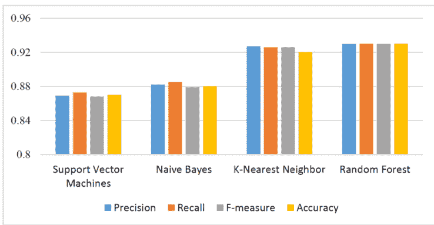

# [国际管理信息系统会议] 第七届国际管理信息系统会议 | 基于人类基因组数据的COVID-19预测机器学习方法


计算机工程系，工程与建筑学院，伊兹米尔巴基尔恰伊大学，土耳其伊兹米尔35665；hilal.arslan@bakircay.edu.tr


# 1. 引言

冠状病毒（已知包含一些最大的病毒基因组，长度约为30,000个碱基对）是单链正链RNA病毒[1]。冠状病毒科包含四个属，分别是α冠状病毒、β冠状病毒、γ冠状病毒和最近定义的δ冠状病毒。尽管α冠状病毒和β冠状病毒能够感染哺乳动物宿主，但γ冠状病毒和δ冠状病毒主要感染禽类物种[2]。属于β冠状病毒的严重急性呼吸综合征冠状病毒（SARS-CoV）和中东呼吸综合征冠状病毒（MERS-CoV）是引起高致病性结果的人类冠状病毒。由于其人畜共患特性，这两种冠状病毒均可传播给人类，并引起病毒性肺炎、发烧、呼吸困难等症状[3]。一种未识别的肺炎疾病，被认为起源于2019年12月武汉当地海鲜市场，在中国武汉引发了疫情。该病与SARS-CoV存在足够差异，被视为一种新型人类感染性β冠状病毒，并被命名为COVID-19，其正式名称为SARS-CoV-2 [1]。


序列比对方法，如BLAST [4] 和 FASTA [5]，利用病毒测序技术进行分类。这些方法基于DNA序列共享共同特征的假设[6]。尽管基于比对的方法在检测相似性方面很成功，但在大多数情况下，其应用可能具有挑战性[7]。使用基于比对的方法分析数千个完整基因组成本过高。为了克服基于比对的方法的困难，已经引入了无比对方法[8,9]。最近的研究表明，机器学习技术已成功应用于病毒分类[10,11]。Reyes、Aviso和Kari [10] 提出了一种开源的监督无比对方法，用于对HIV-1序列中的k- mer频率进行操作。他们使用支持向量机、多层感知机和逻辑回归进行分类。他们在肝炎B、肝炎C和流感A病毒的全长基因组数据集的所有情况下，都证明了分类准确率超过90%。Randhawa、Hill和Kari [3] 提出了一种结合监督机器学习与数字信号处理的方法，用于准确且可扩展的基因组注释。他们将基因组序列映射为离散值，以应用数字信号处理技术。他们准确地分类了登革热和流感等病毒的可塑基因组。Reyes et al. [12] 提出了一种基于内在基因组签名的无比对方法，可提供高度准确的实时分类学预测。他们使用了决策树方法，并用Spearman秩相关系数分析对其进行了确认。

Wang等人 [13] 报告称，COVID-19在其开放阅读框中具有极低的CG含量。他们发现，COVID-19中的CG减少可以通过将C/G突变为A/T来实现。基于这一想法，在本研究中，我们使用CpG岛特征来预测COVID-19病毒。我们应用了四种机器学习技术——支持向量机、朴素贝叶斯、k近邻和随机森林。结果在2019新型冠状病毒资源（2019nCoVR）存储库 [14] 上进行了评估。

# 2. 材料与方法

在本节中，首先，我们解释了基因组序列是如何检索的。其次，我们解释了区分特征是如何提取的。最后，我们概述了用于预测COVID-19的机器学习算法。

## 2.1. 数据集

中国生物信息国家中心 [14] 的2019新型冠状病毒资源（2019nCoVR）从包括NCBI、NMDC、GISAID和CNCB/NGDC在内的各种数据库中收集公共冠状病毒序列。我们于2020年8月下载了1000个可用的COVID-19序列。对于非COVID-19序列，2019nCoVR包括α冠状病毒、β冠状病毒-1、人类冠状病毒229E、人类冠状病毒HKU1和人类冠状病毒NL63物种。我们于2020年8月下载了所有334个不包括COVID-19的人类冠状病毒可用序列。序列属性也列于表1中。所有序列均为约30 kbp的完整基因组序列，且宿主选择为智人（Homo sapiens）。

表1. 序列属性。采用了2019新型冠状病毒资源（2019nCoVR）命名约定。

| 人类冠状病毒 | 序列数量 | 标签 |
|---|---|---|
| SARS-CoV-2 | 1000 | 1 |
| Alphacoronavirus | 88 | 0 |
| Betacoronavirus-1 | 140 | 0 |
| Human Coronavirus 229E | 27 | 0 |
| Human Coronavirus HKU1 | 18 | 0 |
| Human Coronavirus NL63 | 61 | 0 |

## 2.2. 特征提取

选择可区分的特征是提高识别性能的关键步骤，这取决于COVID-19病毒的特征。利用SARS-CoV-2表现出强烈CpG缺失的假设[13,15]，我们提出了使用CpG岛特征[16,17]，并通过方程(1)和(2)提取。

```
CGp = p(C) + p(G)
```

```
CpGo = \frac{p(CG)}{p(C)p(G)}
```

其中，p(C)、p(G)和p(CG)分别表示序列中C、G和CG的百分比。因此，对于给定的序列，我们提出了两个CpG岛特征。图1说明了从序列中计算特征的示例。

AAAAAAAGTT GCTGACTTT TCCCCCAACT CTGCCGTAGA GGCGGGAGTG GAGGGCGTGT

C = 13, G = 20, CG = 3, CGp = 0.55, CpGo = 0.05

**图1.** CpG岛特征。C、G和CG的值分别为13、20和3。因此，CGp = p(C) + p(G) = 0.55，且 CpGo = p(CG) / (p(C)p(G)) = 0.05。

## 2.3. 机器学习算法

分类旨在将给定的人类基因组序列分类为COVID-19或非COVID-19。可以使用各种机器学习技术来实现分类。支持向量机、朴素贝叶斯、K近邻和随机森林被用于执行此任务。

### 2.3.1. 支持向量机

支持向量机（SVM）方法是一种监督非参数统计学习技术。因此，它不对底层数据分布做任何假设。它具有多种优势，例如解的稀疏性、全局优化、坚实的理论基础、泛化能力和非线性。在SVM的原始表述中，该方法通过最大化两个类之间的边界，利用一组带有已知标签的观察（即训练集）来找到最优分离超平面。最优分离超平面一词指的是最小化误分类的决策边界。位于边界上的数据子集称为支持向量。新的未标记数据根据其相对于分类器函数的几何位置被分配到一个类。在实践中，属于不同类成员的数据点可能会相互重叠，这使得线性可分性变得困难。通过添加松弛变量，使用软边界方法和核技巧来解决不可分性问题 [18]。

### 2.3.2. 朴素贝叶斯

朴素贝叶斯（NB）是一种基于贝叶斯定理的常用机器学习分类算法，该定理提供了对任何假设的显式概率评估。该定理指出：

p(h | T) = \frac{p(T | h) p(h)}{p(T)}  \quad (3)

其中，P(h)表示假设h的先验概率，P(T)是训练数据T的先验概率，P(T | h)是在给定h时T的概率，P(h | T)是在给定T时h的概率。为了选择可接受的假设，将选择最可能的假设。

### 2.3.3. K近邻

K近邻（KNN）被认为是最简单的非参数分类器之一。它是一种惰性学习算法，不需要任何学习过程。KNN基于k近邻的多数票将新观测值分配到一个类中 [19]。在此步骤中，使用类似欧氏距离的距离。可以使用交叉验证技术定义最佳k值数量。

### 2.3.4. 随机森林

随机森林（RF）分类器是一种用于分类的集成机器学习算法，其工作原理与决策树类似。它使用自助聚合方法进行训练。可以通过对所有单个树的预测进行平均来进行总体预测。当将特征向量作为输入时，随机森林算法


利用多种决策树，从随机选取的数据子集中构建一棵森林。接着，算法汇总决策树的投票结果，以判断是否预测为 COVID-19。

# 3. 结果

我们研究了 CpG 岛特征在 COVID-19 分类中的有效性。在使用公式 1 和公式 2 提取 CpG 岛特征后，利用支持向量机、朴素贝叶斯、k 最近邻和随机森林等机器学习方法对其进行分类。采用 Weka 3.8.4 工具 [20] 执行机器学习分类。数值结果是在运行 Linux 操作系统、配备 16 GB 内存和 2.7 GHz 处理器的计算机上获得的。每个分类器的性能按精确率、召回率、F 值和准确率进行评估。采用了十倍交叉验证策略，结果如表 2 所示。此外，图 2 展示了精确率、召回率、F 值和准确率的数值。最大分类准确率为 93%，通过使用基于 CpG 岛特征的随机森林获得。本研究中采用所提特征的机器学习模型对 COVID-19 序列进行了高准确率预测。这凸显了所提方法的高效性。

表 2. COVID-19 分类结果（10 倍交叉验证）。

| 方法 | 精确率 | 召回率 | F 值 | 准确率 |
|---|---|---|---|---|
| 支持向量机 | 0.869 | 0.873 | 0.868 | 0.87 |
| 朴素贝叶斯 | 0.882 | 0.885 | 0.879 | 0.88 |
| K 最近邻 | 0.927 | 0.926 | 0.926 | 0.92 |
| 随机森林 | 0.93 | 0.93 | 0.93 | 0.93 |



图 2. 机器学习方法评价。

# 4. 结论

在本研究中，我们利用四种机器学习方法——支持向量机、朴素贝叶斯、k 最近邻和随机森林——从人类基因组序列中对 COVID-19 病例进行了分类。实验结果表明，采用基于基因组特征的 k 最近邻和随机森林方法取得了显著效果，准确率分别达到 92% 和 93%。在今后的研究中，我们将对比来自人类的 COVID-19 序列与其他类型冠状病毒序列（如来源于小鼠的序列），并提出一种基于相似性的特征。

**资助：** 本研究未获得外部资助。

**机构审查委员会声明：** 本研究使用公开可用的数据集开展，并依据《赫尔辛基宣言》的指导方针进行，经中国国家生物信息中心（中国）批准。

**知情同意声明：** 本研究中涉及的所有受试者均已知情同意，即公开可用的数据集已经生成。

**数据可用性声明：** 本研究分析了公开可用的数据集。该数据可在此处查找 (2019nCoVR) https://bigd.big.ac.cn/ncov/?lang=en

**利益冲突：** 作者声明不存在利益冲突。

# References

- 1. Sohrabi, C.; Alsafi, Z.; O'Neill, N.; Khan, M.; Kerwan, A.; Al-Jabir, A.; Iosifidis, C.; Agha, R. World Health Organization declares global emergency: A review of the 2019 novel coronavirus (COVID-19). *Int. J. Surg.* **2020**, *76*, 71–76. doi:10.1016/j.ijsu.2020.02.034.
- 2. Cui, J.; Li, F.; Shi, Z.L. Origin and evolution of pathogenic coronaviruses. *Nat. Rev. Microbiol.* **2019**, *17*, 181–192. doi:10.1038/s41579-018-0118-9.
- 3. Guan, Y.; Zheng, B.J.; He, Y.Q.; Liu, X.L.; Zhuang, Z.X.; Cheung, C.L.; Luo, S.W.; Li, P.H.; Zhang, L.J.; Guan, Y.J.; et al. Isolation and Characterization of Viruses Related to the SARS Coronavirus from Animals in Southern China. *Science* **2003**, *302*, 276–278, doi:10.1126/science.1087139.
- 4. Altschul, S.F.; Gish, W.; Miller, W.; Myers, E.W.; Lipman, D.J. Basic local alignment search tool. *J. Mol. Biol.* **1990**, *215*, 403–410. doi:10.1016/S0022-2836(05)80360-2.
- 5. Pearson, W.R. Rapid and Sensitive Sequence Comparison with FASTP and FASTA. *Methods Enzymol.* **1990**, *183*, 63–98. doi:10.1016/0076-6879(90)83007-V.
- 6. Pinello, L.; Lo Bosco, G.; Yuan, G.C. Applications of alignment-free methods in epigenomics. *Brief. Bioinform.* **2013**, *15*, 419–430. doi:10.1093/bib/bbt078.
- 7. Vinga, S.; Almeida, J. Alignment-free sequence comparison—A review. *Bioinformatics* **2003**, *19*, 513–523. doi:10.1093/bioinformatics/btg005.
- 8. Kari, L.; Hill, K.A.; Sayem, A.S.; Karamichalis, R.; Bryans, N.; Davis, K.; Dattani, N.S. Mapping the Space of Genomic Signatures. *PLoS ONE* **2015**, *10*, 1–17. doi:10.1371/journal.pone.0119815.
- 9. Karamichalis, R.; Kari, L.; Konstantinidis, S.; Kopecki, S. An investigation into inter- and intragenomic variations of graphic genomic signatures. *BMC Bioinform.* **2015**, *16*. doi:10.1186/s12859-015-0655-4.
- 10. Solis-Reyes, S.; Avino, M.; Poon, A.; Kari, L. An open-source k-mer based machine learning tool for fast and accurate subtyping of HIV-1 genomes. *PLoS ONE* **2018**, *13*, 1–21. doi:10.1371/journal.pone.0206409.
- 11. Randhawa, G.; Hill, K.; Kari, L. ML-DSP: Machine Learning with Digital Signal Processing for ultrafast, accurate, and scalable genome classification at all taxonomic levels. *BMC Genom.* **2019**, doi:10.1186/s12864-019-5571-y.
- 12. Randhawa, G.S.; Soltykial, M.P.M.; El Roz, H.; de Souza, C.P.E.; Hill, K.A.; Kari, L. Machine learning using intrinsic genomic signatures for rapid classification of novel pathogens: COVID-19 case study. *PLoS ONE* **2020**, *15*, 1–24. doi:10.1371/journal.pone.0232391.
- 13. Wang, Y.; Mao, J.M.; Wang, G.D.; Luo, Z.P.; Yang, L.; Yao, Q.; Chen, K.P. Human SARS-CoV-2 has evolved to reduce CG dinucleotide in its open reading frames. *Sci. Rep.* **2020**, *10*, 5165–5184.
- 14. Zhao, W.-M.; Song, S.-H.; Chen, M.-L.; Zou, D.; Ma, L.-N.; Ma, Y.-K.; Li, R.-J.; Hao, L.-L.; Li, C.-P.; Tian, D.-M.; et al. The 2019 novel coronavirus resource. *Yi Chuan* **2020**, *42*, 212–221. doi:10.16288/j.yczz.20-030.
- 15. Dinka, H.; Milkesal, A. Unfolding SARS-CoV-2 viral genome to understand its gene expression regulation. *Infect Genet Evol.* **2020**, *84*. doi:10.1016/j.meegid.2020.104386.
- 16. Ponger, L.; Mouchiroud, D. CpGProD: Identifying CpG islands associated with transcription start sites in large genomic mammalian sequences. *Bioinformatics* **2002**, *18*, 631–633. doi:10.1093/bioinformatics/18.4.631.
- 17. Arslan, H. A New Promoter Prediction Method using Support Vector Machines. In Proceedings of the 2019 27th Signal Processing and Communications Applications Conference (SIU), Sivas, Turkey, 24–26 April 2019; pp. 1–4. doi:10.1109/SIU.2019.8806549.
- 18. Zhang, W.; Zhao, D.; Chai, Z.; Yang, L.T.; Liu, X.; Gong, F.; Yang, S. Deep Learning and SVM-Based Emotion Recognition from Chinese Speech for Smart Affective Services. *Softw. Pract. Exper.* **2017**, *47*, 1127–1138.
- 19. Brown, I.; Mues, C. An experimental comparison of classification algorithms for imbalanced credit scoring data sets. *Expert Syst. Appl.* **2012**, *39*, 3446–3453.
- 20. Frank, E.; Hall, M.A.; Witten, I.H. The WEKA Workbench. In *Online Appendix for “Data Mining: Practical Machine Learning Tools and Techniques”*, 4th ed.; Morgan Kaufmann: Burlington, MA, USA, 2016.
