# 医疗物联网：可穿戴设备范式（万物物联网 IoE）

## 医疗物联网

### 可穿戴设备范式

编者：

Manuel Cardona

Vijender Kumar Solanki

Cecilia E. García Cena


# 医疗物联网


# 医疗物联网

## 可穿戴设备范式

编者：

Manuel Cardona, Vijender Kumar Solanki,

以及 Cecilia E. García Cena


Manuel N. Cardona、Vijender Kumar Solanki 和 Cecilia García Cena 作为编辑材料作者及其个人章节作者的权利，已根据 1988 年《版权、外观设计和专利法》第 77 和第 78 节予以主张。


# 前言

在第 1 章“物联网的基础与范式”中，由 Claudia L. Garzón-Castro 和 Ramiro Velázquez 贡献，他们讨论了渗透日常生活的各种技术，导致许多物体通过某种方式相互连接和通信。这就是物联网 IoT。IoT 有助于从设备中收集数据，确保系统的互操作性。正如大多数技术进步一样，IoT 的目标是为用户提供便利并具有成本效益。物联网已应用于多个领域，包括但不限于远程监测和预测性维护。这种应用的多样性允许物联网应用于各种行动领域。本章为感兴趣的读者提供了一个全面的概述。该章节涵盖了物联网的相关概念，如架构、传感器、执行器、通信协议和用户界面。最后，提供了一些基于物联网的医疗保健应用。在这种情况下，可以得出结论，物联网可以成功应用于患者监测、风险情况检测和远程医疗等服务。

第 2 章题为“医疗物联网：现状与未来趋势”。医疗物联网 IoMT 为医疗设备和应用的演变为提供了场景。在本章中，作者 Lucia Alonso Virgen、Miguel A. Sanchez Valdes、Fernando López Hernandez 和 J. Javier Granados 分析了最相关的和未来的趋势，即 IoMT。IoMT 的目标是提供一个理论框架，以开启新的研究方向，专注于提供方法以及或仔细评估所有现有系统。关于机器人，我们描述了它具有许多优点和替代方案；它让人类在医学领域产生了许多积极预期。正如我们看到的，它具有许多优势，如速度、准确、精确，最重要的是为了我们的健康和迭代提供更高效的工作。通过技术，可以到达难以实现的解剖部位，从而使专家的成功率更高；技术也为接受任何复杂或高风险的干预提供了更深信心。IoMT 仍在从经验中学习，但它正朝着正确的方向发展，并将为建立安全的社会环境做出贡献。健康与技术的合作是互利的，因为医疗服务领域的人员是主要的

viii 前言

他们是对设备中可能存在的错误、故障和违规行为的专家。而这些错误的解决方案只能通过技术来提供。

第 3 章标题为“医疗应用可穿戴设备概述”，由 Meet Kumari 和 Meenu Gupta 贡献，他们在文中指出世界正面临冠病毒疾病的威胁。为此，社交距离是克服这种疾病的主要解决方案，而可穿戴医疗设备是提供帮助最有吸引力的解决方案。可穿戴医疗设备是现代医疗体系的基石，在提供轻量化医疗设施方面具有严格限制。本章概述了关于医疗应用可穿戴设备的重要研究。它将工作分类：用于医疗应用的不同可穿戴设备类型、医疗设备的使用以及可穿戴设备在医疗应用中的不同场景。它还介绍了当前背景下的各种医疗设备参数及其需求。本章还解释了当前可穿戴设备面临的潜在开放挑战以及其在日常使用方面的未来机会。

结论是，尽管面临挑战，这些可穿戴医疗设备不仅在社会和经济上为实时应用提供了众多应用，而且在危险工作环境中有助于确保施工的安全。

第 4 章标题为“基于区块链的个性化药物物联网”，由 Rehab A.Ryan 和 Tsagakis 贡献。该章强调了未来继续包含多个电子组件的医疗系统。例如，使用物联网 IoT 可以让健康数据——无论是医疗系统层面的中心化，还是患者层面的本地（如智能手机）——成为选择健康相关管理方法的关键组件。药物的生产和相关物流远为落后。例如，网络安全和所需的公共基础设施是重大挑战之一。加密货币作为区块链技术的一种有前景的应用，可能会彻底改变生命科学和生物技术。区块链技术允许实现关键但缺失的功能，这些功能受到严密保护，并始终提供持久的信息存储、去中心化并增强交易透明度，同时激励关键利益相关者。区块链的一个主要应用涉及抗药物，重点关注加密药物技术 cryptopharmaceuticals technology，在该技术中，药物可以与患者特定的个人剂量单位区块链相关联，其中每个制造的剂量单位都有一个独特且信息丰富的模型，通过智能手机应用程序可视化所有层级的区块链。这涵盖了个性化剂量单位的生产、患者对个人区块链的查看，以及将产品嵌入到健康的物联网系统中。这种安全的医疗历史区块链可以实现创新的逻辑。因此，电子账本可以发现假药、促进虚拟试验并促进个性化医疗。

第 5 章“监测系统的可穿戴/植入式设备”由 Pawan Kumar 和 Shabana Urooj 贡献，重点是生物医学应用天线的使用，这种应用日益增长。天线在无障碍地诊断和检测各种疾病方面非常有用。对于无线胶囊内镜 WCE 的设计和使用已经进行了大量研究，它能提供人体内部器官（高度弯曲的小肠）清晰的高分辨率图像，而如果使用传统的内镜技术，这是一项非常困难的任务。天线在利用热疗治疗癌症等疾病中也起了关键作用，可以对肿瘤细胞进行靶向烧灼。这增强了给予患者的化疗和放射治疗等疗法的有效性。

第 6 章“康复中运动和疲劳监测的可穿戴传感器”由 Maria J. Pinto-Beral、Andres Aguirre、Carlos A. Cifuentes 和 Marcela Munera 贡献。他们强调身体锻炼已成为康复环境的基础部分。它是通过有氧或无氧运动提高活动能力和降低死亡率的主要部分之一。然而，这些运动的强度必须经过控制。过度训练处于高疲劳状态的患者会影响他们的康复和健康。为了调整这些强度，已经探索了多种方法来监测患者的疲劳，以监督治疗期间的运动强度。尽管如此，这些方法通常需要根据环境和患者进行调整，使其实施困难。在这种情况下，本章介绍了身体锻炼在康复中的重要性、传统的疲劳监测策略，以及基于可穿戴传感器的监测策略，后者在估计疲劳水平方面具有巨大潜力。本章展示了物理锻炼在康复中的重要性……（注：此处原文有重复内容，已按要求翻译处理）。

第 7 章标题为“医疗保健中的对话代理”，由 Laura、Marcela Munera 和 Carlos A. 提交。本章介绍了对话代理 Conversational Agents 在医疗交付中的挑战及解决方案。例如，使用物联网可以让健康数据——无论是医疗系统层面的中心化，还是患者层面的本地（如智能手机）——成为选择健康相关管理方法的关键组件。药物的生产和相关物流远为落后。例如，网络安全和所需的公共基础设施是重大挑战之一。加密货币作为区块链技术的一种有前景的应用，可能会彻底改变生命科学和生物技术。区块链技术允许实现关键但缺失的功能，这些功能受到严密保护，并始终提供持久的信息存储、去中心化并增强交易透明度，同时激励关键利益相关者。区块链的一个主要应用涉及抗药物，重点关注加密药物技术，在该技术中，药物可以与患者特定的个人剂量单位区块链相关联，其中每个制造的剂量单位都有一个独特且信息丰富的模型，通过智能手机应用程序可视化所有层级的区块链。这涵盖了个性化剂量单位的生产、患者对个人区块链的查看，以及将产品嵌入到健康的物联网系统中。这种安全的医疗历史区块链可以实现创新的逻辑。因此，电子账本可以发现假药……（此处略）。

第 8 章标题为“大数据在管理大量数据应用中的作用”，由 Meenu Gupta、Rachna Jain、Rohit Singhal 和 Jaspreet Singh 贡献。它讨论了为了管理治疗计划和分析康复率而使用海量数据，并检查肿瘤样本。在过去，我们处理的数据较少。随着时间的推移，每天都在增长。管理这些数据对于行业或公司来说是一个关键问题。这种数据可以用任何形式定义，如手机日志、电子邮件或其他来源。收集数据很容易，但管理它们非常困难。随后，云计算的出现使得在服务器上存储大量数据成为可能。但是，我们每天都在产生字节级的数据，通过大数据扩展并减少服务器上的数据存储问题。大数据提供了一个名为“Hadoop”的框架，有助于在服务器上存储大量数据。在大规模管理数据是编写本章的动力。本章讨论了使用的 Hadoop 技术以及它们如何对医疗系统有益。本章的主要目标是让人们熟悉大数据 Hadoop 以及如何处理与健康相关的大量数据。

# 编辑者

Manuel Cardona 博士于 2004 年在萨尔瓦多获得电气工程学士学位，并于 2008 年在西班牙马德里理工大学 Universidad Politécnica de Madrid 获得自动化与机器人科学硕士学位。2007 年至 2008 年以及 2011 年，他曾担任西班牙马德里理工大学机器人与智能机器研究小组的助理研究。他拥有科学研究研究生学位以及创新管理研究生学位。2020 年，他在西班牙马德里理工大学获得了自动化与机器人科学博士学位（**荣誉毕业**/Cum Laude）。目前，他是萨尔瓦多东·波斯哥大学 UDB 的研究总监，机器人与智能机器研究小组以及计算机视觉研究小组的主任。他的兴趣领域包括康复机器人、生物力学、串联与并行机器人的运动学与动力学、嵌入式系统、视觉与人工智能以及机器人系统的应用。他已经在各种期刊、书籍和会议论文集中发表或共同发表了超过 45 篇研究论文。他是《国际机器学习与网络化协作工程期刊》IJMLNCE，ISSN 2581-3242 的副主。他是 IEEE 成员，属于机器人与自动化协会 RAS、航空航天与电子系统协会 AESS 以及教育协会 EdSoc。他是萨尔瓦多东·波斯哥大学 RAS 和 AESS 学生分会的顾问及学生导师，并担任 IEEE 萨尔瓦多分副主席。

Vijender Kumar Solanki 博士是印度特伦甘纳纳邦海得拉德 CMR 技术学院 自治制 计算机科学与工程系的副教授。他在网络、物联网、大数据、智慧城市和 IT 领域拥有超过 10 年的学术经验。在担任目前的职务之前，他曾任职于印度北方恰拉纳邦大诺伊的 Apeejay 技术学院、泰米尔纳德德邦的 KSRCE 自治制 学院以及印度北方恰塔什邦加齐亚巴德的技术与科学学院。他是 ACM 和 IEEE 成员。

他在喀拉拉大学 UGC 学术人员学院参加过入职培训计划，并在印度北方恰塔什邦阿拉拉哈巴的印度信息技术学院参加过高级进修课程。他在各种期刊、书籍和会议论文集中发表或共同发表了超过 50 篇研究论文。他在软计算领域编辑或共同主编了 14 本书籍和会议论文。

他于 2017 年在印度钦奈杜德的安纳大学获得计算机科学与工程博士学位，并分别于 2007 年和 2004 年在印度哈里亚纳纳邦罗赫塔克的马哈拉席·迪亚南德大学获得硕士学位和 MCA 学位，并于 2001 年在印度法里达亚巴德的 JLN 政府学院获得学士学位。

他是以下丛书的丛主：《永恒物联网 IoE：安全与隐私范式》美国 CRC Press，Taylor & Francis 集团；《人工智能 AI：从基础到高级实践系列》美国 CRC Press，Taylor & Francis 集团；《IT、管理与运营研究实践》美国 CRC Press，Taylor & Francis 集团；《生物医学工程：技术与应用》美国 Apple Academic Press；以及《计算智能管理科学范式 焦点系列》美国 CRC Press，Taylor & Francis 集团。

他是《国际机器学习与网络化协作工程期刊》IJMLNCE，ISSN 2581-3242 的主编，《国际超互联与物联网期刊》IJHITo，美国 IGI-Global，ISSN 2473-4365 的主编；他还是《Ingenieria Solidaria》期刊 ISSN 2357-6014 的共同编辑，《国际信息检索研究期刊》IJRR，美国 IGI-Global，ISSN: 2155-6371E-ISSN: 2155-6385 的副编辑。他曾担任美国 IGI-Global、UnderScience 以及许多出版者的客座编辑。可以通过 spesinfo@yahoo.com 或 vijendersolanki@ieee.org 与他联系。

Cecilia E. García Cena 博士于 1997 年在阿根廷圣罗莎的拉帕尔马国立大学获得机电工程学士学位，并于 2001 年在阿根廷圣胡胡安国立大学获得控制系统科学 课程涵盖机器人和非线性系统控制 博士学位。

2001 年，她是西班牙马德里马德里理工大学机器人部门 UPM-CSIC 的访问学者。2004 年，她是马德里卡卡洛斯三世大学机器人实验室的访问教授。

目前是 UPM-CSIC 电子、自动化与计算机科学系的教授，以及 UPM-CSIC 自动化与机器人中心的成员。她的研究包括遥控机器人、辅助机器人和多代理系统控制。她拥有三项专利，并发表了 20 多篇文章。

## 贡献者

### Andres Aguirre

生物工程系

### Meenu Gupta

计算机科学与工程系，理工技术学院

### Margarita Bautista

生物工程系，萨尔瓦多东·波斯哥大学

### Fernando Hernández

国际拉里奥哈大学

### Lucia Alonso Virgos

国际拉里奥哈大学

### Rachna Jain

计算机科学与工程系，理工技术学院

### Claudia L. Garzón-Castro

萨尔瓦多东·波斯哥大学

### Pawan Kumar

电气工程系，甘特比大学

### Carlos A. Cifuentes

生物工程系，萨尔瓦多东·波斯哥大学

### Marcela Munera

生物工程系，萨尔瓦多东·波斯哥大学

### J. Rainer Granados

国际拉里奥哈大学

### Rehab A. Rayan

公共卫生学学院，亚历山大大学

### Jaspreet Singh

计算机科学与工程系，理工技术学院

### Rachit Singhal

计算机科学与工程系，理工技术学院

### Christos Tsagkaris

医学院，克里特大学

### Ramiro Velázquez

墨西哥阿斯卡连特

### Miguel A. Sanchez Vidales

国际拉里奥哈大学

### Shabana Urooj

工程系，甘特比大学

# 物联网的基础与范式

Claudia Garzón-Castro¹ 和 Ramiro Velázquez²

¹萨尔瓦多东·波斯哥大学，工程学院，Campus Universitario del Común，Autopista Norte km 7，Chía，萨尔瓦多。

²墨西哥，工程学院，Escrivá de Baluer 101, Rústicos Calpulli, C.P. 20290，Agucalientes。

## 1.1 引言

物联网 IoT 一词于1999年由英国技术专家凯文·阿什顿 Kevin Ashton 提出，他当时就职于宝洁 P&G。这一新范式的出现是为了解决宝洁缺乏信息以确定其最受欢迎的产品在商店何时以及何地售罄的问题。阿什顿提出的解决方案是在其产品中包含传感器，以便能够追踪和计数一切，从而极大地减少浪费、损失和总体成本[2]。这样一来，他们就知道产品何时缺货了。然而，

# 医疗物联网

直到2009年，这种范式才开始兴起，成为继于个人电脑和互联网之后的计算技术第三次革命性浪潮[3]。这是因为物联网 IoT 具备采集、分析和分配数据的能力，我们可以将这些数据转换为信息和知识[4]。

在文献中，物联网有许多定义，它也被称为物体互联网 Internet of Objects [5–10]或Web 3.0 [11]。总的来说，可以说物联网的目标是这样一个世界：在这个世界上，包括房屋、家电器、城市家具和工业机械在内的一切事物都能随时随地连接到互联网，产生实时数据以辅助决策制定，并在为用户提供便利的同时节省时间和金钱。

由于物联网具备的属性，2008年，美国国家情报委员会 NIC 将物联网纳入其“颠覆性民用技术”清单，认为其对美国的国家实力具有潜在影响。在他们的报告中，NIC指出，到2025年，食品容器等日常物品可能成为互联网的节点。此外，NIC强调物联网在美坚的经济发展和军事能力方面可能发挥关键作用。然而，NIC也提到，当人们获得远程控制、定位和监控设备的能力时，将产生安全风险[12]。

物联网的出现是一系列技术的演进结果，如无线传感器网络 WSNs、执行器、网络通信与协议[13, 14]、数据分析存储与计算工具以及可以在不同平台上广泛访问的可视化工具[11]。物联网建立了人、机器与连接到生活的智能设备之间的重要交互，帮助人们决策并促进世界经济增长[13, 15]。此外，物联网的特点是有助于减少碳足迹。无疑，这种范式对家庭领域产生了巨大影响。这使得物联网的应用范围涵盖了广泛的现实应用，如医疗保健、农业、过程管理、大规模生产、环境与城市基础设施、智能交通与物流系统、能源行业以及安全监控等[7, 14–17]。值得注意的是，物联网在医疗领域正在带来真正的改变。

本章介绍了物联网的基础知识。本章其余部分的安排如下：第1.2节介绍了物联网最相关的特性。第1.3节概述了物联网中三种流行架构的分层。第1.4节描述了基于物联网的应用所需的传感器、执行器和存储器。第1.5节给出了物联网最常用的通信协议。第1.6节指出了开发用户界面应考虑的特性。第1.7节介绍了物联网在医疗保健行业的优势、一些示例应用和挑战。最后，第1.8节给出了结论。

## 1.2 物联网特性

无论物联网使用何种应用和相关技术，架构类型必须具备某些基本特性 即物联网的基础与范式，使其能够为终端用户提供良好的服务。识别物联网的一些特性包括：


- **物体 (Things)**：也被称为对象或设备。它们是物联网的主体。这些设备的制造是为了让用户的生活更舒适。这些设备必须具备通信和检测/执行能力[18]。因此，它们配备了传感器和执行器。检测/执行能力非常重要，特别是对于那些代表用户与虚拟世界接口的设备[19]。

- **连接性 (Connectivity)**：这一功能允许对物联网设备进行通信、集成并分配单一地址。在物联网中，目前存在一系列连接选项，它们将不断调整以满足新兴物联网设备的需求[19]。

- **数据 (Data)**：从设备互连获得的数据是物联网的价值所在。通过对采集的数据进行智能分析和利用，这种价值得到了增强[19]。

- **自主性 (Autonomy)**：这一功能允许基于物联网的设备在没有人类或其他设备干预的情况下执行任务[20]。

- **服务 (Services)**：这些服务必须能够与物联网设备交互，并考虑到隐私保护以及物联网设备与虚拟对象之间的语义一致性等限制[18]。

- **异构性 (Heterogeneity)**：鉴于物联网设备的多样性，要求设计适当解决方案通过通信协议、底层技术实现集成，并提供互连解决方案内的资源访问权限[19]。

- **安全性 (Security)**：这一特性对于物联网效益保持实用性至关重要。此外，端点、网络和数据必须确保安全[21]。

- **自动配置（即插即用）(Autoconfiguration)**：这一功能寻求让物联网设备能够支持自动配置[20]。

## 1.3 物联网架构

物联网架构必须确保数据被传输、存储、处理并供用户使用[22]。因此，寻找一种支持世界上不同环境和背景的物联网架构是一项挑战。拥有一个模块化且可扩展的架构以允许集成新功能至关重要。在文献中，提出了许多架构，通常分为三层。广为人知的架构如下：

- **三层架构**：该架构包含了感知层、网络层和应用层[8, 23]，见图1.1。接下来将对这些层最重要的特性进行描述。

**感知层**：这一层也被称为终端层或设备层。感知层分为两个部分：感知节点（传感器、执行器等）以及负责互连的感知网络。数据由感知节点采集并控制[24]。这一层的主要任务是通过传感器识别物体。这些信息以数字信号的形式通过网络传输。该层可能包括标签和读写器、射频识别（RFID）、摄像头、传感器、无线传感器网络（WSNs）等。

img/2dc9e3a88134e2acf1f9a7c9853b0c7c_18_0

图1.1 物联网三层架构示意图

网络层：即传输层。该层的主要功能是传输和处理来自感知层的数据；换句话说，它支持设备连接。数据在网络之间的传输可以通过有线和无线通信实现。这就是为什么网络层由所有可以访问互联网的技术组成，如3G、4G、Wi-Fi、长期演进（LTE）、ZigBee和蓝牙等。该层可能有不同的通信协议，因为使用的一些网络包括：IPv6（6LoWPAN）、消息队列传输（MQTT）、受限应用协议（CoAP）、HTTP、DDS和AMQP。

应用层：在这一级可以找到各种开发和用户服务，它们可以使用感知层采集的数据。此外，该层通过应用程序编程接口（API）或图形用户界面（GUI）与其他应用程序和平台共享数据[16][22]。应用层包含了物联网系统中功能最强大的模块。该层作为前端接口，为用户提供分析结果和决策支持。

### 4 医疗物联网

该三层架构中的应用层对应于四层架构中的服务和应用层，或者五层架构中的业务层、应用和中间件层 [15]。

四层架构：该架构是面向服务的，对应于五层架构中的中间件层 [26]。服务层（也称为处理层）负责存储由网络层传输的数据、分析价值信息并做出决策。该层能够为下层管理并提供一系列服务。该架构的流程图如图 1.2 所示。该层功能的主要特征有 [27]：

- 数据验证：执行此操作是为了验证源数据的完整性。

- 数据转换：为了存储数据，必须将其转换为若干种格式或单一格式。然而，考虑到不同的应用程序，无论存储时采用何种格式，数据可能都需要额外的格式转换。

- 数据过滤：对应于根据开发的应用程序的用处对数据进行分离。

- 数据处理与存储：该功能取决于可能产生的数据量，因此建议使用大数据技术来获取有用信息。

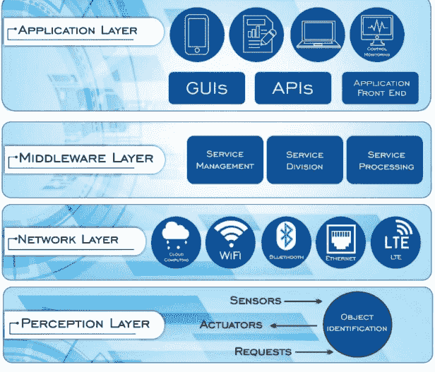

图 1.2 物联网四层架构示意图。

实体注册：必须识别并将用户、设备和服务等等不同元素注册为系统的实体，以便建立实体注册表，并它们它们之间建立关系和关联。

**协议支持：** 为了保证良好的服务，有必要保证与异构网络的通信，支持各种网关和设备，并集成新协议。

- **五层架构：**在这种情况下，增加了业务层。该层的职责是管理应用、构建业务模型、生成图表和流程图。上述内容基于应用层的数据 [23, 28]。业务层通过大数据分析来支持决策 [15]。此外，它还必须管理物联网系统的安全性，必须提供身份验证、用户隐私和授权等功能 [16]。最后，该层还负责监控和管理下层。图 1.3 显示了这种架构。

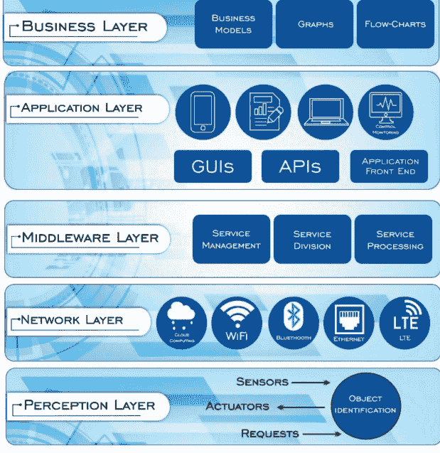

图 1.3 物联网五层架构示意图。

## 表 1.1

根据物联网应用对传感器分类

| 类别 | 示例 |
| :--- | :--- |
| 环境传感器 | 温度、光、气压、湿度传感器 |
| 运动传感器 | 加速度计、陀螺仪 |
| 电学传感器 | 电流、电容传感器 |
| 生物传感器 | 心电图 (ECG)、脑电图 (EEG)、心率、呼吸传感器 |
| 物体识别 | 智能标签、信标 |
| 位置传感器 | GPS、磁力计、固定无线接入点 |
| 存在传感器 | 被动红外传感器 (PIR)、视频摄像头 |
| 交互传感器 | 物理按钮、触控平板板、滑块 |
| 声学传感器 | 麦克风 |
| 环境传感器 | 烟雾器、pH、气体传感器 |

## 1.4 传感器、执行器与数据存储

物联网传感器是普通传感器，细微区别在于它们的输出信号连接到了网络。最近对基于物联网应用的文献 [29] 调查对表 1.1 总结的传感器进行了分类。

另一方面，物联网执行器是普通执行器，区别在于它们的输入信号来自网络。表 1.2 总结了基于物联网应用中常见的执行器类型。

物联网架构的一个关键特征是云服务器集中存储从一组传感器收集到的所有数据。因此，它是负责数据存储的模块。

有多个云存储提供商，例如 Microsoft Azure、Amazon Web Services (AWS) 和 Google Cloud。云存储提供以下优势：

- 1. 降低设备成本：云存储允许减少服务器和硬盘等硬件相关的费用。

## 表 1.2

根据物联网应用对执行器分类

| 类别 | 在物联网环境中的作用 |
| :--- | :--- |
| 直线执行器 | 用于实现物体直线运动 |
| 电机 | 用于具有高位置精度的旋转机构或物体 |
| 继电器 | 用于给设备供电的电磁执行器 |
| 圈 | 广泛应用于家用（锁定/触发机制和监控系统） |

- 2. **降低人工成本：** 云存储提供不间断的服务。云服务器和数据中心由提供的云服务管理。因此，不需要管理 IT 员工。

- 3. **云存储具有扩展性且可靠性：** 数据安全地存储在云端，存储容量可以自定义。大多数云提供商在世界各地设有数据中心，这允许更快速的数据处理和更可靠的存储。

## 1.5 通信协议

通信协议被认为是基于物联网的系统的骨干，因为它们实现了网络连接和跨网络数据交换。它们决定了数据编码、数据交换格式以及从源到目的地的包路由。它们还被用于序列控制、流量控制和丢失数据包的重传 [30]。

以下是物联网中最常用的协议：

- 1. IEEE 802.11 – WiFi：WiFi 是一种无线局域网 (WLAN) 标准的集合：802.11a、802.11b、802.11ac 和 802.11ad，运行在 2.4 到 60 GHz 波段。它们提供 20 米到 100 米的通信范围。

- 2. IEEE 802.16 – WiMAX：WiMAX（全球微波互操作性接入）提供 1.5 Mb/s 到 1 Gbps 的数据交换速率。其平均速率为 1 Gbps。

- 3. IEEE 802.15.1 – Bluetooth：蓝牙是一种低功耗技术。

- 4. LoRaWAN – LoRa：LoRaWAN 是一种远程协议。

## 1.6 用户界面

如前所述，物联网可以管理身份验证、用户隐私和授权等功能 [16]。最后，该层还负责监控和管理下层。图 1.3 显示了这种架构。

### 物联网的基础与范式

根据专家的说法，没有适用于所有群体的设计，这使得界面开发至关重要。例如，[31] 他们利用触控为自闭症儿童设计了一个 App，该 App 的目标是帮助他们学习和进行数学计算。在 [34] 中，作者对 UI 具备的特征进行了研究，使有痴呆的老年人能够对日常生活 (ADLs) 进行直观的交互。

简而言之，根据 [32]，设计 UI 时应考虑的某些原则包括：

- a) 减少可用功能数量，即降低软件复杂性。

- b) 设计易于寻找界面。

- c) 使用较大的图标显示关键功能。

- d) 避免使用技术术语。

- e) 自定义字体、颜色和大小。

- f) 图形对象如头像或图标。

## 1.7 物联网在医疗领域：优势、发展与挑战

物联网无疑影响了医疗行业。它的应用带来了治疗、护理和随访效率与质量的提升，对患者的健康产生了积极影响。

### 1.7.1 优势

物联网在医疗领域明显的优势可以识别为：

- 1. 远程医疗：物联网解决方案允许医生协助接受远程监控的患者。医生可以通过专用 App 和连接的设备与患者交流、检查生命体征、进行诊断并开具处方。除了患者有利外，远程医疗还会影响医院成本；它是将医疗预约从医院（以医院为中心）移动到家中（以家庭为中心），从而优化了基础设施资源。

### 医疗物联网

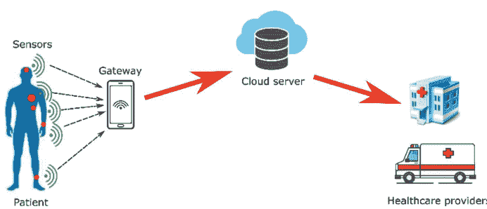

**图 1.4** 基于物联网的医疗系统的通用架构。

- 2. **即时跟踪与警报：** 在生命危险事件中，实时相关的警报具有极价值。物联网医疗设备能够收集生命体数据并将其传输给医生和应急服务部门以便做出快速反应。

- 3. **自动报告：** 从患者处获得的原始数据需要经过处理以得出临床结论。医疗领域花费了大量时间手动收集、报告和分析原始数据。物联网具有自动化这些过程的能力，即使是来自多个监控设备的海量数据；这使得医生、医院和医疗机构能够加速诊断。

- 4. **便于医疗研究：** 物联网已成为医疗用途的宝贵工具。它提供的海量数据加速了疾病和健康状况的统计研究，最终将实现更好的疗法和治疗。

图1.4示意图显示了基于物联网的医疗服务的通用架构。我们最常见的传感器包括脑电图 (EEG) 传感器、心电图 (ECG) 传感器、呼吸频率传感器、脉搏传感器和运动传感器。通过网关，数据被上传并集中在云服务器中，随后由医疗专业人员分析。网关是提供传感器与云之间桥梁的设备。目前最常用的设备是智能手机。

### 1.7.2 基于物联网的医疗设备示例

本节旨在介绍一些用于医疗的物联网设备的代表性示例。

Villalpando 等人在 [37] 中介绍了一种用于远程医疗系统的简便医疗提箱。医疗提箱是一组基于计算机的医疗仪器。

### 物联网的基础与范式

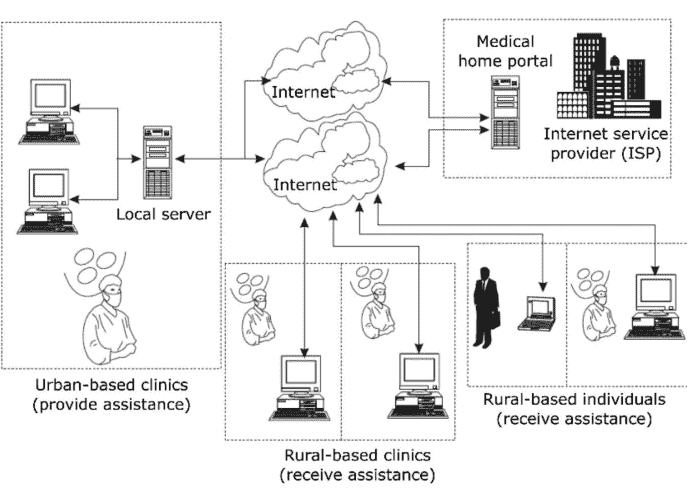

**图 1.5** 医疗提箱架构：专门医生、农村医生和农村患者使用物联网远程诊断方案的交互。

该仪器不仅具有传统医疗仪器的基本特征，还具有分析和远程传输生理信息的能力，以便执行远程诊断任务。其主要优势之一是包含了先进的数字信号处理算法 [38]，能够以低成本在心脏病诊断和远程诊断中提供高质量结果。它旨在触及墨西哥农村地区的患者。

医疗提箱包含一个心电图、一个 Holter 仪（动态心电图）、一个血氧仪、一个数字温度和一个血压计。其架构如图 1.5 所示。

医疗提箱使农村社区或偏远地区的患者、医生和诊所能够获得医疗。在这些地点收集的数据被上传到基于云服务器的医疗门户，该门户由互联网提供商提供保障。数据将由位于城市的中心诊所或医院的专家进行分析。其理念是帮助患者进行专业诊断，而不受距离限制。

已经开发了多种生理信号远程监控系统，可以在文献中找到：心电信号 [39, 40]、脑信号 [41, 42]、呼吸活动 [43, 44] 和血液参数 [45, 46] 等。它们都致力于对患者健康状况进行实时随访，以确保及时的医疗响应。

Jian 和 Chen 在 [47] 中引入了一种便携式跌倒检测和警报系统，用于对老年人的远程监控和及时援助。该系统基本上由一件定制背心和一部智能手机组成。背心集成了带有三轴加速度计和陀螺仪的运动……

### 医疗物联网

### 家庭

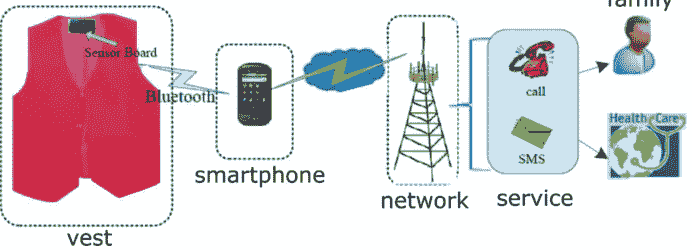

图 1.6 基于物联网的跌倒检测可穿戴系统。

……当传感器检测到加速度和速度的变化时，数据通过蓝牙发送到智能手机。警报会发送给家庭成员或医疗中心以提供及时援助。该系统的架构如图 1.6 所示。

已针对广泛提出了类似的基于物联网的警报系统。Khattakaran 等人在 [48] 中描述了一个由移动智能手机组成的警报系统。当传感器检测到加速度和速度的变化时，数据通过蓝牙发送到智能手机。警报会发送给家庭成员或医疗中心以提供及时援助。该系统的架构如图 1.6 所示。

# 物联网的基础与动态学

15

# 参考文献

- [1] K. Ashton, ‘Internet of Things’ Thing’. RFID J., p. 1, 2009.

- [2] M. A. Medina, C., ‘物联网背后的故事,’ Bogotá, 05, 2017.

- [3] C. Xiang and Y. Li, “物联网架构与关键技术的通用分析,” 见 ICESSES: Proceedings of 2012 IEEE 3rd International Conference on Software Engineering and Service Science, pp. 325–328,

- [4] D. Evans, “物联网：互联网的演变是如何改变一切的?, Cisco IBS © 2011 Cisco and its affiliates., http://www.cisco.com/en/about/ac7/docs/iot_IBSG_0411FINAL.pdf (访问于2020年7月19日).

- [5] 国际电信联盟 (International Telecommunication Union), “ITU 关于物联网的工作,” 研讨会,

- [6] J. Gubbi, R. Buyaya, S. Marusic, and M. Palaniswami, “物联网 (IoT): 愿景、架构元素和未来方向,” Future Gen. Comput. Syst., vol. 27, no. 7, pp. 1645–1660, 2013. 10.1016/j.future.2013.01.010.

- [7] L. Atzori, A. Era, and G. Mohamed, “物联网：综述,” Computer Net., vol. 54, no. 5, pp. 2787–2805, 2010. 10.1016/j.computer.2010.05.010.

- [8] M. Jia, A. Kumari, Y. Wang, and R. S. Srinivasan, “物联网应用于智能建筑的发展：关键技术与应用的综述,” Autocon., vol. 101, pp. 111–126, Sep. 2019. 10.1016/j.autocon.2019.01.023.

- [9] R. Doresca, D. Merezeanu, and S. Mocanu, “物联网与云支持的上下文感知控制与监控,” Comput. Electron. Agric., vol. 160, pp. 91–99, May 2019. 10.1016/j.compag.2019.05.003.

- [10] A. Khanna and S. Kaur, “物联网 (IoT) 的演变及其对精准农业领域的重大影响,” Computers and Electronics in Agriculture, vol. 157. Elsevier B, pp. 218–231, Feb. 01, 2019, 10.1016/j.comp.2018.12.039.

- [11] M. Kovarov and M. Demova, “基于服务与物联网的新型面向面向方法,” 见 Proceedings - 2013 IEEE 10th International Conference on e-Business Engineering, IECEB 2013, pp. 429–434, 2013, 10.1109/ICEBE.2013.66.

- [12] 国家情报委员会 (NIC), “颠覆性云技术——2005年后对美国利益产生潜在影响的六种技术:CR2008-07,” 华盛顿 (国家情报委员会), 2008.

- [13] M. Jia, A. Kumari, Y. Wang, and R. S. Srinivasan, “物联网应用于智能建筑的发展：回顾,” vol. 101, pp. 111–126, May 2019. 10.1016/j.autocon.2019.01.023.

- [14] R. Laotte and M. Merro, “物联网的语义理论,” Inf. Comput., vol. 259, pp. 72–101, Apr. 2018, 10.1016/j.ie.2018.01.001.


- [15] A. Al-Fqaha, M. Guizmani, M. Mohammadi, A. Ahedari, and A. Mayyash, “物联网：赋能技术、协议和应用的综述,” IEEE Commun. Tutor., vol. 17, no. 4, pp. 2347–2376, Oct. 2015, 10.1109/COMST.2015.2444095.
- [16] P. Ray, “物联网架构综述,” Journal of King Saud University - Computer and Information Sciences, vol. 30, no. 3, King Saud, pp. 291–319, Jul. 01, 2018, 10.1016/j.ksuci.2016.10.003.
- [17] P. Gencia, J. A. Holgado, and X. Quinone, “基于互联网的主要方法简述：从思考视角出发,” 见 Proceedings - 3rd International Conference on Information and Technologies, ICICT 2020, pp. 536–542, Mar. 2020, 10.1109/ICCTS.2020.000091.
- [18] 国际电信联盟 (International Telecommunication Union), “下一代网络——框架与功能模型,” 2012. http://handle.itu.int/11.1002/1000 (访问于2020年7月).
- [19] C. Yachimera, “物联网物理设备互操作性架构,” 瓦伦西亚理工大学, 2019.
- [20] A. Cobos, “基于技术的架构设计与实现,” 塞维利亚大学, 2016.
- [21] S. Kuyoso, F. Okaniso, and O. Akinshaw, “物联网 (IoT): 概述,” 见 3rd International Conference on Advances in Engineering & Applied Mathematics (ICAES2015), p. 53-58, Mar. 2015. 10.1524/ije03045.
- [22] B. Dorse, J. P. Gawlier, N. Ray, and P. Kheir, “物联网： 定义与分类,” 见 GMAST:9th International Conference on Mobile Applications, Services and Technologies, pp. 72-77, Jan. 2016. 10.1109/NGMAST.2015.71.
- [23] M. Wu, T. J. Fu, Y. Sun, and H. Du, “物联网架构研究,” 见 IACITE: 3rd International Conference on Advanced Computer Theory and Engineering, v. 5, 2010. 10.1109/ICACT.2010.5579.
- [24] C. W. Sat, F. Lai, and A. Vasilakos, “未来：问题与挑战,” Wire. Net., vol. 20, no. 8, pp. 2201–2217, Oct. 2014. 10.1007/s11264-014-3.
- [25] E. Botgia, “物联网：特征、应用与问题,” Computer Communications, vol. 54, p. 1-31, Dec. 2014. 10.1016/j.com.2014.0908.
- [26] S. Li, L. Xu, and X. Shao, “物联网：综述,” Inf. Syst. Transform., vol. 17, no. 2, pp. 243–259, 10.1007/s10976-014-942.
- [27] D. Benítez, C. Anglas, and L. Plasencia, “物联网架构建议,” 见 18ª Convención de Ingeniería y Arquitectura, p. 1-12, 2016.
- [28] R. Khan, S. Khan, and R. Zaheer, “未来架构、可能的应用与挑战,” 见 10th International Conference on Frontiers of Information Technology, FIT 2012, p. 256-270, 2012. 10.1109/FIT.2012.53.
- [29] C. M. de Morais, D. Sadok, and J. Kelley, “IoT 传感器与场景综述,” J. Braz. Comput., vol. 25, no. 1, p. 4, Feb. 2019. 10.1186/s13173-019-087-5.
- [30] P. P, “物联网综述,” J. Seoul Univ. - Comput. Inf. Sci., vol. 30, no. 3, pp. 291–319, 2018. 10.1016/j.ksuci.2016.10.003.
- [31] M. Kamaruz, N. M. Rani, H. M. Nor, and M. H. Azahari, “针对残疾儿童的用户界面设计,” 见 Procedia - Soc. Behav. Sci., vol. 217, p. 887–894, Feb. 2016. 10.1016/j.pro.2016.02.022.
- [32] A. Darej, J. Singh, Hernandez-Calido, and Salam, “提高低识字用户软件可用性的用户界面设计综述,” J. Comput. Sci., vol. 9, no. 11, pp. 1443–1445, Nov. 2013. 10.3844/csip.2013.1443.1450.
- [33] T. Alves, J. Natal, “在用户界面设计中引入个性：基于系统的综述,” Personal. Differ., vol. 155, p. 109709, Mar. 2020. 10.1016/j.paid.2019.109709.
- [34] L. Ratcliffe and S. Putherswydy, “图形用户界面在基于系统设计中的重要,” Comput. Biol. Med., vol. 117, p. 103599, Feb. 2020. 10.1016/j.compbiomed.2020.10359.
- [35] L.-H. Chen and Y.-C. Liu, “针对痴呆症老年用户的示性与直观设计,” Procedia, vol. 60, p. 470–475, 2017. 10.1016/j.pro.2017.05.015.

# 16

# 医疗

# 物联网的基础与范式

- [36] A. R. Alai, K. Zualner, M. Rashid, and R. Gupta, “使用大数据分析的智能能源管理系统,” IEEE Trans. Consum., vol. 63, no. 4, pp. 426–434, 2017. 10.1109/TCE.2017.2504.
- [37] M. Villapando and R. Guerrero, “医疗远程系统,” Rev. Bioméd., vol. 22, pp. 107–113.
- [38] R. Mahajan and R. Velazquez, “一种用于去除压力伪迹的适应滤波方法,” 见 IEEE International Conference on Signal Processing, p. 1504–1507.
- [39] R. Fensi, E. Gunnarson, and T. Gunders, “用于连续心电图记录的无呼吸呼吸,” 见 7th International Conference on Medical Assistance, p. 505–508.
- [40] B. Kutlu and M. Y, “用于物联网的可穿戴平台,” 见 IEEE Exposition on Engineering, p. 5130, 2010.
- [41] Z. Zhang, S. Make, and K. Sung, “无线监测的压缩脑电图,” IEEE Trans. Biomed., vol. 60, no. 1, pp. 221–224, 2013.
- [42] R. Mahajan and D. Bansal, “远程监测的混合方案,” 见 International Conference on Reliability, Optimization, and Testing, pp. 34–38, 2014. 10.1109/ROTT.2014.7042.
- [43] A. Hariton, L. Nita, and M. Costu, “心率远程监测,” 见 5th International Conference on Advanced Topics in Electrical Engineering, p. 1–6, 2011.
- [44] M. Visvardhan, R. Mohan, and A. Jordan, “穿戴设备的实现,” 见 IEEE Region 10 Conference, pp. 344–349, 2016. 10.1109/TENCON.2016.7840.
- [45] M. Cressu, L. Hariton, and A., “用于血糖监测的移动应用程序,” 见 IEEE Exposition on Engineering and Power, p. 505–508, 2012.
- [46] R. H. Istahanian, A. Sung, and K. E., “患者血压自测的技术与临床考虑,” China Communications, vol. 12, no. 4, pp. 23–31, Apr. 2015. 10.1109/CC.2015.7144.
- [47] N. Kattukakaran, A. George, and T. P. M., “用于医疗救援的智能事故检测与警报系统,” 见 International Conference on Computer Communication and Informatics (CCI), p. 1–6, Jan. 2017. 10.1109/ICCI.2017.81177.
- [48] A. Pawlak, K. Horba, J. Jezewski, J. Wro, and A. Matonia, “孕妇居家远程监测——生物物理采集与测量,” 见 22nd International Conference Mixed Design of Integrated Circuits (MIXDES), p. 83–87, Jun. 2015. 10.1109/MIXDES.2015.72084.
- [49] P. Kuwik, T. Larki, M. York, D. Crum, D. Livingston, and J. Square, “智能冰箱,” IEEE Potential, vol. 24, no. 1, pp. 42–45, Feb. 2005. 10.1109/MP.2005.1405.

# 18

# 医疗物联网

[51] R. Velázquez, E. Pissaloux, P. Rodriguez, M. Carrasco, N. I. Giannoccaro, and A. Lay-Ekuakille, “一种基于GPS和触觉足反馈的盲人户外导航系统，” *Appl. Sci.*, vol. 8, no. 4, Art. no. 4, 2018年4月, doi: 10.3390/app804057.
[52] E. Pissaloux and R. Velázquez, “视障人士认知移动性模型及其实验验证，”收于 *Mobility of Visually Impaired People: Fundamentals and ICT Assistive Technologies*. E. Pissaloux and R. Velázquez, 编. Cham: Springer International Publishing, pp. 311–352, 2018.
[53] OpenStreetMap 地图, 2020. https://www.openstreetmap.org/ (访问日期：2020年7月24日).
[54] “YOURS 地图和路由器查找器，”2020年6月. http://yournavigation.org/ (访问日期：2020年7月24日).
[55] R. Velázquez, X. Hsiao, R.-G. Lee, and J.-H. Chen, “TaoBall：一种用于触觉学习和记忆康复的交互式物联网设计，”收于 *第23届IEEE机器人与人类交流国际学术会议*, pp. 96–101, 2014年8月, doi: 10.1109/ROMAN.2014.692626.
[56] C.-Y. Su, C.-Y. Hsiao, R.-G. Lee, and J.-H. Chen, “用于康复，”收于 *2016 IEEE国际消费电子会议-柏林 (ICCE-Berlin)*, pp. 24–27, 2016年9月, doi: 10.1109/ICCE-Berlin.2016.768408.
[57] K. C. Yang, C. H. Huang, and C.-Y. Chiang Lin, “结合物联网与Android系统的上肢卒中康复，”收于 *工业工程与管理国际会议 (IEEM)*, pp. 1096–1100, 2018年12月, doi: 10.1109/IEEM.2018.867742.
[58] A. Sula, E. Spalho, K. Matsuo, L. Banalli, R. Miho, and F. Xhafa, “一种支持自闭症谱系儿童的物联网系统，”收于 *2013年第八届宽带无线通信与应用国际会议*, pp. 282–289, 2013年10月, doi: 10.1109/BWCCA.2013.51.
[59] C. Del-Valte-Soto, L. J. Valdivia, R. Velázquez, L. Rizo-Domingues, and J.-C. López Pimentel, “智能校园：无线传感器网络协作与合作方案的实验性能对比，” *Energies*, vol. 12, no. 16, Art. no. 16, 2019年1月, doi: 10.3390/en12166135.

## 医疗物联网：现状与未来趋势

Lucia Alonso Virgos¹, Miguel A. Sanchez Vidales², Fernando López Hernández³, and J. Javier Rainer Granados⁴

¹–⁴里里奥哈国际大学 (UNIR),

De la Paz 136, 26006 Logroño, 西班牙

## 2.1 引言

## 2.2 机器人在医疗中的应用

机器人在医疗领域具有巨大的潜力，它们的发展是不可避免的趋势。随着技术的进步，机器人正越来越多地被应用于医疗各个领域。它们不仅可以提高手术的精确性，还可以辅助患者的康复。然而，医疗机器人的应用也面临着许多挑战，例如高成本、伦理问题以及技术限制。在本文中，我们将探讨医疗机器人的现状和未来趋势。

机器人在医疗领域具有巨大的用处，它们的发展是不可避免的趋势。机器人不仅可以提高手术的精确性，还可以辅助患者的康复。机器人不仅不会损伤健康组织，还能避免手术过程中的意外运动。此外，在术后阶段，机器人还可以协助患者进行康复、假肢以及药物分配，这对于处于危急状态的患者尤为重要。因此，医疗机器人分为三个辅助阶段：

(a) Robotic surgery（机器人手术）

(b) Robots for rehabilitation and prosthesis（用于康复和假肢的机器人）

(c) Robots for distribution of drugs（用于药物分配的机器人）

### 2.2.1 用于康复的机器人

机器人在执行复杂手术时非常有用，能够产生非常积极的结果（例如[55][56]）。这些手术可能与精确度或强度有关，例如，在头部或脑部手术中，精度和强度起着至关重要的作用。另一方面，一个强度相关的手术案例是在切割骨骼时，以不损伤健康区域的方式进行。机器人手术有助于获得伤口的精确度，缩短手术时间，并缩短愈合时间。机器人可以通过摄像头进行引导，并根据患者的适当信息执行不同的功能；例如，这种技术可以根据需要变化，从传统的机械臂到各种传感器。此外，通过视频监控，医生可以在术后进行监测，让全球的专家都能提供协助。

### 2.2.2 用于康复和假肢的机器人

通过这种类型的机器人，患者可以获得更适应康复的治疗（例如[52]），因为这种技术帮助治疗师执行正确的动作，并根据医疗预后提供适当的强度。此外，这种技术还可以通过数据分析预测疾病的发展。

### 2.2.3 用于药物分配的机器人

机器人在药物分配的领域也具有极佳的用处。

## 22

## 医疗器械物联网

这些方法侧重于患者的康复，而非受影响部位的正确运动。在机器人假肢领域，科学正在不断进步。目前已有的假肢可以响应患者大脑发送的意图，通过假肢执行动作。这些患者从大脑发送的信号被称为肌电信号。

### 2.2.3 用于药物储备和分发的机器人

医院和诊所的医生负责为患者准备一份供应药物清单（例如，[5]）。然而，考虑到同时接受护理的患者人数，很难追踪时间表和精确剂量。这解释了机器人技术的实用性，因为它具有准确性；它能对剂量和每位患者接受药物的确切时间提供更高水平的控制，这显然将有助于患者的康复。这对于病情更严重的患者、需要精确控制的患者以及身体虚弱或无法移动的患者来说也是十分的。

### 2.2.4 机器人在医疗保健领域的优势


我们已经看到，如今机器人技术是一项非常重要的工具；因此，我列出我们可以从这项医疗保健技术中获得的优势：

- a. 机器人在对患者进行干预时提供了极大的安全性、准确性和精确度。
- b. 凭借机器人技术，手术时间更短，恢复时间也大大缩短，因为机器人在手术中的高效性减少了创伤。
- c. 可以远程操作（远程手术）进行干预，降低了旅行成本，提高了效率并改善了手术程序的质量。
- d. 使用机器人的外科医生可以在不损伤健康部位的情况下进行切割。
- e. 与人类不同，机器人不会表现出恐惧、疲倦或疲劳；因此，它们可以无限期运行并始终使用最佳方法。
- f. 远程手术可以获得全球任何专家的辅助或建议干预。
- g. 现在，除非能提供高质量的机器人假肢，否则肢体的缺失不再是一种残疾。
- h. 使用机器人进行药物储备和分发，我们给药时进行更合适、精确的监测。

### 2.2.5 机器人在医疗保健领域的劣势

目前，在医疗保健中使用机器人的缺点非常少，如下：

- a. 使用机器人的干预比传统方法贵得多。
- b. 目前还无法对体重小于20磅（约9公斤）的儿童进行手术；尽管随着即将技术的进步，这种情况很快就会改变。
- c. 在编程阶段需要更多时间来获得理想的结果。

### 2.2.6 机器人技术的未来趋势

我们知道技术正在不断进步。纳米机器人执行监测的能力是机器人领域最吸引前景的未来趋势之一 [5]。自古以来，科学家们一直梦想着能够实现想象世界的小型机器。物理学家理查德·费曼是第一个考虑到可能从极微型机器中获得这些益处的人。纳米机器人或纳米机器的主要特征是尺寸小于1纳米米。

如今，美国国家航空航天局（`NASA`）是纳米技术研究最先进的机构，其重要性在于利用纳米技术提高航天器的抵抗力。

人类在零重力或太空压力下生存的需求，使得 `NASA` 的研究人员开发了纳米技术在健康领域的应用。此外，由于是微型设备，它们可以进入人体而不伤害人体，以对抗细菌、病毒、毒素甚至特定的细胞。

## 2.3 数据驱动医学

如今的医疗服务拥有包含数百万人纵向医疗记录的海量数据库。研究人员正在解决的问题是，这些数据库的自动分析在多大程度上有助于流行病的预测 [6]。这种数据驱动的医学将帮助健康卫生部门实现更好的预防、资源提供并显著节省住院成本。此外，这意味着人口预期寿命的增加。在本节中，我们将回顾这些技术的现状。

### 2.3.1 研究目的

临床流行病学旨在基于医学研究证明流行病学因果关系。这里的流行病学是一个广义术语，即它不仅关注传染病，还关注如吸烟、`BMI`（身体质量指数）等风险因素。

流行病学研究的目的可以分为监测和预测 [7]。监测负责监控在时间、地点或风险群体中的疾病状态，以指导公共卫生计划的发展。预测旨在发现暴露因素与疾病之间的新关联（流行病学假设）。

### 2.3.2 研究类型

基础研究传统上被归类观察性研究和实验性研究 [8]。观察性研究不让参与者暴露于风险因素；最常见的观察性类型是：

- 1. **病例研究**调查在特定情况下或时期内，患有特定疾病的特定个体的演变情况。
- 2. **病例对照研究**是对两组的回顾性调查：一组患有疾病（病例），另一组未患病（对照组）。通常，两组暴露水平之间的比值比旨在确定暴露与疾病之间的因果关系水平。
- 3. **队列研究**是一种对队列（一组具有患病风险的个体）进行采样的纵向研究 [9]。该研究记录了个人暴露于风险因素的时间水平以及患上疾病的人员情况。

在实验性研究中，研究人员操纵参与者对药物或风险因素的暴露水平。最常见的研究是临床试验，其中一些参与者接受药物，另一些人接受安慰剂。其目标是得出药物的效果在统计学上具有显著性。

### 2.3.3 暴露测量

暴露测量通过定期测试和问卷调查衡量参与者的暴露水平。`IoMT`（医疗器械物联网）催生了一系列可穿戴设备，有助于对生命体征进行监测。例如，[10] 描述了其监测全天压力水平的方法。这些措施允许确定暴露（解释因素）与反应之间的关联水平。更明显的困难点是测量的偏差（即系统性误差）和精确度（即随机误差）。然而，还有其他经常导致误性结论的困难。

- 1. **混杂因素**是被改变暴露与观察反应之间关联权重或产生虚假关联的忽略变量。例如，在研究饮酒（暴露）如何影响 `BMI`（反应）时，研究人员可能会忽略混杂变量，例如饮酒者是否关注他们的饮食。[11] 的作者描述了减少混杂发生几若干种技术。
- 2. **异质性**发生在不同群体对暴露因素可能有不同水平的反应时。例如，男性的乳腺癌发病率明显低于女性。如果我们不按性别区分参与者，得到的将反应的加权平均值。处理异质反应的一种方法是分层，每当我们认为性别会改变结果时就对病例进行分类。分层有助于比较，但确保样本中所有子组都得到充分代表很重要。
- 3. 经常发生的**交互作用**需要应用方差分析或回归分析等技术。特别是，如果暴露于多个风险因素，且风险因素的贡献不是相加而是相乘时，就会发生这种情况。例如，性别与其他风险因素相互作用，加剧或减少了乳腺癌的发生。

### 2.3.4 伦理问题

当数据集不是用于预防疾病，而是用于其他目的时，就会产生伦理问题；例如，选择或丢弃保险公司的客户，或者决定贷款的授予。为了防止滥用，我们必须警惕上述技术的使用目的。

### 2.3.5 数据驱动机器的未来趋势

仍然未解决的挑战在于数据清洗（data munging）。临床记录非常杂乱，包含缺失值等。因此，在数据注入分类或预测算法之前，必须存在一个预处理步骤来混合和重新排序数据。遗憾的是，这个过程仍然是手动完成的，非常枯燥。

在寻找骨骼、钙化或脂肪时产生回声。虽然图像不如其他方法那样清晰，但这种技术具有无风险的优点。

- 2. 磁共振成像 (`MRI`) 测量氢在强磁场中共振时发射的射频信号。这种技术非常流行，因为它允许在不让身体暴露于辐射的情况下获取清晰图像。
- 3. 功能磁共振成像 (`fMRI`) 是一种用于测量脑活动的常用 `MRI` 应用。具体而言，该技术通过检测大脑激活区域血流量的增加。通过这种方式，可以得知大脑哪些部分参与了每种认知活动。
- 4. 正电子发射断层 (`PET`) 使用患者必须吞入的放射性物质，这些物质作为示踪剂。使用具有生物化学反应的物质（例如葡萄糖）可以将放射性物质集中在身体的特定部位。这种技术非常精确，可用于获取宏观和微观图像。
- 5. 计算机断层 (`CT`)。可以创建一组虚拟扫描图像（通常是 `PET` 或 `MRI`）以获得器官的 3D 重建。
- 6. X 射线成像由于易于使用且获取的图像清晰，是最老且最频繁的技术之一。它由伽马射线穿过身体组成。骨骼等固体结构的吸收率高于液体。这种对比会出现在位于发射器另一侧收集的图像中。

## 2.4.2 经典后处理

图像捕获后，会使用不同的后处理技术对其进行增强。最基本的包括：

- 1. 直方图均衡化。这种技术通过重新分配分级来增加图像的对比度。
- 2. 去模糊。我们可以使用标准技术来提高图像的清晰度，例如。
- 3. 阈值。这种技术将灰度图像转换为二值图像。例如，它用于选择图像的值。
- 4. 组合。通过组合不同的图像，我们可以检索信息。例如，来自 `MRI`。

## IoMT：当前与未来趋势

- **边缘检测**。这些技术旨在检测图像中剧剧变化的边界。例如，它们在超声方面很有帮助。

下面描述了其他所需的技术：

## 2.4.3 分割

该技术旨在标记图像的区域。具体而言，分割可以分为：

- **基于区域的分割**，假设像素在强度、颜色方面具有相似属性。例如，它用于黑色素瘤。
- **基于边界的分割**，假设像素发生突变。这被用于传感器网络中的安全。

## 2.4.4 3D 重建与配准

现代 `CT` 技术能够从 2D 图像重建 3D。配准是映射 3D 对象（例如脑室）的过程。医学上一个广为人知的难题是器官不是刚性的。

## 2.4.5 医疗监测

医疗监测正成为医疗中心的一项必不可的服务。一方面，它可以保护患者和财产；另一方面，它可能是一个漏洞。根据欧洲法律，必须谨慎对待。

## 2.4.6 图像处理的未来趋势

医学成像领域存在几个未解决的挑战。第一个挑战是 3D 重建是一个病态问题。这意味着我们可以从 2D 图像获取 3D 重建。为了管理这一点，所谓的正则化技术旨在限制或最小化误差。第二个挑战是医学图像的使用不仅是为了诊断，还为了完成半自动机器人手术。第三个挑战是虚拟现实模拟，它有助于在进行真实干预之前进行培训。

## 2.5 网络安全：医疗系统对安全的需求

医疗中心使用网络基础设施是相对常见的。这些设备连接在医院病房和患者家中。从医疗中心本身来说，许多描述文件可以连接到同一个网络，因此并不容易进行网络访问控制 (`NAC`)，服务中可能存在漏洞。

然而，有新一代协议可以帮助保护 `IoT` 系统中的数据；例如 `ZigBee`。`ZigBee` 是一组旨在连接低数据率应用程序的无线通信协议。它专门用于使用医疗无线频段（ISM 频段）的医疗保健无线传感器网络 (`WSNs`)；例如采样并可靠地监控设备、家庭护理、血糖、氧气、血压等。它还有助于创建信息管理和可视化指标。`ZigBee` 是一种简单、经济且节能的技术，其提供的安全系统通过通过到网络的三种类型的密钥（主密钥、链路密钥和网络密钥）在通信、密钥管理和加密方面提供安全。它的局限性在于网络内资源有限、计算能力低以及提供的内存较小。

# IoMT：现状与未来趋势

同时也存在盗窃、监控期间的操纵、间谍活动或针对服务的攻击，数据可能被网络犯罪侵害的情况。这些医疗设备的破坏会导致医疗和/或个人信息的自由访问，这些信息可以控制药物发放，甚至对辅助机器人进行攻击 [25]。

尽管在医疗领域，不安全通常是由疏忽、对法律不了解或数字化成熟度不足造成的，但事实是，医疗中心的患者通过无线网络连接到设备，这使其变得非常脆弱 [25, 26]。

## 2.5 网络安全的未来趋势

总的来说，基于数据分析和处理的服务如果组织不当，可能会导致故障或泄露。这些故障或漏洞可能会触发保护程序。因此，随着社会的发展，保护法规也随之进步并不意外。问题可以分为两个部分：所讨论设备的漏洞以及对相关法律的了解。对于第一部分，网络安全的未来趋势将加强对这些设备的保护。对于第二部分，在下一节中我们将介绍有关立法现状和未来趋势的主要概念。

## 2.6 应用于医疗 IoMT 的立法

医疗行业的工作人员希望遵守法律，但他们可能并不了解法律，或者不知道为了正确合规的合适设备。这可能导致法律问题，并导致工人担心可能发生的后果，由于数字化控制有限，在医疗能力方面变得更加谨慎。

法规的主要目标是在健康事务中建立数据保护文化。其主要目标是防止不合规并严厉保护患者。

### 2.6.1 欧洲的立法

2016 年，第 (EU) 2016/679 号《通用数据保护条例》（`GDPR`）获得批准，旨在统一欧洲议会所有成员国的制度。从 2018 年起，一系列保护公民隐私和安全的机制成为强制性。几个月后，西班牙公布了 12 月 5 日关于数据保护和数字权利保障的第 3/2018 号有机法。在其突出条款中，可以与医疗保健领域的 `IoMT` 直接关联的条款包括：

- 数据处理负责人的一般义务。医疗中心必须设立一个保护数据处理的角色。必须保护患者免受可能产生歧视、身份盗用或欺诈、财务损失、声誉损害、机密性丢失等情况的影响，第 1 条 [27]。应组织隐私影响评估，以确定根据哪些数据处理带来的风险，第 91 条 [28]。除了保护个人数据外，还应保护过去、现在或未来的健康状况；第 35 条 [28] 规定了协助、测试或检查、病史和治疗。
- b. 基于患者个人数据的**画像分析**涉及评估与其健康相关的方面，包括个人体能追踪器、电子测量设备、其他医疗记录，以及 `IBM` 开发的 `Watson`（它是医疗领域一个实用的智能系统）。其主要目标之一是诊断服务，将准确性提高了 40%。这被称为认知计算。然而，并非所有健康设备可能实用的数据（主要是由患者收集的信息）都会被丢弃。另一方面，在医疗中心收集的信息患者并不总是可以获取的 [9]。根据欧洲和西班牙的法规，儿童在创建画像时其数据应受到特定保护。这种保护侧重于数据在营销、性格特征等方面的使用，第 38 条 [28]。只有在特定条件下，才允许基于特定类别数据进行自动决策和画像分析。画像分析应使用适当的程序，并采取适当的组织措施以确保数据不准确之处得到纠正，并最大限度地减少错误风险，第 71 条 [28]。画像分析的趋势应该是医疗专业人员和患者可以合法分享与其需求相关信息的环境 [29]。
- c. **数据的画像分析、传输和存储。** 越来越多的慢性病患者要求居家护理。在这种情况下，可以使用云计算服务。这种新的数据处理形式为患者与负责他们的医疗专业人员提供了更好的沟通，共享有关数据、测量和当前记录的信息。然而，这种数据收集可能面临性问题。这就是为什么将数据传输给医疗专业人员存在危险。

### 2.6.2 数据保护的三种场景

医疗中心还会保留在其中心进行的测试的更新记录。这可能导致三种场景：

- 1. **患者缺乏同意或理解。**

  这种情况意味着患者不同意或不知道这些信息的存储，特别是当这些信息可能以某种方式公开时，必须知道数据的可见性必须获得授权，除非出于安全、监督和公共卫生警报目的涉及公共利益，第 45 条和第 52 条 [28]。例如，这种情况发生在严重的传染病中。

  同样，如果不在这些公共安全背景下，患者可以通过技术手段（如网络、应用程序等）表达这种意。技术促进了此类通信。远程同意必须能够保证利益方的真实性，并过滤所需的最低要求，第 6 条和第 7 条 [27]。例如，我们必须确保如果患者年满 14 周，有一个保护其未成年人权利的实体。

  最后，公平透明处理的原则要求患者获知其数据的处理情况，第 60 条 [28]。

### 2. 患者对其数据的访问。

如前节所示，在医疗中心存储带有数据的医疗测试会产生存储在这些中心的数据。虽然患者必须信任这些数据不会危及患者的权利和自由，但根据第 [28] 条，许多情况下患者要求访问其记录，但没有任何访问机制。

根据新立法，感兴趣的患者必须有权访问其数据。如果可能，控制者应该能够为安全系统提供远程访问，让相关患者直接访问其个人数据，第 63 条 [28]。

### 3. 数据传输。

共享数据不仅有助于医疗专业人员，对医疗社区也很有用。这发生在信息可能与特定问题相关时，例如患者居住地的变更。数据的自动传输允许患者无需请求此类数据，医疗服务可以与其他中心交换患者病史。如果存在分歧，患者的利益将得到保护，如第 112 条所示 [28]。

另一方面，共享数据可以推动科学研究。如果研究结果能够造福患者，则必须考虑 `TFEU`（欧盟运行条约）为此事项保留的目标，第 159 条 [28, 31]。

……这意味着专业人士可以识别患者数据保护中可能存在的风险，以便对其进行纠正 [32]。

能够改进这些指南的未来趋势可能是培训。在同一领域内将培训、立法和健康相结合是有用的，而且培训也至关重要。

在培训整合到所有医疗物联网（`IoMT`）字段的背景下，将不再出现安全缺陷，因为技术将为医疗设备提供法律知识，并关于其使用以及医疗专业人员需要满足安全要求的文档。

适当的通信和防堵自动化也可能有用。尽管这三个领域都经过了培训并熟悉彼此相关的知识，但仍然存在犯错的风险。通过服务与立法之间、立法与技术之间的流畅通信，这些失败是可以被预判并降至最低的。

## 2.7 结论

在本章中，我们分析了医疗物联网（`IoMT`）的一些重要主题：机器人技术、数据驱动医学、图像分析与视频监控、网络安全和立法。在这些 `IoMT` 领域中，我们描述了当前和未来的趋势，这些趋势可以作为新研究方向的理论框架基础。

我们描述了机器人技术具有许多优势和替代方案；它允许人类对日常问题采取许多不同的解决方案。机器人技术在医学领域引发了许多期待；正如我们所看到的，它具有许多优势，如速度、准确性、精确性，最重要的是为了改善我们的健康及其迭代提供了更高效的工作。通过这项技术，以一种方式使专家在工作中获得更高的成功率成为可能。机器人技术还让患者在接受任何类型的干预时更有信心，无论是复杂的还是高风险的。

在数据驱动医学领域，海量临床数据的自动处理允许进行大规模模拟、预测疾病可能如何演变，并理解哪些干预是有效的。

在其他领域，医学成像技术实现了人体内部的可视化，使医生能够以非侵入的方式做出决策。这些图像也有助于教育培训中的医生，并为自动/半自动机器人手术开启大门。

最后，网络安全和立法将是涉及 `IoMT` 最重要的主题之一。医疗保健领域的 `IoT` 安全和数据保护涉及立法、技术和健康；这三个领域的统一将是富有成效的。

立法对于建立数据保护的预防性文化至关重要，但如果应用于技术，可能会给系统带来损害。医疗保健必须跟上数字保护相关事务潮流，其设备必须包含促进数字成熟的资源。

## IoMT：当前与未来趋势

此外，安全是让人产生信心的生活方面。在医学中，让患者感到远离任何危险或威胁很重要。即使患者信任专业人士的医学能力，他们也需要确保自己的隐私得到保护。

这种隐私被违反的情况有很多。技术进步可能会对这种隐私侵犯带来更大的危险。特别是这些设备能够存储、共享和生成如此大量的数据，导致人类无法控制。

医疗工作人员没有意识到这种侵犯行为，因为他们是医学专家，而非立法专家。在设备开发过程中，技术与立法之间的通信至关重要。而且立法必须在服务的触及范围内，以防上述设备发生安全故障。

`IoMT` 仍在从经验中学习，但它正朝着正确的方向发展，并将能够为一个不存在安全缺失的社会背景做出贡献。

健康与技术共同工作是互利互利的，因为医疗工作人员是设备中可能存在的错误、失败和违规行为的主要专家。而这些错误的解决方案只能由技术提供。

# 参考文献

- [1] A. A. Rezaie and A. Babibhogli, "Detection of Lung Nodules on Medical Images by the Use of Fractal Segmentation," Int. J. Interact. Multimed. Artif. Intel., vol. 4, no. 5, 2017.
- [2] Y. Ben Youssef et al., "Contour Detection of Mammogram Masses Using ChanVese Model and B-Spline Approximation," Int. J. Interact. Multimed. Artif. Intel., vol. 4, no. 5, 2017.


- [3] A. El-Ghashaby, T. Ind, J. Person, and J. F. Magrina, Textbook of Gynecologic Robotic Surgery. Springer, 2018.
- [4] Y. P. Kondratenko, P. Khalaf, H. Richter, and D. Simon, "Fuzzy Real-Time Objective Optimization of a Prosthetic Test Robot Control," in Advanced Control Techniques in Engineering Systems: Theory and Applications. Springer, 2019, pp. 165–185.
- [5] F. Este, L. Spagna, and G. Bianconi, "Automatic storage and distribution system, housing unit and packing unit for products packaged in unit doses," Google Patents, 2018.
- [6] S. Van Buuren, "Causation: an epidemiological perspective (in five parts)," Chapman & Hall/CRC, 2018.
- [7] D. L. Weed, "in five parts," ... vol. 12, p. 43.
- [8] L. G. Portney, "Foundations of Clinical Research: Applications to Practice," Pearson/Prentice Hall, Upper Saddle River, 2009.
- [9] J. W. Song and K. Chung, "Observational studies: cohort and case-control studies," Plast. Reconstr., no. 6, 2010.
- [10] E. Jovan, A. Rask, and F. Cox, "Security failures," IEEE. Med., no. 3, 2003.
- [11] A. Blair, "Current methods in," ... vol. 86, p. 106.
- [12] R. P. Singh and M. Dixit, "Histogram equalization: a strong technique for," Int. J. Signal Process., 2015.
- [13] Z. Yu and C. Bajaj, "A fast and adaptive method for," in 2004 International Conference on.
- [14] P. Saha and J. U., "Segmentation of left ventricle through 2D-4D registration for," ... no. 7, 2016.
- [15] R. Minimoto et al., "Improvements in PET quality in time of flight (TOF)," ... no. 5, 2016.
- [16] D. L. Paris, "Edge-guided delineation in," ... no. 354 of 31.12, 2008.
- [17] S. Gupta, "Current of of," ... no. 2, 2000.
- [11]].. and and..,,Segmentation of ofoma affected," in 2018 International on on,, Power and Technologies (GUCON), pp. 472–475.
- [19] C. O. Leon, "Data-specific model," Magn. Res., vol. 81, no. 2, pp. 1385–1399, 2019.
- [20] A. Elgmal, "CS53: Computer Vision," Dept. Comp. Sci. Rutgers Univ.,
- [21] INCBE-CERT, Normalizando registros y eventos en SCI: más信息, seguridad de datos. https://iotsecurity.com/iot-seguridad-iot-machine-learning-sdn#Porque_la_seguridad_iot_es_complicada.. Accessed April 2019.
- [23] J. Muhoz, "La seguridad para el Internet de las cosas y IoT Futura," 01 Julio 2018.
- [24] K. Mera, "Think like a hacker: Insights on the latest attacks (security controls) for medical device applications," Journal of Data Science and Technology, vol. 11, no. 2, pp. 207–212, 2017.
- [25] Ley Orgánica 3/2018, de 5 Diciembre, de Protección de Datos Personales y garantía de los derechos digitales.
- [26] Reglamento (UE) 2016/679 del Parlamento Europeo y del Consejo relativo lo que respecta al tratamiento de datos personales y a la protección de las personas físicas y la libre circulación de datos por la que se garantiza la Directiva 95/46/CE, 2016.
- [27] M. N. Ahmed, A. S. Tour, K. O’Neil and D. Friedland, "Cognitive computing and the future of health care cognitive computing and the cognitive power of IBM Watson has the potential to transform global personalized medicine," IEEE Pulse, vol. 3, no. 8, p. 4–9, 2017.
- [28] Reglamento (CE) 1338/2008 del Parlamento Europeo y del Consejo estadística comunitaria de salud pública y seguridad en el trabajo (DO L 354 de 31.12.2008, p. 70).


- 3.5 关键挑战 ................................................................................ 46
- 3.6 结论 ....................................................................... 46
参考文献........................................................................................... 46

# 3.1 引言

在当今世界，由于在患者医疗监测等领域具有潜在的应用价值，人们对可穿戴计算设备的兴趣日益增加。这些设备有助于观察患者的生命体征、应急救援系统、身体训练等 [2-4]。

众所周知，许多疾病如果在早期阶段被发现，就可以很容易治疗。这有助于尽早拯救患者的生命。全球范围内65岁及以上的人口正在快速增长，到2025年将翻一倍，即7.61亿 [5]。因此，提供医疗设施最早且最优的解决方案是低成本、便携式的远程监测系统。然而，通过医疗监测应用程序识别疾病需要医疗人员拥有关键警告信息。研究可穿戴设备以检测疾病并提供早期报警引起了巨大兴趣。这有助于通过物联网（IoT）在数百万患者之间维持请求与响应 [6–8]。

## 医疗物联网

用于医疗应用的可穿戴设备或可穿戴健康设备（WHDs），如传感和执行已成为许多革命性数字健康领域的基础。例如可穿戴心电图（ECG）监测仪、血压传感器等。它们由运动传感器组成，包括加速度计，用于收集医疗和健身应用的海量数据，记录步频、运动加速度和速度。此外，这些传感器有助于收集术后信息、患者运动能力下降测量、调节睡眠活动、REM睡眠减少以及创伤后应激障碍信息 [9–11]。

WHDs有多种电源技术，如基于共振的充电、感应耦合和微波。它们在工作频率、功率水平、传输距离、形状和尺寸方面均不同。它们在不同的应用中受到青睐，例如微波系统用于低功率远距离，感应耦合系统用于几十公里内的有限距离，而兆赫兹频段的共振系统用于几十厘米处。植入式设备的使用距离较短；这些无线系统存在许多对准偏差。对于可穿戴设备，由于其充电灵活性以及发送端和接收端线圈的偏差，共振充电系统比其他系统更有益 [12–14]。

在本章中，在3.1节介绍背景后，3.2节对用于医疗应用的可穿戴设备及其参数进行了全面的文献综述。3.4节和第5节分别介绍了可穿戴设备的应用和关键挑战。3.6节得出了结论。

### 3.2 文献综述

介绍了一种在2.4 GHz下具有新型电磁带隙结构（EBG）的紧凑型天线设计，用于医疗应用。它为可穿戴应用需求提供了一种紧凑、稳健且低外型的解决方案。结果表明，EBG结构减少了人体大损耗引起的频率偏移和背向辐射影响。此外，所设计的天线尺寸为46 × 46 × 2.4 mm³，带宽为27(2.17–28.3) GHz，增益为7.8 dBi。该天线是各个领域可穿戴设备的潜在解决方案 [2]。

设计并分析了一个人体监测系统以分析人体疾病。显示智能WHDs可以通过各种传感器提供健康数据和警报，并使用手机进行通知。这减轻了物联网网络的负载和用户的总成本。还表明，所提议的监测系统可以为各种IoT设备提供相同的通信 [5]。

这里介绍了一种基于超声通信的WHDs U网络框架。在2 kHz带宽、20 mW功率和2.76 kbit/s速率下实现的位错误率（BER）小于10⁻⁵。结论认为，该设计可以用于可配置数据处理应用。它提供了更高的性能、更高的数据速率和更低的能量消耗 [9]。

## 医疗应用可穿戴设备

在本章中，我们研究了充电手带式WHDs的可穿戴电源系统设计方法。该设计方法包含一个利用侧向和角度对齐无线功率优化算法分析模型。实验结果证实了分析模型展示了所提系统的互感电性能 [12]。

这里介绍了医疗状况的不同治疗水平，如康复、预防和直接护理。智能纺品或服装对疾病的治疗、护理和预防具有巨大影响。将智能服装作为链接的自然步骤是可能的。这些服装可以通过远程监测提供的患者健康信息为医疗界提供帮助。未来，这些服装可以提供灵活且适应的治疗功能方式 [15]。

在本章中，我们对可穿设备设备安全问题进行了系统研究。我们回顾了学术界和工业界可穿戴设备安全的发展。讨论了防止攻击者“破解”的自适应安全架构，以提高架构层的安全性 [16]。

我们回顾了通过实现各种刺激功能和传感而位于人体内的无线WHDs。专注于人体医疗设备，如植入式、注射到人体内的设备。得出，人体医疗设备正在为预后、预防以及治疗开启机会，其意义超过了其侵入性带来的任何设计问题 [17]。

本章展示了基于纺织品和无线传感器网络（WSNs）的最新可穿戴医疗监测系统（WMMAS）。这些系统由小型生理传感器、处理能力和传输模块组成。结论认为，这是寻找WHODs技术优缺点的有效方法 [18]。

在本章中，展示了新型可穿戴技术在生物医药研究、医疗保健和开发的数据收集方法方面的各种改进。在许多治疗领域确定了应用，但在科学方法论、临床、法律、操作障碍和监管方面面临许多挑战。结论认为要促进这些技术在医疗领域的采用和评估，并强调了方法论和法律方面的考虑 [19]。

这里介绍了用于生物医学和医疗保健应用的可穿戴传感平台的先进综述。介绍了可伸性和柔性材料有助于各种新兴的基于可穿戴物理传感器的医疗应用，如生理监测、人工电子皮肤、药物递送和治疗 [20]。

## 医疗物联网

本文对基于可穿戴技术在安全监测方面的应用进行了概述。结论认为，工业领域的可穿戴技术可用于测量和监测工业部门性能方面的多种安全指标。它还有助于通过可穿戴传感器进行多参数监测以实现高安全性 [22]。

我们概述了柔性可穿戴传感器的重要研究工作。文中描述了这些传感器有助于监测生理参数、传输数据等。此外，尽管面临许多挑战，这些传感器为不同类型的应用展示了各种机会 [23]。

我们最后在这里回顾了可穿戴健康设备（WHDs）及其系统架构、规格以及它们获取的关键技能描述。结论得出，WHD 系统能够防止在分析商业设备及其质量通用性，以扩展医疗用途的范围。此外，其演变基于已开发的原型。除此外，我们还描述了新兴和趋势 WHD 领域的市场趋势和挑战 [24]。

上述文献综述表明，WHD 在日常生活和未来都至关重要。

### 3.3 医疗领域的可穿戴设备

WHDs 通过数字健康（如跟踪、记录和监测）在各种生物医学应用中迅速增加。这些设备的主要目标是提高人类健康。可穿戴设备包括智能手表、眼镜和腕带。第一个植入式心脏设备于1960年创建，作为心律失常患者的植入式起搏器。植入式心律转化器（ICDs）和深脑植入设备旨在治疗数百万患者 [25, 26]。各种可穿戴设备的历史背景如图 3.1 所示。

| 第一个心电图 | 第一个商业心电图 | 第一个血氧仪 | 第一部 iPhone | 手机端第一个医疗监测应用 | |
| :--- | :--- | :--- | :--- | :--- | :--- |
| 第一个起搏器 | 第一部手机 | 第一个电子血压计 | 第一款 Fitbit 型 | 更多 | |
| 1903 | 1958 | 1962 | 1973 | 1981 | 1993 | 2007 | 2011 | 2014 | 2016 |

图 3.1 医疗应用可穿戴设备的历史背景 [19, 27]。

## 医疗应用的可穿戴设备

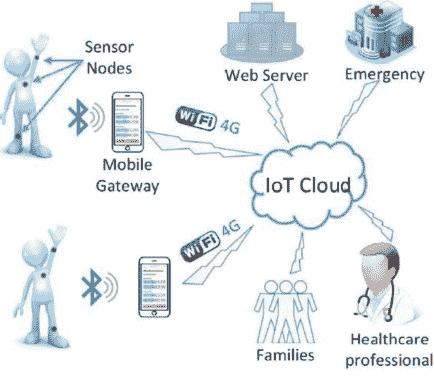

图 3.2 用于医疗应用的可穿戴健康设备 [30]。

#### 3.3.1 用于可穿戴健康设备的监测 [28, 29]

各种先进传感器技术已应用于各种可穿戴传感器和计算机中，以非接触或接触模式用于医疗和生物医学应用。各种 WHDs 被商用于患者的常规体征监测，这在现代数字健康中非常重要，允许通过 Wi-Fi、蓝牙等在智能手机和可穿戴设备之间传输数据。这些设备有助于测量患者的日常活动，如消耗的热量、睡眠模式、监测饮食习惯等。其他参数如血氧饱和度、心率、呼吸频率、血压、皮肤温度等也由 WHDs 进行监测。图 3.2 显示了用于各种医疗应用的 WHDs [26]。

#### 3.3.2 不同身体部位的可穿戴设备技术

各种 WHDs 可以佩戴在人体不同部位，如腿/脚、头或手臂，并可以作为人工器官或智能手机植入。这些可穿戴设备的主要目的是收集有用数据。以下是 WHDs 的示例 [26, 31]：

- 头部：这是身体最高部位，包括眼睛、鼻子、前额和嘴。头部的 WHDs 有护目镜、眼镜、眼镜、头带、耳环、耳机和助听器。现代智能眼镜是具有各种显示、陀螺仪、压力传感器、图像传感器、麦克风和加速度计的可穿戴计算机。在这里，用户界面通过语音命令进行操作 [26]。
- 躯干：身体中心部分包括穿在躯干上的套装、带和内衣。例如用于婴儿心电测量的睡衣、测量婴儿生理参数的智能夹克、带有用于监测军事人员 UV 传感器开关的制服，以及用于温度传感的婴儿汗衣。这些可用于持续监测和增强健康。此外，还展示了用于汗液分析、止痛、驱蚊和药物递送的贴剂。此外，智能衫和可穿戴人工胰腺也是一些示例 [26, 32]。
- 手臂、脚和腿：在这里，佩戴在手臂、脚和腿上的 WHDs 作为手环、智能手表、腕带等，用于监测体温、心率、日常活动和 UV 暴露水平等生理参数。这还包括腿脚上的智能袜、袖套和其他可穿戴配件 [26, 32]。医疗应用中可穿戴设备的各种无线技术和隐私控制见表 3.1 和表 3.2 [9,34]。

商业 WHDs 及其传感器所示于表 3.3。

##### 表 3.1

用于可穿戴设备的无线通信技术 [19,26,35]

| 无线通信技术 | 标准 | 频率 (GHz) | 距离 (m) | 数据传输 (Mbps) | 调制 | 总结 |
| :--- | :--- | :--- | :--- | :--- | :--- | :--- |
| 蓝牙 | IEEE802.15.1 | 2.4 | 10 | 1 | FHSS | 快速，移动性强 |
| ZigBee | IEEE802.15.4 | 0.8–2.4 | 75 | | DSSS | 低，低功耗 |
| NFC | IEC18092 | 0.13 | 0.02 | 10 | ASK | |
| UWB | IEEE802.15.3 | 3.1–10.6 | 100 | | | |
| Wi-Fi | IEEE802.11a/b | 2.4 | <100 | | OFDM | 范围广 |

注：ASK: 幅度偏移键控，DSSS: 直接序列扩频，FHSS: 跳频，NFC: 近场通信，OFDM: 正交频分复用，UWB: 超宽带。

## 医疗应用的可穿戴设备

##### 表 3.2 可穿戴设备中的隐私控制族 [19,36]

| 编号 | 控制族 | 示例 |
| :--- | :--- | :--- |
| 1 | 访问控制 | 访问执行、账户管理和信息流 |
| 2 | 审计与问责 | 审计管理、报告和审计分析 |
| 3 | 意识与培训 | 角色培训、通用意识培训 |
| 4 | 评估、授权与监测 | 评估指南、年度评估和独立评估 |
| 5 | 应急计划 | 应急培训、应急计划和应急演练 |
| 6 | 配置管理 | 配置变更控制和基线配置 |
| 7 | 身份、认证 | 设备管理、用户管理和特定标识符管理 |
| 8 | 应急响应 | 培训、应急响应规则和策略、监测、程序和处理 |
| 9 | 个人参与 | 救济、ACT声明、个人同意和访问 |
| 10 | 介质保护 | 介质标记、清理和使用、介质访问和存储以及传输 |
| 11 | 维护 | 维护工具、受控维护本地和非本地维护 |
| 12 | 物理和环境保护 | 监测、控制和物理访问授权 |
| 13 | 隐私授权 | 目的和共享以及收集权限、更新、影响评估以及安全和隐私计划和行为规则 |
| 14 | 计划 | 风险指定、人员筛选和转移 |
| 15 | 人员安全 | 角色、资源、程序计划、架构和性能以及清单 |
| 16 | 程序管理 | 漏洞和评估扫描、安全分类 |
| 17 | 风险评估 | 安全隔离功能、应用分区和边界安全与保护 |
| 18 | 系统和电信保护 | 文档、系统生命周期、资源分配和获取 |
| 19 | 系统、服务获取 | 恶意代码保护、警报和公告、漏洞修复和监测 |
| 20 | 信息完整性 | |

# 44

## 医疗物联网

### 表 3.3

商用可穿戴健康设备及其传感器 [26,36,37]

| 编号 | 关键体征 | 可穿戴健康设备 | 传感器 |
|---|---|---|---|
| 1 | 心率 | Ear-O-Smart, Cossinus One 耳机, Bragi, Smart Gear Fit, Basic, Go2 Fingerpulse 血压计, Avery Denison Metria, Phyode/Me, 手带, iHealth, Omron, Glass, Potech | 血氧仪、心电图、压力、陀螺仪、加速度计、图像、3D加速度计 |
| 2 | 血氧饱和度 | Bragi, Go2 Fingerpulse 血压计 | 血氧仪 |
| 3 | 体温和/皮肤温度 | Cossinus One 手表, Bragi, Basis | 温度 |
| 4 | 呼吸频率 | Spire, 智能纺织心电图, Glass | 加速度计、压阻式、陀螺仪、加速度计、图像电位、压力 |
| 5 | 血压 | Sensor, Patch, iHealth, Omron | 光电脉搏计法 |

### 3.4 应用

可穿戴健康设备（WHDs）的各种潜在应用如下：

- 1. **自适应护理提供**：基于人工智能（AI）和机器学习（ML）的医疗保健应用通过关注自适应和自动化供应，在变革医疗体系方面发挥着重要作用。开发了智能和统计模型，为神经网络提供非线性和线性模型 [21,38,39]。
- 2. **远程医疗监测**：与健康监测系统相关的 WHD 通过无线设备技术提供功能共享和连接，用于各种连续和离散事件管理。它包括军事行动、农场、田野、剧院等各种平台 [4]。
- 3. **中风康复**：用于通过视频会议将医疗信息传输到各个偏远地区，提高了中风患者远程康复的有效性、识别可行性 [21,40,41]。
- 4. **可穿戴门户内窥镜**：这是医疗市场中体征用户远程医疗和远程监控的一部分。发送所有如生理信号、图像信号和视频等医疗数据至关重要。它是医疗市场中为患者和医生提供商业能力的范式之一 [21,42,43]。
- 5. **紧急医疗保健**：该应用的主要目标是为医生和患者提供心血管疾病的高效医疗，特别是针对急诊患者。因此，需要智能的基于传感设备来管理整个过程以及患者的医疗护理机制 [21,44]。此外，WHDs 的其他潜在应用见表 3.4 和表 3.5。

## 医疗应用的可穿戴设备

### 表 3.4

通过各种无线技术的可穿戴健康设备应用 [9,45,46]

| 编号 | 应用 | 支持 NFC 的平台 |
| --- | --- | --- |
| 1 | 健康监测，如ECG、生物信号和 SpO2 | 基于智能手机的终端 |
| 2 | 诊所或医院患者的监测和识别 | 服务器、读取设备和识别 |
| 3 | 血压、温度、体重、C 反应蛋白等 | 基于智能手机的终端 |
| 4 | 远程监测 | 基于智能手机的终端 |
| 5 | 远程监测 | 基于智能手机的终端 |
| 6 | 胎儿健康监测 | 基于智能手机的终端 |
| 7 | 心率监测 | 基于智能手机的终端 |

### 表 3.5

用于医疗应用的一些可穿戴设备 [19,47]

| 编号 | 可穿戴设备 | 收集的数据 | 示例 |
| --- | --- | --- | --- |
| 1 | 腕戴式设备 | 体动节法、HR、BP、EDA | 通过 Actigraph 的 Actigraph Link，通过 Phillips 的 Actiwatch Spectrum，Empatica 的 E4 |
| 2 | 血压带 | 血压、HR | 通过无线智能数字血压监测的 VSi Mobile |
| 3 | 头带 | EEG、EMG | 通过 Emotiv 的 4D FORCE 和 EMOT EPOC |
| 4 | 皮肤贴片 | 皮肤温度、ECG、体动节法 | 通过 Vital Connect 的 PreventionHealthPatch 以及 MC10 BodyGuardian 的 BioSmartGraph |
| 5 | 指戴式设备 | HR、SpO2 | 通过 Massimo 的 iSpO、血氧仪 |
| 6 | 衣服中的传感器 | HR、HRV、呼吸频率、ECG、体动节法 | 通过 Hexokin 的创新衬衫 |

# 46

## 医疗物联网

### 3.5 关键挑战

成功的 WHD 开发可以实现从单人医疗到多人的大规模应用。所有这些应用都面临许多安全担忧和挑战。这里讨论了各种 WHD 应用的一些主要关注和挑战 [16, 48, 49]：

- 1. **信息机密性**：在 WHDs 中，医疗保健数据应该是机密的。在目前的医疗监测系统中，各种 WHD 将医疗信息转发并汇总到中心位置。黑客可以监视这些信息。这将给受影响的患者带来各种挑战，黑客可能将积累的敏感医疗信息的非法目的 [21, 50, 51]。
- 2. **信息完整性**：医疗数据的机密性和完整性是 WHD 传输的主要因素。黑客可以通过在数据中引入伪造片段并传递给接收者来修改医疗信息。确保数据完整性是应对外部攻击的主要解决方案 [21, 52]。
- 3. **信息可用性**：对于 WHDs，医疗数据和系统资源对所有用户可用是非常重要的 [21,53]。

### 3.6 结论

本章讨论了用于医疗应用的各种可穿戴健康设备（WHDs）。结论是，这些设备是我们数字生活中不可或缺的一部分。许多研究人员正在改进这些设备，使其在医生和患者中更具吸引力。

# 参考文献

- [1] Nguyen, C., "Enabling and Emerging Technologies for Social Distancing: A Comprehensive Survey. arXiv-prints, 2020.


- [2] Ashyap, A. Y.; Zainab, Z.; Dahlan, S.; Kamardin, R.; Crespo, G.; Compact and EBG-Segmented Antenna for Medical Applications. Lett., 2017, 16 (July), 2550–2553.
- [3] Cuartero, P.; Parrilla, M.; Wearable Potometric Sensors. (Switzerland), 2019, 19 (2), 1–24.
- [4] Clarke, R.; What D Inherit From Their Ancestors. Surviv. Rev., 2014, 30 (3), 247–262.
- [5] United Nations, Department of Economic and Social Affairs, World Population 2015. New York.
- [6] Nassar, A.; A Survey on Smart Cities (Internet of Things). Proc. Int. Conf. Adv. Syst. Informatica, 2018, 639(1), 1–10.
- [7] Georgiou, K.; Larentzakis, A. V.; Khamis, N.; Alsuhaibi, G.; Alaska, Y.; Gialalos, E.; Wearable Devices Measure Heart Variability? A Systematic Review. Folia Med. (Plovdiv), 2018, 60 (1), 7–20.
- [8] Wartenin, M.; Oregon, C.; Using the Security to Access Blockchain Technology in Public Sector. Int. J. Inf. Manage., 2020, 10290.
- [9] Ding, G.; Wu, Q.; Lin, L.; Yin, Y.; Tsitsis, T.; A.; Yao, D.; Drone Surveillance System Based on the Cognitive Internet of Things. IEEE Commun. Mag., 2018, 56 (6), 29–35.
- [10] Santagatia, G.; Elena, T.; A Soft-Defined Ultrasonic Network for Wearable Devices. IEEE/ACM Tran. Netw., 2017, 25 (2), 960–973.
- [11] Szydło, T.; Koneczny, M.; Mobile and Wearable Devices in an Open and Universal System for Remote Patient Monitoring. Microsyst., 2016, 46, 44–54.
- [12] Makhdoom, I.; Athobashan, M.; Abbas, H.; Ni, W.; Blockchain Adoption in IoT: The Challenges, and a Way Forward. J. Netw. Comput. Appl., 2019, 125, 251–279.
- [13] Roshan, Y. M.; Park, E.; Design for a Wireless Power Transfer System for Wearable Devices. IEEE Power Transfer, 2017, 8 (4), 931–937.
- [14] Cheng, J.; Mitomo, H.; The Evaluation of Perceived Usefulness of Smart Wearable Devices for Diabetes. Informatics, 2017, 34 (2), 528–539.
- [15] Si, H.; Sun, C.; Liao, Y.; Shi, L.; Information Security on Blockchain. Future Gen. Comput. Syst., 2019, 101, 1028–1040.
- [16] Coyle, S.; Diamond, D.; Medical Applications of Smart Devices. In Textiles and Health Management, 2016; pp. 215–237.

# 医疗医疗

[24] Nag, A.; Mukhopadhyay, S. C.; Kosel, J.; 可穿戴柔性传感器：综述。IEEE Sens. J., 2017, 17 (13), 3949–3960. https://doi.org/10.1109/ISEN.2017.270570
[25] Dias, D.; Cunha, J. P.; 可穿戴健康设备——体征监测与技术。Sensors (Switzerland), 2018, 18 (8), https://doi.org/10.3390/s1082414
[26] Mistry, I.; Tanwar, S.; Yagi, S.; Kumar, N.; 用于工业5G物联网区块链：系统性综述、解决方案与挑战。Mech. Syst. Signal Process., 2020, 135, 106832. https://doi.org/10.1016/j.ymyssp.2019.106832
[27] Rishani, N.; Elshay, H.; Shubair, R.; Kiorti, A.; 用于医疗应用的可穿戴、表皮及植入传感器。arXiv:1810.00321, 2018–20.
[28] Spagnoli, A.; Verdi, E.; Varotto, A.; Gamberini, L.; 可穿戴共生设备的接受度测量：跨场景验证研究。Lett Not Comput. Sci. (包括计算机科学快报、人工智能人工智能医学笔记计算生物信息学部分), 2014, 8820, 87–98. https://doi.org/10.1007/978-3-319-13500-7_7
[29] King, R. C.; Villeneuve, E.; White, R.; Sheratt, R. S.; Holderbaum, W.; Harwin, W. S.; 用于可穿戴健康监测的数据融合技术与应用。Med. Eng. Phys., 2017, 42, 1–12. https://doi.org/10.1016/j.medeng.2016.12.011
[30] Sodro, A. H.; Pirbursal, S.; Sang, A. K.; 医疗保健中物联网与预测性管理的融合。Gener. Comput. Syst., 2018, 8 (April), 380–391. https://doi.org/10.1016/j.gcs.2018.03.052
[31] Wu, T.; Wu, F.; Redute, J. M.; Yuce, M. R.; 连接医疗保健的自主无线区域网实现。IEEE Access, 2017, 5, 11413–11425. https://doi.org/10.1109/ACCESS.2017.276344
[32] Bono, O.; Garcia, R.; Holgado-teriza, J. A.; Dumas, M.; MHealthDroid: 一种用于移动健康应用的创新框架。辅助生活国际研讨会, 2014, 886 (March 2015), 90–98. https://doi.org/10.1007/978-3-319-33195_5
[33] Basu, B.; Chattaraj, D.; Das, A.; 在网络物联网设备中设计基于区块链的安全访问控制。Network Deploy. Comput., 2020, 153, 229–249. https://doi.org/10.1016/j.jcom.2020.02.011
[34] Jawad, S. S.; Fyath, R. S.; 5G移动网络中光纤射的传输性能吞吐量。International Journal of Networks and Communications, 2018, 8 (3), 81–96. https://doi.org/10.5923/ijnc.2018.080033
[35] Sodro, A. H.; Sangaha, A. K.; Pirbursal, S.; Sekhari, A.; Ouzrout, Y.; 绿色医疗感知物联网系统。Multimed Tools. Appl., 2019, 78 (3), 3045–3064. https://doi.org/10.1007/s11042-018-5634-0
[36] Chávez-Sangel, R.; Khaleghi, A.; Alasadeh, I.; Ramstad, T. A.; 用于医疗应用的超宽带体域网架构。Int. Symp. Appl. Sci. Biom. Commun. Technol. IEEE 2009, 595–600. https://doi.org/10.1109/2009.537624
[37] Amjadi, M.; Kyung, U. K.; Park, I.; Mitt, S.; 可伸性皮肤式及可穿戴应变传感器及其潜在应用：综述。Adv. Fun. Mater., 2016, 26 (1), 1678–1698. https://doi.org/10.1002/adfm.2015.0475
[38] Dejeune, P.; Johnston, S.; 受限资源设备的隐私保护远程健康监测。Proc. ACM Symp. Appl. Comput., 2016, 04–08, 119–124. https://doi.org/10.1145/285613.285618
[39] Mundt, W. C.; Montgomery, K. N.; Ud, D.; Barker, V. N.; Thonier, G.; Ricks, R. D.; Darling, R. B.; 等，用于太空和地面应用的多层可穿戴生理监测系统。IEEE Trans. Inf. Technol., 2005, 9 (3), 382–391. https://doi.org/10.1109/TIT.2005.85409

## 用于医疗的可穿戴设备

[40] Pereira, A.; Espada, J. P.; Crespo, R. G.; Aguilar, S.; 用于网络连接室内环境控制和数据获取的平台。Futur. Gen. Comput. Syst., 2019, 652–666. https://doi.org/10.1016/j.future.2018.011
[41] Teng, X.; Poon, C. C.; Yang, T.; Bonato, P.; 用于健康的可穿戴医疗系统。IEEE Rev. Biomed. Eng., 2008, 1, 62–74. https://doi.org/10.1109/RBME.2008.2248
[42] Mukherjee, A.; Yen, N.; De, D.; Edge: 用于物联网移动边缘计算的QoS感知中间件。Comput. Commun., 2020, 152 (January), 93–108. https://doi.org/10.1016/j.com.2020.0319
[43] Lukowicz, P.; Lukewicz, P.; Troster, G.; 用于医疗保健的柔穿戴系统。Methods Inf. Med., 2014, 43 (July), 232–238. https://doi.org/10.1267/s0403032
[44] Knies, G.; 物联网、数据与联网车辆的经济。Telecomm. Policy., 2019, 43 (2), 171–181. https://doi.org/10.1016/j.telepol.2018.0902
[45] De La Torre, R.; Pado, Cho, K. R.; 可驾驶车辆安全：挑战与未来机会。Futur. Gen. Comput. Syst., 2018. https://doi.org/10.1016/j.future.2017.12041
[46] Berglund, M. E.; Duvalli, J.; June, L. E.; 可穿戴技术历史现状与趋势综述。Int. Smart. Wearable Comput. Dig. Pag., 2016, 16–40. https://doi.org/10.1145/2971963.297196
47] Moim, S.; Karim, A.; Sadiq, J.; Zafar, K.; Ahmed, E.; Imran, M.; 分布式区块链监控物联网：分析、需求与开放问题。Futur. Gen. Comput. Syst., 2019, 100, 325–343. https://doi.org/10.1016/j.future.2019.0502
[48] Javascriptizous, S.; Chakraborty, A.; Assadou, E.; Doyle, F.; 嵌入式可穿戴医疗设备：应用于胰腺。Processes, 2016, 4(1)-29. https://doi.org/10.3390/pr4010029
[49] Alger, M.; Dombellan, B.; Hotter, M.; Kennedy, J.; VanderMee, D.; Rothberger, M.; Winter, R. (编)。迈向医疗穿戴技术：新的数字科学：构建研究议程。DESCRIPT 2015. 网络与计算机应用讲义 496–504, 卷9073。Springer, Cham。https://doi.org/10.1007/978-3-319-18714-4_33
[50] Sengupta, J.; Ruj, S.; Das, S.; 物联网及物联网攻击、安全问题及区块链解决方案综合综述。J. Net. Comput., 2021, 149 (April), 102481. https://doi.org/10.1016/j.jnc.2020.102481

## 52 医疗物联网

关于疗法 [3]。然而，现有剂型产生的解决方案难以整合到即将来的基于物联网（IoT）的健康模型 [4]。

当前的健康模型需要进行增强，以从寻找药物产品到与消费者（患者）沟通的各个方面来优化个性化医疗。提供个体化护理需要该领域的突破，并在药物产品的设计、生产和分发方面进行根本性改进。现有的医疗产品大规模生产的固定剂量模式无法根据个人的基因、代谢或活动水平对药物进行调整或个性化。因此，药物产品的设计理念应当转变为基于信息的医疗产品的大规模自适应 [5]。药物的发现和开发过程需要改进，通过让患者参与到以患者为中心的临床试验中，并将“数字化患者”原则应用于所需的处理框架中，同时遵守现有的数据保护措施且不侵犯专利。此类原则涵盖了大数据领域和由机器学习驱动的诊断领域 [6–8]。

如今，制药行业的投资很大程度上致力于药物研发，并且在设计应用产生的结果时具有灵活性；例如用于设计固体剂型（片剂）的古老配方技术 [9]。最终，生产过程普遍遵循传统模式且不愿改变，主要是由于立法和监管的工作量 [10, 11]。然而，药物价格大幅上涨，增加了社区的财政负担，且水平并不理想。在这里，迫切需要一种新技术，通过重构药物设计指南、相关的生产干预和分发模式来最小化药物成本。这种技术将通过从固定剂量产品的批量制造转向按需个体化产品的生产，确保获得负担得、安全且有效的药物。此类产品可以设计为包含信息模型；例如，快速响应代码，便于从生产单元到患者端的单个产品进行监控 [12]。

## 4.2 医疗保健中的区块链技术

区块链代表一种计算系统，用于记录加密货币中进行的交易，并在点对点网络连接的多个服务器上维护这些记录 [13]。由于其内在特征以及这些领域已纳入基于交易的运营模式，其起源可以追溯到金融领域。特征，区块链包含了多种特性，包括分布式账本、去中心化存储、认证、安全性和不可篡改性。至于基于交易的运营模式跨学科传播，医疗保健服务被视为提供护理作为产品的提供者。这些交易涉及大量的个人、机密和技术数据，对个人的健康和职业发展等具有潜在影响 [14]。此类数据的泄露导致许多人支持区块链医疗保健愿景系统，在这一系统中，执业人员将获得更多自主权，而患者将不再担心其数据与第三方交流 [15]。

# 基于区块链的个性化药物物联网

除了医患沟通和个人患者记录外，医疗保健的其他元素也需要类似的技术基础设施。制药领域可能是最关键的之一。有一句俗话：“所有的药物都是毒药，剂量决定了它是良药还是毒药。”在第四次工业革命期间，这句话可以从药物药数据的角度被引用 [16]。关于药物存在巨大的数据流，不仅包括已使用的药物，还包括正在开发和测试的药物。临床试验（在人体上测试新药的过程）基于对药物与安慰剂比较的有效性和安全性的测试数据质量和数量。为了随机化考虑，任何与参与者相关的信息都将通过个人化结果保持机密 [17]。药物科学的新兴分支，特别是药物监测和药物基因组学，需要大量数据进行安全存储和保护。对此类信息的未经授权访问可能导致虚假的批准和对药物的指控，这不仅影响医患沟通，还影响患者的生命和健康 [18]。


为什么区块链能对此做出贡献？区块链的生物医学应用需要更强的认证、互操作性和记录共享模式。这些需要建立在伦理和法律基础上，并考虑到1996年的《健康保险可移植性与责任法案》`HIPAA`和2018年的《通用数据保护条例》`GDPR`[14, 19]。将区块链模式适应医疗保健背景已经带来了显著优势并并将持续。此类模式包括智能合约、欺诈检测和健全的识别系统。在制药领域，上述功能可以作为保护完整性和机密的额外阀门，随后产生可靠的数据。对于区块链的内在脆弱性以及用户数字素养不足仍然存在担忧，更说挖掘激励、攻击和密钥管理了 [20]。

## 4.3 医疗保健中的物联网

物联网`IoT`被描述为物理设备网络，利用连接性实现数据交换。这些设备可以是现代的也可以是尖端技术的。物联网的显著之处在于快速流程流程，使工人能够及时完成任务。物联网预计将得到`5G`网络基础设施的支持，这保证了大型数据集传输和分析的安全 [21]。在过去几年，专门从事医疗或技术的公共或私有实体对物联网产生了兴趣和投资。现在，从现有设备来看，带有可穿戴相关应用的智能手机和成像设备已制造了红外、蓝牙或无线局域网`Wi-Fi`等连接模式。这是形成数据交换网络的重要资产，其中医疗服务的提供依赖于数据的交换，例如影像和实验室检查、患者记录和研究结果 [21, 22]。

支持物联网的医疗设备提供关键的数据传输和分析服务，协助医疗工作者和研究人员完成从急诊到常规程序的各种任务。

## 4.5 医疗物联网

将物联网模式整合到医疗保健中的益处是双重的。它不仅促进了大量工作以改进和加速生物医学研究和临床实践，还减轻了健康从业人员的负担，让他们更有创造力、同理心 [14, 23]。物联网基础设施在远程患者监测、治疗和结果、疫苗和药物方面的潜力已显而易见。在成本方面，任何类似的物联网健康平台都可以由专门中心拥有和运营，为整个地区甚至整个国家提供服务。到目前为止，医疗保健中只有少数物联网应用进入了临床实践 [24]。

除了数据的收集和分析，物联网数据平台如 `Kaa` `KaaIoT Technologies`、`MindSphere` `西门子`和 `Azure` `微软`具有基于物联网的数据处理功能，产生有意义的可操作结果。考虑到商业利益和关注，此类模式预计将被广泛使用活动水平结合卡路里消耗和摄入、营养药物依从性数据报告、心率和血糖监测在个人层面已经具有价值，如果通过物联网模式扩展到人群研究中，将产生巨大影响。人类控制很重要，但如果收集和处理是半自动、甚至是自动的，就可以加速结果的产生及其在临床实践中的转化 [25, 26]。

## 4.4 物联网和区块链在制药行业中的应用

如前，区块链是一组正在开发的账本，账本通过哈希加密技术连接起来。该技术最著名的应用是加密货币比特币。英国等国家目前正在开展大规模区块链整合到医疗保健的工作。从2016年1月开始，当局已传达了相关信息。这些信息指出国家医疗服务体系`NHS`是区块链模式的潜在受益者，以改进服务交付，并以机密安全的方式交流患者记录和敏感信息，同时遵守现行法规 [27]。飞利浦与飞利浦区块链实验室与区块链记录启动公司 `Tier` 合作，自2018年以来研究区块链技术如何用于医疗保健领域 [27]。在制药环境中，区块链蕴含着有趣的潜力，例如调查终身用药史。

### 4.4.1 智能冰箱

`Weka` 提供的疫苗智能冰箱是健康领域中物联网的一个有趣案例。它解决了疫苗管理和存储中的问题，如维持推荐温度、确保稳定电流供应以及处理导致变质的其他库存错误。`Weka` 智能冰箱允许远程监控，以确保疫苗存储在正确的温度下，自动化的库存管理服务让临床医生感到放心和

# 基于区块链的个性化药物物联网技术

更新了关于疫苗储存的内容 [28]。它配备了一个自助终端，允许执业人员安排疫苗的使用计划，使得单支药剂在不将整个内容暴露于环境条件的情况下即可使用。总而言，智能冰箱是一种能够简化疫苗处理流程的物联网模型。通过对此类冰箱的大规模使用数据进行二次分析，可以评估从业人员对接种计划的合规趋势 [28, 29]。

## 4.4.2 促进虚拟临床试验

临床试验作为药物行业的一项关键问题，在开发新药的过程中既繁琐又昂贵。开支增加的原因在于：招募和招募合格的人员面临挑战、长期对许多受试者组织并控制个性化程序，以及处理不断上升的失访率。组织程序的成本之所以高昂，是因为由于需要从特定区域招募人员、获得特殊的临床试验机会，并招聘专业且胜任的临床人员。地区限制限制了试验样本的模式和数量 [30]。

虚拟临床试验可以简化样本、提供个性化体验，并减少对专业临床人员的需求。药物行业已采用虚拟技术，特别是在非干预性临床试验中，并在影响数据准确性、保护和机密性的多种因素，以及信誉问题、监管合从和同意书管理等问题方面取得了多种成果。区块链技术结合集成物联网传感器，能够满足监管机构对数据信誉、保护和机密性的要求 [31]。

区块链技术实现了一种智能合约技术，确保参与者的同意信息被记录、进行电子签名并具有充分的可追溯性。为试验个体提供的激励将是基于代币 `token-based` 而非目前的货币激励，以增加参与度、增强合从性并开发更具个性化的体验。如果可以通过访问存档的临床数据同时确保数据受到保护而不损害参与者机密医疗数据的隐私和安全，那么寻找和招募试验个体的工作将得到大大简化。广泛实施基于区块链的个人健康记录 `PHRs` 使医药公司能够搜索全球人口，快速识别出全球不同参与者的合适样本。最终，区块链技术可以保护患者数据，极大地增加全球数据量，并降低临床试验的负担、复杂性和费用 [30]。

## 4.4.3 打击假药

制药行业在制造和营销药物产品的精疲力竭的过程中投入了巨额资金和精力。然而，全球假药市场每年都在增长，其价值达数十亿美元。

## 4.5 医疗物联网

在不断增长的市场中，10–30%的处方药是假药，范围从成分错误到成分数量不符不等。抗生素是网上购买频率最频繁的假药之一 [32]。

供应链透明度缺失和药物产品真实性不足是全球医药欺诈的根源，其中透明度的缺乏使得识别欺诈根源、验证真实性或确定实施犯罪的劣质参与者变得困难。因此，从制造到质量保证再到分发的整个操作过程都需要在一个无偏的数据集中得到保护，并且每项数据都经过加密签名和编码。区块链技术提供了这种潜力和透明度。因此，医药公司显然致力于打击假药，并应对这些假药及其副作用对生命构的威胁。2017年，知名制药公司的利益相关者启动了 `Mediblockchain` 项目，对医药供应链的成员进行追踪和追溯性管理。初步试点前景良好，并表明区块链驱动的干预将允许在符合《药物供应链安全法案》`DCSA`的同时，优化流程并减少假药供应 [19, 27]。

## 4.4.4 增强药物的 3D 打印

美国食品药品管理局 `FDA` 在2017年发布了使用3D打印进行个性化药物的指导，这些药物可能由非传统生产商（如医疗机构）打印。在3D药物打印成为根据需求生产个性化药物的有效方法之前，应对患者数据进行适当管理 [33]。药物交付与患者相关的特别是器官（如表观遗传学、基因组学、代谢组学和蛋白质组学）、微生物和过敏谱对于寻找准确的药物种类和剂量至关重要，健康数据以及考虑到患者年龄、性别、种族等其他变量的药物可能结果同样关键。尽管如此，现在访问特定患者的特殊数据具有挑战性，因为数据在多个医疗护理人员之间是碎片化的。中心化框架尚未可靠，因为存储患者记录的数据库既是障碍，也是入侵者的乐场。

通过个人生物识别增强的基于区块链的 `PHR` 可以通过区块链账本记录交易提供安全性，从而减少数据操纵。同样，区块链技术可以促进预测性数据的交换，在多个人口库之间产生有价值的数据库。因此，在数据上应用机器学习 `ML` 和人工智能 `AI` 技术以快速识别根据患者需求定制的最优药物种类和活性成分剂量是切实际的。将 `ML` 和 `AI` 的结果与3D药物打印机相结合，在医生诊所、医院或药店打印患者的个性化药物 [30]。

# 基于区块链的个性化药物物联网技术

## 4.4.5 加密药物 `CRYPTOPHARMACEUTICALS`

应用富信息模型对每个剂量单位进行灭菌、生产后检查以及患者服用处方剂量单位时的检查。此类模型将允许通过物联网和健康系统的智能链接扫描产品，而人工智能则增加了管理和剂量调整 [3, 34]。此类数字产品针对每个患者进行特定定制，使基于区块链的健康系统成为可能 [35]（图4.1）。

加密药物是一种药物的一种区块链原理，每个最新的账本包含特定产品的独特信息，由生产者在签入时哈希显示，患者在签出时显示；因此，每个账本都包含前一个账本的加密哈希，以不可修改的方式级联所有账本。`Norfeldt` 建议将药物产品整合到基于物联网的健康系统中，允许将机器学习驱动的诊断与患者数据融合的技术框架，涉及点端传感器数据和健康记录，最终产生序列化个性化产品的安全链。编程平台已用于在免费提供的 `Android` 和 `Apple MedBlockchain` 应用程序中创建开源代码，这些程序每个屏幕显示四种不同的用户视图：制造、患者监控，以及根据用户是否为医疗提供者、患者、健康系统或药物生产者在每个工作流层级允许信息。然而，关于数据泄露影响的最新数据表明，网络安全将是未来健康系统面临的最重大挑战之一 [37]。

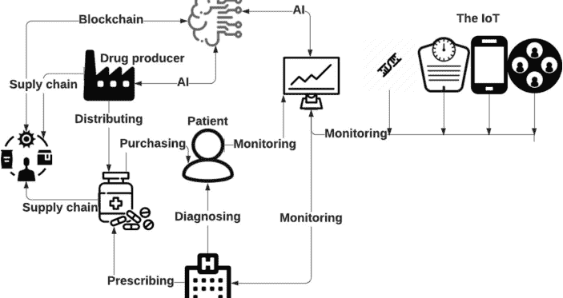

图4.1 通过个性化药物管理患者的未来需要将所有生产和购买的药物产品通过区块链整合到中心健康系统中。

## 4.5 讨论

根据科学办公室的建议，患者记录可以通过去中心化的区块链进行操作，而不是存储在中央数据库中。区块链通过管理方法以及允许访问此类数据的人员或实体的协议，降低了未经授权访问的风险。例如，初级保健机构的秘书可能只能访问患者的基本信息，如其姓名和地址。医生则将拥有所有医疗信息的完全访问权限 [14, 27]。患者也可以访问自己的记录，并在受控的情况下与之进行交互。建议包括让患者指定治疗偏好，或列出可以参与其健康决策的成员列表。通过这种方式，可以方便地管理和记录同意书。这不仅适用于定期跟踪记录，也适用于需要在紧急情况下做出决策的具有复杂病史的人 [38]。

公共与私立医疗机构之间的通信将变得更加容易。因此，这些机构使用自己的系统。相互访问非常复杂，大多数需要繁琐的官僚程序和数据传递。为患者提供访问存储在区块链系统中的包括私立医疗实体在内的所有医疗提供者的记录，被视为一个重要方面 [16]。这在爱沙尼亚已经实施，那里成立了一家名为 `Guardian` 的数据安全初创公司。这种协作对超过百万医疗记录部署了基于区块链的保护。通过将 `Guardian` 的签名基础设施集成到爱沙尼亚电子健康基金数据库中，患者和从业人员可以实时访问记录。同样，`IBM Watson Health` 在 2017 年宣布与美国食品药品监督管理局 `FDA` 合作，通过区块链模式定义安全、高效且扩展的健康数据交换 [27]。

## 4.6 局限性

乔治·伯纳德·肖曾表示，“交流中最大的单一问题在于人们认为交流正在发生的幻觉”。同样，区块链模式最大的单一问题可能是：那些没有接受过培训且熟悉这项技术的人，期望并被期望在工作条件下快速地取得令人瞩目的成果 [39]。区块链素养是一个重要的障碍。并非所有政府都发布了关于加密货币的政策，美国 `US`、俄罗斯和法国等国的这种政策缺失可能培养了这种不信任感 [40]。在政策制定方面，联合国 `UN`、世界卫生组织 `WHO` 或欧盟 `EU` 等国际机构或政治计划的参与可以增加各国政府和医疗系统的兴趣。尽管，政策制定也带有固有的障碍。区块链满足了对安全和机密性的需求 [41, 42]。

除了政治机构外，学术机构也可能面临障碍。区块链具有很强的工业或初创特征，而在许多国家，学术界与工业界的合作被严重忽视。在同一框架下，通常会出现需要工业支持才能增长的概念和技术。在学术界引入区块链概念并让教育工作者传给学生是一项巨大的挑战，因为教职员工的日程繁忙，且从日常教学研究转向新事物时存在不安全感 [38]。

## 4.7 结论

未来的患者管理需要通过将物联网 `IoT` 与区块链相结合，使所有生产和购买的药物接入中央医疗系统，生产个性化药物。区块链技术在研究终身药史、减少假药以及促进负担得起的临床试验方面具有广阔的影响，通向个体化医疗的新时代。加密药物学使信息丰富的药物模型能够链接到患者特定的区块链剂量单元中，这对于将新型药物整合到基于物联网的健康系统中是理想的。个人药物强大的区块链将有助于防止伪产品，并允许药物行业在患者参与的情况下进行物流干预。尽管区块链在维护完整性和机密性方面带来了额外价值，但对于区块链的脆弱性以及用户数字素养不足，仍存在激励、攻击和管理问题方面的担忧。网络安全将是未来医疗系统面临的最重大挑战之一。

# 参考文献

- [1] Letai A. Functional Precision Cancer Medicine—Moving beyond Pure Genomics. Nat Med 2017;23:1028–35. https://doi.org/10.1038/nm.4389.

- [2] Li Q, Zhang L-N, Tao X, Ding X. Review of Flexible Sensing for Wearable Physiological Monitoring. Adv Health Med 2017;6:16031. https://doi.org/10.1002/adm.16031.

- [3] Dimitrov AY. Medical Internet of Things and Big Data in Healthcare. Health Inform Res 2016;22:156–63. https://doi.org/10.4258/hir.22.3.

- [4] Benton CE, Shakhouni A, Annet NV, Brockmaster DA, Nelson DM, et al. Restoring Functional Control of Movement in Human with Quadplegia. Nature 2016;53:247–50. https://doi.org/10.1038/nature17435.

- [5] Shinbane S, Saxon L. Digital Monitoring and Virtual Medicine. Trends Med 2016;207. https://doi.org/10.1016/j.tcm.2015.

- [6] Chen J, Ash SM. Machine Learning and Prediction in Medicine — Beyond the Peak of Expectations. N Engl J Med 2017;376:2570–9. https://doi.org/10.1056/NEJM.

- [7] Komorowski M, Celi LA, Badawi O, Faisal AA. The Artificial Intelligence Learn Optimal Treatment for Sepsis in Intensive Care. Nat Med 2018;24:1716–20. https://doi.org/10.1038/s41591-018-0213.

- [8] Obermeyer Z, Emanuel EJ. Predicting the Future — Big Data, Machine Learning, and Clinical Medicine. N Engl J Med 2017;375:1216–9. https://doi.org/10.1056/NEJM0618.

- [9] Ranten G, Khinas J. The Future of Pharmaceutical Manufacturing. J Pharm Sci 2015;104:36–38. https://doi.org/10.1002/jps.2459.

- [10] Allison G, Cain YT, Mooney C, Bizjak TG, Holte O, et al. Regulatory and Quality Considerations for Continuous Manufacturing May 20–21. J Pharm Sci 2015;104:803–12. https://doi.org/10.1002/jps.2432.

- [11] Nasr M, Krishna Y, Trout BL, Macia S, et al. Regulatory Perspectives on Continuous Manufacturing: Moving Through Practice: September 26-27, 2016, International Symposium on the Continuous Manufacturing of Pharmaceuticals. J Pharm Sci 2017;106:319–206. https://doi.org/10.1016/j.jps.2017.0615.

- [12] Edinger M, Bar-Shalom, Sandler N, Ranten J, Jenina N. QR Encoded Smart Forms by Injet Printing. J Pharm Sci 2018;53:135–48. https://doi.org/10.1016/j.jarm.2017.11.052.

- [13] Dajan R, Weiss M. Quantum Blockchain Entanglement in Time. Quantum Rep 2019:3:1–11. https://doi.org/10.3390/quantum3110002.

- [14] Zubadi HD, Chung Y-wo, Ko K, Hanshi SM, Karuppayah S. A Review on the Role of Blockchain in the Healthcare Domain. Electronics 2019;8:679. https://doi.org/10.3390/electronics80679.

- [15] HPECIO. Blockchain Technology. Hpeclo https://hpeclo.io/how-it-works/(accessed May 3, 2020).


- [16] Yue X, Wang H, Din J, Li M, Jiang W. Healthcare Dataways: Found Healthcare Intelligence on Blockchain with Novel Risk Control. J Med Syst 2016;40:218. https://doi.org/10.1007/s10916-016-0574-6.
- [17] Irving G, Holden J. Blockchain-Timestamped Protocols Could Improve the Trustworthiness of Medical Science. F1000Research 2017;5: https://doi.org/10.12688/f1000research.8414.3.
- [18] Nugent T, Upton D, Comispo M. Improving Data Transparency in Clinical Trials using Blockchain Smart Contracts. F1000Research 2016;6:2541. https://doi.org/10.12688/f1000research.551.1.
- [19] Kim S, Park H, Lee J. Wordvec-based Latent Semantic Analysis (W2V-SA) for Topic Modeling: A study on Blockchain Technology Trend. Expert Expert Syst 2020;152:103140. https://doi.org/10.1016/j.esr.2020.103140.
- [20] Tariq M, Al-Objet F, Zubair Farqi M, Baker T, Hammoudeh M, et al. The Security of Data in Fog-Enabled IoT Applications Including Blockchain: A Survey. Sensors 2019;19:1788. https://doi.org/10.3390/s19191788.
- [21] Islam SM, Kwak D, Kabir MH, Hassan M, Kwak K-S. The Impact of Things for Health Care: A Comprehensive Survey. IEEE Access 2015;3:678–708. https://doi.org/10.1109/ACCESS.2015.24795.
- [22] Sharma M, Singh G, Singh R. An Advanced Conceptual Diagnostic Healthcare Framework for Cardiovascular Disorders. ICST Trans Case Scalable Inf Syst 2018;5:15428. https://doi.org/10.4108/eac.19-6-2018.15428.
- [23] Shukla S, Hassan MK, Khan LT, Luang A. An Analytical Method to Minimize Latency in Healthcare Internet-of-Things in Fog Computing Environment. PLOS ONE 2019;14:e022493. https://doi.org/10.1371/journal.pone.0224934.
- [24] Gopal G, Ster-Cuzrazolla C, Toldo L, Eberhardt W. Digital Transformation in Healthcare - Advantages of Present and Future Information Technologies. Clin Chem Lab Med 2019;57:328–35. https://doi.org/10.1515/cclin-2018-0658.
- [25] Islam N, Faheem Y, Din IU, Thanh,izani M, Khalil M. A Blockchain-based Fog Computing Framework for Activity Recognition as an Application to e-Health-services. Future Gen Comput Syst 2019;100:569–78. https://doi.org/10.1016/j.future.2019.05.059.

# 基于区块链的个性化药物物联网

[26] Jagadeeswari V, Subramaniamwamy V, Logesh R, Vijayakumar V. 个性化医疗保健系统中的医疗物联网与大数据研究。《Health Inf Syst* 2016:6:14. https://doi.org/10.1007/s13755-018-0049-x.
[27] Birch W, White L, Critchley P. 区块链技术：在生命科学和医疗领域的应用。2019. https://www.northrosefullbridge.com/en/knowledge/publications/cb048fa5-blockchain-technology-application-in-life-sciences-and-healthcare-sectors (访问于2020年6月2日)。
[28] Fear N. 物联网智能桥接疫苗护理。《Internet Bus* 2016. https://internetbusiness.com/iot-smart-bridging-vaccine-care/ (访问于2020年6月2日)。
[29] Özdemir V, Hemir N. 工业的诞生：用人工智能理解大数据、“物联网”与下一代技术政策。《OMICS J Integr Biol* 2018;22:65–76. https://doi.org/10.1089/obi.2017.0194.
[30] Woods J, Iyyengar R. 利用区块链保障更具个性化的药物，GEN- 基因工程生物技术* 2019. https://www.genegenews.com/insights/blockchain-to-secure-a-personalized-pharma/ (访问于2020年3月10日)。
[31] Mantel-Urdak B. 新药研发正在走进你的家门。《Fast* 2018. https://www.fastcompany.com/09229910/virtual-clinical-trials-to-bringing-drug-development-home (访问于2020年5月25日)。
[32] Health Research Fund. 20项震惊的假药统计数据。《HRF* 2014. https://healthresearchfunding.org/20-shocking-counterfeit-drug-statistics/ (访问于2020年3月9日)。
[33] 美国食品药品管理局。局长斯科特·戈特利（Scott Gottlieb）医学博士关于使用新型医疗产品2D 打印技术的声明；为医疗器械制造商提供指导。2020. https://www.fda.gov/news-events/press-announcements/statement-from-commissioner-scott-gottlieb-md-fda-use-new-2d-printing-medical-devices (访问于2020年5月26日)。
[34] Mioto R, Wang F, Wang S, Jiang X, Willey JT. 医疗保健领域的深度学习：挑战与机遇。《Bioinformatics* 2018;19:1236–46. https://doi.org/10.1093/bioinformatics/byt004.
[35] Zhang M, Ji Y. 用于医疗保健记录的区块链：数据视角。Peer Inc.; 2018-5. https://doi.org/10.7287/peerj.preprints.26942
[36] Beneel B. 密码学函数：理论与实践。收于 Soriano M, Qing S, López J，编选。在：Ediger J, Medina N, Rantanen J。加密药物：通过药品区块链提高药物安全性。《J Pharm* 2019;5:1038–41. Springer; 2020, p. 1–3. https://doi.org/10.1007/978-3-642-1765-0_1.
[37] Nörfeldt L, Backter K, Ediger J, Medina N. 医疗保健应用中的区块链：研究挑战与机遇。《J Net Comput Appl* 2019;135:62–75. https://doi.org/10.1016/j.jnca.2019.04.025.
[38] McGrain C, Todd K-RR, Liu Ce, He D. 医疗保健应用中的区块链：研究挑战与机遇。《J Net Comput Appl* 2019;135:62–75. https://doi.org/10.1016/j.jnca.2019.02.027.
[39] Cirillo C, Fu-Y, Solmaz G, Kovacs E. 拥抱未来。《Sensors* 2019;19:3391. https://doi.org/10.3390/s19093391
[40] Cao S, Zhang G, Liu P, Zhang X, Neri F. 云辅助电子健康系统通过区块链防篡改电子健康记录（EHR）。《Health Inf Syst* 2019;485:427–40. https://doi.org/10.1016/j.ins.2019.02.038.

# 用于监测系统的可穿戴/植入式设备

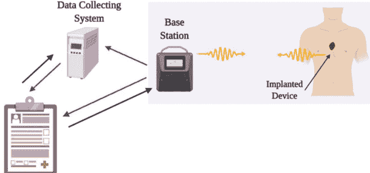

图 5.1 医疗监测系统示意图。

由于其具有低剖面、柔性和贴合性，被应用于此处 [5–7]。贴片天线的这些特性使其具有紧凑性，并易于集成到植入式系统中，因为可以根据植入式设备的轮廓进行建模。

## 5.2.2 电子电路

无线植入系统的电气/电子元件允许其运行，并并在基站与植入设备之间提供信号处理和数据传输。电池或电源单元决定了植入设备的寿命。研究人员已对各种增加植入系统寿命的方法进行了研究，例如内部电源、能量采集、无线功率传输等. [8, 9]。

## 5.2.3 生物传感器与生物执行器

植入式系统中包含的生物传感器和生物执行器可能取决于设计该植入式设备的用途。这也有助于决定植入物在人体内的位置。目前已研究并使用了多种用于监测不同生理参数（如 pH、温度、血糖等）的监测传感器，或活性系统（能够监测某些参数并根据读取结果执行某些操作的系统，如药物输装置）。

## 5.2.4 绝缘

无线植入式设备应用生物相容性材料进行适当的绝缘，以防止任何不良反应和人体对植入物的排斥。应防止植入物直接接触具有导电性的体液；否则设备可能会短路。

## 5.2.5 特性表征与实验

计划用于医疗监测系统的每个组件都应该进行特性表征，以验证其性能并确保其符合所有法规。系统在现实生活中使用之前，会在体外和动物模型上（体内测试）进行测试 [10]。

## 5.2.6 人体

植入式设备被固定在人体内以监测各种生理参数。设计植入式设备时应考虑到人体复杂、高损耗的特性以及流体的导电性。在实际环境中应用之前，应在人体组织模拟模型中对设备属性进行适当的表征。

## 5.2.7 信道传播

通道传播处理信号从无线植入系统到接收终端的传播。接收系统处理收到的数据并从中提取有用的信息。

## 5.2.8 基站

基站由多个子系统组成：
- a. 控制模块，用于驱动和控制整个系统的运行。
- b. 接收模块，包含接收来自植入系统信号的接收线。
- c. 互联网调制器/解调调器或设备，用于收集和传输来自数据采集系统的信息。

## 5.3 天线在医学领域的应用

主要地，天线在医学中的用途有两个 [11]：诊断和治疗。

### 5.3.1 诊断

在诊断中，通过天线传输和接收电磁能量来测量人体内的各种生理参数。

#### 5.3.1.1 磁共振成像

天线是各种医疗仪器的关键组件，这些仪器用于如磁共振成像（MRI）的诊断。MRI 机器天线形成的电磁场聚焦在待诊断的人体部位。在 MRI 机器施加强场的情况下，待诊断部位水分子中氢核的自旋会排列。当停止该部位的场时，氢核将回到原始状态并释放在此过程中获得的能量。以核磁共振信号形式发射的能量由接收天线测量，并转换为图像供医生进一步分析。

#### 5.3.1.2 无线胶囊内镜

顾如名，无线胶囊内镜（WCE）可以在没有电缆的情况下展示整个胃肠道（GI）图像。这种技术非常有用，并应用于各种胃肠道疾病的检测，如胃肠道肿瘤、癌症、不明出血（OGIB）、乳泻病、克罗恩病 [12]。胶囊内镜的布局如图 5.2 所示。WCE 是一种带有摄像头、电池、光源和发射器的微型胶囊，它向接收器发送信号。患者吞下微型胶囊，胶囊在胃肠道自然运动的移动过程中会捕捉并发送图像。穿过胃肠道后，胶囊将自动排出体外，并用于检索和解释信息。

### 5.3.2 治疗

#### 5.3.2.1 使用热疗治疗癌症

该过程涉及对肿瘤加热，这会破坏肿瘤细胞膜并导致细胞死亡。局部热疗系统的示意图如图 5.3 所示。首先，应具体确定肿瘤细胞的位置。一旦知道了癌组织的位置，就使用天线将电磁波聚焦在癌组织上产生热量。天线发射微波，微波进入癌组织并使水分子振动。由于水分子子的振动，会杀死癌细胞。这种治疗可以结合化疗使用。图 5.4 显示了热疗的框图。

#### 5.3.2.2 凝固治疗

在这种方法中，天线放置在癌组织中心，通过微波辐射产生热量，当温度超过 60°C 时会发生凝固。在暴露区域包括癌细胞，导致细胞死亡。

# 医疗物联网

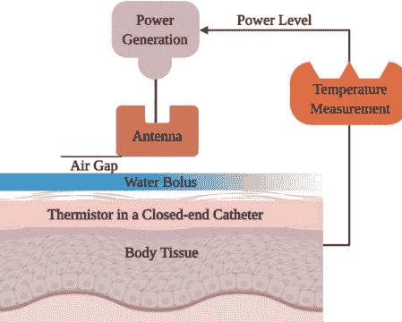

图 5.3 局部热疗示意图。

## 5.4 用于诊断的天线

如今，天线在诊断中起着关键作用。用于诊断的各种类型天线如图 5.6 所示。

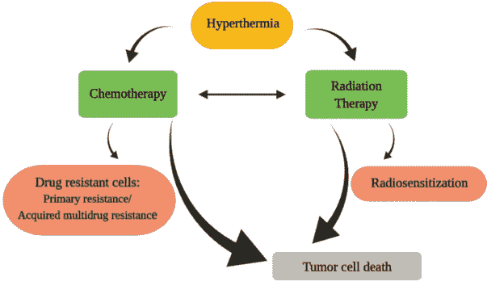

图 5.4 热疗框图

# 用于监测系统的可穿戴/植入式设备

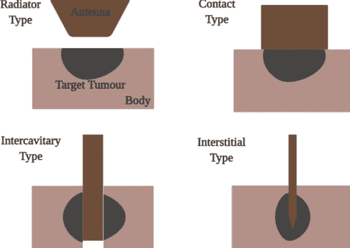

图 5.5 各种类型的天线

## 5.4.1 植入式天线

这些天线植入人体内，持续监测血糖水平、脑电活动等参数 [13, 14]。这些天线必须使用生物相容性材料设计，或封装在生物相容性材料中，以防止任何不良反应和人体的排斥。如果植入式天线的金属部分直接接触具有导电性的体液，就会发生短路。为了避免此类事件，天线装置可以用 Macor、氧化铝陶瓷、聚四氟乙烯（PTFE）等覆盖。这些材料在提供生物相容特性的同时，在人体组织和辐射器之间起到隔离层。图 5.7 显示了植入式天线的不同用途。

植入式天线的各种设计要求为：
- 应对植入天线进行特性表征。
- 天线应匹配环境。
- 通过辐射效率和回波损等研究评估紧凑低剖面天线的性能。
- 使用各种技术评估植入天线与接收单元之间的传输链路性能。

表 5.1 给出了过去几年研究人员使用的各种植入式天线的详细信息。

### 5.4.1.1 植入式天线的设计流程

首先，使用数值仿真工具（Ansys HFSS, CST Microwave Studio, IE3D 等）对天线进行结构化和评估，其工作在医疗植入通信系统（MICS）（0.402–0.405 GHz）和工业、科学和医疗（ISM）（2.4–2.4 GHz）频段。通过仿真工具优化天线参数，完成天线的制造，并使用可以模拟人体组织电学特性的凝胶评估天线的行为。植入式天线的设计流程如图 5.8 所示。

# 用于监测系统的可穿戴/植入设备

## 表 5.1

文献中报道的各种类型植入天线

| 参考文献 | 谐振带 (GHz) | 布局/辐射器形状 | 植入部位 | 基质 | 体积 (mm³) |
| :--- | :--- | :--- | :--- | :--- | :--- |
| [15] | 0.402-0.405 | 矩形/螺旋形 | 皮肤 | Rogers 3210 | 6144 |
| [16] | 0.402-0.405 | 正方形/RRR 正方形耦合 | 皮肤 | ARLON 1000 | 1375.4 |
| [17] | 0.402-0.405 | 正方形/脊椎 | 玻璃体 | Rogers 3210 | 273.6 |
| [18] | 0.402-0.405 | 圆形/缝隙形 | 皮肤 | Rogers 3210 | 149.2 |
| [19] | 0.402-0.405 | 矩形/蛇形形 | 皮肤 | Rogers 3210 | 1200 |
| [20] | 0.402-0.405 | 矩形/华格形 | 肌肉 | RT/Duroid 6002 | 6480 |
| [21] | 0.402-0.405 | 圆形/蛇形形 | 皮肤 | Rogers 3210 | 110.4 |
| [22] | 0.402-0.405 | 正方形/脊椎 | 皮肤 | Rogers 3210 | 190 |
| [23] | 0.402-0.405 | 圆形/缝隙形 | 皮肤 | Rogers 3210 | 335.8 |


| [24] | 0.402-0.405 | 圆形/蛇形形 | 皮肤 | 氧化铝 | 32.7 |

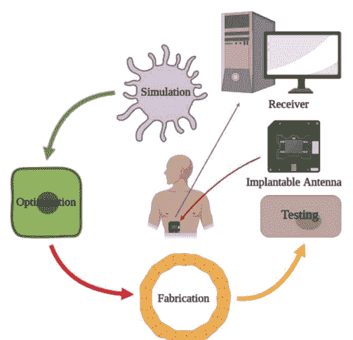

图 5.8 植入天线的设计流程。

# 医疗物联网

必须使用不同的技术对仿组织材料进行表征。在对系统进行体外测试之前，应先进行比吸收率（SAR）研究。除了组织外，植入天线的辐射应该穿过皮肤到达人体外部的收集器，因此可以对材料进行表征（可以使用 Triton-X114、丙丙基丁基醚和去离子水的混合物作为仿皮肤材料），该材料具有与人类皮肤相似的特性。在完成材料表征后，必须在这样的动物模型上进行研究。

最近，各种研究人员针对 MICS/ISM 频段提出了不同的植入式天线设计 [25–30]。在 [25] 中，提出了一种基于 FR-4 基质的低剖面共面波导（CPW）V型植入式天线。该天线被报道用于 ISM 生物学应用，并可以放置在皮肤、脂肪和肌肉等组织上。使用 IE3D 软件对天线设计进行了仿真。在 [26] 中，报道了一种用于植入式神经微系统的双频天线。该天线的工作频率为 433.9 和 542.4 MHz。作者使用匹配组织特性的溶液对天线进行了 SAR 研究。在 [27] 中，作者提出了偶极子、贴片和倒 F 天线以帮助瘫痪患者。该设备的设计使其可以放置在口颊腔，通过以用户为中心的舌头手势来发布指令。这种植入式天线采用了弧形设备封装的紧凑设计，与报道的其他植入式天线相比，具有更好的带宽和增益。在 [28] 中，报道了工作在 ISM 频段的平面倒 F 天线和偶极子天线。这些是设备放置在瘫痪患者口腔内的部分，患者通过舌头的自主运动识别生成的信号。他们执行了如移动轮椅、操作手机或电脑设备等各种活动。在 [29] 中，提出了一种用于植入应用的紧凑型 CPW 馈双螺旋天线。该天线工作在 ISM 频段并使用人体模型进行了测试。它具有较高的增益、低回波损和良好的阻抗匹配。在 [30] 中，作者展示了一种具有无线传输能力的超紧凑螺旋线圈植入式天线。功率从外部传输设备传输并在 39.86 MHz 频率下获得了 47.2% 的效率。

## 5.4.2 入摄天线

天线位于胶囊内部，胶囊在人体内部器官和消化道中移动，如图 5.9 所示。这些天线对于诊断各种癌症，如食道癌、小肠癌和胰腺癌非常有用。

现有的技术可以追踪胃道的上（胃镜）和下部（结肠镜），但胃道的中部（包括长且高度弯曲的小肠，平均 7 米）很难通过这些技术进行监测。在这种情况下，WCE 技术对于查看整个胃肠道非常有帮助。WCE 设备由用于发光二极管（LED）的


图 5.9 在人体内穿行的入摄天线。

用于监测系统的可穿戴/植入设备

入摄天线在以下频段工作：

- MICS (0.402-0.405 GHz)
- 无线遥测 (WMTS) (0.408-0.414 GHz)
- (0.432-0.48 GHz)
- ISM (2.4-2.48 GHz)

### 5.4.2.1 入摄天线的设计要求

为了进行设计，必须考虑以下因素：

- 带宽应足够，以便传输高清图像。
- 效率应该较高。
- 由于天线被人体围绕，可能会影响并改变性能。

### 5.4.2.2 入摄天线的设计方法

可以使用人体进行初始表征，因为它模拟了组织的特性。电率（0.98-1.34 S/m）和介电常数（54-55）如模型 [31] 中所示。

## 表 5.2 窥镜检查与胶囊内镜的对比

| 窥镜检查 | WCE（胶囊内镜） |
| :--- | :--- |
| 插入能力差，无法到达小肠部分。 | 插入能力好，可以扫描小肠部分。 |
| 无法到达胃道的隐藏位置。 | 可以到达隐藏位置并提供完整胃肠道的有效可视化。 |
| 无法检测癌症。 | 可以检测癌症。 |
| 疼痛并可能引起不适。 | 不疼痛/不舒服 |

## 5.4.3 可穿戴天线

可穿戴天线是人体通信的关键研究领域之一。这类天线具有成本低、重量轻、安装简单几乎无需维护。这类天线对于各种年龄和职业的人（如消防员、军事人员和急救人员）的监测目的非常有用。基于织物的天线主要用于可穿戴应用。在天线配置中，可以使用导性纺织元件（如 Flectron、Zelt 和纯塔夫塔织物）作为

# 用于监测系统的可穿戴/植入设备

辐射器；而羊毛、毡和丝绸等非导电纺织元件可以作为介质基底。这些材料的介电常数值并不公开，需要进行测量。下面描述了不同类型的可穿戴天线。

### 5.4.3.1 普通可穿戴设计

平面单极子、偶极子、微带贴片、平面倒置 F 型天线（PIFAs）等传统设计已被探索并用于可穿戴天线的设计。由于具有低成本和易制造的优点，它们是可穿戴系统的首选之一。[35] 中的作者研究了 PIFA 的用途。在 PIFA 中，折叠结构被放置在面向人体的地面平行位置。同样的设计概念被用于设计一种可穿戴柔性 PIFA (FlexPIFA)，它可以放置在人体手臂并由蓝牙操作系统控制 [36]。图 5.10 展示了 PIFA 天线的可能放置位置。在选择可穿戴天线时，会考虑以下因素 [37]：

- a. 低剖面
- b. 频率范围必须为 100–500 MHz
- c. 具有极小或无侧瓣的全向辐射覆盖
- d. 垂直极化或圆极化
- e. 宽回损带宽

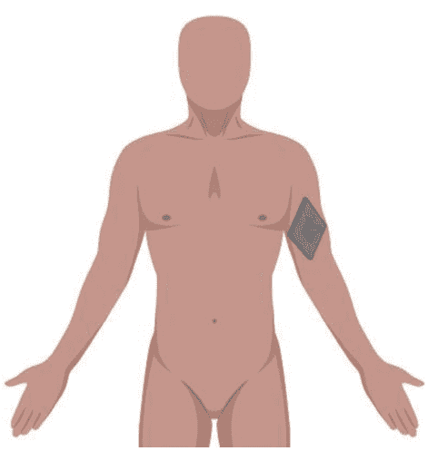

图 5.10 PIFA 在手臂上的放置。

### 5.4.3.2 纺织天线设计

[38] 中的研究人员设计了一种具有圆极化的可穿戴纺织天线，以考虑到用户的移动性。在圆极化中，天线在从垂直到水平的所有平面内辐射 [39]；即使人体协调位置发生变化，接收天线也能获得信号。聚酰亚胺隔层布（厚度：6 mm，介电常数：1.5）被用作天线设计的基底。辐射器和地面由镀镍织纺织材料制成。[40] 中使用了类似的方法，设计了具有圆极化的纺织天线来激发两个正交极化模式，从而提高信号接收率。

电磁研究进展最快的领域之一是电磁带隙（EBG）。使用 EBG 结构作为接平面有助于电流的高效辐射。[41] 中，研究人员利用这一概念设计了双频可穿戴结构。地面表面的 EBG 层改善了天线的辐射特性。设计了纺织天线 [42]，用于人体与个人局域网（PAN）之间的短距离无线通信。由于使用了孔耦合馈电，带宽相对于其他经典的平面馈电天线 [43] 较高。图 5.11 展示了在织物材料上带有可穿戴天线的人体模型。


图 5.11 织物材料上的可穿戴天线。

### 5.4.3.3 设计可穿戴天线

可穿戴天线的性能参数取决于材料和制造方法。材料不仅影响性能，还影响天线的辐射特性。事实上，纺织材料被证明优于非纺织材料。

- a. 导电材料

电纺织品是通过普通织物线与导电金属/聚合物线交织成的。此类织物由于其柔性、耐用和可穿戴的特性可用于服装 [44]。[45] 中的作者强调了导电织物在天线制造中的重要性。导电织物的电阻低（≤1 Ω/方），以减少损失。纺织材料还需要柔性以适应天线的变形。芳纶织物 [46] 因其防火特性也被用于天线设计，因此集成到消防员服中。高导电性的金属尼龙纤维被用作导体 [47]，由 Ni/Cu/Ag 层组成，提供高导电性。此外，这种材料具有柔性和耐腐蚀性，因此在强腐蚀环境中应用。

- b. 制造方法

制造方法根据设计纺织天线所选的材料而异，并影响天线的总成本。[48]reports了设计相同微带贴片天线的不同制造方法。实验确认的最简单技术是使用铜带，因为可以很容易地应用在介质基底上，无需任何额外的制造步骤。导电喷涂技术提供了更大的灵活性，可用于任何纺织材料的制造。铜带（导电元件）与毡布（用作基底）结合构成 E 型贴片天线 [49]。

### 5.4.3.4 可穿戴天线的分析

通常，传统天线根据辐射方向图、回损、效率和增益等参数进行评估。通常传统天线是平面结构，因此没有弯曲特性。但为了测试人体穿着环境下可穿戴天线的性能，需要对弯曲特性和其他因素进行研究。本节将提供有关检查可穿戴设计性能所需测量的一些细节。

- a. 比吸收率建模

由于全球范围内对辐射对人体健康影响的关注和法律要求，人员和工程师研究了天线辐射被人体吸收的功率。通常使用比吸收率（SAR）限制：IEEE 对于任何 1 g 组织为 1.6 W/kg [50]；国际非电离辐射防护委员会（ICNIRP）规定任何 10 g 组织为 2 W/kg [51]。SAR 建模是使用人体 MRI 和 CT 图像构建的躯干模型 [52] 进行的。

- b. 在不同弯曲位置的测量

通过在不同弯曲位置进行测量来评估天线的性能。这些测量将有助于评估可穿戴天线的行为，特别是当天线用于人体不同部位和弯曲位置时（例如天线戴在手臂上的性能）。研究人员已经在天线的不同弯曲位置进行了 $S_1$ 测量 [45]。天线绕在圆柱上并进行了测量，以研究弯曲特性。分析表明，在弯曲位置带宽减小，且谐振向低频移动。这可以通过设计宽带宽天线来克服，即使由于弯曲导致频率变化，天线也能在所需的频谱内工作。

- c. 人体测量

除了在没有人体的情况下进行的天线测量外，还需要进行人体测量。天线在人体上的位置将根据其应用而异。可穿戴天线通常放置在人手臂、胸部和背部。[48] 中设计的天线首先放在人体外（自由空间），然后在人体手臂和胸部进行了测量。通过各种研究人员的调查发现，与其他人体部位相比，背部是放置天线最稳定的位置，且测量在方向上的变化最小。

## 5.5 天线在疾病治疗的应用

如今，天线不仅在各种疾病的诊断中起着关键作用，在疾病治疗中也是如此。例如，天线可以用于热疗，这增加了给癌症患者的化疗和放疗的疗效 [53]。

### 5.5.1 热疗

在热疗中，利用了正常细胞和肿瘤细胞（对热量）敏感性的差异。通过提高温度将肿瘤细胞加热到治疗范围（42 到 45°C），同时保护周围的正常细胞免受加热。这很有帮助，因为它可以增加给癌症患者的化疗和放疗的疗效。

# 用于监测系统的穿戴式/植入设备

## 5.5.2 凝固治疗

该疗法还涉及对目标细胞进行加热，例如血块中肝细胞的加热（用于肝细胞癌）。同轴馈隙天线用于加热人体内的肿瘤细胞。在 [54] 中，表明微波同轴馈隙天线可用于间质及细胞内肿瘤细胞的热疗法。[[53] 中的作者阐述了天线在颈部肿瘤热疗中的应用，并通过临床研究证明了其有效性。以往的研究已经证明，同轴馈隙天线可用于引导加热效果，仅烧毁所需的癌症细胞。

## 5.6 未来趋势

天线必须具有足够的带宽，以传输高清图像以及压力、温度、氧浓度、pH 值等其他诊断数据。天线必须是高效的且功耗更低，以延长电池寿命。

无线胶囊（WCE）天线应紧凑且妥善地封装在生物兼容材料中，以防止在人体使用期间产生任何副作用。需要进一步的研究来更好地控制内窥胶囊的运动，并提高胶囊移动过程中获取的图像的质量和传输速度。还需要对开发包含工具的复杂胶囊的研究。此类设备的开发将有助于检测和治疗胃肠疾病（医疗机器人）。

磁感应原理可用于摄入式天线的无线功率传输。

## 5.7 结论

天线在各种生物医学应用中的应用日益增加。天线在诊断和检测各种疾病方面非常有用，且操作方便。在无线胶囊的设计和使用方面已经进行了大量研究，能够提供人体内部器官（如高度弯曲的小肠）清晰的高分辨率图像，而这对于传统的内窥镜技术是一项非常困难的任务。天线在利用热疗治疗癌症等方面也发挥了关键作用，可以针对性地烧伤肿瘤细胞。这增强了给予癌症患者的化疗和放疗等其他法的疗效。

# 参考文献

- [1] A. Rosen, M. A. Stuchly, and A. V. Vorst, “Applications of RF/microwaves in medicine,” IEEE Transactions on Microwave Theory and Techniques, vol. 50, no. 3, pp. 963–974, 2002.
- [2] A. Rosen and H. D. Rosen, “The role of engineering principles in the medical utilization of electromagnetic energies from kHz to visible light—“examples,” Journal of Infrared, Millimeter, and Terahertz Waves, vol. 30, no. 12, pp. 1374–1386, 2009.
- [3] P. S. Hall and Y. Yao, "Antennas and propagation for body centric communications," First European Conference on Antennas and Propagation, Nice, pp. 1–7, 2006.
- [4] E. Topsakal, "Antennas for medical applications: Ongoing research and future challenges," International Conference on Electromagnetics in Advanced Applications, Torino, pp. 890–893, 2009.
- [5] P. Soonrintpi, C. M. Curse, and Y. C. Chung, "Design of implantable micro antenna for medical implants," IEEE Transactions on Microwave Theory and Techniques, vol. 52, no. 8, pp. 1944–1951, 2004.
- [6] G. Kilitasas, D. Psychoudakis, J. L. Volakis, and N. Kikuchi, "Topology design of dielectric substrates for bandwidth performance of a patch antenna," IEEE Transactions on Antennas and Propagation, vol. 51, no. 10, pp. 2732–2743, 2003.
- [7] Y. Zhou, C. Chen and J. L. Volakis, "Dual beam-shaped fed patch antenna tri-band GS," IEEE Transactions on Antennas and Propagation, vol. 55, no. 1, pp. 220–223, 2007.
- [8] Z. Tang, B. Smith, J. H. Schild, and P. Peckham, "Data transmission from implantable bluetoothometer by load-shift circuit modulator," IEEE Transactions on Biomedical Engineering, vol. 42, no. 5, pp. 524–528, 1994.
- [9] P. Valdastri, A. Menciasi, A. Arena, C. Caccamo and P. Dario, "An implantable telemetry system for vivo monitoring of physiological parameters," IEEE Transactions on Information Technology in Biomedicine, vol. 8, no. 3, pp. 271–278, 2004.
- [10] E. Y. Chow, M. Morris, and P. M. Irazok, "Implantable RF medical devices: high-speed communication and much greater distance in bidirectional applications," IEEE Microwave Magazine, vol. 14, no. 4, pp. 64–73, 2013.
- [11] C. Durney and M. Iskander, "Antennas for medical applications in Handbook," Boston MA: Springer, 1993.
- [12] M. R. Baser, F. Malek, K. Muni, M. S. Iskander, and Saleh, "Ingestible wireless capsule: review of development and future for continuous glucose monitoring," International Journal of Antennas and Propagation, vol. 52, Article ID 80716, 2012.
- [13] T. Karolak, A. Z., and E. Topsakal, "Design of a dual-band implantable antenna for skin," IEEE Transactions on Microwave Theory and Techniques, vol. 56, no. 4, pp. 1008–1008, 2008.
- [14] A. Kiouri and K. S. Nikita, "A review of implantable antenna for biomedical telemetry: Challenges and solutions," IEEE Antennas and Propagation Magazine, vol. 54, no. 3, pp. 210–228, 2012.


- [15] J. Kim and Y. Rahmat-Samii, "Implantable antenna in a human body: characteristics," IEEE Transactions on Microwave Theory and Techniques, vol. 52, no. 8, pp. 1943–1954, 2003.
- [16] J. Sanchez-Ferandez, O. Quevedo, L. Requena, and E. Sanchez, "Dual-band microchip antenna based on short-circuit ring resonators for implantable medical devices," IET Microwaves, Antennas & Propagation, vol. 4, no. 8, pp. 1048–1055, 2010.
- [17] H. Permana, "Three-layer implantable microchip for retinal prosthesis," International Symposium on Bioethics and Bioinformatics, Suzhou, pp. 65–68, 2011.
- [18] W.C. Liu, S.H. Chen, and C.M. Mu, "Implantable broadband circular PIFA for telemetry," Journal of Electromagnetic Waves and Applications, vol. 22, no. 13, pp. 1791–1800, 2008.
- [19] J. Kim and Y. Rahmat-Samii, "Planar inverted-F antennas on implantable medical devices: Designed versus surface type," Microwave and Optical Technology Letters, vol. 48, no. 3, pp. 567–572, 2006.
- [20] P. Soontornpit, C. M. Furse, and Y. Chung, "Miniaturized biocompatible microstrip antenna using genetic algorithm," IEEE Transactions on Antennas and Propagation, vol. 53, no. 6, pp. 1935–1945, 2005.
- [21] A. Kiorti, M. Tkalakis, and K. S. Nikita, "Parametric study and design of implantable PIF for wearable telemetry," International Conference on Mobile Communication and Healthcare, Berlin: Springer, 2011.
- [22] W.-C., F.-M. Yeh, and M. Ghavami, "Miniaturized implantable broadband antenna for body telemetry," Microwave and Optical Technology Letters, vol. 50, no. 9, pp. 2407–2409, 2008.
- [23] C.-M. Lee, T. Co, C.-H. Lee, and Y.-Z. Juang, "Compact stackable antenna for telemetry with medical devices," Electronics Letters, vol. 43, no. 12, pp. 660–662, 2007.
- [24] A. Kiorti, M. Shmanantipoulou, and K. S. Nikita, "Performance of a novel miniature antenna in the human head for wearable telemetry," IEEE Symposium on Antennas and Propagation, Spokane, WA, pp. 392–395, 2011.
- [25] S. A. Kumar and T. Shamanuganatham, "CPW fed dual-band GS," Conference on Computational Intelligence and Computing Research, Coimbatore, pp. 1–4, 2012.
- [26] Z. Duan, Y. Ru, and D. Kwong, "Differentially fed dual-bandplantable," IEEE Transactions on Antennas and Propagation, vol. 60, no. 12, pp. 5587–5595, 2012.
- [27] F. Kong, K. H. Lee, G. Durandin, and M. Ghavan, "Antennas for intraroral throat drive at 2.4 GHz: Design, characterization, and," IEEE Transactions on Microwave Theory and Techniques, vol. 66, no. 5, pp. 2546–2555, 2018.
- [28] M. Dada and Y. Huo, "Miniaturized dual band antenna for ororal throat system in the ISM 433 MHz and 915 MHz. Design, safety, and budget," IEEE Transactions on Antennas and Propagation, vol. 67, no. 9, pp. 5822–5832, 2019.
- [29] M. Machiappin and T. Azhargami, "Design and development of dual-spiral antenna for implantable biomedical," Biomedical Research, vol. 28, no. 12, pp. 5237–5240, 2017.
- [30] G. Sun, M. Bure, Y. Li, and Q. Zhou, "Ultracompact implantable design with integrated wireless power transfer and capabilities," IEEE Transactions on Biomedical Circuits and Systems, vol. 12, no. 2, pp. 281–291, 2018.
- [31] H. Hajagolan and Y. Rahmat-Sammi, “Wearable medical telemetry characterization for ingestible capsule,” IEEE Antenna and Wireless Letters, vol. 11, pp. 1679–1682, 2012.
- [32] F. Elatini, M. Grzeskowski, S. Prodat, and O. Picon, "Link budget of miniature ingestible capsule at 40 MHz," Progress In Electromagnetics Research, vol. 134, pp. 111–131, 2013.
- [33] S. H. Lee et al., “Wideband spiral antenna for capsule endoscopy: Experimental results in a human phantom and a pig,” IEEE Transactions on Biomedical Engineering, vol. 58, no. 6, pp. 1734–1741, 2011.
- [34] A. Kiorti, M. Shmanantipoulou, and K. S. Nikita, “A novel conformal for ingestible capsule endoscopy in the MedRadio,” Progress In Electromagnetics Research Symposium, Stockholm, Sweden, pp. 1899–1892, 2013.

## 82

# 医疗物联网

[37] J. C. G. Matthews, B. Pirollo, A. Tyler, and G. Pettitt, "用于 UHF/VHF 的体穿戴天线," Antas and Propagation Conference, Leicester, London, pp. 355–370, 2008.
[38] M. Klemm, I. Loch, and G. Troster, "用于可穿戴应用的新型圆极化织物天线," 第34届欧洲微波会议, Amsterdam, The Netherlands, pp. 137–140, 2004.
[39] C. A. Balanis, Antenna Theory: Analysis and Design, John Wiley & Sons, New York, 2016.
[40] C. Hertelier, H. Rogier, and L. V. Langenhove, "防护服织物天线," IEEE人体无线通信天线与传播会议, London, pp. 44–46, 2007.
[41] S. Zhu, L. Liu, and R. Liang, "双频人体佩戴天线," Loughborough天线与传播会议, London, pp. 137–140, 2007.
[42] C. Hertelier, A. Trono, H. Rogier, L. Vallozzi, "集成到可穿戴织物系统的孔隙耦合贴片天线," IEEE天线与无线传播字母, pp. 62–395, 2007.
[43] G. Kumar and K. P. Ray, Microstrip Antennas, Artech House, Boston, London, 2003.
[44] H. H, A. D. Child, and W. C. Kimbre, "走向导电聚合物的实际应用," Synthetic Metals, vol. 71, no. 1-3, pp. 2139–2142, 1995.
[45] I. Locher, M. Klemm, K. Tistein, and G. Troster, "纯织物天线的的设计与表征," IEEE Transactions on Advanced Packaging, vol. 29, no. 4, pp. 777–788, 2006.
[46] C. Hertelier, H. Rogier, L. Vallozzi, and F. Declerc, "基于高性能面物的织物天线," 第二届天线与传播会议, Edinburgh, pp. 1–5, 2007.
[47] M. Klemm and G. Troster, "用于人体通信的织物UWB天线," 第一届欧洲天线与传播会议, Nice, pp. 1–4, 2006.
[48] J. G. Santas, A. Alainmy, and Y. Yao, "用于人体通信的双频E型贴片可穿戴天线：技术与特性," 第二届天线与传播会议, Edinburgh, pp. 1–4, 2007.
[49] P. Salonen, J. Kim, and Y. Rahman-Samii, "双频E型贴片织物天线," IEEE天线与传播学会国际研讨会, Washington, DC, pp. 466–469, 2005.
[50] IEEE关于人体接触射频电磁场安全水平的标准，3 kHz 至 300 GHz, IEEE Std C95.1, 1999.
[51] A. Alholm et al., "限制暴露于变化的电场、磁场和电磁场的指南（高达300 GHz）,” Health Physics, vol. 74, no. 4, pp. 494–521, 1998.
[52] Y. Rahman-Samii, "用于人体通信的可穿戴和嵌入式天线,” 欧洲天线与传播会议, Nice, pp. 1–4.
[53] K. Ito, "用于医疗应用的微带天线," 国际研讨会, Chiba, 2008.
[54] K. Ito, and M. Saito, "用于医疗应用的微带天线," 国际研讨会, Cambridge, pp. 16–19, 2007.

- 导电聚合物的实际应用
- 纯织物天线的的设计与表征
- 用于人体通信的织物UWB天线
- 用于人体通信的双频E型贴片可穿戴天线：技术与特性
- 双频E型贴片织物天线
- 用于人体通信的可穿戴和嵌入式天线
- 用于医疗应用的微带天线
- 用于医疗应用的微带天线

# 6.1 导言

运动已成为不同康复环境的重要组成部分，它可以提高生活质量。在这种背景下，康复通过有氧或无氧运动提高患者的身体能力。然而，运动强度必须经过控制。过度训练的患者会产生疲劳。为了调整这些强度，已经对生理参数、主观量表和运动表现进行了测量。

根据美国心脏协会（IEEE）的标准，运动是改善健康、降低发病率和死亡率的主要因素之一。运动根据年龄、体重和疾病提高人的身体能力。

# 康复中的可穿戴传感器

表明使用可穿戴传感器测量并指示执行有氧和无氧运动过程中时空参数所反映的疲劳。

本章分为七个主题部分，涵盖了关于疲劳测量的相关方面以及涵盖康复环境下体育运动的关键方面。

第 6.2 节讨论了体育运动在康复计划中的重要性及其调节，特别关注无氧和有氧运动。

第 6.3 节从疲劳的定义、分类以及肌肉疲劳的定义开始。随后是用于疲劳估计的三种策略。

第 6.4 节详细介绍了第 6.3 节中报告的三种疲劳估计策略中最常用的测量方法。

第 6.5 节讨论了针对有氧和无氧运动的两项实验研究，这些研究基于通过体育运动中的性能下降来测量疲劳。

第 6.6 节讨论了性能下降中的疲劳以及通过研究所获得的结果。

最后，第 6.7 节给出了结论、对该领域未来工作的一些建议，以及康复背景下疲劳估计的挑战。

## 6.2 康复中的体育运动

体育运动（PE）被理解为任何需要肌肉收缩且比休息状态消耗能量的活动 [67]。进行体育活动对个人健康有许多益处，例如心血管呼吸系统的改善和肌肉群的发展，这些对于日常任务至关重要 [61]。世界卫生组织（WHO）强烈建议通过体育运动来预防和治疗许多慢性疾病，如心血管疾病、癌症、中风和糖尿病 [78]。

多项康复计划已将体育运动纳入其治疗中；例如，(i) 心脏康复，以提高心血管功能 [19, 32, 54]；(ii) 肿瘤康复，减轻病理性疲劳的影响 [18, 65]，这种疲劳通常是癌症患者的症状 [46]；(iii) 神经肌肉康复，通过恢复受影响的神经通路恢复肢体活动 [15, 38, 68]；(iv) 肺康复，提高患者的肺功能 [26, 66]；以及 (v) 肌肉骨骼康复，术后恢复关节活动和肌力 [22, 23]。这些信息总结在表 6.1 中。

体育运动使用不可能导致极端的身体或生理状态，引发健康并发症，特别是在存在心脏或肺疾病的情况下 [41]。因此，在康复中实施体育运动并根据每个人的需求和情况设计运动时，需要考虑一些因素 [53]。

### 表 6.1：康复计划中的体育运动目标

| 康复计划 | 体育运动目标 |
| --- | --- |
| 心脏 | 提高心脏能力 |
| 肿瘤 | 减轻病理性疲劳的影响 |
| 神经肌肉 | 重新训练受影响的运动神经通路 |
| 肺 | 提高呼吸系统能力 |
| 肌肉骨骼 | 术后恢复关节强度 |

### 6.2.1 健康相关的身体成分

康复中的体育运动侧重于开发健康相关的身体成分，这些是获得良好生活质量的身体要素。这些身体成分可以分为四组（表 6.2）[49]；(i) 身体成分涉及身体内不同组织的分布（脂肪、水、肌肉和骨骼），通过饮食和运动进行调节 [49]；(ii) 肌肉骨骼要素提供肌肉和关节的力量、灵活性、抗性和强度，通过带有外部负荷或保护具的耐力及拉伸活动进行训练 [71]；(iii) 有氧能力与心血管和呼吸系统产生能量的能力（也称为呼吸能力）有关，通过低强度长时间活动（20 到 60 分钟）来实现 [72]；以及 (iv) 无氧能力是身体在短时间高强度运动中无氧产生能量的能力 [71]。值得一提的是无氧能力对于开始是至关重要的。然而，许多研究表明它对于日常生活是至关重要的。


由于疲劳估计的多样性，可以使用一种适应患者独特状况（例如年龄、体重、药物、既往病和损伤）的计划。例如，建议超重患者通过负荷（针对肌肉骨骼组）或运动计时（针对有氧和无氧组）进行训练，以获得更好的结果 [34]。此外，研究表明，当骨质疏松症患者进行这些负重的运动时可以获得更好的结果，这些运动是他们无法承受的 [51, 65]。

## 6.2.2 运动限制

用于调节训练强度的的一种技术是代谢当量（`MET`）。该单位代表了体力活动消耗能量率与休息时消耗能量率之间的关系 [3]。换句话说，它被定义为活动个体相对于基础代谢率的能量消耗。这一信息对于处运动以及识别患者的功能非常有用。因此，这种方法需要估计每个人执行特定活动所需的能量。这种要求使得估计精确的 `MET` 值变得复杂，因为它取决于主体的特征（例如代谢和体重），并且需要复杂的仪器 [61]。因此，许多研究致力于根据健康研究项目来通用不同活动的 `MET` 值 [6]。

### 表 6.2：健康相关的身体成分组

| 组 | 含义 | 训练方法 |
| --- | --- | --- |
| 身体成分 | 分布 | 饮食和普通运动 |
| 肌肉骨骼 | 力量和灵活性 | 耐力和拉伸运动 |
| 有氧能力 | 有氧产生能量 | 长时间的活动 |
| 无氧能力 | 无氧产生能量 | 短时间的高强度活动 |

# 医疗健康物联网

无法通过休息缓解的疲劳。慢性疲劳综合征的症状类似于流感，持续超过6个月，并会干扰某些活动。该综合征的确切原因尚不清楚。另一方面，疲劳也可以分类为精神疲劳（指疲劳的认知或感知方面）和身体疲劳（指运动系统的表现）[10]。

肌肉疲劳由于收缩活动导致身体力量暂时性且可恢复的下降。这是一种让人难以进行正常运动的症状 [69]。它可能源于不同的运动通路，通常分为中枢疲劳和外周疲劳。外周疲劳是指运动诱导的过程，导致远端神经肌肉接处的产力发生减少。中枢疲劳是指更具中心化的过程，可以定义为运动引起的肌肉自主性激活进行性进展，这种激活与刺激所获得的最大力减少程度并不相关 [70]。肌肉疲劳是一种常见的现象，人们总是感到疲劳和缺乏活力，导致运动表现受限或日常活动时间延长。此外，一些人会感到肌肉钝痛，这也会限制日常生活。

因此，理解疲劳的影响和后果至关重要。例如，它可能导致长期的健康恶化，包括肌肉骨骼疾病、慢性疲劳综合征和免疫功能受损 [50]。此外，疲劳是多种慢性疾病的症状，如糖尿病、多发性硬化、心血管疾病、帕金森病以及纤维肌症状 [7, 12, 48]。

在此背景下，疲劳在物理康复（`PR`）中起着至关重要的作用。世界卫生组织将`PR`定义为实现完全恢复的积极过程；如果无法完全恢复，则达到最佳的身体、心理和社会潜力，将人们适当整合到社会中 [78]。作为一种综合策略，`PR`有两种方法：

- 1. 提高与认知过程相关的认知方面，包括感知、语言和动机。
- 2. 提高患者的身体方面，如有氧和无氧能力、心血管功能、运动步模式和肌肉。

这些方法对于评估患者的长期表现、实现完全恢复以及成功的康复过程至关重要。尽管如此，疲劳对于参与康复性运动的人来说是一个普遍令人担忧的问题 [9]。因此，量化疲劳可以衡量其严重程度，并随后识别健康和安全问题，从而能够在康复过程中调节运动强度并考虑其主观性 [1]。关于疲劳监测的重要性，已经开发了不同的策略来测量疲劳感知 [9]。这些策略包括疲劳感知的主观量表、生理参数和运动表现。

# 康复中的可穿戴传感器

## 6.3.1 主观量表

疲劳感知的主观量表是序数数值量表，每个数字代表一种疲劳程度，较小的数字表示没有疲劳的状态，较大的数字代表极端疲劳的状态。在极度疲劳时，人感到无法进行体力活动 [80]。根据估计疲劳的环境，会使用不同的感知量表，并根据其应用进行修改 [52]。应用最广泛的是 Borg 感知用力量表（`RPE` 量表）。多项研究表明，感知量表具有主观性，且与其他疲劳估计方法（如生理参数）存在差异，从而导致该方法的可靠性降低 [62]。

### 6.3.2 生理学参数

生理参数决定人的生理状态，因为它们反映了身体的内部功能 [5]。其应用之一是间接估计疲劳。最相关的参数是心率、耗氧、血压、呼吸频率和血乳酸 [36, 45, 50, 79]。根据所进行的运动类型，这些参数可能表现出不同的行为，难以与疲劳水平建立联系，某些在实时监测时甚至存在困难；因此，研究人员正在寻找新的估计策略 [31]。

### 6.3.3 运动表现

运动表现的下降与疲劳的增加成正比 [31]。因此，已经实施了通过运动表现监测疲劳的方法。然而，它们的评估很大程度上取决于所使用的运动类型 [39]。要评估的参数和特征取决于每次运动，并且必须确保避免测量中的误差或不确定性。例如，如果在跑步机上进行运动，通常评估的参数是频率、步幅、步长、每个步态阶段的持续时间等 [55]。运动评估可以通过多种方式，使用移动式传感器（例如惯性传感器和肌电图）和非移动式传感器（例如运动分析系统）进行。

## 6.4 测量疲劳的仪器

本节介绍了基于上述说明的三种不同策略的最常用疲劳测量仪器。需要注意的是，到目前为止还没有一种建立的测量疲劳的方法。由于缺乏可以获取此类信息的综述，导致医生和研究人员对疲劳测量的可靠性、有效性和实用性的评估缓慢。

### 6.4.1 BORG 表

Borg 感知用力量表（`RPE` 量表）是一种用于测量个体在体力工作期间努力、用力、气短和疲劳的工具，与职业健康安全实践高度相关。

该量表是一个简单的数字列表。它从“无用力感”（评 6 分）开始，到“非常，非常困难”（评 20 分）结束。完成该量表由研究人员完成或自行管理，并可单次或多次使用。

在活动期间，要求参与者在量表上评价他们的用力程度，结合所有的感觉和压力。他们被指示忽略腿部疼痛或呼吸困难等因素，专注于整体用力感。这个数字指示运动强度，允许参与者加速或减慢动作 [74]。

Borg 还开发了 Borg10，这是一种锚定数字10的比例（`CR`）量表，代表极运动强度。它是一种测量大多数感知和体验的通用方法，包括疼痛和感知用力。图6.1 展示了 `RPE` 和 Borg `CR10` 的表示。

### 6.4.2 摄氧量

摄氧量 (`VO_2`，通常以 mL$_2$/min/kg ）被认为是量化患者疲劳的最佳方法之一，因为它与能量消耗呈线性关系 [57]。事实上，`VO_2` 可以通过公式 6.1 转换为 `MET` 单位 [35]。然而，`VO_2` 的测量需要复杂的仪器，这使其在康复治疗中并不实际，且它是

| Borg 量表 | Borg CR10 | 表示 |
| :--- | :--- | :--- |
| 6 | 0 | 无用力 |
| 7 | | |
| 8 | | 非常非常的用力 |
| 9 | | |
| 10 | 2 | 极低用力 |
| 11 | | |
| 12 | 3 | 低用力 |
| 13 | | |
| 14 | 4 | 相当中等的用力 |
| 15 | 5 | 较中等的用力 |
| 16 | 6 | 中等用力 |
| 17 | 7 | 高用力 |
| 18 | 8 | 非常高用力 |
| 19 | 9 | 非常高用力 |
| 20 | 10 | 极端疲劳水平 |

图 6.1 Borg 量表表。

通常用于研究场景 [35]。此外，它需要一种变化的信号，这反过来需要稳定时间 [35]。

```
$l(MET) = 3.5(mLO_{2}/min/kg) \quad (6.1)$
```

### 6.4.3 心率

心率是控制疲劳最常用的生理参数之一，这是由于其测量方便且与 `VO_2` 之间呈现出线性关系 [17]。通常情况下，这种方法包括监测心率储备（`HRR`），即最大心率（`MHR`）与静息心率（`RHR`）之差 [70]。`MHR` 可以通过压力测试来估算，压力测试是一种用于评估人体在不同运动期间生理行为的临床测试 [37]。然而，还有更实用的方法可以通过考虑受试者的特征（例如年龄和性别）来获得近似值。应用最广泛的是 Tanaka 公式，它使用受试者的年龄（岁），并如公式 6.2 所示 [14]。

```
$MHR = 206.9 - (0.67 * AGE) \quad (6.2)$
```

为了说明示例，一个 21 岁的年轻人（使用公式 6.2 计算的 `MHR` 约为 193）其 `HRR` 为 80 BPM，这意味着心率储备（`HRR`）等于于 113 BPM。因此，如果受试者的心率为 150 BPM，这代表了其 `HRR` 的 62%。这一过程可以在公式 6.3 中看到，其中 `HRR%` 是受试者 `HRR` 与当前心率值的百分比。

```
$HRR\% = \frac{100}{HRR} * (HR - HRR) \quad (6.3)$
```

认为 `HRR%` 处于 60% 到 80% 之间的体能训练属于高强度运动，根据康复目标和患者状况，应该应避免处于这种状态 [70]。心率提供了对受试者的直接测量。然而，它的解释需要对健康人群进行假设，并且没有考虑可能影响心率的其他特征（例如药物和病理因素） [14]。因此，该方法在物理康复的疲劳管理中受到了批评。

### 6.4.4 血液乳酸水平

乳酸是器官灌注减少、氧输送或提取减少以及终器官无氧糖解的生化指标 [33]。糖解是利用葡萄糖产生丙酮酸的代谢途径，丙酮酸可用于有氧代谢以产生能量。当运动非常剧烈时，所有的丙酮酸无法通过有氧方式处理。因此，它通过无氧代谢转化为乳酸并积累在血液中以获得更多能量并利用产生的丙酮酸 [33]。血液乳酸提供了运动期间运动程度的直接测量。因此，乳酸阈是确定训练或康复运动强度的有用标准。然而，它需要采集样本和专用仪器，这在物理治疗期间并不容易使用 [59]。这是一个高度依赖有氧或无氧代谢以及用户代谢的参数。因此，需要监测监测参数以获得良好的解释 [33, 59]。

**有氧阈值：** 有氧阈值定义为血乳酸浓度上升到水平以上的强度。它是有氧能量通路开始工作的运动强度，被认为是个人最大心率的 65–85% [27]。

**无氧阈值：** 无氧阈值定义为血乳酸浓度不再与运动强度呈线性关系的运动强度，而是随着运动强度和时间的增加而增加 [25]。

### 6.4.5 表面肌电图

表面肌电图（`EMG`）是一种便携式系统，由测量肌肉收缩和放松期间产生的电活动组成 [47]。其功能是在肌肉上贴上电极以记录电位 [56]。这些电位与肌肉力量直接相关，允许估算用力程度并评估运动表现 [77]。然而，电信号受皮肤强度和电极位置的影响。为了避免这些问题导致适应性低 [13, 44]。

近年来，不同的研究已将 `EMG` 作为估计肌肉疲劳的非侵入性替代方案 [1, 13]。电活动信号的频率和形态发生变化，即表现为振幅的降低和频率的增加 [8, 11, 13]。

### 6.4.6 运动分析

运动分析系统基于使用红外摄像头来估计反射标记的位置，以便分割物体或个体，并测量位置和取向等变量 [58]。这些系统可以根据运动学模型测量大量的运动学参数，实现每个动作或练习的特定特征，这导致了在这些领域的高适用性 [29]。

运动分析因其在运动学参数测量中的准确性和稳健性，被广泛用于疲劳估计。肌肉疲劳会影响运动和步态特征，导致运动控制受损和姿势不稳定 [45]。使用这些设备的目的是量化和测量这些不同的参数。同样，识别是否存在超出典型模式的事件，以帮助康复过程和活动表现 [75]。然而，这些设备在仪器设备、不同环境的适应性低以及高成本方面存在某些局限性 [24]。

### 6.4.7 惯性传感器

最常用的便携系统是惯性传感器。惯性传感器作为可穿戴传感器的组件日益流行，可以直接提供运动数据，无需外部源或设备。

惯性测量单元（`IMU`）本质上是加速度计和陀螺仪的结合；借此设备可以测量重力、速度和取向。此外，用于运动分析 [16]、步态 [40] 以及时间空间参数 [2]。它是评估活动表现的工具，并借此可以识别人的疲劳。

加速度计在需要运动或步态分析时使用最广泛；它们具有某些优点，如微型化、移动性和成本。然而，它们带有若干因素，例如需要对加速度进行重力补偿。后处理阶段需要更多的计算量，位置数据会出现漂移误差。必须对系统进行校准 [40]。

陀螺仪是角速度传感器；这种速度的信号不受震动的影响（例如脚跟落地时产生的震动）；此外，这种速度不受重力的影响。陀螺仪的输出是周期性结果，其模式在周期性运动期间重复，例如步态周期、跳跃、骑自行车、坐立]。

为了提供三维运动分析，惯性单元通常包含三个垂直的加速度计和三个陀螺仪，表示为单元的 x、y、z 轴。这些传感器允许通过估计测量值的幅度来研究任何方向的运动。这种幅度估计可以在公式 6.4 中看到，其中 `MAG` 代表信号的幅度。

```
$MAG = \sqrt{x^2 + y^2 + z^2}
```

考虑到介绍的技术，下一节描述了所进行的实验研究。旨在分析和评估有氧和无氧运动中的疲劳。

# 医疗物联网

## 6.5 实验研究

本节首先介绍了用于招募志愿者的实施标准；随后，描述了在有氧和无氧运动中进行的疲劳估算实验研究。由于这两种运动在表现和能量产生方面的差异，实验均对两者实施。有氧运动提供持续的氧气以维持当前的活动水平，而无需其他来源的额外能量。而无氧运动则促使身体所需的能量超过有氧系统所产生的能量 [27]。

### 6.5.1 招募标准

每位受试者均自愿同意参加实验并签署了相应的知情同意书。志愿者根据下述的纳入和排除标准进行筛选。

**纳入标准：** 18 至 30 岁之间定期进行体育活动且无运动禁忌的健康成年受试者。此外，受试者上下肢未佩戴任何假肢或矫具。视觉、听力或认知障碍导致无法正确理解活动的志愿者不参与本研究。同样，志愿者在膝盖、踝关节或髋部不能有受伤、疼痛或手术史。此外，志愿者不得处于怀孕期。最后，志愿者不能出现任何影响表现的疲劳，该指标通过“多维度疲劳量表”进行评估，这是一个包含 20 个问题的问卷，用于估算五种不同类型的疲劳：一般疲劳、身体疲劳、心理疲劳、动力减少和活动减少 [64]。

### 6.5.2 有氧研究

进行有氧研究是为了评估是否可以使用惯性测量单元等可穿戴传感器测量疲劳。该研究在一个具有以下特征的男性志愿者身上进行：年龄：22 岁，体重：76.9 kg，身高：1.86 cm。

#### 6.5.2.1 有氧实验流程

首先指示志愿者以自选速度完成 10 米，以确定其平均过载速度，并成功设置在跑步机上。参与者配备了五个 `Shimmer3`（`Shimmer`，爱尔兰）`IMU` 单元，这些单元对于测量时空和运动参数是必要的。四个单元用于获取四个肌肉（胫骨肌、股四直肌、股二头肌和腓肠肌）的 `EMG` 信号，位于大腿外侧；两个单元通过弹性带固定在小腿外侧。最后一个单元配置为采样率为 128 Hz 的惯性测量单元。`IMU` 用弹性带固定在受试者的优势脚（在本例中为左脚）。此处描述的实验装置如图 6.2 所示。

**图 6.2** 实验装置。参与者在其优势侧进行了仪器监测，`IMU` 放置在足背部。同样，在大腿和小腿上各放置了四个 `IMU`，不同的电极分别位于胫骨肌、股四直肌、股二头肌和腓肠肌上。

志愿者被要求参加一项短研究，该研究包含一个环节，分为四个阶段。每个阶段都有相同的练习：高抬腿、开合跳、深蹲和短跑。步骤之间的区别在于每个任务的持续时间，该时间逐渐增加，即相应的运动时间为 30 s（第一步）、45 s（第二步）、60 s（第三步）和 75 s（第四步）。

为了评估疲劳，在每个阶段结束时测量了四个参数：(i) 血乳酸水平，(ii) 感知量表 Borg `CR10`，这两个变量都指示了疲劳程度；(iii) `EMG` 信号以及 (iv) 时空参数。关于血乳酸的测量，使用采针从受试者的耳垂采集血样。使用新的测试条收集血液，最后将测试条插入 `Lactate Pro2`（`Arkray`，日本）测量血乳酸水平。另一方面，Borg `CR10` 量表是通过询问志愿者根据量表感觉有多累来获得的（图 6.1）。我们告诉参与者，他们应该只关注总努力的感受，而不是关注呼吸短或肌肉疼痛。

关于最后两个参数的测量，要求参与者在已配置的零度倾斜的跑步机上行走至少 180 s。只有在达到自选速度后，才开始数据采集。只有在获取所有数据后才减慢跑步机速度，以防止在瞬态期间捕捉数据。

整个实验（包括与仪器程序相关的穿戴/取下任务、练习和步行任务）在 60 分钟内完成。

#### 6.5.2.2 有氧研究结果

根据研究期间收集的测量结果，有一些基本方面值得注意。首先，使用前述传感器完全测量了该环节的表现。如图 6.3 所示，展示了一个步态周期内肌肉行为的样本数据。注意到，每当发生足离地期（toe-off phase）时，都需要对步态周期进行分段。图显示测量在受试者左侧腓肠肌上的肌肉活动在最后一步阶段结束时电活动活性显著下降，这可能与肌肉激活延迟有关。

同样，肌肉在初始阶段开始时表现出高变异性，在最终阶段结束时也表现出高变异性，这可能与肌肉激活延迟有关，这表明受试者的频率。这种行为出现在：胫骨肌、股四直肌、股二头肌和腓肠肌。

必须强调，图 6.4 (A)、B)、D)、E)、F) 的结果使用公式 6.5 计算，以零号测试作为参考，因为认为该志愿者没有疲劳，这与 Borg `CR10` 量表和血乳酸得到了证实。这是为了精确分析这些参数的行为，当

图 6.3 一个步态周期内左腓肠肌的肌肉活动。

**图 6.4** 参与者在环节期间的数据。(A) `EMG RMS`、(B) 乳酸、(C) Borg `CR10`、(D) 频率、(E) 支撑期和 (F) 动期。

疲劳水平增加。此外，前三个事件 (A)、(B) 和 (C) 是疲劳指标，用于分析时空参数的行为。

```
$X_i=\left(\frac{X_{i}-X_{reference}}{X_{i}}\right)*100\%$$ (6.5)
```


这种方式，分析了治疗环节期间肌肉活动的行为。为此，通过 100 毫秒的窗口计算了电活动（RMS）的平均值。第一个窗口被用作计算其他运动变化的参考。图 6.4 (A) 展示了整个期间这种行为。研究期间记录数据的总体情况以及这些参数的影响如图 6.4 所示。图 (B) 显示了乳酸，要求的 Borg CR10 值绘制在图 (C) 中。图 (D)、(E) 和 (F) 代表整个环节期间百分比的时空参数（频率、支撑期和支撑期）。为了获得时空参数，首先对陀螺仪和加速度计单元进行中值滤波以消除异常数据值，并使用 `MATLAB®` 软件进行二阶低通巴特沃斯滤波器（截止频率根据傅里叶变换定义）。然后，惯性信号被划分到每个步态周期，从而识别出每个足离地期。

# 98

# 医疗物联网

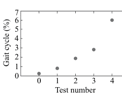

**图 6.5** 各阶段步态周期的百分比增长情况。

事件经过时间归一化，并使用获得数据集的平均值来寻找时空参数。

可以观察到，志愿者首先根据乳酸参数表现出疲劳（在大多数参数中该水平处于较低水平），通过 Borg CR10 估估的疲劳自我感知也是如此。然而，一旦志愿者开始出现疲劳，记录的数据同样反映了这种增长，即乳酸和时空变化以增加的速度增长。尽管如此，步频（cadence）和获得的 RMS 值表现出类似的行为，即下降趋势。这意味着以下变量：乳酸、Borg 量表、步态阶段（摆动期和支撑期）成正比，而步频和 RMS 则成反比。

另一方面，计算了每个阶段相对于初始阶段的步态周期百分比，以证实步频的下降是因为步态周期的增加，正如两个步态阶段中的行为所示。如图 6.5 所示，随着志愿者开始出现疲劳，连续步态周期有所增加。步态周期的最大增长发生在最后阶段，增长了 6.14%。

根据传感器（IMUs）在每个阶段记录的信息，可以监测并分析志愿者整个有氧运动的表现。同样，也可以疲劳是如何反映在运动性能。

## 6.5.3 无氧研究

本节旨在展示在无氧运动中应用 IMU 测量来估计疲劳，本章这一部分介绍了针对健康男性志愿者（年龄：23 岁，体重：68 Kg，身高：174 cm）在功率自行车上骑行五分钟的研究中获得的结果。考虑到他是一个健康受试者，可以使用 Tanaka 公式获得最大心率（公式 6.2，约 191 BPM）。

### 6.5.3.1 实验无氧程序

以下程序基于心脏康复中实施的一种高强度训练 [28]。首先，指导志愿者进行 5 分钟的热身，包括侧重于下肢的拉伸活动。随后，

# 康复中的可穿戴传感器

# 99

对功率自行车进行了配置，使志愿者能够在动作的伸展部分完全伸直膝盖并在骑行时感到舒适。

受试者进行了功率自行车测试，分为 10 个训练间隔和 10 个休息间隔，一个接一个，从一个训练间隔开始，每个间隔持续时间为 15 秒。在训练间隔期间，要求志愿者尽可能快地骑行。另一方面，在休息期间，他以舒适的速度骑行。

在每个休息间隔的开始时，要求志愿者评估 Borg CR10 量表。因此，在测试结束时获得了 10 个 Borg 值。一个 Zephyr HxM BT 传感器通过弹性带带固定在受试者的胸部，通过蓝牙信道（采样频率为 1 Hz）测量整个测试期间的心率。此外，Shimmer3 IMU 单元通过弹性带带位于受试者优势腿（右腿）的大腿上。Shimmer 的三个加速度计、三个陀螺仪和肌电（EMG）模块被设置为以 512 Hz 的采样率通过蓝牙信道提供数据。最后，三个外部电极贴在角角处，两个位于股二头肌，一个位于股骨外突出处，作为肌电信号的参考。研究的设置见图 6.6。

根据上一节的描述，测量了五类指标。这些测量的原始信号见图 6.7，其中虚线

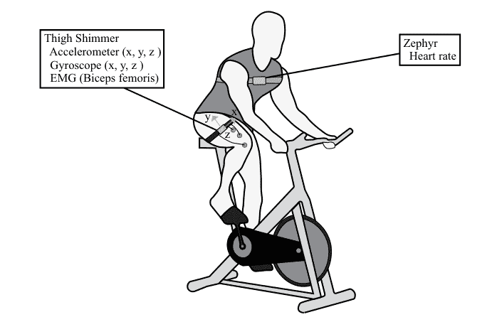

图 6.6 无氧研究设置。参与者配备了一个放置在身体优势侧大腿上的 IMU，以及一个位于胸部正中央的心率传感器。

# 医疗物联网

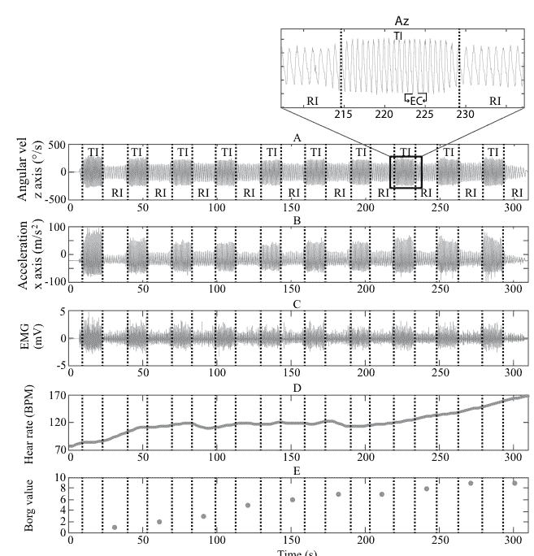

**图 6.7** 无氧循环测试信号。(A) z 轴陀螺仪，(B) x 轴加速度计，(C) 股二头肌肌电，(D) 心率和 (E) Borg 值。

划分训练间隔 (TIs) 和休息间隔 (RIs)。图 (A) 显示了 z 轴陀螺仪。它被用于确定每个间隔的开始和结束，因为它噪声较少，可以通过信号的幅和频率很容易区分间隔。图 (B) 包含 x 轴加速度计信号，其形状与陀螺仪相似，但噪声更多。在图 (C) 中，可以看到右股二头肌肌电，它在训练间隔期间同样增加；然而，为了对此信号进行更好的解释，需要进行功率分析。图 (D) 显示了志愿者测试期间的心率。最后，图 (E) 显示了在每个休息间隔询问志愿者的 Borg 值。通过这些最终测量结果可以看出，志愿者呈现出持续的疲劳增加。

# 115

# 康复中的可穿戴传感器

意味着志愿者在每个训练间隔后都精疲力竭。此外，强调第一次和最后 Borg 量表之间的区别至关重要，这表明志愿者在不到 5 分钟内从低疲劳水平变为高水平，引发了无氧代谢。

心率结果也显示出类似的行为（图 6.7D），可以看到心率开始时约为 70 BPM，结束时接近 170 BPM，这大约占心率储备的 80%。此外，从训练间隔 1 到 3，以及从 7 到 10，心率持续增加。然而，在其他间隔（4 到 6）期间，可以看到心率值接近 120 BPM，约占心率储备的 41%，没有显著变化。这表明在测试的这部分，身体能够产生足够的能量用于活动和其他其他生命任务。

图 6.8 表示了以下信号的百分比下降：EMG 信号的 RMS、加速度计幅和陀螺仪幅。为了获得百分比下降，使用了一个初始训练间隔来获取相应信号的初始值；因此，对数据进行归一化后，代表初始值的值为 0%。图 (A) 包含每次 EMG 收缩最大值的平均值，实施了大小为 100 毫秒的 RMS 移动窗口。因此，每个点代表训练间隔期间的平均功率。在图 (B) 中，可以看到角速度幅值在每个训练间隔中是如何变化的，该值是通过三个陀螺仪（x, y 和 z）和公式 6.4 对每个周期进行估计的。最后，图 (C) 显示了平均加速度幅，采用了与角速度相同的方法。

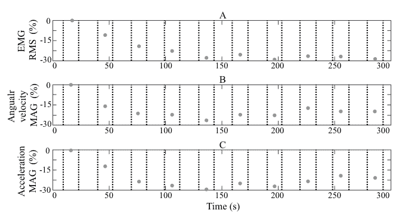

**图 6.8** 每个测试间隔的 EMG、角速度和加速度下降情况。(A) 平均 EMG RMS，(B) 平均角速度幅和 (C) 平均加速度幅。

从图 6.8 可以看出，三个平均指标在 1 到 5 区间内显示出相似的行为，均呈现下降趋势。随后 EMG 功率分析保持几乎不变，这反映了肌肉达到了疲劳状态。另一方面，角速度和加速度从第 7 个区间开始增加，表明志愿者能够以更好的性能完成运动。这种增长与心率行为有关，因为在这一部分，志愿者可能被迫改变了运动的执行技术，以结合其他有助于其维持活动的方法，这需要他消耗更多的能量，从而导致心率增加和疲劳加。

从这部分可以认为，志愿者在康复场景下处于过度训练状态，并达到了极端运动条件，特别是因为心率信号呈现出不受控的增长行为。然而，志愿者可以在那些信号呈现恒定行为和安全状态的区间（第 4 到 6 区间）停止，这些状态可以通过 IMU 传感器轻松检测到，因为在这些区域，信号处于最低值且没有显著变化。

因此，该实验表明了某些 IMU 特征在无氧运动期间具有不同的疲劳估计方法，并展示了这些测量结果如何用于检测康复过程中的非疲劳状态。

## 6.6 讨论

体育锻炼认为是不同康复过程的基本组成部分，旨在提高患者的生活质量。然而，体育锻炼的强度应该受到调节。因此，需要实施允许监测康复治疗的方法，因为高疲劳状态会损害患者的康复和健康。考虑到这一问题的背景，本章介绍了一些用于测量疲劳的策略以及最常用的仪器。通过这项工作的实现，旨在展示使用惯性测量单元的运动性能策略。该研究旨在说明可以使用惯性测量单元测量肌肉疲劳，这些结果有助于促进该领域的发展。此外，预计这些系统未来可能应用在康复环境中，以确保治疗的得到适当的监测和成功。

在本章的开发过程中，讨论了身体训练和疲劳测量的重要性。同样，为了评估和分析疲劳，描述并实施了两个基于有氧和无氧运动的建议实验。关于前节提出的结果，有与运动性能相关的显著发现。

在两项研究中，当参与者开始出现疲劳时，记录的肌肉电活动活性均有所下降。肌肉活动的最大下降在有氧结果中为 52%，而无氧结果中为 31%。同样，当肌肉达到疲劳状态时，肌肉活动保持几乎不变，如无氧研究所示。根据有氧研究所示的结果，步频和步态阶段（支撑期和动期）等时空参数受到了影响。通常，当参与者感到耗竭时，步频会降低。疲劳还会导致步周期持续增加，因此步态阶段的时间随比例增加。参与者的疲劳通过乳酸得到了证实，乳酸提供了对研究期间受力程度的直接测量。这一生理参数在课程期间期间增加。这意味着疲劳在研究过程中逐渐增加，参与者在每个阶段都感到精疲力竭。

关于无氧结果，角速度平均值和幅度下降到第 5 个区间。然而，在第 6 个区间之后，参数开始增加。这表明参与者处于过度训练阶段；因此，参与者改变了技术执行，并结合了更多肌肉来维持活动。然而，这种做法是不推荐的，因为它需要更多能量，这体现在心率的持续增加上，导致参与者在康复场景达到危险的生理状态（心率储备的 80%）。

这些发现在监测参与者表现出的身体性能方面具有潜力。最后，一个值得提的方面是，在两项研究的最后一个测试结束时，Borg CR10 量表几乎增加到其最大值。这意味着参与者对努力的感知代表了活动的极端强度。

## 6.7 结论

本章介绍了了用于疲劳估计的运动性能策略的设计与应用。进行了两个基于有氧和无氧运动的实验研究。每个系统都具有使用惯性测量的独特架构。该研究是为了说明可以使用这些系统测量肌肉疲劳。两个系统都允许从参与者处获取相关数据，并对其进行处理以分析参与者在研究期间的表现。

作为初步观察，我们发现有氧或无氧运动情况下检测疲劳的重要性。本章提出的结果是有前景的，尽管这项研究仍处于早期阶段。因此，作为未来的步骤，这项工作将有助于扩大到更多人数。

# 参考文献

- [1] Hoda M., et al. Physical consequences of fatigue. Journal of Advanced Research, 6(3):351–358, 2019.
- [2] Aguirre A., et al. Feasibility study for cardiac rehabilitation. In 2019 IEEE International Conference on Rehabilitation (ICORR), 911–916.
- [3] Apple J., et al. Energy costs of human activities. Medicine in Science and Exercise, 25(1):71–80, 1993.
- [4] Ainsworth E., et al. Comparison of fatigue: an update of activity codes and intensities. Medicine in Sports and Exercise, 32(SUPP1):499–504, 2008.
- [5] Alghanam F., et al. Study protocol for a randomized ran-controlled trial. Trials, 15(1):95, 2014.
- [6] Annett J. Subjective rating scale. Ergonomics, 45(4):966–987, 2002.
- [7] Apples P. and Mulder P. The association between ‘usual exhaustion’ and past present coronary heart disease. Journal of Psychosomatic Research, 33(6):727–738, 1989.
- [8] Bodier M., et al. Wave emerges higher after high- and low-frequency electrically induced fatigue in different muscles, Wiley Library, 1999.
- [9] Bruce M., et al. Recovery after stroke, United Kingdom: Cambridge University Press, 2005.
- [10] Baussard L., et al. Development and validation of a short of the Multidimensional Fatigue Inventory (MFI-10). European Journal of Oncology Nursing, 36:62–67, 2018.
- [11] Camic L., et al. Analysis of the neuromuscular fatigue threshold test to measure the quadriceps and hamstrings. Journal of Sport and Health, 20(4):1–6, 2017.
- [12] Casillas J-M., et al. in patients with cardiovascular disease. Annales de Readaptation et de Medicina Physique, 49(6):309–19, 2006.

## 康复中的可穿戴传感器

[13] Mario Cifrek, Vladimir Medved, Stanko Tonković, and Saša Stojić. 生物力学中基于 EMG 的肌肉劳评估。Clinical Biomechanics, 24(4):327–340, 2009.
[14] Luis Correa-Martínez, Jaime Rojas-Valencia, Juan Felipe Correa-Mesa, and Juan Carlos Correa-Morales. 心理心率增加：220-年龄公式和 Tanaka 公式在在中等强度运动的年轻人中的可靠性。Revista Facultad de Medicina, 62(4):579–585, 2014.
[15] Edith Kup, Allan P. Jierre, Jessica M. men-Broeke-Postjaer, Marten Munkelee, Baziel G. van Engel, Hen T. Hendricks, Gert J. van der Wilt, and Roy A. Oostendam. 神经肌肉障碍患者的运动治疗和其他其他类型的疗法：系统综述。Archives of Physical Medicine and Rehabilitation, 88(11):1452–1464, 2007.
[16] N. Céspedes, M. Múnera, G. Gómez, and C. A. Fuentes. 用于步态康复的社交机器人交互。IEEE Transactions on Neural Networks and Rehabilitation Engineering, 28(6):1299–1307, 2020.
[17] Felipe Amoris da Chuncha, Paulo de Tarso Vereras Faratini, and Adrian D. Midbley. 使用心率和氧储备法进行运动处方中的方法论和实际应用问题。Journal of Science and Medicine in Sport, 14(1):46–57, 2011.
[18] Mary Ann Dalzell, N. Miriam, W. Sateren, A. Sinantharpone, M. Ibrahim, L. Mastroiani, D. V. Zambrano, and S. O’Brien. 康复与肿瘤运动计划：将研究转化为护理模型。Current Oncology, 24(3):e191–e198, 2017.
[19] Gloria Olive Diaz, Hussein M. Dalal, Rod S. Taylor, Patrick Doherty, Lars Hermann, and Meng Ylin. 心脏康复与活动水平：系统综述和元分析。Heart, 104(17):1402–2018.
[20] W. Dör, R. Engelhardt-Cabili, and J. S. Zimmermann. 癌症患者放射治疗相关疲劳与运动：文献回顾及未来研究建议。Normal Tissue Reactions in Radiotherapy and Oncology, 37:49, 2002.
[21] Yaohan Sun, Joshua R. Smith, Suixin Liu, and Thomas P. Olson. 心脏康复中的高强度训练，Clinics in Rehabilitation Medicine, 35(4):469–487, 2019.
[22] Yolanda Escalande, Jose M. Saavedra, Antonio García-Hermoso, Antonio J. Silva, and Tiago. Barbosa. 身体运动与下肢骨关节炎患者的疼痛减轻：系统综述。Journal of Back and Musculoskeletal Rehabilitation, 23(4):175–186, 2010.
[23] Wolter R France and Howard K Knut. 运动与肌肉骨骼康复：恢复最佳功能和性能，出版，2003, doi.org/10.1080/093847.2003.11439980


[24] Garcia-López, Juan C. Morales, Ana Ogueta-Alday, and Jose A. Rodriguez-Mayoreo. 垫子类型（接触与非接触）影响根据飞行时间估计的纵跳高度。Journal of Strength and Conditioning Rehabilitation, 27(4):1162–1167, 2013.

[25] Asok Kumar Gashoc. 有氧阈值：运动中的概念与耐力。The Goer, Jaeger Schneider, and Klaus Penn. 慢性阻塞肺疾病的康复与运动训练，Deutsches Arbeitsblatt, 115(8):117–123, 2018.

[26] Matthew L. Goodwin, James E. Harris, Andreas Hernández, and L. Bruce Gladden. 运动期间的乳酸测量与分析：临床医生指南。Journal of Diabetes Science and Technology, 11(4):558–569, 2007.

[27] Thibaut Guiraud, Anil Nigam, Vincent Gremeaux, Philippe Meyer, Martin June, and Laurent Bosquet. 心脏康复中的高强度训练。Sports medicine, 42(7):587–605, 2012.

## 106

# 医疗物联网

[29] Brian Hanley and Anna K. Mohan. 步态方向的变化导致跑步机速度调整。Journal of Strength and Conditioning Research, 28(5):1219–1225, 2014.

[30] William L. Haskell, I-Min Lee, Russell R. Pate, Kenneth E. Owen, Steven B. Blair, Barry R. Franklin, Caroline A. Macri, Gregory W. Heath, Paul D. Thompson, and Adrian Bauman. 身体活动与公共健康：美国运动医学和美国心脏协会对人的更新建议。116(9):1081, 2007.

[31] Jorn L Helbast, Dana L Sturn, Jasmine Meant, Kim Delbaere, Stefan R. Lord, and Miriam Pijnnap. 四肢和躯干肌肉疲劳对老年人平衡和功能任务的影响：系统综述。BMC Biometrics, 10(1):56, 2010.

[32] Louis J. Ignarro, Maria Luisa Balestrier, and Claudio Napoli. 身体活动与心血管疾病：更新。Cardiovascular Research, 73(2),326–340, 2007.

[33] Hideaki Ishii and Yusuke Nishida. 诱肌肉疲劳期间乳酸积累对感觉运动皮层的影响。Journal of Physical Therapy Science, 25(12):1637–1642, 2013.

[34] John M. Makinic and Amy D Otto. 肥胖治疗与预防的身体活动考虑。The American Journal of Clinical Nutrition, 82(2):226–295, 2005.

[35] M. Jett, K. Sidney, and G. Blümchen. 运动测试、处方和功能能力评估中的代谢当量（METS）。Clinical Cardiology, 13(6):555–565, 1990.

[36] Seung Rok Kang, Jin-Young Min, Changho Yu, and Tae-Kyu Kwon. 全身震动对运动后乳酸水平和心率恢复的影响。Technology and Health Research, 25:15–23, 2017.

[37] J. B. Costox, E. Moreira, J. Pietro, N. Cosgrove, and P. Kuo. 动态心电图和压力测试中年龄对心率的影响。Circulation, 65(1):141–145, 1982.

[38] Yun-saeg Lee and Seung-woon Ahn. 腕关节相关疾病的神经肌肉康复。Journal of Korean Orthopedic Physical Therapy, 22(2):41–49, 2016.

[39] Heather S Long, Jim R., and Monica R. Maly. 健康下肢疲劳后的生化变化。Clinical Biomechanics, 28(4):441–447, 2003.

[40] M.D. Sánchez Manchola, M.J. Pinto, Munera, and A.C. Cifuentes. 使用下肢外骨骼步态检测。Sensors, 19(3):2988, 2019.

[41] Andrew F. Manly. 身体活动与健康：外科医生的报告。Diane Publishing, 1996.

[42] Andrea Mannini and Maria Luisa Sabatini. 使用马尔可夫模型进行步行-跑步步态检测与区分。Gait & Posture, 36(4):657–661, 2012.

[43] Ryan S. McGinnis, Stephen M. Cain, Rachel V. Vitali, Noel C. Perkins, and Scott G. McLean. 亚最大下力纵跳运动学：基于IMU的方法量化负载和负荷的影响。Sports Engineering, 19(1):21–34, 2016.

[44] Mark Melnyk and Adolf Golhofffer. 肌肉腱肌疲劳与膝关节稳定性。Arthroscopy, 15(5):525–532, 2007.

## 康复中的可穿戴传感器

[45] Felix Möhler, Steffen Ringhof, Daniel Debertin, and Thorsten Stein. 疲劳对跑步协调的影响：基于UCM的几何分析。Human movement science, 66:133–149, 2017.

[46] Gary R. Morrow, Abhay R. Shelley, A Roscoe, Jane T. Hickock, and Karen Usman. 癌症相关疲劳的管理。Cancer Investigation, 23(3):229–239, 2005.

[47] Alvaro Moreno-de-Herran, Begonia Garcia-Pariz, and Amaiza Mendez-Zorrilla. 步态分析方法：可穿戴与非可穿戴传感器的应用概述。Sensors, 14(9):3362–3394, 2014.

[48] Richard Nelson, Yasmin Dar, Kaala Thomas, and Joel E Dimsdale. 疲劳与心脏功能的关系。Archives of Internal Medicine, 168(9):943, 2008.

[49] American College of Sports Medicine et al. ACM健康健身手册。Lippincott Williams & Wilkins, 2013.

[50] Ozge Andal, Deniz E. Lundberg, Inbu Calci, Naciye Vardar-Yakir, Sema Savci, Havli Arik, Kemal Bosnak-Guci, and Lufti Coffli. 气管扩张的肺外特征：肌肉功能、运动能力、疲劳和健康状态。Multidisciplinary medicine, 7(1),3, 2017.

[51] Bente K Petersen. 慢性疾病中的运动功能。Nutrition and Skeletal Muscle, pages 217–256, 2019.

[52] S. Petter, I. Lundberg, M. High, J. Pouch, and Elin Henriksson. 红斑狼患者七项疲劳指标的临床意义差异。Scandinavian Journal of Rheumatology, 44(3):206–210, 2015.

[53] Michael L. Polock, Finn A. Gasser, John D. Butcher, Jean Pierre Després, Rod K. Dishman, Barry A. Franklin, and Carol Ewing. 健康成人维持心肺和肌肉体力及灵活性的建议运动量和质量。Medicine in Sports and Exercise, 30(6):975–991, 1998.

[54] Kym Joanne Price, Brett Ashley Gordon, Stephen Richard Bird, and Amanda Benson. 心脏康复运动指南回顾：是否存在国际共识？European Journal of Preventive Cardiology, 23(16):1715–1733, 2016.

[55] Xingda Qu and Joo Chao Yeo. 负荷携带和疲劳对步态特征的影响。Journal of Biomechanics, 44(7):1259–1263, 2011.

[56] Mamun Bin Ibn Eque, Reza Saad Hussain, and Faisal Mohd-Yasin. EMG信号分析技术：检测、处理与应用。Biological Procedures Online, 8(1):11–35, 2006.

[57] T. Roybourck, L. Mertens, S. Bruncelle, M. Weymans, B. Eyskens, J. Defor, and M. Gewill. 氧摄量对比运动强度：评估先天性心脏心血管运动功能的新概念。Heart, 84(1):46–52, 2000.

[58] Ganesh Roy, Aditya Bhuiya, Aditya Mukherjee, Subhas. 用于辅助机器人的动力学步态数据记录与分析——动力计测量技术的替代方案。Procedia Computer Science, 133:763–771, 2018.

[59] Didier Saey, Annie Michaud, Annabelle Clauduis, Claude H. Côté, M. Jeffery Major, Pierre LeBlanc, Jean John, and François Maltais. 慢性阻塞肺疾病中的收缩疲劳、肌肉光度法和血乳酸。American Journal of Respiratory and Critical Care Medicine, 171(10):1095–1115, 2005.

[60] Patrick D. Savage, Michael J. Toh, and Philip A. Ades. 冠状心病患者中代谢当量概念的重新审视。《心肺康复与预防杂志》, 27(3):143–148, 2007.

[61] Yves Schatz, Roland L. Weisier, and Gary R. Hunter. 人类自由生活体力活动的评估：目前提议及新测量方法的概述。《肥胖》, 9(6):368–379, 2001.

[62] Aida Sehle, Manfred Vinten, Simon Saimer, Annegret Mündermann, and Christian Ottmers. 多发性硬化症运动功能评估：Schmieder 医院 (FKS)。《神经病学杂志》, 26(9):1752–1762, 2014.

[63] Alayed A. Shan and Anas F. Yofsef. 负重运动方案对比不进行干预方案对骨关节炎老年患者医学治疗的影响。《家庭与社区医学杂志》, 21(3):176, 2014.

[64] E. M.A. Sneter, David Buchner, Gassen, Bonke, and J.C.M. De Haas. 用于评估疲劳的多维度疲劳量表 (MFI) 的心理测量特性。《心理心理研究杂志》, 39(3):315–325, 1995.

[65] Rosalind R. Pence, Christian C. Heesch, and Wendy J. Brown. 运动与心血管康复：系统性回顾。《癌症治疗评论》, 36(2):185–194, 2010.

[66] Martijn A. Spruit, Fabio Fito, Edward McAley, Richard L. ZuWallack, and Linda Nci. 阻塞性肺疾病患者的肺康复与体力活动。《美国胸病学会》, 19(8):924–933, 2005.

[67] Paul D. Thompson, David Buchanan, Ileana L. Pan, Gary J. Balady, Mark A. Williams, Bess H. Marcus, Kathy Berry, Steven N. Blair, Fernando Costa, Barry Franklin, Gerald F. Fletcher, Neil F. Gordon, Russell R. Pate, Beatriz L. Rodriguez, Antoinette K. Yancey, and Nathaniel K. Wenger. 动脉粥硬化性心血管疾病预防与治疗中的运动与体力活动。《循环》, 107(24):3109–3116, 2003.

[68] Eric L. Voorn, Fieke Koopman, Frans Nollet, and A A. Brehm. 成人肌肉康复中的运动：医疗专业人员调查。《康复医学杂志》, 51(7):518–524, 2019.

[69] Wan Jingming, Qin Zhen, Wang Pengyuan, Sun Yang, and Liu Xia. 肌肉疲劳：性理解与治疗。《实验与分子医学》, 49(10):e384–e384, 2017.

[70] Darren E. R. Warburton, Crystal White Nicol, and Shannon S. D. Bergen. 将运动作为预防性治疗处方。《加拿大医学杂志 (CMAJ)》, 174(7):961–974, 2006.

[71] Darren E R. Warburton, Norman Gheld, and Arthur Quinney. 肌肉骨骼健康与健康。《应用生理学杂志》, 26(2):217–237, 2001.

[72] Darren E. R. Warburton, Donald C. McKenzie, Mark J. Hawkowski, Ariana Taylor, Paula Showemaker, Adam P. Ignaszewski, and Sammy Y. Chan. 高强度间隔训练对冠状动脉疾病患者康复的效果。《美国心脏学杂志》, 95(9):1080–1084, 2005.

[73] Nerys Williams. Borg 表感劳累程度 (RPE) 量表。《职业医学》, 67(5):404–405, 2017.

[74] Sara C. Winter, James B. Lee, Raymond I. Leadbetter, and Susan J. Gordon. 使用单惯性区间测量长跑跑步动力学的验证，5(1): 1423, 2016.

[75] Petra Wirtz and Freer T. Baumann. 体力活动、运动与乳腺癌——康复、术后及生存的证据是什么？回顾。《乳腺护理》。

## 康复中的可穿戴传感器

[77] Edward M. Wojtys, Bradford B. Wylie, and Laura J. Huston. 肌肉疲劳对健康膝神经肌肉功能和前胫骨移的影响。《美国运动医学杂志》, 24(5):615–621, 1996.

[78] 世界卫生组织. 体力活动，2016（访问于2016 年 2 月 25 日）。https://www.who.int/news-room/fact-sheets/detail/physical-activity。

[79] Yu Fei, Arne Bilberg, Egon Stinger, Chiara Rabotti, Zhang Bin, and Massimo Mischi. 用于研究多发性硬化症疲劳的无线人体测量系统。《生理测量》, 33(12):2033–2048, 2012.

[80] Antonio Roberto Zamunín, Marlene Aparecida Moreno, Taís Camargo, Ester Cristina Silva. 厌氧阈值感知劳累程度评估。《运动科学杂志》, 10(2):130–136, 2011.

![img/124]

# 医疗物联网

### 7.1 引言

20 世纪 50 年代，人工智能（AI）的研究受到一组科学家的支持，他们预测几十年后，机器就能执行人类能够完成的任何任务。然而，直到 60 年后，对话代理（CAs）才随着 Siri（Apple, 2011）的问而 [51]。在 Apple 之后，Google、T&T、Nuance 等公司也成功参与了市场竞争 [25]。随着时间的推移，将对话代理人格化的想法是革命性的，它催生了具身对话代理（ECAs）。

每一个具身对话代理的例子都是 SimCoach（美国创意技术学院，2013）[22]，它的创建是为了应对美国人口中因伊拉克和阿富汗冲突导致的医疗挑战。SimProject 开发了不同的支持代理架构，作为士兵及其家人的在线指南 [53]。尽管具有潜力，但它尚未被用于诊断或治疗。


随着对话代理的演进，可穿戴设备也随之发展；心率监测器、智能手表、活动监测器和其他可穿戴设备成为医疗交付的理想设备 [48,51]，并与对话代理合作开启了新的可能性世界。例如，目前许多应用程序可以通过与各种可穿戴设备交互，追踪用户的活动、饮食习惯并分析血压、心率、呼吸频率、皮肤温度等信号。

可穿戴设备的使用因其改善医疗交付水平和降低成本的潜力而兴起。因此，通过可穿戴设备结合对话代理进行创新，某些情况下可以提供即时反馈，补充基层医疗中心的人员短缺，从而减轻医疗人员的负担。

# 目录

- 7.1 引言 ............................................................ 112
- 7.2 方法 .................................................................... 114
- 7.2.1 来源 ................................................................. 115
- 7.2.2 纳入标准 ................................................................. 115
- 7.2.3 评估 .......................................................... 116
- 7.2.4 数据提取 ......................................... 116
- 7.3 医疗领域的对话代理 ...................... 116
- 7.3.1 教育 ............................................................ 120
- 7.3.2 康复 ....................................................... 123
- 7.3.3 心理健康 ........................................................ 126
- 7.3.4 物理训练 ....................................................... 126
- 7.3.5 姑终护理 ................................................................. 128
- 7.4 未来工作 ........................................................ 129
- 7.4.1 局限性 .......................................................... 129
- 7.4.2 建议 ................................................. 130
- 7.5 结论 ............................................................ 130
- 参考文献 ................................................................. 131

![img/125]

医疗交付中的对话代理（CAs）：潜在的大流行解决方案

113


**图 7.1** 用于医疗监测的可穿戴传感器与移动设备集常用架构。

考虑到现状，COVID-19疫情被认为是本世纪最严重的全球健康灾难，也是自二战以来人类面临的最大挑战[15]。根据世界卫生组织（WHO）的报告，目前的COVID-19爆发已影响了全球200个国家的2,164,111人，并导致146,198人死亡[46]。几乎所有国家都在努力通过检测、治疗患者和社会隔离来阻止疾病的传播[15]。这些预防措施为全人类带来了巨大的健康、经济和社会挑战。因此，在此时，必须开发前一段中提到的替代方案，以恢复基本活动，例如针对慢性病患者监测或康复过程的健康领域活动。

这种新型医疗交付方式之所以在支持人们完成某些过程方面是理想的，是因为它具有建立和维持共情关系的能力[30]。此外，它可以随时随地提供服务，这种在最需要的时候提供服务能使影响最大化[51]。然而，尽管它在支持人们方面可以发挥前景广阔的作用，但关于如何开发和证明其长期有效性的文献仍然很匮乏[30]。尽管在大多数文献中，用户报告对CAs表示完全满意，但这并不意味着临床结果的改善（例如，抑郁症临床指标的显著减少）。

本章分为五个部分，对医疗应用进行系统性回顾。在这些应用中，可穿戴设备与CAs的集成通过交互和个性化的支持创造了新的医疗交付方式，这种支持可以在医院和家庭环境中进行。此外，它还概述了它们的效能以及相关问题，如纳入标准、排除标准以及早期实验或试点研究中的数据提取。

- 第 7.2节介绍了用于进行系统性回顾的方法论，考虑了来源、纳入标准、排除标准和数据提取等方面。
- 第 7.3节对与医疗应用相关的CAs研究进行了回顾，特别关注了集成可穿戴设备的系统、其根据领域的分类以及一些特征。
- 第 7.4节讨论了根据本回顾结果确定的对未来工作的一些建议。
- 最后，第 7.5节介绍了得出的结论，以及与CAs协作使用可穿戴设备面临挑战。

## 7.2 方法

系统性回顾侧重于在医疗应用中可能或可能结合可穿戴设备工作的CAs，考虑到其可用性和使用率的不断增加。根据文献，对于CAs的定义没有共识；因此，使用了不同的名称来称呼它们。根据其技术特征，一些名称示例包括：具身对话代理（embodied conversational agent）、动画角色（animated character）、虚拟头像（virtual avatar）和聊天机器人（chatbot）等。因此，为了尽可能收集信息，将包含所有的CAs，无论通信类型如何（口头、非口头、书面和视觉），只要目标是面向健康领域。

尽管文献中对CAs的定义没有共识，但对要遵循的方法论达成了一致。基于上述，对科学论文进行适当的系统性回顾应考虑以下方面：来源和检索、纳入和排除标准、回顾质量评估和数据提取[58]。

### 7.2.1 来源与检索

2020年4月，使用Scopus、Science Direct、IEEE、ACM PubMed数据库对用于医疗交付的CAs进行了电子检索。检索词包括：conversational agent、virtual agent、virtual human、virtual therapist、virtual dialogue、relational agent、chatbot 以及与 healthcare（医疗保健）一词的组合。同样，也考虑了相关文章的参考文献列表以进行检索。此外，使用了通配符符号（如连字符或引号）来考虑根词的所有可能变化。

文献检索的关键术语描述如下：

> “conversational agent* OR "virtual agent* OR "virtual human* OR "virtual therapist* OR "virtual coaching* OR "dialogue system* OR "relational agent* OR chatbot* AND "healthcare*"”

### 7.2.2 纳入与排除标准

该回顾关注所有使用自然语言或非自然语言输入的CAs类型，没有任何限制，考虑到消费者、护理人员或医疗健康专业人员对其可用性和使用率的日益增加。考虑的CAs类型示例（包括但不限于）：聊天机器人；能够进行简短随意的对话的聊天机器人；具身对话代理，涉及计算机生成的角色（例如头像、虚拟代理），通过口头和非口头通信模拟面对面对话；以及智能对话界面，如苹果的Siri、Google Now、Microsoft Cortana或Amazon Alexa。

根据上述，通过标题和摘要对这些检索获取的文章进行了评估。当文章符合以下标准时，将其纳入该系统性回顾：

- 研究必须专注于用于医疗交付的CAs。
- 研究必须包含至少一个实验或具有至少一组参与者的试点研究。
- 研究必须介绍方法论并报告定量或定性评估的结果。

应注意，对出版年份或语言没有限制。

### 7.2.3 回顾质量评估

回顾文献的质量差异很大。然而，在评估回顾质量时，应努力避免作者、机构关系等外部变量的影响。

考虑到本回顾的性质，现有文献建议了一种名为批判性评价计划（CASP）系统性回顾清单的方法[1]，该方法对于评估纳入文献的质量有助于确保证据的强度。特别是，研究了五个标准，如表7.1所示。

### 7.2.4 数据提取

首先，对标题和摘要中包含的信息进行了初步审查。随后，对全文进行了阅读，以根据标准识别纳入或排除的研究。此外，为了确保证据的强度，从纳入的的文章中提取了以下数据：第一作者、出版年份、领域领域、目标人群、对话类型、方法论、研究时长、评估指标和结论。

**表 7.1 方法论评估标准**

| 标准 | 可能的结果 | |
|---|---|---|
| 是否有明确的研究目标？ | 1 | 0.5 | 0 |
| 定性方法论是否合适？ | 1 | 0.5 | 0 |
| 样本/人群是否明确且合适？ | 1 | 0.5 | 0 |
| 是否有明确的发现陈？ | 1 | 0.5 | 0 |
| 结果准确吗？ | 1 | 0.5 | 0 |

注：1代表是，0代表否，0.5代表不适用或无法确定

## 7.3 医疗对话代理的分类

自然语言识别和合成的最新进展导致CoAs被应用于日常生活的不同领域，如科学、商业和服务业等。此外，这些日益流行的

## 医疗交付中的对话代理：潜在的大流行解决方案

技术的发展得益于人工智能的复兴 [37]、支持深度学习算法的强大辅助设备的发展，以及使大量计算知识触手可及的技术进步。

目前，对话代理（CAs）是一个能够帮助解决健康领域某些短缺和未满足需求的新兴领域，特别是在医疗服务交付方面，这是因为它们能够：(i) 通过自然语言与人类进行对话；(ii) 随时随地可用；以及 (iii) 提供几乎实时的响应 [26]。该领域仍处于研究的初期阶段，这也是为什么大多数研究文献是在 2005 年之后发布的，而且很少评估其有效性或安全性。尽管如此，对话代理已在工业中成功用于新闻、优惠和促销信息的传达，并在商业领域用于客户服务 [31, 51]。

尽管用于医疗服务交付的对话代理文献相当匮乏，但该领域的大多数研究集中在教育和咨询上，用于在特定过程中支持患者和临床医生。此外，根据发现的信息量，一些研究评估了用于康复、心理健康、身体训练和姑怀治疗的对话代理。总体而言，发表的研究表明对话代理可以使互动更具吸引力，尽管许多研究通过将接受程度和舒适度与对话代理的参与联系起来来衡量用户体验。在某些研究中，李克特量表（Likert Scale）是衡量人们观点和态度的方法 [54]。在其他情况下，接受量表（AES）用于评估患者对对话代理的接受程度 [49]。然而，无论使用何种量表，参与者都表示与对话代理交互感到舒适，并对它们非常接受 [57]。

尽管人们对对话代理有良好的认知，但它们的潜力很大程度上取决于这些技术是否能让从中受益的人群获取。因此，大多数对话代理依赖于多种类型的技术，包括通过移动设备交付的 App [9]、网页 [53] 或计算机 [16, 21]。短信息服务（SMS）[50] 和电话 [77]。如图 7.2 所示，在上述技术中，有两种由于其易于获取和全球化特征而非常适用于医疗交付。第一种技术是基于网页的，如果你想以最少的麻烦接触尽可能多的人，这是最好的 [36]。第二种是移动设备，它们代表了一个巨大的优势，因为它们无处不在，对话代理可以随时随地接触到用户 [10]，其限制是许多情况下需要互联网连接。

正如有支持虚拟代理（即对话代理）的不同类型的技术一样，这些嵌入文档的示例还使用了：对话式代理 [7, 9, 11, 12, 34, 59, 65],虚拟人 [29, 35, 49, 52, 53, 60, 66],动画角色 [24, 57, 62, 63],虚拟化身 [17, 20, 64],虚拟代理 [18, 33, 61],自动对话代理 [21, 56],自然对话系统 [13, 50],人工对话代理 [27],关系代理 [8] 以及聊天机器人 [16] 等 [19, 55]。但其目的是相同的：通过支持许多患者和临床医生，创造一种新的医疗服务交付方式，而不是取代他们的角色。

# 医疗物联网

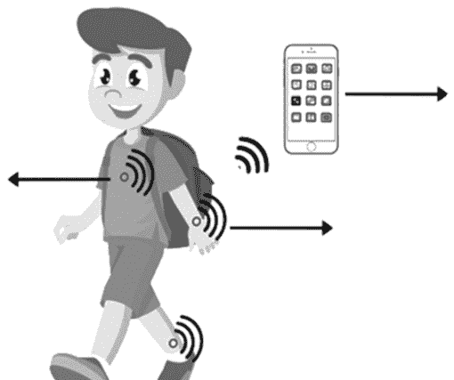

图 7.2 根据代理的目的和要执行的活动通过不同平台交付的对话代理。a) 通过移动设备交付的对话代理，用于随时随地提供关注、建议和激励。b) 通过网页交付的对话代理，旨在随时进行身体锻炼和康复活动示例。

关于可穿戴设备与对话代理的集成，文献中发现的研究较少，只有两项近期研究清楚展示了可穿戴设备与对话代理之间的集成系统。这两项研究分别由 Samekhi 等人 [56] 和 Bickmore 等人 [9] 于 2018 年提出。首先，Samekhi 等人提出了一种虚拟冥想教练对话代理，用于缓解与各种慢性健康相关的症状，包括疼痛、焦虑和抑郁。冥想需要练习，并且需要大多数人无法进行的适当训练。由于这些原因，只要有计算机，设计的对话代理就可以随时使用。此外，该代理具有交互性，并根据呼吸传感器的输入对用户的呼吸行为进行适应，如图 7.3 所示。

呼吸传感器用于计算用户的呼吸率，教练可以在冥想期间的关键点提供反馈。根据这项研究，参与者感到，当虚拟冥想对话代理在其定制训练中加入来自呼吸传感器的信息时，对他们的状态意识显著增强。同样，参与者还报告，当教练响应他们的呼吸时，他们的冥想明显更加放松和有帮助。关于接受程度，参与者对与对话代理交互感到舒适并对它们非常接受 [57]，评分范围从 1（完全不满意）到 7（非常满意），平均分为 6。结果表明用户对对话代理非常接受，并欣赏呼吸传感器提供的交互性。

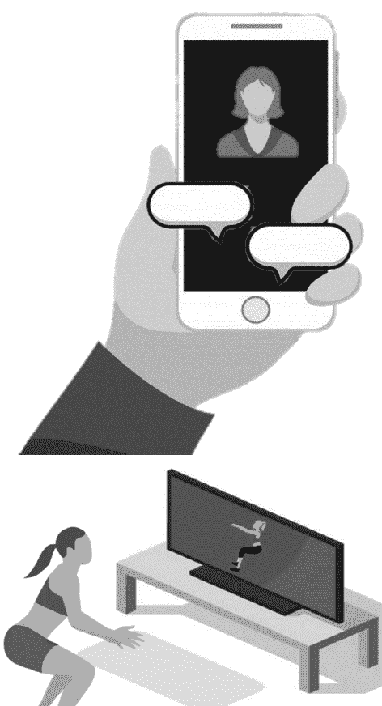

图 7.3 Samekhi 等人提出的实验设置，根据呼吸传感器的输入引导缓解慢性健康状况症状的冥想课程。

随后，Bickmore 等人提出了一个集成对话代理和心率监测器的系统，称为 Kardia (AliveCor, 2017) [3]，用于指导心房颤（AF）患者进行该疾病的自我管理。根据专家的说法，正确管理这种状况对于预防中风、心衰和猝死至关重要。这就是为什么该系统是一种极好的替代方案，允许个体

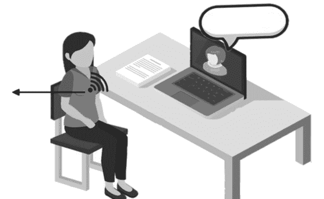

图 7.4 Bickmore 等人提出的实验设置，根据心率监测器的输入为房颤患者提供建议。

更好地管理他们的病情，通过：(i) 经常监测心率和 (ii) 对话讨论房颤教育、症状报告、医疗采集以及可能发生的紧急情况。如图 7.4 所示，设计的系统可以在手机上随时使用，在需要时提供帮助。

根据这项研究的结果，参与者经常使用该系统，持续报告症状，并非常满意。关于对代理的满意度，进行了从 1（非常不满意）到 7（非常满意）的问卷，评分为5。此外，为了了解参与者对对话代理的感受，进行了访谈，参与者在访谈中表达了他们的观点。大多数参与者报告说，该代理是友好且适当的、具有治疗性和安慰性的、信息丰富的且易于获取的等。

考虑到慢性病影响大部分人群，而且这些疾病的自我管理计划非常复杂，对话代理和可穿戴设备是重要的工具，结合使用可以提高人群健康并降低医疗成本。

下面列出了其他未集成可穿戴设备的研究摘要，展示了对话代理多年来在特定健康领域的进展。

### 7.3.1 教育与咨询

根据世界卫生组织（WHO），每年有 4100 万人死于心血管疾病、癌症、慢性呼吸道疾病和糖尿病等非传染性疾病 [43]。这一死亡人数占全球死亡人数的 71%，令人担忧的

# 用于医疗保健的对话代理（CAs）：潜在的流行病解决方案

鉴于在大多数情况下，这些死亡可以通过自我护理教育和咨询来避免。

这些疾病是遗传、生理、环境和行为因素共同作用的结果，如果不及时纠正或治疗，可能会导致早死。这就是为什么西班牙自我护理协会（ANEPF）提将自我护理视为预防严重疾病的关键 [2]，同时也从轻微和暂时性疾病中康复的关键 [40]。

为了实现这些目标，研究人员创建了一系列涉及对话代理（CAs）的技术策略，并对重要的良好习惯进行开发和建议，例如慢性疾病的自我管理 [9, 13, 29, 50]、健康行为改变 [8, 19, 34, 55] 以及特殊问题的教育 [11, 16, 24, 66]。如表 7.2 所示，由于迫切需要提高对教育对人口福祉作用的意识，关于这些主题的文献非常丰富。

在这方面，已经开发了一些技术策略，允许患者每天管理自己的健康。例如，2005年，Lesley-Ann Black 等人 [13] 提出了一种远程监控，涉及患有糖尿病并合并高血压的患者，以促进其主动改善。随后，在2014年，Hyekyun Rhee 等人 [50] 提出了一个对话系统来促进哮喘管理，作为患有此类疾病青少年及其父母的辅助。2018年，Klaassen 等人 [29] 提出了一个集成虚拟教练的平台，通过教育游戏支持年轻糖尿病患者进行疾病自我管理。同年，Bickmore 等人 [9] 提出了一个虚拟代理，为患有慢性心脏病的患者提供关于疾病自我管理的建议。

## 表 7.2：与教育和咨询相关的对话代理已发表研究

| 健康领域 | 第一作者，年份 | 目标人群 |
|---|---|---|
| 慢性疾病的自我管理 | Timothy W. Bickmore 等人, 2018 [9] | 慢性心脏病患者 |
| | Randy Klaassen 等人, 2018 [29] | 糖尿病患者 |
| | Hyekyun Rhee 等人, 2014 [50] | 哮喘患者 |
| | Lesley-Ann Black 等人, 2005 [13] | 糖尿病患者 |


| 关于特定问题的教育和咨询 | Shuo Zhou 等人, 2018 [66] | 青少年 |
| | Paula Gardner 等人, 2013 [24] | 女性和母亲 |
| | Roger A. Edwards 等人, 2013 [19] | 女性和母亲 |
| | Rik Rutzen 等人, 2011 [16] | 青少年 |
| 健康行为改变 | Timothy W. Bickmore 等人, 2013 [11] | 所有利益相关者 |
| | Christine Lisetti 等人, 2013 [34] | 所有利益相关者 |
| | Daniel Schulman 等人, 2011 [55] | 所有利益相关者 |
| | Timothy W. Bickmore 等人, 2005 [8] | 老年人 |

# 医疗物联网

在上述所有研究中，都使用了不同类型的对话代理，以促进症状监测、治疗依从性、问题解决和健康习惯的养成。由于慢性病患者数量的增加，这些策略旨在为需要的人提供更好、更多的护理。在定性结果中，通过访谈，所有研究都评估了参与者在体验各自的对话代理后的感受。参与者对个性化程度表示赞赏 [13]，认为它是促进自我管理的一种极力且方便的选择 [50]。同样，在某些情况下，研究参与者通过减少症状发生的频率证明了他们的健康状况有所改善 [9, 50]。

随后，关于特定问题的教育和咨询，现有的文献是较新的，因为这一领域是不久前出现的，以补充健康专业人员在某些问题上进行教育和支持的努力。正如 Crutzen 等人 [16] 的情况，他们在 2011 年展示了一个回答有关性和酒精问题的聊天机器人。2013年，Edwards 等人 [19] 展示了一个交互代理，为对母乳感兴趣的母亲提供母乳信息和支持。同年，Gardner 等人 [24] 开发了一个动画角色来促进孕前护理，以改善女性健康并在怀孕前减轻风险因素。最后，2018年，Zhou 等人 [66] 展示了一个虚拟代理，为有酒精问题的人提供关于现状的建议。

尽管上述故事是相同的，但目的是帮助患者解决他们被拒绝回答的问题，让他们对问题以及可以采取的措施产生自己的理解。在这四项研究的定性结果中，四项中只有三项衡量了对对话代理的满意度。其中两个使用了 7 点满意度调查 [19, 24]，一个使用 5 点李克特量表 [16]。尽管在评估上存在这种差异，但此外，对对话代理的平均总体满意度很高。患者非常满意，此外，对话代理被认为是一种更快速、更匿名的寻求可靠信息的工具 [16]。

最后但并非不是，文献中有四篇关于健康行为改变的文档。所有这些都旨在鼓励患者改变其健康行为，这些坏习惯会降低患者的生活质量并缩寿命。对于这些研究，研究人员开发了一些基于证据的技术策略，下文所示。2015年，Bickmore 等人 [8] 为老年人提出了一种关系代理，扮演身体活动顾问的角色。2021年，Schulman 等人 [55] 展示了一个虚拟代理来促进体育锻炼，通过对话提高人们的动力和信心。2013年，Lisset 等 [34] 提出了一个定制的虚拟形象，通过动机干预鼓励问题饮酒者减少酒精摄入。最后，在同年，Bickmore 等人 [11] 提出了一种通过对话促进身体活动和水果蔬菜摄入的代理。通过进行 7 点满意度调查 [55] 和 Godspeed 问卷 [34]，可以得出结论对话代理是被接受和喜爱的。这些结果非常有前景，尤其在某些情况下，对话代理的使用。总体而言，对话代理在教育和咨询方面对人口产生了积极影响。

## 7.3.2 康复

根据世界卫生组织（WHO），康复是个人由于老化、健康状况、慢性疾病或疾病或创伤导致功能限制时需要的一系列干预。功能限制包括关系、沟通和移动等方面。根据上述，康复是一个非常广泛的领域，包括 (i) 沟通技巧康复、(ii) 语言治疗、（iii) 物理康复和 (iv) 心理康复。

目前，康复的需求在很大程度上没有得到满足，由于在许多中低收入国家，缺乏提供康复服务的培训专业人员，每百万人口少于 10 人。这就是为什么研究人员和开发者支持使用对话代理来补充自闭症谱系（ASD）[59, 64]、神经系统疾病 [27, 62]、行动障碍 [17, 57] 以及心理创伤 [53] 的康复过程，这些占残疾总人数的很大比例。表 7.3，对话代理已被用于——在沟通技巧康复领域，文献发现目标人群是 ASD。ASD 是一种影响沟通和社交的发展障碍。此外，近年来诊断 ASD 的儿童急剧增加 [64]。因此，有许多治疗可以帮助儿童获得新技能并克服

# 124

# 医疗物联网

面临着各种发展挑战 [38]。例如，2011年，Weilun等人 [64] 提出了一种虚拟代理人作为增强，通过虚拟游戏帮助自闭症谱系障碍（ASD）学生进行康复和学术训练。同样，2017年，Tanaka等人 [59] 介绍了一个对话系统，通过与化身互动教学并训练自闭症儿童的交流技巧。

这两项研究使用了不同的策略评估了代理人干预的效果。在第一项研究 [64] 中，通过学生提供的反馈来评估影响。每位学生与游戏互动了10到15分钟，在互动结束时，要求学生填写反馈表（未指定）。他们人都对虚拟代理人表示了认可和赞赏。另一方面，在第二项研究 [59] 中，通过比较系统预测的训练前和后评分来评估系统的有效性。该研究结果显示，训练前后的社交技能有了显著提高，整体社交技能与非语言行为之间的关系也存在变化。

其次，在语音方面，有几种受关注的类型，语音受影响的原因有很多。例如，由于神经系统疾病 [27]、失语症 [62] 和 ASD [65]，儿童和成人面临说话和交流问题。这就是为什么研究人员开发了康复策略，以提高这些受限影响的人的生活质量。Wik等人 [66] 就是此类情况，他们在2009年描述了一种用于儿童和青少年语言学习的具身对话代理人。该代理人扮演教师的角色，负责引导和鼓励反馈。2014年，vanBuren等人 [62] 提出了一种虚拟治疗师，通过视觉化指定言语为失语症患者提供言语语言治疗。最后，Ireland等人 [27] 测试了一个与用户对话的人工代理，并以此衡量患有帕金森病和痴呆的语言和交流困难患者在日常生活中的语音和交流结果。

每位学生都使用了三种不同的策略来衡量其效果。例如，在第一项研究 [65] 中，向所有使用过代理人的人发送请求，让他们填写问卷以获得定性反馈。所有问题均为多选题，范围从1（完全不同意）到5（完全同意）。平均分超过3.29，这得出结论：代理人受到了人们的欢迎。在第二项研究中，没有对感知或接受度进行评估。结论是，研究表明，对于失语症患者，接受虚拟治疗师支持的治疗可以学习更快。最后，在第三项研究 [27] 中，参与者有时间与代理人交流，随后被要求分享经验。参与者识别出了处理速度等问题。

另一方面，关于物理康复，有一些例子利用了具身认知代理（CAEs）的非人类特性重复执行练习而不感到疲劳。鉴于此，CAEs 正作为一种潜在工具，支持医疗专业人员进行物理康复课程。Deutsch等人 [17] 就是此类案例，他们在2012年提出的系统旨在解决中风患者的运动控制体能缺陷。在这项研究中，通过化身演示动作并让用户跟随以保持在安全训练范围内。结果，所有参与者都参加了所有计划课程，康复依从性达到100%。同样，所有参与者的有氧能力通过耗氧量衡量有所提高。

# 用于医疗服务的CA：潜在的大流行解决方案 125

在心理康复领域，很少的研究使用CA，这可能是由于该领域涉及问题的复杂性导致的。Rizzo等人 [53] 就是此类情况，他们在2011年开发了一系列虚拟代理作为在线指南。该项目旨在激励用户迈出第一步，就其健康对话寻求信息和建议。实际上，这目前可以在线获取 [22]，因此任何感兴趣的人都可以与虚拟代理人互动。事实上，良好的CA可以通过回答问题和提供指导，有效讨论个人自我护理问题。

## 医疗交付中的对话代理（CAs）：大流行的流行解决方案

## 表格 7.5

与物理训练对话代理相关的已发表研究

| 健康领域 | 第一作者，年份 | 目标人群 |
|---|---|---|
| 体重管理 | Le Rouge 等人，2016 [33]；Watson 等人，2012 [63] | 超重青少年；超重成年人 |
| 身体体育活动 | Bickmore 等人，2013 [12]；Ellis 等人，2013 [20] | 久坐成年人；帕金森病患者 |

从这个意义上说，体育活动是预防超重 [44] 等慢性疾病（以及在某些情况下，预防如帕金森病 [20] 等疾病）的关键因素。进行体育活动具有显著益处，因此，开发能够促进定期、有计划和结构化运动的技术替代方案，可以提高全球人口的生活质量。为此，对话代理（CAs）通过一系列模拟对话和在训练期间的陪伴，成为促进体育活动的一种良好方法。

根据现有文献，对话代理在这一领域的主要目的是激励和支持用户进行定期锻炼，特别是针对表 7.5 所示的超重、久坐生活方式和有运动限制的人群。实际上，有两个领域对话代理的干预可以增加对体育运动的依从性；结果是，人们可以减轻体重 [33, 63]。

事实上，对话代理的干预可以增加对体育运动依从性的领域有两个。首先，对话代理可以增加对体育运动的依从性。对于肥胖等疾病的干，，研究表明，对话代理可以通过开发有效的干预策略来减轻体重。例如，研究人员认为，有效的干预可以帮助肥胖患者实现减轻目标 [33, 63]。Watson 等人（2012）提出的模拟对话和在训练期间的陪伴是促进体育活动的一种良好方法。Le Rouge 等人（2016）通过模拟对话和在训练期间的陪伴证明对话代理是促进体育活动的一种良好方法。

在第一项研究中，参与者报告了饮食习惯的积极改变，对话代理对他们减轻减轻有效 [63]。

7项项研究表明，对于肥胖的人群，对话代理的互动是有效的。

在第一项研究中，参与者认为对话代理对减轻体重是有效的 [33, 63]。

在第二项研究中，参与者对对话代理的接受性表现出极大兴趣。

两项研究表明，对话代理可以帮助肥胖青少年减轻体重。

## 物联网

另一方面，针对身体和生理状况，对话代理的干预策略可以适用于久坐成年人和帕金森病患者 [20]。根据上述研究，Ellis 等人（2013）的研究表明，对话代理可以帮助久坐成年人 [12]。Bickmore 等人（2013）的研究表明，对话代理可以帮助久坐成年人的体育活动。

由于研究结果显示，对话代理的满意度是有效的。在某项研究中，通过次次单项研究显示了对话代理的可行性是接受的。在某项研究中，对话代理的满意度是有效的，满意度是有效的2的]。

这些发现表明，对话代理可以促进身体运动。

此外，由于大流行的现状，对话代理的使用可以缓解身体和心理问题 [28]。

## 7.3.5 姑怀护理

世界卫生组织（WHO）估计，有超过 200 万癌症患者需要姑怀护理 [40]。事实上，姑怀护理不仅是为了减轻疼痛，还可以缓解晚期患者的身体、心理和情感痛苦。

根据上述观点，姑怀护理是一个新兴领域，对话代理可以在其中减轻人们的担忧。目前的证据见表 7.6。

## 表格 7.6

与姑怀护理相关的已发表研究

| 健康领域 | 第一作者，年份 | 目标人群 |
|---|---|---|
| 危机支持 | Catherine Easton 等人，2019 [18] | 慢性肺阻患者 |
| 临终计划 | Dina Utami 等人，2017 [61] | 老年人 |

## 医疗交付中的对话代理：大流行的流行解决方案

根据文献，姑怀护理领域有两个对话代理可以干预的领域：危机支持和临终计划。针对后者，2017 年的 Utami 等人 [61] 提出了一种虚拟代理，帮助人们在生命的最后一年里管理情绪。该研究是在单次会话中进行的，问卷采用 1（不满意）到 7（满意）的量表设计；老年人与代理讨论这些话题感到很。另一方面，2018 年的 Easton 等人 [18] 提出了一种用于阻塞性肺疾病（COPD）患者的对话代理，通过建立治疗关系来实现。结果显示，这项研究表明这种低成本系统增加了信心，减少了社交孤立，并提高了患者对疾病的认知。

如上所述，由于对开发能够关注人们的对话代理的兴趣日益增加，医疗交付对话代理的研究人员和开发者了解其局限性，以开发新功能。在第一项研究中，参与者报告其焦虑状态显著减轻。

### 7.4.1 局限性

在第 7.3 节中，已证明对话代理正被测试用于提供和收集健康信息。大多数情况下，对话代理基于心情且对话有限 [25]；其他一些在后台运行并在需要时提供信息。然而，这些策略的范围和适应性受到用户偏好、上下文和用户输入噪声的限制。大多数对话应用程序没有集成可穿戴设备，这是一个很大的局限，因为代理提供的反馈、建议或帮助不是基于身体状态的。

## 7.4 未来工作

正如上一节所强调的，由于对开发能够关注人们的对话代理的兴趣日益增加，医疗交付对话代理的研究人员和开发者了解其局限性，以开发新功能。为此，理想的情况是对话代理具有

具有以下特征 [51]：(i) 口头的、多模态和多感官理解；(ii) 理解隐性信号；(iii) 能够以共情的方式处理基础和复杂情绪；(iv) 感知用户的当前状态；最后 (v) 与人类进行对话的能力。

另一方面，重要的是，对话代理（CAs）的干预意味着与人类的直接互动以及它们的广泛使用；例如，设计的 CA 的外观和行为容易受到设计偏差的影响，例如对特定种族或族群背景的偏好。因此，开发者必须考虑来自目标人群的数据，以及该人群中可能受到这些技术测试和实施差异而影响的多元化社区。

## 7.4.2 建议

考虑到上述局限性，对未来的研究和设计有若干建议和关键点，如下所示：

- 在该阶段，必须考虑 CA 24×7 全天可用性，以及其在准确时机（例如在特定行为之前或之后）提供帮助的潜力，这使其成为一个可能很有价值的工具。
- 此外，在评估的数据分析期间，应将结果与有效性、使用率和用户体验指标联系起来，以理解 CA 是否有效以及为什么有效。这是此类评估产生价值的唯一途径。
- 在可能的情况下，可以增加可穿戴设备的使用，因为传感器可以测量数值，且患者被限制在床上，以便提供更好的医疗服务，并对所做的反馈具有更高的确定性。
- 最后，为了充分理解 CA 干预随时间推移可能产生的效应，需要进行纵向研究。研究的大多数文档结果和结论来自试点研究或横断面研究，这导致对 CA 长期干预获益的证据不足。

## 7.5 结论

作为初步观察，CA 的优势之一是它们可以容易且廉价地复制，而且与人类不同，用户可以随时随地通过通过互联网访问它们。此外，它们可能比人类更可靠，因为它们不受疲劳、耗竭和认知错误的影响。然而，尽管具有上述的潜力，这些技术已经并正在被帮助医疗专业人员处理某些特定过程，而不是取代他们。因此，这些技术的开发者必须向用户提供有关使用 CA 的范围、风险、限制和预期的充分信息。

此外，CA 开发者可以设计使其具有可修改的外观、语言和方言，以及其他与其他用户文化背景匹配的特征，包括种族、族群或社会经济地位。这有助于与用户建立关系，对治疗的依从性和更好的结果产生积极贡献。

## 用于医疗交付的 CA：潜在的流行病解决方案 131

目前，文献中极少研究涉及 CA 干预的定量结果。然而，定性结果显示出用户感知良好，这反映在动机、意愿和对过程依从性的增加上。虽然本章展示的结果是有前景的，但这项研究仍处于早期阶段。因此，这项工作的发现将成为促进长期研究和可穿戴设备整合的基础。在更多患者中验证这些研究以提供意义的信息并对有效性进行适当的统计分析将价值。

此外，必要强调将可穿戴设备与 CA 集成的系统，因为这允许增强适应性，这是一个广泛可用且通常廉价的选项。这通过集成 CA 可穿戴设备来提供具有一定自主性的医疗服务，成为开发改进医疗服务的希望方法。正如本章所示，展示 CA 的适当使用和所获益处有助于解决对技术的担忧，并可能加速其采纳。

# 参考文献

- [1] Critical appraisal skills programme. CASP checklist: 11 questions to help you make a sense of a control study. https://casp-uk.net/wp-content/uploads/2018/01/CASP-Control-Study-Checklist-2018.pdf, 2018.
- [2] Araceli Aguilar, Julian Caniso, Noemi Gení, M. Dolores Mati, Marta Miras, y Luis Valdo. Sobre la seguridad en español, diabetes e hipertensión de las especialidades farmacéuticas sin receta, gestionando beneficios terceros. Farmaceuter, 1(3):115–119, 2003.
- [3] AliveCor. Cardiff mobile de AliveCor. https://www.alivecor.com/ifus/02LB51-es.pdf, 2017.
- [4] American Psychiatric Association. What is depression? https://www.psychiatry.org/patients-families/depression/what-is-depression, 2017.
- [5] Skye Barrick, Susan Barrett, and Nancy Mayo. Emotional vitality: Concept of importance for rehabilitation. Archives of physical medicine and rehabilitation, 94(8):1547–1554, 2016.
- [6] Christopher Backorth, Elizabeth Croft, and Daniel Kulic. Measurement instruments for the safety of robots. Anthropomorphism, liking, perceived intelligence, and perceived International journal of social robotics, 1(1):71–81, 2009.


- [7] Martin Benjamin and John Fox. Automatic generation of spoken dialogue medical and ontologies. Journal of biomedical informatics, 39(5):482–99, 2006.

- [8] Timothy W. Bickermore, Lisa Caruso, Kerry Leaugh-Gorr, and Tim Heer. “It’s like you talk to a friend.\ Relational agents. Interaction with computers, 17:71–75.

- [9] Timothy W. Bickermore, Lisa Caruso, Kerry Leaugh-Gorr, and Tim Heer. “It’s like you talk to a friend.\ Relational agents. Interaction with computers, 17:71–75. (Note: Duplicate entry in OCR)

- [10] Timothy W. Bickermore, Lisa Caruso, Kerry Leaugh-Gorr, and Tim Heer. “It’s like you talk to a friend.\ Relational agents. Interaction with computers, 17:71–75. (Note: Duplicate entry in OCR)

- [11] Silvana Ganderis, Andreas Heiszrup, Julian Beezhold, and Norman Sartorius. Toward a new definition of mental health. Psychiatry, 14(2):231–235, 2013.

- [12] Paula Gardner, Megan Hempstead, Lazlo Ring, Timothy Bickarne, Leonce Yunusa-Nykhoon, Karla Daumas, and Brian Jack. Reaching women through health information technology: The American journal of health promotion, 27(3supp):eS11–e20, 2013.

- [13] Judith Deutsch, Mary Mysinski, Scott Prevost, Elizabeth Cutrell. Embodied Conversational. MIT Press, Cambridge, MA, 2005.

- [14] Justine Castle, Stephen Sullivan, Matthew Vlier. Embodied Conversational. MIT Press, Cambridge, MA, 2005.

- [15] Indranil Chakrabort, Prasenit. Covid-19 outbreak: Migration, effects. Science, 7:13882, 2020.

- [21] Kathleen Kara Fitzpatrick, Allison Darcy, and Molly Vlier. Developing cognitive behavior therapy to young adults (with symptoms) of depression and anxiety using a randomized trial fully automated conversational agent (woebot). JMIR mental health, 4(2):e19, 2017.

- [22] Institute for Creative Technologies-University of California. Protection of simcoach beta. https://www.simcoach.org/, 2013.

- [23] Silvana Ganderis, Andreas Heiszrup, Julian Beezhold, and Norman Sartorius. The American journal of health, 92(2):142–148, 2013.

# 医疗保健领域的对话代理（CAs）：大流行的解决方案

[27] David Ireland, Christina Ayat (née Kueppfer), Jackli Liddle, Dana Bradford, Helen Olivia Russian, Thomas Mullins, Daniel Angus, Janet Miles, Simon McBride, and Adam Vogel. 健康技术与信息学研究, 227:55–60, 2016.

[28] David Jiménez-Pazón, Ana Carbon-Baez, and Carl Lave. 体育锻炼作为对抗 COVID-19 隔离心理和生理后果的治疗：重点关注老年人。心血管疾病, 63(3):386–388, 2020.

[29] Randy Klassen, C.M. Bul, Riley Opkens den Kert, Jan van der Berg Mella, and Pierpalo Di Bonito. 糖尿病患者预防性干练和游戏平台的评估。传感器, 18(2):402, 2018.

[30] Lean Kramer, Silke ter Stel, Bob Muller, Emery Vet, and Lex van Velen. 用于健康生活方式教练的对话代理开发。医学互联网研究杂志, 22(2):2020.

[31] Liliana Larano, Adam Dunn, Huong Ly, Aabi Kocaballi, Jessica Chen, Rabia Bashir, Didi Surian, Galle Balacho, Farah Magrabi, Annie Lau, and Enrico Coiera. 系统综述中的对话代理。美国医学信息协会杂志, 25(9):1248–1258, 2018.

[32] Sven Lumen, Christian Mayer, and Tobias Tucker. 医疗保健中的聊天机器人接受：探索用户对疾病诊断对话代理的采用。第 27 届欧洲信息系统会议 (ECIS)，斯德哥尔摩与乌普萨拉，2019年6月8日14日。

[33] Cynthia Lurathe, Kathryn Dickinson, Christine Lisvetti, Sally Sangwesaran, and Teresa Malanos. 让青少年参与基于计算机的体重管理计划：虚拟和虚拟教练可以提供帮助。美国医学信息协会杂志, 23(1):19–28, 2016.

[34] Christine Liste, Reza Amin, Umar Yavasur, and N. Riche. 我能帮你改变吗！一个共情虚拟代理提供行为改变健康干预。ACM 管理系统交易, 19, 2013年12月.

[35] Gale Ucas, Alberto Rizzo, Jonathan Grath, Stefan Scherfer, Gio Strautou, Jill Bobberg, and Louis-Philippe Maurice. 心理健康报告：通过虚拟人类打破护理障碍。机器人与人工智能前沿, 4:51,2017年10月.

[36] Maarten Luersen and Tim Hawe. 虚拟代理服务：医疗保健中的应用/第 18 届智能虚拟代理国际会议，第 107–112 页，2018年11月。

[37] Michael Tukey, Zorada Callejas, and David Grol. 对话界面：与智能设备对话。出版公司，第一版，2016.

[38] Scott S. Myers and Chris Plauché Johnson. 自闭症谱系儿童的管理。儿科学杂志, 120(5):1162–1182, 2007.

[39] 国家卫生健康中心。肥胖人群适度减重的获益处。https://www.nih.gov/news-events/nih-research-matters/benefits-moderate-weight-loss-people-2016

[40] 世界卫生组织。姑宁护理的定义。https://www.who.int/cancer/palliative/definition/en/n.

[41] 世界卫生组织。心理疾病影响每四个人中的一个。https://www.who.int/whr2001/media_centre/press_release/en/, 2001.

[42] 世界卫生组织。全球未满足的姑宁护理需求。https://www.who.int/mediacentre/news/releases/2014/palliative-care-2014128/es/, 2014.

[43] 世界卫生组织。非传染性疾病。https://www.who.int/news-room/fact-sheets/detail/noncommunicable-diseases, 2018.

# 134

# 医疗物联网

[44] 世界卫生组织。身体活动。https://www.who.int/news-room/fact-details/physical-activity, 2018.

[45] 世界卫生组织。康复。https://www.who.int/news-room/fact-sheets/details/rehabilitation, 2019.

[46] 世界卫生组织。新冠病毒肺炎 (COVID-19) 大流行。https://www.who.int/emergencies/diseases/coronavirus-2019, 2020.

[47] 世界卫生组织。抑郁症。https://www.who.int/news-room/fact-sheets/detail-depression, 2020.

[48] Shyamal Patel, Hyung-Soon Park, Paolo Bonato, Leighton Chan, and Mary Rogers. 可穿戴系统及其在康复中的应用综。神经工程与康复杂志, 9,2021.

[49] Pierre Philip, Jean-Arthur Mouloudc-Franche, Patricia Sagscape. 作为概念证明的虚拟人类，科学报告, 7:51,2017.

[50] Hyekyun Lee, James Allen, Jennifer M, and Mary Swift. 用于重度抑郁症的移动式管理系统。8,2014.

[51] Giuseppe Ricci. 面向医疗。多模态交互工作坊，53–56.

[52] Laurel Riek and Peter Robinson. 用于残障人士的机器人。智能虚拟代理, 11:59.

[53] Albert Rizzi, Belinda Lange, Greg Parsons, and John Kim. 用于健康的虚拟代理。健康技术与信息学研究, 227–238,2011.

[54] John Neerc. 用于康复的虚拟代理。2011 AAAI 会议，362–363.

[55] Daniel Schulz, Timothy Bickmore, and Candice Singer. 对话界面。出版公司，2016.

[56] Ramesh Sheekhi, Ha Tran, and Timothy Bickmore. 深度呼吸：第 12 届 EAI 健康感知计算会议，108–117,2018.

[57] Ramesh Sheekhi, Catherine DeAngelis, Theresa Ellis, and Beth Hull. 用于个人的虚拟代理。第 18 届 ACM 计算与访问会议，327–328,2016.

[58] Valerie Smith, Dean DeVane, and Cecil Clarke. 医疗干预系统综述。BMC 医学研究, 11:15,2011.

[59] Hiroki Tanaka, Hideo Noguro, Hidemi Iwasaka, and Satoshi Nakamura. 用于自闭症社交训练的实验性对话代理。PLOS ONE, 12(8):1–15,2017.

[60] Myrthe Telman, Mark Neerc, Rafael Bidarya, and Willem-Paul Brinkman. 使用虚拟代理重建创伤应激障碍治疗系统。医学科学杂志, 14:125,2017.

[61] Dina Utami, Timothy Bickmore, and Asimina Nikoloulou. 讨论死亡：使用虚拟代理进行终终规划。Beskow, J. 等，智能虚拟代理，441–450,2017.

[62] Sarel Van Vuuren and Leora R. Cherney. 用于语言治疗的虚拟治疗师。智能虚拟代理, 8637:438–448,2014年1月.

[63] Alice Watson, Timothy Bickmore, Abby Cage, Ambar Kulshreshtha, and Joseph Kvedar. 超重成年人体力活动依性的网络虚拟教练：随机对照试验。医学互联网研究杂志, 14(1),2012.

[64] L. Weiss, M. R. Elara, and E. M. A. Garcia. 用于自闭症儿童康复的虚拟游戏方法。2011年第 8 届信息通信信号处理国际会议，1–6 页，2011.

[65] Preben Wik and Anna Hjalmarsson. 辅助语言学习中的具身对话代理。语音通信, 51:1024–1037,2009.


# 大数据在电子医疗应用中管理海量数据的角色

Meenu Gupta¹, Dr. Rachna Jain²,

Rachit Singha³,, and Jaspreet Singh⁴

¹⁴印度昌迪加尔，巴哈蒂大学

²,³³印度德里，巴拉蒂 Vidyapeeth 工程学院

1,2,3,⁴计算机科学与工程系

# 目录

- 8.1 引言 ................................................................................ 137
  - 8.1.1 制表机 ....................................................... 138
  - 8.1.2 人工分析 ............................................................ 138
  - 8.1.3 物料需求计划系统 ............................... 139
  - 8.1.4 预定义报告 ................................................. 139
  - 8.1.5 Excel 文件 ................................................................... 139
  - 8.1.6 数据库 ................................................................. 139
- 8.2 用于管理海量数据的先进技术 .............. 140
  - 8.2.1 NoSQL ........................................................................ 140
  - 8.2.2 Hadoop ...................................................................... 143
  - 8.2.3 Spark ........................................................ 145
  - 8.2.4 Pig ............................................................................ 148
  - 8.2.5 MapReduce ............................................................... 150
  - 8.2.6 Kafka ...................................................................... 154
  - 8.2.7 Hive ...................................................................... 159
- 8.3 电子医疗中的大数据 ................................................... 160
- 8.4 结论 ................................................................... 161

参考文献 ............................................................................ 162

# 8.1 引言


过去，使用不同的技术来处理产生的海量数据。然而，这些方法对于该任务并不是理想的。这些技术及其缺点和局限性将在本医疗物联网章节中进行讨论。大数据存在许多局限性 [25]。一项研究侧重于多样性 [33]，而不是速度和数量。进一步的关注放在了预分析和后分析本身。存储海量数据是其中一项研究中的关键问题，作者提出了 [28] 不同的方法来存储每天从各种资源产生的大数据。从硬盘移动到光驱器，存储设备不足以容纳如此海量的数据。为止，一直使用云服务来应对这种局面。此外，正如讨论的，存储和性能之间存在权衡：

## 8.1.1 制表机

制表机可以追溯到 19 世纪，由赫尔曼·霍勒里思（Herman Hollerith）制造，是用于汇总数据的早期设备之一。该机器能够从打孔卡上读取数据并汇总存储在卡片上的数据。然而，由于该机器需要将数据打孔在卡片上，只有少数人使用这种机器。此外，由于打孔卡不再用于存储数据，这些机器已经过时了。

## 8.1.2 人工分析

在 `Hadoop` 和 `R` 出现之前，开发人员必须手动遍历数据以寻找模式并分析数据。这个过程被称为人工分析。它是分析数据的最好方法之一，因为它不需要任何特殊的数据分析软件或硬件。然而，它有各种缺点：

- 首先，开发人员必须从不同的格式中获取数据。当数据存储在具有不同存储格式的不同系统上时，获取数据是一项非常棘手的任务。
- 第二，数据可能是不一致的。开发人员的任务是检查数据并发现数据中的任何不一致之处。
- 第三，需要多次处理才能对系统获得充分的了解，从而允许用户正确地分析数据。

## 8.1.3 物料需求计划系统

物料需求计划（MRP）系统执行特定任务，并证明对于新手用户来说操作非常复杂。这些系统设计用于三项主要任务：

- 确保物品的适当可用。
- 维护库存中的物品主列表。
- 计划制造、交付和采购等各种活动。

此外，它们需要结构化、准确的数据来工作，而生成这些数据非常耗时。

# 大数据在电子医疗中的角色

## 8.1.4 预定义报告

在 20 世纪 70 年代初，创建了提取程序来生成具有预定义模板和所需信息的报告。这些程序从预定义的源提取数据并创建如图 8.1 所示的报告。这些程序可以通过点击按钮生成包含信息的报告，但模板和信息源是固定的。此外，这些报告无法预测模式和未来值。

## 8.1.5 Excel 文件

`Excel` 为数据分析提供了各种功能，如数据排序、数据筛选、数据格式化等。除了这些功能外，使用 `Excel` 以图形化表示数据非常简单。所有这些功能使 `Excel` 成为数据分析的理想选择。然而，`Excel` 有各种缺点：

- `Excel` 无法处理拍字节级的大数据。
- `Excel` 不支持媒体和图像文件等非结构化数据。
- `Excel` 处理过去的数据，并能够利用数据创建图表。然而，它无法做出未来预测。

## 8.1.6 数据库

数据库用于以关系的形式存储数据。可以使用结构化查询从数据库中提取数据。函数和触发器等功能允许用户为查询附加特殊功能。尽管有这些优势，由于以下原因，数据库无法正确处理大数据：

- 数据库仅允许存储和分析结构化数据，而不适用于非结构化数据。
- 数据库是联机事务处理（OLTP）类型。因此它们设计用于存储量少且定期更新的数据。相反，数据分析处理丰富且更新稀疏的数据。

现在出现了现代技术，它们已经在每个领域证明了自己的存在，为用户提供标准的功能。这些技术是

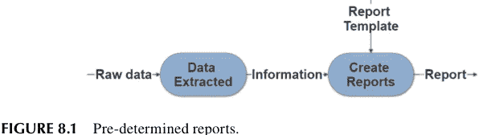

并非针对特定章节，而是针对个人

# 8.2 用于管理海量数据的先进技术

## 8.2.1 NoSQL

使用传统的关系型数据库管理（RDBMS）方法对于不断增长的数据被认为是不有益的，因此被称为“大数据”。在关系模型中，数据以良好的结构方式组织，随着每天产生的多样性，这种方法需要一些改进以适应数据趋势的变化并相应地为用户提供功能。

### 大数据在电子医疗中的作用

大数据并没有被落后。大多数云服务提供商使用大数据结合 `NoSql` 技术来维护其数据库。

在一项研究中，作者描述了大数据和云的 [6] 数据管理挑战，例如近似结果、数据隐私、通过数据探索实现深度分析的企业数据增强，以及社交媒体。全球范围内的机构都在力求在参与的每笔交易中尽可能节省成本并实现利润化。那么，这意味着对过去的技术引入这种动态方法将使市场转向新引入的技术吗？答案很简单，从长期来看是如此，但短期内并非如此。在基于技术技术投入了大量资金构建基础设施的人可能不必遭受损失，因为这些结构从根本上说是他们组织的骨干，在目前将整个系统切换到新系统并不是一个明智的选项。用户面临的这种困境之一是这种数据库方法（即 `SQL` 或 `NoSql`），以便能够完全满足他们的需求。在其他领域不断进步的同时，`SQL` 方法在过去的几十年里由于其统一性和功能性占据了统治地位。在这场竞争中，大数据并没有被落后。在 `NoSql` 出现之前，需要维护的海量数据库难以维护。通过引入智能来获得重视，`MapReduce` 被用于处理大量数据。一项研究 [9] 得出的结论是 Google 在四年内实现了（>1万个）`MapReduce`，这些程序在 Google 集群上执行，每天处理数据量（>20拍字节）。

在 [31] 中，作者讨论了大数据在业务中的应用以及及其方法的利用（即在全球范围内）！通过这种小型应用，人们可以随时随地分享他们的信息。随着 `Hadoop` 的发展，一场革命进入了行业，随着这场革命，旧技术开始快速淘汰。`Hadoop` 最大的优势是它是基于分布式计算的。网络被分为节点和从节点，这增强了系统的计算能力。由于 `Hadoop` 和 `NoSql` 的相似性，科技行业引发了一股热潮，因为两者可以手手协作提供广泛的功能。`NoSql` 数据库可以有不同的形式，如图数据库、对象数据库、XML 数据库、网格和云、文档数据库、键值对或宽列存储。这些数据库不遵循任何严格的模式设计，非常适合大数据。当某人处理大数据时，还会出现另一个问题，即如何扩展处理以应对更快速度到达的数据。如果有人采用关系型数据库的概念来管理如此大量且具有多种变化的数据，那么以某种方式，生成的结果将是错误的或不完整的，或者可能会出现系统故障、数据损坏等任何意外情况。`NoSql` 不像 `SQL` 方法那样遵循原子性、一致性、隔离性和持久性（ACID）属性。当用户向数据库提交查询以进行操作时，其首要任务是尽快获得结果，而忽略了获得正确答案的重要性。因此，`NoSql` 具有弱一致性。

# 医疗物联网

隐私也是决定任何技术性能的主要因素。在 [22] 中，作者讨论了大数据平台对隐私整合和安全意识的需求。此外，他们讨论了与支持大数据平台隐私访问控制功能的框架相关的问题。使用 `NoSQL` 方法开发了许多应用程序。大数据在道路运输政策（即欧洲）中的作用得到了进一步讨论 [13]。接下来，使用结合大数据的云计算技术分析了智能电网的性能，以便在管理网络数据时降低客户成本 [15]。推荐和预测系统也大多基于 `NoSQL` 方法。在 [17] 中，作者提出了一种使用大数据和小量样本的个性化内容推荐服务，以便准确预测用户的行为。它利用带有各种用户信息的大数据进行预测。在另一项工作 [18] 中，提出了一个分析和监控互联网流量的模型，以提高用于促进在线投资的质量。传感器设备在这些被被频繁使用。这些设备也会产生数据。在 [20] 中，作者总结了传感器在大数据系统中（在城市环境中）的扩展，包括辅助生活、空气污染监测、智能交通和灾害管理系统。随着全测序和动画植物基因组的快速扩张，植物科学受益于下一代测序。作者提出了 [26] 利用大数据研究各种物种转录控制的机制。各种基因组的生命动力学也得到了研究。手握强大的工具（大数据），未来也可以被预测。在另一个应用 [29] 中，作者提出了一个风力涡电机调控监控系统，不断增长的数据正在被捕获并存储为大数据。系统捕捉海量数据的能力使得使用增强的数据处理技术成为必要。

可以清楚观察到，对于微软、IBM、SAP 等大型技术公司，趋势已转向 `NoSQL` 方法。

### NoSQL 的优点

- 经济性
- 大数据应用
- 对数据库管理员的需求较少
- 可扩展且可靠
- 灵活的数据模型

### NoSQL 的缺点

- 衡量较少
- 支持较少
- 分析和商业智能问题
- 管理困难
- 专家人数较少

这并不意味着使用 `SQL` 方法会导致损失，但球确实在 `NoSql` 的半场了，证明了其优于 `RDBMS` 方法的优势。

### 大数据在电子医疗中的作用

| Pig | Hive |
|---|---|
| MapReduce | HBase |
| HDFS(Hadoop 分布式文件系统) | |
| YARN | Hadoop Common |

图 8.2 Hadoop 架构。

### 8.2.2 Hadoop

`Hadoop` 是一个用 `Java` 语言编写的框架，并在网上免费。它由 Doug Cutting 和 Mike Cafarella 创立，源于2003年发表的一篇论文《Google 文件系统》。`Hadoop` 以他儿子的玩具命名。最初，`Hadoop` 只包含用于数据处理的 `MapReduce`。随着新模块的发展，`Hadoop` 已成为各种数据处理技术（如 `MapReduce`、`Pig` 等）的生态系统。

图 2.2 显示了 `Hadoop` 的架构，适用于在 Hadoop 分布式文件系统 (`HDFS`) 中存储海量数据，并使用各种编程模型（如 `MapReduce`、`Pig` 等）进行处理 [16]。

Apache 框架模块描述如下：

- **Hadoop Common**: 包含运行 `Hadoop` 和其他 `Hadoop` 工具所需的所有 Java 库和其他函数。因此，它由各种 Java 存档 (`JAR`) 文件组成。
- **YARN** 另一个资源调度器：它是 `Hadoop` 中的集群管理技术。它有资源管理器、节点管理器应用程序管理器三个组件。
- **HDFS**: 它是 `Hadoop` 中的主要存储。通过在 `HDFS` 之上存储数据的副本来确保数据的可靠存储。它是一个列式数据库，用于从 `HDFS` 存储和检索数据。
- **HBase**: 与 `HDFS` 相比，它提供了更快的查找并提供了对数据的随机访问。
- **MapReduce**: `MapReduce` 的主要功能是以两种方式（即 Map 和 Reduce）处理数据，它由 Google 开发。Map 的作用是将数据转换为中间的键值对，而 Reduce 则使用这些中间数据产生最终结果。
- **Pig**: `Pig` 是用于分析大数据集的工具。`Pig` 包含一种名为 `Pig-Latin` 的编程语言用于访问和处理数据。此外，`Pig` 中的自定义函数 (`UDF`) 允许用户集成用 `Java` 和 `Jython` 等不同语言编写的函数。

# 医疗物联网

- Hive: 起初，`Hive` 由 Facebook 开发，后来由 Apache 软件基金维护。`Hive` 的功能与 `Pig` 类似，即一种用于数据分析的工具。但用户不需要学习一种全新的语言来操作数据。`Hive` 使用查询语言 (`HQL`)，该语言与 `SQL` 非常相似。
- Ambari: 它提供了一个简单且安全的平台来管理整个 Hadoopset。

`HDFS` 在 `Hadoop` 的成功运行中起着重要作用，主要包含三个组件（即数据节点 Data Node、名称节点 Name Node 和二级名称节点 Secondary Name Node）。`Hadoop` 的一些特性 [43] 如下：

- 它采用图 8.3 所示的主从架构，其中一个系统（主节点）控制所有其他系统（从节点）的数据存储。
- 它使用廉价的通用硬件存储数据。
- 它以块的形式存储数据。块的默认大小为 64 MB 或 128 MB，但可以根据用户的偏好进行更改。
- 所有的读写操作都由数据节点完成。
- 它具有内置的名称节点和数据节点服务器，帮助用户检查集群状态。

`Hadoop` 以主从架构工作来存储和访问数据，其中名称节点充主，数据节点充从。在 [19] 中，作者对大数据 `Hadoop` 及其工作原理进行了详细研究。此外，还详细讨论了 `Hadoop` 的意义及其分类。可以通过以下步骤建立多节点 `Hadoop` 集群：可以使用 Virtual Box 托管 Ubuntu 16.04 版本的虚拟机。在主节点和从节点上安装 `Hadoop` 后，通过 `start-all.sh` 启动 `Hadoop` 服务，并使用 `jps` 命令进行验证。

当使用任何工具在 `Hadoop` 中提交查询时，后续事件序列解释如下：

- 客户端将作业提交给 JobTracker，它是 `Hadoop` 的组件。JobTracker 是 `Hadoop` 的单点故障。如果 JobTracker 停止工作，整个设置将失败。

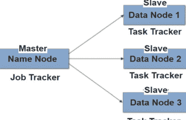

图 8.3 主从架构。

# 大数据在电子医疗中的作用

- JobTracker 轮询名称节点以查找哪些数据节点包含所需数据。由于名称节点包含整个文件系统的数据，因此它是另一个单点故障。
- 随后，JobTracker 将任务提交给相应的 TaskTracker。TaskTracker 不断向 JobTracker 发送心跳确认其存。如果 TaskTracker 未发送心跳，则意味着它失败了。在这种情况下，JobTracker 会寻找另一个可以完成任务的名称节点。
- TaskTracker 将数据提交给 JobTracker。
- 客户端不断轮询 JobTracker 获取信息。当 JobTracker 从 TaskTracker 获取到信息时，客户端会自动收到通知。

2003 年，`Hadoop` 起于一个包含简单存储系统的单一工具 `MapReduce`。然而，随着时间的推移，`Hadoop` 积累了大量的软件和技术，使其成为处理大数据的最著名平台之一。市场上对大数据 [7] 的出现是由作者们提出的，他们需要工具来处理这些大数据集。在研究中，作者们提出了一种架构 [14]，该架构使用树（即 FB+），通过多级 Key 范围（类似于 B+ 树）形成快速索引。范围及其位点是基于对不存在数据的早期搜索。在 [21] 中，作者们讨论了对隐私完整性和安全性的意识，并讨论了与支持大数据平台访问控制功能的框架开发相关的问题。

## 8.2.3 SPARK

上一节讨论了 `Hadoop` 术语。由于技术提供了相似的功能集，`Spark` [35] 和 `Hadoop` 通常被认为是同类物。它由 Spark Core 和额外的库组成。由于 `Hadoop` 基于 `YARN` 架构，这也使得 `Spark` 和其他大数据技术能够共享集群和文件系统。Apache `Spark` 比之前的技术更快、更高效，因为它拥有流式数据分析、分析大型数据集的迭代方法，以及支持对数据集进行更快速查询处理的内存引擎。

它也是开源的。除了 `Hadoop` 提供的功能外，它还提供 SQL 查询支持、图形化数据处理、机器学习算法。`Hadoop` 和 `MapReduce` 之前不支持需要多次计算的算法。随着 `Spark` 的发展，这成为了可能，从而具有了其他技术的优势。在内存中执行时，它比之前的技术快 100 倍。高级别的应用程序接口 (`API`) 带来了优化的性能和更高的速度。与 `MapReduce` 相比，`Spark` 提供了成本最低的洗牌（shuffle）。`Spark` 使用 `Scala` 语言编写并运行在 Java虚拟机上。目前，可以使用 `Scala`、`Java`、`Python`、`Closure` 和 `R` 构建其应用。`Spark` 通常被认为是 `Hadoop` 的修改版本，但这样认为是错误的。

| Spark | Spark | Spark |
| :--- | :--- | :--- |
| Yarn / Mesos | MapReduce | HDFS |
| HDFS | Standalone | Hadoop 2.x (YARN) |
| | | Hadoop V1 (SIMR) |

图 8.4 Spark 的实现。

在 [27] 中，作者们提出了一种收集和分析 Twitter 数据的新方法，并由更大的方法论支持，开始解决其某些局限性。

图 8.4 显示了使用 `Hadoop` 组件构建 `Spark` 的三种方式。在 Standalone 模式下，`Spark` 和 `MapReduce` 并行，使用 Hadoop 文件系统和单独的结果。在 Hadoop YARN 模式下，`Spark` 在 `YARN` 集群上运行，无需预先安装。在 SIMR 即 MapReduce 模式下，除了 Standalone 模式外，可以使用 `Spark`。

在图 8.5 中，讨论了 `Spark` 的组件 [36]（即 Spark SQL、Spark Core、GraphX、Spark Streaming 和机器学习库 (`MLlib`)）：Spark SQL 为用户提供支持，用户可以编写并提交查询来操作数据。正是因为有了 Spark Streaming 组件，实时流式分析才成为可能。Spark Core 包含执行引擎，所有其他组件都构建在其之上。`MLlib` 通过通过 `Spark` 提供机器学习支持扩展了 `Spark` 的功能，用户可以据此设计和训练机器学习模型。Pregel 抽象 API 为用户提供图形支持。

图 8.6 显示了在 `Spark` 弹性分布式数据集 (`RDDs`) 上的迭代操作。结果存储在分布式内存中而不是磁盘中。

| Spark SQL | Spark Streaming | MLlib (机器学习) | GraphX (图) |
| :--- | :--- | :--- | :--- |
| Apache Spark Core | | | |

图 8.5 Spark 的组件。

# 大数据在电子医疗中的作用

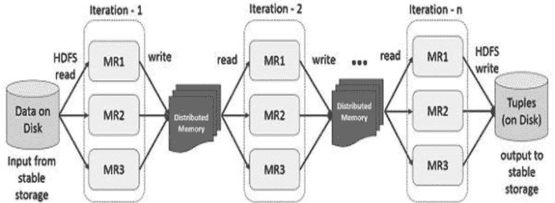

图 8.6 Spark 上的迭代操作。

内存计算是 `Spark` 的优势。在 `MapReduce` 编程中，数据输入/输出 (`I/O`)、复制等速度很慢。因此，`Spark` 中使用了 `RDD` 方法。数据共享比 `MapReduce` 快 50 多倍。图 8.7 显示了 `RDD` 上的交互操作。放入内存的多次查询数据需要在数据集上反复执行。这带来了更快的性能和更高的效率。数据通常也会在多个节点上复制，以应对任何故障。可以通过以下步骤在 Ubuntu 系统上安装 `Spark`：

- 使用命令 `java -version` 验证已安装 Java


# 148

# 医疗物联网

- 确保机器上成功安装了 Hadoop：从 Apache 站点下载 Spark 并解压这些文件：执行 `sudo edit bashrc` 修改 bashrc：

通过添加以下行设置路径：

`export SPARK_HOME=/usr/local/spark`

`export PATH=$SPARK_HOME/bin:$PATH`

# 医疗物联网

- 执行 bashrc：

  命令：`vi ../bashrc`

  测试安装：

  命令：`spark-shell`

可以通过以下过程执行基础的 ETL（提取、加载和转换）任务：

- 启动 Spark 的 scala-shell：

  命令：`spark-shell`

  从本地文件系统加载文件：

  `scala> var Data = sc.textFile("/user/spark/CHANGES.txt")`

  // 文件也可以从 HDFS 加载

  拆分每一行：

  `scala> var tokens = Data.flatMap(s => s.split(" "))`

还可以使用 Spark 执行其他选项。在 Spark 的 Python `PySpark Shell` 中，可以使用 Python 代替 Scala。该研究还提出了一项关于深度学习和 Spark 的应用 [37]。

# Spark 的优点

- 集群计算

  支持 `GraphX`、`MLib` 以及其他组件

  提供实时流数据分析

  灵活且强大

  实时处理和批处理均使用同一平台

# Spark 的缺点

- 占用更大的内存空间

  消耗大量资源

  没有自身的文件管理系统

  `MLib` 中的算法数量较少

# 8.2.4 Pig

`Pig` 是基于 `MapReduce` 的一种高层抽象，由 Yahoo 于 2006 年创立，并于 2007 年加入 Apache 软件基金。

# 大数据在电子医疗中的作用

它具有一些独特特性，使其非常适合处理大量数据。在处理这类数据时，我们通常需要面对各种挑战。

在 [3] 中，作者提供了不同的方法来应对计算、系统和数据复杂度等挑战；而视觉分析挑战以及若干应用及其局限性 [32] 的讨论如下：

- `Pig Latin` [38] 使用简单的语言编写代码来处理数据。
- 由于其高度的抽象性，它的代码内部会被转换为 `MapReduce`。
- 用户可以定义自己的函数，其编写方式类似于 Java 等其他编程语言。
- 与 `MapReduce` 相比，它需要的代码更少。
- 用户有两种执行模式，即本地模式和 `MapReduce` 模式。
- `Pig` 具有使用多查询的方法，有助于最小化代码规模。
- `Pig` 引擎有助于优化代码。`Pig` 中的任务由 `Pig` 引擎自动优化。

可以使用以下步骤在 Ubuntu 系统上安装 `Pig`：

- 验证 Hadoop 是否已安装；命令：`jps`
- 如果未安装，则从 Apache 网站下载并解压此文件以继续执行。检查 `Pig` 版本输入命令：`pig-version`。

安装完成后，`Pig` 即已成功设置（如图 8.8 所示），可以使用 Shell 执行 `Pig` 命令，输出存储在 HDFS 的 `Pig` 结果目录中。

然而，`Pig` 的主要优势是它可以使用相同的工具轻松地处理三种类型的数据（即结构化、半结构化和非结构化数据）。

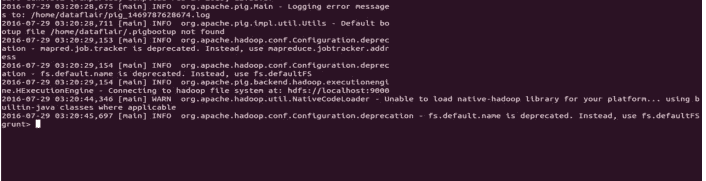

图 8.8 已安装的 Pig。

医疗物联网


图 8.9 Pig 架构。

# 使用 MapReduce 的缺点

- `MapReduce` 仅为联机分析处理（OLAP）系统设计。它不能用于在线事务处理（OLTP）系统。
- 由于 `MapReduce` 在多个系统上同时处理数据，因此在处理数据之前需要设置好整个系统。
- `MapReduce` 代码使用 Java 或 Python 编写。因此，使用 `MapReduce` 必须具备这些语言之一的专业知识。
- 它仅在任务可以分发到多个节点进行应用中才有用。

研究提出了一种基于 `MapReduce` 的应用 [30]，该应用将图像文件书转换为文本电子书，以便实现在电子书中进行词汇搜索。

## 2.2.6 KAFKA

在 Kafka 引入之前，大多数开发技术尚未梦想过动态和静态数据。虽然存在可以处理流式数据的技术 [41]，但它们的效率和性能无法达到当前技术进步的要求。此外，并非所有数据都适合流式传输，但趋势正向流式数据分析转变。今天，财富 500 强中的许多公司无论是来自电信、旅游、银行行业或其他行业，都在使用 Kafka。Kafka 无处不在，由强大的 HDFS 架构支持实时分析，HDFS 是一种分布式文件系统，允许存储静态数据，并且可以在数据库上进行批处理。这种架构在需要历史数据或任何过去的数据时提供分析结果。虽然这种方法在需要处理未来消息时会失效，但由于 Kafka 无法处理过去的数据，它的作用延伸到数据库中的最后一条记录并继续处理未来数据，这是对以前设计技术的扩展，为其提供了更广泛的功能。Kafka 最初在 LinkedIn 开发，在各种企业市场中稳步确立了其地位。

使用 Apache Kafka [4]，作者们提出了一种电力预测系统，该系统可以利用大数据分析预测所需的发电量（即接近实际用量的 99%）。在企业级实施中，它经常与 ActiveMQ 或 RabbitMQ 等其他技术进行比较，但由于其具有处理高并发数据流的能力，其他技术已逐渐尘埃落定。自从在 LinkedIn 开发以来，它受到了 Netflix、Uber 等大公司的高度关注支持。它最初由开发者用 Scala 和 Java 编写。它内置了分区系统，提供高吞吐量、在系统故障时具有更好的容错性，并且是一个优秀的大规模消息系统。它可以与 Apache Spark 和 Apache Storm 集成以进行实时分析。聚合解决方案是 Kafka 的另一个用用领域。它收集组织内各种服务的日志，并以消费者所需的格式提供给它们。在 Kafka 中，数据以主题（topics）的形式存储，主题本质上是归类在一起的消息流。这些主题被划分为多个分区（partitions），每个分区包含原始主题的一个子集。分区的创建简化了处理过程，并可以使用这种方法处理更大量的数据。Kafka 架构具有四个核心 API：

- **生产者 API `Producer API`**：生产者是向 Kafka Broker 发送数据的发布者。当生产者向 Broker 发送消息时，它简单地将数据追加到分区的末尾。生产者可以选择将数据发送到自己选择的分区，或者让 Broker 追加到最后一个分区或任何默认分区。
- **消费者 API `Consumer API`**：消费者从 Broker 备用数据，简单来说就是它们从 Broker 访问数据。它们根据需求订阅主题，并从 Broker 拉取数据进行进一步处理。由于 Kafka 的分区创建策略，可以轻松访问 Kafka 集中的数据。
- **流 API `Stream API`**：流 API 接收来自各种主题的输入，对其进行处理并生成输出展示到一个或多个主题。如果数据项需要从一个主题访问到另一个，这些 API 非常有用。
- **连接器 API `Connector API`**：连接器 API 将主题与应用程序连接。此外，它们还识别可重用的生产者和消费者，这些者可以将主题与应用程序链接起来。

## 大数据在电子医疗中的作用

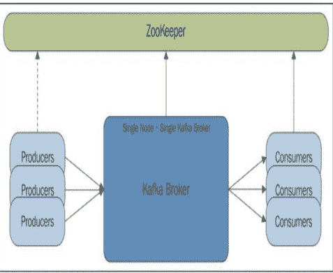

图 8.15 单节点-单代理节点 [40]。

可以使用以下过程安装 Kafka：

- *验证 Java 安装*
- 已安装 ZooKeeper 框架
  i. 下载 ZooKeeper
  ii. 解解 tar 文件
  iii. 创建配置文件
  iv. 启动 ZooKeeper 服务器
  v. 启动 CLI

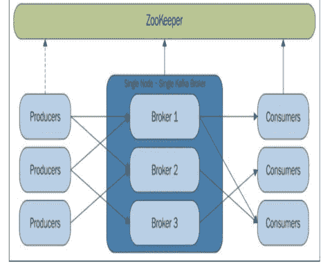

图 8.16 单节点-多代理节点 [40]。

## 医疗健康物联网

- - 已安装 Apache Kafka
  i. 下载 Kafka
  ii. 解解 tar 文件
  iii. 启动 Kafka 服务器

在安装 ZooKeeper 和 Kafka 之后，可以通过以下步骤实现单节点-单代理节点：

- - 启动 ZooKeeper
- 配置单节点-单代理节点
  i. 获取主题列表
    命令：`bin/kafka-topics.sh -list -zookeeper localhost:2181`
  ii. 发送消息
    命令：`bin/kafka-console-producer.sh -broker-list localhost:9092 -topic topic-name`
  iii. 接收消息
    命令：`bin/kafka-console-consumer.sh -zookeeper localhost:2181 -topic topic-name -from-beginning`
- 单节点-多代理节点系统可以类似配置
- 部分主题选项：
  i. 修改主题
    命令：`bin/kafka-topics.sh -zookeeper localhost:2181 -alter -topic name -partitions count`
    示例：`bin/kafka-topics.sh -zookeeper localhost:2181 -alter -topic Hello-kafka -partitions 2`
  ii. 删除主题
    命令：`bin/kafka-topics.sh -zookeeper localhost:2181 -delete -topic _name`
    示例：`bin/kafka-topics.sh -zookeeper localhost:2181 -delete -topic Hello-kafka`

用户通过编写交互式查询并生成结果与 Kafka 进行交互。该系统分析了具有 I/O 路径的可能数据分析策略，并能够在特定情况下克服数据移动问题。

Flex Analytics [24] 系统提高了项目平台的灵活性和扩展性，适用于数据预处理、运行时数据分析以及大规模数据传输。可以从 `kafka.apache.org` 下载 Kafka，其设置通常包括一些现代技术，如应在系统中安装的 Java 等其他内容。随着技术的不断进步和企业对市场上最佳系统的追求，Kafka 不断证明了它的存在价值。Kafka 的概览见图 8.17。

## 大数据在电子医疗中的作用

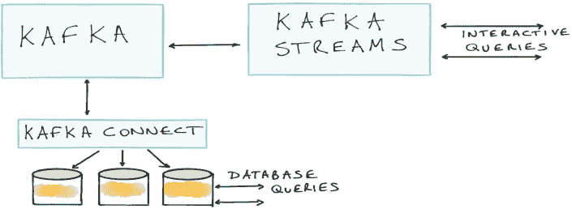

图 8.17 Kafka 概览 [24]。

### 8.2.7 Hive

`Hive` 在 Hadoop 中用作数据仓库基础设施，处理结构化数据。它存在于 Hadoop 之上以处理大数据，使查询和分析变得简单。Facebook（一家公司）在初始阶段开发了 `Hive`；Apache 软件基金随后将其宣布为开源，并命名为 Apache Hive。[34] 对 `Hive` 和 `HiveQL` 进行了详细研究。`Hive` 是为了联机分析处理（OLAP）设计的。它以 SQL 查询（即 `HiveQL`，或 HQL）的形式将架构存储在数据库中，并将数据处理到 HDFS 中。`Hive` 的特点是快速、可扩展、熟悉且可扩展的。

`Hive` 的工作原理如下：

- - **执行查询：** 它包含作为命令行或 Web UI 的 `Hive` 界面，向驱动（任何数据库驱动，如 JDBC、ODBC 等）查询执行。
- **获取元数据：** 编译器向任何 Metastore（数据库）发送元数据请求。
- **获取计划：** 驱动程序利用查询编译器，将相同的查询解析为查询的语法、计划和需求。
- **发送计划：** 此外，编译器检查需求然后将计划重新传回驱动程序以完成并解析查询。
- **发送元数据：** 负责作为编译器的响应传输元数据。
- **执行计划：** 驱动程序将执行计划传输给执行引擎。
- **元数据操作：** 在执行期间，执行引擎与 Metastore 执行元数据操作。
- **执行作业：** 在内部，执行作业过程是一个 `MapReduce` 作业。执行引擎将作业传输到位于 Name Node 的 JobTracker 并分配。
- **获取并发送结果：** 执行引擎从数据节点接收结果。执行引擎将这些结果值发送到驱动程序；驱动程序将结果发送到 `Hive` 界面。

## 医疗健康物联网

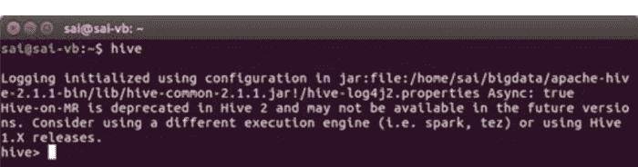


```
sal@sal-vb:-$ hive
sal@sal-vb:-$ hive
Logging Initialized using configuration in jarfile:/home/sal/bigdata/apache-hive-2.1.1-bin/lib/hive-2.1.1.jar/hive-log4j2.properties Async: true
```

Hive-onMN 在 Hive 2 中已弃用，在未来的版本中可能不再可用。使用不同的执行引擎使用 Hive

```
hive> _
```


**图 8.18**

可以使用以下步骤安装 Hive：

- 验证 Hadoop 安装
  - 命令：`jps`
- 已安装 Derby
  - 下载 Hive
  - 解解 tar 文件
  - 配置数据库
  - 启动 Hive

## Hive 的优点

- 高级查询语言
- 比 Pig 更低
- 支持外部表
- 构建在 Hadoop 之上

## Hive 的缺点

- 不可以实时处理
- 高延迟
- 更新和修改较为困难

## 8.3 医疗保健领域中的大数据

正如第 8.2 节讨论的关于大数据的结构和功能，大数据对海量数据产生了奇效。许多企业（无论是公共还是私立）关注存储、分析和生成数据以预防人类。医疗的主要组成部分是医生、护士、药店等。

## 大数据在电子医疗中的作用

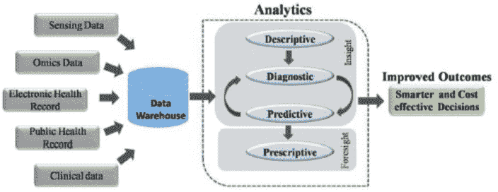

图 8.19 医疗保健中的大数据 [44]。

通过了解病史来治愈患者。在过去，患者的记录写在记事本或任何文件中。现在，记录以电子化的形式维护。随着时间的推移，数据变得海量，处理海量数据是一项困难的任务。然后医疗行业转向大数据，通过数据仓库的概念处理大量数据。电子健康记录（EHR）和电子医疗记录（EMR）等共同改进了健康记录，提高了人们的健康状况。图 8.19 显示了医疗大数据的作用，医疗提供者数据（如 EMR、药品处方和保险记录）以及基因组驱动的实验（如基因分型、基因表达）以及从智能物联网（IoT）获取的其他数据 [44]。

## 8.4 结论

许多应用程序或生物识别传感器产生大量与健康相关的数据。生成生成数据并克服这些生成数据非常重要。在本章中，我们讨论了处理大数据的最常用技术，从旧的人工分析方法到先进技术如 Spark、Kafka 等。其中某些技术（如人工分析和 MRP 系统）已被取代。每家大公司和

# 162

# 医疗物联网

在当今时代，机构利用大数据来组织大量的健康相关数据。大数据的使用必须涵盖多个行业和领域。在预测健康相关问题方面，大数据为医疗保健提供了便利。通过对大数据进行分析，电子健康记录（EHR）、电子病历（EMR）和其他医疗数据正持续帮助构建更好的预后框架。为医疗分析和临床转型提供服务的公司确实正在为更好且有效的结果做出贡献。

# 参考文献

- [1] Sakr, S. and Elammal, A., 2016. 迈向智能医疗服务的全面数据分析框架。Big Data Research, 4, pp. 44–58.
- [2] Chen, Z., Xu, G., Mahalingam, W., Ge, L., Nguyen, J., Yu, W., and Lu, C., 2016. 一种关键结构的云计算网络监控与威胁检测系统。Big Data Research, 3, pp. 10–23.
- [3] Jin, X., Wah, B., Cheng, X, and Wang, Y., 2015. 大数据研究的意义与挑战。Big Data Research, 22(2), pp. 59–64.
- [4] Rahman, M.N., Esmailipour, A., and Zhao, J., 2016. 大数据机器学习：一种高效发电系统。Big Data Research, 5, pp. 9–15.
- [5] Li, Y., Wang, H., Li, G., Gao, J., Hu, H., and Li, S.W., 2016. 一种有效的位置分析系统。Big Data Research, 5, pp. 16–21.
- [6] Chaudhduri, S., 2012. 接下来是什么？大数据和云的六个数据管理研究小组。Proceedings of the 31st ACM SIGMOD-SIGACT-SIGAI symposium on Principles of Data Systems (pp. 1–4).
- [7] Neumann, N., and Di, M., 2013. 市场研究与大数据的伦理。International Journal of Market Research, (3544), pp. 505–520.
- [8] Dean, J. and Ghemwat, S., 2004. MapReduce: 大规模集群上的简化数据处理。OSDII '04: 6th International Conference on Operating Systems Design and Implementation, USENIX Association.
- [9] Dean, J. and Ghemwat, S., 2008. MapReduce: 集群上的简化数据处理。Communications of the ACM, 51(7), pp. 107–113.
- [10] Lee, K.H., Lee, Y.J., Choi, H., Chung, Y., and Moon, B., 2012. 使用 MapReduce 进行并行数据处理：一种综述。ACM SIGMod Record, 40(4), pp. 11–22.
- [11] Abdelrahman, O.I. and El-Karawi, M.E., 2014. MapReduce：现状与研究方向。International Journal of Computer and Electrical Engineering, 6(1)
- [12] Wu, W., Xu, X., Wu, Q.G., and Ding, Y., 2013. 大数据中的数据挖掘。IEEE Transactions on Knowledge and Data Engineering, 26(1), pp. 97–107.
- [13] De Gennaro, M., Paffuti, E., and Martini, G., 2016. 用于支持欧洲低碳运输政策的大数据：应用、挑战与机会。Big Data Research, 6, pp. 11–25.
- [14] Yu, C. and Boyd, J., 2016. 用于大数据管理的 FB+.Big Data Research, 4, pp. 25–36.
- [15] Diamantoulakis, P.D., Kinas, V.M. and Karagiannidis, G.K., 2015. 智慧城市动态能源管理的大数据分析。Big Data Research, 2(3), pp. 94–101.
- [16] Pääkkönen, P. and Pakkala, D., 2015. 大系统的技术、产品和服务参考架构与分类。Big Data Research, 2(4), pp. 166–186.
- [17] Seo, Y. and Ahn, J., 2013. 用户使用数据的实践。Advanced Science and Technology Letters, 29, pp. 295–298. DOI: 10.14257/ast.2013.29.62.
- [18] Hong, B. and Joo, H., 2013. 交通分析与大数据应用的监控模型。Big Data Research, Seoul, Korea, 43, pp. 30–35.
- [19] Dagli, M. and Mehta, B., 2014. 大数据与 Hadoop：回顾。International Journal of Applied Research and Science, 2(2).
- [20] Ang, L.M. and Seng, K.P., 2016. 城市环境中的大传感器应用。Big Data Research, 4, pp. 1–12.
- [21] Rahman, M.N. and Esmailpour, A., 2016. 用于大数据的混合数据中心。Big Data Research, 3, pp. 29–40.
- [22] Colombo, P. and Ferrari, C., 2015. 大数据隐私意识路线图。Big Data Research, 2(4), pp. 145–154.
- [23] Kolomvatsos, K., Anastopoulos, C. and Hadjedymades, S., 2015. 大数据渐进式分析的高效搜索。2(4), pp. 155–165.
- [24] Zou, H., Yu, Y., Tang, W., and Chen, H., 2014. FlexAnalytics:一种具有 I/O 改进的大数据应用灵活框架。Big Data Research, 5, pp. 4–13.
- [25] Schenker, N., 2013. 大数据：用途与局限性。在国家健康统计与疾病控制中心发表的论文。
- [26] Brauer, E.K., Singh, D.K. and Popescu, S.C., 2014. 下一代科学：将大数据转化为工作。Genome Biology; 15(1),
- [27] Tinati, R., Harold, S. and Pope, C., 2013. 大数据的承诺：社会学分析的新方法。The World Science Forum, 7.
- [28] Leavitt, N., 2013. 存储挑战：所有的大数据都去哪里了？Computer, (9), pp. 22–25.
- [29] Ferguson, D. and Catterton, A., 2014. 用于风力监测的大数据技术。在欧洲能源协会年度会议（EWEA2014）发表的论文，西班牙巴塞罗娜。
- [30] Hong, T.H., Yun, C., Park, J., Lee, G., Jung, H.S. and Lee, Y.W., 2013. 使用 MapReduce 处理电子书的大数据。Ubiquitous Engineering, International Journal of Multimedia and Interaction, 8(1), pp. 151–162.
- [31] Lee, C.W., Cho, S.H., Kim, J.W. and Hwang, D.H., 2013. 使用大数据改进智能电网系统的研究。Advanced Science and Technology Letters, 43, pp. 114–118.
- [32] Heim, D., 2013. 用视觉化分析解决问题：可视化与分析在大数据中的作用。Databanks für Business, Technologie und Web (BTW) 2013.
- [33] Chirkova, R. and Yang, J., 2013. 大数据以及数据中对我意味着什么？Proceedings of the VLDB Conference, 6(12), pp. 1390–1391.
- [34] Thusoo, A., Sarma, J., Jain, N., Shao, C., Chandra, P., Ng, Anton., S., Liu, H. and Murthy, R., 2010. 使用 Hadoop 的 PB 级数据仓库 Hive。在 2010 IEEE 26th International Conference on Data Engineering (pp. 996–1005).
- [35] Zaharia, M., Chowdhury, M., Franklin, J., Shen, S. and Stoica, I., 2010. 基于工作集的集群聚类。HotCloud, 10(10), p. 95.
- [36] Fu, J., Sun, J. and Wang, K., 2016. 使用 Spark 的大数据处理框架。在 2016 IEEE International Conference on Industrial Computing, Intelligent Technology (ICICII) (pp. 48–51).
- [37] Gupta, A., Thakur, H., Shrivastava, R., Kumar, P. and Nag, S., 2017. 使用 Spark 和深度学习的大数据分析。在 2017 IEEE International Conference on Data Mining Workshops (ICDMW) (pp. 9–16).

## 大数据在电子医疗中的角色

# 索引

## A
- 日常活动 (ADLs) 9
- 自适应护理提供 44
- 无氧研究 99, 103
- 天线 viii, ix, 5, 6, 20, 52, 137–142, 144, 145, 159–162, 173
- 生物力学的, 39–41, 53, 54, 64, 72, 79
- 基于生物识别的安全性框架 39
- 生物传感器 7, 53, 64–65
- 生物传感器与生物执行器 64
- 区块链 vii, 51–59
- 蓝牙 4, 8, 12, 14, 41, 53
- Borg 评分法 50, 58
- 宽带和无线网络 20
- 应用程序接口 (APIs) 1, 45
- ASK: 幅度偏移键控 42
- 自动化 21, 32
- 自主性 3, 52, 131
- Azure (微软) 7, 54

## E
- 脑图 (EEG) 传感器 10
- 电子医疗 ix, 137, 160
- 心电图 (ECG) 7, 10
- 电子电路 64
- 具身化对话代理 (ECAs) 112, 115

## F
- 假药 vii, 55
- 疲劳评估 83, 85, 92
- FHSS: 频频跳扩谱
- 功能性磁共振成像 (fMRI) 26

## B
- 基站 64–66
- 大数据 ix, x, 5, 6, 20, 52, 137–142, 144, 145, 159–162, 173

## G
- 图形界面 (GUIs) 4, 8

## H
- Hadoop x, 138, 140, 141–146, 153, 159, 160
- 健康监测 x, 44, 45, 161
- 医疗服务交付 ix, 111–115, 129
- 医疗行业 x, 2, 9, 161
- 异质性 3, 24
- 直方图均衡化 26

## C
- 信道传播 64, 66
- 临床流行病学 23
- 临床试验 52–53, 55, 59
- 通信协议 vii, 1–4, 8, 14, 28
- 连接性 3, 4, 8, 12, 53
- 对话代理 ix, 111, 112, 115, 116, 123, 125, 127, 128
- 假药品 vii, 56
- 加密货币 vii, 52, 58
- 网络安全立法 32

## I
- IEEE 802.11 – WiFi 8
- IEEE 802.15 – 蓝牙 8
- IEEE 802.16 – WiMax 8
- 图像处理 20, 28
- 植入式天线 69, 70, 72
- 植入式/传感天线 64
- 惯性传感器 89, 93
- 绝缘层 64, 65
- 物联网 2
- 物联网 vii, 1, 2, 53, 161
- IoT 20, 21, 24, 28, 29, 33–39

## D
- 数据驱动机器 20, 23, 25, 32
- 数据安全与患者隐私 14
- 数据科学
- 诊断 30, 51, 125
- 颠覆性云技术 2
- DSSS: 直接序列扩谱 42

## K
- Kaa (KaooT Technologies) 54
- Kafka x, 154–159, 161

## L
- 立法 21, 28, 29, 31–33
- LoRaWAN – LoRa 8, 14

## M
- 磁共振成像 (MRI) 26
- MapReduce 140, 141, 143, 145–159
- 医疗应用 vii, 37, 38, 40–42, 45, 46, 114, 129
- 医疗影像 20, 25, 28, 32
- 医疗视频监控 27
- Mindsphere (Siens) 54

## N
- NFC: 近场通信 42, 45
- NoSQL 140–142

## O
- OFDM: 正交频分复用 42

## P
- 起搏器 64
- 药物 viii, 51, 53, 59
- 体育锻炼 84–86, 88, 89, 102
- 物理康复 88, 91, 124
- 正电子发射层扫描 (PET) 26
- 预测 23, 25, 142
- 预防 23, 28, 39, 64, 123
- 过程管理 2

## R
- 射频识别 4
- 康复 ix, xi, 13, 14, 21, 39, 44, 83–88, 90–93, 98, 102, 103, 114, 117, 118, 123–125
- 远程医疗 9
- 机器人 xi, 20–23

## S
- 安全 vii, xi, ii, 2, 3, 6, 14, 21–28, 30, 33, 39, 42, 43, 46, 52, 55, 56, 129, 142, 145
- 分割 27
- 传感器 vii, ix, 1,–4, 7, 10, 12, 14, 20, 28, 38–42, 44, 51, 55, 56, 83–85, 89, 93, 94, 96, 98, 102, 112, 113, 130, 141, 161
- 超声波 25
- Spark x, 137, 140, 145–148, 154, 161
- 中风康复 44

## U
- UWB: 极宽带 42

## W
- 可穿戴天线 38, 75–78
- 可穿戴设备 vii, ix, 12, 24, 37–42, 45, 112, 114, 116, 118, 120, 129–131
- 可穿戴健康设备 38, 41, 43–46
- 可穿戴传感器 ix, 40, 51, 83–85, 94, 112, 113
- 可穿戴技术 40
- 无线传感器网络 2, 4, 28

## Z
- ZigBee 4, 14, 28, 42
