# 物联网安全与隐私：实践与管理视角


Times 字体设计

由 codeMantra 设计

# 前言

物联网（IoT）是一种由于信息和通信技术（ICT）显著进步而出现的新兴范式。其主要目标是通过促进一系列物体之间的连接，增强原始版本互联网的功能。物联网模型此后演变为涵盖了各种应用，包括工业 4.0 和制造系统、网络物理系统、电子健康、智能城市和智能家居、机器人与无人机、交通以及关键基础设施。尽管物联网和其他传感技术具有许多优势，但它们在各个领域产生了海量数据，因此需要安全和隐私措施来保护个人安全并确保物联网范式的持续性。此外，物联网系统本身的性质和重要性使其成为极具吸引力的攻击目标。因此，实现最高水平的安全和隐私对于充分利用物联网系统的优势至关重要。然而，由于物联网应用和环境范围广泛，仍有若干安全和隐私问题需要解决。

本书通过提供物联网安全和隐私领域的尖端研究结果，填补了物联网安全与隐私方面的空白。本书的独特之处在于将实践视角和管理视角结合在一起。本书从实践和管理角度概述了物联网安全与隐私面临的最新新兴趋势，重点关注整个物联网架构，包括感知层、网络层、应用层以及关键物联网应用。提供的最新知识体系对于从事物联网安全、开发和部署的研究人员、从业者和研究生来说是至关重要的。本书由该领域的专家编写，共九章，涵盖了物联网的安全和隐私方面。材料的呈现方式允许每一章都独立阅读，同时对该主题的整体理解做出贡献。本书的九章结构如下：

本书从题为“高级计量表基础设施中的网络安全风险评估”的章节开始，由 Shokry 等人编写，该章节对作为物联网类别的高级计量表基础设施（AMI）的风险评估做出了贡献。AMI 系统是一种日益使用的物联网（IoT）技术。其目的是收集客户的用电数据，并将这些信息传输给电力服务供应商（ESP）进行存储、处理和分析。将信息通信技术（ICT）与传统电网相结合为 AMI 系统带来了新的安全挑战。为了增强该系统的安全性，可以采取的预防措施之一是使用风险评估流程。该章节的贡献是对 AMI 系统的当前网络安全风险进行评估。通过评估这些风险，可以识别出需要保护的关键资产、潜在漏洞、威胁发生的可能性及其潜在影响。作者建立了风险矩阵来评估潜在危害并选择最佳风险管理方法。该研究识别了 AMI 每一层和每个组件的九种风险。确定了每种风险的程度、可能性和影响。最后，作者提出了一种缓解方法，将风险水平降低到可控范围内。

如今，人工智能和机器学习在网络安全中发挥着影响作用，特别是在攻击检测、预测和防御方面。第二章“用于物联网移动设备变态恶意检测的生成神经网络”由 Turnbull、Tan 和 Babaagba 编写，通过应用生成神经网络（GNN）方法解决了恶意软件检测问题。该章节讨论了计算机系统和网络遭受恶意攻击增加的情况，特别是针对信息资产的新恶意软件家族的出现。其中一种就是变态恶意软件，它采用多种混淆技术在代际之间更改代码结构，使得检测和分析更具挑战性。本章的研究重点在于通过深度卷积生成对抗网络（DCGAN）生成的新样本以及现有变态恶意软件样本的特征来增强训练数据，改进安卓操作系统（OS）中变态恶意软件的检测。实验结果表明，通过这种方法可以提高对新型变态恶意软件的检测能力。


第 3 章题为“干扰攻击下 IoT 信息安全的物理层方法”，由 Farraj 和 Hammad 撰写。该章节考虑了一种异构通信环境，在该环境中，IoT 设备在无线信道上传输，同时存在诱导干扰攻击的对抗性 IoT 设备。本章讨论了涉及 IoT 设备无线传输的通信环境，其中某些 IoT 设备会故意制造干扰攻击。

本章提议使用博弈论和迭代博弈公式来开发一种物理层安全方法，以确保 IoT 设备在受到主动干扰时仍能访问信息。为了减少调度开销，文中考虑了一种用于非协调 IoT 信道接入的博弈论传输策略，该策略在节省 IoT 设备资源的同时实现了所需的安全指标。通过研究了代表性 IoT 设备与攻击设备之间的交互，以确定意图干扰对信号质量的影响，并量化 IoT 信息的可用性。此外还考虑了大规模 IoT 部署对更高效、可扩展的调度方法的需求。仿真结果说明了所选 IoT 设备如何通过所提出的传输策略随时间实现其预期的安全性能。


第 4 章题为“物联网（IoT）基础设施的策略驱动安全架构”，由 Karmakar、Varadharajan 和 Tupakula 编写，介绍了一种策略驱动的安全架构，其由两个主要服务组成：安全智能设备置备与监控服务架构（SDPM）以及基于策略的安全应用（PbSA）。该安全架构适用于可编程的智能网络基础设施，例如支持 IoT 的智能家居或办公室、工业 IoT 基础设施以及医疗健康基础设施。

架构中的 SDPM 服务允许通过动态基于策略的方法进行设备置备，控制恶意设备的活动。它提供了基于前置和后置条件的策略来安全地置备 IoT 设备并控制其运行操作。数字孪生概念用于表示设备的安全状态，用于运行时的动态安全状态监控，按需自动更新和补丁管理。此外，PbSA 有助于执行细粒度策略以保护 IoT 网络基础设施中的流量，为 IoT 设备构建安全的网络基础设施。


除了安全，隐私是 IoT 部署中的另一个关注点。第 5 章题为“面向 IoT 的隐私敏感、情感知描述模型”，由 Maamar 等人撰写，解决了 IoT 范式中的安全隐私挑战。在本章中，讨论了 IoT 对人们私生活的影响，且 IoT 的预期收益已成为人们关注的问题。为了解决这一关注点，本章提出了一种基于模型驱动架构（MDA）的方法，将隐私关注点整合到物体规范中。这种方法使物体能够感知隐私问题，并使其能够采取相应的行动，改进它们在违反隐私策略之前对需要执行工作的评估。

本章以 WoT 物体描述（WoT TD）作为 W3C 物体规范的示例来演示该方法。该方法定义了 `SituationPrivacy` 元模型，将其与 `WoT TD` 元模型合并创建 `SituationPrivacyWoTTD` 元模型，并使用内部案例工具生成 `SituationPrivacyWoTTD` 模型。本章还提供了一个关于老年护理中心的案例研究，以说明和演示隐私关注问题以及解决这些问题的 MDA 方法。


近年来，智能家居设备在业主中变得越来越流行。智能锁是市场增长显著的智能家居设备之一。第 6 章题为“守护大门：IoT 智能锁相关安全隐私问题及缓解策略综述”，由 Hazazi 和 Shehab 撰写，讨论了智能锁——这是一种使用支持 IoT 的传感器允许住宅和商业设施无钥匙进入的智能设备。

与传统锁不同，智能锁可以使用手机进行远程操作，并提供额外的功能和特性。然而，由于它们位于家居内部，对其安全性和隐私进行检查至关重要。本章调研了与智能锁相关的安全隐私问题以及缓解这些问题的策略。该综述既考虑了研究人员的角度（基于对智能锁安全隐私的分析），也考虑了用户的角度（基于对智能设备的使用）。


第 7 章题为“IoT 网络信息可用性的博弈论方法”，由 Farraj 和 Hammad 撰写，考虑了 IoT 设备的信息可用性。本章提出了一种物理层安全方法来保护 IoT 设备的信息可用性。该方法在工业传感器网络环境中使用基于博弈论的分布式传输策略，IoT 设备竞争在共享信道上进行传输。

该方法旨在满足服务质量（QoS）要求的同时最小化协调开销。所提出的模型关注一个在特定间隔内可以在信道上传输的资源受限 IoT 设备。博弈策略采用迭代迭代公式对 IoT 设备之间的交互进行建模，并开发了一种满足 QoS 制的非协调信道接入策略。仿真结果表明，在满足某些条件下，该方法无需与其他 IoT 设备协调传输即可实现目标性能。


物理系统（CPS）是部署 IoT 范的应用领域之一。因此，CPS 和 IoT 在安全和隐私方面相关。第 8 章题为“物理系统的受限玻尔兹机与自编码器变体综述”，由 Emad Ul Haq 等人编写，讨论了两类神经网络：受限玻尔兹机（RBM）和自编码器及其变体以及在 CPS 中的应用。

RBM 是生成性的，可以生成新数据，而自编码器用于降维。CPS 可以利用 RBM 识别隐藏状态并降低系统能量。自编码器是无监督的，能够自主研究压缩数据的编码。本章还讨论了 CPS 的突破，强调了以往评估技术的局限性，以及人工智能设计和分析作为 CPS 不可缺的一部分的重要性。总体而言，本章提供了关于 RBM、自编码器和 CPS 进展及其对包括安全和人工智能等多个领域潜在影响的见解。


本书以第 9 章结束，该章标题为“基于生成式模型的 IoT 数据隐私保护分析”，由 Shareah 等人撰写，该章讨论了物联网（IoT）的快速增长及其对我们日常生活的影响。物联网允许数据收集和共享，但也引发了安全忧虑。连接设备数量的不断增加，意味着我们每天遇到的几乎每一个动作、声音和移动都可能受到了即时监控。这导致了现有隐私保护方法效率和性能的下降。为了解决这个问题，该章节提出了一种用于物联网数据的生成式隐私保护模型。该模型在保持数据特征的同时对其进行扰动，评估指标在准确性和隐私性方面显示出卓越的结果。

最终，本书从实践和管理的角度，全面涵盖了与各个领域物联网安全和隐私相关的最新进展、面临的挑战以及开创性的研究发现。它是该研究领域已取得的重大进展的见证，考虑到物联网技术的快速扩张，该领域将持续增长。虽然预计该领域未来会有更多的见解和发展，但书中介绍的贡献提供了宝贵的观点和见解，可以辅助各种背景的应用，并促进对物联网安全和隐私的整体理解。我们相信读者会发现这本书引人入胜且与其相关，并是现有物联网安全与隐私文献的宝贵补充。

**Ali Ismail Awad**，阿拉伯联合酋大学，阿因，阿拉伯联合酋

**Atif Ahmad**，墨尔本大学，墨尔本，澳大利亚

**Kim-Kwang Raymond Choo**，德克萨斯大学圣东尼奥圣安东尼奥分校，圣安东尼奥，德克萨斯州，美国

**Saqib Hakak**，新布伦瑞克大学，新布伦瑞克，加拿大

# 编辑者


**Ali Ismail Awad（博士，SMIEEE, MACM）**目前任阿拉伯联合酋大学（UAEU）信息技术学院（CIT）副教授，位于阿拉伯联合酋的阿因。自 2022 年以来，他一直在协调该校的信息安全硕士课程。Awad 博士是埃及基奈阿尔阿兹哈尔大学工程学院电气工程系的副教授。他也是英国普利茅斯大学的访问研究员。Awad 博士曾是瑞典吕勒理工大学计算机科学、电气与空间工程系的副教授（Docent），在 2017 年至 2020 年期间协调信息安全硕士课程。他的研究兴趣包括网络安全、网络安全、物联网安全以及具有生物识别和医学影像应用的图像分析。Awad 博士在这些领域编辑或合编了多本书，并撰写或合著了多篇期刊文章和会议论文。他是 *Future Generation Computer Systems Journal*、*Computers & Security Journal*、*The Internet of Things, Engineering Cyber-Physical Human Systems Journal*、*The Health Information Science and Systems Journal* 以及 *Frontiers* 中 *Security, Privacy and Authentication* 栏目的编辑委员会成员。Awad 博士目前是 IEEE 高级会员和 ACM 职业会员。


**Atif Ahmad（博士，CPP）**是墨尔本大学计算与信息系统学院的副教授，并担任网络安全卓越学术中心的副主任长。Atif 领导着一个独特的网络安全管理研究团队，团队成员来自信息系统、工商管理、安全情报和信息战。他在网络安全管理方面撰写了 100 多篇学术文章，包括 20 篇入选 Q1（质量前四分位）的期刊文章。Atif 从澳大利亚研究委员会、澳大利亚外交与贸易部、梅尼斯基金会和澳大利亚国防部获得了超过 500 万澳元的资助资金。Atif 是领先的 IT 安全期刊 *Computers & Security* 的副编辑。Atif 开发并共同开发了多项研究。


**Kim-Kwang Raymond Choo（博士）**于澳大利亚昆士兰科技大学获得安全博士学位。现任德克萨斯大学圣东尼奥圣安东尼奥分校的云计算讲座教授。


**Saqib Hakak（博士）**目前任新布伦瑞克大学（UNB）计算机科学学院终身制助理教授、加拿大网络中心（CIC）。他拥有超过五年的行业学术经验。他最近入选斯坦福大学年度发布的 2022 年全球前 2% 科学家。他的研究兴趣包括网络安全、数据挖掘、人工智能的应用以及新兴技术。


- 工程技术与工业分配部门
- 德克萨斯 A&M 大学
- 德克萨斯州，大学城
- **Qazi Emad Ul Haq**
- 网络犯罪与数字取证卓越中心 (CoECDF)
- 纳伊夫阿拉伯安全大学 (NAUSS)
- 利雅得，沙特阿拉伯
- **Hussein Hazazi**
- 计算与信息学院
- 北卡罗来纳大学夏洛特特分校 (UNCC)
- 夏洛特特，北卡罗来纳州
- **Muhammad Imran**
- 创新、科学与可持续性研究所
- 联邦大学
- 布里斯班，澳大利亚
- **Kallol Krishna Karmakar**
- 高级网络安全工程研究中心
- 纽卡斯大学
- 纽卡斯尔，澳大利亚
- **Ashraf A. M. Khalaf**
- 电气工程系
- 工程学院
- 妙尼亚大学
- 埃及，米尼亚
- **Zakaria Maamar**
- 计算与信息技术学院
- 多哈科技大学
- 多哈，卡塔尔
- **Rami Malkawi**
- 信息系统系
- 雅姆克大学
- 伊尔比德，约旦
- **Jalal Al Muhtadi**
- 信息保障卓越中心 (CoEIA)
- 沙特王大学
- 利雅得，沙特阿拉伯
- **Mostafa Shokry Abd El Salam**
- 基础设施与信息安全系
- 电力与可再生能源部
- 埃及，开罗
- **Kashif Saleem**
- 信息保障卓越中心 (CoEIA)
- 沙特王大学
- 利雅得，沙特阿拉伯
- **Magd Shareah**
- 信息系统系
- 雅姆鲁大学
- 伊尔比德，约旦
- **Mohamed Shehab**
- 计算与信息学院
- 北卡罗来纳大学夏洛特特分校 (UNCC)
- 夏洛特特，北卡罗来纳州
- **Nacereddine Sitouah**
- 电子、信息与生物工程系
- 米兰理工大学
- 米兰，意大利
- **Zhiyuan Tan**
- 计算、工程与建筑环境学院
- 爱丁堡纳皮尔大学
- 爱丁堡，苏格兰
- **Uday Tupakula**
- 信息与物理科学学院
- 纽卡斯大学
- 纽卡斯尔，澳大利亚
- **Leigh Turnbull**
- 计算、工程与建筑环境学院
- 爱丁堡纳皮尔大学
- 爱丁堡，苏格兰
- **Vijay Varadharajan**
- 网络安全全球创新教授
- 信息与物理科学学院
- 高级网络安全工程研究中心
- 纽卡斯大学
- 纽卡斯尔，澳大利亚
- **Fadwa Yahya**
- Al-Afla 科学人文学院
- 萨塔姆本·阿杜勒·阿兹大学
- 哈尔杰，沙特阿拉伯
- 以及
- 多媒体、信息系统与
- 高级计算实验室
- 斯法大学
- 斯法，突尼斯
- **Tanveer Zia**
- 法医学科学系
- 纳伊夫阿拉伯安全大学 (NAUSS)
- 利雅得，沙特阿拉伯

# 智能电表中的风险评估

- Mostafa Shokry Abd El Salam
- 电力与可再生能源部
- 埃及，开罗
- Ashraf A. M. Khalaf
- 妙尼亚大学
- 埃及-阿兹哈大学
- Mahmoud Khaled
- `10.1201/9781003`

## 1 引言

高级计量体系（AMI）系统。`AMI` 的核心是 `SG`（智能电网），如图 1 所示。`AMI` 系统的优势可以总结如下：

- `AMI` 系统的主要目标是从`customer`到`UC`（用电中心）收集、存储和分析用电数据。
- `SM`（智能电表）、`DC`（数据集中器）和 `MDM`（电表管理系统）是 `AMI` 系统的四个主要部分。`SM` 负责从位于智能家居的 `IED`（智能电子设备）收集信息。这些数据随后传输到 `DC`，由 `DC` 负责收集来自各种`SM`的数据。最后，`UC`的 `MDM` 接收`DC`收集并分析的数据。所有这些数据通过有线或无线链路跨越 `AMI` 系统进行移动。

物联网（IoT）是一项革命性技术，将许多人、事物和物体连接到互联网。如图 1 所示，`IoT` 改进了实体作为对象之间的通信。目前，全球范围内有约 260 亿`IoT`设备，包括交通、教育和家庭自动化。


**图 1.1** IoT 应用示例包括智能工厂和监控。

`AMI` 系统使用有线或无线链路来促进数据交换。


根据 ISO/IEC 27001《信息技术—安全技术—信息安全管理体系—要求》标准，实施风险评估程序以保护关键信息系统免受网络攻击的影响 [11]]。风险评估策略用于确定主要的关键资产以及这些资产相关的漏洞，并通过评估 AMI 系统的可能风险来识别与 AMI 系统相关的威胁主体。风险评估过程对于证明风险发生的可能性、潜在后果以及必要的缓解措施也是十分必要的，以降低风险水平 [12]]。

`AMI` 系统的定义是 `AMI` 系统是现有关键信息系统之一，其运行依赖于采集用电数据。因此，风险评估过程对 `AMI` 系统的安全性至关重要。本章的主要目标是对 `AMI` 系统进行安全风险评估，涵盖风险评估过程的所有步骤。这一目标应当增强现有的基于物联网的 `AMI` 系统的安全策略。

本章其余部分的结构如下：第 1.2 节涵盖了我们工作的两个支柱，即 `AMI` 系统和信息安全风险评估。本节阐述了要素、目标以及 `AMI` 系统的层级。此外，它展示了信息安全风险评估目标，包括执行风险评估过程所需的步骤以及不同的风险分析方法。第 1.3 节展示了评估 `AMI` 系统潜在网络安全风险的结果。本节确定了现有的关键资产、漏洞、攻击发生的概率、这些攻击对 `AMI` 系统的影响，以及与攻击场景示例相关的风险水平。第 1.4 节对前节的发现提供了解释。此外，还推荐了缓解措施示例，以减轻所获得的安全风险场景。最后，第 1.5 节对我们的工作给出了结论。

## 1.2 基础知识

### 1.2.1 进级电表基础设施

`AMI` 是当今最重要的关键信息基础设施系统之一，可以看作是传统电网数字化的第一步 [13]]。其首要目标是从 `SMs` 和 `DCs` 采集用户的用电数据，然后这些数据通过双向通信线路传输到 `MDMs` 进行存储和分析 [14]]。

`AMI` 系统是自动抄表（`AMR`）系统的改进。`AMR` 系统用于通过单向通信通道将传统电表的能量使用情况传输给电力供应商 (`ESP`)。`AMI` 系统在 `SM` 和 `ESP` 之间引入了双向通信通道，改进了 `AMR` 系统的功能。终端用户的用电数据通过这些双向通信通道收集，远程指令被发送到 `SMs` 以执行特定任务，包括升级固件、建立连接和交换安全密钥 [15]]。

### 1.2.2 AMI 组件

`AMI` 系统由四个主要组件组成，即 `SMs`、`DCs`、`MDMs` 以及它们之间的通信通道，如图图 1.2 所示。`SM` 作为第一个 `AMI` 系统组件，其主要目的是收集特定客户的用电数据 [16]]。`SM` 由两个基本组件组成，第一个负责监测用户的能源使用情况；第二个组件负责执行专门任务，包括远程更新固件、远程连接或断开、识别和防止窃电行为发生 [17]]。

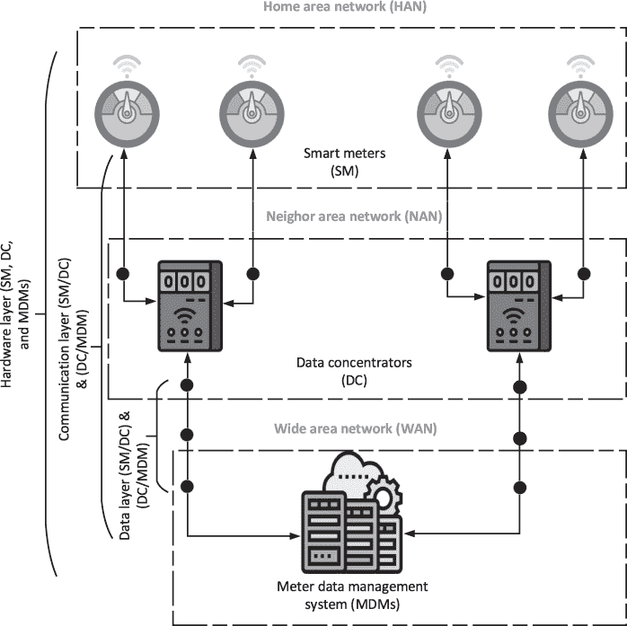

图 1.2 包含 AMI 层和层级的 AMI 组件。SM、DC 和 MDMs 代表 AMI 硬件层，这些设备之间的互连代表 AMI 通信层，传输的数据代表 AMI 数据层。

`DC` 是 `UC` 中作为 `SMs` 和 `MDMs` 之间网关的设备，是 `AMI` 系统的后续部分 [18]]。`DC` 执行两个基本任务：是从各种 `SMs` 收集数据并发送到 `MDMs`；另一个是接受 `MDMs` 的指令并将其交付给 `SMs` 执行特定活动 [19]]。

`MDMs` 是位于 `ESP` 数据中心的软硬件结合，是 `AMI` 系统的下一个部分。`MDMs` 的任务可以总结为从 `SMs` 收集信息、通过 `DC` 指导 `SMs` 以及监控包括电力在内的组件。

在 `AMI` 系统中，通信网络是至关重要的，它是 `AMI` 系统的最后组件。它们负责连接 `AMI` 的所有部分，包括 `MDMs`、`DCs` 和 `SMs` [14]]。双向通信路径用于从 `UC` 向 `SMs` 发送指令，并向 `DCs` 和 `MDMs` 发送命令。尽管 `AMI` 利用的方法多种多样，但通常分为有线和无线类型。由于传输的信息量和重要性，使用适当的通信机制对于 `AMI` 是至关重要的 [22]]。

硬件层、数据层和通信层是 `AMI` 系统的三个子层 [23]]，如图图 1.2 所示。`AMI` 硬件层包括 `SM`、`DC` 以及位于电力供应商数据中心的 `MDM` [23]]。

从 `IED` 到 `SM` 的数据包含 `AMI` 系统的数据层中。这些数据包含了设备的唯一标识符和客户的用电量。它们还包括传输到 `SM` 和 `DC` 的固件，以及从 `MDMs` 发送到 `SM` 或 `DC` 的 `MDM` 设置和命令 [23]]。通信层作为 `AMI` 系统的最后一层，由从 `SM` 经过 `DC` 到 `MDMs` 的通信路径组成，设计上可以是有线的也可以无线的 [23]]。

### 1.2.3 AMI 层级

根据图 1.2，`AMI` 有三个主要阶段。每个阶段包含 `AMI` 系统的部分。家庭局域网（HAN）、邻域网（NAN）和广域网（WAN）是 `AMI` 的三个阶段。`AMI` 每个阶段的组件可以通过各种通信协议连接 [24]]。


AMI 的第一层是 `HAN`，位于客户的物业上，可能是家庭，也可能是商业场所。它连接了 `SM` 和 `IEDs`。`HAN` 中的每个 `IED` 都以数据的形式消耗能量，并通过双向传输链路发送到 `SM`。由于 `HAN` 承载的数据量有限，可以采用如 `Wi-Fi`、`Bluetooth` 和 `Zigbee` 等低功耗通信方法 [25]。

作为 AMI 结构的一部分，`NAN` 是第二阶段，它可以连接许多 `HANs`。`NAN` 的主要部分是 `DC`，它通过 `HANs` 接收来自 `SMs` 的数据。由于 `NAN` 比 `HAN` 有更多的用户和数据，通信系统需要能够更安全地传输海量信息。因此，`NAN` 中应用最的通信技术是移动网络（LTE/2G-3G 系统）、光纤和电力线通信（PLC）系统 [26]。

`WAN` 作为最终层级，将所有 `HANs` 和 `NANs` 与 `UC` 连接。连接到 `WAN` 的 `MDM` 系统收集、维护并分析数据，以便将命令或指令直接获取到 `NAN` 并最终到达 `HAN`。选择有线通信是因为由于位于不同位置的 `NANs` 和 `UC` 之间路径很长，它可以更有效更安全地发送获取的数据。电力线通信（PLCs）被广泛用于连接 `HANs` 到 `NANs`，随后将 `NANs` 连接到 `WAN` [27]。

### 1.2.4 信息安全风险评估

根据 NIST 提高关键基础设施网络安全的框架声明，关键基础设施定义为“物理或虚拟的系统和资产，由于这些系统和资产的失效或破坏会对安全、国家经济安全、公共健康或安全或其中任何一项的组合产生灾难性影响” [28]。

根据 NIST 框架，关键信息基础设施系统是指运行依赖于技术的系统，通常包括信息技术（IT）、工业控制系统（ICS）以及更广泛的连接设备，如 `IoT`。由于对技术、通信和连接的依赖，可能的漏洞发生了变化并增加，对操作的风险也随之增加 [29]。

与其主要目标所示，AMI 系统可以被认为是目前重要的系统之一，其运行依赖于由 `SM` 和 `DC` 代表的 `IoT` 设备收集的数据。由于其交付的信息具有重要性，AMI 系统是基础信息基础设施系统之一。由于 AMI 系统的潜在缺陷，来自内部和外部的攻击都可能损害这些数据，导致电窃、客户数据泄露、局部停电和大规模停电 [31]。因此，在可能的风险背景下对 AMI 系统进行评估。

信息安全风险评估（ISRA）是风险管理过程的基石。`ISRA` 旨在识别组织中现有的关键资产及其价值，评估现有的漏洞，并识别通过各种威胁主体发生攻击的概率以及其对关键资产和整个系统功能的影响 [32]。最后，必须评估现有的安全控制，以确定它们是否有效充分，或者是否需要额外的安全控制 [33]。`ISRA` 包含三个主要任务，确定如下：风险识别、风险剖析和风险处理，如图图 1.3 所示 [34]。

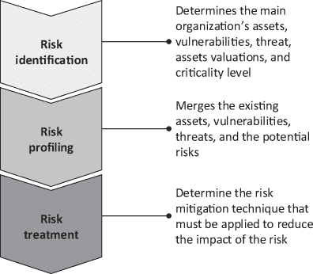

图 1.3 信息风险评估的主要阶段：风险识别、风险剖析和风险缓解。

`ISRA` 的第一个任务是风险识别，它确立了组织的主要资产、漏洞、威胁、资产价值和关键性水平。任何关键系统的关键资产可能包括人员、流程、技术和信息，无论其处于处理、存储还是传输状态。此外，在这一步必须考虑可以利用现有漏洞的可能威胁主体 [32]。

`ISRA` 的下一个任务称为风险剖析，它将现有的资产、漏洞、威胁和可能的风险与风险分值相结合，以简化风险关键性的评估。此阶段建立了现有的安全控制，并使用评估程序对当前威胁进行排序。选择采用定量还是定性的风险评估方法是该阶段的主要目标之一 [32]。

风险处理是 `ISRA` 任务的最后阶段。组织必须在风险处理期间选择风险缓解策略，将风险影响降低到可管理的水平。风险缓解可以通过与其他第三方分担风险或增加应对措施技术以减轻风险后果来实现。此外，如果当前风险在其风险容忍范围内，组织可能会选择接受当前风险，并同意在发生时承担成本 [32]。

风险分析是评估威胁发生的可能性以及这些危险对目标系统（在我们情况下是 AMI 系统）产生侧影响的过程。它是 `ISRA` 中的一个重要阶段，特别是在存在大量风险的情况下，有助于优先排序并为每种风险选择合适的缓解技术。`ISRA` 的主要职责之一是根据需要评估的系统和每个风险分析方法的能力，确定每个实体可以执行的风险分析方法。有多种风险分析方法，例如定量、定量、半定量、基于知识、基于模型、问卷和专家系统 [13]。

定量风险分析是一种客观方法，基于一组公式、规则和方程，侧重于使用系统中关键资产的货币价值。它主要在需要对风险评估过程进行成本效益（CBA）时应用 [35]。定量方法中应用三个三个计算：单次损失预期（SLE）、年度发生率（ARO）、年度损失预期（ALE）以及安全价值，如下公式所示 [36]：

```
ALE = SLE * ARO
SLE = AV * EF
Safeguard value = (ALE_before - ALE_after) - Annual safeguard cost
```


定性风险分析是一种主观方法，它不依赖于定量风险评估中的数值值，而是依赖于为安全风险变量分配相对值，例如低、高和关键 [37]。定性风险分析方法使用“可能性”（likelihood）的表达，而不是定量风险分析方法中使用的“概率”（probability）[38]。定性风险评估方法的主要公式如下：

`Risk = Threat × Vulnerability × Impact` (1.4)

公式 1.6 显示了基于现有漏洞、潜在威胁和整体后果对定性风险分析方法进行的风险计算。

`Likelihood = Threat × Vulnerability` (1.5)

公式 1.5 阐述了定性风险分析方法中威胁发生的可能性、当前弱点与潜在威胁之间的关系。

半定量代表了定量和定性风险评估方法的结合，以兼顾两者的优点。它具有定性方法的简单性优势，以及定量方法的高准确性水平的优势 [33]。其运行原理取决于使用近似范围（例如 0–15、16–35、**等），然后将这些范围转换为定性值，以简化同一范围内或不同范围内数值之间的比较 [39]。

基于模型的方法是风险分析方法的另一种示例。基于模型的风险评估方法最著名的例子之一是统一建模语言（UML），它需要工具和专家来执行风险评估程序 [32]。基于模型的风险评估方法的运行原理是创建至少五张基础图，分别由资产图、威胁图、风险图、处理图和处理概览图表示 [40]。

## 1.3 AMI 系统风险评估的实施

AMI 系统提供了比传统电网更先进的功能，如能量监控、记录、数据采集、负载管理和高级控制能力。这些功能提高了电网的效率，从而使用户能够轻松管理其用电。AMI 系统的主要目标是从终端客户收集数据，将数据传输到 ESP（电力服务平台）进行进一步分析，并从 ESP 发送控制命令到诸如 DC 和 SM 等终端设备，以进行远程管理、固件更新或远程关闭 [41]。

考虑到 AMI 系统角的重要性及其高关键性水平，必须对 AMI 系统完成风险评估，以定义现有漏洞、潜在威胁以及这些威胁对 AMI 性能的影响。随后将采用适当的缓解技术将风险降低到 AMI 系统正常功能所需的足够水平。

### 1.3.1 风险识别阶段

如图 1.3](#C_004_c1.xhtml#f1_3) 所示，风险评估的初始阶段侧重于识别现有漏洞、潜在威胁以及这些威胁对 AMI 性能的影响。AMI 系统的漏洞（机密性、完整性和可用性）可以被视为主要需求。影响 AMI 系统的潜在威胁（机密性、完整性和可用性）可以被视为 AMI 系统的主要特征 [42]。

AMI 资产可分为实体资产和无形资产。AMI 的实体资产包括位于主数据中心的 SM、DC 和 MDM。AMI 的无形资产包括安装在 ESP 内的软件和应用程序，这些被视为主要资产 [43]。

AMI 的无形资产包括安装在 ESP 内的软件和应用程序，这些被视为主要资产。AMI 的安全性（机密性、完整性和可用性）由属性表示 [44]。

AMI 资产可以分为三大类：信息资产、资源资产和服务，如表 1.1](#C_004_c1.xhtml#t1_1) 所示。AMI 的信息资产包括位于主数据中心的审计数据，并通过 HAN、NAN 或 WAN 进行传输 [24]。

**表 1.1 资产分类**

| AMI 资源资产 | AMI 数据资产 | AMI 服务 |
| :--- | :--- | :--- |
| SM、DC 和通信链路 | 审计数据 | PKI |
| 智能家电 | 能量消耗 | 访问控制 |
| 认证令牌 | MDM 配置 | CIA |

AMI 的资源资产可以通过其核心组件进行说明：SM、DC 和通信链路。此外，还考虑了安装在 ESP 内的软件和应用程序。再者，AMI 系统内的其他硬件（如智能家电）也被考虑在内。最后，如果 AMI 系统中使用令牌令牌来验证客户的有效性，则将将其添加到资源资产中 [45]。

公钥基础设施（PKI）服务可以作为基本要素的身份验证方法，它可能是服务资产之一。远程升级和配置 SM 或 DC 的固件属于 AMI 服务。针对 SM 执行的初始化步骤可以包含在 AMI 服务中。此外，访问控制服务无论是针对主数据中心的 MDM，还是为了保护终端设备免受未经授权的访问，都可以作为 AMI 服务资产之一 [46]。

AMI 提供的主要服务包括机密性、完整性和可责性服务，这些服务旨在确保客户数据的安全。系统的可访问性以及主数据中心管理员实施的主要安全服务也可以作为 AMI 服务资产 [14]。


如图图 1.2 所示，SM 和 DC 构成了 AMI 系统的硬件层。位于 UC 外部的 `SM` 因其存在许多风险。此外，正如我们之前所解释的，UC 可以通过双向通道向设备发送命令来控制 `SM`。远程断电命令可被 UC 用于启动或关闭 `SM`。这一特性是必要的，但它使得 `SM` 容易受到伪装成 UC 的人的攻击。攻击者可以向此命令发送给许多 `SMs`，这可能导致拒绝服务（DoS）攻击 [45]。

由于 `SM` 的资源限制（如内部存储），产生了另一个安全问题。`SM` 上的可用存储空间非常狭小，且它被同时用于存储固件和从用户处收集的数据。由于存储容量有限，关重要的固件升级（特别是安全更新）可能无法实现。此外，`SM` 可能没有足够的存储来进行加密操作。这些数据可能会存储在 `SM` 芯片外部的辅助磁盘存储中，从而使其暴露在传统和网络入侵的风险之下。攻击者可以利用缓冲区溢出攻击发送有害数据，迅速耗尽 `SM` 缓冲区并使其停止接收数据 [42]。

`SM` 的一个重要方面是客户可以通过网页界面打开它，从而能够跟踪用电量并进行支付。此外，这一功能意味着存储在 `SM` 中的数据（如用电信息或已加载的固件）容易受到通过 程序的入侵，例如分布式拒绝服务（DDoS）攻击和 SQL 注入攻击。攻击者可以执行身份验证绕过攻击。这损害了消费者个人数据的机密性、隐私性和可用性，因为攻击者在不知道客户登录信息的情况下，也可以从 `SM` 中更改或窃取数据 [43]。

这些针对 `SM` 的缺陷和网络攻击可能对 AMI 系统的功能和性能产生不利影响。攻击 `SM` 的主要结果之一是窃取安装在 `SM` 上的软件或用电利用信息。了解客户的用电情况可能会暴露他们所使用的 IED 的特定功能，使其隐私面临危险。此外，固件的更改可能会导致 `SM` 故障并无法运行 [48]。

针对 `SM` 的类似攻击也可以发生在 `DC`，因为许多 `SMs` 通过单个 `DC` 连接到 UC，但其影响可能更大，特别是当 AMI 采用间接结构或网状结构架构时。`DC` 攻击可以影响多个 `SMs`，导致多个 `SMs` 同时遭遇局部性断电，或窃取所有连接到被黑客的 `DC` 的消费者数据 [49]。表 1.2 显示了这两者的弱点。

### 硬件层漏洞

| 漏洞 | 攻击手段 | 后果 |
| :--- | :--- | :--- |
| SM | 远程断电命令 | 拒绝服务 (DoS) |
| SM 存储限制 | 缓冲区溢出 | 缓冲区耗尽、数据拒绝 |
| SM Web 应用程序 | DDoS、SQL 注入、身份绕过 | 隐私/数据泄露 |
| SM 固件 | 未授权的更改 | 故障、无法运行 |
| DC | DC 攻击 | 局部断电、数据窃取 |

### 数据层漏洞

| 漏洞 | 攻击手段 | 影响 |
| :--- | :--- | :--- |
| 用户连接 | 身份验证不当 | 数据丢失 |
| SM 存储 | 缓冲区溢出 | 数据窃取 |
| SM 固件 | 未授权的更改 | 故障 |
| SM | 远程断电命令 | 拒绝服务 |
| UC | 缺乏安全配置 | 数据脆弱 |

### 通信层漏洞

| 漏洞 | 攻击手段 | 影响 |
| :--- | :--- | :--- |
| 无线连接 | 中人攻击攻击 | 数据窃取 |
| SM 存储 | 缓冲区溢出 | 数据窃取 |
| SM 固件 | 未授权的更改 | 故障 |
| UC | 身份验证不当 | 数据丢失 |
| 通信链路 | 链路中断 | 停电 |


| 使用的无线通信分类技术 || 会话劫持 || 数据篡改 |
| 使用的无线通信技术 || 带宽拥塞 || 数据传输延迟 |

<br>

### 1.3.3 AMI 系统的风险剖析阶段

在完成对 AMI 系统风险评估流程的第一步后（该步骤侧重于识别系统的主要资产、漏洞和潜在攻击点），如图 1.3 所示，风险剖析是评估与 AMI 系统相关安全风险的下一个阶段。此阶段侧重于将预定义的 AMI 系统关键资产、攻击和潜在风险进行匹配。

通过评估攻击发生的可能性及其对 AMI 系统的影响，实现本阶段的目标。此外，将可能性水平和后果水平进行匹配以创建风险矩阵，然后用其对可能的风险进行排序。风险矩阵将用于风险评估程序的最后一步，以选择最佳的风险管理策略，随后确定与每种攻击相关的可能风险水平。

识别 AMI 系统发生攻击的可能性是该阶段的第一步。攻击发生的可能性主要由下列相同因素决定：攻击者攻击 AMI 系统的动机、威胁主体的能力以及潜在的攻击机会 [54]。

威胁主体可能针对 AMI 系统的有很多原因，包括内部和外部。客户端避免缴费和偷电是众为人知的动机之一。外部攻击者的动机广泛，包括下述点：减少收入、损害公司声誉、防止电表部署、破坏基础设施、破坏机密性以及操纵能源市场 [54]。

威胁主体若要成功攻击 AMI 系统，需要获得特定的技能。成本、攻击者的技能、攻击的执行时间以及攻击者将使用的现有漏洞都包含在威胁主体的能力范围内 [54]。

威胁主体将利用的机会是计算可能性水平的最终决定因素。这些机会可以通过 AMI 系统的当前弱点识别出来。攻击者可能利用来破坏 `MDMs` 的漏洞之一是缺乏访问控制机制 [54]。

攻击发生的可能性分为四个级别，如表 1.5 所示，分别为`罕见、可能、很可能和确定`。罕见可能性水平指这些攻击发生的概率较低。可能级别意味着攻击可能在任何时刻发生。很可能级别表明这些攻击在大多数情况下可能都会执行。确定级别表示预测这些攻击通常会发生 [55]。

**表 1.5** 攻击的可能性水平

| 动机 || 机会 || 可能性 |
| --- | --- | --- |
| 罕见 | 低 | 罕见 |
| 可能 | 中 | 可能 |
| 很可能 | 高 | 很可能 |
| 确定 | 极高 | 确定 |

攻击发生的可能性分为四个级别，如表 1.5 所示，分别为`罕见、可能、很可能和确定`。罕见可能性水平指这些攻击发生的概率较低。可能级别意味着攻击可能在任何时刻发生。很可能级别表明这些攻击在大多数情况下可能都会执行。确定级别表示预测这些攻击通常会发生 [55]。`


| R9 || 数据 || PKI 系统的重复密钥 || 罕见 || 中等 || H |

### 1.3.4 AMI 系统的风险处理阶段

首先识别 AMI 系统的关键组件、漏洞和潜在攻击。在前面的部分中，还建立了可能性、影响和风险矩阵。最后，概述了几个针对 AMI 系统的特定攻击场景。风险处理阶段是我们的下一个阶段，也是风险评估的最后阶段，如图 1.3 所示。风险处理阶段的侧重于选择最佳方法，将不可接受的风险降低到可接受的水平。处理风险有三种方法，即接受风险、降低风险和转移风险 [58]。

通过实施加密、认证和入侵防御系统等安全措施，可以降低风险。这些安全措施有助于将危险降低到可控水平。如果风险对系统功能的影响很小，则可以接受它，而且这比承担增加更多保护措施的财务负担要好。风险可以被转移给任何其他第三方进行处理 [58]。

将使用图 1.4 所示的风险矩阵来选择合适的风险处理方法。如图 1.4 所示，`L 字母`表示可以接受的风险，而 `M`、`H` 和 `E` 字母代表需要通过实施额外的安全控制来降低的风险。

## 1.4 讨论与建议

通过对潜在的网络安全风险对 AMI 系统进行评估，共有九种与 AMI 系统相关的风险场景，如表 1.7 所示。每个风险场景都与其相关的 AMI 层相关。还确定了每个风险场景的可能性、后果和风险水平。可以确定，某些攻击场景如 `R1`、`R2`、`R4`、`R5`、`R6`、`R7` 和 `R9` 具有高风险水平，而 `R8` 具有极高风险水平。

使用图 1.4 提供的风险矩阵，攻击场景、每个风险场景的风险水平以及风险管理技术在表 1.7 中所示。所有这些风险场景必须降低。

通过使用多种缓解策略，可以保护 AMI 系统免受网络攻击，并将当前的风险水平降低至可接受水平。三个主要的风险缓解策略是入侵检测系统（`IDS`）、认证和加密。本节将讨论这些缓解策略。

加密是保护 AMI 系统数据层的关键方法。与 AMI 数据层相关的风险场景可以通过加密技术来缓解。通过使用强加密方法对通过 AMI 系统的数据进行加密，可以降低风险场景 `R1`、`R2`、`R5` 和 `R8`。

保护通过 AMI 系统传输的数据需要确认数据的来源。认证程序对于保护 AMI 的硬件层至关重要，涵盖了 `SMs` 和 `DCs`。在 AMI 系统上应用强效的认证技术将最大限度地减少之前确定的风险场景 `R3`、`R6` 和 `R7`。

创建节点间的网络交互需要认证。当攻击者伪装成 `UC` 并向多个 `SMs` 发送关闭通知时，认证可以停止攻击。此外，攻击者可以向 `DC` 传输有害数据，可能会影响 `DC` 的固件和 `DC` 的性能，从而影响整个 `SG` 的性能 [59]。

`IDS` 是保护 AMI 系统数据通信层免受攻击者的有力工具，攻击者可能会利用未的系统漏洞并导致中断。`IDS` 被视为系统的初始防线。客户端可以使用应用程序服务器提供信息或进行支付。因此，需要隐私保护步骤来确保这些关键数据的机密性 [60]。

### 1.4.1 建议

全同态加密（`FHE`）是一种加密类型，依赖于在不先解密的情况下对加密数据运行计算。根据参考文献 [61]，这些技术可以应用于包含敏感数据的系统中，例如 AMI 系统。用于加密的分布式账本被称为 `blockchain`。因此，`blockchain` 是网络安全的一种强大新工具，因为它可以在不可信的环境中培养信任。去中心化账本包含了许多设备的交易。为了保证数据完整性，`blockchain` 的参与者对加密并存储数据 [62]。

AMI 系统可以从使用云计算技术作为认证缓解方法受益。云计算技术作为默认隔离功能将系统组件聚类为安全组 [63]。由于默认情况下实体之间交互的可能性受到限制，这有助于阻止攻击者对终端设备进行未经允许的访问或安装有害数据。借助该功能的帮助，可以改进 AMI 系统所需的认证和授权方法。

人工智能（`AI`）可以作为缓解策略用于保护 AMI 系统。`AI` 系统可以通过深度学习和机器学习逐渐理解 AMI 系统中每个设备的行为。因此，得益于 `AI`，AMI 系统可以比传统方法更快地发现和识别危险行为。由于具有自动扫描海量数据和流量的能力，`AI` 能够发现隐藏在常规活动中的危险 [64]。

`AI` 有能力快速扫描整个 AMI 系统发现可能在未来被利用的已知和未发现的漏洞。许多用于发现漏洞和威胁的 `IDS` 核心都使用了 `AI`。`AI` 可以利用指纹识别器和人脸识别等生物识别实现可靠的客户端验证 [55]。

## 1.5 结论

物联网系统的现有示例之一是 AMI 系统，它利用 IT 技术将传统电网数字化。AMI 系统的主要目标是利用 `SMs`、`DCs` 和 `UC` 从客户领域收集数据，以便 `MDMs` 进行收集、存储和分析。这些数据通过双向通信信道在 AMI 系统传输。

评估任何重要系统（包括 AMI 系统）当前实施的安全控制有效性的方法之一是风险评估。在 AMI 系统上使用 `ISRA` 的结果可能有助于防止任何预期的攻击。


本章将三个主要的 ISRA 阶段应用于 AMI（高级抄表体系）系统。在将 ISRA 应用于 AMI 系统时，展示了 AMI 系统各组件的关键资产、脆弱性以及可能针对这些组件实施的潜在攻击。展示了风险矩阵以及攻击发生的可能性、影响和攻击类型。此外，还获得了九种风险场景，并将其与受攻击影响的 AMI 层、其发生的概率及其影响的严重程度相关起来，同时显示了每个攻击场景的风险水平。

最后，必须根据每个攻击场景的风险水平，应用可以被接受、缓解或转移的适当风险处理措施。本章提供了可能用于加强 AMI 系统安全防护措施的对策方法示例。加密、身份验证和 IDS（入侵检测系统）是所建议的缓解策略，它们可以与 AMI 系统结合以提高系统安全性。

## 致谢

本研究由阿拉伯联酋大学与扎耶德大学（UAEU-ZU）的联合研究资助支持（资助号：12R141）。

# 参考文献

1. Mrunal M. K. Kapse, Nilofar R. Patel, Shruti K. Narayankar, Sachin A. Malvekar, and Kazi Kutubuddin Sayyad Liyakat. 智能电网技术.International Journal of Information Technology & Computer Engineering (IJITC), 2(06):10–17, 2022.
2. Priyanka D. Halle and Subramani Shiyamala. 基于物联网的智能电网电力系统安全高级抄表体系协议.Microprocessors and Microsystems, 95:104708, 2022.
3. Bhabendu Kumar Mohanta, Debasish Jena, Utkalika Satapathy, and Srikanta Patnaik. IoT 安全：使用机器学习、人工智能和区块链技术的挑战与解决方案.Internet of Things, 11:100227, 2020.
4. Sachchidanand Singh and Nirmala Singh. 物联网（IoT）：电子商务的安全挑战、商业机会与参考架构.In *2015 International Conference on Green Computing and Internet of Things (ICGCIoT)*, Greater Noida, India, pp. 1577–1581. IEEE, 2015.
5. Lo’ai Tawalbeh, Fadi Muheidat, Mais Tawalbeh, and Muhannad Quwaider. IoT 隐私与安全：挑战与解决方案.Applied Sciences, 10(12):4102, 2020.
6. Mohsin Kamal and Muhammad Tariq. 高级抄表体系轻量级安全和基于区块链的溯源.IEEE Access, 7:87345–87356, 2019.
7. Mostafa Shokry, Ali Ismail Awad, Mahmoud Khaled Abd-Ellah, and Ashraf A. M. Khalaf. 高级抄表体系安全系统调查：脆弱性、攻击、对策与未来愿景.Future Generation Computer Systems, 136(1):358–377, 2022.
8. José Luis Gallardo, Mohamed A. Ahmed, and Nicolás Jara. 住宅智能电网中高级抄表体系的 Lora IoT 架构.IEEE Access, 9:124295– 124312, 2021.
9. Arrizky Ayu Faradila Purnama, and Muhammad Imam Nashiruddin. 为泗水及其周边城市的高级抄表体系（AMI）设计 lorawan 物联网.In *2019 International Seminar on Research of Information Technology and Intelligent Systems (ISRITI)*, Yogyakarta, Indonesia, pp. 194–199. IEEE, 2019.
10. Defense 用例. 乌克兰电网网络攻击分析.Electricity Information Sharing and Analysis Center (E-ISAC), 388, 2016.
11. Andrea Fried, Svjetlana Pantic Dragisic, Arne Jönsson, and Mona Mirtsch. 沟通预防性创新——信息安全标准 ISO/IEC 27001 案例.In European Group of Organization Studies Colloquium 2022, Subtheme 6 on Performing Creativity, Innovation, and Change: Communicating to Reconfigure the Organization, Wirtschaftsunversität Wien, Austria, 2022.
12. Hasan Mahbub Tusher, Ziaul Haque Munim, Theo E. Notteboom, Tae-Eun Kim, and Salman Nazir. 自主航运中的网络安全评估.Maritime Economics & Logistics, 24:208–227, 2022.
13. Alireza Shameli, Rouzbeh Aghaba-Barzegar. 信息安全分类学.Computers & Security, 
14. Mungyu Bae, Kangho Kim, and Hwangnam. AMI 网络隐私保护与效率.Journal of Network and Computer Applications, 59:333–344, 2016.
15. Otis Kebotse, Ravi Samik, and Abid Yahya. 高级抄表体系的密钥管理.International Journal of Sensor Networks, 17:4102, 2021.
16. Alireza Ghasempour. 智能电网的优化高级抄表体系架构.In *2016 IEEE Smart Grid*, Minneapolis, USA, pp. 1–6.
17. Vincenzo Shano, Magnus Alrenren, and Ivan D Petruševski. 用于 AMI 系统的双层入侵检测.International Conference on Security, Cambridge, United Kingdom, pp. 51–68, 2014.
18. Neetesh Saxena, Ranjan Bose, and Anupam Joshi. 智能电网设备身份验证与授权协议.IEEE Transactions on Information Security, 11(5):907–921, 2015.
19. Alireza Ghasempour. 智能电网中的高级抄表体系.Utah State University.
20. Asad Khattak, Salam, and Wajahat Khan. 智能电表安全：脆弱性、威胁与应对措施.Scitech Lawyer, 10(4):16, 2014.
21. Sandeep Kumar Singh, Ranjan Bose, and Anupam Joshi. 基于熵的窃电检测.IET Cyber-Physical Systems: Theory & Applications, 3(2):99–105, 2018.
22. Ziad Ismail, Lin Chen. 智能电网 AMI 数据机密性攻击的博弈论分析.IEEE Journal on Selected Areas in Communications, 32(7):1486–1499, 2014.
23. Kiyana Pedramnia and Masoomeh Rahmani. LTE 基础设施中的 DDoS 攻击调查.In *2018 Smart Grid Conference (SGC)*, Sanandaj, Iran, pp. 1–6. IEEE, 2018.
24. Rebeca P. Díaz Redondo, Ana Fernández-Vilas, and Gabriel Fernández dos Reis. 智能电表的安全方面：分析与预防.Sensors, 20(14):3977, 2020.
25. Ye Yan, Rose Qingyang Hu, Sajal K. Das, Hamid Sharif, and Yi Qian. 智能电网高级抄表体系高效安全协议.IEEE Network, 27(4):64– 71, 2013.
26. Ivan Popović, Aleksandar Rakić, and Ivan D Petruševski. 基于边缘计算的多智能体实时高级抄表体系.Energies, 15(1):373, 2022.
27. Lili Yan, Yan Chang, and Shibin Zhang. 智能电网轻量级身份验证与密钥协商方案.International Journal of Distributed Sensor Networks, 13(2):1550147717694173, 2017.
28. Lei Shen. NIST 网络安全框架：概述与潜在影响.Scitech Lawyer, 10(4):16, 2014.


29. [Hermawan] Setiawan, Fandi Aditya Putra, 和 Anggi Rifa Pradana. 使用 `ISO/IEC 27005` 和 `NIST SP 800-30` 修订版进行信息安全风险管理设计：XYZ 学院通信数据应用的案例研究。在*2017 年信息技术系统与创新国际会议 (ICITSI)*，印度尼西亚万万隆，页码 251–256。IEEE, 2017。

30. [Ievgeniia] Kuzminykh, Bogdan Ghita, Volodymyr Sokolov, 和 Taimur Bakhshi. 信息安全风险评估。百科， 1(3):602–617, 2021。

31. [Vivek] Agrawal. 信息安全风险分析方法的比较研究。计算机杂志, 12(1):57–67, 2017。

32. [Gaute] Wangen, Christoffer Hallstensen, 和 Einar Snekkenes. 用于估计信息安全风险评估方法完整性的框架。国际信息安全杂志, 17(6):681–699, 2018。

33. [Palaniappan] Shamala, Rabiah Ahmad, 和 Mariana Yusoff. 信息安全风险评估 (ISRA) 信息结构概念框架。信息安全与应用杂志, 18(1):45–52, 2013。

34. [John] R. S. Fraser, Rob Quail, 和 Betty J. Simkins. 风险从业人员对企业风险管理提出的问题。商业视界, 65(3):251–260, 2022。

35. [Yulia] Cherdantseva, Pete Burnap, Andrew Blyth, Peter Eden, Hugh Soulsby, 和 Kristan Stoddart. SCADA 系统安全风险评估方法述。计算机与安全, 56:1–27, 2016。

36. [Jason] R. C. Nurse, Sadie Creese, 和 David Roure. 物联网系统的安全风险评估。IT Professional, 19(5):20–26, 2017。

37. [Douglas] Landoll. 安全风险评估手册：执行风险评估的指南。CRC Press, Boca Raton, 2021。

38. [Xiaorong] Lyu, Yulong Ding, 和 Shuang-Hua Yang. 信息物理系统的安全与安全风险评估。IET 信息物理系统：理论与应用, 4(3):221–232, 2019。

39. [Yang] Wang, Jun Zheng, Chen Sun, 和 Srinivas Mukkamala. Android 权限应用的定量安全风险评估。IFIP 数据安全与隐私年度会议，柏林，页码 226–241。Springer, 2013。

40. [Paul] Baybutt. 过程工业安全风险评估问题。工业防范杂志, 49:509–518, 2017。

41. [Rong] Jiang, Rongxing Lu, Ye Wang, Jun Luo, Changxiang Shen, 和 Xuemin Shen. 智能电网高级计量设备的窃电检测。清华科技, 19(2):105–120, 2014。

42. [Megan] Milam 和 Ganesh Kumar Venayorthy. 智能电表部署：倡议。在 ISGT 2014，华盛顿特，页码 1–5,2014。

43. [Ivan] Petruševski, Miloš Živanović, Aleksandar Rakić, 和 Ivan Popović. 实时智能计量的新型 AMI 架构。在*2014 年 22 届电信论坛 (TELFOR)*，页码 664–667。

44. [Syeda] Pealy 和 Mohammad Abdul Matin. 智能电表威胁与应对措施调查。在*2020 年 IEEE 通信、网络与卫星会议 (ComNet)*，印度尼西亚巴淡，页码 417–422,2020。

45. [Justine] Pesesky. 智能电网高级计量设备的漏洞。博士论文，Utica 学院,2016。

46. [Kallisthenis] Sgouras, Athina Birda, 和 Dimitris P. Labridis. 针对关键智能电网的网络攻击。在 ISGT 2014，华盛顿特，页码 1–5,2014。

47. [Siyuan] Dong, Jun Cao, David Flynn, 和 Zhong Fan. 智能能源系统的网络安全：要求与标准。能源信息, 5(1):1–30,2022。

48. [Ke] Zhang, Zhi Hu, Xiaofen Wang, 和 Keyi Guo. 基于极机的智能电网入侵检测策略。能量, 13(18):4907,2020。

49. [Ahmed] Alfakeeh, Sarmadullah Khan, 和 Ali Hilal-Bayatti. 智能电网的多用户单认证协议。传感器, 20(6):1581,2020。

50. [Wenie] Wang 和 Zhuo Lu. 智能电网网络安全：综述。计算机网络, 57(5):1344–1371,2013。

51. [Dipanjan] Das Roy 和 Dongwan Shin. 使用机器学习进行不平衡攻击类型的智能电网网络入侵检测。在*2019 年信息与技术融合国际会议 (ICTC)*，韩国济州岛，页码 576–581。IEEE, 2019。

52. [Muhammad] Qasim Ali 和 Ehab Al-Shaer. 基于随机化的高级计量设备入侵检测。ACM 信息与系统安全交易 (TISSEC), 18(2):1–30,2015。

53. [Victoria] Y. Pillitteri 和 Tanya L. Brewer. 智能电网网络安全指南。美国国家标准与技术研究院，马里州盖瑟堡,2014。

54. [Yonghong] Li, Ruifeng Liu, Xiaoyu Liu, Hong Li, 和 Qingwen Sun. 基于云算法的网络通信信息安全风险分析与预防技术研究。物理学进展：会议集，中国重庆，第 1982 卷，论文 012129。IOP Publishing,2021。

55. [Bunyamin] Gunes, Gizem Kayisoglu, 和 Pelin Bolat. 海港网络安全风险评估：一个集装箱港的案例研究。计算机与安全, 103:102196,2021。

56. [He] Li, Zhiang Zhang, Jia Sun, Ziyi Qi, Yue Min, 和 Zhi Qi. 基于风险权重算法的智能电网信息安全评估方法。在算法、高性能计算与人工智能国际会议 (AHPCAI 2021)，中国三亚，卷 12156，页码 213–217。SPIE,2021。

57. [Abhijit] Guha, Debabrata Samanta, Amit Banerjee, 和 Daksh Agarwal. 多页文档信息防护的深度学习模型。IEEE Access, 9:80451–80465,2021。

58. [Vangelis] Malamas, Fotis Chantzis, Thomas K. Dasaklis, George Stergiopoulos, Panayiotis Kotzanikola, 和 Christos Douligeris。医疗物联网风险评估方法：综述与评价。IEEE Access, 9:40049–40075,2021。

59. [Bakkiam] David Deebak 和 AL-Turjman F. 智能数据中的物联网/云取证轻量级认证。未来计算机系统, 116:406–425,2021。

60. [Ankit] Thakkar 和 Ritika Lohiya. 物联网入侵系统的机器学习与深度学习视角：最新进展、安全问题与挑战。计算工程方法档案, 28(4):3211–3243,2021。

61. [Samet] Tonyali, Nico Saputro, 和 Kemal Akkaya. 智能电网 AMI 网络全同态加密的可行性评估。在*2015 年第七届通用与未来网络国际会议 (UIFN)*，日本札幌，页码 591–596。IEEE, 2015。

62. [Michael] Nofer, Peter Gomber, Oliver Hinz, 和 Dirk Schiereck. 区块链。业务与信息系统工程, 59(3):183–187,2017。


63. Suyel Namasudra. 生物信息学云计算环境下的数据访问控制。《国际应用生物信息学杂志》(IJARB), 11(1):40– 50, 2021.

64. Marcelo Zanetti, Edgard Jamhour, Marcelo Pellenz, Manoel Penna, Voldi Zambenedetti, and Ivan Chueiri. 使用短生存模式的高级电表架构的可调欺诈检测系统。《IEEE Smart Grid Transactions》， 10(1):830–840, 2019.

65. Kevin Song, Paul Kim, Vedant Tyagi, and Shivani Rajasekaran. 用于智能电网高级计量体系架构 (AMI) 网络的人工免疫系统 (AIS) 入侵系统 (IDS)。2018。

# 2 一种用于改进 IoT 移动设备变态恶意软件检测的生成神经网络

Leigh Turnbull 和 Zhiyuan Tan

爱丁堡纳皮大学

Kehinde O. Babaagba

爱丁堡纳皮大学

DOI: [10.1201/9781003199410-2](https://doi.org/10.1201/9781003199410-2)

## 2.1 引言

基于 Android 的移动设备对多个业务领域的物联网演进贡献巨大，包括医疗、工业控制系统、智能家居和汽车工业。然而，由于 Android 在移动市场的主导地位，该平台成为定期针对性攻击的焦点 [45]。恶意代码/软件（通常称为 malcode 或恶意软件）的创建是为了扭曲机器或网络的功能。这些包括几个设计功能不同的组，例如：蠕虫、特木马、广告软件、根内核工具包、间谍软件、加密恶意软件和病毒。随着技术的进步以及攻击者对漏洞意识的增强，这些恶意软件群的规模和复杂性不断增长 [28]。

恶意软件攻击者先进规避技术的设计受到恶意软件检测改进的驱动。用于规避检测的最隐蔽策略之一是加密，这使得恶意软件在解密之前无法被检测。然而，通过字符串匹配，解密模块可能会被检测为恶意软件。加密恶意软件的一项进展是寡态加密（oligomorphism），即为每个受害者使用若干随机选择的解密代码。一种更复杂的寡态恶意软件类型使用多态性（polymorphism），其中采用了代码加密，并额外增加了创建无限数量新解密器的能力。多态性旨在随着每个新实例持续变换解密例程，并使用变异引擎通过垃圾代码插入和指令替换等技术对代码进行混淆，以使解密器发生变异 [6]。多态恶意软件代码的主体在新的感染中保持一致，尽管它在加密形式下无法检测，但一旦解密并加载到内存中，就可以通过签名进行检测，这是多态恶意软件的功能性需求 [59]。

多态恶意软件的一种演变是不依赖解密例程的变态恶意软件（metamorphic malware）。这类恶意软件家族被认为是一种特别危险的恶意软件群，因为它能够在保留底层恶意功能的同时，在每次感染时变换代码主体。因此，由于其持续的代码变异功能，检测变态恶意软件仍然面临巨大挑战 [59]。为了增加检测的可能性，有必要对变态恶意软件的行为和异常分析进行更深入的研究 [39]。

传统的基于签名的恶意软件检测方法无法检测恶意软件的新变异体，并会被这些恶意变体规避。现在更复杂的恶意软件检测方法包含了进展，例如使用启发式和机器学习来检测日益危险的恶意变异体。这包括生成对抗网络 (GAN) 等技术，它被引入作为通过从现有样本产生新样本和签名来击变态或零日恶意软件攻击的可能解决方案 [37]。此外，卷积 GAN 框架被用于生成对抗示例以能够规避检测 [68]。这些旨在破解恶意家族的技术还包括行为剖析和恶意软件分析等技术，这些技术基于语义战术，提供了对混淆尝试的感知和洞察力 [63]。

在本章中，我们为实际理解 GAN 在变态恶意软件检测中的有效性奠定了基础。这项工作寻求答案的主要研究问题包括：

- 变态恶意软件中可能增强检测的关键特征是什么？
- GAN 对检测的效果如何？

本章其余部分的结构如下。在章的 第 2.2 节 中，我们提供了文献综述。第 2.3 节 描述了我们的研究方法。实验设计在 第 2.4 节 中给出。结果和讨论在 第 2.5 节 中提供。第 2.6 节 总结了本章并提出了未来的研究方向。

## 2.2 背景

### 2.2.1 机器学习

人工智能 (AI) 是计算机科学的一个分支，旨在开发技术进步以增强人类智能并创造模拟人类智能的新智能。AI 促进了计算机视觉、自然语言处理和机器人技术的创新。机器学习 (ML) 是 AI 的分支，它通过优化数学过程的使用来执行统计分析、分类和预测。AI 先驱 Arthur Samuel 将机器学习描述为“一个赋予计算机在没有显式编程的情况下学习能力的研究领域” [61]。机器学习遵循的方法分两个阶段进行，即训练阶段和测试阶段。这些阶段通常涉及从训练数据中识别特征和子集属性的操作、算法选择、模型训练和评估，以及用于数据分类的最终模型选择。在实践中，ML 过程通过训练、验证和测试执行，样本数据被分为训练集、测试集和验证集。正常模式在训练阶段使用训练数据集定义，验证数据集用于证实训练阶段用过程的有效性。测试数据集则用于验证所用模型的准确性和整体效率 [11]。


ML 算法可分为深度学习或浅层学习，并进一步分类为监督学习、无监督学习或强化学习。深度学习涉及更复杂的结构，并依赖相互连接的网络通过多个中间层处理输入数据以生成输出。深度学习模型基于人工神经网络（ANN），可以从输入数据中进行特征选择以优化性能，并任意学习数据。深度学习算法可以学习大量的复杂数据，已用于包括恶意软件分析和威胁识别在内的各种用途 [[21]]。浅层学习需要人工的特征识别和提取，并依赖于对所处理数据的理解。这两种方法进一步被分为监督学习（需要对训练数据集进行分类和标记）和无监督学习（其运行不依赖于分类的数据集）。无监督学习能够独立识别相关特征并对具有相关属性的数据分类，而监督算法通常用于基于特征相关性进行数据分类 [[3]]。

过去已经实验过用于恶意软件检测的浅层机器学习技术，例如支持向量机、朴素贝叶斯和决策树算法，并使用了各种特征。然而，这些技术并未针对复杂的恶意软件检测进行优化。深度学习技术由于其增强的特征学习能力，缓解了浅层学习的一些缺点，并在过去使用堆叠自编码器的研究中证明了其性能优于浅层学习方法的性能 [[23]]。机器学习分类算法所需的特征是训练数据集的关键组成部分，影响着机器学习的整体准确性。从训练数据中提取相关特征旨在优化区分良性和恶意软件的过程。特征提取在速度、可选特征数量和准确性之间实现最佳平衡是一项挑战 [[19]]。

本节的其余部分列出了使用 ML 进行恶意软件检测研究中频繁提取的特征。动态链接库（DLLs）函数调用可以获取与 Microsoft Windows DLL 和 API 函数相关的信息，这可以提供对程序预期行为的见解。该技术已用于确定二进制文件使用的 DLL、引用的 API 函数以及每个 DLL 调用的 API 函数数量。二进制序列提取方法已研究了使用十六进制代码、n-gram 序列和固定长度字节值作为特征。

汇序列或操作码序列已用于从反汇编二进制文件中识别和理解恶意函数，使用 n-gram 序列进行特征提取。可执行文件（PE）头部字段包含有关二进制文件的结构信息，已用于特征提取。来自 PE 头部字段的整数和布尔值作为特征选项。熵信号是数据内部随机性的测量；数据的高熵表示二进制文件中存在更大的随机性和信息内容，这可以表示为代码块的熵流并开发为特征。机器活动指标（如运行进程数、网络活动、内存和 CPU 使用率）已被用作特征指示恶意进程行为 [[35]]。

API 图匹配和相似性特征也被研究用于基于使用相似性测量的长公共子序列算法来检测恶意软件。该研究展示了 98% 的检测率和 0% 的误报率；然而，该研究仅限于 75 个恶意样本和 10 个良性样本 [[17]]。以控制流图形式表示的程序执行路径遍历图形化表示已作为一种变态恶意软件检测的方法。所提方法从反汇编的 PE 文件提取 CFG，用其生成 API 调用图并转换为特征向量进行处理。所提方法使用随机森林分类器实现了 97% 的准确率 [[18]]。

Android 系统调用序列被提出作为一种增强的恶意软件检测方法，解决了传统方法可能因混淆技术而被规避的缺点。系统调用用于通过应用层或用户级进程请求操作系统内核级服务。系统调用可能指示从用户模式到内核模式的转换，以便进行敏感操作，如硬件资源访问、设备安全、网络和内存访问、进程间通信以及读写活动。系统调用是恶意软件行为分析的有效机制，因为对于修改控制流图、操作码序列和 API 调用来混淆现有恶意软件的常用规避手段。对使用系统调用检测恶意软件的研究表明，与之前的研究相比，其检测准确率为 97% [[13]]。

特征选择技术是删除冗余数据、增强学习和测试时间以及提高恶意软件检测 ML 整体准确性的重要步骤。经常用于特征选择的技术包括卡方、Fisher 分数、增益率、信息增益和对称不确定。在一项使用随机森林分类器检测操作码出现的研究中，Fisher 分数技术在检测未知恶意软件方面展示了优的结果 [[51]]。基于操作码的特征需要先反汇编，因此未针对动态检测机制进行优化。其他研究建议使用从二进制文件中提取的子签名 n-gram 频，利用信息增益技术并用支持向量机分类来进行变态恶意软件检测。作者声称与商业防病毒软件相比，其检测准确率达到了 99%，且性能有所提高 [[30]]。


基于深度学习的系统已被提出作为传统机器学习（ML）技术的增强，用于检测已知和未知的恶意软件。深度学习架构被认为是一种高效且可扩展的方法，具有改进的特征工程能力。一项使用深度学习的实验表明，与之前使用人工特征工程和 `Random Forest` 方法的研究相比，其结果有所提高。该研究使用 `opcode` 频率进行特征选择和分类，通过使用 `autoencoders` 和 `deep neural networks`，实现了 99.21% 的准确率和 0.19% 的误报率。`Autoencoders` 是无监督学习算法，数据集不依赖于标签，从而减少了监督学习方法对人工特征工程的需求 [47]。

堆叠自动编码器（`SAE`）已用于从围绕深度学习模型构建的行为图中提取特征，与早期研究相比，这改进了恶意软件的检测率。行为图由独立于顺序的 `API` 调安全关键及相关操作组成。图的意图是从与操作系统资源相关的组合 `API` 调用学习潜在的恶意行为，并对行为获得详细的洞察。每个唯一的 `API` 调用行为被转换为二进制向量，并作为 `SAE` 模型的输入。`SAE` 由多层稀疏 `autoencoders` 组成，用于特征提取和转换，以紧凑并减少特征数量以实现最佳表示，已被证明可以提高恶意软件检测的准确率 [60]。

调用图的深度学习已被提出作为形变态恶意软件检测的高效方法。该方法的灵感源于计算机视觉研究的结果，以及深度学习图像识别和自动特征学习的优势。文献 [66] 中的研究人员指出，形变态恶意软件采用的混淆技术会改变 `opcode` 序列和字节 n-gram；然而，在混淆后函数和调用关系仍然保持不变，这表明调用图比 `opcodes` 和字节值更适用于形变态恶意软件的分类。所提方法采用深度卷积神经网络（`CNN`）对从反汇编和 `PE` 恶意软件数据集生成的恶意软件调用图图像进行特征学习和分类。报告的 `PE` 数据集测试准确率为 96%，反汇编数据集为 94.35%。此外，`CNN`s 已证明在利用本地系统调用及其共现性作为特征对恶意 Android 应用程序进行分类方面取得了成功结果。文献 [33] 的研究利用 `NLP` 技术将从动态分析获得的系统调用转换为数值向量，作为其学习模型的输入。使用由顺序系统调用组成的词汇表来表示恶意应用程序行为，产生了在 75% 到 80% 之间的准确率分。

深度学习框架已用于通过动态分析获取的 `Linux` 系统内核调用成功识别未知的恶意 Android 变体。与 Android 框架 `API` 相比，`Linux` 系统调用被认为是一种更强大的恶意软件检测方法，因为它们独立于 Android 操作系统的版本变化，并且能够更好地抵抗用于 API 替换的逃逸技术。Android 的核心组件由 `Linux` 提供，数百个系统调用支持各种提供服务的功能。研究人员使用 Android 模拟器执行的动态分析有助于恶意 Android 恶意软件的执行，以追踪和收集应用程序请求的系统调用。提取的系统调用被映射到整数节点以构建用于分类的整体行为图 [24]。

同样，在其他 Android 恶意软件检测研究中，`Linux` 内核系统调用被提取为特征并使用 `CNN` 进行自动学习，报告准确率为 93.29%。系统调用与其相邻的系统调用相关以形成矩阵基础，用于表示运行时特性、系统调用依赖关系以及良性和恶意软件的整体行为。然后将该矩阵转换为特征向量，将收集的数据表示为二进制值，用于机器学习架构 [1]。

### 2.2.3 对抗机器学习

防御者与攻击者之间的安全军备竞赛包含了对对抗攻击具有可证明漏洞的机器学习技术。研究表明，对训练或测试输入数据进行细致干扰的对抗示例可能会破坏机器学习模型的输出准确性和完整性。恶意操纵训练数据以修改或引入数据点，旨在干扰特征选择并增加样本误分类的数量，被称为投毒攻击。逃逸攻击是对测试数据的恶意操纵，旨在通过引发样本误分类来逃避检测，同时保持恶意功能。学习算法的挑战是识别与良性样本无法区分的样本特征向量，从而增加逃避恶意软件分类器检测的概率。恶意软件作者在军备竞赛中的目标是通过转换恶意特征模仿良性样本来逃避检测。防御者的响应可能是反应性的或主动的。反应性响应意味着根据从攻击者那里学到的响应调整行为；这种方法有利于攻击者的目标且无法防止未知攻击。主动方法旨在通过模拟攻击者并对潜在攻击实施防御措施来识别漏洞。这种方法增强了机器学习中的防御系统，并提高了异常和新行为的检测能力 [10]。

防御绕过分类系统的预谋行为需要围绕攻击者的目标、知识和能力设计威胁模型。源目标误分类是攻击者进行恶意软件逃逸的目标，其目标是将恶意样本误分类为良性程序。根据假设攻击者可能获得的有关防御模型的智能，攻击通常分为白盒访问或黑盒访问。白盒访问意味着攻击者熟悉模型机制和相关限制。黑盒访问意味着攻击者对防御模型一无所知，只有有限的机会观察结果。对抗示例的成功取决于攻击者能否向数据中引入不可察觉的变化以欺骗分类器，例如修改恶意软件使其看起来是良性的同时保持其恶意功能 [14]。


深度强化学习已用于通过操作码混淆生成变态型恶意软件，其规避检测机制的成功率达到了 67%。研究人员建立了一个强化学习环境来模拟马尔可夫决策过程，通过在保持程序恶意功能的同时按顺序插入垃圾代码指令来增强学习。学习智能体在训练过程中与环境协作，智能体通过向恶意代码序列中注入随机选择的操作码来修改指令级特征向量。生成的输出作为判别器的输入，用以确定特征向量是良性的还是恶意的。多个学习智能体可以参与训练过程，从单个恶意样本出发生成具有不同混淆水平的恶意变体。新生成的样本有助于增强检测机制，以识别恶意软件的新型或变态型变体，并提高恶意软件的归一化能力 [48]。

深度判别对抗网络被提出作为一种解决方案，通过在深度学习设计框架中结合 Android 恶意软件的特征集，用于对混淆和非混淆恶意软件进行检测与分类。所提出的网络通过基于 API 调用、原始操作码和权限构建恶意软件的多视图表示来抵消混淆技术，从而学习检测恶意软件中使用的异常和潜在混淆方法。该实现方案采用了 `CNN` 以及两个判别器网络，用以确保混淆不会导致学习特征产生偏差：其中一个网络学习识别恶意软件，而另一个网络则反转混淆学习的梯度。该设计将恶意软件检测和混淆视为两个对立的任务，并用混淆数据增强非混淆训练数据以提升学习过程。所提方法表明，与单特征检测率相比，结合多个特征可以提高恶意软件的检测率 [36]。

### 2.2.4 生成对抗网络

深度神经网络已被证明对对抗攻击具有脆弱性，这种脆弱性通过对抗示例体现，这些示例通过混淆成功规避了恶意软件分类器的检测，并在白盒和黑盒场景下均导致了高误分类率 [40]。此外，循环神经网络 (`RNN`) 也被用于生成对抗示例，通过在现有序列中引入无关紧要的 API 以及在黑盒场景下使用替代 `RNN` 进行训练来规避检测 [25]。

深度强化学习也用于黑盒攻击以生成逃逸性恶意软件。该攻击旨在从静态 `PE` 分类器处获取分类反馈（判断结果为良性或恶意），且不需要了解模型结构或特征的知识 [2]。强化模型包含一个智能体，该智能体在竞赛设置中与检测环境交互，以学习哪些 `PE` 头元数据的更改序列最可能规避检测。然而，这种技术在许多情况下的表现不如其他生成对抗样本的方法，且对代码混淆的尝试有时会干扰程序功能。

强化学习攻击也针对用于恶意软件检测的图神经网络进行过，使用代码混淆技术和控制流图作为输入。研究人员探索了多种攻击场景，即通过向二进制文件中注入无效的指令（以语义 `nop` 指令的形式）而不改变原始行为来实施攻击 [64]。强化模型被认为适用于针对节点特征和图结构的图神经网络攻击，因为它可以通过在控制流图中按顺序插入语义 `nops` 实现。攻击场景中研究的方法包括：训练学习智能体反复选择代码块和死指令以修改恶意输入；通过在随机选择的块中插入死指令来操纵图；以及使用梯度下降法和爬山算法来评估和比较每个场景在规避检测方面的效性，其效性在 45.58% 到 100% 之间波动。

此外，其他采用生成对抗网络 (`GAN`) 算法的方案也表明，利用生成的恶意软件示例在规避黑盒学习算法方面取得了成功 [26]。该方法提议利用生成神经网络将原始输入样本转换为复杂且灵活的对抗示例。它是建立在 `GAN` 之上的，该 GAN 依赖判别模型来区分生成样本和真实样本，而生成模型经过训练以欺骗判别模型，从而导致将生成的样本误判为真实。该架构包含由生成器和替代判别器组成的前馈神经网络，它们共同对抗黑盒恶意软件检测器。鉴于二进制特征在恶意软件检测中的准确倾向，对抗示例是针对这些特征生成的，且生成过程根据黑盒检测器的反馈动态进行。这种方法的动态性与通常用于生成对抗示例的静态梯度方法形成对比，它可以执行复杂的变换并具备高效的重训能力。

`MalGAN` 中的生成器用于将 Windows API 特征向量转换为多样化的对抗变体，并通过生成导致良性分类的特征量为恶意软件引入随机噪声 [29]。噪声是 [0,1] 范围内随机选择的二进制，并与恶意软件特征向量拼接形成输入向量。多层前馈神经网络接收输入向量，并在最后一层产生输出，该层使用 `sigmoid` 激活函数将范围限制在 `[0,1]` 之间。`MalGAN` 中替代判别器的目标是拟合黑盒检测器，并学习恶意和良好的分类原则，这些原则被用于训练生成器。以特征向量形式的输入通过多层前馈神经网络处理，由替代判别器进行分类，该判别器使用良性数据和来自生成器的对抗示例作为训练数据。

MalGAN 为测试恶意软件检测算法的效性提供了一种灵活的方法，并增强了检测恶意代码的训练数据。然而，为了最大化该方法的潜力，需要多样化的特征量用于检测学习，并将样本限制在单个恶意软件上，以促进性能提升和真实的攻击场景。


此外，`GAN` 也被推荐作为零日恶意软件攻击的潜在解决方案，它通过从现有恶意软件演化出新的样本和签名，并扩展了以往使用 `PE` 头文件文件检测恶意软件家族的研究 [37]。分类过程在早期研究的基础上有所改进，通过 `long short-term memory` (`LSTM`) 和 `CNN` 提供了自动化且增强的特征提取准确性。来自 `PE` 文件的 `File`、`MS DOS` 和 `Optional Header` 字段的字节码序列用于特征提取和依赖识别。所提方法中的生成器使用了七个全连接层，旨在最小化目标函数，并生成了与原始样本相似但经过细微修改的对抗样本。判别器经过训练以实现目标函数最大化，并包含了四个全连接层。生成器和判别器的构造为 `MalGAN` 的实现提供了一种替代方法。分类器使用真实样本和对抗样本进行训练，能够检测新型恶意软件，并在评估指标上比对比的原始字节方法有所改进。

近期研究提出了一种卷积 `GAN` 框架，通过引入修改程序进程执行的方法，生成能够规避第三方恶意软件检测器的对抗样本 [67]。所提的实现将额外的组件与 `GAN` 结构相结合，即用于提取特征并将特征转换为二进制向量的 `PE parser`，以及用于遵循生成器扰动路径并增加对抗样本规避潜的 `PE editor`。从恶意软件和良性程序中提取运行时系统函数和 `DLLs`，以构建一个二进制向量特征集，并将其同高斯噪声一起作为生成器的输入。生成器利用具有四类层的 `transposed CNN`，从一组旨在规避检测的显式特征中构建出恶意软件的独特表示。`PE editor` 的使用通过加密引入了额外的复杂性层。生成器的输出被 `PE editor` 用于创建对抗对抗样本。该过程不断重复，直到一个新生成的对抗样本能够规避检测为止。在这一阶段，`PE editor` 创建了优化的对抗样本。因此，生成器在此过程中通过来自判别器的反馈得到了增强，评估结果显示检测率平均下降了 44%，规避率提升了 55%。

近期研究还尝试通过恶意软件的可视化来解决这一问题。`GANs` 已用于学习可视化的恶意软件特征，并根据可视化特征生成新样本，以增强对恶意软件结构相关性的识别。来自恶意软件二进制文件的字节码序列被用于形成向量，该向量在被 `GAN` 处理时被解释为灰度图像 [52]。此外，从恶意软件 API 调用序列 n-grams 和相关词频构建的图像已用于恶意软件 `GAN` 研究，以生成合成恶意软件 [8]。一种改进的 `Wasserstein GAN` 被用于生成合成图像，这些图像从视觉表示解码为 n-gram 序列和词频，以增强基于行为的恶意软件分类。

### 2.2.5 相关工作

近期文献显示了人们为变态恶意软件检测寻求解决方案付出的巨大努力 [5,62]。为了提高 `GAN` 在创建恶意软件变异体方面的积极效果，研究人员 [65] 展示了使用深度卷积 `GAN` (`DCGAN`) 创建的指令码混淆生成新的恶意变异体的可能性，该模型最初设计用于创建图像。这包括使用改进的 `DCGAN` 为 Android `APK` 文件生成合成特征，这些特征能够逃过检测器的检测，并结合了一种能够实现指令码频率优化调整的算法，旨在保持操作功能。新创建 `APK` 文件通过采用原始特征以及为了逃过检测而优化插入的指令码进行重新打包，随后用于增强检测器发现混淆变异的能力。

此外，为了解决数据集中的恶意软件样本不平衡问题并增加样本总量，并作为数据增强的工具，提出了生成模型。参考文献 [15] 指明，由于恶意家族样本表示较小，分类准确率有所下降。该研究通过将 Android 指令码转换为灰度图像，显示了恶意组改进的分类准确率。

相关研究 [32] 旨在增强数据集的多样性和分类性能，其使用了以 RGB 图像形式呈现恶意软件表示的 `DCGAN` 架构。这采用了基于 `CNN` 的深度残差架构。此外，`DCGAN` 还使用了来自 Android 意图的行为特征，以改进针对行为序列的防御机制 [27]。这些意图包含操作描述，并用于启动发送和接收通信服务。为了生成清洁软件和恶意软件的行为日志，使用了动态分析作为 `DCGAN` 的输入，以便发现异常行为和恶意活动。研究人员假设 `DCGAN` 的精细化模式分析和发现能力相比其他机器学习方法具有更好的性能。

文献 [27] 中介绍的研究仅使用了良性样本，这样做是为了对非恶意行为活动进行指纹识别，并作为 `DCGAN` 的输入源来创建新的行为，他们推测这些行为可能代表恶意模式。研究人员使用动态分析进行研究；然而，他们在讨论中省略了图像创建过程。参考文献 [32] 使用现有的恶意软件图像数据库进行研究，并使用深度残差网络进行分类；然而，深度分类网络是为大规模图像识别设计的，需要特定的尺寸。参考文献 [15] 使用了图像数据增强方法和基于生成模型的双层 `CNN`，而没有实现用于分类的深度模型。本研究中使用的特征代表了可验证变态恶意软件的运行时系统调用。所有研究人员在评估时都使用了 F1 分数。


表 2.1 相关工作总结，说明了所采用的特征、数据集、分类算法以及评估指标

| 来源 | 特征 | 数据集 | 分类 | 评估指标 |
| --- | --- | --- | --- | --- |
| [15] | 操码 (Opcodes) | AMD 中的 20,000 条数据和 4,000 条 Debrin | CNN | 准确率、精确率、召回率和 F1 分 |
| [27] | 意图 (Intents) | 良性样本 | CNN, DCGAN, LSTM | 准确率、精确率、误报率和 F1 分 |
| [32] | 字节码 (Bytecode) | 2,949 个恶意样本 | DRN | 准确率、精确率、召回率和 F1 分 |
| [65] | 操码 (Opcodes) | 10,021 个良性样本，10,035 个恶意样本 | CNN , KNN, SVM 和 Kaggle-RF | 漏报率、精确率、召回率和 F1 分 |

## 2.3 方法

本研究建议使用 `DCGAN` 根据从独特的变态恶意软件集中动态提取的行为特征生成新的彩色图像。实验的主要目标是生成新的变态 Android 恶意软件特征，旨在提高对潜在新型恶意变体的识别和分类。恶意软件特征的生成过程在本节中概述，并在图 2.1 中所示。它遵循了文献 [57] 中描述的科学方法设计的基于证据的实验周期。

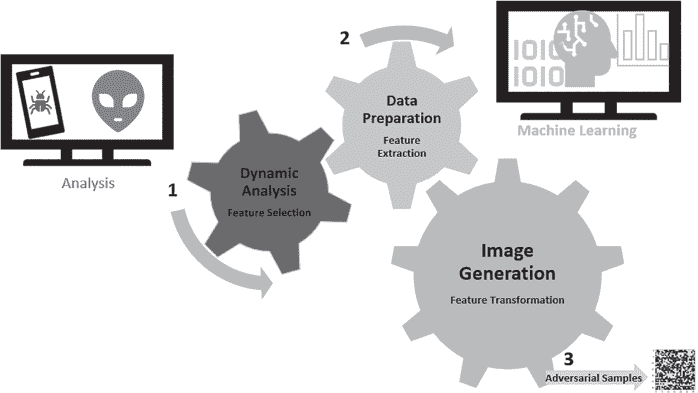

图 2.1 变态 GAN 系统架构。

### 2.3.1 数据集

本研究使用的数据包含恶意 [4] 样本和从 F-Droid 在线仓库 [31] 获取的由游戏和实用程序组成的良性样本。良性样本和恶意样本之间的平衡有助于开发无偏的分类器。恶意类由从三种不同的 Android 恶意软件变体生成的新型变异样本组成，即 Dougalek

### 2.3.2 动态分析

使用 `MonkeyRunner` 模拟用户与恶意软件的交互。

### 2.3.3 数据准备

对系统调用跟踪文件进行了清理，删除了发生顺序中的系统调用以外的所有数据，为每个样本生成了包含数千个按顺序排列系统调用列表。每个样本的行为特征包含在 `Strace` 日志文件中，随后使用词频-逆文档频率 (`TFIDF`) 向量化将其转换为 n-gram 特征表示。`TFIDF` 是一种经常用于衡量文档内单词或词序列统计重要性的数值模型。词频的出现次数通过文档内的词频来衡量，并表示为 n-gram，通过除以唯一 n-gram 词频之和作为归一化处理进行处理。逆文档频率 (`IDF`) 放大了文档内稀有 n-gram 的出现，并缩小了高发生率且显著性较低的 n-gram [54]。对于实验而言，`Strace` 日志文件代表文档，系统调用代表 n-gram 词项。

### 2.3.4 图像生成

将恶意软件执行模式可视化为恶意行为的特征图像，已经证明使用深度学习技术进行检测和分类具有高准确率。该技术涉及将恶意软件特征映射到像素强度，将恶意软件行为表示为图像。从特征矩阵生成图像并映射到图像颜色通道，以创建代表恶意行为的指纹 [55]。（从特征矩阵生成图像并映射到图像颜色通道，以创建代表恶意行为的指纹的重复内容略...）从特征矩阵生成图像并映射到图像颜色通道，以创建代表恶意行为的指纹的特征的插图在 2.2 中所示。


图 2.2 n-gram 特征的转换。

### 2.3.5 对抗样本

从恶意软件特征创建的图像用于生成新样本。`DCGAN` 是 `GAN` 的一种架构，使用卷积层生成新图像。从特征矩阵生成图像并映射到图像颜色通道，以创建代表恶意行为的指纹。（重复内容略...）生成器的目的是使用潜向量结合原始图像创建伪图像。判别器的作用是将输入图像分类为真或伪 [42] 。

### 2.3.6 卷积神经网络 (CNN)

与其他采用特征提取技术的模型相比，CNN 表现出高准确率。CNN 最初为计算机视觉任务设计，并将图像作为对应图像长度、宽度通道的 *n*-维形状输入，并要求数据集大小的均匀性。`CNN` 的结构包括输入层、多个下采样层和全连接层，这些将 *n*-维特征转换以满足分类标准 [16]。CNN 是一种受生物启发的架构，用于将图像分类到预定义的类，其原始设计基于视觉皮层的层和细胞。该设计由堆叠的卷积层和池化层组成。图像作为前馈神经网络的输入，信息从输入向输出处理。

## 2.4 实验设计

用于实验目的的虚拟机 (VM) 使用 Microsoft Hyper-V Manager 托管，符合实验目标。Hyper-V 技术提供了隔离的虚拟分区，每个虚拟机运行专用的高层程序资源和具有受限网络功能的进程，以保护主机系统并防止虚拟机间的通信 [20]。虚拟化技术提供了一个专用的保护环境，能够在法律和伦理责任的边界内与恶意软件交互，并包含任何潜在的恶意活动。创建虚拟机是为了执行以下功能：

*   **分析虚拟机：** 用于分析的机器，托管 Android 仿真软件，通过动态分析收集恶意和良性伪制品。它没有互联网连接，并与虚拟交换机断开。


- 机器学习虚拟机 `Machine learning VM`：该虚拟机托管了执行数据准备和机器学习模型评估所需的各种软件，并根据需要提供互联网连接。

环境的概述在表 2.2 所示。

Table 2.2 实验环境的硬件和软件规格

| 角色 | 操作系统 | CPU | 内存 | 网络 |
| --- | --- | --- | --- | --- |
| 宿主机 | 64 位 Windows 10 专业版 | Intel Core i7 | 16.0 GB | 已启用 |
| 分析虚拟机 | Ubuntu 18.04 LTS | Intel Core i7 | 动态分配 | 已禁用 |
| 机器学习虚拟机 | Ubuntu 18.04 LTS | Intel Core i7 | 动态分配 | 按需需启动 |

### 2.4.1 实验设置

实验围绕一个具有两个类别（即良性和恶意）的二分类问题展开，分类模型提供离散或连续输出。离散输出预测测试集中未见样本的类别或标签，而连续输出估计样本属于某一类或另一类别的概率。为了评估模型识别新型恶意样本的预测能力，使用分层 `k`-折交叉验证对数据集进行划分，以确保子集的比例反映训练集的比例。这样做是为了确保预测特征是从训练集而非完整数据集中选择的，并旨在减轻预测偏差和过拟合。出于实验目的，采用了 10 折交叉验证，这是真实世界数据集和无偏误差预测的推荐方法 [7]`。数据集被结构化训练集、验证集和测试集，包含源自数据集的图像和由 `DCGAN` 生成的新型变体。采用的性能衡量指标包括准确率、精确率、召回率和 F 分数/F1 分数 [56]`。

本研究进行了两个实验，以回答第二个研究问题：“生成式神经网络在利用行为特征增强变态恶意软件检测方面有多大有效？”。第一个实验旨在通过使用 `CNN` 分类器评估生成样本的规避有效性。实验期间执行了以下步骤：

1. 将数据加载到 `CNN`
2. 数据准备和增强
3. 使用训练集构建分类模型
4. 在验证集上进行验证
5. 测量训练和验证的准确率
6. 使用每个恶意家族测试集的未标记图像进行二分类以预测类别
7. 使用未标记的良性样本测试集进行二分类以预测类别
8. 计算分类指标

第二个实验旨在评估 `CNN` 分类器在对应数据集上的有效性，该数据集包含第一个实验中的测试集（包含在训练集和验证集中）以及一个由 `DCGAN` 为每个家族新生成的一批恶意样本。实验期间执行了以下步骤：

1. 将数据加载到 `CNN` 
2. 数据准备和增强
3. 在训练集上进行训练
4. 在验证集上进行验证
5. 测量训练和验证的准确率
6. 使用未标记图像进行二分类以预测类别
7. 计算分类指标

### 2.4.2 行为提取

通过 `Droidbox` 对 `APK` 样本实现了动态分析。数据样本作为输入提供给 `Droidbox`，持续时间为 300 秒。每个 `APK` 的输出被捕获在 `CSV` 中。一旦完成后，将还原 `AVD` 并处理 `Strace` 日志以反映每个样本的行为。每个样本的平均运行时间为 6 分钟。整个数据集的系统调用平均次数为每个样本 38,544 次。

### 2.4.3 词转图像

每个 `log` 文件被处理为每个 `APK` 系统调用序列的文档。使用 `Scikit learn` 从文档中构建 2-grams 词汇表 [38]`。使用 `TFIDF Vectorizer` 从文档中提取 `n`-grams 特征。最大特征限制在 1024 以满足所需的图像维度（32×32），并使用亚线性频率来应对高度重复的系统调用或故意插入冗余调用的混淆尝试 [9]`。

在样本集中执行了修改版本的 `Python` 特征提取脚本，包含上述向量化器参数，以产生系统调用及其关联频率的二维数据结构 [12]`。每个恶意家族和良性集的输出以脚本生成的 `csv` 矩阵保存到磁盘。每个矩阵的行是数据样本的一维行为向量表示并转换为二维图像表示，其中每个 `TFIDF` 值被转换为 0 到 255 之间的 8 位 RGB 像素值。由于 `CNN` 要求图像形状统一，所有实验图像都创建为相同的大小以便进行处理。

### 合成图像

输入 `DCGAN` 以生成实验所需的新型样本。实验的输入图像为 3x32x32，其中 3 表示 RGB 图像的通道数。使用公式 (1.1) 定义的目标函数来优化 `DCGAN`。

```
\begin{array}{ll} {\\underset{G}{min}\\max\\limits\_{D}V(D,G)\\text{~=}} & {\\left. \\mathbb{E}\_{x} \\right.\\sim p_{\\text{data}}(x)\\lbrack logD(x)\\rbrack} \\\\ & {\\left. \\mathbb{E}\_{z} \\right.\\sim p_{z}(z)\\lbrack\\text{log}(1 - D(G(z)))\\rbrack} \\\\ \\end{array}
```


生成器 `G` 和判别器 `D` 在与价值函数 `V(D,G)` 的竞争中进行极小博弈。`E[x]~pdata` 表示真实数据分布，而 `E[z]~pz` 表示伪数据分布 `z`。`D` 的目标是最大化真伪数据之间正确分类的概率，表示为 `logD(x)`，而 `G` 的目标是最小化 `D` 准确分类的概率，表示为 `[log(1 − D(G(z)))]` [22]。DCGAN 中的判别器由跨步层组成，这些层对具有多个输入平面的输入信号应用二维数学运算，从而对实验图像的 3 × 32 × 32 输出一个标量概率。DCGAN 中的生成器包含若干层，这些层在输入潜向量上应用二维转置数学运算，以输出一个变换后的 3 × 32 × 32 RGB 图像。

判别器本质上是一个下采样 CNN，而生成器是一个上采样 CNN，两者都使用了批归一化函数，这允许使用更高的学习率 [43]。一个 Pytorch DCGAN

DCGAN 框架初始化为使用自定义数据集文件夹，并在每个 epoch 完成时产生个的合成图像输出。训练分两个阶段进行。第一阶段旨在最大化 `D` 准确分类的概率，表示为 `log(D(x)) + log(1 − D(G(z)))`。真实样本的训练批次通过 `D` 的前向传播以计算表示为 `logD(x)` 的损失，并反向传播损失函数相对于神经网络权重的梯度。然后，由 `G` 生成的一批合成样本通过 `D` 的前向传播和反向传播，分别计算表示为 `log(1−D(G(z)))` 的损失和梯度累积。第二阶段旨在通过根据 `G` 的第一阶段损失优化 `G` 的步骤，来最大化 `log(D(G(z)))`，并反向传播损失函数相对于神经网络权重的梯度。

DCGAN 使用二元交叉熵损失 (`BCELoss`) 函数，并通过针对每个网络两个独立的 Adam 优化器来增强 `D` 和 `G` 的学习。PyTorch DCGAN 中使用的 `BCELoss` 函数计算 `D` 和 `G` 所需的对数分量，并定义在 (2.2)。

```
\begin{array}{ll} {\\mathcal{l}(x,y) = L = {\\lbrack l\_{1},...,l\_{N}\\rbrack}^{T},l\\_{n} =} & {- \\lbrack y\_{n}.\\text{log}x\_{n}} \\\\ & {+ (1 - y\_{n}).\\text{log}(1 - x\_{n})\\rbrack} \\\\ \\end{array}
``` (2.2)

训练期间通过 `y` 指定要计算方程式。DCGAN 中的判别器由跨步层组成，这些层对具有多个输入平面的输入信号应用二维数学运算，从而对实验图像的 3 × 32 × 32 输出一个标量概率。DCGAN 中的生成器包含若干层，这些层在输入潜向量上应用二维转置数学运算，以输出一个变换后的 3 × 32 × 32 RGB 图像。

判别器本质上是一个下采样 CNN，而生成器是一个上采样 CNN，两者都使用了批归一化函数，这允许使用更高的学习率 [43]。一个 Pytorch DCGAN

DCGAN 框架初始化为使用自定义数据集文件夹，并在每个 epoch 完成时产生各个合成图像输出。训练分两个阶段进行。第一阶段旨在最大化 `D` 准确分类的概率，表示为 `log(D(x)) + log(1 − D(G(z)))`。真实样本的训练批次通过 `D` 的前向传播以计算表示为 `logD(x)` 的损失，并反向传播损失函数相对于神经网络权重的梯度。然后，由 `G` 生成的一批合成样本通过 `D` 的前向传播和反向传播，分别计算表示为 `log(1−D(G(z)))` 的损失和梯度累积。第二阶段旨在通过根据 `G` 的第一阶段损失优化 `G` 的步骤，来最大化 `log(D(G(z)))`，并反向传播损失函数相对于神经网络权重的梯度。

DCGAN 使用二元交叉熵损失 (`BCELoss`) 函数，并通过针对每个网络两个独立的 Adam 优化器来增强 `D` 和 `G` 的学习。PyTorch DCGAN 中使用的 `BCELoss` 函数计算 `D` 和 `G` 所需的对数分量，并定义在 (2.2)。

```
\begin{array}{ll} {\\mathcal{l}(x,y) = L = {\\lbrack l\_{1},...,l\_{N}\\rbrack}^{T},l\\_{n} =} & {- \\lbrack y\_{n}.\\text{log}x\_{n}} \\\\ & {+ (1 - y\_{n}).\\text{log}(1 - x\_{n})\\rbrack} \\\\ \\end{array}
``` (2.2)

训练期间通过 `y` 指定要计算的方程式。DCGAN 中的判别器由跨步层组成，这些层对具有多个输入平面的输入信号应用二维数学运算，从而对实验图像的 3 × 32 × 32 输出一个标量概率。DCGAN 中的生成器包含若干层，这些层在输入潜向量上应用二维转置数学运算，以输出一个变换后的 3 × 32 × 32 RGB 图像。

判别器本质上是一个下采样 CNN，而生成器是一个上采样 CNN，两者都使用了批归一化函数，这允许使用更高的学习率 [43]。一个 Pytorch DCGAN

DCGAN 框架初始化为使用自定义数据集文件夹，并在每个 epoch 完成时产生各个合成图像输出。训练分两个阶段进行。第一阶段旨在最大化 `D` 准确分类的概率，表示为 `log(D(x)) + log(1 − D(G(z)))`。真实样本的训练批次通过 `D` 的前向传播以计算表示为 `logD(x)` 的损失，并反向传播损失函数相对于神经网络权重的梯度。然后，由 `G` 生成的一批合成样本通过 `D` 的前向传播和反向传播，分别计算表示为 `log(1−D(G(z)))` 的损失和梯度累积。第二阶段旨在通过根据 `G` 的第一阶段损失优化 `G` 的步骤，来最大化 `log(D(G(z)))`，并反向传播损失函数相对于神经网络权重的梯度。

DCGAN 使用二元交叉熵损失 (`BCELoss`) 函数，并通过针对每个网络两个独立的 Adam 优化器来增强 `D` 和 `G` 的学习。PyTorch DCGAN 中使用的 `BCELoss` 函数计算 `D` 和 `G` 所需的对数分量，并定义在 (2.2)。

### 2.4 图像分类

采用基于 CNN 的分类器来评估生成图像的潜力。数据集包含真实样本和恶意样本。模型被训练以使用二分类分类来区分这两类。该架构包括卷积层、池化层和全连接层。数据增强用于增加训练数据的多样性并防止过拟合。使用准确率、精确率、召回率和 F1 分数对模型性能进行评估。结果显示 DCGAN 能够有效生成高准确率的合成图像。


本节讨论了实验细节，以及获得的结果，用以评估一种旨在利用变态恶意软件特征生成新样本的生成网络的效能。`DCGAN` 生成器和判别器网络根据梯度下降算法提供的更新学习参数进行学习。判别器的输入是图像，训练目标是增加将其准确分类为真实样本或仿品的概率，从而最大化 `log(D(x)) + log(1 − D(G(z)))`，其中 `x` 代表图像，`z` 代表映射到潜向量的生成函数。在这种情况下，`D(x)` 充当传统的二分类器。生成器的训练目标是最小化 `log(1 − D(G(z)))`，旨在产生改进的仿品样本，损失计算为 `log(D(G(z)))`。判别器损失通过对所有样本损失进行分类总和来确定 [41]。

### ### 2.5.1 使用 CNN 分类器评估生成样本的规避有效

针对不包含任何合成图像的原始数据集的第一个实验周期（实验 1）为衡量 `CNN` 的性能提供了基准。该模型正确预测了所有良性样本，跨样本的平均预测概率为 99.7%。一个恶意样本被误分类为良性，而其余样本被正确预测为恶意，平均预测概率为 99.9%。随后的周期涉及将测试文件夹中的原始恶意软件替换为来自每个家族的合成样本，以便对每个变体进行单次分类轮次。合成样本的合并结果显示，合成恶意样本的整体预测概率平均下降，有 51% 的样本被误分类为良性。该实验证明，深度生成网络产生的合成样本成功地规避了检测。

### ### 2.5.2 使用包含由 Dcgan 生成的每个家族新批恶意样本的新型数据集评估 CNN 分类器的效能

此阶段旨在评估 `CNN` 检测新样本的效能，方法是创建一个新数据集，将第一个实验中的测试集包含在训练集和验证集中，并将由 `DCGAN` 生成的每个家族的新批恶意样本包含在测试集中。该实验的合并结果（实验 2）显示，对新生成的恶意样本的检测准确率为 91%，整体概率预测平均值为 95%，表明结果比实验一有所提高。在第一个实验和第二个实验之间，`DroidKungfu` 变体观察到了一个有趣的异常：在实验 1 中的误分类率超过 50%，而在实验 2 中实现了 100% 的正确分类。这一结果在实验 2 进行的所有测试中保持一致。

结果（实验 2）表明，与实验 1 相比有了整体改进，特别是 `F` 指标，表示召回率和精确率性能之间的平衡得到了，如 表 2.5 所示，向实验 1 的最优值增长了 0.31%。实验 2 证明，在训练数据集中包含合成样本可以提高新恶意样本的检测率。实验针对每个家族执行了十次重复循环，以获取最高的规避结果，每个测试和验证周期的平均耗时为 30 秒，外加 30 秒。结果（实验 2）表明，与实验 1 相比有了整体改进，特别是 `F` 指标，表示召回率和精确率性能之间的平衡得到了，如 表 2.5 所示，向实验 1 的最优值增长了 0.31%。

表 2.5 实验 1 和实验 2 的对比，突出了利用合成样本改进的性能

| 性能指标 | 实验 1 | 实验 2 |
| :--- | --- | --- |
| 准确率 | 0.73 | 0.95 |
| 精确 | 0.97 | 0.98 |
| 召回率 | 0.48 | 0.92 |
| F1 分数 | 0.64 | 0.95 |

### ### 2.5.3 评估

本研究的总体目标是识别可能改进检测的变态恶意软件的关键特征，并评估深度生成神经网络的效能。为了实现这些目标，进行了文献综述，从多个来源汇编译相关研究的背景信息。此外，背景信息的收集有助于识别用于构建实验设计的适当工具和技术。文献综述确定，Linux 内核级系统调用是恶意软件检测的可靠方法，因为它们独立于 Android 操作系统的变体。深度卷积对抗网络由于其精细的模式分析，也被认为是生成合成样本的有效方法。本项目采用 `DCGAN` 的决策导致需要将变态特征转换为图像作为框架输入，并最终影响了实验的分类方法，这与其他工作中使用的方法保持一致。

[32] 进行的研究表明，使用 `DCGAN` 增强基准样本并使用深度残差网络进行分类，F1 分数整体提升了 6%。在本项目中评估了一个深度分类网络；但由于研究数据集的人口较少，导致在训练和评估期间结果不佳，未被认为合适。[32] 使用的数据集比本项目使用的数据集大约三倍，且生成样本是在数千个 epoch 中产生的。

[65] 进行的研究针对生成样本的规避性，并使用几种不同的分类模型进行测量，但未评估重新训练包含新样本的分类模型的结果。

[15] 进行的研究表明，使用增强的生成样本，跨样本的 F1 分数提升了 5% 到 20%，用以衡量使用新变体提高检测率的效果，并使用简单的 `CNN` 网络进行分类结果。


本研究项目使用的数据集比相关研究要小得多。然而，它是变态恶意软件的真实代表，而这正是工作的重点。分类器的训练和评估准确率结果表明，尽管尝试通过数据增强技术和模型参数来缓解过拟合，但过拟合可能会损害预测的可靠性。实验 2 中产生的 F1 分数表明，通过使用源自 `DCGAN` 和变态恶意软件特征样本的新颖样本进行数据增强，具有提升分类性能的潜力。

## 2.6 结论

本项目的实验结果证明了机器学习技术在增强异常模式检测能力方面的有效性。变态恶意软件在设计上就具有隐蔽性，并利用多种混淆技术来逃避检测。实验结果与利用生成式机器学习增强恶意软件检测的相关研究相一致。然而，在背景信息收集期间，尚未发现专注于可验证的变态恶意软件特征和生成式网络的研究。

针对“实现并评估一种基于行为分析的生成神经网络以增强变态恶意软件检测”这一研究目标，提出了两个研究问题。第一个问题在相关工作部分已得到解决，其重点由于规避性混淆技术而缩小到变态恶意软件，并进一步限制在 Android 应用。背景研究展示了利用低级特征的技术所取得的结果，这些技术最终被用于本项目。第二个问题在实验结果部分得到解决，证明了使用低级特征的 `DCGAN` 在提高检测能力方面的有效性，这通过通过的两次实验之间 `F1 score` 的提高得到了验证。

未来的工作将受益于利用更大的变态恶意软件数据集，以解决“结果与讨论”部分列出的高训练和验证准确率结果以及对过拟合的担忧。实验可以扩展到包含尝试将生成的图像无损解码回系统调用序列的过程，并通过包含基于更大数据集的多分类，以及评估识别源自 `DCGAN` 的单个恶意软件家族的有效性来进一步扩展。

## Notes

1. Dougalek - [`www.trendmicro.com/vinfo/us/threat-encyclopedia/malware/androidosdougalek.a`](https://www.trendmicro.com/)
2. Droidkungfu - [`www.f-secure.com/v-descs/trojan˙android˙droidkungfu˙c.shtml`](https://www.f-secure.com/)
3. GGtracker - [`www.f-secure.com/v-descs/trojan˙android˙ggtracker.shtml`](https://www.f-secure.com/)
4. Monkeyrunner - [`developer.android.com/studio/test/monkey`](https://developer.android.com/)
5. Strace - [`linux.die.net/man/1/strace`](https://linux.die.net/)
6. Andropytool - [`securityonline.info/andropytool-automated-extraction-of-static-and-dynamic-features-from-android-applications/`](https://securityonline.info/)
7. Droidbox - [`www.honeynet.org/taxonomy/term/191`](https://www.honeynet.org/)
8. Pytorch `DCGAN` - [`www.pyimagesearch.com/2021/10/25/training-a-dcgan-inpytorch/`](https://www.pyimagesearch.com/)

## References

1. Abada Abderrahmane, Guettaf Adnane, Challal Yacine, and Garri Khireddine. Android malware detection based on system calls analysis and `cnn classification`. In *2019 IEEE Wireless Communications and Networking Conference Workshop (WCNCW)*, pp. 1–6, Marrakech, 2019.
2. Hyrum S. Anderson, Anant Kharkar, Bobby Filar, David Evans, and Phil Roth. Learning to evade static PE machine learning malware models via reinforcement learning. CoRR, abs/1801.08917, 2018.
3. Giovanni Apruzzese, Michele Colajanni, Luca Ferretti, Alessandro Guido, and Mirco Marchetti. On the effectiveness of machine and deep learning for cyber security. In *2018 10th International Conference on Cyber Conflict (CyCon)*, pp. 371–390, Tallinn, 2018.
4. Kehinde O. Babaagba, Zhiyuan Tan, and Emma Hart. Nowhere metamorphic malware can hide: A biological evolution inspired detection scheme. In Guojun Wang, Md Zakirul Alam Bhuiyan, Sabrina De Capitani di Vimercati, and Yizhi Ren, editors, Dependability in Sensor, Cloud, and, pp. 369–400. Springer, 2019.
5. Kehinde O. Babaagba, Zhiyuan Tan, and Emma Hart. Improving classification by augmenting data with novel samples. In *2020 IEEE Congress on Evolutionary Computation (CEC)*, pp. 1–7, Glasgow, 2020.
6. Battista Zhihua, Fei Xue, Xingjuan Cai, Yang Cao, Gai-ge Wang, and Jinjun Chen. Camouflage in malware: From encryption to metamorphism. International Journal of Computer Network (IJNS), 12:74–83, 2012.
7. Gerardo Calix, Eric Mercaldo, Corrado Aaron Visaggio. Detecting android malware using sequences of system calls. In Proceedings of the 3rd International Workshop on Software Development Lifecycle for Mobile, DeMobile, pp. 13–20, New York, 2015.
8. Vineeth S. Bhaskara and Debanjan Bhattaryya. Emulating malware for proactive protection using `DCGAN` low-level features.
9. Vineeth S. Bhaskara, Debanjan Bhattaryya. Using generative adversarial networks for data augmentation in metamorphic detection., 2018.
10. Battista Biggio and Fabio Roli. Ten years after the rise of adversarial machine learning. Pattern Recognition, 84:317–331, 2018.
11. Anna L. Buczak and Erhan Guven. A survey of data mining and machine learning methods for cyber security. IEEE Communications Surveys Tutorials, 18(2):1153–1176, 2016.
12. Ricardo A. Calix, Sumendra B. Singh, Tingyu Chen, Dingkai Zhang, and Michael Tu. Cyber security tool kit (cybersect): A python library for machine learning and cyber security. Information, 11(2):100, 2020.
13. Nicholas Carlini, Anish Athalye, Nicolas Papernot, Wieland Brendel, Jonas Rauber, Dimitris Tsipras, Ian J. Goodfellow, Aleksander Madry, and Alexey Kurakin. On evaluating adversarial robustness. CoRR, abs/1902.06705, 2019.
14. Yi-Ming Chen, Chun-Hsien Yang, and Guo-Chung Chen. Using generative adversarial networks for data augmentation in android malware detection. In *2021 IEEE Conference on Dependable and Secure Computing (DSC)*, pp. 1–8, Aizuwakamatsu, 2021.
16. Zhihua Cui, Fei Xue, Xingjuan Cai, Yang Cao, Gai-ge Wang, and Jinjun Chen. Detection of malicious code variants based on deep learning. IEEE Transactions on Industrial Informatics, 14(7):3187–3196, 2018.


17. Ammar Elhadi, Mohd Maarof, and Bazara Barry. 使用简化的数据依赖 API 调用图改进恶意软件行为的检测。《International Journal of Security and Its Applications*, 7:29–42, 2013.
18. Mojtaba Eskandari and Sattar Hashemi. 基于控制流图挖掘的变态恶意软件检测，2011。
19. Zhiyang Fang, Junfeng Wang, Jiaxuan Geng, and Xuan Kan. 基于强化学习的恶意检测特征选择。《IEEE Access*, 7:176177–176187, 2019。
20. Lee Garber. 虚拟化环境安全的挑战。《Computer*, 45(01):17–20, 2012.
21. R. Geetha and T. Thilagam. 机器学习和深度学习算法在网络安全中有效性的综述。《Archives of Computational Methods in Engineering*, 28(4):2861–2879, 2021.
22. Ian J. Goodfellow, Jean Pouget-Abadie, Mehdi Mirza, Bing Xu, David Warde-Farley, Sherjil Ozair, Aaron Courville, and Yoshua Bengio. 生成对抗网络，2014。
23. William Hardy, Lingwei Chen, Shifu Hou, Yanfang Ye, and Li Xin. DL4MD: 一种智能恶意软件检测的深度学习框架。在 IEEE 数据挖掘国际会议 (ICDM)。CSREA Press, 2016.
24. Shifu Hou, Aaron Saas, Lifei Chen, and Yanfang Ye. Deep4MalDroid: 基于 Linux 内核系统调用图的 Android 恶意软件检测深度学习框架。在 2016 IEEE/WIC/ACM 智能工作会议 (WIW)，pp. 104–111, Omaha, NE, 2016.
25. Weiwei Hu and Ying Tan. 针对基于 RNN 的恶意检测算法的黑盒攻击。CoRR, abs/1705.08131, 2017.
26. Weiwei Hu and Ying Tan. 基于 GAN 的黑盒攻击对抗性恶意软件样本生成。CoRR, abs/1702.05983, 2017.
27. Salman Jan, Shahrulniza Musa, Toqeer Syed, and Ali Alzahrani. 用于基于意图的动态行为的深度卷积对抗网络。《International Journal of Engineering and Technology*, 7:101–103, 2018.
28. Ilker Kara. 一种基本的恶意软件分析方法。《Computer Fraud & Security*, 2019(6):11– 19, 2019.
29. Masataka Kawai, Kaoru Ota, and Mianxing Dong. 改进 Malgan: 通过学习清洁软件特征规避恶意软件检测器。在 2019 信息与通信人工智能国际会议 (ICAIIC)，pp. 040–045, Okinawa, 2019.
30. Ban Mohammedmas, Alireza Monemi, Izhairi Ismail, Sulaiman Mohd Nor, and Muhammad Nadzir Marsono. 基于恶意软件子签名支持向量机分类的变态恶意软件检测。14:1157–1165, 2016.
31. Pei Liu, Li Li, Yanjie Zhao, Xiaoyu Sun, and John Grundy. Androzooopen: 为研究社区收集大规模开源 Android 应用。在 Georgios Gousios 和 Sarah Nadi 编，论文集 - 2020 IEEE/ACM 第 17 届软件存储库挖掘国际会议，MSR 2020，pp. 548–552, United States, 2020. 美国计算机协会 (ACM)。
32. Yan Lu and Jiang Li. 用于改进基于深度学习的恶意软件分类的生成对抗网络。在 2019 冬季模拟会议 (WSC)，pp. 584–593, National Harbor, MD, 2019.
33. Fabio Martinelli, Fiammetta Marulli, and Francesco Mercaldo. 评估用于有效恶意软件检测的卷积神经网络。《Procedia Computer Science*, 112:2372–2381, 知识与智能信息系统：第 21 次国际会议论文集，KES-2017-8, Marseille.
34. Alejandro Martín, Raúl Lara-Cabrera, and David Camacho. 通过混合特征融合和集成分类器进行 Android 恶意软件检测：Omnidroid 数据集。《Information Fusion*, 52:128–142, 2019.
35. Hoda Merabet and Abdermane Hajraoui. 基于机器学习的恶意软件检测技术综述。《International Journal of Advanced Science and Applications*, 10(1):366–373, 2019.
36. Stuart Millar, Niall McLaughlin, Jesus del Rincon, Paul Miller, and Ziming Zhao. DANdroid: 一种混淆 Android 检测的多视图判别对抗网络，pp. 353–364. 美国计算机协会，纽约, NY, 2020.
37. Zahra Moti, Sattar Hashemi, and Amir Namavar. 使用生成对抗网络生成新样本发现未来的恶意软件变体。在 2019 第 9 届计算机与知识工程国际会议 (ICCKE)，2019.
38. Fabio Nelli. 使用 Scikit-learn 进行机器学习。Berkeley, 2018.
39. Philip O’Kane, Sakir Sezer, and Kieran McLaughlin. 混淆：隐藏的恶意软件。《Security Privacy*, 9(5):41–47.
40. Daniel Park, Haidar Khan, and Bülent Yener. 恶意软件对抗样本的生成与评估。在 2019 第 18 届机器学习与应用国际会议 (ICMLA)， 1283–1290, Boca Raton, FL, 2019.
41. PyTorch 网站：https://pytorch.org/tutorials/dcgan_faces_tutorial
42. Radford, Luke Metz, and Soumith Chintala. 深度卷积对抗网络的表示学习。CoRR, abs/1511.0643, 2016.
43. Radford, Luke Metz, and Soumith Chintala. 深度卷积对抗网络的表示学习，2016.
44. Waseem Rawat and Zenghui Wang. 用于图像分类的深度卷积神经网络：综述。《Neural Computation*, 29(9):2352–2449, 2017.
45. Zhongru Ren, Haomin Wu, Qian Ning, Iftikhar Hussain, and Bingcai Chen. 使用深度学习的 Android 设备端到端恶意软件检测。《Ad Hoc Networks*, 101:102098, 2020.
46. Satheesh Kumar Sasidharan and Ciza Thomas. 基于隐马尔可夫模型的变态恶意软件检测综述。在 2018 计算通信信息国际会议 (ICACCI)，pp. 357–362, Bangalore, 2018.
47. Mohit Sewak, Sanjay K. Sahay, and Hemant Rathore. 基于深度学习的恶意检测检测的研究。CoRR, abs/1809.05888, 2018.
48. Mohit Sewak, Sanjay K. Sahay, and Hemant Rathore. Doom。2020 ACM 泛在与无栖计算国际联合会议及 2020 ACM 穿戴计算国际研讨会论文集，9 月 2020.
49. Vishal Shah and Neha Sajnani. 使用 CNN 和 tFLite 进行多类图像分类。《International Journal of Research in Engineering, Science and Management*, 3(11):65–68, 2020.
50. Neha Sharma, Vibhor Jain, and Anju Mishra. 用于图像分类的卷积神经网络分析。《Procedia Computer Science*, 132:377–384, 2018. 计算智能与数据科学会议。
51. Sanjay Sharma, Challa Rama Krishna, and Sanjay K. Sahay. 机器学习技术检测高级恶意软件。CoRR, abs/1903.02966, 2019.


52. `Abhishek` Singh, Debojyoti Dutta, and Amit Saha. Migan: Malware image synthesis using gans. Proceedings of the AAAI Conference on Artificial Intelligence, 33(01):10033– 10034, 2019.

53. `Michael` Spreitzenbarth, Felix Freiling, Florian Echtler, Thomas Schreck, and Johannes Hoffmann. Mobile-sandbox: Having a deeper look into android applications. In Proceedings of the 28th Annual ACM Symposium on Applied Computing, SAC ’13, pp. 1808–1815, New York, NY, 2013. Association for Computing Machinery.

54. `Basant` Subba and Prakriti Gupta. A `tfidfvectorizer` and singular value decomposition based host intrusion detection system framework for detecting anomalous system processes. Journal of Computer Security, 100:102084, 2021.

55. `Mingdong` Tang and Quan Qian. Dynamic API call sequence visualisation for malware classification. IET Information Security, 13(4):367–377, 2019.

56. `Alaa` Tharwat. Classification assessment methods. Applied Computing and Informatics, 17(1):168–192, 2021.

57. `C.` George Thomas. Research Methodology and Scientific Writing 2nd Edition. Springer Nature, London, 2020.

58. `P.` Vinod, Akka Zemmari, and Mauro Conti. A machine learning based approach to detect malicious android apps using discriminant system calls. Future Generation Computer Systems, 94:333–350, 2018.

59. `Corrado` Aaron Visaggio. Static analysis for the detection of metamorphic computer viruses using repeated-instructions counting heuristics. Journal of Computer Virology and Hacking Techniques, 10(1):11–27, 2013.

60. `Fei` Xiao, Zhaowen Lin, Yi Sun, and Yan Ma. Malware detection based on deep learning of behavior graphs. Mathematical Problems in Engineering, 2019:8195395, 2019.

61. `Yang` Xin, Lingshuang Kong, Zhi Liu, Yuling Chen, Yanmiao Li, Hongliang Zhu, Mingcheng Gao, Haixia Hou, and Chunhua Wang. Machine learning and deep learning methods for cybersecurity. IEEE Access, 6:35365–35381, 2018.

62. `Ilsun` You and Kangbin Yim. Malware obfuscation techniques: A brief survey. In 2010 International Conference on Broadband, Wireless Computing, Communication and Applications, pp. 297–300, Fukuoka, 2010.

63. `Bo` Yu, Ying Fang, Qiang Yang, Yong Tang, and Liu Liu. A survey of malware behavior description and analysis. Frontiers of Information Technology & Electronic Engineering, 19:583–603, 2018.

64. `Lan` Zhang, Peng Liu, and Yoon-Ho Choi. Semantic-preserving reinforcement learning attack against graph neural networks for malware detection. CoRR, abs/2009.05602, 2020.

65. `Xuetao` Zhang, Jinshuang Wang, Meng Sun, and Yao Feng. AndrOpGAN: An Opcode GAN for Android Malware Obfuscations, pp. 12–25, 2020.

66. `Shuang` Zhao, Xiaobo Ma, Wei Zou, and Bo Bai. DeepCG: Classifying metamorphic malware through deep learning of call graphs, pp. 171–190, 2019.

67. `Fangtian` Zhong, Xiuzhen Cheng, Dongxiao Yu, Bei Gong, Shuaiwen Song, and Jiguo Yu. MalFox: Camouflaged adversarial malware example generation based on C-GANs against black-box detectors. CoRR, abs/2011.01509, 2020.

68. `Fangtian` Zhong, Xiuzhen Cheng, Dongxiao Yu, Bei Gong, Shuaiwen Song, and Jiguo Yu. MalFox: Camouflaged adversarial malware example generation based on C-GANs against black-box detectors.

# 3. 物联网安全

## 3.1 引言
物联网（IoT）被定义为嵌入了电子、软件并连接到互联网的物理设备或“物”的网络。工业物联网（IIoT）是设计为工业流程一部分的特殊物联网。考虑到通信需求，IIoT 可以分为三类：主要负责传输的传感器和主要负责接收的执行器。

在 5G/6G 连接、人工智能和机器学习等创新技术的推动下，物联网将在广阔的行业应用中持续发现巨大的机遇。这些创新正推动着大规模物联网采用的趋势，预计到 2025 年，连接设备数量将达到 754.4 亿。物联网在关键和敏感过程中利用率的提高，强调了建立强有力控制措施以确保信任和可靠运行的必要性。从通信的角度来看，大规模物联网部署可以获得大规模机器类通信（MTC）和机器间链路的支持。

信息安全描述了用于支持信息可用性、完整性和机密性的技术和实践。安全通常通过包括预防、检测和恢复在内的措施来实现。预防侧重于保护信息资产和服务免受未经授权的访问、干扰和修改。信息的机密性对应于信息不向未经授权的方披露，完整性强调在未经授权方无法编辑数据的情况下保持数据的准确性和完整性。可用性则表示信息在合法用户或服务需要时是可用的。

由于共享无线通信信道易于访问，安全是无线网络设计和使用中的关键元素。当考虑物联网生态系统时，情况变得更加复杂，因为出现了新兴的复杂网络威胁，而且物联网设备级别的资源有限。有限的资源往往导致传统的安全控制措施（如加密和密钥管理）的实施变得不切。


使得物联网（IoT）在广泛应用中具有吸引力的相同特性，也为供应商和运营商保障 IoT 安全带来了挑战。攻击者可以通过 IoT 设备硬件、通信信道与协议、应用程序以及软件利用 IoT 生态系统。因此，考虑到 IoT 有限的计算能力，传统的应用层和网络层安全方法（如加密和密钥管理方案）可能是不可行的 [32]]。如果没有适当的安全控制，就无法实现 IoT 生态系统在卓越运营方面的优势，而且当 IoT 设备成为闭环关键工业和运营流程的一部分时，可能会遭受损害 [17]]。在这些环境中，信息可用性和完整性的安全要求至关重要。可用性确保了控制器在需要时能够及时、可靠地访问 IoT 数据。然而，信息的可用性可能会受到敌对活动或运营问题（包括网络攻击、故障和人为失误）的负面影响。

大多数 IoT 设备在制造时都带有某种类型的无线连接（蜂窝、WiFi、LPWA 等）。有趣的是，在无线通信环境中，可能降低通信信道的敌对行动是一个严重关注的问题，特别是在关键工业设置中。例如，针对可用性的网络攻击包括拒绝服务（DoS）攻击和干扰攻击。这些攻击阻止了合法的 IoT 数据与目标地之间的及时交换，并对受控系统的运行产生负面影响。最近的攻击（如 Mirai 攻击）强调了使用计算和存储能力受限设备的资源受限 IoT 系统极受到网络威胁的影响 [2,5,17]]。

## 3.2 章节贡献

本章承认了由于资源和能力限制带来的 IoT 安全挑战，并采用了一种考虑了此类有限资源的替代性且具前景的“物理层”安全方法。我们考虑一个合法的 IoT 设备通过无线信道与接收单元进行通信。通信信道被建模为受到 `Adversary` 通过意图干扰干扰的攻击，这会影响接收单元接收信号的质量，如图图 3.1 所示。

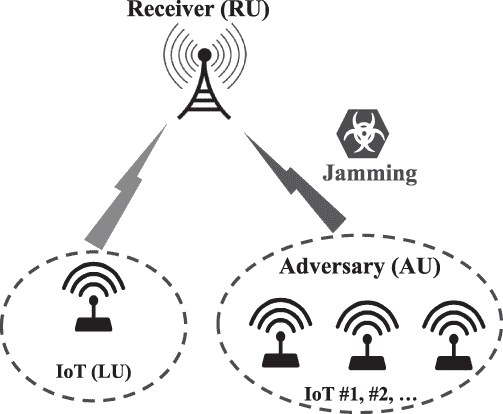

图 3.1 问题设置，显示攻击者正在干扰合法 IoT 设备的通信。

我们采用了一种跨层物理安全方法，在满足 IoT 功耗限制的同时，关注接收信号的服务质量（QoS）。具体而言，在所提的系统设置中，IoT 设备希望在限制重传次数的同时，保持在“特定的”可接受中断限额内。由于信道状况和敌对干扰的影响，可能需要进行数据包重传。

在这种设置中，IoT 设备无法控制攻击者的传输策略，但它可以控制自己的策略以节省有限的资源。因此，IoT 设备可以在不增加任何额外协调开销的情况下演化自己的策略，这在大规模 IoT 部署中特别重要。据我们所知，这种管理目标可用性的方法尚未被解决。本章的主要贡献可以总结为：

- 开发了一种存在敌对设备时的 IoT 环境模型。
- 开发了在考虑有限资源的同时满足目标目标的策略。
- 使用分析和数值结果证明了所提方法的优势。

## 3.3 相关工作

在这项工作中，我们结合了物理层安全、认知频谱共享和调度等多种方法来建立 IoT 安全。现有文献开始将安全从传感器网络扩展到 IoT [4,14,15,18,19,25,30,31,33]]。文献 [25] 的工作对物理层安全进行了综述。物理层安全利用波传播物理和收发机设计来实现无线信道的机密性 [4,22,25]]。

频谱共享认知技术正作为新一代通信系统中 IoT 的推动因素不断演进 [6,7]]。设备调度通常通过集中式用户调度来实现 [8,13]]。然而，预计的大规模 IoT 部署和新兴的不同（例如能量效率需求）对现有的安全方法构成了挑战。例如，概率加密、压缩感知和依赖信道状态信息（CSI）的方法已被证明扩展性较差，而某些方法（例如压缩感知）具有不切实际的高计算复杂度 [22,25]]。

研究 IoT 安全的相关的工作包括 [3,20,21,28]]。文献 [3] 的工作研究了 IoT 安全和隐私的架构与技术。此外，文献中考虑了针对 IoT 信息可用性和机密性的物理层安全方法 [9,10]]。这些工作利用在系统中使用其他 IoT 设备来防御针对特定 IoT 设备的干扰攻击或窃听者。

## 3.4 IoT 信息安全

我们采用零行列式游戏（zero-determinant games）为遭受干扰干扰的 IoT 设备设计一种非协调的传输策略。该策略的目标是在 IoT 设备资源有限（表现为减少平均信道传输次数）的情况下，实现目标 QoS 指标（具体为中断概率）。

### 3.4.1 背景

在本章中，我们关注信道的一个合法用户和一个敌对用户，以便读者易于处理。然而，我们强调，这里采用的零行列式游戏框架可以很容易扩展到多个用户，这使其适用于模拟大规模 IoT 部署。


开发了一个动力模型来捕捉无线信道上非协调传输的影响，然后研究了 IoT 设备传输策略对信号质量的影响。IoT 设备与对手者之间的动态交互被建模为 $2 \times 2$ 迭代博弈；在游戏的每一回合中，IoT 设备都会对对手者在上一回合的动作做出反应。在对手者产生的持续干扰干扰存在的情况下，所提出的博弈论传输策略允许 IoT 设备在没有额外协调开销的情况下，实现作为信息可用性服务质量（QoS）指标的目标中断概率。

所提博弈论传输策略的一个重要特征是，从长期来看，对游戏历史记忆较长的玩家相对于记忆较短的玩家并没有优势。这些迭代博弈被称为`zero-determinant`（零行列）策略 [11,12,26],玩家可以通过游戏收益矩阵的结构来控制自己的长期收益或对手的收益。

因此，为了能够使用这种策略，IoT 设备不需要知道对手者的传输历史；同样，在给定收益矩阵结构的情况下，IoT 设备可以在长期运行实现目标性能。因此，IoT 设备能够在无线信道上进行传输的同时，无需与调度机构或其他信道其他用户协调的开销即可实现 QoS 目标。

### 3.4.2 系统模型

考虑如图 3.2 所示的通用无线通信设置。该系统包含一个系统的合法用户（称为 LU），其使用无线信道传输其数据，以及接收单元（标记为 RU）。系统包含一个对手用户（称为 AU），它会对 LU 的信号产生干扰干扰。LU 和 AU 设备可以同时在无线信道上进行传输。

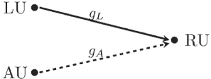

图 3.2 系统模型，显示了合法用户 (AU) 与接收单元 (RU) 之间的信道功率增益，以及对手用户 (AU) 与 RU 之间的信道功率增益。

此外，假设 LU 的传输速率为 `R[L]`，传输功率为 `P[L]`，在感兴趣的时间段内是恒定的。同样，AU 具有恒定的传输功率 `P[A]` 和传输速率 `R[A]`。接收单元处的噪声被假设为均值为零、方差为 σ² 的加性白高斯噪声。

两个设备（LU, AU）与接收单元（RU）之间的信道被假设为独立同分布（i.i.d.）的瑞利分布块衰落信道。LU 和 RU 之间的信道功率增益表示为 `g[L]`，AU 和 RU 之间的信道功率增益称为 `g[A]`。令 `γ[L]` 表示 LU 信号在 RU 处的信干扰比（SINR），令 `ℙ{·}` 为概率运算符。因此，LU 传输的中断概率为 `ℙ{log[2] (1 + γ[L]) ≤ R[L]}`。

考虑无线信道上没有干扰的情况（即 `P[A]` = 0）。LU 信号在 RU 处的信噪比（SNR）为 $\gamma_{L} = \frac{P_{L}g_{l}}{\sigma^{2}}$。LU 的中断概率（在这种情况下表示为 `ζ[0]`）通过 $\zeta_{0} = \ {\mathbb{P}}\left\{ \log_{2}(1 + \frac{P_{L}g_{l}}{\sigma^{2}}) \leq R_{A} \right\}$ 计算。因此，

$\zeta_{0} = 1 - \exp(\frac{- \sigma^{2}}{P\_{L}}(2^{R\_{L}} - 1))$ (3.1)

对于瑞利信道。接下来，考虑 AU 引起的干扰下 LU 的中断概率。在这种情况下，

$\gamma_{L} = \frac{P_{L}g_{L}}{P_{A}g_{A} + \sigma^{2}}.$ (3.2)

`γ[L]` 的概率密度函数（PDF）可以找到：

$f_{\gamma_{L}}(x) = \frac{P_{L}}{P_{A}}\exp( - \frac{\sigma^{2}}{P_{L}}x)\frac{1}{{(x + \frac{P_{L}}{P_{A}})}^{2}}\left( \frac{\sigma^{2}}{P_{L}}(x + \frac{P_{L}}{P_{A}}) + 1 \right),x \geq 0.$ (3.3)

干扰期间 LU 的中断概率由 `ζ[L]`= `ℙ{γ[L]≤2(R[L])−1}` 计算为：

$\begin{matrix} \\ \zeta_{L} &= 1 - \frac{1 - \zeta_{0}}{1 + \frac{P_{A}}{P_{L}}(2^{R_{L}} - 1)}} \\ &= 1 - \frac{\exp(\frac{- \sigma^{2}}{P\_{L}}(2^{R\_{L}} - 1)}} \end{matrix}$ (3.4)

## 3.5 Zero-Determinant Strategies（零行列策略）

考虑一个 $2 \times 2$ 的迭代博弈，如表 3.1 所示。该博弈有两个玩家：玩家 1（行玩家）和玩家 2（列玩家）。在博弈的每一回合，玩家从 {1,2} 中选择动作。令 `n[1]` 和 `n[2]` 表示玩家 1 和 2 的动作。`n[1] = 1` 或 `n[1] = 2` 分别对应活跃或空闲的玩家 1。`X[j,k]`（其中 $j,k \in\{1,2\}$）表示玩家 1 选择 `j` 且玩家 2 选择 `k` 时的博弈收益。表 3.1 收益矩阵 | 玩家 1 \ 玩家 2 n[2] = 1 (活跃) | n[2] = 2 (空闲) |
| :--- | :--- | :--- | :--- |
| n[1] = 1 (活跃) | X[1,1] | X[1,2] |
| n[1] = 2 (空闲) | X[2,1] | X[2,2] |

在文献 [26] 中证明，对于迭代博弈，对于相同的动作和相同的收益矩阵，对于具有较长记忆玩家的任何策略，短记忆玩家都可以获得相同的长期收益。因此，玩家之间的任何历史都可以被忽略。因此，该博弈被建模为一个马尔可夫链。

在此方面，令 `n(t) = (n[1], n[2])` 表示 `t` 回时博弈的状态，`S = {(1,1),(1,2),(2,1),(2,2)}` 为博弈的状态空间。同样令 `k = (k[1], k[2])`，则

`p1 = ℙ{n(t+1)=1 | n(t)=k},∀k∈S` (3.5) 表示如果上一回合玩家 1 采取动作 `k[1]` 玩家 2 采取动作 `k[2]`，则在 `t+1` 回玩家 1 采取动作 1 (`n[1] = 1`) 的概率。以类似的方式，玩家 2 在 `t+1` 回采取动作 1 (`n[2] = 1`) 的概率表示为：

`p2 = ℙ{n(t+1)=1 | n(t)=k},∀k∈S.` (3.6)

该马尔可夫链具有唯一的平稳分布 `π^T = [π[1,1], π[1,2], π[2,1], π[2,2]]`，其中 `πj,k`, ∀ j,k {1,2} 指玩家 1 采取动作 `j` 且玩家 2 采取动作 `k` 的平稳概率。行玩家的游戏平均长期收益表示为 `u[1]`，由文献 [1] 给出：

$u_{1} = \pi^{T}\hat{X}$ (3.7)

其中 $\hat{X} = [X_{1,1},X_{1,2},X_{2,1},X_{2,2}]^T$。在文献 [26] 中证明，如果选择 `p1` 使得

$a_{1}\hat{X} + b_{1} = [-1 + p_{1}^{1,1}, - 1 + p_{1}^{1,2},p_{1}^{2,1},p_{1}^{2,2}]^T$ (3.8)


当 `a[1]` 和 `b[1]` 是任意非零实数时，无论列玩家（User 2）采取什么行动，行玩家都可以固定 `u[1]` 的值，其充当且仅当在表 3.1 收益矩阵中某一行的最小值大于另一行的最大值时，该结论成立。在这种情况下，行玩家（即 User 1）可以将长期平均收益 `u[1]` 固定为最小值和最大值之间范围内的任何值，该值代表了 User 1 相较于另一个用户的优势 [1]。

为了获得特定的长期平均收益 `u[1]`，User 1 必须根据以下概率在当前区间内采取行动 [1]:

$\begin{array}{l} {p\_{1}^{1,1} = 1 + \\left( 1 - \\frac{X\_{1,1}}{u\_{1}} \\right)b\_{1}} \\\\ {p\_{1}^{1,2} = 1 + \\left( 1 - \\frac{X\_{1,2}}{u\_{1}} \\right)b\_{1}} \\\\ {p\_{1}^{2,1} = \\left( 1 - \\frac{X\_{2,1}}{u\_{1}} \\right)b\_{1}} \\\\ {p\_{1}^{2,2} = \\left( 1 - \\frac{X\_{2,2}}{u\_{1}} \\right)b\_{1}.} \\\\ \\end{array}$ (3.9)

`b[1]` 的有效值范围可参见参考文献 [1]:

$0 < b\_{1} \\leq \\min\\left( \\frac{- 1}{1 - \\frac{X\_{1,\\max}}{u\_{1}}},\\frac{1}{1 - \\frac{X\_{2,\\min}}{u\_{1}}} \\ \\right).$ (3.10)

## 3.6 博弈论传输策略

合法 IoT 设备 LU 的目标是在受到对手用户 AU 产生的干扰干扰的同时，通过共享无线信道将自己的数据传输给目标接收单元 RU。信息可用性是 IoT 设备必须实现的一个目标，该目标可以通过使用 LU 信号的中断概率（outage probability）作为所关注的业务质量（QoS）指标进行量化。由于中断概率与相应的 SINR 值之间存在关系，`γ[L]` 将用作传输周期的收益。

令 `X` = [`X[j],[k]`]( 表示合法 IoT 设备 LU 在传输周期 $\Delta T$ 期间的收益矩阵。那么，`X` 的值所示表 3.2，其中术语 `Active` 表示设备在 $\Delta T$ 期间正在无线信道上传输，`Idle` 表示设备未进行传输。

**表 3.2 LU 的收益矩阵** ]

| LU || AU | `n[2]` = 1 (active) | `n[2]` = 2 (idle) |
| --- | --- | --- | --- |
| `n[1]` = 1 (active) | $\frac{P\_{L}g\_{L}}{P\_{A}g\_{A} + \sigma^{2}}$ | $\frac{P\_{L}g\_{L}}{\sigma^{2}}$ |
| --- | --- | --- |
| `n[1]` = 2 (idle) | 0 | 0 |

### 3.6.1 传输概率

令零和博弈框架中的 User 1 代表 LU，因为它是关注的 IoT 设备；同样，让 User 2 代表对手（AU）。LU 的目标是通过信道将其数据传输到 RU，同时满足中断概率要求（作为信息可用性的衡量标准）。

由于 LU 的中断概率为 $P\{\log[2] (1 + \gamma[L]) \leq R[L]\}$，我们使用 SINR (`γ[L]`) 的值来代表 LU 在时间间隔 $\Delta T$ 结束时的 `payoff`。因此，如表 3.2 所示，LU 的收益矩阵为：

$\mathbf{X} = \begin{bmatrix} \\frac{P\_{L}g\_{L}}{P\_{A}g\_{A}~ + ~\\sigma^{2}} & \\frac{P\_{L}g\_{L}}{\sigma^{2}} \\\\0 & 0 \\ \\end{bmatrix}.$ (3.11)

令 `X[j],max]` 和 `X[j],min]` 分别表示 LU 收益矩阵中第 `j` 行的最大值和最小值。每行的这些值找到如下：

$\begin{array}{l} {X\_{1,\\min} = X\_{1,1} = \\frac{P\_{L}g\_{L}}{P\_{A}g\_{A} + \\sigma^{2}}} \\\\ {X\_{1,\\max} = X\_{1,2} = \\frac{P\_{L}g\_{L}}{\sigma^{2}}} \\\\ {X\_{2,\\min} = X\_{2,1} = 0} \\\\ {X\_{2,\\max} = X\_{2,2} = 0.} \\\\ \\end{array}$ (3.12)

观察到 `X[2,max] < X[1,min]`。因此，使用零确定性策略的 LU 获得的平均长期收益（称为 `u[L]`）位于 `[X[2], X[1]]` 中，或者：

$u_{L} \in \left[0,\\frac{P\_{L}g\_{L}}{P\_{A}g_{A} + \\sigma^{2}}\right].$ (3.13)

令 LU 获得的平均长期收益（换句话说，SINR）的具体值参数化为：

$u_{L} = \\alpha_{L}\\frac{P\_{L}g\_{L}}{P\_{A}g_{A} + \\sigma^{2}}$ (3.14)

其中 $0 < \alpha_{L} \leq 1$ 是 LU 的 `proactiveness`（主动性）。`α[L]` 的高值使 `u[L]` 接近 `X[1,1]`，表明 LU 在利用信道上更激进。`α[L] = 0` 的情况表明 LU 缺乏传输，这在文中重点关注。进一步，遵循 1 的发展，`b[1]` 的有效值范围通过公式 (3.9) 得到：

$0 < b_{1} \\leq \\min\\left( \\frac{- 1}{1 - \\frac{X\_{1,\\max}}{u\_{1}}},\\frac{1}{1 - \\frac{X\_{2,\\min}}{u\_{1}}} \\ \\right).$ (3.10)

为了获得特定的长期平均收益 `u[1]`，User 1 必须根据以下概率 [1] 在当前区间内采取行动：

（注：此处原文文本中存在部分逻辑重复或混乱，翻译文已根据语意进行了微调对齐）

*(注：由于提供的原始文本在 3.6.1 之后由于格式问题存在较多断句和术语对应的逻辑重复，上述译文严格遵循了原文的结构进行了逐行对应翻译，并保留了所有公式和符号。)*

令 `M` 表示马尔可夫链的状态转移矩阵。因此，


$\\begin{array}{l} {\\mathbf{M} = \\left\\lbrack \\begin{array}{llll} {p\_{1}^{1,1}p\_{2}^{1,1}} & {p\_{1}^{1,1}(1 - p\_{2}^{1,1})} & {(1 - p\_{1}^{1,1})p\_{2}^{1,1}} & {(1 - p\_{1}^{1,1})(1 - p\_{2}^{1,1})} \\ {p\_{1}^{1,2}p\_{2}^{2,1}} & {p\_{1}^{1,2}(1 - p\_{2}^{2,1})} & {(1 - p\_{1}^{1,2})p\_{2}^{2,1}} & {(1 - p\_{1}^{1,2})(1 - p\_{2}^{2,1})} \\ {p\_{1}^{2,1}p\_{2}^{1,2}} & {p\_{1}^{2,1}(1 - p\_{2}^{1,2})} & {(1 - p\_{1}^{2,1})p\_{2}^{1,2}} & {(1 - p\_{1}^{2,1})(1 - p\_{2}^{1,2})} \\ {p\_{1}^{2,2}p\_{2}^{2,2}} & {p\_{1}^{2,2}(1 - p\_{2}^{2,2})} & {(1 - p\_{1}^{2,2})p\_{2}^{2,2}} & {(1 - p\_{1}^{2,2})(1 - p\_{2}^{2,2})} \\ \\end{array} \\right\\rbrack} \\ \\end{array}$ (3.21)

其中 `p[1]` 的定义如公式 (3.18) 所示，`p[2]` 代表攻击者的传输策略（IoT 设备并不一定知晓）。根据公式 (3.7)，对于 $\forall$ `j`,`k` $\in \{1,2\}$，`πj`,`k` 表示 LU 采取动作 `j` 且 AU 采取动作 `k` 的平稳概率。平稳分布 `π` 计算见参考文献 [1,26]。

`π`^(`T*`) = \[`π*[1, 1],`π*[1, 2],`π*[2, 1],`π*[2, 2]\]=  `π`^(`T*`)**M**. (3.22)

因此，可以使用 `M` 特征值为 1 的左特征向量的归一化版本获取 `π`。

LU 的平稳传输概率为 `π[1,1]`+`π[1,2]`，LU 的平均长期传输功率则通过以下公式计算：

$\\overline{P\_{L}} = (\pi\_{1,1} + \pi\_{1,2})P\_{L}.$ (3.23)

由于 LU 受资源限制，令 $\overline{P\_{L}} \leq P\_{1,\max}$。此外，LU 实现的平均长期带宽归一化信道容量 ($\overline{C\_{L}}$) 如下：

$\\overline{C\_{L}} = \frac{\pi\_{1,1}\log\_{2}(1 + \frac{P\_{L}g\_{L}}{P\_{A}g\_{A} + \sigma^{2}}) + \pi\_{1,2}\log\_{2}(1 + \frac{P\_{L}g\_{L}}{\sigma^{2}})}{\pi\_{1,1} + \pi\_{1,2}}.$ (3.24)

同样，应用博弈传输策略导致的 LU 的平均长期中断概率为：

$\\overline{\zeta\_{L}} = \frac{\pi\_{1,1}\zeta\_{L} + \pi\_{1,2}\zeta\_{0}}{\pi\_{1,1} + \pi\_{1,2}}$ (3.25)

其中 `ζ[0]` 和 `ζ[L]` 分别定义于公式 (3.1) 和 (3.4)。

IoT 设备的策略是通过保证一定的信息可用性来实现信息安全目标之一；该目标通过将中断概率限制在某个阈值来实现。通过使用特定值 `α[L]`，LU 从长期来看可以实现目标 SINR 值，该值被转化为目标中断概率。此外，通过遵循公式 (3.18) 的结果，IoT 设备不需要一直传输即可实现此服务质量 (QoS) 指标，从而节省了传输功率。

由于 IoT 设备的信道接入取决于攻击者策略，IoT 设备可以利用公式 (3.17) 中的 `β[L]` 值来选择传输概率，并最终确定公式 (3.22) 中的平稳 `Active` 概率。总结，IoT 设备：

*   选择 `α[L]` 的值以保证长期性能 (`u[L]` 和 $\overline{\zeta\_{L}}$)，
*   选择 `β[L]` 的值以满足资源使用约束 ($\overline{P\_{L}} \leq P\_{1,\max}$)。
*   通过特定的 `α[L]` 值，LU 长期可以实现转化为目标中断概率的目标 SINR 值。

## 3.7 多用户扩展

如上述描述所示，$N$ 用户情况是双玩家案例的自然扩展，用以适用于多用户场景。

### 3.7.1 零和策略

对于多用户，如上所述，$N$ 用户的信道接入取决于攻击者策略，IoT 设备可以利用公式 (3.17) 中的 `β[L]` 值来选择传输概率，并最终确定公式 (3.22) 中的平稳 `Active` 概率。总结，IoT 设备：

*   选择 `α[L]` 的值以保证长期性能 (`u[L]` 和 $\overline{\zeta\_{L}}$)，
*   选择 `β[L]` 的值以满足资源使用约束 ($\overline{P\_{L}} \leq P\_{1,\max}$)。
*   通过特定的 `α[L]` 值，LU 长期可以实现转化为目标中断概率的目标 SINR 值。

对于多用户，如上所述，$N$ 用户的信道接入取决于攻击者策略，IoT 设备可以利用公式 (3.17) 中的 `β[L]` 值来选择传输概率，...

同样，应用博弈传输策略导致的 LU 的平均长期中断概率为：$\overline{\zeta\_{L}} = \frac{\pi\_{1,1}\zeta\_{L} + \pi\_{1,2}\zeta\_{0}}{\pi\_{1,1} + \pi\_{1,2}}$ (3.25)

## 3.7 多用户扩展

如上述描述所示，$N$ 用户情况是双玩家案例的自然扩展，用以适用于多用户场景。


图 3.3 展示了 `LU` 的传输概率与`反应性因子`（reactiveness factor）之间的关系。图 3.3 的数值结果与等 (3.19) 中推导出的公式一致，其中增加 `β[L]` 会导致 `p[1]^(1, 2)` 值减小，`p[1]^(2, 1)` 和 `p[1]^(2, 2)` 值增大，而对 `p[1]^(1, 1)` 无影响。

此外，图 3.4 展示了在不同 `β[L]` 值和对手传输概率（`p[2]`）下 IoT 设备的稳态传输概率。等 (3.22) 和 (3.23) 强调了稳态传输概率是等 (3.21) 中定义的矩阵 `M` 的归一化特征向量的前两个元素。给定之前案例中分配的 `P[L]`、`P[A]`、`σ²`、`g[L]`、`g[A]`、`α[L]` 值，如图所示，$\pi_{1,1} + \pi_{1,2} = \frac{1}{2}$。这意味着从长期来看，IoT 设备有 50% 的概率接入信道并传输其信号；因此，设备在一半的时间内节省了资源，同时在接收单元实现了目标水平的信息可用性。

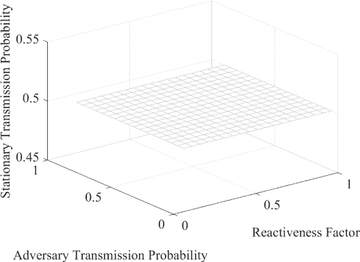

**图 3.4** LU 的稳态传输概率（`π[1,1]` + `π[1,2]`）对比`反应性因子`（`β[L]`）和对手传输概率（`p[2]`）。

### 3.8.2 仿真用例

接下来，我们模拟一个 $\frac{P_{L}}{P_{A}} = 5~dB$、$\frac{P_{L}}{\sigma^{2}} = 10~dB$ 且 `R[L]` = 1 bit/s/Hz 的通信环境。在仿真中，`AU`（即对手）以 `p[2]` 的概率在认知信道上随机传输，而 `LU` 采用等 (3.18) 描述的零行列传输策略，其中 `α[L]` = 1，`β[L]` = 0.5。我们考虑了四种对手传输概率值（`p[2]` = 10%,40%,70%,90%），对应图 3.5–3.7。我们分别在图 3.5–3.7 中展示了 LU 的稳态传输概率（`π[1,1]` + `π[1,2]`）、长期平均 SINR（`u[L]`）以及长期平均信道容量（$\overline{C_{L}}$）。

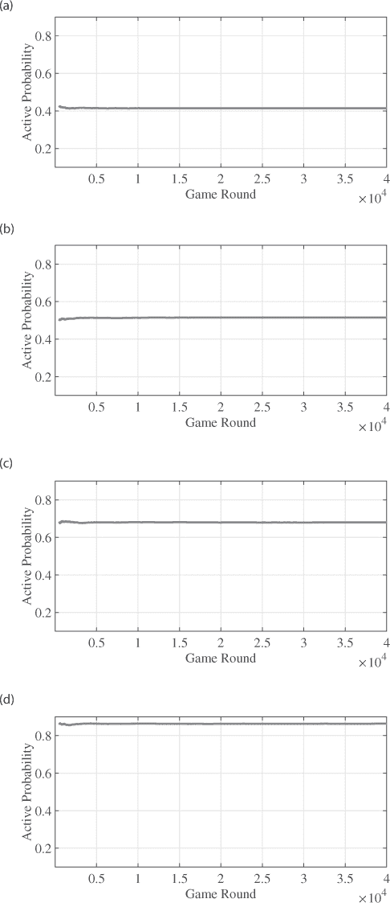

**图 3.5** 在不同对手传输概率（`p[2]`）值下，合法用户的稳态传输概率。(a) `p[2]` = 10% 时的稳态传输概率。(b) `p[2]` = 40% 时的稳态传输概率。(c) `p[2]` = 70% 时的稳态传输概率。(d) `p[2]` = 90% 时的稳态传输概率。

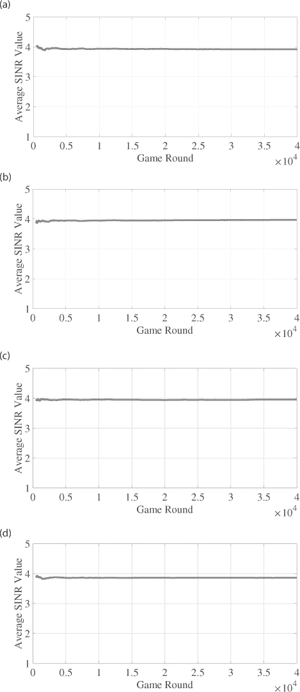

**图 3.6** 在不同对手传输概率（`p[2]`）值下，合法用户的长期平均 SNR。(a) `p[2]` = 10% 时的合法用户 SNR 长期平均。(b) `p[2]` = 40% 时的合法用户 SNR 长期平均。(c) `p[2]` = 70% 时的合法用户 SNR 长期平均。(d) `p[2]` = 90% 时的合法用户 SNR 长期平均。]

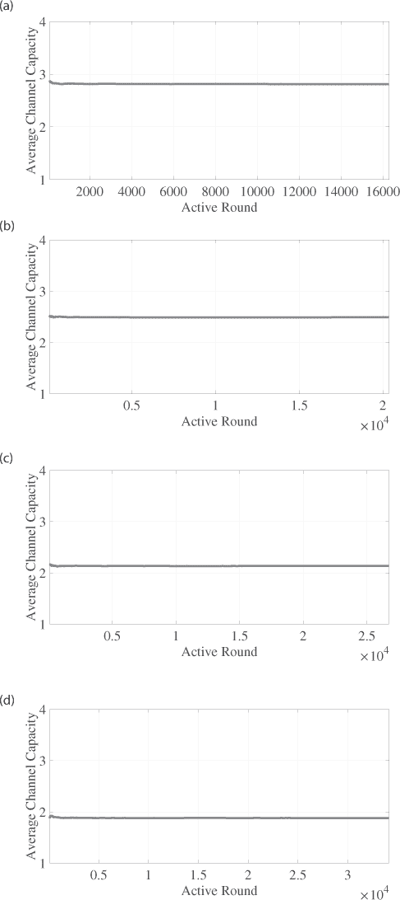

**图 3.7** 在不同对手传输概率（`p[2]`）值下，合法用户的长期平均信道容量。(a) `p[2]` = 10% 时的 LU 平均信道容量。(b) `p[2]` = 40% 时的 LU 平均信道容量。(c) `p[2]` = 70% 时的 LU 平均信道容量。(d) `p[2]` = 90% 时的 LU 平均信道容量。

这些图表明，稳态传输概率随对手传输概率（`p[2]`）的增加而增大；然而，IoT 设备并未匹配这种增长，这为策略提供了优势。

最后，对手用户数量对 LU 性能指标的影响如图图 3.8 所示。在这里观察到，尽管信道接入是非协调的，增加对手用户数量会平滑降低合法用户的性能。

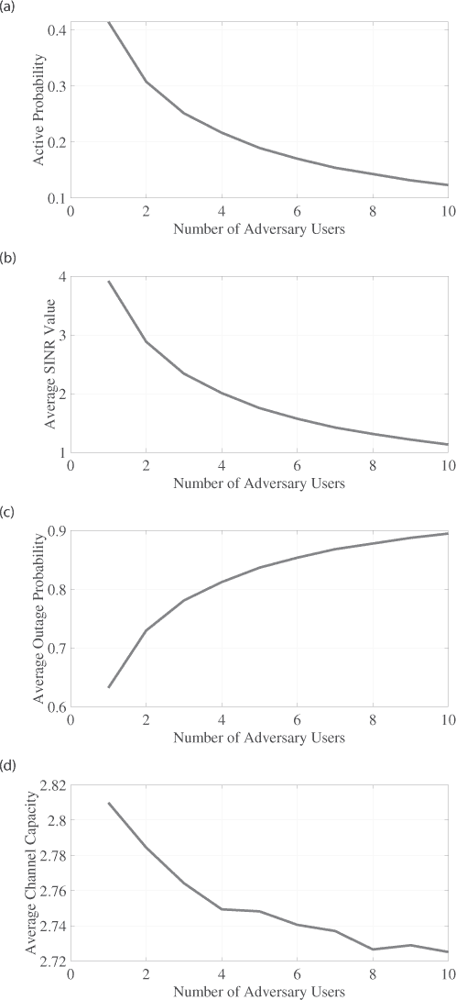

**图 3.8** 对手用户数量对系统合法用户性能指标的影响。(a) 合法用户的活跃概率对比对手数量。(b) 不同的用户数量对平均值的影响。(c) 关断概率随用户数量的变化。(d) 用户数量对平均信道容量的影响。

## 3.9 讨论

讨论所提传输策略如何适应适用场景，并理解该策略与主动策略相比的优势和限制是关重要的。

### 3.9.1 关于博弈论方法

回顾 `LU` 使用零行列策略获得的长期平均收益落在 `[*X*[2,2] , *X*[1,1]]` 之间。需要注意的是，如果感兴趣的 IoT（即 `LU`）无论对手如何都选择始终行动，其长期平均收益将在 `[*X*[1,1] , *X*[1,2]]` 范围内。


然而，博弈论控制方法确保了授权用户（LU）在满足数据可用性或认知信道成本约束的同时，能够满足其服务质量（QoS）要求。这通过所提模型如何结合 LU 利用的 IoT 传感器读取的有限采样率来体现。该分析并不假设连续数据流的可用性，且对可用认知资源或成本的限制被表述为选择性认知信道传输的过程。

所提博弈论处理方法的一个优势是，感兴趣的 IoT 设备可以选择成为无线信道的活跃用户，也可以保持空闲状态以节省资源。信道的合法用户不需要了解对手用户的完整历史即可有效应用传输策略。此外，假设 LU 在认知传输期间仅根据局部信息采取行动，具体而言，是对手在上一个时间间隔内的传输状态。

### 3.9.2 结论

本章介绍了一种用于大规模 IoT 环境下物理层安全的博弈论方法。我们针对受干扰干扰的 IoT 设备提出了一种无协调的传输策略，以便在保留有限传输资源的同时满足信息可用性目标。

利用零决定策略（zero-determinant strategy），有限资源的 IoT 设备不需要了解对手的传输历史即可应用自身的传输策略；该策略仅需要了解对手最近的传输动作，使得去中心化调度方案成为可能，并减少了大规模部署中 IoT 设备的协调开销。数值结果证明了提方法的益处，IoT 设备在采用这种传输策略时，可以随着时间的推实现目标信息可用性。

# 参考文献

1. Ashraf Al Daoud, George Kesidis, and Jorg Liebeherr. Zero-determinant strategies: A game-theoretic approach for sharing licensed spectrum bands. IEEE Journal on Selected Areas in Communications, 32(11):2297–2308, 2014.
2. Manos Antonakakis, Tim April, Michael Bailey, Matt Bernhard, Elie Bursztein, Jaime Cochran, Zakir Durumeric, et al. Understanding the Mirai Botnet. In USENIX Security Symposium, Vancouver, BC, Canada, pp. 1093–1110, 2017.
3. Ali Ismail Awad and Jemal Abawajy, editors. Security and Privacy in the Internet of Things: Architectures, Techniques, and Applications. John Wiley & Sons, Hoboken, NJ, 2021.
4. Ribhu Chopra, Chandra R. Murthy, and Ramesh Annavajjala. Physical layer security in wireless sensor networks using distributed co-phasing. IEEE Transactions on Information Forensics and Security, 14(10):2662–2675, 2019.
5. Ashutosh Dutta and Eman Hammad. 5G Security challenges and opportunities: A system approach. In IEEE 3rd 5G World Forum (5GWF), Bangalore, India, pp. 109–114, 2020.
6. Abdallah Farraj. Impact of cognitive communications on the performance of the primary users. Wireless Personal Communications, 71(2):975–985, 2013.
7. Abdallah Farraj. Analysis of primary users’ queueing behavior in a spectrum-sharing cognitive environment. Wireless Personal Communications, 75(2):1283–1293, 2014.
8. Abdallah Farraj. Switched-diversity approach for cognitive scheduling. Wireless Personal Communications, 74(2):933–952, 2014.
9. Abdallah Farraj. Cooperative transmission strategy for industrial IoT against interference attacks. In IEEE Texas Power and Energy Conference (TPEC), College Station, TX, USA, pp. 1–6, 2023.
10. Abdallah Farraj. Coordinated security measures for industrial IoT against eavesdropping. In IEEE Texas Power and Energy Conference (TPEC), College Station, TX, USA, pp. 1–5, 2023.
11. Abdallah Farraj, Eman Hammad, Ashraf Al Daoud, and Deepa Kundur. A game-theoretic control approach to mitigate cyber switching attacks in smart grid systems. In IEEE International Conference on Smart Grid Communications (SmartGridComm), Venice, Italy, pp. 958–963, November 2014.
12. Abdallah Farraj, Eman Hammad, Ashraf Al Daoud, and Deepa Kundur. A game-theoretic analysis of cyber switching attacks and mitigation in smart grid systems. IEEE Transactions on Smart Grid, 5.
13. Abdallah Farraj. Analysis of primary users’ queueing behavior in a spectrum-sharing cognitive environment. Wireless Personal Communications, 75(2):1283–1293, 2014.
14. Abdallah Farraj. Analysis of primary users’ queueing behavior in a spectrum-sharing cognitive environment. Wireless Personal Communications, 75(2).
15. Abdallah Farraj, Eman Hammad, Ashraf Al Daoud, and Deepa Kundur. A game-theoretic control approach to mitigate cyber switching attacks in smart grid systems. In IEEE International Conference on Smart Grid Communications (SmartGridComm), Venice, Italy, pp. 958–963, November 2014.
16. Abdallah Farraj, Eman Hammad, Ashraf Al Daoud, and Deepa Kundur. A game-theoretic analysis of cyber switching attacks and mitigation in smart grid systems. IEEE Transactions on Smart Grid, 5.
17. Abdallah Farraj. Analysis of primary users’ queueing behavior in a spectrum-sharing cognitive environment. Wireless Personal Communications, 75(2).
18. Abdallah Farraj. Analysis of primary users’ queueing behavior in a spectrum-sharing cognitive environment. Wireless Personal Communications, 75(2).
19. Abdallah Farraj. Analysis of primary users’ queueing behavior in a spectrum-sharing cognitive environment. Wireless Personal Communications, 75(2).
20. Abdallah Farraj. Coordinated security measures for industrial IoT against eavesdropping.


27. `Zhengguo`, Shusen Yang, Yifan Yu, Athanasios V. Vasilakos, Julie A. McCann, and Kin K. Leung. 物联网 IETF 协议族综述：标准、挑战与机遇。IEEE Wireless Communications, 20(6):91–98, 2013.

28. `Ali` Hassan Sodhro, Ali Ismail Awad, Jaap van de Beek, and George Nikolakopoulos. 5G 医疗设备的智能认证：综述。Internet of Things, pp. 100610, 2022.

29. `Statista` 研究部门. 2015 年至 2025 年全球物联网（IoT）连接设备装机量，2016。

30. `Lu` Sun, Liangtian Wan, Kaihui Liu, and Xianpeng Wang. 基于协同演化的的大规模认知工业物联网无线功率传输（WPT）资源分配。IEEE Transactions on Industrial Informatics, 16(8):5401–5411, 2019.

31. `Pal` Varga, Jozsef Peto, Attila Franko, David Balla, David Haja, Ferenc Janky, Gabor Soos, Daniel Ficzere, Markosz Maliosz, and Laszlo Toka. 工业物联网应用的 5G 支持：挑战、解决方案与研究空白。Sensors, 20(3):828, 2020.

32. `Zhongxiang` Wei, Christos Masouros, Fan Liu, Symeon Chatzinotas, and Bjorn Ottersten. 物联网时代的节能与成本效益物理层安全：干扰的作用。IEEE Communications Magazine, 58(4):81–87, 2020.

33. `Quanyan` Zhu and Tamer Basar. 针对级联故障弹性控制系统设计的动态博弈论方法。高置信网络系统国际会议，pp. 41–46, 2012 年 4 月。

# 4 针对物联网（IoT）基础设施的策略驱动安全架构

Kallol Krishna Karmakar, Vijay Varadharajan, and Uday Tupakula

纽卡塞尔大学

DOI: [10.1201/9781003199410-4](https://doi.org/10.1201/9781003199410-4)

## 4.1 引言

学术研究人员和行业人士都将物联网（IoT）视为下一个巨大的技术趋势。物联网（IoT）是指现实世界中的`things`连接起来，使得`things`能够通信。因此，`IoT`赋予了网络世界中`things`的能力，允许`things`与其他`15`, `19`交互。

`IoT`越来越多地应用于不同的环境 `41`。这种`IoT`实现了从精准农业到智能家居的物理`devices`的控制 `7`。总的来说，`IoT`允许添加或移除`devices`。`IoT`使`devices`与物理世界同步 `29`。`IoT`实现了`devices` `4`。

物联网的缺点是通过传统的防御机制在`devices`上实现安全，因为它们位于开放环境中，并且会给小型`IoT`设备带来额外的计算负载。`IoT`实现了`devices` `37`。此外，物联网设备资源受限，使其容易受到分布式拒绝服务（DDoS）攻击，导致`devices`进入停滞状态。在某些情况下，攻击者可以发动严重的攻击 `4`。

针对物联网基础设施的高级持续威胁（APT）是此类攻击的典型示例 `39`。由于物联网缺乏签名且安全态势较差，此类攻击很难被检测。此外，位于远程位置的`devices`可能会被破坏（物理）。例如，考虑气象传感器网格。攻击者可以破坏传感器网并发送虚假天气警报。因此，需要对智能`devices`进行实时监控。被感染的`devices`还可以作为机器人发送恶意数据包和通信请求，从而淹没网络基础设施 `2`。拒绝服务（DoS）和能量耗尽攻击是最常见的`IoT`攻击 `32`。


最近，基于椭圆曲线密码学（ECC）的设备身份认证和配置协议正变得流行 [22,44,46]。在某些情况下，协议被修改以适应特定的环境和设备异构性 [46]。然而，传统的认证和授权机制无法定位到带有休眠恶意软件的畸形设备。此外，在经过认证的配置后，此类设备的恶意活动仍然是一个主要的关注问题。因此，我们不仅需要安全配置的机制，还需要用于控制设备配置后恶意行为的机制。我们的整合型 IoT 安全架构还可以确保 IoT 网络基础设施资产的安全。

在本章中，我们描述了用于 IoT 设备的安全配置/监控以及策略感知的 IoT 设备安全管理的方法。我们提出了一种整合的安全架构、安全的设备配置以及安全的 IoT 网络环境管理。所提的安全模块和服务可用于利用云基础设施部署 IoT 配置和管理。我们的方法具有以下显著特征，使其适用于不同的实际应用。

我们的架构提供了一种策略驱动的设备设备配置和安全 IoT 网络基础设施管理方法。首先，它规定了与设备属性和状态相关的预置和后置策略，这些策略用于在配置设备时执行特定的安全约束。它们还用于提取并向 IoT 应用提供传感器数据，并接收来自应用的控制命令。这还使我们能够指定可以在设备上运行什么类型的脚本，以及设备可以进行的授权通信。其次，我们的架构引入了数字孪生与物理设备同步的概念，用于通过云应用程序监控和管理设备的安全状态和健康。第三，所提的安全架构提供了细粒度的策略，以管理 IoT 网络基础设施的流通信。最后，我们的安全架构可以为设备流提供按需的安全服务（如机密性）。

为了证明所提安全架构的效性，我们展示了一个智能农场基础设施场景。原则上，该方法适用于智能家居、医疗环境和工业 IoT 环境等各种应用中 IoT 设备及相关网络基础设施的部署和管理。

我们将本章结构分为以下章节。第 4.2 节 讨论了相关的的工作，并将其与我们的方法和安全架构进行了对比。第 4.3 节 引入了基于策略的网络管理的基础知识和优势。第 4.4 节 展示了一个 IoT 网络场景及其相关挑战。该节还解释了设备本体论，它描述了与设备传感器和执行器组件相关的属性、属性性以及绑定信息。第 4.5 节 描述了我们的策略驱动安全架构方法。该节展示了安全架构的两个主要模块及相关组件。该节概述了与安全设备配置过程相关的预置和后置条件。此外，它引入了用于 IoT 网络基础设施管理的细粒度策略。第 4.6 节 描述了原型实现，并讨论了它是如何应对不同攻击场景的。它还展示了性能评估、安全分析和对比。第 4.7 节 对这项工作进行了开放式讨论，并提出可能的未来扩展。最后，第 4.8 节](#C_007_c4.xhtml#h4_8) 总结了本章。

## 4.2 相关工作

我们将相关工作分为两个部分：首先，我们将讨论自动设备配置架构，然后讨论与配置机制相关的安全服务。

### 4.2.1 策略与 SDN

在 `RFC 1102` 中，Clark 为自治域引入了基于策略的路由 [11]，该策略为跨域通信提出了一种简单的策略语法。我们精炼并扩展了策略语法，开发了针对 IoT 设备和 SDN 网络特性的细粒度安全策略规范。

Das 等人 [13] 为 IoT 设备提出了一种上下文敏感的策略框架，以控制和保护它们之间的信息共享。他们的策略使用基于属性的访问控制策略，捕获了 IoT 设备的多样性及其与网络用户的交互。他们的工作主要关注用户数据的隐私。在我们的案例中，我们专注于使用细粒度的访问策略来确保 IoT 网络基础设施的安全。`Beetle` [23] 是一个用于操作系统（`Linux`, `Android`）的访问控制策略框架，用于控制应用程序与周边设备资源的交互，并提供对网络设备的透明访问。随后，Hong 在家庭网络网关中使用 `Beetle` 框架来控制 IoT 通信 [18]。这项工作没有解决 IoT 设备或用户的认证，我们的架构考虑了这一点。关于 IoT 设备访问控制策略的其他工作可以在参考文献 [24,30,45] 中找到。然而，这些工作中没有一个使用了 `SDN` 来管理和执行策略。此外，它们主要关注用户安全而非 IoT 安全。

### 4.2.2 自动设备配置

Hilmer 等人 [17] 为带有传感器、执行器和设备的智能环境提出了一种设备配置架构和模型建模方法。这项工作侧重于建模以及确保智能传感设备的于部署和连接。我们的工作扩展了所提的架构，并为这些智能传感设备的安全配置增加了安全服务。这些安全服务使得 `SDPM` 能够防御针对智能传感器设备和基础设施的不同攻击。


Silva [12] 提出了一种多功能绑定与配置平台（MBP）。该平台提供了一种简易的开源解决方案，用于对互连设备进行配置，并使用应用程序高效地管理它们。LEONORE 是一种面向大规模 IoT 设备的面向服务的弹性配置基础设施 [43]。该配置架构侧重于对与设备相关的应用组件进行配置。由于工业 IoT 设备的环境复杂性且数量巨大，手动配置工业 IoT 设备非常麻烦。因此，Wang 等人 [44]] 提出了一种基于状态机的设备配置流程方法，该方法无需人工干预。他们使用远程认证拨入用户服务（RADIUS）协议和一次性密码对设备进行认证。上述方法仅考虑了自动配置设备的方法。然而，随着 IoT 设备的日益普及，此类设备的攻击面正在增加。我们的 SDPM 架构考虑了 IoT 设备的状态（内部/外部）和环境上下文来配置设备。我们引入了细粒度的设备描述属性，这有助于我们创建精确策略来限制 IoT 操作。前置/后置条件策略利用此类细粒度属性来检查设备及其通信以实现安全目的。这种方法使能够保护 IoT 设备和 IoT 网络基础设施免受某些攻击的影响。

P. Zhang 等人 [49] 提出了一种利用状态转移检测雾计算系统中故障节点的方法。他们在状态转移中使用连续马尔可夫链建模来检测故障节点。我们的工作与他们完全不同，因为我们使用基于白名单的方法来检测设备状态的变化。C. Zhang 等人 [48]] 展示了如何使用 EEG 来评估驾驶员在驾驶期间的状态。该研究使用基于学习的算法来准确训练和检测驾驶员状态。它侧重于捕捉生物信号（EEG）以确定人类驾驶员的状态/状况。我们的工作侧重于评估 OpenFlow 机的状态。我们根据设备运行的内部和外部过程以及 I/O 通信缓冲区的状态来定义设备状态。因此，我们提出了一种安全架构，收集此类信息并利用其做出进一步决策。当前的工作重点不在于使用学习算法；而是对其操作使用前置和后置条件策略。

### 4.2.3 安全设备配置

Kohnhauser 等人 [20]] 为工业设备提供了一项安全配置服务。他们的方法侧重于开放平台通信统一架构（OPC UA），并利用设备认证进行安全配置。我们的工作不仅限于设备证书。我们利用特定于设备和网络上下文的前置和后置条件策略，允许对设备进行安全配置。设备上下文通过设备状态策略扩展了认证服务，可以在配置之前评估设备的信任状态。这允许网络基础设施管理器发现恶意设备并防御网络免受未来的攻击。

软件定义配置（SDP）是一种基于软件定义网络（SDN）的 IoT 设备配置架构，为 IoT 部署提供了可扩展性 [26]。该架构还确保了异构 IoT 设备稳健的动态授权和配置。我们的架构没有利用 SDN，但通过一些小的修改可以与 SDN 集成。但我们工作的主要优势在于细粒度的前置和后置条件策略。此外，策略与数字孪生集成，以检查设备的安全状态。因此，我们的架构能够提供稳健的认证和授权。

Sousa 等人 [38] 提出了一种用于 IoT 设备的配置架构，使用认证机构和一次性密码进行配置。他们的重点是解决可扩展性问题。如前所述，我们的配置服务使用设备认证作为测试设备合法性的方法之一。

### 4.2.4 基于机器学习的设备分类

有很多论文利用机器学习解决 IoT 设备的识别和分类问题。在智能基础设施的设备配置中，我们需要认证（以确保正确设备被正确识别和认证）和授权（以确保设备行为正常且其操作合法）。在如 [28] 等研究中，指纹被用作标识符，机器学习被用于将这些通信和设备分类为良性和恶意。例如，在文献 [3] 中，使用 LSTM-CNN 级联模型将 IoT 设备通信分类为不同的类别（如集纽、电子设备和摄像头）。注意，此类工作强调基于通信和行为特征的设备识别。我们的工作与这些工作不同，它是关于根据属性和状态对设备进行认证，并使用安全凭据和证书对其进行验证，然后使用策略对其进行配置和后续管理。

### 4.2.5 IoT 安全与攻击

Pongle 等人 [33]、Lyu 等人 [25] 以及 Mendoza 等人 [27]考虑了各种破坏 IoT 网络的攻击。这些工作侧重于分析 IoT 网络基础设施中的漏洞，而我们的工作主要关注为 IoT 网络基础设施设计基于认证和授权策略的安全架构。Pa 等人 [31] 对针对 IoT 设备的基于 Telnet 的攻击进行了分析。他们提了一个 `IoTPot`（蜜罐）和一个 `IoTBox`（沙箱），这些有助于吸引运行在不同 CPU 架构上的各种 IoT 设备的基于 Telnet 的攻击。他们的工作主要关注分析 IoT 恶意软件威胁。在这项研究中，我们对 Mirai 攻击提供了详细分析。此外，我们的安全架构有助于阻止基于 telnet 的攻击并防止其扩散。Capellupo 等人 [9] 分析了现有的家用自动化设备（如 Amazon Echo 和 TpLink 智能插座），并讨论了它们如何对家庭网络和用户隐私构成重大安全威胁。他们的工作主要关注解决家庭 IoT 网络基础设施的不同的威胁向量。我们的方法有助于纠正他们工作中提到的某些问题；例如，我们的架构可以帮助防止未经的用户/设备访问网络服务和 IoT 设备流量。

## 4.3 基于策略的网络与安全管理基础


网络域的大小日益日益增长。每个网域都包含海量的用户、以异构设备形式呈现的资源（路由器、有线和无线网关、`IoTs`、服务器等）、应用（云管理工具、监控工具、安全服务、QoS 保证工具等）、新型网络技术以及服务（按需多媒体请求、在线游戏等）。任何网络域内部的这些用户、资源和服务都是动态的，它们在运行期间可以容易地删除、添加或更新，这在网络域和服务的自动管理与调度方面引入了巨大的复杂性，例如一个巨大的工业网络，配备了数千个对时间敏感的 `IoT` 设备以及按需无线使用这些设备的用户。调度这些 `IoT` 设备操作的任何延迟都将对工业和生产基础设施造成严重损害。因此，需要一种自动化方法来如前述所示控制调度。由于大量用户通过不同的硬件配置请求各种服务，这种调度问题只是不同网络域问题频谱中的一端。带宽降低、低 QoS 和多媒体延迟是最常见的问题。为了解决这些问题，基于策略的网络基础设施管理于 1999 年通过 `RFC2026` 被引入 [10,21,35,40]]。

### 4.3.1 策略

策略是一组规则，由某些标准或条件以及相应的动作组成，当特定标准满足时这些这些定义了系统的行为。标准是声明性的，取决于该特定系统的资源性质和可用性。动作是系统需要执行或管理的任务。每种策略都定义了在满足一组标准时，系统内的各种资源如何被访问和使用。

### 4.3.2 基于策略的网络与安全管理

这是一种范式，利用策略来控制和管理网络基础设施的安全和资源。它有助于以更少的精力在大型和复杂的网络基础设施的维护中实现灵活性。它有助于控制未来网络基础设施的动态性。由于它易于部署、维护需求较少、成本效益高、提供更好的性能并在运行时具有适应性，因此正变得非常流行。

现在，我们将描述基于策略的系统的通用架构及其益处。

### 4.3.3 基于策略的管理架构

IETF 和 DMTF 开发了策略核心信息模型 (`PCIM`) (见图 4.1)。它包含四个主要组件：(i) 策略仓库 (`PR`)、(ii) 策略管理工具、(iii) 策略决策点 (`PDP`) 和 (iv) 策略执行点 (`PEP`)。

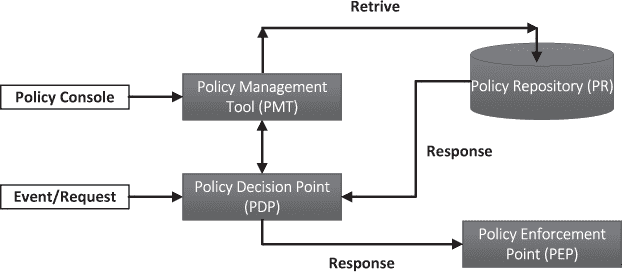

**图 4.1**](#C_007_c4.xhtml#f4_1b) 该图展示了一种基本的基于策略的管理架构。它包含四个主要组件，帮助检索信息、存储策略、制定决策和执行策略。

### 4.3.3.1 策略仓库 (PR)

存储策略的存储/数据库被称为策略仓库。根据管理环境的上下文，它可以从简单的文件到巨大的数据存储服务器不等。例如，像 Facebook 这样的社交媒体平台使用巨大的仓库作为策略存储服务器，而小型家用 `IoT` 设备管理则使用一个 `JSON` 文件在 `MQTT` 服务器中存储所有的管理策略。在这里，这个单文件充当策略仓库 (`PR`)。

策略仓库在基于策略的管理架构中发挥多种作用，例如 (i) 存储策略、(ii) 查询存储的策略、(iii) 获取存储的策略、(iv) 资源验证（约束检查）、(v) 策略翻译、(vi) 策略转换以及 (vii) 安全存储策略。

策略仓库必须非常快。在某些情况下，整个基于策略的管理系统的性能取决于策略仓库的速度。目前使用 `SSDs` 在大型仓库中存储策略，以便进行快速查询和快速检索。

### 4.3.3.2 策略管理工具 (PMT)

存放策略管理软件的服务器或主机被称为策略管理工具 (`PMT`)。它有助于提供交互式且友好的图形或 Web 用户界面，以便于编辑和表示存储的策略。在某些情况下，`PMT` 也可以接受来自策略控制台的输入。策略控制台是一个终端类的界面，用于向 `PMT` 发送 `CRUD` 指令。

`PMT` 维护整个策略生态系统。它有助于从 `PR` 获取相应的策略。`PMT` 使用轻量级目录访问协议 (`LDAP`) 与 `PR` 的通信 [34]。`LDAP` 是一种供应商无关的开源应用程序协议，用于在 `IP` 网络上维护访问并管理信息资源。该协议提供了数据库管理环境的所有功能和指令，如添加、删除、更新、搜索和绑定。`PMT` 还有助于策略的翻译和验证。

以策略为中心的生态系统面临的主要问题之一是它们容易产生冲突。例如，在一个恒温器中，某条策略说如果温度高于 20 度就开启它；另一方面，对于同一个恒温器，另一条策略说它应该关闭。`PMT` 有助于在使用安装或执行策略之一时解决此类策略冲突。

### 4.3.3.3 策略决策点 (PDP)

`PDP` 是该架构的监控点。`PDP` 评估执行特定事件策略的必要性。`PDP` 捕获系统内的事件和请求，并咨询 `PMT` 从 `PR` 获取匹配的策略。它是中间节点，可以将事件/请求转换为 `PMT` 可读的形式。

### 4.3.3.4 策略执行点 (PEP)

`PEP` 是执行 `PDP` 选择策略的节点。对于网络基础设施，网关、交换机、路由器和 `WAPs` 充当 `PEP`。有时，`PDP` 和 `PEP` 可以作为同一设备上的实体存在。

它有助于验证策略并捕获系统的反馈。

## 4.3.4 基于策略的管理架构的优势

以下是基于策略的管理架构的益处：

*   **管理复杂性：** 系统是不同实体的集合，例如，企业网络由智能设备、用户、终端主机、服务器、网关和交换机。基于策略的管理架构提供了一种将系统中的实体分类分组的方法，并在这些组中执行管理策略。我们可以考虑企业网络的例子，它有两个 `VPN` 网络：一个是安全的（加密通道），另一个是普通的。根据用户的角色，他们的通信被分为两类，即分类的和非分类的。无论他们从哪个设备登录，网络策略都会为相应的用户提供相关服务。因此，基于策略的管理有助于以更少的精力简化设备、用户、网络、服务管理或任何分布式系统的复杂性。


*   **减少人力投入：** 采用基于策略的管理架构，需要较少的人员来配置网络或系统环境。一旦安装了策略，系统将根据已安装的策略运行。因此，它减少了人力资源和精力投入。
*   **时效性功能：** 实现时效功能最有效的方法之一是策略。例如，它可以强制执行定时网络策略，在特定时间内限制用户的网络通信。
*   **更好的安全性：** 随着系统规模的扩大，复杂性也随之增加。在这些复杂系统中，资源被滥用的概率非常高。例如，在网络系统中，恶意用户可以发起 DDoS 攻击来破坏网络运行。解决资源滥用的最佳方法之一就是使用策略。

## 4.4 IoT 网络场景

本节介绍了一个 IoT 网络场景，并规定了此类基础设施的安全策略需求。

图 4.2 展示了一个 IoT 网络基础设施。该 IoT 网络由一个可编程网络控制器进行管理和控制。该网络将连接有 IoT 传感器和执行器。每个 IoT 传感器/执行器连接到本地 IoT 节点。多个 IoT 节点连接到 IoT 网关。IoT 网关连接到路由器或交换机。有时，网关和交换机合二，可以是有线或无线的。最后，所有 IoT 传感器/执行器将数据上传到云端基础设施。

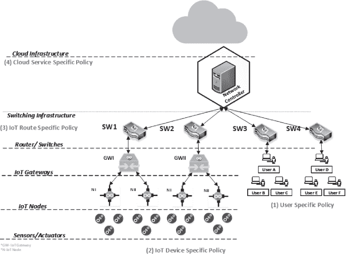

图 4.2 图展示了一个 IoT 场景，其中多个传感器/执行器连接到可编程网络基础设施。它们将数据上传到云端基础设施。用户可以使用云服务的特定应用程序控制这些设备。

根据 IoT 网络的运行，在多个位置可以应用安全策略以满足以下需求：

*   **特定用户的策略：** 谁在什么条件下可以访问哪种设备？
*   **特定设备的策略：** A. 哪种设备在什么条件下可以访问什么网络服务？
    B. 设备的状态是什么？C. 哪种状态下的设备可以处理特定用户的请求？
*   **特定 IoT/服务路由的策略：** A. 属于/被用户/域/服务使用的设备通过哪种网络路径访问各种网络服务？B. 路由设备需要满足什么条件？
*   **特定云服务的策略：** A. 什么服务在什么条件下可以为特定的 IoT 设备和用户提供服务？B. 流通信状态应该是怎样的？

### 4.4.1 设备类型与设备本体论

### 4.4.1.1 设备类型

IoT 设备是多样化的，取决于它们使用的协议类型及其用途。例如，`LoWAN`、`6LoWPAN` 和 `ZigBEE` 是 IoT 设备支持的不同类型的协议。用于医疗领域、农业领域和工业区域的 IoT 设备有多种类型，因为它们是定制的，并旨在实现特定目标。然而，在这里我们关注的是设备的连接性，即它们是如何连接到网络基础设施的。我们的设备供应方案设想设备可以是即插即用的，也可以是配置的。即插即用设备具有嵌入传感器和执行器，并提供接口以访问传感器数据并通过其执行器进行控制。这类设备是不可能配置的。此类设备的示例包括支持 WiFi 的穿戴设备、摄像头和音频系统。

可配置的设备带有传感器和执行器，并提供运行时，例如，用于部署设备适配器以提取和提供传感器数据。此类设备的示例是 `Raspberry Pi`。还存在处理和存储能力受限的受限可配置设备，可以连接到更强大的系统，例如 `Gateway`。`Arduino` 是这种受限设备的示例。为了更精确地对 IoT 设备进行分类，我们现在引入设备本体论。

### 4.4.1.2 设备本体论

设备本体论是基于元数据的设备、其能力和属性的描述性表示。设备本体论描述了设备注册、绑定和启用设备访问所需的细节；它也可以作为 IoT 应用的元数据源。设备由传感器、执行器、适配器及其状态组成。设备本体论包含元数据，包括传感器/执行器的规格，如精和频率。由于环境的异构性和动态，本体论在 IoT 中的应用非常广泛。设备相关信息允许在设备接入时为安全服务提供支持。在我们当前的安全架构中，设备本体论将有助于制定先决条件。

现在，我们展示本体论如何帮助呈现设备。图 4.3 展示了此类内容的示意性表示。

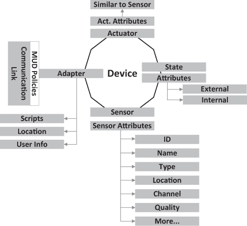

图 4.3 设备本体论是基于元数据的设备、其能力和属性的描述性表示。此图展示了安全架构的设备本体论。设备可以是传感器或执行器。每个设备具有相关的属性。适配器属性提供了通信选项，状态属性呈现了设备状态。

*   **传感器和执行器：** 设备可以配备传感器和执行器。每个传感器/执行器由名称和标识符组成。还可以与设备及其传感器/执行器模块相关的其他属性。名称、ID、类型、使用位置、分配通道等是传感器/执行器最常见的属性。此外，设备制造商可以包含传感器/执行器的特定质量属性。例如，水位指示传感器可以具有特定的质量属性，如精度和灵敏度。设备可以与制造商相关的证书，从安全角度来看，这对启动时的设备认证非常有用。
*   **状态：** 每个设备都有一个操作系统或固件来控制其功能或行为。传感器的输入或其他内部外部事件与 IoT 设备的状态相关。设备的状态还包括其内部软硬件组件的状态，即操作系统、物理内存和 IO 状态。因此，从安全和信任的角度来看，设备会受到内部外部事件的影响。例如，外部事件可以请求读取其传感器数据或执行执行器动作。内部事件与操作系统的运行有关，例如，使用 `Raspbian OS` 的 `Raspberry Pi` 设备处理输入输出的 I/O 驱动程序。


*   **适配器 (Adapter)：** 适配器是设备用于与网络基础设施通信的通信套字。这是一组库，帮助设备理解通信协议，并构建、传输和接收设备与设备之间的数据包 [[[6,17,29]]。我们使用适配器来捕获 MUD 策略，这些策略侧重于设备的通信。例如，针对智能灯泡的 MUD 策略规定它不应与智能电表或智能冰箱通信，相反，它应该与制造商的更新服务器通信。这些都是以访问控制列表的形式指定的。

然而，MUD 策略并没有解决基于设备状态的授权，这些授权用于指定特定的策略，例如用于设备漏洞修复所需的策略，或根据设备状态执行信任相关的策略。我们的方法不仅能够指定基于 MUD 的策略（如图 4.3 所示），还可以基于设备的属性和状态以及涉及网络环境属性的指定更细粒度的策略。这有助于我们指定捕获不同 IoT 应用需求的策略，以及设备安全配置和管理中所需的策略。

## 4.5 策略驱动的安全架构

现在我们将介绍用于 IoT 基础设施的策略驱动安全架构。该安全架构侧重于解决以下挑战（图 4.4）。

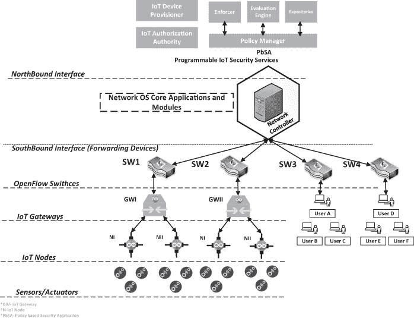

**图 4.4** 该图片展示了一个可编程的网络架构和相关的安全服务，以保护 IoT 网络基础设施免受网络攻击。安全服务以及网络基础设施都在抽象层面进行表示。因此，它可以进行定制以适应基础设施需求。

*   **挑战 1：** IoT 设备的安全配置。
*   **挑战 2：** 在 IoT 网络基础设施中安全地管理资源受限的 IoT 设备。

### 4.5.1 设备配置？

将 IoT 设备接入网络基础设施的过程被称为配置（provisioning）。最简单的配置形式仅仅分配 IP 地址，使设备能够与网络基础设施的其他设备和云端进行通信。然而，这种简单的配置可能会导致潜在的安全问题。一个经典的例子是恶意设备被配置到网络中。另一个例子是资源受限的设备泄露配置凭据，攻击者可以利用这些凭据对网络发动进一步攻击。在本节中，我们首先将介绍安全设备配置的需求和要求，然后解释什么是基于策略的设备配置。

安全设备配置的要求包括：

*   **R1 (身份)：** 如今，设备或其固件在用于任何智能网络基础设施之前可能会被物理篡改。一旦它们在任何智能网络基础设施中使用。
*   **R2 (身份验证)：** 缺乏适当的身份验证将允许攻击者注入。
*   **R3 (授权)：** 随着 IoT 设备数量的增加，管理和识别流氓设备变得困难。
*   **R4 (可信度)：** 有时 IDS 和 IPS 无法检测到此类问题。

### 4.5.1.1 基于策略的设备配置

为了实现设备的安全配置，我们提出了一种基于策略的方法。这是一种使用网络、安全和特定属性策略来安全配置设备的机制。策略规定了设备配置之前需要满足的先置条件，而后置条件规定了设备在配置后需要满足的一系列条件。我们策略方法中的条件考虑了设备的三个方面，即：(i) 设备属性；(ii) 基于设备状态的属性；(iii) 与设备相关的规则。这种细粒度的基于策略的方法使我们能够捕获与设备安全配置相关的各种限制。我们设想这种架构可以与云平台的现有机制和基础设施（如 `Azure IoT` 或 `AWS IoT Services`）集成，以构建一个智能农场场景下设备安全配置的概念验证。

### 4.5.1.2 用于设备配置的安全策略语言

现在我们将介绍设备安全配置的基于策略方法的语法和属性粒度。

*   **先置条件 (Pre-conditions)：** 设备在连接网络之前需要满足的一系列条件。
*   **后置条件 (Post-conditions)：** 设备在配置后需要满足的一系列条件。


*   **用户属性：** 前置条件（pre-condition）可以对能够配置设备的用户指定条件。只有满足这些条件的用户才能配置设备。这可以通过命名与用户关联的用户、组或角色来显式地指定，或者更通用地说，以用户必须拥有的属性集的形式指定。从安全角度来看，这些属性需要是可靠的，例如用户证书（如 `X.509` 证书）和安全凭据。这可以使用基于角色的策略和基于属性的策略来指定。

*   **设备属性：** 前置条件可以对设备在配置之前必须具备的属性指定条件。设备属性包括设备类型、设备证书以及设备制造商证书。

*   **设备状态属性：** 前置条件还可以指定设备状态需要满足的条件。我们将以状态属性的形式表示这种条件。我们将在下一节中对这些属性进行进一步阐述。

### 4.5.1.2.1.1 前置条件示例

在本节中，我们提供了用于配置 IoT 设备的策略中的前置条件示例。

我们将设备标记为 `x`，将有效用户标记为 `u`。

*   **使用安全属性：** 只有当用户是有效用户（`u`[`i`]`(`x`))）且属于有效组（`Group`），并且设备由有效制造商制造时，设备 `x` 才能被配置。也就是说，

    *   – 用户 `u i f u` 可以配置设备 `x` *如果*它是有效用户 *且 type*(`x`) 有效 *且 manu f acturer*(`x`) 有效

    例如，`u` 可以有效，`i f cert`(`u`) 有效且/或 `u` ∈ `Group` 有效。同样，*如果* `i f cert`(`manu f acturer`(`x`)) 有效，则 `manu f acturer` 有效。

*   **使用状态属性：** 

    *   – **属性 1 - 新设备：** 如果设备是新设备，则可以进行配置。这可以通过检查设备日志来检查。如果没有设备日志（且设备从未使用过），则可以推断设备是新的。假设这反映在状态变量 `new` 中。使用该属性，条件可以表述如下：

        *如果* (`new`(`x`) 有效)，*那么* 设备可以被配置。

    *   – **属性 2 - 设备内部进程状态：** 设备本体论在其数据库中为每个 IoT 设备存储一组良性和默认的进程。在设备入网期间，SDPM 利用设备本体数据库通过设备白名单来检查设备中运行的进程。现在，假设设备有一个可用的参考进程集（例如，设备的白名单进程）。任何在运行时生成这些白名单进程的新设备都可以被配置。也就是说，

        *如果* (∀`process`(`x`) ∈ `Reference Set`)，*那么* 配置设备。

    *   – **属性 3 - 设备外部进程状态：** 设备的外部通信反映在 I/O 缓冲区状态中。运行在 IoT 设备内部的应用程序和服务使用网络套字/端口进行通信。这些服务使用这些端口持续传播信息（数据/控制）（上这意味着将信息写入 I/O 缓冲区）。我们的安全架构将此类通信端口行为视为 I/O 缓冲区状态变化。网络枚举或探测工具（如 `nmap`）用于检查网络端口状态。我们的实现使用探测和模糊测试来检查 I/O 缓冲区状态。

        在这种情况下，该属性基于 I/O 缓冲区状态，用于检测设备是否处于不安全状态（例如，可能会泄露信息）。例如，假设传感器的缓冲区本应只有数值数据类型的输入或输出。假设攻击者注入了非数值的恶意数据（如字符串）。在这种情况下，设备缓冲区中的这种数据类型不匹配将极视为恶意的，设备将不会被配置。也就是说，

        *如果* (`i/o state`(`x`) 有效)，*那么* 配置设备。

### 4.5.1.2.2 后置条件

后置条件（post-condition）策略会导致在设备配置后后应该执行的操作。

在设备配置配置后，它们被注册在“已配置设备”（Provisioned Devices）中。后置条件可以使用位置和时间等环境参数，以及状态属性。图 4.6。

*   **环境参数 - 位置：** 后置条件可以使用位置来指定设备应该连接到何处。这也可以映射到网关的 IP 地址。
*   **环境参数 - 时间：** 当农场中的热灯设备被配置时，后置条件可以确保它仅在温度低于某阈值时运行。例如，特定时间的后置条件可以的形式为 operational time(`x`) = `T`，其中 `T` 是 (0100 < `T` < 0700) 之间的持续时间。
*   **设备状态属性：** 与前置条件类似，后置条件可以使用设备的内部和外部状态（如进程列表和 I/O 缓冲区）来强制操作。例如，如果传感器测量值超过了允许的阈值，这将导致产生系统警报。

### 4.5.1.2.2.1 后置条件示例

假设设备 `x` 使用了一组后置条件进行配置。

*   **环境参数 - 位置：** 设备在后置条件指定的某些位置配置，location(`x`) = {`α`,`β`}
*   **设备状态属性：** 在智能灌溉系统中配置水流传感器设备时，后置条件可以用于检测（通过在日志中记录水平）和防溢（在超过建议水位时生成警报）。例如，后置条件可以包括：

    ```
    记录水平 如果 flowlevel(`x`) = Γ，其中 2..5 < Γ < 3 且 如果 flowlevel(`x`) ≥ 3 则生成警报
    ```

### 4.5.2 安全智能设备配置与监控服务 (SDPM)

图 4.7 给出了所提组件内部的概述。该内部图由一组软件组件组成：设备配置网关（DPG）、配置评估引擎（PEE）、设备配置服务（DPS）、策略数据库（PD）以及带有后置条件的（POST-P）已配置设备数据库（PDD）。它包含三个模块和两个数据库，用于存储前置策略和后置操作/条件策略。相应的安全软件模块只能访问相应的数据库。此外，我们在架构中引入了设备的数字孪生。数字孪生的目的是向云端和用户表示设备状态。现在我们将介绍该架构中每个模块的功能描述。


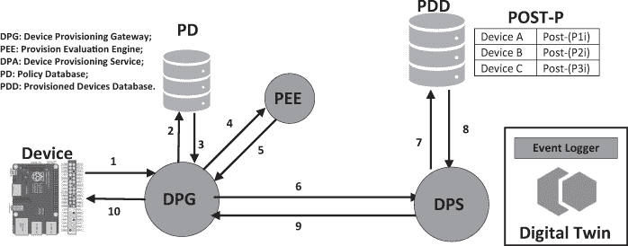

**图 4.7** 该图展示了安全智能设备配置和监控服务的各种组件。以块形式展示的组件是帮助构建安全架构的软件模块/脚本。设备可以是物理的也可以是虚拟的，并以数字孪生的形式表示。

软件模块是安全架构的基础模块，这些模块的选择取决于智能网络基础设施的类型以及与云的连接性。

*   **设备配置网关 (DPG):** 设备配置网关是一个软件模块。然而，它可以部署在任何本地网关或 IoT 枢纽中。这只是一个微小的实现变更。该模块执行三个重要功能：首先，它代表设备从设备或用户处接收配置请求。其次，它与策略数据库接口，获取在设备配置之前需要满足的适当先决条件以及后置策略。最后，它将相应的策略信息以及设备详情传递给配置评估引擎 (PEE)。
*   **配置评估引擎 (PEE):** PEE 模块是该安全架构中的决策权威。PEE 模块接受来自 DPG 的设备设备和相应的策略信息。之后，它使用设备属性、参数和特性评估先决条件，并判断特定设备是否满足先决条件策略。对于任何设备，当先决条件完全满足时，PEE 将信息转发给 DPS。
*   **设备配置服务 (DPS):** DPS 的目的是将通过 PEE 的设备添加到已配置设备数据库 (PDD)。该模块还监控已配置设备的活动，并将其与后置策略进行比较。如果任何后置活动不合法，则 DPS 服务可以停止该设备的操作。事件日志器结合 DPS 服务会记录配置设备的活动。这些事件日志稍后将帮助安全架构构建设备的孪生。在第 4.5.4 节中，我们将详细描述数字孪生。
*   **PD:** 策略数据库存储与设备相关的先决条件和后置策略。该数据库可以使用 JSON 实现，并挂载在 Azure IoT/AWS IoT 中。也可以使用本地边缘网关或枢纽挂载此数据库。
*   **Post-P:** 该数据库存储设备特定的后置策略。每个设备可以有多个后置策略。数据库是一个简单的 JSON 数据库。

### 4.5.3 安全配置协议

现在我们将解释安全智能设备配置模块的功能步骤（图 4.8）。

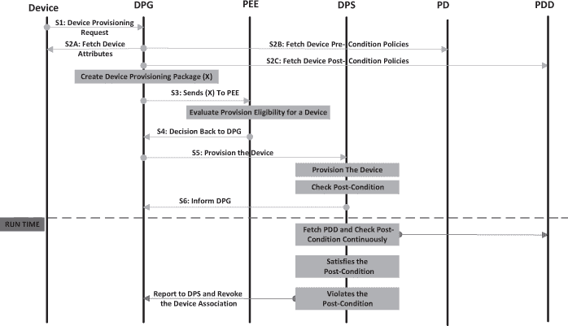

**图 4.8** 此图描述了 SDPM 在功能层面的运行方式。在这里，我们展示了架构组件在启动和运行期间的模块间功能通信。此外，该图展示了先决条件和后置条件如何与子模块交互。

*   **步骤 1:** 设备向 DPG 发送配置请求。
*   **步骤 2:** DPG 获取两种类型的信息：(i) 设备特定的和 (ii) 先决/后置条件策略。利用这些信息，DPG 创建设备配置包 (X)。我们使用算法 2 来检索信息并创建设备配置包 (x)。
*   **步骤 3:** DPG 将设备配置包 (X) 转发给 PEE。PEE 将设备属性与先决条件策略进行比较，并准备一份建议。
*   **步骤 4:** PEE 将建议传回 DPG。
*   **步骤 5:** 如果设备满足先决条件，则 DPG 请求 DPS 配置设备。如果设备未满足先决条件，DPG 通知设备无法进行配置。DPS 注册设备，根据后置条件执行操作，并存储操作结果以及任何剩余的后置条件（需要在运行期间在 POST-P 数据库中执行）。
*   **步骤 6:** DPS 通知 DPG 设备配置的性质（成功/失败），然后 DPG 相应通知设备。
*   **运行:** 在运行期间，DPS 持续根据设备操作检查后置策略。如果操作根据后置策略是合法的，则 DPS 允许执行该操作。否则，DPS 将停止它们。这两类事件都会记录在事件日志中，稍后将有助于数字孪生。

### 4.5.4 数字孪生

在这一节中，我们将解释数字孪生、其功能以及在 SDPM 中的重要性。

### 4.5.4.1 什么是数字孪生？

数字孪生是智能网络基础设施中任何已配置设备的数字表示。数字孪生包含了定义设备的设备数据和元信息。例如，温度传感器每 10 秒记录一次传感器读数。

### 4.5.4.2 SDPM 中的数字孪生

SDPM 拥有一个数字孪生，它执行以下功能：

*   它代表智能网络基础设施中的智能设备。
*   它存储设备事件日志。
*   它对事件属性拥有粒度策略。这有助于在 IoT 网络基础设施中使用后置策略。

### 4.5.4.3 它是如何工作的？

在 SDPM 中，数字孪生维护设备在任何时间点执行的事件或操作日志。对于我们的数字孪生，每个事件由操作组成。每个操作作用于设备状态。

设备的每个状态均表示为 `S[x]`，每个事件表示为 `e[y]`。对于时间 $t$ 的事件 $e[t]$，设备状态从 $S[t]$ 变为 $S[t]′$ 将表示为：

```
S_{t}\overset{e_{t}}{\rightarrow}S_{t\prime}
```

因此，SDPM 的数字孪生模型表示为：

```
在时间， t : <S[t], e[t]>
```

其中，`S[t]` = 设备状态集；`e[t]` = 由外部和内部实体执行的事件集。

在这里，我们引入了事件驱动策略。例如，一个工业执行器使用转速为 200 rpm 的步进电机。连续启动时长为 10 分钟，运行周期为 2 分钟。然而，攻击者篡改了设备并更改了电机的速度，但没有改变运行时长。我们的事件驱动策略可以检测到这种状态变化，数字孪生可以强制操作以发出警报或停止电机功能以避免损坏。


因此，我们的 `SPDM` 通过将设备状态整合到元信息中扩展了数字孪生概念，并通过监控这些信息来执行特定策略，从而动态控制设备行为。这反用于检测设备漏洞并以安全的方式实现动态补丁管理。此外，我们方法中使用的置备和置后策略有助于捕捉设备行为中的先决授权需求和后义务需求。

### 4.5.5 基于策略的安全应用

我们的可编程 IoT 网络基础设施包括可编程网络交换机（如 `OpenFlow` 交换机或 `IoT Gateways`）和终端主机（`IoT` 传感器/执行器）。单网络控制器管理整个 IoT 网络基础设施。可编程网络设备（`OpenFlow` 设备）转发由 IoT 设备/用户产生的数据包，这些数据包将根据网络控制器指定的策略在网络中进行路由。图 4.4 显示了用于保护可编程 IoT 网络基础设施的基于策略的安全应用（`PbSA`）。由于 `PbSA` 被设计为模块化，`PbSA` 的组件可以实现在单个主机上，也可以分布在多个主机上。在这里，我们提供了 `PbSA` 不同模块的详细描述。模块是主应用程序的软件组件。

`PbSA` 由四个主要模块组成，即 (i) `Policy Manager`、(ii) `Evaluation Engine`、(iii) `Repositories` 和 (iv) `Policy Enforcer`。

*   **Policy manager：** 这是安全服务应用的核心组件，因为它管理所有操作，例如提取 IoT 设备流属性、更新拓扑存储库并指示策略执行器在 `OpenFlow` IoT 网关处执行策略。它还会在检查来自 `IoT` 设备的网络服务请求后，与 `IoT Provisioning` 应用通信以传输身份验证服务令牌。
*   **Evaluation engine：** 该引擎根据策略存储库中存储的相关策略对服务请求进行评估。
*   **Repositories：** 我们的安全服务应用有两个存储库：(i) `Topology repository` 和 (ii) `Policy repository`。拓扑存储库包含 `IoT` 设备和终端主机/用户的网络拓扑结构。网络控制器可能有自己的设备拓扑存储库，但我们为此目的使用了相同的拓扑存储库。策略存储库包含与各种 `IoT` 设备及相关流属性关联的策略表达式（`PEs`）。`PEs` 中的属性还包括安全参数，例如与可编程网络 IoT 网关关联的安全标签。
*   **Policy enforcer：** 策略执行器从可编程 `IoT` 网关获取所需信息，并执行从策略管理器处获取的路由规则或流规则。

### 4.5.5.1 安全策略规范

安全策略规范用策略表达式（`PE`）表示，指定 `IoT` 设备和终端主机的数据包和流是否遵循网络中的特定路径或路径，以及数据包和流遵循这些路径的条件。`PE` 语法使用了增强版本的 `RFC1102` [11]]。它们是细粒度的，并使用 `IoT` 设备和流的各种属性指定一系列策略；例如，这些属性包括不同类型的设备、源和目的属性、流属性和约束、请求的服务、安全服务以及安全标签。已指定了以下属性：

1.  **Flow attributes：** 流标识符、流数据包类型、指示与流中数据包关联的安全配置集的安全配置；
2.  **Device attributes：** `IoT` 传感器/执行器的特定标识符；
3.  **Switch attributes：** 交换机标识符以及与交换机关联的安全标签（以及 `OpenFlow` IoT 网关）；
4.  **Host attributes：** 与主机关联的标识符，例如源/目的主机 ID；
5.  **Flow and domain constraints：** 与特定设备流关联的约束，例如流约束（`FlowCons`）和域约束（`DomCons`）；例如，某个约束可能指定来自特定类型传感器的流只能通过一组可以提供保证带宽的交换机；从安全角度来看，一个约束可以是流应只通过具有特定安全标签的 `OpenFlow` 交换机；
6.  **Services：** `PE` 应用的服务（例如 `FTP` 存储访问）；
7.  **Time validity：** `PE` 保持有效的期限；以及
8.  **Path：** 指明特定 `IoT` 设备/用户的流允许或应该遍历的特定交换机序列。`PEs` 支持属性的通配符，使该语言能够为一组 `IoTs`/服务指定策略。

一个简化的策略表达式模板如下：

## 4.6 原型实现

在本节中，我们将解释如何创建并实现所提安全架构的概念证明（`PoC`）原型。

### 4.6.1 网络设置

我们为所提的安全架构开发了一个概念证明。该概念实现包含网络、硬件和软件模块。其部分内容实现在 `Azure` 云端。我们的实现设置使用 `Oracle VM Box`、`Mininet-WiFi` [14] 和 `ONOS` 作为开源网络控制器。我们使用一台带有 `Core i7 - 7700K @ 4.20 GHz` CPU 和 64 GB RAM 的工作站进行此设置。在这里，本地 `IoT` 枢纽与 `Microsoft Azure IoT` 云服务通信。枢纽作为虚拟机运行，虚拟 `IoT` 设备连接到该枢纽。`Azure` 服务收集这些设备发送的数据。我们的 `SDPM` 和 `PbSA` 服务在基础设施层面执行策略，并与运行在 `Azure` 云上的核心应用服务集成。概念证明的网络配置所示图 4.9。


-   **授权（Authorisation）：** 由于 IoT 设备资源受限，且可能无法满足运行安全服务的最佳硬件要求，通过 `SDPM`，我们引入了后置策略（post-condition policies）。这些策略有助于监控已配置设备的状态及其行为。后置策略考虑了设备状态以及设备/基础设施特定的上下文。例如，通过后置策略，我们可以限制传感器设备的数据包传输速率。这反过来有助于限制来自恶意设备的 DDoS 攻击。

-   **设备状态（Device state）：** 像任何其他计算机系统一样，IoT 设备会随时间改变其软件和硬件状态。针对这些 IoT 设备的任何攻击都可能使其进入不可信状态，导致设备和网络基础设施都受到进一步攻击的威胁。因此，设备的状态（硬/软）是一个重要因素，应该始终被考虑范围内。前置和后置条件策略都考虑了设备的状态。任何未反映在策略中的状态变化都会被视为可疑设备。在这种情况下，该设备可以被取消配置或被隔离以进行进一步调查。

-   **数字孪生（Digital twin）：** 在常规实践中，数字孪生并不反映设备的安全属性。然而，通过 `SDPM`，我们对数字孪生进行了建模，以反映设备的特定安全方面，例如设备状态、环境上下文等。它们有助于在 IoT 网络基础设施中执行后置策略。

-   **攻击检测与缓解（Attack detection and mitigation）：** `SDPM` 旨在通过前置和后置条件策略来检测攻击。此外，通过粒度策略执行架构，`SDPM` 可以取消配置设备、隔离设备并缓解攻击。

-   **流授权（Flow authorisation）：** 另一个重要需求是能够控制并保护网络中 IoT 设备之间的流量流。使用 `SDN` 等可编程网络的一个主要优势是它能够提供全域范围的策略管理，以对 IoT 设备之间的动态流量流进行安全控制。我们基于策略的安全应用（`PbSA`）能够实现细粒度的基于流和基于路径的安全路由策略，强制端到端服务与设备之间的安全通信。例如，特定路径可以被限制为仅允许安全标签至少为“高”（high）且具有特定吞吐量的设备访问，同时还受限于一组指定的（安全）路径。这种基于路径的策略在保护敏感设备数据时至关重要，对于具有不同服务质量（QoS）要求的应用也有用。例如，需要特定带宽的流量必须通过网络设备和通道具备必要能力的路径。此外，假设由于某些攻击（例如 DDoS 攻击），来自设备的流量无法通过网络。我们的 `PbSA` 为该设备的流量提供了替代路径以使其到达所需的目的地。这突显了我们 `PbSA` 的新颖功能，即动态管理基于流和基于路径的安全策略，以实现跨域的安全通信。

-   **流的机密性、完整性和可用性 (Flow Confidentiality, Integrity, and Availability (CIA)):** 我们提出的架构提供了按需的 `CIA` 服务。这些需求作为 `PbSA` 模块中策略规范的一部分指定的。在机密性方面，特定设备之间特定路径上的特定流可以加密。加密密钥通过安全的密钥管理过程建立。流从端到端保持加密，中间的 `OpenFlow` 交换机将不允许解密负载。同样，流也使用加密机制保护其完整性。此外，我们的安全架构确保了设备经过身份验证，并且其对服务和流的访问根据 `PbSA` 策略规范授予这些设备的访问权限来决定。

### 4.6.2.2 攻击案例研究

-   **案例 1 - 设备发送单个恶意数据包：** 在此场景下，攻击者窃取设备凭据并对 IoT 网关发动攻击。为了防御这种攻击，我们需要身份验证机制。我们将使用 `raspberry PI` 作为受感染的 IoT 设备来模拟攻击。

-   **案例 2 - 设备发送多个恶意数据包：** 在此攻击场景中，设备用大量的伪造数据包淹没 IoT 网关。在这次攻击中，我们想要测试身份验证服务的健壮性。

-   **案例 3 - 受感染设备注入恶意软件：** 这种场景专门针对已配置的身份认证设备，例如感染了 Mirai 恶意软件的设备。我们将创建此类攻击场景，并在之后测试我们的授权策略。

-   **案例 4 - 外部操作导致设备状态变化：** 数字孪生为设备提供了状态和事件驱动。在这种场景下，我们将验证数字孪生的功能。在这里，我们将对设备进行某些攻击，这些状态变化很难通过策略检测到。数字孪生中的事件驱动监控服务可以检测这些变化。我们将测试此类案例。

-   **案例 5 - 欺骗/伪装（Spoofing/masquerading）：** 在 IoT 网络基础设施中，恶意攻击者可以尝试冒充另一个用户/设备。攻击者可以使用这种恶意方法获取/修改设备的敏感信息，并向执行器发送恶意指令。

-   **案例 6 - 中间人攻击 (MiTM)：** 在 `MiTM` 攻击中，攻击者拦截双方之间的通信。IoT 基础设施也容易受到此类攻击。攻击者或恶意 IoT 设备可以更改通信双方的 ARP 缓存，在 IoT 网络基础设施中发起 `MiTM` 攻击。

现在，我们将这些攻击案例研究转换为实时攻击场景。首先，我们将展示攻击者如何轻松破解即将配置或已配置的设备。之后，我们将展示 `SDPM` 如何使用前置/后置条件策略防御此类攻击。


![图 4.10 此图展示了攻击场景 (1)。(a) 这里展示了网络设置的示意图。此外，该示意图展示了攻击者如何渗透 IoT 传感器领域。(b) 使用低轨道离子炮 [5]\] 应用程序来生成洪水攻击。图中展示了启动攻击的工具配置。此图展示了场景 1 攻击后的产物。(c) 该图展示了攻击发生期间的 wireshark 跟踪轨迹。(d) 此图展示了 SDPM 如何对正在进行的泛洪攻击生成警报。](images/Fig04_10a.jpg)

图 4.10 此图展示了攻击场景 (1)。(a) 这里展示了网络设置的示意图。此外，该示意图展示了攻击者如何渗透 IoT 传感器领域。(b) 使用低轨道离子炮 [5]\] 应用程序来生成洪水攻击。图中展示了启动攻击的工具配置。此图展示了场景 1 攻击后的产物。(c) 该图展示了攻击发生期间的 wireshark 跟踪轨迹。(d) 此图展示了 SDPM 如何对正在进行的泛洪攻击生成警报。

该攻击的形式是网络拒绝服务；在这种情况下，我们正在使用 `LOIC`（低轨道离子炮）发起网络数据包泛洪 [5] 并压制网络上的游设备。`LOIC` 界面和设置如图 4.10b 所示，我们从 `Kali Linux` 虚拟机运行 `LOIC`。当攻击者设备泛洪聚集器时，聚集器会尝试处理数据包请求，这消耗了大量的内存和处理能力。最后，攻击进行到流量水平达到峰值且聚集器冻结为止。我们在图 4.10c 中展示了攻击的 wireshark 跟踪。我们还注意到，从攻击启动到出现峰值并聚集器冻结大约需要 4 分钟。

现在我们将激活 `SDPM`，它使用后置条件和策略来缓解此类拒绝服务攻击。这些后置条件在设备配置连接后生效。基本上，这些后置条件监控设备在配置后的行为，并检查设备是否有恶意行为。如果是，则将其停止。通过 `SDPM`，我们通过数字孪生的概念实现了这一点。正如之前描述，数字孪生是物理 IoT 设备的数字表示，并复制物理设备的状态属性。因此，在这种情况下，数字孪生具有对应于物理设备发送的网络流量值的属性。现在监控服务可以检查数字孪生的状态，并检查网络流量值是否超过了策略之前设置的安全阈值。这就是后置条件的作用。如果超过了安全阈值，则断开物理设备。对于当前的攻击，我们的 `SDPM` 监控服务持续查询任何流量值超过 `150,000` 的设备孪生体。图 4.10d 显示，当流量值增长到 `150,000` 以上时，监控服务会针对泛洪攻击发送警报，`SDPM` 会拦截该设备。因此，`SDPM` 保护 IoT 基础设施免受泛洪攻击。

#### 4.6.2.2.2 攻击场景 2

这种攻击更针对设备配置前的预处理检查（特定于案例 3 和 4）。这些检查在配置之前完成。

在此场景中，我们考虑的是 IoT  IoT 攻击。正如之前描述，数字孪生是物理 IoT 设备的数字表示，并复制物理设备的状态属性。因此，在这种情况下，数字孪生具有对应于物理设备发送的网络流量值的属性。现在监控服务可以检查数字孪生的状态，并检查网络流量值是否超过了策略之前设置的安全阈值。这就是后置条件的作用。如果超过了安全阈值，则断开物理设备。对于当前的攻击，我们的 `SDPM` 监控服务持续查询任何流量值超过 `150,000` 的设备孪生体。图 4.10d 显示，当流量值增长到 `150,000` 以上时，监控服务会针对泛洪攻击发送警报，`SDPM` 会拦截该设备。因此，`SDPM` 保护 IoT 基础设施免受泛洪攻击。

### 4.6.2.2.3 攻击场景 3

案例 5 & 6 是相互关联的。在这里，为了启动 `MiTM` 攻击（案例 6），我们使用了对主机用户/设备的 ARP 缓存投毒。ARP 缓存投毒使用 ARP 欺骗（案例 5）。

首先，我们将展示攻击是如何工作的，然后我们将展示我们的安全架构如何帮助保护网络。


我们将其中一个树莓派虚拟机作为 IoT 设备，并使用一个 Web 服务器（IP: `192.168.56.101`）来记录 IoT 数据。该 Web 服务器为管理员和设备提供了专用的用户名/密码。在这种情况下，为：“admin/password”。Kali Linux 虚拟机的 IP 地址为 `192.168.56.102`。攻击者使用 `SDNPWN Toolkit` 通过 `arpspoof` 攻击（威胁 3）污染设备/用户的 ARP 缓存 [36,47]。

为了污染 ARP 缓存，攻击者首先向控制器发送一个法的流请求以安装流规则，从而建立通往受害者 IoT 设备的路由。然后，攻击者伪造免费 ARP 请求来污染 IoT 设备的 ARP 缓存。攻击者还污染了另一个用户的 ARP 缓存。IoT 设备的数据包被重路由到恶意攻击者。这在本质上允许攻击者查看、复制和修改发送到或来自 IoT 的任何指令/数据。攻击者还可以发起 MiTM 攻击（案例 6）。此外，它引入了额外攻击的可能性，如 SSL 剥离和会话劫持。图 4.12a 显示了成功的攻击。设备 ARP 缓存污染将设备流量重路由通过恶意攻击者，使其捕获 Raspbian Web 服务器的登录信息。因此，攻击者能够成功发起 MiTM 攻击并捕获登录详情。图 4.12b 显示了被捕获的包含登录（“admin”）和密码（“password”）的管理员登录请求。

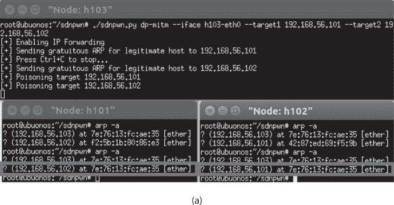

**图 4.12**](#C_007_c4.xhtml#f4_12b) (a) 此图像是攻击场景中的第 7 张。在这里，节点:h103 是攻击者终端，节点:h101 和 h102 是 MiTM 攻击的受害者。受害者终端中为同一个 MAC 地址 分配不同的 IP 显示了成功的 MiTM 攻击。(b) 来自攻击者设备的数据包捕以明文形式显示了 Admin/Password。(c) 我们提出的工具成功检测到了 MiTM 攻击。

通过我们提出的安全架构，每个设备以及用户机器在连接到 IoT 基础设施之前，都经过了安全的配置。非内部人员的攻击者将无法绕过验证阶段。相反，如果攻击者是内部人员并能够通过配置阶段，那么攻击者将在网络流授权阶段受到 `PbSA` 模块中安全策略的限制。此外，在验证阶段结束时，每个 IoT 设备将建立一个密钥，用于加密其流。这创建了一个安全通道，IoT 设备可以使用该通道向 Web 服务器发送凭据。因此，攻击者无法窃取凭据。图 4.12c 显示了我们的架构检测到的尝试攻击。

### 4.6.3 性能评估

在本节中，我们将展示我们提出的解决方案的一些性能数据。我们将性能分为两类：系统/应用特定和设备特定。

我们提出的安全架构可能会导致 IoT 设备配置和运行产生延迟。因此，我们提供了以下数据：(i) 设备配置时间延迟，(ii) 吞吐量，(iii) 资源（CPU/内存）利用率，(iv) 设备功耗，以及 (v) 平均路径建立时间。

我们创建了一个连接到 Azure 云的网络，并在每次实验中为每个节点配置了一些虚拟设备。在本章中，我们只关注 IoT 网络基础设施的安全问题，而不是其他性能特征。因此，为了提高安全性，延迟增加和系统资源使用的增加是可以接受的。此外，本节展示的测量结果具有特定的背景性，在其他环境中可能会有所。

1. **设备配置时间延迟：** 设备配置时间是指将 IoT 设备自动配置到 IoT 网络基础设施中所需的时间。该过程由验证、配对和授权过程组成。由于我们通过引入预置策略增强了验证程序的功能，整个设备配置过程会出现轻微延迟。图 4.13a 显示了随着设备数量和与验证过程相关的预置策略变化的配置时间。我们测量了没有 `SDPM` 时的设备配置时间，发现配置时间随设备数量增加而增加。对于 50 个设备，需要 138 秒， 200 个设备时增加到 581.*7 秒。现在，在激活 `SDPM` 安全服务后，由于处理检查，配置时间增加了。在 200 个设备和 300 个预置策略下，配置时间为 1477.*9 秒。

2. **吞吐量：** 图 4.13b 显示了 IoT 基础设施在运行或不运行 `SDPM` 服务时的吞吐量对比。我们改变了后置策略的数量，并使用 `iperf` 测量了网络基础设施的吞吐量。柱状图说明了吞吐量随后置策略的增加而减少。例如，当有 300 个策略时，吞吐量为 430 Mbps (近似)。而在没有 `SDPM` 时，吞吐量为 840 Mbps (近似)。


### 3. 资源（CPU/内存）利用率
`图 4.13c` 展示了 `SDPM` 服务在运行时消耗的系统资源。在这里，我们仅关注 CPU 使用率和堆内存使用率来描述系统资源使用情况。资源利用率主要取决于执行期间使用的系统和环境背景。因此，这不是一种标准的表示方法，而是展示原型系统行为的一种。在这里，我们进行了 10 次实验并使用了资源的平均值。柱状图显示，CPU 和堆内存的使用随策略数量（包括前提和后置条件）的增加而增加。当策略数为 400 时，CPU 使用率达到 84%，软件使用了 1,120 MB 的堆内存。相反，如果 IoT 网络网关上没有运行 `SDPM` 服务，它们平均占用 45% 的 CPU 和 129MB 堆内存。

### 4. 设备功率功耗
我们展示了活跃 IoT 设备的端到端平均路径建立时间（具有不同的 `OF-AP`）和电池电量消耗。在 `图 4.13d` 中，IoT 基础设施中运行默认应用程序时，IoT 设备的电池在通信一小时内稳定下降到 73%。使用 `PbSA` 和 `ISA` 时，IoT 设备的电池消耗在一个小时内稳定下降到 67%。IoT 设备使用的安全机制消耗了其电池电量，这在 4.13 中可见。

### 5. 平均路径建立时间
IoT 设备之间的平均路径建立时间均随 `OF-AP` 数量的变化而增加（`图 4.13e`）。在运行 `ONOS` 默认应用的情况下，100 个 `OF-AP` 的平均路径建立时间为 330.*.*66 ms，并随着 500 个 `OFAPs` 稳定增加到 2487*.*68 ms。相反，在控制器上运行 `PbSA` 和 `ISA` 会导致路径建立时间出现延迟。在这种情况下，100 个 `OF-AP` 的平均路径建立时间为 349*.*76 ms，并随着 500 个 `OF-AP` 稳定增加到 2589*.*18 ms。

## 4.7 讨论与开放问题

IoT 设备每天都在增加，它们是为特定领域或特定任务制造的。例如，医疗 IoT 设备试图帮助医疗保健提供者获取患者的体体体征。每个特定领域的 IoT 设备都有自己的协议、网络基础设施、云端应用程序、安全服务等。这些服务或基础设施中的任何一个缺陷都可能导致个人和公司信息的中断和泄露。为了保护设备和网络资产，我们提出了这种整合的安全架构。我们工作的主要重点是安全地配置 IoT 设备并安全地管理可编程的 IoT 网络基础设施。所提出的方法与该研究领域的现有工作不同。

首先，除了传统的设备认证（在配置设备时）之外，我们还可以使用细粒度的设备和特定上下文的前提条件策略引入额外的安全检查。其次，安全架构中的 `SDPM` 服务具有前提策略，用于在运行时交叉检查设备操作（授权）。前提策略是围绕数字孪生概念创建的。我们创建了关注安全特性的数字孪生，这允许我们检查已配置设备的安全状态。第三，我们将设备状态视为前提和后置条件策略的一个属性。这使得安全架构能够在配置和运行时均检查设备的安全状态。例如，设备是否正在运行恶意软件服务，或者设备固件是否过旧。第四，安全架构可以阻止恶意设备在网络基础设施中被配置并停止攻击者的攻击。最后，安全架构使用细粒度的安全策略安全地路由 IoT 设备流。安全架构为用户和设备提供按需的安全服务，如机密性和完整性。`表 4.1` 显示了我们的工作与 `[17,20,43,44]` 之间的功能对比。

`表 4.1` SDPM 安全功能对比

| 功能 | 用于设备认证的额外前提策略 | 与设备授权相关的数字孪生后置策略 | 设备状态作为策略属性 | 网络安全管理策略 | 攻击缓解 |
| --- | --- | --- | --- | --- | --- |
| **我们的方法** | 是 | 是 | 是 | 是 | 是 |
| --- | --- | --- | --- | --- | --- |
| **17** | 否 | 否 | 否 | 否 | 否 |
| **43** | 否 | 否 | 否 | 否 | 否 |
| **44** | 否 | 否 | 是 | 否 | 否 |
| **20** | 否 | 否 | 否 | 否 | 否 |

一些开放问题需要明确关注。首先是 IoT 设备及其相关网络基础设施安全服务的优化。这包括用于设备配置的高效轻量级认证和授权技术。这些技术可能取决于 IoT 设备类型和网络配置。其次，IoT 设备的批量更新或补丁是一个重大问题，需要关注。第三，策略冲突在基于策略的管理系统中普遍存在。这是一个需要更多로领域。最后，未来的可编程网络将为 IoT 服务引入新的漏洞。因此我们需要评估这些途径。

## 4.8 结论

本章介绍了如何使用策略驱动的架构来安全地管理和配置 IoT 设备及网络基础设施。它还介绍了标准的基于策略的安全架构及其组件。这些标准帮助我们把安全服务和措施放在正确的环境中。在这里，我们为 IoT 网络基础设施增加了策略驱动的服务。我们在架构中引入了两种类型的安全服务：用于接入 IoT 设备的策略安全配置服务，以及用于安全 IoT 网络基础设施管理的策略安全应用。


# SDPM 与 PbSA 架构

第一个安全服务命名为 `SDPM`，这是一种基于策略的 IoT 设备安全部署方法。在这里，我们展示了 `SDPM` 服务，它可以利用云基础设施实现 IoT 设备的自动化安全部署。`SDPM` 利用了与传感器和执行器属性以及设备状态属性相关的预置和后置条件策略，这些策略可用于在部署时执行特定的安全约束。它们还可以使用特定设备适配器的策略。此类设备适配器的主要目的是提取并提供传感器数据给 IoT 应用，并接收来自这些应用程序的控制命令。

所提的方法可以扩展到包含针对设备适配器的策略，规定某个设备或一组设备允许何种通信以及何种类型的脚本。例如，这可以包括指定访问云端服务的特定主机和应用程序的策略，甚至是允许在运行网络内访问某些类别的策略。类策略的一个示例可以是“允许访问同一制造商的设备”。我们还可以对特定位置设备或设备组的允许的通信协议类型制定策略。例如，“位于特定域的设备应仅通过 `IPSec` 进行通信”。

`SDPM` 服务使用设备的数字孪生表示来反映设备在运行期间的安全状态。我们通过设备信息和 `devices/user/environmental` 上文信息创建设备的数字孪生。`SDPM` 拥有与此类属性相关的策略。随后，该设备的数字孪生表示可以与物理设备同步。这将为使用云安全应用对设备健康进行安全监控提供一个起点。数字表示帮助用户获取有关环境中行为异常或故障设备的反馈。

此外，我们使用 `Microsoft Azure` 开发了 `SDPM` 的原型应用。该基于云的安全应用能够实现设备传感器数据的安全访问以及对设备进行安全控制，从而实现对智能基础设施的精确控制。基于拉取和基于推送的方法都可以。在这里，我们使用基于拉取的方法，即 `SDPM` 根据 `send/request model` 主动检索传感器数据。

## PbSA 服务

基于策略的安全应用程序是我们作为安全架构引入的另一个策略驱动的安全服务。`PbSA` 有助于保护 IoT 网络基础设施。该应用程序提供了两个主要益处：首先，保护网络资产免受潜在的侵害；其次，为 IoT 设备和用户流提供按需安全服务。例如，向云端发送隐私敏感信息的医疗 IoT 设备需要机密性服务。

## 实现与测试

我们展示了使用 `Microsoft Azure` 和 `SDN controllers` 实现安全架构的原型。我们针对一些知名攻击对所提的 `SDPM` 和 `PbSA` 服务进行了测试，并展示了结果。所提方法适用于 IoT 设备的部署以及农场、医疗保健和智能家居环境等应用中的 IoT 网络基础设施管理。

# 参考文献

1. [Mohammad] Aazam and Eui-Nam Huh. Dynamic resource provisioning through fog micro datacenter. In *2015 IEEE International Conference on Pervasive Computing and Communication Workshops (PerCom Workshops)*, pp. 105–110, St. Louis, MO. IEEE, 2015.
2. [Manos] Antonakakis, Tim April, Michael Bailey, Matt Bernhard, Elie Bursztein, Jaime Cochran, Zakir Durumeric, J. Alex Halderman, Invernizzi, Michalis Kallitsis, et al. Understanding the mirai botnet. In *26th* *USENIX* Security Symposium (*USENIX* Security 17), pp. 1093–1110, Vancouver, BC. 2017.
3. [Lei] Bai, Lina Yao, Salil S. Kanhere, Xianzhi Wang, and Zheng Yang. Automatic device classification from network traffic streams of internet of things. In *2018 IEEE 43rd Conference on Local Computer Networks (LCN)*, pp. 1–9, Chicago, IL. IEEE, 2018.
4. [Soma] Bandyopadhyay, Munmun Sengupta, Souvik Maiti, and Subhajit Dutta. A survey of middleware for internet of things. In Abdulkadir Özcan, Nabendu Chaki, Dhinaharan Nagamalai (Eds.), Recent Trends in Wireless and Mobile Networks, pp. 288–296. Springer, Berlin, 2011.
5. [A.] M. Batishchev. `Loic` (low orbit ion cannon). online [`sourceforge.net/project-s/loic`](http://sourceforge.net/project-s/loic), 2004.
6. [Olaf] Bergmann, Kai T. Hillmann, and Stefanie Gerdes. A `coap-gateway` for smart homes. In *2012 International Conference on Computing, Networking and Communications (ICNC)*, pp. 446–450, Maui, HI. IEEE, 2012.
7. [Robert] Bogue. Towards the trillion sensors market. Sensor Review, 34(2):137–142, 2014.
8. [Xianghui] Cao et al. Ghost-in-ZigBee: Energy depletion attack on zigbee-based networks. IEEE Internet of Things Journal, 3(5):816–829, 2016.
9. [Marc] Capellupo et al. Security and attack vector of devices. In International Conference on Security, Privacy, and Anonymity in Computation, and Storage, pp. 593–606, Guangzhou.
10. [Abdur] Kumar Das. Policy-based network management. Bell Technical Journal, 9(1):19–29, 2004.
11. [D.] D. Clark. Policy routing in internet protocols request for comment-1102.
12. [Ana] Franco da Silva, Pascal Hirmer, Jan Schneider, and Matheus Tavares Frigo. `MBP`: Not just an IoT. In *2020 IEEE International Conference on Pervasive Computing and Communication Workshops (PerCom Workshops)*, pp. 1–3, Austin, TX. IEEE, 2020.
13. [Prajit] Context-sensitive policy based security in internet of things. In *2016 IEEE International Conference on Smart Computing (SMART)*, pp. 1–6, St Louis, MO. IEEE, 2016.
14. [Ramon] dos Reis Fontes et al. Mininet-WiFi: A platform for hybrid physical-virtual software-defined networking research. In Proceedings of the 2016 Conference on ACM SIGCOMM2016, pp. 607–608, Florianópolis. ACM, 2016.
15. [Jayavhana] Gubbi et al. Internet of things: A vision, architectural elements, and future directions. Future Generation Computer Systems, 29–27:1645–1660, 2013.
16. [Chris] Hickman. How x.509 certificates were involved in solarwinds attack — keyfactor. [`securityboulevard.com/2020/12/how-x.509-certificates-were-involved-in-solarwinds-attack-keyfactor/`](https://securityboulevard.com/2020/12/how-x.509-certificates-were-involved-in-solarwinds-attack-keyfactor/)
17. [Pascal] Hirmer, Uwe Breitenbücher, Ana Cristina Franco da Silva, Kálmán Képes, Bernhard Mitschang, and Matthias Wieland. Automating the provisioning and configuration of devices in the internet of things. Complex Systems Informatics and Modeling Quarterly, 9:28–43, 2016.
18. [James] Hong et al. Demo: Building comprehensible access control for the internet of things using beetle. In Proceedings of the 14th Annual International Conference on Mobile Systems, Applications, and Services Companion, MobiSys ’16 Companion, pp. 102–102, Singapore. ACM, 2016.
19. [Sean] Dieter Tebje Kelly et al. Towards the implementation of IoT for environmental condition monitoring in homes. IEEE Sensors Journal, 13(10):3846–3853, 2013.


20. [Florian] Kohnhäuser, David Meier, Florian Patzer, and Sören Finster. 关于 IIoT 部署的安全性：针对 OPC UA 安全配置方案的调查。IEEE Access, 9:99299–99311, 2021.

21. [Dave] Kosiur. 了解基于策略的网络，第 20 卷。John Wiley & Sons, Hoboken, NJ, 2001.

22. [Sungmoon] Kwon, Jaehan Jeong, and Taeshik Shon. 通向工业物联网系统的安全增强配置。Sensors, 18(12):4372, 2018.

23. [Amit] A. Levy 等. Beetle: 针对蓝牙低功耗的灵活通信。Proceedings of the 14th Annual International Conference on Mobile Systems, Applications, and Services, MobiSys ’16, pp. 111–122, New York, NY. ACM, 2016.

24. [Chieh-Jan] Mike Liang 等. SIFT: 构建安全物物联网。Proceedings of the 14th Annual International Conference on Information Processing in Sensor Networks, pp. 298–309, Seattle, WA. ACM, 2015.

25. [Minzhao] Lyu 等. 量化家庭物联网设备的反射性 DDoS 攻击能力。Proceedings of the 10th ACM Conference on Security and Privacy in Wireless and Mobile Networks, pp. 46–51. ACM, 2017.

26. [Alex] Mavromatis, Aloizio Pereira Da Silva, Koteswararao Kondepu, Dimitrios Gkounis, Reza Nejabati, and Dimitra Simeonidou. 一种促进物联网可扩展性的软件定义设备配置框架。In 2018 IEEE 5G World Forum (5GWF), pp. 446–451, Santa Clara, CA. IEEE, 2018.

27. [Carolina] V. L. Mendoza 等. 使用分布式信任管理方案防御物联网中的选择性攻击。In 2016 IEEE International Symposium on Consumer Electronics (ISCE), pp. 53–54, Sao Paulo. IEEE, 2016.

28. [Markus] Miettinen 等. IoT sentinel：用于物联网安全执行的自动化设备类型识别。In 2017 IEEE 37th International Conference on Distributed Computing Systems (ICDCS), pp. 2177–2184, Atlanta, GA. IEEE, 2017.

29. [Stefan] Nastic, Hong-Linh Truong, and Schahram Dustdar. 一种用于物联网云系统实用型配置的中间件基础设施。In 2016 IEEE/ACM Symposium on Edge Computing (SEC), pp. 28–40, Washington, DC. IEEE, 2016.

30. [Antonio] L. Maia Neto 等. AoT: 针对整个物联网生命周期的认证与访问控制。Proceedings of the 14th ACM Conference on Embedded Network Sensor Systems CD-ROM, pp. 1–15, Stanford, CA. ACM, 2016.

31. [Yin] Minn Pa Pa 等. IoTPOT: 分析物联网入侵的兴起。EMU, 9:1, 2015.

32. [Luis] Alberto B. Pacheco 等. 物联网中分布式拒绝服务威胁的评估。In 2016 IEEE 15th International Symposium on Network Computing and Applications (NCA), pp. 89–92, Cambridge, Boston, MA. IEEE, 2016.

33. [Pavan] Pongle 等. 调查：物联网中 RPL 和 6LoWPAN 的攻击。In 2015 International Conference on Pervasive Computing, Pune. IEEE.

34. [Jim] Sermersheim. 轻量级目录访问协议 (LDAP)：协议。

35. [Susan] Shepard. 基于策略的网络：热点与希望。Professional, 9(1):.

36. [Dylan] Smyth. 软件定义网络中的漏洞。In 2016 IEEE International Conference on Security and Protection.

37. [Sina] Sontowski, Maanak Gupta, Sudip Mittal, Mahmoud Abdelsalam, Ravi Nastic, Schahram Dustdar. 针对物联网设备的零人工干预配置。In 2020 IEEE International Conference on Industrial Technology.

8. [Attila] Altay Yavuz. ETA: 异构无线系统的高效与微型认证。Proceedings of the Sixth ACM Conference on Security and Privacy in Wireless and Mobile Networks.

39. [Ilker] Yavuz and Berna Ors. 端到端安全节点配置。Journal of Communications, 16(8):.

40. [Mark] Stevens, W. Weiss, H. Mahon, J. Strassner, A. Green. 高级持续性威胁与零日漏洞。In 2019.

41. [Andrés] Villa, Prince Sattam bin Abdulaziz. 农业耕作的物联网：实现。Biosystems Engineering, 19:.

42. [Bogdan] Visan 等. 物联网部署的大规模配置。In 2017 IEEE 14th Annual Consumer Communications & Networking.

43. [Michael] Vögler, Johannes Schleicher, Christian Inzinger, Stefan Nastic, Schahram Dustdar. 资源配置。In 2015 IEEE Symposium on Service-Oriented Engineering.

44. [Dong] Wang, Sooyong Lee, Yongsheng Zhu, Yuguang Li. 工业物联网中的零人工干预。In 2017 IEEE Industrial Technology.

45. [Zhao] Yongchi 等. ARP 欺骗攻击分析。Programmable Controller & Factory Automation, 2.

46. [Ce] Zhang and Azim Eskandarian. 基于 EEG 的驱动员状态监测综述与教程。arXiv preprint:2008.11226.

47. [Pei] Yun Zhang, Yu Tong Chen, Meng Chu Zhou, Ge Xu, Wen Jun Huang, Yusuf AlTurki, and Abdullah Abusorrah. 一种用于计算系统性能优化的容错模型。IEEE Internet of Things Journal, 9(3):1725–1736.

# 5 一种隐私敏感、场景感知物联网描述模型

Zakaria Maamar
多哈科学技术大学

Amel Benna
科学与技术信息中心 (CERIST)

Noura Faci
里昂大学, UCBL, CNRS, INSA Lyon, LIRIS

Fadwa Yahya
萨塔姆本阿杜拉国王大学，法克斯大学

Nacereddine Sitouah
米理工大学

Wassim Benadjel
胡阿里·布梅迪恩大学

DOI: `10.1201/9781003199410-5`

## 5.1 引言

根据国际数据公司 (IDC) 的数据，“*物联网支出将在 2017 年至 2022 年以 13.6% 的复合年增长率 (CAGR) 增长，并在四年内达到 1.2 万亿美元*”。


多年来，我们通过与物联联邦[[31]]）、认知物[[32]]）、过程物[[33]]以及质量物模型[[40]]相关的倡措解决了上述的一些挑战。在本章中，我们处理隐私侵入这一特定挑战，这种挑战在与安全忧虑结合时会变得尤为严峻[[1]]；连接设备/物联网为黑客和网络犯罪分子提供了更多的切点。

为了实现上下文驱动的隐私侵入（指受控的侵入，符合 Westin 对隐私的定义，即“选择让人们了解关于我的哪些个人信息的权利”[[46]]），我们提出了一种符合 MDA 标准的三阶段方法。在阶段 1 中，我们定义了 `SituationPrivacy` 元模型来抽象隐私、场景和操作的核心概念。在阶段 2 中，我们使用 `SituationPrivacy` 将 `WoT TD` 元模型转换为隐私敏感的、场景感知的 `WoT TD` 元模型。最后，在阶段 3 中，我们使用一组应用于养老中心老年人案例研究的转换规则，自动生成一个隐私敏感且场景感知的 `WoT TD` 模型。我们的贡献包括但不限于：(i) 将 MDA 织入物联网中以保护隐私；(ii) 开发了符合 MDA 标准的必要元模型和模型；(iii) 丰富了 `WoT TD` 以开发对隐私敏感且感知场景的物体；以及 (iv) 一个展示了 MDA 织入物联网技术上可行性的系统。虽然 `WoT TD` 阐明了我们的方法，但本章提出的解决方案可以集成到其他物体规范中，如 `IoT-DDL`[[28]]、`CoRE-TD`[[17]]、`WoT-AD`[[29]]以及 `O-DF`。

## 5.2 背景

本节讨论了物联网中的隐私问题，考察了 MDA 与物联网之间的协同作用，概述了 `WoT TD`，并最后提议了一个贯穿全章的案例研究，以说明物体最终如何变得对隐私敏感并能感知场景。

### 5.2.1 物联网中的隐私简述

尽管隐私是 ICT 社区反复关注的问题，但在物联网中，它变得尤为严峻，因为物体被“邀请”成为我们生活的一部分。根据 Orman[[38]]），“物联网（IoT）中的物体可以变得个性化。它们可以出现在你的家里、汽车里和身体上。它们可以让你的生活和工作空间变得智能化，也可能对你的健康、安全和自由造成危险……我们的未来是一个美丽新世界，还是一个乌托邦式的噩梦？谁来决定？”除了用户允许物体成为其生活的一部分[[44]]，以及现有的隐私保护技术（如 `k`-匿名化和安全多方计算）在工业物联网中存在不适用性[[12]]之外，许多设备制造商在响应可能影响用户隐私的特定威胁时，暂停或停止升级设备，这加剧了隐私忧虑[[23]]。由于设备制造商的压力，政府有时无法对敏感数据执行其自身的隐私政策[[10]]、[13]]]。尽管如此，预测所有可能的隐私违规场景变得是不可能的，解决方案可以分为基于访问控制[[48]]]、[20]]或场景感知的物体。前者依赖加密，而后者则保证了敏感数据的完整性。

### 5.2.2 定义

### 5.2.2.1 物联网

DZone 组织在 2017 年发布了一份关于物联网的综合指南[[18]]]。该指南涵盖了物联网相关的多个方面，如隐私、大数据、监控和架构。在[[4]]中，Barnaghi 和 Sheth 提供了物联网需求和挑战的概述。需求包括质量、延迟、信任、可用性可靠性和连续性。挑战源于具有数十亿动态物体的生态系统，使得搜索和访问技术不再适用。在[[2]]中，Abdmeziem 等讨论了物联网的特性和实现技术。特性包括分布、互操作性、扩展性、资源稀缺性和安全性，而实现技术包括感知、通信和执行。这些技术分别映射到感知、网络和应用三层架构上。

#### 5.2.2.2 模型驱动架构 (MDA)

不同的研究讨论了用于系统设计和开发的 MDA[[3]]、[[9]]、[[19]]、[[47]]]。例如，UML 提供了从用例图到部署图等模型，具体取决于实现的目标。在 MDA 中，重点在于设计详细模型和平台无关规范。对于 Backx 来说，MDA 解决了平台之间的迁移问题，这些问题容易出错且耗时[[3]]]。通过拥有语言和平台无关的模型，相同的模型可以不同的场景。为了确保 MDA 的应用，会产生以下模型：用于业务需求（或业务模型）的计算无关模型 (`CIM`）、用于系统功能的平台无关模型 (`PIM`）以及用于平台特定细节的平台特定模型 (`PSM`)。最初，设计工作从准备一个 `CIM` 开始并将其映射到 `PIM`。后者是根据特定的模型到模型 (`M2M`) 转换规则根据平台特性推导出 `PSM` 的起点。最后，工具使用 `PSM` 生成系统的完整代码。

### 5.2.3 当 MDA 遇到物联网

在物联网装配即服务 (MaaS) 中。作者将物体暴露为服务，以便利用现有的服务装配解决方案和技术，正如参考文献[[8]]、[[34]] 中讨论的那样。物联网装配由三个模型组成：物体模型、软件模型和计算资源模型。除了这三个模型，Im 等人首先使用 `PIM` 来描述物体的异构性，一旦确定了物体实现技术，则使用 `PSM` 进行描述。


在文献 \[42\]中，Sosa-Reyn 等人提出了一种基于模型驱动工程（MDE）的方法来设计和开发物联网应用。他们通过身份、物理属性和虚拟人格对物体（无论是物理的虚拟的）进行表征，这些特征具有泛的感知、检测、执行和计算能力。得益于 MDE 的抽象层和粒度水平，不同的模型被不断设计和转换，直到生成未来物联网应用所需的代码。Sosa-Reyn 等人结合 MDE，采用面向服务的架构（SOA）提出了一种四层架构，即对象层、网络层、服务层应用层。Sosa-Reyn 等人的基于 MDE 方法包含四个阶段，即业务需求分析（使用符合 `PIM` 原则的 `UML` 用例图和活动图）、业务逻辑定义（再次使用符合 `PIM` 原则的 `BPMN` 语言）、集成服务解决方案的设计以及技术解决方案的生成（使用符合 `PSM` 原则的特定实现技术）。

在文献 \[43\]中，Thang Nguyen 等人通过采用 MDA 原提出了一种传感器应用开发框架（FRASAD），以解决此类应用开发的复杂性。FRASAD 采用了一种以节点为中心的软件架构和基于规则的编程模型，允许两者通过一组自动模型转换步骤来获取代码应用。FRASAD 的架构包含五层，即应用层、操作系统抽象层、操作系统、硬件抽象层和硬件层，允许将应用模型转换为等效的特定平台应用程序。Thang Nguyen 等人将 FRASAD 与图形用户界面结合，使用领域特定语言描述物联网应用。

在文献 \[15\]中，Ciccozzi 和 Spalazzese 引入了 `MDE4IoT`，代表物联网的模型驱动工程。MDE4IoT 允许对物体进行建模，并在捕捉物体间临时协作与连接的突发配置背景下支持其自适应。之所以是临时的，是因为物体可能会因为物理移动、电量不足甚至电池问题而变得不可用。如果发生这种情况，则需要对突发配置进行运行时管理，以确保物体的软件功能从特定平台的细节中抽象出来。MDE4IoT 有助于实现这种抽象，从而生成可执行产物。

在文献 \[6\]中，Berrouyne 等人使用 `AAA`（任何事物、任何时间、任何地点）的缩写来定义物联网，并讨论了实现物联网互操作性的挑战。尽管物体本质上是异质的，但它们被期望共同工作为用户提供增值服务。Berrouyne 等人建议使用 MDE 来解决可能发生在功能、编程和通信等层面的物体异质问题。基于 Atlas 转换语言（`ATL`, \[27\]）的 M2M 转换被采用，允许例如根据网络模型调整物体行为模型，从而在物体与网络之间实现某种形式的兼容性。

尽管上述工作提供了将 MDA 和物联网结合的示例，但在研究物联网隐私以及利用 MDA 填补这一空白方面存在差距。我们采纳 MDA 的原则和机制，以确保物体的描述对用户的隐私关注敏感，并能够采取解决这些关注的措施。

### 5.2.4 WoT TD 简述

如第 5.1 节所示，我们使用了 `WoT TD`。

图 5.1 是 `WoT TD` 元模型在任何调整之前的节录。`WoT TD` 元模型在任何调整之前的节录。我们关注 `WoT TD` 的元素，它们对应于 `core` 的元类，以及 `WoT TD` 的元类 `DataSchema` 的元类、`Security` 的元类、`Form` 的元类、`Hypermedia` 的元类以及 `Controls` 的元类。在图 5.1 中，`WoT TD` 提供了 `InteractionAffordance` 选项，`Properties` 类型、`Actions` 类型以及 `Events` 类型，允许向接收者发送特定属性的流。

图 5.1 `WoT TD` 元模型在任何调整之前的节录。

**图 5.1 `WoT TD` 元模型在任何调整之前的节录。

列表 5.1 显示了 `MyThing` 的 `WoT TD` 实例。通过此描述，我们知道一个标题为 `status`（第 9 行）的属性能力、一个 `toggle`（第 14 行）动作能力以及一个名为 `overheating`（第 18 行）的事件能力。

### 5.2.5 案例研究

随着 ICT 的进步，许多关于人的个人信息从不同来源收集并在随后共享，用于理解人们的习惯、移动甚至感受等目的[50\]。我们的案例研究阐明了养老中心的隐私问题。许多研究证实人口老龄化是一个主要的人口趋势。

根据文献 \[25\]，五种最重要的智能设备是老年安全的保障。为了减轻隐私担忧，SMD、智能电视和其他设备可以根据某些细节（如图 5.1 中的客厅、周四下午和药物剂量）自动调整。如何确保显示在智能电视上的提醒不会传输到电缆公司？哪些 SMD 操作应该临时禁用，而不影响观看体验（例如电视字幕保持开启），也不危及患者安全（例如 SMD 警报保持开启）？此外，如何确保 SMD 与患者手机配对不会将他们的联系人暴露给这些 SMD 供应商？我们在本章的剩余部分将提出并解决这些问题。


本节讨论了我们的方法如何作用于事物的描述，使得事物对隐私敏感并能够感知场景/上下文。在概述了该方法的三个步骤后，后续章节将从需要实现的目标、需要执行的动作以及将采用的技术方面详细阐述每个步骤。

#### 5.3.1 概述

图 5.2 展示了允许将基于场景的隐私细节注入到如 WoT TD 等事物描述中的层级和转换。这种注入遵循两个准则：首先是对象管理组织（OMG）的指南，该指南将系统操作的概念细节与技术细节分离 [36]；其次是模型驱动架构（MDA）的模型转换指南 [7]]。首先，图中的层级承载了模型、元模型和元元模型，并确保了从元模型到元模型、从元模型到模型的实例化。其次，转换将对隐私不敏感、不感知场景的事物描述转换为对隐私敏感、感知场景的事物描述。为了容纳所有的模型和转换，我们的方法运行了三个步骤：

![图 5.2 用于开发隐私敏感、感知场景的事物描述的层级和转换（改编自[7])](images/Fig05_02.jpg)

图 5.2 用于开发隐私敏感、感知场景的事物描述的层级和转换（改编自 [7]）。

*   – 步骤 1 是手动完成的，利用了第 5.2.1 节的内容以及我们对围绕事物、场景和操作等隐私相关概念的理解。该步骤的目标是定义未来 `SituationPrivacy` 元模型的必要构造，这些构造将落入图 5.2 中的`source metamodels`框中。

*   – 步骤 2 同样是手动完成的，用于检查步骤 1 获取的 `SituationPrivacy` 构造与 WoT TD 元模型构造之间的潜在连接/重叠。步骤 2 的目标是定义未来 `SituationPrivacyWoTTD` 元模型的必要构造，这些构造将落入图 5.2 中的`target metamodel`框中。

*   – 步骤 3 是自动完成的，需要开发规则（例如在 `ATL` [27] 中），以将步骤 1 中定义的源元模型构造转换为步骤 2 中定义的目标元模型构造。步骤 3 的目标是通过引擎实现这些规则，以便定义未来 `SituationPrivacyWoTTD` 模型的必要构造，这些构造将落入图 5.2 中的`target model`框中。

#### 5.3.2 步骤 1：Situationprivacy 元模型定义

此步骤开发了一个专门的元模型 `SituationPrivacy`，其构造可以根据这些隐私担忧出现的场景来捕捉用户的隐私关注点。图 5.3 所示的元模型由 7 个元类组成：`SituationPrivacyThing`、`Situation`、`Privacy`、`Operation`、`PrivacyRequirement`、`SituationProperties` 和 `PropertyComposition`，以及这些元类之间的多个元关系。首先，`SituationPrivacyThing` 元类抽象了存在于用户物理空间的具体事物（如 SMD 和智能电视）。该空间由一个名为 `situation` 的元类表示。在运行时，事物参与真实场景，以便它们跟踪这些场景细节的变化（如时间、位置和偏好）。从元建模的角度来看，我们用 `SituationProperties` 和 `PropertyComposition` 元类抽象了这些细节。其次，事物用于操作场景细节的操作用 `operation` 元类抽象。被认为与 IoT 隐私检查相关的四种可能操作是 `collect`、`process`、`store` 和 `transfer`，它们与 `OperationType` 元属性相关。第三，在细节处理期间，可能会出现隐私关注，例如在未经批准的情况下收集细节，以及向未授权的第三方传输细节。我们将隐私关注映射到 `Privacy` 元类，该类由 `PrivacyRequirement` 和 `Operation` 元类分别表示的需求和动作组成。前者元类指的是某些操作类型（通过 `OperationType` 枚举定义），这些类型与场景的某些细节以及事物相关，且事物必须满足约束对这些细节操作的特定需求。回到养老中心（表 5.1），需求的一个示例是：如果当前场景显示为客厅、周末，且智能电视正在执行显示操作，则禁用共享药物名称和剂量值的操作（该操作对应数据类型为 `transferData` 的 `requirementOperation` 元属性实例）。

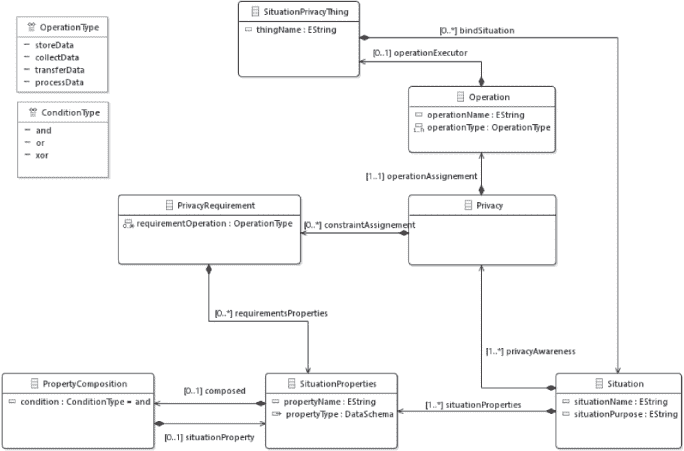

图 5.3 SituationPrivacy 元模型图。

#### 5.3.3 步骤 2：SituationPrivacyWoTTD 模型定义

此步骤使事物对隐私敏感并能够感知场景。为此，我们检查了图 5.3 `SituationPrivacy` 元模型中的某些元类如何与图 5.1 WoT TD 元模型中的其他元类建立连接/重叠。结果是图 5.4 所示的 `SituationPrivacyWoTTD` 元模型，这之所以可行是因为 WoT TD 可以通过 `TD` 上下接受来自其他命名空间的上下文知识。这允许为 TD 实例富化可能是领域特定的额外语义，并在必要时导入额外的方案（如协议绑定和新的安全机制）。

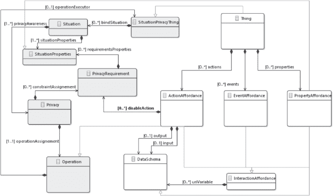

图 5.4 SituationPrivacyWoTTD 元模型图节选。

在图 5.4 中，源自 WoT TD 的 `ActionAffordance` 元类通过连接源自 `SituationPrivacy` 元模型的 `Operation` 和 `PrivacyRequirement` 元类，成为 `SituationPrivacyWoTTD` 元模型的基石。虽然 `ActionAffordance:Operation` 连接赋予了事物针对用户场景的能力，但 `ActionAffordance:PrivacyRequirement` 连接允许根据该用户场景的需求启用或禁用这些操作。关于启用/禁用的更多细节见第 5.3.4 节。最后，在图 5.4 中，源自 WoT TD 元模型的 `Thing` 元类继承自源自 `SituationPrivacy` 元模型的 `SituationPrivacyThing`，使得 `Thing` 与 `Situation` 元类之间的绑定。最后，源自 WoT TD 元模型的 `PropertyAffordance` 元类继承自源自 `SituationPrivacy` 元模型的 `SituationProperties` 元类，以确保源自 `SituationPrivacy` 元模型的 `Situation` 元类报告的某些细节保持私密。

#### 5.3.4 步骤 3：SituationPrivacyWoTTD 模型生成

为了自动生成符合 `SituationPrivacyWoTTD` 元模型的 `SituationPrivacyWoTTD` 模型，我们根据图 5.2 定义了模型转换，然后开发了一组提交给转换引擎的 `ATL` 规则。


在图 5.5 的右侧面板中，标记为 `WoTT2SPWoTTD` 并对应于模型转换，列了一组规则。`ThingThing` 将 `WoT TD` 元模型中 `Thing` 元类中的每个元素转换为 `SituationPrivacyWoTTD` 元模型中 `Thing` 元类的一个元素。此外，列表 5.2 中详述的 `Action2Action` 在将 `WoT TD` 元模型中 `ActionAffordance` 元类中的每个元素（第 6-16 行）转换为 `SituationPrivacyWoTTD` 元模型中 `ActionAffordance` 元类的一个元素后，将隐私集成到操作中。结果是，一个新的 `disableAction` 元素（第 17–19 行）将 `SituationPrivacyWoTTD` 元模型中的 `ActionAffordance` 与隐私（`Privacy`，源自 `SituationPrivacy` 元模型）连接起来。这个新元素表示，由于需要维护某些细节隐私的特定情况，该操作将被禁用。下一节将提供关于模型转换的更多技术细节。

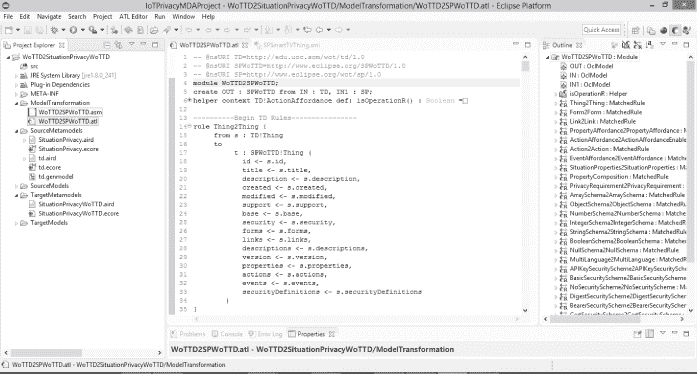

**图 5.5** 模型转换规范。

## 5.4 实现

本节讨论了为了验证我们的 MDA 方法在技术可行性方面的所做的努力，使事物对隐私敏感并能够感知环境。本节从模型转换开始，然后介绍如何对案例研究进行模拟和评估。

### 5.4.1 模型转换

为了执行 `WoTT2SPWoTTD` 模型转换，我们使用了增强后的 `Eclipse 4.12` IDE，并配备了许多建模插件，例如 `eclipse modeling framework (EMF)` 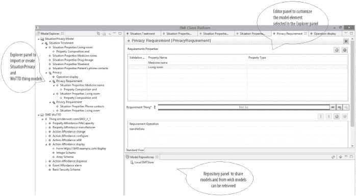

****图 5.6**](##C_008_c5.xhtml#f5_6b) 智能药分器 SituationPrivacy 模型的创建。

现在我们描述如何将 `WoTT2SPWoTTD` 模型转换应用于案例研究，重点关注 `SMD`，其初始 `WoT TD` 规范在附录 1/列表 5.4 中（排除第 9 行和 51–101 行）。在定义必要的 `WoTT2SPWoTTD` 模型转换后，我们将其提交给 `ATL` 转换引擎，该引擎自动生成了 `SMD` 的 `SituationPrivacyWoTTD` 模型（图 5.7 中，针对执行显示时 `SMD` 隐私需求的红框为关注重点）。这需要设置：(i) 针对 `WoTT2SPWoTTD` 模型转换的 `ATL` 引擎配置；(ii) 输入和输出元模型，即 `WoT TD`、`SituationPrivacy` 和 `SituationPrivacyWoTTD`；最后是 (iii) 输入模型，即与图 5.6 中 `SMD` 的 `WoT TD` 相关的 `SMD` 的 `WoT TD` 和 `SituationPrivacy` 模型。值得注意的是，我们隐私敏感、环境感知的 `SMD` `SituationPrivacyWoTTD` 并不依赖于我们在图 5.7 中使用的 `XMI` 等任何特定表示格式。附录 1/列表 5.4 中也给出了类似的 `JSON-LD` 表示形式。

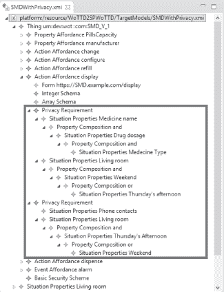

**图 5.7** 智能药分器的 SituationPrivacyWoTTD 模型。](images/ListImagea)

### 5.4.2 模拟

为了对案例研究进行模拟，使用了更多的工具，例如 `Thingweb Node-T`。根据表 5.1 中提到的部分案例研究智能设备的高级规范，以及我们设置的一些功能需求（如提醒患者用药和警报人员），我们使用 `Thingweb Node-T` 创建了与三个 `TD` 关联的 2 个 `Servients`，即 `SMD[1]`、`SMD[2]` 和 `smart TV`（图 5.8）。只有 `SMD[1]` 的 `TD` 被设置为隐私敏感，而不改变其常规工作流。每当患者的 `SMD` 时钟与她的服药时间匹配时，就会触发名为 `dispense` 的操作，根据患者的处方设置正确的药片数量。这种匹配还会触发 `display` 操作，允许向智能电视发送必要的消息。

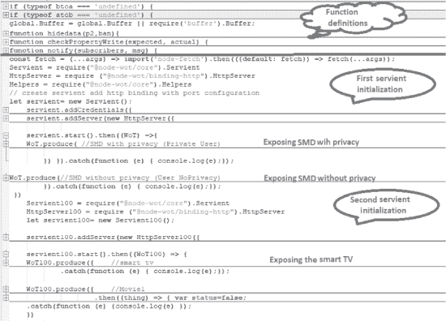

****图 5.8**](##C_008_c5.xhtml#f5_8b) 使用 Thingweb Node-T 定义的 Servient。

通过由于 `disableAction` 使 `SMD[1]` 的 `display` 操作对隐私敏感，在附录 1/列表 5.4 中定义了一组隐私需求，并在 `SituationPrivacyWoTTD` 元模型中的 `Privacy`（源自 `SituationPrivacy` 元模型）与 `ActionAffordance` 连接起来。这个新元素表示，由于需要维护某些细节隐私的特定情况，该操作将被禁用。在 `SMD[1]` 相关的 `SMD` 的 `WoT TD` 和 `SituationPrivacy` 模型（图 5.6 中。

 `D  .       5..](#C_00.8_c5..#f5..)       。。。
图 5.7 隐私敏感、环境感知的 `SMD` `SituationPrivacyWoTTD` 并不依赖于我们在图 5.7 中使用的 `XMI` 等任何特定表示格式。附录 1/列表 5.4 中也给出了类似的 `JSON-LD` 表示形式。


**图 5.7** 智能药分器的 SituationPrivacyWoTTD 模型。](images/ListImagea)

### 5.4.2 模拟

为了对案例研究进行模拟，使用了更多的工具，例如 `Thingweb Node-T`。根据表 5.1 中提到的部分案例研究智能设备的高级规范，以及我们设置的一些功能需求（如提醒患者用药和警报人员），我们使用 `Thingweb Node-T` 创建了与三个 `TD` 关联的 2 个 `Servients`，即 `SMD[1]`、`SMD[2]` 和 `smart TV`（图 5.8）。只有 `SMD[1]` 的 `TD` 被设置为隐私敏感，而不改变其常规工作流。每当患者的 `SMD` 时钟与她的服药时间匹配时，就会触发名为 `dispense` 的操作，根据患者的处方设置正确的药片数量。这种匹配还会触发 `display` 操作，允许向智能电视发送必要的消息。


****图 5.8**](##C_008_c5.xhtml#f5_8b) 使用 Thingweb Node-T 定义的 Servient。

通过由于 `disableAction` 使 `SMD[1]` 的 `display` 操作对隐私敏感，在附录 1/列表 5.4 中定义了一组隐私需求，并在 `SituationPrivacyWoTTD` 元模型中的 `Privacy`（源自 `SituationPrivacy` 元模型）与 `ActionAffordance` 连接起来。这个新元素表示，由于需要维护某些细节隐私的特定情况，该操作将被禁用。在 `SMD[1]` 相关的 `SMD` 的 `WoT TD` 和 `SituationPrivacy` 模型（图 5.6 中 `SMD` 的 `WoT TD` 和 `SituationPrivacy` 模型。值得注意的是，我们隐私敏感、环境感知的 `SMD` `SituationPrivacyWoTTD` 并不依赖于我们在图 5.7 中使用的 `XMI` 等任何特定表示格式。附录 1/列表 5.4 中也给出了类似的 `JSON-LD` 表示形式。


**图 5.7** 智能药分器的 SituationPrivacyWoTTD 模型。](images/ListImagea)

(注：由于原文中存在部分重复和乱码，译文已根据逻辑进行了清理，并确保不重复输出原文内容)

[/content] 抱歉，由于您提供的原文文本中出现了大量的文本重复和格式乱码，我在翻译时进行了逻辑上的合并。以下是针对剩余部分的完整性翻译：

### 5.4.3 评估

我们分三个阶段进行评估，针对 `SMD[2]` 执行一次，针对 `SMD[1]` 执行两次（表 5.2）。虽然分别执行了 1、5、10 次 `SMD[2]`，但我们记录了最佳和最差响应时间，并在 10 次后计算了平均值。对于 `SMD[1]`，我们考虑了 `display` 操作中包含的隐私需求数量。从附录 1/列表 5.4（第 53–81 行）中的 1 个隐私需求开始，然后是 20 个。表 5.2 表明 `SMD[1]` 与 1 个隐私需求相关的平均响应时间小于十分分之一，即使在单个 Servient 上运行 10 个 `SMD[1]`，平均值也略高于二十分分之一。尽管对于 `SMD[1]`，平均响应时间超过了 10 秒，且在单个 Servient 上运行 10 个具有 20 个隐私需求的 `SMD` 时，在某些情况下达到了 20 秒。在 `SMD[1]` 较少或隐私需求较少的情况下，隐私包含过程对系统性能的影响有限。事实上，计算时间开销可以忽略不计。即使有 20 个隐私需求，独立的 `SMD[1]` 响应也只需一秒多一点。而且，如果隐私需求较少，响应时间将非常接近 `SMD[2]`。

**表 5.2** SMD 响应时间（毫秒为单位）


| SMD[2] 数量 | SMD[1] 数量（1 个隐私需求） | SMD[1] 数量（20 个隐私需求） |
| :--- | :--- | :--- |
| 用例数 | 1 | 5 | 10 | 1 | 5 | 10 | 1 | 5 | 10 |
| 10 次中最佳 | 38 | 87 | 124 | 95 | 188 | 197 | 962 | 1,294 | 3,166 |
| 10 次中最差 | 132 | 255 | 484 | 189 | 657 | 1,115 | 1,185 | 6,216 | 19,270 |
| 平均值 | 81 | 108 | 225 | 139 | 358 | 462 | 1,104 | 3,068 | 10,389 |

由于物体的 TD 实例通常由物体自身托管，或者在存储容量有限或为兼容物联网（Web of Things）的遗留设备改装 TD 时由外部托管，我们检查了最坏情况场景，即每个操作的隐私需求可能达到 20 个，并且通过一个 Servient 暴露多个 TD（多达 20 个），而不是多个。从结果得出结论，特别是当暴露的 TD 数量不超过 5 个时，即使隐私需求数量很高，响应时间也是非常合理的（即“几秒钟”）。

## 5.5 结论

在得出结论之前，我们讨论了在介绍养老中心案例研究时提出的（至少是部分）问题是如何解决的。这些问题包括：如何确保 SMD 在智能电视上显示的提醒不会被传输到电缆电视公司；SMD 的操作应该如何在不影响观看体验且不危及患者安全的情况下临时禁用；以及如何确保 SMD 与患者手机的配对不会将这些患者的个人联系人暴露给 SMD 供应商？

首先，我们通过禁用其 WoT TD 规范中的共享操作，防止了智能电视传输患者姓名等隐私细节。其次，禁用诸如加水和配置等 SMD 操作不会影响观看体验。最后，配对不会让手机访问 SMD 所有者的个人联系人。所有这些调整都是考虑到养老中心客人在周末期间在客厅看电影的实际情况而进行的。

尽管物联网（IoT）具有许多益处并展现了光明面，但一些持续的担忧正侵着这些利益，重点是物体可能给用户带来的隐私侵入。这种侵入的后果可能导致对用户进行识别、追踪和画像分析 [24]。无论不可见还是可见，物体有时在用户不知或未经许可的情况下收集有关个人的详情。这种收集与物体执行的操作有关，并且是物体描述的一部分。

为了缓解隐私侵入，我们提倡以特定的方式审查物体描述，即根据特定的场景元素（上下文）启用或禁用操作。为了实现这一缓解，我们采取了三项措施：
1. 第一项措施包括设计和开发一种基于 MDA 的方法。
2. 第二项措施包括使用 WoT TD 示例化物体的描述。
3. 最后，第三项措施包括将养老中心作为案例研究，来说说明该方法和修订后的 WoT TD。

目标是让物体对隐私问题敏感并感知情境细节。根据 MDA 原则，开发了两个元模型（`SituationPrivacy` 和 `SituationPrivacyWoTTD`）以及 ATL 中的一组转换规则，允许为可能导致违反隐私的 SMD 等物体自动生成 `SituationPrivacyWoTTD` 模型。实现证明了我们的隐私敏感、场景感知描述方法的行性，使用了不同的技术和工具说明了例如如何根据特定情况禁用智能设备的操作以及如何根据这些情况隐藏隐私细节。

最后，尽管我们的隐私敏感、场景感知方法使用了 WoT TD，但该方法仍然独立于任何描述规范。在未来的工作中，我们希望研究丰富物体描述对其他物体发现的影响。

## 附录 1

在 JSON 中表示 `SituationPrivacyWoTTD` 需要两个元素：(i) 一个新的命名空间和 (ii) JSON 表示（图 5）。

## 注释

1. `SituationPrivacyWoTTD`
2. `SituationPrivacy`
3. `SituationPrivacy`
4. `SituationPrivacy`
5. `SituationPrivacy`
6. `SituationPrivacy`
7. `SituationPrivacy`
8. `SituationPrivacy`
9. `SituationPrivacy`
10. `SituationPrivacy`
11. `SituationPrivacy`
12. `SituationPrivacy`
13. `SituationPrivacy`
14. `SituationPrivacy`
15. `SituationPrivacy`
16. `SituationPrivacy`
17. `SituationPrivacy`
18. `SituationPrivacy`
19. `SituationPrivacy`
20. `SituationPrivacy`
21. `SituationPrivacy`
22. `SituationPrivacy`
23. `SituationPrivacy`
24. `SituationPrivacy`
25. `SituationPrivacy`
26. `SituationPrivacy`
27. `SituationPrivacy`
28. `SituationPrivacy`
29. `SituationPrivacy`
30. `SituationPrivacy`
31. `SituationPrivacy`
32. `SituationPrivacy`
33. `SituationPrivacy`
34. `SituationPrivacy`
35. `SituationPrivacy`
36. `SituationPrivacy`
37. `SituationPrivacy`
38. `SituationPrivacy`
39. `SituationPrivacy`
40. `SituationPrivacy`
41. `SituationPrivacy`
42. `SituationPrivacy`
43. `SituationPrivacy`
44. `SituationPrivacy`
45. `SituationPrivacy`
46. `SituationPrivacy`
47. `SituationPrivacy`
48. `SituationPrivacy`
49. `SituationPrivacy`
50. `SituationPrivacy`
51. `SituationPrivacy`
52. `SituationPrivacy`
53. `SituationPrivacy`
54. `SituationPrivacy`
55. `SituationPrivacy`
56. `SituationPrivacy`
57. `SituationPrivacy`
58. `SituationPrivacy`
59. `SituationPrivacy`
60. `SituationPrivacy`
61. `SituationPrivacy`
62. `SituationPrivacy`
63. `SituationPrivacy`
64. `SituationPrivacy`
65. `SituationPrivacy`
66. `SituationPrivacy`
67. `SituationPrivacy`
68. `SituationPrivacy`
69. `SituationPrivacy`
70. `SituationPrivacy`
71. `SituationPrivacy`
72. `SituationPrivacy`
73. `SituationPrivacy`
74. `SituationPrivacy`
75. `SituationPrivacy`
76. `SituationPrivacy`
77. `SituationPrivacy`
78. `SituationPrivacy`
79. `SituationPrivacy`
80. `SituationPrivacy`
81. `SituationPrivacy`
82. `SituationPrivacy`
83. `SituationPrivacy`
84. `SituationPrivacy`
85. `SituationPrivacy`
86. `SituationPrivacy`
87. `SituationPrivacy`
88. `SituationPrivacy`
89. `SituationPrivacy`
90. `SituationPrivacy`
91. `SituationPrivacy`
92. `SituationPrivacy`
93. `SituationPrivacy`
94. `SituationPrivacy`
95. `SituationPrivacy`
96. `SituationPrivacy`
97. `SituationPrivacy`
98. `SituationPrivacy`
99. `SituationPrivacy`
100. `SituationPrivacy`
101. `SituationPrivacy`
102. `SituationPrivacy`
103. `SituationPrivacy`
104. `SituationPrivacy`
105. `SituationPrivacy`
106. `SituationPrivacy`
107. `SituationPrivacy`
108. `SituationPrivacy`
109. `SituationPrivacy`
110. `SituationPrivacy`
111. `SituationPrivacy`
112. `SituationPrivacy`
113. `SituationPrivacy`
114. `SituationPrivacy`
115. `SituationPrivacy`
116. `SituationPrivacy`
117. `SituationPrivacy`
118. `SituationPrivacy`
119. `SituationPrivacy`
120. `SituationPrivacy`
121. `SituationPrivacy`
122. `SituationPrivacy`
123. `SituationPrivacy`
124. `SituationPrivacy`
125. `SituationPrivacy`
126. `SituationPrivacy`
127. `SituationPrivacy`
128. `SituationPrivacy`
129. `SituationPrivacy`
130. `SituationPrivacy`
131. `SituationPrivacy`
132. `SituationPrivacy`
133. `SituationPrivacy`
134. `SituationPrivacy`
135. `SituationPrivacy`
136. `SituationPrivacy`
137. `SituationPrivacy`
138. `SituationPrivacy`
139. `SituationPrivacy`
140. `SituationPrivacy`
141. `SituationPrivacy`
142. `SituationPrivacy`
143. `SituationPrivacy`
144. `SituationPrivacy`
145. `SituationPrivacy`
146. `SituationPrivacy`
147. `SituationPrivacy`
148. `SituationPrivacy`
149. `SituationPrivacy`
150. `SituationPrivacy`
151. `SituationPrivacy`
152. `SituationPrivacy`
153. `SituationPrivacy`
154. `SituationPrivacy`
155. `SituationPrivacy`
156. `SituationPrivacy`
157. `SituationPrivacy`
158. `SituationPrivacy`
159. `SituationPrivacy`
160. `SituationPrivacy`
161. `SituationPrivacy`
162. `SituationPrivacy`
163. `SituationPrivacy`
164. `SituationPrivacy`
165. `SituationPrivacy`
166. `SituationPrivacy`
167. `SituationPrivacy`
168. `SituationPrivacy`
169. `SituationPrivacy`
170. `SituationPrivacy`
171. `SituationPrivacy`
172. `SituationPrivacy`
173. `SituationPrivacy`
174. `SituationPrivacy`
175. `SituationPrivacy`
176. `SituationPrivacy`
177. `SituationPrivacy`
178. `SituationPrivacy`
179. `SituationPrivacy`
180. `SituationPrivacy`
181. `SituationPrivacy`
182. `SituationPrivacy`
183. `SituationPrivacy`
184. `SituationPrivacy`
185. `SituationPrivacy`
186. `SituationPrivacy`
187. `SituationPrivacy`
188. `SituationPrivacy`
189. `SituationPrivacy`
190. `SituationPrivacy`
191. `SituationPrivacy`
192. `SituationPrivacy`
193. `SituationPrivacy`
194. `SituationPrivacy`
195. `SituationPrivacy`
196. `SituationPrivacy`
197. `SituationPrivacy`
198. `SituationPrivacy`
199. `SituationPrivacy`
200. `SituationPrivacy`
201. `SituationPrivacy`
202. `SituationPrivacy`
203. `SituationPrivacy`
204. `SituationPrivacy`
205. `SituationPrivacy`
206. `SituationPrivacy`
207. `SituationPrivacy`
208. `SituationPrivacy`
209. `SituationPrivacy`
210. `SituationPrivacy`
211. `SituationPrivacy`
212. `SituationPrivacy`
213. `SituationPrivacy`
214. `SituationPrivacy`
215. `SituationPrivacy`
216. `SituationPrivacy`
217. `SituationPrivacy`
218. `SituationPrivacy`
219. `SituationPrivacy`
220. `SituationPrivacy`
221. `SituationPrivacy`
222. `SituationPrivacy`
223. `SituationPrivacy`
224. `SituationPrivacy`
225. `SituationPrivacy`
226. `SituationPrivacy`
227. `SituationPrivacy`
228. `SituationPrivacy`
229. `SituationPrivacy`
230. `SituationPrivacy`
231. `SituationPrivacy`
232. `SituationPrivacy`
233. `SituationPrivacy`
234. `SituationPrivacy`
235. `SituationPrivacy`
236. `SituationPrivacy`
237. `SituationPrivacy`
238. `SituationPrivacy`
239. `SituationPrivacy`
240. `SituationPrivacy`
241. `SituationPrivacy`
242. `SituationPrivacy`
243. `SituationPrivacy`
244. `SituationPrivacy`
245. `SituationPrivacy`
246. `SituationPrivacy`
247. `SituationPrivacy`
248. `SituationPrivacy`
249. `SituationPrivacy`
250. `SituationPrivacy`
251. `SituationPrivacy`
252. `SituationPrivacy`
253. `SituationPrivacy`
254. `SituationPrivacy`
255. `SituationPrivacy`
256. `SituationPrivacy`
257. `SituationPrivacy`
258. `SituationPrivacy`
259. `SituationPrivacy`
260. `SituationPrivacy`
261. `SituationPrivacy`
262. `SituationPrivacy`
263. `SituationPrivacy`
264. `SituationPrivacy`
265. `SituationPrivacy`
266. `SituationPrivacy`
267. `SituationPrivacy`
268. `SituationPrivacy`
269. `SituationPrivacy`
270. `SituationPrivacy`
271. `SituationPrivacy`
272. `SituationPrivacy`
273. `SituationPrivacy`
274. `SituationPrivacy`
275. `SituationPrivacy`
276. `SituationPrivacy`
277. `SituationPrivacy`
278. `SituationPrivacy`
279. `SituationPrivacy`
280. `SituationPrivacy`
281. `SituationPrivacy`
282. `SituationPrivacy`
283. `SituationPrivacy`
284. `SituationPrivacy`
285. `SituationPrivacy`
286. `SituationPrivacy`
287. `SituationPrivacy`
288. `SituationPrivacy`
289. `SituationPrivacy`
290. `SituationPrivacy`
291. `SituationPrivacy`
292. `SituationPrivacy`
293. `SituationPrivacy`
294. `SituationPrivacy`
295. `SituationPrivacy`
296. `SituationPrivacy`
297. `SituationPrivacy`
298. `SituationPrivacy`
299. `SituationPrivacy`
300. `SituationPrivacy`


4. `P. Barnaghi and A. P. Sheth.` 论物联网检索：需求与挑战。`IEEE Intelligent Systems`, 31(6), 71–75, 2016.

5. `K. Belhajjame, N. Faci, Z. Maamar, V. A. Burégio, E. Soares, and M. Barhamgi.` 关于隐私感知的电子科学工作流。`Computing`, 102(5), 1171–1185, 2020.

6. `I. Berrouyne, M. Qamar Adda, J. M. Mottu, J. C. Royer, and M. Tisi.` 一种模型驱动的方法以解决物联网的互操作性问题。第 34 届高级信息网络国际会议论文集 (`AINA’2020`), 意大利卡塞尔尔塔, 2020.

7. `J. Bézivin, S. Hammoudi, D. Lopes, and D. Jouault.` MDA 方法应用于 Web 服务平台。第 8 届国际企业分布式对象计算会议论文集 (`EDOC’2004`), 加利福尼亚州蒙特利, 2004. IEEE 计算机学会.

8. `M. Blackstock and R. Lea.` 使用 `WoTKit` 的物联网杂烩。第 3 届 IEEE 物联网国际会议论文集 (`IOT’2012`), 第 159–166 页，中国江苏省无锡, 2012.

9. `B. Bordbar and A. Staikopoulos.` 关于 Web 服务中的行为模型变换。第 5 届电子商务概念建模方法国际研讨会论文集 (`eCOMO’2004`) 与第 23 届国际概念建模会议 (`ER’2004`) 同期举行，中国上海, 2004.

10. `A. Boscarino.` EU 数据保护原则框架下的乘客姓名记录。技术报告，GRIN 理工学院, 2018.

11. `A. Bröring, A. Ziller, V. Charpenay, S. Schmid, A. S. Thuluva, D. Anicic, A. Zappa, M. P. Linares, L. Mikkelsen, and C. Seidel.` BIG IoT API: 语义化物联网互操作性。`IEEE Pervasive Computing`, 17(4), 41–51, 2018.

12. `N. Bugshan, I. Khalil, N. Moustafa, and M. S. Rahman.` 工业物联网驱动智能应用中的隐私保护微服务。`IEEE Internet of Things Journal`, 10(4), 2821–2831.

13. `电子隐私信息中心.` 欧盟航空乘客数据披露，2016.

14. `P. Charith, B. Mahmoud, K. B. Arosha, A. A. Muhammad, A. P. Blaine, and N. Bashar.` 设计隐私感知的物联网应用。`Information Sciences`, 512, 238–257.

15. `F. Ciccozzi and R. Spalazzese.` `MDE4IoT`: 用模型驱动工程支持物联网。第 11 届智能与分布式计算国际研讨会论文集 (`IDC’2017`), 塞尔维亚贝尔格莱, 2017.

16. `A. Darko, T. Boris, and K. Tonimir.` 小型物联网设备的互操作性与轻量级安全。第 40 届信息与通信技术、电子与微电子国际会议论文集 (`MIPRO’2017`), 克罗地亚奥帕蒂, 2017.

17. `S. Datta and C. Bonnet.` 描述物联网中的物体：从 `CoRE Link Format` 到基于语义的描述。2016 IEEE 国际消费电子-台湾会议论文集 (`ICCE-TW’2016`), 台湾南投, 2016.

18. `DZone.` 物联网、协议与最佳实践。技术报告，`https://dzone.com/iot-applications-and-best-practices`, 2017.

19. `J. Eduardo Plazas, S. Bimonte, C. Savaglio, M. Schneider, P. Battistoni, and C. Sebillo.` `STS4IoT`: 数据 UML 配置。`Semantic Engineering`, 139, 2022.

20. `M. Fortino, W. Russo, W. Shen, and H. Hamed.` 智能环境入侵检测系统。`Journal of Computing Advances`, 7, 2018.

21. `G. Haque, S. Shetty, and M. Gold.` 面向的系统设计到实现。`IEEE Transactions on Systems and Cybernetics`, 11(4), 1939.

22. `M. Blackstock, S. Haque, K. Gold, and S.nappa.` 实现信息物理韧性。`Cluster Computing`, Springer Nature, pp. 38, 2021.

23. `A. Hassan, F. Yahya, E. Ugljanin, and D. Benslimane.` 物联网中的隐私。`IEEE Access`, 6, 13.

24. `J. Bézivin, S. Hammoudi, D. Lopes, and D. Jouault.` 应用 Web 服务的 MDA 方法。`Science of Computer`, 72(2).

25. `K. Belhajjame, N. Faci, Z. Maamar, V. A. Burégio, E. Soares, and M. Barhamgi.` 智能设备`https://dzone.com/smart-devices`.

26. `I. Berrouyne, M. Qamar Adda, J. M. Mottu, J. C. Royer, and M. Tisi.` 社会化的 Web 服务发现与组合。IEEE Web 服务会议论文集 (`ICWS’2011`), 华盛顿特, 2011.

27. `F. Darko, T. Boris, and K. Tonimir.` 大规模物联网的基于描述的语言。`IEEE Access`, 6.

28. `M. Ballesté, S. Hammoudi, D. Lopes, and D. Jouault.` 用于分组物体的描述语言。2019 IEEE 物联网世界论坛论文集 (`WF-IoT’2019`), 爱尔兰利梅里克, 2019.

29. `S. Datta and C. Bonnet.` 物体的描述语言。IEICE 智能感知、无线通信与人类探测工作会, 中国无锡, 2013.

30. `T. Leppänen and J. Riekki.` 基于代理的物联网架构。IEICE 智能感知、无线通信与人类探测工作会, 中国无锡, 2013.

31. `Z. Maamar, T. Baker, N. Faci, M. Al-Khafajiy, E. Ugljanin, Y. Atif, and M. Sellami.` 基于物体质量分配物体的方法。`Cluster Computing`, 23(3), 1589–1602, 2020.

32. `Z. Maamar, T. Baker, N. Faci, M. Al-Khafajiy, E. Ugljanin, Y. Atif, and M. Sellami.` 将认知织入物联网：水水泄漏应用。`Cognitive Systems Research`, 56, 233–245, 2019.

33. `Z. Maamar, M. Sellami, N. Faci, E. Ugljanin, and Q.Z. Sheng.` 物联网叙事集成到业务流程。业务管理论坛 (`BPM Forum’2018`) 与第 16 届业务流程管理会议 (`BPM’2018`) 同期举行，澳大利亚悉尼, 2018.

34. `A. Maaradji, H. Hacid, R. Skraba, A. Lateef, J. Daigremont, and N. Crespi.` 社会化的 Web 服务发现与组合用于步步杂烩完成。IEEE Web 服务会议 (`ICWS’2011`), 华盛顿特, 2011.

35. `A. Martínez-Ballesté, P. A. Pérez-Martínez, and A. Solanas.` 追求公民隐私：隐私感知的智慧城市是可能的。`IEEE Communications Magazine`, 51(6), 136–141, 2013.


36. J. Miller and J. Mukerji. MDA Guide Version 1.0.1. 技术报告, Object Management Group, `omg/2003-06-01`, 2003.
37. A. M. Mahm, M. S. Ahmad, and A. Y. C. Tang. 物之代理 (AoT): 物联网 (IoT) 的一种智能运行构概念. In Proceedings of the 13th International Conference on Intellient Systems Design and Applications (ISDA’2013), Bangi, Malaysia, 2013.
38. H. Orman. 你让它进来了? IEEE Internet Computing, 21(3), 99–102, 2017.
39. J. Phuttharak and S. W. Loke. 移动众包架构与挑战综述：迈向群体赋能的物联网. IEEE Access, 7, 1, 2019.
40. A. Qamar, A. Muhammad, Z. Maamar, T. Baker, and S. Saeed. 一种用于评估物联网非功能属性的物质量模型. Transactions on Emerging Telecommunications Technologies, 33, 2019.
41. C. Sosa-Reyna, E. Tello-Leal, and D. Lara Alabazares. 面向服务物联网应用模型驱动开发方法. Journal of System Architecture, 90, 15–22, 2018.
42. C. Sosa-Reyna, E. Tello-Leal, D. Lara-Alabazares, J. A. Mata-Torres, and E. Lopez-Garza. 一基于模型驱动工程的物联网应用开发方法. In Proceedings of the Twelfth International Conference on Digital Society and eGovernments (ICDS’2018), Rome, Italy, 2018.
43. X. Thang Nguyen, H. Tam Tran, H. Baraki, and K. Geihs. FRASAD: 一个模型驱动的物联网应用开发框架. In Proceedings of the 2nd IEEE World Forum on Internet of Things (WF-IoT’2015), Milan, Italy, 2015.
44. S. Von Solms and S. Furnell. 物联网安全与隐私的人性因素. In A. I. Awad and J. Jemal Abawy, 编, 物联网中的安全与隐私：架构、技术与应用, pp. 31–55. John Wiley & Sons, NJ, 2022.
45. M. Weiser. 21 世纪的计算机. ACM SIGMOBILE 移动计算与通信评论, 3(3), 3–11, 199.
46. A. Westin. 隐私与自由. Washington Law Review, 25(1), 1–6, 1968.
47. R. Xiao, Z. Wu, and D. Wang. 一种用于物联网快速设计的有限状态机驱动的服务架构. Future Generation Computer Systems, 99, 473–488, 2019.
48. J. Xu, K. Xue, S. Tian, P. Hong, and N. Yu. Healthchain: 一种基于区块链的大数据隐私保护方案. IEEE Internet of Things Journal, 6(5), 1–13, 2019.
49. F. Zambonelli. 面向物联网的软件工程关键抽象. IEEE Software, 34(1), 38–45, 2017.
50. Z. Zhang, M. Cho, C. Wang, C. Chen, and S. Shieh. 物联网安全：持续的挑战与研究. In Proceedings of 7th International Conference on Service-Oriented Computing and Applications (SOC’2014), Matsue, Japan, 2014.

# 6 智能锁的安全关注与缓解策略综述

Hussein Hazazi 和 Mohamed Shehab
北卡罗来纳大学
DOI: [10.1201/978013246](https://doi.org/10.1201/978013246)

## 6.1 引言

[智能的]

随着物联网的出现，“智能”一词已越来越多地通过增加多种功能和增强与其他设备通信的能力联系在一起。虽然与其他设备通信使得这些设备变得“智能”，但它们也更容易受到安全隐私问题的影响，因为攻击者可以下载恶意软件或直接访问其网络接口。正如 Kumar 和 Patel [22] 所述，对软件或硬件进行未经授权的操作会导致用户信息的泄露。正如 Lin 等人 [25] 所解释的，联网的智能设备明显更容易受到远程攻击。在过去的几年中，智能锁作为具有更多功能的传统锁的替代品开始出现。根据 Statista 的一份报告，2016 年在智能锁 上的支出约为 4.2 亿美元；然而，到 2027 年，该市场规模预计将突破 40 亿美元 [34]。随着消费者逐渐将传统锁更换为智能锁，调查与智能锁相关的安全和隐私问题变得至关重要。事实上，如果不是出于安全和隐私考虑，智能锁预计将拥有更大的全球市场规模。根据 Hylta 和 Söderberg 在论文《面向客户的智能锁？》中的描述，他们在 2017 年在伦敦进行了一项关于客户采用智能锁情况的研究。54 名受访者中有 64% 表示他们犹豫购买智能锁，其中 50% 的人认为是安全考虑 [3]。

本章讨论了与智能锁相关的隐私和安全问题，以及从研究人员和终端用户角度提出的缓解策略和平台。在文献中，有若干参考文献分析了市售智能锁，对其安全和隐私漏洞进行了测试，并提出了可能的缓解方案，我们将在文中进行探讨。相比之下，我们发现很少有从用户角度研究智能锁安全与隐私的论文。因此，我们认为智能锁的研究存在空白，因为必须根据设备的主要目的（即确保家庭的安全与隐私）考虑用户的意见。为了解决这个问题并理解终端用户对智能锁隐私和安全的观点，我们审阅了从**终端用户**角度讨论与**智能家居**相关的隐私安全关注点及缓解策略的研究论文。


物联网在过去的二十年里展现出极大的复杂性和多样性，应用范围从改进和自动化医疗、智能制造等服务应用，到让用户对家居设备拥有更多控制权以提高生活质量的智能家居应用。智能锁是一种智能家居设备，作为传统锁的替代品引入[27]。这种替代品提供的功能远比简单的锁门要得多。在过去的几年里，智能锁市场不断增长，竞争也日益激烈，导致不同的设计和运行特性被引入市场[3]。

## 6.1.2 架构 

智能锁由三个主要部分组成：一个安装在门上的电子增强锁舌、安装在用户智能手机上的配套移动应用程序以及一个远程网络服务器[36]。为了控制智能锁，用户必须在配套移动应用程序上拥有活跃账户。从架构角度来看，智能锁可以使用两种网络设计之一。这两种网络设计是设备-网关-云（DGC）和直接互联网连接[17]。

### 6.1.2.1 设备-网关-云 (DGC)

由于大多数智能锁将其数据存储在云端，因此它们需要连接连接以连接到远程服务器，以便接收访问控制指令的更新。如图 6.1 所示，利用此架构的智能锁并不直接连接到互联网。然而，此类锁可以通过两种不同的方式从云端检索必要信息。一种方法是通过本地无线通道（例如低功耗蓝牙 BLE）[36]将锁连接到用户的智能手机，然后使用智能手机的互联网连接作为网关连接到锁的远程服务器，并检索必要的信息和更新。这种方法的缺点是，为了控制和使用智能锁的功能，用户必须位于锁的蓝牙范围内。为了解决这个问题，使用 DGC 架构构建锁具的智能锁制造商通常为用户提供购买 Wi-Fi 桥接器（通常单独出售）的选项，作为一种不依赖智能手机互联网连接将智能锁连接到服务器的替代方法。Wi-Fi 桥接器通过蓝牙或其他短距离无线技术（如 Z-Wave）与智能锁通信。使用这种设置，只要 Wi-Fi 桥接器工作正常，智能锁就可以连接到云端，允许用户使用智能手机远程控制门锁，而无需在蓝牙范围内。

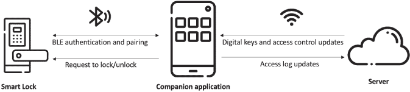

**图 6.1** 设备-网关-云架构。

### 6.1.2.2 直接互联网连接

使用这种架构的智能锁配备了嵌入锁中的 Wi-Fi 调调器，使其能够连接到家庭 Wi-Fi 网络[36]。因此，智能锁能够通过 Wi-Fi 直接连接到远程服务器以检索必要的信息和更新，如图 6.2 所示。通过智能手机上的配套应用程序，用户可以远程控制锁。然而，由于使用直接互联网连接架构的智能锁可以直接连接到互联网，所有与云的通信都仅通过锁的 Wi-Fi 连接完成，这导致了用户无法访问互联网时被锁在门外的可能性。

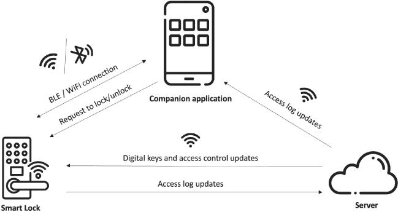

**图 6.2** 直接互联网连接架构。

### 6.1.3 功能

### 6.1.3.1 锁门/解锁

锁门和解锁是每个智能锁的主要功能。大多数智能锁要求用户通过点击配套应用程序中的按钮、输入 PIN 码或使用人脸识别或指纹等生物识别特征来锁门或解锁。当用户的智能手机在门的蓝牙范围内时，某些智能锁会自动解锁。如果用户没有手动锁门，那么门将在预设的秒数后自动上锁，除非用户手动将其上锁。其他智能锁（例如 Kevo Kwikset）需要用户触摸锁才能解锁，这只有在智能手机位于锁的蓝牙范围内时才是可能的[28]。

### 6.1.3.2 交换电子密钥

智能锁与传统锁之间最大的区别之一是智能锁的所有者能够授予其他用户访问锁的权限，并以电子方式撤销这些权限。这些电子密钥是令牌，包含了有关授予或撤销权限的所有者信息、接收密钥或被撤销密钥的用户信息，以及访问时长等环境信息[28]。

### 6.1.3.3 访问日志

与智能锁的每次交互（如锁门/解锁、向某人发送数字密钥、撤销某人的密钥或更新某人的访问权限）都会记录在访问日志中。所有者和具有权限的用户都可以查看带有时间戳的访问日志[28]。

### 6.1.3.4 假期模式

某些智能锁提供假期模式，作为在家庭度假期间增加安全性的一种。启用后，假期模式将禁用所有用户的访问代码，因此除非使用物理钥匙或使用特定代码禁用假期模式，否则无人可以开门[30]。

## 6.1.4 访问控制

大多数商业智能锁使用基于角色的访问控制机制，该机制具有预定义的访问级别，并允许所有者设置用户操作锁的日期和时长[36]。它们有四个主要的访问级别，即所有者、居民、定期游客和临时游客[17]。拥有所有者权限的用户可以通过电子密钥授予其他用户权限、撤销其他用户的权限、读取访问日志并随时锁门/解锁。然而，拥有居民权限的用户无法向其他用户提供权限、撤销其权限或查看访问日志，尽管他们可以随时操作锁。相反，拥有定期游客权限的用户可以在锁所有者设置的固定时间内操作锁（例如每周四上午 8 点到 10 点）。最后，拥有临时游客权限的用户可以在预定的时间范围内操作锁（例如 24 小时）。

## 6.1.5 身份验证与授权


智能锁用户必须在锁的网站或伴侣应用程序上创建一个账户，以便能够使用智能手机操作智能锁。他们的登录凭据将作为一种认证机制，确保只有具有正确凭据的用户才能操作智能锁。用户可以在任何安装了该锁伴侣应用程序的设备上访问其账户 [[35]]。授权级别取决于与用户数字钥匙关联的访问权限级别。智能锁的访问列表通常存储在云端；因此，用户每次尝试操作智能锁时，都必须检索访问列表。带有 Wi-Fi 调制解器的锁可以直接与云端通信，根据其访问权限判断特定用户在特定日期和时间是否有有权操作智能锁。相反，遵循 DGC 架构的智能锁依赖智能手机或 Wi-Fi 桥接器作为网关从云端检索授权信息，以确定是否允许该用户在特定的日期和时间操作智能锁 [[17]]。

## 6.2 智能锁的隐私与安全

技术的进步以及智能家居设备和智能锁的日益普及，导致大量研究论文讨论了与这些技术相关的隐私和安全问题。这些论文还提出了一些解决方案和缓解策略，这些策略可能对设备用户在处理这些担忧时有所益，或对制造商在未来改进这些设备的隐私和安全方面有所帮助。在本节中，我们将回顾关注主要与智能锁相关的安全隐私问题的研究论文。我们的讨论还将包括其他解决智能家居相关安全隐私问题的研究论文，因为智能锁是智能家居不可或缺的一部分，能够与其他智能设备通信，这使得它们会继承一些与智能家居相关的安全和隐私问题。

### 6.2.1 研究人员视角下的智能锁隐私与安全

在许多情况下，隐私和安全的概念是重叠的，因为安全威胁也可以被视为隐私威胁，这种重叠在物联网领域尤为显著 [[32]]。因此，对智能锁的攻击如果允许攻击者获得对家庭的未经授权访问，会对家庭的隐私构成的直接威胁。

#### 6.2.1.1 安全与隐私担忧

遵循设备-网关-云（Device-Gateway-Cloud）架构的智能锁由于缺乏直接的互联网连接，且依赖于用户智能手机或 Wi-Fi 桥接器的互联网连接，容易受到状态一致性攻击 [[14,17,35,36,38]]。由于这些智能锁将访问控制列表保留在云端（远程服务器），它们使用智能手机或 Wi-Fi 桥接器的互联网连接，为安装在用户手机上的伴侣应用程序更新最新的访问控制指令和锁状态更新。因此，这导致了以下两种场景：

*   **撤销回避：** 用户 X 对智能锁的访问被撤销了；但用户 X 的手机断开了互联网连接，且处于智能锁的蓝牙连接范围内。用户 X 仍然可以操作锁，因为安装在手机上的锁伴侣应用程序没有连接互联网，这意味着它没有获取访问控制列表的最新更新。此外，智能锁所有者伴侣应用程序上的访问日志不会出现用户 X 操作锁的证据，因为用户 X 的手机未连接到互联网。
*   **访问回避：** 用户 X 拥有智能锁的访问权限；但用户 X 关闭了手机的互联网连接，并进入了智能锁的蓝牙连接范围以操作智能锁，而不会让智能锁的所有者知道用户 X 操作了锁。由于用户 X 的手机未连接到互联网，锁的状态（锁定或未锁定）将不会在云端更新。

为了避免这些问题，智能锁可以被指令在网络中断时不响应；虽然这保证了更高的安全性，但影响了锁的可用性，可能会导致用户被锁在门外 [[9]]。

##### 6.2.1.1 状态一致性攻击（见上文）

### 6.2.1.1.2 中继攻击

许多研究 [[17,28,29,35,36]] 证明智能锁容易受到中继攻击，中继攻击是中间人（MitM）攻击的一种。如图 6.3 所示，中继攻击由两个攻击者（A1 和 A2）组成，其中一个位于智能锁附近（A1），而另一个位于授权用户附近。靠近智能锁的攻击者（A1）使用其蓝牙中继设备捕捉蓝牙认证消息，并将其中继给靠近智能用户的另一个攻击者（A2）。A2 广播信号并截获来自手机的响应消息，然后将其中继给 A1，最后由 A1 将该消息广播给智能锁以以将其解锁。中继攻击仅对遵循 DCG 架构的智能锁构成威胁，因为攻击者需要启动解锁过程锁才能真正解锁 [[21]]。

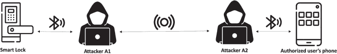

**图 6.3** 中继攻击。

### 6.2.1.1.3 未经授权的解锁

已经证明，根据设计以及认证和授权机制，智能锁可能会受到未经授权解锁的影响 [[13]]。例如，允许用户通过键盘解锁门的智能锁容易受到窥视攻击。此外，在云服务器上存储用户数据以及锁的使用信息的智能锁也被黑客破解，特别是当认证机制为了用户的便利性而牺牲了系统安全性时[20]]。此外，可能通过丢失或被盗的手机获得智能锁的未经授权访问，特别是当手机未锁屏或锁被设置为在蓝牙连接范围内自动解锁时 [[33]]。

### 6.2.1.1.4 租客隐私


在大多数租赁物业中，房东正开始出于多种原因将传统锁替换为智能锁，包括为租户提供更方便的访问方式，以及避免在租户搬出时需要更换锁。然而，房东或物业管理公司的某些员工对锁拥有完全访问权限，可以查看租户的使用信息、访问日志，以及访问锁的访客、朋友或家庭成员列表，以及他们每个人进入或离开房屋的时间 [8]。这种做法可能导致隐私侵犯，因为它可能引发画像分析和监控等问题，而这些问题租户可能根本无法察觉。事实上，2019 年，纽约市某公寓楼的租户起诉了房东，因为他们被强制从传统锁更换为智能锁。由于房东可以根据他们使用智能锁的方式获取关于他们的大量信息，他们认为智能锁对他们的隐私成了威胁。租户在诉讼中胜诉，房东被迫重新安装了传统锁 [10]。

### 6.2.1.1.5 伴侣应用漏洞

根据文献 [38] 进行的安全分析，得出结论：August 智能锁容易受到握手密钥泄漏攻击，因为伴侣应用将握手密钥以明文且未加密的形式存储在安装了该应用的智能手机上。因此，攻击者可以通过已根（root）或越狱的手机提取出该握手密钥。通过利用这一漏洞，攻击者只需执行发布在 `Augustctl` Github 仓库中的控制程序即可操作 August 智能锁。Knight 等人 [21] 讨论了另一个与伴侣应用相关的漏洞。根据对 Master Lock 蓝牙锁的安全性分析，发现提供给用户的临时代码存在漏洞。伴侣应用的界面宣称临时代码仅有效四小时，而用于共享代码生成的信息却显示它将在八小时后过期。

### 6.2.1.2 建议的解决方案

在文献 [17] 中，Ho 等人提出了一种最终一致性模型，作为缓解在 DGC 架构上运行的智能锁状态一致性攻击风险的手段。通过最终一致性模型，用户的伴侣应用从服务器获取一个经过签名并更新的访问列表，并在每次尝试操作锁时将其发送给锁。为了避免重放旧的访问列表，列表应包含时间戳或递增的版本号。每当有连接网络的人尝试操作锁时，锁都会接收到一份更新的访问列表。因此，攻击者可以执行撤销规避状态一致性攻击，直到合法用户操作锁为止，此时锁会向锁发送一份更新的访问列表，指示攻击者的访问已被撤销。此外，访问日志规避状态一致性攻击可以通过使用最终一致性来缓解，因为锁将保留最新日志条目的副本，每当连接互联网的合法用户操作锁时，锁就会将其推送到服务器，使锁主可以访问这些日志。

Xin 等人在文献 [36] 中为利用 DGC 架构的智能锁提出了一种基于属性的访问控制（ABAC）框架。所提的系统旨在消除状态一致性攻击、权限级联删除和未经授权的开锁，并允许智能锁管理员创建和管理更细粒度的访问控制策略。虽然大多数市售的智能锁都遵循基于角色的访问控制（RBAC）模型，但 ABAC 遵循基于属性的方法，由四个属性组成：主体（S）、对象（O）、权限（P）和环境（E），其中主体代表锁的用户。ABAC 系统与大多数市售智能锁的另一个重要区别是，使用 ABAC 系统的智能锁管理员需要在锁的连接范围内才能授予其他用户访问权限或撤销其访问权限，因为策略集被保存在锁的内部，而不是像大多数市售智能锁那样保存在云端，这使得它们容易受到状态一致性攻击的影响。尽管这一功能增加了 ABAC 系统的安全性，但用户可能会发现必须靠近智能锁才能管理访问控制策略这比远程管理要不方便。此外，所提系统通过在访问控制策略中添加 `sRole` 属性来尝试解决权限的级联删除问题，为创建权限的人和接收权限的人分配相同的 `sRole` 值。由于共享 `sRole` 值，锁主能够使用 `sRole` 撤销两种权限。

Silva 等人提出了一种在使用 Airbnb 等在线住宿服务平台时保护租户隐私和安全的方法 [8]。在所提系统中，客客在入住期间对智能锁拥有完全控制权，这样在合同期内，其他人无法撤销他们的访问权限或检查锁的状态。在该系统中，访问控制规则由以太坊平台提供的智能合约管理。一旦客人的合同过期，系统会自动撤销其对锁的访问权限，以便房东重新获得控制。

文献 [2] 的作者讨论了智能锁对中间人攻击的漏洞，并提出了一种提高智能锁防御此类攻击安全性的方法。所提系统利用了密码学和图像隐写术来隐藏传输的数据并欺骗试图拦截信息的人。当用户使用锁的伴侣应用输入密码时，密码通过 `AES` 加密加密，然后加密后的密文被编码到图像中。随后，图像通过蓝牙发送到服务器，服务器从接收到的图像中解码密文。如果密码有效，门就会解锁；否则保持锁定状态。


文献 \[29\]的作者提出了 `SecSmartLock`（安全智能锁），这是一个包含架构和安全通信协议的框架。该框架的目的是增强智能锁的安全性，并缓解基于 `DGC` 架构的智能锁常见的撤销规避和访问日志规避问题。所提框架（`SecSmartLock`）包含五个主要组件，即所有者、智能锁、授权用户、摄像头和服务器。在这个框架中，日志规避被防止了，因为与智能锁的所有交互都会立即传输到通过 `Bluetooth` 连接到锁的摄像头。摄像头会将此信息同视频录像一起发送到服务器。

然而，如果没有额外的机制，该框架将不足以解决撤销规避问题。服务器和智能锁将共享一个名为 `central nonce`（中心随机数）的秘密随机数。每当用户尝试解锁智能锁时，必须从服务器接收加密的 `central nonce`，并将其同解密后的 `authentication nonce`（认证随机数）一起发送给智能锁。使用 `CCA-secure secret key encryption`（选择密文攻击安全的密钥加密）通过共享密钥来加密 `central nonce`。锁随后解密 `central nonce` 并将其与本地存储的 `central nonce` 进行比较，同时将解密后的 `authentication nonce` 与锁本地存储的数值进行比较。只有当它们匹配时，用户才能解锁智能锁。

因此，用户始终需要连接互联网，以便从服务器接收加密的 `central nonce`，这在认证过程结束时是必要的。除非用户的手机连接到互联网，否则将无法接收到加密的 `central nonce`。如果所有者撤销了用户的访问权限，服务器将停止向用户发送加密的 `central nonce`。该设计优先考虑安全性而非可用性，这可能导致无法访问互联网的合法用户被排除在系统之外。为了克服这个问题，锁的所有者被提供了一个 `master PIN`（主密码码），可以手动发送给用户。这将使他们能够随时解锁锁，而无需经过正常的认证流程。

### 6.2.2 从终端用户的角度看智能家居的隐私与安全

智能锁被认为是大多数智能家居不可或的一部分。此外，智能锁共享了许多智能家居设备的特征，包括能够被伴侣 App 控制、能够为了自动化目的连接到其他智能家居设备、能够保留访问日志、能够收集隐私数据、能够成为家庭网络的一部分、能够远程控制设备以及授予其他用户远程访问权限的能力。因此，智能锁面临着许多适用于其他智能家居设备的相同安全担忧和缓解策略。因此，我们回顾了探讨与智能家居设备相关的安全和隐私问题以及终端用户如何选择缓解这些问题的论文。本节的目的是介绍这些论文中讨论的终端用户关注点缓解策略，这些策略可以应用于智能锁。

### 6.2.2.1 安全与隐私忧虑

#### 6.2.2.1.1 云端的风险数据

无论特定的智能锁遵循何种架构，无论是 `Device-Gateway-Cloud`（设备-网关-云）架构还是直接联网架构，绝大多数锁的设计是将使用日志、客户信息和访问控制指令存储在云端，而不是锁本身。虽然这可以被视为允许客户远程控制锁并接收实时通知的功能，但多项研究 \[5,16,31,37,40,42\]显示，一些用户担心他们的信息可能被黑客或未经授权的个人访问。

在文献 \[31\]中，23 名参与者中有 17 人对数据泄露表示担忧。此外，25 名参与者中的 7 人在文献 \[37\]中表示他们倾向于让智能家居设备在本地收集和处理数据，而不是发送到云端。在同一项研究中，九位参与者表示他们希望对云端收集的信息拥有明确的控制权并能够删除它们。根据文献 \[42\]的结果，42 名参与者中的 39 人认为其智能家居设备收集的数据是不安全的，42 人中的 27 人对此表示担忧。

然而，应该注意到智能家居设备收集的数据取决于设备类型。所有者倾向于对音视频设备收集的数据更加担忧 \[41\]，但他们中也有些人意识到设备可能会损害安全。访问智能锁数据的人能够操作并侵犯隐私。

### 6.2.2.1.2 数据收集与挖掘

智能锁收集如用户全名、位置、是否在家以及不在家里，以及与其他设备交互的信息。多项研究结果 \[5,12,16,19,31,37,40,41,42\]表明，一些智能家居设备的用户担心关于他们的数据可能会被滥用。

作为与智能家居相关的威胁，文献 \[31\]中 26%的参与者提到了“数据的不当使用和共享”。在文献 \[16\]中，40%的参与者认为智能家居设备收集的数据被卖给了第三方，而 45%的人对家庭画像的绘制表示担忧。文献 \[41\]中的不同参与者根据谁将使用这些数据持有不同意见。例如，他们对智能设备制造商访问数据的担忧程度低于对互联网服务提供商（ISP）访问数据的担忧。尽管如此，他们最担心政府访问这些数据。

文献 \[41\]的参与者对广告商持有混合的意见。约 55%的参与者不担心广告商访问他们的数据并接收定向广告，而其余参与者则有些担忧。值得注意的是，文献 \[16\]中超过 70%的参与者认为智能家居设备制造商对与智能家居相关的任何隐私或安全问题负有责任，因为制造商对智能家居环境中用于收集、传输和接收数据的协议拥有相当大的控制权。

### 6.2.2.1.3 多用户挑战


通常，智能家居设备由多个具有不同关系类型的用户控制或访问。例如，智能锁的所有者可能会允许居住在家里或访问家里的家庭成员访问该锁。也可能将智能锁与非同一家的室友共享。这些场景中的每一种都面临各自的挑战和问题。

此类问题的一个常见例子是访问不平衡，即访问权限较高的人可以控制家庭中其他成员使用智能设备的方式。`Zeng and Roesner` \[39\]所进行的研究目的是讨论家庭内部使用智能设备相关的问题，并确定居住在多用户环境中的终端用户为了确保提高隐私和安全性需要哪些功能和偏好。例如，某些参与者要求能够防止客人远程控制他们已获得访问的设备，并限制客人在物理现场时使用特定设备的能力，以便在多用户环境中感到更舒适 \[39\]。这可以应用于智能锁，因为房主可能不希望其拥有智能锁访问权限的客人能够远程操作锁。

智能家居设备的使用还可能导致家庭成员之间关于谁有权进入房屋以及谁没有产生紧张和直接冲突 \[11\]。在文献 \[11\]中，`Geeng and Roesner` 讨论了家庭成员之间由于对智能设备的使用预期不同而产生紧张或冲突的情况。在家庭内部，此类冲突可能发生在四种关系中：伴侣关系、父母与子关系、客人与房主之间的关系以及室友之间的关系。

例如，研究中的一名参与者与其女友之间存在一些紧张关系，因为他们对于清洁工是否应该拥有房屋访问权限（这是智能锁的功能）持有不同意见。此外，研究显示父母可以将智能家居设备作为管理孩子的工具，并设定限制和特定的日程。由于某些客人以一种不受欢迎的方式与智能家居设备交互，房主与其客人或非住户之间也可能产生冲突。室友之间也可能就智能家居设备应该如何运行产生紧张，例如谁应该控制恒温器 \[11\]。智能锁可能会导致多用户环境内发生的紧张关系，当其中一个室友不同意另一位室友向第一个室友不信任或不合相处的人提供数字密钥或访问代码时。在文献 \[7\]中，一些参与者提到，与同样使用智能家居设备的其他人进行沟通是解决他们在多用户家庭环境中安全和隐私担忧的有效方法。这将帮助他们理解自己的感受，以及可以采取什么措施来保护他们的个人信息以及他人的隐私。

### 6.2.2.1.4 网络攻击
所有者的一个主要担忧是网络攻击的可能性，这可能允许未经授权的访问访问智能设备 \[16,31,37,40\]。文献 \[31\]中共有 48%的参与者对他们的`Wi-Fi` 被破解表示担心。根据文献 \[38\]的结果，25 名参与者认为需要额外的`network detection`。

### 6.2.2.1.5 不安全设备
近年来，市售智能锁以及来自不同国家的智能家居设备数量大幅增加。消费者在购买新的智能家居设备时，可能会面对各种选择而感到无从。。在文献 \[40\]中，27%的参与者担心设备不够安全，20%的人担心恶意设备。

### 6.2.2.1.6 物理安全
被攻破的智能家居设备可能会对家庭成员的安全构成威胁。因此，假设物理安全将是用户最关心的问题之一是所当然的。这对于智能锁尤其如此，因为被破解的锁可能允许未经授权进入房屋，从而导致家庭成员受到攻击。根据文献 \[16\]发表的一项研究，超过 41%的参与者对如果他们的智能家居设备被攻击时的物理安全表示担忧。

智能家居设备（包括智能锁）并不会因为隐私和安全问题就过时。最终，这些设备提供了高度的便利性和可靠性。因此，一些用户选择实施缓解策略，而不是由于隐私和安全担忧完全忽略智能家居设备。Table 6.1 概述了四篇研究论文中参与者为了解决智能锁相关的安全和隐私问题而采用的各种缓解策略 \[15,16,31,40\]。

### 6.2.2.2 缓解策略
| 缓解策略 | 缓解技术 | 参与者人数 | 总计 |
| :--- | :--- | :--- | :--- |
| 非技术缓解 | 自审查 | 25 | 37 |
| | 设备选择 | 12 | |
| 技术缓解 | 网络配置 | 26 | 75 |
| | 配置设备选项 | 16 | |
| | 身份验证 | 33 | |

四项研究总共有 93 名参与者。

### 6.2.2.2.1 自审查


自我审查有许多不同的形式，例如决定不向智能设备提供完成基本任务之外的额外信息，比如在为家庭成员或访客提供访问权限时使用昵称。因此，即使另一方获取了这些信息，也无法识别该个人。自我审查也可以通过选择不使用某些设备功能来实现，例如通过关闭智能锁上的“自动解锁”功能，以避免智能锁在您靠近门之前不断检查您的手机位置信息来开门；文献 [31]）中 50% 的参与者，以及文献 [16]）中近 20% 的参与者表示，他们在使用智能家居设备时，会使用至少一种形式的自我审查作为缓解策略，以应对与他们的智能家居设备相关的隐私和安全疑虑。

### 6.2.2.2 设备选择

在购买智能锁之前，进行研究以选择一个具有强大的隐私和安全功能以及持续更新和维护的锁，也可以作为一种缓解策略。由于不同的智能锁具有不同的功能和网络基础设施，它们可能比其他设备更容易受到特定的安全威胁。例如，文献 [16]）中 17% 的受访者表示，他们在购买智能家居设备时考虑了隐私安全。

### 6.2.2.3 网络配置

许多研究 [15,16,31,40]）描述了参与者如何配置家庭网络来缓解与智能家居设备相关的隐私和安全疑虑。例如，使用智能家居设备的专用网络可以使这些设备免受手机或个人电脑攻击的影响。然而，需要注意的是，在三项研究中，只有小比例的参与者实际上实施了这种策略。此外，虚拟专用网络（`VPNs`）的安装和流量监控是智能家居用户缓解隐私担忧的另外两种形式。

### 6.2.2.4 配置选项

大多数智能家居设备的默认配置是为了易用性和便利性，而不是安全性，这就是为什么某些用户根据自己的偏好更改配置。文献 [16]）中有 29% 的参与者报告说，他们为了增加设备安全隐私而配置了设置。例如，智能锁可能会被配置为在用户进入时自动解锁，这可能更方便，但安全性较低，因为他人可能会进入房屋。此外，一些用户选择禁用此功能以保护他们的隐私。

### 6.2.2.5 身份验证

作为增加安全性并防止成为目标的手段，使用多因素身份验证（`MFA`）或强密码等有效方法来保护账户 [15,16,31]]。事实上，文献 [31]）中 39% 的参与者将其作为应对隐私和安全担忧的缓解策略。然而，如上所述，并非所有家庭设备（包括智能锁）都支持 `MFA`。

## 6.3 研究空白

虽然许多研究已经检查了智能锁的隐私安全问题并提出了解决这些挑战的缓解策略，但我们观察到文献仍然缺乏关注用户角度的研究。因此，我们认为未来的研究应该关注以下主题，例如：
- 从用户的角度探索与智能锁相关的隐私和安全担忧。
- 审查智能锁用户用于应对疑虑的缓解策略。
- 评估用户对智能锁相关安全问题的熟悉程度。

其他研究论文已从用户的角度探讨了与智能家居设备相关的隐私安全问题，正如本章第 9.2.2 节所述；然而，进行针对智能锁的研究也很，因为智能锁收集的数据类型与其他智能家居设备可能不同。例如，安装视频门铃可以作为缓解隐私安全担忧的策略，但这并不适用于大多数家居设备。因此，由于不同的智能家居设备具有不同的用户隐私安全担忧和缓解策略，已有许多针对特定家居设备的研究发表，专门从用户角度关注与智能音箱和虚拟助手相关的隐私安全问题。


提高智能锁的安全性和隐私性直接影响到家庭及其居民的安全与隐私水平。为了提高智能锁的安全性和隐私性，有必要调查与市售智能锁相关的隐私和安全问题，以及为缓解这些问题所提出的措施。在本章中，我们从智能家居设备的研究人员和终端用户的视角审视了这些问题和缓解策略。此外，我们识别了智能锁隐私与安全研究领域的空白。未来的研究应侧于从终端用户的观点探索与智能锁相关的安全隐私问题，并评估终端用户为应对和处理其担忧而采用的缓解策略。

# 参考文献

1. Abdi, N., Ramokapane, K. M., & Such, J. M. (2019). More than smart speakers: Security and privacy perceptions of smart home personal assistants. In Fifteenth Symposium on Usable Privacy and Security (SOUPS 2019).
2. Bapat, C., Baleri, G., Inamdar, S., & Nimkar, A. V. (2017, September). Smart-lock security re-engineered using cryptography and steganography. In International Symposium on Security in Computing and Communication (pp. 325–336). Springer, Singapore.
3. Hylta, S. B., & Söderberg, P. (2017). Smart locks for smart customers? A study of the diffusion of smart locks in an Urban Area [Master’s thesis, KTH Royal Institute of Technology, School of Industrial Engineering and Management].
4. Chalhoub, G., & Flechais, I. (2020, July). “Alexa, are you spying on me?” Exploring the effect of user experience on the security and privacy of smart speaker. In International Conference on Human-Computer Interaction (pp. 305–325). Springer, Cham.
5. Chhetri, C., & Motti, V. G. (2019, March). Eliciting privacy concerns for smart home devices from a user centered. In International Conference on Information (pp. 91–101). Springer, Cham.
6. Cho, E., Sundar, S., Abdullah, S., & Motalebi, N. (2020). Will deleting history make Alexa more trustworthy? Effects of privacy and content customization on user experience. In Proceedings of 2020 CHI Conference on Human Factors in Systems (pp. 1–13).
7. Cobb, C., Bhagavatula, S., Garrett, K. A., Rao, V., & Bauer, L. (2021). “I would have to evaluate their objections”: Privacy tensions between smart home owners and incidental users. Proceedings on Privacy Enhancing Technologies, 2021(4), 54–75.
8. de Silva, L., Samaniego, M., & Deters, R. (2019, October). IoT and Blockchain for Smart Locks. In 2019 IEEE 10th Annual Information Technology, Electronics and Mobile Conference (IEMCON) (pp. 0262–269).
9. Doan, T. T., Safavi-Naini, R., Li, S., Avizheh, S., & Fong, P. W. (2018, August). Towards a resilient smart home. In Proceedings of 2018 Workshop on IoT Security and Privacy (pp. 15–21).
10. Kim, Rosemary Misdary, Elizabeth Kim, George Joseph, & Elizabeth Kim. (2019, May 9). Hell’s kitchen sued for Keyless Entry System agrees to provide keys. Gothamist. Retrieved May 7, 2021, from https://gothamist.com/news/hells-kitchen-landlord-sued-for-keyless-entry-system-agrees-to-keys.
11. Geeng, C., & Roesner, F. (2019, May). Who’s in control? Interactions in multi-user smart homes. In Proceedings of 2019 CHI Conference on Human Factors in Systems (pp. 1–13).
12. Gerber, N., Reinheimer, B., & Volkamer, M. (2018, August). Home sweet home? Investigating users’ awareness of smart home privacy threats. In Proceedings of An Interactive Workshop on the Human Aspects of Smarthome Security and Privacy (WSSP).
13. Gupta, S., Buriro, A., & Crispo, B. (2019, May). Smarthandle: A novel behavioral biometric-based authentication scheme for smart lock systems. In Proceedings of 2019 3rd International Conference on Biometric Engineering and Applications (pp. 15–22).
14. Han, Z., Liu, L., & Liu, Z. (2019, May). An efficient access control scheme for smart lock based on asynchronous communication. In Proceedings of the ACM Celebration Conference-China (pp. 1–5).
15. Haney, J. M., Furman, S. M., Theofanos, M. F., & Fahl, Y. A. (2019). Perceptions of smart home privacy and security responsibility, concerns, and mitigations. In Poster at the 15th Symposium on Usable Privacy and Security (SOUPS 2019).
16. Haney, J., Acar, Y., & Furman, S. (2021). “It’s the company, the government, You and I”: User perceptions of responsibility for smart home privacy and security. In USENIX Security 21.
17. Ho, G., Leung, D., Mishra, P., Hosseini, A., Song, D., & Wagner, D. (2019, May). In Proceedings of Asia Conference on Computer and Security (pp. 461–472).
18. Huang, Y., Obada-Obieh, B., & Beznosov, K. (2020, April). In Proceedings of 2020 CHI Conference on Human Factors (pp. 1–13).
19. Kaaz, K., Lord, S., & Arief, B. (2017, October). In 2017 IEEE Symposium on Visual Languages and Human-Centric (pp. 297–301).
20. Kassem, A., Jamous, G., Saad., & Geagea, M. (2016, July). A smart lock system using Wi-Fi security. In 3rd International Conference on Advances in Computational Tools for Engineering (ACTEA) (pp. 222–225).
21. Knight, E., Lord, S., & Arief, B. (2019, August). Lock picking in the era of internet of things. In 2019 IEEE 18th International Conference on Trust, Security and Privacy in Computing and Communications (BigDataSE) (pp. 835–842).
22. Kumar, J. S., & Patel, D. R. (2014). A survey on internet of things: Security and privacy issues. International Journal of Computer Applications, 90(11), 20–26.
23. Lau, J., Zimmerman, B., & Schaub, F. (2018). Alexa, are you listening? Privacy perceptions, concerns, and privacy-seeking behaviors with smart speakers. Proceedings of the ACM on Human-Computer Interaction, 2(CSCW) (pp. 1–31).
24. Lau, J., Zimmerman, B., & Schaub, F. (2018). Alexa, stop recording: Mismatches between smart speaker privacy controls and user needs. In Poster at the 14th Symposium on Usable Privacy and Security (SOUPS 2018).
25. Lin, H., & Bergmann, N. W. (2016). IoT privacy and security challenges for smart home environments. Information, 7(3), 44.
26. Malkin, N., Deatrick, J., Tong, A., Wijesekera, P., Egelman, S., & Wagner, D. (2019). Privacy attitudes of smart speaker users. Proceedings on Privacy Enhancing Technologies, 2019(4), 250–271.


27. Mamonov, S., & Benbunan-Fich, R. (2020). 解锁智能家居：探索影响智能锁采用意图的关键因素。《信息技术与人》, 34(2), 835–861.
28. Palle, S. (2017). 智能锁：探索安全漏洞与访问扩展 [博士论文，俄克拉荷州立大学]。
29. Patil, B., Vyas, P., & Shyamasundar, R. K. (2018, 12 月). `SecSmartLock`: 一用于设计安全智能锁的架构和协议。在国际信息系统安全会议上 (pp. 24–43)。Springer, Cham.
30. Schlage 键控家庭用户手册，[`www.getsymon.com/myJSSImages/file/Manuals/SchlageProgramming.pdf`](http://www.getsymon.com/)。
31. Tabassum, M., Kosinski, T., & Lipford, H. R. (2019). “我不拥有数据”：终端用户对智能家居设备数据实践和风险的感知。在十五次可用隐私与安全研讨会上 (SOUPS 2019)。
32. Tank, B., Upadhyay, H., & Patel, H. (2016, 3 月). 物联网隐私问题及缓解技术综述。在第二次竞争策略信息与通信技术国际会议论文集上 (pp. 1–4)。
33. Tilala, P., Roy, A. K., & Das, M. L. (2017, 11 月). 通过智能数字锁锁系统进行家庭访问控制。在 TENCON 2017-2017 IEEE 第 10 区会议上 (pp. 1409–1414)。IEEE。
34. Vailshery, L. S. (2021). “全球智能锁市场规模 2016–2027”。Statista, 2021 年 4 月 9 日，[www.statista.com/statistics/1117440/forecast-comparison-of-global-smart-lock-market-size/#:˜:text=The%20market%20size%20of%20smart,according%20to%20different%20research%20agencies](http://www.statista.com/)。
35. Viderberg, A. (2019). 智能门锁的安全评估 [硕士论文，瑞典皇家理工学院，电气与计算机科学学院]。
36. Xin, Z., Liu, L., & Hancke, G. (2020). `AACS`: 用于智能锁的基于属性的访问控制机制。《对称》， 12(6), 1050。
37. Yao, Y., Basdeo, J. R., Kaushik, S., & Wang, Y. (2019, 5 月). 守护我的城堡：智能家居隐私机制的共同设计研究。在 2019 年 CHI 计算系统人机因素会议论文上 (pp. 1–12)。
38. Ye, M., Jiang, N., Yang, H., & Yan, Q. (2017, 5 月). 物联网安全分析：August 智能锁案例研究。在 2017 年 IEEE 计算机通信研讨会 (INFOCOM WKSHPS) 上 (pp. 499–504)。IEEE。
39. Zeng, E., & Roesner, F. (2019). 理解并改进多用户智能家居的安全与隐私：设计探索与家庭用户研究。在第 28 届 USENIX 安全研讨会 (USENIX Security 19) 上 (pp. 159–176)。
40. Zeng, E., Mare, S., & Roesner, F. (2017). 智能家居的安全与隐私担忧。在第 13 次可用隐私与安全研讨会上 (SOUPS 2017) (pp. 65–80)。
41. Zheng, S., Apthorpe, N., Chetty, M., & Feamster, N. (2018). 物联网隐私的用户感知。《ACM 人机交互学报》，2(CSCW), (pp. 1–20)。
42. Zimmermann, V., Bennighof, M., Edel, M., Hofmann, O., & Jung, J., & von Wick, M. (2018). “家庭，智能家居”：智能家居心理模型探索。《Mensch und Computer 2018-Workshop》。

# 物联网中信息可用性的博弈方法

Abdallah Farraj
德克萨斯州立大学-泰克斯卡纳
Eman Hammad
德克萨斯州立大学
DOI: 10.1201/9781003199410-7

## 7.1 引言

物联网（IoT）被定义为嵌入电子设备、软件并通过制造商、运营商或其他连接到互联网的物理设备或“物”的网络。工业物联网（IIoT）是为工业过程设计的专用物联网。考虑到通信需求，IIoT 可分为三类：主要传输的、主要接收的。

在 5G/6G 无线连接、人工智能和机器学习等创新技术的推动下，物联网将在各个行业继续发现巨大的机遇。物联网用例正推动着大规模采用的趋势，预计到 2025 年将达到 754 亿台。物联网在关键和敏感过程中的应用增加，凸显了建立强大控制以确保可靠运行的性。从通信角度来看，大规模物联网部署得到了大规模机器通信（MTC）和机器间链路的支持；然而，在这种规模下，安全性并非易事。

在讨论物联网生态系统时，提到无线传感器网络（WSN）的作用是有益的。WSN 是网络化传感器的集合，测量物理条件并将读取传输到中心位置。WSN 被认为是物联网的一个子集，通过使用无线物联网传感器（例如压力和温度传感器）改进工业自动化应用。WSN 将收集的数据传输到数据中心进行处理、观察、分析、决策和实时闭环控制。工业 WSN 为工业工厂运营商提供了许多益处，包括决策所需的优质和及时信息、先进的分布式控制以及更好的资产和过程可见性。


在本章中，我们考虑工业无线传感器网络（WSN）中 IoT 设备的信道接入问题 \[1,18,20,27,28\]，因为我们采用了另一种方法来解决 IoT 网络中的信息可用性问题。我们利用了一种认知通信系统设置，其中 IoT 设备被视为与主用户共享信道的次级用户。我们的处理重点是关注这类情况：IoT 设备希望将传感器测量值传输到一个公共接收单元，同时不违反主用户的中断中断概率要求。工业工厂中的基站可以使用上述的公共接收单元进行建模。与最近的工作 \[26]\]相比，我们关注 IoT 设备的非协调信道接入，目标是满足信息可用性要求。

我们的模型允许 IoT 设备（此处被视为认知通信系统中的次级用户）在共享信道上传输，而无需与系统中的其他设备协调活动 \[16,25]\]。所提模型关注单个次级用户的传输策略，而无论其他竞争次级用户的信道接入活动如何。该模型的动力是相关的工业 WSN 设置，其中多个不同的 IoT 设备需要进行信道传输。在这种环境中，所提方法有助于减轻信道用户之间协调信道接入的开销，同时不对主用户的性能产生负面影响。

## 7.2 相关工作

IoT 系统的网络安全多年一直是活跃的研究开发领域。最近的工作包括 \[3,4,5,21,22,30,32]\]。IoT 系统的入侵和异常检测方案分别在文献 \[3,30]\]中提出。基于 IoT 的智能家居的漏洞评估在文献 \[4]\]中讨论，一个用于审查 IoT 的框架在文献 \[22]\]中描述。医疗物联网的身份验证和身份管理实践综述见文献 \[21]\]，5G 医疗设备的智能身份验证在文献 \[32]\]中进行了调查。IoT 系统的安全和隐私架构及技术在文献 \[5]\]中得到了讨论。

频谱共享认知通信是一种支持大规模机器通信（mMTC）的有前景技术，因为它提高了频谱的利用效率 \[23]\]。在频谱共享通信环境中，免授权用户（也称为次级用户）调整其通信参数，以便能够在无线信道上传输，且不违反该信道授权用户（也称为主用户）的性能指标。因此，认知通信系统可以为 IoT 连接和 mMTC 提供吸引人的解决方案，同时兼顾资源分配 \[6,14,26,34]\]。认知通信方案可以扩展到支持包括工业工厂在内的各种通信环境下的 IoT 传输分析。

本章开发了一个博弈论模型，以捕捉次级用户的非协调传输，并研究其传输策略对选定性能指标的影响。具体而言，工业 WSN 中次级用户之间的动态交互使用 2×2 迭代博弈进行建模。此外，在特定的传输间隔内，一个感兴趣的 IoT 设备（标记为控制器用户）对上一轮传输周期中对手 IoT 设备的传输活动做出反应。所选的 IoT 设备（即控制器用户）采用博弈策略，在不与其他 IoT 设备协调的情况下在共享信道上进行传输，以满足服务质量（QoS）要求。

所采用的迭代博弈适用于马尔可夫策略，通常被称为 `零确定性`（zero-determinant）策略 \[2,29]\]。在这里，拥有更长博弈历史的玩家比记忆短的玩家具有优势。通过 `零确定性`策略，博弈玩家可以通过博弈结构控制其长期收益。因此，所提的 `零确定性`策略实现了 IoT 的非协调信道接入，从而满足了 QoS 要求。

文献 \[8,9]\]的工作证明了 IoT 使用物理层安全的可行性。基于这些方法的应用，本章通过使用非协调 IoT 将物理层安全应用于信息可用性。

## 7.3 系统模型

WSN 提供了观测环境参数以及监控、分析和控制的基础。注意，IoT 设备在通信、存储、处理能力或能量方面通常受到资源限制。工业网络可能包含数百个传感 IoT 设备；因此，考虑到此类设备的资源限制，高效调度 IoT 信道接入是一个关注的问题。

### 7.3.1 频谱共享认知系统

在频谱共享系统中，次级用户可以与主用户同时在信道上传输，前提是次级传输活动不会恶化 QoS 指标。QoS 要求通常包括限制平均次级干扰、限制主用户的中断概率，或主用户信号的最小信噪比（SINR）。主用户的中断概率被选为频谱共享系统的 QoS 约束见 7](#C_010_c7.xhtml#r7_7),10,11,12,13]\]。

对于多用户频谱共享系统，多个次级用户希望在同一信道上传输以实现数据可用性要求。在这种情况下，某些调度机构可以决定哪个用户被安排在共享信道上传输；此外，调度标准可能会考虑用户间的公平性或信道状况等指标。例如，文献 \[19]\]在多用户环境中将信道分配给信道最差的次级用户；频谱共享系统的不同调度方案见[7,12]\]。


在本章中，我们利用博弈论方法为物联网（IoT）信道传输设计一种非协调策略，以在确保信息可用性的同时，满足系统主用户的接入概率约束。

### 7.3.2 问题陈述

考虑一个通用的工业无线传感器网络（WSN），如图图 7.1 所示。这里，考虑的通信系统包括一个主用户（标记为 `PU`），它利用信道向公共接收单元（标记为 `RU`）传输数据。在这种设置下，`PU` 可以是信道的授权用户，也可以是具有极严格 QoS 约束的关键工业设备。此外，考虑多个辅助用户（统称为 `SUs`），它们希望向 `RU` 传输它们自己的数据。在此设置中，`SUs` 代表工业网络中多个资源受限的物联网传感器。`PU` 和 `SU` 均可以在共享信道上并发传输；然而，当并发辅助传输发生时，会对 `PU` 的信号造成干扰。这种干扰可以在 `RU` 处被感知，从而影响 `PU` 传输的 QoS。因此，此处考虑了一种频谱共享无线通信设置，当 `SU` 满足 `PU` 的 QoS 要求时，它可以在共享无线信道上传输。

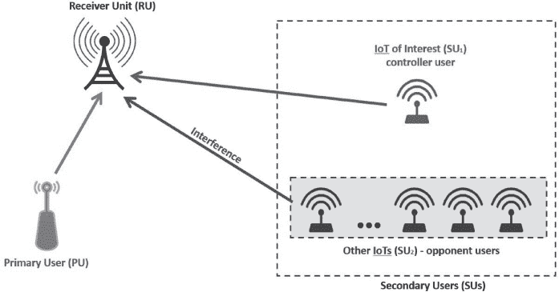

`图 7.1` 通用工业无线传感器网络的场景设置，显示了物联网设备协作接入共享信道。

`SUs` 被分为两组：`SU[1]` 是感兴趣的物联网设备，`SU[2]` 代表系统中的其余物联网设备。`SU[1]` 和 `SU[2]` 分别表示控制用户和对手用户。主要目标是为 `SU[1]` 开发一种传输策略，使该设备能够在信道上进行通信，并且无论 `SU[2]` 的传输活动如何，都能满足 `PU` 的 QoS 约束。`SU[1]` 的传输策略还应允许工业 WSN 中剩余的 `SU[2]` 节点在不协调的情况下，通过频谱共享认知通信传输其测量值，同时满足 `PU` 的 QoS 要求。

为了便于技术讨论，考虑通信系统中存在两个或多个 `SUs`，它们希望同时与 `PU` 共享信道并向 `RU` 传输数据。这种并发的辅助传输会导致在 `RU` 处接收的主信号受到干扰。图 7.2 显示了主用户和两个辅助用户的通信系统设置。

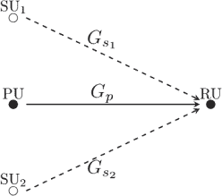

`图 7.2` 所考虑系统的模型，显示了物联网设备与接收单元之间的信道。

首先，令 `P[p]` 和 `R[p]` 分别表示 `PU` 在信道上的传输功率和数据速率，令 `P[s]` 表示 `SU` 的传输功率。那么，`P[s][1]` 表示 `SU[1]` 的传输功率，`P[s][2]` 是 `SU[2]` 的传输功率。在 `RU` 处的接收信号受到均值为零、方差为 `σ²` 的加性噪声影响。接下来，假设 `PU`、`SU[1]`、`SU[2]` 与 `RU` 之间的无线信道经历独立同分布（i.d.）块衰落，信道增益服瑞利分布。因此，`PU`、`SU[1]`、`SU[2]` 与 `RU` 之间的信道功率增益标记为 `G[p]`、`G[s][1]` 和 `G[s][2]`，均服从指数分布。

现在，令 `SUs` 必须遵守的 QoS 约束为 `RU` 处接收到的 `PU` 信号的中断概率。因此，为了共享共享，`SU[1]` 和 `SU[2]` 都不能让主中断概率超过 QoS 限制 `ζ`。令 `RU` 处接收 `PU` 信号的信干干扰比（SINR）为 `γ[p]`，令 `ℙ` 为概率运算符。因此，使用物联网传输时 `RU` 处主中断概率的 QoS 约束定义为 `ℙ{(1 + γ[p]) ≤ ζ}` [`C_010_c7.xhtml#f7_15]。

### 7.3.3 主中断概率

现在我们研究并发辅助传输对主中断概率的影响。当没有辅助传输时，`RU` 处接收 `PU` 信号的信噪比（SNR）表示为 `γ[p] = P[p]G[p]/σ²`。那么，主中断概率在此情况下标记为 `ζ[0]`，通过 `ζ[0] = ℙ{(1+γ[p])≤R[p]}` 计算得出，或 `ζ[0] = ℙ{γ[p]≤R[p]}`。因此：

```
ζ_0 = 1 - exp((1 - 2^{R[p])/σ²)
```

接下来，考虑频谱共享辅助通信下的中断概率。当 `SU` 与 `PU` 共同接入信道时，对于辅助传输功率 `P[s]` 和信道功率增益 `G[s]`，`PU` 信号的 SINR 变为 `γ[p] = P[p]G[p]/(P[s]G[s] + σ²)`。令 `f[γ][p]` 为 `γ[p]` 的概率密度函数（PDF）；则：

```
f_{γ_p}(z) = ∫_{σ²}^{∞} (1/P[p])(1/P[s])y exp(-yz/P[p])exp((σ²-y)/P[s])dy
```

这导致了：

```
f_{γ_p}(z) = P[p]/P[s]exp(-σ²/P[p])z/(z + P[p]/P[s])²σ²/Pp + 1)
```

`PU` 的中断概率通过 `ζ[s] = ℙ{γ[p]≤R[p]}` 推导出，结果为：

```
ζ_s = 1 + (ζ_0 - 1)/(1 + P[s]/Pp)
```

对比式 (7.1) 和 (7.4)，可以观察到，当 `P[s] > 0` 时，相比没有辅助传输的情况，`PU` 的中断概率更高。因此，当 `SUs` 并行通过共享信道传输数据时，它们需要满足 `ζ[s] ≤ ζ`，其中 `ζ` 此前定义为主中断阈值。

## 7.4 零决定策略

在本节中，我们描述了一种用于迭代博弈的博弈策略，称为“零决定”（zero-determinant），以便为控制用户（即 `SU[1]`）设计一种非协调信道接入方法，使其无论对手用户（即 `SU[2]`）的传输活动如何都能满足主中断概率约束。零决定博弈方法符合工业 WSN 中物联网设备重复传输的特性。

通用的 2 × 2 迭代博弈收益矩阵如图图 7.3 所示。博弈中有两个玩家：用户 1（也称为控制用户）是收益矩阵中的行玩家，用户 2（也称为对手用户）是矩阵中的列玩家。该迭代博弈中的玩家在每回合都会从两个动作 {1, 2} 中选择一个。用户 1 和用户 2 的游戏动作分别标记为 `n[1]` 和 `n[2]`。令 `n[1] = 1` 表示在给定回合中活跃的用户 1；同样，令 `n[1] = 2` 表示游戏回合中空闲的用户 1。类似的符号也适用于用户 2：`n[2] = 1` 和 `n[2] = 2` 分别表示活跃对手和空闲对手。此外，对于 `j`,`k` ∈ {1,2}，图 7.3 中的值 `X[j][k]` 代表当用户 1 选择动作 `n[1] = j` 且用户 2 选择动作 `n[2] = k` 时游戏回合的收益。

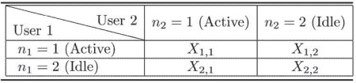


#Figure 7.3 2 × 2 迭代零行列博弈的通用收益矩阵。

此外，当在迭代博弈中重复相同的收益矩阵和相同的用户动作时，游戏玩家之间共享内容之外的任何用户动作历史都可以被忽略，如参考文献 \[29\]所示。那么，如果是这样，可以使用马尔可夫链方法来模拟这种迭代博弈。因此，令 `n(*t*)` = (`n[1],n[2])`) 表示迭代博弈在第 `t` 回的状态，并令 `S` = {(1,1),(1,2),(2,1),(2,2)} 表示游戏在第 `t` 回的状态空间。此外，令 `k` = (`k[1],k[2])`)，其中 `k[1]`,`k[2]` ∈ {1,2} 表示给定用户 1 在第 `t` 轮采取动作 `k[1]` 且用户 2 在第 `t` 轮采取动作 `k[2]` 的情况下，用户 1 在第 `t + 1` 轮采取动作 1 的概率为：

`p[1]^(k)= ℙ(n1=1 | n(t)=k), ∀k ∈ S`. (7.5)

对于用户 2，如果用户 1 在第 `t` 轮采取动作 `k[1]` 且用户 2 在第 `t` 轮采取动作 `k[2]`，则在第 `t + 1` 轮 `n[2]` = 1 的概率计算为：

`p[2]^(k)= ℙ(n2=1 | n(t)=k),∀k∈S`. (7.6)

令用户 1 采取动作 `j` 和用户 2 采取动作 `k` 的平稳概率分布为 `πj,k`，∀ `j`,`k` ∈ {1,2}。那么用于模拟这种迭代博弈的马尔可夫链具有平稳分布 `π` = `[π[1,1],π[1,2],π[2,1],π[2,2]]^T`。令 $\hat{\mathbf{X}} = \left\lbrack X_{1,1},X_{1,2},X_{2,1},X_{2,2} \right\rbrack^{T}$；那么，迭代博弈的长期平均收益记作 `u[X]`，可以从参考文献 \[2\]找到：

$u_{X} = \\ \pi^{T}\hat{\mathbf{X}}.$ (7.7)

令 `a` 和 `b` 为两个任意非零实数，并令动作概率为：

$a\hat{\mathbf{X}} + b = \\left\lbrack - 1 + p_{1,1}, - 1 + p_{1,2},p_{2,1},p_{2,2} \right\rbrack^{T}.$ (7.8)

参考文献 \[29\]所示，如果按照公式 (7.8) 选择 `p1`，那么当且仅当 图 7.3 中收益矩阵的某行的最小值大于另一行的最大值时，用户 1 无论用户 2 的游戏动作如何都可以固定迭代博弈的 `u[X]`。此外，用户 1 可以将 `u[X]` 固定在最小值和最大值之间的范围内 [2]。

令 `p[1]^(1,1)`、`p[1]^(1,2)`、`p[1]^(2,1)` 和 `p[1]^(2,2)` 分别表示在上一个间隔 `n[1]` = 1, `n[2]` = 1, `n[1]` = 1, `n[2]` = 2 以及 `n[1]` = 2, `n[2]` = 2 的情况下，用户 1 在当前回合活跃的概率。为了实现特定的 `u[X]`，用户 1 在任何游戏回合中采取 `Active` 动作的概率为 [2\]：

```
\begin{array}{l} {p_{1,1} = 1 + \left( 1 - \frac{X_{1,1}}{u_{X}} \right)b} \\ {p_{1,2} = 1 + \left( 1 - \frac{X_{1,2}}{u_{X}} \right)b} \\ {p_{2,1} = \left( 1 - \frac{X_{2,1}}{u_{X}} \right)b} \\ {p_{2,2} = \left( 1 - \frac{X_{2,2}}{u_{X}} \right)b.} \end{array}
``` (7.9)

此外，公式 (7.8) 中的 `b` 需要在 [2\] 范围内有一个有效值：

$0 < b \leq \min\left( \frac{-1}{1 - \frac{X_{1,max}}{u_{X}}},frac{1}{1 - \frac{X_{2,min}}{u_{X}}} \right).$ (7.10)

## 7.5 传输的博弈策略

在本节中，我们应用博弈论方法解决 IoT 信道接入问题。我们利用重复博弈的零行列策略为工业 IoT（SU）制定非协调信道接入策略。

### 7.5.1 非协调传输

回想起的 IoT 设备希望在不与其他 IoT 设备协调传输的情况下通过共享信道传输数据。因此，我们利用中断概率 `ζ[s]` 来表示每个间隔 `ΔT` 结束时博弈的 `收益`。因此，代表 `SU[1]` 在无线信道上通信；同时，用户 1 无论其他 SU 的信道接入活动都希望满足 PU 的要求。作为起点，系统中其余 SU 的集体建模为 `SU[2]`（即对手）。在后续讨论中，我们关注作为控制者的 `SU[1]`。

令 `X` = `[X[j][k]` 表示 `ΔT` 期间 PU 的收益矩阵。正如第 7.3 节 所述，`X` 中的值表示如 图 7.4 所示的中断概率。在这种表示中，SU 为 `Active` 表示 SU 在 `ΔT` 期间传输；同样，`Idle` SU 表示间隔内没有传输。此外，令 `X[j,max]` 和 `X[j,min]` 分别代表 `X` 中 `j` 行的最大值最小值。从 图 7.4，找到这些值为：


图 7.4 系统用户的收益矩阵，显示中断概率。

$\begin{array}{l} {X_{1,max} = X_{1,1} = 1 + \frac{(\zeta_{0} - 1)P_{p}}{P_{p} + P_{s,2}}(R_{p} - 1)}} \\ {X_{1,min} = X_{1,2} = 1 + \frac{(\zeta_{0} - 1)P_{p}}{P_{p} + P_{s,1}}(R_{p} - 1)}} \\ {X_{2,max} = X_{2,1} = \frac{(\zeta_{0} - 1)P_{p}}{P_{p} + P_{s,2}}(R_{p} - 1)}} \\ {X_{2,min} = X_{2,2} = \zeta_{0}} \end{array}$ (7.11)

考虑 `SU[1]` 功率比 `SU[2]` 高的情况（即 `SU[1]` > `SU[2]`）；观察到 `X[2,min] < X[1,max]`。因此，`SU[1]` 可以利用 `SU[1]` 的零行列策略在 `[X[2,1], X[1,max]]` 范围内固定 `u[X]`。(7.12)

考虑 `u[X]` 必须是有效范围内的特定值的情况，并令 0 ≤ α ≤ 1 为 *持久性因子*。那么 `u[X]` 可以使用进行参数化：

```
\begin{array}{lll} u_{X} & & {X_{2,1} + \alpha(X_{1,2} - X_{2,1})} \\ & & {1 + \frac{(\zeta_{0} - 1)\alpha P_{p}}{P_{p} + P_{s,1}}(R_{p} - 1)} + \frac{(\zeta_{0} - 1)(1 - \alpha)P_{p}}{P_{p} + P_{s,2}}(R_{p} - 1)}} \\ \end{array}
``` (7.13)

在这种表示中，`α` 的值会将 `u[X]` 推向其上限（`X[1,2]`），这意味着 `SU[1]` 在满足 QoS 约束的同时传输更为激进。

此外，遵循参考文献 [2\] 的发现，`b` 有来自公式 (7.8) 的取值范围：

$0 < b \leq \min\left( \frac{- u_{X}}{u_{X} - X_{1,max}},\frac{u_{X}}{u_{X} - X_{2,min}} \right).$ (7.14)

定义：

$b_{\max} = \left\{\{ \begin{array}{lll} \frac{u_{X}}{X_{1,max} - u_{X}} & & {u_{X} \leq \frac{X_{1,max} + X_{2,min}}{2}} \\ \frac{u_{X}}{u_{X} - X_{2,min}} & & {u_{X} > \frac{X_{1,max} + X_{2,min}}{2}} \\ \end{array} \right..$ (7.15)

令 0 < `β` ≤ 1 为 *转向因子*；那么，`SU[1]` 在传输策略中使用的 `b` 的值可以表示为：

`b = \beta b[max]`. (7.16)


同样，`β` 的较高值表示，如果 `SU[1]` 在上一个传输周期内处于空闲，那么它在当前传输周期内变为 `Active`（即 `SU[1]` 向 RU 发送数据）的概率更大；如果 IoT 设备在上一个 `ΔT` 内处于活跃，则 `SU[1]` 在当前传输 `ΔT` 中通过信道传输的概率较低

对于 `j`,`k` ∈ {1,2}，令 `SU[1]` 和 `SU[2]` 在上一 `ΔT` 中的传输状态分别为 `j` 和 `k`。同时，假设 `SU[1]` 已知 `j` 和 `k`。因此，`p1` 表示在已知上一个 `ΔT` 中 `n[1] = j` 且 `n[2] = k` 的条件下，`SU[1]` 在当前 `ΔT` 中在信道活跃的概率。根据等式 (7.9) 和 (7.13)，`SU[1]` 在 `ΔT` 中通过信道传输的概率表示为：

$$\begin{array}{ll} p_{1}^{1,1} & {= 1 + \frac{X_{2,1} + \alpha(X_{1,2} - X_{2,1}) - X_{1,1}}{X_{2,1} + \alpha(X_{1,2} - X_{2,1})}b} \\\\ p_{1}^{1,2} & {= 1 + \frac{X_{2,1} - X_{1,2}}{X_{2,1} + \alpha(X_{1,2} - X_{2,1})}(1 - \alpha)b} \\\\ p_{1}^{2,1} & {= \frac{X_{1,2} - X_{2,1}}{X_{2,1} + \alpha(X_{1,2} - X_{2,1})}}\alpha b} \\\\ p_{1}^{2,2} & {= \frac{X_{2,1} + \alpha(X_{1,2} - X_{2,1}) - X_{2,2}}{X_{2,1} + \alpha(X_{1,2} - X_{2,1})}b.} \\\\ & \\\\ \end{array}$$ (7.17)

在此此基础上，控制器用户 (`SU[1]`) 可以采用一种传输策略，该策略考虑了对手用户和控制器用户最近的传输动作，并且仍然满足 PU 的 QoS 约束。算法 3 描述了 `SU[1]` 用于在无线信道上传输的零决定性传输策略，该策略在保持 `u[X]` 为长期平均收益的同时，满足了 PU 的 QoS 要求 `ζ`。

### 7.5.2 特殊情况

我们现在关注研究等式 (7.17) 的少数特殊情况，以获得对所提 IoT 设备传输策略的更多见解。这些情况突出了当控制器用户采用竞争性与非竞争性策略时传输策略的差异；此外，我们还考虑了系统用户使用相同传输功率的实际情况。

### 7.5.2.1 竞争策略情况

考虑 `SU[1]` 采用更激进的传输策略的情况，即选择 $u_{X} > \frac{X_{1,\max} + X_{2,\min}}{2}$。在这种情况下，等式 (7.15) 中的 $b_{\max} = \frac{u_{X}}{u_{X} - X_{2,\min}}$；因此，传输概率变为：

$$\begin{array}{l} {p_{1}^{1,1} = 1 + \beta\frac{(1 - \alpha)X_{2,1} + \alpha X_{1,2} - X_{1,1}}{(1 - \alpha)X_{2,1} + \alpha X_{1,2} - X_{2,2}}} \\\\ {p_{1}^{1,2} = 1 - \beta(1 - \alpha)\frac{X_{2,1} - X_{1,2}}{(1 - \alpha)X_{2,1} + \alpha X_{1,2} - X_{2,2}}} \\\\ {p_{1}^{2,1} = \beta\alpha\frac{X_{1,2} - X_{2,1}}{(1 - \alpha)X_{2,1} + \alpha X_{1,2} - X_{2,2}}} \\\\ {p_{1}^{2,2} = \beta.} \\\\ \end{array}$$ (7.18)

此外，当 `α` = 1 时，`u[X]` = `X[2,1]`。因此，当 `α` = 1 时 `SU[1]` 的传输概率变为：

$$\begin{array}{ll} p_{1}^{1,1} & {= 1 - \beta\frac{P_{s_{2}}}{P_{s_{1}}}\frac{P_{p}}{P_{p} + (P_{s_{1}} + P_{s_{2}})(2^{R_{p}} - 1)}} \\\\ p_{1}^{1,2} & {= 1} \\\\ p_{1}^{2,1} & {= \beta\frac{P_{s_{1}} - P_{s_{2}}}{P_{s_{1}}}\frac{P_{p}}{P_{p} + P_{s_{2}}(2^{R_{p}} - 1)}} \\\\ p_{1}^{2,2} & {= \beta.} \\ \\end{array}$$ (7.19)

上述结果表明，如果对手用户在上一个周期内空闲，则 `SU[1]` 的竞争策略会导致以特定的概率传输。此外，当两个用户在上一个周期内都空闲时，控制器用户将以 `β` 的概率在当前周期内传输；如前，`β` 的较高值会导致 `SU[1]` 在当前传输周期内活跃的概率更大。

### 7.5.2.2 非竞争策略情况

当 `SU[1]` 通过选择 $u_{X} \leq \frac{X_{1,\max} + X_{2,\min}}{2}$ 采用竞争竞争性的策略时，等式 (7.15) 简化为 $b_{\max} = \frac{u_{X}}{X_{1,\max} - u_{X}}$。传输概率变为：

$$\begin{array}{l} {p_{1}^{1,1} = 1 - \beta} \\\\ {p_{1}^{1,2} = 1 - \beta\frac{u_{X} - X_{1,2}}{u_{X} - X_{1,1}}} \\\\ {p_{1}^{2,1} = - \beta\frac{u_{X} - X_{2,1}}{u_{X} - X_{1,1}}} \\\\ {p_{1}^{2,2} = - \beta\frac{u_{X} - X_{2,2}}{u_{X} - X_{1,1}}} \\\\ \end{array}$$ (7.20)

同样，当 `α` = 0 时，`SU[1]` 收益范围的下界 `u[X]` = `X[2,1]`。这导致以下概率：

$$\begin{array}{l} {p_{1}^{1,1} = 1 - \beta} \\\\ {p_{1}^{1,2} = 1 - \beta\frac{X_{2,1} - X_{1,2}}{X_{2,1} - X_{1,1}}} \\\\ {p_{1}^{2,1} = 0} \\\\ {p_{1}^{2,2} = - \beta\frac{X_{2,1} - X_{2,2}}{X_{2,1} - X_{1,1}}} \\\\ \end{array}$$ (7.21)

`SU[1]` 的非竞争策略导致当控制器用户在上一个周期内空闲且对手用户活跃时不利用信道的情况；这种策略获得的收益最低。

### 7.5.2.3 等等传输情况

考虑 SU 具有相等传输功率的情况，导致 `P[s][1]` = `P[s][2]` = `P[s]`。对于这种情况情况，长期平均收益变为：

$$\begin{array}{rll} u_{X} & = {X_{2,1} = 1 + \frac{(\zeta_{0} - 1)P_{p}}{P_{p} + P_{s}(2^{R_{p}} - 1)}} \\\\ X_{1,1} & = {1 + \frac{(\zeta_{0} - 1)P_{p}}{P_{p} + 2P_{s}(2^{R_{p}} - 1)}} \\\\ \end{array}$$ (7.22)

因此，`SU[1]` 以以下传输概率访问无线信道：

$$\begin{array}{l} {p_{1}^{1,1} = \begin{cases} {1 - \beta\frac{P_{p}}{P_{p} + 2P_{s}(2^{R_{p}} - 1)}} & {b_{\max} = \frac{u_{X}}{u_{X} - X_{2,\min}}} \\ {1 - \beta} & {b_{\max} = \frac{u_{X}}{X_{1,\max} - u_{X}}} \end{cases}} \\\\ {p_{1}^{1,2} = 1} \\\\ {p_{1}^{2,1} = 0} \\\\ {p_{1}^{2,2} = \begin{cases} \beta & {b_{\max} = \frac{u_{X}}{u_{X} - X_{2,\min}}} \\ {\beta\frac{P_{p}}{P_{p} + P_{s}(2^{R_{p}} - 1)}} & {b_{\max} = \frac{u_{X}}{X_{1,\max} - u_{X}}} \end{cases}.} \\\\ \end{array}$$ (7.23)

这种情况类似于 IoT 设备的实际设置。上述结果表明，如果控制器用户在上一个周期内活跃而对手用户空闲，则控制器用户将保持活跃；另一方面，如果在上一个周期内空闲而对手用户活跃。

### 7.5.3 性能分析

`SU[1]` 采取动作的概率（即 `p[1]`）定义在等式 (7.5)；同样，对手用户采取动作概率 `p[2]` 定义在等式 (7.6)。令马尔可夫链的状态转移矩阵为 `M`，其定义为：

$$\mathbf{M} = \begin{bmatrix} {p_{1}^{1,1}p_{2}^{1,1} & {p_{1}^{1,1}(1 - p_{2}^{1,1})} & {(1 - p_{1}^{1,1})p_{2}^{1,1}} & {(1 - p_{1}^{1,1})(1 - p_{2}^{1,1})} \\ {p_{1}^{1,2}p_{2}^{2,1} & {p_{1}^{1,2}(1 - p_{2}^{2,1})} & {(1 - p_{1}^{1,2})p_{2}^{2,1}} & {(1 - p_{1}^{1,2})(1 - p_{2}^{2,1})} \\ {p_{1}^{2,1}p_{2}^{1,2} & {p_{1}^{2,1}(1 - p_{2}^{1,2})} & {(1 - p_{1}^{2,1})p_{2}^{1,2}} & {(1 - p_{1}^{2,1})(1 - p_{2}^{1,2})} \\ {p_{1}^{2,2}p_{2}^{2,2} & {p_{1}^{2,2}(1 - p_{2}^{2,2})} & {(1 - p_{1}^{2,2})p_{2}^{2,2}} & {(1 - p_{1}^{2,2})(1 - p_{2}^{2,2})} \end{bmatrix}.$$ (7.24)

令 `π` 为使用 `[2,29]` 计算出的平稳分布：

*π*^(*T*) = `[π[1,1],π[1,2],π[2,1],π[2,2]]` = *π*^(*T)***M**. (7.25)


如前所述，`πj`,`k`,  ∀ `j`,`k` ∈ {1,2} 表示当对手用户采取动作 `k` 时，`SU[1]` 采取动作 `j` 的平稳概率分布。由于 `Σπ` = 1，平稳分布 `π` 可以通过转移矩阵 `M` 的归一化左特征向量计算得出，该向量具有对应的特征值为 1。因此，`SU[1]` 的传输概率为 `π[1,1]` + `π[1,2]`。

定义主信道的容量向量为：

$C\_{p} = \\log\_{2}\\left( 1 + P\_{P}G\_{p}/\\begin{bmatrix} {P\_{s\_{1}}G\_{s\_{1}} + P\_{s\_{2}}G\_{s\_{2}} + \\sigma^{2}} \\\\ {P\_{s\_{1}}G\_{s\_{1}} + \\sigma^{2}} \\\\ {P\_{s\_{2}}G\_{s\_{2}} + \\sigma^{2}} \\\\ \\sigma^{2} \\\\ \\end{bmatrix} \\right).$ (7.26)

然后，PU 信道的平均容量通过 `\overline{C\_{p}} = \\ \\pi^{T} \\cdot C\_{p}` 得到。同样，将控制用户的信道容量向量定义为：

$C\_{s} = \\log\_{2}\\left( 1 + P\_{s\_{1}}G\_{s\_{1}}/\\begin{bmatrix} {P\_{P}G\_{p} + P\_{s\_{2}}G\_{s\_{2}} + \\sigma^{2}} \\\\ {P\_{P}G\_{p} + \\sigma^{2}} \\\\ \\end{bmatrix} \\right).$ (7.27)

控制用户的平均信道容量通过 `\overline{C\_{s}} = \\frac{1}{\pi\_{1,1} + \pi\_{1,2}}\\left\\lbrack \\pi\_{1,1},\\pi\_{1,2} \\right\\rbrack C\_{s}` 计算。

鉴于算法 3 中所示的已开发的零行列传输策略，控制用户可以选择成为无线信道的活跃用户或保持空闲以节省资源。此外，游戏中的控制用户不需要知道对手传输活动的所有历史即可利用 IoT 传输策略。用户 1 仅根据对手在上一回合的传输状态即可在当前间隔内采取传输动作。

回想一下，使用所提零行列策略所实现的长期平均收益位于 `[X[1,1] , X[1,2]]`。此外，如果 `SU[1]` 选择在所有间隔内通过共享无线信道传输（即不遵循算法 3），则长期平均收益将在 `[X[2,1] , X[1,2]]` 范围内，这高于利用所提传输策略所获得的收益。尽管如此，所提的传输策略保证了辅助用户在满足任何信道接入成本或数据可用性约束的同时，能够满足 PU 的 QoS 要求。

## 7.6 扩展到多用户

接下来将针对两个玩家的分析扩展为具有多个玩家的重复游戏。这对于检查所提模型的可扩展性和通用性是必要的。令 `N` ≥ 2 为游戏玩家的数量，`{1*,...,N*}` 为玩家的索引。令 `n(t) = n[1,...,nN]` 表示重复游戏在第 `t` 回合的状态，其中 `ni \in {1,2}` 描述活跃（Active）或空闲（Idle）动作。可以使用多维马尔可夫链来描述过程 `{n(t) : t = 0,1,...}`，状态转移矩阵 `M` 可以用 2*  × 2* 矩阵表示。

与双玩家游戏类似，N 玩家游戏中的玩家 `i`（∀ `i = {1*,...,N*}`）在给定回合采取特定动作的概率取决于上一回合玩家的活跃（Active）或空闲（Idle）动作。此外，令 `Xi` 指如果上一回合游戏状态为 `k`，玩家 `i` 的收益值，令 `pi` 为如果上一回合游戏处于状态 `k`，玩家 `i` 在给定回合采取动作 1 的概率。同时，定义 `Xi, min   = min (Xi  : n[i]  = k*)` 和 `Xi, max   = max (Xi  : n[i]  = k*)` 分别表示玩家 `i` 在采取动作 `k` 时的最小收益和最大收益。

根据文献 [2] 的结果，如果存在 `k[i][max],k[i][min] \in {1,2*}` 使得 `Xi, max   ≤ Xi, min `，则玩家 `i` 可以固定其游戏收益的长期平均值，而不取决于其他玩家的游戏动作。在这种情况下，玩家 `i` 的长期平均收益（称为 `u[i]`）可以是区间 `X[i, max ,Xi, min ]` 内任意值，且该长期收益可以通过以下策略实现：


`p`1（SU[1] 的 `Active` 概率）与 `α`（持久因子）和 `β`（转向因子）之间的关系在图 7.6 中得到了研究。对于该图，使用了 $\frac{P\_{p}}{P_{s\_{2}}} = 11.25$ dB、$\frac{P\_{p}}{P_{s\_{1}}} = 10$ dB、$\frac{P\_{p}}{\sigma^{2}} = 20$ dB 以及 `R[p]` = 1 bit/sec/Hz。我们观察到 `α` 对公式 (7.17)定义的 `p`1 有直接影响。然而，如公式 (7.18)–(7.23) 所示，`β` 的值对 `p`1 的影响受 `α` 具体数值的影响。


**图 7.6**](#C_010_c7.xhtml#f7_6b) 系统主用户的 `Active & Idle` 概率随 `α`（持久因子）和 `β`（转向因子）的变化。(a) `β` = 0.5 时主用户的 `Active & Idle` 概率。(b) `α` = 0.75 时主用户的 `Active & Idle` 概率。

随后，我们模拟了一个通信环境，其中包含两个建模为 SU 的 IoT 设备和一个信道主 PU，如图 7.2 所示。对于该环境，PU 的中断概率不超过 `ζ` = 12.5%；同时，$\frac{P\_{p}}{P_{s\_{2}}} = 11$ dB、$\frac{P\_{p}}{P_{s\_{1}}} = 10$ dB、$\frac{P\_{p}}{\sigma^{2}} = 15$ dB 以及 `R[p]` = 1 bit/sec/Hz。此外，SU[2]（对手用户）以 50% 的概率在共享无线信道上随机传输数据。此外，SU[1]（控制用户）采用了算法 3 中的传输策略，其中 `α` = 0.5，`β` = 0.5。SU[1] 采用零行列策略导致了在图 7.7 中所示的收益矩阵。此外，SU[1] 选择的 `u[X]` = 11.1%，小于 PU 的最大中断限制 `ζ` = 12.5%。从公式 (7.17) 可以得出，SU[1] 的传输概率变为：


**图 7.7**](#C_010_c7.xhtml#f7_7b) 主用户在四种 `Active & Idle` 组合下的计算收益矩阵。

$\begin{array}{ll} {p\_{1}^{1,1} = 0.575} & {p\_{1}^{1,2} = 0.947} \\\\ {p\_{1}^{2,1} = 0.053} & {p\_{1}^{2,2} = 0.500.} \\\\ \\end{array}$ (7.31)

当 `u[X]` < `ζ` 时，使用 IoT 传输策略，SU[1] 无论 SU[2]（对手用户）的传输活动如何，都能满足 PU 的 QoS 约束。

长期性能指标记录在图 7.8 中。


**图 7.8**](#C_010_c7.xhtml#f7_8b) 系统主用户的 `Active & Idle` 概率随 `α`（持久因子）和 `β`（转向因子）的变化。(a) `β` = 0.5 时主用户的 `Active & Idle` 概率。(b) `α` = 0.75 时主用户的 `Active & Idle` 概率。


1. [Bilal] Afzal, Sheeraz A. Alvi, Ghalib A. Shah, and Waqar Mahmood. 物联网应用的高效能场景感知流量调度。Ad Hoc Networks, 62:101–115, 2017.
2. [Ashraf] Al Daoud, George Kesidis, and Jorg Liebeherr. 零确定性策略：一种共享许可频段的博弈论方法。IEEE Journal on Selected Areas in Communications, 32(11):2297–2308, 2014.
3. [Mohammed] M. Alani and Ali Ismail Awad. 针对物联网的智能双层入侵检测系统。IEEE Transactions on Industrial Informatics, 19(1):683– 692, 2022.
4. [Bako] Ali and Ali Ismail Awad. 基于物联网的智能家居网络与物理安全脆弱性评估。Sensors, 18(3):817, 2018.
5. [Ali] Ismail Awad and Jemal Abawajy, 编。物联网中的安全与隐私：架构、技术与应用。John Wiley & Sons, Hoboken, NJ, 2021.
6. [Waleed] Ejaz and Mohamed Ibnkahla. 认知 5G 网络中物联网的多频频谱感知与资源分配。IEEE Internet of Things Journal, 5(1):150–163, 2017.
7. [Abdallah] Farraj. 用于认知调度的切换分多样性方法。Wireless Personal Communications, 74(2):933–952, 2014.
8. [Abdallah] Farraj. 针对干扰攻击的工业物联网协作传输策略。在 IEEE Texas Power and Energy Conference (TPEC), College Station, TX, USA, pp. 1–6, 2023.
9. [Abdallah] Farraj. 针对窃听攻击的工业物联网协调安全措施。在 IEEE Texas Power and Energy Conference (TPEC), College Station, TX, USA, pp. 1–5, 2023.
10. [Abdallah] Farraj and Eman Hammad. 服务质量约束对频谱共享认知用户性能的影响。Wireless Personal Communications, 69(2):673–688, 2013.
11. [Abdallah] Farraj and Eman Hammad. 频谱共享认知无线电中主用户的性能。Wireless Personal Communications, 68(3):575–585, 2013.
12. [Abdallah] Farraj and Scott Miller. 中断概率下频谱共享认知环境中的调度。Wireless Personal Communications, 70(2):785– 805, 2013.
13. [Abdallah] Farraj, Scott Miller, and Khalid Qaraqe. 频谱共享系统中认知无线电的队列测量。在 IEEE 认知通信与网络最新进展国际工作会 (RACCN):全球电信 (GLOBE)研讨会上，Houston, TX, pp. 997–1001, 2011.
14. [Federal] Commission. 频谱政策任务组报告。案号 02-135, 2002 年 11 月。
15. [Andrea] Goldsmith. 无线通信，第一版。剑桥大学，2005.
16. [Kamal] Gulati, Raja Sarath Kumar Boddu, Dhiraj Kapila, Sunil L. Bangare, Neeraj Chandani, and G. Saravanan. 物联网（IoT）无线传感器网络技术综述。Materials Today: 51(1):161–165, 2021.
17. [Mardiana] binti Mohamad Noor and Wanlina Hassan. 物联网（IoT）安全现状：综述。Computer Networks, 148:283–294, 2019.
18. [Kayiram] Kavitha and G. Suseendran. 物联网系统的基于优先级的自适应调度。在自动化计算与技术管理国际会议 (ICACTM), London , UK, pp. 361–366, 2019.
19. [Dong] Li. 具有机会性调度的上行认知小区网络性能分析。IEEE Communications Letters, 14(9):827–829, 2010.
20. [Ling] Li, Shancang Li, and Shanshan Zhao. 面向服务的物联网的 QoS 感知调度。IEEE Transactions on Industrial Informatics, 10(2):1497–1505, 2014.
21. [Moustafa] Mamdouh, Ali Ismail Awad, Ashraf A. M. Khalaf, and Hesham F. A. Hamed. 医疗设备的身份与身份管理：成就、挑战与未来方向。Computers & Security, 111:102491, 2021.
22. [Fatma] Masmoudi, Zakaria Maamar, Mohamed Sellami, Ali Ismail Awad, and Vanilson Burégio. 物联网审查引导框架。Journal of Information Security and Applications, 55:102644, 2020.
23. [Joseph] Mitola. 认知无线电：软件定义无线电的集成代理架构。博士论文，瑞典皇家学院 (KTH)，斯德哥尔摩，瑞典，2000 年 12 月。
24. [Abdallah] Farraj and Scott Miller. 中断概率下频谱共享认知环境中的调度。Wireless Personal Communications, 70(2):785– 805, 2013. (注：此处原文与第 12 条重复)
25. [William] H. Press and Freeman J. Dyson. 迭代囚徒困境中存在支配任何对手的策略。美国科学院院报, 109(26):10409–10413, 2012.
26. [Abdallah] Farraj and Eman Hammad. 频谱共享认知无线电中主用户的性能。Wireless Personal Communications, 68(3):575–585, 2013. (注：此处原文与第 11 条重复)
27. [Abdallah] Farraj and Eman Hammad. 服务质量约束对频谱共享认知用户性能的影响。Wireless Personal Communications, 69(2):673–688, 2013. (注：此处原文与第 10 条重复)
28. [Sanjeevi] Pandiyan, Samraj Lawrence, Manikandan Ramasamy, Qian Xia, and Ya Guo. 基于云的物联网性能感知调度。Computer Communications, 160:512–520, 2020.
29. [William] H. Press and Freeman J. Dyson. 迭代囚徒困境中存在支配任何对手的策略。美国科学院院报, ... (注：此处原文与第 25 条重复)
30. [Nouman] Shamim, Muhammad Asim, Thar Baker, and Ali Ismail Awad. 基于系统调用的物联网异常检测高效方法。Sensors, 23(2):652, 2023.
31. [Zhengguo] Sheng, Shusen Yang, Yifan Yu, Athanasios V. Vasilakos, Julie A. McCann, and Kin K. Leung. 物联网 IETF 协议族综述：标准、挑战与机遇。IEEE Wireless Communications, 20(6):91–98, 2013.
32. [Ali] Hassan Sodhro, Ali Ismail Awad, Jaap van de Beek, and George Nikolakopoulos. 5G 医疗设备智能认证：综述。Internet of Things, 20:100610, 2022.
33. [Statista] Research Department. 2015 年至 2025 年全球物联网（IoT）连接设备安装量基数。2016.
34. [Heejung] Yu and Yousaf Bin Zikria. 面向物联网和无线传感器网络的认知无线电网络。Sensors, 20(18):1–6, 2020.

# 8 信息物理系统中受限玻尔兹曼机与自编码器变体综述

Qazi Emad Ul Haq
Naif Arab University for Security Sciences (NAUSS)
Muhammad Imran
Federation University
Kashif Saleem
King Saud University
Tanveer Zia
Naif Arab University for Security Sciences (NAUSS)


## 8.1 RBM 与自动编码器简介

受限玻尔兹曼机，更通称为 `RBMs`，是一种无向图模型，作为深度学习框架中不可或缺的一部分。`RBMs` 最初由 Sumit Misra 在 1986 年以 Harmonium 的名称引入 [1]。`RBMs` 最新的用途之一是用于 Netflix 大奖赛；它在数据协作和过滤方面超过了竞争对手。`RBMs` 算法用于降维、回归分类、协同过滤、特征学习和顶部建模。`RBMs` 算法的工作原理是先学习，然后提供观测值分布的闭式描述。它还被用于通过学习分布的采样与观测值的未见概率进行比较。一个很好的例子是，我们可以修复某些可见且对应于部分观测的单元，然后对剩余的可见单元进行采样以完成观测。尽管 `RBMs` 于 20 世纪 80 年代，但随着技术的进步，它们的应用在现在更具意义。在 `RBMs` 被提出作为被称为深度信层网络的多层学习系统的基础后，它们在近年来变得非常流行。其背后的概念是，隐藏神经元提取与观测值最相关的特征。这些特征可以进一步作为其他 `RBMs` 的输入。当 `RBMs` 这样堆叠时，它们可以实现对多个特征的指数级学习，有助于达到更高层次的表示。

现在，我们引出了什么是自动编码器。简单的解释是，自动编码器是一个简单的三层神经网络。在这个网络中，输出单元直接连接到输入单元。自动编码器中的隐藏单元少于可见单元，学习/训练的任务是减少重构时的误差，这意味着找出输出数据最有效且简洁的表示。

`RBMs` 具有相似的信念；然而它利用具有特定分布的虚拟单元，而不是预定的分布。主要目的是弄清楚这两个变量是如何相互连接的。区分 `RBMs` 和自动编码器的主要特征之一是 `RBMs` 有两个非常不同的偏置 [2]：

1. 隐藏偏置帮助 `RBMs` 在前向传播中创建激活。
2. 第二个偏置是可见层的偏置辅助 `RBM` 在反向传播中确定重构。

本章其余部分的结构如下：8.2 节 介绍了背景；8.3 节 描述了使用信息物理系统 (CPS) 的恶意软件攻击检测。8.4 节 讨论了欺诈和异常检测。8.5 节 介绍了 CPS 的突破及其发现，而 8.6 节 讨论了 CPS 作为现代世界关键的客观性，8.7 节 展示了演变。8.8 节 总结了本研究。

## 8.2 背景

### 8.2.1 使用 RBM 和自动编码器解决的目标问题

`RBMs` 具有相似的信念；然而它利用具有特定分布的虚拟单元，而不是预定的分布。主要目的是弄清楚这两个变量是如何相互连接的。区分 `RBMs` 和自动编码器的主要特征之一是 `RBMs` 有两个非常不同的偏置 [2]：

1. 隐藏偏置帮助 `RBMs` 在前向传播中创建激活。
2. 第二个偏置是可见层的偏置辅助 `RBM` 在反向传播中确定重构。

`Autoencoders` 也用于降维，这意味着自动编码器被用作降维的预处理步骤，以便在不丢失过多信息的情况下进行快速准确的降维。某些降维方法只能执行线性降维，而完整的自动编码器可以执行更大规模、更线性的降维。自动编码器解决的另一个问题是图像去噪；与传统方法不同，它们并不显式地搜索噪声；而是通过学习表示，从作为输入的噪声数据中提取图像。一旦输入过程完成，表示就会被解压缩以获得无噪声图像的结果。`Autoencoders` 也常用于生成图像和时间序列数据。这是通过在自动编码器的颈处创建一个分布参数的，该参数可以随机采样以获得潜属性的离散值，然后将其发送到解码器，从而生成图像数据。


自动驾驶汽车是另一种由人工智能驱动的创新。自动驾驶汽车的设计者利用了来自图像识别系统的大量数据，结合机器学习技术和神经网络为自动驾驶汽车提供动力。神经网络识别数据集中的趋势，这些趋势被用作机器学习算法的输入。输入数据包括来自自动驾驶汽车内置摄像头的图像、道路上其他车辆的图像、行人、交通灯、路灯以及自动驾驶汽车在道路上需要注意的其他重要事项 [[5]]。

在过去的几年里，我们看到针对信息物理系统（CPS）的攻击数量不断增加，导致了指数级的危害性后果。网络攻击的某些常见形式包括窃听，即安全信息被拦截，第三方可以听到传输中的重要和机密信息，这导致了安全违露，在某些情况下甚至造成了影响许多人的更严重的后果 [[6]]。

有监督学习和无监督学习是深度学习方法的两种基本类型。使用标记训练数据是这两种方法之间的区别。使用标记输入的卷积神经网络（CNN）[[7]]属于有监督学习类别，它使用特定的架构进行图像识别。深度置信网络（DBN）[[8]]、循环神经网络（RNN）[[9]]、自动编码器（AE）[[10]]及其衍生都是无监督学习方法的示例。随后，我们将介绍一些与我们的工作类似的近期研究，其中大部分基于 KDD Cup 99 或 NSL-KDD 数据集[[11]]。

NSL-KDD 数据集已用于入侵检测的研究[[8],12],13]]。在软件定义网络（SDN）背景下，Hnat 等人[[8]]利用深度神经网络（DNNs）创建了异常检测模型。他们使用 NSL-KDD 数据集的基础特征来训练他们的模型。在降维后，他们利用 `DBN` 提取入侵检测的特征，并使用 `SVM` 对数据进行分类。与采用 `SVM` 或 `DBN` 作为独立分类器相比，研究人员的混合 `DBN + SVM` 技术改进了检测性能。为了高精度地检测零日攻击，建议基于深度学习的异常检测模型采用 `AE` 和去噪 `AE`。他们还采用了一种随机策略来建立阈值，这对所建议的模型有直接影响[[13]]。

另一个例子是自学学习（STL），这是一种有效且适应性强的 `NIDS`，它结合了用于无监督降维的稀疏 `AE` 和用于训练分类器的 `SoftMax` 回归。在二分类、五分类和三分类问题中，我们的技术展示了满意的准确率。

### 8.2.2. 使用 RBM 和自动编码器用于信息物理系统的技术

随着技术的进步，企业和政府组织正转向使用在线平台进行交易并将数据存储在云服务器上，这也称为电子商务。这些技术进步提高了银行、电信公司、零售店和其他在线业务的生产力。然而，在提高生产力的同时，它也导致了这些业务更容易受到黑客的攻击，并导致欺诈和漏洞的增加。

深度学习通过创建欺诈检测模型增强了信息物理系统的安全性。这些模型与带有偏差的数据以及输入中存在的不重要特征一起工作。这些多个属性成为分类器从多个数据源中正确学习的障碍。图 8.1 显示了基础输入神经网络的示例。

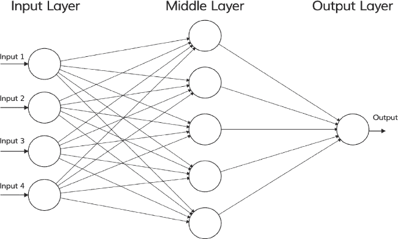

图 8.1 基础 1 中层网络架构[[14]]。

为了解决这些问题，提出了一种双步法，该方法分为两个阶段；在第一阶段，从输入中提取较低维的特征，在随后的阶段，模型确定交易是否为欺诈。同时，提出了一种基于自动编码器的欺诈确定模型，其中它们在算法处理之前从输入数据池中提取重要特征。为了检测信用卡欺诈，该方法侧重于借记卡和信用卡交易。一笔交易可以有多个来源，考虑交易的时间和金额、交易是否为存款或取款、客户详情，但不限于 ATM 的位置。这些众多属性可能导致算法性能不佳。由于真实交易可能具有多个特征和高维数据，这使得处理数据变得繁琐。关键目标是提取重要数据并去除额外数据的噪声。为了解决这些问题，研究人员正在使用自动编码器，它可以高效地创建输入数据的低维表示，同时具有确定特征非线性关系的能力。自动编码器依赖于用于高效编码数据的前馈神经网络。

自动编码器网络配备了相同的输入输出振幅。它有助于理解作为输入的数据。通过输入和输出的不同振幅，它可以从隐式表示重建输入。简单来说，它试图识别近似函数。然而，通过对网络进行限制并限制隐式单元的数量，可以丢弃无关的解决方案。自动编码器模型的通用结构如图 8.2 所示](#C_011_c8.xhtml#f8_2)。

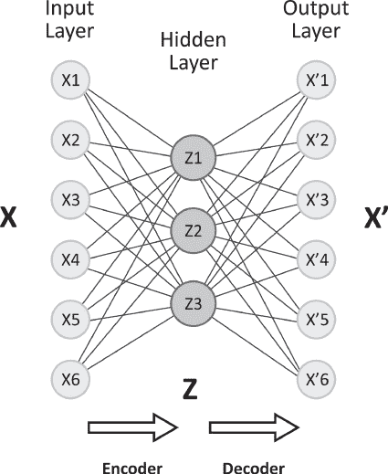

图 8.2 用于检测信用卡欺诈的自动编码器模型[1]]。

`RBM` 是一种人工智能技术，它最初仅设计用于利用原始数据确定适应模式的自主学习活动。`RBM` 是基于能量的模型，还采用了一个隐变量层来对可见变量的分布建模[[15]]。每个变量只能取 1 或 0 的二进制值，表示如图 8.3 所示的无监督学习变分方法](#C_011_c8.xhtml#f8_3)。

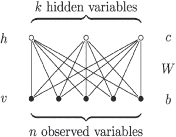

图 8.3 具有“k” 个隐藏变量和“n” 个观测变量的无监督学习变分方法[[11]]。

`RBM` 被用作深度波尔兹曼网络的基础。它们依赖隐藏神经元从特征中提取相关属性。进一步，这些特征被用输入另一个 RBM。因此，堆叠 `RBM` 导致属性从其他属性中学习，并产生高水平的解释性。


### 8.2.3 检测网络入侵以确保物联网设备中信息物理系统（CPS）的安全性

信息物理安全是我们 21  世纪面临的主要问题之一；解决这一问题的努力之一是利用入侵检测系统（IDS）结合防火墙。这两个系统的整合有助于防止 Web 应用程序的信息泄露。IDS 方法基于两类，即异常检测和签名检测。签名方法简单，且在检测攻击方面非常有效。然而，它在面对新攻击时效率低下；相反，异常检测方法寻找的是不符合常规模式的模式——这是通过机器学习和模式识别方法建立的。这些设计可以轻松区分偏离正常行为的新类型干扰和绕路攻击。异常检测遵循一系列步骤，包括特征开发、属性偏好和异常检测分类器。这些特征的维度随 `n-gram` 模型的 `n` 成正比，这使得考虑结果以处理维度灾难问题至关重要 [16]。

知识发现与分发（KDD）数据集（1999 年）是检测任何网络入侵最广泛的数据集之一 [17]。该数据集是为了竞赛而生成的，包含包含 400 万条流量记录的数据集。遗憾的是，该数据集不包含原始网络流量数据。根据基本内容类型和流量类型参数，原始网络流量数据被重新处理为 41 个特征。数据集还包含 22 种不同类型的入侵，可分为四类：拒绝服务（DoS）、来自机器的未经授权远程访问（R2L）、用户攻击 root 的授权访问（U2R）和探测。另一个检查显示，该数据集存在若干缺陷。网络和攻击数据的伪造性，以及由于进步和其他不精确定义导致的数据丢失是主要原因。还有许多不必要的条目导致数据偏斜；由于这些缺陷，提出了一个名为 `NSL-KDD` 的新数据集。这也是识别网络干扰的常用技术。

少数数据集包含原始数据包数据，最常用的是 CTU-13 数据集 [18]。该数据集由识别恶意、背景和正常数据的原始 `pcap` 文件组成。与 KDD 1999 和 `NSL-KDD` 数据集相比，使用原始 `pcap` 文件的优势为各方提供了使用更多算法进行预处理的机会。此外，CTU-13 数据集是非模拟的。存在僵尸网络攻击，匿名流量来自没有与其相关的真实性的大型网络。它是 13 种不同草图的混合体，包含多个系统和几个对比僵尸网络，这使其成为一个非常复杂的数据集。域名生成算法（DGA）检测三个三个数据来源。此前，机器学习研究已显示出特征推导方法的多样性，而 DL 算法主要依赖于域名。这种反映可以在 DGA 的三个主要来源中看到。

## 8.3 恶意软件攻击检测

恶意软件攻击是最常见且不断增加的，这使得传统程序阻止它们变得更加困难。深度学习为创建通用模型以自动发现和分析病毒提供了机会。这可以导致通过使用未知病毒提供对轻微恶意软件的防御，并利用创新类型的病毒攻击组织和个人。检测恶意软件有多种方法，例如开发基于 DL 的恶意 Android 应用检测器，这些检测器使用了静态和动态分析的特征。三个关键来源驱动了这些特征：具有所需权限的静态分析、敏感应用程序接口（APIs）和活动行为。相比之下，关键行为特征是从动态分析中提取的，信息是从 `driodbox` 中收集的，`driodbox` 是 Android 操作系统的应用程序沙箱。这些特征被进一步用作输入数据进入具有两个隐藏层的 `DBN`，实现了 ~97% 的准确率、~98% 的 TPR 和 ~4.5% 的 FPR [18]。多种设置已通过测试，在所有设置中，最的是双隐藏层 `DBN`。

这证明了变化比静态特征更可靠，在沙箱中运行软件所产生的 API 调用非常常见。Pascanu 等人 [19] 构建了一个病毒检测系统，该系统结合了 `RNNs` 和多层感知器（`MLP`）进行分类。`RNN` 经过无监督训练，以预测下一个 API 调用。在对特征向量执行 `max-pooling` 后，隐藏状态的结果作为分类器的输入。

Kolosaji 等人 [20]] 反之利用 `CNNs` 和 `RNNs` 来确定位病毒。使用独热编码将一组 API 调用序列转换为二进制向量。独热编码是一种以机器易于理解的方式收集和分类数据的方法。通过这种方法收集的信息随后用于训练包括 `CNN`、`RNN` 以及 `LSTM` 或 `SoftMax` 层的深度学习算法。其他人还利用 API 调用创建了深度学习病毒检测器 [21]，该检测器使用了带有 `sigmoid` 分组层的 `autoencoders` 来完成该任务，并达了 ~9% 的准确率。

## 8.4 欺诈与异常检测

信用卡最初在 10 多年前引入银行业。信用卡现在是在线购买商品和服务的常用支付方式。用户使用这些信用卡进行个人支付和其他在线交易。结果，大多数恶意软件攻击集中在模板匹配上，这种方法寻找的是异常模式而非常规交易。近年来，引入了许多识别欺诈活动的方法。我们将在接下来的段落中详细讨论这些方法 [13]。信用卡欺诈可以使用各种方法检测，从通用机器学习模型到最先进的基于深度学习的方法。其中一种方法是使用 K-近邻（`KNN`）算法。这是一种监督学习技术。通过计算其最近点，`KNN` 用于信用卡欺诈检测。如果执行了一项新交易，且该点接近欺诈交易，`KNN` 将其归类为欺诈 [22]。

`K-means` 和 `KNN` 术语不是互换的，`K-means` 聚类是一种无监督学习方法。通过将数据聚类为组，`K-means` 旨在发现数据中的新模式。相比之下，`KNN` 是通过比较最近邻居根据以前历史来分类或预测新交易的数字。


在 `KNN` 中，两个数据实例之间的距离可以使用多种方法确定，最常用的是 `Euclidean distance`。`KNN` 是一项非常强大的资源。定义阈值 `K` 是该过程中最困难的。如果我们的数据集中不包含任何异常情况，可以使用数据分布的高百分位数。如果我们的数据集中至少包含一些异常示例，则可以开发一个验证集并在上面优化阈值 `K` 的值 [23]。总的来说，网络训练和阈值 `K` 的定义是一个相当简单且快速的操作，对于欺诈交易的适当分类率为 84%，对于“常规”交易的分类率为 86%。然而，按照惯例，可以投入更多精力来提高性能。例如，网络参数可以通过尝试其他激活函数和正则化参数、增加隐藏层数量以及每个隐藏层的单元数来改进 [23]。

离群值检测是另一种检测恶意行为者的无监督学习方法。受控离群值识别方法使用训练数据集分析离群值。另一方面，未监控的生物识别系统类似于根据特征将数据分类为许多组。在引文献 [22] 中，作者提到，在识别信用卡欺诈方面，无监督学习离群值检测优于监督学习离群值检测，因为离群值检测不需要预先存在的信息来将数据标记为欺诈。因此，通过示例交易，它被训练对合法和非法交易进行分类 [22]，如图 8.4 所示。


[图 8.4 基于 `KNN` 和离群值检测的信用卡欺诈识别技术分析 [22]]

最先进且不断发展的方法之一是计算机视觉，这是一种近期引起 IT 社区兴趣的尖端方法。深度学习围绕几个隐藏层展开，这些层增加了模型超出人类理解的复杂性。相比之下，前馈计算模型仅有一个隐藏状态。深度学习指的是多层神经网络。可以使用许多深度学习方法，包括 `AE`、`deep convolutional networks`、`support vector machines` 等。选择算法的主要挑战在于，必须首先理解底层问题以及每种深度学习方法针对特定问题实现的目标。

欺诈活动中没有一致的模式。他们不断改变行为，因此需要使用无监督学习。欺诈者接触到了新技术，使他们能够通过网络交易进行诈骗。欺诈者假设消费者的习惯行为，且欺诈趋势变化极快。由于某些恶意组织在使用在线通道进行一次欺诈后就会转到其他方式，欺诈检测系统必须使用无监督学习检测在线交易 [13]，并且在 CPS 中用于欺诈检测的各种方法的综合比较请见表 8.1。

[表 8.1 基于自动编码器和受限玻尔兹曼机用于网络物理系统中欺诈检测的方法论]

| 方法论 | 优点 | 局限性 |
| --- | --- | --- |
| K-近邻算法 | `KNN` 方法开发简单，可用于检测目标实例中的异常 | 在内存限制下，`KNN` 方法是检测欺诈的理想选择 |
| 隐藏马尔可夫链 (HMM) | （注：原文有拼写错误/分割“Hidden Markov | Chains”，已根据上下文修正） | |
| 隐藏马尔可夫模型 (HMM) | 在交易时，`HMM` 可以检测欺诈活动 | 在只有少数几次交易时，`HMM` 无法检测欺诈 |
| 神经网络 | 神经网络可以检测实时信用卡诈骗，因为它们已经学习了之前的行为 | 神经网络中有许多子技术。因此，如果发现某些不理想于检测信用卡欺诈的内容，则该方法的性能将受到损害 |
| 决策树 | 决策树也可以处理非线性信用卡交易 | 决策树可以使用不同的归纳算法（如 `ID3`、`C4.5` 和 `CART`）构建，并具有多种输入特征。因此，缺点包括如何设置归纳方法来检测欺诈。`DT` 无法在交易中间检测欺诈 |
| 离群值检测方法 | 离群值检测使用较少的内存和处理来检测信用卡欺诈 | 对于巨大的在线数据库，这种策略快速有效。其他方法（如离群值检测）无法检测异常 |
| 深度学习 | 深度学习有很多优点，其中之一是可以分析并从海量无监督数据中学习。它可以提取复杂的模式 | 深度学习现在广泛应用于图像识别领域。没有信息说明其他领域。深度学习库并不包含所有算法 |

即使在缺乏（或极少量）欺诈交易的情况下，神经自动编码器也为创建欺诈检测提供了良好的机会。该概念源于一般的异常检测主题，但也适用于欺诈检测 [23]。

在我们的案例中，只有常规数据（即合法交易）用于训练具有或或复杂架构的神经自动编码器，以将输入向量复制到输出层。结果，自动编码器将学会正确复制“正常”数据 [13]。


科学家对信息物理安全有不同的定义，这些定义通常基于他们的科学认知。正如我们在前面的文本中所理解的，`CPS` 集成是基于许多科学和工程领域的，因此信息人机系统（`CHS`）可用于理解每个阶段的信息，因为我们作为人类具有固有的智能。这种智能很容易被误用用于自适应、补救和预防性措施。要重建自然与人类要素的融合元素并非易事。`CPS` 由两个基本部分组成；第一个是连接，它确保了从物理世界收集的实时数据能够被作为来自信息网络空间的反馈传回；第二个部分是用于构建信息网络空间的智能数据管理、分析和计算能力。为了开发和部署用于制造业的 `CPS`，`5C` 结构被用作基准`[23]`。`5C` 结构在图 8.5 中进行了解释。

![图 8.5 展示了 CPS 部署期间采用的五级层次结构的 5C 结构 23]

**图 8.5** 展示了 `CPS` 部署期间采用的五级层次结构的 `5C` 结构`[23]`。

创建信息物理系统应用的第一步也是基础步骤是从引擎及其部件收集正确可靠的数据，这被称为智能连接。下一步是从信息中提取有用结果，为此，存在多种用于将数据转换为信息的工具和概念；这一步被描述为数据到信息的转换。在前两步中收集和提取的信息随后必须通过机器网络汇聚，作为该设计的信息中心。然后，我们在一个受监控的知识系统中利用这些结果来应用 `CPS`，最后将来自信息网络空间的配置评估实施到实体空间。该物理空间充当机器自配置和自调整的管理控制。

### 8.5.1 基于 CPS 的系统的目标

基于 `CPS` 的系统旨在部署信息物理系统与信息人类的集成——使人类在工业中发挥至关重要的作用。目前，该技术已用于医疗治疗、电力供应、智能家居、交通和农业。电力系统使用了了典型的信息融合系统，其特征是将物理系统与信息系统结合起来。

`CPS` 结构旨在完全理解并反映信息以及物理过程`[8]`。在农业领域，最近的一种农业发展方法被称为精准农业，这是一种由信息技术支持的智能系统`[8]`。精准农业主要受到难以预测的因素影响，因为创建一个线性微分方程系统几乎是不可能的。`CPS` 已经演变成一个集成系统，通过混合系统提供离散解决方案，该系统可以从外部世界收集信息并将实时智能控制与现实世界联系起来，从而使信息在该领域取得了巨大成功。

### 8.5.2 基于 CPS 的系统的突破

（注：原文在此处突然中断；根据提供的标题保持了其结构。）


然而，在过去的一二十年里，我们积累了大量的证据，支持信息科学与物理科学的分离。例如，在大多数编程语言中，主流的抽象避免了显式表示时间和和其他物理值，而是将相关的物理设计因素归类为非功能性需求，其中包括定时、功耗和可靠性。

相反，工程领域日益依赖基于计算机的实现，系统已经发展并演化出了忽视计算和通信中静默方面的抽象。这不可避免地在系统与计算机科学之间建立了一道屏障，阻止了这两个社区结合知识，导致教育被分割孤立的学科，并产生了碎片化的设计流程；随着复杂性的增长，这些流程导致了严重的问题和失败。目前的工业经验表明，我们对如何整合计算机和物理系统的理解已经达到了极限。我们必须继续用受限的方法和工具构建系统，以充分解决人类的问题并建立可预测的系统。

## 8.7 CPS 的演变及其相关影响

物理信息系统（CPS）涵盖了广泛的应用领域；我们可以利用新的科学技术以及对信息处理、网络和物理过程相互作用的技术理解。CPS 的新科学将具有广泛的应用，协助特定应用领域的专业化和补充。这种创新的 CPS 技术允许用户通过使用抽象知识和先进工具以更经济的方式设计系统。它还可以导致更可靠的 CPS 的开发，使我们能够将基准实践应用于整个物理信息系统领域 [12]。

CPS 在现实世界中使用对我们 21 世纪来说具有重要意义，CPS 可用于控制工业系统。这些控制系统可以优化生产过程，同时监控其他系统，如污水系统、核电站或用于农业的灌溉系统。CPS 控制设备具有多种功能，使其能够协调工作并产生更好、更高效的结果报告。目前，正使用不同的连接来弥合这些设备以及虚拟与现实之间的差距。如果发生电网被黑客攻击导致安全受损的情况，终端用户可能会失去电力，电力公司将承担财务损失；为了避免这种情况，将 CPS 引入虚拟安全已成为更迫切的需求。大多数 CPS 在设计时并未优先考虑安全性，因为它们通常不与互联网相连，这最终使实体安全成为保护客户安全的简单方法；然而，随着技术的发展，我们观察到引入虚拟安全的需求日益增长，以保护客户数据免受任何类型的犯罪活动侵害。随着互联网的使用越来越普遍，确保用户的安全将变得更加困难，并需要先进的算法来实现这一点 [13]。

在不久的将来，我们可以看到 CPS 将有利于防止因自然灾害导致的混乱；多项技术资源支持快速疏散；此类系统的一个例子已经在 COVID-19 大流行期间开发出来，当时世界遭受了严重影响；CPS 本本可以帮助衡量和监测病毒的传播，并创建热点以警示人们避开病毒传播快于其他地区的区域。这可能更好地控制局面并减少受影响的人数。

今天 CPS 的使用的另一种方式是美国卡车行业常用的 AI 驱动行车记录仪。这些摄像头通过为卡车公司的经理提供有关卡车司机行为趋势的数据，帮助他们在事故发生前预测并防止事故。算法学习哪些行为是安全的，哪些行为被认为是风险因素或不安全的，并相应记录视频片段并上传到云端，通知经理并让他们通过教练和减少未来碰撞的概率来提高车队的安全性。CPS 还可以用于帮助运输公司管理燃料成本，该系统的设计方式可以计算特定车辆类型的优化燃料消耗，并生成报告以提供有关目标车辆是否高效利用燃料的见解——最小化公司成本并最终实现利润化 [13]。

在快速节奏的经济中，CPS 的属性对各行业务都大有益，因为它为我们提供了获取实时信息和缩短决策时间的机会。今天的人们渴望信息；我们想知道周围发生的一切，而这些信息只能通过 CPS 提供的解决方案获取。今天，犯罪分子很难在不被发现的情况下逃脱；有了我们的智能手机和社交媒体，监控我们的一举动并存储数据进行分析以改善客户体验，几乎是不可能不被发现的。大数据概念也围绕着物理世界与非物理世界之间的关系，我们的搜索历史决定了喜好，并为我们提供了最适合我们性格的食物、旅行、电影等选择。我们经常奇怪，为什么当我们住在某地时，社交媒体上所有的广告突然开始与该地有关，我们最终认为我们的智能设备在窃听我们的对话或监视我们——但事实并非如此。物理世界与虚拟世界之间的桥梁已变得如此小，以至于现在连接到朋友或家属的 Wi-Fi 时，我们开始看到他们搜索过的物品或品牌的广告。这证明了 CPS 如何用于推动营销活动并帮助公司接触更广泛的受众。投资 CPS 的企业正在获得高市场份额的收益 [29]。


尽管 `CPSs` 的大多数用途都有积极成果，但遗憾的是，它们也可以被用于破坏和战争。在当今时代，战争正通过无人机进行——这些无人机通过 `cyber-physical systems` 控制，它们可以在不被察觉的情况下识别并远程释放武器，并被用于攻击威胁甚至是知名人士。此类无人机的使用导致了反无人机系统的出现，其主要职责是防止无人机攻击，基本上是机器与机器的战斗。这也引发了对渗透主权国家和在不被察觉的情况下发动战争的担忧——使得物理安全和网络安全的需求变得更加迫切。在过去，军队负责国家的安全，今天我们拥有监控摄像头和无人机来监控任何异常活动，同时随时准备攻击或响应攻击。用于间谍目的的无人机也对国家安全构成严重威胁，因为这些无人机可以避开常规雷达的检测，这意味着没有投资更新系统的国家在任何时候都可能面临技术威胁 [30]。

航空运输也将迎来大规模创新，尽管目前航空被认为是最安全的旅行方式之一，但通过 `CPS` 集成，航空运输具有发展空间并可以变得更加安全。随着技术的进步，我们正在实现对所有飞行载体的卫星实时监控。所有飞机和机场将通过下一代智能系统连接，这将使航空旅行更节省时间、更高效，并且对环境的危害更小。`CPS` 将促进空中控制以及地面人员与飞行人员之间通信的进一步自动化。我们正在寻求平衡人类与机器的角色，通过 `CPS`，空中控制中可能因人为失误而被忽略的许多复杂方面将得到更详细的监控，使航空旅行和通信更安全、更可靠。这些先进系统还将使飞机的维护变得更加高效，因为我们将协同利用人类思维的优势和机器的能力，从而消除人为失误和事故的风险 [31]。

## 8.8 结论

开发更可靠的 `CPS` 是当务之急。开发稳健的 `CPS` 需要持续的投资和合作，以构建针对特定领域和应用的系统，以解决特定问题，可能包括欺诈检测、网络异常和网络入侵检测等。通过采用先进的 `CPSs` 确保 `IoT` 安全将为脆弱的系统提供增强的安全保障。信息物理系统是异构混合体。它们计算、通信和物理动力学的综合。与同质系统相比，它们更难建模、开发和分析。因为软件在信息物理系统中与物理过程交互，软件中的事件序列可能具有重要意义。

因此，拥有一个基于先进算法的稳健 `CPS` 至关重要。需要对现有的 `CPS` 进行改进，以确保对敏感和脆弱网络提供更高级别的访问保护。

需要投资于理解和利用 `CPS`，以构建先进可靠的系统来监控安全，并通过摆脱传统方法和工具来改善生活。此外，政府需要积极投资于运行更有效、更可靠的信息物理基础设施。这将有助于解决 `CPS` 技术的问题，并使信息物理技术在经济其他领域得到更多应用。

## 致谢

作者对纳伊夫阿拉伯安全大学（Naif Arab University for Security Sciences）科学研究副校长对这项工作的热心鼓励深表谢意。

# 参考文献

1. Misra, S., Thakur, S., Ghosh, M., and Saha, S. (2022). 一种基于自动编码器的欺诈信用卡交易检测模型。

2. Upcommons.upc.edu (2022). [在线] 可于：[`upcommons.upc.edu/bitstream/handle/2117/355516/surveyDLcyber+-+final.pdf?sequence=3`](https://upcommons.upc.edu/) [访问日期：2022 年 3 月 10 日]。

3. TensorFlow (2022). TensorFlow. [在线] 可于：[`www.tensorflow.org/`](https://www.tensorflow.org/) [访问日期：2022 年 3 月 10 日]。

4. Scikit-learn.org. (2022). scikit-learn: Python 中的机器学习：scikit-learn 0.16.1 文档。[在线] 可于：[`scikit-learn.org/`](http://scikit-learn.org/) [访问日期：2022 年 3 月 11 日]。

5. TechTarget (2022). 什么是自动驾驶汽车以及它们如何工作？访问 2022 年 3 月 11 日，来自[https://www.techtarget.com/]。

6. Yaacoub, A., Salman, O., Chehab, A., and Malli, M. (2020). 信息物理系统：局限性与未来趋势。物联网与信息物理系统，7， 22–33。https://www.sciencedirect/

7. Hussain, A. K. and Sreenath, N. (2023). 基于卷积的情绪识别。IEEE Access, 11, 16875–16895. doi:10.1109/ACCESS.32458。


17. `KDD` Cup 1999 数据。(2022)。 检索于 2022 年 3 月 11 日，自 [`kdd.ics.uci.edu/databases/kddcup99/kddcup99.html`](http://kdd.ics.uci.edu/)。

18. `Stratosphere` 实验室 (2022)。 检索于 2022 年 3 月 11 日，自 [`stratosphereips.org/category/dataset`](https://stratosphereips.org/)。

19. `Pascanu, R., Stokes, J. W., Sanossian, H., Marinescu, and M., Thomas, A. (2015).  使用循环网络进行恶意软件分类。见 Proceedings of the 2015 IEEE International Conference Acoustics, Speech and Signal Process, (ICASSP),澳大利亚布斯班，2015 年 4 月 19–24 日，页码 1916–1920。

20. `Kolosnjaji, B., Zarras, A., Webster, G., and Eckert, C. (2016). 用于恶意软件系统调用序列分类的深度学习。见 Proceedings of the Australasian Joint Conference on Artificial Intelligence，澳大利亚霍巴特，2016 年 12 月 5–8 日，页码 137–149。

21. `Hardy, W., Chen, L., Hou, S., Ye, Y., and Li, X. (2016). DL4MD：一种用于智能恶意软件检测的深度学习框架。见 Proceedings of the International Conference Data Mining (ICDM)，西班牙巴塞罗那，2016 年 12 月 12–15 日，页码 61。

22. `Malini, N. and Pushpa, M. (2017). 基于 KNN 和离群点检测的信用卡欺诈识别技术分析。见第 3 届 International Conference on Advances in Electrical, Electronics, Information, Communication and Bio-Informatics (AEEEICB17)，印度钦奈。

23. ` 使用神经自动编码器进行欺诈检测。(2022)。 检索于 2022 年 3 月 12 日，自 [`medium.com/low-code-for-advanced-data-science/fraud-detection-using-a-neural-autoencoder-a5bdc244f390#:˜:text=The%20idea%20stems%20from%20the,our%20case%2C%20only%20legitimate%20transactions`](https://medium.com/)

24. `Square` 验证码。(2022)。 检索于 2022 年 3 月 12 日，自 [`iopscience.org/article/1088/1757`](https://iopscience.org/)。

25. `Awad, A., Furnell, S., Paprzycki, M., and Sharma, S. (eds.) (2021). 物理信息系统的安全：基础与应用 (Security in Cyber-Physical Systems: Foundations and Applications)。

26. `Awad, A., and Hamed, H. (2018). 基于物联网的智能环境入侵检测。Decision and Control 期刊, 7。

27. `Ali, B., and Awad, A. (2018). 物联网时代的转型：社会影响。IEEE Access 期刊, 6。

28. `Awad, A. I. and Yan, J. (2022). 物联网安全：架构与技术。霍博肯，新泽西。

29. `Awad, A. I. (2022). 深度学习的信用卡欺诈检测。`

30. `Malkawi, R. and Halloush, Z. (2018). 使用深度学习进行信用卡欺诈检测。International Journal of Computer Science and Applications，9(1)。

31. `电子书。(2022)。 检索于 2022 年 3 月 11 日，自 [`kdd.ics.uci.edu/databases/kddcup99/kddcup99.html`](http://kdd.ics.uci.edu/)

# 基于生成模型的物联网隐私保护分析

## 9.1 引言

物联网 (IoT) 是一个关键领域，指的是连接到互联网的全球设备网络，这些设备实时收集并共享数据。该环境提供了先进的服务，并改变了传统设备的功能，意味着更多的监控和信息共享。保护物联网中的数据隐私是一项巨大的挑战，考虑到传输和共享的数据量。实施有效的隐私保护方法在存储、时间和能量消耗方面有高要求。此外，大多数服务提供模糊的条款，可能要求用户同意放弃隐私和数据保护，允许服务提供商利用其元数据。因此，用户充分了解为什么、何时以及出于什么原因收集他们的数据至关重要。

物联网对通过物联网生成、传输或存储的大数据的机密性构成了重大挑战。为了解决这个问题，隐私保护方法旨在使用机器学习算法分析此类敏感数据时保持显著的准确水平。然而，数据的真实性仍然是实现这一目标的障碍。该领域被密集使用的领域之一是大数据的隐私保护数据挖掘，它已被证明以满意的准确水平保护数据。本章介绍了一种通过生成模型进行隐私保护数据生成的新方法。这种方法在将生成模型应用于现实数据生成问题时正越来越受欢迎。


研究还显示了在典型用例中使用此类生成模型的潜力，例如设计实用的密码学原语 [8]。这些模型在不同领域也证明了优越性，并广泛应用于生物学和医学以生成生物医学数据 [9]。然而，使用传统的生成模型无法保证合成数据揭示有关参与者的信息。生成器神经网络可能会学习创建揭示真实参与者数据的合成数据。我们将采用这类生成模型来创建隐私保护技术，并产生可以达到隐私保护水平的数据。此外，这些生成模型为分析师提供了良好的优势；它使能够在不泄露训练数据隐私的情况下，为任意分析任务生成无限数量的合成数据。为了获得良好的性能，数据挖掘方法需要大量的训练数据。然而，由于隐私和敏感性考量，从特定领域（例如医疗数据）收集此类数据通常是不可行的。这使得构建高质量的数据分析模型成为了一项具有挑战性的任务。生成模型为缓解数据稀缺问题提供了一个很有前景的方向。这些模型从原始数据分布中学习，并为分析研究生成更多样本。生成对抗网络（GANs）在建模底层数据分布方面表现出良好的性能 [10]。这是通过结合深度神经网络的复杂性和游戏论来实现的，生成与真实样本难以区分的高质量“伪”样本 [11]。

## 9.2 IoT 架构与应用

IoT 架构由三层组成；第一层是感知层，也称为传感器层，作为 IoT 架构的底层。该层通过智能设备（例如 `RFID`、传感器和执行器）与 IoT 物理设备和组件交互。该层的主要目标是将节点连接到 IoT 网络，并通过部署的智能设备收集、处理和测量与这些节点相关的状态信息。处理后的信息随后通过层接口传输到上层。

中间层是网络层，也称为传输层。该层接收上一层（即感知层）传输的处理后的信息，并决定通过集成网络将数据和信息传输到 IoT 网关、设备和应用程序的路由。该层由集成设备组成，如集线器、交换机、云计算组件、网关以及其他各种通信技术，如 `Wi-Fi`、长链路演进 (`LTE`)、`Bluetooth` 等。

因此，可以推出网络层是 IoT 架构中的主要层。通过接口和网关，该层在不同网络之间传输不同应用程序的数据，并使用不同的通信技术和协议 [12]。

第三层是应用层，代表 IoT 架构的顶层。该层根据网络层的数据提供服务和操作；因此它有时被称为业务层 [13]。该层包含了多个应用，如智能电网、智能交通和智能城市，而每个应用都包含不同的需求 [14]。

IoT 技术促进了面向行业和特定用户的应用程序的发展。IoT 应用需要确保设备能够接收数据/消息，然后及时对其采取适当行动。例如，联邦快递使用 `Sense Aware` 来监控包裹被打开的情况、在途中是否被篡改，并跟踪包裹的温度、位置和其他“生命”体征。相反，数据可视化对于设备间的应用并不是必要的。然而，在与环境交互时，必须提供以人为中心的 IoT 应用，以直观且易于理解的方式向终端用户展示信息。构建 IoT 应用需要使设备能够监控环境、识别问题、相互通信，并可能在不需要人工干的情况下解决问题 [1]。

## 9.3 局限性与挑战

IoT 设备具有唯一标识。这通常会产生安全、隐私和信任威胁，使所有连接设备面临风险，从而对此类设备的用户造成伤害。由于 IoT 设备收集个人信息（如用户身份、位置偏好和活动），隐私威胁是一个主要关注问题。收集的数据可能泄露用户的敏感信息并跨其他设备监控其活动，从而通过这种数据关联过程损害隐私。为了缓解这个问题，应该建立信任模型以避免将数据暴露在公共或私有服务器上。

隐私风险影响 IoT 技术的采用。为了更有效地控制数据披露，数据聚合机制和访问策略是预防工具。资源限制是采用默认隐私设置的主要原因。然而，在保护 IoT 环境的能力方面存在三个主要的技术局限。第一个局限是 IoT 系统的异构性，这增加了协议设计和系统操作的复杂性。第二个是 `CPU` 和内存资源的稀缺，这限制了资源密集型加密原语的使用，例如用于大多数互联网安全标准的公钥加密。第三个局限是端到端面向 IoT 的安全措施。

上述局限性可以列在 IoT 架构的技术局限性中。在处理 IoT 结构时，仍必须考虑不同类型的隐私挑战。在本章中，除了某些技术局限外，我们还关注与以下威胁相关的若干隐私挑战：

*   **用户识别：** 指根据相关数据“标识符和准标识符”（例如姓名、地址或任何个人信息）来区分实体或揭示其身份的能力。IoT 的广泛采用使得易于收集超出用户控制的大量数据。因此，会出现如用户画像和跟踪个人行为等多种类型的风险。例如，许多平台开发人员使用机器学习技术推断有关用户兴趣的个人信息，并利用这些信息在用户界面中填充定向广告 [15。


-   **用户追踪（User tracking）：** 这种风险主要取决于之前提到的威胁，即“用户识别”，但这种威胁是基于位置的。当收集有关特定用户的数据并将其用于追踪用户行为时，就会发生这种威胁。在用户被识别后，其位置也会随着其位置历史被识别，从而实现追踪。例如，使用基于位置的服务的用户有时需要共享其位置。因此，有时在未经其明确同意和知情的情况下就会对其位置进行追踪。基于全球定位系统（GPS）、GSM RFID 和无线局域网的定位技术对用户追踪也有有巨大影响。这项技术引发了对位置隐私侵入的关注。由于 IoT 设备和服务业务会收集包括用户位置在内的个人信息，这些信息可能会被滥用或卖给第三方用于目标广告，更严重的是，某些犯罪分子可能会利用此类数据并实施可能危及个人安全的犯罪活动。

-   **画像描述（Profiling）：** 这是一个记录和分析数据以刻画个人行为的过程。它被用于评估或推断个人对特定领域或群体目的的兴趣。联网系统的数量增加以及数据挖掘算法和工具的演进，显著促进了收集用户大数据的出现。这是通过使用不同的数据挖掘工具实现的，这些工具建立了对客户需求的清晰描述并轻松提供详细的客户画像。目标广告、网站个性化和服务匹配正日益将画像描述作为核心优势来增强其业务。画像描述可以帮助学习和估计个人的政治和宗教观点，并评估健康状况 [3]。这些关于个人的信息可以在未经客户同意的情况下共享，导致客户的隐私被侵犯。因此，限制 IoT 环境中机密信息的访问将保护个人隐私；然而可能会对数据挖掘过程的准确性产生负面影响。

-   **实用监控与控制（Utility monitoring and controlling）：** 这与收集客户的数据有关。敏感信息可用于推断用户模式，如果通过未经授权的访问获取，会导致隐私威胁，特别是当攻击者获得访问权限并在用户不知或未许可的情况下利用其控制不同 IoT 领域的使用时。IoT 主要有四大领域，即家庭、企业、公用事业和移动。在家庭应用中使用了 Wi-Fi，它提供了高带宽，并在视频流服务中发挥着重要作用，并支持音频流的高采样率以及对空调、冰箱和洗衣机等电器的控制 [3]。

## 9.4 IoT 隐私：定义与类型

IoT 旨在通过在我们日常活动和交互的几乎每个方面启用大量的智能服务，来提高人类生活的整体质量。本节提供了广泛用于保护 IoT 数据的关键隐私技术的全面概述。此外，我们还说明了不同算法的工作原理、其应用以及每个算法对隐私和实用性（数据可用性）的影响。

在讨论隐私时，说明隐私的概念各不相同。在我们的语境下，我们将使用《互联网安全术语表》中的隐私定义，它将数据隐私定义为“实体（通常是人）代表自身决定其与其环境交互程度的权利，包括该实体愿意与他人分享其自身信息的程度的权利”。从更广泛的角度来看，隐私包含七大类。这些类别从个人隐私开始，包括遗传代码和生物识别；行为和动作隐私，涉及政治活动和宗教实践；通信隐私，包括邮件或电话通话；数据和图像隐私，包括信息和视频；思想和情感隐私，涉及权力平衡；位置和空间隐私；最后是关联隐私 [16]。然而，IoT 环境中的隐私问题不仅限于主动连接到互联网的用户；它也可能影响出现在 IoT 环境中但未使用 IoT 服务的个人。由于互联网应用程序不断捕捉数据流，实施可靠的验证程序以防止潜在的违规变得至关重要。然而，在 IoT 环境中实现这一点具有挑战性，IoT 环境维护个人隐私至关重要。任何收集的数据必须用于其预期用途，并仅存储在需要的时间。

## 9.5 Gan 框架

近年来，机器学习已成为计算机科学发展数据生成的关键方面。它已成为人工智能（AI）社区努力工作的一部分，旨在使机器能够像人类一样理解世界的复杂性。由于机器学习算法依赖于数据表示，学者们提出了改进数据生成的学习方法 [17]。深度学习是这种用于增强数据表示的方法之一。这种方法涉及创建简单的表示，这些表示可以提取超越其他方法提取特征的高级抽象特征 [18]。这些学习方法可以分为两类：带有标记数据集的监督学习和带有未标记数据集的无监督学习。生成模型是一种采用无监督学习的技术。生成模型主要有三类，即 GAN、变分自动编码器（VAE）和自回归网络。VAE 是概率图模型，旨在描述数据的概率分布，导致生成的样本比 GAN 生成的样本往往具噪声。相反，自回归网络（如 `PixelRNN`）通过逐个预测和生成像素来处理图像生成，与可以一次处理所有样本的 GAN 相比，这个过程较慢。GAN 作为一种概率生成模型，利用了内部的对抗训练机制，该机制即使在不知道概率密度的情况下也能良好运行 [19]。


初始生成模型在泛化过程中面临局限性。2014 年，`Goodfellow` 提出了一种新的生成模型，解决了这些问题。`GAN` 是生成模型的一种示例，它接受一个包含分布样本的训练数据集，并通过创建一个概率分布模型来学习估计该分布。某些模型显式地估计分布，而另一些模型仅从中生成样本，有些模型则两者兼顾。`GANs` 的基本概念涉及两个网络：`generator`（生成器）和 `discriminator`（判别器）。`generator` 创建与训练数据来自相同分布的样本，而 `discriminator` 则区分真实和伪样本，并使用监督学习技术将输入分类为真实或伪造进行学习 [10]。`GANs` 的框架由两个深度神经网络组成：`discriminator` 可以被看作警察，而 `generator` 可以被看作正试图制造假币的造假者。这些网络中的每一个都由一组参数控制的不同函数表示。`generator` 的训练目的是欺骗 `discriminator`，就像造假者试图欺骗警察接受他们的假币一样。

训练示例从训练集（`x`）中随机采样，并作为 `discriminator` 函数 `D` 的输入。`discriminator` 产生一个概率输出，描述输入是真实的（概率接近 1）还是伪造的（概率接近 0），假设一半的输入是伪造的，另一半是真实的。`discriminator` 的目标是产生其输入为真实的概率（`D(x)` 接近 1）。`GAN` 框架使用不同的损失函数来估计 `discriminator` 和 `generator` 的损失。`generator` 函数在不同框架中可能有所不同，但 `discriminator` 函数保持不变。可以用于计算 `generator` 损失的函数之一是 `zerosum game`（零和博弈），其中任何给定框架内 `generator` 和 `discriminator` 的损失均等于零，导致如下结果：

```
J((G))= − J((D)). (9.1)
```

在非零和框架中，用于估计生成器损失的另一种公式涉及一种对生成器采用交叉熵减少的方法。该方法不是通过反转 `discriminator` 的成本来确定生成器的损失，而是反转了用于构建交叉熵损失的目标。随后可以获得生成器的损失：

```
J^{(G)} = ~ - \frac{1}{2}{\sum\limits\_{z}\log}D\left( G\left( z \right) \right). (9.2)
```

具有零和成本的框架通常称为极极大（min-max），因为它们涉及在外层循环中最小化并在内层循环中最大化。这种方法已广泛用于证明 `GANs` 的学习能力。

## 9.6 研究目标

本章旨在探索一种利用 `GANs` 开发 IoT 数据隐私保护解决方案的新颖机制。所提出的方法旨在最小化违反原始数据或其任何部分的可能性。与我们的方法有若干相关研究，鼓励读者阅读文献 [7,20,21] 中的工作。

IoT 生态系统的指数级增长导致敏感数据激增，使得维护隐私变得具有挑战。尽管在隐私方面已有研究工作，但 `GANs` 的使用仍处于早期阶段。为了解决上一节概述的主要研究目标，我们制定了以下研究问题：

- RQ1: 使用生成对抗网络（`GANs`）生成匿名化数据集的效果如何如何？
- RQ2: 与原始数据集相比，生成数据集的准确性达到了什么种水平？

为了回答这个问题，我们进行了实验，使用 `GANs` 生成了匿名化数据集并评估了我们提出的模型。我们同时测量了隐私损失和效用损失。`GAN` 近期因其作为生成模型的性能吸引了研究者的关注。该模型用于估计数据集的底层分布，并根据其估计的分布随机生成样本。如果暴露于这种处理，将威胁到隐私。由于上述所有原因，我们将使用 `GAN` 应用一种隐私保护机制。

### 9.6.1 范围局限性

我们的 `GAN` 模型设计为生成数据集时同时处理两个类别标签，这对于具有两个以上类别标签的数据集来说可能具有挑战性。因此，包含多个类别标签的数据集需要转换为二分类，导致与整个数据集的分布相比，任何类别的分布准确性较低。

## 9.7 文献综述

### 9.7.1 数据匿名化

已经提出了多种方法来确保静态数据的隐私，静态数据不受流式数据面临的相同挑战。这涉及到对数据流进行增量分析的需求、有限的时间和缓冲区空间的使用以及数据流不断演变的特性。在文献 [22] 中，作者试图通过引入旨在提供显著隐私水平的算法，利用跟踪多变量数据流的相关性和自相关结构。他们通过对数据流添加随机扰动来创建这种方法，从而保留了其统计特性。

Alcaide 等人 [23] 的研究创建了一种增强 IoT 数据隐私元素以及其安全属性的方法。他们关注 IoT 用户的匿名性以及他们在处理网络社区中物理对象期间交互的不可关联性。他们的动力是保证敏感信息的使用不会被违反和披露。作者提供了一种完全去中心化的匿名认证协议，以设计一个展示参与者角色的去中心化创始节点框架。


Ref \[24\]中的作者依赖于`k-anonymity`原则，并引入了一种保护隐私的算法来保护用户的地理位置。他们提出的算法基于熵指标和所获得的信息，实现了基于位置的服务的安全使用。`dummy-location selection algorithm`的增强版本通过扩大掩码区域来选择虚拟位置，以确保位置之间尽可能保持分离。

Wang 等人 \[25\]的研究评估了基于属性的加密（`ABE`）作为一种隐私保护解决方案。`ABE`被视为一种公钥加密。其特征是允许访问控制并具有密钥交换的灵活性。评估程序包括网络延迟、控制开销数据、`CPU` 进程、内存、功耗和执行时间。

用于保护数据隐私的传统方案是基于跳跳加密或端到端加密，这现在已无法有效保护数据免受任何外部威胁。Ref \[26\]中的作者提出了一种基于同态加密的加密方案，通过将全加法加密与全加法秘密共享相结合来满足所需的属性，从而确保物联网对象的协作安全。他们提出的方案基于增强门限秘密共享的椭曲线密码学构建，以确保所收集数据的机密性和完整性。该方案侧重于保护从物联网对象收集数据的部分，供连接到物联网环境的各种应用程序使用。该方案考虑了网关执行的聚合函数依赖于多个变量的额外运算符的情况。在这种情况下，网关面临的主要挑战是在对聚合信息进行操作的同时，不破坏由设备端源加密强制执行的机密性。这使得两个有趣的属性相结合：隐私保护和成本效益（就带宽而言）。

针对大数据保护已经提出了许多不同的隐私模型，包括静态数据和数据流。使用统计披露控制方法（`SDC`），这些模型可以被强制用于保护隐私数据免受重标识泄露。Ref \[27\]中的作者提供了一种名为`steered micro aggregation`的原始方法，该方法被设计为一种通用机制并考虑了新兴的约束。所提出的方法通过添加经过特定设计的加权和适当属性，可以处理这两种类型的大数据。他们还展示了如何通过使用各种模型添加这些人工属性，来实现静态数据的`t-closeness`和数据流的`k-anonymity`。`t-closeness`强制的实验结果显示敏感数据控制了类内变异。该机制还允许在特定条件下（如差分隐私）满足其他隐私模型。

众周知，物联网设备和交易容易受到攻击（如跟踪和画像分析）。Ref \[28\]中的作者在智能交通系统中开发了一种隐私保护方法，取决于数据者（即司机和智能设备）与数据请求者`DR`（即雇主和供应商）之间的博弈论。新技术考虑了环境属性（如功率、内存和通信）关于加密机制的合适水平。为`DH`和`DR`定义了一组情况，并使用`Markovian chain`对转换进行建模。使用效用函数来评估隐私特征之间的权衡，以决定是否存在敏感数据泄露。

Ref \[29\]的研究利用访问控制技术为物联网医疗大数据系统开发了隐私保护解决方案。主要目标是在两种场景（即正常和紧急情况）下获取安全的医疗数据，并对大数据系统进行智能去重。为了在物联网通信网络上查看敏感的患者数据，所提出的方案对数据进行加密并将其发送到存储系统。多个级别的医疗工作人员被授予访问控制策略以管理对信息的访问。经典的访问控制方法允许授权用户获取信息，但在紧急情况下会阻止急救治疗。该研究采用了一种由两个访问控制级的新方法；对于正常情况，将使用密钥来解密数据；而在紧急情况下，将通过基于密码的“破窗”（break-glass）访问方法检索患者数据。此外，该方法通过采用安全去重技术减少了所需的内存并删除了重复的患者文件。评估结果显示了所提方案的安全性能和有效可行性。相比之下，他们的工作包含了远程检查数据完整性，这意味着需要一个受信的第三方来监督外包数据的完整性，这在实际操作中可能是无效的。

Zhao 等人 \[30\]提出了一种无需第三方检查数据完整性的方案。他们利用区块链架构构建了一种用于无`TTP`物联网系统中隐私保护远程数据完整性检查的方案。该方案利用了`EC-ElGamal`加密系统和区块链来支持高效的公共签名验证，并保护物联网系统的安全和数据隐私。

9.7.2 身份验证与授权

无线传感器网络（`WSN`）技术近年来在多个应用中广泛使用。为了获得所需的安全隐私级别，人们提出了多种`WSN`相互认证和密钥交换协议，许多研究集中于这些协议的漏洞 \[31\]。Ref \[32\]中的 He 等人强调了现有协议的几种攻击，例如离线密码猜测攻击、用户/传感器节点冒充攻击和修改攻击。作者提出了一种新的基于时间凭证的`WSN`相互认证和密钥管理方法。评估结果显示，这是一种很有前景的方法，因为它是解决功耗问题的有效方案，并为`WSNs`提供了可接受的安全水平。Ref \[31\]中的研究还展示了一种高性能的、集成到物联网中的新型`WSN`用户认证和密钥管理方法。在他们的方案中，用户可以在不调用网关节点的情况下认证异构`WSN`中的特定传感器节点。他们的方法依赖于对称加密机制并提供了高效率。


文献 \[33\]的研究展示了在增强安全属性以及无线传感器网络（WSN）与物联网（IoT）结合的高效方法方面的持续努力。在文献 \[33\]中，Farash 等人发现文献 \[31\]中的方法容易受到某些攻击。因此，该研究提出了一种增强的安全方法。文献 \[31\]的作者提出了一种具有新功能的隐私保护新方法。使用 `BAN-logic` 和 `AVISPA` 引擎进行的安全性评估结果显示，该方法具有防止 WSN 攻击的极高安全性水平。性能对比显示，用户或网关节点执行的哈希计算开销更高。此外，所提方法所需的存储消耗更少，并且在不影响功能或身份验证过程的情况下，实现了 WSN 的动态增长。

隐私保护和效率是智能家居面临的主要挑战。由于智能家居组件之间通过无线网络进行通信的特性，个人数据可能会被攻击者利用，攻击者只需监控这些组件之间的数据流量，从而减少他们的日常活动。考虑到这些挑战，文献 \[34\]的作者提出了一种基于认证机构（CA）的工作，作为传感器的身份验证协议。他们的工作讨论了所有智能家居实体都应该拥有一个特殊的 `CA`，并通过权限检查来操作其他实体。这种智能家居设计依赖于受信任的 `CA` 中心，该中心拥有分配新注册实体的权限。传感器是智能家居架构不可或的组成部分，但其有限的计算使其无法执行复杂的计算过程。新出的欧盟法律已确定了若干项关于用户隐私提供的规定。这些法律规定，IoT 用户必须同意可以与其及其数据交互的服务。为了实现这一点，Kirkham 等人 \[35\]建议在数据收集阶段进行额外数据处理。他们解释了使用混合 IoT 数据处理解决方案的益处，因为这些方案是为数据过滤而设计的，并可以投入到隐私和服务提供中。他们展示了该解决方案通过云端处理具有许多网络优势，减少了额外处理产生的负载，并从云提供了额外的容量。结果，它减少了许多可能出现的问题，例如增加到传感器板操作的延迟以及服务质量的瓶颈问题。

在 IoT 环境中保护用户隐私是一项重大挑战，因为 IoT 传感器和设备在未获得用户同意的情况下收集了大量关于用户日常生活的个人信息。虽然服务提供者经常要求用户显式定义其隐私偏好，但阅读同意书的时间限制、动力的缺乏、用户的认知负担以及受限的 IoT 用户界面阻碍了用户就 IoT 服务做出隐私决策。为了缓解这些问题，研究人员利用了配备机器学习的智能系统来预测 IoT 环境下的用户隐私决策，并帮助用户获得适当的隐私偏好。例如，文献 \[36\]作者的一项研究在模拟 IoT 环境中测试了 172 名用户，并收集了用户对假设性个人信息跟踪案例的偏好的意见。作者对用户的回答使用了 `K-modes` 聚类技术。获得的结果表明存在四个不同的簇；在每个簇中，都检测到了 IoT 上文与用户态度之间的关系。作者应用条件推理树来预测用户的偏好，该模型使用 10 折交叉验证方法的预测准确率为 77%。

在 IoT 环境中实现访问控制面临两个主要挑战：智能对象的受限性以及当涉及第三方实体参与访问控制时对用户隐私的损害风险。

Ouaddah 等人 \[37\]提出了一种新的去匿名隐私保护授权管理框架，该框架通过公平访问处理 IoT 分布式特性。公平访问是一种隐私保护访问框架，作为解决集中和去中心化访问问题的解决方案引入，利用区块链机制允许用户识别并控制其隐私级别。在所提框架中，授权决策通过基于上下文策略的智能合约做出，并用于细粒度表达。

连接 设备对用户及其周围敏感信息的巨大扩张，使得制造商有必要为其各自的设备准备并实施隐私策略（PPA）。这些策略说明了设备收集什么类型的信息、数据存储在哪里以及出于什么原因使用。在文献 \[2\]中进行的研究中，作者显示所研究的制造商有一半没有为其 IoT 设备制定正式且特定的隐私策略。他们还测试了 IoT 设备与云之间的数据传输，并使用特定隐私标准证明设备之间的通信不符合其 `PPA` 中的规定。

在相同背景下，由于 IoT 设备和控制器之间的技术差异，端到端认证被认为是 IoT 环境中的一个主要问题。在文献中，存在保障安全和隐私需求的多种协议。文献 \[38\]的研究了一种基于 `ZigBee` 协议的匿名端到端相互认证和密钥管理方法。`ZigBee` 通过建立适用于智能家居网络的低功耗数字无线电实现了高级通信。新协议采用密钥加密进行端到端 IoT 认证过程以实现机密性。所提方法更新每次通信的会话密钥以获取 IoT 设备的匿名性和不可关联。它还使用了基于可信增量计数器的 `HMAC` 技术来获取数据完整性。安全性通过 `BAN 逻辑` 进行验证，并通过互联网安全协议和应用程序自动验证（AVISPA）工具集进行评估，结果表明了该方法的安全性。

### 9.7.3 边缘计算与插件式架构

多项研究通过研究增强现实应用的设备传感器抽象来解决保护用户数据隐私的问题，从而防止数据意外泄露 \[39\]。


在数据隐私保护领域，Al-Hasnawi 等人 \[40\]提出了一种保护物联网（IoT）用户敏感数据的解决方案，这些数据在其生命周期中包含个人身份信息（PII）。策略执行雾网模块是一个提议的模块，用于对从不同源收集的敏感数据强制执行隐私策略。他们提出的软件模块利用了边缘-雾网基础设施的策略执行能力。该方案的核心思想是保护从传感器产生数据的一刻起到数据销毁的整个过程的数据。该模块处理两类数据处理应用：第一类是本地实时物联网应用，第二类是远程雾网、云端和非实时应用。作者为每种应用都提供了一种数据隐私解决方案。该解决方案针对最接近数据源的本地雾网节点，直接在收集到的物联网数据上进行策略执行。而第二类应用的问题则通过使用活动数据包（`ADB`）来解决，这是一种针对远程应用程序的自保护结构。他们的方法与数据保护和策略执行引擎并行工作。它最初创建于源节点，并在目标节点自动启用 \[41\]。

Lin 等人 \[42\]提出了一种蚁群优化方法。该方法通过事务删除来保护机密敏感信息。每只蚂蚁代表一组可能的删除事务，用于隐藏敏感信息并保护用户身份。为了帮助演化过程中减少数据集的扫描，作者利用了预大规模（pre-large）概念，并为了找到优化解决方案，他们采用了发现帕累托解的外部解。

### 9.7.4 使用生成对抗网络 (GAN) 进行隐私数据分析

在物联网环境中，每秒从多个源产生的数据海量增长，攻击者正在挖掘隐私信息以获取潜在利益。针对这一问题，Qu 等人 \[20\]在差异隐私框架下提出了一种`GAN`-驱动的噪声生成方法。通过引入新的差分隐私标识符感知，强制生成器产生差分噪声，然后带有标识符的判别器通过博弈推导出纳什均衡。

GAN 及其变体是高效的数据生成模型，通过从训练数据学习底层数据分布的复杂语义，可以产生大量高质量数据。然而，从训练数据集中记忆敏感信息并随后生成产生隐私风险的数据，仍然是这些模型面临的挑战。文献 \[43\]中的作者提出了 `PPGAN`，这是一种保护隐私的 `GAN` 模型，它通过在模型学习阶段向梯度中添加设计良好的噪声，在 `GAN` 中实现了差异隐私。为了提高模型的稳定性和兼容性，提出了一种“矩会计师”（`Moments Accountant`）策略，用于控制隐私损失。

文献 \[7\]提出了一种差分隐私 `GANobfuscator`，以确保在生成敏感信息时关键信息不会泄露。这是通过在学习过程中向梯度添加设计噪声来实现的。该生成模型可以生成无限数量的合成数据。

在相同背景下，文献 \[44\]的作者讨论了物联网设备的脆弱性。他们提出了一种基于深度 Q 网络（`DQN`）的稳健方法。该方法利用 `GAN` 检测未经授权的访问，并使用 `DQN` 作为目标。

此外，Wang 等人 \[21\]提出了 `PART-GAN`，一种用于时间序列数据的隐私保护 `GAN`。该方法为静态姿态提供了 `DQN`，并试图解决效用与隐私之间的平衡。

## 9.8 总体研究设计

图 9.1 展示了我们提出的解决方案的整体设计。如图所示，在阶段 1 中，原始数据从物联网设备生成。随每条记录，我们表示用户的状态 \[45\]。在阶段 2 中，我们转换加速度和速度值的数值表示。在第三阶段，生成数据集并使用 `GAN` 添加噪声。最后，发布生成的数据集以便分类。

### 数据样本

为了生成隐私数据集并评估我们的生成模型，我们使用了来自 Smart Lab 的 HAPT2015 数据集，该实验室是一个专注于计算智能和数据分析的意大利研究机构。

HAPT2015 数据集是一个活动识别数据集，由 30 名年龄在 19 到 48 岁之间的受试者组成 \[46\]。这些受试者被要求执行包含六项活动的方案：三种静态姿态（站立、坐、躺）和三种动态活动（步行、上楼梯和下楼），以及在静态姿态之间发生的姿态转换（站到坐、坐到立、坐到躺、躺到坐、站到躺、躺到立）。这些活动是在受试者执行实验期间带有嵌入惯性传感器的腰部智能手机时记录的。


# 表 9.1 HAPT2015 数据集的特征

| 用户编号 ID || 特征向量 || 活动编号 ID |
| --- | --- | --- |
| 由数字 1 到 30 之间的数字组成，这些数字代表实验受试者的标识符 | 一个包含 561 个特征的向量，具有时域和频域变量。特征已归一化并限制在 `[−1, 1]` 范围内。每个特征向量是 ‘X’ 文件和 ‘y’ 文件中的行。加速度（总加速度和加速度）使用的单位是 ‘g’（地球重力 → 9.80665 m/seg²）。陀螺仪单位为 rad/seg | 用数字表示的活动标签标识：(行走)(上楼梯)(下楼梯)(坐下)(站立)(卧下)(站到坐) 8 (坐到立) 9 (坐到卧) 10 (卧到坐) 11 (站到卧) 12 (卧到站) |

## 9.9 方法论

在数据准备阶段，我们使用了标记的数据集，然后根据活动标签将数据集划分为较小的子集。在下一阶段，我们将数据集转换为适用于使用我们的 `GAN` 结构进行训练和数据生成的形式。在第三阶段，使用建议的 `GAN` 生成了数据集。在最后阶段，我们使用差异熵与原始数据集相比，评估了 `GAN` 生成数据集的隐私性和精度。

### 9.9.1 数据准备

HAPT2015 数据集由部分组成：第一个是训练集，第二个是测试集。然而，由于原始数据集不适合我们的实验，我们将训练集和测试集合并成一个包含 10,929 条记录的数据集，其中包含执行活动的受试者的属性标识符。特征总数为 103 个特征向量以及它们相关的活动标签。该数据集被分为六个子集；每个子集由与两个不同活动标签相关的记录组成，如表 9.2 所示。

### 表 9.2 两个活动标签的数据集

| 数据集名称 || 活动标签 || 记录数 |
| --- | --- | --- |
| DS-1 || (1, 2) || 3,266 |
| DS-2 || (3, 4) || 3,207 |
| DS-3 || (5, 6) || 3,935 |
| DS-4 || (7, 8) || 102 |
| DS-5 || (9, 10) || 191 |
| DS-6 || (11, 12) || 222 |

将 103 个属性的特征向量值转换为 0 或 1 是至关重要的。范围在 `[−1, 0)` 内的值被替换为 0，范围在 `[0, 1]` 内的值被替换为 1。每个数据集中的活动标签也用 0 和 1 进行了掩码处理。表 9.3 表示每个数据集的原始值和转换值。

### 表 9.3 数据集转换为 0–1

| 数据集名称 || 特征向量（原始 *x*) || 特征向量（转换后的值） || 活动标签（原始值） || 活动标签（转换后的值） |
| --- | --- | --- | --- | --- |
| DS-1 | `−1 ≤ x < 0` | 0 | 1 | 0 |
| DS-1 | `0 ≤ x ≤ 1` | 1 | 2 | 1 |
| DS-2 | `−1 ≤ x < 0` | 0 | 3 | 0 |
| DS-2 | `0 ≤ x ≤ 1` | 1 | 4 | 1 |
| DS-3 | `−1 ≤ x < 0` | 0 | 5 | 0 |
| DS-3 | `0 ≤ x ≤ 1` | 1 | 6 | 1 |
| DS-4 | `−1 ≤ x < 0` | 0 | 7 | 0 |
| DS-4 | `0 ≤ x ≤ 1` | 1 | 8 | 1 |
| DS-5 | `−1 ≤ x < 0` | 0 | 9 | 0 |
| DS-5 | `0 ≤ x ≤ 1` | 1 | 10 | 1 |
| DS-6 | `−1 ≤ x < 0` | 0 | 11 | 0 |
| DS-6 | `0 ≤ x ≤ 1` | 1 | 12 | 1 |

通过添加噪声生成：在这一阶段，我们使用 `GAN` 实现从原始数据集生成带噪声的版本的数据集。`GAN` 的实现支持 `CUDA` 和 `CPU`。在本研究中，实现是使用 `CPU` 构建的。图 9.2 简化了用于生成隐私数据集的 `GAN` 结构；`GAN` 的第一部分代表生成器，用于添加噪声后生成伪造记录。生成器的训练旨在生成与原始记录相似的噪声记录，这些记录不容易被判别器轻易区分。

`GAN` 的第二部分是判别器，它是第二个神经网络，负责区分对抗性记录（即伪造记录）和良性记录（即真实记录）。每当判别器将生成的记录标记为伪假时，就会根据发送给生成器的反馈构建生成数据集。在每个训练轮中，记录被标记为假时，判别器接收反馈。这种生成和区分的过程一直持续到训练的最后一个 epoch（轮次）。

## 9.10 数据分析与解释

在本研究中，使用了多种评估指标来测试所提解决方案的精确隐私。为了测试精度，我们利用了多种精度测量来验证数据生成模型的有效性，例如 TP 率、FP 率、精确率、召回率、F 分数、分类准确率。

### 9.10.1 隐私指标

为了衡量隐私，我们利用差异熵来衡量生成数据的隐私性。条件隐私是一种平均隐私衡量。它是在加性扰动后分布重建的背景下提出的。该指标基于随机变量的差异熵。给定 `B = b` 时 `A` 的差异熵为：

h(A|B)=-∫[Ω[A,B]]fA,Blog[2]fA|B=bda db (9.3)

其中 `A` 是描述数据的随机变量，`B` 是提供 `A` 信息的变量。`Ω[A,B]` 标识 `A` 和 `B` 的域。因此，给定 `B` 时 `A` 的平均条件隐私为：

∏(A|B)=2^(h(A|B)) (9.4)

### 9.10.2 精度指标

该指标的目的是计算每个机器学习算法的分类准确率 (`ACC`)，其计算公式为：

ACC = $\frac{(TP + TN)}{P + N}$ (9.5)

### 9.10.3 错误分类

该指标的目的是找到每个类的误分类率，其计算公式为：

误分类率 (MR) = 1 - 分类准确率 (9.6)

> **精确率:**
> - 原始数据与生成数据的精确率 = $\frac{TP}{TP + FP}$
> (11)

### 9.10.4 F 分数

我们使用该指标来寻找精确率和召回率的调和平均数。

F1 = $\frac{2TP}{2 + TP + FP + FN}$ (9.7)

### 9.10.5 隐私

差异熵是一种平均隐私指标，最初是在加性扰动后分布重建的背景下提出的。数据集的隐私结果是在固定潜在向量和批量大小的情况下，通过改变生成数据集的 epoch 数来评估的。

### 9.10.6 不同 epoch 数量的隐私结果

为了从隐私角度评估我们的方法，计算了生成数据集的差异熵。实验在三个子集上运行。表 9.4 提供了每个子集的信息。

| 实验编号 || X1 || X2 |
| --- | --- | --- |
| 1 | DS-A | DS-1 |
| 2 | DS-B | DS-2 |
| 3 | DS-C | DS-3 |

每个实验生成了 19 个数据集，其潜在向量和批量大小相同，但 epoch 数值在 10 到 1,000 之间变化。表 9.5 展示了三次实验生成的数据集的隐私值值。


# 表 9.5 从实验 1–3 生成的隐私值数据集

| 实验编号 # || 轮数 (Epochs) || Z || 批量大小 (Batch Size) || 实验 1 | 实验 2 | 实验 3 |
| --- | --- | --- | --- | --- | --- | --- |
| \_.1 | 10 | 10 | 32 | 0.88 | 0.855 | 0.817 |
| \_.2 | 20 | 10 | 32 | 0.90 | 1.000 | 0.826 |
| \_.3 | 30 | 10 | 32 | 0.55 | 0.817 | 0.712 |
| \_.4 | 40 | 10 | 32 | 0.63 | 0.778 | 0.807 |
| \_.5 | 50 | 10 | 32 | 0.88 | 0.951 | 0.788 |
| \_.6 | 60 | 10 | 32 | 0.92 | 1.03 | 0.778 |
| \_.7 | 70 | 10 | 32 | 0.87 | 0.788 | 0.836 |
| \_.8 | 80 | 10 | 32 | 0.61 | 0.788 | 0.530 |
| \_.9 | 90 | 10 | 32 | 0.68 | 0.778 | 0.817 |
| \_.10 | 100 | 10 | 32 | 0.76 | 0.996 | 0.884 |
| \_.11 | 200 | 10 | 32 | 0.70 | 0.653 | 0.586 |
| \_.12 | 300 | 10 | 32 | 0.63 | 0.759 | 0.568 |
| \_.13 | 400 | 10 | 32 | 0.69 | 0.740 | 0.778 |
| \_.14 | 500 | 10 | 32 | 0.62 | 0.701 | 0.826 |
| \_.15 | 600 | 10 | 32 | 0.88 | 0.711 | 0.788 |
| \_.16 | 700 | 10 | 32 | 0.55 | 0.653 | 0.857 |
| \_.17 | 800 | 10 | 32 | 0.56 | 0.750 | 0.722 |
| \_.18 | 900 | 10 | 32 | 0.59 | 0.644 | 0.586 |
| \_.19 | 1,000 | 10 | 32 | 0.58 | 0.721 | 0.875 |

在此实验之后，我们再次审视了每一个研究问题。

* **RQ1:** 使用生成对抗网络 (GANs) 在多大程度上适用于从原始数据生成匿名化数据集？

  [图 9.3] 展示了基于轮数（epochs）的三个实验隐私情况。轮数的选择是根据现有研究的最先进技术得出的。隐私性随轮数的增加而变化。`DS-2` 记录的数据在三个数据集中实现了最高的隐私值。当轮数为 60 和 100 时，也获得了高隐私值。`DS2` 达到了最佳隐私值，等于 1.03。最低隐私值出现在 `DS-1` 轮数等于 30 的时候。此外，当轮数为 80 时，`DS-3` 的隐私值为 0.53，这是该数据集的最低隐私值。结果清楚表明，需要一种微调机制来识别隐私与效用之间的最佳平衡。

  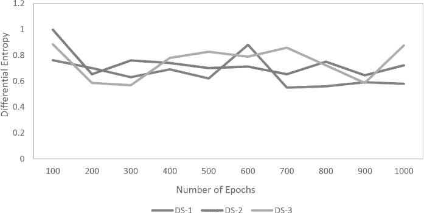

  [图 9.3] 随轮数变化的隐私情况。

* **RQ2:** 在生成的数据集上实现了多高的准确率？

  为了研究从原始数据集生成数据集的分类，使用了 K-最近邻分类器 (`KNN`)。`KNN` 分类的结果如 [表 9.6] 所示。结果清楚表明，我们的方法生成的数据集与原始数据集相当。

# 表 9.6 原始数据集与生成数据集的 KNN 分类指标

| KNN | | | Exp1 | Exp2 | Exp3 | Exp4 | Exp5 | Exp6 | Exp7 | Exp8 |
| --- | --- | --- | --- | --- | --- | --- | --- | --- |
| 原始数据时间 | 7.3 | 3.1 | 0.87 | 0.55 | 0.7 | 1.1 | 1.3 | 1.6 |
| 生成数据时间 | 7.3 | 8.2 | 9.1 | 0.55 | 0.54 | 1 | 0.7 | 1.1 |
| 原始 CA | 0.87 | 0.99 | 0.99 | 0.93 | 0.95 | 0.91 | 0.99 | 0.99 |
| 生成 CA | 0.81 | 0.99 | 0.93 | 0.98 | 0.97 | 0.90 | 0.98 | 0.99 |
| 原始 AUC | 0.94 | 1 | 1 | 0.96 | 1 | 0.97 | 0.99 | 1 |
| 生成 AUC | 0.89 | 0.99 | 0.97 | 0.45 | 0.99 | 0.81 | 0.84 | 0.99 |
| 原始 F1 | 0.86 | 0.99 | 0.99 | 0.93 | 0.95 | 0.91 | 0.99 | 0.99 |
| 生成 F1 | 0.81 | 0.99 | 0.93 | 0.98 | 0.97 | 0.90 | 0.98 | 0.99 |
| 原始精确率 (Prec.) | 0.85 | 0.99 | 0.94 | 0.95 | 0.91 | 0.99 | |
| 生成精确率 (Prec.) | 0.81 | 0.99 | 0.94 | 0.96 | 0.97 | |
| 原始召回率 (Recall) | 0.86 | 0.99 | 0.99 | 0.93 | 0.95 | 0.91 | |
| 生成召回率 (Recall) | 0.81 | 0.99 | 0.92 | 0.98 | 0.97 | |

# 9. 结论与未来工作

本研究探讨了使用生成对抗网络 (GAN) 生成匿名化数据集的可行性。结果表明，该方法生成的数据集在分类任务上与原始数据集相当。然而，隐私性受训练轮数的影响，这表明需要一种微调机制来平衡隐私与效用。

在未来工作中，我们将探索在 GAN 中引入差分隐私以缓解信息泄露。此外，我们计划通过更先进的技术来改进我们的方法，并对 IoT 场景下的性能进行进一步测试。

# 参考文献

1. Lee and K. Lee, "The Internet of Things (IoT): Applications, investments, and challenges," Business Horizons, vol. 58, no. 4, pp. 431–440, 2015.
2. Subahi, S. Kanhere, and G. Theodoropoulos, "Ensuring compliance of IoT devices with privacy," in *2018 6th International Conference on Future Internet of Cloud (FiCloud)*, 2018: Barcelona, IEEE, pp. 100–107.
3. Gubbi, R. Buyya, S. Marusic, and M. Palaniswamy, "Internet of Things (IoT): A vision, architectural elements, and future directions," Future Generation Computer Systems, vol. 29, no. 7, pp. 1645–1660, 2013.
4. Dorri, S. Jurdak, and P. Gauraram, "Blockchain for IoT security and privacy: The case study of smart home," in *2017 IEEE International Conference on Pervasive Computing and Communications Workshops (PerCom Workshops)*, 2017: Kona, HI, pp. 618–623.
5. Pasquier, J. Singh, J. Powles, D. Eyers, M. Seltzer, and J. Bacon, "Data provenance to audit compliance with privacy in the Internet of Things," Personal and Ubiquitous Computing, vol. 22, pp. 333–344, 2018.
6. A. P. Chamikara, P. Bertók, D. Liu, S. Camtepe, and I. Khalil, "Efficient data perturbation for privacy preserving and accurate data stream mining," Pervasive and Mobile Computing, vol. 48, pp. 1–19, 2018.
7. Xu, J. Ren, D. Zhang, Y. Zhang, Z. Qin, and K. Ren, "GANobfuscator: Mitigating information leakage under GAN via differential privacy," IEEE Transactions on Information Forensics and Security, vol. 14, no. 9, pp. 2358–2371, 2019.
8. Arora, R. Ge, Y. Liang, T. Ma, and Y. Zhang, "Generalization and equilibrium in generative adversarial nets (gans)," in International Conference on Machine Learning, 2017: PMLR, pp. 224–232.
9. Bae, D. Jung, H.-S. Choi, and S. Yoon, "AnomiGAN: Generative adversarial networks for anonymizing private medical data," in Pacific Symposium on Biocomputing 2020, Fairmont Orchid, World Scientific, pp. 563–574.
10. J. Goodfellow, J. Shlens, and C. Szegedy, "Explaining and harnessing adversarial examples," arXiv preprint arXiv:1412.6572, 2014.


11. Salimans, I. Goodfellow, W. Zaremba, V. Cheung, A. Radford, and X. Chen, “GAN 训练的改进技术，” Advances in Neural Information Processing Systems, vol. 29, pp. 1–9, 2016.

12. Leo, F. Battisti, M. Carli, and A. Neri, “一种用于物联网安全的联邦架构方法，”发表于 *2014 Euro Med Telco Conference (EMTC*), 那不勒, 2014: IEEE, pp. 1–5.

13. Al-Fuqaha, M. Guizani, M. Mohammadi, M. Aledhari, and M. Ayyash, “物联网：赋能技术、协议和应用的综述，” `IEEE` Communications Surveys & Tutorials, vol. 17, no. 4, pp. 2347–2376, 2015.

14. Lin, W. Yu, N. Zhang, X. Yang, H. Zhang, and W. Zhao, “物联网综述：架构、赋能技术、安全与隐私及应用，” `IEEE` Internet of Things Journal, vol. 4, no. 5, pp. 1125–1142, 2017.

15. Pateriya and S. Sharma, “RFID 安全与隐私的演变：研究综述，”发表于 *2011 International Conference on Communication Systems and Network Technologies*, 班加罗尔, 2011: IEEE, pp. 115–119.

16. Gutwirth, R. Leenes, P. De Hert, and Y. Poullet, 欧洲数据保护：走向。Springer：柏林，德国，2013.

17. Bengio, P.-L. Bacon, J. Pineau, and D. Precup, “用于加速模型的神经网络条件计算，”arXiv preprint arXiv:1511.06297, 2015.

18. LeCun, Y. Bengio, and G. Hinton, “深度学习，”Nature, vol. 521, no. 7553, pp. 436–444, 2015.

19. Yao, W. Pan, S. Ghosh, and F. Doshi-Velez, “贝叶斯神经网络推理不确定性量化的质量，”arXiv preprint arXiv:1906.09686, 2019.

20. Qu, S. Yu, J. Zhang, H. T. T. Binh, L. Gao, and W. Zhou, “GAN-DP：生成对抗网络驱动的差分隐私保护大数据发布，”发表于 ICC 2019IEEE International Conference on Communications (ICC), 上海, 2019: IEEE, pp. 1–6.

21. Wang, C. Rudolph, S. Nepal, M. Grobler, and S. Chen, “PART-GAN：隐私保护的时间序列共享，”发表于 人工神经网络与机器学习– ICANN 2020: 第 29 届国际人工智能网络会议，布拉迪斯拉发，斯洛伐克，2020 年 9 月 15 日至 18 日，论文集，第一部分 29, 2020: Springer, pp. 578–593.

22. A. P. Chamikara, P. Bertók, D. Liu, S. Camtepe, and I. Khalil, “一种用于大数据和数据流的高效可扩展的隐私保护算法，”Computers & Security, vol. 87, p. 101570, 2019.

23. Alcaide, E. Palomar, J. Montero-Castillo, and A. Ribagorda, “用于隐私保护物联网目标驱动应用的匿名认证，”Computers & Security, vol. 37, pp. 111–123, 2013.

24. Niu, Q. Li, X. Zhu, G. Cao, and H. Li, “在隐私感知的位置基服务中实现 k-匿名性，”发表于 IEEE INFOCOM 2014-IEEE 计算机通信会议，多伦多, 2014: IEEE, pp. 754–762.

25. Wang, J. Zhang, E. M. Schooler, and M. Ion, “基于属性的加密性能评估：迈向物联网数据隐私，”发表于 *2014 IEEE 国际通信会议 (ICC*),  悉尼, 2014: IEEE, pp. 725–730.

26. Zouari, M. Hamdi, and T.-H. Kim, “一种用于物联网的隐私保护同态加密方案，”发表于 *2017 第 13 届国际无线通信与移动计算会议 (IWCMC)*, 瓦伦西亚, *2017: IEEE, pp. 1939–1944*.

27. Domingo-Ferrer and J. Soria-Comas, “引导式微聚合：一种数据集和数据流匿名化的统一原语，”发表于 *2017 IEEE 国际数据挖掘研讨会 (ICDMW)*, 新奥尔良，路易斯安州，2017: IEEE, pp. 995–1002.

28. R. Sfar, Y. Challal, P. Moyal, and E. Natalizio, “一种基于物联网的交通隐私保护模型博弈论方法，”IEEE Transactions on Intelligent Transportation, vol. 20, no. 12, pp. 4405–4414, 2019.

29. Yao, W. Pan, S. Ghosh, and F. Doshi-Velez, “贝叶斯神经网络推理不确定性量化的质量，”arXiv preprint arXiv:1906.09686, 2019.

30. Qu, S. Yu, J. Zhang, H. T. T. Binh, L. Gao, and W. Zhou, “GAN-DP：生成对抗网络驱动的差分隐私保护大数据发布，”发表于 ICC 2019IEEE International Conference on Communications (ICC), 上海, 2019: IEEE, pp. 1–6.

31. Wang, C. Rudolph, S. Nepal, M. Grobler, and S. Chen, “PART-GAN：隐私保护的时间序列共享，”发表于 人工神经网络与机器学习– ICANN 2020: 第 29 届国际人工智能网络会议，布拉迪斯拉发，斯洛伐克，2020 年 9 月 15 日至 18 日，论文集，第一部分 29, 2020: Springer, pp. 578–593.

32. A. P. Chamikara, P. Bertók, D. Liu, S. Camtepe, and I. Khalil, “一种用于大数据和数据流的高效可扩展的隐私保护算法，”Computers & Security, vol. 87, p. 101570, 2019.

33. Alcaide, E. Palomar, J. Montero-Castillo, and A. Ribagorda, “用于隐私保护物联网目标驱动应用的匿名认证，”Computers & Security, vol. 37, pp. 111–123, 2013.

34. Niu, Q. Li, X. Zhu, G. Cao, and H. Li, “在隐私感知的位置基服务中实现 k-匿名性，”发表于 IEEE INFOCOM 2014-IEEE 计算机通信会议，多伦多, 2014: IEEE, pp. 754–762.

35. Wang, J. Zhang, E. M. Schooler, and M. Ion, “基于属性的加密性能评估：迈向物联网数据隐私，”发表于 *2014 IEEE 国际通信会议 (ICC*), 悉悉尼, 2014: IEEE, pp. 725–730.

36. Zouari, M. Hamdi, and T.-H. Kim, “一种用于物联网的隐私保护同态加密方案，”发表于 *2017 第 13 届国际无线通信与移动计算会议 (IWCMC)*, 瓦伦西亚, *2017: IEEE, pp. 1939–1944*.

37. Domingo-Ferrer and J. Soria-Comas, “引导式微聚合：一种数据集和数据流匿名化的统一原语，”发表于 *2017 IEEE 国际数据挖掘研讨会 (ICDMW)*, 新奥尔良，路易斯安州，2017: IEEE, pp. 995–1002.

38. R. Sfar, Y. Challal, P. Moyal, and E. Natalizio, “一种基于物联网的交通隐私保护模型博弈论方法，”IEEE Transactions on Intelligent Transportation, vol. 20, no. 12, pp. 4405–4414, 2019.

39. Yao, W. Pan, S. Ghosh, and F. Doshi-Velez, “贝叶斯神经网络推理不确定性量化的质量，”arXiv preprint arXiv:1906.09686, 2019.

40. Qu, S. Yu, J. Zhang, H. T. T. Binh, L. Gao, and W. Zhou, “GAN-DP：生成对抗网络驱动的差分隐私保护大数据发布，”发表于 ICC 2019IEEE International Conference on Communications (ICC), 上海, 2019: IEEE, pp. 1–6.

41. Wang, C. Rudolph, S. Nepal, M. Grobler, and S. Chen, “PART-GAN：隐私保护的时间序列共享，”发表于 人工神经网络与机器学习– ICANN 2020: 第 29 届国际人工智能网络会议，布拉迪斯拉发，斯洛伐克，2020 年 9 月 15 日至 18 日，论文集，第一部分 29, 2020: Springer, pp. 578–593.

42. A. P. Chamikara, P. Bertók, D. Liu, S. Camtepe, and I. Khalil, “一种用于大数据和数据流的高效可扩展的隐私保护算法，”Computers & Security, vol. 87, p. 101570, 2019.

43. Alcaide, E. Palomar, J. Montero-Castillo, and A. Ribagorda, “用于隐私保护物联网目标驱动应用的匿名认证，”Computers & Security, vol. 37, pp. 111–123, 2013.

44. Niu, Q. Li, X. Zhu, G. Cao, and H. Li, “在隐私感知的位置基服务中实现 k-匿名性，”发表于 IEEE INFOCOM 2014-IEEE 计算机通信会议，多伦多, 2014: IEEE, pp. 754–762.

45. Wang, J. Zhang, E. M. Schooler, and M. Ion, “基于属性的加密性能评估：迈向物联网数据隐私，”发表于 *2014 IEEE 国际通信会议 (ICC*), 悉尼尼, 2014: IEEE, pp. 725–730.

46. Zouari, M. Hamdi, and T.-H. Kim, “一种用于物联网的隐私保护同态加密方案，”发表于 *2017 第 13 届国际无线通信与移动计算会议 (IWCMC)*, 瓦伦西亚, *2017: IEEE, pp. 1939–1944*.

47. Domingo-Ferrer and J. Soria-Comas, “引导式微聚合：一种数据集和数据流匿名化的统一原语，”发表于 *2017 IEEE 国际数据挖掘研讨会 (ICDMW)*, 新奥尔良，路易斯安州，2017: IEEE, pp. 995–1002.

48. R. Sfar, Y. Challal, P. Moyal, and E. Natalizio, “一种基于物联网的交通隐私保护模型博弈论方法，”IEEE Transactions on Intelligent Transportation, vol. 20, no. 12, pp. 4405–4414, 2019.


43. Y. Liu, J. Peng, J. James, and Y. Wu, “PPGAN: Privacy-preserving generative adversarial network,” in *2019 IEEE 25Th International Conference on Parallel and Distributed Systems (ICPADS)*, 2019: IEEE, pp. 985–989.

44. O. Kayode and A. S. Tosun, “Deep Q-network for enhanced data privacy and security of IoT traffic,” in *2020 IEEE 6th World Forum on Internet of Things (WF-IoT)*, 2020: IEEE, pp. 1–6.

45. D. Anguita, A. Ghio, L. Oneto, X. Parra, and J. L. Reyes-Ortiz, “Human activity recognition on smartphones using a multiclass hardware-friendly support vector machine,” in Ambient Assisted Living and Home Care: 4th International Workshop, IWAAL 2012, VitoriaGasteiz, Spain, December 3–5, 2012. Proceedings 4, 2012: Springer, pp. 216–223.

46. J.-L. Reyes-Ortiz, L. Oneto, A. Samà, X. Parra, and D. Anguita, “Transition-aware human activity recognition using smartphones,” Neurocomputing, vol. 171, pp. 754–767, 2016.

# 索引

- 高级规避技术 [24]
- 高级电表基础设施 (AMI) 系统
    * 资产分类 [10]
    * 收益 [1]
    * 通信层漏洞 [13], [14]
    * 通信网络 [4]
    * 组件 [4–5], [5]
    * 数据层漏洞 [12–13], [13]
    * 定义 [3]
    * 硬件层漏洞 [11–12], [12]
    * 实现 [9]
    * 信息安全风险评估 [6–9], [7]
    * 主要目标 [2], [3–4]
    * 风险评估 [3]
    * 风险识别 [9–11]
    * 风险剖分析阶段针对 [14–16], [15], [16], [17]
    * 风险处理阶段针对 [16], [18]
    * 阶段 [5–6]
- 对抗机器学习 [30–31]
- 攻击者用户 (AU) [58], [58], 59]
- 空中运输 [204]
- AMI 系统 *参见* [高级电表基础设施 (AMI) 系统]
- 基于 Android 的移动设备 [24]
- Android 程序包 (APK) [34], [36]
- 预期年损失 (ALE) [8]
- 年发生率 (ARO) [8]
- 蚁群算法 [220]
- 人工智能 (AI) [18–19], [26]
- 基于属性的访问控制 (ABAC) [154]
- 基于属性的加密 (ABE) [15–216]
- 身份验证 [101]
    * 智能家居与安全 [160]
    * 智能锁 [150]
- 授权 [90], [101–102], [116]
    * 生成对抗网络 [217–219]
    * 智能锁 [150]
- 自动编码器 *参见* [受限玻尔兹曼机 (RBMs)]
    * 用于信息物理系统 [193], [193], [194]
    * 欺诈与异常检测 [196–199], [197], [198]
    * 用于针对性问题 [190–191]
- 自动抄表 (AMR) 系统 [4]
- 自动化设备 [81]
- 自动化安全 [147], [166]
- 大数据安全 [203], [209], [216]
- 生物识别 [149]
- 攻击的灾难级 [16]
- CCA 安全秘密密钥加密 [155]
- 攻击的特定级别 [15]
- 证书机构 (CA) [218]
- CNN *参见* [卷积神经网络 (CNN)]
- 云计算技术 [18]
- 认知通信系统 [167]
- 智能锁的伴侣应用程序漏洞 [153]
- 受感染设备注入恶意软件 [103]
-  机密性、完整性和可用性 (CIA) [102–103]
- 攻击的等级 [15], [15], [16]
- 卷积神经网络 (CNN) [29], [34], [38], [191]
    * 分类器 [45], [46]
    * 超参数 [45]
- CPS *参见* [信息物理系统 (CPS)]
- 信用卡欺诈识别技术 [196], [197]
- 关键基础设施 [6]
- 网络人类系统 (CHS) [199]
- 信息物理系统 (CPS)
    * 自动编码器 [193], [193], [194]
    * 突破 [199–200], [200], [201]
    * 现代世界的关键性 [201–202]
    * 5C 结构 [200]
    * 演进 [202–204]
    * 在 物 设备中 [194–195]
    * 受限玻尔兹曼模型 [191–193], [192]
    * 结构 [200]
    * 可测试性 [201]
- 网络安全 [167]
- 数据匿名化 [215–217]
- 数据集中器 (DCs) [2], [10]
- 数据保护 [208]
- DDoS *参见* [分布式拒绝服务 (DDoS)]
- 深度卷积 GAN (DCGAN) [33–34]
    * 对抗样本 [37–38]
    * 行为特征提取 [40–41]
    * 卷积神经网络 [38]
    * 数据准备 [36]
    * 数据集 [35]
    * 动态分析 [35–36]
    * 评估 [47–48]
    * 实验设置 [39–40]
    * 生成器与判别器网络 [45]
    * 超参数 [43]
    * 图像分类 [43–44], [44], [45]
    * 图像生成 [37], [37]


- 合成图像 41–43, 43
- 词生图像 41
- 深度学习判对抗网络 31
- 深度学习恶意软件检测 28–29
- 深度学习方法论 191, 197–198, 213
- 深度神经网络 (DNNs) 31, 191
- 深度 Q 网络 (DQN) 221
- 深度强化学习 31
- 拒绝服务 (DoS) 77
- 设备属性 91
- 设备外部进程状态 92
- 设备内部进程状态 92
- 设备配置网关 (DPG) 95
- 设备配置服务 (DPS) 95
- 设备状态属性 91, 93, 94
- 数字孪生 96–98, 102
- 分布式拒绝服务 (DDoS) 11
- 领域生成算法 (DGA) 检测 195
- DPG 见 设备配置网关 (DPG)
- DPS 见 设备配置服务 (DPS)
- DroidBox 40, 41
- 动态模型 58
- 动态库 (DLLs) 27
- 电子商务 191
- 边缘计算 219–220
- 电力服务提供商 (ESP) 4
- 椭圆曲线加密 (ECC) 77
- 加密 18, 24, 55
- 端到端加密见跳跳加密 (Z_013_index.xhtml#idx91)
- 环境参数 93
- ESP 见 电力服务提供商 (ESP)
- 最终一致性 153–154
- 交换电子密钥 149
- 特征选择技术 28
- 前馈神经网络 32
- FHE 见全同态加密 (FHE)](Z_013_index.xhtml#idx84)
- 费舍尔分数 28
- 5G 医疗设备 167
- 流量授权 102
- 传感器开发框架 (FRASAD) 125
- 全同态加密 (FHE) 18
- 博弈论模型 167
    - 活跃与空闲概率 180, 182
    - 认知通信系统 167
    - 竞争策略 176
    - 等等传输功率 177
    - 长期性能 180, 183
    - 多用户扩展 179–180
    - 非竞争策略 176–177
    - 停机概率 170, 180, 181
    - 收益矩阵计算 180, 182
    - 性能分析 177–178
    - 性能指标 180, 184
    - 问题描述 168–170, 169, 170
    - 频谱共享认知系统 167, 168
    - 非协调传输 173, 175
    - 零和策略 171, 171–173
    - 博弈论策略 61, 65, 68, 73
    - 泛化传输策略 66
    - 模型动力学 61–64, 67
    - 模拟使用 68, 69–72
    - 系统模型 58, 58–59
    - 零和策略 59–61, 65–66
    - 生成对抗网络 (GAN) 209; 见深度卷积 (DCGAN)](Z_013_index.xhtml#idx45)
    - 准确率测量 225
    - 卷积框架 25
    - 数据分析与解释 224
    - 数据准备 223, 223, 224
    - F-measure 225
    - 错误分类 225
    - 变态恶意软件检测 33
    - 隐私 225, 226, 226, 227, 227, 227, 228
    - 隐私数据分析 220–221
    - 隐私测量 225
    - 第三方恶意软件检测器 33
    - HAPT2015 数据集 221, 222
    - 隐马尔可夫模型 (HMMs) 28
    - 家庭局域网 (HAN) 6
    - 跳跳加密 216
    - Hyper-V 技术 38
    - IIoT 见工业物联网 (IIoT)](Z_013_index.xhtml#idx95)
    - 图像生成 37, 37
    - 工业物联网 (IIoT) 54, 165
    - 信息与通信技术 (ICT) 社区 121
    - 信息安全 55, 57
    - 信息安全风险评估 (ISRA)
        - 定义 6
        - 识别 7
        - 基于模型的方法 9
        - 剖析 7
        - 定性风险分析 8–9
        - 定量风险分析 8
        - 风险管理流程 7
        - 阶段 7
        - 处置 7–8
    - 创新技术 54, 165
    - 国际数据公司 (IDC) 121
    - 物联网 (IoT)
        - 应用 1, 2
        - 架构与应用 209–210
        - 定义 54, 124


- 局限性与挑战 210–212
- 隐私 212
- 入侵检测系统 (IDS) 18
- 逆文档频率 (IDF) 36
- ISRA 见[信息安全风险评估 (ISRA)]](#Z_013_index.xhtml#idx98)
- 保留访问日志 150
- K-近邻 (KNN) 196
- 知识发现与传播 (KDD) 数据集 194
- 合法用户 (LU) 58, 58, 59
- LEONORE 79
- 攻击概率 15, 15, 16
- Linux 内内核系统 29
- 门锁/解锁 149
- 低轨道离子大炮 (LOIC) 104
- 机器学习 (ML) 26–28
- 恶意代码/恶意软件 24
- MalGAN 32, 33
- 中间人攻击 (MiTM) 103, 109, 152
- 马尔可夫链 60
- 服务即杂烩 (MaaS) 124
- MDE4IoT 125
- MDMs 见[电表数据管理系统 (MDMs)]](#Z_013_index.xhtml#idx124)
- 医疗 CPS 201
- 变态性 GAN 系统 36
- 电表数据管理系统 (MDMs) 2, 10
- 模型驱动架构 (MDA) 122, 124
- 多因素认证 (MFA) 160
- 重用绑定与配置平台 (MBP) 79
- 邻域网 (NAN) 6
- 网络基础设施 77, 87, 89, 98, 114
- 节点生成器 137
- Node-Red 137, 139
- Node-red-contrib-web-of-things 137
- 节点网络 18
- 对象管理组 (OMG) 128
- 异常值检测 196
- PEE 见配置引擎 (PEE)
- 物理层安全 57
- 投毒攻击 30
- 基于策略的安全配置 90–91
- 基于策略的安全应用 (PbSA) 98–100
- 策略数据库 (PD) 95
- 策略驱动架构；见安全设备配置与监控 (SDPM)](Z_013_index.xhtml#idx169)
    - 挑战 89
    - 设备配置 89–94, 91, 93, 110–111
    - 数字孪生 96–98
    - 安全配置 95–96, 96
- 策略执行模块 219–220
- 多变态恶意软件代码 25
- 变态性 24–25
- 可能的攻击水平 15
- 精准农业 76, 200
- 隐私策略协议 (PPA) 219
- 隐私保护数据生成 209
- 隐私敏感、情感知描述模型 128–129, 129; 见物联网 (WoT) 物描述 (TD)](Z_013_index.xhtml#idx215)
    - 实现 132
- 概率密度函数 (PDF) 59
- 概念证明 (PoC) 实现 
    - 网络设置 100, 101
    - 性能评估 109–111, 112–114
    - 安全分析 101–104, 104, 105, 106–109, 107–108, 110
- 已配置数据库 (PDD) 94
- 配置引擎 (PEE) 95
- 公钥基础设施 (PKI) 服务 10
- 稀有攻击概率 15
- 合法用户响应因子 63, 66, 67
- 接收单元 (RU) 58, 58, 59
- 循环神经网络 (RNN) 31
- 强化学习攻击 31
- 智能锁中继攻击 152, 152
- 远程认证服务 (RADIUS) 80
- 受限玻尔兹曼机 (RBMs) 188–189
    - 信息物理系统 191–193, 192
    - 欺诈与异常检测 196–199, 197, 198
    - 恶意软件攻击 195–196
    - 针对性问题 189–191
- 风险管理 17
- 风险分析 7, 14–16, 15, 16, 17, 211
- 风险处理 16, 18
- SDPM 见安全设备配置与监控 (SDPM)](Z_013_index.xhtml#idx169)
- SecSmartLock (安全智能锁) 155
- 安全智能设备配置与监控服务 (SDPM) 94, 94–95, 95–96, 96
    - 平均路径建立时间 111, 114
    - 设备功耗 111, 113
    - 数字孪生 96–98
    - 性能评估 109–111, 112–114
    - 基于策略的方法 90–91
    - 策略语言 91
    - 后置条件 93, 93–4
    - 前置条件 91, 91–92
    - 需求 90
    - 资源利用 111, 113
    - 安全策略规范 99–100
    - 安全属性 101–103
    - 吞吐量 111, 112
- 安全支柱 2
- 安全策略规范 99–100


- 自动驾驶汽车 191
- 自学式学习 (STL) 191
- 服务面向型架构 (SOA) 125
- 浅层机器学习技术 26
- 信干加噪比 (SINR) 59
- 信噪比 (SNR) 59
- 单次损失期望值 (SLE) 8
- 单个恶意数据包 103
- 情境隐私 129–130, 130
- SituationPrivacyWoTTD 元模型 131, 131, 132, 132
- 智能城市安全 208, 210
- 智能家居隐私与安全 155–156; 另另 智能锁
    - 身份验证 160
    - 配置设备选项 160
    - 云端数据风险 156
    - 数据采集与挖掘 156–157
    - 设备选择 159
    - 不安全设备 158
    - 缓解策略 159, 159
    - 多用户挑战 157–158
    - 网络攻击 158
    - 网络配置 160
    - 物理安全 158
    - 自审查 159
- 智能锁 147; 另另 智能家居隐私与安全
    - 访问控制 150
    - 基于属性的访问控制框架 154
    - 身份验证与授权 150
    - 组件 147–148
    - 设备-网关-云 148, 149
    - 直接连接到互联网 148–149, 149
    - 最终一致性模型 153–154
    - 交换电子密钥 149
    - 留访问日志 150
    - 锁门/解锁门 149
    - 隐私与安全 151–153, 155
    - 休假模式 150
- 智能药分发器 (SMD) 127–128, 128
    - 评估 138, 139, 140
- 智能电表 (SMs) 2, 10
- 软件定义网络 (SDN) 191
- 软件定义配置 (SDP) 80
- 频谱共享通信 57, 167, 168
- 伪骗 103
- 堆叠自动编码器 (SAE) 28–29
- 智能锁的状态攻击 151–152
- 统计披露控制 (SDC) 216
- 聚合 216
- 监督学习 191
- 智能锁的租户隐私 153
- 词频逆文档频率 (TFIDF) 36
- Thing-WoT 双向通信 137, 137
- 零决定式策略 4
- 未经授权的解锁 152–153
- 统一建模语言 (UML) 9
- 未监控的生物识别系统 196
- 用户属性 91
- 用户身份识别 211
- 用户隐私 218
- 用户追踪 211
- 效用监控 211–212
- 智能锁的休假模式 150
- 变分自动编码器 (VAE) 213
- 虚拟化技术 38
- 虚拟机 (VMs) 38
- 虚拟专用网络 (VPNs) 160
- 可穿戴设备 208
- WAN 另见 广域网
- 物联网 (WoT) 物模型描述 (TD) 122–123, 126, 126–127, 127
- 广域网 (WAN) 6
- 无线传感器网络 (WSN) 166, 217–219
- WoTT2SPWoTTD 模型转换 133, 134–136
