# 物联网安全：基础、技术与应用 (River Publishers Series in Information Science and Technology)

# 安全与数字取证河出版系列

## 系列编辑

WILLIAM J. BUCHANAN
爱丁堡纳皮尔大学，英国

ANAND R. PRASAD
NEC，日本

## 索引
本系列出版的所有书籍均提交至 Web of Science 书籍引文索引（BkCI）、CrossRef 和 Google Scholar。

## 系列描述
“River Publishers 安全与数字取证系列”是一系列全面的学术和专业书籍，专注于网络安全（Cyber Security）的理论与应用，包括数据安全、移动和网络安全、密码学和数字取证。预防和威胁管理主题也包含在本系列书籍的范围内，同时还包括该领域的通用业务标准。

本系列出版的书籍包括研究专著、编著文集、手册和教科书。这些书籍为该领域的专业人士、研究人员、教育工作者和高级学生提供了对最新研究和发展的重要见解。

## 涵盖主题
本系列涵盖的主题包括但不限于以下内容：

* 网络安全
* 数字取证
* 密码学
* 区块链
* 物联网安全
* 网络安全
* 移动安全
* 数据与应用安全
* 威胁管理
* 标准化
* 隐私
* 软件安全
* 硬件安全

如需查看本系列其他书籍列表，请访问 www.riverpublishers.com

## 致谢
*献给我们的小主人 “Samarth Koshagra Shandilya”*
— S. K. S., S. S.

*献给我的挚爱家人，James、Alex 和 Catherine。*
— S. A. C.

# 前言
世界在过去十年见证了机器对机器（M2M）通信技术的巨大增长。因此，出现了大量 M2M 通信技术并改变了整个局面。这些 M2M 启用节点为许多目的创建了一个高度复杂和尖端的物联网（IoT）环境。

物联网安全是保护物联网领域中连接设备和网络的一系列工具和技术。但这一重要事项在物联网设计中通常被忽视。物联网产品通常以旧的或缺少安全功能的方式实现。此外，客户甚至经常未能更改智能设备的默认密码。安全专家不断警告组织和个人，由于存在大量未受保护的设备而带来的潜在风险和隐私泄露。避免此类风险的一种安全措施是物联网身份（IDoT），它根据相关元数据为智能设备分配唯一标识符（UID），然后仅允许它们相互通信。物联网身份是物联网的一个基本组成部分，在其中几乎任何可以想象的东西都可以被寻址并联网以在线交换数据。

关于物联网安全的书籍并不多；已出版的少数书籍大多仅涉及安全物联网的安装。本书不仅详细讨论了物联网安全技术，还试图对该主题提供全面的图景，这对于构建高度安全且功能丰富的物联网应用是必要的。

最后，我想说这本呈现的书籍是该主题全面且写得很好的指南。我相信学生和从业者会特别喜欢阅读这部作品。

*Prof. Atulya Nagar 在英国利物浦希望大学担任数学科学教授的基金会主席，并担任理学院院长。Nagar 教授是一位国际公认的学者，工作处于理论计算机科学、应用数学分析、运筹学和系统工程的最前沿，其工作以坚实的复杂性理论基础为支撑。*

# 前言
物联网安全是致力于保护物联网（IoTs）中连接设备和网络的领域。它涉及具有唯一标识符的对象日益普及以及通过网络自动传输数据的能力。物联网通信的增长很大程度上来自于工业机器对机器（M2M）通信、智能电网、家庭和建筑自动化、车对车通信以及可穿戴计算设备中使用的计算设备和嵌入式传感器系统。

主要问题是由于将电器和其他对象联网的想法相对较新，安全性在产品设计中并不总是被考虑。物联网产品通常随旧的嵌入式操作系统和软件一起销售。为了提高安全性，需要通过互联网直接访问的物联网设备应被分割到自己的网络中并限制网络访问。然后应监控该网络段以识别潜在的异常流量，如果出现问题应采取行动。此问题是一个开放的研究问题，关于该主题的参考资料很少。

本书专注于当前研究，同时突出实证结果和理论概念，为高级安全和物联网领域的学生、研究人员、学者、专业人士和从业者提供良好的综合参考。

我们衷心感谢所有作者、审稿人以及 River Publishers 人员，尤其是 Mr. Mark De Jongh 的善意支持。特别感谢 Atulya Nagar 教授、Suresh Jain 博士和 Ganga Agnihotri 博士的无尽鼓励和耐心。我们希望这本书对所有相关读者都有益。

Shishir Kumar Shandilya VIT 博帕尔大学，印度
Soon Ae Chun 纽约市立大学，美国
Smita Shandilya Sagar 研究、技术与科学学院，印度
Edgar Weippl SBA Research，奥地利

# 贡献者名单
Alexandru Serbanati，罗马萨皮恩扎大学，意大利
Bertrand Copigneaux，Inno TSD，法国
Domenico Rotondi，TXT e-solutions S.p.A.，意大利
Edgar Weippl，SBA Research，奥地利
Foued Melakessou，卢森堡大学，卢森堡
Franck Le Gall，Inno TSD，法国
Gianmarco Baldini，联合研究中心 – 欧洲委员会，意大利
Imran Ali Khan，计算机科学工程系，Bansal 研究、技术与科学学院，马德亚 Pradesh，印度
Julinda Stefa，罗马萨皮恩扎大学，意大利
Marcus Handte，杜伊斯堡-埃森大学，德国
Philippe Smadja，Gemalto，法国

Pijush Kanti Dutta Pramanik, 计算机科学与工程系，国立技术学院，杜尔加布尔，印度
Prasenjit Choudhury, 计算机科学与工程系，国立技术学院，杜尔加布尔，印度
Priti Maheshwary, 计算机科学与工程系，泰戈尔大学（原名 AISECT 大学），博帕尔，MP，印度
Salvatore Piccione, TXT e-solutions S.p.A., 意大利
Sergio Gusmeroli, TXT e-solutions S.p.A., 意大利
Shaligram Prajapat, 国际职业研究学院，马德亚·普拉德什邦，印度；德维·阿希利亚大学，印多尔，马德亚·普拉德什邦，印度
Shishir Kumar Shandilya, VIT 博帕尔大学，印度
Smita Shandilya, 萨加尔研究技术与科学学院，印度
Soon Ae Chun, 纽约市立大学，美国
Tasneem Jahan, 计算机科学与工程系，班萨尔研究、技术与科学学院，马德亚·普拉德什邦，印度
Timothy Malche, 计算机科学与工程系，泰戈尔大学（原名 AISECT University），博帕尔，MP，印度
Trevor Peirce, AVANTA Global SPRL，比利时

# 缩写列表
ACL
: 访问控制列表
ARM
: 关联规则挖掘
AVK
: 自动可变密钥
COSO
: 特雷德韦委员会赞助组织委员会
CPU
: 中央处理器
DDoS
: 分布式拒绝服务
DoS
: 拒绝服务
DRAM
: 动态随机存取存储器
DTLS
: 数据报传输层安全
ELP
: 电子车牌
ESN
: 电子序列号
ETSI
: 欧洲电信标准协会
HMAC
: 哈希消息认证码技术
IDS
: 入侵检测系统
IIoT
: 工业物联网
IMC
: 内存计算
IMEI
: 国际移动设备身份码
IoT
: 物联网
IPS
: 入侵防御系统
IT
: 信息技术
LTE
: 长期演进
M2M
: 机器到机器通信
MEC
: 移动边缘计算
MGT
: 移动等级阈值
NIST
: 国家标准与技术研究院
P2P
: 点对点
PKC
: 公钥密码学
PKI
: 公钥基础设施
QoE
: 体验质量
RAID
: 独立磁盘冗余阵列
RAM
: 随机存取存储器
RAN
: 无线电和网络
RNC
: 无线网络控制器
SKC
: 对称密钥密码学
TCO
: 拥有总成本
VANET
: 车载传感器网络
VMS
: 视频管理软件
WDR
: 宽动态范围
WWW
: 万维网

# 1 物联网安全：导论
Shishir Kumar Shandilya¹
DOI: 10.1201/9781003338642-1
随着连接能力的提升，物联网在为用户提供更便捷地一次性连接多个设备、共享数据和控制方面不断拓展其应用领域。这种连接、通信和管理能力为未来技术协同工作打开了广阔的大门。这些通信链路现已从封闭的安全网络走向开放的公共互联网网络。这使得物联网系统面临重大安全问题，因为设备日渐智能化，它们之间的互联互通不可避免地带来了入侵和干扰的可能性。因此，需要一套可定制的强有力的物联网保护机制，以避免对隐私的侵害并保护物联网用户的数据。本章分析了这些安全问题，并讨论了物联网设备带来的安全挑战及其相应的解决方案。

## 1.1 引言
组织在现有系统实施物联网或创建全新系统之前，本质上需要对安全问题完全确信。因此，物联网解决方案提供商面临着建立对该技术信任的诸多挑战。每个组织对物联网部署的设想和概念化方式各不相同，这加剧了对安全措施适当性的不安和不信任。

大多数供应商更关注他们能够通过传感器池、数据收集和分析服务器以及优化子程序为组织提供的解决方案。他们对系统实施后的安全问题关注较少，而这是一个更重要的问题。仅在物联网实施中提供一套定制的兼容电子组件和软件服务，对于寻求技术升级的组织来说显然是不够的。每个物联网供应商都知道，安全问题已成为过去几年组织最主要关注的问题，他们必须提供配备安全可靠运行的物联网解决方案，通过多重防火墙和安全协议实现。然而，并没有一种通用的安全现象可以让他们说服客户关于安全问题，相反，这需要一种更个性化的方法和定制的安全约束。为了使物联网更有效，组织应对其充满信心，而这只有在供应商按照组织的要求设计物联网系统并实施安全措施时才有可能。因此，这也关乎对技术和供应商的心理信任，而供应商本质上需要实现这一点。

## 1.2 安全：主要关注点
安全问题自计算开始以来一直是主要关注点。人们更依赖于提供更安全工作环境同时保护其隐私和身份的技术。随着物联网的出现，计算场景已从独立计算转向更灵活的协作计算。这再次引发了安全问题，入侵威胁加剧。其范围从个人信息的黑客攻击到被干扰的金融交易和欺骗。由复杂程序驱动的智能设备更容易被错误编程。此外，这些设备之间的握手和共同协作平台增加了破坏安全措施的可能性。然而，这不仅是恶意用户的机会，也是程序员实现最高级别安全以减轻这些安全威胁的机会。

自其演进以来，物联网框架的智能设备一直高效地提供其操作。但由于网络不断扩展，它们也面临对用户及其个人数据的某些威胁。

### 1.2.1 保密性
物联网框架涵盖了设备、传感器、信息和软件服务的互联。保密性是指确保数据或网络交易只能被其预期目的地读取的属性。保密性的主要目标是保持对设备识别、通信和传感以及与语义相关的服务的关注。识别过程处理将网络服务与用户需求匹配的任务。通信处理将异构性质的对象链接到特定服务集。在传感过程中，从各种智能设备获得的信息根据用户需求进行计算，并作为感知数据发送到物联网数据库或云中。通信和计算的这一聚合块是物联网的处理单元。物联网网络广泛使用数据报传输层安全（DTLS）协议来实现保密性。它提供双向身份验证，其底层原理可能是对称加密和椭圆曲线密码学。通过实施 HTTPS 协议实现数据保密性，通过在物联网设备到网关以及网关到云之间启用加密和安全通信路径。

### 1.2.2 身份验证
身份验证确保物联网网络中用户的有效性。只要经过身份验证的用户拥有与其对等方之间通信的权限，就会被识别。会话密钥使用会话密钥分发方案生成，以强制执行真实性和访问控制。公钥基础设施（PKI）一直是互联网安全的神经中枢。它确保相互信任和设备身份验证。

### 1.2.3 数据完整性
此安全物联网网络的属性涉及设备中包含的数据以及通信节点之间流动的数据（图 1.1）。如果数据完整性受到损害，将连续导致网络设备和整个物联网平台被利用。传输中的数据需要受到修改的保护。数据完整性可以通过使用密钥哈希消息认证码技术（HMAC）来实现，其原理是保持一个共享的私钥；由于它需要共享私钥，因此必须像任何其他加密密钥一样受到保护。

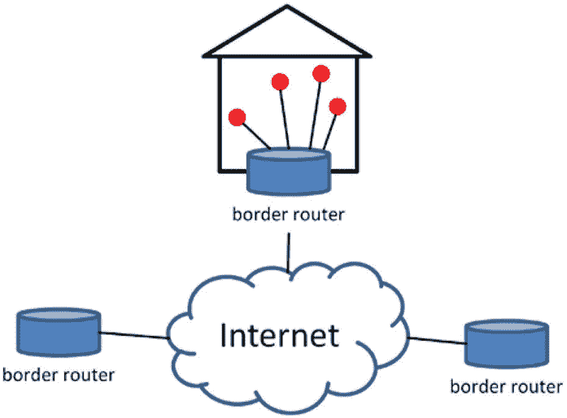

图 1.1 物联网网络基础设施。

### 1.2.4 网络威胁及其检测
物联网技术在其有吸引力的功能之外带来了许多安全挑战。从用户角度来看，它通过智能设备使我们的日常生活活动更轻松、更准确。但从网络角度来看，物联网网络的扩展性质容易受到强大的网络攻击。

网络攻击可能旨在：
* 损坏连接到物联网网络的物理设备和电器。
* 滥用进出网络流量。
* 停止网络运行。

各种攻击检测技术可以在路由器和交换机级别部署。例如，
* 入侵预防系统（IPSs）
* 防火墙
* 入侵检测系统（IDSs）
* 访问控制列表（ACLs）

IDS 是威胁检测的潜在解决方案，可防止物联网智能设备的滥用。IDS 部署在边界路由器上。它监控进出网络流量，并在检测到恶意活动时发出警报。这种主动检测机制然而不适合深度包检测。

### 1.2.5 威胁缓解
这是在威胁报告后采取的反应措施。它调查威胁对网络的影响以及物联网网络的受感染区域。当前的物联网网络需要结合网络安全和物理安全的模型。例如，银行业的信息安全使用蜜罐来了解可能成为攻击者目标点的漏洞。蜜罐关注多种服务，例如 HTTP、SMPT、SSH、FTP 等。它提供了呈现当前和未来攻击预测的透明前景的优势。

### 1.2.6 恶意软件抵抗
物联网网络中的恶意软件将自己伪装成合法的网络用户/设备，并尝试使用通用用户名和密码进行身份验证。它成功绕过登录机制，然后发出破坏性命令以利用数据完整性并导致设备出现破坏性故障。它还可能切断互联网连接并使设备无法使用。它可以覆盖设备配置或擦除它，还可能擦除外部硬盘驱动器。

Mirai 恶意软件于 2016 年 10 月发动了一次破坏性攻击，属于 DDoS 类别。它用 C 语言编写，并针对具有基于 Linux 的平台的嵌入式设备，例如 CCTV、DVR、路由器等。它具有通过暴力破解 telnet 密码进行自我传播的特性。恶意软件会启动恶意代码。此代码可通过垃圾邮件或图像到达设备，并在打开时自动触发安装。

防御 Mirai：
* 通过为物联网设备设置强密码进行保护。应及时备份，并由专业人员捕获和分析网络流量。

* 为了远程访问 Linux 账户，应禁用 Telnet 登录，并使用 SSH。
* 网络设备如果持续更新且登录凭证随时间更改，则更不易受到攻击。
* 对物联网系统实施强加密标准非常重要，以防止攻击者访问。

## 1.3 物联网中的业务方面
随着物联网的出现，业务流程可以在基础层面变得顺畅且稳健，并可借助智能设备和自动化产品达到更高水平。物联网有能力改变业务应用。物联网的业务方面主要关注以下关键要素：
* 公司中的更智能产品：口袋大小的智能手机内部承载着世界的许多事物。智能设备可实现应用程序的快速即时处理，并在相对较短的时间内执行业务活动。
* 实现更智能的业务运营和更明智的决策：反馈流程变得简单，可以判断未来影响的预测。
* 商业模式的改变：原始的生产者-消费者趋势已被物联网极大地革新。它提供节省时间的商业解决方案。

## 1.4 工业物联网 (IIoT)
物联网向制造业的扩展由术语 IIoT 定义。它通过以系统且经济高效的方式实现海量数据的添加和访问，并以极高的速度进行，从而从根本上改变了制造过程。许多公司现已实施 IIoT 以整合传感器数据，持续准确地捕获通信数据，并高效监控整体供应链、质量控制、存储有关设备、车辆和容器的信息以及工业流程的可追溯性。
IIoT 产生的数据与物联网产生的数据相比呈指数级增长。例如，单片涡轮压缩机叶片在一天内可产生约 500GB 数据。因此，IIoT 需要结合计算机和互联网，还需要大数据、云计算和机器学习等现代技术。IIoT 还伴有一个重要说明，可以理解为物联网很重要但不关键，而 IIoT 故障可能导致危及生命或其他紧急情况。因此，IIoT 是一种非常有前景的技术，它通过创建连接平台并推动物联网的工业解决方案，确保下一场工业革命的到来。
IIoT 的关键要素包括：
* 信息交换是在企业之间进行的，而不是从企业到消费者。
* 与物联网的小型企业或有限企业相比，IIoT 的市场细分是大型企业。
* 物联网的数据量被称为大数据。在 IIoT 中，数据有限但具体。
* 物联网侧重于消费者便利性和消费者需求。IIoT 旨在降低投资并改善回报成本。

### 1.4.1 IIoT 中的安全要求
工业互联网旨在提高整个供应链中生产过程的效率和生产率（图 1.2）。IIoT 涵盖高风险行业领域，例如石油和天然气供应链、电力网、重型机械和传感器。这些应用中的任何安全漏洞都可能对业务解决方案造成巨大影响。数据安全可能受到威胁。

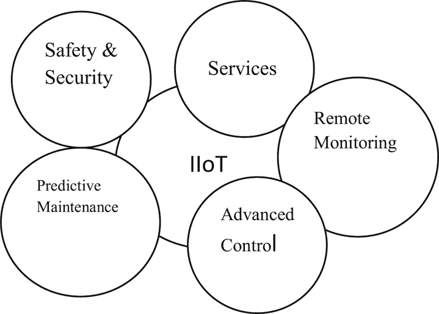

图 1.2 IIoT 操作。

忽视安全和隐私问题不仅会危及用户活动，还会危及设备的运行和功能。IIoT 安全包括对安全性和可靠性的关注。

## 1.5 车辆传感器网络 (VANETs)
车辆 *自组织* 网络 (VANET) 将车辆视为在车辆之间传输消息的节点。它是物联网的一个子集，可称为 IoV。车辆是智能对象，配备传感器，并具有基于 IP 的连接。VANET 在车内组件之间、车辆与车辆之间以及车辆与人员之间传输消息。消息的处理基于车辆的传感能力。
VANET 增强了智能交通系统 (ITS) 的基础，该系统有潜力为其客户提供丰富的应用，作为使用安全和服务的路边基础设施。

### 1.5.1 VANET 中的传感器
VANET 中的传感器可分为两类：
1. 自主传感器：这些传感器包括接受范围阈值 (ART) 和移动等级阈值 (MGT)。这些参数考虑最大通信范围并限制特定区域中的实体数量。
2. 协作传感器：这些传感器包括在对等车辆之间实践交换邻居表关于其数据和位置的步骤和措施。

### 1.5.2 VANET 中的安全
VANET 的安全性取决于成本、信任、隐私及其部署。某些国家为车辆分配电子车牌 (ELPs)，这是一个可通过密码学验证的号码。
在 VANET 的背景下，PKI 被称为 VPKI，它是证书密钥分发、证书撤销、数据记录等。

## 1.6 物联网支持的可穿戴设备
可穿戴智能设备的市场是互联网世界中广泛讨论的话题。这些设备具有各种物联网解决方案的完整功能。可穿戴设备的当前趋势在医疗保健和健身领域具有广阔的应用范围。生物识别导向的可穿戴设备可以测量心率和血液中的氧气水平，跟踪体温，并报告感冒或流感的可能性。可穿戴设备可以告知汽车后座是否未正确调整并导致背部受力。在手环形式下，它可以测量出汗水平，从而可以提供调整空调房间或汽车内温度和湿度的警报。如今使用的物联网可穿戴设备有：健身追踪器、智能手表、智能眼镜、婴儿监护设备和基于服装的可穿戴设备。一项调查显示，43% 的人将用可穿戴设备取代智能手机。

## 1.7 物联网在智能家居/城市中的应用
基于物联网范式的智能城市使用多种通信协议进行不同的数据表示。它还利用人工智能的概念来建模数据处理。智能城市或智能家居从众多数据源收集数据，这些数据源基本上是传感器。这些传感器可能散布在城市、办公室、花园、公共场所和市场周围。数据来自智能手机、智能卡、可穿戴传感器、车辆等。智能城市物联网网络旨在高效管理建筑物中的能源、水和电力供应。它还制定了改善公共交通、交通分析和人口密度统计的活动。废物管理也是农村和城市地区日益关注的问题。这可以借助智能家居和智能城市成功完成。

## 1.8 绿色物联网
Green IoT 是将温室行业与物联网集成使用的术语。它涵盖了节能的程序，并用于减少现有系统的温室效应。
它提供管理以下活动的优势：
* 通过评估农业和环境条件进行作物管理。
* 通过延长生产周期和监控减少化学品和肥料的使用来提高作物产量。
* 判断和分析土壤、水供应和湿度的需求。
* 监测温度变化。

在评估气候和地理条件之后，绿色物联网旨在启动一系列活动，以提高作物产量并增强农田的可持续性。不仅如此，它还启动活动以减少森林砍伐并增加更绿色的土地面积。某些绿色物联网模型使用 ZigBee 传感器网络，用于跟踪温度、湿度和土壤控制水平。其阈值存储在云中。当传感器参数高于或低于阈值时，网络会发出警报。温室的湿度传感器在湿度水平发生任何变化时都会发出警报。

## 1.9 来自摄像头的视频流和数据安全
视频数据的生成速度远快于其他数据。监控和安全摄像头不断生成视频数据。视频数据对企业具有很高的资产价值。
管理视频数据的复杂要素在于其非结构化形式。结构化视频数据易于管理。公司和业务流程侧重于使用视频管理软件（VMS）搜索这些大数据以进行统计分析处理。此处理基于时间、地点、人员和某些关键词。在营销、运营和客户服务处理过程中，应注意防止关键信息丢失的限制。
摄像头是大多数业务应用和大多数用例中有用的工具。摄像头的宽动态范围（WDR）特性为分析提供更多细节以解读信息。使用高清和 HDTV 摄像头，分辨率会提高到更好的范围。然而，更高的分辨率会增加存储消耗，因此需要视频压缩算法。网络摄像头的[content]
在评估气候和地理条件之后，绿色物联网旨在启动一系列活动，以提高作物产量并增强农田的可持续性。不仅如此，它还启动活动以减少森林砍伐并增加更绿色的土地面积。某些绿色物联网模型使用 ZigBee 传感器网络，用于跟踪温度、湿度和土壤控制水平。其阈值存储在云中。当传感器参数高于或低于阈值时，网络会发出警报。温室的湿度传感器在湿度水平发生任何变化时都会发出警报。

## 1.9 来自摄像头的视频流和数据安全
视频数据的生成速度远快于其他数据。监控和安全摄像头不断生成视频数据。视频数据对企业具有很高的资产价值。
管理视频数据的复杂要素在于其非结构化形式。结构化视频数据易于管理。公司和业务流程侧重于使用视频管理软件（VMS）搜索这些大数据以进行统计分析处理。此处理基于时间、地点、人员和某些关键词。在营销、运营和客户服务处理过程中，应注意防止关键信息丢失的限制。
摄像头是大多数业务应用和大多数用例中有用的工具。摄像头的宽动态范围（WDR）特性为分析提供更多细节以解读信息。使用高清和 HDTV 摄像头，分辨率会提高到更好的范围。然而，更高的分辨率会增加存储消耗，因此需要视频压缩算法。网络摄像头的[content]
在评估气候和地理条件之后，绿色物联网旨在启动一系列活动，以提高作物产量并增强农田的可持续性。不仅如此，它还启动活动以减少森林砍伐并增加更绿色的土地面积。某些绿色物联网模型使用 ZigBee 传感器网络，用于跟踪温度、湿度和土壤控制水平。其阈值存储在云中。当传感器参数高于或低于阈值时，网络会发出警报。温室的湿度传感器在湿度水平发生任何变化时都会发出警报。

## 1.9 来自摄像头的视频流和数据安全
视频数据的生成速度远快于其他数据。监控和安全摄像头不断生成视频数据。视频数据对企业具有很高的资产价值。
管理视频数据的复杂要素在于其非结构化形式。结构化视频数据易于管理。公司和业务流程侧重于使用视频管理软件（VMS）搜索这些大数据以进行统计分析处理。此处理基于时间、地点、人员和某些关键词。在营销、运营和客户服务处理过程中，应注意防止关键信息丢失的限制。
摄像头是大多数业务应用和大多数用例中有用的工具。摄像头的宽动态范围（WDR）特性为分析提供更多细节以解读信息。使用高清和 HDTV 摄像头，分辨率会提高到更好的范围。然而，更高的分辨率会增加存储消耗，因此需要视频压缩算法。网络摄像头的[content]
在评估气候和地理条件之后，绿色物联网旨在启动一系列活动，以提高作物产量并增强农田的可持续性。不仅如此，它还启动活动以减少森林砍伐并增加更绿色的土地面积。某些绿色物联网模型使用 ZigBee 传感器网络，用于跟踪温度、湿度和土壤控制水平。其阈值存储在云中。当传感器参数高于或低于阈值时，网络会发出警报。温室的湿度传感器在湿度水平发生任何变化时都会发出警报。

## 1.9 来自摄像头的视频流和数据安全
视频数据的生成速度远快于其他数据。监控和安全摄像头不断生成视频数据。视频数据对企业具有很高的资产价值。
管理视频数据的复杂要素在于其非结构化形式。结构化视频数据易于管理。公司和业务流程侧重于使用视频管理软件（VMS）搜索这些大数据以进行统计分析处理。此处理基于时间、地点、人员和某些关键词。在营销、运营和客户服务处理过程中，应注意防止关键信息丢失的限制。
摄像头是大多数业务应用和大多数用例中有用的工具。摄像头的宽动态范围（WDR）特性为分析提供更多细节以解读信息。使用高清和 HDTV 摄像头，分辨率会提高到更好的范围。然而，更高的分辨率会增加存储消耗，因此需要视频压缩算法。网络摄像头的[content]
在评估气候和地理条件后，绿色物联网旨在开展能提高作物产量并增强农田可持续性的活动。它还开展减少森林砍伐、增加绿色土地面积的活动。某些绿色物联网模型使用 ZigBee 传感器网络追踪温度、湿度和土壤控制水平。其阈值存储在云端。当传感器参数高于或低于阈值时，网络会发出警报。温室湿度传感器在湿度水平发生变化时即发出警报。

## 1.9 来自摄像头的视频流和数据安全
视频数据的生成速度远快于其他数据。监控和安全摄像头持续生成视频数据。视频数据对企业具有很高的资产价值。
管理视频数据的复杂之处在于其非结构化形式。结构化视频数据易于管理。公司和业务流程侧重使用视频管理软件 VMS 搜索这些大数据以进行统计分析处理。该处理基于时间、地点、人员和某些关键词。在营销、运营和客户服务处理中，应注意防止关键信息丢失的限制。
摄像头是大多数业务应用和大多数用例的有用工具。摄像头的宽动态范围 WDR 特性为分析提供更多细节以解读信息。使用 HD 和 HDTV 摄像头，分辨率会提升至更好范围。然而更高分辨率会增加存储消耗，因此需要视频压缩算法。网络摄像头的[content]
在评估气候和地理条件后，绿色物联网旨在开展能提高作物产量并增强农田可持续性的活动。它还开展减少森林砍伐、增加绿色土地面积的活动。某些绿色物联网模型使用 ZigBee 传感器网络追踪温度、湿度和土壤控制水平。其阈值存储在云端。当传感器参数高于或低于阈值时，网络会发出警报。温室湿度传感器在湿度水平发生变化时即发出警报。

## 1.9 来自摄像头的视频流和数据安全
视频数据的生成速度远快于其他数据。监控和安全摄像头持续生成视频数据。视频数据对企业具有很高的资产价值。
管理视频数据的复杂之处在于其非结构化形式。结构化视频数据易于管理。公司和业务流程侧重使用视频管理软件 VMS 搜索这些大数据以进行统计分析处理。该处理基于时间、地点、人员和某些关键词。在营销、运营和客户服务处理中，应注意防止关键信息丢失的限制。
摄像头是大多数业务应用和大多数用例的有用工具。摄像头的宽动态范围 WDR 特性为分析提供更多细节以解读信息。使用 HD 和 HDTV 摄像头，分辨率会提升至更好范围。然而更高分辨率会增加存储消耗，因此需要视频压缩算法。网络摄像机的安全级别或范围会被实时分析和优化。摄像头被用于持续存储信息。其中某些数据可能不重要且无用。数据会根据用途进行过滤。过滤由分析完成。分析技术是互联物联网设备的[content]
在评估气候和地理条件后，绿色物联网旨在开展能提高作物产量并增强农田可持续性的活动。它还开展减少森林砍伐、增加绿色土地面积的活动。某些绿色物联网模型使用 ZigBee 传感器网络追踪温度、湿度和土壤控制水平。其阈值存储在云端。当传感器参数高于或低于阈值时，网络会发出警报。温室湿度传感器在湿度水平发生变化时即发出警报。

## 1.9 来自摄像头的视频流和数据安全
视频数据的生成速度远快于其他数据。监控和安全摄像头持续生成视频数据。视频数据对企业具有很高的资产价值。
管理视频数据的复杂之处在于其非结构化形式。结构化视频数据易于管理。公司和业务流程侧重使用视频管理软件 VMS 搜索这些大数据以进行统计分析处理。该处理基于时间、地点、人员和某些关键词。在营销、运营和客户服务处理中，应注意防止关键信息丢失的限制。
摄像头是大多数业务应用和大多数用例的有用工具。摄像头的宽动态范围 WDR 特性为分析提供更多细节以解读信息。使用 HD 和 HDTV 摄像头，分辨率会提升至更好范围。然而更高分辨率会增加存储消耗，因此需要视频压缩算法。网络摄像机的安全级别或范围会被实时分析和优化。摄像头被用于持续存储信息。其中某些数据可能不重要且无用。数据会根据用途进行过滤。过滤由分析完成。分析技术是互联物联网设备的大脑。
分析的作用是评估视频数据的[content]
评估气候和地理条件后，绿色物联网旨在开展提高作物产量、增强农田可持续性的活动，并减少森林砍伐、增加绿色土地面积。某些绿色物联网模型使用 ZigBee 传感器网络追踪温度、湿度和土壤控制水平，阈值存于云端。传感器参数超限时网络会报警，温室湿度传感器在湿度变化时报警。

## 1.9 来自摄像头的视频流和数据安全
视频数据生成速度远快于其他数据，监控和安全摄像头持续生成视频数据，视频数据对企业资产价值高。
视频数据管理的复杂性在于其非结构化，结构化视频数据易管理。公司使用视频管理软件 VMS 搜索大数据进行统计分析，基于时间、地点、人员和关键词。在营销、运营和客户服务处理中需注意防止关键信息丢失。
摄像头是多数业务应用的有用工具，宽动态范围 WDR 为分析提供更多细节。HD 和 HDTV 摄像头分辨率更高，但会增加存储消耗，需视频压缩算法。网络摄像机的安全级别或范围实时分析优化。摄像头持续存储信息，部分数据不重要且无用，数据按用途过滤，过滤由分析完成，分析技术是互联物联网设备的大脑。
分析用于评估视频数据安全，从被动监控到智能分析。所得数据可优化日常生活管理和交通分析。安全视频流的[content]
评估气候地理条件后，绿色物联网旨在开展提高作物产量、增强农田可持续性的活动，并减少森林砍伐、增加绿地。部分模型用 ZigBee 传感器网络监测温度、湿度、土壤控制水平，阈值存云端。参数超限时网络报警，温室湿度传感器在湿度变化时报警。

## 1.9 来自摄像头的视频流和数据安全
视频数据生成速度远快于其他数据，监控摄像头持续生成视频数据，价值高。
视频数据管理复杂因其非结构化，结构化数据易管理。企业用视频管理软件 VMS 搜索大数据做统计分析，基于时间、地点、人员、关键词。营销、运营、客户服务处理中需注意关键信息丢失。
摄像头是多数业务应用的工具，宽动态范围 WDR 为分析提供细节。HD/HDTV 摄像头分辨率更高，但增加存储，需压缩算法。网络摄像机安全级别实时分析优化。摄像头持续存储信息，部分数据无用，按用途过滤，过滤由分析完成，分析技术是互联物联网设备的大脑。
分析用于评估视频数据安全，从被动监控到智能分析。数据可优化日常生活和交通分析。安全视频流[content]
评估气候地理条件后，绿色物联网旨在提高作物产量、增强农田可持续性，并减少森林砍伐、增加绿地。部分模型用 ZigBee 传感器网络监测温度、湿度、土壤控制，阈值存云端，参数超限时报警，温室湿度传感器在湿度变化时报警。

## 1.9 来自摄像头的视频流和数据安全
视频数据生成快于其他数据，监控摄像头持续生成视频数据，价值高。视频数据管理复杂因非结构化，结构化数据易管理。企业用 VMS 搜索大数据做统计分析，基于时间、地点、人员、关键词，营销运营客户服务处理中需防关键信息丢失。
摄像头是多数业务工具，WDR 提供更多分析细节。HD/HDTV 分辨率更高但增加存储需压缩。网络摄像机安全级别实时优化。摄像头持续存储信息，部分数据无用，按用途过滤，过滤由分析完成，分析技术是物联网设备大脑。
分析用于评估视频数据安全，从被动监控到智能分析。数据可优化日常生活和交通分析。安全视频流用于远程访问、第三方集成及物联网网络视频系统设计实施中的安全策略。当前智能摄像头供应商配备先进功能、[content]
评估气候地理条件后，绿色物联网旨在提高作物产量增强农田可持续性并减少森林砍伐增加绿地。部分模型用 ZigBee 传感器网络监测温度湿度土壤控制阈值存云端参数超限时报警温室湿度传感器在湿度变化时报警。

## 1.9 来自摄像头的视频流和数据安全
视频数据生成快于其他数据监控摄像头持续生成视频数据价值高。视频数据管理复杂因非结构化结构化数据易管理。企业用 VMS 搜索大数据做统计分析基于时间地点人员关键词营销运营客户服务处理中需防关键信息丢失。
摄像头是多数业务工具 WDR 提供更多分析细节。HD HDTV 分辨率更高但增加存储需压缩。网络摄像机安全级别实时优化。摄像头持续存储信息部分数据无用按用途过滤过滤由分析完成分析技术是物联网设备大脑。
分析用于评估视频数据安全从被动监控到智能分析。数据可优化日常生活和交通分析。安全视频流用于远程访问第三方集成及物联网网络视频系统设计实施中的安全策略。当前智能摄像头供应商配备先进功能 bug 修复和安全补丁。

## 1.10 IoT 安全活动

### 1.10.1 设备操纵
设备操纵攻击威胁物联网设备的配置控制真实性和监控。某些设备需及时更新更新时间易导致设备故障或系统停机因此需以不影响物联网网络收入的方式重新配置和更新。
设备操纵负责安全建立设备身份使设备可信。目标是监控：
* Authentication
* Service provisioning
* Configuration and version control
* Maintenance of software updates.

### 1.10.2 风险管理
风险是动态问题不仅涉及漏洞还涉及威胁对经济隐私和网络增长的影响。风险评估和预先规划的风险规避策略很重要以免公司法律合规业务流程标准和基础设施在意外外部事件下受损。

#### 1.10.2.1 风险管理下的要素
风险管理研究的因素有：
1. Vulnerability: 它是物联网的应用程序服务配置或硬件设备可被攻击者利用且易受威胁。缺乏计算能力低效加密算法等是系统漏洞。
2. Intent: 攻击者为获得社会财务或政治利益而攻击。攻击影响按其意愿。意图反映攻击者的恐怖和恶意动机。
3. Consequences: 它是攻击可能造成的利用程度与系统应对其影响能力之间的权衡。某些攻击为恶作剧某些可造成巨大经济损害甚至导致生命损失。

#### 1.10.2.2 风险管理的步骤
风险管理使用身份验证和加密机制。弱身份验证为网络攻击打开大门易获取登录凭证并冒充虚假身份。低效加密算法可被破解因此加密算法需足够强以在计算上不可破解。

#### 1.10.2.3 当前风险管理技术的漏洞
1. 在网络安全世界弱身份验证仍是持续的主要问题。
2. 密码可在数秒内被破解。
3. 实现强加密算法需要额外计算资源和内存。
4. 密钥管理是困难且复杂的任务。

#### 1.10.2.4 物联网数据和隐私风险管理
随着物联网数据呈指数增长传输和存储这些数据需要更多空间。数据保护虽是负担但对业务政策和决策至关重要。规模化后的 Iota 网络风险更高。Iota 数据风险管理关注个体和聚合数据重要和不重要数据的分离。
Iota 风险管理有助于确定不可接受的风险条件及其对物联网网络用户安全和隐私的影响强度。

## 1.11 物联网中的机器学习
机器学习是当前几乎所有新技术的关键。它基于利用机器收集的所有数据进行分析的概念。数据源从原始数据到更处理后的信息大小可达数 TB。然而专门针对物联网安全的高级机器学习系统的实施并非易事。它需要快速处理器高效分类算法以及最重要的基于统计的有效决策过程。全球物联网部署呈[content]
评估气候地理后绿色物联网旨在提高作物产量增强农田可持续性减少森林砍伐增加绿地。部分模型用 ZigBee 网络监测温湿度土壤阈值存云端超限报警温室湿度传感器变化报警。

## 1.9 视频流和数据安全
视频数据生成快监控摄像头持续生成价值高。视频数据非结构化难管理结构化易管理。企业用 VMS 搜索大数据做统计分析基于时间地点人员关键词需防关键信息丢失。
摄像头是业务工具 WDR 提供细节。HD HDTV 分辨率高存储增需压缩。网络摄像机安全级别实时优化。摄像头持续存储信息部分无用按用途过滤分析完成分析是物联网大脑。
分析评估视频数据安全从被动监控到智能分析。数据可优化生活和交通。安全视频流用于远程访问第三方集成及安全策略。智能摄像头供应商有先进功能补丁。

## 1.10 IoT 安全活动
### 1.10.1 设备操纵
设备操纵攻击威胁配置控制真实性监控。设备需及时更新更新易故障停机需不影响收入地配置更新。
设备操纵建立可信设备身份目标监控 Authentication Service provisioning Configuration and version control Maintenance of software updates.

### 1.10.2 风险管理
风险动态涉及漏洞及对经济隐私网络增长影响。风险评估和规避策略重要以免合规流程标准基础设施受损。

#### 1.10.2.1 风险管理要素
1. Vulnerability: 物联网应用服务配置硬件可被利用。缺乏计算能力低效加密是漏洞。
2. Intent: 攻击者为社会财务政治利益攻击。意图反映恐怖恶意动机。
3. Consequences: 利用程度与系统应对能力权衡。攻击可为恶作剧也可致经济损害生命损失。

#### 1.10.2.2 风险管理步骤
风险管理用身份验证加密。弱身份验证易被攻击易获取凭证冒充身份。低效加密可破解需足够强计算不可破解。

#### 1.10.2.3 当前风险管理技术漏洞
1. 弱身份验证仍是主要问题。
2. 密码可秒破解。
3. 强加密需额外资源内存。
4. 密钥管理困难复杂。

#### 1.10.2.4 物联网数据和隐私风险管理
物联网数据指数增长需更多存储传输空间。数据保护虽负担但对业务决策重要。规模化 Iota 网络风险更高。Iota 数据风险管理关注个体聚合数据重要不重要数据分离。
Iota 风险管理帮助确定不可接受风险条件及其对用户安全隐私影响强度。

## 1.11 物联网中的机器学习
机器学习是新技术的关键基于利用机器收集数据分析。数据源从原始到处理大小可达 TB。物联网安全机器学习系统实施不易需快速处理器高效分类算法及基于统计的有效决策。全球物联网部署快速增长关注物联网安全如互联网增长后网络安全。多数技术人员研究者认为未来物联网安全将是主要关注点需通过机器学习智能处理。

这种情况更难以编程，因为物联网引入的威胁比互联网更多。物联网技术更容易暴露于未经身份验证的中间消息处理器、开放 WiFi、多种协议和伪造传感器。物联网系统中任何易受攻击或已被入侵的设备，比外部入侵者更危险，因而增加了攻击的概率。此外，物联网系统的所有设备都拥有自己的内存和处理能力，这使它们能够绕过控制或根据入侵者的意图更改控制。这也产生了系统面临新威胁的可能性。

### 1.11.1 Need
计算机系统可以通过使用最新的安全软件来保护，只要系统未连接到互联网即可正常工作。连接到互联网会给系统带来诸多漏洞，需要更新的安全机制持续运行以保持系统安全。有许多复杂的软件补丁可用于实现高端安全，但这也需要在主机端拥有足够的内存和计算能力。不幸的是，在大多数物联网系统中，设备的计算能力较低，内存最小，无法容纳如此庞大的安全机制。这是最重要的方面，使物联网系统更容易受到安全威胁。此外，物联网系统具有互联网访问权限使情况变得更糟。Shodan 等搜索引擎是可视化物联网系统开放性的完美示例。而在互联网上可见的任何事物都有百分之百被黑客攻击的可能性。因此，为了防止这种敌对的物联网环境，机器学习可以帮助进行详细分析。物联网设备产生数百万条数据，这可以成为机器学习方法估计异常活动和潜在威胁的良好来源。

### 1.11.2 Levels of IoT Security
物联网系统由多种协议和所涉及设备之间的各种点对点通信组成。这些多变的操作系统层需要一种有效的[content]
这种情况更难以编程，因为物联网引入的威胁比互联网更多。物联网技术更容易暴露于未经身份验证的中间消息处理器、开放 WiFi、多种协议和伪造传感器。物联网系统中任何易受攻击或已被入侵的设备，比外部入侵者更危险，因而增加了攻击的概率。此外，物联网系统的所有设备都拥有自己的内存和处理能力，这使它们能够绕过控制或根据入侵者的意图更改控制。这也产生了系统面临新威胁的可能性。

### 1.11.1 Need
计算机系统可以通过使用最新的安全软件来保护，只要系统未连接到互联网即可正常工作。连接到互联网会给系统带来诸多漏洞，需要更新的安全机制持续运行以保持系统安全。有许多复杂的软件补丁可用于实现高端安全，但这也需要在主机端拥有足够的内存和计算能力。不幸的是，在大多数物联网系统中，设备的计算能力较低，内存最小，无法容纳如此庞大的安全机制。这是最重要的方面，使物联网系统更容易受到安全威胁。此外，物联网系统具有互联网访问权限使情况变得更糟。Shodan 等搜索引擎是可视化物联网系统开放性的完美示例。而在互联网上可见的任何事物都有百分之百被黑客攻击的可能性。因此，为了防止这种敌对的物联网环境，机器学习可以帮助进行详细分析。物联网设备产生数百万条数据，这可以成为机器学习方法估计异常活动和潜在威胁的良好来源。

### 1.11.2 Levels of IoT Security
物联网系统由多种协议和所涉及设备之间的各种点对点通信组成。这些多变的操作系统层需要一种有效的[content]
这种情况更难以编程，因为物联网引入的威胁比互联网更多。物联网技术更容易暴露于未经身份验证的中间消息处理器、开放 WiFi、多种协议和伪造传感器。物联网系统中任何易受攻击或已被入侵的设备，比外部入侵者更危险，因而增加了攻击的概率。此外，物联网系统的所有设备都拥有自己的内存和处理能力，这使它们能够绕过控制或根据入侵者的意图更改控制。这也产生了系统面临新威胁的可能性。

### 1.11.1 Need
计算机系统可以通过使用最新的安全软件来保护，只要系统未连接到互联网即可正常工作。连接到互联网会给系统带来诸多漏洞，需要更新的安全机制持续运行以保持系统安全。有许多复杂的软件补丁可用于实现高端安全，但这也需要在主机端拥有足够的内存和计算能力。不幸的是，在大多数物联网系统中，设备的计算能力较低，内存最小，无法容纳如此庞大的安全机制。这是最重要的方面，使物联网系统更容易受到安全威胁。此外，物联网系统具有互联网访问权限使情况变得更糟。Shodan 等搜索引擎是可视化物联网系统开放性的完美示例。而在互联网上可见的任何事物都有百分之百被黑客攻击的可能性。因此，为了防止这种敌对的物联网环境，机器学习可以帮助进行详细分析。物联网设备产生数百万条数据，这可以成为机器学习方法估计异常活动和潜在威胁的良好来源。

### 1.11.2 Levels of IoT Security
物联网系统由多种协议和所涉及设备之间的各种点对点通信组成。这些多变的操作系统层需要一种有效的[content]
这种情况更难以编程，因为物联网引入的威胁比互联网更多。物联网技术更容易暴露于未经身份验证的中间消息处理器、开放 WiFi、多种协议和伪造传感器。物联网系统中任何易受攻击或已被入侵的设备，比外部入侵者更危险，因而增加了攻击的概率。此外，物联网系统的所有设备都拥有自己的内存和处理能力，这使它们能够绕过控制或根据入侵者的意图更改控制。这也产生了系统面临新威胁的可能性。

### 1.11.1 Need
计算机系统可以通过使用最新的安全软件来保护，只要系统未连接到互联网即可正常工作。连接到互联网会给系统带来诸多漏洞，需要更新的安全机制持续运行以保持系统安全。有许多复杂的软件补丁可用于实现高端安全，但这也需要在主机端拥有足够的内存和计算能力。不幸的是，在大多数物联网系统中，设备的计算能力较低，内存最小，无法容纳如此庞大的安全机制。这是最重要的方面，使物联网系统更容易受到安全威胁。此外，物联网系统具有互联网访问权限使情况变得更糟。Shodan 等搜索引擎是可视化物联网系统开放性的完美示例。而在互联网上可见的任何事物都有百分之百被黑客攻击的可能性。因此，为了防止这种敌对的物联网环境，机器学习可以帮助进行详细分析。物联网设备产生数百万条数据，这可以成为机器学习方法估计异常活动和潜在威胁的良好来源。

### 1.11.2 Levels of IoT Security
物联网系统由多种协议和所涉及设备之间的各种点对点通信组成。这些多变的操作系统层需要一种有效的[content]
这种情况更难以编程，因为物联网引入的威胁比互联网更多。物联网技术更容易暴露于未经身份验证的中间消息处理器、开放 WiFi、多种协议和伪造传感器。物联网系统中任何易受攻击或已被入侵的设备，比外部入侵者更危险，因而增加了攻击的概率。此外，物联网系统的所有设备都拥有自己的内存和处理能力，这使它们能够绕过控制或根据入侵者的意图更改控制。这也产生了系统面临新威胁的可能性。

### 1.11.1 Need
计算机系统可以通过使用最新的安全软件来保护，只要系统未连接到互联网即可正常工作。连接到互联网会给系统带来诸多漏洞，需要更新的安全机制持续运行以保持系统安全。有许多复杂的软件补丁可用于实现高端安全，但这也需要在主机端拥有足够的内存和计算能力。不幸的是，在大多数物联网系统中，设备的计算能力较低，内存最小，无法容纳如此庞大的安全机制。这是最重要的方面，使物联网系统更容易受到安全威胁。此外，物联网系统具有互联网访问权限使情况变得更糟。Shodan 等搜索引擎是可视化物联网系统开放性的完美示例。而在互联网上可见的任何事物都有百分之百被黑客攻击的可能性。因此，为了防止这种敌对的物联网环境，机器学习可以帮助进行详细分析。物联网设备产生数百万条数据，这可以成为机器学习方法估计异常活动和潜在威胁的良好来源。

### 1.11.2 Levels of IoT Security
物联网系统由多种协议和所涉及设备之间的各种点对点通信组成。这些多变的操作系统层需要一种有效的[content]
这种情况更难以编程，因为物联网引入的威胁比互联网更多。物联网技术更容易暴露于未经身份验证的中间消息处理器、开放 WiFi、多种协议和伪造传感器。物联网系统中任何易受攻击或已被入侵的设备，比外部入侵者更危险，因而增加了攻击的概率。此外，物联网系统的所有设备都拥有自己的内存和处理能力，这使它们能够绕过控制或根据入侵者的意图更改控制。这也产生了系统面临新威胁的可能性。

### 1.11.1 Need
计算机系统可以通过使用最新的安全软件来保护，只要系统未连接到互联网即可正常工作。连接到互联网会给系统带来诸多漏洞，需要更新的安全机制持续运行以保持系统安全。有许多复杂的软件补丁可用于实现高端安全，但这也需要在主机端拥有足够的内存和计算能力。不幸的是，在大多数物联网系统中，设备的计算能力较低，内存最小，无法容纳如此庞大的安全机制。这是最重要的方面，使物联网系统更容易受到安全威胁。此外，物联网系统具有互联网访问权限使情况变得更糟。Shodan 等搜索引擎是可视化物联网系统开放性的完美示例。而在互联网上可见的任何事物都有百分之百被黑客攻击的可能性。因此，为了防止这种敌对的物联网环境，机器学习可以帮助进行详细分析。物联网设备产生数百万条数据，这可以成为机器学习方法估计异常活动和潜在威胁的良好来源。

### 1.11.2 Levels of IoT Security
物联网系统由多种协议和所涉及设备之间的各种点对点通信组成。这些多变的操作系统层需要一种高效的安全机制，该机制应提供全面的安全解决方案，并在物联网系统的所有关键点上都能良好运行。保护物联网系统需要在以下四个层面实施安全子程序。

#### 1.11.2.1 Device
它与部署的物联网系统所包含的所有硬件及其相应的驱动程序直接相关。它通过实施基于 MAC 地址和加密密钥的设备身份验证、安全启动以及设备识别，在系统的物理层引入安全。

#### 1.11.2.2 Communication
它指的是保护通过物联网系统连接的设备之间的通信渠道的概念。大多数通信渠道是无线传输，因此攻击这些渠道的潜在威胁非常高。高级公共加密、防火墙、WebSocket、虚拟隧道和安全 WiFi 等复杂机制用于保护这些开放的通信链路。此外，由于通信延迟经常发生，这些安全机制应足够快速，以便在规定时间内满足需求。

#### 1.11.2.3 Cloud
它指的是物联网系统的骨干，所有数据都在此收集、分类、分析、处理，然后再路由回系统。它是负责实现整个物联网系统目标的主要软件。保护物联网系统的这一部分是最复杂的任务，因为大多数安全漏洞都是针对这里的。

#### 1.11.2.4 Life cycle
这是在物联网系统中提供对整体系统安全性的某种更全面的方法，同时管理系统的提示并不断更新。它确保放置在所有上述各点的安全机制能够协同工作，以建立更高级别的安全保护。风险分析、审计和活动评估等各种优点会定期监控，以便物联网系统提供快速且正确的结果。

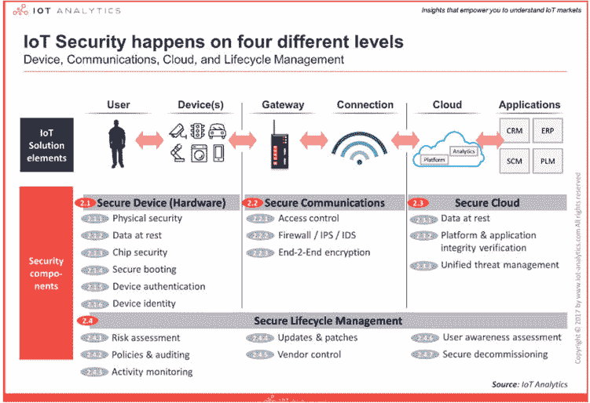

### 1.11.3 Automation of Security Mechanisms
随着物联网系统的增长，安全机制的需求也随之增加。一般来说，这些活动是手动处理的，例如证书的分配和撤销、恶意节点的黑名单以及隔离受损设备。需要将更好的安全系统纳入物联网系统，这些系统不仅高效，而且足够智能，以最大限度地减少人为干预来做出小决策。例如，可以通过能够根据历史数据学习的智能子程序来处理根据其行为对恶意节点进行简单分类。这种自动化将使物联网系统能够做出适当的安全决策，同时使其自主化。实现自动化有许多方法，例如我们可以创建一个推理系统、神经网络或任何机器学习技术的组合。机器学习技术可分为 1) 监督式机器学习，根据一组样本进行预测，通过在分配给数据点的标签中寻找模式；2) 无监督式机器学习，与数据点没有标签相关联。它最初将数据组织成一组簇，以描述其结构以供进一步分析；3) 强化式机器学习，首先采取行动，然后再学习该行动有多好。随着时间的推移，它会改变策略以学习得更好并实现最佳奖励。用于保护物联网系统的机器学习可以应用于设备点或网络点。

#### 1.11.3.1 Device-based solutions
设备级安全解决方案的主要问题是执行子程序时内存低、存储容量不足。为了更好地分析威胁并记录签名和身份验证，设备需要配备足够的处理能力和存储空间。诸如线程等各种技术可以帮助在较少资源的情况下实现高级保护。

#### 1.11.3.2 Network-based solutions
物联网系统的保护也可以在网络级别进行，通过将所有设备注册到网络并定期审计进出物联网系统的数据流量。如果有任何超出预期或可疑的情况，可以激活警报以保护系统的数据和控制点。这种流量监控方案可用于根据其行为和过去经验识别和分类受损节点。

### 1.11.4 Classification of IoT Security Techniques

#### 1.11.4.1 Network security
保护和确保物联网网络是高端安全机制的关键。然而，由于异构通信协议、标准，最重要的是设备容量，这通常是一项更复杂的任务。可以在网络上应用防火墙和入侵预防方法，以避免来自入侵者的潜在威胁。

#### 1.11.4.2 Authentication
它使用户能够通过 PIN 码、证书或生物识别来验证受信任的物联网设备。这是一种手动但功能强大的技术，可避免攻击。

#### 1.11.4.3 Encryption
加密数据和控制始终是实现更好安全性的更好方法。可以使用各种加密协议来保护数据免受外部人员访问。公钥或私钥加密可用于保护物联网系统。

#### 1.11.4.4 Analytics

这涉及对物联网系统数据的收集、组织和分析，并在任何活动落入可疑类别时生成警报。可以部署新的、更好的机器学习方法来执行此类分析。

## 1.12 结论
第四次工业革命为机器对机器（M2M）通信开辟了广阔的道路，以促进极端自动化。现在，机器可以通信并共享信息以实现特定目标而相互理解。这些目标需要得到良好的编程以维护隐私并为可能的安全漏洞做好充分准备。然而，由于整个场景中人为干预最少，安全性往往会受到相当大的损害。因此，在 M2M 通信的协商、身份验证、执行和信息交换点需要实施先进技术。这些技术现在变得智能，能够感知和检测安全攻击，同时改善整体系统，使其对现代物联网攻击更具弹性。这种情况因版本不兼容问题以及机器和固件的版本问题而变得更加脆弱。本章讨论了这些技术及其相关问题的概念框架。

# 2 物联网隐私、安全与治理
Gianmarco Baldini²
DOI: 10.1201/9781003338642-2

## 2.1 引言
物联网（IoT）是一个宽泛的术语，它表示越来越无处不在的连接设备（嵌入于、附着于或与“事物”相关）将支持各种应用，以增强用户的感知能力和能力。例如，用户将能够与家庭自动化系统交互以远程控制供暖或报警系统。

在这些无处不在的系统和应用中实现“智能”的可能性也提出了“智能”环境的定义，其中数字和现实世界的对象以认知和自主的方式合作，以比基于静态规则和逻辑的基本系统更高效的方式实现特定目标。虽然完整的认知和自主系统可能还需要数年时间，但我们每天都理所当然地使用许多自动化流程和自动化的互联网流程。那么，为什么物联网（IoT）在隐私、安全和治理方面需要特别关注？鉴于几乎任何地方的智能手机上都已存在各种传感器捕获我们分享到互联网上的信息，例如照片、视频等，已建立的互联网难道没有足够处理这些问题吗？物联网有什么不同？

首先，物联网不同，因为对象将能够自主管理其与互联网的连接，或者这将根据某人或某物的远程请求来完成。当有人通过互联网分享其手机拍摄的视频或照片时，他们“说了算”。而在物联网中，可能由其他人负责。出于很大程度上类似的原因，隐私、安全和治理话题对于物联网的成功至关重要，以建立和维持利益相关者的信任和信心。是的，在许多与信任相关的领域，物联网和互联网之间存在很大重叠；然而，物联网也带来了许多新的特定维度。

物联网的采用本质上取决于信任。而且这种信任必须针对广泛的利益相关者群体建立和维持；否则，物联网将面临不同程度的挑战，可能限制采用范围或延迟其时间。请注意，在社交媒体上你会做出有意识的选择来发布内容；一些物联网应用可能采用相同或类似的模式，但也可能存在其他实例或应用并非如此。这种远程控制本质上并不是坏事。例如，如果你因事故而失去行动能力，救援服务能够访问你环境中的物体以找到你或与你沟通将是有利的。然而，如果这些设备被配置为自动通知你的孩子哪些礼物已被购买或未被购买，这可能会破坏收到礼物的许多兴奋感。

Facebook’s withdrawn Beacon^()

物联网的未来不仅受用户影响。物联网的潜在自主性或受其影响者对物联网缺乏控制无疑会产生物联网采用阻力，可能表现为公众抗议、负面宣传活动以及政府行动。事实上，在过去 10 年中，许多物联网基础技术都受到了被标记为“隐私威胁”的不断发展担忧的影响。隐私本身是多维度的。流行的定义侧重于个人自由，或“免于干扰的权利”。实际上，隐私涵盖了个人、非正式团体以及各种组织形式的利益，因此是一个复杂的多维主题。

在社交媒体时代，有趣的是看到越来越多的例子，说明行业团体和政府开始鼓励个人对保护自己的隐私承担更大责任，捍卫我们的虚拟形象以保护我们的身份并减少现实世界或虚拟世界身份验证和授权流程的挑战。通过物联网，随着个人开始意识到个人为保护自己的身份所做的任何努力几乎没有影响，因为智能对象收集和发布到互联网上的信息量巨大，这可能变得越来越“难以推销”。理想情况下，物联网应提供灵活性，使其能够与更广泛的互联网以及一般现实世界环境的开发和使用的演变相协调。

物联网的一个具体挑战是对由移动设备收集和分发的信息进行控制，这些设备越来越小且无处不在，如 RFID 或未来的微纳传感器，可以佩戴或分布在环境中。在大多数情况下，此类设备具有无线连接和可访问的能力。在这种情况下，挑战在于确保微/纳米 RFID 和微/纳米传感器收集和存储的信息仅对授权用户（例如，对象的拥有者或使用者）可见；否则，可能发生安全或隐私泄露。例如，奢侈品的拥有者可能不希望任何人知道奢侈品在行李箱中。行李箱中的手表可能被隐藏起来，但可以通过无线通信轻松跟踪和识别。同样，应用于老年人的身体传感器收集的信息不应被医生以外的人访问。这些无线设备的访问控制机制应在市场上实施和部署，但由于计算能力和存储的限制，在微纳设备中实施安全和隐私解决方案并不容易。同时，安全和隐私不应阻碍微纳技术的业务发展。密钥的管理和部署也可能复杂难以实施。权衡取舍应被识别并描述。这些是研究活动的目标。

一个经常被我们这些在 1990 年之前成年的人所特别频繁忽视的方面是虚拟世界的重要性。今天，儿童的虚拟身份对他们而言的重要性与现实世界身份一样重要，甚至更重要。在虚拟世界中，存在着我们在现实世界中发现的大部分甚至全部事物，包括物体、机器、货币等。`IoT` 包含现实世界和虚拟世界，事实上，它能够在两者之间建立重要的桥梁。这一桥梁很可能会增长，并在未来公民的生活中变得更加相关。像 `Google Glass` 或未来智能交通系统（`ITSs`）在汽车中的应用等新设备将提出“增强现实”，其中数字信息与现实世界信息的整合被用来构建复杂的应用程序。这一趋势进一步凸显了安全和隐私的需求，因为虚拟世界中的数据泄露可能在现实世界中产生后果。在某些环境和应用中，安全和隐私威胁甚至可能成为安全威胁，对公民的生命造成更严重的后果。作为一个概念性示例，现实世界中的执行器可能在“智能家居”内被远程设置以引发火灾或洪水。

## 2.2 活动链 0.5 概述 – 治理、隐私和安全问题

欧洲 `IoT` 研究集群创建了多个活动链，以促进解决 `IoT` 主题的项目之间的密切合作，并为就重要研究挑战进行思想交流和开放对话形成一个平台。活动链被定义为工作流，将合作伙伴或合作伙伴中的特定参与者围绕明确的技术活动进行分组，这些活动将产生至少一个输出或交付物，用于解决 IERC 目标。IERC 活动链 05 是一个跨项目活动，专注于在 EC 资助的 `IoT` 领域研究项目中对 `IoT` 隐私、安全和治理做出有价值的贡献。如 \[3\] 中所述，三个方面密切相互关联“隐私、安全和竞争已被确定为与 IOT 治理相关的三大主要问题；然而，这些问题不应单独或孤立地讨论” \[3\]。在同一参考中，还强调了为 `IoT` 的治理定义一个共同商定定义的挑战。同样，安全和隐私的概念在文献中也没有统一的定义，即使对这些概念存在共同的共识。总体而言，活动链 05 的主要目标是确定研究挑战和主题，这些挑战和主题可以使 `IoT` 对用户（即公民、企业和政府）更安全，保证用户的隐私并支持 `IoT` 市场的自信、成功和可信发展。与欧洲或全球层面的 `IoT` 计划（例如 IGF）相比，活动链 05 不定义政府政策，而是专注于研究（最终可用于支持政策或标准化活动）。以下各节提供了与活动链 05 相关的欧洲委员会资助项目对 `IoT` 隐私、安全和治理所做贡献的概述。

## 2.3 来自 FP7 项目的贡献

### 2.3.1 FP7 iCore 访问框架（iCore 贡献）

`iCore` 认知框架基于这样一个原则：任何现实世界对象和任何可用的、可访问的、可观察的或可控制的数字对象都可以在“物联网”中具有虚拟表示，称为虚拟对象（`VO`）。`VOs` 主要针对技术异构性的抽象，并包括功能语义描述，使能够根据情况感知地选择和使用对象。复合虚拟对象（`CVOs`）使用 `VOs` 的服务。`CVO` 是语义上可互操作的 `VOs` 的认知 mash-up，其呈现的服务符合用户/利益相关者的视角和应用要求。

`iCore` 项目的整体分层方法在 图 2.1 中给出。第一个认知管理层（`VO` 级认知框架）负责在整个生命周期中管理 `VOs`，确保与现实世界对象/实体（例如传感器、执行器、设备等）的链接的可靠性。例如，在物流相关场景中，跟踪温控货物运输，单个货物箱由 `VOs` 表示，而卡车运输的集装箱是 `VO`，卡车本身也是 `VO`。`IoT` 相关应用程序可以出于不同的服务原因分别与这些 `VOs` 中的每一个进行接口。

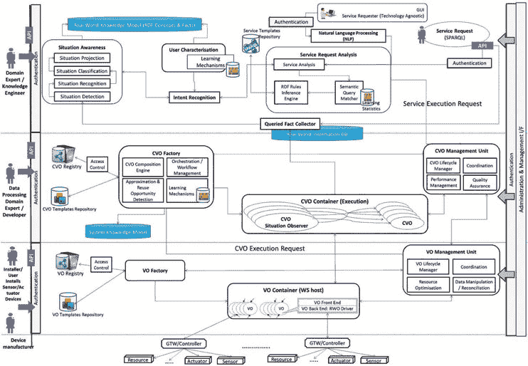

图 2.1 iCore 框架。

第二个认知管理层（`CVO` 级认知框架）负责将 `VOs` 组合成 `CVO`。`CVOs` 将使用 `VO` 的服务来组合更复杂的对象。在我们的示例中，卡车和所运输货物的组合在认知框架中表示为 `CVO`。

第三层（用户级认知框架）负责与用户/利益相关者进行交互。认知管理框架将通过收集和分析用户资料和利益相关者合同（例如服务水平协议）来记录用户的需求和要求（例如人类意图），并代表用户创建/激活相关的 `VO`/`CVOs`。

### 2.3.2 IoT@Work 基于能力的访问控制系统（IoT@Work 贡献）

`IoT` 预见了新的安全挑战，包括在访问控制领域，这些挑战很难通过现有安全解决方案来满足。事实上，`IoT` 在可扩展性和可管理性方面是一个更苛刻的环境，这既是由于物（资源和主体）数量可能无界，也是由于预期最相关的需要支持不同服务的编排和集成、短暂的、通常是偶然的和/或自发的交互模式的相关性、上下文的相关性等。

下面，我们简要提供在欧盟 `FP7` `IoT@Work` 项目中开发的基于能力的访问控制（以下称为 `CapBAC`）系统的描述。`CapBAC` 是根据基于能力的授权模型设计的，其中能力是一种可通信的、不可伪造的授权令牌。该令牌唯一标识授予的权利、可以行使权利的对象以及可以行使该权利的主体。如 图 2.2 所示，基于能力的系统逆转了传统方法，现在由用户负责向服务提供商出示其授权令牌，而在传统的 `ACL` 或 `RBAC` 系统中，是服务提供商必须检查用户是否直接或间接有权对请求资源执行请求操作。

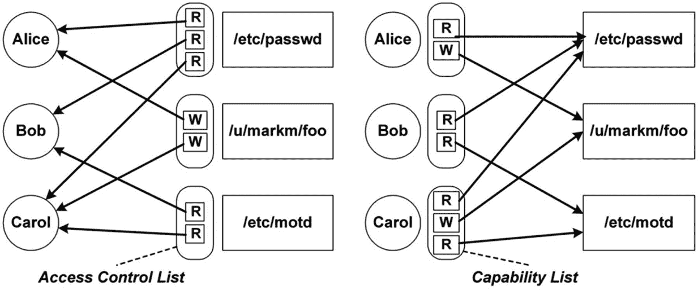

图 2.2 ACL 与基于能力的授权模型。

`CapBAC` 系统借鉴了先前工作的思想和方法 \[4\]，并将其扩展和调整以适应 `IoT` 要求，特别是 `IoT@Work` 项目设想的要求。`CapBAC` 提供了以下额外功能，构成了相对于先前基于能力技术的本质创新：

1. 委托支持：主体可以将访问权授予另一主体，以及授予进一步委托已授予权利全部或部分权利的权利。委托深度可以在每个阶段进行控制。

# 2. 能力撤销
能力可以由获得适当授权的主体撤销，从而解决了分布式环境中基于能力方法的一个问题。

# 3. 信息粒度
服务提供方可以根据能力令牌中所述的内容细化其行为以及需要提供的数据。图 2.3 举例说明了使用基于能力的访问控制方法来管理一个简单情况：Bob 要去度假，在他不在期间他的房子需要打扫。Dave 提出在 Bob 度假期间照顾他的房子。Bob 向 Dave 提供一个访问令牌，该令牌：（a）标识 Dave 是唯一有权使用该令牌的主体，（b）说明 Dave 实际可以执行的操作，以及（c）说明 Dave 可以执行这些操作的天数。

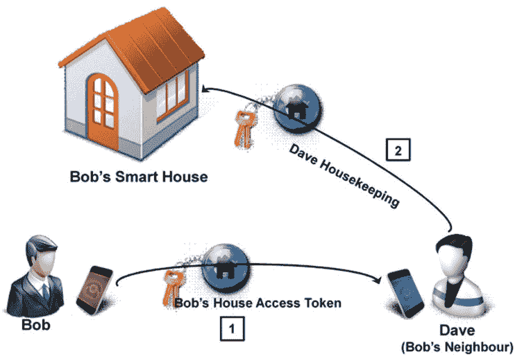

图 2.3 ACL 与基于能力的授权模型示例。

Bob 和 Dave 无需在其身份验证和授权系统之间建立信任关系。Bob 的家用电器识别由 Bob 创建的访问令牌，Dave 只需证明他是能力令牌中标识为有权在假期期间执行特定家务活动的主体（受让人）。上述机制非常直观，易于理解且易于使用。`CapBAC` 非常适合制造环境，在该环境中存在许多主体，内部（例如，工人和生产主管）和外部（例如，供应商和维护人员），需要直接（例如，通过移动或桌面计算设备）或间接（例如，通过应用程序服务）访问制造厂内的设备、数据和服务。其中大多数，如果不是全部，这些元素都需要严格的访问控制策略和更细粒度的访问控制执行，同时管理工作必须与所管理资源或主体的数量解耦，尤其是在主体中有很多外部主体时。

`CapBAC` 架构元素可以简要描述如下（图 2.4）：
* 能力的资源对象（图 2.4 中的 `Service A`）；它可以是特定的数据或设备、服务，或任何可以唯一标识和/或操作的（类似资源）可访问元素；
* 授权能力，详细说明了授予的权利（以及哪些可以被委派，以及在这种情况下其委派深度）、可以行使这些权利的资源、受让人的身份以及其他信息（例如，能力有效期、`XACML` 条件等）。授权能力在其自身中指定的有效期内有效，或直至被明确撤销；
* 能力撤销用于撤销一个或多个能力。与能力一样，能力撤销是一个可通信对象，由具有特定权利的主体创建（例如，撤销者必须是被撤销能力的委派路径中的祖先），以通知负责管理资源的服务特定能力不再有效；
* 服务/操作请求是所提供服务设想的服务请求，唯一附加特性是以不可伪造的方式引用或包含一个能力。例如，对于 `RESTful` 服务，对其中一个公开的 REST 资源进行的 `HTTP GET` 请求只需包含能力及其所有权证明即可使用我们的访问控制机制；
* `PDP`（策略决策点）是负责管理资源访问请求验证和决策的与资源无关的服务。在 `CapBAC` 环境中，它处理在能力中授予的访问权限与本地策略的验证，并检查委派链中能力的撤销状态；
* 资源管理器是管理针对/到已标识资源的服务/访问请求的服务。资源管理器检查随服务请求发送的能力令牌的可接受性，以及所请求服务/操作与所展示能力之间的有效性和一致性。它充当 `XACML` 策略执行点（`PEP`），并考虑 `PDP` 的验证结果；
* 撤销服务负责管理能力撤销。

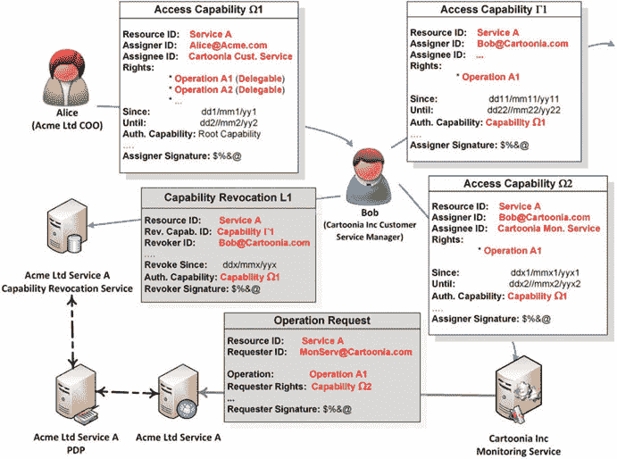

图 2.4 基于能力的授权架构组件及其交互。

### 2.3.3 GAMBAS 自适应中间件（GAMBAS 贡献）
`GAMBAS` 项目开发了一种创新且自适应的中间件，以实现以行为驱动的服务在保护隐私的同时实现自动化利用，这些服务能够自主适应用户的上下文。与当今主要通过移动浏览器或移动应用程序按需搜索实现的移动信息访问相比，`GAMBAS` 设想的中间件将能够在正确的时间主动访问正确的信息。因此，`GAMBAS` 中间件所实现的上下文感知自动化将为其用户创造无缝且干扰更少的体验，同时降低应用程序开发的复杂性。

如 图 2.5 所示，`GAMBAS` 实现的核心创新是开发模型和基础设施以支持上下文的可互操作表示和可扩展处理，开发通用但资源高效的框架以实现用户上下文的多模态识别，以及用于强制执行用户隐私的协议和机制，以及用于优化与行为驱动服务交互的用户界面概念。

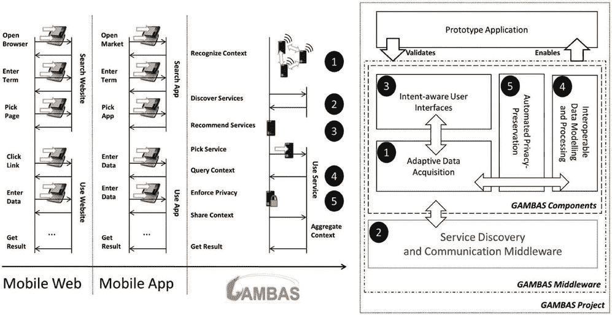

图 2.5 GAMBAS 中间件。

从安全和隐私的角度来看，`GAMBAS` 中的开发集中于一个安全的分布式架构，其中数据采集、数据存储和数据处理都由用户严格控制。因此，安全和隐私基于以下要素。
* 个人采集和本地存储：`GAMBAS` 中数据采集的主要手段是特定用户拥有的个人互联网连接设备，例如用户的手机、平板电脑、笔记本电脑等。通过这些设备的内置传感器获取的数据被本地存储，以便用户保持完全控制。值得注意的是，中间件提供了禁用特定传感器子集的机制，以防止积累用户根本不想收集和存储的数据。
* 匿名数据发现：为了实现单个用户或一组用户之间设备的共享，本地设备上的数据存储可以连接起来形成分布式数据处理系统。为此，`GAMBAS` 中间件引入了一个数据发现系统，该系统使用假名以避免泄露用户身份。假名可以与用户定义的一组合法人员以自动方式同步，以便能够动态更改它们。
* 基于策略的访问控制：为了限制对用户数据的访问，联网的数据存储基于用户可以定义的策略执行访问控制。为了减少配置工作量，`GAMBAS` 中间件包含一个策略生成工具，可用于根据用户在使用社交服务时表现出的共享行为推导出初始设置。

* 安全的分布式查询处理：在由已连接且受访问控制的本地数据存储组成的集合之上，GAMBAS 中间件能够以安全的方式实现分布式查询处理。为此，查询处理引擎使用由新颖的密钥交换机制引导的身份验证机制和加密协议，这些机制利用用户已使用的现有 Web 基础设施。

### 2.3.4 IoT-A 架构（IoT-A 贡献）
安全是物联网的重要基石。因此，在 IoT-A 项目中，我们认为全面解决各个方面的安全和隐私问题非常重要。基于外部和内部利益相关者的输入形成的一组需求被用作识别保证用户数据隐私和完整性、用户身份验证以及系统可信度的机制和功能的基础。

这些功能在 WP1 的框架内被分析并在功能组（FG）和功能组件（FC）中进行编排。高层 PS&T 规范在 IoT-A 架构参考模型（ARM）框架内得到整合，然后传递给处理通信协议（WP3）、基础设施服务（WP4）以及硬件方面（WP5）的垂直 WP。由于物联网提供的高度异构环境以及分析师预测的庞大数量的已连接（自主）设备，高度关注可扩展性和互操作性。

ARM 文档 \[5\] 为理解和采用 IoT-A 的开放架构铺平了道路，同时提供了我们所采用的物联网安全、隐私和信任设计策略的总体定义。然后，在 WP3 中，我们分析了物联网边缘部分通信的安全性及其对整体通信架构的影响。在此背景下，我们研究了 HIP 和 HIP-BEX 协议，并考虑了诸如移动性、协作密钥建立以及使用 PANA/EAP 保护网络接入等问题。

然后，在 WP4 \[6\] 的框架内，我们为 IoT-A 开发了安全的解析基础设施。它确保了解析功能的安全性和隐私性，并为解析基础设施之外的其他安全功能提供基础。它控制对物联网资源、现实世界实体以及相关信息（包括各自的标识符）的访问。此外，解析基础设施还提供对匿名性的支持：用户在使用物联网资源或更高级别服务时无需透露其身份。为实现所有这些目标，开发了各种安全组件（图 2.6）。它们涉及授权和身份验证、密钥交换和管理、信任与声誉以及身份管理。

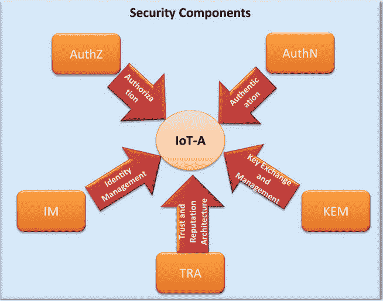

**图** **2.6** IoT-A 解析基础设施中的隐私和安全组件。

最后，WP5 处理设备级隐私和安全。特别是，它描述了用于验证 RFID 设备并提供读写器与标签之间通信保密性所需的机制。IoT-A 架构的 PS&T 特性将在即将到来的 IoT-A eHealth 用例中进行测试。

### 2.3.5 Butler 项目中的治理、安全和隐私（Butler 贡献）
BUTLER 项目的目标是创建一种实验性技术平台，以支持物联网的发展。BUTLER 方法的主要特点是其针对的“横向性”：BUTLER 背后的愿景是一个无处不在的物联网，同时影响我们生活的多个领域（健康、能源、交通、城市、家庭、购物和商业）。因此，BUTLER 平台必须能够通过提供通信、定位和情境感知能力来支持不同的“智能”领域，同时保证其安全性和终端用户的隐私。安全和隐私问题在 BUTLER 项目中至关重要，并体现在多个需求中，主要需求涉及：

* 物联网应用中存在数据安全方面的标准问题，既涉及数据存储层面，也涉及数据通信层面。物联网连接的“事物”的多样性和多重性以及交换的数据进一步放大并复杂化了这些需求。
* 物联网支持的应用在使用数据方面可能带来额外的隐私问题，从应用程序收集数据（应以用户“知情同意”协议为条件）到为实现真正的“情境感知”而进行的这些数据的画像、交换和共享。

数据技术保护^()

然而，隐私和安全不仅指网络上数据交换的安全性，还应包括：（a）交换数据的准确性保护，（b）服务器信息的保护，（c）通过明确的动态授权机制保护数据的用途，（d）数据的选择性披露，以及（e）“数据使用透明度”政策的实施。

BUTLER 项目还从其对商业模式的影响角度解决安全和隐私挑战。为了明确 BUTLER 中设想的横向物联网平台，项目从收集和分析多达 70 个用例的需求开始。这些用例的分析不仅为平台规范产生了需求，还提供了有关部署横向物联网的潜在社会经济影响以及对相关商业模式的影响的宝贵信息。

如果得到适当处理，伦理和隐私问题将从威胁转变为机遇。用户对服务的更好理解增加了接受度并建立了对服务的信任。这种信任成为服务提供商的竞争优势，可成为其商业模式的基石。反过来，服务提供商对伦理和隐私问题的经济利益源于这种竞争优势，成为用户隐私将得到尊重的保证。BUTLER 项目关于伦理、隐私和数据安全对商业模式和社会经济影响的研究将发表在 Deliverable 1.4（2013 年 5 月）和 Deliverable 1.3（2014 年 9 月）中。

终端用户参与概念验证和实地试验是 BUTLER 项目的另一个特点。终端用户参与不仅是验证 BUTLER 平台的技术质量（技术可行性、集成和扩展）的关键，也是评估终端用户对未来“横向”物联网设想场景的感知和接受度的关键。

然而，在项目范围内涉及终端用户需要谨慎处理其数据和隐私问题。实地试验和概念验证的详细规范在 Deliverable 1.2 中有描述（计划于 2013 年 5 月底完成）。组织终端用户参与时必须考虑以下问题：

1. 必须建立技术安全机制以确保参与者的安全和隐私。这涉及安全的数据通信和存储，在 BUTLER 项目范围内，这由开发并集成到 BUTLER 平台中的使能安全技术解决。
2. 参与者必须充分了解实验的范围和目标。在 BUTLER 的情况下，这涉及向公众解释项目范围和目标的特定努力。

3. 参与者的同意必须基于向他们传达的信息收集。同意确认表必须提醒参与者他们有权拒绝或撤回，且不会因此受到任何负面影响。

4. 最后，已设计了反馈收集和具体的投诉流程，以让参与者有机会提出发现的任何问题。

## 2.4 结论
物联网应用和支持方利益相关者都可从建立可信的物联网中互利互惠。信任意味着为隐私、安全和治理建立合适的保障措施。建立和维护信任意味着满足当今的需求，同时提供足够的未来保障以满足自然演进的利益相关者需求和期望。形成成功标准和指南所需的共识只能通过对话实现。活动链 05 提供了一个信息交流和相互理解的平台，同时提供有价值的领导力。活动链 05 内的研究项目都为推进物联网采用做出贡献，其中一些具有通用物联网应用价值，而另一些则为特定物联网应用组提供了显著增强。使这一格局更清晰、随着物联网发展识别进一步研究的差距以及协助研究向标准化和采用的进展，仍是活动链 05 的主要挑战。活动链 05 的另一个作用是提高认识，并在 IERC 的其他活动链以及更广泛的利益相关者社区中促进对物联网隐私、安全和治理的充分考虑。

## 参考文献
* [\[1\] Roman, R., Najera, P., Lopez, J., 《物联网安全》。Computer, 44, 51–58, 2011.](#Ch02.xhtml#bck_ref2_1)
* [\[2\] Zorzi, M., Gluhak, A., Lange, S., Bassi, A., “从当今的物联网内联网到未来的物联网互联网：无线和移动相关视角”，载于 IEEE Wireless Communications, 17, 44–51, 2010.](#Ch02.xhtml#bck_ref2_2)
* [\[3\] 欧盟物联网工作组关于物联网治理的最终报告。布鲁塞尔，2012 年。](#Ch02.xhtml#bck_ref2_3)
* [\[4\] Gusmeroli, S., Piccione, S., Rotondi, D., “物联网访问控制问题：基于能力的方法”，载于第 6 届国际创新移动和互联网服务在泛在计算会议论文集（IMIS-2012），787–792, 2012.](#Ch02.xhtml#bck_ref2_4)
* [\[5\] Carrez, F. (编), 物联网融合架构参考模型，可获取于：http://www.iot-a.eu/public/public-documents \[访问于 2013 年 5 月 10 日\]。](#Ch02.xhtml#bck_ref2_5)
* [\[6\] Gruschka, N., Gessner, D. (编), 解析基础设施中的隐私和安全概念与解决方案，可获取于：http://www.iot-a.eu/public/public-documents \[访问于 2013 年 5 月 10 日\]。](#Ch02.xhtml#bck_ref2_6)

# 3 物联网数据处理：不同原型及其安全性和隐私评估
Pijush Kanti Dutta Pramanik and Prasenjit Choudhury

计算机科学与工程系，印度杜尔加布尔国立技术学院

DOI: 10.1201/9781003338642-3

无疑，近年来，物联网（IoT）在 IT 行业中引起了最大波澜。大规模实施物联网将产生海量数据。为了获得可操作的知识，这些数据必须被处理。但这些数据的复杂性以及物联网架构本身也使处理成为一项复杂任务。本章探讨了处理来自多样异构物联网设备产生的多样动态数据对计算界来说为何具有挑战性。本章将帮助读者了解物联网数据处理的各种架构概览。每种架构都连同相关挑战一起进行了详细讨论。物联网的开放性和无处不在的特性使其更容易受到安全威胁。架构所面临的安全性和漏洞问题被专门讨论。除了对物联网安全和隐私问题的一般讨论外，作者还对物联网安全和隐私方面的过度炒作的担忧提出了不同观点。本章的目的是使读者能够根据成本、响应时间等因素，结合对安全和隐私的特别关注，为其物联网应用选择合适的[content]
3. 参与者的同意必须基于向他们传达的信息收集。同意确认表必须提醒参与者他们有权拒绝或撤回，且不会因此受到任何负面影响。

4. 最后，已设计了反馈收集和具体的投诉流程，以让参与者有机会提出发现的任何问题。

## 2.4 结论
物联网应用和支持方利益相关者都可从建立可信的物联网中互利互惠。信任意味着为隐私、安全和治理建立合适的保障措施。建立和维护信任意味着满足当今的需求，同时提供足够的未来保障以满足自然演进的利益相关者需求和期望。形成成功标准和指南所需的共识只能通过对话实现。活动链 05 提供了一个信息交流和相互理解的平台，同时提供有价值的领导力。活动链 05 内的研究项目都为推进物联网采用做出贡献，其中一些具有通用物联网应用价值，而另一些则为特定物联网应用组提供了显著增强。使这一格局更清晰、随着物联网发展识别进一步研究的差距以及协助研究向标准化和采用的进展，仍是活动链 05 的主要挑战。活动链 05 的另一个作用是提高认识，并在 IERC 的其他活动链以及更广泛的利益相关者社区中促进对物联网隐私、安全和治理的充分考虑。

## 参考文献
* [\[1\] Roman, R., Najera, P., Lopez, J., 《物联网安全》。Computer, 44, 51–58, 2011.](#Ch02.xhtml#bck_ref2_1)
* [\[2\] Zorzi, M., Gluhak, A., Lange, S., Bassi, A., “从当今的物联网内联网到未来的物联网互联网：无线和移动相关视角”，载于 IEEE Wireless Communications, 17, 44–51, 2010.](#Ch02.xhtml#bck_ref2_2)
* [\[3\] 欧盟物联网工作组关于物联网治理的最终报告。布鲁塞尔，2012 年。](#Ch02.xhtml#bck_ref2_3)
* [\[4\] Gusmeroli, S., Piccione, S., Rotondi, D., “物联网访问控制问题：基于能力的方法”，载于第 6 届国际创新移动和互联网服务在泛在计算会议论文集（IMIS-2012），787–792, 2012.](#Ch02.xhtml#bck_ref2_4)
* [\[5\] Carrez, F. (编), 物联网融合架构参考模型，可获取于：http://www.iot-a.eu/public/public-documents \[访问于 2013 年 5 月 10 日\]。](#Ch02.xhtml#bck_ref2_5)
* [\[6\] Gruschka, N., Gessner, D. (编), 解析基础设施中的隐私和安全概念与解决方案，可获取于：http://www.iot-a.eu/public/public-documents \[访问于 2013 年 5 月 10 日\]。](#Ch02.xhtml#bck_ref2_6)

# 3 物联网数据处理：不同原型及其安全性和隐私评估
Pijush Kanti Dutta Pramanik and Prasenjit Choudhury

计算机科学与工程系，印度杜尔加布尔国立技术学院

DOI: 10.1201/9781003338642-3

无疑，近年来，物联网（IoT）在 IT 行业中引起了最大波澜。大规模实施物联网将产生海量数据。为了获得可操作的知识，这些数据必须被处理。但这些数据的复杂性以及物联网架构本身也使处理成为一项复杂任务。本章探讨了处理来自多样异构物联网设备产生的多样动态数据对计算界来说为何具有挑战性。本章将帮助读者了解物联网数据处理的各种架构概览。每种架构都连同相关挑战一起进行了详细讨论。物联网的开放性和无处不在的特性使其更容易受到安全威胁。架构所面临的安全性和漏洞问题被专门讨论。除了对物联网安全和隐私问题的一般讨论外，作者还对物联网安全和隐私方面的过度炒作的担忧提出了不同观点。本章的目的是使读者能够根据成本、响应时间等因素，结合对安全和隐私的特别关注，为其物联网应用选择合适的[content]
3. 参与者的同意必须基于向他们传达的信息收集。同意确认表必须提醒参与者他们有权拒绝或撤回，且不会因此受到任何负面影响。

4. 最后，已设计了反馈收集和具体的投诉流程，以让参与者有机会提出发现的任何问题。

## 2.4 结论
物联网应用和支持方利益相关者都可从建立可信的物联网中互利互惠。信任意味着为隐私、安全和治理建立合适的保障措施。建立和维护信任意味着满足当今的需求，同时提供足够的未来保障以满足自然演进的利益相关者需求和期望。形成成功标准和指南所需的共识只能通过对话实现。活动链 05 提供了一个信息交流和相互理解的平台，同时提供有价值的领导力。活动链 05 内的研究项目都为推进物联网采用做出贡献，其中一些具有通用物联网应用价值，而另一些则为特定物联网应用组提供了显著增强。使这一格局更清晰、随着物联网发展识别进一步研究的差距以及协助研究向标准化和采用的进展，仍是活动链 05 的主要挑战。活动链 05 的另一个作用是提高认识，并在 IERC 的其他活动链以及更广泛的利益相关者社区中促进对物联网隐私、安全和治理的充分考虑。

## 参考文献
* [\[1\] Roman, R., Najera, P., Lopez, J., 《物联网安全》。Computer, 44, 51–58, 2011.](#Ch02.xhtml#bck_ref2_1)
* [\[2\] Zorzi, M., Gluhak, A., Lange, S., Bassi, A., “从当今的物联网内联网到未来的物联网互联网：无线和移动相关视角”，载于 IEEE Wireless Communications, 17, 44–51, 2010.](#Ch02.xhtml#bck_ref2_2)
* [\[3\] 欧盟物联网工作组关于物联网治理的最终报告。布鲁塞尔，2012 年。](#Ch02.xhtml#bck_ref2_3)
* [\[4\] Gusmeroli, S., Piccione, S., Rotondi, D., “物联网访问控制问题：基于能力的方法”，载于第 6 届国际创新移动和互联网服务在泛在计算会议论文集（IMIS-2012），787–792, 2012.](#Ch02.xhtml#bck_ref2_4)
* [\[5\] Carrez, F. (编), 物联网融合架构参考模型，可获取于：http://www.iot-a.eu/public/public-documents \[访问于 2013 年 5 月 10 日\]。](#Ch02.xhtml#bck_ref2_5)
* [\[6\] Gruschka, N., Gessner, D. (编), 解析基础设施中的隐私和安全概念与解决方案，可获取于：http://www.iot-a.eu/public/public-documents \[访问于 2013 年 5 月 10 日\]。](#Ch02.xhtml#bck_ref2_6)

# 3 物联网数据处理：不同原型及其安全性和隐私评估
Pijush Kanti Dutta Pramanik and Prasenjit Choudhury

计算机科学与工程系，印度杜尔加布尔国立技术学院

DOI: 10.1201/9781003338642-3

无疑，近年来，物联网（IoT）在 IT 行业中引起了最大波澜。大规模实施物联网将产生海量数据。为了获得可操作的知识，这些数据必须被处理。但这些数据的复杂性以及物联网架构本身也使处理成为一项复杂任务。本章探讨了处理来自多样异构物联网设备产生的多样动态数据对计算界来说为何具有挑战性。本章将帮助读者了解物联网数据处理的各种架构概览。每种架构都连同相关挑战一起进行了详细讨论。物联网的开放性和无处不在的特性使其更容易受到安全威胁。架构所面临的安全性和漏洞问题被专门讨论。除了对物联网安全和隐私问题的一般讨论外，作者还对物联网安全和隐私方面的过度炒作的担忧提出了不同观点。本章的目的是使读者能够根据成本、响应时间等因素，结合对安全和隐私的特别关注，为其物联网应用选择合适的[content]
3. 参与者的同意必须基于向他们传达的信息收集。同意确认表必须提醒参与者他们有权拒绝或撤回，且不会因此受到任何负面影响。

4. 最后，已设计了反馈收集和具体的投诉流程，以让参与者有机会提出发现的任何问题。

## 2.4 结论
物联网应用和支持方利益相关者都可从建立可信的物联网中互利互惠。信任意味着为隐私、安全和治理建立合适的保障措施。建立和维护信任意味着满足当今的需求，同时提供足够的未来保障以满足自然演进的利益相关者需求和期望。形成成功标准和指南所需的共识只能通过对话实现。活动链 05 提供了一个信息交流和相互理解的平台，同时提供有价值的领导力。活动链 05 内的研究项目都为推进物联网采用做出贡献，其中一些具有通用物联网应用价值，而另一些则为特定物联网应用组提供了显著增强。使这一格局更清晰、随着物联网发展识别进一步研究的差距以及协助研究向标准化和采用的进展，仍是活动链 05 的主要挑战。活动链 05 的另一个作用是提高认识，并在 IERC 的其他活动链以及更广泛的利益相关者社区中促进对物联网隐私、安全和治理的充分考虑。

## 参考文献
* [\[1\] Roman, R., Najera, P., Lopez, J., 《物联网安全》。Computer, 44, 51–58, 2011.](#Ch02.xhtml#bck_ref2_1)
* [\[2\] Zorzi, M., Gluhak, A., Lange, S., Bassi, A., “从当今的物联网内联网到未来的物联网互联网：无线和移动相关视角”，载于 IEEE Wireless Communications, 17, 44–51, 2010.](#Ch02.xhtml#bck_ref2_2)
* [\[3\] 欧盟物联网工作组关于物联网治理的最终报告。布鲁塞尔，2012 年。](#Ch02.xhtml#bck_ref2_3)
* [\[4\] Gusmeroli, S., Piccione, S., Rotondi, D., “物联网访问控制问题：基于能力的方法”，载于第 6 届国际创新移动和互联网服务在泛在计算会议论文集（IMIS-2012），787–792, 2012.](#Ch02.xhtml#bck_ref2_4)
* [\[5\] Carrez, F. (编), 物联网融合架构参考模型，可获取于：http://www.iot-a.eu/public/public-documents \[访问于 2013 年 5 月 10 日\]。](#Ch02.xhtml#bck_ref2_5)
* [\[6\] Gruschka, N., Gessner, D. (编), 解析基础设施中的隐私和安全概念与解决方案，可获取于：http://www.iot-a.eu/public/public-documents \[访问于 2013 年 5 月 10 日\]。](#Ch02.xhtml#bck_ref2_6)

# 3 物联网数据处理：不同原型及其安全性和隐私评估
Pijush Kanti Dutta Pramanik and Prasenjit Choudhury

计算机科学与工程系，印度杜尔加布尔国立技术学院

DOI: 10.1201/9781003338642-3

无疑，近年来，物联网（IoT）在 IT 行业中引起了最大波澜。大规模实施物联网将产生海量数据。为了获得可操作的知识，这些数据必须被处理。但这些数据的复杂性以及物联网架构本身也使处理成为一项复杂任务。本章探讨了处理来自多样异构物联网设备产生的多样动态数据对计算界来说为何具有挑战性。本章将帮助读者了解物联网数据处理的各种架构概览。每种架构都连同相关挑战一起进行了详细讨论。物联网的开放性和无处不在的特性使其更容易受到安全威胁。架构所面临的安全性和漏洞问题被专门讨论。除了对物联网安全和隐私问题的一般讨论外，作者还对物联网安全和隐私方面的过度炒作的担忧提出了不同观点。本章的目的是使读者能够根据成本、响应时间等因素，结合对安全和隐私的特别关注，为其物联网应用选择合适的[content]
3. 参与者的同意必须基于向他们传达的信息收集。同意确认表必须提醒参与者他们有权拒绝或撤回，且不会因此受到任何负面影响。

4. 最后，已设计了反馈收集和具体的投诉流程，以让参与者有机会提出发现的任何问题。

## 2.4 结论
物联网应用和支持方利益相关者都可从建立可信的物联网中互利互惠。信任意味着为隐私、安全和治理建立合适的保障措施。建立和维护信任意味着满足当今的需求，同时提供足够的未来保障以满足自然演进的利益相关者需求和期望。形成成功标准和指南所需的共识只能通过对话实现。活动链 05 提供了一个信息交流和相互理解的平台，同时提供有价值的领导力。活动链 05 内的研究项目都为推进物联网采用做出贡献，其中一些具有通用物联网应用价值，而另一些则为特定物联网应用组提供了显著增强。使这一格局更清晰、随着物联网发展识别进一步研究的差距以及协助研究向标准化和采用的进展，仍是活动链 05 的主要挑战。活动链 05 的另一个作用是提高认识，并在 IERC 的其他活动链以及更广泛的利益相关者社区中促进对物联网隐私、安全和治理的充分考虑。

## 参考文献
* [\[1\] Roman, R., Najera, P., Lopez, J., 《物联网安全》。Computer, 44, 51–58, 2011.](#Ch02.xhtml#bck_ref2_1)
* [\[2\] Zorzi, M., Gluhak, A., Lange, S., Bassi, A., “从当今的物联网内联网到未来的物联网互联网：无线和移动相关视角”，载于 IEEE Wireless Communications, 17, 44–51, 2010.](#Ch02.xhtml#bck_ref2_2)
* [\[3\] 欧盟物联网工作组关于物联网治理的最终报告。布鲁塞尔，2012 年。](#Ch02.xhtml#bck_ref2_3)
* [\[4\] Gusmeroli, S., Piccione, S., Rotondi, D., “物联网访问控制问题：基于能力的方法”，载于第 6 届国际创新移动和互联网服务在泛在计算会议论文集（IMIS-2012），787–792, 2012.](#Ch02.xhtml#bck_ref2_4)
* [\[5\] Carrez, F. (编), 物联网融合架构参考模型，可获取于：http://www.iot-a.eu/public/public-documents \[访问于 2013 年 5 月 10 日\]。](#Ch02.xhtml#bck_ref2_5)
* [\[6\] Gruschka, N., Gessner, D. (编), 解析基础设施中的隐私和安全概念与解决方案，可获取于：http://www.iot-a.eu/public/public-documents \[访问于 2013 年 5 月 10 日\]。](#Ch02.xhtml#bck_ref2_6)

# 3 物联网数据处理：不同原型及其安全性和隐私评估
Pijush Kanti Dutta Pramanik and Prasenjit Choudhury

计算机科学与工程系，印度杜尔加布尔国立技术学院

DOI: 10.1201/9781003338642-3

无疑，近年来，物联网（IoT）在 IT 行业中引起了最大波澜。大规模实施物联网将产生海量数据。为了获得可操作的知识，这些数据必须被处理。但这些数据的复杂性以及物联网架构本身也使处理成为一项复杂任务。本章探讨了处理来自多样异构物联网设备产生的多样动态数据对计算界来说为何具有挑战性。本章将帮助读者了解物联网数据处理的各种架构概览。每种架构都连同相关挑战一起进行了详细讨论。物联网的开放性和无处不在的特性使其更容易受到安全威胁。架构所面临的安全性和漏洞问题被专门讨论。除了对物联网安全和隐私问题的一般讨论外，作者还对物联网安全和隐私方面的过度炒作的担忧提出了不同观点。本章的目的是使读者能够根据成本、响应时间等因素，结合对安全和隐私的特别关注，为其物联网应用选择合适的[content]
3. 参与者的同意必须基于向他们传达的信息收集。同意确认表必须提醒参与者他们有权拒绝或撤回，且不会因此受到任何负面影响。

4. 最后，已设计了反馈收集和具体的投诉流程，以让参与者有机会提出发现的任何问题。

## 2.4 结论
物联网应用和支持方利益相关者都可从建立可信的物联网中互利互惠。信任意味着为隐私、安全和治理建立合适的保障措施。建立和维护信任意味着满足当今的需求，同时提供足够的未来保障以满足自然演进的利益相关者需求和期望。形成成功标准和指南所需的共识只能通过对话实现。活动链 05 提供了一个信息交流和相互理解的平台，同时提供有价值的领导力。活动链 05 内的研究项目都为推进物联网采用做出贡献，其中一些具有通用物联网应用价值，而另一些则为特定物联网应用组提供了显著增强。使这一格局更清晰、随着物联网发展识别进一步研究的差距以及协助研究向标准化和采用的进展，仍是活动链 05 的主要挑战。活动链 05 的另一个作用是提高认识，并在 IERC 的其他活动链以及更广泛的利益相关者社区中促进对物联网隐私、安全和治理的充分考虑。

## 参考文献
* [\[1\] Roman, R., Najera, P., Lopez, J., 《物联网安全》。Computer, 44, 51–58, 2011.](#Ch02.xhtml#bck_ref2_1)
* [\[2\] Zorzi, M., Gluhak, A., Lange, S., Bassi, A., “从当今的物联网内联网到未来的物联网互联网：无线和移动相关视角”，载于 IEEE Wireless Communications, 17, 44–51, 2010.](#Ch02.xhtml#bck_ref2_2)
* [\[3\] 欧盟物联网工作组关于物联网治理的最终报告。布鲁塞尔，2012 年。](#Ch02.xhtml#bck_ref2_3)
* [\[4\] Gusmeroli, S., Piccione, S., Rotondi, D., “物联网访问控制问题：基于能力的方法”，载于第 6 届国际创新移动和互联网服务在泛在计算会议论文集（IMIS-2012），787–792, 2012.](#Ch02.xhtml#bck_ref2_4)
* [\[5\] Carrez, F. (编), 物联网融合架构参考模型，可获取于：http://www.iot-a.eu/public/public-documents \[访问于 2013 年 5 月 10 日\]。](#Ch02.xhtml#bck_ref2_5)
* [\[6\] Gruschka, N., Gessner, D. (编), 解析基础设施中的隐私和安全概念与解决方案，可获取于：http://www.iot-a.eu/public/public-documents \[访问于 2013 年 5 月 10 日\]。](#Ch02.xhtml#bck_ref2_6)

# 3 物联网数据处理：不同原型及其安全性和隐私评估
Pijush Kanti Dutta Pramanik and Prasenjit Choudhury

计算机科学与工程系，印度杜尔加布尔国立技术学院

DOI: 10.1201/9781003338642-3

无疑，近年来，物联网（IoT）在 IT 行业中引起了最大波澜。大规模实施物联网将产生海量数据。为了获得可操作的知识，这些数据必须被处理。但这些数据的复杂性以及物联网架构本身也使处理成为一项复杂任务。本章探讨了处理来自多样异构物联网设备产生的多样动态数据对计算界来说为何具有挑战性。本章将帮助读者了解物联网数据处理的各种架构概览。每种架构都连同相关挑战一起进行了详细讨论。物联网的开放性和无处不在的特性使其更容易受到安全威胁。架构所面临的安全性和漏洞问题被专门讨论。除了对物联网安全和隐私问题的一般讨论外，作者还对物联网安全和隐私方面的过度炒作的担忧提出了不同观点。本章的目的是使读者能够根据成本、响应时间等因素，结合对安全和隐私的特别关注，为其物联网应用选择合适的[content]
3. 参与者的同意必须基于向他们传达的信息收集。同意确认表必须提醒参与者他们有权拒绝或撤回，且不会因此受到任何负面影响。

4. 最后，已设计了反馈收集和具体的投诉流程，以让参与者有机会提出发现的任何问题。

## 2.4 结论
物联网应用和支持方利益相关者都可从建立可信的物联网中互利互惠。信任意味着为隐私、安全和治理建立合适的保障措施。建立和维护信任意味着满足当今的需求，同时提供足够的未来保障以满足自然演进的利益相关者需求和期望。形成成功标准和指南所需的共识只能通过对话实现。活动链 05 提供了一个信息交流和相互理解的平台，同时提供有价值的领导力。活动链 05 内的研究项目都为推进物联网采用做出贡献，其中一些具有通用物联网应用价值，而另一些则为特定物联网应用组提供了显著增强。使这一格局更清晰、随着物联网发展识别进一步研究的差距以及协助研究向标准化和采用的进展，仍是活动链 05 的主要挑战。活动链 05 的另一个作用是提高认识，并在 IERC 的其他活动链以及更广泛的利益相关者社区中促进对物联网隐私、安全和治理的充分考虑。

## 参考文献
* [\[1\] Roman, R., Najera, P., Lopez, J., 《物联网安全》。Computer, 44, 51–58, 2011.](#Ch02.xhtml#bck_ref2_1)
* [\[2\] Zorzi, M., Gluhak, A., Lange, S., Bassi, A., “从当今的物联网内联网到未来的物联网互联网：无线和移动相关视角”，载于 IEEE Wireless Communications, 17, 44–51, 2010.](#Ch02.xhtml#bck_ref2_2)
* [\[3\] 欧盟物联网工作组关于物联网治理的最终报告。布鲁塞尔，2012 年。](#Ch02.xhtml#bck_ref2_3)
* [\[4\] Gusmeroli, S., Piccione, S., Rotondi, D., “物联网访问控制问题：基于能力的方法”，载于第 6 届国际创新移动和互联网服务在泛在计算会议论文集（IMIS-2012），787–792, 2012.](#Ch02.xhtml#bck_ref2_4)
* [\[5\] Carrez, F. (编), 物联网融合架构参考模型，可获取于：http://www.iot-a.eu/public/public-documents \[访问于 2013 年 5 月 10 日\]。](#Ch02.xhtml#bck_ref2_5)
* [\[6\] Gruschka, N., Gessner, D. (编), 解析基础设施中的隐私和安全概念与解决方案，可获取于：http://www.iot-a.eu/public/public-documents \[访问于 2013 年 5 月 10 日\]。](#Ch02.xhtml#bck_ref2_6)

# 3 物联网数据处理：不同原型及其安全性和隐私评估
Pijush Kanti Dutta Pramanik and Prasenjit Choudhury

计算机科学与工程系，印度杜尔加布尔国立技术学院

DOI: 10.1201/9781003338642-3

无疑，近年来，物联网（IoT）在 IT 行业中引起了最大波澜。大规模实施物联网将产生海量数据。为了获得可操作的知识，这些数据必须被处理。但这些数据的复杂性以及物联网架构本身也使处理成为一项复杂任务。本章探讨了处理来自多样异构物联网设备产生的多样动态数据对计算界来说为何具有挑战性。本章将帮助读者了解物联网数据处理的各种架构概览。每种架构都连同相关挑战一起进行了详细讨论。物联网的开放性和无处不在的特性使其更容易受到安全威胁。架构所面临的安全性和漏洞问题被专门讨论。除了对物联网安全和隐私问题的一般讨论外，作者还对物联网安全和隐私方面的过度炒作的担忧提出了不同观点。本章的目的是使读者能够根据成本、响应时间等因素，结合对安全和隐私的特别关注，为其物联网应用选择合适的[content]
3. 参与者的同意必须基于向他们传达的信息收集。同意确认表必须提醒参与者他们有权拒绝或撤回，且不会因此受到任何负面影响。

4. 最后，已设计了反馈收集和具体的投诉流程，以让参与者有机会提出发现的任何问题。

## 2.4 结论
物联网应用和支持方利益相关者都可从建立可信的物联网中互利互惠。信任意味着为隐私、安全和治理建立合适的保障措施。建立和维护信任意味着满足当今的需求，同时提供足够的未来保障以满足自然演进的利益相关者需求和期望。形成成功标准和指南所需的共识只能通过对话实现。活动链 05 提供了一个信息交流和相互理解的平台，同时提供有价值的领导力。活动链 05 内的研究项目都为推进物联网采用做出贡献，其中一些具有通用物联网应用价值，而另一些则为特定物联网应用组提供了显著增强。使这一格局更清晰、随着物联网发展识别进一步研究的差距以及协助研究向标准化和采用的进展，仍是活动链 05 的主要挑战。活动链 05 的另一个作用是提高认识，并在 IERC 的其他活动链以及更广泛的利益相关者社区中促进对物联网隐私、安全和治理的充分考虑。

## 参考文献
* [\[1\] Roman, R., Najera, P., Lopez, J., 《物联网安全》。Computer, 44, 51–58, 2011.](#Ch02.xhtml#bck_ref2_1)
* [\[2\] Zorzi, M., Gluhak, A., Lange, S., Bassi, A., “从当今的物联网内联网到未来的物联网互联网：无线和移动相关视角”，载于 IEEE Wireless Communications, 17, 44–51, 2010.](#Ch02.xhtml#bck_ref2_2)
* [\[3\] 欧盟物联网工作组关于物联网治理的最终报告。布鲁塞尔，2012 年。](#Ch02.xhtml#bck_ref2_3)
* [\[4\] Gusmeroli, S., Piccione, S., Rotondi, D., “物联网访问控制问题：基于能力的方法”，载于第 6 届国际创新移动和互联网服务在泛在计算会议论文集（IMIS-2012），787–792, 2012.](#Ch02.xhtml#bck_ref2_4)
* [\[5\] Carrez, F. (编), 物联网融合架构参考模型，可获取于：http://www.iot-a.eu/public/public-documents \[访问于 2013 年 5 月 10 日\]。](#Ch02.xhtml#bck_ref2_5)
* [\[6\] Gruschka, N., Gessner, D. (编), 解析基础设施中的隐私和安全概念与解决方案，可获取于：http://www.iot-a.eu/public/public-documents \[访问于 2013 年 5 月 10 日\]。](#Ch02.xhtml#bck_ref2_6)

# 3 物联网数据处理：不同原型及其安全性和隐私评估
Pijush Kanti Dutta Pramanik and Prasenjit Choudhury

计算机科学与工程系，印度杜尔加布尔国立技术学院

DOI: 10.1201/9781003338642-3

无疑，近年来，物联网（IoT）在 IT 行业中引起了最大波澜。大规模实施物联网将产生海量数据。为了获得可操作的知识，这些数据必须被处理。但这些数据的复杂性以及物联网架构本身也使处理成为一项复杂任务。本章探讨了处理来自多样异构物联网设备产生的多样动态数据对计算界来说为何具有挑战性。本章将帮助读者了解物联网数据处理的各种架构概览。每种架构都连同相关挑战一起进行了详细讨论。物联网的开放性和无处不在的特性使其更容易受到安全威胁。架构所面临的安全性和漏洞问题被专门讨论。除了对物联网安全和隐私问题的一般讨论外，作者还对物联网安全和隐私方面的过度炒作的担忧提出了不同观点。本章的目的是使读者能够根据成本、响应时间等因素，结合对安全和隐私的特别关注，为其物联网应用选择合适的[content]
3. 参与者的同意必须基于向他们传达的信息收集。同意确认表必须提醒参与者他们有权拒绝或撤回，且不会因此受到任何负面影响。

4. 最后，已设计了反馈收集和具体的投诉流程，以让参与者有机会提出发现的任何问题。

## 2.4 结论
物联网应用和支持方利益相关者都可从建立可信的物联网中互利互惠。信任意味着为隐私、安全和治理建立合适的保障措施。建立和维护信任意味着满足当今的需求，同时提供足够的未来保障以满足自然演进的利益相关者需求和期望。形成成功标准和指南所需的共识只能通过对话实现。活动链 05 提供了一个信息交流和相互理解的平台，同时提供有价值的领导力。活动链 05 内的研究项目都为推进物联网采用做出贡献，其中一些具有通用物联网应用价值，而另一些则为特定物联网应用组提供了显著增强。使这一格局更清晰、随着物联网发展识别进一步研究的差距以及协助研究向标准化和采用的进展，仍是活动链 05 的主要挑战。活动链 05 的另一个作用是提高认识，并在 IERC 的其他活动链以及更广泛的利益相关者社区中促进对物联网隐私、安全和治理的充分考虑。

## 参考文献
* [\[1\] Roman, R., Najera, P., Lopez, J., 《物联网安全》。Computer, 44, 51–58, 2011.](#Ch02.xhtml#bck_ref2_1)
* [\[2\] Zorzi, M., Gluhak, A., Lange, S., Bassi, A., “从当今的物联网内联网到未来的物联网互联网：无线和移动相关视角”，载于 IEEE Wireless Communications, 17, 44–51, 2010.](#Ch02.xhtml#bck_ref2_2)
* [\[3\] 欧盟物联网工作组关于物联网治理的最终报告。布鲁塞尔，2012 年。](#Ch02.xhtml#bck_ref2_3)
* [\[4\] Gusmeroli, S., Piccione, S., Rotondi, D., “物联网访问控制问题：基于能力的方法”，载于第 6 届国际创新移动和互联网服务在泛在计算会议论文集（IMIS-2012），787–792, 2012.](#Ch02.xhtml#bck_ref2_4)
* [\[5\] Carrez, F. (编), 物联网融合架构参考模型，可获取于：http://www.iot-a.eu/public/public-documents \[访问于 2013 年 5 月 10 日\]。](#Ch02.xhtml#bck_ref2_5)
* [\[6\] Gruschka, N., Gessner, D. (编), 解析基础设施中的隐私和安全概念与解决方案，可获取于：http://www.iot-a.eu/public/public-documents \[访问于 2013 年 5 月 10 日\]。](#Ch02.xhtml#bck_ref2_6)

# 3 物联网数据处理：不同原型及其安全性和隐私评估
Pijush Kanti Dutta Pramanik and Prasenjit Choudhury

计算机科学与工程系，印度杜尔加布尔国立技术学院

DOI: 10.1201/9781003338642-3

无疑，近年来，物联网（IoT）在 IT 行业中引起了最大波澜。大规模实施物联网将产生海量数据。为了获得可操作的知识，这些数据必须被处理。但这些数据的复杂性以及物联网架构本身也使处理成为一项复杂任务。本章探讨了处理来自多样异构物联网设备产生的多样动态数据对计算界来说为何具有挑战性。本章将帮助读者了解物联网数据处理的各种架构概览。每种架构都连同相关挑战一起进行了详细讨论。物联网的开放性和无处不在的特性使其更容易受到安全威胁。架构所面临的安全性和漏洞问题被专门讨论。除了对物联网安全和隐私问题的一般讨论外，作者还对物联网安全和隐私方面的过度炒作的担忧提出了不同观点。本章的目的是使读者能够根据成本、响应时间等因素，结合对安全和隐私的特别关注，为其物联网应用选择合适的[content]
## 3.1 引言
物联网（IoT）在互联网和移动通信之后，带来了网络行业迄今为止最大的浪潮 \[1\]。物联网指的是一个互联的设置 \[2\]，它允许通过互联网远程访问对象（事物）。这些事物通常配备某种传感器，可能包括移动设备、洗衣机、街头摄像头、可穿戴设备、医疗设备等。随着此类连接设备的数量以惊人速度增长，几年后它将变得几乎无界。这种大量的事物将导致不可预见的数据生成量。除其他外，最重要但显而易见的关注点是如何处理如此庞大且不断增加的数据？处理这种海量数据绝对具有挑战性，尤其是考虑到物联网的异构和动态特性。为了最有利有效地利用物联网系统，需要一个高效的数据处理系统，能够解决物联网数据捕获、处理和消费执行中出现的不同问题。企业组织认识到将业务转变为物联网导向的巨大机会。了解不同架构的细微差别将有助于组织审慎实施物联网。

由于物联网设备通常以有限的计算和存储容量为特征，需要一些外部数据处理手段。物联网开发者和实施者必须做出的一项关键决策是：在哪里处理庞大的物联网数据。是要在物联网设备内部处理，还是在远程集中式数据中心处理，或是在中间的某个地方。组织应使用自己的基础设施在本地处理，还是应调用第三方服务等等。

每个网络系统都容易受到安全和隐私威胁。物联网也不例外。物联网在巨大规模上的广泛使用使风险更加严重。物联网数据的安全至关重要，因为由于数据的脆弱性，它可能为用户和系统打开漏洞。

本章其余部分组织如下。在 第 3.2 节 中，列出了物联网的一些典型属性。在 第 3.3 节 中，我们将提到物联网数据处理中需要处理的问题。第 3.4 节 解决了本章的核心主题，即可用于处理物联网数据的所有可能架构，考虑不同因素。每个原型的安全和隐私问题在 第 3.5 节 中被识别。对物联网安全和隐私问题的一般讨论在 第 3.6 节 中陈述，而在 第 3.7 节 中，我们提出了关于物联网安全和隐私上过度强调的担忧是否真的如此令人担忧的理性观点。最后，第 3.8 节 总结了本章。

## 3.2 物联网数据的属性

正如我们提到的，物联网将产生海量的数据。但由于大多数物联网系统包含各种具有不同硬件的设备，物联网数据不仅庞大，而且还表现出以下特征：

* 异构的
* 多维的
* 连续且速度高
* 动态且不一致
* 实时且流式
* 易变且临时
* 具有强烈的空间和时间依赖性
* 数据质量各异
* 多样的数据结构和数据类型

## 3.3 物联网数据处理的挑战

物联网仍处于青少年阶段，但考虑到其产生的数据量，它已对传统数据处理技术提出了严峻挑战。前一节提到的特定属性带来了额外的挑战，使得使用传统数据处理方法和平台处理物联网数据变得困难。一些突出的挑战包括：

* 处理能力有限或无
* 通信限制
* 内存大小有限
* 实时处理
* 处理高摄取率
* 保持情境和上下文感知
* 能量受限
* 支持可扩展性
* 提供容错能力
* 确保安全和隐私

## 3.4 物联网数据处理架构

### 3.4.1 网格计算

网格计算是一种分布式系统，允许无缝访问由网络连接的计算资源集合组成的计算网格。网格计算提供类超算的计算能力，利用组织内部和/或组织间的计算资源，如桌面电脑、集群、RAIDs 等。网格计算特别适合组织物联网。它需要强大的计算基础设施来处理、存储和评估物联网数据，这无疑会大幅提高 IT 预算。组织无需花费在第三方计算资源（如云）上，可以利用现有的 IT 基础设施。内部计算资源，如桌面电脑以及员工的个人便携式电脑，包括智能手机和平板电脑，可以被利用来形成资源网格或资源池。物联网数据应由指定的中央实体收集，该实体将分配、分发并调度处理任务到潜在的计算站点。完成后，结果将被收集、组装并发送给相关实体。使用网格计算处理物联网数据具有许多优势，例如：

* 更好地利用现有基础设施，无需额外设置。
* 相比其他选项更便宜，无需为外部服务付费。
* 自给自足，无需依赖第三方服务。
* 物联网数据的即时处理，因此响应时间更好。
* 避免了通信成本和延迟。

但网格计算的明显缺点是组织必须承担管理和维护基础设施、应用程序和数据的开销。因此，中小型以及新手组织可能不会偏好这种选择。

### 3.4.2 云计算

云计算一直是物联网数据处理最受欢迎的平台。它以较低的成本提供对计算资源的集中访问。应用程序和服务托管在云中。物联网数据被收集并发送到云进行处理、存储和分析。用户和应用程序要么提前订阅事件，要么向云查询所需服务。强大处理器和海量存储是云计算提供的物联网所利用的有吸引力的选项。得益于云的可扩展服务，物联网可以从任意数量的设备收集数据并无限期地存储它们，最重要的是安全地存储。物联网可以利用强大的基于云的应用程序和大数据技术，例如 HBase 和 MapReduce 用于处理和分析 [3]。云计算在物联网中被广泛接受，尤其适用于那些没有足够现有 IT 基础设施且不愿在此方面进行前期投资的组织。

**云计算作为物联网数据处理架构的问题：** 有一个令人担忧的方面，云计算可能不适合物联网数据，即在大多数物联网系统中，操作的数据是实时的，而消费这些数据的应用程序是不容延迟的。例如，灾难监测和控制系统或工业自动化或智能交通都要求实时访问传感器数据。这些应用程序无法承受将原始数据带到远程站点进行处理。在这些情况下，生成的数据应在靠近设备的站点处理，以便将处理延迟降至最低以实现即时响应。云计算的另一个问题是所有物联网数据都被发送到云服务器进行处理。这给底层网络带来了巨大负担。最糟糕的是，其中大部分数据根本不需要处理。实际上，在物联网发展的早期阶段，应用程序逻辑嵌入在物联网设备的固件中，处理在设备上完成 [4]。尽管它允许实时处理和即时响应，但如果需要对应用程序进行任何更改，很难升级和重新编程这些设备 [5]。而且，由于资源限制，复杂的算法无法在物联网设备上运行。因此，建议将应用程序逻辑和处理从数据源设备中取出并委托给云服务器 [6]。因此，现在整个原始物联网数据被传输到云中处理，而不是在设备上处理。由于数据处理任务已从本地网络转移到远程数据中心，这一概念被称为“*网络外处理*” [5]。但正如我们所见，这引入了网络拥塞和延迟的典型复杂性。为了摆脱这些问题，研究人员考虑了一种中间方法，并提出了“*网络内处理*”这一创新解决方案。他们建议在途中进行处理任务，即在设备和云之间某个地方。网络设备在处理和存储能力方面的进步推动了这一概念的有效性。这些设备通常放置在网络边缘，因此也称为边缘设备。由于与物联网设备接近，实时处理可以实现。而且由于大部分数据在发送到云之前已被处理，网络拥塞已显著减少。网络内数据处理对传感器网络将是极其有益的。

由于传感器节点花费大部分能量在发送和/或接收数据流 [7]，将所有感知数据传输到远程站点会耗尽设备的电池电量 [8]。随着这一概念的普及，人们提出了不同的“网络内处理”策略，尽管它们的基本目标都相同。之所以为同一概念创造不同术语的主要原因是缺乏对网络边缘的标准共识 [9]。在以下章节中，我们将讨论名为 *雾计算，移动边缘计算，* 和 *云节点* 的三种架构。

### 3.4.3 雾计算

Cisco 已成为提供“in-network processing”解决方案的最大参与者，该解决方案为靠近设备的 IoT 数据处理和分析提供环境 [10, 11]。Cisco 为这一计算范式赋予了一个引人入胜的术语——Fog Computing——仿佛云已经降临到地面（网络边缘）化为雾。处理是在边缘设备上进行的，例如交换机、路由器、机顶盒等，它们放置在局域网的边缘。因此，这一计算范式也被称为 *边缘计算*。在网络内部，IoT 数据在 Fog/边缘节点收集、处理和存储，也称为 IoT 网关，Fog 通过它与 Cloud 交互。雾计算并非旨在取代云，而是对其进行补充。需要立即处理以实现即时响应或仅需短期存储的数据在雾中处理。如果 IoT 数据需要更长时间存储以进行进一步处理，如分析和挖掘，则会转发到云服务器。根据数据类型和处理类型，雾计算采用不同的策略 [12]。雾计算通过在本地进行初步处理，过滤掉不必要的数据，仅让需要进一步处理或存储的数据通过，从而减轻网络过载。当大量连接设备（根据 Cisco 的说法，到 2020 年可能达到 500 亿）连接到云时，这种方法具有深远影响。互连多个上下文相关的 Fog 节点为复杂且感知上下文的数据分析提供了全景机会。雾计算比云提供更好的隐私和可靠性。连接到云依赖于外部网络，该网络偶尔会中断。在这些不幸情况下，本地计算设施将成为关键任务 IoT 应用的巨大前景。

### 3.4.4 移动边缘计算
移动电话，尤其是智能手机，正在成为物联网不可或缺的一部分，既是数据和服务的来源也是汇聚点。今天的智能手机配备了众多传感器，使其成为数据生成的重要出口，同时还有社交网络数据。从终端用户角度来看，事件会通知到智能手机，同时用户也可以通过智能手机指示和控制“物”。如果物联网设备能够直接连接到移动网络（即避免经过云），移动用户的体验质量（QoE）将得到显著改善。考虑到这一点，最近，MEC（移动边缘计算^()

### 3.4.5 云计算微节点
云计算微节点的概念源于移动计算和云计算的融合。由卡内基梅隆大学开发，Cloudlet 被设想为移动设备与云之间的中间层 [16]。其目标是通过将云计算服务更靠近边缘来大幅降低端到端延迟。Cloudlet 是一个微型云数据中心，它在更靠近设备的设施上模拟云。理想情况下，Cloudlet 与移动设备相距一跳（Wi-Fi）。它允许对计算密集型移动应用实现即时响应。在架构上，Cloudlets 具备多核 CPU 集群、RAM 和缓存形式的充足计算能力，并提供类似云的虚拟化以运行来自移动设备的计算任务。它们执行由资源受限的移动设备委派的资源密集型计算任务。安装在移动设备上的客户端应用程序会搜索最近可用的 Cloudlet。可执行作业被卸载到 Cloudlet，在那里进行缓存、处理或聚合，结果被发送回设备或转发到云。Cloudlets 通常与云服务器很好地连接。它们不存储计算和结果，而只临时缓存（因此称为软状态），必要时将其传输到云。但如果附近找不到 Cloudlet 会怎样？它会失败吗？不，也不是完全如此。应用程序将以从未存在 Cloudlet 的方式做出反应。要么作业仅在设备上执行，要么被路由到云。在后一种情况下，应用程序必须容忍预期的延迟。如前一节所述，配备众多传感器的智能移动设备使物联网无处不在，并成为物联网数据的重要来源。因此，Cloudlets 正在成为处理这些庞大的近实时数据的真正潜力，话虽如此，Cloudlets 的潜力不必仅限于移动物联网应用。只要具备合适的接口和中间件，Cloudlets 也可以用于处理其他物联网设备的数据。

### 3.4.6 现场处理
现场处理是一种通常部署在传感器设备上的技术，以便感知数据在传感器设备内部并由其自身处理。这与前面提到的其他方法形成对比，在那些方法中，数据源和处理单元是分离的。通常，传感器设备没有足够的计算资源；这就是为什么感知数据会被送到某个外部系统进行处理。在前几节中，我们已经看到了在实时或近实时数据处理方面可供选择的几种方案，前提是附近有所需的基础设施。但物联网的无处不在和普及使用可能使我们陷入这样的情况：附近既没有此类计算设施，也没有足够的带宽将数据发送到云服务器。让我们考虑两个独立的案例 [15]:
1. 商业喷气式飞机每飞行半小时产生 10 TB 数据，需要对其进行分析，以用于各种飞行相关操作，包括自动驾驶模式下的飞行。
2. 海上油井每周产生 500 GB 数据，需要对其进行分析以监测管道和地震传感器。
在第一种情况下，数据处理应在硬实时进行，而且通常飞机内部没有网络内处理设施。在第二种情况下，数据可以软实时处理，但在这种环境中，可用于数据传输的带宽非常有限。因此，将大量数据发送到远程位置进行处理是极其费力的。在这两种环境中，传感器设备必须具备 *原位* 数据处理能力。这将节省大量能源并延长设备的使用寿命/运行周期。为了执行诸如数据聚合之类的任务，传感器设备可能会寻求其近邻的帮助。此外，如果大部分数据在本地处理，就不必将其传输到上层。在网络上传输的数据量将大大减少，这在通信设施不足的情况下变得至关重要。在那些物联网数据无需归档、集中处理或从多个来源合并的物联网应用中，现场数据处理也应是首选。

### 3.4.7 内存计算

# 内存计算

内存计算（IMC）本质上与之前讨论的那些计算范式相当不同。IMC 的概念并非全新，但在近期之前并未得到深入探索。在传统计算中，数据被带到计算单元，这是一个耗时且资源密集的过程 \[17\]。传统的数据处理方式是先将数据存储在硬盘上，然后将其一部分传输到主内存（RAM），处理器会从那里（可能通过缓存）获取数据进行处理。处理完成后，处理过的数据会被送回硬盘，随后的数据块被加载到 RAM 中，循环继续，直到磁盘上需要处理的数据块全部完成。该过程中的主要瓶颈是数据传输延迟：（a）磁盘与 RAM 之间以及（b）CPU 与 RAM 之间。因此，很明显总处理时间会随着待处理磁盘数据的量而增加。这就是为什么基于磁盘的技术似乎无力应对实时物联网数据洪流的需求。IMC 通过颠覆传统的计算原则来遏制延迟。其目标是将处理单元带到数据所在的 RAM 中，通常绕过磁盘。这是通过将处理器和 RAM 放置得非常接近，理想情况下在同一芯片上实现的。通过这种策略，数据移动将被最小化，从而降低内存延迟。此外，数据移动的减少使系统总线保持空闲且始终可用。所有这些优势确保了显著提升的处理速度。这就是为什么 IMC 被认为是最适合实时物联网数据处理的解决方案。IMC 尤其理想，可用于从流数据中生成实时事件。

为了分析流数据，我们需要能够在不将数据存储到磁盘的情况下处理实时数据的即时处理系统。事实上，IMC 可能是有效处理在途数据的唯一手段 \[17\]。动态 RAM（DRAM）足以比数据源更快地处理流中的数据。如果采用足够数量的 DRAM 并恰当地利用，可以实现惊人的速度性能。RAM 尺寸越大，处理速度越快。这些高速 DRAM 的集群将能够为我们提供超快的高性能计算设施。随着内存成本每年下降 30% \[18\]，DRAM 的性能成本比大幅提升。这帮助组织在获得卓越性能体验的同时，为数据处理系统实现更低的总拥有成本（TCO）。高性能内存计算的利用不仅限于流数据处理，还可用于对运营数据集进行实时分析 \[18\]。随着组织从包括物联网在内的不同来源被数据淹没，如果处理能力不匹配，许多洞察可能仍未被发掘。IMC 使企业和组织能够在接近实时中发现模式和解决方案，并做出及时决策。通过在接近实时中识别和分析客户偏好和行为，企业可以提供适时的服务，提升服务质量（QoS），从而丰富客户体验（QoE）。采用 IMC，企业可以从其数据中获得无限可能，并实现以前不可行的业务收益 \[17\]。像 Oracle、Microsoft、SAP、IBM、Tableau Software、Tibco Software 等大多数 IT 巨头都在提供大数据解决方案，尤其是基于 IMC 平台的大数据分析工具 \[19\]。组织可以借助 Amazon Spark 构建内部内存数据计算，后者提供用于内存数据处理的开源平台。GridGain 提供了一个内存处理平台，可同时用于数据网格和计算网格 \[20\]。

我们假设到现在为止，几个问题可能已经敲响了你审慎的思维。首先非常明显的是，DRAM 作为易失性内存，它如何保证不丢失数据？简单的解决方案是持续备份并同步。另一种选择是使用非易失性 RAM。其次，我们能否应用同样的逻辑来实现缓存内计算？毕竟缓存至少比 DRAM 快三倍，因此我们可以获得更快的处理速度。理论上，这将是一个很棒的选择，但缓存的物理限制是导致缓存内计算不可行的主要障碍，至少对于当前计算机架构而言 \[20\]。而且在可预见的未来这种情况不会改变，IMC 将继续成为未来几年实时数据处理和分析的巨大前景。

## 3.5 各范式涉及的安全和隐私问题

### 网格计算
由于在网格计算中，物联网数据保留在组织内部并位于防火墙之后，因此安全和隐私方面的担忧极小。入侵检测技术可应用于任何可能的外部威胁。并且受到拒绝服务（DoS）攻击的影响的可能性最小。但如果网格由跨组织和跨管理域组成，安全和隐私可能会受到损害。

### 云计算
云是公共服务；因此，安全和隐私问题始终存在。传输中的数据存在安全漏洞的可能性。隐私得不到保证，因为数据位于外国服务器上。云中一个值得注意的问题称为账户劫持，即欺诈者通过劫持某人的账户来访问计费到他人账户的服务 \[21\]。这对组织来说可能非常有害，因为它会损害其完整性和声誉。如果机密数据泄露或被伪造，组织可能会遭受重大损失。在另一种称为服务流量劫持的攻击形式中，如果攻击者获得用户凭据，他们会窃听用户的活动和交易。他们可以操纵或将可处理数据转移到不期望的位置。云更常需要应对的另一种更常见的攻击形式是拒绝服务攻击，即合法用户被拒绝云服务。因此，除非在云端采取强有力的安全措施，否则从安全角度考虑处理物联网数据并不是一个好主意。

### 雾计算
在雾计算中，初步处理在网络内完成。因此，据认为它比云更安全。当预处理数据被发送到云端进行存储和进一步处理和分析时，它会暴露于威胁之下。但位于家庭网络边缘并连接到公共网络的雾设备容易受到攻击。攻击者可能会针对这些设备向系统注入恶意代码。他们可以通过用伪造的设备（虚拟地）替换真正的雾设备来发起中间人攻击 \[22\]。因此，保护雾计算中的这些网关设备至关重要。

### 移动边缘计算
MEC 服务器并不是真正的内部资产。如果这些服务器被攻破，数据安全也会被妥协。此外，在 MEC 中，使用移动网络进行数据通信，这并不难被拦截。这对数据隐私构成担忧。

### 云小站
Cloudlet 的安全和隐私方面与雾计算非常相似。除非 Cloudlet 和 Cloudlet 中的网关设备未被入侵，否则物联网数据应是安全的。但与雾计算一样，当数据传输到中央云时，数据可能得不到保护。

### 现场处理
现场处理在采用标准设备且黑客无法真正深入系统渗透的情况下，被认为是最安全的。

### 内存计算
内存服务器通常是组织的内部资产（否则将削弱内存计算的优势）。因此，它可被视为物联网数据处理的相对安全选项。但通常情况下，如果处理后的输出发送到中央存储库，则可能面临安全威胁。

## 3.6 关于物联网安全和隐私问题的一般讨论
物联网吸引了各行各业人士的广泛关注。大家纷纷急于试水并成为抢占先机的先行者，却缺乏充分的规划和考量。但忽视其给网络世界带来的额外安全威胁将是危险的。在消费类 IT 领域，物联网在智能电网、智能交通系统、智慧医疗、智能水务和废物管理以及智能公共安全和监控等方面具有巨大潜力。上述所有组件都是许多政府正在计划推出的智慧城市不可或缺的一部分。因此，由于这些智能设备固有的通信能力，设备与控制单元之间数据交换的安全性和隐私性考虑变得至关重要。随着医疗行业很可能成为物联网设备的最大受益者之一，保护患者敏感数据对于物联网的更广泛采用至关重要。

大多数物联网设备易于访问，这使其容易受到攻击。诸如数据篡改、停用和标签分离等安全攻击，加上通常的网络威胁如欺骗、窃听、拒绝服务等，会使物联网系统的状况变得极具挑战性。关键的脆弱区域包括——不安全的 Web 界面、认证/授权不足、不安全的网络服务以及缺乏传输加密。物联网使用户暴露于身份盗窃和安全漏洞。物联网设备相比其他典型目标设备（如计算机、平板电脑和智能手机）更容易被黑，主要是因为物联网设备能力有限，无法自行运行保护性应用程序（如复杂的加密和解密技术以及防病毒软件）。黑客只需最少的资源即可击垮任何物联网系统，例如通过发起 DDoS（分布式拒绝服务）攻击。物联网僵尸网络正成为实施此类攻击的常用武器，并随着物联网的普及而愈发猖獗。

现有的安全技术在一定程度上可能有用，但不足够。例如，由于物联网设备将通过电信网络或其他开放网络相互通信并与控制器通信，当前的网络认证机制（如 IMEI [23] 和 ESN [24]）可能不够充分。需要采用新颖的方法和技术（如区块链 [25]）来确保物联网数据的隐私和安全。由于设备的异构性，我们必须为新的攻击做好准备并规划创新防御措施。政府和组织应部署风险评估框架（如 NIST [26] 和 COSO [27]）并选择有效的政策框架来保护其敏感数据。各国根据其威胁感知程度，监管指南的实施处于不同阶段。监管机构在落实物联网框架方面发挥着关键作用，包括数据传输和存储的指南。政府必须介入以监管和控制物联网安全。政府不仅应制定安全标准，还应为进入市场的物联网设备制定标准，并制定所有利益相关者必须遵守的严格政策和规则 [28]。尽管由于跨大洲义务等原因，这对于像互联网这样的全球联网系统而言难以实施，但区块链等技术可以发挥重要作用，这得益于其完全去中心化、点对点、自主、开放和安全等特性 [29]。

## 3.7 关于物联网安全和隐私问题的另类展望
随着越来越多的人接触物联网，我们也越来越多地听到其安全漏洞的危险。普遍的假设是，物联网的广泛和普遍采用缺乏安全标准、措施和实践，为黑客提供了盛宴。他们可以引爆家里的冰箱，在我们驾驶时接管我们的汽车，通过控制智能电网使整个城市陷入黑暗，夺取我们士兵的武器等等 [30]。简而言之，他们可以摧毁任何已连接的东西。但我们是否反应过度了？自从发明互联网和万维网以来，我们就一直处于连接状态。我们真的面临过那种网络毁灭吗？那为什么我们现在会失去信心呢？并非所有物联网系统都那么危险，其中一些在该方面需要最少的关注。安全风险应基于物联网应用进行评估。例如，假设有人远程操控我家用电连接，通过连接和断开我家线路到电网，而在另一种情况下，他通过在电网中制造不可修复的故障使整个城市停电一周。当然，这两种情况都令人恐惧，但第二种情况更令人担忧。再考虑另一种情况，如果有人在我驾驶时接管我的汽车，比起有人入侵汽车音响系统并在汽车停在车库时整夜播放音乐，显然更令人担忧。关键在于要理解每个物联网用例都有不同的安全顾虑，而不是对整个物联网感到恐慌，应根据风险程度按案例采取适当的预防措施。

当我们更担心那个可以掌控物联网并让我们灭亡的虚构恶鬼时，我们可能忽视了与隐私相关的更大威胁。物联网已渗透到我们生活的每个领域，包括卧室。它记录我们的饮食和睡眠习惯，它记录我们的健康状况和病史，它记录我们的购买行为，它记录我们旅行的地点，它记录我们的数字足迹等等！简而言之，它监视着我们日常生活的方方面面。如果不法分子能够获取这些数据，我们将令人不安地暴露在他们面前。利用先进的分析工具，他们可以挖掘出我们自己可能都不知晓的每一个细节。而要做到这一点，并不总是需要违法。因为数据无处不在，猎人只需在正确的地方下手即可。因此，与其担心那个可以入侵我们物联网设备安全的想象中的恶魔，我们更应关注那些觊觎我们个人数据的现有恶魔 [30]。

## 3.8 结论

物联网以巨大方式影响了我们的生活，未来也将继续如此。未来的物联网设备将真正无处不在，并将比今天更广泛地使用。物联网设备数量的增加将产生大量数据。为了充分利用物联网的真正潜力，这些数据需要得到有效处理。为此，需要合适的 数据捕获和处理架构。本章我们讨论了其中几种架构。我们看到处理物联网数据是一项具有挑战性的工作。我们还评估了每种架构的安全性和隐私方面。我们看到如果数据在家庭网络内处理（例如，Grid 和 Fog），风险较小，因为数据在公共网络（即互联网）停留的时间越长，风险就越大。如果数据通过外部网络发送到远程集中式服务器（Cloud），风险最大。我们还认为不仅要关注物联网安全，还应强调保护数据隐私。在组织和政府层面，物联网应用应有标准化的政策和框架。作为总结之言，出于充分的理由，明智的做法是避免将所有可以连接的东西都连接到物联网。

## 参考文献
* [\[1\] Zhou, Z., Liu, M., Zhang, F., Bai, L., and Shen, W., “面向基于物联网的在线监测系统的 数据处理框架,” in IEEE 第 17 届计算机支持协同工作设计国际会议, 2013.](#Ch03.xhtml#bck_ref3_1)
* [\[2\] Ma, M., Wang, P., and Chu, C. H., “物联网的数据管理：挑战、方法与机遇,” in IEEE 绿色计算与通信国际会议及 IEEE 物联网与 IEEE 网络安全, 2013.](#Ch03.xhtml#bck_ref3_2)
* [\[3\] Tracey, D., and Sreenan, C., “面向物联网、传感服务和大数据 的整体架构,” in 第 13 届 IEEE/ACM 集群、云和网格计算国际研讨会, 2013.](#Ch03.xhtml#bck_ref3_3)
* [\[4\] Kovatsch, M., Lanter, M., and Duquennoy, S., “Actinium：可脚本化物联网应用的 RESTful 运行时容器,” in 第 3 届物联网国际会议 (IOT), 中国无锡, 2012.](#Ch03.xhtml#bck_ref3_4)
* [\[5\] Wang, Q., Lee, B., Murray, N., and Qiao, Y., “CS-Man：物联网网络内处理的计算服务管理,” in 第 27 届爱尔兰信号与系统会议 (ISSC), 2016 年 6 月.](#Ch03.xhtml#bck_ref3_5)
* [\[6\] Kovatsch, M., Mayer, S., and Ostermaier, B., “将应用逻辑从固件移至云端：迈向物联网的精简服务器架构,” in 第六届普适计算创新移动与互联网服务国际会议 (IMIS), 意大利巴勒莫, 2012.](#Ch03.xhtml#bck_ref3_6)
* [\[7\] V Cantoni, V., Lombardi, L., and Lombardi, P., “分布式传感器网络中数据挖掘的挑战,” in 第 18 届模式识别国际会议 (ICPR), 香港, 2006.](#Ch03.xhtml#bck_ref3_7)
* [\[8\] Gaber, M. M., “传感器网络中的数据流处理,” in 《从数据流中学习：传感器网络处理技术》, 41–48, 2007.](#Ch03.xhtml#bck_ref3_8)
* [\[9\] Orsini, G., Bade, D., & Lamersdorf, W., “移动边缘计算：设计用于计算卸载的弹性 Android 应用,” in 第 8 届 IFIP 无线与移动网络会议, 2015.](#Ch03.xhtml#bck_ref3_9)
* [\[10\] Bonomi, F., Milito, R., Zhu, J., and Addepalli, S., “雾计算及其在物联网中的作用,” in MCC’12, 芬兰赫尔辛基, 2012.](#Ch03.xhtml#bck_ref3_10)
* [\[11\] Cisco 白皮书, “Cisco 雾计算解决方案：释放物联网的力量,” Cisco, 2015.](#Ch03.xhtml#bck_ref3_11)
* [\[12\] Cisco 白皮书, “雾计算与物联网：将云扩展到事物所在之处,” Cisco, 2015.](#Ch03.xhtml#bck_ref3_12)
* [\[13\] Hu, Y. C., Patel, M., Sabella, D., Sprecher, N., and Young, V., “移动边缘计算：迈向 5G 的关键技术,” ETSI (欧洲电信标准协会), 2015.](#Ch03.xhtml#bck_ref3_13)
* [\[14\] Huawei, IBM, Intel, N. Networks, N. DOCOMO and Vodafone, “移动边缘计算 – 入门技术白皮书,” 2014.](#Ch03.xhtml#bck_ref3_14)
* [\[15\] Li, P., “物联网边缘的语义推理,” 硕士论文, 奧卢大学, 奧卢, 2016.](#Ch03.xhtml#bck_ref3_15)
* [\[16\] Satyanarayanan, M., Simoens, P., Xiao, Y., Pillai, P., Chen, Z., Ha, K., and Amos, B., “物联网中的边缘分析,” 《Pervasive Computing》, 24–31, 2015.](#Ch03.xhtml#bck_ref3_16)
* [\[17\] Industry Perspectives, “为什么内存计算技术将改变我们对计算的看法,” 可获取于: http://www.datacenterknowledge.com/archives/2014/01/06/memory-computing-technology-will-change-view-computing/. \[访问于 2016 年 12 月 27 日\].](#Ch03.xhtml#bck_ref3_17)
* [\[18\] GridGain 白皮书, “GridGain 内存数据网格,” GridGain Systems, Inc., 2016.](#Ch03.xhtml#bck_ref3_18)
* [\[19\] Sultan, “十大内存商务智能分析工具,” 2015, 可获取于: www.mytechlogy.com/IT-blogs/9507/top-10-in-memory-business-intelligence-analytics-tools/#.WGlWWlN97Dc. \[访问于 2017 年 1 月 2 日\].](#Ch03.xhtml#bck_ref3_19)
* [\[20\] Ivanov, N., Stamper, J., and Sterin, I., “内存计算：推动物联网,” 可获取于: https://www.gridgain.com/resources/webinars/memory-computing-driving-internet-things \[访问于 2016 年 12 月 27 日\].](#Ch03.xhtml#bck_ref3_20)
* [\[21\] Lord, N., “什么是云账户劫持？,” 可获取于: https://digitalguardian.com/blog/what-cloud-account-hijacking \[访问于 2017 年 4 月 10 日\].](#Ch03.xhtml#bck_ref3_21)
* [\[22\] Wang, Y., Uehara, T., and Sasaki, R., “雾计算：安全与取证中的问题与挑战,” in IEEE 第 39 届国际计算机、软件与应用年会, 2015.](#Ch03.xhtml#bck_ref3_22)
* [\[23\] Saha, A., and Sanyal, S., “移动近场与远程钱包应用强认证方法的综述 - 挑战与演进,” 《国际计算机应用期刊》, 108, 2014.](#Ch03.xhtml#bck_ref3_23)
* [\[24\] Turgut, B., and Caglayan, M. U., “基于 AAA 的 3G 与 802.11 网络安全互操作解决方案,” in 《计算机网络新趋势》, Imperial College Press, 368–383, 2005.](#Ch03.xhtml#bck_ref3_24)
* [\[25\] The Economist, “区块链：确信之事的伟大链条,” 2015, 可获取于: https://www.economist.com/news/briefing/21677228-technology-behind-bitcoin-lets-people-who-do-not-know-or-trust-each-other-build-dependable \[访问于 2018 年 1 月 17 日\].](#Ch03.xhtml#bck_ref3_25)
* [\[26\] “国家标准与技术研究院,” 美国商务部, 可获取于: https://www.nist.gov/ \[访问于 2018 年 1 月 17 日\].](#Ch03.xhtml#bck_ref3_26)
* [\[27\] “欢迎来到 COSO,” 特雷德韦委员会发起组织委员会, 可获取于: https://www.coso.org/Pages/default.aspx \[访问于 2018 年 1 月 17 日\].](#Ch03.xhtml#bck_ref3_27)
* [\[28\] Dickson, B., “不安全如何损害物联网行业,” 可获取于: https://bdtechtalks.com/2016/10/23/how-insecurity-is-damaging-the-iot-industry/ \[访问于 2017 年 4 月 8 日\].](#Ch03.xhtml#bck_ref3_28)
* [\[29\] Banafa, A., “如何用区块链保护物联网 (IoT),” 可获取于: https://datafloq.com/read/securing-internet-of-things-iot-with-blockchain/2228 \[访问于 2017 年 1 月 17 日\].](#Ch03.xhtml#bck_ref3_29)
* [\[30\] Linthicum, D., “物联网安全：更多关乎隐私而非杀人 Roomba,” 可获取于: https://www.rtinsights.com/iot-security-its-more-about-privacy-than-homicidal-roombas/ \[访问于 2016 年 12 月 20 日\].](#Ch03.xhtml#bck_ref3_30)

*   [\[31\] Morris, I., “ETSI 将‘Mobile’从 MEC 中移除”，可获取于： http://www.lightreading.com/mobile/mec-(mobile-edge-computing)/etsi-drops-mobile-from-mec/d/d-id/726273 \[访问于 2016 年 12 月 27 日\]。](#Ch03.xhtml#bck_ref3_31)

# 4 保障互联未来：物联网 (IoT) 中的安全

Priti Maheshwary and Timothy Malche

计算机科学与工程系，拉宾德拉纳特·泰戈尔大学（前称 AISECT 大学），印度博帕尔，MP

DOI: 10.1201/9781003338642-4

克服安全问题是物联网的主要挑战之一。物联网在传感器节点、系统网络、物联网云、物联网后端数据库、物联网应用、系统软件和固件等背景下存在不同的安全问题。物联网应用具有实时性要求，并预期提供高水平的可靠性。物联网应用运行在安全关键环境中，因此需要采取极端的安全措施。本章讨论物联网中安全的需求、物联网架构及各层架构上的攻击、物联网中的攻击面、物联网协议、协议中的内置安全特性以及安全管理。本章旨在提供对构建安全物联网所必需的主要安全问题的透彻理解。

## 4.1 引言

物联网 (IoT) 是一场技术革命，充当智能物理对象的全球网络。在该网络中，所有智能对象通过互联网交换信息和服务，其中某些信息或服务是私有的，有些是公开可访问的。在物联网中，这些对象被称为“事物”。“事物”可以是嵌入传感器、电子设备、软件和网络连接的任何对象。“事物”具有 IP 地址并能够通过互联网传输数据。物联网应用的示例包括连接的人体、连接的家庭、连接的工业、连接的环境、连接的城市等。目前地球上存在数十亿个对象。通过物联网，从最简单的对象（如咖啡杯、雨伞、衣服等）到更复杂的对象（如手表、汽车、冰箱、洗衣机、飞机、智能手机、计算机等）都将能够连接、交互和通信。物联网是连接事物的非常复杂的平台。构建物联网生态系统有许多对象、传感器、执行器和技术可用。据估计，到 2020 年将有约 500 亿个连接对象。目前，80% 的连接对象暴露于安全威胁和漏洞之下。在物联网生态系统中，所有对象全天候连接到互联网进行感知和共享信息。为了更有用，物联网设备必须与互联网建立实时双向连接，而不仅仅是上传数据。因此，这种类型的通信必须足够安全；否则，攻击者更容易进入系统并控制它并窃取敏感信息。当物联网用于医疗、军事以及许多智能城市应用等许多重要领域时，对安全的需求也会增加，在这些领域中数据更敏感且系统更易于远程访问和控制。因此，在设计物联网系统时，了解安全需求变得非常重要，以便使我们的互联世界安全可靠。

本章讨论物联网架构和安全需求。然而，本章的主要重点是了解物联网中的安全问题，这将有助于开发更安全的互联未来。本章分为以下几个部分：

*   需要安全 – 本节讨论安全挑战、保密性、完整性、可用性和不可否认性。
*   物联网架构 – 本节讨论基础物联网架构，如设备-设备、设备-云、设备-网关、网关-云以及云-后端-应用。
*   物联网协议 – 本节讨论物联网协议栈层，如链路层、网络层、传输层、应用层，以及各层的协议。
*   安全分类和访问控制 – 本节讨论物联网中使用的数据分类以及物联网中的隐私问题。
*   物联网中的攻击面 – 本节讨论物联网中的攻击面，从硬件和软件到对象之间的通信链路。
*   物联网协议中的安全特性 – 本节讨论传输层协议如 SSL/TLS 和 DTLS 以及应用层协议如 MQTT、CoAP、XMPP 和 AMQP 的内置安全特性。
*   安全管理 – 本节讨论两种最重要的安全管理技术，即身份和访问管理以及密钥管理。
*   基于物联网的智能家居及安全问题 – 本节讨论物联网智能家居以及智能家居中的安全问题。

## 4.2 安全需求

物联网安全是主要关注的领域。物联网中的安全涉及保护物联网中的连接对象和网络。物联网涉及以唯一标识符为特征的被称为事物的对象不断增长的集合。这些对象能够通过网络自动传输数据。物联网通信的大部分增长来自计算设备和嵌入式传感器系统，这些系统用于工业机器对机器 (M2M) 通信、家庭和建筑自动化、车辆对车辆通信、智能电网和可穿戴设备。主要问题是，由于将所有对象连接到互联网的想法相对较新，因此安全性在产品设计中并不总是被衡量。市场上销售的大多数物联网产品具有旧的且未修补的嵌入式操作系统和软件，用户经常未能更改智能设备上的默认密码或未能选择足够强大的密码。为了提高安全性，直接通过互联网可访问的物联网设备应分布在网络中并限制网络访问。分布式组件还应被监控以识别潜在风险，并在出现问题时采取行动。据企业安全公司 Proofpoint [1] 称，25% 的连接设备是物联网僵尸网络。该僵尸网络由除计算机之外的设备组成，包括婴儿监视器、智能电视和家用电器等，这些设备需要更多安全保障。

### 4.2.1 物联网中的安全挑战

#### 4.2.1.1 漏洞点

随着越来越多的设备连接到物联网，这些设备可能造成安全和隐私风险，因为它们是 IT 基础设施和数据的潜在入口。Fortify 的一项研究显示，今天物联网中连接的 70% 设备容易出现安全问题。

#### 4.2.1.2 隐私

物联网中连接的许多设备可以从传感器设备或应用程序收集用户或周围环境的宝贵和个人信息。一些设备甚至通过网络或互联网在没有任何加密或适当身份验证的情况下传输这些信息。这使得数据如果被未经授权的人访问，则极易被滥用和窃取。隐私是物联网系统如智能家居、智能电网、智慧城市、国防系统等的主要关注点。智能工业和研究中的许多信息也必须要求数据隐私。

#### 4.2.1.3 身份认证与授权

密码要求具有足够的复杂性和长度。弱密码和易猜密码会增加脆弱性。大量用户使用弱密码配置其设备和账户，甚至不更改厂商为设备提供的默认密码。所有允许用户控制物联网基础设施中对象的物联网设备和应用程序也必须要求适当的身份验证和授权，以确保系统由正确的人员监控和控制。

#### 4.2.1.4 传输加密
在物联网中，设备通过互联网将数据从一个设备传输到另一个设备而相互连接和通信。许多设备不加密数据，从而增加了安全问题。传输加密是指从一个设备发送到另一个设备的信息以加密形式存在。传输加密非常重要，因为大多数设备一直在传输数据。许多设备未能加密数据，即使设备在使用互联网时也是如此。设备、云和移动应用程序之间共享的特定信息量需要加密。

#### 4.2.1.5 用户界面
设备的 Web 界面也可能引发安全问题。Web 界面中可能引发问题的一些问题包括持久跨站脚本、会话管理不善、默认凭据薄弱等。利用这些方法，黑客能够识别有效的用户账户，并利用密码重置功能接管它们。

#### 4.2.1.6 固件更新
物联网设备在下载软件或固件更新时不使用加密。物联网设备更新设备固件也需要适当的授权。如果固件或软件未受保护，攻击者可以轻松控制设备，然后控制整个网络，因为在这种情况下，设备将为攻击者打开进入系统并访问机密信息的入口 [2]。

### 4.2.2 保密性、完整性和可用性
保密性、完整性和可用性也称为 CIA 三要素，是一种旨在指导信息安全策略的模型。该模型有时也被称为 AIC 三要素（可用性、完整性、保密性），以避免与中央情报局混淆。三要素被认为是安全最重要的组成部分。

其中，保密性是一套限制信息访问的规则，完整性是对信息可信和准确的保证，可用性是有权人员可靠访问信息的保证。这三者在物联网中也发挥着重要作用，因为物联网中的信息和数据也至关重要 [3]。

#### 4.2.2.1 保密性
保密性用于防止敏感信息落入错误的人手中。为了确保正确的人能够访问，访问必须限制为授权用户查看和访问数据。数据必须分类，并根据这些类别实施严格的措施。

与物联网相关的保密性问题包括未经授权访问、使用、披露和修改私人及敏感信息。物联网基础设施中的窃听攻击引发了保密性问题。窃听在通信层面是指故意通过通信链路监听私人对话。此攻击可能从未加密或未受保护的通信中向攻击者提供敏感信息。在两个物联网设备之间或物联网客户端与物联网服务器之间传输的信息可能包含用户名、密码、访问控制信息、设备配置信息、共享网络密码以及对系统至关重要的其他敏感信息。攻击者试图窃取在两个物联网设备之间或物联网设备与云之间传输的信息，以控制物联网系统。在此攻击中，攻击者利用不安全的网络通信来访问物联网基础设施中发送和接收的数据。窃听攻击难以检测，因为这些攻击不会导致网络传输看起来异常运行。因此，为了避免此类攻击，通信必须加密并受保护。

#### 4.2.2.2 完整性
完整性包括在数据整个生命周期内保持数据的一致性、准确性和可信度。数据在传输过程中不得被更改，并且必须采取必要措施确保数据不能被未经授权的用户篡改。这些措施包括文件权限和用户访问控制。版本控制也可用于防止授权用户错误更改或意外删除。一些策略还要求检测可能由于非人为事件（如电磁脉冲（EMP）或服务器崩溃）导致的数据变化。对数据使用加密校验和来验证完整性也是安全的。

物联网的军事应用可作为完整性的示例。军事物联网有时也称为 M-IoT，是物联网的应用，其中战场上的所有物体，如部队、坦克、武器、车辆、飞机等，都配备各种传感器并通过互联网相互连接并共享实时数据。在军事物联网中，军队从战场上各种平台（如飞机、武器系统、地面车辆和部队）的各种传感器收集数据。军事物联网的数据来源是处理和传播任务关键信息（如 incoming 威胁的位置）的指挥、控制、情报、监视和侦察系统。物联网连接的传感器和雷达收集并传输部队和敌人的位置和移动以及战场上其他事件的数据。军事物联网使其更具吸引力和实用性，但也使此类框架变得脆弱。在 M-IoT 中，有必要维护一个安全的环境，以支持准确、可信且实时的信息安全交换。因此，战场上共享的所有信息必须保持数据完整性。

如 图 4.1 所示，飞机上传感器获取的战场位置信息会实时发送给士兵。这些信息必须精确，因此此类通信需要完整性。尽管 M-IoT 需要各种物联网安全措施，以下内容与完整性相关：

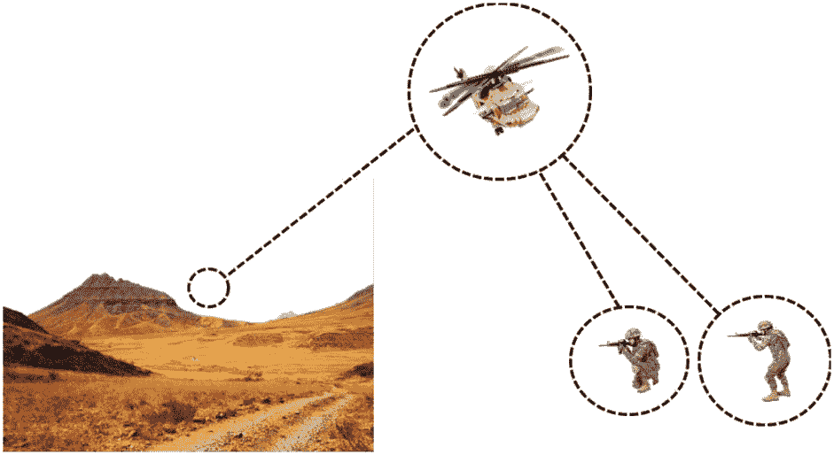

图 4.1 战场的基于位置的通信。

表 4.1 M-IoT 基于位置的通信应用中的完整性措施

| 安全措施  || 操作 |
| --- | --- |
| * * * |
| 一致性 || 战场上的数据交付。 |
| --- | --- |
| * * * |
| 准确性 || 来自控制单元的位置数据、警报和命令 |
| * * * |
| 可信度 || 来自传感器和控制单元的数据来源 |

Echard 讨论的物联网设备的软件完整性 [4] 也可考虑在物联网的军事应用中，因为它侧重于检测和防止物联网设备的原始软件被修改，从而设备不能被用于非预期目的，因为这些设备用于发送战场上的重要信息，据此可采取进一步必要的行动。

#### 4.2.2.3 可用性

可用性可以通过仔细维护所有必需的硬件、在需要时立即进行硬件维修，以及维护不受软件冲突影响的正常运行的操作系统环境来确保。可用性在物联网中非常重要，因为所有配备传感器的物联网设备都需要全天候保持运行。还应保持系统设备更新至软件或固件的当前版本。物联网设备传输数据也需要足够的通信带宽，以防止瓶颈出现。冗余、故障转移、RAID 甚至高可用性集群可以在硬件问题发生时减轻严重后果；因此，对于最坏情况而言，快速且自适应的灾难恢复至关重要。还应包含针对数据丢失或连接中断的保障措施，以应对自然灾害和火灾等不可预测事件。额外的安全设备或软件，例如防火墙和代理服务器，也可用于防范因拒绝服务（DoS）攻击和网络入侵等恶意行为导致的停机和数据无法访问。

#### 4.2.2.4 不可否认性

不可否认服务提供数据来源或数据交付的保证，从而可以保护发送方免受接收方对其已收到数据的虚假否认，或保护接收方免受发送方对其已发送数据的虚假否认。不可否认是指证明某事件已发生的能力，从而以后无法对其进行否认。例如，在电子邮件系统中，不可否认用于保证接收方无法否认收到消息，发送方也无法否认发送消息。不可否认是一种通过数字签名、加密等方式保证对象之间消息传输的方法。它是信息保证（IA）的五大支柱之一。不可否认也是物联网中的一个重要方面。因为物联网中的数据最为重要，因此在灾难恢复系统、工业和研究、医疗保健等实时系统中变得更加关键，在这些系统中数据本身在系统中发挥着重要作用。在这种情况下，不可否认服务发挥着重要作用。

数字签名是一种密码学功能，可用于在物联网系统中实现不可否认服务。数字签名还提供完整性、认证和数据来源保护。它设计为仅属于签名者，即负责签署消息并拥有签名密钥的个人或设备。数字签名有两种类型，一种使用对称密钥（秘密共享密钥），另一种使用非对称密钥（私钥不共享）。在图 4.2 中，发送消息的物联网设备会将其签名添加到消息中。被发送的消息现在称为签名消息，任何拥有适当密钥的其他物联网设备都可以执行签名操作的逆操作，即签名验证。如果签名验证过程失败，则验证者不应信任数据的完整性，即使它们据称来自受信任的来源[5]。

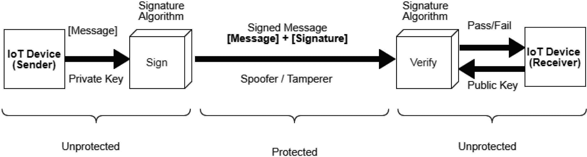

图 4.2 数字签名防止欺骗和篡改的保护。

为了理解物联网系统中的不可否认服务，可以考虑医疗保健传感器应用的示例。医疗保健传感器应用提供无线泛在网络功能。医疗保健传感器应用基于具有传感和/或执行能力的微小节点的互联，并放置或植入人体内。医疗保健传感器应用本质上是感知上下文的、个性化的和动态的。它感知患者的活动并通知远程位置的医生有关患者的健康问题。信息可能至关重要，如果出现某些紧急医疗状况且患者需要关注。 因此，此类应用需要对数据的来源和交付提供保证，例如，如果医生感到需要发送关于患者健康状况的决定而该决定需要患者本人或执行器立即响应或采取行动。物联网应用在这种情况下的失败会影响医生的决策并导致可能对患者造成伤害的不理想结果。因此，为了保护此类通信，可以使用数字签名。数字签名，如上所述，有助于保护此类通信，使攻击者无法伪造数据，并且由于受到保护，接收端的设备无法否认其来源。因此，此类保护保证了有关患者的此类重要信息的传递。

## 4.3 物联网架构

物联网架构由链路层、网络层、传输层和应用层等四个层组成，架构由传感器设备、网关设备、互联网上的云服务、通信设备和介质等组成。如图 4.3 所示，物联网架构的每一层负责特定任务并由不同的协议组成。物联网架构还具有各种通信方法。本节根据架构中的通信模型讨论物联网架构。

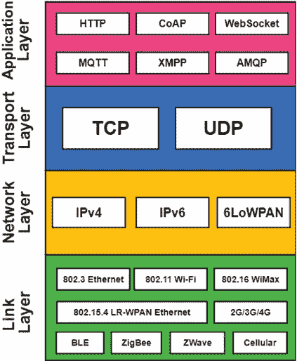

图 4.3 物联网层和协议。

### 4.3.1 设备到设备通信

该模型表示两个或多个设备直接连接并相互通信，而不是通过中间应用服务器。这些设备通过多种类型的网络通信，包括 IP 网络或互联网。设备到设备通信的示例是通过智能手机软按钮控制的智能灯泡。另一个示例可能是智能交通系统中的车对车通信，其中一辆车向另一辆车发送警告消息，针对两车之间的短距离。

### 4.3.2 设备到云通信

在此模型中，物联网设备直接连接到物联网的云服务。物联网云服务负责收集和存储传感器设备的数据、设置规则并对这些数据进行处理。云服务可为物联网设备提供多种服务，如通过社交网络共享数据、生成警报等。此方法利用现有的通信机制，如有线以太网或 Wi-Fi 连接，在设备与 IP 网络之间建立连接，最终通过互联网连接到云服务。

### 4.3.3 设备到网关

在此模型中，物联网设备连接到本地网关设备，网关设备连接到互联网。此方法为物联网基础设施增加了额外的强度和安全性。网关设备可以通过防火墙来过滤信息。物联网网关设备充当物联网传感器设备与互联网上的云服务之间的中间件。

### 4.3.4 后端数据共享

该模型是指一种通信架构，允许用户导出和分析从物联网传感器设备收集并上传到云的数据，以便与其他服务或其他数据源共享。该架构提供了一种向第三方、组织、服务或用户授予对已上传传感器数据访问权限的方式[6]。

## 4.4 物联网协议

`TCP/IP` 协议栈是互联网的核心。`IoT` 中的协议栈分为四层。这些层分别是链路层、网络层、传输层和应用层。每层负责借助不同的协议执行特定任务。图 4.3 表示四层及各层使用的协议。

### 4.4.1 链路层
该层负责在 `IoT` 设备之间传输数据。该层隐藏底层硬件的细节，并向上一层表示为通信介质。链路层将数据流逐位转换为信号并发送到底层硬件。在接收端，该层以电信号形式从硬件接收数据，将其组装成可识别的帧格式，然后交给上层。链路层工作在直接连接的两个主机之间。这种直接连接可以是点对点或广播。链路层执行以下任务：
* *帧处理*：链路层从网络层接收数据包并将其封装成帧。然后，它逐位在硬件上发送每个帧。在接收端，数据链路层从硬件拾取信号并将其组装成帧。
* *寻址*：数据链路层提供硬件寻址机制。硬件地址在链路上假定是唯一的。
* *同步*：一旦数据帧在链路上发送，它就为两端同步传输。
* *差错控制*：当信号在传输过程中遇到问题时，它检测错误并尝试恢复实际数据位，同时向发送方提供错误报告机制。
* *流量控制*：同一链路上的 `IoT` 设备可能具有不同的速度或容量。链路层确保流量控制，使通信设备能够以相同速度交换数据。
* *多址访问*：可能存在较高的碰撞概率。链路层提供诸如 `CSMA/CD` 之类的机制，以确保数据在多个设备之间共享。链路层由以下协议组成，这些协议决定数据如何在网络上传输。以下是链路层中的 IEEE 标准。
* `802.3 Ethernet` 是以太网网络的有线以太网标准的集合。它定义了有线以太网的媒体访问控制 (`MAC`)。它有 `802.3` 作为同轴电缆，`802.3.i` 作为铜双绞线连接，`802.3.j` 作为光纤连接，`802.3.ae` 作为光纤等。这些标准提供的数据速率为 10 Mb/s 至 40 Gb/s 甚至更高。`802.11 Wi-Fi` 是无线局域网 (`WLAN`) 技术的规范集合。`802.11` 指定了无线客户端与基站之间或两个无线客户端之间的空中接口。`802.11` 有多个在 `IoT` 中使用的规范。标准 `802.11a` 工作在 5 GHz，`802.11b/g` 工作在 2.4 GHz，`802.11n` 工作在 2.4/5 GHz，`802.11ac` 工作在 5 GHz，`802.11ad` 工作在 60 GHz。这些提供的数据速率为 1 Mb/s 至 6.75 Gb/s。`802.16 WiMax` 是一系列无线宽带标准，提供的数据速率为 1.5 Mb/s 至 1 Gb/s，移动站提供至 100 Mb/s，固定站至 1 Gb/s。`802.15.4 LR-WPAN` 是一项技术标准，定义了低速率无线个人局域网 (`LR-WPANs`) 的运行。它提供的数据速率约为 40 Kb/s 至 250 Kb/s。该标准提供低成本、低速通信，适用于受限供电的 `IoT` 设备。这些对于远程传感数据非常有用。`2G/3G/4G` 是移动通信标准，其中 2G 包括 `GSM` 和 `CDMA`，3G 包括 `UMTS` 和 `CDMA2000`，4G 包括 `LTE`。基于这些标准的 `IoT` 设备可以通过蜂窝网络通信。这些标准提供的数据速率为 9.6 Kb/s 至 100 Mb/s [7]。

该层极易受到对 `IoT` 设备的若干攻击。这些攻击如下：
* `Address Resolution Protocol (ARP) spoofing` 是一种攻击者向网络发送 `ARP` 消息的技术，目的是将攻击者的 `MAC` 地址与另一个主机如网关关联，导致发送给攻击者的 `IP` 流量。此攻击允许攻击者拦截网络上的数据帧，修改和停止流量，并为其他攻击打开大门。
* `Denial of Service (DoS) attack` 是一种攻击，攻击者通过干扰服务使传感器节点或网络资源不可用。

### 4.4.2 网络层
它也称为 `IoT` 中的互联网层，负责将 `IP` 数据报从源网络发送到目标网络。该层执行主机寻址和数据包路由。数据报包含源地址和目的地址，用于将其从源路由到跨多个网络的目的地。主机标识使用分层 `IP` 地址方案，例如 `IPv4` 或 `IPv6` 等。网络层负责执行以下任务 [8]：
* 寻址设备和网络。
* 填充路由表或静态路由。
* 对进出数据进行排队并根据为这些数据包设置的质量服务约束转发它们。
* 不同子网之间的互联。
* 尽力将数据包交付到目的地。
* 提供面向连接和无连接机制。

网络层由在 `IoT` 中被认为有用的协议组成，例如 `IPv4`，它是部署最广泛的互联网协议。该协议使用 32 位寻址方案，允许总共 `2³²` 个地址。但随着越来越多的设备连接到互联网，这些地址在 2011 年耗尽。因此，一个新版本的协议应运而生。`IPv6` 是互联网协议最新版本，也是 `IPv4` 的继任者。该协议使用 128 位寻址方案，允许总共 `2¹²⁸` 个地址。另一个协议是 `6LoWPAN`，这是一个有些拗口的缩写，组合了互联网协议的最新版本 (`IPv6`) 和低功耗无线个人局域网 (`LoWPAN`)。该协议使具有有限处理能力的小型设备能够使用互联网协议无线传输信息。它工作在 2.4 GHz 频率范围，提供约 250 Kb/s 的数据传输速率。因此，该协议被认为比其他协议更适用于资源和电力受限的设备。

`IoT` 中网络层漏洞被归类为以下攻击：
* `Routing attack` 在此攻击中，攻击者可能会更改路由信息以创建路由环路，从而显著降低服务质量，因为路由信息未加密。
* `Eavesdropping attack` 是攻击者能够访问通信信道时的攻击。它是一种被动攻击，除非攻击者修改接收到的数据包并将其发送回源头。这种方法称为重放攻击，它是欺骗的非常常见的子类型。
* `Replay attack` 是一种攻击，攻击者获取一个签名的数据包，无论他能否解密它，都通过在稍后时间重新发送数据包来获得目标实体的信任。
* `Sinkhole attack` 是一种攻击，其中某些节点比其他正常节点对网络流量更具吸引力。当数据包到达 sinkhole 节点时，消息可能会被丢弃并以更改内容转发。
* `Wormhole attack` 是一种攻击，其中恶意创建了一个虫洞、低延迟链路，攻击者可以通过该链路重放消息。攻击者在网络的一个点接收数据包并将其发送到网络的另一个点，然后从该点重放。

- *Sybil 攻击*是一种攻击，攻击者使用具有多个身份的传感器节点或设备。这导致流量似乎具有多个来源。这种攻击破坏了基础设施中原本存在的资源使用、冗余或投票概念。
- *节点复制：*在这种攻击中，攻击者复制传感器节点的身份并创建另一个具有相同身份的虚拟传感器节点，以便通过随机路由发送虚假信息来破坏网络。

### 4.4.3 传输层
传输层在远程主机上的两个进程之间提供点对点和端到端连接。传输层从上层（即应用层）获取数据，然后将其划分为较小大小的段，对每个字节进行编号，并交给下层（网络层）进行传输。该层执行以下功能：
- 它将应用层提供的信息数据分解为称为段的较小单元。它对段中的每个字节进行编号并维护其核算。
- 它确保数据按发送的相同顺序接收。
- 它在不属于同一子网的主机之间提供端到端的数据传输。
- 所有通过网络通信的服务器进程都提供传输服务访问点（TSAPs），也称为端口号。

传输层在物联网方面有两个最重要的协议。*TCP（传输控制协议）*是面向连接的协议。TCP 使两个设备能够建立连接并交换数据流。TCP 保证数据的交付，并保证数据包按发送的相同顺序交付。它有助于避免网络拥塞和拥塞崩溃。它在通过 IP 网络通信的主机上运行的应用程序之间提供可靠、有序且经过错误检查的数据流传输。*UDP（用户数据报协议）*是无连接协议。它用于对时间敏感的应用程序。它是一种面向事务且无状态的协议，不保证数据包交付。它提供快速的数据传输和恒定数据流，但不提供可靠性。

该层也容易受到与物联网相关的以下攻击：
- *会话劫持*也称为 TCP 会话劫持。它是通过秘密获取用户的会话 ID 并假装为授权用户来访问数据，从而控制用户会话的一种方式。
- *TCP Land 攻击*是攻击者向通常具有开放 TCP 端口的主机服务器发送 SYN 数据包的攻击。
- *UDP 泛洪攻击*是攻击者用无数请求淹没服务器机器的攻击；这使得机器认为假装为授权用户的攻击者确实急需服务，服务器机器开始向攻击者提供服务；结果，真正需要服务的用户往往被忽视。
- *TCP 和 UDP 端口扫描*是一种技术，攻击者对主机机器的各种工具进行端口扫描以找到机器上的开放端口，并在识别出端口后用于攻击服务器。

### 4.4.4 应用层
应用层是实际通信发起并体现的顶层。该层不为其他层服务，但借助传输层及其以下所有层来通信或将其数据传输到远程主机。该层为网络上的数据传输准备设备之间的通信并启动数据传输。它从网络接收数据并为使用做好准备。应用层由适用于物联网设备的各种协议组成。该层的协议有 *HTTP* (*超文本传输协议*)，它是一种无状态协议，遵循请求-响应模型并使用 URI（通用资源标识符）。*受限应用协议 (CoAP)*是一种为物联网中的受限设备和受限网络使用而设计的传输协议。该协议专为智能能源和建筑自动化等 M2M 应用而设计。它在 UDP 而不是 TCP 上运行，并遵循请求-响应模型。*WebSocket*是另一种计算机通信协议，它通过单个 TCP 连接提供全双工通信通道。它基于 TCP，允许消息流在客户端和服务器之间来回发送。

*消息队列遥测传输* (MQTT)是一种轻量级消息协议，在资源受限环境中非常有用。该协议简单地在网络上分发遥测信息。它使用发布/订阅通信模式，最广泛用于 M2M 通信。它在物联网中发挥着重要作用。*XMPP* (*可扩展消息和存在协议*)是一种基于可扩展标记语言（XML）的协议。该协议主要用于即时消息（IM）和在线存在检测应用。它有时也称为 jabber 协议。它用于实时通信和 XML 数据的流传输。它最广泛用于游戏、多方聊天和语音/视频通话等应用。它是一种去中心化协议，对物联网设备非常有用。*高级消息队列协议 (AMQP)*是一种开放标准的消息导向协议。它支持点对点和发布者订阅者模型，并用于在网络上路由和排队数据。

物联网中的应用层也容易受到以下几种攻击：
- *恶意代码注入：*攻击者从未知位置向系统注入恶意代码并试图窃取或操纵授权用户的数据。
- *拒绝服务攻击：*攻击者假装为登录系统的已认证用户并中断网络的工作。
- *钓鱼攻击：*攻击者获取系统的凭证并访问系统并损坏数据。
- *嗅探攻击：*攻击者使用嗅探应用程序攻击系统的网络并读取未加密的数据包。

## 4.5 安全分类和访问控制
以下是在物联网中必须考虑的安全分类和访问控制[9]。

### 4.5.1 数据分类

在信息安全中，数据分类取决于其敏感程度。它还取决于影响程度，即数据在未经授权的情况下被披露、更改或销毁。适当用于保护数据的主要安全控制措施是通过数据分类来确定的。所有数据都应被归类为三个敏感级别之一，例如 `Restricted Data` 被称为受限数据，当未经授权披露、更改或销毁该数据可能导致相当大的风险时。受限数据的示例是国防组织的数据。应将最高级别的安全控制措施应用于受限数据。`Private Data` 可被归类为私有，当未经授权披露、更改或销毁该数据可能导致中等程度的风险时。默认情况下，所有未明确归类为受限或公共数据的数据均可视为私有数据。必须对私有数据应用合理级别的安全控制措施。`Public Data` 可被归类为公开，当未经授权披露、更改或销毁该数据可能导致很少或没有风险时。公共数据的示例包括新闻稿、课程信息和研究出版物、天气信息、铁路/航班信息等。保护公共数据保密可能不需要或只需要很少的控制措施。需要控制级别来防止未经授权的修改或销毁。控制级别包括身份验证、授权和数据完整性。`Authentication` 是保护数据的方式。身份验证是一个过程，其中用户提供的凭据与授权用户数据库中可用的凭据进行比较。身份验证在智能家居等物联网应用中很重要。只有经过身份验证的用户才可能访问智能家居系统。`Authorization` 是提供与信息安全相关的数据和资源访问权限的过程。它还用于指定特定物联网系统中的访问控制。为了指定谁有权访问系统，许多物联网应用都需要授权。例如智能电网系统，该系统要求只有授权用户才能访问系统。`Data integrity` 是维护和保证数据的准确性和一致性。数据完整性适用于数据的整个生命周期。对于存储、处理或检索数据的任何物联网系统的设计、实现和使用而言，这是一个关键方面。由于数据是物联网系统中采取行动和做出决策的基础，因此数据完整性在此上下文中发挥着重要作用。

身份验证和数据完整性可以通过使用数字签名来实现，如第 2.2.4 节所述。授权也可以通过此类数字签名实现，因为只有持有有效签名的人才会被授予在物联网基础设施中的特定物联网设备上的访问权。

`MQTT` 协议也可以用于实现授权。`MQTT`，发布/订阅协议，允许客户端写入和读取主题。在此过程中，所有 `MQTT` 客户端都没有权限写入主题；同样，所有客户端也没有读取权限。可以使用 `MQTT` 代理进行控制，通过为主题保留访问控制列表来限制此类权限给 `MQTT` 客户端。`MQTT` 代理可以使用客户端 ID 或其他任何技术对 `MQTT` 客户端进行授权，并通过主题查找授予对主题的访问权限，以确定 `MQTT` 客户端是否被授权读取、写入或订阅主题。

## 4.6 IoT 中的攻击面

物联网中的攻击面是攻击者进入物联网系统窃取信息甚至控制系统的入口。因此，为了使物联网系统安全，必须识别、保护并限制这些面免受恶意和未经授权的访问 \[10\]。

### 4.6.1 接口

嵌入式设备具有许多能够交换信息的电路。这些信息是使用对通用协议的约定进行交换的，该协议可分为两组：串行和并行。串行和并行是允许多位数据交换并需要大量引脚的接口，而在串行接口中，一次传输一位数据，这比并行慢，但具有需要较少引脚的优势。使用串行通信的一些流行协议示例有通用串行总线 (`USB`)、以太网、UART、SPI 和 I2C。任何物联网设备中的串行接口对攻击者来说相当有用，因为它为攻击者提供了进入系统并与设备交互的入口，即使设备看起来完全被锁定。可用的接口各不相同，可能因设备而异。

物联网设备接口上的调试测试引脚是对攻击者来说最有效的物理硬件攻击向量。最知名的接口是 `UART`（通用异步收发器），它通常被称为串行接口协议，允许在无需外部时钟的情况下传输数据，因此称为异步。UART 在并行和串行接口之间充当中介。它特别适用于嗅探调试和启动消息和日志、获取 shell 访问等。在现实世界的物联网设备中，UART 允许直接获得未经身份验证的 root 访问权限，这反过来又允许攻击者进入系统。`SPI`（串行外设接口）与 UART 不同，是一种同步串行通信接口。它需要时钟来促进通信。它可用于从设备转储固件。SPI 工作在主-从架构上。在此架构中，一个设备发送数据，另一个设备接收数据。SPI 上的引脚命名为 MISO（master out slave in）和 MOSI（master out slave in）。`I2C`（集成电路间）也工作在主-从架构上，允许多个从芯片与一个主芯片通信。其用法与 SPI 非常相似 \[11\]。`JTAG` 是一个硬件访问点，允许一个或多个设备通过外部引脚连接以用于调试目的。JTAG 用于两个主要目的，首先称为边界扫描，其次称为调试访问。边界扫描是一种简单的调试形式，可确保所有设备正确连接。调试访问提供了一种与智能设备通信并捕获其原始实时计算的方法。这非常强大，因为它允许访问寄存器、内存内容、中断以及暂停和重定向指令流的能力。当物联网设备上存储有某些秘密时，此技术可使用调试访问实际读取内存内容并将该秘密从内存芯片中提取出来。一些 CPU 内置了 JTAG 接口，而一些则没有。许多板卡设计师通过易于访问的引脚公开这些 CPU 功能以用于调试目的 \[12\]。

### 4.6.2 软件和云组件

软件和云组件也为攻击者提供了进入物联网系统的入口点。因此，为了保护系统免受攻击，必须对其有充分的理解。设备的 `Firmware` 是攻击者进入物联网系统的重要工具。攻击者可能能够使用十六进制编辑器或其他工具在固件中找到有价值的信息、网络的 `user ID` 和 `password`。固件的不安全更新也可能导致安全问题。由于固件存在于物联网传感器设备上，攻击者可以损坏设备，从而阻止任何数据提交到服务器或促成错误数据提交到服务器，这可能导致向用户显示无信息或容易出错的信息。这必须使用密码学来保护。

`Web Application Dashboard` 也是一个重要的关注领域。物联网应用的仪表板是整个物联网系统的控制单元。如果攻击者以某种方式控制了仪表板，整个系统都可能遭受很大损害。这种攻击必须通过强密码加密技术和安全的会话管理来保护。大多数物联网应用为其用户提供的 `Mobile Interface`，以便用户使用智能手机轻松访问系统，如果没有一些强有力的安全技术保护，也会成为攻击者的入口点。

### 4.6.3 无线通信

由于物联网传感器设备大多依赖于无线电通信，例如 `Wi-Fi`、`BLE`、`Cellular`、`Zigbee`、`ZWave` 和 `6LoWPAN`。不安全的无线电通信也允许攻击者获得对系统的访问权限。许多攻击，例如拒绝服务 (`DoS`)、基于密码的攻击、无线钓鱼、中间人攻击、密钥泄露攻击、嗅探攻击、无线入侵者、rogue APs、端点攻击和 evil twin APs 都可以针对无线电通信进行。因此，它必须使用密码学和防火墙进行保护。

## 4.7 安全特性

在讨论的每一层中，物联网中使用了各种协议 (`Figure 4.3`)。每一层都使用这些协议执行特定任务。有些安全功能已内置于这些协议中的某些协议中，本节将对其进行讨论。

### 4.7.1 TLS/SSL

传输层安全 (`TLS`) 及其前身安全套接字层 (`SSL`) 合称为 SSL。这些是提供计算机网络上通信安全的密码协议。协议的许多版本用于诸如网页浏览、电子邮件应用、互联网传真、即时消息和语音-over-IP (VoIP) 等应用中。网站使用 `TLS` 来保护服务器和网络浏览器之间的所有通信。传输层安全协议在相互通信的两个计算机应用程序之间提供数据完整性和隐私。由 `TLS` 保护的客户端-服务器通信具有一个或多个属性，例如连接是私有的或安全的，因为对称密码学用于加密传输的数据。服务器和客户端在传输第一个数据字节之前就商定加密算法和使用的密码密钥的细节。这种共享秘密的协商是安全可靠的。相互通信的客户端-服务器的身份使用公钥密码学进行身份验证。连接确保完整性，因为每个传输的消息都使用消息认证码进行消息完整性检查，以防止数据在传输过程中未被检测到的丢失或修改 [13]。需要将其与物联网案例联系起来。`TLS` 在物联网中是如何使用的？哪个服务器（云？）和哪个客户端（例如，哪个设备）？信用卡信息在网络上使用 `TLS`，那么是否有任何物联网需要 `TLS`？

`TLS` 在物联网中具有重要作用。下一节中讨论的 `MQTT` 协议通常被实现为在 `TLS` 上运行。`MQTT` 代理可以配置为对 `MQTT` 客户端进行基于证书的身份验证。使用它，`MQTT` 代理将 `MQTT` 客户端 `X.509` 证书中的信息映射以确定客户端有权订阅或发布的主题。现实世界的例子是 `IBM Watson IoT platform`’s `MQTT API`，其在端口 `8883` 或 `443` 上加密通信。该平台需要 `TLS`。在平台上注册设备需要使用 `TLS` 连接，因为 `MQTT` 密码会传回客户端，而该客户端受 `TLS` 隧道保护 [5]。

### 4.7.2 MQTT（消息队列遥测传输）

`MQTT` 协议是一种发布/订阅消息协议，专为通常称为物联网协议的 M2M 通信而设计。`MQTT` 协议由 `MQTT` 客户端组成，客户端可以是运行有 `MQTT` 库的任何微控制器设备，以及客户端通过网络连接到的 `MQTT` 代理。`MQTT` 客户端可以是发布者或订阅者或两者兼有。`MQTT` 代理是发布/订阅活动的核心，可以处理多达数千个并发连接的 `MQTT` 客户端，主要负责接收消息、过滤它们，然后将消息发送给所有订阅的客户端。`MQTT` 代理提供一个或多个主题，允许 `MQTT` 客户端向相关主题发布/订阅消息。主题通常是一个小令牌，可能存储有价值的信息。`MQTT` 安全有三个基本概念：身份、身份验证和授权。身份是关于提供身份以获得授权和授予权限。身份验证是关于证明身份，而授权是关于管理身份。身份 – 通过其 `client identifier`、`user ID` 或 `public digital certificate` 识别 `MQTT` 客户端。这些属性中的一个或另一个定义了客户端身份。`MQTT` 服务器使用 `SSL` 协议对客户端发送的证书进行身份验证，并使用客户端设置的密码。通过此服务器可以根据客户端的身份控制客户端可以访问的资源。`MQTT` 服务器通过其 `IP address` 和 `digital certificate` 将自身标识给客户端。`MQTT` 客户端使用 `SSL` 协议验证 `MQTT` 服务器发送的证书。

`Authentication` 由 `MQTT` 服务器和客户端共同完成。客户端使用 `SSL` 协议对服务器进行身份验证。`MQTT` 服务器使用 `SSL` 协议或密码或两者对客户端进行身份验证。如果客户端对服务器进行身份验证，但服务器不对客户端进行身份验证，则客户端被称为匿名客户端。可能可以通过 `SSL` 建立匿名客户端连接，之后它会使用由 `SSL` 会话加密的密码对客户端进行身份验证。由于证书分发和管理问题，客户端可以用密码而不是客户端证书进行身份验证。`MQTT` 客户端服务器通信是安全可靠的，其过程如下。

*   `MQTT` 客户端对服务器进行身份验证，以确保其连接到正确的服务器。它通过 `SSL` 协议使用服务器证书来完成此操作。

*   `MQTT` 服务器验证其是否连接到正确的客户端。它通过使用 `SSL` 协议对客户端证书进行身份验证，或通过使用密码对客户端身份进行身份验证来完成此操作。

`Authorization` 不是 `MQTT` 协议的一部分，但由 `MQTT` 服务器提供。授权取决于服务器所做的事情。`MQTT` 服务器是发布/订阅代理。服务器上的 `MQTT` 授权规则控制可以连接到服务器的客户端以及客户端可以发布或订阅的主题 [14]。

### 4.7.3 DTLS（数据报传输层安全）

数据报传输层安全（DTLS）是一种为基于数据报的应用提供安全性的通信协议。为此，它允许应用程序通信以防止窃听、篡改或消息伪造。DTLS 协议基于面向流的传输层安全（TLS）协议。DTLS 提供与 TLS 类似的安全保证。DTLS 协议数据报保留了传输的语义，使得应用程序不必承受与流协议相关的延迟，但它必须处理数据包重排序、数据报丢失以及大于数据报网络数据包大小的数据。考虑安全时有三个主要要素，即完整性、身份验证和保密性。DTLS 都能实现。DTLS 解决了两个问题，重排序和数据包丢失。DTLS 增加了三种机制：第一，数据包重传，第二，在握手期间分配序列号，第三，重放检测。与网络层安全协议不同，DTLS 在应用层保护端到端通信。端到端通信保护会使攻击者难以访问通过受损节点传递的所有文本数据。DTLS 还避免了在较低层安全协议中出现的密码开销问题。

### 4.7.4 CoAP（受限应用协议）
受限应用协议（CoAP）现已成为物联网应用的标准和流行协议。安全性始终是保护设备间通信的主要关注点。它是一种为物联网应用中的机器对机器通信而设计的轻量级协议。CoAP 使用数据报传输层安全（DTLS）作为通信协议。CoAP 默认绑定到 UDP，可选绑定到 DTLS，提供高水平的通信安全 \[15\]。

### 4.7.5 XMPP（可扩展消息和存在协议）
安全性一直是 XMPP 的关键问题。XMPP 中的安全考虑包括高安全性、证书验证、客户端-服务器通信、服务器-服务器通信、协议层、防火墙和 base64。*高安全性*是指在提供基于证书的身份验证时，在通信双方之间保持的相互保密性。如果颁发了证书，则只有授权的证书才应被接受。*证书验证*是指当颁发证书时，应由通信双方进行审查。在*客户端-服务器通信*中，客户端必须支持 TLS 和简单身份验证和安全层（SASL）协议以连接到服务器。XML 流的加密使用 TLS 进行，而身份验证由 SASL 支持。服务验证后，只有客户端才应与服务器通信。客户端通信的 IP 地址应保持私密，以便防止入侵者进入通道。

在*服务器-服务器通信*中，与客户端不同，服务器应支持 TLS 和 SASL 协议以便于通信。数据的身份验证和完整性通过在服务器通信中使用 SASL 得到保证。*协议层*由四个协议组成，按安全实现中所述用于 XMPP。这些协议是 TCP、TLS、SASL 和 XMPP，其中 TCP 是基础层，在该层建立客户端与服务器之间的连接。TLS 对 XML 流进行加密，SASL 提供身份验证，XMPP 是应用层。对于*防火墙*，TCP 广泛用于 XMPP 通信。客户端到服务器通信使用端口 5222，服务器到服务器通信使用端口 5269。*Base64* 有助于识别受信任的客户端和服务器。服务器验证客户端，如果发现任何数据无关，则不予接受。这提高了数据完整性并传递正确的数据。

## 4.8 安全管理
它是保护数据免受未经授权访问、控制用户操作活动、设置安全规则、监控安全事件等的一组功能。存在许多安全管理技术，其中两个最重要的将在此处讨论，可用于物联网。

### 4.8.1 身份和访问管理（IAM）
它是使正确资源在正确的时间因正确的原因被正确个人访问的安全学科。此管理任务关键，要求确保在日益异构的技术环境中正确授予对资源的访问权限，并满足日益严格的合规要求。它涵盖与安全相关的许多问题，例如用户如何获得身份、用户身份的保护，以及支持该保护的技术（例如，网络协议、数字证书、密码等）。IAM 具有以下功能:-

*   纯身份功能，包括在不考虑访问或授权的情况下创建、管理和删除用户身份。
*   用户访问（登录）功能，定义适当的用户如何凭提供的凭据获得系统访问权限。
*   服务功能，包括一个系统，该系统向用户和设备提供个性化、基于角色的、在线的、按需的、多媒体内容和基于 presence 的服务。
*   身份联合，包括一个依赖于联合身份以在不知道其密码的情况下对用户进行身份验证的系统。身份联合由一个或多个系统组成，这些系统关联用户访问并允许用户基于对联合中操作的其中一个系统进行身份验证来登录。

除了创建、删除和修改用户身份数据外，身份管理还控制用于应用程序的附加实体数据，例如联系信息或位置。IAM 的系统功能包括身份验证、授权、角色、委派和互换。*身份验证*是使用密码或生物识别设备对用户进行验证。*授权*是管理授权信息，该信息定义了在特定应用程序上下文中谁可以访问什么操作。*角色*是授予用户的操作组。角色通常与特定工作或工作职能相关。例如，用户管理员有权重置用户的密码，而系统管理员可能有权将用户分配到特定服务器。*委派*允许本地管理员在没有全局管理员的情况下执行系统修改。它也可能意味着一个用户可以代表其他用户执行操作。*互换*是使用安全断言标记语言（SAML）协议在两个身份域之间交换身份信息 \[16\]。

IAM 可以通过基于物联网的智能停车系统来说明。智能停车系统是一个物联网参考系统，因为它包含多个捕获数据并将其发送到物联网服务器上的数据库存储的端点。该系统还提供数据分析和决策。在此示例中，智能停车系统，如 Russell 等人 \[5\] 所讨论，具有以下功能：

*   面向消费者的服务：此服务允许客户查找空闲停车位和价格。
*   支付灵活性：此服务允许客户使用多种支付方式为停车位付费，例如信用卡、现金/硬币和移动支付服务。
*   授权执行：此服务允许跟踪已购买停车位的停放时间、确定到期时间、感知停车位超期停放时间，并将违规行为通知停车执法人员。

## 4.8 智能停车系统

### 趋势分析和需求响应定价
* 趋势分析：这些服务允许收集和分析历史停车数据，并向停车管理人员提供趋势报告。
* 需求响应定价：此服务允许根据每个车位的需求更改价格。

### 安全目标
智能停车系统的安全目标可能包括：
* 维护客户和停车管理人员的身份认证。
* 维护谁可以更改停车位价格的授权。
* 维护停车管理人员、收费员、管理员和执法人员的角色。
* 维护管理员的委派。
* 维护系统收集的所有数据的完整性。
* 维护系统敏感数据的保密性。
* 维护整个系统及其所有组件的可用性。

### 系统功能
停车系统的功能描述如下：
1. 客户购买停车位
   * 客户在其智能手机上安装停车应用程序。
   * 客户注册付款信息以完成交易。
   * 应用程序提供附近可用停车位和价格详情的实时信息。
   * 客户选择车位并驾车前往。
   * 客户使用应用程序支付车位费用。
2. 停车执法人员收到未付款事件的警报
   * 停车应用程序记录停车会话开始时间，并记录车辆在停车位停留的超时时间。
   * IP 视频摄像头捕捉车辆在停车位超时的视频。
   * 停车应用程序将停车位中车辆的视频与开始时间和停车交易持续时间相关联，以便在交易持续时间已过期时进行视频确认标记。
   * 然后停车应用程序将警报传输到超时车辆的执法应用程序。
   * 执法人员收到短信警报并对车辆进行开罚单。

### 系统架构
下图显示了整体系统架构：

![图 4.4 智能停车系统架构 \[5\]。](Images/fig4_4.jpg)

**图 4.4 智能停车系统架构 [5]。**

### 安全控制
需要在智能停车系统中实施的安全控制如下：

**表 4.2 智能停车系统安全要求**

| 针对智能停车系统的攻击 | 攻击类型 | 安全控制要求 |
|---|---|---|
| 攻击者控制客户账户并向客户收取停车时间费用 | 欺骗 | 身份认证 |
| 通过未经授权的访问，攻击者免费使用停车位 | 篡改 | 身份认证和完整性 |
| 攻击者声称系统出现故障而免费使用停车位 | 否认 | 不可否认性和完整性 |
| 攻击者获取客户付款详情 | 信息泄露 | 身份认证和保密性 |
| 攻击者通过 DoS 攻击关闭智能停车系统 | 拒绝服务 | 可用性 |
| 攻击者通过在后端服务器植入 rootkit 来破坏智能停车运营 | 权限提升 | 授权 |

### 4.8.2 密钥管理
它是在密码系统中管理加密密钥所使用的技术。它促进密钥的生成、交换、存储、使用和替换。KM 包括密码协议设计、密钥服务器、用户程序和其他相关协议。密钥或密码密钥是一段信息，也称为参数，决定了密码算法的功能输出。密码系统可能使用不同类型的密钥，一个系统可能使用多个密钥。密钥可以是对称密钥或私钥，也可以是非对称密钥或公钥。在对称密钥算法中，涉及的密钥对加密和解密消息是相同的。密钥必须谨慎选择，并且以安全的方式分发和存储。相比之下，非对称密钥是两个在数学上相关联的独立密钥。它们通常结合使用以进行通信。密钥管理系统安全策略提供了可用于保护密钥和元数据的规则。密钥管理在物联网中非常重要，因为它保护保密性、完整性和可用性，并且该过程是安全的 [17]。

## 4.9 基于物联网的智能家居及安全问题
本节讨论智能家居作为物联网模型。智能家居可以定义为具有照明、电器、供暖、空调、电视、计算机、娱乐系统以及安全和摄像系统等环境的每个系统都能够相互通信。例如，一个系统可通过摄像头画面在门铃或信箱被使用或智能锁被未经授权访问时向用户智能手机发出警报。智能家居中所有连接的“物”也可以随时远程控制，无论是从家中任何房间，还是通过电话或连接到互联网的任何设备从世界任何地方远程控制。因为在智能家居中，所有事物都通过互联网相互连接；因此也暴露出安全威胁。智能家居的常见安全威胁是保密性、身份认证和访问。*保密性*威胁可能导致私人敏感信息被非预期释放。*身份认证*威胁可能导致传感和控制信息的篡改。例如，通过未经身份验证的警报，攻击者可以混淆房屋控制器，迫使其打开门，以为是紧急情况。*访问*是最严重的威胁类型。它使攻击者能够控制系统，特别是管理级别，从而使系统不安全。

智能家居可能因物联网设备不安全的固件升级、系统组件之间未加密的信息共享等而存在漏洞。智能家居有三个最重要的安全问题。在设计智能家居时必须仔细考虑，以防止被滥用。首先，智能家居不应配备 *可被黑客攻击的连接设备*。正如所观察到的，今天智能家居中使用的许多设备都是可被黑客攻击的。这些设备包括恒温器、智能电视、安防摄像头、智能开关、智能门锁、家用电器等。所有这些设备必须防止所有可能的攻击。如果攻击者控制了这些设备，可能会给家庭用户带来不便。用于控制智能家居系统的计算机和智能手机也必须使用强大的安全策略进行保护。其次，智能家居不应包含 *受损的安全系统*。智能家居的安全系统也必须使用密码技术、强密码和防火墙进行保护。

受损的安全系统会导致智能家居系统中的安全漏洞暴露。设想一下，如果攻击者能够控制门上的安全摄像头并记录用户输入的门锁密码，那么攻击者就可以轻松利用这些信息在用户不在家时进入家中。因此，房屋中的所有安全系统都必须得到充分保护。第三，智能家居不应允许 *窥探通信系统*。大多数家庭通信系统都配备了视频会议设备、计算机、打印机、电话等设备。用户能够使用这些设备与家外的其他设备和其他人进行通信。攻击者可以通过被动攻击窃取有价值的信息，即用于在不实际更改任何数据或代码的情况下获得未经授权访问的攻击。这可能导致监控电话通话和电子邮件信息，并追踪人们如何与设备交互。因此，所有通信系统也必须对安全漏洞给予高度重视。

## 4.10 Conclusion
安全是物联网的主要关注点。由于数十亿台设备正在连接到互联网，这些设备的安全问题也在日益增加。本章讨论了包括设备、接口以及软件和云组件在内的攻击点，并讨论了用于保护物联网设备之间通信（客户端与服务器、机器对机器等）的通信层安全协议，如 SSL/TLS 和 DTLS、MQTT、CoAP、XMPP 和 AMQP。安全是物联网的重要方面，因为它有助于保护有价值的数据并避免数据被滥用。如本章所述的安全问题，必须在当前正在运行的以及未来开发的所有物联网系统中得到充分识别和实施。通过执行这些安全问题，可以开发出安全且适合更好生活的物联网系统，从而保障互联的未来。

## References
*   [\[1\] Proofpoint 发现物联网 (IoT) 网络攻击，可访问：http://investors.proofpoint.com/releasedetail.cfm?releaseid=819799](#Ch04.xhtml#bck_ref4_1)
*   [\[2\] 保护物联网：一个建议框架，可访问：http://www.cisco.com/c/en/us/about/security-center/secure-iot-proposed-framework.html](#Ch04.xhtml#bck_ref4_2)
*   [\[3\] 保密性、完整性和可用性 (CIA 三元组)，可访问：http://whatis.techtarget.com/definition/Confidentiality-integrity-and-availability-CIA](#Ch04.xhtml#bck_ref4_3)
*   [\[4\] Echard, C., 确保物联网设备中的软件完整性. J. Inform. Technol. Softw. Eng. 7, 1–3, 2017.](#Ch04.xhtml#bck_ref4_4)
*   [\[5\] Russell, B., Van Duren, D., 物联网安全实践, PACKT Publishing, 2016.](#Ch04.xhtml#bck_ref4_5)
*   [\[6\] 理解物联网协议，可访问：https://solace.com/blog/use-cases/understanding-iot-protocols-matching-requirements-right-option](#Ch04.xhtml#bck_ref4_6)
*   [\[7\] Tutorials Point, 数据通信和通信网络，可访问：https://www.tutorialspoint.com/data\_communication\_computer\_network/data\_link\_control\_and\_protocols.htm](#Ch04.xhtml#bck_ref4_7)
*   [\[8\] Tutorials Point, 数据通信和通信网络，可访问：https://www.tutorialspoint.com/data\_communication\_computer\_network/network\_layer\_introduction.htm](#Ch04.xhtml#bck_ref4_8)
*   [\[9\] 数据分类指南和程序，可访问：http://doit.niu.edu/doit/Policies/data-classification.shtml](#Ch04.xhtml#bck_ref4_9)
*   [\[10\] 物联网设备的硬件黑客攻击 - 攻击性物联网利用，可访问：http://resources.infosecinstitute.com/hardware-hacking-iot-devices-offensive-iot-exploitation/#gref](#Ch04.xhtml#bck_ref4_10)
*   [\[11\] 开始物联网安全 – 映射攻击面，可访问：http://resources.infosecinstitute.com/getting-started-with-iot-security-mapping-the-attack-surface/#gref](#Ch04.xhtml#bck_ref4_11)
*   [\[12\] 为什么 JTAG 和 UART 对物联网设备仍然是有效的攻击向量？，可访问：https://p16.praetorian.com/blog/why-are-jtagand-uart-still-effective-attack-vectors-for-iot-devices](#Ch04.xhtml#bck_ref4_12)
*   [\[13\] 传输层安全，Wikipedia，可访问：https://en.wikipedia.org/wiki/Transport\_Layer\_Security](#Ch04.xhtml#bck_ref4_13)
*   [\[14\] MQTT 安全，可访问：https://www.ibm.com/developerworks/community/blogs/c565c720-fe84-4f63-873f-607d87787327/entry/mqttsecurity?lang=en](#Ch04.xhtml#bck_ref4_14)
*   [\[15\] 物联网受限应用协议，可访问：http://www.cse.wustl.edu/jain/cse574-14/ftp/coap/](#Ch04.xhtml#bck_ref4_15)
*   [\[16\] 身份管理，Wikipedia，可访问：https://en.wikipedia.org/wiki/Identity\_management](#Ch04.xhtml#bck_ref4_16)
*   [\[17\] 密钥管理，Wikipedia，可访问：https://en.wikipedia.org/wiki/Keymanagement](#Ch04.xhtml#bck_ref4_17)

# 5 Role of Blockchain in IoT Security
**Tasneem Jahan and Imran Ali Khan**

计算机科学与工程系，Bansal 研究、技术与科学学院，马德亚 Pradesh 邦，印度

DOI: 10.1201/9781003338642-5

物联网 (IoT) 是一种计算技术，已发展到通过将其转变为智能设备来改善我们日常生活的每个物体，从而实现例行任务和活动的自动化。其旨在设计一个数字世界，以推动业务势头和产业增长。随着物联网在全球范围内的扩展，与之相关的主要问题是其抵御攻击和安全性的能力。物联网涉及的场景包括为传感器控制器以及其他多种技术提供实时计算服务的复杂网络连接和计算机能力。物联网具有架构各异的异构设备集合，形成了多样化的网络规模。安全是一个重要方面，需要通过协议和算法方案高效实施。本章以下内容将涵盖区块链的工作原理及其优缺点。还讨论了物联网应用中的区块链示例、区块链的安全方面以及区块链在业务中的应用。

## 5.1 Introduction
物联网 (IoT) 安全涉及对连接到物联网的设备和网络的保护和安全。我们在日常生活中使用许多物品。这些物品需要通过有线或无线骨干网连接到互联网。物联网通信从连接设备获取数据，这些设备用于工业智能电网、家庭和建筑自动化、车对车通信以及可穿戴计算设备。

主要问题是物联网行业没有关注安全措施，不仅公司如此，消费者也对安全威胁不以为意。此外，最终用户经常未能更改智能设备上的默认密码——即使更改，也未能选择足够强大的密码。这种差距可以通过一个强大的自动化系统来填补，该系统使最终用户和公司能够克服此类威胁。

设计安全物联网模型的目标即使对于数据感知、数据通信和数据存储等最简单的任务也存在许多障碍。为了从零开始实现这一目标，整个物联网系统被划分为两个不同的层级：

1.  系统视图：它将物联网生态系统的各个元素组合在一起，例如，事物或对象、网络服务、网关和云服务。
2.  业务视图：它包括物联网提供的服务集合，例如平台架构、应用程序、连接性和商业模式。

## 5.2 当前趋势及其挑战

物联网系统在其早期演进中基于客户端/服务器模型，这是一种集中式架构。所有通信都必须经过云服务器。这些服务器对设备进行身份验证，并在识别后连接它们，以提供巨大的存储容量和处理能力。这种集中式系统缺乏网络扩展的灵活性，并且扩展基础设施的成本不断上升。此外，集中式云需要高昂的维护成本、网络设备和更大的服务器集群。

物联网设备的扩展是为应对日益增多的通信需求而必需的，从而提高了处理这些通信的后续成本。集中式架构的主要缺点是由于通信负载增加而产生的瓶颈状况，以及由于单点故障导致的低容错性。这最终会导致整个网络崩溃。物联网框架的技术专家较少，而集中式物联网模型在生命周期管理和维护方面存在成本问题。

因此，为解决和应对集中式物联网模型的问题，需要开发和改进安全技术。区块链的概念是一种有前景的技术，可以弥补集中式方法的不足。

### 5.2.1 区块链技术
区块链由中本聪于 2008 年发明，用于加密货币比特币的公共交易账本。区块链可以抽象为一个数据库，用于跟踪不断增长的数据记录。此处的数据指的是业务流程中涉及的交易。区块链的关键特征是其分布式特性（图 5.1），这意味着没有单一或主设备来保存交易链。它更是在每个参与节点上保存一份数据记录链的副本。

图 5.1 区块链在物联网中。

区块链的基本概念早已存在。它使用公钥密码学、哈希和数字签名技术。公钥/私钥对是通信的基础。发起交易的任何节点都用其私钥签名。节点的身份是其公钥，而非其 IP 地址。分布式账本加上区块上哈希键的过程使区块链在其竞争对手中成为强大的模型。

区块链由两种类型的元素组成：
1. 交易是系统参与者创建的操作。
2. 区块记录这些交易并确保它们按正确顺序排列且未被篡改。

### 5.2.2 区块链的运行
当一个节点发起交易并希望将其添加到链中时，网络中的其他节点将对其进行验证。有效性是通过对交易应用算法来验证的。对一个系统有效的一笔交易可能不会被另一个系统验证为有效。因此，不同系统之间的有效交易各不相同。

区块链中的一个区块是一组有效交易，然后这些交易被发送到网络中的所有节点。它们进而验证新区块（图 5.2）。每个正在生成的下一个区块都包含前一个区块的唯一指纹（哈希）。

图 5.2 区块链中的交易管理。

在物联网中，区块链可以保存智能设备历史的不可变记录。这一特性使得智能设备能够在无需集中式权威的情况下自主运行。因此，区块链为一系列物联网场景打开了大门，这些场景如果没有它，实施起来将非常困难，甚至不可能。

### 5.2.3 区块的构造
区块是区块链中数据库的基本元素。它们由哈希标识符标识。每个区块包含一个时间戳和其自身交易列表。一个区块可以以默克尔树的形式包含多个交易。默克尔哈希是默克尔树的根。

树的每个节点都保存区块链的副本，并且这些副本彼此同步，以确保保密性并确认基准，即所有节点在同一层级上保存相同的交易副本。这样，区块链通过确保其完整性、透明性、真实性和可用性来管理物联网网络的所有安全方面。

通过利用区块链，物联网解决方案可以在物联网网络中的设备之间实现安全、可信和真实的消息传递。在此模型中，区块链将把设备之间的消息交换视为比特币网络中的金融交易。为了实现消息交换，设备将利用智能合约，从而模拟双方之间的协议/分歧。

区块链的“分布式账本”概念正成为科技行业及以外领域备受关注的话题。账本为交易分配有效标签，并根据其生成的时间戳对它们进行排列。

区块链技术提供了一种记录交易或任何数字交互的解决方案，其设计为安全且透明，并且对节点故障具有高度抵抗力，提供更高的效率，因此它有可能在行业中更新业务主题并实现新的业务流程模式。

区块链使用复杂的数学函数来创建谁在何时拥有何物的安全且确定的记录。换句话说，区块链保存一个账本——企业也可以使用它来跟踪贷方、借方和其他交易。

#### 示例：合作拥有的自动驾驶汽车
使用当前技术，像 Uber（图 5.3）或 Google 这样的公司维护运行自动驾驶汽车所需的服务器。

图 5.3 当前系统，我们通过服务器预订汽车。

* 数据集中在服务提供商处。
* 服务提供商竞争聚合最多的数据以服务最多的客户。

使用基于区块链的服务，任何数量的个人都可以自行达成协议购买一辆自动驾驶汽车并在他们之间分担其维护（图 5.4）。每个合作小组都可以与其他小组签订合同，并在更广泛的同行群体之间共享其车辆的使用。

* 个人签订智能合约，定义机器的所有权、维护、要求和正确使用。
* 每个团体都有自己的协议，并且可以与其他团体签订新的协议。
* 声誉协议允许在团体内部和团体之间灵活交换信息、服务和资源。

图 5.4 区块链系统：共享机器。

这些团体可以制定自己的规则并使用声誉标准来执行。例如，一个团体可以创建每月维护检查要求，每个人必须至少每年履行一次——如果他们未完成该职责，则汽车将不会为该个人解锁（图 5.5）。社区可以更进一步，如果在他们的规则中编码，则阻止该个人访问其他服务。

图 5.5 像自动驾驶汽车一样共享机器。

-   数据集中在个人和设备上。
-   服务提供商竞争连接可信的对等方。
-   市场改进提高了共享资源的效率，并决定了更公平的交换比率。

### 5.2.4 比特币与区块链
互联网世界使用电子支付系统，资金以数字资产或加密货币的形式流动，被称为 `Bitcoin` [1]。`Bitcoin` 的系统以交易账单的形式自我组织。`Blockchain` 中的矿工只收集有效的交易。这些有效交易由使用哈希算法设计的私钥/公钥对标识。

`BitCoin` 的概念主要源于 `Blockchain` 最有前景的特性，即交易验证的去中心化以及合适的加密程序。常见的点对点 `BitCoin` 系统运行在共享的 `Blockchain` 账本上。`BitCoin` 使用数字签名来维护安全性，而 `Blockchain` 模型则促进了完全安全的数字交易。

### 5.2.5 交易费用
支付交易费用对交易而言是可选的。矿工负责优先处理交易，根据支付更高费用的交易来处理它们。费用由生成交易所需的存储空间决定，并取决于创建交易所需的输入数量。具有待处理输入的交易获得更高优先级。

### 5.2.6 区块链的安全性
本文中的讨论围绕“public” `Blockchain` 展开，其中账本可被视为存储所有先前交易的虚拟账簿。为了处理持续生成有效交易区块的无序性，`Blockchain` 需要一种协议来实现这些区块的一致性。`Blockchain` 网络中存在一个“miner”网络节点，其作用是验证新交易。新交易首先由矿工验证，然后添加到链中，然后广播到整个 `IoT` 网络。`Blockchain` 对包含有效交易的区块应用特定密钥，然后将其存储到分布式账本中。验证新交易意味着验证整个账本。

矿工需要对所有数据区块完成工作量证明 (`PoW`)。此 `PoW` 是一个 `hashcash` 函数，并在 `Blockchain` 中充当投票以验证 `Blockchain` 的交易日志。此 `PoW` 使 `IoT` 网络的节点更难以预测哪台计算机生成下一个区块。相反，`Blockchain` 不断更新，每个节点都可以查看账本。

## 5.3 评估区块链
当前 `IoT` 解决方案昂贵，因为与集中式云、大型服务器场和网络设备相关的基础设施和维护成本很高。通信成本根据 `IoT` 设备的增长速度来处理。

集中式方法中识别出的问题通过 `Blockchain` 去中心化机制中的分布式账本方法得到解决 [3]。它采用统一的点对点通信模型来执行数十亿笔交易。它还通过将计算和存储需求分布到 `IoT` 网络的所有设备上，提供降低安装和维护数据中心成本的优势，从而即使单个节点宕机也能防止整个网络崩溃。

建立点对点通信模型也带来了一些挑战，但它已成为维护庞大 `IoT` 网络中安全数据交易的合适解决方案。有效交易可防止盗窃和欺骗。

## 5.4 区块链在业务中的应用
1. 银行业依赖 `Blockchain` 模型，因为其具有维护安全交易的潜力。它提供了更高的透明度，并通过消除任何中间第三方的存在以及其分布式和共享数据库的特性来降低每笔交易的成本。账本具有分布式特性，以通信各方之间增强的信任水平记录交易 [4]。由于 `Blockchain` 验证流经 `IoT` 网络的每一笔交易，因此不允许通信成员操纵交易，从而提高了安全性。

`Blockchain` 将批准交易的任务指定给网络中的所有成员，并限制单一实体控制整个系统的权力。印度 `ICICI` 银行采用了这种安全模型以确保银行交易安全。

2. IBM 使用了一个名为“`ADEPT`”的概念，与三星合作开发的系统使用 `Blockchain` 技术。IBM “`ADEPT`” 使用 `Bitcoin` 底层设计的元素来构建分布式设备网络——一个去中心化的 `IoT`。`ADEPT`（Autonomous Decentralized Peer-to-Peer Telemetry）的概念利用 `Blockchains` 为系统提供骨干，使用 `proof-of-work` 和 `proof-of-stake` 的混合来保护交易。使用 `ADEPT` 系统，三星洗衣机 `W9000` 使用 `smart contracts` 通过自动支付订购洗涤剂供应并跟踪其运输和交付。所有这些信息也由系统与所有者共享。

3. `CISCO JASPER`: Jasper 现为 Cisco 的一部分，提供面向物联网 (`IoT`) 的基于云的软件平台，更明确地说，是为了使产品业务成为 `IoT` 服务业务。它在其业务流程中整合了 `Blockchain` 技术。

`CISCO JASPER` 通过使用 `IoT` 框架来启动、管理和货币化企业服务，帮助企业增强其对供应链的影响。它通过性能分析的预测性维护以及通过控制中心进行的实时维护提供有效效率提升，从而带来更好的收入和更好的客户体验。

## 5.5 区块链的优势
`Blockchain` 可以弥合缺失的环节，以解决物联网行业的隐私、安全和可靠性问题。`Blockchain` 可用于跟踪数十亿网络设备并实现交易处理和设备之间的协调，从而为基于 `IoT` 的制造业带来显著节省。`Blockchain` 的主要优势可总结如下：

1. **本质上公开：** 每个参与节点都可以查看区块以及其中存储的交易。交易的实际内容是加密的。

2. **安全：** `Blockchain` 使用的账本无法被篡改，也无法被入侵者修改，因为区块不存在于中心位置。没有单一的通信线程可以被破译，因此使中间人攻击难以发生 [2]。已实施的算法可防止密码攻击，并通过在通信各方之间建立信任来加速业务增长。

3. **去中心化：** 批准交易的权利不由单一机构持有。因此服务器具有自主能力。`Blockchain` 的去中心化和自主能力使其成为成为 `IoT` 解决方案基础元素的理想组件。只有一个公共账本，因此与多个账本相比，成本和存储需求降低。

4. **透明性和不可变性：** 尽管分布式账本中的任何更改都可以被 `IoT` 网络中存在的所有节点查看（透明性），但没有任何节点可以被任何节点删除（不可变性）。

5. **高质量数据和持久性：** `Blockchain` 输出的数据准确、一致，并可供所有参与节点使用。这增强了数据对故障和恶意攻击的抵抗力。

# 5.5.1 更快的交易
区块链的卓越特性是其计算时间。区块链通过公钥密码学模拟点对点通信。集中式数据库会产生更多的计算开销。

# 5.5.2 更低的交易成本
由于没有中间第三方，交易成本显著降低。

## 5.6 物联网中区块链的挑战

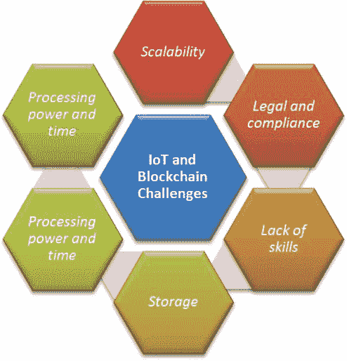

1. **可扩展性：** 持续增长的物联网网络在不久的将来可能会导致中心化问题，并且随着时间的推移，它可能需要管理记录，这将成为这一有前景技术未来的一片阴影。
2. **法律和合规合同问题：** 当前物联网环境中的区块链模型不受合规法规的约束，但由于物联网完全是一个新的生态系统，服务提供商和物联网制造商可能会面临一些严重问题。某些商业威胁无法通过使用区块链技术来避免。
3. **缺乏技能：** 区块链的概念是一个新兴趋势，其实施领域并没有太多专家可用。行业需要聘请团队和熟练的工程师来部署和维护区块链模型。
4. **存储：** 区块链模型排除了用于存储设备 ID’s 和交易的集中式服务器，但有效记录或账本的区块必须仅存储在设备上。账本的后续存储提高了所需的存储空间大小。大多数智能设备（如传感器）没有足够的存储潜力，因此对充足存储空间的担忧随之产生。截至 2016 年底，区块链大小已超过 90 GB。因此，存储是一个重要的缺点。
5. **处理时间和功耗：** 与区块链集成的物联网系统导致了加密算法处理的开销，从而对不同加密算法在期望速度下的时间计算产生压力。

## 5.7 区块链在物联网智能设备中的应用

借助区块链，智能设备的独特历史可以被追踪。分布式账本记录数据交换，区块链使它们能够独立自主地工作。历史记录有助于监控设备的每一个动作。这些智能设备可能是洗衣机、洗碗机和机器人吸尘器。

智能车辆可以为自己保留维护记录。它可以有维护计划、诊断记录以及产生的付款详情。区块链网络将自身抽象化，具有成为独立代理的潜力，并将自身称为“Distributed Autonomous Corporations。”

物联网应用中的一些区块链如下：

1. **在线购物**
区块链实时改善工作流程和货物运输状态。在线购物在仓库端以及客户端管理并处理许多要素。集装箱内的内容、账单、发票、承运商等需要被监控。区块链帮助买方和卖方建立透明度。错误和欺诈减少。产品在运输过程和运输途中花费的时间减少，库存管理得到改善，从而最终降低成本。
2. **区块链在供应链生态系统中**
区块链的不可变框架是一个安全丰富且高度透明的网络，并为参与者提供端到端的可见性。货物通过供应链的进展可以被每个参与者查看。账单和发票可以随时查看。任何记录的修改和删除在没有网络中相关方的一致同意的情况下是不可能的。因此，区块链通过整合运输流程促进了货物的可持续运输，从而提供对商品的受信任访问。
3. **区块链在钻石业务中**
区块链将彻底改变数字资产的未来。区块链通过减少摩擦和增强信任来运行全球业务交易的能力。钻石开采业就是一个例子。
钻石极其珍贵且稀有，面临走私、欺诈、假钻石以及不道德开采石头的威胁。未来区块链将实现更透明的系统。区块链可以配置用于以下流程：
* 每颗钻石的高分辨率照片可以保存在记录中。
* 每一笔付款交易都可以维护实时交易。
* 身份验证证书可以由交易相关方设计并持有。
* 钻石件的序列号、重量、净度和克拉数可以得到维护。

## 5.8 摘要

物联网生态系统需要在关注时间、成本和安全性的同时与网络连接进行协调和协作。在本章中，我们讨论了区块链作为一种模型，为已连接的物联网设备提供安全的数据交换。所有已集成的设备必须遵守区块链模型的处理过程以及网络基础设施和物联网框架。区块链是保护物联网网络中数据完整性的良好机制。随着物联网技术的不断扩展领域，区块链确保智能设备获得自主功能。物联网框架中的区块链模型增强了设备认证和数据验证的安全性，并在所有层面上加密和验证有效交易。这样，如果克服其一些缺点，物联网框架就可以通过区块链得到保护和保障。

## 参考文献
* [\[1\] Di Francesco Maesa, D., Marino, A., & Ricci, L., “揭示比特币区块链：对完整用户图的分析,” 2016 IEEE 国际数据科学与高级分析会议, 蒙特利尔, QC.](#Ch05.xhtml#bck_ref5_1)
* [\[2\] 可访问： http://www.cnbc.com/2016/10/22/ddos-attack-sophisticated-highly-distributed-involved-millions-of-ip-addresses-dyn.html](#Ch05.xhtml#bck_ref5_2)
* [\[3\] 可访问： http://www.cio.com/article/3027522/internet-of-things/beyond-bitcoin-can-the-Blockchain-power-industrial-iot.html](#Ch05.xhtml#bck_ref5_3)
* [\[4\] 可访问： http://digital-library.theiet.org/content/journals/10.1049/et.2016.1003](#Ch05.xhtml#bck_ref5_4)

# 6 基于 AVK 的物联网密码系统和客户端加密视角的隐秘挖掘

**Shaligram Prajapat**

International Institute of Professional Studies, Madhya Pradesh, India Devi Ahilya University, Indore, Madhya Pradesh, India

DOI: 10.1201/9781003338642-6

基于自动可变密钥（AVK）的加密方案声称在物联网设备之间的通信和信息交换中具有节能性。本章介绍了基于对称密钥的加密算法的参数化版本。AVK 的参数化版本强调密钥的生成和仅基于参数的使用。密钥构造的常用方法依赖于数字密钥。在这里，密钥构造过程已扩展用于生成字母数字密钥以及参数域（基于用户个人信息选择）。使用数字或字母系列、递推关系或位置信息是很常见的，这可能会危及系统的安全性。隐秘模型为用户提供了参数选择和参数变化的自由。本章从关联规则挖掘的角度介绍了 AVK 基于对称密码系统的参数化模型的分析视角。来自隐秘关联规则挖掘测试的有用推断和结果支持了审计加密算法的观点，并确定了使用大量参数进行物联网设备之间安全信息交换的能力。

## 6.1 引言

随着物联网（IoT）的蓬勃发展，网络犯罪不仅局限于获取信用卡详细信息及其相关数据库信息，还会渗透到现实生活物品和人体中。物联网已使轮上行驶的计算机（自动驾驶汽车）和飞行计算设备（智能航空设备和飞机）以及扫描仪（MRI）和胰岛素泵成为可能。然而，与独立/连接的固定式计算机相比，很难估计和分析这些仪器的安全性。网络罪犯和黑客有相当大的机会可以从远程位置控制无人驾驶汽车甚至心脏起搏器。通过主动警惕，可以改善此类安全问题。除了物联网的信息安全视角外，基于云的安全问题也是日益增长的担忧。考虑云视角的理由是物联网数据存储在云中并在云中处理，云提供了敏捷性、存储容量、性能和高可用性的好处。提供此服务的第三方需要探索这种海量存储信息的安全存储。保护数据上云并非易事。许多组织保护存储在传统本地数据中心的数据，但对于基于云的物联网信息存储库，由于对云的依赖，存在不同的挑战。

责任水平和需要保护的信息程度是一个巨大的挑战，同时在存储和检索可用替代方案时还存在以下问题：

1.  *资源利用不足：* 当组织仅将非关键数据迁移到云端时，云的潜力被低估，并限制了业务增长。

2.  *将现有解决方案应用于云：* 通过在云基础设施中智能应用加密过程，可以确保数据安全。组织将其当前数据中心安全解决方案应用于云。存储在云上的数据由多个组织共享，并由组织的管理员或员工管理。然而，云基础设施的共享可能会出现多个问题，例如：数据治理、监管和合规问题。这些解决方案侧重于参数安全和访问控制。它们并不能保护数据本身。在云的多租户环境下，数据保护需要对参数和访问控制有根本不同的概念。云数据保护被认为是计划迁移到云的组织面临的最大障碍之一。使用高效的加密技术是保护云中数据的唯一选择，因为您的数据存储在由多台机器共享的机器上。它显著降低了与许多数据治理和监管合规问题相关的风险。

3.  *预防和风险缓解*：组织必须采取必要措施防止信息丢失，并必须做好加强其安全性的准备，以抵御恶意窃取组织机密信息的企图。

4.  *了解正在共享的内容以及谁负责* 云端的信息安全：组织必须对云服务提供商的设施有充分的了解和视野。

除了上述四个保障信息安全的要点外，*用户端服务加密*也是另一种选择。用户端加密是在源头（用户端）对数据进行编码，然后将其发送到云存储提供商的方法。用户的加密密钥对云服务提供商不可用，使得云存储提供商难以或无法在云中解密数据。该方案允许维护零知识系统，其主机无法访问数据，并确保高水平隐私和异常稳健的数据安全策略。它消除了机密数据被包括服务提供商在内的第三方查看，客户端加密确保存储在云中的数据和文件只能在交换的客户端查看。这可以防止数据丢失和私人或个人文件的未经授权披露，为个人和企业用户提供更大的安心感。因此，可以实现信息的保密性、完整性和真实性，以保护物联网数据。最近，许多组织正在提供此功能（信息的保密性、完整性和真实性）。截至 2016 年初，没有任何大型巨头提供客户端加密。

将安全留给客户端或用户端的最大挑战是密钥的误用、选择不当以及密钥或密码的选择。糟糕密钥的典型示例通常是像“1234abcd”或出生日期或“qwerty”或用户选择的类似随机密码，这会危及系统的安全。这基本上导致从公共社交领域可获得的信息中选择密钥，或容易猜测。

## 6.2 The Classical Model of Automatic Variable Key (AVK)

“Perfect Secrecy” is the requirement of a cryptosystem, where after a cryptogram is attacked by an intruder, the posterior probability of this cryptogram is the same as the prior probability of the same messages before the interception [1, 2]。“完美保密”是密码系统的要求，其中在密文被入侵者攻击后，该密文的后验概率与拦截前相同消息的先验概率相同 [1, 2]。它表明完美保密是可以实现的，但条件是如果消息数量是有限的，则应有相同数量的可能密钥，或者如果消息被认为以给定速率不断生成，则密钥必须以相同或更高的速率生成 2–[5]。

Secured transport of information over the network is a pertaining research challenge in today’s context.在当今的背景下，网络上的信息安全传输是一个相关研究挑战。The problem continues to aggregate with an increasing volume of network traffic, which is evident from several research studies [12, 14, 15]。随着网络流量的增加，该问题持续累积，这从多项研究中可见一斑 [12, 14, 15]。Security basically refers to the protection of the data against intentional modification, loss or damage, and fabrication of data and/or deliberate disclosure of data to unauthorized persons or miscreants。安全基本上是指保护数据免受故意修改、丢失或损坏以及数据伪造和/或故意向未经授权的人员或恶意者披露数据。In the classical paper on Information Security, Shannon, the father of Information theory has already established that perfect security can be achieved only when the key is made to vary from session to session and/or data to data [6, 7]。在信息安全经典论文中，信息论之父香农已确立，只有当密钥在会话之间和/或数据之间发生变化时，才能实现完美安全 [6, 7]。

## 6.3 Mechanism of Variation in Key of Automatic Variable Key (AVK) Framework

Realization of the time variable key is difficult to achieve, as a key must be communicated between the sender and the receiver 1, [3] from time-to-time。时间可变密钥的实现难以实现，因为密钥必须在发送方和接收方之间不时通信 1, [3]。The automatic variable key (AVK) for a session between Alice and Bob is to be sent initially as `K[0]`, and they exchange data `D[0]`。Alice 和 Bob 之间会话的自动可变密钥（AVK）最初发送为 `K[0]`，他们交换数据 `D[0]`。The key is now variable, and after every transmission, it changes dynamically such that: with initial key `K[0]` initial secret key, the future keys can be constructed by `K[i] = K[i−1] ⊕ D[i−1]`, ∀`[i−1] > 0`, where `D[i−1]` and `K[i−1]` are data and key of (`i–1`)th session。密钥现在是可变的，并且在每次传输后都会动态变化，使得：以初始密钥 `K[0]` 为初始密钥，未来密钥可以通过 `K[i] = K[i−1] ⊕ D[i−1]` 构造，∀`[i−1] > 0`，其中 `D[i−1]` 和 `K[i−1]` 是第 (`i–1`) 次会话的数据和密钥。

变量 `key` 如果按建议实现，将不会导致模式重复，与正常模式不同。`AVK` 依赖于先前发送的数据。无法保证先前发送的数据不会被窃取。这需要进一步研究以便正确利用时变 `key` \2, [4\]。为了解决这个问题，应该有一些技术来保护先前发送的数据，或者存在一些存储介质可以存储数据的副本。电路将表现为多路复用器，其中控制信号将决定是否需要从数据存储中交换数据 \6–[9\]。

设计一个良好的密码系统不仅需要加密算法和密钥管理协议，还需要必要的测试以在密码模式发现和挖掘下测试设计。

参数化 `Fibo-Q` 模型使用参数 `n` 作为计算 `key` 的输入。稀疏方法使用位置 (`i`, `j`) 作为计算 `keys` 的两个参数。这些方法中使用的 `keys` 为数值型 `keys`。为了将该思想扩展到字母数字 `keys`，可以使用的参数如
`p[1]` = 车牌号码的一部分，`p[2]` = 昵称，以及 `p[3]` = 配偶的出生日期。可能的密钥样本可以是 `mp09t!nku020284`、`mp09b0b020284`、`mp09t!nku020286` 等。以这种方式生成的密钥为 `{P[1]P[2]P[3], P[1]P'[2]P[3], P[1]P[2]P'[3], P'[1]P[2]P'[3…]}`。因此，通过改变参数值，可以生成可变的 `keys`。使用该方法构建的字母数字混合 `key` 需要从黑客的角度进行分析。不同会话中使用的可能参数集中的参数可以通过关联规则找到。参数可以与物联网设备的物理位置相关联，并用于生成其用于安全通信的秘密 `key`。`keys` 也可作为一次性密码用于身份验证。为简化情况，我们将现实世界中的人作为设备对待，个人的相关信息将作为生成秘密 `key` 的参数。物联网网络元素的公开信息可能被偷窥者捕获并用于预测参数以及最终的 `key`。下一节介绍基本关联规则和示例，并针对所提出的参量化 `AVK` 模型分析介绍挖掘和频繁模式发现。

### 6.3.1 用于参数预测的 Apriori 方法

传统上，关联规则 `X → Y` 表示如果 `key`（前件）出现，则参数集（后件）`p[i]`、`p[j]`、…、`p[k]` 也倾向于（高度可能）出现，其中 `X` 和 `Y` 可以是单个参数或参数集（其中同一参数不会同时出现在两个集合中）\[10\]。换句话说，`X` 和 `Y` 在给定的训练集中会经常一起出现，并且它们不显示因果关系 \[11\]。

例如，会话中参数的数目表 6.1 为 16。特定会话的 `key` 由可变数量的参数项 `{p[i], p[j], …, p[k]}` 构成，并表示为 `f(p[i], p[j], …, p[k])`，其中 `p[i]`、`p[j]`、…、`p[k]` 是特定于特定会话的变量。此外，假设有 `n` 个会话的信息可用（表 6.1）。表 6.1 中的每个会话由 `S = {S[i], S[j], …, S[k]}` 表示，具有唯一的 `session-Id` 和函数 `f(.)`，其中一组参数（可能是小子集）构成每个会话 `key`。具有 `m` 个参数的每个会话 `key` 的密钥为 `f(p[i], p[j], …, p[k])`。通常，由于参数数量的差异，会话 `key` 会发生变化。密码分析员记录了为每个会话生成其会话 `key` 所使用的参数。此处密码分析员的目标是从给定的大量会话 `keys` 中找到关联关系，以识别倾向于共同出现的参数。在表 6.1 中，每一行显示在每个会话中使用的参数集。

表 6.1 密钥的会话参数
| 会话编号 || 会话密钥 || 使用的参数 |
| --- | --- | --- |
| `S[1]` || `f(p[1], p[2], p[4], p[6], p[16])` || `p[1]`, `p[2]`, `p[4]`, `p[6]`, `p[16]` |
| `S[2]` || `f(p[1], p[3], p[4], p[6])` || `p[1]`, `p[3]`, `p[4]`, `p[6]` |
| `S[3]` || `f(p[4], p[5], p[7], p[9], p[10])` || `p[4]`, `p[5]`, `p[7]`, `p[9]`, `p[10]` |
| `S[4]` || `f(p[2], p[4], p[6], p[3], p[9])` || `p[2]`, `p[4]`, `p[6]`, `p[3]`, `p[9]` |
| `S[5]` || `f(p[2], p[3], p[5], p[7], p[9])` || `p[2]`, `p[3]`, `p[5]`, `p[7]`, `p[9]` |
| `S[6]` || `f(p[10], p[15])` || `p[10]`, `p[15]` |
| `Sv` || `f(p[1], p[2], p[4], p[6], p[10])` || `p[1]`, `p[2]`, `p[4]`, `p[6]`, `p[10]` |
| `S[8]` || `f(p[8], p[10], p[15])` || `p[8]`, `p[10]`, `p[15]` |
| `S[9]` || `f(p[2], p[3], p[4], p[5], p[6])` || `p[2]`, `p[3]`, `p[4]`, `p[5]`, `p[6]` |
| `S[10]` || `f(p[2], p[3], p[5], p[7], p[9])` || `p[2]`, `p[3]`, `p[5]`, `p[7]`, `p[9]` |
| `S[11]` || `f(p[2], p[4], p[9])` || `p[2]`, `p[4]`, `p[9]` |
| `S[12]` || `f(p[2], p[4], p[6], p[7], p[9])` || `p[2]`, `p[4]`, `p[6]`, `p[7]`, `p[9]` |
| `S[13]` || `f(p[1], p[2], p[3])` || `p[1]`, `p[2]`, `p[3]` |
| `S[14]` || `f(p[3], p[4], p[5], p[7], p[9])` || `p[3]`, `p[4]`, `p[5]`, `p[7]`, `p[9]` |
| `S[15]` || `f(p[5], p[6])` || `p[5]`, `p[6]` |
| `S[16]` || `f(p[7])` || `p[7]` |
| `S[17]` || `f(p[7], p[8], p[9])` || `p[7]`, `p[8]`, `p[9]` |
| `S[18]` || `f(p[1], p[2], p[4]p[6])` || `p[1]`, `p[2]`, `p[4]p[6]` |
| `S[19]` || `f(p[2], p[3], p[5], p[7], p[9])` || `p[2]`, `p[3]`, `p[5]`, `p[7]`, `p[9]` |
| `S[20]` || `f(p[4], p[5], p[7], p[9])` || `p[4]`, `p[5]`, `p[7]`, `p[9]` |
| `S[21]` || `f(p[10], p[15], p[16])` || `p[10]`, `p[15]`, `p[16]` |
| `S[22]` || `f(p[2], p[3], p[4], p[6])` || `p[2]`, `p[3]`, `p[4]`, `p[6]` |
| `S[23]` || `f(p[5], p[7], p[9], p[10], p[11])` || `p[5]`, `p[7]`, `p[9]`, `p[10]`, `p[11]` |
| `S[24]` || `f(p[11], p[12], p[13])` || `p[11]`, `p[12]`, `p[13]` |
| `S[25]` || `f(p[13], p[14], p[15])` || `p[13]`, `p[14]`, `p[15]` |

密码分析员分析表 6.1 中显示的会话 `keys`，以识别会话中频繁使用的参数集。设 `p[6]` 和 `p[9]` 是经常一起使用的两个参数，那么黑客可以通过拥有一个参数信息开始预测，希望通过获得的关联规则找到第二个参数信息。给定大量交易，需要一种过程来发现所有关联规则，以便以有效的方式找到满足所需约束的所有规则。在这些规则中，只有实用或可操作的规则才重要。

### 6.3.2 第一阶段：频繁集的计算

设 `S` 为包含 25 个会话信息的交易日志，即使用来自 16 种可能性参数空间的参数的会话 `keys`，即 `P` = {`p[1]`、`p[2]`、…、`p[16]`}，其中每个会话 `key` 由随机选择某些参数和秘密 `key` 生成算法生成。在 `AVK` 环境中，假设密码分析员或黑客以某种方式记录了在少数会话（例如 25 个）中使用的参数的痕迹，而没有函数的信息，并且密码分析员可能有兴趣找出频繁的参数集或根据关联规则猜测未来参数，这些规则可用于预测未来的会话 `key`。

会话日志中每个参数的频率在以下集合中给出，其中每个集合元素 = {参数，参数频率} 如下所示：

{{`p[1]`:4}, {`p[2]`:13}, {`p[3]`:10}, {`p[4]`:11}, {`p[5]`:9}, {`p[6]`:9}, {`p[7]`:10}, {`p[8]`:2}, {`p[9]`:11}, {`p[10]`:6}, {`p[11]`:2}, {`p[12]`:1}, {`p[13]`:2}, {`p[14]`:1}, {`p[15]`:4}, {`p[16]`:2}}.

假设参数支持（25 个会话中 25% 支持）在至少七个会话中出现，以计算 表 6.2 中的第一个频繁参数集 `L[1]`。

**表 6.2** `L[1]`: 第一个频繁参数集

| 参数 || `p[2]` || `p[3]` || `p[4]` || `p[5]` || `p[6]` || `p[7]` || `p[9]` |
| --- | --- | --- | --- | --- | --- | --- | --- |
| 频率 || 13 || 10 || 11 || 9 || 9 || 10 || 11 |

`C[2]` 的计算：`C[2]` 的两参数集共有 21 个候选 {(`p[2]`, `p[3]`), (`p[2]`, `p[4]`), (`p[2]`, `p[5]`), (`p[2]`, `p[6]`), (`p[2]`, `p[7]`), (`p[2]`, `p[9]`), (`p[3]`, `p[4]`), (`p[3]`, `p[5]`), (`p[3]`, `p[6]`), (`p[3]`, `p[7]`), (`p[3]`, `p[9]`), (`p[4]`, `p[5]`), (`p[4]`, `p[6]`), (`p[4]`, `p[7]`), (`p[4]`, `p[9]`), (`p[5]`, `p[6]`), (`p[5]`, `p[7]`), (`p[5]`, `p[9]`), (`p[6]`, `p[7]`), (`p[6]`, `p[9]`), (`p[7]`, `p[9]`) }。它们的项目频率在 表 6.3 中报告。

**表 6.3** 两频繁候选集 `C[2]`

| 参数集 || 频率 |
| --- | --- |
| (`p[2]`, `p[3]`) || 9 |
| --- | --- |
| (`p[2]`, `p[4]`) || 8 |
| (`p[2]`, `p[5]`) || 4 |
| (`p[2]`, `p[6]`) || 8 |
| (`p[2]`, `p[7]`) || 4 |
| (`p[2]`, `p[9]`) || 6 |
| (`p[3]`, `p[4]`) || 5 |
| (`p[3]`, `p[5]`) || 4 |
| (`p[3]`, `p[6]`) || 5 |
| (`p[3]`, `p[7]`) || 4 |
| (`p[4]`, `p[9]`) || 6 |
| (`p[4]`, `p[5]`) || 4 |
| (`p[4]`, `p[6]`) || 9 |
| (`p[4]`, `p[7]`) || 3 |
| (`p[4]`, `p[9]`) || 4 |
| (`p[5]`, `p[6]`) || 1 |
| (`p[5]`, `p[7]`) || 7 |
| (`p[5]`, `p[9]`) || 7 |
| (`p[6]`, `p[7]`) || 1 |
| (`p[6]`, `p[9]`) || 2 |
| (`p[7]`, `p[9]`) || 9 |

两频繁集和具有相应频率的三参数候选集分别在 表 6.4 和 表 6.5 中给出。三频繁参数在 表 6.6 中显示。

**表 6.4** `L[2]`: 两频繁参数集

| (`p[2]`, `p[3]`) || 9 |
| --- | --- |
| (`p[2]`, `p[4]`) || 8 |
| (`p[2]`, `p[6]`) || 8 |
| (`p[4]`, `p[e]`) || 9 |
| (`p[5]`, `p[7]`) || 7 |
| (`p[5]`, `p[9]`) || 7 |
| (`p[7]`, `p[9]`) || 9 |

**表 6.5** `C[3]` - 三参数集的候选集及频率

| 候选集 - 三参数集 || 频率 |
| --- | --- |
| `p[2]`, `p[3]`, `p[4]` || 4 |
| --- | --- |
| `p[2]`, `p[3]`, `p[e]` || 4 |
| `p[2]`, `p[4]`, `p[6]` || 8 |
| `p[5]`, `p[7]`, `p[9]` || 7 |

**表 6.6** `L[3]` – 三频繁参数集

| 三频繁参数集 || 频率 |
| --- | --- |
| `p2`, `p4`, `p6` || 8 |
| --- | --- |
| `p5`, `p7`, `p9` || 7 |

### 6.3.3 第二阶段：关联规则的计算

三频繁参数集由 `L[2]` 计算得出。从 {`p[2]`, `p[4]`, `p[6]`} 中取一个参数作为前件将得到

{`p[2]`→`p[4]`,`p[6]`;`p[4]`→`p[2]`,`p[6]`;`p[6]`→`p[2]`,`p[4]`}

前件位置为两参数集的规则为

{`p[4]`,`p[6]`→`p[2]`;`p[2]`,`p[6]`→`p[4]`;`p[2]`,`p[4]`→`p[6]`}

以 8 为支持度计算置信度，参数 `p[2]`、`p[4]` 和 `p[6]` 的关联规则在 表 6.7 中给出。

**表 6.7** `p[2]`、`p[4]` 和 `p[6]` 的关联规则

| 规则 || (`p[2]`,`p[4]`,`p[6]`) 的支持度 || 先行频率 || 置信度 (%) |
| --- | --- | --- | --- |
| `p[2]` → `p[4]`, `p[6]` || 8 || 13 || 0.61% |
| --- | --- | --- | --- |
| `p[4]` → `p[2]`, `p[6]` || 8 || 11 || 0.72% |
| `p[6]` → `p[2]`, `p[4]` || 8 || 9 || 0.89% |
| `p[4]`, `p[6]` → `p[2]` || 8 || 9 || 0.89% |
| `p[2]`, `p[6]`, → `p[4]` || 8 || 8 || 1% |
| `p[2]`, `p[4]`, → `p[6]` || 8 || 8 || 1% |

以 7 为支持度计算 `p[5]`、`p[7]` 和 `p[9]` 的置信度，参数的关联规则在 表 6.8 中显示。

**表 6.8** `p[5]`、`p[7]`、`p[9]` 的关联规则

| 规则 || 支持度 || 先行项频率 || 置信度 (%) |
| --- | --- | --- | --- |
| `p[5]` → `p[7]`; `p[9]` || 7.0 || 9 || 0.78% |
| --- | --- | --- | --- |
| `p[7]` → `p[5]`; `p[9]` || 7.0 || 10 || 0.7% |
| `p[9]` → `p[5]`; `p[7]` || 7.0 || 11 || 0.64% |
| `p[7]`; `p[9]` → `p[5]` || 7.0 || 9 || 0.78% |
| `p[5]`; `p[9]` → `p[7]` || 7.0 || 7 || 1% |
| `p[5]`; `p[7]` → `p[9]` || 7.0 || 7 || 1% |

置信度 = 70% 时，密码分析员或黑客可能推断出全部七条规则（除第 3 条规则外）。生成的规则是：`p[4]`→`p[2]`, `p[4]`→`p[6]`, `p[6]`→`p[2]`, `p[6]`→`p[4]`, `p[4]`, `p[6]`→`p[2]`, `p[2]`, `p[6]`→`p[4]`, `p[2]`, `p[2]`, `p[4]`→`p[6]`, `p[5]`→`p[7]`, `p[5]`→`p[9]`, `p[7]`→`p[5]`, `p[7]`→`p[9]`, `p[7]`, `p[9]`→`p[5]`, `p[5]`, `p[9]`→`p[7]`, `p[5]`, `p[7]` `p[9]`, `p[2]`→`p[3]`, 和 `p[3]`→`p[2]` （注意规则已被分解，如 `p[4]`→`p[2]`, `p[6]` 被两条规则 `p[4]`→`p[2]` 和 `p[4]`→`p[6]` 分解）。

## 6.4 参数化密码系统的实验分析

对于扩展的参数化 AVK 模型（通过改变参数使密钥变化），密码系统设计者的目标是使黑客对所选参数或密钥做出有根据的猜测尽可能困难。因此，别无选择，只能进行暴力搜索，尝试每一种可能的字母、数字和标点符号组合。即使在每秒可尝试一百万个密钥的机器上进行此类搜索（大多数机器每秒尝试的密钥少于 100 个），平均也需要超过 100 年才能完成。该方法的简便性也是必不可少的，只有当参数取自用户附近时才有可能。以此为目标，并利用前文中的信息，后续章节讨论了用于密钥形成的模式的调查。在进入下一节之前，最好重新考虑 AVK 模型的特征。

### 6.4.1 自动可变密钥的特征

1. 以最佳大小固定密钥，并在会话之间更改密钥。在参数化 AVK 版本中，可通过改变参数来实现。

2. 可通过在公共网络上仅共享参数而不是交换密钥来实现额外的安全级别。

3. 通过改变参数生成会话密钥（AVK）。新密钥被视为在前一个密钥中改变某些参数。

`K[0]`←`Initial Key`

`K[i+1]`←`K[i]`⊙{`p[i]`, `p[j]`, `p[k]` …}

其中 ⊙ 表示对密钥 `K[i]` 的某些参数 `p[i]`、`p[j]`、`p[k]` 进行连接或操作以构造 `K[i+1]`

在 Fibo-Q 方法中，密钥随参数 = `n` 变化，同时计算 `f(n)`、`f(n-1)` 和 `f(n + 1)`。如果 `n` < 35，则使用 1 到 `n` 之间的任意数量的参数用于下一个密钥。否则由发送方和接收方相互协商选择随机 `n`。在 Sparse 方法中，密钥随位置参数 `p[ij]` = 位置 (`i`, `j`) 变化（该方法适用于移动设备，其中下一个位置坐标将产生下一个密钥）。

一般而言，对于密码系统 `S`，如果参数来自域集

`p` = {`p[1]`, `p[2]`, …,`p[n]`} 并通过选择参数数量在最小 3 到最大 7 之间可以构造并在通信方之间共享密钥。由于参数在公共网络上交换并且可能被发现或记录在日志中，参数化模型的安全性可以用挖掘技术进行测试。为了使用挖掘技术测试参数化模型，以下信息已从公共领域（例如大学的一个系）收集。响应的总体观点已被突出显示，作为对参数化模型的密码系统设计者的建议。

1. 系统即使参数公开也能抵御关联规则挖掘。
2. 该模型生成巨大的频繁集合，很难确定会话的未来参数。
3. 密钥构造策略可能有助于使用便捷的方法为 `AVK` 建议未来密钥/参数。

### 6.4.2 关联规则分析的实验设置
在数据收集步骤中，在线调查问题旨在测试参数使用情况并分析变化参数的行为。以下 23 个问题旨在了解用户常用的潜在参数（\* 表示必填项）：
1. 你是否在表单中使用你的名字或姓氏（昵称）？\*
2. 你是否使用你的出生日期、纪念日等？\*
3. 你是否以任何形式使用你的登录名（原样、反转、大写、重复等）？\*
4. 你是否使用配偶或子女的名字？\*
5. 你是否使用关于你的容易获得的其他信息，例如车牌号码和房屋号码？\*
6. 你是否使用 PAN 号码、Aadhar 号码、社会保障号码、护照号码等？\*
7. 你是否使用电话号码？\*
8. 你是否使用汽车品牌和车辆号码？\*
9. 你是否使用仅由数字或仅由字母组成的密码？\*
10. 你是否使用语言词典、拼写列表或其他单词列表中的单词？\*
11. 你是否使用少于六个字符的密码？\*
12. 你是否使用混合大小写字母的密码？\*
13. 你是否使用没有字母字符的密码，例如数字或标点符号？\*
14. 你是否使用易于记忆的密码，因此无需写下来？\*
15. 你是否使用可以快速输入而无需看键盘的密码？这使得他人通过观察你的肩膀偷窃密码更困难？\*
16. 你是否使用女友/男友/配偶的出生日期？\*
17. 你是否在密码中使用你最喜欢的领导者/演员/电影/游戏的名字？\*
18. 你是否使用车站代码/国家代码/区域代码？\*
19. 你是否使用你的机构名称/办公室名称（某种形式）？\*
20. 你是否使用歌曲/书籍或诗歌中一行每词的首字母？\*
21. 你是否使用你的住宅地址、城市名称、州名称、国家名称等？\*
22. 你是否使用不同机构提供的身份证号，例如学号、订阅号或考试 ID？\*
23. 你是否使用任何其他类型的个人信息来构造密码/密钥的字段/参数？

这些问题的回答可作为预测参数的信息日志。在实际参数中，我们已在五点李克特量表上收到作为密钥生成可能参数的回答。对于样本量 `N` = 100，回答的格式为：（我从不使用）1 2 3 4 5（我总是使用）

参数集用下标表示法表示为 `P = {p[1], p[2], …, p[22]}`

普通用户用于在公共网络上通过参数化通信进行密钥构造的参数 `p[1]–p[22]` 包括以下内容：

| `P[1]` || \= || 名字/姓氏/昵称/别名 |
| --- | --- | --- |
| `P[2]` || \= || 出生日期/纪念日 |
| `P[3]` || \= || 公共名称的任何形式（原样、反转、大写、重复等） |
| `P[4]` || \= || 是否使用配偶或子女的名字？ |
| `P[5]` || \= || 关于你的容易获得的信息（车牌号码、房屋号码） |
| `P[6]` || \= || PAN 号码/Aadhar 号码/社会保障号码/护照号码 |
| `P[7]` || \= || 电话号码/手机号码 |
| `P[8]` || \= || 汽车和车辆号码 |
| `P[9]` || \= || 全数字密码/全部相同字母 |
| `P[10]` || \= || 英语或外语词典/拼写列表/其他单词列表中包含的单词 |
| `P[11]` || \= || 少于六个字符的密码 |
| `P[12]` || \= || 混合大小写字母的密码 |
| `P[13]` || \= || 无字母字符，例如数字或标点符号 |
| `P[14]` || \= || 易于记忆的密钥，因此无需写下来 |
| `P[15]` || \= || 可以快速输入的密钥，无需查看键盘（使他人通过观察肩膀偷窃密码更困难） |
| `P[16]` || \= || 女友/男友/配偶的出生日期 |
| `P[17]` || \= || 车站代码/国家代码/区域代码 |
| `P[18]` || \= || 当前机构名称/办公室名称（某种形式） |
| `P[19]` || \= || 使用歌曲/书籍或诗歌中一行每词的首字母 |
| `P[20]` || ^(\=) || 住宅地址/城市名称/州名称/国家名称的一部分 |
| `P[21]` || \= || 不同机构/组织提供的身份证号，如学号、订阅号和考试 ID |
| `P[22]` || \= || 用于构造密码/密钥字段/参数的非个人信息 |

收到的回答通过 Google 表单收集，该表单在专业网络（LinkedIn）、社交网络（Facebook 和 Google plus）以及 DAVV 校友的 Google 群组中共享，以获取真实趋势。从黑客的角度来看参数化 `AVK` 模型的基线可用于找出哪些参数有利于密钥构造。其中哪些最突出或最频繁？这些参数之间是否存在关联？但是，对于大量配对，确定相关性将成本高昂。找到相关性将很容易如果参数数量较少。我们使用 `SPSS` 工具分析调查结果，因为它提供将参数集分组为因子，并允许找出有利于密钥构造的参数。在 表 6.9 中显示的结果呈现了参数集选择概率。该工具还提供这些参数之间的相关性，但在参数较多的情况下，关联规则生成所需的推理工作更少。因此，在参数集数量较大的情况下，挖掘算法是合适的。在这些 22 个参数的大量回答中进行挖掘，已识别出有利于密钥构造的参数组及其频繁参数的相应概率，如表 6.9 所述。

表 6.9 具有概率的相关参数频繁集合组

| 使用的频繁参数 || 选择已进行的次数百分比 || 选择/偏好 |
| --- | --- | --- |
| `P[6]`, `P[7]`, `P[8]` || 19.76% || 第一 |
| --- | --- | --- |
| `P[19]`, `P[20]` || 13.90% || 第二 |
| `P[4]`, `P[15]`, `P[18]` || 10.68% || 第三 |
| `P[10]`, `P[11]`, `P[13]` || 09.21% || 第四 |
| `P[9]`, `P[17]` || 07.87% || 第五 |

### 6.4.3 参数化 AVK 模型生成的频繁模式
传统的 `Apriori` 算法应用于具有可变数量参数的响应数据。为了分析响应，`Apriori` 算法应用于响应数据，使用制表符分隔的文本文件格式作为输入文件。同一文件还存储最终结果。该算法可用于两种方式：首先，通过用户定义的支持阈值修剪候选参数集来找到频繁参数集。之后用于规则生成，最小支持度和置信度在范围（1–100%）内变化。关于可变支持，频繁参数数量的变化、生成关联规则所消耗的时间（以秒为单位）以及相应的文件大小已如 表 6.10 所示被捕获。

表 6.10 不同支持值下生成的频繁集合

| 序号 || 支持度 || 频繁项数量 || 所用时间 || 文件大小 |
| --- | --- | --- | --- | --- |
| 1 || 1% || 6,316,071 || 3.13 s || 303 MB |
| --- | --- | --- | --- | --- |
| 2 || 2% || 2,725,378 || 1.26 s || 123 MB |
| 3 || 3% || 675,419 || 0.35 s || 28 MB |

| 4 | 4% | 70,988 | 0.04 s | 2.31MB |
| 5 | 5% | 18,558 | 0.01s | 555 KB |
| 6 | 6% | 7080 | <0.01 s | 192 KB |
| 7 | 7% | 3405 | <0.01 s | 45 KB |
| 8 | 8% | 1891 | <0.01 s | 27 KB |
| 9 | 9% | 1178 | <0.01 s | 18 KB |
| 10 | 10% | 793 | <0.01 s | 12 KB |
| 11 | 11% | 530 | <0.01 s | 9 KB |
| 12 | 12% | 405 | <0.01 s | 7 KB |
| 13 | 13% | 323 | <0.01 s | 6 KB |
| 14 | 14% | 263 | <0.01 s | 5 KB |
| 15 | 15% | 227 | <0.01 s | 2KB |
| 16 | 20% | 98 | <0.01 s | 649 Bytes |
| 17 | 30% | 35 | <0.01 s | 337 Bytes |
| 18 | 40% | 18 | <0.01 s | 241 Bytes |
| 19 | 50% | 13 | <0.01 s | 116 Bytes |
| 20 | 60% | 07 | <0.01 s | 64 Bytes |
| 21 | 70% | 04 | <0.01 s | 15 Bytes |
| 22 | 80% | 01 | <0.01 s | 15 Bytes |
| 23 | 90% | 01 | <0.01 s | 15 Bytes |
| 24 | 100% | No frequent item | <0.01 s | 0 Bytes |

## 6.5 参数模型密码挖掘结果分析

对观察结果（表 6.9）的分析可以得出以下推断：22 个参数和 100 个调查响应的频繁模式基数数量过大。对于支持度低于 5% 的情况，频繁模式范围从 70,000 到 63,00,000，这表明少数人选择的频繁参数组合组合过大。

1. 实际上，不同的人以相同方式选择参数的可能性确实非常低。
2. 结果还显示，随着支持度百分比的增加，频繁模式急剧减少。
3. 从较高支持度获得的频繁模式数量很少，可以轻松分析，但同时观察到频繁模式本质上是显而易见的，其大小（项集大小）也很小。因此，通用参数不需要分析。例如，在我们的案例中，参数 12（密钥混合大小写选择）非常自然。
4. 根据所获得的结果（参见表 6.10 中的频繁模式）可以得出另一个结论：支持度较高的频繁模式没有用处，因为很多人以相同方式思考密钥参数选择的几率很小。但少数人可能会以相同方式思考，为此我们需要降低支持度百分比，然后模式会以不同大小呈指数增长，这使得手动分析变得不可能，并且系统很难破解它。

上述频繁参数生成的关联规则，以及表 6.11 显示了分析后发现的一些规则。

### 表 6.11 不同支持度和置信度的关联规则

| 序号 | 支持度 (%) | 置信度 (%) | 时间 (s) | 文件大小 | 规则数量 |
| --- | --- | --- | --- | --- | --- |
| 1 | 1 | 80 | 108.27 | 3.5 GB | 62,151,312 |
| 2 | 1 | 90 | 70.94 | 3.5 GB | 62,050,814 |
| 3 | 1 | 100 | 71.91 | 3.5 GB | 62,050,212 |
| 4 | 2 | 80 | 27.21 | 1.37 GB | 25,389,899 |
| 5 | 2 | 90 | 29.34 | 1.36 GB | 25,289,401 |
| 6 | 2 | 100 | 28.41 | 1.36 GB | 25,288,799 |
| 7 | 3 | 80 | 5.67 | 288 MB | 5,619,616 |
| 8 | 3 | 90 | 5.63 | 284 MB | 5,519,118 |
| 9 | 3 | 100 | 5.62 | 284 MB | 5,518,516 |
| 10 | 4 | 80 | 0.46 | 170.4 MB | 407,512 |
| 11 | 4 | 90 | 0.30 | 13.3 MB | 307,014 |
| 12 | 4 | 100 | 0.30 | 13.3 MB | 306,412 |
| 13 | 5 | 80 | 0.15 | 5.92 MB | 145,504 |
| 14 | 5 | 90 | 0.09 | 1.82 MB | 45,006 |
| 15 | 5 | 100 | 0.06 | 1.80 MB | 44,404 |
| 16 | 10 | 80 | 0.02 | 67.4 KB | 1995 |
| 17 | 10 | 90 | 0.02 | 24.5 KB | 734 |
| 18 | 10 | 100 | <0.01 s | 4.24 KB | 132 |
| 19 | 20 | 80 | <0.01 s | 3.79 KB | 118 |
| 20 | 20 | 90 | <0.01 s | 1.10 KB | 35 |
| 21 | 20 | 100 | <0.01 s | 0 KB | NIL |
| 22 | 30 | 80 | <0.01 s | 1.24 KB | 39 |
| 23 | 30 | 90 | <0.01 s | 445 Bytes | 14 |
| 24 | 30 | 100 | <0.01 s | NIL | NIL |
| 25 | 40 | 80 | <0.01 s | 477 Bytes | 15 |
| 26 | 40 | 90 | <0.01 s | 285 Bytes | 9 |
| 27 | 50 | 80 | <0.01 s | 346 Bytes | 11 |
| 28 | 50 | 90 | <0.01 s | 216 Bytes | 07 |
| 29 | 60 | 80 | <0.01 s | 208 Bytes | 07 |
| 30 | 60 | 90 | <0.01 s | 112 Bytes | 04 |
| 31 | 70 | 80 | <0.01 s | 81 Bytes | 03 |
| 32 | 70 | 90 | <0.01 s | 81 Bytes | 03 |
| 33 | 80 | 80 | <0.01 s | 24 Bytes | 01 |
| 34 | 80 | 90 | <0.01 s | 24 Bytes | 01 |
| 35 | 90 | 80 | <0.01 s | 24 Bytes | 01 |
| 36 | 90 | 90 | <0.01 s | 24 Bytes | 01 |

类别-A 中讨论的实验结果将分析在支持度固定为 80% 时改变五个参数的文件大小的影响（随后为 10、20、15、20 和 22 个参数），随后支持度更改为 90% 和 100%。详细观察结果显示在表 6.12 和图 6.1 中。

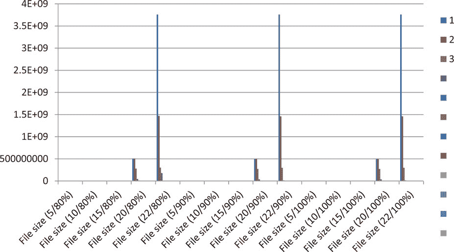

### 图 6.1 参数变化（从 5、10、15、20 和 22）与可变支持度（置信度为 80%、90% 和 100%）的比较图以及相应的 ARM 文件大小。

### 表 6.12 参数大小变化（从 5、10、15、20 和 22）与可变支持度（置信度为 80%、90% 和 100%）以及相应的 ARM 文件大小的影响 [类别-A]

| **支持度(%)** | 1 | 2 | 3 | 4 | 5 | 10 | 20 | 30 | 40 | 50 | 60 | 70 | 80 | 90 | 100 |
| --- | --- | --- | --- | --- | --- | --- | --- | --- | --- | --- | --- | --- | --- | --- | --- |
| **文件大小(5/80%)** | 440 | 441 | 442 | 443 | 444 | 445 | 446 | 447 | 448 | 449 | 450 | 451 | 452 | 453 | 454 |
| **文件大小(10/80%)** | 100,966.4 | 100,966.4 | 75,264 | 41,369.6 | 28,876.8 | 2385.92 | 329 | 120 | 44 | 19 | 19 | 19 | 19 | 19 | 19 |
| **文件大小(15/80%)** | 8,514,437 | 8,514,437 | 6,375,342 | 2,904,556 | 1,226,834 | 52,633.6 | 6410.24 | 1832.96 | 577 | 460 | 326 | 297 | 95 | 95 | 69 |
| **文件大小(20/80%)** | 5.04E + 08 | 5.04E + 08 | 2.79E + 08 | 44,774,195 | 10,695,475 | 158,875 | 11,366.4 | 3225.6 | 1392.64 | 1126.4 | 648 | 297 | 95 | 95 | 69 |
| **文件大小(22/80%)** | 3.76E + 09 | 1.47E + 09 | 3.02E + 08 | 1.79E + 08 | 6,207,570 | 69,017.6 | 3880.96 | 1269.76 | 477 | 346 | 208 | 81 | 24 | 24 | 0 |
| **文件大小(5/90%)** | 440 | 440 | 407 | 407 | 347 | 257 | 173 | 69 | 44 | 19 | 19 | 19 | 19 | 19 | 19 |
| **文件大小(10/90%)** | 83,968 | 83,968 | 58,368 | 24,473.6 | 11,878.4 | 1679.36 | 329 | 120 | 44 | 19 | 19 | 19 | 19 | 19 | 19 |
| **文件大小(15/90%)** | 7,790,920 | 7,790,920 | 5,651,825 | 2,181,038 | 512,000 | 28,160 | 3543.04 | 1054.72 | 577 | 460 | 326 | 297 | 95 | 95 | 69 |
| **文件大小(20/90%)** | 4.97E + 08 | 4.97E + 08 | 2.72E + 08 | 37,748,736 | 3,649,044 | 78,131.2 | 5744.64 | 1832.96 | 1116.16 | 855 | 447 | 297 | 95 | 95 | 69 |
| **文件大小(22/90%)** | 3.76E + 09 | 1.46E + 09 | 2.98E + 08 | 13,946,061 | 1,908,408 | 25,088 | 1126.4 | 445 | 285 | 216 | 112 | 81 | 24 | 24 | 0 |
| **文件大小(5/100%)** | 440 | 440 | 407 | 407 | 347 | 257 | 173 | 69 | 44 | 19 | 19 | 19 | 19 | 19 | 19 |
| **文件大小 (10/100%)** | 83,660.8 | 93,900.8 | 58,060.8 | 24,166.4 | 11,571.2 | 1382.4 | 329 | 69 | 44 | 19 | 19 | 19 | 19 | 19 | 19 |
| **文件大小(15/100%)** | 7,769,948 | 7,769,948 | 8,787,067 | 2,170,552 | 498,688 | 14,540.8 | 1914.88 | 616 | 272 | 219 | 156 | 127 | 45 | 45 | 19 |

# 实验结果

## 类别 B

| `File size(20/100%)` || 4.97E + 08 || 4.97E + 08 || 2.72E + 08 || 37,748,736 || 3,607,101 || 35,737.6 || 2949.12 || 965 || 528 || 403 || 212 || 127 || 95 || 45 || 19 |

| `File size(22/100%)` || 3.76E + 09 || 1.46E + 09 || 2.98E + 08 || 13,946,061 || 1,887,437 || 4341.76 || 0 || 0 || 0 || 0 || 0 || 0 || 0 || 0 || 0 |

类别 B 中讨论的实验结果将针对可变支持值进行分析，分析其对改变关联规则挖掘 (`ARM`) 文件大小的影响，五参数固定支持率为 80%（随后为 10、20、15、20 和 22 参数）；随后支持率更改为 90% 和 100%。详细观察结果显示在 表 6.13 和 图 6.2 中。

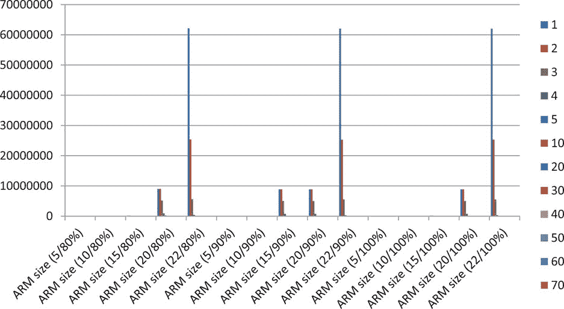

`Figure 6.2` 参数大小变化（从 5、10、15、20 和 22）的影响，支持率可变（置信度为 80%、90% 和 100%）以及对应的关联规则数量。

`Table 6.13` 参数大小变化（从 5、10、15、20 和 22）的影响，支持率可变（置信度为 80%、90% 和 100%）以及对应的关联规则数量 **\[类别-B\]**

| `Support (%)` || 1 || 2 || 3 || 4 || 5 || 10 || 20 || 30 || 40 || 50 || 60 || 70 || 80 || 90 || 100 |

| --- | --- | --- | --- | --- | --- | --- | --- | --- | --- | --- | --- | --- | --- | --- | --- |

| `ARM size(5/80%)` || 16 || 16 || 15 || 15 || 13 || 10 || 7 || 3 || 2 || 1 || 1 || 1 || 1 || 1 || 1 |

| --- | --- | --- | --- | --- | --- | --- | --- | --- | --- | --- | --- | --- | --- | --- | --- |

| `ARM size(10/80%)` || 2730 || 2730 || 2083 || 1185 || 827 || 81 || 13 || 5 || 2 || 1 || 1 || 1 || 1 || 1 || 1 |

| `ARM size(15/80%)` || 184,228 || 184,228 || 140,996 || 67,472 || 29,995 || 1479 || 201 || 60 || 20 || 16 || 12 || 11 || 4 || 4 || 3 |

| `ARM size(20/80%)` || 9,023,784 || 9,023,784 || 5,173,132 || 934,992 || 243,482 || 4326 || 349 || 101 || 44 || 36 || 22 || 11 || 4 || 4 || 3 |

| `ARM size(22/80%)` || 62,151,312 || 25,389,899 || 5,619,616 || 407,512 || 145,504 || 1995 || 118 || 39 || 15 || 11 || 7 || 3 || 1 || 1 || 0 |

| `ARM size(5/90%)` || 16 || 16 || 15 || 15 || 13 || 10 || 7 || 3 || 2 || 1 || 1 || 1 || 1 || 1 || 1 |

| `ARM size (10/90%)` || 2262 || 2262 || 1615 || 717 || 359 || 59 || 13 || 5 || 2 || 1 || 1 || 1 || 1 || 1 || 1 |

| `ARM size(15/90%)` || 8,864,766 || 8,864,766 || 5,014,114 || 775,884 || 84,464 || 2176 || 181 || 59 || 36 || 28 || 16 || 11 || 4 || 4 || 3 |

| `ARM size(20/90%)` || 8,864,766 || 8,864,766 || 5,014,114 || 775,884 || 84,464 || 2176 || 181 || 59 || 36 || 28 || 16 || 11 || 4 || 4 || 3 |

| `ARM size(22/90%)` || 62,050,814 || 25,289,401 || 5,519,118 || 307,014 || 45,006 || 734 || 35 || 14 || 9 || 7 || 4 || 3 || 1 || 1 || 0 |

| `ARM size(5/100%)` || 16 || 16 || 15 || 15 || 13 || 10 || 7 || 3 || 2 || 1 || 1 || 1 || 1 || 1 || 1 |

| `ARM size (10/100%)` || 2252 || 2252 || 1605 || 707 || 349 || 49 || 13 || 5 || 2 || 1 || 1 || 1 || 1 || 1 || 1 |

| `ARM size (15/100%)` || 166,558 || 166,558 || 123,326 || 49,802 || 12,325 || 439 || 65 || 22 || 10 || 8 || 6 || 5 || 2 || 2 || 1 |

| `ARM size(20/100%)` || 8,863,626 || 8,863,626 || 5,012,974 || 774,744 || 83,324 || 1036 || 97 || 33 || 18 || 14 || 8 || 5 || 2 || 2 || 1 |

| `ARM size(22/100%)` || 62,050,212 || 25,288,799 || 5,518,516 || 306,412 || 44,404 || 132 || 0 || 0 || 0 || 0 || 0 || 0 || 0 || 0 || 0 || 0 |

## 类别 C

类别 C 中讨论的实验结果将针对可变支持值所需时间进行分析，分析其对改变关联规则挖掘 (`ARM`) 文件大小的五参数时间影响，支持率固定为 80%（随后为 10、20、15、20 和 22 参数）；随后支持率更改为 90% 和 100%。详细观察结果显示在 表 6.14 和 图 6.3 中。

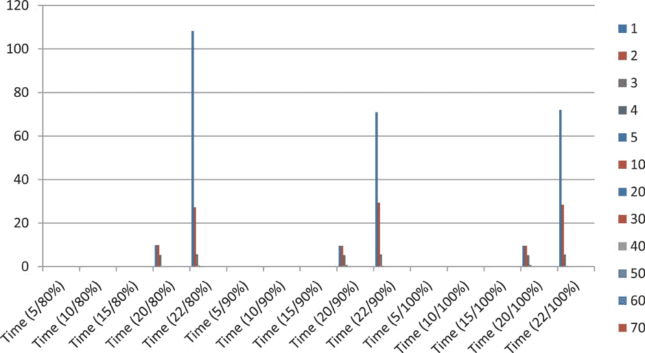

`Figure 6.3` 支持度和置信度变化以及关联规则生成时间（参数 22 个）。

`Table 6.14` 支持度和置信度变化以及关联规则生成时间（参数 22 个） **\[类别 C\]**

| `Support(%)` || 1 || 2 || 3 || 4 || 5 || 10 || 20 || 30 || 40 || 50 || 60 || 70 || 80 || 90 || 100 |

| --- | --- | --- | --- | --- | --- | --- | --- | --- | --- | --- | --- | --- | --- | --- | --- |

| `Time(5/80%)` || 0.12 || 0.02 || 0.05 || 0.05 || 0.05 || 0.01 || 0.05 || 0.05 || 0.05 || 0.05 || 0.05 || 0.05 || 0.05 || 0.05 || 0.05 |

| --- | --- | --- | --- | --- | --- | --- | --- | --- | --- | --- | --- | --- | --- | --- | --- |

| `Time(10/80%)` || 0.04 || 0.04 || 0.04 || 0.04 || 0 || 0 || 0 || 0 || 0 || 0 || 0 || 0 || 0 || 0 || 0 |

| `Time(15/80%)` || 0.17 || 0.19 || 0.13 || 0.06 || 0.03 || 0.05 || 0.04 || 0 || 0.06 || 0.04 || 0 || 0 || 0 || 0 || 0 |

| `Time(20/80%)` || 9.83 || 9.88 || 5.36 || 0.12 || 0.25 || 0.01 || 0 || 0 || 0 || 0 || 0 || 0 || 0 || 0 || 0 |

| `Time(22/80%)` || 108.27 || 27.21 || 5.67 || 0.46 || 0.15 || 0.02 || 0.01 || 0.01 || 0.01 || 0.01 || 0.01 || 0.01 || 0.01 || 0.01 || 0 |

| `Time(5/90%)` || 0.02 || 0.02 || 0.05 || 0.05 || 0.05 || 0.01 || 0.05 || 0.05 || 0.05 || 0.05 || 0.05 || 0.05 || 0.05 || 0.05 || 0.05 |

| `Time (10/90%)` || 0.04 || 0.04 || 0.04 || 0.04 || 0 || 0 || 0 || 0 || 0 || 0 || 0 || 0 || 0 || 0 || 0 |

| `Time(15/90%)` || 0.16 || 0.16 || 0.12 || 0.05 || 0.02 || 0.06 || 0.04 || 0 || 0.06 || 0.04 || 0 || 0 || 0 || 0 || 0 |

| `Time(20/90%)` || 9.61 || 9.51 || 5.26 || 0.77 || 0.08 || 0 || 0 || 0 || 0 || 0 || 0 || 0 || 0 || 0 || 0 |

| `Time(22/90%)` || 70.94 || 29.34 || 5.63 || 0.3 || 0.09 || 0.02 || 0.01 || 0.01 || 0.01 || 0.01 || 0.01 || 0.01 || 0.01 || 0.01 || 0 |

| `Time(5/100%)` || 0.02 || 0.02 || 0.05 || 0.05 || 0.05 || 0.04 || 0.05 || 0.05 || 0.05 || 0.05 || 0.05 || 0.05 || 0.05 || 0.05 || 0.05 |

| `Time (10/100%)` || 0.04 || 0.04 || 0.04 || 0.04 || 0 || 0 || 0 || 0 || 0 || 0 || 0 || 0 || 0 || 0 || 0 |

| `Time (15/100%)` || 0.16 || 0.16 || 0.19 || 0.05 || 0.01 || 0 || 0 || 0 || 0 || 0 || 0 || 0 || 0 || 0 || 0 |

| `Time(20/100%)` || 9.59 || 9.55 || 5.23 || 0.78 || 0.1 || 0 || 0 || 0 || 0 || 0 || 0 || 0 || 0 || 0 || 0 |

| `Time(22/100%)` || 71.91 || 28.41 || 5.62 || 0.3 || 0.06 || 0.01 || 0 || 0 || 0 || 0 || 0 || 0 || 0 || 0 || 0 |

基于各种参数的关联规则，支持度为（10%、20%、30%… 100%）和置信度（80%、90% 和 100%），其中一些进行了详细讨论。

1. 支持度 90%，置信度 90% 规则数量 = 1（仅参数 `P[12]`）
2. 支持度 90%，置信度 80% 规则数量 = 1（仅参数 `P[12]`）
3. 支持度 80%，置信度 90% 规则数量 = 1（仅参数 `P[12]`）
4. 支持度 80%，置信度 80% 规则数量 = 1（仅参数 `P[12]`）
5. 支持度 70%，置信度 90% 规则数量 = 3（规则 1 参数 `P[12]`，规则 2 `P[12]` 与 `P[14]` 关联，规则 3 参数 `P[12]` 与 `P[13]` 关联）
6. 支持度 70%，置信度 80% 规则数量 = 3（规则 1 参数 `P[12]`，规则 2 `P[12]` 与 `P[14]` 关联，规则 3 参数 `P[12]` 与 `p13` 关联）
7. 支持度 60%，置信度 90% 规则数量 = 4（`P[12]`，`P[12]` ← `P[15]`，`P[12]` ← `P[14]`，`P[12]` ← `P[13]`）
8. 支持度 60%，置信度 80% 规则数量 = 7（`P[12]`，`P[14]` ← `P[15]`，`P[13]` ← `P[15]`，`P[12]` ← `P[15]`，`P[12]` ← `P[14]`，`P[12]` ← `P[13]`，`P[14]` ← `P[15]` `P[12]`）
9. 支持度 50%，置信度 90% 规则数量 = 7（`P[12]`，`P[12]` ← `P[15]`，`P[12]` ← `P[14]`，`P[12]` ← `P[13]`，`P[12]` ← `P[15]` `P[14]`，`P[12]` ← `P[15]` `P[13]`，`P[12]` ← `P[14]` `P[13]`）

10. 支持 50%，置信度 80% 规则数量 = 7(`P[12]`, `P[12]` ← `P[15]`, `P[12]` ← `P[14]`, `P[12]` ← `P[13]`, `P[12]` ← `P[15]` `P[14]`, `P[12]` ← `P[15]` `P[13]`, `P[12]` ← `P[14]` `P[13]`)

### 6.5.1 关联规则挖掘 (ARM) 的观察

1. 这些规则显示了选择参数组合的可能性及其相关性。
2. 对于支持度小于 10% 且置信度为 80% 及以上的情況，规则数量众多且项集基数过大。这表明少数人选择相似密钥参数的可能性，以及组合太多而无法评估。
3. 当支持度大于 10% 且小于 40%，置信度为 80% 及以上时，规则数量合理但需要严格努力进行评估。然而其实用性值得怀疑，因为由于支持度高，许多参数被排除在考虑之外。
4. 当支持度大于 40%，置信度大于或等于 80% 时，虽然规则很少且参数有限，易于评估，但同时找到自然规则的机会很高。

为密码分析员配备先进工具以识别弱点并进一步改进密码系统始终是需求。在多项式时间内，密码分析员有兴趣从庞大的密文语料库中提取有用的猜测以检测原始信息。密码分析员可能已捕获包含各种密文和哈希文件的庞大数据库和语料库。当密文被插入此数据集时，它可能与由各种其他方案生成的其他密文混合在一起，包括密钥大小、协议、密文生成算法类型、与密钥空间相关的信息暴露程度，以及与明文、密文及其之间关系相关的大量其他信息。密码分析员可能会开发一种机制，根据密文类型进行分类、排序和分组。

## 6.6 结论

任何物联网应用的成功都依赖于相关信息及其测试框架的安全性。为了设计更安全、抗攻击的物联网信息系统，需要更具体的密码学方法。此外，数据检索和处理是整个基于物联网的信息系统的组成部分，需要通过高级加密进行保护。更先进的具有严格密钥的无线协议可用于物联网安全部署。其中一种方法基于 `AVK` 的使用，本章对其进行了详细分析，并探讨了支持度和置信度的变化。尽管即使使用最佳加密方案，物联网系统的设备或网络仍可能容易受到攻击。如果无法建立与物联网设备通信的数据的真实性，安全性肯定会受到损害。为了解决这个问题，`AVK` 方案可能对构建有用。所提出的模型已使用多个参数、频繁集数量以及要生成的关联规则数量进行了测试和分析。所提出的基于 `AVK` 的参数模型用户友好，但从密码挖掘角度来看更难。

## 参考文献

* [\[1\] Chakrabarti P., Bhuyan B., Chowdhuri A., and Bhunia C., 一种实现最优数据传输和密码学中自动可变密钥（AVK）的新方法。 IJCSNS. 8, 241, 2008.](#Ch06.xhtml#bck_ref6_1)
* [\[2\] Chakrabarti, P., Bhuyan, B., Chowdhuri, A., and Bhunia, C. T., “在 RSA 中应用自动可变密钥（AVK）,” in Int’l J HIT Transactions on ECCN, 2, 304–311, 2007.](#Ch06.xhtml#bck_ref6_2)
* [\[3\] Chakrabarti, P., Mondal, G. H., Bhunia, C. T., and Chowdhuri, A., 用于选择性加密（DES、RSA 和 AES）的 AVK 各种新方法和改进方法及其比较研究。 Int. J. Trans. ECCN, 1(4), 236–244, 2008.](#Ch06.xhtml#bck_ref6_3)
* [\[4\] Bhunia, C. T., AVK 和选择性加密在提高量子密码学和网络性能中的应用, United Nations Educational Scientific and Cultural Organization and International Atomic Energy Agency, 10, 200–210, 2006.](#Ch06.xhtml#bck_ref6_4)
* [\[5\] Dutta, M. P., Banerjee, S., and Bhunia, C., “生成自动可变密钥（AVK）的两种新方案以实现不安全通信信道中的完美安全性,” in Proceedings of the 2015 International Conference on Advanced Research in Computer Science Engineering and Technology (ICARCSET 2015), 1–4, 2015.](#Ch06.xhtml#bck_ref6_5)
* [\[6\] Bhunia, C. T., Chakrabarti, P., Chowdhuri, A., and Chandan, T., 使用混沌理论实现自动可变密钥及其研究, J. IUP Comp. Sci. 5, 22–32, 2011.](#Ch06.xhtml#bck_ref6_6)
* [\[7\] Bhunia, C. T., Mondal, G., and Samaddar, S., “RSA 中时变密钥的理论与应用以及 AES 中选择性加密的应用,” in Proc. EAIT, Elsevier Publications, Calcutta CSI-06, 219–221, 2006.](#Ch06.xhtml#bck_ref6_7)
* [ \[8\] Bhunia, C. T., Chakrabarti, P., Goswami, R., “实现完美安全性的自动可变密钥新技术（CSAVK）,” 100th Indian Science Congress Association, 2013.](#Ch06.xhtml#bck_ref6_8)
* [\[9\] Bhunia, C. T., 针对 AES 错误传播效应的选择性 AES 新方法。 Asia. J. Inform. Technol. 5, 1017–1022, 2006.](#Ch06.xhtml#bck_ref6_9)
* [\[10\] Han, J., Kamber, M., and Pei, J., 数据挖掘：概念与技术, 2nd edn, Morgan Kaufmann, 2006.](#Ch06.xhtml#bck_ref6_10)
* [\[11\] Prajapat, S., and Thakur, R. S., 密码挖掘：基于参数化自动可变密钥对称密码系统的 Apriori 分析。 Int. J. Comp. Sci. Inform. Secur. 14, 233–246, 2016.](#Ch06.xhtml#bck_ref6_11)
* [\[12\] Prajapat, S., Rajput, D., and Thakur, R. S., “面向对称密钥的时变方法,” in Proceedings of IEEE Science and Information Conference (SAI), London 2013, 398–405, 2013.](#Ch06.xhtml#bck_ref6_12)
* \[13\] Prajapat, S., and Thakur, R. S.. “对称密钥加密的 AVK 最优密钥大小,” In Covenant Journal of Information and Communication Technology, 3(2), 71–81, 2015.
* [\[14\] Prajapat, S., Thakur, R. S., 密码分析的各种方法。 Int. J. Comp. Appl. 127(14), 15–24, 2015.](#Ch06.xhtml#bck_ref6_14)
* [\[15\] Prajapat, S., Thakur, R. S., 基于自动可变密钥的密码系统的密码挖掘。 Elsevier Procedia Comp. Sci. 78(78C), 199–209, 2016.](#Ch06.xhtml#bck_ref6_15)
* \[16\] Prajapat, S., Thakur, R. S., 使用基于 Fibo-Q 的对称密码系统实现信息交换。 Int. J. Comp. Sci. Inform. Secur. 14(2), 216–223, 2016.
* \[17\] Prajapat, S., Thakur, A., Maheshwari, K., and Thakur, R. S., 在人工智能视角下的密码挖掘。 IJACSA 6(8), 62–69, 2015.

# 索引

### A
* 亚马逊 Spark 47
* 攻击面 55, 73
* 身份验证 3, 58, 83, 105

### B
* 大数据 6, 41, 47
* 比特币 93, 95
* 区块链 50, 87, 89
* 区块 90, 96

### C
* Cisco 42, 95
* Cisco JASPER 95, 96
* 云 3, 40, 58, 102
* 云计算 6, 40, 48
* 云节点 42, 49

# 索引

## C
* 置信度 2, 109, 123, 126
* 保密性 3, 59, 84, 103
* 加密货币 89, 93
* 网络威胁 4

## D
* 数据完整性 3, 60, 72, 99
* DDoS 攻击 100
* 解密/破译 10, 50
* DoS 攻击 48, 62, 68, 83
* DRAM 46, 47
* 数据隐私 32, 48, 52
* 数据处理 37, 49
* 数据安全 10, 34, 103

## E
* 边缘计算 42, 48
* 加密/编码 3, 17, 101

## F
* 雾计算 42, 48

## G
* 网格计算 40, 42
* GridGain 47

## I
* IBM ADEPT 95
* 内存计算 46, 49
* 网络内处理 41, 45
* 原位数据处理 9, 40, 49
* 物联网 23, 49, 87
* 物联网架构 37, 55, 65
* 物联网数据 37, 102, 103
* 物联网安全 1, 52, 61, 87
* 物联网支持的可穿戴设备 8

## L
* 账本 89, 96, 98

## M
* 机器到机器通信 17, 57
* 恶意软件抵抗 5
* MEC 服务器 43, 48
* 移动边缘计算 42, 43, 48

## N
* 网络威胁 49

## O
* 网络外处理 41

## P
* 参数 83, 102, 124
* 完美保密 103, 104
* 保护机制 1
* 公钥 3, 76, 97

## Q
* QoE 43, 47

## R
* 风险管理 11, 12

## S
* 安全挑战 24, 56
* 安全管理 55, 49
* 智慧城市 9
* 支持 19, 32, 125
* 对称密钥 62, 83, 101

## T
* 威胁缓解 5

## V
* 漏洞 11, 57

# 术语表

## 数字
`51% Attack`:
当加密货币网络的计算能力超过一半由单个实体或团体控制时，该实体或团体可能会发布冲突交易以损害网络，如果他们有恶意意图的话。

## A
`Address`:
地址（加密货币地址）用于在网络上接收和发送交易。地址是一串字母数字字符，但也可以表示为可扫描的二维码。
`Agreement Ledger`:
协议账本是由两个或多个方用于协商并达成协议的分布式账本。
`Attestation Ledger`:
分布式账本提供协议、承诺或声明的持久记录，提供这些协议、承诺或声明已做出的证据（证明）。
`ASIC`:
ASIC 是“专用集成电路”的缩写。ASIC 是一种专门设计用于执行单一任务的硅芯片。在比特币的情况下，它们被设计用于处理 SHA-256 哈希问题以挖掘新的比特币。

## B
`Bitcoin (Uppercase)`:
它是一种广为人知的加密货币，基于工作量证明区块链。
`bitcoin (Lowercase)`:
它是比特币账本所使用的特定技术集合，一种特定的解决方案。请注意，货币本身就是这些技术之一，因为它为矿工提供挖矿的激励。
`Blockchain`:
区块链是一种分布式账本，由称为区块的不可更改的数字记录数据组成（有点像将它们汇编到一张纸上）。每个区块随后使用加密签名“链接”到下一个区块。这使得区块链可以像账本一样使用，可以由具有适当权限的任何人共享和访问。
`Block Height`:
区块高度指的是区块链中连接在一起的区块数量。例如，高度 0 将是第一个区块，也称为创世区块。
`Block Reward`:
它是给予成功哈希交易区块的矿工的奖励。区块奖励可以是硬币和交易费的混合，具体取决于所涉加密货币使用的政策，以及是否已成功挖掘所有硬币。比特币网络当前的区块奖励为每个区块 25 个比特币。

## C
`Confirmation`:
它是将交易哈希并添加到区块链上的成功行为。
`Consensus`:
当网络的所有参与者就交易的有效性达成一致时，就实现了共识，确保账本彼此完全相同。
`Cryptocurrency`:
也称为代币，加密货币是数字资产的表示。
`Cryptographic Hash Function`:
密码哈希从可变大小的交易输入中生成固定大小且唯一的哈希值。SHA-256 计算算法是密码哈希的一个例子。

## D
`Dapp`:
去中心化应用（Dapp）是一种开源、自主运行、数据存储在区块链上、以密码学代币激励并运行在展示价值证明的协议上的应用。
`DAO`:
去中心化自治组织可以被视为无需任何人工干预运行并将所有控制形式交给不可腐败的业务规则集的公司。
`Distributed Ledger`:
分布式账本是数据存储在去中心化节点网络中的账本。分布式账本不必拥有自己的货币，并且可以是许可的和私有的。
`Distributed Network`:
它是一种网络类型，其中处理能力和数据分布在节点上，而不是拥有集中的数据中心。
`Difficulty`:
这指的是交易信息数据块被成功挖掘的难易程度。
`Digital Signature`:
它是由公钥加密生成的数字代码，附加到电子传输的文档上以验证其内容和发送者的身份。
`Double Spending`:
双花发生在同一笔钱被花费超过一次时。

## E
`Ethereum`

# 区块链术语表

以太坊是一个基于区块链的去中心化平台，用于运行智能合约的应用程序，旨在解决与审查、欺诈和第三方干预相关的问题。

## `EVM`
以太坊虚拟机（`EVM`）是一种图灵完备的虚拟机，允许任何人执行任意的 EVM 字节码。每个以太坊节点都在 EVM 上运行以在区块链上保持共识。

## F

### `Fork`
分叉会创建区块链的替代版本，导致两个区块链在网络的不同部分同时运行。

## G

### `Genesis Block`
它是区块链的第一个或前几个区块。

## H

### `Hard Fork`
它是一种使先前无效的交易变为有效，反之亦然的分叉类型。这种分叉要求所有节点和用户升级到协议软件的最新版本。

### `Halving`
比特币供应有限，使其成为稀缺的数字资产。最终发行的比特币总量为 2100 万。每四年每个区块生成的比特币数量减少 50%。这被称为“减半”。最后一次减半将在 2140 年进行。

### `Hash`
它是对输出数据执行哈希函数的操作。这用于确认币交易。

### `Hash Rate`
挖矿设备的性能测量以每秒哈希数表示。

### `Hybrid PoS/PoW`
混合 `PoS`/`PoW` 允许网络上同时使用权益证明和工作量证明作为共识分配算法。通过这种方法，可以在矿工和投票者（持有者）之间取得平衡，形成由内部人士（持有者）和外部人士（矿工）共同参与的社区治理体系。

## I

### `Initial Coin Offering (ICO)`
首次代币发行（也称为 `ICO`）是指一种新的加密货币出售其总发行量中的预售代币以换取预先资本的活动。`ICOs` 常被新加密货币的开发者用于筹集资金。

## L

### `Ledger`
它是一个只追加的记录存储，记录不可变，并且可能包含比财务记录更一般的信息。

### `Litecoin`
它是一种基于 `Scrypt` 工作量证明网络的点对点加密货币。有时它被称为比特币之金的白银。

## M

### `Mining`
挖矿是验证区块链交易的行为。验证的必要性为矿工提供了激励，通常以币的形式出现。在这次加密货币热潮中，挖矿如果操作得当可以成为一项有利可图的业务。通过选择最有效且合适的硬件和挖矿目标，挖矿可以产生稳定的被动收入形式。

### `Multi-Signature`
多签名地址通过要求一个以上密钥来授权交易，从而提供额外的安全层。

## N

### `Node`
它是由区块链网络参与者运营的账本副本。

## O

### `Off-Ledger Currency`
它是一种在链下铸造并在链上使用的货币。例如，使用分布式账本来管理国家货币。

### `On-Ledger Currency`
它是一种在链上铸造并在链上使用的货币。例如，加密货币比特币。

### `Oracles`
预言机通过向智能合约提供数据，在现实世界和区块链之间充当桥梁。

## P

### `Peer to Peer`
点对点（`P2P`）指的是在高度互联的网络中两个或多个参与者之间的去中心化交互。`P2P` 网络的参与者通过单一的中介点直接相互交易。

### `Public Address`
公钥地址是公钥的密码学哈希。它们充当可以发布在任何地方的电子邮件地址，而不像私钥。

### `Private Key`
私钥是一串数据，允许你访问特定钱包中的代币。它们充当密码，只能由地址所有者隐藏，不向任何人公开。

### `Proof of Stake`
它是一种根据你拥有的或持有的币的数量奖励收益的共识分配算法。你在该币上投资越多，使用该协议挖矿获得的收益就越多。

### `Proof of Work`
它是一种要求在挖矿数据块中发挥积极作用的共识分配算法，通常消耗资源，例如电力。你做的“工作”越多或提供的计算能力越多，你获得的币就越多。

## R

### `Ripple`
它是一个建立在分布式账本上的支付网络，可用于转移任何货币。该网络由权威机构运营的支付节点和网关组成。支付使用一系列 IOU 进行，网络基于信任关系。

### `Replicated Ledger`
它是一个具有一个主（权威）数据副本和多个从（非权威）副本的账本。

## S

### `Scrypt`
`Scrypt` 是一种加密算法，被 `Litecoin` 使用。与 `SHA256` 相比，它速度更快，因为它不会占用太多处理时间。

### `SHA-256`
`SHA-256` 是一种由比特币等加密货币使用的加密算法。然而，它使用大量计算能力和处理时间，迫使矿工组成矿池以获取收益。

### `Smart Contracts`
智能合约将业务规则以可编程语言编码到区块链上，并由网络参与者执行。

### `Soft Fork`
软分叉与硬分叉的不同之处在于，只有先前有效交易被视为无效。由于旧节点将新区块识别为有效，软分叉本质上是向后兼容的。这种分叉类型需要大多数矿工升级才能执行，而硬分叉则要求所有节点同意新版本。

### `Solidity`
`Solidity` 是以太坊用于开发智能合约的编程语言。

## T

### `Testnet`
它是一个开发者用来防止在主链上消耗资产的测试区块链。

### `Transaction Block`
它是一组收集到区块中的交易，然后可以被哈希并添加到区块链中。

### `Transaction Fee`
所有加密货币交易都涉及少量交易费。这些交易费累积起来构成矿工成功处理区块时获得的区块奖励。

### `Turing Complete`
图灵完备指的是机器执行任何其他可编程计算机能够执行的计算的能力。以太坊虚拟机（`EVM`）就是一个例子。

## U

### `Unpermissioned ledgers`
无许可账本如比特币没有单一所有者——事实上，它们无法被拥有。无许可账本的目的是允许任何人向账本贡献数据，并且拥有账本的每个人都有相同的副本。这创造了抗审查性，这意味着没有任何行为者可以阻止交易被添加到账本中。参与者通过就其状态达成共识来维护账本的完整性。

## W

### `Wallet`
它是一个存放私钥的文件。它通常包含一个软件客户端，允许访问查看和创建钱包所设计的特定区块链上的交易。

## References

* [1] 可访问于: https://blockgeeks.com/guides/blockchain-glossary-from-a-z/
* [2] 可访问于: http://www.blockchaintechnologies.com/blockchain-glossary

## About the Editors

# 作者简介

## Dr. Shishir Kumar Shandilya
是知名学者和活跃的研究人员，在教学和研究方面成绩斐然。他是剑桥大学认证的专业教师和培训师，美国电气电子工程师学会（IEEE-USA）高级会员，并当选为 IEEE 产业推广委员会-印度执行委员。Dr. Shandilya 获得了印度教学学会班加罗尔分会颁发的“IDA 教学卓越奖”，以表彰其在教学中对技术的卓越运用，并由印度科学大会和中央邦科学与技术委员会连续两年（2005 年和 2006 年）授予“青年科学家奖”。他撰写了七本国际知名书籍（出版于美国、丹麦和印度），并发表了 50 多篇高质量研究论文。他是 20 多个国际专业机构的活跃成员。他也是一名优秀的程序员，并主导了多个软件项目。他还担任高级顾问，为信息技术提供咨询服务。他最近在英国牛津发表了关于“Opinion Mining”的专家讲座。

## Dr. Soon Ae Chun
是纽约市立大学信息系统与信息学项目的教授兼主任，也是该校研究生中心计算机科学博士项目的教师。她是美国国家科学基金会资助的信息安全研究与教育实验室（iSecure Lab）的负责人。她是富布赖特学者，并获得 CSI 海豚奖杰出学术成就奖。她曾担任数字政府学会主席。Professor Chun 的研究兴趣包括安全与隐私、语义网、数据集成、社会数据分析以及工作流。Dr. Chun 目前的研究项目包括网络安全本体开发、多模态网络安全教育数据的关联数据开发，以及医疗保健领域社会数据分析研究。她的研究得到 NSF、NOAA、新泽西州政府机构、CUNY 和富布赖特的资助。Professor Chun 在安全和数据库期刊上发表论文，如 Journal of Computer Security、IEEE Transactions on Dependable and Secure Computing、Journal of Distributed and Parallel Databases、Journal of Information Sciences，以及应用信息学期刊如 Government Information Quarterly 和 Information Polity。Dr. Chun 曾担任国际数字政府研究会议和 IFIP 数据库与应用安全与隐私会议的会议主席，ACM 应用计算研讨会语义网应用分会的分会主席，以及国际数字政府研究会议的程序主席。Professor Chun 是 IEEE 高级会员，也是 ACM、数字政府学会和贝塔伽马西格玛荣誉学会的成员。

## Dr. Smita Shandilya
是杰出学者和充满活力的研究人员，教学和研究技能优秀。她迄今为止教授的所有科目均取得优异成绩。她在国际和国内期刊及会议上发表了 20 多篇高质量研究论文。她在享有盛誉的全国研讨会上发表了多次受邀演讲。她的研究兴趣为电力系统规划和智能微电网。她是其所在学院研究与发展部门的核心成员之一。她还参与了多个项目，如在学院建立能源实验室（中央邦任何私立学院中的首个），以及与 iEnergy 合作建立培训与孵化中心。

## Prof. Edgar Weippl
是 SBA Research 的研究主任，也是维也纳工业大学的副教授（Privatdozent）。他的研究重点是信息技术安全和电子学习的实用概念。在维也纳工业大学获得博士学位后，Edgar 在一家研究初创公司工作了两年。随后他在威斯康星州贝洛伊特学院担任助理教授任教一年。2002 年至 2004 年，在软件供应商 ISIS Papyrus 任职期间，他在纽约州纽约市、奥尔巴尼以及德国法兰克福担任顾问。2004 年，他加入维也纳工业大学，并与 A Min Tjoa 和 Markus Klemen 一起创立了 SBA Research 研究中心。Edgar R. Weippl（CISSP, CISA, CISM, CRISC, CSSLP, CMC）是 Computers and Security（COSE）期刊编委会成员，主办 ARES 会议，并担任 SACMAT 2015 的大会主席、Esorics 2015 的程序委员会主席、ACM CCS 2016 的大会主席，以及 ACM SACMAT 2017 的程序委员会主席。

---

### 参考文献
1. 1 VIT 博帕尔大学，印度↩
2. 1 欧洲委员会联合研究中心，意大利↩
