# Raspberry Pi 和 Arduino 物联网


Rajesh Singh

教授，电子与电气工程学学院

印度，美丽专业大学 (Lovely Professional University)

Anita Gehlot

副教授，电子与电气工程学学院

印度，美丽专业大学

Lovi Raj Gupta

执行院长长

印度，美丽专业大学

Bhupendra Singh

总经理

印度，Schematics 微电子公司

Mahendra Swain

助理教授

印度，金米，MIET


姓名：Gehlot, Anita，作者。

标题：基于树莓派与阿杜诺的物联网 / 作者：Anita Gehlot 博士，副教授；电子与电气工程学学院，印度，美丽专业大学；Raj Ravi Gupta 博士，执行院长，电子与电气工程学学院院长，印度，美丽专业大学。

出版地：博卡拉顿 伦敦 纽约

出版社：CRC Press

分类：TK510.857 G44

杜威分类：004.67/8-ec23

# 第一部分 引言

## 1 物联网简介.......................................................... 3

### 1.1 物联网特性.................................................................. 3

### 1.2 物联网设计原则.................................................................. 4

### 1.3 物联网架构与协议..................................................... 5

#### 1.3.1 物联网架构..................................................................... 5

#### 1.3.2 物联网协议...................................................................... 6

##### 1.3.2.1 OSI 模型......................................................................... 6

##### 1.3.2.2 组织层级............................................................... 7

### 1.4 物联网的关键技术........................................................... 9

### 1.5 物联网层级............................................................................... 10

### 1.6 物联网与 M2M............................................................................... 11

## 2 传感器................................................................ 13

### 2.1 传感器分类.................................................................. 13

### 2.2 传感器的工作原理....................................................... 15

### 2.3 选择传感器的标准........................................................... 17

### 2.4 传感器的产生.................................................................. 17

## 3 物联网设计方法.................................................. 19

### 3.1 设计方法.................................................................. 19

### 3.2 物联网设计中的挑战....................................................... 20

### 3.3 物联网系统管理............................................................... 20

### 3.4 物联网服务器................................................................ 21

#### 3.4.1 KAA...................................................................... 22

#### 3.4.2 SeeControl IoT....................................................................... 22

#### 3.4.3 Temboo.................................................................. 22

#### 3.4.4 SensorCloud....................................................................... 22

#### 3.4.5 Carriots.................................................................. 22

#### 3.4.6 Xively.................................................................. 22

#### 3.4.7 Etherios............................................................................... 23

#### 3.4.8 thethings.io....................................................................................... 23

#### 3.4.9 Ayla's IoT Cloud Fabric............................................................... 23

#### 3.4.10 Exosite............................................................................... 23

# 第二部分 Arduino 与树莓派基础

## 4. Arduino 基础 ................................................................ 29

### 4.1 Arduino 简介 ........................................................ 29

#### 4.1.1 Arduino Uno ....................................................................... 29

#### 4.1.2 Arduino Mega ...................................................................... 30

#### 4.1.3 Arduino Nano .................................................................. 31

### 4.2 Arduino IDE ............................................................................ 33

#### 4.2.1 安装 Arduino IDE 的步骤............................................... 33

### 4.3 Arduino 基础命令...................................................... 37

### 4.4 LCD 命令 ........................................................................ 37

### 4.5 串口通信命令.................................................. 38

### 4.6 玩转 LED 和 Arduino....................................................... 38

#### 4.6.1 程序 (Sketch) ............................................................................ 40

### 4.7 使用 Arduino 玩转 LCD.................................................... 40

#### 4.7.1 程序 (Sketch) ............................................................................ 43

## 5. 树莓派基础 ................................................... 45

### 5.1 树莓派简介..................................................... 45

#### 5.1.1 树莓派组件.................................................. 45

### 5.2 在 SD 卡上安装 NOOBS.......................................... 48

### 5.3 在 SD 卡上安装树莓派....................................... 49

### 5.4 终端命令 ................................................................ 51

### 5.5 在树莓派上安装库............................... 52

### 5.6 获取树莓派的静态 IP 地址........................... 52

### 5.7 在树莓派上运行程序 ................................................................ 57

#### 5.7.1 编辑 rc.local ........................................................ 57

### 5.8 安装远程桌面服务器 ...................................... 58

### 5.9 树莓派摄像头 ................................................... 59

#### 5.9.1 摄像头测试 ............................................................ 59

#### 5.9.2 将树莓派摄像头作为 USB 视频设备 ................................. 59

### 5.10 使用树莓派进行人脸识别 ................................ 60

### 5.11 在树莓派上安装 I2C 驱动......................................... 60

### 5.12 树莓派的串行外接口 (SPI) ................................ 63

### 5.13 树莓派编程 ........................................................ 63

### 5.14 玩转 LED 和树莓派 ................................... 64

#### 5.14.1 LED 闪烁配方 ............................................ 64

##### 5.14.1.1 使用函数实现 LED 闪烁配方 ................... 65

### 5.15 读取数字输入 ................................... 66

#### 5.15.1 边缘输入配方 ............................................ 67

### 5.16 读取边缘触发输入 ........................................ 67

#### 5.16.1 在下拉配置中切换开关 ................ 67

##### 5.16.1.1 下拉配置配方 ........................ 68

#### 5.16.2 在上拉配置中读取开关.................. 69

##### 5.16.2.1 上拉配置配方 ........................ 70

### 5.17 继电器与树莓派的接口 ...................................... 70

#### 5.17.1 配方 ................................................... 71

### 5.18 直流电机与树莓派的接口 ................................ 72

#### 5.18.1 配方 ................................................... 73

#### 5.18.2 使用函数控制单个电机的配方 .............. 74

### 5.19 LCD 与树莓派的接口 ...................................... 75

#### 5.19.1 用于 LCD 的 Adafruit 库 ................... 76

### 5.20 LCD 与树莓派的接口 ...................................... 76

#### 5.20.1 用于 LCD 的 Adafruit 库 ................... 76

#### 5.20.2 配方 ................................................. 77

### 5.21 LCD 与树莓派的接口 ...................................... 79

#### 5.21.1 用于 LCD 的 Adafruit 库 ................... 79

#### 5.21.2 配方 ................................................. 81

### 5.22 LCD 与树莓派的接口 ...................................... 83

#### 5.22.1 用于 LCD 的 Adafruit 库 ................... 83

#### 5.22.2 配方 ................................................. 85

### 5.23 LCD 与树莓派的接口 ...................................... 85

#### 5.23.1 用于 LCD 的 Adafruit 库 ................... 85

#### 5.23.2 配方 ................................................. 87

### 5.24 LCD 与树莓派的接口 ...................................... 87

#### 5.24.1 用于 LCD 的 Adafruit 库 ................... 87

#### 5.24.2 配方 ................................................. 89

### 5.25 LCD 与树莓派的接口 ...................................... 89

#### 5.25.1 用于 LCD 的 Adafruit 库 ................... 89

#### 5.25.2 配方 ................................................. 91


### 5.26 LCD 与树莓派的接口 ...................................... 91

#### 5.26.1 用于 LCD 的 Adafruit 库 ................... 91

#### 5.26.2 配方 ................................................. 93

### 5.277 与树莓派的接口 ...................................... 93

#### 5.27.1 用于 LCD 的 Adafruit 库 ................... 93

#### 5.27.2 配方 ................................................. 95

# 第三部分 树莓派的接口

## 6. 树莓派的接口 ................................................. 99

### 6.1 树莓派与 Arduino ........................................................ 99

### 6.2 玩转数字传感器.............................................................. 100

#### 6.2.1 传感器 ................................................................. 100

#### 6.2.2 电路图 ................................................................. 101

#### 6.2.3 程序 ................................................................................. 102

### 6.3 玩转模拟传感器............................................................. 104

#### 6.3.1 电路图 ................................................................. 104

#### 6.3.2 程序 ................................................................................. 105

### 6.4 玩转执行器..................................................................... 107

#### 6.4.1 直流电机................................................................................ 107

#### 6.4.1.1 电路图 ...................................................... 107

#### 6.4.1.2 程序 ................................................................................. 109

#### 6.4.2 舵服电机........................................................................... 110

#### 6.4.2.1 电路图 ...................................................... 111

#### 6.4.2.2 程序 ................................................................................. 112

## 7. Python 与 Arduino 的 Pyfirmata................................................ 115

### 7.1 Python 与 Arduino....................................................................................... 115

### 7.2 使用 Python 控制 Arduino.................................................. 116

### 7.3 玩转 LED................................................................................ 116

#### 7.3.1 配方 ................................................................................. 117

### 7.4 使用 Pyfirmata 读取 Arduino 数字输入....................................... 117

#### 7.4.1 下拉配置配方..................................................... 119

#### 7.4.2 上拉配置配方...................................................... 119

### 7.5 使用 Pyfirmata 读取火焰传感器............................................................... 120

#### 7.5.1 读取“低电平”火焰传感器的程序............................................... 121

### 7.6 使用 Pyfirmata 读取模拟输入........................................... 121

#### 7.6.1 配方 ................................................................................................. 122

### 7.7 使用 Pyfirmata 读取温度传感器..................................................... 123

#### 7.7.1 配方 ................................................................................................. 124

### 7.8 使用 Pyfirmata 制作线跟随机器人.................................................. 124

#### 7.8.1 配方 ................................................................................................. 125

## 8. 使用 Tkinter 和 Arduino 的 Python GUI.................................................. 129

### 8.1 使用 Tkinter 进行 GUI 设计............................................................................................... 129

### 8.2 LED 闪烁................................................................................................ 129

#### 8.2.1 固定时间延迟的 LED 闪烁配方....................................... 131

#### 8.2.1.1 使用 Tkinter GUI 实现固定延迟 LED 闪烁............................................... 131

#### 8.2.2 可变延迟的 LED 闪烁配方.............................................. 131

ix

- 9.1 基础 ...................................................................................................... 145

- 9.2 CSV 文件 ..................................................................................................... 146

- 9.3 使用 CSV 文件存储 Arduino 数据. ........................................................ 147

    - 9.3.1 示例 ................................................................................................... 148

- 9.4 使用 Matplotlib 绘制随机数 ................................................ 149

    - 9.4.1 示例 ................................................................................................... 150

- 9.5 绘制来自 实时数据. ............................................................ 150

    - 9.5.1 示例 ................................................................................................... 151

- 9.6 将图表集成到 Tkinter 窗口中 ............................................... 152

    - 9.6.1 示例 ................................................................................................... 152

# 第四节 连接到云

- 10. 智能 IoT 系统 ................................................................................ 157

- 10.1 使用 ThingSpeak 服务器的 DHT11 数据记录器 ........................ 157

    - 10.1.1 DHT11 库的安装 ....................................................... 157

    - 10.1.2 在 ThingSpeak 中创建通道的步骤 ...................................... 157

    - 10.1.3 示例 ................................................................................... 160

- 10.2 使用 ThingSpeak 服务器的超声波传感器数据记录器 ............ 160

    - 10.2.1 示例 ................................................................................... 161

- 10.3 使用 ThingSpeak 服务器的空气质量监测系统和数据记录器............................................................................ 162

    - 10.3.1 示例 ................................................................................... 166

- 10.4 滑坡检测与灾害管理系统 ................................ 169

    - 10.4.1 示例 ................................................................................... 171

- 10.5 智能运动检测器并上传图像到 gmail.com ...................... 173

    - 10.5.1 配置带有摄像头和 Gmail 的树莓派.....................174

    - 10.5.2 示例 ................................................................................... 175

- 11. 树莓派上的 Blynk 应用.......................................................................177

    - 11.1 Blynk 简介 ................................................................................................177

        - 11.1.1 在树莓派上安装 Blynk ................................................................177

    - 11.2 使用 Blynk ................................................................................178

    - 11.3 示例 ...................................................................................180

- 12. 树莓派上的 Cayenne 应用 ................................................................183

    - 12.1 使用 Cayenne ................................................................................183

    - 12.2 示例 ...................................................................................183

        - 12.2.1 在树莓派上使用 Cayenne ................................................................183

    - 12.3 使用 Blynk ................................................................................183

# 前言

物联网提供了与树莓派的交互方式。本书的主要目标是为读者提供关于物联网的实用知识。通过本书，读者将学习如何使用传感器和执行器。

物联网是让物理设备连接到互联网并进行通信的技術。通过本书，读者将学习关于树莓派和 Arduino 的接口技术。

本书提供了关于物联网的输入输出设备的解决方案。它包含了 12 个章节。

# 致谢

我们感谢 `nuttyengineer.com` 的支持，他们展示了这些系统。感谢出版商帮助我们有效地管理项目。

我们感谢树莓派大学的名誉校长 Ashok Mittal、校校长 Rashmi Mittal 以及树莓派大学的副校长 Ramesh Kanwar 对我们的支持。此外，我们感谢我们的家人、朋友、亲戚、同事和学生。

Rajesh Singh 博士

Anita Gehlot 博士

Lovi Raj Gupta 博士

Bhupendra Singh

Mahendra Swain

# 作者

Rajesh Singh 博士目前在树莓派大学担任教授，拥有 15 年以上的学术经验。他在硕士期间获得金牌，并在期间获得荣誉。他的专业领域包括嵌入式系统、机器人、无线传感器网络和物联网。他为学生组织并举办了多次工作坊、暑期和专家讲座。他拥有 23 项专利。

他在相关期刊和会议上发表了约 100 篇论文。他受邀担任国际/国家会议的主席和主旨演讲。


进入`/path/to/xxx`目录，找到`xxx.json`。

在表达式`cvar = avar + bvar`中，加法运算符（`+`）将`avar`与`bvar`相加，得到它们的和`cvar`

在`List.of(arg0, arg1, arg2)`中，`List`接口的工厂方法`of()`接受一系列的元素，返回包含它们的只读列表。

之后我们这样调用`cmd`命令：`cmd arg0 arg1 arg2`。

```
if (condVar > someVal) {console.log("xxx")}
```


**第二代：** 这一代传感器本质上是模拟的，结合了 MEMS元件和模拟放大。它们在单个微芯片上具有模数转换器。

**第三代：** 这一代传感器结合了传感器元件、模拟放大模数转换器，并带有片上数字智能和温度补偿。

**第四代：** 这一代传感器在具有第三代特征的基础上，增加了用于校准和温度补偿的存储器单元。

**第五代：** 这是具有通信能力的智能传感器代。


# 3 IoT 设计方法论

## 3.1 设计方法论

产品开发过程需要正确执行定义的设计方法论。通常，产品开发过程包括以下步骤：

1. 描述目标
2. 实现目标的需求
3. 设计系统架构
4. 识别开发阶段
5. 每个阶段的组装和编码
6. 集成所有阶段
7. 测试与故障排除
8. 调试
9. 产品发布

物联网（IoT）系统设计是对相互相互连接的设备的完整设计。它结合了物理和数字组件，从远程设备收集数据并传输可操作的信号。

它由各种传感器、安全通信、网关、云端服务器和仪表板组成。所有这些组件的设计都需要考虑它们的相互依赖性。

基本设计原则如下：

**互操作性：** 系统交换信息并利用信息的能力。基本需求组件是传感器、机器和设备之间的通信。

**信息透明度：** 网络上的连接设备共享信息。信息透明度是对物理过程的记录并进行虚拟存储。

**技术支持：** 技术支持是提供和显示连接系统数据的能力。它是为了解决问题并使操作决策更简单，从而提高生产力。

**去中心化决策：** 决策是连接系统的原则；它要求按照定义的逻辑执行过程。

## 3.2 IoT 设计中的挑战

物联网是许多领域在一个平台上的结合，因此 IoT 系统的设计具有很大的挑战性。客户的数据安全是服务提供商面临大挑战。如果 IoT 设备由于网络不佳而出现问题，部署 IoT 的目的将化为乌有。当连接大量设备时，这将是一个更严重的问题。网络的异构性在安全、隐私和功能方面面临不同的挑战。

IoT 设计的一些挑战如下：

1. **可用性：** 可用性是网络的一致性，即使在受到攻击的情况下。由于 IoT 服务需要实时性，可用安全性是首要考虑的问题。
2. **真实性：** 用户需要证明身份以访问服务的过程。这对于保护系统是必要的，为了避免非法访问服务。
3. **机密性：** 对于数据机密性，只有授权人员才能访问或修改数据。
4. **完整性：** 用户接收的数据是未受损、未被修改且与发送者发送的原始；这种保证由完整性提供。
5. **不可否认性：** 确保端节点发送了正确信息，且不否认任何时候共享数据，接收方对此进行确认。

## 3.3 IoT 系统管理

根据国际数据公司（IDC）的研究，连接到互联网的设备预计到2020年将达到300亿亿个。管理是任何系统中最重要的部分。IoT 系统管理包括设备部署、设备提供与验证、配置与控制、监控、诊断，以及软件更新和维护。物联网不仅关于部署传感器和捕获数据传输到服务器，一旦系统建立，可能存在软件更新、修复和更换故障设备以及确保数据安全的需求。

**置备与验证：** 验证是建立身份以确保安全和信任的过程。需要实现云托管服务，以检查连接到网络的软件和硬件的真实性。

置备是一种通过适当的验证为系统提供设备访问权限的方法。

**配置与控制：** 配置系统意味着以特定的形式、形状或元素组合安排部分。配置 IoT 设备包括属性，如名称、位置和针对应用程序的特定设置。

IoT 设备需要从用户属性开始进行配置和验证，以使其变得可靠。控制是处理设备的能力并辅助配置更改。

**监控与诊断：** 监控是在一段时间内观察系统进展的过程。IoT 系统通过互联网连接了成上万个远程设备，数据监控中的微小错误可能会导致客户失去信任。即使是小问题也需要通过适当的诊断解决。IoT 系统通过互联网连接了成上万个远程设备，数据监控中的微小错误可能会导致客户失去信任。即使是小问题也需要通过适当的诊断解决。

**软件维护与更新：** 软件维护是 IoT 中的另一项任务，需要在对业务影响最小的情况下执行。它确保固件没有任何错误。远程设备上的软件维护是一个长期过程。维护和更新需要持久且可靠的连接。这是一个复杂的过程，需要仔细执行。

## 3.4 IoT 服务器

市场上有很多许多云供应商，为特定应用程序提供基于物联网的服务。

### 3.4.1 KAA

KAA 是一个中间件平台和开源框架，用于构建端到端 IoT 解决方案的智能连接，采用 Apache License 2.0 许可。它为 IoT 系统提供数据分析、可视化和云服务（http://www.kaaproject.org/）。

### 3.4.2 SeeControl IoT

SeeControl 是一个支持物联网的云平台，在数据分析和数据可视化方面非常高效，可以在监控和控制中保持适当的工作流（http://www.seecontrol.com）。

### 3.4.3 Temboo

Temboo 是一个用于应用程序代码生成的云平台。它涉及较少的硬件和软件接线与编码。它有超过90个名为“Choreos”的内置库，用于第三方服务，包括 Yahoo 天气、Twilio 电话、eBay 购物、Flickr 照片管理、亚马逊云、Twitter 微博、Facebook Graph API、Google Analytics、PayPal 支付、Uber 车辆确认、YouTube 视频流等（https://www.temboo.com）。

### 3.4.4 SensorCloud

SensorCloud 提供平台即服务（PaaS），用于收集、可视化、监控和分析来自通过或或无线传感器的信息。它允许使用复杂的数学算法分析数据（http://www.sensorcloud.com）。

### 3.4.5 Carriots

Carriots 是一个帮助任何人快速构建物联网应用程序的平台。它节省了时间、成本和麻烦。该 PaaS 设计旨在增加如设备管理和控制、基于规则的监听器活动日志、触发自定义警报以及数据导出等功能（https://carriots.com）。

### 3.4.6 Xively

Xively 是一种基于云技术的物联网云服务。它通过解决扩展性、可靠性和安全性等各种功能帮助管理产品。它与设备的集成简单，但通知服务较少（https://xively.com）。

### 3.4.7 Etherios

Etherios 为连接型企业提供全面的产品和服务。其云平台基于 PaaS 模型设计，使用户能够连接产品并获得资产的实时可视化。它是一个专门的云平台，但开发者受限于设备数量限制（http://www.etherios.com）。

### 3.4.8 thethings.io

thethings.io 是一个为后端开发人员提供完整解决方案的平台，具有简单且灵活的应用程序接口（APIs）。thethings.io 是硬件无关的，允许连接任何支持 MQTT、CoAP 协议、HTTP 或 WebSockets 的设备（https://thethings.io）。

### 3.4.9 Ayla's IoT Cloud Fabric

Ayla IoT fabric 是一种 PaaS 模式的企业级平台。Ayla Networks 在设备和移动设备应用中嵌入固件中间件，以提供端到端支持。它提供了一个简单的移动应用程序开发平台，但不适合小型开发者（https://www.aylanetworks.com）。

### 3.4.10 Exosite

Exosite 是一种模块化的企业级 IoT 软件，帮助将连接型产品推向市场。它拥有基于 IoT 服务（SaaS）的云平台，为用户提供实时数据可视化和分析支持。使用该系统开发容易，但缺乏大数据方面的支持（https://exosite.com）。

### 3.4.11 OpenRemote

OpenRemote 是一个开源 IoT 中间件解决方案，允许用户使用 iOS、Android 或网页浏览器等资源集成任何设备、协议和设计。它支持开源云服务，但成本较高（http://www.openremote.com）。

### 3.4.12 Array Connect TM

Array 是一个 IoT 平台，能够让 Whirlpool、Maytag 和 First Alert 等异构品牌将用户的产品连接到智能手持设备和网页应用程序。Array Connect Cloud 是基于 SaaS 模型的 IoT 操作系统（http://www.arrayent.com）。

### 3.4.13 Arkessa

Arkessa 为公司提供服务，助力实现收益最大化并提高客户满意度。它帮助公司开发 IoT 设备，以增强与企业之间的连接性、监控和控制。它具有支持企业级的设计维度，但其可视化应用并不够理想（http://www.arkessa.com）。

### 3.4.14 Oracle IoT Cloud

它由四个关键参数组成。它对接收的数据进行操作，包括分析、采集和集成。它支持数据库，但缺乏对开源设备的连接支持（https://cloud.oracle.com/iot）。

### 3.4.15 ThingWorx

ThingWor 是一个数据驱动的决策云。它提供基于 SQL 的 M2M 和 IoT 服务。提供零代码功能（https://thingworx.com）。

### 3.4.16 Nimbusbits

Nimbusbits 是一个云服务器，为边缘计算 IoT 相关服务提供解决方案。它执行噪声过滤等操作并将数据发送到云端。它很容易采用，但在查询的实时处理方面存在不足（http://www.nimbusbits.com）。

### 3.4.17 InfoBright

InfoBright 是一个基于 IoT 的分析数据库平台，连接业务并存储并处理机器生成的数据，以构建完整的生态系统（https://www.infobright.com/index.php/internet-of-things）。

### 3.4.18 Jasper Control Center

Jasper Control Center 是一个基于 Jasper 控制的平台。控制中心旨在自动化连接型设备，并帮助分析实时行为模式。其主要优势是基于规则的行为模式（https://www.jasper.com）。

### 3.4.19 AerCloud

AerCloud 平台收集、管理和分析用于 IoT 和 M2M 应用的传感器数据。它可以扩展到 M2M 服务，但并不适合开发者（http://www.aeris.com）。

### 3.4.20 Echelon

Echelon 是一个基于云的 IoT 平台，拥有麦克风、硬件设备和其他应用程序资源。它非常适合工业视角，但对于初学者来说缺乏基础知识（http://www.iiot-echelon.com）。

### 3.4.21 ThingSpeak

这是一个专为基于 IoT 应用开发的开源公共云平台。它拥有一个接收实时数据的开放 API。它具备数据存储、监控和可视化功能（https://thingspeak.com）。

### 3.4.22 Plotly

Plotly 是一个面向公众的大数据可视化云服务提供商。它提供数据存储、分析和可视化服务。Plotly 实现了基于 Python、R、MATLAB 和 Julia 的 API（https://plot.ly）。

### 3.4.23 GroveStreams

GroveStreams 是一个用于数据可视化的公共云。它支持多种数据类型。它实现了无缝监控，但缺乏统计服务（https://thingwor.com）。

### 3.4.24 IBM IoT

IBM IoT 是一个组织化的架构云平台。它支持复杂的行业解决方案。它可以启用设备的身份识别，但应用程序原型开发较为困难（https://internetthings.ibmcloud.com）。

### 3.4.25 Microsoft Research Lab of Things

Lab of Things 是微软开发的 IoT 平台设计。用于分析学术机构中的实验研究证据（http://www.lab-of-things.com）。

### 3.4.26 Blynk

它是一个带有 iOS 和 Android 应用的开源平台。

### 3.4.27 Cayenne

Cayenne 是一个允许用户控制设备的 IoT 平台。

### 3.4.28 Virtuino

Virtuino 是一个基于 IoT 的监控和控制平台。

# Arduino 基础

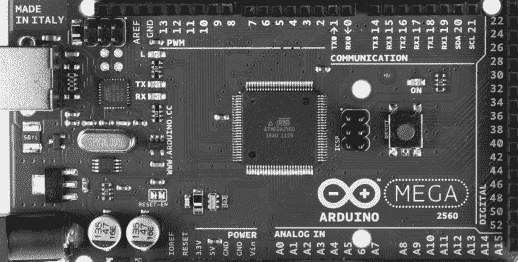

图 4.2

Arduino Mega 板板。

# 表 4.2

| 引脚 | 描述 |
| --- | --- |
| Vin | 输入 Arduino 板的外部电压 |
| +5V | 输出调节的 5 V |
| 3.3 V | 板载 3.3 V 电源 |
| GND | 接地 |
| IOREF | 提供电压参考以选择合适的电源 |
| Serial0 | 可以通过 0(Rx) 和 1(Tx) 传输接收串口数据 |
| Serial1 | 可以通过 19(Rx) 和 18(Tx) 传输接收串口数据 |
| Serial2 | 可以通过 14(Rx) 和 16(Tx) 传输接收串口数据 |
| External Interrupts | 在低电值 2 (中断 0)、3 (中断 1)、18 (中断 5)、19 (中断 4) 和 20 (中断 2) 触发外部中断 |
| PWM | 8 位 PWM (引脚: 2-13 和 44-46) |
| SPI | 支持 SPI 通信 [10 (SS), 11 (MOSI), 13 (M)] |
| LED | 由引脚 13 驱动 |
| TWI | 支持 TWI 通信 [引脚: 20 (SDA), 21 (SCL)] |
| AREF | 模拟输入的参考电压 |
| Reset | 用于通过板重置微控制器 |

#### 4.1.3 Arduino Nano

Arduino/Genu Nano 内了一个 ATmega328 微控制器。它有 8 个模拟输入、14 个数字 I/O 端口和 6 个 PWM。它具有 32 KB 闪存内存、1 KB EEPROM、2 KB SRAM，工作频率为 16 MHz。图 4.3 显示了 Arduino Nano（表 4.3 和表 4.4）。

| 引脚 | 描述 |
| --- | --- |
| Vin | 输入板的外部电压 |
| +5 V | 输出为 +5 V |
| 3.3 V | 板载 3.3 V 电源 |
| GND | 接地 |
| IORE | 提供电压参考帮助选择合适的电源 |
| Serial | 可以通过 0(Rx) 和 1(Tx) 传输接收串口数据 |
| External Interrupts | 在低值（引脚 2 和 3）触发中断 |
| PWM | 8 位 PWM (3, 5, 6, 9, 10, 11) |
| SPI | 支持与 10 (SS), 11 (MOSI), 12 (MISO) 和 13 (SCK) 的 SPI 通信 |
| LED | 引脚 13 双线接口驱动 LED |
| I2C | 支持双线接口 [A4 (SDA) 和 A5 (SCL)] |
| AREF | 模拟输入的参考电压 |
| Reset | 用于重置板载微控制器 |

# Arduino 基础

表 4.4

若干 Arduino 板板对比表

| 名称 | 处理器 | CPU 速度 | 工作输入电压 | 数字 IO/PWM | 模拟输入/输出 | UART | 闪存 [kB] |
| --- | --- | --- | --- | --- | --- | --- | --- |
| LilyPad | ATmega168V / ATmega328P | 8 MHz | 2.4-5.5 V / 2.4-5.5 V | 14/6 | 6/0 | — | 16 |
| Mega 2560 | ATmega2560 | 16 MHz | 5 V-12 V | 54/15 | 16/0 | — | 256 |
| Micro | ATmega324U | 16 MHz | 5 V-12 V | 20/4 | 12/0 | 1 | 32 |
| Uno | ATmega328P | 16 MHz | 5 V-12 V | 14/6 | 6/0 | 1 | 32 |
| Leonardo | ATmega324U | 16 MHz | 5 V-12 V | 20/4 | 12/0 | 1 | 32 |
| Yun | ATmega328P AR9331 Linux | 400 MHz | 5 V-12 V | 14/4 | 6/0 | — | 32 |
| Ethernet | | 16 MHz | | 3.3 V | 3/2 | 1/0 | — | 8 |
| Gamma | ATiny85 | 8 MHz | 4-16 V | | | — | 8 |
| MKRZero | SAMD21 Cortex-M0+ 32 位低功耗 ARM MCU | 48 MHz | 3.3 V | | 22/12 | 4 (ADC 8/10/12位)/ (DAC 10 位) | 1 | 256 |

### 4.2 Arduino IDE

Arduino 集成开发环境 (IDE) 是一款开源软件，它可以轻松编写代码并上传到板上。

### 4.2.1 安装 Arduino IDE 并打开窗口的步骤

**步骤 1：安装 Arduino IDE 并打开窗口**

开始之前，安装 Arduino IDE。图 4.4 显示 Arduino IDE 窗口。

**步骤 2：选择 Arduino 板**

Arduino 有许多版本，如 UNO、MEGA、NANO 等。在启动项目之前，根据要求找到合适的板。在 Arduino IDE 中，点击“Tool”（工具）然后选择“Board”。图 4.5 显示板的选择。

**步骤 3：编写并编译程序**

在 Arduino IDE 中编写程序。然后点击“编译”。图 4.6 显示编译程序的窗口。


```cpp
void setup() {
  // 在此处放置设置代码，运行一次
}

void loop() {
  // 在此处放置主代码，循环运行
}
```

## 步骤 4：将 Arduino 连接到 PC

使用 USB 线将 Arduino 连接到 PC 的 USB 口。每个 Arduino 板都有不同的串口（COM2, COM4 等），因此需要在 IDE 中重新配置端口。检查 Arduino 连接的端口，点击“Tool”然后选择“Manager”（管理器）；管理器窗口如图 4.7 所示。

## 步骤 5：将程序上传到 Arduino 板

将程序上传到 Arduino 板。图 4.9 显示如何上传程序。

# 设备管理器

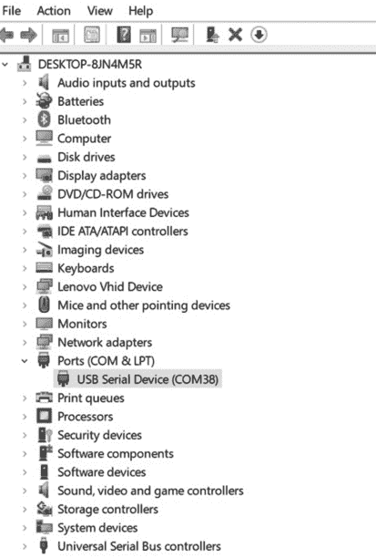

图 4.7

检查 Arduino 端口的窗口。

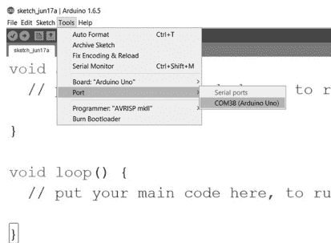

图 4.8

板的串口。

```cpp
void setup() {
  // 在此处放置设置代码，运行一次
}

void loop() {
  // 在此处放置主代码，循环运行
}
```


图 4.9

上传程序的窗口。

### 4.3 Arduino 基础命令

- `pinMode(x, OUTPUT);` 将引脚 `x` 设置为输出引脚，`x` 为数字引脚

- `digitalWrite(x, HIGH);` 将引脚 `x` 设置为高电平，`x` 为数字引脚

- `pinMode(x, INPUT);` 将引脚 `x` 设置为输入引脚，`x` 为数字引脚

- `digitalRead(digital pin);` 读取数字引脚，如 13 或 12 或 11 等

- `analogRead(analog pin);` 读取模拟引脚，如 A0 或 A1 或 A2 等

### 4.4 LCD 命令

- `lcd.begin(1, 2);` 初始化 16*2 或 20*4 LCD

- `lcd.print("RAJESH");` 在 LCD 上打印字符串“RAJESH”

- `lcd.setCursor(x, y);` 在指定位置设置 LCD 光标，`x` 为列数，`y` 为行数

- `lcd.print(LPU);` 在 LCD 上打印整数 `LPU`

- `lcd.Clear();` 清除 LCD 内容

### 4.5 串口通信命令

- `Serial.begin(baud);` 初始化串口通信，将波特率设置为 600/1200/2400/4800/9600

- `Serial.print("RAJESH");` 在 Tx 线上按定义的波特率打印固定字符串

- `Serial.println("RAJESH");` 在 Tx 线上按定义的波特率打印固定字符串

- `Serial.print(LPU);` 在 Tx 线上按定义的波特率打印整数字符串

- `Serial.Write(BYTE);` 在 Tx 线上传输一个字节

- `Serial.read();` 从 Rx 线读取字节串口

## 4.6 玩 LED 和 Arduino

发光二极管（LED)是一种可以用作指示器的设备。LED 有两个端子：阳极和阴极。LED 有不同的颜色。图 4.10 显示了 LED。

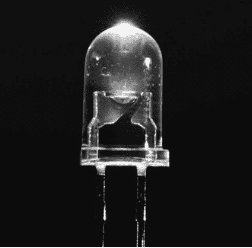

图 4.10

发光二极管。

不同的颜色代表不同的状态。LED 的颜色由于不同化合物在可见光谱特定区域发射光。

要理解 LED 的工作原理，将 LED 的阳极连接到 Arduino 的第 4 引脚，阴极连接到地。将 4.4.1 节描述的草图（sketch）上传到 Arduino 并观察 LED 的闪烁。

图 4.11 显示了 Arduino 与 LED 接口电路图。

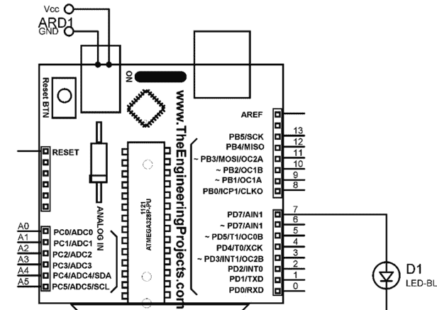

调节器 7812

Vcc=+5V

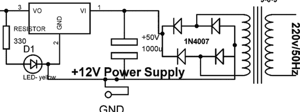

图 4.11

Arduino 与 LED 接口电路图。

## 4.6.1 代码示例 (Sketch)

```cpp
int LED_CONTROL=4;
void setup()
{
  pinMode(LED_CONTROL, OUTPUT); // 初始化引脚4为输出引脚
}
void loop()
{
  digitalWrite(LED_CONTROL, HIGH); // 将引脚4置高电
  delay(1000); // 延迟1000毫秒
  digitalWrite(LED_CONTROL, LOW); // 将引脚4置低电
  delay(1000); // 延迟1000毫秒
}
```

## 4.7 使用 Arduino 玩 LCD

液晶显示器（LCD）是一种常用的显示模块。电路中使用了 16 × 2 的 LCD 作为显示设备。相比于数码显示器，该模块更受欢迎，因为它在显示特殊字符、甚至是自定义字符时没有限制，而且价格便宜。

16 × 2 LCD 每行可以显示 16 个字符，共 2 行。在这一 LCD 中，5 x 4 像素矩阵显示两个寄存器，即数据寄存器和命令寄存器。图 4.12 显示了 16 x 2 LCD。

20 x 4 LCD 有 4 行，每行可以显示 20 个字符。使用 5 x 4 像素矩阵显示字符。引脚描述与 LCD (16 × 2) 相同。图 4.13 显示了 20 x 4 LCD（表 4.5）。

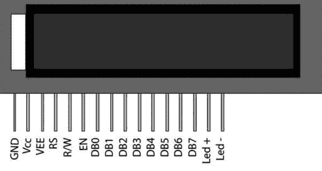

图 4.12 液晶显示器 (16 × 2)。

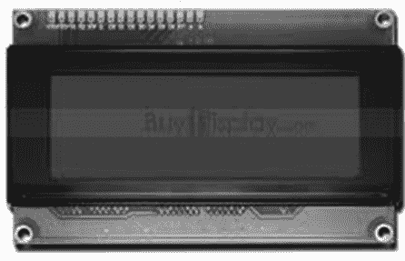

图 4.13 液晶显示器 (20 × 4)。

### 表 4.5

| 引脚 | 描述 |

| :--- | :--- |

| 引脚 (1) Ground | 接地 (0 V) |

| 引脚 (2) Vcc | 电源 (5 V) |

| 引脚 (3) VE | 使用可变电阻调整对比度 |

| 引脚 (4) 寄存器选择 | 低电平时选择命令寄存器，高电平时选择数据寄存器 |

| 引脚 (5) 读/写 | 高电时读取或写入写入寄存器 |

| 引脚 (6) 使能 | 当给出一个高电脉冲时，向数据线发送数据 |

| 引脚 (7) DB0 | |

| 引脚 (8) DB1 | |

| 引脚 (9) DB2 | 8 位数据线 |

| 引脚 (10) DB3 | |

| 引脚 (11) DB4 | |

| 引脚 (12) DB5 | |

| 引脚 (13) DB6 | |

| 引脚 (14) DB7 | |

| 引脚 (15) LED+ | 背光 Vcc (5 V) |

| 引脚 (16) LED- | 背光地 (0 V) |

### LCD 连接

按照如下方式连接组件：

- Arduino 数字引脚 (13) 连接到 LCD 的 RS 引脚 (4)。

- Arduino 数字引脚 (GND) 连接到 LCD 的 RW 引脚 (5)。

- Arduino 数字引脚 (12) 连接到 LCD 的 E 引脚 (6)。

## 树莓派与 Arduino 的物联网

- Arduino 数字引脚 (11) 连接到 LCD 的 D4 引脚 (11)。

- Arduino 数字引脚 (10) 连接到 LCD 的 D5 引脚 (12)。

- Arduino 数字引脚 (9) 连接到 LCD 的 D6 引脚 (13)。

- Arduino 数字引脚 (8) 连接到 LCD 的 D7 引脚 (14)。

图 4.14 显示了 Arduino 接口 LCD 的电路图。

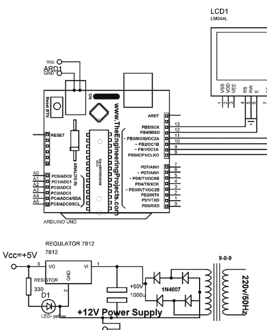

图 4.14 读取 LCD 的电路图。

## 4.7.1 代码示例 (Sketch)

```cpp
#include <LiquidCrystal.h>
LiquidCrystal lcd(13, 12, 11, 10, 9, 8);
void setup()
{
  lcd.begin(20, 4); // 初始化 LCD
  lcd.print("WELCOME"); // 在 LCD 上打印字符串
  delay(2000); // 延迟 2000毫秒
  lcd.clear();
}
void loop()
{
  lcd.setCursor(0, 1); // 设置 LCD 光标位置
  lcd.print("ECE Department"); // 在 LCD 上打印字符串
  delay(2000); // 延迟 2000毫秒
  lcd.setCursor(0, 2); // 设置 LCD 光标位置
  lcd.print("Rajesh Singh"); // 在 LCD 上打印字符串
  delay(2000); // 延迟 2000毫秒
}
```


## 5 树莓派基础

### 5.1 树莓派简介

树莓派是一种低成本的微型，可以连接到电脑显示器或电视机。它是一个通过键盘和鼠标探索计算机计算的设备。可以连接一些可选配件。

# 基于树莓派和 Arduino 的物联网


图 5.7

SD  own格式化器。

- 2. 从 https://sourceforge.net/projects/win32diskimager/ 下载 Win32 Disk Imager，用于在 SD 卡上刻录 Raspian 镜像。图 5.8 显示了 Win32 disk imager 窗口。

3. 从 https://www.raspberrypi.org/downloads/raspbian/ 下载 Raspian，获取镜像并将其刻录到树莓派上。

4. 将卡片插入树莓派，然后等待 2 分钟。

5. 通过局域网（LAN）将树莓派连接到计算机。

6. 按照第 5.2 节中的步骤 6、7 和 8 进行操作。

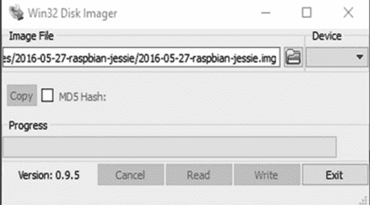

图 5.8

Win32 disk imager。

# 树莓派基础

### 5.4 终端命令

终端命令列表：

- 1. `sudo apt-get update`: 此命令更新软件包列表。

- 2. `sudo apt-get upgrade`: 此命令下载并安装更新后的软件包。

- 3. `sudo apt-get clean`: 此命令清理旧的软件包文件。

- 4. `sudo raspberrypi-config`: 此命令配置树莓派的配置工具。

- 5. `ls`: 此命令显示目录内容列表。

- 6. `cd`: 此命令切换目录。

- 7. `mkdir`: 此命令创建目录。

- 8. `rmd`: 此命令删除目录。

- 9. `mv`: 此命令移动文件。

- 10. `tree -d`: 此命令显示目录树形结构。

- 11. `pwd`: 此命令显示当前目录。

- 12. `clear`: 此命令用于清除终端窗口。

- 13. `sudo halt`: 此命令让树莓派关机。

- 14. `sudo reboot`: 此命令用于重启树莓派。

- 15. `startx`: 此命令用于启动桌面环境 (LXDE)。

- 16. `ifconfig`: 此命令查找树莓派的 IP 地址。

- 17. `nano`: 此命令用于编辑文件。

- 18. `cat`: 此命令显示文件内容。

- 19. `rm`: 此命令删除文件。

- 20. `cp`: 此命令用于复制文件或目录。

- 21. `locate`: 此命令用于定位文件。

- 22. `sudo`: 此命令用于 Linux 命令行；`sudo` 代表“SuperUser Do”（以超级用户身份执行）。

- 23. `df`: 此命令查看系统中每个分区的可用磁盘空间。

- 24. `du`: 此命令显示系统内文件的磁盘占用情况。

- 25. `tar`: `-cvf` 用于创建 `.tar` 归档，`-xvf` 用于解压 tar 归档，`-tvf` 列出归档内容等。

- 26. `zip, unzip`: 此命令将文件压缩为 zip 归档，并 `unzip` 解压提取文件。

- 27. `uname`: 命令 “`uname -a`”打印大部分系统信息。

- 28. `chmod`: 此命令更改文件或目录的权限。

- 29. `ping`: 此命令检查与服务器的连接。

- 30. `sudo shutdown`: 此命令关闭树莓派。

## 5.5 树莓派库安装

```
$ sudo apt-get install libblas-dev
$ sudo apt-get install liblapack-dev
$ sudo apt-get install gfortran
$ sudo apt-get install python-setuptools
$ easy_install scipy # 之前可能需要依赖项
$ sudo apt-get install python-matplotlib
```

### 5.6 获取树莓派的静态 IP 地址

树莓派每次“开启”时都会获得不同的 IP 地址，这个 IP 被称为当前 IP。为了避免这个问题，需要创建一个静态 IP 地址，它在设备“关闭”时不会改变。

创建静态 IP 地址的步骤：

- 1. 打开终端窗口（图 5.9）。

- 2. 在命令行输入命令 “`ifconfig`”（图 5.10）。此命令提供网络相关信息。图 5.10 突出显示了当前 IP 地址；这里是 192.168.0.16。注意这个 IP 地址，稍后会用到。

- 3. 打开配置静态 IP 的配置文件。文件名 `dhcpcd.conf`，存储在 `etc` 文件夹中。要进行任何更改，在终端窗口中使用 `nano` 编辑器：“`sudo nano /etc/dhcpcd.conf`”（图 5.11）。执行此命令后，将打开窗口（图 5.12）。

在图 5.12 屏幕上，向下滚动直到看到：“# Example IP configuration”（图 5.13）。


图 5.9

终端窗口。

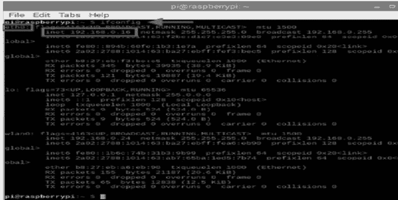

图 5.10

树莓派 "ifconfig" 命令窗口。

- 删除此段落每行的 “#”，并将 IP 地址范围从 1 改为 255（图 5.14）。更改完成后，使用 Ctrl+x 编辑窗口并点击 “Yes” 保存更改（图 5.15）。

- 使用命令 “`reboot`”重启树莓派（图 5.16）。

- 使用命令 “`ifconfig`”检查树莓派的静态 IP 地址（图 5.17）。

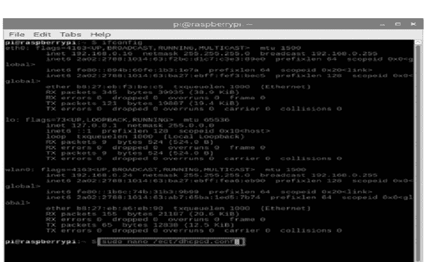

图 5.11

静态 IP 配置的 Nano 编辑器。

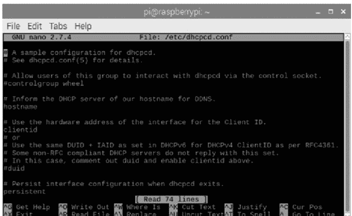

图 5.12

配置 IP 地址的窗口。

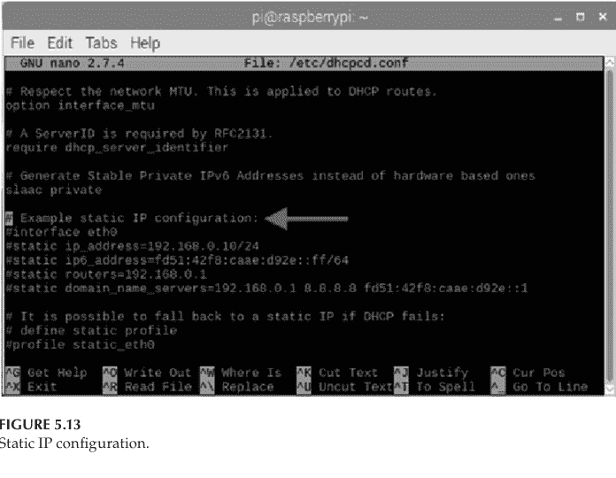

```
pi@raspberry:~
File Help
GNU nano 2.7.4 File: /etc/dhcpcd.conf
# 遵守网络 MTU。这应用于 DHCP 路由。
option interface_mtu
# RFC2131 要求 ServerID。
require dhcp_server_identifier
# 生成稳定的 IPv6 地址而不是基于硬件的地址
slaac private
# 静态 IP 配置示例：
interface eth0
static ip4_address=192.168.0.10/24
static ip6_address=fd51:42f8:caae:d92e::ff/64
static domain_name_servers=192.168.0.1 8.8.8.8 fd51:42f8:d2::1
# 如果 DHCP 失败，退回到静态 IP：
# define static_eth0
profile static_eth0
```

图 5.13

静态 IP 配置。

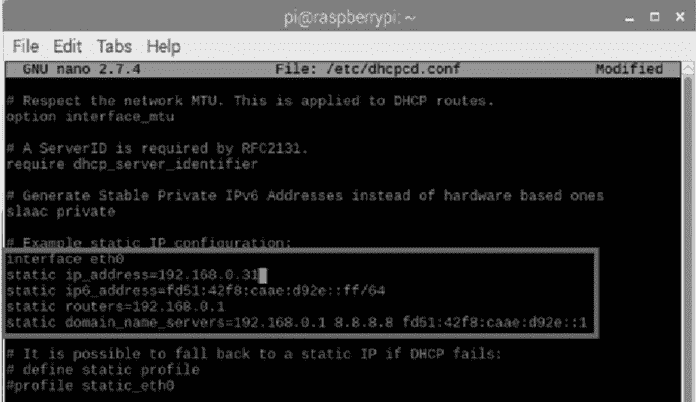

```
pi@raspberry:~
File Help
GNU nano 2.7.4 File: /etc/dhcpcd.conf 修改后
# 遵守网络 MTU。这应用于 DHCP 路由。
option interface_mtu
# RFC2131 要求 ServerID。
require dhcp_server_identifier
# 生成稳定的 IPv6 地址而不是基于硬件的地址
slaac private
# 静态 IP 配置示例：
interface eth0
static ip4_address=192.168.0.30/24
static ip6_address=fd51:42f8:caae:d92e::ff/64
static routers=192.168.0.1
```

图 5.14

。

### 5.7 在树莓派上运行程序

有多种方法可以在树莓派上运行程序。以下是一些可用的方法并如下：

- rc.local

- bashrc

- init.d tab

- systemd

- crontab

我们将讨论 “rc.local”。

#### 5.7.1 编辑 rc.local

在树莓派上，使用具有 root 权限的编辑器 `/etc/rc.local` 文件：“`sudo nano /etc/rc.local`”


添加执行 Python 程序的命令，保存文件并退出。如果运行无限循环，通过在末尾添加 `&` 来终止命令，例如：`sudo python /home/pi/sample.py&`

树莓派在启动其他服务之前会运行此程序。如果不包含 `&` 符号，树莓派将无法完成启动过程。`&` 符号允许命令在独立的进程中运行，并继续启动主进程。

现在，重启树莓派进行测试：`sudo reboot`。

### 5.8 安装远程桌面服务器

远程桌面服务器有助于用户通过网络连接控制远程计算机。要远程控制树莓派，可以使用此服务器。通过鼠标键盘打开树莓派终端，或通过 SSH（使用 `raspberry-config`）连接来安装远程桌面服务器。在派上安装软件包：

```
sudo apt-get install xrdp
```


图 5.18

远程桌面连接。

# 树莓派基础知识

## 5.9 Pi 摄像头

`Pi camera` 是一个带有 Python 接口的模块。通过命令 `sudo apt-get install python-picamera` 安装 `Picamera`。

### 5.9.1 摄像头测试

要测试摄像头，会拍摄一张图像并保存到 `/home/pi`。要捕捉图像，请使用命令：`raspistill -o /home/pi/image.jpg`。当执行该命令时，显示器上将出现摄像头预览。预览将持续几秒钟，然后拍摄一张图像。

### 5.9.2 将树莓派摄像头作为 USB 视频设备

树莓派摄像头是 `/dev` 中的一个标准 USB 视频设备（需要 MJPG 支持）。使用命令 `sudo modprobe bcm2835-v4l2` 为硬件（`BCM2835`）加载 `Video for Linux 2` (`V4L2`) 模块。执行命令后，`/dev` 目录下将出现一个 `Video0` 设备文件。要进行验证，请运行命令

```bash
$ls /dev | grep vid$
```

（图 5.19）。

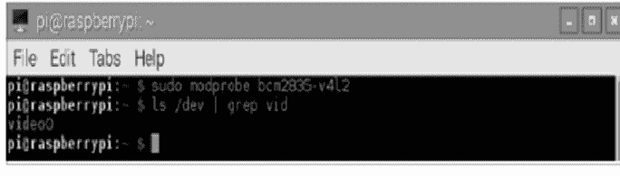

验证 `/dev` 目录下是否存在树莓派摄像头的 USB 视频文件

图 5.19

验证窗口。

### 5.10 使用树莓派进行人脸识别

人脸检测有多种方法，如 Haar 级联分类（Haar cascades）、HOG + 线性 SVM 以及 CNN。

人脸识别步骤

- 1. 使用命令 `sudo apt-get install python-picamera` 配置 `Picamera`。
- 2. 使用命令 `sudo apt-get update` 更新系统软件包列表。
- 3. 使用命令 `sudo apt-get dist-upgrade` 将已安装的包升级到最新版本。
- 4. 如果尚未安装，安装 OpenCV。如果树莓派上安装了 RaspberryOS，则使用以下命令安装 OpenCV：`sudo apt-get install python-opencv` 和 `sudo pip install millis`。
- 5. 在安装 OpenCV 的相同 Python 虚拟环境中，使用命令 `pip install` 安装 David King 的 `dlib` 工具包到树莓派人脸识别中。
- 6. 仅使用命令 `$pip install face_recognition` 在树莓派人脸识别中安装 Adam Geiger 的 `face_recognition` 模块。
- 7. 使用命令 `$pip install imutils` 在树莓派人脸识别中安装我的便利函数 `imutils` 包。
- 8. 在树莓派的终端窗口中输入以下命令获取并安装 RPiGPIO 库：

  `$ sudo apt-get install python-dev`

  `$ sudo apt-get install python-rpi-gpio`

### 5.11 在树莓派上安装 I2C 驱动

本节讨论了树莓派 I2C 驱动安装的分步操作指南。

- 1. 将树莓派连接到互联网。
- 2. 新的树莓派发行版已安装 I2C 驱动，但默认是禁用的。要启用它，通过在行前加 `#` 来注释掉该行，例如 `sudo nano /etc/modprobe.d/raspi-blacklist.conf`，然后在第三行添加一个 `#`（图 5.20）。

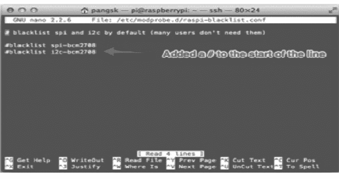

图 5.20

启用 I2C 驱动的窗口。

- 3. 按 `ctrl+x` 和 `y` 保存并退出。
- 4. 使用命令 `sudo nano /etc/modules` 编辑模块文件，并在新行中添加 `i2c-dev`（图 5.21）。按 `ctrl+x` 然后按 `y` 保存并退出。
- 5. 使用命令 `sudo apt-get install i2c-tools` 安装 `i2c-tools` 包。

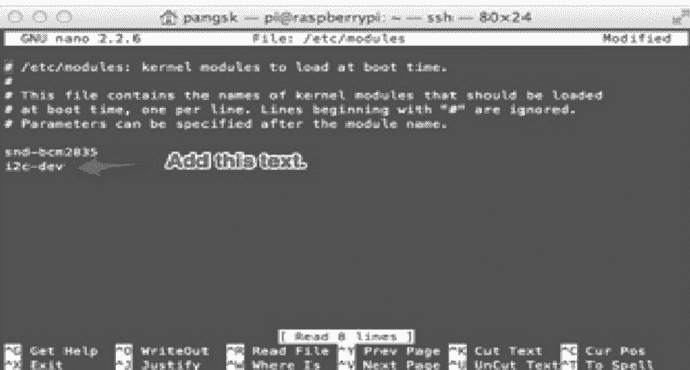

图 5.21

`i2c-dev`。

如果发生 `404 error`，请使用命令 `sudo apt-get update.` 进行更新。

- 6. 再次运行安装 `i2c-tools`。

注意：安装可能需要几分钟，取决于服务器的忙碌。

- 7. 现在为 `i2c` 组添加新用户：`sudo adduser pi i2c`
- 8. 使用命令重启电脑：`sudo shutdown -r now`
- 9. 重启后，通过 `sudo i2cdetect -y 0` 测试任何设备的连接。
- 对于 Rev 2 版本的板卡，命令为：`sudo i2cdetect -y 1`

将出现一个窗口（图 5.22）。

- 10. 现在使用命令 `sudo apt-get install python-smbus` 安装 `python-smbus` 模块。
- 11. 现在树莓派已可以使用 Python 使用 `i2c`。

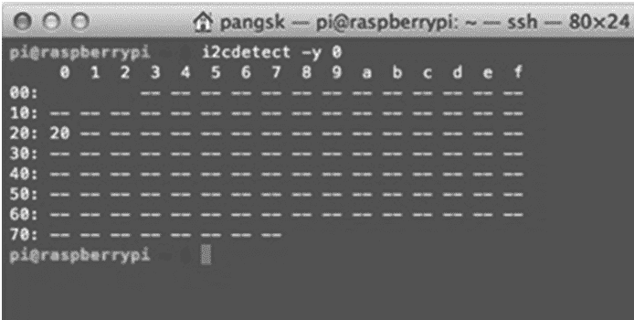

图 5.22

重启后测试命令的窗口。

### 5.12 树莓派的串行外接口 (SPI)

`Adafruit Occidentalis 0.2` 或更高版本已预配置了串行外接口 (`SPI`) 支持。对于 Raspbian，需要少量的配置更改。

`I2C` 驱动在 Rasp Debian 中已预安装，但默认是禁用的。要启用它，通过在行前加 `#` 来注释掉该行，例如 `sudo nano /etc/modprobe.d/raspi-black.conf`，然后在第三行添加一个 `#`（图 5.20）。

- 1. 使用命令 `sudo nano /etc/modprobe.d/raspi-black.conf` 编辑文件 `/etc/modules` 并在 `blacklist spi-bcm2808,` 前添加 `#`，使其变为 `#blacklist spi-bcm2808`。
- 2. 树莓派的 SPI 功能由 Python 库支持，该库与 Python 程序执行 SPI 通信。要安装它，请安装 Git 然后执行以下命令：

```bash
$ cd
$ sudo apt-get install python-dev
$ git clone https://github.com/doceme/py-spidev
$ cd py-spidev
$ sudo python setup.py install
```
- 3. 重启树莓派，即可准备好使用 SPI。

### 5.13 树莓派编程

要编程树莓派，引脚模式有两种定义方法：`BCM` 和 `BOARD`。`BCM` 代表 Broadcom SoC 通道，`BOARD` 代表引脚编号（例如第21 号引脚）。

命令：

```python
import RPi.GPIO as X

# 此命令用于访问树莓派的 GPIO 引。

import time
# 导入时间库以便稍后暂停。

X.setmode(BCM)
# 选择 BCM 模式。

X.setwarnings(False)
# 此命令用于不在屏幕上打印 GPIO 警告。
```

```python
X.setup(21, X.OUT)
# 将 21 设置为输出。

try:
  while True:
    X.output(21, True) # 将 21 设置为高电平
    print("LED ON") # 在终端打印字符串
    time.sleep(1)
    X.output(21, False) # 将 21 设置为低电平
    print("LED OFF") # 在终端打印字符串
    time.sleep(1)
except KeyboardInterrupt:
  X.cleanup() # 重置 GPIO 设置。
```

LED 与树莓派的接口是理解基础命令简单的方法。电路由两个 LED、两个 330 欧姆电阻和跳线组成。为了理解 LED 的工作，将 LED1 的正极连接到 GPIO21，LED2 连接到地。在第 5.14 节编写配方并观察 LED 的闪烁。图 5.23 显示了 LED 与树莓派接口的电路。

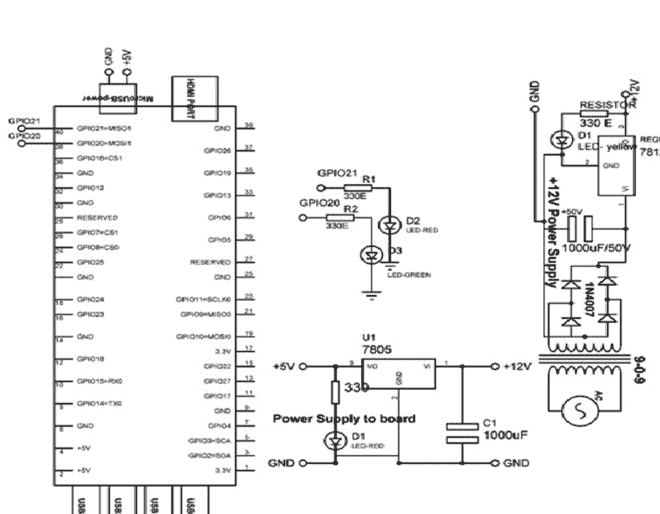

图 5.23

LED 与树莓派接口的电路图。

### 5.14.1.1 使用 GPIO 函数实现 LED 闪烁配方

```python
import RPi.GPIO as RAJ # RPi.GPIO 可以简称为 GPIO
import time as wait # 导入时间库
ledPin1 = 21 # 将 led1 连接到21 号引脚
ledPin2 = 20 # 将 led2 连接到20 号引脚
def setup():
  RAJ.setmode(RAJ.BOARD) # GPIO 引脚编号方式
  RAJ.setup(ledPin1, RAJ.OUT) # 将 ledPin1 设置为输出
```

```python
RAJ.setup(ledPin2, RAJ.OUT) # Set ledPin2 as output
def loop():
    while True:
        print("BOTH LED on") # print string on terminal
        RAJ.output(ledPin1, RAJ.HIGH) # turn on LED1
        RAJ.output(ledPin2, RAJ.HIGH) # turn on LED2
        wait.sleep(1.0) # delay of 1 Sec
        print("BOTH LED off") # print string on terminal
        RAJ.output(ledPin1, RAJ.LOW) # turn off LED1
        RAJ.output(ledPin2, RAJ.LOW) # turn off LED2
        wait.sleep(1.0) # wait 1 sec
def endprogram():
    RAJ.output(ledPin1, RAJ.LOW) # turn off LED1
    RAJ.output(ledPin2, RAJ.LOW) # turn off LED2
    RAJ.cleanup() # clean GPIOs
if __name__ == '__main__': # Main program to call functions
    setup()
    try:
        loop()
    except KeyboardInterrupt: # keyboard interrupt to stop program
        endprogram()
```

### 5.15 读取数字输入

树莓派的数字输入可以通过两种方法进行读取：拉低（pull down）和拉高（pull up），通过将 GPIO 引脚设置为低电平有效或高电平输出。

```python
import RPi.GPIO as RAJ
RAJ.setup(23, RAJ.IN, pull_up_down=RAJ.PUD_DOWN)
RAJ.setup(24, RAJ.IN, pull_up_down=RAJ.PUD_UP)
```

这些命令在引脚 23 上启用拉低电阻，在引脚 24 上启用拉高电阻。树莓派正在寻找引脚 23 上的高电压和引脚 24 上的低电压。这些需要在循环中定义，以便能够持续检查引脚电压。为了理解这一概念，请考虑一个用于开关的小程序。

# 树莓派基础

### 5.15.1 示例

```python
import RPi.GPIO as RAJ # use pi in BCM mode
RAJ.setmode(GPIO.BCM)
RAJ.setup(23, RAJ.IN, pull_up_down = RAJ.PUD_DOWN) # set pin as input
RAJ.setup(24, RAJ.IN, pull_up_down = RAJ.PUD_UP) # set pin as input
while True:
    if(RAJ.input(23)==1):
        print("pressed button 1") # print string on terminal
    if(RAJ.input(24) == 0):
        print("pressed button 2") # print string on terminal
RAJ.cleanup() # clean all GPIOs
```

### 5.16 读取边缘触发输入

第 5.15 节中的程序用于检测按钮是否被按下。如果按钮只需触发一次动作或命令，GPIO 库内置了用于上升沿和下降沿的函数。上升沿定义为信号从低电变为高电的瞬间，但它只能检测到变化。同样，下降沿是信号从高电变为低低的瞬间。

### 5.16.1 在拉低配置下读取开关

连接方式：

- 将开关的一个端子连接接地，另一个端子连接到树莓派的 GPIO21。
- 在 +5 V 和树莓派的 GPIO21 之间连接一个 10 K欧姆电阻。
- 通过电阻将 LED 的阳极连接到树莓派的 GPIO20，阴极连接到地。

图 5.24 显示了树莓派与开关接口的电路图。

# 使用树莓派和 Arduino 构建物联网

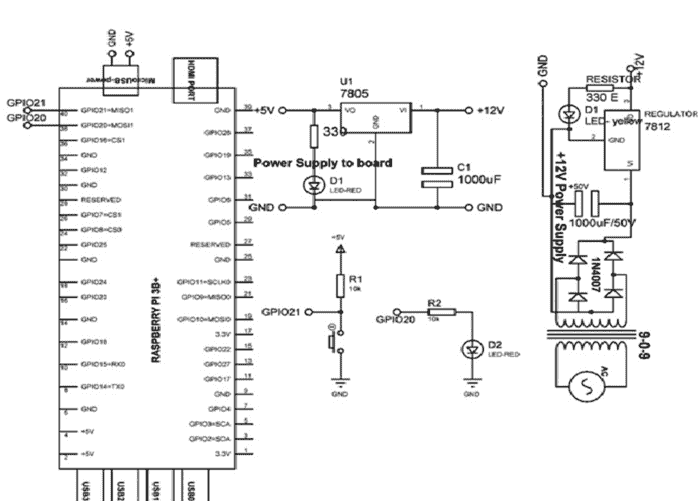

FIGURE 24

树莓派在“拉低”配置下与开关接口的电路图。

### 5.16.1 拉低配置示例

```python
import RPi.GPIO as RAJ
import time as wait # add time lib
button_pin=21 # assign button_pin to GPIO21
led_pin=20 # assign led_pin name to GPIO20
RAJ.setmode(GPIO.BCM) # use Pi pins as BCM
RAJ.setup(button_pin, RAJ.IN, pull_up_down =RAJ.PUD_UP) # GPIO as input
RAJ.setup(led_pin, RAJ.OUT) # make led_pin as output
try:
    while True:
        button_var = RAJ.input(button_pin)# read pin 21
        if button_var == False:
            RAJ.output(led_pin, True) # make led_pin to HIGH
            print("Switch Pressed.") # print string on terminal
            wait.sleep(0.2) # delay of 200ms
        else:
            RAJ.output(led_pin, False) # make led_pin to LOW
            print("switch not pressed...") # print string on terminal
            wait.sleep(0.2) # delay of 200ms
except keyboardInterrupt:
    print("keyboard interrupt")
    RAJ.cleanup() # clean all GPIOs
```

### 5.16.2 在拉高配置下读取

连接方式：

- 将开关的一个端子连接到 +5 V，另一个端子连接到树莓派的 GPIO21。
- 在地和树莓派的 GPIO21 之间连接一个 10 K欧姆电阻。
- 通过电阻将 LED 的阳极连接到树莓派的 GPIO20，阴极连接接地。

图 5.25 显示了树莓派与开关接口的电路图。

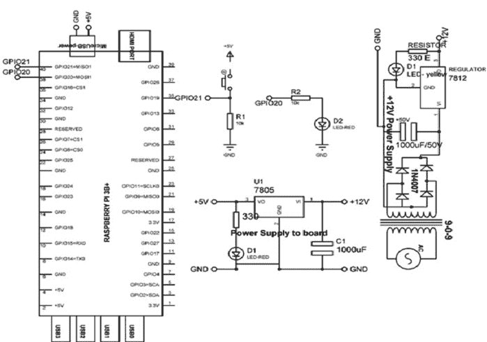

FIGURE 25
树莓派在“拉高”配置下与开关接口的电路图。

### 5.16.2.1 拉高配置示例

```python

import RPi.GPIO as RAJ

import time as wait

button_pin=21 # assign name to pin 21

led_pin=23 # assign name to pin 23

RAJ.setmode(RAJ.BCM) # use pins in BCM mode

RAJ.setup(button_pin, RAJ.IN, pull_up_down =RAJ.PUD_DOWN) # set pin 21 as input

RAJ.output(led_pin, RAJ.OUT) # set pin 23 as input

try:

    while True:
```


```python
button_VAR = RAJ.input(button_pin) # read switch

if button_VAR == True:

    RAJ.output(led_pin, True) # make pin 23 to HIGH

    print("button pressed...") # print string on terminal

    wait.sleep(0.2)

else:

    RAJ.output(led_pin, False) # make pin 23 to LOW

    print("button not pressed...") # print string on terminal

    wait.sleep(0.2)

except keyboardInterrupt:

    print('keyboard interrupt detected')

    RAJ.cleanup()
```

### 5.17 继电器与树莓派的接口

继电器是一种用于切换电路状态的设备。它可以用于切换 220 V 交流电电的状态。为了理解继电器与树莓派的接口，可以考虑一个简单的电路让灯泡“开启”和“关闭”。如图 5.26 所示连接组件。

连接方式：

- 将 2N22 三极管的“基极”连接到树莓派的 `GPIO26`。
- 将三极管的“发射极”连接地。
- 将三极管的“集极”连接到继电器的“L2”。
- 将 +12 V 电池的正极连接到继电器的“L1”。
- 在“L1”和“L2”之间跨接一个 1N4004 二极管。
- 将交流电的一个端子连接到继电器的“公共端”，另一个连接到交流负载（灯泡）。
- 将交流负载的另一个端子连接到继电器的“NO”（常开）端子。

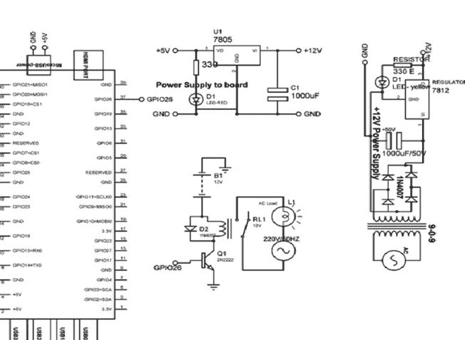

FIGURE 26
继电器与树莓派接口的电路图。

### 5.17.1 示例

```python
import RPi.GPIO as RAJ # import pi GPIOs lib

time as wait # wait time lib

RAJ.setmode(RAJ.BCM) # set pins in BCM mode

while (True):

    RAJ.output(26, RAJ.HIGH) # make pin 26 to HIGH

    print('relay ON') # print string on terminal

    wait.sleep(5) # delay of 5 Sec

    RAJ.output(26, RAJ.LOW)

    print('relay OFF') # print string on terminal

    wait.sleep(5) # delay of 5 Sec
```

### 5.18 直流电机与树莓派的接口

直流电机将电能转换为机械能。当电流通过磁场中的线圈时，会产生磁力从而为直流电机产生扭矩。为了理解直流电机与树莓派的接口，可以考虑一个简单的电路让电机按“顺时针”和“反时针”方向运动。该电路由树莓派、L293D 电机驱动、两个直流电机和电源组成。如图 5.27 所示连接组件。

连接方式：

- 将 L293D 的引脚2（IN1）连接到树莓派的 `GPIO26`。
- 将 L293D 的引脚7（IN2）连接到树莓派的 `GPIO19`。
- 将 L293D 的引脚10（IN3）连接到树莓派的 `GPIO13`。
- 将 L293D 的引脚15（IN4）连接到树莓派的 `GPIO6`。
- 将 L293D 的引脚3（OUT1）连接到电机1 的一个端子。
- 将 L293D 的引脚6（OUT2）连接到电机1 的另一个端子。

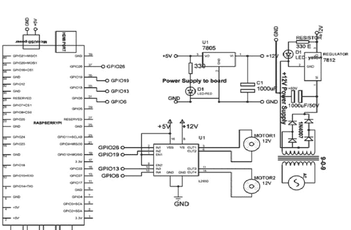

FIGURE 27
直流电机与树莓派接口的电路图。

## 树莓派基础

- 将 L293D 的引脚11 (OUT3) 连接到电机2 的一个端子。
- 将 L293D 的引脚14 (OUT4) 连接到电机2 的另一个端子。
- 将 L293D 的引脚8 连接到 +12 V DC。
- 将 L293D 的引脚1、9 和 16 连接到 +5 V DC。
- 将 L293D 的 "GND" 引脚接地。

## 15.1.8 示例

```python
import RPi.GPIO as MAHI #导入 GPIO 为 MAHI

import time as wait # 包含 time 库

M1_PIN1=26 # 将变量赋值给 GPIO26

M1_PIN2=19 # 将变量赋值给 GPIO19

M2_PIN1=13 # 将变量赋值给 GPIO13

M2_PIN2=6 # 将变量赋值给 GPIO6
```

```python
MAHI.setmode(MAHI.BCM) # 设置树莓派引脚为 BCM

MAHI.setup(M1_PIN1,MAHI.OUT) # 设置 GPIO26 为输出

MAHI.setup(M1_PIN2,MAHI.OUT) # 设置 GPIO19 为输出

MAHI.setup(M2_PIN1,MAHI.OUT) # 设置 GPIO13 为输出

MAHI.setup(M2_PIN2,MAHI.OUT) # 设置 GPIO6 为输出
```

```python
try:
    while True:
        MAHI.output(M1_PIN1, True) # 让引脚 26 为高电
        MAHI.output(M1_PIN2, False) # 让引脚 19 为低电
        MAHI.output(M2_PIN1, True) # 让引脚 13 为高电
        MAHI.output(M2_PIN2, False) # 让引脚 6 为低电
        print("Both Motor Forward") # 在终端打印字符串
        wait.sleep(10) # 延迟 10 秒
        MAHI.output(M1_PIN1, False) # 让引脚 26 为低电
        MAHI.output(M1_PIN2, True) # 让引脚 19 为高电
        MAHI.output(M2_PIN1, False) # 让引脚 13 为低电
        MAHI.output(M2_PIN2, True) # 让引脚 6 为高电
        print("Both Motor Reverse") # 在终端打印字符串
        wait.sleep(10) # 延迟 10 秒
except KeyboardInterrupt:
    MAHI.cleanup() # 清理所有 GPIO
```

## 5.18.2 使用函数控制单个电机的示例

```python
import RPi.GPIO as MAHI

import time as wait

# 电机驱动输入引脚
M11 = 26 # 将变量赋值给 GPIO26
M12= 19 # 将变量赋值给 GPIO19

def setup():
    MAHI.setmode(MAHI.BCM) # 选择 BCM 模式
    MAHI.setup(M11,MAHI.OUT) # 将 M11 为输出
    MAHI.setup(M12,MAHI.OUT) # 将 M12 为输出
    MAHI.setup(M1E,MAHI.OUT) # 将 M1E 为输出

def loop():
    # 前向移动
    MAHI.output(M11,MAHI.HIGH) # 设置 M11 为高电
    GPIO.output(M12,MAHI.LOW) # 设置 M12 为低电
    GPIO.output(M1E,MAHI.HIGH) # 设置 M1E 为高电
    wait.sleep(5) # 延迟 5 秒
    # 反向移动
    MAHI.output(M11,MAHI.LOW) # 设置 M11 为低电
    MAHI.output(M12,MAHI.HIGH) # 设置 M12 为高电
    MAHI.output(M1E,MAHI.HIGH) # 设置 M1E 为高电
    wait.sleep(5) # 延迟 5 秒
    # 停止移动
    MAHI.output(M1E,MAHI.LOW) # 设置 M1E 为低电

def destroy():
    MAHI.cleanup() # 清理 GPIO

if __name__ == '__main__': # 程序开始
    setup()
    try:
        loop()
    except KeyboardInterrupt:
        destroy() # 停止执行
```

## 树莓派基础

## 5.19 树莓派连接 LCD

液晶显示显示设备。它本身不发光，而是通过背光产生图像。它可以用于显示消息或传感器数据。电路如图 5.28 所示。
连接：

- 将 LCD 的引脚1 (VSS)、引脚5 (RW) 和引脚16 (LED-) 接地。
- 将 LCD 的引脚2 (Vcc) 和引脚15 (LED+) 连接到 +5 V。
- 将 LCD 的引脚3 (VEE) 连接到电位器的另一端，并将电位器接地。
- 将 LCD 的引脚4 (RS) 连接到 `GPIO26`。
- 将 LCD 的引脚6 (E) 连接到 `GPIO19`。
- 将 LCD 的引脚11 (D4) 连接到 `GPIO13`。
- 将 LCD 的引脚12 (D5) 连接到 `GPIO6`。
- 将 LCD 的引脚13 (D6) 连接到 `GPIO5`。
- 将 LCD 的引脚14 (D7) 连接到 `GPIO21`。


图 5.28 莓派连接 LCD 的电路图

#### 5.19.1 用于 LCD 的 Adafruit 库

在树莓派终端执行以下命令以安装和更新库。

1. `sudo apt-get update`
2. `sudo apt-get install build-essential python-dev python-smbus git`
3. `sudo pip install RPi.GPIO`

忽略任何依赖警告。Adafruit 提供了一个用于 4 位操作 LCD 的库。

在树莓派上安装库的步骤：

- **步骤 1:** 使用命令 `sudo apt-get update` 安装 Git。
- **步骤 2:** 在树莓派上克隆项目：`git clone https://github.com/adafruit/Adafruit_Python_Char`。
- **步骤 3:** 目录：`cd Adafruit_Python_Char`。
- **步骤 4:** 使用命令 `sudo python setup.py` 安装。

## 5.19.2 使用 Adafruit 库的示例

```python
# 定义对象并连接 RS=26, E=19, D4=13, D5=6, D6=5, D7=21
LCD = Adafruit_Char(rs=26, e=19, d4=13, d5=6, d7=21, cols=16, lines=2)

LCD.clear() # 清空内容
LCD.string('Welcome') # 打印字符串
wait.sleep(3)

LCD.clear() # 清空内容
LCD.string('text here') # 消息
wait.sleep(5)

LCD.clear() # 清空内容
```

## 树莓派基础

## 5.19.3 不使用库的示例

```python
import RPi.GPIO as GPIO

import time as wait

RS = 26
E = 19
D4 = 13
D5 = 6
D6 = 5
D7 = 21

WIDTH = 16
LINES = 2

# 注意：源码中的代码逻辑似乎不完整/损坏
```

## Arduino 连接树莓派

```python
def lcd_init():
    lcd_display(0x28, GPIO) # 选择 4 位模式和行
    lcd_display(0x0C, GPIO) # 打开显示，无光标
    lcd_display(0x01, GPIO) # 清空 LCD 内容
    wait.sleep(0.5)

def lcd_display(bits, mode):
    GPIO.output(RS, mode) # 设置模式
    GPIO.output(D4, False) # 让 D4 为低电
    GPIO.output(D5, False) # 让 D5 为低电
    GPIO.output(D6, False) # 让 D6 为低电
    GPIO.output(D7, False) # 让 D7 为低电
    if bits&0x10:
        GPIO.output(D4, True) # 让 D4 为高电
    if bits&0x20:
        GPIO.output(D5, True) # 让 D5 为高电
    if bits&0x40:
        GPIO.output(D6, True) # 让 D6 为高电
    if bits&0x80:
        GPIO.output(D7, True) # 让 D7 为高电

def lcd_toggle_enable():
    wait.sleep(0.5)
    GPIO.output(E, True) # 让 E 为高电
    wait.sleep(0.005) # 延迟
    GPIO.output(E, False) # 让 E 为低电
    wait.sleep(0.5)

def main():
    GPIO.setmode(GPIO.BCM) # 使用 BCM
    GPIO.setup(RS, GPIO.OUT) # 设置 RS 为输出
    GPIO.setup(E, GPIO.OUT) # 设置 E 为输出
    GPIO.setup(D4, GPIO.OUT) # 设置 D4 为输出
    GPIO.setup(D5, GPIO.OUT) # 设置 D5 为输出
    GPIO.setup(D6, GPIO.OUT) # 设置 D6 为输出
    GPIO.setup(D7, GPIO.OUT) # 设置 D7 为输出
    lcd_init()
    while True:
        lcd_string("1234567890123456", 1) # 在第 1 行打印
        lcd_string("ABCDEFGHIJK", 2) # 在第 2 行打印
        wait.sleep(3)
```

# 树莓派基础

```python
except KeyboardInterrupt:
    pass
finally:
    RAJ_lcd_display(0x01, RAJ_LCD_CMD)
    RAJ_cleanup() # 清空所有 GPIO
```

# 5.20 在 I2C 模式下树莓派接接 LCD

该电路由树莓派、LCD 和电源组成。I2C 驱动器连接到 LCD。按照图 5.29 所示进行组件连接。

第 1 步：将 LCD 连接到树莓派

- 将 LCD 的引脚 1 (Vss)、引脚 16 (LED-) 以及 I2C 驱动器的引脚 (GND) 连接到地。
- 将 LCD 的引脚 2 (Vcc)、引脚 15 (LED+) 以及 I2C 驱动器的引脚 (Vcc) 连接到 +5V DC。

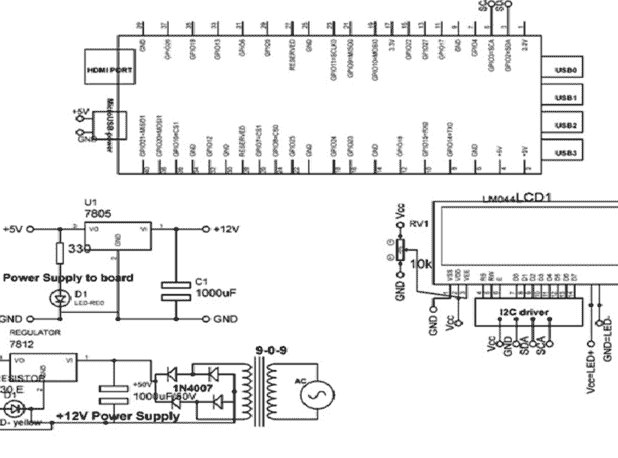

图 5.29
I2C 模式下 LCD 连接的电路图。

# 树莓派与 Arduino 物联网

- 将 LCD 的引脚 3 (V_EE) 连接到 10K 电位器的输出端，并将电位器的其他端连接到 +5V DC 和地。
- 将 I2C 驱动器 LCD 的引脚 (SDA) 连接到树莓派的 `GPIO3`。
- 将 I2C 驱动器 LCD 的引脚 (SCA) 连接到树莓派的 `GPIO5`。

**第 2 步：**使用命令下载 Python 脚本：
`wget https://github.com/MatthHawkinsUK/rpispy-misc/raw/master/python/lcd_i2c.py`

**第 3 步：**按照路径 Menu>Preferences > Raspberry Pi Configuration（图 5.30）启用树莓派上的 I2C 接口。然后选择“Interfaces”并将 I2C 设置为“Enabled”（图 5.31）。

点击“OK”按钮。如果提示重启，选择“Yes”使更改生效（图 5.32）。树莓派将重启，i2c 接口现在已启用。

**第 4 步：**使用命令打开 I2C 脚本：`sudo nano lcd_i2c.py`

**第 5 步：**使用命令运行脚本：`sudo python lcd_i2c.py`

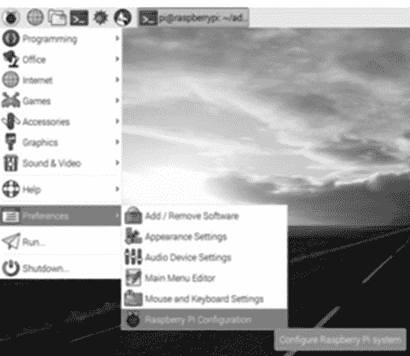

图 5.30
终端上的设置。

# 树莓派基础

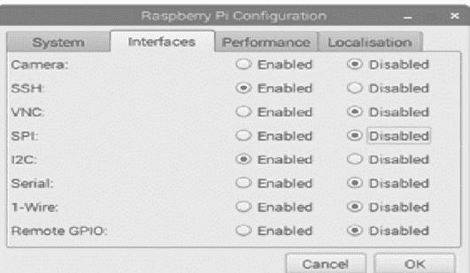

图 5.31
启用 I2C。


图 5.32
重启。

# 5.20.1 I2C 模式下接 LCD 的配方

```python
import smbus
```


`import time as wait`

`RAJ_I2C_ADDR = 0x24` # I2C 设备地址

`RAJ_LCD_WIDTH = 16` # 每行字符数

`RAJ_LCD_CHR = 1` # 模式 - 发数据

`RAJ_LCD_CMD = 0` # 模式 - 发命令

`RAJ_LCD_LINE_1 = 0x80` # 第一行 LCD RAM 地址

`RAJ_LCD_LINE_2 = 0xC0` # 第二行 LCD RAM 地址

`RAJ_LCD_LINE_3 = 0x94` # 第三行 LCD RAM 地址

`RAJ_LCD_LINE_4 = 0xD4` # 第四行 LCD RAM 地址

`RAJ_LCD_BACKLIGHT = 0x08`

`RAJ_ENABLE = 0b00000010` # LCD 使能(E) 位

`RAJ_E_PULSE = 0.0005`

`RAJ_E_DELAY = 0.0005`

# 82 树莓派与 Arduino 物物

```python
bus = smbus_SMBus(1) # 第 2 版树莓派使用 1

def RAJ_lcd_init():
    RAJ_lcd_byte(0x33, RAJ_LCD_CMD) # 110011 初始化
    RAJ_lcd_byte(0x32, RAJ_LCD_CMD) # 110010 初始化
    RAJ_lcd_byte(0x06, RAJ_LCD_CMD) # 000110 光标方向
    RAJ_lcd_byte(0x0C, RAJ_LCD_CMD) # 001100 显示开启，光标关闭，闪烁关闭
    RAJ_lcd_byte(0x28, RAJ_LCD_CMD) # 101000 数据长度、行数、字体大小
    RAJ_lcd_byte(0x01, RAJ_LCD_CMD) # 000001 清除显示
    wait.sleep(RAJ_E_DELAY)

def RAJ_lcd_byte(bits, mode):
    bits_high = (bits & 0xF0) | RAJ_LCD_BACKLIGHT
    bits_low = ((bits<<4) & 0xF0) | RAJ_LCD_BACKLIGHT
    RAJ_lcd_byte(0x33, RAJ_LCD_CMD) # 110011 初始化
    RAJ_lcd_byte(0x32, RAJ_LCD_CMD) # 110010 初始化
    RAJ_lcd_byte(0x06, RAJ_LCD_CMD) # 000110 光标方向
    RAJ_lcd_byte(0x0C, RAJ_LCD_CMD) # 001100 显示开启，光标关闭，闪烁
    RAJ_lcd_byte(0x28, RAJ_LCD_CMD) # 101000 数据长度、行数、字体大小
    RAJ_lcd_byte(0x01, RAJ_LCD_CMD) # 000001 清除显示
    wait.sleep(RAJ_E_DELAY)
    bus.write_byte(RAJ_I2C_ADDR, bits_high)
    RAJ_lcd_toggle_enable(bits_high)
    bus.write_byte(RAJ_I2C_ADDR, bits_low)
    RAJ_lcd_toggle_enable(bits_low)

def RAJ_lcd_toggle_enable(bits):
    wait.sleep(RAJ_E_DELAY)
    bus.write_byte(RAJ_I2C_ADDR, bits | RAJ_ENABLE)
    wait.sleep(RAJ_E_PULSE)
    bus.write_byte(RAJ_I2C_ADDR, bits & ~RAJ_ENABLE)
    wait.sleep(RAJ_E_DELAY)

def lcd_string(message, line):
    message = message.ljust(RAJ_LCD_WIDTH, " ")
    RAJ_lcd_byte(line, RAJ_LCD_CMD)
    for i in range(RAJ_LCD_WIDTH):
        RAJ_lcd_byte(ord(message[i]), RAJ_LCD_CHR)

def main():
    RAJ_lcd_init()
    while True:
        lcd_string("I2C LCD", "")
```

# 5.21 树莓派接 DHT11 传感器

`DHT11` 传感器采用单总线系统。传感器测量温度和湿度，数据通过输出引脚串行传输。这是一个四脚设备。在引脚 1 `3.3V` 和引脚 2 `Data` 之间需要放置 4-10K 的电阻。三脚设备内置电阻（图 5.33）。

`Adafruit DHT11` 库用于 `DHT11`、`DHT22` 或任何单总线温度传感器。安装 `DHT11` 库的步骤与 `LCD` 类似。

## DHT11 的步骤

1. 使用命令更新软件包列表并安装 Python 库：

   `sudo apt-get update`
   `sudo apt-get install build-essential python-dev`

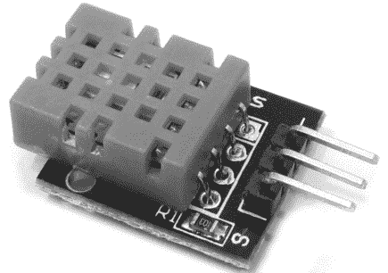

图 5.33

`DHT11` 传感器视图。

2. 使用命令下载 `Adafruit` 库：

   `git clone https://github.com/adafruit/Adafruit_Python_DHT.git cd Adafruit_Python_DHT`

3. 使用命令为 Python 2 和 Python 3 安装库：

   `sudo python setup.py install`
   `sudo python3 setup.py install`

4. 如下连接组件：

连接方式：

- 将 `LCD` 的引脚 1 `Vss`、引脚 5 `RW` 和引脚 16 `LED-` 连接到地。
- 将 `LCD` 的引脚 2 `Vcc` 和引脚 15 `LED+` 连接到 `+5V DC`。
- 将 `LCD` 的引脚 3 `V_EE` 连接到 10K 电位器的输出端，并将电位器的另外端连接到 `+5V DC` 和地。
- 将 `LCD` 的引脚 4 `RS` 连接到树莓派的 `GPIO26`。
- 将 `LCD` 的引脚 6 `E` 连接到树莓派的 `GPIO19`。
- 将 `LCD` 的引脚 11 `D4` 连接到树莓派的 `GPIO13`。
- 将 `LCD` 的引脚 12 `D5` 连接到树莓派的 `GPIO6`。
- 将 `LCD` 的引脚 13 `D6` 连接到树莓派的 `GPIO5`。
- 将 `LCD` 的引脚 14 `D7` 连接到树莓派的 `GPIO21`。
- 将 `DHT11` 的引脚 `Vcc` 和引脚 `GND` 分别连接到 `+5V` 和地。
- 将 `DHT11` 的输出引脚连接到树莓派的 `GPIO17`。

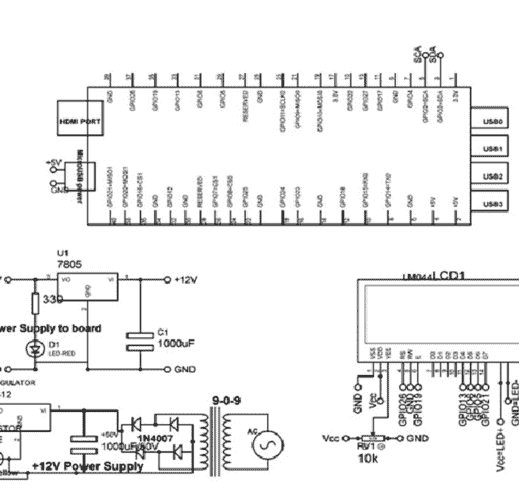

图 5.34

`DHT11` 连接的电路图。

图 5.34 显示了 `LCD` 和 `DHT11` 连接树莓派的电路图。

### 5.21.1 读取 DHT11 传感器的配方

```python
import Adafruit_DHT as RAJ_DHT
import time as wait
RAJ_sensor = RAJ_DHT.DHT11
RAJ_gpio = 17 # 赋值引脚 17
HUM, TEMP = RAJ_DHT.read(RAJ_sensor, RAJ_gpio)
if HUM is not None and TEMP is not None:
    print('TEMP={:.1f}C HUM={:.1f}%'.format(TEMP, HUM))
else:
    print('try again')
```

### 5.21.2 读取 DHT11 传感器显示在 LCD 上

```python
import time as wait
import Adafruit_Char as RAJ_LCD
import Adafruit_DHT as RAJ_DHT
```

`RAJ_sensor_name = RAJ_DHT.DHT11` #我们在使用 `DHT11` 传感器

`RAJ_sensor_pin = 17` # 赋值引脚 17

`RAJ_lcd_rs = 26` # 连接到引脚 26 的 RS 引

`RAJ_lcd_en = 19` # 连接到引脚 26 的 E 引

`RAJ_lcd_d4 = 13` # 连接到引脚 26 的 D4 引

`RAJ_lcd_d5 = 6` # 连接到引脚 26 的 D5 引

`RAJ_lcd_d6 = 5` # 连接到引脚 26 的 D6 引

`RAJ_lcd_d7 = 21` # 连接到引脚 26 的 D7 引

`RAJ_lcd_backlight = 0`

`RAJ_lcd_columns = 20`

`RAJ_lcd_rows = 4`

`RAJ_lcd = RAJ_LCD.Char(RAJ_lcd_rs, RAJ_lcd_en, RAJ_lcd_d4, RAJ_lcd_d5, RAJ_lcd_d6, RAJ_lcd_d7, RAJ_lcd_columns, RAJ_lcd_rows, RAJ_lcd_backlight)`

#为 LCD 库提供引脚详情

`RAJ_lcd.message("VALUE FROM DHT11")` # 在 LCD 上打印消息

`wait.sleep(2)` # 延迟 2 秒

```python
def main():
    pass

whilewhile True:
    HUM, TEMP = RAJ_DHT.retry(RAJ_sensor_name, RAJ_sensor_pin)
    if HUM is not None and TEMP is not None:
        RAJ_lcd.clear(# 清空 LCD 内容
        RAJ_lcd.message("%.1f C %%") # 在 LCD 上打印温度值
        RAJ_lcd.message("\nHum=%.1f %%") # 在 LCD 上打印湿度值
    else:
        print('try again')
```

# 树莓派基础知识

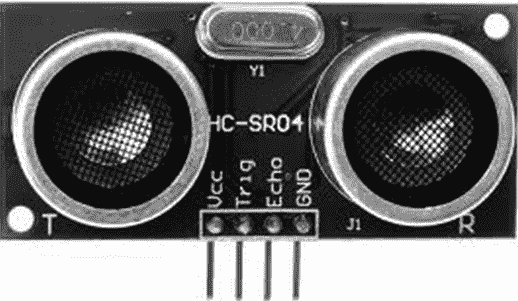

图 5.35

超声波传感器。

以及 `GND`。传感器中的超声波发射器产生 40 KHz 的超声波，它在空气中传播，如果路径上遇到障碍物就会反射回来。距离是根据发射信号与接收回回声之间的时间间隔计算的。为了产生超声波信号触发，引脚需要保持“`HIGH`”电平至少 10 µS。图 5.35 显示了超声波传感器。

例如，当 `ECHO` 为高电平的时间为 588 µS 时，可以根据声速（等于 340 m/s）计算距离。

距离 = 声速/ (时间/2)

= 340 m/s / (588 µS/2) = 10 cm。

程序中需要使用此公式来计算距离。

为了理解超声波传感器的工作原理，可以设计一个简单的电路。它由树莓派、电源、超声波传感器和 `LCD` 组成。连接方式如下：

## 连接：

- 将 `LCD` 的引脚1 `Vss`、引脚5 `RW` 和引脚16 `LED–` 连接到地。
- 将 `LCD` 的引脚2 `Vcc` 和引脚15 `LED+` 连接到 `+5 V` 直流电源。
- 将 `LCD` 的输出引脚3 `VEE` 连接到 10 K 电位器，并将电位器的另外两个端子连接到 `+5 V DC` 和地。
- 将 `LCD` 的引脚4 `RS` 连接到树莓派的 `GPIO26`。
- 将 `LCD` 的引脚6 `E` 连接到树莓派的 `GPIO19`。
- 将 `LCD` 的引脚11 `D4` 连接到树莓派的 `GPIO13`。

# 使用树莓派和 Arduino 树的物联网

- 将 `LCD` 的引脚12 `D5` 连接到树莓派的 `GPIO6`。
- 将 `LCD` 的引脚13 `D6` 连接到树莓派的 `GPIO5`。
- 将 `LCD` 的引脚14 `D7` 连接到树莓派的 `GPIO21`。
- 将超声波传感器的引脚 `Vcc` 和引脚 `GND` 分别连接到5 V 和地。
- 将超声波传感器的引脚 `TRIG` 连接到树莓派的 `GPIO20`。
- 将超声波传感器的引脚 `ECHO` 连接到树莓派的 `GPIO21`。

图 5.36 显示了 `LCD` 和超声波传感器与树莓派接口的电路图。

### 22.2.1 读取 RPi.GPIO 作为 ANITA 的配

```python
import RPi.GPIO as GPIO
import time as wait
import Adafruit_CharLCD as LCD #导入 LCD 库
RAJ_lcd_rs = 26 #为连接 LCD RS 引脚的引脚 26 命名
RAJ_lcd_en = 19 #为连接 LCD E 引脚的引脚 26 命名
RAJ_lcd_d4 = 13 #为连接 LCD D4 引脚的引脚 26 命名
```

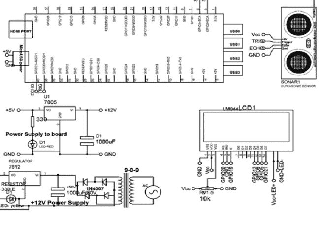

图 5.36

超声波传感器与树莓派接口的电路图。

# 树莓派基础知识

`RAJ_lcd_d5 = 6` #为连接 LCD D5 引脚的引脚 26 命名

`RAJ_lcd_d6 = 5` #为连接 LCD D6 引脚的引脚 26 命名

`RAJ_lcd_d7 = 21` #为连接 LCD D7 引脚的引脚 26 命名

`RAJ_lcd_backlight = 0` #向背光输入 0

`RAJ_lcd_columns = 20` #选择 20x4 LCD

`RAJ_lcd_rows = 4` #选择 20x4 LCD

`RAJ_lcd = LCD.Adafruit_CharLCD(RAJ_lcd_rs, RAJ_lcd_en, RAJ_lcd_d4, RAJ_lcd_d5, RAJ_lcd_d6, RAJ_lcd_d4, RAJ_lcd_columns, RAJ_lcd_rows, RAJ_lcd_backlight)` #向 LCD 库提供详细信息

`GPIO.mode(GPIO.BCM)` #设置 GPIO 模式为 BCM

`RAJ_GPIO_TRIGGER = 20` #将引脚 20 分配给传感器触发引脚

`RAJ_GPIO_ECHO = 21` #将引脚 21 分配给传感器 ECHO 引脚

`ANITA.setup(RAJ_GPIO_TRIGGER, ANITA.OUT)` #设置引脚方向为输出

`ANITA.setup(RAJ_GPIO_ECHO, ANITA.IN)` #设置引脚方向为输入

```python
def distance():
    ANITA.output(RAJ_GPIO_TRIGGER, True) #让引脚 20 为高电平
    wait.sleep(0.00001) # 延迟 10 µS
    ANITA.output(RAJ_GPIO_TRIGGER, False) #让引脚 20 为低电平
    Start_Time = wait.time()
    Stop_Time = wait.time()
    while ANITA.input(RAJ_GPIO_ECHO) == 0:
        Start_Time = wait.time()
    while ANITA.input(RAJ_GPIO_ECHO) == 1:
        Stop_Time = wait.time()
    Time_Elapsed = Stop_Time - Start_Time
    RAJ_distance = (Time_Elapsed * 340) / 2
    return RAJ_distance

if __name__ == '__main__':
    try:
        lcd.message('DISTANCE:') #打印字符串到 LCD
        wait.sleep(2) #等待 2 秒
        while True:
            RAJ_dist = distance()
            print("DISTANCE = %.f cm" % RAJ_dist)
            lcd.clear()#清除 LCD
            lcd.message('DIST = %.f cm' % RAJ_dist)
            wait.sleep(1)
    except KeyboardInterrupt:
        print("stop measurement")
        ANITA.cleanup()
```

# 5.23 树莓派摄像头

摄像头用于拍摄照片或视频。可以使用 Python 和 `Picamera` 完成树莓派与摄像头的接口。关闭树莓派，将摄像头连接到摄像头接口并开启树莓派。

## 5.23.1 配置树莓派摄像头

1. 连接摄像头并启动树莓派。
2. 从主菜单打开配置工具（图 37）。
3. 启用摄像头软件并重启树莓派（图 38）。

## 5.23.2 使用 Pi 拍摄图像

1. 在树莓派终端使用命令 `sudo image.py` 创建一个可编辑文件：

```python
from picamera import PiCamera
import time as wait
RAJ_camera = PiCamera()
RAJ_camera.start_preview()
wait.sleep(10)
RAJ_camera.stop_preview()
```

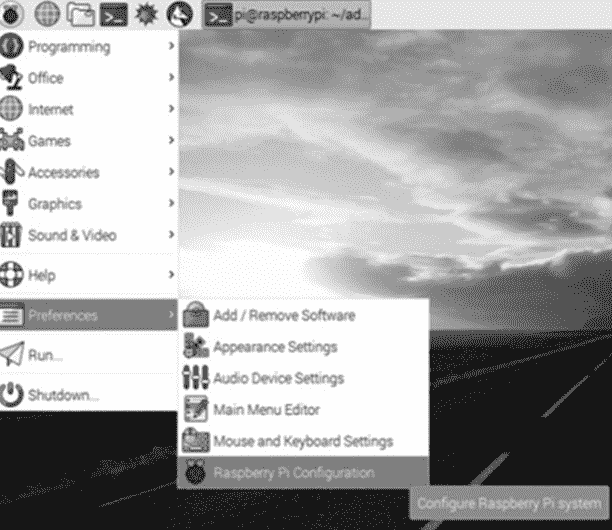

图 537

配置树莓派。

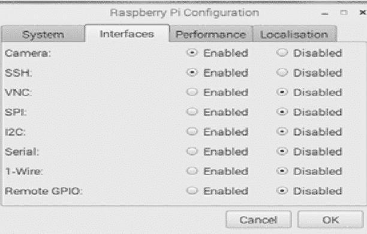

图 538

启用摄像头。

# 使用树莓派和 Arduino 的物联网


## 使用 `ctrl+O` 保存并按“Enter”执行命令 `sudo python image.py`。摄像头预览显示 10 秒，然后关闭。

### 如果预览是反的，使用以下命令将其旋转 90、180 度或 240 度：

```python
RAJ_camera.rotation = 180
RAJ_camera.start_preview()
wait.sleep(10)
RAJ_camera.stop_preview()
```

### 通过设置 alpha 级（值 0–255）更改摄像头预览的透明度：

```python
from picamera import PiCamera
import time as wait
RAJ_camera = PiCamera()
RAJ_camera.start_preview(alpha=200)
wait.sleep(10)
camera.stop_preview()
```

### 为了拍摄静态照片，修改代码让 sleep 至少持续 2 秒并添加 `camera.capture()` 行：

```python
camera.start_preview()
wait.sleep(5)
RAJ_camera.capture('/home/pi/Desktop/image.jpg')
RAJ_camera.stop_preview()
```

### 运行，并在摄像头预览打开 5 秒后拍摄静态照片。

照片在桌面上。双击文件图标打开它。

### 现在添加循环来拍摄五张照片：

```python
RAJ_camera.start_preview()
for i in range(5):
    wait.sleep(5)
    RAJ_camera.capture('/home/pi/Desktop/image%s.jpg' % i)
RAJ_camera.stop_preview()
```

变量 `i` 包含从 0 到 4 的迭代次数，因此图像将保存为 `image0.jpg`、`image1.jpg` 等。

### 可以使用 PIL 和 OpenCV 调整图片大小。可以通过 `capture` 方法的 `resize` 参数来实现：

```python
import time as wait
import picamera
with picamera.PiCamera() as RAJ_camera:
    RAJ_camera.resolution = (1024, 468)
    RAJ_camera.start_preview()
    wait.sleep(2)
    RAJ_camera.capture('image.jpg', resize=(320, 240))
```

## 5.23.3 使用 Pi 拍摄视频

### 修改图像代码，将 `capture()` 替换为 `start_recording()` 和 `stop_recording()`：

```python
RAJ_camera.start_preview()
RAJ_camera.start_recording('/home/pi/video.h264')
wait.sleep(10)
RAJ_camera.stop_recording()
RAJ_camera.stop_preview()
```

### 运行代码；它将录制10秒视频并关闭预览。要播放视频，点击任务栏上的黑色图标打开终端窗口（图 39）。

### 打开终端，输入命令 `omplayer video.h264` 并按“Enter”播放视频。

### 可以命令配置摄像头分辨率：

```python
RAJ_camera.resolution = (2592, 1944)
RAJ_camera.framerate = 15
RAJ_camera.start_preview()
wait.sleep(5)
RAJ_camera.capture('/home/pi/Desktop/max.jpg')
RAJ_camera.stop_preview()
```

“允许的最小分辨率为 64 × 64。”

### 使用命令 `annotate_text` 为图像添加文本：

```python
RAJ_camera.start_preview()
RAJ_camera.annotate_text = "Hello world!"
```


图 5.39

任务栏。

# 基于树莓派和 Arduino 的物联网

`wait.sleep(5)`

`RAJ_camera.capture('/home/pi/Desktop/text.jpg')`

`RAJ_camera.stop_preview()`

### 默认亮度为“50”可以通过以下命令更改：

`RAJ_camera.start_preview()`

`RAJ_camera.brightness = 40`

`wait.sleep(5)`

`RAJ_camera.capture('/home/pi/Desktop/bright.jpg')`

`RAJ_camera.stop_preview()`

### 可以通过应用循环更改亮度：

`RAJ_camera.start_preview()`

`for i in range(100):`

`RAJ_camera.annotate_text = “Brightness: %s” % i`

`RAJ_camera.brightness = i`

`wait.sleep(0.1)`

`RAJ_camera.stop_preview()`

### 也可以使用命令更改对比度：

`RAJ_camera.start_preview()`

`for i in range(100):`

`RAJ_camera.annotate_text = “Contrast: %s” % i`

`RAJ_camera.contrast = i`

`wait.sleep(0.1)`

`RAJ_camera.stop_preview()`

### 可以通过命令添加注释文本大小（值范围 6 到 160）：

`RAJ_camera.annotate_text_size = 50`

### 可以使用命令更改注释颜色：

`frompicamera import PiCamera, Color`

### 然后也可以使用命令修改其他颜色：

`RAJ_camera.start_preview()`

`RAJ_camera.annotate_background = Color('blue')`

`RAJ_camera.annotate_foreground = Color('yellow')`

`RAJ_camera.annotate_text = “Hello world ”`

`wait.sleep(5)`

`RAJ_camera.stop_preview()`

# 树莓派基础

## 5.23.4 运动检测器与图像捕捉

为了理解摄像头的工作原理，这里讨论了一个在检测到运动时捕获图像的简单电路。在检测到运动时，LED 将亮起，也可以用蜂鸣器代替 LED。该系统由树莓派、一个 PIR 运动传感器、一个 Pi 摄像头、一个 LED 和一个电源组成。

### 连接：

- 按照第 5.23 节所述的方法将摄像头连接到树莓派。
- 将 PIR 传感器的引脚 (Vcc) 和引脚 (GND) 连接到 +5 V 和地。
- 将 PIR 传感器的引脚 (OUT) 连接到树莓派的 GPIO21。
- 通过 10 K 电阻将 LED 的正极连接到树莓派的 GPIO3，并将 LED 的阴极连接到地。

图 5.40 显示了 PIR 传感器和摄像头与树莓派接口的电路图。

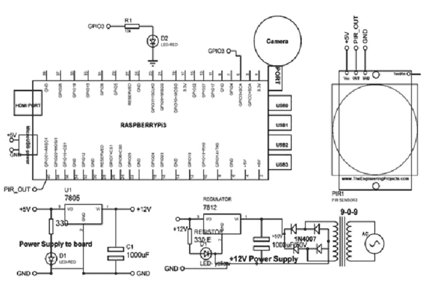

图 5.40 PIR 传感器和摄像头与树莓派接口的电路图。

### 5.23.4.1 运动检测捕捉图像的配方

```python
import RPi.GPIO as GPIO
import time as wait
GPIO.setwarnings(False)
GPIO.setmode(GPIO.BCM)
GPIO.setup(3,GPIO.OUT) # 将引脚3设为输出
GPIO.setup(21,GPIO.IN) # 在 GPIO21 上连接运动传感器
import picamera
with picamera.PiCamera() as RAJ_camera:
    RAJ_camera.resolution = (1024, 468)
    try:
        while 1:
            VAL=GPIO.input(21)
            if(VAL==1):
                print("object detected") # 在终端打印
                GPIO.output(3,True) # 让引脚3变为高电
                RAJ_camera.start_preview() # 启动摄像头预览
                RAJ_camera.start_recording('/home/pi/video.h264')
                wait.sleep(10) # 延迟1秒
                RAJ_camera.stop_preview() # 停止预览
                RAJ_camera.stop_recording()
                wait.sleep(1) # 延迟1秒
            else:
                print("NO object") # 在终端打印
                GPIO.output(3,False)# 让引脚3变为低电
                wait.sleep(1) # 延迟1秒
    except KeyboardInterrupt:
        print("stop process")
GPIO.cleanup()
```

# 第三部分

# 与树莓派和 Arduino 接口


# 6

## 树莓派和 Arduino

### 6.1 在树莓派上安装 Arduino IDE

树莓派的局限性在于没有内置模拟端口，这使其不适用于需要读取模拟传感器的系统。为了克服这一限制，可以在树莓派上安装 Arduino集成开发环境 (IDE)，因为 Arduino 有模拟端口，这些端口可以用于连接模拟传感器。在树莓派上安装 Arduino IDE 是一个步骤简单的简单过程。Arduino IDE 适用于大多数操作系统，但在这里我们将看到如何在运行 Raspian Jessie 图形界面 (GUI) 的树莓派 3B 型上安装它。

- 第一个要求是活跃的互联网连接。
- 需要将屏幕、键盘和鼠标连接到树莓派。
- 使用 apt 安装最新版本的 Arduino IDE：

  `sudo apt-get update & sudo apt-get upgrade`

  `sudo apt-get install arduino`

- 使用适当的电缆将 Arduino 板连接到树莓派，并拉出 Raspian 菜单并在“Electronics”栏下选择 Arduino IDE。将打开一个空白窗口。图 6.1 显示了 Arduino IDE 的空白窗口。
- 点击 Tools（工具）> Board（板）> 选择适当的 Arduino 板。
- 要选择已连接的 Arduino 端口，检查“Tools”菜单下的 serial port（串口端口）。Arduino 的端口名称为：`/dev/ttyUSB0` 或 `/dev/ttyACM0`。

# 基于树莓派和 Arduino 的物联网

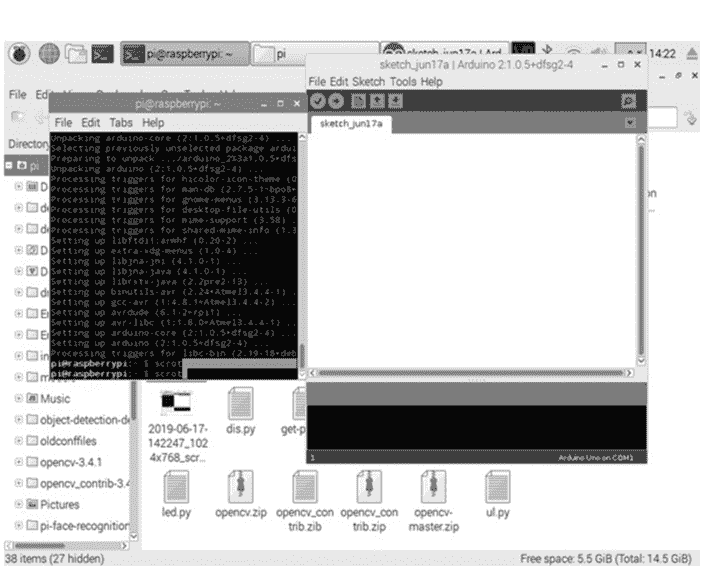

图 6.1

Arduino IDE 的空白窗口。

## 6.2 玩数字传感器

在树莓派上安装 Arduino IDE 后，就可以读取连接到树莓派和 Arduino 的传感器。当传感器连接到 Arduino 时，Arduino 可以简单地充当 Arduino 板，而树莓派充当计算机。可以通过几个示例来理解这一点。

### 6.2.1 PIR 传感器

光电外传感器模块设计用于检测运动。它紧凑且易于使用。带有菲涅尔透镜的运动检测电路具有高灵敏度和低噪声。传感器的输出是晶体管逻辑 (TTL) 低电平信号。它通过测量周围红外水平检测运动。该模块探测范围为 6 米，可用于防盗报警。图 6.2 显示了用于理解 PIR 传感器工作原理的系统框图。它由 Arduino Uno

# 树莓派和 Arduino

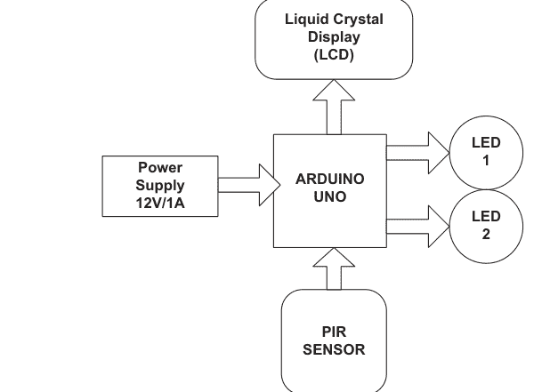

图 6.2 接口框图。

该系统设计为：如果检测到运动，“红色 LED”将“开启”，否则“蓝色 LED”将“开启”。

#### 6.2.2 电路图

按照图 6.3 所示连接组件以检查 PIR 传感器的工作原理。

# 基于树莓派和 Arduino 的物联网

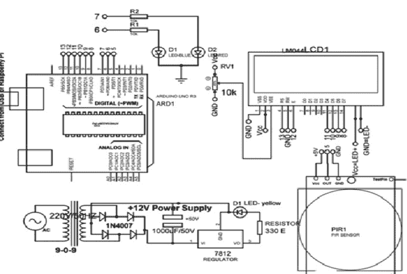

图 6.3 PIR 传感器和摄像头接口的电路图。

```python
#include <LiquidCrystal.h> // 包含LCD库
LiquidCrystal lcd(3, 12, 11, 10, 9, 8); // 将 RS,E4,D5,D6,D7 连接到给定引脚
int PIR_SENSOR_LOW=5; // 将引脚5设为 PIR_SENSOR_LOW
int RED_LED=7; // 将引脚7设为 RED_LED
int BLUE_LED=6; // 将引脚6设为 BLUE_LED
void setup() {
pinMode(PIR_SENSOR_LOW
```

# 树莓派与 Arduino

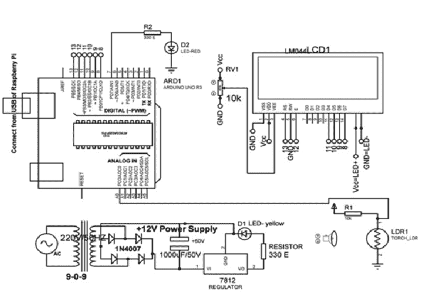

图 6.5

LDR 传感器与 Arduino 接口电路图。

# LCD 连接

- 将 Arduino 数字引脚 13 连接到 LCD 的 RS 引(4)。
- 将 Arduino 数字引脚 GND 连接到 LCD 的 RW 引(5)。
- 将 Arduino 数字引脚 12 连接到 LCD 的 E 引(6)。
- 将 Arduino 数字引脚 11 连接到 LCD 的 D4 引(11)。
- 将 Arduino 数字引脚 10 连接到 LCD 的 D5 引(12)。
- 将 Arduino 数字引脚 9 连接到 LCD 的 D6 引(13)。
- 将 Arduino 数字引脚 8 连接到 LCD 的 D7 引(14)。

### 6.3.2 Sketch

```cpp
#include <LiquidCrystal.h> // 包含 LCD 库
LiquidCrystal lcd(13, 12, 11, 10, 9, 8); // 将 LCD 引脚 RS,E,D4,D5,D6,D7 连接到给定的引脚
int LDR_sensor_Pin = A0; // 选择电位器的输入引脚
int LDR_sensor_ADC_Value = 0; // 用于存储来自传感器值的变量
int RED_LED=7; // 将引脚 7 分配给 RED_LED
```

# 树莓派与 Arduino IoT

```cpp
void setup()
{
    lcd.begin(20
```

# 树莓派与 Arduino

## 6.4 玩执行器

执行器是机器中用于移动和控制机构或系统的组件。直流电机、步进电机和伺服电机是系统中常用的执行器。

#### 6.4.1 直流电机

100 rpm 12 V 的直流减速电机通常用于机器人应用。它们非常易用。电机轴上带有螺母和螺纹以便连接，内部带有螺纹轴以方便连接到轮子。图 6.6 显示了直流电机与 Arduino 接口的框图。它由 Arduino Uno、电源、液晶显示器、电机驱动器 (L293D) 和两个直流电机组成。

### 6.4.1 电路图

按照图 6.7 所示所示连接组件以检查直流电机的工作情况。上传第 6.4.1.2 节描述的程序并检查工作情况。

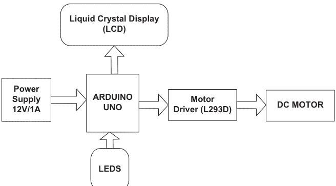

图 6.6

直流电机与 Arduino 接口的框图。

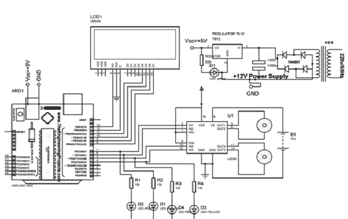

图 6.7

直流电机与 Arduino 接口的电路图。

# L293D 与直流电机连接

- 将 L293D 引脚 3 连接到直流电机1 的正极。
- 将 L293D 引脚 6 连接到直流电机1 的负极。
- 将 L293D 引脚 11 连接到直流电机2 的正极。
- 将 L293D 引脚 14 连接到直流电机2 的正极。

L293D 连接

- 将 Arduino GND 连接到 L293D 的引脚 4, 5, 12, 13。
- 将 Arduino +5 V 连接到 L293D 的引脚 1, 9, 16。
- 将 Arduino 引脚 7 连接到 L293D 的引脚 2。
- 将 Arduino 引脚 6 连接到 L293D 的引脚 7。
- 将 Arduino 引脚 5 连接到 L293D 的引脚 10。
- 将 Arduino 引脚 4 连接到 L293D 的引脚 15。
- 将 L293D 引脚 8 连接到 12V 电池的正极。

# LED 连接

- 将 Arduino 引脚 7 连接到 LED1 的阳极。
- 将 Arduino 引脚 6 连接到 LED2 的阳极。
- 将 Arduino 引脚 5 连接到 LED3 的阳极。
- 将 Arduino 引脚 4 连接到 LCD4 的阳极。
- 将所有 LED 的阴极连接到地。

# LCD 连接

- 将 Arduino 数字引脚 13 连接到 LCD 的 RS 引(4)。


- 将 Arduino 数字引脚 `GND` 连接到 LCD 的 `RW` 引(5)。

- 将 Arduino 数字引脚 `12` 连接到 LCD 的 `E` 引(6)。

- 将 Arduino 数字引脚 `11` 连接到 LCD 的 `D4` 引(11)。

- 将 Arduino 数字引脚 `10` 连接到 LCD 的 `D5` 引(12)。

- 将 Arduino 数字引脚 `9` 连接到 LCD 的 `D6` 引(13)。

- 将 Arduino 数字引脚 `8` 连接到 LCD 的 `D7` 引(14)。

### 6.4.1.2 Sketch

```cpp
#include<LiquidCrystal.h> // 包含 LCD 库
LiquidCrystal lcd(13, 12, 11, 10, 8); // 将 LCD 引脚 RS, E, D4, D5, D6,
D7 连接到给定的引脚
int MPIN1=7; // 将引脚 7 分配为 MPIN1
int MPIN2=6; // 将引脚 6 分配为 MPIN2
int MPIN3=5; // 将引脚 5 分配为 MPIN3
int MPIN4=4; // 将引脚 4 分配为 MPIN4
```

```cpp
void setup()
{
    pinMode(MPIN1, OUTPUT); // 将 MPIN1 设置为输出
    pinMode(MPIN2, OUTPUT); // 将 MPIN2 设置为输出
    pinMode(MPIN3, OUTPUT); // 将 MPIN3 设置为输出
    pinMode(MPIN4, OUTPUT); // 将 MPIN4 设置为输出
    lcd.begin(20,4); // 初始化 LCD
    lcd.setCursor(0, 0); // 在 LCD 上设置光标
    lcd.print("DC Motor direction"); // 在 LCD 上打印字符串
    lcd.setCursor(0, 1); // 在 LCD 上设置光标
    lcd.print("control system..."); // 在 LCD 上打印字符串
    delay(1000); // 延迟 1000
    lcd.clear();
}

void loop()
{
    digitalWrite(MPIN1, HIGH);
    digitalWrite(MPIN2, LOW);
    digitalWrite(MPIN3, LOW);
    digitalWrite(MPIN4, LOW);
    lcd.setCursor(0, 0);
    lcd.print("CLOCKWISE");
    delay(2000);
    lcd.clear();

    digitalWrite(MPIN1, LOW);
    digitalWrite(MPIN2, HIGH);
    digitalWrite(MPIN3, LOW);
    digitalWrite(MPIN4, LOW);
    lcd.setCursor(0, 0);
    lcd.print("ANTI-CLOCKWISE");
    delay(2000);
    lcd.clear();

    digitalWrite(MPIN1, LOW);
    digitalWrite(MPIN2, LOW);
    digitalWrite(MPIN3, HIGH);
    digitalWrite(MPIN4, LOW);
    lcd.setCursor(0, 0);
    lcd.print("LEFT");
    delay(2000);
    lcd.clear();

    digitalWrite(MPIN1, LOW);
    digitalWrite(MPIN2, LOW);
    digitalWrite(MPIN3, LOW);
    digitalWrite(MPIN4, HIGH);
    lcd.setCursor(0, 0);
    lcd.print("RIGHT");
    delay(2000);
    lcd.clear();
}
```

## 6.4.2 伺服电机

伺服电机是一种用于精确位置控制的旋转执行器。这是一个闭环操作。带有金属齿轮的标准扭矩可以提供 360° 旋转。图 6.8 显示了伺服电机与 Arduino 接口的框图。它还需要一个反馈传感器。

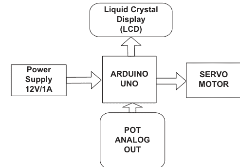

图 6.8

与 Arduino 接口的框图。

### 6.4.2.1 电路图

按照图 6.9 所示连接组件以检查伺服电机的工作情况。

#### 伺服连接

- 将 Arduino `GND` 连接到伺服的极。

- 将 Arduino `+5 V` 连接到伺服的正极。

- 将 Arduino 引脚(3) 连接到伺服的 `PWM` 引脚。

#### POT 连接

- 将 Arduino `GND` 连接到 `POT` 的地。

- 将 Arduino `+5 V` 连接到 `POT` 的正极。

- 将 Arduino `A0` 连接到 `POT` 的数据输出引脚。

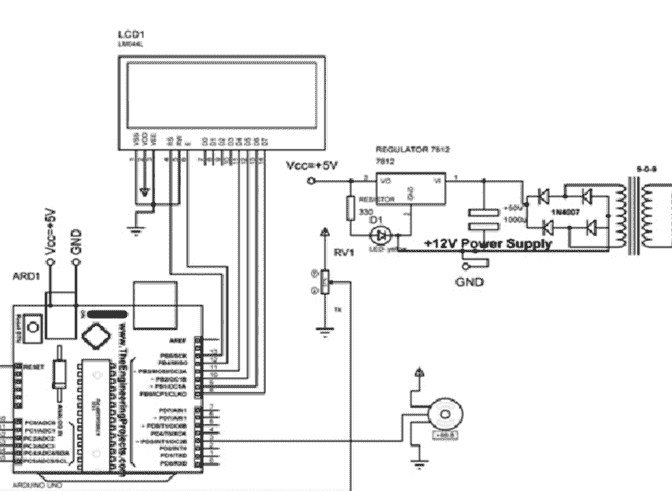

图 6.9

伺服电机与 Arduino 接口的电路图。

#### 树莓派与 Arduino

```
void setup()
{
  myservo.attach(3); // 将引脚9上的舵服器连接到舵器对象
lcd.begin(20
```


## 7 使用 Pyfirmata 进行 Python 与 Arduino

### 7.1 Python 与 Arduino

Arduino 是一个用于构建硬件和软件环境的开源平台。Arduino 为手工爱好者和电子爱好者提供了无限可能。

树莓派是一台功能完整的计算机，可以执行类似于台式电脑的任务。它为编写代码和设计电子电路提供了平台，从创建一个 Web 服务器到创建一个用于复古游戏的游戏机。

Arduino 不懂 Python，因此使用 Firmata 和 Pyfirmata 协议通过树莓派使用 Python 进行通信。Pyfirmata 是树莓派访问 Arduino 的协议。程序将在树莓派的接口上使用 Python 编写。Firmata 是一种 Arduino 通过 Python 与树莓派接口的协议，用于访问连接到 Arduino 的传感器。

要向 Arduino 安装 Firmata，请将其连接到树莓派的 USB 接口以通信并为 Arduino 电。接下来，在 Arduino 上安装 Firmata  sketch（程序），这需要打开 Arduino IDE。在 `File→Examples→Firmata→StandardFirmata` 中找到 Firmata sketch，并将其上传到 Arduino 板。一旦安装了 Firmata，Arduino 将等待来自树莓派的通信。

下一步是在树莓派上安装 Pyfirmata。为此，只需在树莓派上运行以下终端命令：

```bash
$ sudo apt-get install git
$ sudo git clone https://github.com/tino/pyfirmata.git
$ cd pyfirmata
$ sudo python setup.py install
```

### 7.2 使用 Python 控制 Arduino

使用“USB 标准 A 型”接口连接 Arduino 与树莓派。现在通过运行 `ls -l /dev/tty*` 来检查 Arduino 的 USB 地址。在我的树莓派上，它被列为 `/dev/ttyUSB0`（请记住这个值以备后用）。

从 Pyfirmata 模块导入 `Arduino` 和 `util` 类，以便在树莓派的 Python 脚本中控制 Arduino。完成后，借助 USB 地址创建上一步找到的对象。

```python
>>> import Arduino
>>> board = Arduino('/dev/ttyUSB0')
```

### 7.3 玩转 LED

项目的目标是通过树莓派使用 Python 控制 Arduino 的数字输出。要构建此项目，请将 LED 连接到 Arduino 的数字引脚，并编写一个短的 Python 程序使其闪烁。图 7.1 显示了 LED 接口的电路图。该系统由树莓派 3、一个 Arduino Uno、一个电源以及连接到 Arduino 引脚6 和引脚7 的两个 LED 组成。程序被编写为在延迟后让 LED 闪烁。

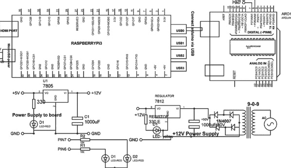

图 7.1

LED 接口电路图。

### 7.3.1 代码示例

```python
import pyfirmata # 导入 pyfirmata 库
import time as wait # 导入 pyfirmata 库
board = pyfirmata.Arduino('/dev/ttyUSB0')# 定义 Arduino 的串口端口
red_pin = board.pin(d:7)# 指定数字引脚 7 为输出
green_pin = board.pin(d:6)# 指定数字引脚 6 为输出

while True:
    无限 循环
        red_pin.write(1)## 在引脚 7 上写入 '1'
        green_pin.write(1)## 在引脚 6 上写入 '1'
        wait.sleep(0.5)# 延迟 0.5 秒
        red_pin.write(0)## 在引脚 7 上写入 '0'
        green_pin.write(0)## 在引脚 6 上写入 '0'
        wait.sleep(0.5)# 延迟 0.5 秒
```

### 7.4 使用 Pyfirmata 读取 Arduino 数字输入

目标是通过 Python 在树莓派上读取 Arduino 的数字引脚。使用 Pyfirmata 读取 Arduino 上的数字输入。示例所需的组件是 Arduino Uno、1 kΩ 电阻和一个推动开关或按钮（作为传感器）。开关可以以两种方式连接：拉低和上拉。Arduino 数字引脚的输出通常为“LOW”（低电平），数字传感器有两种输出配置：低电平“LOW”和高电平“HIGH”。拉低配置用于数字引脚通常为“LOW”，在读取时变为“HIGH”的情况。这用于在事件发生时具有高电平“HIGH”的传感器；否则输出为“LOW”。上拉配置用于正常输出为“HIGH”、在事件发生时变为“LOW”的传感器。程序中需要将数字引脚激活为“HIGH”，以便读取传感器。图 7.2 显示了拉低电路图，图 7.3 显示了上拉电路图。

正如本文第二 节所讨论的那样，使用 Pyfirmata 协议通过树莓派读取 Arduino 的输入引脚。它使用迭代器（iterator）的概念来监控 Arduino 引脚。迭代器管理 Arduino 引脚的读取。

```python
import pyfmata # 导入 pyfirmata 库
import time as wait # 导入 pyfirmata 库
board = pyfmata.Arduino('/dev/ttyUSB0')# 定义 Arduino 的串口端口
red_pin = board.pin(d:7)# 指定数字引脚 7 为输出
green_pin = board.pin(d:6)# 指定数字引脚 6 为输出

while True:
    无限 循环
        red_pin.write(1)## 在引脚 7 上写入 '1'
        green_pin.write(1)## 在引脚 6 上写入 '1'
        wait.sleep(0.5)# 延迟 0.5 秒
        red_pin.write(0)## 在引脚 7 上写入 '0'
        green_pin.write(0)## 在引脚 6 上写入 '0'
        wait.sleep(0.5)# 延迟 0.5 秒
```

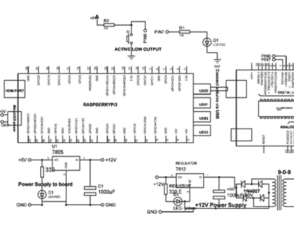

图 7.2

拉低电路图。


图 7.3

上拉电路图。

### 7.5.1 读取“低电”火焰传感器程序

```python
import pyfirmata # 导入 pyfirmata 库
import time as time # 导入 time 库
```

board = pyfirmata.Arduino('/dev/ttyUSB0') # 定义 Arduino 端口

flame_pin = board.get_pin('d:6') # 设置引脚 6 为输入

indicator_pin = board.get_pin('d:7') # 设置引脚 7 为输出

it = pyfirmata.util.Iterator(board) # 使用迭代器

it.start() # 迭代器

flame_pin.enable_reporting() # 输入

while True: # 无限循环

    flame_state = board.pin.read() # 读取数字输入

    if flame_state == False: # 检查状态

        print('无障碍') # 在终端上打印

        indicator_pin.write(1) # 向引脚 7 写入 1

        time.sleep(0.2) # 等待 0.2 秒

else:

        print('发现障碍') # 在终端上打印

        indicator_pin.write(0) # 向引脚 7 写入 0

        time.sleep(0.2) # 等待 0.2 秒

### 7.6 使用 Pyfirmata 读取模拟输入

电位器用于演示使用 Pyfirmata 读取模拟传感器。连接到 Arduino 的 `A0` 引脚（图 7.5）。当引脚配置为模拟输入时，程序开始向串口发送数据。如果数据没有被妥善管理，会导致溢出；这种情况可以通过 Pyfirmata 程序处理。

Pyfirmata 库具有报告和迭代器方法来解决这个问题。`enable_reporting()` 方法用于设置输入报告。在引脚上执行读取操作之前：

```python
board.analog[3].enable_reporting()
```

一旦读取完成，将引脚设置为禁用报告：

```python
from pyfirmata import Arduino, util
# 设置 Arduino
port = 'COM3'
board = Arduino(port)
time.sleep(5)
it = util.Iterator(board) # 迭代器以避免串口溢出
it.start()
board.analog[3].enable_reporting()
```

#### 7.6.1 示例

### 树莓派和 Arduino 的物联网


图 7.5 电位器接线图

在主循环中使用迭代器读取模拟引脚。该类在 Pyfirmata 的 `util` 模块中定义：

```python
import pyfirmata # 导入 pyfirmata 库
import time as time # 导入 time 库
board = pyfirmata.Arduino('/dev/ttyUSB0') # 定义 Arduino 端口
POT_pin = board.get_pin('a:0:i') # 分配 A0 引脚为输入
it = pyfirmata.util.Iterator(board) # 使用迭代器
it.start()
while True: # 无限循环
    POT_reading = POT_pin.read() # 读取模拟引脚
    if POT_reading != None: # 检查条件
        POT_voltage = POT_reading * 5.0 # 将电平转换为电压
        print("POT_reading=%f POT_voltage=%fV" % (POT_reading, POT_voltage)) # 在 终端上打印值
        time.sleep(1) # 等待 1 秒
else:
    print("未获取读取") # 在终端上打印
    time.sleep(1) # 等待 1 秒
```

### 7.7 使用 Pyfirmata 读取温度传感器

LM35 系列传感器的输出电压与摄氏温度成正比。LM35 设备不需要任何校准或裁剪即可在室温提供 ±4°C 的精度，传感范围为 -55°C 到 150°C。LM35 从电源抽取 60µA 电流。LM35 系列提供密封 TO-92 封装，而 LM35C、LM3CA 和 LM35D 提供塑料 TO-92 封装。图 7.6 显示 LM35 的接线图。LM35 的输出连接到 Arduino 的 `A0` 引脚。


图 7.6 LM35 接线图

#### 7.7.1 示例


```python
import pyfirmata # 导入 pyfirmata 库
import time as time # 导入 time 库

board = pyfirmata.Arduino('/dev/ttyUSB0') # 定义 Arduino 端口
POT_pin = board.get_pin('a:0:i') # 分配 A0 引脚为输入

it = pyfirmata.util.Iterator(board) # 使用迭代器
it.start() # 迭代器
POT_pin.enable_reporting() # 引脚
while True: # 无限循环
    reading = POT_pin.read() # 读取模拟输入
    if reading != None: # 检查条件
        voltage = reading * 5.0 # 将电平转换为电压
        temp = (voltage*1000)/10 # 将电压转换为温度
        print('Reading=%f\t Voltage=%f\t Temperature=%fC\n' % (reading, voltage, temp)) # 在 Pi 终端上打印
        time.sleep(1) # 等待 1 秒
    else:
        print("未获取读取") # 在 Pi 终端上打印
        time.sleep(1) # 等待 1 秒
```

## 7.8 使用 Pyfirmata 的循线机器人

循线机器人沿着地板或天花板上的视觉线条移动。通常视觉线条是白底黑线，但黑底白线也是可能的。循线机器人用于工业生产自动化流程。它是初学者最基础的机器人之一。为了理解使用树莓派和 Arduino Uno 设计机器人，该系统由电机驱动器 `L293D`、两个直流电机、一个万轮（连接在机器人前端）、两个红外传感器和电源组成。

**连接方式：**

- 将 `L293D` 的引脚 (`IN1`, `IN2`, `IN3`, `IN4`) 分别连接到 `Arduino Uno` 的引脚 (`5`, `4`, `3`, `2`)。
- 在 `L293D` 的引脚 (`OUT1` 和 `OUT2`) 之间连接直流电机 (`M1`)。


图 7.7 循线机器人接线图

### 7.8.1 示例

```python
import pyfirmata # 导入 pyfirmata 库
import time as time # 导入 time 库

board = pyfirmata.Arduino('/dev/ttyUSB0') # 定义 Arduino 端口
in1_pin = board.get_pin('d:5') # 设置引脚 5 为输出
in2_pin = board.get_pin('d:4') # 设置引脚 4 为输出
in3_pin = board.get_pin('d:3') # 设置引脚 3 为输出
in4_pin = board.get_pin('d:2') # 设置引脚 2 为输出
ir1_pin = board.get_pin('d:6') # 设置引脚 6 为输入
ir2_pin = board.get_pin('d:7') # 设置引脚 7 为输入

it = pyfirmata.util.Iterator(board) # 使用迭代器
it.start() # 迭代器
ir1_pin.enable_reporting() # 输入
ir2_pin.enable_reporting() # 输入

while True:
    ir1_state = ir1_pin.read() # 读取数字输入
    ir2_state = ir2_pin.read() # 读取数字输入
    if ir1_state == False and ir2_state == False:
        in1_pin.write(1)
        in2_pin.write(0)
        in3_pin.write(1)
        in4_pin.write(0)
        print('前进')
        time.sleep(0.5)
    elif ir1_state == False and ir2_state == True:
        in1_pin.write(1)
        in2_pin.write(0)
        in3_pin.write(0)
        in4_pin.write(0)
        print('左转')
        time.sleep(0.5)
    elif ir1_state == True and ir2_state == False:
        in1_pin.write(0)
        in2_pin.write(0)
        in3_pin.write(1)
        in4_pin.write(1)
        print('右转')
        time.sleep(0.5)
    elif ir1_state == True and ir2_state == True:
        in1_pin.write(0)
        in2_pin.write(0)
        in3_pin.write(0)
        in4_pin.write(0)
        print('停止')
        time.sleep(0.5)
```


# 8 使用 Tkinter 和 Arduino 开发 Python GUI

## 8.1 用于 GUI 设计的 Tkinter

图形用户界面（GUI）库的基本特性包括易于安装和计算量最小。`Tkinter` 框架满足了这些基本需求。它也是 Python 安装自带的 GUI 库。`Tkinter` 接口是 `Tk` GUI 工具包的跨平台 Python 接口。`Tkinter` 在 Python 之上提供了一层，而 `Tk` 则提供了图形组件。`Tkinter` 是一个跨平台库，作为许多操作系统的 Python 安装包的一部分部署。

`Tkinter` 的设计初衷是为了用最少的编程工作创建图形应用程序。要测试 `Tk` 工具包的版本，请在 Python 提示符中使用以下命令：

```python
>>> import Tkinter
>>> Tkinter._test()
```

系统会弹出一个包含版本信息的窗口（图 8.1）。如果窗口（图 8.1）不可见，请重新安装 Python。

`Tk` 接口支持多种组件来开发 GUI。表 8.1 描述了部分组件。

### 8.2 LED 闪烁

为了理解 LED 与 `Tkinter` GUI 的工作原理，设计了一个简单的电路。该系统由一个树莓派、一个 Arduino、一个 LED 和一个电源组成。Arduino 通过 USB 接口连接到树莓派。LED 的阳极通过 10-K 电阻连接到 Arduino 的第 7 引脚，阴极连接到地。

图 8.2 显示了接口 LED 的电路图。


图 8.1

Tk 版本。

# 表 8.1

用于开发 GUI 的 Tkinter 组件

| 组件 | 描述 |
| --- | --- |
| `Tk()` | 每个程序都需要的根组件 |
| `Label()` | 显示图像或文本 |
| `Button()` | 执行动作 |
| `Entry()` | 用于提供输入的文本框 |
| `Scale()` | 通过拖动滑块提供数值 |
| `Checkbox()` | 允许在两个值之间切换 |

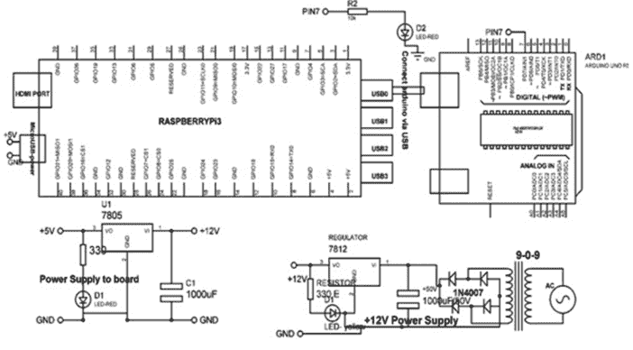

图 8.2

接口 LED 的电路图。

# 使用 Tkinter 和 Arduino 开发 Python GUI

### 8.2.1 固定时间延迟 LED 闪烁方案

```python
import Tkinter
import pyfirmata
import time as wait
# 使用 pyfirmata 端口和开发板
board = pyfirmata.Arduino('/dev/ttyUSB0')
wait.sleep(5) # 延迟 5 秒
led_Pin = board.get_pin('d:7') # 连接到第 7 引脚并作为输出
def call_LED_BLINK():
    button.config(state = Tkinter.DISABLED)
    led_Pin.write(1) # 将 led_Pin 置为高电平
    print('LED at pin7 is ON') # 在终端打印
    wait.sleep(5) # 延迟 5 秒
    print('LED at pin7 is OFF') # 在终端打印
    led_Pin.write(0) # 将 led_Pin 置为低电平
    button.config(state=Tkinter.ACTIVE)
# 初始化主窗口标题和大小
TOP = Tkinter.Tk()
TOP.title("Blink LED using button")
TOP.minsize(300,30)
# 在主窗口上创建一个按钮并与上述方法关联
button = Tkinter.Button(TOP, text="Press start to blink", command = call_LED_BLINK)
button.pack()
TOP.mainloop()
```

## 8.4.1 实例代码 (Recipe)

```python
import Tkinter # 添加 Tkinter 库
import pyfirmata # 添加 pyfirmata 库
import time as wait # 添加 time 库
board = pyfirmata.Arduino('/dev/ttyUSB0')
wait.sleep(5) # 延迟 5 秒
red_led_pin = board.get_pin('d:7:0') # 将 led 连接到引脚 7 并作为输出
green_led_pin = board.get_pin('d:6:0') # 将 led 连接到引脚 6 并作为输出
def start_button_press():
    red_led_pin.write(red_led_Var.get())
    green_led_pin.write(green_led_Var.get())
    print('start...') # 在终端打印
def stop_button_press():
    red_led_pin.write(0) # 让引脚 7 置为高电
    green_led_pin.write(0) # 让引脚 6 置为高电
    print('stop...') # 在终端打印
TOP = Tkinter.Tk()
red_led_Var = Tkinter.IntVar()
red_CheckBox = Tkinter.Checkbox(TOP, text="Red_LED_status", variable=red_led_Var)
red_Checkbox.grid(column=1, row=1)
green_led_Var = Tkinter.IntVar()
green_Checkbox = Tkinter.Checkbox(TOP, text="Green_LED_status", variable=green_led_Var)
green_Checkbox.grid(column=2, row=1)
start_Button = Tkinter.Button(TOP, text="Start_button", command=start_button_press)
start_Button.grid(column=1, row=2)
stop_Button = Tkinter.Button(TOP, text="Stop_button", command=stop_button_press)
stop_Button.grid(column=2, row=2)
exit_Button = Tkinter.Button(TOP, text="Exit_button", command=quit)
exit_Button.grid(column=3, row=2)
TOP.mainloop()
```

# 使用 Tkinter 和 Arduino 的 Python GUI

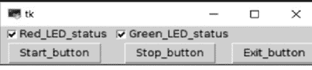

图 8.10

用于多个 LED 的 Tkinter GUI。

```
@raspberrypi:~ $ name pyfirpy_two_led_tkinter_BOK.py
@raspberrypi:~ $ python pyfirpy_two_led_tkinter_BOK.py
start...
stop...
```

图 8.11

状态窗口的截图。

## 8.4.2 Tkinter GUI

为了为多个 LED 生成 `Tkinter` GUI，请运行 8.4.1 节中描述的程序，将出现一个窗口（图 8.10）。该 GUI 为每个红色和绿色 LED 分配有一个 `Checkbutton()` 控件。用户可以单独或同时选择 LED 以使其启动或停止（图 8.11）。

## 8.5 读取 PIR 传感器

使用热电红外 (`PIR`) 传感器来检测运动。设计了一个基于树莓派的系统，用两个 LED 显示运动状态。如果没有检测到运动，绿色 LED 将发光；如果检测到运动，则会产生报警并让 LED “开启”。该系统通过 `Tkinter` GUI 进行开启/关闭。传感器的状态打印在 Python 提示符上。系统由树莓派、Arduino、两个 LED、一个 `PIR` 传感器和一个电源组成。Arduino 通过 USB 连接到树莓派。`LED1` 和 `LED2` 的阳极端分别连接到 Arduino 的引脚 (`7`) 和引脚 (`6`)。`PIR` 传感器的引脚 (`OUT`) 连接到 Arduino 的引脚 (`8`)，引脚 (`Vcc`) 和 (`GND`) 分别连接 +5 V DC 和地（图 8.12）。

## 8.5.1 读取 PIR 传感器的实例代码

- 定义自定义函数以执行闪烁动作

```python
def blink_LED(pin, message):
# 基于树莓派和 Arduino 的物联网
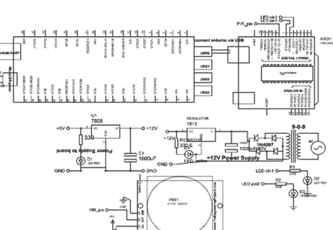

图 8.12
PIR 传感器接口的电路图。

Motion_Label.config(text=message)
Motion_Label.update_idletasks())
TOP.update()
pin.write(1) # 让引脚置为高电
wait.sleep(1) # 延迟 1 秒
pin.write(0) # 让引脚置为高电
wait.sleep(1) # 延迟 1 秒
# 定义与启动按钮点击相关的动作
def process_start_button():
    while True:
        if FLAG.get():
            if PIR_pin.read(is) is True:
                blink_LED(red_led_pin, "motion_status:Y")
                print 'Motion detected ' # 在终端打印
        else:
            blink_LED(green_led_pin, "motion_status:N")
            print 'No motion ' # 在终端打印
else:
    break
board.exit()
def press_exit_button():
    FLAG.set(False)
```


```python
import Tkinter # 导入 Tkinter 库
import pyfirmata # 导入 pyfirmata
import time as wait # 导入 time 库
board = pyfirmata.Arduino('/dev/ttyUSB0')
wait.sleep(5) # 延迟 5 秒
PIR_pin = board.get_pin('d:8:0') # 连接 传感器到引脚 8
red_led_pin = board.get_pin('d:7:0') # 将 led 连接到引脚 7 并作为输出
green_led_pin = board.get_pin('d:6:0') # 将 led 连接到引脚 6 并作为输出
it = pyfirmata.util.Iterator(board)
it.start() # 迭代器
TOP = Tkinter.Tk()
TOP.title("PIR Sensor Test")
Motion_Label = Tkinter.Label(TOP, text="Waiting...")
Motion_Label.grid(column=1, row=1)
FLAG = Tkinter.BooleanVar(TOP)
FLAG.set(True)
def start_button_press():
    while True:
        if FLAG.get():
            if PIR_pin.read(is) is True:
                blink_LED(red_led_pin, "motion_status:Y")
                print 'Motion detected ' # 在终端打印
        else:
            blink_LED(green_led_pin, "motion_status:N")
            print 'No motion ' # 在终端打印
        else:
            break
    board.exit()
    TOP.destroy()
def stop_button_press():
    FLAG.set(False)

red_led_Var = Tkinter.IntVar()
red_CheckBox = Tkinter.Checkbox(TOP, text="Red_LED_status", variable=red_led_Var)
red_Checkbox.grid(column=1, row=2)
green_led_Var = Tkinter.IntVar()
green_Checkbox = Tkinter.Checkbox(TOP, text="Green_LED_status", variable=green_led_Var)
green_Checkbox.grid(column=2, row=2)
start_Button = Tkinter.Button(TOP, text="Start_button", command=start_button_press)
start_Button.grid(column=1, row=3)
stop_Button = Tkinter.Button(TOP, text="Stop_button", command=stop_button_press)
stop_Button.grid(column=2, row=3)
exit_Button = Tkinter.Button(TOP, text="Exit_button", command=quit)
exit_Button.grid(column=3, row=3)
TOP.mainloop()
```

# 使用 Tkinter 和 Arduino 的 Python GUI

## 8.6.2 Tkinter GUI

运行第 8.6.1 节中描述的程序，以创建一个用于读取电位器（POT）的 Tkinter GUI，并将出现一个窗口（图 8.16）。点击“Start_reading”按钮后，它将给出 POT 的读数（图 8.17）。

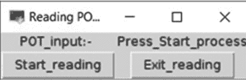

图 8.16

读取电位器的 Tkinter GUI。

```
pi@raspberrypi:~ $ nano analog_in_tkinter.py
pi@raspberrypi:~ $ python analog_in_tkinter.py
analog values of pot
analog values of pot
analog values of pot
```

图 8.17

显示 POT 模拟值的窗口。


# 9. 使用 Python 和 Tkinter 获取数据

## 9.1 基础

**`open()` 方法：** 该函数是 Python 中最常用的方法之一，用于操作文件。

打开文件的命令：

`>>> f = open('test.txt', 'w')`

此命令会在 Python 解释器所在的文件夹中，或者执行代码的路径中创建一个 `test.txt` 文件。

与 `open()` 函数配合使用的模式在表 9.1 中讨论。

**`write()` 方法：** 一旦以写入模式打开文件，即可使用 `write()` 方法开始向文件对象写入内容。`write()` 方法仅接受字符串格式的输入参数。

`>>> f.write('Hello World!\n')`

在这里 'Hello World' 是一个字符串，`\n` 意味着换行符。

要写入一系列字符串，则使用 `writelines()` 方法：

`>>> sq = ["Python programming for Arduino\n", "Bye\n"]`

`>>> f.writelines(sq)`

**`close()` 方法：** `close()` 方法用于关闭文件，之后文件对象将无法再次使用。命令为：

`>>> f.close()`

**`read()` 方法：** `read()` 方法读取文件数据。该方法通过任何兼容读取的模式（如：w+, r, r+, 或 a+）打开文件：

`>>> D = open('test.txt', 'r')`

`>>> D.read()`

### 表 9.1

模式描述

| 模式 | 描述 |
| --- | --- |
| W | 此模式仅用于写入打开文件。它会覆盖现有文件。 |
| w+ | 此模式以读写双模式打开文件。它会覆盖现有文件。 |
| R | 此模式仅用于读取打开文件。 |
| r+ | 此模式以追加和读取模式打开文件。 |
| A | 此模式用于追加打开文件，从文档末尾开始。 |
| a+ | 此模式以追加和读取打开文件，从文档末尾开始。 |

```
'Hello World!\nPython programming for Arduino\nBye\n'
>>> D.close()
```

通过此方法，文件的整个内容被存储在内存中。若要行读取内容使用，请使用 `readlines()` 方法：

```
>>> D=open('test.txt', 'r')
>>> X =D.readlines()
>>> print X
['Hello World!\n', 'Python programming for Arduino\n', 'Bye\n']
>>> D.close()
```

## 9.2 CSV 文件

CSV 文件用于在 Python 中存储数据。使用 CSV 写入器向 CSV 文件写入数据，使用读取器通过简单命令读取：

### CSV 写入器

```python
import csv
data = [[1, 2, 3], ['a', 'b', 'c'], ['Python', 'Arduino', 'Programming']]
with open('example.csv', 'w') as f:
    w = csv.writer(f)
    for row in data:
        w.writerow(row)
```

### CSV 读取器

```python
import csv
with open('example.csv', 'r') as file:
    r = csv.reader(file)
    for row in r:
        print(row)
```

## 9.3 使用 CSV 文件存储 Arduino 数据

CSV 文件可存储来自 Arduino 的传感器数据。为了理解这一概念，我们讨论一个系统。该系统由树莓派、Arduino、热电红外（PIR）传感器（数字传感器）、电位器（POT，作为模拟传感器）和一个电源组成。目标是通过 CSV 文件存储传感器数据，并实现 Arduino 与 Python 的交互。图 9.1 显示了系统的电路图。

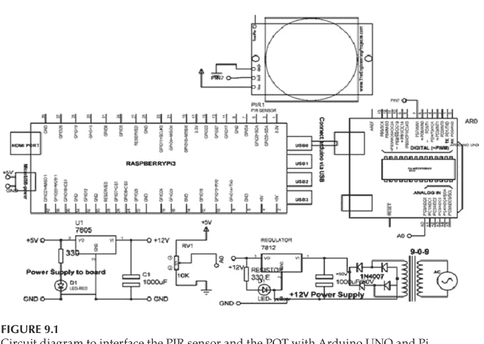

#### 连接：

- PIR 传感器的输出连接到 Arduino 的数字 7 引脚。
- PIR 传感器的 VCC 和 GND 连接到 5V。
- 电位器的 VCC 连接到 5V。
- 电位器的地线连接到 GND。
- 电位器的滑变引脚连接到 Arduino 的 A0 引脚。

### 9.3.1 示例

```python
import csv
import pyfirmata
import time as wait

board = pyfirmata.Arduino('/dev/ttyUSB0')
it = pyfirmata.util.Iterator(board)
it.start()

with open('SensorData.csv', 'w') as f:
    w = csv.writer(f)
    w.writerow(["Number","Potentiometer", "Motion sensor"])
    ni = 0
    while True:
        pot_data = board['a0'][0]
        pir_data = board['d7'][0]
        if pot_data is not None:
            row = [ni, pot_data, pir_data]
            w.writerow(row)
            ni += 1
        wait.sleep(1)
```

## 9.4 绘制随机数

`set_xdata()` 和 `set_ydata()` 方法用于更新 x y 轴。

### 9.4.1 示例

```python
import matplotlib.pyplot as plt
import random
R = range(25)
S = [random.randint(0,100) for r in range(25)]
plt.figure()
plt.plot(R, S, '-')
plt.title('random numbers')
plt.xlabel('X Axis')
plt.ylabel('Y Axis')
plt.show()
```

## 9.5 绘制 Arduino 实时数据

来自 Arduino 的实时数据是一项任务。`ion()` 方法用于初始化交互模式。通过调用 `ion()` 设置交互模式。这有助于动态更改 x y 值。

```python
plt.ion()
```

一旦设置了交互模式，可以通过调用 `draw()` 方法绘制图形。现在，用一组空白数据（在本例中为0）初始化图形：

```python
pData = [0] * 25
```

在该 y 值数组 `pData` 中，在循环循环中追加传感器值以将最新值追加到此数据数组，并使用这些更新的数组重新绘制图形。

### 9.5.1 示例

```python
# ... (之前的设置代码)
while True:
    val = float(a0.read())
    if val is not None:
        pData.append(val)
        pData.pop(0)
        plt.draw()
    wait.sleep(1)
```

# 基于树莓派和 Arduino 的物联网

```python
pyplot.ion()
pData = [0.0] * 25
fig = pyplot.figure()
pyplot.title('Real time data plot from POT')
ax1 = plt.axes()
l1, = plt.plot(pData)
plt.ylim([0, 1])
```

```python
while True:
    try:
        wait.sleep(1)
        pData.append(float(POT_pin.read()))
        plt.ylim([0, 1])
        del pData[0]
        l1.set_xdata(i for i in xrange(25))
        l1.set_ydata(pData) # update the data
        pyplot.draw() # update the plot
    except KeyboardInterrupt:
        board.exit()
break
```

## 9.6 将图表集成到 Tkinter 窗口

第 9.5 节描述了如何为 Arduino 的连续传感器数据绘制图表。Python 与 matplotlib 库和 Tkinter 图形界面具有强大的集成能力。本文将针对图 9.3 所示电路讨论这种集成。该程序使用了 Tkinter 与 matplotlib 的接口。

### 9.6.1 配方

```python
import sys # import sys library
from matplotlib import pyplot # import library
import pyfirmata # import library
import time as wait # import time library
import Tkinter # import library
```

# 使用 Python 和 Tkinter 进行数据采集

```python
def start_button_press():
    while True:
        if FLAG.get():
            sleep(1) # wait for 1 Sec
            pData.append(float(POT_pin.read()))
            pyplot.ylim([0, 1])
            del pData[0]
            Il.set_xdata([li for i in xrange(25)])
            Il.set_ydata(pData) # update the data
            pyplot.draw() # update the plot
            TOP.update()
        else:
            FLAG.set(True)
            break
```

```python
def pause_button_press():
    FLAG.set(False)
```

```python
def exit_button_press():
    print("out from data recording....")
    pause_button_press()
    board.exit()
    pyplot.close(fig)
    TOP.quit()
    TOP.destroy()
    print("completed...")
    sys.exit()
```

```python
board = pyfirmata.Arduino('/dev/ttyUSB0')
# 使用迭代器线程避免缓冲区溢出
it = pyfirmata.util.Iterator(board)
it.start() # start iterator
# 给模拟引脚 0 分配角色和变量
POT_pin = board.get_pin('a:0:i') # read read POT
# Tkinter 画布
TOP = Tkinter.Tk()
TOP.title("Tkinter + matplotlib")
# 创建标志以配合无限循环
FLAG = Tkinter.IntVar(TOP)
```

```python
FLAG.set(True)
pyplot.ion()
pData = [0.0] * 25
figure = pyplot.figure()
plt.title('Potentiometer')
ax1 = pyplot.axes()
l1, = plt.plot(pData)
plt.ylim(0, 1)
```

# 创建启动按钮并关联启动按钮按下方法

start_Button = Tkinter.Button(TOP, text="Start", command=start_press)

start_Button.grid(column=1, row=2)

# 创建退出按钮以退出窗口

exit_Button=Tkinter.Button(TOP,text="Exit",command=exit_button_press)

exit_Button.grid(column=3, row=2)

TOP.mainloop()

执行程序，屏幕上将出现一个窗口（图 9.4）。

可以使用“Start”（启动）、“Pause”（暂停）和“Exit”（退出）按钮控制图表。


点击启动按钮并旋转 `POT` 旋钮，观察图表的变化。

可以使用“`Exit`”（退出）按钮暂停过程或关闭图表。

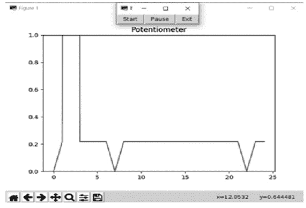

图 9.4

来自 Arduino 的实时数据图表。

# 第 IV 部分

## 连接到云端


### 10 智能 IoT 系统

#### 10.1 使用 ThingSpeak 的 DHT11 数据记录器

项目的目标是通过树莓派采集 `DHT11` 的实时数据并上传到云端。`DHT11` 是一种温度湿度传感器。该过程涉及三个部分：设置树莓派、配置 Adafruit 库以及连接到 ThingSpeak。系统由树莓派、电源、Arduino Uno 和 `DHT11` 传感器组成。将 `DHT11` 的引脚 (`Vcc`) 分别连接到 `+5V` 和地。将 `DHT11` 的引脚 (`OUT`) 连接到树莓派的 `GPIO17`（图 10.1）。

##### 10.1.1 安装 DHT11

使用以下命令安装 `DHT11` 库：

```bash
git clone https://github.com/adafruit/Adafruit_DHT
cd Adafruit_DHT
sudo apt-get install build-dev
python setup.py
```

##### 10.1.2 在 ThingSpeak 中创建通道的步骤

1. 在 ThingSpeak 注册账户。
2. 点击 `New Channel`（新通道）（图 10.2）。
3. 创建通道（图 10.3）。
4. 输入温度和湿度值。
5. 编写程序。

## 树莓派和 Arduino 的物联网


图 10.1

树莓派与 Arduino 的接口图。


图 10.2

新通道

# 智能 IoT 系统| 名称 | 创建 |

|---|---|

| 温度 | |

| 湿度 | |


图 10.3

实时数据图

# 更新的通道


图 10.4

实时数据的图。

##### 10.1.3 配方

```python
import sys # import sys library
import RPi.GPIO as RA # import GPIO library
import time as wait # import time library
import urllib2 # import urllib library
my_API = 'F1MAEAF943TLCI!'

def sensata():
    HUM, TEMP = RA.read(21)
    return str(HUM), TEMP

def getmain_function():
    base = 'https://api.thingspeak.com/update?api_key=%s ' % my_API
    while True:
        try:
            HUM, TEMP = sensata()
            f = urllib2.urlopen(base + '&field1=%s&field2=%s' % (HUM, TEMP))
            print(f.read())
            f.close()
            wait.sleep(15)
        except:
            print('exit from program')
            break

if __name__ == '__main__':
    getmain_function()
```

#### 10.2 使用 ThingSpeak 的超声波数据记录器

超声波传感器设计用于通过声波测量源与目标之间的距离。`HC-SR04` 是一种常用的 2 到 400 厘米模块。为了测量距离，传输和接收之间的时间计算为 时间/2。距离 = 速度 * 时间/2；此处海平面声速为 343 m/s 或 340 cm/s。为了测量距离，系统由树莓派、电源和一个超声波传感器组成。将超声波传感器的引脚 (`Vcc`) 和 `GND` 分别连接到 `+5V` 和地。将超声波传感器的引脚 `TRIG` 和 `ECHO` 分别连接到树莓派的 `GPIO20` 和 `GPIO21`（图 10.6）。向“`TRIG`”输入提供“`HIGH`”信号，持续至少 10 µS。此过程将使模块能够发射八个 40 kHz 的超声波。如果波路路径上有障碍物，这些波将反射回“`ECHO`”引脚。

##### 10.2.1 配方

```python
import sys # import sys library
import RPi.GPIO as RA # import GPIO library
import time as wait # import time library
import urllib2 # import urllib library
my_API = 'F1MAEAF943TLMVCI!'

def sensata():
    # (读取超声波传感器)
    return "0.0", "0.0"

def getmain_function():
    # (将数据发送到 ThingSpeak)
    pass

if __name__ == '__main__':
    getmain_function()
```

```python
trig_pin = 38 #将传感器的触发引脚连接到树莓派的38引脚
echo_pin = 40 #将传感器的回响引脚连接到树莓派的40引脚
ANITA.setwartings(False) # 移除警告
ANITA.setup(echo_pin, ANITA.IN) #将40引脚设为输入
ANITA.setup(trig_pin, ANITA.OUT) #将38引脚设为输出
ANITA.output(trig_pin, True) #让38引脚变为高电平
wait.sleep(0.00001) # 等待 10 微秒
ANITA.output(trig_pin, False) # 让38引脚变为低电平
while ANITA.input(echo_pin) == 0:
    start_time = wait.time() # 测量开始时间
while ANITA.input(echo_pin) == 1:
    end_time = wait.time() # 测量结束时间
distance_cm = ((end_time-start_time) * 34300)/2 # 计算以厘米为的距离
return (int(distance_cm))

def main():
    base_URL = 'https://api.thingspeak.com/update?api_key=%s' % my_API
    while True:
        try:
            distance_cm = get_sensor_data() # 读取传感器
            f=urllib.urlencode(base_URL+"&field3=%s"%int(distance_cm/5))
            printf.read(f) # 打印函数值
            f.close() # 关闭函数
            wait.sleep(15) # 等待 15 秒
        except:
            print 'exit from main program' # 在终端打印字符串
            break
```

#### 10.3 带有 ThingSpeak 服务器的空气质量监测系统和数据记录器

空气污染是全球最大的环境问题。空气污染对人类健康、气候和生态系统产生许多不利影响。这产生了对实时空气质量进行测量和分析的需求。空气质量指数（`AQI`）是空气质量的一个重要参数；它是一个标准（表 10.1）。

# 智能 IoT 系统

# 表 10.1

AQI 分类

| AQI 范围 | AQI 类别 |

| :--- | :--- |

| 0-50 | 优 |

| 51–100 | 良好 |

| 100-150 | 轻污染 |

| 151–200 | 中度污染 |

| 201–250 | 重污染 |

| 251–300 | 污染 |

为了理解空气质量监测，设计了一个带有空气质量传感器和摄像头的系统。在这里，连接摄像头来捕捉污染区域的图像。图 10.7 显示了系统的框图。它由树莓派、`MQ2`（烟雾检测）、`MQ7`（CO气体检测）、`DHT11`（温湿度传感器）、摄像头、电源、粉尘采样器（`GP21030`）和 Arduino Uno 组成。

如图 10.8 所示连接组件。按照第 10.1.2 节描述的步骤创建 ThingSpeak 服务器，编写第 10.3.1 节描述的程序，并按照图 10.9 至 10.12 所示检查结果。


图 10.7

空气质量监测系统的框图。

# 使用树莓派和 Arduino 的物联网


图 10.8

空气质量监测系统的电路图。


图 10.9

ThingSpeak 服务器上的湿度数据。

# 智能 IoT 系统


图 10.10

ThingSpeak 服务器上的温度数据。


图 10.11

ThingSpeak 服务器上的 CO 水平数据。

# 连接

- 将摄像头连接到树莓派的专用端口。
- 将 `MQ2`、`MQ3`、`MQ7`、`GP21030` 和 `DHT11` 传感器的引脚（`Vcc` 和地）分别连接到 `+5V`。
- 将 `DHT11` 传感器的引脚（`OUT`）连接到 Arduino Uno 的引脚（2）。
- 通过 USB 将 Arduino 连接到树莓派。

# 使用树莓派和 Arduino 的物联网


图 10.12

ThingSpeak 服务器上的空气水平数据。

- 将 `MQ2` 传感器的引脚（`OUT`）连接到 Arduino Uno 的引脚（`A1`）。
- 将 `MQ3` 传感器的引脚（`OUT`）连接到 Arduino Uno 的引脚（`A3`）。
- 将 `MQ7` 传感器的引脚（`OUT`）连接到 Arduino Uno 的引脚（`A0`）。
- 将 `GP21030` 传感器的引脚（`OUT`）连接到 Arduino Uno 的引脚（`A4`）。

##### 10.3.1 配方

```python
import sys # 导入 sys 库
import urllib # 添加 url 库
import pyfirmata # 添加 pyfirmata 库
import Adafruit_DHT as RAJ_DHT
import time as wait # 导入 time 库
import RPi.GPIO as RAJ # 导入 GPIO 库
from picamera import PiCamera # 导入 picamera 库

board = pyfirmata.Arduino('/dev/ttyUSB0') # USB 
led_Power = board.get_pin('d:12:o') #将 led_power 引脚连接到 Arduino 的 12 口作为输出
```

# 智能 IoT 系统

measure_Pin = board.get_pin('a:5:i') #将传感器引脚连接到 Arduino 的 A5 口作为输入

co_Pin = board.get_pin('a:0:i')

it = pyfirmata.util.iterator(board) # 初始化迭代器

it.start() # 启动迭代器

170 基于树莓派和 Arduino 的物联网


图 10.14

(a) 湿度数据。(b) 温度数据。


图 10.15

(a) 压力数据。(b) 海拔度数据。


图 10.16

PIR 传感器数据。

# 智能物联网系统

171


图 10.17 (a) 加速度计 x 轴数据。(b) y 轴数据。(c) z轴数据。

# 连接

- 将摄像头连接到树莓派的专用端口。
- 将 PIR 传感器、`BMP180` 传感器、加速度计、蜂鸣器和 `DHT11` 传感器的引脚（`Vcc` 和地）分别连接到 `+5 VDC` 和地。
- 将 `DHT11` 传感器的引脚(`OUT`) 连接到 Arduino Uno 的引脚(4)。
- 通过 USB 将 Arduino Uno 连接到树莓派。
- 将 PIR 传感器的引脚(`OUT`) 连接到 Arduino Uno 的引脚(2)。
- 将雨传感器引脚(`OUT`) 连接到 Arduino Uno 的引脚(`A0`)。
- 将蜂鸣器的引脚(`OUT`) 连接到 Arduino Uno 的引脚(5)。
- 将 `BMP180` 的引脚(`SCL`) 连接到 Arduino Uno 的引脚(`A5`)。
- 将 `BMP180` 的引脚(`SDA`) 连接到 Arduino Uno 的引脚(`A4`)。
- 将加速度计的“x 轴”连接到 Arduino Uno 的引脚 (`A1`)。
- 将加速度计的“y 轴”连接到 Arduino Uno 的引脚 (`A2`)。
- 将加速度计的“z 轴”连接到 Arduino Uno 的引脚 (`A3`)。

#### 10.4.1 示例

```python
import sys # 导入库
import RPi.GPIO as GPIO
import time as wait # 导入时间库
import Adafruit_DHT as RAH
```

# 基于树莓派和 Arduino 的物联网

```python
import urllib2 # 添加 url 库
from adxl3345 import ADXL345
from picamera import PiCamera
from Adafruit_BMP085 import BMP085
mp_sensor = BMP085(0x77)
adxl345_sensor = ADXL345()
GPIO.setmode(GPIO.BCM) # 使用 BCM 下的树莓派引脚
GPIO.setup(16, GPIO.IN)
```

```python
def get_sensor_data():
    HUM, TEMP = RAH.read_retry(DHT.DHT11, 4)
    pir_sensor = GPIO.input(16) # 将 PIR 传感器连接到 GPIO 16
    mp_sensor = BMP085(0x77)
    pressure1 = bmp.readPressure() # 读取压力
    pressure_data = pressure1 / 100 # 缩放压力值
    altitude_data = bmp.readAltitude() # 读取高度
    axes = adxl345.getAxes(True)
    x1_data = axes['x']
    y1_data = axes['y']
    z1_data = axes['z']
    return (str(HUM), str(TEMP), str(pir_sensor), str(pressure_data),
            str(altitude_data), str(x1_data), str(y1_data), str(z1_data))
```


```python
def main_program():
    count = 0 # 初始化计数
    pir_data = GPIO.input(16) # 将 PIR 传感器连接到 GPIO16 作为输入
    if len(sys.argv) < 2:
        print('print data') # 在终端打印字符串
        exit(0)

    print 'process start...' # 在终端打印字符串
    base_URL = 'https://api.thingspeak.com/update?api_key=%s' % sys.argv[1]

    while True:
        try:
            HUM, TEMP, pir_sensor, pressure_data, altitude_data, x1_data, y1_data, z1_data = get_sensor_data()
            f = urllib2.urlencode(base_URL + "&field1=%s&field2=%s&field3=%s&field4=%s&field5=%s&field6=%s&field7=%s&field8=%s"
            % (HUM, TEMP, pir_sensor, pressure_data, altitude_data, x1_data, y1_data, z1_data))
            print(f.read()) # 读取函数

            if (pir_data == 1):
                print "hello" # 在终端打印字符串
                RAJ_camera = PiCamera()
                RAJ_camera.start_preview()
                wait.sleep(5) # 延迟 5 秒
                count = count + 1
                RAJ_camera.capture('img%s.jpg' % count) # 捕捉图像
                RAJ_camera.stop_preview() # 停止预览
                RAJ_camera.close() # 关闭摄像头
                f.close() # 关闭函数
                wait.sleep(15) # 等待 15 秒
        except:
            print 'exit from main program' # 在终端打印字符串
            break
if __name__ == '__main__':
    main_program()
```

### 10.5 智能运动检测器并上传图片

运动检测器是一个检测到运动时捕捉图片并发送到指定 Gmail 地址的系统。该系统由树莓派、摄像头、PIR 传感器、LED 指和电源组成。连接方式如图 10.18 所示。
- 将摄像头连接到树莓派的专用端口。
- 将 PIR 传感器的引脚（Vcc 和地）分别连接到 +5 VDC 和地。
- 将 PIR 传感器的引脚(OUT) 连接到树莓派的 `GPIO21`。
- 将 LED 的阴极连接到地，阳极通过电阻连接到 `GPIO3`。

174 基于树莓派和 Arduino 的物联网

图 10.18 智能运动检测器电路图。

#### 10.5.1 配置树莓派摄像头和 Gmail

步骤 1：使用以下命令更新并升级树莓派
```bash

sudo apt-get update

sudo apt-get upgrade

sudo apt-get install python3

```

步骤 2：安装并配置 SMTP 服务
```bash

sudo apt-get install smtp

sudo nano /etc/smtp.conf

```

步骤 3：启用树莓派的 SSH 和摄像头权限。

步骤 4：按照以下步骤允许 Gmail SMTP 访问
1. 使用用户名和密码登录 Gmail 账号。
2. 进入右上角的“账号”(My Account)。
3. 选择“安全”(Security)部分。
4. 开启“允许不够安全的应用”(Allow less apps)。

#### 10.5.2 示例

```python

import RPi.GPIO as GPIO # 导入 pi GPIO

import picamera as RAJ_camera # 导入摄像头

import time as wait # 导入时间库

import smtplib # 导入 smtplib

from email.mime.multipart import MIMEMipart # 导入库

from email.mime.text import MIMEText # 导入库

from email.mime.base import MIMEBase # 导入库

from email import encoders # 导入库

from email.mime.image import MIMEImage # 导入库

from_addr = "ssss@gmail.com" # 修改邮箱地址

to_addr = "rrrrrr@gmail.com"

mail_RAJ = MIMEMipart()

mail_RAJ['From'] = from_addr

mail_RAJ['To'] = to_addr

mail_RAJ['Subject'] = "Attachment"

body = "Please find the attachment"

led_pin = 3 # 连接树莓派的 GPIO 3

pir_pin = 21 # 连接传感器到树莓派的 GPIO21

HIGH = 1 # 赋值

LOW = 0 # 赋值

GPIO.setwarnings(False) # 移除警告

GPIO.setmode(GPIO.BCM) # 使用 BCM 模式

GPIO.setup(led_pin, GPIO.OUT) # 设置引脚为输出

GPIO.setup(pir_pin, GPIO.IN) # 设置引脚为输入

```

```python

def send_Mail(data):

    mail_RAJ.attach(MIMEText(body, 'plain'))

    print data # 在终端打印数据

    dat = "%s.jpg" % data

    print (data) # 在终端打印数据

    attachment_RAJ = open(dat, 'rb')

    image_RAJ = MIMEImage(attachment_RAJ.read())

    attachment_RAJ.close()

    mail_RAJ.attach(image_RAJ) # 附加图像

    server_RAJ = smtplib.SMTP('smtp.gmail.com', 587)

    server_RAJ.starttls()

    server_RAJ.login(from_addr, "ssss@gmail.com")

    text = mail_RAJ.as_string()

    server_RAJ.sendmail(from_addr, to_addr, text)

    server_RAJ.quit() # 退出服务器

```

```python

def RAJ_capture_image():

    data = wait.strftime('%d_%b_%Y|%H:%M:%S')

    RAJ_camera.start_preview() # 开启预览

    wait.sleep(5) # 等待 5 秒

    print data # 在终端打印数据

    RAJ_camera.capture('%s.jpg' % data)

    RAJ_camera.stop_preview() # 停止预览

    wait.sleep(1) # 等待 1 秒

    send_Mail(data) # 发送邮件

```

`GPIO.output(led_pin, 0)` # 将引脚置低
`RAJ_camera = picamera.PiCamera()`
`RAJ_camera.rotation = 180` # 旋转摄像头
`RAJ_camera.awb_mode='auto'`
`RAJ_camera.brightness = 55` # 选择亮度级别
while 1:
    if `GPIO.input(pir) == 1`: # 检查 PIR 状态
        `GPIO.output(led_pin, HIGH)` # 将引脚置高
        `RAJ_capture_image()` # 捕捉图像
    else:
        `GPIO.output(led, LOW)` # 将引脚置低
        `wait.sleep(1)` # 等待 1 秒

# 基于树莓派和 Arduino 的物联网


图 11.1

树莓派桌面窗口。

### 11.2 使用 Blynk 创建新项目

Blynk 应用同时适用于 Android 和 iOS 系统。

创建 Blynk 项目的步骤：
- 1. 根据需求下载适用于 Android 或 iOS 的 Blynk 版本，并创建一个新账户（图 11.2）。
- 2. 通过提供名称、控制器/处理器和互联网连接来创建一个新项目（图 11.3）。应用程序的背景也可以选择深色或浅色。
- 3. 身份验证令牌（Auth token）将发送到电子邮箱地址。该身份验证令牌将用于将树莓派连接到新项目。
- 4. 打开空项目并根据项目需求添加部件（widgets）（图 11.4）。对于一个通过点击来制作 LED 的简单项目，选择连接 LED 的树莓派数字引脚。这里使用 `GPIO21` 连接 LED。图 11.5 显示了 LED 的按钮。
- 5. 再添加一个连接到 `GPIO20` 的 LED。现在可以通过设计的应用程序控制两个 LED（图 11.6）。
- 6. 运行身份验证令牌命令将树莓派连接到 Blynk 部件并检查工作情况。

## 树莓派的 Blynk 应用


图 11.2

创建新账户。


图 11.3

创建一个新项目。


图 11.4

部件框。

# 基于树莓派和 Arduino 的物联网


图 11.5

LED 按钮。


图 11.6

控制两个 LED 的项目。

### 11.3 使用 Blynk App 控制家电

Blynk 应用可创建一个控制家电的界面，以实现物联网（IoT）的智能控制。该系统由树莓派、电源、两个继电器板（如果需要控制两个电器）、一个三极2 2N22管（作为开关）和一个电源组成。如图 11.7 所示连接组件，并按照第 11.2 节提到的步骤控制两个 LED，因为相同的项目也可以控制两个继电器。

## 树莓派的 Blynk 应用


**11.7**

家电控制的电路图。

连接情况：
- 通过电阻将第一个三极管 2N222 的基极连接到 `GPIO21`，发射极接地。
- 通过电阻将第二个三极管 2N222 的基极连接到 `GPIO20`，发射极接地。
- 将三极管的集极连接到继电器的“L2”。
- 将12V 连接到继器的“L1”。
- 将二极管跨接在“L1”。
- 将负载的一端连接到继器的“common”（常闭）。
- 将负载另一端连接到继器的“NO”（常开）。


## 12 基于树莓派的 Cayenne

### 12.1 Cayenne 简介

Cayenne 具有自定义的可拖放仪表板。它可以轻松地设置树莓派。在 Cayenne 中，可以添加传感器、执行器以及更多设备。它用于远程控制设备。它包含四个组件：Cayenne 代理（负责通信）、云（处理并存储数据）、在线仪表板（提供图形界面）以及适用于 Android 和 iOS 的 Cayenne 应用。

#### 12.1.1 开始使用 Cayenne
- 1. 打开 Cayenne 网站并创建一个账户（图 12.1）。
- 2. 填写注册表并选择设备（图 12.2）。
- 3. 使用以下命令在树莓派上下载并安装 myDevices Cayenne（图 12.3）：

```bash
wget https://cayenne.mydevices.com/dl/rpi_8bf9u0.sh
sudo bash rpi_8bf9u0.sh
```
- 4. 进入 GPIO 并根据项目选择（图 12.4）。

## 12.2 使用 Cayenne App

使用 Cayenne 应用理解 LED 工作最简单的方法。该系统由树莓派、电源和一个 LED 组成。将 LED 连接到 `GPIO7`（图 12.5）。按照第 12.1.1 节提到的步骤操作。开发 Cayenne 应用。进入 GPIO 17 引脚，点击“input”并将其改为“output”。LED 的状态可以通过更改按钮的状态为“HIGH”或“LOW”来改变。

索引

# P

- Pi 摄像头, 59
- 设计原理, 4
- 协议, 6–9
- 接近传感器, 16
- Pyfirmata, 117–127
- Python, 115–127
- 串口通信命令, 38
- 服务器, 21–26
- 舵机电机, 110–113
- 6LoWPAN, 7
- 静态 IP, 52–57

# T

- 温度传感器, 15
- 终端命令, 51–52
- ThingSpeak 服务器, 157–168
- Tkinter, 129–143
- 触摸传感器, 16

# R

- 树莓派 (Raspberry Pi), 45–96
- Raspbian, 49–51
- 继电器, 70–71

# S

- 安全, 4
- 传感器, 13–17

# U

- 超声波传感器, 16
-  传感器, 16
