# 网络安全简易指南：掌控你的在线世界

INTI SEC MAD
TOR LOST CHQ
2016年5月20日
2017年1月13日
2017年7月24日
2018年1月2日

2018年5月4日
2018年5月25日

WITHDRAWN

各位
欧文·哈加尔
24小时续借热线 0845 607 6119
www.cornwall.gov.uk/library

| 康沃尔图书馆 | |
|---|---|
| 38009048082199 | |
| Bertrams | 2015年12月2日 |
| AN | £9.99 |
| TOR | |

## 简介

互联网永远地改变了我们的生活，但这场通信革命并非没有问题。如同现实生活中一样，网络上也存在病毒、黑客和身份欺诈者。本书旨在帮助您安全地在在线世界中导航，并使您免受在线威胁的侵害。

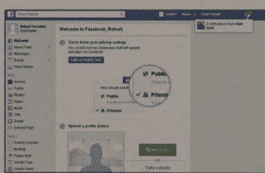

上方：Facebook 等网站让我们能够社交，但它们也包含关于我们的各种个人信息。

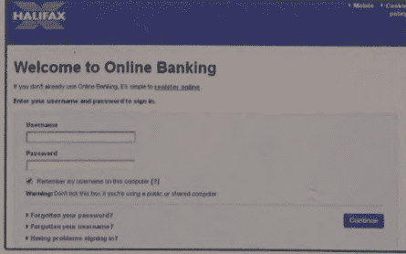

上方：我们许多人现在都在网上银行。我们最不希望的就是有人能够访问我们的账户。

### 互联网安全

在线保持安全很重要。除了好处之外，互联网还包含潜在的有害威胁，从可能感染我们计算机、删除我们的数据或监视我们在线活动的病毒和恶意软件，到想要为其自身目的获取我们数据访问权限的黑客和身份欺诈者。了解如何防御这些威胁对于保护您的网络、计算机、在线账户和家人的安全至关重要。

### 保护的重要性

互联网已成为我们许多人不可或缺的工具，使我们能够在社交媒体上社交、通过电子邮件通信、在线购物和网上银行。正是由于这种对在线世界的依赖，保持安全对于防止未经授权访问我们的在线账户并确保我们的个人信息不落入错误之手至关重要。

## ONLINE THREATS

当大多数人想到互联网安全时，他们想到的是病毒，但网络病毒的类型多种多样，保护自己在线安全的内容远不止于防范恶意软件。你的网络存在可能会为黑客和骗子提供大量关于你的信息。他们甚至可以访问你的财务并冒用你的身份。此外，如果你的孩子正在使用社交网络并通过万维网与他人通信，你会希望确保他们这样做是安全的。

## The Mobile Age

过去，互联网是一种只能通过电话线在台式电脑上访问的东西。然而，如今你几乎可以在任何地方访问网络。智能手机、平板电脑、无线接入及其他技术意味着万维网无处不在，网络威胁也是如此，当你使用智能手机时，互联网安全与使用台式电脑时一样重要。

Above: 我们几乎可以在任何地方访问互联网，因此互联网安全对移动设备同样至关重要。

## USING THIS BOOK

本书旨在为你提供上网保持安全所需的所有信息。无论你是使用互联网进行社交、网上银行，还是下载游戏和软件，本书都将帮助你了解互联网安全的世界，并确保你和你的家人能够安全上网。

> **Hot Tip**
>
> 在本书中，我们插入了许多热贴士和事实框。这些内容旨在帮助你找到关于互联网安全不同方面的一些简单而有效的建议。

### Help For All

你可以从头到尾阅读本书，也可以将其作为参考书，在需要了解网络安全不同方面的帮助时随时查阅。我们力求涵盖网络保护和互联网安全的所有方面，从防范病毒和恶意软件到防范黑客和身份欺诈者，以及如何保护家庭互联网连接并确保孩子安全上网。

Above: 本书将帮助你在孩子上网时保护他们的安全。

### Beginners to Advanced

本书面向互联网和互联网安全的新手以及拥有更多在线经验的用户。我们提供保护电脑和在线账户的基本帮助，以及一些更高级的互联网安全建议，例如如何手动移除病毒和恶意软件、在遭受攻击后修复系统，或如何匿名上网。

### Cutting through the Complexity

互联网安全的世界可能很复杂，但我们力求尽可能简化各个方面，因此如果你不确定什么是超文本标记语言（HTML），或者浏览器Cookie的作用是什么，我们将用你一定能听懂的语言为你解释一切。

### Jargon

与互联网的其他部分一样，在线安全领域充斥着大量的行业术语和专业词汇。但是，在可能的情况下，我们已使用最简单的术语提供说明和信息。我们还在“术语破解器”中收录了最常见的互联网安全术语词典（见第248–251页）。

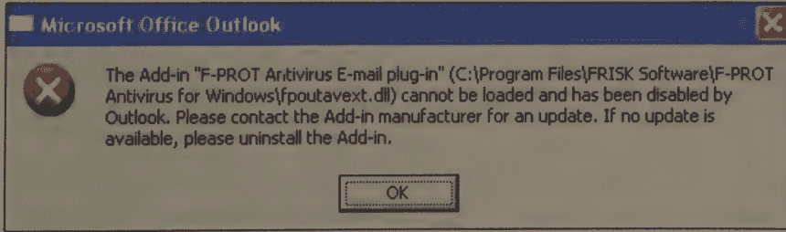

Above: 互联网安全的不同方面可能很复杂，但我们不会指望你处理诸如此类的事情！

### Step by Step

在本书中，我们包含了循序渐进的指南，引导你了解互联网安全的一些技术性方面，例如如何调整浏览器和电脑设置、安装防病毒软件，以及调整社交媒体隐私设置，以便在使用Facebook、Twitter和其他社交网站时更加安全。

### MALWARE AND VIRUSES

威胁你在线安全的最常见形式之一是恶意软件，它可能会引发各种问题，从监视你的在线活动以窃取你的密码和用户名，到禁用你的电脑、删除文件，甚至利用你的机器攻击

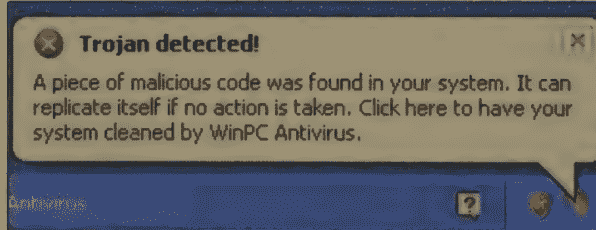

其他计算机。在本书中，我们将解释计算机病毒和特洛伊木马之间的区别，什么是间谍软件和广告软件，以及如何保护自己免受这些及其他恶意软件威胁的侵害。

Above: 我们将解释特洛伊木马和病毒之间的区别，以及如何防范它们。

### Antivirus Software

防病毒软件是在线保持安全的最关键工具之一。在本书中，我们将解释可提供的不同类型的防护，从可下载安装用于基础防护的免费解决方案，到互联网安全软件领域一些最受尊敬品牌的付费套件。

> **Hot Tip**
>
> 如果你的电脑已经感染了病毒或其他恶意软件，本书将向你展示如何移除威胁并保护你的电脑，以免再次发生。

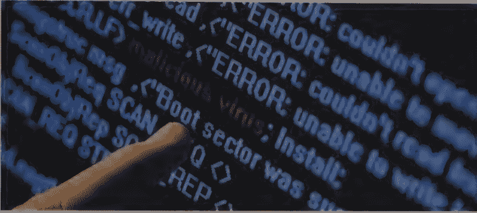

### Firewalls and Other Protection

学习如何安装防火墙也是互联网安全的另一个关键方面。我们不仅解释什么是防火墙及其工作原理，还提供安装并充分利用该技术的循序渐进说明。我们还会提供一些关于使用路由器和Wi-Fi接入点的实用提示和技巧，确保无论你身在何处都始终受到保护。

### HELP AND FURTHER READING

没有一本关于互联网安全的书能涵盖每一个可以想象到的方面。因此，我们在全书和末尾都包含了有用的网站，并附上了一些有关安全上网的实用书籍，供想要了解更多信息的读者参考。

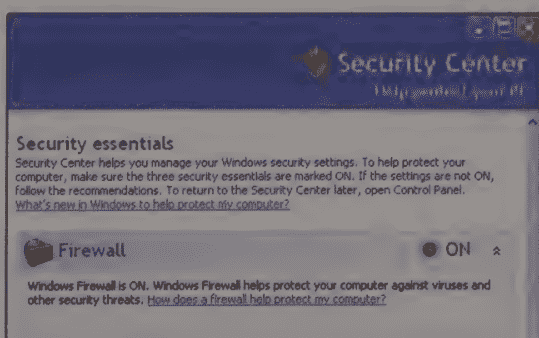

Above: 了解如何使用防火墙保护你的电脑和网络。

## WELCOME TO THE WEB

## ORIGINS OF THE WWW

很难想象没有互联网的世界。然而，我们所知道的互联网不过是几十年的历史，这一切都要归功于一个人及其创造——万维网。

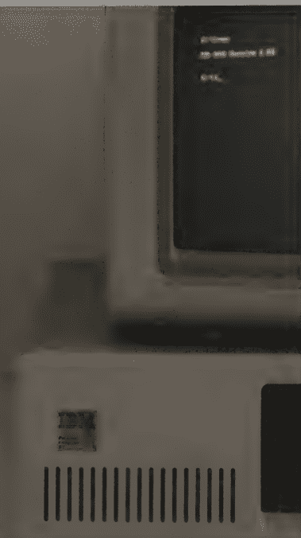

### THE HISTORY OF THE WEB

互联网自20世纪60年代末就已存在。它源于美国国防部的一个名为ARPANET（高级研究计划署网络）的项目。该项目旨在开发一种安全的计算机通信网络，以便在战争时期使用（当时正值冷战高峰期），最初是各大学和研究机构之间的若干计算机连接。

#### Text-based Communication

早期的互联网非常适合交换基于文本的信息（第一封电子邮件发送于1971年）。当时没有图片、视频、搜索引擎，甚至没有指向其他网站的链接，只有文本页面，而且查找页面极其困难，因为你需要知道页面所在计算机调制解调器的电话号码。因此，使用它的人只有学者和研究人员。

Left: 早期的互联网使用完全是基于文本的。

## THE FATHER OF THE WEB

早期的互联网不易使用。不同的计算机使用不同的语言，因此交换信息和改进互联网都很困难。是欧洲粒子物理实验室CERN的一位英国科学家确定了所需条件。蒂姆·伯纳斯-李提出了标准互联网的设想，所有用户都使用相同的语言和协议。他称其为万维网。

### Developments

为了实现万维网的创建，蒂姆·伯纳斯-李汇集了多种理念和创新，包括以下内容。

- HTML（超文本标记语言）：所有网页用于格式化、交换和发布信息的通用语言。
- URL（统一资源标识符）：每个网站的唯一地址，让用户能以简单方法访问网站。
- HTTP（超文本传输协议）：与计算机鼠标共同开发，HTTP允许通过超文本词将网页相互连接，这些词现在通常称为链接。

Above: 蒂姆·伯纳斯-李创造了我们今天所知道的万维网。

### Did You Know?

截至1992年底，万维网上仅存在26个网站。如今，数亿个网站上拥有超过一万亿个网页。

## 面向所有人的访问

这无疑是历史上最慷慨的举动之一，蒂姆·伯纳斯-李和 CERN 的董事们于 1993 年发表声明，宣布万维网将向所有人免费开放使用。这一举动催生了我们今天所知的互联网，在短短几年内，它已成为有史以来最强大的通信工具之一。

## 网络的发展

自万维网向所有人免费开放以来，其发展呈指数级增长，得益于各种技术和进步的助推。

上方：亚马逊是第一家大型商业电子商务网站。它最初只销售图书，但现在销售各种各样的产品。

- Web 浏览器：名为浏览器的程序通过使 HTML 更易于使用，让人们能够访问网站。
- 搜索引擎：在 20 世纪 90 年代中期，第一批搜索引擎出现，使查找和访问信息变得容易得多。
- 电子商务：在 20 世纪 90 年代中期，第一批电子商务网站出现，这有助于改变全世界做生意的方式。

## 当今的网络

万维网不再是少数学者和研究人员的专属领域。如今，全球超过 17 亿人使用互联网。网络仍在不断发展。早期，调制解调器连接使上传和下载非文本文件变得缓慢而笨拙；如今，凭借超高速宽带，我们现在可以使用网络访问图像、视频、音乐和其他多媒体内容。

### 移动网络

我们访问网络的方式也发生了巨大变化。随着智能手机和平板电脑的出现，我们不再需要被绑在电脑前，这意味着无论身在何处、无论在做什么，都可以上网。

### 你知道吗？

虽然现在这两个词经常混用，但严格来说，“Internet”是计算机网络，而“World Wide Web”是指互联网上的网站。

上方：移动设备让我们几乎可以随时随地访问万维网。

## 互联网使用

最初作为文本通信信息门户的东西，已成为我们日常生活不可或缺的一部分，让我们能在线做各种各样的事情，许多人在许多日常活动中都越来越依赖虚拟世界。

### 通信

网络最具革命性的方面之一，在于它改变了我们的沟通方式。在网络出现之前，与他人联系主要有三种方式——邮寄、电话或面对面。网络引入了许多不同的通信方式，所有这些方式都让世界变得更加狭小。

- 电子邮件：电子邮件是即时的，并允许您将各种文件附加到消息中。如今，世界上大部分通信都是通过电子邮件进行的。

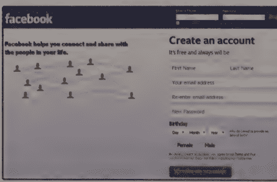

上方：社交媒体网站 Facebook 拥有超过十亿用户。

- 社交媒体：Twitter、Facebook 和 LinkedIn 等网站使人们能够在线与全球各地的人们社交、建立人际关系和交友。
- 即时通讯：即时通讯（IM）使世界各地的人们无论身在何处都能进行实时通信。
- VoIP：互联网语音协议现在允许人们以极低或零成本进行全球实时文本、语音甚至面对面的通信。

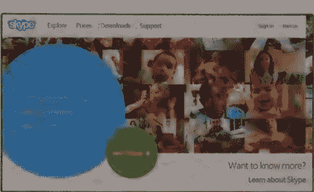

上方：Skype 等 VoIP 服务让人们可以通过互联网相互通话。

### 新闻与信息

网络现在是大多数人获取新闻和信息的主要来源。使用 Google 等搜索引擎，世界的知识就在您指尖。维基百科等网站已取代传统百科全书，几乎所有新闻机构都有在线存在。此外，获取新闻的速度快得多，新闻事件常常在主流新闻网络能够播出之前，就在网站和社交媒体论坛上率先报道。

### 电子商务

商业世界现在也依赖互联网。曾经需要去商业街才能完成的各种交易，如今都可以在线进行。

购物：网上购物彻底改变了我们的购物方式。在线购物现在和在商业街购物一样普遍，几乎每个知名零售商都有网络存在。

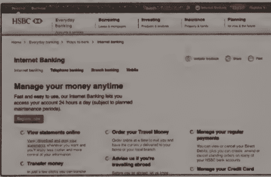

上方：网上银行让管理财务变得轻松得多。

财务交易：许多人现在使用网络来了解自己的财务状况，无论是查询银行余额还是支付账单。

预订：机票、酒店客房和餐厅预订都可以通过互联网完成。

> 你知道吗？
> 
> 宽带现在允许视频和音乐服务‘流式传输’内容，使用户可以实时观看或收听，而无需先将其下载到设备上。

### 娱乐

网络也从根本上改变了我们获取娱乐的方式。电影、电视节目、音乐、视频游戏和电子书现在都可以在线下载。您甚至可以在电视频道播出时观看，或收听现场广播。

### 商业

许多人现在依赖互联网谋生。无论是在线销售商品和服务，还是作为自由撰稿人、设计师或顾问执业，网络都让做生意变得容易得多。

### 营销

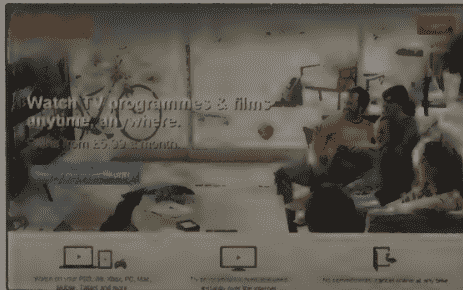

网络提供了各种传播信息的方式。现在，创意产业（如作者、音乐家和视频制作人）的人们无需经销商或出版商即可触达受众，广告商还可以利用社交媒体接触潜在客户。

上方：Netflix 等娱乐网站允许您通过互联网访问电影和电视节目。

## 攻击开始

虽然网络极大地扩大了我们的机会，但也让我们变得脆弱。自万维网诞生之初，怀有恶意动机的用户就开始利用它。

### 美丽新世界

蒂姆·伯纳斯-李对万维网的愿景是一个能让世界更紧密联系、实现信息自由获取和思想交流的系统。这一理念意味着几乎未考虑安全问题，在网络早期，当时只有少数用户，保护信息和数据的需求并未出现。然而，这一状况很快就会改变。

### 威胁

不久之后，恶意用户就利用不断增加的用户数量，威胁了网络的基本理念。计算机病毒、黑客以及将网络视为犯罪机会的人，使得安全问题成为互联网用户日益关注的焦虑。

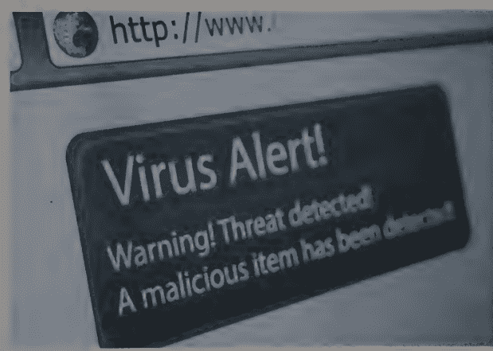

上方：网络设计之初并未太考虑互联网安全。

## 黑客攻击

未经授权进入计算机或其持有的数据被称为黑客攻击。然而，计算机黑客攻击早于万维网和互联网的出现。事实上，最初的黑客与计算机毫无关系。

### 第一批计算机黑客

第一批黑客出现在 20 世纪 60 年代和 70 年代。在此期间，发展最迅速的技术是电信领域，在美国形成了一种做法：人们试图绕过电信系统以获取免费电话——这种做法后来被称为‘phreaking’。当计算机在 20 世纪 70 年代末和 80 年代初普及后，许多曾参与频客活动的人开始对这项新兴技术产生兴趣，并开始未经授权进入计算机系统，往往只是为了好玩。

上方：约翰·托马斯·德雷珀，计算机黑客圈中最著名的人物之一。

### 你知道吗？

前电话频客和计算机程序员约翰·托马斯·德雷珀，人称“Captain Crunch”，在 20 世纪 70 年代因多次高调被捕而臭名昭著，许多人认为他是现代计算机黑客之父。

## 立法

直到1986年，也没有专门的法律管辖非法访问计算机。然而，在多次引人注目的黑客攻击之后，当国会通过《计算机欺诈和滥用法案》时，美国成为第一个将此类行为定为非法的国家。

## 恶意软件

人们很快意识到，入侵计算机并非获得未授权访问或造成混乱的唯一方式。黑客很快发现，他们可以使用小型软件程序感染计算机，导致其系统崩溃。

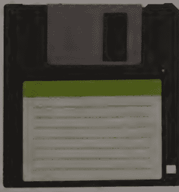

## 计算机病毒

“计算机病毒”一词最早在1984年被提出，当时计算机科学家弗雷德·科恩（Fred Cohen）撰写了一篇论文，警示这些具有感染性的程序的潜在危害，它们能够自我复制并通过网络传播，就像生物病毒在活体宿主中传播一样。早期的病毒通常隐藏在合法程序中，并通过可移动媒介（如软盘，CD和存储棒的前身）传播。

左图：早期的计算机病毒是通过软盘传播的。

然而，万维网的兴起意味着很快出现了一种从一台机器到另一台机器传播计算机病毒的更简单方式。

## 在线欺诈者

随着计算机病毒和计算机黑客的出现，万维网上很快又出现了另一种威胁——在线欺诈。当越来越多的人开始接入互联网时，骗子有可能一次针对成千上万的人。

### 419诈骗

已知的最早且仍然最常见的计算机诈骗之一就是419诈骗。它起源于尼日利亚，以处理欺诈的尼日利亚刑法典命名。419诈骗有许多变体，但通常涉及某人冒充高级官员，例如王子或将军，需要将大笔资金转移出境。骗子通常会向受害者提供一笔巨额资金，如果他们同意让骗子使用其银行账户进行转账，一旦骗子拿到受害者的银行详细信息，就可以掏空其账户。

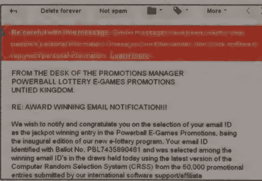

上图：419诈骗的另一种变体是发送一封电子邮件，声称您在彩票中赢得了一大笔钱，但您需要提供银行详细信息才能领取奖金。

## 防御措施

随着计算机病毒、黑客攻击和在线欺诈变得更加普遍，人们提出了不同的方法来保护计算机并保障数据安全。其中许多系统在万维网出现之前就已存在，但互联网的普及意味着这些中和安全威胁的方法获得了新的重要性。

- **防火墙：** 防火墙以防止火灾时保护相连财产的防火墙命名，它会阻止对系统的访问，只允许符合特定标准的数据通过。

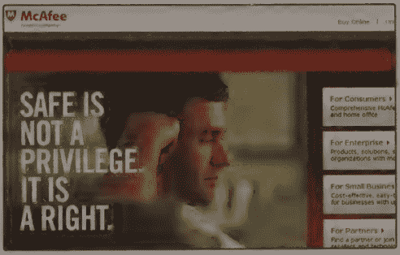

上图：McAfee等防病毒软件已成为防止计算机病毒的必需品。

- **防病毒：** 随着计算机病毒变得更加突出，开发者创建了程序来清理受感染的系统，称为防病毒软件。

- **加密：** 为了防止数据在互联网上传输时被未授权访问，开发了加密技术，使得没有解密密钥的数据难以阅读或解码。

- **垃圾邮件过滤器：** 用于识别未请求的电子邮件以及来自骗子的电子邮件。

## 军备竞赛

自黑客攻击和计算机病毒出现以来，黑客与试图阻止他们渗透计算机系统的人之间一直在进行一场战斗。随着安全措施变得越来越复杂，试图闯入系统的黑客的手段也变得越来越复杂。

## 网络攻击

计算机的恶意使用被称为网络犯罪。它可以从犯罪分子想要窃取个人个人信息，到国家赞助的网络攻击，其中一个国家针对另一个国家的计算机系统，目的是窃取信息或造成混乱。

### 成本

由于网络犯罪普遍，全球互联网安全行业的价值估计达700亿英镑，然而据估计，网络攻击给全球经济造成的损失要远超这个数字。

上图：网络犯罪给全球经济造成数千亿英镑的损失。

## 保持安全

对于普通个人来说，国家赞助的网络攻击无需太担心，但保护自己免受网络犯罪侵害仍然很重要。在下一节中，我们将探讨各种安全威胁以及糟糕的互联网安全带来的后果。

## 风险

我们将在下一章中更详细地探讨在线威胁，但为了了解互联网安全的重要性，我们将简要了解一些最常见的威胁及其带来的危险。

## 互联网依赖

随着万维网的发展，我们中的许多人越来越依赖虚拟世界。我们现在依赖互联网进行各种事情，从金融交易和网上银行，到与朋友和同事沟通。如果我们的电脑、智能手机或平板电脑被攻破，后果可能是灾难性的，尤其是如果网上银行详细信息等重要信息落入不法分子手中。

> 你知道吗？
> “计算机病毒”通常被用作一个广义术语来描述所有类型的恶意软件，大多数防病毒软件旨在不仅删除病毒，还包括其他恶意软件威胁。

## 保护自己

由于对万维网的这种依赖，互联网安全现在对于保护我们免受潜伏在虚拟世界中的各种在线威胁至关重要。但在武装自己之前，了解外面有什么是个好主意。

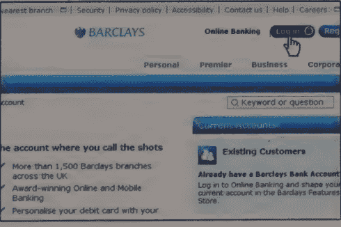

上图：确保安全的网上银行只是您需要互联网安全的原因之一。

## 恶意软件

恶意软件描述了一整套旨在攻破计算机、窃取数据或劫持您机器的恶意程序。恶意软件只是恶意软件（malicious software）的缩写。我们将在下一章中更详细地了解恶意软件，但目前，了解外面存在的不同类型是值得的。

## 计算机病毒

这是一种恶意软件，它能够自我复制，通过附着在合法程序上从一台机器传播到另一台机器，该程序在启动时会释放病毒。

## 特洛伊木马

一种伪装成正常或无害文件的恶意程序。一旦文件被打开，特洛伊木马就会被激活，并可用于远程访问您的计算机。

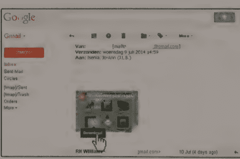

上图：特洛伊木马通常通过电子邮件附件发送。

## 蠕虫

一种在网络上自我复制的计算机病毒。蠕虫可以独立传播，无需用户打开文件或运行程序。

## 间谍软件

旨在监视您的计算机，一旦激活，间谍软件可以监控您的击键，窃取密码并从您的硬盘中窃取数据。

## 广告软件

旨在向您轰炸广告，广告软件通常会感染互联网浏览器，并会用恼人的弹出窗口（屏幕上出现的额外窗口）攻击您，这些窗口会阻止您正常浏览。

## 机器人

一种旨在执行特定任务的软件程序。机器人可以在成千上万台机器上静默协同工作，用户浑然不知，并攻击网站和其他计算机系统（这种机器人的连接被称为僵尸网络）。

## 勒索软件

通过接管控制并阻止正常访问来将计算机作为人质，直到用户付费移除恶意软件。

## 根套件

旨在隐藏在机器上并对安全系统和用户不可见的恶意软件，通常通过利用软件系统中的漏洞来实现。

## 药房攻击

这些可以更改您互联网浏览器中的书签和其他文件，并将您带到虚假或诈骗网站。

## 垃圾邮件

未经请求的消息，通常通过电子邮件发送，可能会堵塞收件箱。

## 恐吓软件

这些通常旨在通过声称计算机已被病毒感染来吓唬用户，从而付费购买不必要的产品。

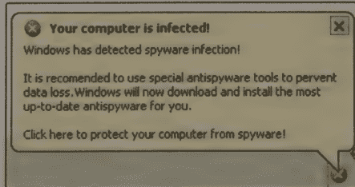

上图：恐吓软件可以伪装成来自操作系统的真实消息。

## 黑客攻击

如前本章所述，黑客攻击是指未经授权访问计算机、网络或在线账户。黑客攻击的原因多种多样，有些比其他更具恶意。

- 挑战：一些黑客只是享受攻克安全系统的挑战；这些黑客通常会入侵高知名度网络。
- 犯罪：黑客经常攻击机器以窃取数据、获取个人信息、盗窃资金或造成干扰。
- 道德黑客：一种合法的黑客行为，受雇者被聘请入侵系统以检查系统安全。

### 热贴士

即使是最安全、最昂贵的计算机网络也可能被黑客攻击，因此没有保证能将黑客拒之门外的方法。但你可以通过采取适当的互联网安全防护措施，让他们窘迫万分。

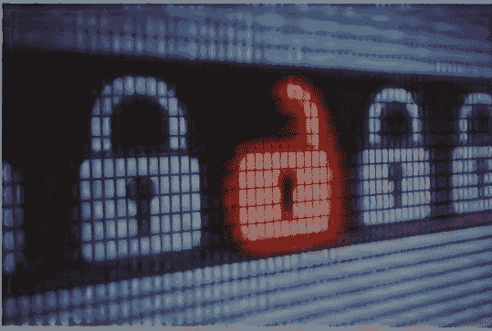

上图：黑客攻击早在万维网出现之前就已存在，并且至今仍是一个严重问题。

### 黑客攻击方法

预防黑客攻击的问题在于，黑客利用大量技术来入侵计算机系统或攻破他人的在线账户。这些技术包括利用系统漏洞、精妙地使用恶意软件以及“网络钓鱼”技术（有关黑客攻击及应对措施的更多信息，请参见第76–89页。）

## 网络钓鱼

获取计算机或他人在线账户访问权限最简单的方法之一，就是诱骗人们交出登录信息，例如密码或用户名。这被称为“网络钓鱼”。网络钓鱼最常见的方法之一是发送一封看似来自合法来源（如银行或社交媒体账户）的电子邮件。这些邮件提供一个登录链接并提示受害者登录，通常会声称其账户出现问题。然而，这些链接常常会将你引导至一个假冒网站（称为“欺骗”网站），该网站看起来与真实网站一模一样，但其目的是窃取登录信息。

## 身份盗用

由于我们大部分生活都在网络上进行，如果某人掌握了合适的个人信息，冒充我们就非常容易。这被称为身份盗用。无论是通过黑客攻击、网络钓鱼还是恶意软件，如果有人掌握了你足够的个人信息，他们就可以以你的名义开设银行账户、获取信贷并犯下刑事罪行（我们将在67–75页更详细地探讨身份盗用）。

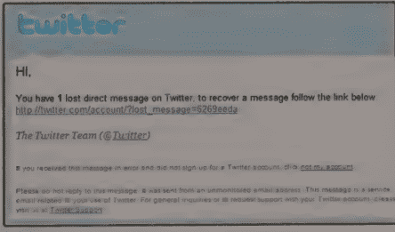

上图：一封声称来自 Twitter 的网络钓鱼邮件，提示账户持有人登录：

## 其他威胁

恶意软件、黑客和骗子并非网络世界带来的唯一威胁。适当的互联网安全还可以帮助你防范：

- 骚扰/霸凌：参与在线论坛或使用社交媒体可能意味着你会接触到蓄意欺凌、骚扰或威胁你的人，这种行为被称为“网络喷子”。
- 网络蹭网：如今众多互联网连接都是无线的，因此有人可能在你不知情的情况下使用你的网络；他们甚至可能在下载非法文件或进行黑客攻击。
- 攻击性内容：可能有许多网页内容你不希望自己或孩子看到，例如色情或暴力网站。

### 热贴士

确保家庭中的每个人都了解互联网安全威胁。检查他们是否知道不下载不确定的文件，也不交出密码或其他个人信息。

上图：互联网安全可以帮助保护您的孩子安全。

## 互联网安全防护不足的后果

未能保护自己免受网络威胁，可能导致各种后果，从轻微的不便到严重的财务创伤。

- **系统故障：** 恶意软件可能导致系统运行缓慢、崩溃，甚至对计算机造成永久性损坏。
- **互联网问题：** 您可能会因安全问题而丢失互联网连接，或者连接速度变慢，或无法访问某些网页。

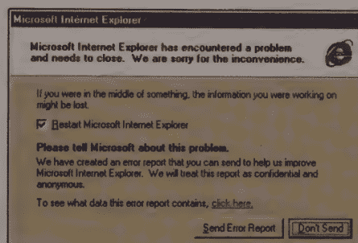

- **数据丢失：** 黑客和恶意软件不仅可能窃取和复制您的个人数据和文件，还可能导致它们被永久删除。

上图：系统错误通常是恶意软件的迹象。

- **财务损失：** 如果有人访问金融网站（例如您的银行账户），您可能会损失资金。
- **身份欺诈：** 如果有人使用您的个人信息，您可能需要为以您的名义申请的贷款和其他财务义务承担责任。
- **感染：** 如果您的互联网安全防护不足，您可能会将病毒和其他恶意软件传播给朋友、亲戚和同事。
- **隐私：** 互联网安全防护不足意味着他人可能访问您的社交媒体账户、存储在硬盘上的照片以及其他个人数据。

## 身份验证

互联网安全的第一道防线是网站和服务提供商采用的各种方法，以帮助您证明自己的身份。在本节中，我们将探讨网站验证您身份的不同方式。

### “是我，真的！”

在万维网出现之前，如果您想从账户中取款、使用支票簿支付或访问某些个人信息，通常需要交出某种身份证明（如驾驶执照或银行卡），然后提供签名。在在线世界中，这些身份证明方法不切实际，因此需要其他形式的身份验证。

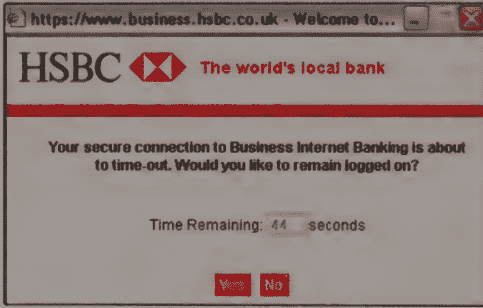

左图：在线银行通常会在一段时间无操作后自动将您登出。

### 你知道吗？

许多安全网站会在设定的无操作时间后超时。这是为了防止您离开电脑却忘记退出登录。一旦超时，您需要重新登录才能继续使用网站。

## 在线身份识别

大多数网站和计算机通常使用三个阶段来进行在线身份识别，以验证您就是您声称的那个人。

- **标识符：** 要开始识别过程并帮助计算机或网站识别您，需要某种形式的标识符。这通常是用户名或电子邮件地址。
- **身份验证：** 这是一个旨在让您证明您就是您声称的那个人的系统。最常见的验证方式是密码或 PIN 码（个人识别号码）。
- **授权：** 如果您成功输入了密码或 PIN 码，系统会通过登录您来授予您进入网站的权限。

### 电子邮件验证

许多在线服务（如社交媒体网站）要求您在注册前拥有一个有效的电子邮件地址。该电子邮件地址用作识别过程的一部分。为了访问您的账户，您可能首先需要验证您拥有与其关联的电子邮件地址。这通常通过点击发送到指定地址的电子邮件中的链接来完成。

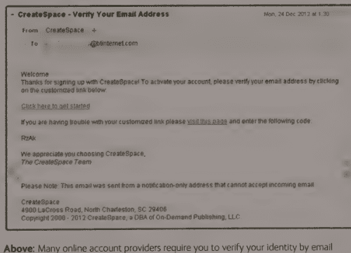

### 用户名

网站和计算机最常用的标识符是用户名。用户名必须是唯一的。某些网站将电子邮件地址用作用户名，其他网站要求您创建一个，还有一些网站会为您创建一个。

## 密码

密码是网站和计算机使用最广泛的验证方式。大多数密码长度为六到十二位，并同时使用字母和数字。当您输入密码时，它通常会被隐藏，例如在屏幕上显示为星号（*），以防止有人偷看。

### 热贴士

大多数需要用户名和密码的网站都有一个记住登录信息的复选框。如果您使用的是公共或共享计算机，请务必不要勾选它，以防止他人使用您的信息登录。

## 身份验证过载

当今人们注册的网站、在线账户和社交媒体平台数量庞大，要记住每一个密码和用户名组合几乎是不可能的。因此，有些人为所有账户使用相同的密码。但这非常糟糕，因为如果一个账户被攻破，相同的信息就可以被用来入侵所有其他账户。

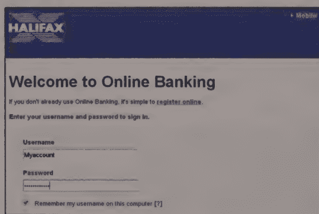

左图：输入用户名和密码以访问银行账户。请注意记住信息的复选框。

## Cookie

网站会在您的计算机上存储称为 Cookie 的小文件，用于保存您的账户详细信息。这使得计算机可以增加进一步的验证来确认您就是您声称的那个人，同时允许您的互联网浏览器为您记住用户名和密码。

## OTHER ONLINE SECURITY MEASURES

## 其他在线安全措施

As well as usernames and passwords, websites deploy a host of other security measures to help with the authentication process.

除了用户名和密码，网站还部署了许多其他安全措施来协助身份验证过程。

- **Memorable information**: When you sign up to a website or service, you may be asked to provide some memorable information such as your first school or mother’s maiden name.
- **易记信息**：在注册网站或服务时，您可能会被要求提供一些易记信息，例如您的第一所学校或母亲的娘家姓氏。

- **IP address**: Some websites restrict you to logging in on specific computers and won’t allow access if your IP (Internet Protocol) address, the unique identifier of your computer, is different to the one registered to your account.
- **IP 地址**：某些网站会将登录限制在特定计算机上，如果您的 IP（互联网协议）地址（即计算机的唯一标识符）与您账户中注册的地址不同，将不允许访问。

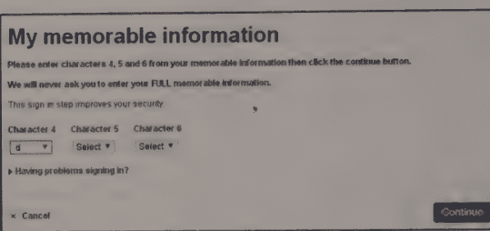

### PIN

### PIN

Personal Identification Numbers are often used in conjunction with passwords on secure sites.

个人识别号码通常与安全网站上的密码一起使用。

Above: Entering memorable information to log into a bank account.

上图：输入易记信息以登录银行账户。

### Password Lock

### 密码锁定

Many password systems, especially on secure servers, will lock you out if you enter the incorrect password several times (usually three times). This is to stop people attempting to guess a password or to prevent software bots from running through every possible password combination to hack into a system. If you are locked out of an account, you may have to contact the administrators before you can log back in.

许多密码系统（尤其是安全服务器上的系统）会在您多次输入错误密码（通常是三次）后将您锁定。这样做是为了防止他人尝试猜测密码，或阻止软件机器人遍历所有可能的密码组合来入侵系统。如果您被锁定在账户之外，在重新登录前可能需要联系管理员。

**Hot Tip**

**热门提示**

In the next section, we will explore how to create strong passwords as well as provide you with some tips for remembering them.

在下一节中，我们将探讨如何创建强密码，并为您提供一些记住密码的技巧。

### CAPTCHA Codes

### CAPTCHA 代码

Another system designed to ensure a user is a human being and not a software bot is the use of CAPTCHA codes (Completely Automated Public Turing Test; a Turing test is something designed to tell the difference between people and machines). Usually, these are visuals of letters and numbers, which have to be read and correctly entered.

另一种旨在确保用户是人类而非软件机器人的系统是使用 CAPTCHA 代码（完全自动化公共图灵测试；图灵测试旨在区分人与机器）。通常，这些是字母和数字的图像，需要读取并正确输入。

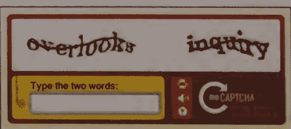

Right: Entering a CAPTCHA code.

右图：输入 CAPTCHA 代码。

## PASSWORD ADVICE

## 密码建议

Passwords are your virtual key for gaining access to your online accounts. However, as with other types of keys, you have to make sure they do not fall into the wrong hands, which means ensuring your passwords are secret, safe and secure.

密码是您访问在线账户的虚拟钥匙。然而，与其他类型的钥匙一样，您必须确保它们不会落入错误之手，这意味着要确保您的密码保密、安全且可靠。

### SETTING A PASSWORD

### 设置密码

Most websites that require you to create a password insist on at least eight letters or digits. The longer the password, the more secure it is, but the harder it is to remember.

大多数要求您创建密码的网站都坚持至少使用八个字母或数字。密码越长，越安全，但也越难记住。

#### Strong Passwords

#### 强密码

Passwords should be strong. A strong password is one that cannot be guessed by somebody else. The strongest type of password contains letters (both upper and lower case) and numbers, and in some cases symbols (although these are not always permitted).

密码应当是强密码。强密码是指他人无法猜测的密码。最强的密码类型包含字母（大写和小写）和数字，在某些情况下还包含符号（尽管这些符号并不总是被允许）。

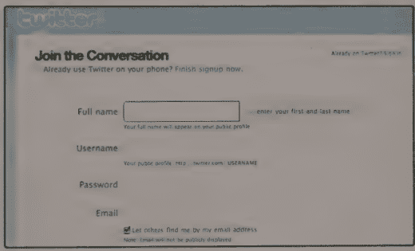

Above: Creating usernames and passwords on Twitter.

上图：在 Twitter 上创建用户名和密码。

### CREATING A STRONG PASSWORD

### 创建强密码

The problem with passwords is that you have to remember them. Random letters and numbers may well make a strong password but they can be difficult to remember. However, there are several methods of creating passwords that are both memorable and strong.

密码的问题在于您必须记住它们。随机字母和数字固然可以构成强密码，但可能难以记住。然而，有几种方法可以创建既易记又强大的密码。

### Replacing Letters With Numbers

### 使用数字替换字母

- 1. Choose a unique word or phrase that you can use to identify the online account you are creating a password for, such as ‘money place’ for a bank, or ‘talk land’ for a social media website.
- 1. 选择一个独特的单词或短语，用于标识您正在为其创建密码的在线账户，例如银行的“money place”，或社交媒体网站的“talk land”。
- 2. Replace every other letter with a number or symbol that looks similar, such as ‘m@n3y p1a6e’.
- 2. 将每隔一个字母替换为外观相似的数字或符号，例如“m@n3y p1a6e”。
- 3. Replace spaces with an underscore and capitalize every second letter, as in ‘m@N3y_P1a6e’.
- 3. 将空格替换为下划线，并将每隔一个字母大写，例如“m@N3y_P1a6e”。

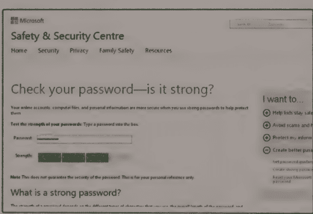

Above: Microsoft's password checker.

上图：Microsoft 的密码检查器。

> **Hot Tip**
> 
> You can check how strong a password is by using websites such as https://www.microsoft.com/en-gb/security/pc-security/password-checker.aspx

> **热门提示**
> 
> 您可以使用 https://www.microsoft.com/en-gb/security/pc-security/password-checker.aspx 等网站来检查密码的强度。

### Song Lyrics

### 歌词

Another method for creating memorable and strong passwords is to use a favourite line from a song.

创建易记且强大密码的另一种方法是使用喜欢的歌曲中的某一句歌词。

- 1. Start with a memorable line from a song, such as ‘She loves you yeah, yeah, yeah.’
- 1. 从歌曲中选择一句易记的歌词开头，例如“She loves you yeah, yeah, yeah。”
- 2. Capitalize each word and remove the spaces between the words, then remove all the vowels: ShLvsYYhYhY.
- 2. 将每个单词大写并删除单词之间的空格，然后删除所有元音：ShLvsYYhYhY。
- 3. Replace every second or third letter with its corresponding number in the alphabet: Sh12vs25Yh25hY8.
- 3. 将每隔两个或三个字母替换为字母表中对应的数字：Sh12vs25Yh25hY8。

## LOOKING AFTER YOUR PASSWORD

## 保护您的密码

Once you have set your password, you need to keep it safe and secure.

设置密码后，您需要将其安全保管。

- **Keep it secret:** Never tell anybody your passwords. If you think that someone else knows a password, change it immediately.
- **保密**：绝不要告诉任何人您的密码。如果您认为其他人知道某个密码，请立即更改。

- **Privacy:** When you are entering a password on a public computer, make sure nobody can see your keystrokes.
- **隐私**：在公共计算机上输入密码时，确保没有人能看到您的按键。

- **Do not recycle:** When creating a new password, do not use one that you have used before.
- **不回收使用**：创建新密码时，不要使用以前用过的密码。

- **Storing passwords:** Avoid writing passwords down. If you have to, disguise them in sentences and never store them on your computer.
- **存储密码**：避免将密码写下来。如果必须写下来，请将其伪装在句子中，并且永远不要将其存储在计算机上。

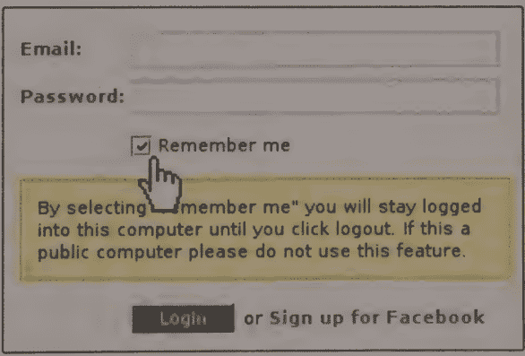

- **Beware:** Of email claiming to be from your account provider and asking for your password. Online account providers almost never ask for your password.
- **警惕**：声称来自您的账户提供商并要求您提供密码的电子邮件。在线账户提供商几乎从不要求您提供密码。

Above: Uncheck the 'Remember me' box on any shared or public computers.

上图：在任何共享或公共计算机上取消勾选“记住我”复选框。

- **Public computers:** Make sure a browser on a public computer is not remembering your passwords and always log off when you have finished.
- **公共计算机**：确保公共计算机上的浏览器没有记住您的密码，并且在使用完毕后始终注销。

## CHANGING YOUR PASSWORD

## 更改您的密码

Because you never know when your details or the websites that you have frequented have been compromised, it is important to change your passwords regularly. Do this about every three months, but do not change all your online accounts at once, stagger them, just in case somebody is monitoring your computer activity.

由于您永远不知道您的详细信息或常访问的网站何时会被泄露，因此定期更改密码非常重要。大约每三个月更改一次，但不要一次更改所有在线账户，要错开进行，以防有人监控您的计算机活动。

### Hot Tip

### 热门提示

If you think the email address that is attached to your online accounts has been compromised, change it, as anybody with access to your email could reset all your passwords and gain access to your accounts.

如果您认为与在线账户关联的电子邮件地址已被泄露，请更改它，因为任何能够访问您电子邮件的人都可能重置您所有密码并访问您的账户。

### Password Reset

### 密码重置

If you forget your password, all is not lost. Most websites provide a password-reset facility to allow you to create a new password.

如果您忘记密码，也不要灰心。大多数网站都提供密码重置功能，允许您创建新密码。

- 1. On the login page, there should be a ‘Forgotten your password?’ or ‘Reset password’ link.
- 1. 在登录页面上，应该有一个“Forgotten your password？”或“Reset password”链接。
- 2. After you click this link, you may be asked to confirm that you want to reset your password.
- 2. 单击此链接后，系统可能会要求您确认是否要重置密码。

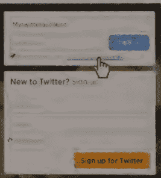

Above: Clicking reset password link on Twitter.

上图：在 Twitter 上单击重置密码链接。

- 3. Once confirmed, your account provider will send a link to your email address.
- 3. 确认后，您的账户提供商会将一个链接发送到您的电子邮件地址。
- 4. Click this link to reset and create a new password.
- 4. 单击此链接以重置并创建新密码。

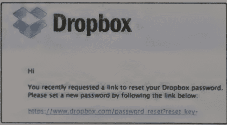

Left: Password reset link sent to your email.

左图：发送到您的电子邮件的密码重置链接。

## PASSWORD CHECKLIST

## 密码清单

Because passwords are so important for protecting your online security, here is a checklist of Dos and Don'ts for keeping passwords strong and secure.

由于密码对于保护您的在线安全至关重要，以下是保持密码强大且安全的注意事项清单。

- Do: Use upper- and lower-case letters, numbers and keyboard symbols where possible in your passwords.
- 做：在密码中尽可能使用大小写字母、数字和键盘符号。
- Do: Make your password at least eight characters in length, longer if you can remember it.
- 做：将密码长度设置为至少八个字符，如果您能记住，可以更长。
- Don't: Use personal information in your passwords, such as birthdays or names of family members.
- 不要：在密码中使用个人信息，例如生日或家庭成员姓名。
- Don't: Use any information somebody could guess from reading your social media pages, such as your favourite sports team or the town in which you live.
- 不要：使用任何他人可能从阅读您的社交媒体页面中猜到的信息，例如您喜爱的体育队或您居住的城镇。
- Don't: Use simple or plain words, ascending or descending numbers, or keyboard patterns such as 'qwerty' in your passwords.
- 不要：在密码中使用简单或常见单词、递增或递减的数字，或键盘模式（例如“qwerty”）。
- Don't: Tell anybody your password.
- 不要：告诉任何人您的密码。
- Do: Remember to change your password regularly.
- 做：记住定期更改您的密码。

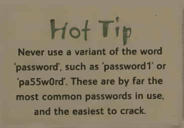
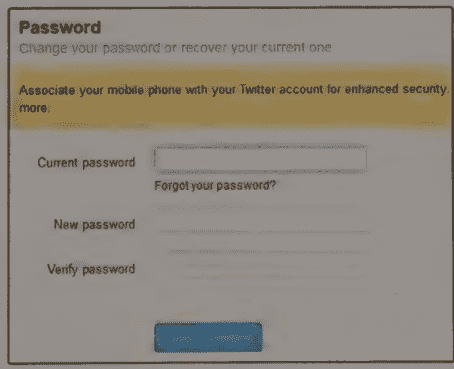

Above: Changing a password on Twitter.

上图：在 Twitter 上更改密码。

ALE

ALE

## WHAT MAKES YOU VULNERABLE?

## 什么使您易受攻击？

While major cyber attacks against big companies often make the headlines, you do not have to be a large organization to be vulnerable to attack. Almost anybody can become a victim, especially if you have inadequate Internet security.

虽然针对大公司的重大网络攻击常常登上新闻头条，但您不必是大型组织才会易受攻击。几乎任何人都可能成为受害者，尤其是在您的互联网安全不足时。

### TEMPTATION

### 诱惑

The speed at which the World Wide Web has grown has been incredible. In just a couple of decades, it has gone from being a tool for a handful of researchers and academics to being ubiquitous. Millions of people now rely on the Internet for work, business and socializing. However, not everybody who uses the Internet does so with good motives. The Internet has become a tempting target for criminals or for people intent on doing harm.

万维网的发展速度令人惊叹。在短短几十年里，它从少数研究人员和学者的工具变得无处不在。数百万人现在依赖互联网进行工作、商业和社交。然而，并非所有使用互联网的人都怀有良好动机。互联网已成为罪犯或意图造成伤害的人的诱人目标。

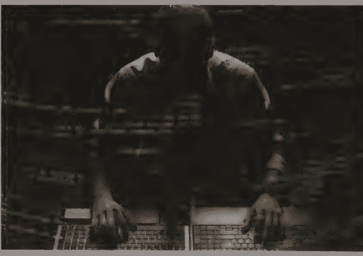

### Unseen Enemy

### 看不见的敌人

Unlike crimes committed in the real world, online criminals can commit their misdeeds anywhere in the world and from the comfort of their own home. Finding and prosecuting cyber criminals is also extremely difficult, so people who do this sort of thing believe they have little to fear.

与现实世界中犯下的罪行不同，网络犯罪分子可以在世界任何地方、从自己家中舒适地实施罪行。查找和起诉网络罪犯也极其困难，因此从事此类活动的人认为自己几乎无需担忧。

Left: Cyber crime is an increasing problem.

左图：网络犯罪是一个日益严重的问题。

## 婴儿也能拿走的糖果

许多人参与网络犯罪的另一个原因是，这可能非常容易，主要是因为许多计算机缺乏足够的 Internet 安全性，使其容易受到攻击。

## 持续连接

在互联网早期，当有人想要连接时，他们会将电话线插入调制解调器，完成后又会断开连接。如今，大多数家庭都拥有高速、始终在线的连接，这可能会导致安全问题。

- 持续的入口点：Internet 连接充当攻击的入口点，而始终在线的连接意味着此入口点始终敞开。
- 静态 IP（互联网协议）地址：使用拨号调制解调器时，每次连接到 Internet 时 IP 地址都会更改，这使攻击者更难定位您。现代连接的 IP 地址永远不会更改。

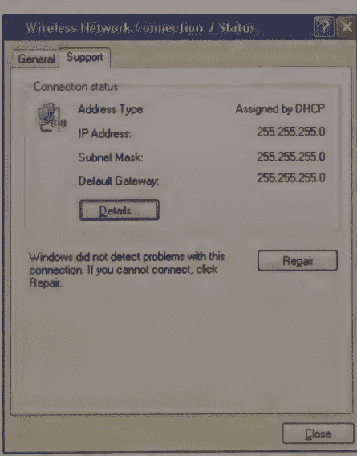

> **你知道吗？**
>
> IP 地址用作唯一位置标识符。它们通常是一系列由点分隔的一到四位数字，例如 1.160.10.240。

上图：IP 地址是可用于识别您位置的唯一数字。

## 系统漏洞

计算机系统和软件的复杂性不断增加。随着软件开发人员致力于为其产品添加新功能，操作系统和程序变得越来越复杂，而这种复杂性使得识别弱点和漏洞变得困难。虽然软件开发人员会在产品发布前尝试发现问题，但软件上市时通常仍包含固有缺陷，黑客可以利用这些缺陷。

## 操作系统

您的计算机用于管理硬件和软件的主程序称为操作系统 (OS)。操作系统中的缺陷尤其常见，主要是因为它们是非常大的程序，需要完成许多不同的任务。OS 开发人员不断发布更新以修复问题。但是，在更新发布之前，恶意程序或黑客可能已经利用了这些缺陷。

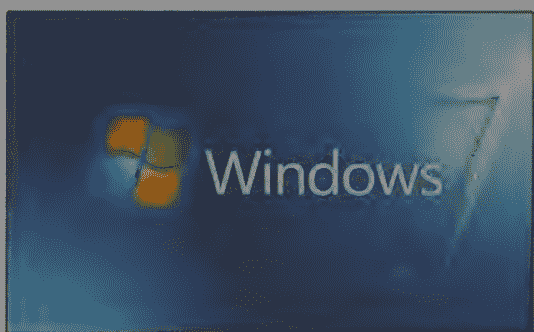

上图：Microsoft 的 Windows 系列是 PC 上最常见的操作系统，但其他操作系统还包括适用于 Mac 的 Linux、OS X，以及适用于智能手机和平板电脑的 iOS 和 Android。

## Internet 浏览器

Web 浏览器（例如 Internet Explorer、Chrome 和 Safari）是用于与 World Wide Web 交互的主要应用程序。

> **你知道吗？**
>
> 当软件和操作系统制造商识别出漏洞时，他们通常会发布一个称为补丁的修复程序，您可以下载它来“修补”问题。

因此，Web 浏览器暴露在恶意内容中的程度高于计算机上的其他程序。恶意网站和恶意软件经常利用 Web 浏览器中的弱点作为攻击手段。与操作系统一样，浏览器需要定期更新以修复这些漏洞。

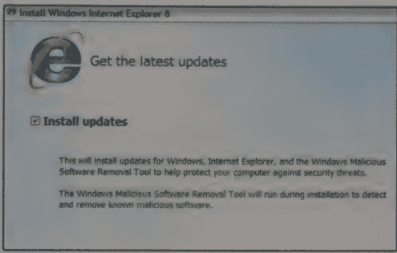

上图：请确保将 Internet 浏览器设置为安装更新。

## 其他软件

Web 浏览器和操作系统并非唯一包含可能被攻击者利用的漏洞的软件。如今，各种各样的程序都需要访问 Internet，从游戏到办公程序，如果这些应用程序中存在缺陷，就可能成为恶意用户的入口。

## 硬件漏洞

软件并非我们计算机中可能包含漏洞的唯一方面；我们用来连接 Internet 的大量硬件也可能存在缺陷或安装不当，使我们易受攻击。

> **实用提示**
>
> 如果您使用无线路由器，请确保为连接到它使用密码，否则任何人都可能访问您的 Internet 连接。

## 路由器

路由器是让您连接到 Internet 的设备。其主要功能是转发来自和发往我们计算机的 Internet 数据。从这个意义上说，它充当网关，因此路由器中的任何漏洞都可能为攻击者提供轻松的入口。如今，大多数人使用无线路由器，这带来了额外的风险，即人们可以利用 Wi-Fi 信号访问我们的系统。

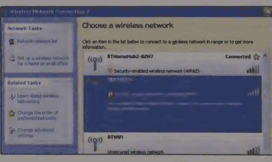

上图：安全的 Wi-Fi 连接需要密码才能访问。

## 防火墙

防火墙是软件或硬件网关，充当屏障，阻止来自 Internet 的数据，除非其符合某些规则或标准。未安装防火墙可能会导致您的 Internet 连接成为任何黑客或恶意软件进入您系统的敞开大门。

## 安装软件防火墙

最常见的一些操作系统自带防火墙。我们将在第 165–68 页更详细地讨论如何使用防火墙，但在此期间，如果您想知道如何激活防火墙，请按照以下步骤操作。

## Windows

- 1. 单击“开始”，选择“控制面板”。
- 2. 在 Windows XP 中选择“安全中心”，在 Windows 7 或 8 中选择“系统和安全”。
- 3. 在 Windows XP 中选中防火墙旁边的圆形红色按钮，使其变为绿色。在 Windows 7 或 8 中，单击显示“打开或关闭防火墙”的链接，并选中显示“打开 Windows 防火墙”的按钮。

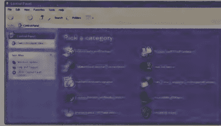

上图：在 Windows 中，防火墙设置包含在“系统和安全”控制面板设置中。

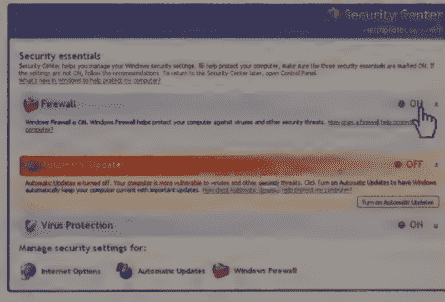

上图：在 Windows 中打开防火墙。

## Mac OS X

- 1. 单击 Apple 标志（左上角），在下拉菜单中选择“系统偏好设置”。
- 2. 选择“安全性”或“安全性与隐私”。

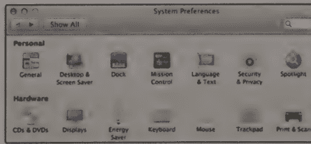

上图：在 Mac OS X 的“系统偏好设置”中选择“安全性与隐私”。

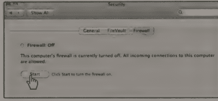

- 3. 单击“防火墙”选项卡。您可能需要通过单击左下角的锁并输入管理员用户名和密码来解锁该面板。
- 4. 单击“打开防火墙”或“启动”以激活防火墙。

上图：在 OS X 中打开防火墙。

> **你知道吗？**
>
> 由于智能手机和平板电脑连接 Internet 的方式，这些设备上几乎不需要防火墙，尽管已开发出一些防火墙和安全应用。（有关更多信息，请参见第 205–06 页。）

## 人为漏洞

硬件和软件漏洞不是 Internet 安全链条中唯一的薄弱环节。用户往往要对让病毒或黑客等威胁进入负责。例如，打开不认识的人发来的电子邮件附件是病毒进入计算机的最常见方式之一。

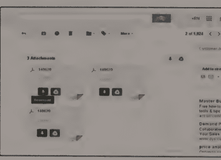

上图：电子邮件附件可能是恶意软件的来源。

## 教育

尽管大多数人都关注 Internet 安全并了解病毒等威胁，但很少有人会及时了解保护计算机系统免受攻击的不同方法。这部分是因为 Internet 技术发展迅速，其次，用户通常会安装某种安全软件（例如防病毒软件），并认为它可以提供 100% 的保护，但事实很少如此。Internet 安全需要一种全面的方法，良好的做法与硬件和软件解决方案同步进行。

## 常见的不良做法

计算机用户常常会犯一些常见的计算机不良做法，使自己更容易受到攻击。

- 无防护：如果没有安装任何 Internet 安全系统（例如防病毒软件和防火墙），几乎可以保证您的计算机在某个时刻会遭受攻击。
- 密码：使用弱密码、为所有账户使用相同密码，或将密码泄露给他人，也是人们遭受网络攻击的常见原因。
- 文件共享：尽管对等文件共享是与认识的人交换文件的有用方式，但来自未知来源的文件有时可能包含病毒。

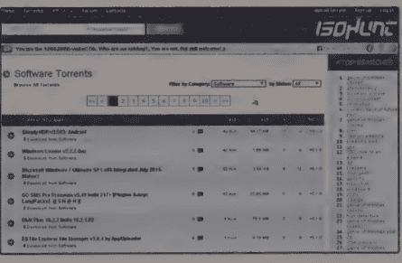

上图：来自文件共享网站（如 ISO Hunt）的文件有时可能包含病毒。

- 附件：打开不认识的人发来的附件，或没有防病毒软件对其进行扫描，可能会释放恶意软件。
- 个人信息：在社交媒体网站上透露过多个人信息，可能会导致他人猜测密码或了解足够多的信息来冒充您的身份（身份欺诈）。
- 软件过时：运行旧版软件或不更新操作系统、程序和防病毒软件会使计算机易受攻击。

## 保持安全

由于威胁我们互联网安全的漏洞数量众多，保持安全的第一步是尽可能多地修复它们。

- 连接：确保您的 Wi-Fi 连接受密码保护，以防止他人蹭网。
- 防火墙：在您的计算机或笔记本电脑上安装软件防火墙。如果您的操作系统不包含防火墙，请考虑购买一个。（有关防火墙的更多信息，请参见第 165–68 页。）

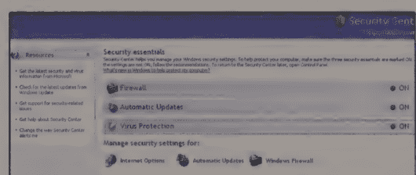

上图：防火墙、软件更新和防病毒保护对互联网安全都至关重要。

- 防病毒：确保已安装某种形式的防病毒软件。（有关可用不同解决方案的更多详细信息，请参见第 136–64 页。）
- 更新：定期保持操作系统、互联网浏览器和程序的更新，以修复任何漏洞。

> **你知道吗？**
>
> 某些 Wi-Fi 系统包含加密系统，例如 WEP 或 WPA，以提供额外安全性。请联系您的互联网服务提供商，确保您正在利用这些功能。

- 良好做法：养成安全上网习惯，例如绝不透露过多个人数据，绝不打开来自不认识的人的附件，以及确保您的账户使用强密码。

## 恶意软件

恶意软件是最常见的网络威胁。在本节中，我们将更深入地探讨不同类型的恶意软件，并了解其工作原理及所带来的威胁。

### 恶意软件

恶意软件几乎与计算机一样悠久。最初的计算机病毒并非有意制造，而是源于软件程序中的错误。这些错误导致系统崩溃，被称为“漏洞”（bug）。然而，人们很快意识到他们可以创建自己的漏洞，甚至使其自我复制，计算机病毒就这样诞生了。

### 谁在创建它们以及原因？

您可能会好奇，什么样的人会制作恶意软件，出于什么原因。事实是，各种各样的人制作恶意软件，原因也各不相同。

- 黑客：人们创建恶意软件是为了造成破坏并入侵高知名度的计算机系统，要么是单纯为了好玩，要么是出于某种政治议程。
- 罪犯：恶意软件用于窃取数据和金钱。

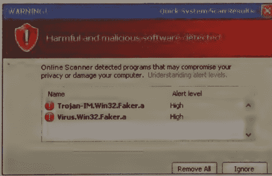

右图：病毒感染是一种司空见惯的威胁。

- 企业：一些声名不佳的公司利用恶意软件来推销产品或诱导人们购买其软件修复程序。
- 政府：甚至政府也会创建恶意软件以渗透另一国家的计算机系统。

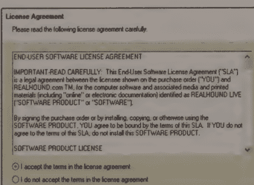

上图：通过接受某些许可协议的条款，您即同意在您的机器上安装恶意软件。

### 它们是如何入侵的

恶意软件可以通过多种方式进入计算机：有些隐藏在程序中，在您安装程序时被激活；有些软件开发人员创建免费程序，只是为了在人们的机器上安装恶意软件；而另一些恶意软件则伪装成正常文件，在您打开文件时被激活。此外，一些恶意软件潜伏在恶意网站上，当您访问该网站时会感染您的互联网浏览器。

### 热门提示

每次安装新软件（尤其是免费程序）时，请务必仔细阅读用户协议，并在互联网上搜索，看看其他用户安装后是否出现恶意软件问题。

### 外面有什么？

恶意软件是一个广义术语，包含各种各样的恶意软件，其危害程度从小烦恼到能够擦除所有数据、窃取文件或禁用计算机的程序不等。有时恶意软件感染很明显，因为您可能会丢失数据或遭受持续的计算机崩溃。然而，感染某些恶意软件时，您可能甚至不知道自己已被感染。

### 计算机病毒

大多数人都听说过计算机病毒，但很少有人真正了解其工作原理。简单来说，计算机病毒是一段能够自我复制并传播到其他计算机的代码。病毒通常被编写以实现特定目的，例如删除文件或在软件中制造错误。病毒可以通过多种方式进入计算机，例如通过电子邮件附件或您下载的程序，并且通常会感染计算机上的其他文件，从而允许病毒在您传递这些文件时传播。因此，即使是创建病毒的人也无法控制单个病毒能感染多少台机器。

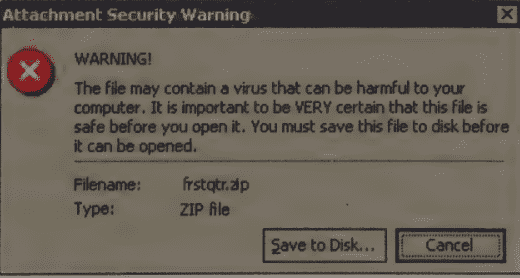

右图：病毒可能隐藏在程序或附件中。

### 计算机病毒类型

计算机病毒有多种形式，每种病毒的行为都不同。

- **程序病毒**：这些感染可执行文件（程序），病毒随可执行文件安装到计算机内存中，在那里感染其他文件并执行其编程。

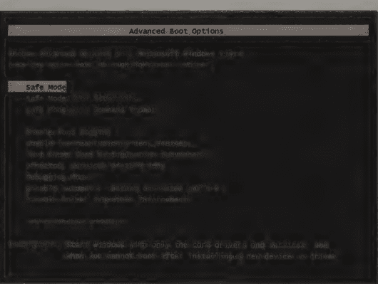

上图：某些病毒将阻止您的 PC 正常启动。

- **引导病毒**：与感染计算机内存不同，引导病毒感染操作系统启动时使用的记录，因此每次开机时病毒都会被重新安装。

- **隐蔽病毒**：这些病毒旨在避免被检测到。通常，这是通过阻止它们所在的硬盘部分被读取来实现的。

- **多态病毒**：就像生物病毒会发生突变一样，多态病毒也会变异，每次感染时都会更改其源代码，以使检测和清除更加困难。

- **宏病毒**：这些感染程序文件中的宏（执行特定任务的小段代码），例如文字处理文档或电子表格。

- **Active X 病毒**：Active X 是软件程序用于共享信息的框架，通过感染该框架，Active X 病毒可以轻松传播。

### 蠕虫

与计算机病毒类似，蠕虫可以自我复制并且旨在造成危害。然而，巨大的区别在于蠕虫的传播方式。与感染需要人为活动来传播（例如电子邮件附件）的文件不同，蠕虫可以在计算机网络上无需帮助即可传播。当网络上的一台计算机被感染时，蠕虫将传播到该网络上的所有其他机器。有些蠕虫甚至已知会将自身发送给某人地址簿中的每个人。

上图：蠕虫可能造成的危害从仅消耗带宽到删除和加密文件，甚至更糟。

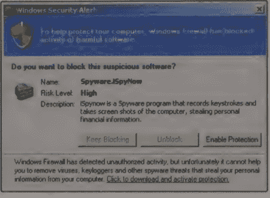

上图：人们使用间谍软件和键盘记录器来入侵在线账户。

### 间谍软件

与病毒不同，间谍软件不会自我复制。正如其名称所示，间谍软件的唯一目的是监视个人的计算机活动。间谍软件可以收集关于您计算机使用的各种数据，例如您访问的网站，而一些称为“键盘记录器”的间谍软件甚至会记录您的按键，这些按键可用于识别您在线账户的密码和用户名。

### 广告软件

虽然与间谍软件不同，但广告软件通常会随其一起安装。公司支付大笔资金给恶意软件开发人员，以在人们的机器上安装广告软件。它的工作原理是根据您的网络浏览历史记录向您发送特定广告。这可能以弹窗形式出现，也可能替换您的浏览器主页和书签。其他广告软件甚至可以用支付给广告软件开发人员的人的网站替换您的搜索引擎结果。

### 热门提示

如果您发现计算机运行速度异常缓慢，您可能无意中安装了间谍软件，因为它通常在后台运行，使用系统资源并拖慢系统速度。

### 勒索软件

勒索软件的唯一目的是赚钱。它的工作原理是扣留您的计算机或文件，直到您支付赎金。某些勒索软件会弹出警告消息，告诉您支付金钱以消除这些消息，希望这种烦恼足以让您交钱，而其他勒索软件（例如 CryptoLocker）会加密您的所有文件，因此您无法访问它们，直到您支付费用对其进行解密。

## Scareware

吓唬软件（Scareware）是一种获取金钱的不那么粗暴的方法，其中恶意软件会创建虚假警告信息，暗示您的计算机已感染病毒或间谍软件，同时建议您购买特定的恶意软件删除产品来解决问题。

## Trojan Horse

特洛伊木马（Trojan Horse）并不描述特定类型的恶意软件，如间谍软件或病毒，而是描述一种传递方式。特洛伊木马是伪装成合法文件的一段恶意软件。特洛伊木马可以是间谍软件，或包含将您的计算机加入僵尸网络的代码片段（我们将在片刻讨论这些）。特洛伊恶意软件很少复制或从一台机器传播到另一台机器，因为特洛伊木马的目的是在后台运行，因此用户不知道自己已被感染。

上方：某些勒索软件不仅锁定您的文件，还威胁在特定时间销毁它们。

## Rootkit

另一种试图保持隐藏以避免被检测到的恶意软件是根工具包（Rootkit）。根工具包像引导病毒一样深埋在操作系统中，但它们不会复制或试图传播到其他机器。它们的目的是保持隐藏，以便杀毒软件和其他安全措施无法在它们执行编程任务时检测到它们。它们也因极难删除而臭名昭著。

上方：保护自己免受恶意软件侵害的最佳方法是使用杀毒程序。

## Bots

如前一章所述，机器人（Bots）是为执行特定任务而设计的计算机代码。机器人不一定是恶意的；例如，搜索引擎使用机器人来识别网页内容，但机器人也可能被恶意使用，尤其是当它们协同工作时（见下文）。

## Botnets

僵尸网络（Botnets）是指大量机器人为共同目标协同工作。当计算机成为僵尸网络的一部分时，机器人会在用户常常不知情的情况下在后台运行于他人计算机上。僵尸网络协同工作，可以发送垃圾邮件和其他恶意软件，或针对特定网络或网站服务器，要么将其瘫痪，要么用如此多的请求轰炸它们以至于服务器拥塞，称为分布式拒绝服务攻击（DDoS）。

左侧：无法解释的网络活动可能意味着您已成为僵尸网络的一部分。

### Hot Tip

如果您的Internet连接运行缓慢，或您在未上网时也注意到网络活动，可能是因为您的机器已成为僵尸网络的一部分。

## PROTECTING YOURSELF

随着计算机和Internet变得越来越复杂，病毒和恶意软件也是如此。杀毒软件开发人员一直在进行持续战斗，以识别和消除新威胁。然而，他们总是落后于恶意编码者一步。杀毒软件至关重要，但即使安装了它，恶意软件仍可能是个问题。因此，为最坏的情况做好准备是值得的。

## Backing Up

数据丢失可能是恶意软件攻击的最严重后果之一，因此请确保定期备份所有重要文件。然而，值得记住的是，如果病毒已在您的机器上存在一段时间，您的备份文件也可能被感染。不要只使用一种备份系统；考虑同时使用云解决方案（在线文件存储）和硬件系统，例如闪存驱动器。

上方：Dropbox等云存储解决方案可用于存储您重要文件的备份。

## PC Health Checks

定期使用诊断软件（参见第174–77页）可以帮助在威胁造成危害之前发现并消除它们。您也可以将计算机带到受过培训的专业人员那里进行定期健康检查。

## Warning Others

如果您的系统确实被恶意软件感染，请考虑警告其他人，例如您电子邮件地址簿中的人，因为您可能已经无意中传播了恶意软件。

## THE WORST OFFENDERS

恶意软件经常登上头条新闻，尤其是当它攻击知名组织或变得特别广泛传播时。以下是一些著名的恶意软件示例。

- **The Love Bug virus**：或许是历史上最成功的计算机病毒攻击，感染了估计5000万台计算机。病毒隐藏在一封声称是情书的电子邮件附件中，诱使人们打开它。

- **The Anna Kournikova worm**：库尔尼科娃蠕虫附加到一封声称拥有网球明星裸照的电子邮件中。一旦打开，该蠕虫会将自己发送给用户地址簿中的每个人，并感染数千万台机器。

- **Conficker Botnet**：2009年，Conficker成为有史以来最大的僵尸网络，控制了全世界数百万台PC，但直到今天，也没有人知道其目的或由谁操控。

左侧：承诺展示安娜·库尔尼科娃的裸照足以说服数百万人打开包含病毒的附件。

## IDENTITY THEFT

身份欺诈是增长最快的犯罪之一，并可能给受害者带来混乱。身份盗窃可能导致他人从您那里盗窃、以您的名义申请贷款，甚至在假装成您时犯罪。

### A CASE OF STOLEN IDENTITY

2006年，24岁大学毕业生维多利亚·塞尼特（Victoria Sennitt）打开她的邮件时，惊讶地看到一封来自移动电话公司的信函，欢迎她签订新合同。因为维多利亚并未注册新手机，她进行了一些调查，震惊地发现她的身份已被骗子盗用，骗子利用她在社交媒体网站上留下的信息申请了手机。

“我知道这听起来很愚蠢，”维多利亚告诉英国《每日邮报》，“但我知道犯罪分子能够登录我的页面并窃取我的个人信息，感到非常被冒犯。”

维多利亚很幸运；她设法说服电话公司是骗子签订了合同，但并非每个人都那么幸运。

**上方：** 骗子可能冒充您的身份进行购买——随后您会收到账单。

## A Growing Problem

身份盗窃是一个巨大问题。据估计，美国每年因身份盗窃造成的损失超过200亿美元，在英国，身份欺诈者正在窃取近20亿英镑的他人资金。问题正在变得更加严重。

## Online Activity

身份盗窃不仅仅是在线问题；骗子还可以通过其他方式获取我们的个人信息，例如翻找我们的垃圾桶。然而，身份欺诈迅速上升的原因是关于我们的在线信息越来越多，这使得获取我们的个人详细信息变得更加容易。利用社交媒体、电子邮件和其他在线平台，骗子可以轻松获取各种关于我们的个人信息，并利用这些信息以我们的名义实施欺诈。

## CONSEQUENCES OF IDENTITY THEFT

在我们探讨身份欺诈者如何获取我们的个人信息以及我们可以采取什么措施之前，有必要重申身份被盗的后果。

- **Financial：** 冒充您身份的人可以以您的名义申请贷款和其他财务承诺，对此您可能被认定需承担责任。

- **Driving licence：** 您的名字可能被用于获取驾驶执照，这可能导致您因他人的驾驶违规行为而受到处罚。

- **Benefits and tax：** 身份欺诈者可能使用您的名义申请国家福利或提交欺诈性纳税申报表。

- **Passport：** 您的身份可能被用于获取护照，从而阻止您获得护照。

上方：有足够信息时，骗子可以以您的名义申请信用卡。

- **Crime：** 欺诈或其他犯罪可能以您的名义实施，如果您无法证明不是您所为，您可能被追究责任。

> **Hot Tip**
> 切勿在Internet上透露可能被用来盗用您身份的信息，尤其是您的地址、电话号码以及银行和信用卡详细信息。

- **Credit score：** 您的信用评级可能受损，使您更难获得贷款、抵押贷款或信用卡。

- **Reputation：** 冒充您的人可能会在社交媒体上说和做一些可能让您难堪的事情。

## 假冒你的身份

诈骗者采用多种不同的策略来在线获取您的个人数据。这些方法从非常简单到一些巧妙的手段，诱使您交出信息。

### 社交媒体

也许诈骗者可以利用的个人信息最丰富的地方是社交媒体网站。人们在他们的 Facebook、Twitter 和 LinkedIn 个人资料、动态和页面上包含各种详细信息，例如他们住在哪里、电话号码、电子邮件地址、他们上过哪所学校、伴侣的名字以及他们工作的地方。仅凭此类信息可能不足以冒充您的身份。然而，身份诈骗者会从不同的社交媒体网站拼凑信息，并利用其他资源，例如选民名单和电话簿，来填补空白。

上文：如果您不采取预防措施，诈骗者可能会利用您的个人信息以您的名义获取身份文件或申请信用卡。

| 教育 | | |
| --- | --- | --- |
| AIJ (美国国际大学) | | 伊利诺伊州普林斯顿 |
| 2004 年 - 信息技术 - Ducato... | | 家乡 |
| ITT Tech 利物浦 | | |
| 信息技术 - 纽约州利物浦 | | |
| Palceton 高中 | | 基本信息 |
| 1984 年学年 - 伊利诺伊州普林斯顿 | | 生日 1975 年 1 月 20 日 |
| | | 性别 男性 |
| 关系 | | 关系 与 Karen Leigh 结婚 |
| Karen Leigh | | 状态 耶稣的追随者 |
| 已婚 | | 观点 观点 |
| 家庭 | | 政治观点 Justus 竞选总统 |
| Jake Nord | | |
| 儿子 | | 联系信息 |
| | | 手机 索取 Matt 的电话号码 |
| | | 地址 索取 Matt 的地址 |
| | | 文件名 mail.nord.farmaby (Bloop) |
| | | 网站 http://zombiebutelstudios.blogspot.com/ |
| | | http://zombiebutelstudios.blogspot.com/ |
| | | https://www.facebook.com/groups/123456789 |
| | | 电子邮件 mail.nord@live.co.uk |

上文：人们在 Facebook 个人资料中包含各种个人信息，从地址和电话号码到出生日期。

### 钓鱼

电子邮件可能是身份诈骗者用来获取您信息的另一种资源。正如我们已经看到的，钓鱼技术旨在诱骗您发送信息。钓鱼可以是一条简单的消息，暗示一家公司正在更新其记录并需要您的地址和电话号码，也可以是复杂的骗局，其中设置了欺骗性网站，并向您发送登录链接。通常，这些网站与真品无法区分。钓鱼不仅仅是电子邮件的问题。Twitter、Facebook 和 SMS 短信都可用于钓鱼。

### 在线隐私

即使您将社交媒体设置为最严格的隐私级别，或者仅向您认识和信任的人发送电子邮件或直接消息，您也无法确定

上文：警惕来自知名公司的看似要求您验证账户的电子邮件：这些通常是钓鱼。

其他人看到您写的内容。如今，人们在各种地方查看电子邮件和社交媒体，因此您永远不知道聊天对象身后是谁在偷看。

### 黑客攻击

诈骗者用来收集您信息的另一种方法是黑客攻击您的在线账户。我们将稍后详细讨论黑客攻击以及您可以采取什么措施。

上文：当您将鼠标悬停在链接上时，可以在浏览器左下角看到其实际地址。

### 恶意软件

恶意软件是人们用来收集您信息以冒充您身份的另一种方法。键盘记录器、间谍软件和病毒可用于监控您在 Internet 上的活动，或从您的计算机中窃取包含个人信息的文件。

## 识别身份欺诈

身份欺诈的问题在于，有人逍遥法外的时间越长，后果可能越严重。出于这个原因，及早发现迹象非常重要，以便如果有任何财务影响，影响降至最低。

### 监控您的财务

由于身份欺诈普遍且威胁日益增加，定期检查个人财务并警惕异常活动非常重要。

- **未收到账单：** 如果您惯常的账单或对账单不再寄送，这可能是有人更改了账户地址的迹象。
- **信用卡：** 如果您收到未申请的信用卡，可能是他人以您的名义订购的。
- **对账单：** 收到您不记得注册过的组织的财务报表是身份欺诈的常见迹象。
- **信贷被拒：** 如果您被拒绝授信，可能是因为他人已以您的名义获得信贷并损害了您的信用记录。
- **对账单项目：** 银行或信用卡对账单上您不记得购买过的任何项目都需要调查。
- **电话：** 来自催债人、金融机构和银行的意外电话通常是您的身份被盗的迹象。

**实用提示**
诸如 www.equifax.co.uk、www.experian.co.uk 和 www.checkmyfile.com 等公司可以为您提供查询信用记录的途径，这可以帮助您发现是否有人试图以您的名义申请信贷。

| 字段 | 值 |
| --- | --- |
| 账户类型 : | BANK A/C |
| 账户名称 : | |
| 账户号码 : | |
| 国际银行账户号码 : | |
| 分行标识码 : | |

| 日期 | 描述 | | 金额 | 余额 |
| --- | --- | --- | --- | --- |
| 20 Jun | 承前余额 | | | 6450.06 |
| 22 Jun | VIS | ... | 11.46 | 6438.60 |
| 23 Jun | VIS | ... | 2000.00 | 4438.60 |
| 01 Jul | DD | ... | 10.00 | |
| 01 Jul | SO | ... | 5.00 | 4423.00 |
| 03 Jul | CR | ... | 39.00 | |
| 03 Jul | ATM | 100.00 | | 4362.60 |

上文：请务必检查银行和信用卡对账单，查找身份盗窃的迹象。

## 预防胜于治疗

在探讨如果您怀疑身份被盗该如何处理之前，值得先看看可以采取哪些措施来从一开始就预防身份欺诈。

- **切勿：** 在互联网或电子邮件上透露个人信息，例如您的地址、账户号码、电话号码或密码，即使您确信正在与之通信的人。

- **始终：** 保持您的在线密码私密。请记住定期更改密码，并确保密码尽可能强。

上文：信用参考机构可以帮助您发现身份欺诈的企图。

- **账单：** 请确保将任何纸质账单和对账单粉碎。不要只是把它们扔进垃圾桶。

- **电子邮件：** 如果公司向您发送电子邮件索要个人信息，请坚持要求他们通过邮寄方式发送请求（如果他们没有您的地址，这可能是他们不是自称之人的迹象）。

## 帮助，我的身份被盗了！

如果您怀疑自己的身份被盗，及时采取行动以最大限度地减少盗窃影响非常重要。如果您发现身份欺诈的任何症状，请遵循以下步骤。

- **1.** 立即联系您的银行、建筑协会或信用卡公司，并说明您的担忧。就冻结账户、更换卡片以及更改密码和 PIN 码寻求建议。

- **2.** 联系警方。身份盗窃是一项犯罪行为，如果您报案并获得犯罪参考号，可能能够追回部分或全部损失。

上文：一旦怀疑身份被盗，请立即报案。

- **3.** 联系信用参考机构，例如 Experian 和 Equifax，并就如何修复信用评分寻求建议，因为评分可能已被身份诈骗者损害。

- **4.** 如果您怀疑您的在线账户已被泄露，请联系相关公司。更改您用于登录的密码和其他信息。

上文：更改您的密码。

## 黑客攻击

黑客攻击可能以不同方式影响人们。网站、个人电脑和在线账户都可能遭受黑客攻击。即使世界上一些最大的公司也难逃黑客之害，那么你到底能做些什么呢？

## 了解黑客攻击

我们之前讨论过人们入侵计算机的原因，但值得了解谁面临风险，如何首先避免被黑客攻击，以及如果已经被黑客攻击该怎么办。

### 什么可能被黑客攻击

当人们想到计算机黑客攻击时，通常会想到非法计算机专家闯入政府网络。然而，黑客攻击是一个相当宽泛的术语，可以描述多种不同的未经授权的计算机使用方式。

上图：黑客可以接管你的在线账户和计算机。

- 网络黑客攻击：攻击整个计算机网络通常由抗议者、有组织的黑客团体和犯罪团伙执行。
- 个人电脑黑客攻击：人们获取个人电脑的访问权限以窃取数据或将其用作僵尸网络的一部分。
- 账户黑客攻击：也许最常见且最简单的黑客攻击形式是获取他人在线账户的访问权限。

## 网络黑客攻击

最复杂的黑客攻击形式是人们闯入高知名度的计算机网络，例如政府组织或大公司。黑客进行此操作的方式各不相同，从使用高度复杂的编程、软件和设备，到远比简单的方法。

- 漏洞：利用系统安全系统中的漏洞，例如过时的网络登录协议。
- 人类弱点：利用不良的安全实践，例如使用弱密码的用户。
- 僵尸网络攻击：使用数千台机器轰炸网络，尝试进行访问。

> **你知道吗？**
>
> 2008年，一名好奇员工在国防部大楼外的停车场发现了一个USB闪存驱动器。当他将其插入计算机时，这给黑客提供了访问整个网络的权限。

## 让你干脏活累活

人们入侵个人电脑的最常见原因之一是接管它或将其变成僵尸网络的一部分，以便用于进行进一步的黑客攻击活动或散发垃圾邮件或恶意软件。

右侧：使用他人的闪存驱动器或可移动媒体时要小心。

## DDoS攻击

黑客攻击网络服务器的最简单方法是使用分布式拒绝服务攻击（DDoS）。这涉及让数千甚至数百万台机器同时访问服务器或网站，导致过载并阻止常规访问。由于请求来自成千上万台不同的机器，所有这些机器来自不同位置且具有单独的IP地址，因此DDoS攻击难以解决，因为系统管理员无法判断哪些电脑是合法的，哪些是DDoS攻击的一部分。

## 僵尸电脑

当黑客或恶意软件攻破了一台计算机时，它被称为“僵尸电脑”。这是因为用户通常不知道他们的电脑正在被用于恶意目的。

上图：DDoS攻击导致网站无法访问。

### 僵尸电脑的症状

虽然难以检测，但电脑变成僵尸电脑确实有一些明显迹象。木马和机器人程序会使用你的系统资源，例如处理器和Internet连接，使系统变慢。

### 被黑客攻击的电脑的常见症状

- 电脑风扇：如果你的电脑处于空闲状态时风扇过度运转，这可能是恶意程序在运行的迹象（或者你的电脑需要清理的迹象！）。
- 关机：如果你的电脑关机比正常时间更长，或者无法正常关机，这可能是由于恶意程序造成的。

- 程序：程序运行缓慢和屏幕经常冻结可能是由后台运行的机器人程序和木马引起的。
- 更新：黑客安装的一些程序会阻止你更新操作系统和防病毒软件，因为这些可以发现并删除恶意代码。
- Internet连接：如果你的电脑是僵尸网络的一部分，它可能正在使用你的Internet连接，从而减慢其他Internet使用速度。

### 系统资源

识别你是否被黑客攻击的最佳方法之一是密切关注你的系统资源，查看有哪些进程在运行或使用了多少网络访问。

### 使用Windows任务管理器

在Windows系统中，你可以使用任务管理器访问关于系统资源的信息。

上图：Windows任务管理器进程。

- 1. 关闭所有程序，同时按下Ctrl、Alt、Delete键。
- 2. 在早期Windows系统中，例如XP，任务管理器会立即弹出。在较新版本的Windows（Windows 7和Windows 8）中，你需要从菜单中选择它。
- 3. 单击“进程”选项卡查看后台运行的内容。查找可能是恶意程序的晦涩名称，并单击“内存使用量”查看哪些占用了最多资源。
- 4. 使用“网络”选项卡查看是否有任何内容正在访问Internet（如果你未使用连接，网络利用率应为0%）。

上图：查找网络使用量的激增。

> 热门提示
>
> 如果你不认识任务管理器中某个进程的描述，请使用Google或其他搜索引擎查找它的功能。

### 热门提示

不要关闭或强制退出你不认识的进程，因为这会使你的电脑不稳定，并可能导致数据丢失和系统崩溃。

上图：使用搜索引擎帮助你识别任务管理器中的不同进程。

### 使用活动监视器

要检查OS X机器上的系统资源，请使用Apple的活动监视器。

- 1. 打开“应用程序”文件夹，在“实用工具”中查找活动监视器。
- 2. 使用“系统内存”选项卡查看运行中的进程，并使用“网络”选项卡查看什么正在访问你的Internet连接。

### 删除恶意程序

我们将在第157-64页和235-41页讨论删除用于黑客攻击的恶意程序，但值得注意的是，大多数操作系统提供商在其常规更新中都包含特殊的自动化工具，用于删除僵尸网络和其他恶意程序，这强调了保持你的机器更新的重要性。

上图：Apple的活动监视器。

## 预防黑客攻击

预防胜于治疗，因此请确保你采取以下措施以尽量降低机器被黑客攻击的风险：

- 防火墙：确保已安装防火墙且从不关闭它；它是你抵御黑客的第一道防线。
- 防病毒软件：确保你的防病毒软件始终运行并保持最新。
- 更新：保持你的程序，尤其是操作系统，定期更新。

## 被黑客攻击的在线账户

你的电脑并非唯一面临黑客风险的东西。在线账户也可能被黑客攻击。这样做有多种原因。

- **身份盗窃：** 访问你的在线账户是身份欺诈者获取你个人信息的一种方式。
- **犯罪：** 如果黑客攻击了你的银行或信用卡账户，犯罪分子可以盗取你的资金。
- **垃圾邮件、恶意软件和网络钓鱼：** 接管社交媒体账户是传播垃圾邮件和恶意软件的好方法，或者欺骗人们交出信息，因为他们认为消息来自可信的来源。

### 极端示例

2012年，技术作家Mat Honan成为在线黑客的受害者，黑客接管了他几乎所有的在线账户。在利用在线零售网站Amazon的一个安全漏洞后，黑客能够利用找到的信息删除Mat的电子邮件，接管他的Google和Twitter账户，并擦除其Apple设备上的所有数据。

上图：Twitter等社交媒体平台是黑客的常见攻击目标。

## 黑客如何获取访问权限

黑客可以利用关于你的各种信息来获取你的在线账户访问权限。以下是最常见的手段。

- **密码**：容易被猜到的弱密码是黑客获取你在线账户访问权限的最简单方式之一。

- **个人信息**：黑客有时会使用在网上找到的关于你的个人信息，例如你的地址或电话号码，来说服一个在线账户认为他们是你并且丢失了密码。

- **间谍软件**：键盘记录器和其他间谍软件可以让黑客访问你的用户名和密码。

### 账户安全

有些在线账户比其他账户安全得多。例如，银行有几层身份验证，包括密码、PIN码和安全问题。然而，社交媒体、电子邮件和在线零售网站的验证层较少，使其成为在线黑客更容易攻击的目标。

以上：银行通常有额外的安全层，例如在你登录前要求提供安全信息。

## 电子邮件账户

接管你的电子邮件账户不仅是对隐私的严重侵犯，还允许黑客向你通讯录中所有人发送垃圾邮件、恶意软件或网络钓鱼邮件，收件人可能认为消息是你发来的。此外，访问你的电子邮件账户可以让黑客重置你在在线账户上的密码，从而获得访问权限。

### 保护你的电子邮件账户

保护你的电子邮件账户免受黑客攻击至关重要，因此请确保你的账户安全。

- 安全措施：选择安全的电子邮件服务提供商，最好选择具有多层验证的提供商，例如短信或电话验证。如果这些是可选的，请充分利用它们。

- 密码：选择一个强密码并定期更改，永远不要告诉任何人你的电子邮件密码。

- 安全措施：对关于可能试图黑入你电子邮件账户的消息做出快速反应。然而，要警惕声称来自你的电子邮件提供商的网络钓鱼消息。

- 多个账户：考虑使用不止一个电子邮件地址。

以上：充分利用你的电子邮件账户提供商提供的额外安全功能。

### 电子邮件被黑客攻击的症状

判断你的电子邮件账户是否被黑客攻击并不容易；黑客通常希望不被发现，因此会不遗余力地隐藏自己的存在。然而，可能会有一些明显的迹象。

- * 已发送消息：黑客通常会删除他们发送的消息以避免被发现，因此如果你的已发送消息文件夹是空的，或者你发现你没有发送的消息，你可能已被黑客攻击。

- * 未送达报告：如果你的账户被用来发送随机电子邮件和垃圾邮件，你可能会收到发送给不再存在的账户的未送达报告。

- * 朋友/同事：你通讯录中的人可能会问你是否最近给他们发过消息，因为他们可能对内容感到可疑。

以上：对于你不记得发送过的电子邮件的投递失败通知是你已被黑客攻击的迹象。

## 社交媒体

社交媒体平台可能是最容易且最常被黑客攻击的账户。人们经常使用社交媒体账户发送垃圾邮件或将用户的朋友和关注者引导至某个网站，但被黑客攻击的社交媒体账户可能会带来其他问题，例如有人获得个人信息，这些信息可用于黑客攻击其他账户或作为身份欺诈的一部分。

以上：充分利用你的社交媒体账户上的安全和隐私设置。

### 保护你的社交媒体账户

与你的电子邮件账户一样，使用强密码来访问你的社交媒体平台（例如Twitter、Facebook或LinkedIn）非常重要，但你可以采取一些措施来保护你的账户。

- * 隐私和安全设置：充分利用平台的隐私和安全措施。（有关更多信息，请参见第108–112页。）

- * 避免：在社交媒体上泄露个人信息。即使你以为你只和朋友交谈，你也永远不知道他们的账户是否已被泄露。

> **热门提示**
> 
> 谨防Twitter上提醒你点击某个图片、视频或某人在互联网上关于你所写内容链接的消息。这是账户已被黑客攻击的常见迹象，该链接可能会将你引导至恶意网站。

### 你的社交媒体已被黑客攻击的症状

你的社交媒体账户被黑客攻击的最常见迹象是，你的朋友和关注者开始收到你未发送的消息。你可能也开始关注或添加了很多新的人。请确保定期检查你的活动，以便尽快发现黑客攻击。

## 财务账户

可以说，最具破坏性的在线账户被黑客攻击的类型是涉及金融交易的账户。不仅有人如果黑客攻击了你的网上银行或信用卡账户可以访问你的资金，而且一些零售账户还持有其他个人信息，例如你的信用卡详细信息、地址、电子邮件和电话号码，黑客可能会获取这些信息。

以上：一些在线零售商，例如Amazon，会隐藏你的信用卡详细信息，以防你的账户被黑客攻击。

### 被黑客攻击的财务账户的明显迹象

你最不希望黑客获得访问权限的是你的资金，无论是通过在线零售商、银行还是其他金融机构。幸运的是，大多数金融机构和电子商务网站都非常重视安全，但留意泄露的明显迹象很重要。

- **登录**：如果你无法登录，可能是因为账户已被黑客攻击。请立即联系在线账户提供商。

- **警告**：大多数金融机构如果怀疑你的账户有异常行为，会向你发送警告。

- **对账单**：仔细检查你的银行和信用卡对账单。如果你发现一笔你不记得的交易，请进行调查。

- **订单**：定期检查零售和电子商务网站上的订单历史记录，查看是否有任何新商品。

- **电子邮件**：网站可能会向你发送一封电子邮件，提醒你某个产品已发货，或确认你已更改某些个人详细信息。

以上：订单确认可能是有人黑客攻击了你的某个账户的迹象。

- **余额**：确保你知道你的账户余额。如果它不应该是这个数字，请进行调查。

## 帮助，我的账户已被黑客攻击！

如果你的任何在线账户（无论是社交媒体、电子邮件、银行还是电子商务网站）已被黑客攻击，尽快采取行动以最大限度地减少损失至关重要。如果你认为你的账户已被黑客攻击，请采取以下步骤。

- 1. 立即通知网站或账户提供商。如果你无法登录，请致电寻求帮助，而不是发送电子邮件。

- 2. 更改你的密码和其他登录信息，例如你的电子邮件地址。

- 3. 检查你的个人信息是否已被更改。

- 4. 在其他网站上更改你的密码，以防它们也已被泄露。检查这些网站是否有被黑客攻击的迹象。

以上：如果你认为账户已被黑客攻击，请检查你的个人信息是否已被更改。

- 5. 如果你的在线账户包含信用卡或银行账号，请立即通知你的金融机构。

以上：在其他账户上更改你的密码。

## 在线安全与儿童安全

### Web 浏览器安全

Web 浏览器让我们可以访问万维网，但你也可以使用它们来保障上网安全。在本节中，我们将探讨 Web 浏览器如何与网站进行交互，以及各种功能和特性如何保护我们的在线安全。

### Web 导航

当我们想到网站时，往往会从“访问”一个网页的角度来思考。然而，这并不完全准确。当我们在浏览器中输入网站地址或点击链接时，Web 浏览器会与托管该网站的服务器建立连接，并将所有信息下载到我们的计算机上。换句话说，我们并不是在访问网站，而是网站在“访问”我们。这就是为什么安装防病毒软件和防火墙等互联网安全系统很重要，因为我们正在允许所有这些数据进入我们的机器。

### HTML

网页使用 HTML（超文本标记语言）来运作，它提供网页的内容，并定义 Web 浏览器应如何显示它。

上图：网页由 HTML 代码组成。

### 浏览器交互

Web 浏览器不仅会从 Web 服务器下载信息到我们的计算机，还会提供反向信息。为了了解 Web 浏览中可能产生的安全问题，重要的是要了解我们每次访问网页时无意中传输了哪些信息。

- IP 地址：当我们访问网站时，我们的浏览器会告诉 Web 服务器我们计算机的 IP 地址，这样网站就知道将页面发送到哪里。

- 系统信息：为了确保网页正确显示，Web 浏览器会提供有关我们正在使用的计算机环境的信息，例如操作系统和浏览器类型。

> 你知道吗？
> 网站可以使用您的 IP 地址来判断您的大致位置。这有助于某些服务（如搜索引擎）根据您居住的地方为您提供结果。

- 链接页面：如果您是从搜索引擎或链接访问某个页面，Web 浏览器也会将这些信息提供给 Web 服务器。

右图：Google Maps 等服务使用我们的 IP 地址来确定我们的位置。

### 存储信息

当我们访问网站时，我们的 Internet 浏览器还会在计算机上存储有关我们交互的信息。

- 历史记录：您的浏览器会存储您访问的每个页面的历史记录，包括访问的日期和时间。

- 缓存：您的浏览器会暂时将网页的某些方面（如图像和 HTML）存储在计算机上。这有助于加快您更频繁访问的网页的加载速度。

- 表单、搜索和密码：您的浏览器还可能保留不同网站的密码和用户名，以及您在表单中包含的信息。

### 在 Internet Explorer 9 中清除浏览器数据

要在 Internet Explorer 中清除 Web 浏览历史记录：

- 1. 在“工具”菜单中选择“安全”。

- 2. 单击“删除浏览历史记录”。

左图：删除浏览器历史记录。

- 3. 选择要删除的历史记录类型，例如浏览历史记录和/或临时 Internet 文件（缓存）。

- 4. 您可以通过选中“保留收藏夹网站数据”复选框，仅为最常访问的网站保留缓存。

您已进入隐身模式。在此窗口中查看的页面不会出现在您的浏览器历史记录或搜索历史记录中，关闭所有打开的隐身窗口后，它们也不会在您的计算机上留下其他痕迹（如 Cookie）。但是，您下载的任何文件或创建的书签都将被保留。

进入隐身模式不会影响其他人、服务器或软件的行为。请警惕：

- 收集或共享您信息的网站

- 跟踪您访问页面的互联网服务提供商或雇主

- 以免费表情符号为交换跟踪您按键的恶意软件

- 特工的监视

- 站在您身后的人

了解有关隐身浏览的更多信息。

由于 Google Chrome 不控制扩展程序如何处理您的个人数据，因此所有扩展程序在隐身窗口中均已禁用。您可以在扩展程序窗格中单独重新启用它们。

上图：使用 Chrome 时，按下 Ctrl、Shift 和 N 将打开隐身窗口。

> **热门提示**
>
> 如果您不希望 Web 浏览器记录页面历史记录，某些浏览器提供“私密”、“隐身”或“匿名”浏览选项。

上图：在 Chrome 中清除浏览器数据。

### 在 Chrome 中清除浏览器数据

要在 Chrome 中清除 Web 历史记录：

- 1. 单击浏览器工具栏上的 Chrome 菜单（三条横线）。

- 2. 选择“工具”，然后选择“清除浏览数据”。

- 3. 将出现一个窗口，为您提供要删除的信息类型的复选框列表。

上图：选择要删除的历史记录。

### 在 Firefox 中清除浏览器数据

- 1. 单击菜单按钮（三条横线）。

- 2. 选择“历史记录”，然后选择“清除浏览历史”。

- 3. 选择您要删除历史记录的时间范围，或者选择全部。

- 4. 选择您要擦除的信息，例如浏览历史记录、缓存或 Cookie。

上图：在 Firefox 中清除历史记录。

> **热门提示**
> 我们已提供在最流行的浏览器中清除 Web 历史记录的说明。在其他浏览器或上述浏览器的旧版本中，请通过打开设置面板来搜索正确选项。

### Cookie

我们的 Web 浏览器不仅会存储有关我们访问网页的信息，网站也会如此。为了改善用户体验，网站会在 Cookie 中存储信息。Cookie 只是存储在我们计算机上的代码片段。通常情况下，Cookie 不会构成太大的安全威胁。但是，如果您不希望它们留在系统上，也可以以类似清除 Web 浏览历史记录的方式清除 Cookie。

### 清除和阻止 Cookie

您可以在 Web 浏览器中清除、限制和允许 Cookie：

- Internet Explorer：删除浏览器历史记录时，选中“Cookie”复选框。

- Firefox：按照清除 Web 历史记录的说明操作。

- Chrome：进入“设置”菜单（三条横线），单击“高级设置”链接，并在“隐私”下点击“内容设置”。

### 匿名浏览

即使您正在阻止 Cookie 或使用私密浏览会话，网站仍然会知道您的 IP 地址，因为它是向您传递内容所必需的。但是，可以通过使用中介服务（称为代理服务器）匿名访问网站。

### 代理服务器

代理服务器是位于您和要访问的网站之间的服务器。当您使用代理服务器连接时，网站只能看到代理的详细信息。但是，使用代理服务器并非没有风险。有些代理服务器是设置来诱捕人们的，例如将您引导至看起来像您的银行或电子邮件提供商但实际上是假冒网络钓鱼网页的网站。因此，如果您打算使用代理服务器，需要确保其值得信任。www.publicproxyservers.com 等网站可以帮助您找到代理。

上图：在 Chrome 中删除 Cookie。

> 热门提示
>
> 一些网站（如 www.kproxy.com 和 www.hidemyass.com）提供无需代理服务器的匿名浏览。您还可以下载匿名浏览器程序，例如 Tor（www.torproject.org）。

上图：Tor 项目提供完全匿名的浏览器。

### 在 Windows 上使用代理服务器

- 1. 要使用代理服务器，请在控制面板中打开“Internet 选项”。

- 2. 选择“网络和 Internet 连接”。

- 3. 单击“Internet 选项”并选择“连接”。

- 4. 选择“LAN 设置”。

- 5. 在“代理服务器”下，选中“为您的 LAN 使用代理服务器”复选框。

上图：Internet 属性中的“连接”。

- 6. 输入代理服务器的 IP 地址和端口号，然后单击“确定”。

> **热门提示**
>
> 有关在移动设备（如智能手机或平板电脑）上更私密地浏览的信息，请参阅第 193–200 页的“无线和 Bluetooth 安全”部分。

上图：输入代理地址和端口号。

### 在 OS X 上使用代理服务器

- 在 Apple 菜单中选择“系统偏好设置”。
- 选择“网络”，点击“高级”，然后单击“代理”。
- 选择代理类型，例如 FTP（最常用），并输入其地址和端口号。

上方：代理菜单。

## 浏览器安全设置

Web 浏览器包含各种其他功能，可在您上网冲浪时帮助您抵御威胁。不过，调整这些设置可能会降低您在某些网站上的用户体验。

- Cookie：您可以从系统中清除 Cookie，或阻止某些网站安装它们。
- 跟踪：您可以阻止网站跟踪您的活动。
- 隐私浏览：您可以阻止浏览器存储您的搜索历史记录、页面历史记录和密码。

上方：在 Internet Explorer 中，您可以为受信任网站和希望限制的网站分配安全区域。

- 位置：您可以请求网站不要获取您的实际位置，尽管某些网站可能会忽略此请求。
- 安全区域：某些浏览器允许您将安全区域分配给网站，在此区域中您可以阻止某些内容并限制不受信任的网站。
- 扩展程序和应用：您可以安装和删除扩展网页浏览器功能的扩展程序和应用。
- 密码和表单：您可以选择是否允许浏览器记住密码以及您在在线表单中使用的信息。

## 网络钓鱼和恶意软件防护

现在许多 Internet 浏览器都包含某种形式的恶意内容防护。这些功能通常会提醒您，您即将访问的网页已被举报包含恶意内容（例如网络钓鱼或恶意软件）。此类防护在安装 Internet 浏览器时通常默认开启，虽然您通常可以在浏览器设置中将其关闭，但强烈建议您保持开启状态。

上方：如果 Internet 浏览器怀疑某个网站可能包含恶意软件，它会弹出一条警告消息。

### 防病毒插件

某些防病毒软件可以在您的 Internet 浏览器中安装一个称为插件的小程序。这些插件可以在您上网冲浪或使用搜索引擎时帮助您识别恶意网站，从而在您即将下载已被举报包含恶意软件的文件时向您发出警告。有关此功能的更多信息，请参见第 161 页。

## 网站安全

当您在万维网上冲浪时，浏览器并非您可以使用的唯一安全形式。许多网站都实施安全措施，以在您上网时保障您的安全。

### 安全套接字层（SSL）

传输敏感信息的网站通常会采用一种名为 SSL（安全套接字层）的安全机制。该软件会在您与 Web 服务器之间建立加密链接，防止任何人拦截传输的数据。

### SSL 证书

电子证书用于验证安全 SSL 网站的真实性。这些证书会告知浏览器该网站可信赖，并由第三方组织进行验证。如果您尝试访问一个具有无法验证证书的网站，将收到一条警告您不要继续的消息。有时问题只是网站错误，可能是由过期的证书引起的，但除非您确定该网站可信赖，否则不建议继续。

上方：SSL 证书警告。

### HTTPS

您可以通过网站是否以 HTTPS（超文本传输安全协议）而非标准 HTTP 开头来判断其是否需要 SSL 连接。某些 Web 浏览器在网站使用 HTTPS 协议时会在地址栏中显示一个锁形图标。

## 搜索引擎安全

某些搜索引擎（例如 Google 和 Bing）也拥有多种有用的安全功能，可在您在 Internet 上查找网站时帮助保障您的安全。

- 安全搜索：您可以从所有搜索结果中过滤露骨内容（要了解如何使用此功能，请参见第 129–33 页中关于家长控制的章节）。
- 登录：要求您在访问搜索引擎前先登录。
- 恶意内容警告：如果某个网站被怀疑包含恶意内容，搜索引擎结果中其旁边可能会显示警告。

上方：Google 的警告，提示某个网站可能会损害您的计算机。

## 电子邮件安全

无论您是使用在线 Webmail 服务，还是使用 Outlook 等程序将电子邮件下载到计算机，都可以使用各种安全功能来帮助保障安全。您通常可以通过登录电子邮件提供商并进入设置菜单来调整这些安全功能。

- 安全信息：向您的帐户添加其他安全信息，例如备用电子邮件地址、手机号码或安全问题。
- HTTPS：某些 Webmail 提供商（例如 Gmail）提供 HTTPS 以增加安全性。

上方：Gmail 使用 HTTPS 以增加安全性

- 受阻内容：如果电子邮件看起来构成威胁，电子邮件提供商可能会阻止图片、附件或其他元素。
- 垃圾邮件过滤器：大多数电子邮件提供商都有某种形式的垃圾邮件过滤器，它不仅能识别垃圾邮件，还能识别网络钓鱼内容。
- 防病毒扫描：某些电子邮件服务拥有自己的防病毒扫描器，可在下载附件时使用。
- 举报：大多数电子邮件提供商允许您举报恶意内容、网络钓鱼和垃圾邮件；这样做有助于改善所有用户的安全性。

## 更安全的冲浪提示

现在您了解网站的运作方式，并了解一些可帮助您安全上网的功能，值得审视一下您与万维网的交互方式，以及可以采取哪些措施来限制 Internet 安全威胁。

- 个人信息：除非您确定自己处于经过验证、安全可靠的网站上，否则切勿泄露个人信息。
- 安全和隐私设置：充分利用 Web 浏览器、网站和电子邮件提供商提供的安全和隐私设置。
- 密码安全：切勿共享密码，确保密码尽可能强壮，并定期更改。
- 未加密或不明网站：对任何非 HTTPS 的网站进行财务交易时要保持警惕。

上方：请确保已在操作系统中开启更新。

- 链接：避免点击电子邮件中的链接，因为它们可能不是真实的。请始终在地址栏中输入网址，或使用 Google 等搜索引擎查找您要访问的网站。
- 保持更新：请保持浏览器和安全软件的最新状态，同时也要保持操作系统以及任何访问 Internet 的程序的最新状态。

## 社交媒体安全

我们沟通的方式已经永久改变。社交媒体让保持联系和结识新朋友变得更加容易，但它也使我们面临一系列新的隐私和安全威胁。

### 社交媒体革命

Facebook 在全球拥有超过十亿用户，Twitter 拥有超过 2.5 亿用户，而电子邮件作为一种通信方式现在比邮寄邮件流行得多。这意味着我们沟通方式发生了巨大转变。然而，当涉及我们说什么以及与谁交谈时，我们中许多人仍然固步自封，并忘记我们在互联网上发布的内容通常几乎任何人都能看到。

### 任何人和所有人

人们在使用社交媒体时最常见的错误之一，是假设自己只在与朋友和关注者交谈。然而，情况很少如此。尽管您可以在社交媒体网站上实施各种隐私设置，但您永远无法确定您的内容会保持私密。

右侧：可用的社交媒体平台数不胜数。

## 社交媒体平台

社交媒体已经存在了一段时间，虽然无法列出所有可用平台，但某些社交媒体网站比其他网站更受欢迎。

上图：Facebook 现在拥有超过十亿用户。

- Facebook：拥有超过十亿会员的世界上最受欢迎的社交网络网站。
- Twitter：允许你发送 140 字符消息的平台，称为推文（一种“微博客”形式）。
- LinkedIn：由专业人士和商业世界人士使用，用于与其他专业人士建立联系和沟通。
- Pinterest：让用户收集和分享他们最喜爱的活动、兴趣和爱好的照片。
- Google Plus+：Google 自有的社交网络平台，可与 Google 的许多其他服务进行交互。
- Tumblr：另一个微博客平台，允许用户分享视频和其他多媒体内容。

上图：你在一条推文中最多可发送 140 个字符，但也可以附加图片。

## 你提供的信息

当我们注册社交媒体账户时，通常会提供各种信息。社交媒体提供商会将其中一些信息保密，例如我们的电子邮件地址和密码，但其他信息最终会成为我们个人资料的一部分，任何人都可能看到。

### 信息访问

例如 Twitter 和 Facebook 等网站现在允许来自各种应用程序和其他网站的交互。这的一个后果是，当你登录 Twitter 或 Facebook 账户时，关于你的各种信息都可能被第三方网站访问，例如你的姓名、个人资料照片甚至你的兴趣。

### 所有权

人们往往难以理解的社交媒体的另一个方面是，我们并不拥有发布内容的所有权。当我们注册社交媒体平台时，我们通常会授予这些网站对我们的内容进行处理的权利，这意味着我们无法控制谁可以访问我们的图片和视频。

## 分享信息

无论你是发送推文、更新 Facebook 墙，还是只是创建社交媒体个人资料，了解应该分享哪些信息以及哪些信息可能会使你面临身份盗用或其他安全威胁的风险都很重要。

### 敏感信息

敏感信息是指骗子、欺诈者及其他动机可疑的人可能利用的任何信息。即使看似平凡的信息也可能被用来对付我们。敏感信息分为几个类别。

- 身份识别：可用于识别你是谁的任何信息，例如你的全名、子女、配偶或其他家庭成员的姓名，以及你的出生日期。

上图：出于安全原因，登录社交媒体时密码通常会被星号遮挡。

- 位置：有助于识别你地址的任何信息，例如你所在的街道或邮政编码。
- 安全性：密码、账号和个人电子邮件地址绝不应在社交媒体上泄露。
- 日程安排：我们在家或在工作地点的时间、计划的假期和行程细节，都可能使我们面临风险。

## 隐私设置

为了控制谁能看到哪些信息，大多数社交媒体网站都有隐私设置，你可以调整这些设置以允许某些信息仅对你的朋友和关注者可见。虽然我们无法在本书中解释每个社交媒体平台的设置，但我们将探讨如何在最大的平台（Facebook 和 Twitter）上提高安全性。

## Facebook 安全与隐私

Facebook 是世界上最受欢迎的社交媒体平台，让超过十亿人能够与朋友和家人分享信息。但是，你可能不希望任何人都知道关于你的一切，因此尝试控制你提供的信息以及谁可以看到这些信息很重要。

### Facebook 设置

为了保护你的个人信息，Facebook 提供了各种设置。

- 1. 要访问安全和隐私设置，请点击右上角的向下指向的箭头。
- 2. 点击“设置”。
- 3. 在左侧菜单中选择“安全”以调整安全设置，选择“隐私”以调整隐私设置。

> **热门提示**
> 注册 Facebook 时，你会被要求提供大量信息，但其中大部分是可选的。除了你的姓名、电子邮件地址、生日和性别之外，你无需透露任何其他信息。

### Facebook 安全性

在安全菜单中，你可以调整账户的各个方面以使其更安全。只需点击每个设置旁边的“编辑”即可。

- **登录通知**：如果有人尝试登录你的账户，将通过电子邮件或短信通知你。
- **登录审批**：为从非你自己的计算机登录设置安全代码。
- **代码生成器**：在 Facebook 移动应用中生成代码以进行登录和重置密码。

右侧：选择 Facebook 设置。

- 应用密码：为无法使用安全代码的应用创建密码。
- 受信任的联系人：允许你选择受信任的朋友来帮助你进入被锁定的账户。
- 受信任的浏览器：选择可以用来访问你的账户的浏览器。
- 你已登录的位置：限制你可以登录的位置。

### Facebook 隐私

在隐私、时间轴和屏蔽菜单中，你可以控制谁能看到你时间轴上的内容，阻止别人给你的图片打标签，以及屏蔽你不希望互动的人。

- 谁可以看到我的内容：你可以选择你的帖子是公开的还是仅好友可见，甚至可以限制你已发布的内容。
- 谁可以联系我：过滤发送给你的消息以及谁可以向你发送好友请求。
- 谁可以查找我：编辑谁可以在 Facebook 和搜索引擎中搜索你的个人资料。

- 时间轴和标记：你可以调整谁可以在你的时间轴上发帖，谁可以看到上面的内容，以及控制谁在他们的帖子和照片中给你打标签。
- 屏蔽：让你屏蔽或限制朋友、应用和邀请。

## Twitter 安全与隐私

虽然不如 Facebook 受欢迎，但 Twitter 仍有数百万人使用，如果你不控制提供的信息，它有可能会危及你的在线安全。

### Twitter 个人资料

Twitter 不像 Facebook 那样要求提供那么多个人信息，你想在 Twitter 个人资料中公开多少信息完全由你决定。对大多数人来说，他们的个人资料包含他们的姓名和一段简短的个人简介。但是，有些人会在他们的个人资料中显示位置，以及其他敏感信息。撰写个人资料时要小心，不要透露过多个人细节。

### 发布推文

Twitter 上对隐私和安全最大的威胁来自你讨论的内容。在推文中泄露过多信息可能意味着信息落入错误的人手中，而且虽然推文会很快从你的时间轴上滚下，但它们可能仍可访问数月，甚至数年。

上图：不要在推文中提供个人信息，即使看起来是一家信誉良好的公司在索取。

### Twitter 设置

- 1. 要访问 Twitter 的安全和隐私设置，请点击右上角的齿轮图标。

上图：在 Twitter 中选择设置。

- 2. 在下拉菜单中点击“设置”。
- 3. 在左侧菜单中选择“安全和隐私”。

### Twitter 安全与隐私

你可以调整账户的多个方面来保护你的个人信息。

- 登录验证：每当有人尝试登录你的账户时，Twitter 会向你发送电子邮件或短信。
- 密码重置：允许你设置 Twitter 在重置密码时请求额外信息。
- 照片标记：与 Facebook 类似，你可以阻止别人在照片中给你打标签。
- 推文隐私：选择将你的推文设为公开，以便任何人都能看到，或设为私密且仅对你的关注者可见。
- 推文位置：选择是否在你的推文中包含你的位置。
- 可被发现性：选择是否允许人们使用你的电子邮件地址在 Twitter 上搜索到你。
- 推广内容：防止 Twitter 根据你的推文和你关注的人为你定制广告。

> **热门提示**
> 避免在社交媒体上点击陌生人发送的链接，因为垃圾邮件发送者经常使用这些平台试图诱导你访问包含恶意内容的网站。

## 网络骚扰

社交媒体在帮助我们社交和结识新朋友方面非常有用，但它也催生了一种更阴暗的现象——网络骚扰。网络欺凌不仅是儿童才遭受的事情，因为有些人无论对方年龄多大，都乐于辱骂他人并使他人生活变得痛苦不堪，而借助社交媒体，这些人几乎有着取之不尽的受害者来源。

### 网络喷子

在网上骚扰他人的人被称为网络喷子。网络喷子行为有多种形式。

- 辱骂：网络喷子经常发送辱骂性的消息。
- 威胁：有些网络喷子以暴力威胁他人。

上文：任何人都可能在网上遭遇恶意评论或骚扰。

- 网络跟踪：有些网络喷子在互联网上跟踪他人，并在不同平台上骚扰他们。

- 隐私：在社交媒体上发布关于你的私人信息也是一种网络喷子行为。

### 应对网络喷子

应对网络喷子的最佳方式是屏蔽与他们的互动，并向社交媒体管理员举报他们的行为。如果网络喷子对你发出严重的暴力威胁，你应该考虑联系警方。

上文：你可以通过 Twitter 个人资料中的设置菜单举报某人的辱骂行为。

### 举报辱骂行为

大多数社交媒体平台都提供举报辱骂行为的功能。

- Facebook：在 Facebook 上举报辱骂内容或垃圾信息的最佳方式是使用出现在内容附近的“举报”链接。

上文：你可以通过 Facebook 时间线中的“...”菜单举报某人的辱骂行为。

- Twitter：你可以在以下地址举报辱骂行为 – https://support.twitter.com/forms/abusiveuser

- LinkedIn：设有举报辱骂行为的联系表单 – https://help.linkedin.com/app/ask/path/rhsc

- Pinterest：你可以使用 http://help.pinterest.com/en/contact 上的联系表单举报辱骂和骚扰行为。

- Google Plus+：点击帖子右上角的箭头，然后选择“举报滥用”。

- Tumblr：在 Tumblr 上举报滥用行为的唯一方式是发送电子邮件给支持台 – support@tumblr.com

> 热门提示
> 永远不要假设发送给朋友和关注者的私人信息和消息会保持私密。你永远不知道别人会如何使用你的信息，或者他们的网络习惯有多安全。

## 明智的社交媒体使用

使用任何社交媒体网站或应用程序时，最好牢记一些基本原则。

- 敏感信息：避免透露任何可能被身份诈骗者、垃圾邮件发送者或黑客使用的信息。
- 隐私：无论你设置了什么安全和隐私选项，都绝不要说出你不希望全世界听到的话。
- 请记住：你在社交媒体上说的话可能在未来的几周、几个月甚至几年内都可以被访问。
- 密码：保护好你的密码，确保密码足够强，并记住要定期更换。
- 连接：在社交媒体上交朋友或关注他人时要小心。并非所有人都是他们自称的那个人。

上文：要小心在网上发布什么照片。

- 图片：照片可以轻易复制和转发，因此绝不要发布任何你不愿意让全世界看到的照片。
- 链接：不要点击不认识的人发来的链接，因为它们可能会将你引导至恶意网站。
- 社交媒体移动应用：关于使用应用及其所带来的风险，请参见第 203–05 页。

## 常见社交媒体诈骗

由于其受欢迎程度，社交媒体已成为骗子和诈骗者垂涎的目标。请警惕以下一些常见诈骗。

- **关于……的秘密细节：** 通常后面跟着名人的名字，并包含一个链接诱你阅读一些耸人听闻的八卦，但实际上该链接会将你引导至恶意网站。
- **帮忙，需要钱：** 对任何要求经济帮助的人都要保持警惕。诈骗者通常声称自己是可怕悲剧的受害者。
- **你看到这张你的照片了吗？：** 小心任何包含指向你照片链接的推特或 Facebook 消息。它通常会将你引导至一个旨在获取你账户信息的虚假登录界面。
- **你好可爱。给我发消息：** 对陌生人声称觉得你有吸引力要保持警惕，因为他们很可能是诈骗者。

> 政府机构、潜在雇主和执法机构通常会在社交媒体网站上进行搜索，因此请始终考虑你发布的内容以及未来谁可能会看到它。

**右侧：** 谨防暗示互联网上某处有你不光彩照片的消息。

## 互联网与儿童

在许多情况下，青少年甚至年幼儿童在使用网络方面比家长更了解。然而，他们容易受到某些特定网络风险的威胁，这些风险显然会根据他们的年龄和上网方式而有所不同。让我们先来看看这些风险是什么。

## 科技一代

对于许多成年人来说，互联网和万维网在他们成长期间并不存在，这意味着互联网是我们不得不随着其发展而学习的东西。对于年轻人来说，互联网是一直存在的东西，这意味着使用网络对他们来说自然而然。

### 精通技术

成年人在处理孩子上网问题时面临的一个大问题是，孩子们往往比成年人更了解网络世界。这意味着监控孩子的上网行为可能会很困难，尤其是如今大量在线活动是在智能手机和其他移动设备上进行的。然而，了解孩子可能面临的风险以及你可以采取什么措施来降低这些风险非常重要。

左侧：在很多方面，孩子们比父母更精通互联网。

### 网络世界的“荒野”

互联网为儿童提供了大量教育和社交益处，但也伴随着某些风险。许多成年人对互联网及其对儿童构成的危险感到非常焦虑，部分原因在于儿童和成年人在网络世界方面存在知识差距。然而，尽管互联网存在危险，了解这些危险是什么以及可以采取什么措施来降低风险，可以让你对孩子的上网行为更加放松。

> **热门提示**
> 许多孩子觉得父母不了解互联网，因此不谈论自己的上网行为，这为危险敞开了大门。努力花时间与他们谈论在线活动，让他们感到舒适地与你讨论此事。

上文：要了解儿童使用智能手机和电脑在做什么。

### 理解网络

如果你正在阅读这本书，你已经朝着正确的方向迈出了一步。了解互联网的工作原理及其所构成的威胁，可以更容易地消除这些威胁并保护孩子的上网行为。

### 风险

成年人和儿童在网上面临类似的威胁，例如恶意软件、黑客和网络钓鱼。但是，由于年龄原因，儿童在网上面临的人身攻击可能会造成更严重的伤害。

### 四个 C

儿童面临的特别恶劣的风险可分为四类。

- **接触**：儿童使用各种工具与他人交流——社交媒体、聊天室和论坛——但他们在网上接触的人可能会构成风险。
- **内容**：互联网上有很多不适合儿童观看的材料。

- **行为**：孩子们在网上的行为方式也可能带来后果。
- **犯罪**：罪犯使用互联网，有些罪犯专门针对儿童。

上文：聊天室是儿童可能遇到网络霸凌者的地方。

### 网络霸凌

就像成年人可能遭受网络喷子攻击一样，儿童也可能遭受攻击。然而，在许多情况下，儿童可能会遭受

## 热贴士

如果您的孩子显得孤僻或比平时安静，这可能是遭受霸凌的迹象。跟他们说话，让他们和你交谈。

来自其他儿童的攻击，通常是他们认识的人，他们利用电子邮件、短信、聊天室和社交媒体来恐吓和威胁，这种行为如今被称为网络霸凌。

## 网络霸凌行为类型

霸凌形式多种多样，从其他儿童散布关于你孩子的谣言和闲言碎语，到暴力威胁、敲诈勒索、辱骂性评论和孤立。识别你的孩子是否遭受霸凌的问题在于，孩子们非常不愿意谈论此事；他们甚至可能害怕报告，以防霸凌者进一步攻击。此外，你的孩子可能担心，即使他们告诉了你，你也可能不会认真对待。事实上，看似无关紧要的谩骂可能会给孩子带来严重的焦虑，甚至导致抑郁。

## 网络霸凌的后果

一般来说，大多数网络霸凌事件都是轻微的，早期干预可以防止其升级。然而，也有案例显示，孩子们感到如此孤立和害怕网络霸凌者，以至于他们自残。

上方：霸凌英国网站（http://www.bullying.co.uk/cyberbullying/）可以帮助你和你的孩子处理网络霸凌问题。

## 不当内容

色情和暴力图片和视频是我们都不希望自己的孩子接触到的。有可使用的工具和软件（下一节将详细介绍）来防止孩子们观看此类内容，但网站本身几乎没有限制和检查来防止未成年人访问此类内容。

### 色情

成人色情是完全合法的，虽然有些网站在人们访问前要求信用卡，但许多网站不要求。这意味着任何人都可以点击链接或访问网页并看到色情材料。

### 非法材料

涉及未成年人的性内容（儿童色情）是非法的，观看和持有此类材料可能导致刑事诉讼，即使访问者本身是未成年人。孩子们也面临在互联网上访问其他类型非法材料的风险，例如盗版电影、音乐以及任何宣传犯罪活动的内容。

> ### 热贴士
> 如果您在互联网上发现非法内容，可以保密向互联网观察基金会举报 – www.iwf.org.uk/report/

**右侧：** 您可以在互联网观察基金会举报非法网络内容。

### 其他不当材料

并非我们不希望孩子接触的一切都是非法或色情的。电影、音乐和视频游戏在互联网上广泛可得，其中有些我们可能认为不合适。

### 受损的声誉

我们已经看到，我们在互联网上发布的事情可能会产生长期的后果。图片、评论和帖子可以永久保留在那里。从一个网站复制粘贴内容到另一个网站也非常容易，所以你的孩子发给仅几个精选朋友的东西，很快就可能让任何人看到，即使是多年后也是如此。

### 自拍

年轻人喜欢发送和张贴 'selfies' – 照片的是他们自己，通常是用智能手机相机拍摄的。自拍可以很有趣，许多人在外出与朋友在一起或碰巧遇到名人时会拍摄自己的照片。然而，自拍也有黑暗的一面，而且

上方：自拍是一种流行的时尚；即使是名人也会拍自拍，比如这张在2014年奥斯卡颁奖典礼上拍摄的自拍。

儿童和成人都需要意识到，他们不应该发布自己裸露或不当的照片，因为这可能会产生广泛而有害的后果。

> 热贴士
> 
> 一款名为 Snapchat（www.snapchat.com）的照片消息应用程序允许人们发送几秒钟后消失的照片。但是，人们有可能截取这些图像的屏幕截图。

### 性侵犯者

许多父母对孩子使用互联网最大的担忧或许是接触在线性侵犯者的威胁。媒体对此类威胁的报道可能让它看起来司空见惯；幸运的是，你的孩子成为性侵犯者受害者的威胁很小，但当然，这种事情是有可能发生的。

### 陌生人危险

在互联网出现之前，警告孩子不要与陌生人交谈是很容易的。然而，在互联网时代，随着社交媒体、聊天室、论坛和短信，陌生人很容易建立联系。此外，万维网的一个巨大优势是你的孩子可以遇到并与来自世界各地的孩子聊天，这可以是一种积极的体验，但也可能带来一些危险。

左侧：Snapchat 是孩子们交换 'temporary' 照片的一种更安全的方式，但虽然更安全，它仍然不是 100% 安全。

### 诱骗

性侵犯者试图以多种方式与孩子交朋友并利用他们；这些技术被称为诱骗。

- **冒充儿童**：他们可能冒充同一年龄段的人来接近孩子；他们常常假装成有兴趣建立关系的异性儿童。
- **个人信息**：性侵犯者有时试图从孩子那里提取个人信息，如地址、电子邮件或电话号码。
- **贿赂**：为了让孩子见面，性侵犯者可能会提供流行音乐会、电影院或其他活动的门票。
- **敲诈勒索**：另一种已知的策略是威胁披露孩子在互联网上说过的话，迫使他们做自己不想做的事。
- **亲密关系**：他们可能会提出亲密问题或发送不当图像。

### 儿童剥削和网络保护中心

英国成立了一个特别的刑事任务小组，专门追踪在线性侵犯者。它被称为儿童剥削和网络保护中心（CEOP）。如果您怀疑您的孩子曾与性侵犯者接触过，您可以联系 CEOP，网址是 http://ceop.police.uk/

上方：CEOP 警务部门保护儿童免受剥削和在线诱骗。

## 保障儿童安全

现在你了解了孩子在互联网上面临的风险，是时候来看看你可以采取哪些措施，以确保你的孩子在与万维网互动时的安全。

### 教育

确保孩子在互联网上安全的第一步或许是检查他们是否了解风险。这并不意味着你应该吓唬他们，但解释一些你可以一起做的基本措施，以在冲浪时保护他们是值得的。

- **持久性：** 值得提醒你的孩子，上网的内容可能会永久留在网络上。
- **隐私：** 向他们解释社交媒体上的隐私设置是如何工作的，这样只有他们的朋友和家人才能看到照片或帖子。

- **个人信息：** 强调意识到他们透露了多少个人或敏感信息的重要性。
- **密码：** 确保他们理解不共享密码的重要性，除非可能是与父母分享。
- **陌生人：** 确保你的孩子知道不要与在互联网上认识的人见面，因为他们可能不是他们自称的那个人。

上方：教育你的孩子了解与互联网相关的风险。

### 监控网络使用

父母觉得困难的一件事是知道侵犯孩子隐私和合理监控其互联网使用之间的界限在哪里。孩子们不会欣赏你在他们与社交媒体上的朋友交谈时站在他们身后，或者访问他们的账户以便阅读他们的帖子，但有其他方式可以监控他们的网络使用。

### 热贴士

花太多时间在互联网上对任何人都不好，更不用说孩子了。一些父母设限，规定孩子每天可以在网上花费的时间。

### 页面历史记录

你可能不愿意窥探孩子的 Facebook 或 Bebo 页面，但作为父母，明智的做法是确保孩子们没有访问不当材料，而做到这一点的最简单方法之一是检查他们的网络历史记录。

- 1. 在你的互联网浏览器上，选择选项（这可能由三条水平线或齿轮图标表示）。

上方：Chrome 中的网络历史记录。

- 2. 选择历史记录。
- 3. 你将被带到一个按时间顺序（最新的在前面）显示所有访问过的网站的页面。如果你不确定链接是什么并且想检查网站内容，请点击链接。

### 限制网络访问

为了防止孩子们访问不当材料，你可能希望限制他们可以访问的网站类型。有几种方法可以做到这一点。然而，

没有任何技术方案能100%保证万无一失，而且决心坚定的青少年可能会找到绕过限制的方法，因此继续监控并与他们讨论他们的网络使用非常重要。

上图：在 Google.com 设置中选择搜索设置。

## 安全搜索

您可以通过使用“安全搜索”模式来防止搜索引擎显示不当内容。

## Google 的安全搜索

要在 Google 中设置安全搜索，请执行以下步骤。

- 1. 在 Google 主页 (www.google.com) 上，点击右下角的设置链接。
- 2. 选择“搜索设置”。
- 3. 勾选“过滤明确结果”复选框。
- 4. 点击页面底部的“保存”。
- 5. 您可以通过设置 Google 账户并点击“锁定安全搜索”链接来锁定安全搜索，解锁时需要密码。

上图：从结果页面过滤明确内容。

## Bing 的安全搜索

要在 Bing 中开启安全搜索，请执行以下操作：

- 1. 在 Bing 主页 (www.bing.com) 上，点击页面顶部的“更多”。
- 2. 在“我的 Bing”下选择“账户”。
- 3. 在“安全搜索”下选择 Strict（无成人内容）、Moderate（允许部分成人内容但过滤色情内容）或 Off（无限制）之一。

## Safe Search UK（英国安全搜索）

对于有年幼孩子的家庭，您可能希望将 Safe Search UK 作为默认搜索引擎（http://www.uk.safesearchkids.com/），它是由 Google 提供支持的搜索引擎，但安全搜索始终处于开启状态。

## 家长控制

除了在搜索引擎中使用安全搜索模式外，您还可以使用操作系统中安装的家长控制或第三方服务提供的家长控制。请注意，您必须在孩子可以访问的每台设备上设置这些控制。（关于在手机和平板电脑上设置家长控制的详细信息，请参见第 207 页。）

右侧：Safe Search UK 是一个更适合儿童使用的搜索引擎，因为它会自动过滤掉成人内容。

## Windows 家庭安全

Windows 拥有一个名为“家庭安全”的家长控制功能。虽然它在 Windows 8 计算机上作为标准功能预安装，但对于较旧的操作系统（从 XP 开始），您需要下载并安装 Windows Essentials 包（可从 http://windows.microsoft.com/en-gb/windows-live/essentials 免费获取）。

## 使用家庭安全

家庭安全拥有多种功能，可用于在孩子上网时保护他们。

- 时间限制：允许您限制孩子使用 PC 或上网的时间长度。
- 网站访问：限制孩子可以访问的网站类型。
- 应用程序和游戏：限制孩子可以使用的程序和游戏。
- 一日中的时间：允许您设置他们可以使用计算机的时间段。

上图：您在 https://familysafety.live.com 上登录家庭安全，使用您的 Microsoft Live 登录凭据。

## 设置家庭安全

- 1. 安装家庭安全后，您需要创建一个 Windows Live 账户（https://login.live.com），然后为每个孩子设置一个用户账户。
- 2. 从“开始”菜单的程序列表中选择 Windows Live 家庭安全。
- 3. 选择“创建新 Windows 账户”，将您自己设置为“管理员”，每个孩子设置为“用户”。

## 使用家庭安全限制上网

- 1. 要更改网页访问设置，请访问 https://familysafety.live.com。点击要更改的账户旁边的“编辑设置”。
- 2. 选择“网页过滤列表”。您可以输入网站地址并选择“允许”或“阻止”。完成后点击“保存”。
- 3. 点击“时间限制”以指定 PC 可以或不可以使用的时间段。
- 4. 要监控活动，请点击要监控的账户旁边的“查看活动报告”，您将看到孩子尝试访问了哪些网站。

上图：Windows 家庭安全中的网页过滤。

上图：Windows 家庭安全中的时间限制和其他选项。

## OS X 家长控制

Mac OS X 计算机操作系统中预装了家长控制系统，允许您限制网络使用、对计算机使用设置时间控制，以及限制应用程序和游戏。

> **热门提示**
>
> 如果您的孩子尝试访问被阻止的网站，Windows 家庭安全会通过电子邮件或 MSN Messenger 向您发送消息，并允许您批准或拒绝访问权限。

## 设置 OS X 家长控制

- 1. 点击 Apple 菜单（左上角）并选择“系统偏好设置”。

上图：在 OS X 中创建新账户

- 2. 选择“账户”。通过点击“+”号（左下角）为每个用户添加新账户。保持每个账户为“标准”，并在填写其余字段后点击“创建账户”。

- 3. 选择要添加家长控制的账户并勾选“启用家长控制”复选框。

上图：激活并打开家长控制。

- 4. 点击“打开家长控制”。

## 调整 OS X 家长控制

打开家长控制后，您将看到许多选项，这些选项允许您设置各种限制。

- 应用程序：在此处，您可以限制孩子可以访问的应用程序类型，并为应用商店设置年龄限制。
- 网络：允许您阻止或允许某些网站。您也可以让系统限制访问成人内容，但这并非 100% 保证。
- 限制：您可以设置孩子可以访问的内容限制以及各种时间限制。

## 第三方软件

还有一系列第三方软件解决方案，可让您限制孩子的网络使用。

- **PC moderator (http://www.pcmoderator.com/)**: 硬件设备，在设定的时间限制后关闭显示器。
- **Safe eyes (http://www.internetsafety.com/)**: 一种基于 Web 的系统，可让您控制整个家庭的网络使用。适用于 Windows 和 Mac 计算机。
- **ContentProtect (http://www.contentwatch.com/)**: 一个灵活的内容过滤系统，但更多面向企业网络过滤。然而，它在阻止家庭计算机上的成人内容方面非常有效。
- **iShield (http://ishield.ph/)**: 防止儿童意外或故意访问色情网站。它使用图像识别软件来识别裸体和性行为。
- **KuruPira webfilter (http://www.kurupira.net/en/)**: 一个免费且易于使用的软件平台，可让您阻止网络访问、设置时间限制并监控网络使用。

上图：OS X 家长控制中的各种选项。

上图：Safe Eyes 是一款第三方家长控制程序。

## 防病毒软件、防火墙和其他保护

## 防病毒软件

互联网充满了恶意软件威胁，保护您的计算机最简单的方法是确保您安装了某种形式的防病毒软件。但是，在寻找防病毒软件之前，您需要了解它们提供的不同功能和所提供的保护。

## 恶意软件防护

“防病毒”一词有点不准确，因为某些防病毒软件不仅提供病毒防护，还能防护其他恶意软件威胁，如特洛伊木马、间谍软件和广告软件。但是，并非所有防病毒软件都相同，选择有时会让人不知所措。

## 各种解决方案

防病毒软件在价格、复杂性和防护方面各不相同，因此了解哪种解决方案最适合您可能比较困难。

有时，在内置防护较多的机器上，只需要一个基本软件包，而在较基础的机器上，您可能需要一个更复杂的软件解决方案。但是，在查看市场上的各种选择之前，了解防病毒软件的工作原理是值得的。

上图：所有计算机都需要某种形式的防病毒防护来防范恶意软件威胁。

## 基本功能

虽然绝大多数恶意软件是通过互联网传播的，但这并非唯一来源。电子邮件附件、程序和文件、USB 闪存盘甚至 CD 和 DVD 都可能携带恶意软件。出于这个原因，防病毒软件必须能够识别多个不同位置的恶意软件，它通过两种方式实现这一点。

- **病毒防护**：病毒防护充当守门人，检查您下载的所有文件，无论来自互联网、电子邮件附件还是其他来源，查找任何恶意软件。

- **病毒扫描**：如果系统已经感染，检查新文件是否有恶意软件意义不大，因此防病毒软件也可以扫描您的硬盘驱动器和可移动介质以查找威胁。

上图：防病毒软件可以扫描您的计算机以查找威胁。

### 病毒数据库

防病毒软件识别威胁的方法之一是使用病毒数据库。防病毒软件开发者编译这些数据库，当他们的软件遇到与病毒数据库中某条内容相似的代码片段时，它会被标记为可能的威胁。然而，病毒数据库确实有局限性。

> **热门提示**
>
> 初次安装防病毒软件时，请务必对硬盘进行彻底扫描。这可能需要一些时间，但这是确保您的计算机未感染的唯一方法。

- 多态病毒：某些病毒可以自我修改，因此可能不再与数据库中现有威胁相似。

- 更新：如果病毒尚未被识别，或防病毒软件未更新其数据库以包含最新威胁，一些恶意软件可能会漏过。

## 启发式扫描

由于上述局限性，某些防病毒软件还可以通过监控计算机上文件和程序的行为来识别威胁。如果它发现异常情况，例如程序试图覆盖另一个程序，它会将其标记为可能的威胁，以便您采取行动。这称为启发式扫描。

上图：保持防病毒软件更新非常重要。

## 应对威胁

当防病毒软件遇到威胁时，它可以通过多种方式处理。您的防病毒程序可能会为您提供处理威胁的选择，或者它可能会采取其认为最合适的行动，其中包括：

- **清理**：如果防病毒软件识别出确定是威胁的内容，它可能会将其彻底删除。

- **隔离**：
如果防病毒软件不确定某内容是否为威胁，它可能会将其隔离，以便您稍后进行调查。您可以随时从隔离区释放文件。

上图：如果防病毒软件发现潜在威胁，它可能会将其置于隔离区以进行隔离。

- **忽略**：如果防病毒软件发现可能是威胁但处于休眠状态的内容，它可能会决定忽略该威胁，只有当可疑项目对系统构成威胁时才采取行动。

> **热门提示**
>
> 文件隔离后，就无法再执行其预设的行为或感染其他文件。如果您不确定某文件是否为恶意软件，请将其隔离，并观察其对计算机的影响。

## 运行环境

传统上，防病毒软件被认为仅适用于 Windows 计算机。这是因为 Mac 计算机、Linux 计算机和智能手机曾经比基于 Windows 的计算机更安全，因为针对这些平台创建病毒的人较少。然而，时代在变化，情况已不再如此。

上图：即使是 Mac 计算机也需要防病毒软件。

## Mac 防病毒软件

使用 Apple 产品的人数增加，使它们成为黑客和恶意代码编写者诱人的目标。这使得防病毒软件对 Apple 设备用户来说与对 Windows 计算机用户一样至关重要。不仅台式计算机和笔记本电脑需要保护，智能手机和平板电脑也是如此。

## Windows 8

在最新的 Microsoft 操作系统发布之前，Windows 用户需要单独的防病毒软件。虽然 Windows 8 现在包含其自身的防病毒系统，即 Windows Defender，但许多用户仍倾向于使用第三方程序，因为他们认为这些程序在防范威胁方面更有效。

> **热门提示**
>
> 我们将在 201 页更详细地探讨智能手机和平板电脑的防病毒和安全软件。

## 选择您的防病毒解决方案

市场上防病毒软件选择众多，要决定哪种解决方案最适合您可能很困难。为了帮助您做出决定，我们将探讨不同选项，并查看可用的保护类型。

## 并非所有防病毒软件都相同

关于互联网安全的一个常见误解是，无论计算机上安装何种防病毒保护，只要有就行。这导致人们倾向于选择免费或廉价的解决方案，认为它们提供与更昂贵软件包相同的保护。然而，事实并非如此。不同的防病毒软件包附带各种选项和功能，最适合您需求的解决方案将取决于您的互联网使用情况以及您面临的风险。

> **热门提示**
>
> 某些防病毒软件包采用订阅方式出售，因此在承诺之前，请确保您了解每月和每年的总费用。

右侧：免费防病毒软件（如 AVG）提供基本级别的保护，但根据您的计算机使用情况，您可能需要更多保护。

## 功能性

防病毒软件可以包含各种不同的功能和特性。某些软件（例如免费套件）仅包含基本功能，而其他程序则包含高级功能。

### 基本功能

至少，任何防病毒软件都应提供以下功能：

- **扫描**：以便您可以扫描文件和文件夹，发现潜在感染。

- **防护**：实时扫描对于在威胁感染您的文件和文件夹之前发现它们至关重要。

- **更新**：过时的防病毒程序无法发现最近的威胁和最新病毒，因此请确保您的程序可以定期更新。

### 其他功能

根据您的计算机使用情况和现有安全措施，您可能需要超出基本功能之外的其他功能。

- **电子邮件扫描**：并非所有防病毒套件都会扫描电子邮件和附件。

- **启发式扫描**：某些防病毒解决方案仅依赖数据库；启发式扫描使您的软件能够通过监控文件行为来发现未知和较新的威胁。

- **反间谍软件**：基本套件不一定总能防范间谍软件威胁。

- **广告软件防护**：并非所有防病毒软件都提供广告软件防护。

## 您的需求

您使用计算机的方式将决定您将面临的威胁类型以及您可能需要的防病毒功能类型。

- **互联网冲浪者**：如果您花大量时间在互联网上冲浪，则需要确保您的防病毒软件能保护您免受广告软件、间谍软件以及您在网上可能遇到的其他威胁。

- **游戏玩家**：某些防病毒软件可能会阻止游戏访问互联网，因此您需要确保采用不会影响您在线游戏体验的解决方案。

- **媒体**：如果您下载大量电影、音乐和其他文件，您需要一种能在威胁一出现在您的计算机上就立即发现的东西。

| | AVG ANTIVIRUS FREE 2014 | AVG Internet Security 2014 |
|---|---|---|
| 升级到 AVG Internet Security 2014 以获得最大隐私和 PC 保护 | | |
| 阻止病毒、间谍软件和恶意软件 | ✓ | ✓ |
| NEW! 防止网络上的陌生人访问 | ✓ | ✓ |
| NEW! 使用 Data Safe 加密并存储贵重文件 | ✓（1 年） | ✓（无限） |
| 阻止黑客和垃圾邮件诈骗 | | ✓ |
| 提供更安全的购物和银行服务 | | ✓ |
| 使用防火墙帮助阻止黑客 | | ✓ |
| | £60.00 | €34.00 |
| | | 立即升级 |

上图：AVG 的付费版本提供更多功能和特性。

上图：大多数防病毒开发商提供 30 天免费试用。

- 办公：如果你主要使用电脑进行办公工作，你会希望确保自己拥有一个用于发送和接收附件的电子邮件扫描器。
- 儿童：有家庭的人可能需要一个带有家长控制功能的软件包。

## 平台

在选择防病毒软件时，需要考虑的另一个因素是你所使用的机器和运行的操作系统。一些防病毒软件运行需要大量系统资源，这可能使其不适合某些旧机器，因为它可能会降低速度并降低性能；某些解决方案不支持旧操作系统（可能可以安装但不再更新）。此外，某些防病毒软件在特定操作系统和计算机上的表现优于其他系统。

## 检测率

防病毒软件开发者的效率也各不相同。像赛门铁克（Symantec）和麦咖菲（McAfee）这样的公司已经开发防病毒解决方案数十年，拥有提供高检测率的经验，但有些公司对防病毒软件还很陌生，因此其系统可能不那么有效。

## 成本

与许多其他事情一样，在查看防病毒软件时，一分钱一分货，一些最好的解决方案往往是最昂贵的。但是，要根据你的预算行事，因为你最不需要的就是安装一个软件包，然后发现你负担不起订阅费，最终导致无防护。

> 以上：并非所有防病毒开发者都为 Mac 或平板电脑制作版本。

## 不足

选择防病毒软件时还有几件事需要考虑。

- **学习曲线：** 除基本功能外，一些软件解决方案可能非常复杂，因此请选择你认为用户友好的软件。

- **系统资源：** 确保你的电脑能够应对防病毒软件的需求；你最不希望的就是在防病毒软件更新或扫描时屏幕冻结或机器变慢。

- **更新：** 确保你选择的系统有频繁且定期的更新，以便保护你免受最新威胁的侵害。

- **兼容性：** 防病毒软件可能会阻止某些无害程序运行或访问互联网。确保你选择的防病毒软件与你当前的软件兼容。

- **支持：** 选择带有技术支持的防病毒软件，以便你可以与技术人员交谈。

> **热贴士**
>
> 在选择防病毒软件时，要做好功课。上网阅读有关防病毒解决方案的评论，并访问 http://www.antivirusforum.net/forum.php 等论坛，了解人们对不同软件的评价。

以上：你可以在防病毒论坛上获得各种帮助和建议，这些可以帮助你选择适合自己的软件。

## 解决方案

是时候看看可用的防病毒解决方案了。在本节中，我们将探讨市场上的一些主要软件，检查它们的优缺点、成本以及它们处理威胁的效果。

### 主要厂商

谈到防病毒软件，多年来主导市场的两个名字是 McAfee 和 Symantec。随着互联网技术的进步和人们对互联网安全重要性的认识，这种情况正在发生变化，防病毒市场变得越来越拥挤，因为越来越多的公司正在开发软件以满足需求。然而，生产 Norton 防病毒软件的 Symantec 和 McAfee 仍然是两家最大的公司。

#### McAfee

(HTTP://WWW.MCAFEESTORE.COM/)

该公司由英裔美籍计算机程序员 John McAfee 于 1987 年创立，现由 Intel Corporation 拥有。McAfee 每年推出新版本的防病毒解决方案，产品授权期为 12 个月，这意味着你需要续订订阅才能继续使用。你还受到可运行该软件的设备数量限制。

> **你知道吗？**
>
> 此处列出的所有成本在撰写本书时均正确，代表实际的英国和美国成本，而非英镑兑美元的换算。但是，许多防病毒开发者会定期推出半价促销活动。

##### 成本

McAfee 为 PC、Mac、智能手机和平板电脑生产多种防病毒软件包。这些软件包的价格从基本的 Antivirus Plus 软件包的 £49.99/ $49.99 不等，到可保护多台设备（包括平板电脑、智能手机、PC 和 Mac）的 All Access Suite 的 £79.99/$99.99 不等。

以上：McAfee 生产防病毒软件已有 20 多年。

##### 功能

即使是 McAfee 最基本的防病毒软件包也包含你在防病毒软件中所需的所有功能，包括网络钓鱼防护、病毒和间谍软件防护，以及 Web 和电子邮件扫描，还有内置防火墙。McAfee 易于使用，拥有简单的界面和大量可用的帮助选项。

##### 评论

各种第三方测试表明，虽然 McAfee 产品擅长发现威胁，但在清除威胁方面不如其他解决方案有效。《Computer Shopper》杂志给其 Total Protection 软件包打了 5 星中的 2.5 星，而 CNET 给同一产品评为 5 星中的 3.5 星。

以上：McAfee 生产众多不同价格的软件包。

#### Norton/Symantec

(HTTP://NORTON.COM/)

Symantec 成立于 1982 年，并于 1989 年推出了其第一个防病毒解决方案。在 Norton 品牌下，该公司不断发布新的防病毒软件，与 McAfee 不同，他们不再使用年份版本号来标识新版本，从而使他们能够在当前版本上安装更新，而无需你等待最新产品。

##### 成本

Norton 防病毒产品的价格从基本软件包每年 £39.99/$49.99 不等，到 360 Multi Device 软件包的 £69.99/$89.99 不等（授权最多三台设备）。

##### 功能

Symantec 的基本 Norton AntiVirus 提供基本病毒防护、间谍软件检测和清除、互联网蠕虫防护以及免费技术支持，而其高级软件包还包括家长控制和黑客防护等功能。

以上：Symantec 的 Norton 提供市场上一些最好的防病毒软件包。

##### 评论

旧版 Symantec 产品曾因使用过多系统资源并拖慢机器而受到批评，但这些问题在最新版本中已得到解决，近年来，PCMag 和 PC World 均将其评为市场上最好的产品之一。

### 其他厂商

Symantec 和 McAfee 在防病毒市场不再拥有曾经的主导地位。新的防病毒开发者不断涌现，虽然无法列出每家软件制造商，但以下是一些最受欢迎和备受推崇的可用解决方案。

#### Kaspersky

(HTTP://WWW.KASPERSKY.COM/)

总部位于俄罗斯的 Kaspersky Lab 成立于 1997 年，因生产高效防病毒解决方案而建立了良好的声誉。

##### 成本

个人计算软件包的价格从单设备基本软件包的 £29.99/ $33.00 不等，到可在最多三台设备上使用的增强型防病毒系统 Multi-Device 和 Pure 的 £49.99/$66.00 不等。

##### 功能

除了病毒扫描等基本功能外，Kaspersky 的软件还内置了智能防火墙系统，不会阻止在线游戏等内容。大多数软件包还包括反网络钓鱼、垃圾邮件过滤和家长控制功能。

##### 评论

大多数独立测试人员给 Kaspersky 产品在发现和消除威胁方面打了很高分，PC World 给出 5 星中的 4.5 星，PC Mag 给出 5 星中的 4 星，唯一的批评是它对系统资源要求可能相当高。

右侧：Kaspersky 在防病毒市场相对较新，但已建立起良好的声誉。

> # 热贴士
>
> 如果你在线进行大量金融交易，Kaspersky 最新的 Internet Security 软件包包含 Safe Money，在登录网上银行时增加额外的安全层。

| 终极保护 | 多设备 | 高级保护 | 必备专业版 |
|---|---|---|---|
| Kaspersky PURE 3.0 Total Security | Kaspersky Internet Security Multi-Device | Kaspersky Internet Security for PC | Kaspersky Anti-Virus |

## 趋势科技 (HTTP://WWW.TRENDMICRO.COM/)

趋势科技互联网安全（在澳大利亚称为 PC-cillin，在日本称为 Virus Buster）是该公司在杀毒软件领域的最新尝试。趋势科技为 PC、Mac 以及智能手机和平板电脑生产杀毒软件。

### 费用

基础防护的价格从 £39.95/$39.95 不等，其 Titanium Maximum Security 套装的价格为 £79.95/$99.95。趋势科技既不是市场上最便宜的解决方案，也不是最昂贵的。

上图：趋势科技的 Titanium Maximum Security 可保护 PC、Mac 和智能手机。

### 功能

凭借恶意 URL 拦截、防钓鱼和防垃圾邮件防护，趋势科技提供了一款非常出色的全能杀毒解决方案，专为重度互联网用户量身定制。

### 评测

PC 杂志为趋势科技的 Titanium Antivirus Plus 评出了 5 星中的 4 星，主要批评是该系统可能过于敏感，经常拦截非威胁内容。

## 即时治愈 (HTTP://WWW.QUICKHEAL.COM/)

总部位于印度的 Quick Heal 自 20 世纪 90 年代中期起就生产杀毒软件，但近年来因其独特的高级机器学习功能而声名鹊起，使其成为市场上在发现威胁方面最有效的杀毒解决方案之一。

### 热贴士

对于那些希望获得极致在线威胁防护的用户，可以同时运行多个杀毒解决方案，尽管并非所有软件都彼此兼容。

上图：Quick Heal 拥有大量低成本解决方案。

### 费用

Quick Heal 通过美国网站销售，但英国客户可以购买和下载其任何杀毒解决方案，价格每年从 $30 到 $74 不等。他们还提供低成本的智能手机和平板电脑解决方案，每年仅需 $7 起！

### 功能

Quick Heal 最大的优势不仅在于其发现威胁的有效性，还在于它对系统资源占用极小，运行快速高效。

### 评测

在 2010 年的独立测试中得分为 100 分中的 98.29 分，并获得了 PC Security Labs 认证。

## ESET

总部位于斯洛伐克的 ESET 早在 1987 年就生产了其第一款名为 NOD32 的杀毒系统。基于其原始的 NOD32 系统，ESET Smart Suite 面向互联网用户，是一款易于使用但功能相对基础的杀毒套装。

上图：ESET 的 NOD32 于 20 世纪 80 年代开发。

### 费用

ESET 的 Smart Suite 价格从每台 PC 每年 £39.99/$59.99 不等，到五个许可证 £69.99/$89.99，此外还有其基础的 NOD32 杀毒软件（£29.99/$39.99）。

### 功能

这是一款非常基础的系统，具备良好的恶意软件防护，但只有基础的防火墙和家长控制功能。

### 评测

许多人喜欢 Smart Suite 的简洁性，但也有人批评其无法像可比系统那样有效地处理威胁。PC 杂志为最新版本的 Smart Suite 评出了 5 分中的 2.5 分。

## 比特防卫

比特防卫由罗马尼亚公司 Softwin 于 2001 年推出，在杀毒软件领域算是后来居上的新秀，但已凭借对在线威胁的防护赢得了良好声誉。

### 费用

比特防卫提供三个基础套餐：Antivirus Plus（£39.95/$49.95）、Internet Security（£49.95/$69.95）和 Total Security（£59.95/$79.95）。

### 功能

即使是比特防卫的基础套餐 Anti Virus Plus，也包含了在可比软件中需要付费才能获得的众多功能。这些功能包括防钓鱼、身份盗窃监控、密码管理、私人数据保护、金融交易防护以及 Facebook 个人资料扫描器，而更高级的套餐则具备远程管理和多设备家长控制功能。

### 评测

大多数独立测试将比特防卫的得分远高于平均水平，其 Anti Virus Plus 在 PC 杂志中获得了 5 分中的 4.5 分。

左图：比特防卫是获奖的杀毒软件。

## 微软安全基础

Microsoft Windows 的最新版本 Windows 8 自带名为 Windows Defender 的杀毒程序。对于旧版 Windows，Microsoft Security Essentials 可在以下网址下载：http://windows.microsoft.com/en-GB/windows/security-essentials-download/，不过对 Windows XP 的支持现已结束。

### 费用

尽管它仅适用于运行 Windows Vista Service Pack 1 或 Service Pack 2、Windows 7 和 Windows 8 的 Windows PC 用户，但对于家庭用户和小型企业（最多 10 台设备）完全免费。然而，即使它是免费的，质量好吗？

> 热贴士
> 
> PC 杂志 (http://pcmag.com) 对几乎所有生产的杀毒软件进行评测和测试，因此是发现可用解决方案的优缺点的良好资源。

### 功能

Microsoft Security Essentials 文件相当小（24 MB），但包含了付费软件的所有基本杀毒功能，例如恶意软件防护、实时扫描和监控，

以及系统还原功能。它也易于使用，并与 Windows 防火墙并行运行。

### 评测

许多独立测试人员发现，虽然 Microsoft Security Essentials 在保护和清除在线威胁方面工作尚可，但它无法提供与某些付费解决方案同等级别的防护。不过，它在 PC 杂志中仍获得了 5 分中的 3 分，优于一些最昂贵的解决方案。

上图：Windows 8 机器上预装了名为 Windows Defender 的 Windows Essentials 版本。

## 其他免费程序

Microsoft Security Essentials 并非唯一可用的免费杀毒防护。其他开发者也提供免费版本。其中一些是基础套餐，可以通过付费升级获取附加功能，而另一些则提供免费的家用版本，但向企业用户收费，希望个人用户的积极体验能鼓励企业购买。

- AVG (http://www.avg.com/): 迄今为止最受欢迎的免费杀毒软件，用户可获得基础恶意软件防护、链接防护和文件粉碎功能，但可以付费升级以获取防垃圾邮件、在线防护盾和防火墙。

- Avast (http://www.avast.com/): 同样提供升级服务，以改进免费版本的基础恶意软件防护，增加金融交易防护、防火墙和防垃圾邮件防护。

右图：AVG 是目前最受欢迎的免费杀毒软件。

> 热贴士
> 您可以通过安装试用版和免费版并让其扫描计算机，亲自测试多个杀毒解决方案。您可能会发现某些解决方案能发现其他方案遗漏的计算机威胁。

- Avira (http://www.avira.com/): 声称能检测 99.99% 的恶意软件。Avira 还附带一个带有防钓鱼工具和社交媒体防护的浏览器工具栏。

- Panda Cloud (http://www.cloudantivirus.com/): 一款商业产品的免费版本，在轻量级包中提供基础防护。

## 商业用户

某些杀毒软件开发者允许其免费版或家用版被中小型企业使用。这样做可能在财务上合理，因为您将获得可能足以满足需求的基础防护级别。然而，拥有数百台设备需要防护的大型组织，或对安全性有更高需求的公司，应考虑选择主要杀毒软件开发者的商业套餐。

### 商业套餐

使用商业套餐，您可以通过网络部署杀毒软件，而不必在每台机器上单独安装。商业软件的许可证通常为期两年以上（与家用版的一年相对），虽然它仅限于

- 您需要保护的机器越多，就需要购买越多的许可证——每台机器的成本通常比使用家用许可证更便宜。

左图：大多数杀毒软件开发者都生产其软件的商业版本。

## 使用防病毒软件

一旦在计算机上安装了防病毒软件，您就需要学习如何使用它。幸运的是，无论您选择哪个程序，防病毒软件的大多数基本功能都很容易上手。

### 安装

防病毒软件的安装方式与任何其他软件程序大致相同。

- 无论您的软件是在磁盘上还是已下载，都请单击设置图标（在 Mac 上单击安装程序）。
- 按安装程序指示的步骤操作，例如在询问是否要运行文件时单击运行，并选择要安装软件的位置。
- 您可能需要输入注册密钥来激活软件。
- 安装完成后，大多数防病毒软件程序会自动运行，但如果您的程序没有自动运行，请单击程序菜单或防病毒文件夹中的程序图标。

上方：系统可能会要求您输入注册密钥；该密钥位于产品盒上，或会通过电子邮件发送给您。

上方：单击程序菜单中的 AVG 图标。

### 控制面板

当防病毒软件安装在计算机上后，您将在 Windows 任务栏右下角看到一个小图标（在 Mac 上，它可能位于右上角，或者您可能需要打开“系统偏好设置”）。双击此图标时，将打开防病毒控制面板。防病毒软件的控制面板通常包含不同的功能。

- **计算机**：这将告诉您计算机是否受到保护。如果您尚未运行初始扫描，将显示需要采取操作。通常会有一个“修复”或“立即扫描”按钮。
- **Internet**：您将在此处找到浏览器保护工具。
- **电子邮件**：您可以在此处运行电子邮件扫描。
- **防火墙**：您可以在此处打开和控制防病毒防火墙（如果包含）。
- **其他**：您可能有身份保护、家长控制以及防病毒软件中包含的其他附加功能板块。
- **更新**：您可以在此处更新防病毒软件。

上方：Norton 控制面板。

上方：McAfee 控制面板。

### 扫描

防病毒软件安装后，很可能会询问您是否要运行初始扫描。这很重要，因为它会检查硬盘上的任何现有威胁并将其删除。如果未提示运行初始扫描，请进入防病毒软件的控制面板。您可能会找到一个简单的界面，其中有一个标记为“扫描”的部分：进入该部分并运行完全扫描。

> **实用提示**
> 大多数防病毒软件都允许您安排更新时间。请确保每天更新，例如在首次启动计算机时更新。这样，您将始终受到最新威胁的保护。

### 更新

在防病毒软件运行完全扫描之前，可能需要先更新病毒数据库，以便识别最新威胁。这可能需要几分钟。大多数软件会自动执行此操作，但可能会弹出一个窗口询问您是否允许更新；只需单击“是”。

上方：在 AVG 中运行扫描。

### 设置您的防护

安装后，防病毒软件通常以默认模式启动，确保您的系统从一开始就安全。但是，默认模式可能无法提供运行所需的所有功能，或者可能过于严格，因为它会运行不必要的扫描而降低计算机性能。您可以调整各种不同的设置，以确保充分利用防病毒软件。

### 防护盾

您的防病毒防护盾通常位于 **计算机** 保护设置中。防护盾的目的是阻止威胁进入计算机，但可以通过设置菜单调整其实现方式（您可能需要双击 **计算机** 选项卡以查看设置菜单，或单击 **设置** 链接）。

上方：在 Avast 中调整防护盾设置。

- **权限**：您的防病毒软件可能会自动删除威胁，或者您可以将其设置为先征得您的许可。
- **报告**：该软件可能能够报告潜在的不想要的程序或尚未收录在其数据库中的可能威胁。
- **启发式**：启用启发式功能可让防病毒软件查找可疑行为或代码。

> **实用提示**
> 完全扫描计算机可能需要一些时间，并可能会降低计算机速度。也许更实际的做法是按每周计划扫描或在关闭计算机前扫描，而不是在开机时扫描。

### 扫描选项

大多数防病毒软件的扫描设置中提供各种各样的选项。

- **介质**：您可以扫描插入计算机的可移动介质、硬盘驱动器或特定文件和文件夹。
- **计划**：允许您定期安排完全或部分扫描。
- 文件：您可以设置防病毒软件在打开或关闭文件时扫描文件。
- **扩展和 Cookie**：您可以扫描 Internet 浏览器中的项目，例如 Cookie、工具栏扩展和浏览器辅助对象（有关这些内容的更多信息，请参见第 235–37 页）。

### 电子邮件扫描

扫描电子邮件可以保护您的计算机免受附件中恶意软件威胁的侵害，还可以防止您感染他人的计算机。您可以选择扫描入站邮件、出站邮件或两者。

上方：在 AVG 中调整电子邮件设置。

### Web 浏览器保护

不同的防病毒解决方案在您上网冲浪时提供各种各样的保护，其中大多数都可以在设置中进行调整。

- **身份保护**：这种保护可防范网络钓鱼和间谍软件。但是，由于没有任何系统是绝对可靠的，它可能会屏蔽无害的电子邮件，因此您可以选择让其向您发出警告或自动删除威胁。
- **恶意网页**：大多数防病毒软件都具有一种 Web 防护盾，可保护您免受隐藏在网页中的恶意软件的侵害。这可以在设置中进行调整。
- **工具栏和浏览器扩展**：一些防病毒软件提供可安装在浏览器上的工具，例如安全搜索栏。
- **搜索保护**：一些防病毒软件具有运行在搜索引擎页面上的软件，用于提供有关网站是否可信或可能包含威胁的信息。

### 更新

不仅病毒数据库可以更新，大多数防病毒开发者还会发布软件更新，定期安装这些更新非常重要。

### 隔离区

隔离区（有时称为病毒保险库）是防病毒软件存放尚未删除威胁的位置。一旦进入隔离区，威胁就无法再造成危害，因为它们已与计算机隔离。如果文件是无害的且程序运行所需要，您可能会发现该程序停止工作，这就是为什么最好将防病毒软件设置为在删除威胁之前先将其隔离的原因。

左侧：AVG 安全搜索图标显示在 Google 搜索结果旁边。

- **计划**：您可以安排防病毒软件在一段时间后删除隔离区中的威胁，以便您检查这些文件是否不再需要。或者，您也可以手动删除威胁。
- **保险库大小**：您还可以分配要为病毒保险库预留多少硬盘空间。

> **你知道吗？**
> 您的防病毒软件将记录其发现的所有威胁，并且通常会在设置菜单中提供统计数据，让您评估软件的有效性。

上方：在 AVG 中调整病毒保险库大小。

## Exceptions

If your antivirus software starts to interfere with the normal running of some programs, you can instruct the antivirus to ignore these programs from scans and threat detection. Adding exceptions is normally straightforward in most antivirus software.

如果您的防病毒软件开始干扰某些程序的正常运行，您可以指示防病毒软件在扫描和威胁检测中忽略这些程序。在大多数防病毒软件中，添加异常通常非常简单。

Above: Exceptions menu in AVG.

上方：AVG 中的异常菜单。

- 1. Click Add Exception in the exceptions settings menu.
- 1. 在异常设置菜单中单击“添加异常”。
- 2. Choose whether it is a file, folder or program you wish to exclude.
- 2. 选择要排除的是文件、文件夹还是程序。
- 3. Enter or browse for the location of the item you want to exclude.
- 3. 输入或浏览要排除项目的位置。
- 4. Select what you want to exclude the file from, such as scanning or shield protection, and click Save.
- 4. 选择要从中排除文件的内容，例如扫描或防护盾，然后单击“保存”。

Above: Browsing for a file to exclude from antivirus scans.

上方：浏览要从防病毒扫描中排除的文件。

## Reporting Back

Because antivirus software is dependent on identifying new threats and finding solutions to defend against them, your software may send a report to the developers if it finds a new threat, including data about your machine. This information is normally anonymous, and not identifiable to you, but you can usually turn this feature off if you feel uncomfortable about it.

由于防病毒软件依赖于识别新威胁并寻找防御方案，因此如果软件发现新威胁，可能会向开发者发送报告，包括您机器的相关数据。此信息通常是匿名的，无法识别您的身份，但如果您对此感到不安，通常可以关闭此功能。

## USING FIREWALLS

Firewalls are as important as antivirus software for protecting you from threats. Most antivirus software comes with a firewall, or you may have one built into your operating system, but to ensure proper protection, you need to know how to use it properly.

防火墙与防病毒软件同样重要，可保护您免受威胁。大多数防病毒软件自带防火墙，或者您的操作系统可能已内置防火墙，但为了确保充分保护，您需要知道如何正确使用它。

## WHAT IS A FIREWALL?

While your antivirus software can protect you from malware by scanning files and folders, other threats can still get through your computer, such as hackers and bots. To guard against unauthorized access, a computer or network needs a firewall. Firewalls work by filtering traffic and only letting through certain communications depending on a given set of criteria.

虽然您的防病毒软件可以通过扫描文件和文件夹来保护您免受恶意软件的侵害，但其他威胁（例如黑客和机器人）仍可能入侵您的计算机。为了防止未经授权的访问，计算机或网络需要防火墙。防火墙通过过滤流量工作，仅根据给定的一组条件允许某些通信通过。

> Did You Know?
> A firewall normally acts as a one-way barrier to the Internet; while it will block traffic coming into a computer, it will allow free access for outbound traffic.

> 你知道吗？
> 防火墙通常充当通往互联网的单向屏障；虽然它会阻止进入计算机的流量，但会允许出站流量自由访问。

## Hardware and Software

A firewall is commonly a software barrier, often installed in an operating system or with antivirus software, but you can use hardware firewalls for added protection. For more information on hardware firewalls, see pages 243–45.

防火墙通常是一种软件屏障，通常安装在操作系统中或与防病毒软件一起安装，但您可以使用硬件防火墙来增加保护。有关硬件防火墙的更多信息，请参见第 243–45 页。

Right: Firewalls act rather more intelligently than a brick wall – filtering out dangerous traffic.

右侧：防火墙的作用比砖墙更智能——过滤掉危险流量。

## Installing Firewalls

Most antivirus software comes with a firewall, as do many operating systems. You can easily check if you have a firewall installed.

大多数防病毒软件自带防火墙，许多操作系统也是如此。您可以轻松检查是否已安装防火墙。

Above: Opening up the Security Center on a PC.

上方：在 PC 上打开安全中心。

- 1. On a Windows machine, click start and open up the **Control Panel**. On a Mac, open up the **System Preferences** from the Apple menu.
- 1. 在 Windows 计算机上，单击“开始”并打开 **控制面板**。在 Mac 上，从 Apple 菜单打开 **系统偏好设置**。
- 2. On a Windows machine, select the **Security Center**; on a Mac, choose **Security and Privacy**.
- 2. 在 Windows 计算机上，选择 **安全中心**；在 Mac 上，选择 **安全性与隐私**。
- 3. You can see if your firewall is active by the green **On** button in Windows and in the **Firewall** tab on a Mac.
- 3. 您可以通过 Windows 中绿色的 **开启** 按钮以及 Mac 上的 **防火墙** 选项卡查看防火墙是否处于活动状态。

Above: Windows firewall is activated.

上方：Windows 防火墙已激活。

## Third-party Firewalls

If you do not have a firewall installed, you can buy or download free third-party firewalls.

如果您未安装防火墙，可以购买或下载免费的第三方防火墙。

Some third-party firewalls include:

一些第三方防火墙包括：

- ♣ **ZoneAlarm** (http://www.zonealarm.com/): Has a free firewall, but also sells a compatible antivirus and security suite.
- ♣ **ZoneAlarm** (http://www.zonealarm.com/): 提供免费防火墙，但也销售兼容的防病毒和安全套件。

Above: ZoneAlarm is a popular free firewall.

上方：ZoneAlarm 是一款流行的免费防火墙。

- ♣ **Comodo** (http://personalfirewall.comodo.com/): Provides a free firewall as well as a paid-for antivirus and firewall suite called Internet Security Pro.
- ♣ **Comodo** (http://personalfirewall.comodo.com/): 提供免费防火墙，以及名为 Internet Security Pro 的付费防病毒和防火墙套件。

- Online Armor: A paid for firewall (£25.07/$40.00 per year) that is rated as one of the best on the market.
- Online Armor：一款付费防火墙（每年 25.07 英镑/40.00 美元），被评为市场上最好的防火墙之一。

## COMMON FIREWALL PROBLEMS

Most issues around firewalls are caused by the firewall blocking access to innocent programs that need to send data to your computer. Sometimes using a firewall can stop certain features of applications from working properly. In the majority of cases, these problems can be rectified by adjusting settings in your firewall to allow incoming traffic.

大多数防火墙问题都是由防火墙阻止需要向计算机发送数据的无害程序的访问引起的。有时使用防火墙会导致应用程序的某些功能无法正常工作。在大多数情况下，可以通过调整防火墙设置以允许入站流量来解决这些问题。

## Exceptions

When your firewall blocks something, a box may pop up to tell you and give you the option of allowing the item through. However, it may not, in which case you have to add an exception to your firewall settings to allow data needed by the program to enter your firewall.

当防火墙阻止某项内容时，可能会弹出一个框来通知您，并给您允许该项内容通过的选项。但是，它可能不会，在这种情况下，您需要将异常添加到防火墙设置中，以允许程序所需的数据进入您的防火墙。

### Hot Tip

### 实用提示

Some programs, such as antivirus software, automatically include themselves as exceptions in your firewall settings. However, some malware can do this too, so it is worth checking to see what has been made an exception in your firewall settings.

某些程序（例如防病毒软件）会自动将自身列为防火墙设置中的异常。但是，某些恶意软件也可以这样做，因此值得检查防火墙设置中哪些内容已被设为异常。

## Adding Exceptions to Windows Firewall

Adding a program as an exception to most firewalls is relatively straightforward. Here's how to add a program as an exception to Windows Firewall.

将程序添加为大多数防火墙的异常相对简单。以下是将程序添加为 Windows 防火墙异常的方法。

- 1. Open up the Windows Security Center and click on Windows Firewall.
- 1. 打开 Windows 安全中心，然后单击 Windows 防火墙。
- 2. In the Windows Firewall menu, click on Exceptions.
- 2. 在 Windows 防火墙菜单中，单击异常。

- 3. Click Add Programs.
- 3. 单击“添加程序”。
- 4. Select the program from the menu, or Browse for it on your hard drive.
- 4. 从菜单中选择程序，或在硬盘上浏览查找。
- 5. Click OK to add to exceptions.
- 5. 单击“确定”以添加到异常列表。

## Removing an Exception

If you wish to remove a program from your list of exceptions, just select it and click Delete.

如果您希望从异常列表中移除某个程序，只需选择它，然后单击“删除”。

Above: Adding a program as an exception to the firewall.

上方：将程序添加为防火墙的异常。

## PORTS

When data arrives on your computer, it does so by the way of an open port. A port is simply the pathway on which data travels to your computer. Normally these pathways are blocked by the firewall, but to authorize communication, the firewall opens a port to allow access. Most software is usually programmed to send data through a specific port, but sometimes a program may not have a predetermined port number and you may need to open one or redirect the data.

当数据到达您的计算机时，它是通过一个开放端口到达的。端口只是数据传输到计算机的通道。通常，这些通道会被防火墙阻止，但为了授权通信，防火墙会打开一个端口以允许访问。大多数软件通常被编程为通过特定端口发送数据，但有时程序可能没有预定义的端口号，您可能需要打开一个端口或重定向数据。

## Changing Port Numbers

If a program is not working properly, such as freezing or crashing, or you are receiving Windows’ error messages indicating you have a software conflict or that it has blocked a port, it may be a sign you have several programs trying to use the same port and you may need to reassign the port number. However, most software will only work through certain ports, so if a user manual came with your program, look to see what ports it can work with.

如果程序无法正常工作（例如冻结或崩溃），或者您收到 Windows 错误消息，指示存在软件冲突或已阻止端口，这可能是多个程序尝试使用同一端口的迹象，您可能需要重新分配端口号。但是，大多数软件只能通过特定端口工作，因此如果程序随附用户手册，请查看它可以使用哪些端口。

- 1. Open up the firewall settings (here we show Windows Firewall).
- 1. 打开防火墙设置（此处以 Windows 防火墙为例）。
- 2. In the Exceptions tab, select the program for which you need to open a new port and select Edit then Change Scope.
- 2. 在异常选项卡中，选择需要打开新端口的程序，然后选择编辑，接着选择更改范围。

- 3. Enter the new port address.
- 3. 输入新的端口地址。

Above: Editing a port number in Windows Firewall.

上方：在 Windows 防火墙中编辑端口号。

## Opening Ports

Sometimes your software may not be able to automatically open its own port, which means you may have to do it manually.

有时您的软件可能无法自动打开其自己的端口，这意味着您可能需要手动操作。

- 1. In your firewall settings, select Add Port.
- 1. 在防火墙设置中，选择“添加端口”。
- 2. Enter the name of the program you want to open a port for.
- 2. 输入要为其打开端口的程序的名称。
- 3. Enter the port address (consult your software manual for suitable ports).
- 3. 输入端口地址（有关合适端口，请查阅软件手册）。
- 4. Click OK.
- 4. 单击“确定”。

Above: Changing a port address in Windows Firewall.

上方：在 Windows 防火墙中更改端口地址。

## Port Forwarding

Some hardware firewalls allow port forwarding. When you forward a port, you are redirecting the data. This is often done to speed up the performance of the data entering a network, as congested ports can slow down programs and applications. However, you cannot simply forward data to any old port, it has to be one that is compatible with your software. In addition, it is not something you should try unless you are confident you know what you are doing.

某些硬件防火墙允许端口转发。当您转发端口时，您正在重定向数据。这样做通常是为了加快数据进入网络的速度，因为拥堵的端口会减慢程序和应用程序的速度。但是，您不能简单地将数据转发到任何旧端口，它必须与您的软件兼容。此外，除非您确定自己知道自己在做什么，否则不应尝试此操作。

## Running Multiple Firewalls

Some firewalls are compatible with each other, but generally speaking, running more than one firewall at a time can cause conflicts, which may leave your computer exposed to threats.

某些防火墙彼此兼容，但一般来说，同时运行多个防火墙可能会导致冲突，这可能会使您的计算机暴露于威胁之下。

## Turning off Your Firewall

If your firewall is causing an issue that you cannot solve, such as preventing a program from working, you can turn your firewall off using the firewall settings. However, your computer will be vulnerable to threats as long as the firewall is not on, so ensure you turn it back on again as soon as possible.

如果防火墙引起您无法解决的问题（例如阻止程序运行），您可以使用防火墙设置关闭防火墙。但是，只要防火墙未开启，您的计算机就会易受威胁，因此请确保尽快重新打开它。

## 其他保护软件

防病毒软件和防火墙并不是用来防范网络威胁的唯一软件。某些恶意软件可能难以检测，但有一系列额外的工具和技术可供使用，可以帮助你保持安全。

### Java 和 Flash 威胁

计算机在面对网络威胁时的主要弱点之一是浏览器使用的插件，这些插件允许网站上的多媒体和交互功能。这些插件被称为 Flash 和 Java，恶意程序员经常利用这些插件固有的弱点来攻击计算机。

### Java

Java 是一种浏览器插件，由某些网站用于显示内容。然而，Java 有点像在浏览器中运行虚拟计算机，Java 程序在这个虚拟环境中运行。这意味着可以编写恶意软件来感染 Java，并且它可以在任何计算机（PC 或 Mac）上运行，而你的防火墙和防病毒软件对此类威胁几乎无能为力。

上方：许多网站使用 Java 来运行多媒体。

### Flash 和 Shockwave

Flash 和 Shockwave 是 Adobe 创建的插件，用于运行视频和流媒体内容等多媒体。与 Java 一样，恶意程序可以攻击这些插件。然而，Adobe 会定期发布更新，以确保其产品防范恶意软件，因此保护你的计算机免受 Flash 和 Shockwave 威胁的最佳方法是确保定期更新。

**热门提示**

你可以通过从 https://www.adobe.com/support/flashplayer/downloads.html 直接下载来确保拥有最新版本的 Flash，最新版本的 Shockwave 可在 http://get.adobe.com/shockwave/ 获取。

### 禁用 Java

虽然 Java 会定期发布更新以防范威胁，但某些用户倾向于在其 Internet 浏览器中禁用 Java，除非他们正在访问他们信任的网站。

### 在 PC 上禁用 Java

- 1. 单击“开始”菜单，浏览你的程序，直到找到 Java。

上方：在 Java 控制面板中禁用 Java。

- 2. 选择“配置 Java”以启动 Java 控制面板。

- 3. 单击“安全”选项卡，并取消选中“在浏览器中启用 Java 内容”。

- 4. 单击“应用”。

### 在 Mac 上禁用 Java

- 1. 单击屏幕左上角的 Apple 图标，进入“系统偏好设置”。

- 2. 单击 Java 图标以启动 Java 控制面板。

- 3. 单击“安全”选项卡，并取消选中“在浏览器中启用 Java 内容”。

- 4. 单击“应用”。

## 其他恶意软件工具

在网上寻找软件时，做好功课非常重要。互联网上充斥着声称拥有合法产品但实际上出售包含间谍软件、广告软件和其他恶意程序的无效软件的不良公司。当然，你在从互联网下载反间谍软件和其他软件时必须小心，但仍然有一些有用的工具可供使用，可以帮助你保持安全并清除计算机上的恶意软件威胁。

> **热门提示**
> 
> 警惕那些声称你的机器上检测到间谍软件，并可通过购买某个特定的间谍软件删除程序来解决的广告软件。通常，这些反间谍软件工具会安装更多恶意软件，并迫使你日后购买更多反间谍软件产品。

## 恶意软件检测工具

因为没有任何防病毒软件系统是完美的，你可能永远不知道什么时候恶意软件威胁已经绕过你的安全套件并感染了你的机器。恶意软件检测工具本身并不是防病毒软件，而是旨在作为额外的安全级别，帮助发现你可能甚至不知道的威胁。这些工具通常适用于偶尔扫描，并可以与你的标准防病毒软件一起使用。

### Malwarebytes (http://www.malwarebytes.org/)

Malwarebytes 是一款适用于 Windows 机器的简单易用的恶意软件扫描器，可以发现并移除你的标准软件可能遗漏的威胁。它还包含一个名为 FileASSASSIN 的工具，可以帮助删除由恶意软件或 Windows 错误导致的锁定文件。

### Super Antispyware (http://www.superantispyware.com/)

这是另一款免费的 Windows 恶意软件扫描和移除工具，旨在发现间谍软件威胁。它与大多数主要防病毒软件套件兼容，因此为确保你的 PC 没有间谍软件提供了极佳的额外安全保障。

上方：Malwarebytes 可以扫描你的防病毒软件可能遗漏的恶意软件威胁。

### Spybot Search and Destroy (http://www.safer-networking.org/)

最流行的免费间谍软件移除工具之一，可在任何 Windows 机器上运行，包括 XP、Windows 98 甚至 Windows 95 等旧操作系统。

### Microsoft Safety Scanner (http://www.microsoft.com/security/scanner/en-gb/default.aspx)

适用于 Windows 机器的免费可下载安全工具，提供一次性扫描，并帮助移除病毒、间谍软件和其他恶意软件。它与你现有的防病毒软件协同工作，并在 10 天后从你的机器上擦除自身。

## 僵尸网络扫描器

僵尸网络是防病毒软件最难检测的网络威胁之一。僵尸网络恶意软件的创建者不断寻找操作系统中的弱点，然后利用这些弱点感染机器并将其招募为僵尸网络。

### BotHunter (http://www.bothunter.net/)

BotHunter 是一款免费程序，它不依赖数据库来识别机器人，也不分析计算机的可疑活动，而是监听经过你机器的互联网流量，寻找僵尸网络的明显迹象。当它发现威胁时，会将其移除并通知其开发者维护的数据库，以便其他机器也能清除相同的威胁。

右侧：BotHunter 是检测计算机上机器人的最佳工具之一。

### RUBotted (http://free.antivirus.com/us/rubotted/)

另一款免费程序，其工作方式与 BotHunter 类似，RUBotted 监控你的计算机以查找潜在感染和与机器人相关的可疑活动。一旦发现潜在感染，RUBotted 将使用其 HouseCall 清理器识别并移除它。

## 注册表清理工具

你的系统注册表是 Windows 计算机用来存储操作系统配置的地方。注册表经常成为攻击目标，因为这意味着机器启动时恶意软件就会被安装。虽然大多数防病毒软件可以移除注册表威胁，但有一些工具你可以使用来自己移除注册表项。

> > **热门提示**
> > 在不了解自己在做什么且未先备份的情况下，绝不应对系统注册表进行更改。
> > 对系统注册表的更改可能导致系统崩溃，需要重新安装操作系统并导致数据丢失。

### HiJackThis (http://sourceforge.net/projects/hjt/)

此免费工具扫描注册表报告和可能被间谍软件、恶意软件或其他恶意程序更改或篡改的注册表项。

上方：只有在确信自己知道自己在做什么时，才应使用 HijackThis 等注册表清理工具。

### CCleaner (https://www.piriform.com/CCLEANER)

此免费程序会移除 Windows 注册表中不存在的应用程序的条目，修复无效或损坏的条目，清理浏览器中的临时文件、Cookie 和缓存项目，以及移除 Windows 上的临时文件和日志文件。它甚至会清空你的回收站。

## PC 安全

因为我们中的许多人将重要文档存储在计算机上，更不用说浏览器 Cookie 中存储的所有密码和用户名，建立一套保护所有这些数据的系统，可以在计算机丢失或被盗时让你安心。

### Windows Bitlocker

Bitlocker 预装在 Windows 7 和 Windows 8 操作系统中。Bitlocker 默认未启用，但你可以通过在控制面板的“系统和安全”中勾选框来激活它。Bitlocker 会自动加密硬盘，并保护从文档到保存的密码的所有内容。

### OTFE

(http://www.portablefreeware.com/?id=698) 如果你的操作系统没有 Bitlocker，你可以免费下载 OTFE，它可加密 Windows 机器（包括 Windows Mobile）上的文件，并在文件存储到硬盘之前加密所有文件。

上方：在 Windows 系统和安全菜单中打开 Bitlocker。

总计
公用事业费
$3763.55
$1163.55
$1319.27
$73.18
2013 年 2 月

下载
计算器

Alt Gr
菜单
Ctrl

## 智能手机、平板电脑和笔记本电脑

## 移动安全

得益于智能手机、平板电脑和 Wi-Fi 接入点，我们不再需要被束缚在办公桌前才能访问互联网，但这种自由伴随着自身的安全风险。

## 移动技术

使用智能手机、平板电脑和笔记本电脑等设备访问移动互联网技术时，最大的安全威胁之一是，这些设备容易成为窃贼的目标。此外，如果你在长途火车旅行中一直在使用移动设备，很容易将其落下，而丢失或被盗的智能手机、平板电脑和笔记本电脑可能会引发安全噩梦。这些设备不仅包含重要文件和文档，还可能存储大量私人和个人信息，包括照片、账户号码以及我们在线账户的密码。

> ### 小贴士
> 
> 始终留意你的移动设备。设备不一定会被盗，你就会丢失数据。黑客可以将 U 盘插入无人看管的设备，安装窃取数据的恶意软件。

左图：随时随地访问互联网为我们带来了无限自由，但这并非没有风险。

### 盗窃风险

智能手机、平板电脑和笔记本电脑是窃贼觊觎的目标。由于体积小巧，这些移动设备容易被顺手牵羊，窃贼也发现它们在黑市上很容易出售。因此，在外出携带移动设备时，值得格外小心。

- 位置：在掏出手机或平板电脑之前，先观察周围环境。注意附近有谁，以及是否安全取出设备。
- 无人看管：绝不要让移动设备无人看管，哪怕只有几秒钟。放在桌上的手机很容易被拿走，切勿将移动设备留在车内。
- IMEI 号码：所有智能手机和平板电脑都有一个 15 位的 IMEI 号码，通常印在电池下方。知晓此号码可让你的运营商在设备丢失或被盗时将其屏蔽（即使更换了 SIM 卡）。

- 备份：确保你的手机和平板电脑上已备份所有文件和照片，以防万一。

> 右图：IMEI 号码通常位于条形码上或序列号旁边。

## 保护您的数据

如果你的平板电脑、智能手机或笔记本电脑丢失或被盗，你不仅需要承担更换设备的费用，还面临个人数据落入他人之手的风险。如今，移动设备被用于各种用途，从社交媒体到网上银行和电子邮件。这意味着你的设备可能包含高度敏感的数据，包括账户号码、用户名和密码。

**小贴士**

为手机或平板电脑设置密码时，请选择一个强密码，不能被通过试错法猜出。

### 密码保护

确保智能手机或平板电脑上存储的数据和信息安全的最简单方法之一，是利用制造商提供的密码保护系统。大多数智能手机和平板电脑都带有某种形式的密码锁，防止未经授权的用户访问设备，实施起来相对简单，具体取决于所涉及的设备。

### iOS 设备上的密码

在早期的 Apple 平板电脑和手机上，你只能设置四位数字密码。然而，在 iOS4 及更高版本的设备上，你可以设置完整密码，从而提供额外的安全性。当手机未使用一段时间后锁定将被激活，这意味着你需要输入密码才能解锁手机。

左图：如果输入错误的密码，大多数手机会锁定一分钟左右。

### 设置 iOS 密码/密码锁

1. 打开“设置”应用并选择“通用”。
2. 选择“密码锁”并将其打开。
3. 输入新密码或密码锁。
4. 回到“通用”菜单，你可以更改自动锁定设置，即设备锁定自身之前的等待时间。设置为“立即”意味着每次你想要访问设备时都必须输入密码。

上图：在 iPhone 上打开密码锁。

> 你知道吗？
> 
> 密码只能防止访问你的数据，而不会完全禁用你的手机，因为小偷可能会执行“出厂重置”，这将擦除你的数据但允许手机被使用。

上图：在 Android 手机上设置滑动解锁图案。

## Android 设备上的滑动安全

大多数 Android 设备包括使用滑动图案锁定手机的功能，这是一种用手指创建的独特形状，用于解锁手机。与密码一样，你需要想出一些不容易被猜出或通过试错法破解的内容。这意味着不要使用明显的形状，例如十字或 L 形。

### 设置 Android 滑动图案

1. 进入“设置”并选择“安全”。
2. 选择“更改解锁图案”并勾选“要求图案”。
3. 划出你想要用来解锁手机的图案。

上图：如果你忘记了滑动锁，可以输入 Gmail 账户来解锁手机。

### 忘记滑动图案

如果你忘记了 Android 设备的安全图案，可以向下并向右滑动手指。这将向你展示输入

> **你知道吗？**
> 如果在 Android 设备上五次都未能划出正确的图案，设备将锁定，你需要等待 30 秒后才能再次尝试。

你的 Gmail 地址和密码（手机或平板电脑需要连接到互联网才能实现这一点），如果正确且已与手机同步，将解锁它。

## 其他平板电脑和智能手机锁定功能

较新版本的 iOS 和 Android 设备都安装了其他安全功能，你可以使用这些功能来锁定/解锁手机。要访问这些功能，你需要在设备的设置中访问安全菜单。

- 人脸解锁：某些平板电脑和智能手机允许使用面部识别软件，确保只有你的脸可以解锁设备。

上图：你可以在较新的 iPhone 上安装面部识别软件。

- 签名：某些设备，例如 Galaxy Note 平板电脑，允许你使用手写签名来锁定/解锁设备。
- 密码和 PIN：某些 Android 设备，例如 2.2 Froyo，允许使用密码锁和密码。
- SIM 卡 PIN：为了防止有人取出你的 SIM 卡并在另一部手机中使用，你可以在某些智能手机上设置 PIN 锁。

上图：Windows 手机上的锁屏设置。

## Windows 手机和平板电脑上的键盘锁

Windows 手机和平板电脑使用 Windows Mobile 操作系统的一个版本或 Windows 8。Windows 8 允许使用与普通 PC 和笔记本电脑相同的密码锁定（请参见第 190 页的保护笔记本电脑），而某些 Windows 手机，例如使用 Windows Phone 7 的手机，允许你设置锁屏密码。

1. 在应用程序列表中，选择“设置”。
2. 按下“锁屏”并打开“密码”选项（如果尚未打开）。
3. 系统将提示你两次输入新密码。之后，按“完成”保存你的更改。

### 其他设备

当然，Android、iOS 和 Windows 并不是智能手机和平板电脑上可用的唯一操作系统。在这本书中不可能涵盖所有设备和操作系统的安全功能，但大多数设备都会有某种形式的键盘锁安全功能，你可以通过进入安全设置来设置它。

### 远程擦除

顾名思义，远程擦除是一项功能，使你能够远程擦除手机的内容，因此，如果你的设备被盗，你可以放心，没有人能够访问你的文件或在线账户。它通过将设备恢复到出厂设置来工作，在此过程中擦除一切内容，包括号码、文件、照片、保存的密码和浏览器历史记录。

## iOS 设备上的远程擦除

在 Apple 设备上组织远程擦除非常简单，但首先需要设置一些内容。

- iCloud: 您需要设置一个 iCloud 帐户，以便您可以访问 Apple 的在线服务。
- iOS 4.2 及更早版本: 对于较旧的 Apple 设备，您需要在“设置”应用的“邮件、联系人、日历”下启用 Push 和“查找我的 iPhone”。

## 擦除您的 iOS 设备

1. 登录 iCloud，然后单击屏幕顶部的“帐户”按钮。
2. 页面加载后，选择“查找我的 iPhone、iPad、iPod Touch 或 Mac”选项。
3. 选择“全部设备”，然后选择要擦除的设备。
4. 在设备信息窗口中，选择“擦除”。

上方：您可以使用 iCloud 服务远程擦除 iPhone。

上方：在 iCloud 中查找您的 iPhone。

> **你知道吗？**
>
> 如果您的手机或 iPad 处于离线状态，它将在重新联网后立即擦除。擦除完成后，您应该会通过电子邮件收到通知，但对于某些旧型号，此过程可能长达两个小时。

上方：您需要将 Gmail 帐户同步到手机才能使用远程擦除。

上方：Android 设备管理器。

## Android 设备上的远程擦除

Android 设备上的远程擦除称为“锁定和擦除”，但设置起来要复杂得多，在使用之前需要先准备好几项内容。

- Android 2.2: 您只能在运行 Android 2.2 或更高版本的设备上设置远程擦除。
- Google 帐户: 在 Android 设备上设置远程擦除之前，您需要有一个与设备同步的 Google 帐户。
- 远程访问: 设备需要设置为允许远程访问。

## 设置 Android 远程访问和“锁定和擦除”

要在 Android 设备上设置远程擦除，您首先需要启用远程访问。

1. 在设备上设置您的 Google 帐户。
2. 在单独的计算机上登录您的 Google 帐户，然后访问 www.google.com/android/devicemanager/
3. 单击“接受”按钮。

上方：一旦您在手机上允许访问，您将能够远程锁定或擦除设备。

4. 页面应该显示您的设备名称。单击“设置锁定和擦除”，然后单击“发送”按钮向您的 Android 设备发送一条消息，确认远程锁定和重置。
5. 在您的 Android 设备上，确认访问权限。您随后将被带到激活页面，您需要在该页面上点按“激活”按钮以设置“锁定和擦除”。
6. 勾选“远程查找此设备”和“允许远程锁定和出厂重置”复选框。同时勾选这两个选项的复选框，以启用设备的远程锁定和擦除功能。
7. 您现在可以在任何计算机上登录 Android 设备管理器，您将看到“锁定”和“擦除”选项，这些选项允许您远程锁定或擦除设备。

> **热门提示**
>
> 您可以获取适用于 Android 手机的远程擦除应用。有关更多信息，请参阅第 192 页上的“其他安全措施”部分。

## 保护笔记本电脑安全

由于笔记本电脑硬盘的大小以及所使用的不同架构，远程擦除之类的方法对于防止访问丢失或被盗的笔记本电脑来说不可行。擦除所需时间太长，如果笔记本电脑未连接到 Internet，该方法将无效，这可能为时已晚，无法阻止您的数据被未经授权的复制。但是，有其他方法可以防止您的文件、文件夹和数据落入错误之手。

上方：所有版本的 Windows 都允许使用登录密码。

## 密码

确保笔记本电脑数据安全的第一种方法之一是设置用户帐户密码。操作方法与在台式机上设置密码相同。

上方：选择“用户帐户”。

## Windows 密码

不同版本的 Windows 设置密码的方法略有不同，但一般来说，以下步骤可以为您提供过程指南。

1. 进入控制面板。
2. 选择“用户帐户”，然后选择要设置密码保护的帐户。
3. 选择“创建密码”。
4. 您将被要求输入两次新密码，以及要用作密码提示的单词或短语。
5. 单击“创建密码”。下次启动计算机时，您将需要输入密码才能访问文件和文档。

上方：新密码屏幕。

## OS X 密码

不同版本的 OS X 设置密码的过程也有所不同，但以下步骤可以让您了解如何操作。请注意，您必须设置为管理员才能设置密码。

1. 在 Apple 菜单中，选择“系统偏好设置”，然后单击“用户与群组”。

2. 单击锁图标，输入管理员名称和密码，然后单击“解锁”。
3. 选择要设置的用户，然后选择“密码”选项卡，再选择“更改密码”，或者单击“登录选项”以设置各种登录选项。

上方：您可以设置密码以及安全问题或提示。

## 硬盘加密

为防止您的文档、文件和文件夹被未经授权的复制和发送，您可以加密笔记本电脑的硬盘。对于 Windows 7 和 Windows 8 等现代版本的 Windows，您可以使用 Bitlocker 加密整个硬盘。有关使用 Bitlocker 的更多信息，请参见第 177 页。较新版本的 Apple OS X 也有一个名为 FileVault 的加密功能，您可以在“系统偏好设置”的“安全性与隐私”部分中打开它。

上方：Windows 8 中的 Bitlocker。

## 其他安全措施

您可以下载各种应用程序和软件，以帮助保护您的智能手机、平板电脑或笔记本电脑。

- **Mobile Defense (https://www.mobiledefense.com/):** 一款适用于 Android 手机的应用，可让您远程连接到设备、跟踪其位置，甚至远程擦除数据。
- **Prey (https://preyproject.com/):** 专为跟踪和监控笔记本电脑和移动设备而设计，您甚至可以使用它来激活笔记本电脑上的摄像头，以拍摄小偷的照片。
- **EXO5 (http://www.exo5.com/):** 一款旨在通过加密笔记本电脑上的数据并提供跟踪信息来保护数据的企业软件包。

上方：在 OS X 中打开 FileVault。

## 无线和蓝牙安全

使用移动设备，您可以随时随地连接到 Internet。然而，这种自由伴随着自身的安全风险，因此了解在使用 Wi-Fi、蓝牙和公共网络时如何保持安全非常重要。

## 移动上网

当万维网首次出现时，访问它的唯一方式是通过电话线。如今，有多种方式可以使用智能手机、笔记本电脑或平板电脑上网。

- WAP: 无线应用协议被某些移动电话用于下载简化的网页，因为它们比普通网站需要更少的数据。
- GPRS: 第二代、第三代或第四代（2G、3G 或 4G）通用分组无线服务（GPRS）允许智能手机和平板电脑使用移动电话信号连接到 Internet、下载网页或传输数据。
- Wi-Fi: 您还可以使用无线局域网连接到 Internet。这可以是您家里的宽带连接，也可以是公共网络。

上方：在提供 Wi-Fi 接入的位置，您通常会看到此符号。

## 热门提示

无论您如何将移动设备连接到互联网，都应始终采取基本安全预防措施，例如在访问电子邮件和银行服务时使用 HTTPS 协议。

## GPRS 安全

允许移动设备进行数据传输的无线电信号相当安全。移动电信公司使用非常复杂的防火墙和加密技术，这使得未经授权的访问极其困难。

## 无线接入

使用 GPRS 数据服务的最大缺点是移动运营商会向我们收取下载数据的费用。但是，如果您在家中或在拥有公共可访问网络的地点，可以通过 Wi-Fi 访问互联网，这不会产生任何数据传输费用。但是，与 GPRS 不同，Wi-Fi 访问确实存在一些潜在的安全问题。

## 什么是 Wi-Fi？

Wi-Fi 只是用来描述无线网络的术语。不需要使用电缆将笔记本电脑、智能手机或平板电脑插入宽带连接，Wi-Fi 允许您使用局部无线电信号连接到互联网。

## 无线路由器

为了实现无线连接，您需要访问无线路由器，该路由器插入宽带连接和无线可访问设备。大多数智能手机、笔记本电脑和平板电脑现在都带有内置无线适配器，可让您连接到无线网络。

## 热门提示

如果您的笔记本电脑没有内置无线适配器，可以使用插入 USB 端口的外部无线适配器，或可以安装在笔记本电脑内部的无线网卡。

## 无线安全

如前所述，虽然 Wi-Fi 让我们可以在各种地点自由连接到互联网并免费下载数据，但它确实存在一些安全风险。

- **设备访问：** 在设备上启用 Wi-Fi 不仅可以让您从设备发送数据，还允许数据进入您的设备。
- **黑客攻击：** 未受保护的无线网络可能会导致有人窃听您发送和接收的信息。
- **Wi-Fi 热点：** 任何人都可以设置无线热点，因此您需要确保自己处于受信任的网络上。

上方：Wi-Fi 热点通常出现在咖啡馆、酒吧、机场和酒店。

### 启用 Wi-Fi 访问

要访问 Wi-Fi，您通常需要在设备上启用 Wi-Fi。为了保持设备安全，当您不使用 Wi-Fi 时，最好将其禁用。这将防止任何人在您不知情的情况下连接到您的设备（这也将延长您的电池寿命）。某些设备（例如手机）通常会在范围内自动连接到无线网络，因此浏览设备的设置以禁用此功能是值得的。

### Wi-Fi 热点

就 Wi-Fi 而言，无线热点构成了最大的安全风险，因为很难了解网络的安全性以及提供商是否已部署加密以防止黑客窃听您的数据传输。大多数知名的无线热点提供商（如咖啡店连锁店或酒店）都会提供解释其安全协议的信息，因此最好避免那些无法提供此信息的公司的热点。

上方：您可以在网络设置中禁用 Wi-Fi 访问。

上方：带有加密的无线连接上会有锁形图标。

### Wi-Fi 连接安全

Wi-Fi 网络可以通过多种方式来保护。

- **有线等效隐私 (WEP)**：这是一种加密形式，可确保您发送或接收的任何数据都不会被未经授权的用户访问。要访问 WEP 网络，您需要知道密码（称为 WEP 密钥）。
- **Wi-Fi 保护访问 (WPA 和 WPA2)**：与 WEP 相比，这是一种更新且改进的加密形式，安装在某些 Windows 设备上。
- **媒体访问控制 (MAC)**：仅允许管理员批准的设备连接到无线网络。

### 虚拟专用网络 (VPN)

无论公共可访问网络采用何种安全措施，您都无法完全确定谁在监听，因为黑客可以使用各种工具和程序连接到同一网络并窃听您的数据。出于这个原因，许多企业使用虚拟专用网络 (VPN)，它们加密所有本地网页，以便只有授权设备才能访问它们。

## Wi-Fi 隐私工具

您可以通过使用多种隐私软件来最大限度地降低使用 Wi-Fi 热点的风险。

- CyberGhost VPN (http://www.cyberghostvpn.com/): 每次访问互联网时，允许您设置自己的虚拟专用网络，并将您连接到匿名互联网服务器。
- HTTPS Everywhere (https://www.eff.org/https-everywhere/): 适用于 Firefox、Opera 和 Chrome 互联网浏览器的插件，可加密来自特定网站的信息，例如 Facebook、Twitter 和 Paypal。
- Hotspot Shield (http://www.hotspotshield.com/): 每次连接到互联网时加密您的所有数据。

**热门提示**

警惕“双胞胎”攻击，黑客会设置无线热点（有时冒充知名公司），以便在您连接到其网络后访问您的密码、登录信息和其他数据。

## 家庭 Wi-Fi 安全

使用移动设备上的 Wi-Fi 时，Wi-Fi 热点不是唯一的风险。如果您在家中有 Wi-Fi 访问权限，则重要的是通过使用第 196 页中提到的相同加密方法来保护您的网络。

上方：像 HTTPS Everywhere 这样的服务使使用公共 Wi-Fi 热点更加安全。

## 蓝牙安全

蓝牙是一种与 Wi-Fi 类似的技术。但是，虽然 Wi-Fi 主要用作互联网接入点，但蓝牙通常用于连接设备。蓝牙可实现不同移动设备之间的快速通信，并允许您使用无线设备，如耳机、麦克风和免提系统。与 Wi-Fi 一样，蓝牙也存在一些安全风险。

上方：启用蓝牙的设备上会有此符号。

### 蓝牙的工作原理

蓝牙使用无线电信号连接设备。这使您可以与其他蓝牙用户交换文件并将设备连接到智能手机。连接蓝牙设备分为两个步骤。

- **可发现性：** 设备必须在范围内查找其他蓝牙设备。这称为可发现性。
- **配对：** 当两个设备相互发现后，就可以连接，这称为配对。

### 连接设备

通常，用户必须接受对其设备的配对。某些蓝牙设备允许您使用 PIN 码和密码来防止未经授权的设备配对。

### 保护您的蓝牙设备

由于蓝牙通常在短距离（约 10 米）内工作，大多数人认为它们不构成很大的安全风险。但是，黑客已经找到了访问蓝牙设备的方法，使他们能够窃取数据、窃听对话甚至拨打电话。您可以采取一些措施来防止这种情况。

上方：不使用时关闭蓝牙。

- 默认将蓝牙设备设置为不可发现模式，这将防止黑客找到您的设备。
- 永远不要接受与蓝牙设备配对的未知请求。
- 不使用时关闭蓝牙。
- 避免在拥挤的地点使用蓝牙。因为蓝牙要求用户彼此相当靠近，周围人越多，被黑客攻击的风险就越大。
- 与他人交换数据时，始终要求提供 PIN 码和密码，以防止第三方连接。

## 移动防病毒、黑客攻击和应用安全

如今，不仅台式机需要安装防病毒软件。智能手机和平板电脑同样面临恶意软件和黑客的威胁，许多威胁都来自我们下载和安装的应用。

## 智能手机的兴起

几年前，智能手机和平板电脑上的病毒还闻所未闻，但随着这项技术的普及，恶意程序员和黑客看到了感染这些设备的潜力。毕竟，平板电脑和智能手机与我们的台式机和笔记本电脑一样，都能访问互联网并运行程序，因此我们在其中存储了大量个人数据，也用它们访问在线银行等敏感网站。

## 移动架构

在探讨恶意软件威胁及其预防方法之前，值得花一点时间了解智能手机和平板电脑的工作原理。本质上，平板电脑和智能手机使用相同的架构。换句话说，最新款 iPhone 使用的操作系统与最新款 iPad 上的相同。

上图：平板电脑的操作系统与笔记本电脑和 PC 不同。

## 移动操作系统

目前市面上有众多智能手机和平板电脑操作系统，但最流行的有三种：

- iOS：安装在 Apple iPhone 和 iPad 上。Apple 每发布一款新设备，往往会推出新版本的操作系统。
- Android：Google 开发的一种操作系统，可在各种制造商的平板电脑和智能手机上运行。
- Windows Mobile/Phone：Microsoft 也为移动设备生产操作系统；最早的是 Windows Mobile，随后是 Windows Phone，现在是 Windows 8。

> **热贴士**
> 如果您已有智能手机但想购买平板电脑，选择运行相同操作系统的设备会让生活更轻松，因为这能让两台设备之间进行更多交互。

## 应用

普通 PC 与智能手机和平板电脑等移动设备之间的主要区别在于程序的运行方式。在移动设备上，程序被称为 apps（应用程序的简称），比 PC 程序更加独立，通常专为单一特定任务设计。

## 安装应用

应用从应用商店下载和安装，具体取决于您的移动操作系统。

- Google Play (https://play.google.com/)：Android 应用从 Google Play 下载和安装。
- App Store (https://itunes.apple.com/)：iOS 用户需要先注册 iTunes，然后才能下载和安装应用。
- Windows (http://windows.microsoft.com/)：根据操作系统版本拥有多种应用商店。
- Amazon (http://www.amazon.co.uk/appstore)：拥有 Amazon 基于 Android 的平板电脑的用户可以从 Amazon App Store 下载应用。

上图：您会从 Google Play 等应用商店下载应用。

> **你知道吗？**
> 大多数主要应用提供商都有自己的应用商店，您可以直接将应用下载并安装到平板电脑或智能手机上，无需使用网络浏览器。

## 应用威胁

您可能认为，由于 Apple 和 Google 等大型知名公司运营着自己的应用商店，其中的所有内容都安全且无恶意软件，但事实并非如此。任何人都可以制作应用并上传到这些应用商店，虽然这些公司努力确保列出的所有内容都安全且无恶意软件，但应用威胁仍可能漏网。

## 应用安全

应用涵盖地图和购物工具等功能型应用，以及游戏和其他娱乐项目。应用通常价格低廉，许多可以免费下载。通常，这些免费应用可以安全使用且无恶意软件（它们通常通过广告获得收入），但一些恶意开发者已开始在应用中安装恶意软件，并制作合法应用的盗版次品或恶意版本。因此，您在向智能手机或平板电脑下载和安装应用时需要稍加谨慎。

上图：Google Play 上的应用评论。

- **第三方应用商店**：坚持使用主要应用商店，避免从第三方网站下载任何应用。
- **评论**：阅读客户在应用商店留下的评论。如果一款应用有大量一星评论，这说明存在问题。
- **假冒应用**：警惕合法软件的假冒版本，或现有应用的全新版本。访问开发者的网页，确保您购买的是合法产品。

## 应用权限

安装应用时，通常会被要求授予某些权限，例如使用互联网连接、访问设备存储，甚至访问 GPS 或其他功能。应用甚至可能要求访问您的短信和电子邮件的权限，这可能是恶意应用的迹象，除非是电子邮件或短信应用确实有合法需求。因此，您不妨直接与应用商店或开发者联系，确认他们所需的权限是否合理，并且不要授予您认为可疑的任何权限。

## 移动防病毒

识别风险应用并让手机或平板电脑免受恶意软件侵害的一种方法是安装防病毒软件。不久前，这还不被视为智能手机和平板电脑的必需品，但随着越来越多的恶意软件感染移动设备，防病毒软件对移动设备来说正变得与在 PC 上一样不可或缺。

上图：移动设备和平板电脑的防病毒软件通常以应用形式提供。

## 防病毒应用

如今，大多数主要开发商都为移动设备生产防病毒解决方案。有些提供免费解决方案，有些出售年度或月度许可证。不过，移动防病毒软件通常比 PC 版本便宜得多，且大多数软件以应用形式出售。

- Norton：为 Android 和 iOS 生产防病毒应用，并提供多设备支持以保护您的所有设备。大多数应用商店都可下载免费试用版。

> **热贴士**
> Android 设备比 iOS 和 Windows 设备更容易感染恶意软件，主要原因是操作系统是开源的，任何人都可以为其开发应用。

- McAfee：还为移动设备生产多平台防病毒解决方案，并提供多设备套餐。
- AVG：为 Android 设备提供免费版和专业版防病毒软件。除了防护恶意软件外，该应用还能帮助您查找丢失或被盗的设备，并远程擦除其内容。

上图：Avast 为 Android 设备提供免费移动安全套件。

- Avast：提供免费 Android 安全套件，包括防护恶意软件、远程擦除和设备定位功能。

## 安装移动防病毒软件

在平板电脑或智能手机上安装防病毒软件相对简单。

上图：安装防病毒应用。

- 1. 下载防病毒应用，可以直接从开发者处下载，也可以通过应用商店下载。
- 2. 在手机上安装该应用并批准请求的权限。
- 3. 启动防病毒应用并按照屏幕上的说明操作。
- 4. 对于定位和远程擦除服务，您需要在开发者的网站上注册设备。

## 移除应用

与 PC 不同，基于应用的恶意软件无法像计算机病毒那样影响文件和文件夹。不过，恶意软件仍然可以将数据复制并发送给第三方，以及监视您的在线活动。然而，如果您怀疑存在恶意软件威胁，通常最好的解决方法是卸载任何您认为可能是原因的应用。一旦消除了任何威胁，您随时可以重新安装无辜的应用。

## 家长控制

与台式机一样，您可以限制孩子在智能手机上看到的内容，或监控他们的使用情况。某些移动防病毒软件自带家长控制软件，或者您可以下载各种应用。

- PhoneSheriff (http://www.phonesheriff.com/)：兼容 Android 和 iOS，PhoneSheriff 允许您限制访问某些类型的互联网内容，以及设置时间限制、屏蔽电话号码，并使用 GPS 追踪手机位置。
- 适用于 Android 的 My Mobile Watchdog (http://www.mymobilewatchdog.com/)：您可以监控、屏蔽、过滤并追踪孩子的 Android 或 iOS 设备，但它不提供隐身模式，因此孩子会知道自己正在被监控。
- Mobile Spy (http://www.mobile-spy.com/)：虽然无法使用 Mobile Spy 屏蔽网站，但您可以查看孩子浏览的所有内容，包括已删除的短信和电子邮件。
- Spyera (http://spyera.com/)：相较于其他应用，其优势在于允许您远程监管和监控孩子的智能手机。您甚至可以监听通话。

## 手机黑客攻击

虽然严格来说并非互联网威胁，但近年来，由于某些英国报纸采用的可疑手段，手机黑客攻击曾登上头条新闻。手机黑客攻击实际上并不十分复杂，而是因为人们没有妥善保护自己的手机所致。

以上：设置语音信箱PIN码只需几秒钟。

### 语音信箱PIN码

黑客入侵语音信箱的方法相对简单。大多数手机公司提供一个语音信箱号码，你可以从固定电话拨打该号码来访问你的消息。为了防止未经授权的访问，会使用PIN码，但大多数手机出厂时自带默认号码，例如1111，因此除非你设置新的PIN码，否则黑客可以访问你的消息。

### 设置语音信箱PIN码

设置新PIN码的步骤取决于你的手机运营商，但通常需要执行类似以下操作：

1. 使用你的手机拨打语音信箱服务，并留意更改PIN码的选项。
2. 按下相应按钮更改PIN码。
3. 输入你的新PIN码。

> **热贴士**
> 如果你的语音信箱提示你没有新消息，而你知道有人留言，或者新消息突然消失，这可能表明你的手机已被黑客攻击。

## 智能手机和平板电脑安全检查清单

为了总结本章讨论的要点并帮助你保持移动设备安全，以下是一个检查清单。

- 连接：不使用时禁用Wi-Fi和蓝牙。
- 防病毒：在智能手机和平板电脑上安装防病毒软件。
- 远程擦除：设置远程擦除，以防手机丢失或被盗。
- PIN：确保将语音信箱PIN码从出厂默认值更改。
- 更新：保持操作系统和应用程序更新。
- 应用：下载和安装应用程序时要小心。
- 热点：使用公共接入点时要警惕。
- HTTPS：对电子邮件和其他安全的在线活动始终使用HTTPS，或考虑设置VPN（虚拟专用网络）。
- 设备：时刻留意你的设备。哪怕一刻也不要将其无人看管。

## 高级故障排除

### 恢复丢失的数据

如果你不幸遭遇计算机病毒感染或被黑客攻击，清理和保护系统可能只是解决方案的一部分。许多人发现，恶意软件和黑客会擦除重要数据和文件，而找回这些数据可能颇为困难。

### 数据丢失

恶意软件或黑客攻击后，最糟糕的后果之一可能是数据丢失；照片、文档或所有重要电子邮件都可能消失。然而，并非全都丢失了。计算机文件很少被完全擦除，虽然看起来可能是这样，但有时可以找回你的数据。

**热贴士**

在尝试找回任何丢失数据之前，必须确保系统中的所有恶意软件已被清除，否则病毒可能会再次删除数据，这一次将永久丢失。

### 数据被擦除的原因

在尝试找回文件之前，首先要了解文件最初是如何被擦除的。数据被擦除可能由多种事件导致。

左侧：病毒攻击后，你可能会发现所有文档都不见了。

- 防病毒：你的防病毒软件可能已删除或隔离文件，以清除恶意软件感染。
- 病毒：某些病毒会作为其编程的一部分删除文件。
- 故意擦除：有权访问你机器的黑客可能出于恶意目的故意擦除你的数据。

> 热贴士
> 大多数防病毒软件可以清理文件（如文档和图片），但可能将它们留在隔离区，你可以从那里恢复它们。然而，程序文件通常更难清理，因此不应恢复。

以上：如果你丢失文件，请检查病毒隔离库或防病毒隔离区。

### 隔离项目

如果你丢失了文件，首先要检查的地方是防病毒隔离区。通常，防病毒软件会尝试清理受感染的文件，但如果无法清理，它会将文件放置在隔离区，使其无法造成更多危害。然而，在检索文件之前，你需要确保它不构成威胁，因为你可能只是将病毒重新释放到系统中。

### 恢复隔离的文件

大多数防病毒软件让从隔离区释放文件变得简单。在大多数情况下，你只需右键单击并选择“还原”，文件就会返回到驱动器上的原始位置。但是，如果文件仍然感染，你会收到警告消息，防病毒软件可能会将其重新隔离。大多数防病毒软件会让你将文件从防病毒保护中排除，但你只有在认为防病毒软件误报且文件实际上安全时才应这样做。

以上：像Dropbox这样的云存储服务可以让你将所有重要文件备份到互联网。

### 从备份恢复

从病毒或黑客攻击后恢复数据的最简单方法之一是从备份中检索文件，无论是来自可移动介质设备（例如闪存驱动器）还是云存储，但首先，你需要确保备份版本也没有被感染。

### 扫描可移动介质

大多数防病毒软件会在可移动介质设备插入计算机或平板电脑后立即自动扫描它。如果你的软件未设置为自动执行此操作，请按照以下步骤操作。

1. 要从闪存驱动器或其他可移动介质恢复备份，请将其插入计算机。
2. 一旦操作系统识别设备，在Windows计算机上，进入**我的电脑**文件夹，右键单击并从菜单中选择“防病毒扫描”；在Apple设备上，按住鼠标按钮并选择“扫描”。

以上：使用AVG扫描可移动硬件设备。

3. 你的防病毒软件会告知你是否存在感染并清理文件。

### 恢复更改扩展名的文件

由于计算机擦除文件的方式（稍后将详细介绍），恶意软件很少完全删除文件，但为了防止你使用文件，它们有时会更改文件扩展名（应用程序后缀，例如“.doc”或“.jpg”）。这通常通过将文件更改为快捷方式来完成，该快捷方式无法打开，让你认为文件已永久丢失。这在存储在可移动介质上的受感染文件中非常常见，但你通常可以将文件扩展名更改回来。

### 恢复更改扩展名的文件

1. 首先，如果软件在可移动介质上，请使用你的防病毒软件扫描它以清除其中的任何病毒。

以上：运行命令提示符。

2. 运行命令提示符。在Windows 7/8中，在开始屏幕中键入cmd。在Windows XP中，单击“开始”，选择“运行”，然后键入cmd。

3. 在黑色控制台屏幕中，键入：ATTRIB -H -R -S /S /D [驱动器字母] \*.*，将[驱动器字母:]替换为存储受感染文件的驱动器盘符，例如E:。

以上：使用命令提示符还原E:驱动器上的文件扩展名。

4. 按Enter键。现在，当你打开文件夹时，文件应该齐全且正确。

> 热贴士
> 如果无法清理受感染的闪存驱动器或使用命令提示符更改文件扩展名，请检查文件扩展名是否不是只读（右键单击并选择“属性”）。

## 临时文件

并非所有人都会定期备份自己的电脑，这意味着如果由于病毒或黑客攻击导致数据丢失，要找回数据可能会很棘手。不过，这并非不可能，首先要做的就是检查是否有任何临时文件。

### 自动保存和临时文件

有些程序，例如 Microsoft Office，具有自动保存和恢复系统，可自动保存文档的版本。即使你没有打开自动保存功能，像 Microsoft Office 这样的程序在你工作时也会创建临时文件，这些文件可用于恢复丢失的文档。

### 查找临时文件

临时文件和自动保存文件通常以波浪号（~）开头，后跟几个字母，例如 ~wrdxxxx.tmp。你通常可以更改程序中的设置，将临时文件保存到任何你喜欢的位置，但大多数人从不更改这些设置。这些位置因程序而异，但例如在 Microsoft Word 中，临时文件和自动保存文件可以在以下位置找到。

上方：Microsoft Word 的临时文档文件。

- Windows 7 和 8：你可以在 C:\Users\<username>\AppData\Local\Microsoft\Word 或 C:\Users\<username>\AppData\Local\Temp 中找到临时 Word 文件。
- Windows XP/98/95：在较旧版本的 Windows 中，请查看 C:\Documents and Settings\<username>\Application Data\ 和适用于该文件的程序文件夹，或者 C:\Documents and Settings\<username>\Local Settings\Temp。

上方：显示隐藏的文件和文件夹。

### 隐藏文件

临时文件以隐藏文件形式存储，因此要查看它们，你需要设置临时文件夹以显示隐藏文件。

- 1. 打开 Windows 资源管理器（开始、程序、附件、Windows 资源管理器），浏览你认为可能存储临时文件的文件夹。
- 2. 从文件夹菜单栏中选择“工具”，向下滚动到“文件夹选项”。
- 3. 选择“查看”选项卡。向下滚动到“隐藏的文件和文件夹”选项，勾选旁边的“显示隐藏的文件或文件夹”按钮。单击“应用”。

### 打开临时文件和自动保存文件

找到临时文件或自动保存文件后，你需要将其打开，查看其中是否包含任何数据。但是，你不能像打开普通文件那样直接双击它；你需要告诉 Windows 想要使用哪个程序来打开该文件。

左侧：选择用于打开临时文件的程序。

- 1. 右键单击该文件并选择“用打开”。
- 2. 从列表中选择要使用的程序，如果未列出，则选择“选择程序”。
- 3. 或者，你可以将文件夹拖放到打开的程序窗口中。

> **热贴士**
>
> 临时文件的内容不一定总是与原文件相同，因为其中可能包含看起来像乱码的文本。这通常是格式代码，实际的未格式化内容（例如 Word 文档中的文本）通常可以通过向下滚动找到。

## 恢复软件工具

如果没有备份，也没有临时文件可用，你可能会认为一切都丢失了，但情况未必如此，因为你可以使用多种软件工具在电脑中搜索丢失的文件。

### 计算机如何删除文件

当你删除文件（并清空回收站）时，可能会认为该文件已被永久删除；但实际上，计算机永远不会真正删除文件。通常发生的情况是，硬盘上存储文件的位置被标记为可访问，允许其他数据覆盖它，但这可能需要数周、数月甚至数年，因此你的文件可能会在硬盘上存留很长一段时间。

上方：当你清空回收站时，可能会认为数据已永久消失，但情况未必如此。

### 恢复已删除的文件

各种平台（包括 PC、Mac、平板电脑和智能手机）都有多种不同的软件解决方案可用。这些工具可以帮助你恢复那些你认为已被永久删除或擦除的文件。

- Recuva（http://www.piriform.com/recuva）：一款免费且非常易于使用的 Windows 程序，可让你从文档和照片到电子邮件和音乐文件恢复各种已删除的文件。

上方：Recuva 是一款用于恢复丢失数据的易于使用的程序。

- Disk Drill（http://www.cleverfiles.com/）：一款 Mac OS X 工具，不仅可让你恢复已删除的文件，还能保护重要文件免遭意外删除。既有基础免费版，也有功能更强大的付费版。
- EaseUS（http://www.easeus.com/）：销售适用于 Windows、OS X、Android 和 iOS 的恢复软件。
- VirtualLab（http://www.binarybiz.com/）：适用于 Windows 或 OS X 机器的恢复系统，可让你从硬盘以及 CD 和 DVD 恢复文件。
- File Scavenger（http://www.quetek.com/prod02.htm）：一款简单而高效的 Windows 工具，用于查找和恢复丢失的文件。
- Active File Recovery（http://www.file-recovery.com/）：销售适用于 Windows、OS X 和移动设备的多种文件恢复解决方案。

## 保护已擦除的数据

虽然后可以恢复已删除文件的软件在数据丢失时很有用，但它们也带来了另一种安全威胁。如果你更换电脑或安装新硬盘，你最不希望的就是旧电脑或旧硬盘上的个人信息、文件和数据落入不法分子手中。因此，迄今提到的许多文件恢复平台还提供安全删除功能，可让你从硬盘或可移动介质中彻底擦除数据。

## 数据恢复服务

如果你尝试了所有可能的恢复已删除文件的方法但都失败了，请不要气馁。你可能能在当地找到数据恢复专家，他们或许能提供帮助。这些人使用专业设备和软件来检索你的数据，即使在其他所有方法都失败的情况下也是如此。许多人还提供对旧硬盘进行安全、永久擦除的服务。

> 左侧：防病毒软件可以帮助你永久擦除数据。

> ### 热贴士
>
> 某些防病毒软件具有可让你永久擦除文件或文件夹的功能，但使用时需要谨慎，因为文件一旦被删除，就永久消失了。

## 系统修复

病毒和恶意软件不仅可以擦除文件，还可能使你的机器变得不稳定，导致系统崩溃，甚至阻止你启动电脑。

### 系统稳定性

如果你的电脑中过恶意软件，即使使用防病毒软件成功清除了感染，你可能会发现情况变得有点不稳定。在遭受恶意软件攻击后，系统崩溃、启动问题和其他问题经常会发生。病毒和其他恶意软件可能已损坏系统文件，虽然你的防病毒软件可能已移除了威胁，但大多数无法修复计算机使用的注册表文件和其他操作系统信息。

上方：所谓的“蓝屏死机”是病毒感染后的常见症状。

### 系统工具

幸运的是，对于运行 OS X 或 Windows 的台式电脑、Mac 和笔记本电脑，你有多种工具可供使用，可以帮助将系统恢复到恶意软件攻击前的状态。这些工具范围从扫描硬盘和系统以查找潜在错误的工具，到可以将系统回滚到感染前状态并恢复系统的工具。

## Windows 工具

Windows 有多种工具可帮助你修复系统注册表。

- Scandisk：将扫描硬盘，查找潜在错误和损坏的文件。
- 安全模式：专为故障排除而设计。安全模式会启动一个仅安装最少文件的受限 Windows 版本。
- 系统还原：可让你将操作系统回滚到之前的状态。

### Scandisk

对硬盘进行扫描相对简单。

- 1. 单击“开始”并选择“我的电脑”。
- 2. 右键单击要扫描的驱动器并选择“属性”。
- 3. 单击“工具”选项卡，在“错误检查”下单击“立即检查”按钮。
- 4. 在窗口中，选择是否要自动修复错误。（Windows 7 及更高版本），然后单击“开始”。

> > **热贴士**
> >
> > 如果你的电脑崩溃，Windows 将在启动时自动运行 Scandisk 并检查硬盘是否有错误。

### 安全模式

如果你的电脑根本无法启动，可以尝试在安全模式下启动，然后在 Windows 启动后运行 Scandisk。

上方：在属性的工具下单击“立即检查”选项，使用 Scandisk 扫描你的电脑。

上方：启动选项中的安全模式菜单。

- 1. 按住 F8 键，直到计算机启动。
- 2. 在选项窗口中选择安全模式。

## 系统还原

系统还原可以将您 PC 的系统文件和程序还原到一切正常运行的时间点。还原点之后安装的程序将被删除，但系统还原不会删除文件，因此您不会丢失数据。

上方：选择系统还原点。

- 1. 单击“开始”、“程序”、“附件”、“系统工具”，然后选择“系统还原”。
- 2. 在“欢迎使用系统还原”页面上，选中“将我的计算机还原到较早时间”按钮。

> **小贴士**
> 不幸的是，Android 和 iOS 设备没有系统修复和还原选项，但您可以执行出厂重置以将设备恢复到默认设置，不过这样会丢失所有数据和文件。

- 3. 单击“下一步”，然后在日历中选择一个系统检查点。请记住选择计算机出现问题之前的日期。
- 4. 单击“下一步”，阅读有关保存数据和关闭程序的警告，然后单击“下一步”将 Windows 还原到您选择的时间。

## OS X 故障排除

Mac 计算机具有与 Windows 机器类似的修复和恢复操作系统的方法。

### 磁盘实用程序

磁盘实用程序可修复和还原 OS X 系统，但您需要安装磁盘才能使用它。

- 1. 关闭计算机并插入 OS X 安装磁盘。
- 2. 按住 C 键以加载安装程序。选择语言以继续。
- 3. 在菜单中选择“磁盘实用程序”。

上方：OS X 实用工具包括磁盘实用程序。

- 4. 选择 **急救** 选项卡并点击展开三角形以显示硬盘卷的名称。
- 5. 选择要检查的卷，然后单击 **修复**。磁盘实用程序将在重新启动 Mac 之前检查并修复磁盘。

## Mac 安全启动

您也可以以安全模式启动 Mac 来排查任何问题。

- 1. 打开 Mac，在听到启动音后，按住 Shift 键。
- 2. 当您看到 Apple 徽标和进度指示器（看起来像旋转的齿轮）时，释放 Shift 键。
- 3. Mac 现在将以安全模式启动。

下方：Mac 安全启动。

## OS X 恢复

在较新版本的 OS X 中，启动时按住 Command R 即可运行 OS X 恢复。其中包含许多恢复和修复实用程序，例如磁盘实用程序。它还允许您擦除硬盘、重新安装新版本的 OS X，或从备份恢复 Mac。

## 时间机器

时间机器是 OS X 的内置备份功能，可让您将 Mac 恢复到以前的时间。使用时间机器确实需要外部驱动器，但这值得投资，因为您可以自动备份整个系统，包括系统文件、应用程序、偏好设置、电子邮件以及所有文档和多媒体文件。

上方：时间机器让备份整个系统变得轻松。

## WINDOWS 注册表修复

恶意软件攻击后影响 Windows 计算机的常见问题与系统注册表有关。注册表包含操作系统的所有设置和配置，因此当注册表出现问题时，Windows 可能会出现不稳定和崩溃，但您可以通过使用各种注册表工具之一来纠正这种情况。

## Windows 注册表检查器

每当 Windows 计算机成功启动后，Windows 注册表检查器就会创建系统文件和注册表设置的备份副本，这些副本可用于修复注册表项。虽然 Windows 注册表检查器会在计算机启动时自动扫描注册表，但如果您有注册表问题并需要以安全模式启动，则可能需要手动运行注册表检查器。

上方：Windows 注册表检查器将自动修复注册表问题。

- 1. 单击“开始”，然后单击“运行”。
- 2. 在框中键入 scanregw.exe，然后单击“确定”运行注册表检查器，它将扫描并自动修复您的注册表。

> **小贴士**
> OS X、Android 和 iOS 设备没有系统注册表，因此恶意软件较少能导致系统错误和不稳定。

上方：您可以从多个注册表还原点中选择。

## 恢复注册表

如果运行 Windows 注册表检查器后问题仍然存在，可能是因为 Windows 使用的备份文件也已损坏。要解决此问题，您可以从较早的注册表备份中恢复。

- 1. 运行命令提示符。在 Windows 7/8 中，在“开始”屏幕键入 cmd；在 Windows XP 中，单击“开始”，选择“运行”，然后键入 cmd。
- 2. 键入 scanregw.exe/restore。
- 3. 从列出的五个注册表备份文件中恢复。

## 注册表工具

除了 Windows 注册表检查器外，您还可以下载并安装各种注册表清理和修复工具，这些工具可能有助于将注册表恢复到稳定状态。

- - CCleaner (https://www.piriform.com/CCLEANER)：一个免费的注册表清理程序，将修复无效或损坏的条目。
- - Wise Registry Cleaner (http://www.wisecleaner.com/)：另一个免费的注册表修复工具，可用于 Windows 8、7、Vista 和 XP。

## 操作系统修复

您也可以使用安装光盘修复操作系统。在 Mac OS X 机器上，这是通过使用磁盘实用程序（参见第 225–26 页）并从菜单中选择“修复磁盘”来完成的。在 Windows 中，修复操作系统的方式类似。

- 1. 将 Windows 光盘放入驱动器并重新启动计算机。
- 2. 在“安装 Windows”屏幕上，选择语言、时间和键盘，然后单击“下一步”。
- 3. 选择“修复您的计算机”。
- 4. 在“系统恢复选项”中，选择“启动修复”并单击“下一步”。

上方：安装屏幕在不同版本的 Windows 上确实有所不同，但总是有修复选项。

## 重新安装操作系统

如果在尝试修复注册表时遇到问题，或者操作系统仍然不稳定，唯一的补救办法可能是重新安装操作系统。但是，无论您使用的是 Mac 还是 PC，重新安装操作系统都可能带来一些问题。在某些情况下，您可能会丢失数据、用户帐户和保存的偏好设置，因此在考虑重新安装之前，请务必备份所有重要文件和文件夹。

> **小贴士**
>
> 如果您的 Windows PC 无法从光盘安装，您可能需要在 BIOS 设置中更改启动顺序（将 CD/DVD 放在硬盘之前）。要访问，请重新启动计算机并按照提示操作，提示内容为：
> Press <key> to enter setup.

## Windows 重新安装

重新安装 Windows 机器非常简单。

上方：重新安装 Windows Vista。

- 1. 将安装光盘插入计算机驱动器。
- 2. 关闭计算机。
- 3. 重新启动并在提示时按键。
- 4. 您的计算机应该会运行安装光盘，因此请按照屏幕上的所有说明重新安装您的 Windows 版本。

## 重新安装 OS X

当 Mac 正在启动时，您可以在操作系统内重新安装 OS X。

- 1. 将安装光盘插入计算机，并等待其出现在桌面上。
- 2. 双击“安装 Mac OS X”图标，然后单击“重新启动”。
- 3. OS X 现在将重新安装。

## 无法启动时安装

如果您的 Mac 完全无法启动，您可以在重新启动时按照以下步骤重新安装 OS X。

- 1. 打开计算机，按住 Option 键。
- 2. **启动管理器**将启动，您将在其中看到可以从中重新启动的所有来源。
- 3. 插入 OS X 安装光盘。几秒钟后，DVD 将出现在来源列表中。选择安装光盘以重新启动并重新安装 OS X。
- 4. 在重新安装过程中，请遵循屏幕上的所有说明。

上方：重新安装 Mac OS X Snow Leopard。

上方：从磁盘安装 OS X。

> **小贴士**
>
> 如果您正在恢复 OS X 操作系统，请避免使用“迁移助理”。这对于升级 OS X 很有好处，但它只会将您的机器恢复到原来的状态，这违背了重新安装的目的。

## 最后手段

如果所有修复和重新安装选项都已失败，你可以重新格式化硬盘，并从头重新安装操作系统。重新格式化将擦除硬盘上的所有内容，这意味着你不仅需要重新安装操作系统，还需要重新安装所有文件、文件夹、程序和系统驱动程序。

### 备份

在考虑重新格式化之前，你需要备份所有文件。这不仅指你的文档、图片和多媒体文件，你还需要确保拥有系统驱动程序（使硬件能够运行的软件）、程序以及在硬盘被擦除时可能丢失的任何其他内容的副本。

### Windows 重新格式化

在 Windows 计算机上，重新格式化有两种选择。

- 快速格式化：不检查驱动器的状态。此外，数据不会被擦除，而只是标记为可写入（新数据可以取代其位置）。

- 完全格式化：会检查硬盘是否有任何坏扇区，然后擦除驱动器上的所有数据。

### 分区

格式化硬盘时，必须为其分配驱动器号，例如 C:。这是通过分区来完成的。大多数计算机只有一个分区，因此字母 C 代表整个硬盘，但也可以有多个分区。

上图：你可以通过右键单击并选择“格式化”在 Windows 中对第二个硬盘进行格式化。

### 重新格式化 Windows PC

备份完计算机后，你可以重新格式化并重新安装 Windows 操作系统。要重新格式化 Windows 硬盘，请将 Windows 安装磁盘插入驱动器并重新启动计算机。

- 1. 在 **欢迎安装** 页面，按 **回车**，然后按 **F8** 接受许可协议，并按 **Esc** 跳过 Windows 修复。

- 2. 使用方向键创建新分区或使用当前分区。对于完全格式化，最好创建新分区。

上图：格式化前创建分区。

- 3. 选择要安装 Windows 的分区，然后按 **回车**。

- 4. 选择格式选项（快速或完全），然后选择文件系统选项；对于大多数最新版本的 Windows，建议使用 NTFS 文件系统。

上图：选择分区选项。

- 5. 按 **回车** 重新格式化驱动器。完成后，你需要通过重新启动并遵循安装磁盘上的说明来重新安装操作系统。

### 重新格式化 Mac

要在 Mac 上重新格式化硬盘，需要使用磁盘工具（参见第 225–26 页）。

上图：输入分区名称和大小。

- 1. 选择 Mac 的硬盘，然后选择 **分区**。
- 2. 在“分区信息”框中，输入硬盘名称和分区大小。
- 3. 单击 **应用**，然后单击 **分区**。
- 4. 返回 **磁盘工具** 主菜单，选择刚刚创建的分区。
- 5. 选择 **擦除**（确保格式为 Mac OS 扩展，默认已设置）。
- 6. 选择安全选项。选项越安全，擦除数据就越彻底，但速度也会越慢。
- 7. 格式化完成后，重新安装 OS X 操作系统。

上图：选择擦除。

## 移除顽固威胁

在清理计算机时，某些恶意软件可能非常顽固。要么它们表现得像正常程序，因此防病毒软件无法发现它们；要么它们感染了难以移除的区域。在这些情况下，你可能需要手动处理威胁。

### 识别威胁

如果防病毒扫描结果正常，你可能仍然觉得机器被感染了，因为它的运行方式：你的 PC 可能运行缓慢，Internet 浏览器可能出现故障，或者其他症状表明有些不对劲。如果是这种情况，你可能需要进行一些诊断以确定问题所在。

### 浏览器威胁

防病毒软件最容易遗漏的威胁之一是安装到浏览器扩展中的恶意软件。扩展、插件、浏览器助手对象 (BHO) 和附加组件是旨在扩展 Web 浏览器功能的工具，但某些恶意软件开发者利用这些工具安装广告软件和其他恶意软件。

上图：扩展非常有用，但也可能隐藏恶意软件。

### 浏览器助手对象

浏览器助手对象 (BHO) 是为 Internet Explorer 设计的插件，旨在允许浏览器显示其原本无法解释的文件格式。但是，它们也可能隐藏恶意软件，因此如果你的浏览器似乎有自己的想法，你可能需要禁用 BHO 以查看它们是否是原因。

上图：禁用浏览器扩展。

- 1. 关闭 Internet Explorer，单击“开始”、“设置”和“控制面板”。
- 2. 选择 Internet 选项并单击“高级”选项卡。
- 3. 在“浏览”下，取消选中“启用第三方浏览器扩展”复选框。
- 4. 重新启动 Internet Explorer。

### 移除 BHO

如果禁用浏览器扩展后 Internet Explorer 开始正常运行，则你知道 BHO 是问题的原因。因此，你可能需要运行 BHO 移除工具来识别并移除有问题的 BHO。许多此类工具可以在 Internet 上找到。

### 扩展和插件

Internet Explorer 并非唯一受插件中隐藏的恶意软件威胁困扰的浏览器。大多数浏览器依赖扩展来改善 Web 体验，并且它们很容易被恶意恶意软件劫持。但是，禁用和移除扩展和插件可以相当简单。

- 1. 进入浏览器设置。

- 2. 在 Firefox 中单击“附加组件”按钮，在 Chrome 中单击左侧的“扩展”链接，在 Opera 中从工具菜单选择“扩展”。

上图：Spy BHO Remover 可以移除伪装成浏览器助手对象的恶意软件。

- 3. 在 Firefox 中，在“附加组件管理器”选项卡中选择“扩展”或“外观”，然后单击要禁用的扩展旁边的“禁用”按钮。

上图：可以非常轻松地启用和禁用大多数扩展。

- 4. 在 Chrome 中，只需取消选中“启用”复选框即可禁用扩展。

- 5. 在 Opera 中，在“管理扩展”菜单中禁用扩展。

### 顽固扩展

某些扩展（例如 Google 为帮助开发者创建的 Enterprise Policy 扩展）与正常扩展不同，在 Windows 机器上无法以正常方式移除或禁用（OS X 用户仍然可以删除它们）。这使它们成为恶意软件制作者的热门工具，他们可以利用这些扩展安装广告软件。

上图：具有长随机 ID 且无法移除的扩展通常是恶意软件。

上图：搜索扩展注册表项。

上图：在注册表中删除扩展。

### 移除顽固浏览器恶意软件

如果你在扩展页面中有无法移除的扩展，则可以将其移除，尽管这是一个相当复杂的过程。

- 1. 进入控制面板并选择“安装/卸载程序”。

- 2. 选择任何你不记得安装过的内容并将其卸载。特别是，查找标题中包含 “ad”、“blocker” 或 “coupon” 字样的任何程序。

- 3. 进入浏览器的扩展管理器，并记下要移除的扩展名称。

- 4. 进行搜索（“开始”, “搜索”），输入或粘贴扩展名称。删除搜索结果中出现的任何文件夹或文件。

- 5. 运行注册表编辑器 (regedit.exe)，单击“编辑”并选择“查找下一个”。

- 6. 输入或粘贴扩展 ID 并按“查找下一个”按钮。

- 7. 搜索后，你应该在名为 HKEY_LOCAL_MACHINE\SOFTWARE\Policies\Google\Chrome\Extension InstallForcelist 的文件夹中看到列出的扩展程序。

> **热门提示**
> 诸如 Malwarebytes 之类的软件可以移除顽固的浏览器扩展程序：http://www.malwarebytes.org/

- 8. 右键单击扩展程序名称左侧的编号，然后从菜单中选择删除，并确认要删除它。

- 9. 最后，打开 Google Chrome，在地址栏中输入 chrome://policy/，然后在窗口中单击 Show Value。你应该看到扩展程序数据文件夹的位置，例如 C:/ProgramData/Adblocker。前往此位置并删除该文件夹。

Above: Google 政策值会向你显示硬盘上有问题扩展程序的地址。

## 系统威胁

你的浏览器并不是唯一可能发现杀毒软件可能遗漏的威胁的位置。如果你真的想确保你的 PC 没有病毒，检查系统文件是值得的，特别是那些在启动时安装的文件，因为这是病毒和木马潜伏的常见位置。

- 1. 单击“开始”，运行，然后输入 msconfig 以运行系统配置实用程序。
Above: 系统配置实用程序中的启动文件。

- 2. 单击“启动”选项卡。这里列出了计算机启动时运行的所有项目。注意任何可疑的项目，例如制造商下列为 Unknown 的项目，或声称是 Windows 或 Microsoft 文件的项目。

### 移除启动病毒

- 1. 在系统配置实用程序中禁用可疑文件（选中复选框并单击禁用）。

- 2. 在安全模式下重新启动计算机，并再次运行 msconfig。如果威胁仍然存在，你可以相当确定它是病毒。

- 3. 记下病毒的位置，然后运行注册表编辑器。

- 4. 转到病毒的位置，右键单击可疑文件，选择“修改”，并在值数据前面加上 ":"。这将禁用病毒但不会删除它。

Above: 病毒的潜在位置。

- 5. 在正常模式下重新启动计算机。如果一切正常，你可以放心该文件对你的系统不重要，因此返回注册表编辑器并删除病毒（右键单击删除）。

- 6. 再次重新启动，然后运行 msconfig 以检查威胁是否已被移除。

Above: 修改注册表值。

## 流氓程序和安全工具

一些最简单的恶意软件也可能是杀毒软件最难发现和移除的。有时它们以无害程序的形式出现，这些程序会在启动时自行安装，或者它们可能伪装成安全工具，提供虚假扫描，提示你付费移除假威胁。

> **热门提示**
> 对注册表进行更改后，运行注册表清理程序（如 CCleaner 或 Wise Registry Cleaner）来修复任何问题或损坏的文件是个好主意（见第 229 页）。

### 进程

为了查看你的 Windows 机器上是否运行着流氓程序或安全工具，你需要打开任务管理器 (Ctrl, Alt, Delete)，在 OS X 中使用活动监视器 (应用程序, 实用工具)。

- 1. 记下任何可疑的进程。查找没有明确定义名称的进程，例如随机数字或字母字符串。

- 2. 在 Internet 上搜索这些进程，看它们是否是恶意软件；如果没有同名进程的记录，那么它们不太可能是正常的。

- 3. 如果是，在任务管理器/活动监视器中强制退出该进程。

- 4. 搜索与该程序名称相关的文件和数据。移除任何相关文件或文件夹。

## 硬件安全

并非所有 Internet 安全都以软件形式存在。你可以获得各种硬件来帮助保护你的计算机和 Internet 连接，如果你拥有家庭或小型企业网络，这将特别有用。

### 路由器

路由器是你用来连接 Internet 的硬件设备。正因为如此，路由器可以成为你抵御在线威胁、黑客和其他 Internet 麻烦的第一道防线。路由器拥有各种内置安全措施，但为了充分利用它们，你需要正确设置路由器。

### 路由器类型

路由器有多种类型，但对于大多数人来说，有两种基本选择。

Above: 如今大多数人使用无线路由器。

- 有线路由器：如今用于家庭网络的情况较少，但有线路由器更安全，因此受到大多数企业网络的青睐，尽管它们不够灵活。

- 无线路由器：允许你将设备无线连接到路由器，提供更大的自由度；大多数家庭网络最常见的选择。

### 了解路由器

为了充分利用你的路由器及其安全功能，了解路由器的工作原理及其核心功能是值得的。

- 数据包转发：Internet 流量以小数据包的形式传输。路由器的任务是将这些数据包中继给你。

- 数据包过滤：并非所有发往你网络的数据都是需要的。路由器会筛选数据包，过滤掉不需要的部分。

- 数据包交换：路由器将数据分解为数据包并分别发送，在目标处重新组装。

### 硬件防火墙

由于路由器的主要工作是筛选进入你家的数据，因此它很容易充当防火墙。事实上，大多数无线路由器现在都有防火墙选项，但如果你的路由器没有，你也可以购买专用的硬件防火墙。

### 访问你的路由器

要了解你的路由器是否已安装防火墙，或如果你想打开它，你必须首先访问路由器或硬件防火墙的配置设置。大多数设备都附带可安装在硬盘上的软件以访问功能，但这实际上并非必需，访问路由器或防火墙配置设置的最简单方法是打开 Internet 浏览器并在地址栏中输入设备的 IP 地址。你通常可以在设备上附着的标签上找到此信息。如果找不到，请上网访问制造商的支持页面。

Above: 大多数路由器都有内置防火墙。

### 管理员密码

当你第一次安装路由器时，你会获得一个允许访问路由器设置的管理员用户名和密码。尽快更改它非常重要，以保护你的路由器不被他人访问。你通常可以在基本设置页面或路由器配置中执行此操作。

### 路由器防火墙

你通常可以在端口转发或数据包转发设置下找到路由器防火墙的设置。你通常会看到一些选项，用于禁用防火墙、阻止所有流量或允许某些访问（通常设置为默认值）。

### 防火墙访问

与软件防火墙一样，路由器上的防火墙可能会阻止无害的应用程序和设备。因此，你可能需要向防火墙添加例外。

- 1. 进入你的端口转发设置，查找写有“例外”或“配置”的菜单选项。

- 2. 你可能有一个列出的游戏和应用程序菜单，可以简单地选择以允许访问。

Left: 向防火墙添加例外。

- 3. 如果你的游戏或应用程序未列出，你需要添加它，这意味着要找出应用程序的端口范围和协议（参见制造商说明）。

> 热门提示
> 如果你有游戏机，有时使用端口转发配置将设备作为例外添加比单独添加游戏更好，因为针对游戏机的攻击通常很少见。

### 授予设备访问权限

你不仅可以授予游戏和应用程序一定的访问权限，还可以设置一个可访问路由器的批准设备列表。有时这被描述为访问阻止策略，或者可能只是列为访问限制。如果你有一个列表，必须记住，任何你想连接到路由器的新设备都必须添加才能访问 Internet。

## 加密密钥和标识符

现代无线路由器上最重要的安全形式之一，就是你在连接路由器时输入的加密密钥。大多数制造商为每个路由器提供唯一密钥，但定期更改密钥通常是个好主意。

## 热贴士

将路由器设置中的 SSID 从制造商的默认值更改，这样可以防止黑客知道你使用的是哪种路由器，从而增加他们入侵的难度。

## SSID

服务集标识符（SSID）是你在电脑或智能手机的网络设置中看到的路由器名称。SSID 本身无法用于访问你的网络，但它会让其他人知道你的无线路由器存在。

## SSID 广播

大多数路由器允许你禁止广播 SSID。如果关闭此功能，设备将无法找到你的路由器，但已连接的设备将保持连接状态。

上图：你通常可以在路由器背面的标签上找到所有路由器详细信息。

## 加密类型

无线路由器自带某种形式的加密，可对通过网络发送的数据进行打乱处理。一般来说，路由器制造商提供两种类型的加密。

- WPA（Wi-Fi Protected Access）：一种较新、更安全的加密形式。如果可用，请始终在路由器设置中选择此项。
- WEP（Wireless Equivalent Privacy）：一种较旧、安全性较低的加密形式，尽管其与设备的兼容性比 WPA 更好。

## 路由器位置

最后，你在家中放置路由器的位置会影响安全性。无线路由器是广播设备，其信号可远超家庭范围。为限制覆盖范围，请尽量将路由器安装在家中中心位置，而不是靠近窗户或门口，以免信号泄露。（这也能让你获得最佳信号。）

## 行话解密

互联网安全领域充满了你可能会觉得令人困惑的专业术语，因此为帮助你，以下是最常见行话的解释。

### 广告软件（Adware）
旨在显示不必要广告的恶意软件。广告软件可感染互联网浏览器，通过将你重定向到广告网站或向你轰炸弹出式窗口来阻止正常浏览（另见恶意软件）。

### 僵尸网络（Botnet）
一组被恶意机器人感染并协同工作以执行单一动作（例如攻击计算机网络或传播恶意软件）的计算机集合。僵尸网络通常在计算机用户不知情的情况下运行。（另见 **僵尸计算机**。）

### 反病毒软件（Antivirus software）
旨在防止恶意软件（包括病毒、计算机蠕虫和木马）感染计算机的软件。反病毒软件还可以删除恶意软件并阻止间谍软件和广告软件威胁。

### 缓存（Cache）
存储在互联网浏览器上的文件，例如图片和文本，用于加速网站加载。

### 后门（Backdoor）
黑客用于绕过计算机正常安全程序的方法，通常由软件或网络中的漏洞引起。

### 云（云计算）
运行在互联网上的计算服务，例如无需下载程序即可运行的应用程序，或用于在线存储文件的存储服务。

### 蓝牙（Bluetooth）
一种短距离无线通信系统，常用于连接耳机、智能手机和键盘等设备。

### Cookie
网站存储在你电脑上的小文件，其中包含有关你的浏览历史记录的某些详细信息，以便网站可以记住你的登录详细信息和个人偏好。

### 机器人或 Web 机器人（Bot 或 web bot）
执行一组操作的自动化程序；机器人可以是合法的，例如搜索引擎用于爬取网站的机器人，也可以是恶意的并控制计算机。（另见 **僵尸网络**。）

### 计算机病毒（Computer virus）
一种感染计算机并能自我复制和传播到其他机器的恶意软件。该术语常被用作描述恶意软件的统称。（另见 **恶意软件**。）

### 破解者（Cracker）
恶意或犯罪的黑客。（另见 **黑客**。）

### 分布式拒绝服务（DDoS）攻击
多台机器同时攻击网络，导致网络过载并使正常访问变得不可能。

### 域名系统（DNS）
将服务器的 IP 地址转换为可以在地址栏中输入的易于识别的 Web 地址。

### 数字证书（Digital certificate）
也称为公钥证书或安全证书，数字证书通过使用加密或数字签名数据来验证网站。

### 域名（地址）
网站名称的主要部分，例如 www.google.com。站点上的其他网页可以通过反斜杠附加到域地址，例如 www.google.com/help。

### 加密（Encryption）
一种对信息进行打乱处理，使其对未经授权的用户不可读的方法。

### 防火墙（Firewall）
阻止访问网络的硬件或软件设备。可用于防止黑客和恶意软件获得访问权限。

### 黑客（Hacker）
未经授权进入计算机或网络的人，无论是出于恶意目的还是为了测试安全性。

### 启发式（Heuristics）
常用于描述一种防病毒解决方案，该方案可以通过可疑行为发现恶意软件，而无需在数据库中识别其签名。

### HTML（超文本标记语言）
超文本标记语言由网站用于设计和格式化网页。

### 超文本传输协议（HTTP）
超文本传输协议是一组通信规则，用于控制如何在互联网上发送信息。

### 超文本传输安全协议（HTTPS）
超文本传输安全协议是 HTTP 的一种加密且更安全的形式。

### 超链接（也简称“链接”）
网页上的活动元素，例如单词或短语，单击它会将你带到另一个目标。

### 互联网（Internet）
计算机和计算机网络的网络。通常（虽然不正确地）与万维网互换使用，万维网是存在于互联网上的网站。

### IP 地址
互联网协议地址是每台计算机、网络或服务器的唯一数字标识符。

### 键盘记录器（Keylogger）
一种跟踪你在键盘上按键并将数据发送给第三方的恶意软件或间谍软件。（另见恶意软件。）

### 笔记本电脑（Laptop）
便携式计算机。

### 恶意软件（Malware）
指恶意软件，描述所有旨在对计算机造成损害的软件类型，包括计算机病毒、间谍软件、键盘记录器、蠕虫、广告软件和木马。

### 网络（Network）
一组通过无线或电缆连接在一起的计算机或设备。

### 个人数字助理（PDA）
个人数字助理是一种小型计算机，可用于存储地址和电话号码等信息，以及连接到互联网。

### 药房攻击（Pharming）
黑客将网站流量重定向到另一个网站以窃取信息的尝试。

### 钓鱼（Phishing）
黑客或欺诈者试图获取用户个人信息的行为，通常通过冒充他人或合法公司来实现。钓鱼通常通过电子邮件、短信或社交媒体消息进行。

### 插件（Plug-in）
添加新功能或增强功能的软件程序附加组件。

### 弹出窗口（Pop-up）
一种新的浏览器窗口，通常包含广告，会未经邀请弹出在现有页面前面。

### 代理（服务器）
充当你的计算机（客户端）与你正在通信的服务器（主机）之间中介的计算机服务器。

### 勒索软件（Ransomware）
一种强迫你付费以解锁文件或重新获得计算机访问权限的恶意软件。

### 注册表（Registry）
Windows 计算机上的数据库，用于存储启动和配置设置。

### Rootkit（根工具包）
一种旨在通过隐藏在计算机的系统文件或'根'中来隐藏计算机已被攻破的事实的恶意软件。（另见 **恶意软件**。）

### 路由器（Router）
一种硬件设备，通过无线或电缆将计算机或网络连接到互联网。

### 安全漏洞（Security holes）
安全系统中可被黑客或恶意软件利用的弱点。（另见后门。）

### 智能手机（Smartphone）
兼具多种计算机功能的移动电话，例如可以访问互联网。

### 垃圾邮件（Spam）
通常包含广告的未经请求的电子邮件或消息。垃圾邮件还可能包括钓鱼消息。（另见钓鱼。）

### 间谍软件（Spyware）
一种旨在未经你的知情或许可监视你的计算机使用并收集关于你的信息的恶意软件。（另见 **恶意软件**。）

- **平板电脑**  
  一种运行与智能手机类似计算架构的平板触摸屏设备，但通常体积更大。

- **特洛伊木马（或特洛伊木马程序）**  
  一种通过伪装成无害文件或程序来获取计算机访问权限的恶意软件类型。（另请参阅 恶意软件。）

- **URL**  
  统一资源定位符是网站的地址。

- **URL 欺骗**  
  黑客试图创建一个与试图复制的网站 URL 非常相似的假网站，以愚弄人们。常用于网络钓鱼攻击。（另请参阅 网络钓鱼。）

- **病毒**  
  另请参阅 计算机病毒。

- **VoIP**  
  互联网语音协议是通过互联网进行语音通信的一种方法。

- **Web 浏览器**  
  专为连接和读取网页而设计的软件。

- **网页**  
  由 HTML 在互联网上生成的页面，包含可在 Web 浏览器上查看的信息。

- **网站**  
  在单个域名地址下的网页集合。

- **Web 服务器**  
  使网页和其他资源可通过互联网共享的计算机。

- **WEP**  
  有线等效加密是无线路由器使用的一种加密类型。

- **Wi-Fi**  
  无线保真是一种短距离无线技术，可实现无线互联网和网络访问。

- **Wi-Fi 热点**  
  通常是公共无线接入点。这些位置有时安全措施薄弱或没有安全措施。

- **万维网**  
  互联网上相互互连的网站和网页的名称。

- **蠕虫**  
  一种可以自我复制并在网络中传播的恶意软件类型。（另请参阅 恶意软件。）

- **WPA（及 WPA2）**  
  Wi-Fi 保护访问是一种比 WEP 更安全的无线加密形式。

- **僵尸计算机**  
  在用户不知情或未经许可的情况下，后台运行机器人或其他恶意程序的计算机。

## 进一步阅读

- Abagnale, Frank W., *偷走你的生活：终极身份盗窃防范计划*, Broadway Books, 2008

- Hunter, Nick, *互联网安全（热点话题）*, Raintree, 2011

- Bailey, Matthew, *互联网隐私、匿名性和安全性完全指南*, A Nerel Publication, 2011

- Ioannou, Nick, *互联网安全基础：提升在线安全性的实用步骤*, Boolean Logical Ltd, 2014

- Cambridge, Rodney D., *如何不使用智能手机：避免黑客通过你的手机窃取身份*, CreateSpace Independent Publishing Platform, 2012

- Kandasamy, Vijey Ashok, *初学者防病毒实现：实现防病毒程序的简单指南*, VDM Verlag Dr. Müller, 2011

- Cherry, Denny, *数字隐私基础*, Syngress, 2014

- LaVine, Howard, *如何利用智能手机、平板电脑和计算机提高在线安全性*, 2014

- Clare, Andrew, *Android 手机和平板电脑粗糙指南*, Rough Guides, 2012

- Liu, Ashok, *Computercare 笔记本电脑维修练习册：300 个经典笔记本电脑故障排除与维修案例*, AuthorHouse, 2012

- Donat, Wolfram, *互联网安全入门：在线保护您的数据安全*, CyberWolf Publishing, 2012

- Lockhart, Andrew, *网络安全黑客技术*, O'Reilly Media, 2006

- Edgington, Shawn Marie, *家长短信、Facebook 和社交媒体指南：理解数字世界中育儿的益处与危险*, Brown Books, 2011

- Montgomery, Jim, *互联网安全：笔记本电脑、智能手机和平板电脑上的安全与隐私*, CreateSpace Independent Publishing Platform, 2014

- Elenkov, Nikolay, *Android 安全内部机制：Android 安全架构深度指南*, No Starch Press, 2014

- Owen, Madison, *如何保护您的孩子在线安全：儿童互联网安全提示*, CreateSpace Independent Publishing Platform, 2012

- Garfinkel, Simson & Spafford, Gene, *Web 安全、隐私与商业*, O'Reilly Media, 2001

- Simmons, R.J., *无痕迹：保护您个人和财务信息的互联网隐私提示与策略*, Sparrow Publications, 2014

- Hastings, Glenn & Marcus, Richard, *身份盗窃公司*, Disinformation Company Ltd, 2006

- Sullivan, Bryan, *Web 应用程序安全：初学者指南*, McGraw-Hill Osborne, 2012

- Hruska, Jan, *计算机病毒与反病毒作战*, Ellis Horwood Ltd, 1992

## 有用网站

- www.publicproxyservers.com  
  寻找代理以匿名浏览互联网。

- www.preyproject.com  
  下载一款应用，可在您的笔记本电脑、智能手机或平板电脑丢失时随时追踪。

- www.kproxy.com  
  声称是互联网上最可靠、最快的免费匿名 Web 代理。

- www.cyberghostvpn.com  
  使用 Wi-Fi 热点时设置您自己的专用网络。

- https://www.google.com/safebrowsing/report_badware/  
  向 Google 报告包含恶意软件的网站。

- www.piriform.com/recuva  
  下载 Recuva，一款免费的 Windows 程序，可让您恢复已删除的文件。

- https://www.iwf.org.uk/report  
  向互联网观察基金会报告不当材料。

- www.piriform.com/ccleaner  
  下载 CCleaner，适用于 Windows 的免费注册表清理程序，用于修复无效或损坏的条目。

- www.uk.safesearchkids.com  
  由 Google 提供支持，这款搜索引擎可让您的孩子永久开启安全搜索来浏览网页。

- www.antivirusforum.net/forum.php  
  比较并选择不同的防病毒软件。

- www.avg.com  
  下载最流行的免费防病毒软件。

- www.zonealarm.com  
  下载免费防火墙并查找兼容的防病毒和安全软件。

- www.adobe.com  
  获取 Adobe 软件的免费试用版和基本插件的免费更新。

- www.malwarebytes.org  
  免费下载防恶意软件的版本。

# 索引

- Active File Recovery 220
- ActiveX 病毒 60
- 活动监视器 81
- Adobe 171-72, 173
- 广告软件 81, 92, 123
- Adobe 连接 143
- 亚马逊 83
- 应用 203
- Android 设备 184, 202
- 应用 203
- 忘记滑动解锁图案 184-85
- 远程擦除 188-89
- 设置滑动解锁图案 184
- Android 市场 66
- 亚马逊（网上购物）97, 193-200
- 匿名服务器 97-99
- 防病毒软件 12, 27, 55, 58, 82
- 添加例外 164
- 应用 205-207
- Avast 155
- AVG 155
- Avira 156
- Bitdefender 153
- 商业用户 156
- 选择 141
- 兼容性 145
- 费用 144
- 应对威胁 139
- 检测率 144
- 移除 221
- ESET 152
- 功能 142-43
- 游戏 143
- 启发式扫描 138, 160
- 安装 157-58
- 互联网冲浪者 143
- Kaspersky 149
- 学习曲线 145
- Mac 电脑 140
- 实时保护 136
- McAfee 146-47
- 媒体下载 143
- Microsoft Security Essentials 154-55
- Norton/Symantec 148
- 办公工作 144
- 操作环境 140
- Panda Cloud 156
- 平台 144
- 插件 100
- Quick Heal 151
- 回传 164
- 扫描 137, 159, 160-61
- 设置您的防护 159-64
- 支持 145
- 系统资源 145
- Trend Micro 150
- 病毒数据库 137-38
- 病毒扫描 137
- 病毒防护盾 137
- Windows 8 140
- App Store 203
- Apple 83, 204
- 应用 116, 192, 203
- 防病毒应用 205-206
- 应用权限 205
- 应用安全 204
- 应用威胁 204
- 假冒应用 204
- 安装应用 203
- 可信的移动防病毒软件 206
- 移除应用 207
- 评论 204
- 第三方应用商店 204
- ARPANET（高级研究计划署网络）16
- 附件 55, 56
- 身份验证 37
- Avast 155
- 防病毒应用 206
- AVG 155
- 防病毒应用 206
- Avira 156
- B 备份 65, 214, 232
- 移动设备 181
- 扫描可移动介质 214-15
- Bebo 127
- Berners-Lee, Tim 17-18, 23
- 账单 73
- Bing 102
- 儿童搜索 129
- Bitdefender 153
- 费用 153
- 功能 153
- 评论 153
- 敲诈勒索 121, 125
- Bluetooth 193, 199
- 连接设备 200
- Bluetooth 工作原理 199
- 保护您的 Bluetooth 设备 200
- 机器人病毒 60
- BotHunter 175
- 僵尸网络 31, 64
- 僵尸网络扫描器 175
- Conficker 僵尸网络 66
- 网络攻击 77
- 个人电脑攻击 77
- 机器人 31, 64
- 广播攻击 22
- 浏览器助手对象 (BHO) 236
- 扩展和插件 236-37
- 移除浏览器助手对象 (BHO) 236
- 移除顽固浏览器恶意软件 236-39
- 顽固扩展 237
- 网络霸凌 33, 113, 120-21
- 网络霸凌的后果 121
- 网络霸凌类型
- 行为 121
- 商业 22
- 防病毒软件 156
- 恶意软件营销 58
- C CAPTCHA（全自动公共图灵测试）代码 40
- CCleaner 176-77, 229, 241
- CERM 17, 18
- 儿童剥削和在线保护中心 (CEOP) 125
- 儿童 118
- 网络霸凌 120-21
- 教育 126
- 不当内容 122-23
- 监控网页使用 127
- 家长控制 129-33, 207
- 限制网页访问 127-28
- 儿童面临的风险 120
- 安全搜索 128-29
- 性侵犯者 124-25
- 精通技术 118
- 理解万维网 120
- 万维网狂野西部 119
- Childline 95, 97
- CNet 147
- 命令提示符 21-22
- 通信 20-21
- Comodo 166
- 计算机购物杂志 147
- 1986 年《计算机欺诈和滥用法案》（美国）25
- 骗子 26
- Conficker 僵尸网络 66
- Conficker 僵尸网络 133
- Cookie 38, 99
- 清除和阻止 Cookie 96-97
- 信用记录 73
- 信用评分 69, 74
- 罪犯 23, 48, 69
- 黑客 32
- 针对儿童 120
- 特洛伊木马 78, 83
- 网络犯罪 28
- 从婴儿手中拿糖 49
- 持续访问 49
- 成本 28
- 防火墙 52-54
- 硬件漏洞 52
- 人为脆弱性 54-55
- 保持安全 56
- 系统漏洞 50-51
- 网络犯罪 197-98
- D 数据丢失 35, 212
- 数据被擦除的原因 212-13
- 数据恢复服务 221
- 隔离项目 214
- 恢复扩展名更改的文件 215-16
- 从备份恢复 214-15
- 恢复隔离的文件 214
- 恢复软件工具 219-20
- 保护已擦除的数据 221
- 临时文件 217-19
- DDoS（分布式拒绝服务）攻击 64, 78
- 防御 27
- Disk Drill 220
- 磁盘工具 225-26
- 托马斯博士 24
- 驾驶执照 69
- E EaseUS 220
- 电子邮件 16, 20
- 身份盗窃 74
- 电子邮件账户 84
- 多个电子邮件账户 85
- 保护您的电子邮件账户 85
- 电子邮件被攻击的症状 85-86
- 电子邮件安全 103
- 防病毒扫描 103
- 屏蔽的内容 103
- HTTPS 103
- 报告泄露 103
- 安全信息 103
- 垃圾邮件过滤器 26, 192
- 加密 27, 96, 192
- 加密密钥和标识符 246-47
- 加密类型 247
- 路由器位置 247
- SSID 247
- SSID 广播 247
- 娱乐 22
- 擦除文件 219, 221, 219-20
- 加密擦除的文件 219-20
- ESET 152
- 费用 152
- 功能 152
- 评论 152
- EXO5 192
- F Facebook 20, 70, 71, 105, 106
- 儿童 127
- 隐私和安全设置 108-10
- 报告滥用行为 114
- 第三方访问 107
- 文件扩展名 215-16
- 文件扫描器 220
- 文件共享 55
- 财务账户 87
- 财务账户 89
- 帮助，我的账户被攻击了！89
- 高街 88
- 财务账户被攻击的迹象 88
- 财务损失 35, 69
- 财务交易 21
- 监控您的财务 73
- Firefox 96
- Firefox 13, 27, 52, 55, 56, 82, 165
- 常见防火墙问题 167-68
- 例外 167-68
- 硬件和软件 165
- 硬件防火墙 243
- 安装软件防火墙 53-54, 166
- 端口 168-70
- 路由器：243, 244-45
- 运行多个防火墙 170
- 第三方防火墙 166-67
- 关闭您的防火墙 170
- Flash 171-72
- 强制退出 80
- 欺诈者 8, 26
- 常见诈骗 117
- 身份盗窃 8, 33, 35, 67-9, 70-2
- G 游戏机 245
- Google 21, 83, 204
- 向 Google 报告安全威胁 102
- 儿童安全搜索 128, 129
- Google Play 203
- Google Plus 106
- Google Picasa 106
- 报告滥用行为 115
- 政府 28, 36
- GPRS（分组无线业务）193, 194
- H 黑客攻击 8, 23
- 计算机被攻击的常见症状 78-79
- DDoS 攻击 78
- 防御 27
- DDoS 攻击 84-86
- 道德黑客攻击 32
- 财务账户 87-89
- 第一批计算机黑客 24
- 身份盗窃 72
- 立法 25
- 黑客攻击方法 32
- 网络攻击 76, 77
- 在线账户 76, 83-84
- 个人电脑攻击 76, 77
- 防止黑客攻击 82
- 黑客攻击原因 32, 57
- 移除恶意程序 81
- 社交媒体账户 86-87
- 系统资源 79
- 使用活动监视器 81
- 使用 Windows 任务管理器 80, 81
- Wi-Fi 黑客攻击 195
- 僵尸计算机 78
- 硬件防火墙 243
- 硬件安全 242
- 访问您的路由器 243-45
- 加密密钥和标识符 246-47
- 硬件防火墙 243
- 路由器 242-43
- 硬件漏洞 52
- 路由器 52

## I

- 标识符 37
- 身份验证 36
  - 验证过载 38
  - 在线身份识别 37-38, 39-40
- 身份盗窃 8, 33, 35, 67, 83
  - 身份盗窃的后果 69
  - 垃圾窃取 68
  - 黑客攻击 72
  - 帮帮我，我的身份被盗了！75
  - 识别身份欺诈 72-73
  - 恶意软件 72
  - 在线活动 68
  - 在线隐私 71-72
  - 网络钓鱼 71
  - 预防胜于治疗 74
  - 代理软件 70-71
- 非法材料 122
- 感染 35
- 即时通信 20
- 互联网 16-19
  - 商业 22
  - 电子商务 21-22
  - 通信 20-21
  - 娱乐 22
  - 恶意软件 22
  - 新闻和信息 21
  - 基于文本的通信 16
  - 万维网 16-19
- 互联网浏览器 50-51
- 互联网依赖 29
  - 保护自己 29
- Internet Explorer 9, 94, 95, 96
- 互联网安全 8-13
  - 访问问题 35
  - 儿童与糟糕的互联网安全 35
  - 网络犯罪 28
  - 防御 27
  - 保护的重要性 8
  - 移动访问 9, 19, 193-94
  - 在线威胁 9, 26
- iOS 202
  - 应用 203
  - 密码 182
  - 密码 187
  - 设置iOS密码/口令 183
- IP（互联网协议）地址 39, 93
  - 静态IP地址 49
- iShield 133

- 行话 11, 248-51
- Java 171
  - 在Mac上禁用Java 172
  - 在PC上禁用Java 172-73

## K

- Kaspersky 149
  - 费用 149
  - 功能 149
  - 评测 149
- KujuPiA Web过滤器 133

## L

- 笔记本电脑 180-81, 190
  - 备份 181
  - 加密 192
  - OS X密码 191
  - 被盗风险 181
  - Windows密码 190-91
  - 无线访问 194
- 立法 20
- 诽谤 72, 106
- 限制滥用行为 114
- 链接 72, 93, 104, 112, 116
- Love Bug病毒 66

## M

- Mac病毒 60
- 宏 140
- 在Mac上禁用Java 172
- 磁盘工具 225-26
- Mac安全启动 226
- 非引导式安装 231
- OS X 恢复 227
- 家长控制 131-2
- 重新格式化Mac 234
- 重新安装OS X 230-31
- 时间机器 227
- 在OS X上使用代理服务器 99
- 恶意软件 67, 13-25, 57, 83, 100, 173
  - 广告软件 31, 62
  - 僵尸网络 31, 64
  - 机器人 31, 64
  - 计算机病毒 25-26, 29, 30, 59-60
    - 著名示例 66
    - 它们如何进入 58
    - 身份盗窃 72
    - 按键记录工具 174-75
    - 药剂劫持 31
    - 保护自己 65
    - 勒索软件 31, 62
    - rootkit 31, 63
    - 恐吓软件 31, 63
    - 垃圾邮件 31
    - 间谍软件 30, 62
    - 特洛伊木马 30, 63
    - 警告他人 65
    - 什么是恶意软件及原因？57-58
    - 蠕虫 30, 61
- Malwarebytes 174
- 市场营销 22
- McAfee 146
  - 反病毒应用 206
  - 费用 147
  - 功能 147
  - Mac电脑 147
- 媒体访问控制（MAC）196
- 易记信息 39
- Microsoft安全扫描器 175
- Microsoft Security Essentials 154
  - 费用 154
  - 功能 154
  - 评测 154-55
- Mobile Defence 192
- 手机黑客攻击 207
  - 设置PIN 208
  - 查看VoIP 207
- 移动安全 180-81
  - 应用和程序 192
  - 保护您的数据 182-86
  - 远程擦除 186-89
  - 保护笔记本电脑 190-92
  - 被盗风险 181
- Mobile Spy 207
- 音乐流媒体 22

## N

- 网络黑客攻击 76, 77
- Norton/Symantec 148
  - 反病毒应用 205
  - 费用 148
  - 功能 148
  - 评测 148

## O

- 冒犯性内容 34
- OFTE 177
- 在线账户 76
  - 账户安全 84
  - 被攻破的在线账户 83
  - 黑客如何获得访问权限 84
- 网上银行 27
- 在线游戏 29
- 在线骚扰 33, 113
  - 举报滥用行为 114-15
  - 网络挑衅 113-14
- 在线身份识别 37
  - 验证码 40
  - 电子邮件验证 37
  - IP地址 39
  - 易记信息 39
  - 密码锁定 40
  - 密码 38
  - PIN 40
  - 用户名 37
- 操作系统 50
  - 重新安装操作系统 229, 230-31
- 过时的软件 55
- Outlook 103

## P

- Palm Cloud 156
- 家长控制 129
  - OS X 131-32
  - 智能手机 207
  - 第三方软件 133
  - Windows家庭安全 130-31
- 密码 98
  - 账户密码 44
  - 更改您的密码 44
  - 抵制不良做法 55
  - 教育儿童 126
  - 电子邮件账户 85
  - 笔记本电脑 190-91
  - 保管好您的密码 43
  - 在线账户 84
  - 密码检查清单 45
  - 密码锁 45
  - 用数字替换字母 45
  - 强密码 41
  - 智能手机和平板电脑 182-83
  - 社交媒体 115
  - 歌词 42
  - 强密码 41-42
  - 网页浏览 104
- PC健康检查 65
- PC Mag 148, 149, 150, 152, 153, 154, 155
- PC安全 133
- PC重新格式化 233
- PC安全 177
  - OFTE 177
  - Windows BitLocker 177
- PC World 148, 149
- 个人电脑黑客攻击 76, 77
- 个人详细信息 55, 56, 74, 84, 104
  - 儿童 125, 126
  - 社交媒体 87, 107
- 网络钓鱼 31
- 网络钓鱼 33, 71, 83, 100
  - 电话 73
- PhoneSheriff 207
- 电话骇客行为 24
- 图片 87, 110, 116, 213
  - Koumarai蠕虫 66
  - Pipl 82
  - 诈骗 87, 117
  - 自拍 113-14
  - Snapchat 124
- PIN 40
- Pinterest 106
  - 举报滥用行为 115
- 插件 100
  - Flash 171-72
  - Java 171
  - Shockwave 171-72
- 多态病毒 60, 138
- 色情 122
  - iShield 133
- 端口 168
  - 更改端口号 169
  - 打开端口 170
  - 端口转发 170
- Prey 192
- 隐私 151, 155
  - 保护儿童 126
  - 在线隐私 71-72
  - 网络挑衅 114
- 隐私和安全设置 87, 99-100, 104
  - Facebook 108-10
- Twitter 111–12
- 程序病毒 60
- 保护自己 65
- 代理服务器 97
  - 在OS X上使用代理服务器 99
  - 在Windows上使用代理服务器 98
  - Windows 98
- 公共电脑 38, 43

## Q

- 隔离文件 139, 162–63, 213
  - 恢复隔离文件 214
- Quick Heal 151
  - 费用 151
  - 功能 151
  - 评测 151

## R

- 勒索软件 31, 62
- 恢复软件工具 219
  - 计算机如何删除文件 219
  - 恢复已删除文件 219–20
- Recuva 220
- 重新格式化 232
  - 备份 232
  - 分区 232
  - 重新格式化Mac 234
  - 重新安装Windows PC 233
  - Windows重新格式化 232
- 注册表清理工具 176–77, 229, 241
- 远程擦除 186–89
  - Android设备 188–89
  - iOS设备 187
- 声誉 69
  - 受损的声誉 123–24
- 重置您的路由器
- 流氓程序和安全工具 241
  - 进程 241
- rootkit 31, 63
- 路由器 52
  - 访问您的路由器 243
  - 管理员密码 244
  - 固件 244–45
  - 授予设备访问权限 245
  - 硬件防火墙 243
  - 路由器防火墙 244
  - 了解路由器 243
  - 有线路由器 242
  - 无线路由器 52, 194, 242
- RUBotted 175

## S

- Safe Eyes 133
- 安全模式 223–24
- 安全搜索英国 129
- 诈骗 26, 87, 117
- Scandisk 223
- 扫描 137, 142, 159, 160–61
  - 电子邮件扫描 103, 142, 161
- 恐吓软件 31, 63
- 搜索引擎安全 102
  - 恶意内容警告 102
  - 安全搜索 102
  - 儿童安全搜索 128–29
- 搜索引擎开发 18
- 登录 102
- 安全威胁 23
  - 浏览器威胁 235–9
  - 黑客攻击 24–25
  - 识别威胁 235
  - 恶意软件 25–26
  - 在线骗子 26
  - 安全威胁 239–40
- 自拍 123–24
- 敏感性 107, 115
  - 识别 108
  - 位置 108
  - 日程 108
  - 安全 108
- 性侵犯者 124
  - 网络引诱 125
  - 陌生人危险 124, 126
- Shockwave 171–72
- 购物 211
- 智能手机 54, 98, 140, 180–81, 201
  - 备份 181
  - 面容解锁 185
  - 忘记滑动图案 184–85
  - IMEI号码 181
  - Windows手机和平板电脑上的按键锁定 186
  - 移动架构 201
  - 移动操作系统 202
  - 较旧的操作系统 186
  - iOS设备上的密码 182
  - 密码保护 182
  - 密码和PIN 185
  - 远程擦除 186–89
  - 安全检查清单 209
  - 设置Android滑动图案 184
  - 设置iOS密码/口令 183
  - 设置 185
  - SIM卡PIN 185
  - 智能手机与平板电脑的兼容性 202
  - Android设备上的滑动安全 184
  - 被盗风险 181
- SMS 71, 85, 205
- Snapchat 124
- 社交媒体 20, 105
  - 信息访问 107
  - 评论 117
  - 身份盗窃 70–71
  - 在线骚扰 113–15
  - 信息所有权 107
  - 隐私设置 108–12
  - 保护您的社交媒体账户 86–87
  - 明智地使用社交媒体 115–16
  - 敏感信息 107–08
  - 社交媒体平台 106
  - 您的社交媒体账户被攻破的迹象 87
- 垃圾邮件 31, 83
- 垃圾邮件过滤器 27
- 自动保存和临时文件 217
- 查找临时文件 217
- 隐藏文件 218
- 打开临时和自动保存文件 218-19
- Spybot: Search and Destroy 174
- Spyera 207
- 间谍软件 30, 62, 84
  - 反间谍软件 143, 173
- SSID（服务集标识符）246, 247
- 国家赞助的网络攻击 28, 58
- 声明 73, 74, 88
- 隐身病毒 60
- 陌生人危险 124, 126
- Stricker Norton 174
- 系统故障 35
- 系统信息 93
- 系统注册表 176–77
- 系统修复 222
  - OS X故障排除 225–27
  - 重新格式化 232–34
  - 重新安装操作系统 229, 230–31
  - 系统稳定性 222
  - 系统工具 222
  - Windows注册表修复 227–29
  - Windows工具 223–24
  - 系统还原 224
- 系统威胁 239–40
  - 删除启动病毒 240
- 系统漏洞 50
  - 互联网浏览器 50–51
  - 操作系统 50
  - 软件 51

## T

- 平板电脑 54, 98, 140, 180–81, 201
  - 备份 181
  - 面容解锁 185
  - 忘记滑动图案 184–85
  - IMEI号码 181
  - Windows手机和平板电脑上的按键锁定 186
  - 平板电脑 186
  - 移动架构 201
  - 移动操作系统 202
  - 其他操作系统 186
  - iOS设备上的密码 182
  - 密码保护 182
  - 密码和PIN 185
  - 远程擦除 186–89
  - 安全检查清单 209
  - 设置Android滑动图案 184
  - 设置iOS密码/口令 183
  - 设置 185
  - SIM卡PIN 185
  - 智能手机与平板电脑的兼容性 202
  - Android设备上的滑动安全 184
  - 被盗风险 181
- SMS 71, 85, 205
- Snapchat 124
- 社交媒体 20, 105
  - 信息访问 107
  - 评论 117
  - 身份盗窃 70–71
  - 在线骚扰 113–15
  - 信息所有权 107
  - 隐私设置 108–12
  - 保护您的社交媒体账户 86–87
  - 明智地使用社交媒体 115–16
  - 敏感信息 107–08
  - 社交媒体平台 106
  - 您的社交媒体账户被攻破的迹象 87
- 垃圾邮件 31, 83
- 垃圾邮件过滤器 27
- 时间机器 227
- 跟踪 99
- Trend Micro 150
  - 费用 150
  - 功能 150
  - 评测 150
- 特洛伊木马 30, 63
- 网络挑衅 33, 113–15
- Tumblr 106
- Twitter滥用行为 115
  - 屏蔽 20, 70, 71, 83, 87, 105, 106
  - 隐私和安全设置 111–12
  - 举报滥用行为 114
  - 第三方访问 107

## U

- 更新 56, 82, 104
  - 反病毒软件 138, 142, 145, 159, 162
- URL（统一资源标识符）17

## V

- 视频流媒体 22
- 虚拟私人网络（VPN）196–97
- Vultralab 220
- 病毒扫描 137, 160–61
- 病毒防护 137, 142, 160
- 病毒变体 162–63
- 病毒 8, 12–13, 23, 25–26, 29, 30, 59–60
  - 数据丢失 213
  - Love Bug病毒 66
  - 删除启动病毒 240
  - 计算机病毒类型 60
- VoIP（互联网语音协议）21

## W

- WAP（无线应用协议）193
- 网络浏览器 18, 50–51, 92
  - 匿名浏览 97–99
  - 浏览器交互 93
  - 浏览器安全设置 99–100
  - 浏览器威胁 235–9
  - 检查儿童的浏览历史 127
  - 在Chrome中清除浏览器数据 95
  - 在Internet Explorer中清除浏览器数据 96
  - Firefox 95
  - 在Internet Explorer中清除浏览器数据 94–95
  - Cookie 96–97, 99
  - HTML 92
  - 网络钓鱼和恶意软件防护 100, 161
  - 存储信息 94–96
  - 网页导航 92
  - 更安全上网提示 104
  - 网站安全 13, 101
  - HTTPS 102, 104
- SSL（安全套接层）101
  - SSL（安全套接层）证书 101–102
- 超时 36
- 网站开发 17
- 福利 69
- WEP（有线等效隐私）196, 247
- Wi-Fi 52, 56, 180, 193
  - 设备访问 195
  - 启用Wi-Fi访问 195
  - 黑客攻击 195
  - 家庭Wi-Fi安全 198
  - 虚拟私人网络（VPN）196–97
  - Wi-Fi连接安全 196
  - Wi-Fi热点 195–96, 197
  - Wi-Fi隐私工具 197–98
  - Wi-Fi保护访问（WPA和WPA2）196
  - 无线路由器 194
- Wikipedia 21
- Windows应用 203
  - 手机和平板电脑 186
- 重新格式化Windows PC 233
- 临时文件 217
- Windows BitLocker 177
- Windows家庭安全 130
  - 限制互联网使用 131
- Windows Mobile/Phone 202
- Windows注册表修复 227
  - 操作系统重新安装 230
  - 操作系统修复 229
  - 注册表工具 228–29
  - Windows注册表检查器 227–28
- Windows任务管理器 80, 81
- Windows工具 223
  - 安全模式 223–24
  - Scandisk 223
  - 系统还原 224
- 无线蹭网 34
- Wistz Registry Cleaner 229, 241
- 万维网 16, 23
  - 人人可访问 18
  - 蒂姆·伯纳斯-李 17–18
  - 万维网的发展 18
  - 移动访问 19, 193–94
  - 当今的Web 18–19
- 蠕虫 30, 61
  - Anna Kournikova蠕虫 66
- WPA（Wi-Fi保护访问）56, 196, 247

## Z

- 僵尸计算机 78
- ZoneAlarm 166

Richard N. Williams（作者）是一位撰写互联网和数字技术各方面内容多年的作家和记者。他为众多公司和网站撰写并维护博客，同时还为技术类博客提供客座文章。他的文章曾出现在多种出版物上，包括《卫报》、《每日电讯报》、《星期日泰晤士报》、《太阳报》和《镜报》，以及各种行业杂志和在线期刊。

- 火焰树出版公司的其他作品：
- 轻松保养您的个人电脑
- 轻松保养您的 Mac
- 100 款热门游戏应用轻松上手
- iPad™ 轻松上手
- iPhone™ 轻松上手
- 社交媒体轻松上手
- 每日轻松使用 Twitter
- 轻松写博客
- 自己动手建立网站
- 如何在互联网上赚钱
- Microsoft Excel® 轻松上手
- Microsoft Word® 轻松上手
- Microsoft PowerPoint® 轻松上手
- Adobe Photoshop® 轻松上手

封底图片由 Shutterstock.com 提供，版权归以下贡献者所有：Oksaby Mark（顶部），JMiks（中部），Goodluz（底部）。
在中国印刷

火焰树出版公司
Crabtree Hall, Crabtree Lane
Fulham, London SW6 6TY
英国
www.flametreepublishing.com

## 互联网安全轻松上手

本书包含大量实用的截图、插图、分步指南以及大量至关重要的信息。《互联网安全轻松上手》旨在帮助您防范网络带来的各种危险。无论您是经验丰富的用户还是初学者，本书都适合每个人！

- 病毒和恶意软件
- 黑客攻击
- 身份盗窃
- 儿童网络安全
- 智能手机和平板电脑漏洞
- 解决方案和软件
- 分步指南
- 丢失数据恢复
