# 神经信号去卷积分析的可解释深度学习

## 图形摘要

| 生成式模型属性： | | |
| --- | --- | --- |
| DUNL: 解卷积展开卷层神经学习 | 单次试验分析 |
| 使用算法展开的可解释性深度学习 | 非结构化/自然主义任务 |
| 生成式稀疏编码 | 与源信号无关 |
| 多功能性：基于域的约束 | 训练数据有限 |
| 示例用例： | 多路复信号 |

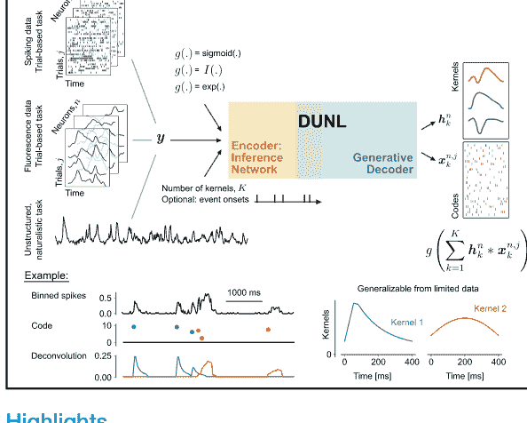

## 作者

Baireh Tolooshham, Sara Matias, Hao Wu, ..., Venkatesh N. Murthy, Paul Demmest, Demba Ba

## 通信邮箱

`paul.masset@mcgill.ca` (P.M.), `demba@harvard.edu` (D.B)

## 简要

近期将深度学习应用于神经活动建模的方法往往依赖于“黑箱”方法，这些方法在神经活动与网络参数之间缺乏可解释的联系。在此，基于可解释人工智能的进展，Toloosham 等人提出了一种新方法——解卷积展开神经学习（DUNL），并将其应用于七个数据集。

## 亮点

- DUNL 是一种用于设计可解释性 AI 算法以分析神经数据的方法
- 它将神经数据解卷积为一组稀疏的、解释的局部组件
- 它能够跨越脑区和记录模态进行单次试验分析
- 在基于试验和自然主义的设置中，它都随数据集大小具有良好的扩展性


Baireh Tolooshham,1,2,3,8,9 Sara Matias,1,4,6 Hao Wu,1,4 Simona Temereenca,1,4 Naoshige Uchida,1,4,8

Venkadesh N. Murthy,1,4,9 Paul Masset,1,4,6,7,10 and Demba Ba,1,10,11,*

^1 哈佛大学脑科学中心, Cambridge, MA 02138 US
2 哈佛大学 John A. Paul 学院与应用科学学院, Cambridge, MA 02138 US
3 帕萨迪纳计算技术学院, Pasadena, CA 91125
4 哈佛大学分子与生物学系, Cambridge, MA 02138 US
5 布朗大学 Carney 脑科学研究所, Providence, RI 02906
6 蒙特利尔大学心理学系, Montreal, QC H3G 1G1
7 蒙特利尔 Milton 人工智能学院, Montreal, QC H3Z 3H1
8 哈佛大学 Kempner 自然与人工智能研究研究所, Cambridge, MA 02138 US
9 这些作者贡献相等
10 高级作者
11 第一作者

*通信邮箱：`paul.masset@mcgill.ca` (P.M.), `demba@seas.harvard.edu` (D.B.)

# 摘要

深度学习在神经活动中的广泛应用依赖于“黑箱”方法，这些方法缺乏神经活动与网络参数之间可解释的联系。我们建议使用算法展开（一种可解释性深度学习方法）来设计解卷积神经网络的架构，并通过生成式模型直接获取刺激驱动的单神经元活动中神经权的解释。我们引入了解卷积神经网络（DUNL），并通过将其应用于解卷积跨区域和记录模态的单次试验信号，证明了其多功能性。我们发现了躯体丘脑多巴胺神经元中的多个显著性和预测误差信号，并表征了非结构化自然主义实验下运动皮层和纹状体神经反应的异质性。我们的工作利用可解释性深度学习的优势，为神经活动提供了机械性理解。

# 引言

在单神经元和群体水平上理解神经活动，及其与行为和环境因素的关系，是神经科学的关键目标。最近的进展允许在复杂任务期间对神经元进行长时间记录。当神经信号随时间变化或神经元子显示出具有不同选择性的复杂编码时——例如，视觉层次中的神经元选择任务（5-9），神经调节通路（如多巴胺神经元）对各种环境和内部刺激做出。。为了理解单神经元如何支持多种表示，需要可扩展的方法来解卷积神经活动和捕捉群体异质性的非重叠成分。我们提出了一种基于深度学习的解卷积方法来解决这个问题。

合理的解卷积方法首先应该处理单个数据输入，不需要试验或组合。它应该适用于自然和人工任务，且试验长度最小或没有（11-12）。

其次，方法应与信号源相关，无论是脉冲计数还是通过荧光通道测量的钙水平等点信号。

第三，方法应采用从层到层的表达映射，以捕捉神经数据的复杂性。

第四，它应该是可解释的（见补充讨论），在此在两个语境下解决：（1）在网络内部，架构、权重和表示与优化过程以及生成模型相关联；（2）提供刺激（内部或外部）与潜变量之间的映射。例如，适应各种数据类型的概率模型可以通过神经脉冲捕捉神经反应的逻辑和时间稀疏性。这种可解释性依赖于领域知识，这种领域知识结构化了数据或假设。该方法对于分析大规模神经科学数据集应该是可扩展且实用的。

大多数统计神经数据方法主要设计用于降维，以寻找低秩结构。解卷积方法包括主成分分析（PCA）^25-27，非负矩阵分解（NMF）^28-30，稀疏成分分析（SCA）^31， 解卷积^32，广义线性模型（GLM）^36 以及用于神经序列的点过程^37，这些方法通过从数据中提取低秩结构来实现。这些方法的局限性以及深度学习的可扩展性，促成了对神经数据的探索。然而，这些方法缺乏潜变量的直接联系，且无法完全满足如可扩展性或对数据统计特性的要求，因为模型具有“黑箱”性质。^39-41。

在这里，我们提出了一种新框架——解卷积神经学习（DUNL），它结合了卷积稀疏编码，提供了将单次试验活动解卷积为局部组件的灵活框架。为了展示 DUNL 的通用性，我们将其应用于五个实验。首先，我们解码了多路复信号中的稳定和奖励预测（RPE）事件。其次，我们从关联学习中解卷积结果。第三，我们在丘脑中进行了预测的模拟。第四，我们在低信噪条件下从嗅球提取了神经反应。第五，我们在纹状体中描述了多巴胺活动。最后，我们评估了 DUNL 的优势：局部解释性、可扩展性和在数据有限情况下的泛化能力。

# 结果

## 稀疏解卷积学习单次试验活动的结构

我们的目标是通过识别神经数据中的低秩结构，将单次试验活动分解为脉冲响应（循环事件）。观测到的神经活动表示为稀疏编码与具有不同形状和幅度的字典的卷积。我们的目标是通过学习这些核来重建数据。我们希望通过对非参数指数（如高斯、二项分布或泊松，见表 S1）建模平均活动来考虑到脉冲的稀疏性。

神经活动 `y_t` 被建模为核 `h_k` 与稀疏编码 `x_{ki}` 的卷积，并带有基线活动 `b_t`（图1B）。解卷积识别局部时间模式并发现低秩结构（但只能捕捉长期特征）。核学习通过自动学习内核超越了预定义的方法。学习到的核和稀疏编码具有可解释性：核代表跨试验的特征，稀疏编码代表个体反应。

索引表示与核 `k` 相关的时间事件，幅度 `x_{ki}` 表示神经反应强度。在功能系统识别中，该方法捕捉因果关系：稀疏编码代表效应的时间，而核代表反应强度。然而，模型中的核是非参数的，完全从数据中学习，不符合用户的参数形式，且编码是稀疏的。我们通过最小化损失函数 `sum (y - \hat{y})^2` 来学习核和 `x_{ki}`，并对核和编码的期望属性进行正则化。具体而言，我们使用稀疏先验来促进时间上的少数激活，并可选使用二阶协方差结构来捕捉核之间的依赖关系。

# Neuron NeuroResource

## CellProcess

## 用于数据分析的深度学习工具

图 1. 基于反卷积神经学习的可解释深度学习：DUNL

| 算法展开 | | |
| :--- | :--- | :--- |
| 生成式模型 | 卡尔曼滤波 |
| 稀疏编码 | 多功能：基于区域的约束 |
| 非结构化/自然任务 | | |
| 与源无关 | | |
| 数据限制架构 | | |
| 多路复信号 | | |
| “黑盒” | 深度学习方法 | 可解释方法 |
| :--- | :--- | :--- |
| 无监督或自监督降维 | 为了解释“黑盒”方法（与模型无关） | 基于模型的深度学习，用于解释表示架构 |

(A) 神经数据分析的深度学习工具的分类以及算法稀疏性的益处。

(B) 生成式模型，DUNL 将神经架构估计为内核与稀疏代码之间卷积之和。

(C) DUNL 示意图：推理网络 (`y-hat`) 估计稀疏代码，其权重与生成器（解码器）共享。解码器的输出优化了内核和代码。

(D) DUNL 从非结构化集合中的合成噪声中反卷积出两个循环事件的能力演示（左）。DUNL 恢复的内核（彩色）与真实内核（灰色）高度匹配。

来自两个可解释潜变量的估计值 `y_{\mu}^*`:

```
$y_{\mu}(t) = \sum_{k=1}^{K} y_{k}(t) * h_{k}(t)$
```

```
$y_{k}(t) = \sum_{n=1}^{N} y_{n}(t) * h_{kn}(t)$
```

```
$h_{kn}(t) = \sum_{j=1}^{J} w_{kj} * c_{j,n}(t)$
```

`y` 数据

`y_n` 来自 `g_n` 的期望的期望

内核 `h_k`

`c_{j,n}` 第 `k` 个内核的生成器

表示稀疏事件的起始

`J` 数据

高斯分布 `G`

二项分布 `B`

`n` 神经元索引

`k` 内核索引

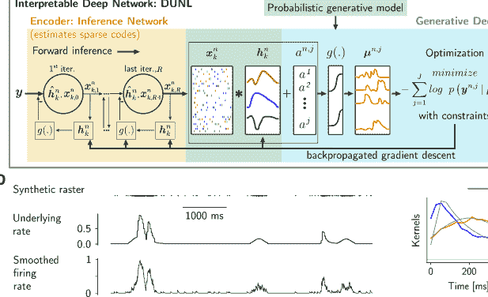

## 可解释解码器网络：DUNL

编码器：推理网络

（估计的稀疏代码）

前向推理

概率生成式模型

通用解码器

```
优化
$\min_{h,c} L(y, h, c)$
带有约束条件
```

反向传播梯度下降

## 合成脉冲图

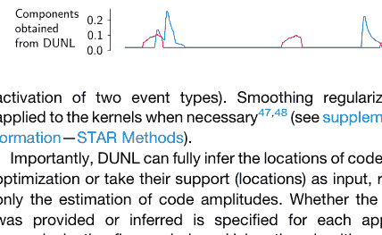

底层速率

平滑后的速率

估计速率

从 DUNL 获取的组件

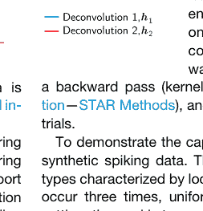

内核

时间 [ms]

代码

+   - 代码 1
- 代码 2
- 反卷积 1
- 反卷积 2

`$(h_{k})_{k=1}^{K}$` 这种稀疏代码代表估计的/事件起始以及神经元对每个事件的响应强度。解码器是基于生成式模型的影子网络，将稀疏表示映射为平均神经元活动的时间序列。编码器和解码器都由内核 `$(h_{k})_{k=1}^{K}$` 定义，这些内核充当人工神经网络，并通过反向传播进行训练。虽然这侧重于可解释性和低秩结构，但 DUNL 可以扩展到使用稀疏代码学习跨整个时间尺度的稠密表示。

事件类型的添加。必要时将稀疏性应用于内核时`L1`（请参见补充信息—STAR 方法）。

值得注意的是，DUNL 只有当输入是稀疏的或为每个应用提供时才能找到解码的位置。如下所示`49`（图 1），我们将优化映射到编码解码器架构。编码器是一个与生成式模型（解码器）共享相同参数的深度结构卷积网络。它接收单个神经元的观测值 `y_i` 并将其编码为稀疏表示 `x_i^j`，通过局部解释（对于代码和内核；参见补充信息），并且可以跨神经元和试验进行并行化。

为了证明 DUNL 的能力，我们首先尝试合成脉冲数据。实验由局部内核特征的两类事件组成。在单个试验中，事件随机发生。我们估计底层速率、事件的时间幅度——无论是稀疏还是稠密的（由多个内核组成）。DUNL 成功地将数据合成内核和代码（图 1），并在此实现。我们引入了一种新框架，将时间序列恢复为内核的稀疏叠加，且内核和代码都是可训练的—与 GLMs 不同，我们基于二元函数定义它。

代码 (`rew`) 与单个神经元和群体平均的尺寸高度相关（图 2D）。值代码带有奖励大小的信息，通过跨试验平均（图 2F 和 2G）结合内核提高了奖励的表示，证实了显著性代码不包含值信息。

## DUNL 从多巴胺神经元提取显著性和值信号

我们应用 DUNL 解码多巴胺神经元中的多路复用信号。中脑多巴胺神经元，尤其是腹侧盖区，对于强化学习期间的行为调节至关重要`54–59`。信号 是意外值的增加。奖励神经元被识别出两种表示：一个代表显著性，另一个代表主观值（效用）。这是非常有意义的，因为显著性组件与奖励驱动一致。使用 DUNL，我们调查了奖励可以分解为这两个成分，以及它们是否受到值的不同调制。使用特定窗口来排除显著性，然而，即使通过这种检查，DUNL 的代码仍然包含奖励大小的信息。

DUNL 对噪声响应的成功反卷积表明，内核的幅度是转向奖励大小的有力衡量。我们在不同初始条件下推断的奖励大小与图 2 中的结果一致（图 S1D、S1E 和 S1F）。总体，DUNL 提供了一种强大的工具，以无偏的方法量化显著性组件与单个神经元响应之间的关系。

我们对 40 个识别的多巴胺神经元进行了电生理学实验`62`，这是之前研究任务的一部分。在可变尺寸的“意外”试验中，奖励在没有提示的情况下递送。在“预期”试验中，气味提前 1 秒递送奖励（图 2A 和 2B）。我们使用值代码或 `rew` 响应来对奖励进行建模（图 2C 和 2D）。通过跨神经元对齐奖励和群体对内核。DUNL 是根据提示和预期事件的时间构建的，而不是试验（除了奖励）。

## DUNL 解码显著性

为了证明 DUNL 在脉冲多巴胺神经元之外模态的灵活性，将其应用于双光钙成像。在分类任务期间，我们使用分级反馈间隔（GRI）排序的钙成像记录了 55 个多巴胺神经元的数据（图 3A）。该任务显示了感觉行为的结构`64`。在意外试验中，不同尺寸的奖励（0.3-1 s）是预期的。预期试验在提示和奖励递送之间有更延迟。我们显示对提示和不同尺寸的响应受到预期和奖励大小的影响（图 3B）。

我们使用钙离子表征神经活动（图 3C），并观察了三种不同奖励尺寸的预期变化。蓝色自由奖励与正代码相关，而红色和绿色神经元是耦合的，其约束分别为正和负。与 PCA 和负矩阵分解（NMF）等非耦合方法不同，4 决策是基于奖励活动的（图 3B），活动在基线后（提示 3 秒后，奖励 4 秒后）重新测试。每个试验只有一个激活，捕获了神经元放电增加或减少的不同钙离子信号，通过表示学习实现（参见补充信息—STAR 方法）。

DUNL 显示，用于提示的代码幅度与奖励大小无关，更重要的是，在没有显式检查分离信号的情况下，两个奖励内核：显著性、值 (`rew`) 和奖励 (`rew`)（图 2D–F）。显著性编码的奖励受到预期（意外与预期）的调制，但在很大程度上与尺寸保持不变。相比之下，值相关的

### A

| 光纤 | 0.1 μl |
| :--- | :--- |
| 四极电 | 0.3 μl |
| | 1.2 μl |
| | 2.5 μl |
| | 5 μl |
| | 10 μl |
| | 20 μl |

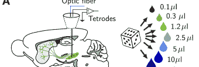

非预期试验

气味

奖励

预期试验

气味

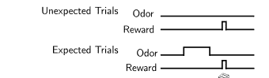

### B

预期试验

20 Hz

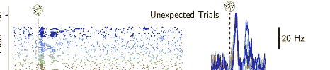

气味线索

预期试验


750 ms

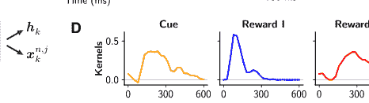

### C

DUNL

K=1

事件事件

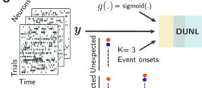

1500 ms

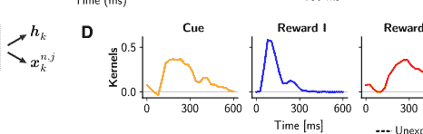

### E

线索

奖励 I

奖励 II

合并

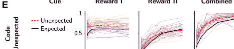

非预期

预期

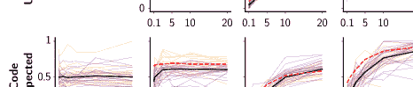

奖励大小 [μl]

### G

奖励 I

奖励 II

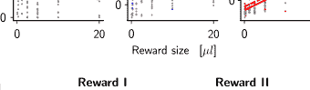

非预期

预期

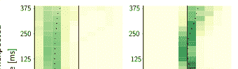

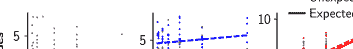

非预期

预期

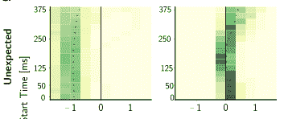

奖励大小 [μl]

### F

Spearman/行，奖励

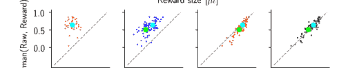

非预期

预期

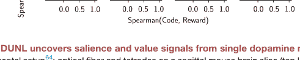

Spearman/Cod，奖励

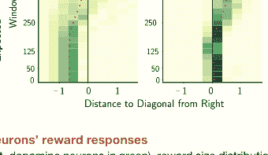


图 2. `DUNL` 揭示了单个多巴胺神经元响应中的显著性值和信号。(a) 小鼠脑上的实验设置和电极（左上）、奖励大小分布（右上）以及任务结构。(b) 单个神经元的径状图（跨越相同奖励大小的试验的平均放电率）；(c) `DUNL` 的输入：跨神经元和试验的共享信息、时间、奖励数量以及生成的脉冲数据。(d) 跨神经元的共享学习核（上）和单个神经元的推断代码属性（下）。每个点代表一种类型代码，线性回归线显示了跨奖励的代码属性。红色虚线：非预期试验的平均值。值按奖励进行归一化，并在跨试验中共享相关常数。(e) 代码与奖励大小、平均放电率与奖励大小之间的相关性。对角线下的红色奖励（边界）显示了对奖励提供更多信息的类价值代码。每个神经元由两个点表示（预期和非预期试验）；平均值显示为较大的圆圈 (t)，p = 0.050（黑色），p = 0.19（蓝色）。(f) 编码策略与 `DUNL` 的相关性，测量窗口开始时间到对角线的距离。y 轴传达了从交付第一个 600 ms 窗口的延迟。时间方法包含更多关于奖励 I 的信息（左侧较绿），奖励 II 与任何值的相关性更高（右侧较绿）。(f) 中对角线下的正值。颜色条代表每个箱的概率密度（行积分）。参见图 S1、S2，以及神经元 11/3, 1151-1168, 4月16日, 2025

### 图 3. 多巴胺数据中大小、奖励和方差的分解

(A) 实验设置：皮层表面的 `GRIN` 透镜允许对深层结构中的神经元进行成像。`GRIN` 透镜追踪 `VTA`（底部，比例尺：600 µm）以及在双光子显微镜实验采集期间观察到的视野投影，显示了神经元（右下）。(B) 左侧：起始的时间对齐试验（水平线区分试验类型）。右侧：每个奖励大小下示例神经元的平均时间对齐活动。(C) 奖励和时间的反卷积。三个核估计奖励响应：一个用于大小（蓝色），两个用于正值和负值的非并发核（红色）。(D) 跨时间、刺激数量、类型和概率估计的神经元脉冲活动。(E) 代码与奖励大小、平均放电率与奖励大小之间的相关性。对角线下的红色奖励（边界）显示了对奖励提供更多信息的类价值代码。每个神经元由两个点表示（预期和非预期试验）；平均值显示为较大的圆圈 (t)，p = 0.050（黑色），p = 0.19（蓝色）。(f) 编码策略与 `DUNL` 的相关性，测量窗口开始时间到对角线的距离。y 轴传达了从交付第一个 600 ms 窗口的延迟。时间方法包含更多关于奖励 I 的信息（左侧较绿），奖励 II 与任何值的相关性更高（右侧较绿）。(f) 中对角线下的正值。颜色条代表每个箱的概率密度（行积分）。参见图 S1、S2，以及神经元 11/3, 1151-1168, 4月16日, 2025

### A 尾部须毛偏离

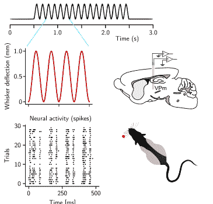

### G 栅状图

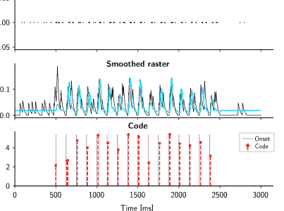

### B 须毛活动

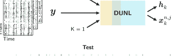

### H

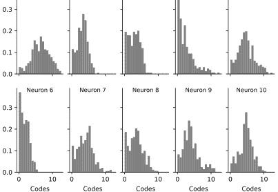

### C 测试

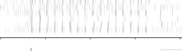

### 神经元聚类（组稀疏性）

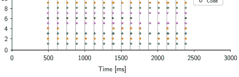

### D

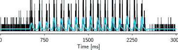

### 单个神经元

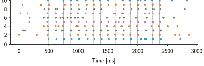

### E

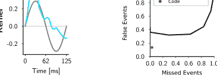

### 图 4. 应用于感觉丘脑神经元，DUN 学习了塑性水平核、核事件以及推断的特定幅度

(A) 实验设置；每次试验中恒定速度周期性地偏离须毛（顶部），诱发麻醉大鼠丘脑腹侧内中核（`VPM`）中的触电形神经活动（左侧）。
(B) `DUN` 学习了一个具有神经元特异性频率的简单核（蓝色）。
(C) 10 个神经元针对一次测试试验的对比：在 2000 ms 内在 125 ms 处的须毛偏离。
(D) 示例神经元的周围感觉直方图（黑色）以及带有 `DUN` 估计的发电率（蓝色）。
(E) 须毛运动的核化（蓝色）以及描述刺激运动的灰色正弦波拟合。
(F) 编码器和解码器在检测单次试验事件方面性能的定量评估。曲线显示了应用于跨试验平滑栅状图的峰值查找算法的性能。使用 10 ms（2-ms 容差）来计算误报/漏检。峰值查找来自 `Python` 的信号处理包。
(G) 示例试验：脉冲（spikes）、平滑的须毛速率（黑色）、`DUN` 估计的脉冲率（蓝色）以及时间上 16 + 2 个事件的推断代码（底部）。每个事件都有一个核幅度，与以往的方法不同（关于神经元、刺激和来自 Terérica 的数据的详情见补充信息）。
（图例继续见下一页）

(50) 小鼠在试验中随机时间产生脉冲，从 `Gamma` 分布中采样，模拟了自然口腔脉冲的统计特性¹。我们记录了小鼠前皮层的 770 个神经元（图 4A 和 5B）。
形状皮层显示对口腔脉冲的神经响应序列在很大程度上是不相关的，我们使用 `DUNL` 来表征这些共振。
在第二种方案中，单个神经元对单一事件类型做出反应，以评估 `DUNL` 根据通用发射模式识别核和代码的有效性（模拟研究，`STAR` 方法）。这种表征有助于用户评估 `DUNL` 在特定统计数据下的性能。
为了对神经元响应进行建模，我们将响应元素与脉冲时间对齐，并使用泊松过程对其进行建模（图 5C）。每个神经元通过单个核幅和代码幅度来表征。
`DUNL` 性能随结合率（2, 5, 11, 14 和 17 Hz）和试验次数（5, 25, 50 和 500；图 5A）以及核学习（10, 25, 500 和 1000 次试验；图 6B）的变化。
我们学习了所有记录的核和代码幅度，捕捉了跨先皮层响应的时间动态。对测量的核进行 `K-means` 聚类揭示了三个主要成分（图 5D）。
结果（图 6C–6E）显示了 `DUNL` 通过更多试验、更高精度和更大尺寸学习核并推断叠加事件的能力（`STAR` 方法模拟细节）。
三个簇代表随脉冲的活动，具有不同的动力学，而第四个对应于被脉冲抑制的神经元。
在第三种方案中，我们测试了 `DUNL` 在 1000 个神经元和 1000 次试验的大规模设置下，从跨试验的 5 个不同事件恢复核的能力。我们使用此数据集来指导在信息未知时如何选择合适的核数量。
此应用证明了 `DUNL` 如何学习任何形状的核，而不依赖于对其结构的假设。结果是，`DUNL` 可以捕捉响应的多样性，而不需要手工设计的函数。
为了评估结果的稳健性并指导 `DUNL` 的使用，我们表征了其在三种场景下的性能。在第一个场景中，单个神经元对两个不同事件做出反应（模拟细节，`STAR` 方法）。`DUNL` 在此数据集上的性能也用于展示其在群体中共享核的能力，其中组稀疏性优于群组。
`DUNL` 指标直方图：跨记录神经元在单次试验中每个事件一个代码幅度。具有组稀疏性的 `DUNL` 在所有记录的单次试验中更为稳健。另见图 S4–S4。

### 事件时间已知（已知支持）

### 事件时间未知（未知支持）

### 图 5 在无结构自然实验中表征神经活动的结构

(A) 已知事件的结构化实验：在任务中随机传递给 gamma 分布进行记录
(B) 神经后事件的栅状图。红点代表 50 个神经元。黑点表示脉冲。
(C) `DUNL` 输入的示意图。
(D) 单个神经元的核化。显示四个簇的归一化核。5 个簇的 `K-means` 结果。
(E) 簇的余弦相似性矩阵
(F) 使用主成分分析（PC1 和 PC2）对簇进行可视化。基于零均值的聚类。
(G) 具有多种事件的结构化实验：在记录期间暴露于多种事件。荧光（左侧）
(H) 左侧：具有组稀疏性的 `DUNL` 在所有记录的单次试验中检测更为稳健。右侧：每个簇的核。包括 `ACC`、`ACSh`，纹状体侧纹状体、`TS`，须毛活动。

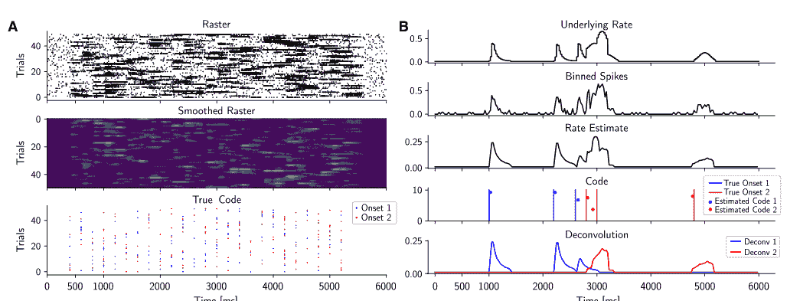

## 6. 非结构化实验中基于核的模型表征

(A) 非结构化实验的测试：脉冲事件的栅点图速率（顶部）、平滑后的栅点图（中间）以及起始点（底部）。
(B) 示例试验：发放率（顶部）、`DUN` 估计的发放率、估计的编码和核）。
(C) 估计的核：25, 50, 100, 400, 1600 次试验。灰色轨迹代表用于生成数据的核。真实核的 `$R^2$` 拟合分值分别为 0.66, 0.71, 0.74, 0.76, 0.77。
(D) 恢复误差 `$\sqrt{1-cosine^2}$` 随试验次数的变化。使用最大互相关性计算相似性，并考虑了偏移的核。事件检测的命中率对于最小和最大数据集分别为 82.02% 和 80.68%，容差为 2-bins。在 3-bin 容差下，命中率增加到 91.58% 和 93.54%。命中率报告包含了对偏移核的容差（详情请参见补充信息——`STAR` 方法中的 `DUNL` 偏移属性）。
`DUNL` 使用概率模型将核与发放率连接起来，而 `LFADS` 依赖于具有编码器和解码器的循环网络，在脉冲与数据之间提供了更好的连接。要进一步比较 `DUNL` 与 `SCA` 及其学习时间低秩迹线的能力，请参见图 7K。
`DUNL` 通过其卷积、批处理的方法处理变长度。它使用 `Adam` 等基于梯度的优化器，并具有可扩展性，可以在 GPU 上处理批数据。为了证明可扩展性，我们将 `DUNL` 的训练时间与 `SeNMF` 进行了比较（图 7N）。`SeNMF` 使用神经元 × 试验长度矩阵，限制了它在不进行拼接的情况下处理变长或多次试验的能力。

### 分解属性

### 基的选择

最后，我们解释了 `DUNL` 如何允许用户学习表征神经反应的稀疏表示。我们讨论了两个关键点：(1) 它消除了学习基函数的需求；(2) 它提供了一组高度灵活的核（例如每个事件一个或两个），增强了可解释性。参见图 S8E–S8N 中使用一组基函数的 `DUNL`。
Neuron 17/3, 1115–1668, 2021年4月

### A 真实核

### B 估计的核

### C

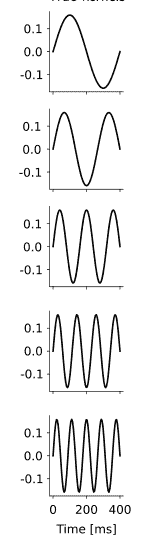
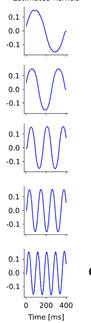
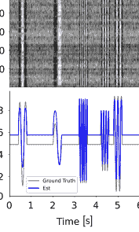
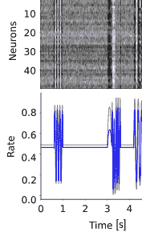
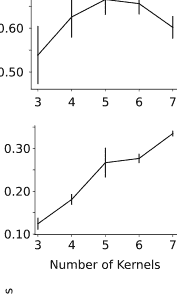
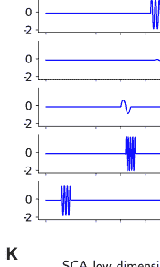
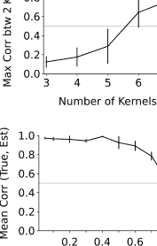
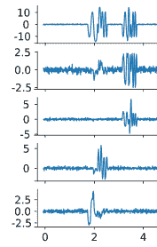

### D 训练：1次运行

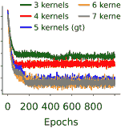

### 验证：1次运行

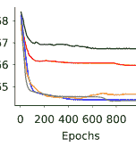

### H SCA 投影

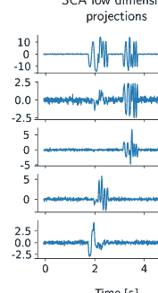

### E 训练集

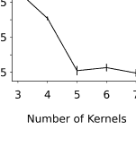

### 验证集

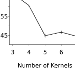

### 图 7，使用5 个正交核的模型

(A) 用于生成无监督实验合成数据的 5 个核，每个核在运行中每个时间点出现一次。
(B) 使用 100 次试验通过 `DUNL` 重建的核。基线速率和幅度在不同运行之间波动，但所有核都重建为具有一个均值的真实速率和幅度。
(D) 训练数据集（左）和验证数据集（右）的每个 epoch 损失，针对单次运行请求的 3-7 个核。
(E) 训练（左）和验证数据集的平均损失、核数量，在 30 次运行中计算，计数变化为（20, 50, 100, 200, 250, 500, 1000）。
(F) 跨运行的核一致性随核数量的变化。
(G) `DUNL` 解码的 `$R^2$` 核数量。
(H) `DUNL` 重建的核对之间的最大相关性随核数量的变化。当核计数超过阈值时，相关性接近 1。
(I) 真实核与估计核之间的平均相关性（右侧），带有 `DUNL` 重建的两个重叠核。
(J) 示例试验：真实图（顶部）和来自单个神经元的解码速率（中间），带有 `DUNL` 重建的两个重叠核。尽管核具有正交性，`SCA` 仍无法对单次试验内的局部核进行卷积。
参见图 57。

### 图 8. `DUNL` 与 `LFADS` 的比较；`DUNL` 在单次试验中找到局部组件

### A 合成实验

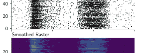

#### 平滑后的栅点图

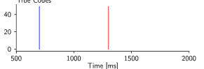

#### 真实编码

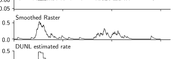

### B LFADS 因子 1

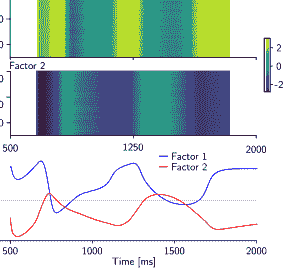

#### 试验 因子 2

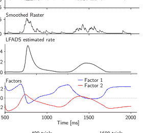

### C DUNL 平滑后的栅点图

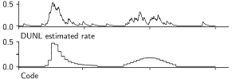

#### DUNL 估计的速率

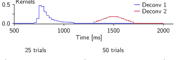

### D LFADS 平滑后的栅点图

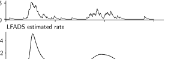

#### LFADS 估计的速率


### E 25 次试验栅点图


#### 100 次试验栅点图


### F LFADS


(A) 用于生成无监督实验合成数据的 5 个核，每个核在运行中每个时间点大约出现一次。
(B) 使用 100 次试验通过 `DUNL` 重建的核。基线速率和幅度在不同运行之间波动，但所有核都重建为测试运行中具有一个均值的真实速率和幅度。
(D) 训练数据集（左）和验证数据集（右）的每个 epoch 损失，针对单次运行请求的 3-7 个核。
(E) 训练（左）和验证数据集的平均损失、核数量，在 30 次运行中计算，计数变化为（20, 50, 100, 200, 250, 500, 和 1000）。
(F) 跨运行的核一致性随核数量的变化。
(G) `DUNL` 解码的 `$R^2$` 核数量。
(H) `DUNL` 重建的核对之间的最大相关性随核数量的变化。当核计数超过阈值时，相关性接近 1。
(I) 真实核与估计核之间的平均相关性（相关），带有 `DUNL` 重建的两个重叠核。
(J) 示例试验：真实图（顶部）和来自单个神经元的解码速率（中间），带有 `DUNL` 重建的两个重叠核。尽管核具有正交性，`SCA` 仍无法对单次试验内的局部核进行卷积。
深度学习架构为单次试验神经数据分析提供了一种高效且可扩展的工具。美国研究基金 (`NARSAD`) 年轻研究员补助第 305 号资助 S.M.；哈佛大脑行为倡议资助 P.M.；本研究部分工作得益于加拿大研究卓越基金，该基金通过麦吉尔大学的“健康大脑生活倡议”授予了 P.M。
我们的框架具有灵活性，需要选择几个超参数（例如：稀疏正则化因子、展开迭代次数、平滑正则化和卷积核数量）。我们为参数选择提供了指导。例如，合适的卷积核数量可以通过识别和量化层与层之间的交叉相关性来确定。重要的是，必须指定卷积核的数量和核时间窗口——不需要额外的参数化。之前的方法³ `DUNL` 可以学习任何卷积核（另见下文）。当条目数量已知时，`DUNL` 具有其展开架构的 k-稀疏操作对参数的选择具有鲁棒性。

# 作者贡献

- 概念构化：B.T., S.M., P.M., 和 D.B.
- 方法论：B.T. 和 D.B.
- 形式分析：B.T. 和 S.M.
- 可视化（体内实验）：S.M., H.W., 和 S.T.
- 研究：N.U., V.N., 和 D.B.
- 数据整理：B.T., S.M., H.W., 和 S.T.
- B.T., S.M., V.N., V.A., P.M., 和 D.B.
- 项目管理：P.M. 和 D.B.
- 资金获取：S.M., N.U., V.A., P.M., 和 D.B.

通过 k-稀疏操作，可以使用变分集对 `j` 进行调优。关于 `DUNL` 局限性的详细讨论，请参见补充材料。

# 利益声明

作者声明无竞争性利益。
为了证明我们模型的通用性，我们将其应用于不同的实验设置，突出了现有工具的功能。我们的框架可以扩展到稀疏区域之外，提供可解释的表示。对于更复杂的模型，例如基于卡尔曼滤波的神经网络或具有自适应常数的 2D 滤波器，我们的工作迈出了通过卷积字典学习利用深度学习优势的第一步，以获得对神经动力学及其计算过程的机制性见解。

# AI 及 AI 辅助方法声明

在准备本项工作期间，作者没有使用任何推理或内容生成技术。作者对出版内容承担全部责任。

# STAR*

详细方法见论文的在线版本，包括以下内容：
- 关键资源表
- 方法详述


### 体内实验
### 符号说明
### 数据分布
### 生成式模型
### 平滑稀疏卷积学习
### 可解释的展开神经网络 (DUNL)
### 评估
### 深度学习中的可解释性
### DUNL 局限性
### D.U.N.L. 用于神经信号分析的前期工作
### 量化与统计分析
### 模拟细节
### 实验细节
### 模型比较
### 模型训练细节

# 资源可用性

# 主要联系人

更多信息和资源的请求请联系主要联系人 Dean Baamba (`baamba@seas.harvard.edu`)。

# 可用材料

本研究未产生新的试剂。

# 数据和代码可用性

- 所有代码和模型已存储在 GitHub 仓库：`https://github.com/debaamba/dunl-model`。
- 本研究的部分数据已存储在数据仓库：`https://doi.org/10.1763/zenodo.39253`
- 使用这些数据所需的任何额外信息可根据要求向主要联系人获取。

# 致谢

我们感谢评审员提出的建设性反馈。感谢 Ignacio Sanchez-Sánchez 在多巴胺区域的概念和技术性合作。感谢实验室的所有成员、Murthy 以及其他人提供的有帮助的讨论，特别是 Carlos Janevatin-Zadeh、Adam S. Lowell 和 Henry S. Ford 在统计分析方面提供的帮助 (`https://doi.org/10.5291/zenodo.392953`)。我们感谢支持本工作的资助机构：美国英国国防 (`US UK DO`)、MOQ 以及欧洲研究委员会 (`ERC`) 的 `ERCPIERC` (资助号 `11-WFF-1516-8`) 以及加拿大科学基金计划 (`L10000/2018`) 资助 S.M.；大脑与行为基金。

# 补充信息

# 参考文献

1. Jun, J.J., Sternnetz, N.A., Siegle, J.H., Derman, D.J., Bauza, M., Barbardt, L., Bee, K.A., Anastasiou, C.A., Andrews, Y., Adyn, C., et al. (2017). 用于高分辨率神经活动记录的全集成光子光测量。Science 355, 222–236. `https://doi.org/10.1126/science24636`

2. Steinmetz, N., Koch, C., Haris, K., and Carandin, M. (2018). 神经探针的人群误差模型和大规模经验。Curr. Opin. Neurobi., 50, 92–100. `https://doi.org/10.1016/j.conneuro.2018.009.`

3. Wong, O., Ohnason, H., Skayten, E., Eneqvist, E., Wang, L., Miller, M., and E. (22). 双神经元模型解释视觉皮层的决策过程。Cell 185, 1236–1250. `https://doi.org/10.1016/j.cell.2022.017.`

4. Rigotti, M., Barak, A., Morgan, R., Wang, J., Davis, N., Miller, E., and Fuis, S. (2013). 复杂编码中的选择性。Nature 497, 595–600. `https://doi.org/10.1038/nature1216.`

5. Hiroiwaka, J., Hassawa, A., Mastet, P., Ott, T., and Kipp, A. (2019). 额叶皮层编码决策变量。Nature 576, 473–478. `https://doi.org/10.1038/s41586-019-9.`

6. Zhang, A., and Adams, A. M. (2023). 感觉和感觉任务变量的神经表示。Nature Communications 14, 4153. `https://doi.org/10.1038/s41467-023-3951.`

7. Dubreil, A., Beiran, M., Mastet, P., Faustopoulos, G., and Ott, S. (2022). 神经动力学计算中群体结构的作用。Nat. Neurosci. 25, 77–83. `https://doi.org/10.1038/s41593-022-0784.`

8. Langdon, C., and Earl, S. H. (2015). 决策期间来自异性神经网络的潜信息。Nature Neurosci 18, 1055–1060. `https://doi.org/10.1038/nns4003.`

9. Kaufman, K. T., Miller, E. K., Right, M., Stefani, F., Shen, S., and Chang, A. (2012). 从表示几何解码选择和意图。Curr. Opin. Neurobi., 22, 1024–1030. `https://doi.org/10.1016/j.conneuro.2012.0604.`

10. Lee, R. S., Saily, Y., England, G., Winter, L. B., and Day, N. D. (2024). 决策期间多巴胺神经元中的任务驱动预测误差。Nat Neurosci 20, 482–494. `https://doi.org/10.1038/s41593-017-0060-w.`

11. Lee, R. S., Saily, Y. 多巴胺神经元中的预测误差。Nat. Neurosci., 27, 1571–1578. `https://doi.org/10.1038/s41593-014-0268-1.`

12. Schwartz, S. (2016). 解码驱动的预测误差：概念视角。Nat. Neurosci, 19, 177–183. `https://doi.org/10.1038/nn4315-5.`

13. Matsumoto, S., Han, J., Uchida, N., and Wadato, M. (2006). 多巴胺神经元揭示了奖励学习中的显著信号。Science 294, 973–976. `https://doi.org/10.1126/science.112933.`

14. Williams, A. H., and Linderman, S. W. (2001). 单细胞中的统计神经科学。Opin. Neurobi., 78, 203–215. `https://doi.org/10.1016/j.conneuro.2001.0617.`

15. Czerniak, G. E., Itzen, Y., Sinha, S., Muka, W. B., and Brown, E. R. (2008). 高维神经空间决策的群体活动模型。J. Neurosci., 29, 2762–2769. `https://doi.org/10.1523/jneuro1.`

16. Miller, C. G., Dore, K., Huck, A., Leopold, D., Ska, M., Tursen, T., and Miles, J. (2002). 大脑的神经语言。Cell, 32, 482–493. `https://doi.org/10.1016/j.cell.2002.031.`

17. Green, C., and Konrath, A. (2012). 激活神经元。Nature Reviews Neuroscience, 13, 693–702.

18. Helmholtz, H. (1867). 心理学中的光学。Phys. Soc. B, 36, 815–839. `https://doi.org/10.1038/s41586.`

19. Smaragdos, P. (2000). 非负矩阵因子提取：重叠信号的分解。Component Analysis and Blind Signal Separation: International Conference, ICA 2004, Geneva, Spain, September 22–24, 2004.

20. Smaragdos, P. (2007). 卷积分离及其在语音分离中的应用。Audio Signal Process., 15, 1–12. `https://doi.org/10.1016/j.aasp.2006.11.009.`

21. Xu, J., and Wei, X. (2017). 用于恢复低维动态的变分因子分析。Deep learning, 30, 989–996. `https://doi.org/10.1038/s41586.`

22. Mackveus, E. L., Bach, H. A., Williams, A. H., Gu, S. G., Denarko, N., and Johnston, J. A. (2014). 高维动力学中的时间序列解码：神经科学的应用。Science e, 8(7), e1214847. `https://doi.org/10.1126/science.1214847.`

38. Parandath, C., O'Stea, J.D., Collins, J., Jozefowicz, R., Stavsky, S., Kao, J.C., Traumann, E., Kaufman, M.T., Ryu, S.J., Hochberg, L., et al. (2018). 使用自动编码器编码单神经元群体动力学。Nat. 555, 805–815. `https://doi.org/10.1038/s41586-018-0109-9.`

55. Mayer, H.M. and Ginmer, P.W. (2009). 多巴胺神经元编码奖励预测误差。Neuron, 47, 121–129. `https://doi.org/10.1016/j.neuron.2009.05.006.`

39. Keatie, M.R., Saber, A., Chowdhury, R.H., Tranbury, R., Batalat, N., Gayner, M.S., Shen, Y., Hajiani, A., Meller, L.I., and Pandera, J. (2022). 用于生成单神经元群体动力的大规模神经网络训练。Nat. Methods, 19, 1572–1577. `https://doi.org/10.1038/s41592-021-0160-z.`

57. Hart, A.S., Roberts, R.B., Ginmer, P.W., and Pohl, M.E. (2014). 伏隔区核的爆发性多巴胺释放编码奖励预测误差。J. Neurosci, 34, 698–704. `https://doi.org/10.1523/JNEUROSCI.2443-13.2014`

40. Zhu, J., Liu, A., Tandon, R., Calai, A., Gianovacci, A., Kaufman, M.T., and Pandera, J. (2022). 从钙成像和时间去卷积推断单神经元群体动力学的深度学习。Nature Communications, 13, 1734–1743. `https://doi.org/10.1038/s41467-022-31191-0`

58. Sutton, R., and Bach, A.G. (2019). 强化学习：导论（麻理工出版社）。

41. Schneier, S., Lee, J.H., and Weiss, M.W. (2023). 用于神经活动中无偏奖励的机器学习集成方法。Nature Electronics, 6, 7, 662–668. `https://doi.org/10.1038/s41928-023-00600-w.`

59. Koh, H.J., Minh, M.D., Akiyama, M., Pan, F.K., Kimura, F., Sun, Y., Zhang, Y., Watanabe, M.A., Gersda, S., and Uchida, N. (2013). 跨皮层区域的多巴胺信号的神经编码。Nature Communications, 13, 1600–1608. `https://doi.org/10.1038/s41467-020-1111-0.`

60. Amor, S., Matsita, Y., Yamanaka, A., Tokuka, K.F., and Uchida, N. (2012). 腹侧前额叶皮层奖励预测误差的时间编码。Neuroscience, 32, 10982–10990. `https://doi.org/10.1016/j.neuron.2012.05.013.`

43. Calvaro, D.V., Pereira, E., and Cardoso, J.M. (2019). 机器学习可解释性：方法与技术的综述。Electronics Journal, 8, 832.

61. Schultz, W. (2016). 行为理论与学习的神经生物学。Annual Rev. Psychol., 57, 87–115. `https://doi.org/10.1146/annurev-psych-010215-065002`

44. Tolohasch, S., Bey, A., Tamerenska, S., and Ba, D. (2020). 用于神经实验分布的卷积去噪学习自动编码器。第37届国际机器学习会议论文集 (ICML)，pp. 9553–9563.

62. Cohen, Y.J., Haser, S., Vowel L., Lewis, B., and Uchida, N. (2012). 腹侧纹状体奖励和预测误差的神经元类型信号。Nature, 488, 86–92. `https://doi.org/10.1038/nature11574`

45. McGaugh, P., and Peters, J. (2019). 神经模型通用学习（正则化）。`https://doi.org/10.1002/97811907353`

63. Chang, Y.H., Yu, J.S., Uchida, N., Hassass, D., and Molov, B. (2016). 基于奖励的强化学习的多巴胺群体编码。Science, 537, 671–676. `https://doi.org/10.1126/science.aag618`

46. Chang, G.C., and Liu, J.W. (2017). 预测神经发育与功能的统计建模框架。J. Phys. Neurosci, 51, 263–282. `https://doi.org/10.1007/s00223-017-0687`

64. Evans, B.H., Tan, J.M., Kim, S., and Uchida, N. (2016). 神经元共享奖励预测误差特征。Neuron, 19, 477–486. `https://doi.org/10.1016/j.neuron.2018.05.036`

47. Poe, A.M., and Pillo, J.W. (2017). 高密度神经记录的可扩展贝叶斯推理。Plos One, 12, 017391. `https://doi.org/10.1371/journal.pone.017391`

65. Goldstein, B., Fininkel, J., Kim, D.Y., Wang, S., Yang, Y.H., Nie, D.Y., Liu, D.W., et al. (2018). 多巴胺神经元中记忆与奖励的功能分离。Nature, 570, 509–513. `https://doi.org/10.1038/s41586-019-1333`

48. Tolohasch, B., Bey, S., and Ba, D. (2020). 用于神经实验分布的卷积去噪自动编码器。第37届国际机器学习会议论文集 (ICML)，pp. 9553–9563.

66. Wei, J., and Chen, J.H. (2020). 群体。

50. Tolohasch, B., Bey, S., Tamerenska, S., and Ba, D. (2018). 循环自动编码器的无监督去噪学习。2018第35届国际机器学习会议论文集 (ICML)，pp. 4818–4826.

67. Brown, E., Enbier, R., and Reich, L. (2002). 使用多事件模型分析神经活动。Natural Computation, 14, 325–346.

69. Ba, D., Tamerenska, S., and Brown, E. (2014). 时间序列重构及其对神经活动的应用。Neural Computation, 27, 225–346. `https://doi.org/10.1016/j.neuron.2012.05.013`

51. Taissa, A., Thomas, M., Tolohasch, B., and Ba, D. (2024). 卷积变分降维与稀疏点检测。Trans. Mol. Biol., 56, 1078. `https://doi.org/10.1016/tmbiol.2023`

52. Schulz, W., Day, P., and Montague, R. (1997). 感官预测与奖励的神经表示。Science, 275, 1592–1599.

71. Ackels, T., Erinkle, A., Dasgupta, D., Marin, A., Fukuhara, I., Hari, J., and Schaefer, A. (2021). 快速气味在嗅觉系统中编码。Neuroscience, 41, 1651–1668.

70. Boer, L.E., Wu, H., Zak, J., and Pashakhova, J. (2023). 小鼠气味刺激感知。bioRxiv.`https://doi.org/10.1101/2023.0522`


## 参考文献

72. Mendez, M., Zhao, Y., and Park, I. (2020). 非参数深度学习模型。arXiv:https://arxiv.org/abs/2009.01362

73. Mohemi, A., Wei, Y., Pelattini, L., and Berke, J. (2016). 多巴胺遵循奖励梯度的人脸图。Nat. Neurosci., 27, 737–746. https://doi.org/10.1038/nne.411-0158

74. Donho, D., Elad, M., and Temyakov, N. (2006). 存在噪声时的稀疏表示稳定性。IEEE Trans. Inform. Theory, 52, 1000–1011.

90. Dana, H., Sun, Y., Bouse, B., Hasseman, J., and Wong, A. (2019). 用于群体成像的高性能钙传感器。Methods, 164, 645–657. https://doi.org/10.1016/j.ymethod.2019.2

91. Pachcare, A., Gholahi, C., Cippola, M., Rossi, L., and Harris, D. (2017). 使用千蛋白显微镜解码1000个神经元。https://arxiv.org/abs/2017.01110

92. Kearns, G., Cook, A., Plma, M., Davey, E., and Rockbett, N. (2018). Fissica: 用于成像信号的神经解码工具包。Sci. Rep., 8, 3439. https://doi.org/10.1038/s41598-018-3164-x

93. Song, A.H., Thomas, B., A., and Gason, G. (2022). 带有滑动窗口的高斯过程卷积。IEEE Neural Signal Process., 21, 95–99. https://doi.org/10.1109/NNSP.2021.312741

94. Hastie, T., Tibshirani, R., and Weinmann, M. (2015). 基于Lasso和泛化化的统计学习。CRC Press. https://doi.org/10.1201/9781420049220

79. Theodois, E., Toloustakis, B., Tanka, P., Tassisa, A., and Da, B. (2021). 稀疏自动编码器的收敛性。arXiv:https://arxiv.org/abs/2105.00532

95. Elad, M., and Rudin, V. (2005). 用于成像和信号处理的稀疏表示与去噪。International Transactions on Signal Processing, 17(3), 797-803.

Chatter, N.S., and Bartlett, P.I. (2017). 用于主题学习的交替最小化：局部收敛保证。arXiv预印本，1–26. https://arxiv.org/abs/1711.05934.

Dauchbeise, T., Defer, M., and De Mol, C. (2004). 一种用于稀疏性约束线性系统的迭代阈值算法。Comm. Pure Appl Math. 57, 1413–1457. https://doi.org/10.1002/cpa.10022

Blumenhauer, T., Davies, A., and Mol, M.E. (2008). 用于稀疏恢复的迭代阈值法。J. Fourier Appl. A 54, 625–636. https://doi.org/10.1016/s0373-0153(07)00101-x

Parrondo, V. Y., Shart, L., and Kong, E.P. (2015). 压缩感知、传感器反演与建模。在压缩感知与应用：MATEC研讨会2013，德国柏林，页. 75–95. https://doi.org/10.1007/978-3-319-9738-6_5

Chen Zha, Y. (2018). 用于深度神经网络的Adam优化器。在2018 年 IEEE/ACM 第28 届国际网络系统会议 (IJCOW)，pp. 1–6. https://doi.org/10.1109/IJCOW.2018.8561105

Dohi-Velez Liu, Rebate, M.T., Shin, S., and Guo, C. (2016). “你认为你是谁？”解释类的属性。在第22 届 IEEE计算机视觉与模式识别会议（CVPR）论文集中，pp. 2411–2420。

Ru, X., Wang, J., and Wang, J. (2019). 用于高风险决策的鲁棒深度学习模型和无监督去标识。Nat. Mach. Intell. 2, 205–216. https://doi.org/10.1038/s42256-019-0154-4

Gehos, J., Hajin, L., Michelis, C., Zemels, R., and Wolpert, B. (2018). 基于图像的分类网络偏于纹理：跨离群值处增加偏差和准确性。在国际表示学习会议上。2–22. https://doi.org/10.48553/s41233-018-0052-7

Gerhos, J., Rustisch, P., Michelis, C., Weinmann, F., and Avas, B. (2018). 基于图像的分类网络偏于纹理：跨离群值处增加偏差和准确性。

Kiao, X., Engstrom, L., Ilyas, A., and Madry, Y. (2021). 噪声还是信号：正则化的作用。在国际表示学习会议上。

Sham, H., Tilyuk, K., Rajaghavathan, A. J., and Neropat, P. (2020). 保护隐私的神经网络。在Neural Net. Sci. 33, 9557–9565。

Maheshwarajan, N., Mcintosh, L.T., Hanuka, H., Gastner, S., Debande, M., Jain, B., Atheyev, B., Leovec, L.W., Wang, J.H., Ganguli, S., and Sun, Y. (2019). 从计算到神经元：学习深度神经网络。Neur. Res. 11, 2742–2754. https://doi.org/10.1038/s42256-019-0016-0

125. Dricol

126. Shenley

127. Wang, T., Rudin, C., Doshi-Velez, F., Liu, K., and MacNeile, P. (2017). 用于可解释分类的稀疏规则学习框架。J. Mach. Learn. 18, 2281–2390.

128. Wang, Z., Liu, J., Yan, J., and Wang, J. (2015). 使用稀疏先验的超分辨率深度学习。在IEEE人工智能与统计国际会议（ICAI）的论文集中，pp. 370–378. https://doi.org/10.1109/ICAI.2015.711

130. Schler, S.J., Ciu, H., Marschel, M., and Schoenkopf, B. (2016). 学习学习深度网络。Trans. Neural Net Learn. Syst. 38, 1431–1459. https://doi.org/10.1109/TNNLS.2016.248448

131. Dong, J., and Zhang, Y. (2020). 基于注意力的超分辨率深度学习。Opt. Express. 28, 2736–2773. https://doi.org/10.1019/J.optexp.2020.33002.

132. Tolobashin, M., Sulla, B., Da, and Eldar, Y. (2021). 用于多任务卷积去噪的统一神经网络框架。在2021年IEEE计算机视觉与模式识别会议（CVPR）研讨会上，pp. 9988–9997. https://doi.org/10.1109/CVPR5308.00414

133. Wang, Z., Liu, Q., Wang, J., and Henry, R. (2018). 用于相干断层的端到端深度学习。arXiv预印本：https://arxiv.org/abs/1804.1020.

135. Agandrar, A., Jain, P., and Neropat, P. (2018). 通过去中心原子学习稀疏特征。在国际表示学习会议上。

136. Ramshath, S., Liu, Y., and Haupt, J. (2019). 在线字典去噪。在国际表示学习会议上。

137. Wang, Y., and Schoen, K. (2017). 从不完整数据学习字典。在第25 届欧洲视觉会议（ECCV）上，pp. 1425–1429. https://doi.org/10.1109/ECCV.2017.8843

138. Xing, Z., Zhou, M., Castrado, A., Sparri, G., and Carn, L. (2012). 用于不完整采样的深度学习。JAMI. 5, 33–56. https://doi.org/10.1038/s42256-011-0374

141. Peng, Y., Kadir, S., and Harris, D. (2016). 使用卷积网络对高通道脉冲进行快速准确排序。J. Neural Inf. 14, 04503. https://doi.org/10.1088/1741-4205/14/4/04503

## 主要资源

| 试剂或资源 | 来源 | 标识 |
| :--- | :--- | :--- |
| 细菌和病毒株 | 自定义 | 实验模型：物种 |
| AAV5-CAG-FLEC-GCMP7f | UNC Vector | 品系：#00664; RRID:JAX-0064 |
| C5BL/6J | Jackson Laboratory | |
| B6.Sjl-Stca2atm1(tkBmm)/j | Jackson Laboratory | 品系：#00660; RRID:JAX-0060 |
| B6.Cg-Igstn148-GCAG-ITAG2/j | Jackson Laboratory | 品系：#03028; RRID:JAX-03028 |
| B6.Cg-GtROS5A | Jackson Laboratory | 品系：#07914; RRID:JAX-07914 |
| 25S-n-fat | Jackson Laboratory | |
| 软件和算法 | | |
| Scanimage | 原为 Vidrio Technologies | https://image.viderotechnologies.com/display/Scanimage-rt/25S-n-tm148-GCAG-2/j |
| Matlab 2019b | MathWorks | https://www.mathworks.com/products/matlab.html; RRID:SCR-01437 |
| Matlab 2011b | MathWorks | https://www.mathworks.com/products/matlab.html; RRID:SCR-01622 |
| Doric Studio 5.4.23 | Doric Lenses | https://www.doriclenses.com/products/dor-neuroscience-studio/; RRID:SCR-18569 |
| Image/JI | NIH | https://fiji.sc/; RRID:SCR-02285 和 RRID:SCR-03070 |
| Python | Python | RRID:SCR-08394; http://www.python.org/ |
| Inkscape | Inkscape | RRID:SCR-04479; https://inkscape.org/en/ |
| Bonsai | NeuroGears | RRID:SCR-17218; https://bonsai-rx.org/ |
| 存档数据 | 用于表征的原始数据 | https://doi.org/10.17632/ryzf286h- |

## 方法详情

### 体内实验

在新实验中共使用了 4 只 C5BL/6J 小鼠（Jackson Laboratory）来测量多巴胺活动。两只通过与 C5BL/6J-GCAG-ITAG2/+ (B6.Cg-Igstn148-tm148-GCAG-ITAG2/j) (Jackson Laboratory) 杂交产生的 Dat-Cre 小鼠以及一只转基因 Dat-Cre:Ai148 (F6 背景)，用于与从 Jackson Laboratory 获取的实验开始时两个个月大的 C5BL/6J 小鼠进行后代实验中的行为和电生理实验。完成所有实验后，对小鼠进行处死，并进行死后组织学检查以确认位置。

### 双光子钙成像

在麻醉条件下使用 GRE 透镜进行手术。小鼠使用异氟烷（1–2 L·min⁻¹）进行麻醉，并在注射部位局部麻醉（2% 利多卡因）（0.5s）皮下注射。术后3天内给予镇痛（术前丁丙洛啡 1 mg/kg；腹腔注射；术后酮瑞芬 5 mg/kg；腹腔注射）。将含有少量活性炭的定制粘接剂（Cell Metabond）固定在清洁并干燥的颅骨。为了确保多巴胺神经元中诱导型 GCaMPa 的递送，注射位于 VTA（0 mm, 3.0 mm - 0.3 AP, 0.5 mm, 距离硬膜 4.6 mm），使用 UnoVector 控制位置图 [24]；Jackson Laboratory (60660)。第三只小鼠使用 DAT-CRE 与 Ai14d (B6-SBL/J7751-GCaMP7i-I2H4) 进行转基因手术；Jackson Laboratory (063039) 用于注射 GCaMPa。

### 细胞过程

为了收集轴上的荧光信号，我们使用带有两个集成 CMOS 相机和三个发光二极管（LED）的双结合成像光度系统（BFMC-LED410-420, LED-460-490, CAM-500-550, LED-555-570, CAM-580-680, Doric Optics）。在相机中进行顺序图像采集，相机 1 收集由 LED 1（410-420 nm，等波长）和 LED 2（460-490 nm，钙检测模式）激发的 GCaMP 荧光，而相机 2 收集来自 tdTomato 的荧光（由 LED 555-570 nm 激发）。每个波长以 26 Hz 的频率采集，分辨率为 640x640 像素。

BFMC6 的图像聚焦在光纤的 FC 连接器上。相机捕捉了光光纤，并根据 Doric 神经科学软件（Doric Lenses）为每根光纤定义了感兴趣区域（ROI）。平均像素数被用作每根光纤荧光强度的标准。成束的光纤跳线连接到大脑中的自定义光纤座，用于向该区域传递光激发并同时收集其荧光信号。来自大脑的红色和绿色荧光信号通过集成在 BFMC6 中的分光镜相互分离。LED 驱动确保了光纤跳线束中每根光纤末端的激发波长输达到 100 μW。

每个 ROI（14 根光纤 + 1 个控制组）的荧光通过计算 `ΔF/F0 = F-F0/F0` 来测量，其中 `F0` 是 20 ms 窗口内的第 6 百分位数。可能的运动伪迹通过减去线性回归计算的 GCMap 运动信号预测值来修正，使用的是 tTodo 运动信号，该信号与 GCMap 具有最显著的相关系数。此 `ΔF/F0` 信号被用作 DUNL 输入。

## 符号

标量用非粗体小写字母表示。向量和矩阵用粗体小写和小大写字母表示。`n=1..N` 表示神经元，`i=1..M` 表示索引。时间序列表示神经元 `n` 在试验 `i` 期间的活动。用时间表示 `X` 和 `Y`（分钟/平均分钟、试验次数、神经元数量）。为了方便记录，我们假设数据 `Y` 的结构在时间维度 `T` 上按批具有不同的尺寸。卷积算子用 `*` 表示，其转置算子（相关性）用 `⋆` 表示。上标 `T` 表示矩阵 `A` 的转置 `A^T`。

## 数据分布

对于脉冲数据，脉冲以 `B-ms` 的分辨率进行分箱。因此，每个 `y^{n,i}` 代表从 `0` 到 `B` 的脉冲计数。我们使用指数族 `μ^{n,i}_{45}` 对发生情况进行建模，其中 `y^{n,i} ~ Poisson(μ^{n,i})` 或 `y^{n,i} ~ Binomial(B, μ^{n,i})`，其中 `μ^{n,i}` 是神经元 `n` 在试验 `i` 中的平均活动。对于连续值数据（如钙荧光信号），我们使用具有平均活动 `μ` 的高斯分布对时间序列 `y^{n,i} ~ G` 进行建模。指数族的似然数据构建如下

```
$log μ^{n,i} = g^{-1}(y^{n,i} - V)$
```

其中 `g` 是代表基准量的非负函数。在 `μ` 上

## 生成模型


我们遵循合成分析和贝叶斯建模的观点$^{47}$。对于每个神经元 $n$，对神经元的活动（脉冲试验中的发放率）施加一个生成级 $a_n$，它是关于平均活动 $a_n$ 以及一组局部核（$h_{n,k}^i$）的函数，这些核描述了神经元对时间上稀疏发生事件的响应。脉冲向量 $x^{n,i}$ 进入与事件发生时间相关的条目，其振幅代表了第 $k$ 个核对神经元响应的贡献强度。与 $y^{n,i}$ 类似，脉冲编码 $x^{n,i} \in \mathbb{R}^T$ 和滤波器 $h_{n,k}^T$ 均经过索引。这里，$T_n$ 根据神经响应的似然和采样率选择，$T_n$ 独立于 $T$，且试验持续时间的增加不影响长度为 $L_n$ 的核。在数学上，我们可以将此卷积脉冲模型表示为

```
$mu^{n,i} = g(\sum_{k=1}^{L_n} h_{n,k} * x^{n,i} + a_n)$
```

尽管模型提供了每个神经元在每个试验的发放率估计，但核捕捉了跨试验共享的特征，这些特征可以存在于每个神经元，也可以在神经种群中共享。有时，我们将核视为字典元素。在核跨神经元共享的情况下，我们简单地将符号简化为 $h$。

# 平滑稀疏反卷积学习

## 优化

给定每个神经元 $n$ 的所有试验观测集合 $\{y^{n,i}\}$，我们通过最小化带有核先验的对数似然来学习核，即：

$\min_{\{\mathbf{x}_k^j\}_{k=1}^K} \sum_{j=1}^J -\log p\left(\mathbf{y}^j |\{\mathbf{x}_k^j\}_{k=1}^K\right) + \sum_{k=1}^K R\left(\mathbf{x}_k^j\right) + \frac{\lambda}{2} ||\nabla H(\mathbf{x}_k^j)||_2^2$

受限于 $|\{\mathbf{x}_k^j\|_1 = 0$，对于 $k=1,\dots K$（方程2）

其中 $\mathbf{x}_k^j$ 控制编码的正则化。例如，设置 $R(\mathbf{x}_k^j) = ||\mathbf{x}_k^j||_1$ 可以正则编码的稀疏性（即对于事件 $k$ 和类型 $j$）。这种正则化也可以定义为每一步（$t, \dots, T$）的组稀疏性$^{77-79}$，其中 $R(\{\mathbf{x}_k^j\}_{k=1}^K) = ||{\{\mathbf{x}_k^j\|_1\}_{k=1}^K$ 鼓励神经元确保同时发放和检测。此外，$\mathbf{x}_k^j$ 控制核的平滑度，通过对核关于时间 $t$ 的一阶导数正则化来增强$^{48,50}$。在这项工作中，我们使用“稀疏性”一词同时指稀疏性和组稀疏性。我们将上述优化框架称为稀疏卷积学习（SSDL）。字典学习在统计和信号处理领域已非常成熟$^{35,36}$，稀疏编码在神经科学之外还有许多应用。字典编码最早由 Olshausen 和 Field 引入以学习视觉处理早期层。后续工作将稀疏编码应用于建模功能连接并提取早期感觉系统的特征。此外，稀疏编码已用于转录组学中基因表达的表征。在神经科学文献中，稀疏编码出现在多种背景下，包括 EEG 分析、钙成像$^{102}$、脉冲排序$^{105}$ 以及检测$^{118}$ 等。

### 交替最小化

双凸优化问题可以使用交替最小化算法$^{108}$ 求解。在每次迭代 $n$，算法在两个步骤之间交替：稀疏编码，在给定当前字典估计 $\mathbf{D}^{(n-1)}$ 的计算编码 $\mathbf{x}_k^j^{(n)}$；以及字典更新步骤，使用当前编码精炼核。在数学上，这两个步骤可以表示为

```
$$\mathbf{x}_k^j^{(n)} = \arg \min_{\{\mathbf{x}_k^j\}_{k=1}^K} \sum_{j=1}^J -\log p\left(\mathbf{y}^j |\{\mathbf{x}_k^j\}_{k=1}^K\right) + \sum_{k=1}^K R\left(\mathbf{x}_k^j\right) + \frac{\lambda}{2} ||\nabla H(\mathbf{x}_k^j)||_2^2
```

受限于 $|\{\mathbf{x}_k^j\|_1 = 0$，对于 $k=1,\dots K$（方程3）

第一步描述了稀疏编码，它是跨试验可分的。对于组稀疏性，即编码跨神经元联合优化，此步骤涉及：

```
$$\mathbf{D}^{(n)} = \arg \min_{\mathbf{D}} \sum_{j=1}^J -\log p\left(\mathbf{y}^j |\{\mathbf{x}_k^j\}_{k=1}^K\right) + \frac{\lambda}{2} ||\nabla H(\mathbf{x}_k^j)||_2^2
```

与经典的稀疏编码相比，稀疏和字典更新步骤都包含了卷积结构。这种卷积结构能够识别时间上的局部模式。

### 稀疏编码步骤

稀疏编码步骤可以使用收缩阈值算法（ISTA)$119,120}$ 求解，其中方差被隐含在稀疏正则化中。这种近梯度下降迭代如下：

```
$$\mathbf{x}_k^j^{(n)} = S_{\alpha_n}(\mathbf{x}_k^j^{(n-1)} + \alpha_n \nabla log p\left(\mathbf{y}^j |\{\mathbf{x}_k^j^{(n-1)}\}_{k=1}^K\right)) = S_{\alpha_n}(\mathbf{x}_k^j^{(n-1)} + \alpha_n (\mathbf{y}^j - \sum_{k=1}^K \mathbf{x}_k^j^{(n-1)} * \mathbf{h}_k^j))
```

（方程4）

收缩算子 $S_{\alpha_n}$ 简化为著名的 $ReLU_{\alpha_n}(z) = (z-\alpha_n)_+$ 非线性。对于非负稀疏编码（稀疏编码的条目只能取非负值），收缩算子 $S_{\alpha_n}(z)$ 最小化稀疏编码步骤（步骤4）。对于组稀疏编码，非线性激活的形式 $S_{\alpha_n}(\mathbf{z}) = (1 - \frac{\alpha_n}{|\mathbf{z}||_1})_+ \mathbf{z}$，其中 $\mathbf{z}$ 是跨神经在时间 $t$ 的组编码向量，且当事件发生（即提供了编码支持）时，有一个额外的指示函数。

事件 $e_i^k$ 应用于每一个事件。迭代更新估计了在指定的事件起始时间，第 $k$ 个核对神经活动贡献的强度。

```
$x_i^k = e_i^k - S_{\sigma_i^k}(x_i^{k-1} + a^k h_i^k \star y^k - g\left(\sum_{j=1}^k h_i^j \star x_i^{j-1} + a^j\right)\right)$
```

## 字典学习步幅

我们使用基于梯度的方法来更新字典。在其隐式形式中，这类似于随机梯度下降：

其中 $p(z) = \|z\|$ 执行范数计算，$\eta$ 是学习率。该方法完成了 SSSL 的公式化和优化。我们注意到，特别对于非高斯数据，这不是一个已发布的框架，没有现有的工具箱可以直接解决 SSSL。关于当前工具箱的挑战，我们讨论了如何将 SSSL 的优化映射到深度神经网络的训练中，即反卷积展开学习（DUNL）。从 SSSL 到 DUNL 的转换对于所提框架在扩展神经数据方面的实际应用至关重要，并通过框架的灵活性确保了参数和表示的各种约束（例如输入事件起始、结构化表示、k-稀疏代码）。

# 迭代卷积展开神经学习 (DUNL)

## 推理方法

上述交替最小化过程可以映射到编码器/解码器神经网络。我们使用算法 $^{60}$ 将稀疏编码步 (3) 映射到编码器。这种方法类似于 $^{14,49}$ 中提出的字典学习架构。在这种架构中，每个稀疏编码 (14) 都被解释为具有循环卷积结构和 ReLU 非线性的神经网络层。我们将此编码器称为推理网络，它将稀疏起始的单类型时间序列 $y^k$ 映射到时间序列稀疏代码的估计 $x_i^k$。这些共同起始对其解释数据的贡献（见图 S1）。

给定推理网络提供的代码，我们基于生成模型 (1)（见图 S1B）构建一个生成解码器。它将给定神经元的稀疏代码估计时间集解码为脉冲数据的时间序列估计（例如，代表发放率的时间序列）。

我们将推理网络和生成解码器相结合，构建了一个可以通过反向传播进行训练的可解释神经神经网络。传播允许我们学习核 $\{h_i^k\}$，这些核刻画了神经对由 $\{x_i^k\}$ 编码事件的响应。正如详细所述，该网络的框架是双重的：神经参数与核 $\{h_i^k\}$ 直接相关，而编码器的潜表示对应于权重及其强度。该模型涉及两组用于学习字典的可训练参数，这两者在神经元和试验之间都是高度可并行的。稀疏编码和字典更新步在 SSSL 中的工作原理如下：我们在稀疏编码和字典更新之间交替进行。这在之前的工作（如脉冲学习 $^{70}$）中已经证明，并且对于单隐藏层的二项分布情况存在理论分析 $^{44}$。此外，DUNL 受益于丰富的稀疏编码文献，这些文献提供了模型不匹配下的见解 $^{111, 76–78}$，虽然不匹配增加了误差，但学习到的参数仍然与真实值呈正相关。

```
Input: size $T$, 初始估计或随机初始化的 $\{h_k\}_{k=1}^T$， 反链接函数 $g(\cdot)$; Initialize:
x^{(0)}=[x_1^{(B)},x_2^{(B)},\dots,x_T^{(B)}]^T$ 使用正态分布
Repeat: $m=0, \dots, M-1
x^{(m+1)}=|x^{(m)}\|_2^{-2}g'(h^{(m)})
Output: $x^{(M)}$
```

这种潜结构既可以在代码上强制，也可以通过在原始方法中引入额外的惩罚项来实现，这种改进后的优化解决了：

```
$$\min_{\{h_k^j\}_{k=1}^T} \sum_{k=1}^T -log p(x_k|h_k^j,x_{k-1}^j) + \sum_{k=1}^{T-1} \|x_k^j - x_{k-1}^j\|_2^2 + \sum_{k=1}^T \lambda \|x_k^j\|_1$$
```

其中 $p(z) = \|z\|$ 执行范数计算，$\eta$ 是学习率。该方法完成了 SSSL 的公式化和优化。我们注意到，特别对于非高斯数据，这不是一个已发布的框架，没有现有的工具箱可以直接解决 SSSL。关于当前工具箱的挑战，我们讨论了如何将 SSSL 的优化映射到深度神经网络的训练中，即反卷积展开学习（DUNL）。从 SSSL 到 DUNL 的转换对于所提框架在扩展神经数据方面的实际应用至关重要，并通过框架的灵活性确保了参数和表示的各种约束（例如输入事件起始、结构化表示、k-稀疏代码）。


```
$$\min_{\{h_k^j\}_{k=1}^T} \sum_{k=1}^T -log p(x_k|h_k^j,x_{k-1}^j) + \sum_{k=1}^{T-1} \|x_k^j - x_{k-1}^j\|_2^2 + \sum_{k=1}^T \lambda \|x_k^j\|_1$$
```

where $x^{(0)}=[x_1^{(B)},x_2^{(B)},\dots,x_T^{(B)}]^T$ 使用正态分布

Repeat: $m=0, \dots, M-1$

$x^{(m+1)}=|x^{(m)}\|_2^{-2}g'(h^{(m)})$

Output: $x^{(M)}$


## NeuronResource
神经神经元资源

展开的 R (Unrolled R)
当 `R` → ∞ 时，推理网络（图 S1）约等于商式 (3)。然而，由于计算限制，`R` 是有限的。在代码支持有限的情况下，我们建议将 `R` 设置在 100 左右，在支持充分的情况下设置在 1000 左右，特别是对于可能表现出相关性的核（例如模拟研究 I）。对于涉及不相干核的情况（例如模拟研究 III），`R` 可以减少到 20 以内。为了获得更好的反卷积效果和更稀疏的表示，我们建议根据需要增加 `R`。

### 核的数量 K
领域知识可以辅助设置此参数。例如，如果在时间试验中发生了明显不同的事件，建议将 `K` 设置为 2 或略微过高。有关选择合适核的指导建议，请参考模拟 III。

### 学习参数
本节详细说明了学习/训练阶段涉及的参数。此外，还区分了哪些是参数（需要设置的）、哪些是在训练过程中学习的，以及哪些是在推理期间进行估的的。

### 核正则化
该参数用于训练期间。较大的值会促进所学核的平滑性。当箱大小 `B` 较小时，强烈建议对脉冲类数据使用核正则化。然而，增加脉冲的速率或箱大小可能会提高检测率，但是以降低核分辨率为代价。我们建议将 `λ` 设置为一个小值。由于核箱大小 `B` 会预处理训练和推理期间使用的数据，可以使用验证集对其进行调整；然而，滤波器之间的相关性有助于识别相关性何时最大化，这表明学习到了稳定且噪声较小的核。

### 基于梯度的优化器 (ADAM)
`DUNL` 使用基于梯度的优化器 `ADAM` 设计，该器在寻找近似解方面非常高效。该方法能够收敛到锐最小值。此外，关于提高 `ADAM` 泛化属性的研究仍在进行中。例如，我们增加了其中一个参数 `ε` 以实现更好的收敛。通过选择网络架构，对深度网络进行微调可以增强误差控制和顺序的恢复。

### 评估
在 `DUNL` 中同时学习核和稀疏表示时，可以使用时间对中右/左平移的核来拟合相同的神经元放电率。这种现象在衰减到基准线的核中很常见，因为它们是这样工作的。为了解决这个问题，我们使用基于交叉相关的 `DUNL` 作为核恢复的方法，并将其应用于以下检测事件命中。

### 深度可解释性
在深度学习中，可解释性方法分为两类：可解释的（interpretable）和可的（understandable）。前者也称为机械可解释模型，侧重于开发以解释黑箱模型。例如，在计算机视觉中，显著性地图突出了对输出预测最具描述性的输入像素。一种更通用的方法是局部模型无关解释 (`LIME`)，它通过局部学习来解释黑箱模型的预测，使其具有解释性。然而，这类模型是失败的，因为从嵌入到数据之间没有直接的映射。例如，解释可能关注与目标无关的特征，导致对“黑箱”系统缺乏理解。其次，这种方法无法保证网络架构对于非泛泛化特征的描述。深度神经网络的深度使其变得难以解释。

相比之下，基于模型的可解释性深度学习（图 2）是深度学习的一个子类，旨在设计本质上具有可解释性的神经网络。这创建了深度神经网络，其权重和表示可以被解释为底层解释性的参数和变量，因为映射本质上是可解释的。神经权重和潜在表示之间的这种一一映射提供了可解释性。架构生成了关于数据的详细细节；相反，它提供了领域知识，而没有过度限制网络的输出，确保了重要数据特征不丢失。以下以及在各个领域的众多应用，包括计算成像（例如超分辨率和去模糊）、动态系统识别、遥感（例如雷达成像）以及处理中的源分离。

Neuron 7, 1151–1168–e1–e13, 2023年4月 e7

## CellProcess 神经元资源

### DUNL 的局限性
卷积稀疏编码的一个局限性是，如果两个核完全激活且形状相似，它们可能会变得无法区分；奥卡姆剃刀建议使用单个核¹³⁵。此外，卷积字典学习中，较高的核相关性会增加恢复的难度¹。虽然核不需要正交的，但更大的正交性有利于学习和推理过程¹。尽管 `DUNL` 可以通过随机初始化恢复相干核，但字典学习的理论分析依赖于一个假设和相对准确的核估计¹³⁸,¹³⁶}。

目前的 `DUNL` 设计有几个局限性。它限制了单一模态或时间序列预测中使用相同大小的核。此外，`DUNL` 目前还不能同时处理多个模态，尽管这种扩展在未来是可行的。工作可以扩展 `DUNL`，使用多尺度核学习跨模态的共享核，或应用剪枝技术来处理更多的迭代算法¹⁹。虽然之前的文献解决了不完整数据集上的字典学习¹³⁷，最近的工作探索了无标签字典学习，但 `DUNL` 不支持共享核。这一缺陷可以整合到未来的功能中。

### DUNL 与以往神经信号分析工作的对比
所提方法基于一种卷积字典方法，该方法学习核并推断形状，将单个神经活动分解为低秩分量。虽然 `DUNL` 与如 `ConNMF`¹⁶ 和 `SeQMF`²⁷ 等方法的卷积操作在稳定性、灵活性、灵活性以及我们框架的灵活性方面脱颖而出，这导致了深度网络的发展。本手稿描述了生成式卷积深度神经网络（生成式模型）的基本概念和优势。我们详细描述了 `DUNL` 如何区别于以往工作。

将生成式模型引入深度学习提供了三个优势：对于经典方法，它提供了更快的架构、高效的优化器（如 `Adam`）以及灵活的设计。深度学习加强了神经网络的归纳偏差，从数据中学习并增加了可解释性。对于混合方法，剪枝技术解决了架构灵活性问题，而缺乏灵活性⁴。我们总结了 `DUNL` 与用于神经数据分析工具的方法差异：

- `ConNMF` 和 `SeQMF`：与 `DUNL` 不同，它们设计用于跨神经元群体模式，以矩阵格式分析数据（神经元×试验长度）。`SeQMF` 可以学习单个神经元的核或跨所有神经元的核，识别每个神经元和试验的核。`DUNL` 设计用于检测触发脉冲响应的事件，使用 `l₁` 范数最小化和编码。`SeQMF` 用于生成稀疏事件表示。

- `ConNMF` 用于分析随时间的神经活动矩阵（神经元×试验长度），要求试验沿时间轴对齐以进行多试验分析。相比之下，`DUNL` 可以处理试验（神经元×时间），使其能够同时建模神经元和试验。这种基于、基于梯度的方法使 `DUNL` 能够高效处理试验和大数据集。我们的实验证明了 `DUNL` 的扩展性以及与 `SeQMF` 的对比。

- `DUNL` 将脉冲建模为二进制事件，将神经活动划分为时间箱（5 ms 到 25 ms，分辨率为 15 ms），并使用二项分布来模拟放电率。对于钙数据，`DUNL` 通过使用高斯模型来表示信号的连续性进行了适应。

在 `DUNL` 术语中，我们将神经元群体活动分解为代码和字典，代码在神经元之间共享，字典位于 (`W`)。这允许为每个神经元提供一个幅度代码...

`DUNL` 与

从建模角度来看，`DUNL` 的生成式模型与 `PP-sep`¹⁷ 在关键方面不同。`SeQMF` 侧重于识别跨神经元群体的模式序列，类似于 `ConNMF`/`SeQMF`，同时提供不确定性估计。其目标是通过遵循高斯形式的冲击响应来解释神经活动¹⁷，由幅度、均值和方差参数化。相反，`DUNL` 不仅拟合数据，还重建响应局部视觉事件的神经元活动。

## Neuron 神经资源 (NeuroResource)

`DUNL` 学习非参数内核，使其能够捕捉比高斯形式更广泛的脉冲。`DUNL` 还会在训练过程中通过修改活动函数和激活函数在其潜表示中进行学习。例如，在图 4（胡须数据）中，我们应用了组稀疏正则化以鼓励神经元发放，这是此前工作中缺失的特征。

### DUNL vs. SCA

稀疏成分分析 (`SCA`) 是一种新发布的方法，将活动分解为成分，`SCA` 与 `DUNL` 之间存在差异。首先，`SCA` 强制正交架构使其能够学习相关性内核，这使得它们难以被分解，但也可以是有效的。`SCA` 并不是卷积构造器——它关注于整个试验（full trial），这将其限制在在时间对齐或窗口化数据中的低维任务中。第三，`SCA` 处理相同长度的试验，而 `DUNL` 可以处理不同长度的试验。第四，`SCA` 使用数据矩阵而非强制项来选择同一试验中的内核。如本手稿所示，`SCA` 不具有可扩展性。

### DUNL vs. GFFA

高斯过程因子分析 (`GFFA`) 是为脉冲信号开发的，它可能无法轻松适应其他记录模式，例如钙信号或传感器可能从平方根变换中获益。`GFFA` 专注于识别种群活动中的因子，将单个神经元的活动视为独立变量。相比之下，`DUNL` 提供单神经元、单事件的编码，这对于解码单个试验中的多个事件很有用。`GFFA` 的扩展性不好——在大数据集中为每个神经元拟合内核是不切行的。一种相关方法变分高斯过程 (`vGP`) 速度更快，并为脉冲数据提供更好的质量估计。

### DUNL vs. mDR

基于模型的降维 (`mDR`) 通过将刺激映射到活动来识别神经元对任务变量的编码，权重特定于每个神经元。相比之下，`DUNL` 每个神经元每个试验估计一个编码，即使在内核共享的情况下也是如此。`mDR` 需要提供支持（任务变量），类似于 `GLM`，而 `DUNL` 可以推断或将其作为输入。此外，`DUNL` 可以处理不同长度的试验，并且不依赖于任务变量与神经元之间的全局线性映射。

# 量化与统计分析

### 模拟研究

### 模拟研究 I：数据生成

在场景 1 中，我们检查了神经元对两种事件的响应，每种事件由长度为 400 ms 的内核生成。在每个试验中，两种事件各发生三次。事件时间是从均匀分布中无采样采样的，导致同一类型事件之间至少间隔 200 ms。不同类型的事件同时发生，导致它们的活动发生卷积（图 6A，蓝色和红色事件）。神经元响应的强度使用高斯分布生成，蓝色事件的均值为 50，方差为 2；红色事件的均值为 55，方差为 2。基线率设置为 8 Hz。

### 模拟研究 II：拟合 DUNL

我们使用 25 ms 的箱宽（bin size）训练 `DUNL`，同时将训练试验数从 10 变到 1000（图 6B），并根据 500 个试验的测试集对其进行评估。虽然每个试验的事件数量是知的，但事件时间对 `DUNL` 是未知的。我们估计了神经元的发放率，并将其解码为每个事件类型的两个成分。此外，还估计了由每个内核捕获的活动所识别的稀疏编码幅度（图 6B）。最后，结果保持稳健，在 25 次试验的有限数据范围内，内核恢复误差很小（图 6C），有关 `DUNL` 选项的部分请参阅统计方法章节。

## 模拟研究 III：数据生成

在这种场景中，我们关注单个神经元对单个事件种的响应，以评估 `DUNL` 多么有效地学习与神经元发放属性相关的内核和编码。这种模型架构使户户可以使用 `DUNL` 的可靠性进行其特定的统计分析。我们评估了 `DUNL` 在 5 到 17 Hz 背景发放率、脉冲编码时间（5, 10, 25）以及用于学习模型参数的试验数量（10, 25, 250, 500 和 1000）上的性能（图 6）。

我们进行了多次模拟试验，使用二分法进行训练，剩余用于测试。每个试验长度为 4000 ms，分辨率为 1 ms。在每个试验中，五个事件随机发生，事件之间至少间隔 200 ms。每个事件的神经响应使用均值为 25 的高斯分布测量。使用基于二项分布的 `DUNL` 模型构建了解码的内核和速率。测试集由 100 个试验组成，统计特性与训练相似。对于低背景发放率，每个试验中只观察到少数脉冲（例如，对于 2 Hz 的速率，每个试验平均 20 个脉冲）；当神经元非常接近时，学习和推理特别具有挑战性。

## 模拟研究：使用 DUNL 进行拟合

我们考虑了两种场景：a) 事件时间已知（已知支持）和 b) 事件时间未知但事件数量已知（未知支持 `SkD` 和 `S6E`）。两种场景（图 2 和 3）以及嗅觉实验（图 5A–SF）均对应未知支持场景，而胡须检测（图 4）和多纤维光子测定实验（图 5G–SH）被简化为估计脉冲训练的幅度，而内核的形状在训练期间被学习。当事件未知时，推理任务变得更加同时估计事件、神经脉冲响应（复杂注意力）和内核形状。在这种情况下，事件估计的可靠性受到限制。

我们观察到，当事件已知时（图 6S 顶部），`DUNL` 的内核恢复对基线发放率是稳健的，并且可以通过少量的试验（2–6 秒试验）成功实现。在这种设置下，稍微增加发放率（例如从 5 ms 增加 10 ms）会提高数据质量。然而，当事件非常有限时（图 6S 底部），在 `DUNL` 训练框架中稍微平滑内核参数可以在有限数据条件下提供改进的结果。当事件未知时（场景 `S1C`），学习到的胡须检测准确率会下降，因为较大的箱宽使得事件检测更具挑战性（图 S10A）。我们建议使用较大的箱宽以确保用户对事件检测和时间分辨率的容忍。在这种情况下，`DUNL` 在更高试验次数、更高发放率和更大箱宽下学习和推理事件的能力，使我们能够为其时间检测和学习参数可以有效恢复的范围提供指导。

## 模拟研究 III：数据生成

在这种场景中，我们以 6 秒为间隔模拟了 1000 个神经元的活动。共运行了多达 1000 次试验，不同事件在这些时间内随机发生。我们估计了在一组五个重叠事件下的“胡须”发放率（图 7A 和 7B）。虽然 `DUNL` 没有要求，但选择使用与稀疏成分分析 (`SCA`¹) 一对一的方法。由于事件在每个试验中是随机检测的，因此试验间的事件对齐是不可能的。结果是种群数据仅表现出低秩结构，传统的检测全局低秩结构的方法（例如 `PCA`,25,26,27 `GFA`, `GLAP`,29 `mDR`,74, `SCA`¹）无法处理。

使用这些数据，我们证明了 `DUNL` 可以有效恢复低秩结构，当两个内核重叠时（图 7D 和 7E），成功恢复了五个内核（图 7C）并将其分解为它们的局部成分。当内核数量未知时，当内核计数超过真实排名（即五个内核）时，会发生训练损失和验证损失。此外，当内核数量正确时，可靠性最高（图 7F）。随着事件的随事件的增加，脉冲密度增加了其特征的可靠性（图 7G）。此外，当使用超过五个内核时，事件之间的最大相关性超过了 0.5（图 7H），这是冗余，因为 `DUNL` 学习了描述同一事件的相关内核。证明 `DUNL` 对噪声是稳健的，在脉冲噪声范围内成功恢复了内核（图 7I 和 S12）。

## 实验设计参数

# 多巴胺脉冲实验

我们在不同的条件下运行实验，并在每个神经元中获得了一致的结果（图 2）。具体而言：1) 当学习内核时，通过 `DUNL` 推断的周期间隔估计活动（图 S3），示例神经元检测见图 S2A；2) 在有限数据范围内执行学习/推理（在当前实验少于 8 天，图 S4–SD）。

# 神经元
NeuroSource

利用预定义基底中学习到的核的可解释性。然而，没有核框架的情况下，这些可解释的核在*先验*上是未知的。在这种背景下，`DUNL` 替代了 `GP-GLM` 等方法，后者其中时间核是学习的而非预定义的。⁷²

最后，通过相同的窗口多巴胺脉冲相关性将 `DUNL` 与 `LFADS` 进行了比较。`LF` 因子与 `DUNL` 解码奖励响应代码之间的斯皮尔曼等级相关分析（图 5B）进一步表明，`LF` 因子代表了更好的价值信息和喜好特征表征。这可能归因于 `LFADS` 更具表达能力的架构，该架构以牺牲一致性和解释性为代价实现了过拟合。

为了评估图 3 中核选择的选择，我们检查了原始数据分解中所选核之间的相互作用。我们观察到，许多核缺乏类缺失响应（即一种对奖励不敏感早期瞬态活动增加），可能是因为与传感器相关的信号尚未衰减到基线，可能掩盖了显著性响应。由于传感器的偏移起始动力学，我们观察到高奖励试验的显著性耦合正响应和奖励试验的低负响应。鉴于正负信号的时间动力学，我们将奖励响应解码为两类：显著性和类价值性，这二者的核都混合了显著性和价值信息。因此，两个核都与奖励相关联。

# 多巴胺钙实验

# 模型细节

`SeqNMF` 旨在通过解卷积跨越在不同时间出现的神经元的局部核来学习群体结构。在实验中，通过对两个时间局部核进行解卷积，`SeqNMF` 仅识别出了一个与事件开启对齐的核，尽管进行了正则化，它仍产生了稀疏性较低的表示（图 1A）。

# 分解特性

我们将 `DUNL` 与 `PCA` 和 `MNF` 进行了比较。特定试验的系数以及跨试验神经系数之间的斯皮尔曼等级相关性与 `DUNL` 的解码代码不一致（图 5C 和 B）。对于 `PCA`，这源于学习到的核与已知的显著性和奖励响应之间的不相似。对于 `NMF`，学习到的核与 `DUNL` 中的相似，但非负约束防止了 `NMF` 捕获神经响应中的脉冲，导致与奖励的斯皮尔曼等级相关性较低。`Poisson-functional`⁶³ 对显著性数据具有可解释性，但缺乏时间动力学。它还缺乏 `PCA`、`NMF` 和 `Poisson-functional PCA` 中不存在的事件相关灵活性。⁶⁴ 此外，我们使用相同的多巴胺脉冲数据对比了 `DUNL` 与 `LFADS`。`LFADS` 成功估计了每个试验的奖励率，学习到的因子缺乏显著性的可解释性。

# 模型训练细节

# 多巴胺脉冲实验

数据集包含 `N = 40` 个记录的多巴胺神经元，试验次数 `J = 121`。对于惊喜试验，我们使用奖励前 1 秒到奖励后 2 秒的数据。对于预期试验，我们使用核出现前 1 秒的数据以覆盖奖励后 0.8 秒的数据。关于数据采集的更多详细信息，请参阅 ⁶⁵。

我们使用时间分段为 25ms 的二项分布进行毫秒级解码。我们设置 `K = 3` 来学习对奖励的神经响应，另外两个代表显著性和奖励预测误差响应。为每个试验估计基线率 `r_i`。为了稳定性，低于 0.001 的率被设置为 0.001。我们学习了三个核，每个核通过对数函数学习。除了投影 `p` 之外，我们在反向传播后应用 `ReLU($)` 投影以强制非负性。为了强制每个核指示的稀疏性，核值 `c_i` 在事件起始和试验期间设置为 1，而事件指示在所有时间均设置为零。数据、模型和训练参数总结在表 S2 中。在尝试场景中，780 次试验中有 685 次被用于训练；在这种情况下，核的稀疏度设置为 0.005。

# 多巴胺钙实验

数据捕获自三个阶段，`N = 62`，包含 30 次试验。数据、模型和训练总结在表 S3 中。下面我们提供了方法论的详细解释。鉴于钙活动的连续性，我们使用高斯分布对数据进行建模。我们使用 `K = 5` 个核：一个核用于描述对带奖励气味的响应的神经活动（称为奖励），另一个用于奖励前预期试验中的气味，以及三个核用于建模奖励预测误差响应（RPEs）。对于 RPEs，我们使用一个具有非负核的核来建模显著性，两个核建模价值（一个具有非负代码，另一个具有非正代码）。此外，对核没有施加任何约束来显式建模效价或价值；分解在训练过程中产生。每个核跨越 4 秒时间。基线发放率从每个试验中第一个事件发生之前的 1 秒数据间隔中估计。

为了将核归因于特定兴趣，我们将懊恨代码 `e_t^R` 的指示向量在线索起始处设置为 1，否则设置为 0。此外，`e_t^r` 在线索起始处设置为 1，否则设置为 0。这会将核 `h_t` 分配给归一化的线索响应作为奖励的基线，并将 `h_t` 代表实验中对线索的响应。此外，`e_t^R` 和 `e_t^r` 对于所有带奖励的试验均为 1，仅在奖励起始处非零。

我们使用了前面描述的表示优化范式来正则化 `x_t^i`，其中 `x_t^i` 捕获每个代码 `i` 非零条目的惩罚。

```
```


$x_t^i = [\|x_t^1||, \|x_t^2||, \|x_t^3||, \|x_t^4||, \|x_t^5||, \|x_t^6||].$

此外，我们设置 $Q_{4,5} = Q_{5,4} = 2.5$，而 $Q$ 的所有其他项设置为零。

# 须须丘脑脉冲

须须脉冲实验的训练和建模参数描述在表 S3A 中。原始数据集包含 17 对须须，每对对三种类型的刺激做出响应。刺激的神经元对/神经元 `[1/2, 2/1, 4/1, 5/1, 6/1, 8/2, 10/2, 16/2, 17/2]`，排除无响应神经元或信噪比低的神经元。针对刺激编号 3 专门进行了神经表征，该防御机制仍然存在。

在我们的分析中，我们通过单个核表征了神经元的响应。为了为了精细的表征，我们可以选择每个须须学习两个核：一个编码须须运动的方向，另一个编码须须返回时。

# 嗅觉实验

每个实验阶段由 250 次试验组成。在每个试验期间，设备输送频率为 0.5 脉冲/秒的气味，持续 5 秒。在动物前皮层，我们使用定制的 32 通电极以 30 kHz 采样率进行记录，使用 Open EGL 记录系统。数据被下采样到 1 毫秒分辨率进行分析。单单元活动使用 `Kilosort2` 进行识别。

分析涉及对每次记录的 50 个神经元的排序。在每个阶段结束时，瓶丛移动 40 $\mu m$ 以捕捉一组神经元。在每个试验中，我们跨 17 个行为阶段记录了 $c=770$ 个神经元。数据、模型和训练参数总结在表 S6 中。

# 多巴胺多纤维实验

纤维实验的训练和建模参数总结在表 S4 中。原始数据集包含 14 根纤维和一个在高度须须阶段的控制区域，导致了 15 次独立的 DUNL 运行，均使用相同参数。

在我们的分析中，我们通过每个纤维单个核进行事件检测和表征，以识别报告行为的特定特征。为了更精细的表征，可以学习额外的核，这是另一个部分的重点。

本节总结了演示 DUNL 检测和定位在周围随机发生事件的细节。在实验中，两种类型的事件每个试验中发生三次。相同类型事件之间保持 200 ms 的最小间隔，不同类型的事件被完全覆盖。参数总结在表 S5 中。

# 带重叠事件的模拟无结构实验

LFADS 实验使用了 `https://github.com/tensorflow/models/tree/research/lfads` 的源代码来运行 LFADS。使用了默认参数，例外是使用 `FACTORS_DIM` 来匹配实验中核的数量。

# 模拟模型表征实验

表 S5 总结了在模拟 II 中用于 DUNL 表征的所有参数。对于这些，我们使用了 STAR 方法开发的稀疏编码框架来建模神经元的平均率。这些发放率在每个时间点用于从二项分布中采样。

# 带五个正交核的模拟模型表征

表 S6 总结了在带五个正交核的 DUNL 表征中使用的参数。对于噪声实验，核和它们的长度近似正交：DUNL 使用长度为 84 的核。

## 神经

`NeuroResource`

此外，对于噪声实验，噪声是从二项分布中采样的，每个时间窗窗口 `time-bin window` 的脉冲概率范围在 0.05 到 0.8 之间。然后，将这些噪声从地面真值脉冲计数中加上或减去。噪声数据被限制在 0 到 0.5 的范围内，这是每个时间窗内可能的最大脉冲数量。我们使用该数据集来比较 DUNL 和 SCA `[55]`。SCA 使用的参数总结在表 S6B 中。

### 非重叠事件模拟结构化脉冲实验

本节总结了用于比较 DUNL 和 LFADS 在捕捉单次试验局部特征方面能力所需的数据。表 S7A 列出了该实验使用的参数。

### 模拟多巴胺脉冲实验

多巴胺脉冲模拟紧密遵循真实多巴胺脉冲实验的结构。表 S7B 总结了该模拟使用的参数。

### 重叠事件模拟非结构化脉冲实验

本节总结了用于比较 DUNL 和 SeqNMF 在捕捉单次试验局部特征方面能力所需的数据。表 S8A 列出了 DUNL 使用的参数。值得注意的是，虽然数据集包含两个底层内核，估计却从数据中学习了三个内核。对于 SeqNMF，我们使用了在 `https://github.com/FeelLab/seqnmf` 上的 GitHub 源代码，关键参数总结在表 SIB 中。
