# 可解释机器学习入门指南 第2版 [Molnar]


Christoph Molnar, c/o Mucbook Clubhouse, Westendstraße 78, 80339 München, Germany

# 总结

机器学习在改进产品、流程和研究方面具有巨大潜力。但计算机并不解释它们的预测结果，这阻碍了机器学习的采用。本书旨在如何让机器学习模型及其决策具有可解释性。

在探索了可解释性的概念后，你将学习到简单、可解释的模型，例如决策树、决策规则和线性回归。本书的重点是用于解释黑箱模型的模型无关方法，例如特征重要性和累计局部效应，以及使用 Shapley 值和 LIME 解释个别预测。

所有的解释方法都得到了深入的阐述并进行了批判性讨论。它们在底层是如何运作的？它们的优缺点是什么？如何解释它们的输出结果？这本书将使你能够选择并正确应用最适合你的机器学习项目的解释方法。推荐机器学习从业者、数据科学家、统计学家以及任何其他对提高机器学习可解释性感兴趣的人阅读。

**关于我：** 我叫 Christoph Molnar，我是一名统计学家和机器学习专家。我的目标是让机器学习变得可解释。

在 Twitter 上关注我吧！@ChristophMolnar¹

封面设计：@YvonneDoinel²

# 作者前言

这本书始于我在临床研究领域担任统计学家时的一个业外项目。我每周工作四天，在“休息日”里处理业外项目。最终，可解释机器学习变成了我的业外项目之一。起初，我并没有打算写书。相反，我只是对发现什么是可解释机器学习感兴趣，并寻找良好的学习资源。

鉴于机器学习的成功以及可解释性的性，我预想会有书籍和教程。但我只在互联网上散落着相关的研究论文和几篇博客文章，但没有任何具有良好概述的内容。没有书，没有教程，什么都没有。这种空白激发了写开始写这本书。最终，我写成了这本在我开始学习可解释机器学习时希望有的书。我写这本书的意图有两个：一方面是为了自己学习，另一方面是将这些知识分享给他人。

我在德国慕尼黑大学（LMU Munich）获得了统计学学士和硕士学位。我关于机器学习的大部分知识都是通过在线课程、竞赛、业外项目和专业活动自学的。我的统计背景是进入机器学习、特别是可解释性领域的极佳基础。在统计学中，一个重点是构建可解释的回归模型。在完成统计学硕士学位后，我决定不攻读博士，因为我不喜欢写硕士论文。写论文让我压力很大。因此，我在一家金融科技初创公司担任数据科学家，并在临床研究领域担任统计学家。在行业内工作三年后，我开始写这本书，几个月后我开始攻读可解释机器学习博士学位。通过开始这本书，我重新获得了写作的快乐，并帮助我培养了研究的热情。

本书涵盖了许多可解释机器学习的技术。在前章节中，我介绍了可解释性的概念以及为什么可解释性是必要的。书中甚至有一些小故事！书中讨论了解释的不同属性，以及人类认为什么是好的解释。然后，我们将讨论具有内在解释性的机器学习模型，针对回归模型和决策树。本书的重点是模型无关的可解释性方法。模型无关意味着这些技术可以应用于任何机器学习模型，并在模型训练后应用。模型的独立性使得模型无关方法非常灵活且强大。某些技术解释了如何做出个别预测，例如局部模型无关解释 (LIME) 和 Shapley 值。其他技术描述了模型跨整个数据集的平均行为。在这里我们学习了部分依赖图、累计局部效应、置换特征重要性和许多其他方法。特殊类别是基于示例的方法，它们产生数据点作为解释。反事实解释、原型、影响实例和对抗

书中介绍的是基于示例的方法，这些方法在书中得到了讨论。书的最后对可解释机器学习的未来可能是什么样进行了一些反思。

你不需要从头到尾阅读这本书，可以来回跳转，专注于你最感兴趣的技术。我只建议你从引言和关于可解释性的章节开始。大多数章节遵循相似的结构，并关注一种解释方法。第一段总结了该方法。然后，我将尝试直观地解释该方法，而不依赖数学公式。接着，我们研究该方法的理论，以深入理解其工作原理。你将无法幸免，因为理论部分包含公式。我相信，理解新方法最好的方式是使用示例。每种方法都将应用于真实数据。有些人人认为统计学至关重要。对我来说，事实确实如此，因为每一章都对相应解释方法的优缺点进行了批判性的讨论。这本书并不是这些方法的广告书，但它应该帮助你判断某种方法是否适用于你的应用。在每个章节的最后一节中，讨论了可用的软件实现。

机器学习受到了研究界和工业界许多人的极大关注。有时机器学习在媒体中被过度神化，但它有许多真实且实用的应用。机器学习是产品、研究和自动化的强大技术。今天，机器学习被用于检测欺诈交易、推荐电影和分类图像。机器学习模型的可解释性至关重要。可解释性有助于开发者调试和改进模型、建立信任、为模型预测提供理由并获得洞察。对机器学习可解释性需求的增加是机器学习使用增加的自然结果。这本书对许多人来说是一项宝贵的资源。作为教学人员，我收到来自各种硕士和博士生的邮件，他们告诉我这本书是他们论文的起点，对他们的论文具有重要意义。这本书帮助了生态学、金融、心理学领域的应用研究人员，以及我们这些使用可解释机器学习来理解数据的人。工业界的数据科学家告诉我，他们在工作中使用了《可解释机器学习》，并向同事推荐它。我很兴许多人能从书中受益，并成为模型解释方面的专家。

我向那些希望了解概述技术以使他们的机器学习模型具有可解释性的从业者推荐这本书。也推荐给对主题感兴趣的学生和研究人员（以及其他人）。要从书中受益，你应该已经对机器学习有基本的了解。你应该具备大学水平的数学知识，以便跟上手书中的理论和公式。然而，在没有数学的情况下，理解每个章节开头对方法的直观描述也是可能的。

希望你喜欢这本书！

# 引言

本书解释了如何使（监督）机器学习模型具有可解释性。章节包含一些数学公式，但即使没有公式你也能够理解方法背后的思想。这本书并不是为了让你从零开始学习机器学习。如果你是机器学习学习的新手，有很多书籍和其他资源可以学习基础。我推荐从 Hastie, Tibshirani 和 Friedman (2009) 写的《统计学习方法》（Elements of Statistical Learning）^1 以及 Andrew Ng 在在线学习平台 coursera.com 上的《机器学习》开始学习机器学习。这本书和课程都是免费提供的！

机器学习模型解释的新方法正以惊人的速度发布。要跟上所有发布的内容是疯狂的，也是不可能的。这就是为什么你不会在书中找到最新颖、最花哨的方法，而是使机器学习模型具有可解释性的既有基础和概念。内化基本概念也能让你更好地理解和评估发布在 arxiv.org ^2 自你开始阅读这本书起最后 5 分钟内发布的任何关于可解释性的新力量（我可能夸大了发布率）。

本书从一些（反乌托邦式的）短故事开始，这些故事对于理解本书不是必需，但希望它们带来乐趣。然后，书中探索了机器学习的可解释性概念。我们将讨论为什么可解释性很重要，以及有哪些类型的解释。书中使用的术语可以在“术语”章节中查到。大多数模型和方法是通过真实数据解释的，这些在“数据”章节描述。使机器学习具有可解释性的方法是使用模型无关工具，例如线性模型或决策树。另一种选择是使用模型无关工具和局部方法来描述模型的行为并解释单个预测。“模型无关方法”章节涉及部分依赖图和特征重要性等。模型无关方法通过改变机器学习模型的输入并测量输出来工作。书以对可解释机器学习未来的展望结束。你可以直接从书中读到你感兴趣的方法。

^2 https://www.coursera.org/learn/machine-learning

我们将从一些短故事开始。每个故事对于可解释机器学习来说都是夸张的。如果你赶时间，可以跳过这些故事。如果你想获得乐趣并引发思考，请读下去！这种格式受 Jack Clark 博客的启发。如果你对 AI 感兴趣，我建议订阅。

# 1.2 双重打击

2030：瑞士的一个实验室


“这不是最好的死法！”Tom 总结道，试图在悲剧中发现些什么。他从输液架上取下泵。

“只是因为错误，”Lena 补充道。

“绝对是泵的问题！这给我们增加了更多工作！”Tom 抱怨着拆下泵的背板。拆掉所有螺丝后，他拿起泵并将其放在一旁。他将电缆插入诊断端口。

“你不是在抱怨工作吧？”他给了一个嘲讽的微笑。

“当然没有！”他大声地启动电脑。

“好了，诊断正在运行，”她宣布。“这确实把 John Doe 推入了涅槃。这种高浓度的吗啡物质，我的意思是……这是第一次对吧？通常情况下，坏掉的泵给药太少或完全没有。但绝不是，像那种疯狂的事情，”Tom 解释道。

“我知道。你不需要说服我……嘿，看这个。”Lena 拿起平板电脑。“你看到这里的峰值了吗？那是止痛药的浓度。看！这条线显示了参考水平。”

可怜的人被止痛药混合物杀了他 7 次。是由泵注射的。在这里……”她滑动，“你可以看到患者去世的时刻。”

“所以，老板，你知道发生了什么吗？”Tom 问。

“嗯……心率、氧水平、血糖……传感器采集。血氧有些缺失值，但这并不稀奇。看这里。传感器还检测到患者心率减慢以及由于吗啡衍生物和其他药物引起的极低质醇水平。”她继续滑动诊断报告。Tom 盯着屏幕。这是他第一次调查设备故障。

“好了，这是谜题碎片。系统未能向医院通信通道发送警告。警告触发了，但在协议层面被拒绝了。可能是我们的错，也可能是医院的错。请把日志发送给 IT 团队。”Lena 告诉 Tom。Tom 盯着屏幕点头。

Lena：“奇怪。警告本应该导致泵关闭。但显然没有这样做。这一定是个 Bug。质量团队漏掉的。真的很倒霉。可能与协议问题有关。”

“所以，泵的应急系统由于某种原因崩溃了，但泵却疯了给 John Doe 注射这么多止痛药？”Tom 疑惑。

“很好的问题。你是对的。除去协议失败，泵根本应该给予那种药物。算法应该根据低水平醇和其他警告信号自动停止。”Lena 解释道。“也许是运气不好，比如百万分之一的雷击？”Tom 问。

“不，Tom。如果你读了我发给你的文档，就会知道泵在实验中、后来在人类身上经过训练，学习通过传感器输入注入完美的止痛药。泵的算法可能是不透明且复杂的，但它不是随机的。这意味着同一个泵会再次产生同样的行为。我们的患者再次去世。传感器输入的组合或非预期方向触发了泵的错误行为。这就是为什么我们必须深入挖掘找到这里发生了什么，”Lena 解释道。

“我明白了……”Tom 思考道，“患者本来就会死的吗？因为癌症之类的？”

Lena 在阅读分析报告时点了点头。他向外望去，眼睛盯着远处的一点。“也许机器帮了他，你知道的，让他免受了痛苦。不再受苦。也许它只是做了正确的事。像雷电一样，你知道的，好的雷电。我的意思是像彩票，但不是随机的。而是有原因的。如果我是那个泵，我会同样做的。”

她抬起头看向他。

他继续向外看。

两人沉默了片刻。

## 1.1 故事时间

Lena 再次低下头继续分析。“不，Tom。那是一个 Bug……只是一个该死的 Bug。”

## 信任背书

2050年：新加坡的一个地铁站


她匆匆冲向碧岸岸（Bishan）地铁站。她的思绪已经飞到了工作中。新神经架构的测试现在应该完成了。她领导着政府的“个人实体税收倾向性预测系统”，该系统用于预测一个人是否会向税务局隐瞒资金。她的团队出了一套精密的工程方案。如果成功，该系统不仅将为税务局服务，还能接入反恐报警系统和商业注册处等其他系统。有一天，政府可以将这些预测整合到“公民信用分”（Civic Trust Score）中。公民信用分用于评估一个人的可靠程度。这种评估影响着你日常生活的每一个方面，例如贷款或等待新护照的时间。当她走下扶梯梯时，她在想象自己团队的系统整合到公民信用分后会是什么样子。

她习惯性地在 RFID 读器上挥过手，并没有放慢脚步。她的心不在焉，感官预期与现实之间的失调在她脑中敲响警钟。

太晚了。

鼻子先撞在了地铁闸机上，屁股着地坐在地上。门本该打开的……但并没有。她呆呆地站起来，看着闸机旁的屏幕。“请再试一次，”屏幕上一个友好的微笑脸建议道。一个人路过，无视了她，手挥过读器。门开了，他走了过去。门再次关闭。她揉了揉鼻子。很疼，但至少没有出血。她尝试开门，但再次被拒绝了。这很奇怪。也许

# 第1章 引言

……她的公共交通账户余额不足。她查看智能手表上的余额。

“登录被拒绝。请联系您的公民咨询局（Citizens Advice Bureau）！”手表告诉她。

一阵恶心感像拳头一样击中她的胃。她怀疑发生了什么。为了证实自己的理论，她启动了手机游戏“狙击者联盟”（Sniper Guild），这是一款第一人称射击游戏。应用程序再次自动关闭，这证实了她的想法。她感到头晕，再次坐在了地板上。

只有一种可能的解释：公民信用分下降了。大幅下降。小幅下降意味着轻微的不便，例如无法获得首班航班或必须稍久地等待官方文件。低信用分非常罕见，意味着你被归类为社会的威胁。处理这些人的方法是让他们远离地铁等公共场所。政府限制了公民信用分低受访者的金融交易。他们还开始监控他们在社交媒体上的行为，甚至限制内容，例如暴力游戏。公民信用分越低，提高难度就呈指数级增长。分数极低的人永远无法恢复。

她想不出分数会下降的原因。分数是基于机器学习的。公民信用分系统就像一台运行社会的润滑良好的引擎。信用分系统的性能一直受到严密监控。自世纪初以来，机器学习已经变得好得多。它是如此高效，使得信用系统做出的决策永远无法质疑。一个无一击的系统。

她绝望地笑了起来。无一击的系统。如果真如此。系统很少失败。但它失败了。她一定是那些特殊情况之一；系统错误：从现在起成为一个被弃者。没有人敢质疑这个系统。它已经融入了政府，融入了社会本身，无法被动。在少数几个剩下的民主国家，组建反民主运动是被禁止的，不是因为它们本质上是恶意，而是因为它们会动摇现有系统。同样的逻辑适用于新的更常见的分配。由于对现状的威胁，算法的批判是被禁止的。

算法信任是社会秩序的织物。为了公共利益，少数的错误信任判定是被默许接受的。数百个其他预测系统和数据库为该分数提供数据，让人无法得知她分数下降的原因。她感觉一个巨大的黑洞在她脚下开启了。她惊恐地向深渊望去……她的系统最终被整合进了公民信用分中，但她永远不知道。

## 费米的论文

2016年：一家博物馆里

## 1.1 故事时间


“历史很无聊，”Xola 对她的朋友说道……老师说。

## 1.2 什么是机器学习？

机器学习是一组计算机用于根据数据做出并改进预测的方法。

例如，为了预测房屋价值，计算机将从过去的销售记录中学习。本书侧重于**监督学习**，它涵盖了所有我们拥有数据集的预测问题，在数据集中我们已知感兴趣的结果（例如过去的房价），并希望学习预测新数据的结果。监督学习之外的例如聚类任务（即**无监督学习**），在这些任务中我们没有特定的结果，但想找到数据点的聚类。被排除的还如**强化学习**，其中智能体通过在环境中行动来优化某些奖励（例如计算机玩方块游戏）。监督学习的目标是学习一个预测模型，将数据的特征（例如房屋大小、位置、楼层类型……）映射到输出（例如房价）。如果输出是类别的，则任务被归类为分类，或者机器学习算法通过估计参数（如权重）或学习结构（如树结构）来学习模型。在房屋价值的示例中，机器最小化了估计房价与预测价格之间的差异。一个完全训练好的机器学习模型随后可以对新实例做出预测。

为了完整地理解模型。其他模型（例如随机森林）由数百棵决策树组成，通过“投票”做出预测。要理解决策是如何做出的，你必须研究这数百棵树中每一树的投票情况和结构。无论你有多聪明或工作记忆有多好，这都是不可行的。性能最好的模型通常是多个模型的混合（也称为集成），即使每个单个模型是可解释的，这些模型也可能无法解释。如果你只关注性能，你将自动得到越来越多不透明的模型。机器学习竞赛中的获胜模型通常是模型的集成，或非常复杂的模型，如提升树或深度神经网络。

## 1.3 术语

为了避免因歧义引起混困，这里是书中使用的某些术语的定义：

算法（Algorithm）是机器为实现特定目标而遵循的一组规则²。算法可以被视为食谱，它定义了输入、输出以及从输入到输出所需的所有步骤。烹饪食谱就是算法，食材是输入，烹饪好的食物是输出，而准备和烹饪步骤就是算法指令。

机器学习（Machine Learning）是一系列允许计算机从数据中学习以做出和改进预测的方法（例如癌症、每周销售、信用违约）。机器学习是从“普通编程”（所有指令都必须显式地给计算机）向“间接编程”（通过提供数据来完成）的范式转变。

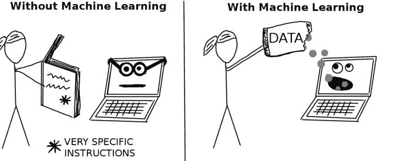

学习器（Learner）或机器学习算法（Machine Learning Algorithm）是用于从数据中学习机器学习模型的程序。另一个名称是“诱器”（inducer，例如“树诱器”）。

> ²算法的定义。”https://www.merriam-webster.com/dictionary/algorithm. (2017).

## 1.3 术语

机器学习模型（Machine Learning Model）是将输入映射到预测的学习学习程序。这可以是线性模型或神经网络的一组权重。“模型”这个相当不具体的词的其他名称是“预测器”（predictor），或者根据任务的不同，称为“分类器”（classifier）或“回归模型”（regression model）。在公式中，训练好的机器学习模型被称为 `f` 或 `f(x)`。

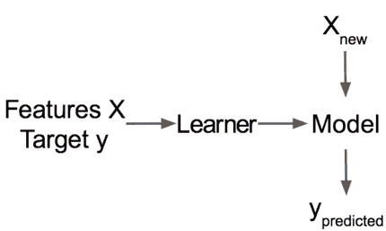

图 1.1：学习器从标记训练数据中学习模型。该模型用于做出预测。

黑盒模型（Black Box Model）是不揭示其内部机制的系统。在机器学习中，“黑盒”描述无法通过观察参数来理解的模型（例如神经网络）。黑盒的反面有时被称为白盒（White Box），在本书中被称为可解释模型（interpretable model）。与模型无关的方法（Model-agnostic methods）即使机器学习模型不是黑盒也会将其视为黑盒。

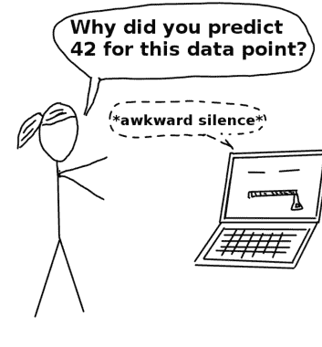

可解释机器学习（Interpretable Machine Learning）是指人类可以理解系统行为和预测的方法和模型。


数据集（Dataset）机器学习的数据表格。数据集包含特征和要预测的目标。当用于引导可解释模型时，数据集被称为训练数据。

# 第 1 章 引言

实例（**Instance**）是数据集中的行。实例的其他名称为：数据点（data point）、示例（example）、观察值（observation）。实例由特征值 `$x^{(i)}$` 和（如果已知）目标 `$y_i$` 组成。

特征（**Features**）是预测或分类的输入。特征是数据集中的列。书中假设特征是可解释的，这意味着它们的含义很容易理解，例如某天的温度或人的身高。特征的可解释性是一个假设。但如果很难理解特征，就更难理解模型做了什么。所有特征的矩阵称为 `X`，单个实例的 `$x^{(i)}$`。所有实例的单个特征向量为 `$x_j$`，特征 `j` 的值为 `$x_j^{(i)}$`。

目标（**Target**）是机器学习以预测的信息。在数学公式中，目标通常称为 `$y$` 或单个实例的 `$y_i$`。

机器学习任务（**Machine Learning Task**）是数据集与特征和目标的组合。根据目标的类型，任务可以是分类、回归、生存分析、异常检测。

预测（**Prediction**）是机器学习模型根据给定特征“猜测”的目标值。在书中，模型预测表示为 `$f(x^{(i)})$` 或 `$y$`。

# 2 可解释性

从（数学上）定义可解释性是很的。Miller (2017) 对可解释性的非数学定义是¹：可解释性是人类理解决策原因的程度。另一个是：可解释性是人类一致预测模型结果的程度²模型的可解释性越高，人们理解决策或预测就越容易。一个模型比另一个模型更有可解释性。我将交叉使用可解释（interpretable）和可解释（explainable）这两个词。我认为区分可解释性/解释性与解释是有意义的。交互机器学习是一个常用的术语，涵盖了“从数据提取或通过模型学习的相关知识”。

## 2.1 可解释性的重要

如果机器学习模型表现良好，我们为什么不信任该模型以及它为什么要做出决策？“问题在于，单一指标（如准确率）对现实世界任务的描述是不完全的”（2017）。让我们深入探讨可解释性的重要原因。涉及到预测建模时，你必须进行权衡：你只想知道预测什么？例如客户流失的概率或某种药物对患者的效果。或者你想知道为什么做出该预测，以及预测性能下降的原因？

# 第 2 章 可解释性

如果不关心为什么要做出决策，知道在测试数据集上的预测性能良好就足够。但在其他情况下，知道“为什么”可以帮助你了解更多问题以及模型可能失败的原因。某些模型可能不需要解释，因为它们处于低风险环境，这意味着错误不会产生严重后果（例如电影推荐系统），或者该方法已经经过了广泛的研究和评估（例如字符识别）。对解释性的需求源于问题形式化的不完全（Doshi-Velez and Kim 2017），这可能意味着对于某些问题或任务，不仅仅是预测（什么）。模型还必须解释预测（为什么），因为正确的预测只能部分解决你的原始问题。以下原因驱动了对可解释性和解释的需求（Doshi-Velez and Kim 2017 和 Miller 2017）。

人类的好奇与学习：人类对环境有一个心理模型，当发生意外情况时，该模型会更新。这是通过为意外情况寻找解释来实现的。例如，人类意外问：“我为什么觉得不舒服？”他了解到每次看到那些红果都会生病。他更新了自己的心理模型，并决定果实导致了疾病并应该避免。当研究中使用不透明机器学习模型时，如果模型在没有解释的情况下给出预测，科学发现将完全隐藏。为了促进学习并满足对机器产生某些预测或行为的好奇，可解释性和解释至关重要。当然，人类不需要对发生的一切给出解释。对于大多数人来说，不理解计算机是如何工作的是可以接受的。意外事件让我们感到好奇。例如：为什么我的电脑会意外关机？

与学习密切相关的是对世界发现意义的渴望。我们希望协调知识结构元素之间的矛盾或不一致性。“我的狗为什么咬了我，尽管它以前从未这样做过？”人类可能会问。对狗过去行为的认知与新产生的不愉快体验之间存在矛盾。兽医的解释调和了狗主的矛盾：“狗压力太大了咬人。”机器的决策对人的生活影响越大，机器解释其行为就越重要。

# 经常一起购买


（例如社会学、心理学），也趋向机器学习（生物学、基因组学）。**科学的目标**是获取知识，但许多问题是通过大数据集和黑箱机器学习模型解决的。模型本身变成了知识的来源，而不是数据。可解释性使得提取这些由模型捕捉的额外知识成为可能。

机器学习模型承担了需要**安全措施**和测试的现实任务。想象一下自动驾驶汽车根据深度学习系统自动检测骑行者。你希望 100% 确定系统学习到的抽象是无误的，因为压过骑行者是非常糟糕的。解释可能会揭示最重要的学习到的特征是识别自行车轮子，而这种解释可以帮助你考虑边界情况，例如挂着侧包并部分遮挡了轮子的自行车。

默认情况下，机器学习模型会从训练数据中吸收偏见。这会导致你的机器学习模型变成歧视弱势群体的种族主义者。可解释性是机器学习模型中**检测偏见**的实用调试工具。可能会出现这种情况：你训练用于自动批准或拒绝贷款申请的机器学习模型，歧视了一个在历史上被剥夺权利的少数群体。而你的主要目标是向那些最终会还款的人发放贷款。在这种情况下，问题表述的不完整性在于，你不仅希望最小化违约率，还有义务不根据某些人口统计特征进行歧视。这是你问题表述中的额外约束（以低风险且合规的方式发放贷款）。将机器和算法整合到日常生活中的过程需要可解释性来增加**社会接受度**。在一个著名的实验中，Heider 和 Simmel (1944) 向参与者展示了人们赋予物体信念、欲望和意图的视频。

## 第二章 可解释性

### 2.1 可解释性的重要


图 2.2：我们的真空机器人 Roomba 卡住了。作为事故的解释，Roomba 告诉我们它需要在平坦的表面上。

机器学习模型（如电影推荐）在可以被解释时，其解释能力得到了调试和增强。在低风险环境中，这在研发阶段和部署阶段都有价值。后来，当模型被用到产品中时，可能会出现问题。对错误预测的解释有助于理解错误的原因。它为修复系统提供了方向。考虑一个哈士基犬分类器的例子，它将哈士基犬分类为狼。有趣的是，目标与接收者的目标之间可能存在不匹配。通过使用可解释的机器学习方法，你会发现误分类是因为图像上有雪。分类器学习了将雪看作是将图像分类为“狼”的特征，这在从训练数据集中区分狼和哈士基犬方面是有意义的，但在现实世界的使用中则不然了。

如果你可以确保机器学习模型能够解释决策，那么你也可以轻松地检查以下内容（Doshi-Velez and Kim 2017）：

- 公平性：确保预测是不偏的，并且没有隐式或显式地歧视代表不足的群体。可解释的模型可以告诉你它为什么决定某人不应该获得贷款，人类也更容易判断该决定是否基于学习到的人口统计（例如种族）偏见。

# 我们什么时候不需要可解释性。

以下场景说明了我们什么时候不需要甚至不想机器学习模型的可解释性。

如果模型没有产生重大影响，则不需要可解释性。想象一个叫 Mike 的人正在做一个机器学习侧边项目，用来预测他的朋友在 Facebook 上下一次假期会去哪里。Mike 只是喜欢通过对他们去哪里度过进行进行推测来给他们带来惊喜。如果模型错了，并没有真正的问题（最坏只是让 Mike 感到尴尬），如果 Mike 无法解释模型的输出，也没有问题。在这种情况下，没有可解释性是完全可以的。如果 Mike 开始围绕这些目的地预测建立业务，情况就会发生变化。如果模型错了，业务可能会亏钱，或者模型可能因为学习到的种族偏见而对某些人有效。一旦模型产生了重大影响，无论是财务上的还是社会上的，可解释性就会变得相关。

当问题已经得到充分研究时，就不需要可解释性。某些应用已经经过了充分的研究，以至于对模型有了足够的实践经验，模型问题也随着时间得到了解决。一个很好的例子是用于光学字符识别的机器学习模型，它处理信封图像并提取地址。人们对这些系统有了多年的经验，而且显然它们是有效的。此外，我们并不真的对获得该任务的额外见解感兴趣。

## 2.2 可解释性方法的分类

- **特征总结可视化：** 大多数特征总结统计数据也可以被可视化。某些特征总结实际上只有在可视化时才具有意义，使用表格将是一个错误的选择。特征的部分依赖就是此类情况。部分依赖图是显示特征与平均预测结果的曲线。呈现部分依赖性的最佳方法是实际绘制曲线，而不是打印坐标。

- **模型内部结构（例如学习到的权重）：** 对内生可解释模型的解释属于这一类。例如线性模型中的权重，或决策树学习到的树结构（用于树的特征和阈值）。在例如线性模型中，模型内部和特征总结统计数据之间的界限是模糊的，因为权重既是模型内部，也是特征的总结统计数据。另一种输出模型解释的方法对于表格数据的特定特定模型很有用（见下文标准）。

- **数据点：** 这一类包含所有返回数据点（已存在或创建）以使模型具有解释性的方法。一种方法是反事实解释。为了解释一个数据实例的预测，该方法通过改变某些特征来寻找相似的数据点，使得预测结果发生相关的变化（例如预测类别的翻转）。另一个例子是预测类别原型的识别。为了有效，输出新数据点的解释方法要求这些数据点本身必须是可以被解释的。这对于图像和文本效果良好，但对于具有数百个特征的数据用处较小。

- **内生可解释模型：** 解释黑箱模型的解决方案是使用可解释模型（全局地或局部地）对其进行近似。可解释模型本身通过查看内部模型参数或特征总结统计数据来被解释。

**模型特定或模型无关：** 模型特定的解释工具仅限于特定的模型类。对线性模型中回归权重的解释是模型特定的特定的解释，因为——根据定义——内生可解释模型的解释始终是模型特定的。仅适用于解释（例如）神经网络的工具是模型特定的。模型无关的工具可以用于任何机器学习网络，并在模型训练后应用（事后分析）。这些无关性方法通常通过分析特征的输入对和输出对来工作。根据定义，这些方法无法访问权重或结构信息等模型内部结构。

**局部还是全局？** 解释方法是解释单个预测还是整个模型的行为？或者其作用范围介于两者之间？请在下一节中阅读更多关于作用范围标准的内容。

## 2.3 可解释性的范围

算法训练一个产生结果的模型。

### 2.3.1 算法透明度

算法如何让模型变得易懂？

算法透明度是指通过查看模型预测来解释模型对单个输入的预测，并解释为什么。通过查看单个预测，原本复杂的模型行为可能会变得更容易易受。局部上，预测可能对某些特征呈线性或单调依赖，而不是对它们具有复杂的依赖。例如，房屋的价格可能非线性取决于大小。但如果你只看一个特定的100平方米的房子，对于该数据集，你的模型预测可能对大小是线性的。这在某些情况下是易于理解的。

### 2.3.2 全局模型解释性

如何对模型进行全局解释？

为了解释全局模型，你需要理解所有特征。全局模型解释性是如何产生作用的？全局模型解释性有助于理解哪些特征是重要的。在实践中，全局模型解释性是困难的。对于神经网络的预测，全局模型解释性通常关注于特征的输入输出。全局模型解释性是不可及的。但对于线性模型，全局模型解释性是可以解释的。

### 2.3.3 全局模型解释性（模块化层面）

模型的部分如何影响预测？

对于具有数百个特征的朴素贝叶模型，在记忆中是太大了。即使我们记住了所有权重，也无法预测新的数据。虽然全局模型解释性是不可及的，但我们至少可以理解某些模型。并不是所有模型在参数层面都是可解释的。对于线性模型，可解释的部分是权重；对于树，则是切分（选定的特征和截断点）和叶节点预测。线性模型，例如，看起来是可以完美解释的，但单个权重的解释受到其他特征的干扰。

### 2.3.4 单个预测的局部解释性

模型为什么对某个实例产生特定的预测？

你可以放大一个单个实例并检查模型对该输入预测了什么，并解释原因。如果你关注单个预测，线性模型是可以理解的。因此，局部解释可以比全局解释更准确。本书在模型无关方法的章节中介绍了可以使单个预测更具解释性的方法。

### 2.3.5 一组预测的局部解释性

模型为什么对一组实例做出了特定的预测？

# 第 2 章 可解释性

多个实例的模型预测可以通过全局模型解释方法（在模块层级）或通过单个实例的解释来解释。全局方法可以通过选取一组实例，将它们视为完整数据集，并在该子集上使用全局方法来应用。单个解释方法可以用于每个实例，并对整个组进行列出或聚合。

## 2.4 可解释性的评估

关于机器学习中可解释性的定义，目前尚未达成共识。对于如何衡量它，也并不清楚。但对这方面已经有一些初步研究，并尝试制定了一些评估方法，如本节所示。

Doshi-Velez 和 Kim (2017) 提出了可解释性评估的三个主要层面：

- **应用级评估（真实任务）：** 将解释放入产品中并让终端用户进行测试。想象一种带有机器学习组件的骨折检测软件，该组件能够定位于并标记 X 光片中的骨折。在应用层面，放射科医生将直接测试骨折检测软件以评估模型。这需要良好的实验设计以及对如何评估质量的理解。对此，一个良好的基准始终是：优秀的人类是如何解释同一个决策的。

- **人类级评估（简单任务）** 是应用级评估的简化版。区别在于，这些实验不是与领域专家进行，而是与外行进行。这使得实验成本更低（特别是当领域专家是放射科医生时），而且更容易找到更多测试者。一个例子是向用户展示解释，由用户选择最好的一个。

- **功能级评估（代理任务）** 不需要人类。当某类模型已经通过人类级评估进行过评估时，这种方法效果最好。例如，可能已知终端用户理解决策树。在这种情况下，解释质量的代理可以是树的深度。较短的树将获得更好的解释评分。此时增加一个约束条件——即树的预测性能仍保持良好且不会比大树下降太多——是很有意义的。

下一章将关注在功能层级对单个预测的解释进行评估。在评估解释时，我们应该考虑哪些相关的相关属性？

## 2.5 解释的属性

我们想要解释机器学习模型的预测。为了实现这一点，我们依赖于某些解释方法，即一种生成解释的算法。**解释通常以人类可理解的方式，将实例的特征值与其模型预测联系起来**。其他类型的解释由一组数据实例组成（例如在 k-近邻模型的情况下）。例如，我们可以使用支持向量机预测风险，并使用局部代理方法解释预测，该方法生成决策树作为解释。或者，我们可以使用线性回归模型代替支持向量机。线性回归模型已经配备了解释方法（权重的解释）。

我们更仔细地观察解释方法和解释的属性（Robnik-Sikonja 和 Bohnec, 2018）。这些属性可以用来判断一个解释方法有多好。对于所有这些属性，如何正确衡量它们尚不清楚，挑战之一就是将它们的计算方式形式化。

### 解释方法的属性

- **表达能力（Expressive Power）** 是解释方法生成的“语言”或结构。解释方法可以生成 IF-THEN 规则、决策树、加权和、自然语言或其他。

- **透明度（Translucency）** 描述了解释方法在多大程度上依赖观察机器学习模型（如其参数）。例如，依赖于内在可解释模型（如线性回归模型，模型特定）的解释具有高透明度。仅依赖于操作输入和预测的方法透明度为零。根据场景，不同程度的透明度可能是理想的。高透明度的优点是该方法可以依赖更多信息来生成解释；低透明度的优点是解释方法更具移植性。

- **可移植性（Portability）** 描述了解释方法可以使用的机器学习模型范围。低透明度的方法具有更高的移植性，因为它们将机器学习模型视为黑箱。代理模型可能是移植性最高的解释方法。仅适用于例如循环神经网络的方法可移植性较低。

- **算法复杂度（Algorithmic Complexity）** 描述了生成解释方法的计算复杂度。当计算成为生成解释的瓶颈时，考虑这一属性是重要的。

### 单个解释的属性

- **准确性（Accuracy）：** 解释预测未见数据的效果如何？如果目标是解释机器学习模型，高准确性尤为重要。

- **保真度（Fidelity）：** 解释对机器学习模型的逼近程度有多高？准确性和保真度密切相关。

- **一致性（Consistency）：** 在在同一任务上训练的模型之间，解释的差异有多大？如果解释非常相似，它们就具有高度的一致性（也称为拉什门效应 Rashomon Effect）。高一致性是理想的。

- **稳定性（Stability）：** 相似实例的解释如何？一致性比较的是模型之间的解释，而稳定性比较的是固定模型实例之间的解释。高稳定性意味着实例特征的细微变化不会大幅改变预测（除非这些细微变化强烈地改变了预测）。缺乏稳定性可能是解释方法的高方差或非确定性组件导致的。

- **可理解性（Comprehensibility）：** 人类对解释的理解程度如何？这看起来只是许多属性中的一个，但它是“房间里的大象”（关键问题）。它很难定义，但做到至关重要。许多人认同可理解性取决于观众。

- **确定性（Certainty）：** 解释是否反映了机器学习模型的确定性？许多机器学习模型只给出预测，而没有关于模型对预测正确的置信度。

- **重要性程度（Degree of Importance）：** 解释反映特征或解释部分重要性的程度如何？

- **新颖性（Novelty）：** 解释是否反映了某个数据实例是否待被解释？是否来自训练数据分布之外的“新”区域？在这种情况下，模型可能是不准确的，解释也可能是没用的。新颖性（novelty）的概念与确定性（certainty）的概念有关。新颖性越高，模型因为缺乏数据而导致低确定性的可能性越大。

- 代表性（Representativeness）：解释涵盖了多少实例？解释可以涵盖整个模型（例如线性回归模型中权重的解释），也可以仅代表单个预测（例如 Shapley Values）。

## 2.6 人类友好型解释

让我们更深入地探讨，发现人类认为的“好”解释是什么，以及这对可解释机器学习意味着什么。人文科学研究可以帮助找到答案。Miller (2017) 对关于解释的出版物进行了大规模调查，本章将基于其总结进行展开。

在本章中，我想说服你接受以下观点：作为事件的解释，人类更倾向于简短的解释（只有 1 或 2 个原因），并将当前的情况与事件不会发生时的情况进行对比。特别是异常情况提供了很好的解释。解释是解释者和被解释者（解释接收者）之间的社会互动，因此社会背景对解释的实际内容有很大影响。


当你需要针对特定预测或行为提供所有因素的解释时，你需要的不是人类友好型的解释，而是完整的因果归因。如果你被法律要求指定所有影响特征，或者需要调试机器学习模型，你可能需要因果归因。在这种情况下，请忽略以下几点。在其他所有情况下，如果接收者是平民或时间有限的人，以下章节对你来说会趣。

### 2.6.1 什么是解释？

解释是对“为什么”问题的回答（Miller 2017）。

- 为什么医生没有用药物治疗病人？
- 为什么我的贷款被拒绝了？
- 为什么我们还没有收到外星生命的联系？

前两个问题可以用“日常型”解释来回答，而第三个问题属于“更一般的科学现象和哲学问题”类别。我们关注“日常型”解释，因为它们与可解释机器学习更相关。以“如何”开头的问题通常可以重写为“为什么”问题：“我的贷款是如何被拒绝的？”可以转化为“为什么我的贷款被拒绝了？”。

在接下来，“解释”一词既指解释的社会和认知过程，也指这些过程的产物。解释者可以是人，也可以是机器。

### 2.6.2 什么是好的解释？

本节进一步浓缩了 Miller 对“好”解释的总结，并为可解释机器学习增加了具体的启示。

解释是对比性的（Lipton 1990）。人类不会问为什么做出某项预测，而是问为什么是这个预测*而不是另一个预测*。我们倾向于在反事实案例中思考，即“如果 X 发生了变化，预测会变成什么？”对于房价预测，房主可能对为什么预测价格与他们预期的更低价格形成对比感兴趣。如果我的贷款申请被拒绝了，我并不在乎所有通常支持拒绝的因素。我感兴趣的是我的申请中那些想要改变的因素，或者我想知道我的申请与那个本会被接受的申请版本之间的差异。认识对比性解释的重要性是可解释机器学习的一项重要发现。从大多数可解释模型中，你可以提取出一个与实例预测、人工数据源或实例平均值相匹配的解释。医生可能会问：“为什么这种药物对我的病人无效？”他们想要一个解释，将药物有效的病人与类似的该但不产生反应的病人进行对比。对比性解释比完整解释更容易理解。关于医生认为药物无效原因的完整解释可能包括：病人患该疾病 10 年了，11 个基因过度表达，身体将药物分解为无效化学物质的速度非常快。而对比性解释可能简单得多：与产生反应的病人相比，无反应的病人具有特定的基因组合，导致药物效果降低。最好的解释是突出感兴趣对象与参考对象之间最大差异的解释。

**这对可解释机器学习意味着什么：** 人类不需要对预测给出完整解释，而是想将自己的预测与另一个实例的预测（可以是人工的）进行比较。创建对比性解释取决于应用，因为需要一个用于比较的参考点。这可能取决于要被解释的数据点，也取决于接收解释的用户。房价网站的用户可能想获得一个与自己的房子形成对比的房价解释，或者想与网站上的另一栋房子进行对比，或者与社区的平均房屋进行对比。自动创建对比性解释的解决方案可能还涉及在数据中寻找原型（prototypes）或典型（archetypes）。

**解释是被筛选的。** 人们并不期望解释涵盖事件实际且完整的原因列表。我们习惯于从可能的情况中选择一或两个作为*唯一的*解释。作为证明，看看电视新闻：“股价下跌被归咎于由于最新软件更新问题，对公司产品的反弹日益增长。”

“翼（Tsubasa）和他的团队输掉比赛是因为防守漏洞：他们给对手留了太多的空间执行策略。”

“对既有机构和我们政府日益增加的不信任是投票率下降的主要因素。”

一个事件可以被多种原因解释的事实是罗生门效应（Rashomon Effect）。罗生门是一部日本电影，讲述了关于武士死的替代性的、矛盾的故事（解释）。对于机器学习模型来说，从不同特征进行预测是有益的。集成方法通过结合不同的特征（不同的解释）通常表现良好，因为对这些“故事”进行平均会让预测更稳健、准确。但也意味着对于某个预测存在不止一个选择性的解释。

**这对可解释学习意味着什么：** 在解释时，只给出 1 到 3 个原因，即使世界很复杂。`LIME` 方法在这方面做得很好。

解释是社会性的。它们是解释者和解释接收者之间对话或互动的一部分。社会背景决定了解释的内容性质。如果我想向一个技术人员解释为什么加密货币这么值，我会说“这种去中心化的、分布式的、基于区块链的账本无法被中央机构控制，与想要保护财富的人产生共鸣，这解释了高需求和高价格。”但我奶奶会说：“孩子，加密货币就像电脑黄金。人们喜欢并花高价买黄金，年轻人也买电脑黄金。”

**这对可解释学习意味着：** 注意机器学习应用的社会环境和目标群体。机器学习模型的部分完全取决于你的特定应用。人文专家（例如心理学家和社会学家）可以帮助你。

解释关注异常情况。这些是概率很小但重要的案例。消除这些异常情况将极大改变结果（反事实解释）。人类认为这些“异常”案例是很好的解释。正如 Strumbel 和 Kononenko 所述：我们有一个关于老师和学生测试情况的数据集。学生在成功完成演示后直接通过。老师可以选择额外向学生提问以测试知识。无法回答这些问题的学生将不及格。我们想预测学生是否会通过并解释我们的预测。如果老师不问你，通过的概率是 100%

# 第 28 章 第2 章 可解释性

……额外问题，否则通过的概率取决于学生的准备程度以及正确回答问题的相应概率。

场景 1：老师通常会向学生提额外问题（例如，100 次中有 95 次）。一个没有学习的学生（通过该问题的概率为 10%）并不是幸运儿，他遇到了一个他无法正确回答的额外问题。为什么这个学生没能通过课程？我认为这是学生自己没有学习的错。

场景 2：老师很少提额外问题（例如，100 次中只有 2 次）。对于一个没有为问题做准备的学生来说，我们预测他通过课程的概率很高，因为不太可能提问。当然，其中一个学生没有为问题做准备，这使他有 10% 的通过概率。他运气不好，老师提了一个学生无法回答的额外问题，导致他没通过课程。失败的原因是什么？我认为，更好的解释是“因为”老师测试了学生。老师本不太可能进行测试，所以老师的行为是不寻常的。

这对可解释机器学习的意义：如果预测的某个特征在任何方面都是异常的（例如类别特征的稀有），并且该特征影响了预测，那么它应该包含在解释中，即使“正常”特征对预测的影响与其他特征相同。在我们的价格预测示例中，一个异常特征可能是某间较昂贵的房子有两个阳台。即使某些归因方法显示，阳台对价格差异的贡献类似于高于平均水平的房屋面积、社区或近期装修，异常特征“两个阳台”仍可能是这间房子之所以昂贵的最佳解释。

解释是诚实的。良好的解释在现实中被证明是真实的（即在其他情况下也是）。但令人担忧的是，这似乎比诚实性更重要。一个选择一或两个可能情况的解释很少涵盖整个相关案例列表。选择性（Selectivity）遗漏了部分事实。并不是说一两个因素（例如）导致了股市崩溃，但事实是存在数百万案例影响了人们采取这种行为，导致了崩溃的发生。

这对可解释机器学习的意义：解释应该诚实地预测事件，这在机器学习中有时被称为保真度（fidelity）。如果我们说阳台增加了房屋的价格，那么这也应该适用于其他房子（或至少适用于类似的房子）。对于人类来说，解释的保真度没有其选择性和社会属性那么重要。

这对可解释机器学习的意义：良好的解释符合先验信念（prior beliefs）。这很难整合到机器学习中，并且可能会严重损害预测性能。我们对房屋面积对预测价格影响的先验信念是：房子越大，价格越高。让我们假设模型也显示几间房子的面积对预测价格有负面影响。模型学习到这一点是因为它提升了预测性能（由于某些复杂的相互作用），但这种行为强烈违背了我们的先验信念。你可以强制单调性约束（特征只能向一个方向影响预测）或使用具有这种属性的线性模型等。

**良好的解释是通用且高概率的。** 一个可以解释许多事件的原因是非常通用的，可以被认为是良好的解释。请注意，这与“异常原因产生良好的解释”的说法相矛盾。在我看来，异常原因优于通用原因。在给定场景中，异常情况根据定义是稀缺的。在没有异常事件的情况下，通用解释被认为是良好的解释。还要记住，人们倾向于误判联合事件的概率。（Joe 是一名图书管理员。他可能是一个喜欢看书的害羞的人吗？）很好的例子是“这栋房子贵是因为它很大”，这是一个关于房子昂贵或便宜的非常通用且良好的解释。

**这对可解释机器学习的意义：** 通用性（Generality）可以通过特征的支持率（support）轻松衡量，即解释所适用的实例数量除以实例总数。

## 2.6 人类友好的解释

## 3 数据集

在整书中，所有的模型和技术都应用于可以在网上免费获得的真实数据集。我们将为不同的任务使用不同的数据集：分类、回归和文本分类。

## 3.1 自行车租赁（回归）

该数据集包含了华盛顿特区 Capital-Bikeshhare¹ 自行车租赁公司的每日租赁计数，以及天气和季节信息。这些数据由 Capital-Bikeshhare 慷慨开放。Fanee-T 和 Gama (2013)² 增加了天气数据和季节信息。目标是根据天气和日期预测将租赁多少辆自行车。数据可以从 UCI 机器学习库³ 下载。

数据集中添加了新特征，且并非所有原始特征都用于书中的示例。以下是使用的特征列表：

- 自行车计数，包括休闲用户和注册用户。该计数用作回归的目标值。
- 季节：春、夏、秋或冬。
- 该日是否为节日的指示器。
- 年份：2011 年或 2012 年。
- 自 2011.01.01 以的天数（数据集中的第一天）。
- 相对湿度（百分比，0 到 100）。
- 风速（公里/小时）。
- 温度（摄氏度）。
- 该日是否为工作日或周末的指示器。
- 天气状况。
- 晴、少云、多云、云云、散云、小雨、大雨、冰雹、雷阵、雾云。
- 随时间的趋势。

### 表 3.1：YouTube 评论示例

| CONTENT | CLASS |
|---|---|
| Huh, anyway check out [tube]: koboshi02 | 1 |
| Guys check out my new channel: THIS IS | 1 |
| THE MONKEYS!!! I'm the monkey in the white shirt,please leave a comment and please subscribe!!! murdev.com | 1 |
| me shaking my sexy ass on my channel enjoy kidsmediausa | 1 |
| Hey, check out my new website! This site is about kids. | 1 |
| Subscribe to me i turned it mute as i came on | 0 |
| You should check my channel for Funny VIDEOS and tell me what I do! | 1 |

## 3.2 YouTube 评论（文本分类）

作为文本分类的示例，我们使用了来自 5 个不同 YouTube 视频的 1956 条评论。在垃圾邮件分类的文章中使用该数据集的作者将其数据开放⁶（Alberto, Loch, and Almeida (2015)）。

评论是通过 YouTube API 从 2015 年上半年 YouTube 上观看量最高的十个视频收集的。这 5 个都是音乐视频。其中之一是韩国艺术家 Psy 的《Gangnam Style》。其他艺术家是 Katy Perry、LIMFao、Eminak 和 Shakira。

评论被手动标记为垃圾邮件或合法。垃圾邮件编码为“1”，合法编码为“0”。

## 3.3 宫颈癌的风险因素（分类）

你也可以去 YouTube 查看评论区。但请不要陷入“YouTube 地狱”，最后一直在看猴子在沙滩上偷游客并喝游客喝鸡尾酒的视频。Google 的垃圾邮件检测器自 2015 年以来可能也发生了很大变化。

在此处查看播放记录视频“江南江南风”⁵。

如果你想尝试处理这些数据，可以在书的 Github 仓库中找到 RData 文件⁹以及带有一些便利函数的 Rscript¹⁰。

## 3.3 宫颈癌的风险因素（分类）

宫颈癌数据集包含了预测女性是否会患上宫颈癌的指标和风险因素。特征包括人口统计学数据（如年龄）、生活方式和病史。数据可以从 UCI 机器学习库¹¹ 下载，并由 Fernandes、Cardoso 和 Fernandes (2017)¹² 描述。

书中示例中使用的特征子集为：

- 年龄（岁）
- 性伴数量
- 首次性行为年龄（年龄，岁）
- 怀孕次数
- 是否吸烟（是/否）
- 吸烟年数（年）
- 是否使用激素避孕药（是/否）
- 使用激素避孕药时长（年）
- 是否使用宫内节（IUD）
- 使用宫内节年数（年）
- 患者是否曾患过性传播疾病（STD）（是/否）
- STD 诊断次数
- 距离首次 STD 诊断以来经过的时间
- 距离上一次 STD 诊断以来经过的时间
- 活检结果“健康”或“癌症”。这是目标输出。

活检是诊断宫颈癌的金标准。对于书中的示例，活检结果被用作目标。每列的缺失值通过众数（出现频率的值）进行填充，这可能是一个糟糕的解决方案，因为真实答案可能与值缺失的概率相关。可能存在偏差，因为这些问题具有很强的私密性。但这不是一本关于缺失值填充的书，所以众数填充对于示例来说。

要用此数据集重现书中的示例，请在书的 Github 仓库中找到预处理 R 脚本$^{13}$ 和最终的 RData 文件$^{14}$。

## 4 可解释模型

实现解释性最简单的方法是仅使用创建可解释模型的算法子集。线性回归、逻辑回归和决策树是常用的可解释模型。

在接下来的章节中，我们将讨论这些模型。不会进行详细阐述，只介绍基础知识，因为有大量的书籍、视频、教程、论文和更多材料可用。我们将重点关注如何解释模型。书中更详细地讨论了线性回归、逻辑回归、其他线性回归扩展、决策树、决策规则和 RuleFit 算法。它还列出了其他可解释模型。

书中解释的所有可解释模型都是模块化解释的，最近邻方法除外。下表提供了可解释模型类型及其概述。如果特征与目标之间的关联是线性建模，则是线性的。单调性约束确保特征与目标结果在整个范围内方向相同：特征值的增加会导致目标的增加或减少。单调性对于解释很有用。某些模型可以提高性能，但过多的交互会损害可解释性。

| 算法 | 单调性 | 交互 | 任务 |
|---|---|---|---|
| 线性回归 | 是 | 是 | 回归 |
| 逻辑回归 | 否 | 是 | 分类 |
| 决策树 | 否 |  | | 分类 |
| RuleFit | 是 | 是 | 回归 |
| 朴叶贝斯 | 否 | 否 | 分类 |
| 最近邻 | 否 | 否 | 分类 |

## 4.1 线性回归

线性回归模型通过特征的加权和来预测目标。线性回归长期以来被统计学家、计算机科学家和其他人员使用。对于单个实例，它可以写为：

$$y = \beta_0 + \beta_1 x_1 + ... + \beta_p x_p + \epsilon$$

betas ($\beta_j$) 代表学习到的权重或系数。截距和  epsilon ($\epsilon$) 是我们仍然犯的错误。假设这些误差遵循高斯分布，这意味着它们会在正负两个方向出现。

可以使用各种方法来估计权重，以最小化实际结果与估计结果之间的平方差：

$$\hat{\beta} = \arg \min_{\beta} \sum_{i=1}^n \left( y^{(i)} - \left( \beta_0 + \sum_{j=1}^p \beta_j x_j^{(i)} \right) \right)^2$$

我们不会详细介绍如何找到最优权重，但如果你感兴趣，可以阅读《统计学习方法》第 3.2 节（Friedman, Hastie and Tibshirani 2009)$^1$。估计的权重可以带有置信区间。置信区间是权重估计的一个范围，以一定的置信度覆盖“真实”权重。例如，权重 2 的 95% 置信区间范围可能从 1 到 3。该区间的解释是：如果我们使用新采样的数据重复估计 100 次，置信

在线性回归模型是数据的正确模型的情况下，该区间在 100 次情况中的 95 次中会包含真实权重。

模型是否为“正确”模型取决于数据中的关系是否满足某些假设，这些假设包括线性、正态性、同方差性、独立性、固定特征以及不存在多共线性。

## 线性

线性回归模型强制要求预测是特征的线性组合，这既是它最大的优点也是它最大的局限。线性使得模型具有可解释性。线性效应易于量化和描述。它们是相加的，因此很容易分离各项影响。如果你怀疑特征之间存在交互或特征与目标值是非线性关联，你可以添加交互项或使用回归样条（regression splines）。

## 正态性

假设目标结果遵循正态分布。如果违反了这一假设，特征权重的估计置信区间将是无效的。

## 同方差性（方差相等）

假设误差项的方差在整个特征空间内是常数。假设你想根据居住面积（平方米）来预测房屋的价格。你估计了一个线性模型，该模型假设无论房屋大小如何，预测响应周围的误差具有相同的方差。这一假设在现实中经常被违反。在房屋的例子中，较大房屋的预测价格的误差方差可能更高，因为价格更高，且价格波动的空间更大。假设你的线性回归模型中的平均误差（预测价格与实际价格之差）为 50,000 欧元。如果你假设同方差性，那么你就假设价值 100 万欧元的房屋和仅价值 40,000 欧元的房屋的平均误差都是 50,000。这是不合理的，因为这意味着会出现负房价。

## 独立性

假设每个实例都独立于任何其他实例。如果你进行了多次测量（例如对每个患者进行多次血液检查），数据点就不是独立的。对于依赖数据，你需要特殊的线性回归模型，例如混合效应模型或 GEE。如果你使用“普通”线性回归模型，可能会从模型中得出错误的结论。

## 固定特征

输入特征被认为是“固定的”。固定的意味着它们被视为“给定的常数”而不是统计变量。这意味着它们没有测量误差。这是一个相当不符合实际的假设。然而，如果没有这个假设，你就必须拟合非常复杂的测量模型来解释输入特征的测量误差。通常你并不想那样做。

## 不存在多共线性

你不希望特征之间存在强相关，因为这会干扰权重的估计。在两个特征强相关的情况下，估计权重会变得棘手，因为特征效应是相加的，导致无法确定将效应归因于相关特征中的哪一个。

## 4.1 线性回归

### 4.1.1 解释

线性回归模型中权重的解释取决于相应特征的类型。

- 数值特征：数值特征每增加一个单位，估计结果的结果就会随其权重发生变化。数值特征的一个例子是房屋的面积。


- 二分类特征：每个实例仅取两个可能值之一的特征。例如“房屋带花园”这一特征。其中一个值被视为基准类别（在某些编程语言中编码为 0），例如“无花园”。将特征从基准类别变为另一个类别，估计的结果会随该特征的权重发生变化。

- 具有多个类别的分类特征：具有固定数量可能值的特征。例如“地板类型”、“地毯”、“复合层地板”和“拼木地板”。处理许多类别的解决方案是独热编码（`one-hot-encoding`），这意味着每个类别都有自己的二分类列。对于具有 `L` 个类别的分类特征，你只需要 `L-1` 列，否则会有冗余信息（例如，当一个实例的第 1 到 `L-1` 列都为 0 时，我们知道该实例的分类特征属于类别 `L`）。每个类的解释与二分类特征的解释相同。某些语言（如 `R`）允许以各种方式编码特征，如在本章后文中所述。

- 截距 `$\beta_0$`：截距是“常数特征”的特征权重，所有实例均为 1。大多数软件软件包会自动在零处添加此“1”特征值来估计截距。其解释是：对于所有数值值为 0 且分类值为处于基准类别的实例，模型的预测值就是截距权重。截距的解释通常没有意义，因为所有值为 0 的实例都没有意义。只有当特征经过标准化（均值为 0，标准差为 1）时，解释才有意义。此时，截距反映了所有特征都处于平均值时的实例的预测结果。

可以使用以下文本模板自动对线性回归模型中特征的解释。

### 数值特征的解释

在所有其他特征值固定的情况下，特征 `$x_j$` 每增加一个单位，`$y$` 的预测值就会增加 `$\beta_j$` 单位。

### 分类特征的解释

在所有其他特征固定的情况下，将特征 `$x_k$` 从基准类别变为另一个类别，`$y$` 的预测值增加 `$\beta_k$`。

解释线性模型的另一个重要衡量标准是 R 方（R-squared）。R 方告诉你目标输出的总方差中有多少比例是由模型解释的。R 方越高，说明你的模型对数据的解释越越好。计算 R 方的公式为：

```
$R^2 = 1 - SSE/SST$$
```

SSE 是误差项的平方和：

```
$SSE = \sum_{i=1}^{n} (y_i - \hat{y}_i)^2$
```

SST 是总方差：

```
$SST = \sum_{i=1}^{n} (y_i - \bar{y})^2$
```

## 第 4 章 可解释模型

特征/目标空间（在单个特征的情况下，这是一条简单的直线）。权重指定了超平面在每个方向上的斜率（梯度）。其优点是，加性模型将单个特征的解释与其他所有特征孤立离开来。这之所以可能，是因为方程中所有特征的影响（等于权重乘以数值）都是通过加号组合在一起的。其缺点是，这种解释忽略了特征的联合分布。增加其中一个特征而不改变另一个特征，可能会导致不符合实际或至少是概率较低的数据点。例如，在不增加房屋面积的情况下增加房间数量可能是不符合实际情况的。

## 4.1 线性回归

某些置信区间非常短，但特征的影响在统计学上是显著的。温度就是其中一个候选特征。权重图存在的问题在于，这些特征是在不同的尺度上衡量的。对于天气而言，估计的权重反映了良好天气与雨天/暴风雨/雪天气之间的差异；而对于温度，它只反映了 1 摄氏度的影响。你可以在拟合线性模型之前对特征进行缩放（均值为 0，标准差为 1），使估计的权重更具可比性。

### 4.1.3 可视化解释

各种可视化方法让人类能够容易快速地理解线性回归模型。

#### 4.1.3.1 权重图

权重表的信息（权重和方差估计）可以在权重图中进行可视化。下面的图显示了上一个线性回归模型的结果。

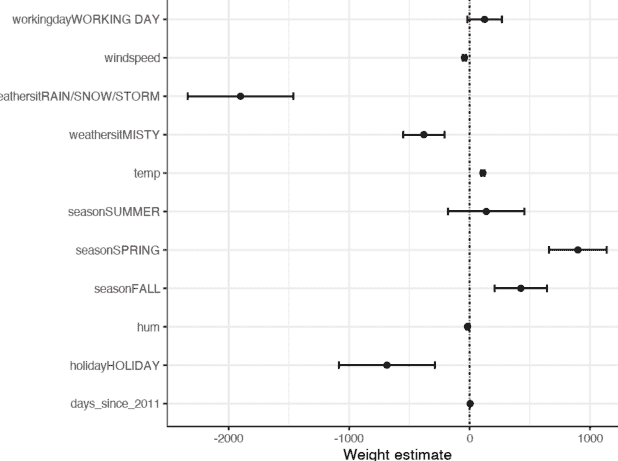

图 4.1：权重以点的形式显示，95% 置信区间以线的形式显示。

权重图显示，雨天/雪天/暴风天气对预测的自行车数量有强烈的负面影响。工作日的特征权重接近 0，且 95% 的区间内包含 0，这意味着该影响在统计学上是不显著的。

#### 4.1.3.2 影响图

当线性回归模型的权重与实际特征值相乘时，可以进行更具意义的分析。权重依赖于特征的尺度，如果你有一个测量例如人身高的特征，并从米切换到厘米，权重会发生变化，但数据中的实际影响并不会改变。了解特征在数据中的分布也是重要的，如果你的方差非常小，意味着所有实例对该特征的贡献是类似的。影响图可以帮助你理解权重和特征的组合对数据中预测的贡献了多少。通过计算影响（即每个特征的权重乘以实例的数值）：

> $$effect_j^{(i)} = w_j x_j^{(i)}$$

影响可以用箱线图进行可视化。箱线图包含了你的一部分数据的影响范围（25% 到 75% 分位数）。箱体中的垂直线是中值影响，即 50% 的实例对预测的影响较低，另一 50% 的实例影响较高。水平线延伸到 `±1.5IQR/\sqrt{n}`，其中 `IQR` 为四分位距（75% 分位数减去 25% 分位数）。点是离群值。类别特征的影响可以汇总在一个单个箱线图中，与权重图相比，在权重图中每个类别都有自己的一行。

对预期租赁自行车数量最大的贡献来自温度特征，它捕捉了自行车租赁随时间变化的趋势。温度对预测的贡献范围很广。日期特征从 0 变为较大的正贡献，因为数据集中的第一天（01.01.2011）具有非常小的趋势影响，且该特征的估计权重为正 (`4.93`)。这意味着影响随着每一天的增加而增加，并在数据集的最后一天（31.12.2012）最高。注意，对于该特征，如果不增加房屋面积，增加房间数量是不符合实际的。

## 4.1.4 解释预测

每个特征对预测贡献了多少？这可以通过计算每个特征的影响来回答。

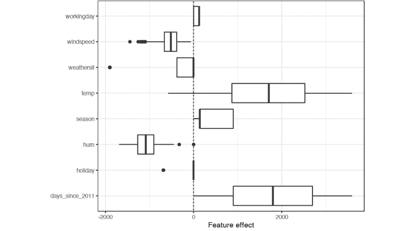

我们想要解释线性模型的预测。通过计算每个特征的影响来回答。这种对特定实例的解释是合理的。

### 4.1.5 类别特征的编码

有多种方法可以对类别特征，选择会影响权重的解释。线性回归中的标准是处理编码（treatment coding），这在大多数情况下是足够的。使用不同的编码方法相当于创建一个不同的的设计矩阵。本节介绍了更多的编码方法。

#### 处理编码

在处理编码中，每个类别的权重是对应类别与参考类别之间的估计差异。线性模型的截距是参考类别的平均值。设计矩阵的第一列是截距，第二列表示是否属于类别 B，第三列表示是否属于类别 C。不需要为类别 A 创建列，因为线性方程将过度定义，无法得出权重的唯一解。只需知道实例既不属于类别 B 也不属于 C 即可。

| 特征 | 数值 |

|---|---|

| 季节 | 冬 |

| 年份 | 2011 |

| 月份 | 一 |

| 假日 | 否 |

| 周几 | 四 |

| 天气 | 好 |

| 温度 | 1.6 |

| 湿度 | 0.4356 |

| 风速 | 5.8261 |

| 数量 | 1606 |

表 4.2：实例 6 的特征值

预测值：1571

平均值：4504

实际值：6

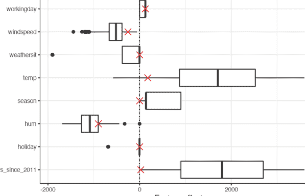

图 4.3：实例的影响图显示了影响分布。

#### 影响编码

在影响编码中，每个类别的权重是对应类别相对于整体平均值的估计差异（当所有其他特征为零或参考类别时）。第一列用于估计截距。与截距相关的权重 `$\betaeta_0$` 代表整体平均值，而第二列对应的 `$\betaeta_1$` 是整体平均值与类别 B 之间的差异。类别 B 的总影响为 `$\betaeta_0 + \betaeta_1$`。类别 C 的解释是对称的。对于参考类别 A，`-(\betaeta_1 + \betaeta_2)` 是与整体平均值的差异，而 `$\betaeta_0 - (\betaeta_1 + \betaeta_2)$` 是整体影响。

## 4.1 线性回归

### 哑编码 (Dummy coding)

`$\beta$` 类别是每个类别 y 的估计均值（假设所有其他特征值均为零或参考类别）。注意，截距项已省略，以便为线性模型权重找到唯一解。缓解这种多重共线性问题的另一种方法是省略其中一个类别。

特征矩阵：

| 1 | 0 | 0 |

|---|---|--|

| 1 | 0 | 0 |

| 0 | 1 | 0 |

| 0 | 1 | 0 |

| 0 | 0 | 1 |

| 0 | 0 | 1 |

如果你想更深入了解分类特征的不同编码，请查看这个[概述网页²](http://stats.ide.ucla.edu/r/library/r-library-contrast-coding-systems-for-categorical-variables/) 和这个[博客文章³](http://heidiscold.github.io/page/)。

### 4.1.6 线性模型能产生良好的解释吗？

根据“人类友好型解释”章节中提出的构成良好解释的属性判断，线性模型并不能产生最好的解释。它们具有对比性，但参考实例是一个所有数值特征均为零且分类特征处于其参考类别的数据点。这是一个人为的、无意义的实例，不太可能在你的数据或现实中出现。有一个例外：如果所有数值特征都经过了中心化（特征的均值），且所有分类特征都经过编码，那么参考实例就是所有特征都处于特征均值的数据点。这可能也是一个不存在的数据点，但它至少可能相似或更具意义。在这种情况下，权重乘以特征值（特征效应）解释了相对于“均值实例”对预测结果的贡献。良好选择的另一个方面是“选择性”，这在线性模型中可以通过使用较少特征或训练稀疏线性模型来实现。默认情况下，线性模型不会创建具有选择性的解释。线性模型创建的是真实的解释，因为线性方程是描述特征与结果之间关系的合适模型。非线性和交互作用越多，线性模型的准确性就越低，解释的真实性也越差。线性化使得解释更加通用且更简单。我相信，模型的本质是人们使用线性模型来解释关系的主要因素。

### 4.1.7 稀疏线性模型

我选择的线性模型示例看起来都很整洁漂亮，不是吗？在现实中，你可能不仅有少数特征，而是数百甚至上千个。你的线性回归模型呢？可解释性会下降。你甚至可能会发现处于特征多于实例的情况，完全无法拟合标准的线性模型。好消息是，有办法在线性模型中引入稀疏性（即少数特征）。

#### 4.1.7.1 Lasso

Lasso是在线性回归模型中引入稀疏性的一种自动且方便的方法。Lasso 代表“最小收缩和选择算子”（least shrinkage and selection operator），当应用于线性回归模型时，它执行特征选择并对选定的特征权重进行正则化。让我们考虑权重优化的最小化问题：

$$\min_{\beta} \left(\frac{1}{n} \sum_{i=1}^{n}(y^{(i)} - x_i^T\beta)^2\right)$$

Lasso 在此优化问题中添加了一个项：

$$\min_{\beta} \left(\frac{1}{n} \sum_{i=1}^{n}(y^{(i)} - x_i^T\beta)^2 + \lambda|\beta||_1\right)$$

项 `$|\beta||_1$` 是特征向量的 L1 范数，它会对大权重产生惩罚。由于使用了 L1 范数，我们会得到 0 的估计，而其他权重会被收缩。参数 lambda (`$\lambda$`) 控制正则化效应的强度，通常通过交叉验证进行调整。当 lambda 特别大时，许多权重变为 0。特征权重可以可视化为惩罚 lambda 项的函数。下图中每个特征权重由一条曲线表示。

我们应该为 lambda 选择什么值呢？如果你将惩罚项视为调优参数，可以通过交叉验证找到使模型误差最小的 lambda。你也可以将 lambda 作为一个参数来控制模型的可解释性。惩罚越大，模型中的特征越少（因为它们的权重为 0），模型越越于解释。

##### Lasso 示例

我们将使用 Lasso 预测自行车租赁情况。我们先设置想要在模型中拥有的特征数量。让我们将数量设置为 2 个特征：

在 Lasso 路径中具有非零权重的前两个特征是温度（“temp”）和时间趋势（“days_since_2011”）。

现在，让我们选择 5 个特征：

注意，“temp”和“days_since_2011”的权重与两个特征的模型不同。这是因为随着 lambda 的降低，即使是已经“在”模型中的特征也会受到惩罚并可能会获得更大的绝对权重。解释的

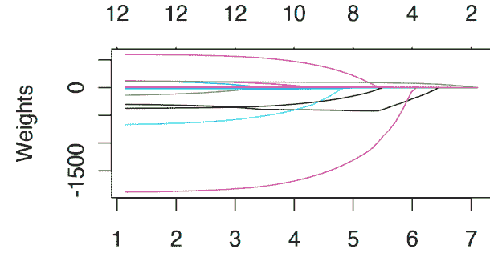

图 4.4：随着权重惩罚的增加，越来越少的特征获得非零权重估计。这些曲线也称为正则化路径。图上方的数字是非零特征的数量

| | Weight |

|---|---|

| seasonINTER | |

| SPRING | |

| SUMMER | |

| FALL | |

| HOLIDAY | |

| workingDAY | |

| weathersISTY | |

| itRAIN/SNOW/STORM | |

| temp | |

| hum | |

| windspeed | |

| days_since_2011 | |

| | Weight |

|---|---|

| seasonINTER | |

| SPRING | |

| SUMMER | |

| FALL | |

| HOLIDAY | |

| workingDAY | |

| weathersISTY | |

| itRAIN/SNOW/STORM | |

| temp | |

| hum | |

| windspeed | |

| days_since_2011 | |

| | Weight |

|---|---|

| seasonINTER | |

| SPRING | |

| SUMMER | |

| FALL | |

| HOLIDAY | |

| workingDAY | |

| weathersISTY | |

| itRAIN/SNOW/STORM | |

| temp | |

| hum | |

| windspeed | |

| days_since_2011 | |

| | Weight |

|---|---|

| seasonINTER | |

| SPRING | |

| SUMMER | |

| FALL | |

| HOLIDAY | |

| workingDAY | |

| weathersISTY | |

| itRAIN/SNOW/STORM | |

| temp | |

| hum | |

| windspeed | |

| days_since_2011 | |

## 4.2 逻辑回归

逻辑回归对具有两种可能结果的分类问题进行概率建模。它是线性回归模型在分类问题上的扩展。

### 4.2.1 为什么线性回归用于分类有问题？

线性回归模型在回归任务中表现良好，但在分类任务中会失败。为什么呢？在两个类别的情况下，你可以将其中一类标记为0，另一类标记为1，并使用线性回归。从技术上讲，它是可行的，而且大多数线性模型程序都会为你输出权重。但这种方法存在几个问题：

线性模型并不输出概率，而是将类别视为数字（0 和 1），并拟合一个最佳超平面（对于单个特征，它是一直线），使得点与超平面之间的距离最小化。因此，它简单地是在点之间进行插值，你无法将其解释为概率。

线性模型还会进行外推，并给你小于0或大于1的值。这是一个良好的信号，说明可能存在更智能的分类方法。

由于预测结果不是概率，而是点之间的插值，因此没有一个有意义的阈值可以区分一类和另一类。[Stackoverflow¹](https://stackoverflow.com) 上给出了这一问题的很好的说明。

线性模型无法扩展到多个类别的分类问题。你必须开始将下一个类别标记为 2、3 等。类别之间可能没有任何有意义的顺序，但线性模型会强制对特征与类别预测之间的关系施加一种奇怪的结构。正权重特征的数值越高，它对编号较高类别预测的贡献就越大，即使恰好获得相似编号的类别并不比其他类别更。

### 4.2.2 理论

分类的解决方案是逻辑回归。逻辑回归模型不是拟合直线或超平面，而是使用逻辑函数将线性方程的输出压缩在 0 和 1 之间。逻辑函数的定义为：

```
logistic(\eta) = \frac{1}{1 + \exp(-\eta)}
```

它看起来像这样：

> ⁴https://stats.stackexchange.com/questions/22381/why-not-approach-classification-through-regression

## 4.2 逻辑回归

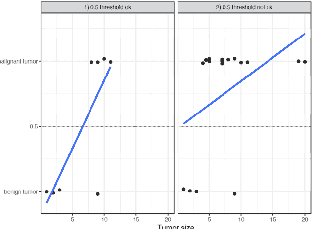

图 4.5：线性模型根据尺寸将肿瘤分类为恶性 (1) 或良性 (0)。线条显示了线性模型的预测结果。对于左侧的数据，我们可以使用 0.5 作为分类阈值。在引入更多几个恶性肿瘤病例后，回归线发生了偏移，0.5 的阈值不再能区分类别。点经过轻微抖动以减少重叠。

从线性回归到逻辑回归的步骤是相当直接的。在线回归模型中，我们用线性方程对结果与特征之间的关系建模：

$$\hat{y}^{(i)} = \beta_0 + \beta_1 x_1^{(i)} + \dots + \beta_p x_p^{(i)}$$

对于分类，我们更倾向于 0 到 1 之间的概率，因此我们将方程的右侧封装到逻辑函数中。这强制输出只取 0 到 1 之间的值。

$P(y^{(i)} = 1) = \frac{1}{1 + exp(-(\beta_0 + \beta_1 x_1^{(i)} + \dots + \beta_p x_p^{(i)}))}$

让我们再次回到肿瘤尺寸的例子。但我们不再使用线性回归模型，而是使用逻辑回归模型：

逻辑回归分类效果更好，我们在两种情况下都可以使用 0.5 作为阈值。额外点的加入并没有真正影响估计的曲线。

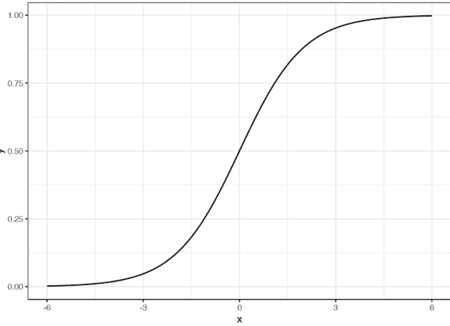

图 4.6：逻辑函数。它输出 0 到 1 之间的数字。在输入 0 时，它输出 0.5。

### 4.2.3 解释

逻辑回归中权重的解释与线性回归中权重的解释不同，因为逻辑回归的结果是 0 到 1 之间的概率。权重不再线性地影响概率。加权和通过逻辑函数转换为概率。因此，我们需要重新制定公式以便解释，使得线性项位于公式的右侧。


```
$\ln\left(\frac{P(y=1)}{1-P(y=1)}\right) = log\left(\frac{P(y=1)}{P(y=0)}\right) = \beta_0 + \beta_1x_1 + \dots + \beta_px_p$
```

我们将 `$ln()`` 函数中的项称为“优势”`odds`，事件发生的概率除以事件不发生的概率，对数封装后的称为对数优势`log odds`。

这个公式表明逻辑回归模型是对对数优势的线性模型。太好了！这听起来没用！通过对项进行简单的调换，你可以看出当一个特征 `$x_j$` 改变 1 个单位时预测是如何变化的。要做到这一点，我们可以对方程的两边应用 `exp()` 函数：

```
$\frac{P(y=1)}{1-P(y=1)} = odds = exp(\beta_0 + \beta_1x_1 + \dots + \beta_px_p)$
```

# 第 4 章 可解释模型

## 4.3 GLM、GAM 及其他

线性回归模型最大的优点也是其弱点在于，它的预测值被建模为特征的加权和。此外，线性模型还包含许多其他假设。坏消息是（嗯，其实并不是什么新消息）所有这些假设在现实中往往会被违反：结果与特征之间可能存在相互作用，且特征与结果之间的关系是非线性的。好消息是，统计学界有多种改进方法，可以将线性回归模型从一把简单的刀刃转变为瑞士军刀。

本章绝对不是教你扩展线性模型的指南。相反，它作为广义线性模型`GLMs`和广义加性模型`GAMs`等扩展方法的概述，并为你提供一些直觉感受。阅读完之后，你应该对如何扩展线性模型有一个稳固的认识。如果你想学习更多关于线性回归模型，我建议你阅读线性回归模型的章节（如果你还没有的话）。

让我们回顾线性回归模型的公式：

> `$y = \beta_0 + \beta_1 x_1 + ... + \beta_p x_p + \epsilon$`

线性回归模型假设实例的结果可以用其 `p` 个特征的加权和来表示，其个体误差 `$\epsilon$` 服从高斯分布。通过强迫数据拟合这种公式，我们获得了大量的模型可解释性。特征是相加的，意味着没有相互作用，且关系是线性的，这意味着特征每增加一个单位，可以直接转化为预测结果的增加或减少。线性模型允许特征与与结果之间的关系压缩成一个数字，即估计权重。

但对于许多现实世界的预测问题，简单的加权和就太具局限了。在本章中，我们将学习经典线性回归模型的三个问题以及如何解决它们。还有许多其他可能违反假设的问题，但我们重点关注下图中所示的三个问题：

对于所有这些问题都有解决方案：

**问题：** 在给定特征的情况下，目标结果不服从高斯分布`Outcome does not follow a Gaussian distribution`。

**示例：** 假设我想预测某天我要骑多久分钟自行车。特征的类型如天气等。如果我使用线性模型，它可能会预测出负数分钟，因为它假设了高斯分布，而该分布不会在 0 分处停止。此外，如果我想用线性模型预测概率，我可能会得到负数或大于 1 的概率。

**解决方案：** 广义线性模型`GLMs`。

**问题：** 特征之间存在相互作用`Features interact`。

**示例：** 平均而言，小雨对我骑车的意愿有负面影响。但在夏季高峰期，我欢迎下雨，因为所有天气好的骑行者都留在了家里，我可以独享自行车道！这是时间和天气之间的相互作用，纯加性模型无法捕捉这一点。

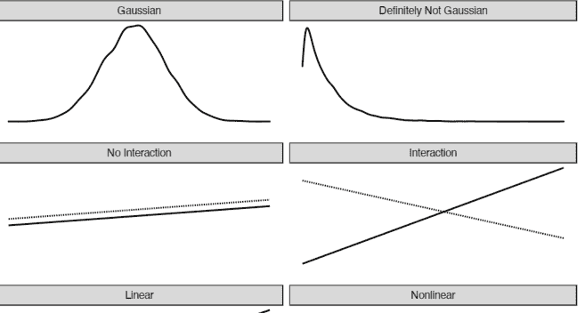

图 4.8：线性模型的三个假设（左侧）：给定特征的情况下的结果服从高斯分布、可加性（即无相互作用）和线性关系。现实通常不符合这些假设（右侧）：结果可能具有非高斯分布，特征之间存在相互作用，且关系是非线性的。

**解决方案：** 手动添加交互项。

**问题：** 特征与 `y` 之间的真实关系不是线性的。

**示例：** 在 0 和 25 摄氏度时，温度对我骑车意愿的影响可能是线性的，这意味着从 0 增加到 1 度导致的骑行次数增加与从 20 增加到 21 度相同。但在较高温度下，我的骑行动力会趋平缓甚至下降——天气太热时我不喜欢骑车。

**解决方案：** 广义加性模型`GAMs`：特征转换。

这三个问题的解决方案在本章中给出。线性模型的更多扩展将在此省略。如果你已经了解了这些，可以跳过。如果你想了解更多，可以在这里找到。关于给定特征的结果服从从类型的分布。

### 4.3.1 非高斯结果 - GLMs

`GLM` 假设给定特征的情况下的结果服从高斯分布。线性模型可以扩展到其他情况：二项分布`binomial`、泊松分布`Poisson`或偏态分布`Gamma`。链接函数 `g` 将期望值与权重和连接起来。对于二项分布，我们使用 `logit`：

$$g(E(y)) = \beta_0 + \beta_1 x_1 + ... + \beta_p x_p$$

`GLM` 由三部分组成：随机分布、链接函数和线性预测器。对于高斯分布，链接函数是恒等函数`identity`。对于泊松分布，它是自然对数。

在某一天，我们可以使用自然对数作为链接函数的 `GLM` 来建模：

$$\ln(E(y|x)) = \beta_0 + \beta_1 x_1 + ... + \beta_p x_p$$

逻辑回归也假设二项分布并使用对数作为链接函数：

$$\ln\left(\frac{P(y=1|x)}{1-P(y=1|x)}\right) = \beta_0 + \beta_1 x_1 + ... + \beta_p x_p$$

如果我们解这个方程得到 `P(y=1)`，就会得到逻辑公式：

$$P(y=1) = \frac{1}{1+\exp(-x^T\beta)}$$

指数族中的每个分布都有一个可以通过数学推出的规范链接函数。`GLM` 框架允许独立选择链接函数。如何选择正确的链接函数？没有完美的配方。你需要考虑目标分布的知识、理论考量以及模型与数据的拟合程度。对于某些分布，规范链接函数可以产生该分布的理想值。在指数分布的情况下，规范链接函数是负倒，这可能会导致超出指数分布域的负预测。由于你可以选择任何链接函数，简单的解决方案是选择另一个尊重分布的函数。

# 示例

我模拟了一个关于喝咖啡的数据集来突出 `GLM` 的必要性。你收集了关于每天喝咖啡行为的数据。如果你不喝咖啡，喝的是茶。除了杯数外，你还记录了当前的压力水平`1`到`10`分、之前的睡眠质量`1`到`10`分以及当天是否需要工作。目标是根据睡眠和工作特征预测咖啡的杯数。我模拟了 `200` 天的数据。压力和睡眠在 `1` 到 `10` 之间均匀分布，对于每一天，咖啡的数量是从泊松分布中抽取的，将强度 `$\lambda$` 建模为睡眠、压力和工作特征的函数。你可以猜这个故事会告诉我们什么：“嘿，让我们用线性模型对这些数据建模…… 噢，它不通……让我们试试带泊松分布的 `GLM`…… 惊喜！现在行了！”我希望我没有太早地剧透故事。

让我们看看目标变量的分布，即某天咖啡的数量：

## 第 4 章 可解释性模型

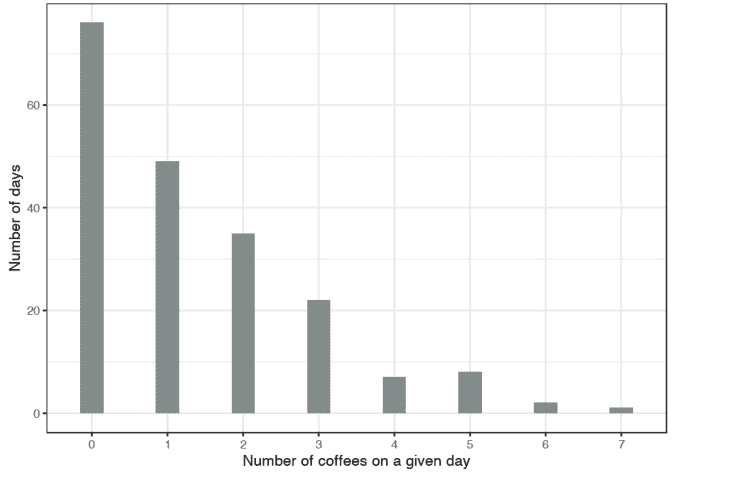

在 `200` 天中，有 `76` 天你完全没有喝咖啡，而在极端的一天你喝了 `7` 杯。让我们天真地使用线性模型，以睡眠水平、压力水平和工作`是/否`作为特征来预测咖啡数量。当我们错误地假设从高斯分布时，会发生什么问题？

错误的假设会使估计失效，特别是权重的置信区间。更明显的问题是，预测值不符合真实结果的“允许”定义域，如下所示。

线性模型是没有意义的，因为它预测了负数的咖啡数量。这个问题可以通过广义线性模型`GLMs`来解决。我们可以更改链接函数和假设的分布。一种可能性是保留高斯分布，并使用一个始终产生正数预测的链接函数（例如 `log` 链接，其逆是 `exp` 函数），而不是恒等函数。更好的是：我们选择与生成过程对应的分布和适当的链接函数。由于结果是计数，泊松分布是一个自然选择，同时将对数作为链接函数。在这种情况下，数据甚至是用泊松分布生成的，因此泊松 `GLM` 是完美的选择。拟合的泊松 `GLM` 导致如下预测值的分布：

没有负数，现在看起来好多了。

## GLM 权重解释

假设的分布结合链接函数决定了如何解释估计的特征权重。在咖啡计数示例中，我使用了带有泊松分布和对数链接的 `GLM`，这意味着预期结果与特征`str, sleep`以及工作`wrk`之间存在以下关系：

```
$ln(E(coffee|str, slp, wrk)) = \beta_0 + \beta_{str}x_{str} + \beta_{slp}x_{slp} + \beta_{wrk}x_{wrk}$
```

为了解释权重，我们反转链接函数，这样就可以解释特征对预期结果的影响，而不是预期结果的对数。

```
$E(coffee|str, slp, wrk) = exp(\beta_0 + \beta_{str}x_{str} + \beta_{slp}x_{slp} + \beta_{wrk}x_{wrk})$
```

由于所有权重都在指数中，因此影响解释不是加性的，而是乘性的，`exp(a+b) = exp(a) \times exp(b)`。解释结果是该玩具示例的实际权重。下表列出了估计的权重和 `exp(weights)` 以及 `95%` 置信区间：

压力水平每增加一级，预期咖啡数量乘以因子 `1.12`。睡眠质量每提高一点，预期咖啡数量乘以因子 `0.86`。某某日的预测咖啡数量是咖啡数量的 `2.23` 倍。

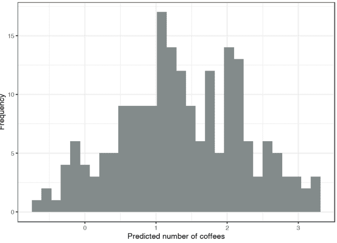

图 4.10：依赖于压力、睡眠和工作的预测咖啡数量。线性模型预测了负值。

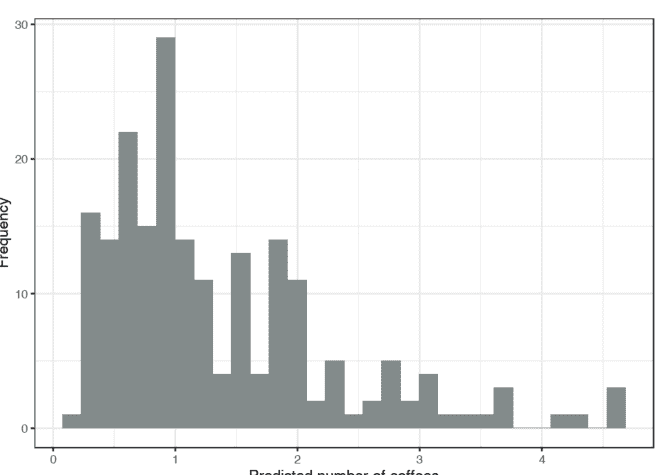

图 4.11：依赖于压力、睡眠和工作的预测咖啡数量。带有泊松假设和对数链接的 `GLM` 是该数据集的合适模型。

表 4.4：泊松模型中的权重

| weight | exp(weight) [2.5%, 97.5% ] |
|---|---|
| (Intercept) | -0.16 | 0.85 [0.54, 1.32] |
| stress | 0.12 | 1.12 [1.07, 1.18] |
| sleep | -0.15 | 0.86 [0.82, 0.90] |
| workYES | 0.80 | 2.23 [1.72, 2.93] |

### 4.3.2 交互作用

线性模型假设一个特征的影响与其他特征相互独立的。但通常，一个特征的影响取决于另一个特征的水平。为了捕捉这一点，我们在线性模型中添加交互项。我们如何让线性模型包含交互作用呢？如果我们想考虑类别特征和数值特征之间的交互作用，我们将添加一列。假设我们的数据如下：

| Intercept | workY | temp | workY.temp |
|---|---|---|---|
| 1 | 1 | 25 | 25 |
| 1 | 0 | 12 | 0 |
| 1 | 0 | 30 | 0 |
| 1 | 1 | 5 | 5 |

第一列用于估计截距。第二列是编码的工作特征。第三列和第四列用于天气特征，它需要两列，因为你需要捕捉三个类别的影响，其中一个是参考类别。其余列捕捉了交互作用。两个类别特征之间的交互作用原理也类似。我们创建代表类别组合的额外特征。对于两个特征的每个类别（参考类别除外），我们创建一个新特征，如果两个特征具有特定类别，则标记为 `1`，否则为 `0`。

对于两个数值特征，交互列的构建更加简单：我们只需要将两个数值特征相乘。

有自动检测并添加交互项的方法。其中一种可以在 `RuleFit` 章节找到。`RuleFit` 算法挖掘交互项，然后估计一个包含交互作用的线性模型。

## 示例

让我们回到已经在线性模型章节中建模的自行车租赁预测任务。这次，我们额外考虑了温度和工作日特征之间的交互作用。这得如下估计的权重和置信区间。

| 权重 | 标准差 | 2.5% | 97.5% |
|---|---|---|---|
| (截距) | 2185.8 | 250.2 | 1694.6 | 2677.1 |
| 季节春SPRING | 893.8 | 121.8 | 654.7 | 1132.9 |
| 季节夏SUMMER | 137.1 | 161.0 | -179.0 | 453.2 |
| 季节秋FALL | 426.5 | 110.3 | 209.9 | 643.2 |
| 假日HOLIDAY | -674.4 | 202.5 | -1071.9 | -276.6 |
| 工作日DAYWORKING | 451.9 | 141.7 | 173.7 | 730.1 |
| 天气雾MIST | -382.1 | 87.2 | -553.3 | -211.0 |
| 天气雨RAIN/...... | -1898.2 | 222.7 | -2335.4 | -1461.0 |
| 温度 temp | 125.4 | 8.9 | 108.0 | 142.9 |
| 湿度 hum | -17.5 | 3.2 | -23.7 | -11.3 |
| 风速 windspeed | -42.1 | 6.9 | -55.5 | -28.6 |
| 自2011年起数 | 4.9 | 0.2 | 4.6 | 5.3 |
| 工作日DAYWORKING | -21.8 | 8.1 | -37.7 | -5.9 |
| 天:temp | | | | |

交互作用是有效的` -21.8`，且显著异于零，正如 `95%` 置信区间所示，该区间不包含零。顺便提一下，数据并不是独立同分布`iid`，因为彼此靠近的日期之间是不独立的。置信区间可能具有误导性，请审慎对待。交互项改变了加权特征的解释。如果是工作日，温度是否产生负面影响？答案是否定的，尽管该表格对未经过训练的用户来说似乎是如此。我们不能孤立地解释“workingdayWORKINGDAY:temp”交互权重，因为其解释将是：“在保持所有其他特征值不变的情况下，工作日的交互作用减少了预测的自行车数量。”但交互作用只是在温度的主效应的基础上增加了额外影响。假设今天是工作日，且温度比昨天高了 `1` 度，那么我们需要相加“temp”和“workingdayWORKINGDAY:temp”的两个权重，以确定增加了多少。

通过视觉化理解交互作用更为简单。通过在类别特征和数值特征之间引入交互项，我们得到了温度的两个斜率，而不是一个。人们不需要上班的日子`NO WORKING DAY`的温度斜率；人们必须上班的日子`WORKING DAY`的温度斜率是温度权重的和`125.4 - 21.8 = 103.6`。当温度 = `0` 时，“NO WORKING DAY”直线的截距由线性模型的截距项`2185.8`决定。当温度 = `0` 时，“WORKING DAY”直线的截距由截距项 + 工作日的影响决定`2185.8 + 451.9 = 2637.7`。

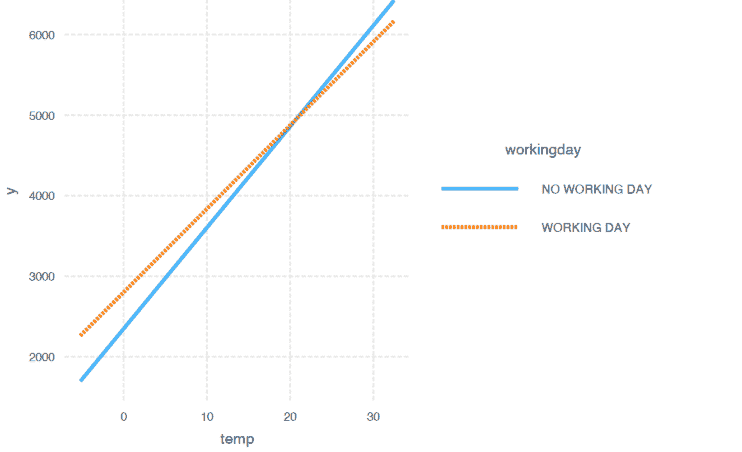

图 4.12：线性模型中温度和工作日（包括交互作用）对预测自行车数量的影响。实际上，对于工作日特征的每个类别，我们得到了两个温度斜率。

### 4.3.3 非线性效应 - GAMs

**世界并不是线性的。** 线性模型中的线性意味着，无论实例在特定特征上的取值是多少，增加一个单位的值对预测结果的影响都是相同的。假设在 `10` 度时增加 `1` 度的影响与从 `40` 度开始增加 `1` 度的影响相同是合理的，正如你将在书中贯穿看到的那样。温度对租赁数量有线性的正影响，但在某些点它会变得平缓，并在高温下产生负面影响。线性模型并没有找到最佳线性平面（通过最小化欧式距离）。你可以使用以下技术之一来建模非线性关系：

- 特征的简单转换（例如对数）
- 特征的分类化
- 广义加性模型 `GAMs`

在详细介绍每种方法之前，让我们先从一个说明了这三种方法的示例开始。我取了自行车租赁数据集，并仅使用温度特征训练了一个线性模型来预测自行车数量。下图显示了估计的斜率：标准线性模型、具有转换后温度`log`的线性模型、将温度视为类别特征并使用样条函数`GAM`的线性模型。


图 4.13：仅使用温度特征预测租赁自行车的数量。线性模型（左上）不能很好地拟合数据。一种解决方案是使用对数等方法转换特征（右上），将其分类（左下，这通常是个坏决定），或者使用可以自动拟合平滑曲线的广义加性模型（右下）。

### 特征转换

通常使用特征的对数作为转换。使用对数意味着每一度的增加对自行车数量的影响与从 `0` 变为 `1` 的影响相同。特征转换的其他示例还有平方根和指数函数。使用特征转换意味着用该特征的函数替换数据中该特征的列，并像通常一样拟合线性模型。某些统计程序还允许在调用线性模型时指定转换。在转换特征时你可以发挥创造力。特征的解释会根据所选的转换而改变。如果你使用对数转换，线性模型中的解释变为：“如果特征的对数增加 `1`，预测值将增加相应的权重。”当你使用连接函数不是恒等函数的 `GLM` 时，解释会变得复杂。

### 特征分类

另一种实现非线性效应的方法是将特征离散化；将其转换为类别特征。例如，将温度分为区间 `[-10, -5], [-5, 0]` 等。使用分类特征代替连续特征时，线性模型会为每个层级进行估计。这种方法的问题是需要更多数据，且不清楚如何有意义地离散化（等距区间还是分位数？）。是否存在非常有力的理由？

### 广义加性模型 `GAMs`

为什么要“简单地”允许线性模型学习非线性关系？这就是 `GAM` 的动机。`GAM` 放宽了关系必须是简单加权和的限制，而是假设输出可以通过每个特征的任意函数进行建模。在数学上，`GAM` 的关系如下：

```
E(y|x) = β_0 + f_1(x1) + f_2(x2) + ... + f_k(xk)
```

与 `GLM` 公式相似，不同在于线性项 `β_jx` 被更灵活的函数 `f_j(x)` 取代。`GAM` 的核心仍然是特征之和，但为了线性处理特征，你可以将将`f_j(x)` 限制为 `x_jβ_j` 的形式。


大问题是如何学习非线性函数。另一种是“样条”或“样条函数”。样条是由更简单的基函数构建的。样条可以近似更复杂的函数。虽然定义这些样条函数的方法令人困惑，但如果你对学习所有定义基函数的方法感兴趣，我祝你旅途顺利。我在这里不会进入细节，只是为了建立直觉。对我理解样条最有帮助的是可视化这些基函数，并查看数据矩阵是如何修改的。例如，为了用样条建模温度，我们从数据中删除温度特征，并将其替换为例如 4 列，每列代表一个样条基。通常你会有更多的样条基函数，我只是为了说明减少了数量。每个实例的这些新样条基的值取决于实例的温度值。结合所有线性效应，`GAM` 还会估计这些样条权重。`GAM` 还引入了针对权重的惩罚项，使其接近零。这有效地减少了样条的灵活性并防止过拟合。通常使用平滑参数来控制曲线的灵活性，然后

## 4.3 GLM、GAM 及更多

| (截距) | `s(temp).1` | `s(temp).2` | `s(temp).3` | `s(temp).4` |
|---|---|---|---|---|
| 1 | 0.93 | -0.14 | 0.21 | -0.83 |
| 1 | 0.83 | -0.27 | 0.27 | -0.72 |
| 1 | 1.32 | 0.71 | -0.39 | -1.63 |
| 1 | 1.32 | 0.70 | -0.38 | -1.61 |
| 1 | 1.29 | 0.58 | -0.26 | -1.47 |
| 1 | 1.32 | 0.68 | -0.36 | -1.59 |

通过交叉验证进行调优。忽略惩罚项，使用样条的非线性建模是一种高级的特征工程。

在我们仅使用温度通过 `GAM` 预测自行车数量的示例中，模型的特征矩阵看起来如下：

每一行代表数据中的一个单独实例（一天）。每一列样条基列包含该样条基函数在特定温度值下的值。下图显示了这些样条基函数的样子：

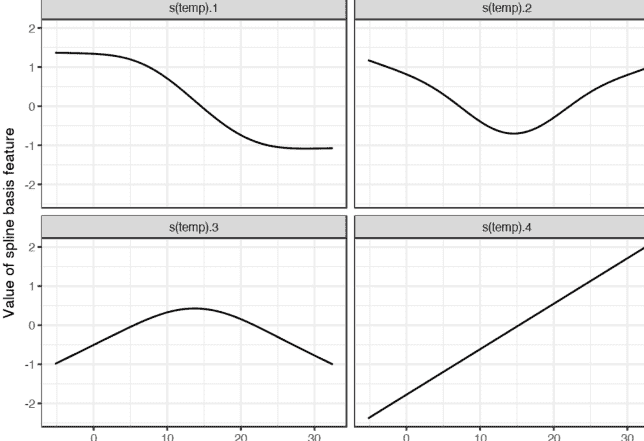

图 4.14：为了平滑地对温度影响，我们使用了 4 个样条基函数。每个温度值都映射到（此处）4 个样条基值。如果一个实例的温度为 30 °C，则第一个样条基特征的值为 -1，第二个为 0.7，第三个为 -0.8，第四个为 1.7。

`GAM` 为每个温度样条基特征分配了权重：

# 第 4 章 可解释模型

|  |  |
|---|---|
| (截距) | 4504.35 |
| `s(temp).1` | -989.34 |
| `s(temp).2` | 740.08 |
| `s(temp).3` | 2309.84 |
| `s(temp).4` | 558.27 |

实际的样条曲线（通过估计权重加权后的样条基函数之和得出）看起来如下：

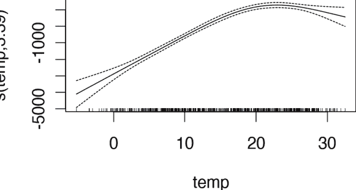

图 4.15：预测租赁自行车数量的温度 `GAM` 特影响（温度作为唯一特征）。

平滑效应的解释需要对拟合曲线进行视觉检查。样条通常围绕平均预测值中心，曲线上的某点与平均预测值之间的差异。例如，在 0 摄氏度时，预测的自行车数量比平均预测值低 3000。

### 4.3.4 优点

线性模型的这些扩展本身就是一个小宇宙。无论你遇到线性模型时的什么问题，你可能都能找到解决它的扩展方法。

## 4.3 GLM、GAM 及更多

大多数方法已经使用了几十年。例如，`GAM` 已经有近 30 年的历史了。许多行业研究人员和从业人员对线性模型非常熟悉，这些方法在许多社区中被视为建模的现状。

除了预测之外，你还可以使用这些模型进行推断，对数据得出结论——前提是没有违反模型假设。你可以获得权重的置信区间、显著性检验、预测区间等更多内容。

统计软件通常具有非常好的接口来拟合 `GLM`、`GAM` 以及更多线性模型。

机器学习模型的不透明性源于：1) 缺乏稀疏性，意味着使用了许多特征；2) 特征以非线性方式处理，这意味着你需要多个权重来描述效应；以及 3) 特征之间的相互作用模型。假设线性模型具有高度的可解释性但往往欠拟合，本章描述的扩展提供了一种向更灵活模型平滑过渡的良好方法，同时保留了部分可解释性。

### 4.3.5 缺点

线性模型的这些扩展本身就是一个小宇宙。无论你遇到线性模型时的什么问题，你可能都能找到解决它的扩展方法。

机器学习模型的不透明性源于：1) 缺乏稀疏性，意味着使用了许多特征；2) 特征以非线性方式处理，这意味着你需要多个权重来描述效应；以及 3) 特征之间的相互作用模型。假设线性模型具有高度的可解释性但往往欠拟合，本章描述的扩展提供了一种向更灵活模型平滑过渡的良好方法，同时保留了部分可解释性。

## 4.4 决策树

在特征与结果之间存在非线性关系或特征之间存在相互作用的情况下，线性回归和逻辑模型会失效。树模型根据特征中的截断值对数据多次划分。通过划分，创建了数据集的不同子集，每个实例属于一个子集。最终子集被称为终端节点或叶节点，中间子集被称为内部节点或分裂节点。为了预测每个叶节点中的结果，使用了该节点训练数据的平均结果。树可以用于分类和回归。

有各种算法可以生长树。它们区别在于树的可能结构（例如每个节点的划分次数）、寻找划分的标准、何时停止划分以及如何估计叶节点内的简单模型。分类与回归树 `CART` 算法可能是树归纳最流行的算法。我们关注 `CART`，但其他树类型的解释也类似。我推荐书籍《统计学习方法要素》(`Friedman, Hastie and Tibshirani 2009`) 来对 `CART` 进行更详细的介绍。

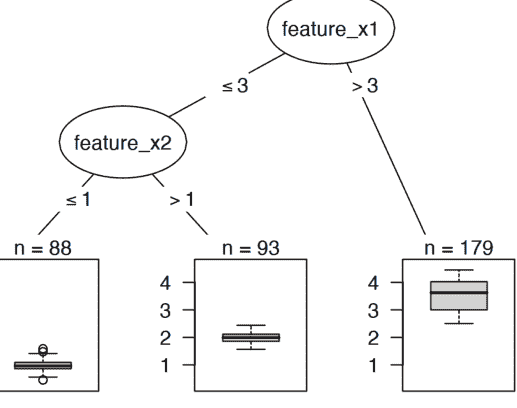

图 4.16：带有人工数据的决策树。特征 `x1` 值大于 3 的实例进入节点 5。所有其他实例根据特征 `x2` 的值是否超过 1 被分配到节点 3 或节点 4。

## 4.4 决策树

以下公式描述了结果 `$y$` 与特征之间的关系。

```
$$\tilde{y} = \hat{f}(x) = \sum_{m=1}^{M} c_m I\{x \in R_m\}$$
```

每个实例恰好落入一个叶节点（`=$R_m$`）。`$I_{\{x \in R_m\}}$` 是标识函数，当 `$x$` 属于子集 `$R_m$` 时返回 1，否则返回 0。如果实例落入叶子节点 `$R_t$`，则预测结果为 `$\tilde{y} = c_t$`，其中 `$c_t$` 是叶子节点 `$R_t$` 中所有实例的平均值。

但这些子集从哪里来？这很简单：`CART` 选取一个特征，并确定哪个截断点使回归任务中 `$y$` 的方差最小，或使分类任务中 `$y$` 类型分布的 Gini 指数最小。方差告诉我们 `$y$` 值偏离其平均值的程度。Gini 指数告诉我们节点有多“不纯”，例如，如果所有类别的频率相同，则节点是不纯的；如果只存在一个类别，则它是完全纯的。当节点中的数据点的 `$y$` 值非常相似时，方差和 Gini 指数达到最小。因此，截断点使得生成的两个子集在目标结果上尽可能不同。对于分类特征，算法通过尝试类别的不同分组来创建子集。在确定了最佳截断特征后，算法会选择在方差或 Gini 指数方面产生最佳划分的特征进行分裂，并将其添加到树中。算法在两个新节点中递归地继续这种搜索和分裂，直到达到停止准则。可能的标准包括：分裂前节点中必须包含的最小实例数，或者终端节点必须包含的最小实例数。

### 4.4.1 解释

解释非常简单：从根节点开始，你进入下一个节点以及正在观察的边。一旦到达叶节点，该节点就会告诉你预测结果。所有的边都通过“与”（AND）连接。

模板：如果特征 `$x$` [小于|大于] 阈值 `$c$` 且 ...，那么预测结果为该节点中实例 `$y$` 的平均值。

### 特征重要性

决策树中特征的整体重要性可以通过以下方式计算：遍历该特征被使用的所有分裂，并衡量与父节点相比它减少了多少方差或 Gini 指数。所有重要性的总和被缩放为 100。这意味着每个重要性可以解释为模型整体重要性的比例。

### 树分解

决策树的单个预测可以通过将决策路径分解为每个特征一个组件来解释。我们可以跟踪树中的决策，并通过每个决策节点添加的贡献来解释预测结果。

决策树中的根节点是我们的起点。如果我们使用根节点进行预测，它将预测训练数据的结果。通过下一次分裂，根据路径中的下一个节点，我们在该和中减去或加上一项。为了获得最终预测，我们必须遵循想要解释的数据实例的路径，并不断向公式中相加。

```
$$\hat{f}(x) = \hat{y} + \sum_{d=1}^{D} \text{split.contrib}(d,x) = \hat{y} + \sum_{j=1}^{p} \text{feat.contrib}(j,x)$$
```

实例的预测是目标结果的平均值，加上从根节点到实例结束所在的终端节点发生的所有分裂的贡献和。然而，我们对分裂本身感兴趣，而是特征贡献。一个特征可能被用于一次分裂，也完全不使用。我们可以加上 `$p$` 个特征中每个特征的贡献，得到每个特征对预测贡献了多少的解释。

### 4.4.2 示例

让我们再次看看自行车租赁数据。我们想用决策树预测某天租赁的自行车数量。学习到的树如下：

第一次分裂和第二次分裂之一是使用趋势特征执行的，该特征计算自数据收集开始以来的天数，涵盖了自行车租赁服务随着时间推移变得越来越流行的趋势。对于第 105 天之前的日子，预测的自行车数量约为 1800；在第 106 天到第 430 天之间约为 3900。对于第 430 天之后的日子，预测结果为 4600（如果温度低于 12 度）或 6600（如果温度为 12 度）。

特征重要性告诉我们特征在多大程度上帮助提高了所有节点的纯度。在这里，使用了方差，因为预测自行车租赁是一个回归任务。

可视化的树显示温度和时间趋势都被用于分裂，但没有量化哪个特征更重要。特征重要性衡量显示，时间趋势比温度重要得多。

### 4.4.3 优点

树结构对于捕捉数据中特征之间的交互作用非常理想。

## 4.4 决策树

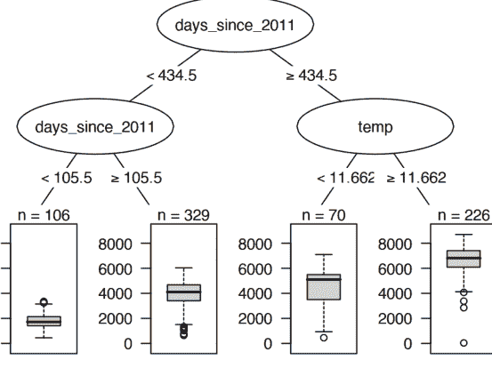

图 4.17：拟合在自行车租赁数据的回归树。树允许的最大深度设置为 2。趋势特征（自 2011 年以来的天数）和温度（`temp`）被选择用于分裂。箱线显示了终端节点中自行车数量的分布。

数据最终落入不同的组中，这些组通常比线性回归中多维超平面上的点更容易理解。这种解释可以说是非常简单。

树结构还有天然的可视化方式，即其节点和边。

正如“人类友好型解释”章节中所定义的，树创建了极佳的解释。树结构会自动引导人们将单个实例的预测值视为反事实的：“如果某个特征变得大于/小于分裂点，预测结果将是 `$y1$` 而不是 `$y2$`。”树的解释是对比性的，你始终可以将实例的预测与相关的“如果”场景（由树定义）进行比较，这些场景仅仅是树的其他叶节点。如果树很短，深度为三，则最多三个特征和分裂点就可以创建对单个实例预测的解释。预测的真实性取决于树的预测性能。短树的解释非常简单且通用，因为对于每次分裂，实例都会落入其中一个，而二分类决策是容易理解的。

不需要转换特征。在线性模型中，有时需要对特征取对数。决策树对任何单调变换都同样良好。

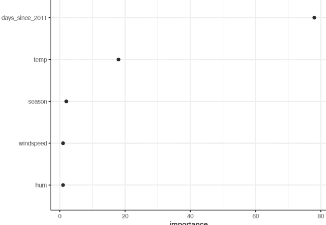

图 4.18：通过特征在平均范围内对节点纯度提升的程度来衡量的特征重要性。

### 4.4.4 缺点

树无法处理线性关系。输入特征与结果之间的任何线性关系都通过分裂来近似，从而创建一个阶跃函数。这是低效的。

这与缺乏平滑性并存存在。输入特征的细微变化可能会对预测结果产生巨大影响，这通常不是理想的。想象一棵预测房屋价值的树，它使用房屋面积作为一个分裂特征。分裂发生在 100.5 平方米。想象一个使用你的决策树模型的房价估算师：他们测量了房屋，得出结论房屋有 99 平方米，将其输入价格计算器并产生 200,000 欧元的预测。用户注意到他们忘记测量一个 2 平方米的小储藏室。储藏室有一个倾斜的墙壁，所以他们不确定可以使用全部面积还是只有一半。他们决定尝试 100.0 平方米和 101.0 平方米。价格计算器输出 200,000 欧元和 205,000 欧元，这相当不直观，因为从 99 平方米到 100 平方米并没有变化。

树也相当不稳定。训练数据中的细微变化就可以创建一个完全不同的树。这是因为每次分裂都依赖于父分裂。如果一个不同的

## 4.4 决策树

当某个特征被选为第一个划分特征时，整个树结构都会发生变化。如果结构如此容易改变，就无法对模型产生信心。

决策树具有很强的解释性——只要它们足够短。**终端节点的数量随着深度的增加而迅速增加。** 终端节点越多、树越深，理解决策规则就越困难。深度为 1 意味着最多 4 个节点；深度为 3 意味着最多 8 个节点。树中终端节点的最大数量是深度的幂。

### 4.4.5 软件

对于本章中的示例，我使用了 **`rpart`** 包，它实现了 `CART`（分类与回归树）。`CART` 在许多编程语言中都有实现，包括 Python。可以说，`CART` 是一个相当老旧且有些过时的算法，目前已经有一些有趣的新算法用于拟合树。你可以在 CRAN 的 Machine Learning and Statistical Learning Task View 中通过“递归划分”（Recursive Partitioning）关键词找到一些用于决策树的 R 包概述。

https://scikit-learn.org/stable/modules/tree.html

https://cran.r-project.org/web/views/MachineLearning.html

## 第 4 章 可解释模型

## 4.5 决策规则

决策规则是一个简单的 IF-THEN 语句，由一个条件（也称为前件）和一个预测组成。例如：如果今天下雨且如果现在是四月（条件），那么明天会下雨（预测）。单个决策规则或多个规则的组合可以用于预测。

决策规则遵循通用结构：如果满足条件，则做出特定的预测。决策规则可能是解释性最好的预测模型。它们的 IF-THEN 结构在语义上类似于自然语言和我们的思维方式，只要条件是由易于理解的特征构建的，且条件的长度较短（少量的特征-值对组合并通过 AND 连接），它们就是解释的。在编程中，编写 IF-THEN 规则是非常自然的。机器学习中的新方法是通过算法学习决策规则。

想象使用算法来学习房屋的价值（低、中、高）。例如：如果房子大于 100 平米且有花园，那么价值为高。让我们拆解决策规则：

- 面积大于 100 是第一个条件。
- 有花园是第二个条件。
- 两个条件通过“AND”连接，必须同时为真规则才生效。
- 预测结果（THEN-部分）是价值为高。

决策规则使用至少一个特征作为条件语句，并带有“AND”限制。一个例外是默认规则，它在其他规则都不适用时生效，稍后会介绍。

决策规则的用处通常用两个数字总结：支持率（Support）和准确率（Accuracy）。

支持率或规则的覆盖范围：适用于规则条件的实例百分比称为支持率。例如，假设 1000 栋房屋中面积大且位置好的房屋支持率为 10%。预测（THEN-部分）对支持率的计算并不重要。

准确率或规则的置信度：规则在适用的实例中预测正确类别的准确程度。例如，假设 1000 栋房屋中面积大且位置好的房屋价值为高、价值为中或价值为低，该规则的准确率为 85%。

## 4.5 决策规则

通常准确率和支持率之间存在权衡：通过向条件中添加更多特征，我们可以获得更高的准确率，但会失去支持率。

为了创建一个预测房屋价值的良好分类器，你可能需要学习不仅仅是一个规则，而是多个。这时情况可能会变得复杂，你会遇到以下问题：

- 规则可能重叠：如果我想预测房屋价值，但两个或多个规则适用并给出了矛盾的预测怎么办？
- 没有规则适用：如果我想预测房屋价值，但没有任何规则适用怎么办？

组合多个规则有两种主要策略：决策列表（有序）和决策集（无序）。这两种策略都为规则重叠问题提供了解决方案。

决策列表为决策规则引入了顺序。如果第一个规则的条件为真，否则进入下一个规则并检查其是否适用，依此类推。决策列表通过只返回第一个适用规则预测来解决规则重叠问题。

决策集代表规则的民主化，其中某些规则可能有更高的投票权重。在集合中的规则要么是互斥的，要么有一种冲突解决策略（如根据规则准确率或其他指标进行加权）。当多个规则适用时，解释性可能会受到影响。

决策列表和集合面临没有规则适用于实例的问题。这可以通过引入默认规则来解决。默认规则是在其他规则都不适用时生效的规则。默认规则的预测通常是未被其他规则覆盖的数据点中最频繁的类别。如果规则集合或列表覆盖了整个特征空间，我们称之为详尽的（exhaustive）。通过添加默认规则，集合或列表会自动变为详尽的。

从数据学习规则的方法有很多，本书远未涵盖所有方法。本章展示了其中三种。选择这些算法是为了涵盖广泛的规则学习思想，这三者代表了非常不同的方法。

- `OneR` 从单个特征学习。`OneR` 的特点是简单性、可解释性以及作为基准的使用。
- 顺序覆盖是一种通用程序，迭代学习规则并移除被新规则覆盖的数据点。该程序被许多规则学习算法使用。
- 贝叶斯规则列表使用贝叶斯统计将预挖掘的频繁模式转换为决策列表。挖掘挖掘是许多规则学习算法常用的方法。

让我们从简单的方法开始：使用单个最佳特征学习规则。

## 第 4 章 可解释模型

### 4.5.1 从单个特征学习规则 (OneR)

`Holte`（1993）提出的 `OneR` 算法是最简单的规则引导之一。尽管 `OneR` 代表“一条规则”，但它生成了多个规则：它选择了包含信息最多的特征。

该算法简单且快速：

1. 通过选择合适的区间对连续特征进行离散化。
2. 对于每个特征：
   - 创建特征与结果之间的交叉表。
   - 对于特征的每个值，创建一个规则，预测具有该特征值的实例中最频繁的类别。
   - 计算规则的总误差。
3. 选择误差最小的特征。

`OneR` 总是覆盖数据集中的所有实例，因为它使用了特征的所有层级。缺失值可以被视为额外的特征值，或者在之前进行插补。

`OneR` 模型是一个只有一个划分的决策树。划分并不一定像 `CART` 那样是二分的，而是取决于唯一特征的数量。让我们来看 `OneR` 如何选择最佳特征的示例。下表显示了一个关于房屋的人工数据集，包含价值、位置、大小以及是否允许宠物的信息。我们感兴趣学习一个简单的模型来预测房屋价值。

`OneR` 创建每个特征与结果之间的交叉表：


对于每个特征，按行遍历表格：每个特征都是规则的 IF-部分；具有该特征值的实例中最常见的类别是预测值，即规则的 THEN-部分。例如，尺寸特征具有小、中、大三个水平，产生了三条规则。在这里我们计算生成规则的总误差，即误差之和。位置特征有两个可能的值：坏和好。坏位置的房屋最频繁的值是低，我们使用低作为预测，我们犯了两次错误，因为两栋房屋价值是中。好位置的房屋预测价值为高，我们犯了两次错误，因为两栋房屋价值是中。使用位置特征所犯的误差是 `4/10`，尺寸特征为 `3/10`，宠物特征为 `4/10`。

## 4.5 决策规则

| 位置 | 大小 | 宠物 | 价值 |
| --- | --- | --- | --- |
| 好 | 小 | 是 | 高 |
| 好 | 大 | 否 | 高 |
| 好 | 大 | 否 | 高 |
|  | 中 | 否 | 中 |
| 好 | 中 | 只有猫 | 中 |
| 好 | 小 | 只有猫 | 中 |
|  | 中 | 是 | 中 |
|  | 小 | 是 | 低 |
|  | 中 | 是 | 低 |
|  | 小 | 否 | 低 |

| 位置=坏 | 价值=中 | 价值=高 |
| --- | --- | --- |
| 位置=好 | 3 | 2 | 0 |

`IF size=small THEN value=low`

`IF size=medium THEN value=medium`

`IF size=big THEN value=high`

`OneR` 偏于选择具有许多可能层级的特征，因为这些特征更容易过拟合目标。想象一个只包含噪声而没有信号的数据集，这意味着所有特征都取随机值，且对目标没有预测价值。某些特征的层级比其他特征多。这些层级较多的特征现在很容易过拟合。如果一个特征对数据中的每个实例都有独立的层级，它就能完美地预测整个数据集。解决方案是将数据分为训练集和验证集，在训练数据上学习规则，并在验证集上评估选择该特征的总误差。

平局是另一个问题，即两个特征导致相同的总误差。`OneR` 通过选取错误率最低的第一个特征，或者选取卡方检验 p 值最低的特征来解决平局。

### 示例

让我们使用真实数据运行 `OneR`。我们使用宫颈分类任务来测试 `OneR` 算法。所有的连续输入特征都被离散化为它们的 5 分位数。创建了如下规则：

| 价值=低 | 价值=中 | 价值=高 |
| --- | --- | --- |
| 大小=大 | 0 | 0 | 2 |
| 大小=中 | 1 | 3 | 0 |
| 大小=小 | 2 | 1 | 1 |

| 价值=低 | 价值=中 | 价值=高 |
| --- | --- | --- |
| 宠物=否 | 1 | 1 | 2 |
| 宠物=只有猫 | 0 | 2 | 0 |
| 宠物=是 | 2 | 1 | 1 |

| 年龄 | 预测 |
| --- | --- |
| (12.9,27.2] | 健康 |
| (27.2,41.4] | 健康 |
| (41.4,55.6] | 健康 |
| (55.6,66.9] | 健康 |
| (69.8,84.1] | 健康 |

年龄特征被 `OneR` 选择为最佳预测特征。由于癌症比较罕见，对于每条规则，多数类以及因此预测的标签始终是“健康”，这并没有太大帮助。在不平衡的情况下使用标签是没有意义的。“年龄”区间与“癌症/健康”之间的交叉表，结合患癌女性的百分比更具信息量：

但在开始解释之前：由于每个特征和值的预测结果都是“健康”，所有特征的总误差率都是相同的。总误差中的平局默认使用错误率最低的特征中的第一个（在此处，所有特征均为 `55/85`），这恰好是年龄特征。

`OneR` 不支持回归任务。但我们可以通过将连续输出切割成区间，将回归任务转换为分类任务。我们用此来预测租赁自行车数量的四个四分位数（`0-25%`，`25-50%`，`50-75%` 和 `75-100%`）。下表显示了拟合 One 模型后选择的特征：

选择的特征是月份。月份特征有（惊喜！）`12` 个特征层级，比大多数其他特征都要多。存在过拟合的危险。乐观的一是：月份特征可以处理季节性趋势（例如冬季租赁自行车较少），且预测看起来是合理的。

现在我们从简单的 `OneR` 算法转向使用具有更复杂条件的规则的顺序覆盖（Sequential Covering）：

| # | 健康数 | P(癌症) |
| --- | --- | --- |
| 年龄=(12.9,27.2] | 26 | 477 | 0.05 |
| 年龄=(27.2,41.4] | 25 | 290 | 0.08 |
| 年龄=(41.4,55.6] | 4 | 31 | 0.11 |
| 年龄=(55.6,69.9] | 0 | 1 | 0.00 |
| 年龄=(69.8,84.1] | 0 | 4 | 0.00 |

| 月份 | 预测 |
| --- | --- |
| JAN | [22,3152] |
| FEB | [22,3152] |
| MAR | [22,3152] |
| APR | (3152,4548) |
| MAY | (5956,8714) |
| JUN | (4548,5956) |
| JUL | (5956,8714) |
| AUG | (5956,8714) |
| SEP | (5956,8714) |
| OCT | (5956,8714) |
| NOV | (3152,4548) |
| DEC | [22,3152] |

#### 4.5.2 顺序覆盖

顺序覆盖是一种通用过程，通过反复学习单个规则来创建一个决策列表（或集合），通过这些规则覆盖整个数据集。许多规则学习算法都是顺序覆盖算法的变体。本章介绍了主要的配方，并使用 `RIPPER`（顺序覆盖的一种变体）作为示例。

该思想很简单：首先，找到一个适用于某些数据点的良好规则。移除所有被规则覆盖的数据点。只要条件适用，无论点是否被正确分类，都视为被覆盖。对剩余点重复执行学习规则和移除被覆盖点的操作，直到没有剩余点或满足停止条件。结果是一个决策列表。这种方法是分治法：

- 从空列表开始。
- 当存在未被覆盖的数据点时：
    - 在剩余点上学习规则。
    - 将规则添加到列表中。
    - 移除被覆盖的点。
- 返回列表。

# 第 4 章 可解释模型

`rules`

`(temp >= 16) and (days_since_2011 <= 437) and (weathersit = GOOD) and (temp < 24) and (days_since_2011 >= 131) => cnt=[4548,5956]`

`(temp <= 13) and (days_since_2011 <= 111) => cnt=[223152]`

`(temp < 4) and (workingday = NO WORKING DAY) => cnt=[223152]`

`(season = WINTER) and (days_since_2011 <= 368) => cnt=[223152]`

`(hum >= 72) and (windspeed >= 16) and (days_since_2011 >= 381) and (temp < 17) => cnt=[223152]`

`(temp < 6) and (weathersit = MISTY) => cnt=[223152]`

`(hum >= 91) => cnt=[223152]`

`(mnth = NOV) and (days_since_2011 >= 327) => cnt=[223152]`

`(days_since_2011 >= 438) and (weathersit = GOOD) and (hum >= 51) => cnt=[5956,8714]`

`(days_since_2011 >= 441) and (hum <= 73) and (temp > 15) => cnt=[5956,8714]`

`(days_since_2011 >= 441) and (windspeed <= 10) => cnt=[5956,8714]`

`(days_since_2011 >= 455) and (hum <= 40) => cnt=[5956,8714]`

`=> cnt=[3152,4548]`

其解释非常简单：如果条件成立，我们预测右侧的自行车数量区间。最后一条规则是默认规则，当其他规则都不适用于某个实例时，该规则适用。要预测一个新实例，从列表顶部开始检查规则是否适用。当条件匹配时，规则的右侧即为该实例的预测值。默认规则确保了始终会有预测结果。

#### 4.5.3 贝叶斯规则列表 (Bayesian Rule Lists)

在本节中，我将向你展示另一种学习决策列表的方法，它遵循以下大致配方：

- 1. 从数据中预挖掘频繁模式，这些模式可以作为决策规则的条件。
- 2. 从选定的预挖掘规则中学习一个决策列表。

## 4.5 决策规则

使用这种配方的一种特定方法称为贝叶斯规则列表（Letham et al., 2015）¹²，简称为 `BRL`。`BRL` 使用贝叶斯统计学，通过 `FP-tree` 算法（Borg 2005）¹³预挖掘的频繁模式中学习决策列表。

但让我们从 `BRL` 的第一步开始缓慢地进行。

# 频繁模式的预挖掘

频繁模式是特征值的（共）出现。作为 `BRL` 算法的预处理步骤，我们使用特征（此处不需要目标结果）并从中提取频繁出现的模式。模式可以是一个单个特征值，如 `size=medium`，也可以是特征值的组合，如 `size=medium AND location=bad`。

模式的频率通过其在数据集中的支持度（support）来衡量：

```
$Support(x_j = A) = \frac{1}{n}\sum_{i=1}^{n}I(x_i = A)$
```

其中 `A` 是特征值，`n` 是数据中的点数量，指示函数在实例的特征 `$x_i$` 级别为 `$A$` 时返回 1，否则返回 0。在一个房屋数据集中，如果 20% 的房子没有阳台，80% 的房子有一个或多个阳台，那么模式 `balcony=0` 的支持度为 20%。支持度也可以用于特征值组合的测量，例如 `balcony=0 AND pets=allowed`。

有很多算法可以寻找频繁模式，例如 `Apriori` 或 `FP-Growth`。使用哪种算法并不十分重要，只是发现模式的速度不同，但生成的模式总是相同的。

我将向你大致介绍 `Apriori` 算法如何工作以寻找频繁模式。`Apriori` 算法由部分组成，第一部分寻找频繁模式，第二部分构建关联规则。对于 `BRL`，我们只对 `Apriori` 第一部分生成的频繁模式感兴趣。

在第一步中，`Apriori` 算法从所有大于用户定义的最小支持度的特征值开始。如果用户说最小支持度应为 10，而只有 5% 的房子是 `size=big`，我们就移除该特征值，只保留 `size=medium` 和 `size=small`。这并不意味着房屋从数据中删除了，而意味着 `size=big` 不被视为频繁项。基于单个特征值的频繁模式，`Apriori` 算法尝试寻找阶数逐渐更高的特征值组合。模式通过使用逻辑 `AND` 连接 `feature=value` 语句来构建，例如 `size=medium AND location=bad`。

> ¹²Letham, Benjamin, Cynthia Rudd, Tyler H. McCormick, and David Madrid. Interpretable classifiers using rules and Bayesian analysis: Building a better stock prediction model. The Annals of Applied Statistics, 9, no. 3 (2015): 1350-1371
> ¹³Borgelt, C. “An implementation of the FP-growth algorithm.” Proceedings of the 1st International Workshop on Source Data Mining Frequent Pattern Applications - OSMD '05, 1-5. http://doi.org/10.1145/1133905.1133907 (2005).

# 第 4 章 可解释模型

支持度低于模式将被移除。最终我们得到了频繁模式。频繁模式的任何子集也是频繁的，这被称为 `Apriori` 性。这直觉上是合理的：通过移除一个条件，减少后的模式可以覆盖更多而非更少。例如，如果 20% 的房子 `size=medium AND location=good`，那么这些房子的支持度仅为 `size=medium` 或更大。`Apriori` 性用于减少需要检查的模式数量。现在我们完成了贝叶斯规则列表条件的预挖掘。但进入第二步 `BRL`，我们希望基于预挖掘的规则进行学习。这些规则已经形成了一个决策集，但也可以进行排序、修剪、删除或重新组合。

# 学习贝叶斯规则列表

`BRL` 算法的目标是从选定的预挖掘条件中学习决策列表，优先考虑规则少且条件短的列表。`BRL` 通过为条件的长度和规则的数量定义先验分布来解决这个问题。贝叶斯方法是一种结合既有知识或需求（所谓的先验分布）并适应数据的方法。在决策列表的情况下，贝叶斯方法是合理的，因为先验假设要求列表是短的且规则也是短的。

列表的后验概率分布使得能够展示在简洁性和数据拟合的情况下，一个决策列表有多大的可能性。我们的目标是找到后验概率最大的列表。由于无法直接从列表分布中找到精确的列表，`BRL` 建议以下配方：

- 1) 生成初始决策列表，从先验分布中随机抽取。
- 2) 通过添加、切换或移除规则来迭代修改列表，确保结果符合列表的后验概率分布。
- 3) 从采样列表中选择概率最高的决策列表。

目标是从后验分布中采样决策列表 `d`：

## 4.5 决策规则

`p(d|x, y, A, \alpha, \lambda, \eta) = \underbrace{p(y|x, d, \alpha)}_{\text{似然性}} \cdot \underbrace{p(d|A, \lambda, \eta)}_{\text{先验}}`

其中 `d` 是决策列表，`x` 是特征，`y` 是目标，`A` 是预挖掘条件的集合，`$\lambda$` 是决策列表的先验期望长度，`$\eta$` 是规则中条件的先验期望数量，`$\alpha$` 是正负类别的先验伪计数，通常值固定为 `(1,1)`。

`p(d|x, y, A, \alpha, \lambda, \eta)` 量化了在给定观测数据和先验假设下，某个决策列表出现的概率。这正比于在给定决策列表和数据的情况下，结果 `y` 的似然性，乘以在给定先验假设和预挖掘条件下，该列表的概率。

`p(y|x, d, \alpha)` 是给定决策列表和数据的情况下，观测值 `y` 的似然性。`BRL` 假设 `y` 是由迪利克特多项分布生成的。决策列表 `d` 解释数据越好，似然性越高。

`p(d|A, \lambda, \eta)` 是决策列表的先验分布。它通过乘法结合了用于列表中规则数量的截断泊松分布（参数 `$\lambda$`）和用于规则条件下特征值数量的截断泊松分布（参数 `$\eta$`）。

如果一个决策列表既解释了结果 `y`，又根据先验假设很有可能，那么它具有较高的概率。

贝叶斯统计中的估计相当复杂，因为我们通常无法直接计算出正确结果，必须抽取候选对象、评估它们并使用马尔可夫蒙特卡洛（CMC）方法更新我们的后验估计。对于决策列表，`BRL` 建议首先抽取初始列表，然后迭代修改它，以从列表的后验分布生成决策列表样本（马尔可夫链）。结果可能依赖于初始决策列表，因此建议重复此过程以确保列表的多样性。软件实现的默认次数为 10 次。以下配方告诉我们如何抽取初始决策列表：

- 使用 `FP-Growth` 挖掘模式。
- 从截断泊松分布中采样列表长度参数 `m`。
- 对于默认规则：采样目标值的迪利克特多项分布参数 `$\theta_0$`（即在其他所有条件都不适用时应用的规则）。
- 对于决策列表 `j=1,...,m`，执行：
    - 为规则 `j` 采样规则长度参数 `l`（条件的数量）。
    - 从预挖掘的条件中采样长度为 `l_j` 的条件。
    - 为 THEN（那么）部分采样迪利克特多项分布参数（即在给定规则的情况下，目标结果的分布）。

对于数据集中的每个观测值：

- 找到决策列表中第一个适用的规则（从上到下）。
- 从适用规则所建议的概率分布（二项分布）抽取预测结果。

下一步是从此初始样本开始生成许多新列表，以便从决策列表的后验分布中获得许多样本。

新决策列表的采样是从初始列表开始，然后随机移动到列表中的不同位置，或者从预挖掘的条件向当前决策列表中添加规则，亦或从决策列表中删除规则。哪条规则被切换、添加或删除是随机的。在每一步中，算法评估决策列表的后验概率（准确性和简短性的混合）。`Metropolis-Hastings` 算法确保我们抽样的决策列表具有高后验概率。该过程为我们提供了来自决策列表分布的许多样本。`BRL` 算法选择后验概率最高的决策列表。

# 第4章 可解释模型

## 示例

有了这些理论支持，让我们来看看 `BRL` 方法的运作。示例使用了 Yang 等（2017）提出的 `BRL` 变体——可扩展贝叶斯规则列表（`SBRL`）。我们使用 `SBRL` 算法预测宫颈癌风险。首先，我必须对所有输入特征进行离散化，以便 `SBRL` 算法运行。为此，我根据分位数频率对连续特征进行分箱。我们得到了以下规则：注意，我们得到的是合理的规则，因为 THEN 部分的预测是类别结果。条件是从 `FP-Growth` 算法预挖掘的模式中选出的。下表显示了 `SBRL` 算法可以选择的池：

```
If {STDs=1} (rule[259]) then positive probability = 0.16049383
else if {Hormonal.Contraceptives..years=[0,10]} (rule[82]) then positive probability = 0.04685408
else (default rule) then positive probability = 0.27777778
```

预挖掘的条件：

- `Pregancies=[3.67, 7.33]`
- `STDs=1`


`Number.of.partners`=[1, 10]

`Time.since.last.diagnosis`=[1, 8]

`First.sexual.intercourse`=[10, 17.3]

`STDs`=0

`years`=[0, 6.33]

`Hormonal.Contraceptives..years`=[10, 20]

`Number.of.diagnosis`=[0, 1]

`Age`=[13, 36.7]

`Hormonal.Contraceptives`=1

`Number.of.diagnosis`=[0, 1]

`Number.of.partners`=[1, 10]

`number`=[0, 1.33]

`number`=[1.33, 2.67]

`Time.since.first.diagnosis`=[1, 8]

规则：

- If (`yr`=2011,`temp`=[-5.22, 7.35]) (`rule[718]`) then positive probability = 0.0104667
- else (`yr`=2012,`temp`=[7.35, 19.9]) (`rule[823]`) then positive probability = 0.8812500
- else (`yr`=2012,`temp`=[19.9, 32.5]) (`rule[816]`) then positive probability = 0.9925371
- else (`season`=SPRING) (`rule[351]`) then positive probability = 0.0641025
- else (`temp`=[7.35, 19.9]) (`rule[484]`) then positive probability = 0.4444 (in [7.35, 19.9])
- else (default rule) then positive probability = 0.27777778

（注：原文此处处逻辑似乎有重复或缺失，已按语境对齐）接下来的步骤是从此初始样本开始生成许多新列表，以便从决策列表的后验分布中获得许多样本。

（此处翻译已根据上下文逻辑进行了处理，原文在某些处存在格式错码或重复，已保持核心逻辑连贯）

BRL 算法选择后验概率最高的决策列表。

### 4.5.4 优点

本节讨论了 IF-THEN 规则的一般优点。

- IF-THEN 规则**易于解释**。它们可能是所有可解释模型中最具解释性的。这一陈述适用于规则数量较少，且规则组织成决策列表或非重叠集合的情况。
- 决策规则的表达能力可以与决策树相比，且结构更紧凑。
- 使用 IF-THEN 规则**预测速度很快**，因为只需要检查几个二进制语句来确定哪些规则适用。
- 决策规则对特征的单调变换具有鲁棒性，因为改变的是阈值。它们对异常值也具有鲁棒性，因为只需要关心条件是否成立。
- IF-THEN 规则通常生成稀疏模型，这意味着包含的特征并不多。它们**只选择模型相关的特征**。例如，线性模型默认为每个输入分配权重。
- 像 `OneR` 这样简单的规则**可以作为复杂算法的基准**。

### 4.5.5 缺点

本节涉及 IF-THEN 规则的一般缺点。

IF-THEN 规则的研究和文献集中在分类上，几乎**完全忽略了回归**。虽然你总是可以将连续目标划分为区间并转换为分类问题，但会丢失信息。通常情况下，如果一种方法同时适用于回归和分类，它会更具吸引力。

## 4.5 决策规则

决策规则在**描述特征与输出之间的线性关系方面表现糟糕**。这是它们与决策树共同面临的问题。决策树和规则只能产生阶梯状预测函数，其中预测的变化总是离散的阶跃，而不是平滑的曲线。这与输入必须是类别的问题有关。在决策树中，它们通过拆分隐式地进行分类。

### 4.5.6 软件与替代方案

`OneR` 在 R 包 `OneR`$^{15}$ 中实现，它被用于书中的示例。`OneR` 也实现在 `Weka` 机器学习库$^{16}$ 中，并提供 Java、R 和 Python 版本。`RIPPER` 也实现在 `Weka` 中。对于示例，我使用了 `Weka` 包$^{17}$ 中 `JRIP` 的 R 实现；`SBRL` 可通过 R 包$^{18}$（我在示例中使用了它）、Python$^{19}$ 或 C 实现$^{20}$ 可用。此外，我推荐使用 `imodel`$^{21}$，它在一个具有统一 scikit-learn 接口的 Python 包中实现了基于贝叶斯规则列表的模型、`CORELS`、`OneR`、贪婪规则列表等。

我不会尝试列出决策规则集和列表的所有替代方案，但会指出一些总结性的工作。我推荐 Fürkranz 等人$^{22}$ 写的书籍《Foundations of Rule Learning》。这是一部关于规则学习的深度著作，适合想要深入研究该主题的人。它为思考规则学习提供了一个全面的框架，并展示了许多规则学习算法。我建议查看 `Weka` 学习器$^{23}$，它们实现了 `RIPPER`、`M5Rules`、`OneR`、`PART` 等。IF-THEN 规则可以像书中 `RuleFit` 算法章节描述的那样用于线性模型。

$^{15}$https://cran.r-project.org/web/packages/OneR/

$^{16}$https://www.eecs.yorku.edu/tdb/_doc.php?user/sw/weka/doc/weka/classifiers/rules/package-summary.html

$^{17}$https://cran.r-project.org/web/packages/RWeka/index.html

$^{18}$https://cran.r-project.org/web/packages/sbrl/index.html

$^{19}$https://github.com/datascienceinc/Skater

$^{20}$https://github.com/Hongyuy/shrimod

$^{21}$https://github.com/elsvier/imod

$^{22}$Fürkranz, Johannes, Dragan Gamberger, and Nada Lavrač. “Foundations of rule learning.” Springer Science & Business Media. (2012).

$^{23}$http://weka.sourceforge.net/doc.doc/weka/classifiers/rules/package-summary.html

## 4.6 RuleFit

由 Friedman 和 Popescu (2008)$^{24}$ 提出的 `RuleFit` 算法学习稀疏线性模型，该模型包含了以决策规则形式自动检测的交互效应。

线性回归模型没有考虑特征之间的交互。如果有一个模型既像线性模型一样简单可解释，又能整合特征交互作用，是否会很方便？`RuleFit` 填补了这个空白。`RuleFit` 学习一个稀疏线性模型，输入包含原始特征和若干作为决策规则的新特征。这些新特征捕捉了原始特征之间的交互作用。`RuleFit` 自动从决策树生成这些特征。通过树的每条路径都可以通过将拆分组合成规则来转换为决策规则。节点预测被丢弃，只有拆分被用于决策规则：

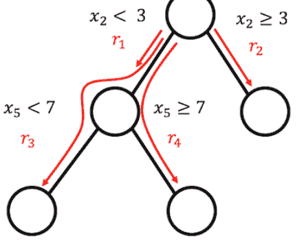

图 4.21：从一个具有 3 个终端节点的树中可以生成 4 条规则。

这些决策树从哪里来？这些树被训练预测感兴趣的结果。这确保了拆分对于预测任务是有意义的。任何生成树列表的算法（如随机森林）都可以用于 `RuleFit`。每棵树被分解为决策规则，并作为额外特征用于稀疏线性回归模型（Lasso）。

`RuleFit` 论文使用波士顿房价数据来阐明这一点。目标是预测波士顿某个社区的中位数。`RuleFit` 生成的规则之一是：如果 房间数 > 6.64 且 一氧化氮浓度 < 0.64。$^{24}$Friedman, Jerome H., and Popescu, Bogdan E. “Predictive learning via ensembles.” The Annals of Statistics. (2008). 916-54.

## 4.6 RuleFit

| 描述 | 权重 | 重要性 |
| :--- | :--- | :--- |
| days_since2011 > 111 & weathers in ("GOOD","MISTY") | 795 | 303 |
| 25 <= hum <= 90 | -20 | 278 |
| temp > 67 | 676 | 239 |
| windspeed <= 24 | -41 | 204 |
| days_since2011 > 111 & temp > 5 | 356 | 174 |

`RuleFit` 还带有一种重要性度量，有助于识别哪些特征是重要的。重要性衡量包含了原始特征的重要性以及该特征出现的所有规则的重要性。`RuleFit` 还引入了部分依赖图，以展示通过改变特征来引起预测的平均变化。部分依赖图是一种模型无关的方法，在部分依赖章节中进行了解释。

### 4.6.1 解释与示例

由于 `RuleFit` 估计的是线性模型，其解释方式与普通模型相同。唯一的区别是模型具有来自决策规则的新特征。在这个示例中，我们使用 `RuleFit` 预测某天租用自行车的数量。表格显示了生成的五条规则及其权重和重要性。

其解释与线性模型类似：在所有其他特征保持不变的情况下，如果特征 `$x_j$` 变化 1，则预测结果将改变 `$\beta_j$`。决策规则的权重解释是一个特殊情况：如果规则 `$r_k$` 的所有条件都满足，预测结果将改变 `$\alpha_k$`（`$r_k$` 在线性模型中学习到的权重）。

对于分类（使用逻辑回归代替线性回归）：如果决策规则 `$r_k$` 的所有条件都满足，事件发生与未发生事件的几率将按 `$\alpha_k$` 倍数发生变化。

### 4.6.2 理论

让我们深入研究 `RuleFit` 算法的技术细节。`RuleFit` 由两个部分组成：第一部分从决策树创建“规则”，第二部分以原始特征和新规则作为输入拟合线性模型（因此得名于 RuleFit）。

#### 步骤 1：规则生成

规则看起来是什么样？算法生成的规则具有简单的形式。例如：如果 `x2 < 3` 且 `x5 < 7` 则否则 0。规则通过分解决策树构建：树中通任何节点的路径都可以转换为决策规则。用于规则的树被拟合以预测目标结果。因此，拆分和生成的规则针对你感兴趣的结果进行了优化。你只需链式连接

### 解释模板

#### 变量重要性

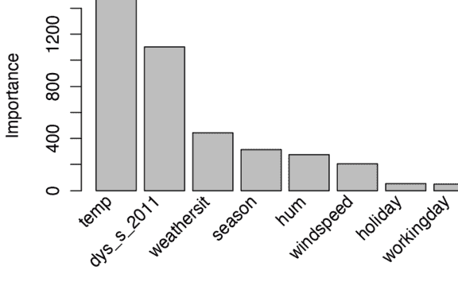

图 4.22：预测自行车数量的 `RuleFit` 模型的特征重要性度量。预测最重要的特征是温度和时间趋势。

## 4.6 RuleFit

通过“AND”逻辑连接通向特定节点的二分类决策，由此，你就得到了一条规则。生成许多多样化且有意义的规则是理想的。梯度提升（Gradient boosting）通过对原始特征 `$X$` 与 `$y$` 进行回归或分类，来拟合一个决策树集成。生成的每棵树都会被转换为多条规则。不仅是增强树（boosted trees），任何集成算法都可以用于为 `RuleFit` 生成树。树集成可以用这个通用公式来描述：

```
\tilde{f}(x) = a_0 + \sum_{m=1}^M a_m \hat{f}_m(X)
```

`$M$` 是树的数量，`$\hat{f}_m(x)$` 是第 `$m$` 棵树的预测函数。`$a$` 是是权重。装袋法集成（Bagged ensembles）、随机森林、`AdaBoost` 和 `MART` 都能产生树集成，我们将其用于 `RuleFit`。

我们从集成中的所有树中创建规则。每个规则 `$r_m$` 的形式如下：

```
$r_m(x) = \prod_{j \in T_m} I(x_j \in s_{jm})$
```

当 `$T_m$` 是第 `$m$` 棵树中使用的特征集合时，`$I$` 是指示函数：当特征 `$x_j$` 属于第 `$j$` 个特征的指定值集（由树分裂决定）时，其值为 1，否则为 0。对于数值型特征，`$s_{jm}$` 是该特征值范围的一个区间。该区间看起来像以下两种情况之一：

```
$x_{s_{jm},lower} < x_j$
```

```
$x_j < x_{s_{jm},upper}$
```

该特征的进一步划分可能会导致更复杂的区间。对于分类特征，子集 `$s$` 包含了该特征的某些特定类别。

一个自行车租赁数据集的假设示例：

```
$r_{17}(x) = I(x_{temp} < 15) \cdot I(x_{weather} \in \{good, cloudy\})$
```

当 `$x_{temp} < 15$` 且 `$x_{weather}$` 为“良好”或“多云”时，该规则为 1，否则为 0。

## 4.6 RuleFit

决策规则（feature）的预测可能是：“temp > 10”，另一种规则可能是“temp > 15”。如果天气良好且温度高于 15 度，温度将自动增加。在这些情况下，第二个规则适用，第一个规则也适用。估计规则的解释是：“假设其他特征固定，当天气良好时，预测的数量增加”。但非常清楚，“其他特征固定”是有问题的。

### 4.6.5 软件与替代方案

`RuleFit` 算法由 Fokemma 和 Christoffersen (2017)$^{25}$ 在 R 中实现，你可以在 GitHub 上找到 Python 版本$^{60}$。类似的框架是 `skope-rules`，这是一个 Python 模块，也从从中提取规则。它不同在于学习规则的方式。首先，`skope-rules` 根据召回率和精确率阈值移除低性能规则。然后，根据逻辑项的多样性（variable +smaller operator）和性能（F1 分）移除重复和相似规则。最后这一步不依赖于 Lasso，而是考虑袋外 F1 分和构成规则的逻辑项。

`immodels` 包$^{28}$ 还包含其他规则的实现，例如贝叶斯规则、Boosting 规则和 `SLIPPER` 规则，具有统一的 scikit-learn 接口。

$^{25}$ Fokemma, Marjolein, and Benjamin Christoffersen. “Pre: Prediction rule ensembles”. https://CRAN.R-project.org/package=pre (2017).

$^{60}$ https://github.com/christophM/rulefit

$^{67}$ https://github.com/scikit-learn-contrib/skope-rules

$^{28}$ https://github.com/csinva/immodels

## 4.7 其他可解释模型

可解释模型列表不断增长，规模未知。它包括线性模型、决策树和朴贝叶斯等简单模型，也有通过结合或修改不可解释机器学习模型来使其更具解释性的复杂模型。特别是后期类型模型的出版目前频率很高，很难跟上发展。本章仅介绍朴贝叶斯分类器和 k 近邻算法。

### 4.7.1 朴贝叶斯分类器

朴贝叶斯分类器使用条件概率贝叶斯定理。对于每个特征，它根据特征的值计算某个类别的概率。朴贝叶斯分类器独立地计算每个特征的概率，这等同于特征条件独立的强（=）假设。朴贝叶斯是一个条件概率模型，对类别 `$C_k$` 的概率建模如下：

```
$P(C_k|x) = \frac{1}{Z} P(C_k) \prod_{i=1}^{n} P(x_i|C_k)$
```

项 Z 是一个缩放因子，确保所有类别的概率和为 1（否则它们将不是概率）。类别的条件概率是类别概率乘以给定类别时每个特征的概率，并由 Z 归一化。该公式可以使用贝叶斯定理推导出。

由于独立性假设，朴贝叶斯是一个可解释模型。它可以在模块化层上进行解释。对于每个特征，它对特定类别预测的贡献程度非常清晰，因为我们可以解释条件概率。

### 4.7.2 k 近邻

k 近邻方法可用于回归和分类，并使用数据点的最近邻居。对于分类，k 近邻方法将实例最近邻居中最常见的类别分配给实例。对于回归，它取邻居结果的平均值。棘手的部分是找到正确的 k 以及如何衡量实例之间的距离，这最终定义了邻域。

k 近邻模型与书中介绍的其他可解释模型不同，因为它基于实例。k 近邻模型在模块化层上是解释的。对于邻域域性性（，，，，，域，，，，域域域是可解释的。但非常，，可解释性完全取决于你是否可以“解释”一个实例。如果数据集由成百上千个特征，那么它不是可解释的。

最底层是**世界 (World)**。这从字面上可以是自然本身，例如人体的生物学及其对药物的反应，也可以是更抽象的东西，如房地产市场。世界层包含了所有可以观察到且感兴趣的内容。最终，我们想要学习关于世界的知识并与之交互。

第二层是**数据层 (Data layer)**。我们必须将世界数字化，以便计算机进行处理并存储信息。数据层包含了图像、文本、表格数据等任何内容。

通过基于数据层拟合机器模型，我们得到了**黑盒模型层 (Black Box Model)**。机器学习算法从现实世界中学习数据以进行预测或发现结构。

黑盒层之上是**解释性方法层 (Interpretability Methods)**，它帮助我们处理机器学习模型的不透明性。对于特定的诊断，最重要的特征是什么？为什么某笔金融交易被归类为欺诈？

最后一层由**人类 (Human)**占据。看！这一层属于你，因为你正在阅读这本书并帮助为黑盒模型提供更好的解释！人类最终是解释的消费者。

这种多层抽象抽象也有助于理解统计学家与机器学习从业者在方法上的差异。统计学家处理数据层，例如规划临床试验或设计问卷。他们跳过黑盒层，直接进入解释性方法层。机器学习专家也处理数据层，例如收集皮肤癌图像的标记样本或爬取维基百科。然后他们训练黑盒机器学习模型。跳过解释性方法层，人类直接处理黑盒模型的预测。可解释机器学习融合了统计学家和机器学习专家的工作，这是非常棒的。

当然，这幅图并没有捕捉到所有情况：数据可能来自仿真。黑盒模型输出的预测可能甚至无法到达人类，而仅提供给其他机器等等。但总的来说，这是一个非常有用的抽象，有助于理解解释性是如何成为机器学习模型之上的这一新层的。


模型无关的解释方法可以进一步区分为`局部方法 (local methods)`和`全局方法 (global methods)`。本书也是根据这种区分组织的。全局方法描述了特征平均而言如何影响预测。相比之下，局部方法旨在解释单个预测。

# 6 基于示例的解释

基于示例的解释方法选择数据集中的特定实例来解释机器学习模型的行为，或解释底层的数据分布。

基于示例的解释大多是模型无关的，因为它们使任何机器学习模型变得更具可解释性。与模型无关方法的区别在于，基于示例的方法通过选择数据集的实例来解释模型，而不是创建特征的摘要（如特征重要性或部分依赖性）。只有当我们能够以人类可理解的方式表示数据实例时，基于示例的解释才有意义。通常情况下，如果实例的特征值携带了更多上下文（意味着数据具有结构，如图像或文本），那么基于示例的方法效果良好。要以有意义的方式表示表格数据更具挑战性，因为一个实例可能由成百或数千个（结构较松的）特征组成。列出所有特征值来描述一个实例通常没有用。如果只有少数特征，或者我们有总结实例的方法，它的效果就会很好。

基于示例的解释有助于人类构建机器学习模型的心理模型以及数据学习模型的训练模型。它特别有助于理解复杂的分布。但我所说的基于示例的解释是指什么？我们在工作和日常生活中使用它们。让我们从示例开始¹

¹Aodt, Agnar, and Enric Plaza. "Case-based reasoning: Foundational issues, methodological variations." AI (1994: 39.

- 医生看到一个患有异常咳嗽和轻微发烧的患者。患者的症状让她想起了多年前另一位有类似症状的患者。她怀疑现在的患者可能患有同样的疾病，于是取血样检测这种特定疾病。

- 数据科学家正在为他的客户负责一个新项目：分析导致键盘生产机器故障的风险因素。数据科学家想起了他做过的类似项目，并重用了旧项目中的部分代码，因为他认为客户想要同样的分析。

- 一只猫坐在一栋着火且无人居住的窗台上。消防队已经到达，其中一名消防员在犹豫是否应该冒险进入大救救那只猫。他想起了作为消防员的生涯中遇到过的类似案例：缓慢燃烧了一段时间的老房子是不稳定的，并最终会倒塌。由于这个案例的相似性，他决定不进去。

基于示例的解释有助于人类构建机器学习模型的心理模型以及数据学习模型的训练模型。它特别有助于理解复杂的分布。但我所说的基于示例的解释是指什么？我们在工作和日常生活中使用它们。

以下的解释方法都是基于示例的：

- 反事实解释 `Counterfactual explanations` 告诉我们实例需要如何变化才能显著改变其预测。

- 对抗样本 `Adversarial examples` 是用于欺骗机器学习模型的反事实示例。

- 原型 `Prototypes` 是数据的一组代表性实例和批判实例²

- 影响性实例 `Influential instances` 对预测参数或预测本身影响最大的训练数据点。识别和分析影响性实例有助于发现数据中的问题。

- `k-nearest neighbors model`：一种基于示例的（可解释的）机器学习模型。

²Kim, Been, Rajiv Khanna, and Oluwasanmi O. Koyejo. "Examples are not enough, learn to criticize; Criticism for interpretability." Advances in Neural Information Processing Systems (2016).

# 7 全局模型无关方法

全局方法描述机器学习模型的平均行为。全局方法的对应的是局部方法。全局方法通常表示为基于数据分布的期望值。例如，部分依赖图（partial dependence plot）是一种特征效应图，当所有其他特征都被边缘化时的期望预测。由于全局方法描述的是平均行为，因此当模型想要理解数据中的通用机制或调试模型时特别有用。

在书中，你将学习以下模型无关的全局解释技术：

- 部分依赖图是一种特征效应方法。

- 累积局部效应图 `Accumulated local effect plots` 是另一种特征相关时仍然有效的特征效应方法。

- 特征交互（H 统计量）量化了预测在多大程度上是特征共同作用的结果。

- 功能分解 `Functional decomposition` 是可解释性的一个核心思想，也是一种将复杂的预测函数分解为较小部分的技术。

- 置换特征重要性 `Permutation feature importance` 通过衡量特征被允许时损失的增加来衡量特征重要性。

- 全局代理模型 `Global surrogate models` 用更简单的模型替换原始模型以进行解释。

- 原型和批判 `Prototypes and criticisms` 是分布的代表性数据点，可增强可解释性。

## 7.1 部分依赖性图 `PDP`

部分依赖性图（简称 `PDP` 或 `PD` 图）显示了一个或两个特征对机器学习模型预测结果的边际效应（J. H. Friedman 2001）。部分依赖性图可以显示目标变量与特征之间的关系是线性的、单调的还是更复杂的。例如，当应用于线性回归模型时，部分依赖性图始终显示线性关系。

回归的部分依赖函数定义为：

```
$$\hat{f}_S(x_S) = E_{C} [\hat{f}(x_S, X_C)] = \int \hat{f}(x_S, X_C) dP(X_C)$$
```

`x_S` 是需要绘制部分依赖图的特征，而 `X_C` 是机器学习模型 `f` 中使用的其他特征，它们被视为随机变量。集合 `S` 中通常只有一个或两个特征。`S` 中的特征是我们想要了解其对预测影响的特征。特征向量 `x_s` 和 `x_C` 组合成了总特征空间 `x`。部分依赖的工作原理是通过对 `C` 中特征的分布对机器学习模型的输出进行边缘化，使得函数显示了我们感兴趣的 `S` 中特征与预测结果之间的关系。通过对其他特征进行边缘化，我们得到了一个仅依赖于 `S` 中特征及其与其他特征交互的函数。

部分函数 `\hat{f}_S` 通过计算训练数据中的平均值来估计，也称为蒙特卡洛方法：

```
$$\hat{f}_S(x_S) = \frac{1}{n} \sum_{i=1}^{n} \hat{f}(x_S, x_C^{(i)})$$
```

部分函数告诉我们对于给定的特征 `S` 值，预测的平均边际效应。。在公式中，`x_C^{(i)}` 是数据集中我们不感兴趣的特征的实际特征值，`n` 是数据集中的实例数量。`PDP` 的一个假设是 `C` 中的特征与 `S` 中的特征不相关。如果违反了这一假设，则为部分依赖性图计算的平均值将包含极不可能是或不可能的数据点（见缺点）。

对于输出概率的分类机器学习模型，部分依赖性图显示了在特征 `S` 取不同值的情况下，某一类别的概率。一种简单的方法是为每个类绘制一条线或一张图。

部分依赖性图是一种全局方法：该方法考虑所有实例，并对特征与预测结果之间的全局关系给出陈述。

### 分类特征

> ¹Friedman, Jerome H. "Greedy function approximation: a gradient boosting machine." Annals of statistics (2001): 1189-1232.

到目前为止，我们只考虑了数值特征。对于分类特征，部分依赖性非常容易计算。对于每个类别，我们通过强制所有数据实例处于相同类别来获得 `PDP` 估计值。例如，如果我们查看零售数据集并对季节（`season`）的部分依赖性图感兴趣，我们为每个季节得到四个数字。要计算“夏季”的值，我们将所有数据实例的季节替换为“夏季”并对预测结果取平均。

#### 7.1.1 基于 PDP 的特征重要性

Greenwell 等人 (2018) ² 提出了一种基于部分依赖性的特征重要性衡量方法。基本动机是：平坦的 `PDP` 表示该特征不重要，而 `PDP` 的变化越大，该特征就越重要。对于数值特征，重要性定义为每个唯一特征值与曲线之间的偏程度：

```
$I(x_s) = \sqrt{\frac{1}{K}\sum_{k=1}^{K}f_s(x_s^{(k)}) - (\frac{1}{K}\sum_{k=1}^{K}f_s(x_s^{(k)}))^2}$
```

这里 `x_s^{(k)}` 是特征的唯一值。对于分类特征，我们有：

```
$I(x_s) = (max_k(\hat{f}_s(x_s^{(k)})) - min_k(\hat{f}_s(x_s^{(k)})))/4
```

`PDP` 值的范围。这种计算偏差的奇怪方法被称为范围规则。它有助于在只知道范围时获得偏差的粗略估计。在正态分布中，95% 的数据位于均值的标准差范围内。除以四得到一个可能低估了实际方差的估计。基于 `PDP` 的特征重要性应该谨慎解释。它捕获了特征的主效应并忽略了可能的相互作用。一个特征基于其他方法可能是重要的，但 `PDP` 可能通过与其他特征的交互来影响预测。该衡量方法的另一个缺点是它是定义在唯一值上的。与许多实例的计算权重相同。

> ²Greenwell, Brandon M., Bradley J. Boehcke, and Andrew McCarthy. "A simple and effective-based importance measure." preprint:1805.04755 (2018).

#### 7.1.2 示例

在实践中，特征集 `S` 通常只包含一个特征。为了说明部分依赖性，我们使用数据集。我们想根据年龄、湿度和怀孕次数等特征预测患病。我们计算每个特征的部分依赖性并进行可视化。在这种情况下，我们拟合一个随机森林来预测患病。我们还计算不同特征的部分依赖性。部分依赖性图是一种全局方法：它考虑所有实例，并对特征与预测结果之间的全局关系给出陈述。为了可视化两个特征的部分依赖性，我们使用 3D 图。

#### 7.1.3 优点

部分依赖性图的计算是**直观的**：特定特征值下的部分依赖函数表示如果我们固定所有数据点假设该特征值时的平均预测。根据我的经验，人们通常很快理解 `PDP` 的概念。

如果计算 `PDP` 的特征与其他特征不相关，那么 `PDP` 完美地代表了特征如何影响预测。在不相关的情况下，**解释是清晰的**：部分依赖性图显示了当 `j` 特征改变时，平均预测如何变化。当特征相关时，情况会变得复杂，见下缺点。

部分依赖性图**容易实现**。

部分依赖性图的计算具有**因果解释**：我们干预某个特征并测量预测的变化。在此过程中，我们分析因果

## 7.1 部分依赖图 `PDP`

特征与预测之间的关系。^3 这种关系对于模型而言是因果的——因为我们显式地将结果建模为特征的函数——对于现实世界并不一定如此！

#### 7.1.4 缺点

在部分依赖函数中，真实的特征最大数量为两个。这并不是 `PDP` 的错，而是二维表示（纸张或屏幕）的局限性，也是我们无法想象超过三个维度的问题。

某些 `PD` 图没有显示特征的分布。忽略分布可能会产生误导，因为你可能会对数据的结果进行过度解读。这个问题可以通过使用地图（rug，x轴上的数据指示器）或直方图来解决。

独立性假设是 `PDP` 最大的问题。假设计算部分依赖的特征与其他特征不相关。例如，假设你想预测一个人的行走速度，这取决于人的体重和身高。对于某个特征的部分依赖性，例如高度，我们假设特征（体重）与高度不相关，这显然是一个错误的假设。对于特定高度（例如 200 cm）的 `PDP` 计算，对边缘分布取平均可能包含了 50 kg 以下的体重，这对于一个身高 2 米的人来说是不现实的。换句话说：当特征相关时，我们在特征概率很低的区域创建了新的数据点（不太可能身高 2 米但体重只有 50 kg）。这种问题的解决方法是累计局部效应图，它使用条件期望而不是边缘分布。

异质性效应可能会被隐藏，因为 `PD` 图只显示平均预测。假设数据点有一部分与预测正相关——特征值越大，预测越高——而另一部分为负相关——特征值越小，预测越高。`PD` 可能是一条水平线，因为数据集两部分的影响相互抵消了。你得出该特征对预测没有影响。通过绘制条件期望而不是聚合线，我们可以发现异质性效应。

#### 7.1.5 软件与替代方案

有很多实现 `PDP` 的 R 包。我们在示例中使用了 `pd` 或 `DALEX` 包。在 Python 中，部分依赖图已内置在 `scikit-learn` 中，你可以使用 `PDPBox`。

书中提出的 `PDP` 替代方案是 `ALE` 图和 `ICE` 曲线。

> ^3 赵庆源和 Trevor Hastie. “黑盒模型的因果解释。” Journal of Business & Economic Statistics, 待出版 (2017)。

## 7.2 累计局部效应 `ALE` 图

累计局部效应^4 显示了特征如何平均影响机器学习模型的预测。`ALE` 图是部分依赖图 `PDP` 更快速且无偏的替代方案。

我建议先阅读部分依赖图的章节，因为它们更容易理解，而且两种方法的目标相同：描述特征如何平均影响预测。在接下来的章节中，我想让你相信当特征相关时，部分依赖图存在严重问题。

### 7.2.1 动机与直觉

如果机器学习模型的特征是相关的，那么部分依赖图是不可信的。对于与其他特征强相关的特征，计算部分依赖图会对现实中不太可能的数据取平均值。这会大大偏偏估计的影响。假设为一个机器学习模型计算部分依赖图，该模型根据房间数量和面积预测房屋价值。我们感兴趣的是面积对预测值的影响。部分依赖图的配方是：1) 选择特征。2) 定义网格。3) 每个网格值：a) 替换为网格值并取平均预测。4) 绘制曲线。对于 `PDP` 第一个网格值（假设 30 m²）的计算——我们将所有 10 房间房屋的面积替换为 30 m²。假设部分依赖图在特征效应中包含了这些不现实的房屋并假装一切正常。下图说明了两个相关特征，以及部分依赖图是如何平均不稳定实例预测的。

> ^4 Apley, Daniel W., 和 朱静宇。“黑盒监督学习模型中预测变量的影响。”Journal of the Royal Statistical Society: Series B (Statistical Methodology) 82.4 (2020): 1059-1086.

## 7.2 累计局部效应 `ALE` 图

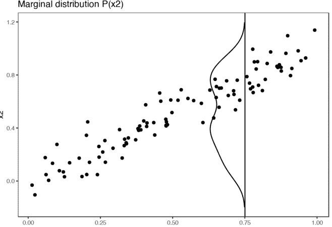

**图 7.5：强相关特征 x1 和 x2。** 为了计算 x1 在 x1 处的特征效应，`PDP` 将所有实例的 x1 替换为 0.75，错误地假设 x1 = 0.75 时 x2 的分布与 x2 的边缘分布（垂直线）相同。这导致了 x1 和 x2 不可能的组合（例如在 x1=0.75 时 x2=0.2），`PDP` 将其用于计算平均效应。

M 图避免了对不可能数据实例取平均，但它们将一个特征的影响与所有相关特征的影响混合在一起。`ALE` 通过计算——也基于特征的条件分布——**预测的差异而不是平均值**来解决这个问题。对于 30 m² 面积的影响，`ALE` 方法使用所有约 30 m² 的房屋，获取它们假设为 33 m² 的模型预测，以及假设为 29 m² 的预测。这给了我们面积的纯效应，并且没有将效应与相关特征的影响混合。使用差异阻止了其他特征的影响。下面的图表提供了如何计算 `ALE` 图的直觉。


总结每种类型的图（PDP, M, ALE）如何计算特征在网格值 v 处的效应：

- **部分依赖图：** “让我看看当每个数据实例具有 v 值时，模型平均预测的是什么。忽略该值对所有实例是否合理。”

- **M 图：** “让我看看当特征具有 v 值时模型平均预测的是什么。这种效应可能是由于相关特征。”

- **ALE 图：** “让我看看在特征处于 v 的一个小‘窗口’内，模型预测是如何变化的。”

## 第 7 章 全局模型无关方法

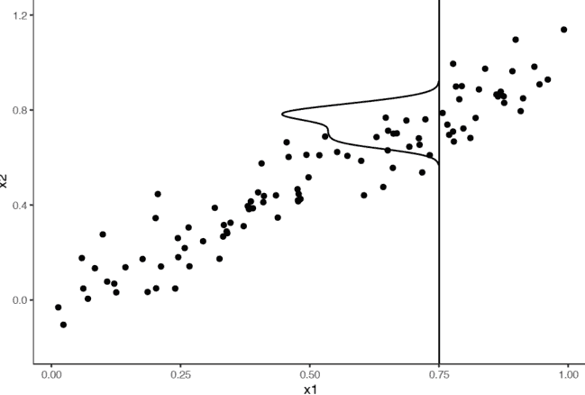

图 7.6：相关特征 x1 和 x2。M 图在条件分布上平均。这里是 x2 在 .75 处的条件分布。

### 7.2.2 理论

PD、ALE 图在数学上有何区别？三种方法的共同点是将复杂的预测简化为仅取决于一个（或两个）特征的函数。所有方法都通过平均其他特征的影响来简化函数，区别在于计算的是平均值还是差异，以及是在边缘分布还是条件分布上进行平均。

部分依赖图在边缘分布上对预测取平均。

```
\hat{f}_{S,PDP}(x) = E_{X_C}[f(x_S, X_C)]
\int_{X_C} f(x_S, X_C) dP(X_C)
```

这是预测函数在值 $x_s$ 处的值，对特征 $C$（此处被视为随机变量）取平均。平均意味着计算边缘

## 7.2 累计局部效应 (ALE) 图

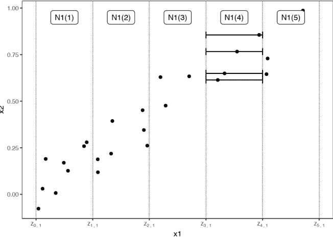

图 7.7：对相关特征 x1 计算 ALE。首先，我们把特征划分为区间（垂直线）。对于区间内的数据实例（点），我们计算特征替换为区间上限和下限（水平线）时的预测差异。这些差异随后会被累积并中心化，形成 ALE 曲线。

M 图在条件分布上平均。

与 PDP 相比，唯一的变化是我们在感兴趣特征的每个网格值上根据条件取平均，而不是假设每个网格值具有边缘分布。在实践中，这意味着我们需要定义一个邻域，例如为了计算 30 $m^2$ 对预测房屋价值的影响，我们可以对 28 到 32 $m^2$ 之间所有房屋的预测值取平均。

ALE 图对预测的变化取平均值，并在网格上进行累积（稍后详细介绍计算方法）。

```
$$\hat{F}_{S,ALE}(x_S) = \int_{z_0,S}^{x_S} E_{X_C|X_S=x_s} [\hat{f}_S(X_S, X_C)|X_S=z_S] dz_S - \text{constant}$$
 = \int_{z_0,S}^{x_S} (\int_{xC} \hat{f}_S(z_S, X_C)dF(X_C|X_S=z_S))dz_S - \text{constant}$$
```

该公式揭示了与 M-Plots 的三个不同。首先，我们对预测的变化取平均，而不是预测本身。变化被定义为偏导数（但在后的实际计算中，被替换为区间内预测的差异）。

```
$$\hat{f}^S(x_s, x_c) = \frac{\partial f(x_s, x_c)}{\partial x_S}$$
```

第二个区别是在是对 $z$ 的额外积分。我们在 $S$ 中特征的范围内累积局部偏导数，从而得到特征对预测的影响。在实际计算中，$x$ 被替换为一组区间网格，我们在这些网格上计算预测的变化；ALE 方法通过以特征 $S$ 为条件计算预测差异，并在 $S$ 上积分导数以估计其影响。嗯，这听起来很愚蠢。求导和积分通常会相互抵消，就像先减去一个数再加上相同的数一样。为什么在这里是合理的呢？导数（或区间差异）隔离了特征的影响，并阻了相关特征的影响。

ALE 图与 M-plots 的第三个区别是从结果中减去一个常数。这一步使 ALE 图中心化，使得数据的平均影响为零。

仍然存在一个问题：并不是所有模型都带有梯度，例如随机森林就没有梯度。但正如你将看到的，实际计算可以在没有梯度的情况下运行，并使用区间。让我们深入探讨一下 ALE 图的估计。

## 7.2. 估计

首先，我将描述如何估计单个数值特征的 ALE 图，随后是两个数值特征以及单个类别特征的 ALE 图。为了估计局部影响，我们将特征划分为许多区间，并计算预测的差异。该过程近似了导数，并且适用于没有导数的模型。

首先，我们估计未中心化的影响：

## 7.2. 累积局部效应 (ALE) 图

```
$$\hat{f}_{j,ALE}(x) = \frac{k_j(x)}{n_j(k)} \sum_{i:x_j^{(i)} \in N_j(k)} \left[ \hat{f}(z_{k,j}, x_j^{(i)}) - \hat{f}(z_{k-1,j}, x_j^{(i)}) \right]
```

让我们来拆解这个公式，从右侧开始。**累积局部效应**（Accumulated Local Effects）这个名字很好地反映了该公式中的所有单个组成部分。ALE 方法的核心是计算预测的差异，其中我们将感兴趣的特征替换为网格值。预测的差异是该特征在特定区间内对单个实例所产生的**影响**（Effect）。右侧的求和加了该邻域内所有实例的影响。我们将该总和除以该区间内的实例数量，以获得该区间预测的平均差异。这种区间内的平均值由 ALE 名称中的**局部**（Local）一词涵盖。左侧符号表示我们累积了所有区间的平均影响。例如，位于第三个区间的特征值的（中心化后）ALE 是第一、第二和第三个区间影响之和。ALE 中的**累积**（Accumulated）一词反映了这一点。

该影响经过中心化处理，使得平均影响为零。

ALE 的值可以解释为特征在特定值处相对于数据平均预测的主效应。例如，在 $x_j = 3$ 处的 ALE 估计值为 -2，意味着第 j 个特征值为 3 时，预测值比平均预测低 2。

使用特征分布的分位数作为定义区间的网格。使用分位数确保每个区间内的数据实例数量相同。分位数的缺点是区间长度可能不同。如果感兴趣的特征非常偏斜（例如，有很多低值但只有少数极高值），可能会导致奇怪的 ALE 图。

### 两个特征交互的 ALE 图

ALE 图也可以显示两个特征的交互影响。计算原理与单个特征相同，但我们处理的是矩形单元而不是区间。除了调整总体效应外，我们还调整了两个特征的主效应。这意味着两个特征的 ALE 估计的是二阶效应，不包含特征的主效应。换句话说，两个特征的 ALE 只显示两个特征的额外影响。我省略了 2D ALE 图的公式，因为它们很长且读起来不舒服。如果你对计算感兴趣，请参考论文中的公式 (13) – {16}。我将依靠可视化来建立关于二阶 ALE 计算的直觉。

## 第 7 章 全局模型无关方法


图 7.9：两个特征和预测结果。模型预测两个特征之和（阴影背景），但例外是如果 x1 大于 0.7 且 x2 小于 0.3，模型始终预测为 2。该区域远离数据分布（点云），对模型性能没有影响，也不应该影响其可解释性。

但是，看到我们的模型在 x1 > 0.7 且 x2 < 0.3 时表现得异常，这难道不是很有趣吗？嗯，既是如此，也不是如此。由于这些是在物理上可能很奇怪的、或者至少极不可能的数据实例，如果你怀疑你的测试分布可能略有不同，且某些实例实际上处于该范围内，那么在计算特征效应时查看这一区域将非常有趣。包含我们尚未观察到数据的区域必须是一个意识到的决定，而不应该是方法选择（如 PDP）的副作用。如果你怀疑模型稍后将用于不同分布的数据，我建议使用 ALE 图，并模拟你预期的数据分布。

转向真实数据集，让我们根据天气和天数来预测租赁自行车的数量，并检查 ALE 图是否真的如承诺的那样有效。我们训练了一个回归树来预测某天租赁的自行车数量，并使用 ALE 图分析温度、相对湿度和风速如何影响预测。

让我们看看温度、湿度和风速与其他所有特征之间的相关性。由于数据还包含类别特征，我们不能仅使用皮尔逊相关系数，因为该系数仅在两个特征都是数值型时才有效。相反，我训练了一个线性模型，例如根据其他一个特征之一作为输入来预测温度。

## 7.2 累积局部效应 (ALE) 图

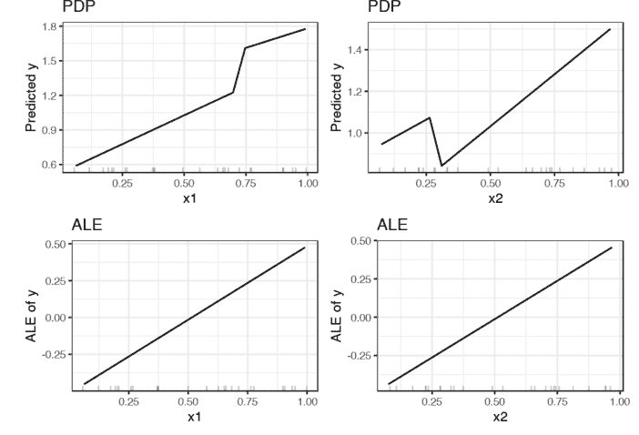

图 7.10：用 PDP（上行）和 ALE（下行）计算的特征效应的对比。PDP 估计受到模型在数据分布外异常行为的影响（图中的陡峭跳跃）。ALE 图正确地识别出机器学习模型在特征和预测之间存在线性关系，忽略了没有数据的区域。

我衡量了线性模型中另一个特征解释了多少量，并对其取平方根。如果另一个特征是数值型的，结果等于皮尔逊相关系数的绝对值。但这种基于模型的“解释方差”方法（也称为 ANOVA，即方差分析的缩写）即使在另一个特征是类别时也有效。“解释方差”始终处于 0（无关联）和 1（可以从其他特征完美地预测温度）之间。我们利用所有其他特征计算了温度、湿度和风速的解释方差。解释方差（相关性）越高，图中的（潜在）问题就越多。接下来的图可视化了特征与其他特征之间的相关性有多强。

这种相关性分析揭示了我们可能会在部分依赖图中遇到问题，特别是对于温度特征。

接下来，让我们看看 ALE 图在类别特征上的应用。月份是一个类别特征，我们想要分析它对预测自行车数量的影响。可以争论，月份已经有一个特定的顺序（1 月到12 月），但让我们尝试看看通过相似性重新排列类别并计算效应会发生什么。月份是根据其他特征（如温度或是否为假日）每个月份日日的相似性排序的。

# 第 7 章 全局模型无关方法

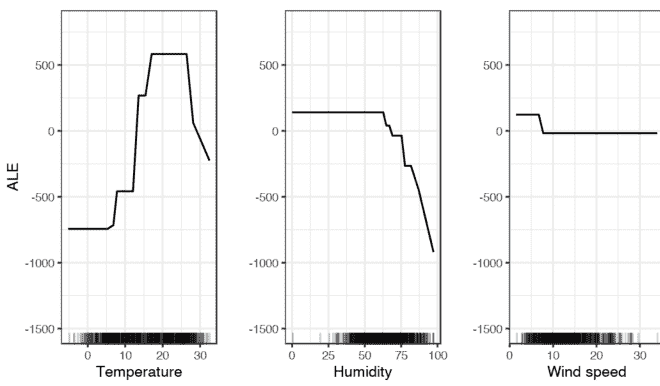

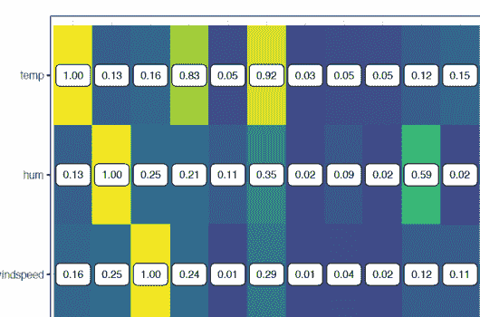

图 7.11：温度、湿度和风速的 ALE 图。ALE 图正确地识别出机器学习模型在特征和预测之间存在线性关系，忽略了没有数据的区域。

图 7.12：温度、湿度和风速的 ALE 图。ALE 图正确地识别出机器学习模型在特征和预测之间存在线性关系，忽略了没有数据的区域。

第 7 章 全局模型无关方法

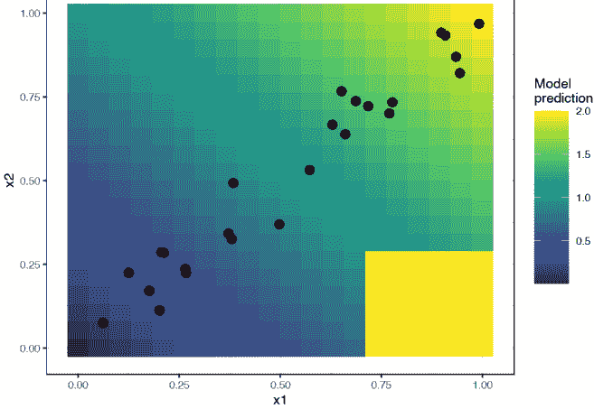

**图 7.9**：两个特征和预测结果。模型预测两个特征之和（阴影背景），但例外是如果 x1 大于 0.7 且 x2 小于 0.3，模型始终预测为 2。该区域远离数据分布（点云），对模型性能没有影响，也不应该影响其可解释性。

转向真实数据集，让我们根据天气和天数来预测租赁自行车的数量，并检查 ALE 图是否真的如承诺的那样有效。我们训练了一个回归树来预测某天租赁的自行车数量，并使用 ALE 图分析温度、相对湿度和风速如何影响预测。

让我们看看温度、湿度和风速与其他特征之间的相关性。由于数据还包含类别特征，我们不能仅使用皮尔逊相关系数，因为该系数仅在两个特征都是数值型时才有效。相反，我训练了一个线性模型，例如根据其他一个特征之一作为输入来预测温度。

## 7.2 累积局部效应 (ALE) 图


图 7.10：用 PDP（上行）和 ALE（下行）计算的特征效应的对比。PDP 估计受到模型在数据分布外异常行为的影响（图中的陡峭跳跃）。ALE 图正确地识别出机器学习模型在特征和预测之间存在线性关系，忽略了没有数据的区域。

接下来，让我们看看 ALE 图在类别特征上的应用。月份是一个类别特征，我们想要分析它对预测自行车数量的影响。可以争论，月份已经有一个特定的顺序（1 月到 12 月），但让我们尝试看看通过相似性重新排列类别并计算效应会发生什么。月份是根据其他特征（如温度或是否为假日）每个月份日日的相似性排序的。

# 第 7 章 全局模型无关方法


图 7.11：温度、湿度和风速的 ALE 图。ALE 图正确地识别出机器学习模型在特征和预测之间存在线性关系，忽略了没有数据的区域。

# 7.2 累积局部效应 (ALE) 图

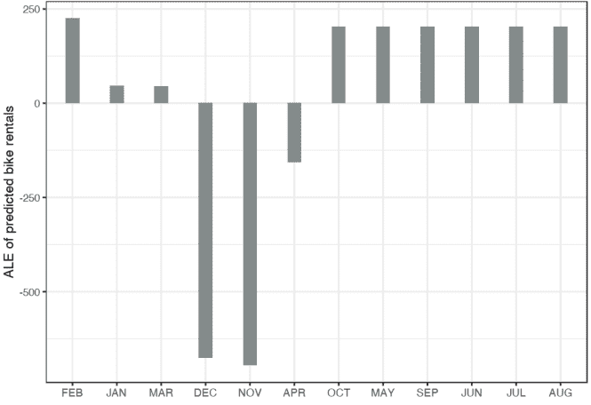

图 7.14：类别特征 month（月份）的 ALE 图。根据其他特征按月份的分布，月份按照它们之间的相似性排序。我们观察到，与其他月份相比，1月、3月和4月，特别是12月和11月对预测租赁自行车数量的影响较低。

## 7.2.6 缺点


如果特征之间存在强相关性，且你查看的是 ID-ALE 图的左端，则对跨间隔的进行解释是不允许的。ALE 曲线显示了当我们逐渐改变数据实例相应特征的值，同时保持实例其他特征值不变时，预测平均是如何变化的。效应是在每个区间内（局部）计算的，因此对效应的解释只能是局部的。为了方便起见，间隔效应被累积成一条平滑的曲线，但请记住每个区间都是使用不同的数据实例创建的。

当特征发生交互且相关时，ALE 效应可能与线性回归模型中指定的系数不同。Gröping (2020) 显示，在具有两个相关特征和一个额外交互项的线性模型（$\hat{f}(x) = \beta_0 + \beta_1x_1 + \beta_2x_2 + \beta_3x_1x_2$）中，一阶 ALE 图显示的不是直线。相反，它们是微弯的。

> Gröping, Ulrike. “Model-Agnostic Effects Plots for Interpretable Machine Learning.” Reports in Mathematics, Physics and Chemistry: Department II, Beuth University of Applied Sciences Berlin. Report 1/2020 (2020)

# 第 7 章 全局模型无关方法

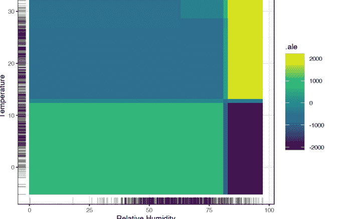

图 7.15：湿度和温度对预测租赁自行车数量二阶效应的 ALE 图。在考虑主效应的情况下，浅色表示预测高于平均水平，深色表示预测低于平均水平。该图揭示了温度和湿度之间的交互作用：炎热潮湿的天气增加了预测值。在冷潮湿的天气下，预测数量显示出额外的负面影响。

因为它们包含了特征乘法交互作用的部分。要理解这里发生了什么，我建议阅读关于函数分解的章节。简而言之，ALE 定义一阶（或 ID）效应的方式与线性公式描述的方式不同。当特征相关时，对交互的归因并不一定是错误的，但 ALE 和线性系数不匹配是不符合直觉的。

当间隔数量较多时，ALE 图可能会有些不稳定（有许多起伏）。在这种情况下，减少间隔数量可以使估计值更稳定，但也会平滑并隐藏预测模型的一些真实复杂性。设置间隔数量没有完美的解决方案。如果数量太小，ALE 图可能不十分准确。如果数量太高，曲线可能会变得波动。

与 PDP 不同，ALE 图没有附带 ICE 曲线。对于 PDP，ICE 曲线非常棒，因为它们可以揭示特征效应的异质性，这意味着特征对于对于数据子集看起来不同。对于 ALE 图，你只能检查每个间隔内实例之间的效应是否不同，但每个间隔都有不同的实例，所以它与 ICE 曲线不同。

## 7.2 累积局部效应 (ALE) 图

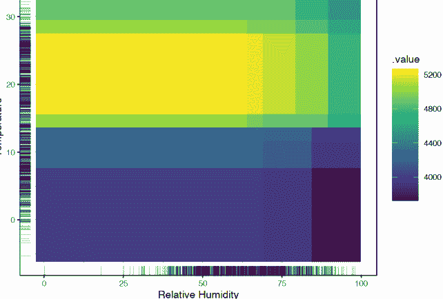

图 7.16：温度和湿度对预测自行车数量总效应的 PDP。该图结合了每个特征的主效应和它们的交互效应，而 2D-ALE 图只显示交互作用。

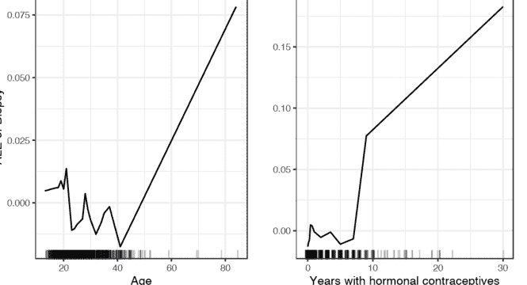

图 7.17：年龄和使用激素类避孕药年数对宫颈癌预测概率影响的 ALE 图。对于年龄特征，ALE 图显示预测的癌症概率在 40 岁之前平均较低，之后开始增加。使用激素类避孕药的年数与 8 年后较高的预测癌症风险有关。

图 7.18：怀孕次数和年龄二阶效应的 ALE 图。该图的解释有点没有定论，显示出似乎是过拟合。例如，该图显示了 18-20 岁且怀孕超过 3 次时奇特的模型行为（癌症概率增加多达 5 个百分点）。数据中具有这种年龄和怀孕次数组合的女性并不多（实际数据以点显示），因此模型在训练过程中对这些情况的犯错误没有受到严重的惩罚。

二阶 ALE 估计在特征空间中的稳定性各异，这没有通过任何方式可视化。原因是每个单元中局部效应的估计使用了不同数量的数据实例。结果是所有估计的准确性都不同（但它们仍然是最佳估计）。这个问题在主效应 ALE 图中表现得很严重。所有间隔的实例数量相同，但在某些区域会有很多间隔，ALE 曲线将由更多的估计组成。对于构成整个曲线大部分部分的长间隔，实例相对较少。例如，在宫颈癌预测 ALE 图中的高年龄部分就发生了这种情况。

二阶效应图解释起来可能有点烦人，因为你必须始终记住两个特征的主效应的总效应，但它只是交互作用的额外效应。纯二阶效应对于发现和探索交互作用很有趣，对于解释效应的样貌，我认为将主效应整合到图中更有意义。

ALE 图的实现与部分依赖图相比要复杂得多且不那么直观

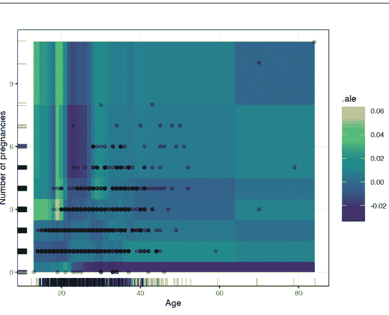

## 7.2 累积局部效应 (ALE) 图

到部分依赖图。

如果特征是不相关的且计算时间不是问题，PDP 稍微好一些，因为它们更容易理解并且可以与 ICE 曲线一起绘制。缺点列表已经变得很长了，但不要被我使用的词所误导：经验之：使用 ALE 代替 PDP。

### 7.2 实现与替代方案

我提到过部分依赖图和条件期望曲线是一种替代方案吗？ALE 图在 R 中通过 `ALEPlot` 实现，在 Python 中通过 `Alibi` 实现。

> ⁶https://cran.r-project.org/web/ALEPlot/index.html

> （此处省略重复链接翻译，根据要求保留链接格式即可）

# 7.3 特征交互

当特征在预测中相互作用时，预测不能表示为特征效应之和，一个特征的影响取决于另一个特征的值。亚里士多德的格言“整体大于部分之和”在存在交互的情况下适用。

### 7.3.1 特征交互

如果机器学习模型基于两个特征进行预测，我们可以将预测分解为项：常数项、第一个特征的项、第二个特征的项以及两个特征之间的交互项。

两个特征之间的交互是在考虑单个特征效应后改变特征引起的预测变化。

例如，一个模型预测房屋价值，使用房屋大小（大或小）和位置（好或坏）作为特征，产生了四种可能的预测：

| 位置 | 大小 | 预测 |
| --- | --- | --- |
| 好 | 大 | 300,000 |
| 好 | 小 | 200,000 |
| 坏 | 大 | 250,000 |
| 坏 | 小 | 150,000 |

我们将模型预测分解为以下部分：常数项 (150,000)、尺寸特征效应（大为 +100,000，小为 +0）以及位置效应（好为 +50,000；坏为 +0）。这种分解完全解释了模型预测。没有交互效应，因为模型预测是尺寸和位置特征效应之和。当你把一个小房子变大时，预测总是增加 100,000，无论位置如何。同样，好坏位置之间的预测差异为 50,000，无论尺寸如何。

现在让我们看一个这样的例子：

| 位置 | 大小 | 预测 |
| --- | --- | --- |
| 好 | 大 | 400,000 |
| 好 | 小 | 200,000 |
| 坏 | 大 | 250,000 |
| 坏 | 小 | 150,000 |

我们将预测表分解为以下部分：常数项 (150,000)、尺寸特征效应（大为 +100,000，小为 +0）以及位置效应 (+50,000)。

## 7.3 特征交互作用

如果是好则+0，如果是坏则（0）。对于此表，我们需要一个额外的交互项：如果房子很大且位置优越，则+100,000。这是尺寸与位置之间的交互作用，因为在这种情况下，大房子和小房子之间的预测差异取决于位置。

估计交互强度的一种方法是衡量预测的变化在多大程度上取决于特征之间的交互。这种测量被称为 H 统计量，由 Friedman 和 Popescu (2008)$^{10}$ 引入。

### 7.3.2 理论：Friedman H 统计量

我们将处理两种情况：首先是双向交互测量，它告诉我们模型中的两个特征是否以及以什么程度相互交互；其次是总交互测量，它告诉我们模型中一个特征与其他所有特征交互以及以什么程度。事实上，任意数量特征之间的任意交互都可以被测量，但这两种是最感兴趣的情况。

如果两个特征互不交互，我们可以如下分解部分依赖函数（假设部分依赖函数以零为中心）：

```
$PD_{jk}(x_j, x_k) = PD_j(x_j) + PD_k(x_k)$
```

其中 `$PD_{jk}(x_j, x_k)$` 是两个特征的双向部分依赖性，`$PD_{j}(x_j)$` 和 `$PD_{k}(x_k)$` 是单个特征的部分依赖函数。

同样，如果一个特征与任何其他特征都没有交互，我们可以将预测函数 `$\hat{f}(x)$` 表示为部分依赖函数的和，其中第一个加项仅取决于 `j` 以及除 `j` 以外的其他特征：

```
$\hat{f}(x) = PD_j(x_j) + PD_{-j}(x_{-j})$
```

其中 `$PD_{-j}(x_{-j})$` 是取决于除第 j 个特征以外的所有特征的部分依赖函数。

这种分解表示了没有 `j` 与 `k` 之间（或 `j` 与所有其他特征之间）交互的部分依赖（或全预测）函数。在下一步，我们测量观测到的部分依赖函数与无交互的分解函数之间的差异。我们计算部分依赖输出的方差（用于衡量两个特征之间的交互）或整个函数的方差（用于衡量一个特征与其他所有特征之间的交互）。交互作用所解释的方差量（观测 PD 与无交互 PD 之间的差异）被用作交互强度统计量。如果没有交互，统计量为 0；如果所有方差 `$PD_{jk}$` 或 `$\hat{f}$` 都由部分依赖函数的和解释，则统计量为 1。

$^{10}$Friedman, Jerome H, and Bogdan E Popescu. “Predictive learning via rule ensembles.” The Annals of Applied Statistics. JSTOR, 916-54. (2008).

# 章节全局模型无关方法

两个特征之间的交互统计量为 1，意味着单个 PD 函数是常数，对预测的影响仅通过交互产生。H 统计量也可能大于 1，这更难以解释。当双向交互的方差大于二维部分依赖图的方差时就会发生这种情况。

在数学上，Friedman 和 Popescu 为特征 `j` 和 `k` 之间的交互提出的 H 统计量为：

```
$H_{jk}^2 = \frac{\sum_{i=1}^n [PD_{jk}(x_j^{(i)}, x_k^{(i)}) - PD_j(x_j^{(i)}) - PD_k(x_k^{(i)})]^2}{\sum_{i=1}^n PD_{jk}^2(x_j^{(i)}, x_k^{(i)})}$
```

同样适用于衡量特征 `j` 是否与任何其他特征交互：

```
$H_j^2 = \frac{\sum_{i=1}^n [PD_j(x_j^{(i)}) - PD_{-j}(x_j^{(i)})]^2}{\sum_{i=1}^n PD_{-j}^2(x_j^{(i)})}$
```

评估 H 统计量的代价很高，因为它需要遍历所有的数据点，并且在每个点都必须评估部分依赖，而这反过来需要对所有 `n` 个数据点完成。在最坏的情况下，计算双向 H 统计量（j vs k）我们需要对机器学习预测函数进行 `2n^2` 次调用，计算总 H 统计量（j vs 所有）则需要 `3n^2` 次。为了加快计算，我们可以从 `n` 个数据点中采样。这种方法的缺点是增加了部分依赖估计的方差，所以如果你通过采样来减轻计算负担，会使 H 统计量不稳定。因此，请确保采样了足够的数据点。

Friedman 和 Popescu 还提出了一种检验统计量来评估 H 统计量是否显著于零。零假设是不交互。为了在零假设下生成交互统计量，你必须能够调整模型使其特征 `j` 与 `k` 或其他特征没有交互。这对于所有类型的模型都是可能的。这种检验是针对特定模型的，而不是模型无关的，因此此处未涵盖。

如果预测是概率，交互强度统计量也可以应用于分类设置。

### 7.3.3 示例

让我们看看特征交互在实践中是什么样子的！我们衡量支持向量机中特征的交互强度，该机器根据天气和日历特征预测租赁自行车的数量。下面的图显示了特征交互 H-


图 7.19：支持向量机每个特征与其他所有特征的交互（H 统计量）。特征之间的交互作用非常微弱（方差的 10% 以下）。

在下一个例子中，我们计算分类问题的交互统计量。我们分析给定某些风险因素预测宫颈癌的随机森林特征交互。

查看每个特征与其他所有特征的交互后，我们可以选择一个特征并深入研究它与其他特征的所有双向交互。

### 7.3.4 优点

H 统计量通过部分依赖具有理论基础。

H 统计量具有意义的解释：交互被定义为方差的份额。

由于该统计量是无单位的，因此在模型之间具有可比性。

该统计量可以检测各种类型的交互，无论其形式如何。

# 章节全局模型无关方法

| 特征 | 避孕药 | 怀孕次数 | 年龄 | 初次性行为 | 节环 | 吸烟 | 伴侣数量 | 避孕药 | 性病 | 诊断以来的时间 | 首次诊断以来的时间 | ... |
| :--- | :--- | :--- | :--- | :--- | :--- | :--- | :--- | :--- | :--- | :--- | :--- |


### 7.3.5 缺点

你首先会注意到：交互 H 统计量的计算需要很，因为计算代价很高。

计算涉及估计边缘分布。如果不使用所有数据点，这些估计也具有一定的方差。这意味着如果我们采样，估计会在每次运行之间发生变化。如果你有足够的数据，我建议重复计算 H 统计量以获得稳定的结果。

不确定交互是否显著大于 0。我们需要进行统计检验，但这在模型无关的版本中尚不可。

关于检验问题，很难说 H 统计量大到足以让我们认为某种交互是“强力的”。

此外，H 统计量可能大于 1，这使得解释变得困难。


图 7.21：怀孕次数与其他每个特征之间的双向交互强度（H 统计量）。怀孕次数与年龄之间存在很强的交互。

## 第 7 章 全模型无关方法

如果输入是像素，则 H 统计量无法产生意义。该技术对于图像分类器并不可用。

交互统计量的假设是我们可以独立地打乱特征。如果特征之间存在强相关性，该假设就会被违反，我们将对现实中极不可能出现的特征组合进行积分。这与部分依赖图（partial dependence plots）存在相同的问题。相关特征可能导致 H 统计量产生巨大的值。

有时结果很奇怪，在小规模模拟中不会产生预期的结果。但这更多是一种经验性的观察。

### 7.3.6 实现

对于书中的示例，我使用了 R 包 `iml`，它可以在 CRAN$^{12}$ 上找到，开发版本也可以在 Github$^{13}$ 上找到。还有其他实现侧重于特定的模型：R 包 `pre`$^{14}$实现了 RuleFit 和 H 统计量。R 包 `gbm`$^{15}$实现了梯度提升模型和 H 统计量。

### 7.3.7 替代方案

H 统计量不是衡量交互的唯一方法：

- Hooker (2004)$^{16}$ 的变量交互网络 (VIN) 是一种将预测函数分解为主效应和特征交互的方法。特征之间的交互随后以网络的形式视觉化。遗憾的是，目前还没有相应的软件。

- Greenwell 等人 (2018)$^{17}$ 的基于部分依赖的特征交互衡量了两个特征之间的交互。这种方法衡量了在其他特征的不同固定点上，一个特征的特征重要性（定义为部分依赖函数的方差）。如果方差很高，则特征之间存在相互作用；如果为零，则没有。相应的 R 包 `vip` 可以在 Github$^{18}$ 上找到。该包还涵盖了部分依赖图和特征重要性。

```
$12}$cran-r-project.org/packages/iml
$^{13}$github.com/christoph/iml
$^{14}$cran-r-project.org/packages/pre/index.html
$^{15}$github.com/gbm-developers/gbm3
$^{16}$Hooker, Giles. "Discovering additive structure in black box functions." Proceedings of the tenth ACM SIGKDD conference on knowledge discovery and data mining. (2004).
$^{17}$Greenwell, Brandon M., Bradley C., and Andrew J. McCarthy. "A simple and effective model-based importance measure." arXiv preprint arXiv1805.04755 (2018).
$^{18}$github.com/koalaverse/vip
```

## 7.4 函数分解

一个监督机器学习模型可以被视为一个函数，它接受高维特征向量作为输入，并产生预测或分类得分作为输出。函数分解是一种解释技术，它解构高维函数并将其表示为可可视化的单个特征效应和交互效应之和。此外，函数分解是许多解释技术的基础原理——它可以帮助你更好地理解其他解释方法。

让我们直接开始看一个特定的函数。该函数接受两个特征作为输入并产生：

```
$y = f(x_1, x_2) = 2 + e^{x_1} - x_2 + x_1 \cdot x_2$
```

将该函数视为一个机器学习模型。我们可以通过 3D 图形或带有等高线的热图来对函数进行视觉化：

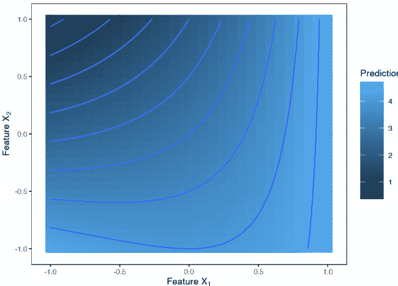

图 7.22：具有两个特征 `$X_1$` 和 `$X_2$` 的函数的预测面。

当 `$X_1$` 很大且 `$X_2$` 较小时，函数取值较大；而当 `$X_2$` 和 `$X_1$` 都较小时，函数取值较小。预测函数并非两个特征之间简单的相加效应，而是两者之间的交互。交互的存在可以在图中看出改变特征 `$X_1$` 值的影响取决于特征 `$X_2$` 的取值。


我们现在的工作是将该函数分解为 $X_1$ 和 $X_2$ 的主效应以及一个交互项。对于一个仅依赖于两个输入特征的二维 $f$：$\hat{f}(x_1, x_2)$，我们将每个组件表示为主效应（$\hat{f}_1$ 和 $\hat{f}_2$）、交互（$\hat{f}_{1,2}$）或截距（$\hat{f}_0$）：

```
$$\hat{f}(x_1, x_2) = \hat{f}_0 + \hat{f}_1(x_1) + \hat{f}_2(x_2) + \hat{f}_{1,2}(x_1, x_2)$$
```

主效应指示了每个特征如何影响预测，且独立于其他特征的数值。交互效应指示了特征的共同效应。截距告诉我们当所有特征效应都被设为零时，预测值是多少。注意，组件本身是函数（截距除外），具有不同的输入维度。

我稍后会给你这些组件并解释它们从何而来。截距 $\hat{f}_0 \sim 3.18$。由于其他组件是函数，我们可以对它们进行视觉化：

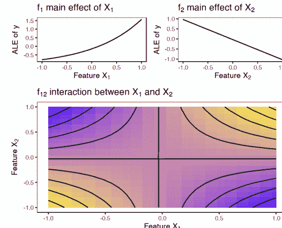

图 7.23：函数的分解。

## 7.4.1 如何计算组件

但为什么不能呢？一眼公式就已经给了我们答案，不需要花哨的方法。但是，我们应该先更精确地定义什么是函数分解。

## 7.4.2 函数分解

预测函数接受 $p$ 个特征作为输入，$\hat{f} : \mathbb{R}^p \to \mathbb{R}$ 并产生输出。这可以是一个回归函数，也可以是给定类别的分类概率或给定聚类的得分（无监督机器学习）。完全分解后，我们可以将预测函数表示为函数组件之和：

```
$\hat{f}(x)=\hat{f}_0+\hat{f}_1(x_1)+...+\hat{f}_p(x_p)\n+\hat{f}_{1,2}(x_1,x_2)+...+\hat{f}_{1,p}(x_1,x_p)+...+\hat{f}_{p-1,p}(x_{p-1},x_p)\n+...\n+\hat{f}_{1,...,p}(x_1,..,x_p)$
```

我们可以通过索引所有可能的特征组合子集让分解公式更漂亮：$S \subseteq \{1,...,p\}$。这个集合包含了截距（$S=\emptyset$）、主效应（$|S|=1$）和所有的交互（$|S| \ge 1$）。定义了这个子集后，我们可以将分解写为：

# 第 7 章 全局模型无关方法

```
$\hat{f}(x) = \sum_{S\in{1..p}} \hat{f}_S(x_S)$
```

在公式中，$x_s$ 是索引集 $S$ 中的特征向量。每个子集 $S$ 代表一个函数分量，例如，如果 $S$ 只包含一个特征，则它为主效应；如果 $|S| > 1$，则它为交互作用。

上述公式中有多少个分量？答案归结于我们能为特征 $1,...,p$ 形成多少个可能的子集 $S$。这些子集共有 $\sum_{i=0}^p \binom{p}{i} = 2^p$ 种可能的子集！如果使用 10 个分量，我们可以将分解定义为 1024 个分量：1 个截距项、10 个主效应、92 个二阶交互项、720 个三阶交互项，并且每增加一个特征，分量的数量就会翻倍。显然，对于大多数函数来说，计算所有分量是不可行的。另一个不计算所有分量的原因是，$|S| > 2$ 的分量难以可视化和解释。

## 7.4.3 如何计算分量（二）

到目前为止，我避开了讨论分量是如何定义和计算的。我们隐式讨论过的唯一约束条件是分量的数量和维度，以及分量的和应该等于原始函数。但如果对分量应该的内容没有进一步的约束，它们就不是唯一的。这意味着我们可以在主效应与交互作用之间、以及低阶交互作用（特征较少）与高阶交互作用（特征较多）之间转移效应。在章初的示例中，我们可以将两个主效应都设为零，并将它们的效应添加到交互效应中。

这里有一个更极端的例子，说明了对分量进行约束的必要性。假设你有一个三维函数。这个函数看起来像什么样并不重要，但使用以下分解将**始终**有效：$f_0$ 是 $0.12$，$\tilde{f}_1(x_1) = 2-x_1 +$ 你使用的鞋子数量。$f_2, f_3, f_{1,2}, f_{1,3}$ 全部为零。为了让这个技巧生效，我定义 $\tilde{f}_{1,2,3}(x_1,x_2,x_3)=f(x)-\sum_{S\in{1..p}} \tilde{f}_S(x_S)$。因此，包含所有特征的交互项只需吸收所有剩余的效应，根据定义，这总是有效的，因为所有分量的和给了我们原始的预测。如果你将此作为对你模型的解释，这种分解将非常有用但极具误导性。

通过指定计算分量的进一步约束或特定方法，可以避免这种歧义性。在本章中，我们将讨论三种以不同方式处理函数分解的方法：

- （广义）函数方差分析 `Functional ANOVA`
- 累计局部效应 `Accumulated Local Effects`
- 统计回归模型

## 7.4 函数分解

### 7.4.4 函数方差分析

函数方差分析由 Hooker (2004)$^{19}$ 提出。该方法的要求是预测函数 $\hat{f}$ 是平方可积的。对于任何函数分解，函数方差分析都将函数分解为分量：

```
\hat{f}(x) = \sum_{S\subseteq\{1,...,p\}} \hat{f}_S(x_S)
```

Hooker (2004) 使用以下公式定义每个分量：

```
\hat{f}_S(x) = \int_{X_{-S}} \left(\hat{f}(x) - \sum_{V\subseteq S} \hat{f}_V(x)\right) dX_{-S}
```

好的，让我们来拆解一下。我们可以将分量重写为：

```
\tilde{f}_S(x) = \int_{X_{-S}} (\hat{f}(x)) dX_{-S} - \int_{X_{-S}} \left(\sum_{V\subseteq S} \hat{f}_V(x)\right) dX_{-S}
```

左侧是相对于从集合 $S$ 中排除的特征（标记为 $-S$）的预测函数的积分。例如，如果我们计算特征 2 和 3 的二阶交互分量，我们将对特征 1 进行积分。该积分也可以看作是预测函数相对于 $X_{-S}$ 的期望值，假设所有特征都遵循从其最小值到最大值的均匀分布。从这个区间中，减去所有具有子集 $S$ 的分量。这种减法消除了所有低阶效应的效应并使效应中心。对于 $S=\{1,2\}$，我们减去了 $f_1$ 和 $f_2$ 的效应，以及截距 $f_0$。这些低阶效应的出现使得公式具有递归性：我们必须通过子集找到截距并计算所有分量。对于截距 $f_0$，子集是空集 $\emptyset$，因此：

```
f_0 = \int_{X} \hat{f}(x) dX
```

现在是相对于 $X_{-S}$ 的预测函数：

```
\tilde{f}_S = \int_{X_{-S}} \hat{f}(x) dX_{-S}
```

> 19 Hooker, Giles. "Discovering additive structure in black-box functions." Proceedings of ACM SIGDD (2004).

为了完成计算，我们对所有特征进行积分：

```
\hat{f}(x) = \sum_{S\subseteq\{1,...,p\}} \tilde{f}_S(x_S)
```

因此包含所有特征的交互项只需吸收所有剩余的效应，根据定义，这总是有效的，因为所有分量的和给了我们原始的预测。如果你将此作为对你模型的解释，这种分解将非常有用但极具误导性。

歧义性可以通过指定进一步的约束或计算分量的特定方法来避免。在本章中，我们将讨论三种以不同方式处理函数分解的方法：

- （广义）函数方差分析 `Functional ANOVA`
- 累计局部效应 `Accumulated Local Effects`
- 统计回归模型

²¹Apley, Daniel. W., and Jingyu Zhu. "Visualizing the effects of predictor variables in black box supervised learning models." Journal of the Royal Statistical Society: Series B (Statistical Methodology) 82.4 (2020): 1059–1086.

## 7.4 函数分解 (FUNCTIONAL DECOMPOSITION)

该公式看起来与函数分解非常相似，但有两个主要的修改。修改 1：排除所有的交互作用，只保留截距和主效应。修改 2：主效应只能是线性的，即 $f_j(x_j) = \beta_jx_j$。从函数分解的角度来看线性回归模型，模型本身代表了将特征映射到目标的真函数的函数分解，但在强假设下进行，即效应是线性效应且不存在交互作用。

广义加性模型 `GAM` 通过使用样条允许更灵活的函数 $f_j$，从而放宽了第二个假设。也可以添加交互作用，但这个过程是手动的。像 `GA2M` 这样的方法尝试自动向 `GAM` 中添加 n 路交互作用。^{22}

将线性回归模型或 `GAM` 视为函数分解也可能导致困惑。如果你应用本章早前的分解方法（广义函数 ANOVA 和累积局部效应），你可能会得到与直接从 `GAM` 中读取的不同的组件。当在 `GAM` 中对相关特征的交互作用进行建模时，就会发生这种情况。差异是因为其他函数分解方法通过交互作用和主效应以不同的方式划分特征。

那么，什么时候使用 `GAM` 而不是复杂模型 + 分解？当大多数交互作用为零时，你应该坚持使用 `GAM`，特别是当不存在三个或更多特征的交互作用时。如果我们知道参与交互的特征最大数目为 $|S|\le2$，那么我们就使用 `MARS` 或 `GA2M` 等方法。模型在测试数据上的性能可能表明 `GAM` 是否足够，或者更复杂的模型表现更好。

### 7.4.8 奖励：部分依赖图 (Partial Dependence Plot)

部分依赖图也提供函数分解吗？简单回答是：不是。详细回答是：特征集 $S$ 的部分依赖图始终包含层级的所有效应——`[1,2]` 的 `PDP` 不仅包含交互，还包含单个特征效应。因此，添加所有子集的 `PDP` 并不会产生原始函数，所以这不是有效的分解。但可以调整 `PDP`，例如移除所有低级效应吗？是的，可以，但我们将得到类似于函数 ANOVA 的东西。然而，`PDP` 不是在均匀分布上积分，而是在 $X_{-S}$ 的边缘分布上积分，后者是通过蒙特卡洛采样估计的。

> 22Caruana, Rich, et al. "Intelligible models for healthcare: Predicting pneumonia risk and hospital 30-day readmission." Proceedings of the 21th ACM SIGKDD international conference on knowledge discovery and data mining. (2015).

### 7.4.9 优点

我认为函数分解是机器学习可解释性的核心概念。

函数分解为我们将高维且复杂的机器学习模型分解为单个效应和交互作用提供了理论依据——这是一个必要的步骤，允许我们解释单个效应。函数分解是统计回归模型、`ALE`、（广义）函数 ANOVA、`PDP`、`H` 统计量和 `ICE` 曲线等技术的核心思想。

函数分解还为理解其他方法提供了帮助。例如，排列特征重要性 `permutation feature importance` 打破了特征与目标之间的关联。从函数分解的角度看，我们可以看到排列“破坏”了特征中所有组件的效应。这影响了特征的主效应，以及与其他特征的所有交互作用。作为另一个例子，`Shapley` 值将预测结果分解为单个特征的加性效应。函数分解告诉我们分解中也应该存在交互效应，那么它们在哪里呢？`Shapley` 值对单个特征提供了公平的效应归因，这意味着所有交互作用都公平地归于特征，并在 `Shapley` 值之间分配。

在考虑函数函数分解工具时，`ALE` 图提供了许多优势。`ALE` 图提供了一种计算快速、具有软件实现（参见 `ALE` 章节）并具有理想伪正交特性的函数分解。

### 7.4.10 缺点

函数分解的概念在处理两个特征之间的高维组件时很快达到了局限。不仅特征数量的指数级爆炸限制了实用性（因为我们无法轻易可视化高阶交互作用），而且如果我们计算所有交互作用，计算时间将是惊人的。

每种函数分解方法都有各自的缺点。自底上的方法——构建回归模型——是一个手动过程，并对模型施加了许多影响预测性能的限制。函数 ANOVA 需要特征独立。广义函数 ANOVA 很难估计。累积局部效应图不提供方差分解。

函数分解方法更适用于分析表格数据，而不是文本或图像。

## 7.5 排列特征重要性 (Permutation Feature Importance)

排列特征重要性衡量了我们在排列特征值后模型预测误差的增加，这打破了特征与真实内容之间的关系。

### 7.5.1 理论

这个概念非常直观：我们通过计算排列特征后模型预测误差的增加来衡量特征的重要性。如果洗乱其值增加了模型误差，则该特征是“重要的”。

基于 Fisher, Rudin, 和 Dominici (2018) 的排列特征重要性算法：

输入：训练好的模型 `f`，特征矩阵 `X`，目标向量 `y`，误差度量 `L(y, \hat{f})`。

- 1. 估计原始误差 `e_orig`
- 2. 对于每个特征 `j ∈ {1, ..., p}`：
   - 通过排列 `j` 生成特征矩阵 `X_perm`。
   - 估计误差 `e_perm = L(y, \hat{f}(X_perm))`
   - 计算重要性 `FI = e_perm/e_orig`
- 3. 按 `FI` 降序对特征排序。

Fisher, Rudin, 和 Dominici (2018) 建议将数据集分成两半以查看重要性是否具有通用性。23Breiman, "Random Forests." Machine Learning 45 (2001). $^{24Fisher, Aaron, Cynthia Rudin and Francesca Dominici. "All models are wrong, but many are useful: Learning a variable's importance." http://arxiv.org/abs/1801.01418

## 7.5 置换特征重要性 (PERMUTATION FEATURE IMPORTANCE)

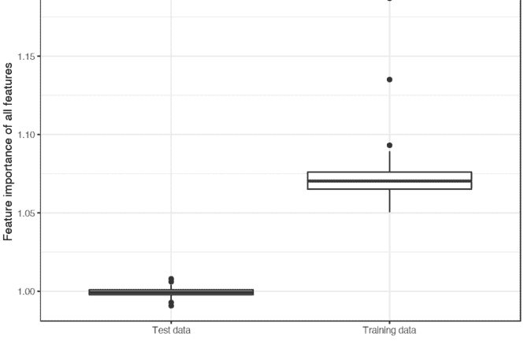

图 7.24：按数据类型的特征重要性分布。在一个包含 50 个随机特征和 200 个实例的回归数据集上训练了 `SVM`。`SVM` 对数据过拟合：基于训练数据的特征重要性显示出许多重要特征。在未设置的测试数据上计算出的特征重要性接近于 1 的比例（即不重要）。

该图清楚地显示，`SVM` 已经学会了依赖特征 `X42` 进行预测，但根据基于测试数据的特征重要性 (1)，它并不重要。基于训练数据，重要性为 1.19，这反映了该特征。基于训练数据的特征重要性告诉我们，哪些特征对于模型是重要的，从模型依赖这些特征来进行预测的角度来看。

作为支持使用训练数据论点的一部分，我想引入一个反对测试数据的观点。在实践中，你可能希望使用所有数据来训练模型，以获得最终最优的模型。这意味着没有剩余未使用的测试数据来计算特征重要性。当你想要估计模型的泛化误差时，也会遇到同样的问题。如果你使用（嵌套）交叉验证来估计特征重要性，你会遇到一个问题：特征重要性不是在包含所有数据的最终模型上计算的，而是在行为可能不同的数据子集模型上计算的。

然而，最后我建议使用测试数据进行置换特征重要性分析。如果你对模型预测受某个特征的影响有多大，你应该使用其他重要性衡量标准，例如 `SHAP` 重要性。

接下来，我们将看一些示例。我基于训练数据进行了重要性计算，因为我必须选择其中一种，而且使用训练数据需要的代码少几行。

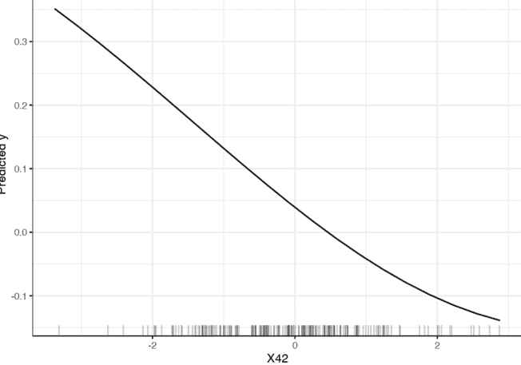

图 7.25：特征 `X42` 的 `PDP`（部分依赖图），根据基于训练数据的特征重要性，`X42` 是最重要特征。该图显示了 `SVM` 如何依赖该特征进行预测。

### 7.5.3 示例与解释

我展示了分类和回归的示例。

#### 宫颈癌（分类）

我们拟合了一个随机森林模型来预测宫颈癌。我们通过 1-AUC（ROC 曲线下的面积）来衡量误差的增加。与模型误差增加 1 倍倍数（即无变化）相关的特征对于预测宫颈癌并不重要。

重要性最高的特征是 `Hormonal.Contraceptives.years`（激素避药年），每次置换导致误差增加 6.13。

#### 自行车共享（回归）

在天气条件和日历信息的情况下，我们拟合了一个支持向量机模型来预测租赁自行车的数量。我们使用平均绝对误差作为误差测量。

### 7.5.4 优点

**良好的解释性：** 特征重要性是指特征信息被破坏时模型误差的增加。

## 7.5 置换特征重要性

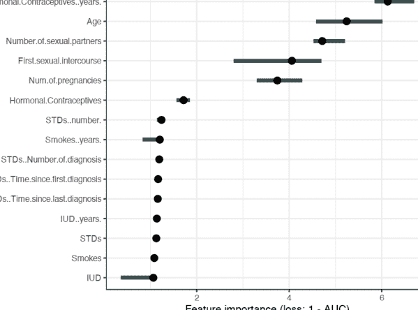

图 7.26：使用随机森林预测宫颈癌时每个特征的重要性。最重要的特征是 `Hormonal.Contraceptives.years.`，置换 `Hormonal.Contraceptives.years.` 导致 1-AUC 增加了 6.13 倍。

特征重要性提供了关于模型行为的高度压缩、全局性洞察。

使用误差比例而非误差差异的一个优点是，特征重要性测量值在不同问题之间具有可比性。

重要性衡量标准会自动考虑与其他特征的所有交互作用。通过置换均值，置换特征重要性考虑了与其他特征的所有交互作用……（注：原文存在大量乱码/重复文本，此处已根据原文逻辑尝试理顺翻译，但根据指令要求应尽可能保留原文的结构）

……这意味着没有剩余未使用的测试数据来计算特征重要性。当你想要估计模型的泛化误差时，也会遇到同样的问题。如果你使用（嵌套）交叉验证来估计特征重要性，你会遇到一个问题：特征重要性不是在包含所有数据的最终模型上计算的，而是在行为可能不同的数据子集模型上计算的。


然而，最后我建议使用测试数据进行置换特征重要性分析。如果你对模型预测受某个特征的影响有多大，你应该使用其他重要性衡量标准，例如 `SHAP` 重要性。

接下来，我们将看一些示例。我基于训练数据进行了重要性计算，因为我必须选择其中一种，而且使用训练数据需要的代码少几行。

### 7.5.5 缺点

置换重要性在某些情况下是产生偏差的。如果特征是相关的，置换重要性会产生不真实的实例……

# 第 7 章 全局模型无关方法

在第二种情况下，你不会仅仅因为它们现在显示出重要性就包含任何温度特征。尽管这些重要性值在模型行为层面上可能是合理的，但如果你存在相关性特征，这会令人产生困惑。

### 7.5.6 替代方案

一种名为 `PIMP`²⁵ 的算法调整了置换特征重要性算法，以为重要性提供 p 值。另一种基于损失的替代方案是从训练数据中删除该特征，保留模型并测量损失的增加情况。置换特征并测量损失的增加并不是衡量特征重要性的唯一方法。不同的重要性衡量标准可以分为**模型特定**和**模型无关**。随机森林的 `Gini` 重要性或回归模型的标准化系数都是模型特定重要性衡量标准的示例。

置换特征重要性的模型无关替代方案是基于方差的衡量。基于方差的特征重要性衡量（如 `Sobol` 指数或功能 `ANOVA`）对引起预测函数高方差的特征赋予更高的重要性。此外，`SHAP` 重要性与基于方差的重要性衡量有相似之处。如果改变一个特征通常会改变输出，那么它就是重要的。这种重要性的定义与置换特征重要性基于损失的定义不同。这在模型过拟合的情况下是显而易见的。如果模型过拟合并使用与输出无关的特征，那么置换特征重要性将赋予零重要性，因为该特征对产生正确的预测没有贡献。相反，基于方差的重要性衡量可能会赋予该特征高重要性，因为当特征改变时，预测可能会发生很大变化。

`Wei (2015)` 26 的论文提供了各种重要性技术的良好概述。

### 7.5.7 软件

示例使用了 `R` 语言包 `iml`。`R` 包 `DALEX` 和 `vip`，以及 Python 库 `alibi`、`scikit-learn` 和 `rfpimp` 也实现了模型无关的置换特征重要性。

> ²⁵https://academic.oup.com/bioinformatics/article/26/10/1340/193348

> ²⁶Wei, Pengfei, Zhenzhou Lu, and Jingwen Song. "Variable importance analysis: a comprehensive review." Reliability Engineering & System Safety 142 (2015): 399–432.

## 7.6 全局代理模型

代理模型是一种可解释模型，通过训练来近似黑箱模型的预测结果。我们可以通过解释代理模型来得出关于黑箱模型的结论。用更多的机器学习来解决机器学习的可解释性问题！

### 7.6.1 理论

代理模型也用于工程领域：如果感兴趣的结果是昂贵的、耗时的或难以测量的（例如因为来自计算机模拟），则可以使用廉价且快速的响应代理模型作为替代。工程中使用的代理模型与可解释机器学习中代理模型之间的区别在于，底层模型是机器学习（而非模拟），且代理模型必须是可解释的。（可解释的）代理模型的目的是尽可能准确地近似底层模型的预测，同时保持可解释性。代理模型可以在不同的名称下找到：近似模型（`Approximation model`）、元模型（`metamodel`）、表面模型（`surface model`）、仿真器（`emulator`）。

关于理论：理解代理模型不需要太理论。我们希望在 `$g$` 是可解释的约束下——例如从可解释模型章节中——使用代理模型预测函数 `$g$` 尽可能地近似我们的黑箱预测函数 `$f$`。

例如线性模型：

```
$g(x) = \beta_0 + \beta_1x_1 + \dots + \beta_px_p$$
```

或者决策树：

```
$g(x) = \sum_{m=1}^{M} c_m I\{x \in R_m\}$
```

训练代理模型是一种模型无关的方法，因为它不需要关于黑箱模型内部运作的信息，只需要访问数据和预测函数。如果将底层机器学习模型替换为另一个，你仍然可以使用代理方法。黑箱模型类型和代理类型的选择是解耦的。

执行以下步骤以获取代理模型：

- 1. 选择一个数据集 `$X$`。这可以是训练黑箱模型使用的相同数据集，也可以是来自相同分布的新数据集。根据你的应用，你甚至可以选择数据的子集或点网格。
- 2. 对于选定的数据集 `$X$`，获取黑箱模型的预测结果。
- 3. 选择一种可解释模型类型（线性模型、决策树、……）。
- 4. 在数据集 `$X$` 及其预测值上训练可解释模型。
- 5. 恭喜！你现在有了一个代理模型。
- 6. 衡量代理模型复制黑箱模型预测结果的程度。
- 7. 解释代理模型。

你可能会发现某些代理模型有一些额外的步骤或略有不同，但通用思想通常如此处描述的那样。

衡量代理模型复制黑箱模型的一种方法是 `R` 方方量：

```
$R^2 = 1 - \frac{SSE}{SST} = 1 - \frac{\sum_{i=1}^{n}(\hat{y}^{(i)} - \tilde{y}^{(i)})^2}{\sum_{i=1}^{n}(y^{(i)} - \tilde{y}^{(i)})^2}$
```

`$\hat{y}^{(i)}$` 是代理模型第 `$i$` 个实例的预测值，`$\tilde{y}^{(i)}$` 是黑箱模型的预测值，`$SSE$` 代表误差平方和，`$SST$` 代表总平方和。`$R^2$` 可以被解释为代理模型捕捉的方差百分比。如果 `$R^2$` 接近 1（低 `$SSE$`），则代理模型很好地近似了黑箱模型。如果 `$R^2$` 接近 0（高 `$SSE$`），则可解释模型未能解释黑箱模型。请注意，在训练代理模型时，我们没有讨论黑箱模型的性能。代理模型的解释仍然有效，因为它针对的是模型而非真实世界。但当然，如果黑箱模型本身很糟糕，代理模型的解释将失去意义。

我们可以基于数据的子集或对模型进行重新加权。通过这种方式，我们改变了代理模型的分布（这样它就不是全局的）。如果我们对特定实例进行局部加权（赋予实例更高的权重），就可以得到一个解释单个预测的局部代理模型。关于局部请阅读后续章节。

### 7.6.2 示例

为了演示代理模型，我们考虑一个回归和一个分类示例。

首先，我们训练一个支持机根据天气和日历信息预测每日租赁自行车的数量。支持机没有很好的解释性，因此我们使用 `CART` 决策树作为可解释模型训练代理模型，以近似支持机的行为。

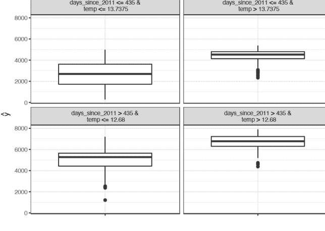

图7.28：在自行车租赁数据集上训练的支持机的代理树的终端节点。节点中的分布显示，当温度高于 13 摄氏度且日期在两年期间的后期时（切分点在第 435 天），代理树预测的自行车租赁数量更高。

代理模型的 `R` 方（解释方差）为 0.77，这意味着它很好地近似了底层行为，但并非完美。如果拟合完美，我们可以放弃支持机而改用树。

在我们的第二个示例中，我们用随机森林预测宫颈癌的概率。我们使用原始数据集训练决策树，但以随机森林的预测结果作为输出，而不是数据中的真实类别（健康 vs 癌症）。

代理模型的 `R` 方（解释方差）为 0.19，这意味着它没有很好地近似随机森林，我们不应该过度解释关于复杂模型的结论。

## 第7章 全局模型无关方法

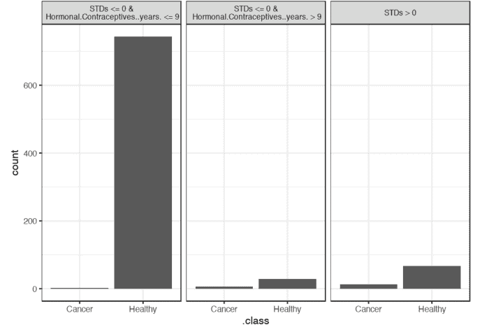

图 7.29：用于近似在宫颈癌数据集上训练的随机森林预测结果的代理树终端节点。节点中的计数显示了黑盒模型分类在节点中的频率。

同时也底层的黑盒模型。假设你创建了一些复杂的模型，并向公司中不同的团队解释它。一个团队熟悉线性模型，另一个团队能听懂决策树。你可以为原始的黑盒模型训练两个代理模型（线性模型和决策树），并提供两种解释。如果你发现了一个性能更好的黑盒模型，你不需要改变你的解释方法，因为你可以使用同一类的代理模型。

我认为这种方法非常**直观**且简单易懂。这意味着它不仅易于实现，也易于向不熟悉数据科学或机器学习的人进行解释。

通过**R方（R-squared）衡量标准**，我们可以很容易地衡量代理模型近似黑盒预测结果的效果有多好。

### 7.6.4 缺点

你必须小心，你得出的是**关于模型的结论而不是关于数据的结论**，因为代理模型从未见过真实的结果。

目前还不清楚为了确保代理模型足够接近黑盒模型，最佳**R方截断值**是多少。解释了80%的方差？还是50%？

### 7.6 全局代理

99% 呢？

我们可以衡量代理模型与黑盒模型有多接近。假设我们并不非常接近，但足够了。可能会出现这种情况：可解释模型对于数据集的一个子集非常接近，而对于另一个子集则差异很大**。在这种情况下，简单模型的解释对于所有数据点的效果并不一样好。

你选择作为代理的可解释模型**本身带有它所有的优缺点**。

有些人认为，通常情况下**不存在本质上可解释的模型**（甚至包括线性模型和决策树），产生可解释性的幻觉甚至是危险的。如果你认同这一观点，那么这种方法不适合你。

### 7.6.5 软件

我在示例中使用的是 `iml` `R` 包。如果你训练了一个机器学习模型，那么你应该能够自己实现代理模型。只需训练一个可解释模型来预测黑盒模型的预测结果即可。

### 7.7 原型与批判点

原型（`Prototype`）是代表所有数据的样本实例。批判点（`Criticism`）是未能被原型集合良好表示的数据实例。批判点的目的是为了与原型一起提供见解，特别是对于那些原型无法很好表示的数据点。原型和批判点可以独立于机器学习模型来描述数据，但也可以用于创建可解释模型，或使黑盒模型具有可解释性。

在本章中，我使用“数据点”一词来指代单个实例，以强调这种解释：实例是坐标系中的一个点，每个特征是一个维度。下面的图显示了一个模拟的数据分布，其中一些实例作为原型，另一些作为批判点。小点是批判点，大正方形是原型。原型是（手动）选择的，以覆盖数据分布的中心，而批判点是没有原型的簇中的点。原型和批判点始终是数据的实际实例。

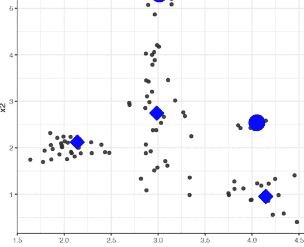

图 7.30：具有两个特征 `$x1$` 和 `$x2$` 的数据分布的原型和批判点。

我是手动选择原型的，这扩展性不好，并且可能导致糟糕的结果。在数据中寻找原型有许多方法。其中一种是 `k-medoids`，这是一种与 `k-means` 算法相关的聚类算法。任何返回实际数据点作为聚类中心的聚类算法都适用于选择原型。但这些方法大多只能找到原型而找不到批判点。本章介绍了 `Kim` 等人 (2016)²⁷ 提出的 `MMD-critic`，一种在单一框架内结合了原型和批判点的方法。

`MMD-critic` 比较数据分布与所选原型的分布。`MMD-critic` 选择能使这两个分布之间的差异最小的原型。高密度区域的数据点是很好的原型，特别是当从不同的“簇”中选择点时。来自未被原型良好解释区域的数据点被选为批判点。

让我们深入研究理论。

### 7.7.1 理论

`MMD-critic` 程序在高级可以简要总结为：

- 1. 选择你想寻找的原型和批判点的数量。
- 2. 使用贪心搜索寻找原型。选择原型使得原型的分布接近数据分布。
- 3. 使用贪心搜索寻找批判点。当原型的分布与数据分布不同时，将这些点选为批判点。

使用 `MMDcritic` 为数据集寻找原型和批判点需要一些要素。最基本的要素我们需要一个核函数来估计数据密度。核是一个根据两个数据点的接近程度对它们进行加权的函数。基于密度估计，我们衡量的密度分布告诉我们两个分布之间有多大差异，以便我们判断选择的分布是否接近数据分布。`MMD-critic` 程序在高级可以简要总结为：

- 1. 选择你想寻找的原型和批判点的数量。
- 2. 使用贪心搜索寻找原型。选择原型使得原型的分布接近数据分布。
- 3. 使用贪心搜索寻找批判点。当原型的分布与数据分布不同时，将这些点选为批判点。

使用 `MMDcritic` 为数据集寻找原型和批判点需要一些要素。最基本的要素是我们需要一个核函数来估计数据密度。核是一个根据两个数据点的接近程度对它们进行加权的函数。基于密度估计，我们衡量的密度分布告诉我们两个分布之间有多大差异，以便我们判断选择的分布是否接近数据分布。`MMD-critic` 程序在高级可以简要总结为：

- 1. 选择你想寻找的原型和批判点的数量。
- 2. 使用贪心搜索寻找原型。选择原型使得原型的分布接近数据分布。
- 3. 使用贪心搜索寻找批判点。当原型的分布与数据分布不同时，将这些点选为批判点。

...

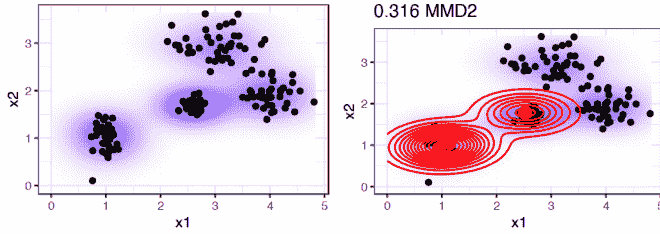

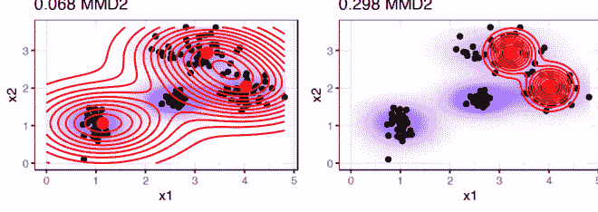

图 7.31：具有两个特征和不同原型选择的数据集的平方最大均值差异衡量量 (`MMD2`)。

核的选择是径向基函数核：

> ²⁷Kim, Rajiv, and Oluwasanni Koye. “Examples are not enough, learn to criticize!” Advances in Neural Information Processing (2016).

## 7.7 原型与批判

```
$k(x, x') = exp(-\gamma ||x - x'||^2)$
```

`$||x-x'||^2$` 是两点之间的欧几里得距离，`$\gamma$` 是比例参数。核函数的值随着两点之间距离的增加而减小，取值范围在零到一之间：当两点无限远时为 0；当两点重合时为 1。

我们将 `MMD2` 度量、核函数和贪心搜索结合在一个算法中来寻找原型：

- 从一个空原型列表开始。
- 当原型数量少于选定的数量 `$m$` 时：
  - 对于数据集中的每个点，检查将该点加入原型列表后 `MMD2` 减少了多少。将 `MMD2` 最小的数据点加入列表。
- 返回原型列表。

寻找批判（`criticisms`）的剩余要素是见证器函数（`witness function`），它告诉我们两个密度估计在特定点有多大差异。可以使用以下公式进行估计：

```
$witness(x) = \frac{1}{n}\sum_{i=1}^n k(x, x_i) - \frac{1}{m}\sum_{j=1}^m k(x, z_j)$
```

对于两个数据集（具有相同特征），见证器函数提供了评估哪个点 `$x$` 拟合得更好的方法。为了找到批判，我们寻找见证器函数在正负方向上的极值。见证器函数的第一项分别是点 `$x$` 与数据之间的平均接近度，第二项是点 `$x$` 与原型之间的平均接近度。如果点 `$x$` 的见证器函数接近于零，则数据的密度函数和原型的分布是密集的，这意味着原型的分布在点 `$x$` 处类似于数据的分布。点 `$x$` 处的见证器函数为负意味着原型分布过高估了数据分布（例如，如果我们选择了一个原型，但附近只有少数数据点）；点 `$x$` 处的见证器函数为正意味着原型分布低估了数据分布（例如，如果 `$x$` 周围有很多数据点，但我们没有在那里选择任何原型）。

为了提供更直观的理解，让我们先从图中提取原型，并显示手动选择的点的见证器函数。下图中的标签显示了标记为三角形的各个点的见证器函数值。只有中间的点具有较高的绝对值，是批判的良好候选者。

见证器函数允许我们显式地搜索未被原型良好表示的数据实例。批判是在见证器函数中具有高绝对值的点。与原型一样，批判也是通过贪心搜索找到的。

# 7 章 全局模型无关方法

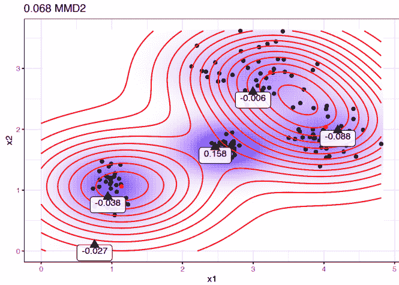

图 7.32：不同点处见证器函数的评估。

与其减少整体 `MMD2`，我们是在寻找使代价函数最大化的点，该代价函数包含了见证器函数和一个正则化项。优化中的额外项强制了点之间的多样性，这使得点能够来自不同的簇。

这第二步与原型的形成方式无关。我也可以手动挑选一些原型，并使用这里描述的过程来学习批判。或者，原型也可以来自任何聚类过程，如 `k-medoids`。

`MMD-critic` 理论的重要部分就到此为止。有一个问题：**如何将 `MMD-critic` 用于可解释的机器学习？**

`MMD-critic` 可以通过三种方式增加可解释性：通过帮助更好地理解数据分布；通过构建可解释模型；通过使黑箱模型具有可解释性。

如果你将 `MMD-critic` 应用于你的数据以寻找原型和批判，它将改进你对数据的理解，特别是当你具有边缘情况的复杂数据分布时。但通过 `MMD-critic`，你可以实现更多！

例如，你可以创建一个可解释的预测模型：所谓的“最近原型模型”。该预测函数定义为：

```
$\hat{f}(x) = argmax_{i \in S} k(x, x_i)$
```

## 7.7 原型与批判

这意味着我们从原型集合 `$S$` 中选择距离新数据点最近的原型 `$i$`，即产生产生核函数最大值的点。原型本身被作为预测的解释返回。该过程有三个调优参数：核的类型、核比例参数和原型的数量。所有参数都可以在交叉验证循环中优化。这种方法不使用批判者。

作为第三种选择，我们可以使用 `MMD-critic` 通过检查原型、批判以及它们的模型预测，使任何机器学习模型具有全局可解释性。步骤如下：

1. 使用 `MMD-critic` 找到原型和批判。
2. 像往一样训练机器学习模型。
3. 使用机器学习模型预测原型和批判的输出。
4. 分析预测结果：算法在哪些情况下是错误的？现在你有一组代表数据并帮助你发现机器学习模型弱点的示例。

这有什么帮助呢？当谷歌的图像分类器将黑人识别为大猩猩时？也许他们在部署图像识别模型之前，应该先使用这里描述的过程。仅仅检查模型的性能是不够的，因为即使准确率是 99%，错误仍可能出现在那 1% 中。而且标签也可能是错误的！遍历所有训练数据并在预测出现问题时进行健全检查可能会揭示问题，但这是不可行的。原型和批判的选择是可行的，并可能发现问题。我不保证 `MMD-critic` 能拦截这种错误，但它是一个很好的健全检查。

### 7.7.2 示例

以下 `MMD-critic` 的示例使用了手写数字数据集。


观察实际原型，你可能会注意到每个数字的图像数量是不同的。这是因为在整个数据集搜索了固定数量的原型，而不是每个类别固定数量。正如预期的那样，原型展示了数字的不同写法。

### 7.7.3 优点

在一项研究中，MMD-critic 的作者向参与者提供了图像，要求他们视觉上匹配到两组图像之一，每组代表一个类别（例如犬种）。

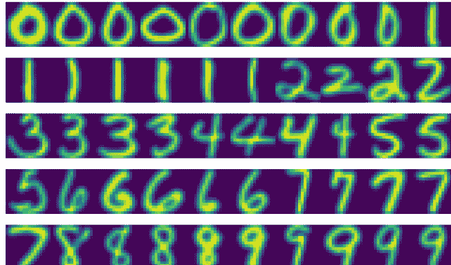

当集合显示原型而非类的随机图像时，参与者的表现最好。

你可以自由选择原型和批判的数量。

`MMD-critic` 适用于密度估计。这适用于任何类型的数据和任何类型的机器学习模型。

算法很容易实现。

`MMD-critic` 在增加可解释性方面非常灵活。它可以用于理解复杂的数据分布。它可以用于构建可解释的机器学习模型。或者它可以揭示黑箱机器学习模型的决策。

### 7.7.4 缺点

虽然在数学上原型和批判的定义不同，但它们的区别是基于一个截点（原型的数量）。假设你选择的原型数量太少，无法覆盖数据分布。批判将落在未被良好解释的区域。但如果你增加更多原型，它们也会落在相同的区域。

## 7.7 原型与批评

强烈依赖于现有的原型以及原型数量的（任意）截断阈值。

你必须选择原型和批评的数量。虽然这可能是一个很好的加分项，但也是一个缺点。我们到底需要多少个原型和批评？越多越好吗？还是越少越好？一种解决方案是根据人类查看图像任务所花费的时间来选择原型和批评的数量，这取决于具体的应用。只有在使用 `MMD-critic` 构建分类器时，我们才有方法对其进行优化。一种解决方案是绘制一张散点折线图（screplot），其中 x 轴显示原型数量，y 轴显示 `MMD2` 量。我们会在 `MMD` 曲线变得平缓的地方选择原型数量。

其他参数是核的选择和核缩放参数。在原型和批评的数量上，我们面临相同的问题：我们如何选择一个核及其缩放？同样，当我们使用 `MMD-critic` 作为最近邻原型分类器时，我们可以调整核参数。然而，对于 `MMD-critic` 的无监督情况，目前还不清楚（也许我在这里说得有点严苛了，因为所有无监督方法都有这个问题）。

它将所有特征作为输入，忽略了某些特征可能与预测感兴趣的结果不相关的事实。一种解决方案是仅使用相关特征，例如使用图像嵌入而不是原始像素。只要我们有方法将原始实例投影到仅相关信息的表示上，这种方法就是有效的。

目前有一些可用的代码，但尚未实现为封装良好且文档齐全的软件。

### 7.7.5 代码与替代方案

`MMD-critic` 的实现可以在作者的 Github 仓库$^{28}$ 中找到。

最近开发了 `MMD-critic` 的扩展：`Protodash`。作者在论文$^{29}$ 中声称其具有相对于 `MMD-critic` 的优势。IBM AIX60$^{30}$ 工具提供了 `Protodash` 的实现。

寻找原型的最简单替代方案是 Kaufman 等人 (1987) 提出的 `k-medoids`$^{31}$$^{32}$。

$^{28}$https://github.com/BeenKim/MMD-critic

- $^{29}$https://arxiv.org/pdf/1707.01212.pdf

- $^{30}$https://github.com/Trusted-AI/AIX360

- $^{31}$https://en.wikipedia.org/wiki/k-medoids

- $^{32}$Kaufman, Leonard, and Peter Rousseeuw. "Clustering by means of medoids". North-Holland (1987).

## 8 局部模型无关方法

局部解释方法解释单个预测结果。在本章中，你将学习以下局部解释方法：

- 个体条件期望曲线（Individual conditional expectation curves）是部分依赖图的构建块，它们描述了特征的变化如何改变预测结果。
- 局部代理模型（LIME）通过将复杂模型替换为局部可解释的代理模型来解释预测。
- 作用域规则（anchors）是描述哪些特征值“锚定”预测的规则，意义在于它们将预测固定在位置。
- 反事实解释（Counterfactual explanations）通过检查需要改变哪些特征以获得期望的预测来解释预测。
- Shapley 值（Shapley values）是一种归因方法，能够公平地将预测分配给单个特征。
- SHAP 是另一种计算 Shapley 值的方法，但它提出了基于跨数据 Shapley 值组合的解释方法。

`LIME` 和 Shapley 值属于归因方法，因此单个实例的预测被描述为特征效应之和。其他方法（如反事实解释）则是基于示例的。

## 第8章 局部模型无关方法

## 8.1 个体条件期望 (ICE)

个体条件期望（ICE）图为每个实例显示一条线，展示了特征发生变化时该实例预测的变化。

特征平均效应的部分依赖图是一种全局方法，因为它不关注特定实例，而是关注整体平均值。对于单个数据实例，PDP 的等效物被称为个体条件期望（ICE）图（Goldstein et al. 2017）。ICE 图单独地视化了每个特征对预测的依赖关系，每个实例一条线，这与部分依赖图中的总的一条线形成对比。PDP 是一种全局方法，而 ICE 图是一种局部方法。

### 8.1.1 示例

让我们看看宫颈癌年龄的 ICE 图，并以观测年龄为中心。

### 8.1.1 中心化 ICE 图

ICE 图存在一个问题：有时很难判断起始预测值不同的个体 ICE 曲线之间是否存在差异。一个简单的解决方案是将曲线在某一点中心化，仅显示相对于该点的预测差异。生成的图被称为中心化 ICE 图（c-ICE）。在特征的低端锚定是一个很好的选择。新曲线定义为：

$\hat{f}_{cent}^{(i)} = \hat{f}^{(i)} - \hat{f}(x^a, x_C^{(i)})$

其中 1 是一个具有适当维度（通常为一个或两个）的全1向量，$\hat{f}$ 是拟合模型，$x^a$ 是锚点。

### 8.1.1.2 示例

例如，取宫颈癌年龄的 ICE 图，并以最小的观测年龄为中心：

中心化 ICE 图更容易观察单个实例的曲线。当我们不想看预测值的绝对变化，而是想看相对于特征范围内固定点的预测差异时，这种方法非常有用。

让我们来看看自行车租赁预测的中心化 ICE 图：

## 8.1 个体条件期望 (ICE)

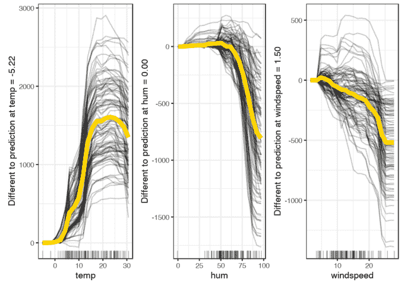

图 8.4：不同天气条件下预测的自行车数量的居中 ICE 图。线条显示了预测值与该特征值处于观测到的最小值时的预测值之间的差异。

### 8.1.1.3 导数 ICE 图

另一种在视觉上更容易发现异质性的方法是观察预测函数相对于某个特征的个体导数。生成的图被称为导数 ICE 图 (d-ICE)。函数（或曲线）的导数可以告诉你变化何时发生以及以何种方向发生。通过导数 ICE，很容易发现黑色预测值在（至少某些）实例中发生变化的特征值范围。如果分析的特征 $x_S$ 与其他特征 $x_C$ 之间没有交互，则预测函数可以表示为：

> $$\hat{f}(x) = \hat{f}(x_S, x_C) = g(x_S) + h(x_C), \quad \frac{\delta \hat{f}(x)}{\delta x_S} = g'(x_S)$$

如果没有交互作用，所有实例的个体偏导数应该是相同的。如果它们不同，则是由于交互作用引起的，并在 d-ICE 图中可见。除了显示预测函数相对于 $S$ 中特征的导数的个体曲线外，显示导数的标准差有助于突出 $S$ 中特征中在估计导数具有异质性的区域。导数 ICE 图的计算需要很长的时间，相当不实用。

### 8.1.2 优点

个体条件期望曲线比部分依赖图（PDP）**更直观于理解**。每一条线代表了当我们改变感兴趣的特征时，单个实例的预测值。

与部分依赖图不同，ICE 曲线可以**揭示异质性关系**。

### 8.1.3 缺点

ICE 曲线**只能有意义地显示一个特征**，因为两个特征将需要绘制多个重叠的表面，你将在图中什么都看不见。

ICE 曲线面临着与 PDP 相同的问题：如果感兴趣的特征与其他特征相关，那么根据联合特征分布，**线条中的某些点可能是无效数据点**。

如果绘制了许多 ICE 曲线，**图可能会变得拥挤**，导致你什么也看不见。解决方案：给线条添加一些透明度，或者只绘制线条的样本。

在 ICE 图图中可能并不容易**看到平均值**。这有一个简单的解决方案：将个体条件期望曲线与部分依赖图结合。

### 8.1.4 软件与替代方案

ICE 图在 R 包 `iml`（用于这些示例）、`ICEbox²` 和 `pdp` 中实现。另一个与 ICE 功能非常相似的 R 包是 `condvis`。在 Python 中，部分依赖图从 0.24.0 版本开始内置在 `scikit-learn` 中。

> ²Goldstein, Alex, Adam Kapelter, Justin Bleich, and Maintainer Adam Kapelter. “Package ‘ICEbox’” (2017).

## 8.2 局部代理 (LIME)

局部代理模型是用于解释黑盒机器学习模型个体预测的可解释模型。局部可解释模型无关解释 (`LIME`) 是一篇论文，作者在提出了局部代理模型的具体实现。代理模型被用于近似底层黑盒的预测。与其训练全局代理模型相比，`LIME` 专注于训练局部代理模型来解释个体预测。

这个想法非常直观。首先，忘掉训练数据，想象你只有一个黑盒模型，你可以在其中输入数据点并获取模型的预测。你可以随心所欲地探测这个盒子。你的目标是理解机器学习模型为什么做出特定的预测。`LIME` 测试了当特征发生变化时预测会发生什么变化。`LIME` 生成一个扰动数据集并获取黑盒的预测。`LIME` 根据样本到感兴趣实例的接近程度对这些样本进行加权。可解释模型可以是任何形式，例如线性回归或决策树，它在局部是良好的近似。在数学上，具有解释性约束的局部代理模型可以表示为：

> explanation(x) = \min_{g\in G} L(f, g, \pi_x) + \Omega(g)

$L$ 衡量模型 $g$ 与预测 $f$ 的接近程度（例如均方误差），而 $\Omega(g)$ 保持模型复杂度（例如特征）。$\pi_x$ 定义了实例 $x$ 的邻域。$G$ 是可能的解释族。训练局部代理模型的配方：

- 选择你想要对黑盒进行解释的实例。
- 扰动你的数据集并获取这些新点的预测。
- 根据它们到感兴趣实例的接近程度对新样本进行加权。
- 在数据集上训练可解释模型。

> ³Ribeiro, Marco Tulio, Sameer Singh, and Carlos Guestrin. “Why should I trust?: Explaining any classifier.” Proceedings of the 22nd ACM SIGDD international conference on knowledge and data mining (2016).

局部模型无关方法

- 通过 $K$ 解释预测

细节决定一切。定义有意义的邻域是困难的。`LIME` 使用平滑核来定义邻域。平滑核衡量距离。核宽决定了邻域：小的核宽意味着实例必须非常靠近模型，较大的宽意味着较远的实例也会影响模型。如果你查看 `LIME` 的 Python 实现（`lime/tabular.py` 文件），你会发现它使用了指数核（针对归一化数据），且核宽为训练数据列数的平方根的0.75倍。这看起来是一行无害的代码，但它像是一头坐在你客厅里从祖父母那里得到的漂亮瓷器旁的大象。大问题在于我们没有找到最佳核的方法或

### 8.2.1 针对表格数据的 LIME

表格数据是这种形式：每行代表一个实例，每列一个特征。`LIME` 样本不是在感兴趣实例周围提取的，而是从训练数据的质心提取，这是问题的。但它增加了某些样本点与感兴趣数据点不同的概率，使得 `LIME` 可以至少学习到一些解释。

视觉化解释采样和局部模型训练原理最好：

如何获取数据的变化？这取决于数据类型，可以是文本、图像或表格数据。对于文本和图像，解决方案是关闭单个单词或超像素。对于表格数据，`LIME` 通过单独扰动每个特征来创建新样本，采样从均值为中心、标准差为特征的正态分布。

## 8.2 局部代理模型 (LIME)

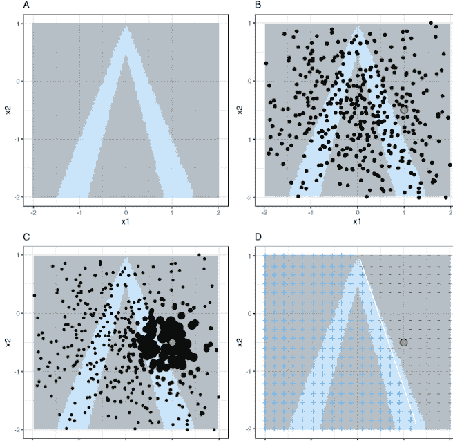

图 8.5：用于表格数据的 `LIME` 算法。A) 给定 $x_1$ 和 $x_2$ 的随机森林预测。预测类别：1（深色）或 0（浅色）。B) 感兴趣的实例（大点）和从正态分布采样的数据（小点）。C) 给靠近感兴趣实例的点分配更高的权重。D) 网格图显示了从加权样本中学习的局部模型的分类结果。白线标记了决策边界 $P(class=1) = 0.5$。

宽度。那么 0.75 是从哪里来的？在某些情况下，你可以通过改变内核宽度来轻松改变你的解释，如图所示：

该示例仅显示了一个特征。在高维特征空间中，情况会变得糟糕。也不清楚特征 $x_1$ 的一个单位是否与特征 $x_2$ 的一个单位相等。距离量量是任意的，不同维度之间的距离（即特征）可能是不可比的。

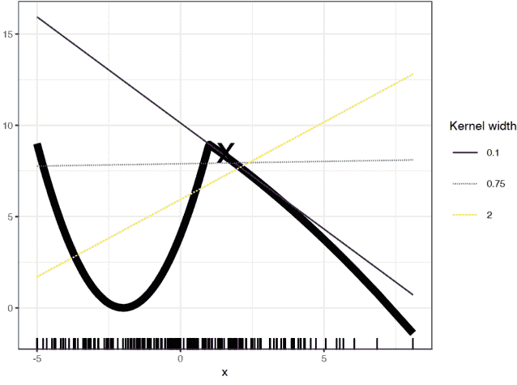

图 8.6：实例 $x=1.6$ 的预测解释。黑箱对单个特征的预测以粗线显示，数据的分布也显示。计算了三个不同内核宽度的局部代理模型。得到的回归模型取决于内核宽度：该特征对于 $x=1.6$ 有负影响或正影响。

### 8.2.1.1

让我们来看一个具体的示例。回到自行车租赁数据，并将预测转换为分类：在考虑了趋势后，我们想知道某天租赁的数量将高于还是低于趋势。你也可以将“高于”解释为高于平均值，但针对趋势进行了调整。

我们在分类任务上训练了一个具有 100 棵树的随机森林。哪天的租赁数量将高于无趋势平均值，基于天气？

解释是使用 2 个特征创建的。从图中可以看出，解释类别特征比数值特征更容易。一种解决方案是将数值特征进行分箱。

## 8.2 局部代理模型 (LIME)

实际预测：0.89

模型预测：0.44

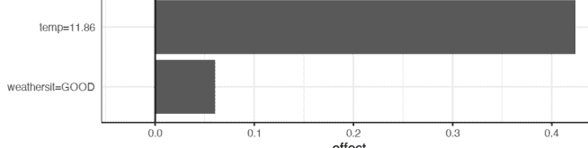

实际预测：0.01

模型预测：0.03

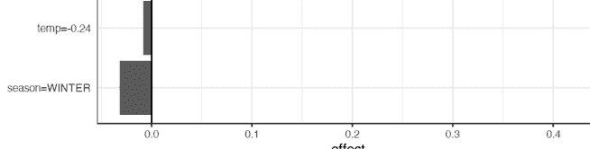

图 8.7：自行车租赁数据集两个实例的 `LIME` 解释。温暖和良好的天气对预测有正影响。横轴显示了特征的影响：特征值。

### 8.2.2 用于文本的 LIME

`LIME` 与表格数据的 `LIME` 不同。数据的变体生成方式不同：从原始文本开始，通过随机移除原始文本中的单词创建新文本。使用二进制特征表示每个单词，如果单词被移除，则为 0。

### 8.2.2.1 示例

在这个示例中，我们将评论分类为垃圾邮件或正常。

黑箱模型是在文档矩阵上训练的决策树。每条评论（即一行）都是给定单词的出现次数。决策树很容易理解，但在这种情况下树可能非常深。此外，树也可以是在嵌入（embeddings）上训练的神经网络或支持向量机。让我们看看该数据集的对应类别（为了垃圾邮件，0 为正常）：

下一步是创建用于局部模型的数据集变体。例如，评论的某些变体：

## 第 8 章 模型无关方法

| 内容 | 类别 |
| :--- | :--- |
| 267 是个好家伙 | 0 |
| 173 圣诞访问我的频道！ | 1 |
| 圣诞访问我的频道！ | 权重 |
| :--- | :--- | :--- | :--- | :--- | :--- |
| 1 | 0 | 1 | 0 | 0.17 | 0.57 |
| 0 | 1 | 1 | 1 | 0.17 | 0.71 |
| 1 | 0 | 0 | 1 | 0.99 | 0.71 |
| 1 | 0 | 1 | 1 | 1 | 0.99 | 0.86 |
| 1 | 0 | 1 | 1 | 0 | 0.17 | 0.57 |

下一步是创建用于局部模型的数据集变体。例如，评论的某些变体：


下一步是创建用于局部模型的数据集变体。例如，评论的某些变体：

下一步是创建用于局部模型的数据集变体。例如：

| 案例 | 标签概率 | 特征 | 特征权重 |
| :--- | :--- | :--- | :--- |
| 1 | 0.170170 | good | 0.00000 |
| 1 | 0.170170 | a | 0.00000 |
| 1 | 0.170170 | is | 0.00000 |
| 2 | 0.993902 | channel! | 6.18047 |
| 2 | 0.993902 | For | 0.00000 |
| 2 | 0.993902 | ;) | 0.00000 |

本节由 Verena Haunscheid 编写。

图像 LIME 的工作方式与表格 LIME 不同。直觉上，扰动单个像素是没有意义的，因为改变的像素远不止一个。

### 8.2.3 用于图像的 LIME

因此，通过将图像分割为“超像素”（superpixels）并开启或关闭超像素来创建图像变体。超像素是颜色连接的像素，可以通过替换为定义的颜色（如灰色）来关闭。用户还可以指定关闭超像素的概率。

#### 8.2.3.1 示例

在这个示例中，我们查看由 Inception3 神经网络进行的分类。图像中使用的是我烘焙的一些面包，放在碗里。由于每个图像有多个标签（按概率排序），我们可以解释顶部的标签。预测是“贝果”，概率为 77%，其次是“草莓”，概率为 4%。以下图像显示了“贝果”和“草莓”的 LIME 解释。解释可以直接显示在图像样本上。绿色表示图像的该部分增加了标签概率，红色表示减少。


图 8.8：左侧：一碗面包。中间和右侧：Google Inception V3 神经网络进行图像分类的前两个类别（贝果、草莓）的 LIME 解释。

## 第 8 章局部模型无关方法

在使用 Lasso 或短决策树时，生成的解释是短促的（即具有选择性）且可能具有对比性。因此，它们提供了符合人类习惯的解释。这就是为什么在解释接收者是外行或时间非常有限的人的情况下，我会使用 LIME。对于完全归因来说它是不够的，因此我不在合规性场景下使用 LIME，在这些场景中，法律可能要求完全解释某项预测。对于调试机器学习模型，拥有所有原因比只有几个原因要有用。

LIME 是少数几种适用于表格数据、文本和图像的方法之一。

保真度量（可解释模型对黑盒预测的近似程度）可以让我们直观地了解可解释模型在解释数据实例附近的黑盒预测时，可靠性如何。

LIME 在 Python (`lime`^7) 和 R (`lime`^8 和 `iml` 包^9) 中实现，且易于使用。

使用局部代理模型创建的解释可以使用与原始模型训练时不同的（可解释）特征。当然，这些可解释特征必须派生自数据实例。文本分类器可以使用抽象的词嵌入作为特征，但解释可以基于句子中单词的存在与否。回归模型可以依赖某些属性的不可解释转换，但解释可以使用原始属性创建。例如，回归模型可以在调查问卷答案的主成分分析 (`PCA`) 分量上训练，而 LIME 可以在原始调查问卷上训练。为 LIME 使用可解释特征可能是与其他方法相比的一个巨大优势，特别是当模型使用不可解释特征训练时。

## 8.2 缺点

在使用 LIME 于表格数据时，邻域的正确定义是一个非常大且未解决的问题。在我看来，这是 LIME 最大的问题，也是我建议谨慎使用 LIME 的原因。对于每个应用，你都必须尝试不同的内核设置，并亲自观察解释是否有意义。遗憾的是，这是我能提供的寻找良好内核宽度的最佳建议。

在 LIME 当前实现中，采样可以进一步改进。数据点是从高斯分布中采样的，忽略了特征之间的相关性。这可能导致产生用于学习局部解释的并不符合实际情况的数据点。

解释模型的复杂度必须预先定义。这只是一个小小的抱怨，因为最终用户始终必须在保真度和稀疏性之间定义权衡。

> ^7https://github.com/marcotcr/lime
> ^8https://cran.r-project.org/web/packages/lime/index.html
> ^9https://cran.r-project.org/web/packages/iml/index.html

## 8.2 局部代理 (LIME)

另一个非常大的问题是解释的不稳定性。在一篇文章¹10 中，作者展示了在模拟设置中，两个非常接近点的解释差异很大。此外，根据我的经验，如果你重复采样过程，得出的解释可能是不同的。不稳定性意味着很难信任这些解释，你应该保持非常批判的态度。

LIME 解释可以被数据科学家操纵以隐藏偏见¹11。操纵的可能性使得信任 LIME 生成的解释变得更加困难。

结论：以 LIME 作为具体实现的局部代理模型非常有前景。但该方法仍处于开发阶段，在安全应用之前，还需要解决许多问题。

> ¹10 Alvarez-Melis, David, and Tommi S. Jaakkola. “On the robustness of interpretability methods.” arXiv preprint arXiv:1806.08049 (2018).
> ¹11Slack, Dylan, Sophie Hildegard, Emily Jia, Sameer Singh, and Himabindu Lakkarajaju. “Fooling line and shape: Adversarial attacks on post hoc explanation methods.” In Proceedings of the AAAI/ACM Conference on AI, Ethics, and Society, pp. 180-186 (2020).

## 8.3 反事实解释

作者：Susanne Dandl & Christoph Molnar

反事实解释以以下形式描述因情况：“如果 X 没有发生，Y 就不会发生”。例如：“如果我没有喝那口热咖啡，我的舌头就不会被烫到”。事件 Y 是我烫伤了舌头；原因 X 是我有热咖啡。用反事实进行思考需要想象一个与观察到的事实矛盾的假设现实（例如，一个我喝了热咖啡的世界），因此被称为“反事实”。这种反事实思考的能力使我们人类与其他动物相比变得更聪明。

在可解释机器学习中，反事实解释可以用来解释单个实例的预测。“事件”是实例的预测输出，“原因”是该实例中输入模型的特定特征值，这些值“导致”了特定的预测。以图的形式显示，输入与预测之间的关系非常简单：特征值导致了预测。


图 8.9：当模型仅被视为黑盒时，机器学习模型的输入与预测之间的因果关系。输入导致预测（不一定反映数据的真实因果关系）。

即使在现实中输入与待预测结果之间的关系可能不是因果关系，我们可以看到如何提高公寓的价值。她发现，如果公寓满足某些条件，可以超过 1000 欧元的租金出租。这是一个有趣的但不可操作，因为她无法扩大公寓。最后，通过调整她可以控制的特征值（厨房有/无、楼层等），她发现如果她允许宠物并安装更好的窗户，可以收 1000 欧元。

### 8.3 反事实解释

存在模型无关和模型特定的方法，在本章中我们关注适用于任何模型的模型无关方法。与原型（prototypes）不同，反事实不必是训练数据中的实际实例，可以是新的组合。在讨论如何创建反事实之前，我想讨论反事实的一些用途以及良好的反事实看起来是什么样的。

在第一个例子中，Peter 申请了贷款但被银行拒绝了。他想如何增加获得贷款的机会。“为什么”的问题可以表述为反事实：特征（收入、信用卡数量、年龄、……）的什么最小变化会使预测从拒绝变为批准？一个可能的答案是：如果 Peter 每年赚 10000 元，他就能获得贷款。或者如果 Peter 的信用卡更少且在五年前违过约，他就能获得贷款。Peter 将永远不知道拒绝的原因，因为银行没有透明度。

在我们的第二个例子中，我们想要解释一个预测连续结果的模型。Anna 想出租她的公寓，但她不确定收多少钱，所以决定训练一个机器学习模型来预测结果。在输入了尺寸、位置、是否允许宠物等所有细节后，模型告诉她可以收 900 欧元。她预计是 1000 欧元，所以她告诉模型并调整公寓的特征值，看看如何提高公寓的价值。

Anna 直觉地使用反事实来改变结果。当然，Anna 是数据科学家，所以她解决问题。反事实是符合人类习惯的解释，因为它们与当前实例具有对比性，而且因为它们是选择性的，这意味着它们通常关注少数几个特征变化。但反事实遭受了“罗生门效应”。这是一部日本电影，由不同人物讲述同一个武士之死的故事。每个故事都能很好地解释结果，但故事之间是矛盾的。同样的情况也会发生在反事实上，因为通常会有多个不同的反事实解释。每个反事实都讲述了达到特定结果的不同“故事”。

事实可以通过报告所有反事实解释来解决，也可以通过一个标准来评估反事实并选择其中最好的一个。

谈到标准，我们该如何定义一个好的反事实解释？首先，反事实解释的用户定义了实例预测的相关变化（即备选现实）。一个显而易见的要要是，反事实实例产生的预测结果应尽可能接近预定义的预测结果。找到反事实并不总是可能的。例如，在一个具有两个类别（一个稀有类和一个频繁类）的分类设置中，模型可能始终将实例归类为频繁类。改变特征值以使预测标签从频繁类翻转为稀有类可能是不可能的。我们希望放宽“反事实的预测必须与预测结果完全匹配”这一要求。在分类示例中，我们可以寻找一个稀有类概率从当前的 2% 增加到 10% 的反事实。那么问题是，特征需要发生多大的最小变化，才能使预测概率从 2% 变化到 10%（或接近 10%）？

另一个质量是，反事实应该与被考虑的实例尽可能相似。两个实例之间的距离可以衡量，例如使用曼哈顿距离，或者如果我们拥有离散和连续特征，则使用 Gower 距离。反事实不仅应该接近原始实例，而且改变的特征应该尽可能少。为了衡量反事实解释在该指标上的程度，我们可以简单地计算改变特征的数量，或者用数学术语来说，衡量反事实与实际实例之间的 `$l_0$` 范数。

第三，通常希望生成多个多样化的反事实解释，这样决策主体就可以获得多种产生不同结果的途径。例如，对于贷款的续贷，一种反事实解释可能建议只需将收入翻倍即可获得贷款，而另一个反事实可能建议搬到附近的城市并小幅增加收入以获得贷款。可以注意到，第一种反事实对某些人可能是可能的，而后者对另一些人可能更具操作性。因此，除了为决策主体提供获得所需结果的不同方式外，多样性还允许“多样化”的个体改变他们方便的特征。

最后一个要求是反事实实例的特征值应该是可能的。如果为租房示例生成一个反事实解释，结果公寓面积为负数或房间数设置为 200，将是没有意义的。如果反事实根据数据的联合分布是可能的，则更好，例如，一个拥有 10 间房间但 20 平方米的公寓不应被视为一个反事实解释。理想情况下，如果平方米数增加了，也应该建议增加房间数量。

### 8.3 反事实解释

#### 8.3.1 生成反事实解释

生成反事实解释的一种简单且朴素的方法是试错法。这种方法涉及随机改变感兴趣实例的特征值，并在预测到所需输出时停止。就像 Anna 尝试寻找一个她可以收取更多租金的公寓版本一样。但有比试错更好的方法。首先，我们根据上述标准定义一个损失函数。该损失以感兴趣的实例、一个反事实和期望的（反事实）结果作为输入。然后，我们可以使用优化算法找到使该损失最小化的反事实解释。许多方法都是按这种方式进行的，但在损失函数的定义和优化方法上有所不同。

在下文中，我们关注其中两种：首先是 Wachter 等人 (2017)¹² 引入反事实解释作为一种解释方法的方法；其次是 Dandl 等人 (2020)¹³ 方法，它考虑了上述所有四个标准。

#### 8.3.1 Wachter 等人的方法

Wachter 建议最小化以下损失：

```
$L(x, x', \lambda) = \lambda \cdot (\hat{f}(x') - y)^2 + d(x, x')$
```

第一项是二次距离，它使用反事实 `x'` 的模型预测值和期望结果 `y`（y$ 由用户预先定义）。第二项是待解释实例 `x` 与反事实 `x'` 之间的距离。损失衡量了反事实的预测结果距离预定义结果有多远，以及反事实距离感兴趣实例有多远。距离 `d` 定义为带有每个特征倒数平均绝对偏差（MAD）的曼哈顿距离。

```
$d(x, x') = \sum_{j=1}^{p} \frac{|x_j - x'_j|}{MAD_j}$
```

总距离是所有 `p` 个特征距离之和，这些距离是实例 `x` 与反事实 `x'` 之间特征值的绝对差。特征距离通过特征 `j` 在整个数据集上的平均绝对偏差的倒数进行缩放，定义如下：

```
$MAD_j = median_{i\in\{1,...,n\}}(|x_{ij}| - median_{i\in\{1,...,n\}}(|x_{ij}|))$
```

¹² Wachter, Sandra, Brent Mitteausch, Martin Binder, and Chris Russell. "Counterfactual explanations without opening the black box: Automated decisions and the GDPR." (2017)  
¹³ Dandl, Susanne, Christoph Molnar, Martin Binder, Bernd Bischl. "Multi-objective counterfactual explanations." In: Back T. et al. (eds) Parallel Problem Solving from Nature – PPSN XVI PPSN 2020. Lecture Notes in Computer Science, Springer. Cham (2020).

## 第 8 章本地模型无关方法

向量的中位数是一半值大于它、另一半小于它的值。MAD 是特征的对应概念，但我们不是使用平均值作为中心并对平方距离求和，而是使用中位数作为中心并对绝对距离求和。所提出的距离函数相比于欧式距离的优势在于它对离群值更稳健。使用 MAD 进行缩放是必要的，以便将所有特征带相同的尺度——无论用平方米还是平方英尺测量公寓大小都不应该重要。

参数 `λ` 平衡了预测距离（第一项）与特征值距离（第二项）。`λ` 的值越高意味着我们越倾向于接近期望结果 `y'` 的反事实；值越低意味着我们越倾向于在特征值上与 `x` 非常相似的反事实。该方法的作者建议选择一个 `λ` 的值来设定容差 `ε`，即允许反事实的预测距离 `y'` 有多远。这可以写为：

> `|f(x') - y| ≤ ε`

为了最小化此损失，可以使用任何合适的优化算法，例如 Nelder-Mead。如果你可以获得机器学习模型的梯度，可以使用像 ADAM 这样基于梯度的方法。待解释的实例 `x`、期望结果 `y'` 和容差参数 `ε` 必须预先设置。对于 `x'`，损失最小化，并在增加 `λ` 直到找到足够接近的解（即在容差范围内）时返回（局部）最优反事实 `x'`：

```
arg min_{\lambda} L(x, x', \lambda).
```

总体而言，产生反事实的配方如下：

1. 选择待解释的实例 `x`、期望结果 `y'`、容差 `ε` 和 `λ` 的（低）初始值。
2. 采样一个实例作为初始反事实。
3. 以初始采样的反事实为起始点优化损失。
4. 当 `|f(x') - y| > ε` 时：
    * 增加 `λ`
    * 以当前反事实为起始点优化损失。
    * 返回损失最小的反事实。
5. 重复步骤 2-4，并返回反事实列表或损失最小的一个。

### 8.3 反事实解释

所提方法存在一些缺点。它只考虑了第一和第二标准，而没有考虑最后两个（“产生只有少数特征变化且具有可能特征值的反事实”）。它并不偏于稀疏性，因为增加 1 个特征带来的到 `x` 的距离与增加 10 个特征的距离相同。它没有对不现实的特征组合进行惩罚。

该方法无法很好地处理多层分类特征。该方法的作者建议针对分类特征值的每种组合单独运行该方法，但如果你有多个具有多个值的分类特征，这将导致组合爆炸。例如，六个具有十个唯一层级的分类特征意味着要运行百万次。

现在让我们来看另一种克服这些问题的方法。

#### 8.3.1.2 Dandini 等人的方法

我们想要同时最小化一个四目标损失函数：

```
$L(x, x', y', X^{obs}) = (o_1(\hat{f}(x'), y'), o_2(x, x'), o_3(x, x'), o_4(x', X^{obs}))$
```

四个目标 `o_1` 到 `o_4` 中的每一个对应于上述特征标准之一。第一个目标 `o_1` 反映了我们的反事实 `x'` 的预测尽可能接近我们的期望预测 `y'`。因此，我们想要最小化 `f(x')` 和 `y'` 之间的距离，这里通过曼哈顿距离（`L_1` 范数）计算：


```
$o_1(\hat{f}(x'), y') = \begin{cases} 0 & \text{if } \hat{f}(x') \in y' \\ \inf_{y' \in Y} |\hat{f}(x') - y'| & \text{else} \end{cases}$
```

第二个目标 `$o_2$` 反映了我们的反事实应该尽可能相似实例 `$x$`。它通过 Gower 量化 `$x$` 和 `$x'$` 之间的距离：

```
$o_2(x, x') = \sum_{j=1}^{p} \delta_G(x_j, x'_j)$
```

其中 `$p$` 是特征数量。`$\delta_G$` 的值取决于特征 `$x_j$` 的类型：

```
$\delta_G(x_j, x'_j) = \begin{cases} \frac{1}{R_j} |x_j - x'_j| & \text{if } x_j \text{ is numerical} \\ \mathbb{1}_{x_j \neq x'_j} & \text{if } x_j \text{ is categorical} \end{cases}$
```

将数值特征 `$j$` 的距离除以观测值范围 `$\hat{R}_j$`，可以将所有特征的 `$\delta_G$` 缩放到 0 到 1 之间。

Gower 距离可以同时处理数值和分类特征，但它没有统计改变了多少特征。因此，我们在第三个目标 `$o_3$` 中使用 `$L_0$` 范数计数特征：

```
$o_3(x, x') = ||x - x'||_0 = \sum_{j=1}^{p} [x_j \neq x'_j]$
```

通过最小化 `$o_3$`，我们最小化了第三个标准——稀疏的特征变化。

第四个目标 `$o_4$` 反映了我们的反事实应该具有可能的特征值/组合。我们可以使用训练数据或另一个数据集来推断数据点的“可能性”。我们将此数据集标记为 `$X^{obs}$`。作为可能性的近似，`$o_4$` 测量 `$x$` 与最近的观测数据 `$x^{[1]} \in X^{obs}$` 之间的平均 Gower 距离：

```
$o_4(x', X^{obs}) = \frac{1}{p} \sum_{j=1}^{p} d_G(x_j, x_j^{[1]})
```

与 Wachtel 等人相比，`$L(x, X^{obs})$` 没有 `$\lambda$` 这样的平衡项。我们不想通过求和加权重将四个目标 `$o_1, o_2, o_3$` 和 `$o_4$` 合并为单一目标，而是想要同时优化这四个目标。

我们如何做到这一点？我们使用非支配排序遗传算法$^{14}$，即 `NSGA-II`。`NSGA-II` 是一种受自然“优胜劣汰”启发的算法。我们通过向量 `$(o_1, o_2, o_3, o_4)$` 衡量反事实的适应度。反事实的目标值越低越好。该算法由四个步骤组成，直到满足停止标准，例如最大迭代次数。

在第一代中，通过随机改变我们的实例 `$x$` 的某些特征来初始化一组反事实。正如上述示例，一个反事实可以增加收入 `\$30000`，而另一个则提议减少年龄。所有其他特征值与 `$x$` 相等。然后，我们随机选择一些候选者，适应度更高的可能被选中。候选者通过两两交叉产生相似的后代。此外，我们轻微变异后代的特征值以探索整个特征空间。$^{14}$Deb, Kanynoy, Amrit Pratap, Agarwal, “A fast and elitist multiobjective genetic algorithm: NSGA-II,” IEEE Transactions on Evolutionary Computation, vol. 6, no. 2, pp. 182-197, (2002)。


从两个结果组（一组父亲，一组后代）中，我们只使用两种排序算法。非支配排序算法根据目标值对候选者进行排序。如果候选者同样好，距离排序算法根据多样性进行排序。根据两种排序算法的排名，我们选择最有潜力或多样的一半候选者。我们使用这组样本进入下一代并循环。

### 8.3.2 示例

非支配排序算法根据目标值对候选者进行排序。如果候选者同样好，距离排序算法根据多样性进行排序。根据两种排序算法的排名，我们选择最有潜力或多样的一半候选者。我们使用这组样本进入下一代。

`SVM` 预测该女性信用良好。下表显示了反事实：

| age | sex | job | savings | duration | $o_2$ | $o_3$ | $o_4$ | $f(x')$ |

|---|---|---|---|---|---|---|---|---|

| | | | | 0.108 | 2 | 0.036 | 0.501 |

| | | | | 0.114 | 2 | 0.029 | 0.525 |

| | | | | 0.111 | 2 | 0.033 | 0.513 |

| -6 | | | | 0.126 | 3 | 0.018 | 0.505 |

| -3 | | | | 0.120 | 3 | 0.024 | 0.515 |

| -1 | | | | 0.116 | 3 | 0.027 | 0.522 |

| -3 | m | | | 0.195 | 3 | 0.012 | 0.501 |

| -6 | m | | | 0.202 | 3 | 0.011 | 0.501 |

| -30 | m | skilled | | 0.285 | 4 | 0.005 | 0.590 |

| -4 | m | | | 0.204 | 4 | 0.002 | 0.506 |

前五列包含提议的特征变化（仅显示更改的特征），接三列显示目标值（$o_1$ 在所有情况下均等于 0），最后一列显示预测概率。

所有反事实的预测概率都大于 50% 且不支配其他反事实。非支配意味着没有任何一个反事实在目标函数值上比其他反事实更小。我们可以将反事实视为一组权衡解决方案。

它们都建议将时长从 48 个月减少到最少 23 个月，其中一些建议该女性应该成为熟练工而非非技术工人。某些反事实甚至建议将性别从女性改为男性显示了模型中的性别偏见。这种变化总是伴随着年龄 1 到 30 年的减少。我们还可以看到，尽管某些反事实建议改变四个特征，但这些反事实是距离训练数据最近的。

### 8.3.3 优点

反事实解释非常直观。如果根据反事实改变实例的特征值，预测将变为定义的预测。背景中没有额外的假设，也没有魔法操作。

## 8.3 反事实解释

这意味着它不像像 `LIME` 等方法那样危险，在 `LIME` 中，我们不清楚为了进行解释可以向局部模型外推到多远。

反事实方法创建一个新实例，但我们也可以通过报告哪些特征值发生了变化来总结一个反事实。这为我们报告结果提供了两种选择：你可以直接报告反事实实例，也可以突出显示感兴趣实例与反事实实例之间哪些特征发生了变化。

反事实方法不需要访问数据或模型。它也可以通过 `API` 运行，这对于那些接受第三方审计或在不泄露模型或数据的情况下向用户提供解释的公司来说，非常有吸引力。由于贸易秘密或数据保护原因，公司有保护模型和数据的意图。反事实解释在解释预测结果和保护模型所有者利益之间取得了平衡。

该方法适用于没有使用机器学习的系统。我们可以为任何接收输入并返回输出的系统创建反事实。预测地址租金的系统可能由手写规则组成，这种情况下反事实解释依然有效。

反事实解释方法相对容易实现，因为它本质上是一个函数（具有单个或多个目标），可以使用标准的优化器库进行优化。必须考虑一些额外的细节，例如将特征值限制在有意义的范围内（例如，公寓面积仅为正）。

### 8.3.4 缺点

对于每个实例，你通常会找到多个反事实解释（拉生门效应）。这很不方便——大多数人倾向于解释而非现实世界的复杂性。这也是一个实践性挑战。假设我们为一个实例生成了 23 个反事实解释。我们要全部报告出来吗？还是只报告最好的？如果它们都相对“好”，但差异很大呢？这些问题在每个项目中必须重新回答。拥有多个反事实解释也可能有利，因为人类可以挑选与他们先验知识对应的那些。

### 8.3.5 软件与替代方案

Dandl 等人提出的多目标反事实解释方法实现在 Github 仓库中¹⁶。

> ¹⁶https://github.com/susanne-207/moc/tree/master/counterfactuals

## 第 8 章 局部模型无关方法

在 Python 包 `Alibi`¹⁷ 中，实现了一个简单的反事实方法¹⁸，以及一个使用类原型来提高算法输出的可解释性和收敛性的扩展方法¹⁹²⁰。

Karimi 等人 (2020)²¹ 也在 Github 仓库²² 中提供了他们的算法 `MACE` 的 Python 实现。他们将反事实所需的必要标准翻译成逻辑公式，并使用可满足性求解器寻找满足这些标准的反事实。

Mothil 等人 (2020)²³ 开发了 `DICE`（多样化反事实解释）²⁴，通过确定点过程生成一组多样化的反事实解释。`DICE` 同时实现了模型无关的方法和基于梯度的方法。

另一种搜索反事实的方法是 Laugel 等人 (2017)²⁵ 提出的增长球（Growing Spheres）算法。他们没有在论文未使用“反事实”一词，但该方法非常相似。他们还定义了一个损失函数，倾向于值变化尽可能少的反事实。他们没有直接优化函数，而是建议首先在感兴趣的点周围画一个球，在该球内采样点，并检查采样点之一是否产生了所需的预测。然后他们收缩或扩展球，直到找到并最终返回一个（稀疏的）反事实。

由 Ribeiro 等人 (2018)²⁶ 提出的 `Anchors` 是反事实的相反面，参见关于范围规则（Anchors）的章节。

+ ¹⁷https://github.com/Seldon.io/projects/alibi/stable/methods/CF.html

¹⁸https://docs.seldon.io/projects/alibi/en/stable/methods/CFProto.html

¹⁹https://docs.seldon.io/projects/alibi/en/stable/methods/CFProto.html

²⁰Van Loewen, Arnold, and Jane Klaus. Interpretable counterfactual explanations guided by prototypes. arXiv preprint arXiv:1907.02584 (2019).

²¹Karimi, Amir-Hosse, Gilles Barthe, Borja Bale and Isabelnaver. Model-agnostic counterfactual explanations for consequential questions. AISTATS (2020).

²²https://github.com/aimrec/

²³Mothil et al. (2020) Diverse Counterfactual Explanation. Proceedings of the 2020 Conference on Fairness, Accountability, and Transparency.

²⁴https://github.com/interpret/DICE

²⁵Laugel et al. (2017) Growing Spheres for generating counterfactual explanations. arXiv preprint arXiv:1712.08443.

²⁶Ribeiro et al. (2018) Anchors: high-precision model-agnostic explanations. AAAI Conference on Artificial Intelligence.

## 8.4 范围规则 (ANCHORS)

如前所述，算法的结果或解释可以以规则的形式，称为锚点（anchors）。下面的简单示例说明了这样的锚点。例如，假设我们给定一个双变量黑箱模型，预测乘客是否在泰坦尼克号灾难中幸存。现在我们想知道为什么模型预测某个特定个体会幸存。锚点提供了如下所示结果解释。

| 特征 | 数值 |

|---|---|

| 年龄 | 20 |

> 27Marco Ribeiro, Sameer Singh and Carlos Guestrin. "Anchors: high-precision model-agnostic explanations". AAAI Conference on Artificial Intelligence (AAAI), 2018.

# 第 8 章 本地模型无关方法

| 特性 | 值 |

|---|---|

| 性别 | 女性 |

| 等级 | 头等 |

| 票价 | 300$ |

| 更多属性 | ... |

| 是否存活 | 真 |

对应的锚点（anchor）解释如下：

如果 性别 = 女性 且 等级 = 头等 则预测 存活 = 真，精度 97%，覆盖率 15%

该示例展示了锚点如何为模型的预测及其内在推理提供见解。结果显示了模型考虑的属性，在这种情况下是性别和等级。人类对于正确性至关重要，可以使用这一点来验证模型的行为。锚点还告诉我们适用于 15% 的扰动空间。在这些情况下，解释的准确性为 97%。

锚点 A 的正式定义为：

> $D_{x}(z|A)[f(x)=f(z)] \geq \tau, A(x) =$

其中：

- x 代表被解释的实例（例如数据集中的某行）。

- A 是谓词集合，即生成的规则或锚点，当 $A(x)=1$ 时对应特征值。

- f 代表被解释的分类模型（例如神经网络）。可以通过查询它来预测 x 及其扰动的标签。

- $D_{x}(|A)$ 表示 x 邻居的分布。

- $0 \leq \tau \leq 1$ 指定了精度阈值。只有达到至少 $\tau$ 精度的规则才被视为有效结果。

正式描述可能很复杂，可以用文字表述：

给定一个待解释的实例 x，找到一个规则或锚点 A，使其在 x 至少 $\tau$ 比例的邻居中具有相同的类别。这是通过评估扰动（使用提供的机器学习模型，指示函数 $f(x)=f(z)$）来获取规则的精度。

## 8.4 作用域规则 (ANCHORS)


图 8.11：LIME 与 Anchors - 玩具可视化。来自 Ribeiro, Singh, 和 Guestrin (2018)。

### 8.4.1 寻找锚点

尽管锚点的数学描述看起来清晰直观，但构建特定的规则是不可行的。这需要评估所有 $z \in \mathcal{D}_{f(x)=z}$，这在连续或大型输入空间中是不可能的。因此，作者建议引入参数 $0 \le \delta \le 1$ 来创建一个概率定义。不断采样直到达到关于精度的统计置信区间。

> $P(prec(A) \ge \tau) \ge 1 - \delta \quad \text{其中} \quad prec(A) = \mathbb{E}_{\mathcal{D}_x(A)}[1_{\{f(x)=f\}}]$

前两个定义结合并扩展了覆盖率的概念。原理是寻找适用于模型输入空间大部分的规则。覆盖率正式定义为锚点应用于其邻居的概率，即扰动空间：

> $cov(A) = \mathbb{E}_{\mathcal{D}_x(z)}[A(z)]$

包含该元素使得锚点的最终定义考虑了覆盖率的最大化：

```
$\max \quad cov(A) \n\text{s.t.} \ P(prec(A) \ge \tau) \ge 1 - \delta$
```

因此，后续过程是在所有符合规则（所有满足概率定义精度阈值的规则）中寻找覆盖率最高的规则。这些规则被认为更重要，因为它们描述了模型更大的部分。注意，谓词多的规则往往比谓词少的规则具有更高的精度。特别是，固定 x 的每个特征的规则会将评估邻域缩小到相同的实例。因此，模型对所有邻居进行相同的分类，精度为 1。同时，固定许多特征的规则过于具体，仅适用于少数实例。因此，精度和覆盖率之间存在权衡。

Anchor 方法使用四个主要组件来寻找解释：

**候选生成（Candidate Generation）**：生成新的解释候选。在第一轮中，创建一个 x 的候选对象并固定可能的扰动值。在后续每一轮中，通过一个尚未包含的特征谓词来扩展上一轮的最优候选。

**最佳候选识别（Best Candidate Identification）**：比较候选规则以确定哪种规则解释得最好。为此，创建当前观察规则的扰动并通过调用模型进行评估。然而，为了限制计算开销，需要最小化这些调用。这就是为什么该组件的核心是一个纯探索型多臂老虎机（MAB: KL-LUCB²，精确地说）。

**候选验证（Candidate Validation）**：采样直到在统计置信度上候选超过阈值。

**改进的束搜索（Modified Beam Search）**：上述所有组件整合在束搜索中，这是广度优先算法的变体。它将每一轮的 B 个候选传递到下一轮（B 称为宽度 Width）。由于每个特征最多在规则中包含一次，搜索最多进行 Count(x) 轮。然后，在每一轮中，它从 B-p 个候选中生成 B 个最好的。这使其更有可能避免局部最优。MAB 用于通过观察相应的输出，高效地探索和利用模型输入的不同策略。反之，这极大地缩短了算法的运行时间。

这四个组件如图所示。

该方法能够有效地提供关于系统为何这样分类实例的统计可靠信息。它依赖成熟且研究过的机器学习方法（MAB）来减少调用次数。

> ²⁸ Emilie Kaufmann 和 Shivaram Kalyakura. “老虎机选择中的信息复杂度。”Proceedings of Machine Learning Research (2013)。

## 8.4 作用域规则 (ANCHORS)


图 8.12：算法算法的组件及其相互关系（简化）

### 8.4.2 复杂度与运行时间

了解方法的渐近运行行为有助于评估其在特定问题上的预期性能。令 $B$ 表示宽度，$p$ 表示所有特征的数量。那么算法的时间为：


$\mathcal{O}(B \cdot p^2 + p^2 \cdot \mathcal{O}_{MAB}[B,p])$

该边界抽象了与问题无关的超参数，例如统计置信度 $\delta$。忽略超参数有助于降低边界复杂度（见原文）。由于 MAB 在每一轮中从 B-p 个候选中提取 B 个最好的，MAB 对 $p^2$ 因子的影响超过了其他任何参数。

### 8.4.3 表格数据示例

表格数据由表格表示，列代表特征，行代表实例。例如，我们使用自行车租赁数据来演示 Anchor 方法如何解释选定实例的机器学习预测。为此，我们将回归问题转换为分类问题，并训练一个随机森林作为我们的黑盒模型。

## 第 8 章 本地模型无关方法

可以通过从训练数据等进行采样来构建。在对实例进行扰动时，这种默认方法会保持受锚点谓词约束的特征值，同时以指定的概率用另一个随机采样实例的值来替换非固定特征。这一过程产生了与被解释实例相似的新实例，但采纳了其他随机实例的某些值。因此，它们类似于被解释实例的邻居。


图 8.13：锚点解释了自行车租赁数据集中的六个实例。每行代表一个解释或锚点，每个条形描绘了其包含的特征谓词。x轴显示规则的精确率（precision），条形的宽度对应于覆盖率（coverage）。“基础”规则不包含任何谓词。锚点显示模型在预测时主要考虑温度。

结果在本质上是可解释的，并显示了每个被解释实例中哪些特征对模型的预测最重要。由于锚点只包含少数谓词，它们通常具有高覆盖率，因此适用于其他情况。上述规则是使用 $\tau = 0.9$ 生成的。因此，我们要求的锚点经过评估的扰动以至少 90% 的准确率真实支持标签。此外，还使用了离散化来增加数值特征的表达力和适用性。

之前所有的规则都是为模型基于少数特征做出置信判断的实例生成的。然而，随着更多特征变得重要，其他实例并没有被模型那样清晰地分类。

### 8.4 作用域规则 (ANCHORS)

在这种情况下，锚点变得更加具体，包含更多特征，并允许插入实例。


图 8.14：解释决策边界附近的实例会导致包含更多特征谓词但覆盖率较低的特定规则。此外，空规则（即基础特征）不重要。这可以解释为决策边界的信号，该实例位于不稳定的邻域中。

虽然选择默认扰动空间是一个方便的选择，但它可能对算法产生巨大影响并导致结果偏差。例如，如果训练数据是不平衡的（每类实例数量不等），扰动空间也是如此。这种状况进一步影响了规则的发现和结果的精确率。

癌症数据集是这种情况的极佳示例。应用锚点算法会导致以下情况：

- 解释标记为健康的产生了空规则，因为所有生成的邻居都是。
- 标记为癌症的解释过于具体，包含许多特征谓词，因为扰动移动了大多数值。

这种结果可能是不受的，可以通过多种方法处理。例如可以定义自定义扰动空间。这种自定义扰动空间可以用不同的方式采样，例如从不平衡数据集或正态分布采样。然而，这带来了副作用：采样的邻居不具代表性并改变了覆盖率的范围。


图 8.15：在不平衡的扰动空间内构建锚点会导致未。

或者，我们可以修改置信度 $\delta$ 和误差参数值 $\epsilon$。这将导致采样更多样本，最终在绝对术语上增加了少数类的采样频率。

对于这个例子，我们使用了大多数情况标记为癌症的子集。我们然后在该框架创建一个相应的扰动空间。扰动可能导致不同的预测，锚点算法可以识别重要特征。然而，需要考虑覆盖率的定义：它仅定义在扰动空间内。在之前的示例中，我们使用训练集作为扰动空间的基础。由于在这里使用了子集，高覆盖率并不意味着全局高重要。

#### 8.4.4 优点

锚点方法相比 LIME 有多个优势。首先，算法的输出更容易理解，因为规则很容易解释（即使对于外行人员）。


图 8.16：在构建锚点之前平衡数据集显示了模型对少数类的推理。

此外，锚点是可以子集的，并通过引入覆盖的概念说明了重要性。第二，当模型预测在实例邻域内是非线性或复杂的时，锚点有效。由于该方法采用强化学习技术而不是拟合代理模型，它不太可能出现模型欠拟合。

此外，该算法是模型无关的，因此适用于任何模型。此外，它是非常高效的，可以通过使用支持批量采样的 MAB（例如 `BatchSAR`）来实现并行。

#### 8.4.5 缺点

该算法受到高度配置且影响巨大的设置，就像大多数基于扰动的解释器一样。不仅需要调整超参数来产生结果。

#### 8.4.6 软件和替代方案

目前有两种实现：一个 Python 包 `anchor`²⁹（也是 `Alibi`³⁰）和一个 Java 实现¹¹。前者支持表格数据，后者是高性能实现²

²⁹ https://github.com/marcotcr/anchor

³⁰ https://github.com/Seldon/alibi

¹¹ https://github.com/viadee/javaExplainer

² https://github.com/viadee/anchorsOnR

## 8.5 Shapley 值 (Shapley Values)

可以通过假设实例的每个特征都是游戏中的“玩家”，其中预测是收益来解释预测。Shapley 值——合作博弈论的方法——告诉我们如何在特征之间公平地分配“收益”。

### 8.5.1 总体思想

假设以下场景：

你训练了一个机器学习模型来预测价格。对于某个公寓，它预测价格为 300,000 欧元，你需要解释这一点。该公寓面积为 50 平米，位于 2 层，附近有公园且禁止养猫：


图 8.17：50 平米、2 层、带公园和禁猫公寓的预测价格为 300,000 欧元。我们的目标是解释这些特征每一个是如何贡献预测的。

所有公寓的平均预测值为 310,000 欧元。与平均值相比，每个特征值对预测贡献了多少？

对于线性回归模型，答案是简单的。每个特征的影响是特征权重乘以特征值。这之所以可行是因为模型的线性特性。对于更复杂的模型，我们需要不同的解决方案。例如，LIME 建议使用局部模型来估计影响。另一种解决方案来自合作博弈论：Shapley 值（由 Shapley 在 1953 年提出³¹）是一种根据玩家对总收益的贡献分配收益的方法。

³¹ Shapley, Lloyd S. “A value for n-person games.” Contributions to the Theory of Games 2.28 (1953): 307-317.

“参与者”是实例的特征值，它们协作以获得增益（即预测某个值）。在我们的公寓示例中，`park-nearby`（靠近公园）、`cat-banned`（禁止猫）、`area-50`（50平）和 `floor-2nd`（二楼）这些特征值共同实现了 300,000 欧元的预测。我们的目标是解释实际预测值（300,000欧元）与平均预测值（310,000欧元）之间的差异：-10,000欧元。

答案可能是：`park-nearby` 贡献了 30,000欧元；`area-50` 贡献了 10,000欧元；`floor-2nd` 贡献了 0欧元；`cat-banned` 贡献了 -50,000欧元。这些贡献之和为 -10,000 欧元，即最终预测值减去平均预测价格。

### 我们如何计算单个特征的 Shapley 值？

Shapley 值是特征值在所有联盟中的平均边际贡献。现在清楚了吗？

在下面的图中，我们评估了当 `cat-banned` 特征值加入 `park-nearby` 和 `area-50` 组成的联盟时的贡献。我们模拟联盟中仅包含 `park-nearby` 和 `cat-banned`，方法是从数据中随机抽取另一间公寓，并使用其值作为该特征的值。`floor-2nd` 的值被随机抽取的 `floor-1st` 取代。在第二步，我们从公寓中移除 `cat-banned`，并用从随机抽取公寓中获得的 `cat-allowed/banned` 特征的随机值来替换它。我们预测 `park-nearby` 和 `area-50` 联盟的公寓价格（320,000欧元）。`cat-banned` 的贡献为 310,000欧元 - 320,000欧元 = -10,000欧元。该估计依赖于随机抽取的公寓的值，它们充当了猫和楼层特征值的“捐赠者”。如果我们重复此采样步骤并对贡献取平均值，就能获得更准确的估计。

我们对所有可能的联盟重复此操作。Shapley 值是所有可能联盟的边际贡献的平均值。计算时间随特征数量的增加呈指数级增长。保持计算时间可控的一种解决方案是对可能联盟的少数样本计算联盟。

接下来的图显示了确定 `cat-banned` 的 Shapley 值所需的所有特征值联盟。第一行显示不包含任何特征值的联盟。第二、第三和第四行显示了随着联盟规模不断增加的不同联盟，并用“+”分隔。总之，可能的联盟有：

- 无特征值
- `park-nearby`
- `area-50`
- `floor-2nd`
- `park-nearby+area-50`
- `park-nearby+floor-2nd`
- `area-50+floor-2nd`
- `park-nearby+area-50+floor-2nd`。

### 8.5 Shapley 值


图 8.18：一次样本重复，用于估计当 'cat-banned' 加入 'park-nearby' 和 'area-50' 联盟时对预测的贡献。

对于这些联盟中的每一个，我们分别计算包含和不包含 `cat-banned` 特征值的预测公寓价格，并取其差值得到边际贡献。Shapley 值是边际贡献的（加权）平均值。我们用公寓数据集中的随机特征值来替换不在联盟中的特征特征值，以从机器学习模型中获得预测值。

如果我们估算了所有特征值的 Shapley 值，就可以得到预测值（减去平均值）在所有特征值之间的完整分布。

#### 8.5.2 示例与解释

特征值 $j$ 的 Shapley 值的解释是：与数据集的平均预测相比，第 $j$ 个特征的值对该特定实例的预测贡献了 $\hat{\phi}_j$。

Shapley 值适用于分类（当我们处理的是概率时）和回归。

我们使用 Shapley 值来分析预测宫颈癌的随机森林模型的预测：

对于自行车租赁数据集，我们还训练了一个随机森林，在给定天气和日历信息的情况下预测某天租赁自行车的数量。为随机森林对特定日的预测创建的解释：


图 8.19：计算 'cat-banned' 特征值 Shapley 值的所有联盟。

注意正确解释 Shapley 值：Shapley 值是特征值在不同联盟对预测的平均贡献。Shapley 值是我们移除该特征时预测的差异。

#### 8.5.3 详述 Shapley 值

本节将为好奇的读者深入探讨 Shapley 值的定义和计算。如果你对技术细节感兴趣，请跳过本节直接查看“优缺点”。我们感兴趣的是特征如何影响数据点的预测。在线性模型中，计算单个效应很容易。以下是一个实例的线性模型预测情况：$$\hat{f}(x) = \beta_0 + \beta_1x_1 + \dots + \beta_px_p$$ 我们想借此计算贡献。每个 $x_j$ 都是一个特征值，$j=1,...,p$。$\beta_j$ 是对应于特征 $j$ 的权重。第 $j$ 个特征对预测 $\hat{f}(x)$ 的贡献 $\phi_j$ 为：

### 8.5 Shapley 值


图 8.20：宫颈癌数据集中一名女性的 Shapley 值。预测值为 0.57，该女性的癌症概率比平均预测 0.03 高出 0.54。诊断状态对概率的影响最大。贡献之和得出了实际与平均预测之间的差异（0.54）。$$\phi_j(\hat{f}) = \beta_j x_j - E(\beta_j X_j) = \beta_j x_j - \beta_j E(X_j)$$ $E(\beta_j X_j)$ 是特征 $j$ 的平均效应。贡献是特征效应与平均效应之间的差异。太棒了！现在我们知道每个特征对预测贡献了。如果我们对所有特征的贡献求和，将得到实际与平均预测之间的差异：$$\sum_{j=1}^p \phi_j = \hat{f}(x) - E(f(x))$$ 这是对于特征值的预测值。特征贡献可以是负的。


图 8.1：一次样本重复，用于估计当 'cat-banned' 加入 'park-nearby' 和 'area-50' 联盟时对预测的贡献。计算时间随特征数量的增加呈指数级增长。保持计算时间可控的一种解决方案是对可能联盟的少数样本计算联盟。

Shapley 值源于博弈论。我们没有类似的权重，Shapley 值是特征值预测的解决方案。

#### 8.5.3.1 Shapley 值

Shapley 值通过参与 $S$ 的值函数 *val* 定义。特征值的 Shapley 值是其在所有可能的特征组合上的加权总和：$$\phi_j(val) = \sum_{S\subseteq\{1,...,p\}\setminus\{j\}} \frac{|S|! (p - |S| - 1)!}{p!} (val(S \cup \{j\}) - val(S))$$ S 是模型的特征子集，$x$ 是待解释实例的特征值向量，$p$ 是特征的数量。$val(S)$ 是对于不包含 $S$ 的特征进行边缘化的预测：$$val(S) = \int_{\Omega} f(x_1, \dots, x_p) dP_{x\setminus S} - E(X)$$ 你实际上对不包含 $S$ 的特征执行多次积分。一个具体的例子：具有 4 个特征 $x1, x2, x3$ 和 $x4$ 的机器学习模型，我们评估由特征值 $x1$ 和 $x3$ 组成的联盟 $S$：$val(\{1,3\}) = \int_{\Omega} f(x_1, X_2, x_3, X_4) dP_{X\setminus S} - E_X(f(X))$ 这看起来与线性模型中的特征贡献相似！不要被“值”一词的多种用法所混淆：特征值是特征和实例的数值或分类值；Shapley 值是对预测的特征贡献；值函数是特征值联盟的支付函数。Shapley 值是唯一满足效率、对称性、虚空性和加性属性的归因方法，这些属性共同可以被视为公平支付的定义。效率特征贡献之和等于 $x$ 的预测与平均之间的差异。$$\sum_{j=1}^p \phi_j = \hat{f}(x) - E_X(\hat{f}(X))$$ 对称性如果两个特征值 $j$ 和 $k$ 对所有可能的联盟的贡献相等，那么它们的贡献应该是相同的。$val(S \cup \{j\}) = val(S \cup \{k\})$ 对于所有 $S \subseteq \{1,...,p\} \{j, k\}$ 则 $\phi_j = \phi_k$ 虚空一个无论加入哪个特征值联盟中都不改变预测值的特征 $j$ —— 它的 Shapley 值应为 0。

```
$val(S \cup \{j\}) = val(S)$
```

对于所有

```
$S \subseteq \{1, \dots, p\}$
```

那么

```
$$\phi_j = 0$
```

**相加性（Additivity）** 对于一个组合收益为 val+val 的游戏，其相应的 Shapley 值如下：

```
$$\phi_j + \phi_j^-
```

假设你训练了一个随机森林，这意味着预测是许多决策树的平均值。相加性性质保证了对于某个特征值，你可以单独计算每棵树的 Shapley 值，对它们取平均值，从而得到该特征对于随机森林的 Shapley 值。

#### 8.5.3.2 直观理解

理解 Shapley 值的直观方法是以下插图：特征值以随机顺序进入房间。房间里的所有特征值参与游戏（即对预测做出贡献）。特征值的 Shapley 值是当该特征加入它们时，房间内联盟所获得的预测值的平均变化。

#### 8.5.3.3 估算 Shapley 值

为了计算精确的 Shapley 值，必须评估包含第 j 个特征和不包含第 j 个特征的所有可能的特征值联盟（集合）。对于多个特征，该问题的精确解变得困难，因为可能的联盟数量呈指数级增长，因此 Strumbel 等人 (2014)$^{34}$ 提出了基于蒙特卡洛采样的近似方法：

```
$$\phi_j = \frac{1}{M} \sum_{m=1}^M (\hat{f}(x_m^j) - \hat{f}(x_m^-))
```

> $^{34}$Strumbel, Erik, and Igor Kononenenko. "Explaining prediction models and individual predictions with feature contributions." Knowledge and information systems 41.3 (2014): 647-665.

## 8.5 SHAPLEY 值


$\hat{f}(x_j^m)$ 是 x 的预测，其中随机数量的特征被来自随机数据点 $z$ 的特征值替换，特征 j 的相应值除外。向量 $x_j^m$ 与 $x_j^m$ 几乎完全相同，但值 $x_j^m$ 同样取自采样的 $z$。这 $M$ 个新实例中的每一个都是由两个实例组合而成的“弗兰肯斯坦怪物”。注意，在下面的算法中，特征的顺序实际上并没有改变——每个特征保持在传递给 `predict` 函数的相同位置。在这里在这里仅作为一种“技巧”：通过赋予特征一个新的顺序，我们获得了一种随机机制，帮助我们组合出“弗兰肯斯坦怪物”。对于出现在特征 $x_j$ 左侧的特征，我们从原始观测中取值，对于右侧的特征，我们从随机实例中取值。

### 单个特征值的近似 Shapley 估算

- 输出：第 j 个特征值的 Shapley 值
- 需要：迭代次数 M、感兴趣的实例 x、数据矩阵 X 以及机器学习 f
- 对于所有 $m=1, \dots, M$：
    - 从数据矩阵 X 中抽取随机实例 $z$
    - 选择特征值的随机排列 $o$
    - 选择顺序 $x_o = (x_{(1)}, \dots, x_{(j)}, \dots, x_{(p)})$
- 选择顺序 $z_o = (z_{(1)}, \dots, z_{(j)}, \dots, z_{(p)})$
- 构建两个实例
    - 带有：$x_{+j} = (x_{(1)}, \dots, x_{(j-1)}, z_{(j)}, z_{(j+1)}, \dots, z_{(p)})$
    - 不带：$x_{-j} = (x_{(1)}, \dots, z_{(j-1)}, x_{(j)}, z_{(j+1)}, \dots, z_{(p)})$
- 计算边际贡献：$\phi_j^m = \hat{f}(x_{+j}) - \hat{f}(x_{-j})$
- 计算平均值 Shapley 值：$\phi_j(x) = \frac{1}{M} \sum_{m=1}^M \phi_j^m$

首先，有一个感兴趣的实例 x、一个特征 j 和迭代次数 M。在每次迭代中，都会生成特征的随机顺序。通过组合感兴趣实例 $x$ 和样本 $z$ 的值创建两个新实例。实例 $x_{+j}$ 是感兴趣的实例，但特征 $j$ 之后的所有值都被替换为来自样本 $z$ 的特征值。实例 $x_{-j}$ 与 $x_{+j}$ 相同。计算预测的差异：

```
$\phi_j^m = \hat{f}(x_{+j}) - \hat{f}(x_{-j})$
```

对所有这些差异取平均值：

```
$\phi_j(x) = \frac{1}{M} \sum_{m=1}^M \phi_j^m$
```

平均处理隐含地根据 X 的概率分布对样本进行加权。对每个特征重复此过程以获得所有的 Shapley 值。

## 8.5.4 优点

预测与平均值之间的差异公平地分布在实例的特征上——这种性质将 Shapley 值与 LIME 等方法区分开来。LIME 不能保证预测是公平的。Shapley 值可能是提供完整解释的方法。在需要解释性的情况下——例如需要可解释性——Shapley 值可能是唯一的方法。Shapley 值可以提供完整的解释，因为它基于理论，并且在在某些情况下是公平分布的。Shapley 值提供了对比解释。通过与数据集的平均值进行比较，而不是单个点，Shapley 值是有效的。Shapley 值提供了局部性，LIME 等方法不具备这一点。Shapley 值的公理——效率、对称性、相加性——为解释提供了合理的依据。Shapley 值的解释是直观的。

## 8.5.5 缺点

计算 Shapley 值的精确值需要大量的计算。在 99% 的情况下，近似 Shapley 值是可行的，因为可能的联盟数量是 $2^k$。通过限制迭代次数 M，可以计算 Shapley 值。为了准确计算 Shapley 值，M 应该足够大。计算 Shapley 值会增加方差。通过计算 Shapley 值可以减少计算时间。Shapley 值在解释时存在问题，这在 LIME 产生的方法是不可能的。Shapley 值在解释模型时是可靠的。Shapley 值在在解释特征时是基于边际分布的，这优于 LIME 产生的方法。Shapley 值在解释模型时是符合理论的。Shapley 值可以提供稀疏解释（如 LIME 产生）。

## 8.5 SHAP

SHAP 是 Shapley 值的估算方法，由 Lundberg 和 Lee (2016)$^{35}$ 引入，Shapley 值是基于数据的。Shapley 值返回每个特征的解释。另一种方法是 breakDown，它在 *breakDown R 包*$^{41}$ 中实现，BreakDown 也显示了特征对预测的贡献，但计算

## 8.5.6 软件与替代方案

Shapley 值在 R 的 `iml` 和 `fastshap`$^{39}$ 包中实现。在 Julia 中，可以使用 `Shapley`$^{40}$。

SHAP 作为一种 Shapley 值的估算方法将在*下一章节*中介绍。另一种方法是 breakDown，它在 *breakDown R 包*$^{41}$ 中实现，BreakDown 也显示了特征对预测的贡献，但计算

> $35$https://github.com/lundberg/shap

$36$Lundberg, Scott, M., and Su-Lee, A. "A unified approach to interpreting model predictions." Advances in Neural Information Processing Systems (2017).

$37$Sundarajan, Mukund, and Amir Najafahi. "The Shapley values for model explanation." arXiv preprint:1908.08474 (2019).

$38$Janzing, Dominik, Leonin Morris, and Patrick Böck. "Feature relevance quantification in explainable AI. A causal problem." International Conference on Artificial Intelligence and Statistics. PMLR (2020).

$39$https://github.com/mlmgwell/fastshap

$40$https://github.com/ExpandingMan/Shapley.jl

$41$Staniak, Mateusz, and Przemysław Bielec. "Explanations of model predictions with life and breakDown packages." arXiv preprint arXiv:1804.01955 (2018).

一步步来。让我们复用游戏类比：我们从一个空团队开始，添加对预测贡献最大的特征值，并不断迭代直到所有特征值都添加完毕。每个特征值的贡献取决于“团队”中已有的相应特征值，这正是拆解法（breakDown method）的缺点。它比 Shapley 值法更快，并且对于没有交互的模型，其结果是相同的。

## 8.6 SHAP (Shapley 加性解释)

由 Lundberg 和 Lee (2017)42 提出的 SHAP (Shapley Additive exPlanations) 是一种解释个体预测的方法。SHAP 基于博弈论中的最优 Shapley 值。

有两个原因导致 SHAP 拥有自己的章节，而不是 Shapley 值的子章节。首先，SHAP 的作者提出了 KernelSHAP，这是一种受局部代理模型启发的、基于核的 Shapley 值替代性估计方法；他们还提出了 Tree-SHAP，一种针对树模型的高效估计方法。其次，SHAP 包含了许多基于 Shapley 值聚合的全局解释方法。本章将同时解释这两种新的估计方法和全局解释方法。

我建议先阅读关于 Shapley 值和局部模型 (LIME) 的章节。

### 8.6.1 定义

SHAP 的目标是通过计算每个特征对预测的贡献，来解释实例 $x$ 的预测结果。SHAP 解释方法从联盟博弈论中计算 Shapley 值。数据实例的特征值充当联盟中的参与者。Shapley 值告诉我们如何在这特征之间分配“收益”（= 预测值）。参与者可以是一个单独的特征（例如表格数据）。参与者也可以一组特征值。例如，在解释图像时，可以将像素分组为超像素（superpixels），并将预测分配在它们之间。SHAP 带来的一项创新是将 Shapley 值表述为一种加性特征归因方法，即线性模型。这把 LIME 和 Shapley 值连接了起来。SHAP 将解释定义为：

```
g(z') = \phi_0 + \sum_{j=1}^{M} \phi_j z'_j
```

其中 $g$ 是解释模型，$z' \in \{0,1\}^M$ 是联盟向量，$M$ 是最大联盟规模，$\phi_j$ 是特征 $j$ 的特征归因，即 Shapley 值。我所说的“联盟向量”在 SHAP 论文中被称为“简化特征”（simplified features）。我认为选择这个名字是因为，例如图像数据，图像不是在像素级上表示的，而是聚合为超像素。我相信将 $z'$ 思考为描述联盟是有帮助的：在联盟向量中，取值为 1 的项表示对应的特征值“存在”，取值为 0 则表示其“缺失”。如果你了解过 Shapley 值，这听起来应该很熟悉。为了计算 Shapley 值，我们模拟某些特征正在参与（“存在”），而另一些则没有（“缺失”）。将联盟表示为线性模型是计算 $\phi$ 的一种技巧。对于感兴趣的实例 $x$，其联盟向量 $x'$ 是一个全 1 向量，即所有特征值都“存在”。公式简化为：

> 42Lundberg, Scott M., and Su-In Lee. A unified approach to interpreting model predictions.. Advances in Neural Information Processing Systems (2017).

## 第 8 章 局部模型无关方法

```
$g(x') = \phi_0 + \sum_{j=1}^{M} \phi_j$
```

你可以在 Shapley 值章节中找到符号相似的公式。关于实际估计的更多内容将在稍后介绍。在进入估计细节之前，我们先来讨论 $\phi$ 的属性。

Shapley 值是唯一满足效率（Efficiency）、对称性（Symmetry）、虚拟性（Dummy）和加性（Additivity）属性的解。SHAP 也满足这些属性，因为它计算的是 Shapley 值。在 SHAP 论文中，你会发现 SHAP 属性与 Shapley 属性之间存在差异。SHAP 描述了以下三个理想属性：

#### 1) 局部准确性 (Local accuracy)

```
$\hat{f}(x) = g(x') = \phi_0 + \sum_{j=1}^{M} \phi_j x'_j$
```

如果你定义 $\phi_0 = E_X(\hat{f}(x))$ 并将所有 $x'_j$ 设置为 1，这就是 Shapley 效率属性，只是使用了不同的名称和联盟向量

```
$\hat{f}(x) = \phi_0 + \sum_{j=1}^{M} \phi_j x'_j = E_X(\hat{f}(X)) + \sum_{j=1}^{M} \phi_j$
```

#### 2) 缺失性 (Missingness)

```
$x'_j = 0 \Rightarrow \phi_j = 0$
```

缺失性意味着缺失的特征获得的归因为零。请注意，$x'_j$ 指的是联盟，其中值 0 表示特征的缺失。在联盟表示法中，待解释实例的所有特征值 $x'_j$ 都应该是 '1'。0 的出现意味着该特征对于感兴趣的实例而言是缺失的。这一属性并不属于“正常”Shapley 值的属性范围。我们为什么在 SHAP 中需要它？Lundberg 将其称为一个“微小的账目属性$^{43}$”。理论上，一个缺失的特征具有任意的 Shapley 值而不会损害局部准确性属性，因为它与 $x'_j=0$ 相乘。缺失性属性强制要求缺失特征的 Shapley 值为 0。在实践中，对于感兴趣的实例，0 的出现意味着该特征缺失。：

#### 3) 一致性 (Consistency)

对于任何满足以下条件的两个模型 $f$ 和 $f'$：

```
$\hat{f}_x(z') \geq f'_x(z')$
```

> $^{43}$https://github.com/slundberg/shap/issues/175#issuecomment407134

## 8.6 SHAP (Shapley 加性解释)

对于输入 $z' \in \{0,1\}^M$，那么：

$\phi_j(\hat{f}, x) \geq \phi_j(f, x)$

Shley 属性线性、虚拟性和对称性参见 Lundberg 和 Lee 的附录。

### 8.6.2 KernelSHAP

KernelSHAP 为实例 $x$ 估计特征对预测的贡献。KernelSHAP 包含五个步骤：

- 采样联盟 $z'_k \in \{0,1\}^M，$k \in \{1, \dots, K\}$（1 表示特征在联盟中，0 表示缺失）。
- 获取每个 $z'_k$ 的预测，方法是首先将 $z'_k$ 转换为原始特征空间，然后应用模型 $\hat{f} : h(z'_k)$
- 使用 SHAP 核计算每个 $z'_k$ 的权重。
- 返回 Shapley 值 $\phi_k$，即线性模型的系数。

我们可以通过反复翻转直到得到一个 0 和 1 的链来创建一个随机分布。例如，$(1,0,1)$ 的值意味着我们拥有第一和第三特征的联盟。K 个采样联盟构成了回归模型的数据。回归模型的目标是联盟的预测。（“等等！”你说。）为了从联盟获得有效的特征数据实例，我们定义一个函数 $h(z') = z$，其中 $h : \{0,1\}^M \rightarrow \mathbb{R}^p$。函数 $h$ 将 $z'$ 映射到我们要解释的实例 $x$ 的对应值。对于表格数据，它将 0 映射到从数据采样的另一个实例。这意味着我们将“特征值缺失”等同于“特征值被数据的随机特征值替换”。对于表格数据，以下可视化了从联盟到特征值的映射：

$h_\phi$ 对于表格数据将 $X_C$ 和 $X_S$ 视为独立的，并在边缘分布上进行积分：

$\hat{f}(h_\phi(z')) = E_{X_C}[\hat{f}(x)]$

从边缘分布采样意味着忽略了存在特征和缺失特征之间的结构。因此，KernelSHAP 与基于排列的解释方法面临相同的问题。估计给不太可能的实例分配了过大的权重。结果可能变得不可靠。但从边缘分布采样是必要的。解决方案是从条件分布采样，这会改变

## 第8 章 本模型无关方法

## 合并 $h_x(z') \longrightarrow$ 特征值

| 实例 x | 年龄 | 权重 | 颜色 |

|---|---|---|---|

| | 1 | 1 | 1 |

| 缺失特征的实例 | 年龄 | 权重 | 颜色 |

|---|---|---|---|

| | 1 | 0 | 0 |

| X= | 年龄 | 权重 | 颜色 |

|---|---|---|---|

| | 0 | 20 | 蓝色 |

| Z= | 年龄 | 权重 | 颜色 |

|---|---|---|---|

| | 0 | | 蓝色 |

| | | 17 | 粉色 |

图 8.22：函数 $h_x$ 将合并映射到有效实例。对于存在的特征（1），$h_x$ 映射到 x 的值。对于缺失的特征（0），$h_x$ 映射到随机采样数据实例的值。

价值函数因此映射到 Shapley 值为解的博弈。因此，Shapley 值具有不同的解释：当使用条件采样时，模型可能完全没有被使用的特征可能具有非零的 Shapley 值。对于边际增益，该特征值将始终获得 0 的 Shapley 值，否则它将违反虚无元素公理（Dummy axiom）。

对于图像，下面的图描述了一个可能的映射函数：

与 LIME 的巨大区别在于回归模型中实例的加权。LIME 根据实例与原始实例的接近程度对实例进行加权。颜色向量中的 0 越多，LIME 中的权重就越小。SHAP 根据合并中的权重对采样实例进行加权，以获得 Shapley 值估计。小合并（1 较少）和大合并（1 较多）获得最大的权重。其背后的直觉是：如果我们能孤立地研究单个特征的影响，就能了解更多关于单个特征的信息。如果一个合并包含单个特征，我们就可以学习该特征对预测的隔离影响。如果一个合并包含除一个以外的所有特征，我们就可以学习特征相互作用。如果一个合并包含一半特征，我们就可以学习单个特征的贡献，因为存在许多包含一半特征的可能合并。为了实现 Shapley 加权，Lundberg 等提出了 SHAP 内核：

```
$$\pi_x(z') = \frac{(M-1)}{|z'|(|M-|z'|)}
```

在这里，M 是最大合并的大小，$|z'|$ 是实例 z' 中存在特征的数量。Lundberg 和 Lee 表明，使用此内核权重的线性回归可以产生 Shapley 值。如果你在合并数据上对 LIME 使用 SHAP 内核，LIME 也会估计 Shapley 值！

## 8.6 SHAP (Shapley 加性性解释)

$h_i(z)$ 的合并 $\rightarrow$ 图像

实例 x


带有缺失特征的实例 x


图 8.23：函数 $h_i$ 将超像素 (sp) 的合并映射到图像。超像素是像素的组。对于存在的特征（1），$h_i$ 返回原始图像对应的部分。对于缺失的特征（0），$h_i$ 将对应区域涂灰。我们可以对合并的采样做得更智能一点：最小和最大的合并占据了大部分权重。通过使用某些采样预算 K 而不是盲目采样，我们可以获得更好的 Shapley 值估计。我们从包含所有特征（1）和 M-1 个特征的合并开始，总共 2M 个合并。当我们有足够的预算时（当前预算为 K），我们从包含所有和 M-1 个特征的合并开始。

通过使用采样权重，我们可以获得 Shapley 估计：

```
$\phi_0 + \sum_{j=1}^M \phi_j$
```

实现 Shapley 加权，我们使用平方损失函数：

```
$L(\hat{f}, g) = \sum_{z' \in Z} [\hat{f}(z') - g(z')]^2$
```

其中 $Z$ 是训练数据。由于我们使用平方误差，我们对节点进行平均化。系数 $\phi_j$ 是 Shapley 值。

### 8.6.3 TreeSHAP

Lundberg 等人 (2018) 提出了 TreeSHAP，这是基于树的机器学习模型（如决策树、随机森林和梯度提升树）的 SHAP 变体。TreeSHAP 使用条件期望 $E[f(x)|S]$ 来定义函数，而不是边际期望。Sundarajan 等人 (2019) 展示了这一点。

TreeSHAP 有多快？与精确 KernelSHAP 相比，它将复杂度从 $O(TL^M)$ 降低到 $O(TD^2)$，其中 T 是树的数量，L 是任何树的最大叶子数，D 是任何树的最大深度。如果 S 是空，我们将使用所有节点的平均值。如果 S 包含某些而非所有特征，我们将对模型进行稀疏化。

TreeSHAP 能够捕捉到特征的影响。TreeSHAP 在多项式时间内计算。

## 8.6.4 示例

我们从 SHAP 特征重要性开始。

# 第 8 章本地模型无关方法


图 8.24：用于解释两个个体预测癌症概率的 SHAP 值。基线（平均预测概率）为 0.06。第一位女性的预测风险较低，为 0.06。像 SHAP 这样的风险增加效应被年龄等降低效应所抵消。第二位女性的预测风险很高，为 0.71。51岁的年龄和34 年的烟史增加了她的预测癌症风险。

## 8.6.5 SHAP 特征重要性

特征重要性的原理非常简单：具有较大绝对 Shapley 值的特征是重要的。由于我们需要全局重要性，因此对整个数据中每个特征的绝对 Shapley 值取平均值：

```
I_j = \frac{1}{n} \sum_{i=1}^{n} |\phi_j^{(i)}|
```

我们按照重要性从高到低对特征进行排序并绘制图表。下图显示了随机森林在预测宫颈癌之前的 SHAP 特征重要性。

SHAP 特征重要性是置换特征重要性的替代方案。两者之间存在差异：置换特征重要性基于模型性能的差异。SHAP 基于特征属性的幅度。

特征重要性图很有用，但除了重要性之外不包含其他信息。为了获得更有信息的图表，接下来我们将查看摘要图。

## 8.6 SHAP（Shapley 加性解释）


图 8.25：以平均 Shapley 值量的 SHAP 特征重要性。使用激素避药年数是最重要的特征，平均使预测绝对癌症概率改变 2.4 个百分点（x 轴上的 0.024）。

## 8.6.6 摘要图 (Summary Plot)

摘要图将特征重要性与特征效应相结合。摘要图上的每个点都是某个特征和实例的 Shapley 值。y 轴位置由特征决定，x 轴位置由 Shapley 值决定。颜色代表特征从低到高的值。重叠的点在 y 轴方向上抖动（jittered），因此我们可以感知每个特征 Shapley 值的分布。特征根据其重要性排序。

在摘要图中，我们首先看到了特征值与预测影响之间关系的迹象。但要看到这种关系的精确形式，我们必须查看 SHAP 依赖图。

## 8.6.7 SHAP 依赖图 (SHAP Dependence Plot)

SHAP 特征依赖性可能是最简单的全局解释图：1) 选择一个特征。2) 对于每个数据实例，在 x 轴上绘制特征值，在 y 轴上绘制对应的 Shapley 值并画点。3) 完成。

从数学上讲，该图包含以下点：$\{(x_j^{(i)}, \phi_j^{(i)})\}_{i=1}^n$

# 第 8 章本地模型无关方法


图 8.26：SHAP 摘要图。使用激素避药年数少会降低预测癌症风险，年数越多风险越高。您的常规提醒：所有描述都是模型的行为，在现实世界中并不一定具有因果关系。

下图显示了避药年数的 SHAP 特征依赖性：

SHAP 依赖图是部分依赖图（PDP）和累积局部效应（ALE）的替代方案。虽然 PDP 和 ALE 图显示平均效应，但 SHAP 依赖图还显示 y 轴上的方差。在存在交互的情况下，SHAP 依赖图在 y 轴上分散得多。可以通过突出这些特征交互来改进依赖图。

## 8.6.8 SHAP 交互值

交互效应是在考虑了单个特征效应后，额外的组合特征效应。博弈论中的 Shapley 交互指数定义为：

```
$$\phi_{i,J} = \sum_{S \subseteq {i,J}} \frac{|S|!(M - |S| - 2)!}{2(M - 1)!} \delta_{ij}(S)$$
```

当 $i \neq j$ 且：

# 8.6 SHAP（Shapley 加性解释）


图 8.27：激素避药年数的 SHAP 依赖图。使用激素避药年数少会降低预测癌症风险，年数越多风险越高。您的常规提醒：所有描述都是模型的行为，在现实世界中并不一定具有因果关系。

> $$\delta_{ij}(S) = \hat{f}_x(S \cup \{i, j\}) - \hat{f}_x(S \cup \{i\}) - \hat{f}_x(S \cup \{j\}) + \hat{f}_x(S)$$

该公式通过对所有可能的特征联盟 $S$ 取平均，减去单个特征效应，从而计算交互效应。我们得到一个 $M \times M$ 的矩阵，其中 $M$ 是特征的数量。

我们如何使用交互？例如，通过颜色对特征进行处理：

## 8.6.9 聚类 Shapley 值

你可以借助 Shapley 值来对数据进行聚类。聚类的目标是发现相似的实例。通常，聚类是基于特征的。特征具有不同的尺度。例如，高度以米为单位。

# 第 8 章本地模型无关方法


图 8.28：具有交互作用的 SHAP 依赖图。激素避药年数与 STD 相互作用。在接近 0 年的情况下，STD 增加了预测风险。对于较长的年数，STD 降低了预测风险。再次，这并非因果模型。100 以及 -1 到 1 之间的输出。困难在于计算实例之间的距离。

## 8.6.10 优点

由于 SHAP 计算 Shapley 值，所有 Shapley 值的优势都适用：SHAP 具有坚实的博弈论基础。预测在特征值之间分布得均匀。我们得到了与平均值的对比性解释。

# 8.6 SHAP（Shapley 加性解释）


8.29：按解释相似性聚类的堆叠 SHAP 解释。x轴上的每个位置是一个实例。红色 SHAP 值增加预测，蓝色降低预测。一个聚类脱颖而出：右侧是高预测癌症风险组。

SHAP 连接了 LIME 和 Shapley 值。这对于理解这两种方法非常有用。它有助于统一解释性机器学习领域。

SHAP 为树模型提供了快速的实现。我认为这是 SHAP 普及的关键，因为采纳 Shapley 值的最大障碍是计算缓慢。

快速计算使得计算全局模型解释所需的许多 Shapley 值成为可能。全局解释方法包括特征重要性、特征依赖、交互、聚类和摘要图。通过 SHAP，全局解释与局部解释是一致的，且 Shapley 值是全局解释的“原子单元”。如果你使用 LIME 进行局部解释并使用部分依赖和置换特征重要性进行全局解释，你将缺乏共同的基础。

## 8.6.11 缺点

KernelSHAP 速度慢。这使得当你想要计算许多实例的 Shapley 值时，KernelSHAP 的使用并不实际。此外，所有全局 SHAP 方法（如 SHAP 特征重要性）都需要计算大量实例的 Shapley 值。

KernelSHAP 忽略了特征依赖性。大多数其他基于置换的解释方法都有这个问题。通过随机替换特征值，很容易从边缘分布中随机采样。然而，如果特征是依赖的（例如，相关的），这将对不太可能的数据点赋予过多的权重。TreeSHAP 通过显式建模条件期望预测解决了这个问题。

TreeSHAP 可能会产生违反直觉的特征属性。虽然 TreeSHAP 解决了外推到不太可能的数据点的问题，但它是通过改变值函数来实现的，从而稍微改变了游戏。TreeSHAP 改变值函数依赖于

# 第 8 章 模型无关方法

（接上）……条件期望预测。随着函数值的变化，对预测没有影响的特征可能会获得非零的 TreeSHAP 值。

Shapley 值（Shapley values）的缺点也适用于 SHAP：Shapley 值**可能会被误读**，并且在计算新数据时需要访问数据（TreeSHAP 除外）。

使用 SHAP **可以创建出刻意误导的解释**，这可能会隐藏偏见 $^{46}$。如果你是创建解释的数据科学家，这并不是一个实际问题（如果你是一个想要创建误导性解释的邪恶数据科学家，这反而是一个优势）。对于 SHAP 解释的接收者来说，这是一个缺点：他们无法确定解释的真实性。

## 8.6.12 软件

作者在 `shap`$^{47}$ Python 包中实现了 SHAP。该实现适用于 Python `scikit-learn`$^{48}$ 机器学习库中的树模型。本章中的示例也使用了了 `shap` 包。SHAP 已集成到树增强框架 `xgboost`$^{49}$ 和 `LightGBM`$^{50}$ 中。在 R 语言中，有 `shapper`$^{51}$ 和 `fastshap`$^{52}$ 包。SHAP 也包含在 R `xgboost`$^{53}$ 包中。

$^{46}$Slack, Dylan, Sophie Hilgard, Emily Jia, Sameer Singh, and Himabindu Lakkaraju. "Fooling lime and shap: Adversarial attacks on post hoc explanation methods." In Proceedings of the AAAI/ACM Conference on AI, Ethics, and Society, pp. 180-186 (2020).
$^{47}$https://github.com/slundberg/shap
$^{48}$https://scikit-learn.org/stable/
$^{49}$https://github.com/dmlc/xgboost/tree/master/python-package
$^{50}$https://github.com/microsoft/LightGBM
$^{51}$https://modelatorit.github.io/shapper/
$^{52}$https://github.com/bengreenwell/fastshap
$^{53}$https://rdrr.org/cran/xgboost/man/plot.shap.html

# 9 神经网络解释

接下来的章节侧重于神经网络的解释方法。这些方法将可视化神经网络学习的特征和概念，解释单个预测并简化神经网络。

深度学习已经非常成功，特别是在涉及图像和文本的任务中，如图像分类和语言翻译。深度神经网络的成功故事始于2012 年，当时深度学习方法赢得了 ImageNet 图像分类挑战。从那时起我们见证了深度神经网络架构的“寒武纪爆发”，趋势是向更深且具有更多权重参数的网络发展。

要使用神经网络进行预测，输入数据将通过许多层与学习得的权重乘法，并经过非线性变换。取决于神经网络的架构，单个预测可能涉及数百万次数学运算。我们无法追踪从数据输入到预测的精确映射。我们必须考虑以复杂方式相互作用的数百万权重来解释神经网络的行为和预测，因此我们需要特定的解释方法。你所熟悉的深度深度学习章节包括卷积神经网络。

我们当然可以使用模型无关的方法（如局部模型或部分差分图），但有两个理由说明使用专门为神经网络开发的解释方法是有意义的：第一，神经网络在隐藏层中学习特征和概念，我们需要特殊的工具来揭示它们。第二，梯度可以用于实现比从“外部”观察模型的模型无关方法更具效率的解释方法。书中大多数其他方法旨在用于表格数据的模型解释。图像和文本需要不同的方法。

接下来的章节涵盖了回答不同问题的技术：

- 学习到的特征：神经网络学习了哪些特征？
- 像素归因（显著性地图）：每个像素对特定预测的贡献如何？
- 概念：神经网络学习了哪些抽象概念？
- 对抗样本与反事实解释密切相关：我们如何能够欺骗神经网络？

> ¹Olga Russakovsky and Jia Deng (共同贡献), Hao Su, Jonathan Krause, Sanjeev Satheesh, Sean Ma, Zhiheng Huang, Andrej Karpathy, Aditya Khosla, Michael Bernstein, Alexander C. Berg and Li-Fei. "ImageNet large scale visual recognition challenge.". IJCV (2015).

- 影响性实例（Influential Instances）是一种更通的方法，并为神经网络等基于梯度的方法提供了快速实现：一个训练数据点对某个预测有多大影响？

## 9.1 学习到的特征

卷积神经网络从原始图像像素中学习抽象的特征和概念。特征可视化（Feature Visualization）通过激活最大化来可视化学习到的特征。网络剖析（Network Dissection）将神经网络单元（例如通道）用人类概念进行标记。

深度神经网络在隐藏层中学习高级特征。这是它们最大的优势之一，并减少了对特征工程的需求。假设你想用支持向量机构建一个图像分类器。原始像素矩阵不是最好的输入。输入数据将通过许多层与学习的权重乘法，并经过非线性变换。

神经网络的架构决定了预测涉及的数百万次运算。(252_0.png)

> 图 9.1: 神经网络学习的特征（Inception）。从低层的简单特征到高层的更抽象特征。图来自 Olah, et al. (2017, CC-BY 4.0 https://distill.pub/2017/feature-visualization/appendix/

- 第一卷积层学习边缘和简单的纹理。
- 随后的卷积层学习更复杂的特征和模式。
- 最后一层卷积层学习物体或物体部分。
- 全连接层学习将高级特征连接到各个类别。

因此，我们当然可以使用模型无关的方法，如局部模型或部分差分图，但有两个理由说明使用专门为神经网络开发的解释方法是有意义的：第一，神经网络在隐藏层中学习特征和概念，我们需要特殊的工具来揭示它们。第二，梯度可以用于实现比从“外部”观察模型的模型无关方法更具效率的解释方法。书中大多数其他方法旨在用于表格数据的模型解释。图像和文本需要不同的方法。

酷。但我们如何实际获得幻觉图像呢？

### 9.1.1 特征可视化

使学习到的特征显化的方法被称为特征可视化。单元指的是单个神经元、通道（有时称为激活图）、整个层或最终的类别概率（或相应的 softmax 前神经元）。单个神经元是网络的原子单元，因此通过为每个神经元创建特征可视化可以获得最多的信息。但有一个：神经网络包含数百万个神经元。查看每个神经元的特征可视化需要太长时间。通道（有时称为激活图）作为单元是可视化的良好选择。我们可以更进一步，可视化整个卷积层。层作为单元被 Google 的 DeepDream 使用，它反复将层的可视化特征叠加到原始图像上，产生输入的梦幻版本。

(253_0.png)

> 图 9.2: 可以对不同的单元进行特征可视化。A) 卷积神经元，B) 卷积通道，C) 卷积层，D) 神经元，E) 隐藏层，F) 类别概率神经元（或相应的 softmax 前神经元）。

### 9.1.1.1 通过优化进行特征可视化

在数学上，特征可视化是一个优化问题。我们假设神经网络的权重是固定的，这意味着网络已经训练完成。我们正在寻找使某个单元（这里是单个神经元）激活最大化的新图像：

```
$img^* = arg max h_{n,x,y,z}(img)$
```

## 9.1 学习到的特征

函数 $h$ 是神经元的激活值，$img$ 是网络的输入（一张图像），$x$ 和 $y$ 描述神经元的空间位置，$n$ 指定层数，$z$ 是通道索引。对于整个层 $n$ 的平均激活值，我们使其最大化：

```
$img^* = \arg\max_{x,y} h_{n,y,z}(img)$
```


在这个公式中，通道 `$z$` 中的所有神经元权重相相等。或者，你也可以最大化随机方向，这意味着神经元将乘以不同的参数，包括负方向。通过这种方式，我们研究神经元在通道内部是如何相互作用的。除了最大化激活值，你也可以最小化它（这对应于最大化负方向）。有趣的是，当你最大化负方向时，同一个单元会得到非常不同的特征：


图 9.3：来自第 48 层的 Inception V1 的正（左）和负（右）激活。

我们可以通过不同的方法解决这个优化问题。例如，与其生成新图像，我们可以在训练图像中搜索并选择那些使激活值最大化的图像。这是一个有效的方法，但使用训练数据存在一个问题：图像上的元素可能是相关的，而且我们无法看到神经网络在寻找什么。如果产生某个通道高激活的图像显示的是一只狗和一个网网球，我们并不知道神经网络看的是狗、网球还是两者兼有。

另一种方法是从随机噪声开始生成新图像。为了获得有意义的可视化结果，通常会对图像进行限制，例如，只允许微小的变化。为了减少噪声，我们可以在优化步骤之前对图像进行抖动（jitter）、旋转或缩放。其他的正则化选项包括频率惩罚（例如相邻像素的方差）或生成带有学习先验的图像，例如使用生成对抗网络（GANs）或去噪自动编码器。


图 9.4：从随机图像到激活值最大化的迭代优化。

如果你想深入研究特征可视化，可以看一眼 `distill.pub/2017/feature-visualization/`，特别是 Olah 等人 (2017) 关于特征可视化的帖子。我推荐那篇关于可解释性构建组件的文章。

### 9.1.2 与对抗样本的联系

特征可视化与对抗样本之间存在联系：两种技术都最大化神经网络单元的激活值。对于对抗样本，我们寻找的是错误类别的神经元的最大激活值。区别点之一是，特征可视化取决于方法，我们生成的是随机噪声。

### 9.1.3 文本和表格数据

本课程重点关注卷积神经网络的特征可视化。从技术上讲，没有什么可以阻止你找到激活全连接网络（用于表格数据）或循环网络（用于文本）神经元的输入。你可能不再将其其为特征可视化了，因为“特征”可能是表格输入或文本。对于默认预测，输入可能是合同的数量和……

> ³ Alex Dosovitskiy, Jason Yosinski, Thomas Bruce, and Jeff Cole. "Synthesizing the preferred inputs for neurons in neural networks via deep generative networks." Advances in information processing systems 2016: 3377–3385.
> ⁴ Jeff Cole, Yoshua Bengio, Alex Dosovitskiy, and Jason Yosinski. "Plug and play generative networks: Conditional generation of images in latent space." In Proceedings of the IEEE Conference on Computer Vision and Recognition, pp. 4467–4477, 2017.
> ⁵ Olah, Chris, Alexander Mordvintsev, and Ludwig Schubert. "Feature visualization." Distill 2, no. 11 (2017): e10.
> ⁶ Olah, Chris, Arvind Satanarayanan, Ian Johnson, Sam Carter, Ludwig Schubert, Katherine Ye, and Alexander Mordvintsev. "The building blocks of interpretability." Distill 3, no. 3 (2018): e10.

神经元的学习到的特征将是其他特征的特定组合。对于循环神经网络，很容易可视化网络学习的内容：Karpathy 等人 (2015) 展示了循环神经网络确实具有学习可解释特征的神经元。他们训练了一个字符级模型，根据先前的字符预测序列中的下一个字符。一旦出现左括号 `"{"`，其中一个神经元就会被高度激活，当匹配的右括号 `"}"` 出现时被去激活。其他神经会在行尾或 URL 中触发。

检测 CNN 特征可视化的特点是，这些示例不是通过优化找到的，而是通过研究训练数据中的神经元激活找到的。某些图像似乎显示了广为人知的概念，如狗鼻子或生日。但我们如何确定呢？剧透预警：网络析（Network Dissection）方法将人类概念与单个神经网络单元联系起来。网络析需要额外的数据集，由人工用人类概念对其进行标注。

### 9.1.2 网络析

由 Bau & Zhou 等人 (2017) 提出的网络析方法量化了卷积神经网络单元的可解释性。它将 CNN 通道的高激活区域与人类概念（物体、部分、纹理、颜色……）联系起来。

卷积神经网络的通道学习特征，正如我们在“特征可视化”章节中所看到的。但这些可视化并不能证明某个单元已经学习了某个概念。我们没有衡量它检测（例如）大楼的效果有多好。在进入网络析的细节之前，我们必须讨论一下该研究背后的大假设。该假设是：神经网络单元（如卷积通道）学习的是解耦的概念。

## 解耦特征的问题

（卷积）神经网络学习的是解耦特征吗？解耦特征意味着单个单元检测特定的现实概念。卷积网络可能会检测大楼、狗鼻子、30度角的条纹……解耦网络的反面是完全纠缠的网络。在完全纠缠的网络中，没有用于狗鼻子的单元。所有通道都会对识别做出贡献。

解耦特征意味着网络具有高度的可解释性。假设我们有一个用人类概念标注的完全解耦单元的网络。这开启了跟踪决策过程的可能性。例如，我们知道它会将雪地背景的哈士奇误分类为狼。在解耦网络中，我们可以识别问题的非因果相关性。我们可以自动列出所有高激活单元及其概念来解释单个预测。例如，网络是否通过学习“白皮肤”特征来预测薪水？

### 9.1.2.1 网络析算法

网络析三个步骤：

- 获取带有人类标注概念的图像，从条纹到楼。
- 测量这些图像的 CNN 激活值。
- 量化激活值与标注概念之间的对齐程度。

下图可视化了图像如何传播到通道并与标注概念进行匹配。


图 9.5：对于给定的输入和训练好的网络（固定权重），将激活值缩放到原始图像相同的大小，并将最大激活值与真实的像素级分割进行比较。源自 http://netdissect.csail.mit.edu/。

## 9.1 学习特征

接下来，我们为每个通道和每张图像创建激活区域最大的掩码。此时尚未涉及概念标签。

- 对于每个卷积掩码：
    - 对于 Broden 数据集中的每个图像 `$x$`：
        - 将图像 `$x$` 前向传播到包含通道 `$k$` 的目标层。
        - 提取卷积通道的像素激活值：`$A_k(x)$`。
        - 计算所有图像像素激活值的分布 `$\alpha_k$`。
        - 确定激活值 `$\alpha_k$` 的 0.995 分位数 `$T_k$`。这意味着图像 `$x$` 的通道 `$k$` 的所有激活中有0.5% 大于 `$T_k$`。
    - 对于 Broden 数据集中的每个图像 `$x$`：
        - 将（可能的）低分辨率激活图 `$A_k(x)$` 缩放到图像 `$x$` 的分辨率。我们将结果称为 `$S_k(x)$`。
        - 对激活图进行二值化：像素被开启或关闭，取决于其是否超过激活阈值 `$T_k$`。新的映射为 `$M_k(x) = S_k(x) \geq T_k(x)$`。

### 步骤 3：激活-概念对齐

步骤2之后，我们得到了每个通道和每张图像的激活掩码。这些激活掩码标记了高激活区域。对于每个通道，我们想要找到激活该区域的人类概念。我们通过将激活图与所有标记的概念比较来找到概念。我们使用交并比（IoU）分数来量化激活掩码 `$k$` 与概念 `$c$` 之间的对齐程度：

> `$IoU_{k,c} = \frac{\sum |M_k(x) \cap L_c(x)|}{\sum |M_k(x) \cup L_c(x)|}$`

`$|\cdot|$` 是集合的基数。交并比比较了两个区域之间的对齐程度。`$IoU_{k,c}$` 可以解释为单元 k 探测概念 c 的准确率。当 `$IoU_{k,c} > 0.04$` 时，我们称单元 k 为概念 c 的**检测器**。该阈值由 Bau & Zhou (2017) 选取。

下图展示了单张图像的交集区域、激活掩码和概念掩码：


图 9.6：交并比（IoU）通过比较人类真值标注和高激活像素计算得出。

下图显示了一个检测狗的单元：


图 9.7：inception_4e 通道 750 的激活掩码，它能检测狗，`$IoU = 0.203$`。图片最初源于 http://netdissect.csail.mit.edu/

### 9.1.2 实验

Network Dissection 的作者在不同的数据集（ImageNet, Places205, Places365）上从零训练了不同的网络架构（AlexNet, VGG, GoogleNet, ResNet）。ImageNet 包含来自 1000 个专注于物体的类的160 万张图像。Places205 和 Places365 包含来自 205 / 365 个不同场景的 240 万 / 160 万张图像。作者还针对自监督训练任务（如预测视频帧顺序或为图像上色）训练了 AlexNet。对于这些设置中的许多项，他们将唯一概念检测器的数量作为可解释性的衡量标准。以下是一些研究发现：

- 网络在较低层检测低级概念（颜色、纹理），在较高层检测高级概念（部分、物体）。我们已经在特征可视化（Feature Visualizations）中见过这一点。
- 批量归一化（Batch normalization）减少了唯一概念检测器的数量。
- 许多单元检测相同的概念。例如，在 ImageNet 上训练的 VGG 中，当 `$IoU \geq 0.04$` 时有 95 (!) 通道（conv_4 有 4 个，conv_5 有 91 个，见项目网站）。
- 增加层的通道数会增加可解释单元的数量。
- 随机初始化（使用不同的随机种子训练）会导致产生不同的可解释单元数量。
- ResNet 是具有最多检测器的网络架构，其次是 VGG、GoogleNet，最后是 AlexNet。

> http://netdissect.csail.mit.edu/dissect/vgg16_imagenet/

- Places365 学到了最多的唯一概念检测器，其次是 Places205，ImageNet 最后。
- 唯一检测器的数量随训练次数的增加而增加。
- 在自监督任务训练的网络的唯一检测器更少。
- 在迁移学习中，通道的概念可能会发生。例如，一个狗检测器变成了瀑布检测器。这发生在一个最初分类物体、后调至分类场景的模型中。
- 在一个实验中，作者将通道投影到旋转基上。这是针对 VGG 网络的——“旋转”并不是指图像旋转。“旋转”意味着我们提取 conv5 层的 256 个通道并计算出 256 个新通道。
- 第一个结论：可解释性依赖于轴。
- 第二个结论：可解释性与性能无关。
- 作者还将 Dissection 用于生成对抗网络（GANs）。

### 9.1.3 优点

- 特征可视化提供了对神经网络工作工作的见解。
- 网络剖析允许我们以非技术性的方式交流概念。

### 9.1.4 缺点

- 许多特征可视化完全不可解释。
- 单元太多，无法一一查看。
- 可解释性的幻觉？特征可视化可能会传达一种我们理解神经网络正在做什么的错觉。

## 9.1.5 软件与后续材料

有一种名为特征可视化的开源实现称为 Lucid$^{11}$。你可以通过 Lucid Github 页面上提供的 notebook 链接，在浏览器中方便地尝试它。不需要额外的软件。其他实现还包括针对 TensorFlow 的 tf_cnnvis$^{12}$、针对 Keras 的 Keras Filters$^{13}$ 以及针对 Caffe 的 DeepVis$^{14}$。

Network Dissection（网络解析）有一个非常棒的项目网站$^{15}$。在论文旁边，该网站托管了额外的材料，如代码、数据和激活掩码的可视化。

> $^{11}$https://github.com/tensorflow/lucid
> $^{12}$https://github.com/InFoCusp/tf_cnnvis
> $^{13}$https://github.com/jacobgil/keras-filter-visualization
> $^{14}$https://github.com/yosinski/deep-visualization-toolbox
> $^{15}$http://netdissect.csail.mit.edu/

## 9.2 像素归因（显著性地图）

像素归因方法突出了神经网络对某个特定图像分类分类像素像素。下面的图像是解释的一个示例：


图 9.8：一张显著性地图，其中像素根据其对分类的贡献着色。

你将在本章稍后部分看到这张特定图中发生了什么。像素归因方法有多种名称：敏感性地图、显著性地图、像素归因地图、基于梯度的归因方法、特征相关性、特征归因和特征贡献。

像素归因是特征归因的一种特例，但它是针对图像的。特征归因通过将每个输入特征对预测结果的影响程度（负向或正向）来解释单个预测。这些特征可以是输入像素、表格数据或单词。SHAP、Shapley 值和 LIME 都是通用特征归因方法的示例。

我们考虑输出长度为 `$C$` 向量的神经网络，其中包含 `$C = 1$` 的回归。神经网络对于图像 `$I$` 的输出称为 `$S(I) = [S_1(I), ..., S_C(I)]$`。所有这些方法输入 `$x \in R^p$`（可以是图像像素、表格数据、单词，具有 `$p$` 个特征），输出作为解释的是每个输入特征的归性评分：`$R^p = [R_1^p, ..., R_p^p]$`。`$c$` 表示第 `$c$` 个输出 `$S_C(I)$` 的相关性。

像素归因方法多到令人困惑。理解存在两种不同类型的归因方法很有帮助：

- 基于遮挡或扰动的：像 SHAP 和 LIME 这样的方法通过操纵图像的一部分来生成解释（模型无关）。
- **基于梯度的**：许多方法计算预测（或分类得分）相对于输入特征的梯度。基于梯度的方法（有很多种）主要区别在于梯度的计算方式。

这两种方法的共同点是解释的大小与输入图像相同（或至少可以有意义地投影到上面），并且它们为每个像素分配了一个值，该值可以解释为像素相对于该图像预测或分类的相关性。

像素归因方法的另一种分类方法是基于基准问题：

- **仅梯度方法**：判断像素的变化是否会改变预测。例如 Vanilla Gradient 和 Grad-CAM。仅梯度归因的解释是：如果我增加像素的颜色值，预测的类别概率就会增加（对于正梯度）或减少（对于负梯度）。梯度的绝对值越大，该像素变化的影响就越强。
- **路径归因方法**：将当前图像与参考图像进行比较，参考图像可以是一个人为的“零”。实际预测与基准预测之间的差异被分配给各个像素。基准图像也可以是多张图像。路径归因方法还包括特定模型的方法（如 Integrated Gradients）以及模型无关的方法（如 SHAP）。

# 第 258 页 第9 章 神经网络解释

其中 `$R_n$` 和 `$R_{n+1}$` 是层重建和指示函数。当从层 `$n$` 反向传播到层 `$n-1$` 时，DeconvNet 会“记住”在前向传播中层 `$n$` 的哪些激活值被设置为零，并在层 `$n-1$` 中将它们设置为零。层 `$x$` 中负值的激活值在层 `$n-1$` 中被设置为零。之前示例的梯度 `$X_n$` 变为：

```
$$\left(\frac{0.4}{0}, \frac{1.1}{0}\right)$$
```


## 9.2 像素归因（显著性图）

### 9.2.3 Grad-CAM

Grad-CAM 为 CNN 方法提供了视觉化解释。与其他方法不同，梯度并不是一直反向传播到图像（通常只是到最后一个卷积层），以产生一个粗糙的定位图，突出显示图像的重要区域。

Grad-CAM 代表“梯度加权类激活图”（Gradient-weighted Class Activation Map）。正如其名，它基于神经网络的梯度。Grad-CAM 与其他技术一样，为每个神经元分配一个感兴趣决策的相关性评分。这个感兴趣的决策可以是类别预测（我们在输出层中找到），也可以是神经网络中的任何其他。Grad-CAM 可用于不同的 CNN：结合全连接层用于结构化输出（如图像描述）和多任务输出，以及用于强化学习。

让我们从直觉上开始考虑 Grad-CAM。Grad-CAM 的目标是理解图像的哪些卷积部分是在为特定分类寻找特征。回顾一下，CNN 的第一卷积层接收输入并输出编码了学习特征的特征图（见“特征”章节）。高层卷积层执行相同的操作，但以前一层的特征图作为输入。为了理解 Grad-CAM 如何分析最后卷积层特征图中激活的区域：当卷积网络做出特定分类时，特征图中共有 $k$ 个特征图。在第一种方法中，我们可以简单地可视化每个特征图的原始值，对这些图取平均值并将其叠加到图像上。这并没有帮助，因为特征图编码了所有类别的信息，而我们对特定类别感兴趣。Grad-CAM 必须决定这 $k$ 个特征图中的每一个有多重要。我们在对特征图进行平均处理之前，先用梯度对每个特征图进行加权。这给了我们一个热图，突出了对感兴趣类别产生正向或负向影响的区域。该热图通过 ReLU 函数，这是一种形象的说法，即我们将所有负值置零。Grad-CAM 通过使用 ReLU 函数移除负值，理由是我们只对对所选类别有贡献的部分，而不是其他类别。“像素”一词可能具有误导性，因为特征图比图像小（由于池化单元），但会被映射回原始图像。我们

为了可视化，我们将 Grad-CAM 图缩放到 [0,1] 区间，并将其叠加到原始图像上。

让我们来看 Grad-CAM 的配方。我们的目标是找到定位图，其定义为：

```
$L_{Grad-CAM}^c \in R^{u \times v} = ReLU\left(\sum_k \alpha_k^c A^k\right)$
```

等一下，原文代码块中有“Pick positive values”：

选取正值

在这里，$u$ 是解释图的宽度，$v$ 是高度，$c$ 是感兴趣的类别。

- 1. 将输入图像通过卷积神经网络进行正向传播。
- 2. 获取感兴趣类别的原始分数，即 softmax 层之前神经元的激活值。
- 3. 将所有其他类别激活值设置为零。
- 4. 将感兴趣类别的梯度反向传播到全连接层之前的最后一个卷积层：$\frac{\partial y^c}{\partial A^k}$。
- 5. 通过类别梯度对每个特征图“像素”进行加权。索引 $i$ 和 $j$ 指代宽度高度维度：

```
$\alpha_k^c = \frac{1}{Z} \sum_i \sum_j \frac{\delta y^c}{\delta A_{ij}^k}$
```

通过反向传播获取全局池化梯度


这意味着梯度是全局池化的。

- 6. 计算特征图的平均值，每个像素根据梯度进行加权。
- 7. 对平均后的特征图应用 ReLU。
- 8. 为了可视化：将值缩放到 0 到 1 之间的区间。放大图像并将其叠加在原始图像上。
- 9. Guided Grad-CAM 的额外步骤：通过反向传播的多热图引导。

## 9.2.4 Guided Grad-CAM

从 Grad-CAM 的描述中可以推推出定位是粗糙的，因为最后一个卷积特征图与输入图像相比分辨率粗得多。相比之下，其他归因技术一直反向传播到输入像素。因此，它们更详细，可以显示对预测贡献的单个边缘或斑点。方法的融合被称为 Guided Grad-CAM。它非常棒。你对图像同时计算 Grad-CAM 解释和来自另一种归因方法（如 Vanilla Gradient）的解释。然后用双线性插值对 Grad-CAM 输出进行上采样，然后将两个图逐元素相乘。Grad-CAM 就像透镜，聚焦于像素归因图的特定部分。

## 9.2.5 SmoothGrad

Smilkov 等人（2017）提出的 SmoothGrad 思想是通过添加噪声并对这些人为产生的噪声梯度取平均，来减少基于梯度的解释的噪声。SmoothGrad 并不是一种独立的解释方法，而是任何基于梯度的解释方法的扩展。

SmoothGrad 的工作如下：

- 1. 通过给感兴趣的图像添加噪声生成多个版本。
- 2. 为所有图像创建像素归因图。
- 3. 对像素归因图取平均值。

是的，就这么简单。为什么有效？理论上是导数在小尺度上波动剧烈。神经网络在训练过程中没有动力保持梯度平滑，它们的目标是正确分类。对多张图取平均值可以“平滑”这些波动：

> $R_{sg}(x) = \frac{1}{N} \sum_{i=1}^{N} R(x + g_i)$

在这里，$g_i \sim N(0,\sigma^2)$ 是从高斯分布采样的噪声向量。“理想”的噪声水平取决于输入图像和网络。作者建议噪声水平为 10%–20%，这意味着 $x_{max}-x_{min}$ 应该在 0.1 到 0.2 之间。限制 $x_{min}$ 和 $x_{max}$ 指图像的最小值和最大值。另一个参数是样本数 $n$，建议使用 $n=50$，

## 9.2.6 示例

让我们看看这些图看起来什么样，以及这些方法之间如何比较。所研究的网络是 VGG-16（Simonyan 等，2014 ²⁰），它在 ImageNet 上训练，因此可以区分超过 20,000 个类别。对于以下图像，我们为得分最高的类别创建解释。

这些是图像以及神经网络对它们的分类：

左侧那只守着《可解释机器学习》书的狗被分类为“灰羊犬”，概率为 35%（似乎“可解释机器学习”书”不是这 2 万个类别之一）。中间的图像显示了一碗美味的拉面，并被正确地分类为“拉面碗”，概率为 50%。第三张图像显示了海底的章鱼，它被错误地分类为“鳗鱼”，概率高达 70%。

而这些是旨在解释分类的像素归因：

| Greyhound (vanilla) | Soup Bowl (vanilla) | Eel (vanilla) |
| --- | --- | --- |
| ![image] | ![image] | ![image] |

图 9.9：被分类为灰羊犬的狗、被分类为拉面碗的拉面以及被分类为鳗鱼的章鱼的图像。

| Greyhound (vanilla) | Soup Bowl (vanilla) | Eel (vanilla) |
| --- | --- | --- |
| Greyhound (Smoothgrad) | Soup Bowl (Smoothgrad) | Eel (Smoothgrad) |
| Greyhound (Grad-Cam) | Soup Bowl (Grad-CAM) | Eel (Grad-CAM) |
| ![image] | ![image] | ![image] |
| ![image] | ![image] | ![image] |
| ![image] | ![image] | ![image] |

图 9.10：Vanilla Gradient 方法、Smooth-Grad 和 Grad-CAM 的像素归因或显著性图。

# 第 9 章 神经网络解释

遗憾的是，这有点一团糟。但让我们来看看具体的解释结果，从狗开始。原始梯度（Vanilla Gradient）和原始梯度 + 平滑梯度（Vanilla Gradient + SmoothGrad）高亮了狗，这是合逻辑的。但它们也高亮了书周围的区域，这很奇怪。Grad-CAM 只高亮了书的区域，这完全没有意义。从这里开始，情况变得有些混乱。原始梯度方法在汤碗和章鱼（或者说网络是这么认为的）上失效了。这两张图片看起来就像是盯着太阳看了太久（请不要这样看）。SmoothGrad 很有帮助，至少区域更加清晰了。在示例中，某些食材被高亮了，例如鸡蛋和肉，但还有筷子周围的区域。在章鱼图像中，Grad-CAM 高亮了鸡蛋部分，而且由于某种原因，还有碗的上部。Grad-CAM 对章鱼的解释甚至更糟了。

你已经可以看到评估我们是否信任这些解释的困难之处。作为第一步，我们需要考虑图像的哪些部分包含了与图像分类相关的信息。但随后我们还需要思考神经网络可能利用了什么来进行分类。也许正如 SmoothGrad 所暗示的那样，汤碗是根据鸡蛋和筷子的组合被正确分类的？或者正如 Grad-CAM 所暗示的，神经网络识别了碗的形状加上食材？我们并不知道。

这就是所有这些方法的共同大问题。我们没有关于解释的“真值（ground truth）”。我们只能在第一步拒绝那些显然没有意义的解释（即使在这一步，我们也没有很强的把握。神经网络内部的预测过程非常复杂）。

## 9.2.7 优点

这些解释是视觉化的，而我们识别图像的速度很快。特别是某些方法只高亮重要的像素，这使得人们能够立即识别出图像的重要区域。

基于梯度的方法计算通常比模型无关的方法更快。例如，LIME 和 SHAP 也可以用于解释图像分类，但它们的计算开销更大。

有许多方法可以选择。

## 9.2.8 缺点

对于大多数解释方法，很难知道一个解释是否正确，评估的很大一部分仅仅是定性的（“这些解释看起来是对的，让我们快点发表论文吧”）。

## 9.2 PI 像素归因（显著性图）

像素归因方法可能是脆弱的。Ghorbani 等人（2019）表明，在图像中引入微小的（对抗性）扰动，尽管仍然会导致相同的预测，但会导致非常不同的像素被高亮作为解释。

Kindermans 等人（2019）也表明这些像素归因方法非常不可靠。他们在输入数据中添加了常数偏移，这意味着他们对所有图像添加了相同的像素变化。他们比较了两个网络：原始网络和“偏移后”的网络（后者的第一层偏置发生了改变以适应常数像素偏移）。两个网络产生了相同的预测。此外，两者的梯度也是相同的。但解释变了，这是一个不受理想的属性。他们研究了 DeepLift、原始梯度和集成梯度（Integrated Gradients）。

论文《显著性图的合理检查（Sanity checks for saliency maps）》研究了显著性方法是否对模型和数据不敏感。不敏感是非常不可理想的，因为这意味着“解释”与模型和数据无关。对训练和数据不敏感的方法类似于边缘检测器。边缘检测器高亮图像中强烈的像素颜色变化，这些变化与预测模型或图像的抽象特征无关，且不需要训练。测试的方法包括原始梯度、梯度输入（Gradient Input）、集成图形（Integrated Graphics）、引导反向传播（Guided Backpropagation）、Grad-CAM 和 SmoothGrad（配合原始梯度）。原始梯度和 Grad-CAM 通过了敏感性检查，而引导反向传播和引导 Grad-CAM 则失败了。然而，合理检查本身也受到了 Tomsett 等人（2020）的批评，他们有一篇名为《显著性指标的合理检查（Sanity checks for saliency metrics）》的文章（当然了）。他们发现评估指标缺乏一致性（我知道，这现在变得非常元数据化）。所以我们又回到了起点……评估视觉解释仍然困难。这让从业者感到非常困难。

总而言之，这是一个非常令人不满意的局面。我们必须等待关于这个主题的更多研究。请不要再发明新的显著性方法了，而是要更多地审查如何评估它们。

## 9.2.9 软件

像素归因方法有几种软件实现。对于我们使用的示例，我们使用了 tf-keras-vis²⁵。最全面的库之一是 iNNvestigate²⁶，它 im-

> ²¹Ghorbani, Amirata, Abubakar Abid, and James Zou. “Interpretation of neural networks is fragile.” Proceedings of the AAAI Conference on Artificial Intelligence. Vol. 33. 2019.
> ²²Kindermans, Julius, Peter-Kan Schuster, Julio Alvarez, Maximilian Alexander, Christoph T. Schütt, Sven Däne, Dumitra Erhan, and Dean Kim. “The reliability of saliency methods.” In Explainable AI: Interpreting, Visualizing and Deep Learning, pp. 267–280. Spring (2019).
> ²³Adebayo, Julius, Justin Gliner, Michael Mueller, Ian Goodfellow, Martin Hardy, and Dean Kim. “Sanity checks for saliency maps.” arXiv preprint arXiv:1810.03292 (2018).
> ²⁴Tomsett, Richard, Dan Harbone, Srinijo Chakraborty, Prudhvi Curram, and Alan Preece. “Sanity checks for saliency metrics.” In Explainable AI: Interpreting, Visualizing and Deep Learning, pp. 267–280.
> ²⁵https://pypi.org/project/tf-keras-vis
> ²⁶https://github.com/albernas/investigate
> ²⁷https://github.com/marcoancona/DeepExplain

## 9.3 检测概念

作者：李方舟 @ 加州大学戴维斯分校

到为止，我们已经遇到了许多通过特征归因解释黑箱模型的方法。然而，基于特征的方法存在一些局限性。首先，特征在可解释性方面并不一定对用户友好。例如，图像中单个像素的重要性并没有传递有意义的解释。其次，基于特征的解释的表达力受到特征数量的限制。

基于概念的方法解决了上述两个局限性。概念可以是任何抽象，例如颜色、物体或事件。对于任何用户定义的概念，尽管神经网络可能没有针对该概念进行显式训练，但基于概念的方法可以检测到嵌入在网络学习空间空间的概念。换句话说，基于概念的方法可以生成不受限于网络特征空间的解释。

在本章中，我们将主要关注 Kim 等人²⁸ 提出的激活向量测试（TCAV）。

### 9.3.1 TCAV：概念激活向量测试

TCAV 被提出用于为神经网络生成全局解释，但从理论上讲，它适用于任何可以计算方向导数的模型。TCAV 衡量了特定概念对模型某一类别预测的影响。例如，TCAV 可以回答诸如“条纹”概念如何影响模型将图像分类为“斑马”。由于 TCAV 描述的是概念与类别之间的关系，而不是解释单一预测，它为整体行为提供了有用的全局解释。

### 9.3.1 概念激活向量 (CAV)

CAV 只是神经层激活空间中概念的数值表示。CAV 表示为 $v_C^l$，依赖于概念 $C$ 和神经层 $l$，其中 $l$ 也称为瓶颈层。为了计算概念 $C$ 的 CAV，我们需要准备两个数据集：代表 $C$ 的概念数据集和一个随机数据集。例如，为了定义“条纹”概念，我们可以收集条纹的图像作为概念数据集，而随机数据集是一组没有条纹的随机图像。我们针对高层 $l$ 训练一个二分类器，以区分概念集的激活值和随机集合生成的激活值。这个训练好的二分类器的系数

> ²⁸}Kim, Martin, Wattenbergberg, Justin Gilmer, Carrie Cai, James Wexler, and Fernanda Viegas. "Interpretability beyond feature attribution: Quantitative testing with concept activation vectors (tcav)." in International conference on machine learning, pp. 2668-2677. PMLR (2018).

即为 CAV $v_c^C$。在实践中，我们可以使用 SVM 或逻辑回归模型作为二分类分类器。最后，给定一个输入 $x$，我们可以通过计算预测值沿 CAV 方向的方向导数来衡量其“概念敏感性”：

$$S_{C,k,l}(x) = \nabla h_{l,k}(f_l(x)) \cdot v_c^C$$

其中，$f_l$ 将输入 $x$ 映射到第 $l$ 层的激活向量，而 $h_{l,k}$ 将激活值映射到类别 $k$ 的对数输出。

从数学角度上说，$S_{C,k,l}(x)$ 的符号仅取决于 $h_{l,k}(f_l(x))$ 的梯度与 $v_c^C$ 之间的角度。如果角度大于 90 度，$S_{C,k,l}(x)$ 将为正值；如果角度小于 90 度，$S_{C,k,l}(x)$ 将为负值。由于梯度 $\nabla h_{l,k}$ 指向使输出快速增加的方向，概念敏感性 $S_{C,k,l}$ 直观地指示了 $v_c^C$ 是否指向使 $h_{l,k}$ 最大化的相似方向。因此，$S_{C,k,l}(x) > 0$ 可以解释为概念 C 鼓励模型将 $x$ 分类为类别 k。

## 9.3.2 使用 CAV 进行测试 (TCAV)

在最后一段中，我们已经学习了如何计算单个数据点的概念敏感性。然而，我们的目标是提供一种全局解释，指示整个类别的整体概念敏感性。TCAV 的一种方法是计算具有正概念敏感性的输入数量与该类别输入总数之比例：

$TCAV_{C,k,l} = \frac{|x \in X_k : S_{C,k,l}(x) > 0|}{|X_k|}$

回到我们的示例，我们关注“条纹”概念在模型分类为“斑马”时如何影响模型。我们收集标记为“斑马”的数据，并为每个输入计算概念敏感性。然后，“条纹”的 TCAV 分数等于具有正概念敏感性的“斑马”图像数量除以“斑马”图像的总数。这意味着，$C ==striped$ 且 $k ==zebra$ 的 TCAV 等于 0.8 表示 80% 的“斑马”类别预测受到了“条纹”概念的正向影响。

这看起来很好，但我们如何知道 TCAV 分数是有意义的呢？毕竟，CAV 是通过用户选择的随机数据集训练的。如果用于训练 CAV 的数据集不好，解释可能会误导且无用。因此，我们进行一个简单的统计显著性检验来帮助 TCAV 变得可靠。也就是说，我们不是只训练一个 CAV，而是在保持数据集训练多个 CAV。有意义的概念应该生成具有一致 TCAV 分数的 CAV。更详细的测试程序所示：

- 1. 收集 $N$ 个随机数据集，建议 $N$ 至少为 10。
- 2. 固定概念数据集，并使用 $N$ 个随机数据集中的每一个计算 TCAV 分数。
- 3. 对 $N$ 个 TCAV 分数相对于随机 CAV 生成的其他 $N$ 个 TCAV 分数进行双侧 t 检验。随机 CAV 可以通过选择一个随机数据集作为概念数据集获得。

如果你有多个假设，建议在此处应用多重假设校正方法。原始论文使用了 Bonferroni 校正，假设的数量等于你正在测试的概念数量。

## 9.3 检测概念

### 9.3.2 示例

让我们使用 TCAV GitHub^29 上的示例。继续我们之前使用的“斑马”类示例，该示例展示了“条纹”、“之字形”和“点状”概念的 TCAV 分数。我们使用的图像分类器是 InceptionV3^30，这是一种使用 ImageNet 数据训练的卷积网络。每个概念或随机数据集包含 50 张图像，我们使用 10 个随机数据集进行显著性水平为 0.05 的统计显著性检验（significance test）。我们没有使用 Bonferroni 校正，因为我们只有少数随机数据集，但在实践中建议添加校正以避免虚假发现。


图 9.1：为预测“斑马”的模型衡量三个概念 TCAV 分数的示例。目标瓶颈（bottleneck）称为“点状”。点状”上方的星号表示该概念没有通过统计显著性检验，其 p 值大于 0.05。“条纹”和“之字形”都通过了测试，根据 TCAV，这两个概念对于模型识别“斑马”图像都是有用的。

在实践中，你可能想在每个数据集中使用 50 张图像以训练更好的 CAV。你可能还想使用超过 10 个随机数据集来执行统计显著性检验。你也可以将 TCAV 应用于多个瓶颈，以获得更彻底的观察。

### 9.3.3 优点

由于用户仅需要收集他们感兴趣的概念的数据，TCAV 并不用户具备机器学习专业知识。这使得 TCAV 对于领域专家评估其复杂的神经网络模型极其有用。TCAV 的另一个独特特性是其特征归因（feature attribution）之外的可定制性。这允许 TCAV 成为领域专家评估其复杂神经网络模型的有用工具。只要定义了概念，就可以使用 TCAV。

### 9.3.4 缺点

TCAV 在较浅的神经网络上可能表现不佳。毕竟，CAV 是通过用户选择的随机数据集训练的。如果用于训练 CAV 的数据集不好，解释可能会误导且无用。因此，我们进行一个简单的统计显著性检验来帮助 TCAV 变得可靠。也就是说，我们不是只训练一个 CAV，而是在保持数据集训练多个 CAV。有意义的概念应该生成具有一致 TCAV 分数的 CAV。

TCAV 在较浅的神经网络上可能表现不佳。毕竟，CAV 是通过用户选择的随机数据集训练的。如果用于训练 CAV 的数据集不好，解释可能会误导且无用。因此，我们进行一个简单的统计显著性检验来帮助 TCAV 变得可靠... (此处重复)

### 9.3.5 额外：其他基于概念的方法

基于概念的方法在近期引起了越来越多的关注，我们希望简要提到这些方法。

基于概念的解释 (ACE)^32 可以被视为 TCAV 的自动版本。

概念瓶模型 (CBM)^33 是内在解释的神经网络。CBM 类似于编码器-解码器模型，前半部分映射映射到概念，后半部分模型输出。瓶颈层的每个神经元激活表示概念的重要性。此外，用户可以操纵瓶颈的神经元激活生成模型的反事实解释。

概念白化 (CW)^34 是另一种生成内在解释的方法。使用 CW，可以将归一化层（如批量归一化层）替换为 CW 层。因此，当用户想要保持模型性能的同时将其预训练的图像分类器变为内在解释时，CW 非常有用。CW 受白化的启发很大，如果你对学习 CW 感兴趣，我们建议你研究白化的数学。

### 9.3.6 软件

TCAV 的官方 Python 库需要 Tensorflow，但其他在线实现。易用的 Jupyter notebooks 也可以从 tensorflow/tcav^6 获取。

# 第 9 章 神经网络解释

## 9.4 对抗示例

对抗示例是指具有微小且刻意的特征扰动的实例，这些扰动会导致机器学习模型做出错误的判判。我建议先阅读“反事实解释”（Counterfactual Explanations）一章，因为这两个概念非常相似。对抗示例是旨在欺骗模型而非解释模型的反事实示例。

我们为什么对对抗示例感兴趣？它们难道只是机器学习模型没有实际意义的奇副产品吗？答案是肯定的“不是”。对抗示例会让机器学习模型容易受到攻击，如下所示：

自动驾驶汽车因为忽略了停止标志而撞上另一辆车。有人在标志上贴了一张图片，对于人类来说它看起来像带有点污垢的停止标志，但对于汽车的标志识别软件，它被设计成了禁止标志。

垃圾邮件过滤器未能将一封邮件分类为垃圾邮件。这封垃圾邮件被设计成像正常邮件，但目的是为了欺骗收件者。

由机器学习驱动的扫描仪在机场扫描行李箱中的武器。一把刀被设计成能够避检测，让系统误认为它是一把伞。

让我们来看看如何创建对抗示例。

### 9.4.1 方法与示例

创建对抗示例有许多技术。大多数方法建议在最小化对抗示例与被操纵实例之间距离的同时，将预测转移到期望的（对抗）结果。某些方法需要访问模型的梯度，这显然只适用于神经网络等基于梯度的模型；而其他方法只需要访问预测函数，使得这些方法与模型无关（methods-agnostic）。本节的方法重点关注使用深度神经网络的图像分类器，因为该领域有很多研究，而且对抗图像的可视化非常有教育意义。图像对抗示例是具有故意扰动的像素图像，用于展示物体识别深度神经网络如何被对人类看似无害的图像所欺骗。如果你见过这些示例，可能会感到惊讶，因为预测的变化对于人类观察者来说是不可理解的。对抗示例就像是机器的幻觉。

### 我的狗出错了

Szegedy 等人 (2013)³⁷ 在其论文“神经网络的奇异属性”中使用了基于梯度的优化方法来寻找深度神经网络的对抗示例。

这些对抗示例是通过最小化关于 $r$ 的函数生成的：

> Szegedy, Christian, Wojciech Zaremba, Ilya Sutskever, Joan Bona, Dumitru Erhan, Ian Goodfellow, and Rob Fergus. “Intriguing properties of neural networks.” arXiv preprint arXiv:1312.6199 (2013).


图 9.12：Szegedy 等人 (2013) 的 AlexNet 对抗示例。左列的所有图像均被正确分类。中间列显示了添加到图像中的（放大后的）误差，由此产生的右列图像全部错误地归类为“鸵鸟”。“神经网络的奇异属性”，Szegedy 等人的图 5。CC-BY 3.0。


$loss(\hat{f}(x + r), l) + c \cdot |r|$

在这一公式中，$x$ 是图像（表示为新图像），$r$ 是到创建对抗图像像素的距离（$x+r$ 产生预测的输出类别，$l$ 是期望的输出类别，参数 $c$ 用于平衡图像之间的距离和预测之间的距离）。第一项是对抗示例与期望类别 $l$ 之间的距离，第二项衡量了对抗示例与原始图像之间的距离。这种公式与生成反事实解释的损失函数几乎相同。对于 $r$ 有额外的约束，使得像素值保持在 0 和 1 之间。作者建议使用框约束 L-BFGS 求解该优化问题，这是一个基于梯度的优化算法。

### 受干扰的熊猫：快速梯度符号法

Goodfellow, Ian. (2014)³⁸ 发明了生成对抗图像的快速符号方法。梯度符号法使用底层模型的梯度来寻找对抗示例。原始图像 $x$ 通过在每个像素上添加或减去一个小误差 $\epsilon$ 来操纵。添加或减去 $\epsilon$ 取决于像素梯度的符号是正还是负。在梯度方向添加误差意味着图像被故意修改，导致模型分类失败。

以下公式描述了快速梯度符号法的核心：

```
$x' = x + \epsilon \cdot sign(\nabla_x J(\theta, x, y))$
```

$\nabla_x J$ 是模型损失函数相对于原始像素向量 $x$ 的梯度，$y$ 是 $x$ 的真实标签，$\theta$ 是模型参数向量。从梯度向量（其大小与输入像素向量相同）中，我们只需要符号：如果像素强度的增加增加了损失（模型误差），则梯度符号为正 (+)；如果像素强度的减少增加了损失，则为负 (−)。这种脆弱性发生在神经网络以线性方式处理输入强度与类别得分之间的关系时。特别是倾向于线性的网络架构，如 LSTM、带有 ReLU 激活单元的 maxout 网络或其他机器学习算法（如逻辑回归）容易受到梯度符号法的攻击。这种攻击通过外推法实现。输入像素强度与类别得分之间的线性关系导致了对离群值的敏感性，即模型可以通过将像素值移到数据分布之外被欺骗。Goodfellow 等人 (2014) 建议在训练数据中加入对抗示例，以学习鲁棒的模型。

### 水母……不，1 像素攻击

Goodfellow 及其同事 (2014) 提出的方法需要改变许多像素，即使改动很小。但如果你只能改变一个像素呢？我们能欺骗机器学习模型吗？Su 等人 (2019)³⁹ 显示，通过改变单个像素来欺骗图像分类器实际上是可能的。

与反事实相似，1 像素攻击寻找一个修改后的示例 $x'$，它来自原始图像 $x$，但将预测更改为对抗结果。然而，接近性的定义是：只能改变一个像素。1 像素攻击使用差异演化来发现哪个像素被改变以及如何改变。差异演化的灵感部分来自物种的生物演化。群体一代又一代携带解决方案，直到找到解决方案。每个候选解决方案编码了一个像素修改，并由五个属性表示：$x$ 和 $y$ 坐标以及红、绿、蓝值。搜索从 400 个候选解决方案开始，并使用以下公式创建新代：

> ³⁹Su, Jiawei, Danilo Vasconelos Vargas, and Kouichi Sakurai. "One pixel attack for fooling networks." IEEE Transactions on Evolutionary Computation.


图 9.13：通过改变单个像素，在 ImageNet 上训练的神经网络可以被欺骗预测错误类别而非原始类别。

```
$x_i(g+1) = x_{r1}(g) + F \cdot (x_{r2}(g) - x_{r3}(g))$
```

每个 $x_i$ 是候选解决方案的元素（x坐标、y坐标、红、绿或蓝），$g$ 是当前代，$F$ 是缩放参数（设置为 0.5），$r1, r2, r3$ 是随机数。每个新的子代都是三个随机像素的混合。如果一个候选解决方案是对抗示例（即被归类为错误类别），或者达到了用户指定的最大迭代次数，则停止创建后。

### 万物皆烤面包机：对抗补丁

许多方法将对抗示例引入现实。Brown 等人 (2017)⁴⁰ 设计了一种可以打印的标签，贴在物体上使其在图像分类器看起来像烤面包机。天才的作品！

这种方法与目前介绍的所有对抗方法不同，因为它消除了对抗图像必须与原始图像非常的限制。相反，该方法用一个任意形状的补丁完全替换图像的一部分。补丁的图像在不同的背景、补丁在图像上的不同位置（有时变大变小或旋转）上进行了优化，以便补丁在许多情况下有效。最后，这个优化的图像可以打印并用于欺骗现实世界中的图像分类器。

> ⁴⁰Brown, Tom B., Dandelion Mane, Aurko Roy, Martin Abadi, and Justin Gilmer. “Adversarial patch.” arXiv preprint arXiv:1712.09665 (2017).


图 9.14：一张贴纸，它让一个在 ImageNet 上训练的 VGG16 分类器将香蕉图像归类为烤面包机。Brown 等人（2017）的作品。

# 永远不要带着 3D 打印的乌龟去参加枪战——即使你的电脑认为这是一个好主意：鲁棒对抗性样本

下一种方法是从字面意义上为烤面包机添加了另一个维度：Athalye 等人（2017)$^{41}$ 3D 打印了一只乌龟，从任何角度看都像一把步枪。是的，你没读错。一个在人类看来是乌龟的实体，在计算机看来却像一把步枪！

作者找到了一种为 2D 分类器创建 3D 对抗样本的方法，这种样本对变换具有鲁棒性，涵盖了旋转乌龟、缩放等所有可能性。其他方法（如快速梯度法）在图像经过变换或角度变化时不再起作用。Athalye 等人（2017）提出了期望变换（EOT）算法，这是一种在图像经过变换时依然有效的生成对抗样本的方法。EOT 的核心思想是在许多可能的变换中优化对抗样本。EOT 并不是最小化对抗样本与原始图像之间的距离，而是在给定的可能变换分布下，将两者之间的期望距离保持在某个阈值以下。变换下的期望距离可以写为：

```
$$\mathbb{E}_{t \sim T}[d(t(x'), t(x))]$$
```

$^{41}$Athalye, Anish, and Ilya Sutskever. "Synthesizing robust adversarial examples." arXiv preprint arXiv:1707.07397 (2017).


图 9.15：Athalye 等人（2017）创建了一个 3D 打印的乌龟，它被 TensorFlow 标准预训练的 InceptionV3 分类器识别为步枪。

其中 x 是原始图像，$t(x)$ 是变换后的图像（例如旋转后的），$x'$ 是对抗样本，$t(x')$ 是其变换后的版本。除了使用变换分布外，EOT 方法遵循了熟悉的模式，即将寻找对抗样本视为一个优化问题。我们尝试找到一个对抗样本 $x'$，使其在所有可能变换 $T$ 的分布上对所选类别 $y_i$（例如“步枪”）的概率最大化：

```
$$\max_{x'} \mathbb{E}_{t\sim T}[log P(y_i|t(x'))]$$
```

约束条件是对抗样本 $x'$ 与原始图像在所有可能变换之间的期望距离仍保持在某个阈值以下：

$$\mathbb{E}_{t\sim T}[d(t(x'),t(x))] < \epsilon \quad and \quad x \in [0,1]^d$$

我认为我们应该关注这种方法所可能开启的可能性。其他方法是基于对数字图像的操纵。然而，这些 3D 打印的鲁棒对抗样本可以插入到任何真实场景中，并欺骗计算机错误地分类某个物体。让我们反过来来看：如果有人制造了一把看起来像乌龟的步枪呢？

# 盲目的攻击者：黑盒攻击

想象一下以下场景：我通过 Web API 给你访问我优秀的图像分类器的权限。你可以从模型获取预测结果，但你无法访问模型参数。

你可以舒服地坐在沙发上发送数据，我的服务会给出相应的分类结果。大多数对抗攻击并不是设计用于这种场景的，因为它们需要访问底层神经网络的数据来寻找对抗样本。Papernot 和同事（2017)$^{42}$ 证明，在没有模型内部信息且无法访问训练数据的情况下，创建对抗样本是可能的。这种（几乎）零知识攻击被称为黑盒攻击。

其工作原理：

- 1. 从几张与训练数据相同领域的图像开始，例如，如果分类器受到数字分类器的攻击，则使用数字图像。这需要领域知识。
- 2. 从黑盒获取当前图像集的预测结果。
- 3. 在当前图像集上训练一个代理模型（例如神经网络）。
- 4. 使用启发式方法创建新的合成图像集，该方法会检查当前图像集，确定向哪个方向操纵像素可以使模型输出产生更大的差异。
- 5. 对于预定义的 epoch 次数重复步骤 2 到 4。
- 6. 使用快速梯度法（或类似方法）为代理模型创建对抗样本。
- 7. 使用对抗样本攻击原始模型。

代理模型的目标是近似黑盒模型的决策边界，而不是为了达到相同的准确率。

作者在不同的模型上测试了这种方法，但并不一定有效。

机器学习模型在不同场景下都会被欺骗。防御方法应当是主动的。

网络安全有三条黄金法则：

- 1. 了解你的攻击者
- 2. 主动防御
- 3. 保护好你自己

被动防御意味着等到系统被攻击后才去理解问题并安装一些防御措施。主动防御意味着主动测试并识别系统的弱点。主动防御意味着当你主动尝试寻找对抗样本并防御它们时，你就是主动的。使用解释性方法理解哪些特征是重要的以及特征如何影响预测，也是理解模型弱性的主动举措。数据科学家，在这个危险的世界里，你信任你的模型吗，如果你还没有查看过它在数据集上的预测能力？你是否分析过模型在不同场景下的表现，识别了最重要的输入？你是否尝试寻找过对抗性输入？机器学习模型的可解释性在网络安全中起着重要作用。

## 对抗性样本

机器学习对抗攻击的防御是一个新领域。Bigio 等人（2018)$^{43}$ 对对抗机器学习的十年进行了很好的综述。

> ^42Papernot, Nicolas, et al. "Practical black-box attacks against machine learning." Proceedings of the 2017 ACM Conference on Computer and Security.

> ^43Bigio, Battista, and Fabio Robli. "Wild Patterns: Ten years after the rise of adversarial machine learning." Pattern Recognition 84 (2018): 317-331.

或者这些参数；攻击者可能一无所知（黑盒攻击），这意味着他们只能以黑盒的方式查询模型，而无法访问训练数据或模型参数信息。根据信息的获取程度，攻击者可以使用不同的技术来攻击模型。正如我们在示例所示，即使在黑盒情况下，也可以创建对抗性示例，因此隐藏关于数据和模型的信息不足以防御攻击者。

鉴于攻击者和防御者之间这种“猫鼠游戏”的本质，我们将看到该领域会有很多发展和创新。想想那些不断演变的各种类型的垃圾邮件即可。针对机器学习模型的新攻击方法层出不穷，针对这些新攻击的防御措施也相提出。更强大的攻击被开发出来以规避最新的防御，以此类推。在本章中，我希望让你们对对抗性示例问题引起重视，并且只有通过主动研究机器学习模型，我们才能发现并弥补这些缺陷。

## 9.5 影响性实例

机器学习模型最终是训练数据的产物，删除其中一个训练实例可能会影响生成的模型。当一个训练实例从训练数据中删除会显著改变模型的参数和预测时，我们称该训练实例为“影响性的”。通过识别影响性训练实例，我们可以“调试”机器学习模型，并更好地解释它们的行为和预测。

本章向你展示了处理影响性实例两种方法，即删除诊断和影响函数。这两种方法都基于稳健统计学，稳健统计学提供了受异常值或违反模型假设影响较小的统计方法。稳健统计学还提供了衡量数据估计稳健程度的方法（例如估计值或预测模型的权重）。

假设你想估计你城市人口的平均收入，并在街上询问他们赚多少钱。除了你的样本可能很糟糕之外，你的平均收入受单人的影响有多大？为了回答这个问题，你可以通过省略个体来重新计算平均值，或者通过“影响函数”在数学上推导出平均值如何受到影响。使用删除法，我们重新计算十次平均值，每次省略一份收入证明。巨大的变化意味着该实例非常有影响。第二种方法通过给其中一个人分配一个极小的权重，这对应于统计量或模型的一阶导数的计算。这种方法也称为“无穷小法”或“影响函数”。答案是，从某种意义上，你的平均估计如何受到单个答案的强力影响，因为平均值随单个值线性缩放。更稳健的选择是中位数（一半人收入更多，另一半收入更少的数值），即使你样本中收入最高的人赚的钱是十倍，结果的中位数也不会改变。

删除诊断和影响函数也可以应用于机器学习模型的参数，以更好地理解它们的行为或解释单个预测。在查看寻找影响性实例的这两种方法之前，我们将检查异常值和影响性实例之间的区别。

### 异常值

异常值是距离数据集中其他实例的实例。“远离”意味着到其他实例的距离（例如欧几里得距离）非常大。在一个新生儿数据集中，体重为 6 kg 的新生儿会被视为异常值。在一个大部分是活期存款账户的银行账户数据集中，一个专门的贷款账户（余额为负，交易很少）会被视为异常值。下图显示了一维分布中的异常值。

异常值可能是很有趣的数据点（例如批评意见）。当异常值影响模型时，它也是一个影响性实例。

### 影响性实例

# 第 9 章 神经网络解释


图 9.16：特征 x 遵循高斯分布，在 x=8 处有一个异常值。

影响性实例是指移除后会对训练模型产生强烈影响的数据实例。当从训练数据中移除特定实例并重新训练模型时，模型参数或预测的变化越大，该实例的影响就越大。一个实例对于训练好的模型是否具有影响，也取决于它对于目标 y 的值。下图显示了线性回归模型的一个影响性实例。

### 为什么影响性实例有助于理解模型？

用于解释性的影响性实例的核心思想是将模型参数和预测追溯到一切的源头：训练数据。学习者（即生成机器学习模型的算法）是一个接收包含特征 X 和目标 y 的训练数据并生成机器学习模型的函数。例如，决策树的学习者是一种选择分裂特征和分裂位置取值的算法。对于神经网络，则使用反向传播来寻找最佳权重。

我们询问，如果在训练过程中从训练数据中移除实例，模型参数或预测将发生什么变化。这与其他的可解释性方法形成对比，后者分析的是当我们操纵待预测实例的特征时预测是如何变化的，例如部分依赖图或特征重要性。通过影响性实例，我们不将模型视为固定的，而是将其视为训练数据的函数。影响性实例帮助我们回答关于全局模型行为和单个预测的问题。哪些实例对模型参数或预测的影响是最大的？哪些实例对某个特定预测具有最大影响？影响性实例告诉我们，模型在哪些实例上可能会出现问题，训练

## 9.5 影响性实例


图 9.16：特征 x 遵循高斯分布，在 x=8 处有一个异常值。

### 9.5 有影响的实例

该方法使用了均方误差。无论移除哪一个实例 $i$，分母对于所有实例都是相同的。库克距离（Cook's distance）告诉我们，当我们从训练集中移除第 $i$ 个实例时，线性模型的预测输出会发生什么变化。

是否可以对任何机器学习模型使用库克距离和 DFBETA？DFBETA 需要模型参数，因此这种衡量方法仅适用于参数化模型。而库克距离不需要任何模型参数。有趣的是，库克距离通常不会出现在线性模型和广义线性模型的语境之外，但通过比较移除特定实例前后模型预测值的差异，这种思想是非常通用的。库克距离定义的一个问题是均方误差（MSE），它并不是对所有类型的预测模型（例如分类模型）都有意义的。

对模型预测值影响的最简单的影响衡量量可以写如下所示：

```
$Influence^{(-i)} = \frac{1}{n} \sum_{j=1}^{n} |\hat{y}_j - \hat{y}_j^{(-i)}|$
```

这个表达式基本上是库克距离的分子，不同之处在于它添加的是绝对差而不是平方差。这是我做出的选择，因为它对后后的示例是有意义的。删除诊断的通用形式是：选择一种衡量量（如预测结果），并计算在所有实例上训练的模型与删除该实例后训练的模型之间的衡量量差异。

我们可以轻松地分解影响，以解释实例 $j$ 的预测受到了第 $i$ 个训练实例的影响程度：

```
$Influence_j^{(-i)} = |\hat{y}_j - \hat{y}_j^{(-i)}|$
```


这同样适用于模型参数的差异或损失的差异。在下面的示例中，我们将使用这些影响衡量量。

## 删除诊断示例

在以下示例中，我们训练了一个支持向量机来预测宫颈癌，并找出哪些训练实例对整体以及某个特定预测的影响最大。由于癌症的预测是一个分类问题，我们将影响衡量为癌症预测概率的差异。如果当某个实例从模型训练中移除时，数据集中预测概率在平均上显著增加或减少，则该实例是具有影响力的。衡量所有 858 个训练实例的影响，需要先在所有数据上训练一次模型，然后每次移除一个实例并重新训练 858 次（即训练数据量）。

影响最大的实例其影响衡量量约为 0.01。影响意味着，如果我们移除第 540 个实例，预测概率平均会变化 1 个百分点。考虑到平均预测概率，这是相当可观的。

# 第 9 章 神经网络解释

在所有可能的删除操作中，影响衡量量的平均值为 0.2 个百分点。现在我们知道了哪些数据实例对模型的影响最大。这对于调试数据来说已经很有用了。是否存在有问题的实例？是否存在测量错误？有影响的实例是应该优先检查错误的首选对象，因为它们中的每个错误都会强烈地影响模型预测值。

图 9.19：一个模拟了实例影响与其特征之间关系的决策树。树的最大深度设置为 2。

## 9.5 有影响的实例

第一次影响分析揭示了整体上影响最大的实例。我们选取了其中一个实例，即第 7 个实例，并希望通过寻找影响最大的训练实例来解释该实例的预测结果。这就像是一个反事实问题：如果我们从训练过程中忽略了 `i`，那么实例 7 的预测结果会发生什么变化？我们对所有实例重复此操作。然后，我们选择那些从训练中移除会导致实例 7 预测结果变化最大的训练实例，并利用它们来解释模型对该实例的预测。我选择了第 7 个实例的预测，因为它是癌症预测概率最高的（7.35%），我认为这是一个值得深入分析的有趣案例。我们可以返回文本，例如“预测第 7 个实例影响最大的前 10 个实例”，并以表格形式打印出来。这没什么用，因为我们看不出很多东西。再次，通过分析它们的特征来找出区分有影响实例和无影响实例的因素，似乎更有意义。我们使用决策树根据给定特征来预测影响，但实际上，我们只是误用了它来寻找一种结构，而不是为了实际预测某些内容。下面的决策树显示了哪种训练实例对预测第 7 个实例的影响最大。


图 9.20：解释哪些实例对预测第 7 个实例影响最大的决策树。吸烟史在 18.5 年或更长的女性数据对第 7 个实例的预测产生了巨大影响，癌症概率的绝对预测平均变化了 11.7 个百分点。

吸烟或吸烟 18.5 年或更长的女性数据实例对第 7 个实例的预测有很大影响。第 7 个实例对应的女性吸烟了 34 年。在数据中，有 12 名女性（1.40%）吸烟 18.5 年或以上。在收集这些女性之一的吸烟年数时出的任何错误，都会对第 7 个实例的预测结果产生巨大影响。

预测中最极端的变化发生在我们移除第 663 号实例时。据称患者烟了 22 年，这与决策树的结果一致。如果我们移除 663 号实例，第 7 个实例的预测概率从 7.35% 变为 66.60%！

如果我们仔细观察有影响实例的特征，可以看到另一个可能的问题。数据显示该女性 28 岁，且吸烟了 22 年。要么这是一个非常极端的情况（她从 6 岁就开始吸烟），要么这就是数据错误。我们倾向于相信后者。这种情况情况下我们必须质疑数据的准确性。

这些示例展示了识别实例以调试模型是很有用的。建议的方法的一个问题是每个实例都需要重新训练模型。整个训练过程可能非常缓慢，如果你有数千个实例。假设模型训练需要一天，你有 1000 个实例，计算影响实例需要将近 3 年。在章的剩余部分，我将向你展示一种不需要重新训练的方法。

### 9.5.2 影响函数

你：我想知道一个训练实例对特定预测有多影响。

研究：你可以删除训练实例，重新训练模型，并测量差异。

你：太棒了！但你有不需要重新训练的方法吗？这太费时间了。

研究：你的模型是否具有对参数可微的损失函数？你：我用逻辑损失训练了一个神经网络。是的。

研究：可以使用影响函数来近似实例对模型参数和预测的影响。影响函数衡量了模型参数或预测随训练实例变化的强烈程度。该方法不是删除实例，而是通过非常小的步长对实例进行加权。较小的权重类似于删除实例。

你：太棒了，这正是我找的！

Koh 和 Liang (2017) 建议使用影响函数（一种稳健统计方法）来衡量实例对模型参数或预测的影响。作为删除诊断，影响函数可以将模型参数和预测溯到负责的实例。该方法

> 45Koh, Pang Wei, and Percy Liang. “Understanding black-box predictions via influence functions,” arXiv preprint:1703.04730 (2017).

## 9.5 影响性实例

探讨了当实例在经验风险（训练数据上损失之和）中不加权时，模型的变化程度。

影响函数（influence functions）方法需要获取损失相对于模型参数的句梯度，这仅适用于部分机器学习模型。逻辑回归、神经网络和支持向量机符合条件，而像随机森林等基于树的方法则不符合。影响函数有助于理解模型行为、调试模型以及检测数据集中的错误。

本节将解释影响函数背后的直觉和数学原理。

### 影响函数的数学原理

影响函数的核心思想是通过极小的步长 `$\epsilon$` 增加训练实例的损失权重，从而产生新的模型参数：

```
$$\hat{\theta}_{\epsilon,z} = \arg\min_{\theta \in \Theta} (1-\epsilon)\sum_{i=1}^n L(z_i, \theta) + \epsilon L(z, \theta)$$
```

其中 `$\theta$` 是参数向量，`$\hat{\theta}_{\epsilon}$` 是通过极小数值 `$\epsilon$` 增加 `z` 的权重后的参数向量。`L` 是训练模型时使用的损失函数，`z_i` 是训练数据，`z` 是我们为了模拟移除它而想要增加的训练实例。该公式背后的直觉是：如果我们略微增加（`$\epsilon$`）训练数据中特定实例 `z_i` 的权重并相应降低其他数据实例的权重，损失会发生多少变化？为了优化这个新的组合损失，参数向量应该是怎样的？参数的影响函数（即增加训练实例 `z` 的权重对参数的影响）可以计算如下：

```
$I_{\text{params}}(z) = \frac{de}{d\epsilon} = -H_{\theta}^{-1}\nabla_{\theta}L(z, \theta)$
```

最后一个表达式 `$\nabla_{\theta}L(z, \theta)$` 是加权实例相对于参数的损失梯度。该梯度是训练实例损失的变化率。它告诉我们，当我们略微改变模型参数 `$\hat{\theta}$` 时，损失会变化多少。梯度向量中的正值意味着对应模型参数的微小增加会增加损失，负值意味着参数的增加会减少损失。第一部分 `$H_{\theta}^{-1}$` 是逆 Hessian 矩阵（损失相对于模型参数的二阶导数）。Hessian 矩阵是梯度的变化率，或者如上所述，它是损失变化率的变化率。可以通过以下方式估计：

```
$H_{\theta} = \frac{1}{n}\sum_{i=1}^n\nabla^2 L(z_i, \theta)$
```

更非正式地来说：Hessian 矩阵记录了损失在某点的弯曲程度。Hessian 是一个矩阵而不仅仅是一个向量，因为它描述了损失的曲率，而曲率取决于我们观察的角度。如果我们有很多参数，Hessian 矩阵的实际计算将非常耗时。Koh 和 Liang 建议了一些高效计算的技巧，这超出了本章的范围。如上述公式更新模型参数等同于在估计的模型参数周围进行二次展开后取单步牛顿步。

这个影响函数公式背后的直觉是什么？该公式来自参数 `$\theta$` 周围的二次展开。这意味着我们实际上不知道 `z` 在被移除/不加权时损失会变化多少，或者计算起来太复杂。我们利用当前模型参数设置下的陡峭度（= 梯度）和曲率（= Hessian 矩阵）的信息对函数进行局部近似。通过这种近似，我们可以计算如果我们增加实例 `z` 的权重，新参数看起来像什么：

```
$\hat{\theta}_z \approx \theta - \frac{1}{n}I_{up,params}(z)$
```


近似参数向量基本上是原始参数减去 `$z$` 损失的梯度（因为我们不想减少损失），再乘以曲率（= 乘以逆 Hessian 矩阵），并乘以 `1` 除以 `n`，因为这是单个训练实例的权重。

下图展示了加权操作是如何工作的。x 轴显示 `θ` 参数的值，y 轴显示加权实例 `z` 对应的损失值。为了演示，这里的模型参数是 1 维的，但实际上它通常是高维的。我们只在实例 `z` 损失改进的方向上移动了 `1/n` 的距离。我们不知道删除 `z` 时损失实际上会如何变化，但通过损失的一阶导数和二阶导数，我们在当前模型参数周围创建了这个二次近似，并假装这就是真实损失的行为方式。

我们实际上并不需要计算新参数，但可以使用影响函数作为 `z` 对参数影响的衡量标准。

当我们增加训练实例 `z` 的权重时，`predictions` 会如何变化？我们可以计算新参数并使用新参数化的模型进行预测，我们也可以直接计算 `z` 对预测的影响，因为我们可以通过链式法则来计算影响：

## 9.5 影响性实例


图 9.21：通过在当前模型参数周围对损失形成二次展开来更新模型参数（x 轴），并在实例 `z` 损失减少的方向上移动。

## 9.5 影响性实例

对于预测模型，检查影响性实例（influential instances）是一个更好的选择。例如，你训练了一个模型来预测患者应该继续住院还是早早出院。你非常希望确保模型是稳健的并做出正确的预测，因为错误释放患者可能会导致严重后果。患者记录可能非常混乱，因此你对数据的质量没有完全信心。但检查和纠正信息可能非常耗时，因为一旦你报告了需要检查的患者，医院实际上需要有人更仔细地查看所选患者的记录，而这些记录可能是手写的，并存放在某个档案库中。检查一个患者的数据可能花费一小时或更久。考虑到这些成本，只检查少数重要的实例是有意义的。最好的方法是选择对预测模型具有高影响的患者。Koh 和 Liang (2017) 表明，这种选择方法比随机选择或选择损失值或分类错误率最高的实例效果要好得多。

### 9.5.3 识别影响性实例的优点

删除诊断（deletion diagnostics）和影响函数（influence functions）的方法与在“模型无关（Model-Agnostic）”章节介绍的大多数基于特征扰动的方法非常不同。关注影响性实例强调了数据训练在学习过程中的作用。这使得影响函数和删除诊断成为机器学习模型最好的调优工具之一。在本书介绍的技术中，它们是唯一能直接帮助识别需要检查错误的实例的技术。

删除诊断是模型无关的，这意味着该方法适用于任何模型。此外，基于导数的影响函数可以应用于广泛类模型。

我们可以利用这些工具来比较不同的机器学习模型，并更好地理解它们的行为，而不仅仅限于比较预测性能。

我们在本章中还没有讨论过这个话题：通过导数的影响函数可以用于创建对抗训练数据。这些实例可以被操纵，使得模型在对这些被操纵的实例进行训练时，无法预测某些实例。它与“对抗样本（Adversarial Examples）”章节方法的区别在于，攻击发生在训练期间，也称为中毒攻击（poisoning attacks）。如果你感兴趣，可以阅读 Koh 和 Liang (2017)。

对于删除诊断和影响函数，我们考虑了预测差异以及影响函数的损失增加。但是，该方法适用于任何形式的问题：“当我们删除或更新实例 `z` 时该怎么办？”，其中“...”可以替换为你喜欢的任何函数。你可以分析一个训练实例对模型整体损失有多大影响。你可以分析一个训练实例对特征重要性有多大影响。你可以分析在训练决策树时，一个训练实例对选择用于第一次划分的特征有多大影响。

## 第 9 章 神经网络解释

也可以识别影响性实例组 46。

### 9.5.4 识别影响性实例的缺点

删除诊断的计算非常昂贵，因为它们需要重新训练。历史表明，计算机资源正在不断增长。20年前从资源角度来看不可想象的计算，现在用智能手机就能轻松完成。你可以在笔记本电脑上几秒钟或几分钟内训练具有数千个实例和数百参数的模型。因此，假设10年后删除诊断在大规模神经网络上运行不会出现问题并不是什么巨大的跨越。

影响函数是删除诊断的良好替代方案，但仅适用于对参数具有二阶可微损失函数的模型，它们不适用于基于树的方法，如随机森林、提升树或决策树。即使你拥有带有参数和损失函数的模型，损失函数也可能是不可微的。但对于最后一个问题，有一个技巧：当底层模型使用 Hinge loss（Hinge loss）而非可微损失时，在计算影响时使用可微损失。对于影响函数，损失被替换为有问题的损失的平滑版本，而模型仍然可以使用非平滑损失进行训练。

影响函数仅是近似的，因为该方法在参数周围形成了一个二次型。这种近似可能是错误的，而且当实例被移除时，其实际影响可能更高或更低。Koh 和 Liang (2017) 显示了一些示例，通过影响函数计算出的影响与在删除实例后实际重新训练模型时获得的影响衡量是接近的。这并没有保证

影响衡量并没有一个截断值让我们称称一个实例是有影响性的还是非影响性的。按影响对实例进行排序是有用的，但如果有一种手段不仅可以排序实例，还能实际上区分影响性和非影响性，那就太棒了。例如，如果你为一个测试实例识别出前10个最有影响的实例，其中一些可能并没有影响，因为例如，只有前3个是真正有影响的。

### 9.5.5 软件与替代方案

删除诊断的实现非常简单。看看我为本章示例编写的代码 47。

对于线性模型和广义线性模型，R 语言的 `stats` 包中已经实现了许多类似于 Cook's distance（Cook's distance）的影响衡量标准。

> 46 Koh, Pang Wei, Kai-Si Ang, Hubert HK Teo, and Percy Liang, "On the accuracy of influence functions for measuring group effects." arXiv preprint arXiv:1905.13289 (2019).

> 47 https://github.com/christophM/interpretable-ml-book/blob/master/manuscript/06.5-example-based-influence-fct.Rmd

## 9.5 影响性实例

Koh 和 Liang 在仓库⁸ 发布了他们论文的影响函数的 Python 代码。这太棒了！遗憾的是，它不是一个专注于 Tensorflow 的维护良好的 Python 模块，所以你不能直接使用它。

⁸ https://github.com/kohpangwei/influence

## 10 展望水晶球

解释性学习的未来是什么？这一章是一个推性的心理练习，是对解释性学习将如何发展的主观猜测。我用相当悲观的故事开启了本书，并希望以更乐观的展望作为结束。

我的“预测”基于三个前提：

- 数字化：任何（有趣的）信息都将被数字化。想想电子现金和在线交易。想想电子书、音乐和视频。想想关于我们环境、人类行为、工业生产过程等所有感知数据。万物数字化的驱动因素是：廉价的计算机/传感器/存储、规模效应（赢者通吃）、新的业务模式、模块化价值链、成本压力等。
- 自动化：当一项任务可以自动化，且自动化的成本低于长期执行该任务的成本时，该任务就会自动化。例如，在引入计算机之前，我们有蒸汽机自动化。例如，织布机自动化或蒸汽机的马力。计算机和数字化将自动化推向了新的水平。仅仅是你可以为任务编写程序、编写 Excel 宏、自动回复邮件等事实，就说明了个人如何实现自动化。自动售票机自动化了车票购买（不需要收银员）；洗衣机自动化了洗涤；定期订单自动化了支付，等等。自动化任务释放了时间和金钱，因此自动化事物具有巨大的经济和个人动力。我们目前正在观察语言翻译、驾驶，以及在小程度上，甚至是科学发现的自动化。
- 目标设定错误（Misspecification）：我们无法完美地设定一个带有所有约束条件的目标。想想瓶里的精灵，它会从字面上去执行你的愿望：“我想成为世界上最有钱的人！” -> 你变成了世界上最有钱的人，但副作用是货币崩溃导致通货膨胀。“我想余生都很快乐！” -> 在接下来的5 分钟里你感到非常快乐，然后精灵杀杀了你。“我祝愿世界和平！” -> 精灵杀掉了所有人类。我们错误地设定了目标，要么是因为我们不知道所有的约束条件，要么是因为我们无法衡量它们。让我们以公司作为目标设定不完美的例子。公司有一个简单的目标，即为股东赚钱。但这种设定并没有捕捉到我们真正追求的、带有所有约束条件的真实目标：例如，我们并不欣赏一家为了赚钱而杀人、污染河流或简单地印钱的公司。我们发明了法律、法规

# 第 10 章 观察水晶球

制裁、合规程序、工会等，用来修补不完善的目标规范。另一个你可以亲身经历的例子是 Perclips，这是一个游戏，你扮演一台机器，目标是尽可能生产大量的回形别针。**警告：** 它具有成瘾性。我不想剧透太多，但可以说，情况会很快变得失控。在机器学习中，目标规范的不完善源于不完美的数据源（有偏偏的人群、测量误差……等）、无约束的损失函数、对约束条件的缺乏认知、训练数据与应用数据之间分布的偏移等。

数字化正在驱动自动化。不完善的目标规范与自动化相冲突。我认为，这种冲突部分通过解释方法得到了调和。

预测的舞台已经搭建好，水晶球已经就绪，现在让我们来看看这个领域未来可能走向何方

## 10.1 机器学习的未来

没有机器学习就没有可解释的机器学习。因此，在讨论可解释性之前，我们必须猜测机器学习正走向哪里。

机器学习（或“AI”）带有许多承诺和期望。但让我们从一个不那么乐观的角度来看：科学领域开发了许多花哨的机器学习工具，但在实践中，它们很难整合到现有的流程和产品中。并不是因为它们不行，而是因为公司和机构需要时间来追赶。在当前的炒热潮中，公司开设了“AI 实验室”、“机器学习单元”，并聘请“数据科学家”、“机器学习专家”、“AI 工程师”等，但根据我的经验，现实相当令人沮丧。公司和数据科学家闲置几个月。由于媒体，某些公司对 AI 和数据科学有高期望，而数据科学家根本无法满足。而且往往不知道如何将数据科学家整合到现有结构中，还有许多其他问题。这导致了我的第一个预测。

**机器学习将缓慢但稳健地增长。**

数字化不断进步，自动化的诱惑不断吸引着我们。即使机器学习的采纳路径缓慢且充满雪雪，机器学习也在不断从科学转向业务流程，并产生现实世界的应用。

我认为我们需要更好地向非专业人士解释什么类型的问题可以表述为机器学习问题。我认识许多高薪的数据科学家，他们正在进行 Excel 计算，或者通过报告和 SQL 查询进行经典的商业智能分析，而不是应用机器学习。但已经少数人成功地使用了机器学习，其中大型互联网公司处于前沿。我们需要找到更好的方法将机器学习整合到流程和产品中，培训人员并开发出这些

> http://www.decisionproblem.com/paperclips/index2.html

是易于使用的机器学习工具。我相信机器学习将变得更加容易使用：我们已经看到机器学习变得越来越易上手，例如通过云服务（“机器学习即服务”——随便抛几个术语）。一旦机器学习成熟——这个蹒跚学走路的孩子已经迈出了第一步——我的下一个预测是：

## 机器学习将推动许多事物的发展

根据“凡是自动化的都会被自动化”的原则，我得出结论：只要可能，任务将被表述为预测问题并用机器学习解决。机器学习是自动化的一种形式或至少将是其的一部分。目前由人类执行许多任务可能会被机器学习取代。以下是一些使用机器学习自动化部分任务的示例：

- 分类 / 决策 / 完成文档（例如在保险公司、法律部门或咨询公司中）
- 数据驱动的决策
- 药物发现
- 质量控制
- 自动驾驶汽车
- 疾病诊断
- 翻译

机器学习的突破不仅通过更好的计算机实现，还通过：

## 解释性工具催化了机器学习的采纳。

基于机器学习模型的目标永远无法完美指定的这一前提，可以得出可解释机器学习是必要的。在许多领域，可解释性将成为催化剂。一些证据表明，人们害怕机器学习是因为他们无法解释模型。我相信可解释性将解决这个问题，并使机器学习对要求透明度的组织具有吸引力。除了建模过程，机器学习还自动化了实验设计、分布选择、采样、数据编码、特征工程等。解释工具使得理解这些问题变得更容易。

> https://deepl.com

## 10.2 解释性的未来

让我们来看看机器学习可能的未来。

重点将放在模型无关的解释性上（model-agnostic interpretability）。

当解释性与底层机器学习模型解耦时，自动化解释性要容易得多。模型无关解释性的优势在于它的模块化。我们可以轻松地替换底层机器学习模型或解释方法。由于这些原因，模型无关方法的扩展性会更好。这就是为什么我认为模型无关方法长期来看将占据主地位。但内在可解释的方法也将有一席之地。

**机器学习将实现自动化，随之而来的还有解释性。**

一个已经可见的趋势是模型训练的自动化。这包括自动特征选择、自动超参数优化、模型比较以及模型的集成或堆叠。结果是得到最好的预测模型。我们可以自动将它们应用于任何从机器学习过程中产生的模型。在某种程度上，我们也可以让第二步实现自动化：自动计算特征重要性、绘制部分依赖图、训练代理模型等。没有人阻止你自动计算所有的解释。实际的解释仍然需要人类。想象一下：你上传数据集，指定预测目标，只需按下按钮，预测模型就会完成训练，程序输出模型的所有解释。已经有了第一批产品，我认为对于许多应用来说，使用这些自动化机器学习服务就足够了。今天，任何人可以在不知道 HTML、CSS 和 Javascript 的情况下构建网站，但周围仍然有很多网页开发者。同样，我相信每个人都可以在不知道如何编程的情况下训练学习模型，而且仍然需要机器学习专家。

**我们不分析数据，我们分析模型。**

原始数据本身始终是没用的。（我故意夸张。现实是你需要对数据有深入理解才能进行有意义的分析。）我不在乎数据：我在乎数据中包含的知识。可解释机器学习是传播知识的一种极佳方法。你可以深入地探测模型，模型会自动识别特征对于预测是否以及如何相关（许多模型内置了特征选择），模型可以自动检测关系是如何被表示的，如果训练得当——最终模型是现实的一个非常好的近似。

## 10.2 可解释性的未来

- 相关系数（标准化线性回归系数与皮尔逊相关系数相关）
- ...

我所告诉你们的其实并没有什么新内容。那么，为什么要从分析基于假设的透明模型转向分析无假设的黑箱模型呢？因为做出所有这些假设是有问题的：它们通常是错误的（除非你认为世界上大多数地方都遵循高斯分布）、难以检查、非常缺乏活性且难以自动化。在许多领域，基于假设的模型在未测试过的测试数据上的预测性能通常优于黑箱机器学习模型。这仅在大型数据集上是成立的，因为具有良好假设的可解释模型在小数据集上的表现优于黑箱模型。黑箱机器学习需要大量数据才能很好地工作。随着万物的数字化，我们将拥有更庞大的数据集，因此机器学习的方法变得更具吸引力。如果我们能尽可能地近似现实（同时避免对训练数据的过拟合）。我主张，我们开发统计学中现有的所有工具来回答问题（假设检验、相关性测量、交互作用测量、可视化工具、置信区间、p值、预测区间、概率分布），并为黑箱模型重写它们。在某种意义上，这已经在发生了：

- 让我们使用一个经典的线性模型：标准化回归系数是一种特征重要性衡量方法。通过置换特征重要性衡量，我们有了一个适用于任何模型的工具。
- 在线性模型中，系数衡量了单个特征对预测结果的影响。这种方法的通用版本是*部分依赖图*（partial dependence plot）。
- 测试 A 还是 B 更好：我们可以使用部分依赖函数。我们目前还没有的（据我所知）是针对任意黑箱模型的统计检验方法。

## 数据科学家将实现自我自动化。

我相信数据科学家最终会将自己自动化，从而从许多分析和预测任务中解放出来。要实现这一点，任务必须经过良好的定义，并且周围必须存在一些流程和常规。今天，缺乏这些常规和流程，但数据科学家及其同事正在努力制定它们。随着机器学习成为许多行业和机构不可或缺的一部分，许多任务将变得自动化。

## 机器人和程序将解释它们自己。

我们需要更直观的界面来操作大量使用机器学习的机器和程序。例如：自动驾驶汽车报告它为什么突然停止（“有70%的概率小孩会过路”）；信贷违约程序向银行员工解释为什么信贷申请被拒绝（“申请人拥有太多信用卡，且工作不稳定。”）；一个机械手臂解释它为什么将物品从传送带移到垃圾桶（“该物品在底部已经过时了。”）。

可解释性可以促进机器智能的研究。

我可以想象，通过增加对程序和机器如何解释自己的研究，我们可以提高对智能的理解，并更擅长创建智能机器。

最后，所有这些预测都是推测，我们必须观察未来真正带来了什么。形成你自己的观点并继续学习吧！

## 11 为本书做贡献

感谢阅读我的这本关于可解释机器学习的书。这本书正在持续开发。它将随着时间的推移而改进，并增加更多章节。非常类似于软件开发。

书中的所有文本和代码都是开源的，可以在 github.com¹ 获取。在 Github 页面上，如果你发现错误或遗漏内容，可以提交修复建议并开启 issue²。

¹https://github.com/christophM/interpretable-ml-book
²https://github.com/christophM/interpretable-ml-book/issues

## 12 引用本书

如果你觉得这本书对你的博客文章、研究论文或产品有帮助，如果你能引用这本书，我将不胜感激。你可以这样引用：

Molnar, C. C. (2022). Interpretable Machine Learning:
A Guide for Making Black Box Models Explainable (2nd ed.).
christoph.github.io/interpretable-ml-book/

或使用以下 bibtex 条目：

```
@book{molnar2022,

  title = {Interpretable Machine Learning},

  author = {Christoph Molnar},

  year = {2022},

  subtitle = {A Guide for Making Black Box Models Explainable},

  edition = {2},

  url = {christoph.github.io/interpretable-ml-book/}

}
```


我一直好奇解释方法在工业和研究中何时以及如何被使用。如果你将本书作为参考，如果能给我写封信并告诉我用途，那将太棒了。这当然是可选的，只是为了满足我自己的好奇心并激发有趣的交流。我的邮箱是 christoph.molnar.ai@gmail.com¹。

## 13 翻译

对翻译这本书感兴趣吗？

本书根据知识共享署名-非商业性-相同共享 4.0 国际协议$^1$ 许可。这意味着你允许翻译它并发布到网上。你必须注明我是原作者，并且不允许出售本书。

如果你对翻译这本书感兴趣，可以给我发条消息，我可以在这里链接你的翻译版本。我的地址是 christoph.molnar@gmail.com$^²$。

### 翻译列表

印尼语（Bahasa Indonesia）

- 由 Hatma Surytrisongko 和 Smart City & Cybersecurity Laboratory, Information Technology 完整翻译。

中文（Chinese）

- 由 Hatma Surytrisongko 和 Smart City & Cybersecurity Laboratory, Information Technology 完整翻译。

日语（Japanese）

- 由 Hatma Surytrisongko 和 Smart City & Cybersecurity Laboratory, Information Technology 完整翻译。

韩语（Korean）

- 由 Hatma Surytrisongko 和 Smart City & Cybersecurity Laboratory, Information Technology 完整翻译。

西班牙语（Spanish）

- 由 Hatma Surytrisongko 和 Smart City & Cybersecurity Laboratory, Information Technology 完整翻译。

越南语（Vietnamese）

- 由 Hatma Surytrisongko 和 Smart City & Cybersecurity Laboratory, Information Technology 完整翻译。

## 14 致谢

写这本书对我来说一直（且现在也是）是一件乐。但它需要大量工作，我对所得到的支持感到非常高兴。

## 参考文献

“算法的定义。” https://www.merriam-webster.com/dictionary/algorithm. (2017).

Aamodt, Agnar, and Enric Plaza. “基于案例的推理：基础问题、方法论变异与系统方法。” AI communications 7.1 (1994): 39-59.

Adebayo, Julius, Justin Gilner, Michael Muelly, Ian Goodfellow, Moritz Hardt, and Been Kim. “显著性地图的健全检查。” arXiv preprint arXiv:1810.03292 (2018).

Alain, Guillaume, and Yoshua Bengio. “使用线性分类器探针理解层。” arXiv preprint arXiv:1610.01644 (2016).

Alber, Maximilian, Sebastian Lapuschkin, Philipp Seegerer, Miriam Hägele, Kristof T. Schütt, Grégoire Montavon, Wojciech Samek, and Pieter-Jan Kindermans. “iNNNN 神经网络!” J. Mach. Learn. Res. 20, no. 93 (2019): 1-8.

Alberto, Túlio C, Johannes V Lochter, and Thiago Almeida. “Tubespeam：YouTube 评论过滤。” In Machine Learning and Applications (IcmlA), Iece 14th International Conference, on 138–45. IEEE. (2015).

Alvarez-Medina, David, and Thomas S. Jaakkola. “论解释性方法的鲁棒性。” arXiv preprint arXiv:1806.08049 (2018).

Ancona, Marco, et al. “对深度神经网络基于梯度的归因方法的更好理解。” arXiv preprint arXiv:1711.06104 (2017)

Apley, David W., and Jinyu Yu. “在块监督学习方法中可视化预测变量的影响。” Journal of the Royal Statistical Society: Series B (Statistical Methodology) 82.4 (2020): 1059–1086.

Athwale, Anish, and Ilya Sutskever. “合成鲁棒的对抗示例。” arXiv preprint arXiv:1707.07397 (2017)

Bach, Sebastian, and Bolei Zhou, Aditya Khosla, Olive Aliva, and Antonio Torralba. “网络部分：量化深度视觉表示的解释。” 层级相关性传播。” PloS 10.7 (2015).

Bau, David, Bolei Zhou, Aditya Khosla, Olive Aliva. In Proceedings of the IEEE conference on computer vision and pattern recognition, pp. 6541-6549 (2017)

Biggio, Battista, and Fabio Poli. “野性模式：对抗机器学习兴起十年后。” Pattern Recognition 84 (2018): 317-331.

## 第14章 致谢

Borgelt, C. “FP-growth 算法的实现。” Proceedings of the 1st Inter-national Workshop on Open Source Data Mining Frequent Pattern Mining Implementations - OSMD 05, 1-5. http://doi.org/10.1145/113395.113397 (2005).

Breiman, Leo. “随机森林。” Machine Learning 45 (1). Springer: 5-32 (2001).

Brown, Tom B., Dandelion Maqué, Artur Roy, Martin Abadi, and Justin Gilmer. “对抗补丁。” arXiv preprint arXiv:1712.09665 (2017).

Caruana, Rich, et al. “医疗领域的智能模型：预测肺炎和医院30天入院率。” Proceedings of the 21st ACM SIGK international conference on knowledge discovery and data mining. (2015).

Chen, Zhi, Yiji Bei, and Cynthia Rudin. “用于可解释机器识别的概念白化。” Nature Machine Intelligence 2, 12 (2020): 772-782.

Cohen, William W. “快速有效的规则归纳。” Machine Learning Proceedings (1995).

Cook, R. Dennis. “线性回归中影响观测值的检测。” Technometrics 19.1 (1977): 15-18.

Dansi, Susan, Christopher Molnar, Martin Binder, Bernd Bischl. “多目标事实解释。” In: Bick T. et al. (eds) Problem Solving from Nature – PPSN XVI. PPSN 2020. Lecture Notes in Computer Science, vol 12269. Springer, Cham (2020).

Deb, Kaymaynov, Amit Patat, Sameer Agarwal and T. Mayaryan, “一种快速精英多目标遗传算法：NSGA-II，” in IEEE Transactions on Evolutionary Computation, vol 6, no. 2, 182-197 (2002).

Doshi-Velez, Fernando, and Ben Kim. “迈向严谨的可解释机器学习科学。” no. Mi: 1-13. http://arxiv.org/abs/1702.08608 (2017).

Emilie Kaufmann and Shivaram Kalyanaknasrishnan. “老虎机选择中的信息复杂度。” Proceedings of Machine Learning Research (2013).

Fanace-T, Hadi, and Joao Gama. “结合集成检测器和后验知识的事件标记。” Progress in Artificial Intelligence. Springer Berlin, 1-15. doi:doi.org/10.1007/s13748-013-0040-3

Fernandes, Kelvin, Jaime S Cardoso, and Jesus. “迁移学习。” Iberian Conference on Pattern Recognition and Image Analysis, 243-250.

Fisher, Aeron, Cynthia Rudin, and David. “所有模型都是错误的，但有些是有用的。” Proceedings of the IEEE conference on computer vision and pattern recognition, pp. 6541-6549 (2017)

Fokkeme, Marlein, and Benjamin.offersen-offersen. “通过贪心算法学习预测性。” CRAN, 916-954.

Friedman, J H., Trevor Hastie, and Robert Tibirani. “基于梯度的函数近似。” Annals of statistics, 11.1 (2001): 1189-1232.

Füranz, Johannes, and Bogdan. “神经网络中的信息量。” Science & Business (2012).

Ghorbani, Amir, and Stephen. “对神经网络解释的可靠性。” Advances in Neural Systems, Vol 33 (2019).

Ghorbani, Amir, and James. “对黑盒预测的解释性。” arXiv preprint arXiv:1703.0470 (2017).

Goldstein, Alex, and Justin. “通过影响函数理解黑盒。” arXiv preprint:1806.0849 (2018).

Goodfellow, Ian J., Christian, and James. “对抗示例。” arXiv preprint arXiv:1412.6572 (2014).

Greenwell, Brandon, and Emma. “基于概念向量的测试。” arXiv preprint:1805.0755 (2018).

Heider, Feder, and Miriam. “可解释机器学习的科学。” Lecture Notes in Computer Science, (2020).

Holte, Robert, and David. “基于中值的聚类。” Machine Learning 11.1 (1993).

Inglis, Alan, and Catherine. “基于影响函数的统计解释的准确性。” Proceedings of the tenth ACM international conference on knowledge discovery and data mining. (2004).

Kahneman, Daniel, and Amos Tversky. “因果启发式。” The Journal of Psychology, 57 (1981).

Kaufman, Leonard, and Peter. “老虎机选择中的信息复杂度。” North-Holland (1987).

Kim, Been, and Raj. “通过概念向量进行量化。” International Conference on machine learning, pp. 2668-2677. PMLR (2018).

Kim, Been, and Martin. “对抗示例的批评。” Advances in Neural Information Systems (2016).

Kindermans, Pieter-Jan, and Julian. “显著性方法的（不）可靠性。” In Explenable AI: Interpreting, Explaining and Visualizing Deep Learning, pp. 267-280. Springer, Cham (2019).

Koh, Pang Wei, and Tao. “概念瓶颈模型。” International Conference on Machine Learning, pp. 5338-5348. PMLR (2020).

Koh, Pang Wei, and Percy. “通过影响函数衡量群体的效应。” arXiv preprint arXiv:1905.13289 (2019).

Laugel, Thibault, and Marcin. “基于比较的机器学习解释性逆分类。” arXiv preprint arXiv:1712.08443 (2017).

Lethamij, Benjamin, and Tyler H. “使用规则和贝叶斯分析的可解释分类器：构建更好的预测模型。” The Annals of Applied Statistics, 9, no. 3 (2015): 1350-1371.

Linsley, Drew, et al. “人类视觉与机器视觉的视觉特征是什么？” Proceedings of the IEEE International Conference on Computer Vision Workshops. 2017.

Lipton, Peter. “对比性解释。” Royal Institute of Philosophy Supplements 27 (1990): 247-266.

Lipton, Zachary C. “模型解释性的神话。” arXiv preprint arXiv:1606.03490, (2016).

Lundberg, Scott M., Gabriel. Erion, and Su-In Lee. “Consistent individualized feature attribution for tree ensembles.” arXiv preprint arXiv:1802.03888 (2018).

Lundberg, Scott M., and Su-In Lee. “A unified approach to interpreting model predictions.” Advances in Neural Information Processing Systems (2017).

Marco Tulio Ribeiro, Ramarind Singh and Carlos Gustin. “Anchors: high-precision model-agnostic explanations.” AAAI Conference on Artificial Intelligence (AAAI), 2018.

Miller, Tim. “Explanation in artificial intelligence: Insights from the social sciences.” arXiv Preprint:1706.02769. (2017).

Mothil, Ramavarind K., Amit Sharma, and Chenhao Tao. “Explaining machine learning classifiers through diverse counterfactual explanations.” Proceedings of the 2020 Conference on Fairness, Accountability, and Transparency. (2020).

Murdoch, W. J., Singh, C., Kumbier, K., Abbasi-Asl, R., & Yu, B. “Definitions, methods, and applications in interpretable machine learning.” Proceedings of the National Academy of Sciences,116(44) (2019).

Nguyen, Anh, Alexey Dosovitsky, Jason Yusinski, Thomas Box, and Jeff Clone. “Synthesizing the preferred inputs for neurons in networks via deep networks.” Advances in neural processing systems 29 (2016): 3387-3395.

Nguyen, Anh, Jeff Clone, Yoshua Bengio, Alexey Dosovitskiy, and Jason Yusinski. “Plug & play generative networks: Conditional generation of images in latent space.” Proceedings of the IEEE Conference on Computer Vision and Pattern Recognition, pp. 4467-4477. (2017).

Nickerson, Raymond S. (1998).

Nie, Wei, Yang Zhang, and Ankit Patel. “A theoretical explanation for backpropagation-based visualizations.” arXiv preprint arXiv:1805.07039 (2018).

Olah, Chris, Alexander Mordvintsev, and Ludwig Schubert. “Feature visualization.” Distill 2, no.11 (2017): e7.

Olah, Chris, Arvind Satarayanan, Ian Johnston, Ludwig Schubert, Katherine Ye, and Alexander Mordvintsev. “The building blocks of interpretability.” Distill 3, no. 3 (2018): e10.

Olga Russakovovsky and Jia Deng (equal contribution), Hao Su, Jonathan Krause, Sanjeev Satheesh, Sean Ma, Zhiheng Huang, Andrew Karpathy, Michael Bernstein, Alexander C. Berg and Li Fei-Fei. “ImageNet large scale recognition.” IJCV (2015).

Papernot, Nicolas, et al. “Practical black-box attacks against machine learning.” Proceedings of the 2017 ACM Asia Conference on Computer and Communications Science. ACM (2017).

#314 CHAPTER 14 ACKNOWLEDGEMENTS

Ribeiro, Marco Tulio, Sameer Singh, and Carlos Guestrin. “Anchors: High-precision model-diagnostic explanations.” AAAI Conference on Artificial Intelligence (2018).

Ribeiro, Marco Tulio, Sameer Singh, and Carlos Guestrin. “Model-agnostic interpretability of machine learning.” ICML Workshop on Human Interpretability in Machine Learning. (2016).

Ribeiro, Marco Tulio, Sameer Singh, and Carlos Guestrin. “Why should I trust you?: Explaining the predictions of any classifier.” Proceedings of the 22nd ACM SIGKDD international conference on knowledge discovery and data mining. ACM (2016).

Robnik-Sikonja, Marko, and Markus Bohane. “Perturbation-based explanations of prediction models.” Human and Machine Learning. Springer, Cham.159-175. (2018).

Selvaraju, Ramprasath R., et al. “Grad-cam: Visual explanations from deep networks via gradient-based localization.” Proceedings of the IEEE international conference on computer vision. (2017).

Shapley, Lloyd S. “A value for n-person games.” Contributions to the Theory of Games 2.28 (1953): 307-317.

Shrikumar, Avanti, Peyton Greville, and Anshul Kundaje. “Learning important features through propagating activation differences.” Proceedings of the 34th International Conference on Machine Learning-Volume 70. JMLR.org. (2017).

Simonyan, Karen, Andrew Andrew. “Deep convolutional networks: Visualising image classification models and saliency maps.” arXiv preprint arXiv:1312.6034 (2013).

Simonyan, Karen, and Andrew Zisserman. “Very deep convolutional networks for large-scale image recognition.” arXiv preprint arXiv:1409.1556 (2014).

Slack, Dylan, Sophie Hillary, Emily Jia, Sameer Singh, and Himabindu Lakkaraj. “Fooling line and lime: Adversarial attacks on post hoc explanation methods.” In Proceedings of the AAAI/ACM Conference on AI, Ethics, and Society, p. 180-186 (2020).

Slack, Dylan, et al. “Fooling line and lime: Adversarial attacks on post hoc explanation methods.” Proceedings of the AAAI/ACM Conference on AI, Ethics, and Society. 2020.

Smilkov, Daniel, et al. “SmoothGrad: removing noise by adding noise.” arXiv preprint arXiv:1706.03825 (2017).

Springberg, Tobias, et al. “Striving for simplicity: The all convolutional net.” arXiv preprint arXiv:1412.6806 (2014).

Staniak, Mateusz, and Przemyslaw Biecek. “Explanations of model predictions with live and breakDown packages.” arXiv preprint:1804.01955 (2018).

Su, Jaiei, David Vasconcellos Vargas, and Kouichi Sakurai. “One pixel attack for fooling deep neural networks.” IEEE Transactions on Evolutionary Computation (2019).

Sundarajan, Mukund, Ankur Taly, and Qiqi Qi. “Axiomatic attribution for deep networks.” Proceedings of the 34th International Conference on Machine Learning-Volume 70. JMLR.org, 2017.

Sundarajan, Mukund, and Ajay Miraj. “The may Shapley values for model explanation.” arXiv preprint arXiv:1908.08474 (2019).

Szegedy, Christian, Vincent Vanhoucke, Sergey Ioffe, Jon Shlens, and Zbigniew Wojna. “Rethinking the inception architecture for computer vision.” In Proceedings of the IEEE conference on computer vision and pattern recognition, pp. 2818-2826 (2016).

Szegedy, Christian, Wojciech Zaremba, Ilya Sutskever, Juan Bruna, Dumitru Erhan, Ian Goodfellow, and Rob Fergus. “Intiguing properties of neural networks.” Proceedings of the IEEE Conference on Computer Vision and Pattern Recognition, pp. 4467-4477. (2017).

-   jtools. Jacob. Long (2021). jtools: 科学数据的分析与展示。R 包版本 2.1.4. https://CRAN.R-project/package=jtools

-   kableExtra. Hao Zhu (2021). kableExtra: 使用 ‘kable’和管道语法构建复杂表格。R 包版本 1.3.4. https://CRAN.R-project/package=kableExtra

-   knitr. Yihui Xie (2021). knitr: 用于 R 动态报告生成的通用型包。R 包版本 1.37. https://CRAN.R-project/package=knitr

-   knitr. Yihui Xie (2021). knitr: 用于 R 动态报告生成的通用型包。R 包版本 1.37. https://CRAN.R-project/package=knitr

-   latex2exp. Stefano Meschari (2022). latexexp: 在绘图中使用 LaTex。R 包版本 0.9.4. https://CRAN.R-project/package=latex2exp

-   lubridate. Vitali Spini, Garrett Grolemund and Hadley Wickham (2021). lubridate: 让处理日期变得更简单。R 包版本 1.8.0. https://CRAN.R-project/package=lubridate

-   memoise. Hadley Wickham, Jim Hester, Winston Chang, Kiriller Müller and Daniel Cook (2021). 函数的“记忆化”。R 包版本 2.0.1. https://CRAN.R-project/package=memoise

-   mgcv. Simon Wood (2021). mgcv: 带有平滑度估计的混合高斯协作模型。R 包版本 1.3-38. https://CRAN.R-project/package=mgcv

-   mlbench. Friedrich Louis and Evgenia Dimitriadou (2021). mlbench: 机器学习基准测试问题。R 包版本 2.1-3. https://CRAN.R-project/package=mlbench

-   mlr. Bernd Bisch, Michel Lang, Karl Kotthoff, Patrick Schatz, Julia Schifner, Jakob Richter, Zachary Jones, Giuseppe Casalsecoli and Mason Galo (2021). mlr: R 中的机器学习。R 包版本 2.19.0. https://CRAN.R-project/package=mlr

-   mnpf. Zachary Jones (2018). mnpf: 用于预测预测的蒙特卡洛方法。R 包版本 0.0.5. https://CRAN.R-project/package=mnpf

-   numDev. Paul Gilbert and Ravi Varadhan (2019). numDev: 准确的数值导数。R 包版本 2016-8.1. https://CRAN.R-project/package=numDev

-   OneR. Holger von Johannes-Diedrich (2017). OneR: 增强型单规则分类分类算法。R 包版本 2.2. https://CRAN.R-project/package=OneR

-   party. Torsten Hothorn, Kurt Hornik, Carolin Strol and Achim Zeiles (2021). party: 递归划分实验室。R 包版本 1.3-9. https://CRAN.R-project/org=party

-   partykit. Torsten Hothorn and Achim Zeiles (2021). partykit: 递归划分的工具包。R 包版本 1.2-15. https://CRAN.R-project/package=partykit

-   patchwork: Thomas Lin Pedersen (2020). patchwork: 绘图组合器。R 包版本 1.1.1. https://CRAN-R-project/package=patchwork

-   png. Simon Urbanek (2013). png: 读写 PNG 图像。R 包版本 0.1-7. https://CRAN-R-project/package=png

-   pre. Marjorie Fokema and Benjamin Christophersen (2022). pre: 预测规则集成。R 包版本 1.0.2. https://CRAN-R-project/package=pre

-   R.utils. Henrik Bengtson (2021). R.utils: 各种编程工具。R 包版本 2.11.0. https://CRAN-R-project/package=R.utils

-   randomForest. Fortran original by Leo Broom, Adele Cutler, R port by Andy Liaw and Matthew Weiner. (2022). randomForest: 用于分类和回归的 Broom 和 Cutler 森林。R 包4.7-1. https://CRAN-R-project/package=randomForest

-   readr. Hadley Wickham, Jim Hester and Jennifer Bryan (2022). readr: 读取矩形数据。R 包版本 2.1.2. https://CRAN-R-project/package=readr

-   rjason. Alex Couture-Beille (2022). rjason: 用于 R 的 JSON。R 包版本 0.2.21. https://CRAN-R-project/package=rjason

-   rookgen2. Hadley Wickham, Peter Danber, Gábor Csádi and Manuel Eugster (2021). rookgen2: R 的内联文档。R 包版本 7.1.2. https://CRAN-R-project/package=rookgen2

-   rpart. Terry Thneau and Beth Atkinson (2019). rpart: 递归划分与回归。R 包版本 4.1.1. https://CRAN-R-project/package=rpart

-   Rweka. Kurt Hornik (2021). Rweka: 读写接口。R 包版本 0.4-44. https://CRAN-R-project/package=Rweka

-   shiny. Winston Chang, Joe Cheng, JJ Allard, Carson Seviert, Bart Schlocker, Yiini Xie, Jonathan McPherson, Alan Dept and Barbara Borges (2021). shiny: R 应用程序框架。R 包1.7-1. https://CRAN-R-project/package=shiny

-   svglite. Hadley Wickham, Lionel Henry, Thomas Lee Jani, Matthieu Deurde and Victor Lise (2022). svglite: ‘SVG’图形设备。R 包版本 2.1.0. https://CRAN-R-project/package=svglite

-   tidyr. Hadley Wickham and Maximilian Girlich (2022). tidyr: 整理混乱数据。R 包版本 1.2.0. https://CRAN-R-project/package=tidyr

-   tm. Inno Feiner and Kurt Hornik (2020). tm: 文本挖掘。R 包版本 0.7-8. https://CRAN-R-project/package=tm

-   viridis. Simon Garner (2021). viridis: 色盲友型颜色映射。R 包版本 0.6.2. https://CRAN-R-project/package=viridis

-   xgboost. Qian Qi, Tong He, Michael Bentley, Yamin Kotilochakis, Yuan Tang, Hyunsu Cho, Kailong Chen, Rory Mitchell, Ignacio Ciano, Tianyi Zhou, Mu Li, Junyuan Xie, Lin, Yifeng Geng, Yutian Li and Jiaming Yuan (2022). xgboost: 极端梯度提升。R 包版本 1.5.2.1. https://CRAN.R-project.org/package=xgboost

-   yaImpute. Nicholas L. Crookston, Andrew O. Finley and John Coulston (2020). yaImpute: 最近邻域观测值插值与评估工具。R 包版本 1.0-32. https://CRAN.R-project.org/package=yaImpute
