# 算法与数据结构 2 入门指南：机器学习与数据分析的现实世界的坚实基础


我在撰写这本教材期间，欠我母亲以她的爱、理解和支持。

*Bolakale Aremu*

## 关于作者

我的名字是 Bolakale Aremu。我的教育背景是软件开发。我有几位同事从事软件开发和系统工程。我从事软件开发已有 17 多年，还做过许多其他事情。我参与过 SDLC/流程、数据科学、操作系统安全和架构等多个领域。我的最新项目是无服务器计算，我简化了分布式系统的构建和运行。我在项目和课程中始终采用实践方法。

*Bolakale Aremu*
*CEO, Ojula 科技创新*
*Web 开发人员和软件工程师*
[Ojulaweb.com](Ojulaweb.com)

## 0. 您将在第二卷中学到什么

本书是四部曲系列《*算法与数据结构导论*》的第二卷。为解决问题的解决方案设计高效算法，需要包含适当的数据结构。在计算机科学领域，数据结构用于以易于理解和使用的形式存储和组织数据。它们用于以便于计算机检索和分析的方式组织和表示数据。这些是任何程序员必须正确学会使用的基本构建块，以便构建自己的程序。

### 0.1. 学习算法和数据结构的好处

首先，它们将帮助你成为更好的程序员。另一个好处是它们会让你思考得更具逻辑性。此外，它们可以帮助你为存储和处理数据设计更好的系统。它们还可作为优化和解决问题的工具。

因此，算法和数据结构的概念在任何领域都非常有价值。例如，你可以在构建 Web 应用或为其他设备编写软件时使用它们。你可以将其应用于机器学习和数据分析，这两个领域目前非常热门。如果你是黑客，Python 中的算法和数据结构对你来说也很重要。

现在，无论你的学习风格如何，我都已为你准备好。如果你是视觉型学习者，你会喜欢本书中清晰的图表和插图。如果你是实践型学习者，你会喜欢我的动手课程，这样你就可以实际操作算法和数据结构，并以动手的方式学习。

### 0.2. 课程结构

本课程共有三卷。这是第二卷。在第一卷中，我深入探讨了算法的世界。我介绍了 **算法** 是什么、它们如何工作以及它们可以在哪里找到（现实生活中的应用）。

在本系列的这一部分（第二卷）中，我们将通过数据结构的介绍进行学习。你将学习两种入门数据结构——**数组** 和 **链表**。你将查看常见操作以及这些操作的运行时间如何影响我们日常的代码。

在第三卷中，你将把对算法和数据结构的知识结合起来，使用归并排序算法解决排序数据的问题。我们将从两个类别来看算法：**排序** 和 **搜索**。你将实现众所周知的排序算法，如选择排序、快速排序和归并排序。你还将学习基本的搜索算法，如顺序搜索和二分搜索。

本课程的许多章节末尾都提供了简短的练习题，以测试你对所讨论主题的理解。答案也一并提供，以便你可以检查自己在每个章节的表现。本课程末尾，你将找到一个 **下载更多有帮助资源的链接，例如本书中使用的代码和屏幕截图，以及更多练习题**。你也可以将其用于快速参考和复习。我的 **支持链接也已提供**，以便你随时在有问题或需要进一步帮助时联系我。

到本课程结束时，你将理解算法和数据结构是什么、它们如何被衡量和评估，以及它们如何用于解决现实生活中的问题。所以，你需要的一切都在这本书里。我真的希望你会喜欢它。你准备好了吗？让我们开始吧！

## 2. 数据结构导论

在本课程部分，我将介绍数据结构。首先，我们将回答一个基本问题：**为什么我们需要比编程语言提供的更多数据结构？** 这个问题将在第 2.3.1 节中得到解答。现在，让我们做一些整理工作。

在本课程中，我们将依赖于我们在第一卷中学到的概念，即《*算法与数据结构导论 1*》，具体来说是大 O 表示法、空间和时间复杂度以及递归。如果你不熟悉这些概念或只是需要复习，请查看第一卷。此外，本课程假设你具备一定的编程经验。

我们将使用几乎所有编程语言内置的数据结构作为参考。虽然我们将解释这些结构的工作原理基础，但我们不会讲解如何在实践中使用它们。如果你想在深入学习本内容之前先学习 Python 编程，请查看以下完全简化了初学者 Python 编程语言的书籍：

https://www.scribd.com/book/513773394/Python-Programming-from-Beginner-to-Paid-Professional-Part-1-Learn-Python-for-Automation-IT-with-Video-Tutorials (or use this BIT.LY short link: http://bit.ly/3ZKREhB).

即使你对 Python 一无所知，只要你理解编程的基础知识，就应该能够很好地跟上。准备好了吗，那就太棒了。

### 2.1. 课程概述

让我们先概述一下本课程。我们要做的第一件事是探索一种我们或多或少已经熟悉的数据结构：数组。如果你以前写过代码，很有可能会使用过数组。在本课程中，我们将花一些时间了解数组的工作原理、数组上的常见操作以及与这些操作相关的运行时间。

完成之后，我们将构建一个我们自己的数据类型，称为 **链表**。在这样做的过程中，我们将了解到存储数据的方式不止一种。事实上，方式远不止一种。我们还将探讨促使我们构建特定类型结构的原因，并查看这些结构的优缺点。我们将通过探索四种常见操作来实现这一点：访问一个值、搜索一个值、插入一个值和删除一个值。

之后，我们将回到算法并实现一个新的算法：排序算法。在算法导论课程（第一卷）中，我们实现了一个二分搜索算法。二分搜索的前提条件是列表需要已排序。我们

我们将尝试对列表进行排序，并打开一个全新算法类别的大门。我们将在两种不同的数据结构上实现排序算法，并探讨算法的实现如何根据所使用的数据结构而有所不同。

我们还将研究数据结构的选择如何可能影响算法的运行时间。在学习排序的过程中，我们还将遇到另一种算法思维的通用概念，称为分而治之。除了递归之外，分而治之将是我们用来解决复杂问题的[content]
我们将尝试对列表进行排序，并打开一个全新算法类别的大门。我们将在两种不同的数据结构上实现排序算法，并探讨算法的实现如何根据所使用的数据结构而有所不同。

我们还将研究数据结构的选择如何可能影响算法的运行时间。在学习排序的过程中，我们还将遇到另一种算法思维的通用概念，称为分而治之。除了递归之外，分而治之将是我们用来解决复杂问题的[content]
我们将尝试对列表进行排序，并打开一个全新算法类别的大门。我们将在两种不同的数据结构上实现排序算法，并探讨算法的实现如何根据所使用的数据结构而有所不同。

我们还将研究数据结构的选择如何可能影响算法的运行时间。在学习排序的过程中，我们还将遇到另一种算法思维的通用概念，称为分而治之。除了递归之外，分而治之将是我们用来解决复杂问题的[content]
我们将尝试对列表进行排序，并打开一个全新算法类别的大门。我们将在两种不同的数据结构上实现排序算法，并探讨算法的实现如何根据所使用的数据结构而有所不同。

我们还将研究数据结构的选择如何可能影响算法的运行时间。在学习排序的过程中，我们还将遇到另一种算法思维的通用概念，称为分而治之。除了递归之外，分而治之将是我们用来解决复杂问题的[content]
我们将尝试对列表进行排序，并打开一个全新算法类别的大门。我们将在两种不同的数据结构上实现排序算法，并探讨算法的实现如何根据所使用的数据结构而有所不同。

我们还将研究数据结构的选择如何可能影响算法的运行时间。在学习排序的过程中，我们还将遇到另一种算法思维的通用概念，称为分而治之。除了递归之外，分而治之将是我们用来解决复杂问题的[content]
我们将尝试对列表进行排序，并打开一个全新算法类别的大门。我们将在两种不同的数据结构上实现排序算法，并探讨算法的实现如何根据所使用的数据结构而有所不同。

我们还将研究数据结构的选择如何可能影响算法的运行时间。在学习排序的过程中，我们还将遇到另一种算法思维的通用概念，称为分而治之。除了递归之外，分而治之将是我们用来解决复杂问题的[content]
我们将尝试对列表进行排序，并打开一个全新算法类别的大门。我们将在两种不同的数据结构上实现排序算法，并探讨算法的实现如何根据所使用的数据结构而有所不同。

我们还将研究数据结构的选择如何可能影响算法的运行时间。在学习排序的过程中，我们还将遇到另一种算法思维的通用概念，称为分而治之。除了递归之外，分而治之将是我们用来解决复杂问题的[content]
我们将尝试对列表进行排序，并打开一个全新算法类别的大门。我们将在两种不同的数据结构上实现排序算法，并探讨算法的实现如何根据所使用的数据结构而有所不同。

我们还将研究数据结构的选择如何可能影响算法的运行时间。在学习排序的过程中，我们还将遇到另一种算法思维的通用概念，称为分而治之。除了递归之外，分而治之将是我们用来解决复杂问题的[content]
我们将尝试对列表进行排序，并打开一个全新算法类别的大门。我们将在两种不同的数据结构上实现排序算法，并探讨算法的实现如何根据所使用的数据结构而有所不同。

我们还将研究数据结构的选择如何可能影响算法的运行时间。在学习排序的过程中，我们还将遇到另一种算法思维的通用概念，称为分而治之。除了递归之外，分而治之将是我们用来解决复杂问题的[content]
### 2.2. 探索数组

#### 2.2.1. 数组基础

几乎每种编程语言中都内置了一种常见的数据结构，即数组。数组是一种基本的数据结构，可用于表示一组值。但它远不止于此。数组还被用作构建更自定义数据类型和结构的构建块。事实上，在大多数编程语言中，文本使用 *string* 类型表示，而在底层，字符串只是一组按特定顺序存储在数组中的字符。

##### 2.2.1.1. 什么是数据结构？

在我们进一步深入研究数组之前，数据结构到底是什么？数据结构是在编程时存储数据的一种方式。它不仅仅是值的集合及其存储格式，还包括集合中值之间的关系以及对存储在结构中的数据应用的操作。

数组是众多数据结构中的一种。数组是一种数据结构，它存储一组值，每个值都使用 **index** 或 **key** 引用。示例见图 2.2.1。

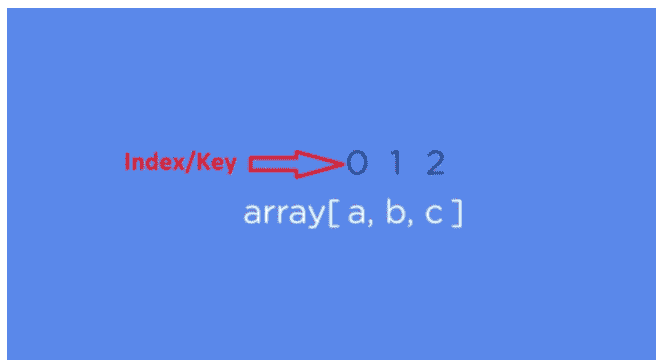

*图 2.2.1：一个数组的示例，其值（a, b, c）和键（0, 1, 2）*

思考数组的一个常见类比是火车车厢组。每个车厢都有一个编号，这些车厢按顺序排列。在每个车厢内（在此类比中为数组）存储了一些数据。虽然这是数组的一般表示，但它会因语言而略有不同，但总体而言，所有这些基础都保持不变。在 Swift 或 Java 等语言中，数组是 **homogenous structures**，这意味着它们只能包含相同类型的值。如果你用 Java 中的数组存储整数，它只能存储整数。

在 Python 等其他语言中，数组是 **heterogeneous structures**，因为它们可以存储任何类型的值。因此，在 Python 中，例如，你可以混合数字和文本而没有任何问题。现在，无论这种细微差别如何，数组的基本概念是索引。此索引值用于数组上的每个操作，从访问值到插入、更新和删除。

在 Python 中，我们将在本课程中使用的语言，有点令人困惑。大多数语言中通常称为数组的类型最好由 python 中的 **list** 类型表示。Python 也有一个名为 array 的类型，但它是不同的东西，所以我们不会使用它。虽然 Python 称其为列表，但在本课程中使用列表时，我们谈论的概念也适用于其他语言中的数组，所以绝对不要跳过任何内容。

还有一件事。在计算机科学中，列表实际上与数组是不同的数据结构，事实上，我们将在本课程后面构建一个列表。一般来说，这个结构被称为链表而不是仅仅列表，所以希望术语不会太令人困惑。为了正确理解数组的工作原理，让我们看看数组在底层是如何存储的。

数组是一种连续的数据结构。这意味着数组存储在彼此相邻且没有间隙的内存块中。这样做的优点是检索值非常容易。在非连续数据结构中，我们很快就会构建一个，该结构存储一个值以及指向下一个值的 **reference**。

要检索下一个值，语言必须遵循该引用，也称为 **pointer**，到下一个内存块。这会增加一些开销，而正如你将看到的，这会增加常见操作的运行时间。刚才我提到，根据语言的不同，数组可以是同构的（包含相同类型的值）或异构的，其中可以混合任何类型的值。这种选择也会影响数组的内存布局。

例如，在 C、swift 或 Java 等数组是同构的语言中，当创建数组时，由于语言 **compiler** 知道值的种类，而你可以将 **compiler** 视为语言的大脑，它可以选择一个适合数组大小和所创建值的连续内存块。

如果值是整数，假设一个整数占据一个块表示的空间，那么对于一个包含五项的数组，编译器可以分配五个大小相等的内存块。图 2.2.2。

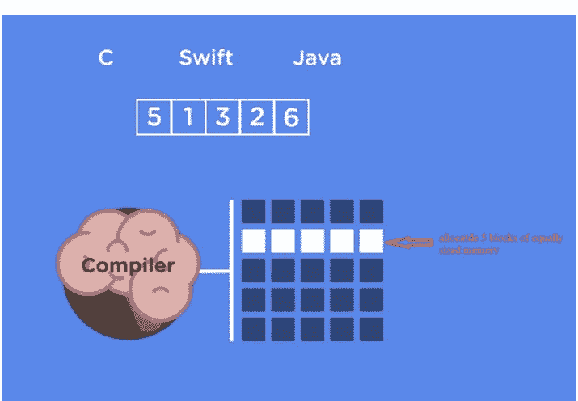

图 2.2.2：编译器如何分配 5 个大小相等的内存块的说明

在 Python 中，情况并非如此。我们可以把任何值放在 Python 列表中。没有限制。这种方式的工作原理是连续内存和我之前提到的指针或引用的结合。当我们在 Python 中创建列表时，没有关于将要放入该数组的内容的信息，这使得很难分配相同大小的连续内存。

具有连续内存有几个优点。由于值彼此相邻，访问值几乎以恒定时间发生。这是我们想要保留的特性。Python 解决这个问题的方法是分配连续内存并在其中存储的不是我们想要存储的值，而是指向存储在内存其他地方的值的引用或指针。图 2.2.3。

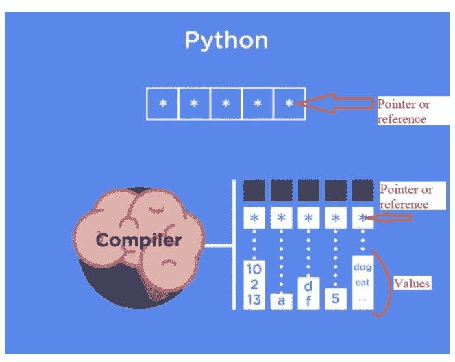

*图 2.2.3：Python 编译器如何使用指针或引用分配 5 个大小相等的内存块的说明*

通过这样做，它可以分配大小相等的连续内存，因为无论值的大小如何，指向该值的指针的大小总是相等的。这会带来额外的成本，即当访问值时，我们需要遵循指针到值实际存储的内存块。但 Python 有处理这些成本的方法，这些方法超出了本课程的范围。

现在我们知道了数组如何存储其值，让我们看看我们在数组上执行的常见操作。

#### 2.2.2. 在数组中访问值

无论你使用哪种数据结构，所有数据结构都期望执行四种操作。

##### 2.2.2.1. 数据结构上的操作

至少，

- 1. 我们需要能够 **access and read** 存储在结构中的值。
- 2. 我们需要能够 **search** 任意值。
- 3. 我们还需要能够在结构中的任何位置 **insert** 一个值，最后，
- 4. 我们需要能够 **delete** 结构。

让我们详细看看这些操作如何在数组结构上实现，从 **access** 开始。数组中的元素使用称为索引的值来标识。我们使用此索引来访问和读取值。大多数编程语言在处理数组时遵循零基编号系统。这只意味着第一个索引值等于 **0**，而不是 1。图 2.2.4。

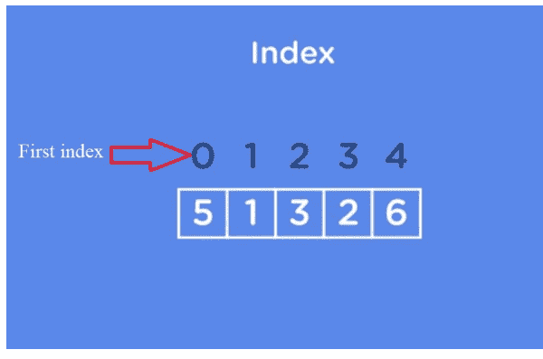

*图 2.2.4：数组中零基编号系统的说明*

一般来说，当声明一个数组时，会分配一个基础量的连续内存作为数组存储。计算机通过地址引用内存，但由于内存是连续的，数组只需存储第一个位置的地址，而无需保留为数组分配的所有内存的引用。使用基地址，数组可以通过使用该值的索引位置作为偏移量来计算任何值的地址。如果你想更具体地思考，可以这样想。

假设我们想要创建一个整数数组，然后每个整数在内存中占据一定的空间，我们称之为 **M**。我们还假设我们知道要创建多少个元素，所以数组的大小是某个元素数量，我们称之为 **N**。因此，我们需要分配的总空间是 **N** 乘以每项的空间 **M**：**Space = N * M**。见图 2.2.5。


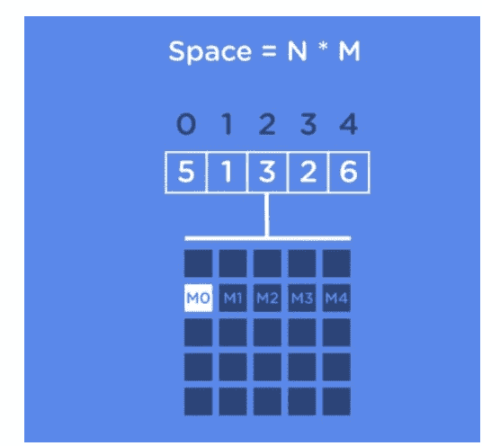

图 2.2.5：使用地址系统说明数组中内存分配的方式

如果数组跟踪了第一个值在内存中的位置（我们将其标记为 M0），那么它就拥有查找列表中任何其他元素所需的所有信息。访问数组中的值时，我们使用索引。因此，要获取列表中的第一个元素，我们使用第 0 个索引。要获取第二个元素，我们使用索引值 1，以此类推。

鉴于数组知道每个元素所需的存储量，它可以通过从第一个元素的地址开始，然后加上索引值乘以每个元素的存储量来获取任何元素的地址。例如，要访问第二个值，我们可以从 M0 开始，然后加上 M 乘以索引值 1（Space = 1 * M），从而得到 M1 作为第二个地址的位置和内存。

这是一个非常简化的模型，但大致就是这样工作的。这只能实现是因为我们知道数组内存是连续的，没有间隙。让我们转向一些代码。正如我之前提到的，并且也在本课程的第一卷中，我们将使用 Python 和 Pycharm IDE（集成开发环境）来编写代码。随意使用你喜欢的任何其他 IDE，例如记事本，甚至是你安装的 Python 解释器。虽然代码将使用 Python 编写，但这些概念是通用的，更重要的是，足够简单，你应该可以在任何你喜欢的编程语言中轻松跟上。

现在，打开 Pycharm 并创建一个新文件。将此文件命名为 arrays.py。图 2.2.6。

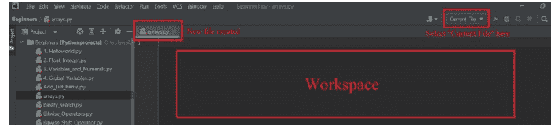

图 2.2.6：Pycharm 中创建的新文件截图。工作区是你将编写 Python 代码的地方

创建 Python 列表非常简单。这里有一个示例：

```
new_list = [1, 2, 3]
```

这为数组使用分配了一定量的基础内存。当我说数组时，请注意在 Python 中，我指的是列表。由于这是 Python，值并不是直接存储在内存中。相反，值 1、2 和 3 存储在内存的其他位置，而数组存储对这些对象的引用。要访问一个值，我们使用下标以及索引值。因此，要获取第一个值，我们使用索引 0。如果我们要将其分配给另一个变量，我们会这样说

```
result = new_list[0]
```

我们写出 new_list，因为这是我们从中访问值的数组，然后是下标表示法，即两个方括号，然后是索引值 0。正如你之前看到的，由于数组引用了内存中的基位置，任何元素的位置都可以很容易地确定。我们不需要遍历整个列表。我们只需要从基内存计算一个简单的偏移量，因为我们保证内存是连续的。因此，访问数组或 Python 列表是一个常数时间操作。这也是为什么如果你尝试使用超出数组存储范围的索引访问值，例如 new_list[3] 或 new_list[10]，数组会崩溃的原因。

如果你之前使用过数组，你肯定遇到过错误或崩溃，即尝试使用大于数组中元素数量的索引访问值。由于数组会即时计算内存地址，当你使用所谓的越界索引访问值时，返回的内存地址不是数组结构的一部分，因此数组无法读取。

在 Python 中，这表现为索引错误，我们可以通过使用我们知道数组不包含的索引来触发这种情况。现在如果我们添加

```
print (result)
```

并在 Pycharm 中运行我们的代码，你会看到我们得到值 1，即存储在第 0 个索引处的值。图 2.2.7。

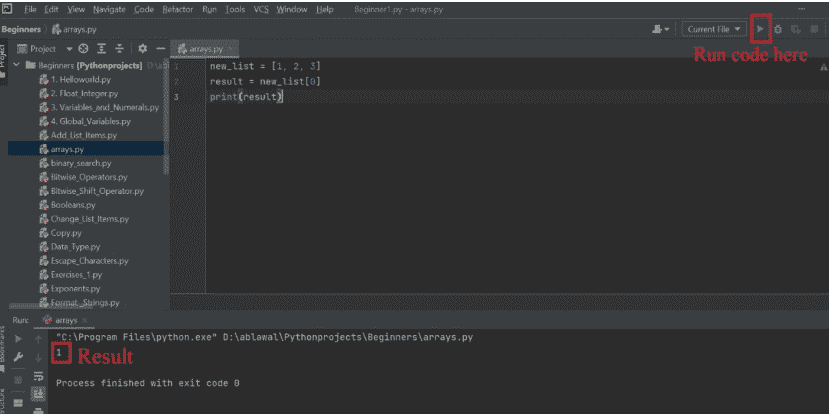

图 2.2.7：显示我们 Python 代码结果的截图

现在为了突出该索引错误，我们可以对 new_list 进行操作，并在方括号内提供一个我们知道数组不包含的索引。因此，将你的代码的第二行更改为

```
result = new_list[10]
```

如果你保存然后运行更新后的代码，你会得到图 2.2.8 所示的错误。

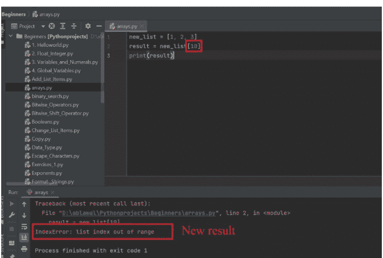

图 2.2.8：使用越界索引值时显示不同结果的截图

现在 Python 说 IndexError: list index out of range.

这些就是创建和从数组读取值的最基本方法。在下一节中，我们将研究搜索，但首先这里有一些练习题。

#### 2.2.3. 练习 1

Q1. 分配给数组的内存块大小相等。正确还是错误？

- A. 真
- B. 假

Q2. 数组使用连续内存块有什么优势？

- A. 访问元素更快，因为内存位于一个区域
- B. 所有索引值都不必存储，可以在运行时使用偏移量计算
- C. 随着元素数量接近分配的最大内存，数组需要调整大小
- D. 以上全部
- E. A 和 B

Q3. 数组如何存储大小不同的元素？

- A. 通过存储对元素位置的引用，该位置在内存中的其他地方
- B. 通过分配非连续内存来存储元素
- C. 通过为单个元素重新分配内存

Q4. 在所有编程语言中，数组都是同构的数据结构，一旦定义只能包含一种类型的值。

- A. 真
- B. 假

Q5. 请在空白处填入正确答案。

数组是一种数据结构，其中集合中的每个元素都是通过 ___ 标识的。

#### 2.2.4. 练习 1 的答案

- 1. A
- 2. E
- 3. A
- 4. B
- 5. 索引

#### 2.2.5. 数组搜索、插入和删除

##### 2.2.5.1. 数组搜索

在上一节中，我们学习了创建数组和使用索引读取值时幕后发生的情况。在本节中，我们将研究剩余的数据结构操作如何在数组上工作。如果你学习过算法导论课程（本书的第一卷），我们花时间学习了两种搜索算法：线性搜索和二分搜索。虽然数组访问值非常快，但它们在搜索方面表现很差。直接使用数组，我们能做的最好的就是使用线性搜索，其最坏情况运行时间为线性。

线性搜索通过访问和读取列表中的每个值，直到找到相关元素为止。如果我们要查找的元素位于列表末尾，那么列表中的每个元素都将被访问和比较。尽管访问和比较是常数时间操作，但对每个元素都这样做会导致整体线性时间。现在，让我们看看搜索在代码中是如何工作的。

在 Python 中，我们可以通过两种方式在数组中搜索项目。我们可以使用 in 运算符检查列表是否包含某个项目。例如，我们可以在之前的代码中添加以下行：

```
if 1 in new_list: print(True)
```

in 运算符实际上调用了在列表类型上定义的一个 contains 方法，该方法运行线性搜索操作。除此之外，我们还可以使用 for 循环手动遍历列表并执行比较操作。所以，我可以说

```
for n in new_list:
    if n==1:
        print(True)
        break
```

打印结果后然后跳出循环。这基本上就是线性搜索的实现。如果数组已排序，我们可以使用二分搜索。然而，由于排序操作本身会产生成本，语言通常避免对列表进行排序并运行二分搜索，因为对于较小的数组，单独的线性搜索可能更快。

因此，如果你运行以下代码，你会看到 Python 打印 True。

```
new_list = [1, 2, 3]
if 1 in new_list: print(True)
```

现在由于我们已经在之前的课程中学习了线性搜索和二分搜索，这里没有什么新内容。在我看来更有趣的是查看在数组中插入和删除值。让我们从插入开始。

##### 2.2.5.2. 数组插入

通常，大多数数组实现支持三种类型的插入操作。第一种类型是使用索引值的真正插入，我们可以在列表中的任何位置插入元素。此操作具有线性运行时间。想象一下你想在列表开头插入一个项目。


Figure 2.2.9.

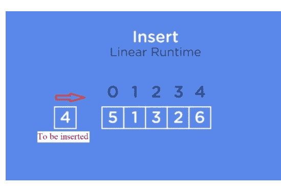

Figure 2.2.9: 元素 4 将插入到索引值为 0 的第一个位置

当我们插入到第一个位置（索引位置 0）时，当前占据该位置的项目会发生什么？嗯，它必须移动到索引位置 1 的下一个位置。索引位置 1 处的第二个项目会怎样？它会移动到索引位置 2 的下一个位置。这种情况会一直持续下去，直到所有元素都向前移动了一个索引位置为止。图 2.2.10。

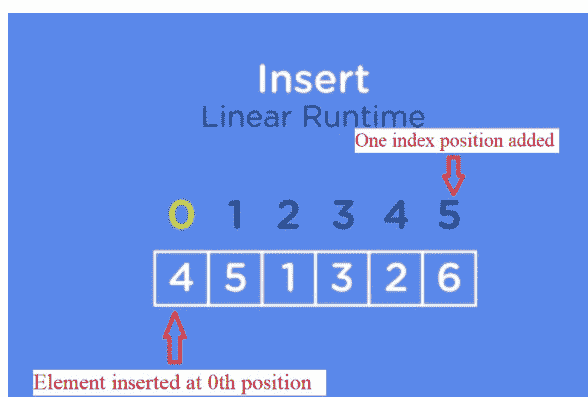

Figure 2.2.10: 元素 4 被插入到第一个位置，数组的索引值增加了一个

因此，在最坏的情况下，在数组的第 0 个位置插入时，数组中的每一项都必须向前移动，而我们知道任何涉及遍历每个值的操作都意味着线性运行时间。

现在第二种插入类型称为追加。虽然追加在技术上是一种插入操作，因为它将项目插入到现有数组中，但它不会产生相同的运行时间成本，因为它只是将项目添加到列表的末尾。我们可以简化地说这是一个常数时间操作，但它取决于数组的语言实现。

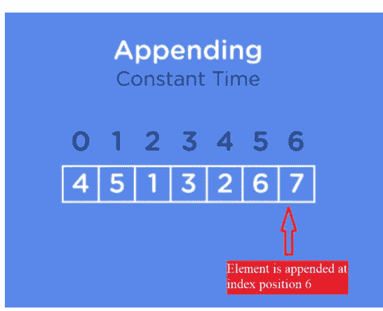

Figure 2.2.11: 元素 7 被追加到数组的最后一个索引位置，索引值增加了一个

为了突出这一点的重要性，让我们考虑 Python 中列表的工作方式。在 Python 中，当我们创建一个列表时，列表对列表的大小和我们要存储的元素数量一无所知。

创建一个像这样的新列表

```
numbers = []
```

会创建一个列表并分配大小为 n + 1 的空间。由于这里的 n 为零，因此该数组中没有元素。所以，在这个列表中，最初为一个元素的列表分配了空间。因为为列表分配的空间和列表使用的空间不同，你认为当我们使用以下代码询问 Python 这个列表的长度时会发生什么？

```
print(len(numbers))
```

我们正确地得到了 0 作为返回值。

0

这意味着列表不使用内存分配作为其大小的指标。这是因为，正如我之前提到的，它已为一个元素的列表分配了空间，但返回的是零。所以 numbers 在这个列表中目前有空间容纳一个元素。现在，让我们使用类型上定义的 append 方法在列表末尾插入一个数字。

```
numbers.append(2)
```

现在，内存分配和列表的大小相同，因为列表包含一个元素。如果我这样做会怎样？

```
numbers.append(200)
```

现在，由于列表目前只有一个项目的分配，在它能够将新元素添加到列表之前，它需要增加内存分配，从而增加列表的大小。它通过调用列表调整大小操作来实现这一点。列表调整大小非常有趣，因为它展示了解决此类问题的巧妙之处。

Python 并不会为了容纳我们想要添加的元素，比如 5，而调整列表大小。相反，在这种情况下，为了添加一个元素 5，它会分配四个内存块，将大小增加到总共四个连续的内存块。它这样做是为了不必每次添加另一个元素如 1 时都调整列表大小，而是在非常特定的点上调整。Python 中列表类型的增长模式为 0、4、8、16、25、35、46 等等。图 2.2.12。这意味着随着列表大小接近这些特定值，会再次调用列表调整大小操作。

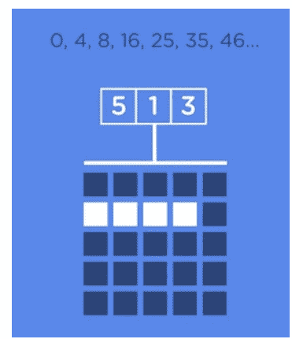

Figure 2.2.12: Python 分配了 4 个内存块，即使只有三个元素被添加

如果你查看列表大小为四的情况，这意味着当追加四个更多值直到大小为八时，这些追加操作中的每一个都不会在特定点上增加占用的空间。然而，当触发调整大小时，随着内存分配的增加所需空间也会增加。图 2.2.13。

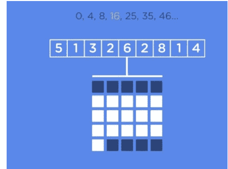

*Figure 2.2.13: Allocation of 16 blocks of memory is triggered when the 9th element is added*

这可能意味着 append 方法具有非恒定的空间复杂度，但事实证明，因为有些操作不会增加空间而有些会，当你将它们全部平均出来时，append 操作占用恒定空间。我们说它具有 **摊还常数空间复杂度**。

插入操作也会发生这种情况。如果我们有一个四元素数组，我们将有四个元素和四个的内存分配。在那时进行插入操作，无论它发生在列表的什么位置，都会触发调整大小。插入仍然更昂贵，因为在调整大小之后，每个元素都需要向后移动一个位置。

大多数语言支持的最后一个（第三个）插入操作是能够 **将一个列表添加到另一个列表**。在 Python 中，这称为 **extend**。现在，让我们清除你的工作区并开始编写新的代码。我们将从一个空列表开始。

```
numbers = []
```

```
numbers.extend([4, 5, 6])
```

在第二行，作为参数，我只是传递（添加）了一个新的列表（4、5、6）完全。现在，要打印出 *numbers*，我们写

```
print(numbers)
```

如果你运行这段代码，你会看到我们的列表现在包含值 4、5 和 6。

```
[4, 5, 6]
```

所以，*extend* 接受另一个列表来添加。Extend 有效地对新列表中的每个元素进行一系列 append 调用，直到所有元素都被追加到原始列表中。此操作的运行时间为 Big O(k)，其中 k 表示我们要添加到现有列表的列表中的元素数量。

##### 2.2.5.3. 数组删除

我们需要考虑的最后一种操作类型是删除操作。删除与插入类似，因为当删除操作发生时，列表需要保持正确的索引值。因此，插入将每个元素向右移动，删除操作将每个元素向左移动。就像插入一样，如果我们删除列表中的第一个元素，列表中的每个元素都需要向左移动。删除操作的上限为 Big O(n)，也称为线性运行时间。

现在我们已经看到了我们相当熟悉的数据结构上的常见操作是如何工作的，让我们转换轨道并构建我们自己的数据结构。

#### 2.2.6. 练习题 2

Q1. 将一个数组通过一系列追加操作添加到另一个数组中的运行时间为 O(k)。这里的 k 代表什么？

- A. 被添加的数组的大小
- B. 原始数组的大小
- C. 追加操作的运行时间

Q2. 为什么数组插入和删除在最坏情况下具有线性运行时间？选择以下正确答案：

- A. 对于插入操作，数组需要读取每个值以确保不会插入重复的值
- B. 对于删除，数组需要在删除之前搜索元素，这可能需要 n 次读取操作
- C. 数组中的每个元素都必须向左（删除）或向右（插入）移动

Q3. 我们用什么来访问数组中的值？选择以下正确答案：

- A. Node
- B. Index
- C. Key

#### 2.2.7. 练习题 2 的答案

- 1. A
- 2. C.
- 3. B

### 2.3. 构建链表

尽管大多数语言内置了强大的集合类型，但我们通常需要自定义数据结构以不同的方式存储数据。在本节中，我们将看看链表是什么。

#### 2.3.1. 什么是链表？

在接下来的几节中，我们将构建一个你可能以前使用过的数据结构：链表。在我们深入了解链表是什么之前，让我们谈谈为什么我们要构建数据结构而不是只使用语言内置的数据结构。

每个数据结构解决一个特定问题。我们刚刚介绍了数组数据结构的基础知识，并查看了我们在数组上执行常见操作的成本。我们发现数组在访问方面特别好。读取值发生在恒定时间内。但数组在插入和删除方面很差，两者都以线性时间运行。

相比之下，链表在这方面要好一些，尽管有一些注意事项。如果我们要解决的问题涉及远多于访问的插入和删除，链表可以成为比数组更好的工具。

那么，链表是什么？链表是一种线性数据结构，其中列表中的每个元素都包含在一个称为节点的单独对象中。节点模拟两条信息：我们想要存储的数据的单个项目以及对列表中下一个节点的引用。图 2.3.1。

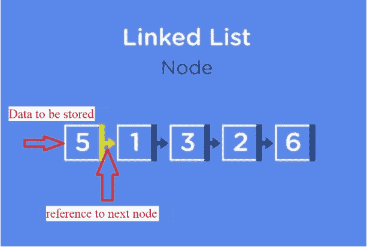

Figure 2.3.1: Identifying a node in a linked list

链表中的第一个节点（屏幕截图中的 5）称为列表的头部。而最后一个节点（屏幕截图中的 6）称为尾部。头部和尾部节点是特殊的。列表只维护对头部的引用，尽管在某些实现中它保留对

尾部也是如此。链表的这一方面非常重要，而且正如你将看到的，与数组相比，列表上的大多数操作都需要以相当不同的方式实现。与头部相反，尾部表示列表的末尾。除了尾部之外的每个节点都指向列表中的下一个节点，但尾部不指向任何东西。这基本上就是我们知道列表结束的方式。

节点被称为 **自引用对象**。图 2.3.2。

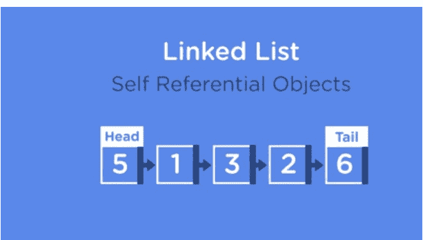

*图 2.3.2：链表中的节点具有头部和尾部*

节点的定义包括指向另一个节点的链接，而这里的自引用意味着节点的定义包含节点本身。链表通常有两种形式：**单链表**，其中每个节点存储对列表中下一个节点的引用，或 **双向链表**，其中每个节点存储对前后节点的引用。


*图 2.3.3：一个单链表*


图 2.3.4：一个双向链表

如果数组是一列按顺序排列的车厢组成的火车，那么链表就像一场寻宝游戏。当你开始寻宝时，你手上有一张纸，上面写着第一个宝藏的位置。你去那个位置，你会找到一件物品以及通往下一个宝藏物品的位置。当你最终找到一件不包含位置的物品时，你就知道寻宝结束了。现在我们对链表是什么有一个高层次的了解，让我们进入代码并一起构建一个。

我们将专注于为本课程构建单链表。双向链表有其优势，但我们不想好高骛远。让我们开始创建一个新文件，在其中放置我们链表的所有代码。我们将把这个文件命名为 linked_list.py。

首先，我们将创建一个类来表示一个节点。

```python
class Node:
    data = None
    next_node = None
```

现在，节点是一个简单的对象，因为它不会建模太多。所以首先，我们将添加一个 data 变量。这里它是一个名为 data 的实例变量，我们最初将其值赋为 None。然后我们再添加一个，称之为 next_node，并将 None 也赋给它。因此，我们创建了两个实例变量：data 用于保存我们存储的数据，next_node 用于指向列表中的下一个节点。

现在我们需要添加一个构造函数，使这个类易于创建。因此，我们将添加 def __init__(self,data)。图 2.3.5 显示了我工作区中的更新代码。这将在稍后解释。

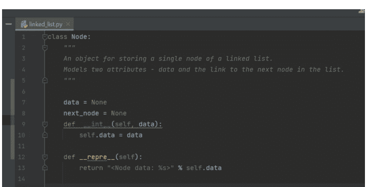

图 2.3.5：单链表的代码

这里的 init 方法接受 self 和一些初始数据。我们所要做的就是将数据赋给我们创建的那个实例变量。这就是建模 Node 所需的全部内容。在做其他任何事情之前，让我们为代码添加文档。因此，在类定义之后，让我们创建一个文档字符串。

```
'''
An object for storing a single node of a linked list.
Models two attributes - data and the link to the next node in the list.
'''
```

使用 Node 类相当简单，因此我们可以创建一个带有一些要存储数据的节点的新实例。

现在，为了让你知道，每次运行此代码时你都是从头开始。因此，让我们继续创建它：

```
N1 = Node(10)
print (N1)
```

当你现在运行代码时，我们得到以下结果。

```
<Node data: 10>
```

你可以看到我们有一个节点，它包含数据 10。我们现在可以通过添加以下内容来创建另一个节点：

```
N2 = Node(20)
N1.next_node = N2
```

因此，N1 现在指向 N2。如果我们说

```
print(N1.next_node)
```

你会从以下结果中看到它指向该节点（包含 20 的节点）。

```
<Node data: 20>
```

图 2.3.6 显示了 Pycharm 中示例节点的更新代码和结果。

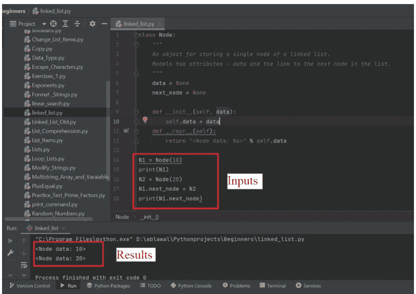

图 2.3.6：示例节点的更新代码和结果

节点是列表的构建块，现在我们有了节点对象，我们就可以用它来创建一个单链表。

```
class LinkedList:
```

```
def __init__(self):
    self.head = None
```

我们还创建了一个构造函数（def __init__(self)）。这个 head 属性建模的是列表将引用的唯一节点。由于每个节点都指向下一个节点，要找到特定节点，我们可以从一个节点到下一个节点，这称为列表遍历。由于这里的类构造函数将 head 的默认值设置为 None，因此创建的新列表始终为空。

再次注意，上面代码中我没有在类定义顶部显式声明 head 属性。别担心，这不是疏忽。初始化器中的 self.head 意味着它仍然会被创建。这就是建模链表的全部内容。

现在我们可以添加使使用此数据结构更轻松的方法。此外，让我们在类定义下方添加一个非常简单的文档字符串以提供一些信息。

```
"""
Singly linked list
"""
```

在数据结构上执行的常见操作是检查它是否包含任何数据或是否为空。目前，要检查列表是否为空，我们每次都需要查询这些实例变量 head 等。理想情况下，我们希望不对使用它的代码公开数据结构的内部工作原理。相反，让我们通过定义一个方法使此操作更明确。

```
def is_empty(self):
    return self.head == None
```

我们在第二行所做的只是检查 head 是否为 None。如果是，此条件计算为 true，表示列表为空。现在在结束本节之前，让我们再添加一个方便的方法来计算列表的大小。

方便方法这个名字表示该方法所做的工作并不是提供我们的数据结构目前无法处理的新功能，而是使现有功能更易于使用。我们可以通过每次使用循环遍历链表直到遇到尾节点来计算链表的大小，但每次都这样做很麻烦。

```
def size(self):
```

与调用 Python 列表的 len 不同，不应将其与链表混淆，这是一个恒定时间操作，我们的 size 操作将以线性时间运行。我们唯一能计算项目数量的方法是访问每个节点并调用 next 直到遇到尾节点。因此，我们将首先获取对 head 的引用。我们说

```
current = self.head
count = 0
```

我们还定义一个名为 count 的局部变量，初始值为 0，每次访问节点时递增。一旦我们到达尾部，count 将反映该列表的大小。

接下来，我们将定义一个 while 循环，只要还有节点就一直进行下去。因此，我们说

```
while current:
```

现在在这个循环内部，我们将递增 count 值。因此，

```
count+=1
```

接下来，我们将把列表中的下一个节点分配给 current。因此

```
current = current.next_node
```

这样，一旦我们到达尾部并调用 next node，current 将等于 None，while 循环终止。因此最后我们可以返回 count。

```
return count
```

正如你所见，我们需要访问每个节点来确定大小，这意味着我们的算法以线性时间运行。

让我们在这里休息一下。我们现在可以创建列表，检查它们是否为空，并在下一节中检查大小。让我们开始实现一些常见操作。

#### 2.3.2. 向链表添加节点

目前我们可以创建一个空列表，但没有其他操作。让我们定义一个方法来向列表添加数据。严格来说，我们可以将数据添加到列表中的三种方式。我们可以在列表头部添加节点，这意味着我们最近创建的节点将是头部，而我们第一个创建的节点将是尾部。或者我们可以反过来：最近的节点是列表的尾部，而第一个添加的节点是头部。

我提到链表相对于数组的一个优势是向列表中插入数据比向数组中插入数据更高效。这仅在我们在头部或尾部插入时才成立。严格来说，这不是插入，你经常会看到如果数据添加到头部则此方法称为 prepend，如果添加到尾部则称为 append。真正的插入是在列表的任何位置插入数据，这是我们添加数据的第三种方式。我们将稍后回到这个问题。

如果我们想在尾部插入，那么列表需要引用尾节点，否则我们必须从头部开始并沿着列表长度走下去，或遍历以找到尾部。由于我们的列表只保留对头部的引用，我们将在列表头部添加新项目。

#### 2.3.3. 奖励算法代码

尝试在你喜欢的 Python 编辑器中使用以下用 Python 编写的奖励链表代码。如果你使用不同的编程语言，尝试将其翻译成自己的语言。如果你需要进一步帮助，只需给我发一封电子邮件。

```
class Node:
    """
    An object for storing a single node in a linked list
```

属性:
    data: 节点中存储的数据
    next_node: 链表中下一个节点的引用
"""

def __init__(self, data, next_node = None):
    self.data = data
    self.next_node = next_node

def __repr__(self):
    return "<Node data: %s>" % self.data

class SinglyLinkedList:
    """
    线性数据结构，用于在节点中存储值。该列表维护对第一个节点的引用，也称为 head。每个节点指向列表中的下一个节点

    属性:
        head: 列表的头节点
"""

def __init__(self):
    self.head = None
    # 维护一个计数属性允许 len() 在
    # 常数时间内实现
    self.__count = 0

def is_empty(self):
    """
    确定链表是否为空
    耗时 O(1) 时间
    """
    
    return self.head is None

def __len__(self):
    """
    返回链表的长度
    耗时 O(1) 时间
    """
    
    return self.__count

def add(self, data):
    """
    在列表头部添加包含 data 的新 Node
    也称为 prepend
    耗时 O(1) 时间
    """
    
    new_head = Node(data, next_node=self.head)
    self.head = new_head
    self.__count += 1

def search(self, key):
    """
    搜索第一个包含与 key 匹配的数据的节点
    返回该节点，如果未找到则返回 `None`
    耗时 O(n) 时间
    """

    current = self.head

    while current:
        if current.data == key:
            return current
        else:
            current = current.next_node
    return None

def insert(self, data, index):
    """
    在 index 位置插入包含 data 的新 Node
    插入操作耗时 O(1) 时间，但查找插入点处的节点耗时 O(n) 时间。
    总体耗时 O(n) 时间。
    """

    if index >= self.__count:
        raise IndexError('index out of range')

    if index == 0:
        self.add(data)
        return
    if index > 0:
        new = Node(data)
        position = index
        current = self.head

        while position > 1:
            current = current.next_node
            position -= 1

        prev_node = current
        next_node = current.next_node

        prev_node.next_node = new
        new.next_node = next_node

        self.__count += 1

def node_at_index(self, index):
    """
    返回指定 index 处的 Node
    耗时 O(n) 时间
    """

    if index >= self.__count:
        raise IndexError('index out of range')

    if index == 0:
        return self.head

    current = self.head

    position = 0

    while position < index:
        current = current.next_node
        position += 1

    return current

def remove(self, key):
    """
    删除包含与 key 匹配的数据的 Node
    返回该节点，如果 key 不存在则返回 `None`
    耗时 O(n) 时间
    """

    current = self.head
    previous = None
    found = False

    while current and not found:
        if current.data == key and current is self.head:
            found = True
            self.head = current.next_node
            self.__count -= 1
            return current
        elif current.data == key:
            found = True
            previous.next_node = current.next_node
            self.__count -= 1
            return current
        else:
            previous = current
            current = current.next_node

    return None

def remove_at_index(self, index):
    """
    删除指定 index 处的 Node
    耗时 O(n) 时间
    """
    if index >= self.__count:
        raise IndexError('index out of range')
    current = self.head
    if index == 0:
        self.head = current.next_node
        self.__count -= 1
        return current
    position = index

    while position > 1:
        current = current.next_node
        position -= 1

    prev_node = current

    current = current.next_node

    next_node = current.next_node

    prev_node.next_node = next_node
    self.__count -= 1

    return current

def __iter__(self):
    current = self.head

    while current:
        yield current
        current = current.next_node

def __repr__(self):
    """
    返回列表的字符串表示。
    耗时 O(n) 时间。
    """

    nodes = []
    current = self.head
    while current:
        if current is self.head:
            nodes.append("[Head: %s]" % current.data)
        elif current.next_node is None:
            nodes.append("[Tail: %s]" % current.data)
        else:
            nodes.append("[%s]" % current.data)
        current = current.next_node
    return '-> '.join(nodes)

### 2.4. 循环链表

#### 2.4.1. 表示

循环链表、环形链表或简称为循环列表是一种数据结构，由一组节点组成，每个节点包含一个数据元素和指向列表中下一个节点的指针。在循环链表中，列表中的最后一个节点指向第一个节点，形成一个圆圈或环。

这种循环链接结构相比前面讨论的标准链表具有许多优势，例如能够以循环方式遍历列表而无需从列表开头重新开始。它还允许在列表的任何位置轻松插入和删除节点。

循环链表可以在多种编程语言中实现，并常用于各种应用，例如音乐播放列表、计算机游戏数据结构和内存管理算法

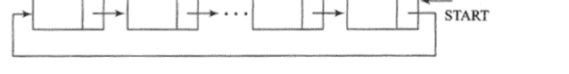

图 2.4.1：循环链表的示意图

#### 2.4.2. 循环链表相对于单链表的优势

有几种循环链表相对于单链表的优势：

-   1. **遍历列表**：在循环链表中，遍历整个列表很容易，因为最后一个节点与第一个节点相连。这意味着你可以从列表中的任何节点开始，并在任一方向移动以遍历整个列表。
-   2. **插入和删除**：循环链表使在列表的任何位置插入或删除节点变得容易。这是因为你只需要更新相邻节点的指针，而在单链表中，你需要找到前一个节点以更新其指针。
-   3. **高效使用内存**：由于循环链表中的最后一个节点指向第一个节点，因此无需为单独的“null”指针分配内存。这可以带来更高效的内存使用。
-   4. **应用**：循环链表在各种应用中很有用，例如音乐

播放列表、计算机游戏数据结构和内存管理算法。

然而，循环链表也有一些缺点，例如实现复杂度增加，如果指针设置不正确则可能导致无限循环。因此，在循环链表和单链表之间的选择取决于应用程序的具体需求。

### 2.5. 双向链表

双向链表是一种数据结构，由一组节点组成，每个节点包含一个数据元素和两个指针：一个指向列表中前一个节点的指针，一个指向列表中下一个节点的指针。

在双向链表中，你可以在正向和反向两个方向遍历列表，因为每个节点都指向前一个节点和下一个节点。这使得在列表的任何位置插入或删除节点变得更容易，因为你可以在任一方向移动以找到要修改的节点。

双向链表中第一个和最后一个节点分别称为 **head** 和 **tail**。它们是特殊的节点，分别没有前一个节点或下一个节点。双向链表也可以是循环的，在这种情况下，尾节点指向头节点，形成一个环。

双向链表用于各种应用，例如音乐播放列表、计算机游戏数据结构和文本编辑器。然而，它们比单链表需要更多的内存，因为每个节点需要存储两个指针而不是一个。此外，实现双向链表可能比实现单链表更复杂，因为在插入或删除节点时需要更新两个指针。

#### 2.5.1. 双向链表的表示

图 2.5.1 说明了双向链表中节点的结构以及各种类型的列表。


双向链表的节点结构

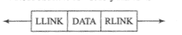

简单双向链表

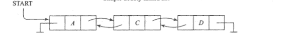

循环双向链表

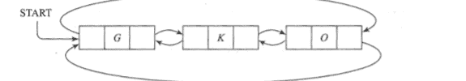

带头节点的循环双向链表

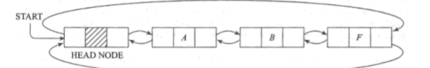

图 2.5.1：双向链表中节点的结构以及各种链表类型的说明

#### 2.5.2. 双向链表的优点

双向链表相比其他类型的链表具有以下几个优点：

- 1. **双向遍历**：双向链表相比单向链表最显著的优势是它可以在正向和反向两个方向遍历。这是因为每个节点有两个指针，一个指向前一个节点，一个指向下一个节点。当需要在列表中间搜索或修改节点时，这一特性特别有用。
- 2. **高效的插入和删除**：双向链表使在列表的任意位置插入或删除节点变得容易。在单向链表中，插入或删除节点时需要找到前一个节点以更新其指针。相比之下，在双向链表中，可以轻松更新相邻节点的指针，这使得操作更高效。
- 3. **易于实现栈和队列数据结构**：双向链表可用于实现栈和队列数据结构。栈采用“后进先出”（LIFO）方法，而队列采用“先进先出”（FIFO）方法。双向链表非常适合实现这些数据结构，因为它允许在列表两端进行高效的插入和删除操作。
- 4. **反向遍历**：在某些应用中，如文本编辑器，通常需要按反向顺序遍历列表。在双向链表中这很容易实现，因为每个节点都有一个指向前一个节点的指针。

总体而言，双向遍历和高效的插入删除操作使双向链表成为某些数据类型结构和算法的热门选择。

#### 2.5.3. 双向链表的缺点

与其它类型的链表相比，双向链表有几个缺点：

- 1. **内存使用增加**：双向链表比单向链表需要更多的内存，因为每个节点必须存储两个指针而不是一个。
- 2. **复杂度增加**：实现双向链表可能比实现单向链表更复杂。这是因为在插入或删除节点时需要同时跟踪前一个节点和后一个节点。
- 3. **需要维护的额外指针**：在单向链表中，只需要维护指向下一个节点的指针。然而，在双向链表中，需要维护指向前一个节点和后一个节点的指针，这可能使代码更复杂且容易出错。
- 4. **修改指针时需要额外注意**：由于每个节点有两个指针，在修改它们时必须小心，以避免创建循环引用或其他可能导致列表损坏或损坏的问题。
- 5. **比单向链表稍慢**：由于需要维护额外的指针，双向链表的性能可能比单向链表稍慢。

尽管存在这些缺点，双向链表仍然是需要双向遍历或高效插入删除操作的某些应用的流行数据结构选择。

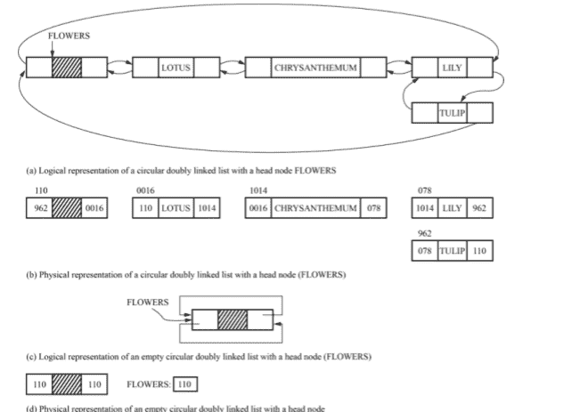

*图 2.5.2：带头节点的循环双向链表的逻辑和物理表示，FLOWERS*

#### 2.5.4. 多重链表

多重链表是一种链表类型，其中每个节点具有多个指针，从而可以创建更复杂的数据结构。

如前所述，在单向链表中，每个节点只有一个指向列表中下一个节点的指针。在双向链表中，每个节点有两个指针，一个指向前一个节点，一个指向下一个节点。但在多重链表中，每个节点可以有多个指向其他节点的指针，从而允许节点之间存在更复杂的关系。

多重链表的一个常见用例是在图数据结构中。图中的每个节点可以表示为多重链表中的一个节点，指向其他节点的指针表示图中的边。

另一个用例是在树等层次数据结构中。树中的每个节点可以表示为多重链表中的一个节点，指向子节点的指针表示层次结构。

总体而言，多重链表允许创建更复杂和灵活的数据结构，但它们可能比更简单的链表结构更复杂，实现和维护也更困难。

多重链表的一般节点结构如图 2.5.3 所示。由于每个链接字段连接一组代表全局列表 L 的数据元素的节点，列表 L 的多重链接表示是基于某种关联相互连接的节点网络。链接字段可能使其各自的列表为循环，也可能不为循环，也可能具有头节点，也可能不具有头节点。

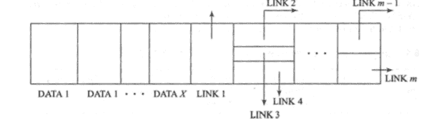

*图 2.5.3：多重链表的节点结构*

#### 2.5.5. 展开链表

展开链表是一种链表类型，每个节点存储多个元素或键。在展开链表中，每个节点由一个固定大小的数组组成，该数组可以容纳一定数量的元素，以及指向列表中下一个节点的指针。

展开链表背后的思想是减少为列表中每个单独元素分配和释放内存的开销。通过在每个节点中存储多个元素，需要的分配和释放次数减少，从而可以提高性能。

名称“展开”来源于每个节点中的数组被“展开”或展平，而传统链表中每个节点只包含单个元素和指向下一个节点的指针。

展开链表对于插入和删除频繁的应用特别有用，因为它们可以减少内存管理的开销。它们在存储元素的大小固定的情况下也很实用，因为列表中每个节点的大小可以与元素的大小相匹配。然而，对于需要频繁随机访问列表中单个元素的应用，它们可能效率较低。

### 2.6. 下载培训资源

这里是您可以用来下载我们编写的代码、本书中使用的屏幕截图、更多练习题和其他培训资源的链接：

https://ln5.sync.com/dl/64c032e70/n4epdxsk-4xz59by6-k4r5puid-x9wqpmre

或者，您可以使用这个简短的 BIT.LY 链接：

https://bit.ly/3o9DjhV

这些资源会定期更新以提供进一步帮助。如果您需要联系我任何事情，或想与我分享您的代码，请使用下面的电子邮件地址。我会很快回复您。我保证。

Cheers,
**Ojula Technology Innovations**
OjulaTech@gmail.com
www.ojulaweb.com

## 系列中的所有书籍

- 第 1 卷：算法与数据结构导论 1
- 第 2 卷：算法与数据结构导论 2
- 第 3 卷：算法与数据结构导论 3
