# 编码理论入门指南，第二版


## 介绍
编码理论
第二版

## 离散数学
与
及其应用

R. B. J. T. Allenby 和 Alan Slomson，《如何计数：组合学导论》，第三版
Craig P. Bauer，《秘史：密码学的故事》
Jürgen Bierbrauer，《编码理论导论》，第二版
Katalin Bimbó，《组合逻辑：纯、应用与类型化》
Katalin Bimbó，《证明论：序列演算及相关形式体系》
Donald Bindner 和 Martin Erickson，《现代数学学习、实践与工具的学生指南》
Francine Blanchet-Sadri，《部分词的算法组合学》
Miklós Bóna，《排列组合学》，第二版
Miklós Bóna，《枚举组合学手册》
Miklós Bóna，《枚举与解析组合学导论》，第二版
Jason I. Brown，《离散结构及其相互作用》
Richard A. Brualdi 和 Dragoš Cvetković，《矩阵理论及其应用的组合方法》
Kun-Mao Chao 和 Bang Ye Wu，《生成树与优化问题》
Charalambos A. Charalambides，《枚举组合学》
Gary Chartrand 和 Ping Zhang，《染色图论》
Henri Cohen、Gerhard Frey 等，《椭圆曲线与超椭圆曲线密码学手册》
Charles J. Colbourn 和 Jeffrey H. Dinitz，《组合设计手册》，第二版
Abhijit Das，《计算数论》
Matthias Dehmer 和 Frank Emmert-Streib，《定量图论：数学基础与应用》
Martin Erickson，《离散数学之珠》
Martin Erickson 和 Anthony Vazzana，《数论导论》

## 书目（续）

Steven Furino、Ying Miao 和 Jianxing Yin，《框架与可分解设计：用途、构造与存在性》
Mark S. Gockenbach，《有限维线性代数》
Randy Goldberg 和 Lance Riek，《语音编码器实用手册》
Jacob E. Goodman 和 Joseph O'Rourke，《离散与计算几何手册》，第二版
Jonathan L. Gross，《具有计算机应用的组合方法》
Jonathan L. Gross 和 Jay Yellen，《图论及其应用》，第二版
Jonathan L. Gross、Jay Yellen 和 Ping Zhang，《图论手册》，第二版
David S. Gunderson，《数学归纳法手册：理论与应用》
Richard Hammack、Wilfried Imrich 和 Sandi Klavžar，《乘积图手册》，第二版
Darrel R. Hankerson、Greg A. Harris 和 Peter D. Johnson，《信息论与数据压缩导论》，第二版
Darel W. Hardy、Fred Richman 和 Carol L. Walker，《应用代数：编码、密码与离散算法》，第二版
Daryl D. Harms、Miroslav Kraetzl、Charles J. Colbourn 和 John S. Devitt，《网络可靠性：符号代数环境中的实验》
Silvia Heubach 和 Toufik Mansour，《组合与词的组合学》
Leslie Hogben，《线性代数手册》，第二版
Derek F. Holt 与 Bettina Eick 和 Eamonn A. O'Brien，《计算群论手册》
David M. Jackson 和 Terry I. Visentin，《可定向与不可定向曲面中小地图集》
Richard E. Klima、Neil P. Sigmon 和 Ernest L. Stitzinger，《使用 Maple™ 和 MATLAB® 的抽象代数应用》，第二版
Richard E. Klima 和 Neil P. Sigmon，《密码学：经典与现代及 Maplets》
Patrick Knupp 和 Kambiz Salari，《计算科学与工程中计算机代码的验证》
William L. Kocay 和 Donald L. Kreher，《图、算法与优化》，第二版
Donald L. Kreher 和 Douglas R. Stinson，《组合算法：生成、枚举与搜索》
Hang T. Lau，《图算法与优化的 Java 库》
C. C. Lindner 和 C. A. Rodger，《设计理论》，第二版
San Ling、Huaxiong Wang 和 Chaoping Xing，《密码学中的代数曲线》
Nicholas A. Loehr，《双射组合学》
Toufik Mansour，《集合划分的组合学》

## 书目（续）

- Toufik Mansour 和 Matthias Schork，《对易关系、正规排序与斯特林数》
- Alasdair McAndrew，《使用开源软件的密码学导论》
- Elliott Mendelson，《数理逻辑导论》，第五版
- Alfred J. Menezes、Paul C. van Oorschot 和 Scott A. Vanstone，《应用密码学手册》
- Stig F. Mjolsnes，《信息安全多学科导论》
- Jason J. Molitierno，《组合矩阵理论在图拉普拉斯矩阵中的应用》
- Richard A. Mollin，《应用高级数论》
- Richard A. Mollin，《代数数论》，第二版
- Richard A. Mollin，《密码：从古代到现代的保密指南》
- Richard A. Mollin，《基础数论及其应用》，第二版
- Richard A. Mollin，《密码学导论》，第二版
- Richard A. Mollin，《二次型》
- Richard A. Mollin，《RSA 与公钥密码学》
- Carlos J. Moreno 和 Samuel S. Wagstaff, Jr.，《整数平方和》
- Gary L. Mullen 和 Daniel Panario，《有限域手册》
- Goutam Paul 和 Subhamoy Maitra，《RC4 流密码及其变体》
- Dingyi Pei，《认证码与组合设计》
- Kenneth H. Rosen，《离散与组合数学手册》
- Yongtang Shi、Matthias Dehmer、Xueliang Li 和 Ivan Gutman，《图多项式》
- Douglas R. Shier 和 K.T. Wallenius，《应用数学建模：多学科方法》
- Alexander Stanoyevitch，《具有数学基础和计算机实现的密码学导论》
- Jörn Steuding，《丢番图分析》
- Douglas R. Stinson，《密码学：理论与实践》，第三版
- Roberto Tamassia，《图绘制与可视化手册》
- Roberto Togneri 和 Christopher J. deSilva，《信息论与编码设计基础》
- W. D. Wallis，《组合设计导论》，第二版
- W. D. Wallis 和 J. C. George，《组合学导论》
- Jiacun Wang，《有限状态模型及其应用手册》
- Lawrence C. Washington，《椭圆曲线：数论与密码学》，第二版

访问 Taylor & Francis 网站
http://www.taylorandfrancis.com

以及 CRC Press 网站
http://www.crcpress.com


献给 Stella、Daniel 和我的母亲


## Taylor & Francis

泰勒与弗朗西斯集团

http://taylorandfrancis.com

## 前言

纠错码理论是离散数学的一个分支，与其他数学学科有着密切联系，如设计理论、组合理论、线性代数、有限域、环、伽罗瓦几何、几何代数、有限域上的代数曲线和群论。最著名的应用是在嘈杂通信信道上传输消息。其他应用领域见于统计学（实验设计）、密码学（认证、密码设计）以及理论计算机科学的许多领域。

在本教材中，我们提供了数学编码理论及其主要应用领域的自包含介绍。高中代数和对基础线性代数的一定介绍已足以作为数学背景。第一部分设计用于一学期的本科课程。第二学期将从循环码理论开始。第二部分重点介绍循环码、码的应用、线性规划界以及线性码的几何描述。数学工具在过程中逐步发展。第三部分简要介绍了常数域为有限域的一元函数域（代数曲线）理论的一些基础、码的基本构造（代数几何码）以及一些有趣的例子族的性质。

### 简要概述

编码理论的历史起源于在嘈杂信道上可靠通信的问题。这是现今称为信息论的学科的典型问题。编码理论和信息论这两个学科都起源于 Claude Shannon 于 1948 年发表的著名论文 [183]。它包含了著名的信道编码定理（参见第 9 章），该定理大致说明好的长码必然存在，但并未给出如何构造它们的线索。密切相关的是密码学的发展。其目标是在存在恶意对手的情况下确保可靠通信。这些问题相当不同。在编码理论的情形中，我们必须克服一个技术问题（通信信道的缺陷），而在密码学中我们必须击败对手。尽管如此，这两个领域使用的数学工具有很大交集。历史上，第二次世界大战的努力推动了这两个学科的发展。Claude Shannon 于 1949 年的另一篇著名论文 [184] 被视为现代密码学的起源。

信息论问题促使定义了一种称为 **纠错码** 或简称为 **码** 的数学结构。编码理论可以被视为对纠错码及其构造、参数界限、实现等方面的研究。最重要的参数是 **最小距离。** 它衡量码纠正传输错误的能力。

编码理论的进展缓慢但稳定。一个重要的发展是 **循环码** 理论，它传统上用环论的语言表述。循环码特别有用，因为它们允许快速译码算法。循环码理论是第二部分的核心主题。它在第 13 章展开，前由第 12 章中对有限域的一些相关特征的介绍。我們的方法与传统方法不同。它基于迹和伽罗瓦群的作用。环论完全不涉及。

唯一最著名的循环码，二进制 Golay 码，在第一部分中引入，同时还有一个密切相关的结构，大 Witt 设计（第 7 章）。

编码理论与纯数学多个领域的联系日益紧密。最重要的见解可以追溯到 1980 年代初。这是 Goppa 和 Manin [97, 138] 发现的码与 **代数曲线**（在代数语言中为 **函数域**）之间密切关系的发现。代数曲线是 **数论** 和 **代数几何** 的对象，后者是具有悠久丰富历史的主流数学学科。Goppa 和 Manin 的观察使得这些数论工具可以用于码的构造。那些 **代数几何码**（AG-码）的理论是第三部分的目标。事实上，我们只发展了常数域为有限域的代数曲线理论的一些基础，足以理解代数几何码的基本构造并研究一些有趣的例子族。

编码理论与 **组合学** 密切相关。例如，**区组设计** 是现代离散数学的重要对象。更多信息请参见 **CRC Handbook of Combinatorial Designs** [106]。我们在文本中会反复遇到它们。正式定义在第 7 章，其中我们还从二进制 Golay 码推导出大 Witt 设计。文本中区组设计的其他例子包括射影平面、有限域上的射影和仿射几何（第 17 章）、小 Witt 设计，它在第 17.1 节中由三元 Golay 码导出，以及同一节中的 Denniston 弧。

线性码可以从几何观点研究。从这个角度看，编码理论可以被视为 **伽罗瓦几何** 的一部分。伽罗瓦几何的基本对象是定义在有限域上的 **仿射空间和射影空间**（参见 Hirschfeld [113] 或第 17 章开头）。


Codes can be equivalently described as sets of points in projective spaces. In many cases the geometric language is more appropriate than the algebraic approach. In Part I we study 3-dimensional codes from this point of view (Chapter 10). This case is particularly easy to understand as the underlying geometrical structures are classical projective planes $PG(2,q)$. The general mechanism is developed and used in Chapter 17. In many cases this leads to a better understanding of the codes. For instance, we use the geometric method to construct the ternary Golay code in Section 17.1. As a natural generalization, the additive codes (network codes) of Chapter 18 are described geometrically by families of subspaces of a fixed projective space. As a special case, the binary quantum codes of Chapter 18 are described by families of lines in binary projective spaces.

**帽** 是射影或仿射几何中任意三点都不共线的点集。They are formally equivalent to linear codes of minimum distance $d = 4$. It turns out that caps are best understood from a geometric point of view. This is why we study caps in Chapter 17. The case of caps in projective planes and 3-spaces leads to another link with classical algebra. In fact, parabolic and elliptic quadrics yield canonical examples of caps in those dimensions. We include a self-contained introduction to **几何代数** in Section 17.2 which gives a better understanding of those caps.

**对偶性** 在全文中被强调。The dual of a linear code with minimum distance $d$ is an **正交阵列** of **强度** $d - 1$. Originally orthogonal arrays were defined in the framework of design of experiments, in **统计学** 中。The same is true of block designs. The defining properties of orthogonal arrays and of block designs are both uniformity conditions. They look very similar. Orthogonal arrays can be interpreted as families of **随机变量** (functions defined on sample spaces), which satisfy certain statistical independence conditions (see Chapter 6). The strength measures the degree of statistical independence. Such families of random variables are heavily used not only in statistics but also in the theory of **算法**。Whenever we construct a good linear code, we also obtain such a statistical object.

Typically in coding theory duality is defined with respect to the usual dot product, the Euclidean bilinear form. However, each non-degenerate **双线性** (or sesquilinear) **形式** defines a notion of duality. An application to the construction of **量子码** in Chapter 18 demands the use of a special bilinear form, the symplectic form. This is another motivation for covering the theory of bilinear forms in Chapter 17.

Some of the classical **界**, the Singleton bound, the Hamming bound, the Plotkin bound and the Griesmer bound on codes as well as the Bose-Bush bound on orthogonal arrays of strength 2, are derived when they are needed in the text. In fact, there is a multitude of bounds, each of which is better than all the others in certain parameter ranges, both for codes (when the minimum distance is the central parameter) and for orthogonal arrays (when the strength is in the center of attention). A general algebraic mechanism for
the derivation of bounds is related to **正交多项式** (in the case of codes these are the **Kravchouk 多项式**) and **线性规划**. There is a general **线性规划界**. All the bounds used in the text, with the exception of the Griesmer bound, are special cases of the LP-bound. Chapter 15 is a self-contained introduction to linear programming and contains unified proofs for all those explicit bounds on codes and orthogonal arrays. On the level of LP-bounds there is a relation of duality between bounds on codes and bounds on orthogonal arrays. This is another reason why the notion of an orthogonal array should be seen as the dual of the notion of an error-correcting code, even in the nonlinear case.

This leads us to applications of codes. Traditionally coding theorists are biased towards the information-theoretic application that we encounter so often in this text. It still is one of the major applications. We use it as a motivation in the early chapters, discuss syndrome decoding in Chapter 3 and the decoding algorithm of BCH-codes based on the Euclidean algorithm in Chapter 13. There is, however, a plethora of applications of a completely different nature. Many of them have surfaced in theoretical computer science, in particular in cryptography. **通用哈希族** yield a nice paradigmatic example. One version is presented in Part I, Chapter 6, while a more in depth treatment is in Chapter 16. This chapter is dedicated to applications altogether. They range from statistics and cryptography to numerical integration and the theory of algorithms.

## The plan: Part I

Part I forms an elementary introduction to the theory of codes and some typical applications. It assumes only high school mathematics. Some exposition to the basics of linear algebra would be helpful as well.

Chapter 1 introduces some basic concepts like bits and bitstrings and describes the basic problem when messages are sent via a noisy channel. The transmission of pictures from space serves as an illustration. The first steps toward the algebraization of the problem are taken by introducing the field $\mathbb{F}_2$ of two elements and giving the bitstrings of length $n$ the structure of a vector space. We encounter the basic idea of error correction and the basic notion of Hamming distance. This leads to the formal definition of a binary code and of a $q$-ary code for an arbitrary natural number $q \ge 2$. The binary symmetric channel is the most elementary model which describes how errors are introduced into the message. Basic facts on binomial numbers are reviewed. The sphere-packing bound (or Hamming bound) is our first general bound on codes. The football pool problem is a possible application of ternary ($q = 3$) codes.

Chapter 2 introduces the basics of binary linear codes. Key notions are minimum weight, dimension, generator matrix. After a review of basic facts of linear algebra (applied for vector spaces = codes over 𝔽₂), we see how block coding works and study the effect on the probability of transmission errors. The dual code is defined with respect to the dot product. The repetition codes and the sum 0 codes are our first pair of dual codes. A check matrix of a code is a generator matrix of its dual code. An important family of codes are the binary Hamming codes. Their duals are the binary Simplex codes. The principle of duality shows how to read off the minimum distance from a check matrix. This leads to the notion of a binary orthogonal array (OA). A linear OA has strength t if and only if its dual has minimum weight t + 1.

Chapter 3 generalizes linear codes from the binary (q = 2) to the q-ary, where q is an arbitrary prime-power. It is shown how finite fields 𝔽_q of q elements can be constructed. The definition of linear q-ary codes is given and the basic facts generalized from the binary to the q-ary: dimension, generator matrix, dual code, check matrix, principle of duality, orthogonal arrays. Basic methods of linear algebra are reviewed (rank, Gauß elimination, determinants). Mutually orthogonal Latin squares are recognized as special parametric cases of OA. The MacWilliams formula links the weight distribution of a linear code and its dual. Our proof is probabilistic. This motivates the definition of probability spaces. The game of SET leads to natural questions concerning ternary (q = 3) linear codes. Syndrome decoding can in principle be used to decode linear codes.

A large and important family of linear codes are the Reed-Solomon codes of Chapter 4. They meet the Singleton bound with equality (they are MDS-codes). Lagrange interpolation shows that they form OA of index λ = 1. The dual of an RS-code is an RS-code. Mutually orthogonal Latin squares yield non-linear MDS-codes. Covering arrays and their use in software testing are discussed.

Chapter 5 introduces some recursive constructions of codes: shortening and puncturing, the parity check bit for binary codes, the residual code and the Griesmer bound, concatenation and the (u, u + v)-construction.

Chapter 6 presents our first application in computer science. The concept of universal hashing is introduced. ε-universal hash classes turn out to be formally equivalent with codes.

Chapter 7 is a direct construction of the binary Golay code and the large Witt design. This motivates the definition of t-designs. Classical projective planes PG(2, q) are introduced.

Chapter 8: Meaning and basic properties of the Shannon entropy of a probability space. The binary entropy function. The Jensen inequality as a tool.

In Chapter 9 the concept of asymptotic bounds for infinite families of codes with length ⟶ ∞ is introduced and the asymptotic version of the Singleton bound given. The Plotkin bound on codes of large distance is proved. It implies an asymptotic bound and the Bose-Bush bound on OA of strength


2. 证明了香农的信道编码定理。介绍了概率论的基本概念和事实（随机变量、期望、方差、切比雪夫不等式）。这些在证明中使用。Gilbert-Varshamov 界是对线性码的存在性界（某些码被保证存在），基于计数论证。Justesen 码构成了一个具有渐近非平凡参数的显式码族。

第10章是对几何方法的介绍。三维码被描述为射影平面 PG(2, q) 中的点多重集。一个应用允许构造无拥塞网络。

## The plan: Part II
第12章从有限域的更多基本性质开始：本原元、域扩张、Frobenius 自同构、伽罗瓦群、从域到子域的迹。定义了迹码和子域码。Delsarte 定理描述了对偶码。我们引入线性码关于子域的伽罗瓦闭包，证明第二主要定理并概述构造循环码的一般策略。讨论了码等价性的不同概念。

第13章专门讨论循环码的一般机制。一个例子（二元，长度15）用于说明这一点。这是在 F16 上定义的 Reed-Solomon 码的子域码（也是迹码）。一般构造的基本概念是分圆陪集、维数公式以及最小距离的 BCH 界。给出了循环码的参数化例子，以及一个应用于指纹识别的应用。Roos 界和 van Lint-Wilson 方法在特殊情况下允许对 BCH 界的改进。循环码的生成矩阵和校验矩阵几乎是规范确定的。BCH 码是特殊的循环码。它们的译码算法基于欧几里得算法。常循环码是循环码的推广。然而，它们可以在循环码理论的框架内描述。本章以两个特别好的四元（q = 4）常循环码族以及与循环码的传统环论方法的比较结束。

第14章通过引入码的进一步递归构造来补充第5章。构造 X 和 XX 可以使用循环码作为成分来应用。覆盖半径是另一个基本参数。它与加长相关并有其自身的应用。我们描述了在隐写术中的应用以及在降低开关噪声中的应用。第15章专门讨论线性规划（LP）。第一节是对线性规划基础的自包含介绍。这包括诸如单纯形算法、Farkas 互补、对偶定理和互补松弛原理等基本概念和结果。基本概念 **Fourier transform,** 在第二节中引入。本节还包含 Kravchuk 多项式的基本性质以及码和正交阵列的一般 LP 界。在第三节中，从 LP 界推导出了若干显式界。第15章的第四节也是最后一节包含了著名的四界（McEliece, Rodemich, Rumsey, Welch [140]）的证明，这是一个关于码和正交阵列的渐近界。

第16章讨论了各种应用。OA 被解释为具有某些独立性性质的随机变量族以及完美的局部随机化器。我们引入线性移位寄存器序列及其与 Simplex 码的关系，描述最小距离和强度在分组密码构造中的作用以及 OA 在基于两点的采样和芯片测试中的使用。进一步的主题包括 OA 与弹性函数之间的关系、弹性函数在窃听信道和随机比特生成中的应用、OA 在 Monte Carlo 算法去随机化中的应用，以及对通用哈希类、其由码构造以及在密码学（认证）中的应用的更详细研究。

第17章研究线性码的几何方法。线性码被描述为射影几何 PG(k−1,q) 中的点多重集。主要定理用超平面交集大小来确定最小距离。六码、卵形线和超卵形线、扩展 Reed-Solomon 码和 Simplex 码从这一观点得到最好的理解。研究了维数为2和3的码。三元 Golay 码从其参数 [12,6,6]3 开始构造。描述了 Barlotti 弧和 Denniston 弧以及相应的码。帽是没有任何三点共线的点集。它们在形式上等价于最小距离 d = 4 的线性码。我们引入双线性形式和二次形式理论。这给出了 PG(2,q) 中（抛物二次曲面）以及 PG(3,q) 中（椭圆二次曲面）的大帽的规范模型。推导了 PG(4,q) 中帽的直接构造以及任意维数中帽的一般界。帽的递归构造使用椭圆二次曲面作为成分，或在三元情况下使用 PG(5,3) 中的 Hill 帽。

第18章引入了字母表构成基域上向量空间的码。它们推广了线性码。Chen 投影是一个简单的递归构造。应用于帽得到在计算机存储系统中使用过的码。应用于 Reed-Solomon 码产生在深空通信中使用过的码。另一个递归构造简化了强度为2的 OA 的 Bose-Bush 构造。我们以一个有趣的低维加性码族的直接构造结束第18.1节。在第18.2节中发展了循环加性码的自包含理论。它推广了第13章的方法。在第18.3节中考虑了四元加性码。几何上它们由二元射影空间中的直线多重集描述。我们集中于短长度的码，并获得了所有长度 ≤13 的最佳可能参数。量子稳定子码本质上是加性的（q-线性，q²-元）码，它们包含在其辛对偶中。在第18.3节中，我们使用以直线系为几何描述并应用循环理论来发展基本理论。特别地，我们确定了二元（q = 2）距离 d = 3 量子稳定子码的所有参数。

加性码最近以网络码的名称重新出现（见 Koetter 和 Kschischang [126]）。[126] 中使用的度量与我们迄今使用的大不相同。它基于描述码的子几何的成对交集的秩。我们在第18.5节中描述了最小非平凡问题的解。它出乎意料地复杂。

## The plan: Part III
在第III部分的早期章节中，我们使用 Stichtenoth 现在经典的教材 [198] 发展了有限常数域上超越次数为1的函数域的一些基本理论。亮点是 Riemann-Roch 定理和 Riemann-Hurwitz 公式。作为动机例子，我们使用 Klein 四次曲线、超椭圆和 Artin-Schreier 扩张。代数曲线（AG-码）码的基本构造在第22章给出，其中我们描述了一些重要的 AG-码族以及一个应用于通用哈希的应用。一些额外材料收集在最后一章。包含了一节关于 Reed-Solomon 码的列表译码，因为这代表了一个相当近期的发展，它以透明的方式使用了某些基本代数/几何。关于 tms-网和欧几里得空间中球堆积的章节（第23章）比第16章中的应用处理得稍轻一些。tms-网的理论应置于拟 Monte Carlo 算法的背景下（与欧几里得空间中均匀分布的点集相关）。这种将编码理论应用于数值积分和奇异期权定价的应用相当令人惊讶。稠密球堆积的构造是欧几里得空间中的一个经典问题，它不仅与离散数学有关，还与代数和代数几何有关。第23章的剩余章节具有简短综述文章的性质。

## How to use this text
第I部分源于几门关于编码理论的一学期本科课程。第2章到第6章构成了此类入门课程的核心。该

唯一可以（也许应该）跳过的章节是关于 MacWilliams 变换的第 3.5 节。剩余的时间应用于第一部分中一章或几章后面的章节。第 7 章将是一个自然的选择，因为二进制 Golay 码可能是所有码中最著名的。通常我会讲授第 6 章，因为它是第一个非标准应用的例子，而且可以在一节课内完成。

另一个选择是讲授第 8 章以及第 9 章的部分内容。这些章节构成一个整体，因为熵函数在第 9 章的渐近表达式中使用。

两学期课程第二学期的典型起点是循环码及其实现理论，第 12 章和第 13 章，以及第 14 章。第 13 章的后半部分是可选的（应用于指纹识别、Roos 界、van Lint-Wilson 界、与传统方法的比较以及第 13.4 节关于常循环码的内容）。关于 BCH 码译码算法的第 13.3 节也可以被舍弃。

第 17 章可被视为编码理论的另一个核心领域，因为它能更好地理解许多重要码。舍弃第一节的主要定理将是可惜的。第一节中的一些应用应该被涵盖。

从这里开始有几个选择。

为了对编码理论及其与伽罗瓦几何的联系进行透彻介绍，可以完全集中在第 17 章。

另一种可能性是缩短第 17 章的内容，转而讲授第 16 章的几个应用。第 23 章中关于 tms-网和球堆积的章节是为研究生课程收尾的良好选择。这也有一个优点，即课程以对一个例外对象——Leech 格的介绍结束。

第三种策略是集中于循环码理论及其应用。这样的课程将以第 18 章结束。

## The database

线性码和量子码参数的表格可在 M. Grassl 的网页上找到

```
http://www.codetables.de
```

## What has changed in the second edition?

变化太多无法穷举。一个宏观性的变化是第二版增加了新的第三部分，专门讨论代数几何码。第一版最后一章中的一个小节已发展为第二版的新第 15 章，包含线性规划的介绍以及对码和正交阵列的显式界的推导。关于加性码和网络码的第 18 章是第一版对应章节的完全重塑版本。循环情形基于更一般的理论，几何方法得到了极大的扩展，并且新增了一个关于网络码的章节。最后一章也发生了变化。第一版中的两个小节已消失，因为它们各自变成了独立的章节。还增加了关于置换码和高度对称码的章节，以及两个旨在提高文本可读性的章节，一个关于文本中使用的各个小域，另一个关于文本中构造的各个短码。

## Textbooks

教材中的早期经典是 E. R. Berlekamp 的《Algebraic Coding Theory》[11]，它特别提供了对循环码传统理论的优秀介绍。MacWilliams 和 Sloane 的 1977 年著作《The Theory of Error-Correcting Codes》[142] 被视为传统编码理论的圣经。较新的入门著作是 J. H. van Lint 的《Introduction to Coding Theory》[211]，这是一部相对简短而密集的文本，在吸引纯数学家进入该领域方面发挥了很大作用。H. Stichtenoth 的著作《Algebraic Function Fields and Codes》[198] 是关于一元代数函数域（等价于代数曲线）理论及其导出码的自成体系的介绍。在本科教材中，我们提到 Vera Pless 的《The Theory of Error-Correcting Codes》[165] 和 R. Hill 的《A first course in coding theory》[112]。Hill 的书是第一本介绍编码几何方法的著作。

Hedayat、Sloane 和 Stufken 的《Orthogonal Arrays: Theory and Applications》[109] 介绍了正交阵列（对偶码）及其在实验设计中的应用。

## Acknowledgments

我感谢 Yves Edel；Wolfgang Ch. Schmid、Peter Hellekalek 以及萨尔茨堡大学数学研究所；Fernanda Pambianco、Stefano Marcugini、Massimo Giulietti、Daniele Bartoli、Giorgio Faina 以及佩鲁贾大学数学与计算机科学系；Bernd Stellmacher 以及基尔大学数学研讨会；C. L. Chen、Ron Crandall、Ludo Tolhuizen、Albrecht Brandis、Allan Struthers、密歇根理工大学；Gary Ebert；以及国家安全局。


## Taylor & Francis

Taylor & Francis Group

http://taylorandfrancis.com

## About the author

Jürgen Bierbrauer 于 1977 年在德国美因茨大学获得数学博士学位，博士论文主题为有限群理论。他的数学兴趣在于离散数学的代数方法及其应用。他于 1977 年至 1994 年在德国海德堡大学任职，并在密歇根州霍顿的密歇根理工大学担任正教授直至 2015 年退休。他的非数学兴趣包括罗曼语族语言、文学和围棋。


## Taylor & Francis

Taylor & Francis Group

http://taylorandfrancis.com

# Part I

### An elementary introduction to coding


Taylor & Francis
Taylor & Francis Group
http://taylorandfrancis.com

## Chapter 1

### The concept of coding

### 1.1 Bitstrings and binary operations

基本概念：位、位串、消息传输、从太空传输图像、摩尔斯电码、异或运算、域 F₂、消息传输模型、纠错的初步思想。

编码理论的对象是通过噪声信道传输消息。图 1.1 显示了描述该情况的标准图示。

首先我们需要理解这幅图中的元素含义：什么是消息、信道、什么是噪声？在过程中我们会遇到更多基本概念。本章将解释其中一些。我们从消息开始。

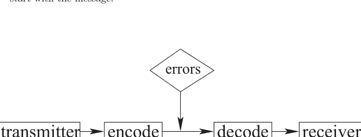

图 1.1：通过噪声信道的消息传输

如果有 8 条可能发送的消息，那么我们可以将每条消息表示为长度为 3 的位串，如 000 或 011 或 110。我们通常假设已完成此操作，并将 **消息** 定义为位串。以下是一些位串及其长度的例子：

| 位串 | 长度 |
|---|---|
| 000 | 3 |
| 110 | 3 |
| 110011 | 6 |
| 0000011111 | 10 |

### Transmitting pictures from space

假设我们希望从外太空传输一张照片，比如 20 世纪 80 年代初由旅行者号航天器拍摄的土星照片之一（《星际迷航》迷称之为 V'ger）。图片被划分为 800 × 800 像素；每个像素被分配 256 = 2⁸ 个亮度等级之一。因此像素的亮度由长度为 8 的位串表示，而全黑白图片由 800 × 800 × 8 位组成。由于图片实际上是彩色的，同一张照片会被传输三次，每次通过不同的颜色滤镜。因此全彩图片将由长度为 3 × 800 × 800 × 8 = 15,360,000 的位串表示。这就是我们的消息。信道由航天器与地球接收器之间空间的特性决定，尤其是地球大气。一定数量的位将被破坏。这里我们只考虑 0 被发送而 1 被接收或相反类型的错误。

### The Morse code

另一个说明每个消息都可以用位串表示的例子是摩尔斯电码，自 1840 年代以来一直用于电报通信。它用最多五个点和划的序列表示 26 个字母 A、B、…、Z，每个数字 0、1、…、9 以及句号、逗号和问号。点代表短信号，划代表长信号。划的长度大约是点的三倍。例如，


letter E is represented by a single dot, S is represented by dot-dot-dot and Z is dash-dash-dot-dot.

However, the graphical representation is purely conventional. We can represent a dash by 1, a dot by 0 and obtain a representation of letters and numbers as bitstrings: E=0, S=000, Z=1100, and T=1, Q=1101, V=0001.

## 回到一般模型
假设我们希望发送 8 条可能的消息之一（长度为 3 的位串），例如消息 011。如果在传输过程中（在信道中）第二位被翻转（第二个坐标出错），则会收到 001。

我们希望用数学术语来表达这种情况。

## 1.1 定义。𝔽₂ = {0,1} 加法
0 + 0 = 0, 0 + 1 = 1, 1 + 0 = 1, 1 + 1 = 0

这里字母 𝔽 代表域。它表明这个仅有两个元素的微小结构与实数域和复数域有共同之处：这些结构都满足同一组公理。它们每一个都是一个域。我们稍后会回到这个话题。

𝔽₂ 中加法的思想是模拟信息传输中的错误：消息的某个坐标出错当且仅当在该坐标的条目上加上 1。这解释了为什么我们必须有 1 + 1 = 0：若一位被翻转两次，则不会出错，或者说：如果 1 被翻转，则收到 0。

𝔽₂ 中的加法也被称为 XOR，尤其在计算机科学文献中。这里 XOR 代表 exclusive or，即排他或，一种逻辑运算，其中 1 代表真，0 代表假。关系 1 + 1 = 0（真或真 = 假）使其成为“排他”的：为了使结果为真，两个成分之一必须为真，但不能同时为真（普通的或运算会有 1 + 1 = 1）。

我们二进制加法的另一个动机来自算术：如果区分偶数和奇数整数，则以下熟悉的规则成立：

even + odd = odd + even = odd, even + even = odd + odd = even.

偶 + 奇 = 奇 + 偶 = 奇，偶 + 偶 = 奇 + 奇 = 偶。

当偶数 = 0 且奇数 = 1 时，这些正是二进制加法的规则。

𝔽₂ 中的加法描述了每个坐标中发生的情况。位串的计算形式化如下：

## 1.2 定义。𝔽₂ⁿ 由长度为 n 的位串 x = (x₁,x₂,…,xₙ) 组成，其中 xᵢ ∈ 𝔽₂。𝔽₂ⁿ 中的加法按坐标进行。
例如，设 x = 001 ∈ 𝔽₂³ 且 y = 101 ∈ 𝔽₂³。则 x + y = 100。借助这种术语，更容易表达消息、错误和接收消息之间的关系。设 x = 001100 为发送的消息。假设第 2 和第 4 个坐标出错。我们可以用加上 **误差向量** e = 010100 来表示这一点。接收到的消息将是和

y = x + e = 011000.

我们反过来做：如果发送了 x = 010101 而接收到 y = 010111，则第 5 个坐标出错。这意味着 e = 000100。

回到发送八条消息之一（𝔽₂³ 的元素）的情形，例如 x = 011。无论误差向量 e 为何，接收到的消息 y = x + e 仍是合法消息之一。接收方没有任何办法怀疑发生了错误，更不用说纠正它了。那么我们如何期望纠正错误呢？

## 误差校正：第一个想法
这是最简单的纠错系统之一：将待发送消息中的每个 0 编码为块 000，类似地每个 1 用 111 编码。如果原始消息是 x = 011，则编码后的消息现在为 x′ = 000111111。接收方知道使用了什么编码方案。因此他会将接收到的消息分成长度为 3 的块。如果这样的块是 000 或 111，则解码是显而易见的：000 ↦ 0，111 ↦ 1。假设接收消息的一个块是 101。接收方知道至少发生了一个传输错误。基本假设是少量错误比大量错误更可能。因此解码将为 101 ↦ 1（按多数判决）。

现在初始图景开始有意义了。我们看到消息可以由发送方编码，由接收方解码，使得以下条件成立：如果在传输过程中（在信道中）不超过一个错误发生，则错误将被自动纠正。我们使用的是被称为 **重复码** 的长度为 3 的码。

- 1. 我们学会了如何用位串进行计算。
- 2. $\mathbb{F}_2^n$ 由长度为 $n$ 的位串组成。
- 3. 接收到的消息是发送消息与误差向量的二进制和。
- 4. 长度为 3 的重复码可纠正一位错误。

## 练习 1.1
- 1.1.1. 计算 11001 与 01110 的和。
- 1.1.2. 假设发送了 000000 且发生了两个错误。列出所有可能的接收消息。
- 1.1.3. 设 $x = 1101$ 为待发送的消息。用长度为 3 的重复码对 $x$ 进行编码。
- 1.1.4. 假设使用了长度为 3 的重复码，且接收到 000110111101。解码的结果是什么？
- 1.1.5. 为什么摩尔斯电码用长度为 1 的串表示字母 E 和 T，而像 Q、V、Z 这样的字母却用更长的位串表示？

## 1.2 汉明距离
**基本概念：** 汉明距离作为度量，位串的权重。

## 1.3 定义。
设 $x = (x_1, x_2, ..., x_n)$ 和 $y = (y_1, y_2, ..., y_n)$ 为 $\mathbb{F}_2^n$ 中的位串。$x$ 与 $y$ 之间的距离（或汉明距离）为 $d(x, y) = \text{坐标 } i \text{ 中 } x_i \neq y_i \text{ 的个数}.$

这里有一些例子：

d(0000, 1111) = 4，d(00110, 00101) = 2，d(111111, 001100) = 4。

用消息和错误的上下文表达，d(x, y) 是将 x 转换为 y 所需的最小错误数。事实上，考虑上面的第二个例子：x = 00110 和 y = 00101 在最后两个坐标上不同，d(x, y) = 2 且 x + 00011 = y。

使用权重时事情变得更简单。

## 1.4 定义。位串 x ∈ 𝔽₂ⁿ 的权重 wt(x) 是其中非零坐标的个数。
这里有一些例子：

wt(0000) = 0，wt(1111) = 4，wt(00110) = 2，wt(001101) = 3。

位串的权重是它与全 0 位串的距离。如果发送全 0 位串且在传输过程中发生 w 个错误，则接收到的消息的权重为 w。如果发送 x，e 为误差向量且接收到 y = x + e，则 d(x, y) = wt(e)。

汉明距离也称为汉明度量。度量的一般概念在数学中被广泛使用。以下是定义：

## 1.5 定义。设 X 为集合。对每对 x ∈ X，y ∈ X 给定一个实数 d(x, y)（从 x 到 y 的距离）。若函数 d 满足以下条件，则称其为度量：
- - d(x, y) ≥ 0 对所有 x, y 成立。
- - d(y, x) = d(x, y) 对所有 x, y 成立。
- - d(x, y) = 0 当且仅当 x = y。
- - d(x, z) ≤ d(x, y) + d(y, z) 对所有 x, y, z 成立。

最后的要求是最重要的。它被称为三角不等式。一个著名的度量是欧几里得空间中的欧几里得度量。例如，如果 x = (x₁, x₂) 和 y = (y₁, y₂) 是平面上的两点，则它们的欧几里得距离为 √(x₁ − y₁)² + (x₂ − y₂)²。

## 1.6 定理。汉明距离是 𝔽₂ⁿ 上的一个度量。
定义 1.5 的大多数性质是显而易见的。只有三角不等式有点有趣。这留作练习。

- 1. 两个相同长度位串之间的汉明距离是它们不同的坐标数。
- 2. $d(x, y)$ 是将 $x$ 转换为 $y$ 所需的比特错误数。
- 3. 汉明距离是一个度量。
- 4. 权重是与全 0 向量的距离。
- 5. $d(x, y) = wt(x + y)$。
- 6. 如果发送位串 $x$ 且接收到 $y$，则 $d(x, y) = wt(e)$ 是误差向量的权重。

## 练习 1.2
- 1.2.1. 计算 $d(11001,01110)$ 和 $d(0000,0110)$。
- 1.2.2. 求 $wt(00110)$ 和 $wt(10111)$。
- 1.2.3. 列出 $\mathbb{F}_2^6$ 中与 111000 距离为 3 的所有向量。
- 1.2.4. 字母表有 26 个字母。如果我们想将所有长度 ≤ 3 的可能单词（所有字母、字母对和字母三元组）表示为相同长度 $n$ 的位串，那么使之成为可能的最小编号 $n$ 是多少？
- 1.2.5. 证明汉明距离是一个度量。
- 1.2.6. 假设发送 $x$ 且接收到 $y = x + e$。如果不超过 3 个错误发生，我们可以对 $d(x, y)$ 和 $wt(e)$ 说些什么？

## 1.3 二进制码
**基本概念：** 长度，最小距离。误差校正的思想。


我们看到如果使用 𝔽₂ⁿ 的所有元素作为消息，则无法检测或纠正任何错误。显而易见的想法是只使用某个子集。这样的子集将被称作 **码**。

让我们发送长度为 6 的比特串。不是使用 𝔽₂⁶ 的所有元素作为（编码）消息，我们只使用以下子集：

| 000000 | 001011 |
| 100110 | 101101 |
| 010101 | 011110 |
| 110011 | 111000 |

这样的比特串族也称为长度为 6 的 **二元码**。其元素是 **码字**。在我们的例子中我们有 8 个码字。

该码最重要的性质如下：任意两个不同的码字之间的距离 ≥ 3。我们说 3 是该码的 **最小距离**。请自行检查这是否成立。该二元码的参数随后记为 (6, 8, 3)₂ : 我们有一个二元码（下标 2 表示），长度为 6，由 8 个码字组成，最小距离为 3。

## 纠错的思想

发送方和接收方就使用的码达成一致。只会发送码字。如果信道中只发生一个错误，则接收到的词将在某个码字周围半径为 1 的球内（在汉明度量下）。假设码被选为任意两个码字之间的距离至少为 3。那么半径为 1 的球互不重叠：如果一个比特串与某个码字的距离为 1，则它与任何其他码字的距离更大。换句话说，接收方会将与某个码字距离 ≤ 1 的任何向量解码为该码字。

图中：半径为 1 的整个球（或称圆盘）被解码为球的中心，或者：接收到的元组被解码为与之最相似的码字。如果不超过一个错误发生，则该错误将被纠正。请注意图 1.2 仅用作说明。

欧几里得平面中的度量用于说明在另一种度量——汉明度量下的情况。

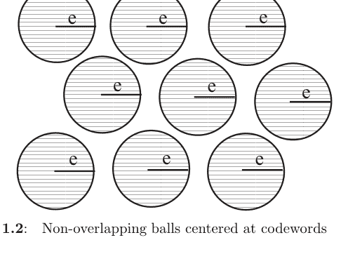

**图 1.2：** 以码字为中心的互不重叠的球

### 1.7 定义。
二元码 $(n, M, d)_2$ 是 $\mathbb{F}_2^n$ 中 $M$ 个比特串的集合，使得该码的任意两个不同元素（码字）之间的距离 $\ge d$。我们称 $n$ 为 **长度**，$d$ 为码的 **最小距离**。

最小距离为 5 的码可以纠正 2 个错误，最小距离为 7 的码可以纠正 3 个错误，以此类推。编码理论的一个基本问题如下：给定 $n$ 和 $d$，求最大的 $M$ 使得存在码 $(n, M, d)_2$。

- 1. 二元码 $(n, M, d)_2$ 是长度为 $n$ 的 $M$ 个比特串的集合，使得其中任意两个不同的码字之间的汉明距离至少为 $d$。
- 2. 编码理论的一个基本问题：确定使得存在 $(n, M, d)_2$ 码的最大 $M$。
- 3. 一个码可以纠正 $e$ 个错误，前提是其最小距离为 $d \ge 2e + 1$。
- 4. 我们看到一个 $(6, 8, 3)_2$ 码。

## 练习 1.3

### 1.3.1.
如果我们想纠正 8 个比特错误，码的最小距离必须是多少？

### 1.3.2. 使用我们的码 $(6,8,3)_2$，解码以下接收向量：
111100, 111011, 000001, 011110.

### 1.3.3. 是否存在码 $(5,6,3)_2$？

## 1.4 一般的纠错码

**基本概念：** 基本码参数。电报码作为早期例子。

**二元**码的概念过于狭窄，尽管它在信息传输中最常使用。以下是（纠错）码的一般概念：

### 1.8 定义。
设 $\mathcal{A}$ 为 $q$ 个元素的有限集合（**字母表**）。$q$ 元码 $\mathcal{C}$ 的 **长度** 为 $n$，是 $\mathcal{A}$ 中元素的 $n$ 元组的族：

$\mathcal{C} \subseteq \mathcal{A}^n$。

例如，设 $q = 3$ 且 $\mathcal{A} = \{0,1,2\}$。则 $\mathcal{A}^4$ 由 $3^4$ 个长度为 4、元素为 0、1、2 的元组组成，例如

0000, 0102, 2221 或 2100。

长度为 4 的 3 元码（也称为 **三元**）由此类三元 4 元组的集合组成。第 1.1 节中的摩尔斯电码实际上就是一种三元码。原因是个别字母需要被分隔。如果我们用 0 表示点，用 1 表示划，用 2 表示字母间的间隔，则消息 SOS 将被表示为三元词 00021112000。

### 1.9 定义。
设 $x = (x_1,x_2,\dots,x_n)$ 和 $y = (y_1,y_2,\dots,y_n)$ 为 $\mathcal{A}^n$ 中的元素（字符串、向量、词）。$x$ 和 $y$ 之间的 **距离**（或 **汉明距离**）定义为

$d(x,y) = \text{坐标 } i \text{ 的个数，其中 } x_i \neq y_i.$

这与定义 1.3 相同。如前所述，码的最小距离是不同码字之间距离的最小值，且汉明距离再次定义了一个度量。

### 1.10 定义。
$q$ 元码 $(n,M,d)_q$ 是 $A^n$（其中 $|A| = q$）中 $M$ 个字符串的集合，使得该码的任意两个不同元素（码字）之间的距离 ≥ $d$。称 $n$ 为长度，$d$ 为码的最小距离。

以下是三元码 $(4,27,2)_3$ 的词：

0000 1002 2001 0102 1101 2100 0201 1200 2202
0012 1011 2010 0111 1110 2112 0210 1212 2211
0021 1020 2022 0120 1122 2121 0222 1221 2220

与二元情况一样，为了纠正 $e$ 个错误，我们需要最小距离至少为 $2e + 1$ 的码。我们的码 $(4,27,2)_3$ 不足以纠正一个错误。例如，如果发送了 0000 而接收到 0010（仅发生一个错误），则接收到的向量与 0000 的距离为 1，也与 0012、0210 和 2010 的距离为 1。

编码理论的一个基本问题如下：给定 $q$, $n$, $d$，求使得存在码 $(n,M,d)_q$ 的最大 $M$。

## 电报码中的错误检测

错误检测的目标比错误纠正更为 modest。它适用于信道非常好的情况。在极少数错误发生（并且被检测到）的情况下，接收方只需请求重传即可。电报码的字母表由 26 个字母 A、B、...、Z 组成。经典的商业码使用五个字母组作为码字。每个行业都有自己的复杂码。这些码的主要目的是节省传输时间从而节省金钱。例如，取 Acme 码。当意图为 Avoid arrest if possible 时，发送码字 BUKSI 可节省时间，而 AROJD 比 Please advertise the birth of twins 更短。至于 PYTUO 代表 Collided with an iceberg 是否在这方面真正取得很大成效则不太清楚，因为此类碰撞并不总是发生。在现代术语中，用短字符串表示消息的这种业务称为数据压缩或源编码。这不是本书关注的内容。

然而，商业电报码也考虑到了消息传输的可靠性。一种被称为两字母差分的通用规则规定，任意两个码字必须至少在两个字母上不同。这意味着每个商业码的最小汉明距离 ≥ 2，足以检测单个错误。Acme 码还防范了另一种类型的错误：任意两个码字（必然汉明距离为 2）不能通过相邻两个字母的转置相互得到。例如，如果 AHXNO 是一个码字（在 Acme 码中代表 *遭遇致命事故*），则 HAXNO、AXHNO、AHNXO、AHXON 不能是码字。

此材料摘自 D. Kahn 的 *The Codebreakers* [122] 第 22 章。

- 1. 一个 *q* 元码 $(n,M,d)_q$ 是 $M$ 个 *q* 元 $n$ 元组（**码字**）的集合，使得任意两个不同的码字之间的汉明距离至少为 $d$。
- 2. 编码理论的一个基本问题：给定 $q,n,d$，使存在 $(n,M,d)_q$ 码的最大 $M$。
- 3. 一个码可以纠正 $e$ 个错误，前提是其最小距离为 $d \ge 2e + 1$。
- 4. 我们看到一个三元码 $(4,27,2)_3$。

## 练习 1.4

### 1.4.1.
*求使得存在 $(n,27,2)_3$ 的最小长度 $n$。*

### 1.4.2.
*证明以下结论：如果存在 $(n,M,d)_q$，则存在 $(n+1,M,d)_q$。*

### 1.4.3.
*证明以下结论：如果存在 $(n,M,d)_{q-1}$，则存在 $(n,M,d)_q$。*

## 1.5 二元对称信道

**基本概念：** BSC、二项式数、子集和路径、帕斯卡三角形。


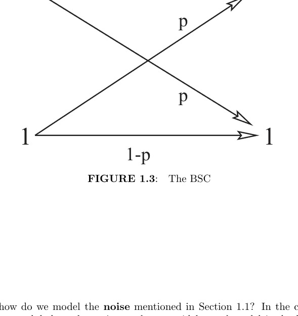

## 图 1.3：二元对称信道

那么我们如何建模第 1.1 节中提到的 **噪声** 呢？在二元字母表的情况下，最简单且最广泛使用的模型是二元对称信道 Binary Symmetric Channel, BSC。它假设存在一个固定的概率，一个数 *p*，其中 0 < *p* < 1，表示比特传输错误。显然 *p* > 1/2 的值是没有意义的（为什么？）而 *p* = 1/2 则意味着接收到的是纯噪声。因此我们可以假设 *p* < 1/2，并且在所有实际用途中 *p* 会相当小。

发送的 0 被接收为 0 的概率是 1 − *p*。同样，发送的 1 被接收为 1 的概率是 1 − *p*。发送的 0 被接收为 1 的概率是 *p*，就像发送的 1 被接收为 0 的概率一样。

这种信道模型被称为 **对称**，因为 0 和 1 扮演对称的角色。它也被称为 **无记忆** 信道，因为比特错误的概率与历史无关。你能想到这种模型不适用的情况吗？

为了能够基于 BSC 进行一些组合计数，我们来看一下二项式数。

## 二项式系数、子集与路径

长度为 $n$ 且权重为 $m$ 的比特串的数量是二项式数 $\binom{n}{m}$。这是当总错误数为 $m$ 时，在 $n$ 个比特中可能出现的错误模式的数量。例如，长度为 4 且权重为 2 的比特串是

0011, 0110, 0101, 1001, 1010, 1100.

因此，$\binom{4}{2}=6$。

二项式系数的另一种解释使用子集：将长度为 $n$ 的比特串的每个坐标与一个集合的元素对应，例如与数字 $1,2,\dots,n$ 对应。每个长度为 $n$ 的比特串随后可以与一个子集 $\{1,2,\dots,n\}$ 对应。如果对应坐标中的条目为 1，我们就将该元素包含在子集中；如果条目为 0，我们就不包含它。例如，0011 对应子集 $\{3,4\}$，1001 对应子集 $\{1,4\}$，1111 对应全集 $\{1,2,3,4\}$ 而 0000 对应空集。我们看到长度为 $n$ 且权重为 $m$ 的比特串恰好对应于一个固定 $n$ 元集中 $m$ 个元素的子集。

二项式系数的第三种解释涉及三角形中的路径；参见图 1.4。

考虑从三角形顶部开始的路径，其中每一步的选择是在向东南或向西南移动之间。我们可以用 E 和 W 的字符串来编码这个决策，例如 EEWWE 表示先向东南两次，然后向西南两次，最后一步向东南方向。记顶部层为第 0 层。则我们的路径将在第 5 层结束，在图 1.4 中标记为 10 的节点处。为什么是那个标记？我们的 E 和 W 条目字符串是一个伪装的比特串。我们可以写 1 表示 E，0 表示 W，得到比特串 11001。三角形中的每条路径都由一个比特串描述。长度为 $n$ 的比特串在第 $n$ 层结束。两个比特串如果长度和权重相同则结束于同一位置。这解释了我们的标记：第 $n$ 层权重为 $m$ 的节点的标记（从该层的西端权重 0 开始，到东端权重 $n$ 结束）是结束于此的路径数。这就是长度为 $n$ 且权重为 $m$ 的比特串的数量，也就是二项式 $\binom{n}{m}$。我们路径的终点标记为 10，因为 $\binom{5}{3}=10$ 是结束于此的路径数。西边界上的标记 1 是数 $\binom{n}{0}=1$（任何给定长度的全 0 比特串只有一个）；东边界上的标记 1 是数 $\binom{n}{n}=1$（全 1 比特串只有一个）。

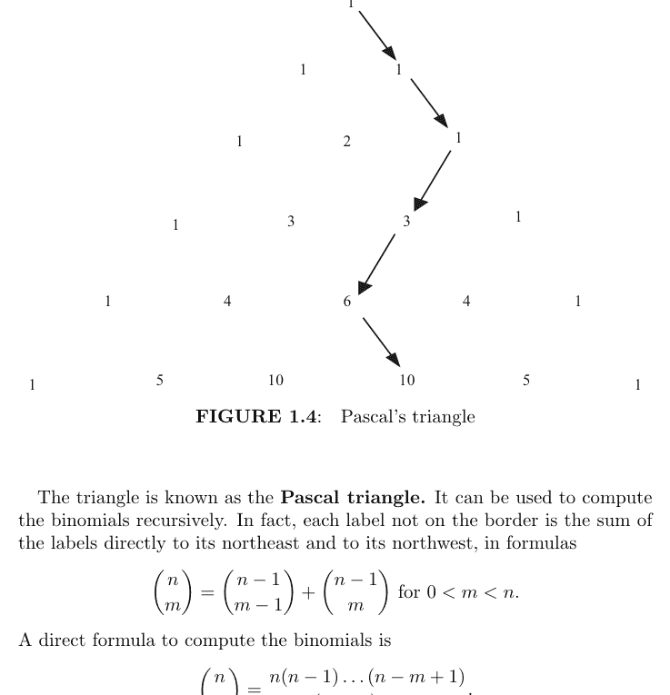

## 图 1.4：帕斯卡三角形

该三角形被称为 **帕斯卡三角形**。它可用于递归计算二项式系数。事实上，每个不在边界上的标记都是其东北和西北直接相邻标记之和，用公式表示
$$\binom{n}{m} = \binom{n-1}{m-1} + \binom{n-1}{m} \text{for } 0 < m < n.$$

计算二项式系数的直接公式是
$$\binom{n}{m} = \frac{n(n-1)\dots(n-m+1)}{m(m-1)\dots2\cdot1}.$$

例如，$\binom{4}{2} = \frac{4\cdot3}{2}=6$，$\binom{5}{2}= \frac{5\cdot4}{2}=10$，$\binom{6}{3}= \frac{6\cdot5\cdot4}{3\cdot2}=20$ 且一般地 $\binom{n}{2}= \frac{n(n-1)}{2}$。

## 回到信道

假设一个长度为 $n$ 的词（比特串）通过信道发送。没有比特错误发生的概率是 $(1-p)^n$。恰好发生一个错误的概率是 $np(1-p)^{n-1}$（错误可能发生的选择有 $n$ 种；仅涉及一个错误的特定错误模式的概率是 $p(1-p)^{n-1}$）。恰好有 $k$ 个错误的特定错误模式的概率是 $p^k(1-p)^{n-k}$。此类错误模式的数量是从 $n$ 中选择 $k$ 个元素的可能性数量。这是 $\binom{n}{k}$。因此恰好发生 $k$ 个错误的概率是 $\binom{n}{k}p^k(1-p)^{n-k}$。如果我们想计算 **最多** 发生 $k$ 个错误的概率，我们必须将这些概率相加。

- 1. 二元对称信道是对噪声的最简单模型。
- 2. 如果一个二元 $n$-元组通过 BSC 发送，则最多发生 $k$ 个比特错误的概率是 $\displaystyle\sum_{i=0}^{k}\binom{n}{i}p^i(1-p)^{n-i}$。

虽然 BSC 在概念上很简单，但还有其他更容易处理的信道。一个例子是二元 **擦除信道**，其中 0 和 1 正确传输的概率为 $1-p$，与 BSC 相同，但此外接收方知道何时出现问题。形式上，这可以描述为具有三种可能输出的信道：0、1 或 E，其中 E 代表 **擦除**。

## 练习 1.5

**1.5.1.** *计算在比特错误概率为 $p = 10^{-3}$，或 $p = 10^{-4}$，或 $p = 10^{-5}$ 时，长度为 10 的比特串传输中发生不超过一个错误的概率。*

**1.5.2.** *描述 BSC 从二元到一般 q 元情形的推广。*

**1.5.3.** *绘制二元擦除信道的正式图示，类似于 BSC 的图 1.3。*

**1.5.4.** *证明，如果使用最小距离为 $d$ 的码用于擦除信道，则任意 $d-1$ 个错误都可以被纠正。*

1.5.5. 使用二项式系数的子集解释来证明二项式公式

$$(a + b)^n = \sum_{i=0}^n \binom{n}{i} a^i b^{n-i}.$$

1.5.6. 证明

$$(1 - b)^n = \sum_{i=0}^n (-1)^i \binom{n}{i} b^i.$$

## 1.6 球体堆积界

以及三元汉明码；足球彩票问题。

如同所有数学优化问题一样，找到使得码 $(n,M,d)_q$ 存在的最大数 $M$ 的问题分为两部分：我们必须构造好的码（具有较高的 $M$），并且必须证明上界表明更高的 $M$ 值是不可能的。在本节中我们将证明我们的第一个上界。它是纠错基本思想的直接结果。

作为准备，我们需要一个计数论证（这是初等组合学中的典型问题），其类型与第 1.5 节中的论证相同。给定向量 $x \in \mathcal{A}^n$（回想一下 $\mathcal{A}$ 是大小为 $q$ 的字母表），有多少个向量与 $x$ 的距离 $\le i$？我们称这个向量集合为 **以 $x$ 为中心的半径为 $i$ 的球**。

**1.11 定义.** *考虑长度为 $n$ 的向量空间 $\mathcal{A}^n$，其带有汉明度量，其中 $|\mathcal{A}| = q$。这也称为 **汉明空间**。与给定向量距离 $\le i$ 的向量数量记为 $V_q(i,n)$。我们称 $V_q(i,n)$ 为半径为 $i$ 的球的 **体积**。*

固定某个距离 $j$ 并计算与给定向量距离恰好为 $j$ 的向量。条目不同的坐标集合有 $\binom{n}{j}$ 种选择。一旦该集合确定，这 $j$ 个坐标中每个坐标的可能条目有 $q - 1$ 种可能性。我们计数 $\binom{n}{j}(q - 1)^j$。体积 $V_q(i,n)$ 是通过对 $j \le i$ 的这些数字求和得到的。我们已经看到以下内容：

## 1.12 命题。半径为 r 的球的体积为

$$V_q(r,n)=\sum_{j=0}^{r}\binom{n}{j}(q-1)^j.$$

我们接近我们的界限。设 $\mathcal{C}$ 为码 $(n,M,d)_q$。设 $e=\lfloor(d-1)/2\rfloor$（小于或等于 $(d-1)/2$ 的最大整数）。我们选择 $e$ 使 $2e+1<d$。我们的标准论证表明，以码字为中心、半径为 $e$ 的球必须互不相交。由于每个这样的球包含 $V_q(e,n)$ 个向量，我们必须有 $M V_q(e,n)\le q^n$（统计这些球中的所有向量，我们不能得到比整个空间包含的更多向量）。

## 1.13 定理（球填充界）。每个长度为 $n$、最小距离为 $d$ 的 $q$ 元码 $\mathcal{C}$ 满足

$$|\mathcal{C}|\le\frac{q^n}{V_q(e,n)}.$$

这里 $e=\lfloor(d-1)/2\rfloor$。

在定理 1.13 中取等号的码被称为 **完美码**。完美码的参数都已被分类。我们的第一个码是 $(6,8,3)_2$。对于码 $(6,M,3)_2$，$M$ 的最大值是多少？这里 $e=1$。我们有 $V_2(1,6)=7$。球填充界说 $7M\le64$，因此 $M\le9$。我们断言码 $(6,9,3)_2$ 不存在。读者被要求给出一个沿着练习 1.6.4 和 1.6.5 中概述的思路的证明。这里有一个很好的参数情况：考虑一个可能的码 $(11,729,5)_3$。注意 $729=3^6$。我们有 $e=2$ 且 $V_3(2,11)=1+11\cdot2+\binom{11}{2}\cdot4=1+22+220=243=3^5$（相当巧合）。由此可知，三元码 $(11,M,5)_3$ 有 $M\le3^{11}/3^5=3^6=729$。我们看到参数 $(11,3^6,5)_3$ 是极值的。如果这样的码存在，则它是完美的。完美码 $(11,729,5)_3$ 确实存在。它由其参数唯一确定，被称为 **三元 Golay 码**，以 1949 年描述它的瑞士工程师命名（见 Golay [94]，重印于 Berlekamp [13]）。

## 一个投注系统

以下是三元 Golay 码如何用于投注系统：在大多数欧洲国家，投注足球比赛的结果很流行（**football** 不要与美国足球混淆。在美国，这项运动以奇特的名字 **soccer** 闻名）。每场比赛有三种可能的结果之一：1= 主队获胜，2=客队获胜，或 0= 平局。这就是我们使用三元码的原因。彩池中有 11 场或更多比赛。如果有 11 场比赛，我们可以用三元 Golay 码的 729 个码字作为投注。由于每个向量与某个码字的距离 ≤ 2，因此可以保证无论 11 场比赛的结果如何，我们的投注中至少有一个有 9 个结果正确。假设彩池中有 13 场比赛。那么我们可以选择两场比赛，其结果似乎是安全的，并对剩下的 11 场比赛使用 Golay 码。

顺便说一下，三元 Golay 码比 Golay 更早。芬兰记者 Juhani Virtakallio 于 1947 年在芬兰足球期刊 *Veikaaja* 上发表了它（见 Cohen et al. [55]）。这项发现是在芬兰做出绝非偶然。这个国家在编码理论及相关问题方面有着丰富的传统。

- 1. **球填充界**是我们对码的第一个一般界限。
- 2. 与其取等号的码称为 **完美**。
- 3. **三元 Golay 码** $(11,729,5)_3$ 是完美的。

## 练习 1.6

- **1.6.1.** *构造一个码 $(4,2,3)_2$（这真的很平凡）。* 
- **1.6.2.** *证明不存在 $(4,3,3)_2$ 码* 
- **1.6.3.** *构造一个码 $(5,4,3)_2$（提示：使用我们的码 $(6,8,3)_2$）。* 
- **1.6.4.** *证明不存在 $(5,5,3)_2$。* 
- **1.6.5.** *利用前一练习，证明不存在 $(6,9,3)_2$。* 
- **1.6.6.** *球填充界对二元码 $(n,2^7,5)_2$ 的长度 $n$ 告诉我们什么？* 
- **1.6.7.** *六名候选人由 9 名裁判考核。每位裁判对每位候选人给出通过/不及格的评级。任意两位裁判对不超过 3 名候选人的评级相同。这真的可能发生吗？* 
- **1.6.8.** *证明完美码的最小距离必须是奇数。* 
- **1.6.9.** *利用球填充界证明 $(5,6,3)_2$ 不存在。* 
- **1.6.10.** *是否存在 $(7,9,3)_2$ 码？*


# Taylor & Francis

Taylor & Francis Group

http://taylorandfrancis.com

## 第 2 章

## 二元线性码

## 2.1 二元线性码的概念

**基本概念：** 维数，生成矩阵，最小重量。
$\mathbb{F}_2$ 上的线性代数：基，秩，线性无关，行列式。

我们的二元码 $(6,8,3)_2$ 具有额外的结构，这大大简化了它的描述。考虑其以下三个码字：

100110
010101
001011

称它们为 $z_1,z_2,z_3$。考虑 $z_1,z_2$ 和 $z_3$ 的所有 **线性组合**，即所有形如 $\lambda_1 z_1 + \lambda_2 z_2 + \lambda_3 z_3$ 的向量，其中 $\lambda_i \in \mathbb{F}_2$。这些线性组合是不同的，并且恰好就是我们码的码字。我们称 $\{z_1,z_2,z_3\}$ 为我们码的一个 **基**，并说该码是 **线性** 的。另一种看待方式是通过以下观察：任意两个码字的和仍是一个码字；码在求和下封闭。我们将其作为定义：

**2.1 定义。** *二元码如果在加法下封闭，则为* **线性** *。*

线性代数的一个基本事实是每个线性码（抽象地：每个线性空间，每个向量空间）都有一个基。线性代数适用于任意域。大多数人熟悉有理数、实数和复数等域，但我们也可以将线性代数的基础应用于 $\mathbb{F}_2$ 等有限域。这导致以下基本事实：

## 2.2 定理。

二元线性码 $(n,M,d)_2$ 有 $M = 2^k$，其中 $k$ 为某个数。数 $k$ 是码的 **维数**。存在 $k$ 个码字的 **基** $\{z_1,z_2,\dots,z_k\}$。每个码字都是 $z_i$ 的线性组合。

一般倾向于只关注 **线性** 码。一个原因是它们比一般码更容易描述和处理。例如，维数为 $k$ 的二元线性码有 $M = 2^k$ 个码字，但它由一个基唯一描述，而基只有 $k$ 个元素。这比列出所有码字要紧凑得多。

## 2.3 定义。

$k$ 维二元线性码的长度为 $n$、最小距离为 $d$ 的参数写为

$[n,k,d]_2$

（码字数为 $M = 2^k$）。

二元线性码的基本问题如下：确定使码 $[n,k,d]_2$ 存在的最大 $k$。我们的码 $(6,8,3)_2$ 是一个线性码，是一个 $[6,3,3]_2$ 码。上述紧凑表示导致了生成矩阵的概念。

## 2.4 定义。

设 $\mathcal{C}$ 为线性码 $[n,k,d]_2$。$\mathcal{C}$ 的一个 **生成矩阵** $G$ 是一个 $(k,n)$ 矩阵，其行构成 $\mathcal{C}$ 的一个基。

如果我们知道生成矩阵 $G$，则我们知道该码。码字只是 $G$ 的行的所有线性组合；换句话说，码是 $G$ 的行空间。

这里是另一个二元线性码。请检查它确实是线性的。最小距离为 3。

| 0000000 | 1100110 |
| 1101000 | 0100101 |
| 1010100 | 1000011 |
| 0110010 | 0001110 |
| 1110001 | 1001101 |
| 0111100 | 0101011 |
| 1011010 | 0010111 |
| 0011001 | 1111111 |

由于有 $16 = 2^4$ 个码字，其维数为 $k = 4$。参数为 $[7,4,3]_2$。它被称为 **二元 Hamming 码**。我们如何确定最小距离确实为 3？我们必须检查 $\binom{16}{2} = 120$ 对码字。这里有一个简化，对线性码有效：

## 2.5 命题。

对于二元线性码，最小距离等于非零码字权重的最小值（注意全 0 字自动包含在每个线性码中）。

**证明** 我们知道每个权重也是一种距离。只需证明两个码字之间的距离也是某个码字的权重。设 $x, y$ 为距离为 $d(x, y)$ 的不同码字。对两个字加上同一个向量不会改变距离。我们加上 $x$。这得到 $d(x, y) = d(\mathbf{0}, y + x) = wt(y + x)$。这里 $\mathbf{0}$ 是全 0 字。由于码是线性的，$x + y$ 仍是一个码字。由于 $x \neq y$，我们有 $x + y \neq 0$。

由于命题 2.5，只需检查 15 个非零码字的权重 $\geq 3$ 即可验证 $d = 3$。这里有一个生成矩阵：

$\begin{pmatrix} 1 0 0 1 1 0 1 \\ 0 1 0 1 0 1 1 \\ 0 0 1 0 1 1 1 \\ 0 0 0 1 1 1 0 \end{pmatrix}$

我们如何确定？首先我们检查矩阵的每一行都是非零码字。确保我们有一个生成矩阵的一种方法是确保每个码字确实是行的线性组合，等价于不同的行线性组合产生不同的码字。我们可以通过使用线性代数的基本事实来加快速度。其中一个事实如下：我们有一个生成矩阵当且仅当矩阵的秩等于行数（$= k$），当且仅当存在一个行列式非零的 $(k,k)$ 子矩阵。在我们的例子中，最后一个检查最快：前四列形成一个对角线上有 1 的三角矩阵，因此行列式 $= 1$。我们重述：

## 2.6 命题。设 $\mathcal{C}$ 为二元 $[n,k]_2$ 码（这里最小距离无关紧要）。设 $G$ 为其行是 $\mathcal{C}$ 的码字的矩阵。以下等价：

- 1. $G$ 是一个生成矩阵。
- 2. $G$ 的秩为 $k$（记住矩阵的 **秩** 是线性代数中的基本术语）。
- 3. 存在一个行列式非零的 $(k,k)$ 子矩阵（回想一下矩阵的 **行列式** 是线性代数中的另一个基本概念）。
- 4. $G$ 的行是 **线性无关** 的
  （又一个这样的基本概念）。


- 1. 二进制码是 **线性** 的（或 $\mathbb{F}_2^n$ 的 **子空间**）如果它在加法下封闭。
- 2. 二进制线性码（子空间）有 $2^k$ 个码字；$k$ 是 **维数**。
- 3. 二进制线性码的参数：$[n,k,d]_2$。
- 4. 每个二进制线性码都有一个 **基**，由 $k$ 个码字组成。
- 5. 行构成基的 $(k,n)$-矩阵是 **生成矩阵**。

## 练习 2.1

- **2.1.1.** *证明我们的码 $[7,4,3]_2$ 是完美的。*
- **2.1.2.** *尝试判断是否存在 $[8,4,4]_2$。*
- **2.1.3.** *给出一个例子说明码的基不是唯一确定的。*
- **2.1.4.** *确定由矩阵的行生成的二进制线性码的参数*
$$
\begin{pmatrix}
1 0 0 1 1 0 1\\
0 1 0 1 0 1 1\\
0 0 1 0 1 1 1
\end{pmatrix}
$$
- **2.1.5.** *计算由以下生成的二进制线性码的参数 $[n,k,d]_2$*
$$
G = \begin{pmatrix}
1 1 0 0 0 0 1 1 0 1\\
0 0 1 1 0 0 1 0 1 1\\
0 0 0 0 1 1 0 1 1 1
\end{pmatrix}
$$
*求一个非零最小权码字。*

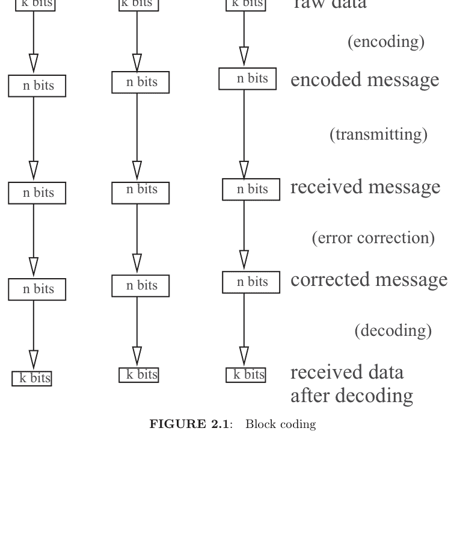

图 2.1：块编码

## 2.2 块编码

使用二进制线性码。信息率，相对距离。

二进制线性码对于块编码特别有用。我们使用参数为 $[n,k,d]_2$ 的线性码 $\mathcal{C}$。由于有 $2^k$ 个码字，我们可以找到一个双射函数（编码函数）$\alpha : \mathbb{F}_2^k \longrightarrow \mathcal{C}$。没有理由不将此函数选为线性函数（$\alpha(x + y) = \alpha(x) + \alpha(y)$）。下面是我们的码 $[7,4,3]_2$ 的一个可能的编码函数 $\alpha$。注意逆 $\alpha^{-1}$ 是在最后四个坐标上的投影。

| | |
|---|---|
| 0000 ⟶ 0000000 | 0110 ⟶ 1100110 |
| 1000 ⟶ 1101000 | 0101 ⟶ 0100101 |
| 0100 ⟶ 1010100 | 0011 ⟶ 1000011 |
| 0010 ⟶ 0110010 | 1110 ⟶ 0001110 |
| 0001 ⟶ 1110001 | 1101 ⟶ 1001101 |
| 1100 ⟶ 0111100 | 1011 ⟶ 0101011 |
| 1010 ⟶ 1011010 | 0111 ⟶ 0010111 |
| 1001 ⟶ 0011001 | 1111 ⟶ 1111111 |

我们可以描述块编码的工作方式：传入的数据被分成长度为 $k$ 的连续块。每个这样的块因此是长度为 $k$ 的位串，$\mathbb{F}_2^k$ 的一个元素。对每个块应用编码函数 $\alpha$。结果是长度为 $n$ 的编码块。这些通过信道传输。纠错（回顾我们的基本编码思想：每个编码块可纠正 $e = \lfloor (d - 1)/2 \rfloor$ 个比特错误）产生长度为 $n$ 的块，这些块 hopefully 与输入信道的块相同。最后，对每个长度为 $n$ 的块应用编码函数的逆 $\alpha^{-1}$。结果是长度为 $k$ 的块， hopefully 与原始数据的对应块相同。过程的最后两个阶段（纠错和应用 $\alpha^{-1}$）也统称为解码。

第 1.1 节中的长度为 3 的重复码是一般图的一部分：该码的参数为 $[3,1,3]_2$，由码字 000 和 111 组成。编码函数映射 $0 \mapsto 000, 1 \mapsto 111$。这已经是相当初等的了。

在块编码中，位串的长度从 $k$ 增加到 $n$。这意味着通过信道发送的 $k/n$ 的比特代表纯信息，而其余的是我们为纠错目的巧妙引入的冗余。我们希望尽可能保持该比率 $k/n$ 尽可能大，以免浪费时间和金钱。

### 2.7 定义.
*线性 $[n,k,d]_2$-码的比率 $R = k/n$ 是其* **信息率；** *比率 $d/n$ 是* **相对距离。**

## 练习 2.2

- 2.2.1. *当传输错误发生在坐标 3、7、14 时，对输入串 00101110 完整地进行块编码的各个阶段。*

## 2.3 编码对解码错误概率的影响。

让我们在特殊情况下比较有编码和无编码的错误概率，基于 BSC（第 1.5 节）。比特错误概率是（较小）数 $p$。使用块长度 $k = 4$ 的块编码。我们想要计算（或估计）给定 4 元组在编码和解码后 **未** 正确接收的概率 $P$。

无编码时（$n = k = 4$）正确传输的概率为 $(1 - p)^4 = 1 - 4p + 6p^2 - 4p^3 + p^4 \approx 1 - 4p$，所以 $P \approx 4p$。

使用我们的码 $[7,4,3]_2$，如果不超过 1 个比特错误发生，消息将被正确解码。因此正确传输的概率为

$\ge (1 - p)^7 + 7p(1 - p)^6 \approx (1 - 7p + 21p^2) + (7p - 42p^2) = 1 - 21p^2$。

在这种情况下我们有 $P \le 21p^2$。我们用信息率 $R = 4/7$ 为这种更小的错误概率付出了代价（意味着 $3/7$ 的传输时间是冗余的）。

将其与我们最初的码、长度为 3 的重复码进行比较。我们留作练习来检查，将其视为 $k = 4, n = 12$ 的块码时，其错误概率为 $P \le 12p^2$。这相对于 $[7,4,3]_2$ 约减少了 2 倍，但信息率已降至 $1/3$。

存在一个码 $[11,4,5]_2$。如果我们使用它，正确传输的概率为

$\ge (1 - p)^{11} + 11p(1 - p)^{10} + \binom{11}{2}p^2(1 - p)^9$

$\approx \left(1 - 11p + 55p^2 - \binom{11}{3}p^3\right) + \left(11p - 110p^2 + 495p^3\right) + \left(55p^2 - 495p^3\right)$

$\approx 1 - \binom{11}{3}p^3$。

错误概率为 $P \le 165p^3$。

令 $p = 10^{-4}$。无编码时，块错误概率为 $P \approx 4 \cdot 10^{-4}$。信息率为 $R = 4/7$ 时，我们达到 $P \le 2.1 \cdot 10^{-7}$，而信息率为 $R = 4/11$ 时，可压低到 $P \le 1.65 \cdot 10^{-10}$。重复码相比之下突然显得相当愚蠢。

## 练习 2.3

- 2.3.1. 计算长度为 3 的重复码作为编码长度为 4 的块到长度为 12 的消息的码的块错误概率。
- 2.3.2. 计算码 $[9,5,3]_2$（它存在）的信息率和块错误概率。
- 2.3.3. 计算码 $[23,12,7]_2$（二进制戈莱码）的信息率和块错误概率。
- 2.3.4. 证明 $[n,k,2e+1]_2$-码的块错误概率被（近似地）$\binom{n}{e+1}p^{e+1}$ 所限制。

## 2.4 对偶性

**基本概念：** $\mathbb{F}_2^n$ 上的点积，正交性，对偶空间，二进制重复码，和为零码，校验矩阵，P-变换。

正如数学中经常出现的那样，对偶性对编码理论也大有裨益。每个人都从物理学中知道点积。我们也可以在我们的二进制环境中使用它。

### 2.8 定义.
点积在 $\mathbb{F}_2^n$ 上定义为

$(x_1,x_2,\dots,x_n)\cdot(y_1,y_2,\dots,y_n)=\sum_{i=1}^{n}x_i y_i.$

设 x, y ∈ 𝔽₂ⁿ。我们说 x 和 y 是 **正交** 的（x ⊥ y）如果 x · y = 0。显然，对于每个子集 U ⊆ 𝔽₂ⁿ，集合

U^⊥ = {x | x ∈ 𝔽₂ⁿ, x · u = 0 对所有 u ∈ U}

是 𝔽₂ⁿ 的一个子空间。对所有 x, y, z ∈ 𝔽₂ⁿ 和 λ ∈ 𝔽₂ 以下规则成立

x · y = y · x
(x + y) · z = x · z + y · z
(λx) · y = x · (λy) = λ(x · y).

点积是一般所称的 **对称双线性形式** 的一个例子（线性代数的另一个主题）。下面是一个基本事实，它将在对称双线性形式的更一般背景下在命题 17.33 中证明。

### 2.9 引理.
设 U ⊆ 𝔽₂ⁿ 为线性子空间。则

dim(U) + dim(U^⊥) = n.

特别地，我们看到，当 C 是长度为 n 的线性 k 维二进制码时，对偶码 C^⊥ 的维数为 n − k。

### 2.10 引理.
设 U ⊆ 𝔽₂ⁿ 为线性子空间。则

U^⊥⊥ = U.

**证明**  根据定义 U^⊥⊥ ⊇ U。根据引理 2.9 这些空间具有相同的维数。

（见练习 2.4.1）。这种情况与实空间非常不同，在实空间中非零向量永远不可能与自身正交。

每当我们有一个码 [n,k,d]₂ 时，我们可以考虑它的对偶。维数将为 n−k，但最小距离尚不清楚会是什么。作为一个例子，考虑我们的码 [7,4,3]₂（二进制哈明码 ℋ 来自第 2.1 节）。考虑该节中给出的生成矩阵 G 的前三行。它们与 G 的所有行正交（验证之）。由此可知，这三个词生成一个三维码，它与 ℋ 正交。由于 ℋ 的长度为 7，维数为 4，ℋ⊥ 的维数为 3。由此可知，ℋ 的前 3 行构成 ℋ⊥ 的生成矩阵。特别地 ℋ⊥ ⊂ ℋ。在练习 2.1.4 中已证明 ℋ⊥ 是码 [7,3,4]₂。

### 2.12 命题.
*设 ℋ 为二进制哈明码 [7,4,3]₂。*
*则 ℋ⊥ ⊂ ℋ 是码 [7,3,4]₂。*

对偶性为我们提供了描述码的另一种方法。假设对偶码 𝒞⊥ 的生成矩阵 H 已给出。那么我有一个快速方法来判断位串 x ∈ 𝔽₂ⁿ 是否属于 𝒞。这当且仅当 x 与 H 的所有行正交时成立。在许多情况下，这种描述比通过生成矩阵的描述更方便。

### 2.13 定义.
*对偶码 𝒞⊥ 的生成矩阵称为 𝒞 的* **校验矩阵。**

这里有一个小技巧（由线性代数中的高斯消元法动机），它通常简化校验矩阵的确定。

### 2.14 引理.
*设码 [n,k]₂ 的生成矩阵写成形式 G = (I|P)。则校验矩阵为 H = (Pᵗ|I)。这里 G 中的 I 是 (k,k)-单位矩阵，H 中的 I 是 (n−k,n−k)-单位矩阵，Pᵗ 是 P 的转置。*

**证明**

我们必须证明 G 的每一行都与 H 的每一行正交。我们如何在矩阵记号中表达这一点？回顾 **矩阵乘积**：乘积矩阵 AB 的第 i 行第 j 列的条目是 A 的第 i 行与 B 的第 j 列的点积。这意味着我们必须证明 GHᵗ = 0（零矩阵）。事实上，

$GH^t = (I|P)(P^t|I)^t = P + P = 0.$

考虑第 1.3 节中的码 [6,3,3]₂。它有一个生成矩阵 $G = \begin{pmatrix}100 & 110\\010 & 101\\001 & 011\end{pmatrix}$。这具有引理 2.14 的形式。我们得到作为校验

matrix $H = \begin{pmatrix}110 & 100\\101 & 010\\011 & 001\end{pmatrix}$. 观察到 $G$ 的子矩阵 $P$ 需要转置才能得到 $H$。在我们的例子中 $P$ 是对称的 ($P = P^t$)。

- 1. 对偶性基于 **点积**。
- 2. $[n,k]_2$-码的对偶的维数为 $n - k$。
- 3. $\mathcal{C}$ 的 **校验矩阵** $H$ 是对偶 $\mathcal{C}^\perp$ 的生成矩阵。
- 4. 求和为零的码 $[n,n-1,2]_2$ 是重复码 $[n,1,n]_2$ 的对偶。

## Exercises 2.4

**2.4.1.** 全1字何时与自身正交？

**2.4.2.** 若码等于其对偶，则该码为 **自对偶**。
是否存在自对偶 $[6,3,3]_2$？

**2.4.3.** 找到一个 $(4,8)$ 标准形式矩阵（以单位矩阵 $I$ 开始），它生成一个参数为 $[8,4,4]_2$ 的自对偶码（$\mathcal{C}^\perp = \mathcal{C}$）。

**2.4.4.** 找到汉明码 $[7,4,3]_2$ 在标准形式下的生成矩阵。使用 $P$-变换求校验矩阵。

**2.4.5.** 是否存在自对偶 $[12,6,6]_2$-码？

**2.4.6.** 是否存在 $[12,6,6]_2$-码？

## 2.5 二进制汉明码和单纯形码及汉明码的译码。

我们学会了如何使用生成矩阵或校验矩阵来描述二进制线性码。自然地关注这些矩阵的 **行**（它们是待描述码或其对偶的码字）。然而，改变观点按 **列** 读取这些矩阵将会非常有益。

对每个 $r$，令 $M_r$ 为一矩阵，其列遍历所有长度为 $r$ 的非零比特串。显然 $M_r$ 是一个 $(r,2^r-1)$ 矩阵。列的书写顺序其实并不重要。我们将按权重递增的顺序书写它们，并且对每个权重按字典序排列列：

$$M_3 = \begin{pmatrix}1001101\\0101011\\0010111\end{pmatrix}.$$

$$M_4 = \begin{pmatrix}100011100011101\\010010011011011\\001001010110111\\000100101101111\end{pmatrix}.$$

称由 $M_r$ 生成的码为 **单纯形码** $\mathcal{S}_r(2)$。由于 $M_r$ 以单位矩阵开头，其秩为 $r$。单纯形码因此具有维数 $r$。最小距离如何？$M_r$ 的每一行权重为 $2^{r-1}$。想象我们把全0向量写成最后一列。此时很明显 $M_r$ 的每一行组合（从而单纯形码的每个非零码字）具有相等数量的零和一（各 $2^{r-1}$ 个）。由此可知单纯形码的每个非零码字权重为 $2^{r-1}$。单纯形码是 **等重码**。如果读者觉得论证不够令人信服，一个清晰的证明在第17章的第一部分。如果不想等那么久，只需用归纳法证明此事实；参见练习 2.5.4。

### 2.15 Theorem.
*设 $\mathcal{S}_r(2)$（二进制 $r$ 维 **单纯形码**）为生成矩阵的列为所有长度为 $r$ 的非零比特串的码。则 $\mathcal{S}_r(2)$ 是一个码 $[2^r-1,r,2^{r-1}]_2$。而且，每个非零码字权重为 $2^{r-1}$。*

我们有码 $[7,3,4]_2$、$[15,4,8]_2$、$[31,5,16]_2$、… 其中最小的一个我们早已熟悉。

考虑单纯形码的对偶。维数由引理 2.9 为 $2^r-1-r=2^r-(r+1)$。最小距离如何？这出人意料地容易判断。设 $x\in\mathbb{F}_2^{2^r-1}$。此时 $M_r$ 是校验矩阵。这意味着如果 $M_r$ 中对应于 $x$ 中为 1 的项的列之和为零，则 $x$ 是一个码字。若 $wt(x)=1$，则 $M_r$ 必须有一列为 0，这与事实矛盾。若 wt(x)=2，则 $M_r$ 的两列相同，这不成立。我们可以有 wt(x)=3 吗？这意味着某些三列之和为零，等价于两个非零元组的和为第三个非零元组。这时常发生。例如，$M_3$ 中第 1、2 和 4 列之和为 0，意味着 $(1,1,0,1,0,0,0)$ 是一个码字。我们已看到我们的码具有最小距离 d=3。

### 2.16 Theorem.

设 ℋ_r(2)=𝒮_r(2)⊥，称为二进制汉明码。则 ℋ_r(2) 是一个码 [2^r−1,2^r−(r+1),3]_2。

这给出码 [7,4,3]_2、[15,11,3]_2、[31,26,3]_2、… 我们再次熟悉该族中最小的成员。

### 2.17 Theorem. 二进制汉明码是完美码。

证明 回顾第 1.6 节，码若满足球填充界且取等号则为完美码。我们有 d=3。半径为 1 的球的体积为 V₂(1,n)=n+1=2^r。 由于 2^n/|ℋ_r(2)|=2^r，我们有等号。

### 汉明译码

我们尚未涉及的一个重要问题是译码算法。接收方如何计算发送的码字，假设发生了不超过 e 个错误（这里 2e<d）？一般思想（参见第 1.3 节）指出我们应在接收字 y 的邻域（距离 ≤e）中搜索。如果我们在此球中找到一个码字 x（我们保证不会找到多于一个），则译码 y↦x。 这种搜索过程在实践中如何进行？由于数据流式传输，我们可能希望实时译码，因此必须使用快速算法。

对于汉明码而言这尤其容易。我们以熟悉的汉明码 [7,4,3]_2 为例。以下是校验矩阵再次：

H = \begin{pmatrix}1 & 0 & 0 & 1 & 1 & 0 & 1\\0 & 1 & 0 & 1 & 0 & 1 & 1\\0 & 0 & 1 & 0 & 1 & 1 & 1\end{pmatrix}.

用 s₁,s₂,…,s₇ 表示 H 的列。假设码字 x 被发送。 x 为码字等价于 xH^t=0（换句话说：x 与 H 的行正交）。例如，取 x=(1,0,1,1,0,1,0)。由于 d=3，我们假设最多发生一个错误。如果该错误发生在坐标号 3，则

y = (1,0,1,1,0,1,0)+(0,0,1,0,0,0,0)=(1,0,0,1,0,1,0)

是接收到的向量。接收方的做法如下：
他或她计算 yH^t = (0,0,1)^t。 由于 y = x + z，其中 z 是错误向量，接收方知道 yH^t = xH^t + zH^t = zH^t。 如果 zH^t 是 H 的第 j 列，则错误发生在该列。正确的码字是通过在坐标 j 处加 1 得到 x。 在我们的例子中 (0,0,1) = s3。由此可得 x = y + (0,0,1,0,0,0,0)。

- 1. 写出一个具有 r 行和 2^r - 1 列的矩阵 M_r，其列为所有非零二进制 r-元组。
- 2. 那么 G 是单纯形码 S_r(2)（维数为 r）的生成矩阵，也是汉明码 H_r(2)的校验矩阵。
- 3. H_r(2) 是一个最小距离为 3 的完美码。
- 4. S_r(2) 的每个非零码字权重为 2^{r-1}。
- 5. 汉明码有一个特别简单的译码算法。

## Exercises 2.5

- 2.5.1. 使用矩阵 M3，在汉明码 [7,4,3]_2 中找到至少五个不同的码字。
- 2.5.2. 使用 M4 并在 H4(2) 中找到至少五个不同的码字。
- 2.5.3. 使用二进制汉明码 [7,4,3]_2。译码接收向量 y1 = (1,1,0,1,1,0,0), y2 = (1,1,1,1,1,1,1), 和 y3 = (1,1,1,0,0,0,0)。
- 2.5.4. 用关于 r 的归纳法证明 M_r 的行的每个非平凡线性组合（单纯形码 S_r(2) 的每个非零字）的权重为 2^{r-1}。
- 2.5.5. 证明二进制单纯形码 S_r(2)，r ≥ 3 是自正交的（包含在其正交子空间中）。

## 2.6 对偶原理

基本概念：二进制正交阵列，最小权重与强度的对偶性。

我们已在前一节讨论单纯形码和汉明码时见识过所承诺的对偶原理的实际应用。让我们重新回顾导致我们得出汉明码最小距离 d = 3 的论证。

设 H 为参数为 [n,k,d]₂ 的二进制线性码 C 的校验矩阵（此时 H 是一个秩为 n - k 的 (n - k, n) 矩阵）。我们想从 H 中读出 d。考虑一个非零比特串 x = (x₁,x₂,…,xₙ)。则 x ∈ C 当且仅当 x 与 H 的所有行正交，等价于以 xᵢ 为系数的 H 的列的线性组合为零。若 x 具有权重 w，则某些 w 列的 H 之和为零。特别地 d（C 的最小权重）是使得某些 d 列之和为 0 向量的最小数。

### 2.18 Definition.
*二进制矩阵 H 是 t–独立的，如果没有 t 或更少的列之和为 0。*

如果 H 是 t-独立的，则 C 不包含权重 ≤ t 的非零向量。如果 H 不是 t-独立的，则 C 确实包含权重 ≤ t 的非零向量。这给出了对偶原理的一种形式。

### 2.19 Theorem (principle of duality).
*设 C ⊆ 𝔽₂ⁿ 为线性码 [n,k]₂。则以下等价：*

- C 具有最小距离 ≥ d。
- C 的校验矩阵是 (d − 1)-独立的。

考虑

H = \begin{pmatrix} 0100011100011101 \\ 0010010011011011 \\ 0001001010110111 \\ 0000100101101111 \\ 1111111111111111 \end{pmatrix}.


The 16 columns of H run through all binary 4-tuples (including the 0-tuple), followed by a last entry of 1. The first five columns show that H has rank 5. It is therefore the check matrix of a code [16,11,d]₂. What is d? As there is no 0 column in H, we have d > 1. As no two columns in H are equal, we have d > 2. The sum of three different columns of H cannot vanish, because of the last entry (1 + 1 + 1 = 1). We have d ≥ 4. Finally, we find plenty of cases where four columns of H sum to 0. For example, columns number 1,2,3 and 12 sum to the 0-column. This shows

x = (1, 1, 1, 0, 0, 0, 0, 0, 0, 0, 0, 1, 0, 0, 0, 0) ∈ C.

We have seen that the code C with H as check matrix has parameters [16,11,4]₂.

Instead of using the check matrix H, we can just as well express the situation basing ourselves on the dual code C⊥ itself (the code generated by the rows of H). Imagine an array C whose rows are all the codewords of C⊥. Assume some four columns of H sum to 0. As you run your fingers down these four columns you will not encounter all possible bitstrings of length 4 but only at most half of them: if I know the first three bits, then the last one is uniquely determined. Assume, on the other hand, that H is 3-independent. If I consider the projection onto any set of three columns, then every 3-tuple will be encountered, even the same number of times.

Our matrix M₃ is a generator matrix of the Simplex code [7,3,4]₂ and a check matrix of the Hamming code [7,4,3]₂. Let us write down all linear combinations of the rows of M₃, hence all codewords of the Simplex code:

C =
| c1 | c2 | c3 | c4 | c5 | c6 | c7 |
|---|---|---|---|---|---|---|
|0|0|0|0|0|0|0|
|1|0|0|1|1|0|1|
|0|1|0|1|0|1|1|
|0|0|1|0|1|1|1|
|1|1|0|0|1|1|0|
|1|0|1|1|0|1|0|
|0|1|1|1|1|0|0|
|1|1|1|0|0|0|1|

Observe that, as promised, all the nonzero rows have weight 4. The fact that the Hamming code has d = 3, equivalently that its check matrix M₃ is 2-independent, now translates into the following fact: for any 2 = 3 − 1 columns, if we run our fingers down this pair of columns in C, then every pair of entries (every binary pair) appears the same number of times, twice. This leads to an important combinatorial notion:

### 2.20 定义. 二进制数组具有 n 列是强度为 t 的二进制正交阵，如果在向任意 t 列的投影中，每个 t 元组出现的次数相同，为 λ。我们把这样的正交阵的参数记为 OA_λ(t, n, 2)。

In particular the number of rows is then λ2^t. The array C above is an OA₂(2,7,2). We record the principle of duality in the following form:

### 2.21 定理（二元对偶原理）。

Let 𝒞 ⊆ 𝔽₂ⁿ be a linear subspace. Then the minimum distance of 𝒞 and the (maximal) strength of 𝒞⊥ are related by

$d(\mathcal{C}) = t(\mathcal{C}^\perp) + 1.$

So the minimum distance of a binary linear code is precisely one larger than the strength of its dual. For example, the dual of a code [8,4,4]₂ is a code of dimension 4 (hence with 2⁴ = 16 codewords) with strength d − 1 = 4 − 1 = 3. This clearly means that, if we fix any three coordinates and if we fix the 3-tuple in the projection, there will be precisely λ = 16/8 = 2 codewords of our dual code having this 3-tuple in these three coordinates.

The notion of an orthogonal array originated not in information theory but in statistics. It plays a central role in the design of experiments (see the book by Hedayat, Sloane and Stufken [109]) and has many more applications in theoretical computer science and cryptology. The reader is invited to generalize Definition 2.20 from the binary to the general q-ary case.

Observe that any set of n-tuples has a minimum distance and a strength. One speaks of codes if one is primarily interested in the minimum distance, of orthogonal arrays if strength is the center of interest. The principle of duality shows that these two notions are related by duality in the binary linear case. That means we have another large field of applications for our codes.

- 1. The **strength** is the most important parameter of an **orthogonal array**.
- 2. The **principle of duality for binary linear codes** states that the minimum distance of 𝒞 is one more than the strength of its dual.
- 3. An equivalent formulation of the principle of duality is: the minimum distance of 𝒞 is the smallest number t ≥ 1 such that some t columns of a check matrix sum to 0.

## 练习 2.6

2.6.1. Define q-ary orthogonal arrays for arbitrary q.

2.6.2. Show that a binary orthogonal array of strength t > 1 also has strength t − 1.

2.6.3. Find a check matrix of S₃(2) by applying Lemma 2.14 to M₃. Use this check matrix to prove that S₃(2) has minimum weight 4.

2.6.4. Show that each perfect binary linear code of distance d = 3 has the parameters of one of the binary Hamming codes.

2.6.5. Show that each perfect binary linear code of distance d = 3 is equivalent to one of the binary Hamming codes.

2.6.6. Describe an OA₁(n − 1, n, 2) for arbitrary length n.

## 第 3 章

### 3.1 素域

**基本概念：** 域，同余，素域。

We have defined codes in general, but considered linear codes only in the binary case. This is not general enough. The tactical advantage when we consider linear codes is that linear algebra helps us in finding, describing and applying these structures. Linear algebra works over any field. In the binary case the underlying field is 𝔽₂ = {0,1}, the smallest of all. Many fruitful code constructions rely on codes defined over a large field and involve “going down” to codes over a small field. Also, there are constructions that work best over larger fields. There is simply no reasonable way to get around linear codes over general finite fields.

The basic properties of a field K are the following: addition and multiplication both define commutative groups (in particular a + b = b + a and a · b = b · a for all a,b ∈ K), the collaboration of addition and multiplication is defined by the distributive law (a(b + c) = ab + ac). Most important is the following requirement: every nonzero element of K possesses a multiplicative inverse, in formulas: for every 0 ≠ a ∈ K there is some a⁻¹ ∈ K such that a · a⁻¹ = 1. The existence of the inverse has the following important consequence: if a ≠ 0 and b ≠ 0, then a · b ≠ 0 (nonexistence of 0-divisors). For finite fields these conditions (existence of the inverse and nonexistence of 0-divisors) are equivalent. Let us prove one direction:

### 3.1 引理。*如果乘法逆元存在，则不存在零因子。*

**证明** Assume ab = 0 and b ≠ 0. We want to show that necessarily

a = 0. Multiply both sides by $b^{-1}$. This yields

$abb^{-1} = a \cdot 1 = a = 0 \cdot b^{-1} = 0.$

Some finite fields are easy to construct and to work with:

### 3.2 定理。

Let $p$ be a prime number. Then $\mathbb{F}_p = \mathbb{Z}/p\mathbb{Z}$ is a field (a prime field).

Let us make sure we know what calculation mod an integer $n$ means. Loosely speaking, we calculate just as in the integers, but we identify $n$ with 0.

### 3.3 例。

Let us calculate mod 3. There are only three different numbers mod 3. These are 0, 1, 2. This is so because 3 = 0, 4 = 3 + 1 = 1 and so forth. As 1 + 2 = 3 = 0, we have that 1 and 2 are additive inverses. This can also be written as 2 = −1 and 1 = −2. Also $2^2 = 4 = 1$.

### 3.4 例。

Now calculate mod 4. There are four different numbers mod 4. These are 0, 1, 2, 3. We have, for example, 2 + 3 = 5 = 1 and 2 + 2 = 4 = 0, hence 2 = −2. Where the multiplication is concerned: 2·3 = 6 = 2, $3^2 = 9 = 1$ and 2·2 = 4 = 0. The last formula shows that 2 is a divisor of 0. In particular the numbers mod 4 do not form a field.

Why is Theorem 3.2 true? As addition and multiplication in $\mathbb{F}_p$ are inherited from the integers, it is clear that distributivity holds and that addition and multiplication are commutative. The only problem is the existence of the inverse (equivalently the absence of 0-divisors). A number is $\neq 0$ mod $p$ if it is not divisible by $p$. The nonexistence of 0-divisors is therefore equivalent to the following statement: if integers $a$ and $b$ both are not divisible by $p$, then $a \cdot b$ is not divisible by $p$. This is clearly true. It is one way of expressing the defining property of a prime, and it certainly is not true for composite numbers (see the example for $n = 4$ above).

### 3.5 例。

As $p = 101$ is a prime, there is a field $\mathbb{F}_{101} = \mathbb{Z}/101\mathbb{Z}$ of 101 elements. These are the numbers 0, 1, 2, …, 100. As $2 \cdot 50 = 100 = -1$, we have $2^{-1} = -50 = 51$. In fact, $2 \cdot 51 = 102 = 1$. As $10^2 = 100 = -1$, we have $10^{-1} = -10 = 91$.

If it is not clear what the underlying prime or more generally integer $n$ is, the notation of congruences is used: $a \equiv b \pmod n$ means that integers $a$ and $b$ are the same when calculating mod $n$, equivalently that $n$ divides $b - a$. For example, we have $33 \equiv 17 \pmod 4$ and of course these are $\equiv 1 \pmod 4$. The fact that $30 \equiv 12 \equiv 0 \pmod 2$ simply expresses the fact that both 30 and 12 are even numbers (calculation mod 2 is the distinction between even and odd numbers, as we saw in Section 1.1).


- 1. 对每个素数 $p$ 都有一个域 $\mathbb{F}_p = \mathbb{Z}/p\mathbb{Z}$，它有 $p$ 个元素。
- 2. 我们在 $\mathbb{F}_p$ 中计算的方式与整数计算相同，只是简化为 $p = 0$。
- 3. 当 $p = 2$ 时，这恰好得到我们一直使用的域 $\mathbb{F}_2$。

## 练习 3.1

- 3.1.1. 证明 $\mathbb{Z}/6\mathbb{Z}$ 不是域（六个元素）。
- 3.1.2. 求 $16$ mod $101$ 的乘法逆元。
- 3.1.3. 求 $3^{100}$ (mod $17$)。
- 3.1.4. 确定所有满足 $a^2 = 1$ 的元素 $a \in \mathbb{F}_p$。

## 3.2 有限域

**基本概念：** 域扩张和不可约多项式，有限域的构造，原始元。

我们在前一节看到，当 $p$ 为素数时 $\mathbb{Z}/p\mathbb{Z} = \mathbb{F}_p$ 是一个有限域。是否还有其他有限域？可以很容易看出以下事实：如果 $n$ 是域 $K$ 的元素个数（**阶**），则 $n = p^r$ 必须是素数的幂。此外，每个阶为 $p^r$ 的域都必须包含素域 $\mathbb{F}_p$。此时素数 $p$ 被称为 $K$ 的 **特征**。我们不想过深地涉及域论。下面的定理将不加证明地接受：

### 3.6 定理。
对每个素数幂 $p^r$，恰好存在一个阶为该阶的域 $\mathbb{F}_{p^r}$。

我们需要知道如何构造这些域。由于 $\mathbb{F}_{p^r}$ 包含素域 $\mathbb{F}_p$，它在 $\mathbb{F}_p$ 上是一个 $r$ 维向量空间。我们可以将 $\mathbb{F}_{p^r}$ 看作是 $r$ 元组空间 $\mathbb{F}_p^r$，其元素在素域中，并带有额外的乘法结构。

在本节中我们将描述有限域是如何构造的，并以最小的情形 $\mathbb{F}_4$ 为例。构造 $\mathbb{F}_{p^r}$ 的第一步（通常也是最困难的）是找到一个次数为 $r$、系数在 $\mathbb{F}_p$ 中的多项式 $X^r + \dots$，它是 **不可约** 的。

在我们的例子中，我们只需写下所有次数 $r = 2$ 的二元多项式。幸运的是，这样的多项式只有四个：

$X^2$, $X^2 + 1$, $X^2 + X$ 和 $X^2 + X + 1$。

次数为 $r$ 的多项式如果不能写成两个次数更低的多项式的乘积，则它是不可约的。不可约多项式在整数中起着类似于素数的角色。在我们的例子中可以看到 $X^2 = X \cdot X$, $X^2 + 1 = (X + 1)^2$ 和 $X^2 + X = X(X + 1)$ 显然不是不可约的。唯一剩下的候选是 $X^2 + X + 1$。这是一个不可约多项式。

现在假设我们找到了一个不可约多项式

$f(X) = X^r + a_{r-1}X^{r-1} + \cdots + a_1 X + a_0$。

$\mathbb{F}_{p^r}$ 的元素是次数 $< r$ 的多项式。加法和乘法与多项式一样。重要的简化是 $f(X) = 0$。我们说按多项式 $f(X)$ 计算 **模**。在这样做时，通常给（前）变量 $X$ 取一个中性的希腊名字，例如 $\epsilon$。因此定义方程为 $f(\epsilon) = 0$。这意味着，只要出现指数 $\ge r$ 的 $\epsilon$ 的幂，我们就用定义方程化简指数

$\epsilon^r = -a_{r-1}\epsilon^{r-1} - \cdots - a_1\epsilon - a_0$。

回到例子 $\mathbb{F}_4$。我们知道 $f(X) = X^2 + X + 1$ 是我们的不可约多项式（系数在 $\mathbb{F}_2$ 中）。作为按 $f(X)$ 计算时 $X$ 的新名字，我们选择 $\omega$。因此定义方程为 $\omega^2 = \omega + 1$（注意在特征为 2 时 $+ = -$）。该方程完全描述了域结构：$\mathbb{F}_4 = \{0,1,\omega,\omega+1\}$ 且加法是多项式的加法。定义方程告诉我们 $\omega^2$ 是什么。我们可以继续：$\omega^3 = \omega(\omega + 1) = \omega^2 + \omega = (\omega + 1) + \omega = 1$。由于 $\omega^3 = 1$，我们说 $\omega$ 的 **阶** 为 3。我们已将所有非零域元素写成 $\omega$ 的幂。这决定了乘法结构。一般来说，并非所有域元素都是 $X$ 的幂。如果是这种情况，就称其为 **本原** 多项式，并称相应的域元素为 **本原** 元。每个有限域都可以用一个本原多项式来描述。

我们希望接受对每个素数幂 $q$，域 $\mathbb{F}_q$ 都存在（并且是唯一确定的）。假定读者完全熟悉素域和 $\mathbb{F}_4$。如果我们遇到任何其他有限域，它将按照本节给出的配方构造。

虽然我们在这里只需要有限域上的情况，但同样的过程表明如何一般地构造域扩张：

### 3.7 定理。
设 $K$ 为域，$p(X)$ 为系数在 $K$ 中次数为 $r$ 的不可约多项式。则 $K[X]/(p(X))$ 是 $K$ 的次数为 $r$ 的域扩张。

这里 $(p(X))$ 表示所有 $p(X)$ 的倍式多项式的集合，而因子记号 $K[X]/(p(X))$ 是我们所见构造的简写：幂 $1, X, \dots, X^{r-1}$ 是该扩张域在 $K$ 上的基。在练习 3.2.5 中，要求读者用这种方法构造复数域 $\mathbb{C}$ 作为实数域 $\mathbb{R}$ 的扩张。

- 1. 系数在域 $K$ 中的次数为 $r$ 的不可约多项式产生 $K$ 的次数为 $r$ 的扩张域。
- 2. 对每个素数幂 $q = p^r$，存在一个有 $q$ 个元素的有限域 $\mathbb{F}_q$。
- 3. 它是唯一确定的并且包含素域 $\mathbb{F}_p$。
- 4. $\mathbb{F}_{p^r}$ 是借助系数在 $\mathbb{F}_p$ 中次数为 $r$ 的不可约多项式构造的。
- 5. 域 $\mathbb{F}_4$ 已被详细描述。
- 6. $\mathbb{F}_4 = \{0, 1, \omega, \omega^2\}$，其中 $1 + \omega + \omega^2 = 0$ 且 $\omega^3 = 1$。

## 练习 3.2

- 3.2.1. 求出系数在 𝔽₂ 中次数为 3 的所有不可约多项式。
- 3.2.2. 构造 𝔽₈。
- 3.2.3. 𝔽₄ ⊂ 𝔽₈ 是否成立？
- 3.2.4. 确定 𝔽_q 中所有元素的和。
- 3.2.5. 将复数域构造为实数域 ℝ 的二次扩张。二次不可约多项式的自然选择是什么？
- 3.2.6. 使用不可约多项式 X² − X − 1 构造 𝔽₉。
- 3.2.7. 设 α ∈ F = 𝔽_{q^r}。证明存在一个次数 ≤ r、系数在 𝔽_q 中的多项式 f(X)，使得 f(α) = 0。
- 3.2.8. 设 α ∈ F = 𝔽_{q^r}。证明存在唯一一个首一（最高系数 = 1）的多项式 f(X)，其次数 s > 0 最小，使得 f(α) = 0。多项式 f(X) 是 α 的极小多项式。它是不可约的。
- 3.2.9. 设 α ∈ F = 𝔽_{q^r}。设 s 为 α 的极小多项式的次数，等价于使幂 1, α, …, α^s 在 𝔽_q 上线性相关的最小数。证明包含 𝔽_q 和 α 的 F 的最小子域 𝔽_q(α) 以 1, α, …, α^{s−1} 为基。由此可知 s 必须整除 r。
- 3.2.10. 在下面的练习中，读者被鼓励证明关于有限域的一些基本事实。从以下开始：设 F 为有限域。对每个自然数 n 定义 n·1 = 1 + 1 + ⋯ + 1 为 F 中 1 的 n 个拷贝之和。证明必存在某个 n > 0 使得 n·1 = 0。
- 3.2.11. 设 F 为有限域。将 F 的特征定义为使 p·1 = 0 成立的最小自然数 p。证明特征是一个素数。
- 3.2.12. 设 p 为有限域 F 的特征。证明 {0,1,2·1,…,(p−1)·1} 是 F 的子域，并且该子域是素域 𝔽_p。
- 3.2.13. 设 F 为特征为 p 的有限域。证明 F 在 𝔽_p 上是一个向量空间。由此可知：|F| 必须是 p 的幂。

## 3.3 有限域上的线性码

**基本概念：** 最小距离，生成矩阵。线性组合，线性无关，维数，秩，行列式，高斯消元。

### 3.8 定义。
*设* 𝔽_q *为具有* q *个元素的域。一个* q*-元线性码的长度为* n *且维数为* k *是线性子空间* 𝒞 ⊆ 𝔽_q^n *其向量空间维数为* k*。如果其最小距离为* d*，则我们将* 𝒞 *的参数记为* [n,k,d]_q*。*

注意，维数为 k 的 q 元线性码有 q^k 个码字。它包含全零字 0 = (0,0,...,0)。

对于固定的 q，我们希望构造具有大 d、大 k 且小 n 的码 [n,k,d]_q。回想一下，最小距离为 d 的码允许纠正 e 次传输错误，当 2e < d 时。

我们关于二元线性码的所有基本事实都适用于一般线性码。在二元情形下，我们从线性性中得到的第一个好处是命题 2.5，即从最小距离到最小权重的归约。

### 3.9 命题。
*线性码* [n,k,d]_q *的最小距离* d *等于其最小权重。这里码字的权重是非零项的坐标数，最小值是在码的非零字上取的。*

**证明** 这是正确的，因为两个不同码字之间的每个距离也是某个非零码字的权重：d(x,y)=wt(x−y)，并且 x−y 是码字，因为码是线性的。

一个 [n,k,d]_q-码 𝒞 的 **生成矩阵** G 是一个 (k,n)-矩阵，其行构成 𝒞 的基。码 𝒞 可由 G 通过取行的所有线性组合得到。如果与二元情形比较，我们在那里使用的和在一般情形下必须被 **线性组合** 取代。以下是线性代数中一些重要术语的回顾：

### 3.10 定义。
*设 V 为定义在域 K 上的向量空间且 v₁,v₂,...,vₘ ∈ V。v₁,...,vₘ 的线性组合是形如的表达式*

λ₁v₁ + λ₂v₂ + ⋯ + λₘvₘ,

其中 λ_i ∈ K。如果存在线性组合使得 ∑_{i=1}^m λ_i v_i = 0 且并非所有 λ_i = 0，则集合 {v_1, …, v_m} 称为线性相关。若不是线性相关则称为线性无关。

另请回忆，矢量空间的基是一个最大线性无关向量集，且 V 的维数是基中元素的个数。我们的线性码是 F_q^n 的子空间，即所有 n-元组的集合。n-元组构成一个维数为 n 的向量空间。命题 2.6 中关于二进制情形的生成矩阵的刻画在一般情形下如下：

## 3.11 命题.

设 C 是一个 [n,k]_q-码，G 是一个其行是 C 的码字的矩阵。下列条件等价：
- 1. G 是生成矩阵。
- 2. G 的秩为 k。
- 3. 存在一个行列式非零的 (k,k)-子矩阵。
- 4. G 的行线性无关。

我们用以下长度为 4 的码来举例，其元素在域 F_4 = {0,1,ω,ω̄} 中，其中 ω² = ω + 1。

| 0 | 0 | 0 | 0 | 0 | ω | ω | 1 |
| 1 | 1 | 1 | 1 | 1 | ω | ω | 0 |
| ω | ω | ω | ω | ω | 0 | 1 | ω |
| ω | ω | ω | ω | ω | 1 | 0 | ω |
| 0 | 1 | ω | ω | 0 | ω | 1 | ω |
| 1 | 0 | ω | ω | 1 | ω | 0 | ω |
| ω | ω | 0 | 1 | ω | 1 | ω | 0 |
| ω | ω | 1 | 0 | ω | 0 | ω | 1 |

它是一个线性码（验证码字的线性组合仍是码字）并且有 16 = 4² 个元素。这意味着它的维数是 2。我们可以用生成矩阵，更具体地用基来更紧凑地表示它。基由任意两个线性无关的码字组成。如果我们选择第五行 z1 = (0,1,ω,ω) 作为一个基元素，z1 的所有标量倍都与它线性相关，所以这些不能用作第二个基元素。它们是 0z1 = (0,0,0,0)、z1 本身、ωz1 = (0,ω,ω,1) 和 ω²z1 = (0,ω,1,ω)。我们可以在剩下的 16 − 4 = 12 个码字中选择一个作为生成矩阵的第二行。以下是我们这个码的一个生成矩阵：

G = ( 1 1 1 1
      0 1 ω ω ).

所有 16 个码字的列表表明 $d = 3$。我们有一个四元线性码 $[4, 2, 3]_4$。

如果你的线性代数教育偏向于求解线性方程组，对“基”和“维数”等术语不太熟悉，下面是操作步骤：

设给定 $\mathbb{F}_q^n$ 中的 $k$ 个元素。你想求它们生成的码的维数。
- 1. 将你的元组按某种顺序写成 $(k, n)$-矩阵 $G$ 的行。
- 2. 使用行初等变换将矩阵化为行阶梯形。记结果矩阵为 $G'$。
- 3. 行初等变换不会改变行空间（即码）。码的维数是 $G'$ 中非零行的个数。这些非零行构成码的一个基。

- 1. $q$-元线性码 $[n, k, d]_q$ 已被定义。
- 2. 我们希望 $k$ 大、$d$ 大且 $n$ 小。
- 3. 最小距离等于最小非零重量。
- 4. **生成矩阵** 是一个 $(k, n)$-矩阵，其行构成码的一个基。

## 练习 3.3
- 3.3.1. 求一个三元 $(q = 3)$ 线性码 $[4, 3, 2]_3$ 的生成矩阵。
- 3.3.2. 求一个 5 元码 $[5, 3, 3]_5$ 的生成矩阵。
- 3.3.3. 求一个 $[5, 2, 4]_4$ 码的生成矩阵。
- 3.3.4. 求一个 $[8, 2, 7]_7$ 码的生成矩阵。
- 3.3.5. 描述一个 $[q + 1, 2, q]_q$ 码的生成矩阵。
- 3.3.6. 证明 $[q + 2, 2, q + 1]_q$-码不存在。

## 3.4 对偶与正交数组

基本概念：$\mathbb{F}_q^n$ 上的点积，对偶空间（码），校验矩阵。一般线性码对偶原理。正交数组，正交拉丁方。重复码和和为零码，汉明码和单式码，P-变换。

在 $\mathbb{F}_q^n$ 中使用点积是完全合理的。

## 3.12 定义。点积在 $\mathbb{F}_q^n$ 上定义为

$(x_1,x_2,\dots,x_n)\cdot(y_1,y_2,\dots,y_n)=\sum_{i=1}^n x_i y_i.$

若 $\mathcal{C}\subset\mathbb{F}_q^n$ 是一个 $k$ 维子空间，则其对偶 $\mathcal{C}^\perp$ 的维数为 $n-k$。$\mathcal{C}^\perp$ 的一个生成矩阵 $H$ 称为 $\mathcal{C}$ 的校验矩阵。并且 $\mathcal{C}^{\perp\perp}=\mathcal{C}$。

## 3.13 例.

重复码 $[n,1,n]_q$ 是以全 1 向量 $(1,1,\dots,1)$ 为基的码。其对偶的维数为 $n-1$。它是和为 0 的码，其码字是满足 $\sum_{i=1}^n x_i=0$ 的 $(x_1,x_2,\dots,x_n)$。和为 0 的码是一个 $[n,n-1,2]_q$-码。考虑 $q=3,n=4$ 的情形。和为零码是一个 $[4,3,2]_3$-码。这就是我们在第 1.4 节看到的码。一个生成矩阵是

$G = \begin{pmatrix}1&2&0&0\\0&1&2&0\\0&0&1&2\end{pmatrix}.$

所有这些与二进制情形并无不同。对偶原理也是如此。

## 3.14 定义。矩阵 $H$ 的元素在域 $\mathbb{F}_q$ 中，若 $H$ 的任意 $t$ 列都线性无关（从而 $H$ 在任意 $t$ 列上的投影有满秩 $t$），则称 $H$ 是 $t$-无关的。

我们已经在二进制情形下看到过以下重要关系。它是对偶原理的一种表达方式。

## 3.15 定理.

设 $\mathcal{C} \subseteq \mathbb{F}_q^n$ 是一个线性子空间。则 $\mathcal{C}$ 的最小距离 $\ge d$ 当且仅当 $\mathcal{C}$ 的一个（每个）校验矩阵是 $(d-1)$-无关的。

我们可以用对偶码来表达，而不用其生成矩阵 $H$。显然 $H$ 是 $t$-无关的当且仅当在 $\mathcal{C}^\perp$ 对任意 $t$ 列的限制中，任意 $t$-元组出现的次数相同。这导致了强度为 $t$ 的 **正交数组** 的组合概念（参见第 2.6 节）。

### 正交数组

回顾强度为 $t$ 的 OA 的定义性质；在任意 $t$ 列上的投影中，每个可能的 $t$-元组都出现相同次数 $\lambda$。数 $\lambda$ 称为数组的 **指标**。具有 $n$ 列、指标 $\lambda$ 的 $q$-元强度 $t$ 的 OA 的参数记为

$OA_{\lambda}(t, n, q)$.

行数为 $\lambda q^t$。

强度为 1 的 OA 是一个非常弱的结构。我们只要求每一列中每个元素出现的次数相同。大多数人已经遇到过强度为 2、指标为 1 的 OA，尽管是以伪装的形式出现的。在离散数学、统计学以及 recreational 数学中，一个流行的结构是 **拉丁方**。阶为 $n$ 的拉丁方按定义是一个 $(n,n)$-数组，其元素来自大小为 $n$ 的字母表。数组的 $n^2$ 个单元格都填有来自字母表的元素。其核心性质（使其成为拉丁方）是
- 在每一行和每一列中每个元素恰好出现一次，换句话说：每一行和每一列都是符号的一个排列。

例如，$L_1 = \begin{pmatrix}1&2&3\\2&3&1\\3&1&2\end{pmatrix}$ 是一个阶为 3 的拉丁方。另一个这样的拉丁方是 $L_2 = \begin{pmatrix}1&2&3\\3&1&2\\2&3&1\end{pmatrix}$。此外，拉丁方对 $L_1, L_2$ 具有一个特殊性质：如果将它们叠加，并在每个单元格中读出元素对 $(i,j)$，其中 $i$ 是 $L_1$ 在该单元格中的元素，$j$ 是 $L_2$ 在该单元格中的元素，则得到的九个元素对 $(i,j)$ 正好是所有可能的元素对。例如，西北单元格给出元素对 $(1,1)$，中间单元格给出元素对 $(3,1)$，并且

东南单元格产生 $(2,1)$。元素对 $(3,3)$ 出现在东北。

一般地，阶为 $n$ 的两个拉丁方如果单元格中的元素对恰好是所有可能的元素对，则称为正交的。我们的方 $L1, L2$ 是正交的。阶为 $n$ 的拉丁方集合 $L1, L2, ..., Lk$ 若任意一对都正交，则构成 MOLS（“互不正交拉丁方”）集合。换句话说，$L1, L2$ 构成阶为 3 的两个 MOLS。

这与正交数组有什么关系？考虑以下三元数组：

| 1 | 1 | 1 | 1 |
| 1 | 2 | 2 | 2 |
| 1 | 3 | 3 | 3 |
| 2 | 1 | 2 | 3 |
| 2 | 2 | 3 | 1 |
| 2 | 3 | 1 | 2 |
| 3 | 1 | 3 | 2 |
| 3 | 2 | 1 | 3 |
| 3 | 3 | 2 | 1 |

这里第一列标识行，第二列标识我们拉丁方中的列，第三列写下 $L1$ 的元素，第四列写下对应单元格中 $L2$ 的元素。例如，数组的第一行说明，在西北角（单元格 $(1,1)$）中，我们的两个拉丁方都有元素 1。数组的最后一行给出信息：在东南角 $L1$ 的元素为 2，而 $L2$ 的元素为 1。

该数组是一个 OA1(2,4,3)。我们需要对每一对列检查基本的 OA 性质。对于前两列这是显然的。对于列 1,3，这成立因为 $L1$ 的每一行都是符号的一个排列。同理，由拉丁方的定义应用于 $L1$ 和 $L2$ 可知，所有列对都满足，除了可能列对 3,4。列对 3,4 是满足的因为 $L1, L2$ 是正交的。例如，为什么元素对 $(2,3)$ 会出现在最后两列中？因为我们知道存在一个单元格，恰好一个，其中 $L1$ 的元素为 2 且 $L2$ 的元素为 3。这就是单元格 $(2,1)$。

推广是显然的。阶为 $n$ 的 $k$ 个 MOLS 产生一个 OA1(2,k+2,n)（再次，第一两列索引单元格，其余 $k$ 列中的每一列由一个拉丁方决定）。这一过程可以逆转。给定一个 OA1(2,k+2,n)，把前两列解释为索引单元格，每一列进一步将描述一个 $(n,n)$-数组。根据 OA 的定义，所有这些数组都是拉丁方，并且它们互不正交。我们已经看到，阶为 $n$ 的 $k$ 个 MOLS 等价于一个 OA1(2,k+2,n)。换句话说，强度为 2、指标为 1 的 OA 的理论与互不正交拉丁方集合的理论是相同的。


## 3.16 定理。

下列等价：

- 一个 $OA_1(2,n,q)$，$n \ge 3$。
- $n-2$ 个两两正交的阶为 $q$ 的拉丁方组成的集合。

## 回到对偶性

这里是我们主要定理之一：

## 3.17 定理（对偶原理）。

设 $\mathcal{C} \subseteq \mathbb{F}_q^r$ 为一个线性子空间。则 $\mathcal{C}$ 的最小距离与 $\mathcal{C}^\perp$ 的强度之间满足关系

$d(\mathcal{C}) = t(\mathcal{C}^\perp) + 1.$

作为例证，考虑前一节给出的码 $[4,2,3]_4$。由于它只有 16 个码字，其强度至多为 2。我们可以检查当我们沿任意两列向下运行手指时，每一对条目恰好出现一次。这意味着强度确实为 2。作为正交阵列，其参数因此为

$OA_1(2,4,4).$

对偶原理为和为零码具有 $d=2$ 这一事实提供了一个巧妙的证明，方法如下：重复码的生成矩阵为 $(1,1,\dots,1)$。该矩阵是 1-独立的（因为它没有 0 项），但当然不是 2-独立的。定理 3.15 指出重复码的对偶的最小距离为 $1+1=2.$

对偶原理还允许我们在一般 $q$-元情形下构造哈明码和单纯形码。二元情形见第 2.5 节。

## 哈明码和单纯形码

对每个素数幂 $q$ 和维数 $r$ 写一个矩阵 $M_r(q)$，其元素在 $\mathbb{F}_q$ 中，使得列是 $\mathbb{F}_q^r$ 中一维子空间的代表。这意味着

- 没有 0 列。
- 任意两列都不是彼此的倍数。
- 该矩阵在此性质下是极大的，意味着对于每个非零 $r$-元组，其某个非零倍数是 $M_r(q)$ 的一列。

列数于是为 $(q^r - 1)/(q - 1)$。

$$M_3(3)=\begin{pmatrix}1001111001111\\0101200111122\\0010012121212\end{pmatrix}.$$

该矩阵有 13 = $(3^3 - 1)/(3 - 1)$ 个长度为 3 的列。对于每个非零三元三元组，该三元组或其负值是 $M_3(3)$ 的一列。

让我们把 $M_r(q)$ 用作一个码的校验矩阵，一个 $q$-元哈明码。显然长度为 $(q^r - 1)/(q - 1)$，维数为 $(q^r - 1)/(q - 1) - r$。根据定义，$M_r(q)$ 是 1-独立的（无 0 列）且 2-独立的（没有两列是彼此的倍数）。这意味着由 $M_r(q)$ 生成的码具有强度 2（这是单纯形码），并且根据对偶原理，以 $M_r(q)$ 为校验矩阵的码的最小距离为 3。

## 3.18 定理。

**哈明码** $\mathcal{H}_r(q)$ 是具有校验矩阵为 $(r, (q^r - 1)/(q - 1))$-矩阵 $M_r(q)$ 的码，其列为一维子空间的代表。则 $\mathcal{H}_r(q)$ 是一个 $\left[\frac{q^r - 1}{q - 1}, \frac{q^r - 1}{q - 1} - r, 3\right]_q$ 码。哈明码是完美的。

## 证明

剩下要证明哈明码是完美的。我们已经看到 $\mathcal{H}_r(q)$ 的最小距离为 $d = 3$。在球 packing 界定理 1.13 的术语中，我们有 $e = 1$。半径为 1 的球的体积为 $V_q(1,n) = 1 + (q - 1)n$。由于 $n = (q^r - 1)/(q - 1)$，我们得到 $V_q(1,n) = q^r$，于是 $|\mathcal{H}_r(q)| \cdot V_q(1,n) = q^n$。

单纯形码 $\mathcal{S}_r(q) = \mathcal{H}_r(q)^\perp$ 是一个 $\left[\frac{q^r - 1}{q - 1}, r, q^{r-1}\right]_q$ 码。

## 结论

对偶原理虽然相当初等，但非常重要。几乎可以说它区分了编码理论家和世界其他人。如果你真正理解它，你就可以（几乎）自称是编码理论家。我们看到对偶性促使了正交阵列的定义。再一次，从技术上讲，这很容易理解。线性正交阵列的理论是对偶线性码的理论，因而是线性码的理论。然而，强度引发的应用与我们迄今考虑的最小距离的应用非常不同。由于理解对偶原理如此重要，我们总结并可视化：为了确定码 $C$ 的最小距离 $d$，我们必须确定最大 $t$

使得 $C$ 的一个校验矩阵 $H$ 是 $t$-独立的。则 $d = t + 1$。如果我们知道 $C$ 的一个生成矩阵 $G$，我们首先可以将其化为标准形式（使用高斯消元），然后应用 $P$-变换，即在二元情形下引理 2.14 中描述的技巧，以及在一般情形下练习 3.4.2 中的技巧。结果是一个校验矩阵。

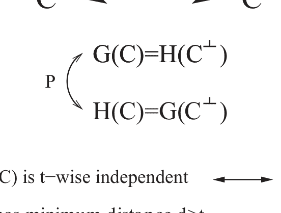

H(C) is t-wise independent ↔
C has minimum distance d>t

## 图 3.1：对偶原理

|  |  |  |
|---|---|---|
| 码 $C$ | $\longrightarrow$ | 对偶码 $C^\perp$ |
| 长度 $n$ | $\longrightarrow$ | 长度 $n$ |
| 维数 $k$ | $\longrightarrow$ | 补维数 $n - k$ |
| 强度 $t$ | $\longrightarrow$ | 距离 $t + 1$ |
| 距离 $d$ | $\longrightarrow$ | 强度 $d - 1$ |

- 1. 线性码 $\mathcal{C}$ 的 **对偶** $\mathcal{C}^\perp$ 是关于 **点积** 定义的。对偶码具有补维数。
- 2. $\mathcal{C}$ 的 **生成矩阵** 的行构成一个基。
- 3. $\mathcal{C}$ 的 **校验矩阵** 是 $\mathcal{C}^\perp$ 的生成矩阵。
- 4. **强度** 是 **正交阵列** 的最重要的参数。
- 5. 线性码的 **对偶原理** 指出 $\mathcal{C}$ 的最小距离比其对偶的强度多一。
- 6. 两个平凡的码族，**和为零码** 和 **重复码**，通过对偶性相关联。
- 7. 取一个素数幂 $q$ 和一个自然数 $r$。
- 8. 写一个矩阵 $M_r(q)$，有 $r$ 行和 $(q^r - 1)/(q - 1)$ 列，其列为 $\mathbb{F}_q^r$ 的一维子空间的代表。
- 9. 则 $M_r(q)$ 是 **单纯形码** $\mathcal{S}_r(q)$（维数为 $r$）的生成矩阵，也是 **哈明码** $\mathcal{H}_r(q)$ 的校验矩阵。
- 10. $\mathcal{H}_r(q)$ 是一个最小距离为 3 的完美码。
- 11. $\mathcal{S}_r(q)$ 的每个非零码字都有权重 $q^{r-1}$。

## 练习 3.4

3.4.1. 证明长度为 $n$ 的线性重复码的对偶是和为零码。

3.4.2. 证明引理 2.14 的以下推广：设码 $[n,k]_q$ 的生成矩阵写成形式 $G = (I|P)$。则一个校验矩阵是 $H = (−P^t|I)$。这里 $G$ 中的 $I$ 是 $(k,k)$-单位矩阵，$H$ 中的 $I$ 是 $(n − k,n − k)$-单位矩阵，$P^t$ 是 $P$ 的转置。

3.4.3. 考虑以下四元矩阵 $H$ :
( 1 0 0 1 1 1 0 0 0 1 1 1 1 1 1 1 1 1 )
( 0 1 0 1 ω ω 1 1 1 0 0 1 1 1 ω ω ω ω ω ω )
( 0 0 1 0 0 0 1 ω ω 1 ω ω 1 ω ω 1 ω ω 1 ω ω )
确定由 $H$ 生成的正交阵列的强度以及以 $H$ 为校验矩阵的四元码的参数。这里 $\mathbb{F}_4 = \{0,1,\omega,\omega^2=\omega\}$。这个码的名字是什么？

3.4.4. 确定具有以下校验矩阵的二元码的参数（这很容易）：
( 1 1 0 0 1 1 1 1 1 1 0 )
( 0 0 1 1 0 0 1 1 0 1 1 )
( 0 0 0 0 1 1 1 1 1 0 1 ).
更有趣的是以此矩阵为生成矩阵的码。确定其参数。

3.4.5. 确定具有以下校验矩阵的四元码的参数：
( 0 0 1 1 ω ω )
( 0 ω 0 ω ω ω )
( 1 1 1 1 1 1 ).

3.4.6. 与前一个问题相同。校验矩阵是
( 1 0 0 1 ω ω )
( 0 1 0 1 ω ω )
( 0 0 1 1 1 1 ).
证明你的结果。

3.4.7. 使得码 $[n,7,3]_3$ 存在的最小长度 $n$ 是多少？（提示：考虑哈明码。）展示你的论证。

3.4.8. 构造三个两两正交的阶为 4 的拉丁方以及相应的指标为 1 的 OA。当视为码时确定其参数。

## 3.5 权重分布

**基本概念：** MacWilliams 定理，概率空间。

一般来说，线性码的最小距离远不足以确定其对偶的最小距离。对偶原理将最小距离与对偶的一个非常不同的参数——强度——联系起来。然而，存在一个更精细的参数集，与线性码的纠错和检错能力相关，它以唯一的方式确定对偶码的相应信息。这个更精细的参数集是码的 **距离分布**。我们也可以对不一定是线性的码进行定义。

## 3.19 定义。

设 $\mathcal{C}$ 是一个长度为 $n$ 的 $q$-元码。$\mathcal{C}$ 的 **距离分布** 由有理数给出

$A_i = \frac{1}{|\mathcal{C}|} (\#(x,y) \mid x,y \in \mathcal{C}, d(x,y)=i), \quad i=0,1\ldots,n.$

$\mathcal{C}$ 的 **距离多项式** 为 $W_{\mathcal{C}}(X,Y)=\sum_{i=0}^{n} A_i X^{n-i} Y^{i}$。

码的距离分布告诉我们平均而言有多少码字与给定码字处于给定距离。这里的平均是对所有码字取的。显然 $A_0=1$，因为每个码字只有与自身距离为 0。码的最小距离 $d$ 是使 $A_i>0$ 的最小指标 $i>0$。

在线性码的情况下，$A_i$ 只是权重为 $i$ 的码字数，且 $d=d(\mathcal{C})$ 仍是使 $A_d\neq0$ 的最小正数。

距离多项式（在线性情形下也称 **权重多项式**）以代数方式表示此信息。使用这种表示的原因是本节的主要定理。MacWilliams 定理用原码的距离多项式表示对偶的距离多项式。

该结果归功于 F. J. MacWilliams [141]。它可以被视为旧的 **泊松求和** 的有限（且特别简单）的版本，例如参见模形式理论中的 theta 变换公式。


3.20 定理 (MacWilliams 公式). 设 $\mathcal{C}$ 为具有距离多项式 $W_{\mathcal{C}}(X,Y)$ 的线性 $q$ 元码。则对偶码的距离多项式为

$$\frac{1}{|\mathcal{C}|}W_{\mathcal{C}}(X+(q-1)Y,X-Y).$$

我们给出 Chang 和 Wolf [46] 的定理 3.20 的概率证明。它由 **无记忆对称信道** 动机。 二元情形，二进制对称信道，已在第 1.5 节讨论。

## 概率空间

由于 **概率** 和 **样本空间** 等术语在此上下文中自然出现，我们介绍概率论的基本概念。

3.21 定义. 设 $\Omega$ 为有限集。 对每个 $x \in \Omega$，给定一个非负数 $p(x)$ 使得

$$\sum_{x\in\Omega}p(x)=1.$$

我们把 $p$ 看作定义域为 $\Omega$ 且取实数值的映射。 则 $(\Omega,p)$ 是一个（有限）**概率空间** 或 **样本空间**，$p(x)$ 是 $x$ 的 **概率**。

定义子集 $S \subseteq \Omega$ 的概率为 $p(S)=\sum_{s\in S}p(s)$。

我们在前面的章节中见过这种基本概念的特例。 在第 1.5 节我们看到仅由 0 和 1 组成的概率空间的特别简单情形，概率为 $p(1)=p$ 且 $p(0)=1-p$（符号被正确传输的概率）。 在第 2.3 节我们使用了长度为 $n$ 的错误模式（比特串）的概率。 这把 $\mathbb{F}_2^n$ 变为一个概率空间。 每个权重为 $i$ 的错误模式的概率为 $p^i(1-p)^{n-i}$。 从 $q=2$ 到一般 $q$ 的推广现在是显而易见的：设 $0\neq u\in\mathbb{F}_q$ 给定。 有一个固定的（很小）概率 $p>0$ 使得每当 $a\in\mathbb{F}_q$ 被发送时，接收到的符号为 $a+u$ 的概率为 $p/(q-1)$。 特别地，符号被错误接收的概率恰好为 $p$。 把 $x\in\mathbb{F}_q^n$ 解释为错误模式（如果 $x_i=0$，则第 $i$ 个符号被正确传输，如果 $x_i\neq0$ 则若发送 $a$ 将接收到 $a+x_i$）。 这样一个特定错误模式 $x$ 的概率为 $P(x)=\left(\frac{p}{q-1}\right)^{wt(x)}(1-p)^{n-wt(x)}$。 这把 $\mathbb{F}_q^n$ 变为一个概率空间。 子集 $S\subseteq\mathbb{F}_q^n$ 的概率定义为 $P(S)=\sum_{x\in S}P(x)$。

## 回到权重分布

在特殊情形 $S = \mathcal{C} \setminus \{0\}$ 我们有

$P(S) = P(\mathcal{C}) - (1 - p)^n = \sum_{i=1}^{n} A_i \left(\frac{p}{q-1}\right)^i (1 - p)^{n-i}$

是当发送不同码字时接收到码字的概率，换句话说，是不可检测错误发生的概率。

**PROOF** of Theorem 3.20. 我们以两种方式计算 $P(\mathcal{C})$：首先我们当然有

$P(\mathcal{C}) = \sum_{i=0}^{n} A_i (1-p)^{n-i} \left(\frac{p}{q-1}\right)^i = W_{\mathcal{C}}\left(1-p, \frac{p}{q-1}\right)$。

最终对偶码及其权重分布必须发挥作用。 为了基于对偶码以不同方式计算 $P(\mathcal{C})$，首先计算

$\displaystyle \sum_{(x,y)} P(x),\text{where } y \in \mathcal{C}^\perp,\ x \cdot y \neq 0.$

元素 $x \in \mathcal{C}$ 对求和没有贡献；每个 $x \notin \mathcal{C}$ 贡献 $P(x)(q^{n-k} - q^{n-k-1})$。 因此求和为

$(1 - P(\mathcal{C})) q^{n-k-1} (q - 1). \tag{3.1}$

现在固定一个权重为 $w$ 的字 $y \in \mathcal{C}^\perp$。 它对求和的贡献只依赖于 $w$。 我们用 $c_w$ 表示它。 如果用 $j$ 表示 $y$ 和 $x$ 的支撑集交集的大小，则 $c_w = \sum_{j=1}^{w} \binom{w}{j} (1-p)^{w-j} \left(\frac{p}{q-1}\right)^j f(j)$，其中 $f(j)$ 是非零项之和不为零的 $j$ 元组的个数。 显然 $f(1) = q - 1$，$f(j) = (q - 1)^j - f(j - 1)$。 特别地 $f(2) = (q - 1)^2 - (q - 1) = (q - 1)(q - 2)$ 且 $f(3) = (q - 1)^3 - f(2) = q^{-1}\{(q - 1)^3 - 1\}$。 由归纳法，$f(j) = q^{-1}\big((q - 1)^j + (-1)^{j-1}\big)$（见习题）。 于是

$c_w = \frac{q-1}{q} (1-p)^w \left\{ \sum_{j=1}^{w} \binom{w}{j} \left(\frac{p}{1-p}\right)^j - \sum_{j=1}^{w} (-1)^j \binom{w}{j} \left(\frac{p}{(1-p)(q-1)}\right)^j \right\}$

利用二项式公式可以计算这些和。 我们可以在两个和式中都从 $j = 0$ 开始求和，因为这会在每个和式中产生一个 $+1$ 的项

相减时相互抵消。 由此可得 $c_w = q^{-1}(1-p)^w\{(1-\frac{1}{1-p})^w - (1-\frac{p}{(1-p)(q-1)})^w\}$，最后

$$c_w = \frac{q-1}{q}\left[1-\left(1-\frac{pq}{q-1}\right)^w\right].$$

对所有 $y \in \mathcal{C}^{\perp}$ 求和并与 (3.1) 比较，我们得到

$$(1-P(\mathcal{C}))q^{n-k-1}(q-1)=\sum_i A_i'c_i = \frac{q-1}{q}\sum_i A_i'\left[1-\left(1-\frac{pq}{q-1}\right)^i\right].$$

约去公因子并利用 $\sum_i A_i' = |\mathcal{C}^{\perp}| = q^{n-k}$，得到

$$P(\mathcal{C}) = \frac{1}{q^{n-k}}\sum_i A_i'\left(1-\frac{pq}{q-1}\right)^i = \frac{1}{|\mathcal{C}^{\perp}|}\,W_{\mathcal{C}^{\perp}}\left(1,1-\frac{pq}{q-1}\right).$$

我们看到

$$W_{\mathcal{C}}(1-p,\frac{p}{q-1}) = \frac{1}{|\mathcal{C}^{\perp}|}\,W_{\mathcal{C}^{\perp}}\left(1,1-\frac{pq}{q-1}\right).$$

令 $X = 1-p$，$Y = \frac{p}{q-1}$，我们得到期望的公式，其中 $\mathcal{C}$ 及其对偶互换位置。

因此对偶码的权重数 $A_i'$ 是通过对原码的权重数 $A_i$ 进行某种替换得到的。 事实上，将 MacWilliams 恒等式的右边展开：
$$(X + (q-1)Y)^{n-i}(X-Y)^i = \sum_{k=0}^{n}K_k(i)X^{n-k}Y^{k}.$$

这里系数 $K_k(i)$ 可写为：
$$K_k(i)=\sum_{j=0}^{Min(k,i)}(-1)^j\binom{i}{j}\binom{n-i}{k-j}(q-1)^{k-j}.$$

我们看到对偶码的权重数 $A_k'$ 满足
$$A_k' = \frac{1}{|\mathcal{C}|}\sum_{i=0}^{n}A_iK_k(i).$$

我们把数 $K_k(i)$ 解释为次数为 $k$ 的多项式的值。 这些是 **Kravchouk 多项式**：

## **3.22 定义** (Kravchouk 多项式). 给定整数 $n$ 和 $q$，定义次数 $k \le n$ 的 Kravchouk 多项式为

$$K_k(X)=\sum_{j=0}^{k}(-1)^j\binom{X}{j}\binom{n-X}{k-j}(q-1)^{k-j}.$$

- 1. 码的 **距离分布** 记录码字之间出现哪些距离以及出现的频率。
- 它比码字个数和最小距离携带更多信息。
- 2. 向量的 **权重** 是其非零坐标的个数。
- 3. 线性码的距离分布与其 **权重分布** 一致。
- 4. 长度为 $n$ 的线性码的 **权重多项式** 是关于两个变量的齐次多项式，次数为 $n$，以权重数为系数。
- 5. **MacWilliams 公式** 显示如何由 $\mathcal{C}$ 的权重分布（权重多项式）计算 $\mathcal{C}^\perp$ 的权重分布（权重多项式）。

## 习题 3.5

- **3.5.1.** 求重复码 $[n,1,n]_q$ 和和为零码 $[n,n-1,2]_q$ 的权重多项式。
- **3.5.2.** 设 $\mathcal{D}$ 为具有权重分布 $(B_i)$ 的二元线性码，$\mathcal{C}$ 为添加奇偶校验位得到的码。 用 $(B_i)$ 表示 $\mathcal{C}$ 的权重分布。
- **3.5.3.** Simplex 码 $[7,3,4]_2$ 是一个恒重码。 其权重分布为 $A_0 = 1$，$A_4 = 7$。 利用 MacWilliams 公式计算其对偶码、二进制 Hamming 码 $[7,4,3]$ 的权重分布，以及通过添加奇偶校验位得到的扩展 Hamming 码、$[8,4,4]$ 码的权重分布。
- **3.5.4.** 证明每个自对偶（等于其对偶）$[8,4,4]_2$ 码具有与扩展 Hamming 码相同的权重分布 $A_0 = A_8 = 1$，$A_4 = 14$。
- **3.5.5.** 证明扩展 Hamming 码是唯一的自对偶 $[8,4,4]_2$ 码。
- **3.5.6.** 一元权重多项式定义为

$$P_{\mathcal{C}}(Y) = W_{\mathcal{C}}(1,Y) = \sum_i A_i Y^i.$$

求一元权重多项式的 MacWilliams 公式。


3.5.7. 设 $[n,k,d]_q$ 为完美线性码的参数。求最小重量码字的个数 $A_d$。

3.5.8. 证明完美 $[n,k,d]_q$ 码的重量分布由 $n,k,d,q$ 唯一确定。

3.5.9. 设 $f(j)$ 为 $\mathbb{F}_q$ 中非零元构成的 $j$-元组且和非零的个数。证明 $f(j)=\frac{q-1}{q}\big((q-1)^j+(-1)^{j-1}\big)$。

## 3.6 SET 游戏

**基本概念：** $\mathbb{F}_3$-线性无关，某些三元码。

SET 游戏由 81 张牌组成。每张牌为四个属性中的每一个指定一个唯一值。这些属性是

*数字，形状，颜色和阴影。*

更精确地说：每张牌上有 一个、两个或三个 符号在其上（属性 NUMBER 的取值是一、二、三）；这些符号都具有相同的形状，椭圆、菱形或波浪线（属性 SHAPE 的取值是椭圆、菱形、波浪线），它们都具有相同的颜色，紫色、红色或绿色（属性 COLOR 的取值是紫色、红色、绿色），并且具有相同的阴影，要么轮廓、填充或条纹（属性 SHADING 的取值是轮廓、填充、条纹）。因此我们可以将一张牌视为一个属性的 4-元组。例如，有一张牌 (two, squiggle, green, filled)。它在图形上表示为一张上面有两个绿色填充波浪线的牌。反过来：紫色的一张轮廓椭圆牌将表示为 4-元组 (one, oval, purple, outlined)。我们将牌表示为 4-元组作为简化与代数化过程的第一步。下一步是由以下观察提示的：对于与游戏相关的组合问题，属性的具体取值是不相关的。如果我们同意紫色是颜色编号 0，红色用 1 表示而绿色用 2 表示，那么属性 COLOR 的值就由 4-元组的第三个坐标中的数字表示。我们对每个坐标（属性）做同样的处理，使用与上面相同的取值顺序。上面考虑的牌现在可以用更简短的方式写出：

(two, squiggle, green, filled) = (1, 2, 2, 1)

(one, oval, purple, outlined) = (0, 0, 0, 0)

我们把牌解释为每个坐标中条目为 0、1 或 2 的四元组，换句话说，每张牌代表 $\mathbb{F}_3^4$ 的一个元素。

### SETS

SETS 构成了游戏的基本思想。三张牌构成一个 SET 当且仅当以下条件成立：对于每个属性，我们的三张牌的值要么全部相同要么全部不同。例如，以下三张牌构成一个 SET：
- (two, squiggle, green, filled)
- (three, squiggle, green, outlined)
- (one, squiggle, green, striped)

它们在坐标 2 和 3（SHAPE 和 COLOR）中的值都相同，而在坐标 1 和 4（NUMBER 和 SHADING）中的值全部不同。

利用 $\mathbb{F}_3^4$ 中的加法，SETS 的定义性质可以用自然的方式表达。当三张牌构成一个 SET 时，根据定义，每个特定属性的值要么全部相同（0,0,0 或 1,1,1 或 2,2,2）要么全部不同（0,1,2 重新排序后）。所有这些三元组有什么共同点？它们的和为 0（回想一下我们按模 3 计算）。事实上，$\mathbb{F}_3$ 中的三个数之和为 0 当且仅当它们全部相同或全部不同。这给出了集合定义性质的期望表达式：

3.23 引理。$\mathbb{F}_3^4$ 的三个不同元素 x, y, z 构成一个 SET 当且仅当 x + y + z = (0,0,0,0)。

我们称 (0,0,0,0) 为零（牌或元组）并记为 0。SETS 的一个重要性质现在变得清晰可见：任意两张牌恰好包含在一个 SET 中。事实上，例如考虑牌 (0,1,0,2) 和 (1,2,0,2)。哪张牌会将其补成一个集合？第三张牌的每个坐标条目必须使得所有牌的条目之和为零。这决定了第三张牌。在我们的例子中它是 (2,0,0,2)。

我们提出以下自然问题：不包含 SET 的牌的最大数量是多少？我们称这样的牌集合为 SET-free。等价的性质是我们的牌中没有三张加到 0 = (0,0,0,0)。利用一个小技巧我们可以将其表述为线性无关性：设 x = (x₁, x₂, x₃, x₄) 为一张牌。考虑相应的五元组 x′ = (x₁, x₂, x₃, x₄, 1) = (x, 1)。如果 x + y + z = 0，则也有 x′ + y′ + z′ = 0，因为最后一个坐标中的条目之和为 0。特别地，x′、y′、z′ 线性相关。反之假设 x′、y′、z′ 线性相关（且不同）。最后一个坐标表明该线性组合的系数是三个非零元素且其和为 0。由此可知这些元素相同（要么全为 +1 要么全为 −1）。我们得到 x + y + z = 0。这给出了以下转换：牌的集合 x 是 SET-free 当且仅当相应的 5-元组集合 x′ = (x, 1) 具有任意三个线性无关的性质。我们得到了原始问题的等价表述。它说：$\mathbb{F}_3^5$ 中向量的集合的最大大小是多少，使得所有向量的最后一个系数为 1 且没有三个线性相关？这里有一个例子：

0111111111 0222222222
1011112222 2022221111
0001021221 0002012112
0011220102 0022110201
1111111111 1111111111

就原始问题而言，该矩阵的列向量去掉底部的 1 后形成一个 20 张牌的 SET-free 集合。可以证明这是最大的（不存在 21 张这样的牌的族）。就编码理论而言，我们有一个 3-独立的三元矩阵。根据对偶原理它是线性码 [20, 15, 4]₃ 的校验矩阵。稍后我们将从几何角度研究此类问题；参见第 17 章。关于 SETS 游戏的更多内容见 [65]。

### 练习 3.6

3.6.1. 有多少个 SETS？展示你的计数方法。

3.6.2. 考虑矩阵左上角的三元 (4, 10)-矩阵 A：

```
A = ⎛
0111111111
1011112222
0001021221
0011220102
⎞
```

求由 A 生成的码的参数及其对偶码的参数。

3.6.3. 考虑以下三元矩阵：

\begin{pmatrix} 1 0 0 0 0 0 0 2 1 2 1 2 \\ 0 1 0 0 0 0 1 0 2 1 1 2 \\ 0 0 1 0 0 0 2 2 0 1 1 1 \\ 0 0 0 1 0 0 1 1 1 0 1 1 \\ 0 0 0 0 1 0 1 2 2 2 0 1 \\ 0 0 0 0 0 1 2 1 2 2 1 0 \end{pmatrix}

*用此校验矩阵确定三元码的参数。删除一列后参数如何？与球填充界比较。*

## 3.7 综合征译码

**基本概念：** 陪集，陪集首领，综合征。

错误校正机制中的一个弱点是译码算法。回顾块编码的一般思想（第 2.2 节）。随着接收向量 y 的不断到来，它们需要快速译码，最好是实时译码。朴素的译码方法将是在距离 y ≤ e 的所有 $\sum_{i=0}^{e}(q-1)^i \binom{n}{i}$ 个向量中搜索，直到找到一个码字（我们使用纠正 e 个错误的码，因此最小距离 >2e）。正如我们在第 2.3 节中所看到的，我们希望使用具有较大 e 的强码。长度 n 也必然会很大。然而，搜索过程会因此花费太长时间。在第 2.5 节中，我们在二进制汉明码的情况下看到了更快的译码方法。留作练习来证明这种译码方法推广到 q 元汉明码。在本节中，我们提出一种通用的译码方法，它利用码的线性性并且易于理解。

设线性 $[n,k,d]_q$ 码 $\mathcal{C}$ 由校验矩阵 $H$ 描述。设 $x$ 为发送的码字，且 $y = x + err$ 为接收字，其中 $err$ 为错误向量。在第 2.5 节中我们使用了向量 $yH^t$。该向量被称为 **综合征向量**：

3.24 定义。设 $H$ 为参数为 $[n,k,d]_q$ 的码 $\mathcal{C}$ 的校验矩阵，且 $y \in \mathbb{F}_q^n$。$y$ 的 **综合征向量** 为

$\sigma(y) = yH^t \in \mathbb{F}_q^{\,n-k}.$


*注意到 σ(y) 的分量是 y 与 H 的各行的点积。特别地，y ∈ C 当且仅当 σ(y) = 0 为零向量。*

何时两个向量具有相同的伴随向量，σ(y) = σ(y′)? 这意味着 0 = σ(y) − σ(y′) = σ(y − y′)，换句话说，y − y′ ∈ C。具有相同伴随向量的向量集合称为 C 的陪集。

## 3.25 定义。

*线性码 C 的一个陪集是形如 C + y 的向量集合。两个向量在同一陪集中当且仅当它们具有相同的伴随向量。不同陪集的个数为 q^{n−k}（若 C 是一个 [n,k]_q 码）。*

这与译码有什么关系？若 y = x + err 是接收到的向量，我们（希望）将其译码为 y ↦ x = y − err，则 σ(y) = σ(err)。因此我们正在寻找与 y 位于同一陪集中的小权向量。这些向量是我们对 err 的候选。

伴随译码的工作方式如下：在 C 的每个 q^{n−k} 个陪集中，找到权值最小的向量。称此元素为陪集首。若接收到 y，则执行以下步骤：

- 1. 计算伴随向量 σ(y)。
- 2. 在列表中找到对应陪集的陪集首 ε。
- 3. 译码 y ↦ y − ε。

用扩展二元汉明码 [8,4,4]_2 来举例说明。考虑矩阵

G = H = 
\begin{pmatrix}
1000 & 0111 \\
0100 & 1011 \\
0010 & 1101 \\
0001 & 1110
\end{pmatrix}.

再次检查我们的基本事实：前四列表明 G 生成一个 4 维码 C。由于任意两行正交，我们有 C ⊆ C^⊥，维数表明 C = C^⊥，是一个自对偶码。因此我们可以将 G 也视为同一码的校验矩阵 H。C 包含在和为 0 的码中（G 的所有行权为 4），并且显然不存在权为 2 的码字。这表明 C 是一个 [8,4,4]_2 码。注意到 H 的列由权为 1 或 3 的所有 4 元组组成。还注意到 C 包含全 1 向量（G 所有行的和）。由此可知 C 中不存在权为 6 的码字。

陪集的个数为 16。一个陪集是 C 本身，其陪集首为 0 字。每个权为 1 的向量在其陪集中是唯一的陪集首（因为 C 中没有权为 2 的字）。这给我们另外八个陪集及其首。对应的伴随向量是 H 的列，故为 F_2^4 中所有权为 1 或 3 的向量。若一个陪集包含权为 2 的向量，则这是该陪集中的最小权。位于坐标后半部分的六个权为 2 的向量位于成对不同的陪集中。这给我们另外六个陪集。对应的伴随向量是权为 2 的向量。只有一个陪集仍未缺失。它对应于伴随向量 (1,1,1,1)。我们可以选择 (1,0,0,0,1,0,0,0) 作为代表。这给我们以下陪集首和伴随向量的列表：

| 陪集首 | 伴随向量 |
|---|---|
| 00000000 | 0000 |
| 10000000 | 1000 |
| 01000000 | 0100 |
| 00100000 | 0010 |
| 00010000 | 0001 |
| 00001000 | 0111 |
| 00000100 | 1011 |
| 00000010 | 1101 |
| 00000001 | 1110 |
| 00001100 | 1100 |
| 00010100 | 1010 |
| 00001001 | 1001 |
| 00000110 | 0110 |
| 00000101 | 0101 |
| 00000011 | 0011 |
| 10001000 | 1111 |

我们的码可纠正一个错误。这相当于每个权 ≤ 1 的向量是其陪集的唯一确定的首。由于我们也在不包含唯一首的陪集中选择首，当发生一个以上错误时也会尝试译码。若系统地遵循这一思想，我们就得到列表译码，这是一个在第 23.1 节中发展的主题。

假设接收到 y = 11000011。计算 σ(y) = 1111。对应的陪集首是 10001000。我们译码 y ↦ 01001011。

- 1. 设 $H$ 为 $[n,k,d]_q$ 码 $\mathcal{C}$ 的校验矩阵。
- 2. $y \in \mathbb{F}_q^n$ 的 **伴随向量** 为 $\sigma(y)=yH^t$（$\sigma(y)$ 的分量是 $y$ 与 $H$ 的各行的点积）。
- 3. $y,y' \in \mathbb{F}_q^n$ 在 $\mathcal{C}$ 的同一 **陪集** 中当且仅当 $y-y' \in \mathcal{C}$，等价于 $\sigma(y)=\sigma(y')$。
- 4. 陪集的首是一个权值最小的向量。
- 5. **伴随译码：**
- 6. 建立所有 $q^{n-k}$ 个陪集的首的列表。
- 7. 译码 $y \mapsto x = y - z$，其中 $z$ 是包含 $y$ 的陪集的首。

## 练习 3.7

**3.7.1.** *使用本节给出的 [8,4,4]_2 的译码方案对以下接收向量进行译码：* $y = 00110011$，$y = 11111010$，$y = 10001001$。

**3.7.2.** *求和为 0 码 $[n,n-1,2]_q$ 的陪集首。*

**3.7.3.** *求汉明码 $[7,4,3]_2$ 的陪集首。*

**3.7.4.** *求四元码 $[6,3,4]_4$ 的一个校验矩阵。求所有陪集的陪集首。*


# Taylor & Francis

Taylor & Francis Group

http://taylorandfrancis.com

## 第 4 章

## Singleton 界与 Reed-Solomon 码

**基本概念：** Singleton 界，Lagrange 插值，Vandermonde 矩阵。拉丁方码和 OA 码。覆盖阵列与软件测试。

这里给出我们关于码的第二个一般界。考虑一个码 $(n,M,d)_q$ 并将码字排列成一个数组（有 $M$ 行和 $n$ 列）。技巧如下：选取 $d-1$ 个坐标，比如最后的那些。忽略这些坐标（换句话说，投影到前 $n-d+1$ 个坐标）。这些较短的字符串仍然不同（如果其中两个相同，则它们所导出的码字之间的距离 $\le d-1$，这与 $d$ 的定义不可能）。由此可知 $M$ 不能大于所有 $q$ 元 $(n-d+1)$-元组的个数。我们证明了以下界（见 Singleton [190]）：

**4.1 定理** (Singleton 界)。 *设 $\mathcal{C}$ 为长度为 $n$ 的 $q$ 元码。则*

$|\mathcal{C}| \le q^{\,n-d+1}.$

*满足该界等号的码传统上称为 **MDS 码**。这里字母 **MDS** 代表 **最大距离可分**。*

在线性情形下这简化为：

**4.2 推论。** *每个线性码 $[n,k,d]_q$ 满足 $k+d \le n+1$。*

接下来我们构造一个非常重要的 MDS 码族。在此之前，回顾 **多项式** 的概念。一个（单变量）多项式，其系数在域 $K$ 中，是形如

$f(X) = a_n X^n + a_{n-1} X^{n-1} + \cdots + a_1 X + a_0.$

若 $a_n \neq 0$，我们称 $n$ 为 $f(X)$ 的 **次数**。每个多项式定义一个多项式函数（$u \in K$ 映射到求值 $f(u)$）。称 $u \in K$ 为 $f(X)$ 的 **根**（或 **零点**）如果 $f(u)=0$。一个基本事实是，次数为 $n$ 的多项式不能有超过 $n$ 个根。原因是，只要 $f(u)=0$，我们可写 $f(X)$ 为乘积 $f(X)=(X-u)g(X)$，其中 $g(X)$ 的次数为 $n-1$；见练习 4.7 至 4.11，其中读者还被要求证明关于一个非常方便且初等工具 **几何级数** 的一些基本事实。

我们描述一个数组，其行是码字。设行由系数在 $\mathbb{F}_q$ 中、次数 $<k$ 的多项式 $p(X)$ 参数化（这些形成一个维数为 $k$ 的向量空间，以 **单项式** $X^i$，$i=0,1,\dots,k-1$ 为基）。列由元素 $u \in \mathbb{F}_q$ 参数化。行 $p(X)$ 与列 $u$ 的条目是求值 $p(u)$。显然这定义了一个长度为 $q$ 的线性 $q$ 元码（因为次数 $<k$ 的多项式的线性组合仍是次数 $<k$ 的多项式）。

## 4.3 定义。

对于 $k \le q$，**Reed-Solomon 码** $\mathcal{RS}(k,q)$ 在 $\mathbb{F}_q$ 上维数为 $k$ 的字由系数在 $\mathbb{F}_q$ 中次数 $<k$ 的多项式 $p(X)$ 参数化，坐标由 $u \in \mathbb{F}_q$ 给出。对应的条目是 $p(u)$。码 $\mathcal{RS}(k,q)$ 的长度为 $q$，维数为 $k$。

让我们考虑一些例子，首先是 $\mathcal{RS}(2,3)$。列（坐标）由域的元素 $0,1,2$ 索引；生成矩阵的行由 $1$（常数多项式）和 $X$ 索引。$\mathcal{RS}(2,3)$ 的对应生成矩阵为 $\begin{pmatrix}1&1&1\\0&1&2\end{pmatrix}$。一个非零次数 $\le 1$ 的多项式（$1$ 和 $X$ 的线性组合）至多有一个根，所以对应码字的最小权 $\ge 3-1=2$。我们得出 $\mathcal{RS}(2,3)$ 是一个 $[3,2,2]_3$ 码。

考虑 $\mathcal{RS}(2,4)$。一个生成矩阵为 $\begin{pmatrix}1&1&1&1\\0&1&\omega&\omega\end{pmatrix}$。同样，次数 $\le 1$ 的多项式至多有一个零点，所以 $d \ge 4-1=3$。显然 $d=3$，所以 $\mathcal{RS}(2,4)$ 是一个 $[4,2,3]_4$ 码。Reed-Solomon 码 $\mathcal{RS}(2,4)$ 已在第 3.3 节中展示。

$\mathcal{RS}(3,5)$ 的一个生成矩阵为 $\begin{pmatrix}1&1&1&1&1\\0&1&2&3&4\\0&1&4&4&1\end{pmatrix}$（最后一行对应 $X^2$，列 $u$ 中的条目为 $u^2$）。次数 $\le 2$ 的多项式至多有 $2$ 个根，所以每个码字权 $\ge 5-2=3$。由此可知 $\mathcal{RS}(3,5)$ 是一个 $[5,3,3]_5$ 码。

最后，$\mathcal{RS}(4,7)$ 的生成矩阵为 $\begin{pmatrix}1&1&1&1&1&1&1\\0&1&2&3&4&5&6\\0&1&4&2&2&4&1\\0&1&1&6&1&6&6\end{pmatrix}$。次数 $\le 3$ 的多项式至多有三个根，所以 $d=7-3=4$ 且 $\mathcal{RS}(4,7)$ 是一个 $[7,4,4]_7$ 码。事实上显然 $d=4$ 而不更大。The

多项式 $X(X-1)(X-2)$ 的次数为 $3$ 且有三个根。对应的码字因此具有权重 $7-3=4$。它是 $(0,0,0,6,3,4,1)$。由于 $X(X-1)(X-2)=X^3+4X^2+2X$，这应为生成矩阵的最后一行加上第三行的四倍再加上第二行的两倍。这确实如此。

我们作为 Reed-Solomon 码的生成矩阵得到的这类矩阵（每列由某个域元素 $u$ 索引，该列由 $u$ 的连续幂组成）被称为 **Vandermonde matrices.**

现在很清楚如何一般地确定 Reed-Solomon 码的最小距离。次数 $<k$ 的非零多项式的根的个数为 $\le k-1$。由此可得最小权重为 $\ge q-(k-1)=q-k+1$。由于存在次数为 $k-1$ 且具有 $k-1$ 个不同根的多项式（不同线性因子的乘积），我们有等号。这表明 $\mathcal{RS}(k,q)$ 是一个 $[q,k,q-k+1]_q$ 码。与 Singleton 界定理 4.1 比较可知我们有等号：Reed-Solomon 码是 MDS 码。

### 4.4 Theorem.

*Reed-Solomon 码 $\mathcal{RS}(k,q)$ 是一个 $[q,k,q-k+1]_q$ 码。Reed-Solomon 码是 MDS 码。*

Reed-Solomon 码的强度已大到可能的最大程度。熟悉 **Lagrange interpolation** 的读者会立刻意识到这一点。Lagrange 插值表明，对于每一个 $k\ge1$，都恰好存在一个次数 $<k$ 的多项式，它在 $k$ 个域元素处取给定的值。该陈述在任意域上均成立。由于其具有独立的兴趣且相当著名，我们在此以此形式表述并证明它：

### 4.5 Theorem (Lagrange interpolation).

*设 $F$ 是一个域。$F[X]$ 中次数为 $n$ 的非零多项式 $p(X)$ 至多有 $n$ 个根。若给定 $F$ 中 $n$ 个不同的元素 $x_1,x_2,\dots,x_n$ 以及 $F$ 中 $n$ 个任意元素 $y_1,\dots,y_n$，则存在唯一一个系数在 $F$ 中且次数 $<n$ 的多项式 $p(X)$ 满足*

$$p(x_i)=y_i,\ i=1,2,\dots,n.$$

**PROOF**

若 $p(x)=0$，则 $p(X)$ 可被线性因子 $X-x$ 整除。若 $p(X)$ 有 $n+1$ 个不同的根 $x_1,x_2,\dots,x_{n+1}$，则 $p(X)$ 可被相应的线性因子的乘积整除。若 $p(X)$ 的次数为 $\le n$，则可得 $p(X)$ 是 $0$ 多项式。这证明了第一个断言。考虑第二个断言。我们首先证明多项式的唯一性。事实上，若 $p_1(X)$ 和 $p_2(X)$ 都是满足我们条件的多项式，则 $p_1(X)-p_2(X)$ 有 $n$ 个不同的根，根据第一个断言，它是 $0$ 多项式。插值多项式的存在性通过写出它来证明：

$$p(X)=\sum_{i=1}^{n} y_i \frac{\prod_{j\neq i}(X-x_j)}{\prod_{j\neq i}(x_i-x_j)}.$$

定理 4.5 对于小的 $k$ 值，至少在实数上是特别明显的。恰好存在一个在某一点取规定值的常数多项式（如果是常数，还能怎样？）对于 $k = 2$，我们得到两个 $x$ 坐标不同的点位于唯一确定的（非垂直）直线上的陈述。在 $k = 3$ 时情况就不那么明显了：恰好存在一个插值三个 $x$ 坐标不同的点的二次多项式；换句话说，恰好存在一条通过这三个点的抛物线。这里理解为抛物线可能退化为直线（如果插值多项式的次数 $< 2$）。

在我们的上下文中，我们不需要 Lagrange 插值的代数证明。我们可以用对偶性来证明它。$\mathcal{RS}(k, q)$ 的对偶是什么？如果 Lagrange 插值是正确的，它应该是一个 $(q - k)$ 维、最小距离为 $k + 1$ 的码，因而又是 MDS 码。我们所知道的唯一可能候选是 $(q - k)$ 维的 Reed-Solomon 码。下面的定理证实了这一猜测。

### 4.6 Theorem.

$\mathcal{RS}(k, q)^\perp = \mathcal{RS}(q - k, q).$

**PROOF** 注意 $\mathcal{RS}(k, q)$ 和 $\mathcal{RS}(q - k, q)$ 具有互补的维数，因此只需证明它们正交即可。$\mathcal{RS}(k, q)$ 由 $X^i, i < k$ 生成；码 $\mathcal{RS}(q - k, q)$ 由 $X^j, j < q - k$ 生成。相应码字的点积为 $S = \sum_u u^{i+j}$。设 $l = i + j$。注意 $l \le q - 2$。存在某个 $0 \ne c \in \mathbb{F}_q$ 使得 $c^l \ne 1$，否则次数为 $l$ 的多项式 $X^l - 1$ 将有 $q - 1 > l$ 个根，这是不可能的。我们有 $c^l S = S$，因为当 $u$ 遍历时，$cu$ 遍历 $\mathbb{F}_q$ 的所有非零元素。由此可得 $(c^l - 1)S = 0$。由于 $c^l \ne 1$，可得 $S = 0$。

### 4.7 Theorem. $\mathcal{RS}(k, q)$ is an $OA_1(k, q, q)$.

**PROOF** $\mathcal{RS}(k, q)$ 的对偶是 $\mathcal{RS}(q - k, q)$，其最小距离为 $k + 1$。由对偶性可知 $\mathcal{RS}(k, q)$ 的强度为 $k$。由于它有 $q^k$ 个元素，断言得证。

注意定理 4.5 中的插值性质（存在唯一的多项式使得……）等价于 Reed-Solomon 码是指标为 1 的正交数组的事实。

由于 $q$ 元 Reed-Solomon 码的长度为 $q$，我们需要一个相对较大的域才能得到有趣的码。Reed-Solomon 码参数的例子有
$[5, 3, 3]_5$, $[7, 3, 5]_7$, $[8, 4, 5]_8$, $[8, 5, 4]_8$, $[16, 8, 9]_{16}, \dots$

考虑 8 元 Reed-Solomon 码。我们需要域 $\mathbb{F}_8$。让我们遵循一般的构造过程：由于 $8 = 2^3$，我们需要在 $\mathbb{F}_2$ 中系数、次数为 3 的不可约多项式 $f(X)$。常数项不能为零（否则多项式会被 $X$ 整除）。这给我们四个候选：

$X^3 + 1,\ X^3 + X^2 + 1,\ X^3 + X + 1\ \text{and}\ X^3 + X^2 + X + 1.$

这四个候选中的第一个和最后一个是可约的，因为它们满足 $f(1)=0$。因此这些多项式可被 $X - 1 = X + 1$ 整除。剩下的两个候选是不可约的。我们选择

$f(X) = X^3 + X^2 + 1.$

记 $\epsilon$ 为 $\mathbb{F}_8$ 中 $X$ 的像。$\mathbb{F}_8$ 的元素是 $\epsilon$ 中次数 $\le 2$ 的多项式

$\mathbb{F}_8 = \{0,1,\epsilon,\epsilon+1,\epsilon^2,\epsilon^2+1,\epsilon^2+\epsilon,\epsilon^2+\epsilon+1\}$

这定义了加法。乘法由基本方程决定（等价于 $f(X)$ 的选择）

$\epsilon^3 = \epsilon^2 + 1.$

我们可以相乘 $\mathbb{F}_8$ 中的任意两个元素。基本方程允许我们去掉所有指数 $>2$。考虑 $\epsilon$ 的幂

$\epsilon^3 = \epsilon^2 + 1,\ \epsilon^4 = \epsilon^3 + \epsilon = \epsilon^2 + \epsilon + 1.$

以同样的方式我们可以确定 $\epsilon$ 的所有幂 $\epsilon^5 = \epsilon^3 + \epsilon^2 + \epsilon = \epsilon + 1,\ \epsilon^6 = \epsilon^2 + \epsilon\ \text{and}\ \epsilon^7 = 1.$

我们再次看到，对不可约多项式的了解等价于对域的了解。为了写出 8 元 Reed-Solomon 码的生成矩阵，让 $0,1,\epsilon,\dots,\epsilon^6$ 按此顺序参数化列。行由单项式 $1,X,X^2,\dots$ 参数化。由此得到的 $\mathcal{RS}(4,8)$ 的生成矩阵如下：

$G = \begin{pmatrix}1&1&1&1&1&1&1&1\\0&1&\epsilon&\epsilon^2&\epsilon^3&\epsilon^4&\epsilon^5&\epsilon^6\\0&1&\epsilon^2&\epsilon^4&\epsilon^6&\epsilon&\epsilon^3&\epsilon^5\\0&1&\epsilon^3&\epsilon^6&\epsilon^2&\epsilon^5&\epsilon&\epsilon^4\end{pmatrix}.$

我们知道 $\mathcal{RS}(4,8)$ 是一个自对偶码 $[8,4,5]_8$。此外，不同维数的 Reed-Solomon 码包含在彼此之中。$G$ 的前三行生成 $\mathcal{RS}(3,8)$，前两行生成 $\mathcal{RS}(2,8)$，而 $\mathcal{RS}(1,8)$ 是重复码。

## Latin square codes and OA codes

一般而言，我们集中于线性码，因为它们更容易构造和处理。然而，有许多情况可以构造出非常好的非线性码。

考虑一个 OA1(t,n,q)。它有 $q^t$ 行。让我们把这些行解释为 $q$ 元码长度为 $n$ 的字。假设其中两个码字在 $t$ 个坐标上一致。那么在对某些 $t$ 个坐标的投影上，一个 $t$ 元组出现多于一次，这就产生了矛盾。这表明正交数组的任意两行在 Hamming 距离上 $\ge n - t + 1$。因此 OA1(t,n,q) 的行形成一个 $(n,q^t,n−t+1)_q$ 码。与定理 4.1 比较可知我们有一个 MDS 码。反过来也是显然的。

### 4.8 Theorem. The following are equivalent:

- An OA1(t,n,q),
- An MDS code (n,q^t,n−t+1)_q.

回顾第 3.4 节，OA1(2,n,q) 等价于 $q$ 阶 $n - 2$ 个互不相交的拉丁方。互不相交的拉丁方长期以来因多种原因被研究。综述见 [106]。定理 4.8 表明互不相交的拉丁方是最佳码的来源。例如，存在 10 阶的一对正交拉丁方，因此存在 MDS 码 $(4,100,3)_{10}$。10 阶 3 个 MOLS 的存在性存疑。这是一个著名的开放问题。它等价于 $(5,100,4)_{10}$ 码的存在性。

另一个著名的特例是 6 阶一对正交拉丁方的不存在，等价于 $(4,36,3)_6$ 码的不存在。这由 L. Euler 于 1782 年猜想。在 recreational mathematics 中它被称为 36 名军官问题。不存在性由 Tarry 于 1901 年证明 [205]。Stinson 在 [199] 中的简短证明是编码理论的。

## Covering arrays and software testing

假设我们希望测试某软件的准确性。如果涉及 12 个输入参数，每个参数有 16 个可能的参数值，则可能的测试运行总数为 $16^{12} = 2^{48}$。这显然太多，特别是在每次测试都昂贵且耗时时。测试运行的集合应如何选择？让我们把这个集合可视化为一个数组

有 12 列且条目来自 16 元集合。每行对应一次测试运行。

一种经常使用的方法如下：选择测试运行的数组，使得对于每对（或每三对）参数，每种可能的参数值组合实际上至少出现一次（被覆盖）。从成对或三对覆盖推广到任意 t 的 t-覆盖，这导致了下面的定义：

## 4.9 定义.
*强度为 t 的覆盖数组（参数为 CA(N; t, n, q)）是一个具有 N 行和 n 列的数组，条目来自 q-集合，使得在任意 t 列上的投影中，每个可能的 t-元组条目至少出现一次（被覆盖）。*

为了在软件测试中节省时间和金钱，我们希望构造覆盖数组，最常见的是强度为 2 或 3 的，且行数最少。

显然 N ≥ q^t，当且仅当存在 OA₁(t, n, q) 时取等号；换句话说，覆盖数组是指标为 1 的正交数组的推广。在上面考虑的参数情况下，我们很幸运，因为 RS(2,16) 和 RS(3,16) 在丢弃四列后分别得到 OA₁(2,12,16) 和 OA₁(3,12,16)。

通常，我们不会那么幸运。例如，在二进制情形 q = 2 时，Reed-Solomon 码对我们完全没有帮助。这里有一个（最优的）CA(10; 3, 5, 2)（见 Chateauneuf 和 Kreher [47]）：

0 0 0 0 0
1 1 1 1 1
1 0 0 1 1
0 1 1 0 0
1 1 0 0 1
0 0 1 1 0
1 1 0 1 0
0 0 1 0 1
1 0 1 0 0
0 1 0 1 1

构造覆盖数组使用了多种多样的方法，从组合设计理论和编码理论到启发式搜索方法。此外，还使用了各种名称，从定性独立划分（Rényi [174]）到 t-独立集和通用集（见 Goldreich [95]）。

## 备注
Reed-Solomon 码在 Reed 和 Solomon [173] 中被引入。它们是最广泛使用的码之一。一些应用在 Wicker 和 Bhargava [219] 中讨论。光盘技术中有一个很有吸引力的应用，其中缩短的 Reed-Solomon 码 [32,28,5]256 和 [28,24,5]256 起着关键作用。这也在 Hoffman 等 [116] 中描述。

- 1. 选取一个素数幂 q 和维数 k ≤ q。Reed-Solomon 码 RS(k,q) 定义如下：
- 2. 坐标由元素 u ∈ Fq 参数化。
- 3. 码字由系数在 Fq 中、次数 < k 的多项式 p(X) 参数化。
- 4. 由 p(X) 参数化的码字，其条目为求值 p(u)。
- 5. RS(k,q) 是一个码 [q,k,q−k+1]q 且是一个正交数组 OA1(k,q,q)。

## 练习 4
4.1. 证明拉格朗日插值的以下轻微推广：
设 $a \ge 0$ 为自然数，$x_1,x_2,\dots,x_n$ 为不同的非零 $\in F$ 且 $y_1,\dots,y_n$ 为 $F$ 中任意元素。则存在唯一一个次数 $< n$ 且系数在 $F$ 中的多项式 $p(X)$ 满足

$$x_i^a p(x_i)=y_i,\quad i=1,2,\dots,n.$$

4.2. 设 $a \ge 0$ 为自然数且 $q$ 为素数幂。定义一个长度为 $q-1$ 的 $q$ 元码，其坐标由 $0 \ne u \in \mathbb{F}_q$ 索引，码字由次数 $< k$ 的多项式 $p(X)$ 索引，其中 $k < q$。码字在坐标 $u$ 处由 $p(X)$ 索引的条目为 $u^a p(u)$。
确定该码的维数、最小距离和强度。

4.3. 证明：线性 MDS 码的对偶是 MDS 码。

4.4. 设 $\mathcal{C}$ 为 $[n,k,d]_q$-码。确定 $\mathcal{C}^\perp$ 作为正交数组的参数。推导 Singleton 界（在线性码情形）。

4.5. 基于高斯消元（无需计算）给出线性 $[n,k,d]_q$ 码 Singleton 界的另一个简单证明。

4.6. 为了理解为什么覆盖数组也被称为定性独立划分，考虑我们作为例子给出的 $CA(10;3,5,2)$。将行解释为基集 $X$（有 10 个元素）。则每一列描述了 $X$ 的一个二分划。
用这个划分族来表达强度为 2 的覆盖数组的定义性质。

4.7. 证明以下基本事实：如果 $f(X)$ 是系数在域 $F$ 中的多项式，且 $u \in F$ 满足 $f(u)=0$，则 $f(X)$ 可以写成 $f(X)=(X-u)g(X)$ 的形式，其中 $g(X)$ 是多项式。

4.8. 有限几何级数是恒等式
$$(X-1)\sum_{i=0}^{n-1} X^i = X^n -1.$$ 证明此恒等式。

4.9. 设 $q$ 为模 $|q|<1$ 的复数。证明
$$\sum_{n=0}^{\infty} q^n = 1+q+q^2+\cdots = 1/(1-q).$$ 这是无穷几何级数。

4.10. 证明恒等式 $(X-u)\sum_{i=0}^{n-1} X^i u^{n-1-i}= X^n - u^n.$

4.11. 使用几何级数求解练习 4.7。

## Reed-Solomon 码
生成矩阵：

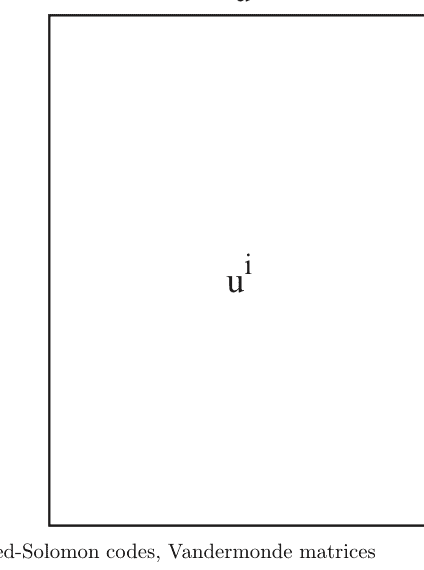

图 4.1：Reed-Solomon 码，Vandermonde 矩阵

## 第 5 章
### 递归构造 I
### 5.1 缩短与打孔
**基本概念：** 缩短与打孔，扩展与加长。二进制线性码的奇偶校验。扩展二进制汉明码。剩余码和 Griesmer 界。

到目前为止，我们一直专注于从头构造码，换句话说。一个想法导致了汉明码，另一个导致了 Reed-Solomon 码。现在我们要开始研究递归机制。最明显的问题是：在给定的码中可以找到哪些码？

设 $\mathcal{C}$ 为码 $[n,k,d]_q$。固定一个坐标，设为 $n$。$\mathcal{C}$ 的 **缩短** $\mathcal{D}$ 定义为

$\mathcal{D} = \{(x_1,x_2,\dots,x_{n-1}) \mid (x_1,x_2,\dots,x_{n-1},0) \in \mathcal{C}\}$.

这意味着我们考虑 $\mathcal{C}$ 的子码，由所有以 0 结尾的码字组成。然后我们丢弃这个多余的最后一个坐标。$\mathcal{D}$ 的参数有什么说法？显然 $\mathcal{D}$ 是线性的。由于它由一个线性方程定义，维数通常为 $k-1$（如果 $\mathcal{C}$ 的所有字在最后一个坐标恰好为 0，则维数为 $k$）。此外，$\mathcal{D}$ 是 $\mathcal{C}$ 的子码。由此可知 $\mathcal{D}$ 的最小重量（=最小距离）不能小于 $d$。这描述了我们的第一个递归构造：

**5.1 定理.** *如果存在码 $[n,k,d]_q$，则缩短得到子码 $[n-1,k-1,d]_q$。*

这里还有另一个基本想法。该过程在代数中称为 **投影**。在编码社区中它被称为 **打孔** 或 **截断**：定义

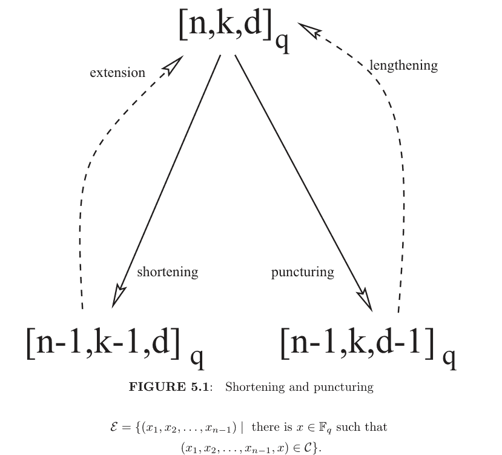

图 5.1：缩短与打孔

$\mathcal{E} = \{(x_1,x_2,\dots,x_{n-1}) \mid \text{there is } x \in \mathbb{F}_q \text{ such that } (x_1,x_2,\dots,x_{n-1},x) \in \mathcal{C}\}.$

这意味着我们将 $\mathcal{C}$ 的码字投影到前 $n-1$ 个坐标上。$\mathcal{E}$ 的码字数量与 $\mathcal{C}$ 相同（如果 $\mathcal{C}$ 中两个不同的字在除一个坐标外的所有坐标上一致，它们的距离将为 1）。特别地，$\mathcal{E}$ 的维数为 $k$。这次我们不能期望最小距离保持不变。然而，由于只移除了一个坐标，最小距离最多减少 1。

**5.2 定理. 如果存在码 $[n,k,d]_q$，其中 $d > 1$，则打孔（投影）得到码 $[n-1,k,d-1]_q$。**

例如，给定码 $[24,12,8]_2$（它被称为二进制扩展 Golay 码），我们可以通过重复缩短和打孔构造 $[23,12,7]_2$、$[23,11,8]_2$、$[22,12,6]_2$、$[22,11,7]_2$、$[22,10,8]_2$、…

这引发了有趣的问题何时可以逆转其中一种构造。给定码 $[n-1,k-1,d]_q$，能否找到码 $[n,k,d]_q$ 使得原码通过缩短得到？该过程称为 **扩展**。显然它不总是可能。缩短过程表明参数 $[n,k,d]_q$ 比 $[n-1,k-1,d]_q$ 更强。自然会问一步扩展的最大最小距离是多少。覆盖半径将为此问题提供新的启示；见第 14.2 节。

在打孔的情况下，情况类似。打孔的逆称为 **加长**，显然也不总是可能。更一般地，我们将说码 $\mathcal{C}$ 长度为 $n$ 的 $(i$-步) **加长**，如果新码长度为 $n+i$ 与 $\mathcal{C}$ 具有相同维数且投影到 $\mathcal{C}$；我们说 $(i$-步) **扩展**，如果我们有一个长度为 $n+i$ 的码且在某些 $i$ 个坐标上重复缩短产生 $\mathcal{C}$。不幸的是，文献中的术语相当混乱。

这里有一个著名的加长有效的情况：设 $\mathcal{C}$ 为 $[n,k,d]_2$，其中 $d$ 为奇数。附加一个新坐标，其中条目选择使得新的加长码字具有偶权重。这意味着如果旧码字的权重为偶数，则最后一个坐标的条目为 0，如果旧权重为奇数，则最后一个坐标的条目为 1。显然新码是线性的且具有与旧码相同的维数。此外，在加长码中所有权重都是偶数。特别地，权重 $d$ 不出现。我们有一个码 $[n+1,k,d+1]_2$。额外坐标中的条目称为 **奇偶校验位**。

**5.3 定理. 设 $\mathcal{C}$ 为二进制码 $[n,k,d]_2$，其中 $d$ 为奇数。附加奇偶校验位得到码 $[n+1,k,d+1]_2$。**

特别地，存在奇 $d$ 的码 $[n,k,d]_2$ 当且仅当存在码 $[n+1,k,d+1]_2$。因此在二进制线性码理论中可以集中于偶最小权重。然而，这是二进制情形的特殊性。

我们在第 2.1、2.2 和 2.5 节中见过二进制汉明码 $[7,4,3]_2$。$\mathcal{H}_3(2)$ 的生成矩阵在第 2.1 节中给出：

```
\begin{pmatrix} 1 0 0 1 1 0 1 \\ 0 1 0 1 0 1 1 \\ 0 0 1 0 1 1 1 \\ 0 0 0 1 1 1 0 \end{pmatrix}
```

在添加奇偶校验位后，我们得到矩阵

```
\begin{pmatrix} 1 0 0 1 1 0 1 0 \\ 0 1 0 1 0 1 1 0 \\ 0 0 1 0 1 1 1 0 \\ 0 0 0 1 1 1 0 1 \end{pmatrix}
```


这是一个所谓的**扩展汉明码** [8, 4, 4]₂ 的生成矩阵（唉：我们更愿意称之为延长的汉明码）。我们检查任意两行都是正交的。这意味着扩展汉明码与自身正交。由于其维数正好是长度的一半（见引理 2.9），我们得出结论它等于其对偶码。这类码称为**自对偶**码。

### 5.4 定理。
*扩展二元汉明码 [8, 4, 4]₂ 是自对偶的* (𝒞 = 𝒞^⊥)。

可以对所有二元汉明码 [2^r − 1, 2^r − (r + 1), 3]₂ 应用奇偶校验。这得到扩展的（实际上是延长的）二元汉明码：

### 5.5 定理。
*扩展二元汉明码的参数为*
[2^r, 2^r − (r + 1), 4]₂。

例子是 [8, 4, 4]₂, [16, 11, 4]₂, [32, 26, 4]₂。

## 残余码，Griesmer 界

设 𝒞 是一个 [n, k, d]_q 码且 v ∈ 𝒞 是一个权为 d 的码字。我们可以假设 v 的非零项为 v₁ = v₂ = ⋯ = v_d = 1。否则置换坐标并在前 d 个坐标中用合适的非零域元素乘以所有码字。这产生一个具有相同参数的码。选择生成矩阵 G 使得其第一行为 v。**残余码** ℛ 是由 G 的其余 k − 1 行生成的码，在投影到最后 n − d 个坐标（v 在此处为零）之后；换句话说，ℛ 由 G 的东南角矩阵生成。显然 ℛ 是一个长度为 n − d 的线性码。它的维数为 k − 1，否则 𝒞 将包含一个权 < d 的非零码字。关于 ℛ 的最小距离 d' 可以说什么？

设 0 ≠ x ∈ 𝒞 是 G 的最后 k − 1 行的线性组合，其在 ℛ 中的像（由最后 n − d 个坐标组成）的权为 w。我们想要 w 的下界。设 δ_i 为在第一段中 x 的项为 i 的坐标数，对任意 i ∈ 𝔽_q。码字 x − i v ∈ 𝒞 的权为 w + d − δ_i。该权必须 ≥ d。由此可得 w ≥ δ_i。由于 δ_i 的平均值为 d/q，我们有 w ≥ ⌈d/q⌉，即至少与 d/q 大的最小整数。我们看到以下结论：

### 5.6 命题。
*设 𝒞 是一个精确最小权为 d 的 [n, k, d]_q 码。残余码是一个 [n − d, k − 1, ⌈d/q⌉]_q 码。*

对命题 5.6 反复应用得到 $n \ge \sum_{i=0}^{k-1} \lceil d/q^i \rceil$。即使在过程中的某一点真实的最小距离大于其保证的下界，这也成立。

### 5.7 定理 (Griesmer 界). 若存在线性 $[n,k,d]_q$ 码，则
$n \ge \sum_{i=0}^{k-1} \lceil d/q^i \rceil.$

Griesmer 界非常有用。它是对线性码的界。它与 Singleton 界相比如何？n 的下界是 k 个整数之和。这些整数中最大的是 d；所有都严格为正。这意味着 $n \ge d + (k - 1)$。我们看到 Griesmer 界蕴含 Singleton 界定理 4.1。Griesmer 界由 Griesmer [99] 在二元情形下证明，由 Solomon 和 Stiffler [196] 在一般 q-元情形下证明。

作为第一个例子，码 $[8,4,4]_2$, $[11,3,6]_2$ 和 $[12,6,3]_3$ 以等号满足 Griesmer 界。在第 17 章我们将遇到关于线性码的几何描述的 Griesmer 界的更自然的证明；见练习 17.1.8。

- 1. 设 $\mathcal{C}$ 是一个线性码 $[n,k,d]_q$。
- 2. 一步**缩短**产生 $[n-1,k-1,d]_q$，一步**投影**得到 $[n-1,k,d-1]_q$。
- 3. 我们称一步**扩展**如果可以得到 $[n+1,k+1,d]_q$，称一步**延长**如果可以构造 $[n+1,k,d+1]_q$。
- 4. **奇偶校验**仅在二元情形下工作。它在 d 为奇数时由 $[n,k,d]_2$ 构造 $[n+1,k,d+1]_2$。
- 5. **扩展二元汉明码**的参数为 $[2^r, 2^r - (r+1),4]_2$。
- 6. **Griesmer 界:** $n \ge \sum_{i=0}^{k-1} \lceil d/q^i \rceil$ 比 Singleton 界更强。

## 练习 5.1

5.1.1. 设 C 是一个最小距离为奇数 d 的二元线性码且 D ⊂ C 为偶权码字的集合。证明 D 是 C 中余维数为 1 的子空间。

5.1.2. 给定一个线性码 [192,11,92]₂（它存在），列出所有长度为 188 及以上可通过迭代缩短和投影构造的码的参数。

5.1.3. 证明以下结论：如果一个码是 MDS，则由其通过缩短或投影导出的每个码也是 MDS。

5.1.4. 确定由
G = \begin{pmatrix} 11100000111100 \\ 000111000110011 \\ 000111111111100 \end{pmatrix}.
生成的三维二元码的参数。对该生成矩阵添加一个奇偶校验位。所得扩展码的参数是什么？

5.1.5. 设 X = {1,2,...,8}。定义一个大小为 (8,24) 的二元矩阵 M 如下：M 的行由元素 x ∈ X 索引。M 的列由无序对 {i,j} ⊂ X 索引，其中 {i,j} 不是 {1,2},{3,4},{5,6},{7,8} 中的任何一个（这些禁止对形成所谓的 1-因子）。行 x 与列 {i,j} 的条目在 x = i 或 x = j 时为 0；否则为 1。注意 M 的每一列权为 6 且每一行权为 18。证明 M 的秩为 7 且其行空间是一个码 [24,7,10]₂。该描述来自 Jaffe [119]。

5.1.6. 给定一个线性码 [24,7,10]₂，可通过迭代缩短和投影构造哪些 6 或 7 维码的参数？

5.1.7. 考虑矩阵
A = \begin{pmatrix} 0111111111 \\ 1011112222 \\ 0001021221 \\ 0011220102 \end{pmatrix}
来自第 3.6 节，它生成一个码 [10,4,6]₃。求通过缩短和通过投影导出的码的生成矩阵。

5.1.8. 设 C 是一个 [n,k,d]_q 码，x = (x1,...,xw,0,0,...) ∈ C⊥ 是对偶码中权为 w 的码字。对 C 关于前 w 个坐标进行缩短。我们知道所得码的参数至少为 [n−w,k−w,d]_q。
证明该缩短码实际上具有更好的参数。
这被称为构造 Y1。

5.1.9. 从第 3.4 节我们知道 Simplex 码。它们的对偶是汉明码。确定对 Simplex 码应用构造 Y1 所得到的码的参数。

5.1.10. 证明最小距离 d > q 的码不能是 MDS。

5.1.11. 证明 Simplex 码以等号满足 Griesmer 界。

5.1.12. 证明以下残余码构造的推广，该构造用于 Dodunekov [72] 和 Groneick 和 Grosse [100]：
设 C 是一个 [n,k,d]_q 码且 v ∈ C 是一个权为 w 的码字。假设 d − w + ⌈w/q⌉ > 0。
则存在一个 [n−w,k−1,d−w+⌈w/q⌉]_q 码。

## 5.2 串联和 (u,u+v)-构造。

迄今为止我们见过的最好的一般码族是 Reed-Solomon 码。回顾 q-元 Reed-Solomon 码的长度为 q。特别是，这些码仅在相对较大的域上有趣。另一方面，如果我们寻找长度 n ≤ q 的 q-元码，就没有理由不使用 Reed-Solomon 码以及由缩短或投影得到的结果。所有这些码 [n,k,n−k+1]_q 都是 MDS 码。更大的长度呢？我们多次承诺使用在更大域上定义的码并使用某些“向下”方法来构造较小域上的好码。这是我们考虑大域上码的动机之一。串联是这样一种一般方法。

设 $Q = q^r$。域 $\mathbb{F}_Q$ 包含 $\mathbb{F}_q$ 作为子域。从任意线性 $Q$-元码 $\mathcal{C}$ 出发，参数为 $[N,K,D]_Q$。每个码字是一个 $N$-元组 $(x_1,x_2,\dots,x_N)$，其中 $x_i \in \mathbb{F}_Q$。现在 $\mathbb{F}_Q$ 是 $\mathbb{F}_q$ 上的 $r$ 维向量空间。$\mathbb{F}_q$ 上的每个 $r$ 维码也是 $\mathbb{F}_q$ 向量空间。这里是串联的思想：固定一个参数为 $[n,r,d]_q$ 的码 $\mathcal{D}$ 和一个一一映射，一个向量空间同构 $\alpha : \mathbb{F}_Q \longrightarrow \mathcal{D}$。为了得到新的 q-元串联码，我们用其像 $\alpha(u) \in \mathbb{F}_q^r$ 替换每个域元素 $u \in \mathbb{F}_Q$。$\mathcal{C}$ 的码字（$Q$-元 $N$-元组）的像为 q-元 $nN$-元组。

### 5.8 定义。
设 $Q = q^r$ 且 $\mathcal{C}$ 是一个线性 $Q$-元码 $[N,K,D]_Q$（外码）。设 $\mathcal{D}$ 是一个线性 $[n,r,d]_q$（内码）。选择一个 $\mathbb{F}_q$-同构 $\alpha : \mathbb{F}_Q \longrightarrow \mathcal{D} \subseteq \mathbb{F}_q^n$。串联码的词与 $\mathcal{C}$ 的词一一对应。如果 $(x_1,x_2,\dots,x_N) \in \mathcal{C}$，则串联码的对应词为 $(\alpha(x_1),\dots,\alpha(x_N))$。

串联码的长度为 $nN$。它与外码 $\mathcal{C}$ 具有相同数量的码字。该数为 $Q^K = q^{rK}$。串联码的维数因此为 $rK$。设 $\alpha(x)$，$x \in \mathcal{C}$ 为非零码字。由于 $\mathcal{C}$ 的最小权为 $D$，至少有 $D$ 个坐标使得 $x_i \neq 0$。对于这些坐标，$\alpha(x_i)$ 是内码 $\mathcal{D}$ 的非零词，因此权 $\ge d$。由此可得 $\alpha(x)$ 的权 $\ge dD$。

### 5.9 定理。
外码 $[N,K,D]_Q$，其中 $Q = q^r$，与内码 $[n,r,d]_q$ 的串联码是一个线性 q-元码 $[nN,rK,dD]_q$。

用串联由四元码导出二元码。此时内码必须是二维二元码。使用 Reed-Solomon 码 $[4,2,3]_4$ 作为外码。作为内码使用和为 0 的码 $[3,2,2]_2$。其码字为 $000,110,101,011$。我们可以选择 $\alpha : 0 \mapsto 000,\ 1 \mapsto 110,\ \omega \mapsto 101,\ \omega^2 \mapsto 011$。

考虑由多项式 $X$ 参数化的 $\mathcal{RS}(2,4)$ 的码字。它是 $(0,1,\omega,\omega)$。它在 $\alpha$ 下的像是 $000110101011$，权为 $6$。串联码是一个 $[12,4,6]_2$ 码。


需要从域论中再引入一个事实（参见第3.2节）：当 𝔽_{q^r} 由基域 𝔽_q 构造，使用次数为 r 的不可约多项式 f(X) 且 ε 为 X (mod f(X)) 时，则 1, ε, …, ε^{r−1} 是 𝔽_{q^r} 作为 𝔽_q 上的向量空间的一组基。回想一下 ε^r 可以写成这些 ε 的低次幂的线性组合。

我们可以选取 α 使得

α : 1 → z₁, ε → z₂, …, ε^{r−1} → z_r.

设 M 为外码的生成矩阵，其行为 R₁, R₂, …, R_K。拼接码的生成矩阵的行是

R₁, εR₁, …, ε^{r−1}R₁, …, R_K, εR_K, …, ε^{r−1}R_K.

在 α 下的像。

考虑我们的第一个例子。我们的“大”域 𝔽₄ 有基 1, ω。内码 [3,2,2]₂ 的生成矩阵的行可以取为 z₁ = 110 和 z₂ = 101。根据我们的配方，这给出

α : 1 → 110, ω → 101.

其余部分由线性组合决定：α(0) = 000 当然成立，且 α : ω = 1 + ω → 110 + 101 = 011。这就是我们之前得到的结果。我们知道如何确定外码 [4,2,3]₄ 的生成矩阵。取 R₁ = (1,1,1,1)，R₂ = (0,1,ω,ω)，这就得到拼接 [12,4,6]₂ 的以下生成矩阵：

R₁ → 110110110110
ωR₁ → 101101101101
R₂ → 000110101011
ωR₂ → 000101011110

## The (u, u + v)-construction

这又是另一种简单且有用的递归构造。它似乎可追溯到 Sloane 和 Whitehead [194]，并且可以推广到不一定是线性码的情况。其基本思想由其名称描述。

我们从两个线性码 𝒞₁, 𝒞₂ 出发，它们定义在同一域上且长度相同为 n。设 u 为 𝒞₁ 的典型元素，v 为 𝒞₂ 的典型元素。我们构造的码长度为 2n。其典型码字为 f(u,v) = (u, u+v)。很明显，所得码的维数是 𝒞₁ 和 𝒞₂ 维数之和。关键在于控制最小距离。

### 5.10 Theorem. Let 𝒞_i, i = 1,2 be codes [n, k_i, d_i]_q, where d₁ ≤ d₂. We can construct a code [2n, k₁ + k₂, d]_q, where d ≥ Min{d₂, 2d₁}.

**PROOF** We construct the code $\mathcal{C}$ as the image of $f : \mathcal{C}_1 \oplus \mathcal{C}_2 \longrightarrow \mathbb{F}_q^{2n}$ defined by $f(u,v) = (u, u+v)$. Clearly, $f$ is one-to-one (if $f(u_1,v_1)=f(u_2,v_2)$; then the first coordinate section shows $u_1 = u_2$, the second section shows $u_1+v_1 = u_2+v_2$, and, as we know already that $u_1 = u_2$, this implies $v_1 = v_2$). It follows that $dim(\mathcal{C}) = k_1 + k_2$.

为了界定最小重量，只需区分两种情况。如果 $v = 0$，$u \neq 0$，则 $wt(u,u) \ge 2d_1$。如果 $v \neq 0$，则 $wt(u,u+v) \ge wt(v) \ge d_2$。这是决定性的观察。事实上，每当 $v_i \neq 0$ 时，必须有 $u_i \neq 0$ 或 $(u+v)_i \neq 0$。

作为一个例子，从 $[6,3,3]_2$ 出发并递归地应用定理 5.10，以重复码作为 𝒞₂ 的角色。这就得到码 $[12,4,6]_2$、$[24,5,12]_2$、$[48,6,24]_2$，一般为 $[6\cdot2^i,3+i,3\cdot2^i]_2$。

从平凡码 $[2,2,1]_2$ 出发。使用与上面相同的方法，我们得到 $[4,3,2]_2$、$[8,4,4]_2$、$[16,5,8]_2$，一般对所有 $i \ge 1$ 有 $[2^i,i+1,2^{i-1}]_2$。这给出了扩展二元汉明码 $[8,4,4]_2$ 的另一种构造。所有这些码都以等号满足 Griesmer 界定理 5.7。

### 5.11 Corollary. *The existence of a linear $[n,k,n/2]_q$ code implies $[2^i n,k+i,2^{i-1}n]_q$ codes for all $i \ge 1$.*

**PROOF** This is the special case of Theorem 5.10 when $d_1 \ge n/2$ and the second code is the repetition code.

- 1. Let $\mathcal{C}$ be a $[N,K,D]_Q$ code, where $Q = q^r$.
- 2. Let $\mathcal{D}$ be an $[n,r,d]_q$ code.
- 3. Concatenation produces an $[nN,rK,dD]_q$ code.
- 4. We can construct good codes of arbitrary length over small fields by using concatenation with Reed-Solomon codes over extension fields as outer codes.
- 5. Let codes $[n,k_1,d_1]_q$ and $[n,k_2,d_2]_q$ be given.
- 6. The $(u,u+v)$-construction produces a code $[2n,k_1+k_2,d]_q$, where $d \ge Min\{d_2,2d_1\}$.
- 7. There are families of binary codes $[6\cdot2^i,3+i,3\cdot2^i]_2$ and $[2^i,i+1,2^{i-1}]_2$.

## Exercises 5.2

5.2.1. Use RS(4,8) and [7,3,4]₂ in a concatenation scheme. What are the parameters of the resulting concatenated code?

5.2.2. We have already met the following matrix in Exercise 3.4.6. It generates a code [6,3,4]₄, which is known as the hexacode. We want to apply concatenation with the hexacode as the outer code. List at least two parameters of binary codes that can be used as inner codes, and the parameters of the resulting concatenated codes.

⎛1 0 0 1 ω ω⎞
⎜0 1 0 1 ω ω⎟
⎝0 0 1 1 1 1⎠

5.2.3. Use concatenation with Reed-Solomon codes over F₂, as outer codes and binary sum-0 codes as inner codes. Determine the parameters of the resulting binary codes.

5.2.4. Consider concatenation with Reed-Solomon codes as outer codes and a ternary [10,4,6]₃ as the inner code. What are the resulting parameters?

5.2.5. Construct a 48-dimensional binary linear code by applying concatenation to a Reed-Solomon code as the outer code and [23,12,7]₂ as the inner code. What are the parameters of this concatenated code?

5.2.6. Show how to construct a code [128,12,56]₂ by concatenation. What do you use as outer and inner codes?

5.2.7. Show how to construct a code [27,10,10]₃ by concatenation. What do you use as outer and inner codes?

5.2.8. An [11,4,5]₂ was promised in Section 2.3. Construct it by concatenation.

5.2.9. The Reed-Muller codes RM(a,r) are binary codes of length 2ʳ, minimum distance 2ʳ⁻ᵃ and dimension ∑ᵢ₌₀ᵃ (r choose i). Use the (u,u+v)-construction to obtain codes with these parameters. Here RM(0,r) is the repetition code and RM(r,r) is the ambient space.

5.2.10. Give several parameters of good short binary linear codes among the family constructed in the third exercise above.

5.2.11. Give several examples of Reed-Muller codes with good parameters.

5.2.12. Construct [2ⁱ ×14,4+i,2ⁱ⁻¹×14]₂ codes for all i ≥1. This yields in particular [28,5,14]₂,[56,6,28]₂,[112,7,56]₂.

5.2.13. Construct a [240,8,120]₂ code.


## Taylor & Francis

Taylor & Francis Group

http://taylorandfrancis.com

## Chapter 6

## Universal hashing

**Basic concepts:** The concept of hashing. Almost universal hash classes and error-correcting codes. Error detection.

迄今为止，我们一直集中于码的一个重要应用领域，即在嘈杂信道上传输消息。我们在本文早期提到过，码的概念的应用是多方面的，绝不限于这一历史上第一个领域。现在是时候朝这个方向迈出一步了。

理论计算机科学中的一个重要概念是 **hash functions**。其思想是找到一个函数 $f : X \longrightarrow Y$，从“大”集合 $X$ 到“小”集合 $Y$，具有以下性质之一：

- 给定 $x \in X$，在计算上不可行找到 $x' \neq x$ 使得 $f(x') = f(x)$。
- 在计算上不可行找到 $x \neq x'$ 使得 $f(x') = f(x)$。

密码学中的应用在 Stinson [200] 中有描述。仅举一个例子，当一份长文档需要电子签名时，首先应用一个哈希函数生成一个更短的字符串（原始文档的摘要），然后将签名方案应用于该哈希值。哈希函数的概念非常成问题。首先很明显，许多碰撞（满足 $f(x') = f(x)$ 的对 $x, x'$）将会发生。我们希望使对手在计算上不可能找到任何碰撞。如何保证这一点？答案是：不能。事实上，每当提出一种新的哈希函数时，只需几年时间就会被攻破，即描述出导致碰撞的方法。

**Universal hashing** 是为了解决这一困境而设计的，至少对于某些应用而言。就像哈希函数本身一样，存在众多变体。让我们固定记号：


## 6.1 定义。

一个 (n,M)_q 数组是一个具有 n 行和 M 列的数组（矩阵），其中每个条目取自大小为 q 的字母表 A。我们还将数组的每一行解释为一个映射 f : X ⟶ A，其中 |X| = M（X 的元素参数化列）。在此视角下我们称之为一个 (n,M)_q 哈希族。

通用哈希背后的思想是使用精心选择的哈希函数族而不是单个哈希函数。每当需要应用哈希函数时，它将从哈希族中随机选择。这种方法的预期行为由哈希族的结构性质决定。回顾第 3.5 节中引入的概率空间概念。

## 6.2 定义。

概率空间 Ω 是均匀的，如果 Ω 的每个元素具有相同的概率 1/|Ω|。

由于我们打算随机选择数组的行（来自我们哈希族的函数），因此自然地将行视为均匀样本空间的元素：n 行（函数）中的每一行概率为 1/n。碰撞应不太可能这一思想转化为以下要求：每当固定两个不同的列（基本集的元素 x ≠ x'）并随机选择一行 f 时，f(x') = f(x) 的概率应很小。这导致以下定义：

## 6.3 定义。

一个 (n,M)_q 哈希族对于某个 0 < ε < 1 是 ε-通用的，如果对于 X 中任意两个不同的元素（列）x'、x，满足 f(x') = f(x) 的函数（行）f 的个数 ν 满足 ν/n ≤ ε；换句话说：碰撞的概率 ≤ ε。

这里有一个玩具示例：

```
01234 01234 01234 01234 01234
01234 12340 23401 34012 40123
01234 23401 40123 12340 34012
01234 34012 12340 40123 23401
01234 40123 34012 23401 12340
```

我们将其视为一个 (5,25)_5 哈希族，或视为从 25 元集到 5 元集的五个函数的族。可以验证每一对列最多包含一次碰撞。例如，第一列与某另一列的碰撞等价于该另一列中有一个条目 0。由于除第一列外的每一列最多包含一个条目 0，我们已检查了涉及第一列的对。我们的数组是 1/5-通用的。

现在从汉明距离的角度解释这一概念变得很容易。选取两列。碰撞是指它们一致的坐标（行）。汉明距离是没有碰撞的坐标数。设 d 为两列之间的汉明距离。碰撞的概率则为 (n-d)/n = 1 - d/n。这表明如何从编码的角度解释碰撞的概念：将列视为长度为 n、最小距离为 d 的 q 元码的码字。此时数组是 ε-通用的，其中 ε = 1 − d/n。我们已建立了以下一般等价关系：

## 6.4 定理。以下等价：

- 一个 ε-通用 (n, M)_q 哈希族，以及
- 一个 (n, M, d)_q 码，其中 ε = 1 − d/n。

事实上，在我们的玩具示例中，我们只是将列选为 Reed-Solomon 码 RS(2,5) 的码字。由于 d = 4，我们有 ε = 1 − 4/5 = 1/5。

ε-通用哈希族的概念对我们来说其实并不新鲜，但它给出了码的不同解释。在此应用中，非常小的字母表完全没有意义。此外，由于基本集 X 必须非常大，长度 n 不能很小。碰撞的概率 ε 必须很小。这意味着 d/n 必须接近 1。由此可知，我们的码的维数 k（在线性情形下）必须相对较小。由于 M = q^k，我们再次看到 q 不能太小。幸运的是，我们已经知道一种在大字母表上产生良好长码的来源：Reed-Solomon 码。如果它们不够用，我们可以使用以 Reed-Solomon 码为外码的级联。

假设我们想对 2^20 位（约 100 万位）的文档进行哈希。由于我们希望能够哈希此长度的任何文档，我们有一个大小为 2^2^20 的基本集。哈希值应只有 32 位长。这意味着字母表大小为 q = 2^32。我们能否使用 q 元 Reed-Solomon 码 RS(k, q)？我们需要 q^k ≥ 2^2^20，或 k ≥ 2^15。碰撞的概率则为 ε < 2^15 / 2^32 = 2^-17。这描述了一个 (2^32, 2^2^20)_2^32 哈希族，它是 2^-17-通用的。使用 Reed-Solomon 码时，我们将始终有 n = q。

计算机科学文献中通用哈希的思想似乎可以追溯到 J. L. Carter 和 M. N. Wegman 的两篇有影响力的论文 [43, 218]。第 16.7 节对通用哈希、其应用以及与码的联系有更多介绍。

## 对错误检测的一个应用

这里给出 ε-通用哈希族用于错误检测的一个应用。假设我们通过一个相当好的信道向接收方发送长消息 x。设 y 为接收到的消息。在大多数情况下，不会出现错误，因此 y = x。为了能够检测错误（而非纠正），可以使用以下方法：我们从 ε-通用族中随机选择一个函数 f，并通过一个肯定不会出错的公共信道将 f 以及 f(x) 发送给接收方。这不会花费太多，因为这些消息比 x 短得多（在上面的例子中 x 有 2^20 位，而 f 和 f(x) 各为长度 32 的比特串）。如果 f(y) ≠ f(x)，则接收方知道发生了传输错误。他在这种情况下会请求重传。如果 f(y) = f(x)，消息将被接受为正确。此时该假设出错的概率受 ε 限制。

## 练习 6

- 6.1. 确定 Reed-Solomon 码作为 ε-通用哈希族解释时的参数。
- 6.2. 描述一个 ½-通用的 (8,16)₂ 哈希族。
- 6.3. 找到一个 ²⁄₅-通用的 (10,81)₃ 哈希族。提示：该码已在第 3 章构造。它与三元 Golay 码密切相关。
- 6.4. 是否存在 ½-通用的 (6,9)₂ 哈希族？
- 6.5. 构造一个 ¹⁄₁₆-通用的 (256,256¹⁷)₂₅₆ 哈希族。
- 6.6. 解释为什么码 [4000,5,3996]₄₀₉₆ 存在，并确定由此导出的通用哈希族的参数。

## 第 7 章

## 设计与二元 Golay 码

**基本概念：** 循环码。二元 Golay 码。
组合 $t$-设计，大 Witt 设计，射影平面。

良好码的一个丰富来源是 **循环码** 的理论。码被称为循环码，如果任一码字的循环移位仍是码字。例如，考虑二元 23 元组

$z_1 = (1,1,0,0,0,1,1,1,0,1,0,1,0,0,0,0,0,0,0,0,0,0,0)$

为了得到它的第一次循环移位，我们先写最后的条目 0，然后跟上前 22 个条目：

$z_2 = (0,1,1,0,0,0,1,1,1,0,1,0,1,0,0,0,0,0,0,0,0,0,0)$

下一次循环移位是

$z_3 = (0,0,1,1,0,0,0,1,1,1,0,1,0,1,0,0,0,0,0,0,0,0,0)$

等等。用 $\mathcal{C}$ 表示由 $z_1$ 生成的循环二元线性码。显然，前 12 个循环移位 $z_1,z_2,\ldots,z_{12}$ 是线性无关的（为什么？），但 $z_{13}$ 是 $z_1,z_2,\ldots,z_{12}$ 的线性组合。由此可知 $\mathcal{C}$ 的维数为 $k = 12$，并且以 $z_1,z_2,\ldots,z_{12}$ 为行的矩阵是 $\mathcal{C}$ 的生成矩阵。

### 7.1 定义。二元 Golay 码 $\mathcal{G}_{23}$ 是由上述 $z_1$ 及其循环移位生成的二元线性循环码。

这里是生成矩阵 $G$ :

\begin{pmatrix}11000111010100000000000\\011000111010100000000000\\001100011101010000000000\\000110001110101000000000\\000011000111010100000000\\000001100011101010000000\\000000110001110101000000\\000000011000111010100000\\000000001100011101010000\\000000000110001110101000\\000000000011000111010100\\000000000001100011101010\\000000000000110001110101\end{pmatrix}

循环结构清晰可见。对 G 的每一行添加一个奇偶校验位得到所谓的扩展二元 Golay 码 [24,12,8]₂ 的生成矩阵。可以很容易验证该码 𝒢₂₄ 是自对偶的：𝒢₂₄ = 𝒢₂₄^⊥。事实上，由于循环性，只需检查生成矩阵的第一行与所有行正交即可。𝒢₂₄ 的生成矩阵的所有行权重为 8。这与自对偶性一起足以证明 𝒢₂₄ 的所有字权重都可被 4 整除（见练习 7.2）。我们希望证明权重 4 不会出现。

读者被敦促找到 𝒢₂₄ 的形式为 M = (I|P) 的生成矩阵。这里 I 是 (12,12) 单位矩阵，P 是 (12,12) 矩阵（见练习 7.3）。这并不难，因为 G 的左半部分已处于三角形式。事实证明 M 的所有行权重为 8。根据引理 2.14，校验矩阵为 (P^t|I)。由于 𝒢₂₄ 是自对偶的，这也是一个生成矩阵。

现在假设 v ∈ 𝒢₂₄，wt(v) = 4。写 v = (v_L, v_R)，其中 v_L 是 v 的左半部分，v_R 是右半部分。我们的生成矩阵表明只有 0 字才有 v_L = 0 或 v_R = 0。假设 wt(v_L) = 1。则 v_L 是 M 的一行。这是不可能的，因为 M 的行权重为 8。如果 wt(v_R) = 1，则 v_L 是 P 的一列。这些列权重为 7。这是一个矛盾。唯一剩下的可能性是 wt(v_L) = wt(v_R) = 2。由此可知 v 是 M 的两行的和。可以很容易验证这 (12 choose 2) = 66 个向量中没有一个权重为 4。

### 7.2 定理。二元 Golay 码 𝒢₂₃ 是一个 [23,12,7]₂ 码。它是一个完美码。扩展二元 Golay 码是一个自对偶 [24,12,8]₂ 码。

全 1 字 1 的存在（见练习 7.1）表明 𝒢₂₄ 的码字仅可能的权重为 0、8、12、16、24，并且权重为 16 的字与权重为 8 的字一样多。设 A_i 为 𝒢₂₄ 中权重为 i 的码字数。你被挑战去求 𝒢₂₄ 的权重分布（见练习 7.4）。特别地，A₈ = 759。

这可以作为现代离散数学基本结构、组合设计的动机。


## 7.3 定义。

设 V 为 v 个对象的集合，ℬ 为 V 的子集族，其中每个子集（块）有 k 个元素。我们说 ℬ 是重复数为 λ 的 t-设计，如果以下条件成立：V 的每个 t 元子集 T 都恰好包含在 λ 个块中。这样的 t-设计的参数记为 t − (v, k, λ)。当 λ = 1 时，称之为斯坦纳系统，并记为 S(t, k, v) 而非 t − (v, k, 1)。

我们可由码 𝒢₂₄ 导出一个 5-设计，具体如下：以 24 个坐标作为底层集合。将每个重量为 i 的码字与一个基数为 i 的子集对应：即条目为 1 的那些坐标。取重量为 8 的码字对应的 759 个子集（称为八元组）作为块。这定义了一个斯坦纳系统 S(5, 8, 24)（见练习 7.5）。

## 7.4 定理。

扩展二元戈莱码 [24, 12, 8]₂ 的 759 个八元组是设计 S(5, 8, 24) 的块。它被称为大维特设计。

我们已看到循环码 𝒢₂₃ 及其延拓 𝒢₂₄ 是非常有趣的码。事实上，循环码是应用最广泛的码族之一。循环码的传统理论使用环论的记号和结果（环是重要的一类代数结构）。另一种方法则利用有限域的更深入知识。循环码理论是第二部分的核心理论，特别是第 12 章和第 13 章。

特别重要的一类设计是射影几何。在第二部分中我们将大量使用这些结构。线性码的几何描述是第二部分的另一个核心主题，其基于射影几何（参见第 17 章）。

我们首先描述射影平面 PG(2, q)：从任意有限域 𝔽_q 出发。考虑空间 V = 𝔽_q³，这是一个三维空间。定义

- **点：** V 的一维子空间，
- **线：** V 的二维子空间。

由于 V 有 q³ − 1 个非零向量，而每个一维空间有 q − 1 个非零向量，点总数为 (q³ − 1)/(q − 1) = q² + q + 1。同样的计数方法表明每条线有 (q² − 1)/(q − 1) = q + 1 个点。该几何最重要的性质如下：任意两个不同的点恰好位于一条公共直线上。这一事实很明显，因为任意两个一维空间生成一个二维空间。我们得出结论，PG(2, q)，即阶为 q 的经典射影平面，是一个设计 S(2, q + 1, q² + q + 1)。设计理论是现代组合理论的重要分支。基本公理是一种均匀性性质，类似于正交数组的定义。事实上，组合设计理论的起源之一在于统计学，特别是实验设计。

## 练习 7

7.1. 证明全 1 码字属于扩展二元戈莱码 [24,12,8]₂。

7.2. 设 C 为二元线性码，C ⊆ C⊥。假设 C 存在一个基，其所有元素重量均可被 4 整除（换言之，生成矩阵的所有行重量均可被 4 整除）。证明所有码字重量均为 4 的倍数。

7.3. 求 G₂₄ 的形如 M = (I|P) 的生成矩阵。

7.4. 确定 G₂₄ 的重量分布。

7.5. 利用值 A₈ = 759 证明以下结论：对于 G₂₄ 的 24 个坐标中任意 5 个，恰好存在一个重量为 8 的码字（所谓的八元组）在这些坐标处取 1。

7.6. 给出法诺平面 PG(2,2) 的一张图。

7.7. 对于每个素数幂 q，存在设计 S(2,q,q²)（阶为 q 的仿射平面）。确定块数。

7.8. 第 3.6 节中的 SETS 构成一个 2-设计。求其参数。

7.9. 扩展二元戈莱码 [24,12,8]₂ 有 A₁₂ = 2576（2576 个码字重量为 12）。相应的子集称为十二元组。这 2576 个十二元组构成设计 2 − (24,12,λ) 的块。λ 是多少？事实上，这是一个 5-设计。现在 λ 是多少？

## 第 8 章

### 香农熵与信息论基础

**基本概念：** 思想、定义、香农熵的基本性质和刻画。与二项式的联系。

回顾第 3.5 节中样本空间的定义。这样的（有限）样本空间由概率分布定义，非负数 $p_i$ 满足 $\sum_i p_i = 1$。熵是一个度量样本空间所含信息量的函数。

### 8.1 定义。设 $p_i$, $i=1,\dots,n$ 为概率分布。**香农熵** $H$ 定义为

$H(p_1,p_2,\dots,p_n) = - \sum_{i=1}^{n} p_i \cdot \log(p_i).$

这里，如信息论中通常一样，对数以 2 为底。我们规定 $0 \cdot \log(0) = 0$。设想一个源在每个时间单位发出 $n$ 个符号之一，称为字母，根据给定概率分布。也就是说，字母 $i$ 被选中的概率为 $p_i$。我们断言熵函数是该源产生的每字母平均信息量的度量。信息单位是 **比特**，即在两个等概率事件之间选择所含信息量：$H(\tfrac12,\tfrac12)=1$。

### 8.2 定理。设 $H_n : \mathbb{R}_+^n \longrightarrow \mathbb{R}_+$, $n=2,3,\dots$ 为满足以下性质的函数族：

- 每个 $H_n$ 连续。
- $H_2(1/2,1/2)=1$（一比特）。
- 存在连续单调递增函数 A(x) : ℝ₊ ⟶ ℝ₊ 使得 A(n) = Hₙ(1/n, ..., 1/n)。
- Hₙ(p₁,p₂,...,pₙ) = H₂(p₁,1−p₁) + (1−p₁)·Hₙ₋₁(p₂/(1−p₁),...,pₙ/(1−p₁))。这里数 $p_i$ 描述一个概率分布。

则 $H_n(p_1,...,p_n)$ 是熵函数。

该定理证明了为何我们将定义 8.1 中的熵函数视为我们所寻找的信息度量。证明并不困难。它构成练习 8.6 至 8.8。

熵定义的全部思想在于定理 8.2 的最后一个性质。它表明，根据给定概率分布对某些符号进行选择所包含的平均信息量，在信息分步揭示时不会改变。

例如，考虑 H(½,¼,¼)。将第二个和第三个事件合并为一个事件。第一个事件与剩余事件块之间的选择所含信息为 H(½,½)=1。结果为第二个或第三个事件的概率为 1/2。事件二和三之间的选择熵再次为 1 比特。为了得到 H(½,¼,¼)，我们必须加上 1（第一阶段的贡献）和 ½·1，即第二阶段选择所含熵乘以该情况实际发生的概率 1/2。结果 H(½,¼,¼)=1.5 与我们的公式一致。另一个例子为

H(½,¼,⅛,⅛)=½+¼·2+⅛·3+⅛·3=1.75.

很明显该熵应大于 H(½,½)=1。并且可以预期，由 n 个点的样本空间给出的最大熵由均匀分布取得，因而为 H(1/n,1/n,...)=log(n)。当 n=4 时，这给出最大熵 log(4)=2。我们上面例子的熵确实为 1.75<2。

考虑四个等概率事件的情况。相应的熵为 H(¼,¼,¼,¼)=log(4)=2。现在将这四个事件分为两个块，一个单事件和剩余三个事件的组。根据基本性质，熵为 H(¼,¾)+¼·0+¾log(3)。我们可求解 H(¼,¾) 并得到 H(¼,¾)=2−¾log(3)。这与一般公式一致，即

H(¼,¾)=¼log(4)+¾log(4/3).

仅含 2 个点的样本空间在编码理论中起着特殊作用。

### 8.3 定义。二进制熵函数定义为

h(x)=−x log(x)−(1−x)log(1−x) (for 0 ≤ x ≤ 1).

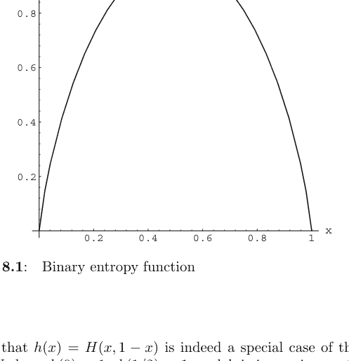

FIGURE 8.1: 二进制熵函数

注意到 $h(x)=H(x,1-x)$ 确实是香农熵的特例。我们有 $h(0)=0$, $h(1/2)=1$，且 $h$ 在区间 $[0,1/2]$ 上递增。

二进制熵函数与二项式之间存在密切关系。作为工具我们使用斯特林公式，该公式在微积分和统计学中经常使用。

### 8.4 引理。阶乘的斯特林公式为

$n! \sim \sqrt{2\pi n}(n/e)^n$,

*意味着左、右两边的商当 $n \to \infty$ 时趋于 1。*

证明见 Feller [84]。现在设 $n,m \to \infty$ 且 $m/n \to p$。我们想检验二项式系数 $\binom{n}{m}=\frac{n!}{m!(n-m)!}$ 的行为。由斯特林公式可得

$\displaystyle \lim\left(\frac{1}{n}\log\binom{n}{m}\right)=\lim\left(\log(n)-\frac{m}{n}\log(m)-\frac{n-m}{n}\log(n-m)\right)=$

$\displaystyle \lim\left(-\frac{m}{n}\log\left(\frac{m}{n}\right)-\frac{n-m}{n}\log\left(\frac{n-m}{n}\right)\right)=h(p).$

我们已看到以下内容：

### 8.5 定理。设 $n,m \to \infty$ 且 $m/n \to p$。则
$$\lim\left(\frac{1}{n}\log\binom{n}{m}\right)=h(p).$$
对多项分布的推广见练习 8.9。

## 香农熵的基本性质

证明香农熵函数基本性质的一个基本工具是 Jensen 不等式。

### 8.6 定义。在开区间 $I$ 上定义的实函数 $f(x)$ 若对每个 $x_0 \in I$，都存在一条经过 $(x_0,f(x_0))$ 的直线 $L$，该直线永不位于 $f(x)$ 图形的下方，则称其为下凹的。

函数 $f$ 下凹是指，沿其图像从左到右骑行时，我们会向右倾斜。这在 $f''(x)<0$ 时必然成立。

设 $g(x)=f(x_0)+\lambda(x-x_0)$ 为定义 8.6 中的直线的方程。根据凹性的定义，$f(x)\le f(x_0)+\lambda(x-x_0)$ 对所有 $x\in I$ 成立。设 $x_1\le x_2\cdots\le x_n$ 为 $I$ 中的点，$p_1,\dots,p_n$ 为概率空间的概率。利用上述不等式可得
$$\sum_i p_i f(x_i)\le f(x_0)+\lambda\Big(\sum_i p_i x_i -x_0\Big).$$
特别取 $x_0=\sum_i p_i x_i$；注意 $x_0\in I$。

### 8.7 定理（Jensen 不等式）。设 $f(x)$ 在开实区间 $I$ 上下凹，设 $x_1\le x_2\cdots\le x_n$ 为 $I$ 中的点，$p_1,\dots,p_n$ 为概率空间的概率。则
$$\sum_i p_i f(x_i)\le f\Big(\sum_i p_i x_i\Big).$$

等号成立当且仅当 $f(x)$ 在区间 $[x_1,x_n]$ 上是线性函数（其图像为直线）。

等号成立情形的证明留作练习 8.5。

显然对数函数在区间 $(0,\infty)$ 上是下凹的。取正数 $x_i$ 和概率分布 $p_i$。应用 Jensen 不等式可得到算术平均与几何平均之间著名的不等式：

### 8.8 定理。
设 $x_i > 0$，$p_i \ge 0$，$i = 1,2,\dots,n$，其中 $\sum_i p_i = 1$。则

$$\sum_{i=1}^n p_i \cdot x_i \ge \prod_{i=1}^n x_i^{p_i}.$$

*等号成立当且仅当所有 $p_i \neq 0$ 的 $x_i$ 相等。*

对数函数的 Jensen 不等式的另一个应用将被用来建立熵的一个关键性质：

### 8.9 命题。
设 $p_i$ 和 $q_i$ 为正数，$i = 1,2,\dots,n$，使得 $\sum_i p_i = 1$。置 $\sum_i q_i = \alpha$。则以下成立：

$$\sum_i p_i \cdot \log(1/p_i) \le \sum_i p_i \cdot \log(1/q_i) + \log(\alpha).$$

*等号成立当且仅当对所有 $i$ 有 $q_i = \alpha p_i$。*

**证明**  对 $x_i = q_i/p_i$ 应用 Jensen 不等式。注意 $\sum_i p_i x_i = \sum_i q_i = \alpha$。

在 $\alpha = 1$ 的情形下，当 $q_i$ 构成另一个概率分布时，这给出了熵函数的一个有趣性质：考虑表达式 $\sum_i p_i \cdot \log(1/q_i)$，其中 $p_i$ 构成固定的概率分布而 $(q_i)$ 在概率分布中变化。命题 8.9 表明该表达式在 $q_i = p_i$ 时取最小值，即由熵给出。

## 联合熵与条件熵

每个概率空间都有其熵。概率论与统计学中的另一个基本概念是随机变量。

### 8.10 定义。
设 $\Omega$ 为概率空间。$\Omega$ 上的 **随机变量** 是定义在 $\Omega$ 上的映射 $f$。

由于每个随机变量都诱导出一个概率分布，我们也可以谈论随机变量的熵。设 $X$ 和 $Y$ 为随机变量，其概率分布分别为 $p_i = Pr(X = i)$ 和 $q_j = Pr(Y = j)$。进一步考虑 $X$ 和 $Y$ 的联合分布，由概率 $p(i,j) = Pr(X = i \text{ and } Y = j)$ 给出。注意联合分布包含的信息比 $X$ 和 $Y$ 分布的总和更多。事实上，我们可以将概率 $p(i,j)$ 排列成一个矩阵，行以 i 为索引，列以 j 为索引。行和为 $p_i$，列和为 $q_j$。反过来，很明显该矩阵远不能由其行和列和唯一确定。

### 8.11 定义。
设 X、Y 为定义在同一概率空间 Ω 上的随机变量。按刚刚引入的记号，若对 X 的取值范围中每个 i 和 Y 的取值范围中每个 j 都有

$p(i,j)=p_i \times q_j$。

则称 X 和 Y 统计独立。

这一概念的含义是，对于独立随机变量而言，关于其中一个变量取值的信息对另一个变量的取值完全没有信息。

我们希望将熵 H(X) 和 H(Y) 与联合熵 H(X,Y) 进行比较。事实上，还有更多的熵。

### 8.12 定义。
设 X、Y 为定义在同一概率空间 Ω 上的随机变量。条件概率为

$p(i|j)=p(i,j)/q_j$.

*这是已知 Y = j 时 X = i 的概率。*

注意 X 和 Y 独立当且仅当 $p(i|j)=p_i$ 恒成立。对 Y 的每个固定取值 j，条件概率 $p(i|j)$ 构成一个概率分布。记相应的熵为 H(X|Y=j)。自然地定义条件熵 H(X|Y) 为这些表达式的加权和，权重为概率 $q_j$。

### 8.13 定义。
条件熵 H(X|Y) 定义为 $H(X|Y)=\sum_j q_j \cdot H(X|Y=j)= - \sum_{i,j} p(i,j) \cdot \log(p(i|j))$。

*这里 i,j 分别遍历 X 和 Y 的取值。*

条件熵是一个新概念。它不是概率空间的熵。不存在概率空间 X|Y。

## 主要定理

主要定理表明我们的概念以与我们的解释完全一致的方式协同工作：

### 8.14 定理。设 X 和 Y 为定义在同一有限概率空间上的随机变量。则熵满足以下关系：
- H(X,Y) ≤ H(X) + H(Y)，当且仅当 X 和 Y 独立时等号成立。
- H(X,Y) = H(X) + H(Y|X)（熵的链式法则）。
- H(X) ≥ H(X|Y)，当且仅当 X 和 Y 独立时等号成立。

**证明**  最有趣的是第一个陈述的证明。如果写出定义，我们会看到需要证明以下陈述：∑_{i,j} p(i,j)·log(p(i,j)) ≥ ∑_{i,j} p(i,j)·log(p_i p_j)。这在 α = 1 的情形下由命题 8.9 可得。等号成立时也由该命题可得。

第二个陈述是平凡的形式运算；第三个陈述由其他陈述可得：H(X) + H(Y) ≥ H(Y,X) = H(Y) + H(X|Y)。

回顾我们将 H(X) 解释为按相应概率运行的信源每字母的平均信息量的度量。主要定理的第一个性质表明，X 和 Y 合在一起所包含的信息最多为各自信息的总和。第二个陈述表明，X 和 Y 共同提供的联合信息可以写成 X 提供的信息与在已知 X 时 Y 提供的信息的总和。第三个性质表明，Y 的知识不会增加我们对 X 的不确定性。恰好当 X 和 Y 独立时，这一知识不会有帮助。

最后，我们来到一个自然的概念，在香农的经典论文中找不到，即互信息：

### 8.15 定义。互信息为 I(X,Y) = H(X) − H(X|Y)。

注意该概念在 X 和 Y 中是对称的：I(X,Y) = H(X,Y) − H(Y|X) − H(X|Y) = I(Y,X)。这一概念与我们的解释一致吗？H(X) 是关于 X 的不确定性，而 H(X|Y) 是在已知 Y 后关于 X 的剩余不确定性。因此我们应将差值解释为 Y 关于 X 透露的信息量。

大数定律提供了熵函数的另一种解释。设给定一个概率为 p1,p2,…,pr 的样本空间。如前所述，将该空间解释为信息源，其中在每个时刻根据概率分布生成 r 个符号之一。考虑由该信源生成的长度为 N 的信号（字母的 N 元组）。设 h_i 为字母 i ∈ {1,2,…,r} 的频率。大数定律断言如下：

对每个 ε, δ > 0 的配对，存在 N₀ = N₀(ε, δ)，使得对每个 N ≥ N₀，长度为 N 的信号集合可划分为两部分：
- 总概率 < ε 的集合，以及
- 其所有元素均满足的集合

|h_i/N − p_i| < δ 对所有 i。

大数定律由下一章中的切比雪夫不等式、定理 9.10 可得。大数定律的证明将在第 9 章练习部分概述。

解释如下：如果我们随机选取一个长信号，那么我们几乎可以肯定字母的相对频率接近概率。如果 S 是这样长度为 N 的信号，则其概率为 p = Pr(S) = ∏_i p_i^{h_i}。由此可得 log(p) = ∑_i h_i·log(p_i)，故 log(p)/N = ∑_i (h_i/N)·log(p_i)。如果 S 是其中一个可能的信号，则该表达式接近 ∑_i p_i·log(p_i) = −H(p1,…,p_n)。这是熵函数的另一种解释。

该性质在信息论中被称为 **渐近等分布性,** AEP；参见 Cover 和 Thomas [62]。


1. 熵函数（香农熵）
$H(p_1, p_2, \dots, p_r) = -\sum_{i=1}^r p_i \cdot log(p_i)$ （其中 $log$ 为以 2 为底）是源生成 $r$ 个符号且概率为 $p_i$ 时每符号平均信息量的度量。

2. 相关概念是若干源的 **联合熵**，源 $X$ 相对于源 $Y$ 的 **条件熵** $H(X|Y)$ 以及 **互信息**
$I(X, Y) = H(X) - H(X|Y) = I(Y, X)$。

3. 主要定理以自然的方式关联这些概念。

4. 一个重要的基本工具是 **詹森不等式**。

5. 源生成的长度为 $N$ 的典型 **信号**（符号序列）具有概率 $p$，使得 $\frac{1}{N}log(1/p)$ 接近 $H(p_1, p_2, \dots, p_r)$。这是熵的另一种解释。

6. 二元熵函数为 $h(x) = H(x, 1 - x)$。

7. 如果 $m/n \to p$，则 $\frac{1}{n}log\binom{n}{m} \to h(p)$。

## Exercises 8

8.1. H(p1,p2,p3,p4) 与 H(p1/2, p1/2, p2/2, p2/2, p3/2, p3/2, p4/2, p4/2) 之间有什么关系？

8.2. 哪个更大（包含更多信息），H(1/2, 1/4, 1/8, 1/8) 还是 H(1/3, 1/3, 1/9, 1/9)？计算两个熵并比较。

8.3. 比较以下实验：
- A: 三个可能事件，概率为 0.5, 0.25, 0.25
- B: 三个可能事件，每个概率为 1/3。

这些实验中哪一个产生的信息量更大？计算熵并比较。

8.4. 与之前相同类型的题目，其中
- A: 五个可能事件发生的概率为 1/4, 1/4, 1/4, 1/8, 1/8。
- B: 三个可能事件发生的概率为 1/2, 1/3, 1/6。

8.5. 证明詹森不等式（定理 8.7）中等号成立情形的陈述。

8.6. 用定理 8.2 的语言证明自然数 s,m 的 A(s^m) = A(s^{m-1}) + A(s)，并推出 A(s^m) = m A(s)。

8.7. 给定自然数 s,t,n 定义 m 使得 s^m ≤ t^n < s^{m+1}。用此记号证明 m/n ≤ A(t)/A(s) < (m+1)/n 且 m/n ≤ log(t)/log(s) < (m+1)/n。推出 A(t)=log(t)，其中 log 为二进制对数。

## 8.8.

证明有理概率情形下 $H$ 的公式。显然，由于连续性，这就足够了。所以设 $p_i = m_i/m$，其中 $m_i$ 和 $m$ 为自然数，$\sum_{i=1}^r m_i = m$。

提示：用 $H$ 的中心性质在适当情况下得到

$A(m) = H(p_1,\dots,p_r) + \sum_{i=1}^r p_i A(m_i).$

## 8.9.

多项式系数 $\binom{n}{m_1,m_2,\dots,m_k}$ 定义为

$\displaystyle \frac{n!}{m_1! m_2! \dots m_k!}$ （这里 $m_1 + m_2 + \cdots + m_k = n$）。

证明

$\displaystyle \lim \bigl(\log\bigl(\binom{n}{m_1,m_2,\dots,m_k}\bigr)\bigr)/n = H(p_1,p_2,\dots,p_k)$

其中 $n, m_i \longrightarrow \infty$ 使得 $m_i/n \longrightarrow p_i$。


## Taylor & Francis

Taylor & Francis Group

http://taylorandfrancis.com

## 第 9 章

## 渐近结果

**基本概念：** 相对距离，信息率。码的渐近界。渐近 Singleton 界。Plotkin 界和 Bose-Bush 界。香农信道编码定理。Gilbert-Varshamov 界。Justesen 码。

设 $\mathcal{C}$ 为码 $[n,k,d]_q$。回顾第 2.2 节中的 **相对最小距离** $\delta = d/n$，以及 **信息率** $R = k/n$。分块编码的基本思想是将 $k$-元组编码为 $n$-元组，使得纠错成为可能（因为 $d$ 很大）。因此我们感兴趣的是码族，使得 $d$ 相对于 $n$ 相对较大（从而 $\delta$ 远离 0），同时保持 $R$ 尽可能接近 1。

## 9.1 定义。

*一对 $(\delta,R)$ 能由线性 $q$-元码渐近达到，如果存在此类码的无限族，其长度 $n_i \longrightarrow \infty$，相对最小距离 $\delta_i$ 和信息率 $R_i$ 使得 $\lim_i \delta_i \geq \delta$ 且 $\lim_i R_i \geq R$。*

线性 $q$-元码的渐近存在问题如下：设 $\delta \leq 1$ 且 $R \leq 1$。判断对 $(\delta,R)$ 是否渐近可达。当 $\delta$ 给定时，我们希望 $R$ 尽可能大。当 $\delta$ 增大时，最大 $R$ 必须减小。练习 9.5 显示速率 $R > 0$ 只能在 $\delta < (q - 1)/q$ 时达到。这是上界（悲观陈述）。它排除了对 $(\delta,R)$：如果 $\delta \geq (q - 1)/q$ 且 $R > 0$，则此类对不可达到。第 4 章的 Singleton 界断言 $k + d \leq n + 1$。除以 $n$。这得到以下结果：

## 9.2 定理（渐近 Singleton 界）。

*如果 $(\delta,R)$ 能由 $q$-元线性码渐近达到，则 $R + \delta \leq 1$。*

## Plotkin 界和 Bose-Bush 界

Plotkin 界是对最小距离非常大的码的界。证明基于初等方法，**二次计数**。

**9.3 定理（Plotkin 界）。** *设 $\mathcal{C}$ 为长度为 $n$、最小距离为 $d$ 的 $q$-元码。假设 $d > \frac{q-1}{q} \cdot n$。则* $$|\mathcal{C}| \le \frac{qd}{qd - (q-1)n}.$$

**证明** 计数三元组 $(x, y, j)$，其中 $x$ 和 $y$ 为不同的码字，$j$ 为坐标，且 $x$ 与 $y$ 在该坐标上不同。设 $M$ 为码字数。根据 $d$ 的定义，这类三元组的数目 $\ge M(M-1)d$。现在逐坐标计数。于是固定一个坐标并设 $m_i$ 表示在给定坐标上具有条目 $i$ 的码字数。我们有 $\sum_i m_i = M$，且该坐标对计数问题的贡献为 $\sum_i m_i(M - m_i) = M^2 - \sum_i m_i^2$。我们需要该表达式的上界，因而需要 $\sum_i m_i^2$ 的下界。该界由经典的 **Cauchy-Schwartz 不等式** 给出。练习 9.9 中给出了简易证明。我们需要以下不等式，直观上相当明显：如果 $q$ 个非负数 $m_i$ 的和 $M$ 固定，则其平方和 $\sum_i m_i^2$ 通过选择所有 $m_i$ 相等而最小，等于 $= M/q$。在该情况下 $\sum_i m_i^2 = M^2/q$。于是，在我们情形下，每个坐标的贡献 $\le M^2 - M^2/q = M^2(q-1)/q$。将两个界结合，得到 $M(M-1)d \le nM^2(q-1)/q$。解出 $M$，即得定理。

乍看之下 Plotkin 界似乎兴趣有限，因为它仅适用于最小距离极大的码。并非如此。我们的下一个结果是一般渐近界，它通过一个小技巧（缩短）由 Plotkin 界得出。我们随后将由 Plotkin 界导出强度为 2 的正交阵列的经典界。最后我们指出，具有非常大距离的码有其自身的应用领域。我们在第 6 章看到了一个应用类型（通用哈希）；第 II 部分将有更多内容。

**9.4 定理（渐近 Plotkin 界）。** *能由线性 $q$-元码渐近达到的点 $(\delta, R)$ 位于或低于连接点 $(0,1)$ 与 $\left(\frac{q-1}{q},0\right)$ 的直线之下。*

**证明** Plotkin 界表明，对于 $\delta > (q-1)/q$，对于任何 $R > 0$，线性 $q$-元码都无法达到 $(\delta,R)$。该初等事实的另一种证明见练习 9.5。现在设 δ < (q − 1)/q。我们要证明 R ≤ 1 − q/(q−1) δ。假设 $(\delta, R)$ 可达到，其中 R ≥ 1 − q/(q−1) δ + c 对某个 c > 0，且设 $[n, k, d]_q$ 为相应族中码的参数。应用重复缩短。这得到码 $[n − i, k − i, d]_q$。选择最小的 i 使得 d/(n − i) > (q − 1)/q （从而 Plotkin 界适用）。等价地，i 是满足 i > n − q/(q−1) d 的最小整数。关于 R 的假设保证 i ≤ k。Plotkin 界给出

$$q^{k-i} \le \frac{qd}{qd - (q - 1)(n - i)} \le qd.$$

取 log_q 并除以 n。右边渐近为 0。左边渐近为 R − (1 − q/(q−1) δ)。于是得到 R ≤ 1 − q/(q−1) δ。

我们现在可以忘记渐近 Singleton 界。渐近 Plotkin 界更强。

对强度为 2 的正交阵列的承诺应用基于以下构造：由强度为 2 的 OA 构造具有大最小距离的码。

## 9.5 命题。

如果存在 OA_λ(2, n, q)，我们可构造一个 $(q²λ − 1, n(q − 1) + 1, q(q − 1)λ)_q$ 码。更精确地，任意两个不同码字的距离为 q(q − 1)λ。

**证明**

将字母表写为 {∞} ∪ ℤ_{q−1}。即一个元素（我们称之为 ∞）起特殊作用；其余 q − 1 个符号与模 q − 1 的整数等同。将 ℤ_{q−1} 上的加法延拓为 ∞ + a = ∞ + ∞ = ∞。将 OA 化为标准形式，使得每列的第一项为 ∞。这可通过在每列中适当重命名条目或重新排列行来实现。每对 (s, a)，其中 s 为 OA 的一列且 a ∈ ℤ_{q−1}，给出一个码字 s + a，其中 a 加到 s 的每个条目上。这给出我们 n(q − 1) 个码字。另一个码字是所有条目均为 ∞ 的字。我们得到一个 $q$-元码，字数 M = n(q − 1) + 1。由于每个字的第一项为 ∞，我们将省略该坐标。我们得到长度为 q²λ − 1 的码。任意两个不同字之间的距离为 q²λ − qλ。

将定理 9.3 应用于由 OA_λ(2, n, q) 导出的码得到

$$M = n(q - 1) + 1 \le \frac{q^2 (q - 1) \lambda}{q^2 (q - 1) \lambda - (q - 1)(q^2 \lambda - 1)} = q^2 \lambda.$$

这是强度为 2 的 OA 上的经典 Bose-Bush 界。


## 9.6 定理（Bose-Bush）。
若存在 OA_λ(2, n, q)，则

n(q - 1) + 1 ≤ q² λ

（行数至少为 n(q-1)+1，其中 n 为列数）。

## 一个 OA₂(2, 8, 4)
我们以 OA_λ(2, 8, 4) 的情形为例。根据定理 9.6 有 λ ≥ 2。能否构造 OA₂(2, 8, 4)？取 𝔽₄ 为字母表。不存在线性构造，因为 λ = 2 不是 4 的幂。我们的 OA 将有 32 = 2⁵ 行。在线性方面所能达到的最大程度是关于 𝔽₂ 的线性。这意味着我们写一个由五行组成的“生成矩阵”。OA 的所有行都将是这五行的 𝔽₂-线性组合（等价于所有和）。

可以预期线性映射 Φ : 𝔽₈ → 𝔽₄ 会出现。这里我们把 𝔽₄ 和 𝔽₈ 看作 𝔽₂ 上的向量空间，且 Φ 是从三维空间到二维空间的映射，由一个条目在 𝔽₂ 中的 (3,2)-矩阵描述。

## 9.7 命题。
设 Φ : 𝔽₈ → 𝔽₄ 为满（onto）𝔽₂ 线性映射。考虑一个 (32,8)₄ 数组 𝒜，其中列由 x ∈ 𝔽₈ 索引，行由对 (a,b) 索引，其中 a ∈ 𝔽₈，b ∈ 𝔽₄，且在行 (a,b)、列 x 中的元素为 Φ(ax)+b ∈ 𝔽₄。则 𝒜 是一个 OA₂(2,8,4)。

## 证明
设给出两列 x₁, x₂ 以及一对元素 (c₁, c₂)。我们必须证明恰好有两行 (a,b)，其在列 x₁ 中的元素为 c₁，在列 x₂ 中的元素为 c₂。这意味着要计数方程组 Φ(ax₁)+b = c₁，Φ(ax₂)+b = c₂ 的解 (a,b)。作两个方程之差并利用 Φ 的可加性得到方程 Φ(a(x₁−x₂)) = c₁−c₂。对于该方程的每个解 a，恰好存在一个 b 使得 (a,b) 是该方程组的解。由于 Φ 是 𝔽₂ 线性的且满射，𝔽₄ 中的每个元素恰好有两个原像。由此可知恰好存在两个元素 u₁,u₂ ∈ 𝔽₈ 使得 Φ(u₁)=Φ(u₂)=c₁−c₂。由此可知 a(x₁−x₂) ∈ {u₁,u₂}。由于 x₁ ≠ x₂（我们考虑不同的列），我们得到 a 的两个解：a₁ = u₁/(x₁−x₂)，a₂ = u₂/(x₁−x₂)。

选取 Φ 使得 Φ(1)=1，Φ(ε)=ω，Φ(ε²)=0，故

Φ : 1, ε³ ↦ 1 , ε⁵ ↦ ω   ε⁴, ε⁵ ↦ ω   0, ε² ↦ 0.

作为我们 OA 的基（当然）我们选择对应于对 (1,0), (ε,0), (ε²,0), (0,1), (0,ω) 的行。得到如下矩阵。Recall that OA 的行由这五行的所有 𝔽₂ 线性组合组成。

| (a,b)\x | 0 | 1 | ε | ε² | ε³ | ε⁴ | ε⁵ | ε⁶ |
|---|---|---|---|---|---|---|---|---|
| (1,0) | 0 | 1 | ω | 0 | ω | ω | ω | ω |
| (ε,0) | 0 | ω | 0 | 1 | ω | ω | ω | 1 |
| (ε²,0) | 0 | 0 | 1 | ω | ω | 1 | 1 | ω |
| (0,1) | 1 | 1 | 1 | 1 | 1 | 1 | 1 | 1 |
| (0,ω) | ω | ω | ω | ω | ω | ω | ω | ω |

根据命题 9.5 我们可以导出一个（非线性）(31,25,24)₄-码。这是一个相当好的码。注意，由于 Griesmer 界，线性 [31,3,24]₄ 不存在。于是自然会问是否存在一个形成 𝔽₂ 上向量空间的 (31,2⁵,24)₄。事实上，我们将在第 18 章看到这样的加性 [31,2.5,24]₄ 码确实存在。它是通过截短在推论 18.45 中构造的 [32,3.5,24]₄ 码得到的。

在第 16.7 节，OA₂(2,8,4) 将被嵌入到一个强度为 2 的正交数组的无限族中，可用于构造某些通用哈希族。

## 香农的信道编码定理
1948 年的香农信道编码定理（见 [183]）通常被认为是编码理论的起点。他使用初等的概率论证来证明一个定理，大致说来，好码在长码长时总是存在。我们将给出二元情形的简要处理，遵循 van Lint [211]。

在继续之前，让我们回顾概率论中一些更相关的基本概念和结果。概率空间和随机变量贯穿全文使用。

## 9.8 定义。
设 f : Ω ⟶ ℝ 为定义在有限概率空间 Ω 上的实值随机变量。记 pᵢ 为 i ∈ Ω 的概率。f 的期望是实数

E(f) = Σ_{i∈Ω} pᵢ f(i).

方差定义为

Var(f) = Σ_{i∈Ω} pᵢ (f(i) − E(f))² = E((f − E(f))²).

由定义可知 $Var(f) \ge 0$。如果把定义中的平方展开，我们得到

$$Var(f)=\sum_i p_i f(i)^2 -2E(f)\sum_i p_i f(i)+E(f)^2\sum_i p_i$$ $$=E(f^2)-2E(f)^2+E(f)^2=E(f^2)-E(f)^2.$$

## 9.9 引理。
$Var(f)=E(f^2)-E(f)^2 \ge 0.$

回到方差的定义，让我们不求和所有 $i \in \Omega$，而只对满足 $|f(i)-E(f)| \ge \lambda$ 的那些求和，其中 $\lambda \ge 0$。我们得到 $Var(f) \ge \lambda^2 \times Prob(|f(i)-E(f)| \ge \lambda)$。这证明了一个基本不等式：

## 9.10 定理（切比雪夫不等式）。
*设 $f : \Omega \longrightarrow \mathbb{R}$ 为实值随机变量。则*

$$Prob(|f(i)-E(f)| \ge \lambda) \le \frac{Var(f)}{\lambda^2}.$$

这揭示了方差的部分含义。如果方差很小，则偏离期望的大偏差不会以高概率发生。

这是香农定理的场景：信息信道的模型是二元对称信道，符号错误概率为 $p$。策略是 **分组编码**。选择长度 $n$ 和一个包含 $M$ 个元素的码 $\mathcal{C} \in \mathbb{F}_2^n$。假设所有码字以相同的概率 $1/M$ 出现。假设 $x \in \mathcal{C}$ 被发送，$y \in \mathbb{F}_2^n$ 被接收。只要 $x$ 是最接近 $y$ 的唯一码字，就不会发生错误。对于每个码字 $x \in \mathcal{C}$，令 $P(x)$ 为当发送 $x$ 时接收到的词未被正确解码的概率。码 $\mathcal{C}$ 的错误概率定义为平均值 $P(\mathcal{C})=\frac{1}{M}\sum_x P(x)$。最后，

$$P^*(M,n,p)=\min\{P(\mathcal{C})\},$$

其中 $\mathcal{C}$ 在所有码 $\mathcal{C} \subseteq \mathbb{F}_2^n$，$|\mathcal{C}|=M$ 上变化。

用此术语，信道编码定理陈述为：

## 9.11 定理。
*设 $R < 1 - h(p)$，其中 $h(p)=H(p,1-p)$ 为二元熵函数，且 $M_n$ 满足 $\frac{\log_2(M_n)}{n} \le R$。则* $$P^*(M_n,n,p) \longrightarrow 0 \text{ for } n \to \infty.$$

这意味着：只要我们的码的速率在给定界内，就总能保证存在一个长码长 $n$ 的码，使解码错误概率任意小。

## 证明
记 $P(x|y)$ 为当接收到 $y$ 时发送 $x$ 的概率。显然，

$$P(x|y)=p^d q^{n-d}=P(y|x), \text{ where } d=d(x,y), \; q=1-p.$$

考虑随机变量 $F(y)$，即错误数。我们有 $F = \sum_{i=1}^n F_i$，其中 $F_i = \begin{cases}1 & \text{if symbol } y_i \text{ is incorrect},\\0 & \text{if symbol } y_i \text{ is correct.}\end{cases}$ 根据定义，$E(F_i)=p$。由于期望的可加性（见练习 9.1）$E(F)=np$。我们有 $\sigma^2 = Var(F)=npq$（见练习 9.2）。

对于某个小的固定 $\epsilon > 0$，取 $b = \sqrt{\sigma^2 / \epsilon/2}$。定理 9.10 证明 $Prob(|F - np| > b) \le \epsilon/2$。我们可以选择 $n$ 足够大使得 $\rho = |np + b| < n/2$。

引入函数 $$f(u,v)=\begin{cases}0 & \text{if } d(u,v) > \rho\\1 & \text{if } d(u,v) \le \rho\end{cases}$$

（距离 $> \rho$ 的点由切比雪夫不等式处理）。每个 $x \in \mathcal{C}$ 定义一个函数 $g_x$，其中 $$g_x(y)=1 - f(y,x) + \sum_{x'\neq x} f(y,x').$$

$g_x$ 的主要性质如下： $$g_x(y)=\begin{cases}0 & \text{if } x \text{ is the only codeword at distance } \le \rho \text{ from } y\\\ge 1 & \text{otherwise}\end{cases}$$

该性质表明 $x$ 未被正确解码的概率 $P(x)$ 有界于 $\sum_y P(y|x)g_x(y)$。由此可得 $$P(x) \le \sum_y P(y|x)(1 - f(y,x)) + \sum_y \sum_{x'\neq x} P(y|x)f(y,x').$$

第一项为 $Prob(d(y,x) > \rho) \le \epsilon/2$。我们有 $$P(\mathcal{C}) \le \frac{\epsilon}{2} + \frac{1}{M} \sum_x \sum_y \sum_{x'\neq x} P(y|x)f(y,x').$$

在这些和式中 $x, x'$ 在码中变化，$y$ 在 $\mathbb{F}_2^n$ 中。到目前为止我们处理的是固定的码 $\mathcal{C}$。现在考虑当 $\mathcal{C}$ 在所有此类码上变化时该表达式的平均值。

把上面的第二项重写为 $$\frac{1}{M} \sum_y\left(\sum_{x'} f(y,x') \sum_x P(y|x)\right).$$ 则 $\sum_{x'} f(y,x')$ 的平均值为 $V_2(\rho,n)(M-1)/2^n$（这里 $V_2(\rho,n)$ 是半径为 $\rho$ 的球的体积；见定义 1.11），因此和的平均值有上界 $$\frac{1}{M} V_2(\rho,n)(M-1)/2^n \sum_x \sum_y P(y|x) = V_2(\rho,n)(M-1)/2^n.$$


由此可得

$$P^*(M,n,p) \le \frac{\epsilon}{2} + (M - 1)V_2(\rho,n)/2^n.$$

为了估计第二项，取对数，除以 $n$，令 $n \to \infty$ 取极限。第一项 $M - 1$ 给出极限 $\le R$。由于 $\lim(\rho/n)=p$，由定理 8.5 可知第二项 $V_2(\rho,n)$ 给出极限 $\le h(p)$。由此可知在此过程中上式第二项整体的极限 $\le R + h(p) - 1$，它是负的。这进而意味着第二项可以任意小，例如 $< \epsilon/2$。

## 吉尔伯特-瓦尔沙莫夫界

吉尔伯特-瓦尔沙莫夫界证明了某些良好线性码的存在性，而并不实际构造这些码。它基于一个简单的计数论证。

回顾在第 1.6 节中引入的半径为 $i$ 的球的体积 $V_q(i,n)=\sum_{j=0}^i \binom{n}{j}(q-1)^j$。设 $\mathcal{C}$ 为码 $[n,k-1,d]_q$。由于 $\mathcal{C}$ 有 $q^{k-1}$ 个元素，可知若 $q^{k-1}V_q(d-1,n)<q^n$，则存在向量 $v\in\mathbb{F}_q^n$，其与 $\mathcal{C}$ 中每个码字 $\in\mathcal{C}$ 的距离 $\ge d$。由 $\mathcal{C}$ 与 $v$ 生成的码的维数为 $k$，最小距离为 $d$。为了构造 $\mathcal{C}$，我们可以用同样的论证，基于维数为 $k-2$ 的码。此时条件自动满足。我们看到可以从 0 码出发并应用同样的论证，只要条件 $q^{k-1}V_q(d-1,n)<q^n$ 成立，就构造出维数递增的码。我们已证明了以下结论：

**9.12 定理** (吉尔伯特-瓦尔沙莫夫界). 若 $V_q(d-1,n) < q^{n-k+1}$，则存在 $[n,k,d]_q$ 码。

该界的稍改进版本的证明留作练习 9.11：若 $V_q(d-2,n-1) < q^{n-k}$，则 $[n,k,d]_q$ 存在。定理 9.12 也称为吉尔伯特界，而练习 9.11 中稍强的结论是瓦尔沙莫夫界。

考虑 $q=2$，$d=5$ 的情形。$[n,k,5]_2$ 的存在性在 $n + \binom{n-1}{2} + \binom{n-1}{2}\binom{n-2}{3}/6 < 2^{n-k}$ 时得到保证，等价于 $\binom{n}{6}(n^2 - 3n + 8) < 2^{n-k}$。当 $n=15$ 时该条件对 $k=6$ 成立，故 $[15,6,5]_2$ 存在。当 $n=30$ 时左边为 $4090 < 2^{12}=2^{30-18}$，故 $[30,18,5]_2$ 存在。四元例子是 $[87,56,13]_4$，其存在性由吉尔伯特-瓦尔沙莫夫界保证。尚无已知距离更大、维数更大或长度更短的四元码。

吉尔伯特-瓦尔沙莫夫界蕴含一个**渐近**存在定理，如下。两边取 $\log_q$，除以 $n$ 并取极限。显然（为什么？）左边 $i = d - 1$ 时的最大项占主导：我们可以将左边替换为该项并得到渐近贡献 $log_q(2)h(δ)$（见定理 8.5）。第二因子 $(q - 1)^{d-1}$ 给出渐近贡献 $δ log_q(q - 1)$；右边给出 $1 - R$。我们已证明了以下**渐近吉尔伯特-瓦尔沙莫夫界**：

### 9.13 定理.

若 $δ ≤ (q - 1)/q$ 且

$$R ≤ 1 - log_q(2)h(δ) - δ log_q(q - 1),$$

*则 $(δ,R)$ 是渐近可达的。*

## 贾塞森码

吉尔伯特-瓦尔沙莫夫界的缺点是它是一个纯粹的存在性界。我们知道这些码存在，但我们并不知道如何构造它们。这就是为什么我们加入关于贾塞森码的部分（见 [120]），它们提供了一种相当初等的渐近非平凡码族的构造。我们限制在二元情形。

设 $q = 2^m$。贾塞森的思想基于与 $q$ 元里德-所罗门码作为外码的串联（见第 4 章）。设 $\mathbb{F}_q = \{u_1, u_2, \dots, u_q\}$。回顾里德-所罗门码 $\mathcal{RS}(K,q)$ 的码字由 $\mathbb{F}_q[X]$ 中次数 $< K$ 的多项式 $p(X)$ 索引，对应的码字为

$$(p(u_1), p(u_2), \dots, p(u_q)).$$

贾塞森码 $\mathcal{J}(K,q)$ 与 $\mathcal{RS}(K,q)$ 有相同数量的码字。由 $p(X)$ 索引的 $\mathcal{J}(K,q)$ 的码字为

$$(p(u_1), u_1p(u_1), p(u_2), u_2p(u_2), \dots, p(u_q), u_qp(u_q)).$$

这里我们把每个分量不是解释为 $\mathbb{F}_q$ 的元素，而是解释为二元 $m$-元组（这是串联思想的一个特例，见第 5.2 节，其中内码为全空间 $[m,m,1]_2$）。由此可知 $\mathcal{J}(K,q)$ 是长度为 $2mq$、维数为 $mK$ 的二元线性码。固定速率 $R$，其中 $0 < R < 1/2$ 并选择最小的 $K$ 使得 $K/(2q) ≥ R$。由此可知 $\mathcal{RS}(K,q)$ 的最小距离为 $q - K + 1 ≈ q(1 - 2R)$。

过程（取对数，除以 $2m$，取极限）表明（当 $m$ 很大时）$h(r/(2m)) = 1/2$ 或 $r = 2m h^{-1}(1/2)$，且 $d ≥ r q (1-2R) ≈ 2m q (1-2R) h^{-1}(1/2)$，故 $δ ≥ (1-2R) h^{-1}(1/2)$。我们得出结论：

### 9.14 定理.

*设 0 < R < 1/2。贾塞森码 𝒥(K,2^m)，其中 K 是满足 K/2^{m+1} ≥ R 的最小值，形成一族长度为 m2^{m+1}、速率 ≥ R 且相对最小距离 δ 渐近不劣于 (1-2R)h^{-1}(1/2) 的二元线性码。这里 h^{-1}(1/2) ≈ 0.11。*

在渐近图景中，这给出从 R 轴上的 (0,1/2) 到 δ 轴上的 (0.11,0) 的一条线。

- 1. $(δ, R)$ 若存在一族此类码，其长度 n → ∞ 且速率 ≥ R，相对距离在极限下 ≥ δ，则由线性 q 元码**渐近可达**。
- 2. **吉尔伯特-瓦尔沙莫夫界**是线性码的一个初等非构造性存在定理。
- 3. 先前推导的大多数码界给出渐近上界（不存在定理）。
- 4. 吉尔伯特-瓦尔沙莫夫界给出一个非构造性渐近存在定理。
- 5. 大长度码的**普洛特金界**基于二次计数。
- 6. q 元强度 2 正交阵列的**博斯-布什界**：行数是 ≥ $(q-1)n + 1$，其中 n 是列数。
- 7. **贾塞森码**使用串联和里德-所罗门码。它们给出一个构造性渐近下界。
- 8. **信道编码定理**保证良好长码的存在性：如果 p 是二元对称信道的符号错误概率，则存在长码，其速率 R < 1−h(p) 且译码错误概率可以任意小。

## 练习 9

9.1. 证明期望的可加性：如果 f 和 g 是定义在同一概率空间上的实值随机变量，则 E(f + g) = E(f) + E(g)。

9.2. 设 F = F1 + ⋯ + Fn 为信道编码定理证明中考虑的实值随机变量。我们有 E(F) = np。证明 F 的方差为 σ² = npq，其中 q = 1 − p。

9.3. 确定 GV 界保证存在码 [8, k, 4]₂ 的最大维数 k。

9.4. 确定 GV 界保证存在码 [6, k, 4]₃ 的最大维数 k。

9.5. 设 C 为码 [n, k, d]_q。证明 $\binom{d}{n} ≤ (q−1)q^{k−1}/(q^{k}−1)$。这可通过简单的计数论证完成。由此推出若 (δ, R) 由线性码渐近可达且 R > 0，则 δ ≤ (q−1)/q。

9.6. 设 h(x) 为二元熵函数。求导数 h′(x)。

9.7. q 元熵函数定义为 H_q(δ) = log_q(2)h(δ) + δ log_q(q − 1)。特别地 H₂ = h。渐近 GV 界的右边为 1 − H_q(δ)。证明 H_q 在 0 ≤ δ ≤ (q−1)/q 时递增。求 H_q((q−1)/q)。

9.8. 确定吉尔伯特-瓦尔沙莫夫界保证存在码 [10, k, 5]₄ 的最大维数 k。展示你的计算。

9.9. 设自然数 n 和正实数 S 给定。考虑非负数 x_i, i = 1,2,…,n 满足 Σ_{i=1}^n x_i = S。证明：表达式 Σ_{i=1}^n x_i² 由选择 x_i = S/n 最小化。求此最小值。提示：设某个 n 元组 (x1, x2, …, xn) 给定，使得并非所有 x_i 都等于 S/n。选取 i 使得 x_i > S/n 且 j 使得 x_j < S/n。证明你可以将 x_i 替换为 x_i − ε 并将 x_j 替换为 x_j + ε，其中 ε > 0，从而得到一个和平方更小的元组。

9.10. 证明球填充界的渐近版本（对 q 元线性码）：若 (δ, R) 渐近可达，则 R ≤ 1 − H_q(δ/2)。

9.11. 证明吉尔伯特-瓦尔沙莫夫界的另一个版本（见 MacWilliams 和 Sloane [142]）：若 V_q(d − 2, n − 1) < q^{n−k}，则存在 [n, k, d]_q 码。提示：首先假设 [n − 1, k − 1, d]_q 存在并使用校验矩阵。


9.12. 证明前一练习中证明的 GV 界版本比定理 9.12 的原始 GV 界更强。

9.13. 使用定理 9.12 的方法证明非线性 q 元码的 Gilbert-Varshamov 界。

## 第 10 章

### 三维码与射影平面

基本概念：射影平面与三维码的几何描述。无拥塞网络的应用。

在本章中，我们想学习如何几何地解释线性码。起点是码的生成矩阵。我们将自己限制在三维码的情形。所依据的几何是射影平面 PG(2, q)，见第 7 章。回顾基本数据：

我们称 PG(2, q) 的 **点** 为 F_q^3 的一维子空间，二维子空间称为 **线**。有 q^2 + q + 1 个点，同样多的线。线构成一个设计的块，即 Steiner 系统 S(2, q + 1, q^2 + q + 1)（特别地，每条线有 q + 1 个点）。最小的射影平面是 PG(2, 2)（7 个点，7 条线，每条线有 3 个点，每个点在 3 条线上，每对点恰好在 1 条线上）。这个二元射影平面 PG(2, 2) 也被称为 **法诺平面**。

PG(2, q) 的每个非零向量 (x, y, z) 生成一个一维子空间，因而是一个点。我们可以用这些三元组来标记点。三元组与点之间的区别在于，彼此是标量倍数的三元组定义相同的点。法诺平面在图 10 中示出。

例如，考虑具有生成矩阵的二元码

G = \begin{pmatrix} 1 0 0 1 1 0 1 \\ 0 1 0 1 0 1 1 \\ 0 0 1 0 1 1 1 \end{pmatrix}.

这里与几何的联系是：我们把 G 的 **列** 视为 PG(2, 2) 的点。在此情形下，法诺平面的每个点恰好作为一列出现。几何学家会把这个码 C（或这个生成矩阵）

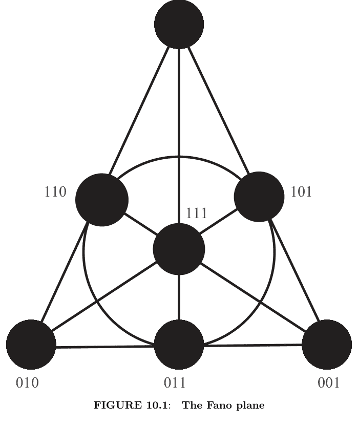

图 10.1：法诺平面

与法诺平面本身等同。这个码 [7,3,d]₂ 的最小距离 d 是什么，或者更一般地，码字的权是什么？

记 G 的行分别为 z₁, z₂, z₃。码字是 λ₁z₁ + λ₂z₂ + λ₃z₃ 的线性组合。固定一个坐标。

G 的相应列是 PG(2,2) 的一个点 P。我们的码字在列 P 中何时会取 0？设 P = (x, y, z)。取 0 意味着 λ₁x + λ₂y + λ₃z = 0，或 (λ₁, λ₂, λ₃) · P = 0。

总结一下：每个坐标由 PG(2,2) 的一个点 P 索引（生成矩阵的相应列）。每个非零码字由一个非零三元组 (λ₁, λ₂, λ₃) 给出（码字为 λ₁z₁ + λ₂z₂ + λ₃z₃）。该码字在此坐标中取 0 当且仅当点积为零：

(λ₁, λ₂, λ₃) · P = 0.

点积在 P = (x, y, z) 上表示一个非平凡的线性方程。因此这些点 P 恰好是二维子空间的点，换句话说，是一条线上的点。

再次总结：每个非零码字定义一条线 l（标量倍数定义相同的线）。每个坐标由点 P 索引。码字的相应分量在 P ∈ l 时消失（= 0）。因此码字的权是不在 l 上的点的个数。

该描述对任意三维码都成立。在我们的例子中，7 个坐标由法诺平面的 7 个点描述。由于每条线有 3 个点，每条线外有 4 个点。我们看到我们的码是 [7,3,4]₂ 码，更精确地说，我们的码的每个非零字权为 4。

我们知道这个码。它是第 2.5 节的 Simplex 码 S₃(2)；一般 q 的情形见第 3.4 节。

一般来说，PG(2,q) 的点作为生成矩阵的列出现多次是完全合理的。因此我们应该用定义在 PG(2,q) 的点上的权函数 w 来描述每个三维码，其中 w(P) 告诉我们生成矩阵中有多少列给出点 P。码的长度 n 于是为 n = Σₚ w(P)。更重要的是，我们理解如何几何地表达最小距离 d（更一般地，所有码字的权）：对每条线 l 定义其权为

w(l) = Σ_{P∈l} w(P).

码字的权于是为 n − w(l)，其中 l 在各条线中变化，因此最小距离为 d = n − Max{w(l)}。

### 10.1 例。

Simplex 码的性质用这种几何语言特别容易理解。三维 Simplex 码按定义有长度 q² + q + 1。PG(2,q) 的每个点作为一列出现一次（w(P) = 1）。这意味着每条线的权为 q + 1，并且

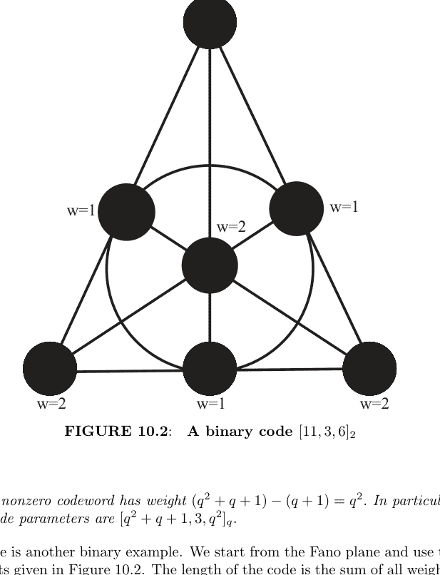

# 图 10.2：一个二元码 [11,3,6]₂

*每个非零码字的权为 (q² + q + 1) − (q + 1) = q²。特别地，码参数为 [q² + q + 1, 3, q²]_q。*

这里是另一个二元例子。我们从法诺平面出发并使用图 10.2 给出的权。码的长度是所有权的和：n = 11。此外，我们看到线的权 ≤ 5。这表明我们有一个码 [11,3,6]₂。相应的生成矩阵是通过把每个点 P 作为列写出 w(P) 次得到的（w(P) = 0 表示该点不出现，w(P) = 1 表示出现一次，...）。在我们的情形下得到生成矩阵

```
\begin{pmatrix}
1 1 0 0 1 1 1 1 1 1 0\\
0 0 1 1 0 0 1 1 0 1 1\\
0 0 0 0 1 1 1 1 1 0 1
\end{pmatrix}
```

一般线性码的几何描述在第 17 章研究。

### 三维码与无拥塞网络

考虑以下情形：有 n 个网络站点需要通过广播媒体连接。链路或总线是站点的子集。为了避免拥塞，要求每两个站点至少在一条链路上同时出现。每个站点配备有限数量的通信端口，因此最多只能出现在固定数量 r 条链路上。此外，每条链路不能容纳超过 k 个站点。这个网络拓扑构造问题已被广泛研究。有关介绍、文献和组合几何联系，见 Colbourn [57]。

假设存在码 [n,3,n−k]q。根据几何描述，这等价于 PG(2,q) 中 n 个点的多重集，使得每条直线上至多有 k 个点。这满足要求。甚至可以证明当 r−1 为素数幂时，该构造是最优的，至少在渐近意义下如此。作为例证考虑图 10.2。它表示 11 个站点的网络，使得每个站点恰好在 3 条链路上，每条链路至多有 5 个站点，任意 2 个站点出现在公共链路上。

- 1. 三维码几何方法的一般概念是 **射影平面** PG(2,q)（阶为 **阶** q）。
- 2. PG(2,q) 的 **点** 是 F_q^3 的一维子空间。
- 3. PG(2,q) 的 **线** 是 F_q^3 的二维子空间。

- 1. **几何方法：** 把生成矩阵 G 的列视为来自 PG(2,q) 的点族。
- 2. 若点 P 作为 G 的列出现 w(P) 次，则记为 w(P)。
- 3. w 是定义在 PG(2,q) 的点上取非负整数值的函数（w 描述一个点的多重集）。
- 4. 长度为 n = ∑_P w(P)；维数为 3。
- 5. 对每条线 l，令 w(l) = ∑_{P∈l} w(P)。
- 6. 最小距离为 d = n − max_l w(l)。

### 练习 10

10.1. 用几何方法构造码 [14,3,8]_2。

10.2. 用几何方法描述码 [q^2,3,q^2 − q]_q 的构造。

10.3. 在权函数 w 的什么条件下码才真正具有维数 3？

10.4. 射影线 PG(1,q) 由 F_q^2 的 q + 1 个一维子空间（点）组成。用几何语言描述码 [n,2,d]_q 的参数。

10.5. 给定 d，确定使得 [n,2,d]_q 码存在的最小 n。

10.6. 写出码 [10,2,8]_7 的生成矩阵并证明参数如所声称。

10.7. 找到四维码的描述，其与我们对三维码的几何描述类似。

10.8. 找到码 [17,3,9]_2 的一个生成矩阵。

10.9. 设想你在 PG(2,8) 中有 28 个点，使得没有一条线包含超过四个这些点。（这样的点集存在。它是一个极大弧；见定理 17.26。）用这些点作为生成矩阵的列。码的参数是什么？给出简要说明。

10.10. 证明 [9,3,d] 码的最大最小距离为 d = 4。


## 第11章
### 摘要与展望

我们已经达到这样一个阶段，能够理解编码理论的基本概念和目标。到目前为止引入的最重要的族是第4章的 Reed-Solomon 码。第5章的递归技术，特别是拼接，允许构造大量码类。这也允许构造通用哈希类（参见第6章）。就码在嘈杂信道上传输消息的经典应用而言，我们知道综合征译码的原理（第3.7节），但我们还没有真正有效的算法。

第二部分以循环码的介绍开始。导致这些码的构造及其参数界限的理论是经典编码理论的核心主题。希望这里介绍的方法更容易理解且更易于推广。第一部分中给出的开胃菜（第7章）不足以传达印象。循环码的构造利用了 Reed-Solomon 码。事实上，循环码是适当缩短的 Reed-Solomon 码的迹码（等价于子域码）。循环码的一个重要特征是它们具有有效的译码算法。所有这些构成了第二部分的前两章内容。随后在第14章引入了更递归的构造以及一个新的参数——覆盖半径，它有其自身的应用领域。

第15章提供了线性规划基础的自包含介绍。统一的证明对码和 OA 的若干显式界限作为应用而得到。第16章收集了一些与信息传输的经典应用不同的应用领域。我们从正交数组（对偶码）作为具有统计独立性性质的随机变量族的统计解释开始（第16.1节）。

线性移位寄存器序列（第16.2节）与 Simplex 码密切相关。第16.3节讨论了密码学的本质以及码在分组密码构造中的使用。基于两点的采样（第16.4节）可视为强度为2的 OA 的一种应用。其应用之一是芯片测试。弹性函数具有多种应用（参见第16.5节），其中包括构造对相关攻击具有抵抗性的流密码。与 OA 存在密切关系。第16.6节讨论了 Reed-Solomon 码在 Monte Carlo 算法随机化方面的应用。在第一部分中已展示了码如何被解释为通用哈希类。在第16章的最后一节，我们回到对通用哈希及其应用的更深入研究。

第17章致力于将线性码描述为有限域上定义的射影空间中的点集。许多高度结构化的码最好从几何观点理解。一般机制以及各种应用在第17.1节中。应用中我们考虑低维码、三元 Golay 码、扩展 Reed-Solomon 码、卵形和超卵形码、Barlotti 码和 Denniston 码。第17.2节提供了有限域上几何代数的自包含介绍，双线性、斜线性与二次型的理论。第一个应用涉及 caps（第17.3节）。它们是任意三点都不在一条直线上的点集。它们等价于最小距离为4的线性码。

在第18章中我们考虑线性码的推广。加性码在其字母表的子域上是线性的。另一种说法是：字母表不是被视为域，而是被视为某个基域上的向量空间。在第18.1节中我们讨论了一些递归和直接构造以及对计算机存储系统和深空通信的应用。在第18.2节中循环码的机制被推广到加性码。第18.3节使用了四元加性码的几何方法。在另一个特化步骤中，第18.4节发展了量子稳定子码理论。第18章和第二部分以网络码的介绍结束，第18.5节。

# 第二部分
### 编码的理论与应用


## Taylor & Francis
Taylor & Francis Group

http://taylorandfrancis.com

## 第12章
### 子域码与迹码
### 12.1 迹

**基本概念：** 域扩张，本原多项式。
Frobenius 自同构，Galois 群，迹。

对于某个域 $\mathbb{F}_q$ 上的好码的一种一般构造思想是先在更大的域 $\mathbb{F}_{q^r}$ 上构造码，然后以某种方式从大域“下降”到小域。“下降”最有成效的方法是迹码和子域码。在讨论这些方法之前，我们需要更多地了解有限域，特别是包含在彼此之中的有限域对。

我们看到，对于每个素数 $p$ 和每个自然数 $r$，都存在阶为 $p^r$ 的域 $\mathbb{F}_{p^r}$。它可以用 $\mathbb{F}_p$ 中的系数、次数为 $r$ 的不可约多项式作为素域 $\mathbb{F}_p$ 的扩张来构造。事实上，我们选择不给出所有细节，因为这会让我们过深地进入域论。我们选择在没有证明的情况下接受所有所需的不可约多项式在有限域上存在（并非所有域都如此：例如实数上不存在奇次不可约多项式），并且对于每个阶 $p^r$，只有一个域。

考虑特征为 $p$ 的域 $\mathbb{F}_{p^s}$ 和 $\mathbb{F}_{p^r}$，其中 $s \le r$。何时有 $\mathbb{F}_{p^s} \subset \mathbb{F}_{p^r}$？如果是这样，则更大的域 $\mathbb{F}_{p^r}$ 特别是在 $\mathbb{F}_{p^s}$ 上是一个向量空间（域公理比向量空间公理更强），其维数为某个 $d$。于是 $p^r = (p^s)^d = p^{sd}$。由此可得 $s$ 整除 $r$，且维数 $d = r/s$。反之，如果 $s|r$，我们可以选取系数在 $\mathbb{F}_{p^s}$ 中、次数为 $d = r/s$ 的不可约多项式，并按第3.2节的方法构造 $\mathbb{F}_{p^r}$ 作为 $\mathbb{F}_{p^s}$ 的扩张域（我们相信这些不可约多项式总是存在）。

这表明以下结论：

### 12.1 命题.
我们有 $\mathbb{F}_{p^s} \subset \mathbb{F}_{p^r}$ 当且仅当 $s$ 整除 $r$。

事实上，存在好与不那么好的不可约多项式。

### 12.2 定义.
设 $f(X) \in \mathbb{F}_q[X]$ 为次数为 $r$ 的不可约多项式，且 $\epsilon \in \mathbb{F}_{q^r}$ 为对应于 $X$ 的元素。我们称 $f(X)$ 为 **本原多项式**，如果 $1 = \epsilon^0, \epsilon, \dots, \epsilon^{q^r -2}$ 互不相同，等价地说，如果 $\epsilon$ 的幂遍历 $\mathbb{F}_{q^r}$ 的所有非零元素。幂遍历所有非零域元素的元素称为 **本原元**。

可以证明本原多项式总是存在。它们也被称为最大指数多项式。实践中人们总是使用本原多项式。如果我们遇到一个不可约但非本原的多项式，我们会丢弃它并用本原多项式替换。

### 12.3 例.
$f(X) = X^2 + 1$ 确实是 $\mathbb{F}_3$ 上的不可约多项式。事实上，由于 $f(0)=1$，$f(1)=f(2)=2$，它没有根，因此没有线性因子。然而，我们不会用该多项式来描述 $\mathbb{F}_9$。设 $\epsilon = X \bmod f(X)$。则 $\epsilon^2 = -1 = 2$，因此 $\epsilon^4 = 1$。这表明 $f(X)$ 不是本原的。

本原元的存在具有重要后果。设 $\epsilon \in \mathbb{F}_q$ 为本原元。则 $\epsilon^{q-1}=1$。每个 $0 \neq x \in \mathbb{F}_q$ 都有形式 $x = \epsilon^i$，其中 $i$ 为某数。由此可得 $x^{q-1} = \epsilon^{i(q-1)} = 1^i = 1$ 且对所有 $x \in \mathbb{F}_q$（包括 $x=0$）都有 $x^q = x$。

### 12.4 定理.
每个非零元素 $x \in \mathbb{F}_q$ 满足 $x^{q-1}=1$。每个元素 $x \in \mathbb{F}_q$ 满足 $x^q = x$。元素 $x \in \mathbb{F}_{q^r}$ 在 $\mathbb{F}_q$ 中的充要条件是 $x^q = x$。

### 证明
只有最后一个陈述仍需证明。我们已知对所有 $x \in \mathbb{F}_q$ 都有 $x^q = x$。把多项式 $X^q - X$ 视为系数在 $\mathbb{F}_{q^r}$ 中的多项式。它次数为 $q$，我们知道它的 $q$ 个根，即 $\mathbb{F}_q$ 的元素。次数为 $q$ 的多项式不能有超过 $q$ 个根。

设 $F$ 为特征为 $p$ 的有限域。映射 $x \mapsto \phi(x) = x^p$ 具有令人惊讶的性质。它被称为 **Frobenius 自同构**。乘法结构得到保持：$\phi(xy) = \phi(x)\phi(y)$。如果 $\phi$ 作用于和会怎样？二项式公式 $$(x + y)^p = \sum_{i=0}^{p} \binom{p}{i} x^i y^{p-i}$$ 当然在所有域中都成立。关键的观察是整数 $\binom{p}{i}$ 除 $i = 0$ 和 $i = p$ 外都是 $p$ 的倍数。在特征为 $p$ 的域中，

这些系数因此等于 0。这意味着和中除两项外的所有项都消失，我们得到简单的公式

$(x + y)^p = x^p + y^p$ in fields of characteristic $p$.

有人称之为 **大一学生的梦想**。这意味着 $\phi$ 同时保持乘法和加法域结构。显然 $\phi$ 是一个单射映射。

## 12.5 命题. 对于每个特征为 $p$ 的有限域 $F$，**弗罗贝尼乌斯自同构** $\phi(x) = x^p$ 是一个域自同构。换句话说，$\phi$ 是一个满足以下条件的单射映射

$\phi(x + y) = \phi(x) + \phi(y)$ 且 $\phi(xy) = \phi(x)\phi(y)$

对所有 $x, y \in F$。

由定理 12.4 可知 $\phi$ 在 $\mathbb{F}_p$ 上作用平凡：它将素域的每个元素映射到自身。

我们继续考虑域扩张 $\mathbb{F}_q \subset \mathbb{F}_{q^r} = F$，其中 $q = p^f$。由于 $\phi$ 是 $F$ 的域自同构，$\phi$ 的 $f$ 次幂也是如此。这就是映射 $x \mapsto x^q$。根据定理 12.4 它在 $\mathbb{F}_q$ 上作用平凡。重复应用得到自同构 $x \mapsto x^{q^i}$。定理 12.4 表明，对于 $i = r$，得到 $F$ 的恒等自同构。

## 12.6 定义. 设 $g_i$ 是 $F = \mathbb{F}_{q^r}$ 的域自同构，定义为

$g_i(x) = x^{q^i}, \; i = 0,1,\dots,r - 1.$

称 $G = \{g_0, g_1, \dots, g_{r-1}\}$ 为 $\mathbb{F}_{q^r}$ 在 $\mathbb{F}_q$ 上的 **伽罗瓦群**。

事实上，$g_0$ 是恒等映射，$g_i$ 是 $g_1$ 的 $i$ 次幂（按 $i$ 次应用 $g_1$ 的意义），且 $g_r = g_0$。特别地，$G$ 在乘法下封闭。它由 $g_1$ 的幂组成。$g_1$ 的逆是 $g_{r-1}$，一般地 $g_i$ 的逆是 $g_{r-i}$。由一个元素的幂组成的群称为循环群。伽罗瓦群是阶为 $r$ 的循环群。$G$ 是伽罗瓦群 **上** $\mathbb{F}_q$ 这一术语反映了 $G$ 的每个元素都将基域 $\mathbb{F}_q$ 的每个元素映射到自身这一事实。

伽罗瓦群使我们能够如下从扩张域 $F$ 下降到基域 $\mathbb{F}_q$。设 $x \in F$。考虑 $x$ 在伽罗瓦群元素下的像并求和：

$y = g_0(x) + g_1(x) + \cdots + g_{r-1}(x)$。

## 12.7 定义.

设 𝔽_q ⊂ 𝔽_{q^r} = F 为有限域的扩张。迹

tr = tr_{q^r|q} : F → 𝔽_q

定义为

tr(x) = x + g₁(x) + ⋯ + g_{r-1}(x) = x + x^q + x^{q²} + ⋯ + x^{q^{r-1}}。

由迹的定义可知它是可加的（tr(x₁ + x₂) = tr(x₁) + tr(x₂)）且 𝔽_q-线性的（对 λ ∈ 𝔽_q 有 tr(λx) = λ tr(x)）。特别地，tr 是从 r 维向量空间 F 到一维向量空间 𝔽_q 的线性映射（在 𝔽_q 上线性）。

让我们在我们喜爱的有限扩张域中检验迹。

## 12.8 例.

设 tr = tr_{4|2} : 𝔽₄ → 𝔽₂。我们有 tr(0) = tr(1) = 0 且 tr(ω) = ω + ω² = 1，同样 tr(ω²) = 1。

## 12.9 例.

设 tr = tr_{8|2} : 𝔽₈ → 𝔽₂。如常 tr(0) = 0，但 tr(1) = 3 = 1。另有

tr(ε) = ε + ε² + ε⁴ = ε(1 + ε + ε³) = ε(ε⁵ + ε³) = ε⁴(1 + ε²) = 1

（奇迹般地）。迹为 0 的元素是 0, ε³, ε⁵, ε⁶；其余四个元素迹为 1。

- 1. 𝔽_{p^s} ⊂ 𝔽_{p^r} 当且仅当 s 整除 r。
- 2. 若 F 的每个非零元素都是 ε 的幂，则元素 ε ∈ F 是本原的。
- 3. 每个有限域都有本原元素。
- 4. 𝔽_{q^r} 的一个元素在 𝔽_q 中当且仅当它是多项式 X^q − X 的根。
- 5. 弗罗贝尼乌斯自同构 φ : 𝔽_{p^r} → 𝔽_{p^r} 定义为 φ(x) = x^p。它是域自同构且恰好固定 𝔽_p 的元素。
- 6. 𝔽_{q^r} 在 𝔽_q 上的伽罗瓦群 G 是阶为 r 的循环群。它由 g₁ 的幂组成，其中 g₁(x) = x^q 是弗罗贝尼乌斯自同构的幂。
- 7. 迹 tr : 𝔽_{q^r} → 𝔽_q 定义为 tr(x) = Σ_{g∈G} g(x)（G 是伽罗瓦群）。
- 8. 迹是 𝔽_q-线性映射。

## 练习 12.1

12.1.1. 𝔽_{2^{12}} 作为 𝔽₈ 上的向量空间的维数是多少？

12.1.2. 证明 𝔽₂ 上每个 5 次不可约多项式必须是本原的。

12.1.3. 设 ε 是 𝔽_q 的本原元素，其中 q 为奇数。如何从指数 j 判断 ε^j 是否为 𝔽_q 中的平方？𝔽_q 中有多少个非零平方？

12.1.4. 从 𝔽_{q^r} 到 𝔽_q 的范数 N 定义为

N(x) = x·g₁(x)···g_{r-1}(x) = ∏_{g∈G} g(x)。

证明确实对每个 x ∈ 𝔽_{q^r} 都有 N(x) ∈ 𝔽_q。

12.1.5. 设 N : 𝔽_{q²} → 𝔽_q 为范数。有多少个元素 x ∈ 𝔽_{q²} 满足 N(x) = 1？

12.1.6. 证明 𝔽_{q^r} 中迹为 0 的元素恰好有 q^{r-1} 个。继续证明迹的核 ker(tr) 是 F 作为 𝔽_q 上的向量空间时 的一个 (r−1) 维子空间。

12.1.7. 确定核 ker(tr) 在 tr : 𝔽₄ → 𝔽₂ 和 tr : 𝔽₈ → 𝔽₂ 的情形。

12.1.8. 设 tr : 𝔽_{q^r} → 𝔽_q。在 q,r 的什么条件下有 𝔽_q ⊆ ker(tr)？何时有 ker(tr) = 𝔽_q？

12.1.9. 确定 tr : 𝔽₉ → 𝔽₃ 的所有值 tr(x)。

12.1.10. 设 α ∈ 𝔽_{q^r}。我们在第 3.2 节的一系列练习中研究了极小多项式。

证明 α 和 α^q 有相同的极小多项式。

12.1.11. 证明 tr(α^q) = tr(α)，其中 tr : 𝔽_{q^r} → 𝔽_q。

12.1.12. 设 α ∈ 𝔽_{q^r}。证明 𝔽_q(α) = 𝔽_{q^r} 当且仅当在元素 g ∈ G 下的像 g(α) 两两不同。

12.1.13. 为什么称之为迹？原因在于 tr(α) 是由 α 乘法定义的 𝔽_q-线性映射 : 𝔽_{q^r} → 𝔽_{q^r} 的迹。我们想在一个特殊情形下证明这一点。

设 F = 𝔽_{q^r} = 𝔽_q(α)。证明 𝔽_q-线性映射 : F → F 定义为 x ↦ αx 的迹为 tr(α)。

12.1.14. 证明 $X^3 - X - 1$ 在 $\mathbb{F}_3$ 上是不可约多项式。判断它是否本原。

12.1.15. 证明 $X^3 - X^2 + 1$ 在 $\mathbb{F}_3$ 上是不可约多项式。用它构造 $\mathbb{F}_{27}$。确定 $\ker(\operatorname{tr})$，其中 $\operatorname{tr}$ 是到 $\mathbb{F}_3$ 的迹。

12.1.16. 证明迹的传递性：如果 $\mathbb{F}_q \subset L = \mathbb{F}_{q^s} \subset F = \mathbb{F}_{q^r}$，则 $\operatorname{tr}_{F|\mathbb{F}_q}(x) = \operatorname{tr}_{L|\mathbb{F}_q}(\operatorname{tr}_{F|L}(x))$ 对所有 $x \in F$ 成立。

## 12.2 迹码和子域码

和 Delsarte 对偶定理。

迹为我们提供了一种方法，从在扩张域上定义的码下降到在基域上定义的码。如第 12.1 节所述，考虑域扩张 $\mathbb{F}_q \subset \mathbb{F}_{q^r} = F$，以及相应的迹 $\operatorname{tr}$。设 $x = (x_1,x_2,\dots,x_n)$ 是在 $F$ 上定义的长为 $n$ 的线性码的一个码字。在每个坐标上应用迹得到码字 $\operatorname{tr}(x) = (\operatorname{tr}(x_1),\operatorname{tr}(x_2),\dots,\operatorname{tr}(x_n))$，长度仍为 $n$ 但 entries 在 $\mathbb{F}_q$ 中。我们对每个码字应用此操作并得到迹码。

## 12.10 定义. 设 $F = \mathbb{F}_{q^r}$ 且 $\mathcal{C}$ 是长度为 $n$ 的 $F$-线性码。设 $\operatorname{tr} = \operatorname{tr} : F \longrightarrow \mathbb{F}_q$ 为迹。迹码 $\operatorname{tr}(\mathcal{C})$ 定义为所有 $(\operatorname{tr}(x_1),\operatorname{tr}(x_2),\dots,\operatorname{tr}(x_n))$ 的集合，其中 $(x_1,x_2,\dots,x_n) \in \mathcal{C}$。

我们可以控制的参数是强度：

## 12.11 定理. 设 $\mathcal{C} \subset \mathbb{F}_{q^r}^n$ 是强度为 $t$ 的线性码。则 $\operatorname{tr}(\mathcal{C})$ 具有强度 $t$（并且可能具有更高的强度）。

证明 固定 $t$ 个坐标（比如前 $t$ 个坐标）并对每个 $i = 1,\dots,t$ 取一个 entry $c_i \in \mathbb{F}_q$。我们需要找到一个码字 $x = (x_1,x_2,\dots,x_n) \in \mathcal{C}$ 使得 $\operatorname{tr}(x_i) = c_i$ 对 $i = 1,\dots,t$ 成立。对每个 $i$ 选择 $y_i \in F$ 使得 $\operatorname{tr}(y_i) = c_i$。由于 $\mathcal{C}$ 具有强度 $t$，我们可以找到 $x \in \mathcal{C}$ 使得 $x_i = y_i$ 对

i = 1, …, t。由此可知 tr(x) 在坐标 i = 1, …, t 处具有所需的条目 c_i。每个这样的元组出现的次数相等这一事实源于 𝔽_q-线性。

我们将在希望控制强度时考虑迹码。相比之下，迹码的最小距离通常并不容易控制。

迹码与另一种“向下”方法——子域码——有着密切的关系。

### 12.12 定义。
设 F = 𝔽_q^r 且 𝒞 为长度为 n 的 F-线性码。子域码 𝒞_{𝔽_q} 由 𝒞 中所有条目恰好位于 𝔽_q 的码字组成，形式上 𝒞_{𝔽_q} = 𝒞 ∩ 𝔽_q^n。

显然迹码和子域码都是基域 𝔽_q 上的线性码，并且同样显然如何控制子域码的最小距离。

### 12.13 定理。
子域码 𝒞 的最小距离至少与 𝒞 本身的最小距离一样大。

**证明**
这其实并不值得证明。只需注意子域码 𝒞_{𝔽_q} 的每个码字也是 𝒞 的码字。

迹码与子域码之间的关系由 Delsarte 的著名定理阐明，该定理是本节的主要结果。存在对偶关系。

### 12.14 定理 (Delsarte)。
设 F = 𝔽_q^r 且 𝒞 为长度为 n 的 F-线性码。则有以下结论：tr(𝒞)^⊥ = (𝒞^⊥)_{𝔽_q}。

**证明**
设 c = (c₁, c₂, …, cₙ) ∈ 𝔽_q^n。则 c ∈ tr(𝒞)^⊥ 当且仅当对所有 x = (x₁, x₂, …, xₙ) ∈ 𝒞 都有 ∑_{i=1}^n c_i tr(x_i) = 0。

由于迹的线性，这等价于 tr(∑_{i=1}^n c_i x_i) = 0。我们断言这等价于 ∑_{i=1}^n c_i x_i = 0。事实上，如果不是这样，则由于 𝒞 的 F-线性，可推出 tr 是零映射，这与假设矛盾。我们得出结论 c ∈ tr(𝒞)^⊥ 当且仅当 c ∈ 𝒞^⊥ 且所有 c_i ∈ 𝔽_q。这就是我们的断言。

对偶的子域码。我们的主要目标是研究 Reed-Solomon 码以及由打孔 Reed-Solomon 码得到的码的子域码和迹码。这些本质上是循环码。从 F 上定义的某个（打孔）Reed-Solomon 码 ℬ 出发。我们旨在得到码 𝒞 = (ℬ⊥)𝔽_q，即对偶的子域码。根据 Delsarte 定理，𝒞 也可以描述为迹码的对偶。由于我们知道 ℬ 的强度，根据定理 12.11 我们知道迹码的强度。根据对偶性我们知道 𝒞 的最小距离。剩余的问题是确定这些码的维数。

- 1. 设 𝒞 为 F = 𝔽_{q^r} 上的线性码。
- 2. 迹码 tr(𝒞) 在 𝔽_q 上是线性的，且至少具有 𝒞 的强度。
- 3. 子域码 𝒞_{𝔽_q} 由 𝒞 中所有条目都在 𝔽_q 的码字组成。它的最小距离至少与 𝒞 的最小距离一样大。
- 4. 迹码与子域码由 Delsarte 定理相关：迹码的对偶等于对偶的子域码。

## 练习 12.2

12.2.1. 求 ℛ𝒮(2, 4) 的迹码和子域码（明确降到 𝔽₂）。

12.2.2. 求 ℛ𝒮(2, 9) 的迹码和子域码（降到 𝔽₃）。

## 12.3 Galois 闭码

**基本概念：** Galois 闭包、其迹码和子域码。

是时候引入 Galois 群了。我们在第 12.1 节、定义 12.6 中见过它。Galois 群 $G$ 由 $g_1$ 的所有幂组成，其中 $g_1$ 定义为 $g_1(x)=x^q$。设 $F = \mathbb{F}_{q^r}$ 且 $\mathcal{C}$ 为长度为 $n$ 的 $F$-线性码。考虑码 $\mathcal{C}^q$，即 $\mathcal{C}$ 在 $g_1$ 下的像（按坐标作用）。显然 $\mathcal{C}^q = g_1(\mathcal{C})$，作为 $\mathcal{C}$ 在域自同构下的像，具有与 $\mathcal{C}$ 相同的结构。特别是，它具有相同的长度、维数、最小距离、强度和距离分布。而且，由于 $tr(x^q)=tr(x)$，其中 $tr : F \to \mathbb{F}_q$ 为迹，迹码不仅具有相同的结构，而且完全相同：

$tr(\mathcal{C}^q) = tr(\mathcal{C})$

更好的是，考虑由 $\mathcal{C}$ 和 $\mathcal{C}^q$ 生成的码 $\mathcal{C} + \mathcal{C}^q$。其迹码当然仍然是 $tr(\mathcal{C})$。我们可以继续通过包含码字在 $g_1$ 下的像来增大父码。 resulting code 仍将具有与 $\mathcal{C}$ 相同的迹码。当我们找到一个在 $g_1$ 下封闭的码时，该过程将结束：每个码字在 $g_1$ 下的像仍是码字。我们由此得到 Galois 闭码的自然概念：

### 12.15 定义。

设 $F = \mathbb{F}_{q^r} \supset \mathbb{F}_q$ 且 $\mathcal{C}$ 为 $F$-线性码。我们称 $\mathcal{C}$ 为 Galois 闭的，如果 $\mathcal{C} = \mathcal{C}^q$。

设 $\mathcal{C}$ 为 $F$-线性码。$\mathcal{C}$ 的 Galois 闭包 $\tilde{\mathcal{C}}$ 是由其在 Galois 群 $G$ 的元素下的所有像生成的码，等价地；$\tilde{\mathcal{C}}$ 是包含 $\mathcal{C}$ 的最小 Galois 闭码。

我们已看到 Galois 闭包 $\tilde{\mathcal{C}}$ 的迹码与 $\mathcal{C}$ 的迹码相同：

### 12.16 定理。

$tr(\tilde{\mathcal{C}}) = tr(\mathcal{C})$

由于定理 12.16，在考虑迹码时，我们完全可以把原始父码 $\mathcal{C}$ 替换为其 Galois 闭包。这具有其优势，正如下面重要定理所示。它是关于迹码和子域码的第二个基本定理，与 Delsarte 定理 12.14 共同构成。

## 12.17 定理。

设 $\mathcal{C}$ 为 $F = \mathbb{F}_{q^r}$ 上的线性码且 $tr : F \to \mathbb{F}_q$ 为迹。假设 $\mathcal{C}$ 是 Galois 闭的 $(\mathcal{C}^q = \mathcal{C})$。则有以下结论：

- $tr(\mathcal{C}) = \mathcal{C}_{\mathbb{F}_q}$。
- $tr(\mathcal{C})$ 的 $\mathbb{F}_q$-维数等于 $\mathcal{C}$ 的 $F$-维数。
- $tr(\mathcal{C})$ 的最小距离等于 $\mathcal{C}$ 的最小距离。
- $tr(\mathcal{C})$ 的强度等于 $\mathcal{C}$ 的强度。

**证明**

迹的定义表明 $tr(\mathcal{C}) \subseteq \mathcal{C}_{\mathbb{F}_q}$。练习 12.3.6 推出 $dim_{\mathbb{F}_q}(\mathcal{C}_{\mathbb{F}_q}) \le dim_F(\mathcal{C})$。链条中的最后一步由定理 12.14 提供。若 $\mathcal{C}$ 的长度为 $n$，则

$dim(tr(\mathcal{C})) = dim(((\mathcal{C}^\perp)_{\mathbb{F}_q})^\perp) = n - dim((\mathcal{C}^\perp)_{\mathbb{F}_q}) \ge n - dim_F(\mathcal{C}^\perp)$

$= dim_F(\mathcal{C}) \ge dim(\mathcal{C}_{\mathbb{F}_q})$。

由此可知整个链条中都有等号。

由于 $tr(\mathcal{C})$ 是 $\mathcal{C}$ 的子码，其最小距离至少与 $\mathcal{C}$ 的最小距离一样大。设 $x \in \mathcal{C}$ 的权为 $w \ne 0$。经过适当的标量乘法，我们可以假设 $x$ 有一个迹非零的条目。由此可知 $tr(x)$ 的权非零且 $\le w$。这证明了最小距离的相等性。强度的相等性由 Delsarte 定理得出。

## 策略

设 $\mathcal{B}$ 为 $F$-线性码 $(F = \mathbb{F}_{q^r})$，由维数为 $t$ 的 Reed-Solomon 码打孔得到。我们已具备确定 $\mathcal{C} = tr(\mathcal{B})^\perp$ 参数所需的所有要素，即 $\mathcal{B}$ 的迹码的对偶。根据 Delsarte 定理，我们可以另行描述 $\mathcal{C}$ 为 $\mathcal{C} = (\mathcal{B}^\perp)_{\mathbb{F}_q}$，即 $\mathcal{B}$ 的对偶的子域码。由于 $\mathcal{B}$ 的强度为 $t$，根据对偶性可知 $\mathcal{C}$ 的最小距离 $d \ge t + 1$。

定理 12.17 提示了如何确定维数：求 $F$-线性码 $\mathcal{B}$ 的 Galois 闭包 $\tilde{\mathcal{B}}$。根据定理 12.17，$\tilde{\mathcal{B}}$ 的 $F$-维数等于 $tr(\mathcal{B})$ 的 $\mathbb{F}_q$-维数。

$\mathcal{C}$ 的维数可由对偶性得出。在下一章的开头我们将考虑该过程的一个例子。


- 1. 设 $\mathbb{F}_q \subset \mathbb{F}_{q^r} = F$ 且 $\mathcal{C}$ 是一个 $F$-线性码。
- 2. **伽罗瓦闭包** $\tilde{\mathcal{C}}$ 是包含 $\mathcal{C}$ 的最小码，且被 $g_1$ 映射到自身，其中 $g_1(x) = x^q$。
- 3. 等价地，$\tilde{\mathcal{C}}$ 是由伽罗瓦群作用下 $\mathcal{C}$ 的所有像生成的码。
- 4. 我们有 $tr(\tilde{\mathcal{C}}) = \tilde{\mathcal{C}}_{\mathbb{F}_q} = tr(\mathcal{C})$，且该码的 $\mathbb{F}_q$-维数等于 $\tilde{\mathcal{C}}$ 的 $F$-维数。
- 5. 从伽罗瓦闭码到其迹码时，最小距离和强度保持不变。

## 练习 12.3
- 12.3.1. 求 $\mathcal{RS}(2,4)$（在 $\mathbb{F}_2$ 上）的伽罗瓦闭包。
- 12.3.2. 求 $\mathcal{RS}(2,9)$（在 $\mathbb{F}_3$ 上）的伽罗瓦闭包。
- 12.3.3. 设 $\mathbb{F}_q \subset F = \mathbb{F}_{q^r}$。证明以下一般界：若 $dim_F(\mathcal{C}) = k$，则伽罗瓦闭包 $\tilde{\mathcal{C}}$ 的维数至多为 $rk$。
- 12.3.4. 设 $\mathcal{C}$ 在 $F = \mathbb{F}_{q^r}$ 上是伽罗瓦闭的，最小距离为 $d$。证明 $\mathcal{C}$ 中每个权为 $d$ 的码字都是 $tr(\mathcal{C})$ 中某个码字的标量倍。
- 12.3.5. 设 $\mathcal{C}$ 在 $F = \mathbb{F}_{q^r}$ 上线性，$\mathcal{U} \subset \mathcal{C}$ 是一个伽罗瓦闭子码。证明
$dim_{\mathbb{F}_q}(tr(\mathcal{C})) \le r \cdot dim(\mathcal{C}) - (r - 1)dim(\mathcal{U})$。
- 12.3.6. 证明子域码中在子域 $\mathbb{F}_q$ 上线性无关的码字在更大的域 $F = \mathbb{F}_{q^r}$ 上也是线性无关的。
- 12.3.7. （见 Giorgetti 和 Previtali [92]）。设 $\mathbb{F}_q \subset F = \mathbb{F}_{q^r}$。设 $D$ 是一个 $\mathbb{F}_q$-线性码。定义张量积 $D \otimes_{\mathbb{F}_q} F$ 为常数的扩张：$D$ 的一个基被视为 $D \otimes_{\mathbb{F}_q} F$ 在 $F$ 上的一个基。证明映射 $D \mapsto D \otimes_{\mathbb{F}_q} F$ 在 $\mathbb{F}_q$-线性码与伽罗瓦闭 $F$-线性码之间建立一一对应。

## 12.4 自同构群

**基本概念：** 置换下的等价性，自同构群，单项式等价。

何时我们将两个码视为本质相同？这样的码将被称作等价或也称 **同构**（“形状相同”）。这个问题与码的自同构群密切相关。令人惊讶的是，等价性有几种不同的概念。最流行的一种仅使用坐标的置换。

### 置换下的等价性

回想一下，$n$ 个对象上的 **置换** 是一个双射（一对一且满）的映射，从一个 $n$ 元集合到自身。例如，映射

$\sigma : 1 \mapsto 2,\ 2 \mapsto 1,\ 3 \mapsto 4,\ 4 \mapsto 3$

是集合 $\{1,2,3,4\}$ 的一个置换。$n$ 个对象上的置换以自然的方式作用于 $n$-元组，通过置换坐标。例如，上面的置换 $\sigma$ 映射

$\sigma : (1,0,1,0) \mapsto (0,1,0,1)$ 且 $(1,0,1,1) \mapsto (0,1,1,1)$。

如果条目在 $\mathbb{F}_4$ 中，例如，我们有 $\sigma : (1,0,\omega,1) \mapsto (0,1,1,\omega)$ 且 $(\omega,1,\omega,1) \mapsto (1,\omega,1,\omega)$。

大家都同意，码在坐标置换下的像具有与码本身相同的结构：$\mathcal{C}$ 和 $\sigma(\mathcal{C})$ 具有相同的长度、码字数、最小距离、距离分布、强度，你可以说出名字。我们不想区分这两个码。它们是等价的（关于坐标置换）。一个形式化的定义是称码 $\mathcal{C}$ 等价于码 $\mathcal{D}$，如果存在坐标的置换 $\sigma$ 使得 $\mathcal{D} = \sigma(\mathcal{C})$。由此可知 $\mathcal{D}$ 也等价于 $\mathcal{C}$（使用逆置换）。此外，如果 $\mathcal{C}$ 等价于 $\mathcal{D}$，且 $\mathcal{D}$ 等价于 $\mathcal{E}$，则 $\mathcal{C}$ 等价于 $\mathcal{E}$。所有等价于某个码 $\mathcal{C}$ 的码形成一个 **等价类**。$n$ 元集合的所有置换的个数为 $n!$。所有 $n$ 个对象上的置换的群 $S_n$ 是 **对称群**。

这样一个明确定义的等价概念非常有帮助。作为一个例子，如果我想判定具有某些参数 $[n,k,d]_q$ 的线性码的存在性，我可以假设生成矩阵以一个 $(k,k)$-单位矩阵开头，即 $G=(I|A)$ 其中 $A$ 是一个 $(k,n-k)$-矩阵。为什么是这样？假设具有这些参数的码存在，其生成矩阵为 $G$。$G$ 中必有一些 $k$ 个列是线性无关的。

选择一个置换 $\sigma$ 将这 $k$ 个坐标映射到前 $k$ 个坐标。我的码在 $\sigma$ 下的像是一个等价码，其生成矩阵的前 $k$ 列线性无关。经过高斯消元，我们应该找到形如 $G=(I|A)$ 的生成矩阵。

现在应该清楚何时两个码在坐标置换下等价。一个非常有趣的情况是如果我们找到一个置换 $\sigma$ 使得 $\sigma(\mathcal{C})=\mathcal{C}$（用文字说：码在 $\sigma$ 下的像是码本身）。在这种情况下我们称 $\sigma$ 为 $\mathcal{C}$ 的一个 **自同构**。$\mathcal{C}$ 的自同构形成一个子群，即 **稳定子** 或自同构群。我们在第 7 章看到了一个大的例子。那里给出的二进制戈莱码 $[23,12,7]_2$ 的生成矩阵具有一个特殊特征：所有行都是第一行的循环移位。换句话说，循环置换

$\sigma : 1 \mapsto 2,\ 2 \mapsto 3, \dots\ 22 \mapsto 23,\ 23 \mapsto 1$

是 $\mathcal{G}_{23}$ 的一个自同构。

很明显，恒等置换（固定所有坐标）始终是自同构。如果 $\sigma$ 是自同构，则逆置换 $\sigma^{-1}$ 也是自同构。此外，如果 $\sigma_1$ 和 $\sigma_2$ 都是自同构，则复合 $\sigma_2 \circ \sigma_1$ 也是自同构。用另一种说法，码 $\mathcal{C}$ 的所有自同构的集合是一个群，即自同构群。

### 12.18 定义。
*码 $\mathcal{C}$ 的置换自同构群是长度为 $n$ 的所有满足 $\sigma(\mathcal{C})=\mathcal{C}$ 的坐标置换 $\sigma$ 的群。*

作为一个例子，考虑以下八元（8-元）四维码长度为 16 的生成矩阵：

$$\begin{pmatrix}1 0 0 0 a_1 a_2 a_3 a_4 a_1^2 a_2^2 a_3^2 a_4^2 a_1^4 a_2^4 a_3^4 a_4^4\\0 1 0 0 a_2 a_1 a_4 a_3 a_2^2 a_1^2 a_4^2 a_3^2 a_2^4 a_1^4 a_4^4 a_3^4\\0 0 1 0 a_3 a_4 a_1 a_2 a_3^2 a_4^2 a_1^2 a_2^2 a_3^4 a_4^4 a_1^4 a_2^4\\0 0 0 1 a_4 a_3 a_2 a_1 a_4^2 a_3^2 a_2^2 a_1^2 a_4^4 a_3^4 a_2^4 a_1^4\end{pmatrix}$$

这里 $(a_1,a_2,a_3,a_4)=(\epsilon^6,\epsilon^2,\epsilon,1)$ 且 $\mathbb{F}_8$ 的表示与第 4 章中相同。该码的参数为 $[16,4,12]_8$，但我们不想在这里证明这一点。

一些自同构是明显可见的。置换

σ₁ : 1 ↔ 2, 3 ↔ 4, … 15 ↔ 16

将第一行映射到第二行并返回，第三行映射到第四行并返回。类似地，

σ₂ : 1 ↔ 3, 2 ↔ 4, … 13 ↔ 15, 14 ↔ 16

是自同构。很明显，我们对置换的记号相当笨拙。这里有一个更好的记号：

σ₁ = (1, 2)(3, 4)(5, 6)(7, 8)(9, 10)(11, 12)(13, 14)(15, 16)

σ₂ = (1, 3)(2, 4)(5, 7)(6, 8)(9, 11)(10, 12)(13, 15)(14, 16)

规则是：在每个括号内映射到右邻居，括号的末端映射回开头。每个置换都可以用这种循环记号写出。复合 σ₂ ∘ σ₁（先应用 σ₁，然后 σ₂）也是一个自同构，用循环记号表示

σ₂ ∘ σ₁ = (1, 4)(2, 3)(5, 8)(6, 7)(9, 12)(10, 11)(13, 16)(14, 15)。

∘ 也可以省略。很容易验证 σ₂σ₁ = σ₁σ₂。这四个自同构，恒等置换，σ₁，σ₂ 和 σ₂σ₁ 形成一个群，是自同构群的一个子群。

### 线性情形下的单项式等价

对于 $q$-元线性码存在一种更一般的等价概念。我们称之为线性情形下的单项式等价。运动群更大：我们允许在每个坐标上乘以域的非零元素，并置换坐标。相应的群的阶（元素个数）为 $(q − 1)ⁿ n!$ 每个这样的映射都保持码的大多数基本性质：长度、码字数、距离分布、强度。

### 12.19 定义。
线性码 C 的单项式自同构群（或简称为自同构群）是长度为 n 的所有将 C 映射到 C 的坐标单项式运算 σ 的群。

那么为什么这个更大的群不总是被使用；换句话说，为什么仅基于坐标置换的受限等价概念如此流行？可能有两个原因。一个是坐标置换更容易处理。一般的单项式运算要复杂得多

更难看出。更严重的原因是，线性码存在一些重要不变量，它们在坐标置换下保持不变，但在单项式运算下不保持不变。最重要的是关于某个子域的迹码和子域码的维数。显然，坐标置换确实保持这些不变量，而很容易找到例子说明一般单项式运算不保持这些。换句话说，一个码的子域码与该码的单项式像的子域码可能具有不同的维数。请注意，这仅在 q 不是素数时才成为问题。此外，在二元情形下（线性）单项式等价与置换等价重合。我们认为单项式等价以及定义 12.19 中的自同构群是线性码情形下最自然的概念。

## 一般单项式等价

当线性性不是问题时，可以使用一种更一般的单项式等价概念。

我们允许在每个坐标上对字母表进行任意置换，以及对坐标进行任意置换。相应的群的阶为 (q!)^n n!。显然，这些一般单项式运算可能将线性码（若 q 为素数幂）映射为非线性码。

## 循环码

长度为 n 的码是循环的，如果它在坐标置换群中承认一个自同构，该自同构由一个单一的 n-循环组成。通过过渡到等价码，可以假设该自同构为 σ = (1,2,…,n)。通常记号的选择使得情况如此。在下一章中，我们将在 n 与 q 互素时发展线性循环码的理论。我们从不同的观点出发。可以很容易看出我们描述的码是循环的。逆命题的证明也并不太困难。每个满足 gcd(q,n) = 1 的循环线性码都是下一章中描述的码之一。

- 1. 长度为 $n$ 的码的 **自同构群** 是其在 **对称群** $S_n$ 中的稳定子，其中 $S_n$ 由所有坐标置换组成。
- 2. 两个码是 **等价** 的（或 **同构** 的），如果一个码可以通过 $S_n$ 的一个元素的作用从另一个码得到。
- 3. 基本编码参数被更大的 **线性单项式群** 保持（置换坐标并在每个坐标上乘以任意非零域元素）。
- 4. 警告：如果两个码线性单项式等价，它们的子域码可能非常不同。
- 它们的迹码也是如此。
- 5. 长度为 $n$ 的线性码是循环的，如果它具有由一个长度为 $n$ 的循环组成的坐标置换作为自同构。

## 练习 12.4

- 12.4.1. 举例说明两个线性四元码，它们单项式等价但其子域码和迹码（降到 $\mathbb{F}_2$）的维数不同。
- 12.4.2. 求出所有长度为 3 的循环二元码（关于循环置换 $\sigma = (1,2,3)$）。
- 12.4.3. 证明规则 $\sigma_2\sigma_1 = \sigma_1\sigma_2$ 对置换 $\sigma_1,\sigma_2$ 一般不成立。
- 12.4.4. 一个作用在 $n$ 个对象上的置换的阶能大于 $n$ 吗？
- 12.4.5. 确定扩充二元汉明码 $[8,4,4]_2$ 的自同构群，特别是其阶和传递度。
- 12.4.6. 考虑扩充二元汉明码 $[8,4,4]_2$。计数具有对应生成矩阵列之和为 0 这一性质的无序 4-元组坐标集。证明它们构成 Steiner 系统 $S(3,4,8)$。

## 第 13 章

### 循环码

### 13.1 长度为 15 的一些本原循环码

循环码一般机制的一个例子。

我们的“大域”是 $\mathbb{F}_{16}$，因此我们从对该域的描述开始。这是第 3.2 节方法的应用。

### 域 $\mathbb{F}_{16}$

我们有两个选择。或者我们可以将 $\mathbb{F}_{16}$ 表示为 $\mathbb{F}_2$ 的 4 次扩张（这需要 $\mathbb{F}_2$ 上次数为 4 的不可约多项式），或者我们可以将其描述为 $\mathbb{F}_4$ 的 2 次扩张。让我们使用前一种方法。作为不可约多项式，选择 $f(X)=X^4+X+1$。它真的不可约吗？由于 $f(0)=f(1)=1$，它没有线性因子。如果它可约，则必须为两个不可约二次多项式的乘积。然而，$\mathbb{F}_2$ 上唯一的不可约二次多项式是 $X^2+X+1$。由于 $f(X)$ 不是 $(X^2+X+1)^2 = X^4+X^2+1$，我们得出结论 $f(X)$ 是不可约的。

由此可得 $\mathbb{F}_{16}=\mathbb{F}_2(\alpha)$，其中 $\alpha$ 对应于 $X$ mod $f(X)$。这意味着 $\alpha$ 满足方程

$$\alpha^4 = \alpha + 1.$$

$\mathbb{F}_{16}$ 的每个元素都是 $1,\alpha,\alpha^2,\alpha^3$ 的唯一确定的线性组合。以下是 $\mathbb{F}_{16}$ 的元素，以 $\alpha$ 的幂次以及 $1,\alpha,\alpha^2,\alpha^3$ 的线性组合（系数在 $\mathbb{F}_2$ 中）表示。得到的 $\alpha$ 幂次表如下：

α⁴ = α + 1    α⁵ = α² + α    α⁶ = α³ + α²
α⁷ = α³ + α + 1    α⁸ = α² + 1    α⁹ = α³ + α
α¹⁰ = α² + α + 1    α¹¹ = α³ + α² + α    α¹² = α³ + α² + α + 1
α¹³ = α³ + α² + 1    α¹⁴ = α³ + 1    α¹⁵ = 1

特别地，我们看到 15 是使 αⁱ = 1 成立的最小指数 i > 0（15 是 α 的阶）。这验证了 f(X) 是本原的；参见定义 12.10。

𝔽₁₆ 的结构已确定。我们可以对任意两个域元素进行加法，因为我们有关于基的加法表示，并且可以进行乘法，因为所有非零域元素都是 α 的幂。

我们期望 𝔽₄ 是 𝔽₁₆ 的子域。它在哪里？留作练习 13.1.1 证明 𝔽₄ = {0,1,α⁵,α¹⁰}。因此我们可以选择 ω = α⁵，ω = α¹⁰。

设 tr : 𝔽₁₆ → 𝔽₂ 为迹。上表显示

tr(α) = α + α² + α⁴ + α⁸ = 0.

由于对所有 u ∈ 𝔽₁₆ 都有 tr(u²)=tr(u)（应用 Frobenius 自同构不改变迹），可得 tr(α²)=tr(α⁴)=tr(α⁸)=0。上表还显示

tr(α⁵)=0, tr(α³)=tr(α⁷)=1.

应用 Frobenius 自同构可确定 𝔽₁₆ 中每个元素的迹。

### 码 ℬ(A)

我们决定使用 F = 𝔽₁₆ 作为大域并构造长度为 15 的码。下一个需要选择的成分是单项式集合。用 A 表示相应的指数集合。我们选择 A = {0,1}，即只考虑的单项式为 X⁰ = 1 和 X¹ = X。ℬ(A) 的一个生成矩阵为

|  | 14 | 13 | 12 | 11 | 10 | 9 | 8 | 7 | 6 | 5 | 4 | 3 | 2 | 1 | 0 |
|---|---|---|---|---|---|---|---|---|---|---|---|---|---|---|---|
| j | 14 | 13 | 12 | 11 | 10 | 9 | 8 | 7 | 6 | 5 | 4 | 3 | 2 | 1 | 0 |
| X⁰ | 1 | 1 | 1 | 1 | 1 | 1 | 1 | 1 | 1 | 1 | 1 | 1 | 1 | 1 | 1 |
| X¹ | α¹⁴ | α¹³ | α¹² | α¹¹ | α¹⁰ | α⁹ | α⁸ | α⁷ | α⁶ | α⁵ | α⁴ | α³ | α² | α¹ | 1 |

这意味着 F 中的每个非零元素 u 确定一列，而 A 中的每个 i 确定生成矩阵的一行。相应的条目为 uⁱ。在我们的例子中，列为 αʲ，其中 j = 0,1,...,14，我们用 j 标记了列。行 i 列 j 中的条目为 αⁱʲ。

ℬ(A) 的码字是生成矩阵行向量的线性组合。由此可知，码字由次数 ≤ 1 的多项式 p(X) 索引；坐标由元素 0 ≠ u ∈ F 索引，对应的条目为求值 p(u)。这表明 ℬ(A) 是一个删去的二维 Reed-Solomon 码。我们谈论二维 RS 码，因为指数集合为 A = {0,1}。它是删去的，因为对应于 u = 0 的坐标不存在。在一般理论中，允许任意指数集合 A，因此 ℬ(A) 通常不是删去的 Reed-Solomon 码。

很容易确定 ℬ(A) 的 Galois 闭包。我们只需反复应用 Frobenius 自同构 x ↦ x²。这意味着我们在指数上不断加倍。由于 1 ∈ A 是指数之一，指数 2,4,8 也将出现在 Galois 闭包中。然而，这就是全部。指数 16 不需要，因为对所有 u ∈ F 都有 u¹⁶ = u¹。换句话说，在处理指数时我们可以模 15 计算。设 Ã = {0,1,2,4,8} 为通过反复加倍并模 15 从 A 得到的所有指数集合。显然，ℬ(A) 的 Galois 闭包是 ℬ(Ã)。以下是 ℬ(Ã) 的生成矩阵：

|  | 14 | 13 | 12 | 11 | 10 | 9 | 8 | 7 | 6 | 5 | 4 | 3 | 2 | 1 | 0 |
|---|---|---|---|---|---|---|---|---|---|---|---|---|---|---|---|
| j | 14 | 13 | 12 | 11 | 10 | 9 | 8 | 7 | 6 | 5 | 4 | 3 | 2 | 1 | 0 |
| X⁰ | 1 | 1 | 1 | 1 | 1 | 1 | 1 | 1 | 1 | 1 | 1 | 1 | 1 | 1 | 1 |
| X¹ | α¹⁴ | α¹³ | α¹² | α¹¹ | α¹⁰ | α⁹ | α⁸ | α⁷ | α⁶ | α⁵ | α⁴ | α³ | α² | α¹ | 1 |
| X² | α¹³ | α¹¹ | α⁹ | α⁷ | α⁵ | α³ | α¹ | α¹⁴ | α¹² | α¹⁰ | α⁸ | α⁶ | α⁴ | α² | 1 |
| X⁴ | α¹¹ | α⁷ | α³ | α¹⁴ | α¹⁰ | α⁶ | α² | α¹³ | α⁹ | α⁵ | α¹ | α¹² | α⁸ | α⁴ | 1 |
| X⁸ | α⁷ | α¹⁴ | α⁶ | α¹³ | α⁵ | α¹² | α⁴ | α¹¹ | α³ | α¹⁰ | α² | α⁹ | α¹ | α⁸ | 1 |

现在考虑迹码 tr(ℬ(Ã))，根据定理 12.16，它与 tr(ℬ(A)) 相同。由于 F-线性码 ℬ(Ã) 的维数为 5，根据定理 12.17 可得 dim_F₂(tr(ℬ(Ã))) = 5。由于 {0,1,2} ⊂ Ã，根据 Lagrange 插值可知 ℬ(Ã) 的强度为 3。根据定理 12.11，二元码 tr(ℬ(A)) 也是如此。由此可知我们知道其对偶 tr(ℬ(A))⊥ 的所有基本参数。它是一个 [15,10,4]₂ 码。

同样，我们的基本性质通常足以确定任意指数集合 A 的 𝒞(A) = tr(ℬ(A))⊥ 的参数。请注意，虽然我们得到了精确的维数，但我们只有最小距离的下界。还请注意，我们本可以一开始就从 Ã 开始，因为 𝒞(A) = 𝒞(Ã)。

通过对偶化我们得到一个更有趣的码。用 A 表示在所有指数集合 {0,1,2,…,14} 中 A 的补集。在我们的例子中 A = {2,3,…,14} 且 Ã = {3,5,6,7,9,10,…,14}。

设 B = −Ã = {1,2,3,4,5,6,8,9,10,12}。考虑 ℬ(B)。由于集合 B 在加倍下封闭，故 ℬ(B) 是 Galois 闭的。关于 𝒞(B) 我们能说什么？维数为 15 − 10 = 5。为了限制其最小距离，我们需要限制 ℬ(B) 的强度。由于 B 中存在指数区间 1,2,3,4,5,6，ℬ(B) 的强度至少为 6。这源于 Lagrange 插值的一个轻微推广；参见第 4 章练习 4.1。我们得出结论 𝒞(B) 是一个 [15,5,7]₂ 码。此外，这些码

𝒞(A) 与 𝒞(B) 互为对偶，如我们在下一节将会看到。注意我们知道这些码参数：[16,5,8]₂ 是 Reed-Muller 码的参数。

## Exercises 13.1

- 13.1.1. 原始元素 α ∈ 𝔽₁₆ 的哪些幂属于 𝔽₄？
- 13.1.2. 当 A = {1,3} 时，求得到的码的参数。

## 13.2 Theory of cyclic codes

**基本概念：** 循环类，维数公式，BCH 界，BCH 码，Roos 界，van Lint-Wilson 界，参数化例子，应用于指纹识别，生成矩阵。

本节我们描述循环码的一般机制。它并不比第 13.1 节给出的例子更难。我们集中于这些码的参数，将高效编码和解码的问题留到以后。

## The ingredients

我们工作在域 𝔽_q 上。我们的最终产物将是线性 q 元码。F = 𝔽_{q^r} 是 𝔽_q 的扩域，tr : F → 𝔽_q 为迹，ε 为本原元。这意味着 F 的非零元为 1, ε, ε², …, ε^{q^r−2}。设 n 为 q^r − 1 的一个除数，W 为 F 乘法群的阶为 n 的子群。这意味着 W 由满足 β^n = 1 的所有 β ∈ F 组成，等价于所有形如 ε^i 的元，其中 i 为 (q^r − 1)/n 的倍数。通过选取 α = ε^{(q^r − 1)/n} 固定记号。则

W = {1, α, α², …, α^{n−1}}.

当用 α 的指数进行计算时，我们可以按模 n 计算。

设 G = {g0, …, g_{r−1}} 为 Galois 群（见定义 12.6）。

### 13.1 Definition.

设 i 为模 n 的整数。集合 C_n(i) 由所有能通过 i 乘以 q 的幂得到的模 n 整数组成。用公式表示，若存在指数 a 使得 j ≡ i q^a (mod n)，则 j ∈ C_n(i)。C_n(i) 称为循环类。

注意循环类划分了 Z_n（模 n 的整数）。实际上它们很容易确定。只需不断乘以 q，并不要忘记按模 n 计算。在第 13.1 节中考虑的 q = 2, n = 15 的情形下，我们得到以下循环类：

{0}, {1,2,4,8}, {3,6,12,9}, {5,10}, {7,14,13,11}.

循环类的概念对我们来说非常自然。我们把模 n 的整数看作 α 的指数。映射 j ↦ j q 对应于对 α^j 应用自同构 g1（α^j ↦ α^{j q}）。

最后一个要素是 A ⊂ Z_n，α 的指数集合。

### 13.2 Definition.

设 A ⊆ Z_n。Galois 闭包 Ã 是与 A 非平凡相交的所有循环类的并。记 \bar A 为 A 在 Z_n 中的补集。

在 q = 2, n = 15, A = {0,1} 的情形下，我们有 Ã = C15(0) ∪ C15(1) = {0,1,2,4,8}。

最后令 B 为 A 的 Galois 闭包补集的负集，在我们的例子中 B = C15(1) ∪ C15(3) ∪ C15(5)。于是 B 当然是 Galois 闭的（等价于循环类的并），且 |Ã| + |B| = n。在考虑 C(A) 时，我们称 A 或 Ã 为定义集，B 为零点集。

## Cyclic codes and their parameters

从 F-线性码 ℬ(A) 开始，其生成矩阵具有

- 坐标由 β ∈ W 索引（我们总是写 β = α^j，j = 0,1,…, n − 1 并用 j 索引坐标），
- 行由 i ∈ A 索引，
- 行 i、列 j 的元素为 β^i = α^{i j}。

由于我们的准备和例子，我们可以快速说明基本事实，因为现在它们是显而易见的。

ℬ(A) 是长度为 n、维数为 |A| 的 F-线性码。ℬ(A) 的 Galois 闭包是 ℬ(Ã)，其维数为 |Ã|，强度至少为 t，其中 t 为包含在 Ã 中的最大区间内指数 i ∈ Ã 的个数。事实上，我们可以稍作改进。

### 13.3 Definition.

*区间 I ⊂ Zₙ 是一个子集 I = {a, a + s, a + 2s, …, a + (t − 1)s}，其中 s 与 n 互素。换句话说，区间是步长与 n 互素的等差数列。*

### 13.4 Proposition.

*设 t 为包含在 Ã 中的最大区间的元素个数。则 ℬ(Ã) 的强度至少为 t。*

**PROOF** Reed-Solomon 码表明，若 {0,1,…,t−1} ⊆ Ã，则 ℬ(Ã) 的强度为 t。第 4 章的练习 4.1（Lagrange 插值）表明，若包含任意 t 个连续数也成立。

设 β = αˢ（ recall s 为区间的步长）。则 β 在模 n 下为本原元，即我们可以让 β 扮演 α 的角色。设 αᵃ = βᵃ′。则 {αᵃ, αᵃ⁺ˢ, …, αᵃ⁺⁽ᵗ⁻¹⁾ˢ} = {βᵃ′, βᵃ′⁺¹, …, βᵃ′⁺⁽ᵗ⁻¹⁾}。

我们把 ℬ(A) 具有强度 |A| 的性质称为 **插值性质**。命题 13.4 等价于说区间具有插值性质。很难找到既不是区间却仍具有插值性质的指数集合。

由于 ℬ(Ã) 是维数为 |Ã| 且强度为 t 的 Galois 闭码，可知 tr(ℬ(Ã)) 具有 𝔽_q-维数 |Ã| 且强度为 t。根据对偶性，𝔽_q-线性码 𝒞(A) = tr(ℬ(Ã))⊥，即我们的主要目标，具有维数 n − |Ã| = |B| 且最小距离 ≥ t + 1。

### 13.5 Theorem (BCH bound).

*若 Ã 包含大小为 t 的区间，则 𝒞(A) = 𝒞(Ã) 的最小距离 ≥ t + 1。*

若 A 被选为区间，则称其为 BCH 码。

### 13.6 Theorem.

ℬ(Ã)⊥ = ℬ(B), 𝒞(A)⊥ = 𝒞(B)

**PROOF** 只需对 ℬ 码证明该陈述。注意维数是正确的。因此只需证明 ℬ(Ã) 与 ℬ(B) 正交。由于线性，只需证明第一个码的每个标准生成元与第二个码的每个标准生成元正交。设 i ∈ Ã，i′ ∈ B，l = i + i′。根据 B 的定义，有 l ≠ 0 (mod n)。所讨论的点积为 S = Σ_{β∈W} βˡ。

由于 W 恰好由满足 βⁿ = 1 的域元 β 组成，必须存在 β₀ ∈ W 使得 β₀ˡ ≠ 1。我们使用与定理 4.6 证明中相同的技巧：比较 β₀ˡ S 与 S。由于当 β 变化时 β₀β 在 W 上遍历所有元素，可得 β₀ˡ S = S，或 S(β₀ˡ − 1) = 0。由于第二个因子 ≠ 0，必须有 S = 0。

由 Delsarte 定理和定理 12.17，我们可以以多种方式写出 𝒞(A)：

𝒞(A) = tr(ℬ(Ã))⊥ = ℬ(B)_{𝔽_q} = (ℬ(Ã))_{𝔽_q}⊥ = tr(ℬ(B))。

为了说明一般机制，再次考虑 q = 2, n = 15，其循环类为 C(0), C(1), C(3), C(5), C(7)（我们省略下标 n = 15，因为不会混淆）。由于 𝒞(A) = 𝒞(Ã)，选择 A 为循环类的并集并无妨碍。由于有五个循环类，此情形下共有 2⁵ = 32 个循环码 𝒞(A)。

一些极端情形是显而易见的：A = ∅ 给出整个空间 𝔽₂¹⁵，而 A = Z₁₅ 给出 0 码。同样显而易见的是 𝒞({0}) 是和为零码 [15,14,2]₂ 且其对偶 𝒞(Z₁₅ \ {0}) 是重复码 [15,1,15]₂。

情形 A = C(0) ∪ C(1) = {0,1,2,4,8} 已在第 13.1 节中考虑。由于存在区间 {0,1,2}（{0,2,4}、{0,4,8}、{1,8,0} 也是区间），这是一个 [15,10,4]₂ 码。其对偶为 𝒞(B)，其中 B = C(1) ∪ C(3) ∪ C(5)。由于 B 包含区间 {1,2,3,4,5,6}，我们得到一个 [15,5,7]₂ 码，经奇偶校验后为 [16,5,8]₂。它以等号达到 Griesmer 界。

另一个例子设 A = C(1) ∪ C(3)，包含区间 {1,2,3,4}。可知 𝒞(A) 是一个 [15,7,5]₂ 码。使用一个奇偶校验位后，得到 [16,7,6]₂ 码。

## Parametric examples of cyclic codes

我们将简单地确定一些循环码 𝒞(A) 的参数，使用 BCH 界定理 13.5 作为最小距离的界。 recall 𝒞(A) 的维数为 |B|，即 Zₙ 中与 Ã 不相交的循环类的元素个数。每个循环类至多有 r 个元素。

从概念上最简单的情形 q = 2, n = 2ʳ − 1（二进制，本原）开始。A = {1}，Ã ⊃ {1,2} 给出循环码 [2ʳ − 1, 2ʳ − 1 − r, 3]₂。我们认出二进制 Hamming 码的参数。事实上很容易看出我们重新发现了第 2.5 节中的二进制 Hamming 码；见练习 13.2.5。选择 A = {1,3}，由于 Ã ⊃ {1,2,3,4}，得到码 [2ʳ − 1, 2ʳ − 1 − 2r, 5]₂，经奇偶校验位后为 [2ʳ, 2ʳ − 1 − 2r, 6]₂。这包括参数 [16,7,6]₂、[32,21,6]₂ 和 [64,51,6]₂。


取 A = {1,3,5}。由于 Ã ⊃ {1,2,3,4,5,6}，经奇偶校验后得到码 [2^r, 2^r -1 -3r, 6r +2]_2。由此可清楚地看出其推广方式：

### 13.7 定理。对任意 r 和 a < 2^{r-1}，存在一个长度为 2^r -1、维数 ≥ 2^r -1 - a r 且最小距离 ≥ 2a +1 的循环二元线性码。

当 r = 4 时，循环陪集 C_{15}(5) = {5,10} 仅有长度 2，因此我们得到更好的参数 [16,5,8]_2。

接下来构造一族三元循环码。设 q = 3，其中 r 为奇数，且 n = (3^r -1)/2。由于 r 为奇数，可知 n 为奇数；参见练习 13.2.7。取 A = {1,-1}。则 Ã 包含 {-3,-1,1,3}。由于 n 为奇数，这是一个区间（参见定义 13.3）。

### 13.8 定理。在 q = 3，n = (3^r -1)/2（r 为奇数），A = {1,-1} 的情形下，循环码 C(A) 的参数为 [(3^r -1)/2, (3^r -1)/2 -2r,5]_3。

该族的前几个成员为 [13,7,5]_3、[121,111,5]_3。设 q = 2，n = 2^m +1，故 r = 2m。取 A = {0,1}。由于 2^m ≡ -1 (mod n)，区间 {-2,-1,0,1,2} 被包含在 Ã 中。这对所有 m 产生二元循环码 [2^m +1, 2^m -2m,6]_2，特别是 [17,8,6]_2 和 [33,22,6]_2。设 q = 3，n = (3^{2m}+1)/2（故 r =4m）且 A = {1}。由于 n 为奇数且 {-3,-1,1,3} ⊂ Ã，我们得到对所有 m 的三元循环码 [ (3^{2m}+1)/2 , (3^{2m}+1)/2 -4m ,5 ]_3，特别是 [41,33,5]_3。更多参数化例子将在证明循环码最小距离的另一个界后给出。

## 指纹识别中的应用

最小距离 d = 5 的二元线性码在指纹识别的密码学问题中找到了一个有趣的应用。介绍参见 Boneh 和 Shaw [35]。过去对数表是通过在一些随机选取的值中引入微小错误来进行指纹标记的。在电子文档时代，存在两个拥有指纹副本的所有者检测到指纹的位置（这些是文档不同的位置）并使之不可读的危险。设 x、y ∈ F_2^n 为文档的版本。所有者将生成一个文档 ζ(x,y)= z ∈ {0,1,ε}^n，其中当 x_i = y_i 时 z_i = x_i = y_i，而当 x_i ≠ y_i 时 z_i = ε。这些海盗随后会分发新的文档 ζ(x,y)，希望这些副本无法追溯到他们。系统设计者将以这样的方式选择指纹，使得由两个所有者合谋生成的每个海盗副本 ζ(x,y) 都可以追溯到其中一个所有者。这导致了一个著名的组合数论问题的变体，如下：把二进制数字 0、1 解释为自然数。那么对 ζ(x,y) ∈ {0,1,ε}^n 的了解等价于对整数和 x + y ∈ ℤ^n 的了解。每个指纹都是一个坐标集合。我们用其特征函数来描述它，是 {0,1}^n 的一个元素。我们希望找到一族指纹，使得每对不同的指纹产生不同的和。这类元组集合被称为 **Sidon 集**。

### 13.9 定义。

*设 A = {0,1} ⊂ ℤ 且 S_n 为子集 S ⊂ A^n（一个 Sidon 集）的最大基数，使得对 x,y,u,v ∈ S，x ≠ y，u ≠ v，有 x + y = u + v 蕴含 {x,y} = {u,v}。令 σ = lim_{n→∞} log₂(S_n)/n。*

目前已知的最好下界是 σ ≥ .5 该构造由 B. Lindström [135] 给出，并使用了最小距离为 5 的循环码。取长度为 2^r − 1 的二元循环码，其中 A = {0,1,3}。则 tr(ℬ(A))，即 𝒞(A) 的对偶，维数为 2r+1 且强度为 5（我们只需要强度 4）。tr(ℬ(A)) 的生成矩阵有 2r + 1 行和 2^r − 1 列。任意四列线性无关。令 n = 2r + 1 且令 S 为生成矩阵的列集合，其中条目 0、1 被解释为整数。则 S 是一个 Sidon 集且 log₂|S|/(2r + 1) ≈ r/(2r + 1) ⟶ 0.5 上界的最新改进见 Cohen、Litsyn 和 Zémor [56]：σ ≤ 0.5753。

## Roos 界

BCH 界定理 13.5 并非总是足够。存在相当多的良好循环码，其最小距离大于 BCH 界所保证的。本节我们证明并应用来自 [176] 的 Roos 界的一个重要特例。我们在这里包含它不仅是出于应用的考虑。它也很有吸引力，因为证明以一种有趣的方式使用了某些基础线性代数。

设 0 ≠ v = (v_u) ∈ 𝒞(A) 的重量为 d，其中 d 是我们循环码的最小重量。目标是得到 d 的下界。设 S 为 v 的支撑。考虑坐标由 u ∈ S 索引的空间 F^d。定义 F^d 上的一个标量积（对称双线性形式）⟨ , ⟩ 为 $\langle x, y \rangle = \sum_{u \in S} v_u x_u y_u$，其中 x = (x_u)、y = (y_u) ∈ F^d。由于 v_u 全部非零，该对称双线性形式是非退化的。情况与点积的情况完全相同；参见第 2.4 节和第 3.4 节。双线性形式将在第 17.2 节中更一般地研究。

Roos 界的思想是在 F^d 中找到两个关于 ⟨,⟩ 彼此正交的大维子空间。它们的维数之和将成为 d 的下界，即我们工作的空间的维数。

### 13.10 定理。

设 I1、I2 为区间，使得

I1 + I2 = {i1 + i2 | i1 ∈ I1, i2 ∈ I2} ⊆ Ã。

则循环码 C(A) 的最小距离 d 满足

 d ≥ |I1| + |I2|。

证明

区间 I1 + j，j ∈ I2 以及 i + I2，i ∈ I1 表明 d > |I1|、|I2|。用 P(I1) 表示系数在 F 中且所有项的次数都在 I1 中的多项式空间，P(I2) 类似。显然这些空间的维数分别为 |I1|、|I2|。用 B_S(I1) 表示在 S 上的求值，即

B_S(I1) = {(p(u))_{u∈S} | p(X) ∈ P(I1)}，

I2 类似。我们断言 B_S(I1) 和 B_S(I2) 在 ⟨,⟩ 下正交。事实上，设 i1 ∈ I1，i2 ∈ I2，i1 + i2 = a。由于 a ∈ Ã，我们有 X^a 描述了 B(Ã) 的一个元素。根据 C(A) 作为 tr(B(Ã)) 的对偶的定义，对任意 β ∈ F，有

0 = Σ_{u∈W} v_u tr(β u^a) = tr(β Σ_{u∈S} v_u u^a)。

由于 β ∈ F 是任意的且 tr 不是零映射，可得 0 = Σ_{u∈S} v_u u^a = Σ_{u∈S} v_u u^{i1} u^{i2}。这恰好意味着 B_S(I1) 和 B_S(I2) 正交。由于对偶空间具有补维数，这表明

d ≥ dim_F(B_S(I1)) + dim_F(B_S(I2))。

Recall that P(I1) has dimension |I1| and that B_S(I1) is obtained by projection from P(I1). However, this projection (evaluation) map has no kernel, as a polynomial in the kernel must be the 0 polynomial by the defining property of an interval (there is exactly one polynomial from P(I1) having prescribed values at any |I1| coordinates). It follows that dim_F(B_S(I1)) = |I1|, analogously for I2.

This was somewhat harder work than in the rest of this text. The examples will show that it was worthwhile making the effort。

取 $q = 2$，$n = 2^{2m} + 1$（故 $r = 4m$），$A = \{1\}$。我们有

$\{-4, -2\} + \{0, 3, 6\} = \{-4, -2, -1, 1, 2, 4\} \subset \tilde{A}$。

由于 $n$ 与 $6$ 互素，我们有 $I_1 = \{-4, -2\}$ 和 $I_2 = \{0, 3, 6\}$ 为区间，因此 Roos 界蕴含 $\mathcal{C}(A)$ 的最小距离 $\ge 5$。

### 13.11 定理。

二元循环码 $\mathcal{C}(\{1\})$ 的长度为 $n = 2^{2m} + 1$，其参数为

$[4^{m} + 1,\,4^{m} + 1 - 4m,\,5]_{2}$。

特别地，得到码 $[18,9,6]_{2}$、$[66,53,6]_{2}$、$[258,241,6]_{2}$。

从头开始的证明见 [21]。定理 13.11 中的码被称为 Zetterberg 码。

下一个构造由 C. L. Chen [48] 给出。设 $q$ 为 2 的幂且 $n = q^{2} + 1$，故 $r = 4$。设 $A = \{1\}$。我们有

$\tilde{A} = C_{q^{2}+1}(1) = \{\pm1,\pm q\} = \{1,q\} + \{-(q+1),0\}$。

由于 $q$ 为偶数，$\{1,q\}$ 和 $\{-(q+1),0\}$ 均为区间。由 Roos 界可知最小距离 $d \ge 4$。

### 13.12 定理。

设 $q$ 为 2 的幂。长度为 $n = q^{2} + 1$ 的 $q$ 元循环码 $\mathcal{C}(\{1\})$ 的参数为

$[q^{2} + 1,\,q^{2} - 3,\,4]_{q}$。

[176] 中证明的 Roos 定理比定理 13.10 稍微更一般；参见练习 13.2.10。

## van Lint-Wilson 界

得到循环码最小距离下界的另一种方法由 van Lint 和 Wilson [212] 给出。其思想是构造指数的大集合 $E$，使得投影 $\mathcal{B}_{S}(E)$ 仍具有维数 $|E|$，这随后成为 $d$ 的下界。使用与上一节相同的约定。特别地，$A \subseteq \mathbb{Z}/n\mathbb{Z}$ 是一个指数集合且 $S \subseteq W$。

### 13.13 定义。

若 $\dim(\mathcal{B}_{S}(A)) = |A|$（等价于投影 $:\mathcal{P}(A) \longrightarrow \mathcal{B}_{S}(A)$ 的核为平凡），则称 $A$ 与 $S$ 无关。若 $A$ 与每个大小为 $t$ 的集合 $S$ 均无关，则称 $A$ 为 $t$ 阶无关。若 $A$ 为 $|A|$ 阶无关，则称 $A$ 具有插值性质。

注意 $A$ 具有插值性质当且仅当 $\mathcal{B}(A)$ 是一个强度为 $|A|$（且指标 $\lambda = 1$）的正交数组。每个区间都具有插值性质。


## 13.14 引理. 若 A 与 S 无关，则对任意 j，A + j 与 S 无关。

证明 考虑行指标为 i ∈ A，列指标为 u ∈ S，条目为 u^i 的矩阵。A 与 S 无关这一事实等价于该矩阵的秩为 |A|（行是独立的）。将 A 替换为 A + j 的效果是把列 u 乘以 u^j。秩保持不变。

选取 S 为 C(A) 的一个码字支撑集，其最小重量为 d，故 |S| = d。令 I ⊆ Z/nZ。

## 13.15 引理. 若 I 包含于区间 J ⊆ Ã 中且长度至多为 d，则 I 对 S 而言是无关的。

证明 由于 J 是区间，投影从 P(J) 到 B_S(J) 的核是平凡的。若限制到子空间 P(I)，这仍然成立。

以下递归构造用于寻找大的无关集（相对于循环码的任意非零码字）。如果 I 相对于每一个支撑集 S 都是无关的，则 |I| 是 C(A) 的最小距离 d 的下界。若此外 I ⊆ Ã，则 d ≥ |I| + 1。这是因为在这种情况下 B_S(I) 包含于 F^S 的真子空间中。递归构造基于以下两个引理。

## 13.16 引理（平移）。

dim(B_S(I)) = dim(B_S(I + j))

对任意 S, I 和 j。 这里 I + j = {i + j | i ∈ I}。

特别地：若 I 对 S 而言是无关的，则 I + j 具有相同的性质。

证明 映射 p(X) ↦ X^j p(X) 在任意 S 下诱导 B_S(I) 与 B_S(I + j) 之间的同构。

## 13.17 引理. 设 I ⊆ Ã, j ∉ Ã. 若 S 是 C(A) 的一个码字的支撑集但不是 C(A ∪ {j}) 中码字的支撑集，则

dim(B_S(I ∪ {j})) = 1 + dim(B_S(I)).

特别地，若 I 对 S 而言是无关的，则 I ∪ {j} 也是如此。

证明 显然 dim(B_S(I ∪ {j})) ≤ 1 + dim(B_S(I))。由多项式 X^j 定义的 B_S(I ∪ {j}) 的元组与支撑集为 S 的码字 $v \in \mathcal{C}(A)$ 不是正交的（关于点积）。这由引理的假设可得。由于 $\mathcal{B}_S(I)$ 的元素与 v 正交，我们看到维数确实增加了。

作为说明，考虑二元 Golay 码，即长度为 23 的二元循环码，其定义集 $A = \{1\}$。当 $n = 23$ 时的循环类为 $C(0) = \{0\}$，

$$C(1) = \{1,2,3,4,6,8,9,12,13,16,18\} \text{ and } C(-1) = -C(1).$$

维数为 $23 - 11 = 12$。我们要证明 $\mathcal{C}(A)$ 的最小距离 $\ge 7$。注意到，对每个 $j \ne 0$，$j \notin A$，我们有 $\mathcal{C}(A \cup \{j\})$ 是最小距离为 23 的重复码（这可形式地由 BCH 界得出，因为该码的定义集是长度为 22 的区间）。由此可知引理 13.17 的一个条件将始终得到满足。

设 $S$ 为重量为 $d$ 的码字的支撑集。从区间 $\{1,2\} \subset C(1)$ 出发，根据 BCH 界可得 $d \ge 3$。我们有 $5 \notin C(1)$。引理 13.17 表明 $\{1,2,5\}$ 与 $S$ 无关。平移引理表明 $\{8,9,12\}$ 也与 $S$ 无关。由于 $\{8,9,12\} \subset C(1)$，我们有 $d \ge 4$。我们以这种方式继续交替使用引理 13.17 和引理 13.16：

$$\{8,9,12\} \longrightarrow \{8,9,12,14\} \longrightarrow \{12,13,16,18\} \longrightarrow$$

$$\{12,13,16,18,5\} \longrightarrow \{2,3,6,8,18\} \longrightarrow \{2,3,6,8,18,5\}.$$

这表明 $d \ge 6$。假设 $d = 6$。重量为 6 的码字 $v$ 位于和为零的子码 $\mathcal{C}(A \cup \{0\})$ 中。对该码应用该方法得到

$$\{2,3,6,8,18,5\} \longrightarrow \{0,1,4,6,16,3\} \subset C(0) \cup C(1)$$

这表明 $\mathcal{C}(\{0,1\})$ 的 $d > 6$，矛盾。

我们已证明 $\mathcal{C}(\{1\})$ 是一个 $[23,12,7]_2$ 码。这就是著名的二元 Golay 码，我们在第 7 章中在没有任何理论支持的情况下构造了它。此应用来自原始论文 [212]。

以下循环码族的最小距离为 6 由 Danev 和 Olsson [63] 描述。设 $q \ge 4$ 且 $n = q^2 - q + 1$。由于 $q^3 + 1 = (q + 1)(q^2 - q + 1)$ 且 $(q^3 + 1) \mid q^6 - 1$，我们有 $F = \mathbb{F}_{q^6}$，因此所有循环类长度均为 6 的因子。我们使用循环类

$$C(1) = \pm\{1, q - 1, q\} \text{ and } C(q - 2) = \pm\{q - 2, q + 1, 2q - 1\}.$$

考虑

$$\mathcal{C} = \mathcal{C}(\{0\} \cup C(1)) \supset \mathcal{D} = \mathcal{C}(\{0\} \cup C(1) \cup C(q - 2)).$$

由于 $\{0\} \cup C(1) \cup C(q - 2) \supset \{-1,0,1\} + \{-(q - 1),0,q - 1\}$ 包含两个长度为 3 的区间的和，根据 Roos 界定理 13.10

可知 $\mathcal{D}$ 的最小距离 $\ge 6$。我们想证明 $(n-7)$ 维循环码 $\mathcal{C}$ 也有同样的性质。设 $d$ 为 $\mathcal{C}$ 的最小距离且假设 $d<6$。在每次应用引理 13.17 时我们选择 $j\in C(q-2)$。此时引理 13.17 对 $j$ 的条件得到满足。我们从 $\{q-1,q\}\longrightarrow\{q-1,q,2q-1\}$ 开始并继续

$\{0,1,q\}\longrightarrow\{0,1,q,q+1\}\longrightarrow\{-1,0,q-1,q\}\longrightarrow\{-1,0,q-1,q,2q-1\}\longrightarrow\{-q,-(q-1),0,1,q\}.$

所得到的 5 个元素的无关集包含于 $\{0\}\cup C(1)$ 中。我们已证明了以下内容：

## 13.18 定理.

设 $q\ge4$。长度为 $q^2-q+1$ 且 $A=\{0,1\}$ 的循环 $q$-元码是一个 $[q^2-q+1,q^2-q-6,6]_q$-码。

简短的例子是 $[13,6,6]_4$，$[21,14,6]_5$，$[43,36,6]_7$。

## 循环码的生成矩阵

为了能够处理循环码，我们必须确定它们的生成矩阵。事实证明我们可以找到一个几乎规范的形式。

回顾情况：我们有 $n\mid q^r-1$，$F=\mathbb{F}_q(\epsilon)$，其中 $\epsilon$ 是 $F$ 的本原元。此外，$W$ 由所有 $n$ 次幂为 1 的元素组成且 $W=\{1,\alpha,\alpha^2,\dots,\alpha^{n-1}\}$。我们的 $q$-元循环码是 $\mathcal{C}(A)$。其维数为 $|B|$，其中 $-B$ 是与 $\tilde A$ 不相交的循环类的并集。设 $C$ 为与 $\tilde A$ 不相交的循环类。则 $\operatorname{tr}(\mathcal{B}(-C))\subset\mathcal{C}(A)$ 且 $\mathcal{C}(A)$ 是所有这些码的直和。换句话说，$\mathcal{C}(A)$ 是码 $\operatorname{tr}(\mathcal{B}(C))$ 的直和，其中 $C$ 在 $B$ 中变化。每个这样的码的维数为 $|C|$。我们有 $\operatorname{tr}(\mathcal{B}(C))=\mathcal{B}(C)_{\mathbb{F}_q}$，但使用迹的表达式更方便：可能很难以系统的方式写出 $F$-线性码的所有字，而其所有条目恰好位于子域 $\mathbb{F}_q$ 中，而应用迹映射则没有问题。

特别地，每个循环类 $C$，$C\cap\tilde A=\emptyset$ 为 $\mathcal{C}(A)$ 的生成矩阵贡献 $|C|$ 行。

为固定记号，记 $v(l,i)\in\mathbb{F}_q^n$ 为在坐标 $\beta\in W$ 处条目为 $\operatorname{tr}(\epsilon^l\beta^i)$ 的向量。若 $i\in C$，则 $v(l,i)\in\operatorname{tr}(\mathcal{B}(C))$。注意 $v(l,i)$ 是 $\operatorname{tr}(\mathcal{B}(C))$ 中对应于单项式 $\epsilon^l X^i$ 的码字。由于 $1,\epsilon,\dots,\epsilon^{r-1}$ 是 $F$ 在 $\mathbb{F}_q$ 上的基，我们可以选取 $0\le l\le r-1$。

设 $C$ 为循环类，$C\cap\tilde A=\emptyset$。选取 $i\in C$。在一般情况下当 $|C|=r$ 时没有问题：字 $v(0,i)$，$v(1,i),\dots v(r-1,i)$ 构成 $\operatorname{tr}(\mathcal{B}(C))$ 的基。当 $|C|<r$ 时，这些向量仍然生成 $\operatorname{tr}(\mathcal{B}(C))$。

我们必须在这其中选取 $|C|$ 个线性无关的向量。若对每个避开 Ã 的循环类都这样做，则相应的字 v(l, −i) 构成生成矩阵的行。

## 13.19 定理.

设 v(l, i) ∈ 𝔽_q^n 为在坐标 β ∈ W 处条目为 tr(ε^l β^i) 的字。

对每个循环类 C，选取代表元 i ∈ C 以及集合 S(i) ⊆ {0,1,…,r−1}，其中 |C| 个指标 l 使得 v(l,i)，l ∈ S(i) 线性无关。v(l,i)，l ∈ S(i) 是 tr(ℬ(C)) 的基。

其中 i 在避开 Ã 的循环类的代表元中变化的 v(l,−i)，l ∈ S(−i) 构成 𝒞(A) 的生成矩阵的行。

同样地，定理 13.19 中描述的生成矩阵几乎是规范确定的。循环类的代表元的选择存在，但这并不重要。当 C 具有完整长度 r 时，且这是一般情况，我们有 S(i) = {0,1,…,r−1}。只有当 C 更短时才会出现困难。

## 循环码的校验矩阵

重要的是要有 𝒞(A) 的校验矩阵 H 的具体表示，等价于 tr(ℬ(A)) = tr(ℬ(Ã)) 的生成矩阵。严格来说，我们知道这种标准形式，因为循环码的对偶是循环的，所以 H 是循环码的生成矩阵，我们可以应用定理 13.19。我们是从略微不同的角度重新做上一节的工作。主要区别在于我们将每个对应于长度为 s 的循环类的区段中的条目不是视为 s-元组而是视为 𝔽_{q^s} 的元素。

Galois 闭包 Ã 是循环类的并集。设 R 为包含于 Ã 中的循环类的代表元集。我们知道 tr(ℬ(A)) 是 tr(ℬ(C_n(i))) 的直和，其中 i ∈ R，且 dim(tr(ℬ(C(i)))) = |C_n(i)|；换句话说，每个循环类 C_n(i) ⊆ Ã 贡献 s = |C_n(i)| 行给 H。在练习 13.2.9 中证明 s 也可以描述为 𝔽_q(α^i) 在 𝔽_q 上的次数，等价地 𝔽_q(α^i) = 𝔽_{q^s}。特别地，α^i ∈ 𝔽_{q^s}。现在很明显如何描述 𝒞(A) 的校验矩阵 H：

- 1. H 的列由 β = α^j ∈ W 索引，j = 0,1,…,n−1。
- 2. 选取代表元 i ∈ R 对应于循环类 C_n(i) ⊆ Ã。设 s = s(i) = |C_n(i)|。每个 i ∈ R 为 H 贡献一个 s 行的区段。
- 3. 对每个 𝔽_{q^s} ⊆ F，选取 𝔽_q 上的基。
- 4. 对应于 i ∈ R 的列 β ∈ W 的区段为 β^i，其中 β^i ∈ 𝔽_{q^s} 由长度为 s 的列向量表示，其条目是 β^i 关于固定基的表示的系数。


## 二进制示例

考虑原始二进制 BCH 码 $\mathcal{C}(A)$ 的长度为 15 且 $A = \{1,2,\dots,6\}$ 的情形（设计距离为 7）。这是第 13.1 节中考虑的一对对偶码之一。避开 $A$ 的分圆陪集为 $\{0\}$ 和 $C(7) = \{7,14,13,11\}$。我们有 $-C(7)=C(1)$，并且显然我们从 $C(0)$ 中选取代表元 0（此处无选择）以及从 $C(1)$ 中选取 1。$\mathcal{C}(A)$ 的生成矩阵的行是 $v(3,0)$, $v(0,1)$, $v(1,1)$, $v(2,1)$, $v(3,1)$。对于这最后四行没有选择，因为 $C(1)$ 的长度 $r = 4$，因此在定理 13.19 的术语中 $S(1) = \{0,1,2,3\}$。此外 $\{0\}$ 只贡献一行。我们总是将其选为全 1 词。得到如下生成矩阵：

| index | 14 |13|12|11|10|9|8|7|6|5|4|3|2|1|0 |
|---|---|---|---|---|---|---|---|---|---|---|---|---|---|---|---|
| v(3,0) |1|1|1|1|1|1|1|1|1|1|1|1|1|1|1|
| v(0,1) |1|1|1|1|0|1|0|1|1|0|0|1|0|0|0|
| v(1,1) |0|1|1|1|1|0|1|0|1|1|0|0|1|0|0|
| v(2,1) |0|0|1|1|1|1|0|1|0|1|1|0|0|1|0|
| v(3,1) |0|0|0|1|1|1|1|0|1|0|1|1|0|0|1|

这里列指标 $j$ 对应于 $\alpha^{j} \in W = \mathbb{F}_{16}^*$。让我们检查一下我们是否理解该矩阵是如何计算的。行 $v(l,1)$, $l = 0,1,2,3$ 对应于单项式 $\alpha^{l} X$。例如考虑指标为 6 的列。相应的条目为 $tr(\alpha^{l}\alpha^{6})$, $l = 0,1,2,3$，具体地 $tr(\alpha^{6}) = 1$, $tr(\alpha^{7}) = 1$, $tr(\alpha^{8}) = 0$ 且 $tr(\alpha^{9}) = 1$。这解释了列 $j = 6$ 中的条目。我们知道 $\mathcal{C}(A)$ 是一个 $[15,5,7]_{2}$ 码。

## 三元示例

考虑 $q = 3$, $r = 4$, $n = 20$ 的情形。由于 20 整除 $3^{4} - 1$，我们有 $r = 4$，因此在处理长度为 20 的三元循环码之前，需要先描述域 $F = \mathbb{F}_{81}$。

我们选择 $X^{4} - X - 1$ 作为 $\mathbb{F}_{3}$ 上的不可约多项式。这导致描述 $\mathbb{F}_{81} = \mathbb{F}_{3}(\epsilon)$，其中 $\epsilon^{4} = \epsilon + 1$。以下是该域的元素：

1 = 1
ε = ε
ε² = ε²
ε³ = ε³
ε⁴ = ε + 1
ε⁵ = ε² + ε
ε⁶ = ε³ + ε²
ε⁷ = ε³ + ε + 1
ε⁸ = ε² - ε + 1
ε⁹ = ε³ - ε² + ε
ε¹⁰ = -ε³ + ε² + ε + 1
ε¹¹ = ε³ + ε²
ε¹² = -ε³ + 1
ε¹³ = -ε + 1
ε¹⁴ = -ε² + ε
ε¹⁵ = -ε³ + ε²
ε¹⁶ = -ε³ - ε - 1
ε¹⁷ = -ε² + 1
ε¹⁸ = -ε³ + ε
ε¹⁹ = ε² - ε - 1
ε²⁰ = ε³ - ε² - ε

ε²¹ = -ε³ - ε² + ε + 1
ε²² = -ε³ + ε² - 1
ε²³ = ε³ + ε - 1
ε²⁴ = ε² + 1
ε²⁵ = ε³ + ε
ε²⁶ = ε² + ε + 1
ε²⁷ = ε³ + ε² + ε
ε²⁸ = ε³ + ε² + ε + 1
ε²⁹ = ε³ + ε² - ε + 1
ε³⁰ = ε³ - ε² - ε + 1
ε³¹ = -ε³ - ε² - ε + 1
ε³² = -ε³ - ε² - 1
ε³³ = -ε³ + ε - 1
ε³⁴ = ε² + ε - 1
ε³⁵ = ε³ + ε² - ε
ε³⁶ = ε³ - ε² + ε + 1
ε³⁷ = -ε³ + ε² - ε + 1
ε³⁸ = ε³ - ε² - 1
ε³⁹ = -ε³ + 1
ε⁴⁰ = -1

对于大于 40 的指数，使用 ε^{40+i} = -ε^{i}。特别地，ε 是一个本原元。

在 $q = 3$, $n = 20$ 的情形下，分圆陪集为 {0}, {10} 以及

{1, 3, 9, 7}, {2, 6, 18, 14}, {4, 12, 16, 8}, {5, 15}, {11, 13, 19, 17}.

取 $A = \{1, …, 10\}$。避开 $\tilde{A}$ 的分圆陪集为 $C(0)$ 和 $C(19)$，因此 $C(A)$ 是一个 $[20,5,11]_3$ 码。我们可以选取生成矩阵 $G$ 的行为词 $v(0,0)$ 和 $v(j,1)$, $j = 0,1,2,3$。为了写出生成矩阵，我们只需要确定迹函数。由于 $tr(x) = tr(x³)$ 且 $tr(-x) = -tr(x)$，只需计算 $tr(ε^i)$，其中 $i$ 在分圆陪集 $C₈₀(i)$ 的代表元 $< 40$ 中变化。我们有

tr(0) = tr(ε) = tr(ε²) = tr(ε⁵) = tr(ε¹⁴) = tr(ε²⁰) = tr(ε²⁵) = 0
tr(1) = tr(ε⁴) = tr(ε⁷) = tr(ε⁸) = tr(ε¹⁰) = tr(ε¹³) = tr(ε¹⁷) = tr(ε²⁶) = 1
tr(ε¹¹) = tr(ε¹⁶) = tr(ε²²) = tr(ε²³) = -1

取 $α = ε⁴$ 作为 $W$ 的生成元。得到 $C(A)$ 的如下生成矩阵：

| |19|18|17|16|15|14|13|12|11|10|9|8|7|6|5|4|3|2|1|0|
|---|---|---|---|---|---|---|---|---|---|---|---|---|---|---|---|---|---|---|---|
| v(0,0) |1|1|1|1|1|1|1|1|1|1|1|1|1|1|1|1|1|1|1|1|
| v(0,1) |2|1|2|2|0|1|2|2|2|2|1|2|1|1|0|2|1|1|1|1|
| v(1,1) |2|1|2|0|2|2|2|0|0|0|1|2|1|0|1|1|1|0|0|0|
| v(2,1) |1|1|2|2|1|0|0|2|0|0|2|2|1|1|2|0|0|1|0|0|
| v(3,1) |2|0|1|0|1|1|0|1|2|0|1|0|2|0|2|2|0|2|1|0|

列由数 $j ∈ \{0…,19\}$ 坐标化，对应于 $W$ 的元素 $α^j$。$v(l,1)$ 在坐标 $j$ 中的条目为 $tr(ε^{4j+l})$。由最后四行生成的码是 $C(\{0…,10\})$，设计距离为 12。每个 $(v_j) ∈ C(\{0,…,10\})$ 满足对称性 $v_{i+10} = −v_i$。特别地，$C(\{0,…,10\})$ 的所有重量都是偶数。对此现象的解释将在第 13.4 节给出。

- 1. 组成要素：基域 $\mathbb{F}_q$，扩张域 $F = \mathbb{F}_{q^r}$，除数 $n \mid (q^r - 1)$，$F^*$ 中阶为 $n$ 的乘法子群 $W = \langle \alpha \rangle$，指数（模 $n$）的定义集 $A$。
- 2. 伽罗瓦群 $G$ 通过乘以 $q$ 在指数（模 $n$ 的整数）上作用。轨道是分圆陪集。
- 3. 伽罗瓦闭包 $\tilde{A}$ 是所有与 $A$ 非平凡相交的分圆陪集的并。
- 4. $\mathcal{B}(A)$ 是一个 $[n, |A|]_F$-码，其基为：单项式 $X^i, i \in A$，在 $W$ 的元素上取值。
- 5. 循环码 $\mathcal{C}(A) = \mathcal{C}(\tilde{A}) = tr(\mathcal{B}(A))^{\perp}$ 是一个 $[n, n - |\tilde{A}|, t + 1]_q$ 码，其中 $t$ 是包含在 $\tilde{A}$ 中的最大区间的大小（BCH 界）。
- 6. $\mathcal{C}(A)$ 的对偶码的定义集为 $B = -\tilde{A}$。
- 7. Roos 界的一个特例：如果 $I_1, I_2$ 是区间，$I_1 + I_2 \subseteq \tilde{A}$，则 $\mathcal{C}(A)$ 有 $d \ge |I_1| + |I_2|$。
- 8. 存在一个本质上典范确定的 $\mathcal{C}(A)$ 的生成矩阵。
- 9. 二进制本原循环码的最小距离为 5 在指纹识别中有应用。

## 练习 13.2

13.2.1. 求 $q = 2, n = 31$ 情形下的分圆陪集。

13.2.2. 求长度为 31 的二进制循环码在 $A = \{1,3,5\}$ 和 $A = \{-1,0,1\}$ 情形下的参数。

13.2.3. 求 $A = \{1,3,5,7,9\}$ 时长度为 63 的二进制循环码的参数。

13.2.4. 求 $q = 3, n = 26$ 情形下的分圆陪集。

13.2.5. 证明定义集 $A = \{1\}$ 的二进制本原循环码（长度 $2^r - 1$）等价于二进制汉明码。

13.2.6. 寻找参数为 $[26,8,13]_3$ 的循环码 $C$，包含两个参数为 $[26,7,14]_3$ 的循环码 $D_1, D_2$，使得 $D_1\cap D_2$ 是循环 $[26,6,15]_3$-码。

13.2.7. 证明若 $r$ 为奇数，则 $(3^r - 1)/2$ 为奇数。

13.2.8. 构造一个循环 $[13,7,5]_3$ 码的生成矩阵。

13.2.9. 设 $W = \langle\alpha\rangle$ 为 $F^*$ 的阶为 $n$ 的子群，$C(i)$ 为模 $n$ 的分圆陪集。证明长度 $|C(i)| = s$ 由 $\mathbb{F}_q(\alpha^i)=\mathbb{F}_{q^s}$ 决定，即由 $\alpha^i$ 生成的域的次数决定。

13.2.10. 证明循环码的 Roos 界的一般形式：设 $I$ 为区间，$J$ 包含于区间 $J_0$ 中使得 $|J_0| - |J| < |I|$ 且 $I + J \subseteq \tilde{A}$。则 $d(\mathcal{C}(A)) \ge |I| + |J|$。

13.2.11. 确定长度为 9 的二进制循环码及其参数。

13.2.12. 证明 $[17,9,d]_2$ 码的最大最小距离为 $d = 5$。

13.2.13. 确定长度为 17 的二进制循环码及其参数。

13.2.14. 证明 $[13,7,5]_3$ 的全部三个参数都是最优的。

13.2.15. 证明定理 13.18 中的 $[q^2 - q + 1, q^2 - q - 6, 6]_q$ 码对 $q \ge 5$ 有最优的 $d$。事实上这对 $q = 4$ 也成立。我们将在练习 17.1.9 中用几何方法证明 $[13,6,7]_4$ 不存在。

## 13.3 解码 BCH 码

使用欧几里得算法。

### 欧几里得算法

正如大家所知，欧几里得算法是计算欧几里得域中两个元素 $a, b$ 的 **最大公约数** $(a, b)$ 的快速方法。欧几里得域 $R$ 带有范数 $N$ 且欧几里得算法的基础是有余数除法

$$a = q \cdot b + r,$$

其中要么 $r = 0$ 要么 $N(r) < N(b)$。经典情形是 $R = ℤ$ 且范数 $N(x) = |x|$。例如，我们求 $(910,143)$

910 = 6 · 143 +52
143 = 2 · 52 +39
52 = 1 · 39 +13
39 = 3 · 13 +0

一旦余数变为 0，我们在前一行读出最大公约数，在本例中

(910, 143) = (143, 52) = (52, 39) = (39, 13) = (13, 0) = 13.

第 $k$ 行读作 $r_k = q_k · r_{k-1} + r_{k-2}$，其中 $r_k$ 在第一列（$r_{-1} = a = 910$, $r_0 = b = 143$, $r_1 = 52$, $r_2 = 39$）。第二列包含商：$q_{-1} = 6$, $q_0 = 2$, $q_1 = 1$, $q_2 = 3$。

从实践和理论两方面看，欧几里得算法的一个重要推论是 $(a, b)$ 可以写成 $a$ 和 $b$ 的线性组合：

(a, b) = u · a + v · b.

在本例中我们从倒数第二行开始。它有最大公约数作为最后一个条目。求解得到 13 = 1 · 52 − 1 · 39，即 13 表示为 52 和 39 的线性组合。然后我们向上工作。前一行将 39 表示为 143 和 52 的线性组合。将此代入我们的表达式，得到 13 = 3 · 52 − 1 · 143。像这样再进行一次：13 = 3 · 910 − 19 · 143。这就是所期望的表达式 $(910, 143) = u · 910 + v · 143$，其中 $u = 3$, $v = −19$。

我们希望通过算法生成这些数据，而不必回溯。因此我们引入另外两列，其条目为 $u_k, v_k$，使得 $r_k = u_k · a + v_k · b$。初始化很简单。指标为 −1 和 0 的前两行是

| k | Q | R | U | V |
|---|---|---|---|---|
| −1 |  | a | 1 | 0 |
| 0 |  | b | 0 | 1 |

第 $k + 1$ 行将由前两行计算得出。因此假设第 $k − 1$ 行和第 $k$ 行已知，如下所示：

| Q | R | U | V |
|---|---|---|---|
| q_{k-1} | r_{k-1} | u_{k-1} | v_{k-1} |
| q_k | r_k | u_k | v_k |


我们对前两个余数进行长除法：
$r_{k-1} = q_{k+1} \cdot r_k + r_{k+1}$。这给出了新的余数 $r_{k+1}$ 和新的商 $q_{k+1}$。此外，我们有 $r_k = u_k \cdot a + v_k \cdot b$ 且 $r_{k-1} = u_{k-1} \cdot a + v_{k-1} \cdot b$。由此得到 $r_{k+1} = r_{k-1} - q_{k+1} \cdot r_k = (u_{k-1} - q_{k+1}u_k) \cdot a + (v_{k-1} - q_{k+1}v_k) \cdot b$。我们得到递推式

$u_{k+1} = u_{k-1} - q_{k+1}u_k$ 且 $v_{k+1} = v_{k-1} - q_{k+1}v_k$。

以下是我们示例的方案：

| Q | R | U | V |
|---|---|---|---|
|  | 910 | 1 | 0 |
|  | 143 | 0 | 1 |
| 6 | 52 | 1 | -6 |
| 2 | 39 | -2 | 13 |
| 1 | 13 | 3 | -19 |
| 3 | 0 | -11 | 70 |

一旦 R 列出现 0，我们就知道最大公约数在前一行。完整方案中还有更多信息：

## 13.20 定理 (Cross-product theorem)。

在计算最大公约数 $(a,b)$ 的完整欧几里得方案中，以下关系成立：

- $r_{k-1}u_k - r_k u_{k-1} = \pm b$
- $r_{k-1}v_k - r_k v_{k-1} = \pm a$
- $u_{k-1}v_k - u_k v_{k-1} = \pm 1$

证明 这些基本陈述可由归纳法证明。我们只考虑第一种情况：$r_k u_{k+1} - r_{k+1} u_k = r_k(u_{k-1} - q_{k+1}u_k) - (r_{k-1} - q_{k+1}r_k)u_k = r_k u_{k-1} - r_{k-1} u_k$，这是前一步叉积的负数。只需对前两行检验叉积，这就是 $-b$。

定理 13.20 的第三条陈述表明对所有 $k$ 都有 $(u_k, v_k) = 1$。考虑完整方案的最后一行（设为第 $j$ 行），并置 $u = u_j$，$v = v_j$。我们有 $r_j = 0 = u \cdot a + v \cdot b$。由此可得 $v/u = -a/b$。由于 $(u,v)=1$，我们有 $v/u$ 是 $-a/b$ 的既约形式。

## 13.21 引理。

R 列中元素的范数从第 0 行开始严格递减。

U 列和 V 列中元素的范数从第 1 行开始严格递增。

证明 关于 R 行的陈述显然来自算法的定义方式（带余除法）。考虑递推式 $u_{k+1}=u_{k-1}-q_{k+1}u_k$。归纳进行。假设 $N(u_{k-1})\le N(u_k)$。由于 $N(q_{k+1})>0$，可得 $N(u_{k+1})=N(q_{k+1}u_k)>N(u_k)$。对 V 列同样成立。

## Decoding BCH codes

我们考虑 $q$ 元 BCH 码，长度为 $n$，其中 $n$ 整除 $q^r-1$，设计距离为 $2e+1$（尽管在某些下界给出更大值的情况下，术语 *设计距离* 可能不合适），定义集 $A=\{l,l+1,\dots,l+2e-1\}=[l,l+2e-1]$。译码基于 $\mathcal{C}(A)$ 的校验矩阵。

### 13.22 定义。
$H$ 是 $(2e,n)$ 矩阵，其行以 $A$ 的元素为索引（从 $l$ 到 $l+2e-1$ 的数），列以元素 $\beta\in W$ 为索引，且第 $i$ 行第 $\beta$ 列的 entry 为 $\beta^i\in F$。

显然 $H$ 是 $B(A)$ 的生成矩阵，可能带有一些冗余行（比较定理 13.19 及其后部分）。特别地，$n$-元组 $c=(c_\beta)\in\mathbb{F}_q^n$ 包含于 $\mathcal{C}(A)$ 当且仅当其与 $H$ 的各行点积为零。这些乘积是 syndromes。

### 13.23 定义。
设 $i\in[l,l+2e-1]=A$ 且 $c=(c_\beta),\beta\in W$。syndrome $S_i\in F$ 定义为 $$S_i=S_i(c)=\sum_{\beta\in W}c_\beta\cdot\beta^i.$$

syndrome 多项式为 $s(z)=\sum_{i=0}^{2e-1}S_{i+l}z^i\in F[z]$。特别地，我们有 $c\in\mathcal{C}(A)$ 当且仅当 $S_l=S_{l+1}=\cdots=S_{l+2e-1}=0$。定义 13.23 是第 3.7 节中 syndrome 概念的轻微推广，因为 syndromes 在 $F$ 中，而非 $\mathcal{C}(A)$ 所定义的域中。

## The fundamental equation

设 $x=(x_\beta)\in\mathcal{C}(A)$ 为发送的码字。接收到的词为 $y=(y_\beta)\in\mathbb{F}_q^n$。定义误差向量为 $err=y-x=(e_\beta)$。我们有 $S_i(err)=S_i(y)$ 对所有 $i$ 成立。由于接收者知道 $y$，他可以计算 syndromes。我们在至多发生 $e$ 个错误的前提下工作，等价于向量 $err$ 的权重 $\le e$。令 $M=\{\beta\mid e_\beta\neq0\}$

为发生错误的坐标集合。我们基于误差向量以不同方式表达 syndrome 多项式：

$$s(z)=\sum_{i=0}^{2e-1} S_{i+l}z^{i}= \sum_{i=0}^{2e-1}\sum_{\beta\in M} e_{\beta}\beta^{i+l}z^{i}= \sum_{\beta\in M} e_{\beta}\beta^{l}\sum_{i=0}^{2e-1}(\beta z)^{i}.$$

我们使用等比数列并得到

$$s(z)=\sum_{\beta\in M} e_{\beta}\beta^{l}(1-(\beta z)^{2e})/(1-\beta z)=$$

$$\sum_{\beta\in M} e_{\beta}\beta^{l}/(1-\beta z)-\sum_{\beta\in M} e_{\beta}\beta^{2e+l}z^{2e}/(1-\beta z).$$

这些有理函数的公共分母为

$$l(z)=\prod_{\beta\in M}(1-\beta z).$$

多项式 $l(z)$ 被称为 **误差定位多项式**。$l(z)$ 的根恰好是发生错误坐标的逆元。以 $l(z)$ 为分母，我们有

$$s(z)=\frac{w(z)}{l(z)}-\frac{u(z)z^{2e}}{l(z)}$$

并且多项式 $w(z), u(z)$ 的形式是清楚的。乘以 $l(z)$ 后，我们得到基本方程：

## 13.24 定理 (fundamental equation)。
*我们有*

$$s(z)\cdot l(z)=w(z)-u(z)\cdot z^{2e}.$$

*这里 $l(z)$ 是如上所述的误差定位多项式，且我们有*

$$w(z)=\sum_{\beta\in M} e_{\beta}\beta^{l}\prod_{\gamma\in M,\gamma\neq\beta}(1-\gamma z),$$

$$u(z)=\sum_{\beta\in M} e_{\beta}\beta^{2e+l}\prod_{\gamma\in M,\gamma\neq\beta}(1-\gamma z).$$

*多项式 $w(z)$ 被称为 **误差评估多项式**。*

注意接收者可以计算 $s(z)$ 并需要知道 $l(z)$ 和 $w(z)$。在二进制情形 $q=2$ 下，只需知道 $l(z)$ 即可。

## Using the Euclidean algorithm

导致所需译码算法的思想基于欧几里得算法，具体如下：令 $a = z^{2e}$ 且 $b = s(z)$。对 $a$ 和 $b$ 应用欧几里得算法。我们在欧几里得域 $F[z]$ 中工作（域上的多项式环），以多项式次数作为欧几里得范数。使用第 13.3 节的完整方案。我们对最终结果 $a$ 和 $b$ 的最大公约数不感兴趣。相反，我们在第 $j$ 行停止该算法，该行由 $\deg(r_j) < e$，$\deg(r_{j-1}) \ge e$ 定义。基本观察是 $v_j(z)$（按第 13.3 节的术语）与 $l(z)$ 在常数因子意义下相同。细节见下述定理。一旦证明，就清楚如何确定出错的坐标集合 $M$：求 $v_j(z)$ 的根。这些根的逆元是坐标 $\beta$，其中 $y_\beta \neq x_\beta$。在二进制情形 $q = 2$ 下，这足以译码。

## 13.25 定理 (the algorithm)。

在当前术语下，以下成立：以完整方案的形式对 $a = z^{2e}$ 和 $b = s(z)$ 应用欧几里得算法。通过 $\deg(r_j) < e$，$\deg(r_{j-1}) \ge e$ 确定第 $j$ 行。假设至多发生 $e$ 个错误。则存在常数 $\lambda = v_j(0) \in \mathbb{F}_q^*$ 使得

$v_j(z) = \lambda \cdot l(z)$
$r_j(z) = \lambda \cdot w(z)$
$u_j(z) = \lambda \cdot u(z)$

定理 13.25 的证明是一个常规的代数论证。初次阅读时可以跳过。

证明中需要以下简单的引理。

## 13.26 引理。 $(l(z), u(z)) = 1$。

证明 由于 $l(z)$ 是线性因子的乘积，我们需要证明 $l(z)$ 的根不能是 $u(z)$ 的根。设 $\beta \in M$。则

$u(1/\beta) = e_\beta \beta^{2e+l} \prod_{\gamma\in M, \gamma\neq\beta} (1 - \gamma/\beta) \neq 0$。

考虑算法停止前的最后几行：

| | | | |
|---|---|---|---|
| q_{j-1} | r_{j-1}(z) | u_{j-1}(z) | v_{j-1}(z) |
| q_j | r_j(z) = w*(z) | u_j(z) = u*(z) | v_j(z) = l*(z) |

将带星号的多项式与非带星号的对应项比较。U 列和 V 列中 entry 的定义性质表明

$w^*(z) = u^*(z) z^{2e} + l^*(z) s(z)$。

这意味着带星号的多项式满足定理 13.24 的基本方程。

## 13.27 引理。

我们有

$\deg(l^*(z)) \le e$，$\deg(u^*(z)) < e$ 且 $\deg(w^*(z)) < e$。

证明 对于 $w^*(z)$，这属于停止条件。使用定理 13.20，即叉积定理。其一条陈述为

$l^*(z)r_{j-1}(z) - v_{j-1}(z)w^*(z) = \pm z^{2e}$。

次数的单调性（引理 13.21）表明左边第一项占主导。这表明 $\deg(l^*(z)r_{j-1}(z)) = 2e$。由 $j$ 的选择可得 $\deg(r_{j-1}(z)) \ge e$，故 $\deg(l^*(z)) \le e$。

对于 $u^*(z)$ 我们以类似方式进行，从定理 13.20 的另一条陈述出发：

$u^*(z)r_{j-1}(z) - u_{j-1}(z)w^*(z) = \pm s(z)$。

我们得到 $\deg(u^*(z)r_{j-1}(z)) = \deg(s(z)) < 2e$，最终 $\deg(u^*(z)) < e$，如所要求。

从原始多项式和带星号多项式的基本方程出发：

$l(z)s(z) + u(z)z^{2e} = w(z)$
$l^*(z)s(z) + u^*(z)z^{2e} = w^*(z)$

将第一个方程乘以 $l^*(z)$，第二个方程乘以 $l(z)$ 并相减。这得到 $(l^*(z)u(z) - l(z)u^*(z))z^{2e} = l^*(z)w(z) - l(z)w^*(z)$。该方程的右边次数 $< 2e$。由此可知两边必须为零：$l^*(z)u(z) = l(z)u^*(z)$
$l^*(z)w(z) = l(z)w^*(z)$


## 二进制示例的继续

考虑 13.2 小节中的长度为 15、设计距离为 7 的本原二进制 BCH 码 C(A)。我们组织校验矩阵 H 使其列由 α 的幂按降序索引，第一列对应 α^14，最后列对应 α^0 = 1。行对应 X, X^2, ..., X^6。条目再次为 α 的幂。我们采用只写出指数的约定。由此得到以下矩阵 H。第一列是对行的编号。

| 行 |14|13|12|11|10|9|8|7|6|5|4|3|2|1|0|
|---|---|---|---|---|---|---|---|---|---|---|---|---|---|---|---|
|1|14|13|12|11|10|9|8|7|6|5|4|3|2|1|0|
|2|13|11|9|7|5|3|1|14|12|10|8|6|4|2|0|
|3|12|9|6|3|0|12|9|6|3|0|12|9|6|3|0|
|4|11|7|3|14|10|6|2|13|9|5|1|12|8|4|0|
|5|10|5|0|10|5|0|10|5|0|10|5|0|10|5|0|
|6|9|3|12|6|0|9|3|12|6|0|9|3|12|6|0|

第一行也用于显示参数化。注意 13.2 节中给出的生成矩阵 G(A) 的行确实与 H 的行正交。由定义可知 S2 = S1^2, S4 = S2^2 = S1^4, S6 = S3^2。一般地，我们有 S2i = Si^2。这表明我们不需要写出校验矩阵的所有行，而只需写出与 A 非平凡相交的循环陪集的代表元集合所对应的行。在我们的情况下，只需知道编号为 1、3 和 5 的行即可。设

y = (1,0,0,0,1,1,1,0,0,1,0,0,1,1,1)

为接收向量。我们计算 S1 = α^14 + α^10 + α^9 + α^8 + α^5 + α^2 + α + 1 = 0。由此可得 S2 = S4 = 0。同样 S5 = 0。然而我们有 y ∉ C(A)，因为 S3 = α^12 + 1 + α^12 + α^9 + 1 + α^6 + α^3 + 1 = α^12。因此第二个非零伴随式为 S6 = S3^2 = α^9。我们得到

s(z) = α^9 z^5 + α^12 z^2.

使用欧几里得算法：

| k | Q | R | U | V |
|---|---|---|---|---|
|-1| |z^6|1|0|
|0| |α^9 z^5 + α^12 z^2|0|1|
|1|α^6 z|α^3 z^3|1|α^6 z|
|j = 2|α^6 z^2|α^12 z^2|α^6 z^2|α^12 z^3 + 1|

仅需两次带余除法。我们需要分解 l*(z) = α^12 z^3 + 1。其根对应于 z^3 = α^3，因此为 α, α^6, α^11。错误发生在坐标 α^14, α^9 和 α^4 中。在这些坐标上进行校正得到向量 x = (0,0,0,0,1,0,1,0,0,1,1,0,1,1,1)。

不难看出这确实是一个码字。在 13.2 节的记号中，我们有 x = v(3,0) + v(0,1)。

让我们看看如果错误数少于 e 会发生什么。设接收向量为

y = (0,0,0,0,1,0,1,1,0,1,1,0,1,1,1).

伴随式向量为

s(z) = α¹² z⁵ + α⁵ z⁴ + α¹³ z³ + α⁶ z² + α¹⁴ z + α⁷.

欧几里得算法更早终止：

| k | Q | R | U | V |
|---|---|---|---|---|
|-1| |z⁶|1|0|
|0| |s(z)|0|1|
|j = 1|α³ z + α¹¹|α³|1|α³ z + α¹¹|

由于 v₁(z) 的次数为 1，仅发生了一个错误。v₁(z) 的根为 α⁸。由此可知错误发生在坐标 α⁻⁸ = α⁷。所发送的向量 x 为

x = (0,0,0,0,1,0,1,0,0,1,1,0,1,1,1),

与之前相同。

## 三元示例的继续

我们处于 q = 3, r = 4, n = 20, A = [1,10] 的情形。第一步是计算伴随式。与 A 非平凡相交的循环陪集（mod 20）的代表元为 1,2,4,5,10。只需计算 C(A) 的校验矩阵中对应的五行。它们如下：

|  |19|18|17|16|15|14|13|12|11|10|
|---|---|---|---|---|---|---|---|---|---|---|
|1|76|72|68|64|60|56|52|48|44|40|
|2|72|64|56|48|40|32|24|16|8|0|
|4|64|48|32|16|0|64|48|32|16|0|
|5|60|40|20|0|60|40|20|0|60|40|
|10|40|0|40|0|40|0|40|0|40|0|

|  |9|8|7|6|5|4|3|2|1|0|
|---|---|---|---|---|---|---|---|---|---|---|
|1|36|32|28|24|20|16|12|8|4|0|
|2|72|64|56|48|40|32|24|16|8|0|
|4|64|48|32|16|0|64|48|32|16|0|
|5|20|0|60|40|20|0|60|40|20|0|
|10|40|0|40|0|40|0|40|0|40|0|

回忆一下，校验矩阵中的条目 $i$ 表示 $\epsilon^i$。设接收向量为

$y = (2,0,1,0,1,1,0,1,2,0,2,1,0,0,2,2,0,2,1,2)$.

y 与我们校验矩阵的行做点积得到

$S_1 = \epsilon^{20},\ S_2 = \epsilon,\ S_4 = \epsilon^{33},\ S_5 = 0,\ S_{10} = 1.$

其余伴随式由规则 $S_{3i}=S_i^3$ 得到，其中下标 mod 20。伴随式多项式为

$s(z)=z^9+\epsilon^{20}z^8+\epsilon^{11}z^7-\epsilon^{20}z^6+\epsilon^3z^5+\epsilon^{33}z^3-\epsilon^{20}z^2+\epsilon z+\epsilon^{20}$.

下一步是对 $a=z^{10}$ 和 $b=s(z)$ 应用完整的欧几里得算法。这涉及多项式的一系列长除法。我们使用 13.3 节的算法。由于 $deg(v_k(z))=k$ 等于错误数，算法必须在 $k=5$ 或更早时终止。

| k | Q | R | U | V |
|---|---|---|---|---|
|-1| |$z^{10}$|1|0|
|0| |$z^9+\epsilon^{20}z^8+\epsilon^{11}z^7-\epsilon^{20}z^6+\epsilon^3z^5+\epsilon^{33}z^3-\epsilon^{20}z^2+\epsilon z+\epsilon^{20}$|0|1|
|1|$z-\epsilon^{20}$|$-\epsilon^6z^8+\epsilon^{26}z^7+\epsilon^{39}z^6+\epsilon^{23}z^5-\epsilon^{33}z^4+\epsilon^{38}z^3+\epsilon^{13}z^2-\epsilon^{33}z-1$|1|$ -z+\epsilon^{20}$|
|2|$\epsilon^{34}z+\epsilon^{14}$|$\epsilon^{34}z^7-\epsilon^{12}z^6+\epsilon^{11}z^5+\epsilon^{30}z^4-\epsilon^{33}z^3-\epsilon^5z^2+\epsilon^{10}z+\epsilon^6$|$-\epsilon^{34}z-\epsilon^{14}$|$\epsilon^{34}z^2-\epsilon^{14}z-\epsilon^{26}$|
|3|$\epsilon^{12}z+\epsilon^{14}$|$\epsilon^6z^6-\epsilon^{17}z^5-\epsilon^{10}z^4+\epsilon^{19}z^3+\epsilon^7z^2-\epsilon^{35}z-\epsilon^{30}-\epsilon^{34}z^3-z^2$|$-\epsilon^6z^2-\epsilon z-\epsilon^{31}$|$\epsilon^6z^3-\epsilon^{24}z^2+\epsilon^{33}z-\epsilon^{10}$|
|4|$\epsilon^{28}z-\epsilon^{22}$|$-z-\epsilon^{38}$|$\epsilon^{34}z^3+\epsilon z^2-\epsilon^9z+\epsilon^{26}$|$-\epsilon^{34}z^4+\epsilon^5z^3-\epsilon^{14}z^2-\epsilon^{28}z-\epsilon^{18}$|

算法在 $k=4$ 时结束，因此发生了四个错误。我们有 $v_4(z)=\lambda\cdot l(z)$，其中 $\lambda=v_4(0)=-\epsilon^{18}$。$v_4(z)$ 的根为 $1,-\epsilon^4,-\epsilon^8,-\epsilon^{12}$。这些根的倒数为 $1=\alpha^0,\epsilon^{36}=\alpha^9,\epsilon^{32}=\alpha^8$ 和 $\epsilon^{28}=\alpha^7$。我们得出结论，错误发生在坐标 $0,7,8,9$；换句话说 $M=\{0,7,8,9\}$。为了确定这些错误，我们使用 $r_4(z)=\lambda\cdot w(z)$，其中 $w(z)$ 为错误评估器。设 $\beta\in M$。由 $w(z)$ 的定义可知 $w(1/\beta)=e_\beta\beta^l\prod_{\gamma\in M,\gamma\neq\beta}(1-\gamma/\beta)$。该式中唯一的未知量是 $e_\beta$。让我们计算 $\beta=1$ 的情形。我们有 $r_4(1)=-\epsilon^{34}-1-1-\epsilon^{38}=-\epsilon^{25}$。由于 $\prod_{\gamma\in M,\gamma\neq1}(1-\gamma)=-\epsilon^7$，我们得到

$-\epsilon^{25}=-\epsilon^{18}e_0\epsilon^7$.

由此可得 $e_0 = -1$。在另外三个情形中进行类似计算可得 $e_7 = e_8 = e_9 = 1$。我们译码：

$$x = (2,0,1,0,1,1,0,1,2,0,1,0,2,0,2,2,0,2,1,0).$$

事实上，$x = v(3,1) \in \mathcal{C}([1,10])$。

- 1. C(A) 是一个循环码，A = [l, l + 2e - 1]
  (BCH 码，设计距离 2e + 1)。
- 2. H 是 B(A) 的标准 (2e, n) 生成矩阵
  (视为 C(A) 的校验矩阵)。
- 3. x ∈ C(A) 是发送向量，y 是接收向量。
  若 d(x, y) ≤ e，则保证纠错。
  假设情况如此。
- 4. 计算伴随式 S_i ∈ F 和伴随式多项式
  s(z) = Σ_{i=0}^{2e-1} S_{i+1} z^i ∈ F[z].
- 5. 对
  多项式 a = z^{2e} 和 b = s(z) 应用完整的欧几里得算法。
- 6. 在步骤 k (k = -1, 0, 1, ...) 中产生
  r_k(z) = u_k(z) · z^{2e} + v_k(z) · s(z).
- 7. 在步骤 j 停止算法，其中定义为
  deg(r_{j-1}) ≥ e, deg(r_j) < e.
- 8. 确定 v_j(z) 的根。这些根的倒数是
  错误发生的坐标。
  在二进制情形下这就完成了。
- 9. 设 M 为错误发生的坐标集合，
  e_β 为坐标 β ∈ M 中的错误。
- 10. 计算 r_j(β^{-1}) = e_β · v_j(0) β^l ∏_{γ ∈ M, γ ≠ β} (1 - γ/β)。
  求解 e_β。

## 13.4 常数循环码

本节对我们在 13.2 节的三元示例中观察到的现象给出一般性解释。我们所需要的是定理 13.19 中给出的循环码生成矩阵的显式描述。回顾情况：

C(A) 是一个 q 元循环码。长度 N 整除 q^r - 1。假设存在 q - 1 的除数 u 使得 N = n u。如常，设 B 为避开 A 的循环陪集（mod N）并集的负数。写 q^r - 1 = N w，设 ε 为 F = F_q^r 的本原元且 α = ε^w 为 N 次单位根群 W 的生成元。设 ω = ε^{n w} ∈ F_q 为阶为 u 的元。

我们的主要假设是

- B 中的所有元素 i mod u 具有相同的余数。

让我们检查对定理 13.19 中描述的 C(A) 生成矩阵的影响。坐标（列）由 β = α^j = ε^{w j} 描述，其中 j = 0,1,…,N - 1。生成矩阵的行具有形式 v(l,i)，其中 v(l,i) 在坐标 j 中的条目为 tr(ε^l β^i) = tr(ε^l α^{i j}) = tr(ε^{l + i j w})。这里 i 在包含于 B 的循环陪集的代表元上变化。

主要观察如下：替换 j ↦ j + n 在迹之下引入因子 ε^{i n w} = ω^i。由于 ω ∈ F_q 且迹是 F_q-线性的，这导致条目中出现因子 ω^i。由于主要假设，该因子与 i 无关。由此可知，如果我们投影到对应于 j = 0,1,…,n-1 的前 n 个坐标上，我们得到一个与 C(A) 维数 k 相同的码，并且后续的 n 个坐标块可通过 ω 的幂次乘法从第一个得到。我们称到前 n 个坐标的投影为循环码 C(A) 的收缩。循环码的收缩是常数循环码。循环码可以视为常数循环码的特例（情形 u = 1）。

### 13.28 定理。设 u | q - 1 且 N | q^r - 1 为 u 的倍数。置 N = n·u。考虑长度为 N、定义集为 A 的循环码 C = C(A)，使得 B = -A 的所有元素在 mod u 下同余。设 ω 为 F_q 中阶为 u 的元。那么 C 的所有重量都是 u 的倍数。更精确地说，存在长度为 n 的码 K，其维数 k 与 C 相同，并且存在 γ ∈ F_q，γ^u = 1，使得 C 是码字如下的码：(v, γ v, …, γ^{u-1} v)，其中 v ∈ K。若 C 的参数为 [N,k,d]_q，则 K（C 的收缩）的参数为 [n,k,d/u]_q。


对于一个明显的逆命题，参见练习 13.4.6。作为一个例子，考虑 q = 3, r = 4, N = 20, u = 2 的情况。如果我们取 A = [0,10]，则 B = {1,3,7,9}。由此可得 C(A) 的参数为 [20,4,12]_3。这是第 13.2 节中的三元例子。收缩 K 的参数为 [10,4,6]_3。我们注意到 K 可以扩展为三元 Golay 码。循环码的收缩何时是循环码是一个自然的问题。我们的例子表明这并非总是如此。事实上，不存在循环 [10,4,6]_3 码；参见练习 13.4.8。

设 q = 3, N = 56。我们有 56 | 3^6 − 1。利用以下循环陪集：

{1,3,9,27,25,19}, {5,13,15,23,39,45}, {7,21}.

首先考虑以除 C(1) 和 C(7) 之外的所有循环陪集作为定义集的循环码。区间 [28,0] 表明该码的参数为 [56,8,30]_3。由于 C(1) ∪ C(7) 的元素都是奇数，定理 13.28 适用，我们得到参数为 [28,8,15]_3 的收缩。该常循环码具有最优参数，最早由 Kschischang 和 Pasupathy [129] 构造。根据我们的理论，构造该码的生成矩阵并非问题。它仅仅由对应长度为 56 的循环码生成矩阵的“前半部分”组成。

在同一情况下，设 A 由除 C(1)、C(5)、C(7) 之外的所有循环陪集组成。区间 [46,0] 以及区间 [28,38] 表明 C(A) 的最小距离 d ≥ 12。假设 d = 12 并应用 Roos 界的方法。令 I = [28,38]，J = {0,18}（注意 J 不是区间）。设 S 为权为 12 的码字的支撑。我们有 dim(B_S(I)) = 11，且一维空间 B_S({0})（重复码）和 B_S({18}) 包含在其对偶中。由于这一切发生在 12 维空间中，可得 B_S({18}) = B_S({0})。这意味着多项式 X^18 在 S 上取常值。由于取九次幂是域自同构，我们必须有 X^2 在 S 上取常值，这是不可能的，因为 |S| = 12 > 2。我们已证明 d > 12。根据定理 13.6，有 C(A)⊥ = C(B)，其中 B 是 A 的补集的负集。在我们的情形中，B ⊂ A；因此 C(A) 包含在其对偶中。这意味着 C(A) 中所有权都是 3 的倍数。定理 13.28 表明 C(A) 可以收缩。由此可得所有权都是偶数。由于 d > 12 且所有权都是 6 的倍数，我们得出该码的参数为 [56,14,18]_3。其收缩则为常循环 [28,14,9]_3 码，同样来自 [129]。

## 两类四元常循环码

设 Q = 2^f，f 为奇数，F = 𝔽_{Q^2} 且 W 是 F^* 中阶为 Q + 1 的子群。选取 Z ⊂ W 作为 W 中 𝔽_4^* 的代表集。等价地，Z 是 W 中 n = (Q + 1)/3 个元素的集合（(Q + 1) 次单位根），使得当 z1, z2 ∈ Z 且 z1 ≠ z2 时有 z1/z2 ∉ 𝔽4。用 z ∈ Z 作为四元码 S_f 的校验矩阵 H 的列。显然 S_f 的长度为 n。将 H 的列解释为四元 f-元组（使用 F 在 𝔽4 上的基）。H 的秩为 f，否则 W 将包含于 F 的一个真 𝔽4 子空间中（参见练习 13.4.5）。

根据定义 H 是 2-独立的。我们断言它是 4-独立的。假设存在涉及 H 的三列的 𝔽4 线性组合。我们可以选取记号使得 α1 z1 = α2 z2 + z3，其中 0 ≠ αi ∈ 𝔽4 且 zi 是 Z 中不同的元素。将该等式取 (Q + 1) 次幂（这是到 𝔽_Q 的范数），注意到取 Q 次幂是域自同构且对 w ∈ W 有 w^Q = 1/w。这得到 1 = (α2 z2 + z3)(α2^2 / z2 + 1 / z3) = 1 + 1 + α2 z2 / z3 + α2^2 z3 / z2。令 x = α2 z2 / z3。我们有 x + 1/x + 1 = 0，等价于 x^2 + x + 1 = 0。由于 x 满足系数在 𝔽2 中的二次方程，可得 x ∈ 𝔽4，从而 z2 / z3 ∈ 𝔽4。这与 Z 的定义矛盾。

我们已看到 H 是 3-独立的。假设存在涉及 H 的四列的线性组合。我们可以写

α1 z1 + α2 z2 = α3 z3 + α4 z4

其中记号显而易见（尤其是 0 ≠ αi ∈ 𝔽4）。将两边取 Q + 1 次幂。令 x = α1 α2^2 z1 / z2，y = α3 α4^2 z3 / z4。我们得到 x + 1/x = y + 1/y，等价于 (x + y)(xy + 1) = 0。可得要么 y = x 要么 y = 1/x。

若 a, b ∈ W 且 a/b ∈ 𝔽4，则记 a ~ b。先假设 y = x。则 z1/z2 ~ z3/z4。如前所述，将指标 1,4 置于一边，2,3 置于另一边。由我们已证明的结果，要么 z1/z4 ~ z2/z3 要么 z1/z4 ~ z3/z2。在第一种情形下得到 z3^2 ~ z4^2，故 z3 ~ z4，且由 Z 的定义最终 z3 = z4，矛盾。第二种情形导致类似的矛盾 z2 = z4。

情形 y = 1/x 类似。可得 H 是 4-独立的。等价地，对每个奇数 f ≥ 5，S_f 都是 [(2^f + 1)/3, (2^f + 1)/3 − f, 5]_4 码。当 f = 5 时得到 [11, 6, 5]_4 码，S_7 是 [43, 36, 5]_4 码。

由于子群 W 的不交并为 W = Z ∪ ωZ ∪ ω^2 Z，由定理 13.28 的逆可知 S_f 是常循环的。事实上，S_f 可以相当频繁地选为循环码。假设 Q + 1 不能被 9 整除。当 f ≡ 3,5 (mod 6) 时即为此情形。此时可将 Z 选为阶为 (Q + 1)/3 的子群，且 S_f 是循环码。

## 13.29 定理

设 $Q = 2^f$，$f$ 为奇数，$F = \mathbb{F}_{Q^2}$ 且 $W$ 是 $F^*$ 中阶为 $N = Q + 1$ 的子群。长度为 $n = (Q + 1)/3$ 的四元循环码在定义集 $A = \{1\}$ 下的收缩 $S_f$ 是常循环 $[(Q + 1)/3,\ (Q + 1)/3 - f,5]_4$ 码。

若 $f \equiv 3,5 \pmod 6$，则长度为 $n = (Q + 1)/3$ 的循环四元码 $\mathcal{C}(\{1\})$ 是 $[(Q + 1)/3,\ (Q + 1)/3 - f,5]_4$ 码。

特别地，我们得到循环 $[11,6,5]_4$ 码和循环 $[43,36,5]_4$ 码。我们稍后会看到，其中第一个码可用于构造 $[12,6,6]_4$-码。

第二类四元常循环码出现在以下情形：设 $Q = 2^f$，$F = \mathbb{F}_{Q^2}$ 且 $W$ 是 $F^*$ 中 $\mathbb{F}_4^*$ 的陪集代表集，$n = |W| = (Q^2 - 1)/3$。定义长度为 $n$ 的四元码 $R_f$，其校验矩阵 $H$ 的列为 $(w,1/w^2)^t$，其中 $w \in W$。这里我们设想 $w$ 和 $w^{-2}$ 在 $F$ 的 $\mathbb{F}_4$ 基下展开。显然 $H$ 的秩为 $2f$。我们断言 $H$ 是 4-独立的。证明与第一类非常相似。留作练习。

## 13.30 定理

设 $f \ge 3$，$Q = 2^f$，$F = \mathbb{F}_{Q^2}$ 且 $W$ 是 $F^*$ 中 $\mathbb{F}_4^*$ 的陪集代表集。长度为 $n = (Q^2 - 1)/3$ 的四元循环码在定义集 $A = \{1,-2\}$ 下的收缩 $R_f$ 是常循环 $[(Q^2 - 1)/3,\ (Q^2 - 1)/3 - 2f,5]_4$ 码。

若 $f$ 不是 3 的倍数，则长度为 $n = (Q^2 - 1)/3$ 的循环四元码 $\mathcal{C}(\{1,-2\})$ 是 $[(Q^2 - 1)/3,\ (Q^2 - 1)/3 - 2f,5]_4$ 码。

定理 13.30 的最小例子是 $R_3$，一个常循环 $[21,15,5]_4$ 码，以及循环 $[85,77,5]_4$ 码 $R_4$。

这些四元常循环码族由 Gevorkyan、Avetisyan 和 Tigranian [90] 引入；参见 Dumer 和 Zinoviev [73]。

## 练习 13.4

### 13.4.1.

设 $\mathcal{K}$ 是一个 $[n,k,d]_q$ 码，具有如下性质：对每个 $(a_0,a_1,\dots,a_{n-1}) \in \mathcal{K}$，我们也有 $(a_1,a_2,\dots,a_{n-1},\gamma a_0) \in \mathcal{C}$，其中 $\gamma \in \mathbb{F}_q$ 满足 $\gamma^u = 1$。

证明以下结论：存在一个循环 $[un,k,ud]_q$-码 $\mathcal{C}$ 具有 $\mathcal{K}$ 作为投影（收缩）。这里“循环”一词的含义如下：存在一个坐标上的循环置换是 $\mathcal{C}$ 的自同构。

### 13.4.2.

设 $\mathcal{K}$ 是根据定理 13.28 从具有零点集 $B$ 的循环码构造的常循环码。

证明：$\mathcal{K}^\perp$ 是具有零点集 $B'$ 的循环码的收缩，其中 $B'$ 是在模 $u$ 下元素为 $B$ 的元素的负数的数集中的 $-B$ 的补集。

### 13.4.3. 何时常循环码是自对偶的（等于其对偶）？

### 13.4.4. 证明第 13.4 节中构造的常循环 $[28,14,9]_3$ 码是自对偶的。

### 13.4.5. 设 $F = \mathbb{F}_{p^{2f}}$ 且 $W$ 是 $F^*$ 中阶为 $p^f + 1$ 的子群。证明当 $F$ 被视为 $\mathbb{F}_p$ 上的 $2f$ 维向量空间时，$W$ 不包含于 $F$ 的真子空间中。

### 13.4.6. 证明定理 13.28 的以下逆命题：设 $\mathcal{C}$ 是长度为 $N = nu$ 的 $q$-元循环码且 $\gamma \in \mathbb{F}_q$ 满足 $\gamma^u = 1$，设 $\mathcal{K}$ 是长度为 $n$ 且 $\dim(\mathcal{K}) = \dim(\mathcal{C})$ 的码，使得

$\mathcal{C} = \{(v, \gamma v, \dots, \gamma^{u-1} v) \mid v \in \mathcal{K}\}.$

则 $\mathcal{K}$ 是常循环的。

### 13.4.7. 证明 $R_f$ 的校验矩阵 $H$ 是 4-独立的。

### 13.4.8. 证明不存在循环 $[10,4,6]_3$ 码。

### 13.4.9. 是否存在 $[10,4,6]_3$ 码？

## 13.5 评注

鉴于自同构群（参见第 12.4 节），最自然的定义是长度为 $n$ 的码若在由一个长度为 $n$ 的循环组成的循环置换下封闭，则称为循环码（参见第 7 章中关于二元 Golay 码的处理）。很容易看出，本章中我们称为循环的码在此意义下也是循环的。只需验证 $\mathcal{B}(A)$ 是循环的即可。对应于单项式 $\lambda X^i$，其中 $i \in \tilde{A}$，的典型生成元在坐标 $j$ 处有项 $\lambda \alpha^{ij}$，其中 $\alpha$ 是阶为 $n$ 的群 $W$ 的生成元，$\lambda \in F$ 且 $j = 0,1,\dots,n-1$。循环移位 $j \mapsto j+1$ 将其映射为在坐标 $j$ 处项为 $\lambda \alpha^{i(j-1)}$ 的向量。这对应于单项式 $\lambda \alpha^{-i} X^i$，因此也是 $\mathcal{B}(A)$ 的码字。

长度 $n$ 与特征 $p$ 互素的线性循环码的传统理论如下：此类码 $\mathcal{C}$ 的每个码字 $(a_0,a_1,\dots,a_{n-1})$ 与多项式 $p(X)=a_0+a_1X+\cdots+a_{n-1}X^{n-1}$ 相对应。由于线性性，$\mathcal{C}$ 是多项式环 $\mathbb{F}_q[X]$ 的子空间。循环移位将该码字（多项式）映射为 $a_0X+a_1X^2+\cdots+a_{n-2}X^{n-1}+a_{n-1}$。这几乎与 $X p(X)$ 相同，事实上，如果我们识别

X^n - 1。换句话说，如果我们把 $\mathcal{C}$ 识别为因子环 $R = \mathbb{F}_q[X]/(X^n - 1)$ 的一个子空间，那么它不仅是向量子空间，而且在乘以 $X$ 下也是封闭的。我们看到循环码 $\mathcal{C}$ 可以与该环 $R$ 的一个 **ideal** 相对应。理论继续证明 $R$ 是一个主理想环，并且每个理想（循环码）是若干极小理想之和。极小理想与分圆陪集一一对应。如果有 $c$ 个分圆陪集，则 $R$ 中共有 $2^c$ 个理想（循环码）。我们得到了相同总数 $2^c$ 的循环码 $\mathcal{C}(A)$。这表明本章中发展的码 $\mathcal{C}(A)$ 的理论正是线性循环码的理论，至少在 $p$ 与 $n$ 互素的情况下如此。值得注意的是，传统理论的环论表述确实起到了作用，至少在政治意义上如此。它有助于在代数数论学界的眼中为编码理论增添一些尊严，并为代数学家提供了一个（假设的）应用领域。

循环码构成了最流行且研究最广泛的纠错码族。这就是为什么若干特殊情形以历史确立的名称为人所知。**BCH** 码是循环码 $\mathcal{C}(A)$，其中定义集 $A$ 是一个区间。这实际上是一个非常自然的想法。如果我们想构造一个最小距离为 7 的循环码，只需令 $A$ 为六个指数的区间。为了最大化维数，$A$ 应选择使 $|\tilde{A}|$ 最小。BCH 码以其发明者 A. Hocquenghem [115]、R.C. Bose 和 D.K. Ray-Chaudhuri [37] 命名。定理 13.5 是 **BCH bound**。该界的值也被称为 **designed distance**。当 $A = \{1,2,\dots,t\}$ 时，人们称 BCH 码为 **narrow sense**。$q$-元循环码在 $n = q^r - 1$ 时称为 **primitive**。

线性 **constacyclic codes** 按定义是允许单项式群作用的线性码，该作用在 $n$ 个坐标上诱导循环置换。在经过等价码并相应选择基后，这意味着存在某个 $0 \neq \gamma \in \mathbb{F}_q$，使得对所有 $(a_0,a_1,\dots,a_{n-1}) \in \mathcal{C}$，我们也有 $(a_1,a_2,\dots,a_{n-1},\gamma a_0) \in \mathcal{C}$。常循环码的概念推广了线性循环码的概念。$\gamma = 1$ 的常循环码不过是循环码。对循环码的传统环论方法可以推广以覆盖常循环码，但同样并不需要。

事实上，定理 13.28 提供了由长度为 $un$ 的循环码构造长度为 $n$ 的常循环码的方法，其中因子 $\gamma$ 满足 $\gamma^u = 1$。逆向的构造要容易得多：给定具有阶为 $u$ 的因子 $\gamma$ 的长度为 $n$ 的常循环码，很容易构造出投影到原码的长度为 $un$ 的循环线性码（参见练习 13.4.1）。而且这些构造互为逆。由此可知，常循环码正是定理 13.28 意义下的循环码的收缩。有趣的结论是，常循环码的理论虽然形式上是线性循环码理论的推广，实际上却完全包含在循环码理论之中。

我们对 BCH 码的译码方法遵循 O. Pretzel [170]。该算法的第一个版本由 Berlekamp [12] 给出。Massey 在 [149] 中对其进行了修改并展示了与移位寄存器序列的联系。Pretzel 的表述基于 Sugiyama 等人 [203] 引入的版本，该版本使用欧几里得算法。所有这些译码方法，包括另一种基于连分数的方法，本质上是等价的。

## Chapter 14
## Recursive constructions and the covering radius
### 14.1 Construction X
and its variants. Applications to cyclic codes. Reed-Muller codes.

以下基本构造在已知具有更大最小距离的子码时给出给定码的延拓（参见第 5.1 节的意义）。这在 MacWilliams 和 Sloane [142] 中被描述为构造 X。我们从线性 $q$-元码的链 $C \supset D$ 出发，产生一个与 $C$ 维数相同、比 $C$ 更长（这是坏消息）且具有与 $D$ 相同的最小距离（这是非常好的消息）的码。

### 14.1 Theorem (construction X).
设 $C \supset D$ 为 $q$-元线性码，参数为 $[n, K, d]_q \supset [n, k, D]_q$，其中 $D > d$。进一步假设存在一个 $[l, K − k, δ]_q$ 码，即辅助码 $E$。则 $C$ 有一个 $l$ 步延拓，其参数为

[n + l, K, min(d + δ, D)]_q

### PROOF
因子空间 $C/D$ 与辅助码是 $\mathbb{F}_q$ 向量空间且维数相同。因此我们可以找到一个双射的 $\mathbb{F}_q$ 线性映射 $\varphi : C/D ⟶ E$。$C$ 的延拓是通过向每个码字 $x \in C$ 附加 $\varphi(x)$ 构造的。这意味着延拓码的码字为

tilde{x} = (x | φ(x)) ∈ F_q^{n+l} for x ∈ C.

由于 $D$ 是 $\varphi$ 的核（$D$ 中的元素在 $\varphi$ 下映射为 0-元组），我们有 $wt(tilde{x}) = wt(x)$ 对 $x \in D$ 成立。设 $x ∈ C \setminus D$。

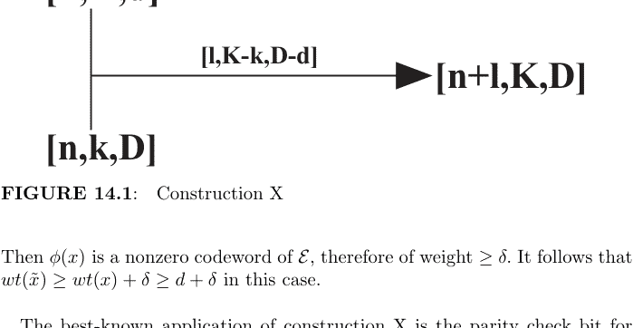

### FIGURE 14.1: Construction X
则 $\varphi(x)$ 是 $\mathcal{E}$ 的非零码字，因此权重 $\ge δ$。由此可得 $wt(\tilde{x}) \ge wt(x) + δ \ge d + δ$ 在此情形下成立。

构造 X 最为人所知的应用是二进制码的奇偶校验位，定理 5.3。很容易看出这确实是构造 X 的一种应用；参见练习 14.1.1。辅助码是真正平凡的码 $[1,1,1]_2$。

以下构造本质上由 Alltop [1] 给出，利用了对一个码、其两个子码及其交集的了解：

### 14.2 Theorem (construction XX). Let the following be given:
- A code $\mathcal{C}$ with parameters [n,k,d]q,
- two subcodes $\mathcal{C}_i \subset \mathcal{C}$, i = 1,2 with parameters [n, k − κ_i, d_i]q,
- with $\mathcal{C}_1 \cap \mathcal{C}_2$ of minimum distance ≥ D,
- auxiliary codes $\mathcal{E}_i$, i = 1,2 with parameters [l_i, κ_i, δ_i]q.

Then there is a code with parameters

[n + l1 + l2, k, min{D, d2 + δ1, d1 + δ2, d + δ1 + δ2}]q.

**PROOF** Apply Theorem 14.1 to the pair $\mathcal{C} \supset \mathcal{C}_1$。延拓码为 $\tilde{\mathcal{C}} \supset \tilde{\mathcal{C}}_2$。其中较大的码的最小距离 $\ge \min\{d_1, d + \delta_1\}$。$\mathcal{C}_2 \setminus (\mathcal{C}_1 \cap \mathcal{C}_2)$ 中的码字得到非平凡的延拓。延拓码中对应的词的权重于是 $\ge d_2 + \delta_1$。由此可得 $\tilde{\mathcal{C}}_2$ 的最小权重 $\ge \min\{D, d_2 + \delta_1\}$。我们再次应用定理 14.1，这次对配对 $\tilde{\mathcal{C}} \supset \tilde{\mathcal{C}}_2$，以 $\mathcal{E}_2$ 为辅助码。这就得到了期望的码。

### Applications to cyclic codes
循环码非常适合构造 X 和 XX 的应用。考虑长度为 $n$ 的 $q$-元循环码。设 $A_1 \subset A_2$。则 $C(A_1) \supset C(A_2)$。这是一个可以应用构造 X 的情形。剩下要找到合适的辅助码。

在 $q = 2$, $n = 15$ 的情形，分圆陪集已在第 13.2 节给出：

{0}, {1,2,4,8}, {3,6,12,9}, {5,10}, {7,14,13,11}.

考虑 $A_1 = \{1,2,3,4\} \subset A_2 = \{1,2,3,4,5,6\}$。对应的循环码形成链 $[15,7,5]_2 \supset [15,5,7]_2$。为了应用构造 X，我们需要一个辅助码 $[l,2,2]_2$ 且 $l$ 尽可能小。显然 $l = 3$。结果是一个码 $[18,7,7]_2$，经奇偶校验后为 $[19,7,8]_2$。注意这样的码也可以由扩展二进制 Golay 码 $[24,12,8]_2$ 通过重复缩短得到。

$C(A_2)$ 包含重复码 $C(\{1,2,...,14\})$。对该链应用构造 X

$[15,5,7]_2 \supset [15,1,15]_2$.

注意我们并不被迫使用较小码的确切最小距离。例如，使用和为零码 $[5,4,2]_2$ 作为辅助码，我们得到 $[20,5,9]_2$，经一个奇偶校验位后为 $[21,5,10]_2$。另一个选择是以扩展汉明码 $[8,4,4]_2$ 作为辅助码。加上奇偶校验位后，这给出一个 $[24,5,12]_2$ 码。Griesmer 界表明码 $[l,4,6]_2$ 有 $l \ge 12$。一个 $[12,4,6]_2$ 可以通过串联构造（参见练习 5.2.8）。另一种可能性是使用构造 X。以 $[12,4,6]_2$ 作为辅助码产生延拓码 $[27,5,13]_2$，等价地 $[28,5,14]_2$，再次是一个以等号达到 Griesmer 界的码。最后，$C(\{0,1,3,5\})$ 是一个 $[15,4,8]_2$ 码（它以等号达到 Griesmer 界）。在相同情形下用作辅助码，我们得到 $[32,6,16]_2$。具有这些参数的码已在第 5.2 节中通过 $(u, u+v)$ 构造得到。

很明显，构造 X 可以应用于循环码链的众多情形。

### Standard lengthening
这里有一个通用情形。考虑 BCH 码 $C(A_1)$，其中 $A_1 = [l, l + t - 1] = \{l, l + 1, ..., l + t - 1\}$（使用区间的明显记号）及其子码 $C(A_2)$，其中 $A_2 = [l - 1, l + t - 1]$ 且 $l - 1 \notin \tilde{A}_1$。根据 BCH 界，$C(A_1)$ 的最小距离 $\ge t + 1$，而 $C(A_2)$ 的最小距离 $\ge t + 2$。$C(A_2)$ 在 $C(A_1)$ 中的余维数为 $\kappa = |C(l - 1)|$，the

包含 $l-1$ 的循环陪集的长度。作为辅助码我们使用平凡码 $[\kappa,\kappa,1]_q$。结果是一个与 $\mathcal{C}(A_1)$ 维数相同、最小距离 $\ge t+2$ 且长度为 $n+\kappa$ 的码。显然我们也可以将 $[l-1,l+t]$ 用作 $A_2$。

构造 XX 可以应用的典型情况由具有定义集 $A_1,A_2,A_1\cup A_2,A_1\cap A_2$ 的 BCH 码四边形形成。我们有 $\mathcal{C}(A_1)\cap\mathcal{C}(A_2)=\mathcal{C}(A_1\cup A_2)$（见练习 14.1.3）。作为最大码我们可以使用 $\mathcal{C}(A_1\cap A_2)$。在 $A_1=[l-1,l+t-1]$、$A_2=[l,l+t]$ 的情况下，我们可以用平凡辅助码应用构造 XX 并得到 $\mathcal{C}(A_1\cap A_2)$ 的一个延拓，其最小距离 $\ge t+3$，比 BCH 界保证的 $\mathcal{C}(A_1\cap A_2)$ 的距离多出两个。

作为示例，考虑 $q=3$、$n=26$ 的情况，其中区间 $[1,12]$ 与循环陪集

$\{0\},\ \{13\},\ \{14,16,22\}\ \text{and}\ \{17,23,25\}.$

不相交。

由此可知 $\mathcal{C}([1,12])$ 是一个 $[26,8,13]_3$ 码。子码 $\mathcal{C}([0,12])$ 和 $\mathcal{C}([1,13])$ 是 $[26,7,14]_3$ 码，在 $\mathcal{C}([0,13])$ 中相交，后者是一个 $[26,6,15]_3$ 码。通过标准延拓我们得到一个（最优的）$[28,8,15]_3$ 码。

## A four-dimensional family

对于任意 $q$ 令 $n=q^2-1$。区间 $A_1=[1,q^2-q-3]$ 避开了循环陪集

$\{q^2-q-1,q^2-2\}=\{-q,-1\}$ 和 $\{0\},\{q^2-q-2\}=\{-(q-1)\}.$

由此可知 $\mathcal{C}(A_1)$ 是一个 $[q^2-1,4,q^2-q-2]_q$ 码。考虑区间 $A_1\subset A_2=[1,q^2-q-2]\subset[1,n-1]$。相应的 BCH 码形成链 $[q^2-1,4,q^2-q-2]\supset[q^2-1,3,q^2-q-1]\supset[q^2-1,1,q^2-1]$。

改用区间 $\{0\}\cup A_i$ 得到 $\mathcal{C}(A_i)$ 中余维数为 1 且最小距离比 $\mathcal{C}(A_i)$ 大一的码链。用 $[1,1,1]_q$ 作为辅助码应用构造 X 得到以下码链：

### 14.3 Proposition.
存在一个长度为 $\mathcal{C}_1\supset\mathcal{C}_2\supset\mathcal{C}_3$ 的延拓 BCH 码链，其参数为

$[q^2,4,q^2-q-1]_q\supset[q^2,3,q^2-q]_q\supset[q^2,1,q^2]_q.$

对链 $\mathcal{C}_1\supset\mathcal{C}_2$ 应用构造 X 得到一个 $[q^2+1,4,q^2-q]_q$ 码。我们称具有此类参数的码为卵形线码。

### 14.4 Lemma.
一个 $[q^2+1,4,q^2-q]_q$ 码的重量分布为

$A_0=1,\ A_{q^2-q}=(q-1)(q^3-q),\ A_{q^2}=(q-1)(q^2+1).$

### PROOF
设 $w = q^2 - q + i$ 是一个码字的重量，其中 $1 \le i \le q - 1$。使用练习 5.1.12 中证明的残余码构造的推广。由于 $\lceil w/q \rceil = q$，我们得到一个 $[q+1, i, 3, q - i]_q$ 码，这由于 Singleton 界是不可能的。卵形线码的唯一可能重量为 $0, q^2 - q, q^2, q^2 + 1$。

设 $q^2 + 1$ 是一个重量。我们可以假设全 1 字 1 是一个码字。设 $x \notin \langle 1 \rangle$ 是一个码字，$\delta_i$ 为 $i \in F_q$ 在 $x$ 中出现的频率。由于 $wt(x - i1) = q^2 + 1 - \delta_i$，我们有 $\delta_i \in \{0,1,q+1\}$。然而方程 $\sum_i \delta_i = q^2 + 1$ 无法满足，矛盾。由此可知 $q^2 - q, q^2$ 是唯一的非零重量。重量数满足平凡方程 $1 + A_{q^2 - q} + A_{q^2} = q^4$。通过计数码字中的零得到另一个方程：

$q^2 + 1 + (q + 1) A_{q^2 - q} + A_{q^2} = (q^2 + 1) q^3.$

由此得到的两个方程的系统有唯一解。

$\mathcal{C}_2 \setminus \mathcal{C}_3$ 中的所有码字重量均为 $q^2 - q$（见练习 14.1.6）。$\mathcal{C}_1$ 的最小距离确实为 $q^2 - q - 1$，因为 Griesmer 界排除了参数 $[q^2, 4, q^2 - q]_q$。由于卵形线码 $[q^2 +1, 4, q^2 - q]_q$ 是 $\mathcal{C}_1$ 的延拓，根据引理 14.4，$\mathcal{C}_1$ 的唯一可能非零重量为 $q^2 - q - 1, q^2 - q, q^2 - 1, q^2$。很容易看出所有这些重量确实出现（见练习 14.1.7）。

在八元情况下 $(q = 8)$，命题 14.3 的链具有参数

[64, 4, 55]_8 ⊃ [64, 3, 56]_8 ⊃ [64, 1, 64]_8.

与 Simplex 码 $[7, 3, 4]_2$（恒重为 4）串联得到链

[448, 12, 220]_2 ⊃ [448, 9, 224]_2 ⊃ [448, 3, 256]_2

的二元线性码。九维码满足 Griesmer 界；十二维码是 $d$-最优的（$[448, 12, 221]_2$ 码不存在）。事实上，残余码 $[228, 11, 110]_2$ 码已知是 $d$-最优的。

十二维码包含一个重量为 224 的码字。来自练习 5.1.12 的残余码构造的变体产生一个 $[224, 11, 108]_2$ 码，该码已知是 $d$-最优的。

对链 $[448, 12, 220]_2 \supset [448, 9, 224]_2$ 应用构造 X，使用 $[4, 3, 2]_2$ 或 $[7, 3, 4]_2$ 作为辅助码。所得参数 $[452, 12, 222]_2$ 和 $[455, 12, 224]_2$ 是 $d$-最优的，这由 Griesmer 界证明。在此情况下还可以构造更多好的码。详情见 [22]。

## A six-dimensional family

对于任意 $q$ 令 $n = (q - 1)(q^2 + 1) \mid (q^4 - 1)$。元素 $i(q^2 + 1)$ 形成长度为 1 的循环陪集。区间 $A = [1, (q - 2)(q^2 + 1) - 1]$ 与 $\{0\}$、$\{(q - 2)(q^2 + 1)\}$ 以及 $C(-1)$ 不相交。由此可知 $\mathcal{C}(A)$ 是一个 $[n, 6, (q - 2)(q^2 + 1)]_q$ 码。标准延拓（构造 XX）得到参数为

$[(q - 1)(q^2 + 1) + 2,\ 6,\ (q - 2)(q^2 + 1) + 2]_q$

的码

在三元情况下所得 $[22, 6, 12]_3$-码是最优的。显然该码最早由 Kschischang 和 Pasupathy [129] 构造。在四元情况下得到 $[53, 6, 36]_4$，另一个最优码，经与 $[3, 2, 2]_2$ 串联后得到二元 $[159, 12, 72]_2$ 码。$[106, 6, 80]_5$ 也是一个好的码。

## A 10-dimensional family

当 $n = (q - 1)(q^3 + 1) = (q - 1)(q + 1)(q^2 - q + 1)$ 时出现类似情况。$q^3 + 1$ 的倍数形成长度为 1 的循环陪集；$q^2 - q + 1$ 的倍数位于长度为 1 或 2 的循环陪集中。循环陪集

$\{1, q, q^2, q^3, q^3 - q + 1, q^3 - q^2 + 1\},\ \{q^2 - q + 1, q^3 - q^2 + q\}$

均包含在区间 $[1, q^3]$ 中，因此避开长度为 $n - q^3 = q^4 - 2q^3 + q - 1$ 的区间，其端点 $0$ 和 $q^3 + 1$ 各自形成长度为 1 的循环陪集。

如前所述应用构造 XX 得到码

$[(q - 1)(q^3 + 1) + 2,\ 10,\ (q - 2)(q^3 + 1) + 2]_q$

$[58, 10, 30]_3$ 和 $[197, 10, 132]_4$ 都是好的码，实现了目前已知的最高最小距离。

## More applications of X and XX

设 $r = 3, n = q^3 - 1$。用 $[i, j]'$ 表示区间 $[i, j]$ 的补集。考虑以下 BCH 码链：

- $\mathcal{C}_1 \supset \mathcal{C}_2 \supset \mathcal{C}_3$，对应于 $[0, q^2 + q + 1]' \supset [0, q^2 + q]' \supset [0, q^2]'$
- $\mathcal{D}_1 \supset \mathcal{D}_2 \supset \mathcal{D}_3$ 对应于 $[1, q^2 + q + 1]' \supset [1, q^2 + q]' \supset [1, q^2]'$。

循环陪集

$\{0\},\ \{1, q, q^2\},\ \{q + 1, q^2 + q, q^2 + 1\},\ \{q^2 + q + 1\}$

给出这些码维数的下界（事实上是精确维数）。$\mathcal{C}$-链的参数为

$[n,8,q^3 - q^2 - q - 2] \supset [n,7,q^3 - q^2 - q - 1] \supset [n,4,q^3 - q^2 - 1]$

$\mathcal{D}$-链的参数为

$[n,7,q^3 - q^2 - q - 1] \supset [n,6,q^3 - q^2 - q] \supset [n,3,q^3 - q^2]$

此外，$\mathcal{C}_2 \cap \mathcal{D}_1 = \mathcal{D}_2$，$\mathcal{C}_3 \cap \mathcal{D}_2 = \mathcal{D}_3$。

用 $[1,1,1]$ 作为辅助码（标准延拓）对 $\mathcal{C}_1 \supset \mathcal{D}_1$ 应用构造 X。$\mathcal{C}_2$ 和 $\mathcal{C}_3$ 的像形成链 $[q^3,7,q^3 - q^2 - q] \supset [q^3,4,q^3 - q^2]$。对该链应用构造 X。辅助码 $[q+1,3,q-1]_q$（扩展 Reed-Solomon 码，将在第 17.1 节介绍）产生 $[q^3 + q + 1,7,q^3 - q^2 - 1]_q$。在三元情况下该 $[31,7,17]_3$ 码是最优的。在四元情况下最好使用 hexacode $[6,3,4]_4$ 作为辅助码（我们在练习 3.4.5 和 3.4.6 中遇到过）得到最优码 $[70,7,48]_4$。辅助码 $[6,3,3]_3$（可由 Hamming 码缩短得到）得到 $[33,7,18]_3$，另一个最优码。

如果目标是八维码，则应改为对第一步得到的 $\mathcal{C}_1 \supset \mathcal{C}_2$ 的像应用标准延拓。我们得到链

$[q^3 + 1,8,q(q^2 - q - 1)] \supset [q^3 + 1,4,q^2(q - 1)]$

其中较大的码本身很有趣。在三元情况下我们得到众所周知的参数 $[28,8,15]_3$；四元情况给出最优的 $[65,8,44]_4$，该码显然最早在 Groneick 和 Grosse [100] 中被考虑。在三元情况下用和为零码 $[5,4,2]_3$ 或 $[7,4,3]_3$ 作为辅助码应用构造 X 得到最优码 $[33,8,17]_3$ 和 $[35,8,18]_3$。对于 $q \ge 4$，使用扩展 Reed-Solomon 码 $[q+1,4,q-2]_q$ 得到以下结果：

### 14.5 Theorem.
存在码 $[q^3 + q + 2,8,q^3 - q^2 - 2]_q$（$q \ge 4$）。

在 $q = 4$ 的情况下，得到最优参数 $[70,8,46]_4$。

## Reed-Muller codes

考虑二元本原情形 $q = 2$，$n = 2^r - 1$。0 到 $2^r - 2$ 之间的数可以用其 duadic 表示来标识：如果 $x = \sum_{i=0}^{r-1} x_i 2^i$，则 $x$ 由二元 $r$-元组 $(x_{r-1},\dots,x_1,x_0)$ 描述。数 $2x$ 由循环移位 $(x_{r-2},\dots,x_0,x_{r-1})$ 表示。由此可知，若对应的 duadic 表示在循环移位下封闭，则指数集合是 Galois 封闭的。选择 $A$ 由 duadic 表示的重量至多为 $b$ 的指数组成，其中 $b < r$。则 $A$ 是 Galois 封闭的，因而循环码 $\mathcal{C}(A)$ 的维数为

$n - |A| = 2^r - 1 - \sum_{i=0}^{b} \binom{r}{i} = \left(\sum_{i=0}^{r-b-1} \binom{r}{i}\right) - 1.$


最小的具有权 > b 的二元对偶表示的数是 2^{b+1} - 1。由此可知 A 包含区间 [0, 2^{b+1} - 2]，其长度为 2^{b+1} - 1，且 C(A) 因此具有最小距离 ≥ 2^{b+1}。将构造 X 应用于链 C(A) ⊂ C(A \ {0})，我们得到参数为 [2^r, sum_{i=0}^{r-b-1} binom{r}{i}, 2^{b+1}]_2 的码。更常用的是使用参数 a，其中 r = a + b + 1。相应的码参数为

[2^r, sum_{i=0}^{a} binom{r}{i}, 2^{r-a}]_2.

这些是 Reed-Muller 码 RM(a, r)，它们在练习 5.2.9 中使用 (u, u + v)-方法构造。Reed-Muller 码是一个经典的码族，最早由 D. E. Muller [156] 和 I. S. Reed [172] 研究，与仿射几何关系密切。它们也很受欢迎，因为它们具有有效的译码算法。

## 广义串联

串联方法，如第 5 章所述，可以以多种方式推广。一种深远的推广是 Zinoviev 码 [227]。作为说明，我们在此仅给出一个 Zinoviev 码的例子。

循环理论为我们提供了一条二元循环码的链 B1 = [15, 4, 8]_2 ⊂ B2 = [15, 5, 7]。设 A1 = [16, 1, 16]_2 为重复码，A2 = [16, 3, 14]_{16} 为 F16 上的线性 Reed-Solomon 码。考虑矩阵空间 M = \begin{pmatrix} u1 & v1 \\ u2 & v2 \\ \dots & \dots \\ u16 & v16 \end{pmatrix}，其中 u_i ∈ F2，v_i ∈ F16 且 u = (u1, ..., u16) ∈ A1，v = (v1, ..., v16) ∈ A2。得到的矩阵数为 2 × 16^3 = 2^13，它们构成一个维数为 13 的二元向量空间。设 α : F2 × F16 ⟶ B2 使得 α(u, v) ∈ B1 当且仅当 u = 0。我们所求的二元码 C 由码字 (α(u1, v1), ..., α(u16, v16)) 组成，其中 M 在我们的矩阵空间上变化。显然 C 是一个线性码 [16 × 15, 13, d]_2。关于 d 我们能说什么？首先假设 u1 = ... = u16 = 1。则 α(u_i, v_i) ≠ 0 对所有 i 成立，且我们的码字的权 ≥ 16 × 7 = 112。剩余情况为 u1 = ... = u16 = 0。如果码字非零，则至少有 14 个 v_i 非零。由于 α(0, v_i) ∈ B1，我们得到权 ≥ 14 × 8 = 112。我们得出结论，得到的是一个 [240, 13, 112]_2 码。

- 1. **构造 X**：给定链 [n, K, d]_q ⊃ [n, k, D]_q 和一个 [l, K - k, D - d]_q 码，可构造一个 [n + l, K, D]_q 码。
- 2. 构造 XX 是构造 X 的重复应用。

## 练习 14.1

14.1.1. 证明定理 5.3 可由构造 X 得到。

14.1.2. 使用构造 X 得到一个 [12,4,6]₂ 码。

14.1.3. 证明循环码的以下规则：C(A₁)∩C(A₂)=C(A₁∪A₂)。

14.1.4. 证明 [8,4,4]₄ 存在。

14.1.5. 使用构造 X 构造一个 [73,8,48]₄ 码。

14.1.6. 证明 C₂ \ C₃ 的所有码字（见命题 14.3）具有权 q² − q。

14.1.7. 证明命题 14.3 中 C₁ 的非零权为 q² − q − 1, q² − q, q² − 1, q²。

14.1.8. 证明 [28,8,15]₃ 的三个参数都是最优的。

14.1.9. 将构造 X 与 Varshamov 界结合，证明文献 [75] 中的以下构造：假设 V_q(n−1,d−2) < q^{n−k} 且存在一个 [n−1,k−1,d+δ]_q 码。则存在一个 [n+δ,k,d+δ]_q 码。

14.1.10. 已知存在一个 [126,36,34]₂ 码。利用前一练习和事实 V₂(26,126) < 2⁹⁰ 证明存在一个 [133,37,34]₂ 码。

## 14.2 覆盖半径

及其与延长的关系。覆盖码的应用。

## 延长与覆盖半径

以下参数本身就很重要：

14.6 定义。码 C 的覆盖半径 ρ(C) 是使环境空间 𝔽_q^n 中的每个 n 元组与某个码字的距离 ≤ ρ 成立的最小数 ρ。

换一种说法：覆盖半径是使以码字为中心的半径为 ρ 的球覆盖整个 𝔽_q^n 的最小数 ρ。另一种表达方式：C 的每个陪集 C + x 都包含一个权 ≤ ρ 的向量。由此可知 ρ 是陪集首的权的最大值（参见第 3.7 节）。

覆盖半径的另一种描述涉及 C 的校验矩阵 H，这是一个具有 n − k 行和 n 列的矩阵。回想一下，伴随向量 σ 定义为 σ(x) = x H^t ∈ 𝔽_q^{n−k}，其中我们把 x ∈ 𝔽_q^n 看作行向量。σ(x) 的坐标是与 H 的行的点积。所有这些点积恰好当且仅当 x ∈ C 时为零。我们有 σ(x) = σ(x') 当且仅当 x、x' 在同一陪集中（我们从第 3.7 节已知所有这些）。应用 σ 后如何读出覆盖半径？设 z ∈ 𝔽_q^{n−k}；写 z = σ(x)。我们可以找到权 ≤ ρ 的 x' 使得 z = σ(x')。这表明 z 是 H 的至多 ρ 个列的线性组合。反之也是显然的。

## 14.7 定理。对一个 [n,k]_q 码 C，以下条件等价：

- 半径为 i 的球覆盖整个 𝔽_q^n。
- C 的每个陪集都包含一个权 ≤ i 的向量。
- 𝔽_q^{n−k} 中的每个向量都可以写成 C 的一个校验矩阵的至多 i 个列的线性组合。

覆盖半径 ρ 是满足定理 14.7 中等价条件的最小数 i。覆盖半径的概念代表了一种与迄今为止所见不同的思想。它不是码的内在参数，如维数、最小距离和强度。

而是描述了码在其环境空间 F_q^n 中的嵌入方式。如果我们主要对码的距离或强度不感兴趣，而对它的覆盖半径感兴趣，我们也称之为覆盖码。覆盖码是 Cohen, Honkala, Litsyn, Lobstein [55] 的研究对象。

固定域 F_q、长度 n 和维数 k。为了最大化最小距离，码字必须分散开，使得任意两个码字都相当远。为了最小化覆盖半径，码字必须放置得使得环境空间中的任何向量都不会与某个码字相距很远。因此目标略有不同。在最小距离的情况下，我们根本不关心码外的向量，而在覆盖半径的情况下，我们不允许留下任何向量（与所有码字距离很大）。然而，可以预期这两个优化问题密切相关。在这两种情况下，码字都必须以均匀的方式分散开。例如，为了构造一个好的覆盖码，使用彼此非常接近的码字会有何帮助呢？因此我们怀疑一个好的覆盖码通常具有较大的最小距离，反之亦然。我们已经有一次观察到这种现象的机会。

回想第 1.6 节的球填充界。它依赖于观察到，对于最小距离为 d 的码，半径为 e = ⌊(d−1)/2⌋ 的球两两不相交。这表明覆盖半径一定满足 ρ ≥ e。等号恰好在球填充界取等时成立，即码为完美码时成立。

## 14.8 命题。最小距离为 d 的码的覆盖半径 ρ 满足 ρ ≥ e = ⌊(d−1)/2⌋，当且仅当码为完美码时取等。

特别地，Hamming 码的覆盖半径 ρ = 1，三元 Golay 码 [11,6,5]_3 的 ρ = 2，二元 Golay 码 [23,12,7]_2 满足 ρ = 3。

命题 14.8 表明，在某种意义上，覆盖半径极小当且仅当最小距离极大。谱的另一端会发生什么？如果 ρ ≥ d，则 C 不是极大的。这意味着我们可以选取一个元素 x ∈ F_q^n \ C，使其与 C 的距离 ≥ d。如果 C 的参数为 [n,k,d]_q，则 C + F_q x 的参数为 [n,k+1,d]_q。我们已经看到以下平凡事实：

## 14.9 引理。设 C 是一个 [n,k,d]_q 码。如果 ρ(C) ≥ d，则 C 可以嵌入到一个 [n,k+1,d]_q 码中。

## 14.10 命题。设 C 是一个 [n,k,d]_q 码。则以下条件等价：

- ρ(C) ≥ d − 1。
- C 可以扩展为一个 [n+1,k+1,d]_q 码。


**证明** 设 $H$ 为 $\mathcal{C}$ 的一个校验矩阵。一步延拓的存在性等价于存在一个向量 $x \in \mathbb{F}_q^{n-k}$（用作第 $(n+1)$ 列），它与 $H$ 的任意 $d-2$ 个列都不线性相关。定理 14.7 表明这等价于 $\rho(\mathcal{C}) \ge d-1$。

命题 14.10 的证明表明，一步延拓的存在性可以用覆盖半径来表达。

### 14.11 定理.
*设 $\mathcal{C}$ 是一个覆盖半径 $\rho < d$ 的线性 $[n,k,d]_q$ 码。$\mathcal{C}$ 的一步延拓 $[n+1,k+1]_q$ 的最大最小距离为 $\rho+1$。*

从某种意义上说，定理 14.11 解决了第 5.1 节中关于一步延拓存在性的一个问题。

### 14.12 推论.
*设 $\mathcal{C}$ 是一个覆盖半径 $\rho < d-1$ 的线性 $[n,k,d]_q$ 码。则 $\mathcal{C}$ 可延拓为一个 $[n+1,k+1,\rho+1]_q$ 码，该码可进一步加长得到一个 $[n+d-\rho,k+1,d]_q$ 码。*

**证明** 第一个结论由定理 14.11 可得。第二个结论则是将构造 X 与重复码作为辅助码的应用。

## 覆盖码与隐写术

本节我们概述覆盖码与 **隐写术** 之间的一种有趣联系。隐写术技术的目的是使对手无法察觉消息的存在（想想隐形墨水）。让我们尝试在一个大图里隐藏一幅小图，使得没有第三人会怀疑隐藏图的存在。大图由我们给出。它由大量像素组成。假设我们希望从每个像素中“提取”一位。我们使用一个自然的想法，即分块编码。像素被分成 $N$ 个的块。设 $x = (x_1,x_2,\dots,x_N) \in \mathbb{F}_2^N$ 为从给定 $N$ 个像素块中提取的 $N$ 元位元组。我们希望利用这个块来构建待隐藏图像的 $n$ 位。设 $y = (y_1,y_2,\dots,y_n)$ 为从 $x$ 构造的隐藏图像的一部分。注意我们对 $x$ 没有控制权，而元组 $y$ 是给定的。我们需要设计一个函数 $f : \mathbb{F}_2^N \longrightarrow \mathbb{F}_2^n$。假设 $f$ 已给出。当 $f(x)=y$ 时情况良好。通常情况并非如此。我们必须改变 $x$，即用 $x'$ 替换 $x$ 使得 $f(x')=y$。这意味着我们必须改变像素，从而对原图造成损害。由于图像中的改动不应明显，我们有兴趣改变最少的像素。需要改变的像素数量是汉明距离 $d(x, x')$。这导致在构造 $f$ 时出现以下冲突目标：当 $N$ 给定时，我们希望 $n$ 较大（我们的像素块应提供隐藏图像的不可忽略部分），并且希望 $d(x, x')$ 的最大可能值较小（每个块内需要改变的像素数应较小），例如 $d(x, x') \le \rho$。这导致了下面定义的二元情形。实际上没有理由不考虑任意字母表。

### 14.13 定义.
设 $|\mathcal{A}| = q$。函数 $f : \mathcal{A}^N \longrightarrow \mathcal{A}^n$ 是 **覆盖函数** $COV(\rho, N, n)_q$ 当且仅当，对任意 $y \in \mathcal{A}^n$ 和 $x \in \mathcal{A}^N$，存在 $x' \in \mathcal{A}^N$ 使得 $f(x') = y$ 且 $d(x, x') \le \rho$。

对于我们的应用，我们有兴趣构造二元覆盖函数 $COV(\rho, N, n) = COV(\rho, N, n)_2$ 使得 **变化率** $\rho/N$ 很小且 **信息率** $n/N$ 很大。显然，两个速率都以 1 为界，且目标相互冲突。固定 $y \in \mathcal{A}^n$。定义 14.13 的定义性质说明每个向量 $x \in \mathcal{A}^N$ 与 $f^{-1}(y)$ 的某个码字在汉明距离上至多为 $\rho$。换句话说，$f^{-1}(y)$ 是一个覆盖半径 $\le \rho$ 的码，对每个 $y \in \mathcal{A}^n$ 均成立。等价地，我们可以说 $\mathcal{A}^N$ 被划分为 $q^n$ 个码，其中每个码的覆盖半径 $\le \rho$。

### 14.14 定义.
**大集** $m$ 个覆盖码 $LCOV[m](N, \rho)_q$ 是将 $\mathcal{A}^N$ 划分为 $m$ 个子码，其中每个子码的覆盖半径 $\le \rho$（且 $|\mathcal{A}| = q$）。

### 14.15 定理.
以下两者等价：
- 一个覆盖函数 $COV(\rho, N, n)_q$。
- 一个大集 $LCOV[q^n](N, \rho)_q$。

自然地考虑 **线性** 覆盖函数的特殊情形。在这种情况下 $f^{-1}(0)$ 将是一个线性空间，因而是一个线性覆盖码。由于对每个 $y$，$f^{-1}(y)$ 是 $f^{-1}(0)$ 的一个陪集，且这些陪集具有与线性码相同的性质，我们看到大集将自动存在。

### 14.16 定理.
以下两者等价：
- 一个线性覆盖函数 $COV(\rho, N, n)_q$。
- 一个线性码 $[N, N-n]_q$（$q$ 元，长度 $N$，余维数 $n$）且覆盖半径 $\le \rho$。

设 $H$ 为定理 14.16 中线性码的校验矩阵。则 $H$ 是一个 $(n, N)$ 矩阵。我们可以用 $f(x) = Hx$ 描述相应的线性覆盖函数 $f$。这里我们把向量写成列向量。

### 14.17 定义.
设 $l(n, \rho; q)$ 为最小的数 $N$，使得存在一个长度为 $N$、维数为 $N-n$ 且覆盖半径 $\le \rho$ 的线性 $q$ 元码 $\mathcal{C}$。类似地，对任意 $q$，设 $l^*(n, \rho; q)$ 为 $COV(\rho, N, n)_q$ 存在的最小 $N$。

函数 $l(n,\rho;q)$ 已被编码理论家研究了很长时间，尤其是在二元情形。定理 14.16 表明 $l(n,\rho;q)$ 是线性覆盖函数 $COV(\rho,N,n)_q$ 存在的最小 $N$。

在实践中，人们可能会固定变化率 $\rho/N$ 的上界 $x$。例如，$x = 0.1$ 保证不超过十分之一的像素需要改变。问题就是构造 $COV(\rho,N,n)_2$（在二元情形）使得 $\rho/N \le 0.1$ 且 $y = n/N$ 尽可能大。渐近球填充界（见练习 14.2.3）意味着上界 $y \le H_q(x)$，在手头情形 $y \le h(0.1) \approx 0.469$。汉明码 $[7,4,3]_2$ 给出 $COV(1,7,3)_2$，这意味着一个 $COV(1,10,3)_2$（见练习 14.2.4）。该覆盖函数有 $x = 0.1$ 且 $y = 0.3$，这已经相当接近 0.469 的上界。二元戈莱码 $[23,12,7]_2$ 给出 $COV(3,23,11)_2$ 和 $COV(3,30,11)_2$，达到 $y = 11/30$，是对汉明码的轻微改进。文献 [55] 中有一个 $COV(6,59,23)_2$，意味着 $COV(6,60,23)_2$，因此 $y = 23/60 \approx 0.383$。

## 覆盖码与开关噪声

开关噪声是在位值发生变化时产生的（从 0 到 1 或从 1 到 0）。出于技术原因，减少这种噪声可能是可取的，因此设计一个系统，使得在每一步中，改变其值的位数有一个上界。更精确地说，问题可以形式化如下：向我们给出一个比特串流 $x(t) \in \mathbb{F}_2^k$，$t = 1,2,\dots$。我们希望将其编码为长度为 $n$ 的比特串

$x(t) \longrightarrow y(t) \in \mathbb{F}_2^n$

使得对每个 $t$ 都有 $d(y(t-1),y(t)) \le R$（每一步位翻转数被 $R$ 限制），并且我们有一个易于解码的算法，可以从 $y(t)$ 恢复 $x(t)$。该问题在 Chen and Curran [50] 中描述，并给出了以下构造：

设 $\mathcal{C}$ 为覆盖半径 $\rho(\mathcal{C}) = R$ 的码 $[n,n-k]_2$。定义 $x(0)=0 \in \mathbb{F}_2^k$ 且 $y(0)=0 \in \mathbb{F}_2^n$。$y(t)$ 的定义依赖于 $x(t)$ 和 $y(t-1)$（当然）。设 $H$ 为 $\mathcal{C}$ 的校验矩阵，$H^t$ 为其转置。过程如下：
- 1. 计算 $x(t) + x(t-1)$。
- 2. 找到权值 $\le R$ 的 $u(t) \in \mathbb{F}_2^n$ 使得 $x(t) + x(t-1) = u(t)H^t$（这是可能的，因为覆盖半径的定义；见定理 14.7）。
- 3. 定义 $y(t) = y(t-1) + u(t)$。


解码是如何工作的？计算 y(t)H^t = y(t−1)H^t + x(t−1) + x(t)。我们通过归纳法可知 y(t)H^t = x(t)。这描述了一种非常简单的解码方法。我们已经描述了一种 (n,k) 切换码。我们付出的代价是产生更长的比特串（长度为 n 而不是 k）。好处是对比特翻转次数的上界 R = ρ(C)。

例如，考虑覆盖半径为 1 的重复码 [3,1,3]₂（情况 k = 1, n = 3, ρ = 1）。比特串的长度增加了 50%；编码后的比特串在最多一个坐标上发生变化。这比使用汉明码 [7,4,3]₂（情况 k = 4, n = 7, ρ = 1）更好，后者的比特串长度增加了超过 100%。

- 1. **覆盖半径** ρ(C) 是使以码字为中心半径为 i 的球覆盖整个空间的最小 i。
- 2. 设 C 是一个 [n,k,d]_q 码，H 是一个校验矩阵，ρ = ρ(C)。则 ρ 是使每个 y ∈ F_q^{n−k} 都是 H 的至多 i 个列的线性组合的最小 i。
- 3. ρ 是陪集首的最高重量。
- 4. ρ ≥ d 当且仅当 C 可以嵌入到一个 [n,k+1,d]_q 中。
- 5. ρ < d 是使 C 具有扩张 [n+1,k+1,i+1]_q 的最大 i。
- 6. **隐写术** 中的一个问题导致了覆盖函数，等价于将整个空间划分为覆盖码。
- 7. 我们看到了覆盖码在切换噪声中的应用。

## 习题 14.2

14.2.1. 针对覆盖码表述并证明一个球填充界。

14.2.2. 刻画覆盖码球填充界取等号的情况。

14.2.3. 证明覆盖函数的渐近球填充界：设 α(x) 为变化率为 ρ/N ≤ x 的覆盖函数族 COV(ρ,N,n)_q 的信息率 n/N 的 lim sup。则 α(x) ≤ H_q(x)。这里 H_q(x) = x log_q(q − 1) + log_q(2) h(x) 是 q 元熵函数。它在习题 9.7 中引入。

14.2.4. 证明 COV(ρ,N,n)_q 的存在蕴含对所有 N′ ≥ N，COV(ρ,N′,n)_q 的存在。

14.2.5. 证明 COV(ρ,N,n)_q 的存在蕴含对每个自然数 c，COV(cρ,cN,cn)_q 的存在。

14.2.6. 确定重复码 [n,1,n]_q 的覆盖半径。

14.2.7. 确定扩展汉明码 [8,4,4]_2 的覆盖半径。

## 第15章

## 线性规划方法

我们主要感兴趣的是可由 LP 方法推导出的关于码、正交数组及其相关对象的强大界。在第一节中，我们首先给出线性规划的一个简明自包含的介绍。

## 15.1 线性规划的介绍

**基本概念：** 线性规划问题，对偶性。

在围绕对偶定理的线性规划简要介绍之后，我们展示了 LP 方法如何如 Delsarte [66] 所应用的那样，用于获得关于码字数目的上界，从而也得到正交数组的行数下界。一个关键结果是，从 LP 界可以推导出的关于码的每一个上界，自动产生正交数组的下界。

在本节中，我们基本上遵循 Collatz 和 Wetterling [58]。下面是在标准形式下的基本 LP 问题：

## 15.1 定义. 设以下给出：

- 一个实数 (m, n) 矩阵 A，
- 一个长度为 n 的列向量 p，
- 一个长度为 m 的列向量 b。

假设 **b** ≥ 0（意味着 **b** 的条目是非负的）。考虑满足以下条件的长度为 *n* 的列向量 **x**

**x** ≥ 0 且 *A* · **x** = **b**。

在此条件下最小化 *Q*(**x**) = **p** · **x**。

令

$\mathcal{M} = \{\mathbf{x} \mid \mathbf{x} \ge 0, A \cdot \mathbf{x} = \mathbf{b}\}$

为 *n* 维空间 $\mathbb{R}^n$ 中可容许点的集合。

## 一个玩具例子

考虑 *m* = 2, *n* = 3 的情况，矩阵 $A = \begin{pmatrix}2 & 0 & 1/2 \\ -5 & 1 & 0\end{pmatrix}$ 且 **b** = (3,5/3)，**p** = (3,8,-11)。$\mathcal{M}$ 看起来如何？我们有 **x** = (*x*₁,*x*₂,*x*₃) 且条件为 *x*₁,*x*₂,*x*₃ ≥ 0 且

$2x_1 + 0.5x_3 = 3$
$-5x_1 + x_2 = 5/3$

以 *x*₁ 为参数。则 *x*₂,*x*₃ 可以用 *x*₁ 表示：

$x_2 = 5/3 + 5x_1,\; x_3 = 6 - 4x_1.$

条件为 *x*₁ ≥ 0，*x*₁ ≥ -1/3，*x*₁ ≤ 1.5，等价于 0 ≤ *x*₁ ≤ 1.5。由此可得 $\mathcal{M}$ 是一个线段：

$\mathcal{M} = \{(x_1,5/3 + 5x_1,6 - 4x_1)\mid 0 \le x_1 \le 1.5\}$

## 得到标准形式

让我们确认任何涉及非负未知数和线性方程及不等式的问题都可以转化为定义 15.1 的标准形式。如果搜索的是最大值而不是最小值，只需用 -**p** 替换 **p** 即可。如果 **b** 不满足非负性条件，我们应改变负条目的符号，同时用其负值替换 *A* 的对应行。

## 顶点

可以假设 A 的行是线性无关的。事实上，如果一行是其他行的线性组合，则相应的条件要么自动满足，要么与其它条件矛盾。第一种情况下我们可以忽略该条件，使 m 减 1；第二种情况下 ℳ 为空。

**15.2 定义.** 两个点 P, Q ∈ ℝⁿ 的凸组合是 x(t) = tP + (1 − t)Q，其中 0 ≤ t ≤ 1。

点集 ℳ ⊆ ℝⁿ 是凸的，如果它在凸组合下封闭：ℳ 中任意两点的凸组合都在 ℳ 中。

几何直观是：x(t) 是 P 和 Q 之间线段上的点。事实上，x(0) = Q，x(1) = P。把 x(t) 视为参数曲线，随着时间 t 从 0 增加到 1，点在空间中移动。

可容许点集 ℳ 是凸的。形式上这直接由描述 ℳ 的条件

x ≥ 0 且 A · x = b

得出：如果点 x, x′ 满足它们，则它们的凸组合也满足。

这提示了如何定义那些特殊点，即顶点，我们认为最大值和最小值会在那里取得：

**15.3 定义.** 在定义 15.1 的情况下，点 x ∈ ℳ 是 ℳ 的顶点，如果 x 不能写成 ℳ 中两个不同点的凸组合。

这意味着没有一条完全包含在 ℳ 中且以 x 为内部点的线段。

**15.4 引理.** 设 A 的列为 c₁, …, cₙ，且

x = (x₁, x₂, …, xₙ)ᵗ ∈ ℳ。

则 x 是 ℳ 的顶点当且仅当 xₖ > 0 时的列 cₖ 线性无关。

**证明** 设 x ∈ ℳ，且不失一般性设 x₁, x₂, …, xᵣ 是 x 的正坐标。

设 x 为顶点。假设前 r 列线性相关：∑ₖ₌₁ʳ dₖ cₖ = 0 对某个 (d₁, …, dᵣ) ≠ 0 成立。选择足够小的 δ 使得 xₖ ± δ·dₖ > 0，k = 1, 2, …, r。则 ∑ₖ₌₁ʳ cₖ(xₖ ± δ·dₖ) = b。由此可得我们可以把 x = ½(x₁ + x₂) 写成向量 x₁ 和 x₂ 的凸组合，其中

x₁ = { xₖ + δ·dₖ k ≤ r; 0 k > r }, x₂ = { xₖ − δ·dₖ k ≤ r; 0 k > r }。

于是 **x** 不是顶点，矛盾。这证明了该断言的一个方向。

现在假设前 $r$ 列 $A$ 线性无关。写 **x** = $t \cdot \mathbf{x}_1 + (1 - t) \cdot \mathbf{x}_2$，其中 $0 < t < 1$，$\mathbf{x}_1, \mathbf{x}_2 \in \mathcal{M}$。由于 $t$ 和 $1 - t$ 的正性，$\mathbf{x}_1, \mathbf{x}_2$ 在坐标 $> r$ 处消失。由此可得 $\sum_{k=1}^{r} c_k (a_k - b_k) = 0$，其中 $a_k, b_k$ 分别是 $\mathbf{x}_1, \mathbf{x}_2$ 的坐标。由于这些列无关，我们得到 $a_k = b_k$，从而 $\mathbf{x}_1 = \mathbf{x}_2$ 且 **x** 是顶点。

## 15.5 推论. 如果 **x** 是 $\mathcal{M}$ 的顶点，则非零条目的个数，**x** 的重量 $wt(\mathbf{x})$ 至多为 $m$。如果 $wt(\mathbf{x}) < m$，则顶点 **x** 称为退化的。

注意此概念与编码理论中的基本概念相似。我们还看到顶点 **x** 由 $A$ 的相应线性无关列集唯一确定。特别地，$\mathcal{M}$ 只有有限多个顶点。尚不清楚何时 $A$ 的线性无关列集会产生 $\mathcal{M}$ 的顶点。

## 牛/羊例子

此例来自 [58]。变量 $x_1, x_2$ 是农场上的牛和羊的数量。牛棚最多可容纳 50 头牛和 200 只羊。可用的土地为七十二英亩，每头牛需要一英亩，每只羊需要 0.2 英亩。一头牛每年需要 150 小时的工作，一只羊需要 25 小时。每年最多可用的工时为 10,000 小时。每头牛每年的净收益为 250，每只羊为 45。问题是最大化利润。条件为

|  |  |
|---|---|
| $x_1$, $x_2$ | $\ge 0$ |
| $x_1$ | $\le 50$ |
| $x_2$ | $\le 200$ |
| $x_1 + 0.2x_2$ | $\le 72$ |
| $150x_1 + 25x_2$ | $\le 10,000$ |

最大化 $Q(x) = 250x_1 + 45x_2$。

这不是标准形式。当可容许点的区域在平面上绘制时，顶点变得可见：

$P_0 = (0,0), P_1 = (0,200), P_2 = (32,200), P_3 = (40,160), P_4 = (50,100), P_5 = (50,0)$。

最大值出现在 $P_3$：40 头牛和 160 只羊是最佳选择。


## 继续顶点

### 15.6 引理.
*If* $\mathcal{M} \neq \emptyset$, then $\mathcal{M}$ 确实有顶点。更精确地说，$\mathcal{M}$ 中权值最小的每个向量都是一个顶点。

**证明** 如果 $0 \in \mathcal{M}$，那么它当然是一个顶点。现在设 $wt(\mathbf{x}) = r > 0$ 且假设 $r$ 是 $\mathcal{M}$ 中元素的最小权值。不失一般性 $x_1 \cdot x_2 \cdots x_r \neq 0$。如果 $\mathbf{x}$ 不是顶点，则存在 $(d_1,\ldots,d_r) \neq 0$ 使得 $\sum_{i=1}^r d_i \mathbf{c}_i = 0$。

设 $\mathbf{x}(\lambda) = \mathbf{x} + \lambda \cdot (d_1, d_2, \ldots, d_r, 0, \ldots, 0)$。则 $\mathbf{x}(\lambda)$ 仍满足定义 15.1 中的等式。如果 $\lambda$ 足够小，则 $\mathbf{x}(\lambda)$ 仍是 $\mathcal{M}$ 的成员。我们可以选取 $\lambda$ 使得 $\mathbf{x}(\lambda)$ 的权值小于 $r$，矛盾。

三种情况出现：

- 如果 $\mathcal{M}$ 为空，则我们问题的条件永远无法满足。
- 如果 $\mathcal{M}$ 有界，则称其为 **凸多面体**。我们稍后会看到，在这种情况下问题具有最小值，且该最小值在其中一个顶点取得。
- 最后，可能出现 $\mathcal{M}$ 无界的情况。此时目标函数 $Q$ 要么取得任意小的取值，要么 $Q$ 仍取得其最小值。

### 15.7 定义.
$\mathbf{x} \in \mathcal{M}$ 是 **极小点** 当且仅当 $Q(\mathbf{x}) \leq Q(\mathbf{y})$ 对所有 $\mathbf{y} \in \mathcal{M}$ 成立。

极小点的集合是凸的。事实上它是 $\mathcal{M}$ 与一个超平面的交集。

### 15.8 定理.
*If* $\mathcal{M}$ 是凸多面体（有界、非空），则 $\mathcal{M}$ 中的每一点都是顶点的凸组合。

**证明** 设 $\mathbf{x} \in \mathcal{M}$，$wt(\mathbf{x}) = r$ 且 $Z$ 为 $\mathbf{x}$ 的支撑集。如果 $r = 0$，则没有问题。设 $r > 0$。如果由 $Z$ 索引的列是独立的，则 $\mathbf{x}$ 本身就是一个顶点。于是假设存在 $A$ 的列的非平凡线性组合，系数为 $d_1,\ldots,d_n$，在 $Z$ 外消失。如前所述，考虑 $\mathbf{x}(\lambda) = \mathbf{x} + \lambda \cdot (d_1,\ldots,d_n)$。则 $\mathbf{x}(\lambda) \in \mathcal{M}$ 当且仅当 $\mathbf{x}(\lambda) \geq 0$，当且仅当 $\lambda_1 \leq \lambda \leq \lambda_2$，其中 $\lambda_1 < 0$ 是最小的负值，$\lambda_2 > 0$ 是最大的正值。显然 $\mathbf{x}(\lambda_1)$ 和 $\mathbf{x}(\lambda_2)$ 的权值都小于 $r$。由归纳法它们都是顶点的凸组合。由此可知 $\mathbf{x}$ 也是如此。

## 15.9 定理.
*If Q has a minimum in M, then this minimum is attained in a vertex.*

**证明** 只有当 M 无界时才有困难。设 x0 是一个不是顶点的极小点，x1, x2, …, xp 是 M 的顶点。技巧是考虑每个 x_i, i = 0, 1, …, p 的坐标之和 C_i。设 C 为这些数的最大值。如果 C = 0，则 0 是唯一的顶点和极小点。于是假设 C > 0。考虑标准形式的一个新的线性规划：增加一个新的不定元 x_{n+1}，不改变旧条件，增加 A 的一行对应条件 x1 + x2 + … + x_{n+1} = 2C，不改变 Q。相应的可行点空间 M~ 因最后一个条件而必定是有界的。向前 n 个坐标的投影将 M~ 映射到 M 的相应有界部分，同时保持目标函数 Q。特别地，x~0（x0 带有最后一个坐标使得坐标之和为 2C）是极小点。我们区分 M~ 中两类顶点。x~i, i = 1, 2, …, p 是最后一个坐标 > 0 的那些。剩余的顶点 x~i, i = p+1, …, r 最后一个坐标为零。将 x~0 = sum_j alpha_j x~j 表示为顶点的凸组合。最后一个坐标表明必须存在 j ≤ p 使得 alpha_j > 0。由此可知 x~j 是 M~ 的极小点，且顶点 x_j 是原线性规划的极小点。

## 15.10 定义.
*Let x be a vertex (we know wt(x) ≤ m). A basis of x is a set of m independent columns of A containing the support of x. Observe that the basis is uniquely determined if x is nondegenerate.*

## 顶点交换

设 x0 是一个顶点，其坐标为 x_k^{(0)}，Z 为 x0 的一个基的指标集。我们有 sum_{k∈Z} x_k^{(0)} c_k = b。A 的每个列向量都可以用该基表示。因此必定存在常数 α_{ki} 使得

$$c_i = \sum_{k∈Z} α_{ki}·c_k,\quad i=1,2,…,n.\tag{15.1}$$

如果 j ∈ Z，则当然 α_{kj}=δ_{kj}。假设存在 α_{\hat{k}j}>0，其中 \hat{k}∈Z，j∉Z。对每个 δ≥0，考虑具有以下坐标的 x(δ)：

$$x_k(δ)=\begin{cases}x_k^{(0)}-δ·α_{kj}&\text{if }k∈Z\\δ&\text{if }k=j\\0&\text{otherwise.}\end{cases}\tag{15.2}$$

则 $A \cdot \mathbf{x}(\delta) = \mathbf{b} - \delta \cdot \mathbf{c}_j + \delta \cdot \mathbf{c}_j = \mathbf{b}$。置

$\delta_1 = Min_{k,\alpha_{kj}>0}\left(x_k^{(0)}/\alpha_{kj}\right). \tag{15.3}$

如果 $\mathbf{x}_0$ 是退化的，则可能出现 $\delta_1 = 0$。在非退化情形下，$\delta_1 > 0$。下一个顶点是 $\mathbf{x}_1 = \mathbf{x}(\delta_1)$（见定义 15.2）。首先很明显我们有一个可行点，这是由 $\delta_1$ 的选取决定的。$\mathbf{x}_1$ 真的是顶点吗？当然 $wt(\mathbf{x}_1) \le m$，因为与 $\mathbf{x}_0$ 相比我们只有一个新的非零坐标，但 $\mathbf{x}_0$ 的至少一个非零坐标 $l$ 在 $\mathbf{x}_1$ 中变为零。

指标集为 $Z' = Z - \{l\} \cup \{j\}$ 的列构成 $\mathbf{x}_1$ 的一个基。事实上基数是正确的。每个向量都可以用 $\mathbf{c}_k$，其中 $k \in Z$ 表示（因为 $Z$ 是基）。由于 $\mathbf{c}_l$ 可以用 $\mathbf{c}_j$ 和 $\mathbf{c}_k$，$k \in Z \setminus \{l\}$ 表示，故我们得到一个生成集，从而是一个基。

如果 $\mathbf{x}_0$ 是退化的且 $j$ 选取得当（$\delta_1 = 0$），则 $\mathbf{x}_1 = \mathbf{x}_0$ 但具有新的基。现在用由 $Z'$ 给出的新基按类比于式 15.1 表示 $A$ 的列：

$\mathbf{c}_i = \sum_{k \in Z'} \alpha'_{ki} \cdot \mathbf{c}_k,\; i = 1,2,\dots,n.$

比较两个表达式，新的结构常数由旧的得到：

$\alpha'_{jl} = 1/\alpha_{ij}$  
$\alpha'_{ji} = \alpha_{li}/\alpha_{ij}$  
$\alpha'_{kl} = -\alpha_{kj}/\alpha_{ij}\quad (k \in Z,\;k \ne l)$  
$\alpha'_{ki} = \alpha_{ki} - \dfrac{\alpha_{li}\alpha_{kj}}{\alpha_{ij}}\quad (k \in Z,\;k \ne l). \tag{15.4}$

设 $\mathbf{x} \in \mathcal{M}$。由定义 $\sum_{i=1}^n x_i \cdot \mathbf{c}_i = \mathbf{b}$。对顶点 $\mathbf{x}_0$ 也有同样的关系。比较：$\displaystyle \sum_{k \in Z} x_k^{(0)}\mathbf{c}_k = \mathbf{b} = \sum_{i=1}^n x_i \sum_{k \in Z} \alpha_{ki}\mathbf{c}_k.$ 比较系数并注意到，对 $k,i \in Z$，系数 $\alpha_{ki}$ 只有在 $k=i$ 时才非零，我们得到 $\displaystyle x_k = x_k^{(0)} - \sum_{i \notin Z} \alpha_{ki}x_i \quad (k \in Z). \tag{15.5}$

## 单纯形算法

思想是进行一系列顶点交换，使目标函数 $Q$ 递减。于是再次设一个顶点 $\mathbf{x}_0$，其基由 $Z$ 索引；相应的目标函数值为 $Q_0 = \sum_{k \in Z} p_k \cdot x_k^{(0)}$。置

$$t_i = \sum_{k \in Z} \alpha_{ki} p_k.$$

对任意点 $\mathbf{x} \in \mathcal{M}$，我们有 $Q(\mathbf{x}) = \sum_{k \in Z} p_k x_k + \sum_{i \notin Z} p_i x_i = \sum_{k \in Z} p_k x_k^{(0)} + \sum_{i \notin Z} (p_i - \sum_{k \in Z} p_k \alpha_{ki}) x_i$，故

$$Q(\mathbf{x}) = Q_0 - \sum_{i \notin Z} (t_i - p_i) x_i.$$

注意以下事实：

- 1. 如果 $\mathbf{x}_0$ 是非退化的，$\hat{k} \in Z$，$j \notin Z$，$t_j > p_j$，$\alpha_{\hat{k}j} > 0$，则顶点交换给出一个目标函数值更小的顶点 $\mathbf{x}_1$：$Q_1 < Q_0$（我们有 $x_i^{(1)} = 0$ 若 $i \notin Z$，$i \neq j$，且 $x_j^{(1)} = \delta_1 > 0$。于是 $Q_1 = Q_0 - \delta_1 (t_j - p_j) < Q_0$）。
- 2. 如果对某个 $j \notin Z$ 有 $t_j > p_j$，$\alpha_{kj} \le 0$ 对所有 $k \in Z$ 成立，则线性规划取得任意小的值（$\mathbf{x}(\delta) \in \mathcal{M}$ 始终成立且 $Q(\mathbf{x}(\delta)) = Q_0 - \delta (t_j - p_j)$）。
- 3. 如果 $t_j \le p_j$ 对所有 $j \notin Z$ 成立，则 $\mathbf{x}_0$ 是极小点（$Q(\mathbf{x}) = Q_0 - \sum_{j \notin Z} (t_j - p_j) x_j \ge Q_0$）。

现在可以描述 **单纯形算法**。对顶点 $\mathbf{x}$ 和由 $Z$ 给出的基属于一个矩形数组：列由 $i \notin Z$ 索引，行由 $k \in Z$ 索引，行 $k$ 列 $i$ 的元素是 $\alpha_{ki}$。有一底行，其元素为 $d_i = t_i - p_i = \sum_{k \in Z} \alpha_{ki} p_k - p_i$，有一右列包含 $\mathbf{x}$ 关于 $Z$ 的系数。将目标函数值写在左下角单元。需要执行以下步骤：

- 1. 如果 $d_i \le 0$ 对所有 $i$ 成立，则达到最小值。
- 2. 选择 $d_j > 0$。
- 3. 如果所有 $\alpha_{kj} \le 0$，则线性规划取得任意小的值：不存在最小值。


4. 如果存在 k ∈ Z 使得 α_kj > 0，则在额外的一列中插入 x_k/α_kj，对所有相应的 k，令 δ1 为所有这些分数的最小值，l 为使该最小值取得的 k 的一个值。主元列是列 j，主元行是行 l。交点处，条目为 α_lj，是主元元素。新的数组构造如下：指标 l 和 j 互换位置，主元元素 α_lj 被其倒数 1/α_lj 替换，主元行的其余条目除以 α_lj，主元列的其余条目除以 −α_lj，所有其余条目根据矩形规则进行转换：如果 d 是旧数组中相关条目，则考虑子矩阵 (a b; c d)，其中 b 和 c 分别是对主元列和主元行的投影，a 是主元元素（所有这些均在旧数组中）。则 d ↦ d − b·c/a。这些规则在数组的边界（最后一行和最后一列）上也有效。目标函数的新的值为 Q1 = Q0 − x_l d_j / α_lj。

## 一个例子

设

A = ( 2 4 -1 1 0 0; -3 2 -2 0 1 0; 0 -1 -3 0 0 1 ), b = (9,4,5).

那么一个顶点显然可见：

x^(0) = (0,0,0,9,4,5), 基为 Z = {4,5,6}.

由于 A 右半部分中的单位矩阵，系数 α 是左半部分中的条目，例如，

α_{4,2}=4, α_{5,2}=2, α_{6,2}=-1.

出现正值时，我们可以用 j = 2 进行顶点交换。Z 的哪一列将被踢出？计算 δ1 = Min(9/4,2) = 2。由此可得 Z' = {2,4,6}。新的顶点为

x^(1) = x(2) = x^(0) + (0,2,0,0,0,0) − 2(0,0,0,4,2,−1) = (0,2,0,1,0,7).

## 寻找初始顶点

如果如开头所述引入了新变量，则 x = 0, y = b 是一个顶点。一般来说，条件是否可满足（或 M = ∅）并不明显。为了决定这一点并找到第一个顶点，必须事先解决一个相关问题：

A · x + y = b,  x ≥ 0, y ≥ 0,  Σ y_i = Min.

该问题的顶点为 (0, b)。设 (x*, y*) 为该问题的最优解。如果 y* ≠ 0，则我们的原问题无解，因为原问题的每个解都产生 (x*, 0)。然而，如果 y* = 0，则 x* 是原问题的顶点。算法上：

- 1. 给定标准形式下的线性规划，其中 b ≥ 0。
- 2. 建立上述预备问题。
- 3. 用单纯形算法求解，以 (0, b) 作为初始顶点。
- 4. 如果最小值 > 0，则 ℳ = ∅。
- 5. 如果最小值 = 0，最小点为 (x, 0)，则 x 是原问题的顶点。
- 6. 在那里开始单纯形算法。

## 示例

这里有一个线性规划：最大化 x + y + z，约束条件为 x, y, z ≥ 0 且

-x + 3y + 7z ≤ 9
x - 5z ≤ 9
x - 2y + 7z ≤ 21
-3x + 3y - 7z ≤ 63
z ≤ 1

为了得到一个基本线性规划问题，引入五个附加变量 y₁, y₂, y₃, y₄, y₅，如定义 15.1 之后所述。此时初始顶点为 x₀ = (0,0,0,9,9,21,63,1)，基为 Z = {4,5,6,7,8}。使用目标函数 Q = −x − y − z。初始数组为

|   | 1 | 2 | 3 | x₀ |
|---|---|---|---|----|
| 4 | -1 | 3 | 7 | 9 |
| 5 | **1** | 0 | -5 | 9 |
| 6 | 1 | -2 | 7 | 21 |
| 7 | -3 | 3 | -7 | 63 |
| 8 | 0 | 0 | 1 | 1 |
|   | 1 | 1 | 1 | Q₀ = 0 |

由于第一列的底部条目为正，选择该列作为主元列。主元元素以粗体打印。按此方式进行，可得到以下数组：

5 2 3 x₁
4 1 3 2 18
1 1 0 -5 9
6 -1 -2 12 12
7 3 3 -22 90
8 0 0 1 1
-1 1 6 Q₁ = -9

5 4 3 x₂
2 1/3 1/3 2/3 6
1 1 0 -5 9
6 -1/3 2/3 40/3 24
7 2 -1 -24 72
8 0 0 1 1
-4/3 -1/3 16/3 Q₂ = -15

5 4 8 x₃
2 -2/3 16/3
1 5 14
6 -40/3
7 24
3 1 1
-4/3 -1/3 -16/3 Q₃ = -20 1/3

由于最后一行的条目 dᵢ 为负，我们已达到最小值。请注意，无需计算该最后一个数组中的所有条目。

## 牛/羊示例再现

这是以下问题：

x₁, x₂ ≥ 0
x₁ ≤ 50
x₂ ≤ 200
x₁ + 0.2x₂ ≤ 72
150x₁ + 25x₂ ≤ 10,000

最小化 Q(x) = -250x₁ - 45x₂。在标准形式中我们使用等式，采用四个新的非负变量 y₁, ..., y₄。初始顶点为 (0,0,50,200,72,10000)。第一个表为

1 2 x₀
3 1 0 50
4 0 1 200
5 1 0.2 72
6 150 25 10000
250 45 Q₀ = 0

其余部分现在是自动的：

3 2 **x₁**
1 1 0 50
4 0 1 200
5 -1 0.2 22
6 -150 **25** 2500
-250 45 $Q_1 = -12500$

3 6 **x₂**
1 1 0 50
4 6 -.04 100
5 **0.2** -.008 2
2 -6 0.04 100
20 -1.8 $Q_2 = -17000$

5 6 **x₃**
1 -5 0.04 40
4 -30 .2 40
3 5 -.04 10
2 30 -0.2 100
-100 -1 $Q_3 = -17200$

## 对偶定理

**15.11 定理（对偶，第一形式）。** 考虑以下线性规划：

*(G)*: *A 是一个秩为 m 的实 (m,n) 矩阵，列向量 **p** 的长度为 n，**b** 的长度为 m。寻找长度为 n 的 **x** 满足*

**x** ≥ 0,  A**x** = **b**.

最小化 $Q(\mathbf{x}) = \mathbf{p} \cdot \mathbf{x}$.

*(G*)*: *寻找长度为 m 的列向量 **w** 满足*

$A^t \mathbf{w} \le \mathbf{p}$.

最大化 $Q^*(\mathbf{w}) = \mathbf{w} \cdot \mathbf{b}$.

然后有以下结论：
如果 **x** 对 (G) 可行，且 **w** 对 (G*) 可行，则 $Q(\mathbf{x}) \ge Q^*(\mathbf{w})$（这是显然的：$Q(\mathbf{x}) = \mathbf{p} \cdot \mathbf{x} \ge \mathbf{w}^t A \mathbf{x} = \mathbf{w} \cdot \mathbf{b} = Q^*(\mathbf{w})$）。
正好当且仅当 (G*) 存在最优解时，(G) 存在最优解。在这种情况下，这些最优值相等。

## 证明

第一部分：设 $(G)$ 在顶点 $\mathbf{x}_0 = (x_1^{(0)}, x_2^{(0)}, \dots, x_m^{(0)}, 0, \dots, 0)^t$ 处取得最小值，基 $Z = \{1,2,\dots m\}$。置 $C = (\alpha_{ki})_{m,n}, T = (t_1, t_2, \dots, t_n)^t$。我们知道 $t_i \le p_i$。将一切限制到前 $m$ 个坐标：$\tilde{A} = (\mathbf{c}_1, \dots, \mathbf{c}_m), \tilde{\mathbf{x}}_0 = (x_1^{(0)}, \dots, x_m^{(0)})^t, \tilde{\mathbf{p}} = (p_1, p_2, \dots, p_m)^t$。则 $\tilde{A}\tilde{\mathbf{x}}_0 = \mathbf{b}, \tilde{A}C = A$。现在 $\tilde{A}$ 是一个正则二次矩阵。由此可得 $\tilde{\mathbf{x}}_0 = \tilde{A}^{-1}\mathbf{b}, C = \tilde{A}^{-1}A$。根据 $T$ 条目的定义，$\tilde{\mathbf{p}}^t C = T \le \mathbf{p}^t$。我们想要对偶问题中具有相同目标函数值的可行点：置 $\mathbf{w}_0 = (\tilde{A}^{-1})^t \cdot \tilde{\mathbf{p}}$。首先，这对 $(G^*)$ 是可行的：$\mathbf{w}_0^t A = \tilde{\mathbf{p}}^t \cdot (\tilde{A}^{-1}A) = \tilde{\mathbf{p}}^t C \le \mathbf{p}^t$。其值为 $Q^*(\mathbf{w}_0) = \mathbf{w}_0^t \mathbf{b} = \tilde{\mathbf{p}}^t \tilde{A}^{-1}\mathbf{b} = \tilde{\mathbf{p}}^t \tilde{\mathbf{x}}_0 = Q(\mathbf{x}_0)$。

第二部分：现在设 $\mathbf{w}$ 为 $(G^*)$ 的最大解。记住条目的符号没有限制。将 $\mathbf{w}$ 分为非负部分和非正部分：$\mathbf{w} = \mathbf{w}_1 - \mathbf{w}_2$，其中 $\mathbf{w}_1, \mathbf{w}_2 \ge 0$。此外，$\mathbf{w}_3 = \mathbf{p} - A^t \cdot \mathbf{w}$。则 $(G^*)$ 等价于 $A^t(-\mathbf{w}_1 + \mathbf{w}_2) - \mathbf{w}_3 = -\mathbf{p}, \quad \mathbf{w}_i \ge 0, \quad \mathbf{b}^t(-\mathbf{w}_1 + \mathbf{w}_2) = Min.$ 置 $S = (-A^t \mid A^t \mid -I_n), \mathbf{r}^t = (-\mathbf{b}^t \mid \mathbf{b}^t \mid 0)$。我们有线性规划 $S \cdot \mathbf{v} = -\mathbf{p}, \quad \mathbf{v} \ge 0, \quad \mathbf{r}^t \cdot \mathbf{v} = Min.$ 根据第一部分，其对偶线性规划有一个有限最大值，其值为 $-maximum(G^*)$。该对偶为 $S^t \cdot \mathbf{x} \le \mathbf{r}, \quad \mathbf{x}^t(-\mathbf{p}) = Max,$ 意味着 $-A\mathbf{x} \le -\mathbf{b}, A\mathbf{x} \le \mathbf{b}, -\mathbf{x} \le 0$。我们看到这又是 $(G)$。

定理 15.11 中的问题 $(G)$ 和 $(G^*)$ 称为彼此的 **对偶**。这是困难的部分。另一种对偶形式很容易得到：

## 15.12 定理（对偶，对称形式）。

考虑以下线性规划：$(U)$：设实 $(m,q)$ 矩阵 $A$、长度为 $q$ 的列向量 $\mathbf{p}$ 和长度为 $m$ 的列向量 $\mathbf{b}$ 给定。假设 $rk(A)=m$。寻找长度为 $q$ 的列向量 $\mathbf{x}$ 满足 $\mathbf{x} \ge 0, A\mathbf{x} \ge \mathbf{b}.$ 最小化 $Q(\mathbf{x}) = \mathbf{p} \cdot \mathbf{x}$。


(U*)：寻找长度为 m 的列向量 w 满足

$A^t\mathbf{w} \le \mathbf{p},\ \mathbf{w} \ge 0.$

**Maximize** $Q^*(\mathbf{w}) = \mathbf{w}\cdot\mathbf{b}$.

*然后 (U) 与 (U*) 在与前述定理相同的意义下是对偶问题。*

**PROOF** 我们可以简单地将其化为对偶的第一种形式。事实上，(U) 等价于

$A\mathbf{x} - \mathbf{y} = b,\ \mathbf{x},\mathbf{y} \ge 0,\ \mathbf{p}\cdot\mathbf{x}=Min.$

对应的对偶问题是 $(U^*)$。

需要提及对偶定理的一个推论：

## 15.13 定理（Farkas 择一性）。给定实矩阵 $A$ 和实向量 $\mathbf{b}$，以下方程中恰有一个有解：

- $A\mathbf{x} = \mathbf{b},\ \mathbf{x} \ge 0.$
- $\mathbf{y}^t A \ge 0,\ \mathbf{y}\cdot\mathbf{b} < 0.$

**PROOF** 考虑对偶定理的第一种形式，其中 $\mathbf{p}=0$。对应的原问题 $(G)$ 只有 $0$ 作为唯一可能的值。假设两个 Farkas 备选方案都有解。则 $(\mathbf{y}^t A)\mathbf{x} \ge 0$ 出于一个原因，而 $\mathbf{y}^t(A\mathbf{x}) = \mathbf{y}\cdot\mathbf{b} < 0$ 出于另一个原因，矛盾。剩下要证明至少有一个备选方案有解。假设第一个备选方案无解。对偶问题 certainly 有容许值 $(\mathbf{y}=0$ 给出一个)。根据对偶定理，对偶问题取任意大的值。用 $-\mathbf{y}$ 代替，这表明第二个备选方案有解。假设第二个备选方案无解：每当 $\mathbf{y}^t A \ge 0$，则 $\mathbf{y}\cdot\mathbf{b} \ge 0$。等价地，每当 $\mathbf{y}^t A \le 0$ 则 $\mathbf{y}\cdot\mathbf{b} \le 0$。这意味着 $G^*$ 有最大值。根据对偶定理 $(G)$ 有有限最小值。特别地，第一个 Farkas 备选方案有解。

已经可以看出一般情况下对偶问题是什么样子。我们想详细描述这一点。

## 一般的对偶问题

设原问题由以下给出

- 一个实 $(m,n)$ 矩阵 $A$，一个长度为 $n$ 的列向量 $\mathbf{p}$ 以及另一个长度为 $n$ 且 $\mathbf{b} \ge 0$ 的列向量。
- $A$ 的每一行 $\mathbf{z}_i$ 给出一个方程或不等式（$\mathbf{z}_i\mathbf{x} = b_i$ 或 $\mathbf{z}_i\mathbf{x} \ge b_i$ 或 $\mathbf{z}_i\mathbf{x} \le b_i$）。
- 目标函数为 $Q(\mathbf{x}) = \mathbf{x} \cdot \mathbf{p} = Min.$

则对偶问题如下：

- $A$ 的每一行 $\mathbf{z}_i$ 对应一个不定元 $w_i$。主要条件是 $A^t \cdot \mathbf{w} \le \mathbf{p}$。
- 如果原问题中 $A$ 的对应行给出方程，则 $w_i$ 无限制。如果原问题中 $\mathbf{z}_i\mathbf{x} \ge b_i$，则 $w_i \ge 0$；如果 $\mathbf{z}_i\mathbf{x} \le b_i$，则 $w_i \le 0$。
- 目标函数为 $Q^*(\mathbf{w}) = \mathbf{w} \cdot \mathbf{b} = Max.$

这些条件包括了一切，也包括变量的非负性条件。作为例子，考虑类型 $(G)$，我们写成 $x \ge 0$，$Ax = b$ 且目标函数为 $x \cdot p$。在一般术语中我们将使用一个 $(n+m, n)$ 矩阵，前 $n$ 行是 $I$，$A$ 在其下方。我们有下不等式作为前 $n$ 个条件，剩余 $m$ 行是等式。对偶问题有未知数 $y_1, \dots, y_n \ge 0$ 和无限制的 $w_1, \dots, w_m$。主要条件是 $y_i + (A^t w)_i \le p_i$ 对 $i = 1, \dots, n$。由于 $y_i \ge 0$，这等价于 $A^t w \le p$。目标函数是 $w \cdot b$。这就是我们的对偶问题 $(G^*)$。

## 备注

人们可能会认为原问题无解当且仅当对偶问题取遍所有值。然而，这并不能从对偶定理得出，事实上并非如此，下例所示。

最大化 $2x_1 - x_2$ 受条件限制

$x_1, x_2 \ge 0,\; x_1 - x_2 \le 1,\; -x_1 + x_2 \le -2.$

显然无解。考虑对偶问题。变量为 $w_1, w_2, w_3, w_4$，其中 $w_1, w_2 \ge 0$ 且 $w_3, w_4 \le 0$。不等式为

$w_1 + w_3 + w_4 \le -2$ and $w_2 - w_3 - w_4 \le 1.$

相加得到 $w_1 + w_2 \le -1$，矛盾。这表明对偶问题也没有解。

## 牛/羊例子的对偶

标准形式下的牛/羊例子为

$A = \begin{pmatrix}1 & 0 & 1 & 0 & 0 \\ 0 & 1 & 0 & 1 & 0 \\ 1 & 0.2 & 0 & 0 & 1 \\ 150 & 25 & 0 & 0 & 1\end{pmatrix},\; b = (50,200,72,10000)^t,\; p = (-250,-45,0,0,0,0)^t.$

其最小值为 $-17200$。

对偶问题有四个未知数和六个条件。未知数向量为 $\mathbf{w} = (w_1,w_2,w_3,w_4)^t$，条件为 $A^t\mathbf{w} \le \mathbf{p}$ 且目标函数 $\mathbf{b}\cdot\mathbf{w}$ 需最大化。最后四个不等式为 $w_i \le 0$。我们应改用 $z_i = -w_i \ge 0$。用两个新变量 $z_5,z_6$ 写出其余两个不等式：

$z_1 + z_3 + 150z_4 - z_5 = 250$  
$z_2 + 0.2z_3 + 25z_4 - z_6 = 45$

这具有标准形式，有六个变量和两个条件。矩阵为

$B = \begin{pmatrix}1 & 0 & 1 & 150 & -1 & 0 \\ 0 & 1 & 0.2 & 25 & 0 & -1\end{pmatrix},$

右端为 $(250,45)^t$，目标函数由向量 $(50,200,72,10000,0,0)$ 描述。

作为起始顶点我们可以选择 $\mathbf{w}_0 = (250,45,0,0,0,0)^t$。起始单纯形表为

3 4 5 6 w0
1 1 150 -1 0 250
2 0.2 25 0 -1 45
18 2500 -50 -200 21500

其余自动进行：

2 4 5 6 w1
1 -5 25 -1 5 25
3 5 125 0 -5 225
-90 250 -50 -110 17450

2 1 5 6 w2
4 -1/5 1/25 -1/25 1/5 1
3 -5 100
-80 -10 -40 -160 17200

## 互补松弛原理

这直接由定理 15.11 的证明得出。基本不等式为

$Q(\mathbf{x}) = \mathbf{p} \cdot \mathbf{x} \ge \mathbf{w}^t A \mathbf{x} = \mathbf{w} \cdot \mathbf{b} = Q^*(\mathbf{w}).$

何时等号成立？唯一使用的不等式是 $(\mathbf{p} - A^t \mathbf{w}) \cdot \mathbf{x} \ge 0$。为了使 $Q(\mathbf{x}) = Q^*(\mathbf{w})$，必须在 $x_i > 0$ 时有 $p_i = (A^t \mathbf{w})_i$。

## 15.14 命题（互补松弛）

考虑对偶问题 $(G)$ 和 $(G)^*$。设 $\mathbf{x} \in \mathcal{M}$，$\mathbf{w} \in \mathcal{M}^*$。则以下等价：

- $Q(\mathbf{x}) = Q^*(\mathbf{w})$。
- *每当 $x_i > 0$，我们必须有 $p_i = \mathbf{c}_i \cdot \mathbf{w}$。*

在对偶的对称形式中：

## 15.15 推论。

容许点 $\mathbf{x} \in \mathcal{M}(U)$ 是线性规划 $(U)$ 的最小解当且仅当存在 $\mathbf{w} \in \mathcal{M}(U^*)$ 使得满足以下条件：

- $x_k(\mathbf{c}_k \cdot \mathbf{w} - p_k) = 0$，$k = 1,2,\dots q$。
- $w_i(\mathbf{z}_i \cdot \mathbf{x} - b_i) = 0$，$i = 1,2,\dots,m$。

这里 $\mathbf{c}_k$ 是第 $k$ 列，$\mathbf{z}_i$ 是 $A$ 的第 $i$ 行。

我们将使用线性规划来推导码和正交数组的显式界。

## 15.2 傅里叶变换

我们的目标是对不一定是线性的码和正交数组给出界。一个工具是傅里叶变换：在条目集合上施加循环群的结构：

## 15.16 定义。

设 $E = \mathbb{Z}/v\mathbb{Z}$，$V = (\mathbb{Z}/v\mathbb{Z})^n$，$g = |V| = v^n$。记 $L^2(V)$ 为复值函数 $f : V \longrightarrow \mathbb{C}$ 的集合，其内积（双线性形式）$\langle , \rangle$ 定义为

$\langle f, g \rangle = \frac{1}{g} \sum_{x \in V} f(x) \cdot g(x)$。

这里 $x = (x_1, x_2, \dots, x_n) \in V$。

## 15.17 定义。

对每个元素 $z = (z_1, z_2, \dots, z_n) \in V$，考虑 $L^2(V)$ 中的函数 $\phi_z$ 定义为

$$\phi_z(x) = \zeta^{x \cdot z}.$$

$\phi_z$ 被称为群 $V$ 的 **特征**。这里 $\zeta$ 是一个固定的本原复 $v$ 次单位根，$x \cdot z$ 表示标准点积。

特征构成了 $g$ 维复向量空间 $L^2(V)$ 的标准正交基。

## 15.18 定义。

设 $f \in L^2(V)$。将 $f$ 用特征表示为

$$f = \sum_{z \in V} \hat f(z) \phi_z.$$

复数 $\hat f(z)$ 被称为 $f$ 的 **傅里叶系数**。$f$ 的 **傅里叶变换** 是函数 $\hat f$，其在 $z$ 处的值为 $\hat f(z)$。

由于特征的正交归一性，傅里叶系数由下式给出

$$\hat f(z) = \langle f, \phi_z \rangle = \frac{1}{g} \sum_{x \in V} f(x) \zeta^{-x \cdot z}. \tag{15.6}$$

我们主要感兴趣的对象，码或正交数组，由字母 $E$ 中的条目构成的 $n$ 元组组成。因此它们可以与它们的特征函数等同：

## 15.19 定义。

设 $\mathcal{A}$ 是一个具有 $n$ 列且条目在 $v$ 集合 $E$ 中的数组。特征函数 $f(x) = \chi_{\mathcal{A}}(x)$ 计数 $x \in E^n$ 以何种重数作为 $\mathcal{A}$ 的一行出现。我们通过将 $\mathcal{A}$ 与其特征函数等同并应用定义 15.18 来定义 $\mathcal{A}$ 的傅里叶变换 $\hat{\mathcal{A}}(z)$。

我们将证明傅里叶系数与数组的强度之间存在密切联系。如果 $\mathcal{A}$ 的强度为 $t$，则 $\hat{\mathcal{A}}(z) = 0$ 对每个 $0 \neq z \in G$ 且权 $wt(z) \le t$ 成立。这由正交数组的定义和单位根幂之和为零的事实得出。反之亦真，因为条件 $\hat{\mathcal{A}}(z) = 0$ 对所有 $0 \neq z \in G$ 定义了 $L^2(G)$ 的一维子空间，常值函数。

## 15.20 定理。

以下对每个数组 $\mathcal{A} \subseteq G = E^n$ 和每个坐标位置的子集 $D$ 等价：

- $\hat{\mathcal{A}}(z) = 0$ 对所有 $0 \neq z \in V$ 且 $\operatorname{supp}(z) \subseteq D$ 成立。
- $\mathcal{A}$ 在 $D$ 上的投影是均匀分布的。

特别地，$\mathcal{A}$ 的强度为 $t$ 当且仅当关于所有非零向量 $z$ 且权至多为 $t$ 的傅里叶系数消失。


## 代码和正交阵列的 LP 界

设 $C \subseteq E^n$ 为多子集，我们将其等同于其特征函数 $\chi_C \in L^2(V)$。作为推导界的工具，我们使用 $C$ 的距离分布 $(A_i)$：

### 15.21 定义。
设 $\mathcal{C}$ 为长度为 $n$ 的 $q$ 元码。$\mathcal{C}$ 的距离分布是 $A_i$ 的 $(n+1)$ 元组的有理数，$i = 0,1,\dots,n$，其中

$A_i = \frac{1}{|\mathcal{C}|} \bigl(\#\{(x,y) \mid x,y \in \mathcal{C}, d(x,y)=i\}\bigr)$.

$\mathcal{C}$ 的距离多项式为 $W_{\mathcal{C}}(X,Y)=\sum_{i=0}^{n} A_i X^{n-i}Y^{i}$。

我们在第 3.5 节中早已遇到过它，在那里我们推导了线性码的 MacWilliams 变换。对于线性或加性码，$A_i$ 是权为 $i$ 的码字的个数。显然总是 $A_0 = 1$。根据定义 $A_i$ 为非负有理数，最小距离是使 $A_i > 0$ 的最小 $i > 0$。另外 $\sum A_i = M$，为码字数。

这里是关键思想：我们希望定义权重分布的变换 $(A'_k)$，满足以下条件：

- $A'_k \ge 0$ 对所有 $k$，且
- $C$ 是强度为 $t$ 的 OA 当且仅当 $A'_1 = \cdots = A'_t = 0$。

$(A'_k)$ 是 $(A_i)$ 的变换这一事实意味着我们可以写成

$A'_k = \frac{1}{M} \sum_{i} A_i K_k(i)$

对于合适的系数 $K_k(i)$。我们将如何选择这些系数？下面的定义将由两行计算来证明，这足以检验上述条件的满足。以下是定义。

### 15.22 定义。
$K_k(i) = \sum_{z:\ wt(z)=k} \zeta^{x\cdot z}$,

其中 $x$ 是权为 $i$ 的向量。

显而易见，这个表达式确实与 $x$ 的选择无关。这由下面的引理 15.24 可知。以下是证明：

$$A'_k = \frac{1}{M^2} \sum_{i} \sum_{a,b\in C, d(a,b)=i} \sum_{z: wt(z)=k} \zeta^{(a-b)\cdot z} =$$
$$= \frac{1}{M^2} \sum_{z: wt(z)=k} \left(\sum_{a\in C} \zeta^{a\cdot z}\right)\left(\sum_{b\in C} \zeta^{-b\cdot z}\right) = \frac{g^2}{M^2} \sum_{z: wt(z)=k} |\hat{C}(z)|^2,$$

其中 $\hat{C}(z)$ 是将 $C$ 等同于其特征函数时 $C$ 的傅里叶系数。这表明 $A'_k$ 具有期望的性质。我们所需要的只是交换求和顺序的思想以及 $\zeta$ 的所有幂之和为 $0$ 的基本事实。

总结：给定码 $C$，我们定义了距离分布 $(A_i)$ 及其变换 $(A'_k)$。$C$ 的最小距离 $d$ 是使 $A_1 = A_2 = \cdots = A_{d-1}=0$ 成立的最大数；$C$ 的强度是使 $A'_1 = \cdots = A'_t =0$ 成立的最大数 $t$。供将来参考：

### 15.23 定理。
设 $\mathcal{C}$ 为 $(n,M,d)_q$ 码，$t$ 为其作为正交阵列的最大强度，$(A_i)$ 为其距离分布。则有：

- 1. $A'_k$ 为非负有理数。
- 2. $t = d' - 1$，其中对偶距离 $d'$ 定义为使 $A'_i > 0$ 的最小正数 $i$。

定理 15.23 表明对偶性原理在某种程度上也对一般的非线性码成立。尽管对偶距离 $d'$ 是以纯代数方式定义的，使用 Kravchuk 变换，并且一般情况下没有对偶码，但 $d'$ 仍只是码的强度加一。

定义 15.22 尚不令人满意。最好能对系数 $K_k(i)$ 有更组合的解释：

### 15.24 引理。
设 $x \in V$ 的权为 $i$。则

$$\sum_{z\in V, wt(z)=k} \zeta^{x\cdot z} = \sum_{j=0}^{k} (-1)^j (v-1)^{k-j} \binom{i}{j} \binom{n-i}{k-j}.$$

**PROOF** 不失一般性 $x = (x_1,\dots,x_i,0,0,\dots,0)$。选择 $k$ 个坐标 $h_1,\dots,h_k$ 使得 $0 < h_1 < \dots h_j \le i < h_{j+1} < \cdots < h_k \le n$，并令 $D$ 为权为 $k$ 且非零坐标恰好在 $h_j$ 处的向量集合。则 $\sum_{z\in D} \zeta^{x\cdot z} = (v-1)^{k-j}(-1)^j$。对所有 $D$ 求和，我们得到结论。

如果把 $i$ 解释为变量 $X$，则引理 15.24 中等式右端描述了一个多项式，即 Kravchuk 多项式 $K_k(X)$。我们发现最好按如下方式使用双变量 K 多项式：

### 15.25 定义。
$k$ 次双变量 Kravchouk 多项式定义为

$$K_k(X,Y)=\sum_{j=0}^{k}(-1)^j(v-1)^{k-j}\binom{X}{j}\binom{Y}{k-j}.$$

一个优点是它不显式涉及长度。一变量 K 多项式通过代入 $Y=n-X$ 得到。

变换的变换是什么？为了回答这个问题，让我们推广 K 变换。事实 $M=\sum A_i$ 提示了最自然的做法：

### 15.26 定义。
设

$$\mathcal{S}=\{x=(x_i)\mid x_i\in\mathbb{R}\}$$

且 $\mathcal{S}_0\subset\mathcal{S}$ 为由 $x_0=1$，$\sum_j x_j\neq0$ 定义的子空间。在 $\mathcal{S}_0$ 上定义 K 变换为 $x'=(x'_k)$，其中

$$x'_k=\frac{\sum_i x_i K_k(i)}{\sum_j x_j}.$$

### 15.27 引理。
$$x\in\mathcal{S}_0\longrightarrow x'\in\mathcal{S}_0.$$

PROOF 注意 $K_0(i)=1$。于是 $x'_0=1$。定义 15.22 表明 $\sum_k K_k(i)=0$ 若 $i>0$，而 $\sum_k K_k(0)=g$。这表明 $\sum_k x'_k=gx_0(\sum x_i)$。

以下是一些可 trivial 计算的特殊值，将经常使用：

### 15.28 引理。
$$K_0(X)=1,\;K_1(X)=n(v-1)-vX,$$

$$K_k(0)=\binom{n}{k}(v-1)^k,\;K_k(n)=(-1)^k\binom{n}{k}.$$

$K_k(X)$ 的首项为 $\dfrac{(-v)^k}{k!}X^k$。

为了了解 K 变换两次应用时会发生什么，需要以下正交关系中的第一个：

### 15.29 定理（正交归一关系）。
- 1. $\sum_k K_k(i)K_j(k)=g\delta_{i,j}$.
- 2. $K_i(0)K_k(i)=K_k(0)K_i(k)$.
- 3. $\sum_i K_i(0)K_k(i)K_l(i)=gK_k(0)\delta_{k,l}$.

**PROOF** 对于第一个命题，我们需要固定权为 $i$ 的向量 $x$ 并得到 $\sum_k K_i(k)K_j(k)=\sum_{z:wt(z)=k}\zeta^{x\cdot z}\sum_{u:wt(u)=j}\zeta^{z\cdot u}=\sum_{z,u}\zeta^{z\cdot(x+u)}$。若 $i\neq j$，则 $x+u\neq0$ 且和为零。若 $i=j$，我们可以取 $u=-x$ 并得到值 $g$。中间等式两边等于对所有权为 $i$ 的 $x$ 和所有权为 $k$ 的 $z$ 的 $\zeta^{x\cdot z}$ 之和。第三个等式通过将第二个等式应用于左边，然后使用第一个等式得到。

例行计算表明 K 变换在 $\mathcal S_0$ 上是对合的。码 $C$ 的权重分布的 K 变换是特例。LP 界的对偶性将以定理 15.12 的形式使用。

现在设

$\alpha=(\alpha_0=1,\alpha_1=0,\dots,\alpha_{r-1}=0,\alpha_r,\dots,\alpha_n)\in\mathcal S$

对于某个 $r$，它还满足 $\alpha\ge0$ 且 $\alpha'\ge0$。考虑定理 15.12 的对偶问题，未知量为 $(x_r,\dots,x_n)$，矩阵 $A=(-K_k(i))$，其中 $k=1,\dots,n$ 且 $i=r,\dots,n$，其中 $p_k=K_k(0)$ 且 $b$ 为常数 $1$。则 $(\alpha_r,\dots,\alpha_n)$ 是该问题的实例，且 $\sum_{j=r}^n\alpha_j$ 由其最大值限制。原问题的实例由 $(c_1,\dots,c_n)\ge0$ 描述，使得 $\sum_{k\ge1}c_kK_k(i)\ge1$，相应值为 $\sum_{k\ge1}c_kK_k(0)$。这可以用多项式 $p(X)=\sum_{k=0}^n c_kK_k(X)$ 方便地表示，其中 $c_0=1$。条件为 $c_k\ge0$ 且 $p(i)\le0$ 对 $i=r,r+1,\dots,n$。值为 $p(0)-1$。我们得到 LP 界的以下形式：

### 15.30 定理。
设 $p(X)$ 为次数 $\le n$ 的实多项式，满足以下条件：

- 若 $p(X)$ 用 Krawtchouk 基表示：$p(X)=\sum_{k=0}^n c_kK_k(X)$，则 $c_0=1$，$c_k\ge0$ 对所有 $k$。
- $p(i)\le0$，$i=r,r+1,\dots n$。

则对于每一个非负实数 $(n+1)$ 元组 $(\alpha_0,\alpha_1,\dots,\alpha_n)$，其 Krawtchouk 变换非负，且满足 $\alpha_0=1,\alpha_1=\alpha_2=\dots\alpha_{r-1}=0$，有

$\displaystyle\sum_{k=0}^n\alpha_k\le p(0)$.

称上面的 $c_k$ 为 $p(X)$ 的 **K 系数**。现在设 $p(X)$ 为满足定理 15.30 条件的多项式。得到两个界：首先，应用于 $(n,M,d)_v$ 码的距离分布得到 $M=|C|\le p(0)$，其中 $d=r$。其次，应用于距离分布的 K 变换表明，$v$ 元强度 $t=r-1$ 的正交阵列有 $|C|\ge v^n/p(0)$。


为了便于用 K 多项式的具体值进行计算，考虑乘积 $K_1(X)K_k(X)$。这是一个次数为 $k + 1$ 的多项式，因此必须是对 $i \le k + 1$ 的 $K_i(X)$ 的线性组合。事实上，回到 K 系数的定义并固定一个权为 $i$ 的向量 $x$：

$$K_1(i)K_k(i) = \left( \sum_{wt(u)=1} \zeta^{u\cdot x}\right)\left( \sum_{wt(v)=k} \zeta^{v\cdot x}\right) = \sum_{u,v} \zeta^{(u+v)\cdot x}.$$

显然 $wt(u+v)$ 在 $k - 1$ 和 $k + 1$ 之间。设 $wt(z) = k - 1$。上述满足 $u + v = z$ 的 $u, v$ 对的个数不依赖于 $z$ 的选择。记此数值为 $p_{1,k}^{k-1}$。类似地定义 $p_{1,k}^k$ 和 $p_{1,k}^{k+1}$。由此得到：

$$K_1(i)K_k(i) = p_{1,k}^{k+1}K_{k+1}(i) + p_{1,k}^k K_k(i) + p_{1,k}^{k-1}K_{k-1}(i).$$

此外，计算这些系数是一个简单的组合练习：

### 15.31 定理.

$$K_1(i)K_k(i) = (k + 1)K_{k+1}(i) + (v - 2)kK_k(i) + (v - 1)(n - k + 1)K_{k-1}(i).$$

一般而言，上述 $p_{i,j}^k$ 常数的存在表达了汉明空间是一个 **association scheme** 的事实。

### 15.32 定义.

设 $z$ 是 $n$ 维 $v$ 元汉明空间中权为 $k$ 的向量。设 $p_{i,j}^k$ 为满足 $wt(x) = i$ 且 $d(x,z) = j$ 的向量 $x$ 的个数。

定理 15.31 中使用的值是 $$p_{1,k}^{k+1}=k+1,\; p_{1,k}^k=(v-2)k,\; p_{1,k}^{k-1}=(v-1)(n-k+1).$$

### 15.33 定理.

对每个介于 $0$ 和 $n$ 之间的自然数 $r$ 以及 $0 \le i,j \le n$，有 $$K_i(r)K_j(r)=\sum_{k=0}^{n} p_{ij}^{(k)} K_k(r). \tag{15.7}$$

若 $i+j \le n$，则多项式本身满足此关系：$$K_i(X)K_j(X)=\sum_{k=0}^{n} p_{ij}^{(k)} K_k(X) \text{ if } i+j \le n. \tag{15.8}$$

下述显然的推论将在第 15.4 节中使用。

### 15.34 推论.

若 $p_1(X)$ 和 $p_2(X)$ 具有非负的 $K$ 系数，则 $p_1(X)p_2(X)$ 也是如此。

## 最优码的最佳性

在最后一章我们将遇到 **Best code**，即一个 $(10,40,4)_2$ 码。在本节中我们希望证明其最优性，作为 **LP** 方法的一个应用。这里我们遵循 [14] 的思路。

### 15.35 定理.
*不存在 $(10,41,4)_2$ 码，也不存在 $(9,21,4)_2$ 码。*

**PROOF** 通过缩短，只需证明定理的第二条陈述。假设存在一个 $(9,21,4)_2$ 码。那么存在这样一个码，其所有权都是偶数。未知数是有理数

$$x = A_4,\quad y = A_6,\quad z = A_8$$

且 $M = 1 + x + y + z$。一个显然的不等式是 $z = A_8 \le 1$。考虑 $k = 1,2,3,4$ 时的变换 $A'_k$。K 系数可由定理 15.31 递归计算：

$$(k + 1)K_{k+1}(i) = (9 - 2i)K_k(i) - (10 - k)K_{k-1}(i)$$

其中 $K_0(i) = 1$, $K_1(i) = 9 - 2i$。例如，

$$A'_1 = (1/21)(9 + x - 3y - 7z) \ge 0.$$

同理，由于 $K_2(i) = 2i^2 - 18i + 36$，我们有

$$A'_2 = (1/21)(36 - 4x + 20z) \ge 0.$$

不等式 $A'_k \ge 0$ 的形式为

$$-K_k(4)x - K_k(6)y - K_k(8)z \le \binom{9}{k}.$$

对 $k = 1,2,3,4$ 使用这些不等式并结合显然的不等式 $z \le 1$。这导致以下线性规划：

$$ \begin{aligned}
 -x + 3y + 7z &\le 9\\
x - 5z &\le 9\\
x - 2y + 7z &\le 21\\
-3x + 3y - 7z &\le 63\\
z &\le 1
\end{aligned}$$

为了得到一个基本 LP 问题，引入五个附加变量 $y_1,y_2,y_3,y_4,y_5$，如定义 15.1 之后所述。此时起始顶点为 $\mathbf{x}_0 = (0,0,0,9,9,21,63,1)$，基为 $Z = \{4,5,6,7,8\}$，显然目标函数为 $Q = -x - y - z$。起始表为

1 2 3   x₀
4 -1 3 7   9
5 1 0 -5   9
6 1 -2 7  21
7 -3 3 -7  63
8 0 0 1   1
1 1 1   Q₀ = 0

由于第一列的底部项为正，我们选择该列作为主元列。主元元素以粗体打印。按此方式进行，得到以下表：

5 2 3   x₁
4 1 3 2   18
1 1 0 -5   9
6 -1 -2 12  12
7 3 3 -22  90
8 0 0 1   1
-1 1 6   Q₁ = -9

5 4 3   x₂
2 1/3 1/3 2/3   6
1 1 0 -5   9
6 -1/3 2/3 40/3  24/3
7 2 -1 -24  72
8 0 0 1   1
-4/3 -1/3 16/3   Q₂ = -15

5 4 8   x₃
2     -2/3   16/3
1     5   14
6     -40/3
7     24
3     1   1
-4/3 -1/3 -16/3   Q₃ = -20 1/3

由于最后一行的项 $d_i$ 为负，我们已达到最小值。注意无需计算此最后表中所有的项。我们得出 $M = 1 + x + y + z ≤ 1 − Q₃ = 21 1/3$，故 $M ≤ 21$。

现在假设码 $(9, 21, 4)$ 存在。由于 $M$ 为奇数，$A'_k$ 与傅里叶变换之间的基本关系（参见定义 15.22 后的计算）表明事实上 $A'_k ≥ \binom{9}{k}/M²$。这导致一个加强的不等式

−K_k(4)x − K_k(6)y − K_k(8)z ≤ (9 choose k) (M − 1)/M,

右侧有一个因子 $(M − 1)/M = 20/21$。仔细想想，最后一个不等式 $z ≤ 1$ 也可以加强。由于 $M$ 为奇数，不可能所有码字在距离 8 处都有伙伴，因此事实上 $z ≤ 20/21$。不等式的右侧乘以因子 $20/21$。目标值也是如此：得到矛盾 $M ≤ 1 + 20·61/63 < 21$。

## 15.3 一些显式的 LP 界

从定理 15.30 的一般 LP 界导出显式界的最简单方法是使用低次多项式。次数 1 导致 Plotkin 界：回顾 $K₁(X) = (v − 1)n − vX$。我们必须有 $p(X) = 1 + cX$ 其中 $c ≥ 0$。需要满足的第二个条件是 $p(r) ≤ 0$。这只有在 $K₁(r) < 0$ 时才可能。最优选择是 $c = −1/K₁(r)$，界为 $p(0) = 1 + c(v − 1)n = vr/(vr − (v − 1)n)$。对于码，这就是 Plotkin 界。对于 OA，得到以下结果：

### 15.36 定理（对偶 Plotkin 界）。
设 $M$ 为 $v$ 元强度为 $t$ 的 OA 的行数。则

$$\frac{v^n}{M} \le \frac{v(t+1)}{v(t+1)-n(v-1)}$$ 

只要右侧表达式 > 0。

这对大强度 OA（$(t+1)/n > (v−1)/v$）是一个强界，就像码的 Plotkin 界对大最小距离码有用一样。重新考虑定理 16.29 中的加性码和 OA 族。它们的长度为 $n = q^a$，是 $q^b$ 元的（其中 $a ≥ b > 0$），且有 $M = q^{a+b}$ 个码字。最小距离为 $d = q^a − q^{a−b}$，强度为 2。我们在第 18.1 节再次遇到它们（参见定理 18.3），其中它们被称为 $C(a,b)$ 并用于 Bose-Bush 构造。最小距离相当大但不足以应用 Plotkin 界（Plotkin 界要求 $\frac{q^a − q^{a−b}}{q^a} > \frac{q^b − 1}{q^b}$，这不成立：我们有等号而不是严格不等式）。这促使我们推广 Plotkin 界，将定理 15.30 应用于二次多项式而非线性多项式。

取 $p(X) = a(X − r)(X − n)$，其中 $a > 0$。此时定理 15.30 的非正性条件得到满足。由于 $p(0) = arn$，我们希望最小化 $a$。设 $p(X) = c₀ + c₁K₁(X) + c₂K₂(X)$。我们必须选择 $a$ 使 $c₀ = 1$，$c₁, c₂ ≥ 0$。回顾上面给出的 $K₁(X)$ 的值并注意到

$$K₂(X) = \frac{v^2}{2}X^2 - v\big[(v-1)(n-1)+v/2\big]X + \binom{n}{2}(v-1)^2.$$

比较系数，得到 $a = c2 v^2 /2$,

c1 = c2 { v/2 (r + 1 - n) + n - 1 }, c2 = 2 / [n[vr - (n - 1)(v - 1)]]

只要最后一个表达式的分母为正。由此可得 $p(0) = v^2 r / [vr - (n - 1)(v - 1)]$。只要 Plotkin 界适用，该界就从不比 Plotkin 界更好。二次界在 $(n - 1)(v - 1)/v < r \le n(v - 1)/v$ 时是有趣的。

### 15.37 定理.
设 $(n - 1)(v - 1)/v < d \le n(v - 1)/v$。若存在 $(n, M, d)_v$ 码，则

M <= v^2 d / [v d - (n - 1)(v - 1)]

设 $(n - 1)(v - 1)/v < t + 1 \le n(v - 1)/v$。若存在长度为 $n$、强度为 $t$ 且有 $M$ 行的 $v$ 元 OA，则

v^n / M <= v^2 (t + 1) / [v(t + 1) - (n - 1)(v - 1)]

二次界适用于我们的 $(q^a, q^{a+b}, q^a - q^{a-b})_{q^b}$ 码 $C(a,b)$。$M$ 的界实际上以等号达到。

码的 Singleton 界也是这种机制的一个例子。令人惊讶的是其推导相当复杂。与之相比，我们在第 4 章的直接证明清晰简短。相应的多项式为

p(X) = v^{n - r + 1} . (n - X choose n - r + 1) / (n choose r - 1) = sum_{k=0}^n (n - k choose r - 1) / (n choose r - 1) . K_k(X). (15.9)

对偶 Singleton 界指出 $v^t$ 是 $v$ 元强度为 $t$ 的 OA 行数的下界。这是显而易见的。

对于球填充界，情况甚至更极端。我们在第 1.6 节的直接证明几乎是平凡的，而从 LP 界的推导则相当复杂。底层多项式为 $p(X) = sum_{k=0}^n c_k K_k(X)$，其中 $c_k = (Psi_s(k)/V)^2$ 且 $Psi_s(X) = sum_{l=0}^s K_l(X)$，$V = V_v(s,n)$（参见定义 1.11），且 $s$ 是满足 $2s < r$ 的最大数。然而，对偶球填充界是有趣的。它被称为 Rao 界：

### 15.38 定理（Rao 界）。
设 $M = lambda v^t$ 为强度为 $t$、长度为 $n$ 的 $v$ 元 OA 的行数。设 $e' = [t/2]$。则

M >= sum_{i=0}^{e'} (n choose i) (v - 1)^i

对于奇数 $t$，Rao 界可以加强。在本文中我们只需要定理 15.38 中 Rao 界的强度 2 情形。这就是 Bose-Bush 界定理 9.6，我们是从码的 Plotkin 界推导出来的。


## 15.4 四的界限

1977年 McEliece、Rodemich、Rumsey 和 Welch [140] 证明了二元码上的一个强有力的界限。众所周知，他们的方法可以推广到任意字母表上的码。由于该界限是 LP 界限的推论，我们的基本观察适用，从而得到正交数组的渐近界限。证明的主要成分是正交多项式理论中的一个经典公式，即 Christoffel-Darboux 公式。作为起点使用递推公式：

### 15.39 引理（递推公式）。

(k + 1)K_{k+1}(X, Y) = {−X + (v − 1)Y − (v − 2)k} K_k(X, Y) −(v − 1)(X + Y + 1 − k)K_{k−1}(X, Y).

这是定理 15.31 的双变量版本，通过将 i 读作变量 X 并代入 Y = n − X 得到。再次将 Y = a 设为常数。Christoffel-Darboux 公式回答了以下自然问题：考虑 f(X) = K_{k+1}(X)K_k(a) − K_k(X)K_{k+1}(a)。它在 K 基中表示，并且以 X = a 为零点。因此 f(X)/(X − a) 再次是一个多项式。这个多项式用 K 基表示的表达式是什么？答案如下：

### 15.40 定理（Christoffel-Darboux 公式）。

(k+1)(K_{k+1}(X)K_k(Y)−K_k(X)K_{k+1}(Y)) = K_k(0)v(Y−X) ∑_{j=0}^{k} K_j(X)K_j(Y)/K_j(0)

**证明** 考虑

m_k = K_{k+1}(X)K_k(Y) − K_k(X)K_{k+1}(Y).

注意 m_0 = K_1(X) − K_1(Y) = v(Y − X)。将引理 15.39 的递推公式应用于次数为 k + 1 的项：

(k + 1)m_k = (K_1(X) − K_1(Y))K_k(X)K_k(Y) + (v − 1)(n + 1 − k)m_{k−1} = m_0 K_k(X)K_k(Y) + (v − 1)(n + 1 − k)m_{k−1}.

继续此过程。收集项 K_j(X)K_j(Y) 的系数。随着 j 的减小，v − 1 的幂次增加。剩余项合并为 (n choose k)/(n choose j)。

证明四的界限的另一个基本成分是 K 多项式零点的交错性质。这使用了递推公式。

### 15.41 引理。

设 $f_i(X)$, $i = 0,1,\dots$ 为次数为 $i$ 的实多项式，其中 $f_0(X)=C>0$, $f_1(X)=Ax+B$ ($A>0$) 且对 $i \ge 2$

$f_i(X) = (A_i X + B_i) f_{i-1}(X) - C_i f_{i-2}(X),\; A_i > 0,\; C_i > 0.$

则 $f_i(X)$ 有 $i$ 个不同的实零点，且 $f_i(X)$ 的零点 **交错** 于 $f_{i-1}(X)$ 的零点。这意味着，如果 $\alpha_1 > \dots > \alpha_i$ 是 $f_i(x)$ 的零点，而 $\beta_1 > \dots, \beta_{i-1}$ 是 $f_{i-1}(X)$ 的零点，则

$\alpha_1 > \beta_1 > \alpha_2 > \beta_2 > \dots > \beta_{i-1} > \alpha_i.$

**证明**

从 $f_i$ 到 $f = f_{i+1}$ 使用归纳法。注意 $f$ 的首项系数 $>0$。我们有 $f(\alpha_j) = -C_{i+1} f_{i-1}(\alpha_j)$, $f(\alpha_{j+1}) = -C_{i+1} f_{i-1}(\alpha_{j+1})$。这些数符号不同，因为 $f_{i-1}$ 在 $\alpha_j$ 和 $\alpha_{j+1}$ 之间恰好有一个（单）零点。同样的论证适用于 $\alpha_1$ 和 $\alpha_i$。

使用 $K_0(X)=1$, $K_1(X)=-v\cdot X + n(v-1)$（见引理 15.28）以及递推公式，我们看到 $(-1)^k K_k(X)$, $k=0,1,2,\dots,n$ 满足前一引理的条件。回忆 $K_k(0)=\binom{n}{k}(v-1)^k>0$, $K_k(n)=\binom{n}{k}$。我们得到以下结论：

### 15.42 定理（零点的交错）。

$K_k(X)$, $k=0,1,\dots,n$ 在 $0$ 和 $n$ 之间有 $k$ 个不同的实零点。如果这些零点为 $v_1 < v_2 < \dots < v_k$，而 $K_{k-1}$ 的零点为 $u_1 < u_2 < \dots, u_{k-1}$，则

$0 < v_1 < u_1 < v_2 < u_2 < \dots < u_{k-1} < v_k < n.$

我们准备证明四的界限。从 $p_*(X)=K_{t+1}(X)K_t(a)-K_t(X)K_{t+1}(a)$ 开始。自然数 $t$ 和实数 $a$ 将在后面确定。由 Christoffel-Darboux 公式可知 $p_*(X)$ 可写为 $p_*(X)=\frac{v(a-X)}{t+1}K_t(0)\sum_{k=0}^{t}\frac{K_k(X)K_k(a)}{K_k(0)}$。令 $p(X)=\frac{p_*(X)^2}{a-X}$。使用上面 $p_*(X)$ 的两个表达式，我们得到 $p(X)=\frac{v}{t+1}K_t(0)[K_{t+1}(X)K_t(a)-K_t(X)K_{t+1}(a)]\sum_{k=0}^{t}\frac{K_k(X)K_k(a)}{K_k(0)}$。 (15.10) 我们将在定理 15.30 中使用 $p(X)$。该定理的第二个条件，非正性条件，通过选择 $a<r$ 自动满足。这就是选择这种形式的 $p(X)$ 的原因，分母中有平方。剩下要确保定理 15.30 的第一个条件得到满足：K 系数必须为正。p_*(X) 的 K 系数为 K_t(a) 和 −K_{t+1}(a)。交错性质表明 K_t(X) 的最小根 x_1^{(t)} 随着 t 的增大而减小。选择 x_1^{(t+1)} < a < x_1^{(t)}。则 p_*(X) 的 K 系数为正。Christoffel-Darboux 公式表明 p_*(X)/(x − X) 也是如此。由推论 15.34 可知 p(X) 有非负的 K 系数。设 c0 为其在 K0(X)=1 处的系数。则 p(X)/c0 满足定理 15.30 的条件。

为了确定 c0，再次使用方程 15.10。根据定义，p_{ij}^{(0)} = 0 若 i ≠ j，p_{ii}^{(0)} = K_i(0)。因此 c0 = − v/(t+1) K_t(0) K_t(a)^2 · Q。为了进一步简化，选择 a 使 Q = −1。则我们的 LP 界限为 p(0)/c0 = K_t(0) [(v−1)(n−t)+t+1]^2 / [a v(t+1)]。定义 15.22 表明以下内容：

### 15.43 引理。设 k ≥ 1。则

K_k(1) = binom{n−1}{k} (v−1)^k − binom{n−1}{k−1} (v−1)^{k−1} 且 K_k(1) ≥ 0 当且仅当 k ≤ v^{−1}·n。选择 t 使 t+1 ≤ v^{−1}·n。则 K_{t+1}(1) ≥ 0。再次使用 Christoffel-Darboux 公式可以证明 K_k(X) 的根相差大于 1。因此 x_1^{(t+1)} ≥ 1。由于 a > x_1^{(t+1)}，因此 a ≥ 1。我们用它来简化。

### 15.44 定理（MRRW 界限）。设 t < v^{−1}·n。

若 d ≥ x_1^{(t)}，其中 x_1^{(t)} 是 K_t(X) 的最小根，则 |C| ≤ binom{n}{t} (v−1)^t [(v−1)(n−t)+t+1]^2 / [v(t+1)]。若 d′ ≥ x_1^{(t)}，则 |C| ≤ v^n binom{n}{t} (v−1)^t [(v−1)(n−t)+t+1]^2 / [v(t+1)]。对克拉夫丘克多项式最小根位置的进一步研究导致渐近界限。在二元情况下，以下内容在 [140] 中得到证明：

### 15.45 定理。

考虑二元码族 C_n，使得长度 n ⟶ ∞ 且相对最小距离 d_n / n ⟶ δ。则速率 1/n log₂|C_n| 渐近地被 h(1/2 − √δ(1 − δ)) 所限制。这里

h(x) = −x log₂(x) − (1 − x) log₂(1 − x)

是二元熵函数。特别地，渐近速率 R > 0 仅当 δ < 1/2 时才可能。

我们基本观察表明，对二元正交数组也有相应的结论成立。不是相对最小距离，我们必须考虑相对对偶距离 δ′ = d′/n（渐近等价于数组的相对强度）。这得到以下结论：

### 15.46 定理。

考虑二元正交数组族 C_n，使得长度 n ⟶ ∞ 且相对对偶距离 d′_n / n ⟶ δ′。则速率 1/n log₂|C_n| 渐近下界为 1 − h(1/2 − √δ′(1 − δ′))。特别地，渐近速率 R < 1 仅当 δ′ < 1/2 时才可能。

该陈述表明需要哪种渐近陈述：如果 x₁^{(t_n)}/n ⟶ δ，则 t_n/n ⟶ τ = 1/2 − √δ(1 − δ)。变换 δ ⟶ τ 实际上是对合的：δ < 1/2 用 τ 表示为 δ = 1/2 − √τ(1 − τ)。因此只需证明以下引理（见 [140] 的附录 A）：

### 15.47 引理。

设 v = 2。若 t_n/n ⟶ τ，则 limsup(x₁^{(t_n)}/n) ≤ 1/2 − √τ(1 − τ)。

- 1. 所有 LP 问题都可以化为标准形式：
- 2. x = (x₁, ..., xₙ) ≥ 0, Ax = b = (b₁, ..., bₘ) ≥ 0, Q(x) = p · x = p₁x₁ + ⋯ + pₙxₙ ⟶ Min.
- 3. 设 M = {x ≥ 0 | Ax = b}。
- 4. 顶点是点 x ∈ M，使得 x_k > 0 处 A 的列是独立的。
- 5. 最小值（如果存在）在顶点处取得。
- 6. 单纯形算法从顶点走到顶点并找到最小值。
- 7. 对偶定理：原问题的最小值是对偶问题的最大值（如果两者都存在）。

- 1. **傅里叶变换**基于阿贝尔群的特征标。
- 2. OA 的强度由其特征函数的傅里叶系数表示。
- 3. 设 $(A_i)$ 为长度为 $n$、$v$ 元码 $C$ 的距离分布，共有 $M$ 个码字。
- 4. **克拉夫丘克变换**为 $A'_k = (1/M) \sum_i A_i K_k(i)$。
- 5. 这里 $K_k(i)$ 是 **克拉夫丘克多项式** $K_k(X)$ 的取值。
- 6. $C$ 的强度 $\ge t$ 当且仅当 $A'_1 = \cdots = A'_t = 0$。
- 7. 所有 $K'_k \ge 0$ 的事实导致码的 LP 界限。
- 8. 再次变换表明这也是 OA 的界限。
- 9. 由 LP 界限得到的码/OA 的显式界限对的例子包括：
- 10. Plotkin/对偶 Plotkin 界限。
- 11. 二次界限。
- 12. 球填充/Rao 界限。
- 13. 四的渐近界限。


## 练习 15

15.1. 解释为什么在线性规划问题的标准形式中通常假设 $m \le n$。

15.2. 考虑标准形式下的线性规划问题，其中 $m = 2, n = 3, A = \begin{pmatrix} 2 & 1 & 1/2 \\ -5 & -1 & 0 \end{pmatrix}$ 且 $\mathbf{b} = (2,1), \mathbf{p} = (1,0,5)$。确定可行点区域 $\mathcal{M}$ 并求解该问题。

15.3. 画出点 $P_1 = (2,0),\ P_2 = (2,1),\ P_3 = (2,2),\ P_4 = (3,1),\ P_5 = (0,-2)$ 的凸包。将 $(1.5,0)$ 表示为 $P_1,\dots,P_5$ 的凸组合。

15.4. 确定第一个玩具例子的顶点。

15.5. 设 $A = \begin{pmatrix} 0 & 1 & 2 & 2 & 0 & 0 & 3 \\ 1 & 1 & 5 & 1 & 1 & 1 & -5 \\ 0 & 1 & 7 & 1 & 0 & 1 & -2 \\ 1 & 0 & -2 & 1 & 0 & -3 & -1 \end{pmatrix}$。则 $I = \{4,5,6,7\}$ 描述一个基。用 $c_4,c_5,c_6,c_7$ 表示列 $c_1,c_2,c_3$。

15.6. 使用高斯消元法确定 $A = \begin{pmatrix} 0 & 2 & 1 & 4 & 0 & -3 \\ -2 & 3 & 5 & 6 & -7 & 2 \\ 3 & -1 & -4 & 0 & 8 & -2 \\ 1 & 0 & 0 & 2 & 1 & 3 \end{pmatrix}$ 的秩。

15.7. 考虑线性规划 $x_1 + x_2 - 3x_3 \le 5$, $x_1 - 2x_2 + 2x_3 \ge 6$, $x_1, x_2, x_3 \ge 0$，目标函数为 $Q(x) = x_1 + x_2 + x_3 \to \max$。将其写成标准形式并确定对偶线性规划。

15.8. 证明如何用 $n+1$ 个受约束变量代替 $n$ 个无约束变量。

## 15.9.

考虑未知数为 x1, x2, x3 的线性规划及条件
x1, x2 ≥ 0, 2x1 - 3x3 ≥ 3, x2 + 5x3 ≤ 6, x1 + x2 + x3 = 1
其中 x1 - x3 需最小化。
确定对偶问题。

## 15.10.

求多面体 Ax = b, x ≥ 0 的一个顶点，其中
A = (1 0 1 2; 0 1 1 -1; 0 0 1 3) 且 b = (2; 1; 1)。

## 15.11.

设
A = (1 0 0 0 2 -2; 0 1 0 0 4 2; 0 0 1 0 3 0; 0 0 0 1 1 7) b = (1; 2; 3; 4)。
求基为 {1,2,3,4} 的顶点 X 并利用它求出基 I' ⊂ {1,2,3,4,6}、I' ≠ I 的一个顶点。

## 15.12.

求在以下约束条件下 x1 + 2x2 的最小值
2x1 - 5x2 ≥ -40
5x1 + 8x2 ≤ 720
-5x1 + 3x2 ≥ -830
8x1 + 10x2 ≥ 440

## 15.13.

对 Q(x) = -x1 - x2 - x3 - x4 → min 应用单纯形算法，约束条件为
x1, x2, x3, x4 ≥ 0
-x1 + 3x2 + 7x3 + 11x4 ≤ 13
6x1 + 2x2 - 18x3 - 54x4 ≤ 78
x3 + 4x4 ≤ 4

## 15.14.

要在沼泽地块上建造 x 栋五层楼和 y 栋两层楼建筑，其中建造较高建筑需要更充足的基础，从而大大增加成本。一个人一个月的工作量记为“人月”。其余信息如下表所示：

| 楼层数 | 成本（美元） | 人月 | 面积（平方码） | 每栋建筑的居住人数 | 建筑数量 |
|---|---|---|---|---|---|
| 5 | 600,000 | 120 | 800 | 30 | x |
| 2 | 200,000 | 60 | 600 | 12 | y |
| 可用： | 18,000,000 | 4,500 | 42,000 |  |  |

如果我们想最大化该地块上可居住的人数，应如何选择 x 和 y？

## 第16章

## 统计学和计算机科学中的正交数组

## 16.1 OA 与独立随机变量

**基本概念：** 强度作为均匀性的度量。伪随机性、OA 与完美局部随机化器。普适性的概念。

在纠错码的应用中最突出的是通过噪声信道传输消息。从这个角度看，**最小距离**是最重要的参数。在线性情况下对偶定理导致了对码的不同方法以及不同类型的应用。最小距离为 $d$ 的线性码的对偶是一个强度为 $t = d-1$ 的空间（码）。**强度**是一个均匀性参数。我们将正交数组的一般概念视为“对偶码”的组合推广（传统上如果最小距离是重要参数则称之为码，如果强度是关注中心则称之为正交数组）。我们从正交数组的统计解释开始。事实上，正交数组这个名称本身就是在统计背景下创造的。再次考虑 Reed-Solomon 码 $\mathcal{RS}(2,4)$。它是一个 $OA_1(2,4,4)$。

```
0 0 0 0   0 ω ω 1
1 1 1 1   1 ω ω 0
ω ω ω ω   ω 0 1 ω
ω ω ω ω   ω 1 0 ω
0 1 ω ω   0 ω 1 ω
1 0 ω ω   1 ω 0 ω
ω ω 0 1   ω 1 ω 0
ω ω 1 0   ω 0 ω 1
```

将行视为均匀样本空间的元素。在示例中，我们有一个包含 16 个元素的样本空间 Ω，每个元素的概率为 1/16。数组的每一列都可以看作是在 Ω 上定义的函数，其值在字母表中。换句话说，每一列描述了字母表中的一个随机变量。在我们的例子中，我们在 Ω 上有四个随机变量，其取值在四个点的集合 F₄ 中。由于在每一列中每个条目出现的次数相同（我们的数组强度为 1），每个随机变量取每个值的概率相同。这类随机变量称为 **平衡** 的。统计学的一个基本概念是 **统计独立性**。我们将其从两个随机变量的情况（定义 8.11）推广到任意数量的随机变量：

## 16.1 定义。

一个在 Ω 上定义、取值于有限集的随机变量族 f₁, …, fₜ 是 **统计独立** 的，如果对于任意像 aᵢ 的选择，下述成立：概率 fᵢ(x)=aᵢ, i=1,2,…,t 等于各概率的乘积 ∏_{i=1}^t Prob(fᵢ(x)=aᵢ)。

在均匀样本空间且随机变量平衡、取值于同一集合（字母表）的情况下，我们有 f₁,…,fₜ 统计独立当且仅当对于字母表中任意取值 a₁,…,aₜ 的选择，满足 f₁(x)=a₁,…, fₜ(x)=aₜ 的行数（元素 x ∈ Ω）始终相同，与像的选择无关。这恰好导出了强度为 t 的 OA 的定义。

## 16.2 定理。

将 OA_λ(t,n,q) 的行视为均匀样本空间的元素，每一列视为一个随机变量。这一族 n 个平衡随机变量具有如下性质：其中任意 t 个随机变量的子集都是统计独立的。

显然定理 16.2 的逆命题也是成立的。给定一个均匀概率空间及其上定义的 n 个取值于 q 元集的随机变量，我们可以写出相应的数组。如果所有随机变量都是平衡的，则其强度为 1；如果此外任意 t 个随机变量都统计独立，则强度为 t > 1。

我们注意到统计独立性的概念与线性代数中的线性独立性概念是一致的。事实上，假设数组的字母表是一个有限域 F_q 且数组是线性的（F_q^n 的一个向量子空间）。我们可以利用生成矩阵（一个基）来表示该数组。然后，任意子集的随机变量是 **统计** 独立的当且仅当生成矩阵中对应的列是 **线性** 独立的。在我们的例子中强度为 2，意味着由列描述的四个随机变量中任意两个都是统计独立的。一个生成矩阵是

$$\begin{pmatrix}1&1&1&1\\0&1&\omega&\omega\end{pmatrix}$$

并且任意两列都是线性独立的。

正交数组最突出的统计应用是在实验设计中。Hedayat、Sloane 和 Stufken 所著的书 *Orthogonal Arrays: Theory and Applications* [109] 即从该角度撰写。我们不会过多讨论这些纯统计应用。

**伪随机性** 是一个 OA 自然出现的背景。下面是一个第一个例子。

## 完美局部随机化器

完美局部随机化器由 Maurer 和 Massey [148] 定义。情况如下：假设我们可以生成 $k$ 个 **随机比特**（$\mathbb{F}_2^k$ 的一个随机生成元素）。这相当于抛掷公平硬币 $k$ 次。由于随机比特与时间和空间一样是一种资源，我们应该经济地使用它们。一个想法是使用 **伪随机序列**。这些序列不是随机生成的，但具有随机序列的某些性质。Maurer 和 Massey 考虑的情况如下：

我们寻找一个单射映射 $G : \mathbb{F}_2^k \longrightarrow \mathbb{F}_2^n$，其中 $k < n$。假设长度为 $k$ 的比特串是随机选择的。该随机种子在 $G$ 下的像被用作伪随机序列。$G$ 应具有哪些性质？考虑具有 $2^k$ 行和 $n$ 列的相应数组，其中条目由 $G$ 下的相应像给出。这就是定理 16.2 中考虑的数组，其中每一列描述一个随机变量。Maurer 和 Massey 的条件是其中每个 $t$ 个随机变量都是统计独立的（换句话说完全随机）。在这种情况下他们称之为 $(k,n,t)$ **完美局部随机化器**。将此与我们对 OA 的概率解释（定理 16.2）进行比较，我们看到 $(k,n,t)$ 完美局部随机化器等价于一个 $OA_{2^{k-t}}(t,n,2)$。

这为我们提供了另一种看待 OA 的角度。具有 $2^k$ 行、$n$ 列和强度 $t$ 的二元 OA 可以被视为一个函数，它将 $k$ 比特的随机种子（从 $\mathbb{F}_2^k$ 中随机选择的元）扩展为 $n$ 个伪随机比特，具有任意 $t$ 个比特的子族完全随机的性质。

线性移位寄存器序列，即最流行且最常用的伪随机序列族，是下一节的对象。第 16.3 节讨论了距离和强度在密码学中的使用。第 16.4 节描述了强度为 2 的 OA 在芯片测试中的应用。这是 OA 在计算机科学中应用的一般范式的例子，在相关文献中被称为 **普适性**（一个不幸的

expression). 所讨论的 OA（具有 n 列）可被视为一个微观世界，它与由所有 n 元组构成的宏观世界共享重要特征。例如，宏观世界 $\mathbb{F}_q^n$ 显然是一个强度为 $n$ 的 OA。如果所讨论的应用只需要强度为 $t$ 且 $t < n$，我们可以用一个更小的结构来代替 $\mathbb{F}_q^n$，即具有 n 列、强度为 $t$ 的 $q$ 元 OA。术语 **通用哈希** 基于这一概念。同一思想的另一个应用是算法的去随机化。

## 16.2 线性移位寄存器序列与 Simplex 码、伪随机性、相关特性。

### 16.3 定义。

无限序列 $\mathcal{S} = (a_n)_{n\ge0}$ 如果满足线性递推关系，则为线性移位寄存器序列（LSRS）

$$a_n = \sum_{i=1}^{r} c_i \cdot a_{n-i},$$

其中 $a_n$, $c_i \in \mathbb{F}_q$。

我们不加限制地假设 $c_r \ne 0$ 并称 $r$ 为递推关系的 **深度**，$c_i$ 为 **反馈系数**。显然 $\mathcal{S}$ 由两个重要性极不相等的事物唯一确定，即至关重要的反馈系数和 **初始条件**，后者可方便地写成 $a_{-1},...,a_{-r}$。如果递推关系固定，则一旦已知 $\mathcal{S}$ 的 $r$ 个连续项，$\mathcal{S}$ 的未来就被确定了。基本理论本质上是初等数论的一个简单应用。所有这些在 Golomb 的著作 [96] 中都有很好的解释，但其缺点是过分强调了二元情形。自然地使用生成函数。

### 16.4 定义。

$(a_n)$ 的生成函数为

$$G(X) = \sum_{n=0}^{\infty} a_n X^n.$$

递推关系意味着 LSRS 的生成函数是有理函数：

### 16.5 引理。

设 $\mathcal{S} = (a_n)$ 为 LSRS，$G(X)$ 为其生成函数。则

$G(X) = g(X)/f(X)$

其中分母，即 $\mathcal{S}$ 的特征多项式，为

$f(X) = 1 - \sum_{i=1}^{r} c_i X^i$

次数为 $r$，仅取决于反馈系数，而

$g(X) = \sum_{k=0}^{r-1} \left( \sum_{i=k+1}^{r} c_i \cdot a_{k-i} \right) \cdot X^k,$

次数 $< r$ 的多项式，取决于反馈系数和初始条件。

**证明**

$G(X) = \sum_n a_n X^n = \sum_n \sum_{i=0}^r c_i a_{n-i} X^n = \sum_{i=1}^r c_i X^i \cdot \sum_n a_{n-i} X^{n-i}$。该表达式中的最后一项为 $G(X) + \sum_{j=1}^r a_{-j} X^{-j}$。将包含 $G(X)$ 的所有项收集到左边。则左边具有形式 $G(X) \cdot f(X)$。我们得到了作为有理函数的期望表达式。分子 $g(X)$ 为我们的右边：$g(X) = \sum_{i=1}^r c_i X^i \cdot \sum_{j=1}^i a_{-j} X^{-j}$。令 $k = i - j$ 并化简。

注意特殊情形 $a_{-1} = \cdots = a_{-(r-1)} = 0, a_{-r} = 1$。此时分子为常数 $g(X) = c_r$。

### 16.6 引理。

设 $G(X) = g(X)/f(X) \neq 0$ 为 LSRS $\mathcal{S}$ 的生成函数，其中 $f(X)$ 为特征多项式。则 $\mathcal{S}$ 是周期的，且 $\mathcal{S}$ 的（最小）周期 $\rho = \rho(\mathcal{S})$ 是使 $f(X)$ 整除 $g(X) \cdot (1 - X^{\rho})$ 的最小自然数。此外，$\rho(\mathcal{S}) \le q^r - 1$。

其中所有项均为多项式。如果这样的等式成立，则 $e(X)$ 的次数必然 $< \rho$。

引理 16.6 的判据在 $f(X)$ 与 $g(X)$ 互素时特别方便。当初始条件如上选择使得 $g(X)$ 为常数时就会如此。当 $f(X)$ 不可约时也如此，因为 $g(X)$ 的次数小于 $f(X)$。在这种互素情形下（显然是一般情形），$S$ 的周期是使 $f(X)$ 整除 $X^\rho - 1$ 的最小自然数 $\rho$。

### 16.7 定义。

使 $f(X)$ 整除 $X^i - 1$ 的最小自然数 $i$ 是 $f(X)$ 的 **指数**。LSRS $S$ 若其周期最大则具有 **最大长度**：$\rho(S) = q^r - 1$。

### 16.8 定理。

如果 LSRS $S$ 具有最大长度，则其特征多项式 $f(X)$ 是 **不可约** 的。

**证明**

由于最大长度，所有长度为 $r$ 的非零段都必须出现。我们可以选择由 1 引导的 $r-1$ 个零作为初始条件。这会使分子 $g(X)$ 降为非零常数。现在假设 $f(X)$ 可分解：$f(X) = h1(X) \cdot h2(X)$，次数分别为 $r1$ 和 $r2$，其中 $r1 + r2 = r$。首先考虑 $h1(X)$ 与 $h2(X)$ 互素的情形。则 $G(X)$ 可写成两个分母分别为 $h1(X)$ 和 $h2(X)$ 的有理函数之和。我们知道这两个和项的周期分别不超过 $q^{r1} - 1$ 和 $q^{r2} - 1$。$G(X)$ 的周期至多为这两个数的乘积，但这太小，矛盾。于是假设 $f(X) = h(X)^m$，其中 $h(X)$ 是次数为 $s$ 的不可约多项式（故 $r = ms$）且 $m \ge 2$。我们有 $h(X) \mid X^{q^s - 1} - 1$。选取 $j$ 使得 $q^{j-1} < m \le q^j$。则 $h(X)^m \mid h(X)^{q^j} \mid X^{(q^s - 1)q^j} - 1$。因此周期的长度 $\le (q^s - 1)q^j$。我们断言 $(q^s - 1)q^j < q^r - 1$。这就是期望的矛盾。事实上 $r = sm$，所以该断言等价于 $q^j < 1 + q^s + \cdots + q^{(m-1)s}$。因此只需证明 $q^j \le q^{(m-1)s}$。由于 $j = [\log_q(m)]$ 且 $m > 1$，我们甚至有 $j \le m - 1$。

我们感兴趣的是特征多项式 $f(X)$ 不可约的序列，以及最大长度序列的子集。从不可约 $f(X)$ 到最大长度的差距有多大？假设 $f(X)$ 不可约。我们知道此时序列的周期就是 $f(X)$ 的指数。这个指数包含哪些信息？好吧，不可约多项式 $f(X)$ 描述了域 $F = \mathbb{F}_{q^r}$，而 $X$ 被映射到 $F$ 的某个元素。$f(X)$ 的指数是该域乘法群中 $X$ 的阶（参见第 3.2 节）。

### 16.9 引理。

*设 $f(X)$ 为不可约多项式。则特征多项式为 $f(X)$ 的非零 LSRS 的周期是 $X$ 在域 $F = \mathbb{F}_{q^r} = \mathbb{F}_q[X]/(f(X))$ 的乘法群中的阶。特别地，周期整除 $q^r - 1$。*

## 迹表示

LSRS 可以等价地用迹来描述。由于我们在循环码理论中大量使用了域扩张和迹，这种描述对我们来说可能是最自然的。

考虑一个条目在 $\mathbb{F}_q$ 中且特征多项式 $f(X)$ 不可约的 LSRS $\mathcal{S} = (a_n)$。我们使用相应的扩张域 $F = \mathbb{F}_{q^r}$ 和迹 $tr : F \longrightarrow \mathbb{F}_q$。设 $\varepsilon \in F$ 为对应于 $X$ 的元素，故为 $f(X)$ 的根。幂 $1, \varepsilon, \dots, \varepsilon^{r-1}$ 构成 $F$ 在 $\mathbb{F}_q$ 上的基。因此存在唯一确定的元素 $u \in F$ 使得 $tr(\varepsilon^i u) = a_i$ 对 $i = 0, \dots, r-1$ 成立（参见练习 16.2.2）。事实上，该公式描述的不仅是 LSRS 的初始值，而是整个 LSRS：

### 16.10 定理。

*设 $\mathcal{S} = (a_n)$ 为 $\mathbb{F}_q$ 上的 LSRS，$f(X)$ 为其特征多项式，次数为 $r$ 且不可约。设 $F = \mathbb{F}_{q^r}$ 为由 $f(X)$ 描述的扩张域，$tr : F \longrightarrow \mathbb{F}_q$ 为迹，$\varepsilon \in F$ 为 $f(X)$ 的根。存在元素 $u \in F$ 使得*

$$a_n = tr(ε^n u) \text{ for all } n.$$

**证明** 初始段 $a_0, \dots, a_{r-1}$ 是正确的。只需证明序列 $(tr(\varepsilon^n u))$ 满足与 $(a_n)$ 相同的递推关系。设 $n \ge r$。则

$$tr(ε^n u) - \sum_{i=1}^{r} c_i tr(ε^{n-i} u) = tr\big((ε^r - \sum_i c_i ε^{r-i}) ε^{n-r} u\big) = 0$$

因为 $\varepsilon^r - \sum_i c_i \varepsilon^{r-i} = f(\varepsilon) = 0$。

定理 16.10 是 Lidl 和 Niederreiter 的 *Introduction to Finite Fields and Their Applications* [134] 中的定理 6.24，该书是该领域的标准教材。

## 与 Simplex 码的联系

设 $f(X)$ 为 $\mathbb{F}_q$ 上次数为 $r$ 的不可约多项式，$M$ 为一个 $(q^r, q^r - 1)$ 矩阵，其行是所有以 $f(X)$ 为特征多项式的 LSRS。$M$ 的行是循环码 $C$ 的码字。定理 16.10 显示 $C = tr(B(\{1\}))$，用第 13 章的术语来说（一个长度为 $q^r - 1$ 的 $q$ 元循环码）。在二元情形下，$C$ 是一个 $[2^r - 1, r]_2$ 码，强度为 2，即二元 Simplex 码。我们在第 2 章研究了二元 Simplex 码，并在第 13.2 章将其作为循环码重新发现；另见练习 13.2.5。对于一般的 $q$，情况类似。根据定理 13.28，$C$ 可以被收缩（$u = q - 1$）。长度为 $(q^r - 1)/(q - 1)$ 的收缩码 $K$ 的生成矩阵的列为 $PG(r - 1, q)$ 中点的代表。由此可知 $K$ 等价于 $q$ 元 $r$ 维 Simplex 码。由于 $K$ 具有常重 $q^{r-1}$（该事实最自然的证明将在第 17.1 节、命题 17.2 之后给出），可知循环码 $C$ 的所有非零码字权重均为 $(q - 1)q^{r-1}$。

这也有助于澄清 LSRS。我们所做的只是利用初始条件来个体化一个码字。然后我们从左到右读取该码字的其余部分。这就是 LSRS。

## LSRS 的随机性性质

Golomb 提出了最大长度二元 LSRS 与随机序列共有的三个性质。我们稍作推广，考虑来自任意有限域 $\mathbb{F}_q$ 的条目。注意周期（最好想象成一个圆）长度为 $q^r - 1$，且长度为 $r$ 的段恰好遍历每个非零 $r$ 元组一次。第一个显而易见的事实是，除 0 外的每个符号在周期中恰好出现 $q^{r-1}$ 次，而 0 出现 $q^{r-1} - 1$ 次：

### 16.11 命题 (R1)。

设 $f(X)$（不可约，次数 $r$）为最大长度 LSRS 的特征多项式。则每个非零元素在周期中出现 $q^{r-1}$ 次，而 0 出现 $q^{r-1} - 1$ 次。特别地，周期中元素的频率相差至多为一。

第二个性质涉及周期中游程的频率。这里长度为 $k$ 的游程是指长度为 $k$、条目相同为 $u$ 的段，且其前后条目均 $\neq u$。注意所有这些都发生在固定的周期中。特别地，所有游程的长度之和为 $q^r - 1$。很容易确定条目为 $u$ 且长度为 $k$ 的游程数 $r(u^k)$，对所有

u 和 k。第二随机性性质（R2）指出，游程的分布与随机序列中预期的分布相同。

第三随机性性质的性质不同。

### 16.12 定义。
设 $\mathcal{S}_1 = (a_n)$ 和 $\mathcal{S}_2 = (b_n)$ 为序列，定义在同一字母表上，且以相同周期 $\rho$ 周期。定义 $\epsilon$，其中

$$\epsilon(x, y) = \begin{cases} +1 \in \mathbb{R} & \text{若 } x = y \\ -1 \in \mathbb{R} & \text{若 } x \neq y. \end{cases}$$

相关函数 $C(\tau)$，$\tau = 0,1,\dots,\rho - 1$ 定义为

$$C(\tau) = \frac{1}{\rho} \cdot \sum \epsilon(a_n, b_{n+\tau}) = \frac{1}{\rho} \cdot \sum_n (-1)^{a_n + b_{n+\tau}}$$

其中求和是对一个完整周期进行的。若 $\mathcal{S}_1 = \mathcal{S}_2$，则 $C(\tau)$ 是我们周期序列的 **自相关函数**。

自相关 $C(\tau)$ 显然满足 $-1 \le C(\tau) \le 1$。对于 $\tau = 0$（**同相自相关**）它是最大的：$C(0) = 1$。一般而言，如果序列与其移位在许多坐标上不一致，则 $C(\tau)$ 很小。可以认为随机序列的典型特征是 **非同相自相关** $C(\tau)$，$\tau > 0$ 接近常数。$\mathcal{S}$ 与循环移位的差是非零码元 $\mathcal{C}$ 的一个元素。因此其权重为 $(q - 1)q^{r-1}$。由于 $\mathcal{S}$ 及其移位恰好在 $q^{r-1} - 1$ 个位置上一致，可得 $C(\tau) = (q^{r-1} - 1) - (q - 1)q^{r-1}/(q^r - 1) = (-q^r + 2 \cdot q^{r-1} - 1)/(q^r - 1)$，当 $\tau \neq 0$ 时。

### 16.13 命题。
设 $\mathcal{S}$ 为最大长度 LSRS。则 $\mathcal{S}$ 的非同相自相关为

$$C(\tau) = \frac{-q^r + 2 \cdot q^{r-1} - 1}{q^r - 1}, \quad 0 < \tau < q^r - 1.$$

特别地，满足以下条件：
(R3) $\mathcal{S}$ 的自相关是二值的。

## 极值相关性质
具有低相关的序列族在通信和密码学中有应用；参见 Helleseth 和 Kumar 的综述文章 [110]。设 $(a_n) = (\operatorname{tr}(\epsilon^n u))$ 为周期 $N = 2^r - 1$ 的 LSRS。考虑该序列的一个 **抽取**：$(b_n)$，其中 $b_n = a_{tn}$，$t$ 与 $N$ 互素。这些序列的相关 $C(\tau)$ 可以用二进制字 a + b ∈ F₂^N 的权重表示；参见练习 16.2.5。该字在坐标 n 处的条目为 aₙ + bₙ₊τ = tr(u e^{t n} + u e^{t (n+τ)})。它是 tr(B({1, t})) 的一个码字。因此，当该循环码只有很少的不同权重时，$(a_n)$ 和 $(b_n)$ 的互相关函数只有很少的不同取值。这对应用来说是期望的性质。Carlet、Charpin 和 Zinoviev [42] 发现了与循环码相关的另一个联系：已知为 APN（几乎完全非线性）的性质等价于二进制循环码 tr(B({1, t})) 具有强度 4，这等价于 C({1, t}) 具有最小距离 5。该联系引发了人们对何时二进制循环码具有 d = 5 的问题的兴趣。当 C({1, t}) 的长度为 2^r − 1 时具有距离 5 的一些流行情况如下：

- 1. 当 r 为奇数时 t = −1（见练习 16.2.6）（Mélas 情形）。
- 2. 当 h 与 r 互素时 t = 4^h − 2^h + 1（Kasami 情形）。
- 3. 当 h 和 r 互素时 t = 2^h + 1（Gold 情形）。
- 4. 若 r、m 均为奇数，则 t = 2^m + 3（Welch 情形）。

## LSRS 的应用
线性移位寄存器序列也称为线性反馈寄存器序列。这些术语表明这些序列如何有效地实现。需要 r 个寄存器，其中在任何时刻序列长度为 r 的一段被存储，例如从左边的寄存器中的 a_{n−r} 到右边的 a_{n−1}。接下来 a_n 计算为这些寄存器中条目的线性组合。使用表示系数 c_i 的固定布线。接下来是移位过程：寄存器的条目向左移一位，a_{n−r} 丢弃，a_n 进入最右边的寄存器。这完成了算法的一次应用。这在计算上非常高效，因为只需要少量初等计算，且布线是固定的。

LSRS 的大多数应用都受伪随机性概念的启发。然而，尽管具有随机性性质，深度为 r 的 LSRS 仍由长度为 2r 的一段唯一确定：该段的前半部分用作初始值，第二半部分的每个条目为反馈系数提供一个线性方程。在存在对手的情况下（见下一节），因此有必要使用足够大深度的 LSRS。LSRS 的深度也称为其线性复杂度。事实上，任何无限序列都可以视为 LSRS。如果线性复杂度不够高，对手将能够检测到序列的构造。

增加线性复杂度的一种方法是使用多个 LSRS 的输出并以合适的方式组合它们。很容易证明逐项和的线性复杂度最多为复杂度的和（见练习 16.2.3）。证明乘积的线性复杂度最多为复杂度的乘积要困难得多；参见 Zierler 和 Mills [226]。在温和条件下，两者都成立等号。因此，可以使用线性复杂度为 $r_1, r_2, \dots$ 的 LSRS 并构造复杂度为 $p(r_1, r_2, \dots)$ 的 LSRS，其中 $p(X_1, X_2, \dots)$ 是一个多项式。关于和与乘积的线性复杂度的更完整描述，我们参考 Camion 和 Canteaut [41] 及其引用的文献。

## 练习 16.2
**16.2.1.** 设 $f(X)$ 为 $\mathbb{F}_q$ 上次数为 $r$ 的不可约多项式。何时每个以 $f(X)$ 为特征多项式的 LSRS 具有最大长度？

**16.2.2.** 设 $F = \mathbb{F}_{q^r}$ 且 $tr : F \longrightarrow \mathbb{F}_q$ 为迹。证明：对于每个 $\mathbb{F}_q$ 线性映射 $f : F \longrightarrow \mathbb{F}_q$，存在唯一 $u \in F$ 使得对所有 $x$ 有 $f(x) = tr(xu)$。

**16.2.3.** 证明两个 $q$ 元 LSRS 的逐项和的线性复杂度最多为复杂度的和。

**16.2.4.** 找出深度（线性复杂度）为 4 的最大长度二进制 LSRS。

**16.2.5.** 设 $x = (x_i)$，$y = (y_i) \in \mathbb{F}_2^n$。证明相关 $\frac{1}{n} \sum_i (-1)^{x_i+y_i}$ 给出 $\frac{1}{n} (n - 2 wt(x + y))$。

**16.2.6.** 使用 Roos 界证明当 $r$ 为奇数时，二进制循环码 $\mathcal{C}(\{1,-1\})$ 的长度 $n = 2^r - 1$ 的最小距离为 5。这些是 Mélas 码；它们的对偶（相应的迹码）被称为 Kloosterman 码。

**16.2.7.** 前一练习中构造的二进制码族的最小码参数是什么？

**16.2.8.** 参数 $[128,113,6]_2$ 可以通过缩短从 $[129,114,6]_2$ 码得到。这样的码存在吗？

## 16.3 密码学与 S 盒
**基本概念：** 密码学的性质。分组密码。提供混淆和扩散的强度和最小距离。McEliece 系统。

在历史上首次应用纠错码时，发送方希望通过嘈杂信道向远程接收方发送消息。在密码学中，情况类似，因为我们同样希望保证通过信道发送给远方接收方的消息的完整性。重要区别在于，障碍不是信道的技术质量，而是一个对手，他可能利用对信道的访问来获取有关消息的信息或篡改消息。根据其目标，对密码学的大致划分如下：

- **保密性**（也称为 **隐私** 或 **机密性**）：消息应被加密，使得只有合法接收者能够解密。
- **认证**（广义上：）我们希望使合法接收者确信收到的消息与发送的消息相同（**数据完整性**）并识别消息的正确来源。

密码学是一门古老的艺术。D. Kahn 的 *《密码破译者》* [122] 以两次世界大战中使用密码为中心。在以电子通信为主导的现代世界中，该学科被重新激活，可能比历史上任何时候都更重要。Stinson 的著作 *《密码学——理论与实践》* [200] 是现代密码学的自包含介绍。*《应用密码学手册》* [107] 提供了技术描述和背景材料。

Gustavus J. Simmons 在 [191] 中将编码理论和认证理论描述为对偶理论，因为它们是截然对立的。这基于以下观察：当我们使用纠错码通过嘈杂信道传输消息时，码的选择使得最可能的改变（由噪声引起）围绕码字形成簇。相反，如果我们希望使接收者能够检测由对手干扰引起的消息改变，我们希望保证此类改变会均匀地传播

在整个空间中。尽管这种“二重性”，我们将在后面的一些章节中看到，我们的基本参数——最小距离和强度——在整个密码学中发挥着基本作用。其他在密码学中不断使用的基本数学要素是信息论（参见第 8 章）和初等数论。当然我们将集中于编码理论方面的内容。

正如现代编码理论的大部分源于香农的论文 *通信的数学理论* [183] 一样，香农的另一篇长文 *保密系统通信理论* [184]（尽管远非完美）对现代密码学产生了深远影响，特别是保密方面。它对于许多经典密码的描述也很有价值。我们强调香农根据其目标给出的密码工具的以下分类：

- **混淆：** 摧毁对手在攻击中可能利用的任何结构（规律性），并且
- **扩散：** 确保输入中的每一个局部变化都扩散到整个系统，防止对手进行仅使用输入或输出部分的地方性攻击。

经典密码系统的典型例子是 **数据加密标准**（DES）。系统的核心及其唯一的非线性成分是 **替换盒**（S 盒）。每个 S 盒是一个映射：𝔽₂⁶ → 𝔽₂⁴。S 盒提供混淆和部分扩散。盒（映射）提供扩散的观点给出了我们基本参数——线性码的最小距离和强度——的另一种解释。

设 𝒞 是一个 [*n*, *k*]₍q₎ 码，由生成矩阵 *G* 描述。选择记号使得 *G* 的前 *k* 列构成单位矩阵 *I*。定义线性映射

π : 𝔽_q^k ⟶ 𝔽_q^{n−k}

使得 π(x) 是以 x 开头的码字投影到最后 n − k 个坐标上。特别地，(x, π(x))，其中 x ∈ 𝔽_q^k，正是 𝒞 的码字。我们将 x 描述为 **输入**，而 y = π(x) 为我们密码函数的 **输出**。在我们的密码学视角中，最小距离 d 和强度 t 有如下含义：

- **最小距离：** 对于每个 i < d，只要输入和输出中的 i 个值被改变，则保证至少还有 d − i 个这样的值会改变。这是一种扩散性质。
- **强度：** 只要输入和输出中至多 t − 1 个值已知，这就不会对任何单个进一步的输入或输出提供信息。

Schnorr 和 Vaudenay [181] 中的构造基于一个（非线性）OA₁(2, 4, q)。我们从第 3.4 节的定理 3.16 知道，OA₁(2, 4, q) 等价于阶为 q 的一对正交拉丁方。相应的函数 π 也被称为 **多置换**。当 C 是特征为 2 的 Reed-Solomon 码时的变体在 Camion 和 Canteaut [41] 中有所描述。这已用于 SHARK 和 SQUARE 密码的设计（[185, 188]）。

用 Reed-Solomon 码 RS(2,4) 来举例说明：

- 0 0 ↦ 0 0
- 1 1 ↦ 1 1
- ω ω ↦ ω ω
- ω ω ↦ ω ω
- 0 1 ↦ ω ω
- 1 0 ↦ ω ω
- ω ω ↦ 0 1
- ω ω ↦ 1 0
- 0 ω ↦ ω 1
- 1 ω ↦ ω 0
- ω 0 ↦ 1 ω
- ω 1 ↦ 0 ω
- 0 ω ↦ 1 ω
- 1 ω ↦ 0 ω
- ω 1 ↦ ω 0
- ω 0 ↦ ω 1

相应的函数 π : 𝔽₄² ⟶ 𝔽₄² 将左边的数对映射到右边的数对。由于 d = 3，例如，π 的输入或输出中的一个变化会改变至少另外两个（输入或输出）。

诸如 DES 之类的密码系统如今被称为 **私钥** 系统。发送方和接收方需要在传输开始前就一个秘密密钥达成一致。该密钥由发送方用于加密，由接收方用于解密。最近 DES 已被新标准取代，即 **高级加密标准**（**AES**），这是一种也被称为 **Rijndael** 的私钥系统。有关一个很好的介绍请参阅 Trappe 和 Washington [209]。**公钥** 系统的富有成效的想法首先由 Diffie 和 Hellman [70] 描述。它依赖于 **单向函数**。例如，给定两个素数 p 和 q，将它们相乘得到 n = pq 是很容易的。

然而，给定数 n，找到这些因子在计算上可能非常困难。假设 e 是加密函数，d 是其逆，即解密函数。进一步假设 e 具有单向性，即在 e 的基础上计算 d 在计算上不可行。如果是这种情况，则 e 可以公开（e 是公钥）。接收方的私钥由对逆 d 的了解构成。任何希望向接收方发送消息的人都可以使用 e 作为密钥。只有接收方能够解密它。最著名的公钥系统是 RSA，最早在 [175] 中描述。它基于分解的计算不可行性。

**McEliece** 公钥密码系统 [139] 基于码的译码算法。与第 13.3 节中描述的基于欧几里得算法的 BCH 码译码相比，一般线性码的最佳已知译码算法非常缓慢。事实上，存在一类更大的码，**Goppa 码**，它们具有与 BCH 码相同的快速译码算法。我们在本书中不会讨论它们。McEliece 系统背后的思想可以描述如下：使用私钥来伪装一个 Goppa 码。解密涉及纠错。非法用户没有快速译码算法，而接收方可以使用 Goppa 码的基于欧几里得算法的译码算法。更多细节请参阅 Stinson [200]。

一般来说，S 盒只是一个映射 $f : \mathbb{F}_2^r \longrightarrow \mathbb{F}_2^s$。最重要情况是当 $r = s$ 时（尽管我们看到在 DES 中 S 盒有 $r = 6, s = 4$）。S 盒的密码学理论是在私钥密码系统中使用这些函数作为成分时，从抵御各种类型攻击的角度对其进行研究；参见 [201]。为了抵御一种被称为 **差分攻击** 的攻击，以下参数是必不可少的：

$$N_D(a,b)=|\{x \mid f(x)+f(x+a)=b\}|.$$

这里 $0 \neq a,b \in \mathbb{F}_2^r, x \in \mathbb{F}_2^r$。当这些参数中至少有一个很大时（平均值为 $=1$），差分攻击是可能的。由于所有这些数都是偶数，我们看到理想情况是所有这些数都是 0 或 2。这正是 APN 函数的定义：

### 16.14 定义。
设 $F = \mathbb{F}_{2^r}$。一个 APN 函数（$APN$=几乎完全非线性）是一个映射 $f : F \longrightarrow F$，使得 $N_D(a,b)$ 对每个 $0 \neq a \in F, b \in F$ 要么为 0 要么为 2（换句话说，函数 $x \mapsto f(x)+f(x+a)$ 对每个 $0 \neq a \in F$ 都是二对一函数）。

### 16.15 定义。
设 $F = \mathbb{F}_{2^r}$。一个 **布尔函数** 是一个映射 $f : F \longrightarrow \mathbb{F}_2$。

这里 $a$ 对应输入 XOR，$b$ 是输出 XOR。APN 函数是提供对差分攻击最佳保护的 S 盒。当我们在关于具有极端相关性质的序列的早期章节中谈到循环码 $\mathcal{C}(\{1,t\})$ 的 APN 性质时，对应的 APN 函数是单项式函数 $X^t$。

转向 **线性攻击**，基本参数为

$$N_L(a,b)=|\{x \mid a \cdot x + b \cdot f(x)=0\}|.$$

我们希望随机变量 a · x + g(x) 具有较小的偏差。Stinson 将二元随机变量的偏差定义为出现 0 的概率减去 0.5。与傅里叶系数（参见定义 15.18）的明显比较表明 ĝ(a) 是 a · x + g(x) 的偏差的两倍。这表明对线性攻击的最佳保护等价于以下性质：对于每个 b ≠ 0，布尔函数 b · f(x) = tr(bf(x)) 在 a ≠ 0 处的全部傅里叶系数具有较小的绝对值（接近 0）。对于这样一个布尔函数，理想情况是 **弯曲函数**。一般情况下正确的定义应该是什么似乎仍是开放问题。**几乎弯曲** 是一个相关的概念。

## 16.4 基于两点的采样和芯片测试。

我们的动机示例将是 **芯片测试**。设有一个具有 n 个输入的芯片。我们希望设计方法来测试芯片的所有电路是否无故障。最安全的方法当然是单独测试所有 2^n 个可能的输入向量。这代价太高了。为了固定记号，设 U = 𝔽₂ⁿ，是所有可能输入向量的“宇宙”。假设一个电路有故障，设 W ⊂ U 为检测该故障的所有输入向量的集合（W 是该故障的 **见证** 集合）。设 ε = 1 − |W| / 2ⁿ 。如果随机选择一个输入向量（这需要 n 个随机比特，n 次公平硬币投掷），则 ε 是该故障未被检测到的概率。目标是设计一个算法，生成 k 个测试向量（U 的元素）的序列，使得故障逃脱注意的概率很低。对此 **逃逸概率** 的界不应依赖于见证集合 W 本身，而只应依赖于 k 和 W 的大小。我们希望以 ε 表示的逃逸概率的最坏情况界。

一种基于纯随机性的明显方法是独立生成 U 的 k 个元素。这需要 kn 个随机比特（必须随机选择 𝔽₂^{kn} 的一个元素）。此时逃逸概率为 ε^k。在实践中人们会使用伪随机序列，但这会很危险，因为导致逃逸概率界的分析将不再有效。

从业者会倾向于使用 LSRS。因此考虑一个 LSRS 的

长度为 2^n − 1。这最终会生成圆上所有非零输入向量。n 位的随机种子将决定起点。然而，我们看到最坏情况非常糟糕。如果见证者应位于该圆上长度为 |W| + n − 1 的一段上，则逃逸概率将为 (2^n − 1 − |W| − k + 1)/2^n = ε − k/2^n。

Spencer [197] 建议在 F = 𝔽_{2^n} 中使用域运算。此方法所依据的结构是 RS(2, q)，即二维 Reed-Solomon 码，其中 q = 2^n。如果要使用 k 个测试向量，则我们限制为 Reed-Solomon 码的前 k 列。随机种子（2n 位）用于随机确定数组的一行。该行中的 k 个条目随后用作测试向量。导致逃逸概率所需界限的分析并不利用 Reed-Solomon 码的结构。它所使用的只是我们拥有强度为 2 且指标为 1 的正交数组这一事实。

## 16.16 定理。

设 𝒜 为具有条目集 Q 的 OA₁(2,k,q)。设 W ⊂ Q，|W| = m 且 ε = 1 − m/q。均匀随机选择 𝒜 的一行。则该行不包含 W 中任何元素的概率至多为

$1 + (k - 1)(1 - \epsilon)$

## 证明

我们将使用二次计数。设 x_i 为恰好有 i 个条目来自 W 的行的数目。逃逸概率为 x_0/q²。利用强度为 2 的 OA 的定义性质，我们得到 x_i 的三个方程：

$\sum_{i=0}^{k} x_i = q^2$
$\sum_{i=0}^{k} i x_i = k m q$
$\sum_{i=0}^{k} i(i - 1) x_i = k(k - 1) m^2.$

对于任意实数 z，我们有 $\sum_{i=1}^{k} (i - z)^2 x_i \ge 0$。利用上述方程，我们可以将其改写为

$z^2 \sum_{i=1}^{k} x_i + k(k - 1) m^2 + k m q - 2 z k m q \ge 0.$

该分析见于 Gopalakrishnan 和 Stinson [98]。在实践中，人们可能不会利用 Reed-Solomon 码的常数行。同一作者在《组合设计手册》[106] 中的文章 Derandomization 中也给出了简要描述。

## 16.5 弹性函数

作为正交数组的大集合。Nordstrom-Robinson 码。窃听信道。随机比特的生成。

有许多方法可以激励这一主题。从以下密码学场景开始。网络的若干用户在共同的随机生成的长度为 n 的比特串上达成一致。假设在某个时间之后，其中多达 t 个比特可能已泄露给对手（我们不知道哪些比特已泄露，但存在 t 的阈值）。因此随机串不应再使用。思路是将 n 个比特映射到某些 m < n 个比特，使得得到的较短比特串仍然“随机”，并且可以在不损害系统安全性的情况下使用。

到目前为止，我们已有足够的经验将“随机性”的语言转化为“结构”。原始比特串位于 F2^n 中。它以完全随机的方式选择这一事实意味着我们将 F2^n 视为均匀样本空间。我们正在寻找的是一个映射 f : X = F2^n → Y = F2^m，具有合适的性质。我们的第一个要求是每个 y ∈ Y 作为像出现的次数相等；换句话说，|f^{-1}(y)| = 2^{n-m} 对每个 y ∈ Y 成立。我们考虑 f 以及所有由固定 f 的某些 t 个输入比特得到的函数 g : F2^{n-t} → F2^m。例如，如果 n = 6，则 f(x1,x2,x3,x4,x5,x6) 依赖于六个输入比特。如果 t ≥ 2，我们可以规定，例如，x1 = 0，x3 = 1。考虑 f(0,x2,1,x4,x5,x6) 作为定义在 F2^4 上的函数。这是限制函数 g 的典型情况。

f 的中心随机性性质可表述如下：每个 y ∈ Y 在由规定 f 的某些 t 个输入比特得到的上述任何映射 g 下出现的次数相等，形式上，|g^{-1}(y)| = 2^{n-m-t} 对所有此类 g 成立。

这与码和正交数组有什么关系？我们几乎

就在那里：考虑 f^{-1}(y)，并想象它写成一个具有 2^{n-m} 行和 n 列的数组。中心随机性性质表明它是一个强度为 t 的正交数组。其参数因此为 OA_{2^{n-m-t}}(t, n, 2)。由于这对每个 y ∈ Y 都必须成立，因此 F_2^n 必须被划分为 OA，所有这些都具有上述参数。以下是正式定义：

## 16.17 定义。

二元弹性函数 RF(n,m,t)_2 是一个平衡映射 f : X = F_2^n → Y = F_2^m，具有以下性质：每当 y ∈ Y 且 f 的某些 t 个输入比特被规定时，恰好有 2^{n-m-t} 个元素 x ∈ X 具有那些规定的输入值并且满足 f(x) = y。

我们的讨论表明 F_2^n 必须被划分为 2^m 个正交数组，每个数组的强度为 t，具有上述参数。很明显，这就是二元弹性函数的等价描述。给定划分，我们简单地定义 f，使得 f^{-1}(y) 对每个 y ∈ Y 都是划分的一部分。我们已经看到，我们可以用正交数组来描述二元弹性函数，如下所示。

## 16.18 定理。

以下两者等价：
- 二元弹性函数 RF(n,m,t)_2，
- F_2^n 的一个划分，划分为 2^m 个正交数组，每个数组的参数为 OA_{2^{n-m-t}}(t, n, 2)。

弹性函数的定义可以从二元情况以明显的方式推广到任意有限字母表大小。在文献中最常考虑的情况是 m = 1。情况 m > 1 然后被称为向量弹性函数。还有另一种轻微的推广：严格要求 f 是平衡的并非绝对必要。在定理 16.18 的语言中，要求 F_2^n 被划分为 2^m 个强度为 t 的正交数组，但不一定具有相同的指标。这些函数被称为相关免疫函数。

弹性函数和相关免疫函数用正交数组表征是由 D. R. Stinson [202] 提出的。它当然可以推广到任意字母表。

这里是弹性函数的另一个可能应用，其风格与我们的动机性应用相同，也取自 Chor et al. [54]；n 个处理器希望生成一个共同的随机比特串。不幸的是，可能其中多达 t 个会生成危险的无意义内容。在这种情况下，让每个处理器生成长度为 c 的串，将这些串并排写出得到长度为 cn 的串，最后应用一个 RF(cn,m,ct)_2 以获得长度为 m 的完全随机串。

相关免疫函数和弹性函数的定义可追溯到 Siegenthaler [189]。下一个应用解释了为什么这些函数被称为相关免疫。

## 流密码的构造

有关流密码的介绍请参阅 Rueppel 的著作 *流密码的分析与设计* [178]。明文以比特串的形式到达。我们将明文视为一个潜在的（可数）无限的二进制符号序列

$$\mathcal{T} = t(1), t(2), t(3), \dots$$

在每个时间单位，一个二进制符号到达并必须通过信道传输给远程接收者。用于传输的信道是公开的。我们关心的是 **保密性**。这意味着文本必须以这样的方式加密，使得对手无法从他对加密文本的了解中重构明文。由于文本以比特流的形式到达，每个符号必须单独加密。因此我们可以将加密视为比特串 $\mathcal{C} = (c(1), c(2), c(3), \dots)$ 与明文的分量相加。在时间 $m$，符号 $t(m) + c(m)$ 将出现在信道中。该过程的质量将由串 $\mathcal{C}$ 的性质决定。理想的解决方案是均匀随机地选择每个 $c(m) \in \{0,1\}$。这种方法在密码学中被称为 **维尔纳密码** 或 **维尔纳一次性密码本**（**一次性** 因为这样的随机比特串只能使用一次）。然而，这是一种不切实际的方法，因为关于 $c(m)$ 的信息必须通过安全信道传输给接收者，并且必须以安全方式传输的信息量不小于明文本身所包含的信息量。另一种想法是为 $\mathcal{C}$ 使用线性移位寄存器序列。这里的困难在于，为了抵御对手的暴力攻击，我们需要很高的线性复杂度。为了在仍使用具有短随机种子的伪随机序列的同时克服这一困难，提出了以下程序：

使用 $n$ 个处理器。处理器 $i$ 生成 $Z_i(m)$，$m = 1,2,\dots$，一个由密钥 $K_i \in \mathbb{F}_2^{n_i}$ 确定的 LSRS。在时间 $m$，我们拥有二进制数 $Z_i(m)$，$i = 1,2,\dots,n$。然后使用一个 **组合函数** $f : \mathbb{F}_2^n \longrightarrow \mathbb{F}_2$：

$$c(m) = f(Z_1(m), Z_2(m), \dots, Z_n(m)).$$

我们希望讨论函数 $f$ 应具有哪些性质以便抵御对手破坏密码的企图。这种方法引入了一个新的方面：我们不是使用基于短随机种子的伪随机序列，而是使用其中几个并借助合适的（确定性）函数 $f$ 将它们组合起来，该函数可以是公开的。

暴力攻击迫使我们（残酷地）确保由此产生的序列 $f(Z_1(m), Z_2(m), \dots, Z_n(m))$ 具有大的线性复杂度。将 $f$ 写为

n元多项式。为了获得较大的线性复杂度，该多项式需要具有较大的次数（参见第16.2节）。

我们转向另一种攻击，**相关攻击**。而不是搜索整个大小为 $2^{\sum_i n_i}$ 的密钥空间，对手试图首先确定 $K_1$，然后是 $K_2$ 等等。这是可以设想的，如果 $Z_i$ 中的一个（或少数几个）与结果序列 $f(Z_1, Z_2, \ldots, Z_n)$ 之间存在相关性。

## 16.19 示例。

考虑 $f(x_1,x_2,x_3)=x_1x_2+x_1x_3+x_2x_3$ 以及表达式 $x_1\cdot f(x_1,x_2,x_3)$。对于 $8=2^3$ 个输入中的三个，结果为 $=1$，即对于 $(x_1,x_2,x_3)=(1,1,0),(1,0,1)$，或 $(1,1,1)$。这与两个独立均匀分布的二进制序列的乘积的情况有明显不同，在那种情况下结果在所有情况下的四分之一中为 $=1$。如果该函数 $f$ 被用作组合函数，则对手可以按如下方式进行：搜索序列 $Z_1$ 的整个密钥空间，并在相当多的情况下计算 $Z_1(m)\cdot f(Z_1(m),Z_2(m),Z_3(m))$。只要部分密钥不正确，我们就期望独立均匀分布序列的行为。乘积将在大约四分之一的情况下为 $=1$。如果部分密钥（对于 $Z_1$）是正确的，则乘积将在大约三分之八的情况下为 $=1$。在这种情况下，对手几乎可以肯定地找到正确的部分密钥。

更一般地，对手可以将 $n$ 个输入序列分成方便的部分，并使用相关攻击一次确定每个部分密钥。让我们称之为 **阶为 $t$** 的相关攻击，如果部分密钥由 $t$ 个序列的密钥组合而成。为了抵御此类相关攻击，我们必须选择 $f$，使得对于尽可能大的 $t$，阶为 $t$ 的相关攻击是不可能的。这促使 Siegenthaler [189] 引入了 **相关免疫函数** 的概念。

阶为 $t$ 的相关攻击将是可能的，如果存在 $f$ 的值 $y$（在示例中为 0 或 1）以及一组 $t$ 列，使得 $f^{-1}(y)$ 在该列集上的投影不是均匀分布的。这样的攻击恰好在 $f^{-1}(y)$ 是强度为 $t$ 的正交数组时不可能。与定理 16.18 的比较表明我们得到了相关免疫（弹性）函数的概念。相关免疫也可以被视为香农混淆要求的版本。

我们看到组合函数 $f$ 需要是高次多项式以获得高线性复杂度，并且需要是强度 $t$ 较大的弹性函数以抵御相关攻击。可以证明这两个要求是冲突的。此外，还可能出现额外的密码学要求。这导致了微妙的权衡问题。

## 线窃听信道

这是弹性函数的另一个自然应用。我们按照 Ozarow 和 Wyner [162] 的思路描述该设置。源状态（明文）是二进制 m 元组。编码器将 m 位二进制数据序列 y ∈ 𝔽₂ᵐ 与 n 位二进制传输序列 x ∈ 𝔽₂ⁿ 相关联，其中 n > m。要求解码器通过检查 x 能够以高概率正确获得 y。入侵者可以检查其选择的 x 中 n 个位置的子集，大小为 t，系统设计者的任务是使入侵者对数据的 uncertainty 尽可能大。编码器允许在变换中引入随机性：𝔽₂ᵐ ⟶ 𝔽₂ⁿ。

更具体地说，情景如下。我们将 𝔽₂ⁿ 分成 2ᵐ 个部分，每个部分大小为 2ⁿ⁻ᵐ，并使用 𝔽₂ᵐ 的元素来标记该划分的部分：

𝔽₂ⁿ = ∪_y X_y, where y ∈ 𝔽₂ᵐ, |X_y| = 2ⁿ⁻ᵐ.

设明文为 y。编码器掷骰子并在 X_y 中均匀随机选择 x ∈ X_y。这就是上面提到的随机性的使用。消息 x 通过信道发送。我们假设没有传输错误。接收器将 x 解码为其所属划分部分的标签。窃听者可以访问 x 的 n 个位置中的 t 个，位置集合由其自行选择。我们希望限制入侵者可以获得的关于明文 y 的信息量。让我们雄心勃勃，目标是让入侵者完全得不到信息。设 (x₁,x₂,...,x_t) 为入侵者已知的 x 的段。我们需要的是，具有相同段的 2ⁿ⁻ᵐ 个可能消息 x 在 X_y 上是均匀分布的。这意味着每个 X_y 必须恰好包含 2ⁿ⁻ᵐ⁻ᵗ 个这样的延续。由于坐标集合是任意的，我们看到需要每个 X_y 都是强度为 t 的正交数组，即 OA₂ⁿ⁻ᵐ⁻ᵗ(t,n,2)。与定理 16.18 的比较表明这等价于一个 RF(n,m,t)₂。

## 弹性函数的构造

弹性函数等价于不是正交数组，而是环境空间划分为正交数组。在线性 OA 的情况下，划分自动存在：它由线性 OA 的陪集给出。以显而易见的方式从二进制推广到 q 元，我们看到线性 RF(n,m,t)_q 是 𝔽_q 线性满射映射 f : 𝔽_qⁿ → 𝔽_qᵐ，其核是强度为 t 的 [n,n−m]_q。它的对偶是 [n,m,t+1]_q-码。特别地，我们看到线性 RF(n,m,t)_q 存在当且仅当 [n,m,t+1]_q 码存在。

由于小维二进制线性码的最佳参数已知，线性 RF(n, m, t)_2 的最佳参数对于小的 m 已知（事实上，对于 m ≤ 8）。这些参数有时会被非线性 RF 的参数所超越。

### 16.20 定义。
OA_{2^{k-t}}(t, n, 2) 是系统性的，如果存在某些 k 个坐标，使得从 OA 到这些 k 个坐标的行投影中，每个 k 元组都出现（恰好一次）。

每个线性 OA 都是系统性的：只需使用 k 个坐标，使得生成矩阵的相应 (k, k) 子矩阵具有非零行列式。读者被要求（参见练习 16.5.2）证明每个系统性 OA 可以嵌入到环境空间 F_2^n 的正交数组划分中，所有参数如上。定理 16.18 表明系统性 OA_{2^{k-t}}(t, n, 2) 可用于获得 RF(n, n − k, t)_2。

## 一个 Z_4 线性二进制码：Nordstrom-Robinson 码

最著名的非线性二进制码是 Nordstrom-Robinson 码 NR。由于它是一个非常好的系统性 OA，它也产生了一个有趣的弹性函数（参见定义 16.20 和练习 16.5.2）。

为了理解 Nordstrom-Robinson 码，最好从扩展二进制 Hamming 码 [8, 4, 4]_2 开始。我们相当熟悉这个自对偶码。它的最对称生成矩阵（也是校验矩阵）是

```
\begin{pmatrix}
1000 & 0111\\
0100 & 1011\\
0010 & 1101\\
0001 & 1110
\end{pmatrix}
```

同样的矩阵，当解释为四元时，生成一个自对偶 [8, 4, 4]_4（参见练习 14.1.4）。

我们构造一个字母表为环 Z_4 = Z/4Z = {0, 1, 2, 3} 的码。定义在 Z_4 上的线性码与二进制线性码之间存在密切关系。其原因之一是 Z_4 关于其零因子 {0, 2} 的因子环是 F_2。用 \bar{x} 表示 x ∈ Z_4 在该投影 Z_4 → F_2 下的像。我们有 0 = 2 = 0 ∈ F_2，1 = 3 = 1 ∈ F_2。由此可知，每个在 Z_4 上线性的四元码在投影下都有一个二进制线性码作为像。等价地，我们可以将四元 Z_4 线性码视为二进制线性码的提升。

让我们尝试提升二进制 Hamming 码，使用上面的生成矩阵。我们正在寻找一个 Z₄ 生成矩阵 G 使得
$G = \begin{pmatrix}1000 & 0111\\0100 & 1011\\0010 & 1101\\0001 & 1110\end{pmatrix}$。
这意味着 G 的每个 0 元素必须被 0 或 2 替换，并且对于 G 的每个 1 元素，对应的 G 元素是 1 或 −1 = 3。让我们复制单位矩阵并选择 G 右半部分的提升 P，使得四元码关于 Z₄ 上的点积是自对偶的。为此，只需将右侧的 0 元素提升为 2，并选择 1 元素的提升，使得在提升后，对于右半部分没有出现 2 的两个坐标中任意两行，元素在一个坐标中相等，在另一个坐标中不相等。以下是 P 的一个反对称解 ($P^t = -P$)：

```
$G = (I|P) = \begin{pmatrix}1000 & 2333\\0100 & 1231\\0010 & 1123\\0001 & 1312\end{pmatrix}.$
```

由 G 生成的四元 Z₄ 线性码 𝒩 称为八元码。显然其码字 x(a,b,c,d) 为

```
$(a, b, c, d \mid 2a + b + c + d, -a + 2b + c - d, -a - b + 2c + d, -a + b - c + 2d), \quad (16.1)$
```

其中 a, b, c, d 在 Z₄ 中变化。我们有 𝒩 = 𝒩^⊥。它包含重复码：x(1,1,1,1) = 1⁸。

我们的目标是构造一个二进制码。这是通过应用 Gray 映射 γ : Z₄ ⟶ 𝔽₂ × 𝔽₂ 来完成的，该映射将 0 ∈ Z₄ 映射到 0 对，将 Z₄ 的单位映射到权重为 1 的对，并将零因子 2 映射到权重为 2 的对。

### 16.21 定义。
Nordstrom-Robinson 码 𝒩ℛ 是八元码 𝒩 在 Gray 映射下的像。这里 Gray 映射 γ 定义为

```
$\gamma : 0 \mapsto 00,\ 1 \mapsto 10,\ 3 \mapsto 01,\ 2 \mapsto 11.$
```

注意 𝒩ℛ 是一个非线性码。其构造中的非线性元素是 Gray 映射。由于扩展 Hamming 码的非零码字权重为 4 和 8，因此 𝒩ℛ 的所有非零字都有偶数权重 ≥ 4。很容易看出权重 4 不会发生。在组合练习 16.5.6 中，要求读者确定 𝒩ℛ 的权重分布。特别地，𝒩ℛ 是一个 (16, 2⁸, 6)₂-码。很容易看出线性 [16,8,6]₂ 码不存在；参见练习 16.5.4。

Gray 映射的应用是串联的一种变体。底层字母表缩小，长度加倍，码字数量保持不变。在我们的上下文中，我们对正交数组更感兴趣，而不是

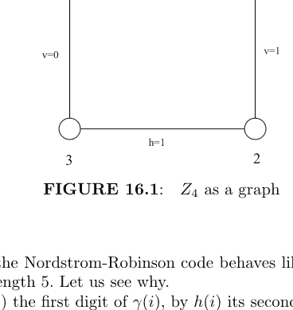

## 图 16.1：Z4 作为图

码。事实上，Nordstrom-Robinson 码表现得像一个自对偶二元码。它具有强度 5。让我们看看原因。

用 v(i) 表示 γ(i) 的第一位数字，用 h(i) 表示其第二位数字：

v(0,3)=0, v(1,2)=1, h(0,1)=0, h(2,3)=1.

这意味着对所有 i ∈ Z4，γ(i) = (v(i),h(i))。还注意到 h(i)=v(−i)。在 Z4 上引入图的结构，其中两个元素恰好当它们的差为 ±1 时构成一条边。原因在于 Z4 中两个不同的元素在 v 或 h 下具有相同的规定值当且仅当它们构成该图的一条特定边；参见图 16.1。

如果两个元素相差 2，则它们在该图中构成非边。对每个 i ∈ Z4，都有 v(i) ≠ v(2+i)，h 亦然。

现在将 N R 视为正交阵列。我们要证明它具有强度 5。用 s_i, i = 1,...,8 表示八元码的坐标，用 v_i 和 h_i 表示 i = 1,...,8 时 N R 的坐标。这里 v_i 中的条目是 s_i 中条目在 v 下的像，h_i 亦然。根据定义，八列 {v1,h1,...,v4,h4} 是独立的。

还使用练习 16.5.5 的结果：八元码的自同构群在八个坐标上是 3-传递的，并且在无序 4-元坐标集上只有两个轨道，其代表分别为 {1,2,3,4} 和 {1,2,3,8}。

设 M 为 Nordstrom-Robinson 码的五列集合。如果它们仅由三个坐标 s_i 导出，则由于自同构群的三重传递性，可以假设它们是 s1,s2,s3。由此可得 M 是独立的。如果 M 由四个坐标 s_i 导出，且这些坐标在 {s1,s2,s3,s4} 的轨道中，则同样成立。假设它们在 s1,s2,s3,s8 的轨道中。在此情况下我们可以假设 M = {v1,h1,v2,v3,v8}。x(a,b,c,d)（见公式 16.1）在这些坐标上的投影为 (v(a),h(a),v(b),v(c),v(a−b+c+2d))。固定 a,b,c。当 d 在 Z4 中变化时，最后一个坐标中的条目出现两次 0 和两次 1。由此可得 M 是独立的。

最后一种情况是 M 由八元码的五个不同列导出。由于八元码的自同构群是 3-传递的，它也在无序的五元坐标集上是传递的。我们可以假设涉及的列是 s1,...,s5。由于 h(i)=v(-i)，可以假设 M = {v1,v2,v3,v4,v5}。x(a,b,c,d) 的投影为 (v(a),v(b),v(c),v(d),v(2a+b+c+d))。再次，条目 2 是决定性的。事实上，固定 b,c,d。M 的第一个和最后一个坐标中的条目为 (v(a),v(2a+const))。当 a 在 Z4 中变化时，无论常数为何，该表达式都会遍历 F2^2 的全部。我们有 v(a)=0 当且仅当 a ∈ {0,3}=e，即图的边。然后 2a 在 0,2 中变化，v(2a+const) 在 0,1 中变化。

## **16.22 定理。** *Nordstrom-Robinson 码 NR 是一个强度为 5 的 OA。其参数因此为 OA8(5,16,2)。*

根据定义，NR 是系统化的。因此它描述了一个弹性函数 RF(16,8,5)2。

## 练习 16.5

- **16.5.1.** *设 C 是一个 [n,m,t+1]q 码。说明如何得到一个 RF(n,m,t)q。*
- **16.5.2.** *证明系统 OA2k-t(t,n,2) 可以嵌入到 F2^n 的一个划分中，该划分由 OA2k-t(t,n,2) 组成。*
- **16.5.3.** *给出 RF(n,m,t)q 对任意 q 的定义并证明 m+t ≤ n。为什么我们称之为 Singleton 界？*
- **16.5.4.** *证明不存在线性 [16,8,6]2 码。*
- **16.5.5.** *确定八元码的自同构群。*
- **16.5.6.** *确定 Nordstrom-Robinson 码的重量分布。*
- **16.5.7.** *设 G 为二元 Golay 码 [24,12,8]2，并选择记号使得前八个坐标构成一个八元组。设 D ⊂ G 为由前八个坐标中条目为 0 的码字组成的子码。证明 dim(D)=5 并且从 G 到前八个坐标的投影的像为和为 0 的码 [8,7,2]2。*
- **16.5.8.** *在前一练习的情形下，定义 D1 = D 且对 i = 2,...,8，子码 Di ⊂ G 为具有坐标 1 和 i 处条目为 1、在前八个坐标中其余位置条目为 0 的码字集合。设 E 为 D1 ∪ ... ∪ D8 在最后 16 个坐标上的投影。确定 E 的码参数。*

## 16.6 算法的去随机化

**基本概念：** 最大独立集问题。

一般过程最好通过详细研究一个特定问题来理解。我们选择在给定图中找到最大独立集顶点的问题。

### 最大独立集问题

考虑接受任意图 $G$（顶点集合为 $V$，边集合为 $E$）作为输入并输出最大独立顶点集 $I$ 的算法。因此 $I$ 中任意两个顶点之间没有边相连，且 $I$ 在此性质下是极大的。这里描述的方法源于 M. Luby [137]。我们的算法都遵循相同的一般方案：在第 $k$ 步给出一个独立集 $I_k$。设 $N(I_k)$ 为 $G$ 中不在 $I_k$ 中但至少与 $I_k$ 中的一个顶点相邻的顶点集合。设 $V_k = V \setminus (I_k \cup N(I_k))$ 且 $G_k = (V_k, E_k)$ 为 $G$ 在 $V_k$ 顶点上的诱导图。决定性步骤是在 $G_k$ 中构造一个独立集 $I'_k$。然后我们置 $I_{k+1} = I_k \cup I'_k$。这再次是一个独立集。算法在集合 $G_k$ 为空时终止。输出为最大独立集 $I = I_k$。

### 一个并行 Monte Carlo 算法

我们所需要的是一个能够快速在给定图上产生一个大独立集的算法。我们上面描述的构造 **最大** 独立集的算法归结为对该算法的重复应用。让我们称此步骤为 **CHOICE**。本小节描述的算法利用了并行化和随机位。我们称之为 **MC-CHOICE**。这里字母 MC 代表 **Monte Carlo**。

设图 $G = (V, E)$ 给定，并用 $d_i, i \in V$ 表示顶点 $i \in G$ 的度数。回想一下，**CHOICE** 步骤将对每个 $k$ 应用于图 $G_k$。算法 **MC-CHOICE** 定义如下：

- 并行计算顶点 $i \in V$ 的度数 $d_i$。
- 定义 $|V|$ 个统计独立的随机变量 $f_i : V \longrightarrow \{0,1\}$，如下：若 $d_i = 0$，则 $f_i = 1$。若 $d_i \neq 0$，则 $f_i = 1$ 的概率为 $1/(2d_i)$。这样 $V$ 及其幂集成为概率空间。顶点 $i$ 的度数越高，我们将其包含在大独立集中的概率越小。并行地对每个 $i \in V$ 根据这些概率计算一个值 $f_i \in \{0,1\}$。这定义了集合 $X = \{i \mid i \in V, f_i = 1\}$。
- 对每条边 $\{i,j\} \in E$ 并行计算：
  若 $\{i,j\} \in X$，则移除 $i$ 从 $X$，使得 $d_i \le d_j$。
- 顶点集合 $X$ 的结果是算法的输出，除非 $X$ 为空。在这种情况下，选择 $X$ 为仅含一个顶点的集合。

现在考虑在每一步中使用 **MC-CHOICE** 的算法。我们想要限制所需的步数。这是指使 $G_k$ 变为空的 $k$ 的值。由于算法中的随机元素，该数字不是输入数据的函数而是一个随机变量。我们对其期望值感兴趣。为此，必须研究 $E_k$ 中边数 $e_k$ 随 $k$ 的减少情况。细节见 [137]。结果如下：$e_k$ 的期望值满足 $E(e_{k+1}) \le \frac{7}{8}E(e_k)$。因此获得空图 $G_k$，从而终止算法所需的步数 $k$ 的期望值为 $O(\log|E|) = O(\log|V|)$。

### Monte Carlo 算法的去随机化

目标是减少或理想地消除 **CHOICE** 步骤中的随机元素，而不改变 resulting 算法的期望行为。让我们回顾前一小节中所做的工作：设 $k$ 固定且 $H = (V,E) = (V_k, E_k)$ 为给定图。我们将 $\mathbb{F}_2^V$ 作为概率空间的结构赋予其为空间 $\Omega_i = \mathbb{F}_2$ 的直积，其中概率 $p_i(1)=p_i=\frac{1}{2d_i}$，$p_i(0)=1-p_i$。该算法基于从该空间 $\mathbb{F}_2^n$ 中随机选择一个 $n$-元组，其中 $n = |V|$。相应的随机变量 $f_i$ 其中 $f_i(x_1,x_2,\ldots,x_n)=x_i$ 在统计上是独立的。

我们希望稍微改变 $f_i$ 并将新的随机变量表示在更小的概率空间上。新的算法将基于从该小样本空间中随机选择。这将导致随机元素的急剧减少。或者我们可以并行测试概率空间的每个元素。这就产生了一个确定性算法。在这种情况下，人们称之为 **完全去随机化**。The

关键点在于证明新的算法与前面考虑的 Monte Carlo 算法在本质上具有相同的行为。

构造如下：选取一个满足 n ≤ q ≤ 2n 的素数 q。将概率 p_i = 1/(2d_i) 替换为有理数 p_i' = ⌊p_i·q⌋/q = n_i/q ≤ p_i。使用 Reed-Solomon 码 RS(2, q)，它是一个具有 q^2 行的 OA1(2, q, q)。最终我们省略一些列并得到一个 OA1(2, q, q)，我们称之为 Ω。Ω 的行是我们的概率空间的元素，且服从均匀分布。随机变量 f_i' 构造如下：选取 N_i ⊆ F_q，|N_i| = n_i，令 f_i'(x1,x2,...,xn) = 1 当 x_i ∈ N_i 时，否则 f_i' = 0。这里 (x1,x2,...,xn) ∈ Ω。于是 f_i' 与 f_i 具有几乎相同的分布。虽然 f_i 在统计上相互独立，但 f_i' 仍然是 **pairwise independent**（见定理 16.2）。正如前一小节一样，需要研究算法的行为，其中 I_k 的构造由 Ω 的一行随机选择决定。

下面是 Luby 提出的算法，我们称之为 **RS-CHOICE**，因为随机要素已简化为 Reed-Solomon 码中一个码字的选择。令 n = |V|，选取素数 q，n ≤ q ≤ 2n，并如上所述置 p_i, p_i'。

- 如果存在顶点 i 使得 d_i ≥ n/16，则置 I' = {i}（注意这种情况最多可出现在 16 个 k 值中）。
- 假设对所有 i 都有 d_i < n/16。则 p_i' ≥ 8/q。而且 p_i' 可在两个方向上被 p_i 界定；更精确地，7/8 p_i ≤ p_i' ≤ p_i。执行 Monte Carlo 算法，它与 **MC-CHOICE** 仅在二元 n-元组是从 Reed-Solomon 码的行中均匀选取这一点上不同。

如果进行与之前相同的分析，将得到与 **MC-CHOICE** 情况定性相似的结果。更精确地，有

E(e_k − e_{k+1}) ≥ 1/18 · e_k。

结论：

我们考虑了图中的最大独立集问题的算法。所有算法都遵循开头描述的一般方案。关键点在于 **CHOICE** 算法，它在每一步中用于确定当前图的独立集。我们考虑了两种变体，**MC-CHOICE** 和 **RS-CHOICE**。两者都是并行算法并使用随机要素。在两种情况下全局算法的行为非常相似。这里最重要的一点是迭代的期望步数，作为图顶点数 n 的函数。在两种情况下迭代的期望步数均为 O(n)。决定性差异在于底层概率空间的大小。原始 Monte Carlo 算法 **MC-CHOICE** 使用

O(n) 随机比特（概率空间的大小为 2^n），而基于二维 Reed-Solomon 码的算法 **RS-CHOICE** 仅使用 O(log(n)) 随机比特。甚至可以通过测试 Reed-Solomon 码的所有行来构造确定性算法。通过在更小的概率空间上表示描述 Monte Carlo 算法的随机变量，同时保持算法的基本特征来减少随机比特数的方法称为 **derandomization**。如果随机要素被完全消除，则得到 **Complete derandomization**。在我们研究的情形中发现，只要随机变量是 pairwise independent 就足够了。这意味着我们可以使用强度为 2 的正交表来进行 derandomization。这个结果本应如此。原因是我们考虑的是图问题。因为图是由成对关系定义的<|message|> 结构，所以可以预期成对独立性是足够的。

## The formalism of derandomization

上面讨论的最大独立集问题的算法表明了一般情况下 derandomization 可能何时有效以及如何有效。出发点是一个使用大量统计独立随机变量的随机化算法。

- 假设对算法的分析表明，随机变量的 t-wise independence 足以保证基本特征，尤其是期望运行时间的数量级。

由于最大独立集问题只涉及图的边，因此 pairwise independence 足够并不令人惊讶。然而导致这一结论的分析并不简短或平凡。关键步骤是将二值随机变量 f_i（概率为 p_i 和 1 − p_i）替换为随机变量 f'_i（概率为 p'_i 和 1 − p'_i），它们与 f_i 差别不大，是 pairwise independent 且表示在较小的概率空间上。这由以下定义更精确地给出：

### 16.23 Definition.
设 f, f' 是具有相同有限值集 Z 的随机变量。则 f, f' 是 ε close，如果对每个 z ∈ Z 都有

|Pr(f = z) − Pr(f' = z)| ≤ ε.  (16.2)

在我们的例子中，我们用 p'_i 替换了概率 p_i，并在 derandomized 算法 **RS-CHOICE** 中确保可以假设 ⁷⁄₈ p_i ≤ p'_i ≤ p_i。这表明相应的随机变量是 ¹⁄₈ close。

### 16.24 Definition.
设随机变量 f_i, i = 1,2,...,n 定义在有限概率空间 Ω_i 上。(f1,f2,...,fn) 的一个表示是一个概率空间 Ω，其上定义了随机变量 g1,...,gn，使得对每个 i，g_i 的分布与 f_i 的分布相同。如果 Ω 具有均匀分布，则表示是均匀的；如果任意 t 个 g_i 在统计上相互独立，则它是 t independent。

在最大独立集问题的情形中，我们使用了强度为 2 的正交表，更精确地说是二维 Reed-Solomon 码，来构造 (f'_1, f'_2, ..., f'_n) 在 OA 行上的 two-independent 均匀表示。鉴于我们将强度为 t 的正交表解释为 t-wise independent 随机变量族（见第 16.1 节），以下结论是显然的：

### 16.25 Proposition.
设 f_i, i = 1,2,...,n 是定义在有限样本空间上的随机变量，且 Ω 是一个有限样本空间。进一步设 v 是一个自然数，使得出现在 f_i 分布中的每个概率 p 都有 p·v 为整数。如果存在 OA_k(t,n,v)，则在 Ω 的行上存在 (f1,...,fn) 的 t-independent 均匀表示。

我们现在可以表述 Monte Carlo 算法 derandomization 的剩余条件。这仍然是模糊的，因为它仍然未解决表明 t-wise independence 足够的分析是什么样的。

- 设 f1,f2,...,fn 是描述 Monte Carlo 算法的独立随机变量。假设存在随机变量 f'_i 使得 f_i 与 f'_i 对某个 0 ≤ ε < 1 是 ε close，并且 (f'_1, f'_2, ..., f'_n) 在某个概率空间 Ω 上具有 t-independent 表示。

如果这些条件得到满足，则我们可以将原始 Monte Carlo 算法的随机选择替换为从 Ω 中选择一个元素。由于 f'_i 与 f_i 是 ε close，可以证明新算法的期望步数将与 Monte Carlo 算法具有相同的数量级。ε 的值只会影响常数。自然我们希望 ε 尽可能小。在我们的例子中我们有 ε = 1/8，且 Ω 由 Reed-Solomon 码的行组成，具有均匀分布。derandomization 的效果随后由 Ω 的基数与 f_i 所定义概率空间的直接乘积的基数相比来衡量。如果 Ω 足够小，则可以通过遍历 Ω 的所有元素并继续使用给出最佳结果的元素来获得确定性算法。

在第 16.7 节中我们将利用另一种自由度。这源于对 t-wise independence 概念的弱化。t = 2 的情形将得到详细讨论。这个想法被证明是非常富有成效的。可以构造这样的数组，其性质与 2-independence 仅有轻微差异，但其基数远小于强度为 2 的正交表。


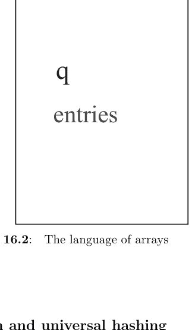

图 16.2：数组的语言

## 16.7 认证与通用哈希

在第 16.1 节中，正交数组是从概率观点来解释的。其行是概率空间的元素，而每一列描述了一个取值于条目集合中的随机变量。基本参数 t，即 OA 的强度，保证了该族随机变量的某种统计独立性条件。

在本节中，我们将从第 6 章引入的观点来看待一个数组，即作为一个映射族。我们用一个集合的元素（基集）来索引列，并将每一行解释为从基集到条目集合的映射。回顾定义 6.1，一个 $(n, M)_q$ 数组（或 $(n, M)_q$ 哈希族）是一个具有 n 行和 M 列的数组（矩阵），其中每个条目取自大小为 q 的字母表 Y。现在我们将数组的每一行解释为一个映射 $f : X ⟶ Y$，其中 $|X| = M$（$X$ 的元素参数化列）。

在第 6 章中，$(n, M)_q$ 哈希族被定义为 $\epsilon$ 通用，如果对于基集中任意两个不同元素的选择，碰撞的概率被 $\epsilon$ 所限制（参见定义 6.3）。事实证明，$\epsilon$ 通用哈希族等价于纠错码。给出了一个用于错误检测的应用。

我们下一个应用领域是认证。在深入之前，让我们先定义我们现在想要使用的哈希族的类型。

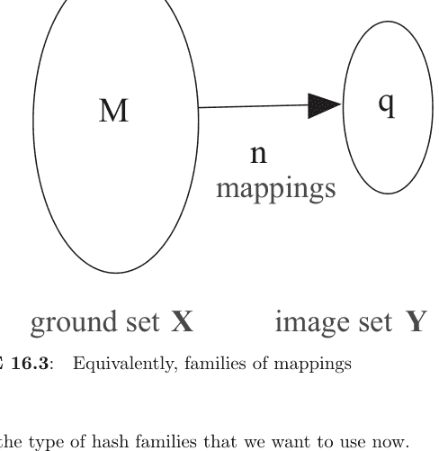

基集 X      像集 Y

图 16.3：等价地，映射族

### 16.26 定义. 一个 $(n,M)_q$ 哈希族是 $\epsilon$ 强通用 for some $0 < \epsilon < 1$ if the following are satisfied：

- 对于任意 $x \in X$ 和 $y \in Y$，使得 $f(x) = y$ 的映射 $f \in \mathcal{F}$ 的个数恰好为 $n/q$。
- 对于任意两个不同的元素 $x_1,x_2 \in X$ 和任意两个（不一定不同）的元素 $y_1,y_2 \in Y$，函数 $f \in \mathcal{F}$ 满足 $f(x_1)=y_1$，$f(x_2)=y_2$ 的个数 $\nu$ 满足 $\frac{\nu}{n/q} \le \epsilon$。

第一个条件说明在相应的数组中，每个条目在每一列中出现的频率相同（等价地，数组是强度为 1 的正交数组）。这促进了该结构的概率解释：我们知道恰好有 $n/q$ 个映射 $f$ 满足 $f(x_1)=y_1$。仅对这些函数加以限制。随机选择其中一个。第二个条件说明找到满足 $f(x_2)=y_2$ 的函数的机会 $\le \epsilon$。这意味着 $\epsilon$ 是条件概率的一个上界：$Pr(f(x_2)=y_2 \mid f(x_1)=y_1) \le \epsilon$（在 $f(x_1)=y_1$ 的条件下 $f(x_2)=y_2$ 的概率被 $\epsilon$ 所限制）。

## 认证

设 $\mathcal{A}$ 是一个 $\epsilon$ 强通用（$\epsilon$ SU）哈希族。我们要展示如何将其用作认证系统。将 $\mathcal{A}$ 与相应的数组等同。一个源产生要从发起者（**发送方**）通过公共信道发送给远程 **接收方** 的消息。为了能够区分两种类型的消息，即由源产生和通过信道（可能已加密或以其他方式更改）发送的消息，我们将源产生的信息称为 **源状态**，而通过信道发送的信息称为 **消息**。将源状态与数组的列等同（基集 $X$ 的元素）。我们在这里关注的不是保密性（保护正在传输的源状态的知识）也不是纠错（信道可能有噪声，我们可能希望使用纠错码），而是 **认证**。这意味着我们希望设计方案使接收方能够验证消息是否确实源自正确的发送方并且在传输过程中未被篡改。这正是 $\epsilon$ SU 族的定义属性发挥作用的地方。用映射 $f \in \mathcal{A}$ 作为 **密钥**。元素 $y \in Y$ 是 **认证符**。假设 $x \in X$ 是要传输的源状态。发送方和接收方将通过安全私有信道就使用的密钥 $f \in \mathcal{A}$ 达成一致。然后消息（包含 $x$，可能以加密形式，并为纠错目的而编码）将包含 **认证标签** $f(x) = y$。在接收到解码为 $x' \in X$ 且认证标签为 $y' \in Y$ 的消息后，接收方当且仅当 $f(x') = y'$ 时才接受其为真实的。注意，如果没有问题发生，则 $x' = x, y' = y = f(x)$，消息将被接受为真实。

为什么我们想要使用 $\epsilon$ SU 哈希族，$\epsilon$ 的含义是什么？想象一个对手可以访问通信信道。他的目的是扰乱系统，更具体地说，是使非真实消息被接受为真实。这一切都取决于对该对手能力的假设。考虑两种类型的攻击：

### 冒充攻击

总是假设对手知道系统。他的唯一问题是没有访问安全信道，因此对所使用的密钥没有先验信息。假设对手伪造一条消息并发送给接收方，声称其源自发送方。他试图最大化成功的机会。然而，定义 16.26 的第一个属性表明他的成功概率恰好为 $1/q$，其中 $q = |Y|$ 是认证符的数量。

### 替换攻击

假设对手不仅能够读取消息，还能够更改它们并将更改后的版本发送给接收方。对消息的了解使他对所使用的密钥有一些信息。假设他知道源状态 x（我们不希望对保密性做任何假设）。那么秘密密钥是满足 $f(x) = y$ 的映射 f 之一。对手如何利用这一知识来提高作弊的机会？他希望使一条不同的消息，即对应于源状态 $x' \ne x$ 的消息，被接受为真实。他必须选择一个认证标签 $y'$，使得以高概率 $y' = f(x')$。然而，定义 16.26 的第二个属性表明他的成功概率始终 $\le \epsilon$。注意，当 $x' \ne x$ 被选定后，对手的成功概率可以写成条件概率：$Pr(f(x') = y' \mid f(x) = y)$。这里 $x, x', y, y'$ 是给定的（$x' \ne x$），概率指的是对 $f \in A$ 的选择。

### 效率问题

我们已经看到如何将 $\epsilon$ SU 哈希族解释为一个认证系统（通常称为 **认证码**），其性质是对手在替换攻击下的成功概率被可证明地限制为 $\epsilon$。应该注意的是，对于每次源状态的传输，都必须随机生成一个新的密钥，并且该信息必须通过安全信道提前传输给接收方。为了获得可在实践中使用的系统，我们必须限制认证所需的时间和空间。

例如，如果有 $n = 2^{100}$ 个密钥且 $q = 2^{40}$，则认证符标签将有 40 位，而要通过安全信道发送的密钥信息将是一个长度为 100 的比特串。当消息数量为 $M = |X| = 2^{100}$ 时，使用这样的系统就没有什么意义了。我们无法承受将一半的传输时间用于认证目的。这就导致了效率问题。

参数 $M$（源状态的数量）和 $\epsilon$（安全级别）可以认为是给定的。我们希望构造认证系统，等价地是 $\epsilon$-SU 哈希族，使得密钥数量 $n$ 和认证符数量 $q$ 尽可能小。最合理的度量似乎是 $\log_2(n) + \log_2(q) = \log_2(nq)$。这是我们希望最小化的参数，其中 $M$ 和 $\epsilon$ 是给定的。


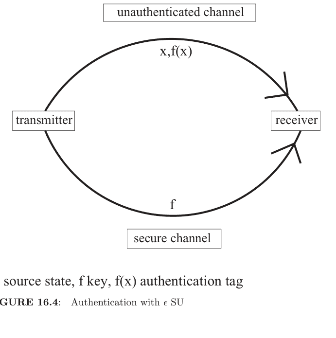

x 源状态，f 密钥，f(x) 鉴别标签

图 16.4：使用 ε SU 的鉴别

## 基本理论

回顾一下，ε U 哈希族不过是伪装的纠错码。特别地，码的每一条界都意味着 ε-U 哈希族的一条界。由于我们关注 ε 的较小值，对应的码需要具有极大的最小距离才对我们的应用有意义。这些情况下典型的界是 Plotkin 界，定理 9.3。用 ε U 哈希族的语言来说，它如下所述：

**16.27 Theorem (Plotkin bound).** *Let 𝒜 be an (n,M)_q hash family, which is ε U. If ε < 1/q, then*

$$M \le \frac{q(1 - \epsilon)}{1 - q\epsilon}.$$

我们转向 ε-SU 哈希族。留给读者验证 ε-SU 哈希族也是 ε-U（见练习 16.7.1）。由此可知 ε-SU 族满足比 ε-U 族更强的条件（后者等价于纠错码）。由于定义性质是用对应数组的列对来表述的，自然会与强度为 2 的正交数组进行比较。

**16.28 Theorem.** *Let 𝒜 be an (n,M)_q hash family, which is ε SU. Then ε ≥ 1/q. Equality holds if and only if 𝒜 is an orthogonal array of strength 2.*

**证明** 设 x, y, x′ 如前所述。随着 y′ 在 q-集 Y 上变化，我们看到条件概率 Pr(f(x′) = y′ | f(x) = y) 的最大值必须 ≥ 1/q。因此 ε ≥ 1/q。在等号成立的情况下，必须对所有如前的 x, y, x′, y′（x, x′ ∈ X, x′ ≠ x；y, y′ ∈ Y），满足 f(x)=y, f(x′)=y′ 的映射 f 的个数是一个常数，记为 λ。将它与正交数组的定义（定义 2.20）比较，我们看到得到的是强度为 2 的 OA。

定理 16.28 显示强度为 2 的 OA 是强通用哈希族的例子。然而，效率问题出现了。Bose-Bush 界（定理 9.6）表明强度为 2 的正交数组的行数 n（密钥）必须超过列数 M（源状态）。

因此，当用作鉴别方案时，强度为 2 的 OA 非常低效。这就提出了问题：对于略大于 1/q 的 ε 值，我们能否构造 ε SU (n,M)_q 哈希族使得 n 远小于 M。

## 直接构造

接下来我们构造一族非线性码，它们具有较大的最小距离并且也产生有趣的强度为 2 的 OA。该族的一个成员已在命题 9.7 中作为 Bose-Bush 界的例证构造出来。

设 Φ : 𝔽_{q^a} ⟶ 𝔽_q^b 是一个映射，关于 𝔽_q 线性且满射（这仅仅是从 a 维到 b 维向量空间的映射。由秩为 b 的 (a,b)-矩阵描述）。显然需要假设 a ≥ b。我们构造一个 q^b 元、长度 n = q^a、含 q^{a+b} 个码字的码，如下：

- 坐标由 u ∈ 𝔽_{q^a} 参数化，
- 码字由对 (x,y) 参数化，其中 x ∈ 𝔽_{q^a}, y ∈ 𝔽_q^b。
- 词 (x,y) 在位置 u 的分量为 Φ(ux) + y。这里 ux 是域 𝔽_{q^a} 中的乘积。

让我们确定该码的最小距离。设 (x1,y1) ≠ (x2,y2)。这些码字在坐标 u 上一致当且仅当 Φ(u(x1 − x2)) = y2 − y1。这里我们使用了 Φ 的 𝔽_q 线性。若 x1 = x2，则 y1 ≠ y2。在这种情况下码字的距离为 n = q^a。假设 x1 ≠ x2。由于 Φ 的核在 𝔽_q 上维数为 a − b，满足该方程的 u 的个数恰为 q^{a−b}。由此可知我们的码的最小距离为 d = q^a − q^{a−b}。

留给读者验证该码也是强度为 2 的正交数组；见练习 16.7.2。

**16.29 Theorem.** *For every prime-power q and natural numbers a ≥ b, there is an OA_{q^{a−b}}(2, q^a, q^b) whose rows form a code with minimum distance d = q^a − q^{a−b}.*

特别地，我们得到一个 (q^{a+b}, q^a)_{q^b} 哈希族，它是 q^{−b} U 甚至是 q^{−b} SU。

用映射的语言来说，我们有从 q^a 集到 q^b 集的 q^{a+b} 个映射，且该族是 q^{−b} 强通用的。作为一个玩具例子，我们可以使用命题 9.7 中的 OA_2(2,8,4)（情形 q = 2, b = 2, a = 3）。其行描述了从 8 集到 4 集的 32 个映射族。它是 1/4 SU。

**16.30 Theorem.** *Let q be a prime-power and k, a ≥ b natural numbers. There is a (q^{a+b}, q^{ka})_{q^b} hash family, which is k/q^b SU.*

## 证明

如前所述，固定一个满射的 $\mathbb{F}_q$ 线性映射 $\Phi : \mathbb{F}_{q^a} \longrightarrow \mathbb{F}_q^b$。构造一个数组 $\mathcal{A}$，有 $q^{ka}$ 列，$q^{a+b}$ 行，分量在 $\mathbb{F}_q^b$ 中，如下：

- 列由系数在 $\mathbb{F}_{q^a}$ 中、次数 ≤ k 且常数项 =0 的多项式 $p(X)$ 索引。
- 行由对 $(u,v)$ 索引，其中 $u \in \mathbb{F}_{q^a}$, $v \in \mathbb{F}_q^b$。
- 行 $(u,v)$ 与列 $p(X)$ 的分量为

$\Phi(p(u)) + v$

显然每列都以频率 $q^a$ 包含 $\mathbb{F}_q^b$ 中的每个元组。固定两个不同的列 $p_1(X), p_2(X)$ 和两个不一定不同的元素 $y_1, y_2 \in \mathbb{F}_q^b$。我们需要计数满足下列条件的行 $(u,v)$：

$\Phi(p_1(u)) + v = y_1$
$\Phi(p_2(u)) + v = y_2$

减去并利用 $\Phi$ 的线性性。这导致等价方程

$\Phi((p_1 - p_2)(u)) = y_1 - y_2$

该方程的每个解 $u$ 给出唯一确定的行 $(u,v)$。由于 $\mathbb{F}_q^b$ 中的每个元组在 $\Phi$ 下恰有 $q^{a-b}$ 个原像，且 $p_1(X) - p_2(X)$ 是次数 ≤ k 的非常数多项式，解的个数 ≤ $k \times q^{a-b}$。

定理 16.30 的情形 $k = 1$ 即定理 16.29 中的族。定理 16.30 产生一个用于 $q^{ka}$ 个源状态的鉴别方案，使用 $q^b$ 个鉴别符和仅 $q^{a+b}$ 个密钥，将对手在替换攻击中成功的概率限制为 $\epsilon = k/q^b$。定理 16.28 和 Bose-Bush 界表明，如果坚持最小可能值 $\epsilon = q^{-b}$，则需要多于 $q^{ka}$ 个密钥。

已知几种递归构造。它们共同点是纠错码是必不可少的组成部分。

## $q$-扭曲构造

该构造由 Kabatianskii、Smeets 和 Johansson [121] 给出。从包含全 1 词 $\mathbf{1}$ 的线性 $[n, k+1, d]_q$ 码开始。设 $\mathcal{C}$ 为不包含 $\mathbf{1}$ 的 $k$ 维子码。$\mathbf{1}$ 的存在表明 $\mathcal{C}$ 具有以下性质：对每个非零码字 $0 \ne x \in \mathcal{C}$ 和每个元素 $\alpha \in \mathbb{F}_q$，$\alpha$ 作为 $x$ 的分量的频率 $\nu(\alpha)$ ≤ $n - d$。

该构造思想可描述为随机化或均匀化，类似于 Justesen 码的构造（该思想也在定理 16.30 的族中使用）。每个码字 x ∈ C 被扩展为 qn-元组 x̃，其坐标由对 (i, α) 索引，其中 i 是 x 的一个坐标且 α ∈ F_q，分量为 x_i + α。我们的哈希族是列为 x̃ 的 (qn, q^k)_q 数组。显然每个域元素在每列中作为分量出现 n 次。这验证了定义 16.26 的第一个公理

对于定义 16.26 的第二个公理，固定两个不同的列（码字）x, y，两个不一定不同的分量 a, b 并计数行 (i, α) 使得 x̃ 在该行有分量 a 且 ỹ 有分量 b。这意味着 x_i + α = a, y_i + α = b，等价于 (x − y)_i = a − b。因此此类行的个数不超过 n − d。由此我们得到一个 ε-SU 数组，其中 ε = 1 − d/n。这证明了以下内容：

## 16.31 定理。

假设存在包含全 1 词的线性 [n, k + 1, d]_q 码。我们可以构造一个 (qn, q^k)_q 哈希族，它是 (1 − d/n) SU。

将定理 16.31 应用于 Reed-Solomon 码。由于它们是包含 1 的 [q, k + 1, q − k]_q 码，我们可以构造 (q^2, q^k)_q 哈希族，它们是 q−k/q-SU，对每个 k ≤ q − 1 成立。然而，这些参数对我们来说并不新。它们对应于定理 16.30 的特殊情形 a = b = 1。

## Stinson 复合

这里是 ε-SU 哈希族的另一个构造原理，Stinson 复合。用映射的语言最好理解它。

## 16.32 定理。

设 A1 为 ε1 U 的 (N1, n)_m 哈希族，A2 为 ε2 SU 的 (N2, m)_q 哈希族。复合 A = A2 ∘ A1 定义为复合 f = f2 ∘ f1 的多重集，其中 f_i ∈ A_i。则 A 是 ε − SU 的 (N1 N2, n)_q 哈希族，其中 ε = ε1 + ε2 − ε1 ε2 < ε1 + ε2。

## 证明

由于 A_i 是 N_i 个映射的多重集（i = 1,2），显然所有复合的多重集 A 由 N1 N2 个映射组成。我们有 A 是 (N1 N2, n)_q 哈希族。定义 16.26 的第一个条件得到满足。为了证明主要条件，我们使用概率语言。设 x1, x2 在基本集（x1 ≠ x2）中，z1, z2 在 q-集中给定。写 f ∈ A 为 f = f2 ∘ f1，设 y1 = f1(x1), y2 = f1(x2) 且 P = Prob(f(x1) = z1 | f(x2) = z2)。我们要证明 P ≤ ε1 + ε2 − ε1 ε2。首先考虑情形 z1 ≠ z2。我们有 P ≤ Prob(y1 ≠ y2) ε2 < ε2。情形 z1 = z2 更难：

P ≤ Prob(y1 ≠ y2) ε2 + Prob(y1 = y2).


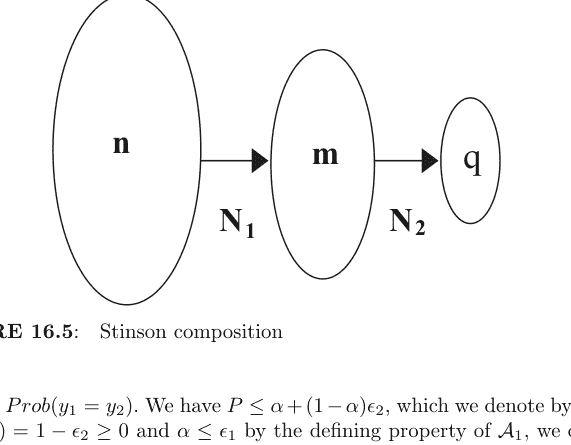

## 图 16.5：Stinson 组合

设 α = Prob(y₁ = y₂)。我们有 P ≤ α + (1 − α)ε₂，记为 h(α)。由于 h′(α) = 1 − ε₂ ≥ 0 且根据 𝒜₁ 的定义性质有 α ≤ ε₁，我们得到 P ≤ h(ε₁)，这就是我们的结论。

这种构造技术可用于获得相当高效的认证码。事实证明，通过将安全参数 ε 仅略微提高到其理论最小值之上，就可以用数量大幅减少的映射（密钥）获得 ε-SU 哈希族。我们称此效应为 Wegman-Carter 效应，因为它首次在他们的联合论文 [43, 218] 中被观察到。

让我们用定理 16.29 中的 OA 作为 𝒜₂ 的角色来应用 Stinson 组合定理 16.32。我们知道 𝒜₁ 是一个 ε₁-U 哈希族，等价于一个纠错码。特别地，Reed-Solomon 码 ℛ𝒮(k, q) 给出一个 (q, qᵏ)q 哈希族，其通用性为 (k − 1)/q。

Stinson 组合，使用 Reed-Solomon 码和定理 16.29 中的 OA（它们本身与 Reed-Solomon 码密切相关）作为成分，得到了有趣的强通用哈希族：

## 16.33 定理。

设 q 为素数幂且 a ≥ b。存在一个 (q^{2a+b}; q^{a q^{a-b}})_{q^b} 哈希族，其为 2q^{-b} SU。

**证明** ℛ𝒮(q^{a-b}, q^{a}) 给出一个 (q^{a}, q^{a q^{a-b}})_{q^{a}} 哈希族，其为 ε₁-U。这里 ε₁ = (q^{a-b} − 1)/q^{a} < q^{-b}。定理 16.29 中的一个 OA 给出一个 (q^{a+b}, q^{a})_{q^{b}} 哈希族，其为 q^{-b}-U。组合后有 q^{2a+b} 个成员。其作为强通用族的 ε 值为 ε ≤ ε₁ + q^{-b} < 2q^{-b}。

这里有一个示例来说明：

## 16.34 示例。

设 q = 2, b = 20, a = 32。定理 16.33 给出一个 (2^84, 2^17, 2^20) 哈希族，其为 2^-19-SU。在认证的语言中（第 16.7 节），我们看到可以用 20 个认证符位和 84 个密钥位对一个 2^17 位的源进行认证，使得欺骗概率限制在 2^-19。这说明了 Wegman-Carter 效应的惊人程度。如果我们坚持欺骗概率为 2^-20，同时仍只使用 20 个认证符位，那么根据定理 16.28，我们将被迫使用强度为 2 的 OA，从而由于 Bose-Bush 界，如前所述，导致密钥位多于 2^17。

## 关联记忆

在所有应用中，域 X 都被选为明显大于值域 Y。在计算机科学中，函数 f : X ⟶ Y 通常被称为哈希函数，如果意图是将 X 分区（哈希）成小块（在 f 下具有相同值的那些）。适当选择的哈希函数可用于搜索算法，如下所示：每当存储某个 x ∈ X 时，我们也存储值 f(x)（哈希值）。如果想检查某个 x ∈ X 是否已被存储，则首先计算哈希值，然后仅在具有该哈希值的 X 元素较短的列表中搜索。这是一个非常天真的应用。例如，想象一个编译器，其符号表中列出了某个程序中已使用的所有标识符。所有可能标识符的数量非常大，在 FORTRAN 中约为 1.62·10^9。可以采用 ε SU 族 A，其域为可能的标识符集合。随机选择 A 中的某个 f 并将其用作哈希函数。假设 x 是一个标识符。我们想检查它是否新颖。不要在我们巨大的集合中搜索，首先计算 f(x)，然后在所有满足 f(x') = f(x) 的 x' 列表中搜索。虽然实际上只使用了一个哈希函数 f，但这可被视为通用哈希的应用，因为哈希族的性质决定了算法的期望行为。

## 带计数器的多次认证

我们方法的一个缺点，如第 16.7 节所述，是每个密钥只能使用一次。假设我们想通过使用每个密钥对多个消息进行认证若干次来节省密钥位数。显然可以使用更高强度的 OA。然而，效率问题（见第 16.7 小节）施加了严格的限制。

正交表的 Rao 界是对 Bose-Bush 界的推广（见定理 15.38），表明密钥数量会大得太多。这里有一个绕过此问题的方法：

设 $\mathcal{A}$ 是一个 $(N,n)_m$ 哈希族，其为 $\epsilon$-SU，并对条目集合施加加法群的结构：$Y = \mathbb{Z}/m\mathbb{Z}$。我们希望能够用同一密钥认证多达 $w$ 个源状态。密钥是元组 $(f, y_1, \dots, y_{w-1})$，其中 $f$ 从 $\mathcal{A}$ 中随机选择，且 $y_i$ 从 $Y$ 中独立且均匀地随机选择。设 $(x_1, x_2, \dots, x_w)$ 是一个要使用同一密钥进行认证的源状态元组（$x_i \in X$，两两不同）。消息具有形式 $(i, x_i)$。这里 $i$ 是 **计数器**。

认证标签随后为 $f(x_1)$，如果 $i = 1$；如果是 $i > 1$，则为 $f(x_i) + y_{i-1}$。假设对手观察到多达 $w$ 条消息，这些消息已使用同一密钥进行认证。他利用此信息更改其中最后一条消息，使得源状态被某个 $x \notin \{x_1, x_2, \dots, x_w\}$ 替换，他的目的是使 $x$ 被接受为真实的。显然，他的成功概率仍被 $\epsilon$ 所限制。

## 公开讨论下的隐私放大

Bennett、Brassard 和 Roberts [10] 考虑了以下场景：假设发送方和接收方有两个信道可用：一个 **私有** 信道，其受对手攻击，以及一个经过良好认证的 **公共** 信道。对手从两个信道收集信息，并且有能力更改通过私有信道发送的消息。我们希望设计方法，利用通过公共信道的通信来改善通过私有信道发送的消息的 **认证** 或 **隐私**。这解释了标题中明显的悖论。在 Bennett 等人 [9] 的引言中，对隐私放大的描述如下：

> *Privacy amplification is the art of distilling highly secret shared information, perhaps for use as a cryptographic key, from a larger body of shared information that is only partially secret.*

让我们考虑私有信道上不发生传输错误的情况，因此不执行错误检测协议。假设发送方和接收方希望就长度为 $a$ 的秘密比特串达成一致，可能用于密码密钥。我们在简化假设下工作，即比特串 $x \in \mathbb{F}_2^a$，其由发送方生成并通过公共信道发送，以未更改的形式接收。我们希望限制对手通过窃听私有信道可能泄露的信息量。一切都取决于对窃听者能力的假设。考虑对手

具有自由选择 **窃听函数** $e : \mathbb{F}_2^a \longrightarrow \mathbb{F}_2^s$ 的情况。系统的设计者知道 $s$，但不知道函数 $e$，后者完全受窃听者控制。在第 16.5 节中，我们考虑了窃听者信息仅限于预定数量的物理位的情形。在那种情况下，通过使用较短的比特串 $f(x)$，其中 $f$ 是一个合适的公开已知的 **弹性函数**，可以完全消除窃听者的信息。在我们更困难的情况下，我们将使用同样的缩短字符串的想法来限制对手的信息。我们将使用一个 $\epsilon$ U 哈希族 $\mathcal{A}$，其域为 $X = \mathbb{F}_2^a$。映射 $f \in \mathcal{A}$ 由发送方随机选择并通过公共信道发送。发送方和接收方要使用的公共比特串随后为 $y = f(x)$。在我们的情况下，不再可能完全消除对手对 $y$ 的信息，但 $\mathcal{A}$ 的性质将带来实质性减少。

## 16.35 定义。

设 $X$ 是一个有限概率空间。

**碰撞概率** 定义为

$$p_c(X) = \sum_{x\in X} p(x)^2.$$

(第二阶) **Rényi 熵** 为 $R(X) = -\log(p_c(X))$。

回顾 $\log$ 为二进制对数。$p_c(X)$ 是从 $X$ 中进行两次独立抽样时抽到相同元素的概率。这显然与 $\epsilon$-U 哈希族的定义性质相关（见定义 6.3 及其后的解释）。Jensen 不等式（定理 8.7）表明 Rényi 熵 $R(X)$ 被 Shannon 熵 $H(X)$ 上界限制。

## 16.36 引理。

设 $X$ 是一个有限概率空间，$H(X)$ 为 Shannon 熵，$R(X)$ 为 Rényi 熵。则

$$H(X) \ge R(X).$$

## 16.37 引理。

设 $X$ 是一个具有 $n$ 个元素的概率空间，$\mathcal{A}$ 是一个 $(N,n)_m$ 哈希族，其为 $\epsilon$-U。每个 $f \in \mathcal{A}$ 都是映射 $f : X \longrightarrow Y$。从 $\mathcal{A}$ 中均匀随机选择 $f$（概率 $1/N$）。设 $H(Y|f)$ 和 $R(Y|f)$ 为由 $X$ 和 $f$ 定义的 $Y$ 上的概率分布的熵（$p(y)=\sum_x p(x)$，求和遍历所有满足 $f(x)=y$ 的 $x$）。则

$$H(Y|\mathcal{A}) \ge R(Y|\mathcal{A}) > -\log(p_c(X)+\epsilon).$$

这里 $H(Y|\mathcal{A})$ 是 $H(Y|f)$，$f \in \mathcal{A}$ 的期望值，$R(Y|\mathcal{A})$ 亦然。

**证明**

不等式 $H(Y|\mathcal{A}) \ge R(Y|\mathcal{A})$ 由引理 16.36 可得。Jensen 不等式表明 $R = R(Y|\mathcal{A})$ 为

$$R = -\frac{1}{N}\sum_{f\in\mathcal{A}} \log\Big(\sum_y\big(\sum_{f(x)=y} p(x)\big)^2\Big) \ge -\log\Big(\frac{1}{N}\sum_{f,y}\big(\sum_{f(x)=y} p(x)\big)^2\Big).$$


括号内的表达式是 $f \in \mathcal{A}$ 均匀随机选取且 $x_1,x_2$ 从 $X$ 独立选取时 $f(x_1)=f(x_2)$ 的概率。$x_1 = x_2$ 的概率是 $p_c(X)$。若给定 $x_1 \neq x_2$，则 $f(x_1)=f(x_2)$ 的概率 $\le \epsilon$，由 $\epsilon$-U 的定义可知。由此可知括号内的表达式 $< p_c(X) + \epsilon$。

回到我们的场景：设 $X = \mathbb{F}_2^a$，服从均匀分布。系统的设计者知道窃听者 Eve 拥有一个函数 $e : X \longrightarrow \mathbb{F}_2^s$。每当 $x \in X$ 被发送时，她就能获知 $z = e(x)$。发送方和接收方选择一个安全参数 $\sigma < a - s$。令 $r = a - s - \sigma$ 且 $\mathcal{A}$ 为定理 16.29 中构造的 $2^{-r}$-U 哈希族 $(2^{a+r}, 2^a)_{2^r}$。发送方在 $\mathcal{A}$ 中均匀随机选择 $f$ 并通过公共信道发送 $f$。发送方和接收方使用的共同密钥为 $y = f(x)$。我们需要证明窃听者对 $y$ 的信息非常少，等价地，尽管她知道 $f$ 和 $z$，$Y$ 的熵接近 $r$。

Eve 知道集合 $X(z) = \{x \mid e(x) = z\}$，其大小为 $n(z)$。将 $\mathcal{A}$ 限制在来自 $X(z)$ 的列上。由引理 16.37，$H(Y|z) > -\log\left(\frac{1}{n(z)} + 2^{-r}\right)$。这里我们使用 $\epsilon = 2^{-r}$ 且 $X(z)$（在均匀分布下）的碰撞概率为 $1/n(z)$。我们不能保证 $H(Y|z)$ 接近 $r$，但可以保证其期望值成立。注意到 $z$ 的概率为 $n(z)/2^a$。再次使用 Jensen 不等式：

$E(H(Y|z)) \ge -\log\left(2^{-r} + 2^{s}/2^{a}\right) = r - \log\left(1 + 2^{-\sigma}\right).$

如果增大 $\sigma$，则 Eve 对 $y = f(x)$ 的期望信息变得任意小。

此时回顾 Shannon 熵的基本解释。$Y$ 是一个具有 $2^{r}$ 个元素的均匀样本空间，所以 $H(Y) = r$。条件熵 $H(Y|z)$ 是在已知 $z = e(x)$ 时 $Y$ 的剩余熵。由此可知，差值 $H(Y) - H(Y|z)$ 表示 $z$ 关于 $Y$ 透露的信息量。在当前情况下，我们可以使该量的期望值任意小。构造中的主要成分是一个 $\epsilon$-U 哈希族，再次，这等价于一个纠错码。

- **哈希族** 可以被视为数组或从大集合到小集合的映射族。
- **通用哈希族** 在形式上等价于码。**相对最小距离** 是核心参数。
- **强通用哈希族** 是强度为 2 的正交数组的推广。
- Stinson 组合使用通用族（因此是码）和强度为 2 的正交数组作为成分。
- 一个重要的应用是 **无条件认证**。

## 练习 16.7

**16.7.1.** 设 $\mathcal{A}$ 是一个 $(N,n)_m$ 哈希族，且是 $\epsilon$ $SU$。证明 $\mathcal{A}$ 是 $\epsilon$ $U$。

**16.7.2.** 证明定理 16.29 中的码是 $OA_{q^{a-b}}(2, q^{a+b}, q^b)$，（其中 $a \ge b$）。

## 第 17 章
## 线性码的几何描述
### 17.1 线性码作为点集

**基本概念：** 投影几何。 主要定理。 六元码和单纯形码。 扩展 Reed-Solomon 码和正规有理曲线。 弧、卵形线、超卵形线及其码。 低维码和 Griesmer 界。 三元 Golay 码。 种 s 的弧、Barlotti 弧。 Denniston 弧。

我们从几何观点描述线性码。

### 投影几何

设 $V = V(k,q) = \mathbb{F}_q^k$ 为 $k$ 元组空间，是 $\mathbb{F}_q$ 上的 $k$ 维向量空间。直观上，将 $V$ 的一维子空间视为 **点**，二维子空间视为 **线** 是有意义的。主要原因是：任意两点恰好位于一条公共直线上。这是显然的（两个不同的<|message|> 一维子空间生成一个二维子空间）并且是几何中熟悉的公理。事实上，这就是全部要点：我们给向量空间 $V$ 的子空间赋予几何名称并使用几何直觉。

注意维度的变化：我们将一维子空间视为点（零维几何对象），二维子空间视为线（一维几何对象）等等。因此，由 $V(k,q)$ 导出的几何被认为是 $(k-1)$ 维的：$PG(k-1,q)$，$(k-1)$ 维 **射影几何**。它有 $k-1$ 种类型的对象，从点（一维子空间）到 **超平面**（$(k-1)$ 维向量子空间）。最常用的对象是点、线、平面（三维子空间）和超平面。

在第 10 章我们考虑了一个特例，**射影平面** $PG(2,q)$（阶为 $q$）。我们发现 $PG(2,q)$ 具有一些非常方便的几何性质：任意两点位于唯一一条直线上，任意两条直线相交于唯一一点。此外，我们能够枚举几何对象：有 $q^2+q+1$ 个点，同样多的直线，每条直线有 $q+1$ 个点，每个点位于 $q+1$ 条直线上。

一个“几何”上的原因说明点数必须是 $q^2+q+1$ 如下：固定一点 $P$。它位于 $q+1$ 条直线上。每条直线包含 $q$ 个不同于 $P$ 的点。在 resulting 图中 $PG(2,q)$ 的每个点恰好出现一次。我们计数 $1+(q+1)q$ 个点。

我们感兴趣的最低维情形是射影直线 $PG(1,q)$。它有 $q+1$ 个点（为什么？二维空间的一维子空间的个数是 $(q^2-1)/(q-1)=q+1$）。

我们希望对一般的 $PG(k-1,q)$ 有一些熟悉程度。对象的枚举与射影平面的情形一样容易。例如，点数为

$(q^k-1)/(q-1)=q^{k-1}+q^{k-2}+\cdots+q+1,$

等于超平面的个数（$V(k,q)$ 中有 $q^k-1$ 个非零向量，每个这样的向量确定一个点，但每个点包含 $q-1$ 个非零向量）。

例如，考虑 $PG(3,2)$。它有 $2^4-1=15$ 个点，因此也有 15 个平面。计数直线更有趣一些。由于任意两点确定一条直线，我们计数 $15\times14$（不同点的有序对数），这将每条直线计数 $3\times2$ 次（因为一条直线有 3 个点）。因此 $PG(3,2)$ 中直线的个数为 $15\times14/6=35$。

采用同样的方法，可以确定 $PG(3,q)$ 中直线的个数。由于有 $(q^4-1)/(q-1)=q^3+q^2+q+1$ 个点，直线的个数为

$(q^3+q^2+q+1)\times(q^3+q^2+q)/(q+1)q=(q^2+1)(q^2+q+1).$

计数 $PG(3,q)$ 中直线的另一种方法是：有 $q^3+q^2+q+1$ 个平面，每个包含 $q^2+q+1$ 条直线。乘积 $(q^3+q^2+q+1)(q^2+q+1)$ 将每条直线计数 $x$ 次，其中 $x$ 为经过给定直线的平面的个数。我们有 $x$ 是包含固定二维子空间的四维向量空间的三维子空间的个数。这与直线上点的个数相同：$x=q+1$。因此 $PG(3,q)$ 中直线的个数为 $(q^3+q^2+q+1)(q^2+q+1)/(q+1)=(q^2+1)(q^2+q+1)$。

固定 $PG(k-1,q)$ 中的一个超平面 $H$。$PG(k-1,q)$ 中位于 $H$ 外的点称为 **仿射点**（相对于 $H$）。它们构成 $(k-1)$ 维 **仿射几何** $AG(k-1,q)$。$AG(k-1,q)$ 中的点数为 $q^{k-1}$。

我们现在有信心，只要需要，就能够解决每一种此类计数问题。

### 主要定理

设 $\mathcal{C}$ 是一个线性 $[n,k,d]_q$ 码，由生成矩阵 $G$ 描述，其中第 $i$ 行第 $j$ 列的元素为 $a_{ij}$。思路是将 $G$ 的列视为 $PG(k-1,q)$ 中点的生成元。因此令 $P_j$ 为 $(a_{1j},a_{2j},\ldots,a_{kj})$ 生成的点，其中 $j=1,2,\ldots,n$。这里我们假设 $G$ 中没有 $0$ 列（如果有，对应的坐标是多余的，因为我们可以对该坐标进行 puncture 并得到一个 $[n-1,k,d]_q$ 码）。考虑 $PG(k-1,q)$ 中点的集合 $\mathcal{P}=\{P_1,P_2,\ldots,P_n\}$。实际上，$\mathcal{P}$ 不一定是集合而是点多重集，因为可能有不止一列 $G$ 生成相同的点（$G$ 的不同列可以相同或彼此是标量倍数）。作为多重集，每个点 $P$ 以其重数 $w(P)$ 计数，$w(P)$ 为生成点 $P$ 的 $G$ 的列数，$\mathcal{P}$ 的基数为 $n$。这是表达同一概念的两种方式。或者我们谈论 $PG(k-1,q)$ 中 $n$ 个点的多重集，或者谈论一个映射 $w$，它为每个点 $P\in PG(k-1,q)$ 分配一个非负整数权重 $w(P)$，使得 $\sum_{P} w(P)=n$。

几何描述的思想是从 $PG(k-1,q)$ 中点的多重集 $\mathcal{P}$ 中读出码参数。主要定理说明如何确定权重分布。

$\mathcal{C}$ 的码字是生成矩阵 $G$ 的行的线性组合。设 $G$ 的行为 $v_i=(a_{i1},a_{i2},\ldots,a_{in})$。每个码字具有形式 $x=c_1v_1+c_2v_2+\cdots+c_kv_k$，并由系数元组 $c=(c_1,c_2,\ldots,c_k)$ 唯一确定。固定一个坐标 $j$，由点 $P_j$ 索引。$x$ 在坐标 $j$ 处为 $0$ 是什么意思？它意味着 $c_1a_{1j}+c_2a_{2j}+\cdots+c_ka_{kj}=0$。

然而，以 $c_i$ 为系数的该线性关系定义了一个超平面。换句话说，$x_j=0$ 当且仅当点 $P_j$ 包含在该超平面中。由此可知 $wt(x)$ 等于 $\mathcal{P}$ 中不在该超平面内的点的个数。这已经是主要定理。

### 17.1 定理。

设 $\mathcal{C}$ 是一个线性 $[n,k]_q$ 码，$G=(a_{ij})$ 是一个生成矩阵，记号如上段所述且 $G$ 没有 $0$ 列。对于每个点 $P\in PG(k-1,q)$，令 $w(P)$ 为定义 $P$ 的 $G$ 的列数（$\sum_P w(P)=n$）。对于每个非零元组 $c=(c_1,c_2,\ldots,c_k)\in\mathbb{F}_q^k$，令 $c^\perp$ 为 $PG(k-1,q)$ 的超平面，由所有满足 $c\cdot y=0$ 的 $y=(y_1,y_2,\ldots,y_k)$ 组成。


*然后 x = c₁v₁ + c₂v₂ + ⋯ + cₖvₖ 的权重为*

$$ wt(x) = \sum_{P \notin \mathcal{C}^\perp} w(P). $$

* vᵢ 是 G 的行。特别地，最小权重 d 是从 𝒫 中在超平面之外（按多重集意义）的点的最小数量。*

写下这个定理比证明它更困难。即使 d = 0 的情况也有意义。当 𝒫 中的所有点都包含在超平面中时就会出现这种情况，这等价于 𝒞 的维数 < k。

注意每个线性码 𝒞 可以以多种不同的方式用点集描述。Gauß 消去的每一步（行运算）都会产生不同的点集而不会改变码。在几何上描述码时，码的等价性的适当概念是单项等价（参见第 12.4 节）。事实上，点的多重集 𝒫 在坐标置换下不变，也在列乘以非零标量时不变。这种方法的一个缺点在第 12.4 节中已指出：迹码和子域码的参数在这些运算下不是不变的。换句话说，如果我们想控制迹码和子域码的参数，几何描述就太粗糙了。

希望区分码可以用点集而不是多重集描述的情况（对每个点 P ∈ PG(k − 1, q) 有 w(P) = 0 或 w(P) = 1）。这可以很容易地从对偶码读出。事实上，如果 G 的两列描述相同的射影点，则对偶码 𝒞^⊥ 包含权重为 2 的字，反之亦然。这表明以下内容：

## 17.2 命题
*线性 [n,k]_q 码 𝒞 被称为射影的，如果存在一个生成矩阵其列生成不同的射影点。以下条件等价：*

- *𝒞 是射影码。*
- *生成矩阵的列描述不同的射影点。*
- *𝒞^⊥ 不包含权重为 2 的字。*

假设 G 的列不为 0 也可以用对偶权重表示。它等价于 𝒞^⊥ 中不存在权重为 1 的字。码是射影的当且仅当其对偶的最小权重 ≥ 3。

Simplex 码在几何上特别容易理解。第 3.4 节中给出的 𝒮_r(q) 的描述简单地说 𝒮_r(q) 由 PG(r − 1, q) 中的所有点集描述。定理 17.1 指出 𝒮_r(q) 的每个非零字的权重等于 AG(r − 1, q) 中的点数，即 q^{r−1}。我们得出 𝒮_r(q) 是一个 [ (q^r − 1)/(q − 1) , r , q^{r−1} ]_q 码，其中此外所有非零码字都有相同的权重 q^{r−1}。这类码被称为（线性）恒重码。

作为例子，𝒮₃(3) 的生成矩阵的列是 PG(2,3) 的 13 个点的代表，即阶为 3 的射影平面。所有非零权重都是 9。特别地，我们有一个 [13,3,9]₃ 码。生成矩阵已在第 3.4 节给出。

线性码的几何描述的魅力在于它为构造问题提供了完全不同的视角。我们需要的是射影几何中在某种意义上均匀分布的点集（或多重集）：没有超平面包含我们的大量点，换句话说：在每个超平面之外我们总是需要找到足够多的点。

## 六码
考虑阶为 4 的射影平面 PG(2,4) 中的一个例子。通常用 (a : b : c) 表示由 (a,b,c) 生成的点。对点而言称之为齐次坐标。考虑 PG(2,4) 中以下六个点的集合 O：

P₁ = (1 : 0 : 0), P₂ = (1 : 1 : 1), P₃ = (1 : ω : ω²),

P₄ = (1 : ω² : ω), P₅ = (0 : 0 : 1), P₆ = (0 : 1 : 0)

不难看出这些点中至多有两个位于同一条直线上，换句话说，连接我们两点的直线不会吞噬其余 4 个点中的任何一个。例如，考虑直线 P₁P₂。它由所有点 (a : b : b) 组成。O 中没有第三个点具有此性质。

设 C 是一个以 Pᵢ 的代表作为列的码（一个由点集 O 几何描述的码）。它是一个长度为 6 的四元码。注意，在射影平面中，直线是超平面。我们看到在任意直线之外至少有四个 O 的点。特别地，C 的维数为 3（因为 O 的六个点不在一条直线上），最小距离为 4。我们得出 C 是一个 [6,3,4]₄ 码。这就是我们多次见过的六码，最早见于练习 3.4.5 和 3.4.6。事实上，几何描述使得确定六码的权重分布变得容易。有 (6 choose 2) = 15 条直线与 O 相交于两点。这给我们 15 × 3 = 45 个权重为 4 的码字。没有直线与 O 精确相交于一点（固定 P ∈ O，连接 P 与其余五个点的直线有五条；由于 P 在 PG(2,4) 中位于五条直线上，没有空间留给切线）。由此可知 PG(2,4) 的其余 21 − 15 = 6 条直线完全避开 O。这产生 6 × 3 = 18 个权重为 6 的字。六码的权重分布因此为

A₀ = 1, A₄ = 45, A₆ = 18.

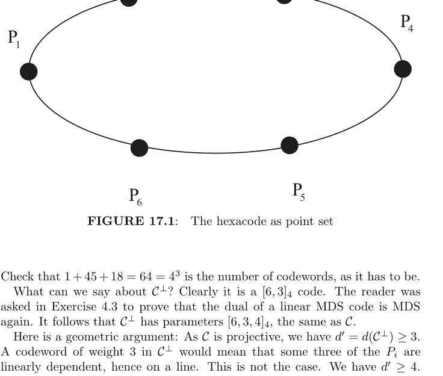

FIGURE 17.1: The hexacode as point set

检查 1 + 45 + 18 = 64 = 4³ 是码字的数量，正如它必须的那样。

关于 C^⊥ 我们能说什么？显然它是一个 [6,3]₄ 码。读者在练习 4.3 中被要求证明线性 MDS 码的对偶仍是 MDS。由此可知 C^⊥ 的参数为 [6,3,4]₄，与 C 相同。

这里有一个几何论证：由于 C 是射影的，我们有 d' = d(C^⊥) ≥ 3。C^⊥ 中权重为 3 的码字意味着 P_i 中的某些三个线性相关，因而在一条直线上。这不是这种情况。我们有 d' ≥ 4。由于 Singleton 界（或因为生成矩阵的任意四列线性相关），d' 不能更大，所以 d' = 4。

由于对偶性，六码具有强度 3。它是一个 OA₁(3,6,4)。

## 扩展 RS 码和正规有理曲线
从几何观点重新考虑 Reed-Solomon 码（第 4 章）。作为生成矩阵我们使用了 Vandermonde 矩阵。RS(k,q) 的生成矩阵的列生成点 P_u = (1 : u : u² : … : u^{k-1})，其中 u ∈ F_q。由于 RS(k,q) 是一个 [q,k,q−k+1]_q 码，根据定理 17.1，我们在每个超平面之外至少找到 q − (k − 1) 个点 P_u。这意味着 PG(k−1,q) 的每个超平面至多包含 k − 1 个这样的点。另一方面，PG(k − 1,q) 中的任意 k − 1 个点都包含在一个超平面中。我们得出结论，我们的任意 k − 1 个点必须生成一个超平面（而不是更低维的空间）：任意两点生成一条直线（这无论如何都是真的），任意三点生成一个平面（等价于没有三点共线），等等。

定义 P∞ = (0 : 0 : ⋯ : 0 : 1)。长度为 q + 1 且生成矩阵以 Pu 和 P∞ 的代表作为列的码称为扩展 k 维 Reed-Solomon 码。显然该矩阵的任意 k 列线性无关。我们得出 k 维扩展 Reed-Solomon 码具有强度 k，其对偶是一个 [q + 1, q + 1 − k, k + 1]q 码。由于对偶是 MDS，原码也是 MDS。我们的扩展 Reed-Solomon 码是一个 [q + 1, k, q + 2 − k]q 码。

在几何术语中，点集 {Pu | u ∈ Fq} ∪ {P∞} 被称为 PG(k − 1, q) 中的 **正规有理曲线**。我们看到该点集具有极值性质：任意 k − 1 个点的子集生成一个超平面（而不是更低维的空间）。

## PG(2, q) 中的卵形线和超卵形线
专门化到射影平面 PG(2, q)。正规有理曲线由点 Pu = (1 : u : u²)（u ∈ Fq）以及 P∞ = (0 : 0 : 1）组成。以这些点的代表作为列的矩阵生成扩展 Reed-Solomon 码 [q + 1, 3, q − 1]q。其对偶是一个 [q + 1, q − 2, 4]q 码。扩展 Reed-Solomon 码具有强度 3，特别地，正规有理曲线的任意三点不在一条直线上。

这似乎是一个反复出现的主题。PG(2, q) 中的正规有理曲线由 q + 1 个点组成，其中任意三点不共线，而六码是 PG(2, 4) 中六个点的集合，其中任意三点不共线。具有此性质的点的最大数量是多少？

### 17.3 定义
我们称点集 *共线* 如果点在同一条直线上。PG(2, q) 中的点集称为 **弧** 如果没有三点共线。n-弧是 n 个点的弧。

PG(2, q) 中弧的点的最大数量是多少？固定一个假设弧的点 P。由于 P 位于 q + 1 条直线上，并且通过 P 的每条直线至多包含弧的另一个点，弧的大小至多为 q + 2。相等是否可能？是的，正如我们所知。我们刚刚看到 PG(2, 4) 中的六码等价于形成一个弧的六个点集合。我们还拥有正规有理曲线，它表明我们总能找到一个 q + 1 个点的弧。为了解决这个问题，还需要决定 q + 2 个点的弧何时存在。

一个初等的几何计数论证表明，如果 q 为奇数，则大小为 q + 2 的弧永远不存在。假设它确实存在。经过其中一个的任意直线

points must contain a second point. In other words, there are no tangents to our arc. Now fix a point Q which does not belong to the arc. Each line through Q contains either zero or two points of the arc. In particular, the size q + 2 must be even. We have proved most of the claims of the following theorem:

## 17.4 定理。PG(2, q) 中的一个 (q + 1)-弧称为卵形线；一个 (q + 2)-弧是超卵形线。PG(2, q) 中弧的最大大小在 q 为偶数时为 q + 2；在 q 为奇数时为 q + 1。

In order to complete the proof of Theorem 17.4, we still have to prove that hyperovals exist in characteristic 2. More precisely, we will give a geometric proof for the fact that any oval in PG(2, q) can be embedded in a hyperoval, provided q is a power of 2.

Let O ⊂ PG(2, q) be an oval (ovals always exist, the normal rational curve being an example). Every point P ∈ O is on exactly one tangent (a line meeting O only in P). Call this tangent t_P. We are looking for a point N ∉ O such that O ∪ {N} is a hyperoval. This means that NP must be a tangent to O for every P ∈ O, hence NP = t_P. Here NP denotes the line determined by these two points N and P. It follows that we have to prove the following: the tangents to the points of O all intersect in one common point. This intersection point N of all tangents complements O to a hyperoval. In particular, each oval is contained in at most one hyperoval.

Now use the assumption that q is even. Start considering lines which do not contain a point of O (exterior lines). Let g be an exterior line and Q ∈ g. As q + 1 is odd, each point Q ∈ g is on at least one tangent to O. As there are q + 1 such tangents and also q + 1 points on a line, we must have equality: each point on an exterior line is on precisely one tangent t_P to O.

Now let N be the intersection of two tangents to O. By what we have just seen, there is no exterior line through N. How can that be possible? There are q + 1 lines through N and also q + 1 points on O. It must be that all lines NP where P ∈ O are tangents. This is what we wanted to see.

The proof of Theorem 17.4 is complete. Moreover, we saw that, in characteristic 2, each oval in PG(2, q) is contained in precisely one hyperoval, where the point complementing the oval to a hyperoval (some call it the nucleus) is the intersection of the tangents to the oval.

The hexacode is an example of this process. The points P1, . . . , P5 form an oval; in fact, they form the normal rational curve in PG(2, 4). Point P6 is the nucleus of this oval.

Let us sum up: we have seen that the Reed-Solomon codes from Chapter 4 can be extended (really lengthened). These extended Reed-Solomon codes are [q + 1, k, q + 2 − k]_q codes (for arbitrary k ≤ q). The geometric description is given by normal rational curves. In the special case k = 3 this yields an oval in PG(2, q). When q is even, each oval can be embedded in a hyperoval. Use the points of the hyperoval as columns of a generator matrix. This yields a [q + 2, 3, q]_q code.

## 17.5 命题。设 q 为 2 的幂。用 PG(2,q) 中一个超卵形线的代表作为生成矩阵的列定义一个 [q + 2, 3, q]_q 码。

The first example beyond the familiar hexacode is a [10,3,8]_8 code. Here is its generator matrix:

```
\begin{pmatrix}1&1&1&1&1&1&1&1&0&0\\0&1&\epsilon&\epsilon^2&\epsilon^3&\epsilon^4&\epsilon^5&\epsilon^6&0&1\\0&1&\epsilon^2&\epsilon^4&\epsilon^6&\epsilon&\epsilon^3&\epsilon^5&1&0\end{pmatrix}
```

## 二维码

Our newly gained geometric insight makes it easy to decide the existence of two-dimensional linear codes. When will a code [n,2,d]_q exist? Apply Theorem 17.1. The projective line PG(1,q) has q+1 points. Each point is a hyperplane. Let w_i be the weight of point P_i, i=1,...,q+1, where notation is chosen such that 0 ≤ w1 ≤ w2⋯ ≤ w_{q+1}. We must have w1+⋯+w_{q+1}=n and w1+⋯+w_q = d. In particular, the largest weight of a point is w_{q+1}= n−d. As w1+⋯+w_q is bounded by q w_{q+1}= q(n−d), the code will exist if and only if q(n−d) ≥ d, equivalently, if n ≥ (q+1)/q d. Compare this with the Griesmer bound (Theorem 5.7). It says that a necessary condition for an [n,2,d]_q code to exist is n ≥ d + ⌈d/q⌉. This is equivalent to n ≥ d + d/q = (q+1)/q d. It follows that the Griesmer bound is always met with equality in the case of two-dimensional codes.

### 17.6 定理。一个 [n,2,d]_q 码存在当且仅当 Griesmer 界不排除它。精确条件是 n ≥ d + d/q = (q+1)d/q。

As an example, what is the smallest n such that [n,2,8]_7 exists? The Griesmer bound shows n ≥ 8 + 8/7, so n ≥ 10. It follows from Theorem 17.6 that a [10,2,8]_7 does indeed exist. The largest weight of a point is n−d = 2. We can use as weights of points 2,2,1,1,1,1,1,1. This is not the only choice. Another possibility is to choose weights 2,2,2,2,2,0,0,0. One possible generator matrix corresponding to the former choice of weights is

```
G = \begin{pmatrix}0&0&1&1&1&1&1&1&1\\1&1&0&0&1&2&3&4&5&6\end{pmatrix}.
```

## 三维码

This is the lowest dimension where open problems remain. We want to prove that, for d large enough, there are always [n,3,d]_q codes meeting the
Griesmer bound, Theorem 5.7, with equality. More precisely, we claim that this is the case when d ≥ (q − 1)². Naturally, codes for large values of d cannot be projective. After all, PG(2,q) has only q² + q + 1 points. According to Theorem 17.1, we think of the code as described by nonnegative integer weights assigned to the points of PG(2,q). What is the effect of adding 1 to all the weights? The length will increase by q² + q + 1, the minimum distance by q². It follows that this translation operation transforms an [n,3,d]_q code into an [n + q² + q + 1,3,d + q²]_q code. If the former code meets the Griesmer bound with equality, the latter code does likewise. It will therefore suffice to prove our claim for values of d between (q − 1)² and (q − 1)² + q².

At first concentrate on values of d which are multiples of q, so d = qr, where q − 1 ≤ r ≤ 2q − 1. If r = q − 1, we obtain parameters [q²,3,q² − q]_q. Such a code is easily constructed; see Exercise 17.1.2. Case r = q leads to the Simplex code. We can assume q + 1 ≤ r ≤ 2q − 1 and need to construct [(q + 1)r + 2,3,qr]_q codes.

This is done geometrically, using the following trick: let s = 2q − r. Observe 1 ≤ s ≤ q − 1. Choose lines g₁,...,gₛ, which form a dual arc. It is clear what this means: no more than two of our lines intersect in a common point; in other words, no point of PG(2,q) is on more than two of the lines gᵢ. Why does such a dual arc exist? Simply start from an s-arc (of points) in PG(2,q) (we know it exists). If we read the homogeneous parameters (a : b : c) of these points as homogeneous parameters [a : b : c] = (a : b : c)⊥ of lines, we obtain a dual arc.

The weight function is w = 2PG(2,q) − (g₁ ∪ ⋯ ∪ gₛ). This means that a point P is assigned weight 2 if it is not contained in any of the lines gᵢ, weight 1 if it is contained in precisely one of those lines and weight 0 if it is the intersection of two such lines. The sum of the weights is n = 2(q² + q + 1) − s(q + 1) = (q + 1)r + 2, as required. Let h be a line which does not belong to the dual arc. Then Σ_{P∈h} w(P) = 2(q + 1) − s = r + 2. If g = gᵢ, we obtain Σ_{P∈g} w(P) = (q + 1) − (s − 1) = r + 2 − q. It follows that the weight distribution w defines a [(q + 1)r + 2,3,qr]_q code, as required. This code has in fact only two nonzero weights; it is a two-weight code. Now assume we are given an [n₀,3,qr]_q code meeting the Griesmer bound with equality. Let d = qr − δ, where δ < q. A corresponding Griesmer code has parameters [n₀ − δ,3,d]_q. Such a code certainly exists, as it can be constructed by repeated puncturing. We have proved the following:

### 17.7 定理。对每个 d ≥ (q − 1)²，存在一个 [n,3,d]_q-码满足 Griesmer 界、定理 5.7 且取等号；等价地 n = d + ⌈d/q⌉ + ⌈d/q²⌉。

Thanks to the dual arc construction and the normal rational curves (Reed-Solomon codes), we also have a recipe for how to construct these codes.

Theorem 17.7 was first proved by Hamada and Tamari [103].

Let us have a look at case d = (q − 1)² − 1 = q² − 2q. A code meeting the Griesmer bound with equality would have parameters [q² − q − 1,3,q² − 2q]_q.


Exercise 17.1.3 shows that such a code cannot exist.

练习 17.1.3 表明这样的码不存在。

For most smaller values of d, a three-dimensional code meeting the Griesmer bound with equality will have to be projective. Such codes are therefore described by sets of points (not multisets) in PG(2,q) such that there is an upper bound on line intersections. This leads to the following natural generalization of the notion of an arc.

对于大多数较小的 d 值，满足 Griesmer 界并取等号的三维码必须为投影码。因此，这样的码由 PG(2,q) 中的点集（而非多重集）描述，使得直线交点存在上界。这导致了弧概念的以下自然推广。

### 17.8 Definition.

*An n-arc of species s in PG(2,q) is a set of n points, no more than s of which are collinear.*

*PG(2,q) 中物种为 s 的 n-弧是一个包含 n 个点的集合，其中至多有 s 个点共线。*

In terms of codes this corresponds to

用码的语言来说，这对应于

### 17.9 Theorem.

*An n-arc of species s in PG(2,q) exists if and only if there is a projective [n,3,n−s]_q code.*

*PG(2,q) 中存在物种为 s 的 n-弧当且仅当存在投影 [n,3,n−s]_q 码。*

We expect [n,3,d]_q codes for small d and minimal n to be projective in most cases. Determining the minimal length n will then be equivalent to the determination of the largest cardinality n of arcs of species s (here s = n − d). This is a popular but deep problem of finite geometry, which is nowhere near solution. We conclude that there is little hope of ever obtaining the complete list of all parameters of three-dimensional codes over all finite fields.

我们期望对于较小的 d 和最小的 n，[n,3,d]_q 码在大多数情况下是投影的。此时确定最小长度 n 将等价于确定物种为 s 的弧的最大基数 n（这里 s = n − d）。这是一个热门但深刻的有限几何问题，离解决还很遥远。我们得出结论，几乎没有希望获得所有有限域上三维码的全部参数的完整列表。

## An anticode construction

## 反码构造

The geometric method describes a k-dimensional projective linear code as a set of points 𝒫 ⊂ PG(k−1,q). Sometimes it is easier to work instead with the complement 𝒬 = PG(k−1,q) \ 𝒫. In order to control the minimum distance of the code, we need an upper bound on hyperplane intersections of 𝒫. This is equivalent to a lower bound on the hyperplane intersections of 𝒬. This method of describing a code is known as the **anticode construction** in the coding community. Apparently the term was coined by Farrell [83]. The code geometrically described by 𝒬 is seen as an anticode, as we control not its minimum distance but its maximum distance. From a geometrical perspective such point sets with a lower bound on hyperplane intersections are also known as **min-hypers.**

几何方法将 k 维投影线性码描述为点集 𝒫 ⊂ PG(k−1,q)。有时转而使用补集 𝒬 = PG(k−1,q) \ 𝒫 更容易处理。为了控制码的最小距离，我们需要 𝒫 的超平面交点的上界。这等价于 𝒬 的超平面交点的下界。在编码学界，这种描述码的方法被称为 **反码构造**。据称该术语由 Farrell [83] 提出。用 𝒬 几何描述的码被视为反码，因为我们控制的不是其最小距离而是最大距离。从几何角度看，具有超平面交点下界的此类点集也被称为 **min-hypers。**

Clearly the method generalizes to nonprojective codes. If a code is described geometrically by a weight function w on PG(k−1,q) and l is the maximum weight, then its anticode is described by the weight function l − w.

显然该方法可以推广到非投影码。如果一个码由 PG(k−1,q) 上的权函数 w 几何描述，且 l 为最大权，则其反码由权函数 l − w 描述。

### 17.10 Example.

*Choose PG(u−1,q) ⊂ PG(k−1,q). Let the anticode be described by the points of the subspace. This means that the code itself is described by the points in PG(k−1,q) \ PG(u−1,q). The length is therefore*

*选取 PG(u−1,q) ⊂ PG(k−1,q)。令反码由子空间的点描述。这意味着码本身由 PG(k−1,q) \ PG(u−1,q) 中的点描述。长度因此为*

n = (q^k − 1)/(q − 1) − (q^u − 1)/(q − 1) = (q^k − q^u)/(q − 1).

*The dimension is of course k, as the complement of a proper subspace is not contained in a hyperplane. Each hyperplane either contains our PG(u − 1, q) or intersects it in a PG(u − 2, q). This shows that each word of our code has weight either q^{k−1} or q^{k−1} − q^{u−1}. We have constructed a code*

*维数当然是 k，因为真子空间的补集不包含在超平面中。每个超平面要么包含我们的 PG(u − 1, q)，要么与之相交于 PG(u − 2, q)。这表明我们码中的每个码字权值要么为 q^{k−1}，要么为 q^{k−1} − q^{u−1}。我们构造了一个码*

$$\left[\frac{q^{k} - q^{u}}{q - 1},\,k,\,q^{k-1} - q^{u-1}\right]_{q}$$

*for every q, k and u < k. These codes meet the Griesmer bound with equality.*

*对于每个 q、k 和 u < k。这些码满足 Griesmer 界并取等号。*

A thorough study of the anticodes construction in the binary case is in Belov, Logachev and Sandimirov [8]. We give one of the two major constructions from [8]. Let 1,2,…,k be a basis of the k-dimensional binary vector space underlying PG(k − 1, q). Let u1, u2, … ua be natural numbers such that 1 ≤ ui < k for all i and ∑i ui ≤ l for some l. Each of the numbers ui determines a ui-dimensional vector subspace Ui and therefore a PG(ui − 1, 2) ⟨Ui⟩ ⊂ PG(k − 1, 2). Here U1 is generated by the first u1 basis vectors, U2 by the next u2 basis vectors and so forth, where the basis is ordered cyclically. This explains why we need ui < k.

对二元情形的反码构造的深入研究见 Belov、Logachev 和 Sandimirov [8]。我们给出 [8] 中的两种主要构造之一。设 1,2,…,k 为 PG(k − 1, q) 所基于的 k 维二元向量空间的一个基。设 u1, u2, … ua 为自然数，使得对所有 i 有 1 ≤ ui < k 且 ∑i ui ≤ l 对某个 l 成立。每个数 ui 确定一个 ui 维向量子空间 Ui，因而确定一个 PG(ui − 1, 2) ⟨Ui⟩ ⊂ PG(k − 1, 2)。这里 U1 由前 u1 个基向量生成，U2 由接下来 u2 个基向量生成，以此类推，其中基按循环顺序排列。这解释了为何我们需要 ui < k。

Now fix a number x ≥ l. The multiplicity of P ∈ PG(k − 1, 2) is defined as x minus the number of i such that P ∈ ⟨Ui⟩. This means that we are taking away the points from the union of the subspaces (in the multiset sense: take the sum of the multiplicities) from x copies of PG(k − 1, 2). As ∑i ui ≤ l ≤ x, all points have nonnegative multiplicity, as it has to be. The length of the resulting code is n = x(2^k − 1) − ∑i (2^{ui} − 1); the minimum distance is d ≥ x2^{k−1} − ∑i 2^{ui−1}.

现在固定一个数 x ≥ l。P ∈ PG(k − 1, 2) 的重数定义为 x 减去满足 P ∈ ⟨Ui⟩ 的 i 的个数。这意味着我们是从 x 份 PG(k − 1, 2) 中减去子空间的并集的点（在多重集意义下：取重数的和）。由于 ∑i ui ≤ l ≤ x，所有点的重数非负，正如它应有的那样。所得码的长度为 n = x(2^k − 1) − ∑i (2^{ui} − 1)；最小距离为 d ≥ x2^{k−1} − ∑i 2^{ui−1}。

### 17.11 Theorem. Let u1, u2, …, ua be natural numbers such that 1 ≤ ui < k, ∑i ui ≤ l. Pick x ≥ l. If either x > l or k > 2, then the binary code C(B1) constructed above has parameters

### 17.11 定理。设 u1, u2, …, ua 为自然数，使得 1 ≤ ui < k，∑i ui ≤ l。取 x ≥ l。若 x > l 或 k > 2，则上述构造的二元码 C(B1) 的参数为

$$\left[x(2^{k} - 1) - \sum_{i}(2^{u_{i}} - 1),\,k,\,\ge x2^{k-1} - \sum_{i}2^{u_{i}-1}\right]_{2}$$

To complete the proof of Theorem 17.11, it remains to show that the dimension of C(B1) is not < k. This is left to the reader; Exercise 17.1.15. Theorem 17.11 has been used primarily to find binary linear codes meeting the Griesmer bound with equality; see Exercise 17.1.16.

为完成定理 17.11 的证明，还需证明 C(B1) 的维数不 < k。这留给读者；练习 17.1.15。定理 17.11 主要用于寻找满足 Griesmer 界并取等号的二元线性码；参见练习 17.1.16。

## The ternary Golay code

## 三元 Golay 码

It has been mentioned repeatedly that a perfect code [11,6,5]3 exists and has a self-dual lengthening [12,6,6]3. We illustrate the geometric method by starting from parameters [12,6,6]3 and arriving at a construction for the code. Along the way we will find useful information about this code.

反复提到存在一个完美码 [11,6,5]3 且具有自对偶延拓 [12,6,6]3。我们通过从参数 [12,6,6]3 出发并得到该码的构造来说明几何方法。在此过程中我们将找到有关该码的有用信息。

Let C be a [12,6,6]3 code and Q a corresponding multiset of twelve points in PG(5,3) which has the property that it intersects each hyperplane PG(4,3) in at most six points. Denote subspaces PG(3,3) as solids. An i-hyperplane is a hyperplane intersecting Q precisely in cardinality i.

设 C 为一个 [12,6,6]3 码，Q 为 PG(5,3) 中对应的十二个点的多重集，其性质是它与每个超平面 PG(4,3) 的交点至多为六个。将子空间 PG(3,3) 记为固体。i-超平面是指与 Q 的交点基数为 i 的超平面。

### 17.12 Lemma. Each solid intersects Q in at most four points. In the case of equality each hyperplane containing the solid is a 6-hyperplane.

### 17.12 引理。每个固体与 Q 的交点至多为四个点。在等号成立的情况下，包含该固体的每个超平面都是 6-超平面。

### PROOF

### 证明

Let S be a solid. If it intersects Q in cardinality 6, we can find a hyperplane with a higher intersection cardinality (always in the multiset sense). Assume |S ∩ Q| = 5. As S is contained in four hyperplanes, the cardinality of Q is bounded by 5 + 4 = 9, a contradiction. The same counting argument shows that, in the case of intersection cardinality four, each hyperplane containing S must have six points of Q.

设 S 为一个固体。若它与 Q 的交点基数为 6，我们可以找到一个交点基数更高的超平面（始终在多重集意义下）。假设 |S ∩ Q| = 5。由于 S 包含于四个超平面中，Q 的基数被限制为 5 + 4 = 9，这与假设矛盾。相同的计数论证表明，在交点基数为四的情况下，包含 S 的每个超平面必须有六个 Q 的点。

Assume Q is not projective. A point Q of weight ≥ 2 is contained in a line of intersection cardinality ≥ 3 and so forth until we reach a solid with intersection cardinality ≥ 5, which is impossible by Lemma 17.12. So Q is a set of 12 points.

假设 Q 不是投影的。权值 ≥ 2 的点 Q 包含在一交点基数 ≥ 3 的直线上，等等，直到我们得到一个交点基数 ≥ 5 的固体，这根据引理 17.12 是不可能的。所以 Q 是一个包含 12 个点的集合。

The same elementary counting argument shows that any three points of Q generate a plane, any four points generate a solid and any five points generate a hyperplane. In other words, any five points of Q are in general position, meaning that vectors representing those points are linearly independent. In coding terms this means that the dual distance (the distance of the dual code C⊥) is d′ ≥ 6. Clearly d′ = 6. It follows that C⊥ has the same parameters [12,6,6]3 as C itself.

相同的初等计数论证表明，Q 的任意三点生成一个平面，任意四点生成一个固体，任意五点生成一个超平面。换句话说，Q 的任意五点都处于一般位置，意味着表示这些点的向量线性无关。用编码术语来说，这意味着对偶距离（对偶码 C⊥ 的距离）为 d′ ≥ 6。显然 d′ = 6。由此可知 C⊥ 具有与 C 相同的参数 [12,6,6]3。

By Lemma 17.12 there are no 5-hyperplanes. Each hyperplane containing five points of Q meets Q in precisely six points. There are therefore precisely (12 choose 5)/6 = 132 such 6-hyperplanes. The number of minimum weight words in C is A6 = 2 · 132 = 264. The situation can be expressed in terms of designs. If we use the intersections with 6-hyperplanes as blocks, a Steiner system S(5,6,12) is obtained. This design is known as the small Witt design (maybe we should wait until we know that the underlying code exists).

根据引理 17.12，不存在 5-超平面。每个包含 Q 中五个点的超平面与 Q 的交点恰好为六个。因此恰好有 (12 choose 5)/6 = 132 个这样的 6-超平面。C 中最小权码字的个数为 A6 = 2 · 132 = 264。该情形可以用设计来表达。如果我们以与 6-超平面的交集作为块，则得到一个 Steiner 系统 S(5,6,12)。该设计被称为小 Witt 设计（也许我们应该等到知道底层码存在后再说）。

As there are no 5-hyperplanes and no 4-hyperplanes, we have A7 = A8 = 0. Consider a set T of three points in Q, and E the plane generated by T. Each hyperplane through E is either one of the 6-hyperplanes or a 3-hyperplane. Let x be the number of 6-hyperplanes containing E. Count pairs (Q, H) where Q ∈ Q \ T, H is a 6-hyperplane containing E and Q ∈ H. Counting two ways, the result is 9 × 4 = x × 3, hence x = 12. As there are 1+3+9 = 13 hyperplanes containing E, we conclude that any three points of Q are on precisely one 3-hyperplane. The number of 3-hyperplanes is therefore (12 choose 3) = 220, and we have A9 = 440. As 2-hyperplanes and 1-hyperplanes cannot exist (A10 = A11 = 0), the number of 0-hyperplanes follows from the

由于不存在 5-超平面和 4-超平面，我们有 A7 = A8 = 0。考虑 Q 中的三点集合 T，以及由 T 生成的平面 E。穿过 E 的每个超平面要么是 6-超平面，要么是 3-超平面。设 x 为包含 E 的 6-超平面的个数。计数对 (Q, H)，其中 Q ∈ Q \ T，H 为包含 E 的 6-超平面且 Q ∈ H。两种计数方式得到 9 × 4 = x × 3，故 x = 12。由于包含 E 的超平面有 1+3+9 = 13 个，我们得出 Q 的任意三点恰好位于一个 3-超平面上。因此 3-超平面的个数为 (12 choose 3) = 220，且我们有 A9 = 440。由于 2-超平面和 1-超平面不可能存在（A10 = A11 = 0），0-超平面的个数由

number $(3^6 - 1)/2 = 364$ of all hyperplanes. We have determined the weight distribution of $\mathcal{C}$ :

所有超平面的个数 $(3^6 - 1)/2 = 364$ 决定。我们已确定了 $\mathcal{C}$ 的权分布：

$A_0 = 1,\ A_6 = 264,\ A_9 = 440,\ A_{12} = 24.$

$A_0 = 1,\ A_6 = 264,\ A_9 = 440,\ A_{12} = 24.$

Write a generator matrix in the form $G = (I|P)$, where $I$ is the $(6,6)$ unit matrix and $P$ is a $(6,6)$ matrix. The points in $\mathcal{Q}$ are those generated by the columns of $G$. As all weights are multiples of $3$, each codeword is orthogonal to itself. Lemma 17.12 shows that no column of $P$ has more than one $0$. Consider five points from the left, corresponding to elementary vectors (columns of the unit matrix). The hyperplane generated by these five points must contain a point on the right, generated by a column of $P$. It follows that we can arrange the columns of $P$ such that $P$ has zeroes in the main diagonal, and all entries off the main diagonal are nonzero.

写一个生成矩阵的形式为 $G = (I|P)$，其中 $I$ 为 $(6,6)$ 单位矩阵，$P$ 为 $(6,6)$ 矩阵。$\mathcal{Q}$ 中的点由 $G$ 的列生成。由于所有权值都是 3 的倍数，每个码字都与自身正交。引理 17.12 表明 $P$ 的列中没有超过一个 $0$。考虑左侧的五个点，对应于基本向量（单位矩阵的列）。由这五个点生成的超平面必须包含右侧的一个点，由 $P$ 的一列生成。由此可知我们可以排列 $P$ 的列，使得 $P$ 在主对角线上为零，且主对角线外的所有元素非零。

Let $v_1,\dots,v_6$ be the rows of $G$, and write $v_i = (e_i|w_i)$, where $w_i$ is the $i$-th row of $P$. We have $wt(v_i - v_j) = 6$ for $i \neq j$, so $wt(w_i - w_j) = 4$. In other words, $w_i$ and $w_j$ agree in precisely two coordinates. Of the four coordinates where both $w_i$ and $w_j$ are nonzero, in two coordinates the entries are equal, and in two they are different. This shows $w_i \cdot w_j = 0 = v_i \cdot v_j$. As we also have $v_i \cdot v_i = 0$, it follows that all words of $\mathcal{C}$ are orthogonal to one another: $\mathcal{C} \subseteq \mathcal{C}^\perp$. For dimensional reasons $\mathcal{C} = \mathcal{C}^\perp$ : our code is self-dual. Different rows of $P$ are orthogonal to each other, whereas $w_i \cdot w_i = 2$. This shows in particular that $P$ is a nonsingular matrix: $\det(P) \neq 0$; equivalently, the rows of $P$ are linearly independent.

设 $v_1,\dots,v_6$ 为 $G$ 的行，并写 $v_i = (e_i|w_i)$，其中 $w_i$ 为 $P$ 的第 $i$ 行。我们有 $wt(v_i - v_j) = 6$ 对 $i \neq j$，所以 $wt(w_i - w_j) = 4$。换句话说，$w_i$ 和 $w_j$ 在恰好两个坐标上一致。在 $w_i$ 和 $w_j$ 均非零的四个坐标中，在两个坐标上元素相等，在两个坐标上不同。这表明 $w_i \cdot w_j = 0 = v_i \cdot v_j$。由于我们也有 $v_i \cdot v_i = 0$，由此可知 $\mathcal{C}$ 的所有码字彼此正交：$\mathcal{C} \subseteq \mathcal{C}^\perp$。由于维数原因 $\mathcal{C} = \mathcal{C}^\perp$：我们的码是自对偶的。$P$ 的不同行彼此正交，而 $w_i \cdot w_i = 2$。这特别表明 $P$ 是一个非奇异矩阵：$\det(P) \neq 0$；等价地，$P$ 的行线性无关。

We show now that $P$ can be brought in a special form when we use the following operations:

我们现在证明当使用以下运算时，$P$ 可以化为特殊形式：

- Row operations on $G$ (change of basis of $\mathcal{C}$), and
- 对 $G$ 的行运算（$\mathcal{C}$ 的基变换），以及
- Monomial operations on the columns of $\mathcal{C}$ (permutations of the columns and multiplication of columns by nonzero constants).

- 对 $\mathcal{C}$ 列的单项式运算（列的置换和列乘以非零常数）。

Compare Section 12.4. The monomial group has order $2^{12}12!$.

参见第 12.4 节。单项式群的阶为 $2^{12}12!$。

As columns of $P$ are determined only up to scalar multiples, we can choose $w_1 = (0,1,1,1,1,1)$. By changing the sign of one or several rows of $P$, we can make sure the first column of $P$ is $(0,1,1,1,1,1)^t$. This will change some of the entries $1$ on the diagonal of $I$ into $2$, but we can correct that by multiplying the corresponding columns by $2$. So far we have $P = \begin{pmatrix}0&1&1&1&1&1\\1&0&\pm1&\pm1&\pm1&\pm1\\1&\pm1&0&\pm1&\pm1&\pm1\\1&\pm1&\pm1&0&\pm1&\pm1\\1&\pm1&\pm1&\pm1&0&\pm1\\1&\pm1&\pm1&\pm1&\pm1&0\end{pmatrix}$. Because of orthogonality, $w_2$ has two entries $1$ and two entries $2$ in the last four coordinates. We can choose $w_2 = (1,0,1,1,2,2)$. Eventually the last four columns have to be suitably permuted. This moves the $0$ entries of those

由于 $P$ 的列仅在标量倍数意义下确定，我们可以选择 $w_1 = (0,1,1,1,1,1)$。通过改变 $P$ 的一行或几行的符号，我们可以确保 $P$ 的第一列为 $(0,1,1,1,1,1)^t$。这会将 $I$ 对角线上的某些 $1$ 变成 $2$，但我们可以通过将相应列乘以 $2$ 来纠正。到目前为止我们有 $P = \begin{pmatrix}0&1&1&1&1&1\\1&0&\pm1&\pm1&\pm1&\pm1\\1&\pm1&0&\pm1&\pm1&\pm1\\1&\pm1&\pm1&0&\pm1&\pm1\\1&\pm1&\pm1&\pm1&0&\pm1\\1&\pm1&\pm1&\pm1&\pm1&0\end{pmatrix}$。由于正交性，$w_2$ 在最后四个坐标中有两个 $1$ 和两个 $2$。我们可以选择 $w_2 = (1,0,1,1,2,2)$。最终最后四列必须适当置换。这会移动那些

将列置于不期望的位置，这可通过行的一种合适的置换来纠正。第一六列中 1 的条目的所得置换可通过另一个列置换来纠正。注意每个 $w_i$，$i > 1$ 在最后五个坐标中各有两个条目 1 和两个条目 2。这足以证明 $P$ 的第 2 列中的条目是唯一确定的。

```
$P = \begin{pmatrix} 0 1 1 1 1 1 \\ 1 0 1 1 2 2 \\ 1 1 0 \pm1 \pm1 \pm1 \\ 1 1 \pm1 0 \pm1 \pm1 \\ 1 2 \pm1 \pm1 0 \pm1 \\ 1 2 \pm1 \pm1 \pm1 0 \end{pmatrix}$.
```

已确定。我们有 $P = $ 。中心和东南部的 $(2,2)$ 方块中的条目也是唯一确定的：

```
$P = \begin{pmatrix} 0 1 1 1 1 1 \\ 1 0 1 1 2 2 \\ 1 1 0 2 \pm1 \pm1 \\ 1 1 2 0 \pm1 \pm1 \\ 1 2 \pm1 \pm1 0 1 \\ 1 2 \pm1 \pm1 1 0 \end{pmatrix}$.
```

在交换最后两列的位置（并遵循上述过程）的前提下，我们可以取 $p_{35}=1$，$p_{36}=2$。$P$ 的其余条目是唯一确定的。我们有

```
$P = \begin{pmatrix} 0 1 1 1 1 1 \\ 1 0 1 1 2 2 \\ 1 1 0 2 1 2 \\ 1 1 2 0 2 1 \\ 1 2 1 2 0 1 \\ 1 2 2 1 1 0 \end{pmatrix}$.
```

由于 $P$ 是对称的，由强度 5 可知其任意五行都是独立的。生成矩阵为

```
$G = \begin{pmatrix} 1 0 0 0 0 0 1 1 1 1 1 \\ 0 1 0 0 0 0 1 0 1 1 2 2 \\ 0 0 1 0 0 0 1 1 0 2 1 2 \\ 0 0 0 1 0 0 1 1 2 0 2 1 \\ 0 0 0 0 1 0 1 2 1 2 0 1 \\ 0 0 0 0 0 1 1 2 2 1 1 0 \end{pmatrix}$.
```

从矩阵 $G$ 出发，很容易验证它生成一个自对偶的 $[12,6,6]_3$ 码。事实上，由于自对偶性，所有权值都可被 3 整除，因此只需排除权值 3。涉及 $G$ 中超过三行的线性组合不会构成危险。由于 $P$ 的行线性无关，具有恰好三个非零系数的线性组合的权值也 $>3$。由于 $G$ 的行权值为 6，只需证明当 $i\neq j$ 时 $w_i+w_j$ 和 $w_i-w_j$ 的权值 $>1$，这显然成立。由此可知 $G$ 是自对偶 $[12,6,6]_3$ 码的生成矩阵，即三元 Golay 码 $\mathcal{G}_{12}$。

## 𝒢₁₂ 的自同构群。

前一小节的讨论表明，在单项等价意义下恰好存在一个 $[12,6,6]_3$ 码。我们实际上可以确定其自同构群。设 Aut(𝒢₁₂) 为三元 Golay 码 𝒢₁₂ 的自同构群。更精确地说，它是在阶为 $2^{12}12!$ 的单项群下的 𝒢₁₂ 的稳定子。

我们需要对单项运算做一些更多的练习。单项群的每个元素都将写成 g = πm，其中 π 是 {1,2,…,12} 的一个置换，且 m = m(1,2,…,12) = (m₁,m₂,…,m₁₂) ∈ {1,2}¹²。对于置换 π，我们使用第 12.4 节中引入的循环记号。元素 g 的作用首先按照 π 置换 G 的列，然后对所有 i 将第 i 列乘以 mᵢ。元素 g 属于 Aut(𝒢₁₂) 当且仅当它稳定三元 Golay 码 𝒢₁₂ = ⟨v₁,v₂,v₃,v₄,v₅,v₆⟩，换句话说，若对所有 i = 1,…,6，vᵢ 在 g 下的像包含于 𝒢₁₂。

如果 π 是恒等置换会怎样？我们留给读者验证 m = (m₁,…,m₁₂) ∈ Aut(𝒢₁₂) 当且仅当所有 mᵢ = 1 或所有 mᵢ = 2。用 −1 表示后者元素。

生成矩阵 G 的列生成点集 𝒬 = {Q₁,Q₂,…,Q₁₂} ⊂ PG(5,3)。Aut(𝒢₁₂) 中的每个元素 g 都诱导出 𝒬 的一个置换。这个置换当然就是 π，其中 g = πm。

### 17.13 定义。
设 Aut(𝒢₁₂) 为单项群中三元 Golay 码 𝒢₁₂ 的稳定子。如上写 g = πm。设

M₁₂ = {π | g = πm ∈ Aut(𝒢₁₂) for some m}

为由 Aut(𝒢₁₂) 确定的在 {1,…,12} 上的置换群（我们将其等同于描述生成矩阵 G 列的 PG(5,3) 中的点集 𝒬）。这个子群 M₁₂ ⊂ S₁₂ 是 12 个对象上的对称群中的子群，被称为 12 元的 Mathieu 群。

如上所述，每当 g = πm ∈ Aut(𝒢₁₂) 时，−g = π(−m) 是 Aut(𝒢₁₂) 中具有置换 π 的唯一另一个元素。因此这些群的阶、元素个数之间满足 |Aut(𝒢₁₂)| = 2 × |M₁₂|。在实践中我们可以集中于置换部分 π，并通过设 m₁ = 1 来调整 m。

我们已经对这些群有了很多信息。考虑六个坐标的子集。Witt 设计 S(5,6,12) 的 132 个块对应于 6-超平面以及秩为 5（从而行列式为 0）的 G 的 (6,6) 子矩阵。剩下的 $\binom{12}{6} - 132 = 12 \times 11 \times 6$ 个六列集合对应于 G 的正则 (6,6) 子矩阵，即坐标的信息集。此类信息集的例子是前六个和后六个坐标。我们上面已证明，从任意信息集出发，生成矩阵可以赋予一种特殊形式。这表明 M₁₂ 在信息集上是传递的。根据置换群的一个基本原理，我们有 M₁₂ 的阶为 |M₁₂| = 12 × 11 × 6 × |H|，其中 H 是 $M_{12}$ 的子群，由将坐标集合 $\{1,2,3,4,5,6\}$ 映射到自身 的元素组成。为了确定 $M_{12}$ 的阶，只需确定 $H$ 的阶即可。

我们有 $h \in H$ 当且仅当 $H$ 置换对应于前六列的点，同时也置换对应于后六列的点。$P$ 主对角线上的零表明 $\pi$ 在最后六个坐标上的作用与在前六个坐标上的作用相同：如果 $\pi : i \mapsto j$ 其中 $i,j \le 6$，则 $\pi : 6 + i \mapsto 6 + j$。元素 $h_1 = (2,3,5,6,4)(8,9,11,12,10)$ 和 $h_2 = (2,3)(4,5)(8,9)(10,11)$ 都在 $H$ 中。由 $h_1, h_2$ 生成的群 $\langle h_1, h_2\rangle$ 的阶为 10。$H$ 中固定 1 的另一个元素是

$h_3 = (3,5,4,6)(9,11,10,12)m(1,2,2,2,2,2,1,1,1,1,1)$。

群 $\langle h_1, h_2, h_3\rangle$ 的阶为 20。最重要的是找到 $H$ 中将 1 映射到 $\ne 1$ 的列的元素。此类元素的例子是

$h_4 = (1,2)(5,6)(7,8)(11,12)m(1,1,1,1,2,2,1,1,1,2,2)$。

它映射 $v_1 \leftrightarrow v_2$，$v_3 \mapsto v_3$，$v_4 \mapsto v_4$，$v_5 \leftrightarrow -v_6$。

让我们收集迄今为止关于 $M_{12}$ 的信息。由于 $H$ 在 $\{1,2,3,4,5,6\}$ 上是传递的，且 $H$ 中 1 的稳定子的阶至少为 20，故 $|H| \ge 120$，从而 $|M_{12}| \ge 12 \times 11 \times 6 \times 120 = 12 \times 11 \times 10 \times 9 \times 8$。

另一方面，考虑置换群 $M_{12}$ 在 $\{1,2,\dots,12\}$ 的 5-元组上的作用。5-元组 $(1,2,3,4,5)$ 的稳定子是什么？由于 $Q_{12}$ 是由 $Q_1,\dots,Q_5$ 生成的超平面中的第六个点，该点也必须被固定。检查表明置换必须是恒等置换。事实上，假设 6 未被固定会导致一个矩阵，经置换后在坐标的后半部分出现 $\pm Q_6$，这是不可能的。特别地，5-子集的稳定子在 5-子集上忠实作用，因此不能大于 $5!$。这表明 $|M_{12}| \le \binom{12}{5} \times 5! = 12 \times 11 \times 10 \times 9 \times 8$。由此可知处处必须取等号。特别地，任意 5-子集的稳定子是 $S_5$。

### 17.14 定理。
*12 个对象的置换群 $M_{12}$ 是 5-传递的。其阶为*

$|M_{12}| = 12 \times 11 \times 10 \times 9 \times 8$.

Mathieu 群比 Witt 设计和三元 Golay 码要古老得多。这里是群论、编码理论和设计理论相互作用的典型例子。Mathieu 群 $M_{12}$、三元 Golay 码以及小 Witt 设计 $S(5,6,12)$ 是等价的对象，但这一说法需要谨慎对待。我们已经看到如何以规范的方式从其参数构造码，以及如何得到设计和群。然而，由于我们不能仅用置换来操作，确定群并非易事。从群出发，设计是直接的，但码则构成一个问题。必须猜测应该使用

三元域和寻找合适的三元向量。从设计出发，群是显然的（它是设计的自同构群），但再次从这个角度来看，码似乎并不是典范确定的。

让我们收集所获得的最重要信息：

### 17.15 定理.
存在一个 [12,6,6]₃ 码。它是自对偶的，并在单项式群的作用下唯一确定。其自同构群（在单项式群中的稳定子）的阶为 2 × 12 × 11 × 10 × 9 × 8。它诱导出 12 个对象上的置换群 M₁₂，即小 Mathieu 群，其阶为 12 × 11 × 10 × 9 × 8，且是 5-传递的。

## 平方数与非平方数

在我们能够描述一个高种类的弧的良好族（从而得到好的三维码）之前，有必要了解奇特征有限域中平方数和非平方数的分布情况。

考虑二次方程

$$x^2 + a x + b = 0$$

其中系数 $a, b \in \mathbb{F}_q$。奇特征与特征 2 之间存在明显的二分。

考虑 $q$ 为奇数的情况。通过配方，我们得到等价方程 $(x + \frac{a}{2})^2 = \frac{1}{4}(a^2 - 4b)$。由此可知，该方程有解当且仅当 $a^2 - 4b$ 在 $\mathbb{F}_q$ 中是平方数。所有问题都归结为 $\mathbb{F}_q$ 中平方数与非平方数的区别。

设 $\epsilon$ 为 $\mathbb{F}_q$ 的本原元。$\epsilon$ 的偶数次幂是平方数。由此可知，$\mathbb{F}_q$ 中至少有 $(q - 1)/2$ 个非零元是平方数。另一方面，每个平方数在 $\mathbb{F}_q$ 中都是两个不同元素的平方。显然的计数论证表明我们有等式：$\mathbb{F}_q$ 中的非零平方数恰好是 $\epsilon^2$ 的幂。$\mathbb{F}_q^*$ 中有 $(q - 1)/2$ 个平方数，也有 $(q - 1)/2$ 个非平方数。平方数构成一个子群（显然两个平方数的乘积是平方数）。这一切听起来很熟悉。情况类似于实数情形。

什么时候 $-1$ 是平方数？由于 $\mathbb{F}_q$ 的乘法群是循环的，$-1$ 是唯一确定的阶为 2 的元。若 $q \equiv 3(\text{mod }4)$，群的阶不能被 4 整除，因此 $-1$ 不能是平方数。由于循环性，当 $q \equiv 1(\text{mod }4)$ 时，$-1$ 是平方数。

### 17.16 命题.
设 $q$ 为奇数。则 $-1$ 在 $\mathbb{F}_q$ 的乘法群中是平方数当且仅当 $q \equiv 1(\text{mod }4)$。

## Barlotti 弧

高种类的弧的一个优美的构造与平面中的正规有理曲线有关；参见 Barlotti [6]。记为

$\mathcal{Q} = \{P_\infty\} \cup \{P_y \mid y \in \mathbb{F}_q\}$

的正规有理曲线。这是满足 $y^2 = xz$ 的所有点 $(x : y : z)$ 的集合。这里 $P_\infty = (0 : 0 : 1)$ 且 $P_y = (1 : y : y^2)$。椭圆 $\mathcal{Q}$ 也被称为 $PG(2,q)$ 中的 **圆锥曲线**。

设 $q$ 为奇数。定理 17.4 表明 $\mathcal{Q}$ 不能嵌入超卵形。相对于其与 $\mathcal{Q}$ 的交，有三类直线：**外直线、割线**（与 $\mathcal{Q}$ 有两个公共点）和 **切线**（包含 $\mathcal{Q}$ 中的一个点）。显然割线的数目是 $\binom{q+1}{2}$。由于 $PG(2,q)$ 的每一点恰好位于 $q+1$ 条直线上，且 $\mathcal{Q}$ 的每一点恰好位于 $q$ 条割线上，我们看到 $\mathcal{Q}$ 的每一点恰好位于一条切线上。因此切线的数目为 $q+1$。由此可知外直线的数目为 $\binom{q}{2}$。设 $t_P$ 为经过 $P \in \mathcal{Q}$ 的切线。

每条直线（超平面）具有形式 $(a,b,c)^\perp$，其中 $(a,b,c)$ 为某个非零三元组。由于当 $\lambda \neq 0$ 时 $(a,b,c)^\perp = (\lambda a, \lambda b, \lambda c)^\perp$，直线与点的参数化方式完全相同。设 $[a : b : c] = (a,b,c)^\perp$。特别地，点 $(x : y : z)$ 在直线 $[a : b : c]$ 上当且仅当点积为零：$ax + by + cz = 0$。

现在在坐标中计算我们想要的一切很容易。我们有

$t_\infty = [1 : 0 : 0]$ 且 $t_y = [y^2 : -2y : 1]$。

确定切线的交点不是问题：

$t_\infty \cap t_y = (0 : 1 : 2y)$，$t_y \cap t_{y'} = (1 : (y + y')/2 : yy')$。

假设三条切线交于同一点。

这意味着 $(1 : (y + y')/2 : yy') \in t_{y''}$。写出来，我们得到 $0 = y''^2 - y''(y + y') + yy' = (y'' - y)(y'' - y')$,

内部点必须是 $\binom{q}{2}$。让我们明确确定外部点：它们是具有任意 $y$ 的点 $(0 : 1 : 2y)$，以及形式为 $(1 : (y + y')/2 : yy')$ 的点，其中 $y \neq y'$。点 $(1 : v : w)$ 是外部点当且仅当我们能找到 $y \neq y'$ 使得 $y + y' = 2v, yy' = w$。从第一个方程消去 $y'$，我们得到关于 $y$ 的二次方程，完成配方后变为 $(y - v)^2 = v^2 - w$。由此可知 $v^2 - w$ 必须是平方数。$v^2 - w = 0$ 不可能，因为这会导致 $y = y' = v$，违反条件 $y \neq y'$。每个平方数 $v^2 - w$ 给出两个解。这给出了一个完整的描述。

### 17.17 引理.
*点 $(x : y : z)$ 是外部点当且仅当 $y^2 - xz$ 是非零平方数；它是内部点当且仅当 $y^2 - xz$ 是非平方数。*

一个平凡的计数论证给出了点类型在线类型上的分布：

### 17.18 引理.
*每条割线有 $(q - 1)/2$ 个外部点和 $(q - 1)/2$ 个内部点。*

*每条切线有 $q$ 个外部点且没有内部点，每条外直线有 $(q + 1)/2$ 个外部点和同样多的内部点。*

这允许构造一些好的三维码。取所有内部点和 $\mathcal{Q}$ 的一个点。这定义了一个种类 $\le (q + 1)/2$ 的 $\left(\binom{q}{2}+1\right)$-弧（见引理 17.18）。定理 17.9 产生一个投影码，其最小距离 $d = \binom{q}{2} + 1 - (q + 1)/2 = (q - 1)^2/2$。

### 17.19 定理.
*设 $\mathcal{Q}$ 为 $PG(2,q)$ 中的二次曲线（正规有理曲线、圆锥曲线），$q$ 为奇数。内部点集合与 $\mathcal{Q}$ 的一个点一起定义一个码*

$\left[\binom{q}{2}+1,3,(q-1)^2/2\right]_q$。

所有内部点与 $\mathcal{Q}$ 的点的并集形成一个种类为 $(q + 3)/2$ 的弧。

### 17.20 定理.
*设 $\mathcal{Q}$ 为 $PG(2,q)$ 中的二次曲线，$q$ 为奇数。内部点集合与 $\mathcal{Q}$ 的点一起定义一个码*

$\left[\binom{q+1}{2}+1,3,(q^2-1)/2\right]_q$。

在给出最终的例子族之前，需要考虑特征 2 中的二次方程。

## 特征 2 中的二次方程

考虑二次方程

$$x^2 + a x + b = 0$$

其中系数 $a, b \in \mathbb{F}_q$。设 $q$ 为 2 的幂。平方数与非平方数的区别不再可用。事实上，由于平方是域自同构（参见第 12.1 节，Frobenius 自同构），$\mathbb{F}_q$ 的每个元素都是平方数并且具有唯一的平方根。特别地，若 $a = 0$，方程 $x^2 + b = 0$ 有唯一解。若 $a \neq 0$，我们除以 $a^2$。令 $y = x/a$，二次方程变为 $y^2 + y + (b/a^2) = 0$。绝对迹 $tr$ 给出一个条件：由于 $tr(y^2) = tr(y)$，若有解则必须有 $tr(b/a^2) = 0$。由于此类二次方程至多有两个解，显然的计数论证现在表明该条件也是充分的：只要 $tr(b/a^2) = 0$，我们的二次方程就有两个解。

### 17.21 命题.
设 $q$ 为 2 的幂。二次方程 $x^2 + a x + b = 0$，其中 $a, b \in \mathbb{F}_q$，$a \neq 0$，若 $tr(b/a^2) = 1$ 则在 $\mathbb{F}_q$ 中无解。若 $tr(b/a^2) = 0$ 则在 $\mathbb{F}_q$ 中有两个解。

命题 17.21 也被称为 **Hilbert 第九十定理** 的加法版本。

## 极大弧、Denniston 弧和 Denniston 码

$PG(2,q)$ 中种类为 $s$ 的弧可以有多少个点？这被指出在一般情况下是一个非常基本且困难的问题。通过固定弧的一个点 $P$ 并考虑经过 $P$ 的 $q + 1$ 条直线上的点的分布，可以得到一个上界。这些直线中的每一条至多包含弧中 $s - 1$ 个 $\neq P$ 的点。由此可知弧至多有 $1 + (q + 1)(s - 1) = qs + s - q$ 个点。在等号成立的情况下，平面的每条直线要么避开弧，要么与之恰好交于 $s$ 个点。

### 17.22 定义.
弧 $K \subseteq PG(2,q)$ 的种类为 $s$ 且有 $qs + s - q$ 个点，则为极大 $s$ 弧。

术语再次不幸（可能极大 $s$ 弧不存在，且 $s$ 弧的最大基数不一定是极大 $s$ 弧）。什么时候极大 $s$ 弧存在？有一些平凡情况：一个点是极大 1 弧，整个 $PG(2,q)$ 是极大 $(q + 1)$ 弧，每个仿射子平面（直线外的点）是极大 $q$ 弧。


设 2 ≤ s ≤ q − 1。我们已知最大 s 弧并不总是存在。事实上，最大 2 弧不过是一个超卵形，我们知道它们只在特征为 2 时存在。设 K 是一个最大 s 弧。固定一点 Q ∉ K（这样的点存在，因为 s < q + 1）。由于通过 Q 的每条直线与 K 相交于 0 个或 s 个点，K 的基数必须是 s 的倍数。由此可得 q 是 s 的倍数。

## 17.23 命题。PG(2,q) 中最大 s 弧，s ≤ q 存在仅当 s 整除 q。

这引出了以下问题：设 q = p^a，p 为素数，a > 1。对于哪些 i，其中 0 < i < a，PG(2,q) 中存在最大 p^i 弧？Denniston 给出的一种优雅构造表明当 p = 2 时最大弧总是存在。我们发现工作在仿射平面上很方便。

点 P(x,y) = (x : y : 1) 是对应于由最后坐标为零的点组成的直线 g 的仿射平面的点。称 g 为无穷远直线，其点为无穷远点。q + 1 个无穷远点为 (1 : m : 0)，m ∈ F_q 和 (0 : 1 : 0)。通过 (0 : 1 : 0) 和 (c : y : 1) 的直线具有仿射点 (c : y : 1)，y ∈ F_q。该直线方程为 x = c。通过 (1 : 0 : 0) 和 (x : c : 1) 的直线方程为 y = c。对于 m ≠ 0，通过 (1 : m : 0) 和 (a : b : 1) 的直线由点 (λ + a : λm + b : 1) 组成。该直线方程为 y = mx + c，其中 c = b − am。自然地我们称 m 为直线 y = mx + c 的斜率。直线 x = c 的斜率为 ∞。

我们可以定义 Denniston 弧：

## 17.24 定义 (Denniston 弧)。

设 q = 2^a，0 < i < a。用 tr = tr : F_q ⟶ F_2 表示迹，选择元素 b ∈ F_q 使得 tr(b) = 1，置 Q(X,Y) = X^2 + XY + bY^2。设 E ⊂ F_q 为 i 维的 F_2 向量空间。相应的 Denniston 弧 D 是仿射平面的一个子集。它定义为

𝒟 = { P(x,y) | Q(x,y) ∈ E }

为了证明 𝒟 是最大 2^i 弧，我们需要先做准备。

## 17.25 引理。

设 q = 2^a，F = F_q。二次函数 f(X) = aX^2 + bX + c，其中 a ≠ 0 的像 f(F) 要么是一个超平面（F_2 子空间 H，维数为 a − 1），要么是此类子空间的补集 F \ H。f 下的每个像恰好有两个原像。

### 证明
考虑 g(X) = aX^2 + bX。由于 x ⟶ x^2 是域自同构，我们看到 g(X) 给出一个 F_2 线性映射。其核由 0 和 b/a 组成，所以其维数为 1。其像必须是 F 的 (a−1) 维向量子空间 H（在 F_2 上）。若 c ∈ H，则 f(F) = H。若 c ∉ H，则 f(F) = F \ H。

## 17.26 定理。*定义 17.24 中的点集 D 是 PG(2,2^a) 中的最大 2^i 弧。*

### 证明
我们已将 D 定义为仿射平面 AG(2,q) 中的点集。由于 AG(2,q) ⊂ PG(2,q)，我们可以将其视为射影平面中的子集。只需证明每条直线与 D 相交于 0 个或 2^i 个点（固定一点 P ∈ D，计数通过 P 的直线上的 D 的点）。Q(X,Y) 是一个齐次多项式，特别是 Q(λX,λY)=λ²Q(X,Y)。对于哪些对 (x,y) ∈ F × F 有 Q(x,y)=0？若 y=0，则 Q(x,0)=x²=0 蕴含 x=0。若 y≠0，则不失一般性 y=1，故 Q(x,1)=x²+x+b。根据 b 的选择和命题 17.21，我们有 Q(x,1)≠0 对所有 x 成立。我们得出 Q(x,y)=0 当且仅当 x=y=0。此类二次型称为 **各向异性**。它们将在下一节中更详细地研究。

首先考虑通过原点的直线：在直线 x=0 的情形，我们得到 Q(0,y)=by²，所以该直线与 D 相交于 2^i 个点。在直线 y=mx 的情形，我们得到 Q(x,mx)=x²+mx²+bm²x²=Q(bm,1)x²/b。由于 Q(bm,1)≠0，我们看到随着 x∈F 它遍历 F 中的所有元素。交点大小再次为 2^i。

所以考虑不通过原点的直线。若 (x,y) 在此类直线 l 的 q 个仿射点上变化，则 Q(x,y) 是一个二次表达式。由于 P(0,0) 不在 l 上，我们由引理 17.25 得出 Q(l) 是向量子空间 H 的补集，其中每个像恰好出现两次。为了完成证明我们需要考虑两种情况：

若 E ⊆ H，则显然 l 不包含 D 的点。相反的情形我们有 |E∩H|=2^{i-1}。由于每个像出现两次，我们得出 l 与 D 的交集基数为 2^i。

该构造大量使用了我们处于特征 2 的事实。将该构造推广到奇特征的每一次希望都已被 Ball、Blokhuis 和 Mazzocca [4] 的结果所粉碎，其中证明了当 q 为奇数时 PG(2,q) 中不存在非平凡的最大弧。

Denniston 弧给出 q=2^a 时 F_q 上的三维码，长度 n=2^{a+i}+2^i−2^a，最小距离 d=2^{a+i}−2^a，对每个 i<a 而言。而且这些是 2-重量码，唯一的非零重量为 d 和 n。自然地我们称它们为 **Denniston 码**。这些 [2^{a+i}+2^i−2^a,3,2^{a+i}−2^a]_q 码以等号满足 Griesmer 界。

我们以 Denniston 码的形式在 𝔽₄ 上恢复 hexacode 的一个版本。

考虑 Denniston 弧的情形 a = 2，i = 1。如常，写 𝔽₄ = {0, 1, ω, ω̄}。由于 tr(ω) = 1，我们可以取二次型 Q 为 Q(X, Y) = X² + XY + ωY²。𝔽₄ 的一维子空间将被选为 𝔽₂。超卵形于是为

𝒟 = 𝒪 = {P(0,0), P(0,ω), P(1,0), P(1,ω), P(ω,ω), P(ω̄,ω)}。

在情形 i = 1，a = 3，我们可以取 b = 1 因为 tr(1) = 1。二次型因此为 Q(X, Y) = X² + XY + Y²。如前，取 E = 𝔽₂。注意 Q 在 X 和 Y 中是对称的，所以点 P(x, y) ∈ 𝒪 也是如此。我们给出生成矩阵，其列为 𝒪 的点：

| 0 | 0 | 1 | 1 | ε³ | ε⁵ | ε³ | ε⁶ | ε⁵ | ε⁶ |
|---|---|---|---|---|---|---|---|---|---|
| 0 | 1 | 0 | 1 | ε⁵ | ε³ | ε⁶ | ε³ | ε⁶ | ε⁵ |
| 1 | 1 | 1 | 1 | 1 | 1 | 1 | 1 | 1 | 1 |

- 1. $(k-1)$ 维射影几何的 **点** 是向量空间 $V(k,q)$ 在 $\mathbb{F}_q$ 上的 1 维子空间，**直线** 是 2 维子空间，等等。**超平面** 是 $(k-1)$ 维向量子空间。
- 2. $PG(k-1,q)$ 中点的个数（以及超平面的个数）为 $(q^k - 1)/(q - 1)$。
- 3. 任意两点恰好位于一条直线上。
- 4. 线性码的几何描述：$[n,k,d]_q$ 等价于 $PG(k-1,q)$ 中 $n$ 个点的多重集，使得在每个超平面之外至少有 $d$ 个多重集的点。码的生成矩阵的列为点的代表。
- 5. Simplex 码 $\left[\frac{q^k - 1}{q - 1}, k, q^{k-1}\right]_q$ 在几何上由 $PG(k-1,q)$ 的全部点集描述。
- 6. **扩展 Reed-Solomon 码** $[q+1,k,q+2-k]_q$ 在几何上由 **有理正规曲线** 描述。
- 7. $PG(2,q)$ 中弧（无三点共线）的最大大小为 $q+1$（**卵形**）当 q 为奇数时，且为 $q+2$（**超卵形**）当 q 为偶数时。
- 8. 相应的码：$[q+1,3,q-1]_q$（卵形码，奇数 q）和 $[q+2,3,q]_q$（超卵形码，偶数 q）。情形 $q=4$ 为 **hexacode** $[6,3,4]_4$。
- 9. 二维码参数存在当且仅当满足 Griesmer 界。
- 10. 对于三维码 $[n,3,d]_q$ 只要 $d \ge (q-1)^2$，也是如此。

- 1. 奇特征有限域中非零元素的二分之一是平方，另一半是非平方。
- 2. **种** 为 $s$ 的弧是 $PG(2,q)$ 中的点集，其中至多有 $s$ 个点共线（在一条直线上）。
- 3. Barlotti 弧是 $PG(2,q)$ 中奇数 q 时种为 $(q+1)/2$ 和 $(q+3)/2$ 的大弧。它们与圆锥曲线（有理正规曲线）有关。
- 4. **Denniston 弧** 是 Steiner 系统 $S(2,2^i,2^{a+i}+2^i-2^a)$ 嵌入仿射平面 $AG(2,q)$，其中 $q=2^a$，$i<a$。情形 $i=1$ 为超卵形。相应的 Denniston 码以等号满足 Griesmer 界。

## 练习 17.1

- 17.1.1. *用对偶距离 $d'$ 表示线性码 $\mathcal{C}$ 的生成矩阵没有零列的假设。*
- 17.1.2. *给出 $[q^2,3,q^2-q]_q$ 码的几何描述。*
- 17.1.3. *证明 $[q^2-q-1,3,q^2-2q]_q$ 码不存在。*
  *提示：使用几何方法。首先证明此类码必须是射影的。然后证明 $PG(2,q)$ 的每条直线都必须与相应的点集相交于 0 个或 $q-1$ 个点。*
- 17.1.4. *证明以下结论：满足 Griesmer 界以等号成立且 $d\le q^2$ 为 $q$ 的倍数的 $[n,3,d]_q$ 码必然是射影的。*
- 17.1.5. *对所有 $q$ 和 $m$ 构造 $\left[\frac{q^{2m}-1}{q-1},3m,q^{2m-1}-q^{m-1}\right]_q$。*
  *提示：使用与卵形码（扩展的三维 Reed-Solomon 码）作为外码的串联。*
- 17.1.6. *证明上一练习中构造的码只有三个非零重量。确定重量分布。*
- 17.1.7. *在 $\mathbb{F}_5$ 和 $\mathbb{F}_7$ 上构造 Barlotti 弧（以及相应的三维码的生成矩阵）。*
- 17.1.8. *Griesmer 界是命题 5.6 的推论，该命题指出从一个最小距离恰为 $d$ 的 $[n,k,d]_q$ 码我们可以构造一个 $[n-d,k-1,[d/q]]_q$ 码，即残余码。*


给出命题 5.6 的几何证明。
提示：想象由 PG(k−1,q) 中基数为 n 的多重集 P 描述的码。根据假设存在一个超平面 H 使得 P∩H 的基数为 n−d（在多重集意义下，包括权重）。必须证明 P∩H 生成 H 并且对于 H 的每一个超平面 L，交集 P∩L 的基数至多为 ... 什么？这是一个简单的计数练习。注意 L 被包含在 PG(k−1,q) 的恰好 q+1 个超平面中，其中一个是 H。

17.1.9. 给出 [13,7,6]₄ 码和 [13,6,7]₄ 码不存在的几何证明。

17.1.10. 给出 [11,6,5]₄ 码的对偶是 [11,5,6]₄ 码这一事实的几何证明。利用这一点以及第 13.4 节中的循环 [11,6,5]₄ 码构造一个 [12,6,6]₄ 码。

17.1.11. 求 Denniston 码的重量分布。

17.1.12. 给出 [11,5,6]₃ 码的对偶是 [11,6,5]₃ 码这一事实的几何证明。

17.1.13. 利用长度为 11 的循环码构造三元 Golay 码 [11,6,5]₃ 和 [12,6,6]₃。

17.1.14. 在 PG(k−1,q) 中固定不相交的子空间 PG(u−1,q) 和 PG(k−u−1,q)。求由 PG(k−1,q) 中不包含在这些子空间并集中的点所描述的 q 元 k 维线性码的参数。与 Griesmer 界比较。

17.1.15. 完成定理 17.11 的证明。

17.1.16. 证明定理 17.11 中构造的码当且仅当 uᵢ 两两不同时达到 Griesmer 界等号。

17.1.17. 利用定理 17.11 构造一个 [12,4,6]₂ 码。

17.1.18. 第 14.1 节中的 Reed-Muller 码 RM(1,r) 是一个 [2ʳ, r+1, 2ʳ⁻¹]₂ 码。给出此类码的几何描述。

17.1.19. 证明 Mathieu 群 M₁₂ 的子群 H，即 {1,2,3,4,5,6} 的稳定子，在 {1,2,3,4,5,6} 上是 sharply 3-传递的。

17.1.20. 求 M₁₂ 的一组生成元。

17.1.21. 证明 hexacode [6,3,4]₄ 的自同构群同构于 Z₃ × A₆。

17.1.22. 我们知道四元 Denniston 码吗？

17.1.23. 确定 𝔽₈ 线性 Denniston 码的参数。

17.1.24. 确定 𝔽₁₆ 线性 Denniston 码的参数。

17.1.25. 构造一个 [196,9,96]₂ 码。

## 17.2 二次型、双线性型和帽

**基本概念：** 帽和距离 4 码。几何代数导论：对称双线性型、二次型、辛形式。

### 17.27 定义. *PG(k − 1, q) 中至多有两点共线的点集称为一个帽。*

PG(2,q) 中的帽称为弧（见定义 17.3）。这是一个术语上的荒谬（2 维和 >2 维使用不同名称），但可能为时已晚，无法更改。设 K 是 PG(k − 1, q) 中的点集，C 是一个生成矩阵的列为 K 中点的代表的码。我们能否从 C 的码参数中读出 K 是一个帽这一事实？K 中任意三点不共线的事实等价于生成矩阵中任意三列线性无关。 这意味着 C 的强度为 3。由对偶性可知，这等价于 C⊥ 的最小距离至少为 4。

### 17.28 命题. *以下等价：*

- PG(k − 1, q) 中 n 个点的帽。
- 一个 [n, n − k, 4]_q 码。

自然会问在给定空间 PG(k − 1, q) 中帽的最大点数是多少。根据命题 17.28，这等价于存在某些 d = 4 的码。对于 PG(2,q)，答案在定理 17.4 中。用编码术语来说，特征为 2 时存在 [q + 2, q − 1, 4]_q（一个超卵），而 [q + 3, q, 4]_q 不存在。在奇特征下，[q + 1, q − 2, 4]_q 存在，而 [q + 2, q − 1, 4]_q 不存在。

对于更高维的帽呢？射影平面 PG(2,q) 中正规有理曲线（Reed-Solomon 码）的一个特征让我们有希望，合适的推广可能产生大的帽。

正规有理曲线上的点 P_u = (1 : u : u²)（u ∈ F_q）以及 P_∞ = (0 : 1 : 0）有什么共同点？将 PG(2,q) 的任意点用齐次坐标写成 P = (x : y : z)。则 P 属于正规有理曲线当且仅当 x z = y²。换句话说，存在一个三元齐次二次多项式 f(X,Y,Z) = X Z − Y²，使得正规有理曲线上的点 $P$ 正是满足 $f(P)=0$ 的点。

齐次二次多项式的零点集也称为 **二次曲面**。我们已经看到 $PG(2,q)$ 中的正规有理曲线是一个二次曲面。我们能否找到其他是帽的二次曲面？

首先，为什么我们选择齐次多项式？原因是我们希望概念 $f(P)=0$ 与点 $P$ 的代表选择无关。

这种方法有多一般？系数在 $\mathbb{F}_q$ 中、k 个变量的某次齐次多项式 $f(X_1,X_2,\dots,X_k)$ 的零点集是 PG(k-1,q) 中的一个点集，称为 **代数簇**。簇的研究在 **代数几何** 中进行。我们不想进行如此一般的讨论，但值得注意的是，由于定理 17.1，代数簇的研究预计会对编码理论产生影响。

二次曲面的情形是特殊的。它们与二次型和双线性型密切相关。研究这些对象的代数学科称为 **几何代数**。我们希望遵循基本理论，直到可以构造有趣的码和帽为止。

### 对称双线性型

对称双线性型在概念上是最容易理解的。事实上，这个想法对我们来说并不新鲜。我们对偶性的概念依赖于 $\mathbb{F}_q^k$ 中的点积。这是一个 somewhat 任意的选择。我们所需要的是第 2.4 节开头给出的点积的魔术性质。一般来说，这些性质定义了对称双线性型。我们已经达到一个阶段，选择哪个双线性型工作不再无关紧要。

设 $V = V(k,q)$ 是 $\mathbb{F}_q$ 上的 k 维向量空间。我们现在更喜欢这种中性记号，因为 $\mathbb{F}_q^k$ 暗示某个基被选定并固定。考虑映射

$(\, ,\,): V \times V \longrightarrow \mathbb{F}_q.$

我们称之为 **双线性型**（或标量积）如果它满足以下条件：

- 双可加性：$(x_1 + x_2, y) = (x_1, y) + (x_2, y)$ 且 $(x, y_1 + y_2) = (x, y_1) + (x, y_2)$（$V$ 中的一切，特别是 $(0, y) = (x, 0) = 0$），
- $(\lambda x, y) = (x, \lambda y) = \lambda (x, y)$ 对所有 $x, y \in V$，$\lambda \in \mathbb{F}_q$ 成立。

双线性型是 **非退化** 的，如果满足对所有 $y \in V$ 都有 $(x_0, y) = 0$ 的唯一元素 $x_0$ 是 $x_0 = 0$，并且类似地满足对所有 $x \in V$ 都有 $(x, y_0) = 0$

的唯一 $y_0 \in V$ 是 $y_0 = 0$。向量 $v \in V$ 是 **迷向** 的如果 $(v, v) = 0$。子空间 $U \subset V$ 是 **完全迷向** 的如果对所有 $u, u' \in U$ 都有 $(u, u') = 0$。

我们把关系 $(v, w) = 0$ 看作 $v$ 与 $w$ 正交，在这种情况下记作 $v \perp w$。特别地，$(\ , \ )$ 是非退化的，如果只有 $0$ 向量与整个空间正交。与欧几里得空间（带点积的实向量空间）的情况不同，可能出现非零向量与自身正交。这些就是迷向向量。

给定内积 $(\ , \ )$ 和 $V$ 的基 $\{v_1, v_2, \dots, v_k\}$，我们可以形成 **Gram 矩阵** $A = ((v_i, v_j))_{i,j}$。显然，双线性型是非退化的当且仅当 Gram 矩阵可逆。

双线性型可以用矩阵记号表示。设 $V = \mathbb{F}_q^k$ 且 $e_1, \dots, e_k$ 为标准基。选取常数 $a_{ij}$ 使得 $(e_i, e_j) = a_{ij}$。设 $x = (x_1, x_2, \dots, x_k)$ 且 $y = (y_1, y_2, \dots, y_k)$。则

$$(x, y) = \sum_{i,j} x_i y_j a_{ij}.$$

这意味着 k 维双线性型由选取 $k^2$ 个系数 $a_{ij}$ 描述。双线性型也可以用矩阵记号写成如下形式：定义矩阵 $A = (a_{ij})$，其元素为所选系数。则

$$(x, y) = \sum_{i,j=0}^k a_{ij} x_i y_j = x A y^t.$$

则 $A$ 是关于标准基的 Gram 矩阵。

作为例子，考虑奇数 $q$ 时 $\mathbb{F}_q$ 上的以下三维双线性型：

$$(x, y) = \frac12 x_1 y_3 + \frac12 x_3 y_1 - x_2 y_2.$$

其 Gram 矩阵为 $A = \begin{pmatrix}0 & 0 & 1/2 \\ 0 & -1 & 0 \\ 1/2 & 0 & 0\end{pmatrix}$，行列式为 $1/4$。特别地，它是非退化的。

如前所述，我们特别感兴趣的是向量的自标量积。这些是值 $(x, x)$，在我们的例子中 $(x, x) = x_1 x_3 - x_2^2$。这导致一个齐次二次多项式，即第 17.1 节中的多项式。关于此双线性型，$PG(2, q)$ 中的迷向点恰好是正规有理曲线上的点（这里仅在奇特征下）。例子的 Gram 矩阵 $A$ 还有另一个特殊性质：它是对称的。这对双线性型有以下影响：对所有 $x, y$ 都有 $(x, y) = (y, x)$。此类双线性型称为（猜猜看？）对称。

### 17.29 定义. $V$ 上的双线性型是 **对称** 的，如果对所有 $x, y \in V$ 都有 $(x, y) = (y, x)$。这等价于 Gram 矩阵是对称矩阵。


## 17.30 定义.

设 $(,)$ 是 $V$ 上的一个对称双线性形式。对应的二次型为 $Q(x) = (x, x)$。这里 $Q : V \to \mathbb{F}_q$ 具有性质 $Q(\lambda x) = \lambda^2 Q(x)$ 对所有 $x \in V$ 成立。

看起来二次型 $Q$ 携带的信息比它所导出的对称双线性形式少。然而并非如此。我们可以从二次型恢复对称双线性形式。让我们看看原因：

$Q(x + y) = (x + y, x + y) = Q(x) + Q(y) + 2(x, y).$

这里我们使用了双线性形式是对称的。这表明

$(x, y) = \frac{1}{2}\big(Q(x + y) - Q(x) - Q(y)\big)$ 对所有 $x, y \in V.$

然而，这仅在奇数特征下成立（我们除以了 2）。让我们把这些内容整理一下，从奇数特征下二次型的定义开始。

## 17.31 定义.

设 $q$ 为奇数且 $V = V(k, q)$。$V$ 上的二次型是一个映射 $Q : V \to \mathbb{F}_q$ 满足 $Q(\lambda x) = \lambda^2 Q(x)$ 对所有 $\lambda \in \mathbb{F}_q, x \in V$ 成立且使得

$(x, y) = \frac{1}{2}\big(Q(x + y) - Q(x) - Q(y)\big)$

是一个双线性形式（必然对称）。若对应的双线性形式是非退化的，则称 $Q$ 为非退化。

让我们用我们的例子来检验这一点。从 $Q(x) = x_1 x_3 - x_2^2$ 开始：

$2(x, y) = (x_1 + y_1)(x_3 + y_3) - (x_2 + y_2)^2 - x_1 x_3 + x_2^2 - y_1 y_3 + y_2^2 = x_1 y_3 + x_3 y_1 - 2 x_2 y_2$ （如预测的那样）。

对称双线性形式对应的二次型总是用一个齐次二次多项式描述。我们已经看到，在奇数特征下，二次型等价于对称双线性形式。

专注于奇数特征下的对称双线性形式。因此 $V = V(k, q)$，$q$ 为奇数，且 $(,)$ 是定义在 $V$ 上的非退化对称双线性形式。我们所考虑的结构是二次曲面，由各向同性点组成，即由向量 $x \neq 0$ 生成的点，使得 $(x, x) = 0$。

## 17.32 定义.

设 $(,)$ 是 $V$ 上的一个对称双线性形式。对每一个子集 $W \subseteq V$，定义 $W^\perp = \{v \mid v \in V, (v, W) = 0\}$。这里 $(v, W) = 0$ 是 $(v, w) = 0$ 对所有 $w \in W$ 的简写。

## 17.33 命题.

设 $(,)$ 是 $V$ 上的一个对称双线性形式。对每一个子集 $W \subseteq V$，我们有 $W^\perp$ 是一个子空间。若 $(,)$ 是非退化的且 $W$ 是一个子空间，则

$\dim(W) + \dim(W^\perp) = \dim(V).$

**PROOF** 第一个陈述是显然的。现在考虑非退化情形。根据定义我们有 $v^\perp \neq V$ 对所有 $v \neq 0$。设 $\dim(V)=k$。我们断言 $\dim(v^\perp)=k-1$。只需证明 $v^\perp$ 与 $V$ 的每一个二维子空间的交维数 $\ge 1$。设 $v_1, v_2$ 是二维子空间的一组基，且 $(v,v_1)=\lambda$, $(v,v_2)=\mu$。则 $(v,\mu v_1-\lambda v_2)=0$，故 $\mu v_1-\lambda v_2 \in v^\perp$。

我们已经证明了一维子空间的正交补的维数为 $k-1$。现在设 $v_1,v_2,\dots,v_k$ 是 $V$ 的一组基。我们有 $\langle v_1\rangle^\perp \supseteq \langle v_1,v_2\rangle^\perp \supseteq \dots \langle v_1,v_2,\dots,v_k\rangle^\perp = V^\perp = 0.$

在每一步中维数至多减少一个（与超平面、一个 $(k-1)$-维子空间的交），并且在最后一步我们到达 $0$ 空间，维数必须在每一步恰好减少一个。特别地，$\dim(\langle v_1,\dots,v_m\rangle^\perp)=k-m$ 对每个 $m$ 成立。因为这对任意基都成立，所以命题得证。

引理 2.9 是命题 17.33 的特例，当对称双线性形式是 $\mathbb{F}_2$ 上向量空间的普通点积时。

$V$ 中与整个空间正交的向量的空间 $V^\perp$ 也称为 $V$ 的 **radical**。对称双线性形式是非退化的当且仅当其 radical 是 $\{0\}$。

## 一维情形

听起来可能很傻，但我们从情形 $k=1$ 开始。设 $x \neq 0$。则 $(x,x)\neq 0$ 因为非退化。回忆 $(\lambda x,\lambda x)=\lambda^2(x,x)$。这意味着，通过改变“基”，我们可以在“Gram 矩阵”中引入任意的二次因子。这表明在维数为 1 的情形下存在两种不等价的双线性形式。要么我们能找到一个“基” $v$ 使得 $(v,v)=1$，要么我们能找到一个基使得 $(v,v)=\nu$ 是 $\mathbb{F}_q$ 中我们最喜欢的非平方元。

## 二维情形

设 $V=V(2,q)$ 带有非退化形式 $(,)$。假设存在向量 $v \neq 0$ 使得 $(v,v)=0$。设 $w$ 与 $v$ 线性无关。我们有 $(v,w)\neq 0$。通过乘以合适的标量，我们可以假设 $(v,w)=1$。在用 $w+s v$ 替换 $w$（取合适的 $s$）后，我们可以假设 $(w,w)=0$。这

表明在这种情形下我们可以找到一组基使得 Gram 矩阵是 $\begin{pmatrix}0 & 1\\ 1 & 0\end{pmatrix}$。这些二维空间被称为 **hyperbolic planes.**

是否可能不存在非零各向同性向量？这样的空间称为 **anisotropic.** 各向异性空间的例子是欧几里得（实）空间。首先假设对所有 $v \neq 0$，$(v, v)$ 是一个平方。选择 $w \neq 0$ 使得 $(v, w) = 0$。因为 $(sv + tw, sv + tw) = s^2(v, v) + t^2(w, w)$ 除非 $s = t = 0$ 否则必须是一个平方，我们特别看到两个平方的和必须是一个平方。这导致矛盾，即平方元连同 $0$ 构成 $\mathbb{F}_q$ 的一个子域。现在假设对所有 $v \neq 0$，$(v, v)$ 是非平方元。用 $\nu(,)$ 替换双线性形式 $(,)$，其中 $\nu$ 是一个固定的非平方元。这个新形式仍然是对称双线性各向异性的，并且根据假设，对每个 $v \neq 0$，值 $\nu(v, v)$ 都是平方元。这个情形刚刚被排除。

我们可以选取 $(v, v) = 1$ 且 $(v, w) = 0$。因为 $(sv + tw, sv + tw) = s^2 + t^2(w, w) \neq 0$ 除非 $s = t = 0$，必须有 $-(w, w)$ 是非平方元，无妨设 $(w, w) = -\nu$，其中 $\nu$ 是我们最喜欢的非平方元。Gram 矩阵是 $\begin{pmatrix}1 & 0\\ 0 & -\nu\end{pmatrix}$。因为 $Q(sv + tw) = s^2 - t^2\nu$ 我们看到这确实描述了一个各向异性空间。另请注意，每个域元素都被表示。事实上，我们看到它是唯一确定的二维各向异性空间。用常数 $c$ 乘 Gram 矩阵得到另一个各向异性空间，其中 $c$ 在新空间中出现的次数与 $1$ 在原空间中出现的次数相同。由于这些空间等价，每个非零元素出现的次数相同。

考虑退化的二维情形也很感兴趣。如果 radical 是二维的，双线性形式恒为 $0$ 且射影线上的所有点都是各向同性的。

剩余的情形是当 $V^\perp = \langle v \rangle$ 是单维时。则 $V$ 是 radical 与一个一维非退化空间的正交和。特别地，在这种情形下该线恰好包含一个各向同性点。

## 17.34 定理.

设 $(,)$ 是 $V = V(2, q)$ 上的一个对称双线性形式，$q$ 为奇数。对应于 $V$ 的射影线 $PG(1, q)$ 上的各向同性点的个数为 $0, 1, 2$ 或 $q + 1$。若形式恒为零，则为 $q + 1$；若 radical 的维数为 $1$，则为 $1$。

在基的选择下只有两种非退化双线性形式，双曲平面，其 Gram 矩阵为 $\begin{pmatrix}0 & 1\\ 1 & 0\end{pmatrix}$，以及各向异性空间，其 Gram 矩阵为 $\begin{pmatrix}1 & 0\\ 0 & -\nu\end{pmatrix}$。

如果 Gram 矩阵没有给出定理 17.34 的标准形式之一，我们如何即时决定其类型？为此，了解基变换下 Gram 矩阵的变化情况是很有用的。

## 17.35 定理.

设 $v_1, \dots, v_k$ 是 $V$ 的一组基且 $A = (a_{ij})$ 是双线性形式的 Gram 矩阵（$a_{ij} = (v_i, v_j)$）。设 $w_1, \dots, w_k$ 是

$V$ 的另一组基，其 Gram 矩阵为 $B = (b_{ij})$。设 $w_i = \sum_{l=1}^k t_{il} v_l$ 且 $T = (t_{ij})$ 是描述此基变换的矩阵。则 $B = T A T^t$。

**PROOF** 只要计算

$b_{ij} = (w_i, w_j) = (\sum_l t_{il} v_l, \sum_r t_{jr} v_r) = \sum_{l,r} t_{il} a_{lr} t_{jr}.$

这是 $T A T^t$ 的 $(i, j)$ 项。

关于基变换最重要的点是保持不变的内容。考虑行列式：$\det(B) = \det(A) \det(T)^2$。它会变化但平方映射到平方，非平方映射到非平方。

## 17.36 定义.

设 $A$ 是一个 $(k, k)$ 矩阵，其元素来自 $\mathbb{F}_q$，其中 $q$ 为奇数。$A$ 的判别式为

$\operatorname{disc}(A) = \{ +1 \text{ 若 } \det(A) \text{ 是平方；} -1 \text{ 若 } \det(A) \text{ 是非平方；} 0 \text{ 若 } \det(A) = 0. \}$

*双线性形式的判别式是其 Gram 矩阵的判别式。*

定理 17.35 表明 Gram 矩阵的判别式在基变换下不变。因此它是双线性形式的不变量。这说明了如何区分双曲平面与二维各向异性空间。因为标准形式中 Gram 矩阵的行列式分别为 $-1$ 和 $-\nu$，它们具有不同的判别式。

## 17.37 命题.

在奇数特征下，维数 $k > 2$ 的向量空间上不存在各向异性对称双线性形式。


(k − 2)维空间 H₁^⊥ 是非退化的。应用归纳法。此过程可以重复，直到我们剩下维数为 1（若 k 为奇数）或 2（若 k 为偶数）的空间。由于我们已对维数 1 和 2 的情形完成了分类，图景已完整。

## 17.38 定理.

设 V = V(k, q) 为奇数 q 的 k 维向量空间，且 ν ∈ 𝔽_q 为非平方元。在基的选择下，V 上恰有两个非退化的对称双线性形式 (, )。

这些具有不同的判别式。

设 k = 2m 为偶数。则

- V = H₁ ⊥ ⋯ ⊥ H_m 是 m 个双曲平面的正交和（Gram 矩阵的行列式为 (−1)^m），或
- V = H₁ ⊥ ⋯ ⊥ H_{m−1} ⊥ A 是 m − 1 个双曲平面与一个二维各向异性空间的正交和（Gram 矩阵的行列式为 (−1)^m ν）。

设 k = 2m + 1 为奇数。则 V = H₁ ⊥ ⋯ ⊥ H_m ⊥ ⟨v⟩，其中 (v, v) = 1 或 (v, v) = ν。

非退化对称双线性形式的各向同性点是在相应的射影空间中很有趣的点集。它们是二次曲面，是次数为 2 的齐次多项式的根的集合。当 k = 2m + 1 时，我们有两个不同的双线性（二次）形式，但各向同性点的集合是相同的。这很清楚，因为双线性形式乘以一个非平方元会将一种类型变换为另一种类型。

## 17.39 定义.

设 q 为奇数。抛物二次曲面 Q(2m, q) ⊂ PG(2m, q) 是 V(2m + 1, q) 中非退化对称双线性形式的各向同性点的集合。

Q⁺(2m − 1, q) ⊂ PG(2m − 1, q)（双曲二次曲面）是 V(2m, q) 中非退化对称双线性（二次）形式的各向同性点的集合，使得 V(2m, q) 是 m 个双曲平面的正交和。

当 V(2m, q) 是各向异性空间与 m − 1 个双曲平面的正交和时，得到椭圆二次曲面 Q⁻(2m − 1, q) ⊂ PG(2m − 1, q)。

计算这些二次曲面上的点数并不困难。回顾正规有理曲线。它是 PG(2, q) 中的一个二次曲面，具有 q + 1 个点。这表明 |Q(2, q)| = q + 1。在处理正规有理曲线时，无需区分特征 2 与奇特征情形。这表明本节的机制应可推广以涵盖特征 2 情形。

## 17.40 定义.

设 q 为奇数。用 h_m(c) 表示满足 (v, v) = c 的向量 v ∈ V(2m, q) 的个数，对应于双曲二次形式。类似地，e_m(c) 表示 c 对椭圆二次形式的表示数。

设 $p_m(c)$ 为 $V(2m+1,q)$ 是 $m$ 个双曲平面与 $\langle v_0\rangle$ 的正交和时满足 $(v,v)=c$ 的向量 $v \in V(2m+1,q)$ 的个数，其中 $Q(v_0)=1$。当 $Q(v_0)=\nu$ 为非平方元时的相应表示数记为 $p'_m(c)$。

让我们计算定义 17.40 中的表示数。首先注意，对称双线性形式的一个标量倍仍是一个对称双线性形式。如果原形式是椭圆的，则所有标量倍都是椭圆的。双曲形式也同样成立。这表明 $h_m(c)=h_m(1)$ 且 $e_m(c)=e_m(1)$ 对所有 $c\neq0$ 成立。另有 $h_1(0)=2q-1$（双曲平面中有两个各向同性点）且 $h_1(1)=q-1$，类似地 $e_1(0)=1$ 且 $e_1(1)=q+1$。我们有双曲情形下的以下明显递推关系：

$$h_m(0)=h_{m-1}(0)h_1(0)+(q^{2(m-1)}-h_{m-1}(0))h_1(1)$$
$$=qh_{m-1}(0)+(q-1)q^{2(m-1)}.$$

我们得到 $h_2(0)=q(q^2+q-1)$，$h_3(0)=q^2(q^3+q-1)$，由归纳法 $h_m(0)=q^{m-1}(q^m+q-1)$。相应的各向同性点数是 $(h_m(0)-1)/(q-1)$。幸运的是 $h_m(0)-1=(q^m-1)(q^{m-1}+1)$。当 $m=1$ 时，我们得到两个各向同性点，正如应有的那样。下一个情形是 $h_2(0)=q(q^2+q-1)$，导致 $(q+1)^2$ 个各向同性点。

## 17.41 定理.

设 $q$ 为奇数。我们有 $h_m(0)=q^{m-1}(q^m+q-1)$，$h_m(1)=q^{m-1}(q^m-1)$ 且

$$|Q^+(2m-1,q)|=\frac{(q^m-1)(q^{m-1}+1)}{q-1}.$$

对椭圆型，我们可使用此结果：
$$e_m(0)=h_{m-1}(0)\cdot1+(q^{2(m-1)}-h_{m-1}(0))(q+1)=q^{2m-1}-q^m+q^{m-1}.$$

由于 $e_m(0)-1=(q^m+1)(q^{m-1}-1)$，我们得到以下结果：

## 17.42 定理.

设 $q$ 为奇数。我们有 $e_m(0)=q^{m-1}(q^m-q+1)$，$e_m(1)=q^{m-1}(q^m+1)$ 且

$$|Q^-(2m-1,q)|=\frac{(q^m+1)(q^{m-1}-1)}{q-1}.$$

由同样的论证，$p_m(0)=h_m(0)\cdot1+\frac{q^{2m}-h_m(0)}{2}\cdot2=q^{2m}$ 且 $p_m(1)=h_m(0)\cdot2+h_m(1)(q-2)=q^m(q^m+1)$。

## 17.43 定理.

设 $q$ 为奇数。我们有 $p_m(0)=p'_m(0)=q^{2m}$，$p_m(1)=p'_m(\nu)=q^m(q^m+1)$ 且 $p_m(\nu)=p'_m(1)=q^m(q^m-1)$。此外

$$|Q(2m,q)|=\frac{q^{2m}-1}{q-1}.$$

确定全各向同性子空间的最大维数是一个自然的问题。

## 17.44 定义.

*奇特征下对称双线性形式的 Witt 指数是全各向同性子空间的最大向量空间维数。*

## 17.45 命题.

*设 q 为奇数，( , ) 为非退化对称双线性形式。若 W 是一个 i 维全各向同性子空间，则可找到 i 个双曲平面使得*

$$V = H_1 \perp H_2 \perp \cdots \perp H_i \perp R,$$

*其中 R 是非退化的。Witt 指数是最大的这样的 i。*

## 证明

设 $0 \neq v_1 \in W$。找到一个双曲平面 $H_1 = \langle v_1, w_1 \rangle$。我们有 $V = H_1 \perp H_1^\perp$ 且 $H_1^\perp \cap W = w_1^\perp \cap W$ 的维数至少为 $m - 1$。第一个结论由归纳法得出。第二个结论是显然的，因为如果我们有一个形如 $H_1 \perp H_2 \perp \cdots \perp H_i$ 的子空间，我们就看到 i 维全各向同性子空间。

命题 17.45 表明 $PG(2m - 1, q)$ 中的双曲二次曲面和椭圆二次曲面具有不同的 Witt 指数。双曲二次曲面 $Q^+(2m - 1, q)$ 的 Witt 指数为 $m$（空间是 $m$ 个双曲平面的正交和），而椭圆二次曲面 $Q^-(2m - 1, q)$ 的 Witt 指数为 $m - 1$（我们可以分解出 $m - 1$ 个双曲平面）。

- 1. **双线性形式** 在 V = V(k, q) 上是一个映射 : V × V → 𝔽_q，在两个变量中都是 𝔽_q 线性的。
- 2. 选择 V 的一组基 e₁, …, eₙ。具有元素 aᵢⱼ = (eᵢ, eⱼ) 的 **Gram 矩阵** A 决定了双线性形式。
- 3. 在矩阵记号中，(x, y) = x A yᵗ。这里 x = (x₁, …, xₙ)，y 类似。
- 4. 双线性形式是 **对称的**（对所有 x, y 有 (x, y) = (y, x)）当且仅当其 Gram 矩阵是对称的。
- 5. 若 (x, y) = (y, x) = 0，我们称 x, y **正交**。x 是 **各向同性** 的如果 (x, x) = 0（x 与自身正交）。
- 6. 双线性形式的 **根** 由与 V 中所有向量正交的向量组成。双线性形式是 **非退化** 的如果根是 {0}。
- 7. 双线性形式是非退化的当且仅当 Gram 矩阵是正则的（det(A) ≠ 0）。
- 8. 一个对称双线性形式 (,) 决定了 **二次形式** Q(x) = (x, x)。
- 9. 二次形式（相对于固定基）由 n 个变量的 2 次齐次多项式描述：Q(x₁, …, xₙ) = Σ₁≤ᵢ≤ⱼ≤ₙ qᵢⱼ xᵢ xⱼ。
- 10. 设 q 为奇数，dim(V) = k 在 𝔽_q 上且 (,) 是一个 Gram 矩阵为 A 的对称双线性形式。
- 11. 二次形式通过 (x, y) = ½(Q(x + y) − Q(x) − Q(y)) 决定等价的对称双线性形式（这也称为 Q 的 **极化**）。
- 12. 坐标下的极化：每个 qᵢᵢ 给出 aᵢᵢ = qᵢᵢ，每个 qᵢⱼ，i < j，给出 A 中 aᵢⱼ = aⱼᵢ = qᵢⱼ / 2。
- 13. 若 $(,)$ 是非退化的且 $W\subset V$ 是维数为 $m$ 的子空间，则正交补 $W^{\perp}$ 的维数为 $k-m$。
- 14. 二维非退化空间要么是双曲平面（2 个各向同性点），要么是各向异性的（没有各向同性点）。在每种情况下空间都是唯一确定的。
- 15. **判别式** 若 $det(A)$ 是平方元则为 1，否则为 $-1$。它是空间的不变量。
- 16. **Witt 指数** $d$ 是全各向同性子空间（意味着 $Q$ 在其上消失）的最大维数。
- 17. 设 $k=2m$。要么 $V$（非退化）是 $m$ 个双曲平面的正交和（**双曲情形** 或 $+$ 情形，Witt 指数 $m$），要么它是 $m-1$ 个双曲平面与一个各向异性二维空间的正交和（**椭圆** 情形或 $(-)$ 情形，Witt 指数 $m-1$）。判别式不同。
- 18. 设 $k=2m+1$。则 $V$ 是 $m$ 个双曲平面与一个一维空间的正交和（**抛物** 情形，Witt 指数 $m$）。
- 19. $PG(k-1,q)$ 中相应的各向同性点集（二次曲面）记为 $Q^{+}(2m-1,q)$（双曲），$Q^{-}(2m-1,q)$（椭圆），$Q(2m,q)$（抛物）。
- 20. 我们确定二次形式的表示数（给定 $c\in\mathbb{F}_q$，有多少向量满足 $Q(x)=c$？）以及二次曲面的点数。

## 辛双线性形式

在介绍二次形式的特征 2 情形之前，首先考虑辛双线性形式是自然的。双线性形式是 **辛的** 如果所有向量都是各向同性的：

$(x,x)=0$ 对所有 $x\in V$ 成立。

由于 $0=(x+y,x+y)=(x,x)+(y,y)+(x,y)+(y,x)=(x,y)+(y,x)$，辛形式也是斜对称的：

$(y,x)=-(x,y)$ 对所有 $x,y$ 成立。


这表明 $V$ 的根基是

$$V^{\perp}=\{x|(x,V)=0\}=\{x|(V,x)=0\}.$$

辛形式是非退化的当且仅当 $V^{\perp}=\{0\}$。辛形式是由斜对称 Gram 矩阵 $A$ 描述的双线性形式。该形式是非退化的当且仅当 $det(A)\neq0$。此外，与对称情形相同的证明表明对偶

$$W^{\perp}=\{x|(x,W)=0\}=\{x|(W,x)=0\}$$ 
子空间 $W$ 的对偶具有余维数，前提是 $(,)$ 是非退化的。

显然在维数 $k=1$ 时不存在非退化的辛形式。设 $k\ge2$ 且 $v_1\neq0$。找到 $w_1$ 使得 $(v_1,w_1)=1$。二维子空间 $\langle v_1,w_1\rangle$ 是非退化的。于是 $V=\langle v_1,w_1\rangle\perp\langle v_1,w_1\rangle^{\perp}$。由归纳可知 $k=2m$ 必须是偶数，且 $V$ 是 $\langle v_i,w_i\rangle$ 的正交和，$i=1,2,\dots,m$，使得相对于该基的 Gram 矩阵沿主对角线有 $(2,2)$ 子矩阵 $\begin{pmatrix}0&1\\-1&0\end{pmatrix}$。其余所有项均为 0。这样的基 $\{v_1,v_2,\dots,v_m\}\cup\{w_1,w_2,\dots,w_m\}$ 是一个 **symplectic basis.**

- 1. 双线性形式是 **symplectic**，如果所有向量都是等距的 $((x,x)=0$ 对所有 $x)$。
- 2. 它于是是 **skew symmetric**：$(x,y)=-(y,x)$ 对所有 $x,y$。
- 3. $V=V(k,q)$ 上的非退化辛形式存在的唯一条件是 $k=2m$ 为偶数。
- 4. $V$ 于是是 $m$ 个二维空间的正交和，每个的 Gram 矩阵为 $\begin{pmatrix}0&1\\-1&0\end{pmatrix}$。
- 5. 相应的基是一个 **symplectic basis.**

## 特征为2的二次型

$V = V(k,q)$ 上的二次型是 $k$ 个未知数的齐次二次多项式：

$Q(x_1,\dots,x_k)=\sum_{i=1}^{k}a_{ii}x_i^2+\sum_{i<j}a_{ij}x_i x_j.$

它可以用对称矩阵 $A=(a_{ij})$ 描述。如我们所知，当基域为奇特征时，二次型等价于对称双线性形式。在特征为2时并非如此。事实上，可以预期二次多项式在特征为2时应有特殊行为。其原因在于平方是一个域自同构。

设 $A=\begin{pmatrix}a&b\\b&d\end{pmatrix}$ 为特征为2的对称 $(2,2)$ 矩阵，且 $(\ ,\ )$ 为相应的双线性形式。设 $x=(x_1,x_2)$。则 $Q(x)=a x_1^2+d x_2^2$。非对角元 $b$ 完全不出现。这表明 $(x,x)$ 并不能给出二次型的一般情形。我们应从二次型出发。

在二维情形下，我们取矩阵 $A$ 来描述二次型 $Q(x)=a x_1^2+d x_2^2+b x_1 x_2$。我们有 $Q(x+y)+Q(x)+Q(y)=b x_1 y_2+b x_2 y_1$，这是一个对称双线性形式，也是辛的。这提示了特征为2的二次型的形式定义。

17.46 定义。设 $V=V(k,q)$，其中 $q$ 是2的幂。$V$ 上的二次型是一个映射 $Q:V\longrightarrow\mathbb{F}_q$，满足

- $Q(\lambda x)=\lambda^2 Q(x)$ 对所有 $\lambda\in\mathbb{F}_q$, $x\in V$，且
- $(x,y)=Q(x+y)+Q(x)+Q(y)$ 是一个双线性形式。

注意双线性形式必然是辛的。二次型携带更多信息。底层辛形式由二次型唯一确定，但反之不然。事实上，若二次型由对称矩阵 $A$ 描述，则相应辛双线性形式的 Gram 矩阵是通过在 $A$ 的主对角线上置零得到的。

17.47 定义。向量 $v$ 关于特征为2的二次型 $Q$ 是奇异的，若 $Q(v)=0$。若 $Q$ 在其上消失，则子空间是全奇异的。底层辛双线性形式的根基 $V_0$ 的维数是 $Q$ 的指标 $i=i(Q)$。若 $Q$ 在双线性形式的根基上是无奇点的，则二次型 $Q$ 是非退化的。

### 一维情形

当 $k = 1$ 时，我们在无限制下有 $Q(v_1) = 1$。请注意，与奇特征情形不同，每个域元都是平方数。

### 二维情形

我们知道 $(,)$ 要么恒为 $0$ 要么是非退化的。假设它恒为 $0$。则 $Q(x+y)=Q(x)+Q(y)$ 且 $Q(\lambda x)=\lambda^2 Q(x)$（$Q$ 是半线性的）。由此可知 $Q$ 必须是退化的。$Q$ 要么在 $V$ 上恒为 $0$，要么其根基维数为 $1$（且对应于 $V=V(2,q)$ 的射影直线有一个奇异点）。

所以设 $(,)$ 为非退化的。假设存在 $v$ 使得 $Q(v)=0$。选取 $w'$ 使得 $(v,w')=1$。考虑 $w=w'+tv$。我们有 $(v,w)=(v,w')=1$ 且（见定义 17.46）$Q(w)=Q(w')+0+(w',tv)=Q(w')+t$。取 $t=Q(w')$ 可得 $Q(w)=0$。这表明我们可以找到辛基 $v,w$ 使得 $Q(v)=Q(w)=0$。称 $\langle v,w\rangle$ 为二次双曲平面。

现在假设不存在非零奇异向量。选取 $v$ 使得 $Q(v)=1$ 且 $w$ 使得 $(v,w)=1$。设 $Q(w)=a$。任意向量 $sv+tw$ 有 $Q(sv+tw)=s^2+t^2a+st$。该表达式在 $(s,t)\neq0$ 时必须 $\neq0$。当 $t=0$ 时成立。设 $t\neq0$。除以 $t$ 可知我们可以无限制地假设 $t=1$。我们必须有 $s^2+s\neq a$ 对所有 $s\neq0$。由我们关于二次方程的初步考虑（Hilbert 第90定理），这等价于 $tr(a)=1$。将 $w$ 替换为 $w'=w+sv$，我们得到 $Q(w')=a+s^2+s$。当 $s$ 变化时，$Q(w')$ 在迹为1的所有元上变化。这表明 $Q$ 是唯一确定的。

综上所述，二维情形下恰好有两个非退化二次型，即二次双曲空间和无奇点空间。一般程序与奇特征情形相当相似，只是奇特征情形中由平方元与非平方元之区别所起的作用，被域元迹为0或1之区别所取代。

接下来我们证明无奇点空间的维数 $\leq2$，并用归纳法描述所有非退化二次型，正如奇特征情形一样。

### 17.48 命题。特征为2时，在维数 $k>2$ 的向量空间上不存在无奇点二次型。

**PROOF** 选取 $0\neq v\in V$ 且 $w\notin\langle v\rangle$ 使得 $(v,w)=0$。则 $Q(v+tw)=Q(v)+t^2Q(w)$。要么 $Q(w)=0$，要么我们可以选取 $t$ 使得 $Q(v+tw)=0$。

Witt 指标的定义和确定与奇特征情形相同。

### 17.49 定义。

二次型的 **Witt index** 是全奇异子空间的最大维数。

### 17.50 命题。

设 Q 是特征为2的非退化二次型。若存在 $i$ 维全奇异子空间，则我们可以找到 $i$ 个二次双曲平面使得

$V = H_1 \perp H_2 \perp \cdots \perp H_i \perp R,$

其中 $R$ 是非退化的。

证明与命题 17.45 的证明相同。我们与奇特征情形处于相同位置。

当 $k \ge 3$ 时，我们可以分解出一个二次双曲平面。设 $k = 2m$。分解掉 $m - 1$ 个二次双曲平面后，剩下的二维空间要么是另一个双曲平面（这是双曲情形），要么是无奇点的（此时我们有椭圆二次型）。若 $k = 2m + 1$，我们可以分解出 $m$ 个二次双曲平面，剩下的是一个一维空间。

### 17.51 定义。

设 $q$ 为偶数。记 $Q(2m, q) \subset PG(2m, q)$ 为 $V(2m + 1, q)$ 上非退化二次型的奇异点集。这是一个抛物型二次曲面。

$Q^+(2m - 1, q) \subset PG(2m - 1, q)$（一个 **hyperbolic quadric**）是 $V(2m, q)$ 上二次型的奇异点集，使得 $V(2m, q)$ 是 $m$ 个二次双曲平面的正交和。

在 **elliptic** 情形下，二次曲面 $Q^-(2m - 1, q) \subset PG(2m - 1, q)$ 是 $V(2m, q)$ 上非退化二次型的奇异点集，使得 $V(2m, q)$ 是 $m-1$ 个双曲平面与一个无奇点空间的正交和。

表示数 $h_m(c)$、$e_m(c)$、$p_m(c)$ 定义为在各自情形下 $Q(x)=c$ 的向量 $x$ 的个数。

注意在特征为2时只有一个一维二次型，因此在奇数维只有一个非退化二次型。由命题 17.50 可知，偶数维的两个非退化二次型具有不同的 Witt 指标。

对于二次双曲平面的标准基，我们有 $Q(sv + tw) = st$，于是

$h_1(0) = 2q - 1,\; h_1(c) = q - 1 \text{ for } c \neq 0.$

由通常的论证，$e_1(c) = q + 1$ 对所有 $c \neq 0$。这表明表示数 $h_m(c)$、$e_m(c)$ 与奇特征情形相同。对于奇数维，事情更简单。至于一维的

非退化的二次型精确地代表每个域元素一次，我们得到 $p_m(c) = q^{2m}$ 对于特征为 2 中的所有 $c$。特别地，我们得出关于我们二次曲面上的点数的公式与奇特征中的相同。

- 1. 设 $q = 2^f$ 且 $V = V(k, q)$。
- 2. 在特征 2 中，二次型（由齐次二次多项式描述）与对称双线性型不等价。二次型携带更多信息。
- 3. 底层二次型 $Q$ 的双线性型为 $(x, y) = Q(x + y) + Q(x) + Q(y)$。它是辛的（且对称）。
- 4. 若 $Q(x_1, \dots, x_n) = \sum_{1 \le i \le j \le n} q_{ij} x_i x_j$，则每个 $i < j$ 的 $q_{ij}$ 在 $(\, ,\,)$ 的 Gram 矩阵中贡献 $a_{ij} = a_{ji} = q_{ij}$。项 $q_{ii}$ 不贡献于 $A$。若 $A$ 已给出，则二次型的系数 $q_{ij}, i < j$ 被确定。对角项 $q_{ii}$ 是任意的。
- 5. 向量 $x$ 若 $Q(x) = 0$ 则为 **奇异**，子空间若所有向量均奇异则为 **完全奇异**。若对所有 $x \neq 0$ 都有 $Q(x) \neq 0$，则空间为 **无奇异**。
- 6. $Q$ 若在 $(\, ,\,)$ 的根上的限制是无奇异的，则为 **非退化**。
- 7. 二维非退化空间 $V$ 要么是 **二次双曲平面**（有两个奇异点），要么是无奇异的（没有奇异点）。
- 8. 设 $tr : \mathbb{F}_q \to \mathbb{F}_2$ 为迹。在分析中，迹为 0 与迹为 1 的元素之间的区别取代了奇特征中平方元与非平方元之间的区别。
- 9. 结果与奇特征中相同，词语 singular、asingular 分别取代 isotropic、anisotropic。
- 10. 奇异点数公式与奇特征中相同。

## PG(2,q) 和 PG(3,q) 中的二次曲面

让我们回到定义 $PG(2,q)$ 中正规有理曲线的二次型 $Q(x) = x1 x3 − x2^2$。在奇特征中，对应的对称双线性型为

$(x,y) = \frac{1}{2} x_1 y_3 + \frac{1}{2} x_3 y_1 - x_2 y_2.$

其 Gram 矩阵为 $A = \begin{pmatrix} 0 & 0 & 1/2 \\ 0 & -1 & 0 \\ 1/2 & 0 & 0 \end{pmatrix}$。我们在本文节的开篇阶段见过此例。由于 $det(A)=1/4$，我们有 $Q$ 是非退化的。其等距点构成 $Q(2,q)$，是一个包含 $q+1$ 个点的集合（这是定理 17.43 中 $m=1$ 的情形）。由于 $Q$ 的 Witt 指标为 1，不存在完全等距直线。因此 $Q(2,q)$ 的点中至多有两个共线。仅包含 $Q(2,q)$ 中一个点 $P$ 的直线 $l$（切线）对应于退化的二维空间。由于 $P$ 在 $l$ 的根中，我们必须有 $l = P^{\perp}$。这表明 $Q(2,q)$ 的每个点恰好位于一条切线上。所有这些都证实了先前通过坐标计算和组合计数得到的结果。

此例也说明了奇特征中对称双线性型与二次型之间的双射。项 $c_{ii} X_i^2$ 在 Gram 矩阵中导致项 $a_{ii}=c_{ii}$，而每个混合项 $c_{ij} X_i X_j$ 在 Gram 矩阵中产生项 $a_{ij}=a_{ji}=c_{ij}/2$。

现在设 $q$ 为 2 的幂。Gram 矩阵为 $A = \begin{pmatrix} 0 & 0 & 1 \\ 0 & 0 & 0 \\ 1 & 0 & 0 \end{pmatrix}$。 recall $A$ 描述的是底层辛双线性型，而不是二次型。我们有 $det(A)=0$，因此 $( , )$ 是退化的。 recall 在奇数维中总是如此。非退化辛型只存在于偶数维。$( , )$ 的根为 $V_0 = \langle e_2 \rangle$。由于 $Q(e_2)=Q(0,1,0)=1$，$Q$ 是非退化的。由于 $(e_1,e_3)=1$ 且 $Q(e_1)=Q(e_3)=0$，空间 $H_1 = \langle v_1, v_3 \rangle$ 是一个二次双曲平面。

 recall 当 $q$ 为 2 的幂时，$PG(2,q)$ 中的每个卵形线都嵌入到唯一确定的超卵形线中。卵形线的切线在唯一一点相交，即核 $N$，它将卵形线补成超卵形线。我们能否从二次型的观点确认这一点？嗯，核对应于底层辛型的根。该根是一维的，因此我们在 $PG(2,q)$ 中谈论一个点，且 $Q$ 在其上是非退化的，所以 $N \notin Q(2,q)$。更重要的是，所有切线都在 $N$ 相交，因为切线是二次曲面点的对偶，且来自 $N$ 的向量与一切向量正交。

我们已恢复了先前关于 $Q(2,q)$ 所收集的所有信息。让我们再升高一维。

考虑 $Q(x_1,x_2,x_3,x_4)=x_1^2+x_2^2+x_3^2+x_4^2$。在特征 2 中我们有 $Q(x)=(\sum_i x_i)^2$。由于 $Q$ 在三维子空间上消失，它显然是退化的。设 $q$ 为奇数。

在维数 $k=4$ 且奇特征下，双曲二次曲面的判别式为 1，椭圆二次曲面的判别式为 $-1$。这意味着 Gram 矩阵的行列式在双曲情形下是平方元，在椭圆情形下是非平方元。我们形式的 Gram 矩阵是单位矩阵。因此二次曲面是双曲的。我们知道 $|Q(3,q)|=(q+1)^2$。通过具体的坐标计算来证实这一点并不容易。

让我们在奇特征中使用对应于双曲平面分解的标准形式。Gram 矩阵为 $A=\begin{pmatrix}0&1&0&0\\1&0&0&0\\0&0&0&1\\0&0&1&0\end{pmatrix}$。

二次型为 $Q(x)=2x_1x_2+2x_3x_4$。我们同样可以使用 $Q(x)=x_1x_2+x_3x_4$。应该有 $(q+1)^2$ 个等距点。

满足 $x_1x_2=x_3x_4=0$ 的点有 $4q$ 个。所有剩余点必须所有坐标均 $\neq0$。我们可以取 $x_1=1$。对于任意非零值 $x_2,x_3$，我们可以恰好找到一个 $x_4$ 值使得 $x_4x_3=x_2$。这给出了 $(q-1)^2$ 个所有坐标均 $\neq0$ 的点。我们计数 $|Q^+(3,q)|=(q-1)^2+4q=(q+1)^2$，如预测的那样。

奇特征下的椭圆四维二次型由 Gram 矩阵 $A=\begin{pmatrix}0&1&0&0\\1&0&0&0\\0&0&1&0\\0&0&0&-\nu\end{pmatrix}$ 描述。二次型为 $Q(x)=2x_1x_2+x_3^2-\nu x_4^2$。我们期望 $q^2+1$ 个等距点。事实上直接计数很容易。首先假设 $x_3=x_4=0$。由于 $x_1=0$ 或 $x_2=0$，这给出了两个点 $\langle e_1\rangle,\langle e_2\rangle$。现在设 $(x_3,x_4)\neq(0,0)$。则 $x_3^2-\nu x_4^2\neq0$。我们可以取 $x_1=1$ 并得到唯一的解 $x_2$。这给出了 $q^2-1$ 个点。我们已证实 $|Q^-(3,q)|=q^2+1$。

由于 Witt 指标为 1，不存在完全等距直线。因此每条直线与 $Q^-(3,q)$ 至多相交于两点。换句话说，$PG(3,q)$ 中的椭圆二次曲面是一个帽。

考虑平面如何与椭圆二次曲面相交。设 $P\in Q^-(3,q)$ 且 $E=P^\perp$。则 $E$ 与 $Q^-(3,q)$ 仅在 $P$ 相交。我们看到每个点 $P\in Q^-(3,q)$ 恰好包含在这样一个切平面中。如果 $E$ 不是 $q^2+1$ 个切平面之一，则二次型在 $E$ 上的限制是非退化的。因此在这种情况下 $|E\cap Q^-(3,q)|=q+1$，且 $q+1$ 个交点构成一个卵形线。注意所有这些在任意特征下都成立。

### **17.52 Proposition.** *椭圆二次曲面 $Q^-(3,q)\subset PG(3,q)$ 是一个帽。每个点 $P\in Q^-(3,q)$ 恰好位于一个平面 $P^\perp$ 上，该平面与 $Q^-(3,q)$ 仅在 $P$ 相交。*

*任何不是 $q^2 + 1$ 个切平面之一的平面与 $Q^-(3,q)$ 相交于 $q + 1$ 个点，这些点构成一个卵形线。*

现在考虑 $PG(3,q)$ 中的双曲二次曲面。由于 Witt 指标为 2，存在完全奇异直线。让我们计数它们。

固定 $P \in Q^+(3,q)$。则 $P^\perp$ 是 $P$ 与一个双曲平面的正交和。因此 $P$ 恰好位于两条完全奇异直线上（在奇特征中我们可以等价地谈论等距性而非奇异性）。通过双计数我们看到完全奇异直线的总数为 $2(q+1)^2/(q+1)=2(q+1)$。

我们能否确定这 $2(q+1)$ 条直线的族的结构？固定这样一条直线 $l$，设 $P_1,\dots,P_{q+1}$ 为 $l$ 的点，$g_i$, $i=1,\dots,q+1$ 为经过 $P_i$ 的第二条完全奇异直线（除 $l$ 外）。假设直线 $g_i, g_j$ 在点 $R$ 相交。则经过点 $P_i,P_j,R$ 的平面 $E$ 包含直线 $l,g_i,g_j$。很明显 $E$ 必须是完全奇异的，这是不可能的，因为 Witt 指标为 2。我们得出结论 $g_i$ 两两不相交（人们称之为斜）。因此直线 $g_i,i=1,2,\dots,q+1$ 将 $Q^+(3,q)$ 的点划分。从其中一条 $g_i$ 出发，我们看到 $l$ 也是这样一个平行类的一部分。

### **17.53 Proposition.** *设 $Q^+(3,q) \subset PG(3,q)$ 为双曲二次曲面。存在 $2(q+1)$ 条完全奇异直线。这些直线分为两个平行类，每个包含 $q+1$ 条。每条平行类划分二次曲面的点，而来自不同平行类的两条直线相交于一点。*

## Exercises 17.2

**17.2.1.** 设 $(,)$ 为双线性型，其 Gram 矩阵在奇特征下为 $A = $\begin{pmatrix}1 & 0 & 2 \\ \mu & 1 & 0 \\ \lambda & 0 & 1\end{pmatrix}$。对于哪些 $\lambda,\mu$ 它是退化的？

**17.2.2.** 设 $Q(x_1,x_2,x_3)=x_1^2−x_3^2+2x_1x_3+3x_2x_3$ over $\mathbb{F}_p$, $p\neq2$。确定对应的双线性型。在哪个特征下它是非退化的？

**17.2.3.** 考虑特征 5 下的前述例子。求一个标准基。

**17.2.4.** 设 $(,)$ 为双线性型，其 Gram 矩阵为 $A = $\begin{pmatrix}0 & 1 & 1 & 1 \\ 1 & 0 & 1 & 1 \\ 1 & 1 & 0 & a \\ 1 & 1 & a & 1\end{pmatrix}$，在奇特征下。当它是退化时？


17.2.5. 考虑前一个问题，其中 a = 1。在哪些域上该双线性形式是双曲的（分别地，椭圆的）？

17.2.6. 考虑前一个问题在 F5 上。求一个全迷向线。

17.2.7. 设 Q(x1,x2,x3) = x1² + x1x2 + ωx2x3，是 V(3,4) 上的一个二次型。确定其底层辛形式的 Gram 矩阵及其根。Q 是否退化？

17.2.8. 求 PG(3,q) 中 V(4,q) 上非退化辛双线性形式的全迷向线的个数。

17.2.9. 考虑 V(4,2) 上的一个非退化辛形式。计数辛基。

17.2.10. 定义一个设计如下：点为 Q⁻(3,q) ⊂ PG(3,q) 的点，块为与非切平面的交。确定该设计的参量。

17.2.11. 证明迹 tr : F = Fq^m ⟶ K = Fq 定义了 F 上（视为 K 上的向量空间）的非退化对称双线性形式，迹形式 ⟨⟩，由 ⟨x,y⟩ = tr(xy) 给出。

17.2.12. 证明二次曲面与一条直线相交于 0 个或 1 个或 2 个或 q + 1 个点。

17.2.13. 证明 PG(2,q) 中非恒零的二次曲面至多有 2q + 1 个点。

17.2.14. 描述 PG(3,q) 上双曲二次曲面几何描述的代码的参量，q 为奇数。

17.2.15. 描述 PG(3,q) 上椭圆二次曲面几何描述的代码的参量，q 为奇数。

## 17.3 帽：构造与界

基本概念：卵形线及其码。PG(4,q) 中的帽。界与递归构造。Hill 帽。一个渐近问题。

我们要研究的问题是射影空间 PG(k, q) 和仿射空间 AG(k, q) 中帽的最大大小。关于 PG(k, q) 的介绍，参见第 17.1 节的开头。仿射 k-空间 AG(k, q) 的点是 PG(k, q) 的一个固定超平面外的点。用齐次坐标 (x1 : x2 : ⋯ : xk+1) 表示 PG(k, q) 的点，并取由 xk+1 = 0 定义的超平面 H。仿射点，即 H 外的点，是点 (x1 : x2 : ⋯ : xk : 1)。每个这样的点都可以唯一地用一个 k-元组表示：P = (x1, x2, …, xk)。在考虑线性相关性时，不应忘记隐藏坐标。例如，AG(k, q) 的三点 P1 = (x1, x2, …, xk), P2 = (y1, y2, …, yk), P3 = (z1, z2, …, zk) 共线当且仅当存在系数 λ1, λ2, λ3，不全为 0，使得

λ1 P1 + λ2 P2 + λ3 P3 = 0 且 λ1 + λ2 + λ3 = 0。

AG(k, q) 的超平面是 PG(k, q) 中 ≠ H 的超平面与 AG(k, q) 的交。

就码而言，PG(k − 1, q) 中帽的点数 n 的最大数是存在 [n, n − k, 4]q 码的最大 n（见命题 17.28）。回顾 q = 2 的情形不有趣，因为 AG(k, 2) 是一个帽。在射影维数 2 我们知道问题的答案。PG(2, q) 的卵形线和超卵形线都避开直线，因此包含于仿射平面 AG(2, q)。由此可知，PG(2, q) 和 AG(2, q) 中帽的最大大小为奇数 q 时为 q + 1，偶数 q 时为 q + 2（见定理 17.4）。

在 PG(3, q) 中我们有椭圆二次曲面，它们形成 (q² + 1) 个帽（见命题 17.52）。

### 17.54 定理. PG(3, q) 中帽的最大大小，q > 2 为 q² + 1。

**PROOF** 设 O ⊂ PG(3, q) 为一个 n-帽，其中 n 最大。取一条割线 g（与 O 相交于两点的直线）。假设通过 g 的 q + 1 个平面 E 都与 O 相交于至多 q + 1 个点。则 |O| ≤ 2 + (q + 1)(q − 1) ≤ q² + 1。这在 q 为奇数时尤其成立。于是设 q > 2 为 2 的幂。我们首先证明 O 中每个 P 都在一条切线上。假设不是这种情况。由于每点都在 q² + q + 1 条直线上，我们得到 n = q² + q + 2。而且，每个平面必须与 O 相交于 0 个或 q + 2 个点。显然必须存在一条不含 O 的点的直线 h。通常的计数论证表明 q + 2 整除 q² + q + 2。这导致矛盾 q + 2 | 4。我们已看到切线存在且 n < q² + q + 2。设 t 为 O 的一条切线且 t ∩ O = {P}。考虑通过 t 的 q + 1 个平面。t 的存在表明这样的平面不能与 O 相交于 q + 2 个点。如果它们都至多包含 O 的 q 个点，则得到 n ≤ 1 + (q + 1)(q − 1) = q²。所以存在通过 t 的平面 E 与 O 相交于一个 (q + 1) 帽。我们在定理 17.4 的证明中看到
$\mathcal{O}\cap E$ 包含于一个超卵形线中。设 $N$（$\mathcal{O}\cap E$ 的 **nucleus**）为该超卵形线上 O 外的点。$N$ 必须位于某条割线 $g$ 上，否则 $\mathcal{O}\cup\{N\}$ 将是一个帽，与 n 的极大性矛盾。每个通过 $g$ 的平面 $E'$ 与 $E$ 相交于通过 $N$ 的直线，从而与 $\mathcal{O}$ 的切线相交。由此可知，这些平面中没有一个能与 $\mathcal{O}$ 有超过 $q+1$ 个公共点。通常的计数论证表明 $n\le 2+(q+1)(q-1)\le q^2+1.$

该证明取自 Hirschfeld [114]。椭圆二次曲面 $Q^-(3,q)$ 与平面（超平面）相交于一个点或 $q+1$ 个点。这表明由 $Q^-(3,q)$ 描述的码是一个 $[q^2+1,4,q^2-q]_q$ 码，一个 **ovoid code**。其对偶是一个 $[q^2+1,q^2-3,4]_q$ 码（因为 $Q^-(3,q)$ 是一个帽）。我们在此文中早先见过卵形线码。在第 14.1 节我们用循环码和构造 XX 构造了它们。在第 13.2 节 Roos 界被用来给出一个循环构造。在三元情形我们曾在练习 3.6.2 中看到一个卵形线码。

在射影维数 $>3$ 中，帽的规范模型尚无所知。我们所知的是，在这些维数中二次曲面永远不可能成为帽。原因在于 Witt 指标 $>1$，这意味着存在全部点都在二次曲面上的直线。

### 4 维中的帽

在 $PG(4,q)$ 中构造 $2q^2$ 个点的帽是平凡的。取两个超平面 $H_1,H_2$ 并令 $\mathcal{O}_i\subset H_i$ 为椭圆二次曲面。并集 $\mathcal{O}_1\cup\mathcal{O}_2$ 是 $PG(4,q)$ 中约有 $2q^2$ 个点的帽。下一个构造表明我们可以做得更好。

设 $q\equiv3\pmod4$。使用齐次坐标使得 $x=(x_1:x_2:x_3:x_4:x_5)$ 在 $PG(4,q)$ 中。考虑超平面 $H_1=(x_3=0)$, $H_2=(x_4=0)$ 和 $H_3=(x_5=0)$。二次曲面 $Q_i$, $i=1,2,3$ 由下式给出：

```
Q_1(x) = x_1^2 + x_2^2 - x_4^2 + x_5^2
Q_2(x) = x_1^2 + x_2^2 + x_3^2 - x_5^2
Q_3(x) = x_1^2 + x_2^2 + 2x_3^2 - 2x_4^2
```

$Q_1$ 对应的对称双线性形式为 $(x,y)_1 = x_1y_1 + x_2y_2 - x_4y_4 + x_5y_5,$ $Q_2$ 和 $Q_3$ 类似。$Q_i$ 的根为 $Rad(Q_i)=\langle e_{i+2}\rangle$, $i=1,2,3$。特别地，$Q_i$ 在 $H_i$ 上的限制是非退化的。我们知道可以用判别式区分椭圆情形和双曲情形。由于 $-1$ 是非平方元（见命题 17.16），$Var(Q_i)\cap H_i$ 的判别式为
-1（见定义 17.36），因此是椭圆的，特别地是 $H_i$ 中的一个帽，$i = 1,2,3$。从点集

$(Var(Q_1) \cap H_1) \cup (Var(Q_2) \cap H_2) \cup (Var(Q_3) \cap H_3)$

出发，约有 $3q^2$ 个点。去掉 $H_i \cap H_j$ 中的点不会改变渐近大小。在所得集合中，任意三个共线点必须位于一条直线 $l$ 上，该直线不包含于任一超平面 $H_i$ 中（一条 **generic** 直线）。计划是找到 $Var(Q_3)$ 的一个子集 $U$，大小约为 $0.5q^2$，使得没有一条 generic 直线 $l$ 与 $Var(Q_1) \cup Var(Q_2) \cup U$ 相交于三点。

设 $l$ 为一条 generic 直线且 $P_i = l \cap H_i$, $i = 1,2,3$。假设 $P_i \in Var(Q_i)$，并写 $P_i = \langle v_i \rangle$。选取代表元 $v_i$ 使得 $v_1 + v_2 + v_3 = 0$。则

$v_1 = x = (x_1, x_2, 0, x_4, x_5)$
$v_2 = y = (y_1, y_2, y_3, 0, y_5)$
$v_3 = z = (z_1, z_2, z_3, z_4, 0)$。

回顾 $x + y + z = 0$ 且 $Q_1(x) = Q_2(y) = Q_3(z) = 0$。方程 $2Q_1(x) + 2Q_2(y) - Q_3(z) = 0$ 表明 $(x_1 - y_1)^2 = -(x_2 - y_2)^2$。由于 $-1$ 是非平方元，必须有 $x_1 = y_1, x_2 = y_2$。关系 $Q_1(x) - Q_2(y) = 0$ 给出

$z_3^2 + z_4^2 = 2x_5^2$。

只要 $2(z_3^2 + z_4^2)$ 是非平方元，这是不可能的。设 $U$ 由所有 $P = (z_1 : z_2 : z_3 : z_4 : 0)$ 组成，使得 $2(z_3^2 + z_4^2)$ 为非平方元且 $Q_3(P) = z_1^2 + z_2^2 + 2z_3^2 - 2z_4^2 = 0$。我们必须证明 $|U| \approx 0.5q^2$（作为 $q$ 的函数）。我们可以在不改变渐近性的情况下施加条件 $z_3z_4 \neq 0$ 和 $z_3^2 - z_4^2 \neq 0$。对于 $(q - 1)/2$ 个非平方元 $u$，有 $e_1(1) = q + 1$ 对 $(z_3, z_4)$ 使得 $z_3^2 + z_4^2 = 2u$（$x^2 + y^2$ 是各向异性的）。对于每种 $u, z_3, z_4$ 的选择，有 $q + 1$ 对 $(z_1, z_2)$ 使得 $z_1^2 + z_2^2 = 2z_4^2 - 2z_3^2$。$U$ 中（射影）点的个数因此约为 $0.5q^2$。

在 $q \equiv 1(\text{mod }4)$ 的情形构造类似。精确值和一个扩张构造可在 [23] 中找到。

### 17.55 定理. 在 $PG(4,q)$, $q$ 为奇数时，存在点数为 $q$ 的多项式的帽，其首项为 $2.5q^2$。

在特征 2 时有时得到更大的帽。下一个构造在 $AG(4,q)$ 中，其中 $q = 2^f$ 且 $f$ 为奇数。

考虑 $F = \mathbb{F}_{q^4}$，并将 $AG(4,q)$ 中的点等同于点 $(1,x)$, $x \in F$。我们断言点 $(1,x)$，其中 $x = 0$ 或 $x$ 是 $3(q^2 + 1)$ 次单位根，形成一个 $(3q^2 + 4)$ 帽 $\mathcal{K}_q \subset AG(4,q)$。

还考虑子域 $K = \mathbb{F}_{q^2} \subset F$ 和迹

$T : F \to K$, $Tr : K \to \mathbb{F}_4$, $tr : K \to \mathbb{F}_2$, $tr_0 : \mathbb{F}_q \to \mathbb{F}_2$

（见图 17.2）。


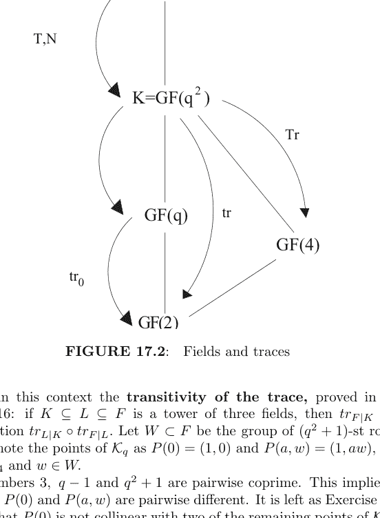

## 图 17.2 域与迹

回顾在此上下文中**迹的传递性**，在练习 12.1.16 中证明：若 $K \subseteq L \subseteq F$ 是三个域的塔，则 $tr_{F|K}$ 是 $tr_{L|K} \circ tr_{F|L}$ 的连接。设 $W \subset F$ 为 $(q^2 + 1)$ 次单位根的群。将 $\mathcal{K}_q$ 的点记为 $P(0) = (1,0)$ 和 $P(a,w) = (1, a w)$，其中 $0 \neq a \in \mathbb{F}_4$ 且 $w \in W$。

数 3、$q - 1$ 和 $q^2 + 1$ 两两互素。这意味着点 $P(0)$ 与 $P(a,w)$ 两两不同。将 $P(0)$ 与 $\mathcal{K}_q$ 的其余两点不共线作为练习 17.3.3 留下。我们证明 $P(a,w)$ 构成一个帽。起初我们需要一个判据来决定 $K$ 的哪些元素是 $W$ 的元素在迹 $T$ 下的像。这由希尔伯特定理 90 的加法版本、命题 17.21 给出。

### 17.56 引理。
*设 $0 \neq \alpha \in \mathbb{F}_{q^2}$。以下等价：*

- 存在 $w \in W$ 使得 $T(w) = \alpha$。
- $Tr(1/\alpha) \in \mathbb{F}_4 \setminus \mathbb{F}_2$。
- $tr(1/\alpha) = 1.$

**证明** 因为迹的传递性，第二和第三条件等价。我们有 $w^{q^2} = 1/w$ 对 $w \in W$ 成立，故 $T(w) = w + 1/w$。由此 $T(w) = \alpha$ 等价于 $(w/\alpha)^2 + (w/\alpha) + 1/\alpha^2 = 0$。显然 $w = 1$ 不是解。设 $tr(1/\alpha) = 0$。由命题 17.21，$x^2 + x + 1/\alpha^2 = 0$ 的解在 $K$ 中。于是 $w \in K$，矛盾。这说明此情形下无解。结论现在由计数得出：$w = 1$ 是唯一使 $T(w) = 0$ 的 $w \in W$，且每个 $\alpha \neq 0$ 在 $W$ 中在 $T$ 下至多有两个原像。于是每个满足 $tr(1/\alpha) = 1$ 的 $\alpha \in K$ 必须有两个这样的原像。

设 $P(a1, w1)$, $P(a2, w2)$, $P(a3, w3)$ 为 $\mathcal{K}_q$ 的不同点且共线。设 $1$, $\lambda$, $\lambda + 1$ 为仿射线性组合的系数，其中 $\lambda \in F_q \setminus F2$。这给出方程

$(\lambda + 1)a1 w1 = a2 w2 + \lambda a3 w3$.

先假设对某些 $i \neq j$ 有 $a_i = a_j$。我们可以设 $a2 = a3 = 1$ 且 $w3 = 1$。方程为

$(\lambda + 1)a1 w1 = w2 + \lambda$.

由于第二和第三点不同，于是 $w2 \neq 1$。对两边应用范数 $(N(x) = x^{q^2+1})$ 得 $(\lambda^2 + 1)a1^2 = \lambda^2 + 1 + \lambda \alpha$，其中 $\alpha = T(w2)$。由于 $w2 \neq 1$，有 $\alpha \neq 0$。于是 $a1 \neq 1$。方程

$1/\alpha (a1^2 + 1) = \lambda/(\lambda^2 + 1) = 1/(\lambda + 1) + 1/(\lambda + 1)^2$

经应用 $Tr$ 后给出

$(a1^2 + 1)Tr(1/\alpha) = Tr(1/(\lambda + 1) + 1/(\lambda + 1)^2) = tr(1/(\lambda + 1))$

（最后等式由迹的定义得出）。迹的传递性表明 $tr$ 关于 $tr_{K|F_q}$ 分解。由于 $tr_{K|F_q}$ 在 $F_q$ 上消失，于是 $(a1^2 + 1)Tr(1/\alpha) = 0$，故 $Tr(1/\alpha) = 0$，与引理 17.56 矛盾。

现在设 $a_i$ 为 $F4$ 中两两不同（且非零）的元素。我们可以选记号使得

$(\lambda + 1)w1 = \omega w2 + \lambda \omega$.

应用 $N$ 得 $\lambda^2 + 1 = \omega + \lambda^2 \omega + \lambda \alpha$，其中 $\alpha = T(w2)$。我们有 $\alpha \neq 0$，否则 $\lambda \in F4$，这是不可能的，因为 $F_q \cap F4 = F2$。方程的等价形式为 $\lambda^2 \omega + \lambda \alpha + \omega = 0$。乘以 $\omega/\alpha^2$ 得 $x^2 + x + 1/\alpha^2 = 0$，其中 $x = \lambda \omega/\alpha$。这给出 $tr(1/\alpha) = 0$，再次与引理 17.56 矛盾。

本小节所呈现的构造表明，我们可以在 $PG(4, q)$ 中找到约 $2.5 q^2$ 个点的帽，对奇数 $q$，以及在 $q = 2^{\text{odd}}$ 时在 $AG(4, q)$ 中大小约 $3 q^2$ 的帽。像 $\approx 3q^2$ 这样的表达式表示点数是 $q$ 的多项式，以 $3q^2$ 为首项。这些似乎是 $PG(4, q)$ 中已知的最大帽，除了仅对个别小 $q$ 有效的构造之外。注意我们的 $AG(4, q)$ 中的帽可视为对偶 $BCH$ 码（见练习 17.3.4）。对于 $q = 2^{\text{even}}$，在 $PG(4, q)$ 中似乎没有已知大小约 $c q^2$ 且 $c > 2$ 的帽族。此外，所有这些帽族都远离已知的上界。

考虑由 $(3q^3 + 4)$ 帽 $\mathcal{K}_q \subset AG(4, q)$ 几何描述的代码 $C_q$，其中 $q = 2^f$, $f$ 为奇数。由于与 Kloosterman 码的密切联系，$C_q$ 的权分布可以确定。在特殊情形 $q = 8$，这给出一个 $[196, 5, 164]_8$ 码。由于它包含维数为 4 且最小距离为 168 的子码，我们可以应用加长并得到一个 $[200, 5, 168]_8$ 码（见 [81]）。

## 帽的一般上界

我们从仿射帽的一般上界开始。

### 17.57 定义。
记 $C_k(q)$ 为 $AG(k, q)$ 中帽的最大大小，$c_k(q) = C_k(q)/q^k$ 为其相对大小。

由于 $AG(k, q)$ 是 $q$ 个 $AG(k-1, q)$ 的不交并（见练习 17.3.5），于是 $C_k(q) \le q C_{k-1}(q)$，故 $c_k(q) \le c_{k-1}(q)$。我们有 $c_3(q) = 1/q$（见练习 17.3.7）。我们将导出 $c_{k-1}(q) - c_k(q)$ 的下界。这特别表明 $AG(k, q)$ 中的极大帽不能与每个超平面相交于极大帽。

如常，设 $q = p^f > 2$。设 $A \subset AG(k, q)$ 为一帽。由于 $q > 2$，我们可以找到非零元素 $\lambda_i \in F_q$ 使得 $\lambda_1 + \lambda_2 + \lambda_3 = 0$。$\lambda_i$ 在整个证明中固定。设 $V = F_q^k = AG(k, q)$ 且 $T : F_q \longrightarrow F_p$ 为迹函数。置 $Q = |V| = q^k$。最后，复数 $\zeta = \exp(2\pi i / p)$ 是 $p$ 次单位根。目标是对 $|A|$ 给出上界。为此，研究复数 $S = \sum_{y \in V\setminus\{0\}} \sum_{a1,a2,a3 \in A} \zeta^{T((\sum_i \lambda_i a_i)\cdot y)}$。该数易于确定：反转求和次序并将内和对所有 $y \in V$ 延拓。对应于 $y = 0$ 的额外项为 $|A|^3$。由于 $\zeta$ 的所有幂之和为零，内和在 $a1 = a2 = a3$ 时才不消失。我们得到 $S = |A|(Q - |A|^2)$。

现在我们对 $|S|$ 给出上界。设 $0 \neq \lambda \in \mathbb{F}_q$ 且 $0 \neq y \in V$。考虑复数 $U(\lambda)_y = \sum_{a\in A} \zeta^{T((\lambda a)\cdot y)}$。设 $u(\lambda)_y = |U(\lambda)_y|$。

定义长度为 $Q-1$ 的实向量 $u(\lambda)$，其坐标由 $0 \neq y \in V$ 参数化，对应项为 $u(\lambda)_y$。我们有 $S = \sum_{y\neq0} U(\lambda1)_y U(\lambda2)_y U(\lambda3)_y$，特别地，$|S| \le \sum_{y\neq0} u(\lambda1)_y u(\lambda2)_y u(\lambda3)_y$。

我们对实向量 $u(\lambda)$ 知道什么？与确定 $S$ 类似的计算表明我们知道这些向量的长度：$\|u(\lambda)\|^2 = |A|(Q - |A|)$。

组合信息在以下引理中，即对项 $u(\lambda)_y$ 的上界：

### 17.58 引理。
设 $0 \neq \lambda \in \mathbb{F}_q$ 且 $0 \neq y \in V$。则 $u(\lambda)_y \le q C_{k-1}(q) - |A| = c_{k-1}(q) Q - |A|$。

证明 由于 $\lambda A$ 为帽，我们可以设 $\lambda = 1$。记 $\nu_c$ 为满足 $a\cdot y = c$ 的 $a \in A$ 的个数。由于满足 $v\cdot y = c$ 的 $v \in V$ 构成子空间 $AG(k-1,q)$（见练习 17.3.6），我们有 $\nu_c \le C_{k-1}(q)$。于是 $u(\lambda)_y = |\sum_{c\in\mathbb{F}_q} \nu_c \zeta^{T(c)}| = |\sum_{c\in\mathbb{F}_q} (C_{k-1}(q) - \nu_c) \zeta^{T(c)}|$（这里再次使用 $\zeta$ 的所有幂之和为零）$\le \sum_c (C_{k-1}(q) - \nu_c) = q C_{k-1}(q) - |A|$。

现在我们可利用前一引理的上界和经典的 Cauchy-Schwartz 不等式对 $|S|$ 给出上界。该不等式的最佳已知版本指出，对实向量 $x = (x1,\ldots,xn)$, $y = (y1,\ldots,yn)$，有 $|x\cdot y| \le \|x\|\|y\|$。

回顾 Plotkin 界的证明使用了该不等式的推论；见第 9 章。我们有 $|S| \le (c_{k-1}(q) Q - |A|)(|A|(Q - |A|))$。将该上界与 $|S|$ 的精确值比较给出 $C_k(q)$ 的以下界，即本小节的主要结果。

### 17.59 定理。
设 $q > 2$ 为素数幂。若 $k \ge 3$，则

$$c_k(q) \le \frac{q^{-k} + c_{k-1}(q)}{1 + c_{k-1}(q)}$$

等价地

$$(1 - c_k(q))(c_{k-1}(q) - c_k(q)) \ge c_k^2 - q^{-k}.$$

特别地，我们得到所期望的下降量 $c_{k-1}(q) - c_k(q)$ 的下界。定理 17.59 最初由 R. Meshulam [152] 在奇特征下利用傅里叶变换的机制得到。本节概述的直接方法是来自 [24]。它也涵盖特征 2 情形。

可由定理 17.59 导出渐近界：

### 17.60 定理。
设 $q > 2$ 且 $k \ge 3$。则

$$c_k(q) \le \frac{k + 1}{k^2}.$$

为了由定理 17.59 导出射影帽的界，需要以下递归构造：

### 17.61 定理。
设 $q > 2$。若 $PG(k-1,q)$ 中存在 $n$-帽，则 $AG(k,q)$ 包含一个 $(2n)$ 帽。

**证明** 对 $PG(k-1,q)$ 中帽的每个点 $(x_1 : \cdots : x_k)$，选取代表元 $x = (x_1,\ldots,x_k) \in \mathbb{F}_q^k$。设 $c \in \mathbb{F}_q, c \ne 0,1$。我们断言形如 $(x,1)$, $(cx,1)$ 的 $2n$ 个点构成 $AG(k,q)$ 中的帽。显然这些是 $2n$ 个不同点。它们在仿射空间中，因为它们避开超平面 $x_{k+1}=0$。它们构成帽的初等证明留给读者。

定理 17.61 与 17.60 一起给出以下结论：

### 17.62 定理。
设 $q > 2$ 且 $k \ge 3$。$PG(k,q)$ 中帽的大小被 $q^{k+1} \frac{k+2}{2(k+1)^2}$ 所限制。

定理 17.61 的加倍构造是递归帽构造的一个初等例子。下一小节将给出更多递归构造。

## 帽的递归构造

帽的一般乘积构造由 Mukhopadhyay [154] 给出。我们从一个稍作推广开始。


## 17.63 定理。
*如果存在 n-盖 𝒜 ⊂ AG(k,q) 和 m-盖 ℬ ⊂ PG(l,q)，则可以在 PG(k+l,q) 中构造一个 nm-盖。此外，如果 𝒜 被 i ≥ 1 个一般位置的超平面避开且 ℬ 被 j ≥ 0 个一般位置的超平面避开，则乘积盖被 i + j − 1 个一般位置的超平面避开。*

### 证明
设 (a|1) 为仿射盖的典型代表，b 为 PG(l,q) 中盖的典型代表。这里 a ∈ 𝔽_q^k，b ∈ 𝔽_q^{l+1}。乘积盖中一点的典型代表是 (a|b)。假设 ∑_{i=1}^3 λ_i(a_i|b_i)=0。第二坐标截面表明 b₁=b₂=b₃ 且 λ₁+λ₂+λ₃=0。这表明 ∑_{i=1}^3 λ_i(a_i|1)=0，矛盾。

仿射盖是被一个超平面避开的盖。我们可以用一行所有条目均非零的矩阵来表示盖。𝒜 被 i 个一般位置的超平面避开这一事实仅仅意味着我们可以将其表示为具有 i 行所有条目均非零的矩阵，ℬ 亦然。这证明了第二个断言。

射影直线上两点构成一个 2-盖。对于 q > 2，这两点构成一个仿射盖（它们避开一个点 = 超平面）。由此可知加倍构造定理 17.61 是乘积构造定理 17.63 的特例。

卵形线或超卵形线在 PG(2,q) 中显然是仿射的。事实上它们被 i = 3 条一般位置的直线（超平面）避开。应用乘积构造可得到，除其他外，当 q 为奇数时 AG(5,q) 中的 (q+1)(q²+1) 个盖，以及特征为 2 时 AG(5,q) 中的 (q+2)(q²+1) 个盖。

以下是来自 [77] 的乘积构造的一个推广：

## 17.64 定理。
*假设存在一个 n-盖 𝒜 ⊂ PG(k,q) 与一个超平面相交于 n−w 个点，且存在一个 m-盖 ℬ ⊂ PG(l,q)。我们可以在 PG(k+l,q) 中构造一个 {wm + (n−w)} 盖。*

### 证明
用定理 17.63 中的记号，(a|b) 其中 (a|1) 在 𝒜 的仿射点上变化构成乘积盖，一个 wm-盖。 (α|0)，其中 (α|0) 在来自超平面的 𝒜 的点上变化，将其扩展为一个 {wm + (n−w)} 盖。如果在定理 17.64 中选择 𝒜 为一个卵形体（在 PG(3,q) 中与超平面相交于一点的 (q²+1) 盖），则得到 B. Segre [182] 的一个经典构造：如果在 PG(k,q) 中存在一个 n-盖，则在 PG(k+3,q) 中存在一个 {q²n + 1} 盖。

## 17.65 定理。
*假设存在 n-盖 𝒜 ⊂ PG(k,q) 和 m-盖 ℬ ⊂ PG(l,q)，两者都具有切超平面。我们可以在 PG(k+l,q) 中构造一个 {nm − 1} 盖。*

### 证明
**切超平面** 是恰好包含盖中一个点的超平面。用之前的记号，设 $(a|1)$ 和 $(b|1)$ 分别为 $\mathcal{A}$ 和 $\mathcal{B}$ 的仿射点。用 $(\alpha|0)$ 表示 $\mathcal{A}$ 在切超平面上的点，$(\beta|0)$ 表示 $\mathcal{B}$ 在切超平面上的点。$PG(k+l,q)$ 中盖的点具有如下形式

$(a|b|1),\ (a|\beta|0)\ \text{and}\ (\alpha|b|0).$

将其应用于卵形体得到 $PG(6,q)$ 中的一个 $\{q^4 + 2q^2\}$ 盖。定理 17.65 中的构造表明该盖与超平面的交的大小为 $q^2 + 1$。用卵形体作为第二个成分应用定理 17.64 得到 $PG(9,q)$ 中的一个 $q^2(q^2 +1)^2$ 盖。

## 三元情形：Hill 盖
我们从定理 17.42 知道 $PG(5,q)$ 中的椭圆二次曲面 $Q_5^-(q)$ 有 $(q+1)(q^3+1)$ 个点。在三元情形下我们得到 $|Q_5^-(3)|=112$。相应的二次型可表示为 $Q(x)=\sum_{i=1}^6 x_i^2$（Gram 矩阵的行列式为 1）。由此可知由向量 $x=(x_1,x_2,\dots,x_6)$ 生成的一维子空间 $\langle x\rangle$ 属于 $Var(Q)=Q_5^-(3)$ 当且仅当 $x$ 的权为 3 或 6。由于在 $V(6,3)$ 中权为 3 的向量有 $8\binom{6}{3}=160$ 个，权为 6 的向量有 $2^6=64$ 个，我们得到 $|Q_5^-(3)|=80+32=112$，正如预测的那样。由于 Witt 指标为 2，存在全纯各向同性直线但不存在全纯各向同性平面。

我们希望将 $Q_5^-(3)$ 分成两个盖。$Q$ 的二维全纯各向同性子空间（$PG(5,3)$ 的直线，其所有点都属于 $Q_5^-(3)$）是什么样的？显然每个这样的子空间至少包含两个由权为 3 的向量生成的点 $P_1,P_2$。设 $P_1,P_2$ 为此类点。由 $P_1,P_2$ 定义的直线 $l$ 将是全纯各向同性的（仅包含权为 3 或 6 的点），如果 $P_1$ 和 $P_2$ 的支撑要么互补，要么交集的基数为 2。典型例子为第一种情况的直线 $(1^3:0^3)$、$(0^3:1^3)$、$(1^6)$、$(1^3:2^3)$，以及第二种情况的 $(1^3:0^3)$、$(1:2:0:1:0^2)$、$(2:0:1:1:0^2)$、$(0:2:1:2:0^2)$。这表明 $Q_5^-(3)$ 如何可以分成两个盖。只需选择划分使得每条全纯各向同性直线在每个部分中各有两个点即可。这可以按如下方式完成：

请检查以下 10 个块是否构成一个 $2-(6,3,2)$ 设计：

| 123 | 236 |
| 124 | 245 |
| 135 | 256 |
| 146 | 345 |
| 156 | 346 |

我们用 $\mathcal{D}$ 表示它。它可以描述为置换群 $PSL(2,5)\cong A_5$ 在射影直线 $PG(1,5)$ 上的一个轨道，我们将该直线的点与 $V(6,3)=\mathbb{F}_3^6$ 的坐标等同。由于 $PSL(2,5)$ 的置换作用是 2-传递的，每个轨道定义一个 2-设计。块的补集不是块。令 $\mathcal{D}'$ 由 $\mathcal{D}$ 的块的补集组成，等价地，$\mathcal{D}'$ 的块由 $\{1,2,3,4,5,6\}$ 的 3-子集组成，这些子集不是 $\mathcal{D}$ 的块。用 $D$ 表示支撑为 $\mathcal{D}$ 的块的权为 3 的向量集合，$D'$ 亦然。令 $\langle D\rangle$ 和 $\langle D'\rangle$ 为 $PG(5,3)$ 中对应的点。

令 $R$ 为权为 6 且其代表有偶数个条目为 2 的向量的并集，$R'$ 为剩余的权为 6 的向量。如前所述，$\langle R\rangle$、$\langle R'\rangle$ 表示 $PG(5,3)$ 中对应点的集合。我们已将 $Q_5^-(3)$ 的点划分为如下形式

$Q_5^-(3) = \langle D\rangle \cup \langle D'\rangle \cup \langle R\rangle \cup \langle R'\rangle$

其中每个 $\langle D\rangle$、$\langle D'\rangle$ 有 40 个点，每个 $\langle R\rangle$、$\langle R'\rangle$ 有 16 个点。全纯各向同性线的描述表明每个

$\langle D\rangle \cup \langle R'\rangle$, $\langle D'\rangle \cup \langle R\rangle$, $\langle D'\rangle \cup \langle R'\rangle$, $\langle D\rangle \cup \langle R\rangle$

都是一个盖（注意每个元素集合恰好包含 $\mathcal{D}$ 的两个块和 $\mathcal{D}'$ 的两个块）。

## 17.66 定理。
$Q_5^-(3)$ 的 112 个点可以划分为两个 56-盖。特别地，$PG(5,3)$ 中存在一个 56-盖。

这里给出一个 56-盖在 $PG(5,3)$ 中的生成矩阵，它是通过刚才描述的方式对 $Q_5^-(3)$ 进行二分得到的。矩阵列生成的 $PG(5,3)$ 中的点是盖的点。

### Hill 盖
```
1111112222222222 2211 2211 2211 2211 0000 0000 0000 0000 0000
1122221111222222 2121 2121 0000 0000 0000 2211 2211 2211 0000 0000
1212221222111222 2112 0000 2121 0000 0000 2121 0000 0000 2211 2211
1221222122122112 0000 2112 0000 2121 0000 0000 2121 0000 2121 2121
1222122212212121 0000 0000 2112 0000 2121 0000 2112 2121 2112 0000
1222212221212121 0000 0000 0000 2112 2112 2112 0000 2112 0000 2112
```

$PG(5,3)$ 中的 56-盖本质上是唯一确定的，且 $PG(5,3)$ 中没有更大的盖。它被称为 Hill 盖。有关原始构造，参见 R. Hill [111]。Hill 盖的存在是三元情形在关于盖的大多数渐近问题中表现出特殊行为的主要原因。

考虑由 $\sum_{i=1}^6 x_i = 0$ 定义的超平面 $S$。$S$ 上来自 $\langle R'\rangle$ 的唯一点是 $(1 : 1 : 1 : 1 : 1 : 1)$，并且对于 $\mathcal{D}$ 的每个块，$S$ 上恰好有一个点具有该块作为其支撑。因此 $\langle D\rangle \cup \langle R'\rangle$ 与超平面 $S$ 相交于 11 个点。对应的 $AG(5,3)$ 中的 45-盖将被称为仿射 Hill 盖。可以证明仿射 Hill 盖是 $AG(5,3)$ 中唯一的 45-盖，且 $AG(5,3)$ 中没有更大的盖。因此我们问题的答案在 $PG(5,3)$ 和 $AG(5,3)$ 中是已知的。显然在 Hill 构造 $PG(5,3)$ 中的盖之前，维数 4 的答案是已知的。是 G. Pellegrino 在 [164] 中对 $PG(4,3)$ 和 $AG(4,3)$ 中大盖进行了穷举枚举。结果表明 $PG(4,3)$ 中没有 21-盖。$AG(4,3)$ 中的 20-盖是唯一确定的。这样的盖很容易构造。它源于椭圆二次曲面的加倍

PG(3,3)；见定理 17.61。我们在第 3.6 节中遇到了 Pellegrino cap（AG(4,3) 中的 20-cap），它是 SET 游戏中不包含 SET 的最大牌集。由第 3.6 节的讨论可知，这样的无 SET 牌集确实等价于 AG(4,3) 中的一个帽。

如果接受 Pellegrino 的结果，即 PG(4,3) 中不存在 21-cap，那么实际上很容易证明 PG(5,3) 不能包含 57-cap。这是几何方法的一个初等应用；见练习 17.3.11。

六维已知什么？双 Hill cap 是 AG(6,3) 中的一个 112-cap。用定理 17.59 的语言，我们特别有 c5(3)=45/3^5=5/27。应用定理 17.59 得到 C6(3) ≤ 114。这是在 AG(6,3) 中最大帽大小的下界 112 与上界 114 之间一个非常狭窄的差距（见定义 17.57）。事实上，这个差距已被 A. Potekhin 填补，他在 [168] 中证明了 C6(3)=112 并且该仿射帽在本质上是唯一确定的。F3 上已知的大多数最大帽都与 Hill cap 相关。这在维数 ≤7 时肯定成立：PG(7,3) 中的 Calderbank-Fishburn 248-cap 是 Hill cap 的双的双的扩展。偏离这一规律的例外是经计算机搜索得到的 PG(8,3) 中的 541-cap 和 PG(10,3) 中的 2744-cap [26]。PG(9,3) 中的 1216-cap 和 PG(11,3) 中的 6464-cap 是在 [74] 中由产品构造的精细版本得到的。

我们以目前已知的关于 PG(k,q) 中帽的最大大小的下界列表结束，参数为小值。

四元情况下维数 ≥8 的值是在 [86] 和 [133] 中使用递归构造和计算机搜索得到的。

| k\q | 3 | 4 | 5 | 7 | 8 | 9 |
|---|---|---|---|---|---|---|
| 2 | 4 | 6 | 6 | 8 | 10 | 10 |
| 3 | 10 | 17 | 26 | 50 | 65 | 82 |
| 4 | 20 | 41 | 66 | 132 | 208 | 212 |
| 5 | 56 | 126 | 195 | 434 | 695 | 840 |
| 6 | 112 | 288 | 675 | 2499 | 4224 | 6723 |
| 7 | 248 | 756 | 1715 | 6472 | 13520 | 17220 |
| 8 | 541 | 2136 | 5069 | 21555 | 45174 | 68070 |
| 9 | 1216 | 5124 | 17124 | 122500 | 270400 | 544644 |
| 10 | 2744 | 15840 | 43876 | 323318 | 878800 | 1411830 |
| 11 | 6464 | 36150 | 130951 | 1067080 | 2931457 | 5580100 |

存在精确值，k=2 时为 ovals 和 hyperovals，k=3 时见定理 17.54，以及 PG(4,3)、PG(5,3) 和 PG(4,4)。在所有其他情况下，最大帽大小的确定仍然是一个开放问题。在 PG(6,3) 中最佳已知的上界是 136 [5]，而在 PG(4,5) 中似乎为 88。

## 一个渐近问题

### 17.67 定义。

固定 q 和 t。用 $n_{t,q}(k)$ 表示码 $[n,n-k,t+1]_q$ 的最大长度 $n$，等价于维数为 $k$ 且强度为 $t$ 的线性正交阵列的最大长度。定义

$$\lambda(t,q)=\lim_{k\to\infty}\frac{\log_q(n_{t,q}(k))}{k}.$$

考虑码 $[n,n-k,t+1]_q$ 的校验矩阵 $H$ 的列，其中 $n$ 为最大。若 $n=q^{lk}$，则 $n\le q^k$ 且 $l=\log_q(n)/k$。由此可得 $\lambda(t,q)\le1$。在等号成立的情况下，$H$ 的列在渐近意义下填满空间 $\mathbb{F}_q^k$。

第 1.6 节的球 packing 界给出一个上界：令 $e=\lfloor t/2\rfloor$。显然在过程（取对数，除以 $k$，令 $k\to\infty$）中，左边的主导项是 $\binom{n}{e}$，其贡献为 $e\lambda(t,q)$。由于右边贡献为 1，我们得到界 $\lambda(t,q)\le1/\lfloor t/2\rfloor$。

为了得到一般下界，使用本原 BCH 码。用第 13 章的语言，我们使用码 $\operatorname{tr}(\mathcal{B}(A))$，其中 $n=q^r-1$ 且 $A=\{0,1,\dots,t-1\}$。这给出强度为 $t$ 且维数 $k\le1+(t-1)r$ 的线性 $q$-元正交阵列。下界为

$$\lambda(t,q)\ge\lim_{r\to\infty}\left(\frac{r}{1+(t-1)r}\right)=\frac{1}{t-1}.$$

再次，二元情形是退化的；见练习 17.3.14。

### 17.68 定理。

我们有 $\lambda(t,2)=1/\lfloor t/2\rfloor$ 且，对 $q>2$，

$$\frac{1}{t-1}\le\lambda(t,q)\le\frac{1}{\lfloor t/2\rfloor}.$$

显然 $\lambda(t,q)$ 是 $t$ 的非增函数，且 $\lambda(2,q)=1$（见练习 17.3.15）。由定理 17.68 可得 $\lambda(t,q)<1$ 对 $t>3$ 成立。对 $t=3$，设想 $\lambda(3,q)=1$ 是可能的。这在某种意义上意味着空间可以被帽填满，这将是相当令人惊讶的。必须猜想对所有 $q>2$ 都有 $\lambda(3,q)<1$。这是一个开放问题。

现在设 $AG(k,q)$ 中有一个 $n$-帽。产品构造定理 17.63 表明存在 $AG(kl,q)$ 中的 $n^l$-帽。这表明 $\lambda(3,q)\ge\log_q(n)/k$。我们得出每个仿射帽都给出渐近值 $\lambda(3,q)$ 的下界。仿射卵形线（$AG(3,q)$ 中的 $q^2$-帽）给出 $\lambda(3,q)\ge2/3$。这比由定理 17.68 得到的 $1/2$ 的下界好得多。我们可以做得稍好一些。

将定理 17.65 应用于卵形线得到 $PG(6,q)$ 中一个 $\{q^4+2q^2\}$ 帽，其超平面交的大小为 $q^2+1$。这对每个 $q$ 都给出 $AG(6,q)$ 中一个 $\{q^4+q^2-1\}$ 帽。由此得到的界

$$\lambda(3,q)\ge\frac{\log_q(q^4+q^2-1)}{6}$$

似乎是对一般 $q$ 已知的最佳下界。

如前所述，关于具有极值性质的帽的问题中，$q=3$ 和 $q=4$ 的情形通常是特殊的。在三元情形下，这种异常行为的原因是 Hill cap 的存在。双 Hill cap 给出 $\lambda(3,3) \ge 0.7158\dots$（已明显大于 $2/3$）。Calderbank-Fishburn [38] 基于 Hill cap 及其对称性给出的构造表明 $\lambda(3,3) \ge 0.7218\dots$。Y. Edel [74] 给出了产品构造的一个巧妙推广。将其应用于 Hill cap 得到下界 $\lambda(3,3) \ge 0.724851\dots$

这似乎是目前已知的最佳下界。

四元情形之所以同样特殊，也是因为 D. Glynn [93] 给出的 PG(4,5) 中的 126-cap。它与超平面相交于六个点。由此得到的 AG(5,4) 中的 120-cap 给出下界 $\lambda(3,4) \ge \log_4(120)/5 = 0.6906\dots$

最后，我们注意到定理 17.60 的界远不足以将 $\lambda(3,q)$ 远离 1。该界大致形式为 $c_k(q) \le 1/k$。所需要的是形式为 $c_k(q) \le q^{-k\delta}$ 的界，其中 $\delta>0$。

由于帽（强度为 3 的线性 OA）的情形仍是开放的，可能会令人惊讶的是 $\lambda(4,3)$ 和 $\lambda(4,4)$ 是已知的。在三元情形下，使用定理 13.8 的循环码，在四元情形下使用定理 13.29 或定理 13.30 的 constacyclic 族。我们得到 $\lambda(4,3)=\lambda(4,4)=1/2$。更多内容见 Dumer 和 Zinoviev [73]。

## 练习 17.3

- **17.3.1.** *证明 AG(k,q) 中的直线有 q 个点。*
- **17.3.2.** *确定卵形线码的重量分布。*
- **17.3.3.** *证明 P(0) = (1,0) 将帽 K_q ⊂ AG(4,q) 扩展为一个 (3q² + 4) 帽（这里 q = 2^f, f 为奇数）。*
- **17.3.4.** *用循环码描述帽 K_q ⊂ AG(4,q)。*
- **17.3.5.** *证明 AG(k,q) 是 AG(k − 1,q) 的 q 个不相交并。*
- **17.3.6.** *证明 AG(k,q) 的超平面由对 (y,c) 表示，其中 y = (y₁,…,yₖ) ∈ F_q^k 在一维子空间的代表元上变化（即 PG(k − 1,q) 的点），且 c ∈ F_q。点 x = (x₁,…,xₖ) ∈ AG(k,q) 在由对 (y,c) 描述的超平面上当且仅当 x·y = c。*
- **17.3.7.** *证明 AG(3,q)（q > 2）中帽的最大大小为 q²。*
- 17.3.8. 证明实向量的 Cauchy-Schwartz 不等式：设 $x = (x_1, \dots, x_n)$，$y = (y_1, \dots, y_n)$。则 $|x \cdot y| \le \|x\| \|y\|.$
- 17.3.9. 由 Cauchy-Schwartz 不等式导出第 9 章 Plotkin 界证明中使用的界。
- 17.3.10. 对 $q > 3$ 证明定理 17.60。
- 17.3.11. 证明 PG(5,3) 中不存在 57-cap。利用 PG(4,3) 中不存在 21-cap 的事实。
- 17.3.12. 证明以下点构成 AG(7,3) 中的一个 236-cap：
$(1,0,D)$ $(1,0,R)$ $(1,1,D)$ $(1,1,R)$ $(1,2,U)$。
该构造来自 Calderbank 和 Fishburn [38]。
- 17.3.13. 证明前一练习中的 Calderbank-Fishburn 帽与类型为 $(0,1,U)$ 的点之并构成 PG(7,3) 中的一个 248-cap。该构造来自 [78]。
- 17.3.14. 证明 $\lambda(t,2) = 1 / [t/2]$。
- 17.3.15. 证明对所有 $q$ 都有 $\lambda(2,q) = 1$。
- 17.3.16. 接受 20 是 PG(4,3) 中帽的最大大小这一事实，证明 Hill cap 与超平面的最大交为 20。
- 17.3.17. 证明 Hill cap 定义一个 $[56,6,36]_3$ 码并与 Griesmer 界比较。
- 17.3.18. 使用 Hill cap 的生成矩阵得到 PG(4,3) 中的一个 20-cap。


## 第18章
## 加性码和网络码
### 18.1 基本构造与应用

**基本概念：** 定义，基本性质，陈投影，在计算机存储系统和深空通信中的应用，卷积码，直接构造，Bose-Bush 正交阵列的构造。

构造良好二进制码的主要方法是先从扩展域 F_Q 上的良好线性码出发，并利用拼接、子域码或迹将码从 F_Q 降到 F_2。我们在本文中遇到的最大且最有用的二进制线性码族，即循环码，就是以这种方式构造的。父码是 Reed-Solomon 码，我们使用迹进行降维。更一般地，我们使用定义在 F_q 的扩展域上的父码来构造线性 q 元码。在此过程中，父码在扩展域上的线性性并不是真正必要的。设想一个 q^m 元父码 B，它不一定是 q^m 线性的，但只是 q 线性的。换句话说，我们把 B 的字母表不看作域，而只看作 F_q 上的 m 维向量空间 V(m,q)。在这种情况下，我们可以用多种方式生成 q 元线性码，用我们选择的线性泛函 Φ : V(m,q) ⟶ F_q 替代迹（Φ 应为满射）。这种码 B 被称为加性码。

### 18.1 定义. 一个 q-线性 q^m-元码 [n,k]_q^m 是 C ⊆ E^n 的一个 km 维 F_q 子空间，其中 E = F_q^m。特别地，C 有 q^{km} 个码字。

由于字母表 E 是一个向量空间，最小距离 d 等于最小重量，其中码 C 的一个码字的重量当然是具有非零项的坐标数（共有 n 个坐标）（项是向量空间 F_q^m 的元素）。请注意，维数 k 不必是整数。它可以有 m 在分母中。这是一种自然的记法，因为它便于与形成子族的 q^m-元线性码进行比较。

思考长度为 n 的 q^m-元 q-线性码的一种方式，是将其视为 F_q 上的长度为 nm 的线性码，其坐标被分组为 n 个每个包含 m 个的块。这种观点的优点是它展示了对偶性的使用。定义关于 F_q^{nm} 上的点积的对偶。一个 k 维 q^m-元 q-线性码的对偶具有补维数 n − k。

q-线性 [n,k]_q^m 码的一个生成矩阵 G 是一个 (km, n) 矩阵，其元素来自 E = F_q^m，其行构成码的一个 F_q 基（码字是 G 行的 F_q 线性组合）。校验矩阵是对偶码的生成矩阵。请注意，这里 km 当然是整数，但 k 不必是整数。

到目前为止，线性码理论的主要特征可以平滑地推广到加性码。对偶性原理也是如此。设 C 是一个 q-线性 [n,k]_q^m 码。与线性码情形相同的论证表明，C 是强度为 t 的 OA 当且仅当 C^⊥ 的最小重量 > t。

在加性码的范畴中，相对于线性码的范畴，向更小的字母表降维要容易得多。在线性码的情况下，我们受限于子域，而子域很少。例如，具有 2^p 个元素的域，其中 p 为素数，只有一个真子域，即素域 F2。在加性码的情况下，字母表在基域上形成一个向量空间。我们可以降到任意更小维数的向量空间。以下是 C. L. Chen [49] 提出的一个简单构造，利用了这种额外的自由度：

设 C 是一个 q^m-元 q-线性码 [n, k, d]。在每个坐标上应用任意正则 (m, m) 矩阵得到的码与 C 等价。因此我们可以假设 C^⊥ 包含一个词，在每个坐标中的项要么是 (1,0,...,0) 要么是 (0,...,0,0)。C 的 q 元维数是 km。考虑子码 D ⊂ C，由在每个坐标的第一位置上消失的那些词组成。由于有 n 个条件需要满足，我们期望 D 在 C 中的余维数为 n。然而，由于 C^⊥ 中存在我们的特殊词，这 n 个条件中的最后一个自动满足。我们有 dim_q(D) ≥ km − (n − 1)。显然我们可以省略每个坐标中的最后一个位置，得到一个 q^{m−1}-元 q 线性码，其 q^{m−1}-元维数 ≥ [km−(n−1)]/(m−1) = k − [n−1−k]/(m−1)。

### 18.2 定理 (Chen 投影)。

如果存在一个 q^m-元 q-线性码 [n, k, d] 且 m > 1，则存在一个 q^{m−1}-元 q-线性码 [n, k − (n − k − 1)/(m − 1), d]。

请注意，定理 18.2 的证明使用了与线性码的构造 Y1 相同的论证（参见练习 5.1.8）。

定理 18.2 允许我们从一个好的 q^m-线性码出发，通过反复应用 Chen 投影导出 q^{m−1}-元、q^{m−2}-元 ... q-线性码。例如，从线性 [65,61,4]₈（PG(3,8) 中的椭圆二次曲面）出发。定理 18.2 产生一个加性四元码 [65,59.5,4]₄。我们能用线性四元码达到这些参数吗？我们必须构造一个更好的线性 [65,60,4]₄ 码。根据命题 17.28，这等价于 PG(4,4) 中的一个 65-帽。这样的帽不存在。已知 PG(4,4) 中帽的最大尺寸为 41（参见 [76]）。

另一个例子，从 PG(2,16) 中的超卵形线出发，它等价于一个线性 [18,15,4]₁₆ 码。Chen 投影得到一个加性 [18,14 1⁄3,4]₈ 码。线性 [18,15,4]₈ 码不存在，因为它等价于 PG(2,8) 中的一个 18-弧，这是不可实现的。我们 [18,14 1⁄3,4]₈ 码的对偶维数为 11/3，因此有 2¹¹ 个码字。其强度为 3。因此作为正交阵列的参数为 OA₄(3,18,8)。

### 帽和计算机存储系统中的加性码

小距离的码在计算机存储系统中有着悠久的历史。在文献中，二进制码与 d = 4 被称为 SEC-DED 码（单错误纠正和双错误检测）。自然地，它们是通过从码 [2ʳ,2ʳ − (r + 1),4]₂（扩展二进制汉明码）缩短得到的。Hsiao 给出了具有这些参数的码的构造，比在汉明码上添加奇偶校验位更对称。这些奇权重列码（名称描述了构造）已被 IBM 和全球计算机行业广泛实现（参见 Chen 和 Hsiao [52]）。

当使用每芯片多位组织时，会出现一种有趣的情况。在这种情况下，位被分组为字节，其中每个字节有 m 位。然后码可以被视为定义在具有 2ᵐ 个元素的字母表上。SBC-DBD 码（单字节错误纠正和双字节错误检测）类按定义是最小距离 d = 4 的 2ᵐ-元加性码。

计算机存储文献中的大多数构造使用 𝔽₂ᵐ 线性。在这种情况下，我们与特征为 2 的帽等价。思路是某些错误倾向于成突发出现。我们希望能够纠正多个错误，只要它们发生在同一个字节内。这正是距离 ≥ 3 的 2ᵐ-元码所做的。假设 d > 3。如果译码不工作，则必须有不止一个字节出错。从这个意义上说，这些码（帽）在同一过程中会纠正一个字节错误并检测两个字节错误。帽和高维码的理论的一部分已在该文献中并行发展。例如，我们在 Chen 和 Hsiao [52] 中找到了来自编码理论的构造 Y₁。C. L. Chen 的论文 [48] 包含卵形线的构造以及乘积构造，特别是帽的倍增构造。

将 Chen 投影应用于超卵形线和卵形线得到 d = 4 且维数很高的加性码。以下是以这种方式构造的 F2-线性码参数的一些例子：

[65,59 1/2,4]4, [1025,1016 1/2,4]4,
[18,14 1/2,4]8, [257,252,4]8, [1025,1019,4]8,
[34,30 1/2,4]16, [1025,1020 1/2,4]16.

例如，将上面最后两个 8 元加性码与相应的 8 元线性码进行比较。已知的最大帽在 PG(4,8) 中有 208 个点，在 PG(5,8) 中有 695 个点。等价地，这产生线性码 [208,203,4]8、[695,689,4]8，其参数明显弱于通过 Chen 投影从帽导出的加性码。其中一些码在计算机存储系统中找到了多种应用；参见 Chen [49] 和 Chen 和 Grosbach [51]。

另一个有趣的特征是对称性的使用。Kaneda 和 Fujiwara [123] 展示了如何利用某些对称性将编码-译码电路划分为相同的模块并并行化计算。我们得出结论，实际需求要求构造具有大自同构群的帽和高维码。

### 深空通信中的加性码

旧的 NASA 航天器通信标准使用一种级联方案，以速率 1/2 的卷积码作为内码，Reed-Solomon 码 [255,223,33]256 作为外码。在 Hattori、MacEliece 和 Solomon [108] 中，提出用一个加性 256 元码替代该 Reed-Solomon 码。合适加性码的构造基于 Reed-Solomon 子空间码理论。然而，事情比那更简单。

扩展的 q^m-元 Reed-Solomon 码的参数为 [q^m +1, q^m +2 - d, d]_{q^m}，对所有 d <= q^m +1 成立。定理 18.2 给出 q-线性 q^{m-1}-元码，其参数为
[q^m +1, q^m +2 - d - (d-2)/(m-1), d]_{q^{m-1}}，其中 m > 1。
为了获得一个可以与 Reed-Solomon 码媲美的 2^8-元码，我们从一个 2^9-元扩展 Reed-Solomon 码出发（情况 q = 2, m = 9）。在

当 $d = 30$ 且 $d = 42$ 时，这给出加性 256 元码

$[513, 480_{2}^{1}, 30]_{256}$ 和 $[513, 467, 42]_{256}$。

文献 [108] 中提出的码基于计算机模拟，是这些码的缩短版本：$[511, 478_{2}^{1}, 30]_{256}$，$[511, 465, 42]_{256}$。

## 卷积码

正如我们提到的，深空通信系统使用一种级联方案，其组件之一是卷积码，至少应解释这些码的构造思想。

我们集中于一个特例，二进制速率 $1/2$ 的卷积码。把输入比特流想象成一个（潜在的）无限序列 $(x_0, x_1, x_2, \dots)$。每个比特的编码还依赖于 $m-1$ 个前面的比特。这就是为什么我们定义 $x = (0, \dots, 0, x_0, x_1, x_2, \dots)$，其中 $x_{-1}=\cdots = x_{-(m-1)}=0$。

固定两个元素 $g_1, g_2 \in \mathbb{F}_2^m$。当比特 $x_i$ 进入时，我们考虑 $m$ 个连续比特的窗口 $W_i$：$W_i = (x_{i-m+1}, \dots, x_i) \in \mathbb{F}_2^m$。此时产生的输出是二元组 $(W_i \cdot g_1, W_i \cdot g_2) \in \mathbb{F}_2^2$。随着 $i$ 的增大，窗口向右移动（或者，如果你愿意，窗口固定，比特流向左移动一个）。编码序列为

$y = (W_0 \cdot g_1, W_0 \cdot g_2, W_1 \cdot g_1, W_1 \cdot g_2, W_2 \cdot g_1, W_2 \cdot g_2, \dots)$。

由于每个源比特 $x_i$ 产生编码消息的两个比特，故称为速率 $1/2$。用 $k$ 个 $g_i$ 元组代替 2 个会得到速率 $1/k$ 的码。

取 $m = 4$ 且 $g_1 = 1101$，$g_2 = 1011$ 的例子。设输入比特流，包括 $m-1 = 3$ 个零的前缀，为

$x = 000|010011000101 \dots$

第一个窗口是 $W_0 = 0000$ 当然产生 $00$。第二个窗口是 $0001$ 且产生 $(W_1 \cdot g_1, W_1 \cdot g_2) = 11$。编码消息为

$y = 00|11|01|10|00|10|11|01|11|11|01|01 \dots$

注意每个窗口以下一个窗口开始的 $(m-1)$-元组结尾。我们可以基于 $(m-1)$-元组（状态）建立状态图，其中箭头从状态 $S_1$ 指向 $S_2$ 当且仅当以 $S_1$ 结尾的 $(m-2)$-元组是 $S_2$ 开始的那个。由此可知每个状态有两条箭头引出，两条箭头引入。如果我知道状态 $S$ 和下一个比特 $x_i$，这就给出窗口 $W_i = (S|x_i)$。下一个状态是

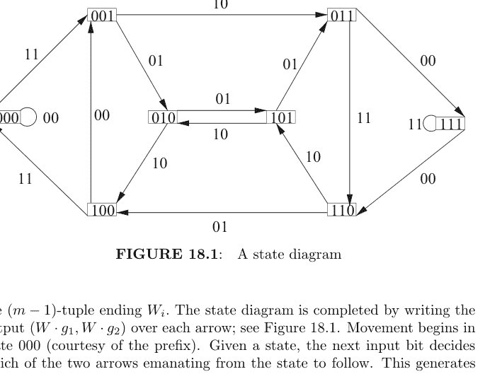

## 图 18.1：状态图

以 $W_i$ 结尾的 $(m-1)$-元组。通过在每条箭头上写出输出 $(W\cdot g_1, W\cdot g_2)$ 来完成状态图；见图 18.1。运动从状态 000 开始（得益于前缀）。给定一个状态，下一个输入比特决定跟随从该状态发出的两个箭头中的哪一个。这产生两个输出比特（写在箭头旁边的）并导致下一个状态。

由于应用数学家偏爱多项式和幂级数，通常将输入比特流表示为幂级数：代替 $0,0,0,x_0,x_1,x_2\dots$ 写成 $m(X)=x_0X^3+x_1X^4+x_2X^5+\dots$。卷积码于是被描述为形式幂级数上的变换，从而给该主题带来某种表面上的尊严。$m$-元组 $g_1,g_2,\dots$ 由多项式表示，在本例中 $g_1(X)=X^3+X+1$，$g_2(X)=X^3+X^2+1$。与 $g_i$ 的点积计算对应于幂级数 $g_i(X)m(X)$ 的计算，这些计算可使用移位寄存器高效完成。

卷积码是线性的：两个输入比特流的和映射为输出比特流的和。因此最小距离等于最小重量，即不同于全零序列的可能输出流的最小重量。在本例中最小距离是 $d=6$。事实上，我们必须沿着产生 11 的边离开状态 000 并经由状态 100 返回，再次产生 11。从状态 001 到状态 100 沿箭头的路径产生的输出重量没有小于 2 的。经过状态 010 可得到重量为 2 的这样的路径。由于 $d=6$，通常的论证表明，一般情况下可使用此卷积码纠正多达两个错误。我们在此不考虑译码算法的问题。

## Bose-Bush 构造

设 $a \ge b$ 并固定一个满射 $\mathbb{F}_q$-线性映射 $\Phi : \mathbb{F}_q^{a} \longrightarrow \mathbb{F}_q^{b}$，其中当然 $a \ge b$。我们在第 16.7 节中使用此设定构造了一个长度为 $q^{a}$、码字数为 $q^{a+b}$ 的 $q^{b}$ 元码 $\mathcal{C}_q(a,b)$，其强度为 2 且最小距离为 $q^{a} - q^{b}$。

回顾构造（见定理 16.29）：坐标由元素 $x \in \mathbb{F}_q^{a}$ 参数化，码字由对 $(u, v)$ 参数化，其中 $u \in \mathbb{F}_q^{a}$，$v \in \mathbb{F}_q^{b}$，且码字 $c(u, v)$ 在坐标 $x$ 处的分量为 $c(u, v)_x = \Phi(u x) + v$。

显然 $\mathcal{C}_q(a, b)$ 是 $q$-线性的。在本章的术语中我们把 $\mathcal{C}_q(a, b)$ 看作维数为 $(a + b)/b = 1 + a/b$ 的 $q$-线性 $q^{b}$ 元码。由于其强度为 2，其对偶是一个 $q$-线性 $[q^{a}, q^{a} - (1 + a/b), 3]_{q^{b}}$ 码。

此外，我们可以将 $\mathcal{C}_q(a, b)$ 写成直和：

$\mathcal{C}_q(a, b) = \mathcal{D}_q(a, b) \oplus \mathcal{R}_q(a, b)$

其中 $\mathcal{D}_q(a, b)$ 的码字为 $c(u, 0)$，而 $\mathcal{R}_q(a, b)$ 的码字为常数词 $c(0, v)$。$\mathcal{R}_q(a, b)$（我们称之为重复码）和 $\mathcal{D}_q(a, b)$ 都是 $q$ 线性的，前者维数为 1，后者维数为 $a/b \ge 1$。重复码显然具有强度 1。

### 18.3 定理.
定理 16.29 中的码 $\mathcal{C}_q(a, b)$（回顾 $a \ge b$）是一个维数为 $(a+b)/b \ge 2$、强度为 2 且最小距离为 $q^{a} - q^{a-b}$ 的 $q$-线性 $q^{b}$ 元码。它是重复码 $\mathcal{R}_q(a, b)$（一个常数重量为 $q^{a} - q^{a-b}$ 且强度为 1 的 $q$-线性 $[q^{a}, 1]_{q^{b}}$ 码）和 $q$-线性 $q^{b}$ 元码 $\mathcal{D}_q(a, b)$ 的直和。

考虑强度为 2 的正交数组的构造问题。如果限制为线性码，情况是熟悉的。线性码 $[n, r]_q$ 的强度为 2 当且仅当 $n \le (q^{r} - 1)/(q - 1)$。这一观察导致了 Hamming 码和 Simplex 码（见第 3.4 节）。如果我们把线性码推广到加性码会怎样？问题是：给定 $r$，一个有理数使得 $mr$ 为整数，确定强度为 2 的 $q$-线性 $q^{m}$ 元码维数为 $r$ 的最大长度 $n$。使用线性 $q^{m}$ 元码，若 $r$ 为整数可达到长度 $(q^{mr} - 1)/(q^{m} - 1)$。下面的构造表明我们的码 $\mathcal{C}_q(a, b)$ 及其子码 $\mathcal{R}_q(a, b)$，即重复码，可用于得到强度为 2 且长度更大的加性码。

### 18.4 命题.
假设存在以下 $q^{m}$ 元 $q$ 线性码：
- 一个强度为 2 的 $[n, K]$ 码 $\mathcal{C}$ 包含一个强度为 1 的 $[n, k]$ 子码 $\mathcal{R}$，且
- 一个强度为 2 的 $[l, K - k]$ 码（辅助码）。

则我们可以构造一个强度为 2 的 $[n + l, K]$ 码。

### 证明
最容易用 $\mathbb{F}_q$ 生成矩阵来工作。选取 $\mathcal{C}$ 的一个生成矩阵（有 $Km$ 行），使得前 $km$ 行构成 $\mathcal{R}$ 的生成矩阵。用辅助码的生成矩阵延长该生成矩阵的最后 $m(K - k)$ 行，并在前几行用 $0$ 矩阵延长。结果是一个具有正确维数、显然强度为 $2$ 的码的生成矩阵。

由命题 18.4 得到的码的生成矩阵具有形式 $G = \begin{pmatrix} A & 0 \\ C & D \end{pmatrix}$，其中左部生成 $\mathcal{C}$，$A$ 生成 $\mathcal{R}$ 且 $D$ 生成强度为 $2$ 的辅助码。若辅助码再次具有强度为 $1$ 的子码，它将与 $\mathcal{R}$ 一起生成所得码的强度为 $1$ 的子码。此时可以再次应用命题 18.4。

从码 $\mathcal{C}_q(a,b)$ 开始。由于它包含一个 $b$ 维强度为 $1$ 的子码（$\mathbb{F}_q$ 维），我们可以用 $\mathcal{C}_q(a - b, b)$ 作为辅助码（前提 $a - b \ge b$）应用命题 18.4。所得码具有 $2b$ 维强度为 $1$ 的子码。再用 $\mathcal{C}_q(a - 2b, b)$ 作为辅助码再次应用命题 18.4。以此类推进行归纳。最后一次归纳步骤发生在 $a - lb \ge b$ 但 $a - (l + 1)b < b$ 时。显然 $l = \lfloor a/b \rfloor - 1$。在此最后一步不需要使用具有强度为 $1$ 子码的强度为 $2$ 码。代替 $\mathcal{C}_q(a - lb, b)$ 我们使用长度为 $q^{a - lb} + 1$ 的码（见练习 18.1.4），并得到最终产物码的长度为 $1 + \sum_{i=0}^{l} q^{a - ib}$。

### 18.5 定理.
设 $a \ge b$ 为整数，$l = \lfloor a/b \rfloor - 1$。则存在一个强度为 $2$、维数为 $(a + b)/b$ 且长度为

$n = 1 + \sum_{i=0}^{l} q^{a - ib} = 1 + \left(q^{a + b} - q^{a - lb}\right)/\left(q^{b} - 1\right).$

的 $q$-线性 $q^b$ 元码。

定理 18.5 的 OA 参数归功于 Bose 和 Bush [36]，另见 Hedayat, Sloane 和 Stufken [109]。我们证明定理 18.5 所用的方法归功于 Y. Edel；见 [17]。

Bose-Bush 构造的强度为 $2$ 的正交数组比线性构造好多少？只有当 $a$ 是 $b$ 的倍数时才有可能直接比较。我们留给读者验证，在这些情况下定理 18.5 中的长度等于线性 OA 的最大长度。在这些情况下我们一无所获。定理 18.5 所做的：它把线性构造嵌入到一个更大的强度为 $2$ 的 OA 族中，其中指标 $\lambda$ 和字母表都是同一素数的幂。在 OA 记号中我们有

$OA_{\lambda}(2, n, Q), \text{ where } Q = q^{b}, \ \lambda = q^{a - b}$

且 $n$ 为定理 18.5 中的长度。

设 $b < a < 2b$。写 $a = b + i$，其中 $i < b$。则 $l = 0$，$n = q^{b + i} + 1$ 且 $\lambda = q^{i}$。我们得到 $OA_{q^{i}}(2, q^{b + i} + 1, q^{b})$，例如，$OA_{2}(2, 9, 4)$，$OA_{4}(2, 17, 8)$。


## 直接构造

我们希望构造一族低维的加性码，它们代表一族有趣的线性码——广义 Kasami 码——的加性（广义）版本。该构造利用了迹和范数的基本性质；参见第 12 章。

考虑域扩张

$$\mathbb{F}_q \subset F_0 = \mathbb{F}_{q^{r'}} \subset F = \mathbb{F}_{q^{r}}$$

其中 $r = 2r'$。用 $T : F \longrightarrow F_0$, $N : F \longrightarrow F_0$, $Tr : F_0 \longrightarrow \mathbb{F}_q$ 表示迹和范数。选取 $m \le r'$ 以及一个 $\mathbb{F}_q$-线性满射映射 $\Phi : F_0 \longrightarrow \mathbb{F}_q^m$。

$\Phi$ 是从 $r'$-维空间 $F_0$ 到 $m$-维空间 $\mathbb{F}_q^m$ 的 $q$-线性映射。它可简单地由秩为 $m$ 的 $(r', m)$ 矩阵表示，矩阵元在 $\mathbb{F}_q$ 中。具体表示如下：选取一个集合 $\{\eta_1, \dots, \eta_m\} \subset F_0$，它在 $\mathbb{F}_q$ 上线性无关。则

$$\Phi(y) = (Tr(\eta_1 y), Tr(\eta_2 y), \dots, Tr(\eta_m y)) \quad \text{for } y \in F_0.$$

我们定义一个长度为 $q^{r} - 1$、元素在 $\mathbb{F}_q^m$ 中、且为 $\mathbb{F}_q$ 线性的加性码 $\mathcal{C}$。坐标由 $x \in F^*$ 参数化，码字由对 $(u, v)$ 参数化，其中 $u \in F$, $v \in F_0$。对应码字 $c(u, v)$ 在坐标 $x$ 处的分量定义为

$$c(u, v)_x = \Phi\big(T(u x) + v N(x)\big)$$ $$= \big(Tr(\eta_j \cdot (T(u x) + v N(x)))\big)_j, \; j = 1,2,\dots,m.$$

显然映射 $(u, v) \mapsto c(u, v)$ 是 $\mathbb{F}_q$ 线性的。没有必要显式证明该映射的核为零，因为我们将一般地确定 $c(u, v)$ 的权值。由于该权值除非 $u = v = 0$ 否则永不为 $0$，于是可得 $\dim_{\mathbb{F}_q}(\mathcal{C}) = 3r' = r + r'$。确定权值所需的一切就是以下初等引理：

## 18.6 引理。

设 $\mathbb{F}_q \subset L = \mathbb{F}_{q^2}$ 并用 $T, N$ 分别表示迹和范数。设元素 $a \in L$, $b \in \mathbb{F}_q^*$, $u \in \mathbb{F}_q$ 给定。用 $\nu(a, b, u)$ 表示满足

$$T(a x) + b N(x) = u.$$

的元素 $x \in L^*$ 的个数。

则

$$\nu(a, b, u) = \begin{cases} q & \text{if } u = 0 \\ 1 & \text{if } b u = -N(a) \\ q + 1 & \text{otherwise.} \end{cases}$$

## 证明

我们有一个二次扩张，所以 $T(x)=x+x^q$, $N(x)=x^{q+1}$。计算 $N\!\left(x+\frac{a^q}{b}\right)=\left(x+\frac{a^q}{b}\right)\!\left(x^q+\frac{a}{b}\right)=N(x)+\frac{N(a)}{b^2}+\frac{T(ax)}{b}$。我们的方程因此等价于 $N\!\left(x+\frac{a^q}{b}\right)=\frac{u}{b}+\frac{N(a)}{b^2}$。若 $bu=-N(a)$，则只有唯一解 $x=-a^q/b$。在所有其他情形下右边非零。因此有 $q+1$ 个解 $x\in L$。其中一个是 $x=0$ 当且仅当 $u=0$。

计数零比计数非零更容易。设 $\chi_0(c(u,v))$ 为使 $c(u,v)_x=0$ 的坐标 $x$ 的个数（这里 $0$ 表示 $m$-元组 $(0,0,\dots,0)$）。注意到 $Ker(\Phi)$ 是 $F_0$ 的一个 $(r'-m)$ 维子空间。定义表明 $c(u,v)_x=0 \longleftrightarrow T(ux)+vN(x)\in Ker(\Phi)$。

在 $u=0$, $v\neq0$ 的情形下，条件为 $vN(x)\in Ker(\Phi)$。由于 $F_0$ 的每个非零元在 $N$ 下恰有 $q'^{r'}+1$ 个原像，我们得到 $\chi_0(c(0,v))=(q'^{r'}+1)(q'^{r'-m}-1)$。在 $v=0$, $u\neq0$ 的情形下条件为 $T(ux)\in Ker(\Phi)$。$F_0$ 的每个元素在 $T$ 下恰有 $q'^{r'}$ 个原像。注意到我们不能把 $x=0$ 计为原像，我们得到 $\chi_0(c((u,0)))=q'^{r'-m}q'^{r'}-1=q^{r-m}-1$。现在设 $uv\neq0$。我们可以用引理 18.6。先假设 $-N(u)/v\in Ker(\Phi)$。我们得到 $\chi_0(c(u,v))=q'^{r'}+1+(q'^{r'-m}-2)(q'^{r'}+1)=q^{r-m}-q'^{r'}+q'^{r'-m}-1$。最后一种情形是 $-N(u)/v\notin Ker(\Phi)$。结果为 $\chi_0(c(u,v))=q'^{r'}+(q'^{r'-m}-1)(q'^{r'}+1)=q^{r-m}+q'^{r'-m}-1$。由于 $wt(c(u,v))=q^r-1-\chi_0(c(u,v))$，权值如以下定理所述：

## 18.7 定理。存在一个 $q^m$-元 $\mathbb{F}_q$ 线性码，长度为 $q^r-1$ 且维数为 $3r'$，其中 $r=2r'$，其码字 $c(u,v)$ 具有以下权值：

- $0$ if $u=v=0$
- $q^r - q^{r-m}$ if $v=0$, $u\neq0$
- $q^r - q^{r-m} + q'^{r'} - q'^{r'-m}$ if $-N(u)/v \in Ker(\Phi)$
- $q^r - q^{r-m} - q'^{r'-m}$ if $-N(u)/v \notin Ker(\Phi)$.

底层线性码在 $m = 1$ 的情形下得到，此时我们可以选取 $\Phi$ 为迹 $tr_{F0|F_q}$。这些线性码是 Kasami 码的推广。线性 $p$-元码（$p = q^m$）的情形出现在 Delsarte 和 Goethals [67] 中。二进制线性情形（$q^m = 2$）是 Kasami 码。

$c(u, 0)$ 构成一个 $r$ 维子码，常权为 $q^r - q^{r-m}$，而在剩余码字 $c(u, v)$, $v \neq 0$ 中只有两种不同的权值。显然拼接对加性码同样适用于线性码。用 Simplex 码 $[(q^m -1)/(q -1), m, q^{m-1}]_q$ 进行拼接。结果是一个线性 $q$-元码。长度乘以因子 $(q^m -1)/(q -1)$，权值需乘以 $q^{m-1}$。

## 18.8 定理。将 $\mathcal{C}$ 与 Simplex 码 $[(q^m -1)/(q -1), m, q^{m-1}]_q$ 拼接得到一个线性 $3r'$-维 $q$-元码 $\tilde{C}$，长度为 $(q^r -1)(q^m -1)/(q -1)$，其码字 $c(\tilde{u}, v)$ 具有以下权值：

\[\left\{\begin{array}{ll}0 & \text{if } u=v=0\\ q^{r+m-1} - q^{r-1} & \text{if } v = 0, u \neq 0\\ q^{r+m-1} - q^{r-1} + q'^{r+m-1} - q'^{r-1} & \text{if } -N(u)/v \in Ker(\Phi)\\ q^{r+m-1} - q^{r-1} - q'^{r-1} & \text{if } -N(u)/v \notin Ker(\Phi).\end{array}\right.\]

最后，我们用 Simplex 码 $[(q' -1)/(q -1), r', q'^{r'-1}]_q$ 作为辅助码应用构造 X。长度增加 $(q' -1)/(q -1)$ 倍。由 $v = 0$ 的字组成的子码中的权值保持不变。剩余权值增加 $q'^{r'-1}$。仅存两个非零权值。

## 18.9 定理。对所有 $1 \le m \le r'$，存在一个 $q$-元线性码，长度为 $q^m(q'^r -1)(q'^r - q'^{r-m} +1)/(q -1)$ 且维数为 $3r'$，其唯一非零权值为 $d = q^{r+m-1} - q^{r-1}$ 和 $w2 = q^{r+m-1} - q^{r-1} + q'^{r+m-1}$。

## 练习 18.1

- 18.1.1. 设 $\mathcal{C}$ 是一个 $q$-线性 $[n,k]_{q^m}$ 码，其对偶码的最小权 $> t$。确定 $\mathcal{C}$ 作为正交阵列的参数。
- 18.1.2. 制定适用于外码为加性 $q$-线性码的拼接方法（定义 5.8，定理 5.9）的推广。
- 18.1.3. 证明：如果存在一个强度为 $t$ 的 $q$-线性 $[n,k]_{q^m}$ 码且 $m > 1$，则存在一个强度为 $t$ 的 $q$-线性 $[n, k + \binom{k-1}{m-1}]_{q^{m-1}}$ 码。

18.1.4. 对每个 $b \le a$ 构造长度为 $q^a + 1$、强度为 2 且维数为 $(a + b)/b$ 的 $q$-线性 $q^b$-元码。

18.1.5. 设 $D_q(a,b)$（其中 $a \ge b$）为本节构造的维数为 $a/b$、长度为 $q^a$ 的 $q$-线性 $q^b$-元码。确定其强度和最小距离。

18.1.6. 设 $a \ge b$ 且 $l = \lfloor a/b \rfloor - 1$。证明

$$\sum_{i=0}^{l} q^{a-ib} = (q^{a+b} - q^{a-lb})/(q^{b} - 1).$$

18.1.7. 当 $2b \le a < 3b$ 时确定 Bose-Bush 构造所得 OA 的参数。给出至少两个例子。

18.1.8. 对参数 $m = 1$, $r' = 2$ 确定定理 18.9 中码的参数并证明当 $q \le 4$ 时它们是 $d$-最优的。

18.1.9. 构造线性码 $[70,9,32]_2$ 和 $[196,9,96]_2$。

## 18.2 加性码的循环理论

我们在前几章中发展了线性循环码的理论。这里我们将理论推广到加性码的范畴。形式上这是自洽的：本章中再次证明了之前的线性理论。令人启发的是，这并不需要太多篇幅或时间。那些前几章中的一些基本事实被使用（子域码、迹码、伽罗瓦闭包、Delsarte 定理，当然还有分圆陪集）。本节遵循 [20]。

从定义 18.1 开始。我们将在一般假设底层域的特征 $p$ 与码长 $n$ 互素的条件下发展在单项式意义下循环的加性码的一般理论。假设的主要效应是特征为 $p$ 的向量空间上阶为 $n$ 的（循环）群的作用是完全可约的，由 Maschke 定理可知（参见定义 18.14 和定理 18.15）。

### 18.2.1 码等价与循环性

回顾第 12.4 节中的置换等价概念。

### 18.10 定义。

码 $\mathcal{C}$ 和 $\mathcal{D}$ 是置换等价的，如果存在 $n$ 个对象的置换 $\pi$ 使得

$$(x_1,x_2,...,x_n) \in \mathcal{C} \iff (x_{\pi(1)},x_{\pi(2)},...,x_{\pi(n)}) \in \mathcal{D}$$

对所有 $x = (x_1,...,x_n) \in \mathcal{C}$ 成立。

置换等价的概念可用于所有固定块长 $n$ 的码。它使用对称群 $S_n$ 作为运动群。两个码等价当且仅当它们在 $S_n$ 下处于同一轨道。$S_n$ 下的稳定子是码的置换自同构群。

在加性码的特殊情况下，以下更一般的等价概念更为自然。

### 18.11 Definition.
$q$-线性 $q^m$-元码 $\mathcal{C}$ 与 $\mathcal{D}$ 是单项等价的，如果存在 $n$ 个对象的置换 $\pi$ 以及元素 $A_i \in GL(m,q)$ 使得

$(x_0,x_1,\dots,x_{n-1}) \in \mathcal{C} \iff (A_0x_{\pi(0)},A_1x_{\pi(1)},\dots,A_{n-1}x_{\pi(n-1)}) \in \mathcal{D}$

对所有 $x = (x_0,\dots,x_{n-1}) \in \mathcal{C}$ 成立。

运动群是 $GL(m,q)$ 与 $S_n$ 的 wreath 积，其阶为 $|GL(m,q)|^n \times n!$，两个加性码在单项意义下等价当且仅当它们在此较大群作用下处于同一轨道。wreath 积的元素由 $(n+1)$-元组 $(A_0,\dots,A_{n-1},\pi)$ 描述，其中系数 $A_i \in GL(m,q)$ 且置换 $\pi \in S_n$。将单项群的元素写为 $g(A_0,\dots,A_{n-1},\pi)$。

### 18.12 Definition.
长度为 $n$ 的码 $\mathcal{C}$ 在置换意义下是循环的，如果存在 $n$ 轮换 $\pi \in S_n$ 使得 $\pi(\mathcal{C}) = \mathcal{C}$。

$q$-线性 $q^m$-元码 $\mathcal{C}$ 在单项意义下是循环的，如果它在单项群的元素 $g(A_0,\dots,A_{n-1},\pi)$ 下不变，其中 $\pi \in S_n$ 是一个 $n$ 轮换。

由于 $n$ 轮换在 $S_n$ 中共轭，很明显每个在置换意义下循环的码都与一个在置换 $\pi = (0,1,\dots,n-1)$ 下不变的码置换等价。

### 18.13 Proposition.
设 $\mathcal{C}$ 为长度 $n$ 的 $q$-线性 $q^m$-元码且在单项意义下循环。则以下成立：

- $\mathcal{C}$ 与在 $g(I,\dots,I,A'_{n-1},\pi)$ 下不变的码单项等价，其中 $\pi = (0,1,\dots,n-1)$。
- 若 $\mathcal{C}$ 在 $g(A_0,\dots,A_{n-1},(0,\dots,n-1))$ 下不变且 $A_0A_1\dots A_{n-1}=I$，则 $\mathcal{C}$ 在置换意义下循环。
- 若 $\mathcal{C}$ 在 $g(I,\dots,I,A,(0,\dots,n-1))$ 下不变且 $\operatorname{ord}(A)$ 与 $n$ 互素，则 $\mathcal{C}$ 在置换意义下循环。

### Proof
我们刚刚看到可以假设 $\mathcal{C}$ 在 $g(A_0,A_1,\dots,A_{n-1},\pi)$ 下不变，其中 $\pi = (0,1,\dots,n-1)$。我们有 $(x_i) \in \mathcal{C}$ 蕴含 $(A_i x_{i+1}) \in \mathcal{C}$。现在令

$\mathcal{C}' = \{(B_0x_0,\dots,B_{n-1}x_{n-1}) \mid x = (x_0,\dots,x_{n-1}) \in \mathcal{C}\}$。

令 y_i = B_i x_i。则 $(y_i) \in C'$ 蕴含 $(B_i A_i B_{i+1}^{-1} y_{i+1}) \in C'$。选择 $B_i$ 使得（对 $i = 0$）$B_1 = B_0 A_0$，（对 $i = 1$）$B_2 = B_1 A_1 = B_0 A_0 A_1$，直到（对 $i = n − 2$）$B_{n−1} = B_{n−2} A_{n−2} = B_0 A_0 … A_{n−2}$。由此可知 $C'$ 在 $g(I,…,I,A,(0,1,…,n−1))$ 下不变，如所声称。 这里 $A = B_0(A_0 A_1 … A_{n−1}) B_0^{-1}$，是 $A_0 A_1 … A_{n−1}$ 的一个共轭。关于置换意义下循环性的第一个陈述由此得出。现在设 $C$ 在 $g = g(I,…,I,A,(0,…,n−1))$ 下不变且 $\operatorname{ord}(A) = u$ 与 $n$ 互素。则 $g^u$ 的 $u$ 个系数等于 $A$，其余为 $I$。$g^u$ 的置换是一个 $n$ 轮换。第一个陈述蕴含 $C$ 在置换意义下循环。

循环群 $G = \langle g(A_0,…,A_{n−1},(0,…,n−1))\rangle$ 的阶是 $n$ 的倍数，并在 $\mathbb{F}_q$ 上的 $n$ 维向量空间 $V$ 上作用。循环码是 $V$ 的 $G$ 子模。如果 $G$ 在 $V$ 上的作用完全可约，则理论大大简化。

### 18.14 Definition.
设群 $G$ 在向量空间 $V = V(n,K)$ 上作用。不可约子模 $A \subset V$ 是非零的 $G$ 子模，且不包含真 $G$ 子模（不同于 $0$ 和 $A$ 本身）。若对 $V$ 中每一个 $G$ 子模 $A \subset V$，存在 $A$ 的直接补 $B$ 且 $B$ 是 $G$ 模，则称 $G$ 的作用完全可约。

如果作用完全可约，那么在某种程度上只需知道不可约模，因为每个 $G$ 子模都是不可约模的直和。仍有工作要做，因为模表示为不可约模直和的方式可能不唯一。然而，与完全可约性不满足的情况相比，情况要简单得多。这就是 Maschke 定理发挥作用的地方。

### 18.15 Theorem (Maschke).
在定义 18.14 的情形下，设 $G$ 的阶与底层域的特征 $p$ 互素。则 $G$ 的作用完全可约。

另见 [130]，第 666 页。这个基本定理是循环码理论中常假设 $\gcd(n,p) = 1$ 的原因。

## Additive codes which are cyclic in the permutation sense
回顾情形：$W$ 是由置换 $(0,1,…,n−1)$ 生成的循环群。它将向量空间 $V(n,q)$ 上的坐标循环置换。$W$ 子模恰好是 $\mathbb{F}_q$ 上的循环线性码。我们假设 $\gcd(n,p) = 1$。由于 Maschke 定理，$W$ 在 $V(n,q)$ 上的作用完全可约。设 $r = \operatorname{ord}_n(q)$ 为 $q$ 在模 $n$ 下计算时的阶。则 $n \mid (q^r − 1)$ 且 $r$ 是具有此性质的最小自然数。设 $F = \mathbb{F}_{q^r}$。于是我们在 $F^*$ 中找到一个阶为 $n$ 的循环群。将 $W$ 与 $\mathbb{F}_q^*$ 的此子群等同起来是有益的。设 $W = \langle\alpha\rangle$。

由于我们对循环 **additive** 码感兴趣，我们的字母表为 $E = \mathbb{F}_q^m$，并研究 $W$ 在 $V_m = E^n = \mathbb{F}_q^{mn}$ 上的作用。然而请记住，我们将 $V_m$ 的元素（码字）视为 $E$ 上的 $n$-元组，而不是 $\mathbb{F}_q$ 上的 $nm$-元组。将码字的 $n$ 个分量称为外坐标（与 $W$ 的元素 $\alpha^i$，$i = 0,\ldots,n-1$ 之间一一对应），将字母表 $E$ 的 $m$ 个坐标称为内坐标。设 $V_{m,F} = V_m \otimes F = (F^m)^n$ 通过常数扩张得到，$W$ 在外坐标上作用。我们将码 $C \subset V_m = E^n = \mathbb{F}_q^{nm}$ 与其常数扩张 $C \otimes F \subset V_{m,F}$ 联系起来，并利用关于在较大域 $F$ 和子域 $\mathbb{F}_q$ 上定义的码之间关系的基本事实。特别是，我们将每个子码 $U \subset V_{m,F}$ 与其迹码 $tr(U) \subset V_m$ 关联，后者通过在每个内坐标上应用迹 $tr = tr_{F|\mathbb{F}_q}$ 得到。

投影到 $m$ 个内坐标之一。我们于是得到空间 $\mathbb{F}_q^n$ 和 $F^n$。$F^n$ 的元素可由次数 $< n$ 的一元多项式 $p(X) \in F[X]$ 唯一描述，其中由 $p(X)$ 定义的码字为求值 $ev(p(X)) = (p(\alpha^i))$，$i = 0,\ldots,n-1$。对每个内坐标做此操作，我们看到 $V_{m,F}$ 的元素可由多项式 $p_j(X) \in F[X]$ 的 $n$-元组 $(p_1(X),\ldots,p_m(X))$ 唯一描述，其中次数 $< n$，对应的码字为求值 $ev(p_1(X),\ldots,p_m(X)) = (p_1(\alpha^i),p_2(\alpha^i),\ldots,p_m(\alpha^i))_i$（$m$-元组的 $n$-元组，每个 $nm$ 个分量都在 $F$ 中）。

考虑伽罗瓦群 $G = Gal(F|\mathbb{F}_q)$（阶为 $r$ 的循环群）及其在 $\mathbb{Z}/n\mathbb{Z}$ 上的轨道，即分圆陪集。我们将 $\mathbb{Z}/n\mathbb{Z}$ 的元素解释为循环群 $W$ 元素描述中 $\alpha$ 的指数。对每个次数 $< n$ 的多项式 $p(X) \in F[X]$，考虑出现在 $p(X)$ 中的单项式的指数以及它们在分圆陪集上的分布。

### 18.16 Definition.
设 $\mathcal{P}$ 为 $F[X]$ 中次数 $< n$ 的多项式空间。则 $\mathcal{P}$ 是 $n$ 维 $F$ 向量空间。设 $A \subseteq \mathbb{Z}/n\mathbb{Z}$ 为指数集合。$F$ 向量空间 $\mathcal{P}(A)$ 由次数 $< n$ 且所有单项式次数都在 $A$ 中的多项式 $\in F[X]$ 组成。$A$ 的伽罗瓦闭包 $\tilde{A}$ 是与 $A$ 非平凡相交的所有分圆陪集的并。

注意 $\mathcal{P}(A)$ 是维数为 $|A|$ 的 $F$ 向量空间，且与 $ev(\mathcal{P}(A)) \subset V_{1,F}$ 同构。定义 18.16 的术语由明显事实所证实，即码 $ev(\mathcal{P}(A)) \subset V_{1,F} = F^n$ 的伽罗瓦闭包是 $ev(\mathcal{P}(\tilde{A}))$。

## Linear cyclic codes (case $m = 1$)
我们有 $\mathcal{P} = \oplus_Z \mathcal{P}(Z)$，其中 $Z$ 在分圆陪集上变化，对应地 $V_{1,F} = F^n = \oplus_Z ev(\mathcal{P}(Z))$。由于 $ev(\mathcal{P}(Z))$ 是伽罗瓦闭的，我们也有 $V_1 = \mathbb{F}_q^n = \oplus tr(ev(\mathcal{P}(Z)))$ 且 $dim_{\mathbb{F}_q}(tr(ev(\mathcal{P}(Z)))) = dim_F(ev(\mathcal{P}(Z))) = |Z|$。设 $V_1(Z) = tr(ev(\mathcal{P}(Z)))$。我们的首要任务是在 $V_1$ 中识别不可约 $W$ 子模（不可约循环码）。


## 18.17 定理。

在 m = 1，gcd(n, p) = 1 的情况下，按置换意义下的不可约循环码恰好是 V₁(Z) = tr(ev(𝒫(Z)))，其 𝔽_q 维数为 |Z|，其中 Z 是一个分圆陪集。每个循环码都可以唯一地写成不可约码的直和。循环码的总数为 2^u，其中 u 是不同分圆陪集的个数。

我们已在前几章中知道定理 18.17。为了自洽，我们将在本小节的剩余部分证明它。

由迹的基本性质可知，在用码字 tr(ev(p(X))) 描述码 𝒞 ⊆ V₁ 时，只需使用形如 p(X) = a₁X^{z₁} + a₂X^{z₂} + … 的多项式，其中 z₁, z₂, … 是不同分圆陪集的代表元。

## 18.18 引理。

设 Z 为分圆陪集，z ∈ Z，|Z| = s，L = 𝔽_q^s。由 u^z（其中 u ∈ W）生成的 𝔽_q 向量空间 ⟨W^z⟩ 为 L。码字 tr(ev(aX^z))，其中 a ∈ F，当且仅当 a ∈ L^⊥ 时恒为零，其中对偶是关于迹形式而言的。

### 证明

由于 ev(𝒫(Z)) 是 F 线性的且 Galois 闭，维数为 s，故 tr(ev(𝒫(Z))) 是 𝔽_q 线性的，维数为 s。其一般码字为 tr(ev(aX^z))。该码字恒为零当且仅当 a ∈ ⟨W^z⟩^⊥。比较维数可得 dim(⟨W^z⟩) = s。设 u ∈ W。则由分圆陪集的定义有 u^{z q^s} = u^z。这表明 W^z ⊂ L。于是 ⟨W^z⟩ = L。

引理 18.18 表明我们可以假设对每个 i 都有 a_i ∉ L_i^⊥。暂且称此时的多项式为标准形式。注意到 tr(ev(p(X))) = tr(a₁X^{z₁}) + tr(a₂X^{z₂}) + … 且和项 tr(a_i X^{z_i}) 位于直和分解 V₁ = ⊕_Z V₁(Z) 的不同部分中。

## 18.19 引理。

设 𝒞 ⊆ V₁ 为循环码，ℬ ⊆ 𝒫 为所有满足 tr(ev(p(X))) ∈ 𝒞 且次数 < n 的多项式 p(X) 的集合。设 p(X) = a₁X^{z₁} + a₂X^{z₂} + … ∈ ℬ，其中 z₁, z₂, … 是不同分圆陪集的代表元。则 p^{(l)}(X) = a₁α^{l z₁}X^{z₁} + a₂α^{l z₂}X^{z₂} + … ∈ ℬ 对所有 l 成立。包含 tr(ev(p(X))) 的最小循环码是所有 tr(ev(p^{(l)}(X))) 张成的码。

### 证明

tr(ev(p(X))) 在坐标 α^i 中的分量为 tr(a₁α^{i z₁} + a₂α^{i z₂} + …)。循环移位后得到一个码字，其在坐标 α^i 中的分量为 tr(a₁α^{(i+1)z₁} + a₂α^{(i+1)z₂} + …) = tr(a₁α^{z₁}α^{i z₁} + a₂α^{z₂}α^{i z₂} + …)，即 a₁α^{z₁}X^{z₁} + a₂α^{z₂}X^{z₂} + … 的求值迹。第一个结论由重复应用可得，第二个结论是显然的。

让我们完成定理 18.17 的证明。设 𝒞 为不可约循环码且 tr(ev(p(X))) ∈ 𝒞，其中 p(X) 为标准形式。假设 p(X) 不是单项式。设 ℬ 如引理 18.19 中定义，且 p(X) = a₁X^{z₁} + a₂X^{z₂} + ⋯ ∈ ℬ。引理 18.19 表明 a₁α^{l z₁}X^{z₁} + a₂α^{l z₂}X^{z₂} ∈ ℬ 对所有 l 成立。先假设 |Z₁|≠|Z₂|。选取 l 使 α^{l z₁}=1 且 α^{l z₂}≠1。相减得 a₂(α^{l z₂}−1)X^{z₂}+⋯∈ℬ。该多项式迹-求值生成的循环码在 V₁(Z₁) 上的投影为平凡。𝒞 不具有此性质，由不可约性可知该码字必须是 0 字，故 a₂(α^{l z₂}−1)∈L₂^⊥。这推出 a₂∈L₂^⊥，矛盾。现在假设 |Z₁|=|Z₂|=s，并设 L=𝔽_q^s。利用引理 18.19。设 c_l∈𝔽_q 使 ∑_l c_lα^{l z₁}=0。上面的同样论证表明 ∑_l c_lα^{l z₂}=0。我们有 β=α^{z₁}∈L 且 L 是包含 β 的 F 的最小子域。另有 α^{z₂}=β^j，其中 j 与 β 的阶互素。设 ∑_{l=0}^s c_lβ^l 为 β 的极小多项式。我们刚刚看到 ∑_{l=0}^s c_lβ^{j l}=0。这表明映射 x↦x^j 是 L 的域自同构。它推出 z₁ 与 z₂ 在同一分圆陪集中，矛盾。

我们已看到，迹-求值生成不可约循环码的标准形式多项式必为单项式 aX^z，其中 a∉L^⊥，使用现已标准的术语（z∈Z，|Z|=s，L=𝔽_q^s，⊥ 关于迹形式）。引理 18.19 表明 aα^{l z}X^z∈ℬ 对所有 l 成立。由于 α^{l z} 生成 L（见引理 18.18），故 a u X^z∈ℬ 对所有 u∈L 成立。再次由引理 18.19 实际上有 𝒞=tr(ev(a L X^z))。考虑从 L 到 𝒞 的映射 u↦tr(ev(a u X^z))。该映射的核为 0，故 𝒞 的维数为 s。由于它包含于维数为 s 的 V₁(Z) 中，故有等式。

至此定理 18.17 的证明完成。由此，我们得到长度为 n 且 gcd(n,p)=1 的置换意义下所有循环线性码的所有码字的算法描述。码与分圆陪集的集合一一对应。设 Z₁∪⋯∪Z_t 为这样一个集合。设 z_k∈Z_k，s_k=|Z_k|，L_k=𝔽_q^{s_k}。码的维数为 ∑_k s_k。其一般码字 w(x₁,…,x_t)，其中 x_k∈L_k，在坐标 i（其中 i=0,…,n−1）中的分量为

∑_k tr_{L_k|𝔽_q}(x_k α^{i z_k})

码字 w((x_k)_k) 的循环移位为 w((x_k α^{z_k})_k)。

## 循环加性码

现在设 m≥1 任意。这是在置换意义下加性不一定线性的循环码的情形。回顾我们仍假设 gcd(n,p)=1。我们希望确定此情形下的不可约循环码。已处理 m=1 的情形将有所帮助。设 𝒞 为不可约循环码，π_j，j=1,…,m 为到内部坐标的投影。若 π_j(𝒞) 不恒为零，则 π_j(𝒞) 为线性不可约循环码。因此它由一个分圆陪集描述（见定理 18.17）。可以假设这对所有 j 都成立（否则我们处理的是更小的 m 值）。设 Z₁，…，Zₘ 为相应的分圆陪集。首先我们证明它们是相同的。

## 18.20 引理。设 𝒞 为不可约循环码。由不可约线性循环码 πⱼ(𝒞) 确定的分圆陪集全部相同。

### 证明

我们可以假设 m = 2 且 tr(ev(p₁(X), p₂(X))) ∈ 𝒞，其中 p₁(X) = a₁X^{z₁}，p₂(X) = a₂X^{z₂} 且 aᵢ ∉ Lᵢ^⊥，记号如前一小节所用。假设 z₁, z₂ 位于不同的分圆陪集中。证明与定理 18.17 证明的主要部分类似。引理 18.19 表明 (a₁α^{l z₁}X^{z₁}, a₂α^{l z₂}X^{z₂}) ∈ ℬ 对所有 l 成立，其中 ℬ 是迹-求值在 𝒞 中的多项式元组的 𝔽_q 线性空间。假设 z₁, z₂ 分别位于不同分圆陪集 Z₁, Z₂ 中，其长度为 s₁, s₂。若 s₁ ≠ s₂，则与定理 18.17 的证明中相同的论证适用。若 s₁ = s₂，则定理 18.17 证明中使用的论证表明 Z₁ = Z₂，另一矛盾。

## 18.21 定理。设 Z 为分圆陪集。Vₘ(Z) = tr(ev(𝒫(Z), …, 𝒫(Z))) 中的每个非零码字生成维数为 s = |Z| 的不可约循环码。

### 证明

这样的码字可写为 tr(ev(a₁X^z, a₂X^z, …, aₘX^z))。外坐标 i 与内坐标 j 处的分量为 tr(aⱼα^{i z})。引理 18.19 表明由该码字生成的循环码 𝒞 是具有分量 tr(aⱼα^{l z}α^{i z}) 的码字的张成。由于 α^{l z} 生成 L = 𝔽_q^s（见引理 18.18），故 𝒞 由在 (i, j) 坐标处具有分量 tr(aⱼuα^{i z}) 的码字组成，其中 u ∈ L。现在很明显该码是由其任意非零码字生成的循环码；换言之，𝒞 是不可约的。由迹的传递性，有 tr(aⱼuα^{i z}) = tr_{L|𝔽_q}(bⱼuα^{i z})，其中 bⱼ = tr_{F|L}(aⱼ)。码非零的事实意味着并非所有 bⱼ 都消失。映射 u ↦ tr(ev(a₁uX^z, …, aₘuX^z)) 是单射，故 dim(𝒞) = s。

## 18.22 推论。特征互素的长度为 n 的置换循环 q-线性 q^m-元码的不可约码的总数为 ∑_Z((q^{m s} − 1)/(q^s − 1))，其中 Z 在分圆陪集上变化且 s = |Z|。

### 证明

事实上，Vₘ(Z) 的 𝔽_q 维数为 m s，且每个不可约子码有 q^s − 1 个非零码字。

注意这在线性情形 m = 1 时也成立：在此情形下不可约循环码的个数是分圆陪集的个数（见定理 18.17）。更重要的是，我们得到

不可约码。这样的码由以下数据描述：

- 1. 一个分圆陪集 $Z$。设 $s = |Z|$，$L = \mathbb{F}_{q^s}$，选取 $z \in Z$。
- 2. 一个点 $P = (b_1 : \cdots : b_m) \in PG(m-1, L)$。

码字随后由 $x \in L$ 参数化。外坐标 $i$ 和内坐标 $j$ 处的项为 $tr_{L|\mathbb{F}_q}(b_j \alpha^{i z})$。记此码为 $\mathcal{C}(z, P)$。这导致了所有循环加性码的参数描述，而不仅仅是不可约的那些。

## 18.23 定义。

设 $Z$ 为长度为 $s$ 的分圆陪集，$z \in Z$，$L = \mathbb{F}_{q^s}$ 且 $U \subset V(m, L)$ 为 $k$ 维向量子空间（等价于 $PG(k-1, L) \subset PG(m-1, L)$）。设 $P_1, \ldots, P_k$ 为由 $U$ 的基确定的射影点。定义 $\mathcal{C}(z, U) = \mathcal{C}(z, P_1) \oplus \cdots \oplus \mathcal{C}(z, P_k)$。

将 $\mathcal{C}(z, U)$ 称为 **分量码**。这里若 $U \subseteq L^m$ 的维数为 $k$，则 $\mathcal{C}(z, U)$ 的维数为 $k s$。使用一个 **编码矩阵** $B = (b_{ij})$，一个 $(k, m)$ 矩阵，其元素来自 $L$。$B$ 的行 $z_i$ 构成 $U$ 的基。码字 $w(x)$ 由 $x = (x_l) \in L^k$ 参数化。码字 $w(x)$ 在外坐标 $i$ 和内坐标 $j = 1, \ldots, m$ 处的项为

$tr_{L|\mathbb{F}_q}((x \cdot s_j)\alpha^{i z})$ (18.1)

其中 $s_j$ 为 $B$ 的第 $j$ 列。$w(x)$ 在一次循环移位下的像是 $w(\alpha^z x)$。如果我们对同一个子空间 $U$ 使用不同的基 $(z_i')$ 会怎样？则 $z_l' = \sum_{r=1}^k a_{lr} z_r$ 且 $A = (a_{lr})$ 可逆。$w(x)$ 在此操作下（用 $z_i'$ 替换 $z_i$）的像是 $(i, j)$ 项为 $tr_{L|\mathbb{F}_q}(\sum_{l=1}^k x_l \sum_{r=1}^k a_{lr} b_{rj} \alpha^{i z})$。这描述了 $w(x')$，其中 $x_l' = \sum_{r=1}^k x_r a_{rl}$，换句话说 $x' = x A \in L^k$。我们已看到 $\mathcal{C}(z, U)$ 确实与编码矩阵的选择无关。迹的基本性质表明，对代表元 $z \in Z$ 的选择依赖性由 $\mathcal{C}(qz, U^q) = \mathcal{C}(z, U)$ 给出。

这里给出分量码权重的具体表达式：码字 $w(x)$ 在外坐标 $i$ 处的项 $w(x)_i = 0$ 当且仅当对所有 $j$，$x \cdot s_j \in (\alpha^{i z})^\perp$，关于 $tr_{L|\mathbb{F}_q}$ 形式。

最后，每个循环码都可以唯一地写成其分量码的直和：$\mathcal{C} = \bigoplus_Z \mathcal{C}(z, U_Z)$，其中 $Z$ 在分圆陪集上变化且 $z$ 是 $Z$ 的固定代表元。

## 18.24 定义。

设 $N(m, q)$ 为向量空间 $\mathbb{F}_q^m$ 的子空间总数。

特别地，$N(1, q) = 2$，$N(2, q) = q + 3$，$N(3, q) = 2(q^2 + q + 2)$。

## 18.25 推论。

特征互素的长度为 $n$ 的置换循环 $q$-线性 $q^m$-元码的总数为 $\prod_Z N(m, q^{|Z|})$。

## 18.26 例（[7,3.5,4]₄）。

设 q = 2，m = 2，n = 7。分圆陪集的长度为 1,3,3（代表元 0,1,−1）。不可约循环码有 3 + 9 + 9 = 21 个，循环码总共有 5 × 11 × 11 = 605 个。一个 [7,3.5,4]₄ 码可表示为 C(1,(1,0)F₈)⊕C(−1,(0,1)F₈)⊕C(0,(1,1)F₂)，其中 C(0,(1,1)F₂) 只是重复码 ⟨(11)⁷⟩。用定义 18.1 的语言，我们有 km = 2k =7，因此四元维数为 k = 3.5。可以验证最小距离确实为 4。

## 18.27 例（[15,4.5,9]₄）。

设 q = 2，m = 2，n = 15。分圆陪集的代表元为 0（长度 1），5（长度 2）以及 1,3,14（各长度 4）。不可约循环码有 3 + 5 + 3 × 17 = 59 个，总共有 5 × 7 × 19³ 个循环码。一个 [15,4.5,9]₄-码可表示为 C(1,(ε,1)F₁₆) ⊕ C(3,(1,ε²)F₁₆)⊕C(0,(1,1)F₂)；见 [19]。这里 F = F₁₆ = F₂(ε) 且 ε⁴ = ε + 1。

## 等价

何时两个加性循环码 ⊕_Z C(z,U_Z) 和 ⊕_Z C(z,U'_Z) 等价？有两种情况很容易看出。这里是第一种。

## 18.28 命题。

设 C = (c_{ij}) ∈ GL(m,q)。则加性循环码 C = ⊕_Z C(z,U_Z) 与 ⊕_Z C(z,U_Z C) 单项等价。

证明

使用单项等价的 GL 部分。如果我们对 C 的每个项应用矩阵 C，则可得到等价码。这意味着，对于每个分量 Z，项 w(x)_i(j) = tr_{L|F_q}((x·s_j)α^{i z}) 被 Σ_{u=1}^m c_{uj} w(x)_i(u) 替换。由于 c_{uj} ∈ F_q，这相当于用 B_Z C 替换编码矩阵 B_Z，从而用 U_Z C 替换子空间 U_Z。

作为命题 18.28 的特例，考虑 m = 2 时不可约码的情况。我们有一个长度为 s = |Z| 的固定分圆陪集 Z，且 U = (b₁ : b₂) 是射影直线 PG(1,L) 的一个点。从右边乘以 C 相当于应用一个 Möbius 变换，PGL(2,q) 的一个元素。关于命题 18.28 描述的等价，属于分圆陪集 Z 的不可约码的非等价数等于 PGL(2,q) 在射影直线 PG(1,q^s) 上的轨道数。

这里是第二种情况。

## 18.29 命题。

设 gcd(t,n) = 1。加性置换循环码 C = ⊕_Z C(z,U_Z) 与 ⊕_Z C(tz,U_Z) 置换等价。

证明

第二个码的一般码字 w(x) 在外坐标 i、内坐标 j 处有项 tr_{L|F_q}((x·s_j)α^{i t z})（见公式 18.1）。这是第一个码在外坐标 i/t mod n 且内坐标 j 处的项。

命题 18.29 描述了 ℤ/nℤ 单位群的作用。这里有一个例子。

## 18.30 例。

*恰好有三个非等价的长度 7 的不可约加性四元码在置换意义下是循环的。*

证明 这是 q = 2，m = 2，n = 7 的情形。不可约循环码的总数为 3 + 9 + 9 = 21（一次 PG(1,2) 和两次 PG(1,8)）。此类码的非等价数最多为 1 + 2 = 3。事实上，三个码 C(0,U) 其中 U ∈ PG(1,2) 均由命题 18.28 等价。由命题 18.29 对剩余的不可约码只需考虑 Z(1)。可能非等价的此类不可约码的数目是 GL(2,2) 在 PG(1,8) 上的轨道数。有两个这样的轨道。对应的码为 C(1,(0,1)) 和 C(1,(1,ε)) 其中 ε ∉ F₂。事实上这些不可约码两两不等价。第一个显然与其它不等价，因为它具有二进制维数 1（重复码 ⟨(11)⁷⟩）。第二个码有 w(x)ᵢ = (0, tr(xεᵗ))，恒定权重为 4。第三个不可约码有 w(x)ᵢ = (tr(xεᵗ), tr(xεᵗ⁺¹))，显然不是恒定权重。

## 单项意义下的循环加性码

设 C 为长度为 n 的 $q^m$-元 $q$-线性码，在单项意义下是循环的。设 gcd(n,p) = 1，m ≥ 1 且 A ∈ GL(m,q) 的阶为 u，其中 gcd(u,p) = 1。设 r = ord_n(q)，r' = ord_{un}(q) 且 F = F_{q^r} ⊆ F' = F_{q^{r'}} 为对应的域。考虑 ℤ/unℤ 中的分圆陪集 Z ⊂ Z/unZ。对固定的长度为 s 的 Z，设 z ∈ Z，L = F_{q^s}。另设 κ = ord_u(q) 且 K = F_{q^κ}。由命题 18.13 可知，通过单项等价只需考虑在 g = g(I,…,I,A,(0,1,…,n−1)) 作用下固定的单项意义下的循环码，g 的阶为 un。此类码也称为常循环码。这里矩阵 A 扮演常数因子的角色。设 G = ⟨g⟩。另设 β 为 F' 中阶为 un 的群的生成元且 α = β^u ∈ F。设 γ = β^n 阶为 u。则 γ ∈ K = F_{q^κ}。

## 18.31 定义。

设 A ∈ GL(m,q)，A^u = 1。定义膨胀 I_A : F_q^{mn} ⟶ F_q^{umn} 为

I_A(\overset{\wideparen{x}}{x_0, …, x_{n-1}}) = (x | A x | … | A^{u-1} x)。

映射 contr : (x | A x … | A^{u-1} x) ↦ x ∈ F_q^{mn} 是收缩 : I_A(F_q^{mn}) ⟶ F_q^{mn}。

## 18.32 引理。

在定义 18.31 的情形下，长度为 n 的 $q$-线性 $q^m$-元码 C 在由 g(I,…,I,A,(0,1,…,n−1)) 生成的阶为 un 的循环群 G 的（单项）作用下不变当且仅当 I_A(C) 是

在置换意义下关于置换 (0,1,...,un − 1) 为循环的。收缩 contr(C) 在 G 的作用下不可约当且仅当长度为 un 的循环码 C 不可约。

证明 观察到 C 与 I_A(C) 具有相同的维数，且 C 可由 I_A(C) 投影到前 n 个坐标得到。至此结论显然。

## 18.2.2 线性情形 m = 1

在此特殊情形下我们有 g = g(1,...,1,γ,(0,1,...,n − 1))，其中矩阵 A 现在是一个常数 γ ∈ F_q^*，其阶为 u，其中 u|q − 1。令 u = ord(γ)。将环境空间 F_q^{un} 的元素写成 (x_i)，其中 i ∈ Z/unZ。则 x ∈ F_q^{un} 属于 I_γ(F_q^n) 当且仅当恒有 x_{i+n} = γ x_i。

## 18.33 定理。

设 gcd(n,p) = 1 且 γ ∈ F_q^*，ord(γ) = u。在由 g = g(1,...,1,γ,(0,1,...,n − 1)) 生成的群作用下保持不变的码是长度为 un 的循环码的收缩，这些循环码在置换意义下由由同余于 1 mod u 的数构成的循环同余类定义。若在 Z/unZ 中有 a 个这样的循环同余类，则在 g 下不变的码的个数为 2^a。

证明 观察 gcd(un,p) = 1。由引理 18.32 所讨论的码是长度为 un 的循环码的收缩，所有这些循环码的码字 (x_i) 均满足 x_{i+n} = γ x_i 对所有 i 成立。设 Z 为一个循环同余类，z ∈ Z，|Z| = s，L = F_{q^s}。由 Z 定义的不可约循环码的一个典型码字具有分量 x_i = tr_{L|F_q}(a β^{i z})，其中 a ∈ L。于是 x_{i+n} = tr_{L|F_q}(a β^{(i+n)z}) = γ^z x_i。我们必须有 z = 1 mod u。

这里有一个关于在 g = g(1,...,1,γ,(0,1,...,n − 1)) 下不变的线性长度 n q-元码的算法观点，其中 ord(γ) = u。令 r' = ord_{un}(q) 且 F' = F_{q^{r'}}。令 ord(β) = un 使得 γ = β^n。令 α = β^u。考虑 Z/unZ 中元素同余于 1 mod u 的循环同余类 Z_1,...,Z_a。观察到 |Z_1 ∪ ... ∪ Z_a| = n。令 s_k = |Z_k|，L_k = F_{q^{s_k}} ⊆ F'。则 C ⊆ ⊕ C_k，其中 C_k 是长度为 n 的不可约 γ-常循环码。我们有 dim(C_k) = s_k。C_k 的码字为 w(x)，其中 x ∈ L_k。w(x) 在坐标 i 处的分量为 tr_{L_k|F_q}(β^{i z_k} x)。在单项式运算 g(1,...,1,γ,(0,1,...,n − 1)) 下 w(x) 的像是 w(β^{z_k} x)。经过 n 次应用，这导致 w(γ^{z_k} x) = w(γ x) = γ w(x)，正如预期的那样。

## 18.34 例。

考虑 q = 4，u = 3，n = 15。则 F = F_{16}，而 F' = F_{4^6}。Z/45Z 中由 3 整除的数的循环同余类与模 15 的九个循环同余类一一对应。由 Z 同余类定义的长度为 45 的循环码的收缩，所有元素均可被 3 整除，恰好重现置换意义下的长度为 15 的循环码。只有三个循环同余类的所有元素均同余于 1 mod 3。它们是

`{1,4,16,19,31,34}, {7,13,22,28,37,43}, {10,25,40}.`

由此可知，具有常数 γ = β¹⁵ 且阶为 3 的常循环四元线性码有 2³ = 8 个。

## 18.35 例。

考虑 q = 8，n = 21。则 F' = 𝔽₂⁴² = 𝔽₈¹⁴。常数为 γ = β⁷，阶为 7。我们有 un = 7 × 21 = 147，并且我们需要考虑 q = 8 的作用（阶为 14 的伽罗瓦群）对 1 mod 7 的 21 个元素的作用。相应的循环同余类为

`Z(1) = {1,8,64,71,−20,−13,43,50,−41,−34,22,29,85,−55}`

长度为 14，以及

`Z(15) = {15,−27,78,36,−6,−48,57}`

长度为 7。由此可知，长度为 21 的不可约 γ-常循环 𝔽₈-线性码恰有两个，维数分别为 14 和 7。

这里有一些更有趣且众所周知的例子。

## 18.36 例。

设 q = 4，u = 3，Q = 2^f，其中 f 为奇数，且 n = (Q^f + 1)/3，F = 𝔽₄^f。由 1 生成的循环同余类定义的不可约常循环四元码的维数为 f，且对偶距离为 5。其对偶因此是一个线性 [(2^f +1)/3, (2^f +1)/3 − f, 5]₄ 码。这是文献 [90] 中的第一个族。我们在第 13.4 节中构造了它们。

## 18.37 例。

文献 [90] 中的第二个常循环四元码族出现在 u = 3，n = (4^f − 1)/3 的情形，对任意 f，其中循环同余类是由 1 和 −2 生成的。这产生一个维数为 2f 的四元码，其对偶距离为 5，因此对任意 f 都有 [(4^f − 1)/3, (4^f − 1)/3 − 2f, 5]₄ 码。

## 一般情形 m ≥ 1

## 18.38 定理。

采用上文引入的记号，对每个循环同余类 Z 选择一个代表元 z，并令 U_Z 为 A 在 L^m 上的作用下特征值 γ^z 的特征空间。则每个被 G 稳定的码都被包含在 ⊕_Z contr(C(z, U_Z)) 中。

证明

Z 并询问对于哪个子空间 U 满足此条件。设 A = (a_{jj'}) ∈ GL(m,q) 且 U = P = (b1 : ... : bm) ∈ PG(m-1, L) 为一点。令 tr = tr_{L|F_q}。条件为

tr(xb_j β^{(i+n)z}) = Σ_{j'} a_{jj'} tr(xb_{j'}, β^{i z})

对所有 i、所有 j 和 x ∈ L 成立。由于 β^n = α，等价条件为

tr(x β^{i z} (γ^z b_j - Σ_{j'} a_{jj'} b_{j'})) = 0,

这等价于 γ^z b_j = Σ_{j'} a_{jj'} b_{j'}；换句话说，b（写成列向量）是 A 的特征值 γ^z 的特征向量。

这里再次给出一个算法观点。长度为 n 的常循环加性码是其构成成分的直和，其中构成成分对应于 Z/unZ 中的循环同余类。设 Z 为此类循环同余类，z ∈ Z，|Z| = s，L = F_{q^s} 且 β、α、γ = β^n 如常。不可约子码是 C(z,P) 的收缩，其中 P = (b1,...,bm) ∈ L^m 必须满足 AP = γ^z P（且我们把 P 写成列向量）。这个不可约长度为 n 的常循环码 contr(C(z,P)) 的维数为 s。其码字为 w(x)，x ∈ L。w(x) 在外坐标 i = 0,1,...,n-1 和内坐标 j 处的分量为 tr_{L|F_q}(xb_j β^{i z})。循环群 G 的生成元 g = g(I,...,I,A,(0,...,n-1)) 的作用效果为 g(w(x)) = w(β^z x)。

## 18.39 命题。

设 C 是一个 q-线性 q^m-元长度为 n 的码，它在 g(I,...,I,A,(0,1,...,n-1)) 下不变，其中 gcd(n,p) = 1 且 A 的阶 u = q^m - 1 表示 F_{q^m} 中本原元 γ 的乘法。则 C 是 F_{q^m} 线性的。

证明

只需对不可约常循环码 contr(C(z,P)) 证明这一点。通用的码字 w(x) 已如上所述。在每个外坐标 i = 0,...,n-1 中应用矩阵 A 得到码字 w(γ^z x)，它仍在码中。

命题 18.39 特别适用于情形 q = 2，m = 2，u = 3 以及 q = 2，m = 3，u = 7。

## 18.40 推论。

每个在单项式意义下循环的四元加性码要么是四元线性的，要么等价于在置换意义下循环的。

证明

利用命题 18.13 得到一个在 g = (I,...,I,A,(0,...,n-1)) 下不变的码，其中 A ∈ GL(2,2) 且 u = det(A)。若 u = 1 或 u = 2，或当 u = 3 且 3 不整除 n 时，则加性码在置换意义下是循环的（见命题 18.13）。在 u = 3 的情形下，命题 18.39 表明该码是四元线性常循环码。

这表明在四元情形下，加性常循环码的完整理论并不能产生任何有用的东西，因为在每种情形下我们都被化约为更初等的理论，要么是四元线性常循环，要么是加性且在置换意义下循环。

## 18.3 四元加性码：几何方法

线性码的几何方法已在第 17 章中使用过，在那里我们看到一个长度为 n 的线性 q-元 k 维码可以等价地用射影几何 PG(k − 1, q) 中的 n 个点的多重集来描述。码字的最小距离事实上码字的权由点在超平面上的分布决定。

现在考虑定义 18.1 中的 q-线性 q^m-元码 [n,k]_{q^m}。显然它可以等价地用 PG(k − 1, q) 中 n 个子空间 PG(m − 1, q) 的多重集来描述。这里需注意这些子空间也可能退化为更低维的子空间。在本节中我们专门讨论四元情形。

## 18.41 定理。以下等价：

- 四元加性 [n,k]₄ 码。
- PG(2k − 1,2) 中 n 条线的多重集（codelines，可能退化为点）。

这里码字与超平面一一对应，且码字的权为 w 当且仅当对应的超平面包含除 w 条之外的所有 codelines。

证明 这比证明更难表述。从码出发并用生成矩阵描述它。观察到该码的二元维数为 2k。n 个坐标对中的每一个在 PG(2k − 1,2) 中给出一个点对。考虑由此得到的多重直线。这些就是 codelines。超平面 H 给出在由 codeline L_i 描述的截面中具有零分量的码字当且仅当 L_i ⊂ H。

该码的强度（等于对偶的最小距离减 1）是最大的数 t，使得每 t 条 codelines 处于一般位置，

等价地，生成矩阵在任意 t 条码线集合上的投影具有二进制秩 2t。

四元加性码的小长度及其最小距离首次由 Blokhuis 和 Brouwer [34] 考虑。目前对于四元加性 [n,k,d]4 码，n ≤ 13，最小距离 d 的最大值已知如下：

| k\n | 1 | 2 | 3 | 4 | 5 | 6 | 7 | 8 | 9 | 10 | 11 | 12 | 13 |
|---|---|---|---|---|---|---|---|---|---|---|---|---|---|
| 1 | 1 | 2 | 3 | 4 | 5 | 6 | 7 | 8 | 9 | 10 | 11 | 12 | 13 |
| 1.5 |  | 1 | 2 | 3 | 4 | 5 | 6 | 6 | 7 | 8 | 9 | 10 | 11 |
| 2 |  | 1 | 2 | 3 | 4 | 4 | 5 | 6 | 7 | 8 | 8 | 9 | 10 |
| 2.5 |  |  | 1 | 2 | 3 | 4 | 5 | 6 | 6 | 7 | 8 | 8 | 9 |
| 3 |  |  | 1 | 2 | 3 | 4 | 4 | 5 | 6 | 6 | 7 | 8 | 9 |
| 3.5 |  |  |  | 1 | 2 | 3 | 4 | 4 | 5 | 6 | 6 | 7 | 8 |
| 4 |  |  |  | 1 | 2 | 2 | 3 | 4 | 5 | 6 | 6 | 6 | 7 |
| 4.5 |  |  |  |  | 1 | 2 | 3 | 3 | 4 | 5 | 6 | 6 | 6 |
| 5 |  |  |  |  | 1 | 2 | 2 | 3 | 4 | 5 | 6 | 6 | 6 |
| 5.5 |  |  |  |  |  | 1 | 2 | 3 | 3 | 4 | 5 | 6 | 6 |
| 6 |  |  |  |  |  | 1 | 2 | 2 | 3 | 4 | 5 | 6 | 6 |
| 6.5 |  |  |  |  |  |  | 1 | 2 | 3 | 3 | 4 | 5 | 6 |
| 7 |  |  |  |  |  |  | 1 | 2 | 2 | 3 | 4 | 4 | 5 |
| 7.5 |  |  |  |  |  |  |  | 1 | 2 | 2 | 3 | 4 | 5 |
| 8 |  |  |  |  |  |  |  | 1 | 2 | 2 | 3 | 4 | 4 |
| 8.5,9 |  |  |  |  |  |  |  |  | 1 | 2 | 2 | 3 | 4 |
| 9.5,10 |  |  |  |  |  |  |  |  |  | 1 | 2 | 2 | 3 |
| 10.5,11 |  |  |  |  |  |  |  |  |  |  | 1 | 2 | 2 |

缩短和打孔与线性情形一样工作：一个加性 [n,k,d]4 码蕴含参数为 [n − 1,k − 1,d]4 和 [n − 1,k,d − 1]4 的加性码。注意通过串联与二元线性码的联系：

## 18.42 定理（串联）。

一个加性四元 [n,k,d]4 码蕴含一个二元线性 [3n,2k,2d]2 码。

### 证明

只需如第 5.2 节那样应用串联，使用 [3,2,2]2 码。四元码的加性意味着串联后的码是线性的。

在许多情况下，从几何上思考是有益的。例如，考虑维数 k = 1.5 的情形。二元维数是 3，这意味着我们的码被定义为法诺平面中直线的多重集。由于法诺平面的超平面就是直线，因此 d 的最高值是在直线的重数尽可能均匀地选择时得到的。例如在 n = 14 的情况下，法诺平面的七条直线都应具有重数 2。这产生一个 [14,1.5,12]4 码。这个初等论证解释了 k = 1.5 行中的条目。

在第 17 章我们将线性单纯形码描述为由相应射影空间中所有点集定义的码。当前设定下的一个类似构造是选择所有直线：

## 18.43 定理（单纯形码）。对于每个整数 l ≥ 3，存在一个加性 [(2^l − 1)(2^{l−1} − 1)/3, l/2, 2^{l−2}(2^{l−1} − 1)]_4 码。

### 证明
二元维数是 l，且 PG(l−1,2) 中直线的数量为 (2^l −1)(2^{l−1}−1)/3。由于每个超平面包含 (2^{l−1}−1)(2^{l−2}−1)/3 条直线，我们得到常数权重为 (2^l −1)(2^{l−1}−1)/3 − (2^{l−1}−1)(2^{l−2}−1)/3 = 2^{2l−3} − 2^{l−2}。

定理 18.43 的码是最优的，因为串联产生一个二元线性 [(2^l −1)(2^{l−1}−1), l, 2^{l−1}(2^{l−1}−1)]_2 码，该码以等号满足 Griesmer 界。定理 18.43 的最小实例是 [7,1.5,4]_4（法诺平面）和 [35,2,28]_4（存在具有这些参数的线性码）。

我们将看到像部分扩散（直线）这样的几何对象会产生码构造。这里射影几何中的部分扩散是一组两两斜交的直线。射影几何的次曲面是一个超平面的超平面（余维数为 2 的子空间）。有时使用向量空间维数而不是射影维数会更方便。因此用 V_i 表示 F_2^i。V_i 中的次曲面是 V_{i−2}。下面的几何论证来自 [36]。

## 18.44 命题。设 f ≥ 2，q = 2^f 并固定 PG(f+1,2) 中的一个次曲面 S。则 PG(f+1,2) \ S 可被划分为 q 条直线（扩散线）。设 H 为一个超平面。若 S ⊂ H，则 H 不包含任何扩散线。若 S ⊄ H，则 H 精确包含 2^{f−2} = q/4 条扩散线。

### 证明
将环境空间写为 V_{f+2} = {(a,x,y) | a ∈ F = F_q, x,y ∈ F_2}。固定 F 中非零元素 a,b,c 使得 a + b + c = 0。这是可以的，因为 f ≥ 2。作为扩散线，我们可以选择的

L_x = {(a x,1,0), (b x,0,1), (c x,1,1) | x ∈ F}。

这 q 条不相交直线的并集恰好由环境空间中不包含在次曲面 S = {(x,0,0) | 0 ≠ x ∈ F} 中的点组成。

每条扩散线与 S 一起生成整个环境空间。这表明包含 S 的超平面不包含任何扩散线。设 H 为不包含 S 的超平面。每条扩散线要么包含在 H 中，要么与 H 在一点相交。由于 H 中在 S 外的点数为 2^{f+1} − 2^{f−1} = 3 × 2^{f−1} = q + 2^{f−1}，包含在 H 中的扩散线数 N 满足 3N + (q − N) = q + 2^{f−1}，故 N = q/4。

将此用于定理 18.41 得到一个维数为 (f + 2)/2、长度为 q = 2^f 的加性四元码，其所有码字的权重要么为 q，要么为 q − q/4 = 3q/4。

## 18.45 推论。

命题 18.44 给出一个加性 [2^f,1+f/2,3×2^{f−2}]_4 码。

对于 f = 3，这给出一个 [8,2.5,6]_4 码。对于 f = 4，参数 [16,3,12]_4 没有独立的兴趣。这些是四元线性码的参数（几何上，仿射平面 AG(2,4)）。情形 f = 5 给出 [32,3.5,24]_4，通过串联 [96,7,48]_2。事实上，串联后得到的二元码的参数与第 5.2 节中通过 (u, u+v) 构造得到的一个族的参数相同。

命题 18.44 也可用于递归构造。

## 18.46 推论。

设 f ≥ 2，q = 2^f。若存在一个加性 [m, f/2, d]_4 码，则存在一个加性 [q + m, 1 + f/2, Min(q, d + 3q/4)]_4 码。

### 证明

假设存在一个加性 [m, f/2, d]_4 码。将它在命题 18.44 中使用的次曲面 S 上几何表示。与扩散线一起，这产生一个由 q + m 条码线组成的多重集。在包含 S 的每个超平面 H 外，恰好有 q 条码线，即扩散线。在其余每个超平面外，有 3q/4 条扩散线和至少 d 条位于 S 中的直线。

作为一个例子，使用 [3,1.5,2]_4 作为成分（几何上，法诺平面的三条不同直线），得到 [11,2.5,8]_4。

定理 18.42 也可用于证明不存在性。事实上，如果不存在线性 [3n,2k,2d]_2 码，则加性 [n,k,d]_4 不存在。例如，加性 [12,2.5,9]_4 码不存在，因为串联会产生二元 [36,5,18]_2 码，这将与 Griesmer 界矛盾。

在构造方面，我们可以使用线性四元码。为了理解表中的一些条目，需要以下线性码：

- 1. [17,4,12]_4（几何上，PG(3,4) 中的椭圆二次曲面）；见第 17.3 节。
- 2. [21,15,5]_4，来自第 13.4 节，蕴含 [13,7,5]_4。
- 3. [18,9,8]_4；见 [143]。
- 4. [12,6,6]_4 来自第 17.1 节。
- 5. [12,8,4]_4（再次来自椭圆二次曲面）。

以下真正加性（非线性）码在表中使用：

- 1. $[7, 3.5, 4]_4$（见循环例 18.26）。
- 2. [34] 中给出了一个 $[12, 3.5, 8]_4$ 码。
- 3. $[13, 6.5, 6]_4$，见 Danielsen 和 Parker [64]。这些是循环码。
- 4. $[13, 7.5, 5]_4$；见 [29]。
- 5. $[15, 4.5, 9]_4$（见循环例 18.27）。

上界证明需要几何工作。与超平面的相交表明研究混合二元/四元码是不可避免的：

## 18.47 定义。

*一个 $[(l, r), k]_{(4,2)}$ 码是二元 $2k$ 维的二元 $(2l + r)$-元组向量空间，其中坐标被划分为 $l$ 对和 $r$ 个单坐标。我们将每个码字视为一个 $(l + r)$-元组，其中左侧坐标为四元，右侧为二元。*

这些混合四元-二元码本身也有一些兴趣。以下不存在性结果对于完成长度 ≤ 13 的最优码参数表是必要的：

- 不存在 $[8, 4.5, 4]_4$ 码。这在 [34] 中通过计算机搜索证明。有一个相对简短的几何证明可用。
- 不存在 $[12, 4.5, 7]_4$ 码（见 [31]）。
- 不存在 $[12, 7, 5]_4$ 码（见 [29]）。

最小的未解决问题涉及参数为 $[14, 7.5, 6]_4$ 和 $[14, 8.5, 5]_4$ 的码的存在性。

## 加性四元码：四元线性情形的刻画

四元加性码不禁止实际上是四元线性的。Blokhuis 和 Brouwer [34] 给出了四元线性码的以下自然刻画。

## 18.48 定理。

*设 $C$ 是一个由直线（多重）集、即码线几何描述的加性四元码。则以下等价：*

- $C$ 是一个 $\mathbb{F}_4$-线性码。
- 每组码线生成一个偶维的二元向量空间。


**证明** 让我们确保我们理解情况。首先，很明显我们可以假设该码由一组直线描述，换句话说，所有非零重数的直线都可以假设为 = 1。另外，一个方向是显然的：如果 $C$ 在 $\mathbb{F}_4$ 上是线性的，则所有相关 $\mathbb{F}_2$ 维数都将是偶数。因此我们假设情况如此，并需要证明 $C$ 是 $\mathbb{F}_4$ 线性的。特别地，码直线是非退化的（它们确实是直线），任意两条码直线都是斜的（因此码直线形成一个部分扩散），等等。

设 $C$ 为这样的加性码，二进制维数为 $2m$，$\mathcal{L}$ 为相应的码直线集合。我们使用二进制维数。回顾基本假设：$\mathcal{L}$ 的每个子集生成一个偶数维的向量空间。设 $\mathbb{F}_4 = \{0,1,\omega,\omega^2\}$。可以假设 $L_i = \langle x_i, y_i \rangle, i = 1,2,\dots,m$ 为码直线。这里的 $x_i, y_i$ 构成环境空间 $V = \mathbb{F}_2^{2m}$ 的基。恰好有 $2^m$ 个 $V$ 的 $\mathbb{F}_4$ 结构，使得由 $L_i$ 描述的码是 $\mathbb{F}_4$ 线性的。事实上，对于每个 $i = 1,2,\dots,m$，给 $L_i$ 一个 $\mathbb{F}_4$ 向量空间结构恰好有两种方式：要么 $\omega$ 的乘法是 3-循环 $x_i \mapsto y_i \mapsto x_i + y_i$，要么是该 3-循环的逆。我们需要证明在 $V$ 上至少存在这样一个 $\mathbb{F}_4$ 结构，使得 $\mathcal{L}$ 中的每条直线都是一个 $\mathbb{F}_4$ 向量空间。设 $\pi_i$ 为投影 : $V \longrightarrow L_i$。对于 $v \in V$，令 $\operatorname{supp}(v) = \{ i \mid \pi_i(v) \neq 0 \} \subseteq \{1,\dots,m\}$ 为 $v$ 的支撑。设 $M_1 \in \mathcal{L}$ 为不同于 $L_i$ 的码直线。由假设可知 $M_1$ 中每个 $0 \neq v$ 具有相同的支撑，我们称之为 $M_1$ 的支撑 $\operatorname{supp}(M_1)$。这意味着 $\mathcal{L} \cup \{M_1\}$ 对上述 $2^m$ 个结构中的某一个是 $\mathbb{F}_4$ 线性的：对于某个 $i \in \operatorname{supp}(M_1)$ 的 $L_i$ 的 $\mathbb{F}_4$ 结构决定了所有 $j \in \operatorname{supp}(M_1)$ 的 $\mathbb{F}_4$ 结构。例如，如果 $1,2 \in \operatorname{supp}(M_1)$ 且 $M_1 = \langle u, v \rangle$ 其中 $u = x_1 + x_2 + \dots, v = y_1 + x_2 + y_2 + \dots$，则 $\omega x_1 = y_1$ 蕴含 $\omega x_2 = x_2 + y_2$（而在另一种情况下，$\omega x_1 = x_1 + y_1$ 迫使 $\omega x_2 = y_2$）。现在假设我们有不同于 $L_i$ 的码直线 $M_1, M_2 \in \mathcal{L}$。冲突只能在 $|\operatorname{supp}(M_1) \cap \operatorname{supp}(M_2)| \geq 2$ 时发生。假设 $1,2 \in \operatorname{supp}(M_1) \cap \operatorname{supp}(M_2)$ 且设 $M_i = \langle u_i, v_i \rangle$ 其中 $\pi_1(u_i) = x_1, \pi_1(v_i) = y_1, i = 1,2$。例如，假设 $\pi_2(u_1) = x_2, \pi_2(v_1) = y_2$。例如，如果 $\pi_2(u_2) = x_2, \pi_2(v_2) = x_2 + y_2$，则会发生冲突。然而这是不可能的，因为 $M_1 + M_2 + L_3 + \cdots + L_m$ 的维数将为 $2m - 1$，与我们的基本假设矛盾。所有情况都是类似的，并导致同样的矛盾。

## 练习 18.3

**18.3.1.** 使用几何语言确认（显然的）事实：加性 $[n,1,d]_4$ 码的最大最小距离为 $d = n$。

**18.3.2.** 求出所有 $n$ 下加性 $[n,1.5,d]_4$ 码的最大最小距离 $d$。

18.3.3. 设 PG(2,q) ⊂ PG(2,q²)：（PG(2,q) 被称为 PG(2,q²) 的 Baer 子平面）。显然 PG(2,q²) 包含许多 PG(2,q) 的拷贝。我们固定其中一个 Baer 子平面。证明 PG(2,q²) 的每条直线与 Baer 子平面的交点要么是一个点，要么是 q + 1 个点。特别地，PG(2,q²) 的每条直线都至少与 Baer 子平面相交于一点（Baer 子平面是一个阻挡集）。

18.3.4. 描述一个 [14,3,10]₄ 码的构造。

18.3.5. 描述一个 [13,4,8]₄ 码的构造。

18.3.6. 证明由推论 18.45 通过拼接得到的二元线性码以等号满足 Griesmer 界。

18.3.7. 给出线性 [10,3,7]₄ 码不存在的几何证明。

18.3.8. 给出加性 [10,3,7]₄ 码不存在的几何证明。

18.3.9. 使用命题 18.44 证明以下结论：如果 E 是 PG(2m,2) 中的一个平面，则 PG(2m,2) \ E 可以划分为直线。

18.3.10. 证明 PG(2m,2) 具有 1+8(2^{2m-2}−1)/3 条直线的部分扩散。

18.3.11. 证明 9 是 PG(4,2) 中形成部分扩散的直线的最大数量。

## 18.4 量子码

量子编码发生在希尔伯特空间中。有限结构如纠错码是否会出现在其中并不明显。幸运的是，已经找到了这样的联系。在 Calderbank et al. [39] 中，描述了如何将辛空间中的某些纠错码用于量子纠错的目的。该构造被称为 **稳定子构造**。由于稳定子构造似乎是纠正量子错误（无论这意味着什么）的最重要来源，将这些辛码称为 **量子码** 并不完全不合理。更精确的定义如下：

### 18.49 定义。

*设 E = 𝔽_q^2 为关于辛双线性形式 ⟨,⟩ 的辛二维空间（双曲平面），E^n 为 2n 维 q 元辛空间。*

*量子码 [[n,k,d]]_q 是 E^n 的 q 线性 q^2 元码 𝒬 ⊂ E^n，其维数为 (n + k)/2，包含其对偶，并且 𝒬 \ 𝒬^⊥ 中的每个码字权重 ≥ d。量子码是纯的，如果其所有非零码字权重 ≥ d。*

在 [39] 的原始设定中，仅考虑了定义 18.49 的 q = 2 情况（这些是四元码）。Ashikhmin 和 Knill [2] 给出了定义 18.49 一般情况的物理 justification。尽管如此，四元情况似乎是最重要的。

如果我们与我们一般的加性码概念进行比较，我们会发现量子码形成一个参数子类，即 m = 2 且底层双线性形式 ⟨,⟩ 为辛的情况（关于辛双线性形式的概念，参见第 17.2 节）。附加的假设是量子码必须包含其对偶。在定义 18.49 中我们使用了加性码的一般术语。回想一下，维数 (n + k)/2 是 q^2 元维数。码 𝒬 有 q^{n+k} 个码字。纯 [[n,k,d]]_q 特别是一个 (n, q^{n+k}, d)_{q^2} 码。

一个极端情况是 k = n。我们有 𝒬 = E^n 等于环境空间，且显然此时 d = 1。这是一个 [[n,n,1]]_q 码。在另一个极端情况 k = 0 时，我们必须有 𝒬 = 𝒬^⊥。只有纯码是有趣的，所以 d 只是自对偶码 𝒬 的最小距离。

线性 q^2 元码的贡献是什么？一个来源是关于厄米内积自正交的码。这些厄米形式在第 17.2 节中未被考虑，因为它们不是双线性的，但它们与双线性形式密切相关。

### 18.50 定义。

*设 F = 𝔽_{q^2} 且 T, N 为向下到 𝔽_q 的迹和范数。类比复共轭，记 \bar u = u^q 对 u ∈ F。厄米内积（标准形式）定义在 V = F^n 上为*

*(x, y) = \sum_{i=1}^{n} x_i y_i.*

*这里 u 是 F | F_q 的非平凡自同构下的 u 的像，且 T(u) = u + u^q, N(u) = u^{q+1} ∈ F_q。显然厄米内积是双可加的并满足 (\lambda x, y) = \lambda (x, y), (x, \lambda y) = \lambda (x, y) 对 \lambda ∈ F。第二个等式使得厄米内积不是双线性的。它是一个斜线性形式。*

对偶不仅可以基于任何非退化双线性形式，也可以基于非退化斜线性形式。到现在应该很清楚我们所看到的对偶的基本规则。特别地，我们可以考虑关于厄米内积的对偶码。以下是基于关于厄米形式自正交的 q^2 元线性码的量子码构造。

### 18.51 定理。设 C 为关于厄米形式包含其对偶的线性 [n,k,d]_{q^2} 码。存在从 C 到纯 [[n,2k - n,d]]_q 量子码 Q 的 𝔽_q 同构。

证明 选择 0 \neq \gamma \in F = F_{q^2} 使得 T(\gamma) = 0 并定义 \Phi : F \longrightarrow F_q 为 \Phi(u) = T(\gamma u)。\Phi 的核为 F_q。固定 \alpha 使得 \Phi(\alpha) = 1。由于 \alpha + \alpha^q ∈ F_q，可得 \Phi(\alpha) = -1。

设 0 \neq \omega_1 ∈ F 任意并定义 \omega_2 使 \alpha = \omega_1 \omega_2。则 \omega_1, \omega_2 构成 F | F_q 的基（如果 \omega_2 = \lambda \omega_1 且 \lambda ∈ F_q，则 \alpha ∈ F_q，从而 \Phi(\alpha) = 0，矛盾）。定义投影 \pi_1, \pi_2 : F \longrightarrow F_q 为 u = \pi_1(u) \omega_1 + \pi_2(u) \omega_2。这定义了一个 𝔽_q 同构 \tau : F_{q^2}^n \longrightarrow F_q^{2n}，其中

\tau(x_1, \dots, x_n) = (\pi_1(x_1), \pi_2(x_1), \dots, \pi_1(x_n), \pi_2(x_n)).

用 ( , ) 表示 F_{q^2}^n 上的厄米形式并在 F_q^{2n} 上定义双线性形式 \langle , \rangle 为 \langle \tau(x), \tau(y) \rangle = \Phi(x, y)。从定义显然可知 \langle , \rangle 是双可加且双线性的。它是非退化的，因为厄米形式是非退化的。如果 y = x，则 (x, x) ∈ F_q，从而 \Phi(x, x) = 0。这表明 \langle , \rangle 是辛的（参见第 17.2 节）。我们看到 Q = \tau(C) 关于辛形式包含其对偶，如所声称的那样。由于 \tau 按坐标作用，x ∈ F^n 的权重等于 \tau(x) ∈ E^n 的权重，其中 E = F_q^2 是双曲平面。

再次考虑六码，我们最喜欢的码之一。生成矩阵首次在第 3.4 节的问题中给出。我们看到这个 [6,3,4]_4 码关于厄米形式是自对偶的，而关于点积则不是。事实上，不存在关于点积自对偶的 [6,3,4]_4 码。应用定理 18.51 得到一个 [[6,0,4]]_2 量子码。


## 量子码：循环理论

量子码的一个主要来源是循环加性码。我们从更一般的设定开始，使用第 18.2 节中的循环加性码。

固定向量空间 E = 𝔽_q^m 上的非退化双线性形式 ⟨ , ⟩，并以自然的方式将其延拓到 V_m = E^n、F^m 以及 V_{m,F} = (F^m)^n。在坐标中，这意味着 ⟨ , ⟩ 由系数 a_{k l} ∈ 𝔽_q 描述，其中 k,l = 1,...,m，使得 ⟨(x_k),(y_l)⟩ = Σ_{k,l} a_{k l} x_k y_l。对偶性将相对于该双线性形式。基本信息源于以下事实：

### 18.52 引理。

设 W = ⟨α⟩ ⊂ F = 𝔽_{q^r} 为阶为 n 的循环子群，且整数 l 不是 n 的倍数。则 Σ_{i=0}^{n-1} α^{i l} = 0。

**证明**

设 S = Σ_{i=0}^{n-1} α^{i l}。则 α^l S = S 且 α^l ≠ 1。由此可得 (1 − α^l)S = 0，从而推出 S = 0。

### 18.53 命题。

V_{m,F}(Z)^⊥ = ⊕_{Z'≠−Z} V_{m,F}(Z')。V_m(Z)^⊥ = ⊕_{Z'≠−Z} V_m(Z')。

**证明**

由于维数正确，只需证明 V_{m,F}(Z) 关于 ⟨ , ⟩ 与 V_{m,F}(Z') 正交，当 Z' ≠ −Z 时（第二个等式也有类似的陈述）。具体来说，这意味着 Σ_{k,l=1}^m a_{k l} Σ_{i=0}^{n-1} p_k(α^i) q_l(α^i) = 0，其中 p_k(X) ∈ 𝒫(Z)，q_l(X) ∈ 𝒫(Z')。根据双线性，只需对固定的 k,l 以及 p_k(X) = X^z、q_l(X) = X^{z'} 证明此式，其中 z ∈ Z，z' ∈ Z'。设 j = z + z'。则 j 不是 n 的倍数。我们需要证明 Σ_{i=0}^{n-1} α^{i z + i z'} = 0。这由引理 18.52 可得。这证明了第一个等式。第二个等式的证明是类似的，使用迹的定义。

注意命题 18.53 的结果与双线性形式 ⟨ , ⟩ 无关。双线性形式所包含的信息将决定 V_{m,F}(Z) 与 V_{m,F}(−Z) 的子空间之间的对偶关系，以及 V_m(Z) 与 V_m(−Z) 的子空间之间的对偶关系。为了判定自正交性，以下公式是有帮助的：

### 18.54 引理。

∑_{u∈W} tr(a u^z) tr(b u^{-z}) = n × tr(a tr_{F|L}(b))。

循环量子稳定子码对应于 m = 2 且双线性形式为辛形式 ⟨(x1,x2),(y1,y2)⟩ = x1 y2 − x2 y1 的特殊情况（特别地，⟨x,x⟩ = 0 恒成立）。根据定义，如果该码相对于辛形式是自正交的，则它是（循环）q 元量子稳定子码。判定自正交性的基本引理如下：

### 18.55 命题。

在在这里考虑的情况（m = 2 且辛形式，gcd(n,p) = 1）下，不可约码 C(z,P) 和 C(−z,P′) 正交当且仅当 P = P′。

**证明**

注意 Z 和 −Z 有相同的长度 s，L = F_{q^s} 且 P,P′ ∈ PG(1,L)。只需证明 C(z,P) 和 C(−z,P) 正交即可。设 P = (v1 : v2)。写出典型向量的辛积，我们需要证明

∑_{u∈W} tr(a v1 u^z) tr(b v2 u^{-z}) = ∑_{u∈W} tr(a v2 u^z) tr(b v1 u^{-z})

对 a,b ∈ F。引理 18.54 表明左边求和等于 n×tr(a v1 tr_{F|L}(b v2)) = n×tr(a v1 v2 tr_{F|L}(b)) = n×tr_{L|F_{q^i}}(v1 v2 tr_{F|L}(a) tr_{F|L}(b))，这与右边求和在对称性下一致。

### 18.56 定理。

加性循环 q^2 元量子稳定子码的数量为 ∏_{Z=-Z,s=1} (q + 2) ∏_{Z=-Z,s>1} (q^{s/2} + 2) ∏_{Z≠-Z} (3q^s + 6)。自对偶此类码的数量为 ∏_{Z=-Z,s=1} (q + 1) ∏_{Z=-Z,s>1} (q^{s/2} + 1) ∏_{Z≠-Z} (q^s + 3)。

这里 s = |Z|，最后一个乘积是对所有满足 Z ≠ −Z 的分圆陪集对 {Z,−Z} 取积。

**证明**

设 C = ∑_Z S_Z，其中 S_Z = C(z,U_Z)。当且仅当对每个 Z，S_Z 和 S_{-Z} 正交时它是自正交的。首先考虑一般情况 Z ≠ −Z。如果 S_Z 或 S_{-Z} 为 0，则对另一个没有限制。如果 S_Z = C(z,L^2)，则 S_{-Z}=0。考虑情况 Z = −Z，s > 1。则 s = 2i。要么 S_Z = 0，要么 S_Z = C(z,P) 是一个自正交不可约码，其中 P ∈ PG(1,L)。根据命题 18.55，S_Z 在其分量中的对偶是 C(−z,P)。由于 −z = z^{q^i}，我们有 C(−z,P) = C(z,P^{q^i})。当且仅当 P ∈ PG(1,L′)，其中 L′ = F_{q^i} 时，它等于 S_Z。P 有 q^i + 1 种选择。情况 Z = −Z，s = 1 贡献 q + 2 个自正交码和 q + 1 个自对偶码。

**18.57 例.** *在 n = 7 的情况下，我们总共得到 4 × 30 = 120 个量子码，其中自对偶的有 3 × 11 = 33 个。*

**18.58 例.** *对于 n = 15，量子码的数量为 4 × 4 × 6 × 54，自对偶码有 3 × 3 × 5 × 19 个。*

## 二元量子码：几何理论

回顾一下，量子稳定子码由 q² 元 q 线性码的对偶对 Q⊥ ⊂ Q 定义，其中对偶性是相对于辛形式。现在我们限制到最有趣的情况 q = 2，此时加性码因此是四元码。特别地回顾，**二元**量子码由**四元**加性码描述。许多例子可通过前一小节所述的循环理论得到。在本小节中我们描述几何方法。它将被证明比循环方法更有成效。首先让我们熟悉编码参数与量子参数之间的关系，如定义 18.49 中所述。这里我们集中于纯情形。

从一个纯 [[n, k, d]]₂ 量子码开始。根据定义 18.49，这是一对对偶码，其中较小的码是四元 [n, (n − k)/2]₄ 码，它包含在其辛对偶中，即 [n, (n + k)/2]₄ 码。

我们反过来做：从一个包含在其辛对偶中的四元加性 [n, m]₄ 码开始（即 [n, n − m]₄ 码）。注意 m 不必是整数，但 2m 是整数。较小的码有 4ᵐ = 2²ᵐ 个码字。量子参数为 [[n, n − 2m, d]]₂。在纯情形下，二元量子码的最小距离 d 只是两个四元码中较大者的最小距离，等价于较小码的强度加 1。

在本节开头我们看到了 m = 0 时的真正平凡例子：较小的码是 0 码，其对偶因此是整个空间。对应的量子参数为 [[n, n, 1]]₂。考虑下一个情况 m = 1。对应四元码对偶对中较小的码有两个码字。其二元生成矩阵由单行组成，我们可以将其选为 (10, 10, …, 10)。显然它包含在其辛对偶中，且强度为 0。由此可得量子参数为 [[n, n − 1, 1]]₂。

甚至下一个情况 m = 2 也是平凡的。四元码中较小的码的二元维数为 2。选择两行为 (10)ⁿ 和 (01)ⁿ。强度为 1。这两行的辛积为 1 + 1 + ⋯ = n ∈ 𝔽₂，当且仅当 n 为偶数时它消失。这为偶数 n 产生纯量子码 [[n, n − 2, 2]]₂。

接下来我们想从编码理论（线性代数）设定翻译成几何语言。这来自 [32]。

### 18.59 定理。

*以下等价：*

- 一个纯 [[n, n − r, t + 1]]₂ 量子码，以及
- PG(r − 1, 2) 中 n 条直线（码线）的集合，其中任意 t 条处于一般位置，并且对于每个 secundum S，与 S 斜交的码线的数量为偶数。

回顾一下，PG(r − 1, 2) 中的 secundum 是余维 2 的子空间（超平面的超平面）。

**证明**

从编码理论描述开始。较小的码 Q⊥ 的四元维数为 r/2，二元维数为 r，因此可以用具有 r 行和 n 对列的二元生成矩阵 H 来描述。将列视为 PG(r − 1, 2) 中的元素，并令码线为坐标对确定的直线。量子距离 > t 当且仅当 Q⊥ 的强度为 t，等价于投影到任意 t 对列上具有二元秩 2t，等价于对应的 t 条码线处于一般位置。

剩下要将量子条件（Q⊥ ⊂ Q）用几何术语表达。一个等价条件是：生成矩阵 H 的任意两行辛积为 0。考虑两个码字 v₁, v₂ 及其对应的超平面 H₁, H₂。设 S = H₁ ∩ H₂ 为对应的 secundum。与 S 非平凡相交的码线 L 对应的坐标截面对 v₁ 和 v₂ 的辛积没有贡献；其他则有。

作为第一个应用，再次使用命题 18.44。重复应用表明，只要 2i < f，V_{f+2} \ V_{f−2i} 中的点就可以划分为直线。该部分展开中直线的数量为 (2^{f+2} − 2^{f−2i})/3。命题 18.44 表明定理 18.59 的量子条件得到满足。强度为 2。令 l = f+2，我们得到量子参数如下：

### 18.60 推论。

*设 g_{l,i} = (2^{l} − 2^{l−2i})/3。如果 l − 2i = 0 或 l − 2i ≥ 3，则存在一个纯 [[g_{l,i}, g_{l,i} − l, 3]]₂-量子码。*

该族包含所谓的量子汉明码和 Gottesman 码；参见 [39]，定理 10 和 11。一些小例子是

[[5, 1, 3]]₂, [[8, 3, 3]]₂, [[21, 15, 3]]₂, [[40, 33, 3]]₂。

使用推论 18.46 的递归构造也是可能的；参见 [32]。

为了进一步简化，让我们考虑四元码为 𝔽₄ 线性的情况。毕竟，加性四元码实际上是 𝔽₄ 上的线性码并不被禁止。得到以下刻画：

### 18.61 定理。

*以下等价：*

- 一个纯的 [[n, n - 2m, t + 1]]_2 量子码且是 F4 线性的。
- PG(m - 1,4) 中 n 个点，其中任意 t 个处于一般位置，并且与 PG(m - 1,4) 的任意超平面的交集大小与 n 的奇偶性相同。
- 一个强度为 t 的线性 [n,m]_4 码，其所有权值均为偶数。
- 一个强度为 t 的线性 [n,m]_4 码，相对于厄米形式是自正交的。

## 证明

其中大部分陈述现在已显而易见。关键在于前两项的等价性。注意 PG(m - 1,4) 的一个超平面是 PG(2m - 1,2) 的一个次平面。前述定理表明第一项蕴含第二项。这就剩下我们需要证明第二项蕴含第一项的任务。

设 S 是 PG(2m - 1,2) 中不是 F4 超平面的一个次平面。令 F4 = {0,1,omega,1+omega}。则包含在 S 中的最大 F4 子空间是 K = S 与 omega S 的交集，在环境空间 F2^{2m} 中具有二进制余维数 4。考虑商空间 PG(3,2)。四元超平面构成一个扩散 {S1,S2,S3,S4,S5}（PG(3,2) 中的五条直线，它们划分了点集）。另外 S/K 是 PG(3,2) 中的一条直线（不是 Si 中的任何一个）。设 l 为包含在 K 中的码点数（它们实际上是二进制空间中的直线），ai 为位于 Si 中但在 K 外的码点数。则码点数为 n = l + sum ai，且第二陈述的条件表明 sum_{j != i} aj 对所有 i 都是偶数。由此可知所有 ai 具有相同的奇偶性。与 S 不相交的码点数是其中两个数的和，因此为偶数。

让我们在距离为 4（强度 3）的情形下应用定理 18.61。定理 18.61 中的强度条件说明 PG(m - 1,4) 中的点集是一个帽。如果量子条件也得到满足，我们可以称之为量子帽；见 [33]。一个小的例子是 PG(2,4) 中的超卵。由于它与每条直线（超平面）的交集基数为偶数，它满足定理 18.61 的量子条件，因此定义了一个 [[6,0,4]]_2 量子码。

## 距离为 3 的二元量子码

二元距离 3 量子码参数的分类见 [225]。结果如下：

### 18.62 定理
设 r >= 4 且 n_max(r) = { (2^r - 8)/3 如果 r 为奇数，(2^r - 1)/3 如果 r 为偶数 }。则量子码 [[n, n - r,3]]_2 对所有满足 r <= n <= n_max(r) 的 n 存在，除了奇数 r 时的 n_max(r) - 1 以及偶数 r 时的 n_max(r) - {1,2,3}。

下界 $n \ge r$ 是显然的。一般而言，定理 18.62 的构造部分并不困难。事实上，前面的小节包含了许多此类构造。在本小节中，我们希望集中于定理 18.62 证明中不存在的部分。我们需要证明 $[[n, n - r, 3]]_2$ 在以下每种情况下都不存在：

- 1. $r \ge 5$ 为奇数，$n \in \{(2^r - 2)/3, (2^r - 5)/3, (2^r - 11)/3\}$
- 2. $r \ge 4$ 为偶数，$n \in \{(2^r - 4)/3, (2^r - 7)/3, (2^r - 10)/3\}$

考虑一个 $[[n, n - r, 3]]_2$ 量子码，$r \ge 4$。我们集中于码为纯的一般情形。使用定理 18.59 得到一个明确的几何表示。我们在 $PG(r-1, 2)$ 中工作（非零二元 $t$-元组的集合）。强度为 $t = 3 - 1 = 2$。强度 $t \ge 1$ 意味着我们的码线确实是直线（不退化为点），而条件 $t \ge 2$ 意味着这些直线两两不相交（它们不相交）。因此这 $n$ 条直线在 $PG(r - 1, 2)$ 中形成一个部分扩散。仅有一个附加条件需要满足，才能使该扩散定义一个量子 $[[n, n - r, 3]]_2$ 码，即定理 18.59 中的 **量子条件**：对于 $PG(r - 1, 2)$ 的每一个次平面 $S$，与 $S$ 不相交的码线数为偶数。这是在定义 18.49 中自正交条件的几何表达。

固定记号：设 $X$ 为部分扩散的直线所覆盖的点集。则 $|X| = 3n$。设 $Y$ 为 $X$ 的补集。则 $|Y| = y = 2^r - 1 - 3n$。注意 $n$ 与 $y$ 的奇偶性不同（一个为偶数，另一个为奇数）。当 $r$ 为偶数时，上界 $n \le n_{max}(r) = (2^r - 1)/3$ 是显然的，并且很容易看出它是可以达到的。事实上，只需证明 $PG(r - 1, 2)$ 具有直线扩散（将点集划分为直线）即可。此时量子条件自动满足（见练习）。对于奇数 $r$，推论 18.60 表明 $n = (2^r - 8)/3$ 可以达到（对应于覆盖法诺平面外所有点的部分扩散，情形 $y = 7$）。当 $n$ 接近上界时，数 $y$ 会很小。因此用小的点集 $Y$ 工作会更有利。用 $y$ 表示，我们上面的断言如下：

- 1. 对于奇数 $r \ge 5$，值 $y = 1$，$y = 4$，$y = 10$ 不可能。
- 2. 对于偶数 $r \ge 4$，值 $y = 3$，$y = 6$，$y = 9$ 不可能。

设 $G$ 为一个二元 $(r, y)$ 矩阵，其列为来自 $Y$ 的点，$C$ 为由 $G$ 生成的二元线性码，并用 $l \le k$ 表示其维数。让我们看看量子条件如何限制 $C$ 的结构。

### 18.63 引理
$C$ 是一个投影二元 $[y, l]_2$ 码，其关于点积是自正交的（$C \subseteq C^\perp$）。

**PROOF** 设 $S$ 为一个次平面。量子条件说明有偶数条码线避开 $S$。与 $S$ 相交的那些在一点或三点相交。由此可知 |S ∩ X| 与 n 具有相同的奇偶性。由于 |S| = 2^{r-2} − 1 为奇数，|S ∩ Y| 具有 $y$ 的奇偶性。设 H ⊃ S 为一个超平面，D 为生成矩阵列为 H ∩ Y 的元素的码。我们刚刚看到 D 的所有非零码字具有相同的奇偶权值。因此这些权值必须都为偶数。由此可知只要 S 为次平面，H 为超平面且 S ⊂ H，则 |H ∩ Y| − |S ∩ Y| 为偶数。特别地，$C$ 的所有码字权值均为偶数。

设 u, v ∈ C 为不同的非零码字，a, b, c, d 分别为坐标中 (u, v) 的条目为 (0,0)、(0,1)、(1,0)、(1,1) 的个数。我们看到 a 具有 $y$ 的奇偶性，而 b, c, d 均为偶数。$d$ 为偶数这一事实表明 u · v = 0。

我们现在可以证明我们不存在的断言。注意 $C$ 是一个二元 $[y,l]_2$ 码且包含在其对偶中。特别地，$C$ 的维数为 $l \le y/2$。由于 $C$ 是投影的，我们有 $y \le 2^l - 1$。由此可知 $l \ge 3$ 且因此 $y \ge 6$，所以值 1,3,4 被排除。由于 $d(C^\perp) \ge 3$ 且 $C \subseteq C^\perp$，可知 $d(C) \ge 4$。假设 $y = 6$。则 $l = 3$ 且 $C$ 是一个自对偶 $[6,3,4]_2$ 码，等价于法诺平面中形成一个帽的六个点集。这是不可能的。

假设 $y = 9$。则 $l = 4$。我们有一个 $[9,4,4]_2$ 码，生成矩阵以 PG(3,2) 的 15 个点中的 9 个作为列。由于 Simplex 码是自正交的（见练习 2.5.5），PG(3,2) 剩下的六个点也定义了一个自对偶码。其维数因此为 3。必须的是法诺平面 PG(2,2) 中除一个点外的所有点定义了一个自对偶 $[6,3]_2$ 码。这不是这种情况。

最后，设 $y = 10$。前一情形的论证表明 $l = 4$ 不可能。由此可知 $C$ 是一个自对偶投影 $[10,5,4]_2$ 码。将生成矩阵写成 $(I|P)$ 的形式。则 $P$ 是一个 $(5,5)$ 矩阵，其行权值为奇数且两两交集为偶数。后者表明 $P$ 的行权值不为 5。最小权值表明 $P$ 的所有行权值均为 3。这是不可能的。

## 练习 18.4

**18.4.1.** 证明不存在一个关于点积自对偶的线性 [6,3,4]_4 码。

**18.4.2.** 给出一个纯 [[5,1,3]]_2 量子码的几何描述。

**18.4.3.** 证明如果 r < 4，则纯 [[n,n−r,3]]_2 量子码的概念没有意义。

18.4.4. 证明当 $r$ 为偶数时 $PG(r-1,2)$ 具有直线扩散，并确定相应二元量子码的参数。

## 18.5 网络码与子空间码

### 18.64 定义
设 $A,B$ 为 $PG(l-1,q)$ 的子空间 $PG(m-1,q)$。定义 **子空间距离** 为 $d_s(A,B)=l-\dim(A\cap B)$，其中 $dim$ 为 $\mathbb{F}_q$ 上的向量空间维数。

注意 $d_s(A,B)=\dim(A+B)-m$ 且 $d_s(A,B)$ 为 0 到 $m$ 之间的整数。将子空间距离定义为包含在给定 $PG(l-1,q)$ 中的子空间 $PG(m-1,q)$ 集合上的度量留作练习。

### 18.65 定义
常重 **子空间码** $S_q(l,n,d_s,m)$ 是 $PG(l-1,q)$ 的 $n$ 个子空间 $PG(m-1,q)$ 的集合，其中任意两个的子空间距离 $\ge d_s$。

定义 18.65 还有一个稍更一般的概念，其中码字是 $PG(l-1,q)$ 的任意子空间（去掉对向量空间维数 $m$ 的限制），但我们仅使用定义 18.65，最有趣的情形。

## 动机

一个可能的动机来自于与我们基本编码问题的类比。在那里我们有一个底层字母表 $A$ 并在 $A^n$ 中工作，配备汉明度量。码是 $A^n$ 的任意子集。在类似的情况下，我们用新的环境空间 $\mathbb{F}_q^l$ 替换 $A^n$。码字是环境空间的向量子空间，子空间距离扮演汉明距离的角色。这也解释了为什么在定义 18.65 的特殊情形下我们称之为常重码：子空间的向量空间维数在类比中对应于码字的权值，而我们在定义 18.65 中使用固定的维数 $m$。该主题由 Koetter 和 Kschischang 的论文 [126] 推广。

## 与加性码的关系


- 一个 $q$-线性 $q^m$-元加性 $[n,k]$ 码。
- $PG(l-1,q)$ 中 $n$ 个子空间 $PG(m-1,q)$ 的多重集（**码空间**，可能退化为更低维），其中 $l = km$。

*此处加性码的码字与超平面一一对应，且一个码字的权为 $w$ 当且仅当对应的超平面包含除 $w$ 个之外的所有码空间。*

给定子空间码 $S_q(l,n,d_s,m)$，我们可以按照定理 18.66 将其与长度为 $n$、维数为 $k = l/m$ 的加性码（$q$-线性 $q^m$-元）关联起来。然而，距离的概念完全不同。加性码码字的权由码空间在超平面上的分布决定。子空间码中的距离由子空间两两和的维数决定。例如，在加性码的情况下，我们几乎完全限制在四元情形，因为该情形已经足够一般且困难。至于子空间码，情形 $m = 2$ 几乎是平凡的。

## 线性化多项式

**18.67 定义.** 设 $\mathbb{F}_q \subset F = \mathbb{F}_{q^n}$。一个 **线性化多项式** 是形如 $\sum_{i=0}^{n-1} a_i X^{q^i}$ 的多项式，其中 $a_i \in F$。

线性化多项式最重要的性质是显而易见的事实：它们描述 $\mathbb{F}_q$-线性映射 : $F \longrightarrow F$；参见第 12 章中关于 Frobenius 自同构和伽罗瓦群的讨论。一旦固定了 $F|\mathbb{F}_q$ 的一个基，每个线性化多项式对应一个条目在 $\mathbb{F}_q$ 中的 $(n,n)$ 矩阵，且定义 18.67 形式的不同线性化多项式给出不同的矩阵。由于定义 18.67 中线性化多项式的总数为 $|F|^n = q^{n^2}$，因此该 $\mathbb{F}_q$ 向量空间可以与 $(n,n)$ 矩阵的空间等同起来。这就是这些多项式的主要应用：它们为有限域上的方阵空间提供了一种不同的方法，一种利用扩张域 $\mathbb{F}_{q^n}$ 结构的方法。我们本可以（而且可能应该）更早引入这一概念。它在代数域扩张理论中非常有用。

## Gabidulin 码

**18.68 定义.** 设 $V = (\mathbb{F}_q)_{n,n}$ 为 $(n,n)$ 矩阵的 $\mathbb{F}_q$ 向量空间。$MRD(k,n,q)$ 码是 $V$ 的子集 $\mathcal{C} \subset V$，其大小为 $|\mathcal{C}| = q^{kn}$，使得 $rk(A - B) \ge n - k + 1$ 当ever $A,B \in \mathcal{C}, A \ne B$。

这里 MRD 代表 **最大秩距离**。另一种表达定义 18.68 的方式是使用矩阵的秩度量：

$d(A,B) = rk(A - B)$。

换句话说：两矩阵之间的距离定义为差的秩。投影到前 $k$ 行表明定义 18.68 中给出的码的大小 certainly 是最优的。经典构造使用线性化多项式：

18.69 定义. 设 𝔽_q ⊂ F = 𝔽_{q^n}。$kn$ 维的 Gabidulin 码（参见 [87]）是定义 18.67 中次数 ≤ $q^{k-1}$ 的线性化多项式的空间。

18.70 命题. $\mathbb{F}_q$ 上的 $kn$ 维 Gabidulin 码是一个 $MRD(k, n, q)$。

### 证明

我们知道 Gabidulin 码是线性化多项式的 $\mathbb{F}_q$ 向量空间。该空间的维数为 $kn$。我们把它的每个元素看作 $\mathbb{F}_q$ 线性映射 : $F \longrightarrow F$ 或，在引入基之后，作为一个 $(n, n)$ 矩阵。由于次数为 $q^{k-1}$ 的非零多项式至多有 $q^{k-1}$ 个根，因此 Gabidulin 码的非零元素具有核的维数至多为 $k - 1$。秩因此 ≥ $n - k + 1$。

让我们更详细地看一下 $MRD(2, 3, 2)$。

设 $B = [[1 1 0],[0 1 1],[1 1 1]]$，它是群 $GL(3,2)$ 中阶为 7 的元素。由 $I$, $B$, $B^{-1} = [[0 1 1],[1 1 1],[1 0 1]]$ 生成的二元向量空间，除了零矩阵外，恰好由 $B$ 的幂组成。事实上，$B + I = B^5$, $B^{-1} + I = B^4$, $B + B^{-1} = B^2$, $B + B^{-1} + I = B^3$。这表明 $\{(a, b, Ba + B^{-1}b)\}$ 是一个 $MRD(2, 3, 2)$，其中 $a$, $b$ 是任意列向量。由于这是一个向量空间，只需证明对 $(a, b) \neq (0,0)$ 的每个这样的矩阵具有秩 ≥ 2。这只有在 $a = 0$ 或 $b = 0$ 或 $a = b \neq 0$ 时才存疑。在这些情况下，矩阵 $B$ 的性质提供了证明。

## 子空间码：平面的情形

我们回到定义 18.65 的常权子空间码 $S_q(l, n, d_s, m)$。这里 $d_s \le m$。基本编码问题是确定在剩余参数给定时 $n$ 的最大值。

我们看到情形 $m = 1$（点）是平凡的，且情形 $m = 2$（线）几乎是平凡的。因此最小的有趣 $m$ 值是 $m = 3$。码是环境空间 $PG(l - 1, q)$ 中的平面族。让我们限制在二元情形 $q = 2$。再次 $d_s = 1$ 是平凡的，且 $d_s = 3$ 接近平凡。集中于 $d_s = 2$。那么几何意义上的编码问题如下：$PG(l-1,2)$ 中 Fano 平面的最大数量 $n$ 为何，使得其中任意两个码平面至多交于一点。对每个 $l$ 值，我们有一个这样的编码问题需要解决。情形 $l \le 4$ 不有趣，因为我们甚至找不到两个这样的平面。情形 $l = 5$ 预期是某种退化。事实上：

### 18.71 命题. 使得 $S₂(5,n,2,3)$ 存在的最大 $n$ 为 $n = 9$。

### 证明

我们在 $PG(4,2)$ 中且寻找两两恰好交于一点的平面（它们不可能不相交）。简单使用对偶：平面的对偶是直线。我们正在寻找一组两两斜交的直线，即一个部分扩散。我们在练习中看到 $PG(4,2)$ 中直线部分扩散的最大大小为 9。

转向编码问题 $S₂(6,n,2,3)$。在练习中表明 $n \le 81$。

### 18.72 命题. 使得 $S₂(6,n,2,3)$ 存在的最大 $n$ 满足 $65 \le n \le 81$。

### 证明

$S₂(6,64,2,3)$ 的构造使用 Gabidulin 码。事实上，考虑一个 $MRD(2,3,2)$。这是一个 64 个二元 $(3,3)$ 矩阵的空间，具有任意两个矩阵之差仍有秩 ≥ 2 的性质。现在使用一个经常有用的构造：考虑矩阵 $(I|A)$，其中 $A \in MRD(2,3,2)$，以及由其行生成的子空间 $E(A) \in \mathbb{F}_2^6$。单位矩阵的存在表明 $E(A)$ 有秩 3，因此是 $PG(5,2)$ 中的 Fano 平面。$MRD(2,3,2)$ 的定义性质表明其中任意两个平面至多交于一点。我们得到一个 $S₂(6,64,2,3)$。与矩阵 $(0|I)$ 的行空间一起得到一个 $S₂(6,65,2,3)$。

使用上面给出的 $MRD(2,3,2)$ 的具体描述，$S₂(6,64,2,3)$ 如下所示：它由矩阵 $(I|a,b,Ba+B⁻¹b)$ 的行空间 $E(a,b)$ 组成，其中 $a,b$ 是 $\mathbb{F}_2^3$ 中任意列向量，且 $B$ 是我们固定的 $GL(3,2)$ 中阶为 7 的矩阵。称 $PG(5,2)$ 中这 64 个平面的空间为提升的 Gabidulin 码 $\{E(a,b)|a,b \in \mathbb{F}_2^3\}$。设 $S$ 为第 65 个平面，即 $(0|I)$ 的行空间。我们使用这一具体描述来改进下界。在练习中表明，提升的 Gabidulin 码所含平面中的直线恰好是与 $S$ 斜交的直线。构造思想如下：找到提升的 Gabidulin 码中 8 个平面的空间，使得其包含的 $8 \times 7 = 56 = 4 \times 14$ 条直线也包含在一组 14 个平面中，每个平面都与 $S$ 交于一点。这样的空间是 $U = \langle110000,000111,010001\rangle$。我们的新子空间码将由 $(a,b) \notin U$ 的 56 个平面 $E(a,b)$ 以及另外 14 个平面组成。作为例子，考虑直线 $l(100,010,a,b)=\langle(1,0,0,a1,b1,a1+a2+b2+b3),(0,1,0,a2,b2,a2+a3+b1+b2+b3)\rangle\subset E(a,b)$，其中 $a=(a1,a2,a3),b=(b1,b2,b3)$ 且 $(a,b)\in U$。立即可检验，每个通过 $000100\in S$ 且包含其中一条直线的平面包含另外四条这样的直线，因此这八条直线都在包含 $000100$ 的两个平面的并集中。直线 $l(100,001,a,b)$ 与点 $000010\in S$、直线 $l(100,011,a,b)$ 与 $000110\in S$ 等等也成立同样的关系。这定义了一个具有 $64-8+14=70$ 个平面的子空间码。

最后的扩展是通过选择一组七个平面，每个平面都包含 $S$ 的一条直线（对 $S$ 的每条没有与 $S$ 外点公共的直线各取一个新平面）得到的。显然可以找到它，并且得到一个具有 77 个平面的子空间码。这实际上是最大值，如计算机搜索 [117] 所示。

## 练习 18.5

- **18.5.1.** 设 $\Omega$ 为固定 $l$ 维空间 $\mathbb{F}_q^l$ 的 $m$ 维向量子空间的集合。证明子空间距离在 $\Omega$ 上定义了一个度量。
- **18.5.2.** 求子空间码 $S_q(l,n,1,m)$ 的最大长度 $n$。
- **18.5.3.** 证明子空间码在情形 $m=2$ 下的编码问题本质上是平凡的。
- **18.5.4.** 证明定义 18.67 中不同的线性化多项式给出不同的线性映射 : $F \longrightarrow F$。
- **18.5.5.** 使用双计数证明对 $S_2(6,n,2,3)$ 有 $n \le 81$。
- **18.5.6.** 证明提升的 Gabidulin 码的平面中所含的直线恰好是与特殊平面 $S$ 斜交的直线。


Taylor & Francis
Taylor & Francis Group
http://taylorandfrancis.com

# 第三部分
### 码与代数曲线


Taylor & Francis
Taylor & Francis Group
http://taylorandfrancis.com

## 第19章
### 引言
### 19.1 多项式方程与函数域
### 基本概念

代数几何的目标是多项式方程。我们专门研究系数在基域 K 中的二元多项式 h(X,Y)。对应的方程为 h(X,Y)=0。使用齐次多项式是有利的。

**19.1 定义。** *设 h(X,Y) ∈ K[X,Y] 是一个次数为 n 的多项式。它的齐次化是多项式 H(X,Y,Z)，通过将 h(X,Y) 中出现的每个单项式 cX^iY^j 替换为 cX^iY^j Z^{n-i-j} 得到。*

根据构造，h(X,Y)=H(X,Y,1)。考虑满足 H(x,y,z)=0 的三元组 (x,y,z) ∈ K^3。零三元组总是起作用，并且一般而言，由于齐次性，我们有：只要 H(x,y,z)=0，则对所有 λ ∈ K 也有 H(λx,λy,λz)=0。因此，自然地将 H(X,Y,Z) 的零点视为三维向量空间 K^3 的一维子空间。这些零点因此是射影平面 PG(2,K) 的点（丢弃无聊的解 (0,0,0)，并将每个非零解与其所有标量倍数等同）。

回顾一下，射影平面首次在第7章中引入。一般射影几何和齐次坐标在第17章中出现。齐次坐标 (a : b : c) 描述由 (a,b,c) 生成的一维子空间，我们称其为 PG(2,K) 的一个点。

如果 K = 𝔽_q 是一个有限域，这就引出了一个自然的计数问题：射影平面 PG(2,q) 中有多少个点是齐次方程 H(x,y,z)=0 的零点？事实上，这引出了无穷多个计数问题：由于 H(X,Y,Z) 的系数在 𝔽_q 中，它们也在每个扩张域 𝔽_{q^r} 中，因此我们可以问 PG(2,q^r) 中有多少个点是我们的方程的根。

**19.2 定义。** *设 H(X,Y,Z) ∈ 𝔽_q[X,Y,Z] 是一个齐次多项式且 h(X,Y)=H(X,Y,1)。则 N_r(H)=N_r(h) 是满足 H(x,y,z)=0 的点 (x:y:z) ∈ PG(2,q^r) 的个数。*

仿射解是形如 $(x : y : 1)$ 的解，且 $h(x, y) = 0$ 是仿射方程。非仿射解 $(x : y : 0)$ 是无穷远处的解。

有理点是 $PG(2, q)$ 中的解（在基域 $\mathbb{F}_q$ 上定义）。

一般而言，我们将使用大写字母 $X, Y, Z, \dots$ 表示多项式的变量，使用小写字母 $x, y, z \dots$ 表示域元素。

这里有一个著名的例子：

### 19.3 定义。

设 $H(X, Y, Z) = X^3 Y + Y^3 Z + Z^3 X$，为 Klein 四次曲线。由于所有非零系数均为 1，我们可以在任意基域 $K$ 上考虑它。

无穷远处有两个解，$(1 : 0 : 0)$ 和 $(0 : 1 : 0)$。Klein 四次曲线给出的仿射方程为

$X^3 Y + Y^3 + X = 0.$

在 $\mathbb{F}_2$ 上唯一的仿射解是 $(0 : 0 : 1)$。我们计数 Klein 四次曲线在 $\mathbb{F}_2$ 上的解 $N_1(h) = 3$。在 $\mathbb{F}_4$ 上（首次在第 3.2 节引入），仅出现两个额外解：$(\omega : \omega : 1)$ 和 $(\omega : \omega : 1)$。在扩张域 $\mathbb{F}_8$（在第 4 章构造）上，情况更有趣：我们得到 21 个未在 $\mathbb{F}_2$ 上定义的解，因此 $N_3(h) = 24$。注意 $\mathbb{F}_4$ 不是 $\mathbb{F}_8$ 的子域（参见命题 12.1 和练习 3.2.3），相应地，在 $\mathbb{F}_4$ 上定义但不在 $\mathbb{F}_2$ 上的两个解在 $\mathbb{F}_8$ 上并未出现。

## 超椭圆方程

设 $char(K) \neq 2$。方程

$y^2 = f(x)$

其中 $f(x) \in K(x)$ 称为超椭圆。注意 $f(x)$ 不必是多项式；见下文定义 19.7。然而，可以假设 $f(x)$ 是一个次数 $\ge 3$ 的无平方因子多项式（见练习 19.2.3）。设 $K = \mathbb{F}_q$。注意 $f(x)$ 是可分的：在代数闭包上它分解为不同的线性因子。此外，假设 $f(x)$ 为首一多项式并无大碍。事实上，设 $f(x) = c g(x)$ 其中 $c \in K$。如果 $c = a^2$ 是平方，则 $f(\alpha)$ 为平方当且仅当 $g(\alpha)$ 为平方。如果 $c$ 是非平方，则 $f(\alpha)$ 为平方当且仅当 $g(\alpha)$ 是非平方。设 $N = N_1 = N(y^2 - f(x))$ 为有理点的个数。我们有多少个无穷远点？设 $f(x) = x^n + a_{n-1} x^{n-1} + \dots$。$y^2 - f(x)$ 的齐次化为 $y^2 z^{n-2} - x^n - a_{n-1} x^{n-1} z - \dots$。无穷远点是 $z = 0$ 的点。方程变为 $x^n = 0$。这意味着 $x = 0$。唯一的无穷远点是 $(0 : 1 : 0)$。显然

$N = 1 + 1 \times |\{\alpha \in K \mid f(\alpha) = 0\}| + 2 \times |\{\alpha \in K \mid 0 \neq f(\alpha) \text{ a square in } K\}|.$

超椭圆方程解的个数知识等价于域元素 $\alpha \in K$ 使得 $f(\alpha)$ 为平方的个数知识。

## Artin-Schreier 方程

在前几章中，我们仅在特征 2 时使用了 Hilbert 定理 90 的加法版本。我们需要它适用于一般有限域：

**19.4 定理。** 设 tr : F = 𝔽_q^r → 𝔽_q 为迹。对元素 b ∈ F 我们有 tr(b) = 0 当且仅当存在 a ∈ F 使得 b = a − a^q。

读者在练习 19.2.2 中被要求给出简单的证明；比较练习 12.1.6。它帮助我们理解以下一类例子：

**19.5 定义。** 考虑多项式

h(X, Y) = Y^q − Y − f(X)

在 F = 𝔽_q^r 上定义，其中 f(X) 是一个多项式。

这类方程之所以有趣，是因为与迹的联系。考虑该仿射方程在 F = 𝔽_q^r 上的解。每当 f(x) 的迹不为 0 时，就不存在解 (x, y)。设 tr(f(x)) = 0。则根据定理 19.4，存在解 y0 ∈ F，当然整个陪集 y0 + 𝔽_q 产生解。由于次数为 q 的非零多项式不能有超过 q 个根，这就解释了所有仿射解。

**19.6 命题。** 定义 19.5 中仿射方程 h(X, Y) = Y^q − Y − f(X) 的齐次化解的个数为 1 + qt，其中 t 是满足 tr(f(x)) = 0 的 x ∈ F 的个数。

证明 仿射方程的解的个数为 qt。无穷远处恰好有一个解。假设，例如，n = deg(f(X)) > q。在补齐 Z 的幂并令 Z = 0 之后，可得 X = 0。无穷远处的解于是为 (0 : 1 : 0)。另外两种情况类似。

Artin-Schreier 方程解的个数知识等价于域元素 α ∈ K 使得 f(α) 的迹 = 0 的个数知识。

## 函数域

运气好的话，我们可以将一个域与一个齐次多项式联系起来。起点是有理函数域：

**19.7 定义。** 设 K 为域。有理函数域 K(x) 是其元素为商（有理函数）f(x)/g(x) 的域，其中 f、g 是系数在 K 中的多项式且 g(x) 不是零多项式。

显然 K(x) 包含多项式环 K[x]，因此是 K 上的无限维向量空间。

现在考虑仿射（不一定齐次）多项式方程

$$h(x,y)(= H(x,y,1)) = 0.$$

我们可以将 $h(x,y)$ 看作以有理函数域 $K(x)$ 为系数的关于一个变量 $y$ 的多项式。回顾第 3.2 节，系数在域 $L$ 中的一个变量的 **不可约多项式**，次数为 $r$，定义了 $L$ 的一个域扩张：一个包含 $L$ 的域，它是 $L$ 上的 $r$ 维向量空间。如果 $h(x,y)$ 作为关于变量 $y$ 的多项式不可约（次数为 $n$，系数在 $K(x)$ 中），我们因此得到 $K(x)$ 的一个次数为 $n$ 的域扩张。

**19.8 定义。** *设 $H(X,Y,Z)$ 为基域 $K$ 上的齐次多项式。假设 $h(x,y)=H(x,y,1)$ 作为关于不定元 $y$ 的多项式不可约，次数为 $n$，系数在 $K(x)$ 中。$h$ 的 **函数域** 是由该不可约多项式定义的 $K(x)$ 的次数为 $n$ 的域扩张。*

由于与代数对象函数域的这种联系，我们更喜欢在 $Y$ 中不可约的多项式 $h(X,Y)$。回顾我们可以将 $h$ 在 $K$ 的任意域扩张上考虑，特别是代数闭包 $K$ 上。我们希望这种联系不仅在 $K$ 本身上可用，而且在 $K$ 的所有代数扩张域上可用：

**19.9 定义。** *多项式 $h(X,Y) \in K[X,Y]$ 在 $Y$ 中是 **绝对不可约** 的，如果它在变量 $Y$ 中以系数在 $K(X)$ 为不可约。*

这种联系导致了我们感兴趣的代数对象的一般定义：

**19.10 定义。** *设 $K$ 为域。$K$ 上的 **一元代数函数域**（**函数域**）是有理函数域 $K(x)$ 的有限扩张。*

我们看到满足定义 19.8 的不可约性准则的二元多项式导致一个函数域。我们如何反过来得到？给定一个函数域 $F$，根据定义我们可以将其写成某个有理函数域 $K(x)$ 的有限扩张（次数为 $n$）。希望该扩张由一个元素生成，一个 **本原元** $y$，意味着 $1, y, \dots, y^{n-1}$ 是 $F$ 作为 $K(x)$ 向量空间的基。$y$ 的极小多项式于是次数为 $n$，因此我们最终得到一个满足不可约性准则的多项式 $h(X,Y)$。

稍后我们将看到，定义 19.5 的 Artin-Schreier 多项式确实是不可约的，前提是 $f(X)$ 的次数不是特征 $p$ 的倍数，或者存在一个不可约多项式 $g(X)$ 使得 $g(X)^i$ 整除 $f(X)$ 的最大指数 $i$ 不是 $p$ 的倍数。一旦我们将理论进一步发展，这将很容易证明。


## 19.2 有理函数域的位

由于函数域按定义是有理函数域的有限维扩张，我们应首先尝试理解有理函数域。

### 基本概念

回顾一下，有理函数域 $K(x)$ 的元素是分数 $q(x)=f(x)/g(x)$，其中 $f,g$ 是多项式且 $g\neq0$。还需用到每个多项式都可以本质唯一地写成不可约多项式的乘积。非零有理函数在形式 $f(x)/g(x)$ 下的表示在写成约简形式（$\gcd(f(x),g(x))=1$）并且 $g(x)$ 为首一（最高系数 $=1$）时变得唯一确定。固定一个首一不可约多项式 $p(x)$。我们记录 $p(x)$ 在 $q(x)$ 的分子或分母中出现的次数（指数）。若 $p(x)^i$ 是整除 $f(x)$ 的 $p(x)$ 的精确幂，则写 $v_p(q(x))=i\ge0$；若 $p(x)^j$ 是整除 $g(x)$ 的 $p(x)$ 的精确幂，则写 $v_p(q(x))=-j<0$。这些映射 $v_p$ 具有若干有趣的性质。我们人为地定义 $v_p(0)=\infty$。

## 19.11 定义. 对每个不可约多项式 $p(x)\in K[x]$，令 $\mathcal{O}_p$ 为满足 $v_p(q(x))\ge0$ 的有理函数 $q(x)$ 的集合，而 $\mathcal{P}_p$ 为满足 $v_p(q(x))>0$ 的有理函数 $q(x)$ 的集合。

以下是对于所有不可约式 $p=p(x)$ 都成立的一些显然性质。

- $\mathcal{O}_p$ 是 $K(x)$ 的一个子环，而 $\mathcal{P}_p$ 是其唯一确定的极大理想。
- 若 $q\notin\mathcal{O}_p$，则 $1/q\in\mathcal{O}_p$。
- 若 $v_p(q_1(x))<v_p(q_2(x))$，则 $v_p(q_1(x)+q_2(x))=v_p(q_1(x))$。
- $v_p(q_1(x)q_2(x))=v_p(q_1(x))+v_p(q_2(x))$。

## 19.12 命题. 设 $p(x)\in K[x]$ 为次数为 $f$ 的不可约多项式。则 $\mathcal{O}_p/\mathcal{P}_p$ 是 $K$ 的次数为 $f$ 的扩张域。

**证明** 首先限制到多项式环 $K[x]$。显然 $K[x]\subset\mathcal{O}_p$ 且 $K[x]\cap\mathcal{P}_p$ 由 $p(x)$ 的倍式多项式组成。这是理想 $(p(x))$。商环 $K[x]/(p(x))$ 是 $K$ 的次数为 $f$ 的扩张域。这是我们在定理 3.7 中早期见过的机制。我们断言不仅所有多项式，而且 $\mathcal{O}_p$ 中的所有有理函数都映射到该域：设 $q(x)=f(x)/g(x)\in\mathcal{O}_p$。如果它在 $\mathcal{P}_p$ 中，则映射为 0。如果它不在 $\mathcal{P}_p$ 中，则按定义 $g(x)$ 与 $p(x)$ 互素。欧几里得算法的一个重要理论推论（我们在第 13.3 节中回顾并使用过它）表明存在多项式 $a(x),b(x)$ 使得

$$1 = a(x)g(x) + b(x)p(x).$$

由此可得 $q(x)=q(x)\cdot1 = f(x)a(x)+q(x)b(x)p(x)$。第二项映射为 0 且 $q(x)$ 的像与多项式 $f(x)a(x)$ 的像一致。

$v_p$ 是 **离散赋值** 的例子，$\mathcal{O}_p$ 称为 **赋值环**，$\mathcal{P}_p$ 是 **位**，而 $F_p = \mathcal{O}_p/\mathcal{P}_p$ 称为 **剩余类域**。次数 $f = [F_p : K]$ 是位 $P$ 的次数 $deg(P)$，在这种情况下我们知道由多项式 $p(x)$ 定义的位的次数与多项式 $p(x)$ 的次数一致。除了对应于不可约多项式的赋值之外，还有另一个赋值 $v_\infty$ **在无穷远处**。

**19.13 定义.** $v_\infty(f(x)/g(x)) = deg(g(x)) - deg(f(x))$ 若 $f(x) \neq 0$，而通常 $v_\infty(0) = \infty$。

对应于 $v_p$ 和 $v_\infty$ 的位是有理函数域的所有位；参见 [198]，定理 1.2.2。显然若 $f(x),g(x)$ 次数相同，则 $q(x)=f(x)/g(x)\in\mathcal{O}_\infty\setminus\mathcal{P}_\infty$：$f(x)=a_nx^n+\dots,g(x)=b_nx^n+\dots$ 剩余类域 $\mathcal{O}_\infty/\mathcal{P}_\infty=K$ 且上述 $q(x)$ 的像为 $a_n/b_n$。

另一个重要观察是，对于每个 $q(x)$，在 $v_p$ 以及 $v_\infty$ 上延拓的和 $\sum_P v_P(q(x))deg(P)$ 等于 0。事实上，所有 $v_p$ 的和当然等于 $deg(f(x))-deg(g(x))$，而无穷远处的赋值平衡了它。

在下一节我们开始研究一般函数域及其赋值。按定义它们可以写成有理函数域的有限维扩张。我们对有理函数域情形的精确了解将对一般理论非常有帮助。

## 练习 19.2

- 19.2.1. 列出 Klein 四次曲线在 $\mathbb{F}_8$ 上的 24 个解。
- 19.2.2. 证明定理 19.4，有限域的 Hilbert 第 90 定理。
- 19.2.3. 证明对于超椭圆方程 $y^2 = f(x)$，在不失一般性的情况下可以假设 $f(x)$ 是一个没有二次因子的多项式。
- 19.2.4. 证明当 $f(x)$ 为次数 $\ge 3$ 的多项式时，超椭圆方程 $y^2 = f(x)$ 仅有 $(0 : 1 : 0)$ 作为无穷远点。
- 19.2.5. 解释为什么在特征为 2 时方程 $y^2 = f(x)$ 不有趣。


## Taylor & Francis

Taylor & Francis Group

http://taylorandfrancis.com

## 第 20 章

## 函数域、其位与赋值

## 20.1 一般事实

### 基本概念

我们在多项式 $h(X,Y)$ 的背景下遇到函数域（一元），其系数在基域 $K$ 中，且关于变量 $Y$ 不可约。这导致了定义 19.10。

**20.1 定义.** *函数域是域对 $F|K$，其中 $F$ 是 $K(x)$ 的有限维扩张，对某个 $x \in F$ 而言，该 $x$ 在基域 $K$ 上是超越的。这里 $x$ 在 $K$ 上超越是指幂 $1, x, x^2 \dots$ 在 $K$ 上线性无关（等价于 $x$ 在 $K$ 上不是代数的）。$F$ 中 $K$ 的代数闭包 $\tilde{K}$ 由在 $K$ 上代数（非超越）的 $F$ 的元素组成。我们称 $K$ 在 $F$ 中代数闭，若 $\tilde{K}=K$。*

我们从这个定义出发。一段时间里我们将在这个环论背景下工作。受有理函数域的启发，我们引入赋值、位和赋值环的概念。赋值环的定义相当一般：

**20.2 定义.** *函数域 $F|K$ 的赋值环是一个真子环 $\mathcal{O} \subset F$，它真包含 $K$ 且满足条件：*

- 若 $z \in F$，$z \notin \mathcal{O}$，则 $1/z \in \mathcal{O}$。

以下是一些基本性质：

**20.3 命题.** *设 $\mathcal{O}$ 为函数域 $F|K$ 的赋值环，$\mathcal{O}^*$ 为其单位群，$\mathcal{P}$ 为 $\mathcal{O}$ 的非单位元集合。则以下成立：*

- 若 $x \notin \mathcal{O}$，则 $1/x \in \mathcal{P}$。
- $\mathcal{P}$ 是 $\mathcal{O}$ 的理想，是其唯一确定的极大理想。
- 常数域 $\tilde{K}$ 包含于每个赋值环中且 $\tilde{K} \cap P = \{0\}$。

**证明** 设 $x \notin \mathcal{O}$。假设 $1/x$ 是单位。则 $x \in \mathcal{O}$，矛盾。设 $x \in \mathcal{P}, z \in \mathcal{O}$。由于 $\mathcal{O}$ 是环，我们有 $xz \in \mathcal{O}$。若 $xz$ 为单位，则 $x$ 也为单位，矛盾。这表明 $xz \in \mathcal{P}$。设 $x, y \in \mathcal{P}$。我们需要证明 $x + y \in \mathcal{P}$。可以假设 $xy \neq 0$ 且 $x/y \in \mathcal{O}$。我们有 $x + y = y(1 + x/y)$。由于 $y \in \mathcal{P}$ 且 $1 + x/y \in \mathcal{O}$，上述第一条性质表明 $x + y \in \mathcal{P}$。这表明 $\mathcal{P}$ 确实是理想。由于单位不能包含于真理想中，可知 $\mathcal{P}$ 是 $\mathcal{O}$ 的唯一确定的极大理想。设 $x \in \tilde{K}$。按定义它满足多项式方程 $x^n + a_{n-1}x^{n-1} + \cdots + a_1x + a_0 = 0$，其中 $a_i \in K$。假设 $x \notin \mathcal{O}$。则 $z = 1/x \in \mathcal{P}$ 由我们第一部分可得。它满足 $1 + a_{n-1}z + \ldots a_0 z^n = 0$。由于对所有 $i > 0$ 有 $a_{n-i}z^i \in \mathcal{P}$，可得 $1 \in \mathcal{P}$，矛盾。

若 $x$ 在 $K$ 上超越，则子域 $K(x) \subseteq F$ 是有理函数域的一个拷贝。具有唯一确定极大理想的环称为 **局部环**。首先我们澄清赋值环 $\mathcal{O}$ 的结构。由于基本理论在 Stichtenoth 的书 [198] 中描述得非常好，我们不总是给出证明，而是引用 [198] 中的相应结果。起点是以下引理（[198] 的 I.1.7），它是 [53] 中一个结果的特例。

## 20.4 引理。

设 $\mathcal{O}$ 为赋值环且 $(x_1 = x, x_2, \ldots, x_n)$ 满足对所有 $i$ 有 $x_i \in \mathcal{P}$ 且对所有 $i < n$ 有 $x_i/x_{i+1} \in \mathcal{P}$。则 $x_1, \ldots, x_n$ 在 $K(x)$ 上线性无关且 $n \le [F : K(x)] < \infty$。

$F$ 在 $K(x)$ 上次数有限这一事实源于 $x$ 的超越性。稍作计算即可证明线性无关性。引理 20.4 是结构定理证明中的主要成分，[198] 的 I.1.6：

## 20.5 定理。

设 $\mathcal{O}$ 为具有极大理想 $\mathcal{P}$ 的赋值环。则以下成立：

- $\mathcal{P}$ 是主理想。
- 设 $\mathcal{P} = t\mathcal{O}$。则每个非零元素 $z \in F$ 都可以唯一表示为 $z = t^n u$，其中 $n$ 为整数且 $u$ 为 $\mathcal{O}$ 的单位。
- $\mathcal{O}$ 的理想为 $t^n \mathcal{O}$，其中 $n = 1,2,\ldots$。

具有这些性质的环称为 **离散赋值环**。其中出现的指数 $n$ 使我们能够用赋值来表达该情形。


## 20.6 定义.

函数域 $F|K$ 的一个位是某个赋值环 $\mathcal{O}$ 的极大理想。元素 $t$ 使得 $\mathcal{P}=t\mathcal{O}$ 的是局部参数。

显然 $\mathcal{O}$ 和 $\mathcal{P}$ 包含相同的信息：如果 $\mathcal{O}$ 已知，则 $\mathcal{P}$ 是其极大理想；如果 $\mathcal{P}$ 已知，则 $\mathcal{O}=\{z\in F\mid 1/z\notin\mathcal{P}\}$。第三种等价描述是用赋值来表述的：

## 20.7 定义.

离散赋值是映射 $v:F\longrightarrow\mathbb{Z}\cup\{\infty\}$ 使得以下条件成立：
- $v(x)=\infty$ 当且仅当 $x=0$。
- $v(xy)=v(x)+v(y)$ 对所有 $x,y\in F$ 成立。
- $v(x+y)\ge\min\{v(x),v(y)\}$ 对所有 $x,y\in F$ 成立。
- 存在 $t\in F$ 使得 $v(t)=1$。
- $v(K)=0$。

这里符号 $\infty$ 按通常方式解释。立即可见第三个性质可以加强：

## 20.8 引理.

若 $v(x)<v(y)$，则 $v(x+y)=v(x)$。

这就是严格三角不等式，[198] 中的引理 I.1.11。给定赋值环 $\mathcal{O}$，写成 $\mathcal{P}=t\mathcal{O}$ 并利用唯一表示 $z=t^n u$，其中 $0\neq z\in F$（定理 20.5）。离散赋值定义为 $v(z)=n$。若给出离散赋值 $v$，则 $\mathcal{O}=\{z\in F\mid v(z)\ge0\}$ 定义一个赋值环，其极大理想为 $\mathcal{P}=\{z\in F\mid v(z)>0\}$。单位元当然是赋值等于 0 的元素。这就是所承诺的第三种等价的表达方式（赋值环、位或离散赋值）。

## 20.9 推论.

$F|K$ 的赋值环 $\mathcal{O}$ 是 $F$ 的极大真子环。

### 证明

设 $y\notin\mathcal{O}$。回顾 $v(y)<0$。我们需要证明子环 $\mathcal{O}[y]$ 就是整个 $F$。设 $z\in F$。选取足够大的 $n$ 使得 $v(zy^{-n})\ge0$。这意味着 $zy^{-n}\in\mathcal{O}$ 且 $z\in\mathcal{O}y^n\subset\mathcal{O}[y]$。

术语三角不等式暗示了离散赋值与度量之间的联系。这是一个重要事实。取实数 $0<c<1$ 并定义

$\|z\|=c^{v(z)}$ 对 $0\neq z\in F$，$\|0\|=0$。则 $d_v(x,y)=\|x-y\|$ 在 $F$ 上定义了一个度量，且离散赋值的三角不等式蕴含了度量的熟知三角不等式（见定义 1.5）。

由于 $c < 1$，我们看到当整数 $v(x − y)$ 很大时，$x, y$ 很接近。以后发展这种直觉很重要：相对于 $v$ 给出的度量接近 0 的元素是那些在 $t^n O$ 中的元素，其中 $n$ 取较大值。

## 20.10 定义.

位 $P$ 的剩余类域 $F_P$ 是域 $O/P$。其在 $K$ 上的维数是位的次数：$\deg(P) = [F_P : K]$。

回顾可交换环 $R$ 关于极大理想 $I$ 的因子环 $R/I$ 确实是一个域。设 $x \in R$, $x \notin I$。则理想 $xR = R$ 因为 $I$ 的极大性，所以 $x = x + I$ 在 $R/I$ 中可逆。

## 20.11 命题.

设 $P$ 为位且 $0 \neq x \in P$。$O$ 中在 $F_P$ 中像线性无关的元素在 $F(x)$ 上线性无关。于是 $\deg(P) \le [F : K(x)] < \infty$。

这很容易看出（[198] 中的命题 I.1.15）。由命题 20.3 回顾，$K~$ 是 $F_P$ 的子域，对所有 $P$ 成立。

如果你对乍听起来很奇怪的术语感到疑惑，它借自黎曼曲面及其亚纯函数域的理论，其中函数域扮演亚纯函数域的角色。位（等价地，离散赋值、赋值环）应被视为黎曼曲面的点。因此我们首先从函数（函数域的元素）出发，然后才作为第二步构造它们作用的集合（位）。当写 $f(P)$ 并说函数 $f$ 在位 $P$ 处的值时，具体含义是，$P$ 是一个位，$f \in O$（相应的赋值环）而值 $f(P)$ 是剩余类域中的元素 $f + P$。环 $O$ 由在 $P$ 处定义的函数 $f$ 组成（等价地 $v_P(f) \ge 0$）。如果 $v_P(f) = n > 0$，则 $f$ 在该处有一个次数为 $n$ 的零点；如果 $n < 0$，则 $P$ 是 $f$ 的次数为 $n$ 的极点。

接下来必须证明位总是大量存在。其基础当然是 $F$ 是有理函数域的有限扩张，而我们确实知道 $K(x)$ 的许多位。事实上，我们知道全部的位；见定理 20.14。

## 20.12 定理.

设 $R$ 是函数域 $F|K$ 的子环（可能 $R = F$）且包含 $K$，并设 $I$ 是 $R$ 的非零真理想。则 $R$ 包含于某个赋值环中，其极大理想（位）包含 $I$。

这是 [198] 中的定理 I.1.18。证明是一个典型的使用 Zorn 引理的环论小论证。然而它是一个非常重要的工具，后面在证明位的存在性时将反复使用。

## 20.13 推论.

每个超越元都有一个零点和一个极点。常数域 $K~$ 是 $K$ 的有限维扩张。

### 证明

设 $y \in F$ 为超越元。对 $K(y)$ 及其由 $y$ 生成的理想应用定理 20.12。这证明了零点的存在。考虑 $1/y$ 得到极点的存在。$\tilde{K}$ 嵌入每个剩余类域这一事实表明 $[\tilde{K} : K] < \infty$。

## 20.14 定理.

有理函数域 $K(x)$ 的位是对应于不可约多项式的位以及无穷远处的位。它们与射影直线 $PG(1,K)$ 之间存在一一对应。

这现在很容易证明（[198] 中的定理 I.2.2）。

## 20.15 定理（弱逼近定理）.

给定不同的位 $\mathcal{P}_i$、元素 $x_i \in F$ 和整数 $r_i$（$i = 1, \dots, n$），存在 $x \in F$ 使得

$v_{\mathcal{P}_i}(x) = r_i$ 对所有 $i$ 成立。

弱逼近定理（[198] 中的定理 I.3.1）的证明是对严格三角不等式进行组合的逐案分析。

## 20.16 推论.

每个函数域都有无穷多个位。

### 证明

如果只有 $n$ 个位存在，根据弱逼近定理我们可以找到 $x \in F$ 使其所有这些位都是零点。那么 $x$ 将没有极点，这与推论 20.13 矛盾。

定理 20.15 中“弱”这一称谓是因为只涉及有限个位。由于我们把函数域 $F$ 看作有理函数域 $K(x)$ 的有限维扩张，我们对该扩张的次数 $[F : K(x)]$ 感兴趣。弱逼近定理的一个典型应用给出了一个很好的下界（[198] 中的命题 I.3.3）：

## 20.17 命题.

若 $\mathcal{P}_1, \dots, \mathcal{P}_r$ 是 $x$ 的零点，则

$[F : K(x)] \ge \sum_{i=1}^{r} v_{\mathcal{P}_i}(x) \cdot \deg(\mathcal{P}_i)$。

## 20.18 推论.

函数域的每个元素只有有限个零点和极点。

## 20.2 除子和亏格

我们有了亚纯函数（函数域 $F|K$ 的元素）以及所谓的由位组成的黎曼曲面，等价地是赋值环。现在要问的基本问题如下：若对每个位 $P$ 指定一个整数 $n_P$，能否找到一个函数 $z$ 使得

$v_P(z) = n_P$ 对所有 $P$ 成立？换句话说，我们想在所有位处规定函数的行为，涉及极点和零点的阶。由于位有无穷多个（推论 20.16），而 $z \in F$ 只有有限个极点和零点，上面的问题只有在 $n_P = 0$ 对几乎所有 $P$ 都成立时才可能得到肯定答案。因此自然地处理这样的元组：

## 20.19 定义.

除子群 $\mathcal{D}_F$ 是由位生成的自由阿贝尔群。我们把它的元素，除子，写成 $A = \sum_P n_P P$ 并且也写 $n_P = v_P(A)$。相应的模定义为

$L(A) = \{x \in F \mid v_P(x) + v_P(A) \ge 0 \text{ 对所有 } P \text{ 成立}\}$。

此外，$\dim(A) = \dim(L(A))$ 是除子 $A$ 的维数。

每个除子在每个位处规定行为，而在几乎所有位处规定函数在 $P$ 处有定义。空间 $L(A)$ 定义中使用 $\ge 0$ 符号弱化了原始问题。这由明显的事实所动机，即根据三角不等式，$L(A)$ 是 $K$ 上的向量空间。

除子 $D$ 是有效除子（$D \ge 0$）如果它的所有分量 $\ge 0$。我们写 $D_1 \le D_2$ 如果 $D_2 - D_1 \ge 0$。除子 $D = 1\cdot P$ 也称为素除子。例如，$z \in L(P)$ 何时成立？这意味着 $z$ 在所有 $\neq P$ 的位处有定义，且 $z$ 在 $P$ 处要么有定义要么有至多 1 阶的极点（$v_P(z) \ge -1$）。$D$ 的支集由满足 $v_P(D) \neq 0$ 的位 $P$ 组成。每个除子 $D$ 可以唯一写成 $D = D_0 - D_\infty$，其中 $D_0$（零除子）和 $D_\infty$（极除子）是有效的。

## 20.20 定义.

设 $x \in F$。主除子定义为

$(x) = \sum_P v_P(x) P$。

还考虑零除子 $(x)_0$ 和极除子 $(x)_\infty$。

主除子构成除子群的子群。

## 20.21 定义.

除子类群 $\mathcal{C}_F$ 是 $\mathcal{D}_F$ 关于主除子群的商群。这在除子上定义了一个等价关系：$A \sim B$ 如果这些除子给出 $\mathcal{C}_F$ 的同一元素，等价地如果 $A - B = (z)$ 是一个主除子。

我们知道常数 $K~$ 的元素恰好是没有零点或极点的那些。于是 $L(0) = \tilde{K}$。由于我们知道 $\tilde{K}$ 是 $K$ 的有限维扩张，假设 $\tilde{K} = K$ 并不会造成多大损害。

## 20.22 命题.

$L(0) = K$, $\dim(0) = 1$，其中假设在余下的文本中 $\tilde{K} = K$ 是完整的常数域。


这在实践中意味着什么？考虑定义在常数域 K 上的函数域。那么首先要解决的问题之一是确定常数域的精确域 \tilde K。在许多情况下会得到 \tilde K = K。一旦 \tilde K 已知，我们将其视为常数域并称之为 K。在一般理论中假定此步骤已经完成。

### 20.23 定义。 除子的次数定义为

deg(D) = \sum_{P} v_P(D) deg(P).

显然 A ≤ B 蕴含 L(A) ⊆ L(B)。若 A < 0，则 L(A) ⊆ K。然而常数不包含于 L(A) 中，因为它们没有零点，所以 dim(A) = 0。若我们想控制有效除子的维数，可以从 0 开始逐步进行，添加素除子。我们需要控制添加一个素除子时维数的增加：

### 20.24 引理。 dim(A + P) - dim(A) ≤ deg(P)。

用文字来说，维数的增加被次数的增加所限制。

证明 设 x ∈ L(A + P) 且 t 是 P 处的局部参数（意味着 v_P(t) = 1）。则 x t^{v_P(A)+1} 在 P 处有定义并且我们可以求值。映射 x ↦ x t^{v_P(A)+1}(P)。这是一个 K-线性映射：L(A + P) ⟶ F_P 其核恰好是 L(A)。

这也说明了除子次数定义背后的原因。重要的关系直接得出：若 A ≤ B，则 dim(B) - dim(A) ≤ deg(B - A)，当然对于有效除子 A 有 dim(A) ≤ deg(A) + 1。特别地，每个除子 A 的 dim(A) 都是有限的。以下内容证明了除子类群的引入是合理的：

### 20.25 命题。 等价的除子具有相同的维数。

证明 这是可耻地平凡的：设 A' = A + (z)。则 x ∈ L(A) 等价于 (x) + A ≥ 0 等价于 (x/z) + A' ≥ 0，或 x/z ∈ L(A')。同构由 x ↦ x/z 给出。

非常经常我们可以限制为有效除子：

### 20.26 命题。 下列条件等价：

- dim(A) > 0。
- A 等价于某个有效除子。

证明 若 0 ≠ x ∈ L(A)，则根据定义 (x) + A ≥ 0，所以我们有一个有效除子 A' = (x) + A，它等价于 A。

由此可知负次数的除子维数为 0。此外，引理 20.24 的迭代使用表明：

### 20.27 命题。 若 A₊ 是 A 的零除子，则

dim(A) ≤ deg(A₊) + 1 ≤ deg(A) + 1。

## Reed-Solomon 码

我们离理论的核心并不远，但已经可以从新的观点理解 Reed-Solomon 码（见第 4 章）。考虑有限域上的有理函数域 𝔽_q(x)。次数为 1 的位是 Q_∞（无穷远处的位）以及对应于不可约多项式 X − α 的次数为 1 的位 Q_α。这些位由元素 α ∈ 𝔽_q 索引。考虑 L((k−1)Q_∞)。一般而言维数 ≤ k，事实上我们知道 dim((k−1)Q_∞) = k：该空间由次数 ≤ k−1 的多项式组成。特别地，我们可以在所有 q 个位 Q_α，α ∈ 𝔽_q 处求值。这些只是那些多项式的求值。我们得到一个维数为 k、长度为 n 的码，码字由我们的多项式索引，坐标由域的元素给出。条目是求值。这正是第 4 章中给出的 RS(k, q) 的描述。我们如何从一般理论知道这些是 MDS 码？假设一个非零码字有 k 个零点 α₁，…，α_k。那么对应的多项式 z 满足 (z) + (k−1)Q_∞ − α₁Q_{α₁} − … − α_kQ_{α_k} ≥ 0，所以 z ∈ L((k−1)Q_∞ − α₁Q_{α₁} − … − α_kQ_{α_k})，这是不可能的，因为该除子的次数为 −1。

我们继续一般理论。在有理函数域的情况下，我们看到所有主除子的次数为 0。这在一般情况下也是成立的，事实上 (x) 的零除子和极除子的次数携带了重要信息：

### 20.28 定理。 次数 [F : K(x)] 等于 x 的零除子的次数，也等于 x 的极除子的次数。特别地，主除子的次数为 0。

这是 [198] 的定理 I.4.11。一个方向由命题 20.17 得出；另一个方向是使用除子维数基本性质的证明的典型例子。我们在此重现：设 $n = [F : K(x)]$，$u_1, \dots, u_n$ 是 $F$ 在 $K(x)$ 上的基，$B$ 是 $x$ 的极除子。我们要证明 $n = \deg(B)$。命题 20.17 表明 $\deg(B) \le n$。

选取除子 $C$ 使得 $(u_i) + C \ge 0$ 对所有 $i$ 成立。根据 $u_i$ 的定义，$x^j u_i$ 在 $K$ 上都线性无关。固定某个自然数 $l$。则当 $j = 0, \dots, l$；$i = 1, \dots, n$ 时 $x^j u_i \in L(lB + C)$。这表明 $\dim(lB + C) \ge n(l + 1)$。我们目前已知的关于这些维数的唯一一般事实是命题 20.27：$n(l + 1) \le 1 + \deg(C) + l \cdot \deg(B)$，所以对所有 $l$ 有 $l(\deg(B) - n) \ge n - 1 - \deg(C)$。这只有在 $\deg(B) \ge n$ 时才可能。

### 20.29 推论。 对于次数为 0 的除子 $A$，以下条件等价：

- $A$ 是主除子。
- $\dim(A) \ge 1$。
- $\dim(A) = 1$。

证明 现在这是显而易见的。主除子等价于 0 除子，所以它有维数 1。维数正的除子等价于一个有效除子（命题 20.26）。由于 $A$ 的次数为 0，它必须等价于 0 除子。

函数域最重要的不变量是其亏格。以下命题（[198] 的命题 I.4.14）为初等定义铺平了道路。

### 20.30 命题。 存在一个整数 $\gamma$ 仅依赖于函数域 $F|K$ 具有性质

$\deg(A) - \dim(A) \le \gamma$

对所有除子 $A$ 成立。

证明 引理 20.24 表明表达式 $\deg(A)-\dim(A)$ 仅在 $A$ 被 $B \ge A$ 替换时增加。使用定理 20.28 证明的设定。现在我们知道 $\deg(B) = n = [F : K(x)]$。由于 $n(l + 1) \le \dim(lB + C) \le \dim(lB) + \deg(C)$，可得 $\dim(lB) \ge n(l + 1) - \deg(C)$，于是

$\deg(lB) - \dim(lB) \le \deg(C) - n$。

右边是一个不依赖于 $l$ 的常数。设 $A$ 为任意除子。选取有效除子 $A_1 \ge A$。由于上面的单调性，只需证明 $A_1$ 等价于某个 $D \le lB$，其中 $l$ 为某个数。

标准不等式以及该命题已对 $lB$ 证明的事实表明当 $l$ 足够大时 $\dim(lB - A_1) > 0$。因此存在 $x \in F$ 使得 $(x)+lB - A_1 \ge 0$，并且 $A_1 - (x)$ 是等价于 $A_1$ 的除子，它 $\le lB$。

命题 20.30 使我们能够定义亏格：

### 20.31 定义。

亏格 $g = g(F|K)$ 是 $\deg(A) + 1 - \dim(A)$ 在所有除子上的最大值。

取 $A = 0$ 表明 $g$ 是非负整数。根据定义我们有

$\dim(A) \ge \deg(A) + 1 - g$

对所有除子 $A$ 成立。这就是 Riemann 不等式。当除子 $A$ 的次数足够高时等号成立。这意味着有理函数域的亏格为 $g = 0$。事实上，设 $A = lP_\infty$。当 $l$ 足够大时，我们有 $\dim(A) = l + 1 - g$。另一方面 $\dim(A) = l + 1$，因为 $L(A)$ 由次数 $\le l$ 的多项式组成。

## 20.3 Riemann-Roch 定理

Riemann-Roch 定理将 Riemann 不等式

$\dim(A) \ge \deg(A) + 1 - g$

转化为等式，换句话说。它解释了缺失的项。

### 20.32 定义。

除子 $A$ 的特殊性指标为 $i(A) = \dim(A) - \deg(A) + g - 1.$ 换句话说，$\dim(A) = \deg(A) + 1 - g + i(A)$

由 Riemann 不等式，$i(A) \ge 0$ 且当 $\deg(A)$ 足够大时 $i(A) = 0$。注意 $i(0) = g$。Riemann-Roch 定理提供了 $i(A)$ 作为某个向量空间维数的解释。

我们知道 $x \in F$ 只有有限个极点。以下定义推广了主除子的概念：

### 20.33 定义。

一个 adele 是元组 $(\alpha_P)$，其中 $\alpha_P \in F$，$P$ 在位上变化且对几乎所有 $P$ 有 $v_P(\alpha_P) \ge 0$。集合 $\mathcal{A}_F$，adele 空间，是所有 adeles 的集合。对于每个除子 $A$，令 $\mathcal{A}_F(A)$ 为满足对所有 $P$ 有 $v_P(\alpha_P) + v_P(A) \ge 0$ 的 adeles 的空间。


主阿代尔 $(x)$，其中对所有 $P$ 都有 $x_P = x \in F$，实际上是一个阿代尔（它满足额外的条件）。这定义了 **对角嵌入** $F \subset \mathcal{A}_F$。空间 $\mathcal{A}_F(A)$ 推广了我们主要感兴趣的空间 $L(A)$。$i(A)$ 的第一个解释由下式给出（见 [198] 的定理 I.5.4 及其相当初等的两页证明）：

### 20.34 定理。
*对每个除子 $A$，*

$$i(A) = \dim(\mathcal{A}_F/(\mathcal{A}_F(A) + F)).$$

特别是，这些商空间具有有限维（在 $K$ 上），尽管 $\mathcal{A}_F/\mathcal{A}_F(A)$ 和 $\mathcal{A}_F/F$ 当然是无限维的。于是，

$$g = \dim(\mathcal{A}_F/(\mathcal{A}_F(0) + F)).$$

Recall first fundamental question: given a divisor $A = (n_P)$, is there a function $z$ such that $v_P(z) \ge -n_P$ for all $P$? Those functions form the space $L(A)$. The adeles and the corresponding modules are motivated by a second fundamental question: given $\alpha_P \in F$ for all $P$ (an adele) and a divisor $A$, is there a function $z$ such that $v_P(z - \alpha_P) \ge -n_P$? The $\alpha = (\alpha_P)$ which can be represented in this way form the space $\mathcal{A}_F(A) + F$. If $i(A) = 0$, then all adeles can be represented in that way. Consider the case $F = \mathbb{C}(x)$. The places not at infinity correspond to elements $a \in \mathbb{C}$ and we write $z \in F$ as a Laurent series

$$z = \sum_{k=r}^{\infty} c_k (x - a)^k.$$

第二个基本问题就是：给定 $A$，我们能否在同时指定其在每个 $a$ 处的 Laurent 级数的开头、直到 $c_{m-1}(x - a)^{m-1}$ 的前几项时找到 $u \in F$，其中 $m = -v_a(\alpha_a)$？

显然我们也可以采用对偶观点：

### 20.35 定义。
*$F|K$ 的一个 Weil 微分是 $K$-线性映射 $\omega : \mathcal{A}_F \longrightarrow K$，它在某个 $\mathcal{A}_F(A) + F$ 上消失。所有 Weil 微分的集合记为 $\Omega_F$；在 $\mathcal{A}_F(A) + F$ 上消失的构成 $\Omega_F(A)$。*

显然 $i(A) = \dim(\Omega_F(A))$。显然 $\Omega_F$ 是一个无限维的 $K$ 向量空间，事实上同样显然它是 $F$ 向量空间。这里模结构由 $(x\omega)(\alpha) = \omega(x\alpha)$ 定义。一个基本性质是

### 20.36 命题。
*$\Omega_F$ 是一个一维的 $F$ 向量空间。*

这是 [198] 的命题 I.5.9。设 $\omega$ 为一个 Weil 微分，并考虑除子 $A, B$ 使得 $\omega$ 消去 $\mathcal{A}_F(A) + F$ 和 $\mathcal{A}_F(B) + F$。容易看出 $\omega$ 也消去 $\mathcal{A}_F(\max(A,B)) + F$。这表明存在一个唯一确定的极大除子 $A$ 具有此性质。由于该除子与 $\omega$ 典范相关，它记为 $A = (\omega)$，即 Weil 微分 $\omega$ 的除子。

### 20.37 定义。
Weil 微分 $\omega$ 的除子 $(\omega)$ 是唯一确定的最大除子 $A$，使得 $\omega$ 将 $\mathcal{A}_F(A)$ 映为 $0$。

直接由定义可知，对 $x \in F$，有 $(x\omega) = (x)+(\omega)$。由于命题 20.36，可知非零 Weil 微分的除子构成一个唯一确定的除子等价类：

### 20.38 定义。
典范除子是非零 Weil 微分的除子的等价类。

空间 $\Omega_F(A)$ 由满足 $A \le (\omega)$ 的微分 $\omega$ 组成。在 $A = 0$ 的情形，这导致 $g$ 维空间 $\Omega_F(0)$。这是亏格 $g$ 的另一种刻画，作为全纯微分空间的维数。

Riemann-Roch 定理的标准形式由形式观察得到：对于典范除子 $W$，空间 $\Omega_F(A)$ 和 $L(W - A)$ 具有相同的维数（即 $i(A)$）。这是一个对偶定理。一个同构简单地将 $x \in L(W - A)$ 映为 $x\omega$，其中 $\omega$ 当然被选为 $(\omega) = W$。这直接由定义得出。以下是中心定理：

### 20.39 定理（Riemann-Roch 定理）。
设 $W$ 为典范除子。则对每个除子 $A$，有

dim$(A)$ = deg$(A)$ + 1 − g + dim$(W - A)$.

一些推论是直接的：特殊情形 $A = 0$ 给出 $1 = \dim(0) = 0 + 1 - g + \dim(W)$。于是 $\dim(W) = g$。这并不是真正新的。事实上我们刚刚看到对偶定理，它蕴含 $W$ 与 $\Omega_F(0)$ 具有相同维数。再用一次 Riemann-Roch，这次应用于 $W$。这表明 deg$(W) = 2g - 2$。容易看出典范除子类由这些性质刻画：

### 20.40 命题。
除子 $W$ 是典范的当且仅当它有 deg$(W) = 2g - 2$，dim$(W) = g$。

Riemann-Roch 定理及其证明的另一个重要应用是定理 20.15 的以下加强，[198] 的定理 1.6.5：

### 20.41 定理（强逼近定理）。
设 $S$ 为一个真位集（因此 $S$ 外至少有一个位）且 $P_1,...,P_r \in S$。设 $x_1,...,x_r \in F$ 和整数 $n_1,...,n_r$ 给定。则存在元素 $x \in F$ 满足以下条件：

- $v_{P_i}(x - x_i) = n_i$, $i = 1,2,..., r$。
- 对所有其余的 $P \in S$，有 $v_P(x) \ge 0$。

## 20.4 一些超椭圆方程

设 char$(K) \neq 2$ 且函数域 $F$ 由方程定义为 $K(x)$ 的二次扩张

$y^2 = f(x) \in K[x]$

其中 $f(x)$ 是次数 $n = 2m + 1 \ge 3$ 的多项式。

首先：由于 deg$(f)$ 为奇数，$f(x)$ 在 $K(x)$ 中不是平方，因此 $y^2 - f(x)$ 是不可约方程（在 $K(x)$ 上），我们确实有一个函数域 $F = K(x, y)$ 在 $K(x)$ 上次数为 $2$。

把 $F$ 看作 $K(x) = K(1/x)$ 的次数为 $2$ 的扩张并使用基本公式

deg$((x)_\infty)$ = deg$((x)_0)$ = $\sum v_{P_i}(x)$ deg$(P_i)$ = 2.

设 $Q_\infty$ 为 $K(x)$ 的无穷远位。原则上关于 $F$ 在 $Q_\infty$ 之上的位 $P$ 有三种可能性：

- 存在两个这样的位 $P_1$, $P_2$ 且 $v_{P_i}(x) = -1$, $[F_{P_i} : K] = 1$。
- 只有一个这样的扩张位 $P_\infty$ 且 $v_P(x) = -1$, $[F_P : K] = 2$。
- 只有一个这样的扩张位 $P_\infty$ 且 $v_P(x) = -2$, $F_P = K$。

在我们原来的环论语言中，$F$ 在 $K(x)$ 的位 $Q_\infty$ 之上的位 $P$ 对应于一个赋值环 $O \subset F$，其极大理想为 $P$ 且 $P \cap K(x) = Q_\infty$。我们不再使用该术语，而更谈论位和函数。

设 $P$ 为 $Q_\infty$ 之上的这些位之一。方程给出 $v_P(y^2) = 2v_P(y) = n v_P(x)$。由于 $n$ 为奇数，我们必须有 $v_P(x) = -2$。这决定了情形：上述最后一种情形会发生。我们还有 $v_P(y) = -n$。特别地，$P$ 是一个有理位（$F_P = K$）。于是 $\tilde K = K$ 是全部常数域。此外，只要 $x$ 在某个位上有定义，则 $y$ 也有定义。于是 $P$ 是 $y$ 未定义的唯一位，且 $(y)_\infty = nP$。

考虑 $L(2rP)$。对充分大的 $r$，由 Riemann-Roch，有 dim$(2rP) = 2r + 1 - g$。另一方面，$L(2rP)$ 包含 $1$, $x$, …, $x^r$, $y$, $xy$, …, $x^{r-m-1} y$。这些是 $2r + 1 - m$ 个线性无关元素：

### 20.42 引理。
设 $x_1,...,x_n$ 为函数域 $F$ 的元素，$P$ 为一个位，使得 $v_P(x_i)$ 全部不同。则 $x_1,...,x_n$ 在常数域 $K$ 上线性无关。

引理 20.42 的证明是显然的。在本情形下我们得到 $2r + 1 - g \ge 2r + 1 - m$，于是 $g \le m$。我们已看到以下结论：

### 20.43 定理。

设 $K$ 为特征 $\neq 2$ 的域，$F = K(x, y)$ 为由 $y^2 = f(x)$ 定义的 $K(x)$ 的二次扩张，其中 $f(x)$ 为次数 $2m + 1$ 的多项式。则有：

- 1. $K$ 是 $F$ 的全部常数域。
- 2. 恰好有一个位 $P$ 是 $x$ 的极点，且该位也是 $y$ 的唯一极点。
- 3. $F$ 的亏格满足 $g \le m$。

这描述了超椭圆函数域的一个特例。假设右边 $f(x)$ 不是多项式。设 $g(x)$ 为分母的不可约因子。令 $y' = y g(x)$，则有 $F = K(x, y')$ 且 $y'^2 = f(x)/g(x)^2$。重复此过程，我们可以不失一般性地假设 $f(x)$ 为多项式。现在假设 $g(x)$ 为不可约多项式使得 $g(x)^2$ 整除 $f(x)$。则我们可以将 $y$ 替换为 $y/g(x)$ 并得到 $m$ 更小的方程。特别地，等式 $g = m$ 仅当不存在此类二次因子时才可能成立。

总之：给定超椭圆方程 $y^2 = f(x)$，其中 $f(x) \in K(x)$（且 char$(K) \neq 2$），我们可以变换方程，保持函数域不变，使得 $f(x)$ 为无平方因子多项式。我们在上面的论证中所看到的是，在 deg$(f(x)) = 2m + 1$ 为奇数的特殊情形下，有 $g \le m$。我们稍后将证明确实 $g = m$。偶数次多项式 $f(x)$ 的情形也将在稍后考虑。当 $f(x)$ 次数为 $3$ 且无平方因子时的特殊情形描述了椭圆函数域。

## 奇特征下的椭圆函数域

函数域若 $g = 1$ 则为椭圆。设 char$(K) \neq 2$ 且假设 $F$ 为具有有理点 $P$ 的椭圆函数域。由命题 20.40，$0$ 除子是典范的。Riemann-Roch 蕴含当 deg$(A) > 0$ 时 dim$(A) = \deg(A)$。将其用于除子 $A = nP$，其中 $n \le 6$。特别地，dim$(P) = 1$ 且 $L(P) = K$。设 $L(2P) = \langle 1, x \rangle$。则 $x$ 是一个以 $P$ 为唯一极点的元素。特别地，$(x)_\infty = 2P$ 且 $[F : K(x)] = 2$。接下来 $L(3P) = \langle 1, x, y \rangle$。由于 $v_P(y) = -3$，有 $y \notin K(x)$。于是我们可以选取 $1$, $y$ 作为 $F | K(x)$ 的基。这是第一个结构性推论：$F$ 是有理函数域的二次扩张。下一个 Riemann-Roch 空间是显然的：
$L(4P) = \langle 1, x, x^2, y \rangle$, $L(5P) = \langle 1, x, x^2, y, xy \rangle$, $L(6P) = \langle 1, x, x^2, x^3, y, xy \rangle$。
然而，最后一个空间也包含 $y^2$。于是 $y^2$ 是 $1$, $x$, $x^2$, $x^3$, $y$, $xy$ 在 $K$ 上的线性组合。注意到 $v_P(y^2) = -6 = v_P(x^3)$。引理 20.42 表明 $x^3$ 的系数必须非零。此外，我们可以用任意非常数的 $\alpha x + \beta \in L(2P)$ 替换，并用任意

L(3P) \ L(2P) 中的元素。通过配方（注意到我们处于奇特征），可以假设 y² = a₀ + a₁x + a₂x² + a₃x³，其中 a₃ ≠ 0。当作 y ↦ αy 且 x ↦ βx 时，x³ 项的系数变为 a₃α²β³，故可假设 a₃ = 1。方程化为 y² = x³ + a₂x² + a₁x + a₀。置换 x ↦ x + c 会得到二次项 (3c + a₂)x²。若 char(K) ≠ 2,3，则可使其消失。我们已看到以下内容：

## 20.44 Theorem.

设 F|K 为椭圆函数域，K 为其全常域且具有有理位。另假设 char(K) ≠ 2,3。则 F = K(x,y) 在 K(x) 上是二次的，y 在 K(x) 上的极小多项式为 y² = x³ + a x + b。

在本节开头我们看到 F 确实具有亏格 g ≤ 1。何时有 g = 1？显然，若右边有二次因子，则 F 为有理函数域。因此假设 f(x) 无平方因子。我们要证明 g = 1。

设 q(x) 为整除 f(x) 的不可约多项式，P 为 F 在 Q_{q(x)} 之上的位。我们有 2v_P(y) = v_P(q(x)) = e。可推出 e = 2 且 v_P(y) = 1。

设 P_i 为 F 在 Q_{q_i(x)} 之上的位，其中 q_i(x) 在 f(x) 的不可约因子上变化。我们已看到在 Q_{q_i(x)} 之上恰好有一个这样的位 P_i 且 deg(P_i) = deg(Q_{q_i(x)}) = deg(q_i(x))。于是 (y) = Σ_i P_i − 3P_∞ 且 (x)_∞ = 2P_∞。记 v_∞ 为 v_{P_∞}。

现在假设 g = 0。根据黎曼- Roch，dim(kP_∞) = k + 1 对所有 k ≥ 0 成立。设 L(P_∞) = ⟨1, z⟩。则 L(2P_∞) = ⟨1, x, z⟩ 且包含 z²。通过配方，可选取 z 使 z² = c₀ + c₁x，其中 c₀, c₁ ∈ K 且 c₁ ≠ 0。设 z = a(x)y + b(x)。则 z² = a(x)² f(x) + b(x)² + 2a(x)b(x)y = c₀ + c₁x。可推出 a(x)b(x) = 0，故 b(x) = 0 且 z = a(x)y，z² = a(x)² f(x) = c₀ + c₁x。这是不可能的，因为 f(x) 无平方因子且次数为 3。我们已看到以下内容：

## 20.45 Theorem.

设 char(K) ≠ 2 且 F = K(x,y) 由 y² = f(x) = x³ + a x + b 定义，其中 f(x) 无平方因子。则 F 为椭圆的。

## A general bound

这里有一个非常有用的一般上界。其证明完全依赖于黎曼- Roch 且与定理 20.43 的证明类似。其假设在我们从次数为 n 的齐次多项式 H(X,Y,Z) 出发并由此导出不可约多项式 h(x,y) = H(x,y,1) 时得到满足。它是 [198] 的命题 3.10.5。

## 20.46 Theorem (Plücker formula).

设 F = K(x,y) 在 K(x) 上次数为 n，由不可约方程

yⁿ + f₁(x) yⁿ⁻¹ + ⋯ + f_{n−1}(x) y + f_n(x) = 0

定义，其中 f_j(x) 为次数 ≤ j 的多项式。则 g(F) ≤ \binom{n−1}{2}。

## PROOF

设 $A = (x)_\infty$，为次数为 $n$ 的有效除子。根据定义，$x \in L(A)$。不难看出 $y \in L(A)$。事实上，设 $P$ 满足 $v_P(x) = -m < 0$。我们要证明 $v_P(y) \ge -m$。将不可约方程除以 $x^n$ 并用 $z = y/x$ 作。 我们要证明 $z$ 在 $P$ 处有定义。事实上，

$$z^n + \frac{f_1(x)}{x} z^{n-1} + \cdots + \frac{f_{n-1}(x)}{x^{n-1}} z + \frac{f_n(x)}{x^n} = 0.$$

则 $f_j(x)/x^j$ 是 $1/x$ 的多项式，因此满足 $v_P(f_j(x)/x^j) \ge 0$。这证明了断言。

设 $l > n$ 足够大使得 $\dim(lA) = l n + 1 - g$。则 $lA$ 包含线性无关的元素 $x^i y^j$，其中 $j = 0, \dots, n-1$ 且 $0 \le i \le l - j$。比较即得结论。

## Chapter 21

### Determining the genus

亏格的确定分步骤进行：将函数域 F 写成函数域 E ⊂ F 的代数扩张，而 E 的亏格已知。黎曼- 赫尔维茨公式将 F 的典范除子与 E 的典范除子联系起来，因而将 2g(F) − 2 与 2g(E) − 2 联系起来。该方法的一个典型应用使用 E = K(x)，即有理函数域。由此可知我们需要研究 E 与 F ⊃ E 的基本概念（位、除子、剩余类域、亏格等）之间的关系。

### 21.1 Algebraic extensions of function fields

### 21.1 Definition.
代数函数域 F' | K' 是函数域 F | K 的有限扩张，如果 F' | F 为代数且 K' ⊇ K。

有两个极端情形：可能有 K' = K。这是我们在上述动机中考虑的情形。另一个极端是 F' = F K'。此时称之为常域扩张。我们可以把 F' 看作由与 F 相同的方程描述，只是常数不是解释为 K 的元素而是解释为 K' 的元素。例如，设 F = 𝔽₂(x, y) 且 K = 𝔽₂ = K̄。y 的极小多项式的系数在 𝔽₂(x) 中。这些系数也在 𝔽₄(x) 中。这定义了一个函数域 F' | 𝔽₄，它由 F | 𝔽₂ 通过所谓的常数扩张得到。显然每个有限扩张都可以看作（至多）分两步产生：首先是常域扩张，然后是常域不变的扩张。

考虑一般情形，F' | K' 为 F | K 的有限扩张。一些关系是显然的：

### 21.2 Definition.
F' 的位 P' 在 F 的位 P 之上，如果 P ⊂ P'。此时记 P' | P。

- F' 的每个位 P' 在恰好一个位 P 之上，即 P = P' ∩ F。
- 对 F 的每个位 P，存在有限非零个位 P' | P。

一个重要的数据如下：设 $P' \mid P$。则显然存在常数 $e > 0$ 使得对所有 $x \in F$ 有 $v_{P'}(x) = e \cdot v_P(x)$。

### 21.3 Definition.

数 $e = e(P' \mid P)$ 使得对所有 $x \in F$ 有 $v_{P'}(x) = e \cdot v_P(x)$ 是 $P' \mid P$ 的 **ramification index**。数 $f = f(P' \mid P) = [F'_r : F_P]$，即 P' 的剩余类域作为 P 的剩余类域上的向量空间的次数，是 **relative degree**。

而且 e 和 f 在塔中都是乘性的。

### 21.4 Theorem (fundamental equality).

设 $P$ 为 $F$ 的位，$P_1, \dots, P_m$ 为 $F'$ 在 $P$ 之上的位。设 $e_i$ 为分歧指数，$f_i$ 为相对次数。则

$$\sum_{i=1}^{m} e_i f_i = n = [F' : F].$$

这是一个基本工具。它推广了定理 20.28，后者是两函数域中较小者为 $K(x)$ 的特殊情形。定理 21.4 的证明是定理 20.28 的应用。一个直接的应用是以下不可约性判别法。它是我们感觉所发展的理论不仅是自指的而且产生有用输出的场合之一。显然该判别法，[198] 的命题 III.1.14，推广了著名的 Eisenstein 判别法（其中函数域 $F$ 取为有理函数域）：

### 21.5 Proposition.

设 $F \mid K$ 为函数域且

$$\phi(T) = a_n T^n + \cdots + a_1 T + a_0 \in F[T].$$

假设存在位 $P$ 使得下列之一成立：

- $v_P(a_n)=0$，$v_P(a_i) \ge v_P(a_0) > 0$ 对 $i=1,\dots,n-1$ 且 $\gcd(n, v_P(a_0)) = 1$。
- $v_P(a_n)=0$，$v_P(a_i) \ge 0$ 对 $i=1,\dots,n-1$，$v_P(a_0) < 0$ 且 $\gcd(n, v_P(a_0)) = 1$。

则 $\phi(T)$ 不可约。

证明从考虑 $\phi(T)$ 的一个不可约因子、相应的域扩张 $F' = F(y)$ 以及位 $P' \mid P$ 开始。条件保证分歧指数 $e$ 是 $n$ 的倍数。根据基本不等式，这只有在 $e = n$ 且 $\phi(T)$ 不可约时才可能。

以下结果在决定给定较小域的位之上有哪些位以及有多少个位时很重要：

### 21.6 Theorem (Kummer's theorem).

设 $F' = F(y)$，其极小多项式为

$$\phi(T) \in O_P[T]$$

其中 P 为 F 的位。考虑由将系数模 P 归约得到的多项式 φ(T) ∈ F_P[T]。设

$$\phi(T)=\prod_{i=1}^{r}\gamma_i(T)^{\epsilon_i}$$

为次数为 n_i 的单不可约式的分解。则对每个 i，存在位 P_i | P 使得 f(P_i | P) ≥ n_i 且这些位 P_i 两两不同。

如果此外 ε_i = 1 对所有 i 成立，则这些就是 P 之上的全部位，ε(P_i | P) = 1 且 f(P_i | P) = n_i。

证明本质上是基于定理 20.12 的细致记账练习。

### Exercises 21.1

21.1.1. 使用广义 Eisenstein 判别法（命题 21.5）证明 Artin-Schreier 多项式 Y^q - Y - f(X) 的 Definition 19.5 在多项式 f(X) 的次数不是特征 p 的倍数时作为 Y 的多项式不可约。

21.1.2. 找出 Artin-Schreier 多项式不可约的实例。

### 21.2 The hyperelliptic case

我们回到奇特征中的超椭圆方程

$$y^2 = f(x) = x^n + a_{n-1}x^{n-1} + \cdots + a_1 x + a_0$$

在 a₀ = 0 的特殊情况下，这已经给出了一个结果：我们处于奇次多项式 n − 1 = 2m + 1 的情形，并且知道 g ≤ m。点 Q = Q∞ 是 x′(Q) = 0 的点。Kummer 定理中需要考虑的多项式是 T² − 1。Kummer 推出存在两个有理点 P | Q∞。

### 21.7 命题。
设 y² = f(x) 在奇特征下，其中 f(x) 是一个次数为 n 的无平方单项式多项式。则有以下结论：
- 1. 若 n 为奇数，则存在一个点 P∞ | Q∞，且 P∞ 是有理的（情形 e = 2, f = 1）。
- 2. 若 n 为偶数，则存在两个有理点 P | Q∞。

其余论证与第 20.4 节相同。设 P₁, P₂ 为 Q∞ 之上的点。则 (x)∞ = P₁ + P₂ 且 (y)∞ = (n/2)(P₁ + P₂)。由此可知 L(r(P₁ + P₂)) 包含 1, x, …, xʳ, xy, …, xʳ⁻ⁿ/²y。由于这些元素线性无关，Riemann-Roch 推出 dim(r(P₁ + P₂)) = 2r + 1 − g ≥ 2r + 2 − n/2 对足够大的 r 成立。这表明 g ≤ n/2 − 1。

### 21.8 定理。
设 K 为特征 ≠ 2 的域，F = K(x, y) 是由 y² = f(x) 定义的 K(x) 的二次扩张，其中 f(x) 是次数为 2m + 2 的无平方单项式多项式。则有以下结论：
- 1. K 是 F 的完整常数域。
- 2. F 的亏格满足 g ≤ m。

## 21.3 Kloosterman 码与曲线
这是我们第一个将函数域理论应用于码的结构分析而非码的构造的例子。

### 21.9 定义。
设 F = 𝔽_q，其中 q = 2^r。设 tr : F ⟶ 𝔽₂ 为绝对迹。长度为 q − 1 的 Kloosterman 码是 2r 维二元线性码，其码字 c(a, b) 由一对 a, b ∈ F 参数化，其坐标由 0 ≠ x ∈ F 参数化，且分量 c(a, b)_x = tr(ax + b/x) ∈ 𝔽₂。

我们知道这些码。它们是循环码。它们的对偶是定义指数为 1, −1 的 Mélas 码。读者在第 15.2 节被要求证明当 r 为奇数时 Mélas 码的最小距离为 5。有人注意到这导致了 F 上几乎完全线性的函数。这里我们想研究 Kloosterman 码的单个码字权重。

显然当 $ab \neq 0$ 时 $wt(c(a,0)) = wt(c(0,b)) = q/2 - 1$。考虑 $ab \neq 0$ 时的 $wt(c(a,b))$。利用 $x' = ax$，显然有 $wt(c(a,b)) = wt(c(1,v))$，其中 $v = ab$。为了确定 $wt(c(1,v))$，我们需要知道有多少个 $0 \neq x \in F$ 使得表达式 $x + v/x$ 的迹为 0。这与 Artin-Schreier 曲线 $y^2 + y = x + v/x$ 有关。

### 21.10 定义。
设 $F = \mathbb{F}_q$，其中 $q = 2^r$ 且 $0 \neq v \in \mathbb{F}_q$。Kloosterman 函数域定义为由方程 $y^2 + y = x + v/x$ 给出的 $\mathbb{F}_q(x)$ 的二次扩张。

考虑该曲线（对固定的 $v$）。设 $v = w^2$。则 $x + v/x = (x + w)^2 / x$。点 $Q_\infty, Q_0, Q_w$ 起特殊作用。设 $P \mid Q_\infty$ 或 $P \mid Q_0$。通常的论证表明，在每种情况下 $P$ 唯一确定且 $e = 2$，因此 $P_\infty$ 和 $P_0$ 是有理点。特别地，$\mathbb{F}_q$ 是完整的常数域。设 $P \mid Q_w$。由 Kummer 可知在 $Q_w$ 上有两个点 $P_w, P'_w$ 且 $y$ 在其中一个点消失，设为 $P_w$。则我们有以下除子：

$(x) = -2P_\infty + 2P_0$。
$(y) = -P_\infty - P_0 + 2P_w$。
$(y + 1) = -P_\infty - P_0 + 2P'_w$。

则 $L(2rP_\infty)$ 包含 $1, x, \dots, x^r, yx, \dots, yx^{r-1}$。Riemann-Roch 推出 $g \le 1$。

### 21.11 定理。
Kloosterman 曲线以 $\mathbb{F}_q$ 为完整常数域且 $g = 1$。

### 证明
我们知道 $g \le 1$。假设 $g = 0$。有理点的存在表明 $F$ 必须是有理函数域。其有理点的个数因此为 $q + 1$。另一方面，我们按名称知道四个有理点。根据 Kummer 定理，其余有理点成对出现，因此其总数为偶数，这是一个矛盾。

Kloosterman 曲线有理点个数与 Kloosterman 码相应码字权重之间的关系最好用以下数来表达：

### 21.12 定义。
设 $0 \neq v \in \mathbb{F}_q$，其中 $q = 2^r$。设 $p_v$ 为满足 $tr(x) = tr(v/x) = 1$ 的 $0 \neq x \in \mathbb{F}_q$ 的个数。

### 21.13 命题。
Kloosterman 码的一般码字权重为 wt(c(1,v)) = q - 2p_v = q - N/2，其中 N 为相应 Kloosterman 曲线的有理点数。

展望未来，我们可以利用著名的 Hasse 界 N ≤ q + 1 + 2√q 来限制定义在 F_q 上的椭圆函数域的有理点数 N。这推出以下结论：

### 21.14 定理。
设 q = 2^r。Kloosterman 码是二元线性码 [2^r - 1, 2r, d]_2，其中 d ≥ 2^{r-1} - 2^{r/2} - 1/2。

当 r = 2m 为偶数时，这给出码参数族

[4^m - 1, 4m, 2^m(2^{m-1} - 1)]_2，m ≥ 2。

特别地，这给出了码 [63, 12, 24]_2、[255, 16, 112]_2 和 [1023, 20, 480]_2 的有效构造。

## 21.4 子环与整性
函数域的子环的定义出人意料地简单：

### 21.15 定义。
F | K 的子环是环 R，其中 K ⊂ R ⊂ F 且 R 不是域。

这里使用了交换代数中的一个标准概念——整性：

### 21.16 定义。
若元素 z ∈ F 满足首一多项式方程（整方程）

z^n + a_{n-1} z^{n-1} + ⋯ + a_1 z + a_0 = 0

其中 a_i ∈ R，则称 z 在子环 R 上整。

R 在 F 中的整闭包 ic_F(R) 是 F 中所有在 R 上整的元素集合。若一个环与其商域中的整闭包一致，则称其为整闭的。

整闭环的典型例子是整数环 Z。

### 21.17 定义。
设 S 为点的真子集。相应的全纯环为

O_S = ∩_{P ∈ S} O_P。

这些是子环，且 O_S = O_T 当且仅当 S = T。它们是整闭的。全纯环在子环中由整闭的性质刻画（[198] 的推论 3.2.8）。另一个重要性质是，若 S 是有限点集，则 O_S 是主理想整环。

## 21.5 Riemann-Hurwitz 公式
推导一个联系 $F$ 与其有限扩张 $F'$ 的亏格的公式的一般策略是从 $F$ 的一个典范除子（次数为 $2g_F-2$）出发，将其嵌入 $F'$ 的除子群中，使得得到 $F'$ 的一个典范除子（次数为 $2g_{F'}-2$）。构造中的一个重要工具是迹 $tr : F' \longrightarrow F$。迹是非零 $F$ 线性映射当且仅当扩张 $F' \mid F$ 可分。因此假设 $F' \mid F$ 可分。迹定义了一个非退化的对称双线性形式，迹形式 $\langle x, y\rangle$ 由 $\langle x, y\rangle = tr(xy)$ 给出。这里 $F'$ 被视为 $F$ 上的向量空间，但在迹形式的定义中使用的是 $F$ 中的乘法。回顾双线性形式在第 16.2 节中引入。每当给出 $F' \mid F$ 的一个基 $\{z_1,\dots,z_n\}$ 时，也存在对偶基 $\{z^*_1,\dots,z^*_n\}$ 由 $tr(z_i z^*_j)=\delta_{ij}$ 定义。这用于证明以下结论（[198] 的推论 3.3.5）：

### 21.18 定理。
*设 $F' \mid F$ 是函数域 $F \mid K$ 的有限可分扩张，$P$ 是 $F$ 的一个点。则 $F'$ 中 $\mathcal{O}'_P$ 的整闭包是交集*

$\mathcal{O}'_P = \cap_{P' \mid P} \mathcal{O}_{P'}$。

*存在 $F' \mid F$ 的一个基 $\{u_1, u_2, \dots, u_n\}$（整基），使得*

$\mathcal{O}'_P = \sum_{i=1}^n \mathcal{O}_P u_i$。

此外，$F' \mid P$ 的每个基对几乎所有的点 $P$ 都是整基。将 $F$ 的除子群嵌入 $F'$ 的除子群有一个明显的方法：

### 21.19 定义。
*设 $P$ 是 $F$ 的一个点。$P$ 的上范数为*

$Con(P) = \sum_{P' \mid P} e(P' \mid P) P'$。

*该映射通过线性延拓为从 $F$ 的除子到 $F'$ 的除子的映射 $Con$。*

### 21.20 定理。
对该定义的合理性之一是 $con$ 将主除子映射为主除子。此外，它在塔中是传递的：$Con_{F'' \mid F}(A) = Con_{F'' \mid F'}(Con_{F' \mid F}(A))$。次数易于控制（[198] 的推论 3.1.14）：

$deg(Con_{F' \mid F}(A)) = \frac{[F' : F]}{[K' : K]} deg(A)$。


会认为一个典则除子的共范数仍是典则除子是一种天真的期望。这是不正确的。将其与真理区分开的项是分歧。在定义它时，按如下方式进行：

设 P 是 F 的一个位，O'_P = ∩_{P'|P} O_{P'} 为其整闭包。补模 C_P 由对偶定义：

C_P = {z ∈ F' | tr(z O'_P) ⊆ O_P.}

然后存在元素 t ∈ F' 使得 C_P = t O'_P。用此记号，分歧可以定义为：

## 21.21 定义。

局部分歧指数为 d(P' | P) = d(P') = −v_{P'}(t)，其中 t 如上由 C_P = t O'_P 定义。分歧为 Diff(F' | F) = Σ_{P'} d(P') P'。

为什么这样定义以及主要性质是什么？设 {u_i} 为一个整基：O'_P = Σ_{i=1}^n O_P u_i。则补模简单地为 D_P = Σ_{i=1}^n O_P u_i^*。我们写 D_P = t O'_P。如何判断若 z ∈ F' 满足 z ∈ D_P？这等价于 z/t ∈ O'_P，或对所有 P' | P 有 v_{P'}(z) + d(P') ≥ 0。由于 t O'_P = D_P，我们有 (1/t) D_P = O'_P，特别是 1/t ∈ O'_P。这意味着 −v_{P'}(1/t)=d(P') ≥ 0 对所有 P' 成立：分歧是一个有效除子。

## 21.22 定理 (Riemann-Hurwitz 公式)。

设 F' 是函数域 F | K 的有限可分扩张。若 W 是 F 的一个典则除子，则 Con(W) + Diff(F' | F) 是 F' | K' 的一个典则除子。

考虑 K' = K 的一般情形，并设 n = [F' : F]。我们假设已知 g_F 并希望确定 g_{F'}。定理 21.22 表明 2g_{F'} − 2 = n(2g_F − 2) + deg(Diff(F' | F))。我们看到 g_{F'} 的知识等价于分歧次数的知识。这是著名的 Riemann-Hurwitz 公式。我们希望至少理解证明中的关键步骤。设 ω 为 F 的给定 Weil 微分，W = (ω) 为其除子。回忆这意味着什么：使 ω 湮灭 A_F(A) 的最大除子 A 为 A = W。这里一个 adele α = (α_P) 满足 α ∈ A_F(W) 当且仅当对所有 P 有 v_P(α_P) + v_P(W) ≥ 0。考虑不是 F' 的 adele 空间 A_{F'} 而是自适应 adele 的子空间 A_{F'|F}，它在给定 F 的位 P 上的所有位集合上保持常数。考虑此空间的原因是我们可以用明显的方式取迹 tr : A_{F'|F} → A_F。考虑拼接 ω1 = ω ∘ tr : A_{F'|F} → K。则 ω1 接近于 F' 的 Weil 微分。事实上，检查它能否延拓为在完整 adele 空间 A_{F'} 上定义的映射是常规的，正如它可以用来定义像为 K'（而非 K）的映射一样。显然，主理想按要求被湮灭。我们想要理解的是 ω1 湮灭 A_{F'|F}(W')，其中 W' = Con(W) + Diff(F' | F)。设 α ∈ A_{F'|F}(W')。我们必须证明 ω 湮灭 tr(α)。根据 W = (ω) 的定义，这意味着 tr(α) + W ≥ 0。

为什么这是真的以及为什么 W' 是对所有 α ∈ A_{F'|F}(W') 满足它的最大除子？

固定某个 x ∈ F 使得 v_P(x) = v_P(W)。设 P' | P 且 e = e(P' | P)。则

v_{P'}(xα_{P'}) = e · v_P(W) + v_{P'}(α_{P'}) ≥ e · v_P(W) − v_{P'}(W').

根据 W' 的定义，这表明 v_{P'}(xα_{P'}) ≥ −d(P')，这正如我们所知，等价于 xα_{P'} ∈ D_P。现在使用补模的定义：tr(xα_{P'}) = x tr(α_{P'}) ∈ O_P。由于这对所有 P' 成立，断言 (tr(α)) + W ≥ 0 随之成立。证明的细节见第 3.4 节的 [198]。

分歧指数 d(P' | P) = d(P') 与分歧指数 e(P' | P) 之间存在密切关系。我们仅使用最基本的陈述：

## 21.23 定理 (Dedekind's different theorem). 对函数域 F 的每个有限可分扩张 F' | F 以及每个 P' | P，下列成立：

- d(P') ≥ e(P' | P).
- 等号成立当且仅当 e(P' | P) 不能被特征整除。


Taylor & Francis

Taylor & Francis Group

http://taylorandfrancis.com

## 第 22 章

## AG 码、Weierstraß 点与通用哈希

### 22.1 基本构造

以下是从函数域构造码的基本构造：

**22.1 定义。** 设 $F$ 为常数域为 $\mathbb{F}_q$ 的函数域，设 $P_1,P_2,\dots,P_n$ 为有理点，$D = P_1+P_2+\cdots+P_n$ 且 $G$ 为除子使得 $v_{P_i}(G)=0$ 对 $i=1,2,\dots,n$。则 $\mathcal{C}(D,G)$ 是长度为 $n$ 的 $\mathbb{F}_q$ 线性码，其坐标由 $P_i$ 索引，其码字由 $f \in L(G)$ 索引且第 $i$ 个坐标的条目为 $f(P_i)$。

映射 $ev : L(G) \longrightarrow \mathbb{F}_q^n$ 是 **求值映射**，显然是从 $dim(G)$ 维空间 $L(G)$ 到 $n$ 维空间 $\mathbb{F}_q^n$ 的 $\mathbb{F}_q$ 线性映射。我们的码，代数几何码 $\mathcal{C}(D,G)$，是求值映射的像。这里 $dim(G)$ 由 Riemann-Roch 确定：$dim(G)=deg(G)+1-g+dim(W-G)$，其中 $g$ 为 $F$ 的亏格，$W$ 为典则除子（次数为 $2g-2$）。

**22.2 引理。** 求值映射当且仅当 $L(G-D)=0$ 时是单射。当 $deg(G)<n$ 时即为此情形。

**证明** 设 $f \in L(G)$。根据定义，$ev(f)=0$ 当且仅当 $f \in L(G-D)$。

**22.3 定理。** $\mathbb{F}_q$ 线性码 $\mathcal{C}(D,G)$ 的长度为 $n$。若 $deg(G)<n$，则码的维数为 $k=dim(G)=deg(G)+1-g+dim(W-G)$ 且最小距离为 $d \ge n-deg(G)$。

**证明** 由引理 22.2 可知，若 $deg(G)<n$，则 $\mathcal{C}(D,G)$ 的维数为 $k=dim(G)$。由于 Riemann-Roch，这简化为若 $deg(G)>2g-2$ 则 $k=deg(G)+1-g$。最小距离 $d$ 呢？假设 $0\neq f \in L(G)$ 使得 $f(P_1)=\cdots=f(P_a)=0$。则 $0\neq f \in L(G-(P_1+\cdots+P_a))$。这意味着 $deg(G)\ge a$。由于 $f$ 至多有 $deg(G)$ 个零点，它至少有 $n-deg(G)$ 个非零点，换句话说，$wt(ev(f))\ge n-deg(G)$。

最常用的特例是当 G = mP₀ 为有理点 P₀ 的倍数时。这也有利于对应的码形成链

𝒞(D, P₀) ⊆ 𝒞(D, 2P₀) ⊆ 𝒞(D, 3P₀) ⊆ …

这些是一点码。定理 22.3 的一个重要特征是 𝒞(D, G) 满足 n + 1 − (k + d) ≤ g：Singleton 缺陷被亏格所限制。作为特例，我们得到熟知的事实 Reed-Solomon 码是 MDS 码（Singleton 缺陷为 0）。对于低维码，Singleton 缺陷（也称为码的亏格）实际上将小于 g。这引出了下一节的主题。

### 22.2 极点阶

设 P 为有理点并考虑空间

L(0) ⊆ L(P) ⊆ L(2P) ⊆ ⋯ ⊆ L(mP) ⊆ L((m + 1)P)…

每一步的余维数 ≤ 1 且我们有 dim(0) = 1，dim(mP) = m + 1 − g 对 m > 2g − 2。由此可知维数序列恰好“停顿” g 次。发生这种情况的 m 值是间隙数。

### 22.4 定义。整数 m ≥ 0 是 P 的极点数，如果存在 x ∈ F 使得 (x)_∞ = mP。否则 m 是 P 的间隙数。

我们上面看到的正是恰好有 g 个间隙数。此外，m 是极点数当且仅当 dim(mP) > dim((m − 1)P)。设 P = P₀ 的极点数为 u₁ = 0, u₂, …, u_g, … 则 dim(uⱼP) = j 且 u_g = 2g − 1, u_{g+1} = 2g, … 这产生码链 [n, 1, n]_q ⊂ [n, 2, n − u₂]_q ⊂ [n, 3, n − u₃]_q … [n, g, n + 1 − 2g]_q … 其中 Singleton 缺陷从 0 开始（重复码）并在每个维数增加 1 直到达到 g。

### 练习 22.2

22.2.1. 证明极点阶形成一个半群：自然数的一个子集在加法下封闭。

22.2.2. 设 S 为 q 和 q + 1 生成的半群。证明恰有 $\binom{q}{2}$ 个自然数不在 S 中。

22.2.3. 设 S 为前一练习的半群。按顺序排列其元素：u1 = 0, u2 = q, u3 = q + 1, u4 = 2q, u5 = 2q + 1, u6 = 2q + 2, u7 = 3q, ... 证明 $u_{(i+1 \choose 2)+1} = i q$ 只要 $i ≤ q$。

### 22.3 函数域与射影方程的例子

回到特征 ≠ 2 的超椭圆方程 y² = f(x)。我们在第 20.4 节看到以下情况在不失一般性的前提下可以假设：f(x) 为多项式，是不同不可约式的乘积。设 deg(f(x)) = n = 2m + 1 或 = 2m + 2。我们已证明 g ≤ m 并承诺证明 g = m。

我们希望用 Riemann-Hurwitz 公式和 Dedekind 分歧定理确定亏格。设 f(x) = ∏_{i=1}^r f_i(x)，其中 f_i(x) 为次数为 n_i 的不可约式。用 Q_i 表示 K(x) 由 f_i(x) 定义的位，P_i 为扩张位，e_i, f_i, v_i 如常。则 2v_i(y) = e_i。可得 e_i = 2, f_i = 1 且 P_i 是 Q_i 上唯一的位。由于当 n 为奇数时恰有一个有理位 P_∞ | Q_∞（e = 2, f = 1），而当 n 为偶数时 Q_∞ 上有两个有理位，可得分歧次数在 n + 1 为奇数时为 n，在 n 为偶数时为 n。Riemann-Hurwitz 公式为 2g − 2 = 2(0 − 2) + 2m + 2 在两种情形下均成立，故 g = m。事实上，并不需要知道无穷远位的情况。观察到对应的贡献 ≤ 1 就已足够。由这一信息唯一确定，因为分歧次数是偶数。

### 22.5 定理。设 char(K) ≠ 2 且 F = K(x, y) 由

y² = f(x)

定义，其中 f(x) ∈ K[x] 为次数为 n 的无平方首一多项式。写 n = 2m + 1 若 n 为奇数，n = 2m + 2 若 n 为偶数。则 F 的亏格为 m。F 的常数域为 K。K(x) 的无穷远位在 n 为奇数时恰好分歧。K(x) 对应于 f(x) 的除子的位是分歧的。

### 解与有理点的关系

作为说明，我们考虑特征 ≠ 2 的超椭圆方程 y² = f(x)。对应的齐次方程的解数 N(y² − f(x)) 与对应的超椭圆函数域 F | K(x) 的有理位数 N(F) 之间有什么关系？就方程而言，我们有

N(y² − f(x)) = 1 + 1 × |{α ∈ K | f(α) = 0}| + 2 × |{α ∈ K | 0 ≠ f(α) a square in K}|

（见第 19.1 节）。关于有理位点，答案由 [198] 的推论 3.3.8 给出。首先设 $f(x)$ 的次数为奇数。则

$N(F) = 1 + 1 \times |\{\alpha \in K \mid f(\alpha)=0\}| + 2 \times |\{\alpha \in K \mid 0 \neq f(\alpha) \text{ a square in } K\}|.$

为什么呢？我们知道恰好有一个位点 $P \mid Q_{\infty}$ 且该位点是有理的（我们有 $e=2, f=1$）。这解释了第一项。若 $f(\alpha)=0$，则同样恰好有一个位点 $P \mid Q_{\alpha}$ 且 $P$ 是有理的。若 $f(\alpha)$ 是非平方元，则根据推论 3.3.8，同样恰好有一个位点 $P \mid Q_{\alpha}$，但此时我们有 $e=1, f=2$，所以 $P$ 不是有理位点。最后，若 $f(\alpha)$ 是 $K$ 中的非零平方元，则存在两个不同的有理位点 $P \mid Q_{\alpha}$。通过比较，我们在此情形下看到 $N(F)=N(y^2 - f(x))$。这是理想的情况：函数域的有理位点与底层齐次方程的解之间存在一一对应。

当 $deg(f(x))$ 为偶数时表明这并非总是如此。读者被要求给出细节：

## 22.6 定理.
考虑 $\mathbb{F}_q$ 上的方程 $y^2 = f(x)$，其中 $q$ 为奇数且 $f(x)$ 为次数 $n \ge 3$ 的无平方因子多项式。设 $F \mid \mathbb{F}_q(x)$ 为对应的函数域。若 $n$ 为奇数，则 $N(F)=N(y^2 - f(x))$。若 $n$ 为偶数，则 $N(F)=N(y^2 - f(x))+1.$

## 克莱因四次曲线

最容易以其齐次形式记住

$X^3 Y + Y^3 Z + Z^3 X.$

对应的仿射方程为

$x^3 y + y^3 + x = 0.$

乘以 $x^6$，用 $-x^2 y$ 代替 $x$ 而用 $x$ 代替 $y$。方程变为

$y^7 = x^3 / (1 - x).$

这是在 $y$ 中不可约的方程。特别地，它对任意常数域 $K$ 定义一个函数域 $F$。假设 $char(K) \neq 7$（在特征 7 时扩张 $F \mid K(x)$ 是纯粹不可分的）。为了确定亏格，我们需要研究分歧。文献 [198] 的定理 3.3.7（Kummer 定理）提供了必要的信息。显然，对 $Q_{\infty}, Q_0, Q_1$ 中的每一个，$F$ 恰好有一个扩张位点且它是完全分歧的（$e=7, f=1$）。特别地，那些位点 $P_{\infty}, P_0, P_1$ 是有理位点且 $K$ 是完整的常数域。Riemann-Hurwitz 公式现在给出 $g \ge 3$。只需引用定理 20.46 即可得出 $g=3$。作为练习，我们继续给出 Riemann-Hurwitz 公式的细节。设 $Q = Q_{p(x)}$ 为 $K(x)$ 的另一个位点。则 $x^3/(1 - x)$ 在 $Q$ 处有定义且非零。利用初等 Galois 理论的以下事实：多项式 $X^p - c \in K[X]$（对素数 $p$）

- 若其在 $K$ 中无零点，则不可约，
- 若其在 $K$ 中有零点且 $K$ 不包含本原 $p$ 次单位根，则是次数为 1 和 $p - 1$ 的两个不可约多项式的乘积，
- 若其在 $K$ 中有零点且 $K$ 包含本原 $p$ 次单位根，则完全分裂。

根据 [198] 的定理 3.3.7，这意味着 $P \mid Q$ 不分歧。根据 Dedekind 定理，我们得出不同因子次数为 $3\times(7-1)=18$，从而亏格为 3：

## 22.7 命题.
常数域为特征不同于 7 的域 $K$ 上的克莱因四次曲线的亏格为 3。其完整的常数域为 $K$。

现在设 $K = \mathbb{F}_q$（特征 $\neq 7$）且 $Q = Q_\alpha$ 其中 $\alpha \in K \setminus \{0,1\}$。根据 [198] 的推论 3.3.8，有理位点 $P \mid Q_\alpha$ 的个数为

- 若 $\alpha^3/(1 - \alpha)$ 在 $K$ 中没有七次根，则为 0，
- 若 $\alpha^3/(1 - \alpha)$ 在 $K$ 中有七次根且 $p \nmid q - 1$，则为 1，
- 若 $\alpha^3/(1 - \alpha)$ 在 $K$ 中有七次根且 $p \mid q - 1$，则为 7。

特别地，我们有有理位点个数 $N(F)$ 的如下表达式：

$N(F) = 3 + |\{\alpha \in K \setminus \{0,1\} \mid \alpha^3/(1 - \alpha) \in K^7\}|$ 若 $7 \nmid q - 1$ 且 $N(F) = 3 + 7 \times |\{\alpha \in K \setminus \{0,1\} \mid \alpha^3/(1 - \alpha) \in K^7\}|$ 若 $7 \mid q - 1$。

最后，将其与齐次多项式方程 $Y^7 Z - X Y^7 - X^3 Z^5 = 0$ 的解的个数 $N(y^7 - x^3/(1 - x))$ 进行比较。我们留作练习证明 $N(y^7 - x^3/(1 - x)) = N(F)$。

## 22.8 定理.
常数域为 $K = \mathbb{F}_q$ 且特征 $\neq 7$ 的克莱因四次曲线所定义的函数域 $F$ 的有理位点个数 $N(F)$ 与方程 $Y^7 Z - X Y^7 - X^3 Z^5 = 0$ 的射影解的个数一致。

现在考虑 $K = \mathbb{F}_8$，其中我们构造 $\mathbb{F}_8$ 为 $\mathbb{F}_2(e)$，$e^3 + e^2 + 1 = 0$。$\mathbb{F}_8$ 中的七次幂为 1。方程 $\alpha^3 = 1 + \alpha$ 有三个解：$\alpha$ 在 $\{e^3, e^5, e^6\}$ 中。这描述了 24 个有理位点：

$P_\infty, P_0, P_1, P(e^3, \beta), P(e^5, \beta), P(e^6, \beta)$

其中 $0 \neq \beta \in \mathbb{F}_8$。一些主除子清晰可见：

$(x) = 7P_0 - 7P_\infty, (x + 1) = 7P_1 - 7P_\infty, (y) = 3P_0 - 2P_\infty - P_1.$

这里有一个关于良好具体码的第一个结果：设 $\mathbb{F}_8$ 上的有理点为 $P_0, ..., P_{23}$，取 $G = 10P_0$ 且 $D = P_1 + ... + P_{23}$。该单点码的长度 $n = 23$，维数 $\dim(10P_0) = 10 + 1 - g = 8$ 且最小距离 $\ge 13$（检验：$8 + 13 = 24 - g$）。我们得到码 $[23, 8, 13]_8$。这是线性 8 元码的最佳已知距离。将 $[4, 3, 2]_2$ 作为内码进行拼接。这得到二元线性码 $[92, 24, 26]_2$，再次代表 $d$ 的最佳已知值。该结果来自 van Lint 和 van der Geer [213]。

回到克莱因四次曲线的原始描述，由方程

$y^3 + x^3 y + x = 0.$

考虑 $K(x)$ 的位点 $Q_0, Q_\infty$ 及其扩张。设 $P \mid Q_0$。三项在 $P$ 处的赋值分别为 $v(y) + 3e, 3v(y), e$。由此可得 $3v(y) = e$，故 $e = 3, f = 1$：存在唯一的位点 $P_0 \mid Q_0$ 且 $v_0(x) = 3, v_0(y) = 1$。设 $P \mid Q_\infty$。假设 $v(y) <= 0$。则 $e = 2, f = 1$。特别地，必须存在一个 $v(y) > 0$ 的位点。对该位点 $v(y) = 2e$。由于 $[F : K(y)] = 3$，此时 $e = 1$。总结：$Q_\infty$ 上方有两个位点 $P_{\infty,1}$ 和 $P_{\infty,2}$，且

$e_{\infty,1} = 2, v_{\infty,1}(y) = -3, e_{\infty,2} = 1, v_{\infty,2}(y) = 2.$

我们知道 $x$ 和 $y$ 的除子：

$(x) = 3P_0 - 2P_{\infty,1} - P_{\infty,2}$

$(y) = P_0 - 3P_{\infty,1} + 2P_{\infty,2}$

以下是从克莱因曲线构造的更多码的例子。这些来自 Moreno [153]。考虑 $B = P_0 + P_{\infty,1} + P_{\infty,2}$ 的次数为 3 且 $G = mB$，$D = P_1 + ... + P_{21}$，为 $\mathbb{F}_8$ 上其余有理位点的和。根据 Riemann-Roch，$\dim(mB) = 3m - 2$ 对 $m \ge 2$。取 $m = 2$。由此可得 $L(2B) = <1, x, 1/y, y/x>$。对应的码为 $[21, 4, 15]_8$ 码。由于 $\dim(3B) = 7$，我们看到

$L(3B) = <1, x, 1/y, y/x, y, 1/x, x/y>.$

这给出 $[21, 10, 9]_8$ 码。

## 厄米特码

作为说明，考虑 **厄米特曲线** 及其导出的厄米特码。我们描述如何为厄米特码获得生成矩阵。考虑域扩张 $\mathbb{F}_{q^2} \mid \mathbb{F}_q$ 及相应的迹 $tr$ 和范数 $N$，其中 $tr(x)= x + x^q$，$N(x)= x^{q+1}$。我们的码定义在 $\mathbb{F}_{q^2}$ 上且长度为 $q^3$。

**坐标** 由对 $(\alpha, \beta)$ 参数化，其中 $N(\alpha)= tr(\beta)$。

因此我们需要计算域中所有元素的迹和范数并按某种顺序列出这些对。共有 $q^3$ 个这样的对。

**一般构造：** 我们构造一个 $(q^3 - g, q^3)$ 矩阵 $G$，其元素来自 $\mathbb{F}_{q^2}$。这里 $g = \binom{q}{2}$。$G$ 的前 $k$ 行生成 $k$ 维厄米特码。它具有参数

$[q^3, k, \ge q^3 - k + 1 - g]_{q^2}$。

**极点阶数检验：** 对 $n = 0,1,2,\dots$ 我们需要判定 $n$ 是否为 **极点阶数**。若 $n$ 为极点阶数，我们确定其 **坐标向量** $(i,j)$。做法如下：设 $r$ 为 $n \bmod q$ 的余数，其中 $0 \le r \le q - 1$ 且 $-s$ 为 $n \bmod q + 1$ 的（负）余数，其中 $0 \le s \le q$。则 $n$ 为极点阶数当且仅当

$x = \frac{n - r}{q} \ge \frac{n + s}{q + 1} = y$.

若 $n \ge 2g$，则无需进行极点阶数检验。所有这样的数均为极点阶数。若 $n$ 为极点阶数，则 $n = (q + 1)i + qj$，其中 $i = (x - y)q + r$，$j = s$。$n$ 的坐标向量为 $(i,j)$。

**构造 $G$ 的行：** 设 $u_1 = 0$, $u_2 = q$, $u_3 = q + 1\dots$ 为前几个极点阶数。若 $u_k$ 的坐标向量为 $(i,j)$，则 $G$ 的第 $k$ 行在坐标 $(\alpha, \beta)$ 处的元素为 $\beta^i \alpha^j$。

我们得出厄米特码的使用需要通常的域运算，就像 Reed-Solomon 码一样。

## 铃木码

**铃木群** 是无限族的有限单群。**铃木曲线** 后来才被发现。它们因此得名，因为它们承认铃木群作为其自同构群。特别地，铃木曲线是高度对称的对象。这里我们通过描述由定义在 $\mathbb{F}_8$ 上的铃木曲线 $\mathcal{S}_8$ 所得到的码来说明 AG 码的一般机制。它由方程

$X^2 (Z^8 + Z X^7) = Y^2 (Y^8 + Y X^7). \quad (22.1)$

定义。


It can be checked that there are precisely 65 rational points. One is $P_\infty = (0 : 0 : 1)$. The remaining 64 rational points can be parametrized by pairs of points from $\mathbb{F}_8$. They are

$P(y, z) = (1 : y : z)$, where $y, z \in \mathbb{F}_8$. \tag{22.2}

可以验证恰好存在 65 个有理点。其中一个是 $P_\infty = (0 : 0 : 1)$。其余 64 个有理点可由 $\mathbb{F}_8$ 中的点对参数化。它们是

$P(y, z) = (1 : y : z)$, where $y, z \in \mathbb{F}_8$. \tag{22.2}

The reader is invited to check that these points do indeed satisfy Equation 22.1. We could have used any of the 65 rational points in the role of $P_\infty$. The Suzuki codes defined over $\mathbb{F}_8$ have length 64. Their coordinates are parametrized by the rational points $P(y,z)$, hence by pairs $(y,z)$ of elements from $\mathbb{F}_8$. We can choose the following “functions” (elements of the function field):

读者可自行验证这些点确实满足方程 22.1。我们本可以用 65 个有理点中的任意一个作为 $P_\infty$。定义在 $\mathbb{F}_8$ 上的 Suzuki 码长度为 64。它们的坐标由有理点 $P(y,z)$ 参数化，因而由 $\mathbb{F}_8$ 中元素对 $(y,z)$ 参数化。我们可以选择以下“函数”（函数域的元素）：

$f_1 = 1$, $f_2 = y$, $f_3 = z$, $\qquad f_4 = y^5 + z^4$, $\qquad f_5 = yz^4 + y^6 + z^2$, $f_6 = y^2$, $f_7 = yz$, $f_8 = z^2$, $f_9 = y^2z^4 + y^7 + yz^2$, $f_{10} = zy^5 + z^5$, $f_{11} = yz^5 + y^6z + z^3$, $f_{12} = y^3$, $f_{13} = y^4 + y^5z^2 + z^6$, $f_{14} = y^2z$.

Let $v_i$ be the codeword defined by $f_i$. For example, $v_1$ is the all-1 word, $v_2$ has entry $y$ in coordinate $(y,z)$ and $v_5$ has entry $yz^4 + y^6 + z^2$ in that same coordinate. Define $\mathcal{C}_k$ to be the $k$-dimensional code generated by $v_1, v_2, \dots, v_k$. These are the Suzuki codes. They form an ascending chain

设 $v_i$ 为由 $f_i$ 定义的码字。例如，$v_1$ 是全 1 字，$v_2$ 在坐标 $(y,z)$ 处 entry 为 $y$，而 $v_5$ 在同一坐标处 entry 为 $yz^4 + y^6 + z^2$。定义 $\mathcal{C}_k$ 为由 $v_1, v_2, \dots, v_k$ 生成的 $k$ 维码。它们是 Suzuki 码。它们形成一个递增链

$\mathcal{C}_1 \subset \mathcal{C}_2 \subset \cdots \subset \mathcal{C}_{14}$.

The genus of the Suzuki curve $\mathcal{S}_8$ is $g = 14$. It follows that $\mathcal{C}_k$ has parameters $[64, k, \ge 50 - k]_8$. In many cases this describes the precise minimum distance. For low dimensions the theory gives better bounds, of course. The true parameters for the first of those codes are

Suzuki 曲线 $\mathcal{S}_8$ 的亏格为 $g = 14$。由此可得 $\mathcal{C}_k$ 的参数为 $[64, k, \ge 50 - k]_8$。在许多情况下这描述了精确的最小距离。当然对于低维理论给出更好的界限。这些码中前几个的真实参数为

$[64,1,61]_8 \subset [64,2,56]_8 \subset [64,3,56]_8 \subset [64,4,52]_8 \subset [64,5,51]_8 \subset [64,6,48]_8 \subset [64,7,46]_8 \subset [64,8,44]_8 \subset [64,9,43]_8 \subset [64,10,42]_8.$

With the exception of $\mathcal{C}_3$, those minimum distances meet the lower bound, which follows from the theory. Code $\mathcal{C}_3$ meets the Griesmer bound with equality. The theory yields only $d \ge 54$. These parameters are not interesting, however. In fact, by Chapter 17, such a code is equivalent to a multiset of 64 points in $PG(2,8)$ at most 8 of which are collinear. The affine plane $AG(2,8)$ is an example of such a point set.

除 $\mathcal{C}_3$ 外，这些最小距离达到理论给出的下界。码 $\mathcal{C}_3$ 以等号满足 Griesmer 界。理论仅给出 $d \ge 54$。然而这些参数并不有趣。事实上，根据第 17 章，这样的码等价于 $PG(2,8)$ 中至多 8 个共线的 64 个点的多重集。仿射平面 $AG(2,8)$ 就是这样一个点集的例子。

An interesting case is $\mathcal{C}_{11}$. It is a $[64,11,42]_8$ code. The theory states $d \ge 41$. Even more interesting codes can be constructed using one of our standard methods, construction X. Recall that chains of codes are exactly the ingredients needed to apply construction X. The following code parameters are examples:

一个有趣的情形是 $\mathcal{C}_{11}$。它是一个 $[64,11,42]_8$ 码。理论指出 $d \ge 41$。利用我们的一种标准方法构造 X 可以构造出更有趣的码。回想一下，码链正是应用构造 X 所需的成分。以下是一些码参数的例子：

- [65,5,52]_8, [70,5,56]_8, [67,6,51]_8, [66,11,43]_8, [68,11,44]_8, [66,12,41]_8, [69,12,43]_8, [65,13,40]_8, [68,13,42]_8, [70,14,42]_8, [70,17,38]_8, [72,17,39]_8.

The curves mentioned in this section all belong to a highly interesting family, the **Deligne-Lusztig curves**. They were discovered in the wake of a revolutionary approach to the representation theory of classical finite simple groups, the groups of Lie type. For an introduction, see *Finite Groups of Lie Type* by R. W. Carter [45]. The starting point of the Deligne-Lusztig theory is the study of the action of the group (in fact, of a somewhat larger group) on the cohomology groups of a certain variety. This variety is canonically associated with the group in question. It was then observed that, in the case of groups of Lie rank 1, the corresponding variety is an algebraic curve and, as was to be expected, the codes constructed from curves with such a rich structure turned out to be exceptionally good as well. The family consists of our good friends the extended Reed-Solomon codes (with $PSL_2(q)$ as underlying groups), the Hermitian codes, the Suzuki codes (only in characteristic 2) and the Ree codes (only in characteristic 3).

本节提到的曲线都属于一个非常有趣的族，**德林-吕斯蒂格曲线**。它们是在对经典有限单群、李型群的表示论采取革命性方法之后被发现的。入门参考请见 R. W. Carter 的 *有限李型群* [45]。德林-吕斯蒂格理论的起点是对群（事实上是对一个稍大的群）在某个簇的上同调群上的作用的研究。该簇与所讨论的群典范相关。随后注意到，在李秩为 1 的群情形下，对应的簇是一个代数曲线，而且正如预期的那样，由具有如此丰富结构的曲线构造的码也异常优秀。该族包括我们熟悉的扩展 Reed-Solomon 码（底层群为 $PSL_2(q)$）、Hermitian 码、Suzuki 码（仅在特征 2）以及 Ree 码（仅在特征 3）。

In the 1980s, coding theory was revolutionized by Goppa and Manin. An early triumph of the AG code method was the construction [210], by Tsfasman, Vladut and Zink, of families of codes which asymptotically beat the Gilbert-Varshamov bound, thus shattering an old belief in the coding community that the Gilbert-Varshamov bound would never be beaten. This improvement is proved for $q$-ary linear codes whenever $q \ge 49$ is a square (recall Definition 9.1). In the binary case, no improvement of the asymptotic GV bound is known. The construction of [210] uses a certain family of modular curves, thus using deeper theory than the theory of function fields alone. In this form, it is very hard to derive explicit equations. This difficulty was overcome by Garcia-Stichtenoth [89], who derive the same result using only completely explicit simple equations. The parameters of these asymptotically optimal AG codes are derived by applying the basic mechanism to the following family of curves:

20 世纪 80 年代，Goppa 和 Manin 革新了编码理论。AG 码方法早期的 triumph 是 Tsfasman、Vladut 和 Zink 在 [210] 中构造的渐近上超越 Gilbert-Varshamov 界的码族，从而打破了编码界长期以来 Gilbert-Varshamov 界永远无法被超越的旧信念。当 $q \ge 49$ 为平方数时，该改进对 $q$ 元线性码成立（参见定义 9.1）。在二元情形下，尚不知渐近 GV 界的改进。[210] 的构造使用了某族模曲线，因而使用了比单纯函数域理论更深的理论。以这种形式，很难导出显式方程。这一困难由 Garcia-Stichtenoth [89] 克服，他们仅使用完全显式的简单方程就得到了相同的结果。这些渐近最优 AG 码的参数是通过将基本机制应用于以下曲线族得到的：

## 22.9 Theorem.

## 22.9 定理。

*Let $q$ be a prime-power and $e \ge 1$ a rational number. Then there is an infinite set $\mathcal{M}$ of natural numbers such that $em$ is a natural number for all $m \in \mathcal{M}$, and for every $m \in \mathcal{M}$ there is an algebraic curve $\mathcal{K}_m$ defined over $\mathbb{F}_{q^{em}}$ with more than $q^{em}$ rational points and genus $g_m$, such that $\lim_{m\in\mathcal{M}} g_m / q^{em} = 0$.*

*设 $q$ 为素数幂，$e \ge 1$ 为有理数。则存在一个自然数集合 $\mathcal{M}$ 的无限集，使得对所有 $m \in \mathcal{M}$，$em$ 为自然数，并且对每个 $m \in \mathcal{M}$ 存在一个定义在 $\mathbb{F}_{q^{em}}$ 上的代数曲线 $\mathcal{K}_m$，它具有多于 $q^{em}$ 个有理点且亏格为 $g_m$，使得 $\lim_{m\in\mathcal{M}} g_m / q^{em} = 0$。*

It follows that the corresponding codes $\mathcal{C}_m$ have parameters

由此可得对应的码 $\mathcal{C}_m$ 的参数为

$[q^{em}, Rq^{em}, (1 - R)q^{em} - g_m]_{q^m}$.

## The Zyablov bound

## Zyablov 界

[228] states that the line $R = (1 - H_q(\mu))(1 - \delta/\mu)$ is asymptotically reachable for all $0 \le \mu \le (q - 1)/q$. In itself this is not terribly interesting as those lines are under the Gilbert-Varshamov bound. The point is that these codes can be efficiently constructed. In [228] this result is derived by concatenation

[228] 指出直线 $R = (1 - H_q(\mu))(1 - \delta/\mu)$ 对所有 $0 \le \mu \le (q - 1)/q$ 渐近可达。本身这并不太有趣，因为这些直线位于 Gilbert-Varshamov 界之下。关键在于这些码可以有效构造。在 [228] 中该结果是通过拼接得到的

with a Reed-Solomon code as an outer code and a code reaching the Gilbert-Varshamov bound as the inner code. This procedure may be called semi-constructive. The Justesen bound from Theorem 9.14 is a special case of the Zyablov bound. In fact, Justesen’s basic observation, when applied to the AG codes of Theorem 22.9, yields another proof of the Zyablov bound, which is free of conducting a search for codes meeting the GV bound; see Shen [186].

其中 Reed-Solomon 码作为外码，达到 Gilbert-Varshamov 界的码作为内码。该过程可称为半构造性。定理 9.14 中的 Justesen 界是 Zyablov 界的特例。事实上，Justesen 的基本观察应用于定理 22.9 的 AG 码时，给出了 Zyablov 界的另一种证明，而无需搜索满足 GV 界的码；参见 Shen [186]。

## Exercises 22.3

## 习题 22.3

- 22.3.1. Show that the number of rational places of F | F_q(x) defined by the Klein quartic in characteristic ≠ 7 equals the number of points in PG(2,q) satisfying Y^7 Z - X Y^7 - X^3 Z^5 = 0.
- 22.3.1. 证明在特征 ≠ 7 时由 Klein 四次曲线定义的 F | F_q(x) 的有理位个数等于满足 $Y^7 Z - X Y^7 - X^3 Z^5 = 0$ 的 $PG(2,q)$ 中点的个数。
- 22.3.2. Let B = P0 + P∞,1 + P∞,2 (the Klein curve). Find a basis of L(4B).
- 22.3.2. 设 $B = P0 + P∞,1 + P∞,2$（Klein 曲线）。求 $L(4B)$ 的一个基。
- 22.3.3. Find a generator matrix of a [21,4,15]_8 code.
- 22.3.3. 求一个 $[21,4,15]_8$ 码的生成矩阵。
- 22.3.4. Show that dim(B)=1.
- 22.3.4. 证明 $\dim(B)=1$。
- 22.3.5. Prove the existence of a [65,5,52]_8 code.
- 22.3.5. 证明 $[65,5,52]_8$ 码的存在性。
- 22.3.6. Show that a [70,5,56]_8 code exists.
- 22.3.6. 证明存在一个 $[70,5,56]_8$ 码。

## 22.4 The automorphism group

## 22.4 自同构群

### 22.10 Definition.
### 22.10 定义。
The automorphism group Aut(F | K) is the group of automorphisms of the function field F which leave K elementwise invariant.

自同构群 Aut(F | K) 是函数域 F 的自同构群，它逐元素保持 K 不变。

Automorphisms are often best described as polynomial invariants:

自同构通常最好用多项式不变量来描述：

### 22.11 Definition.
### 22.11 定义。
Let h(X,Y,Z) ∈ K[X,Y,Z] be a homogeneous polynomial and σ ∈ GL(3,K). Define the image of h under σ as (σh)(X,Y,Z) = h(σ(X),σ(Y),σ(Z)). Call h(X,Y,Z) a relative invariant of σ if there is a constant such that (σh)(X,Y,Z) = c·h(X,Y,Z).

设 $h(X,Y,Z) \in K[X,Y,Z]$ 为齐次多项式且 $\sigma \in GL(3,K)$。定义 $h$ 在 $\sigma$ 下的像为 $(\sigma h)(X,Y,Z) = h(\sigma(X),\sigma(Y),\sigma(Z))$。若存在常数使得 $(\sigma h)(X,Y,Z) = c\cdot h(X,Y,Z)$，则称 $h(X,Y,Z)$ 为 $\sigma$ 的相对不变量。

It is clear that (σh)(X,Y,Z) always is a homogeneous polynomial of the same degree as h(X,Y,Z).

显然 $(\sigma h)(X,Y,Z)$ 总是与 $h(X,Y,Z)$ 同次的齐次多项式。

### 22.12 Theorem.
### 22.12 定理。
Let F = K(x,y) be a function field and h(X,Y,Z) the homogenization of the minimal polynomial of y over K(x). Then each relative invariant σ of h(X,Y,Z) defines an automorphism of F | K.

设 $F = K(x,y)$ 为函数域，$h(X,Y,Z)$ 为 $y$ 在 $K(x)$ 上极小多项式的齐次化。则 $h(X,Y,Z)$ 的每个相对不变量 $\sigma$ 定义了 $F | K$ 的一个自同构。

**PROOF** The step from $h(X,Y,Z)$ to the minimal polynomial $\phi(x,y)$ simply is the following: $\phi(x,y)=h(x,y,1)$, where $x=X/Z$, $y=Y/Z$. Define $\sigma(x)=\sigma(X)/\sigma(Z)$, $\sigma(y)=\sigma(Y)/\sigma(Z)$. The fact that $\sigma$ is a relative invariant of $h(X,Y,Z)$ shows that the images $\sigma(x),\sigma(y)\in F$ satisfy $\phi(\sigma(x),\sigma(y))=0.$

**证明** 从 $h(X,Y,Z)$ 到极小多项式 $\phi(x,y)$ 的步骤如下：$\phi(x,y)=h(x,y,1)$，其中 $x=X/Z$, $y=Y/Z$。定义 $\sigma(x)=\sigma(X)/\sigma(Z)$, $\sigma(y)=\sigma(Y)/\sigma(Z)$。$\sigma$ 是 $h(X,Y,Z)$ 的相对不变量这一事实表明像 $\sigma(x),\sigma(y)\in F$ 满足 $\phi(\sigma(x),\sigma(y))=0.$

In order to obtain curves which admit the action of a prescribed matrix group, it is often useful to reverse this process: start from a subgroup $G\subset GL(3,K)$ and study its relative invariants. The corresponding affine equation, provided it is irreducible, will then define a curve which admits $G$ as an automorphism group. The theory of (relative) invariants of matrix groups has a rich history.

为了得到容许指定矩阵群作用的曲线，通常有用反向这一过程：从子群 $G\subset GL(3,K)$ 出发研究其相对不变量。相应的仿射方程，只要它是不可约的，就将定义一条容许 $G$ 作为自同构群的曲线。矩阵群的（相对）不变量理论有着丰富的历史。

## The Klein quartic

## Klein 四次曲线

The description of the Klein quartic started from the homogeneous polynomial

Klein 四次曲线的描述从齐次多项式开始

$$h(X,Y,Z)=X^3Y+Y^3Z+Z^3X.$$

$$h(X,Y,Z)=X^3Y+Y^3Z+Z^3X.$$

The corresponding affine equation is $x^3y+y^3+x=0$. One invariant of $h(X,Y,Z)$ is obvious, the cyclic permutation $\rho=(X,Y,Z)$. The corresponding matrix is $\rho=\begin{pmatrix}0&1&0\\0&0&1\\1&1&0\end{pmatrix}$ and the corresponding action on $F$ is

相应的仿射方程为 $x^3y+y^3+x=0$。$h(X,Y,Z)$ 的一个不变量是显然的，即循环置换 $\rho=(X,Y,Z)$。相应的矩阵为 $\rho=\begin{pmatrix}0&1&0\\0&0&1\\1&1&0\end{pmatrix}$，而在 $F$ 上的相应作用为

$$\sigma(x)=\sigma(X)/\sigma(Z)=Y/X=y/x,\ \sigma(y)=\sigma(Y)/\sigma(Z)=Z/X=1/x.$$

$$\sigma(x)=\sigma(X)/\sigma(Z)=Y/X=y/x,\ \sigma(y)=\sigma(Y)/\sigma(Z)=Z/X=1/x.$$

It is now easy to see that this really describes an automorphism of $F$. Assume now that $K$ contains a seventh root of unity $\epsilon\neq1$. Then $\sigma=diag(\epsilon,\epsilon^4,\epsilon^2)$ is an invariant of $h(X,Y,Z)$. The corresponding automorphism of $F$ is $\sigma(x)=\epsilon^6x$, $\sigma(y)=\epsilon^2y$.

现在很容易看出这确实描述了 $F$ 的一个自同构。现假设 $K$ 包含一个七次单位根 $\epsilon\neq1$。则 $\sigma=diag(\epsilon,\epsilon^4,\epsilon^2)$ 是 $h(X,Y,Z)$ 的不变量。$F$ 的相应自同构为 $\sigma(x)=\epsilon^6x$, $\sigma(y)=\epsilon^2y$。

Assume now that $K$ has characteristic $2$ and contains $\mathbb{F}_8$. As usual, describe $\mathbb{F}_8$ as $\mathbb{F}_2(\epsilon)$ where $\epsilon^3+\epsilon^2+1=0$. There is an automorphism of order $2$ of $h(X,Y,Z)$. It is described by the matrix

现假设 $K$ 的特征为 $2$ 且包含 $\mathbb{F}_8$。通常将 $\mathbb{F}_8$ 描述为 $\mathbb{F}_2(\epsilon)$，其中 $\epsilon^3+\epsilon^2+1=0$。$h(X,Y,Z)$ 存在一个 2 阶自同构。它由矩阵描述


## AG 码与拼接

代数几何码的机制在 [224, 71] 中得到了稍许推广，不仅使用了有理点，还使用了次数 > 1 的点。我们以 Klein 四次曲线为基础举例说明。既然我们把 $\mathbb{F}_8$ 作为基域并希望利用次数为 2 的点，就需要用到含有 64 个元素的域。

### 域 $\mathbb{F}_{64}$

我们用本原多项式 $X^2 + X + \epsilon$ 将其构造为 $\mathbb{F}_8$ 的二次扩张，其中 $\epsilon^3 + \epsilon^2 + 1 = 0$。因此，令 $\mathbb{F}_{64} = \mathbb{F}_8(\rho)$ 其中 $\rho^2 = \rho + \epsilon$。则 $\rho^9 = \epsilon$，这证实了 $\rho$ 是一个本原元。令 $\omega = \rho^{21} = \rho + \epsilon^3 = \omega \in \mathbb{F}_4$。

### 回到 $\mathbb{F}_8$ 上的 Klein 四次曲线，

其 24 个有理点及其大的自同构群。我们知道一个次数为 2 的点 $(\omega : \omega : 1) = Q_0$。应用我们阶为 7 的自同构得到七个次数为 2 的点的轨道。这些点为 $Q_i = (\omega/\epsilon^i, \epsilon^{2i}\omega : 1)$，其中下标 $i$ 按模 7 取。我们希望在全部 24 个有理点以及 $Q_i$ 的 2 个次数为 2 的点上进行求值。因此我们选择 $G = (k + 2)(A - B)$，其中 $A$ 是一个次数为 $m + 1$ 的点，$B$ 是一个次数为 $m$ 的点，其中 $m \ge 2$。则 $deg(G) = k + 2$。考虑 $L(G)$。Riemann-Roch 表明 $dim(G) = k$ 当 $k > 4$ 时。我们可以在所有有理点上对 $f \in L(G)$ 进行求值。让我们也在 $Q_0$ 和 $Q_1$ 上进行求值（我们选择 $B$ 与 $Q_0, Q_1$ 不同）。这些值在 $\mathbb{F}_{64}$ 中，我们将其与内码 $[3, 2, 2]_8$ 拼接。修正后的求值的值在 $\mathbb{F}_8^{24+2\times3} = \mathbb{F}_8^{30}$ 中。让我们对 $7 \le k \le 9$ 做此操作。我们的基本机制表明，所得到的码的参数分别为 $[30, 7, 19]_8$、$[30, 8, 18]_8$ 和 $[30, 9, 17]_8$。如果我们改选 $G = mQ_2$（次数为 $2m$），则例如可得到 $[30, 8, 18]_8$ 和 $[30, 10, 16]_8$。这些码形成一条链，因为 $G$ 是一个有效除子。我们可以应用构造 X 并得到 $[33, 10, 18]_8$。

## 练习 22.4

22.4.1. 设 K 是一个包含阶为 7 的元素 ε 的域。证明 Klein 四次曲线的阶为 7 的自同构 σ 与阶为 3 的自同构 ρ 一起生成一个阶为 21 的群。确定共轭 ρ^{-1}σρ。

22.4.2. 证明 Klein 四次曲线在 𝔽₈ 上包含 GL(3,2) 作为自同构群。

## 22.5 AG 码与通用哈希

回顾第 6 章，我们看到纠错码与 ε-通用哈希族是同一类对象：一个 $(n,M,d)_q$-码给出一个 ε-通用 $(n,M)_q$ 哈希族，其中 ε = 1 − d/n（定理 6.4）。我们在第 16.7 节看到 ε-通用 $(n,M)_q$ 哈希族如何用于认证码的构造。

在本节中我们希望把 AG 码解释为通用哈希族。事实上，我们只考虑 Hermitian 一点码。基域为 𝔽_{q²}，有理点的个数为 q³ + 1。既然我们使用其中一个有理点 P 进行一点码构造，我们的码的长度为 n = q³。与一般的界（Singleton 缺陷至多为 g）不同，我们现在使用更精确的信息。令 D = P₁ + ⋯ + P_{q³}，其中 P₁, …, P_{q³} 是不同于 P 的有理点。极点阶形成由 q 和 q + 1 生成的半群 S。事实上，我们在练习中看到 S 外部恰好有 $\binom{q}{2}$ 个自然数。这就是 Hermitian 曲线的亏格，正如它应有的那样。

现在令

u₁ = 0, u₂ = q, u₃ = q + 1, u₄ = 2q, u₅ = 2q + 1, u₆ = 2q + 2, u₇ = 3q, …

为按升序排列的极点阶。我们有 dim(u_j P) = j。相应的 𝔽_{q²} 线性码 𝒞(D, u_j P) 的长度为 q³，维数为 j，最小距离 ≥ q³ − u_j。现在取 j = $\binom{i+1}{2}+1$ 并使用 u_{$\binom{i+1}{2}+1$} = i q，这在简单的练习中已证明。这给出一个码 $[q³, \binom{i+1}{2}+1, q³ − i q]_{q²}$。相对最小距离为 1 − i/q²，其中 i ≤ q。用通用哈希的术语来说，这是一个 i/q²-通用 $(q³, q^{i²+i+2})_{q²}$ 哈希族。

## 练习 22.5

22.5.1. 构造线性码 $[27,4,21]_9$ 和 $[27,7,18]_9$。

22.5.2. 得到哪些 $\mathbb{F}_{16}$ 线性码？

## 22.6 Hasse-Weil 界

著名的 Hasse-Weil 界陈述如下：

### 22.13 定理. 设 $F$ 是一个常数域为 $\mathbb{F}_q$ 且亏格为 $g$ 的函数域。则其有理点数 $N$ 满足

$|N - (q + 1)| \le 2g\sqrt{q}$。

原始证明由 Weil 给出。基于 Bombieri 方法的大大简化证明构成了 Stichtenoth [198] 中一章的主要部分。Serre 给出了一个轻微的改进

$|N - (q + 1)| \le g\lfloor 2\sqrt{q}\rfloor$。

我们将概述 Hasse-Weil 界的众多应用之一。它涉及循环码的最小距离。

设 $p$ 为素数，$\operatorname{tr}(\mathcal{B}(A))$ 为长度 $n = p^r - 1$ 的 $p$-元循环码（这是本原情形），用第 13.2 节的术语。注意该码的坐标由元素 $0 \ne x \in F = \mathbb{F}_{p^r}$ 索引。我们能对最小距离 $d = d(\operatorname{tr}(\mathcal{B}(A)))$ 说些什么？注意 $\operatorname{tr}(\mathcal{B}(A))$ 是 $\mathcal{C}(A)$ 的对偶。第 13.2 节的 BCH 界陈述如下：设 $B$ 为 $A$ 的 Galois 闭包的补集，$t$ 为 $B$ 中区间的最大长度。则 $d \ge t + 1$。

方程 $y^p - y - f(x) = 0$ 在 $F \times F$ 中的解的个数因此为 $p(1 + \nu)$。考虑 Artin-Schreier 多项式 $Y^p - Y - f(X) \in F[X, Y]$。由于 $deg(f(X))$ 不能被特征 $p$ 整除，我们根据练习 21.1.1 知道 $Y^p - Y - f(X)$ 是绝对不可约的，因此定义一个函数域 $K(X, Y)$，它是 $K(X)$ 的 Artin-Schreier 扩张。我们还知道其有理点的个数为 $N = 1 + pu$，其中 $u$ 为仿射解的个数；换句话说，$u = 1 + \nu$（见命题 19.6）。现在使用 Hasse-Weil 界。它表明 $|N - (p^r + 1)| = |pu - p^r| \le 2g p^{r/2}$，其中 $g$ 为亏格。这蕴含 $pu = p + p\nu \le p^r + 2g p^{r/2}$，或 $\nu \le p^{r-1} + 2g p^{r/2 -1} - 1$。回忆 $\nu$ 是我们码字中的零的个数。权重因此为 $n - \nu$，故

$d \ge p^r - p^{r-1} - 2g p^{r/2 -1}$。

要使这一点具体化，我们所需要做的只是确定该 Artin-Schreier 曲线的亏格。

更多细节和更一般的结果见 Wolfmann [223] 和 Güneri 与 Özbudak [101]。


# Taylor & Francis

Taylor & Francis Group

http://taylorandfrancis.com

## 第 23 章

### 最后一章

### 23.1 列表译码

最小距离为 d 的分组码可以每块纠正 e 个错误，其中 e 是满足 2e < d 的最大数。这是我们在第 1.3 节观察到的经典哲学。在第 13.3 节我们最终遇到了一个可用的译码器。它基于欧几里得算法。

自然会问如果发生超过 e 个错误会怎样。我们是否要放弃一切希望？无论如何，译码将自动进行。我们应该确保译码器无论信道中发生什么都能尽力产生高质量的结果。我们所能期望的最好结果是，在接收到 n-元组 y 时，译码器产生以 y 为中心半径为某 e′ 的球中所有码字。这里 e′ 应选择使得该码字列表非空并且在大多数情况下恰好包含一个码字。这就是译码器的最佳猜测。最近在 Reed-Solomon 码的列表译码方面取得了重要进展。这些方法可以推广以覆盖包括 AG 码在内的其他码类。本节集中于 Reed-Solomon 码。阐述遵循 Guruswami 和 Sudan 1999 年的论文 [102]。正如我们将看到的，这是对一些经典代数的漂亮应用。

Reed-Solomon 码作为多项式求值的定义（见第 4 章）表明，这些码及其投影（截断）的列表译码可以表述如下：

输入由域 F = 𝔽_q、长度 n ≤ q、i = 1, …, n 的对 (x_i, y_i) 组成（其中 x_i, y_i ∈ F 且 x_i 两两不同）、最大次数 k 和半径 n − t。输出我们希望产生的是所有次数 ≤ k 的多项式 f(X) ∈ F[X] 的列表，满足对至少 t 个指标 i 有 f(x_i) = y_i。换句话说，我们使用 Reed-Solomon 码 RS(k + 1, q) 的截断，(x_i, y_i) 描述一个接收字，我们希望产生与接收字距离 ≤ n − t 的所有码字的列表。主要问题是找到一个快速算法。

第一个想法是使用两个变量的多项式。在这里我们把 Q(X, Y) 看作只有一个变量 Y 的多项式，其系数在 F 上的有理函数域（多项式除以多项式）中。我们在前一章中遇到了这个域 F(X) 并称之为

在有理函数域中。策略是构造一个合适的多项式 $Q(X,Y)$，其性质是**列表**上的每一个多项式 $f(X)$ 都贡献 $Q(X,Y)$ 的一个线性因子 $Y - f(X)$。当且仅当 $f(X)$ 是 $Q(X,Y)$ 的根时会出现这种情况，等价于 $Q(X, f(X))$ 为 0 多项式。

这里的技巧是：固定一个**重数** $r$ 并选择 $Q(X,Y)$ 使其满足以下条件。对每一对 $(x_i, y_i)$ 我们要求由 $Q^{(i)}(X,Y)=Q(X+x_i,Y+y_i)$ 定义的平移多项式没有次数小于 $r$ 的项。特别地，我们要求 $Q(x_i,y_i)=0$。由于此类项的数目为 $\binom{r+1}{2}$，这给出了 $n\binom{r+1}{2}$ 个关于 $Q(X,Y)$ 系数的线性方程。让我们看看当这些条件满足时会产生什么后果。

对于固定的 $i$，设 $f(X)$ 为满足 $f(x_i)=y_i$ 的多项式，并考虑多项式 $g(X)=Q(X,f(X))$（如果 $f(X)$ 在**列表**上，我们希望它为 0 多项式）。我们有

$g(X + x_i)=Q(X + x_i, f(X + x_i))=Q^{(i)}(X, f(X + x_i)-y_i).$

由于 $f(X + x_i)-y_i$ 是 $X$ 的倍式，可知 $X^r$ 整除 $g(X + x_i)$，因此 $(X - x_i)^r$ 整除 $g(X)$。现在设 $f(X)$ 在**列表**上。则 $g(X)$ 是 $(X - x_i)^r$ 的倍式，对所有满足 $f(x_i)=y_i$ 的 $i$ 成立。这样的指标 $i$ 至少有 $t$ 个。如果我们能使 $g(X)$ 的次数 $< r t$，则可推出 $g(X)$ 为 0 多项式（因为对任意 $n$，0 多项式是次数 $\le n$ 且有超过 $n$ 个根的唯一多项式）。

回顾 $f(X)$ 的次数 $\le k$。可知 $g(X)$ 的次数保证 $< r t$ 当且仅当出现在 $Q(X,Y)$ 中的所有单项式 $X^i Y^j$ 满足 $i + k j < r t$。就是这样。我们只需明确写出条件并研究它们何时可以满足。

所讨论的单项式数目等于不等式 $i + k j \le l$ 的非负解 $(i,j)$ 的数目，其中 $l = r t - 1$。这个数目是

$(\lfloor l/k \rfloor + 1)(2l + 2 - k\lfloor l/k \rfloor)/2$

（见练习 23.1.1）。第一个因子 $\lfloor l/k \rfloor + 1$ 在 $k$ 整除 $l$ 时为 $(l + k)/k$；否则 $\ge (l + 1)/k$。这给出了单项式数目的下界 $(l + 1)(l + 2)/(2k)$。条件 $l < r t$ 在取 $l = r t - 1$ 时会得到满足。只剩下一个条件需要满足。多项式 $Q(X,Y)$ 必须是非零的，且其系数满足 $n\binom{r+1}{2}$ 个线性方程。这只要单项式的数目大于约束的数目即可做到。利用 $l = r t - 1$，条件变为 $r t (r t + 1)/k > n r (r + 1)$，等价于 $r(t^2 - k n) > k n - t$。只要 $t^2 > k n$ 即可做到。

我们总结如下：假设 $t^2 > k n$，等价于 $t > \sqrt{k n}$。除以 $n$ 得到等价条件 $t/n = 1 - \delta > \sqrt{R}$，其中 $R$ 为信息率，$\delta$ 为相对最小距离。取重数 $r$ 使 $r > (k n - t)/(t^2 - k n)$。求一个非零多项式 $Q(X,Y)=\sum_{i,j} q_{ij} X^i Y^j$，其系数 $q_{ij} \in F$，求和遍历所有满足 $i + k j \le r t - 1$

的 $i,j$ 对

并且使得 $Q(X + x_i, Y + y_i)$ 没有次数小于 $r$ 的单项式。这可以通过高斯消元完成，求 $n\binom{r+1}{2}$ 个线性方程组的非平凡解 $(q_{i,j})$。把 $Q(X, Y)$ 视为关于变量 $Y$ 的多项式。求出 $Q(X, Y)$ 的所有零点，等价于求出 $Q(X, Y)$ 的所有线性因子 $Y - f(X)$。**列表**上的每一个多项式 $f(X)$ 都贡献这样一个线性因子。这样，列表的确定就归结为求解一个线性方程组以及求一个有界次数多项式的所有根。这些运算足够高效，可以在实践中实现列表译码。

## 练习 23.1

### 23.1.1. 证明非负整数解 $(i, j)$ 到 $i + kj \le l$ 的个数为

$(\lfloor l/k \rfloor + 1)(2l + 2 - k\lfloor l/k \rfloor)/2.$

## 23.2 扩张码

思路是将构造好的线性码的问题翻译成图论的语言。设 $\Gamma$ 为二分图。图由一组点（也称为顶点）和一组边族组成：图的结构由决定哪些点对 $\{x, y\}$ 构成一条边来确定。在这种情况下我们也说 $y$ 是 $x$ 的邻居（且 $x$ 是 $y$ 的邻居）。图是二分的，如果其点可以划分为两个子集，左点和右点，使得每条边都包含一个左点和一个右点（等价地，没有仅由左点或仅由右点构成的边）。

设 $\Gamma$ 有 $n$ 个左点和 $m$ 个右点，其中 $n > m$。假设每个左点有 $r$ 个邻居，每个右点有 $l$ 个邻居。设 $D$ 为 $[l, k_0, d_0]_q$ 码，即辅助码。我们按如下方式构造码 $C = C(\Gamma, D)$：对每个右点 $R_j$，$j = 1, \dots, m$，固定其邻居的一个顺序。元组 $(x_1, \dots, x_n) \in \mathbb{F}_q^n$ 在 $C$ 中当且仅当对所有 $j$，其在 $R_j$ 的邻居上的投影都在 $D$ 中。由于每个右点施加 $l - k_0$ 个线性条件，可知 $C$ 的维数 $k \ge n - m(l - k_0)$。需要满足怎样的图论条件才能保证较高的最小距离？假设 $C$ 有一个权为 $w$ 的码字。设 $W$ 为对应的左点集合。从 $W$ 的点出发有 $wr$ 条边。设 $N(W)$ 为来自 $W$ 的元素的邻居集合。必定存在某个 $R \in N(W)$ 位于这些边中的至多 $wr/|N(W)|$ 条上。这意味着 $D$ 包含一个权 $\le wr/|N(W)|$ 的非零码字。可知 $|N(W)| \le wr/d_0$。这说明为了保证 $C$ 的最小距离至少为 $d$，必须满足怎样的图论性质。我们必须要求任意 $w \le d$ 个左点的集合有超过 $wr/d_0$ 个邻居。换句话说，若 $W$ 为左点集合且 $|W| = w \le d$，则 $|N(W)|/|W| > c$，其中 $c = r/d_0$。这是一个扩张性质：每个左点集合（只要它不太大）都有很多邻居。粗略地说，扩张图是具有良好扩张性质的图。此概念有许多变体，应用范围很广。更重要的是，已经发展出强有力的代数和数论机制来构造具有良好扩张性质的图，使得该领域成为离散数学中最发达的领域之一。参见 P. Sarnak 的 Some Applications of Modular Forms [179] 以作介绍。由此得到的图被称为放大器、扩张器、分散器，但此概念还有更多变体。起点是与特征值的联系。

设 $\Gamma$ 为 $n$ 个顶点的连通图。$\Gamma$ 的拉普拉斯算子 $\Delta$ 描述为一个实对称 $(n, n)$ 矩阵，其行列由顶点索引。它在主对角线上具有顶点度数（邻居数），而在主对角线外条目为 $0$ 或 $-1$。若对应顶点对构成一条边，则条目为 $-1$，否则为 $0$。正如第 17 章所知，对称矩阵描述一个二次型。拉普拉斯算子所描述的二次型是半正定的。特征值 $0$ 的重数为 $1$，因为 $\Gamma$ 是连通的。主要的观察涉及第二小的特征值：如果它远离 $0$，则图具有各种极值性质，例如高连通性。最重要的是，在我们的背景下，$\Gamma$ 具有良好的扩张性质当且仅当第二小的特征值远大于 $0$。**拉马努金图**定义为其第二特征值满足渐近界的图。在一篇著名论文 [136] 中，Lubotzky、Phillips 和 Sarnak 从单群 PSL$(2,q)$ 构造了拉马努金图。这些拉马努金图不必是二分的。存在机制允许构造不平衡的二分扩张图，这是从那些拉马努金图进行标准构造所需要的。一个方法是把底层图的顶点等同于待构造的二分图的右顶点，并让左顶点对应于某固定长度的路径。Sipser 和 Spielman [192] 解释了如何将基本构造应用于此情形，结合满足 Gilbert-Varshamov 界的辅助码，从而得到渐近非平凡的码族。

## LDPC 码

这一思想的另一个富有成果的变体要古老得多。它可追溯到 Gallager [88]。起点是观察到由二分图方法构造的码具有有效的简单译码算法。如今最知名的变体被称为**置信传播**。重要的是边的数目要小。在最简单且最有效的变体中，内码是和为零码，因此每个右顶点仅描述一个奇偶校验。为了使边的数目小，顶点的度数被视为一个小的常数。这类码被称为**低密度奇偶校验码**，简称为 LDPC 码。显然，每个线性码可以用多种方式用二分图描述。LDPC 条件说对偶码必须由小权重的词生成。LDPC 码背后的第二个思想是使用随机性。如果在满足度数约束的条件下随机构造一个 LDPC 码，则它以高概率具有良好的性质，从而具有良好的纠错能力，即使最小距离不一定很高。这些思想导致了所谓的**Turbo 码**，即几乎达到信道容量的码的构造过程。用于此类容量达到族的最新构造使用了额外的自由度。二分图不必是规则的。相反，度数应以某种非常特殊的方式选取；参见 A. Shokrollahi [187]。


## 23.3 tms-网

tms-网由 Niederreiter [157] 定义，基于 Sobol [195] 的早期工作，在数值积分的拟蒙特卡洛方法背景下提出。从一开始就注意到与组合结构的密切联系，并由 Lawrence [131]、Mullen 和 Schmid [155, 180] 等人进一步探索。我们的描述受 Rosenbloom 和 Tsfasman [177] 的启发。最好从技术描述开始，因为与正交表的密切联系将变得显而易见。

设 Ω = Ω^(T,s) 为 T s 个元素的集合，划分为 s 个块 B_i，i = 1,2,...,s，其中 B_i = {ω_1^(i),...,ω_T^(i)}。每个块都带有全序：

ω_1^(i) < ω_2^(i) < ... < ω_T^(i).

这使得 Ω 具有偏序集的结构，是 s 个全序集（链）的并集，每个包含 T 个点。我们将 Ω 视为 T s 维向量空间 𝔽_q^(T,s) 的基。Ω 中的理想是关于前驱封闭的元素集合。反理想是关于后继封闭的子集，等价于理想的补集。

将元素 x = (x_j^(i)) ∈ 𝔽_q^(T,s)，i = 1,...,s；j = 1,...,T 视为具有 T 行 s 列的矩阵。Rosenbloom-Tsfasman 度量定义如下：如果在每个块中，前导零消失，则剩余单元的数量为权重 ρ(x)。x 与 y 之间的距离则为 ρ(x−y)。子空间 𝒞 ⊆ 𝔽_q^(T,s) 的最小权重（最小距离）是其非零成员权重中的最小值。

线性子空间（码）𝒞 ⊆ 𝔽_q^(T,s) 的强度为 k = k(𝒞)，如果 k 是使得从 𝒞 到任意大小为 k 的理想的投影满射的最大值。我们也称这样的子空间为有序正交表（OOA），它是 q 线性的，具有长度 s、深度 T、维数 m = dim(𝒞) 和强度 k。关于对称双线性形式定义对偶

⟨x,y⟩ = Σ_{i=1}^s x_1^(i) y_T^(i) + x_2^(i) y_{T-1}^(i) + ... + x_T^(i) y_1^(i).

这些概念由线性码对偶原理的以下推广所证实。

### 23.1 定理. 设 𝒞 ⊆ 𝔽_q^(T,s) 为线性子空间（码）。则

ρ(𝒞^⊥) = k(𝒞) + 1.

将 𝔽_q^(T,s) 连同这些对偶、强度和距离的概念称为 NRT 空间，是 Niederreiter-Rosenbloom-Tsfasman 空间的简称。注意，在 T = 1 的情况下，我们得到编码理论中熟悉的 Hamming 空间。

为了理解在数值积分拟蒙特卡洛方法中的应用，将 x ∈ 𝔽_q^{(T,s)} 解释为 s 维单位立方体中的点，通过将固定 i 的 x_j^{(i)} 读作介于 0 和 1 之间的实数的 q 进制展开的前 T 位数字。例如，点 1 1 1 0 在 𝔽_2^{(3,4)} 中映射到点 (3/8, 1/4, 1/4, 5/8) ∈ [0,1)^4。这也促使了块内部的分层排序。

目标是在 s 维欧几里得空间的单位立方体 [0,1)^s 中构造点集，在某种意义上几乎均匀分布。粗略地说，蒙特卡洛方法的思想是随机选择这组点，而拟蒙特卡洛则试图通过确定性选择达到甚至超过随机选择的性能。

NRT 空间中强度为 k 的码对应于 s 维单位立方体中的点集，几乎均匀分布：我们控制 q 进制展开中的前 k 位数字。这就是为什么 tms-网是该理论中最重要的对象。按定义，线性 (t,m,s)_q-网等价于强度为 k 的 m 维码 𝒞 ⊆ 𝔽_q^{(k,s)}，其中 t = m − k。

由于 NRT 空间是 Hamming 空间的推广，且深度为 1 的 NRT 空间与 Hamming 空间相同，因此将编码理论的方法推广是一个自然的策略。这是在 [177] 以及其他各种论文中采用的观点。参见 [27] 中 Gilbert-Varshamov 界和 (u, u+v) 构造的推广以及有用的参考文献。中心参数是强度。这就是为什么 tms-网应被视为线性正交表的推广。有时采用对偶观点并利用 NRT 空间中的距离是有益的。例如，这发生在 (u, u+v) 构造的证明中。

一个自然的问题是网可嵌入性：给定强度为 k、长度为 s 的 m 维线性正交表（若 s > m，则为 [s, s−m, k+1]_q 码的对偶），是否可能构造一个在深度为 k 的 NRT 空间中强度为 k 的 m 维 OOA（等价地，一个 tms-网），其投影到给定的 OA？Gilbert-Varshamov 类型的结果仅基于参数的数值就对该问题给出了肯定的答案。相反，获得显式构造是可取的。BCH 码的一些显式嵌入见于 [21, 79]。

就界而言，Martin 和 Stinson [146] 将正交表的 Rao 界推广到 tms-网。Martin [145] 最终也成功地推广了线性规划界。线性码的代数几何构造可以推广到 tms-网是一个重要的见解；参见 Niederreiter 和 Xing [158, 159]。

## 一个网嵌入

我们给出二元 BCH 码的网嵌入的一个例子。对于任意自然数 $r$，设 $q = 2^r$ 并从长度为 $s = q + 1$ 的二元 BCH 码开始，其中 $A = \{0,1\}$ 为指数的定义集。这里我们使用第 13 章中发展的理论。由于 $A$ 的 Galois 闭包包含区间 $\{-2, -1, 0, 1, 2\}$，相应的 BCH 码具有参数 $[2^r + 1, 2^r - 2r, 6]_2$，由 BCH 界给出。换句话说，向量集合 $(w,1) \in \mathbb{F}_2^{2r+1}$，其中 $w$ 在 $F = \mathbb{F}_{q^2}$ 中遍历 $s$ 次单位根，是 5-独立的。这里我们将 $w \in F$ 视为 $\mathbb{F}_2^{2r}$ 的元素。网嵌入的思想是使用 $(w,1)$ 作为块 $B_w$ 的第一个元素，并寻找第二个、……第五个元素，使得在 $\mathbb{F}_2^{(5,s)}$ 中得到强度为 5 的族。我们尚未能够构造此网嵌入。然而，在引入一个额外坐标后，我们确实得到了一个网嵌入。

### 23.2 定义. 设 $W$ 为 $F = \mathbb{F}_{q^2}$ 的阶为 $s = q + 1$ 的子群。选取 $\alpha \in \mathbb{F}_q \setminus \mathbb{F}_2$ 使得 $\alpha^2 + 1$ 不是形如 $w' + 1/w'$ 的数，其中 $w' \in W$。对每个 $w \in W$，定义块 $X(w)$ 如下：

$X_1(w) = (w,1,0),\; X_2(w) = (\alpha w,0,1),\; X_3(w) = (\mathbf{0},1,1),$
$X_4(w) = (\mathbf{0},0,1)$ and $X_5(w) = X_1(w')$

for some $w' \neq w$.

选择 $\alpha$ 的原因将在证明中变得明显。我们必须证明，任何由五个向量 $X_i(w) \in \mathbb{F}_2^{2r+2}$ 组成的族 $F$ 都是线性无关的，前提是 $F$ 由某个第一个块的前 $n_1$ 个向量、某个其他块的前 $n_2$ 个向量等组成，其中 $n_1 + n_2 + \cdots = 5$。将 $n_i$ 排序使得 $n_1 \ge n_2 \ge \cdots$ 并称 $(n_1,n_2,\ldots)$ 为族 $F$ 的类型。可能的类型为

$(1,1,1,1,1),\; (2,1,1,1),\; (2,2,1),\; (3,1,1),\; (3,2),\; (4,1),\; (5)$.

由于我们选择 BCH 码作为起点，类型 $(1,1,1,1,1)$ 是独立的。最后一个坐标表明类型 $(2,1,1,1)$ 也是独立的。此外，根据 $X_5(w)$ 的选择，类型 $(5)$ 归约为类型 $(4,1)$。只需证明类型为 $(2,2,1)$ 到 $(4,1)$ 的族是独立的。

- Type $(2,2,1)$

Assume there is a linear combination of

$(\alpha w_1,0,1),\; (\alpha w_2,0,1),\; (w_1,1,0),\; (w_2,1,0),\; (w_3,1,0)$

with coefficients $\lambda_1,\ldots,\lambda_5$. As type $(2,1,1,1)$ has been considered already, we can assume $\lambda_1 = \lambda_2 = 1$. The middle coordinate shows $\lambda_3 + \lambda_4 + \lambda_5 = 0$. Assume at first $\lambda_5 = 0$. Clearly $\lambda_3 = \lambda_4 = 1$. The first coordinate section yields

the contradiction $w_1 = w_2$. We can therefore assume $\lambda_3 = \lambda_5 = 1$, $\lambda_4 = 0$. The equation is

$(\alpha + 1)w_1 + \alpha w_2 + w_3 = 0.$

Multiplication by $w_1^{-1}$ shows that we can assume $w_1 = 1$. We have $\alpha + 1 = \alpha w_2 + w_3$. Raising to power $q$ yields $\alpha + 1 = \alpha / w_2 + 1 / w_3$, after multiplication $\alpha^2 + 1 = \alpha^2 + 1 + \alpha (w_2 / w_3 + w_3 / w_2)$. Let $x = w_2 / w_3$. Then $1 \neq x \in W$ and $x + 1/x = 0$. This yields the contradiction $x^2 = 1$, hence $x = 1$.

- 类型 $(2,2,1)$

假设存在

$(\alpha w_1,0,1),\; (\alpha w_2,0,1),\; (w_1,1,0),\; (w_2,1,0),\; (w_3,1,0)$

的线性组合，系数为 $\lambda_1,\ldots,\lambda_5$。由于类型 $(2,1,1,1)$ 已被考虑，我们可以假设 $\lambda_1 = \lambda_2 = 1$。中间坐标表明 $\lambda_3 + \lambda_4 + \lambda_5 = 0$。首先假设 $\lambda_5 = 0$。显然 $\lambda_3 = \lambda_4 = 1$。第一坐标部分给出

矛盾 $w_1 = w_2$。因此我们可以假设 $\lambda_3 = \lambda_5 = 1$，$\lambda_4 = 0$。方程为

$(\alpha + 1)w_1 + \alpha w_2 + w_3 = 0.$

乘以 $w_1^{-1}$ 表明我们可以假设 $w_1 = 1$。我们有 $\alpha + 1 = \alpha w_2 + w_3$。求 $q$ 次幂得到 $\alpha + 1 = \alpha / w_2 + 1 / w_3$，乘法后 $\alpha^2 + 1 = \alpha^2 + 1 + \alpha (w_2 / w_3 + w_3 / w_2)$。令 $x = w_2 / w_3$。则 $1 \neq x \in W$ 且 $x + 1/x = 0$。这导致矛盾 $x^2 = 1$，故 $x = 1$。

- Type (3,2)

The first coordinate section shows that there is no nontrivial linear combination of

$(\mathbf{0},1,1)$, $(\alpha w_1,0,1)$, $(\alpha w_2,0,1)$, $(w_1,1,0)$, $(w_2,1,0)$.

- 类型 (3,2)

第一坐标部分表明不存在

$(\mathbf{0},1,1)$, $(\alpha w_1,0,1)$, $(\alpha w_2,0,1)$, $(w_1,1,0)$, $(w_2,1,0)$.

的非平凡线性组合。

- Type (3,1,1)

Consider a linear combination of

$(\mathbf{0},1,1)$, $(\alpha w_1,0,1)$, $(w_1,1,0)$, $(w_2,1,0)$, $(w_3,1,0)$.

Clearly $\lambda_1 = 1$. The last coordinate shows $\lambda_2 = 1$. The first coordinate section shows $\lambda_4 = \lambda_5 = 1$. The middle coordinate yields $\lambda_3 = 1$. We have $(\alpha + 1)w_1 = w_2 + w_3$. As before, we can assume $w_1 = 1$. Raising to power $q + 1$, we obtain $(\alpha + 1)^2 = w_2 / w_3 + w_3 / w_2$. Let $x = w_2 / w_3$. By choice of $\alpha$ a contradiction is reached.

- 类型 (3,1,1)

考虑

$(\mathbf{0},1,1)$, $(\alpha w_1,0,1)$, $(w_1,1,0)$, $(w_2,1,0)$, $(w_3,1,0)$.

的线性组合。

显然 $\lambda_1 = 1$。最后一个坐标表明 $\lambda_2 = 1$。第一坐标部分表明 $\lambda_4 = \lambda_5 = 1$。中间坐标给出 $\lambda_3 = 1$。我们有 $(\alpha + 1)w_1 = w_2 + w_3$。如前所述，我们可以假设 $w_1 = 1$。求 $q + 1$ 次幂，得到 $(\alpha + 1)^2 = w_2 / w_3 + w_3 / w_2$。令 $x = w_2 / w_3$。根据 $\alpha$ 的选择得到矛盾。

Type (4,1) is easy to check.

类型 (4,1) 易于检验。

In order to complete the proof, it remains to show that $\alpha$ can be chosen as required in Definition 23.2. This is left to the reader; see Exercise 23.3.1.

为了完成证明，还需证明 $\alpha$ 可以按定义 23.2 所要求的方式选取。这留给读者；参见练习 23.3.1。

We have shown that there is a $(2r + 2)$-dimensional subspace of $\mathbb{F}_2^{(s,s)}$ of strength 5. In the tms terminology this is a linear $(2r - 3, 2r + 2, 2^r + 1)_2$ net. It gives us a set of $2^{2r+2}$ points in the unit cube $[0,1)^s$, which in some technical sense are uniformly distributed. The quality of the distribution is measured by the strength $m - t$, which in our case is 5.

我们已证明 $\mathbb{F}_2^{(s,s)}$ 中存在一个 $(2r + 2)$ 维子空间，强度为 5。在 tms 术语中，这是一个线性 $(2r - 3, 2r + 2, 2^r + 1)_2$ 网。它给出了单位立方体 $[0,1)^s$ 中 $2^{2r+2}$ 个点的集合，在某种技术意义上是均匀分布的。分布的质量由强度 $m - t$ 衡量，在我们的情况下为 5。

## 练习 23.3

**23.3.1.** *Prove that $\alpha$ can be chosen as required in Definition 23.2.*

**23.3.1.** *证明 $\alpha$ 可以按定义 23.2 所要求的方式选取。*


## 23.4 球堆积

欧几里得空间中球堆积的理论可以看作与编码理论在不同背景下的类比。可靠信息传输问题的两种设定在香农的专著 [183] 中一开始就被讨论了。在 **高斯信道** 的情况下，一切都发生在 n 维欧几里得空间 E = ℝ^n 中（具有欧几里得距离的实数 n 元组）。该空间中的码是离散子集 Γ ⊂ ℝ^n。在类比中，我们用欧几里得距离代替汉明距离。对应于码的最小距离的基本参数是 Γ 中任意两个不同点之间的最小欧几里得距离。为了避免平方根，通常改用 **范数** μ(Γ)，即最小距离的平方。 我们想象 Γ ⊂ E 中的每个点都是半径为 ρ = √μ/2 的球（或球体）的中心，该半径是这些球体可以相互接触但不相互穿透的最大半径，就像 n 维中的台球一样。这就是为什么这样的集合 Γ 被称为 **球堆积**。参数 ρ 是 **堆积半径**。

第二个基本参数，对应于汉明空间中的码字数量，描述起来稍微困难一些。为了做到这一点，我们首先限制在一类特殊的球堆积中。这些 **格堆积** 可视为线性码的类比。它们定义如下：选取 E 的一个基 B = {v₁, v₂, …, vₙ}。由 B 生成的格 Γ(B) 由具有整数系数的全部线性组合组成：

Γ(B) = { ∑_{i=1}^n λ_i v_i | λ_i ∈ ℤ }.

可以观察到原点包含在每个格中。在数论中，Γ(B) 将被称为整数格。就像线性码的情况一样，任意两个格点之间的最小距离等于非零格点与原点之间的最小距离。此外，格本身就是一个群，其中群运算为加法。

我们感兴趣的第一种情况是 n = 2。所有二维格中最好的就是 **六角格** ℋ。思路是：用正六边形的点生成格。因为 cos(60°) = 1/2，这些点按逆时针顺序为

(1, 0), (1/2, √3/2), (-1/2, √3/2),
(-1, 0), (-1/2, -√3/2), (1/2, -√3/2).

令 v₁ = (1, 0), v₂ = (-1/2, √3/2)。六边形的点于是为
v₁, v₁ + v₂, v₂, -v₁, -v₁ - v₂, -v₂.

特别地，它们都包含在由 v₁ 和 v₂ 生成的格 ℋ 中。ℋ 的最小范数当然是 μ = 1。考虑由 v₁ 和 v₂ 张成的基基本平行六面体 {c₁v₁ + c₂v₂|0 ≤ cᵢ < 1}。体积 vol(Γ(B)) 定义为基本平行六面体的体积。在六角格的情况下，体积为 √3/2，与以 v₁、v₂ 为行的 (2,2) 矩阵 (1 0; -1/2 √3/2) 的行列式相同。这并非巧合。它是行列式定义思想的一部分。行列式的绝对值是一个体积因子：体积为 V 的区域经 M 映射后变为体积为 V|det(M)| 的区域。由此可知 vol(Γ) 是 Γ 密度的度量。体积越小，密度越高。我们可以将 1/vol(Γ) 视为码字数量的一种类比。目标是构造体积小且最小距离大的格（或更一般的球堆积）。

然而，与汉明空间中编码理论的基本问题相比，情况有所不同，因为我们有缩放球堆积的可能性。事实上，用正实数 a 相乘产生一个格 aΓ，我们希望将其视为与 Γ 等价。因此我们可以决定使用体积为 1 的格来工作。问题然后是最大化最小距离。缩放指示了我们感兴趣的优值如何定义。在乘以 a 时，体积会增加 aⁿ 的因子。由于我们将 Γ 和 aΓ 视为等价，基本参数应定义为 ρ(Γ)ⁿ/vol(Γ)。这就是中心密度。

## 23.3 定义。

*一个格 Γ ⊂ ℝⁿ 由 E = ℝⁿ 的一个基 {v₁, v₂, …, vₙ} 的具有整数系数的全部线性组合组成。体积 vol(Γ) 是由 vᵢ 张成的基基本平行六面体的体积，等价于具有 vᵢ 为行的 (n,n) 矩阵的行列式的绝对值。堆积半径 ρ(Γ) 是两个不同格点之间最小欧几里得距离的一半。*

中心密度为

δ(Γ) = ρ(Γ)ⁿ / vol(Γ). (23.1)

*基本问题是构造具有最大中心密度的 n 维格。*

考虑六角格。我们构造它使得 ρ = 1/2。体积为 √3/2。由此可知其中心密度为 (1/4)/(√3/2) = 1/(2√3) ≈ 0.28868。六角格是二维中唯一确定的最密堆积。即使在二维和三维中，这些问题也不容易解决。三维空间中堆积的最大密度直到 1998 年才被确定。一些历史和无穷无尽的轶事见于 George G. Szpiro 的著作 Kepler's Conjecture [204]。在所有更高维度中，最大堆积密度仍未知。

## 格与二次型

在第 17 章我们研究了有限域上的双线性型和二次型。欧几里得空间中的格也可以用二次型表示。这种与经典数论的联系是该领域相当发达的主要原因之一。

设 Γ 为由基 v₁,…,vₙ 描述的格。Γ 的元素为 ∑ᵢ₌₁ⁿ xᵢvᵢ，其中 xᵢ ∈ ℤ。它们由 n 元组 x = (x₁,…,xₙ) ∈ ℤⁿ 参数化。该格元素的范数（距原点的距离的平方）为

$$\left(\sum_i x_i v_i\right)\cdot\left(\sum_i x_i v_i\right)=\sum_{i,j} x_i x_j v_i\cdot v_j.$$

设 M 为以 vᵢ 为行的矩阵且 A = M Mᵗ。A 的元素为 aᵢ,ⱼ = vᵢ·vⱼ = aⱼ,ᵢ。特别地，A 是一个对称矩阵，我们知道对称矩阵的理论就是二次型的理论。事实上，我们的格点的范数可以写成 Q(x)= x A xᵗ，这是一个二次型。格点的范数正是二次型 Q 对整数向量 x 的取值。

在六角格的情况下，我们取 v₁ = (1,0), v₂ = (−1/2, √3/2) 作为基，故 M = $\begin{pmatrix}1&0\\-1/2&\sqrt3/2\end{pmatrix}$ 且 A = M Mᵗ = $\begin{pmatrix}1&-1/2\\-1/2&1\end{pmatrix}$。相应的二次型为

$$Q(x_1,x_2)=(x_1,x_2)A(x_1,x_2)^t=x_1^2+x_2^2-x_1x_2.$$

等价的双线性型则由

$$\langle x,y\rangle = x A y^t = x_1 y_1 + x_2 y_2 - \frac12 x_1 y_2 - \frac12 x_2 y_1.$$

给出。由于我们可以在格的基的选择上自由，因此会产生许多不同的二次型。这导致了整二次型之间等价性的概念。

如果二次型 Q 来自一个整格，我们有 Q(x) 作为范数总是非负的，且当且仅当 x = 0 时为 0。换句话说，这些二次型是正定的。

## E₈ 格

码与球堆积之间存在密切联系。我们用一个著名的八维格来说明，它被称为 E₈ 格。名称源于与群论的联系，我们不想在此探讨。

回忆我们最喜欢的码之一，扩展汉明码 [8,4,4]₂。暂时用 𝒞 表示它。格 Γ 将是 ℤ⁸ 的子格。如果在

每个坐标中按模 2 计算，我们得到 $\mathbb{F}_2^8$ ($\mathbb{Z}^8/(2\mathbb{Z})^8 \cong \mathbb{F}_2^8$)。这样每个 8 元组 $x = (x_1,x_2,\dots,x_8)$ 给出我们一个字 $x = (x_1,\dots,x_8) \in \mathbb{F}_2^8$。

$E_8$ 格定义如下：

$$\Gamma = \{x \in \mathbb{Z}^8 \mid x \in \mathcal{C}\}.$$

特别地，所有的信息都包含在码中。
我们简单地将环境向量空间 $\mathbb{F}_2^8$ 表示为整数格 $\mathbb{Z}^8$ 的顶层 $\mathbb{Z}^8/(2\mathbb{Z})^8$，并使用投影到 𝒞 的码字的那些点作为 Γ 的格点。这可能是码与格之间最直接的联系。它是众所周知的 **构造 A** 的一个特例。

$E_8$ 格 Γ 的基本参数是什么？显然，$\mathbb{Z}^8$ 的体积为 1，$(2\mathbb{Z})^8$ 的体积为 $2^8$，而 Γ 是 $(2\mathbb{Z})^8$ 的 $2^4$ 个陪集的并集，其体积为 $2^8/2^4 = 16$。由于 𝒞 是一个线性码，Γ 是一个加法子群，因而是一个格。$(2\mathbb{Z})^8$ 中非零点的最小范数为 4。有 16 个这样的点。每个权重为 4 的码字的陪集包含形如 $(\pm1)^4 0^4$ 的向量，其范数为 4，且在每个这样的陪集中有 16 个最小范数点。由全 1 字给出的陪集中的点都具有范数 $\ge 8$。我们得出 Γ 的最小范数为 4，且 Γ 中范数为 4 的点恰好有 $16 + 14 \times 16 = 240$ 个。因此最小距离为 2，堆积半径为 $\rho = 1$。由此可知中心密度为 $\delta = 1/16 = 0.0625$。八变量中相应的整二次型 $Q$ 看起来相当复杂。要证明 $Q$ 是正定的，其最小非零值为 4，并且恰好有 240 个整数向量 $x$ 使得 $Q(x) = 4$，需要冗长的直接计算。使用编码方法，这对我们来说很容易。

## 陪集码

我们描述构造 A 的一个推广。一般来说，它产生不一定是格的球堆积。该构造以相对荒谬的名字 **陪集码** 为人所知。第一个要素是一个链

$$\mathcal{A}_0 \supset \mathcal{A}_1 \supset \cdots \supset \mathcal{A}_l$$

的 $m$ 维格。因子群 $A_i = \mathcal{A}_{i-1}/\mathcal{A}_i$ 因此是有限的。用 $a_i$ 表示该因子群的阶。

第二个要素由 $a_i$-元码 $C_i$ 组成，所有码的长度均为 $n$，具有 $M_i$ 个码字和最小距离 $d_i$。对每个 $i$ 选择 $\mathcal{A}_{i-1}$ 中 $\mathcal{A}_i$ 的陪集的代表元 $\alpha_{ij}, j = 1,\dots,a_i$。选取 $\alpha_{i1}=0$。使用 $B_i = \{\alpha_{ij}, j = 1,\dots,a_i\}$ 作为码 $C_i$ 定义的字母表。方便地假设全 0 字属于 $C_i$。

$N = nm$ 维的堆积

$$\Gamma = \Gamma(\mathcal{A}_0 \supset \mathcal{A}_1 \supset \cdots \supset \mathcal{A}_l; C_1, C_2, \dots, C_l)$$


定义为子格 $(\mathcal{A}_l)^n$ 的 $M_1 M_2 \ldots M_l$ 个陪集的并。陪集由 $l$ 元组码字 $(v_1, v_2, \ldots, v_l)$ 参数化，其中 $v_i \in C_i$。令 $v_i = (v_{i1}, \ldots, v_{in})$，其中 $v_{ij} \in B_i$。则陪集 $N(v_1, v_2, \ldots, v_l)$ 定义为

$N(v_1, v_2, \ldots, v_l) = \left(\sum_{i=1}^l v_{ij}\right)_{j=1}^n + (\mathcal{A}_l)^n.$

注意到 $N(0,0,\ldots,0) = (\mathcal{A}_l)^n$。

让我们看看关于此球堆积的基本参数能说什么。首先，我们处于维度 $N = n m$。子格 $(\mathcal{A}_l)^n$ 的体积为 $vol(\mathcal{A}_l)^n$。我们的球堆积定义为该子格的 $M_1 M_2 \ldots M_l$ 个陪集的并。由于所有这些陪集具有相同的体积，很明显 $\Gamma$ 的体积为

$vol(\Gamma) = \frac{vol(\mathcal{A}_l)^n}{M_1 \ldots M_l}.$

最小距离如何？

如果 $x, y \in \Gamma$ 属于同一陪集，则它们的差在 $(\mathcal{A}_l)^n$ 中。由此可得 $\|x - y\| \ge \sqrt{\mu(\mathcal{A}_l)}$。因此假设 $x, y$ 位于不同陪集，$x \in N(v_1, v_2, \ldots, v_l)$，$y \in N(v_1', v_2', \ldots, v_l')$ 且 $i$ 是满足 $v_i \neq v_i'$ 的最小指标。由于 $C_i$ 的最小距离为 $d_i$，可知 $x - y$ 在其 $n$ 个分量中有 $d_i$ 个分量属于 $\mathcal{A}_{i-1} \setminus \mathcal{A}_i$。由此可得 $\|x - y\| \ge \sqrt{d_i \cdot \mu(\mathcal{A}_{i-1})}$。我们可以计算中心密度。

用于 $E_8$ 格的构造 A 是一个极端的特例，其中 $m = 1$，格链为 $\mathcal{A}_0 = \mathbb{Z} \supset \mathcal{A}_1 = 2\mathbb{Z}$ 且只有一个二元码。陪集码构造首次由 Forney [85] 引入。我们遵循 [28] 中的描述。

## Kschischang-Pasupathy 格

陪集码的方法在 $m = 2$ 的情况下也可以应用。此时自然以六边形格 $\mathcal{H}$ 为基础。子格 $2\mathcal{H}$ 在 $\mathcal{H}$ 中的指数为 4。因此其体积为 $4 vol(\mathcal{H}) = 2\sqrt{3}$，最小范数（与原点的平方距离）为 4。考虑 $\mathcal{H} = \langle v_1, v_2 \rangle$ 的子格 $\mathcal{L}$，由 $3v_1 = (3,0)$ 和 $v_2 + 2v_1 = (3/2, \sqrt{3}/2)$ 生成。由于它是通过对 $\mathcal{H}$ 应用行列式为 3 的线性映射得到的，其体积为 $3 vol(\mathcal{H}) = 3\sqrt{3}/2$。该格的最小范数为 $v_2 + 2v_1$ 的范数，为 3。作为我们的第一个成分，我们选择链

$\mathcal{A}_0 = \mathcal{H} = \langle v_1, v_2 \rangle \supset \mathcal{A}_1 = 2\mathcal{H} \supset \mathcal{A}_2 = \langle 6v_1, 2v_2 + 4v_1 \rangle.$

注意到 $\mathcal{A}_2 = 2\mathcal{L}$。我们格链的体积为 $\sqrt{3}/2$，$2\sqrt{3}$，$6\sqrt{3}$，堆积半径为 $1/2$，$1$，$\sqrt{3}$。我们有 $a_1 = 4$，$a_2 = 3$。为了得到 36 维的球堆积，我们需要一个四元码 $C_1$ 和一个三元码 $C_2$，两者长度均为 18。不难看出，如果 $C_1$ 和 $C_2$ 是线性码，则会得到一个格。对于 $C_1$ 来说，为此目的 $C_1$ 为可加的就已足够。

我们选择 $C_2$ 为三元和为零码 $[18,17,2]_3$。对于 $C_1$ 我们使用线性 $[18,9,8]_4$ 码（另见 MacWilliams et al. [143]）。考虑长度为 17 的循环四元码（见第 13 章中的理论）。分圆陪集为 {0}, {1,4,13,16}, {2,8,9,15}, {3,5,12,14}, {6,7,10,11}。

区间 {6,7,8,9,10,11} 和 {12,14,16,1,3,5} 显示循环码 $C(C(2) \cup C(6))$ 和 $C(C(1) \cup C(3))$ 是 $[17,9,7]_4$ 码。Roos 界（见练习 13.2.10）可用于证明 $C(\{0\} \cup C(1) \cup C(3))$ 的 $d = 8$。事实上，$I = \{13,14\}$ 可以是一个区间，$J = \{0,4,8,16,3,7\}$ 是去掉一点 (12) 的区间，且 $I + J = \{0\} \cup C(1) \cup C(3)$。我们有一个链 $[17,8,8]_4 \subset [17,9,7]_4$。应用构造 X 产生一个 $[18,9,8]_4$ 码。

由于 $\mathcal{A}_2$ 的体积为 $6\sqrt{3}$，而 Kschischang-Pasupathy 格 $\Gamma$ 是 $\mathcal{A}_2^{18}$ 的 $M_1 M_2 = 4^9 3^{17}$ 个陪集的并，其体积为 $vol(\Gamma) = 6^{18} 3^9 / (4^9 3^{17}) = 3^{10}$。

堆积半径 $\rho$ 呢？让我们再次回顾前一小节的论证。设 $x, y \in \Gamma$，$x \neq y$。

如果 $x, y$ 在 $\mathcal{A}_2^{18}$ 的同一陪集中，它们的距离至少为 $\mathcal{A}_2$ 的最小距离，即 $2\sqrt{3}$。

设 $x \in N(v_1, v_2)$，$y \in N(v_1', v_2')$。如果 $v_1 \neq v_1'$，则 $x - y$ 至少有 $d_1 = 8$ 个坐标具有来自 $\mathcal{A}_0$ 的非零项。$x$ 与 $y$ 之间的距离至少为 $\sqrt{8} \times 1 = 2\sqrt{2}$。

如果最后 $v_1 = v_1'$，但 $v_2 \neq v_2'$，则 $x - y$ 至少有 $d_2 = 2$ 个坐标具有来自 $\mathcal{A}_1$ 的非零项。在这种情况下，$x, y$ 的距离 $\ge \sqrt{2} \times 4 = 2\sqrt{2}$。

我们得出结论 $\Gamma$ 的最小距离为 $2\sqrt{2}$，堆积半径为 $\sqrt{2}$。由公式 23.1 可知中心密度为 $\delta(\Gamma) = \rho^{36} / vol(\Gamma) = 2^{18} / 3^{10}$。

原始论文为 Kschischang 和 Pasupathy [129]。

## 利奇格

24 维的利奇格 $\Lambda$ 是一个非凡的对象。它与扩展二元 Golay 码 $[24,12,8]_2$ 密切相关。我们将通过陪集码构造的一个变体来构造利奇格。从一维链 $\mathbb{Z} \supset 2\mathbb{Z} \supset 4\mathbb{Z} \supset 8\mathbb{Z}$ 开始，其中我们使用 $\{0,1\}$ 作为 $2\mathbb{Z}$ 在 $\mathbb{Z}$ 中的代表元，$\{0,-2\}$ 作为 $4\mathbb{Z}$ 在 $2\mathbb{Z}$ 中的代表元，以及 $\{0,4\}$ 作为 $8\mathbb{Z}$ 在 $4\mathbb{Z}$ 中的代表元。

考虑顶层的重复码 $\{0,1\}$，中间层（字母表为 $\{0,-2\}$）的扩展二元 Golay 码 $C$ 参数为 $[24,12,8]_2$，以及第三层的和为零码 $[24,23,2]_2$，字母表为 $\{0,4\}$。使用与陪集码构造相同的术语，我们将 $\Lambda$ 定义为 $\mathbb{Z}^{24}$ 中 $(8\mathbb{Z})^{24}$ 的以下陪集的并：

- $N(0, v, w)$，其中 $v \in C$ 且 $w$ 具有偶权重，
- $N(1, v, w)$，其中 $v \in C$ 且 $w$ 具有奇权重。

将此陪集集合在加法下封闭作为练习留出。这表明 $\Lambda$ 是一个格。由于我们有 $2^{12}2^{24}$ 个陪集，可得 $vol(\Lambda) = 8^{24} / 2^{36} = 2^{36}$。

$(8\mathbb{Z}^{24})$ 中的非零点长度至少为 8。$N(0,0,w)$ 中 $w \neq 0$ 的点的最短长度为 $\sqrt{32}$。这些是两个坐标中条目为 $\pm4$、其余坐标均为 $0$ 的向量。$N(0,v,w)$ 中 $v \neq 0$ 的点的最短长度为 $\sqrt{32}$。这些是在 $wt(v) = 8$ 且 $w$ 的支撑包含于 $v$ 的支撑时得到的。最后，某些 $N(1,v,w)$ 中向量的最短长度也为 $\sqrt{32}$。为了得到此类向量，我们可以取 $v \in C$ 任意且 $w$ 权重为 1。

特别地，$\Lambda$ 的最小距离为 $4\sqrt{2}$，因此堆积半径为 $\rho = 2\sqrt{2}$。公式 23.1 显示利奇格的中心密度为 $\delta = 1$。

利奇格由 J. Leech [132] 构造。我们的构造遵循 Vardy [214, 215] 和 [28]。陪集码构造的扭曲版本可以推广以在某些维度产生稠密的球堆积。18 到 30 之间所有偶数维度的已知最稠密堆积都是这种类型。

## 亲吻数

牛顿数或亲吻数问题是球堆积问题的一个局部变体。固定欧几里得 $n$ 空间中半径为 $a$ 的球。牛顿数 $\tau_n$ 是与给定球相切且彼此不穿透的半径为 $a$ 的球的最大数量。由于缩放，这不依赖于半径 $a$。考虑 $n$ 维整数格。每个点具有相同数量的最邻近点。该数则是 $\tau_n$ 的下界。$E_8$ 格和利奇格在这方面也是特殊的。事实上，我们看到 $E_8$ 格中的每个点有 240 个邻居。可以证明更高的亲吻数是不可能的：$\tau_8 = 240$。

利奇格的行为更令人印象深刻。可以证明 $\tau_{24} \le 196,560$。计算利奇格中原点的最近邻居。我们在前一小节中看到了三种范数最低为 32 的点类型。我们计数 $4 \times \binom{24}{2} = 1104$ 个类型为 $((\pm4)^2 0^{22})$ 的此类点。由于 Golay 码的最小权重向量的数量为 $A_8 = 759$，存在

在余集 N(0, v, w) 中，其中 v ≠ 0，存在 759 × 2⁷ = 97,152 个最小权点。最后，在余集 N(1, v, w) 中存在 24 × 2¹² = 98,304 个最小权点（v ∈ C 为任意，w 为权为 1 的任意值；每个这样的余集恰好包含一个最小权点）。总计为 196,560，令人惊奇。我们得出 τ₂₄ = 196,560。

当我们不在欧几里得 n 维空间中工作，而是在由 q 元字母表 A 的元素组成的 n 元组空间 Aⁿ 中工作，使用汉明距离代替欧几里得距离时，汉明空间中拥抱数问题的类比是什么？好吧，我们固定一个元组，我们没有理由不将其选为零元组。我们所寻找的代码中的所有字必须具有相同的权 w，并且它们的成对距离有下界 d。在编码理论中，这些被称为恒重码。毫不奇怪，恒重码是欧几里得空间中“拥抱”构型构造中的重要组成部分。我们在本文中没有涉及恒重码。其原因之一是关于这个主题已知的信息不多，在非二进制情况下几乎一无所知。在 Edel、Rains 和 Sloane [82] 中，涉及二进制恒重码的一个初等构造被用来在某些维度中构造拥抱构型，其效果远好于已知格所能得到的。

## 进一步的联系

我们注意到格是具有丰富历史的数论对象。对于某些子族，存在更深层次的联系。就像代码的情况一样，对偶是一个重要的概念。设 Γ 是一个 n 维格。其对偶 Γ⊥ 由所有满足对所有 x ∈ Γ 都有 x·y ∈ ℤ 的元组 (y₁, …, yₙ) 组成。我们有 vol(Γ⊥) = 1/vol(Γ)。如果 Γ⊥ = Γ，则格称为单模。这概念类似于自对偶线性码的概念。如果 x·x（x 的范数）对所有 x ∈ Γ 都是偶整数，则 Γ 为偶格。如果 Γ 是一个偶格，我们感兴趣的是具有范数 2m 的格向量的个数 wₘ。知道所有 m 的 wₘ 与确定自对偶码的权枚举是类似的。在线性码的情况下，我们发现使用权数来构造一个多项式、权多项式很方便，因为这样就可以通过一个代数运算——MacWilliams 变换来描述对偶码的权多项式。在格的情况下也会发生类似的事情。这时由 wₘ 定义的对象将是无限的，一个幂级数。它被称为 Γ 的 theta 级数：

ΘΓ = Σₘ₌₀^∞ wₘ qᵐ ,

其中 q 是一个变量。现在写 q = e^{2πiτ}，其中 τ 是一个复参数。Theta 级数现在是一个复函数：

ΘΓ(τ) = Σₘ₌₀^∞ wₘ e^{2πi m τ}.

这里我们让 τ 在复上半平面变化，即虚部为正的复数。根据构造我们有 Θ_Γ(τ + 1) = Θ_Γ(τ)。回想一下，单模格与自对偶码是类似的。在自对偶码的情况下，MacWilliams 公式是一个对合运算，它保持权枚举不变。相同的原理适用于格的情形。经典的 Poisson 求和公式扮演 MacWilliams 公式的角色，我们得到一个将 Θ_Γ(τ) 和 Θ_Γ(−1/τ) 关联起来的恒等式。总的来说，我们得到一个群的作用，在某种意义上它保持 theta 级数不变。这个群是模群 SL(2, ℤ)，即所有 2 × 2 整数矩阵且行列式为 ±1 的群。在这种模群（或有限指数子群）作用下保持不变的对象被称为椭圆模形式。这是数论和复分析中一个经典且高度发展的主题。结果是模形式构成有限维的向量空间。这些维数是已知的，且基也是已知的。

回到 Leech 格。经过缩放使体积为 1（相对于前面给出的表示，缩放因子为 1/(2√2)），它是一个 24 维的偶单模格，最小距离为 2，因而最小范数为 4。在现在的术语中我们有 w0 = 1, w1 = 0, w2 = 196,560。包含其 theta 级数的模形式空间的维数为 2。只需要两条信息就可以完全确定 theta 级数。由此可知 theta 级数由 w0 = 1, w1 = 0 确定。模形式“免费”地给出了信息 w2 = 196,560。Theta 级数的下一个系数是 w3 = 16,773,120 和 w4 = 398,034,000。这些数所包含的组合信息如此强大，以至于仅凭这些信息就可以很容易地构造 Leech 格。由此可知 Leech 格是唯一确定的没有范数为 2 的向量的偶单模 24 维格。我们刚刚描述的方法正是 John H. Conway 在其著名的论文 [60] 中使用的方法。

这导致了又一个联系，群论。

## 单群

一个具有非平凡正规子群的有限群可以被视为由子群和因子群组成。这个分解的“原子”，即不能进一步分解的群，是没有非平凡正规子群的群。它们被称为单群，尽管其理论远非简单。我们使用术语“单群”简指“非阿贝尔有限单群”。已知有许多无限族的单群。交错群构成这样一个族；各种双线性、辛双线性和二次型的等距群本质上是

单群。经典单群的更一般结构理论基于单复李代数的分类。

经典单群可以描述为与那些李代数相关的代数群，定义在有限域上（这些是 Chevalley 群）以及在某些对称性下的不动群（Steinberg 群）。经典单群也被称为 **李型群**。经典单群有一个一般的理论框架；参见 Roger W. Carter，*Simple Groups of Lie Type* [44]。

使事情变得更复杂和有趣的是存在某些不是经典的有限单群。在 1982 年宣布有限单群的分类已经完成。如果我们愿意相信这一点，情况如下：除了经典单群之外，恰好有 26 个“散在”单群。那些奇异的生物大多数都非常有趣。最早的散在群是 Mathieu 群 $M_{24}, M_{23}, M_{22}, M_{12}, M_{11}$；参见 E. Mathieu [150, 151]。下标表示最小的、自然置换表示的次数。$M_{24}$ 是对称群 $S_{24}$ 的一个子群。这个阶为

$|M_{24}| = 24 \times 23 \times 22 \times 21 \times 20 \times 48$

的单群是 Golay 码 $[24,12,8]_2$ 和大 Witt 设计 $S(5,8,24)$ 的自同构群。理解 $M_{24}$ 的最好方式是通过 $S(5,8,24)$，而 $S(5,8,24)$ 本身最好通过阶为 4 的射影平面来理解。事实上，从一个假设的 $S(5,8,24)$ 开始。固定一组三个点（无穷远点）。包含全部三个无穷远点的块构成一个 $S(2,5,21)$。现在 $PG(2,4)$ 是一个 $S(2,5,21)$，并且很容易看出它是唯一的 $S(2,5,21)$。现在只需进行组合计数来检查 $S(5,8,24)$ 能否用阶为 4 的平面以唯一的方式构造。所使用的成分是 $PG(2,4)$ 中的超卵（它们产生包含两个无穷远点的块）、Fano 子平面（它们产生恰好包含一个无穷远点的块）以及 $PG(2,4)$ 的直线。这表明 $S(5,8,24)$ 存在并且是唯一确定的。相同的推理也表明自同构群是 5-传递的，并且三个点的稳定子是单群 $PSL(3,4)$。这种方法在 Hughes 和 Piper [118] 中使用。

三元 Golay 码 $[12,6,6]_3$（在单项式群作用下的稳定子）的自同构群是 $Z_2 \times M_{12}$，正如我们在第 17 章中所见。Conway 上述对 Leech 格的构造立即给出了自同构群的阶。更重要的是，在除去 -1 之后，得到一个散在单群，即大 Conway 群 $Co_1$，其阶为

$|Co_1| = 2^{21} \cdot 3^9 \cdot 5^4 \cdot 7^2 \cdot 11 \cdot 13 \cdot 23$

（参见 Conway [59]）。从编码理论的起源到 Leech 格和 Conway 群的导致这一故事的部分在 T. M. Thompson 的著作 *From Error-Correcting Codes Through Sphere Packings to Simple Groups* [208] 中有所讲述。


## 23.5 置换码

这里是编码问题的又一个变体。

### 23.4 定义.
*一个置换码是 n 个字母上对称群 S_n 的一个子集 C，其中 S_n 配备了汉明距离。*

注意我们有两种写法来表示置换。一种是循环记号，例如，(1,2,4) ∈ S_4，它映射 1 ↦ 2 ↦ 4 ↦ 1,3 ↦ 3。从编码的角度来看，更自然地将此置换写成四元组 2431。(汉明)距离 d(π,π′) 是满足 π(i) ≠ π′(i) 的字母 i 的个数。

显然，置换群是置换码的例子。我们在这里关注大的汉明距离。最大的距离是 n。距离为 n 的置换码 C ⊂ S_n 的最大基数是多少？

### 23.5 命题.
*置换码 C ⊂ S_n 在距离为 n 时的最大大小为 n。此类码等价于阶为 n 的拉丁方。*

### PROOF
设想将码的元素写成一个数组的行。两两距离为 n 意味着在每一列中每个条目至多出现一次。这表明 |C| ≤ n。显然，极值情形对应于拉丁方。我们知道对每个阶 n 都存在拉丁方，例如循环群。

这导致了我们对在第 3.4 节中遇到的拉丁方的另一种看法。这里我们将它们视为置换的尖锐 1-传递集。

如果我们考虑距离为 n − 1 的编码问题会怎样？这实际上是一个更有趣的情形。它导致了投影平面的存在性问题。

### 23.6 定义.
*阶为 n 的投影平面是满足以下条件的点和线的几何结构：*

- 1. 有 n² + n + 1 个点。
- 2. 有 n² + n + 1 条线。
- 3. 每条线有 n + 1 个点。
- 4. 每个点位于 n + 1 条线上。
- 5. 任意两条不同的线恰好交于一点。
- 6. 任意两个不同的点恰好位于一条公共线上。

注意公理是自对偶地选择的：如果我们把阶为 n 的投影平面的点用作新结构的线，而把我们投影平面的线用作新结构的点，那么新结构仍然是一个投影平面：投影平面的对偶是一个投影平面。

定义 23.6 中给出的公理远非最小：一个小的子集就足够了，其余性质可以被证明成立。情形 n = 1 是退化的：这个投影平面是一个三角形。事实上，投影平面也被称为 **广义三角形。**

术语的选择使得我们反复遇到的经典投影平面 PG(2, q)（点：F_q^3 的 1 维子空间，线：F_q^3 的 2 维子空间）确实是阶为 q 的投影平面。这解决了阶为 q（素数幂）的投影平面的存在性问题。判定是否存在阶为合数的投影平面是一个著名的开放问题。通常猜想这种情况不存在。肯定不存在阶为 6、10、14、22 的投影平面。最小的开放问题涉及 n = 12。由于我们只考虑相对距离 n − 1 的编码问题，我们使用以下内容。

## 23.7 定义.
一个置换码 C ⊂ S_n 是 **尖锐 2-传递** 的，如果对于任意两个字母对 (i, j)、(k, l)，其中 i ≠ j，k ≠ l，恰好有一个 C 中的元素将 i ↦ k，j ↦ l。

## 23.8 命题.
距离为 n − 1 的置换码 C ⊂ S_n 的大小至多为 n(n − 1)，当且仅当 C 是尖锐 2-传递时取等。尖锐 2-传递置换码存在当且仅当阶为 n 的投影平面存在。

## PROOF
再次将我们的置换码写成数组。第一列和第二列中的条对在每一行中必须不同。这给出了上界 n(n − 1)，并表明在等号成立时码是尖锐 2-传递的。现在假设阶为 n 的投影平面存在。任取其中两条线。它们交于一点 ∞。将第一条线上剩余的点标记为 P1,…,Pn，第二条线上的点标记为 Q1,…,Qn。不在那两条线并集上的点的个数为 n² + n + 1 − (1 + 2n) = n(n − 1)。对每个这样的点 R，我们关联一个置换如下：如果直线 RP_i 与第二条线在 Q_j 相交，则置换将 i ↦ j。投影平面的几何公理表明所得的置换码是尖锐 2-传递的。很容易看出这一过程可以逆转：n 个字母上的尖锐 2-传递置换码允许构造阶为 n 的投影平面。

## Exercises 23.5
23.5.1. 交错群 A₄ 在 4 个字母上是尖锐 2-传递的。用它构造阶为 4 的投影平面。

## 23.6 设计
设计 t − (v, k, λ) 和 Steiner 系统 S(t, k, v) 在第 7 章中定义过，在那里我们还看到了唯一最著名的设计，大 Witt 设计 S(5, 8, 24)。它与二元 Golay 码（参见 Witt 的经典论文 [221] 和 [222]）以及 Mathieu 群 M₂₄ 密切相关。我们在与码相关的背景下遇到了更多 t 设计的例子，从作为 2-设计的投影几何和仿射几何开始。由于 t 是中心参数，自然会问对于哪些 t 可以构造 t-设计。v 集合的所有 k 子集的集合显然对所有 t ≤ k 都是 t 设计。这些设计称为完备设计，并不特别有趣。非完备设计也称为非平凡。

在设计的定义中，通常也允许重复块。在这种术语下，我们定义 7.3 中的设计将被称作简单设计。允许块重复确实简化了构造问题。

R. M. Wilson [220] 利用线性代数的方法证明了非简单设计大量存在，对所有 t 都成立。简单非平凡设计的情况要困难得多。很长一段时间里，对于 t > 5 的简单非平凡 t 设计甚至没有一个例子，自然会猜想它们不存在。原因在于与置换群的联系。显然，每个在 v 个点上的 t 传递置换群都对所有块大小 k < v 产生简单 t 设计。只需选择一个任意的 k 子集，并将该基块在群下的轨道作为块。事实上，只需群是 t 齐次的（在无序子集上传递，大小为 t）即可。这样对称群和交错群产生完备设计，而 Mathieu 群产生 Witt 设计等。

作为有限单群分类的一个重要推论，所有 t 齐次置换群（简单或非简单）都是已知的（如果我们真的相信单群的分类）。事实证明，除了对称群和交错群之外，对于 t > 5 没有任何 t 齐次置换群。这一点以及对于 t > 5 没有已知的非平凡简单 t 设计的事实，引发了怀疑，即此类设计可能不存在，因为出于某种未知原因，t 设计只能从 t 齐次置换群构造。

编码理论提供了一个表明这种怀疑不合理的迹象。Assmus-Mattson 定理建立了从码到 t 设计的联系。它允许构造大量不是由 5 齐次置换群导出的简单 5-设计。

考虑一个长度为 n、最小距离为 d 且权重分布为 (A_i) 的 q 元线性码 C。对偶码的权重分布为 (A_i')。根据第 15.2 节（以及更早：它是第 3.5 节的 MacWilliams 变换）：

$A'_k = \frac{1}{|\mathcal{C}|} \sum_{i=0}^{n} A_i K_k(i).$

我们需要了解的关于 Krawtchouk 多项式的一切就是 $K_k(X)$ 的次数为 k。由此可知 $A'_k$ 是 $\sum_{j=0}^{n} j^i A_j$ 对于 i = 0,…,k 的线性组合。$\sum_{j=0}^{n} j^k A_j$ 用 $A'_0,\dots,A'_k$ 和 Krawtchouk 多项式表示的显式公式被称为 Pless 幂矩（参见 V. Pless [167]）。

## 23.9 命题.
线性码的权重分布如果已知以下内容则完全确定：
- 某个 s 的 $A'_i$，$i \le s-1$，以及
- 除 s 个之外的所有 $A_i$。

PROOF 考虑用 $\sum_j j^i A_j$ 表示 $A'_k$ 的方程，其中 k < s。这些是关于 s 个未知数的 s 个线性方程。系数矩阵是 Vandermonde 矩阵。如第 4 章所述，Vandermonde 矩阵在任意域上都是可逆的。由此可知解是唯一确定的。

命题 23.9 是 Assmus-Mattson 定理证明中的主要成分（参见 Pless [167]，Assmus and Mattson [3]）。

## 23.10 定理.
设 $\mathcal{C}$ 为长度为 n、最小距离为 d 的线性 q 元码。用 s 表示满足 $0 < i \le n - t$ 且 $A'_i \ne 0$ 的指标 i 的个数。假设 $s \le d - t$。

那么，对于每个满足 $A'_i \ne 0$ 且 $i \le n - t$ 的 i，$\mathcal{C}^\perp$ 中权重为 i 的字的支撑构成一个 t 设计。

$\mathcal{C}$ 中权重为 d 的向量的支撑构成一个 t-设计。

PROOF 设 $T$ 为 t 个坐标的集合，$I$ 为其在所有坐标集合中的补集。用 $\mathcal{C}(I)$ 表示 $\mathcal{C}$ 到 $I$ 的投影。由于 $t < d$，我们有 $dim(\mathcal{C}(I)) = dim(\mathcal{C}) = k$（这一论证在第 4 章 Singleton 界的证明中使用过）。设 $\mathcal{D}(I)$ 为 $\mathcal{C}^\perp$ 中在 $T$ 坐标上消失的子码到 $I$ 的投影。由于 $\mathcal{D}(I)$ 与 $\mathcal{C}(I)$ 正交且 $dim(\mathcal{D}(I)) \ge n - k - t$，我们有等号且 $\mathcal{D}(I) = \mathcal{C}(I)^\perp$。根据我们的假设，

at most s weight numbers of D(I) are in doubt (the others are = 0), and the first s weight numbers of C(I) are known (they are 1, 0, ..., 0). It follows from Proposition 23.9 that the weight distribution of C(I) and of D(I) is uniquely determined, independent of the choice of T.

至多有 s 个 D(I) 的权数存疑（其余为 = 0），而 C(I) 的前 s 个权数已知（它们为 1, 0, ..., 0）。由命题 23.9 可知，C(I) 和 D(I) 的权分布是唯一确定的，与 T 的选择无关。

This shows that the coordinates with entry = 0 of the weight i vectors of C⊥ form a t design. It follows that the complements of those sets (block size n − i) form a t-design as well. In the binary case, these designs are simple by construction. In cases where q > 2 one has to add an additional assumption in order to obtain simple designs. It has to be guaranteed that different codewords having the same support are necessarily scalar multiples of one another.

这表明 C⊥ 的权为 i 的向量中 entry = 0 的坐标构成一个 t 设计。由此可知这些集合的补集（块大小为 n − i）也构成一个 t 设计。在二元情形下，这些设计由构造即为单的。当 q > 2 时，需要增加额外假设才能得到单设计。必须保证具有相同支集的不同码字必然是彼此的标量倍数。

A similar proof works for the weight d words in C. This design is obviously simple.

类似的证明对 C 中的权为 d 的字也适用。该设计显然是单的。

The Assmus-Mattson theorem is from Assmus and Mattson [3], where it was used to construct new 5-designs. More 5-designs were derived in Pless [166] from a class of ternary codes. As an example, the fact that the octads of the large Witt design, the words of weight 8 in the Golay code [24, 12, 8]2, form a 5-design follows also from the Assmus-Mattson theorem.

Assmus-Mattson 定理来自 Assmus 和 Mattson [3]，其中它被用来构造新的 5 设计。Pless [166] 从一类三元码中推导出更多 5 设计。例如，大 Witt 设计的八元组，即 Golay 码 [24, 12, 8]₂ 中权为 8 的字构成 5 设计这一事实，也可由 Assmus-Mattson 定理得出。

As there were no 5-homogeneous permutation groups underlying these 5-designs derived from codes, it became clear that the link from permutation groups to designs was not as tight as one could have suspected.

由于这些由码导出的 5 设计背后没有 5-齐次置换群，很明显置换群与设计之间的联系并没有人们所怀疑的那样紧密。

The next step was taken with the help of computer results. The first simple 6-designs were constructed by Magliveras-Leavitt [144]. The method was to start from groups PGL2(q) in their 3-transitive action on the q + 1 points of the projective line PG(1, q) and construct t designs with t > 3 as unions of orbits. This led to 6 − (33, 8, 36) designs in [144], to 6 − (14, 7, 4) designs in Kreher-Radziiszowski [127] and to some more explicit examples of simple t designs for high t.

下一步借助计算机结果取得进展。第一个单 6 设计由 Magliveras-Leavitt [144] 构造。方法是先从群 PGL2(q) 在其对射影线 PG(1, q) 的 q + 1 个点上的 3-传递作用出发，将 t 设计（t > 3）构造为轨道的并。这导致了 [144] 中的 6-(33, 8, 36) 设计，Kreher-Radziiszowski [127] 中的 6-(14, 7, 4) 设计，以及一些 t 较高的单 t 设计的更明确例子。

The last step was taken by Luc Teirlinck, who, in [206, 207], used a purely combinatorial machinery to construct simple t designs for every t. An important open question is the existence of Steiner systems S(t, k, v) for t > 5. No example is known.

最后一步由 Luc Teirlinck 完成，他在 [206, 207] 中使用纯组合机器构造了对每个 t 的单 t 设计。一个重要开放问题是 Steiner 系统 S(t, k, v) 在 t > 5 时的存在性。尚无已知例子。

## 23.7 Nonlinear codes

## 23.7 非线性码

We encountered many nonlinear codes along the way. The additive codes of Chapter 18 are nonlinear but it could be objected that they are not very serious about their nonlinearity. A similar phenomenon is represented by the so-called Z4 linear binary codes. More precisely, one should speak of images under the Gray map of Z4 linear codes. The only nonlinear element in their construction is the Gray map. This gives rise to several families of very good binary codes which in many respects behave like linear codes. The single most famous of the Z₄ linear binary codes is the Nordstrom-Robinson code 𝒩ℛ. In Section 16.5 we described it precisely from this Z₄-linear point of view.

在途中我们遇到了许多非线性码。第 18 章的加性码是非线性的，但可以反驳说它们对非线性并不太认真。所谓的 Z4 线性二元码代表了类似的现象。更准确地说，应该谈论 Z4 线性码在 Gray 映射下的像。它们构造中唯一的非线性元素是 Gray 映射。这产生了几个在许多方面表现得像线性码的非常好的二元码家族。Z₄ 线性二元码中最著名的是 Nordstrom-Robinson 码 𝒩ℛ。在第 16.5 节中我们已从这一 Z₄-线性观点精确地描述了它。

It was first constructed when Robinson gave an introductory talk on coding theory for high school students, where he used as an illustration the open problem of the existence of a (15, 256, 5)₂ (equivalent to (16, 256, 6)₂). The corresponding linear codes cannot exist; see Exercise 16.5.4. Nordstrom was one of the students. He picked up the challenge and succeeded in constructing the code.

它最初是在 Robinson 为高中生做编码理论入门讲座时构造的，其中他以 (15, 256, 5)₂（等价于 (16, 256, 6)₂）存在的公开问题作为例证。相应的线性码不可能存在；参见练习 16.5.4。Nordstrom 是学生之一。他接受了挑战并成功构造了该码。

The Nordstrom-Robinson code can be seen from various different angles. It is a member of two families of Z₄ linear binary codes, the Kerdock codes and the Preparata codes. It is also closely related to the Reed-Muller codes and to Galois geometries, in particular quadratic forms. We start from a description of the Reed-Muller codes and the Kerdock codes from a geometric point of view.

Nordstrom-Robinson 码可以从各种不同的角度来看。它是两个 Z₄ 线性二元码族的成员，Kerdock 码和 Preparata 码。它也与 Reed-Muller 码和伽罗瓦几何密切相关，特别是二次型。我们从几何观点出发描述 Reed-Muller 码和 Kerdock 码。

## Reed-Muller codes and Kerdock codes

## Reed-Muller 码和 Kerdock 码

We constructed the Reed-Muller codes ℛℳ(a, r) using the (u, u + v) construction in Exercise 5.2.9 of Section 5.2, and as lengthened primitive cyclic codes in Section 14.1. Recall that ℛℳ(a, r) is a [2ʳ, Σᵢ₌₀ᵃ (r choose i), 2ʳ⁻ᵃ]₂ code. In this section we want to get a better understanding from a different point of view.

我们使用第 5.2 节练习 5.2.9 中的 (u, u + v) 构造，以及第 14.1 节中的延拓本原循环码构造了 Reed-Muller 码 ℛℳ(a, r)。Recall ℛℳ(a, r) 是一个 [2ʳ, Σᵢ₌₀ᵃ (r choose i), 2ʳ⁻ᵃ]₂ 码。本节我们想从不同观点获得更好的理解。

### 23.11 Definition.

### 23.11 定义。

The set ℱᵣ of all mappings f : 𝔽₂ʳ ⟶ 𝔽₂ is a binary vector space of dimension 2ʳ. Here addition is defined by (f + g)(x) = f(x) + g(x). A basis consists of the characteristic functions χₐ for a ∈ 𝔽₂ʳ defined by χₐ(a) = 1, χₐ(b) = 0 for b ≠ a.

所有映射 f : 𝔽₂ʳ ⟶ 𝔽₂ 的集合 ℱᵣ 是一个维数为 2ʳ 的二元向量空间。这里加法定义为 (f + g)(x) = f(x) + g(x)。一个基由特征函数 χₐ 组成，a ∈ 𝔽₂ʳ 定义为 χₐ(a) = 1，χₐ(b) = 0 当 b ≠ a。

This is one way of representing 𝔽₂^q, where q = 2ʳ. Each polynomial in r variables x₁, x₂, …, xᵣ with coefficients in 𝔽₂ describes an element of ℱᵣ. Exponents higher than 1 of xᵢ are not needed, as xᵢ and xᵢ² describe the same mapping on 𝔽₂. So we can restrict to monomials, which are products of different xᵢ. Such a monomial is described by a subset of the index set {1, 2, …, r}. For example, the subset {1, 2, 4} describes the monomial x₁x₂x₄. As simple as that. How many different such polynomials are there? The set {1, 2, …, r} has q = 2ʳ subsets, so this is the number of different monomials of that type. In order to show that these monomials form a basis of ℱᵣ, it suffices to represent the characteristic functions χₐ in terms of polynomials.

这是表示 𝔽₂^q 的一种方法，其中 q = 2ʳ。系数在 𝔽₂ 中的 r 个变量 x₁, x₂, …, xᵣ 的每个多项式都描述了 ℱᵣ 的一个元素。xᵢ 的指数高于 1 是不需要的，因为 xᵢ 和 xᵢ² 在 𝔽₂ 上描述相同的映射。因此我们可以限制为单项式，它们是不同 xᵢ 的乘积。这样的单项式由指标集 {1, 2, …, r} 的一个子集描述。例如，子集 {1, 2, 4} 描述单项式 x₁x₂x₄。就这么简单。有多少个不同的这样的多项式？集合 {1, 2, …, r} 有 q = 2ʳ 个子集，所以这是该类型不同单项式的数量。为了证明这些单项式构成 ℱᵣ 的基，只需用多项式表示特征函数 χₐ 即可。

This is easy to see. In fact,

$\chi_a = \prod_{i=1}^{r} (1 + x_i + a_i).$

这很容易看出。事实上，

$\chi_a = \prod_{i=1}^{r} (1 + x_i + a_i).$

We have proved the following:

我们证明了以下内容：

### 23.12 Theorem.

### 23.12 定理。

Let $V = \mathbb{F}_2^r$. Each mapping $f : V \longrightarrow \mathbb{F}_2$ can be written in a unique way as a polynomial in $r$ variables $x_1, x_2, \dots, x_r$ with coefficients in $\mathbb{F}_2$ such that in each monomial each variable occurs with exponent $\le 1$. This representation of $f$ is known as the algebraic normal form (ANF).

设 $V = \mathbb{F}_2^r$。每个映射 $f : V \longrightarrow \mathbb{F}_2$ 都可以唯一地写成 r 个变量 $x_1, x_2, \dots, x_r$ 的多项式，系数在 $\mathbb{F}_2$ 中，使得每个单项式中每个变量的指数 $\le 1$。f 的这种表示称为代数正规形 (ANF)。

For example, the ANF of the mapping $00 \mapsto 0$, $10 \mapsto 0$, $01 \mapsto 1$, $11 \mapsto 1$ simply is $x_2$, and the ANF of $00 \mapsto 1$, $10 \mapsto 0$, $01 \mapsto 1$, $11 \mapsto 0$ is $x_1 + 1$. The algebraic normal form plays an important role in information transmission and cryptology.

例如，映射 $00 \mapsto 0$, $10 \mapsto 0$, $01 \mapsto 1$, $11 \mapsto 1$ 的 ANF simply 是 $x_2$，而映射 $00 \mapsto 1$, $10 \mapsto 0$, $01 \mapsto 1$, $11 \mapsto 0$ 的 ANF 是 $x_1 + 1$。代数正规形在信息传输和密码学中起着重要作用。

If we want to study the behavior of functions $f \in \mathcal{F}_r$, it is natural to construct a list of all function values. That is, we order the elements of $V$ in some way and consider the $2^r$-tuple $(f(a))_{a \in V}$. This is how functions defined on $V$ are identified with codewords of length $q = 2^r$.

如果我们想研究函数 $f \in \mathcal{F}_r$ 的行为，自然的做法是构造所有函数值的一个列表。也就是说，我们以某种方式排列 V 的元素，并考虑 $2^r$-元组 $(f(a))_{a \in V}$。这就是 V 上定义的函数与长度为 $q = 2^r$ 的码字等同的方式。

### 23.13 Definition.

### 23.13 定义。

Let $V = \mathbb{F}_2^r$ and $f : V \longrightarrow \mathbb{F}_2$. Order the elements of $V$ in some way: $V = \{a_1, \dots, a_q\}$, where $q = 2^r$. Then $L_f = (f(a_1), f(a_2), \dots, f(a_q))$.

设 $V = \mathbb{F}_2^r$ 且 $f : V \longrightarrow \mathbb{F}_2$。以某种方式排列 V 的元素：$V = \{a_1, \dots, a_q\}$，其中 $q = 2^r$。则 $L_f = (f(a_1), f(a_2), \dots, f(a_q))$。

Recall that each $f \in \mathcal{F}_r$ has an algebraic normal form. We consider the degree of this ANF. For low degrees this leads us to familiar objects. If $f$ is homogeneous of degree $2$, then $f$ is a binary quadratic form.

回想一下，每个 $f \in \mathcal{F}_r$ 都有一个代数正规形。我们考虑该 ANF 的次数。对于低次数，这会引出我们熟悉的对象。如果 $f$ 是 2 次齐次的，则 $f$ 是一个二元二次型。

### 23.14 Definition.

### 23.14 定义。

The Reed-Muller code $\mathcal{R}\mathcal{M}(a, r)$ has as codewords the $L_f$, where $f \in \mathcal{F}_a$ varies over the mappings whose algebraic normal form has degree $\le a$. As addition of polynomials does not increase the degree, $\mathcal{R}\mathcal{M}(a, r)$ is a linear code. Its length is by definition $q = 2^r$. The number of monomials of degree $i$ is $\binom{r}{i}$. This shows that $\mathcal{R}\mathcal{M}(a, r)$ has dimension $\sum_{i=0}^{a} \binom{r}{i}$. Clearly, $\mathcal{R}\mathcal{M}(0, r)$ is the repetition code.

Reed-Muller 码 $\mathcal{R}\mathcal{M}(a, r)$ 的码字为 $L_f$，其中 $f \in \mathcal{F}_a$ 在代数正规形次数 $\le a$ 的映射上变化。由于多项式的加法不会增加次数，$\mathcal{R}\mathcal{M}(a, r)$ 是一个线性码。其长度按定义为 $q = 2^r$。次数为 $i$ 的单项式个数为 $\binom{r}{i}$。这表明 $\mathcal{R}\mathcal{M}(a, r)$ 的维数为 $\sum_{i=0}^{a} \binom{r}{i}$。显然，$\mathcal{R}\mathcal{M}(0, r)$ 是重复码。

### 23.15 Theorem.

### 23.15 定理。

$\mathcal{R}\mathcal{M}(a, r)$ is a binary linear code of length $2^r$, dimension $\sum_{i=0}^{a} \binom{r}{i}$ and minimum distance $2^{r-a}$.

$\mathcal{R}\mathcal{M}(a, r)$ 是一个长度为 $2^r$、维数为 $\sum_{i=0}^{a} \binom{r}{i}$ 且最小距离为 $2^{r-a}$ 的二元线性码。

### PROOF

### 证明

Only the minimum distance is still in doubt. Let $f \in \mathcal{F}_a$. We can assume by induction that the degree is precisely $a$. Choose a variable which occurs in the ANF, without restriction $x_1$, and write

仅最小距离仍有疑问。设 $f \in \mathcal{F}_a$。我们可通过归纳假设次数恰为 $a$。选取 ANF 中出现的变量，不妨取 $x_1$，并写成

$f(x_1,\dots,x_m)=x_1g(x_2,\dots,x_m)+h(x_2,\dots,x_m)$, where $g$ is not identically zero. View $g,h$ as mappings : $W=\mathbb{F}_2^{r-1}\longrightarrow\mathbb{F}_2$. The elements of $V$ are $(0,b)$ and $(1,b)$, where $b\in W$. We have $f(0,b)=h(b)$ and $f(1,b)=g(b)+h(b)$. Observe that $g$ has degree $\le a-1$. By induction there are at least $2^{(r-1)-(a-1)}=2^{r-a}$ points $b\in W$ such that $g(b)=1$. For each such $b$ we have that either $f(0,b)=1$ or $f(1,b)=1$.

$f(x_1,\dots,x_m)=x_1g(x_2,\dots,x_m)+h(x_2,\dots,x_m)$，其中 $g$ 不恒为零。将 $g,h$ 视为映射：$W=\mathbb{F}_2^{r-1}\longrightarrow\mathbb{F}_2$。V 的元素为 $(0,b)$ 和 $(1,b)$，其中 $b\in W$。我们有 $f(0,b)=h(b)$ 且 $f(1,b)=g(b)+h(b)$。注意 $g$ 的次数 $\le a-1$。由归纳可知，至少有 $2^{(r-1)-(a-1)}=2^{r-a}$ 个点 $b\in W$ 使得 $g(b)=1$。对于每个这样的 $b$，我们有 $f(0,b)=1$ 或 $f(1,b)=1$。

Consider $\mathcal{R}\mathcal{M}(2,r)$. Let $f\in\mathcal{F}_2$ of degree 2. If the constant term is 0, then $f$ is a sum of terms of the form $x_i x_j$ for $i\neq j$ and of linear terms $x_i$. We can write $x_i^2$ instead of $x_i$ and obtain the same mapping $f$. This shows that $f$ simply is a binary quadratic form in dimension $r$. We studied quadratic forms in Chapter 17. The weight $wt(L_f)$ equals the number of vectors $v$ where $f(v)=1$. These representation numbers have been determined.

考虑 $\mathcal{R}\mathcal{M}(2,r)$。设 $f\in\mathcal{F}_2$ 的次数为 2。如果常数项为 0，则 $f$ 是形如 $x_i x_j$（$i\neq j$）的项和线性项 $x_i$ 的和。我们可以用 $x_i^2$ 代替 $x_i$ 并得到相同的映射 $f$。这表明 $f$ 只是 $r$ 维的二元二次型。我们在第 17 章研究了二次型。权 $wt(L_f)$ 等于满足 $f(v)=1$ 的向量 $v$ 的个数。这些表示数已被确定。

As we know, the underlying symplectic form is determined by the terms $x_i x_j$ for $i\neq j$. Different choices of quadratic terms $x_i^2$ lead to different quadratic forms belonging to the same symplectic bilinear form. Consider the case when the symplectic form is nondegenerate. Then the quadratic form will automatically be nondegenerate, for every choice of the diagonal terms. This can happen only when $r=2m$ is even. We know the representation numbers of these quadratic forms; see Section 17.2, where we found out the formulas given in Theorems 17.41 and 17.42 for the odd characteristic case are valid in characteristic 2 as well. The numbers are $e_m(0)=2^{2m-1}-2^{m-1},\ e_m(1)=2^{2m-1}+2^{m-1}$ $h_m(0)=2^{2m-1}+2^{m-1},\ h_m(1)=2^{2m-1}-2^{m-1}$.

如我们所知，底层的辛形式由 $i\neq j$ 的项 $x_i x_j$ 决定。二次项 $x_i^2$ 的不同选择会导致属于同一辛双线性形式的不同的二次型。考虑辛形式非退化的情形。则二次型对角项的每一种选择都将自动是非退化的。这只能发生在 $r=2m$ 为偶数时。我们知道这些二次型的表示数；参见第 17.2 节，其中我们发现定理 17.41 和 17.42 中给出的奇特征情形的公式在特征 2 下同样成立。数值为 $e_m(0)=2^{2m-1}-2^{m-1},\ e_m(1)=2^{2m-1}+2^{m-1}$ $h_m(0)=2^{2m-1}+2^{m-1},\ h_m(1)=2^{2m-1}-2^{m-1}$。

Whenever $f$ is elliptic, we have $wt(L_f)=e_m(0),\ wt(L_f+\mathbf{1})=e_m(1)$. If $f$ is hyperbolic, then $wt(L_f)=h_m(0),\ wt(L_f+\mathbf{1})=h_m(1)$. We see that only two different weights occur. Fixing the symplectic form means fixing a coset of $\mathcal{R}\mathcal{M}(1,2m)$ in $\mathcal{R}\mathcal{M}(2,2m)$. Whenever that coset is described by a nondegenerate symplectic form, all codewords for $f$ in that coset will have weights $2^{2m-1}\pm2^{m-1}$.

每当 $f$ 为椭圆时，我们有 $wt(L_f)=e_m(0),\ wt(L_f+\mathbf{1})=e_m(1)$。如果 $f$ 为双曲，则 $wt(L_f)=h_m(0),\ wt(L_f+\mathbf{1})=h_m(1)$。我们看到只有两种不同的权出现。固定辛形式意味着在 $\mathcal{R}\mathcal{M}(2,2m)$ 中固定 $\mathcal{R}\mathcal{M}(1,2m)$ 的一个陪集。每当该陪集由一个非退化辛形式描述时，该陪集中 $f$ 的所有码字权都为 $2^{2m-1}\pm2^{m-1}$。

This leads to the following strategy to construct good codes: find a family of symplectic bilinear forms on $V(2m,2)$ such that, for any two different forms, their difference is nondegenerate. The union of the corresponding cosets of $\mathcal{R}(1,2m)$ in $\mathcal{R}(2,2m)$ will then be a code of minimum distance $2^{2m-1}-2^{m-1}$. How many cosets can we expect in such a set? As we know, each symplectic form on $V(2m,2)$ is determined by a symmetric $(2m,2m)$ matrix with zeroes on the diagonal. How many of those matrices can we find such that the difference between any two is nondegenerate? Certainly the first rows of these

这导致了构造好码的以下策略：在 $V(2m,2)$ 上找到一族辛双线性形式，使得任意两个不同形式之差是非退化的。$\mathcal{R}(2,2m)$ 中 $\mathcal{R}(1,2m)$ 的相应陪集的并集将是一个最小距离为 $2^{2m-1}-2^{m-1}$ 的码。这样的集合中我们期望有多少个陪集？如我们所知，$V(2m,2)$ 上的每个辛形式由一个对角线为零的对称 $(2m,2m)$ 矩阵决定。我们能找到多少个这样的矩阵使得任意两个之差是非退化的？当然这些矩阵的第一行

矩阵必须不同（如果它们相等，则差值从 0 行开始，因此是退化的）。由于第一行以 0 开头，可能的第一行只有 2^{2m-1} 种。因此这是此类矩阵族大小的一个上界。

### 23.16 定义.

Kerdock 集是指 (2m,2m) 矩阵的一个族，包含 2^{2m-1} 个主对角线上为零的二元对称矩阵（辛矩阵），使得任意两个不同矩阵的差（和）是非退化的（等价地，行列式非零）。

### 23.17 定理.

如果存在二元辛形式的 Kerdock 集，我们可以构造一个二元码（相应的 Kerdock 码），其长度为 2^{2m}，码字数为 2^{4m}，最小距离为 2^{2m-1} - 2^{m-1}。

Kerdock 集总能构造。我们这里无法给出细节，因为这会让我们深入到伽罗瓦几何中。当 m = 2 时，Kerdock 码是一个 (16,256,6)_2-码。这些是 NR 的参数。该码是 [16,5,8]_2 码 RM(1,4) 的 8 个陪集的并。原始构造见 Kerdock [124]。我们的表述遵循 Cameron 和 van Lint [40]。

## Galois 环与 Z4 线性码

在第 3.2 节中，我们用不可约多项式将有限域构造为素域 F_p 的扩张。存在类似的机制可产生环 Z_n = Z/nZ 的扩张环。这些有限环被称为伽罗瓦环，最早由 W. Krull [128] 研究。在编码理论中，底层环为 Z4 的情形已被证明特别富有成效。我们集中于此情形。相应的伽罗瓦环为 GR(m,Z4)。

可读的介绍见 Wan [217]。为了定义 GR(m,Z4)，应从域 F = F_q 开始，其中 q = 2^m。如我们所知，F 可由 F2 中系数、次数为 m 的本原多项式 h2(X) 描述。考虑 h2(X) 的提升 h(X)，即 h(X) ∈ Z4[X] 为首一、次数为 m 且 h(X) = h2(X)。这里从 Z4 到 Z2 = F2 的映射 a ↦ a 将 0,1 ↦ 0，1,3 ↦ 1（见第 16.5 节）。若选取这样的提升 h(X)，则 R = Z4[X]/(h(X)) 为伽罗瓦环 GR(m,Z4)。该环唯一确定，与 h(X) 的选取无关（并且只需提升任意不可约多项式 h2(X) 即可）。在 h2(X) 的所有提升中，有唯一确定的特殊提升具有性质 h(X) | X^{q-1} - 1。这就是 Hensel 提升。

做法如下：将 X^{q-1} - 1 ∈ F2[X] 写成不可约多项式的乘积。回顾我们在研究迹码、子域码和循环码的过程中收集了大量关于此分解的信息。例如，该乘积中不可约多项式的个数等于长度 n = q - 1 的分圆陪集的个数。将此提升为 Z4[X] 中 X^{q-1} - 1 的分解。这可以唯一地完成，且 F2[X] 中不可约多项式的相应提升即为 Hensel 提升。有一种计算上高效的方法，Graeffe 方法，可用来确定这些 Hensel 提升。

作为例子，考虑 $n = 7$ 的情形。我们曾用本原多项式 $X^3 + X^2 + 1$ 描述 $\mathbb{F}_8$，但也注意到同样可以选取 $X^3 + X + 1$。$X^7 - 1$ 在 $\mathbb{F}_2$ 上的分解为

$X^7 - 1 = (X - 1)(X^3 + X^2 + 1)(X^3 + X + 1)$.

这反映了分圆陪集

$\{0\}, \{1,2,4\}, \{3,5,6\}$.

在 $Z_4$ 上的相应分解为

$X^7 - 1 = (X - 1)(X^3 - X^2 + 2X - 1)(X^3 + 2X^2 + X - 1)$.

因此 $X^3 + X^2 + 1$ 的 Hensel 提升为 $X^3 - X^2 + 2X - 1$，而 $X^3 + X + 1$ 的 Hensel 提升为 $X^3 + 2X^2 + X - 1$。

$GR(m, Z_4) = Z_4[X]/(h(X))$ 的每个元素都可唯一地用次数 $< m$ 的多项式表示。由此可知伽罗瓦环 $R = GR(m, Z_4)$ 有 $4^m = q^2$ 个元素。若 $h(X)$ 为本原多项式的 Hensel 提升，则 $h(X)$ 的零点 $\epsilon$ 为阶为 $q - 1$ 的元素。记 $\mathcal{T}$ 为 $\epsilon$ 的所有幂加上 $0$ 的集合。注意 $\mathcal{T}$ 在乘法下封闭。则 $|\mathcal{T}| = q$。$R$ 的零因子恰为 2 的倍数。它们构成理想 $2R$，这是一个极大理想，且我们有商环——当然是一个域——为 $q$ 元有限域：$R/2R \cong \mathbb{F}_q$。不在 $2R$ 中的 $q^2 - q = q(q - 1)$ 个元素为单位。形如 $1 + 2r$ 的每个元素阶为 2。由此可知 $1 + 2R$ 为阶为 $q$ 的初等阿贝尔群。这阐明了单位群的结构：它是阶为 $q - 1$ 的循环群，由 $\epsilon$ 生成，与初等阿贝尔群 $1 + 2R$ 的直积。

我们可以把 $R = GR(m, Z_4)$ 看作由两个 $\mathbb{F}_q$ 的拷贝构成。一方面，有 $R/2R \cong \mathbb{F}_q$。另一方面，乘以 2 将 $R$ 映射到 $2R$，核为 $2R$。由此可知 $2R \cong R/2R$ 本身也可视为 $\mathbb{F}_q$ 的一个拷贝。

$R$ 中的每个元素 $r \in R$ 都可唯一地写成 $r = a + 2b$ 的形式，其中 $a, b \in \mathcal{T}$。这是 $R$ 中元素的 2-进表示。映射 $\phi : a + 2b \mapsto a^2 + 2b^2$ 定义了 $R$ 的一个环自同构，仅有 $Z_4$ 中的元素为不动点。显然，$\phi$ 的阶为 $m$。可以证明这描述了 $R$ 的所有环自同构。伽罗瓦群 $G = \langle \phi \rangle$ 因此为阶为 $m$ 的循环群。我们曾用域扩张的伽罗瓦群来定义迹，进而得到从扩张域上的线性码导出基域上线性码的方法。伽罗瓦环上也有同样的现象。迹 $T : GR(m, Z_4) \longrightarrow Z_4$ 定义为 $T(r) = \sum_{g \in G} g(r)$，正如域扩张的情形。$Z_4$ 线性循环码的理论可沿着我们熟知的线性（或相加）循环码理论的思路发展。额外的特点是，我们真正感兴趣的是二元码。在通过循环机制构造出一个 $Z_4$ 线性码之后，最后一步是应用 Gray 映射。这得到一个二元码，其长度是四元父码的两倍，通常是非线性的。

当 m = 3 时，用 Hensel 提升 $X³ − X² + 2X − 1$ 描述 GR(3, Z₄)。设 ε 为该多项式的根。基本方程因此为

ε³ = ε² + 2ε + 1.

ε 的剩余幂为

ε⁴ = −ε² − ε + 1, ε⁵ = 2ε² − ε − 1, ε⁶ = ε² − ε + 2

最后 ε⁷ = 1，验证了计算的正确性。考虑 $Z_4$ 线性码，其校验矩阵的列为 $(1, εⁱ)ᵗ$ 并额外增加一列使得行和为 0。将 εⁱ 用基 1, ε, ε² 表示得到以下生成矩阵：

G = \begin{pmatrix} 1 1 1 1 1 1 1 1 \\ 0 1 0 0 1 1 3 2 \\ 0 0 1 0 2 3 3 3 \\ 0 0 0 1 1 3 2 1 \end{pmatrix}

经过一点 Gauß 消去（从第一行减去其余行的和并重新排列右半部分的列使得条目 2 位于主对角线上）后，矩阵为

\begin{pmatrix} 1 0 0 0 2 3 1 1 \\ 0 1 0 0 1 2 1 3 \\ 0 0 1 0 3 3 2 3 \\ 0 0 0 1 3 1 1 2 \end{pmatrix}

再进行一些 $Z_4$ 行列操作得到第 16.5 节中给出的八元码的生成矩阵。我们重新发现了八元码，它是 [8,4,4]₂ 二元汉明码的提升，经 Gray 映射后产生 Nordstrom-Robinson 码。

该过程可明显推广。设 Gₘ 为四元 $(m + 1, 2ᵐ)$ 矩阵，其列为 $(1,0)ᵗ$ 和 $(1, εⁱ)ᵗ$，其中 ε ∈ GR(m, Z₄) 为阶为 q − 1 的元素。这里 εⁱ 相对于基 1, ε, …, ε^{m−1} 展开。上述生成八元码的一个版本的矩阵 G 即为 G₃。有两种明显的方式继续，即将 Gₘ 视为四元码的生成矩阵或校验矩阵。由 Gₘ 生成的四元码是 Reed-Muller 码 ℛℳ(1,m) 的提升。生成矩阵变体产生一个 $(q, 4^{m+1})_4$ 码。Gray 映射下的像因此为一个 $(2q, 4^{m+1})_2$ 码。在 m 为奇数的情况下，可以证明最小距离为 q − 2^{(m−1)/2}。


在符号上稍作改变后，这恰好导出了定理 23.17 中 Kerdock 码的参数。

以 $G_m$ 为校验矩阵的四元码长度为 $q$，有 $4^{q-m-1}$ 个码字。在 $m \ge 3$ 为奇数的情况下，其 Gray 像是最小距离为 6。这对所有 $l \ge 2$ 产生了 $(4^l, 4^{2l-1}, 6)_2$ 码（其中 $m = 2l - 1$）。这些是 **Preparata codes** 的参数。具有这些参数的码最早由 Preparata [169] 构造。它被观察到在几个方面看起来像线性码。码字的个数是 2 的幂，且权重分布是距离不变的（从给定码字出发的距离分布与码字的选择无关）。更进一步，Preparata 码看起来像是 Kerdock 码的对偶。事实上，两个码族的权重分布表明它们确实是形式对偶的，因为它们是彼此的 Kravchuk 变换。另一方面，这些码不是线性的。$Z_4$ 线性的问题最终为这一现象提供了解释。这些码之所以是形式对偶的，是因为它们是 Gray 映射下对偶 $Z_4$ 线性码的像。这一有趣的观察在 Hammons et al. [104] 中提出。同样的机制产生了 $Z_4$ 线性构造的进一步非线性二元码族，这些码最初由 Delsarte 和 Goethals [68] 构造。

## 最优二元非线性码

严重非线性的码在此文中反复出现。在定理 3.16 中我们注意到，强度为 2 且指标为 1 的正交阵列等价于互正交拉丁方集。定理 4.8 断言 MDS 码与指标为 1 的 OA 的等价性。命题 9.5 给出了由强度为 2 且任意指标的 OA 构造非线性码的方法。

**Best code** 是一个 $(10, 40, 4)_2$ 码。线性规划（见第 15.2 节）表明这确实是最优的，因为 $(10, 41, 4)_2$ 码不存在，该规划很容易手工计算。原始构造见 Best [15]。Conway 和 Sloane [61] 给出了如下的四元构造：一个在 $Z_4$ 中具有条目的四元码 $\mathcal{B}_0$ 的条目为五元组 $(a - b, c, a, b, a + c)$ 及其循环移位，其中 $a, b, c = \pm 1$。码 $\mathcal{B}_0$ 被称为 **pentacode**。Best 码是 $\mathcal{B}_0$ 在 Gray 映射 $\gamma$ 下的像；见定义 16.21。很容易看出 Best 码确实具有最小距离 4。注意到 $a - b, a + b \in \{0, 2\}$。Best 码通过构造 A（见第 23.4 节）给出了 10 维中最密的已知球堆积。

另一个最小距离为 4 的最优非线性码可以从小 Witt 设计 $S(5, 6, 12)$ 导出（见第 17.1 节中三元 Golay 码的构造）。将每个块与其支撑等同，从而与 $\mathbb{F}_2^{12}$ 中权重为 6 的元素等同。由于有 132 个块，它们两两相交至多在 4 个点，这就产生了一个 $(12, 132, 4)_2$-码。有几种方法可以得到具有更多码字的码。回想一下，块的补集也是一个块。固定一对互补块 B1, B2。将 Bi 的点划分为三对点。考虑支撑为划分一部分的六个权重为 2 的字。这六个字及其补集（权重为 10）将小 Witt 设计补全为一个 $(12,144,4)_2$ 码。

经典组合理论的另一个对象是产生最优非线性二元码的来源：阶为 n 的 Hadamard 矩阵 H 是一个 (n,n) 矩阵，其（实）条目为 ±1，使得任意两个不同列正交。我们用正交阵列来描述 Hadamard 矩阵。当 Bose-Bush 界定理 9.6 应用于 OAλ(2,n−1,2) 时，它说行数是 b = 4λ ≥ n。设 A 是一个满足 Bose-Bush 界等号的 OA。特别地，A 是一个二元 (n,n−1) 阵列，其所有列的权重均为 n/2。如果我们加上全 1 列并根据规则 0 → 1, 1 ↦ −1 改变条目（视为映射 : F2 → R），我们就得到阶为 n 的 Hadamard 矩阵。由于 λ = n/4，我们看到，对于 n > 2，n 必须是 4 的倍数。很容易看出这一过程是可逆的：

## 23.18 定理. 设 n > 2. 阶为 n 的 Hadamard 矩阵存在当且仅当 OA_{n/4}(2,n−1,2) 存在。

假设 OA_{n/4}(2,n−1,2) 存在。加上全 1 列。把所得矩阵的 n 个列及其补集视为二元码。这就是 Hadamard 码，其参数为 $(n,2n,n/2)_2$。由二次界定理 15.37 可知，Hadamard 码是最优的，因为不存在具有更多码字的码。

## 23.19 定义. 设 A_q(n,d) 为 (n,M,d)_q 码中词的最大数目。

完全确定数 A_q(n,d) 是一个过于雄心勃勃的目标。在二元情形下，出于现在显而易见的原因，只需考虑偶数最小距离。Hadamard 码表明只要阶为 n 的 Hadamard 矩阵存在，就有 A2(n,n/2)=2n。这是一个著名的猜想，即这些矩阵对所有 n > 2 且为 4 的倍数的 n 都存在。显然，A2(n,2)=2^{n−1}。A2(n,4) 对 n ≤ 16 已知。对于 n = 10 和 n = 9，Best 码及其缩短是最佳的。值 A2(12,4)=144, A2(11,4)=72 由 Östergård, Baicheva 和 Kolev [161] 建立。Nordstrom-Robinson 码负责 A2(16,6)=256 以及一直到 A2(13,6)=32。为了建立上界，只需证明 $(13,33,6)_2$ 不存在，这很容易用线性规划的单纯形算法手工完成。

## 23.8 一些高度对称的码

在线性码的情况下，我们使用定义 12.19：线性 q 元长度 n 码 C 的自同构群是其在运动群中的稳定子，即阶为 (q − 1)^n n! 的单项群。第 12.4 节中用于说明的 [16, 4, 12]_8 码属于 [30] 中考虑的一个族。它的自同构群同构于 E4 × A4，阶为 48。[30] 中构造了一些具有有趣参数的更对称的码。参数为 [39, 13, 17]_4, [28, 7, 18]_8, [32, 8, 20]_8。其中一个 [28, 7, 18]_8 码的自同构群阶为 8 × 9 × 49。

扩展二元 Hamming 码 [8, 4, 4]_2 的自同构群阶为 8 × 168（见练习 12.4.5），它是阶为 8 的初等阿贝尔群与单群 GL(3,2) 的半直积。在第 17.1 节中我们研究了三元 Golay 码（唯一确定的 [12, 6, 6]_3 码）并看到其自同构群阶为 2 × 12 × 11 × 10 × 9 × 8。该群包含阶为 2 的中心，且模中心的因子群是 5-传递的单 Mathieu 群 M12 ⊂ S12，它作用于 Steiner 系统 S(5, 6, 12)。大帽似乎有容纳大自同构群的倾向。Hill 帽（PG(5, 3) 中唯一确定的 56-帽）具有阶为 8! 的自同构群，包含作为指数为 2 的子群的单群 PSL(3, 4)。Calderbank-Fishburn AG(7, 3) 中的 236-帽具有 E32 · S5 作为自同构群（见 [26]）。Glynn 的 PG(5, 4) 中的 126-帽容许 PGL(3, 4) 作为自同构群（见 [18]）。AG(4, 4) 中最大的帽有 40 个点且是唯一确定的。它的自同构群阶为 960 并包含最小单群 A5；见 [80]。

（非线性）Nordstrom-Robinson 码的自同构群是 E16 与 A7 的半直积。

## 小 Witt 设计与 Pace 码

我们以对最近发现的 M12 不变三元码的描述结束本节。此类码的典型例子是三元 Golay 码 [12, 6, 6]；见第 17.1 节，其中我们还看到了小 Witt 设计 S(5, 6, 12) 和群 M12。当 Nicola Pace 在 2014 年构造了一个 M12 不变的 [66, 10, 36]_3 码时，这是一个惊喜。我们将用生成矩阵 G 来描述它。正如我们将看到的，该生成矩阵与小 Witt 设计密切相关。

回顾 S(5, 6, 12) 的基本特征：记底层集合为 Ω = {1, 2, …, 10, ∞, *}。该设计是 Ω 的 132 个 6-子集族（块），满足每个 5-子集恰好在一个块中的公理。块的补集是一个块。我们在第 17.1 节中看到 5-传递群 M12 是三元 Golay 码也是小 Witt 设计的自同构群。设 B 为不包含的 66 个块的集合

符号 * ∈ Ω。每个块 B ∈ ℬ 将为生成矩阵 G 贡献一列。这里我们区分不包含符号 ∞ 的块 B ∈ ℬ（有 30 个这样的块）和包含 ∞ 的 36 个块 B ∈ ℬ。

设 B ∈ ℬ 使得 B ⊂ {1,2,…,10}。将 G 的行 z₁,…,z₁₀ 与 Ω 的对应元素等同。以 B 为索引的列是 B 的特征函数：行 i、列 B 的 entry 为 1 当且仅当 i ∈ B，否则为 0。这导致了 G 的如下 (10,30) 子矩阵：

```
1111111111111111110000000000000
1111111111000000000111111110000
111110000011111000111110001110
110001110011100110111001101101
00110110101011010101110101011011
001011101101010101110101011011
100100011101101011100111100111
100011101110011110011100110111
010111000100110111010011111110
011000110101011011001111011101
```

为举例说明，第一列对应块 {1,2,3,4,7,8}，而这 30 列中的最后一列对应块 {4,5,6,7,8,10}。

现在设 B ∈ ℬ 使得 ∞ ∈ B。以 B 为索引的列定义如下：行 i、列 B 的 entry 为 1 当且仅当 i ∉ B，否则为 0。生成矩阵 G 的相应右半部分为

```
00000000000000000011111111111111111
000000001111111111000000000011111111
000111110000011111000001111100000111
011001110011100011001110001100011001
101010110101101100010110110001100001
011111001100100101110010010110001010
11001101110101001010101011100000110010
101101101011010100111000101001001100
111100010110010110011010101101010000
110110101010101010011101000110100100
```

这里第一列对应块 {1,2,3,4,6,∞}，而这些列中的最后一列对应 {6,7,8,9,10,∞}。我们断言由 G 生成的三元码具有参数 [66,10,36]₃。注意 G 的所有 entry 都是 0 或 1。entry 2 = −1 不出现。G 的每一行权重为 36。另外码字 ∑ᵢ₌₁¹⁰ zᵢ = (0³⁰ 2³⁶) 的权重为 36。

设 A、B 是 Ω 的不相交子集，使得 |A| = a，|B| = b 且 a+b ≤ 5。由于 S(5,6,12) 是一个 5-设计，包含 A 且与 B 不相交的块的数量 i(a,b) 是唯一确定的，与 A、B 的选择无关。由于块的补集也是块，我们有 i(b, a) = i(a, b)。这些数由初等计数确定：

| a | b | i(a,b) |
|---|---|---|
| 1 | 0 | 66 |
| 2 | 0 | 30 |
| 1 | 1 | 36 |
| 3 | 0 | 12 |
| 2 | 1 | 18 |
| 4 | 0 | 4 |
| 3 | 1 | 8 |
| 2 | 2 | 10 |
| 5 | 0 | 1 |
| 4 | 1 | 3 |
| 3 | 2 | 5 |

让我们收集有关码字权重的一些信息。

## 23.20 定义

设 U,V ⊂ {1, …, 10}，U ∩ V = ∅，|U| = u，|V| = v。设 ν(U,V) 为满足 |B ∩ U| 与 |B ∩ V| 具有相同同余 c mod 3 的块 B ∈ ℬ 的数量。这里 c ∈ {0,1,2}。

任意码字的权重描述如下：

## 23.21 引理

设 z_i，1 ≤ i ≤ 10 为生成矩阵 G 的行。码字 Σ_{i∈U} z_i − Σ_{j∈V} z_j 的权重为 66 − ν(U,V)。

### 证明

码字 Σ_{i∈U} z_i − Σ_{j∈V} z_j 中零的个数按定义为 α + β，其中 α 是满足 ∞, * ∉ B 且 |B ∩ U| 与 |B ∩ V| 模 3 同余的块 B 的数量，β 是满足 * ∉ B，∞ ∈ B 且 |B ∩ U| 与 |B ∩ V| 模 3 同余的块 B 的数量。利用补集，这表明 α + β 是满足 ∞ ∉ B 且 |B ∩ U| 与 |B ∩ V| 同余的块的数量。将 ∞ 替换为 *，我们就得到引理的陈述。

为了证明最小距离为 d = 36，我们需要证明对所有 (U,V) ≠ (∅,∅) 都有 ν(U,V) ≤ 30。这里我们只考虑码字权重可以直接确定的一些情形。情形 u = 1，v = 0 对应行 z_i。我们有 ν(U,V) = i(0,3)+i(1,2) = 12+18 = 30。这证实了 G 的行权重为 36 的观察。两行的和对应于 u = 2，v = 0。在此情形下，ν(U,V) = i(1,3)+i(0,4) = 8+4 = 12，因此两行的和的权重为 54。设 u = 8，v = 2。则 ν(U,V) = 2i(2,2)+i(0,4) = 20+4 = 24，因此这些码字的权重为 42。在 u = 7，v = 3 的情形下，我们得到 ν(U,V) = 3i(3,2)+1+i(3,2) = 1+4×5 = 21，从而得到权重为 45 的码字。并非所有情形下码字权重都易于确定。

为什么这个码是 M12 不变的？为了看清这一点，我们从一个 M12 不变的码出发，并将其与刚刚构造的码等同。我们从 M12 在 Ω 上的 5-传递作用出发。考虑 M12 在 12 维三元向量空间 V(12,3) 上的自然模，通过选取基 b_i，i ∈ Ω 并让 M12 通过置换该基作用。该模包含两个明显的子模，11 维模 I = {∑_{i∈Ω} a_i b_i | ∑ a_i = 0} 和由对角线 Δ = ∑_{i∈Ω} b_i 生成的一维子模。I 的一个基是 u_i = b_i − b_∞，i = 1,2,…,10,∞。由于我们处于特征 3，Δ ∈ I 且 M12 在 10 维商空间 V = I/⟨Δ⟩ 上作用。V 的一个自然基由 v_i = u_i，i = 1,…,10 组成，其中 u_∞ = −∑_{i=1}^{10} v_i。这定义了 M12 到 GL(10,3) 的一个嵌入。对于每个轨道我们考虑生成矩阵的列为该轨道的射影点代表元的 10 维三元码。这就是一个 M12 不变的码。

对每个 6-子集 B ⊂ Ω，设 u_B = ∑_{i∈B} b_i。我们有 u_B ∈ I 因为 |B| = 6。设 v_B = u_B ∈ V。群 M12 置换 v_B，其中 B 在 S(5,6,12) 的块上变化。若 \bar{B} 是 B 在 Ω 中的补集，则 u_B + u_{\bar{B}} = Δ。由此可知，由 v_B 生成的射影点，其中 B 在块上变化，形成一个长度为 66 的 M12 轨道。如 [163] 中所定义，Pace 码等价于生成矩阵的列为该轨道代表元的 [66,10]_3 码。为了将其与由 G 生成的码等同，只需用 V 的基 v_i，i = 1,…,10 表示 v_B，其中 B 在不包含 * 的块上变化。若 B ⊂ {1,2,…10}，则有 u_B = ∑_{i∈B} b_i = ∑_{i∈B} u_i，我们得到 G 的相应列。设 B 为满足 ∞ ∈ B，* ∉ B 的块。则

u_B = ∑_{i∈B} b_i = ∑_{i∈B} u_i = ∑_{i∈B,i≠∞} u_i − ∑_{i=1}^{10} u_i = − ∑_{i≤10,i∉B} u_i.

这是我们的矩阵 G 中相应列的负值。

## 23.9 小域

这里是我们文中遇到具体小域的地方。

### 𝔽₄

所有非素域中最小的域首次出现在第 3.2 节末尾。

### 𝔽₈

首先在练习 3.2.2 中构造。详细的构造在第 4 章，使用 $X^3 + X^2 + 1$ 作为不可约多项式。

### 𝔽₉

在练习 3.2.6 中构造，使用 $X^2 - X - 1$ 作为 $\mathbb{F}_3$ 上的不可约多项式。

### 𝔽₂₇

该域的构造是练习 12.1.15，不可约多项式为 $X^3 - X^2 + 1$。

### 𝔽₁₆

详细的构造在第 13.1 节，使用 $X^4 + X + 1$ 作为 $\mathbb{F}_2$ 上的不可约多项式。

### 𝔽₆₄

已在第 22.4 节中作为 $\mathbb{F}_8$ 的二次扩张 $\mathbb{F}_8(\rho)$ 构造，方程为 $\rho^2 = \rho + \epsilon$ 且 $\epsilon \in \mathbb{F}_8$ 满足 $\epsilon^3 + \epsilon^2 + 1 = 0$。

### 𝔽₈₁

在第 13.2 节中构造，使用 $X^4 - X - 1$ 作为不可约多项式。

## 23.10 短码

### 二元线性码

二元 (扩展) Hamming 码 $[8,4,4]_2$ (练习 2.1.2 和 2.4.3，也是 Reed-Muller 码)，码 $[10,3,5]_2$ (练习 2.1.5)，$[16,11,4]$，$[32,26,4]_2\ldots$ (第 2.5 节，定理 5.5)，二元 Simplex 码 $[15,4,8]_2$，$[31,5,16]_2,\ldots$ (第 2.5 节)，$[24,7,10]_2$ (练习 5.1.5)，$[12,4,6]_2$，$[32,9,12]_2$，$[32,12,10]_2$，$[32,18,6]_2$ 和 $[80,28,20]_2$，$[80,32,18]_2$，$[80,44,12]_2$，$[80,48,10]_2$ (练习 5.2.10)，二元扩展 Golay 码 $[24,12,8]_2$ (第 5.1 节，第 7 章)，$[12,4,6]_2$，$[24,5,12]_2$，$[48,6,24],\ldots$，$[128,12,56]_2$ (第 5.2 节)，$[56,12,20]_2$，$[18,6,8]_2$ (练习 5.2.1 和 5.2.2)，

[16, 5, 8]₂ (第 5.2 节 或：Reed-Muller 码，也是第 13.1 节，第 13.2 节)，[32, 6, 16]₂，[32, 16, 8]₂，[64, 7, 32]₂，[64, 42, 8]₂，[128, 8, 64]₂ (Reed-Muller 码，练习 5.2.11)，[28, 5, 14]₂，[56, 6, 28]₂，[112, 7, 56]₂，... (练习 5.2.12)，[240, 8, 120]₂ (练习 5.2.13)，[4, 3, 8]₂，[18, 3, 10]₂ (第 10 章) [15, 10, 4]₂ (第 13.1 节)，[64, 51, 6]₂，[33, 22, 6]₂ (第 13.2 节)，[18, 9, 6]₂，[66, 53, 6]₂，[258, 241, 6]₂ (第 13.2 节)，[32, 16, 8]₂，[64, 36, 12]₂ (第 13.2 节，练习 13.2.3)，[21, 5, 10]₂，[28, 5, 14]₂，[32, 6, 16]₂ (第 14.1 节)，[448, 3, 256]₂，[448, 9, 224]₂，[448, 12, 220]₂，[228, 11, 110]₂，[224, 11, 108]₂，[452, 12, 222]，[455, 12, 224]₂，[159, 12, 72]₂，[126, 36, 34]₂，[133, 37, 34]₂ (第 14.1 节)，[240, 13, 112]₂ (第 14 章)，[129, 114, 6]₂ (练习 16.2.8)，[70, 9, 32]₂，[196, 9, 96]₂ (练习 17.1.24 和 18.1.9)，[63, 12, 24]₂，[255, 16, 112]₂，[1023, 20, 480]₂ (第 21.3 节的 Kloosterman 码)，[92, 24, 26]₂ (第 22.3 节)。

### 三元线性码

扩展三元 Golay 码 [12, 6, 6]₃ (练习 3.6.3，第 17.1 节)，[27, 10, 10]₃ (第 5.2 节)，[13, 7, 5]₃，[121, 111, 5]₃，[41, 33, 5]₃ (第 13.2 节)，[28, 8, 15]₃，[28, 14, 9]₃ (第 13.4 节和第 14.1 节)，[22, 6, 12]₃，[58, 10, 30]₃，[31, 7, 17]₃，[33, 7, 18]₃，[33, 8, 17]₃，[35, 8, 18]₃ (第 14.1 节)，双曲二次曲面 [16, 4, 9]₃ (练习 17.2.14)，Hill 帽 [56, 50, 4]₃ 和对偶码 [56, 6, 36]₃，Pellegrino 帽 [20, 15, 4]₃ (第 17.3 节，第 3.6 节)，[84, 6, 54]₃ (练习 18.1.8)，Pace 码 [66, 10, 36]₃ (第 23.8 节)。

### 四元线性码

hexacode [6, 3, 4]₄ (练习 3.7.4，第 17.1 节)，[12, 6, 6]₄ (练习 17.1.10)，ovoid 码 [17, 4, 12]₄ (第 17.3 节)，[21, 18, 3]₄ (射影平面 PG(2, 4)，练习 3.4.3)，[43, 36, 5]₄，[21, 15, 5]₄，[85, 77, 5]₄ (第 13.4 节)，[53, 6, 36]₄，[197, 10, 132]₄，[70, 7, 48]₄，[65, 8, 44]₄，[70, 8, 46]₄，[73, 8, 48]₄ (第 14.1 节)，[87, 56, 13]₄ (第 9 章)，Glynn 帽 [126, 121, 4]₄ 及其对偶，[126, 6, 88]₄-码 (第 17.3 节)，[260, 6, 192]₄ (练习 18.1.8)。

### 大域上的线性码

[21, 14, 6]₅，[43, 36, 6]₇ (第 13.2 节)，ovoid 码 [26, 4, 20]₅，[50, 4, 42]₇，[65, 4, 56]₈，... (第 17.3 节)，[106, 6, 80]₅ (第 14.1 节)，[10, 3, 8]₈ (第 17.1 节)，Barlotti 码 [11, 3, 8]₅，[16, 3, 12]₅，[22, 3, 18]₇，[29, 3, 24]₇ (第

17.1),
[28, 3, 24]₈ (练习 10.9), [16, 4, 12]₈ (第 12.4 节),
[23, 8, 13]₈, [21, 4, 15]₈, [21, 10, 9]₈,
双曲二次曲面 [36, 4, 25]₅ (练习 17.2.14),
Suzuki 码 [64, 5, 51]₈, [64, 6, 48]₈, [64, 7, 46]₈, [64, 8, 44]₈, [64, 9, 43]₈, [64, 11, 42]₈,
码 [65, 5, 52]₈, [70, 5, 56]₈, [67, 6, 51]₈, [66, 11, 43]₈, [68, 11, 44]₈, [66, 12, 41]₈,
[69, 12, 43]₈, [65, 13, 40]₈, [68, 13, 42]₈, [70, 14, 42]₈, [70, 17, 38]₈, [72, 17, 39]₈, (第 22.3 节),
[30, 7, 19]₈, [30, 8, 18]₈, [30, 9, 17]₈, 和 [33, 10, 18]₈ (第 22.4 节),
[27, 4, 21]₉, [27, 7, 18]₉, [64, 4, 56]₁₆, [64, 7, 52]₁₆, [64, 11, 48]₁₆ (第 22.5 节),
[200, 5, 168]₈ (第 17.3 节).

## 加性四元码

[65, 59.5, 4]₄, [1025, 1016.5, 4]₄ (第 18.1 节), [7, 3.5, 4]₄, [15, 4.5, 9]₄, [13, 6.5, 6]₄, (第 18.2 节), [8, 2.5, 6]₄, [32, 3.5, 24]₄, [11, 2.5, 8]₄ (第 18.3 节).

## 较大域上的加性码

[18, 14³₁, 4]₈, [257, 252, 4]₈, [1025, 1019, 4]₈, [34, 30.5, 4]₁₆, [1025, 1020⁴₁, 4]₁₆ (第 18.1 节).

## 非线性非加性码

Best 码 (10, 40, 4)₂. Nordstrom-Robinson (16, 256, 6)₂ 码 (第 16.5 节), (31, 25, 24)₄ (第 9 章).


## Taylor & Francis

Taylor & Francis Group

http://taylorandfrancis.com

## 参考文献

- [1] W. O. Alltop: 扩展二元线性码的一种方法, IEEE Transactions on Information Theory 30 (1984), 871-872.
- [2] A. Ashikhmin and E. Knill: 非二元量子稳定子码, IEEE Transactions on Information Theory 47 (2001), 3065-3072.
- [3] E. F. Assmus, Jr and H. F. Mattson, Jr: 新的 5-设计, Journal of Combinatorial Theory 6 (1969), 122-151.
- [4] S. Ball, A. Blokhuis and F. Mazzocca: 奇数阶 Desargues 平面中不存在极大弧, Combinatorica 17 (1997), 31-47.
- [5] J. Barát, Y. Edel, R. Hill, L. Storme: 关于 F₃ 上射影几何中的完备帽, 第二部分: 新改进, Journal of Comb. Mathematics and Comb. Computing 49 (2004), 9-31.
- [6] A. Barlotti: 有限几何结构中的若干专题, Institute of Statistics, University of Carolina, Mimeo Series 439 (1965).
- [7] D. Bartoli, J. Bierbrauer, G. Faina, S. Marcugini and F. Pambianco: 加性四元 [15,5,9]-码的不存在性, Finite Fields and Their Applications 36 (2015), 29-40.
- [8] B. I. Belov, V. N. Logachev and V. P. Sandimirov: 构造一类达到 Varshamov-Griesmer 界的线性二元码, Problems of Information Transmission 10 (1974), 211-217.
- [9] C. H. Bennett, G. Brassard, C. Crépeau, U. M. Maurer: 广义隐私放大, IEEE Transactions on Information Theory 41 (1995), 1915-1923.
- [10] C. H. Bennett, G. Brassard and J.-M. Roberts: 通过公开讨论实现隐私放大, SIAM Journal of Computation 17 (1988), 210-229.
- [11] E. R. Berlekamp: 代数编码理论, McGraw-Hill, New York 1968.
- [12] E. R. Berlekamp: 关于二元 Bose-Chaudhuri-Hocquenghem 码的译码, IEEE Transactions on Information Theory 11 (1965), 577-579.
- [13] E. R. Berlekamp (ed.): 编码理论发展中的关键论文, IEEE Press, New York, 1974.
- [14] M. R. Best, A.E. Brouwer, F.J. Mac Williams, A.M. Odlyzko, N.J.A. Sloane: 长度小于 25 的二元码的界, IEEE Transactions on Information Theory 24 (1978), 81-93.
- [15] M. R. Best: 最小距离为四的二元码, IEEE Transactions on Information Theory 26 (1980), 738-742.
- [16] J. Bierbrauer: 循环码理论及其对加性码的推广, Designs, Codes and Cryptography 25 (2002), 189-206.
- [17] J. Bierbrauer: 加性码的直接构造, Journal of Combinatorial Designs 10 (2002), 207-216.
- [18] J. Bierbrauer: 大帽, Journal of Geometry 76 (2003), 16-51.
- [19] J. Bierbrauer: 循环加性与量子稳定子码, Arithmetic of Finite Fields WAIFI, Madrid 2007 (C. Carlet and B. Sunar (eds), Lecture Notes in Computer Science 4547 (2007), 276-283.
- [20] J. Bierbrauer: 循环加性码, Journal of Algebra 372 (2012), 661-672.
- [21] J. Bierbrauer and Y. Edel: 由 BCH 码构造数字网, Monte Carlo and Quasi-Monte Carlo Methods 1996, Lecture Notes in Statistics 127 (1997), 221-231.
- [22] J. Bierbrauer and Y. Edel: 与低维 BCH 码相关的一些码, Discrete Mathematics 205 (1999), 57-64, reprinted in Discrete Mathematics, Editor's Choice, 1999.
- [23] J. Bierbrauer and Y. Edel: 奇特征射影 4 空间中一族帽, Finite Fields and Their Applications 6 (2000), 283-293.
- [24] J. Bierbrauer and Y. Edel: 仿射帽的界, Journal of Combinatorial Designs 10 (2002), 111-115.
- [25] J. Bierbrauer and Y. Edel: 量子扭曲码, Journal of Combinatorial Designs 8 (2000), 174-188.
- [26] J. Bierbrauer and Y. Edel: 射影 Galois 空间中的大帽, in: Current research topics in Galois geometry, J. de Beule and L. Storme (eds), Nova Science Publishers 2011 (2nd quarter), pp. 81-94.
- [27] J. Bierbrauer, Y. Edel and W. Ch. Schmid: (t,m,s)-网和有序正交数组的编码理论构造, Journal of Combinatorial Designs 10 (2002), 403-418.
- [28] J. Bierbrauer and Y. Edel: 由新码得到的稠密球堆积, Journal of Algebraic Combinatorics 11 (2000), 95-100.
- [29] J. Bierbrauer, Y. Edel, G. Faina, S. Marcugini and F. Pambianco: 短加性四元码, IEEE Transactions on Information Theory 55 (2009), 952-954.
- [30] J. Bierbrauer, S. Marcugini and F. Pambianco: 一族高度对称的码, IEEE Transactions on Information Theory 51 (2005), 3665-3668.
- [31] J. Bierbrauer, S. Marcugini and F. Pambianco: 极值加性码的几何不存在性证明, Journal of Combinatorial Theory, Series A, 117 (2010), 128-137.
- [32] J. Bierbrauer, G. Faina, M. Giulietti, S. Marcugini and F. Pambianco: 量子码的几何, Innovations in Incidence Geometry 6-7 (2009), 53-71.
- [33] J. Bierbrauer, D. Bartoli, G. Faina, S. Marcugini, F. Pambianco and Y. Edel: 四元量子帽的结构, Designs, Codes and Cryptography 72 (2014), 733-747.
- [34] A. Blokhuis and A. E. Brouwer: 小加性四元码, European Journal of Combinatorics 25 (2004), 161-167.
- [35] D. Boneh and J. Shaw: 数字数据的串谋安全指纹, IEEE Transactions on Information Theory 44 (1998), 1897-1905.
- [36] R. C. Bose and K. A. Bush: 强度为二和三的正交数组, Annals of Mathematical Statistics 23 (1952), 508-524.
- [37] R. C. Bose and D. K. Ray-Chaudhuri: 关于一类纠错二元群码, Information and Control 3 (1960), 68-79.
- [38] A. R. Calderbank and P. C. Fishburn: {0,1,2}^n 的极大三独立子集, Designs, Codes and Cryptography 4 (1994), 203-211.
- [39] A. R. Calderbank, E. M. Rains, P. W. Shor and N. J. A. Sloane: 通过 GF(4) 上的码进行量子纠错, IEEE Transactions on Information Theory 44 (1998), 1369-1387.
- [40] P. J. Cameron and J. H. van Lint: 设计、图、码及其联系, Cambridge University Press, 1991.
- [41] P. Camion and A. Canteaut: 有限字母表上的相关免疫和弹性函数及其在密码学中的应用, Designs, Codes and Cryptography 16 (1999), 121-149.
- [42] C. Carlet, P. Charpin and V. Zinoviev: 适用于类 DES 密码系统的码、弯函数和置换, Designs, Codes and Cryptography 15 (1998), 125-156.
- [43] J. L. Carter and M. N. Wegman: 哈希函数的通用类, Journal of Computer and System Science 18 (1979), 143-154.
- [44] R. W. Carter: 李型单群, Wiley, 1972.
- [45] R. W. Carter: 李型有限群, Wiley, 1993.
- [46] S. C. Chang and J. K. Wolf: 线性码 MacWilliams 恒等式的简单推导, IEEE Transactions on Information Theory 26 (1980), 476-477.
- [47] M. Chateauneuf and D. L. Kreher: 关于强度为三的覆盖数组的状态, Journal of Combinatorial Designs 10 (2002), 217-238.
- [48] C. L. Chen: 半导体存储器系统的字节定向纠错码, IEEE Transactions on Computers C 35 (1986), 646-648.
- [49] C. L. Chen: 计算机存储器系统的符号纠错码, IEEE Transactions on Computers 41 (1992), 252-256.
- [50] C. L. Chen and B. W. Curran: 用于 delta-I 噪声降低的开关码, IEEE Transactions on Computers 45 (1996), 1017-1021.
- [51] C. L. Chen and L. E. Grosbach: IBM 应用系统/400 中的容错存储器设计, Digest of Papers, The 21-st International Symposium on Fault-Tolerant Computing (1991), 393-400.
- [52] C. L. Chen and M. Y. Hsiao: 半导体存储器应用的纠错码：最新技术综述, IBM Journal of Research and Development 2 (1984), 124-134.
- [53] C. Chevalley: 单变量代数函数论导论, American Mathematical Society, 1951.
- [54] B. Chor, O. Goldreich, J. Håstad, J. Friedman, S. Rudich, R. Smolensky: 位提取问题或 t-弹性函数, IEEE Symposium on Foundations of Computer Science 26 (1985), 396-407.
- [55] G. Cohen, I. Honkala, S. Litsyn and A. Lobstein: 覆盖码, North-Holland, 1997.
- [56] G. Cohen, S. Litsyn and G. Zémor: 二元 B2-序列：一个新的上界, Journal of Combinatorial Theory A 94 (2001), 152-155.
- [57] Charles J. Colbourn: 射影平面与无拥塞网络, Discrete Applied Mathematics 122 (2002), 117-126.


[58] L. Collatz and W. Wetterling: 优化问题, Springer 1966.

[59] J. H. Conway: 阶为 8,315,553,613,086,720,000 的群, 伦敦数学会公报 1 (1969), 79-88.

[60] J. H. Conway: 李奇格子的刻画, 数学发明 7 (1969), 137-142.

[61] J. H. Conway and N. J. A. Sloane: 用于朱林、贝斯特等人二元单错纠正码的四元构造, 设计、编码与密码学 41 (1994), 31-42.

[62] T. M. Cover and J. A. Thomas: 信息论基础, Wiley, 1991.

[63] D. Danev and J. Olsson: 关于最小距离为 6 的循环码序列, IEEE 信息论汇刊 46 (2000), 673-674.

[64] Lars Eirik Danielsen and Matthew G. Parker: GF(4) 上半速率加性码的有向图表示, 手稿.

[65] B. L. Davis and D. Maclagan: 纸牌游戏 Set, 数学情报员 25 (2003), 33-40.

[66] P. Delsarte: 码的四个基本参数及其组合意义, 信息与控制 23 (1973), 407-438.

[67] P. Delsarte and J. M. Goethals: 三权码与广义哈达玛矩阵, 信息与控制 15 (1969), 196-206.

[68] P. Delsarte and J. M. Goethals: GF(q) 上的交替双线性形式, 组合理论杂志 A 19 (1975), 26-50.

[69] R. H. F. Denniston: 有限射影平面中的一些极大弧, 组合理论杂志 6 (1969), 317-319.

[70] W. Diffie and M. E. Hellman: 密码学的新的方向, IEEE 信息论汇刊 22 (1976), 644-654.

[71] C. Ding, H. Niederreiter and C. Xing: 来自代数曲线的一些新码, IEEE 信息论汇刊 46 (2000), 2638-2642.

[72] S. Dodunekov: 指定维数和码距的线性 q 元码的最小块长, 信息传输问题 20 (1984), 239-249.

[73] I. Dumer and V. A. Zinoviev: GF(4) 上的一些新的极大码, 信息传输问题 14 (1978), 24-34, 翻译见信息传输问题 (1979), 174-181.

[74] Y. Edel: 广义乘积帽的扩张, 设计、编码与密码学 31 (2004), 5-14.

[75] Y. Edel and J. Bierbrauer: 延长与 Gilbert-Varshamov 界, IEEE 信息论汇刊 43 (1997), 991-992.

[76] Y. Edel and J. Bierbrauer: 41 是 PG(4,4) 中帽的最大尺寸, 设计、编码与密码学 16 (1999), 151-160.

[77] Y. Edel and J. Bierbrauer: 大帽的递归构造, 比利时数学学会公报 - Simon Stevin 6 (1999), 249-258.

[78] Y. Edel and J. Bierbrauer: 小空间中的大帽, 设计、编码与密码学 23 (2001), 197-212.

[79] Y. Edel and J. Bierbrauer: 与 BCH 码相关的三元 (t, m, s)-网族, 数学月刊 132 (2001), 99-103.

[80] Y. Edel and J. Bierbrauer: AG(4,4) 中最大的帽及其唯一性, 设计、编码与密码学 29 (2003), 99-104.

[81] Y. Edel and J. Bierbrauer: 特征为 2 的仿射 4 空间中阶为 3q² 的帽, 有限域及其应用 10 (2004), 168-182.

[82] Y. Edel, E. M. Rains and N. J. A. Sloane: 关于 32 到 128 维的 kissing 数, 组合学电子期刊 5 (1998), R22.

[83] P. G. Farrell: 线性二元反码, 电子快报 6 (1970), 419-421.

[84] W. Feller: 概率论及其应用导论 I, Wiley, 1950.

[85] G. D. Forney: 陪集码, IEEE 信息论汇刊, 第 I 部分：导论与几何分类, 第 II 部分：二元格及其相关码 34 (1988), 1123-1187.

[86] Q. Fu, R. Li, L. Guo and G. Xu: 射影空间 PG(r,4) 中的大帽, 有限域及其应用 35 (2015), 231-246.

[87] E. M. Gabidulin: 具有最大秩度量距离的理论, 信息传输问题 21 (1985), 1-12.

[88] R. G. Gallager: 低密度奇偶校验码, MIT 出版社, 1963.

[89] A. Garcia and H. Stichtenoth: 达到 Drinfeld-Vladut 界的函数域的 Artin-Schreier 扩张塔, 数学发明 121 (1995), 211-222.

[90] D. N. Gevorkyan, A. M. Avetisyan and G. A. Tigranyan: 关于伽罗瓦域上 Hamming 度量中双错纠正的结构, 见：计算技术 (俄文) 3, Kuibyshev, 1975, 19-21.

[91] E. N. Gilbert: 信号字母表的比较, 贝尔系统技术期刊 31 (1952), 504-522.

[92] M. Giorgetti and A. Previtali: Galois 不变性、迹码与子域码, 有限域及其应用 16 (2010), 96-99.

[93] D. Glynn: PG(5,4) 的 126-帽及其对应的 [126,6,88] 码, 数学效用 55 (1999), 201-210.

[94] M. J. E. Golay: 数字编码笔记, IRE 会议录, 1949 年 6 月.

[95] O. Goldreich: 现代密码学、概率证明与伪随机性, Springer, 1999.

[96] S. W. Golomb: 移位寄存器序列, Holden-Day, San Francisco, 1967.

[97] V. D. Goppa: 代数曲线上的码, 苏联数学通报 24 (1981), 170-172.

[98] K. Gopalakrishnan and D. R. Stinson: 基于两点采样的误差概率的简单分析, 信息处理快报 60 (1996), 91-96.

[99] J. H. Griesmer: 误差纠正码的一个界, IBM 研究与开发期刊 4 (1960), 532-542.

[100] B. Groneick and S. Grosse: 新的二元码, IEEE 信息论汇刊 40 (1994), 510-512.

[101] C. Güneri and F. Özbudak: 循环码的 Weil-Serre 型界, IEEE 信息论汇刊 54 (2008), 5381-5395.

[102] V. Guruswami and M. Sudan: Reed-Solomon 码和代数几何码的改进译码, IEEE 信息论汇刊 45 (1999), 1757-1767.

[103] N. Hamada and F. Tamari: 利用线性规划构造最优码和最优分数因子设计, 离散数学年刊 6 (1980), 175-188.

[104] A. R. Hammons, Jr, P. V. Kumar, A. R. Calderbank, N. J. A. Sloane and P. Solé: Kerdock、Preparata、Goethals 及相关码的 Z4-线性, IEEE 信息论汇刊 40 (1994), 301-319.

[105] S. Han and J. L. Kim: F4 上的形式自对偶加性码, 符号计算期刊 45 (2010), 787-799.

[106] C. J. Colbourn and J. H. Dinitz (eds.): CRC 组合设计手册，第二版, CRC 出版社, 2006.

[107] A. J. Menezes, P. C. van Oorschot and S. A. Vanstone: 应用密码学手册, CRC 出版社, 1997.

[108] M. Hattori, R. J. McEliece and G. Solomon: Reed-Solomon 码的子空间子码, IEEE 信息论汇刊 44 (1998), 1861-1880.

[109] A. S. Hedayat, N. J. A. Sloane and J. Stufken: 正交数组：理论与应用, Springer, 1999.

[110] T. Helleseth and P. V. Kumar: 低相关序列, 见编码理论手册 (V. S. Pless, W. C. Huffman, eds), Elsevier, 1998.

[111] R. Hill: 关于 S5,3 中帽的最大尺寸, 意大利国家林琴科学院院刊 54 (1973), 378-384.

[112] R. Hill: 编码理论导论, Clarendon 1986.

[113] J. W. P. Hirschfeld: 有限域上的射影几何, 牛津大学出版社, 第 2 版, 1998.

[114] J. W. P. Hirschfeld: 三维有限射影空间, Clarendon, Oxford, 1985.

[115] A. Hocquenghem: 误差纠正码, 数字 (巴黎) 2 (1959), 147-158.

[116] D. G. Hoffman, D. A. Leonard, C. C. Lindner, K. T. Phelps, C. A. Rodger, J. R. Wall: 编码理论 - 精髓, Marcel Dekker, New York, 1991.

[117] T. Honold, M. Kiermaier and S. Kurz: 长度为 6、常维数为 3、最小距离为 4 的最优二元子空间码, 当代数学 632 (2015), 157-176.

[118] D. R. Hughes and F. C. Piper: 设计理论, 剑桥大学出版社, 1985.

[119] D. B. Jaffe: 深入代码内部, 第二届最优码及相关主题国际研讨会论文集, Sozopol (保加利亚) (1998), 137-143.

[120] J. Justesen: 一类渐近良好的代数码, IEEE 信息论汇刊 18 (1972), 652-656.

[121] G. Kabatianskii, B. Smeets and T. Johansson: 通过纠错码研究系统认证码的基数, IEEE 信息论汇刊 42 (1991), 583-602.


[122] D. Kahn: *密码破译者*, Macmillan 1967, Scribner 1996.
[123] S. Kaneda and E. Fujiwara: *用于存储系统的单字节纠错-双字节检错码*, *IEEE 信息理论汇刊* **31** (1982), 596-602.
[124] A. M. Kerdock: *一类低速率非线性码*, *信息与控制* **20** (1972), 182-187.
[125] T. Klove, *长度为 6 且最小距离为 5 的置换码分类*, 信息论及其应用国际研讨会, 檀香山, 2000, 465-468.
[126] R. Koetter and F. Kschischang: *随机网络编码中的错误和擦除编码*, *IEEE 信息理论汇刊* **54** (2008), 3579-3591.
[127] D. L. Kreher and S. P. Radziszowski: *简单 6-(14,7,4) 设计的存在性*, *组合理论学报 A* **43** (1986), 237-243.
[128] W. Krull: *环的代数理论*, *数学年刊* **92** (1924), 183-213.
[129] F. R. Kschischang and S. Pasupathy: *一些三元和四元码及相关球堆积*, *IEEE 信息理论汇刊* **38** (1992), 227-246.
[130] S. Lang: *代数*, 修订第 3 版, New York, Springer 2002.
[131] K. M. Lawrence: *基 b 中 (t,m,s)-网的组合刻画*, *组合设计学报* **4** (1996), 275-293.
[132] J. Leech: *关于球堆积的注记*, *加拿大数学杂志* **19** (1967), 251-267.
[133] R. Li, Q. Fu, L. Guo and X. Li: *射影空间 PG(r,4) 中量子盖的构造及距离为 4 的量子码*, *量子信息处理* **15** (2016), 689-720.
[134] R. Lidl and H. Niederreiter: *有限域及其应用导论*, Cambridge University Press 1986, revised edition 1994.
[135] B. Lindström: *由和确定两个向量*, *组合理论学报* **6** (1969), 402-407.
[136] A. Lubotzky, R. Phillips and P. Sarnak: *拉马努金图*, *组合学* **8** (1988), 261-277.
[137] M. Luby: *最大独立集问题的简单并行算法*, *SIAM 计算学报* **15** (1986), 1036-1053.
[138] Y.I. Manin: *曲线上 F₂ 上的最大点数是多少？*, J. Fac. Sci. Univ. Tokyo Sect IA Math. 28 (1981), 715-720.
[139] R. J. MacEliece: *基于代数编码理论的公钥密码系统*, DSN Progress Report 42-44 (1978), 114-116.
[140] R. J. MacEliece, E. R. Rodemich, H. Rumsey and L. R. Welch: *通过 Delsarte-MacWilliams 不等式对码速率的新上界*, *IEEE 信息理论汇刊* 23 (1977), 157-166.
[141] F. J. MacWilliams: *关于系统码中权重分布的一个定理*, *贝尔系统技术期刊* 42 (1963), 79-94.
[142] F. J. MacWilliams and N. J. A. Sloane: *纠错码理论*, North-Holland, 1977.
[143] F. J. MacWilliams, A. M. Odlyzko, N. J. A. Sloane and H. N. Ward: *GF(4) 上的自对偶码*, *组合理论学报, A 系列*, 25 (1978), 288-318.
[144] S. S. Magliveras and D. W. Leavitt: *简单六设计存在*, Proc. 14th Southeastern Conference on Combinatorics, Graph Theory, Computing, Congressus Numerantium 40 (1983), 195-205.
[145] W. J. Martin: *有序正交阵列和 (t,m,s)-网的线性规划界*, Monte Carlo and quasi-Monte Carlo methods 1998, Proceedings of a Conference held at Claremont, CA, 1998, Springer, 2000, 368-376.
[146] W. J. Martin and D. R. Stinson: *有序正交阵列和 (t,m,s)-网的广义 Rao 界*, *加拿大数学通报* 42 (1999), 359-370.
[147] W. J. Martin and D. R. Stinson: *有序正交阵列和 (t,m,s)-网的关联方案*, *加拿大数学杂志* 51 (1999), 326-346.
[148] U. M. Maurer and J. L. Massey: *伪随机序列中的局部随机性*, *密码学杂志* 4 (1991), 135-149.
[149] J. L. Massey: *移位寄存器综合与 BCH 解码*, *IEEE 信息理论汇刊* 15 (1969), 122-127.
[150] E. Mathieu: *关于 24 个量的五次传递函数*, Journal Math. Pures et Appliquées 6 (1861), 241-243.
[151] E. Mathieu: *关于多个量函数的学习回忆录*, Journal Math. Pures et Appl. 18 (1873), 25-46.
[152] R. Meshulam: *关于没有 3 项等差数列的有限阿贝尔群子集*, *组合理论学报 A* **71** (1995), 168-172.
[153] Carlos J. Moreno: 有限域上的代数曲线, Cambridge University Press, 1991.
[154] A. C. Mukhopadhyay: m_t(r,s) 的下界, Journal of Combinatorial Theory A 25 (1978), 1-13.
[155] G. L. Mullen and W. Ch. Schmid: (t,m,s)-网与强正交超立方体之间的等价性, Journal of Combinatorial Theory A 76 (1996), 164-174.
[156] D. E. Muller: 布尔代数在开关电路设计和错误检测中的应用, IRE Transactions on Electronic Computers 3 (1954), 6-12.
[157] H. Niederreiter: 具有小偏差的点集和序列, Monatshefte Mathematik 104 (1987), 273-337.
[158] H. Niederreiter and C. P. Xing: 由有限域上的代数函数域得到的低偏差序列, Acta Arithmetica 72 (1995), 281-298.
[159] H. Niederreiter and C. P. Xing: 低偏差序列和具有许多有理点的全局函数域, Finite Fields and Their Applications 2 (1996), 241-273.
[160] A. W. Nordstrom and J. P. Robinson: 一个最优非线性码, Information and Control 11 (1967), 613-616.
[161] P. R. J. Östergård, T. Baicheva and E. Kolev: 长度为 10 的最优二进制单错纠正码有 72 个码字, IEEE Transactions on Information Theory 45 (1999), 1229-1231.
[162] L. H. Ozarow and A. D. Wyner: 窃听信道 II, AT&T Bell Laboratories Technical Journal 63 (1984), 2135-2157.
[163] N. Pace: 来自射影群的新三元线性码, Discrete Mathematics 331 (2014), 22-26.
[164] G. Pellegrino: S_{4,3} 中穹顶的最大阶, Matematiche (Catania) 25 (1970), 1-9.
[165] Vera Pless: 纠错码理论, Wiley, 1989.
[166] Vera Pless: GF(3) 上的对称码和新的五设计, Journal of Combinatorial Theory 12 (1972), 119-142.
[167] Vera Pless: 纠错码中权重分布上的幂矩恒等式, Information and Control 6 (1963), 147-152.
[168] A. Potechin, AG(6,3) 中的最大盖, Designs, Codes and Cryptography 46 (2008), 243-259.
[169] F. P. Preparata: *一类最优非线性双错纠正码*, *信息与控制* 13 (1968), 378-400.
[170] Oliver Pretzel: *纠错码与有限域*, Clarendon Press, Oxford, 1992.
[171] J. Quistorff: *汉明置换空间中填充和覆盖问题的综述*, Electron. J. Comb. (2006), A1.
[172] I. S. Reed: *一类多重错误纠正码及其译码方案*, *IRE 信息理论汇刊* 4 (1954), 38-49.
[173] I. S. Reed and G. Solomon: *某些有限域上的多项式码*, *工业与应用数学学会杂志* 8 (1960), 300-304.
[174] A. Rényi: *概率基础*, Wiley, 1971.
[175] R. L. Rivest, A. Shamir and L. Adleman: *一种获取数字签名和公钥密码系统的方法*, *ACM 通讯* 21 (1978), 120-126.
[176] C. Roos: *循环码最小距离的一个新下界*, *IEEE 信息理论汇刊* 29 (1983), 330-332.
[177] M. Yu. Rosenbloom and M. A. Tsfasman: *m-度量下的码*, *信息传输问题* 33 (1997), 45-52, translated from *Problemy Peredachi Informatsii* 33 (1996), 55-63.
[178] R. A. Rueppel: *流密码的分析与设计*, Springer, 1986.
[179] P. Sarnak: *模形式的一些应用*, Cambridge University Press, 1991.
[180] W. Ch. Schmid: *(T,M,S)-网：数字构造与组合方面*, PhD dissertation, Salzburg (Austria), 1995.
[181] C. P. Schnorr and S. Vaudenay: *基于多置换的哈希网络的黑盒密码分析*, Advances in Cryptology - EUROCRYPT 94 (A. de Santis, ed.), *计算机科学讲义* 950 (1995), 47-57.
[182] B. Segre: *伽罗瓦几何*, *纯粹与应用数学年刊* 48 (1959), 1-97.
[183] C. E. Shannon: *通信的数学理论*, *贝尔系统技术期刊* 27 (1948), 379-423, 623-656.
[184] C. E. Shannon: *保密系统的通信理论*, *贝尔系统技术期刊* 28 (1949), 656-715.
[185] V. Rijmen, J. Daemen, B. Preneel, A. Bosselaers and E. de Win: *SHARK 密码*, Fast Software Encryption (D. Gollmann, ed.), *计算机科学讲义* 1039 (1996).


[186] B. Z. Shen: *一种二元级联码的 Justesen 构造，该构造在低速率下渐近达到 Zyablov 界限,* IEEE 信息论汇刊 39 (1993), 239-242.

[187] A. Shokrollahi: *码与图,* STACS 2000 会议论文集, 计算机科学讲义 1770 (2000), 1-12.

[188] J. Daemen, L. Knudsen and V. Rijmen: *块密码 SQUARE,* 快速软件加密 (E. Biham, 编), 计算机科学讲义 1267 (1997).

[189] T. Siegenthaler: *用于密码学应用的非线性组合函数的相关免疫性,* IEEE 信息论汇刊 30 (1984), 776-780.

[190] R. C. Singleton: *最大距离 q 元码,* IEEE 信息论汇刊 10 (1964), 116-118.

[191] G. J. Simmons: *鉴别理论/编码理论,* 密码学进展, 计算机科学讲义 196 (1985), 411-431.

[192] M. Sipser and D. A. Spielman: *扩张码,* IEEE 信息论汇刊 42 (1996), 1710-1722.

[193] N. J. A. Sloane, S. M. Reddy and C. L. Chen: *新的二元码,* IEEE 信息论汇刊 18 (1972), 503-510.

[194] N. J. A. Sloane and D. S. Whitehead: *一类新的单错纠正码族,* IEEE 信息论汇刊 16 (1970), 717-719.

[195] I. M. Sobol: *立方体中点的分布与积分的近似计算* (俄文), Zh. Vychisl. Mat. i Mat. Fiz 7 (1967), 784-802. 英文译文见 USSR Comput. Math. Math. Phys 7 (1967), 86-112.

[196] G. Solomon and J. J. Stiffler: *代数穿孔循环码,* 信息与控制 8 (1965), 170-179.

[197] T. H. Spencer: *用于随机模式测试的可证明良好的模式生成器,* Algorithmica 11 (1994), 429-442.

[198] H. Stichtenoth: *代数函数域与编码,* Springer, 1993.

[199] D. R. Stinson: *阶为六的正交拉丁方对不存在的一个简短证明,* 组合理论杂志 A 36 (1984), 373-376.

[200] D. R. Stinson: *密码学——理论与实践,* CRC Press, 1995.

[201] D. R. Stinson: 密码学——理论与实践, 第三版, Chapman and Hall, CRC Press, 2006.

[202] D. R. Stinson: 弹性函数与正交阵列的大集, Congressus Numerantium 92 (1993), 105-110.

[203] Y. Sugiyama, M. Kasahara, S. Hirasawa and T. Namekawa: 解码 Goppa 码密钥方程的一种方法, 信息与控制 27 (1975), 87-99.

[204] G. G. Szpiro: *开普勒猜想,* Wiley, 2002.

[205] G. Tarry: *36 名军官问题,* 法国科学院院刊, 巴黎 2 (1901), 170-203.

[206] L. Teirlinck: 所有 t 都存在无重复块的非平凡 t-设计, 离散数学 65 (1987), 301-311.

[207] L. Teirlinck: 局部平凡 t-设计与无重复块的 t-设计, 离散数学 77 (1989), 345-356.

[208] T. M. Thompson: *从纠错码经球堆积到单群,* The Mathematical Association of America, Washington, DC, 1983.

[209] W. Trappe and L. C. Washington: *编码理论的密码学导论,* Prentice Hall, 2002.

[210] M. A. Tsfasman, S. G. Vladut and T. Zink: 比 Varshamov-Gilbert 界更好的模曲线、Shimura 曲线和 Goppa 码, Mathematische Nachrichten 104 (1982), 13-28.

[211] J. H. van Lint: *编码理论导论,* Springer Verlag, 1982.

[212] J. H. van Lint and R. M. Wilson: 关于循环码的最小距离, IEEE 信息论汇刊 32 (1986), 23-40.

[213] J. H. van Lint and G. van der Geer: *编码理论与代数几何导论,* Birkhäuser, 1988.

[214] A. Vardy: 20 维中的一种新的球堆积, Inventiones Mathematicae 121 (1995), 119-134.

[215] A. Vardy: 密度加倍、双循环矩阵和新的球堆积, Transactions of the American Mathematical Society 351 (1999), 271-283.

[216] R. R. Varshamov: 纠错码中信号数目的估计, Dokl. Acad. Nauk SSSR 117 (1957), 739-741.

[217] Z. X. Wan: *四元码,* World Scientific, 1997.

[218] M. N. Wegman and J. L. Carter: 新的哈希函数及其在鉴别和集合相等中的应用, Journal of Computer and System Science 22 (1981), 265-279.

[219] S. B. Wicker and V. K. Bhargava: *Reed-Solomon 码及其应用*, IEEE Press, 1994.

[220] R. M. Wilson: *t-设计的必要条件对某物是充分的*, Utilitas Mathematica 4 (1973), 207-215.

[221] E. Witt: *Mathieu 的 5 重传递群*, Abhandlungen aus dem Mathematischen Seminar der Universität Hamburg 12 (1938), 256-264.

[222] E. Witt: *关于 Steiner 系统*, Abhandlungen aus dem Mathematischen Seminar der Universität Hamburg 12 (1938), 265-274.

[223] J. Wolfmann: *来自代数曲线的循环码新界限*, *计算机科学讲义* 388 (1989), 47-62.

[224] C. P. Xing, H. Niederreiter and K. Y. Lam: *代数几何码的推广*, *IEEE 信息论汇刊* 45 (1996), 2498-2501.

[225] S. Yu, J. Bierbrauer, Y. Dong, Q. Chen and C. H. Oh: *距离为 3 的所有稳定子码*, *IEEE 信息论汇刊* 59 (2013), 5179-5185.

[226] N. Zierler and W. H. Mills: *线性递推序列的乘积*, *代数学杂志* 27 (1973), 147-157.

[227] V. A. Zinoviev: *广义级联码*, *信息传输问题* 12 (1976), 5-15.

[228] V. V. Zyablov: *构造二元线性级联码复杂度的估计*, *信息传输问题* 7 (1971), 3-10.
