# 工程师的深度学习入门指南：Python 和 Google Cloud Platform 使用指南（机械工程合成讲座）


## 前言

我撰写本书的目的是激励工程学生学习深度学习应用。作为一个新近发展起来的领域，深度学习模型及其实现方法正在迅速变化。这种持续发展的特性为新手带来了额外的挑战，尤其是那些不在数据科学或机器学习领域的人。我发现令人兴奋的是，许多工程项目可以通过实现一个已针对类似应用调优的深度学习模型而得到显著优化和改进。目前，关于深度学习解释理论和应用的优秀书籍和在线资源不胜枚举。但我一直觉得需要一本简短的书籍，展示利用云计算在现实项目中使用深度学习模型所需的所有技术。因此，我撰写本文稿的主要动机是呈现整个应用过程的全貌。

在撰写过程中我面临的一个挑战是压缩涵盖基本理论的入门章节。我建议读者将案例研究部分与基本理论联系起来，并专注于通过设置一个 GCP 账户运行本书提供的代码。虽然本书仅涵盖了深度学习实现的一个小方面，但我希望它能激励工程学生学习可与他们的项目相关的其他不同变体。

Tariq M. Arif  
July 2020

## 致谢

我谨感谢 Mr. Paul Petralia、Dr. C.L. Tondo、Ms. Melanie Carlson 以及 Morgan & Claypool Publishers 的所有成员，他们在不同阶段参与了本文稿的改进和编辑工作。我还要感谢 Mr. Adilur Rahim 对深度学习的专业见解以及激励我从事该领域的工作。

我必须感谢我的妻子 Mahbuba Sultana 的极大支持，我也很感激我的女儿 Nuha Arif，她在我在撰写本文稿时有时会选择不打扰我。

Tariq M. Arif  
July 2020

## 第1章：导论：Python 和数组运算

### 1.1 引言

Python 是一种流行的面向对象编程语言，最初由 Guido van Rossum 于 1990 年创建。后来，许多开发人员和程序员为其发展做出了贡献，并且近年来在许多不同领域，包括机器学习 [1]，其受欢迎程度不断提升。Python 还有许多充满活力的在线社区和活跃的支持论坛。在流行的编程论坛中，https://stackoverflow.com/ 和 https://python-forum.io/ 网站为初学者提供了大量有用的信息。使用 Python 的好处之一是它提供了大量可即用的稳健库，这些库由开发人员通过 GitHub 页面 (https://github.com/) 积极维护。其中的许多库可有效用于通用编程、科学计算、数据可视化和机器学习应用。除了可自由获取的库之外，还有许多其他原因使 Python 成为一种流行的编程语言，不仅用于机器学习或人工智能，还用于 Web、游戏开发和商业应用。Python 的热潮可能在未来许多年继续增长，并且最近，许多美国顶尖大学已将 Python 用于教授入门编程课程 [2]。

深度学习是一个新颖且流行的平台，广泛用于与人工智能相关的许多不同预测问题。许多科学家和研究人员使用 Python 编程语言及其库来利用深度学习模型。训练深度学习模型需要 GPU 硬件提供大量的数据处理能力，这相对昂贵。如今，有 Amazon Web Services (AWS)、Microsoft Azure 和 Google Cloud Platform (GCP) 等云计算平台可用，这些平台可用于训练数据密集型深度学习模型。在本书中，我们展示了以经济有效的方式使用 Google Cloud Platform 运行深度学习模型所需的步骤。由于需要基本的 Python 编程才能跟上本文的进展，因此包含了入门章节（第 1 章和第 2 章）以提供相关的 Python 编程技能和库描述。对于运行深度学习模型，使用了广泛使用的库 NumPy (Numerical Python) 和一个张量数组库 (PyTorch)。

接下来，第 3-5 章提供了关于人工神经网络、深度学习和迁移学习框架的相关基础介绍。第 6 章说明了设置 Google Cloud Platform 的 GPU 引擎和 PyTorch 库的基本技巧和窍门。最后，第 7 章展示了一个深度学习模型实际实现的案例研究。

尽管提供了入门背景，但任何完全不熟悉 Python 的人应在开始第 7 章之前先阅读一些 Python 数据结构和字符串操作的基础知识。网上有大量免费材料可用于学习 Python 编程的基础知识。一个良好的起点是可在 https://docs.python.org/3/tutorial/ 获取的官方 Python 教程。

在以下各节中，我们将展示安装 Anaconda 和运行 Jupyter Notebook 的步骤。这些步骤将有助于跟进最后呈现的案例研究。本章后面我们将使用 Python 和 NumPy 库展示一些简单的数组操作。

### 1.2 Anaconda 安装

我们将使用一个名为 Anaconda 的 Python 开源发行版，它包含大量用于机器学习应用和数据处理的科学包。使用 Anaconda 的好处之一是它自带数百个库，无需为我们的工作流程单独安装，例如 NumPy、Matplotlib、pandas、SciPy、Bokeh 等等。要下载 Anaconda，请访问 https://www.anaconda.com/products/individual。选择下载选项后，将会出现与不同操作系统平台（例如 Windows/MacOS/Linux）关联的安装程序选项。在安装 Anaconda 时，请确保勾选两个高级选项，如图 1.1 所示。

如果计算机上已安装 Python，此选择将有助于创建安装所需的正确 PATH 变量。

### 1.3 使用 Jupyter Notebook

安装 Anaconda 后，可以从程序搜索菜单打开 Anaconda Navigator，它提供了多个交互式计算环境，包括 Jupyter Notebook。我们可以从 Anaconda 打开 Jupyter Notebook，或者在搜索菜单中搜索 "Jupyter Notebook (Anaconda3)" 并从那里选择。

Jupyter Notebook（如图 1.2 所示）允许我们创建实时的 Python 代码并有效地迭代数据以用于机器学习应用。此笔记本编辑器非常流行，已成为数据科学家中的事实标准。一项研究显示，在 2018 年 9 月，代码共享网站 GitHub 统计了超过 2.5 百万个公开的 Jupyter Notebook [3]。

### 1.4 使用 NumPy 进行数组计算

NumPy (Numerical Python) 库可用于处理大量基于数组的数据集。它首次于 2006 年推出，由于其在处理大数据以用于深度学习方面的高性能，许多其他支持库如 Pandas 和 SciPy (Scientific Python)


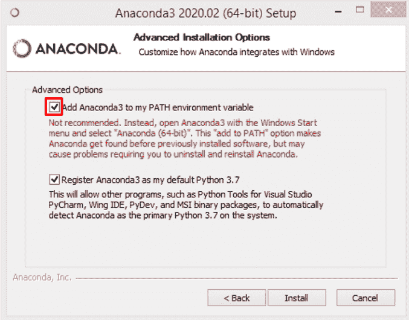

**图 1.1：** 安装期间选择“将 Anaconda3 添加到我的 PATH 环境变量”。

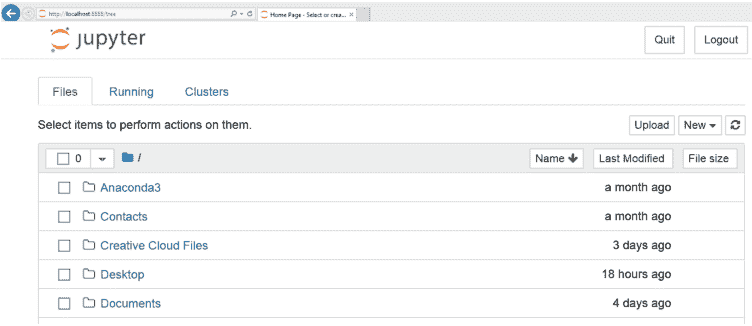

**图 1.2：** Jupyter Notebook 的计算环境。

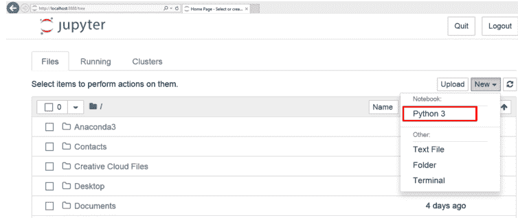

**图 1.3：** 转到 new → Python 3 以创建新的编程脚本。

```python
import numpy as np
```

**图 1.4：** 导入 numpy 库作为 np.

基于 NumPy 库创建。NumPy 模块可以导入为“np”（可以选用不同的关键字），导入后，可通过输入“np.”来调用任意数组。

#### 1.4.1 导入 NumPy 及基本命令

让我们使用 NumPy 的一些基本功能。首先，从搜索菜单打开 Jupyter Notebook（Anaconda3）并创建一个新的“Python 3”文件（图 1.3）。

输入以下命令将 NumPy 库导入为“np”，然后按“Shift+Enter”键执行该行（图 1.4）。

现在假设我们有一个数据列表，A = [1, 2, 3, 4, 5, 6, 7, 8, 9]，我们希望将其转换为 3×3 矩阵。我们可以将其分配给另一个数组变量 B。请注意，在图 1.5 中，A 的输出“type”是 list，但 B 的输出“type”是 numpy.ndarray。

现在，我们可以使用“reshape”命令从 B 创建一个 3×3 矩阵，但它不会改变 B 的原始维度，如图 1.6 所示。如果我们想改变原始维度，则需要将其分配给另一个变量，或 B 本身。

在图 1.7 中，数组 B 使用 reshape 命令再次赋值。这里，B 的原始数据形状也变为 3×3。

```python
In [2]: A = [1,2,3,4,5,6,7,8,9]

In [3]: type(A)
Out[3]: list

In [4]: B = np.array(A)

In [5]: type(B)
Out[5]: numpy.ndarray
```

**图 1.5：** 使用 numpy 将 python 列表转换为数组类型。

```python
In [6]: B.reshape(3,3)
Out[6]: array([[1, 2, 3],
              [4, 5, 6],
              [7, 8, 9]])

In [7]: print(B)
[1 2 3 4 5 6 7 8 9]
```

**图 1.6：** 重塑数组 B 而不改变其数据。

```python
In [8]: B = B.reshape(3,3)

In [9]: print(B)
[[1 2 3]
 [4 5 6]
 [7 8 9]]
```

**图 1.7：** 使用 reshape 更改原始数组维度。

#### 1.4.2 更改数组元素

更改数组的元素值在处理多维大型数据集时可能很有用。但在这里，我们以小型数组 B（图 1.7）为例。假设我们想将第二行的所有元素更改为零。

请注意，Python 列表以及 NumPy 数组总是从 0 开始，即在 3×3 矩阵 B 中，我们有 0 到 2 的行（0,1,2 → 3 行），列从 0 到 2（0,1,2 → 3 列）。因此，当我们尝试访问第 2 行时，我们将使用 B[1, :]，如图 1.8 所示。这里，“:”表示我们想要重新分配所有值（第 1 行和所有列）。

现在，让我们尝试仅更新位于第 3 行第 3 列的一个元素，从 9 改为 999。要在 NumPy 中访问此位置，我们将使用 [2, 2]，如图 1.9 所示。

```python
In [10]: B[1, :] = 0

In [11]: print(B)

[[1 2 3]
 [0 0 0]
 [7 8 9]]
```

**图 1.8：** 在数组内部重新分配行值。

```python
In [12]: B[2,2] = 999

In [13]: B

Out[13]: array([[ 1,  2,  3],
                [ 0,  0,  0],
                [ 7,  8, 999]])
```

**图 1.9：** 更新位于 [2,2] 的数组的单个元素。

```python
In [14]: C = np.zeros(10000).reshape(100,100)

In [15]: C

Out[15]: array([[0., 0., 0., ..., 0., 0., 0.],
                [0., 0., 0., ..., 0., 0., 0.],
                [0., 0., 0., ..., 0., 0., 0.],
                ...,
                [0., 0., 0., ..., 0., 0., 0.],
                [0., 0., 0., ..., 0., 0., 0.],
                [0., 0., 0., ..., 0., 0., 0.]])
```

**图 1.10：** 使用 NumPy 创建一个 100×100 的零数组。

请注意，我们也可以在命令行中使用“B”而不是“print(B)”，然后按键盘上的“Shift+Enter”查看数组输出。

#### 1.4.3 使用特定值创建数组

我们也可以使用任何特定值创建数组。假设我们想创建一个由 0 组成的 100×100 大数组，以及一个由 1 组成的数组。这里我们可以使用“zeros”和“ones”函数，分别如图 1.10 和 1.11 所示。

如果 NumPy 数组有超过 1000 个元素，它会从输出显示中省略中间的行和列，如图 1.10 所示。要检查数组的形状，可以使用“.shape”函数（图 1.11）。

我们也可以在一行中使用“ones”或“zeros”和“reshape”函数。图 1.12 显示了如何在一行中使用“ones”和“reshape”函数创建 100×100 数组。

```python
In [16]: C.shape

Out[16]: (100, 100)
```

**图 1.11：** 使用“.shape”函数检查数组形状。

```python
In [17]: D = np.ones(10000).reshape(100,100)

In [18]: D

Out[18]: array([[1., 1., 1., ..., 1., 1., 1.],
       [1., 1., 1., ..., 1., 1., 1.],
       [1., 1., 1., ..., 1., 1., 1.],
       ...,
       [1., 1., 1., ..., 1., 1., 1.],
       [1., 1., 1., ..., 1., 1., 1.],
       [1., 1., 1., ..., 1., 1., 1.]])
```

**图 1.12：** 使用“ones”和“reshape”函数在一行中创建 100×100 数组。

```python
In [19]: E = np.full((3,10),55)

In [20]: E

Out[20]: array([[55, 55, 55, 55, 55, 55, 55, 55, 55, 55],
       [55, 55, 55, 55, 55, 55, 55, 55, 55, 55],
       [55, 55, 55, 55, 55, 55, 55, 55, 55, 55]])
```

**图 1.13：** 使用“full”函数创建所有元素均为 55 的 3×10 数组。

为了创建填充有不同数字（例如 55）的数组，我们可以使用“full”函数。图 1.13 中的以下命令创建了一个所有元素均为 55 的 3×10 数组。

#### 1.4.4 NumPy 中的广播

如果我们有形状不同而不允许进行数学运算的数组，那么根据大小更改数组的操作称为广播。此操作很方便，但有时可能会产生误导性输出。因此，在编程中进行矩阵运算时，我们必须经常跟踪数组形状。

NumPy 总是尝试执行广播，如果数组形状不同。如果我们使用标量或单个值，它将被广播为相同形状的数组。例如，如果我们将 5 加到 E（图 1.13 中的 3×10 数组），5 将被广播并添加到 E 的所有元素中。这种广播操作如图 1.14 所示。

```python
In [21]: E+5
Out[21]: array([[60, 60, 60, 60, 60, 60, 60, 60, 60, 60],
              [60, 60, 60, 60, 60, 60, 60, 60, 60, 60],
              [60, 60, 60, 60, 60, 60, 60, 60, 60, 60]])
```

**图 1.14：** 标量值 5 被加到 E（3×10 数组）。这里，5 被广播并加到 E 的所有元素上。

```python
In [22]: F = np.full((3,1),2)

In [23]: F

Out[23]: array([[2],
              [2],
              [2]])

In [24]: E*F

Out[24]: array([[110, 110, 110, 110, 110, 110, 110, 110, 110, 110],
              [110, 110, 110, 110, 110, 110, 110, 110, 110, 110],
              [110, 110, 110, 110, 110, 110, 110, 110, 110, 110]])
```

**图 1.15：** 两个不同数组大小相乘时的 NumPy 广播操作。

```python
In [25]: np.dot(E,F)

ValueError                               Traceback (most recent call last)
<ipython-input-25-cbafb301adce> in <module>
----> 1 np.dot(E,F)

<__array_function__ internals> in dot(*args, **kwargs)

ValueError: shapes (3,10) and (3,1) not aligned: 10 (dim 1) != 3 (dim 0)
```

**图 1.16：** NumPy 点乘将给出错误，因为 E 和 F 的数组大小不同。

现在假设我们有另一个“2”的数组（图 1.15），其大小为 3×1。如果我们将 E 和 F 相乘，只有 F 的列将被水平广播以完成乘法而不会出现任何错误。

这里，如果我们想进行点乘（使用 np.dot 函数），我们将收到错误，因为这两个矩阵的大小未对齐（图 1.16）。

为了解决此错误，我们必须确保矩阵的大小使得实际矩阵乘法是允许的。因此，第一个矩阵的列大小应等于


```python
In [27]: F = np.full((10,3),2)

In [28]: F
Out[28]: array([[2, 2, 2],
                [2, 2, 2],
                [2, 2, 2],
                [2, 2, 2],
                [2, 2, 2],
                [2, 2, 2],
                [2, 2, 2],
                [2, 2, 2],
                [2, 2, 2],
                [2, 2, 2]])

In [29]: np.dot(E,F)
Out[29]: array([[1100, 1100, 1100],
                [1100, 1100, 1100],
                [1100, 1100, 1100]])
```

**图 1.17：** 重塑 F 以执行 E 和 F 的点乘。

第二个矩阵的行大小。现在，让我们使用“full”函数重塑矩阵 F 的大小，如图 1.17 所示，然后尝试进行点乘。

## 第2章：PyTorch 简介

### 2.1 引言

PyTorch 是一个高度优化的库，可以以张量的形式操作数据。该库于 2016 年推出，此后一直被用于利用 GPU 和 CPU 高效地创建深度学习模型。PyTorch 的文档和库可以在[4]中找到。

对于多维数据操作，机器学习架构使用张量作为其主要数据结构。François Chollet [5] 将张量定义为数据的容器，并对神经网络中通常使用的多维张量进行了分类。张量可以是 0 维（只有一个标量值）、1 维（一维向量）、2 维（二维矩阵）、3 维（三维数组，用于表示彩色图像的 RGB 三个通道）、4 维（四维数组，可以是 RGB 彩色图像的集合），以及 5 维的 RGB 图像集合，这些图像由不同时间的四维张量表示。尽管张量的概念在物理学和工程学领域有所不同，但近年来，机器学习社区广泛采用这个术语来解释广义矩阵。因此，在本书中，我们将张量视为在二维以上维度中组织信息的工具。多维张量可以用立方体来说明，如图 2.1 所示。

在深度学习架构中，基于张量的数据在权重和反向传播计算过程中会迅速变得非常庞大。因此，大多数模型在 GPU 上执行，以进行并行计算和高效的数据操作。2018 年，谷歌发布了 TPU（张量处理单元），它是专门为谷歌的 TensorFlow 软件设计的，用于训练深度神经网络[6]。

### 2.2 设置 PyTorch

PyTorch 相对容易学习，特别是对于已经了解一些 NumPy 操作的人来说。NumPy 和 PyTorch 使用相似的语法。“numpy.zeros()”生成一个全零数组，“numpy.ones()”生成一个全一数组，numpy.random.rand()生成一个随机数数组。类似地，当我们使用 PyTorch 时，可以使用“torch.zeros()”生成一个全零张量，“torch.ones()”生成一个全一张量，“torch.rand()”生成一个随机数张量。

在 Jupyter Notebook 中运行 PyTorch 之前，使用 Anaconda Prompt (Anaconda3) 更改编程环境非常重要。在 Anaconda prompt 中更改环境以及运行 Jupyter Notebook 的过程如下列步骤所示。

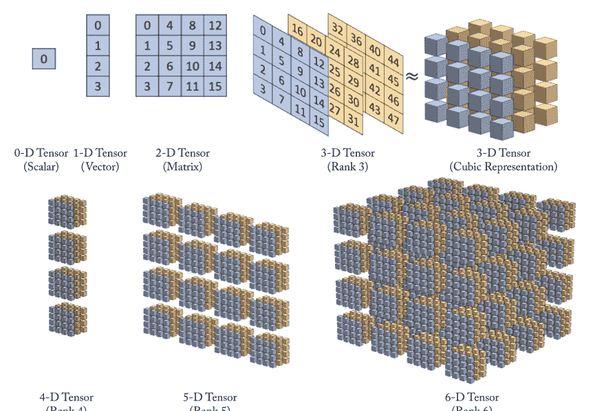

图 2.1：多维张量（0 维到 6 维）的图示。

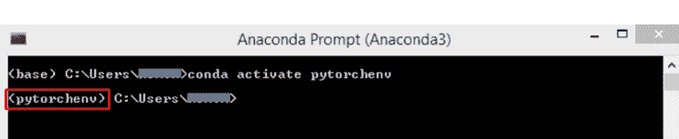

图 2.2：更改 Anaconda 的环境以用于 PyTorch。这里的蓝色线条用于隐藏用户名。

- **步骤 1：** 转到搜索栏，输入 Anaconda prompt，然后选择“Anaconda Prompt”。
- **步骤 2：** 注意“<base>”环境写在路径之前。
- **步骤 3：** 输入“conda activate pytrochenv”并按回车键（图 2.2）。注意“<base>”已更改为“<pytorchenv>”。

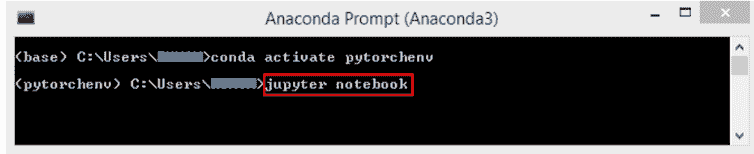

图 2.3：在 Anaconda Prompt 中输入“jupyter notebook”并按回车键。

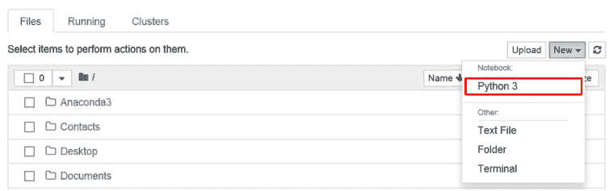

图 2.4：Jupyter Notebook 界面。此处，选择 new 以在 PyTorch 环境中创建新脚本。

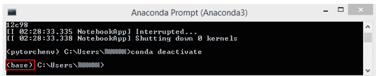

图 2.5：输入“conda deactivate”，然后按回车键以停用 PyTorch 并返回基础环境。

步骤 4：要打开 Jupyter Notebook，输入“jupyter notebook”，然后按回车键（图 2.3）。

步骤 5：现在，Jupyter Notebook 将启动，我们将能够创建一个新的 Python 文件来使用 PyTorch 功能（图 2.4）。

步骤 6：使用完 Jupyter Notebook 后，我们可以在命令窗口中按“Ctrl+C”关闭内核（可能需要多次），然后通过在命令窗口中输入“conda deactivate”来停用 PyTorch 环境（图 2.5）。注意在终端中，Anaconda 环境从“<pytorchenv>”变为“<base>”。

```python
In [1]: import torch
import numpy as np
```

图 2.6：从 Jupyter Notebook 导入 torch 和 numpy 库。

```python
In [2]: A = np.arange(0,18,2)
```

```python
In [3]: A
Out[3]: array([ 0,  2,  4,  6,  8, 10, 12, 14, 16])
```

图 2.7：使用“arange”函数创建 NumPy 数组。

```python
In [4]: A = A.reshape(3,3)
A
Out[4]: array([[ 0,  2,  4],
              [ 6,  8, 10],
              [12, 14, 16]])
```

```python
In [5]: A.dtype
Out[5]: dtype('int32')
```

图 2.8：重塑 A 并检查数据类型。

### 2.3 基本 PyTorch 操作

现在，让我们在 Jupyter Notebook 中使用 PyTorch 创建一些张量，并将它们的数据类型与 NumPy 进行比较。首先，我们需要导入“torch”和“numpy”库，如图 2.6 所示。

注意，如果在 Jupyter Notebook 中按回车键，它会转到下一行而不执行。因此，在输入两行或多行（根据需要）后，您可以按“Shift+Enter”来仅执行这些行。

现在，让我们创建一个数组（图 2.7），然后将其转换为二维形状。

这里的“numpy.arange( )”有一个起始值（0）和一个停止值（18）。末尾的“2”是增量之间的间隔。因此 NumPy 将创建一个从 0 到 18（不包括）的数组。要将其重塑为 3 乘 3（二维数组），请使用“reshape”函数（图 2.8）。如果使用“dtype”命令检查 A 的数据类型，您将看到它是一个“int32”NumPy 数组。

现在，让我们使用图 2.9 中显示的 torch 命令将 A 转换为 PyTorch 张量。使用“torch.from_numpy”后，您将看到数据类型保持为整数（torch.int32）。要将其转换为 PyTorch 张量函数，您需要将其赋值给一个变量名（例如，图 2.9 中的 input [7]）。

注意，您可以直接使用“torch.arange”创建张量（图 2.10）。

```python
In [6]: torch.from_numpy(A)
Out[6]: tensor([[ 0,  2,  4],
          [ 6,  8, 10],
          [12, 14, 16]], dtype=torch.int32)

In [7]: X = torch.from_numpy(A)
        X.type
Out[7]: <function Tensor.type>
```

图 2.9：从 NumPy 数组创建张量。

```python
In [8]: B = torch.arange(0,18,2)
        B
        B.type
Out[8]: <function Tensor.type>

In [9]: if torch.cuda.is_available():
            my_device = torch.device("cuda:0")
```

图 2.10：使用“torch.arange”创建张量，并使用“torch.device”定义 GPU/CUDA。

```python
In [10]: torch.cuda.is_available()
Out[10]: False

In [11]: torch.cuda.device_count()
Out[11]: 0

In [12]: B.device
Out[12]: device(type='cpu')
```

图 2.11：检查 GPU/CUDA 可用性和 PyTorch 中的设备类型。

强烈建议使用 GPU 来运行深度学习模型，如果您想定义 GPU/CUDA，可以使用“torch.device( )”函数，如图 2.10 所示。目前，我们使用的系统没有 GPU。我们可以使用图 2.11 中显示的命令快速检查 GPU 的状态。我们还可以检查张量 B 的设备类型，在我们的示例中是 CPU。

## 第3章：基本人工神经网络与架构

### 3.1 引言

人工神经网络是一种算法或软件架构，具有与生物神经元相似的互连函数层。尽管人脑的学习过程非常复杂且尚未完全理解，但机器学习的软件架构使用激活函数和连接路径，分别可与生物神经元和突触相比。此外，人工神经网络可以通过训练进行学习（或者找到最佳模型权重或偏差），这是模仿人脑学习过程的重要现象。因此，在机器学习领域中使用了“神经”这一术语。

神经网络架构由几个基本组件组成，例如输入、输出、隐藏层的数量以及激活函数的类型。一个简单的多层神经网络具有类似于图 3.1 的拓扑结构。

网络内部的隐藏层包含神经元，这些神经元根据输出要求执行张量运算。例如，如果我们的要求输出是一个数值，例如预测体温或测试分数，我们使用线性回归。另一方面，我们可以使用逻辑回归来预测二值输出和多类输出。二值输出是在真或假、通过或失败、猫或非猫图片之间进行预测，而多类输出是从多个类别中预测一个，例如判断一张图片是猫、鸟、狗还是鱼的图片。逻辑回归也可用于预测有序输出（例如，确定高、中或低范围）。输入层神经元中的每个输入都会乘以其连接路径相关联的权重，然后加上一个偏置以生成下一个输出。

人工神经网络的学习过程实际上是找出能够产生最小误差的权重和偏差。如果网络产生较差的结果，则始终需要调整权重和偏差。当网络找到最佳或期望结果时，它将不更新这些参数。

基于数据类型或观察方法，机器学习中广泛使用了几种学习方案方法，例如监督学习、无监督学习和强化学习。当网络可以将其预测与正确结果进行比较以进行调整时，则称为监督学习。无监督学习是当...


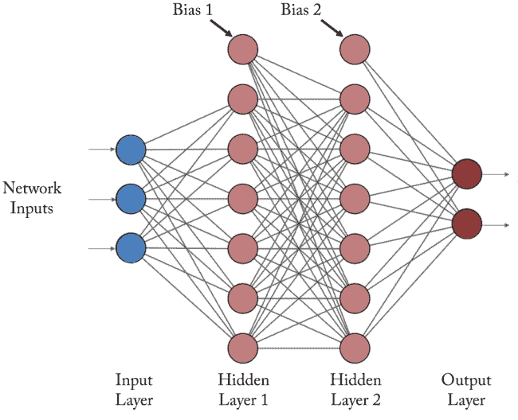

图3.1：具有两个隐藏层的多层神经网络架构。

示例数据集的正确结果是未知的。此外，当需要通过复杂环境的观察进行学习时，会使用强化学习。在这种情况下，模型根据其性能获得的惩罚或奖励做出最终决策。

这些方案的选择取决于特定任务的数据集类型和输出要求。

### 3.2 应用

人工神经网络在函数逼近、模式识别和实现复杂映射方面非常有效。近年来，它已被广泛应用于科学、工程、艺术和医学等各个领域。它还被广泛用于预测和预报许多现实生活中的商业、经济和社会问题[7–10]。在第7章中，我们提供了一个多分类问题的案例研究，其中模型从8,144张汽车图像中学习，以确定汽车型号、品牌和年份。

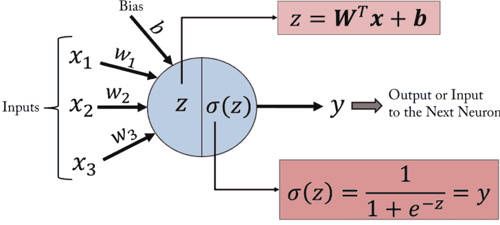

**图3.2：** 隐藏层中一个神经元内部的计算步骤。这里，σ(z) 是 sigmoid 激活函数，x₁、x₂、x₃ 是神经元的输入，w₁、w₂、w₃ 是权重，b 是输入的偏置。

### 3.3 神经元与激活函数

许多内部参数会影响人工神经网络得到的输出。但通常，输出与神经元的数量及其激活函数直接相关。

神经元是节点，通常用圆圈表示，排列在层内。在某一层中，这些神经元从所有连接中获取输入权重，并添加偏置，初始化这些参数，然后使用称为激活函数的另一个函数计算输出。随着神经元和连接数量的增加，每层内部发生的数学运算会显著放大。图3.1展示了一个简单的神经网络，其中有两个隐藏层，每层包含四个神经元。图3.2重点关注隐藏层1中一个神经元内部发生的运算。

这个操作可以分为两个计算步骤。首先，使用权重（**W**）、偏置（**b**）和输入（**x**）计算 **Z**。其次，使用 **Z** 计算激活函数 **σ**。我们可以简单地说，神经元的输出是一个函数的函数。在图3.2中，以 sigmoid 激活函数为例进行了说明。

sigmoid 激活函数（如图3.2所示）能够将任何预测值映射到0和1之间。该输出可用于估计概率，其中阈值或临界点（例如0.5）用于二分类问题。例如，如果 *输出* ≥ 0.5，则类别=1；如果 *输出* < 0.5，则类别=0。人工神经网络还有许多其他类型的激活函数可用。它是决定计算效率的重要选择参数之一。

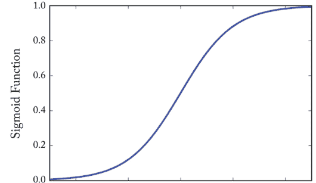

图3.3：Sigmoid 激活函数在 −5 到 +5 之间的曲线图。

sigmoid 激活在深度神经网络中的使用很少，大多数情况下使用 tanh、ReLU 和 Softmax 等非线性激活。重要的是要注意，隐藏层和输出层的神经元中可能存在不同类型的激活。只有输入层神经元没有激活函数。激活函数的导数也起着重要作用，因为它们在梯度下降过程中用于反向传播误差计算。以下各节简要介绍了典型激活函数及其导数，以供参考。

#### 3.3.1 Sigmoid 激活

sigmoid 激活及其导数分别由方程(3.1)和(3.2)定义：

$$\sigma(z) = \frac{1}{1 + e^{-z}} \tag{3.1}$$

和

$$\sigma'(z) = \sigma(z)(1 - \sigma(z)). \tag{3.2}$$

该函数也称为逻辑回归函数。当我们需要确定0到1之间的概率时，可以使用它。有时，sigmoid 函数仅存在于神经网络的输出层，用于进行二分类。图3.3给出了 sigmoid 函数在 −5 到 5 范围内的曲线图。

#### 3.3.2 双曲正切激活

双曲正切，也称为 tanh 函数，其及其导数分别由方程(3.3)和(3.4)定义：

$$\sigma(z) = \frac{e^{z} - e^{-z}}{e^{z} + e^{-z}} \tag{3.3}$$

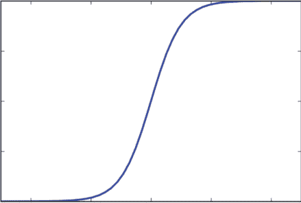

图3.4：双曲正切激活函数在 −5 到 +5 之间的曲线图。

和

$\sigma'(z) = (1 - \sigma(z)^2).$ \tag{3.4}

当输出为较大的负数时，该函数比 sigmoid 函数表现更好。该函数还可以将数字映射到 −1 到 +1 之间。图3.4给出了双曲函数在 −5 到 5 范围内的曲线图。

#### 3.3.3 修正线性单元（ReLU）激活

修正线性单元，也称为 ReLU 激活，其及其导数分别由方程(3.5)和(3.6)定义：

$$\sigma(z) = \begin{cases} 0 & \text{for } z \le 0 \\ z & \text{for } z > 0 \end{cases} \tag{3.5}$$

和

$$\sigma'(z) = \begin{cases} 0 & \text{for } z < 0 \\ 1 & \text{for } z \ge 0 \end{cases} \tag{3.6}$$

与其他激活函数相比，ReLU 函数的梯度计算更简单，因此参数更新更快。图3.5给出了 ReLU 函数在 −1 到 +1 范围内的曲线图。

#### 3.3.4 泄漏修正线性单元（Leaky ReLU）激活

泄漏修正线性单元，也称为 Leaky ReLU，是一种改进的 ReLU 激活，对于负值不具有 0 斜率。Leaky ReLU 及其导数可以

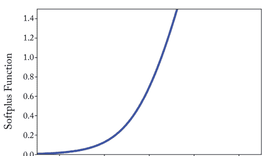

图3.8：Softplus 激活函数在 −5 到 +5 之间的曲线图。

为模型找到合适的激活函数是一个挑战，因为在反向传播步骤中会出现非常小的梯度。这种现象也称为梯度消失。除了这里显示的激活函数外，机器学习领域还在不断探索和添加许多其他函数。例如，ArcTan、分段线性单元（PLU）、缩放指数线性单元（SELU）、逆平方根单元（ISRU）等。完整的激活函数列表可以在维基百科页面[11]上找到。

### 3.4 最小化损失函数

损失函数是在训练期间要最小化的量[5]。它也称为目标函数或误差函数。神经网络可能根据输出数量具有多个损失函数。分类模型的交叉熵损失或对数损失应为0。通常，对于二分类问题使用二元交叉熵，对于多分类问题使用分类交叉熵。神经网络的学习过程基本上就是找出权重和偏置以最小化损失函数。

通常，如果误差是针对整个训练集或一个批次计算的，损失函数也称为代价函数。标准二元交叉熵损失函数可由方程(3.13)定义[12]：

$$J = -\frac{1}{M} \sum_{m=1}^{M} [y_m \times \log\big(h_\theta(x_m)\big) + (1 - y_m) \times \log\big(1 - h_\theta(x_m)\big)] , \qquad (3.13)$$

其中 $M$ = 训练样本数，$y_m$ = 训练样本 $m$ 的目标标签，$x_m$ = 训练样本 $m$ 的输入，$h_\theta$ = 具有神经网络权重 $\theta$ 的模型。对于分类目标，如果 $\hat{y}_1 \dots \hat{y}_m$ 是“m”个类别的概率，且第 $r$ 个类别是真实类别，则单个实例的损失函数由方程(3.14)定义[13]：

$$J = -\log(\hat{y}_r).$$ \hfill (3.14)

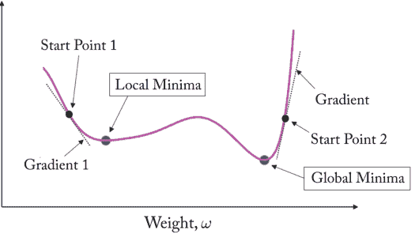

**图3.9：** 如果初始起点为起点1，则梯度下降算法将收敛到局部最小值。另一方面，如果使用起点2，算法将收敛到全局最小值。

任何神经网络的目标都是最小化方程(3.14)。这个最小化过程通过使用优化函数或优化器更新权重来完成。一个重要的迭代算法——反向传播被用于应用这种优化，在这个过程中，损失函数决定了网络学习得好坏。

人工神经网络中使用了多种不同的优化器，例如梯度下降、带动量的梯度下降、均方根传播（RMSProp）、Adam 优化器等。选择合适的优化器取决于计算场景，它们通常在仿真速度和收敛能力方面有所不同。

### 3.5 梯度下降算法

梯度下降是一种迭代的一阶优化算法，帮助神经网络最小化代价函数 $J$。在线性回归的情况下，我们可以使用导数来找到凸函数的最小值。但在人工神经网络中，我们总是处理非凸函数，因此梯度下降算法最终可能会找到局部最小值而不是全局最小值。

图3.9展示了梯度下降如何根据起始点收敛到不同的最小值。这个例子仅针对一个权重参数 $\omega$。对于三维曲面图，其中代价函数 $J$ 是两个参数（$\omega$ 和 $b$）的函数，并形成非凸形状，梯度下降算法可能收敛到局部最小值而非全局最小值，如图所示。


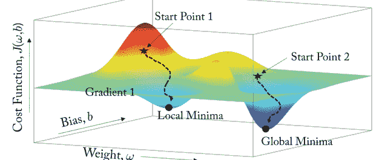

**图3.10：** 如果代价函数 J 是两个参数（权重和偏置）的函数，梯度下降算法将在此曲面上搜索最小值。在此示例图中，起点1将收敛到局部最小值，而起点2将收敛到全局最小值。

在图3.10中，曲面的高度表示对应权重和偏置的代价函数 J 的值。

在大多数机器学习优化任务中，由于存在许多权重和偏置，代价函数是一个更高维的函数。这种高维图形无法可视化。

梯度下降算法会同时对所有权重和偏置值执行。如果隐藏层中有 n 个神经元，则所有权重将通过公式(3.15)[14]进行更新。这里，α 是学习率，它告诉算法在下坡方向上移动时步长应取多大或多小。负梯度推动算法向下坡方向移动。

\[
\begin{aligned}
\omega_1 &= \omega_1 - \alpha \frac{\partial}{\partial \omega_1} J(\omega, b) \\
\omega_2 &= \omega_2 - \alpha \frac{\partial}{\partial \omega_2} J(\omega, b) \\
\omega_3 &= \omega_3 - \alpha \frac{\partial}{\partial \omega_3} J(\omega, b) \\
&\vdots \\
\omega_n &= \omega_n - \alpha \frac{\partial}{\partial \omega_n} J(\omega, b)
\end{aligned}
\tag{3.15}
\]

隐藏层的偏置参数将使用公式(3.16)进行更新：

\[
b = b - \alpha \frac{\partial}{\partial b} J(\omega, b)
\tag{3.16}
\]

公式(3.15)和(3.16)仅展示单层的计算。在深度学习中，当存在许多隐藏层时，这一计算过程会变得非常昂贵。

学习率 α 是模型训练中关键的超参数之一，需要仔细调整。如果学习率过低，梯度下降算法的计算开销会变得很大；另一方面，如果学习率相对较大，则可能越过最小值而无法收敛。

有效利用学习率的一种方法是随着训练进展逐步降低其值。这一过程称为自适应学习率[15]。可以使用预定义的调度来降低或调整自适应学习率，例如基于时间的衰减、阶梯式衰减和指数衰减[16]。许多算法（如Adam、SGD、AdaGrad和RMSProp）都采用自适应学习率。PyTorch 的 `torch.optim` 包内置了一些函数，允许用户向不同优化器传递参数，以实现自适应学习算法[17]。

## 第4章：深度学习简介

### 4.1 引言

深度学习是一种包含多个隐藏层的计算神经网络架构。由于深度学习是一个更大的神经网络，因此被视为机器学习和人工智能的一个子领域。它是语音识别、遥感、目标分类和模式识别任务中极为强大的工具。过去几年，深度学习算法被广泛应用于许多不同的科学和工程应用中，如自动驾驶汽车、欺诈检测、医疗健康、娱乐等。通过使用多个隐藏层，深度学习模型能够从具有多个抽象级别的大规模数据集中学习。

在学习过程中，反向传播算法帮助模型根据前一层计算出的参数来微调某一层的参数。图4.1展示了具有 *n* 个隐藏层和偏置的深度学习模型示意图，其中每一层中的每个神经元都与下一层的每个神经元相连。

如果我们从零开始建模，应仔细选择深度网络的最佳层数和神经元数量。对于特定问题，不存在正确的层数或神经元数量，许多因素都会影响输出。许多强大的深度学习架构（如 Inception-v3、ResNet、Inception-ResNet、DenseNet 和 Pyramidal Residual Net）拥有超过100层[18–22]。然而，这些架构的性能取决于节点数和层数。隐藏层过多并不总是有效的，应根据训练数据集的类型和输出要求来选择。对这些参数（也称为容量）进行最优选择，可以帮助我们避免训练过程中的过拟合和欠拟合[23]。大多数情况下，我们不需要太多层，因为它们会给计算过程增加不必要的难度。一个具有5–20个非线性隐藏层的系统，能够为同时对手微细节敏感的输入映射出极其复杂的函数[24]。因此，在选择深度学习模型时，我们需要对网络层数和架构格外谨慎。

随着深度学习的快速发展，每年都会涌现出许多新的深度学习模型。以下各节将简要讨论一些流行的深度学习架构。

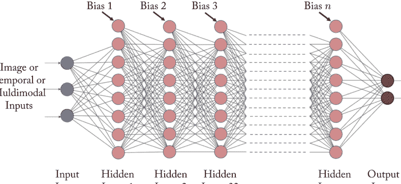

**图4.1：** 具有 n 个隐藏层和偏置的深度学习模型示意图，其中每一层中的每个神经元都与下一层的每个神经元相连。

### 4.2 卷积神经网络

卷积神经网络（CNN），又称ConvNet，最初由Yann LeCun为计算机视觉和图像处理而开发[25]。后来，其他研究人员对其进行了成功的改进，以用于改进句子分类、语音识别、图像分割和图像分类任务[26–29]。对于计算机视觉相关操作，CNN是最广泛使用的深度学习方法。CNN在开始时会有若干卷积层和池化层，之后进入全连接层。

卷积层中的图像输入通常被重排为多个数组或多通道图像。例如，彩色图像是三个颜色通道（红、绿、蓝）的组合，每个通道都可以表示为输入的二维数组。在这些二维数组中，颜色通道的强度范围为0到255。

卷积层还包含用于从输入图像中映射特征的卷积核。它们通常沿图像深度、像素数量或形状周围的零填充进行切片，以从三通道输入的不同部分学习。当多个卷积核相互连接时，它们被称为滤波器。因此，滤波器比卷积核多一个维度。在网络内部，每个卷积核都会添加一个新层，该层对应于图像的边缘、深度、形状或纹理。

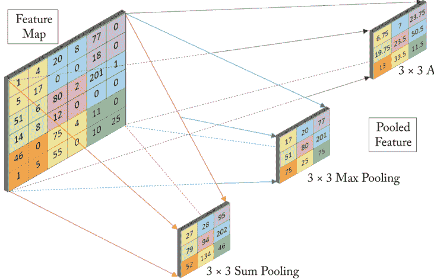

**图4.2：** 最大池化、平均池化和求和池化方法在3 × 3数组中重映射输入特征的示意图。

#### 4.2.1 池化层

池化层减小表示的空间尺寸，这是卷积神经网络的另一个基本任务。此步骤用于从卷积层的输出中池化或提取最重要的特征。

池化过程可以通过不同的公式（如最大值、平均值、求和、重叠、L2等）减小每个特征图的空间尺寸或维度。这一步通常有助于模型理解可能出现在训练图像不同位置的特征模式。图4.2给出了通过最大池化、平均池化和求和池化进行特征映射的示意图。通常，卷积神经网络在进入全连接层之前，会先包含若干卷积层和池化层。

#### 4.2.2 全连接层

卷积神经网络的最后阶段包含全连接层。它类似于常规的人工神经网络，包含与前一层的所有神经元相连的神经元。通过卷积层和池化层提取的训练图像特征在全连接层中进行分类。有时，为高效利用计算内存，会使用两个小的全连接层而不是一个大的全连接层。一些流行的卷积神经网络，如AlexNet和VGG Net，使用了不止一个全连接层。


### 4.3 循环神经网络（RNN）

循环神经网络（RNN）是另一种流行的深度学习架构，它借助额外的记忆状态来预测序列数据。RNN架构的预测同时依赖于当前输入和过去输入。

在过去十年中，RNN的使用急剧增加。它在语言处理、语音识别、视频分析、虚假视频生成、音乐生成、语法推断、机器人轨迹控制等许多不同领域都取得了最先进的成果 [33–39]。

#### 4.3.1 基本结构

RNN处理的是向量化数据，即在这个网络中，所有输入和输出在多个时间步上都是向量。在RNN的众多底层内部架构中，一对多、多对一和多对多最为常用。

对于一对多架构，一个输入被映射为多个输出（图4.4）。在这种情况下，输入单元的中间表示通过一系列隐藏状态完成，其中每个隐藏状态都是之前所有状态的函数。这类架构的一个示例应用是图像字幕生成，其中输入是单张图像，输出则是多个类别的词语。

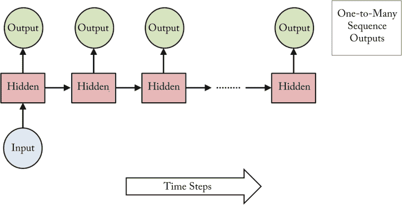

**图4.4：** 一对多RNN架构示意图。

在多对一RNN架构中，多个输入被映射到隐藏状态，但只产生一个类别或数值输出。这类网络非常适用于从文本中评估或分类情绪状态和敏感度。多对一RNN架构的示意图如图4.5所示。

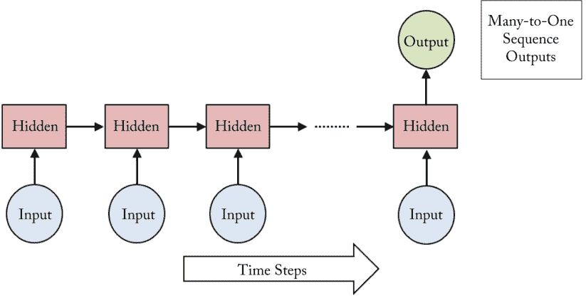

**图4.5：** 多对一RNN架构示意图。

在多对多RNN结构中，多个输入经过隐藏状态并产生多个输出。它用于将句子翻译成另一种语言、视频帧标注，以及许多其他多输入多输出的预测应用。多对多RNN结构可能根据输入和输出的数量而具有不同的布局。多对多RNN架构的示意图如图4.6所示。

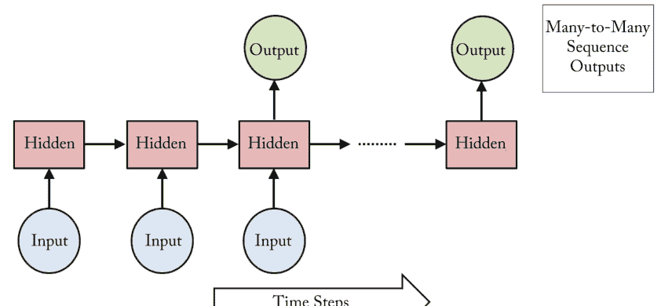

图4.6：多对多RNN架构示意图。

除了这些RNN架构之外，还存在许多其他输入-输出形式。例如，一种类似于经典前馈网络的简单一对一RNN结构。

RNN模型的训练颇具挑战性，因为为了更新参数，反向传播算法需要计算不同时间步的梯度。由于梯度消失和梯度爆炸，这一操作会使网络变得不稳定。为了避免这个问题，人们会使用各种支持单元，如门控循环单元（GRU）、双向循环神经网络（BRNN）和长短期记忆网络（LSTM）。例如，LSTM网络使用带有输入门、输出门和遗忘门的单元来控制信息流。LSTM还可以与其他技巧结合使用，例如通过梯度裁剪为误差梯度设置阈值，通过权重正则化（L1绝对值或L2平方）向损失函数引入惩罚项等。当数据序列中涉及多个层时，基于LSTM的循环网络更为有效 [34]。要针对复杂高维数据训练循环网络，强烈推荐使用支持深度学习框架的基于GPU的硬件（例如NVIDIA cuDNN）。

### 4.4 其他深度学习模型

在其他深度学习模型中，递归网络和无监督预训练网络正越来越受欢迎。递归网络以递归方式应用同一组权重来从结构化信息中学习，并以计算成本高昂而著称 [40]。递归模型适合模式分析，因为它们可以同时处理数值数据和符号数据。递归网络的不同变体不断涌现，并受到当代研究者的探索。尽管递归网络不如循环网络流行，但它在自然语言处理、图像分解和预测问题中表现出了优异的性能。

无监督预训练网络有助于提升CNN的性能，并通过创建特征检测器层来减少对标注数据的依赖 [41]。这类网络适合使用自编码器、生成对抗网络（GANs）等方法来发现数据内部的隐藏模式。

自编码器有不同的变体，但通常是一种神经网络：输入特征在隐藏层中被压缩或映射，然后在输出层恢复或重新映射为相同数量的特征。自编码器的中间层也称为瓶颈层，它关于中心对称，节点数少于输入或输出节点。自编码器架构的示意图如图4.7所示。

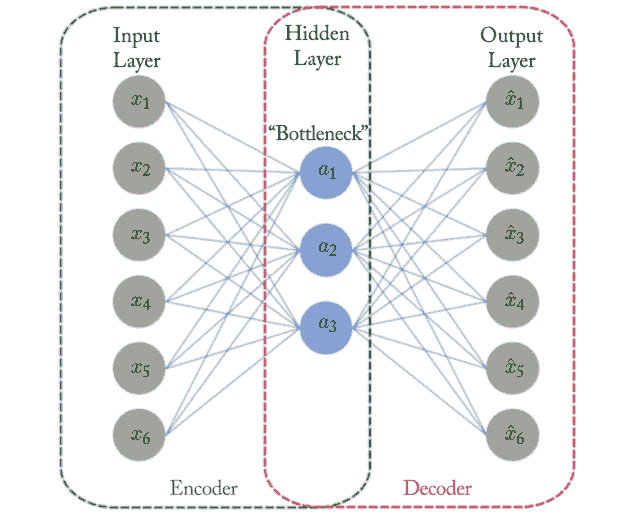

图4.7：自编码器架构示意图 [42]。

GANs是深度学习中最令人兴奋的类别之一。它通过两个相互竞争的并行对抗网络来生成逼真的数据。其中一个网络充当数据生成器，另一个网络利用真实数据对其进行分类。这一过程持续到第二个网络无法区分真实数据与合成数据为止 [13]。GAN模型的训练相对困难，因为它可能面临模式崩溃、梯度消失和不收敛等问题 [43, 44]。

生成网络可用于生成逼真的图片或图像，并已在许多不同工程领域被探索用于图像重建。最近，GAN被用于从大量未标注视频（26 TB）中学习场景动态，并通过减少随机噪声和系统噪声，在天体物理图像特征恢复方面也展现出了令人印象深刻的结果 [45]。

尽管GAN是深度学习的一项惊人进展，但人们可以利用它制造虚假媒体内容、逼真图像和在线个人资料，这可能对我们的社会产生负面影响。GAN在艺术、工业和医学领域还有许多其他潜在应用，并且在不久的将来一定会对社会产生影响。

## 第5章：深度迁移学习

### 5.1 引言

迁移学习是一种将预训练网络的知识应用到另一个模型的方法，适用于我们没有足够的数据和计算资源从头训练新模型的情况。使用这种方法，从一类数据中学到的知识可以应用于完全不同的数据类型。深度卷积网络利用迁移学习方法在图像识别和分类任务中取得了巨大成功 [46, 47]。从头训练深度学习模型的关键挑战之一，是它需要大量标注数据集，而这在许多实际场景中并不常见。一般来说，模型在大型数据集上训练后可以做出良好的预测。目前有许多基于大型数据集开发的深度学习模型可用，例如ImageNet、MNIST、MS COCO、Caltech数据集、Pascal VOC、CIFAR10等。深度学习模型的性能会随着在大型数据集上的训练而提升。例如，流行的ImageNet数据集包含14,197,122张图像，Tiny Images数据集包含79,302,017张图像 [48, 49]。我们可以使用在这些数据集上训练好的深度学习模型来执行不同的任务。

### 5.2 迁移学习的类型

根据Pan等人 [50] 的说法，传统机器学习与迁移学习之间的关系可以分为三种不同的方式：归纳式迁移学习、转导式迁移学习和无监督学习。归纳式迁移学习可以通过融合来自不同学习任务的相似实例来构建；当源任务和目标任务相同时，可以使用转导式迁移学习；无监督迁移学习则执行无监督学习任务（例如聚类、降维）。Pan和Yang [50] 还根据实例、特征表示、参数和关系知识迁移对迁移学习方法进行了细分。

### 5.3 使用预训练网络

如果我们想将数据集用于监督学习，就需要对数据进行标记或标注以供训练。标注大量数据是深度学习不可或缺的一部分，并且极其耗时。幸运的是，正如我们在引言中提到的，有一种简单的方法可以避免这种情况：利用已经在不同数据集上训练好的预训练模型架构中的知识。可用的预训练模型有很多。


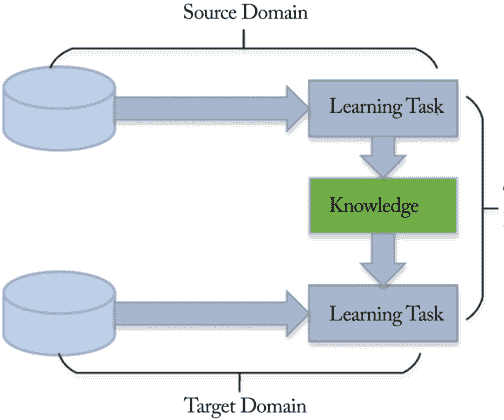

**图 5.1:** 通过迁移学习的学习过程 [55].

我们可以有效地使用，并且该过程所需的努力也相对不大。一些广泛使用的预训练网络有 ResNet、GoogLeNet、VGG、Inception、DenseNet、EfficientNet 等 [51]。现在还有许多其他即用型预训练模型可用，随着深度学习领域的兴起，新的模型也在不断被测试并添加到此列表中。

使用预训练网络的一个优点是，这些架构已经使用大型数据集（例如 ImageNet）进行了训练和测试。我们可以在迁移学习过程中部分或全部使用这些网络。对于模型的局部使用，只需在新数据集上重新训练最后几层，但网络的核心部分不会改变。另一方面，我们也可以在不使用参数值的情况下利用整个架构，将所有权重随机初始化，然后使用新数据集训练模型。这些简单的技术可以显著提升深度学习模型的性能，并且最近，这种做法在计算机视觉应用中变得广为接受 [52–54]。迁移学习过程的示意图如图 5.1 所示。

#### 5.3.1 特征提取、微调和数据增强

深度学习架构逐层学习特征。例如，当卷积网络从图像中学习时，它倾向于在前几层学习模式、纹理、边缘和亮度。这些来自图像的特征用于处理许多不同类型的自然图像，因此可以重复使用。通常，深度学习网络的最后几层非常特定于当前任务。因此，对于分类问题，如果我们利用预训练模型进行迁移学习而不使用其最后一层，我们就可以轻松获得训练网络的隐藏状态以提取一些标准特征。

为了更严格的训练过程，我们可以在对新数据重新训练之前重新配置模型的部分层（尤其是最后几层）。这一步将对整个模型进行微调，但该方法的成功实施取决于我们试图完成的数据集和预测任务。PyTorch 包 “torchvision” 有许多流行的模型架构可供我们用于深度迁移学习 [56]。

如果我们用于深度学习的训练数据相对较少，可以使用数据增强技术来提高模型性能。增强将通过不同方式操纵训练图像，例如翻转、旋转、剪切、裁剪、移动 RGB 通道等等。因此，我们可以从单张图像中获得各种独特且相关的图像。它将增加我们模型训练数据表示的数量。最近，研究人员正在探索不同的数据增强技术以提高模型的验证准确率。我们将在第 7 章展示使用预训练权重、微调和数据增强的实际实现。

### 5.4 模型评估

在训练期间，我们最初需要将标注数据集分为训练集和测试集。训练数据（可细分为训练集和验证集）将用于学习模型参数，而测试数据将估计学习模型的准确性。通常，大型测试集会以较低的方差进行良好估计。用于模型评估的指标类型有多种，例如混淆矩阵、准确率、F1 分数等。

为了评估模型，我们可以首先检查分类准确率，尤其是在不同类别的样本数量几乎相等时。它只是正确预测数与预测总数之比。混淆矩阵可用于以矩阵形式显示输出结果的质量，其中较高的对角线值表示许多正确结果。混淆矩阵可以通过查找真阳性（模型预测为阳性，且为真实结果）、假阳性（模型预测为阳性，但为错误结果）、真阴性（模型预测为阴性，且为真实结果）和假阴性（模型预测为阴性，但为错误结果）来构建。从矩阵的值中，我们可以计算精确率、召回率和加权 F1 分数以了解相关性和模型性能。

评估指标应根据模型执行的任务进行选择。评估模型时最好检查多个指标，因为模型在不同指标上的表现可能不同。第 7 章中显示的多类分类案例研究几乎有 50% 的测试数据和 50% 的训练数据。因此，为了更简单的评估，我们仅对该问题展示了训练损失和准确率指标。

## 第6章 设置 PyTorch 和 Google Cloud Platform 控制台

### 6.1 引言

在本章中，我们将讨论设置 PyTorch 和 Google Cloud Platform（GCP）控制台以运行深度学习模型的方法。Google 于 2008 年开始其云计算服务，支持包括 Python 在内的各种计算框架 [57]。通过使用免费的 Google 账户，我们可以轻松运行 GCP 的基于网络的用户界面，用于计算、存储、网络、安全、大数据/分析以及人工智能。

在撰写本文时，GCP 为使用信用卡或银行详细信息设置计费账户的任何用户提供 12 个月的免费试用，附带 300 美元积分。这种按需计费模式非常方便且经济实惠，适合想要使用强大的计算引擎探索深度学习模型而无需购买的人。有关免费试用的其他相关信息和资格可在 Google Cloud Free Tier 网站 [58] 上找到。另一个经济实惠的选择是使用 Compute Engine 的抢占式实例，其价格远低于使用常规实例。我们将在本章后面讨论抢占式实例。

### 6.2 设置 GCP 账户

在通过 https://cloud.google.com/ 创建账户后，设置免费 GCP 账户非常简单。如果有人想使用现有的 Google 账户，他或她只需登录即可（图 6.1）。在创建账户之前，建议阅读其在 https://cloud.google.com/gcp/getting-started#quick-starts 可用的快速入门页面。


**图 6.1:** 在 Google Cloud Platform 上创建免费账户或使用现有账户登录。

在为新账户注册或使用现有账户登录后，查看服务条款然后选择继续（图 6.2）。


**图 6.2:** 检查服务条款并选择继续。

接下来，从下拉列表中选择个人账户类型，然后填写地址和计费信息（图 6.3 和 6.4）。添加付款方式后，您将看到欢迎消息并收到确认电子邮件，类似于图 6.5。请务必从欢迎电子邮件中完成“完成您的个人资料”部分。下次登录 GCP 时，您只需选择“转到控制台”或“控制台”，如 图 6.6 所示。


从下拉列表中选择个人。

填写姓名和地址。

**图 6.3:** 从下拉菜单中选择个人并填写姓名和地址。


需要有效的付款方式才能获得 300 美元免费额度。

**图 6.4:** 添加付款方式。


**图 6.5:** 账户创建后，您将收到欢迎消息。检查您的电子邮件并完成您的个人资料。


**图 6.6:** 选择“转到控制台”或“控制台”进入 GCP。

在 GCP 界面内，仪表板包含项目信息、Compute Engine、Google Cloud Platform 状态、资源、API、计费、文档和其他选项。左上角的导航菜单（图 6.7）将显示一个下拉面板，您可以在其中选择几个不同的选项。建议在运行 Compute Engine 时检查计费部分。这样，您将对计费有一个概念，并能够跟踪剩余积分。


**图 6.7:** GCP 界面的导航菜单。

### 6.3 创建新项目

现在，是时候在这个云平台上创建我们的第一个项目了。点击“我的第一个项目”然后“新项目”（图 6.8）。为项目命名，例如 DeepLearning1，然后选择创建（图 6.9）。

使用免费账户，您最多可以创建 25 个项目。在图中，消息显示我们的配额中还剩下 23 个项目。完成此步骤后，您将在右上角看到通知，您的项目 DeepLearning1 已创建。

### 6.4 设置 VM 实例

要使用 Compute Engine，您需要在 Google 的基础设施上设置一个托管的虚拟机（VM）实例。Google 还允许您自定义虚拟 CPU、内存和机器类型数量 [59]。从导航菜单进入 Compute Engine，然后选择 VM 实例，如图 6.10 所示。


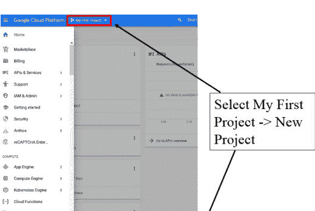

**图 6.8：** 在 GCP 中创建新项目。

选择“我的第一个项目” -> 新建项目

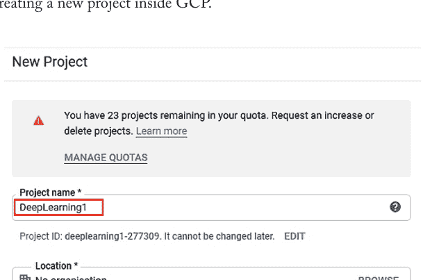

**图 6.9：** 在 GCP 中创建新项目。

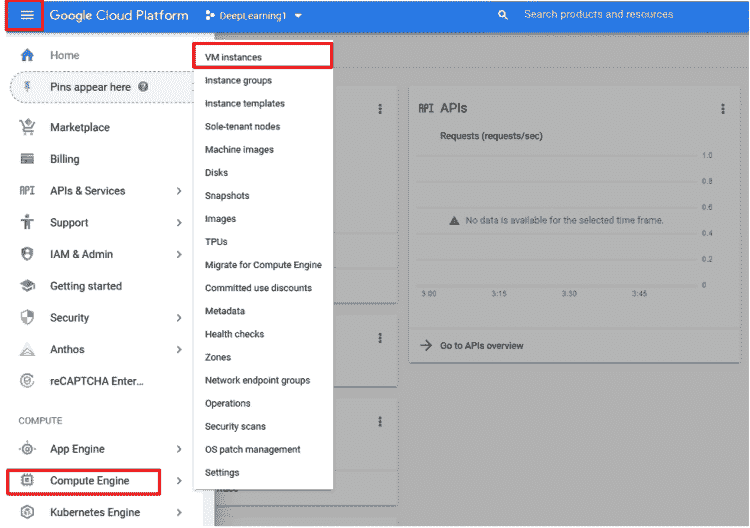

**图 6.10：** 在 GCP 中设置 VM 实例的步骤。


**图 6.11：** 创建新的计算引擎实例。

接下来，选择“CREATE INSTANCE”。如果这是您第一次创建实例，您可能会看到与图 6.11 中显示的界面不同的界面。您只需选择创建实例选项即可。

接下来，为实例分配一个名称（例如，deeplearning），从区域下拉菜单中选择 VM 的区域。在本示例中，我们选择了 us-west1（俄勒冈），但您可以选择不同的区域。请注意，如果在创建时所选区域没有足够的资源来满足您的请求，您可能需要尝试另一个区域。然后选择自定义机器类型、8 个 vCPU 内核和 30 GB 内存（图 6.12）。

这只是一个示例，您可以根据自己的需求选择不同的自定义 VM。如果您认为 CPU 足以处理机器学习模型，您也可以仅使用 CPU 进行计算。在这里，我们打算向您展示为项目选择 GPU 的方法，因为大多数深度学习模型都需要 GPU 来进行并行计算。

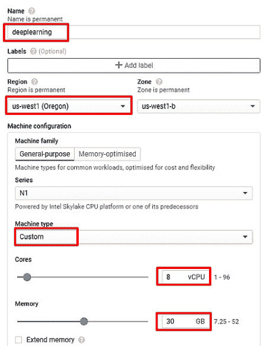

**图 6.12：** 自定义云 CPU 的步骤。

如果您展开 CPU 平台和 GPU，您将看到该位置可用的 GPU 类型。但在配额批准之前，您将无法添加 GPU。您需要申请 GPU 配额，这一步将在下一节中展示。

接下来，向下滚动并在启动磁盘部分点击更改。从操作系统下拉菜单中选择 Ubuntu 及其版本。如果您熟悉其他操作系统，您可以选择它并根据项目需要增加启动磁盘大小（例如，50 GB）（图 6.13）。

在防火墙部分，勾选允许 HTTP 流量和允许 HTTPS 流量。之后，展开“管理、安全、磁盘、网络、独占租用”选项。进入管理标签页，并复制或编写图 6.14 中的脚本到自定义元数据“启动脚本”部分。此操作将帮助您在每次启动实例时执行一些软件安装和更新（图 6.15）。

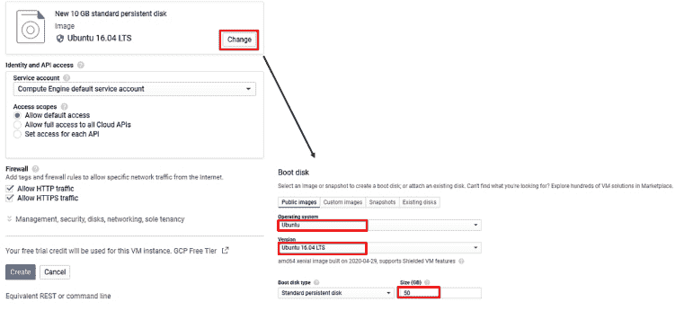

**图 6.13：** 为 VM 设置启动磁盘的步骤。

```bash
#!/bin/bash
echo "Checking for CUDA and installing."
#### Check for CUDA and try to install
if ! dpkg-query -W cuda-9-0; then
    # The 16.04 install will install with 16.10.
    curl -O http://developer.download.nvidia.com/compute/cuda/repos/ubuntu1604/x86_64/cuda-repo-ubuntu1604_9.0.176-1_amd64.deb
    dpkg -i ./cuda-repo-ubuntu1604_9.0.176-1_amd64.deb
    apt-key adv --fetch-keys http://developer.download.nvidia.com/compute/cuda/repos/ubuntu1604/x86_64/7fa2af80.pub
    apt-get update
    apt-get install cuda-9-0 -y
fi
#### Enable persistence mode
nvidia-smi -pm 1
```

**图 6.14：** CUDA 安装的启动脚本。

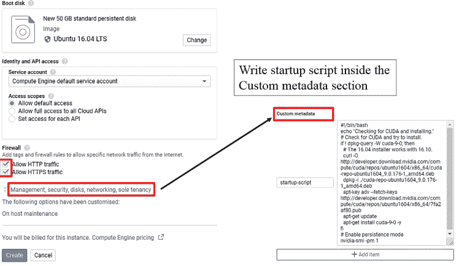

**图 6.15：** 在自定义元数据“启动脚本”部分编写启动脚本。

然后进入“磁盘”标签页并勾选“删除实例时删除启动磁盘”。最后，点击“创建”来创建计算引擎。这些步骤显示在图 6.16 中。

您可能会看到一条警告消息，提示该区域没有足够的资源来满足请求。通常，如果您没有选择任何 GPU，您将不会看到此错误消息。但如果您看到错误消息，您应该尝试不同的区域来创建实例。例如，您可以从 us-west1-b 更改为 us-west1-a、us-west1-c 或 us-central1、us-east1 等。

当实例成功创建后，您将看到一条通知。在此阶段，您需要从计算引擎 → VM 实例停止实例。选择如图 6.17 所示的三个点，然后选择停止。此技巧将节省账户中不必要的费用。您只应在运行模型或安装依赖项时才启动实例。

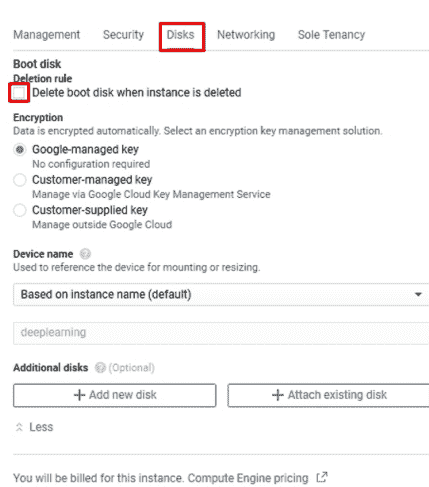

**图 6.16：** 在 GCP 中创建计算引擎。

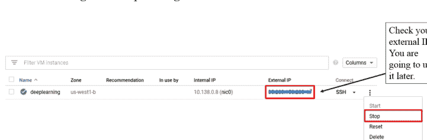

**图 6.17：** 在 GCP 中设置 VM 的步骤。

检查您的外部 IP。您稍后会用到它。

### 6.5 GPU 配额请求

GPU 配额请求是如果您计划访问 Google 远程服务器中的 GPU 的重要步骤。您可以在创建实例之前完成它。进入导航菜单、IAM 和管理，然后选择配额（图 6.18）。

如果您是新用户，您可能会在右上角看到升级选项。在这种情况下，您需要通过点击升级来升级您的账户（图 6.19）。否则，您将无法提交配额请求。即使升级后，Google 也不会在您的免费（300 美元）积分用完之前向您收费。


**图 6.18：** 对于配额请求，请进入导航菜单、IAM 和管理，然后选择配额。

**升级您的账户**

您距离解锁所有 Google Cloud Platform 只差一步。

在您的免费积分用完或过期（以先到者为准）之前，您不会被收费。了解更多

您只为所使用的付费。查看价格详情


**图 6.19：** 为配额请求升级账户。

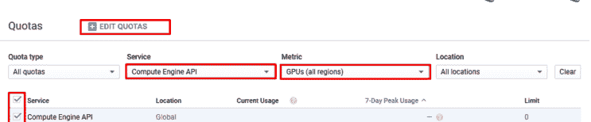

**图 6.20：** 在所有区域请求 GPU。

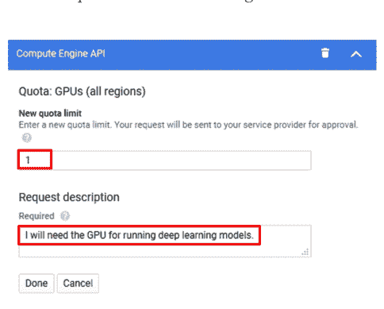

请求获批后您将收到一封电子邮件。

**图 6.21：** 在 GCP 中提交 GPU 配额请求的步骤。

接下来，从配额页面选择配额类型 → 所有配额，服务：Compute Engine API，指标：GPU（所有区域），位置：所有位置（图 6.20）。

这些选择非常重要。您也可以在特定区域请求 GPU。接下来，通过选择编辑配额来请求配额（图 6.21）。在提交请求之前，写下您想要的 GPU 数量，并在请求描述部分提供请求原因。您将在一小时到两天内收到一封确认电子邮件和另一封报告审批状态的电子邮件。不能保证您会获得请求的配额。在这种情况下，Google 会提供拒绝原因，您需要稍后再试。

一旦您的配额获批，您需要通过添加 GPU 来更新实例。如果您想对当前实例进行任何更改，请先停止正在运行的实例（deeplearning1），然后选择该实例。您将找到一个编辑按钮用于对实例进行更改。

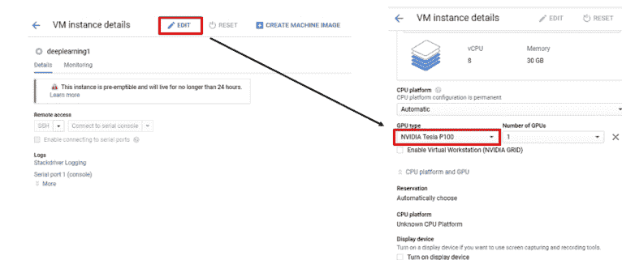

**图 6.22：** 编辑 VM 实例并添加 GPU。

选择编辑，然后展开“CPU 平台和 GPU”部分。在这里您可以添加所需 GPU 的数量和类型。如果您只有一个 GPU 配额，您将无法添加多个 GPU。如果您认为项目需要多个 GPU，那么您应该在上一节中请求配额数量（图 6.21）。您可以拥有多个 GPU 配额。在本演示中，我们选择了一个 NVIDIA Tesla P100 GPU，如图 6.22 所示。

如果您在下拉列表中找不到所需的 GPU，您需要尝试不同的区域。只要您拥有 GPU 配额，您就可以使用 GPU 创建计算引擎实例。

#### 6.5.1 一种经济高效的方法

GCP 中有一个经济高效的选项，您可以考虑用于项目，即抢占式实例。如果您选择抢占式实例，您可以以比普通实例低得多的价格运行实例。但如果服务器需要为其他任务访问这些资源，可能会终止（抢占）这些实例。知道实例可能随时关闭，使用此选项有点不方便，但它很经济。抢占式实例的另一个显著限制是计算引擎在运行 24 小时后总是会终止。因此，这是在抢占式和非抢占式之间的权衡，您必须根据自己的需求做出决定。对于运行小型深度学习模型并仍在探索 GCP 不同功能的新用户来说，抢占式是一个实用且经济的选择。请注意，一些区域可能没有可用的抢占式实例。您可以在 GCP 网站 [60] 中找到有关抢占式实例的有用信息。在本文中，我们将使用的模型在基于 GPU 的计算引擎上运行大约需要一个小时。因此，我们为实例选择了“抢占式”选项。


## 可用性策略

### 抢占性

抢占式虚拟机（preemptible VM）的成本要低得多，但只能运行 24 小时。它可能因系统需求而被更早终止。了解更多。

### 主机维护时

当 Compute Engine 执行定期基础设施维护时，它可以将你的 VM 实例迁移到其他硬件，而不会造成停机。

带 GPU 的机器无法在主机维护期间迁移。

### 自动重启

如果 VM 实例因非用户发起的原因（维护事件、硬件故障、软件故障等）而终止，Compute Engine 可以自动重启这些实例。

你需要为该实例付费。Compute Engine 定价

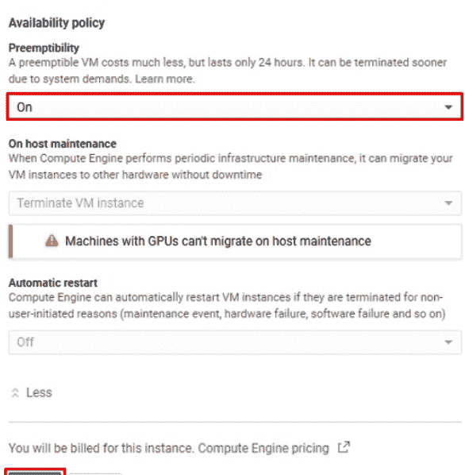

图 6.23：选择抢占性为“开启”，然后点击“创建”，以更低的成本运行 VM。

在“可用性策略”选项下，将抢占性设为“开启”，然后点击“创建”。实例成功创建后，你会看到一条通知。

如果你在配额请求获批后从头创建实例，或者创建另一个实例，请回顾上一节，唯一的区别是你必须选择本节所示的 GPU。如果由于任何原因你的实例未能成功创建，请尝试选择不同的 GPU 或区域，或者稍后重试。一旦你的 GPU 实例创建完成，你就可以在 GCP 中运行你的机器学习模型了。

### 6.6 VPC 网络

#### 6.6.1 设置外部 IP 地址

将 IP 地址设置为静态地址很方便，这样它就不会改变。GCP 的默认设置是动态的。要执行此步骤，请转到导航菜单、VPC 网络，然后选择“外部 IP 地址”。

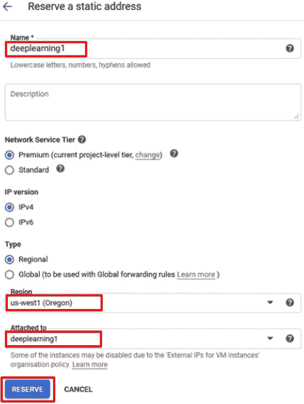

图 6.25：预留静态 IP 地址的步骤。

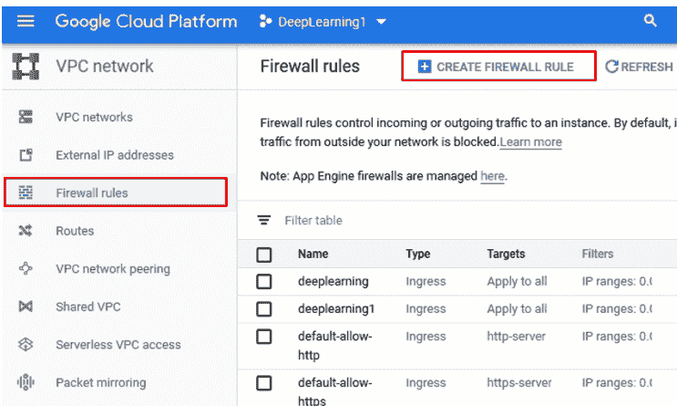

图 6.26：在 GCP 中创建防火墙规则的步骤。

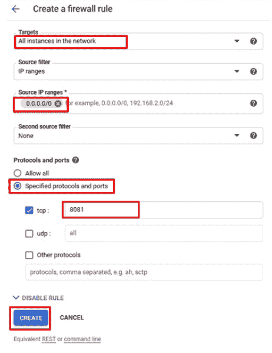

图 6.27：在 GCP 中创建防火墙规则并指定端口号的步骤。

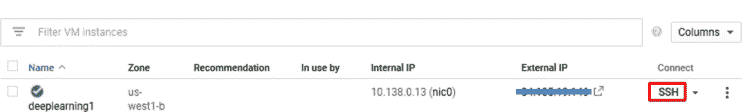

图 6.28：要在 VM 实例上安装 Anaconda，请选择 SSH。

```
wget http://repo.continuum.io/archive/Anaconda3-5.3.1-Linux-x86_64.sh
```

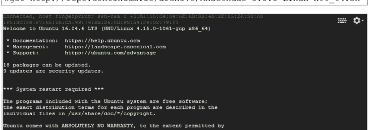

图 6.29：在 GCP 中下载并安装 Anaconda 的步骤。

### 6.7 设置 VM 实例以运行模型

对于我们的深度学习项目，我们将在 GCP 上安装 Anaconda。它包含许多对我们的项目有用的出色工具、Web 应用程序和 Python 库。Anaconda 中还提供了 Jupyter Notebook 实时代码编辑器。因此，在本节中，我们将展示如何在虚拟机上安装 Anaconda、设置 Jupyter Notebook 以及 Pytorch 和 OpenCV 等其他依赖项。

#### 6.7.1 在 VM 上安装 Anaconda

要在我们的 VM 实例中安装 Anaconda，首先需要从导航菜单 → Compute Engine → VM 实例启动 VM 实例。点击 SSH，通过我们选择的 Ubuntu 平台访问该 VM（图 6.28）。

选择后，我们会进入以下 shell 窗口。然后输入图 6.29 中显示的命令，并按回车键。请注意，命令行中使用的站点是 http://repo.continuum.io。这里我们也可以使用 https://repo.anaconda.com/ 站点来安装 Anaconda。如有需要，我们还可以更改 Anaconda 版本。

要进入 bash shell 环境，请输入以下命令并按回车键。查看许可协议，并不断按回车键以继续（图 6.30）。

```bash
Anaconda3-5.3.1-Linux-x86_64.sh
```

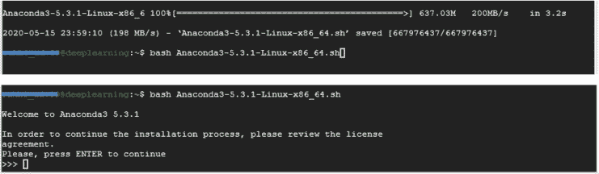

图 6.30：在 GCP 中安装 Anaconda 的步骤。

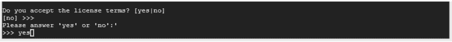

图 6.31：在 GCP 中安装 Anaconda 的步骤。

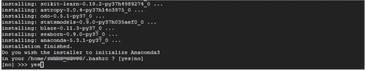

图 6.32：在 GCP 中安装 Anaconda 的步骤。

之后，输入“yes”并按“enter”以接受许可条款（图 6.31）。

这些步骤将安装相关的库和包。最后，你需要再次输入“yes”并按“enter”以确认并在你的主目录中初始化 Anaconda（图 6.32）。

接下来，输入“yes”并再次按“enter”以安装 Microsoft Visual Studio (VS) Code（图 6.33）。

安装 Microsoft VS 后，输入图 6.34 中的以下命令以初始化交互式 shell 会话。

现在，VM 实例已准备好运行交互式会话。

#### 6.7.2 Jupyter Notebook 设置

在本节中，我们将为 VM 实例设置 Jupyter Notebook。输入以下命令来配置 Jupyter Notebook，使其在服务器上运行（图 6.35）。

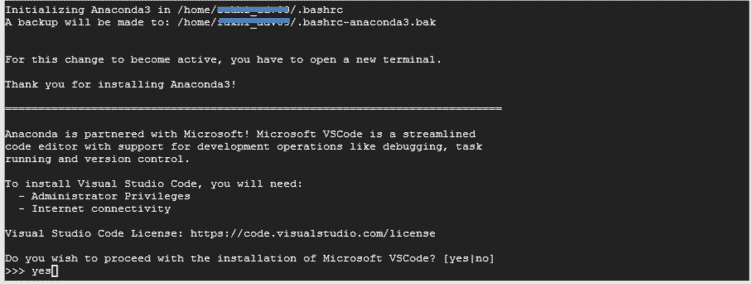

图 6.33：安装 Microsoft Visual Studio (VS) 的步骤。

```bash
source ~/.bashrc
```

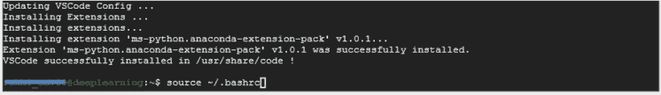

图 6.34：初始化交互式 shell 会话的步骤。

```bash
jupyter notebook --generate-config
cd ~/.jupyter/
vi jupyter_notebook_config.py
```

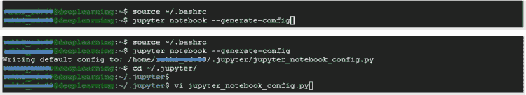

图 6.35：在 GCP 中配置 Jupyter Notebook 的步骤。

该命令将打开 VM 实例的 Jupyter Notebook 配置文件。按“i”编辑此配置文件，并添加图 6.36 中显示的行。此示例中使用的端口号将是在防火墙设置期间指定的端口号（图 6.27）。

编辑完配置文件后，按“Esc”并在键盘上输入“:wq”以保存并退出（图 6.37）。如果你现在有兴趣设置密码，请查看公共服务器的 Jupyter Notebook 配置 [61]。你现在可以关闭会话了。

现在你可以启动 Jupyter Notebook 并在服务器中执行代码了。接下来，转到 SSH 终端，输入终端复用器命令“tmux”（图 6.38）。

```
c = get_config()
c.NotebookApp.ip = '*' 
c.NotebookApp.open_browser = False
c.NotebookApp.port = 8081
```

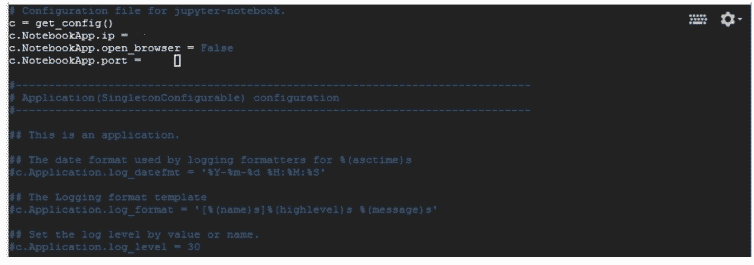

图 6.36：在 GCP 中配置 Jupyter Notebook 的步骤。

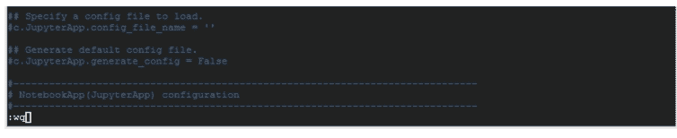

图 6.37：按“Esc”并在键盘上输入“:wq”以保存并退出。

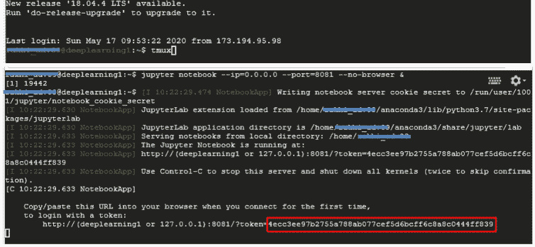

图 6.38：在 GCP 中运行 Jupyter Notebook 的步骤。

```
tmux
jupyter notebook --ip=0.0.0.0 --port=8081 --no-browser &
```

图 6.41：在通过网页访问 Jupyter Notebook 之前，在 SSH 终端中输入命令。

如果你是第一次运行 Jupyter Notebook，则必须复制图 6.38（红色框）中显示的登录令牌，并将其输入浏览器的令牌部分，如图 6.40 所示。然后你可以创建一个新密码。

如果你的令牌不起作用，请检查 shell 窗口中的消息。你可能最终打开了多个端口。你可以重启 VM 实例并使用新令牌创建密码。在你的 GCP 中成功安装 Jupyter Notebook 后，你将能够通过此界面在 VM 实例中编写或编辑脚本并运行它。

下次运行 SSH 终端时（如图 6.28 所示），你只需要输入图 6.41 中显示的命令行即可。

之后，在 Web 浏览器中输入你的服务器的 url（http://***.***.***:8081）。浏览器会要求你输入所创建的密码（图 6.40），然后 Jupyter Notebook 界面将打开。

## 第7章：案例研究：通过迁移学习进行实际实现

### 7.1 问题描述

在本章中，为了演示深度学习的应用，我们对一个多类别图像分类问题使用了迁移学习过程。我们的目标是实现一个深度学习模型来确定汽车的品牌、型号和年份。为了训练和测试我们的模型，我们使用了一个整理好的汽车数据集，其中共包含 16,185 张不同的汽车图像。该数据集（斯坦福汽车数据集，Stanford's Cars Dataset）曾被用于一项 Kaggle 竞赛，可从 [62] 下载。该数据集的早期版本也曾被用于刚体类别细粒度分类的 3D 对象表示研究 [63]。

在斯坦福汽车数据集中，16,185 张汽车图像中的 196 个不同类别（品牌、型号和年份）被划分为训练图像（8,144 张）和测试图像（8,041 张）。在 car_devkit zip 文件中，提供了数据类别以及用于裁剪图像的相应边界框。我们使用他们网站上的 cars_test_annos_withlabels.mat 文件来计算测试数据集的准确率。请注意，他们的网站上还有一个类似的文件 cars_test_annos.mat，但其中没有定义类别。因此，我们建议每个人在开展此项目之前仔细检查斯坦福汽车数据集。

为了从图像中识别汽车品牌和型号，我们需要使用训练数据训练一个深度学习模型，然后使用测试数据测试模型的性能。为此任务使用了一个名为 EfficientNet B7 的预训练深度神经网络，从训练数据集中提取特征。

使用预训练网络的迁移学习过程示意图如图 7.1 所示。最后，为了测试，我们将输入几张随机汽车图片（从互联网下载），以查看新的深度学习模型在给定数据集之外的表现如何。

### 7.2 数据处理

数据处理步骤对于有效使用任何深度学习模型都非常关键。我们必须仔细检查图像的标签和名称，以及训练


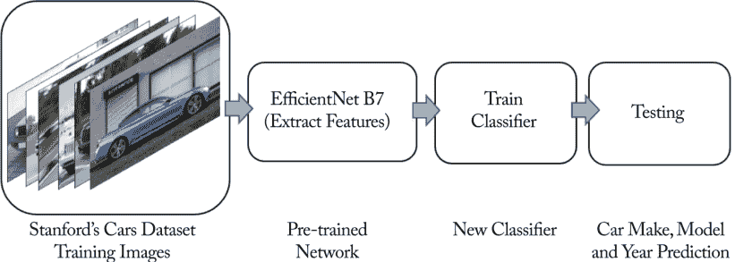

**图 7.1：** 使用预训练深度神经网络 EfficientNet B7 进行迁移学习的示意图。

以及测试数据。预处理步骤将帮助我们使用简单的 Python 代码加载大量图像。

在本案例研究中，我们创建了一个名为“input”的文件夹，其中包含运行模型所需的所有相关文件。如果你想复现结果，请查看图 7.2，其中包含我们的输入文件夹和文件名的截图。

请注意，我们将“.xlsx”文件转换为“.csv”文件，并在“cars_test_annos.csv”中添加了一个新列，该列显示从“cars_test_annos_withlabels.mat”复制的每个测试图像的类别。我们做出这一更改是为了在测试数据集上检查我们的深度学习模型的准确性。

### 7.3 将数据上传到存储桶

要将数据文件夹“input”上传到云控制台，请按照以下步骤操作。

- 1. **步骤 1：** 转到 GCP 导航菜单 → 文件存储 → 创建存储桶
- 2. **步骤 2：** 选择存储桶名称（例如，deeplearning_bucket1），并一直选择“继续”以接受所有默认设置（图 7.4、7.5 和 7.6）。
- 3. **步骤 3：** 选择“创建”以创建存储桶文件夹（图 7.6）。
- 4. **步骤 4：** 从存储桶中选择“上传文件夹”并上传“input”文件夹（图 7.7）。

### 7.4 将文件传输到虚拟机实例

接下来，我们将把“input”文件从存储桶传输到我们的虚拟机实例。为了完成此传输过程，我们必须启动计算引擎并建立 SSH 连接。请按照下面的说明操作并查看图 7.8。

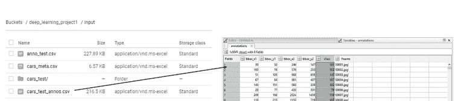

图 7.2：“input”文件夹及其文件的截图。


在 GCP 中创建存储桶以上传输入数据

图 7.3：在 GCP 中创建存储桶的步骤。


图 7.4：在 GCP 中创建存储桶的步骤。


图 7.5：在 GCP 中创建存储桶的步骤。


图 7.6：在 GCP 中创建存储桶的步骤。

存储桶已创建

上传此存储桶中的“input”文件夹。


图 7.7：在 GCP 存储桶中上传文件的步骤。

```python
class DefaultConfigs(object):
    train_data = "/home/deep_learning1/input/cars_train/"  # location of training images in the bucket
    test_data = "/home/deep_learning1/input/cars_test/"   # location of testing images in the bucket
    num_classes = 196
    img_weight = 224
    img_height = 224
    channels = 3
    lr = 0.01                                      # lr = learning rate
    batch_size = 16
    epochs = 20
    seed = 112
    path = './deep_models/'

config = DefaultConfigs()
```

图 7.9：创建 Python 类对象并初始化参数。

```bash
!pip install --upgrade pip
!pip install six numpy scipy Pillow matplotlib scikit-image opencv-python imageio Shapely
!pip install imgaug
!pip install efficientnet_pytorch
!pip install torch torchvision  #for CUDA version 10.1
!pip install torch==1.3.1+cu92 torchvision==0.4.2+cu92 -f https://download.pytorch.org/whl/torch_stable.html
    #for CUDA version 9.2
```

图 7.10：在虚拟机实例中安装依赖项。

还创建了检查点以保存模型权重，并且始终将获得最佳精度的模型参数保存在 deep_models 中。在这里，所有图像具有相同的大小（224×224），并使用 3 个通道分别表示红色、绿色和蓝色。

在更新参数之前通过模型的样本数量（也称为批次大小）设置为 16。如果我们增加批次大小，模型性能可能会提高，但会占用大量内存。

选择一个不会导致过拟合的最佳轮数也很重要。我们选择了 20 个 epoch，即对整个数据集进行 20 次前向和反向传播。这一选择至关重要，因为 epoch 数量过少可能会导致模型欠拟合。理解拟合情况的一种方法是查看训练和测试准确率。请注意，在本案例研究中，我们没有将训练数据划分为训练集和验证集。

如果训练准确率持续提高而测试准确率下降，则表明模型过拟合。对于此问题，梯度下降超参数（也称为学习率）设置为 0.01。这个学习率是许多深度学习模型的标准起点。

#### 7.5.2 安装依赖项

如果这是我们第一次在 GCP 中运行代码，我们将需要使用 pip 命令安装一些库（图 7.10）。由于我们将使用预训练网络（EfficientNet-B7），我们还需要从 PyTorch 加载它。

```python
import os
import sys
import json
import torch
import torchvision
import shutil
import numpy as np
import pandas as pd
import random
import warnings
import pathlib

import cv2
from PIL import Image

from torch import nn,optim
import torch.nn.functional as F
from torch.autograd import Variable
from torch.utils.data import Dataset,DataLoader
from torch.optim import lr_scheduler
from torchvision import transforms as T
from torchvision import models

from imgaug import augmenters as iaa  #image augmentation package
from collections import OrderedDict
from sklearn.model_selection import train_test_split
```

图 7.11：导入所有必需的库。

```python
if not os.path.exists(config.path):
    os.mkdir(config.path)
```

图 7.12：如果目录不存在则创建该目录。

我们只会在 GCP 中运行一次图 7.10 中所示的代码块。通常，模型需要多次运行以进行调优。从现在开始，我们不必再安装这些依赖项。另外，请注意，“pip install torch”取决于我们在启动脚本中安装的 CUDA 版本。

#### 7.5.3 导入库

导入运行模型所需的所有库。如果其中任何库看起来不熟悉，我们建议你阅读相应的库文档。

如果该位置不存在目录，我们也可以创建一个目录。请按照图 7.12 中的代码完成此任务。

```python
def save_checkpoint(state, is_best_loss):
    if is_best_loss:
        torch.save(state, config.path+'model_best.pth.tar')

def get_learning_rate(optimizer):
    lr=[]
    for param_group in optimizer.param_groups:
        lr +=[ param_group['lr'] ]

    #assert(len(lr)==1)
    lr = lr[0]

    return lr
```

**图 7.13：** 定义检查点和学习率函数。

#### 7.5.4 检查点与自适应学习率

接下来，我们将创建一个检查点文件夹，用于保存深度学习模型的最佳参数。我们还将使用自适应学习率，这意味着学习率将随着模型的收敛而降低。优化器将为我们完成这项工作，此步骤将帮助我们避免越过最小值（图 7.13）。

之后，我们将定义一个类对象，仅存储平均值和当前值（图 7.14）。

#### 7.5.5 设置随机种子

我们可以设置一个随机种子以使本案例研究可复现（图 7.15）。由于我们的模型和输入不会改变，我们也可以使用“torch.backends”。

#### 7.5.6 数据集类与数据增强

为了有效的数据处理，我们将创建数据集类对象，如图 7.16 所示。在此步骤中，我们还将为每个通道定义标准归一化函数。

#### 7.5.7 数据处理

下一个重要步骤是检查数据集并进行一些预处理。在这里，我们可以使用索引位置读取数据。斯坦福汽车数据集还提供了边界框坐标，用于在矩形内裁剪汽车图像。如果我们使用裁剪后的图像进行训练，模型的准确率将会提高。


```python
def augmentor(self, image):
    seq = iaa.Sequential([
        iaa.OneOf([
            iaa.Affine(rotate=90),
            iaa.Affine(rotate=180),
            iaa.Affine(rotate=270),
            iaa.Affine(shear=(-16, 16)),
            iaa.Fliplr(0.5),
        ]),
    ], random_order=True)

    image_aug = seq.augment_image(image)

    return image_aug
```

图7.18：用于从训练图像中更好学习的图像增强函数。

```python
train_files = pd.read_csv("/home/deep_learning1/input/cars_train_annos.csv")
test_files = pd.read_csv("/home/deep_learning1/input/cars_test_annos.csv")

# to remove the quotation marks from cars_train_annos.csv image name
train_files['frame'] = [i[1:-1] for i in train_files['frame']]
test_files['frame'] = [i[1:-1] for i in test_files['frame']]

# Rename the class label to ID for consistency between cars_train_annos.csv and anno_test.csv
columns = ['unnamed:0','x1','y1','x2','y2','Id','frame']
columns = train_files.columns.tolist()
columns.remove('class')
columns.insert(5,'Id')
train_files.columns = [i for i in columns]

## test files column correction
# columns= ['unnamed:0','x1','y1','x2','y2','frame','Id']

# Make the labels from 0 to n-1 for n classes to use CrossEntropyLoss()
train_files['Id'] = [(i-1) for i in train_files['Id']]
test_files['Id'] = [(i-1) for i in test_files['Id']]
```

图7.19：读取训练和测试CSV文件，并使列标题名称保持一致。

原始文件。这一步是模型访问对应图像的正确类别和边界框信息所必需的（图7.19）。

在执行完前面的代码（图7.19）之后，我们可以使用“head”函数检查测试和训练文件的开头。它将给出如图7.20所示的结果。可以看到，图像名称中的引号已被去除。

现在，使用下面的脚本，深度学习模型可以轻松访问这些文件。在图7.21中，train_loader和val_loader分别加载用于训练和测试的图像。

```text
model
  3840, 640, kernel_size=(1, 1), stride=(1, 1), bias=False
      (static_padding): Identity()
    )
    (_bn2): BatchNorm2d(640, eps=0.001, momentum=0.010000000000000009, affine=True, track_running_stats=True)
    (_swish): MemoryEfficientSwish()
  )
  (conv_head): Conv2dStaticSamePadding(
    640, 2560, kernel_size=(1, 1), stride=(1, 1), bias=False
    (static_padding): Identity()
  )
  (bn1): BatchNorm2d(2560, eps=0.001, momentum=0.010000000000000009, affine=True, track_running_stats=True)
  (avg_pool): AdaptiveAvgPool2d(output_size=1)
  (dropout): Dropout(p=0.5, inplace=False)
  (fc): Linear(in_features=2560, out_features=1000, bias=True)
  (_swish): MemoryEfficientSwish()
)
```

图7.24：检查EfficientNet-B7的模型架构。

```python
# for efficientnet-B7 only
model._fc = nn.Linear(in_features=2560, out_features=config.num_classes, bias=True)

model.cuda();
```

图7.25：将全连接层的输出特征改为196。

```python
optimizer = optim.SGD(model.parameters(), lr=config.lr, momentum=0.9, weight_decay=1e-4)
scheduler = lr_scheduler.StepLR(optimizer, step_size=10, gamma=0.1)
criterion = nn.CrossEntropyLoss().cuda()
```

图7.26：定义优化器、学习率和损失函数。

该函数是使用`torch.nn`模块赋值的。在这里，我们计算了训练和测试图像的交叉熵损失。

### 7.7 微调与训练

最后，模型准备好进行训练了。我们将在这里使用一个for循环来运行模型若干个轮次。这里，我们打算运行模型20个轮次。

一种很好的运行模型方式是设置 param.requires_grad = False（图7.23），并以较少的轮次训练模型，例如2轮（将for循环中的epoch范围改为2）。然后设置 param.requires_grad = True 以进行反向传播（图7.23），只运行那段代码行（图7.23中的两行），并训练模型20个轮次（图7.27）。这个小技巧将有助于模型更好地学习。确保不要再次加载EfficientNet。如果那样做，你会丢失前2个轮次保存的权重。你也可以更新图7.9代码中的epoch数量，但这只会影响训练期间的输出显示。

```python
print_every = 120
steps = 0
running_loss = 0
train_accuracy = 0
best_loss = np.inf
for epoch in range(20):
    model.train()
    scheduler.step(epoch)
    lr = get_learning_rate(optimizer)
    for images, labels in iter(train_loader):
        images, labels = images.cuda(), labels.cuda()
        steps += 1
        optimizer.zero_grad()
        output = model.forward(images)
        loss = criterion(output, labels)
        loss.backward()
        optimizer.step()
        running_loss += loss.item()
        ps = torch.exp(output)
        equality = (labels.data == ps.max(dim=1)[1])
        train_accuracy += equality.type(torch.FloatTensor).mean()

    if steps % print_every == 0:
        model.eval()
        Test_loss = 0
        Test_accuracy = 0
        with torch.no_grad():
            for images, labels in iter(val_loader):
                images, labels = images.cuda(), labels.cuda()
                output = model.forward(images)
                Test_loss += criterion(output, labels).item()
                ps = torch.exp(output)
                equality = (labels.data == ps.max(dim=1)[1])
                Test_accuracy += equality.type(torch.FloatTensor).mean()
        is_best_loss = Test_loss < best_loss
        best_loss = min(best_loss, Test_loss)
        save_checkpoint({
            "epoch": epoch + 1,
            "state_dict": model.state_dict(),
            "optimizer": optimizer.state_dict(),
            "is_best": is_best_loss})
        print("Epoch {}: ".format(epoch+1, config.epochs),
              "Training Loss: {:.3f}".format(running_loss/print_every),
              "Training Accuracy: {:.3f}".format(train_accuracy/print_every),
              "Testing Loss: {:.3f}".format(Test_loss/len(val_loader)),
              "Testing Accuracy: {:.3f}".format(Test_accuracy/len(val_loader)))
        running_loss = 0
        train_accuracy = 0
        model.train()
```

图7.27：用于训练模型并打印准确率的代码。

当你运行模型2个轮次时，你会看到训练和测试准确率在持续提高。2个轮次后，测试准确率为19.5%（图7.28）。

对于下一次运行，当使用20个轮次时，测试准确率从28%开始。因为这时它使用的是来自2个轮次更新后的最佳参数。确保在第二次运行之前将梯度需求设置为“True”，并且只运行那部分（图7.23）。

最后，经过20个轮次后，我们将获得高于90%的准确率。在这里，模型只会保存那些能带来更高准确率的参数，本次模拟中为90.6%。

| 轮次 | 训练损失 | 训练准确率 | 测试损失 | 测试准确率 |
|---|---|---|---|---|
| 1/2 | 5.257 | 0.015 | 5.185 | 0.041 |
| 1/2 | 5.174 | 0.029 | 5.044 | 0.083 |
| 1/2 | 5.098 | 0.044 | 4.937 | 0.108 |
| 1/2 | 4.994 | 0.056 | 4.832 | 0.141 |
| 2/2 | 4.823 | 0.107 | 4.739 | 0.165 |
| 2/2 | 4.740 | 0.123 | 4.657 | 0.174 |
| 2/2 | 4.696 | 0.117 | 4.578 | 0.183 |
| 2/2 | 4.588 | 0.132 | 4.491 | 0.195 |

运行模型2个轮次后，将for循环中的epoch改为20，即“for epoch in range(2)→for epoch in range(20)”，设置 param.requires_grad = True（执行命令），然后再次运行模型。

| 轮次 | 训练损失 | 训练准确率 | 测试损失 | 测试准确率 |
|---|---|---|---|---|
| 1/20 | 3.883 | 0.232 | 3.200 | 0.280 |
| 1/20 | 3.039 | 0.317 | 2.362 | 0.440 |
| 1/20 | 2.388 | 0.415 | 1.939 | 0.525 |
| 1/20 | 1.915 | 0.515 | 1.421 | 0.629 |
| 2/20 | 1.388 | 0.648 | 1.196 | 0.680 |
| 2/20 | 1.148 | 0.693 | 1.040 | 0.719 |
| 2/20 | 1.077 | 0.713 | 0.975 | 0.735 |
| 2/20 | 1.004 | 0.726 | 0.838 | 0.764 |
| 3/20 | 0.746 | 0.795 | 0.793 | 0.781 |
| 3/20 | 0.633 | 0.823 | 0.756 | 0.783 |
| 3/20 | 0.626 | 0.823 | 0.685 | 0.806 |
| 3/20 | 0.586 | 0.842 | 0.631 | 0.818 |
| 4/20 | 0.594 | 0.843 | 0.604 | 0.826 |
| 4/20 | 0.386 | 0.896 | 0.569 | 0.841 |
| 4/20 | 0.413 | 0.880 | 0.578 | 0.839 |
| 4/20 | 0.386 | 0.894 | 0.565 | 0.837 |

图7.28：训练和测试损失及准确率的输出显示。

| 轮次 | 训练损失 | 训练准确率 | 测试损失 | 测试准确率 |
|---|---|---|---|---|
| 18/20 | 0.035 | 0.994 | 0.374 | 0.903 |
| 18/20 | 0.034 | 0.994 | 0.374 | 0.905 |
| 19/20 | 0.032 | 0.994 | 0.373 | 0.905 |
| 19/20 | 0.036 | 0.991 | 0.371 | 0.905 |
| 19/20 | 0.027 | 0.993 | 0.370 | 0.904 |
| 19/20 | 0.033 | 0.993 | 0.371 | 0.904 |
| 20/20 | 0.028 | 0.994 | 0.368 | 0.906 |
| 20/20 | 0.034 | 0.992 | 0.367 | 0.905 |

图7.29：20个轮次后（学习率为0.01）训练和测试损失及准确率的输出显示。

如果你遇到训练准确率在上升，但测试准确率在下降的情况，你必须停止训练，因为这是过拟合训练数据的迹象。

现在，为了提升模型性能，我们可以进一步改变一些影响学习过程的训练参数，例如学习率、轮次、隐藏层数量等。这被称为超参数调优，并且这一步应该谨慎进行，以观察模型的学习情况。例如，如果我们将学习率从0.01改为0.025（图7.9），并按照本节所述运行整个模拟，我们将获得更好的结果（测试准确率91.5%）。学习率0.025的模拟输出如图7.30所示。我们也可以尝试不同的学习率和超参数来提高测试准确率。

至此，我们可以说我们的深度学习模型能够以91.5%的准确率预测汽车的品牌、型号和年份。


```
Epoch: 1/2..  Training Loss: 5.231..  Training Accuracy: 0.020 Testing Loss: 5.058..  Testing Accuracy: 0.060
Epoch: 1/2..  Training Loss: 5.061..  Training Accuracy: 0.043 Testing Loss: 4.766..  Testing Accuracy: 0.109
Epoch: 1/2..  Training Loss: 4.923..  Training Accuracy: 0.055 Testing Loss: 4.569..  Testing Accuracy: 0.132
Epoch: 1/2..  Training Loss: 4.726..  Training Accuracy: 0.080 Testing Loss: 4.384..  Testing Accuracy: 0.163
Epoch: 2/2..  Training Loss: 4.398..  Training Accuracy: 0.146 Testing Loss: 4.243..  Testing Accuracy: 0.184
Epoch: 2/2..  Training Loss: 4.290..  Training Accuracy: 0.141 Testing Loss: 4.132..  Testing Accuracy: 0.199
Epoch: 2/2..  Training Loss: 4.261..  Training Accuracy: 0.139 Testing Loss: 4.025..  Testing Accuracy: 0.210
Epoch: 2/2..  Training Loss: 4.129..  Training Accuracy: 0.156 Testing Loss: 3.908..  Testing Accuracy: 0.219
```

学习率已改为0.025。

在模型运行2个epoch之后，将for循环中的epoch数改为20，即“for epoch in range(2)→ for epoch in range(20)”，设置param.requires_grad = True（执行命令）并重新运行模型。

```
Epoch: 1/2..  Training Loss: 5.231..  Training Accuracy: 0.020 Testing Loss: 5.058..  Testing Accuracy: 0.060
Epoch: 1/2..  Training Loss: 5.061..  Training Accuracy: 0.043 Testing Loss: 4.766..  Testing Accuracy: 0.109
Epoch: 1/2..  Training Loss: 4.923..  Training Accuracy: 0.055 Testing Loss: 4.569..  Testing Accuracy: 0.132
Epoch: 1/2..  Training Loss: 4.726..  Training Accuracy: 0.080 Testing Loss: 4.384..  Testing Accuracy: 0.163
Epoch: 2/2..  Training Loss: 4.398..  Training Accuracy: 0.146 Testing Loss: 4.243..  Testing Accuracy: 0.184
Epoch: 2/2..  Training Loss: 4.290..  Training Accuracy: 0.141 Testing Loss: 4.132..  Testing Accuracy: 0.199
Epoch: 2/2..  Training Loss: 4.261..  Training Accuracy: 0.139 Testing Loss: 4.025..  Testing Accuracy: 0.210
Epoch: 2/2..  Training Loss: 4.129..  Training Accuracy: 0.156 Testing Loss: 3.908..  Testing Accuracy: 0.219
.
.
.
Epoch: 18/20..  Training Loss: 0.027..  Training Accuracy: 0.994 Testing Loss: 0.351..  Testing Accuracy: 0.912
Epoch: 18/20..  Training Loss: 0.029..  Training Accuracy: 0.993 Testing Loss: 0.349..  Testing Accuracy: 0.913
Epoch: 19/20..  Training Loss: 0.032..  Training Accuracy: 0.990 Testing Loss: 0.349..  Testing Accuracy: 0.913
Epoch: 19/20..  Training Loss: 0.036..  Training Accuracy: 0.993 Testing Loss: 0.347..  Testing Accuracy: 0.913
Epoch: 19/20..  Training Loss: 0.024..  Training Accuracy: 0.993 Testing Loss: 0.347..  Testing Accuracy: 0.913
Epoch: 19/20..  Training Loss: 0.030..  Training Accuracy: 0.992 Testing Loss: 0.349..  Testing Accuracy: 0.913
Epoch: 20/20..  Training Loss: 0.028..  Training Accuracy: 0.993 Testing Loss: 0.348..  Testing Accuracy: 0.914
Epoch: 20/20..  Training Loss: 0.031..  Training Accuracy: 0.992 Testing Loss: 0.347..  Testing Accuracy: 0.913
Epoch: 20/20..  Training Loss: 0.028..  Training Accuracy: 0.992 Testing Loss: 0.348..  Testing Accuracy: 0.915
Epoch: 20/20..  Training Loss: 0.024..  Training Accuracy: 0.994 Testing Loss: 0.350..  Testing Accuracy: 0.913
```

**图7.30：**20个epoch后训练和测试损失及准确率的输出显示（学习率0.025%）。

### 7.8 模型测试

测试准确率定义了模型对测试数据集的预测能力，该数据集包含8,041张汽车图像。训练完成后，我们的模型能够正确预测91.5%的图像。然而，这一准确率是基于斯坦福汽车数据集提供的测试图像得出的。我们可以通过拍摄一张汽车照片，或使用互联网上任意一张汽车图像来检验模型性能。

我们用谷歌搜索了“Volkswagen Golf Hatchback 1991”，保存了该图像，并使用Jupyter Notebook将其上传到GCP云主目录。由于我们的模型是在裁剪后的图像上训练的，因此在分类该图像之前，我们还进行了裁剪。图7.31展示了从主目录读取图像（例如car_image1.jpg）并调整其大小以使用我们的模型进行测试的方法。

现在，为了通过模型测试该图像，我们使用了图7.32中所示的代码。这里的模型输出类别是190+1=191。由于Python从0开始读取列，因此我们应该加1。从cars_meta.csv文件中，我们还发现类别191实际上是Volkswagen Golf Hatchback 1991。

我们还检查了互联网上的一些2013年之前的汽车模型图像，大多数情况下（10次中有9次），模型能够正确预测汽车的品牌、型号和年款。

~~~python
image = cv2.imread('car_image1.jpg',1)
image = cv2.resize (image,(224,224))
~~~

~~~python
import matplotlib.pyplot as plt
plt.imshow(image)
~~~

`<matplotlib.image.AxesImage at 0x7f397bae77f0>`


**图7.31：**读取汽车图像并调整大小的代码。

~~~python
image = T.Compose([T.ToPILImage(),T.ToTensor(),T.Normalize([0.485, 0.456, 0.406],[0.229, 0.224, 0.225])])(image)
image = image.unsqueeze(0)
image = image.float()
~~~

~~~python
image = image.cuda(non_blocking=True)
model.eval();
output = model(image)
ps = torch.exp(output)
ps.max(dim=1)[1]

tensor([190], device='cuda:0')
~~~

**图7.32：**加载汽车图像并测试模型输出。输出类别191（190+1）对应Volkswagen Golf Hatchback 1991车型。

如果你已经按照上述步骤操作到这里，那么你也应该尝试在不同的汽车图像上检验该模型的性能。你也可以从给定的8,041张图像（测试数据集）中随机抽取图像进行测试，以查看模型能否正确预测汽车的品牌、类型和年款。

### 7.9 结论

在这本简短的书里，我们展示了一个实际案例研究，演示如何使用Python和深度学习模型对图像数据集进行分类。我们在这里实现的多分类准确率相对较好。通常情况下，如果你花费大量时间进行优化，并对超参数进行大量试验，你将获得高于90%的准确率。但这还取决于你用于训练的数据集的类型和质量。用于深度学习的高质量数据应该是容量大、有组织且经过清理的。

案例研究问题中使用的Python编程稍微偏高级。你可能会发现前两章展示的示例与案例研究之间的难度存在差距。如果你遇到任何看起来不熟悉的Python库和程序语法，你应该从其他来源复习或学习。网上有很多免费的Python书籍和有用的学习资源可供你使用。

本书的目标是让读者在深度学习之旅中快速起步，而不涉及过多细节和理论。实现深度学习算法的一个重大挑战是它需要支持GPU的计算引擎。为了克服这一障碍，我们提出了一种在云平台（GCP）上使用GPU的高性价比方法（抢占式）。

这里展示的程序结构设计得可以用于PyTorch中的其他深度学习模型。使用本书说明的最佳方法是利用在线的免费数据集来训练深度学习模型。最后，如果你正在做任何与计算机视觉相关的项目，你可以自己拍摄大量图片，并使用自己的数据集进行训练。

深度学习或人工智能将对我们生活的方方面面产生重大影响。如果我们能够将工程知识与这项新技术相融合，它必将帮助我们开展许多激动人心的项目，并解决与预测相关的问题。

## 参考文献

1. G. Piatetsky，Python超越R，成为数据科学、机器学习平台的领导者，2017。[https://www.kdnuggets.com/2017/08/python-overtakes-r-leader-analytics-data-science.html](https://www.kdnuggets.com/2017/08/python-overtakes-r-leader-analytics-data-science.html) 1
2. P. Guo，Python现在是美国顶尖大学最受欢迎的入门教学语言，[https://cacm.acm.org/blogs/blog-cacm/176450-python-is-now-the-most-popular-introductory-teaching-language-at-top-u-s-universities/fulltext](https://cacm.acm.org/blogs/blog-cacm/176450-python-is-now-the-most-popular-introductory-teaching-language-at-top-u-s-universities/fulltext) 1
3. J. M. Perkel，为什么Jupyter是数据科学家首选的计算笔记本，*自然*，563(7729):145–146，2018年11月。DOI：[10.1038/d41586-018-07196-1](https://doi.org/10.1038/d41586-018-07196-1)。 2
4. PyTorch文档。[https://pytorch.org/docs/stable/index.html](https://pytorch.org/docs/stable/index.html) 11
5. F. Chollet，*Python深度学习*，Manning出版公司，2017。 11, 24
6. 张量处理单元。[https://en.wikipedia.org/wiki/Tensor_processing_unit](https://en.wikipedia.org/wiki/Tensor_processing_unit) 11
7. O. I. Abiodun, A. Jantan, A. E. Omolara, K. V. Dada, N. A. Mohamed, and H. Arshad，人工神经网络应用的最新进展：综述，*Heliyon*，4(11):e00938，2018。DOI：[10.1016/j.heliyon.2018.e00938](https://doi.org/10.1016/j.heliyon.2018.e00938)。 14, 18
8. M. Mehdy, P. Ng, E. Shair, N. Saleh, and C. Gomes，人工神经网络在乳腺癌早期检测图像处理中的应用，*医学中的计算与数学方法*，2017。DOI：[10.1155/2017/2610628](https://doi.org/10.1155/2017/2610628)。 18
9. O. Araque, I. Corcuera-Platas, J. F. Sánchez-Rada, and C. A. Iglesias，利用集成技术增强社交应用中的深度学习情感分析，*专家系统与应用*，77:236–246，2017。DOI：[10.1016/j.eswa.2017.02.002](https://doi.org/10.1016/j.eswa.2017.02.002)。 18
10. X. Zhou, W. Gong, W. Fu, and F. Du，深度学习在目标检测中的应用，*IEEE/ACIS第16届计算机与信息科学国际会议（ICIS）*，第631–634页，2017。DOI：[10.1109/icis.2017.7960069](https://doi.org/10.1109/icis.2017.7960069)。 18
11. 激活函数。[https://en.wikipedia.org/wiki/Activation_function](https://en.wikipedia.org/wiki/Activation_function) 24
12. Y. Ho and S. Wookey，真实世界权重交叉熵损失函数：对错误标记成本的建模，*IEEE Access*，2019。DOI：[10.1109/access.2019.2962617](https://doi.org/10.1109/access.2019.2962617)。 24


[13] C. C. Aggarwal，*神经网络与深度学习：教科书*，Springer International Publishing，2018。DOI: 10.1007/978-3-319-94463-0。25, 36

[14] A. Ng，CS229 讲义：监督学习，2018。http://cs229.stanford.edu/notes/cs229-notes1.pdf 26

[15] E. Kayacan 和 M. A. Khanesar，第5章——二型模糊神经网络的梯度下降方法，*用于实时控制应用的模糊神经网络*，第45–70页，E. Kayacan 和 M. A. Khanesar 编，Butterworth-Heinemann，2016。DOI: 10.1016/c2014-0-02444-6。27

[16] S. Lau，深度学习的学习率调度与自适应学习率方法，2017。https://towardsdatascience.com/learning-rate-schedules-and-adaptive-learning-rate-methods-for-deep-learning-2c8f433990d1 27

[17] PyTorch 文档——TORCH.OPTIM。https://pytorch.org/docs/stable/optim.html 27

[18] C. Szegedy、V. Vanhoucke、S. Ioffe、J. Shlens 和 Z. Wojna，重新思考计算机视觉的 Inception 架构，*IEEE计算机视觉与模式识别会议（CVPR）*，第2818–2826页，2016。DOI: 10.1109/cvpr.2016.308。29

[19] A. Krizhevsky、I. Sutskever 和 G. E. Hinton，基于深度卷积神经网络的 ImageNet 分类，*神经信息处理系统进展*，第1097–1105页，2012。DOI: 10.1145/3065386。29

[20] C. Szegedy、S. Ioffe、V. Vanhoucke 和 A. A. Alemi，Inception-v4、Inception-ResNet 以及残差连接对学习的影响，*第31届AAAI人工智能会议*，2017。29

[21] G. Huang、Z. Liu、L. Van Der Maaten 和 K. Q. Weinberger，密集连接卷积网络，*IEEE计算机视觉与模式识别会议论文集*，第4700–4708页，2017。DOI: 10.1109/cvpr.2017.243。29

[22] D. Han、J. Kim 和 J. Kim，*深度金字塔残差网络*，第6307–6315页，2017。DOI: 10.1109/cvpr.2017.668。29

[23] I. Goodfellow、Y. Bengio 和 A. Courville，*深度学习*，MIT出版社，2016。DOI: 10.1145/2976749.2978318。29

[24] Y. LeCun、Y. Bengio 和 G. Hinton，深度学习，*自然*，521(7553):436–444，2015年5月1日。DOI: 10.1038/nature14539。29

[25] Y. LeCun、L. Bottou、Y. Bengio 和 P. Haffner，基于梯度的学习在文档识别中的应用，*IEEE论文集*，86(11):2278–2324，1998。DOI: 10.1109/5.726791。30

- [47] R. Marée、P. Geurts 和 L. Wehenkel，基于树学习的通用图像分类：一项广泛的实证研究，*模式识别快报*，74:17–23，2016年4月15日。DOI: 10.1016/j.patrec.2016.01.006。37

- [48] O. Russakovsky 等，ImageNet 大规模视觉识别挑战赛，*国际计算机视觉期刊*，115(3):211–252，2015年12月1日。DOI: 10.1007/s11263-015-0816-y。37

- [49] A. Torralba、R. Fergus 和 W. T. Freeman，8000万张微小图像：用于非参数物体与场景识别的大型数据集，*IEEE模式分析与机器智能汇刊*，30(11):1958–1970，2008。DOI: 10.1109/tpami.2008.128。37

- [50] S. J. Pan 和 Q. Yang，迁移学习综述，*IEEE知识与数据工程汇刊*，22(10):1345–1359，2010。DOI: 10.1109/tkde.2009.191。37

- [51] Keras 应用。https://keras.io/api/applications/ 38

- [52] Q. V. Le，利用大规模无监督学习构建高层特征，*IEEE国际声学、语音与信号处理会议*，第8595–8598页，2013。DOI: 10.1109/icassp.2013.6639343。38

- [53] A. Radford、L. Metz 和 S. Chintala，基于深度卷积生成对抗网络的无监督表示学习，*ArXiv预印本 ArXiv:1511.06434*，2015。38

- [54] R. Wan、H. Xiong、X. Li、Z. Zhu 和 J. Huan，让深度迁移学习永不产生不利影响，*IEEE国际数据挖掘会议（ICDM）*，第578–587页，2019。DOI: 10.1109/icdm.2019.00068。38

- [55] C. Tan、F. Sun、T. Kong、W. Zhang、C. Yang 和 C. Liu，深度迁移学习综述，*国际人工神经网络会议*，第270–279页，Springer，2018。DOI: 10.1007/978-3-030-01424-7_27。38

- [56] TORCHVISION.MODELS。https://pytorch.org/docs/stable/torchvision/models.html 39

- [57] Google App Engine 文档。https://cloud.google.com/appengine/docs/ 41

- [58] Google Cloud 免费层级。https://cloud.google.com/free/docs/gcp-free-tier 41

- [59] 虚拟机实例。https://cloud.google.com/compute/docs/instances 45

- [60] 可抢占式虚拟机实例。https://cloud.google.com/compute/docs/instances/preemptible 54

## 参考文献

- [61] 运行 notebook 服务器。https://jupyter-notebook.readthedocs.io/en/stable/public_server.html 62

- [62] 汽车数据集。http://ai.stanford.edu/jkrause/cars/car_dataset.html 67

- [63] J. Krause、M. Stark、J. Deng 和 L. Fei-Fei，用于细粒度分类的三维物体表示，*IEEE国际计算机视觉研讨会*，第554–561页，2013。DOI: 10.1109/iccvw.2013.77 67

- [64] M. Tan 和 Q. V. Le，EfficientNet：重新思考卷积神经网络的模型缩放，*ArXiv预印本 ArXiv:1905.11946*，2019。79, 80

## 作者简介

### 塔里克·M·阿里夫


**塔里克·M·阿里夫**是犹他州韦伯州立大学机械工程系助理教授。此前，他曾在威斯康星大学普拉特维尔分校担任讲师。塔里克于2017年在新泽西理工学院（NJIT）机械工程系获得博士学位。他的主要研究兴趣集中在人工智能和遗传算法在机器人控制、计算机视觉以及聚焦超声手术的生物医学模拟等领域。他于2011年在日本德岛大学获得硕士学位，并于2005年在孟加拉国工程技术大学（BUET）获得学士学位。塔里克在获得学士学位后，还曾在日本汽车行业担任CAD/CAE工程师。在工业界和学术界的职业生涯中，塔里克参与了许多不同的研究项目。目前，他正致力于将深度学习模型应用于各种工程任务。
