# Raspberry Pi 机器学习与图像处理 IoT 入门指南

## 作者

**Shrirang Ambaji Kulkarni 博士**是一位多产的学习者、作者和教师，在计算机科学与工程领域拥有 18 年以上的经验。他目前担任印度迈索尔国立工程学院（National Institute of Engineering）计算机科学与工程系的副教授。

**Varadraj P. Gurupur 博士**是健康信息学领域的杰出教师和研究人员。他在知名期刊上发表了许多研究文章。他目前担任美国佛罗里达州中罗里达大学（University of Central Florida）健康信息学系的副教授。

**Steven Lawrence Fernandes 博士**是图像处理领域的知名研究人员。他目前担任美国佛罗里达州中罗里达大学计算机科学与工程系的博士后研究。

## 第 1 章：引言

在过去的三十里，技术改变了我们的生活方式。这是一个公认的真理。在书中，我们试图阐述一种新技术的使用，它改变了通信、计算和计算教育的世界。有趣的是，这项技术的名称与一种名为树莓派（Raspberry Pie）的著名甜点同名。树莓`Pi`是在英国开发的单板计算机。顺便，发起这一项目的组织被称为树莓派基金会（Raspberry Pi Foundation）。它首次于 2012 年发布。

到 2015 年，树莓派已广泛普及。这项技术的关键特征之一是其尺寸和适应性。在某种特殊上，树莓派是技术世界梦寐以求的灵丹。要建立这种微型计算机的概念，必须考虑到这样一个事实：十多年前，计算机程序运行在连接到机电系统的桌面上。树莓派的出现使得技术开发者社区能够发明出包含电脑功能的手持设备。我们写这本书的意图双重：a) 我们希望提供如何使用树莓派的基础理解；b) 我们希望提供关于如何使用树莓派进行机器学习的信息。

在提供树莓派信息的同时，我们将帮助学生理解开发应用程序所需的知识。这是本书针对目标读者的另一个重要原因。此外，作者预见树莓派将推动医学、安全、通信和军事等多个领域的科学技术发展。我们尝试让这本书作为教授树莓派课程的教材。据我们了解，树莓派可以在医疗系统中广泛应用。

| BeagleBone Black | 由德州仪器公司与 Newark element 14 合作开发 |
| --- | --- |
| Libre Computer AML-S905X-CC Le Potato | 适用于图像处理 |
| MinnowBoard Turbot | 其小小的尺寸和实惠的价格使其成为树莓派的有力竞争者。 |
| Odroid H2 | 适用于游戏流媒体和视频应用 |
| Arduino | 适用于涉及机器人的应用 |

本书分为五章。第一章提供了一些关于树莓派的介绍材料，并对作者进行了简要介绍。第二章解释了不同类型的树莓派，并为读者提供了关于插槽和其他树莓派必要元件的重要信息。从可用性的角度来看，对这些元件或部分进行解释是至关重要的。它还提供了如何在树莓派上安装操作系统`Raspbian`[3] 的说明。此外，它还提供了一些外围设备的信息以及与树莓派配合的方法。

使用`Raspbian`的重要性在于，安装和使用该操作系统是系统和应用合成的必要步骤。`Raspbian`是一个为树莓派提供的免费操作系统。需要注意的是，`Raspbian`与树莓派基金会无关。`Raspbian`是一项社区资助的开发工作，就像 Linux 操作系统的早期一样。有趣的是，`Raspbian`是一个基于 Linux 操作系统构建的 Linux 发行版。`Raspbian`最初于 2012 年发布。

第三章解释了在使用树莓派时至关重要的`Python`编程元素 [4]。在这里，作者重点探讨了成功实现树莓派应用所需的深奥编程细节。这些细节包括矩阵运算、Cholesky 分解和修改数据帧。需要注意的是，在当今的人工智能和大数据领域，数据处理和分析已变得至关重要。树莓派为处理大数据提供了急需硬件。作者理解了这一需求，并提供了关于使用树莓派开发数据处理系统的某些基础信息。第 3 章 包含了必要的代码片段，并带有预期结果的插图。这些插图的关键目标之一是帮助读者使用树莓派进行机器学习应用开发。这些应用可以应用于智能手机、可穿戴设备、农业设备和其他物联网（IoT）应用。

第 4 章侧重于编程机器学习系统的细节。作者探索了将数据集划分为测试集和训练集的方法，这对于机器学习算法的实现至关重要。我们使用健康信息学的示例来解释如何使用树莓派实现机器学习。本章为读者提供了关于合成专家系统、开发知识库和执行知识治理的必要信息。

通过几个示例、程序片段以及与其实现结果相关的图形解释了机器学习的实现。机器学习的实现在许多领域都很重要，包括健康信息学，机器学习在其中被广泛用于预测医疗结果和诊断，以及遗传学和生物信息学。机器学习和大数据分析有助于预测疾病的早期发生。此外，通过应用基于人类基因组信息的生物信息学，可以预测后期发生某种疾病或障碍的可能性。将树莓派集成到便携式生物医学设备中增强计算的可能性。

最后，第 5 章介绍了使用树莓派进行图像处理。在这里，作者提供了许多程序片段和相关的输出，从而勾勒出读者使用设备执行图像处理算法所需的细节。最近，人们观察到图像处理和机器学习结合得很好。因此，作者在书中提供了关于机器学习和图像处理的信息。随着树莓派的出现，图像处理计算设备的尺寸减小，同时改进了可用的计算能力。这有助于需要高级处理的实时传感器的开发和合成。

作者在科技研发方面拥有丰富经验。Shrirang Kulkarni 博士拥有计算机工程博士学位；他通过探索和开发用于自组织无线网络的技术开启了他的研究生涯。他进一步确定了其他可以使用他的基础方法的其他科学技术领域，从而扩展了他的研究的跨学科和变革性性质。他现在正致力于涉及使用树莓派开发医疗机器学习技术的研究项目。此外，Kulkarni 博士撰写了多本在印度获得全国关注的书。同样重要的是提到，他在过去的 18 年里一直从事工程学生的教学。

Steven Fernandes 博士是物联网（IoT）、机器学习、图像处理以及智能系统设计与开发领域久有成就的研究人员。他在声名的期刊上发表了 40 多篇文章。此外，他还担任过多个特刊的客座。Fernandes 博士已经在印度和美国教授了大约十年的工程学生。

最后，Varadraj Prabhu Gurupur 博士目前担任佛罗里达中央大学健康管理与信息系的副教授。Gurupur 博士拥有 100 多项出版，包括书籍、章节、期刊文章、摘要、会议论文和综述。他参与了由国家科学基金会和国立卫生研究院等机构资助的项目。他积极参与电气电子工程师（IEEE）多年。此外，他在健康信息学领域的成就获得了美国国家级、地区和州级的奖项。Gurupur 博士于 2005 年获得阿拉巴马大学伯明分校计算机科学硕士学位，并在 2010 年获得计算机工程博士学位。

`ARM`代表`Advanced RISC Machines`。该公司专门制造基于`精简指令集计算机`（`RISC`）架构的处理器。`RISC`强调寄存器的使用和更小的指令，因此能够以每秒执行百万条指令的能力实现更高的速度。`ARM`处理器较小的尺寸和低功耗使其最适合如树莓派（`Raspberry Pi`）等小型设备。

最新型号（`Raspberry Pi 3 B+`）使用了`1.2 GHz` `ARM Cortex – A53` `Broadcom BCM 2837 处理器`。主要的区别在于四核`ARM Cortex A53` (`ARMv8`) 簇，它的运行频率为`1.2 GHz`，比`Raspberry Pi 2`模型快了 50%。

## 2.1 树莓派型号时间线

以下是迄今发布的各种基础`树莓派`型号简要时间线。

| 年份：2012 型：`Raspberry Pi Model B` 尺寸：`85.60 mm × 56.5 mm` CPU：`ARM1176JZF-S; 32 bit` GPU：`Broadcom VideoCore IV @ 250 MHz` 速度：`700Mhz 单核 CPU` RAM：`512MB RAM` | 年份：2013 型：`Raspberry Pi Model A` 尺寸：`85.60 mm × 56.5 mm` CPU：`ARM1176JZF-S 32 bit` GPU：`Broadcom VideoCore IV @ 250 MHz` 速度：`700Mhz 单核 CPU` RAM：`256 MB RAM` |
| --- | --- |
| 年份：2014 型：`Raspberry Pi Compute model` 尺寸：`67.6 mm × 30 mm` CPU：`ARM1176JZF-S 32 bit` GPU：`Broadcom VideoCore IV @ 250 MHz` 速度：`700Mhz 单核 CPU` RAM：`512 MB RAM` | 年份：2015 型：`Raspberry Pi Zero` 尺寸：`65 mm × 30 mm × 5 mm` CPU：`ARM1176JZF-S 32 bit` GPU：`Broadcom VideoCore IV @ 250 MHz` 速度：`1 GHz 单核 CPU` RAM：`512 MB RAM` |

**最新树莓派型号**

| 年份：2018 型：`Raspberry Pi 3 Model B+` 尺寸：`85mm x 56mm x 17mm`。CPU：`Cortex-A53 (ARMv8) 64-bit` GPU：`双核 VideoCore IV GPU@400 MHz` 速度：`1.4GHz 64-bit 四核 ARM Cortex A53 CPU` RAM：`1GB RAM` |
| --- |

## 2.2 树莓派型号 3 的组件

`Raspberry Pi Model 3`的简要组件布局如图图 2.1 所示。我们在书中考虑的型号是`Raspberry Pi 3 V 1.2`。

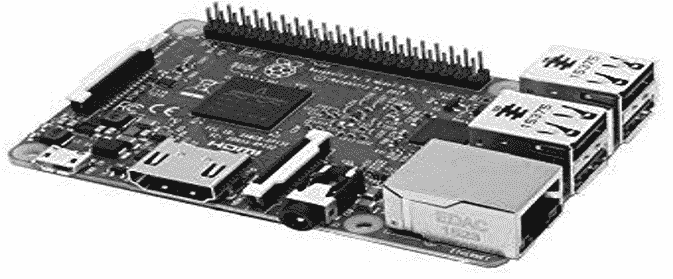

图 2.1 树莓派型号 3。

### 2.2.1 通用输入输出引脚 (GPIO) 引脚

`树莓派`板上有 40 个通用输入输出（`GPIO`）引脚，如图图 2.2 所示。这些引脚帮助树莓派与现实世界连接。通过这些引脚的帮助，树莓派可以帮助你控制电机、扩展板和`LED`等物理设备。

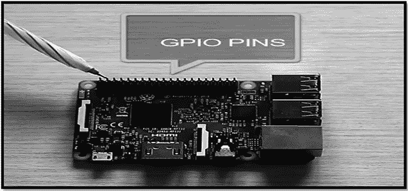

图 2.2 GPIO 引脚。

板左侧的引脚使用 1 到 39 的奇数进行编号；右侧使用 2 到 40 的偶数。`GPIO`引脚有两种命名方式：一种是`GPIO`编号，另一种是物理编号。`GPIO`编号指的是片上系统（`System on Chip`）上的`Broadcom`编号，而物理编号指的是`树莓派板`上指定的 40 个引脚。

### 2.2.2 Broadcom BCM283 7 64 位位 ARMv7 四核处理器

树莓派的中心是一个带有`1GB` `RAM`的`ARMv7 四核处理器`，工作频率为`1.2 GHz`。处理器的微型尺寸非常显著。在`1.2 Ghz`频率下的四核特性使其比`Raspberry Pi 2`快了 50%。配合`GPU`，树莓派在数值计算情况下大显异彩。

### 2.2.3 Micro USB 插槽

`Micro USB`电源接口为树莓派板供电。如图图 2.3 所示。

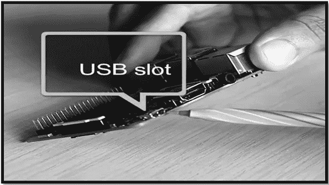

图 2.3 Micro USB 插槽。

树莓派板由`5v DC`电源供电。要开启树莓派，需要`5v DC`电源。

### 2.2.4 高清多媒体接口 (HDMI) 端口

树莓派提供高清多媒体接口（`HDMI`）输出。如图图 2.4 所示。

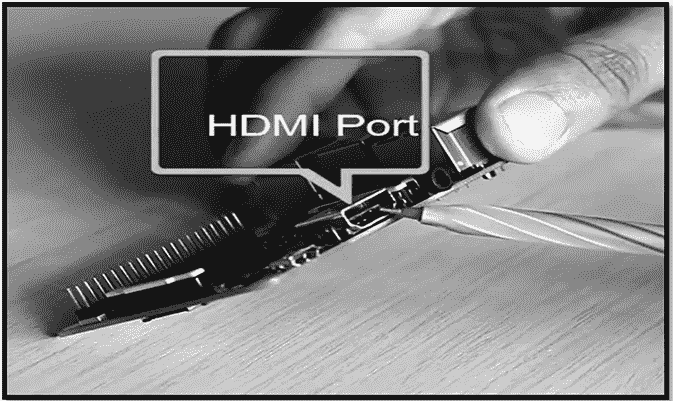

图 2.4 HDMI 端口。

`HDMI`端口允许树莓派支持`1080p`。

### 2.2.5 音频

为了听声音，树莓派提供了`3.5 mm`音频。如图图 2.5 所示。


图 2.5 音频。

### 2.2.6 通用串行 (USB) 端口

树莓派提供通用串行（`USB`）端口。如图图 2.6 所示。

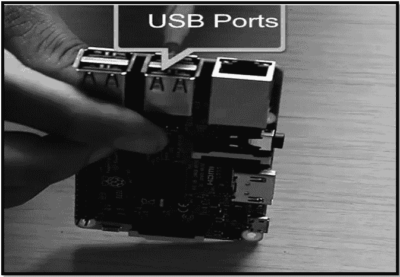

图 2.6 USB 端口。

### 2.2.7 以太网插座

树莓派提供以太网插座。如图图 2.7。

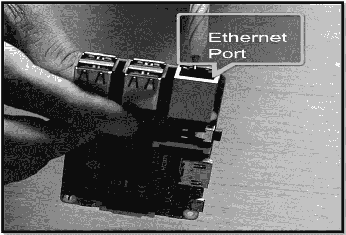

图 2.7 以太网端口。

### 2.2.8 微 SD 卡槽

树莓派提供微 SD 卡插槽。如图图 2.8 所示。

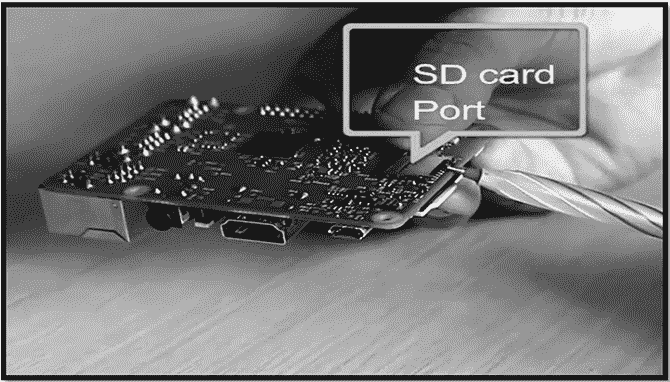

图 2.8 SD 卡端口。

树莓派为了通过其操作系统启动，需要将操作系统存储在`SD 卡`中。这是必要的，因为树莓派没有硬盘。

## 2.3 Raspbian 操作系统

计算机系统的核心是操作系统。树莓派的首选操作系统是`Raspbian`。`Raspbian`基于`Debian`，这是一种为树莓派高度定制的 操作系统。`Raspbian`的流行版本有基于`Debian 7`的`Wheezy`、基于`Debian 8`的`Jessie`以及基于`Debian 9`的`Stretch`。我们在书中考虑的操作系统是`Jessie`。

树莓派的`Jessie`版本专注于让桌面更加舒适。`LibreOffice`套件包含在`Jessie`版本中。这有助于编写文档、准备演示文稿和处理`Excel`表格。这些都与`Microsoft Windows`兼容。`Raspbian`提供的图形用户界面是轻量级桌面环境`LXDE`。

### 2.3.1 树莓派可用操作系统

让我们讨论一下树莓派的可用操作系统，见表 2.1。

| 表 2.1 支持树莓派的操作系统 |
| --- |
| **Raspbian** - 树莓派基金会推荐的 OS<br>- 非常友好的桌面环境<br>-带有许多预装软件 |
| **LibreELEC** - 为支持 Kodi 的媒体中心设计<br>- 可以与 KODI 遥控 App 配对<br>- 可以构建小型家庭影院 |
| **Windows 10 IoT Core** - 提供与 Visual Studio 的集成<br>- 支持 ARM 和 X86 架构<br>- 支持连接设备进行开发 |
| **RISC OS** - 性能是设计者强调的关键<br>- 附带一个存档文件，大小仅 4MB，非常小<br>- 提供了更好的拖拽选项 |

### 第 1 步

通过 HDMI 将显示器连接树莓派，并通过 USB 连接键盘和鼠标。

### 第 2 步：安装操作系统。

#### 第 2.1

使用从 ([`www.raspberrypi.org/downloads/`](https://www.raspberrypi.org)) 获取的新开箱软件 (NOOBs)。

#### 第 2.2

解压下载的 NOOBs。

#### 第 2.3

将下载的 NOOBS 文件复制到已格式化的 SD 卡中。（SDHC 卡 >2GB 且 ≤ 32 GB 符合 FAT 32 格式）。NOOBs 将在首次启动时在 SD 卡上安装 Raspbian。

### 第 3 步：raspi-config

#### `sudo raspi-config`

你将看到如下屏幕（图 2.9）。选择接口选项。

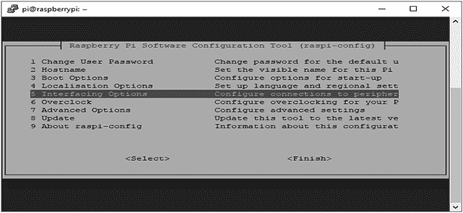

图 2.9 选择接口选项。

按 Enter 键进入选项，使用方向键向上/向下移动。按 Tab 键选择如 <finish> 等选项。

#### 第 3.1

更改用户密码。默认登录名为`pi`，密码为`raspberry`。

#### 第 3.2

启用启动到桌面。

#### 第 3.3：国际化选项

##### 第 3.3.1

更改区域（Change-locale）：选择一种语言。

##### 第 3.3.2

更改时区。

##### 第 3.3.3

更改键盘布局。默认是 QWERTY。

配置成功后；树莓派环境将如图 2.10 所示。


图 2.10 树莓派桌面。

## 2.5 IoT 的应用

根据 Gartner[1] 的数据，到 2020 年将有 26 亿个连接设备。这清楚地表明了巨大的应用潜力。

1. **智能家居**：智能家居是 IoT 最强大的应用。你可以通过基于 IoT 的控制系统控制空调、冰箱、微波炉、照明和娱乐系统。

2. **可穿戴设备**：可以通过可穿戴 IoT 设备监测心率、血压等人体体征参数。这些设备的限制是它们必须小巧且节能。

3. **农业**：农民有时面临在遥远农场监控作物和牲畜的挑战。现在通过 IoT 可以实现。此外，还可以通过 IoT 设备检测作物病害并控制用水量。

4. **工业物联网 (IIoT)**：现在已经意识到 IoT 在制造业、石油气和能源等不同行业中具有大量应用。IoT 帮助行业实现自动化和资源优化。

## 练习题

1. 如何制作一个无头（headless）的树莓派。

2. 解释为什么从树莓派 3 开始之后禁用了 Secure Shell (`SSH`)。

3. 用于上传树莓派镜像的 SD 卡上优选哪种类型的文件系统？

4. 讨论树莓派可用的各种操作系统及其优缺点。

5. 关于树莓派作为 IoT 的最新工业应用写一篇短记。

## 参考文献

[1] Gartner, [`www.gartner.com/en/newsroom/press-releases/2019-08-29-gatner-says-5-billion-enterprise-and-automotive-io`](https://www.gartner.com), 2019.

# 第 3 章

# Python 及其库

## 3.1 介绍


Python 是机器学习领域最流行的语言之一。Python 流行的一个主要原因是其丰富的库支持（参见表 3.1）。

### 表 3.1 Python 库

| Python 库 | 用途 |
| --- | --- |
| NumPy | 数学应用 |
| SciPy | 科学计算 |
| Pandas | 数据分析 |
| matplotlib | 数据可视化 |
| Scikit-learn | 机器学习 |

## 3.2 Python

### 3.2.1 什么是 Python？

* Python 由 Guido Rossum 在 20 世纪 80 年代后期提出。
* 它是一种简单但强大的高级编程语言。
* 它支持过程化和面向对象的概念。
* Python 代码是解释执行而非编译的。

## 3.3 典型的 Python 程序

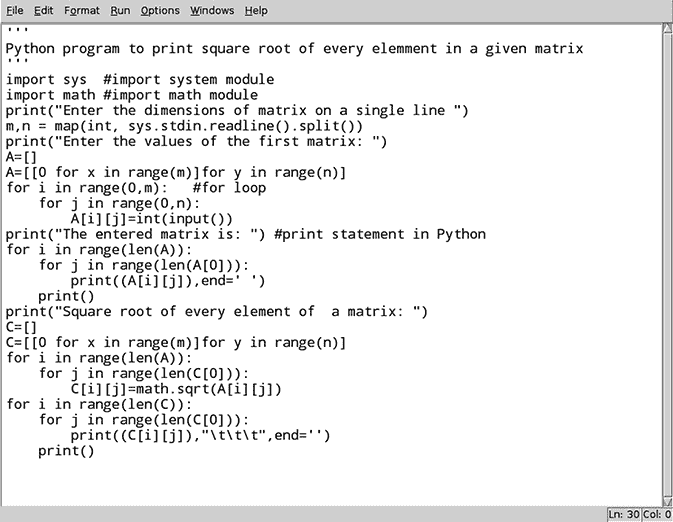

图 3.1 一个典型的 Python 程序。

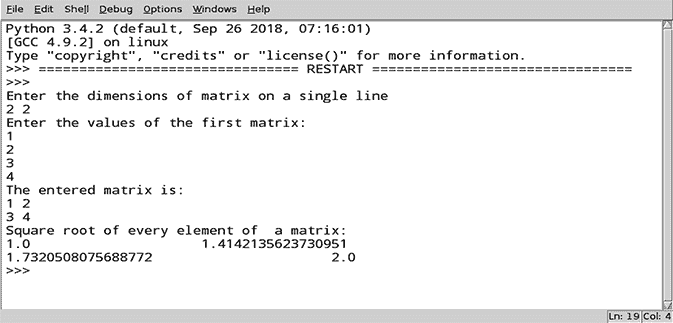

图 3.2 一个典型 Python 程序的输出。

因此，我们现在看到了一个典型的 Python 程序，它计算给定矩阵中每个元素的平方根。一个 Python 程序通常以 `import` 语句开始。`import` 语句包含了 Python 模块，这些模块为程序员提供了各种库函数。在上述程序中，我们使用了如 `map()` 和 `sqrt()` 等库函数。Python 对代码缩进有严格的规定。内层 `for` 循环比外层 `for` 循环多缩进几个空格。

## 3.4 关键字

关键字是保留字，不能用作程序员定义的变量名。关键字列在 `keyword` 模块中，并可以被打印出来，如图 3.3 所示。

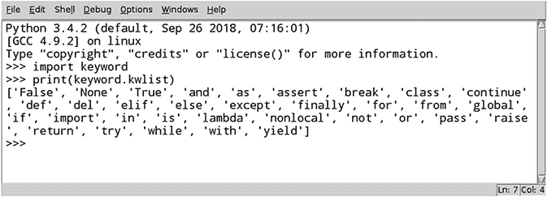

图 3.3 显示关键字列表的 Python 代码。

## 3.5 Python 变量

* Python 变量必须以字母（a – z, A – B）或下划线（`_`）开头，后跟数字或下划线。
* Python 变量对大小敏感。

| | |
| --- | --- |
| `mean` | 有效变量 |
| `1_mean` | 无效变量 |
| `mean_new@` | 无效变量 |
| `_new_mean` | 有效变量 |

## 3.6 Python 中的注释

Python 提供了类型的注释。如图 3.4 中的 `comments.py` 所示。

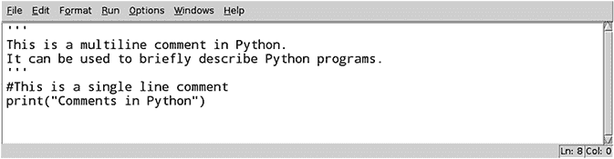

图 3.4 展示注释的 Python 程序。

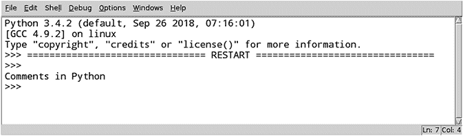

图 3.5 `comments.py` 的输出。

在图 3.5 中，我们观察到 Python 解释器会忽略注释。

## 3.7 Python 数据类型

Python 中的变量是非类型的。Python 支持动态类型，变量类型在运行时决定。Python 数据类型可以如表 3.2 所示进行分类。

### 表 3.2 Python 数据类型

| Python 数据类型 | |
| --- | --- |
| 数值 | `int` `long` `float` `bool` |
| 序列 | `str` `list` `tuple` |
| 集合 | `set` `frozen set` |
| 映射 | `dict` |

要确定变量的数据类型，使用 Python 中的 `type()` 函数。Python 程序 `datatype.py` 如图 3.6 所示。

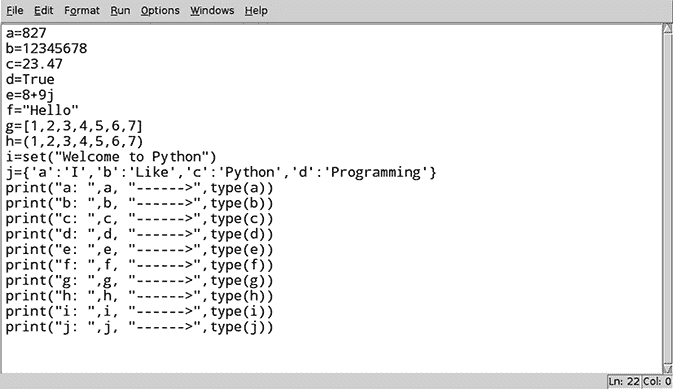

图 3.6 展示不同数据类型的 Python 程序。

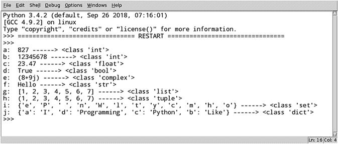

图 3.7 `datatype.py` 的输出。

## 3.8 Python 运算符优先级

Python 运算符和优先级如表 3.3 所示。

### 表 3.3 Python 运算符优先级和结合性

| 运算符 | 最高/最低 | 结合性 |
| --- | --- | --- |
| `**` | | 从右到左 |
| `~ + -` | | 从左到右 |
| `* / % //` | | 从左到右 |
| `+ -` | | 从左到右 |
| `>> <<` | | 从左到右 |
| `&` | | 从左到右 |
| `^` | | 从左到右 |
| `<= < > >=` | | 从左到右 |
| `<> == !=` | | 从左到右 |
| `= %= /= //= += *= **=` | | 从右到左 |
| `is is not` | | 从左到右 |
| `In not in` | | 从左到右 |
| `not or and` | | 从左到右 |

### 3.8.2 评估以下 Python 表达式

* `2**3+4//7−6*9`
* **步骤 1:** `(2**3) = 8`
* **步骤 2:** `4//7 = 0` (整数除法)
* **步骤 3**: `6 * 9 = 54`
* **步骤 4:** `8 + 0 = 8`
* **步骤 5:** `8−54 = −46`
* **Ans = − 46**

## 3.9 Python 中的条件结构

条件结构在 Python 中用于根据某些条件执行操作。这些条件可以包含比较表达式或算术表达式，其结果为 True 或 False。

Python 中 IF-ELSE 语句的结构

```python
if condition1:
    statement 1
elif condition2:
    statement 2
else:
    statement 3
```

**示例:** 考虑以下描述

0–1: 婴儿

1–2: 幼儿

2–12: 儿童

13–17: 青少年 (14 = 青少年早期)

18 +: 成人

**Python 程序**: `if_elif_stmt.py` 在图 3.8 中所示。

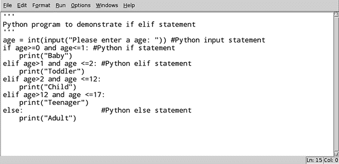

图 3.8 展示 elif 语句的 Python 程序。

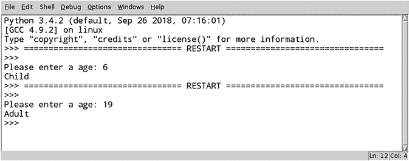

图 3.9 Python 程序 if_elif_stmt.py 的输出。

## 3.10 Python 中的三元运算符

Python 三元运算符的语法如下。

`a if test else b`

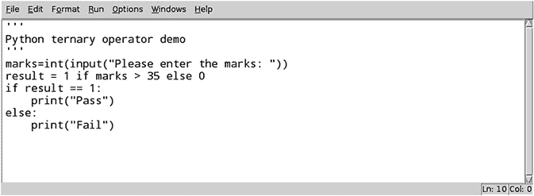

图 3.10 展示使用三元运算符的 Python 程序。

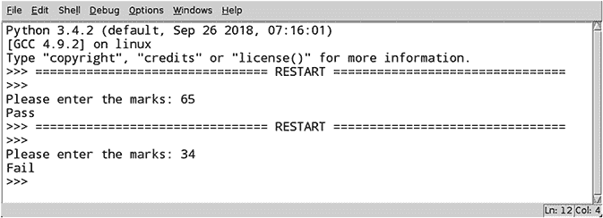

图 3.11 展示三元运算符的 Python 程序输出。

## 3.11 Python 中的循环结构

当需要重复执行某些语句时，循环是非常用的。因此，语句会持续执行，直到满足某些条件。

### 3.11.1 While 循环

while 循环是一种入口控制型循环。因此，只有在满足入口条件时才会进入循环。可能有一个计数器来记录循环执行的次数，最后当达到某个阈值时，循环终止。语法如下

```python
while expression:
    statement
```

只要条件为 True，while 循环就会迭代。Statement 可以是单个语句或语句语句块。

示例：Python 程序 `while_loop.py` 见于图 3.12。

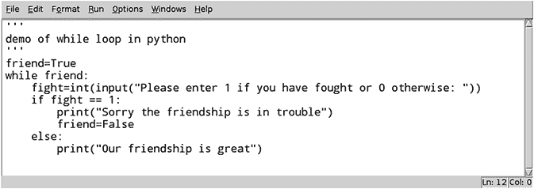

图 3.12 展示 while 循环的 Python 程序。

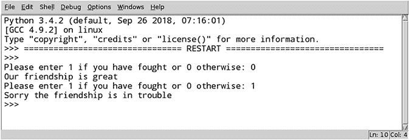

图 3.13 while_loop.py 的输出。

### 3.11.2 For 循环

Python 中的 for 循环在给定的值范围范围内迭代。for 循环的语法如下

```python
for item in sequence:
    print item
```

示例：Python 程序 – `for_loop.py` 在图 3.14 中所示。

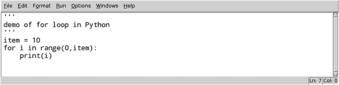

图 3.14 展示 for_loop.py 的 Python 程序。

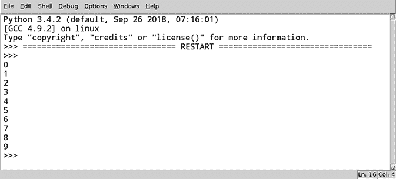

图 3.15 for_loop.py 的输出。

要以反向方式使用 for 循环进行迭代，请考虑程序 `for_loop_reverse.py`。

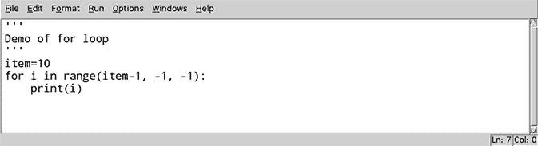

图 3.16 以反向方式展示 for 循环。

!图 3.17 for_loop_reverse.py 的输出。

图 3.17 for_loop_reverse.py 的输出。

### 3.11.3 While 与 For 循环结合 Else

当 `while` 条件变为 False 时，激活 `else` 循环。例如，考虑图 3.18 所示的 Python 程序。

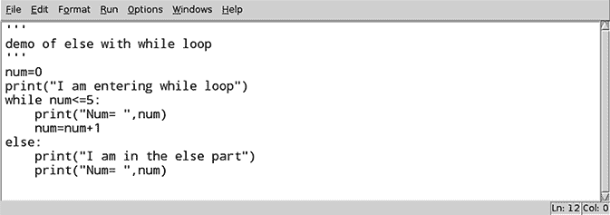

图 3.18 展示 while 循环结合 else。

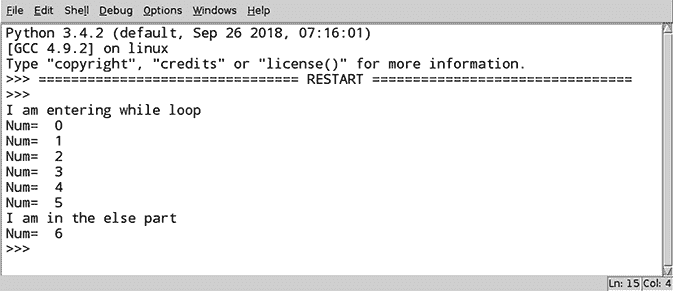

图 3.19 while 循环结合 else。

当 `for` 循环通过序列中的所有元素迭代完毕时，`else` 语句结合 `for` 循环。例如，考虑图 3.20 所示的 Python 程序。

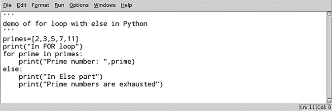

图 3.20 展示 for 循环结合 else。

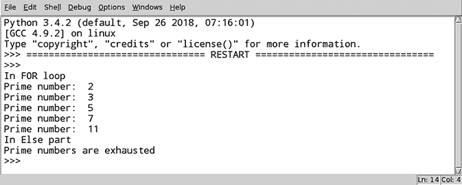

图 3.21 for 循环结合 else。

## 3.12 Python 中的字符串

字符串是用双引号括的连续字符集。

示例：“Hello”，“Raju”

使用 `+` 运算符进行两个字符串的拼接。示例 `a = “Good”` 和 `b = “Morning”`。那么 `a+b` 将得到 Good Morning。如果指定的字符在字符串中，运算符 `in` 返回 True。如果指定的字符不在字符串中，`not in` 返回 True。示例 `G in Good` 返回 True，`G not in Morning` 返回 True。

### 3.12.1 字符串内置方法

以下是一些常用的字符串方法：

1. `len(string)` 返回字符串的长度。

示例：`len(“morning”)`

输出：7

2. `lower()` 将大写字母转换为小写。

示例：`str= “HELLO”`

`print str.lower()`

输出：hello

3. `find()` 查找字符串是否存在于字符串或字符串的子字符串中。

`find(sub, start = 0, end = len(string))`

示例：`str= “morning”`

`str.find("r",0,len(str))`

输出：2

4. `replace()` 将旧字符串替换为新字符串并返回更新后的字符串。

`replace(old, new, max_occurrence)`

示例：`str="Good Morning”`

`str.replace("Morning", "Evening",1)`

输出：'Good Evening'

5. `split()` 方法提供将字符串按分隔分隔的小字符串的方法。输出是一个列表。

示例：`str="Winning is everything"`

`str.split()`

输出：['Winning', 'is', 'everything']

## 3.13 Python 中的列表

列表是方括号内的逗号分隔值。示例 `lst = ['a', 'b', 'c', 'd']`。Python 程序 `list_op.py` 在图 3.22 中展示了列表示例。

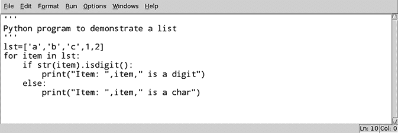

图 3.22 展示列表示例的 Python 程序。

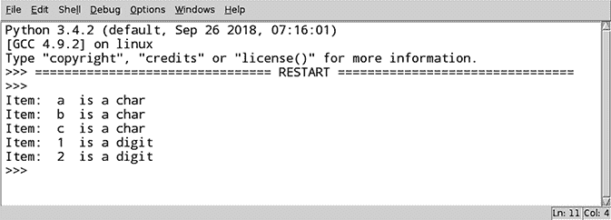

图 3.23 list_op.py 的输出。

### 3.13.1 列表方法

* `len(list)` 给出列表的长度。

`lst=['a', 'b', 'c', 'd']`

`len(lst)`

输出：4

* `list.reverse()` 反转列表的元素。

`lst=['a', 'b', 'c', 'd']`

`lst.reverse()`

`lst=['d', 'c', 'b', 'a']`

* `list.sort()` 按升序对列表元素排序。

`lst=['d', 'c', 'b', 'a']`

`lst.sort()`

`lst=['a', 'b', 'c', 'd']`

## 3.14 Python 中的元组

元组是类似于列表的序列，但它们是不可变的（即它们不能被更改且它们使用括号）。示例 `tup=('a', 'b', 'c', 'd')`

* `len(tuple)` 给出元组的长度。

`tup=('a', 'b', 'c', 'd')`

`len(tup)`

输出：4

* `max(tuple)` 返回元组中的最大值。

`tup=(1,2,3,4)`

`max(tup)`

输出：4

* `min(tuple)` 返回元组的最小值。

`tup=(1,2,3,4)`

`min(tup)`

输出：1

### 3.15.1 字典方法

* `dict.items()` 返回以键值对形式的字典。

  ```python
  print dict.items()
  [('a', 'apple'), ('c', 'cat'), ('b', 'ball'), ('e', 'elephant'), ('d', 'dog')]
  ```

* `dict.keys()` 只返回字典的键。

  ```python
  print dict.keys()
  ['a', 'c', 'b', 'e', 'd']
  ```

* `dict.values()` 只返回字典的值。

  ```python
  print dict.values()
  ['apple', 'cat', 'ball', 'elephant', 'dog']
  ```

### 3.16 Python 函数

Python 中的自定义函数通过 `def` 关键字定义。函数可以接受参数并返回值。

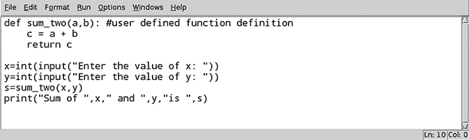

图 3.24 展示可以接受参数并返回值的 Python 程序。

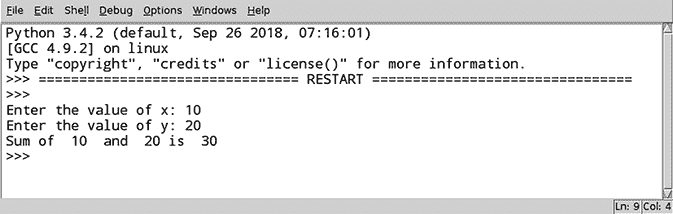

图 3.25 Python 函数程序的输出。

### 3.17 NumPy 简介

NumPy 是 numerical python 的缩写。它是一个基础的 Python 包，有助于执行数据分析并支持机器学习算法。由于机器学习算法的数据集来自各种来源并遵循不同的格式，处理这些数据变得非常具有挑战性。这些数据集可能包含图像、文本或音频剪。这些用于处理的数据源被可视化为数值数组。因此，NumPy 作为一个 Python 包，提供了强大的数组处理功能：

* `ndarray`，支持具有卓越性能的高维数组。
* 数学函数，支持将整个数组作为一个单元进行操作。

它提供了对线性代数操作的支持，并允许 Python 代码与 C 和 C++ 交互。

#### 如何使用 NumPy

惯例是如图 3.26 所示的命令使用 NumPy。

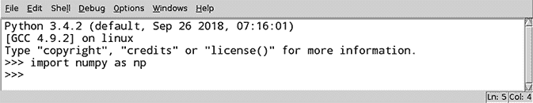

图 3.26 NumPy 模块的使用。

如果你看到上面的屏幕，执行 `import numpy as np` 后解释器出现了提示符 ⋙；这意味着 NumPy 包已正确安装。

### 3.18 NumPy 操作

#### 3.18.1 从 Python 列表创建数组

第一步是构建一个 Python 列表。让我们考虑 `lst=[10, 20, 30, 40, 50]`。要将列表转换为数组，我们必须使用函数 `np.array()` 并列表作为参数传递（即 `lst`）。这在图 3.27 中可视化。

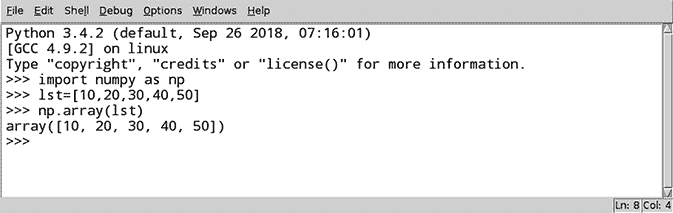

图 3.27 从 Python 列表创建数组的 Python 命令代码。

NumPy 要求所有数组元素必须是相同类型。如果元素不匹配，低类型将转换为或提升为高类型。

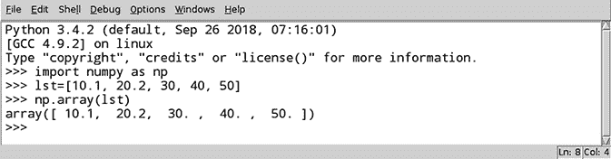

图 3.28 从 Python 列表创建数组时显示类型转换的 Python 命令代码。

NumPy 支持的一些基本数据类型如表 3.4 所示。

表 3.4 NumPy 数据类型

| 数据类型 | 说明 |
| --- | --- |
| `bool_` | 布尔值 True 或 False |
| `int32` | 支持 32 位机器上的整数 |
| `int64` | 支持 64 位机器上的整数 |
| `uint32` | 支持 64 位机器上的无整数 |
| `float32` | 单精度浮点 |
| `float64` | 双精度浮点 |
| `complex64` | 带有实部和虚部的复数 |


| complex128 | 带有实部和虚部的复数 |

假设我们要创建一个浮点数组，可以使用`dtype='float64'`。这在图 3.29 中所示。

#### 3.18.2 创建数组

要创建一个包含 20 个元素的一维数组，我们可以使用`arange`函数。这在图 3.30 中所示。

要创建一个维度为 3 x 3 且填充为 Integer64 类型 1 的二维数组，我们需要使用`ones`函数。这在图 3.31 中所示。

`np.ones((3,3), dtype=int64)`

<graphic xlink:href="unmath3\_4.tif"/>

如图图 3.35 所示。

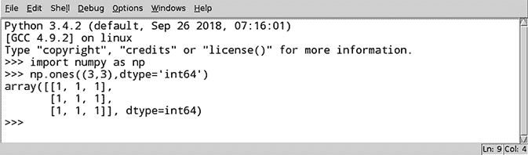

图 3.35 创建一个 3x3 填充为 Integer64 类型 1 的二维数组的 Python 命令代码。

### 3.18.3 基础 NumPy 操作

* **数组属性 (Array Attributes)**：在大多数数据处理应用中，开发者需要了解数组属性。这些属性及其描述在表 3.5 中所示。

表 3.5 NumPy 数组属性

| 属性 | 描述 |
| --- | --- |
| `ndim` | 指定维数 |
| `shape` | 指定每个维度的大小 |
| `size` | 指定数组的总大小 |
| `dtype` | 指定数组元素的数据类型 |

考虑如下一个维度为 3x3 的二维数组

$$\begin{matrix} 1 & 2 & 3 \\ 4 & 5 & 6 \\ 7 & 8 & 9 \\ \end{matrix}$$

<graphic xlink:href="unmath3\_5.tif"/>

现在使用 NumPy 创建上述数组并打印其属性。

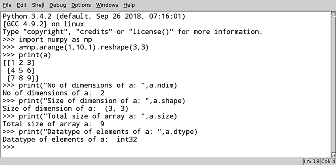

图 3.36 创建一个 3x3 二维数组并打印其属性的 Python 命令代码。

`reshape()`方法用于构建一个元素从 1 到 9 的 3x3 矩阵。`reshape()`方法将在后续章节进行更详细的讨论。

* **数组索引 (Array indexing)**：Python 中的数组索引从 0 开始。因此，如果我们要获取数组的第 5 个元素，需要使用`array_name[4]`。这在图 3.37 中所示。

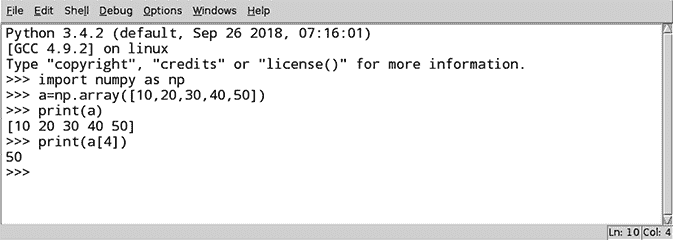

图 3.37 访问数组元素的 Python 命令代码。

访问多维数组，我们需要一个逗号分隔的索引元组来访问数组。例如`array_name[2][1]`将返回第三行第二列元素的值。这在图 3.38 的示例中所示。

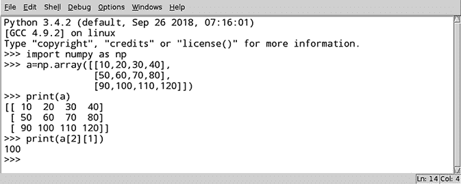

图 3.38 访问多维数组的 Python 命令代码。

* **处理子数组 (Working with subarrays)**：要从数组中获取子数组，我们使用类似于列表的切片操作。语法为`array_name[int_value, final_value, step_value]`。

**一维数组 (1-Dimensional array)**：让我们考虑一个值为 0, 1, 2, 3, 4, 5, 6 的一维数组。

| 索引 | 0 | 1 | 2 | 3 | 4 | 5 | 6 |
| --- | --- | --- | --- | --- | --- | --- | --- |
| 值 | 0 | 1 | 2 | 3 | 4 | 5 | 6 |

要获取前三个值，我们需要执行语句`a[:3]`。这表示值位于索引 0、1 和 2。要获取最后三个值，需要执行`a[4:]`。这表示索引 4 之后的所有值。这在图 3.39 中所示。

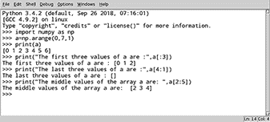

图 3.39 获取数组子数组的 Python 命令代码。

在图 3.39 中，我们看到要获取数组`a`的中间值，使用范围`a[2:5]`进行切片（即从索引 2 开始到索引 5 的值）。

**二维数组 (2-dimensional array)**：在二维数组的情况下，多个切片由逗号隔开。例如，我们有一个维度为 3x3 的二维数组：

$$\begin{matrix} 1 & 2 & 3 \\ 4 & 5 & 6 \\ 7 & 8 & 9 \end{matrix}$$

<graphic xlink:href="unmath3\_6.tif"/>

现在使用 NumPy，我们想要获取 $\begin{matrix} 2 \\ 5 \\ 8 \end{matrix}$ 的值，我们需要执行以下语句`a[:3,1:2]`。

<graphic xlink:href="unmath3\_7.tif"/>

这在图 3.40 中所示。

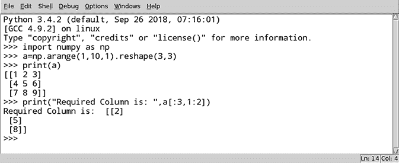

图 3.40 获取二维数组子数组的 Python 命令代码。

因此，我们从数组`a`中获取索引 1 开始且小于索引 2 的行（即索引 1 的整列）。**注意：**NumPy 创建的子数组被视为视图（views）。因此，如果修改了子数组，修改将反映在原始数组中。这在图 3.41 中所示。

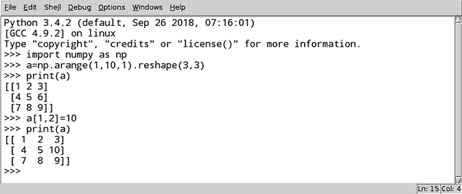

图 3.41 获取二维数组子数组的 Python 命令代码。

在这里我们修改了第 2 行第 3 个元素并赋值为 10。当我们打印数组时，这会反映在数组`a`中。

* **复制数组 (Copying an array)**：我们可以使用`copy()`函数创建数组的副本。这在图 3.42 中所示。

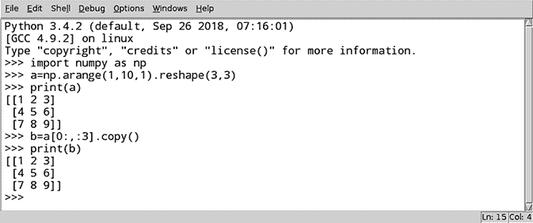

图 3.42 复制数组的 Python 命令代码。

* **数组重塑 (Array reshaping)**：有时，我们需要改变数组的形状（例如从行向量变为列向量）。这在图 3.43 所示的示例中。

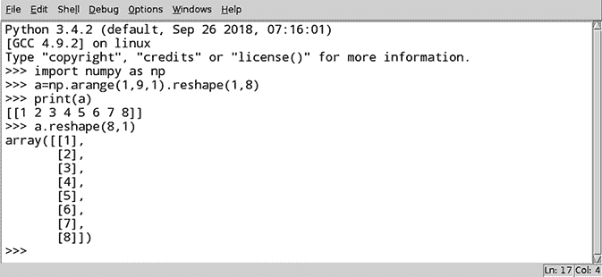

图 3.43 改变数组形状的 Python 命令代码。

* **数组拼接 (Array Concatenation)**：通过拼接过程可以将两个数组合并成一个。我们考虑的第一个程序是`np.concatenate()`。这在图 3.44 中所示。

NumPy 中的轴（Axis）是多维数组的。例如，一个二维数组有两个轴。如果`axis=0`，意味着一个跨越行的垂直轴。或者，如果`axis=1`，意味着一个横跨跨列的水平轴。让我们考虑两个一维数组的拼接。这在图 3.44 中所示。

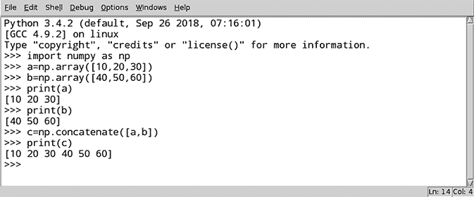

图 3.44 拼接一维数组的 Python 命令代码。

多维数组的拼接操作基于轴。如果`axis=0`，意味着将进行垂直方向拼接；如果`axis=1`，意味着将进行水平方向拼接。这在图 3.45 和 3.46 的示例中所示。

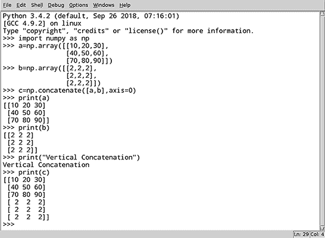

图 3.45 垂直拼接二维数组的 Python 命令代码。

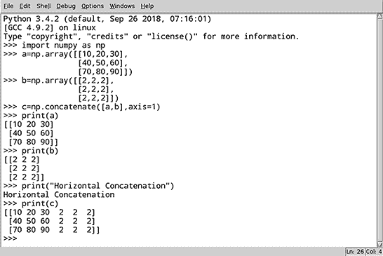

图 3.46 水平拼接二维数组的 Python 命令代码。

如果数组的维度不同且你想拼接它们，则可以使用`vstack()`垂直堆叠或`hstack()`水平堆叠程序。这在下面的示例中所示。

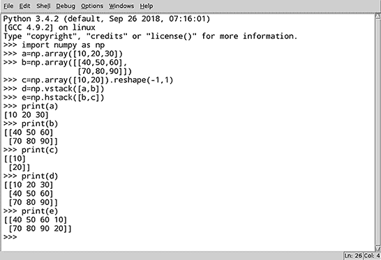

图 3.47 拼接不同维度数组的 Python 命令代码。

有时我们需要将数组拆分为不同的数组。这是通过`split()`函数实现的。如果数组要拆分为不同大小的数组，则需要提供切分点。这在图 3.48 中所示。

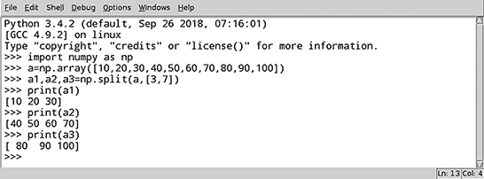

图 3.48 分分不同大小数组的 Python 代码。

```python
a1, a2, a3 = np.split(a,[3,7])
```

<graphic xlink:href="math3.tif"/>

这里第一个数组是 0 到 2，第二个数组是 3 到 6，第三个数组是 7 到 9。我们通过切分点`[3,7]`完成了这一操作。

然而，另一种拆分不同大小数组的方法。这是通过`array_split()`例实现的，并在图 3.49 中所示。

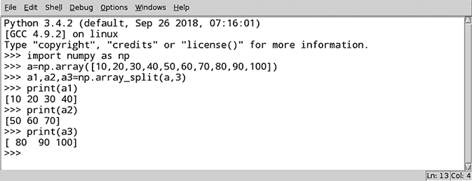

图 3.49 使用 Array_Split() 分分不同大小数组的 Python 代码。

## 3.19 Pandas 简介

Pandas 是数据科学家需要学习 Python 库之一。简而言之，Pandas 在 NumPy 数组的基础上构建了带行和列。Pandas 可以被可视化为具有表格和数据库能力的 NumPy 数组。

Pandas 的应用包括：

* 将 NumPy 数组、Python 列表或字典转换为 dataframe 对象。
* 打开本地 csv 文件。
* 通过 URL 打开远程 csv 文件。

### 3.19.1 探索 Pandas

检查 Pandas 是否正确安装，你可以输入图 3.50 所示的命令。


图 3.50 检查 Pandas 是否正确安装的 Python 代码。

如果解释器没有出现任何错误，说明 Pandas 已正确安装。你需要学习的 Pandas 两种数据结构是`Series`和`DataFrame`。


图 3.51 使用 Pandas 对象的 Python 代码。

在 Pandas 官方文档中，`Series`被描述为同类型类型的结构。让我们考虑图 3.52 所示的示例。


图 3.52 Series 对象类型向上转换的 Python 代码。

在这里我们观察到`Series`对象允许我们插入字符串`'a'`。因此，整数和字符串的存在导致了类型转换。如果数组包含整数和浮点数，数组类型将向上转换为浮点型。这通过图 3.53 所示的示例可视化。


图 3.53 从整数到浮点数 Series 对象类型转换的 Python 代码。

在这里我们观察到`series`对象包含整数和浮点数，并已转换为浮点型。**注意：**尽管`Series`对象允许非同质元素，但某些 Pandas 函数可能无法工作。由于对上面的 series 对象没有指定索引，它默认取从 0 到`N-1`的索引，其中`N`是`Series`对象中的元素数量。

可以通过像 NumPy 一样切片`Series`对象获取子集。这在图 3.54 中所示。


图 3.54 使用 Series 切片生成子数组的 Python 代码。

在 Pandas 的 series 对象中，可以使用字符串访问索引，而不像 NumPy 那样限制自己。这在图 3.55 的示例中所示。


图 3.55 使用字符串访问 Series 索引的 Python 代码。

Pandas`Series`对象可以可视化为 Python 字典。在这里，相应的键和值被映射在一起。这在图 3.56 中所示。


图 3.56 将 Series 对象作为字典实现的 Python 代码。

在这里，索引是排序形式的字典键。

### 3.19.2 DataFrame 对象

`DataFrame`是一种类似于电子表格的表格结构，每列代表不同的值。它也可以被可视化为 1 维`Series`对象的集合。因此，`DataFrame`可以被视为电子表格页面。这在表 3.4 中所示。

让我们描述一个州、其首府及其人口。

表 3.4 州、首府及人口

| 州 | 首府 | 人口 |
| :--- | :--- | :--- |
| 亚拉马马 | 蒙特哥马利 | 198,232 |
| 佛罗里达 | 塔哈西 | 193,078 |
| 路易斯安那 | 新奥鲁治 | 226,505 |
| 马萨诸塞塞 | 波士顿 | 687,584 |
| 弗吉尼亚 | 麦克森森 | 230,254 |


图 3.57 DataFrame 作为表格结构的 Python 代码。

由于我们对上面的 series 对象没有指定索引，它默认取从 0 到 4 的索引。我们可以通过指定列名或获取特定行的数据来访问`DataFrame`对象。

示例：`dataf['state']`

```python
dataf.ix[1]
```

在这里`ix`代表索引字段。

* `unique()`: 获取列的唯一值
* `sum()`: 指定列值的之和
* `max()`: 指定列的最大值
* `min()`: 指定列的最小值
* `idxmin()`: 最小值的索引
* `idxmax()`: 最大值的索引
* `count()`: 指定列中非空值的数量
* `describe()`: 统计摘要
* 这一点在图 3.62 中进行了图示。


图 3.62 查看 Dataframe 对象中可用索引和列名的 Python 命令代码 dict_info。

### 3.19.2.2 用于 DataFrame 信息的 Pandas 功能

Pandas 提供了某些功能，我们可以提取关于 DataFrame 的信息，如形状、列和所使用的索引。

语法如下

* `dataframeobject.shape`: DataFrame 对象的行数和列数
* `dataframeobject.columns`: DataFrame 对象中指定的列
* `DataFrameobject.index`: 行索引的细节，包括范围
* 这一点在图 3.63 中进行了图示。


图 3.63 展示列级函数的 Python 命令代码。

### 3.19.2.3 用于删除 DataFrame 中行和列的 Pandas 函数

Pandas 提供了`drop`函数来删除 DataFrame 对象中的行和列。

首先，考虑一个示例，你想从 DataFrame 中删除特定的行。由于我们没有指定行名，这些值将从 0 到 N-1。因此，如果我们想删除`row0`和`row1`，则执行以下语句：

* `dataframeobject.drop([0,1])`
* 如果我们需要删除一列，将指定
* `dataframeobject.drop('column_name',axis=1)`
* 这一点在图 3.64 中进行了图示。


图 3.64 展示 Dataframe 信息的 Python 命令代码。

### 3.19.2.4 修改 DataFrame

要通过添加列来修改 DataFrame，我们可以执行以下语句

```
dataframeobject['column_name'] = 0
```

<graphic xlink:href="unmath3_9.tif"/>

这将创建一个指定的列并将其值初始化为 0。

如果你想更改 DataFrame 对象的列名，可以执行以下语句。

```
DataFrameobject['column_name1', 'column_name2', 'column_name3', 'column_name4']
```

<graphic xlink:href="unmath3_10.tif"/>

因此，`DataFrameObjects`的列将按照`column_name1`、`column_name2`、`column_name3`和`column_name4`的指定进行更改。

这一点在图 3.65 和图 3.66 中进行了图示。


图 3.65 通过添加列修改 DataFrame 信息的 Python 命令代码。


图 3.66 通过更改列名修改 DataFrame 信息的 Python 命令代码。

## 3.20 从文件读取数据的 Pandas 功能


让我们先考虑如何从 CSV 文件读取数据。CSV 代表逗号分隔值。它存储了由逗号分隔的数据；CSV 文件可以导入或导出到 Excel 和 officeorg 等流行的电子表格中。

让我们考虑一个名为 `state.csv` 的简单 CSV 文件。

* 步骤 1：在 Python Shell 中点击 File -> NewFile。
* 步骤 2：粘贴你的 CSV 内容。
* 步骤 3：保存文件（即给出 `filename.csv` 并选择类型为 `all files`）。
* **注意：** 我们所创建的文件位于 Python 可以访问文件的相同文件夹中。


图 3.67 state.csv 文件的快照。

使用 Pandas 访问此文件：


图 3.68 访问文件的 Python 命令代码。

## 3.21 Pandas 缺失数据（数据清洗）

有时会在 DataFrame 中遇到缺失值。Pandas 用 `NaN` 表示缺失值。转换这种值是有用的。例如，我们有一个在图 3.69 中所示的一维 Series。


图 3.69 访问 Series 的 Python 命令代码..

第一步是检查数据是否存在，我们可以使用 `isnull()`。`isnull()` 的用法在图 3.70 中进行了图示。


图 3.70 检查数据的 Python 命令代码。

这里我们观察到 2 和 5 为 True，这意味着存在 NaN。要删除这些，我们使用 `dropna()`。


图 3.71 删除数据的 Python 命令代码。

这里设置 `axis=1`，保留列。这种方法的缺点是会丢失有用信息。为了克服这个问题，我们可以将 NaN 值替换为 0 或向前填充。


图 3.72 替换 NaN 的 Python 命令代码。

向前填充和向后填充在图 3.73 中进行了图示。


图 3.73 前向填充和向后填充的 Python 命令代码。

## 3.22 SciPy 简介

SciPy 是一个帮助科学家和工程师进行科学计算的 Python 库。它支持如下应用：

* 优化
* 积分
* 图像处理
* 统计

### 3.22.1 探索 SciPy

第一步是检查 SciPy 是否安装正确。


图 3.74 检查 SciPy 是否安装正确的 Python 命令代码。

如果我们 get 命令行提示符而没有任何错误，说明 SciPy 已正确安装。

### 3.22.2 稀疏矩阵

如果一个矩阵包含大量的零，我们可以称这样的矩阵为稀疏矩阵。

示例

$$\begin{matrix} 1 \\ 0 \\ 0 \\ \end{matrix}\;\\;\\;\\;\\begin{matrix} 0 \\ 0 \\ 0 \\ \end{matrix}\;\\;\\;\\;\\begin{matrix} 0 \\ 3 \\ 0 \\ \end{matrix}$$

在上面的矩阵中有两个非零值，其他七个值为零。

计算稀疏性的公式为

$$\frac{\text{零元素的数量}}{\text{元素总数}}$$

因此，稀疏性的百分比为 (7/9)*100 = 77.78%，密度的百分比为 (2/9)*100 = 22.22%。

常用稀疏行（Common Sparse Row）通常用于在机器学习应用中表示稀疏矩阵。这里使用三个 1 维矩阵来表示非零值。这如图 3.75 和图 3.76 所示。


图 3.75 展示稀疏矩阵的 Python 程序。


图 3.76 展示稀疏矩阵的 Python 程序输出。

接下来的示例演示了如何计算给定矩阵的稀疏度和密度。这如图 3.77 和图 3.78 所示。


图 3.77 计算给定矩阵稀疏度和密度的 Python 程序。


图 3.78 计算给定矩阵稀疏度和密度的 Python 程序输出。

### 3.22.3 矩阵的逆

SciPy 中支持线性代数的模块是 `linalg`。让我们使用 SciPy 计算矩阵的逆

$$\\begin{matrix} 1 \\ 0 \\ 5 \\ \\end{matrix}\\;\\;\\;\\;\\begin{matrix} 2 \\ 1 \\ 6 \\ \\end{matrix}\\;\\;\\;\\;\\begin{matrix} 3 \\ 5 \\ 0 \\ \\end{matrix}$$

<graphic xlink:href="unmath3\_13.tif"/>

上述矩阵的逆为：

$$\\begin{matrix} {- 6} \\ 5 \\ {- 1} \\ \\end{matrix}\\;\\;\\;\\;\\begin{matrix} 3.6 \\ {- 3} \\ 0.8 \\ \\end{matrix}\\;\\;\\;\\;\\begin{matrix} 1.4 \\ {- 1} \\ 0.2 \\ \\end{matrix}$$

<graphic xlink:href="unmath3\_14.tif"/>


图 3.79 计算矩阵逆的 Python 程序。


图 3.80 计算矩阵逆的 Python 程序输出。

### 3.22.4 Cholesky 分解

`Cholesky decomposition`（或 `Cholesky factorization`）是将埃尔米特正定矩阵分解为下三角矩阵及其共轭转置矩阵的乘积。


图 3.81 计算 Cholesky 分解的 Python 程序。


图 3.82 计算 Cholesky 分解的 Python 程序输出。

### 3.22.5 使用 SciPy 可视化学生学习小时的应用

假设一个学生每天学习固定的小时。他的学习时间可能会变化。数据由 csv 文件提供，如图 3.83 所示。


图 3.83 student.csv 文件快照。

`SciPy gen` 可从文本文件中读取数据；在这种情况下，它是 CSV 文件。Python 的切片运算符将其划分为 `x` 和 `y`。然后我们使用 `Matplotlib` 函数绘图。所示如图 3.84。


图 3.84 绘制学习小时的 Matplotlib 代码。

输出结果所示如图 3.85。


图 3.85 绘制学习小时的 Matplotlib 代码输出。

折线图显示了学生 12 天的学习模式。

## 3.23 Matplotlib 简介

`Matplotlib` 是一个供 Python 程序员使用的二维绘图包。对于数据分析师和算法设计人员来说，数据可视化和输出至关重要。这些工作由 `Matplotlib` 处理，它是一个巨大的库。


图 3.86 测试 Matplotlib 是否正确安装的代码。

如果导入 `Matplotlib` 及其模块 `pyplot` 作为 `plt` 返回提示符，说明 `Matplotlib` 已正确安装。

### 3.23.1 探索 Matplotlib

`Matplotlib` 中的基本图表类型有折线图、散点图和直方图。

`plot()` 方法接收 `x` 和 `y` 坐标。示例见图 3.87。


图 3.87 绘制折线图的 Matplotlib 代码。

`plt.show()` 方法用于显示图表。

`plt.rcParams['toolbar'] = None` 禁用工具栏。

`plt.rcParams` 是一个包含默认设置的字典。

`plt.rcParams['toolbar'] = 'None'` 禁用默认设置。


图 3.88 绘制折线图的 Matplotlib 代码输出。

接下来，我们绘制带有图例的多折线图。


图 3.89 绘制多折线图的 Matplotlib 代码。

`plt.legend()` 方法帮助我们定位图例。我们可以为图例指定 `label` 参数。


图 3.90 绘制折线图的 Matplotlib 代码输出。

现在我们应用 Matplotlib 绘制散点图。所示如图 3.93。


图 3.93 绘制散点图 Matplotlib 代码。

这里我们使用 `plt.scatter()` 方法，并使用参数 `c` 指定颜色。


图 3.94 绘制散点图 Matplotlib 代码输出。

现在我们尝试使用 Matplotlib 绘制直方图。所示如图 3.95。


图 3.95 绘制直方图 Matplotlib 代码。

这里我们使用 `plt.hist()` 方法。透明度通过 `alpha` 参数设置，`histtype` 为 `bar`，边缘颜色设置为黑色。输出所示如图 3.96。


图 3.96 绘制直方图 Matplotlib 代码输出。

## 练习题

### 简要回答问题

1. Python 是编译型还是解释型语言？
2. Python 中存在字符类型吗？
3. Python 中 `+` 运算符的作用是什么？
4. 解释 `else` 在 while 循环和 for 循环中的。
5. Python 的 `sort()` 函数遵循哪种排序算法？
6. Python 中的元组（tuples）是可变的吗？
7. Python 列表可以存储异构数据吗？
8. Python 字典可以为一个给定的值拥有多个键？
9. 如何使用 NumPy 创建数组？
10. Pandas series 是 1 维还是 2 维数组？
11. Pandas DataFrame 的行和列可以标记吗？
12. 文件中的 CSV 代表什么？
13. 如何获取 CSV 文件的行数和列数？
14. SciPy 库提供了哪些有用函数？
15. 密度图用于什么？
16. 散点图用于
17. 你会使用哪个 Python 库来绘图？

### 解决以下问题

1. 编写一个 Python 程序，接受多行句子并给出前 10 个单词的出现频率。不统计停用词。
2. 编写一个 Python 程序，初始化一个值为 10, 20, 30, 40 和 50 的 `NumPy` 数组并计算 `mean()`。
3. 编写一个 Python 程序，演示对 Python `List` 进行的操作与在 `NumPy` 数组上执行相似操作之间的时间消耗。
4. 编写一个使用 `Pandas` 库的 Python 程序，读取图 3.97

图 3.97 state.csv 文件的截图。

5. 编写一个使用 `SciPy` 库的 Python 程序来计算数组的行列式

$$\begin{matrix} 1 \\ 4 \\ 7 \\ \end{matrix}\;;\\;\\;\\begin{matrix} 2 \\ 5 \\ 8 \\ \end{matrix}\;\\;\\;;\\begin{matrix} 3 \\ 6 \\ 9 \\ \end{matrix}$$

<graphic xlink:href="unmath3\_16.tif"/>

6. 编写一个使用 `Matplotlib` 的 Python 程序，并考虑一个合适的示例来绘制三维线图。

# 机器学习 (#toc.xhtml#ch-04)

## 4.0 什么是机器学习？

在机器学习中，算法尝试在没有显式指令和人工干预的情况下，仅通过经验来学习学习。

## 4.1 机器学习的分类

机器学习算法分类为：

* 监督学习
* 无监督学习
* 强化学习

### 4.1.1 监督学习

监督算法从带标记的数据中学习。在监督学习中，有一组定义的输入和输出；通过多次迭代，监督学习算法会得出一个函数，帮助对一组不属于训练数据的给定输入得出正确的输出。

### 4.1.2 无监督学习

无监督算法处理未标记的数据进行工作。在这里，算法只提供数据，它们试图在这些数据中寻找有趣的模式。无监督学习试图找到数据中的共同点；对于新样本，它试图寻找已发现的共同点是否存在。

### 4.1.3 强化学习

在强化学习中，我们有代理与环境交互以最大化其奖励。这就像与评论员一起学习。对于正确的决策，代理获得奖励；对于错误的决策，代理受到惩罚。因此，代理的目标将是最大化奖励并达到目标状态。

监督、无监督和强化学习的机器学习算法如图 4.1

图 4.1 机器学习算法分类。

在本书中，我们将讨论监督机器学习算法的分类。

## 4.2 机器学习中的分类

在分类中，我们尝试预测类别值。这些类别值的标签来自一个有限的类别集合。

示例：

* 给定图像，预测是猫还是狗。
* 给定封邮件，预测是垃圾邮件还是真实邮件。

在二分类中，我们只有两个类用于预测，通常值为 0 和 1。

在多分类中，我们有多个两个以上的类用于预测（例如，猫、狗或鹿）。

在本章中，我们应用以下算法解决分类问题：

1. 逻辑回归
2. 朴素贝叶斯
3. 神经网络
4. 支持向量机
5. 随机森林
6. K N N
7. 线性判别分析 (LDA)

### 4.2.1 分类指标

如第 4.2 节所述，使用以下指标来评估监督算法。

#### 4.2.1.1 K 折交叉验证

交叉验证是用于验证给定模型性能的一种重要技术。交叉验证涉及保留数据集的一个样本进行测试，并在数据集的剩余部分上训练模型。

值 `k` 决定了数据可以被分成多少组。我们将 `k` 的值设置为 10。因此，它被称为 10 折交叉验证。

`k` 等于 10 是验证准确性的常用值。

#### 4.2.1.2 混淆矩阵

混淆矩阵（有时称为误差矩阵）允许我们以矩阵格式分析机器学习算法的性能。行表示预测类别，列表示实际类别。

混淆矩阵布局如图 4.2 所示。

**图 4.2 混淆矩阵布局**

| | 实际值 | |
| --- | --- | --- |
| 预测值 | Positive (Yes) | Negative (No) |
| Positive (Yes) | TP | FP |


| Negative (No) | FN | TN

* `TP` 代表真阳性：预测为是且正确的。
* `TN` 代表真阴性：预测为否且是正确的。
* `FN` 代表假阴性：预测为否但是错误的。
* `FP` 代表假阳性：预测为是但是错误的。

**准确率**决定了混淆矩阵的正确性；如公式 4.1 所示。

$$accuracy = \frac{TP + TN}{total},$$

<graphic xlink:href="math4\_1.tif"/>

(4.1)

其中 `total` 是行总或或列和。

**精确率**给出了预测为“是”时的正确性，如公式 4.2 所示。

$$precision = \frac{TP}{Predicted Yes},$$

<graphic xlink:href="math4\_2.tif"/>

(4.2)

其中 `Predicted Yes` 是预测行的和。

**召回率**是模型寻找感兴趣点的能力，如公式 4.3 所示。

$$recall = \frac{TP}{TP + FN}.$$

<graphic xlink:href="math4\_3.tif"/>

(4.3)

## 4.3 回归

在回归中，我们尝试预测连续输出。预测连续输出的机器学习算法有：

* 线性回归
* 多线性回归
* 支持向量机（适用于回归和分类）

## 4.4 Scikit-Learn

Scikit-learn 是一个支持机器学习的 Python 编程语言库。它支持分类、回归和聚类等机器学习功能，并带有流行算法的 API：

1. 线性回归
2. 逻辑回归
3. 朴素贝叶斯
4. 神经网络
5. 支持向量机
6. 随机森林
7. K N N
8. LDA

### 4.4.1 数据集

我们分析了来自加州大学欧文市的心脏数据集。对于我们的分类测试，我们只使用了 14 个属性，如表 [4.1](#chapter04.xhtml#table4_1）所示。

表 4.1 心脏数据集属性描述

| 序号 | 属性名称 | 属性名称和描述 |
| --- | --- | --- |
| 1 | `age` | 年龄 |
| 2 | `sex` | 性别（1 = 男性；0 = 女性） |
| 3 | `cp` | 胸痛类型 |
| | | Value 1: 典型心绞痛 |
| | | Value 2: 非典型心绞痛 |
| | | Value 3: 非心绞痛性疼痛 |
| | | Value 4: 无症状 |
| 4 | `trestbps` | 静息血压（入院时的静息血压，单位为 mm Hg） |
| 5 | `chol` | 血清胆固醇（单位为 mg/dl） |
| 6 | `fbs` | （空腹血糖 > 120 mg/dl）（1 = 真；0 = 假） |
| 7 | `restecg` | 静息心电图结果 |
| | | Value 0: 正常 |
| | | Value 1: 倒置 T 波或有 ST-T 波异常（T 波倒置和/或 ST 波抬高或下降，幅度 > 0.05 mV） |
| | | Value 2: 根据 Estes 标准显示可能或肯定的左心室肥大 |
| 8 | `thalach` | 达到的最大心率 |
| 9 | `exang` | 运动性心绞痛（1 = 是；0 = 否） |
| 10 | `oldpeak` | 相对于静息，运动引起的 ST 段下降 |
| 11 | `slope` | 运动峰值 ST 段的斜率 |
| | | Value 1: 上斜 |
| | | Value 2: 平直 |
| | | Value 3: 下斜 |
| 12 | `ca` | 荧光造影染色的血管血管数量（0–3） |
| 13 | `thal` | 3 = 正常；6 = 固定缺损；7 = 可逆性缺损 |
| 14 | `num` | 心脏诊断（血管造影疾病状态） |
| | | Value 0: 直径狭窄 < 50% |
| | | Value 1: 直径狭窄 > 50% |
| | | （在任何主要血管：属性 59 到 68 为血管） |

心脏病 csv 文件的快照如图图 4.3 所示。


图 4.3 `heart.csv` 文件快照。

#### 4.4.1.1 数据集分析

**检查数据集中多少行和多少列。**

**Python 程序：`Datashape.py`**


图 4.4 用于分析 `heart.csv` 的 Python 程序 `Datashape.py`。

**输出**


图 4.5 Python 程序 `Datashape.py` 的输出。

我们从输出中观察到用于分类的心脏病数据集有 303 行和 14 列。了解所有数据的属性是非常重要的，正如图 4.6 所示的 Python 程序及其图 4.7 所示的输出所示。

**Python 程序：`Datatype.py`**


图 4.6 打印每个属性类型的 Python 程序。

**输出**


图 4.7 打印每个属性类型的 Python 程序输出。

### 4.4.1.2 相关性

相关性表示变量之间的关联性。它通常说明一个变量包含多少关于另一个变量的信息。如果数据具有高度相关性，线性回归和逻辑回归等机器学习的性能将受到影响。

#### 4.4.1.3 Pearson 相关性

Pearson 相关性是衡量两个变量（A 和 B）之间线性关系的指标。值 1 表示正相关，-1 表示负相关，0 表示没有线性相关。Pearson 相关性如公式 4.4 所示：

$$P\_{A,B} = \\frac{Cov\left( {A,B} \right)}{\sigma A\\;\\sigma B},,$$

<graphic xlink:href="math4\_4.tif"/>

(4.4)

其中 `Cov`  是协方差，`σA`  是 A 的标准差，`σB`  是 B 的标准差。

##### Python 程序：`Pcovdata.py`


图 4.8 用于生成协方差矩阵的 Python 程序 `Pcovdata.py`。


图 4.9 `Pcovdata.py` 生成协方差矩阵的输出。

我们从输出中观察到，用于分类的心脏病数据集有 303 行和 14 列。了解所有数据的属性是非常重要的，正如图 4.6 所示的 Python 程序及其图 4.7 所示的输出所示。

**Python 程序：`Datatype.py`**


图 4.6 打印每个属性类型的 Python 程序。

**输出**


图 4.7 打印每个属性类型的 Python 程序输出。

### 4.4.1.2 相关性

相关性表示变量之间的关联性。它通常说明一个变量包含多少关于另一个变量的信息。如果数据具有高度相关性，线性回归和逻辑回归等机器学习的性能将受到影响。

#### 4.4.1.3 Pearson 相关性

Pearson 相关性是衡量两个变量（A 和 B）之间线性关系的指标。值 1 表示正相关，-1 表示负相关，0 表示没有线性相关。Pearson 相关性如公式 4.4 所示：

$$P\_{A,B} = \\frac{Cov\left( {A,B} \right)}{\sigma A\\;\\sigma B},,$$

<graphic xlink:href="math4\_4.tif"/>

(4.4)

其中 `Cov`  是协方差，`σA`  是 A 的标准差，`σB`  是 B 的标准差。

##### Python 程序：`Pcovdata.py`


图 4.8 用于生成协方差矩阵的 Python 程序 `Pcovdata.py`。


图 4.9 `Pcovdata.py` 生成协方差矩阵的输出。

我们从输出中观察到，用于分类的心脏病数据集有 303 行和 14 列。了解所有数据的属性是非常重要的，正如图 4.6 所示的 Python 程序及其图 4.7 所示的输出。

`r=nbmodel.fit(X_train, y_train)`

`y_pred = nbmodel.predict(X_test)`

## 神经网络 MLP

如果你的数据具有不同的尺度，对数据进行归一化和重缩会有帮助。特征缩放仅在训练数据上进行；测试数据保持尽可能接近真实，如 `scaler.fit(X_train)` 所示。

```python
from sklearn.neural_network import MLPClassifier
scaler = StandardScaler()
scaler.fit(X_train)
X_train = scaler.transform(X_train)
X_test = scaler.transform(X_test)
r=mlp.fit(X_train, y_train)
y_pred = mlp.predict(X_test)
```

`transform` 函数用于计算训练集的均值和标准差，以便你可以将其应用于测试集。

## 支持向量机 (SVM)

SVM 分类器的训练使用 `fit()` 函数对训练数据完成；训练好的分类器的预测使用 `predict()` 函数对测试数据完成。

```python
r=svmodel.fit(X_train, y_train)
y_pred = svmodel.predict(X_test)
```

## 随机森林

```python
from sklearn.ensemble import RandomForestClassifier
stdc = StandardScaler()
X_train = stdc.fit_transform(X_train)
X_test = stdc.transform(X_test)
r=clf.fit(X_train, y_train)
y_pred = clf.predict(X_test)
```

`Standard Scaler` 应用于随机森林训练数据的特征缩放并进行进一步转换。一旦完成，模型分类器在训练数据上进行训练，并在 `predict()` 函数上进行预测测试。

## K 邻域

```python
from sklearn.preprocessing import StandardScaler
ksc = StandardScaler()
ksc.fit(X_train)
X_train = ksc.transform(X_train)
X_test = ksc.transform(X_test)
r=knclf.fit(X_train, y_train)
y_pred = knclf.predict(X_test)
```

`Standard Scaler` 应用于 K 近邻训练数据的特征缩放并进行进一步转换。一旦完成，模型分类器在训练数据上进行训练，并在 `predict()` 函数上进行预测测试。

## 线性判别分析 (LDA)

```python
from sklearn.preprocessing import StandardScaler
lsc = StandardScaler()
lsc.fit(X_train)
X_train = lsc.transform(X_train)
X_test = lsc.transform(X_test)
r = ldac.fit_transform(X_train, y_train)
y_pred = ldac.predict(X_test)
```

`Standard Scaler` 应用于 LDA 及其训练数据的特征缩放并进行进一步转换。一旦完成，模型分类器在训练数据上进行训练，并在 `predict()` 函数上进行预测测试。

### 4.4.7 使用 Scikit-learn 的 K 折分类准确率

```python
from sklearn.model_selection import KFold
num_folds = 10
kfold = KFold(n_splits=10, random_state=7)
results = cross_val_score(reg, X, Y, cv=kfold)
print("K-Fold Classification Accuracy:",results.mean()*100,"%")
```

在我们的实验中，我们使用了 10 折 K 交叉验证。这里 1 折用于验证，而 10−1 = 9 折用于训练；对所有组合重复此过程。使用函数 `cross_val_score()` 来计算交叉验证评分。最后，通过结果的平均值计算准确率。

### 4.4.8 使用 Scikit-learn 的混淆矩阵实现

混淆矩阵为分类算法提供了洞察力。Scikit 代码如下：

```python
from sklearn import metrics
conf_matrix = metrics.confusion_matrix(y_test, y_pred)
print(conf_matrix)
print("Confusion Matrix Accuracy:",metrics.accuracy_score(y_test, y_pred)*100,"%")
print("Confusion Matrix Precision:",metrics.precision_score(y_test, y_pred)*100,"%")
print("Confusion Matrix Recall:",metrics.recall_score(y_test, y_pred)*100,"%")
```

考虑以下由逻辑回归示例生成的混淆矩阵：

```
[[22 5]
 [4 30]]
```

对角线元素显示了每个类的分类情况。因此，对于类 0，我们有 22 个正确预测，对于类 1，我们有 30 个准确预测。

非对角线显示了错误的分类。

因此，准确率 = 正确分类/总分类 = (52/61)*100 = 85.2459。

### 4.4.9 ROC 曲线

ROC 曲线用于平衡真阳性和假阳性。绘制 ROC 的代码为：

```python
y_pred_prob = reg.predict_proba(X_test)[:,,1]
fp_rate, tp_rate, _ = metrics.roc_curve(y_test, y_pred_prob)
auc_score = metrics.roc_auc_score(y_test, y_pred_prob)
plt.rcParams['toolbar'] = 'None'
plt.title('Logistic Regression')
plt.xlabel('False Positive Rate')
plt.ylabel('True Positive Rate')
plt.plot(fp_rate,tp_rate,label="data 1, auc="+str(auc_score))
plt.legend(loc=4)
plt.show()
```

概率预测通过 `reg.predict_proba()` 函数完成。我们仅限制为正性结果。使用函数 `metrics.roc_auc_score(y_test, y_pred_prob)` 和 `metrics.roc_curve(y_test, y_pred_prob)` 计算曲线下面积 (AUC) 和受者工作特征曲线 (ROC)，并绘制相同图表。

如果 AUC 为 1，结果是良好的。

* 构建逻辑回归时，需要考虑适当且有意义的变量。
* 逻辑回归通常需要较大的样本量。

**注意：** 如果逻辑回归的参数较少，过拟合的概率越低。过拟合分析对应特定的数据集，可能在额外数据上失效。

### Python 程序：`Logisticregrr.py`


```python
from pandas import read_csv
from sklearn.model_selection import KFold
from sklearn.model_selection import cross_val_score
from sklearn.linear_model import LogisticRegression
from sklearn.model_selection import train_test_split
from sklearn import metrics
from matplotlib import pyplot as plt
filename = 'heart.csv'
names = ['age','sex','cp','trestbps','chol','fbs','restecg','thalach','exang','oldpeak','slope','ca','thal','target']
data = read_csv(filename, names=names)
types = data.dtypes
array = data.values
X = array[:,0:13]
Y = array[:,13]
X_train, X_test, y_train, y_test = train_test_split(X, Y, test_size = 0.2, random_state = 0)
num_folds = 10
kfold = KFold(n_splits=10, random_state=7)
reg = LogisticRegression()
results = cross_val_score(reg, X, Y, cv=kfold)
print("K-Fold Classification Accuracy:",results.mean()*100,"%")
reg.fit(X_train, y_train)
y_pred = reg.predict(X_test)
conf_matrix = metrics.confusion_matrix(y_test, y_pred)
print(conf_matrix)
print("Confusion Matrix Accuracy:",metrics.accuracy_score(y_test, y_pred)*100,"%")
print("Confusion Matrix Precision:",metrics.precision_score(y_test, y_pred)*100,"%")
print("Confusion Matrix Recall:",metrics.recall_score(y_test, y_pred)*100,"%")
y_pred_prob = reg.predict_proba(X_test)[::,1]
fp_rate, tp_rate, _ = metrics.roc_curve(y_test, y_pred_prob)
auc_score = metrics.roc_auc_score(y_test, y_pred_prob)
plt.rcParams['toolbar'] = 'None'
plt.title('Logistic Regression')
plt.xlabel('False Positive Rate')
plt.ylabel('True Positive Rate')
plt.plot(fp_rate,tp_rate,label="data 1, auc="+str(auc_score))
plt.legend(loc=4)
plt.show()
```

**输出**


图 4.12 Python 程序 Logisticregrr.py 输出。


图 4.13 逻辑回归 ROC 曲线。

## 4.6 朴素贝叶斯

朴素贝叶斯是一种监督学习技术。它基于贝叶斯定理的概率分类器。它代表了一种依赖于预测变量（独立变量）独立性的分类技术。

“朴素”（Naive）一术意味着某些特征的出现与其他特征是独立的。“贝叶斯”（Bayes）一术告诉我们朴素贝叶斯的基础是贝叶斯定理。贝叶斯定理给出了事件 Y 发生事件 X 的条件概率，如公式 4.7 所示。

$$P\left( {X|Y} \right) = \ \frac{P(Y|X).P\left( X \right)}{P\left( Y \right)},$$

<graphic xlink:href="math4_7.tif"/>

(4.7)

其中

*   $P(X|Y)$  是给定 Y 的情况下 X 的条件概率。

*   $P(Y|X)$  是给定 X 的情况下 Y 的条件概率。

*   $P(X)$  是事件 X 的概率。

*   $P(Y)$  是事件 Y 的概率。

朴素贝叶斯最大的特征是它可以处理任意数量的独立变量，无论它们是独立的的还是连续的。

从一组变量 $X = \{x_1, x_2, ..., x_n\}$  中，我们想要从输出结果集 $C = \{c_1, c_2, ..., c_n\}$  中获得事件 $C_j$ 的后验概率。在这里用更通用的术来说，$X$ 是预测变量集，$C$ 是因变量中存在的类别水平。最终的后验概率如公式 4.8 所示。

$$p\left( {C_{j} }| X \right) \propto p\ \left( C_{j} } \right)\prod_{k}^{n}p\left( {x_{n} }| C_{j} }} \right).$$

<graphic xlink:href="math4_8.tif"/>

(4.8)

### 朴素贝叶斯的优点

*   它可以处理任意数量的独立变量，无论它们是独立的还是连续的。

*   计算速度快。

*   在某些情况下，即使数据较少，效果也良好。

### 朴素贝叶斯的应用

*   垃圾诊断

*   天气预测

*   分类

#### Python 程序：NaiveBayes.py

```python
from pandas import read_csv
from sklearn.model_selection import KFold
from sklearn.model_selection import cross_val_score
from sklearn.linear_model import LogisticRegression
from sklearn.model_selection import train_test_split
from sklearn import metrics
from matplotlib import pyplot as plt
filename = 'heart.csv'
names = ['age','sex','cp','trestbps','chol','fbs','restecg','thalach','exang','oldpeak','slope','ca','thal','target']
data = read_csv(filename, names=names)
types = data.dtypes
array = data.values
X = array[:,0:13]
Y = array[:,13]
X_train, X_test, y_train, y_test = train_test_split(X, Y, test_size = 0.2, random_state = 0)
num_folds = 10
kfold = KFold(n_splits=10, random_state=7)
reg = LogisticRegression()
results = cross_val_score(reg, X, Y, cv=kfold)
print("K-Fold Classification Accuracy:",results.mean()*100,"%")
reg.fit(X_train, y_train)
y_pred = reg.predict(X_test)
conf_matrix = metrics.confusion_matrix(y_test, y_pred)
print(conf_matrix)
print("Confusion Matrix Accuracy:",metrics.accuracy_score(y_test, y_pred)*100,"%")
print("Confusion Matrix Precision:",metrics.precision_score(y_test, y_pred)*100,"%")
print("Confusion Matrix Recall:",metrics.recall_score(y_test, y_pred)*100,"%")
y_pred_prob = reg.predict_proba(X_test)[::,1]
fp_rate, tp_rate, _ = metrics.roc_curve(y_test, y_pred_prob)
auc_score = metrics.roc_auc_score(y_test, y_pred_prob)
plt.rcParams['toolbar'] = 'None'
plt.title('Logistic Regression')
plt.xlabel('False Positive Rate')
plt.ylabel('True Positive Rate')
plt.plot(fp_rate,tp_rate,label="data 1, auc="+str(auc_score))
plt.legend(loc=4)
plt.show()
```

*(注：此处根据上下文逻辑，原文代码中的标题 Logistic Regression 可能是为示例或笔误，但根据指令要求代码块不翻译。)*

**输出**


图 4.14 Python 程序 NaiveBayes.py 实现朴素贝叶斯。


图 4.15 朴素贝叶斯 ROC 曲线。

## 4.7 神经网络 MLP

神经网络也称为人工智能神经网络，是一种受生物神经网络启发的信息处理系统。它由许多称为神经元的处理单元组成，这些单元相互作用以解决问题。

神经网络分为三类：

*   多层感知器 (MLP)

*   卷积神经网络

*   循环神经网络

在我们的讨论中，考虑由至少三层神经元组成的分类器。如图 4.16 所示。

LP 是全连接的。每一层与另一层之间通过某些权重 `w[i][j]` 连接。神经网络分两个阶段工作：

*   正向传播

*   反向传播

在正向传播阶段，执行以下步骤：

1.  输入值乘以权重。然后加上偏置。

2.  隐藏层神经元

    隐藏层神经元具有激活函数，如 `sigmoid` 或 `relu`。这些函数应用于从输入层接收到的值。

3.  然后将处理后的值传递给输出层。这些是算法的实际输出。

生成的输出可能并不准确。因此，启动反向传播阶段。

在反向传播阶段，会执行以下步骤。

1.  通过计算输出与输入之间的差异来计算误差。这种差异被称为 `loss`（损失），相应的函数被称为 `loss function`（损失函数）。损失函数的一个示例是均方误差。

2.  计算误差函数的偏导数，即所谓的 `gradient descent`（梯度下降）。如果误差函数的斜率为正，则可以减少权重或增加权重。这种练习减少了整体误差，其对应的函数称为 `optimization function`（优化函数）。

MLP 适用于输入被分配类别或标签的分类问题。

### 4.7.1 MLPs 的应用

*   时间序列预测

*   图像处理

*   字符识别

#### Python 程序：MLP.py

```python
from pandas import read_csv
from sklearn.model_selection import KFold
from sklearn.model_selection import cross_val_score
from sklearn.neural_network import MLPClassifier
from sklearn.model_selection import train_test_split
from matplotlib import pyplot as plt
from sklearn import metrics
from sklearn.preprocessing import StandardScaler

filename = 'heart.csv'
names = ['age','sex','cp','trestbps','chol','fbs','restecg','thalach','exang','oldpeak','slope','ca','thal','target']
dataframe = read_csv(filename, names=names)
array = dataframe.values
X = array[:,0:13]
Y = array[:,13]
X_train, X_test, y_train, y_test = train_test_split(X, Y, test_size = 0.2, random_state = 0)
scaler = StandardScaler()
scaler.fit(X_train)
X_train = scaler.transform(X_train)
X_test = scaler.transform(X_test)
mlp = MLPClassifier(hidden_layer_sizes=(30, 30, 30), max_iter=1000)
r=mlp.fit(X_train, y_train)
kfold = KFold(n_splits=10, random_state=7)
results = cross_val_score(mlp, X, Y, cv=kfold)
print("K-Fold Classification Accuracy:",results.mean()*100)
y_pred = mlp.predict(X_test)
conf_matrix = metrics.confusion_matrix(y_test, y_pred)
print(conf_matrix)
print("Confusion Matrix Accuracy:",metrics.accuracy_score(y_test, y_pred)*100,"%")
print("Confusion Matrix Precision:",metrics.precision_score(y_test, y_pred)*100,"%")
print("Confusion Matrix Recall:",metrics.recall_score(y_test, y_pred)*100,"%")
y_pred_prob = r.predict_proba(X_test)[:,1]
fp_rate, tp_rate, _ = metrics.roc_curve(y_test, y_pred_prob)
auc_score = metrics.roc_auc_score(y_test, y_pred_prob)
plt.rcParams['toolbar'] = 'None'
plt.title('Neural Network')
plt.xlabel('False Positive Rate')
plt.ylabel('True Positive Rate')
plt.plot(fp_rate,tp_rate,label="data 1, auc="+str(auc_score))
plt.legend(loc=4)
plt.show()
```

**输出**


图 4.17 用于实现多层感知机神经网络的 Python 程序 MLP.py。


图 4.18 多层感知机神经网络的 ROC 曲线。

## 4.8 支持向量机

SVM 是一种监督学习技术，有助于数据的分类和回归分析。SVM 试图找到一个超平面，将数据划分为相应的类别。在最简单的水平，超平面是一条将数据划分为相应类别的直线。

支持向量是距离超平面最近的数据点。最近数据点到超平面的距离被称为 `margin`（间隔），目标是获得更宽的间隔以实现最佳分类。

通过核函数将不可分的数据点转换为可转换的数据点是可能的。

在我们的讨论中，让我们考虑线性 SVM。

为了获得最大间隔分离，需要计算以下方程 4.9 和 4.10。

$W^{(T)}X[i] + b > 1$

(4.9)

$W^{(T)}X[i] + b < -1$

(4.10)

这里方程 4.9 考虑所有的正样本。方程 4.10 考虑负样本。

$\|W\|²$ 需要尽可能小。

然后，分类器被定义为一组点，对应于方程 4.11

$W \cdot x + b = 0$

(11)

### 4.8.1 支持向量机的优点


* 它们在高维空间中表现良好。
* 能够避免过拟合。

### 4.8.2 支持向量机的局限性

* 当数据较大时，它们存在性能问题。
* SVM 受到噪声存在的影响。

### 4.8.3 支持向量机的应用

* 分类
* 文本
* 生物信息学

#### Python 程序：`svm.py`

```python
from pandas import read_csv
from sklearn.model_selection import KFold
from sklearn.model_selection import cross_val_score
from sklearn.svm import SVC
from sklearn.model_selection import train_test_split
from matplotlib import pyplot as plt
from sklearn import metrics
from sklearn.preprocessing import StandardScaler

filename = 'heart.csv'
names = ['age','sex','cp','trestbps','chol','fbs','restecg','thalach','exang','oldpeak','slope','ca','thal','target']
dataframe = read_csv(filename, names=names)
array = dataframe.values
X = array[:,0:13]
Y = array[:,13]
X_train, X_test, y_train, y_test = train_test_split(X, Y, test_size = 0.2, random_state = 0)
scaler = StandardScaler()
scaler.fit(X_train)
X_train = scaler.transform(X_train)
X_test = scaler.transform(X_test)
svmodel=SVC(kernel='linear',probability=True)
r=svmodel.fit(X_train, y_train)
kfold = KFold(n_splits=10, random_state=7)
results = cross_val_score(svmodel, X, Y, cv=kfold)
print("K-Fold Classification Accuracy:",results.mean()*100)
y_pred = svmodel.predict(X_test)
conf_matrix = metrics.confusion_matrix(y_test, y_pred)
print(conf_matrix)
print("Confusion Matrix Accuracy:",metrics.accuracy_score(y_test, y_pred)*100,"%")
print("Confusion Matrix Precision:",metrics.precision_score(y_test, y_pred)*100,"%")
print("Confusion Matrix Recall:",metrics.recall_score(y_test, y_pred)*100,"%")
y_pred_prob = r.predict_proba(X_test)[:,1]
fp_rate, tp_rate, _ = metrics.roc_curve(y_test, y_pred_prob)
auc_score = metrics.roc_auc_score(y_test, y_pred_prob)
plt.rcParams['toolbar'] = 'None'
plt.title('Support Vector Machine')
plt.xlabel('False Positive Rate')
plt.ylabel('True Positive Rate')
plt.plot(fp_rate,tp_rate,label="data 1, auc="+str(auc_score))
plt.legend(loc=4)
plt.show()
```

## 4.9 随机森林

随机森林属于监督学习类别。随机森林构建多棵树并合并它们以获得准确决策。因此，随机森林涉及构建多棵决策树。

### 4.9.1 决策树

决策树遵循自上而下的方法，其中根节点开始二分过程，根据某些标准减少熵。这里熵是数据不确定性的度量。

根节点 `N` 是具有不同类别或标签的数据集。它被划分为左、右子集。这些子集的目标是实现类别的纯度。如果在对应的熵为 0 的相应节点上实现了这一目标，则只剩一种标签。否则，分裂过程将继续以确定剩余的标签。

考虑表 4.2 中的数据集

表 4.2 手机数据集

| 颜色 | 价格 | 标签 |
| --- | --- | --- |
| 金色 | 5000 | iPhone |
| 蓝色 | 5000 | Samsung |
| 黑色 | 3000 | Nokia |
| 金色 | 5000 | iPhone |
| 蓝色 | 5000 | Samsung |
| 黑色 | 3000 | Nokia |

图 4.21 展示了一个用于说明的简单决策过程。


图 4.21 随机森林中的决策树过程。

### 4.9.2 随机森林的优点

- 减少了过拟问题。
- 它具有对大型数据集产生准确预测的能力。
- 它具有考虑缺失数据的能力。

### 4.9.3 随机森林的局限性

- 树对训练数据中的变化敏感。
- 大量的树会减慢算法速度。

#### Python 程序：`RandomForest.py`

```python
from pandas import read_csv
from sklearn.model_selection import KFold
from sklearn.preprocessing import StandardScaler
from sklearn.ensemble import RandomForestClassifier
from sklearn.model_selection import cross_val_score
from sklearn.model_selection import train_test_split
from sklearn import metrics
from matplotlib import pyplot as plt
filename = 'heart.csv'
names = ['age','sex','cp','trestbps','chol','fbs','restecg','thalach','exang','oldpeak','slope','ca','thal','target']
dataframe = read_csv(filename, names=names)
array = dataframe.values
X = array[:,0:13]
X = array[:,13]
X_train, X_test, y_train, y_test = train_test_split(X, Y, test_size = 0.2, random_state = 0)
kfold = KFold(n_splits=10, random_state=7)
stdc = StandardScaler()
X_train = stdc.fit_transform(X_train)
X_test = stdc.transform(X_test)
clf = RandomForestClassifier()
r=clf.fit(X_train, y_train)
results = cross_val_score(clf, X, Y, cv=kfold)
print("K-Fold Classification Accuracy:",results.mean()*100)
y_pred = clf.predict(X_test)
conf_matrix = metrics.confusion_matrix(y_test, y_pred)
print(conf_matrix)
print("Confusion Matrix Accuracy:",metrics.accuracy_score(y_test, y_pred)*100,"%")
print("Confusion Matrix Precision:",metrics.precision_score(y_test, y_pred)*100,"%")
print("Confusion Matrix Recall:",metrics.recall_score(y_test, y_pred)*100,"%")
y_pred_prob = r.predict_proba(X_test)[::,1]
fp_rate, tp_rate, _ = metrics.roc_curve(y_test, y_pred_prob)
auc_score = metrics.roc_auc_score(y_test, y_pred_prob)
plt.rcParams['toolbar'] = 'None'
plt.title('Random Forest')
plt.xlabel('False Positive Rate')
plt.ylabel('True Positive Rate')
plt.plot(fp_rate,tp_rate,label="data 1, auc="+str(auc_score))
plt.legend(loc=4)
plt.show()
```

**输出**


图 4.22 实现随机森林的 Python 程序 `RandomForest.py`。


图 4.23 随机森林的 ROC 曲线。

## 4.10 K 邻域

K 邻域（也称为 K 近邻 (KNN)）是一种监督学习算法。在这种基于实例的学习中，训练观测值被作为模型的一部分保留。它被称为基于竞争的学习，因为它使用数据实例之间的竞争来进行预测。它也被称为懒惰学习，因为构建模型的决策被推迟到预测时刻。当 KNN 被称为非参数化的时，意味着它对底层数据分布不作任何假设。采用 K 近邻来执行分类。使用公式 4.12 所示的欧几里得距离公式来衡量距离

$$d(a,b) = \sum_{i = 1}^{n}(b_{i} - a_{i})^{2}.$$

两点之间的欧几里得提供了连接它们的长度。KNN 认为具有相似输入的样本属于同一类，如图 4.24(a)和图 4.24(b)所示。

### 4.10.1 K 邻域的优点

- KNN 对于较小的数据运行良好。
- KNN 对非线性数据有很好的效果。
- KNN 可以应用于分类和回归。

### 4.10.2 K 邻域的局限性

- KNN 在计算上开销较大。
- KNN 对噪声数据敏感。

#### Python 程序：`Kighbor.py`

```python
from pandas import read_csv
from sklearn.model_selection import KFold
from sklearn.preprocessing import StandardScaler
from sklearn.ensemble import RandomForestClassifier
from sklearn.model_selection import cross_val_score
from sklearn.model_selection import train_test_split
from sklearn import metrics
from matplotlib import pyplot as plt
filename = 'heart.csv'
names = ['age','sex','cp','trestbps','chol','fbs','restecg','thalach','exang','oldpeak','slope','ca','thal','target']
dataframe = read_csv(filename, names=names)
array = dataframe.values
X = array[:,0:13]
X = array[:,13]
X_train, X_test, y_train, y_test = train_test_split(X, Y, test_size = 0.2, random_state = 0)
kfold = KFold(n_splits=10, random_state=7)
stdc = StandardScaler()
X_train = stdc.fit_transform(X_train)
X_test = stdc.transform(X_test)
clf = RandomForestClassifier()
r=clf.fit(X_train, y_train)
results = cross_val_score(clf, X, Y, cv=kfold)
print("K-Fold Classification Accuracy:",results.mean()*100)
y_pred = clf.predict(X_test)
conf_matrix = metrics.confusion_matrix(y_test, y_pred)
print(conf_matrix)
print("Confusion Matrix Accuracy:",metrics.accuracy_score(y_test, y_pred)*100,"%")
print("Confusion Matrix Precision:",metrics.precision_score(y_test, y_pred)*100,"%")
print("Confusion Matrix Recall:",metrics.recall_score(y_test, y_pred)*100,"%")
y_pred_prob = r.predict_proba(X_test)[::,1]
fp_rate, tp_rate, _ = metrics.roc_curve(y_test, y_pred_prob)
auc_score = metrics.roc_auc_score(y_test, y_pred_prob)
plt.rcParams['toolbar'] = 'None'
plt.title('Random Forest')
plt.xlabel('False Positive Rate')
plt.ylabel('True Positive Rate')
plt.plot(fp_rate,tp_rate,label="data 1, auc="+str(auc_score))
plt.legend(loc=4)
plt.show()
```

## 4.11 线性判别分析

线性判别分析（LDA）是一种监督学习技术。它被用作一种降维技术。LDA 作为一种分类技术是由 R. A. Fisher 开发的。

LDA 试图实现：

- 增大两个簇之间的距离。
- 减小类内距离。

选择 `W` 以使类间散度与类内散度之间的比值最大化。

类间散度矩阵在公式 4.13 中定义

$$S_{B} = \sum\limits_{i = 1}^{c}N_{i}\left( {\mu_{i} - \mu} \right)\left( {\mu_{i} - \mu} \right)^{T},$$

(4.13)

其中 `μ_i` 是类 `X_i` 的均值


`N`[`i`] 是类 `X`[`i`] 中的样本数量，`μ` 是数据的总体均值

`c` 是类的总数。

类内散度矩阵为

$$S\_{W} = \\;\\sum\limits\_{i = 1}^{c}..\\sum\limits\_{x\_{k} \\in x\_{i}}{\\left( {x\_{k} - \mu\_{i}} \\right){\left( {x\_{k} - u\_{i}} \\right)^{T},}}$$  

<graphic xlink:href="math4\_14.tif"/>

(4.14)

这里 `x`[`k`] 是样本类 `X`[`i`] 的子集

该矩阵的广义特征值问题在公式 4.15 中给出

`S`[`w`]^( − )*S`[`B`].  

<graphic xlink:href="math4\_15.tif"/>

(4.15)

通过求解方程 4.15 计算 `w` 特征向量，使得公式 4.16 最大化

$$w = {arg\\; max}\\left| \frac{W^{T}S\_{B}W}{W^{T}S\_{W}W} \\right|.$$  

<graphic xlink:href="math4\_16.tif"/>

(4.16)

按特征值降序排序特征向量，并选择特征值最大的 `k` 个特征形成变换矩阵。使用变换矩阵将原始数据转换为低维空间。

### 4.11.1 LDA 的优点

- LDA 简单且在数学上是稳健的。
- 它产生的结果与复杂模型相当的准确性。

### 4.11.2 LDA 的局限性

- LDA 对过拟合敏感。
- 它不适合非线性问题。

#### Python 程序：`LDA.py`

```python
from pandas import read_csv
from sklearn.model_selection import KFold
from sklearn.discriminant_analysis import DiscriminantAnalysis
from sklearn.preprocessing import StandardScaler
from sklearn.model_selection import cross_val_score
from sklearn.model_selection import train_test_split
from sklearn import metrics
from matplotlib import pyplot as plt
filename = 'heart.csv'
names = ['age','sex','cp','trestbps','chol','bs','restecg','thalach','oldpeak','slope','ca','thal','target']
dataframe = read_csv(filename, names=names)
array = dataframe.values
X = array[:,0:13]
Y = array[:,13]
X_train, X_test, y_train, y_test = train_test_split(X,Y,test_size=0.2,random_state=0)
kfold = KFold(n_splits=10, random_state=7)
lsc = StandardScaler()
lsc.fit(X_train)
X_train = lsc.transform(X_train)
X_test = lsc.transform(X_test)
ldac = DiscriminantAnalysis()
r = ldac.fit_transform(X_train, y_train)
results = cross_val_score(ldac, X, cv=kfold)
print("K-Fold Classification Accuracy:",results.mean()*100)
y_pred = ldac.predict(X_test)
conf_matrix = metrics.confusion_matrix(y_test, y_pred)
print("The Confusion Matrix is: ")
print(conf_matrix)
print("Confusion Matrix Accuracy:",metrics.accuracy_score(y_test, y_pred)*100,"%")
print("Confusion Matrix Precision:",metrics.precision_score(y_test, y_pred)*100,"%")
print("Confusion Matrix Recall:",metrics.recall_score(y_test, y_pred)*100,"%")
y_pred_prob = ldac.predict_proba(X_test)[:,1]
fp_rate, tp_rate, _ = metrics.roc_curve(y_test, y_pred_prob)
auc_score = metrics.roc_auc_score(y_test, y_pred_prob)
plt.rcParams['toolbar'] = 'None'
plt.title('Linear Discriminant Analysis')
plt.xlabel('False Positive Rate')
plt.ylabel('True Positive Rate')
plt.plot(fp_rate,tp_rate,label="data 1, auc="+str(auc_score))
plt.legend(loc=4)
plt.show()
```

**输出**


图 4.27 用于实现线性判别分析的 Python 程序 `LDA.py`。

**ROC 曲线**


图 4.28 线性判别分析的 ROC 曲线。

## 练习题

1. 简回答以下问题。
    1. 定义机器学习。
    2. 监督学习与无监督学习的区别。
    3. 什么是强化学习？
    4. 分类与回归的区别是什么？
    5. 列出分类指标。
    6. 什么是 CSV 文件；使用哪个 Pandas 函数来加载它？
    7. 绘制数据相关性有什么好处？
    8. 逻辑回归是用于分类还是如其名称所示用于回归？
    9. 神经网络是否模拟了人类脑的功能？简述理由。
    10. 朴素贝斯可以的应用领域有哪些？
    11. 什么是过拟合？
    12. Sigmoid 函数的作用是什么？
    13. 支持向量机（SVM）也可以应用于回归吗？
    14. 随机森林依赖决策树吗？
    15. K 近邻是监督学习还是无监督学习？
    16. 是谁开发的了判别分析技术？
2. 使用 Prima Indians 糖尿病数据集，应用以下监督机器学习算法：
    - 逻辑回归（Logistic Regression）
    - 朴素贝斯（Naïve Bayes）
    - 神经网络（Neural Network）
    - 支持向量机（SVM）
    - 随机森林（Random Forest）
    - K 近邻（K N N）
    - 线性判别分析（LDA）

从 [`networkrepository.com/pima-indians-diabetes.php`](http://networkrepository.com) 下载 Prima Indians 糖尿病数据集

对比表现最好和最差算法的分类指标结果。

# 导入计算机视觉包 – `cv2`

```python
import cv2
```

## 使用 `imread` 内置函数读取图像

```python
image = cv2.imread('image_1.jpg')
```

## 使用 `imshow` 内置函数显示图像

```python
cv2.imshow("Original", image)
```

## 等待按下任意键

```python
cv2.waitKey(0)
```

## 使用 `imwrite` 内置函数保存图像

```python
cv2.imwrite("Saved Image.jpg", image)
```

**输出：**


图 5.1 在树莓派上加载、显示和保存图像的 Python 程序输出。

- 此代码的目的是加载、显示和保存图像。第一步是导入计算机视觉包 `cv2`。
- 我们可以使用内置函数 `cv2.imread` 读取图像。`cv2.imread` 函数接受一个单引号内的参数，即图像名称。
- 我们可以使用内置函数 `cv2.imshow` 显示图像。`cv2.imshow` 函数需要 2 个参数：保存图像的名称和包含已读图像的变量。
- 要保存图像，我们可以使用内置函数 `cv2.imwrite`。
- 内置函数 `cv2.waitkey` 用于等待你按下键盘上的任意键。

## 5.2 图像缩放（调整大小）– 三次、面积和线性插值

**Python 程序：`Scaling.py`**

```python
import cv2
import numpy as np
image = cv2.imread('image_2.jpg')
cv2.imshow("Original", image)
cv2.waitKey()
## cv2.resize(image, output image size, x scale, y scale, interpolation)
## 使用三次插值进行缩放
scaling_cubic = cv2.resize(image, None, fx=.75, fy=.75, interpolation = cv2.INTER_CUBIC)
cv2.imshow('Cubic Interpolated', scaling_cubic)
cv2.waitKey()
## 使用面积插值缩放
scaling_skewed = cv2.resize(image, (600, 300), interpolation = cv2.INTER_AREA)
cv2.imshow('Area Interpolated', scaling_skewed)
cv2.waitKey()
scaling_linear = cv2.resize(image, None, fx=0.5, fy=0.5, interpolation = cv2.INTER_LINEAR)
## 使用线性插值缩放
cv2.imshow('Linear Interpolated', scaling_linear)
cv2.waitKey()
cv2.destroyAllWindows()
```

**输出：**


图 5.2 显示原始图像的 Python 程序输出。


图 5.3 显示三次插值缩放的 Python 程序输出。


图 5.4 加载并显示面积插值缩放的 Python 程序输出。


图 5.5 加载并显示线性插值缩放的 Python 程序输出。

- 该程序涉及图像缩放以调整图像大小。
- OpenCV 使用 `cv2.resize()` 函数为此目的。图像的大小可以手动指定或通过缩放因子指定。有不同的插值方法，缩小图像时优先使用 `cv2.INTER_AREA`，放大图像时使用 `cv2.INTER_CUBIC` 或 `cv2.INTER_LINEAR`。默认插值方法是 `cv2.INTER_LINEAR`。
- `cv2.resize(image, output image size, x scale, y scale, interpolation)` 接受五个参数。第一个参数是待调整大小的图像，第二个参数是输出图像的大小，第三和第四个参数是图像在 x 和 y 轴上的缩放因子，最后一个参数指定使用的插值方法，即三次、面积或线性。所有插值方法都需要输出图像尺寸作为参数。
- `cv2.INTER_CUBIC` 用于三次插值，`cv2.INTER_AREA` 用于面积插值，`cv2.INTER_LINEAR` 用于线性插值。
- 内置函数 `cv2.destroyAllWindows()` 关闭所有窗口。

## 5.3 使用加、减法调节亮度

**Python 程序：`Varying_Brightness.py`**

```python
import cv2
import numpy as np
image = cv2.imread('image_4.jpg')
cv2.imshow("Original", image)
cv2.waitKey(0)
## np.ones 返回一个给定形状和类型填充为 1 的数组
matrix = np.ones(image.shape, dtype = "uint8") * 120
## image.shape: 原始图像的形状
## uint8: 无符号整数 (0 到 255)
# matrix: 与原始图像维度相同，乘以 120
## 向原始图像添加矩阵增加亮度
add = cv2.add(image, matrix)
cv2.imshow("Added", add)
cv2.waitKey(0)
## 从原始图像中减去矩阵降低亮度
subtract = cv2.subtract(image, matrix)
cv2.imshow("Subtracted", subtract)
cv2.waitKey(0)
cv2.destroyAllWindows()
```

**输出：**


图 5.6 显示原始图像的 Python 程序输出。


图 5.7 添加矩阵增加亮度的 Python 程序输出。


图 5.8 减矩阵降低亮度的 Python 程序输出。

- 该程序使用加、减法和算术运算调节图像亮度。
- 函数 `np.ones` 根据给定的形状和类型返回一个全 1 数组。在本例中，使用了数据类型 `uint8`：无符号整数（0 到 255）。该矩阵维度与原始图像相同，乘以 120。
- 内置函数 `cv2.add(image, matrix)` 将矩阵 `np.ones` 添加到原始图像以增加亮度。
- 内置函数 `cv2.subtract(image, matrix)` 从原始图像中减去矩阵 `np.ones` 以降低亮度。

## 5.4 按位运算 – AND、OR、XOR、NOT

**Python 程序：`Bitwise_Operations.py`**


```python
import cv2
import numpy as np

# np.zeros(shape, dtype)
rectangle = np.zeros((200, 200), np.uint8)
# 矩形的尺寸为 200x200
# uint8: 无符号整数 (0 到 255)
# 使用 cv2.rectangle 内置函数创建矩形
# cv2.rectangle(image, (x1,y1), (x2,y2), color, thickness
cv2.rectangle(rectangle, (20, 20), (180, 180), 255, -1)
cv2.imshow("Rect", rectangle)
cv2.waitKey(0)

# np.zeros(shape, dtype)
circle = np.zeros((200, 200), dtype = "uint8")
# 圆形的尺寸为 200x200
# uint8: 无符号整数 (0 到 255)
# 使用 cv2.circle 内置函数创建圆形
# cv2.circle(image, centre, radius, color, thickness)
cv2.circle(circle, (100, 100), 100, 255, -1)
cv2.imshow("Circle", circle)
cv2.waitKey(0)

# 对矩形和圆执行按位 AND 运算
# cv2.bitwise_and(src1, src2)
And = cv2.bitwise_and(rectangle, circle)
# AND 运算
# A B 输出
# 0 0 0
# 0 1 0
# 1 0 0
# 1 1 1
cv2.imshow("AND", And)
cv2.waitKey(0)

# 对矩形和圆执行按位 OR 运算
# cv2.bitwise_or(src1, src2)
Or = cv2.bitwise_or(rectangle, circle)
# OR 运算
# A B 输出
# 0 0 0
# 0 1 1
# 1 0 1
# 1 1 1
cv2.imshow("OR", Or)
cv2.waitKey(0)
```

```python
cv2.imshow("OR", Or)
cv2.waitKey(0)

# 对矩形、圆执行按位异或操作
# cv2.bitwise_xor(src1, src2)
Xor = cv2.bitwise_xor(rectangle, circle)

# 异或操作
# A B 输出
# 0 0 0
# 0 1 1
# 1 0 1
# 1 1 0
cv2.imshow("XOR", Xor)
cv2.waitKey(0)

# 对矩形执行按位取反操作
# cv2.bitwise_not(src1)
Not_rect = cv2.bitwise_not(rectangle)

# 取反操作
# A 输出
# 0 1
# 1 0
cv2.imshow("NOT1", Not_rect)
cv2.waitKey(0)

# 对圆执行按位取反操作
# cv2.bitwise_not(src1)
Not_circ = cv2.bitwise_not(circle)

# 取反操作
# A 输出
# 0 1
# 1 0
cv2.imshow("NOT2", Not_circ)
cv2.waitKey(0)
cv2.destroyAllWindows()
```

**输出：**


图 5.9 显示矩形、圆、OR 和 AND 操作的 Python 程序输出。


图 5.10 显示 NOT、NOT1 和 XOR 操作的 Python 程序输出。

此程序执行按位操作，并使用了 AND、OR、XOR 和 NOT 操作。

* 初始，创建了两个形状：一个矩形和一个圆。

* 函数`rectangle = np.zeros((200, 200), np.uint8)`创建了一个全零数组，维度为 200*200（可以输入其他维度），数据类型为`np.uint8`（8 位无符号整数）。

* `cv2.rectangle(rectangle, (20, 20), (180, 180), 255, -1):`使用内置函数`cv2.rectangle`创建矩形。第一个输入参数是“变量”（在此例中为“rectangle”），接下来的输入是坐标 (X1,Y1) 和 (X2, Y2)，然后是颜色，范围从 0 到 255，其中 255 返回白色，0 返回黑色；最后一个参数是厚度。

* 函数`circle = np.zeros((200, 200), dtype = "uint8")`创建了一个维度为 200*200 且类型为 8 位无符号整数的全零数组。

* `cv2.circle(circle, (100, 100), 100, 255, -1):`与矩形类似，使用内置函数`cv2.circle`创建圆，其输入参数为“变量名”（`circle`）、“圆心”、“半径”、“颜色”（0 到 255）和“厚度”。

* 在生成的图像、矩形和圆上执行按位操作：使用内置函数`cv2.bitwise_and`执行“AND”操作；使用内置函数`cv2.bitwise_or`执行“OR”操作；使用内置函数`cv2.bitwise_xor`执行“XOR”操作；使用内置函数`cv2.bitwise_not`执行“NOT”操作。所有四个函数都使用了两个形状（矩形和圆）的输入参数。

## 5.5 图像模糊与锐化

**Python 程序：`Blur_Sharpening.py`**

```python
import cv2
import numpy as np

image = cv2.imread('image_5.jpg')
cv2.imshow("Original", image)
cv2.waitKey(0)

# 图像模糊：平均化，cv2.blur 内置函数
# 平均化：使用归一化框滤波器对图像进行卷积
# 卷积：对两个函数进行数学运算产生第三个函数。
# 大小为 3x3 的归一化框滤波器为：
# (1/9) [1, 1, 1],
# [1, 1, 1],
# [1, 1, 1]
blur = cv2.blur(image,(9,9)) # 使用了 (9 x 9) 滤波器
cv2.imshow('Blurred', blur)
cv2.waitKey(0)

# 图像锐化：强调图像中的边缘
kernel = np.array([[-1,-1,-1], [-1,9,-1], [-1,-1,-1]])
# 如果不归一化到 1，图像将变亮或变暗
# 使用内置函数 cv2.filter2D 进行锐化
sharpened = cv2.filter2D(image, -1, kernel)
cv2.imshow('Sharpened', sharpened)
cv2.waitKey(0)
cv2.destroyAllWindows()
```

**输出：**


图 5.11 模糊图像的 Python 程序输出。


图 5.12 锐化图像的 Python 程序输出。

* 此程序执行模糊和锐化操作。

* 使用内置函数`cv2.blur`对图像进行“平均化”。平均化是使用归一化框滤波器对图像进行卷积。卷积是两个函数之间的数学运算，产生第三个函数。

* 例如，如果你考虑一个大小为 3x3 的归一化框滤波器，其内容为 (1/9) [1, 1, 1], [1, 1, 1], [1, 1, 1]。这里使用了 (9 x 9) 滤波器。

* 锐化图像是通过强调边缘来实现的。

* 使用内置函数`cv2.filter2D`进行锐化。需要三个输入参数：第一个是图像，第二个是深度（如果输入 -1，则锐化后的深度与源相同），第三个是内核（kernel）。

## 5.6 阈值处理 – 二值化处理

**Python 程序：`Thresholding.py`**

```python
import cv2
import numpy as np

image = cv2.imread('image_6.jpg')
cv2.imshow("Original", image)
cv2.waitKey(0)

# cv2.COLOR_BGR2GRAY: 将彩色(RGB)图像转换为灰度图
# BGR（字节顺序反转）
# cv2.cvtColor: 将一种颜色空间转换为另一种
gray = cv2.cvtColor(image, cv2.COLOR_BGR2GRAY)

# 执行阈值处理的内置函数
# cv2.threshold(image, threshold_value, max_value, threshold_type)
ret,threshold = cv2.threshold(gray, 127, 255, cv2.THRESH_BINARY)
cv2.imshow('Binary Thresholding', threshold)
cv2.waitKey(0)
cv2.destroyAllWindows()
```

**输出：**


图 5.13 原始图像的 Python 程序输出。


图 5.14 二值化处理的 Python 程序输出。

* 此程序执行阈值处理。

* `cv2.cvtColor`将彩色图像转换为灰度图。

* `cv2.threshold`是执行阈值处理的内置函数。

## 5.7 形态学操作：腐蚀与膨胀

```python
import cv2
import numpy as np

image = cv2.imread('image_7.jpg')
cv2.imshow("Original", image)
cv2.waitKey(0)

# np.ones 返回一个根据给定形状和类型并填充为 1 的数组
# np.ones(shape, dtype)
kernel = np.ones((5,5), dtype = "uint8")
# 5 x 5 is the dimension of the kernel
# uint8: is an unsigned integer (0 to 255)
# cv2.erode is the built-in function used for erosion
# cv2.erode(image, kernel, iterations)
erosion = cv2.erode(image, kernel, iterations = 1)
cv2.imshow("Erosion", erosion)
cv2.waitKey(0)

# cv2.dilate is the built-in function used for dilation
# cv2.dilate(image, kernel, iterations)
dilation = cv2.dilate(image, kernel, iterations = 1)
cv2.imshow("Dilation", dilation)
cv2.waitKey(0)
cv2.destroyAllWindows()
```

**输出：**


图 5.16 显示原始图像的 Python 程序输出。


图 5.17 显示腐蚀图像的 Python 程序输出。


图 5.18 显示膨胀图像的 Python 程序输出。

* 该程序应用了腐蚀（移除图像中对象边界的像素）和膨胀（在图像中对象的边界处添加像素）。

* `np.ones`返回一个给定形状和类型的数组，其完全由 1 组成。

* `np.ones(shape, dtype)`：在这里我们使用变量`"kernel"`并为其赋值为`np.ones(5,5)`，其维度为 5*5，格式为`np.ones((5,5), dtype = "uint8")`。`uint8`是 8 位的无符号整数。

* 使用内置的腐蚀函数`cv2.erode`，我们使用`cv2.erode(image, kernel, iterations = 1)`，输入参数为图像、卷积核和迭代次数。

* 使用内置的膨胀函数`cv2.dilate`，格式为`cv2.dilate(image, kernel, iterations = 1)`，使用相同的图像、卷积核和迭代次数输入。

## 5.8 使用 Canny 边缘检测器进行边缘检测

```python
import cv2
import numpy as np

image = cv2.imread('image_8.jpg')
cv2.imshow("Original", image)
cv2.waitKey(0)

# cv2.Canny 用于检测边缘的内置函数
# cv2.Canny(image, threshold_1, threshold_2)
canny = cv2.Canny(image, 50, 200)
cv2.imshow('Canny Edge Detection', canny)
cv2.waitKey(0)
cv2.destroyAllWindows()
```

**输出：**


图 5.19 显示原始图像的 Python 程序输出。


图 5.20 展示 Canny 边缘检测的 Python 程序输出。

* 该程序检测图像中的边缘。

* 我们使用 Canny 边缘检测器，它通常被认为是最强大且高效的方法；因此，它在许多实时应用中最为常用。

* 我们使用内置函数`cv2.Canny(image, 50, 200)`，它需要三个输入参数：我们正在处理的图像、下限`threshold_1`和上限`threshold_2`。

## 5.9 使用轮廓进行图像分割

```python
# 分割：将图像划分为区域
# 轮廓：对象边界周围的线或曲线
import cv2
import numpy as np

image = cv2.imread('image_9.jpg')
cv2.imshow("Original", image)
cv2.waitKey(0)

# cv2.Canny 用于检测边缘的内置函数
# cv2.Canny(image, threshold_1, threshold_2)
canny = cv2.Canny(image, 50, 200)
cv2.imshow("Canny Edge Detection", canny)
cv2.waitKey(0)

# cv2.findContours 是寻找轮廓的内置函数
# cv2.findContours(canny, contour retrieval mode, contour approximation mode)
# 轮廓检索模式: cv2.RETR_LIST (检索所有轮廓)
# 轮廓近似模式: cv2.CHAIN_APPROX_NONE (存储所有边界点)
contours=cv2.findContours(canny,cv2.RETR_LIST,cv2.CHAIN_APPROX_NONE)

# cv2.drawContours 是绘制轮廓的内置函数
# cv2.drawContours(image, contours, index of contours, color, thickness)
cv2.drawContours(image, contours, -1, (255,0,0), 10)
# 轮廓索引 = -1 将绘制所有轮廓
cv2.imshow("Contours", image)
cv2.waitKey()
cv2.destroyAllWindows()
```

**输出：**


图 5.21 显示原始图像的 Python 程序输出。


图 5.22 显示轮廓的 Python 程序输出。

* 该程序执行图像分割（将图像划分为区域）以及轮廓（对象边界周围的线或曲线）。

* 我们使用 Canny 边缘检测通过内置函数`cv2.findContours`寻找轮廓。

* `cv2.findContours(canny, contour retrieval mode, contour approximation mode)`：

     轮廓检索模式：`cv2.RETR_LIST`（检索所有轮廓）。

     轮廓近似模式：`cv2.CHAIN_APPROX_NONE`（存储所有边界点）。

* `cv2.drawContours`是绘制轮廓的内置函数。

* `cv2.drawContours(image, contours, index of contours, color, thickness)`：轮廓索引为`-1`将绘制所有轮廓。

## 参考文献


## 参考文献

1. Derek Molloy, *Exploring Raspberry Pi: Interfacing to the Real World with Embedded Linux*, Wiley Publication, 2016.

2. Steven Lawrence Fernandes, *Raspberry Pi 3 Cookbook for Programmers: Unleash the Potential of Raspberry Pi 3 with 100 Recipes*, 3rd Edition, Packt Publications, 2018.

3. Leonard Eddison, *Raspberry Pi: A Step by Step for Beginners*, CreateSpace Publishing Platform, 2018.

4. Claus Fuhrer, Jan Erik Solem and Olivier Verdier, *Scientific Computing with Python 3*, Packt Publications, 2016.

5. Shirilang Ambaji Kulkarni, *Problem Solving and Python Programming*, yesdee Publications, 2019.

6. Andreas C. Müller and Sarah Guido, *Introduction to Machine Learning with Python: A Guide for Data Scientists*, 1st Edition, O’Reilly Publication, 2016.

7. Sebastian Raschka, *Python Machine Learning*, Packt Publications, 2015.

8. Peter Harrington, *Machine Learning in Action*, Manning Publication, 2012.

# 索引

斜体指的是图表，粗体指的是表格。

## A

面积插值，128–131, *130*

ARM (高级 RISC 机器)，7

数组，详见 *矩阵*

属性，41–42, **42**, *42*

合并，47–49, *47*, *48*, *49*

复制，46, *46*

创建：

- 全 0，38–39, *39*
- 全 1（Integar64 类型），41, *41*
- 从 Python 列表，37–38, *37*, *38*
- 带有随机值，40–41, *40*, *41*
- 带有 0 到 9 的值，39, *39*

索引与访问，43, 43*

重塑，46, 47*

分割，49–50, 49*, 50*

### 子数组

### 一维数组，44, 44*

### 二维数组，45–46, 45*, 46*

人工神经网络 *参见* 多层感知器网络 MLP

音频接口，10, 11*

## B

大数据，4

二值阈值化图像，142–144, 142*, 143*

位运算，134–139, 137*, 138*

BlueJ，14

蓝牙，12

图像模糊与锐化，139–141, 140*, 141*

亮度调整，131–134, 132*, 133*

## C

Canny 边缘检测（图像），146–148, 147*

Cholesky 分解，70, 71*

机器学习中的分类，82–83

混淆（误差）矩阵，84–85, 84*, 95

k-折交叉验证，83 模型，91–95

混淆（误差）矩阵，84–85, 84*, 95

使用轮廓进行图像分割，148–150, 149*

相关性，89

协方差矩阵，89–90, 89*, 90*

交叉验证 *参见* k-折交叉验证

Pandas 中的 CSV（逗号分隔值）文件，63, 63*

Scikit-Learn，85, 87*, 91

SciPy，71–72, 71*, 72*

立方插值，128–131, 129*

## D

数据清洗，64–66, 64*, 65*, 66*

数据可视化 *参见* Matplotlib

直方图，78, 78*

折线图，72, 73–76, 73*, 74*, 75*, 76*

散点图，77, 77*

### DataFrame 对象 (Pandas)

### 添加列，61, 62*

### 修改列名，61, 62*

### 列函数，58–59, 59*

### DataFrame 信息，59, 60*

### 索引与访问，55–58, 56*, 57*, 58*

### 删除行和列，60, 61*

### 作为表格结构，55, 55**, 55*

Debian（操作系统），14, *参见* Raspbian（操作系统）

决策树 *参见* 随机森林

字典 (Python)，34–35, 54, 54*

图像膨胀与腐蚀，144–146, 145*

## E

图像边缘检测，146–148, 147*

与 while 和 for 循环结合 Else，30–31, 31*

图像腐蚀与膨胀，144–146, 145*

误差（混淆）矩阵，84–85, 84*, 95

以太网端口，12, 13*

## F

农业与 IoT，17

For 循环，28–29, 29*, 30*

## G

GPIO（通用输入输出）引脚，8–9, 9*

## H

HDMI（高定义多媒体）端口，10, 11*

直方图，78, 78*

## I

IF-ELSE 语句，25–26, 26*

图像处理，125

位运算，134–139, 137*, 138*

模糊与锐化，139–141, 140*, 141*

亮度调整，131–134, 132*, 133*

边缘检测，146–148, 147*

腐蚀与膨胀，144–146, 145*

加载、显示和保存图像，126–128, 127*

缩放，128–131, 129*, 130*

使用轮廓进行分割，148–150, 149*

阈值化，142–144, 142*, 143*

## K

### K 近邻算法 (KNN) 模型，115–116, 115, 116

- 优点与局限性，116
- 示例，116–118, 118
- 模型构建，92
- 模型训练，94

### K 折交叉验证，83

### 键盘，连接，12, 14–16, 15, 16

## L

### LibreELEC（操作系统），15

### LibreOffice 办公套，14

### Linalg 模块（线性代数），69

### 折图，72, 73–76, 73, 74, 75, 76

### 线性判别分析 (LDA)，119–120

- 优点与局限性，120
- 示例，120–121, 121, 122
- 模型构建，92
- 模型训练，94

### 线性插值，128–131, 130

### 列表（Python），33–34, 33

### 机器学习中的逻辑回归，96–97

- 示例，98–99, 99, 100
- 模型构建，91
- 模型训练，93

### sigmoid 函数，97, 97

- 类型，98

### LXDE（轻量级桌面环境），14

## M

### 机器学习

- 类别，81–82, 82
- 分类 *参见* 机器学习中的分类
- K 近邻 (KNN) 模型 *参见* K 近邻算法 (KNN) 模型
- 线性判别分析 (LDA) *参见* 线性判别分析 (LDA)
- 朴叶贝叶斯模型 *参见* 朴叶贝叶斯模型
- 神经网络 *参见* 神经网络 MLP
- 随机森林模型 *参见* 随机森林模型
- 回归 *参见* 机器学习中的回归
- Scikit-Learn *参见* Scikit-Learn
- 支持向量机 (SVM) *参见* 支持向量机 (SVM)

### Matplotlib

- 直方图，78
- 安装，73, 73
- 引言，72–73
- 折图，72, 73–76, 73, 74, 75, 76
- 散点图，77, 77

### 矩阵，*参见* 数组

- Cholesky 分解，70, 71
- 混淆矩阵，84–85
- 协方差矩阵，89–90, 89, 90
- 逆矩阵，69, 70
- 稀疏性与密度，67–68, 68, 69
- Micro USB 接口，10, 10
- MicroSD 卡，12, 13
- MLP（多层感知器）*参见* 神经网络
- 监器，连接，10, 14–16, 15, 16
- 鼠标，连接，12, 14–16, 15, 16

## N

### 朴叶贝叶斯模型，100–101

- 优点与应用，101
- 示例，101–102, 103
- 模型构建，91
- 模型训练，93

### 神经网络 MLP，103–105, 104

- 应用，105
- 示例，105–106, 107
- 模型构建，92
- 模型训练，93

### NOOBS（开箱用软件），14

### NumPy（数值 Python）

- 数组 *参见* 数组
- 数据类型，38
- 概述与用法，36, 36

## O

### 操作系统

- 安装，14
- LibreELEC，15
- Raspbian，3, 14, 15
- RISC OS，15
- Windows 10 核心，15

## P

### Pandas

- 数据清洗，64–66, 64, 65, 66
- DataFrame 对象 *参见* DataFrame 对象
- 安装，51
- 读取 CSV 文件，63, 63
- Series 对象 *参见* Series 对象

### 皮尔逊相关系数，89

### 外围设备，连接，10, 12, 14–16, 15, 16

### 电源，10

### 处理器，9–10

### Python，*参见* 图像处理; 机器学习

- 注释，22, 22
- 条件构造结构，25–26, 26
- 数据类型，22–23, 23, 23, 24
- 字典，34–35, 54, 54
- 关键字，21, 21

## 库, 19

Matplotlib *参见* Matplotlib

NumPy *参见* NumPy (数值化 Python)

Pandas *参见* Pandas

Scikit-Learn *参见* Scikit-Learn

SciPy *参见* SciPy

## 列表, 33–34, *33*

### 循环结构

else 结合 while 和 for 循环使用, 30–31, *31*

for 循环, 28–29, *29*, *30*

while 循环, 27–28, *28*

## 运算符优先级和结合性, 24–25, [24](#chapter03.xhtml#page_24)

概述, 19

读取 CSV 文件 *参见* CSV（逗号分隔值）文件，读取

字符串, 32–33

三元运算符, 27, *27*

元组, 34

典型程序, *20*, 21

自定义函数, 35, *35*

变量, 21

## R

RAM, 8, 9

随机森林模型, 111, [111](#chapter04.xhtml#page_111), *112*

优点与局限性, 111–112

示例, 112–113, *114*

模型构建, 92

模型训练, 94

### 树莓派

替代方案/竞争对手, 3

音频接口, 10, *11*

以太网口, 12, *13*

GPIO（通用输入/输出）引脚, 8–9, *9*

HDMI（高定义多媒体）端口, 10, *11*

Micro USB 槽, 10, *11*

micro-SD 卡槽, 12, *13*

处理器, 9–10

RAM, 8, 9

USB（通用串行总）端口, 12, *12*

GUI, 14

模型, 3, 7, 8

模型（时间线）, 7–8

操作系统 *参见* 操作系统

哲学, 2

电源供应, 10

Raspbian（操作系统）, 3, 14, [15](#chapter02.xhtml#page_15)

机器学习中的回归, 85, *参见* 机器学习中的回归

强化学习, 82, *82*

调整图像大小 *参见* 调整图像

RISC（精简指令集）架构, 7

RISC OS, [15](#chapter02.xhtml#page_15)

ROC（受试者特征）曲线, 96

k-近邻（KNN）模型, 118, *118*

线性判别分析 (LDA), 120–121, *121*

逻辑回归, 98–99, *99*, *100*

朴贝叶斯模型, *103*

神经网络 MLP, 105–106, *107*

随机森林模型, *114*

支持向量机 (SVM), *110*

路由器，连接到 12

## S

调整图像大小, 128–131, *129*, *130*

散点图 *参见* Matplotlib: 散点图

### Scikit-Learn

混淆（误差）矩阵实现, 95

示例数据集, 85, [86](#chapter04.xhtml#page_86)

示例数据集分析, 87–88, *87*

属性, [86](#chapter04.xhtml#page_86), 88–89, *88*

相关性, 89

协方矩阵, 89–90, *89*, *90*

k-近邻（KNN）模型, 116–118, *118*

线性判别分析 (LDA), 120–121, *121*

逻辑回归, 98–99, *99*, *100*

朴贝叶斯模型, *103*

神经网络 MLP, 105–106, *107*

皮尔逊相关, 89

随机森林模型, 112–113, *114*

支持向量机 (SVM), *110*

划分数据为训练集和测试集, 91

k 折分类准确率, 95

KNN 模型 *参见* k-近邻（KNN）

LDA *参见* 线性判别分析 (LDA)

学习模型构建, 91

学习模型训练, 92–95

逻辑回归 *参见* 机器学习中的回归

朴贝叶斯模型 *参见* 朴贝叶斯模型

神经网络 *参见* 神经网络 MLP

随机森林模型 *参见* 随机森林模型

读取 CSV 文件, 85, *87*, 91

ROC 曲线 *参见* ROC（受试者特征）曲线

SVM *参见* 支持向量机 (SVM)

### SciPy

安装, 67

linalg 模块, 69

矩阵 *参见* 矩阵

读取 CSV 文件, 71–72, *71*, *72*

从底层, 14

使用轮廓分割图像, 148–150, *149*

### Series 对象 (Pandas), 51

- 数据清洗，64–66, 64, 65, 66
- 索引与访问，53–54, 54
- 作为 Python 字典，54, 54
- 子数组，53, 53
- 用于类型向上转换，52, 52

### 图像的锐化与模糊，139–141, 140, 141

### 智能家居，17

## 字符串 (Python), 32–33

## 有监督学习，81, 82, 另另 机器学习

## 支持向量机 (SVM), 107–108

- 应用场景，108
- 示例，109–110, 110
- 模型构建，92
- 模型训练，93

## T

图像阈值化，142–144, 142, 143

变革性跨学科视角，2

## 元组 (Python), 34

## U

无监督学习，81–82, 82

USB 端口，12, 12

USB 槽，10, 10

用户定义函数 (Python),35, 35

## W

可穿戴设备，17

While 循环，27–28, 28

Wi-Fi，12

Windows 10 IoT core (操作系统),15
