# 机器学习入门指南（完整 MBA 课程系列 第8册）


# 前言

## 动机
本书作为“完整的 MBA 课程系列”的一部分而设计，该系列旨在为专业人士和学生提供卓越的能力并磨练其技能。这一系列的动机在于建立一个全面完整的 MBA 课程的需要，遵循哈佛和沃顿商学院等知名院校的核心课程和选修课程。通过这种自我驱动的 MBA 课程学习，学生和专业人士可以根据自己的兴趣和需求定制 MBA。因此，相对于传统、昂贵且耗时的 MBA 学位项目，开展这种自学 MBA 课程是值得花费时间的。MBA 学位项目非常昂贵，尽管相关的技能提升是值得获得的。因此，作为 MBA 课程系列的一部分，以下书籍帮助学生学习与机器学习相关的基本术语和技术。本书并不试图提供机器学习的自成体系的讨论。相反，它是对顶尖 MBA 项目中使用的机器学习课程的良好介绍。此外，这本入门书源于我们的专业经验。最后，我们要感谢 Hina Aslam 和 Sara Aslam 为本书提供了许多建议和宝贵的反馈。

## 先决条件
为了使本书尽可能易于理解，读者应具备回归、代数、计算机和编程方面的基本工作知识。然而，先前接触过本科机器学习课程并不是必需的。整本书的重点在于理解基本术语以及机器学习在现实世界商业实践中的有效应用。

## 最后几句话
感谢您购买本书，您的反馈对改进未来版本非常宝贵。我希望所有读者都能从本书中获得一些有用的收获，并提升作者在撰写本书时所旨在的管理技术知识。尽管本书已经过彻底检查和校对；但在某些我出错的地方，仍难免会出现错别字、错误和不一致之处。任何发现此类错误或提出某些问题或评论的读者，在在线撰写任何评论之前，请联系我们的客户服务通过此电子邮件（introductory.books@gmail.com）。最后，如果不满意，请随时退回本书并要求退款。

## 查看下方我们在 Kindle Amazon 的免费图书
[美国亚马逊我们的图书](https://www.amazon.com/s?i=digital-text&rh=p_27%3AHicham+and+Mohamed+Ibnalkadi&s=relevancerank&text=Hicham+and+Mohamed+Ibnalkadi&ref=dp_byline_sr_ebooks_1)
[印度亚马逊我们的图书](https://www.amazon.in/s?i=digital-text&rh=p_27%3AHicham+and+Mohamed+Ibnalkadi&s=relevancerank&text=Hicham+and+Mohamed+Ibnalkadi&ref=dp_byline_sr_ebooks_1)
[英国亚马逊我们的图书](https://www.amazon.co.uk/s?i=digital-text&rh=p_27%3AHicham+and+Mohamed+Ibnalkadi&s=relevancerank&text=Hicham+and+Mohamed+Ibnalkadi&ref=dp_byline_sr_ebooks_1)
[加拿大亚马逊我们的图书](https://www.amazon.ca/s?i=digital-text&rh=p_27%3AHicham+and+Mohamed+Ibnalkadi&s=relevancerank&text=Hicham+and+Mohamed+Ibnalkadi&ref=dp_byline_sr_ebooks_1)
[墨西哥亚马逊我们的图书](https://www.amazon.com.mx/s?i=digital-text&rh=p_27%3AHicham+and+Mohamed+Ibnalkadi&s=relevancerank&text=Hicham+and+Mohamed+Ibnalkadi&ref=dp_byline_sr_ebooks_1)
[日本亚马逊我们的图书](https://www.amazon.co.jp/s?i=digital-text&rh=p_27%3AHicham+and+Mohamed+Ibnalkadi&s=relevancerank&language=en&text=Hicham+and+Mohamed+Ibnalkadi&ref=dp_byline_sr_ebooks_1)
[巴西亚马逊我们的图书](https://www.amazon.com.br/s?i=digital-text&rh=p_27%3AHicham+and+Mohamed+Ibnalkadi&s=relevancerank&text=Hicham+and+Mohamed+Ibnalkadi&ref=dp_byline_sr_ebooks_1)
[荷兰亚马逊我们的图书](https://www.amazon.nl/s?i=digital-text&rh=p_27%3AHicham+and+Mohamed++Ibnalkadi&s=relevancerank&text=Hicham+and+Mohamed++Ibnalkadi&ref=dp_byline_sr_ebooks_1)
[西班牙亚马逊我们的图书](https://www.amazon.es/s?i=digital-text&rh=p_27%3AHicham+and+Mohamed+Ibnalkadi&s=relevancerank&text=Hicham+and+Mohamed+Ibnalkadi&ref=dp_byline_sr_ebooks_1)
[澳大利亚亚马逊我们的图书](https://www.amazon.com.au/s?i=digital-text&rh=p_27%3AHicham+and+Mohamed+Ibnalkadi&s=relevancerank&text=Hicham+and+Mohamed+Ibnalkadi&ref=dp_byline_sr_ebooks_1)
[德国亚马逊我们的图书](https://www.amazon.de/s?i=digital-text&rh=p_27%3AHicham+and+Mohamed+Ibnalkadi&s=relevancerank&language=en&text=Hicham+and+Mohamed+Ibnalkadi&ref=dp_byline_sr_ebooks_1)
[法国亚马逊我们的图书](https://www.amazon.fr/s?i=digital-text&rh=p_27%3AHicham+and+Mohamed+Ibnalkadi&s=relevancerank&text=Hicham+and+Mohamed+Ibnalkadi&ref=dp_byline_sr_ebooks_1)
[意大利亚马逊我们的图书](https://www.amazon.it/s?i=digital-text&rh=p_27%3AHicham+and+Mohamed+Ibnalkadi&s=relevancerank&text=Hicham+and+Mohamed+Ibnalkadi&ref=dp_byline_sr_ebooks_1)

# 机器学习导论

# 第 1 章 机器学习导论

### 学习目标
本章介绍机器学习的概念性理解以及各种机器学习技术的 chronological order。我们将讨论机器学习的重要性及其在不同领域的应用。本章将使听众能够理解：
1. 人工智能和机器学习的概念
2. 我们周围机器学习算法的应用
3. 根据其 chronological order 的著名 ML 技术


## 1.1 引言
人工智 能 (AI) 指的是机器复制人类智能的能力。这些机器使用不同的算法进行编程，以表现出人类行为和行动。AI 这个术语可以简单地表述为机器的智能，能够像人类一样学习和解决问题。随着计算资源的可用性对普通人变得容易，人工智能超越了区块链曝光、虚拟现实和量子计算。机器学习是人工智能的一种应用，可以定义为系统利用可用数据和先验经验持续学习的能力，而无需专门编程。创建这种能够自我学习的人工智能系统需要充足的数据和巨大的计算资源。高性能计算 (HPC) 的易得性使研究人员和开发者能够创建各种机器学习模型，从而提供更好的准确性和结果。像 Google、Amazon 和 Microsoft 这样的云服务提供商都提供高度可配置的 GPU 就绪虚拟机和机器学习工具包，用户可以利用它们来创建、训练和重新训练模型。机器学习 (ML) 从概率、统计和优化理论中借鉴了其思想，以在不显式编程的情况下向机器注入智能。该领域的目标是开发能够自动学习和理解数据以在未见情况下生成预测的机器。只有人类在日常生活中才以这种特征而闻名；他们了解在不确定情况发生时如何行为，这就是为什么他们被视为智能生命。通过开发由数据驱动的机器学习 (ML) 算法，类似的智能被赋予机器。数据可能以任何形式出现，例如图像、语音、文本等。所开发的 ML 算法基于许多应用，范围从视觉到语言处理、预测、模式识别、游戏、数据挖掘、专家系统和机器人技术。有意识或无意识地，我们一直在使用许多建立在机器学习模型之上的服务。例如，让我们以与 google assistant 或 Alexa 交谈的场景为例。两者都使用复杂的机器学习模型来理解语义和沟通上下文，以提供请求的响应。它们甚至会随着时间的推移而不断改进，通过持续学习你的使用方式。另一个例子是在线购物网站上的智能推荐，它们会精确地显示你正在寻找的商品。这种智能推荐是通过使用机器学习模型研究你的过去购买和搜索偏好而实现的。下面列出了一些更多示例场景。

### 1.1.1 机器学习应用
机器学习算法在我们周围的各种应用中发挥作用。我们在日常生活中遇到的一些最常见应用列于下方：
* 垃圾邮件过滤（Yahoo, Gmail, Hotmail, etc. use spam filters that categorize e-mail into spam and non-spam automatically）
* 人脸识别（facebook somehow already knows your friends and tags them automatically using ML algorithms when you upload a picture）
* 文本转语音或语音识别（smart virtual assistant like Sri, Google Assistant, Cortana, etc. have text to speech and speech to text recognition features and respond accordingly）
* 无人驾驶飞行器（UAVs or drones are remotely controlled and behave in unseen situations. The ground-based controller uses machine learning algorithms to understand the flying territory and perform the destined task）
* 社交媒体和电子商务广告（Facebook, Netflix, Amazon use ML techniques to gauge user's interest and relevant recommendations are given accordingly）
* 深空探测器（Space exploration probes utilize ML algorithms to discover new galaxies and explore new territories such as Mars）
* 在线购物网站的客户细分（Companies predict the behavior of their customers using ML algorithms, i.e., to know which customers will respond to a particular promotion）
* 自动驾驶汽车的实时物体识别（Accurate detection of street buildings, vehicles, pedestrians, and road signs using artificial intelligence）
* 搜索引擎结果改进（Search engine optimization uses ML algorithms to improve search results）
* 商业智能和股市预测（Business Intelligence serve as a basis for Stock Market Prediction & Portfolio Analysis）
* 在线欺诈检测（Deep Learning algorithms powered by an Artificial Intelligence Neural network identify fraudsters or bots）

## 1.2 机器学习的类型
当今先进机器学习的发展始于使用传统的统计技术，如回归、概率理论、决策树、分类、聚类。尽管机器学习算法发展迅速，但理解这些技术对于你的机器学习之旅是必不可少的。统计方法在数据可用性较低时很适用。在当前世界，数据的可用性非常丰富，而这些技术本身也存在一些局限性。因此，更先进的技术如深度学习和深度强化学习被开发出来以解决具有挑战性的问题。根据对更好准确性和结果的不断增长的需求，开发了不同类型的机器学习技术。它们在下图 1.1 中给出。最左侧的技术是最早开发的技术，最右侧的是最先进的。

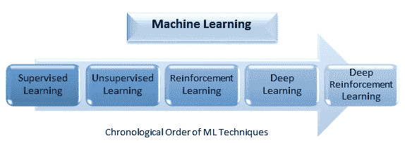

### 1.2.1 监督学习
监督学习算法使用标记数据来训练用于学习智能行为的模型。收集的大多数真实世界数据都是未标记的，如果使用监督学习算法，则需要仔细标注。如果提供标签，模型通常更容易学习模式并在各种数据类别之间做出区分。标签充当教师，因此指导模型精确地学习什么是什么。监督学习类似于教孩子走路。你会牵着孩子的手，示范如何向前迈步，并示范走路让孩子理解，你会继续同样的过程，直到孩子学会自己走路。这种技术是第一个开发的机器技术。简单来说，你可以认为这种学习形式中有一个老师在场来展示对错。回归和分类技术是监督学习的例子。监督学习算法的例子包括欺诈活动检测、垃圾邮件检测、人脸检测算法等。在所有这些例子中，用于学习的输入数据已经标注为欺诈、非欺诈、垃圾邮件、非垃圾邮件、人脸和非人脸。因此，模型更容易从可用类别中学习模式。监督学习算法可用于实现两个任务：
1. 回归
2. 分类


Both will be discussed in detail ahead.

### 1.2.2. 无监督学习
这种类型的学习算法利用无标签数据来训练用于智能行为的模型。当手头的數據未标记时，算法会尝试找出相似的模式并将具有相关特征的数据归为一组。无监督学习是一种没有教师存在、系统在没有任何监督的情况下学习的模式。这里系统基于经验学习。聚类是无监督学习的一个例子。无监督学习算法的例子包括客户市场细分、聚类、图像修复、药物发现等。

### 1.2.3. 强化学习
当研究人员发现如果系统按预期方式完成工作时提供奖励会很好时，强化学习被引入。简单来说，这里系统从错误中学习。强化学习通常被称为真正的 AI，在训练数据不足时使用。缺乏训练数据意味着模型对当前问题没有专业知识，因此只能通过经验逐渐学习。起初它尝试随机行动以从环境中学习，然后找出解决问题的最佳策略。智能体与其环境之间存在迭代反馈循环，有助于其更具交互性地学习。与传统的机器学习算法不同，像 `SARSA`（State-Action-Reward-State-Action）、蒙特卡洛方法 和 `Q-learning` 这样的强化学习算法在行为上更具动态性。强化学习算法的工作原理是通过强化奖励和惩罚来学习模式。模型试图在特定情况下采取最合适的行动，以最大化累积奖励并最小化惩罚。如果采取的步骤正确，则会得到奖励；否则会被惩罚。强化学习与监督学习方法不同，后者在训练数据中已有答案，因此模型使用正确答案进行训练；在强化学习中，没有答案/标签，模型根据过去的经验决定如何执行给定任务。因此在强化学习中，决策是一个顺序过程，我们会对之前做出的决策序列进行标记。强化学习最好的例子之一是下棋，其中棋盘上的每一步根据之前走法的历史被评为正面或负面。其他典型的强化学习应用可见于工业自动化、控制理论和博弈论的机器人领域。在所有这些应用中，都存在明确定义的环境、动作和奖励。博弈论的一个绝佳例子是 `AlphaGo` 强化学习模型，它能够击败世界上最好的人类玩家。

### 1.2.4. 深度学习
人脑中的神经元在我们的二进制计算机中被激发为人工神经网络以解决问题。这种学习技术称为深度学习。

### 1.2.5. 深度强化学习
深度强化学习将人工神经网络与强化学习架构相结合，使软件定义的智能体能够在虚拟环境中学习实现目标的最佳可能行动，即它将函数逼近和目标优化结合起来，将状态-动作对映射到预期奖励。结合深度神经网络的强化算法可以击败在众多 Atari 电子游戏、Starcraft II 和 Dota-2 以及围棋世界冠军中表现出色的专家。虽然这对非玩家来说可能听起来微不足道，但它是对强化学习先前成就的巨大改进，并且最先进的技术正在迅速发展。人工智能中最有趣的领域之一是深度强化学习的概念，其中机器可以根据其行动的结果自行教学。它是人工智能领域中极具前景的领域之一，因此让我们看看它是什么并探索实际应用。深度强化学习是人工智能和机器学习的一个类别，其中智能机器可以从其行动的结果中学习，类似于人类从经验中学习的方式。这种机器学习类型固有的特点是智能体根据其行动获得奖励或惩罚。使其达到目标结果的行动会得到奖励（强化）。机器通过一系列试错不断学习，使该技术适用于不断演变的动态环境。尽管强化学习已经存在数十年，但它最近与深度学习相结合，取得了惊人的成果。这里，强化学习的“深度”部分指的是复制人类大脑结构的多个（深度）人工神经网络层。深度学习需要大量的训练数据和显著的计算能力。现在，在过去几年中，数据量爆炸式增长，而计算能力的成本却大幅下降，这推动了深度学习应用的爆发。我们将在即将到来的章节中详细讨论监督学习、无监督学习和深度学习技术，并提供足够的图表和示例。这些技术的实现将在 `python` 中使用 `Jupyter notebook` 交互式开发环境进行。我们将使用 `python` 包如 `NumPy` 和 `scikit-learn` 来实现 ML 技术。这两个包都是开源的，并且易于集成到 `python` 环境中。

# 第 2 章 监督式机器学习

## 学习目标
阅读本章将使读者能够：
1. 理解监督学习算法在回归和分类任务中的使用
2. 识别与分类相关的挑战
3. 使用算法学习从输入到输出的映射函数
4. 了解概率、超平面和数据集的概念与定理


这些技术的实现将在 `python` 中进行，使用 `Jupyter notebook` 交互式开发环境。我们将使用 `python` 包，如 `NumPy` 和 `scikit-learn` 来实现 ML 技术。

## 2.1. Supervised Learning
监督学习是首个引入的机器学习技术，用于解决简单问题。在这种学习中，教师呈现对错，从而系统学习。你可以将监督学习视为一个函数或系统，它基于训练数据的输入-输出对将输入映射到输出。训练数据通常构成若干输入-输出对，监督学习算法据此建立一个函数，将未来的输入映射到输出。将 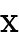 视为输入，将 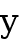 视为输出，则监督学习函数 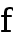 定义为 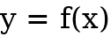 监督学习中训练数据的存在可以与教师监督学习过程的存在相关联。系统尝试找到训练数据的输出，教师对其进行纠正（来自训练数据本身）。学习过程持续进行，直到系统达到可接受的准确率。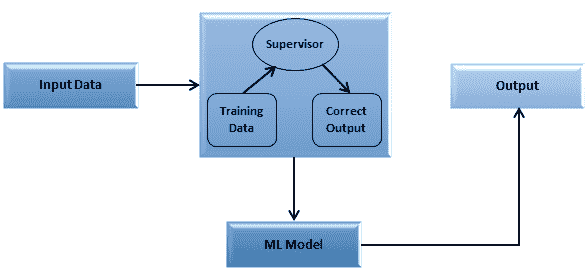让我们考虑一个监督学习的简单示例。下面是美容诊所的客户满意度表 2.1。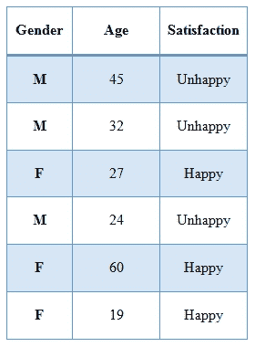基于上述数据，监督学习算法尝试预测新客户的满意度。在本节中，我们将讨论不同类型的监督学习算法。回归和分类是监督学习算法的例子。如果记住没有一种算法对所有监督学习问题都是最优的会有所帮助，即，为文本分类生成的学习模型不会适合图像分类问题。

## 2.2. Regression
回归分析是统计学和机器学习中最基本和最本质的概念之一。它试图在变量之间找到关系。回归分析是一个监督学习问题，系统试图从一组输入  和一组参数 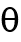 识别输出  即回归函数 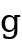 定义为 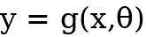 让我们考虑一个回归问题的简单示例，考虑通过考虑诸如经验、职位、教育资格和认证等参数来了解特定公司员工薪酬结构的分析。你可以将  视为员工，将  视为参数（经验、职位、教育资格和认证），将  视为预测的薪水。定义：回归问题是在给定一组自变量的观测值及其对应的输出变量值的情况下，确定一个或多个自变量与输出变量之间关系的问题，其中输出变量是一个真实的连续变量。根据用于表示因变量 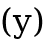 与自变量 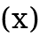 之间关系的函数 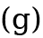 的类型，存在不同类型的回归。它们是线性回归、多元回归和多项式回归

### 2.2.1. Linear Regression with Single Variable
回归分析是监督学习方法的一个例子，其中正确的标签数据可用，但这些标签本质上是实值而不是离散的。回归算法允许预测具有连续或实值数据的因变量。给定任何数据集，机器学习模型学会如何借助自变量预测因变量。线性回归是最简单的回归技术形式，其中只有一个自变量 。如果  与  之间的关系定义为 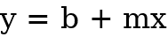，则这种形式的回归称为线性回归，这里 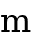 称为回归系数。如果我们能求出 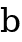 和 ，则可以找到每个  观测值的  值，这就是预测的工作方式。求  和  的公式这些用于求  和  的公式是通过使用微积分方法得到的 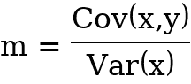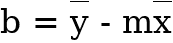 与  的协方差，用 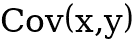 表示，定义为 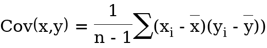，并且  的方差由 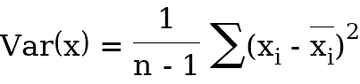 给出例题：求给定数据的线性回归。设  为因变量。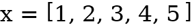 和 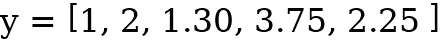解：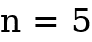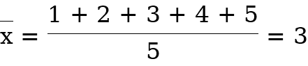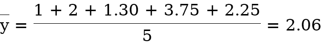根据协方差和方差的上述方程，我们可以求出 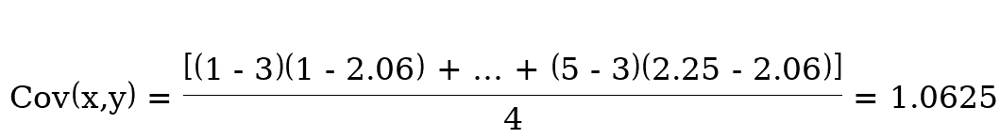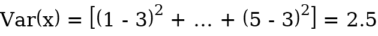将这些值代入 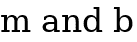 的方程 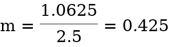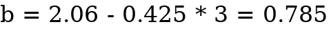因此，数据的线性回归模型为 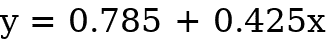

Python Program
```
# importing required packages and classes, package numpy is imported and class LinearRegression
from sklearn.linear_model import numpy as np
from sklearn.linear_model import LinearRegression
# passing input x and output y, reshape is done to make x a column matrix, it is necessary for the LinearRegression to operate
x = np.array([1, 2, 3, 4, 5]).reshape((-1, 1))
y = np.array([1, 2, 1.30, 3.75, 2.25])
# model fitting is performed ie: regression and model and parameters are saved to the variable model
model = LinearRegression().fit(x, y)
print('b:', model.intercept_)
print('regression coefficient m:', model.coef_)
```
Output: b: 0.7849999999999999 regression coefficient m: [0.425]
```
# now the same model can be used to predict other inputs using model.predict function for different x
x_new=np.array([10, 7, 8, 6, 9]).reshape((-1, 1))
predict_y = model.predict(x_new)
print('predicted output y:', predict_y, sep='\n')
```
Output: predicted output y: [5.035 3.76 4.185 3.335 4.61]
Jupyter Notebook Screenshot 

### 2.2.2. Multiple Linear Regression
多元回归是自变量有多个的情况，如 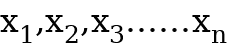。即 y 与自变量之间的关系建模为 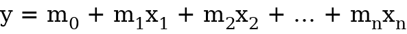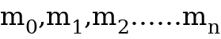 表示回归系数。回归系数 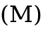 需要从已知的输入 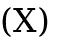 和输出 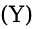 中求出以便进行预测。设 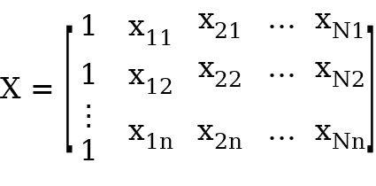​  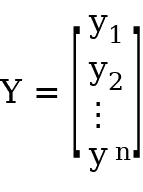 和 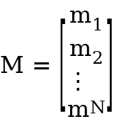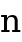 表示自变量的数量，且  表示这些变量的值的数量则可以使用下面的方程 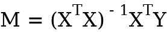 求解回归系数 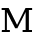例：求以下数据的回归系数 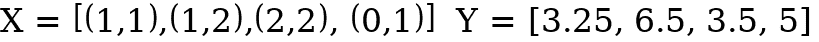解：这里有两个自变量，每个变量有四组值，即 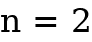 和 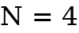，回归模型可表示为 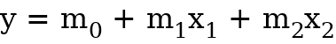这里 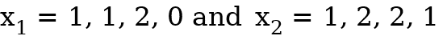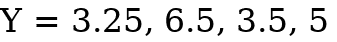根据  的表示 则所需的模型为 

Python Program
```
# importing required packages and classes, package numpy is imported and class LinearRegression
import numpy as np
from sklearn.linear_model import LinearRegression
x = np.array([[1, 1], [1, 2], [2, 2], [0, 1]])
y = np.array([3.25, 6.5, 3.5, 5])
# model fitting is performed ie: regression and model and parameters are saved to the variable model
model = LinearRegression().fit(x, y)
print('intercept:', model.intercept_)
print('slope:', model.coef_)
```
Output: intercept: 2.0625000000000004 slope: [-2.375 3.25]
```
# now the same model can be used to predict other inputs using model.predict function for different x
x_new = np.array([[3, 2], [2, 5], [4, 3], [4, 1]])
predict_y = model.predict(x_new)
print('predicted output y:', predict_y, sep='\n')
```
Output: predicted output y: [1.4375 13.5625 2.3125 -4.1875]
Jupyter Notebook Screenshot 

### 2.2.3. Polynomial Regression
考虑到只有一个自变量 `x`，并且自变量 `x` 与因变量 `y` 之间的关系被建模为多项式函数，这种回归称为多项式回归。

### 2.2.4. Logistic Regression
逻辑回归是一种合适的回归分析，当因变量是二分的（二元的）时使用。与线性回归不同，逻辑回归的因变量是离散的而不是连续的。逻辑回归用于描述数据以及一个因变量二元变量与一个或多个序数、名义、区间或比率水平自变量之间的关系。有时逻辑回归难以解释；Intellects Statistics 工具可以轻松让你进行分析，然后用通俗英语解释输出。逻辑回归在 20 世纪早期被应用于生物科学。随后也被应用于许多社会科学应用中。当因变量（目标）为分类时实现逻辑回归。例如，肿瘤是恶性（1）还是不是（0）为了预测一封电子邮件是否为垃圾邮件（1）还是不是（0）考虑一个需要对肿瘤是否恶性进行分类的案例。如果我们对这样的问题使用线性回归，则需要设置一个阈值以便进行分类。如果实际类别是恶性的，阈值为 0.7，预测的连续值为 0.6，则该数据点将被分类为非恶性，导致现实时间中严重后果。从上述示例可以推断，线性回归不适合分类问题。线性回归是无界的，这就带来了逻辑回归。其值严格介于 0 到 1 之间。逻辑回归的类型 - 二元逻辑回归：分类响应只有两种可能结果。示例：垃圾邮件或非垃圾邮件。 - 多项逻辑回归：处理三个或更多无序类别。示例：预测哪种食物更受欢迎（素食、非素食、纯素）。 - 序数逻辑回归：处理三个或更多有序类别，例如，电影评分从 1 到 5。

### 2.2.5. Decision Boundary
可以设置一个阈值来预测数据属于哪个类别。基于此阈值，得到的估计概率将被分类。假设预测值 ≥ 0.5，则将电子邮件分类为垃圾邮件，否则为非垃圾邮件。决策边界可以是线性的或非线性的。可以增加多项式阶数以获得更复杂的决策边界。

## 2.3. Classification
分类只是将输入映射到分类标签的过程，执行此任务的模型被称为分类器。回归通常应用于数值问题，即预测下一商业年度的营业额。分类问题则不同，应用于将输入映射到相应标签。例如，考虑一个简单的银行活动；银行的自动化系统可以决定将客户的贷款请求映射为“安全”或“风险”。在这里，“安全”和“风险”是标签。分类是一个两步过程；第一步是模型的学习阶段。模型用训练集创建。训练阶段包括输入及其对应的正确标签。由于每个训练输入的类别标签都已提供，此步骤也称为监督学习（教师在场 - 正确输出已知）。第二阶段使用训练好的模型并用它对新输入进行分类以得到相应标签。数学上你可以写分类为 分类的第一阶段可以被视为生成函数 ，第二阶段为在输入  上操作函数  以生成相应的类别标签 。分类器的准确率定义为正确分类的测试样本数与总测试样本数的比率。一旦分类器以可接受的准确率生成，就可用于分类。你可以用准确率、速度、鲁棒性和可扩展性等参数比较不同的分类器。准确率，如我们之前解释的，指给定分类器正确预测标签的能力，速度指执行分类所需的计算资源，鲁棒性指系统在给定不完整或噪声数据时执行的能力。可扩展性指分类器处理大量数据的能力。

### 2.3.1. Challenges in classification
数据清洗：数据清洗是分类中的预处理阶段，用于减少学习过程中的不确定性并产生具有更好准确率的分类器。输入数据应分析是否存在噪声和有价值数据的缺失，即缺失值。噪声可使用多种平滑技术处理，缺失值可通过用最常观察到的值替换该值或使用统计方法预测该值来解决。相关性分析：相关性分析可用于识别对分类重要的相关特征。相关性分析的一个例子是相关性。如果两个特征高度相关，则其中一个可在预处理阶段移除。特征子集选择也可用于减少特征集。此技术可用于找到一个缩减的特征集，使得数据类别的概率分布尽可能接近使用所有特征得到的原始分布。通过这两种相关性分析技术移除不贡献于分类的特征，可以进一步简化分类问题并使其更具成本效益。这些属性可能会减慢整个分类器并在与其他分类器性能比较时失败。数据转换和约简：数据归一化是分类中非常重要的预处理。例如，考虑一些特征，如距离或收入等。这些通常具有较大的整数值，对这些大值进行操作对于复杂分类网络或深度网络来说很复杂。使用此类数据可能会减慢整个分类过程，并导致巨大的性能损失。为了解决上述问题，我们将使用一种称为归一化的技术。归一化将给定特征的所有值缩放，使其落在较小的指定范围内，如 -1.0 到 1.0 或 0.0 到 1.0。归一化适用于数值数据，如距离、薪水和营业额。另一种数据转换技术是概括；数据可以概括为更高级别的概念以避免复杂性。例如，特征分数可以概括为等级。同样，利润可以概括为低、中、高，分类属性，如街道，可以概括为更高级别的概念，如城市。概括过程压缩原始训练数据，导致更少的输入-输出操作，从而减少内存使用，实现更好的性能。存在不同类型的分类技术，如决策树分类、贝叶斯、支持向量机（`SVM`）、K-最近邻分类等。我们将在本章中介绍这些分类技术。

## 2.4. Decision Tree Classification
决策树是一种监督学习技术，可用于分类和回归问题，但主要用于解决分类问题。决策树只是一个树结构，其中每个内部节点表示对属性的提问/测试，每个分支表示该提问/测试的可能结果，每个叶节点表示类别标签。决策树简单地提问，并根据答案（是/否）进一步将树拆分为子树。从标记的训练样本生成决策树的过程称为决策树归纳。树中最顶部的节点是根节点。我们使用 `CART` 算法构建树，该算法代表分类与回归树算法。决策或测试是基于给定数据集的特征进行的。决策树的图形表示描绘了基于给定条件解决问题的所有可能解决方案。它被称为决策树，因为就像树一样，它从根节点开始，进一步扩展分支并构建树状结构。让我们考虑银行贷款申请的处理。首先，在根节点检查申请人的年龄组，对于青年和中年年龄组，检查就业状态。对于老年，检查过去未偿贷款的历史。根据对这些测试问题的回答，每个申请都被分类为标签“安全”或“风险”。决策树分类器之所以如此流行，是因为决策树分类器相当简单，不需要任何领域知识和特定的参数设置。决策树可以轻松处理高维数据，因此在生物医学、财务分析、制造、生产、天文学和物理学等各种应用中都非常有用。事实上，决策树是许多基于规则的归纳系统的基础，如在线购物网站。决策树的优点 - 它易于理解，因为它遵循人类在做出任何现实生活决策时遵循的相同过程。 - 它对于解决决策相关问题非常有价值。 - 它有助于思考问题的所有可能结果。 - 与其他算法相比，对数据清洗的需求较少。决策树的缺点 - 决策树覆盖了许多层，使其复杂化。 - 对于更多类别标签，决策树的计算复杂性可能会影响增长。 - 它可能存在过拟合问题，可使用随机森林算法确定。

### 2.4.1. Feature Selection Measures
在决策树算法中决定在每个决策树层级将哪些特征作为根节点是一个具有挑战性的任务。已引入各种方法为各种特征分配数值，使得这些值反映特征的相对重要性。此类度量称为特征选择度量。有两种广泛使用的特征选择度量；它们是信息增益和基尼指数。为了理解这些特征选择方法，必须熟悉熵。让我们讨论以下术语。 - Entropy 子集的例子仅包含单个类别的程度称为纯度，任何仅由单个类别组成的子集称为纯类。简单地说，熵是数据集中不纯度的度量。熵高的集合非常多样化，对可能也属于该集合的其他项目提供的信息很少，因为没有明显的共同点。熵的度量单位是比特。当只有两个类别时，熵值范围为 0 到 1。如果有 n 个类别，熵范围为 0 到 log2 (n)。如果熵最小，则表示样本是同质的，即差异性较小。相反，熵的最大值表示数据更加多样化。定义：如果  是一个数据集，具有  个类别，且考虑  是  中具有  类别标签的例子的比例。则  的熵定义为  - Information Gain 设  为一组例子， 为一个特征，且  为  的子集，其中 ，并且特征  的所有可能值表示为 。则特征  关于集合  的信息增益由  给出这里  表示  中的元素总数 - Gini Indices 数据集的基尼分裂指数是用于构造分类树的另一种特征选择度量。 - Gini index 数据集  的基尼指数，具有  个类别标签  定义为 其中  表示具有类别标签  的例子的比例 - Gini split index 设  为一组例子， 为一个特征，且  为  的子集，其中 ，并且特征  的所有可能值表示为 。则特征  关于集合  的基尼分裂指数由  给出这里  表示  中的元素总数。下面的表格显示了关于特征（降雨、坡度、土地利用、土壤）的滑坡机会。让我们尝试为表 2.2 中的此数据创建决策树。表 2.2 具有  个类别， 和 。则概率为：P(C1) = 具有低类别的样本数/ 总样本数= 5/9 P(C2) = 具有高类别的样本数/ 总样本数= 4/9 现在让我们求熵 现在求所有属性的增益


# 1. 降雨量

 降雨量有三个类别，即  然后  同样，你可以在下面找到它们，如  由于降雨量具有最高的增益，我们可以将其设为根节点  对于 1400-1600 范围，所有标签均为低 持续对其他部分进行分裂 1200-1400 降雨量范围，该范围有 4 条记录  使用之前的公式，计算增益  由于  我们可以选择任何属性进行分裂。这里我们选择  然后树如下所示  同样，对于 1600-2000 范围，我们可以找到  让我们选择  因为它具有最高的增益，然后最终的树如下所示 

## Python 程序

下面给出了一个用于从鸢尾花数据集中对鸢尾花进行分类的 python 程序。创建了一个相应的决策树——分类使用特征花萼长度、花萼宽度、花瓣长度和花瓣宽度

```python
# import required libraries(DecisionTreeClassifier, export_text) and dataset(load_iris)
from sklearn.datasets import load_iris
from sklearn.tree import DecisionTreeClassifier
from sklearn.tree import export_text
# dataset is loaded to iris variable
iris = load_iris()
# DecisionTreeClassifier function is called and pass the maximum depth of tree as parameter
decision_tree = DecisionTreeClassifier(random_state=0, max_depth=5)
# fitting for the data points is done (iris.data is features and iris.target is datapoints)
decision_tree = decision_tree.fit(iris.data, iris.target)
# tree is generated and saved to r by labelling feature names
r = export_text(decision_tree, feature_names=iris['feature_names'])
# displaying the tree in text form
print(r)
```

Output:
```
|--- petal width (cm) <= 0.80
|   |--- class: 0
|--- petal width (cm) >  0.80
|   |--- petal width (cm) <= 1.75
|   |   |--- petal length (cm) <= 4.95
|   |   |   |--- petal width (cm) <= 1.65
|   |   |   |   |--- class: 1
|   |   |   |--- petal width (cm) >  1.65
|   |   |   |   |--- class: 2
|   |   |--- petal length (cm) >  4.95
|   |   |   |--- petal width (cm) <= 1.55
|   |   |   |   |--- class: 2
|   |   |   |--- petal width (cm) >  1.55
|   |   |   |   |--- petal length (cm) <= 5.45
|   |   |   |   |   |--- class: 1
|   |   |   |   |--- petal length (cm) >  5.45
|   |   |   |   |   |--- class: 2
|   |--- petal width (cm) >  1.75
|   |   |--- petal length (cm) <= 4.85
|   |   |   |--- sepal width (cm) <= 3.10
|   |   |   |   |--- class: 2
|   |   |   |--- sepal width (cm) >  3.10
|   |   |   |   |--- class: 1
|   |   |--- petal length (cm) >  4.85
|   |   |   |--- class: 2
```

Jupyter Notebook 截图


## 2.5. 贝叶斯分类

贝叶斯分类器是由贝叶斯定理的理解引入的非常基础且直接的分类器。该算法用于对多类数据集进行分类。贝叶斯分类器通常被称为朴素贝叶斯分类器。在继续贝叶斯定理之前，让我们先了解条件概率。

### 2.5.1. 条件概率

条件概率可以定义为在与一个或多个其他事件的发生存在某种关系的情况下，某事件发生的概率。事件  在给定  的条件概率表示为 ，即。事件  在事件  发生的概率下发生的概率   表示事件  和  同时发生的概率

### 2.5.2. 独立事件

如果一个事件的发生不影响另一个事件的概率，则称两个事件是独立的。也就是说，两个事件  和  如果  则称为独立。同样，三个事件  如果     则称为相互独立

### 2.5.3. 贝叶斯定理

考虑两个随机事件  其中 ，则事件  在给定  的情况下发生的概率为   称为命题，而  称为证据。 是命题的先验概率，而  是证据的先验概率。 是在给定事件  的情况下事件  发生的后验概率。 是在给定  的情况下事件  发生的似然。 也称为边缘概率。即  你必须将贝叶斯定理推广如下。考虑如果你在样本空间  中有许多不相交的事件  且  为任意事件，则我们有 

### 2.5.4. 朴素贝叶斯算法

朴素贝叶斯算法是分类的一种简化方法。它基于预测变量之间独立性的假设。简单来说，朴素贝叶斯分类器假设某个类中特定特征的存在与任何其他特征的存在无关。朴素贝叶斯模型易于构建，尤其适用于非常大的数据集。除了易用性之外，朴素贝叶斯还以优于甚至高度复杂的分类方法而闻名。例如，如果一种水果是红色的、圆形的且直径约为 3 英寸，则可能被认为是苹果。即使这些特征相互依赖或依赖于其他特征的存在，所有这些属性都独立地贡献于该水果是苹果的概率，这就是为什么它被称为“朴素”。朴素贝叶斯算法基于以下假设。

* 考虑到的所有特征都是独立的且互不相关，任何特征的存在或不存在都不会影响另一个特征的存在
* 所考虑的数据表现出类条件独立性；也就是说，只要它们以相同的类别值为条件，事件就是独立的


# 朴素贝叶斯算法

## 介绍
这些假设的引入在许多现实场景中是成立的，并被称为朴素贝叶斯算法。Naïve 在一般语境中意为简化。

让我们继续介绍朴素贝叶斯分类器的算法和思想

## 算法和思想

考虑一个包含  个示例的训练数据集，每个示例具有  个特征。假设特征命名为  且形成的特征向量为 ，由于它是一种监督技术，每个示例都有一个特定的类别标签，即 ，其中  表示类别总数。现在假设我们给定一个测试实例 ，它具有 `n` 个特征，即 。现在我们需要从  中找到并分配最合适的类别标签给该测试实例 。为了将  分配最合适的类别标签，我们需要找到给定测试样本的每个类别标签的概率。即，我们需要找到 。找到每个概率后，找到其中的最大值并将其类别标签分配给测试实例 。假设  给出了最大值，则将类别标签  分配给实例 。

## 概率计算

根据贝叶斯定理  给出为 。其中  是具有特征  的示例集合。由于我们假设  中每个特征之间存在类条件独立性，我们有事件  全部相互独立。因此，我们有 。将此代入上述方程得到 。由于分母  与类别标签无关，我们有 。因此，只需在以下值中寻找最大值即可：   

## 算法步骤

考虑一个包含  个示例的训练数据集，每个示例具有  个特征。假设特征命名为  且形成的特征向量为 ，由于它是一种监督技术，每个示例都有一个特定的类别标签，即 ，其中  表示类别总数。现在假设我们给定一个测试实例 ，它具有 `n` 个特征，即 

- Step 1: 计算  对于 
- Step 2: 生成条件概率表。 
- Step 3: 计算乘积  = 
- Step 4: 找到标签  使得 
- Step 5: 将  分配给测试实例 

## 工作示例

让我们基于一个示例来考察算法的工作原理。考虑以下具有 3 个特征（黄色、甜、长）的水果频率数据，并将一个新样本分类为芒果或香蕉或其他水果。新的水果是黄色、甜且长的。  

1.  为芒果
      

2.  为香蕉
       

3.  为其他水果
       

由于  被分类为香蕉

## 朴素贝叶斯的优缺点

### 优点
* 它轻松且快速地预测测试数据集的类别。它在多类预测中也表现良好。
* 当独立性假设成立时，朴素贝叶斯分类器的表现优于逻辑回归等其他模型，并且需要较少训练数据。
* 在分类输入变量的情况下表现良好，类似于数值变量。对于数值变量，假设为正态分布（钟形曲线，这是一个强假设）。

### 缺点
* 如果分类变量在测试数据集中有一个类别，而该类别在训练数据集中未出现，则模型将分配 0（零）概率且无法预测，这通常被称为“零频率”。为了解决这个问题，我们可以应用平滑技术。其中一种最简单的平滑技术称为拉普拉斯估计。
* 另一方面，朴素贝叶斯也被认为是一个糟糕的估计器，因此预测概率的概率输出不会被太认真对待。
* [朴素贝叶斯](https://courses.analyticsvidhya.com/courses/naive-bayes?utm_source=blog&utm_medium=naive-bayes-explained) 的另一个限制是预测变量独立的假设。在现实生活中几乎不可能得到一组完全独立的预测变量。

## 朴素贝叶斯算法的应用
* 多类预测：该算法也因其多类预测功能而广为人知。我们可以轻松预测目标变量多个类别的概率。
* 实时预测：朴素贝叶斯是一个敏锐的学习分类器，并且速度很快。因此，它可用于实时预测。
* 文本分类/情感分析/垃圾邮件过滤：朴素贝叶斯分类器经常用于文本分类（由于在多类问题和独立性规则中结果更好），成功率高于其他算法。因此，它广泛用于垃圾邮件过滤（识别垃圾邮件）和情感分析（在社交媒体分析中，识别客户的正面和负面情绪）
* 推荐系统：朴素贝叶斯分类器和协同过滤一起构建推荐系统，该系统使用机器学习和数据挖掘技术来过滤未见信息并预测用户是否会喜欢给定的资源或不。


## 2.6. 支持向量机 (SVM)

支持向量机 (`SVM`) 是一种监督学习技术，用于解决分类问题和回归挑战。然而，它主要用于分类问题。该技术旨在在一个 `n` 维空间中 (`n` 为特征的数量) 找到最佳超平面，以明确地对数据点进行分类，从而将数据集划分为不同的类别。这里，支持向量是最接近所创建超平面 的数据点。这些点非常重要，因为它们位于超平面附近；因此，删除这些点可能会改变超平面的位置。此外，超平面的维度取决于特征的数量，即，如果输入特征的数量为 2，则超平面可能只是一条直线。支持向量是更接近超平面 的数据点；因此，它们会影响超平面的位置和方向。利用这些支持向量，我们最大化分类器的间隔。删除支持向量会改变超平面的位置。这些点有助于我们构建 `SVM` 决策边界。支持向量机 (`SVM`) 是一种监督机器学习模型，使用分类算法用于两组或多组分类问题。在为 `SVM` 模型提供每个类别的标记训练数据后，它们可以对新的文本进行分类。以下是 `SVM` 分类器的优点：
- 在高维空间中有效
- 在维度数量大于样本数量时很有用

我们将通过一个示例场景来考察支持向量机。考虑用于确定出行机会的数据。为了简单起见，假设我们只考虑两个特征来确定出行决策，例如交通和公交车票价。输出将是“是”或“否”。也就是说，如果是，则可以出行；如果否，则不出行。

由于输出是“是”或“否”，这可以被视为一个二分类问题。此外，该数据集被称为二类数据集。现在让我们考虑上述数据的散点图。上述数据可以在二维平面上绘制，将特征放在图的坐标轴上。在这里，我们将生成散点图，将交通放在  轴上，将公交车票价放在  轴上。在此图中，蓝色星号代表类别标签 ，而红色圆圈表示类别标签 

在检查上图时，我们发现可以在散点图中画一条直线来分隔产生输出  和  的值。如下面所示；绿色线将所有标记为蓝色星号的点分隔在一侧，而标记为红色圆圈的点在另一侧。因此，这样的线称为分隔线。如果给定数据集存在这样的线，则数据被称为线性可分，但也有其他数据不可线性可分。我们示例场景中的数据是线性可分的。

在我们上面的示例中，可以画多条线来分隔这些类别，下面显示了另一条黄色线用于分隔类别  和 。在这种情况下，选择最佳分隔线至关重要。

分隔线的间隔概念可用于找到最佳分隔线。考虑数据点与分隔线之间的垂直距离。分隔线的间隔定义为数据点与分隔线之间最短垂直距离的两倍。下图显示了我们数据中一些垂直距离和最小垂直距离。具有最大间隔的分隔线可被视为最佳分隔线并用于分类。

在上图中，您可以找到从线到数据点  的最短垂直距离。间隔值最高的线称为“最大间隔线”或“最优分隔线”。该线也称为“支持向量机”，其中“支持向量”是距离最优分隔线最近的数据点。如图所示，我们可以通过两个类别最近的支持向量画一条虚线。

这两条虚线之间的区域可以被视为一条宽度最大的“道路”或“街道”，它分隔了“是”数据点和“否”数据点。

Python 程序
```python
import numpy as np
from sklearn.preprocessing import StandardScaler
from sklearn.svm import SVC
# input X and y- X being the data points and y being the class labels.
X = np.array([[-1, -1], [-2, -1], [1, 1], [2, 1]])
y = np.array([1, 1, 2, 2])
# Perform the SVM classification using SVM() function by setting gamma parameter to 'auto'
clf = SVC(gamma='auto')
clf.fit(X, y)
# Predict using the function clf.predict and pass new data points as parameters
print(clf.predict([[-0.8, -1]]))
```
输出：`[1]`
Jupyter Notebook 截图


### 2.6.1. 超平面

超平面是有限维空间的子集，类似于三维空间中的直线和平面。它可以被视为一个平面，其维度比向量空间的维度少一，即，如果您考虑一个维度为 3 的向量空间，则相应的超平面具有维度 。如果您有两个特征，则 resulting 向量空间的维度为 ，并由维度为  的超平面分隔，即一条线。

### 2.6.2. 二分类数据集

在机器学习中，二分类数据集是指目标变量仅取两个可能类别标签之一的数据集。被预测值的变量称为目标变量或输出变量。在我们之前的示例中， 是目标变量。如果目标变量取两个以上的值，则此类数据集称为多分类数据集。我们之前用于决定出行可能性的数据集，目标变量只有两个值，即  或 。让我们考虑一个具有  个特征的二分类数据集，并设类别标签为  和 。设向量  表示一个实例的特征值。如果我们能找到一个维度为  的超平面，则该数据被称为线性可分。设超平面如下所示  具有以下性质。对于  中类别标签为  的每个实例  对于  中类别标签为  的每个实例 

### 2.6.3. 最大间隔超平面


- 考虑一个超平面 ，用于目标变量值为  的线性可分数据集
- 考虑从分隔超平面  到训练实例  的垂直距离。
- 最小垂直距离的两倍称为超平面  的间隔
- 具有最大间隔的超平面称为最大间隔超平面或最优超平面。
- 数据集的支持向量机是最大间隔超平面，而最接近超平面的数据点称为支持向量。

## 2.7. K 近邻分类

`k` 近邻分类通过将给定的测试示例与训练示例进行比较来工作。由于输出类别标签的训练示例是已知的，因此这是一种监督学习技术。尽管该技术在 50 年代初就被引入，但由于计算能力不足，未被广泛使用。随着计算能力的提高，该技术变得著名。如我们在之前的分类技术中所讨论的，这里训练集也由  个特征组成。训练示例的一个实例可以被视为 
K 近邻分类通过找到最接近未知示例的  个训练示例来进行分类。这些  个训练元组是未知示例的  个“最近邻”。现在，需要理解如何定义接近度，您可以考虑使用欧几里得距离等距离度量。两个示例  之间的欧几里得距离为 
简单来说，对于每个数值属性，我们取该属性对应值的差值，例如 。然后对这些差值的平方和计算平方根。由于 K 近邻分类技术包括取差值、平方和平方根，我们对特征进行归一化。这种特征归一化有助于使用较小的值而不是较大的数值。例如，像  这样的特征通常具有较大的值；归一化该特征可以减少计算复杂度和内存需求。Min-max 归一化是一种归一化方法，可用于归一化特征并使其值落在  范围内
设  为示例  的数值特征  的值，则该特征的归一化值  可表示为 ，其中  指的是属性  的最小值和最大值
K 近邻分类为未知示例分配其 k 个最近邻中最常见的类别。当 `k` = 1 时，未知元组被分配到模式空间中最接近它的训练元组的类别。距离度量适用于数值特征，考虑具有分类值（如 ）的特征。为了理解这一点，考虑一个颜色特征，在示例  中值为 ，在示例  中值为 。那么两者之间的差值可以视为 ，如果两个示例的特征值均为 ，则差值可以视为 。在进行此分类方法之前，还需要考虑缺失值。如果其中一个示例的特征数值缺失，则我们可以假设最大可能的差值。另一个需要解决的问题是确定更好的  值。我们通过实验决定这一点，可以从  开始，然后使用测试集来估计分类器的错误率。此过程可以通过逐步增加  并找到使分类器错误率最小的  值来继续。一般来说，训练示例的数量越大，k 的值越大。虽然我们使用了欧几里得距离作为距离度量，但其他距离度量如曼哈顿距离或马哈拉诺比斯距离。现在让我们通过一个示例来看 K 近邻分类的工作原理 考虑给定数据集并找到具有特征 (3,7) 的样本 X 的类别标签

设 
使用欧几里得距离公式  计算查询样本与给定样本集之间的距离


查询样本具有三个最近邻，距离度量分别为 3、3.6 和 4。它们的类别标签为 Good、Good 和 Bad。使用类别多数，我们将查询样本 (3,7) 分类为 Good。

Python 程序
```python
import numpy as np
from sklearn.neighbors import KNeighborsClassifier
# input Data points X and classes y(0-bad,1-good)
X = [[7, 7], [7, 4], [3, 4], [1, 4]]
y = [0, 0, 1, 1]
# Perform k nearest neighbour classification using the function, KNeighborsClassifier and give neighbour parameters as 3
neigh = KNeighborsClassifier(n_neighbors=3)
neigh.fit(X, y)
# Predict using the function neigh.predict and pass new data points as parameters
print(neigh.predict([[3,7]]))
```
输出：`[1]`
Jupyter Notebook 截图


# 第 3 章 无监督机器学习

## 学习目标

阅读本章将使读者能够理解：
1. 聚类和关联的概念
2. 大型和小规模数据集的各种聚类类型、聚类中心、`centroids`、`medoids`

这些技术的实现将在 `python` 中使用 `Jupyter notebook` 交互式开发环境进行。我们将使用 `python` 包如 `NumPy` 和 `scikit-learn` 来实现 ML 技术。

## 3.1. 无监督学习

无监督学习是一种学习技术，其中学习算法尝试以最少的人工监督对先前未检测到的数据点进行标记。这种学习技术涉及使用尚未分类或标记的信息对机器进行训练，并且与监督学习技术相比，学习过程在没有监督的情况下继续进行。机器尝试通过识别模式、相似性和差异，在没有任何先验信息的情况下对数据点进行分类。让我们通过一个简单的例子来理解学习情况和算法操作，假设系统被提供了一张包含汽车和踏板车的图像，并且假设机器之前既没有见过汽车也没有见过踏板车。在这种情况下，我们的机器对汽车或踏板车的特征没有任何概念，但机器被赋予了学习能力，以便它可以通过识别相似性、差异和模式来从图像中对汽车和踏板车进行分类。无监督学习通常允许机器使用未标记的数据处理。无监督学习有两类：

### 3.1.1. 聚类

聚类是一种过程，它将一组数据点划分为多个组，使得同一组内数据点之间的相似度很高，而不同组之间数据点的相似度较低。这些组被称为簇，同一簇内数据点之间的相似性称为类内相似性，不同簇的数据点之间的相似性称为类间相似性。

### 3.1.2. 关联

关联规则学习问题是指某人希望发现描述数据大部分部分的规则，例如购买 X 的人也倾向于购买 Y。有不同类型的聚类技术，我们将在下面部分讨论每种技术

#### 聚类类型
1. `K-means clustering`
2. `K-NN` (`k nearest neighbors`)
3. `K-medoid clustering` or `PAM` (`partitioning around medoids`)
4. `Fuzzy C means clustering`
5. `DBSCAN`

## 3.2. K-均值聚类

一个簇指的是由于某些相似性而聚合在一起的数据点集合。你将描述一个目标数字 `k`，它指的是数据集中需要的 `centroids` 的数量。`centroid` 是表示簇中心的想象或真实位置。每个数据点通过降低簇内平方和被分配到各个簇中。换句话说，`k-means` 算法识别出 `k` 个 `centroids` 的数量，然后将每个数据点分配到最近的簇，同时保持 `centroids` 尽可能小。`K means clustering` 算法是解决聚类问题的首要且直接的无监督学习算法之一。通常，无监督算法仅使用输入向量从数据集中得出推断，而不参考已知或标记的结果。`k-means` 中的 'means' 指的是数据的平均值，有助于找到 `centroid`。假设我们需要将数据集分类为 个簇。我们通过选择 个随机点作为 个簇的初始聚类中心来开始聚类过程。现在计算数据点与 个簇的每个聚类中心之间的距离度量。距离聚类中心最小的数据点被归入该簇。在每个数据点与相应的聚类中心关联后，我们取与中心关联的数据点的平均值并用平均值替换中心，这对每个中心都执行。该过程重复进行，直到中心收敛到某些固定点。簇创建后，每个簇的数据点表现出最大类内相似性和最小类间相似性。`k-means` 的目标很简单：将相关数据点分组在一起并发现潜在模式。为了实现这一目标，`k-means` 在数据集中搜索固定数量 (`k`) 的簇。

### 3.2.1. `k-means` 算法如何工作？

使用的距离度量可以是欧几里得距离。考虑两个数据点 则这两点之间的距离可以计算为 假设每个数据点具有 个特征；那么数据点是一个 维向量。即 假设另一个数据点 为 那么这两个数据点之间的距离为 考虑一组数据点 具有 个数据点，其中每个数据点定义为一个 维向量，并设 为中心集合，为当 时第 个簇中的数据点数量。这里 是期望簇的总数。这里聚类算法的基本思想是将 划分为 个不相交子集 

### 3.2.2. `k-means` 聚类算法的步骤

- 第 1 步：随机选择 `k` 个聚类中心 
- 第 2 步：计算每个数据点与  中的每个聚类中心之间的距离
- 第 3 步：将每个数据点 分配到簇中心 ，如果 为最小值
- 第 4 步：假设 () 为分配给簇中心  的数据点，其中  为类  中的数据点总数
- 第 5 步：通过取该簇中数据点的均值重新计算聚类中心。使用下面的方程 
- 第 6 步：现在使用新分配的聚类中心为每个数据点重新计算距离度量，如果新聚类中心收敛则停止。

#### 如何确定初始聚类中心？

可以采取以下步骤来初始化聚类中心
1. 从数据集中随机选择 个数据点用于 个簇
2. 另一种方法是取所有数据点的平均值并添加一些随机数以生成 个聚类中心
3. 将数据点划分为 个相等区间，以便数据被划分为 个组。现在取每个组的均值作为 个聚类中心。

尽管 `K-means` 聚类算法很简单，但它具有某些缺点，例如
1. 聚类中心的随机选择可能不会导致最优结果
2. 该算法只能在数值数据上工作；它不能应用于分类数据
3. 最终簇的结构取决于初始聚类中心的选择
4. 用户在算法执行前指定簇的数量


# K-means 聚类示例

让我们用一个示例来说明 `k-means` 聚类。考虑以下数据集并将数据聚类为两个簇： 假设两个簇 `C1` 和 `C2` 的初始质心分别为 `A` 和 `B` 使用欧几里得距离计算质心与每个点之间的距离 对于质心      对于质心      根据最小距离为每个样本分配   因此  包含 -   包含-  确定新的质心   重复距离计算并使用新的质心更新簇。重复此过程直到质心不再变化。

## Python 程序

```python
# import required libraries numpy and Kmeans
from sklearn.cluster import KMeans
import numpy as np

# load the data points to X
X = np.array([[1, 1], [2, 1], [4, 3],[5, 4]])

# perform k means clustering for n=2
kmeans = KMeans(n_clusters=2, random_state=0).fit(X)

# printing cluster labels for data points in X
kmeans.labels_

# predicting for new data inputs
kmeans.predict([[0, 0], [12, 3]])
```

输出：`array([0, 0, 1, 1])` `array([0, 1])`

Jupyter Notebook 截图 

## 3.3. K-NN (K Nearest Neighbors) 聚类

该算法与 `k` 最近邻分类一样简单。在  最近邻聚类中，数据点会迭代地合并到附近的现有簇中。阈值或距离度量  可用于确定传入的数据点应添加到现有簇还是创建新簇。

###  的算法

- 第 1 步：将  视为待聚类的数据点。
- 第 2 步：创建邻接矩阵  显示数据点之间的距离。
- 第 3 步：将  初始化为簇的集合。
- 第 4 步：将第一个数据点  添加到簇集合 
- 第 5 步：迭代找到一个 ，其中  最小
- 第 6 步：如果  小于预定义的距离阈值 ，则将  映射到同一簇，否则将  映射到簇集合 
- 第 7 步：对所有数据点重复该过程以完成聚类

## 3.4. K-Medoids 聚类或 PAM (Partitioning Around Medoids)

`K` 介点聚类另称为 `PAM`（围绕介点划分）。在这种聚类中，一个介点代表每个簇。该方法由于使用介点进行聚类，因此能有效处理异常值。异常值是无法包含在任何簇中的数据点；它们可以被忽略或视为一个新簇。我们通过取随机  个数据点作为介点集合来开始 `K` 介点聚类。然后在每一步中，所有非介点数据点都会逐一分析，以查看它们是否应成为介点。随着进展，算法会决定数据点中是否有项目可以替换现有介点。算法选择能最好地提高聚类整体质量的配对并交换它们。计算非介点对象到簇介点的所有距离之和以确定聚类质量。项目被分配到由距离它最近的介点表示的簇（最小距离）。假设介点  代表一个簇 ，现在我们只在这种交换决策显示对成本的整体影响有所改善时，才决定用另一个非介点数据点  交换介点 。这里的成本函数不过是到簇介点的距离之和。现在让我们检查成本函数。考虑  是与交换介点  与非介点  相关联的项目  的成本变化。成本是项目到其簇介点的所有距离之和的变化。由于介点变化而在质量上产生的总影响为 =

### 3.4.1.  聚类或 PAM 的算法

- 第 1 步：将  视为待聚类的数据点。
- 第 2 步：创建邻接矩阵  显示数据点之间的距离。
- 第 3 步：将  初始化为期望的簇数，并将 （簇集合）视为输出
- 第 4 步：从数据点集合中随机选择  个介点
- 第 5 步：对于每个非介点 ，对于每个介点  计算 
- 第 6 步：找到 ，其中  最小
- 第 7 步：如果 ，则用  替换介点 
- 第 8 步：对于每个 ，如果  之间的距离在所有介点中最小，则将  分配给 

## 3.5. Fuzzy C Means 聚类

模糊聚类是一种适用于数据点可以存在于多个簇中的聚类形式。模糊聚类另称为软 -means 或软聚类。每个数据点都表现出属于每个簇的概率。我们可以说隶属系数对应于元素属于特定簇的程度。距离簇中心更近的点比位于簇边界的点具有更高的隶属度。让我们考虑一个示例。例如，一片叶子可以是绿色或黄色（硬聚类），但一片叶子也可以是绿色并且是黄色（模糊聚类）。在这里，叶子可以在一定程度上是绿色，也可以是在一定程度上是黄色。与其说叶子属于绿色  而不属于黄色 ，不如说叶子可以属于绿色  和黄色 。尽管这些值是  和 ，但它们不代表概率，并且这两个值的总和不一定等于 。聚类的模糊性可以用聚类的 Dunn 分区系数  来解释，其中  表示簇的总数。Dunn 分区系数定义为所有隶属系数的平方和除以数据点的总数。 的值介于  之间。Dunn 系数的低值表示非常模糊的聚类，而接近  的值表示接近清晰的聚类。我们之前看到的其他聚类形式与模糊聚类的关键区别在于，在模糊聚类中，数据点可以存在于多个簇中，而在  means 或  medoid 聚类中，数据点只能与一个簇相关联。最受欢迎的模糊聚类技术之一是模糊 c-means `(FCM)` 技术。在 `FCM` 中，簇质心计算为所有数据点的均值，按其属于该簇的程度加权。正如我们之前讨论的，模糊 c-means 聚类算法旨在最小化下面给出的成本函数  其中  表示数据点  属于簇  的程度， 表示簇  的中心， 称为模糊化因子。可以看出，模糊 c means 算法与  means 算法不同之处在于引入了隶属值  和模糊化因子  我们可以如下定义  作为  从上式可以清楚地看出，隶属度  与数据点  到簇中心  的距离成反比。参数  表示聚类的模糊性， 的取值范围在  之间。如果  的值更接近 ，则该聚类与 -means 聚类非常相似，而  的值接近  会导致聚类完全模糊。模糊 c means 中簇的质心由所有点的均值与属于该簇的程度之比给出。质心  由方程  给出 这里  是簇的质心， 表示数据点  属于  的程度。现在让我们看看模糊 c means 聚类的算法。

### 3.5.1. 模糊 C Means 聚类的算法

- 第 1 步：指定所需的簇数 
- 第 2 步：随机为数据点分配系数以表示其在簇中的情况。
- 第 3 步：使用  的公式计算每个簇的质心
- 第 4 步：使用  的公式计算每个点的隶属系数
- 第 5 步：重复第 3 步和第 4 步，直到系数的值收敛
- 第 6 步：停止

## Python 程序

```python
# import required libraries numpy and FCM
from fcmeans import FCM
import numpy as np

# load the data points to X
X = np.array([[1, 1], [2, 1], [4, 3],[5, 4]])

# perform fcm clustering for n=2
fcm = FCM(n_clusters=2, random_state=0).fit(X)

# printing cluster centres
fcm_centers = fcm.centers

# finding label value having maximum membership value u
fcm_labels = fcm.u.argmax(axis=1)
fcm_labels

# printing class labels
```

输出：`array([0, 0, 1, 1], dtype=int64)`

Jupyter Notebook 截图 

## 3.6. DBSCAN

`DBSCAN` 算法（基于密度的具有噪声的空间聚类）专门用于聚类大型数据集。`DBSCAN` 背后的思想是创建具有最小点数和密度的簇。密度是彼此一定距离内数据点的最小数量的度量。这一思想有助于排除异常值形成的簇。任何簇中的最小点数必须最初定义；让我们用  表示该参数。 是另一个参数，定义簇内数据点之间保持的阈值距离。-邻域或数据点的邻域定义为落在  距离内的点集。在 `DBSCAN` 算法中，输出中的簇数不是预先定义的；相反，算法确定簇数 。为了理解 `DBSCAN` 及其操作，必须理解密度的概念。如果  ，则数据点  被认为是从数据点  直接密度可达的 第一部分确保数据点  位于可接受范围  内。定义的第二部分确保彼此靠近的最小核心点数 。这些核心点有助于簇的中心部分。直接密度可达点必须指向这些核心点之一，但它本身不必是核心点。在这种情况下，它被称为边界点。只有当从一个到另一个存在直接密度可达点的链时，两点才被认为是密度可达的。该属性确保任何簇都将具有非常接近大量其他数据点（核心点）的核心数据点，然后是一些接近至少一个核心点的边界点。让我们尝试用示例图来解释  邻域、核心点和密度可达的概念。在图 3.1 的第一部分  中，由于  的值为 ，点  在邻域内有 4 个数据点，因此数据点  被认为是核心点。在图 3.1 的第二部分  中，有五个核心点，并且请注意，在  邻域内的 4 个点中，只有 3 个本身是核心点。这 4 个点被认为是直接从  密度可达的。点  不是核心点，因此称为边界点。我们将点划分为彼此都很接近的核心点集；然后是边界点，它们接近至少一个核心点；最后是剩余点，它们不接近任何核心点。 显示即使点  不是核心点，它也是从  密度可达的。

### 3.6.1. DBSCAN 的算法

- 第 1 步：将  视为待聚类的数据点。
- 第 2 步：初始化 ，其中  和  分别是簇中的点数和密度测量的最大距离
- 第 3 步：将输出  视为簇集合 
- 第 4 步：初始化 
- 第 5 步：对于每个 ，如果  不在簇中，则  使得  从  密度可达
- 第 6 步：如果生成的  是一个有效簇，则将  的值增加一，并将  包含在簇  中

## Python 程序

```python
# import required libraries numpy and DBSCAN
from sklearn.cluster import DBSCAN
import numpy as np

# load the data points to X
X = np.array([[1, 1], [2, 1], [4, 3],[5, 4]])

# perform DBSCAN clustering for eps=2 and n=2
clustering = DBSCAN(eps=2, min_samples=2).fit(X)
clustering.labels_

# printing class labels
```

输出：`array([0, 0, 1, 1], dtype=int64)`

Jupyter Notebook 截图 


# 第 4 章 自然语言处理

## 学习目标
阅读本章后，读者将能够理解：
1. 自然语言处理的种类和组成部分
2. 如何使用各种技术从屈折词生成词根

这些技术的实现将在 `python` 中进行，使用 `Jupyter notebook` 交互式开发环境。我们将使用 `python` 包，如 `NumPy` 和 `scikit-learn` 来实现 `ML` 技术。

## 4.1. 自然语言处理 (NLP)
人类表达信息的方式完全是非结构化的。人类通常用词语和句子进行交流，而不是表格、列表或 Excel 表格。由于人类书写和口语是非结构化的，机器和计算机理解其复杂性非常高。自然语言处理 (NLP) 解决这个问题。它帮助计算机和机器理解非结构化的文本和语音，以从中提取有意义的信息。你可以将自然语言处理 (NLP) 视为人工智能 (AI) 的一个子领域，它帮助计算机与人类交互。

### NLP 的应用
1. 语音识别
2. 语言翻译
3. 自动问答
4. 自动文本摘要生成
5. 聊天机器人
6. 拼写和语法检查
7. 自动建议和自动完成
8. 电子邮件垃圾邮件检测器


虽然人类知识渊博，但在相互交流时我们经常误解上下文，并且经常对相似的句子或词语做出完全不同的解读。我们可以用一个基础的例句来考察这种场景，“Call me a taxi, please.” 可以用多种方式解读句子，该句子存在歧义。其含义可以理解为以下几种方式。
-   把人叫做出租车
-   为那个人叫一辆出租车

另一个歧义句的例子是“I saw a man on a hill with a telescope.” 该句子可以有多种解读，例如
-   一个人站在山丘上，我用望远镜看到了他。
-   一个人站在山丘上，山丘上有望远镜。
-   我站在山丘上，用我的望远镜看到了一个人。
-   我站在山丘上，看到了一个带着望远镜的人。
-   山丘上有一个人，我用望远镜看到了他做某事。

这些例子说明语言处理不是“deterministic”，这意味着相同的语言或句子可以有多种解释，并且对一个人方便的东西可能对另一个人来说不方便或不合适。解读和建议会因主体而异。由于存在这种歧义，我们可以将自然语言处理（NLP）视为一种非确定性方法。由于自然语言处理（NLP）是非确定性的，它可以用来创建一种高度智能的机器，能够理解人类在各种情境下如何思考和解读。

## 4.2. 自然语言处理的种类
自然语言处理中有两种不同的分类；它们是基于规则的自然语言处理和统计自然语言处理

### 4.2.1. 基于规则的自然语言处理
基于规则的方法是处理自然语言的首批开发技术。由于这些技术存在已久，已被证明非常有效。基于规则 NLP 的一些示例有上下文无关文法（`CFG`）和正则表达式。该技术使用常识推理来操作或采用“填空”方法来解决问题。基于规则 NLP 的问题在于在泛化场景中性能下降，并且该方法耗时长且需要人工投入。

### 4.2.2. 统计自然语言处理
统计自然语言处理在大量数据上运行并尝试从中寻找解决方案。在统计 NLP 中，使用机器学习算法来训练自然语言处理模型。在 NLP 模型在大量数据实例上成功训练后，训练好的模型可以解决 NLP 问题。以下表 4.1. 显示了两种方法的关键特征和局限性。


## 4.3. 自然语言处理（NLP）的组成部分
自然语言处理中有不同的阶段，如下图 4.1. 所示，它们是词法分析、句法分析、语义分析、篇章分析和语用分析。我们将逐一讨论它们。


### 4.3.1. 词法分析
词法分析又称为结构分析。在这里，我们分析句子的结构。语言的词典是指语言中单词和短语的集合。词法分析阶段将整个输入文本划分为段落、句子和单词。它涉及识别和分析单词的结构，因此也被称为结构分析。

### 4.3.2. 句法分析
句法分析又称为解析；在这一阶段，单词（词法分析阶段的输出）会被分析语法并以显示单词之间关系的方式排列。考虑一个例句，“The shop goes to the garden,” 由于它没有显示单词之间的任何关系，因此不会被英语句法分析器接受。

### 4.3.3. 语义分析
语义分析试图为单词找到准确的含义并分析文本的意义。在此阶段，确保诸如“hot ice-cream”之类的句子不会通过语义检查阶段。

### 4.3.4. 篇章整合
篇章整合考虑文本的上下文。它考虑句子结束前的含义。考虑示例，“He came to office.” 在这种情况下，“he”必须在前一句中被引用。

### 4.3.5. 语用分析
语用分析是自然语言处理的最后阶段。语言的整体交流和解释在语用分析阶段进行。它旨在在各种情况下开发语言的有意义使用。

## 4.4. 词干提取
词干提取是自然语言处理中用于规范化单词的程序。在语言中，单个单词可以根据使用的上下文具有多种形式。让我们考虑一个示例单词“carry”，单词“carry”是一个动词，但它可以根据上下文采用许多其他形式，如“carries”、“carried”、“carrying”等。在词法分析阶段，输入文本或语音会被分词，解释器将这些输入单词视为不同的单词，即使它们传达相同的含义。由于自然语言处理旨在理解不同上下文中内容的含义，我们使用它来解决这个问题。词干提取程序通过将单词截断到其词干来规范化单词。让我们看一个例子，单词“carries”、“carried”、“carrying”将被缩减为“carri”，并且所有这些单词都仅由词干“carri”引用。也就是说，用于所有词形式的标记是“carri”。词干输出“carri”不携带任何含义或包含在词典中。词干提取可能不会为特定的一组单词提供词典、语法正确的词。词干提取有不同类型，如 `Porter's Stemmer`、`Snowball Stemmer`、`Lovin's Stemmer` 等等。Snowball Stemmer 的一个优点是它支持多种语言。

## 4.5. 词形还原
词形还原与词干提取类似，并尝试为给定单词找到相似的基础“词干”。然而，词形还原与词干提取不同；词形还原找到一个词典单词作为基础“词干”，而不是截断原始单词。词形还原比词干提取慢，因为词干提取不考虑词干单词的上下文或含义。词形还原较慢但比词干提取更准确。词干提取或词形还原的选择取决于需求和项目目标。如果项目需要更快的响应，则可以使用词干提取，但如果更高的准确性至关重要，则最佳选择是词形还原。词形还原考虑词性（`POS`）值，该过程可能为不同的 `POS` 值产生不同的输出。我们通常有四个 `POS` 选项，如 `Verb(v)`、`Noun(n)`、`Adjective(a)` 和 `Adverb()`

Python 程序 - 显示词干提取和词形还原之间的差异
```
import nltk
nltk.download('wordnet')
from nltk.stem import PorterStemmer
from nltk.stem import WordNetLemmatizer
lemmatizer = WordNetLemmatizer()
print(lemmatizer.lemmatize('carrying'))
stemmer = PorterStemmer()
print(stemmer.stem('carrying'))
```
输出：
```
Carrying
Carri
```
Jupyter Notebook 截图


## 4.6. 词性标注（PoS tagging）
让我们讨论我们需要词性（`PoS`）。考虑简单问题，“can you help me with the can?” 单词“can”可以根据上下文和 `PoS` 有多种含义。第一个出现的“can”用作疑问词形成疑问。句子末尾的第二个“can” intended to denote a container or bucket. 如果你看词性（`PoS`），第一个“can”是动词，而第二个“can”是名词。给单词一个特定的含义有助于程序在语义和句法分析中正确处理它，因此 `PoS` 标注对于解决具有多种语义含义的句子在句法和语义分析中是必不可少的。

Python 程序
```
import nltk
nltk.download('averaged_perceptron_tagger')
tagging = nltk.pos_tag(["carrying","carried"])
print(tagging)
```
输出：
```
[('carrying', 'VBG'), ('carried', 'VBD')]
```
Jupyter Notebook 截图


## 4.7. 切分
切分是一种从非结构化文本中提取有意义短语或词组的程序。切分在 `PoS` 标注之上工作。我们无法仅从标记中找到有意义的信息。标记经过 `PoS` 标注阶段，然后输入到切分阶段，如上图所示。切分意味着一组单词，它将简单文本分解为比单个单词更有意义的短语。现在让我们了解切分阶段的输出。我们提到切分产生有意义的词组称为短语。这些词是什么？让我们看看。
有五类短语，如 `Noun Phrases (NP)`、`Verb Phrases (VP)`、`Adjective Phrases (ADJP)`、`Adverb Phrases (ADVP)`、`Prepositional Phrases (PP)`。有不同的规则来构建这些短语；它们以语法表示的形式如下所示。

短语结构规则


## 语法结构

- `S(Sentence) → NP VP`
- `NP → {Determiner, Noun, Pronoun, Proper name}`
- `VP → V (NP)(PP)(Adverb)`
- `PP → Pronoun (NP)`
- `AP → Adjective (PP)`

考虑一个例句，“We carried a white rabbit,” 其中 “we” 是名词，carried 是动词，a 是冠词，white 是形容词，而 rabbit 是代词。

## 4.8 命名实体识别 (NER)

`Named Entity Recognition (NER)` 自动扫描整个文本并提取一些基本信息，例如日期、时间、人物、组织、地点、货币等。`NER` 的应用包括简历总结、电影的自动剧情创建、新闻机构的内容提取、搜索引擎优化等。让我们在下表 4.2 中查看一些常用的实体。 

## 4.9 词袋方法

在此方法中，原始文本被分析以提取有意义的特征。由于词语被混合在一起，因此被称为词袋；也就是说，这些词语的出现没有顺序。该模型将给定的文本转换为词语，并记录文本中词语的频率。简而言之，您可以将词袋视为一个句子的表示，即一组词语及其出现频率，而不考虑顺序的重要性。 

1. `Raw Text`: 这是我们操作的输入文本
2. `Clean Text`: 删除诸如标点符号和停用词等不必要的字符以清理文本。
3. `Tokenize`: 句子被表示为一组标记或词语。
4. `Building Vocab`: 这包含在删除不必要数据后文本中使用的总词语。
5. `Generate Vocab`: 这包含词语及其在句子中出现的频率。

让我们为下面给出的句子创建词袋。
1. Ahmad and Usman traveled by the flight.
2. The train was delayed.

这里第一步是通过删除标点符号、句号和其他不必要的字符来创建基本结构。  现在记录词语频率  现在按字母顺序排序并合并句子 1 和句子 2  现在最终的词袋将如下所示 

## 4.10 词频 — 逆文档频率 (TF-IDF)

`Term Frequency — Inverse Document Frequency (TF-IDF)` 是用于信息检索和摘要的词语评分度量。该术语用于表达一个词语在给定文本中的重要性。与出现次数较少的词语相比，在文档中多次出现的词语可以被视为重要词语。如果一个词语在文档中多次出现，并且在其他文档中也频繁出现，那么该词语可以被视为通用词语，我们无法赋予其太多重要性。假设我们想要搜索“quality mobile”并考虑在包含手机描述的庞大数据库中进行搜索。搜索程序旨在显示最接近用户查询的响应。搜索引擎将计算 `TF-IDF` 来计算数据库中所有可用描述的分数，得分较高的结果将被检索为搜索结果。如果用户查询存在完全匹配，则无需进行 `TF-IDF` 计算，完全匹配的描述将作为结果显示。假设我们在数据库中有以下描述
1. The good mobile
2. a quality cell
3. a fast mobile
4. the cheap mobile cell phone

描述 a 与用户查询的三个词语中有一个词语匹配；描述 c 与用户查询有一个词语匹配，描述 d 也与用户查询有一个词语匹配。然而，描述 b 包含一个词语“quality”，这是一个重要词语。因此搜索程序将显示描述 b 作为搜索结果。现在，如果你查看这些描述，你会看到词语“mobile”在描述中很常见，因此它将具有显著更低的 `IDF` 值，从而导致更低的 `TF-IDF` 值。如果考虑词语“quality”，它很少出现在其他描述中，与词语“mobile”相比具有较高的区分能力。因此，`TF-IDF` 值会更高，搜索程序可以得出结果为描述 b。`TF*IDF` 分数与术语的重要性成正比；也就是说，`TF*IDF` 分数越高，术语越有价值，反之亦然。`TF`、`TF-IDF`、`IDF` 的公式
1. `TF(Term Frequency)`

2. `IDF(Inverse Document Frequency)`

3. `TF-IDF(Term Frequency — Inverse Document Frequency)`


# Python 程序 - TF-IDF

```
# import required libraries NLTK and modules sent_tokenize, word_tokenize and FreqDist and you may require to use
# nltk.download('punkt')
from sklearn.feature_extraction.text import TfidfVectorizer
# input the sentences for which TFIDF need to be found
sent=['to do is to be to be is to do','to be or not to be i am what i am','i think therefore i am do be do be do','do do do da da da let it be let it be']
# generating TFIDF to Output
vector=TfidfVectorizer(norm= None)
Output=vector.fit_transform(sent).toarray()
Print (vector.get_feature_names())
# printing vocabulary
print(Output)
# printing TFIDF
```

输出:
```
['am', 'be', 'da', 'do', 'is', 'it', 'let', 'not', 'or', 'therefore', 'think', 'to', 'what']
[[0.          2.          0.          2.4462871  3.83258146 0. 0.          0.          0.          0.          0.          6.0433025 0.        ]
 [3.02165125 2.          0.          0.          0.          0. 0.          1.91629073 1.91629073 0.          0.          3.02165125 1.91629073]
 [1.51082562 2.          0.          3.66943065 0.          0. 0.          0.          0.          1.91629073 1.91629073 0. 0.        ]
 [0.          2.          5.7488722  3.66943065 0.          3.83258146 3.83258146 0.          0.          0.          0.          0. 0.        ]]
```

Jupyter Notebook 截图


## 4.11. 自然语言处理库

这里我们将看到一些用于 NLP 的 Python 库

### 自然语言工具包(NLTK)

`NLTK` Python 框架是一个非常著名的 NLP 工具。它不仅用于教育和研究，也用于生产环境。该工具使用起来毫不费力且免费。
特性：分词、命名实体识别、词性标注、情感分析

### spaCy

`spaCy` 是另一个广泛使用的开源自然语言处理库，可用于 Python。它速度快且优化，主要用于生产环境。
特性：分词、命名实体识别、词性标注、情感分析、依存句法分析

### TextBlob

`TextBlob` 是一个用于处理大量文本数据的 Python 库。
特性：分类、名词短语提取、语言翻译、词性标注、情感分析、WordNet 集成。

### Gensim

`Gensim` 是另一个用于相似度检测的 NLP Python 框架。虽然它不是通用 NLP 库，但能很好地处理指定任务。
特性：非负矩阵分解、TF-IDF、潜在语义分析

### Pattern

`Pattern` 是一个语法简洁的 NLP Python 框架，用于科学研究和生产。它是 NLP 研究人员和学生强有力且有价值的工具。
特性：命名实体识别、分词、词性标注、句法分析、情感分析

#### 探索 NLTK Python 库功能的示例 Python 程序

```
# import required libraries NLTK and modules sent_tokenize, word_tokenize and FreqDist and you may require to use
# nltk.download('punkt')
import nltk
nlt.download('punkt')
from nltk import sent_tokenize
from nltk import word_tokenize
from nltk.probability import FreqDist
# read the text file NLP.txt (you may choose any text file)
input_file= open ( "NLP.txt" )
text=input_file.read()
# nltk used to perform sentence tokenization, word tokenization and last to find the frequency distribution of text and to print most frequent 10 words
sentence=sent_tokenize(text)
word=word_tokenize(text)
freq_dist=FreqDist(text)
print(sentence)
print(word)
freq_dist.most_common( 10 )
```

Jupyter Notebook 截图


# 第 5 章 深度学习

## 学习目标

阅读本章后，读者将能够理解：
1. 模仿人类大脑处理数据的工作方式
2. 处理非结构化和未标记数据
3. 各种类型的人工神经网络和卷积神经网络

## 5.1. 人工神经网络

人工神经网络是一个相对较新且高效的系统，其核心工作思想基于生物神经网络。`ANN` 也被称为“人工神经系统”或“联结主义系统”。人工神经网络由大量称为节点或神经元的小型互连单元组成，这些单元能够在它们之间交换信息。这些单元可以被视为具有并行操作能力的简单处理器。每个神经元之间存在连接，并且连接与权重相关联。该权重承载有关输入信号的信息。权重的存在至关重要，是 `ANN` 的关键因素；对这些连接权重的改变可以激发或抑制正在传递的输入信号。每个神经元都有一个内部激活函数，只有满足激活函数的输入信号才能通过神经元。这样的神经元的输出再次作为输入馈送给其他链接的神经元。现在让我们考虑生物神经元以理解基本原理。

## 5.2. 生物神经网络

你可以将神经细胞称为神经元；这些神经元是人体中一种特殊的细胞，能够处理并将信息传递给大脑。大约有  个神经元存在于人体中。生物神经元的不同部分如下面图 5.1 所示。现在我们也可以讨论它们的功能。

1. 树突 – 这些是分支状结构，负责接收来自附近神经元的信息。

2. 细胞体 – 这是神经元的主要细胞体，处理从树突接收到的信息。
3. 轴突 − 它是通过神经元发送信息的连接链路。
4. 突触 − 它是轴突与其他附近神经元树突之间的连接

现在让我们考虑生物神经网络和人工神经网络之间的区别：

现在让我们看看如何借鉴生物神经网络的思想来设计人工神经网络。在下面的部分，我们将看到一个简单的 ANN 模型。

## 5.3. 人工神经网络的简单模型


下图 5.2 说明了人工神经网络的简单示意图。

这里的 represents the inputs given to a neuron, and the connection weights are given by . Weighted summation of this input is computed and fed to the neuron as . The activation function will operate on this and produce and output That is The output Y can be calculated by applying the activation function over the net input given as 

### 5.3.1. 激活函数类型

激活函数  有不同类型。下面我们将看到这些激活函数。

1. 阶跃函数
这是激活函数最简单的形式之一。在这种类型中，如果输入大于给定阈值，则神经元激活 

2. Sigmoid 函数
Sigmoid 函数是另一种广泛使用的激活函数，其激活函数的值范围在 0 到 1 之间。激活函数 is given as The advantage of the sigmoid function is that it is continuously differentiable, and the function is non-linear.

3. Tanh 函数
Tanh 函数是另一种形式的激活函数，其取值在 -1 到 1 之间。激活函数 is given as 

4. ReLU


## 修正线性单元 (`ReLU`)

修正线性单元 (`ReLU`) 是使用最广泛的激活函数，其值范围介于 。`ReLU` 激活函数表示为  `ReLU` 函数的优点在于它不会同时激活所有神经元，这意味着如果神经元的输入为负，则 `ReLU` 函数的输出为零，神经元不会被激活。

## 5. 泄漏 ReLU

`Leaky ReLU` (`Linear Rectified Linear Unit`) 是对 `ReLU` 的轻微修改，此激活函数形式被定义为输入的线性倍数 。`Leaky ReLU` 的值范围介于 。`Leaky ReLU` 表示为  `Artificial Neural Networks` 在分类、聚类、模式匹配、控制系统、优化和数据挖掘方面有广泛应用。

## 5.4. 人工神经网络的类型

现在让我们看看不同类型的人工神经网络。根据神经网络的架构，主要有三种类型。它们是
- `Feedforward Network`
- `Feedback Network`
- `Lateral Network`

### 5.4.1. 前馈网络

 如上图所示，此类网络中有三层。它们是输入层、隐藏/中间层和输出层。第一层是输入层，该层中神经元的数量与输入数量成正比。输入层被称为被动层，因为该层中的神经元不会参与数据处理。它们只是将输入传递给下一层。第二层是隐藏层，它们接收来自输入层的输入。隐藏层中神经元的数量和层数是任意的，并根据模型设计而变化。该层中的神经元被称为活跃神经元，因为它们参与数据处理和信号修改。此架构的第三层是输出层；它们也是活跃层。该层中神经元的数量与神经网络的输出值成正比。`Feedforward networks` 可以根据模型设计具有多个隐藏层。下面是具有两个隐藏层的前馈网络图。

### 5.4.2. 反馈网络

 `Feedback neural networks` 是存在反馈的网络，这意味着网络中神经元的输出会直接或间接地通过其他链接神经元反馈到其输入。`Feedback neural networks` 另称为 `Recurrent Neural Networks`。`LSTM` (`Long Short-Term Memory`) 是 `RNN` 的一个例子。

### 5.4.3. 侧向网络

 `Lateral networks` 可被视为前馈和反馈神经网络之间的折中方案，此类网络中没有指定的反馈路径，但在层内存在神经元的耦合。上述图示展示了侧向网络的表示。

## 5.5. 反向传播

`Back-propagation` 是训练神经网络的关键概念。神经网络的训练是指调整网络中连接链路的权重。对权重的微调会带来更精确的模型。然而，反向传播的每次迭代都旨在实现比前一次更好的模型。`Back-propagation` 另称为“误差反向传播”。反向传播的核心思想是找到损失函数相对于网络中所有权重的梯度。反向传播的步骤

* 输入  到达
* 连接权重记为 ，这些权重初始为随机，我们的目标是调整这些权重以获得更好的模型
* 输出  被计算
* 误差计算为 
* 回到隐藏层并调整权重，使  达到最小

 误差表示为  其中  表示目标输出和实际获得的输出，权重更新方程如下所示  其中  为学习率  表示为 

## 5.6. 深度学习的需求

深度学习模型通常被称为深度神经网络，因为大多数深度学习模型都是使用神经网络实现的。“深度”一词背后的思想来自神经网络中使用更多隐藏层。深度神经网络可能包含超过 100 个隐藏层，而标准神经网络只有两三个层。机器学习从数据集中手动提取相关特征，并使用这些特征创建模型，但在深度学习中，相关特征是从数据集中自动提取的。另一个关键区别是深度学习旨在用于大型数据集，并且通常具有可扩展性。

## 5.7. 卷积神经网络

[卷积神经网络](https://www.mathworks.com/discovery/convolutional-neural-network-matlab.html) (`CNN` or `ConvNet`) 是最受欢迎的深度神经网络之一，该技术被用于许多深度学习应用中。`CNN` 适用于 2-D 数据，因为 `CNN` 的操作是对提取的特征与输入数据进行 2-D 卷积。`CNN` 广泛用于图像数据的深度学习。`CNN` 的优点是不需要手动特征提取。系统设计为直接从输入数据中提取特征。你无需定义和提供相关特征。由于特征提取是自动化的，基于 `CNN` 的深度学习模型可用于实时目标检测，并为计算机视觉提供高精度。下面是一个卷积神经网络的简单架构。包含多个卷积层、可选的池化层和全连接层。让我们在下面详细了解每一层。

### 5.7.1. 卷积层

`CNN` 的基础在于卷积操作。因此它们被称为卷积神经网络。`CNN` 的第一层是卷积，该层用于从输入数据中提取特征。卷积阶段将输入隐藏层的特征图与权重矩阵进行卷积并产生输出特征图。权重矩阵有四个维度；前两个是卷积输入层的特征图数量  和卷积输出层的特征图数量 。另外两个是感受野宽度和感受野高度的大小。在 `CNN` 中，不是将整个输入数据或图像进行卷积，而是对子集进行卷积，其目标是在数据中不论模式的位置如何都能找到输入数据中的相似模式。通过使用输入数据的小方块学习图像特征来保留像素关系。步长决定了输出图像的大小（宽度 x 高度）。步长简单来说是在应用卷积操作之前在垂直和/或水平方向滑动的像素数。通常在卷积层使用 `ReLU`。简而言之，卷积是一种数学运算，接受两个输入，例如图像矩阵和滤波器。`CNN` 中的卷积通常会变得复杂，但有助于解决复杂问题。

### 5.7.2. 池化层

引入池化层是为了减少参数数量；这些是可选的，当数据或图像过大时使用。你可以应用子采样来降低每个映射的维度，同时保留有价值的信息。子采样另称为下采样或空间池化。不同类型的空间池化如下所示

* `Max Pooling`


## 池化

`Max pooling` 从感受野中选择最大元素。`Average pooling` 取感受野的平均值，而 `Sum pooling` 取特征图元素的总和。

### 5.7.3 批归一化

`Batch Normalization` 使 `CNN` 中的每一层都能进行更独立的学习。你可以简单地将其视为用于归一化前一层输出的层。激活函数在归一化中缩放输入层。`Batch Normalization` 可用于生成更准确和高效的 `CNN` 模型，从而避免过拟合问题。该层通常放置在卷积和池化层之后。

### 5.7.4 全连接层

在卷积和池化层之后，其余部分与任何前馈网络相似。我们将矩阵展平成向量并像神经网络一样将其输入到 `Fully connected layer` 中。假设获得的特征图矩阵被转换并变成向量 ，将其输入到 `Fully connected` 层以创建模型。我们可以在此阶段应用任何激活函数来产生输出。激活函数的选择是模型设计者的自由。你可以选择诸如 `softmax`、`sigmoid` 等激活函数。

## 5.8 卷积神经网络（CNN）类型

存在几种卷积神经网络，下面列出了其中一些。

### 5.8.1 LeNet-5

[LeNet-5](https://towardsdatascience.com/illustrated-10-cnn-architectures-95d78ace614d#e276) `LeNet` 是一种用于执行对象分类的出色 `CNN`。它在性能、准确性和能力方面都很出色。该算法最初是为从 `MNIST` 数据集对 0-9 手写数字进行分类而开发和训练的。`LeNet` 由 7 层组成，所应用的激活函数是 `ReLU`。

### 5.8.2 AlexNet

[AlexNet](https://towardsdatascience.com/illustrated-10-cnn-architectures-95d78ace614d#e971) `AlexNet` 由 Alex Krizhevsky、Ilya Sutskever 和 Geoffery E. Hinton 提出，并在 `ImageNet ILSVRC-2012` 竞赛中获胜。该 `CNN` 与 `LeNet` 结构非常相似，但与原始 `LeNet` 相比包含许多滤波器。`AlexNet` 能够对大量对象进行分类。为了解决过拟合问题，`AlexNet` 使用 `dropout` 而不是正则化来处理过拟合。

### 5.8.3 VGGNet-16

[VGGNet-16](https://towardsdatascience.com/illustrated-10-cnn-architectures-95d78ace614d#c5a6) `VGGNet-16` 由 Simonyan 和 Zisserman 设计，并在 `ILSVRC-2014` 竞赛中获得亚军。由于其遵循的简单模式，`VGGNet` 在特征提取方面表现出色。卷积和池化层滤波器大小和步长的超参数是恒定的：卷积层使用大小为 `3 X 3` 且 `stride = 1` 的滤波器，而 `max-pooling` 层使用大小为 `2 X 2` 且 `stride = 2` 的滤波器。这些层以特定顺序应用于整个网络。

### 5.8.4 ResNet

[ResNet](https://towardsdatascience.com/illustrated-10-cnn-architectures-95d78ace614d#e4b1) `ResNet` 的性能优于 `VGGNet`，并在 `ILSVRC 2015` 的分类、检测和定位所有奖项中名列第一。`ResNet` 另称为残差网络，是迄今为止 `CNN` 领域最具突破性的发展。`ResNet` 利用 `skip-connections` 和 `batch-normalizations` 来帮助使用数千层进行训练而不会出现性能下降。性能下降是指“消失梯度”问题，其中反向传播的梯度变得无限小。`ResNet` 使用了 `identity shortcut connection` 的思想，将结果传递到少数更深的层并跳过中间的一些层。

### 5.8.5 GoogleNet/Inception

# 第 6 章 参考文献

1. Alvarez-Melis, D., & Tommi, S. (2018). On the robustness of interpretability methods. arXiv preprint arXiv:1806.08049.
2. Baldi, P. & Brunak, S. (2002). Bioinformatics: A Machine Learning Approach. Cambridge, MA: MIT Press.
3. Baldi, P., Frasconi, P., Smyth, P. (2003). Modeling the Internet and the Web - Probabilistic Methods and Algorithms. New York: Wiley.
4. Bishop, C. M. (1995). Neural Networks for Pattern Recognition. New York: Oxford University Press.
5. Breiman, L. (2001). Random Forests. Machine Learning. Springer.
6. Brown, Tom B. (2017). Adversarial patch. arXiv preprint arXiv:1712.09665
7. Chakrabarti, S. (2003). Mining the Web, Morgan Kaufmann.
8. Christoph, M. & Martin, B. (2020). Multi-Objective Counterfactual Explanations. In: Bäck T. et al. (eds) Parallel Problem Solving from Nature – PPSN XVI. PPSN 2020. Lecture Notes in Computer Science, vol 12269. Springer, Cham.
9. Cohen, P.R. (1995). Empirical Methods in Artificial Intelligence. Cambridge, MA: MIT Press.
10. Cook, R. Dennis. (1977). Technometrics: Detection of influential observation in linear regression.
11. Cowell, R.G., Dawid, A.P., Lauritzen, S.L., & Spiegelhalter,D.J. (1999). Graphical Models and Expert Systems.Berlin: Springer.
12. Cristianini, N. & Shawe-Taylor, J. (2000). An Introduction to Support Vector Machines. London: Cambridge University Press.
13. Doshi-Velez, F. & Been, K. ( 2017). Towards a rigorous science of interpretable machine learning, no. Ml: 1–13.
14. Duda, R., Hart, P., & Stork, D. (2001). Pattern Classification. New York: Wiley.
15. Fanaee-T, H. & Joao, G. (2013). Event labeling combining ensemble detectors and background knowledge. Progress in Artificial Intelligence. Springer Berlin Heidelberg, 1–15.
16. Fisher, A., Cynthia, R. & Francesca, D. (2018). Model Class Reliance: Variable importance measures for any machine learning model class, from the ‘Rashomon’ perspective.
17. Friedman, H. & Bogdan P. (2008). Predictive learning via rule ensembles. The Annals of Applied Statistics. JSTOR, 916–54.
18. Friedman, J. H. (2001). Greedy function approximation: A gradient boosting machine. Annals of statistics. 1189-1232.
19. Greenwell, M., Bradley, C. & Andrew, J. (2018). A simple and effective model-based variable importance measure. arXiv preprint arXiv:1805.04755.
20. Hastie, T., Tibshirani, R., & Friedman, J. (2001). The elements of Statistical Learning - Data Mining, Inference, and Prediction. Berlin: Springer-Verlag.
21. Holte, Robert C. (1993). Very simple classification rules perform well on most commonly used datasets. Machine learning. 63-90.
22. Jordan, M. (2003). Probabilistic Graphical Models. Professor Jordan has kindly shared a pre-publication draft.
23. Kaufman, L. & Peter, R. (1987). Clustering by means of medoids. North-Holland.
24. Kearns, M. & Vazirani, U. (1994). Computational Learning Theory. Cambridge, MA: MIT Press.
25. Laugel, T. (2017). Inverse classification for comparison-based interpretability in machine learning. arXiv preprint arXiv:1712.08443.
26. Letham, B. et al. (2015). Interpretable classifiers using rules and Bayesian analysis: Building a better stroke prediction model. The Annals of Applied Statistics 9.3: 1350-1371.
27. Lundberg, M. & Su-In, Lee. (2017). A unified approach to interpreting model predictions. Advances in Neural Information Processing Systems.
28. Miller, T. (2017). Explanation in artificial intelligence: Insights from the social sciences. arXiv Preprint arXiv:1706.07269.
29. Mitchell, T. (1997). Machine Learning. New York: Mc Graw-Hill.
30. Russel, S. & Norvig, P. (2003). Artificial Intelligence: A Modern Approach. 2nd Edition. New York: Prentice-Hall.
31. Szegedy, C. (2013). Intriguing properties of neural networks. arXiv preprint arXiv:1312.6199.
32. Štrumbelj, E. & Igor, K. (2014). Explaining prediction models and individual predictions with feature contributions." Knowledge and information systems 41.3: 647-665.


33. Tan, P-N., Steinbach, M., & Kumar, V. (2004). 数据挖掘导论. 纽约: Addison-Vesley.
34. Yang, H., Cynthia, R. & Margo, S. (2017). 可扩展的贝叶斯规则列表. 第 34 届国际机器学习会议论文集-第 70 卷. JMLR. org.
