# 人工智能 多学科科学 入门指南：大地测量学、地热、量子纠缠和光谱学


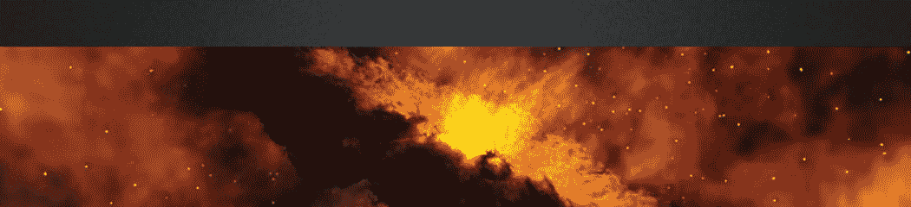

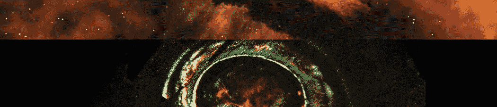


谨以此书献给拉里萨、凯文-吕克·马蒂巴和
达雷尔-托马斯·乌多，你们是我四维生命中的馈赠。


## 前言
高等科学教育旨在培养人们应对当今时代的科学与技术挑战。这些挑战包括但不限于：养活全球不断增长的人口，延长地球上生命的长度并提高生活质量，改进短距离和长距离通信与交通，预测、适应和减轻自然灾害，以及探索太空以改善我们在地球上的生活，并确保我们文明的存续。本系列丛书旨在帮助学生理解并参与应对这些挑战。因为这些挑战，即便是其中最狭隘的聚焦点，也超越了当前的大学课程或培养方案。地球气候变化就是自然灾害这个大主题中一个具体方面的例子。它几乎涵盖了现代科学的方方面面，包括生物学、化学和物理学。此外，这些挑战的广度或许也在告诉我们，必须重新思考高等科学教育，因为当前把科学教育分裂成无数门学科的做法，可能不是培养思维以应对这些挑战的最佳或唯一方式。我们可能正将才华横溢的年轻人的思想永远锁定在某种观点上，这成了一种无意中的灌输。至少一些大学和学院必须开始摆脱这种单一的高等科学教育模式，或者创建一个多学科科学作为独立的培养项目，并有望释放出新一代能够用科学语言交流的超级工程师和科学家。此外，这种方法还可以优化一些人接受高等教育的时间。

自然并不区分物理学、化学和生物学。或许现代人类为了方便才将它们分开。生物学、化学和物理学的科学分化始于19世纪，最初主要是为了认可专业专长。渐渐地，这种分裂在20世纪进入了基础科学教育，而在20世纪后期，随着学院政治占据中心地位，它们之间的界限被人为地强化了。人们开始更加专业化，而对科学的分科并没有任何正式的协议。这种情况只是自然而然地发生，并随着足够师资的出现而在学校间传播开来。此外，在20世纪，不同学科所使用的术语、技术和工具有时差异极大。尽管专业化在今天仍然合适，但各学科之间已经有了显著的重叠和交叉融合。随着我们上升到更高的知识层次，这三个科学知识领域之间的交叉融合将继续增加。

将科学教育碎片化甚至可能不是培养年轻人胜任未来工作的最有效方式。随着人工智能（AI）领域取得的巨大进展，新的工作关乎创新。广义上讲，AI是一组技术，旨在通过将计算机软件植入机器人来近似人类或动物认知的某些方面

以及其他相关系统。人工智能系统如今能够高效且无误地完成许多传统上由人类完成的任务。然而它们距离能够创造事物还很遥远。很快，人工智能系统将成为所有科学学科的核心以及多学科研究的中央平台。它们是计算机的现代版本，其功能超越了为特定学科的数据集编程一套科学规则。人工智能系统可以自动学习这些规则、改进它们，甚至创造新的规则。我们可以轻松地向它们输入不同类型的数据集，甚至引入结果的规则。因此，虽然专业化和专业知识在研究生阶段和成年生活中尤为关键，但宽广的视野对于专业知识、创新以及指挥和创造人工智能系统至关重要。此外，没有生命生物学、化学和物理学的背景，如何教授人工智能？同样，没有融入人工智能，如何教授生命生物学、化学或物理学？

因此，本书系列的目的是提供一本面向本科科学教育的教材范例，使学生能够为应对以下挑战做出贡献：改善地球上生命的长度和质量，改善短距离和长距离的通信与交通，预测、适应和减轻自然灾害，以及探索太空，以改善我们在地球上的生活并确保我们文明的生存。这里涵盖的主要主题有真空与物质、热、化学与核反应、孔隙度、渗透率、粘度、不相容性、润湿性、重力、电力和磁性、声波和弹性波、生命的生物学以及断层成像。对物质、热、化学与核反应、重力、电力和磁性以及生命生物学的基本背景知识，对于医疗保健领域的现在和未来工作至关重要。结合真空和物质中的电磁波传播以及物质中的弹性波传播，可以建立对能量流动的扎实理解，而能量流动是医疗保健、通信和交通、自然灾害预测与缓解以及太空探索中的重要工具。断层成像和光谱学实验是医学和矿物勘探中大多数技术的基础。我们在本书系列的最后一部分证明，物理学和化学的基本方程在我们太阳系的任何地方都相同，很可能在整个宇宙中都相同。生物学方程，包括生命方程，很可能在整个宇宙中也都相同，尽管其中一些仍未知。由于本文采用了跨学科的方法，对大气圈、水圈、生物圈和岩石圈的描述，以及对每个圈层及其相互作用功能至关重要的太阳能，可以直接从这些方程推导出来。这些圈层的互联性和相互作用在当前课程中难以教授，但在我们的生计中至关重要，而在本文中则自然呈现。

本文在较短的篇幅内涵盖了多个当前课程的材料，因为这些课程包含我们在此避免的巨大重复。它们还不必要地过度详述了一些材料，而这些材料实际上只是某个主题的示例、练习或应用，这是本文避免的另一个问题。没有任何一章被划分为生物学、化学和物理学。我们定义并论证某个主题或问题的意义。然后我们从基本原理出发，对其进行定性和定量处理，随后是一系列应用。我还提及了同一数量的各种术语，以便适应来自众多当前科学和工程学科的具有固定背景的读者。最后，本书系列包含分析性问题以及计算性问题，其中包括为与本书系列相关的课程特别开发的 MATLAB 软件和 Mathematica 软件。计算练习侧重于数值建模、成像和统计。在某些章节中，基于本书系列所建立的背景，在章节末尾讨论了具有相当广泛兴趣和争议的主题的论文。这些论文可以帮助学生看到他们所获得的背景在理解和解决我们这个时代的主要科学和技术问题时发挥着核心作用。

本书系列适用于多学期课程。第一本书的前两章内容较为宽泛。它们旨在为科学学生应熟悉的一些基本概念提供广阔的视角。它们还激发了本书系列的其余部分，并清楚地表明了21世纪学科间的交叉融合。在其他章节中，我们先激发该主题，然后对主题进行重点介绍，最后提供广泛的应用示例。例如，在第四本书的 **Chapter 2**（即本书）中，我们讨论热辐射、传导和对流。然后我们描述它们在气候变化中的应用，以及在确定固体地球温度梯度中的应用。此外，我们还描述了地球地幔对流、太阳核心到其表面的能量辐射以及生物热传递。我们还介绍了热力学的第二定律，并描述了其在高效开发热机和泵机（包括风力涡轮机）中的应用。

各章节之间也密切相关且有明确的递进关系。例如，在第一本书的 **Chapter 1** 中，我们介绍了大气中的氧气对地球上某些生命的必需性。在 **Chapter 2** 中，我们描述了氧同位素。在 **Chapter 3** 中，我们介绍了地下氧化物和矿物。在第二本书的 **Chapter 1** 中，我们区分了需要大气氧气生存的生物。我们还介绍了光合作用、岩石在地下的埋藏以及涉及氧气和氧合物的其他化学反应示例，等等。如果人们不熟悉我们周围的氧气和电磁波的基本特征，就称自己为工程师或科学家是没有意义的。

本书系列分为五卷。本第四本书共有六章。我们继续以显著的细节介绍支撑现代科学和工程教育以及科学训练的核心基本概念。这些概念有助于应对我们这个时代的一些重大挑战。这些概念是（1）引力，（2）开普勒定律，（3）拉格朗日点，（4）大地水准面，（5）暗物质和暗能量，（6）阿基米德原理，（7）熵，（7）热力学的两定律，（8）扩散方程，（9）电磁辐射，（10）量子纠缠，（11）光谱学，（12）太赫兹操控，（13）射电和光学望远镜，（14）恒星的化学组成，以及（15）贝尔不等式。然后我们通过跨学科的应用说明这些概念在我们生活中的重要性以及在理解我们周围的世界中的重要性。这些包括利用卫星测量监测固体地球表面的形变、海潮、监测地震和火山喷发、南极洲异常的重力异常、我们月球背面的一瞥、地温曲线、恒星中的能量传递、地球气候、泰坦的反温室效应、人体中的自发电、固体地球中的自发电、大气和真空中的自发电、地球与行星和系外行星之间的远距离通信、太空旅行、有意识觉知的量化概念、表征月球背面、在 TRAPPIST-1e、TRAPPIST-1f 和 TRAPPIST-1g 行星上寻找生命、热医学诊断和治疗、太赫兹光谱学、寻找地球上肌肉随年龄缓慢流失的人体理想位置、倾听地外信号、量子计算、加蓬核裂变自发产生电、地球外文明的生物和光特征，以及吸引地球外文明来到地球的方式。


## Author Biography

Dr. Luc Thomas Ikelle 是 Imode Energy 的科学家。他也是德克萨斯农工大学地质与地球物理系的兼职教授。此前，他在明尼阿波利斯的 Cray Research Inc. 工作，开发用于 CRAY Y-MP 的三维地震反演算法。1988 年至 1997 年，他受雇于 Schlumberger Geco-Prakla、Schlumberger Doll Research 和 Schlumberger Cambridge Research 担任科学家。1997 年至 2014 年，他担任德克萨斯农工大学地质与地球物理系的 Robert R. Berg 教授。他在法国巴黎第七大学获得地球物理学和地球化学博士学位。他因博士论文于 1986 年获得 Le Prix de Thèse du CNRS 奖。他因对 Geoscientists Without Borders 的创建作出贡献，于 2010 年获得 SEG 奖。他还于 2012 年获得德克萨斯农工大学杰出科学家奖。

他从勘探地球物理学会获得 2023 年 Reginald Fessenden 奖。Reginald Fessenden 奖授予在勘探地球物理学方面作出具体贡献的人，例如发明或理论或概念上的进步，值得特别表彰。他是《Introduction to Petroleum Seismology》[2005 年版（SEG 畅销书）和 2018 年版] 的合著者，《Coding and Decoding: Seismic Data, The Concept of Multishooting》（2010 年和 2017 年版）以及《Introduction to Earth Sciences: A Physics Approach》（2017 年和 2020 年版）的作者。他也是 Geoscientists Without Borders 和 Imode Energy Research 的联合创始人。他是 SEG、AGU 和 APS 的成员。他于 2005 年至 2012 年担任 DOE（美国能源部）特别雇员，并于 2005 年至 2012 年担任超深水咨询委员会（能源部长顾问委员会）的成员。在大多数地震学研究中，数据采集的成本远高于数据分析的成本。因此，使用最有效和最准确的技术来采集地震和 EM 数据非常重要。1998 年，当他在德克萨斯农工大学成立 CASP 联盟时，他开始研究近乎同时的多重激发（或多重激发）主题。这基于这样一个想法：不是一次从一个单一源位置产生波，而是从几个几乎同时的源位置产生波。他于 2001 年获得授权的首次美国多重激发采集和处理专利，并于 2010 年出版了该主题的第一本书。

## Chapter 1

### Gravitational Forces and Geodesy

存在四种基本力——即引力、电磁力以及弱相互作用力和强相互作用力——它们负责我们普通物质宇宙中发生的每一次事件、作用和反应。引力是我们宇宙中占主导地位的力量，因为它塑造了星系、恒星、行星、系外行星和黑洞的大尺度结构。

除了是一种极其强大的力量外，引力还是一种看不见的力量。它让我们保持舒适的距离以享受太阳的光芒，使行星绕太阳运行，并维系着我们的世界（见图 1.1）。地球引力让我们留在地面上并使物体下落。其空间变化在研究地球内部的动态过程以及地球内部的勘探和生产中发挥了核心作用。我们的目标是介绍引力及其定律。这些力和定律在本章的第一部分进行了介绍。后续部分讨论这些定律的应用，包括基于卫星的重力测量。

**Key sentence:** *看起来地球上没有一个固定的参考系可以定义地球上的所有点：看起来随着大地测量数据的不断增加，它只会帮助改进地球中心的运动，但不会帮助在地球上定义一个与时间无关的固定参考系。我们只能处理相对运动。*

### 1.1. Newton’s Universal Law of Gravitation

#### 1.1.1. The Gravitational Field

1687 年，艾萨克·牛顿发现质量相互吸引。他将这一发现表述为一个方程，称为牛顿万有引力定律。该方程解释了我们所熟知的地球的拉力或吸引力就是导致物体下落的力。对于任意两个物体，质量为 m₁ 位于位置 x₀（即质量 m₁ 的质心）以及质量为 m₂ 位于位置 x（即质量 m₂ 的质心）

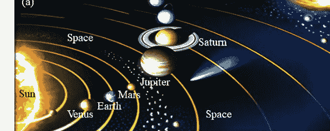

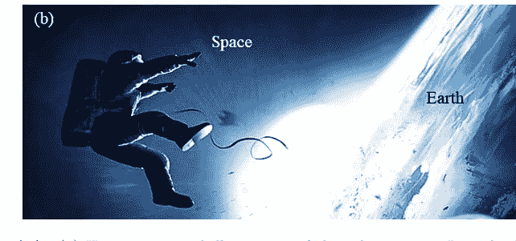

图 1.1. (a) 这里是太阳系的部分示意图。正是太阳的引力使地球绕太阳运行。因此引力帮助地球保持与太阳恰到好处的距离，因此不会太冷或太热。金星太热，火星太冷。请注意太空中没有引力。(b) 这里是太空中宇航员的示意图。行星的引力非常小，以至于它们看起来失重并在太空中漂浮而不是下落。太空中的失重效应使得宇航员可以用指尖移动重达数百公斤的设备。

它们之间的引力，$\boldsymbol{F}$，为

$$\boldsymbol{F} = -G \frac{m_1 m_2}{|\boldsymbol{x} - \boldsymbol{x}_0|^3} (\boldsymbol{x} - \boldsymbol{x}_0) , \qquad (1.1)$$

其大小为

$$F = |\boldsymbol{F}| = G \frac{m_1 m_2}{|\boldsymbol{x} - \boldsymbol{x}_0|^2} , \qquad (1.2)$$

其中 $G = 6.673 \times 10^{-11} \text{m}^3 \text{kg}^{-1} \text{s}^{-2}$（或 N m$^2$ kg$^{-2}$）是万有引力常数；$G$ 在我们宇宙的任何地方对所有物体对都具有相同的值，并且不随时间变化。负号说明力矢量 $\boldsymbol{F}$ 指向内部（即指向 $m_1$），而矢量 $\boldsymbol{x} - \boldsymbol{x}_0$ 指向外部（远离 $m_1$），如图 1.2a 所示。因此，(1.1) 中的牛顿万有引力定律告诉我们，我们宇宙中的每个物体都以沿着两个物体质心连线的力吸引另一个物体。该力与它们质量的乘积成正比，与两个物体之间分离的平方成反比，这是由于 $1/|\boldsymbol{x} - \boldsymbol{x}_0|^2$ 项。

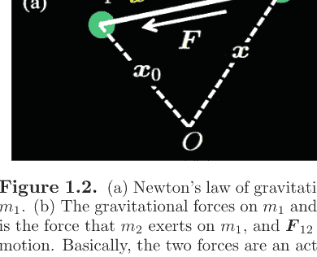

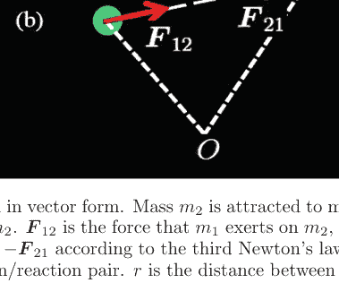

图 1.2. (a) 牛顿万有引力定律的矢量形式。质量 m2 被吸引到质量 m1。(b) 作用在 m1 和 m2 上的引力。F12 是 m1 对 m2 施加的力，F21 是 m2 对 m1 施加的力，并且根据牛顿第三运动定律 F12 = -F21。基本上，这两个力是一对作用/反作用力。r 是质心之间的距离。

如果我们将两个质量的质心之间的距离定义为 r = |x - x0|，则

F = G m1 m2 / r^2 . (1.3)

在继续讨论引力之前，让我们回忆一下，除了方程 (1.1) 中的牛顿万有引力定律之外，还有三个众所周知的牛顿运动定律。第一运动定律，也称为惯性，指出如果没有净力作用，物体将保持静止状态或匀速运动。第二定律指出作用于物体的净力等于质量乘以加速度（即 F = m × γ，其中 m 为物体的质量，γ 为其加速度）。第三定律指出对于每一个力都存在一个大小相等方向相反的力；换句话说，任何作用都有相等且相反的反作用，如图 1.2b 所示。

# Example #1: 考虑在太空中相距 1 m 的两个 1 kg 物体。两者之间的引力为

F ≈ (6.67 × 10^-11 N m² kg^-2) (1 kg) (1 kg) / (1 m)² = 6.67 × 10^-11 N . (1.4)

该力确实非常、非常小。这两个质量靠近需要很长时间，但最终会靠近。你可能会想知道这个例子是否可以用地球表面的两个质量来实现。答案是否定的，因为静摩擦力比这个引力大几十亿倍。

1 kg 质量之间引力如此之小的原因是 G 相对于这些质量来说非常小。与其考虑两个 1 kg 的质量，例如考虑一个质量为 1 kg 的物体位于地球表面上方 20 m 处，第二个物体为地球（m1 = 6 × 10^24 kg）。引力

该物体与地球之间的力现在为

$F \approx \frac{(6.67 \times 10^{-11}\,\text{N m}^2\text{kg}^{-2})(6 \times 10^{24}\,\text{kg})(1\,\text{kg})}{(6.371 \times 10^6\,\text{m})^2} = 9.82\,\text{N}.\tag{1.5}$

如果你放开 1 kg 的质量，作用在其上的引力会立即将其拉向表面，因为该力足够大。注意，两质量之间的分离几乎等于地球的平均半径，即 $r = |\boldsymbol{x} - \boldsymbol{x}_0| = 6.371 \times 10^6\,\text{m}$，而地球表面上方 20 m 的距离与地球半径相比可以忽略不计。

让我们通过使用一个位于地球表面上方高度等于地球半径（即 $r = |\boldsymbol{x} - \boldsymbol{x}_0| = 2 \times 6.371 \times 10^6\,\text{m}$）的 300 kg 卫星，使此示例更实用，对质量 $m_2$ 而言。地球对卫星施加的引力的大小为

$F \approx \frac{(6.67 \times 10^{-11}\,\text{N m}^2\text{kg}^{-2})(300\,\text{kg})(6 \times 10^{24}\,\text{kg})}{(2 \times 6.371 \times 10^6\,\text{m})^2} = 7.42 \times 10^2\,\text{N}.$

请记住，当物体沿圆形路径运动时，即使以轨道卫星那样的恒定速度运动，物体也在加速，因为其速度方向在变化。物体的加速度为 $\gamma = v^2/r$，其中 $r$ 是圆形路径的半径，$v = |\boldsymbol{v}|$ 是物体的（恒定）速度。由于引力始终指向地球中心（见图 1.3），并且这是作用在卫星上的唯一力，我们可以推导出卫星的轨道速度：

$\frac{m_2 v^2}{r} = F = G\frac{m_1 m_2}{r^2} = 7.42 \times 10^2\,\text{N}$

或

$v = \sqrt{\frac{G m_1}{r}} = 5.6\,\text{km/s}.\tag{1.6}$

我们可以推导出卫星轨道的周期为

$T = \frac{2\pi r}{v} = 1.42 \times 10^4\,\text{s} = 3.96\,\text{hours}.\tag{1.7}$

请记住，$2\pi r$ 是圆的周长。我们在此假设卫星的轨道运动是圆形的。实际上，它是椭圆的。但在大多数情况下，椭圆轨道与圆形仅有轻微差异。

## 示例 #2：

让我们来看地球与太阳之间的吸引力。已知地球的质量（$m_2 = 6 \times 10^{24}\,\text{kg}$）、太阳的质量（$m_1 = 2 \times 10^{30}\,\text{kg}$）以及它们之间的距离（$r = |\boldsymbol{x} - \boldsymbol{x}_0| = 1.5 \times 10^{11}\,\text{m}$），太阳对地球施加的引力的大小为

$F \approx \frac{(6.67 \times 10^{-11}\,\text{N m}^2\text{kg}^{-2})(6 \times 10^{24}\,\text{kg})(2 \times 10^{30}\,\text{kg})}{(1.5 \times 10^{11}\,\text{m})^2}$

$= 3.5 \times 10^{22}\,\text{N}.\tag{1.8}$

这一观察是首次强烈表明密度必须向地球中心大幅增加的证据之一。

常量 G 不应与加速度矢量 g 混淆，g 也称为重力场或简称为重力，即重力加速度，或由于重力作用在单位质量上的力。g 的数学表达式可通过使用牛顿第二运动定律得到。如果 m1 是地球的质量，则重力加速度，或由于重力作用在单位质量上的力，可通过将地球对质量 m2 施加的引力与质量 m2 乘以重力加速度相等得到；即，

F = m2 g = -G m1 m2 / |x - x0|^3 (x - x0) ⟹ g = -G m1 / |x - x0|^3 (x - x0),

其中

g = |g| = G m1 / |x - x0|^2 = G m1 / r^2 . (1.9)

因此 g 指向地球中心，即沿 $−(x − x0)$ 方向。重力加速度首次由伽利略（1589 年）测定。他是第一个意识到下落物体以恒定速率拾取速度（即具有恒定加速度）的人。为纪念他，采用了重力单位 Gal。g 的大小在地球表面变化，但平均而言为 g = 9.8 m/s² = 9.8 × 10² Gal。我们在本文节的第一个示例中将此值作为 1 kg 质量物体（即单位质量）与地球之间的引力得到。

让我们对重力加速度做一些观察。我们可以计算地球、金星、火星或小行星的质量，如果已知它们的半径和重力加速度。例如，我们可以计算地球的质量，假设地球表面重力场强度已知（例如，g = 9.8 m/s²）并且从地球中心到地球表面的距离约为 6371 公里，因此

m1 = g R² / G ≈ 5.964 × 10²⁴ kg , (1.10)

我们可以推导出地球的密度为

ρ = m1 / (4/3 π R³) = 5493 kg/m³ . (1.11)

请记住，球体的体积为 V = (4/3)π R³。

另一个重要观察是质量不依赖于重力。它是我们宇宙中的一个基本量，在固定时间在任何地方都相同。然而物体的重量取决于该点的重力大小，而重力随海拔、岩石密度、纬度和地形而变化。请记住，重量是作用在物体上的重力（即 w = mg，其中 w 为重量，g 为重力加速度）。如果你在地球上重 600 牛顿，你将在质量为地球十分之一且半径为地球一半的行星 B 上重 150 牛顿。

在地球上： g_e = G m_e / ||x_e||²

在行星 B 上： $g_b = G \frac{m_b}{\|x_b\|^2} = G \frac{0.1\, m_e}{(0.5\|x_e\|)^2} = G \frac{m_e}{4\|x_e\|^2} = \frac{1}{4} g_e$。

行星 $B$ 的重力加速度是地球重力加速度的四分之一。由于质量不变，你在行星 $B$ 上的重量（即 $w_b = m_e g_b = 0.25\, m_e g_e$）是你在地球上重量（即 $w_e = m_e g_e$）的四分之一。

重力再次随海拔、岩石密度、纬度和地形而变化。在生活中，我们经常以千克和磅表示重量，因为我们假设 $g$ 是恒定的，并且我们隐式使用 $w/g$ 而不是 $w$。一个 80 kg 的人在喀麦隆（海拔 19 m）体重小于 80 kg，而在墨西哥（海拔 -10 m）体重大于 80 kg。因此，离地球中心越远，体重越轻，因为 $w/g$ 在变化，但实际质量保持不变。

我们的月球大约有地球质量的 1/81。因此，你可能会认为其重力会小 81 倍。但其半径只有地球的 1/3.7。记住，重力，如 (1.9) 中定义，是反平方定律，因为 $1/r^2$ 关系，所以从较小的半径来看，你会期望月球的重力大 $(3.7)^2 = 13.7$ 倍。综合这两种效应，我们可以验证月球表面重力约为地球的 1/6 倍（$g_m = g_e/6$）。当宇航员第一次登陆月球时，他们意识到重力有多弱，可以慢动作般弹跳。当他们跳跃时，他们会跳得很高，当他们落回时，落下得很慢。正是这种重力使月球绕地球轨道运行，并使地球绕太阳轨道运行（见图 1.4）。如果重力被关闭，卫星将沿直线移动，而不是沿圆周移动。即使在远离地球或在其他行星上，引力也永远不会降为零。宇航员在外太空极低重力区域感受到的失重感（见图 1.1）实际上是持续下落的感觉。

让我们以计算球体附近和内部重力场 $g$ 的示例来结束本小节，因为此类物体在处理地球、其他行星以及太阳和恒星时很有用，而它们都可以近似为球对称。

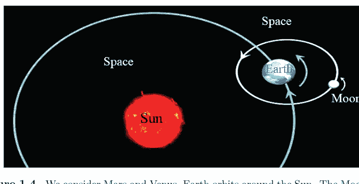

图 1.4。我们考虑火星和金星，地球绕太阳公转。月球绕地球而不是太阳公转。


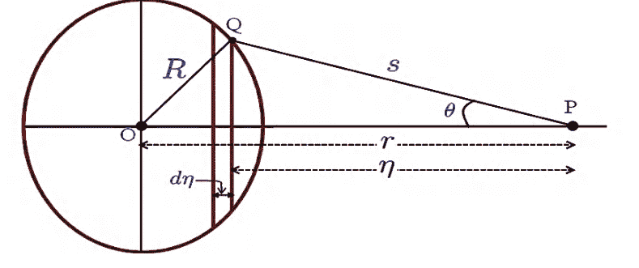

图 1.5. 我们考虑半径为 R、面密度为 sigma 的空心球壳外部的引力场，P 为距球心 r 处的一点。我们可以使用厚度为 dη 的微元带来计算引力。

## 示例 #3：

考虑一个半径为 R、面密度为 σ 的空心球壳，以及距球心距离为 r 的点 P，如图 1.5 所示。球壳的质量为 m₁ = σ 4π R²；记住球体的表面积为 A = 4π R²。我们将球壳分成厚度为 dη 的窄带。该微元的质量为 δm = σ 2π R dη，其中 2π R dη 是描述该微元带的矩形面积。该微元带在 PO 方向上产生的场为

dg = G δm / s² cos θ . (1.12)

让我们用单一变量 s 表示 dg。利用图 1.5 中三角形 OQP 的余弦定理，我们有

R² = r² + s² - 2 r s cos θ = r² + s² - 2 r η (1.13)

且

cos θ = (r² - R² + s²) / (2 r s) . (1.14)

我们可以对 (1.13) 关于 η 求导，得到

ds / dη = r / s . (1.15)

将 (1.13)、(1.14) 和 (1.15) 代入 (1.12)，在图 1.5 中，P 处由该微元带产生的场为

dg = G δm / s² cos θ = G σ 2π R dη / s² cos θ = π R G σ / r² ( 1 + (r² - R²) / s² ) ds .

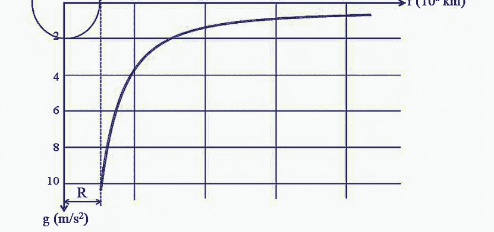

**图 1.6.** 我们考虑空心球壳的引力场。在空心球内部，引力场为零。空心球壳外部的引力场为 $-Gm_1/r^2 i_r$，指向球心。可以将其视为球体的全部质量集中于球心。

如果 $P$ 是外部点，为了求整个球壳产生的场，我们对 $dg$ 从 $r - R$ 到 $r + R$ 积分；即

$$g(r) = \frac{Gm_1}{4Rr^2}\int_{r-R}^{r+R}\left(1+\frac{r^2 - R^2}{s^2}\right) ds \quad \text{利用 }\ m_1 = \sigma 4\pi R^2$$
$$= \frac{Gm_1}{4Rr^2}\left[s - \frac{r^2 - R^2}{s}\right]_{r-R}^{r+R} = \frac{Gm_1}{r^2}. \tag{1.16}$$

引力作用就好像整个球体是一个位于球心、质量与球体相同的质点。因此，在空心球外部，我们可以把球体视为其全部质量集中在球心（见图 1.6）。但如果 $P$ 是内部点，为了求整个球壳产生的场，我们从 $R - r$ 到 $R + r$ 积分；即

$$g(r) = \frac{Gm_1}{4Rr^2}\int_{R-r}^{R+r}\left(1+\frac{r^2 - R^2}{s^2}\right) ds$$
$$= \frac{Gm_1}{4Rr^2}\left[s - \frac{r^2 - R^2}{s}\right]_{R-r}^{R+r} = 0. \tag{1.17}$$

在空心球内部，引力场为零（见图 1.6）。图 1.7 说明了这一结果。对于球壳内的给定点 $P$，在相对两侧有两个小面积 $A_1$ 和 $A_2$，它们对

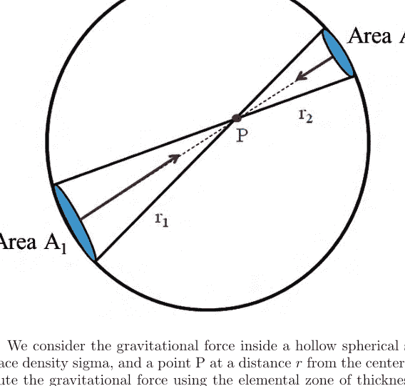

图 1.7. 我们考虑半径为 R、面密度为 sigma 的空心球壳内部的引力，P 为距球心 r 处的一点。我们可以使用厚度为 dη 的微元带来计算引力。球壳相对两侧的两个小面积对 P 处的质量施加方向相反的引力，它们相互抵消，因此球壳内部的引力为零。

处于 P 处的一个质量施加方向相反的引力。结果证明它们相互抵消，因为距离 r₁ 和 r₂ 处的面积 A1 和 A2 之比分别与 r₁² 和 r₂² 成正比，因此这两个相对的面积具有大小相等的引力，

$$\frac{G\sigma A_1}{r_1^2} = \frac{G\sigma A_2}{r_2^2}\,\qquad (1.18)$$

但在 P 处的引力场方向相反。事实上，球壳每一个小部分产生的引力都被相对一侧的部分所平衡。

现在让我们考虑实心球体。实心球体不过是许多空心球壳像洋葱层一样嵌套在一起。因此，外部点的场与所有质量集中在球心时完全相同（见图 1.8）。这不仅适用于密度均匀的球体，也适用于任何密度只取决于到球心距离的球体，即任何球对称分布的物质。这证明了牛顿在分析行星运动时将太阳和行星视为质点处理的合理性。

在实心球体内部（即 r ≤ R），半径为 r 的体积 Vr 内所含的质量 m1r 为（见图 1.9）

$$m_{1r} = \rho V_r = \rho \frac{4}{3}\pi r^3 = \rho \left(\frac{4}{3}\pi R^3\right)\left(\frac{r}{R}\right)^3 = m_1 \left(\frac{r}{R}\right)^3\,,\qquad (1.19)$$

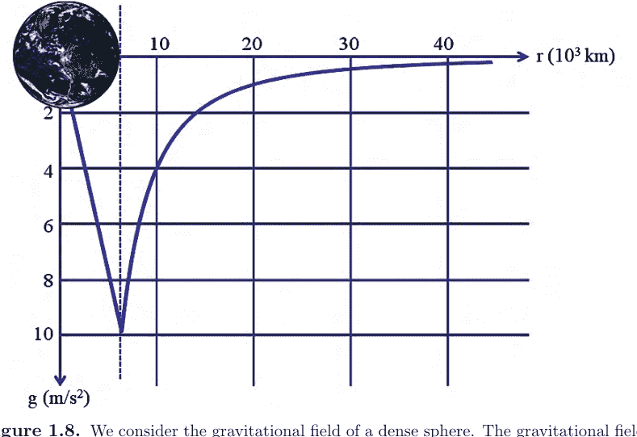

图 1.8. 我们考虑致密球体的引力场。均匀实心球体外部的引力场为 $-G m_1 / r^2 \hat{r}$，指向球心，且在球体内部与到球心的距离线性相关。在实心球外部，我们也可以把球体视为所有质量集中在球心。在球体内部，只有感兴趣半径以内的质量起作用。

其中 $m_1$ 是整个实心球体的质量。球体内部的引力大小则为

$g = \frac{G m_1 r}{r^2} = \frac{G m_1 r}{R^3}$ ; \quad (1.20);

也就是说，例如地球内部的引力场与到地心的距离线性相关（见图 1.8）。因此，在地心处 $r = 0$，完全没有引力场或引力。所有方向上的质量受到相等的吸引。

在地球内部半径 $r < R$ 处（假设其为球对称）的重力加速度也可以写成

$g(r) = \frac{G}{r^2} \int_0^r 4\pi \eta^2 \rho(\eta) d\eta = \frac{G}{r^2} M(r)$ , \quad (1.21)

其中

$M(r) = \int_0^r 4\pi \eta^2 \rho(\eta) d\eta$ . \quad (1.22)

通过假设地球内部密度均匀（即 $\rho = \text{constant}$），我们得到 (1.20)。

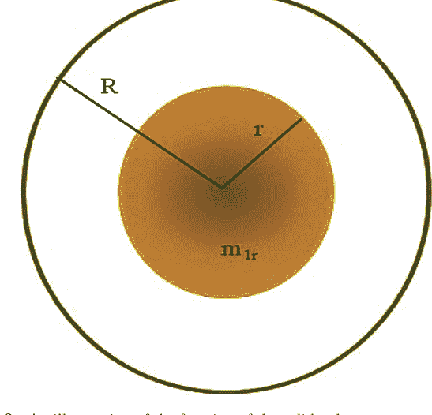

图 1.9. 用于计算实心球体内部引力场所用到的实心球体质量比例的示意图。在球体内部，只有感兴趣半径以内的质量 $m_{1r}$ 起作用。

**小测验：** 地球重力对位于珠穆朗玛峰山顶（$h = 8850$ m）的一个 100 kg 的人施加的力是多少？

## 示例 #4：自由落体时间与云团坍缩。

考虑一个由氢气云组成的球体。我们假设该云团不可压缩。如 Ikelle (2023c) 所述，气体的运动可以用纳维-斯托克斯方程表示如下：

$\rho\frac{\partial\mathbf{v}}{\partial t} = -\rho(\mathbf{v}\cdot\nabla)\mathbf{v} + \underbrace{-\nabla p}_{\text{气体压力}} + \underbrace{\eta\nabla^2\mathbf{v}}_{\text{黏性}} + \underbrace{\rho\mathbf{g}}_{\text{重力}} + \underbrace{\frac{1}{c}(\mathbf{j}\times\mathbf{B})}_{\text{洛伦兹力}} + \underbrace{\rho\mathbf{F}}_{\text{外力}} \tag{1.23}$

这里的主要力是吸引性的引力，与之相反的力包括气体压力、辐射压、磁力（分子云是磁化的）以及由湍流引起的流体流动力。假设吸引力大于相反力（气体云内部压力、磁力、外部压力和其他外力）之和。在某一时刻，气体云将在云中心坍缩。大多数粒子需要多长时间才能坍缩到中心？我们可以通过忽略所有相反力来粗略估算这个时间，通常称为自由落体时间；即 (1.23) 简化为

$\rho\frac{\partial\mathbf{v}}{\partial t} = \rho\mathbf{g} \tag{1.24}$

本示例的目标是估算这种情况下的自由落体时间。此处的重力只沿径向变化，如 (1.21) 所定义。方程 (1.24) 可以改写如下：

$\frac{d^2 r}{dt^2} = -\frac{GM(r)}{r^2} \iff \frac{1}{2}\frac{d(v^2)}{dr} = -\frac{GM(r)}{r^2}$ 或 $\frac{1}{2}d(v^2) = -\left(\frac{GM(r)}{r^2}\right) dr$, (1.25)

利用了

$\frac{d^2 r}{dt^2} = \frac{d}{dt}\left(\frac{dr}{dt}\right) = \frac{dv(r)}{dt} = \frac{dr}{dt}\frac{dv(r)}{dr} = \frac{1}{2}\frac{d(v^2)}{dr}$。
(1.26)

利用 (1.25) 中最后一个方程积分，我们得到

$v^2 = 2GM(R)\left(\frac{1}{r} - \frac{1}{R}\right) \iff v = \frac{dr}{dt} = \pm\left[2GM(R)\left(\frac{1}{r} - \frac{1}{R}\right)\right]^{1/2}$。

积分常数的选取基于初始条件 $v(t = 0) = 0$, $r(t = 0) = R$。选择 $v < 0$ 的解，并作代换 $\zeta = r/R$ 和 $d\zeta = dr/R$，我们得到

$dt = -\left[\frac{2GM(R)}{R^3}\right]^{-1/2}\left(\frac{\zeta}{1-\zeta}\right)^{1/2} d\zeta$。
(1.27)

将右边从 $\zeta = 1$ 到 $\zeta = 0$（即 $r = R$ 到 $r = 0$）积分，并利用 $\rho_0 = 3M(R)/(4\pi R^3)$，我们得到所谓的云团自由落体时间 $t_{\rm ff}$，

$t_{\rm ff} = -\left[\frac{3}{8\pi G\rho_0}\right]^{1/2}\int_{1}^{0}\left(\frac{\zeta}{1-\zeta}\right)^{1/2} d\zeta$
$= -2\left[\frac{3}{8\pi G\rho_0}\right]^{1/2}\int_{\pi/2}^{0}\sin^2\theta d\theta$
$= \left(\frac{3\pi}{32G\rho_0}\right)^{1/2}$。
(1.28)

也就是说，这是（无压力）云团收缩到 $r = 0$ 处一点所需的时间。该积分可以通过代换 $\zeta = \sin^2\theta$ 解析计算。再次注意，在真实的星际空间中，气体压力并不为零。然而，$t_{\rm ff}$ 给出了气体云坍缩并在其中形成恒星的大致时间尺度。对于 $\rho_0 = 4.7 \times 10^{-19}\,\text{g/cm}^{-3}$，自由落体时间为

$t_{\rm ff;sun} = \left(\frac{3\pi}{32 \times 6.7 \times 10^{-8} \times 4.7 \times 10^{-19}}\right)^{1/2}$
$= 3.058 \times 10^{12}\,\text{秒} \approx 98,315\,\text{年}$。
(1.29)

从天文学标准来看，这个时间非常短。因此，我们必须非常幸运才能捕捉到一颗恒星正在形成的过程。换句话说，如果没有相反的力，尤其是气体压力，这个云团将会非常迅速地坍缩！还要注意，自由落体时间只取决于云团的平均密度 $\rho_0$，而与云团中粒子的实际分布无关。


## Box 1.1：引力约束聚变

正如 Ikelle (2023b) 中所述，核聚变驱动着恒星，包括我们的太阳。它将两个轻核碰撞在一起形成两个新粒子并释放能量。Ikelle (2023b) 中讨论的一个例子如下：

$^{2}_{1}$D + $^{3}_{1}$T → $^{4}_{2}$He + $^{1}_{0}$n + γ (17.6 MeV) , (1.30)

其中 D 为氘，T 为氚，且 $^{2}_{1}$D = $^{2}_{1}$H 且 $^{3}_{1}$T = $^{3}_{1}$H。氚通过发射电子（β辐射）衰变，其半衰期为 12.3 年。氚既自然存在，也是核裂变反应堆中的副产物。氘和氚也被称为氢的重同位素。17.6 MeV 的能量分配在中子的动能（14.1 MeV）和氦核（3.5 MeV）之间。在恒星内部，聚变是通过不断增加的引力压力（$p = F/A$，其中 $F$ 为引力的大小，$A$ 为引力作用的面积；压力 $p$ 与恒星的质量成正比，就像 $F$ 一样）实现的，随着它们燃烧氢，压力可达 20 亿个大气压以上。请记住，这一过程发生在真空中且在极高压力下进行，这意味着极高温度（即超过 1000 万开尔文）。在地球上实现聚变的挑战包括构建超高温环境以及在真空中约束极热等离子体——也就是说，等离子体不能与任何固体材料直接接触。请注意，如果一个天体完全由氘组成，产生足以引发聚变的引力压力所需的最小质量相当于木星的质量。这种质量仅存在于恒星中。实际的聚变在 Ikelle (2024) 中讨论。

#### 1.1.2. 开普勒行星运动三定律

17 世纪早期，约翰内斯·开普勒（1571–1630）提出了三条天体力学定律，革新了科学界，并促使牛顿提出了万有引力定律，我们已在前一小节中描述过。在思考第谷·布拉赫（1546–1601）收集的数据——这位第一位实验物理学家——开普勒确定了支配行星轨道动力学的三条定律。

第一定律，也称为椭圆定律，指出行星都沿以太阳为其中一个焦点的椭圆轨道运动。第二定律，也称为等面积定律，指出行星在其轨道上运动时，太阳中心到行星中心的连线在相等时间内扫过相等的面积。第三定律，也称为调和定律，指出行星绕太阳完成一次公转所需的时间 $T$（一个行星年）与其与太阳的平均距离 $r$ 相关——即轨道周期的平方与太阳与绕行行星之间的平均距离的立方成正比（即 $T^{2} \propto r^{3}$）。

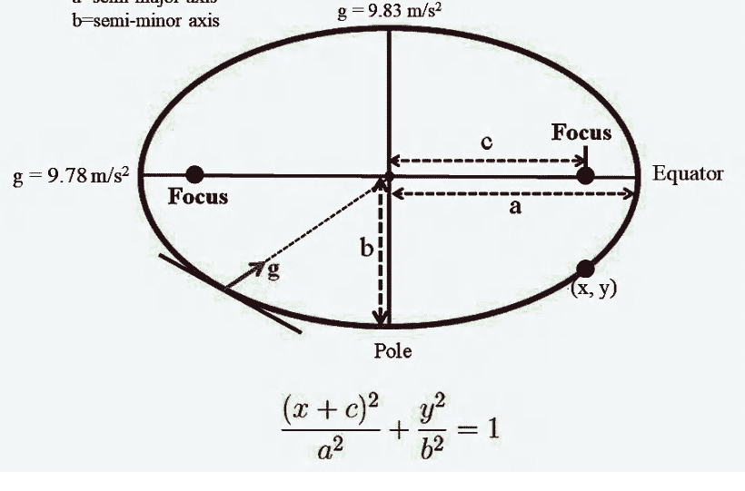

图 1.10. 以下是关于椭圆和椭球体的一些基本事实。椭球体由其半长轴（赤道半径）a、半短轴（极半径）b、扁率（赤道半径与极半径的关系）f = (a − b)/a 以及偏心率 e² = 2f − f² 定义。对于地球，a = 6378.136 km 且 b = 6356.751 km。地球在赤道处更胖，在两极处更薄。离自转轴越远，重力加速度 g 越大。

随着我们继续本小节，你过去关于椭圆和椭球体的基础材料会很有用。图 1.10 回顾了一些这些事实。椭球体由其半长轴（赤道半径）a 和半短轴（极半径）b 定义。我们还将使用其扁率（赤道半径与极半径的关系）f = (a − b)/a，以及偏心率 e² = 2f − f² = (a² − b²)/a²。固体地球不是一个球体。它具有扁球体的形状。扁率的大小为 f = 1/298。这种形状是地球地幔像流体一样行为的第一个线索之一。还请注意，由于地球重力产生的加速度在赤道处（g = 9.78 m/s²）小于在两极处（g = 9.83 m/s²）。这是因为地球自转产生的离心力（Fc = mv²/r）与远离自转轴的距离成正比，而赤道距离地球中心（r = 6,378 km）比两极（r = 6,357 km）更远。

### 采用圆轨道证明第三定律。

开普勒定律，如我们今天所称，是精确的，但它们只是描述性的，因为开普勒并不理解行星为何如此行为。牛顿最重大的成就是证明了所有行星行为都是简单引力定律的结果，我们已在前一小节中描述过。

令人惊讶的是，开普勒的第一定律，即行星路径是椭圆的，从牛顿的平方反比引力假设开始证明是最困难的。牛顿本人用一个巧妙的几何论证完成了它， famously 难以理解。它可以用微积分很容易证明，但即使如此也非平凡，我们稍后会逐步进行。最有效的方法是按逆序攻击这些定律。因此，我们在假设圆轨道的情况下从第三定律开始。

同样，卫星轨道速度的公式（1.6）以及卫星轨道周期的公式（1.7）也适用于绕太阳运行的行星（即质量 $m_2$）。我们只需将绕行卫星替换为绕行行星（即质量 $m_2$），将地球替换为太阳（即质量 $m_1$）。因此，通过将（1.6）代入（1.7），我们得到周期平方与半径 $r$ 立方的比值，即开普勒第三定律；即

$$\frac{T^2}{r^3} = \frac{4\pi^2}{G m_1} = k = \text{constant} \tag{1.31}$$

比例系数 $k = T^2 / r^3$ 被称为开普勒常数。它对太阳系中所有的行星（地球、火星、金星、水星、木星等）具有相同的数值，如表 1.1 所示。月球具有不同的开普勒常数，因为它绕行的对象不同，是地球而不是太阳。更一般地说，如果被绕行的对象保持不变，$k$ 具有相同的数值。请注意，我们稍后将把这一第三定律的证明推广到椭圆轨道，通过用椭圆的半长轴（见图 1.10）$a$ 替换轨道半径 $r$。

我们可以通过重新排列参数和变量来写出开普勒第三定律的几种不同形式，以便抵消一些项并促进某些计算。例如，我们知道绕同一对象运行的行星的开普勒常数相同，因此我们可以将地球和火星的公式相等，如下所示：

$$\frac{T_{\text{earth}}^2}{r_{\text{earth}}^3} = \frac{T_{\text{mars}}^2}{r_{\text{mars}}^3} \tag{1.32}$$

**表 1.1.** 不同的开普勒常数 $k$。其他参数是太阳系中每个行星的年长 $T$，以及其与太阳的平均距离 $r$。地球、火星和金星给出的开普勒常数大致相同，证实了开普勒第三定律正确地预测了绕同一对象运行的物体的周期平方与半径立方之间存在恒定比率。月球具有不同的开普勒常数，因为它绕行的是不同的天体，是地球而不是太阳。

| 行星与卫星 | 轨道 | T（天） | r（千米） | k（天²/千米³） |
|---|---|---|---|---|
| 地球 | 太阳 | 365 | 149 × 10⁶ | 4.03e-20 |
| 火星 | 太阳 | 684 | 228 × 10⁶ | 3.95e-20 |
| 金星 | 太阳 | 225 | 108 × 10⁶ | 4.01e-20 |
| 月球 | 地球 | 27.32 | 384400 | 1.31e-14 |

## 引力与大地测量学

并消去开普勒常数。

> 测验：太阳与行星之间的距离及其相对于太阳的轨道周期是分析太阳系最重要的参数。这些参数随行星与太阳的距离增加而增加（例如，与地球相比，水星、金星、火星、木星、土星、天王星和海王星的轨道周期分别为 0.241、0.615、1.88、11.9、29.4、83.80、164、248）。然而，行星的重力、质量和半径并不随行星与太阳的距离而增加或减少（例如，与地球相比，水星、金星、火星、木星、土星、天王星和海王星表面的重力分别为 0.378、0.894、0.379、2.54、1.07、0.8、1.2 和 0.059），为什么？

让我们在继续证明之前回顾一些角运动的基本方程。回忆一下，任何运动的东西都有动量，动量是运动的量。如果某物沿直线运动，它具有线动量。任何沿曲线或圆周运动的东西都有角动量。Ikelle (2023b) 展示了线性运动（平移运动）与角运动（例如旋转运动）之间的类比。该类比需要谨慎对待。例如，转动惯量 I 不是物体的恒定属性，但其质量是恒定属性。牛顿的线性运动定律，

```
F = dp/dt = m dv/dt = mγ ,
```

变为

```
τ = dL/dt = I dω/dt = Iα ,
```

对于角运动。惯性是对变化的抵抗，旋转惯性（对旋转变化的抵抗）称为转动惯量。由位置矢量 x 定位的物体绕由旋转矢量 ω（也称为角速度矢量）给出的轴旋转。该矢量的大小 |ω| 是角速度，给出以角度/时间为单位的旋转速度。旋转物体以线速度 v = x × ω 运动。换句话说，线速度矢量 v 与角速度矢量 ω 和位置矢量 x 都垂直。随着物体沿线速度方向运动，其位置矢量随之移动，因此如果角速度不随时间变化，物体将绕旋转轴做圆周运动。

假设行星在 t1 和 t2 之间绕太阳扫过的面积为 A12，而在 t3 和 t4 之间扫过的面积为 A34。如图 1.11 所示。根据开普勒第二定律，如果 t2−t1 = t4−t3 则 A12 = A34。换句话说，行星扫过的面积与时间的比率是恒定的。对于微小角度 dθ，绕行行星扫过的无限薄的三角形面积为（见图 1.11）

```
dA = 1/2 (height × base) = 1/2 r × (r dθ) ⇒ dA/dt = 1/2 r² dθ/dt .
```


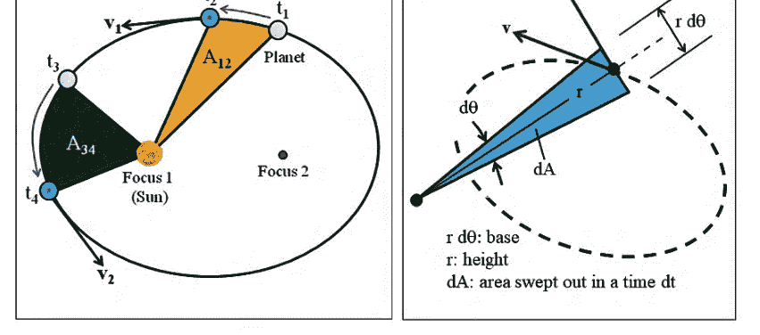

图 1.11. 我们考虑在给定时间间隔内绕太阳运行的行星所扫过的面积。（a）在其绕太阳的轨道上，行星在相等的时间内扫过相等的面积。它越靠近太阳就越快。（b）三角形面积 \(dA\) 是行星沿无穷小弧 \(r\,d\theta\) 运动时所扫过的面积。该面积是半径 \(r\) 与弧 \(r\,d\theta\) 的乘积的一半。

因此，第二定律的证明等价于证明 \(dA/dt\) 为常数；这正是我们此处的任务。

让我们首先引入一个称为角动量的物理量。它衡量旋转体的旋转量，就像线动量（简单称为动量）衡量运动体的运动量一样。质量为 \(m_2\)、位置矢量为 \(\mathbf{x}\)、速度为 \(\mathbf{v}\) 的角动量为 \(\mathbf{L} = \mathbf{x} \times (m_2 \mathbf{v})\)，其中 \(\times\) 是 Ikelle (2023b) 中定义的叉积。\(\mathbf{L}\) 随时间的变化率为

\[
\frac{d\mathbf{L}}{dt} = \frac{d\mathbf{x}}{dt} \times (m_2 \mathbf{v}) + \mathbf{x} \times \left(m_2 \frac{d\mathbf{v}}{dt}\right)
= \mathbf{x} \times (m_2 \boldsymbol{\gamma}) = \mathbf{x} \times \mathbf{F} = 0. \tag{1.36}
\]

在这些推导中我们使用了两个平行向量的叉积为零这一事实。因为 \(\mathbf{F}\) 与 \(\mathbf{x}\) 共线（即力沿着太阳中心与绕行行星中心连线的方向），\(d\mathbf{L}/dt\) 为零，因此 \(L = |\mathbf{L}|\) 随时间是不变的，这在物理上意味着角动量守恒。该结果的另一个含义是，绕行行星始终在由其速度 \(\mathbf{v}\) 和位置矢量 \(\mathbf{x}\) 张成的平面（二维空间）中运动，如图 1.12 所示。

在此平面中，绕行行星的位置矢量为 \(\mathbf{x} = r \mathbf{i}_r\)，其中 \(\mathbf{i}_r = [\cos\theta, \sin\theta]^T\) 是沿绕行行星位置矢量方向的单位矢量（见图 1.12）。矢量 \(\mathbf{i}_\theta = [-\sin\theta, \cos\theta]^T\) 是与绕行行星位置矢量方向正交的单位矢量。

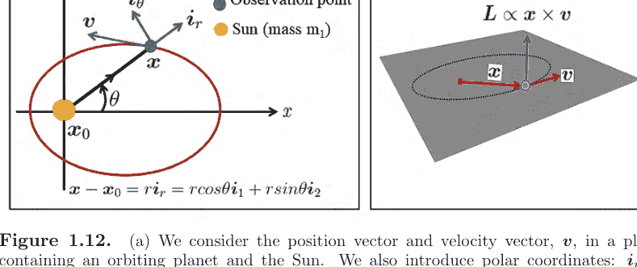

图 1.12. （a）我们考虑包含绕行行星和太阳的平面中的位置矢量和速度矢量 \(\mathbf{v}\)。我们还引入极坐标：\(\mathbf{i}_r = [\cos\theta, \sin\theta]^T\) 是沿绕行行星位置矢量方向的单位矢量。矢量 \(\mathbf{i}_\theta = [-\sin\theta, \cos\theta]^T\) 是与绕行行星位置矢量方向正交的单位矢量。（b）与该平面相关的另一个重要矢量是角动量矢量 \(\mathbf{L}\)，它是位置矢量与绕行行星速度的缩放叉积。位置矢量与角动量矢量正交。

绕行行星的速度矢量 \(\mathbf{v}\) 是位置矢量的时间导数，可以写为

\[
\mathbf{v} = \frac{d\mathbf{x}}{dt} = \frac{dr}{dt}\mathbf{i}_r + r\frac{d\mathbf{i}_r}{d\theta}\frac{d\theta}{dt}
= \frac{dr}{dt}\mathbf{i}_r + r\frac{d\theta}{dt}\mathbf{i}_\theta. \tag{1.37}
\]

绕行行星角动量矢量的大小为

\[
\frac{L}{2m_2} = \frac{1}{2}|\mathbf{x} \times \mathbf{v}| = \frac{1}{2}r^2\frac{d\theta}{dt} = \frac{dA}{dt}. \tag{1.38}
\]

因此 \(dA/dt\) 为常数，因为 \(L\) 为常数。我们现在可以推导出行星轨道在时间 \(t_1\) 与 \(t_2\) 之间所扫过的面积为

\[
A_{12} = \int_{t_1}^{t_2}\frac{dA}{dt}\,dt
= \frac{1}{2}\int_{t_1}^{t_2}r^2\frac{d\theta}{dt}\,dt
= \frac{1}{2m_2}L(t_2 - t_1). \tag{1.39}
\]

同一行星在时间 \(t_3\) 与 \(t_4\) 之间所扫过的面积为

\[
A_{34} = \int_{t_3}^{t_4}\frac{dA}{dt}\,dt
= \frac{1}{2}\int_{t_3}^{t_4}r^2\frac{d\theta}{dt}\,dt
= \frac{1}{2m_2}L(t_4 - t_3). \tag{1.40}
\]

如果 \(t_2 - t_1 = t_4 - t_3\)，则 \(A_{12} = A_{34}\)，因为绕行行星角动量的大小 \(L\) 为常数。这一结论证明了开普勒第二定律。也可以清楚地看到，开普勒第二定律实际上是角动量守恒的表述。注意这些推导中做出的关键假设是太阳不动且位于坐标系原点。

**Quiz:**
- （a）地球轨道的偏心率是多少？
- （b）证明椭圆的方程也可以写成

\[
r = \frac{a(1 - e^2)}{1 + e\cos\theta}, \tag{1.41}
\]

其中 \(r\) 和 \(\theta\) 分别是距离和角度，如图 1.12 所定义。

## 第一定律的证明。

我们的下一个任务是证明第一定律，该定律指出行星沿椭圆轨道运动，太阳位于其中一个焦点。通过使用图 1.12a 中带极坐标的日心图以及式 (1.37) 中绕行行星速度矢量的定义，我们可以定义加速度矢量 \(\boldsymbol{\gamma} = d\mathbf{v}/dt\)，它是位置矢量的二阶时间导数，如

\[
\boldsymbol{\gamma} = \left[\frac{d^2 r}{dt^2} - r\left(\frac{d\theta}{dt}\right)^2\right]\mathbf{i}_r
+ \left[2\frac{dr}{dt}\frac{d\theta}{dt} + r\frac{d^2\theta}{dt^2}\right]\mathbf{i}_\theta
= -\frac{G m_1}{r^2}\mathbf{i}_r + 0\,\mathbf{i}_\theta. \tag{1.42}
\]

因为引力 \(\mathbf{F} = m_2 \boldsymbol{\gamma} = -\frac{G m_2 m_1}{r^2}\mathbf{i}_r\) 与绕行行星的位置矢量 \(\mathbf{x} = r\mathbf{i}_r\) 共线，绕行行星加速度矢量的 \(\theta\) 分量为零而径向分量不为零；即

\[
\frac{d^2 r}{dt^2} = r\left(\frac{d\theta}{dt}\right)^2 - \frac{G m_1}{r^2}
= \frac{L^2}{m_2^2 r^3} - \frac{G m_1}{r^2}. \tag{1.43}
\]

\[
2\frac{dr}{dt}\frac{d\theta}{dt} + r\frac{d^2\theta}{dt^2}
= \frac{d}{dt}\left(r^2\frac{d\theta}{dt}\right) = 0
\Longrightarrow \frac{L}{m_2} = r^2\frac{d\theta}{dt}. \tag{1.44}
\]

我们可以从式 (1.44) 看出，加速度矢量的 \(\theta\) 分量提供了证明绕行行星角动量矢量大小为常数的另一种方法。我们这里的重点是式 (1.43)。正如我们稍后将看到的，该方程的解是一个椭圆，因此在证明开普勒第一定律时很有用。

**Quiz:** 物体的视重 \(w\) 取决于测量时的纬度 \(\theta\)。相比之下，真实重量完全由地球引力引起，其大小等于 \(w = m g_e\) 且在任何地方都相同（\(m\) 为物体的质量）。
- （a）如果地球表面赤道上一点的切向速度为 \(v_\theta\)，则求物体在赤道处的视重。
- （b）赤道处的视重力加速度是多少？

利用以下恒等式

\[
\frac{d}{dt} = \frac{d}{d\theta}\frac{d\theta}{dt} = \frac{L B^2}{m_2}\frac{d}{d\theta}, \tag{1.45}
\]

其中 \(B = 1/r\)，我们可以重写方程 (1.43)

\[
\frac{d^2 r}{dt^2} = \frac{L^2}{m_2^2 r^3} - \frac{G m_1}{r^2}
\quad\Longleftrightarrow\quad
\frac{d^2 B}{d\theta^2} + B = \frac{G m_1 m_2^2}{L^2}. \tag{1.46}
\]

我们可以验证该方程的解为

\[
r = \frac{1}{B} = \frac{k}{1 + \varepsilon \cos\theta}, \quad \text{or} \quad r = k - \varepsilon x, \tag{1.47}
\]

其中

\[
k = \frac{L^2}{G m_1 m_2^2} \quad \text{and} \quad
\varepsilon = \frac{L^2}{G m_1 m_2^2} C, \tag{1.48}
\]

其中 \(x = r\cos\theta\) 且 \(C\) 为积分常数。我们还可以验证式 (1.47) 中的解是一个椭圆；即

\[
\frac{(x + c)^2}{a^2} + \frac{y^2}{b^2} = 1. \tag{1.49}
\]

通过令

\[
c = \frac{k\varepsilon}{1 - \varepsilon^2}, \quad a = \frac{k}{1 - \varepsilon^2}, \quad \text{and} \quad b = \frac{k}{\sqrt{1 - \varepsilon^2}}. \tag{1.50}
\]

该方程及相关参数如图 1.10 所示。半长轴和半短轴分别为 \(a\) 和 \(b\)。

## 椭圆轨道的第三定律证明。

我们已经证明行星绕太阳完成一次完整轨道所需的时间（一个行星年）与圆轨道的半径有关。我们现在将该证明推广到椭圆轨道。轨道一个周期内所描绘的面积，即绕整个椭圆旅行的时间，为

\[
A = \int_0^T \frac{dA}{dt}\,dt = \frac{1}{2m_2}LT
\Rightarrow T = \left(\frac{2m_2}{L}\right)A = \left(\frac{2m_2}{L}\right)\pi a b, \tag{1.51}
\]

其中 \(A = \pi a b\) 是行星轨道所包围的椭圆面积。我们现在已知 \(b^2 = a^2(1-\varepsilon^2)\) 且 \(a = k/(1-\varepsilon^2)\)。我们可以推导出第三定律；

\[
\frac{T^2}{a^3} = \frac{4\pi^2}{G m_1} = \text{constant}. \tag{1.52}
\]

### 示例 #5：

我们可以使用开普勒第三定律来求航天器到达火星所需的时间。航天器轨道的长轴为 \(2a_S = r_E + r_M\)，假设地球用 \(r_E\) 和 \(T_E\) 表示，火星用 \(r_M\) 和 \(T_M\) 表示，二者均沿近似圆轨道运动（见图 1.13）。利用表 1.2，半长轴因此为

\[
a_S = \frac{r_E + r_M}{2} = \frac{149 + 228}{2}\times 10^6 = 189\times 10^6\ \text{km}. \tag{1.53}
\]


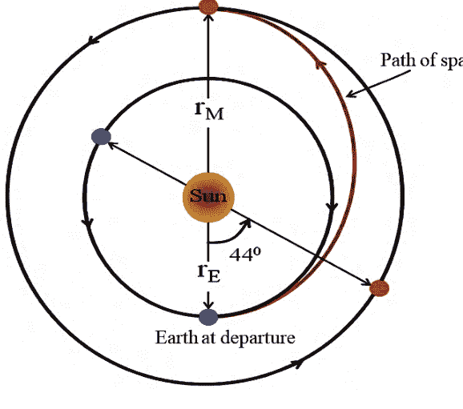

**图1.13.** 前往火星的旅程。我们从地球发射升空，航向与地球和火星绕太阳运行的方向一致；通过飞船发动机稍微加速，我们最终赶上火星的轨道并追上火星本身。请记住，火星是距太阳第四近的行星，地球是距太阳第三近的行星（见图1.16）。

航天器在前往火星的途中经历了这个完整椭圆轨道的一半，因此旅行时间为

$$T = \frac{1}{2} \left[\frac{a_S}{r_E}\right]^{\frac{3}{2}} T_E = \frac{1}{2} \left(\frac{1.89}{1.49}\right)^{\frac{3}{2}} (1\text{ year}) = 258\text{ days}. \qquad (1.54)$$

美国国家航空航天局（NASA）于2018年5月5日从加利福尼亚州中部海岸发射了“洞察”号（InSight，利用地震调查、大地测量和热传输进行内部探测）任务。“洞察”号于2018年11月26日登陆火星。整个旅程耗时近205天。“洞察”号任务的实际飞行时间与（1.54）式中预测结果之间的差异，是由于我们没有考虑发射速度和地球与火星的排列情况，因为火星和地球的轨道都不是完美的圆形。

还要注意木星强大的引力，尤其是与其邻居火星相比。木星的强大引力搅动了火星与木星之间小行星带中的大多数小行星（见图1.14）。该区域被称为主小行星带，包含了太阳系中超过90%的小行星。其中大约10万颗直径超过一公里。两组被称为“特洛伊小行星”的小行星在木星轨道上前后伴随木星。太阳和木星的联合引力阻止了特洛伊小行星偏离木星轨道过远。此外还有柯伊伯带，距离太阳约30到50个天文单位（见图1.14）。它延伸至海王星之外。实际上，海王星的引力搅动了柯伊伯带。继我们在Ikelle（2023b）中的讨论，实际上可能是柯伊伯带的小行星包含了地球生命的组成部分，甚至动物生命的精子和卵子。主小行星带的小行星通常含有无机物质，因此不太可能包含地球生命的组成部分。

**表1.2.** 引力数据表。T是轨道周期，a是轨道半长轴，m2是绕行天体质量，e是轨道偏心率，g/ge是其他行星表面的g与地球重力的比较（ge = 9.81 m/s²）。请注意，此表包括地球的月球——它是一颗天然卫星而非行星——以及木星的伽利略卫星。它还包括太阳，太阳是一颗恒星而非行星。由于太阳围绕银河系中心运动存在许多扰动，轨道半长轴和偏心率的定义不适用于太阳围绕我们星系中心的轨道。

| 行星 | 绕行天体 | T（天） | a（10^6 km） | m2（kg） | e（×0.01） | g/ge |
|---|---|---|---|---|---|---|
| 地球 | 太阳 | 365 | 149 | 5.97 × 10^24 | 1.67 | 1 |
| 火星 | 太阳 | 684 | 228 | 6.42 × 10^23 | 9.34 | 0.38 |
| 金星 | 太阳 | 225 | 108 | 4.87 × 10^24 | 0.677 | 0.89 |
| 水星 | 太阳 | 88 | 58 | 3.30 × 10^23 | 20.6 | 0.38 |
| 木星 | 太阳 | 11.9 | 778 | 1.90 × 10^27 | 4.84 | 2.54 |
| 土星 | 太阳 | 29.4 | 1430 | 5.69 × 10^26 | 5.42 | 1.07 |
| 天王星 | 太阳 | 83.8 | 2870 | 8.69 × 10^25 | 4.72 | 0.8 |
| 海王星 | 太阳 | 164 | 4500 | 1.02 × 10^26 | 0.86 | 1.2 |
| 月球 | 地球 | 27.32 | 0.3484 | 7.35 × 10^22 | 5.49 | 0.167 |
| 木卫三 | 木星 | 7.2 | 0.5262 | 1.48 × 10^23 | 0.15 | 0.146 |
| 木卫四 | 木星 | 16.7 | 0.4821 | 1.07 × 10^23 | 0.7 | 0.126 |
| 木卫一 | 木星 | 1.8 | 0.3643 | 8.93 × 10^22 | 0.4 | 0.184 |
| 木卫二 | 木星 | 3.6 | 0.3122 | 48.0 × 10^22 | 1.01 | 0.134 |
| 太阳 | 银河系 | 83 × 10^9 | 不适用 | 1.99 × 10^30 | 不适用 | 27.96 |

**测验：**

- (1) 正如我们在表1.2中所见，火星和水星表面的引力几乎相同，尽管火星比水星更大、质量也更大。请解释原因。
- (2) 知道行星的质量和半径有什么用处？
- (3) 如果你在地球上体重为100公斤，你在太阳系其他行星上的体重会是多少？

如Ikelle（2023a和2023b）所述，TRAPPIST-1是另一个恒星系统，其恒星质量约为我们太阳质量的9%（即0.089倍太阳质量；仅比木星稍大），有效温度为2511开尔文，比太阳冷得多。该恒星的七颗系外行星由于其较低的温度和接近地球的重力，有可能支持碳基生命。然而，这些行星上的人类和/或类人生物可能平均比我们矮，因为它们的重力小于地球。这七颗系外行星被标记为b到h。表1.3列出了使用NASA的斯皮策（Spitzer）、开普勒（Kepler）和TRAPPIST太空望远镜观测到或从这些观测推断出的这七颗行星的性质。所有这些行星的质量和半径都小于或等于地球，但同一指标上大于火星。换句话说，它们的变化范围甚至比我们太阳系的岩石行星更狭窄。表1.3中一个关键缺失的性质是系外行星的温度。很难从表1.3中的其他参数或望远镜观测中推断出它们。它们需要探测器在系外行星附近飞掠，我们将在Ikelle（2024）中讨论。但由于我们知道TRAPPIST-1系外行星与TRAPPIST-1的距离，以及TRAPPIST-1的温度，TRAPPIST-1系外行星接收到的光和热水平与地球及其邻近行星相当。

通过比较太阳系和TRAPPIST-1系统，并利用光度、质量、温度和恒星半径都相关这一事实，我们看到一种趋势，表明质量较小的恒星产生的类木系外行星较少，因为它们的温度以及由此产生的光度受限。TRAPPIST-1系统没有类木系外行星，而我们更热的太阳有五颗类木行星。尽管如此，太阳系和TRAPPIST-1系统在行星相对于恒星质量的大小和质量分布方面相当相似。巨大的系外行星g离TRAPPIST-1很远，就像木星离太阳很远一样。如果这一趋势正确，我们可以预期会发现TRAPPIST-1系统的冥王星版本。此外，TRAPPIST-1似乎与任何冰质小行星带无关，这与我们太阳系的岩石行星一致。然而，冰质小行星对行星的轰击对地球上的构造运动演化至关重要，甚至

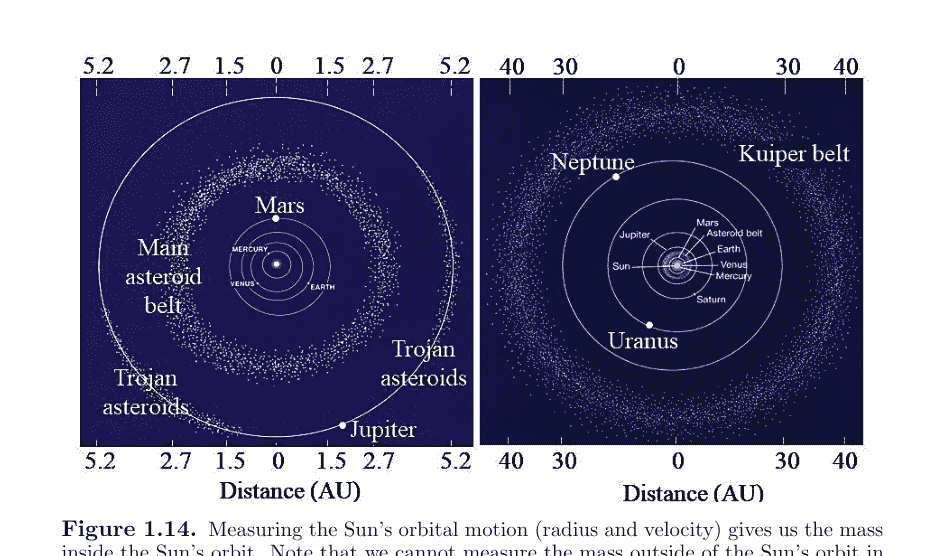

> 图1.14. 测量太阳的轨道运动（半径和速度）可以得出太阳轨道内的质量。请注意，我们无法以这种方式测量太阳轨道外的质量。

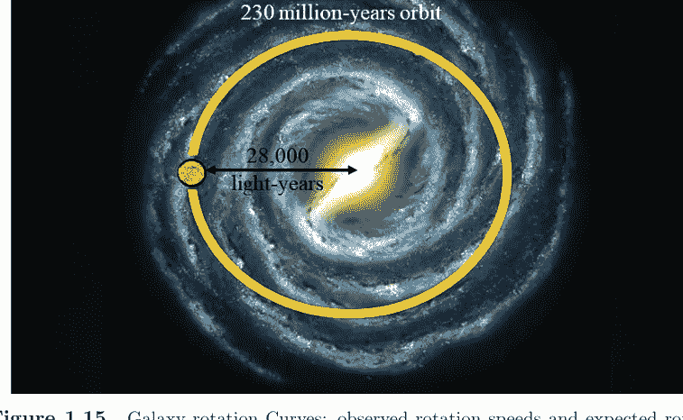

**图1.15.** 星系旋转曲线：观测到的旋转速度和预期旋转速度。可见质量不足以解释观测到的旋转速度。暗物质在大半径处占主导地位。

*v* 是轨道速度，*r* 是轨道距离，*m₁* 是轨道包围的质量，*G* 是万有引力常数，如前所定义。这里的轨道包围的质量是地球的质量，因为我们假设轨道内包围的唯一天体是地球，其余空间是真空（见图1.4）。如图1.15所示，我们还可以利用太阳在银河系中的轨道运动（半径和速度）来估计该轨道内包围的物质质量，这最早由Rubin等人（1980）提出。对于 *v* = 280 km/s 和 *r* = 280,000 光年，这个质量为 1 × 10¹¹ *m*ₛᵤₙ。实际上，我们银河系的总质量至少为 5 × 10¹¹ *m*ₛᵤₙ。我们无法以这种方式测量太阳轨道外的质量，这一事实无法弥补这一亏缺。这个意想不到的质量就是暗物质。这个质量的85%以上是不透明的。换句话说，我们银河系的大部分质量对我们来说是看不见的，甚至对整个电磁波谱也是看不见的，如我们今天所知——*即构成生命、地球和恒星的质子和中子，并不能解释我们银河系乃至整个宇宙中的大部分质量。* 我们在这里的目标是证明这种质量的存在。

## **暗物质的证据。**

在球形质量浓度 *m(r)* 中，由向心力与引力平衡得到的圆形引力轨道再次为

$$v(r)^2 = \frac{G m(r)}{r} \Longrightarrow v(r) \propto \frac{1}{\sqrt{r}}, \qquad (1.56)$$

其中 *v(r)* 是轨道速度，*m(r)* 是 *r* 以内的总质量。图1.16显示了基于牛顿引力的轨道速度预测的偏差。


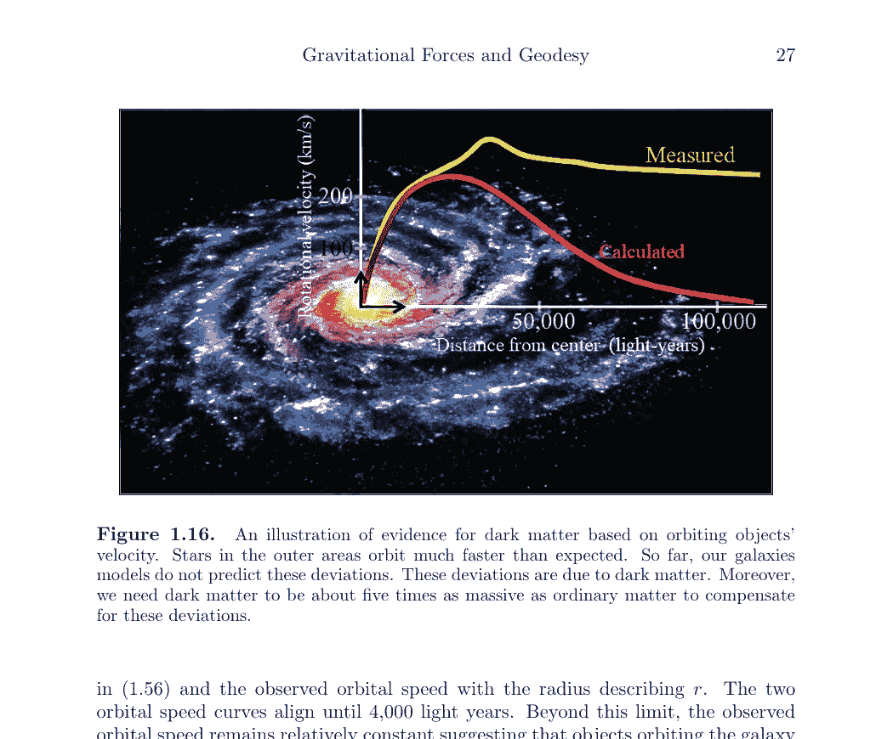

图 1.16　基于轨道天体速度的暗物质存在证据图示。外围区域的恒星绕行速度比预期快得多。到目前为止，我们的星系模型无法预测这些偏差。这些偏差是由暗物质引起的。此外，我们需要暗物质的质量约为普通物质的五倍，才能抵消这些偏差。

在(1.56)式中，以及观测到的轨道速度与半径 r 的关系。两条轨道速度曲线在 4000 光年以内是一致的。超过这个界限后，观测到的轨道速度保持相对恒定，表明在距离星系中心更远处绕行的天体，其运动速度与更靠近中心的天体大致相同，这与预期相反（Rubin et al., 1980）。预期旋转速度会像太阳系中那样按 v(r) ∝ 1/√r 下降 [见 (1.55) 和 (1.56)]。然而在大距离处，旋转曲线变得平坦。图1.16中两组速度之间的偏差随后被用来确定暗物质的含量。

让我们为图1.16中的曲线添加一些数学描述。将密度恒定的质量分布 m(r) ≈ 4πρr³/3 代入 (1.56)，得到 v ∝ r。假设星系是密度恒定的轴对称天体，我们可以看到 v(r) 线性增长，在离开大多数普通物质所在区域后，则按 v(r) ∝ 1/√r 衰减。然而，星系中的实际测量表明，在离开大多数普通物质所在区域后，v(r) 几乎是平坦的。换句话说，质量模型 m(r) ≈ 4πρr³ 在小距离上非常有效。通过假设 ρ(r) ∝ r^{-2}（对应于 m(r) ∝ r），可以再现较大 r 处近似平坦的速度旋转曲线。也就是说，必须存在一种随半径线性增加的非可见质量成分；这就是暗物质（一种非发光形式的质量）。它分布在星系中心周围的球对称晕中，这意味着星系被暗物质晕所包围。此外，还需要额外的不可见质量来防止外围恒星飞散以及星系解体。注意，在星系旋转曲线的恒速部分，我们可以从(1.56)得到：

$$ m(r) = \frac{v_c^2}{G} r \implies \frac{dm(r)}{dr} = \frac{v_c^2}{G} . \tag{1.57} $$

其中 $v_c$ 是恒定圆周速度。将球对称系统中质量守恒方程（见第2章）

$$ \frac{dm(r)}{dr} = 4\pi r^2 \rho(r) \tag{1.58} $$

代入 (1.57)，我们得到星系外部区域的密度为

$$ \rho(r) = \frac{v_c^2}{4\pi r^2 G} \propto r^{-2} , \tag{1.59} $$

这是暗物质密度的合理近似。覆盖整个星系旋转曲线的暗物质密度的更好形式为

$$ \rho(r) = \frac{\rho_0}{1 + (r/r_0)^2} \implies \rho(r) \approx \begin{cases} \rho_0 & r \ll r_0 \\ \rho_0 (r_0/r)^2 & r \gg r_0 \end{cases} . \tag{1.60} $$

常数 $\rho_0$（在 $r = 0$ 处的密度）和 $r_0$（核心半径）可以通过拟合可观测的星系旋转曲线获得。

宇宙中非发光物质的第一个历史证据是由弗里茨·兹威基（Fritz Zwicky，1933）通过对被称为后发座星系团（Coma cluster）¹的星系团动力学观测得到的。¹这个星系团包含 1% 的发光物质，9% 的星系际气体（即星系团内介质），以及 90% 的暗物质。兹威基（1937）推断出星系的质量远比他通过其运动所能观测到的大。他的计算表明，需要比发光质量多 100 倍的质量才能解释星系的速度（Sanders, 2010）；这略低于预期。兹威基（1937）得出结论，大多数物质不辐射。后来的观测和研究证实，即使是像我们银河系这样的单个星系也由暗物质主导（Rubin and Ford, 1970；以及 Rubin et al., 1980）。

在本系列丛书中我们多次使用但至今尚未正确定义的词是*星系*。这种不完整是因为迄今为止尚未讨论暗物质。实际上，星系是由暗物质、恒星、气体和尘埃组成的引力束缚系统。恒星包括恒星残骸（从黑洞到白矮星），气体包括离子、中性粒子和分子，超大质量黑洞位于大多数（如果不是全部的话）星系的中心。尘埃在这里被列为独立的组成部分，因为它在重新分布星系发射的电磁辐射方面起着关键作用，而这些辐射构成了我们可获得的大部分关于星系的信息。大约一半的恒星位于旋涡星系中，一半位于椭圆星系中。在像银河系这样的旋涡星系中，大多数恒星位于薄盘中。银河系盘的半径约为 15 kpc，包含约 6 × 10⁶ m_sun 的恒星。盘中的恒星以近似圆形的轨道绕星系中心旋转，旋转速度约为 220 km/s，几乎与半径 r 无关。这样的旋转曲线要求质量分布非常延展，远比观测到的光度分布更延展。这表明存在大量不可见的暗物质。有趣的是，旋臂不以与恒星相同的速度旋转，因此恒星可能进出旋臂。椭圆星系是呈黄色的圆形天体。它们的恒星形成率低于相同质量的旋涡星系。低恒星形成率是因为中心的超大质量黑洞阻止了恒星形成。

> **测验：黑洞。** 给定一颗质量为 m₁ 的大质量恒星，计算其半径（称为史瓦西半径），在该半径处，即使从恒星表面发出的光也无法逃逸。确定太阳的史瓦西半径，以及如果其质量包含在相应的球形体积中（与该体积边界的球面称为事件视界），它将具有的平均质量密度。请注意，目前对我们宇宙的理解是，新的黑洞将在未来约 1000 年内继续形成。

有些人将黑洞视为暗物质的一种可能解释。正如 Ikelle (2023b) 中所描述的，黑洞是一种引力如此之强的天文物体，以至于任何东西，甚至光，都无法逃脱。物质和辐射会落入，但无法离开（Wald, 1997）。它们在大质量恒星生命末期坍缩时形成。黑洞的存在可以通过其与可见光等电磁辐射的相互作用来推断。到目前为止，黑洞已通过引力透镜²（Carr et al., 2016）被探测到。不幸的是，我们宇宙中的黑洞数量可能不足以解释宇宙中的暗物质。此外，我们仍然没有真正理解星系如何形成和演化，这是解释暗物质的一个必要步骤。

我们可以根据普通物质与暗物质在质量上的差异以及它们相对于电磁波谱的不可见性，将暗物质描述为由缓慢运动、不带电、无碰撞的重粒子构成。也有可能我们关于核合成、电磁学、引力和/或粒子物理的描述是不完整的。我们将在 Ikelle (2024) 中讨论暗物质和暗能量的可能形式。

## 位力定理适用于暗物质。

让我们首先回顾一个具有球对称质量分布的太空天体的流体静力学平衡方程：

$$\frac{dP(r)}{dr} = - \frac{G m(r) \rho(r)}{r^2},$$

其中 P(r) 是半径 r 处的局部压力，m(r) 是半径为 r 的球体内所包含的质量，ρ(r) 是半径为 r 的球体内所包含的密度。它表达了内部压力与引力之间的平衡。位力定理是另一个流体静力学平衡方程，但以能量而非力的形式表述。克劳修斯（Clausius）于 1851 年得出该定理。它描述了一个处于平衡状态的系统的总动能 K 与总势能 W 之间的关系。它使我们能够分析包含数百万或数十亿颗恒星以及可能包含数千个星系的星系团的系统。该定理避免了求解百万体问题。此外，有时我们对这些大型系统知之甚少。在这个定理中，我们还假设系统中除了其内部动能之外，没有其他内部支撑以对抗引力（即源处没有磁场或旋转）。请注意，虽然我们在此讨论中聚焦于暗物质，但位力定理具有广泛的应用。这些应用范围从恒星形成到宇宙中最大结构的形成。这些结构包括星系和星系团。星系团是宇宙中质量最大的引力束缚系统。

让我们考虑一个由 N 个天体组成的系统，其质量为 m_i，位置矢量为 x_i，速度矢量为 v_i，动量 p_i = m_i v_i，其中 i 表示第 i 个天体。这个系统的转动惯量对时间的导数，称为位力，为

$$ Q = \frac{1}{2} \frac{dI}{dt} = \sum_{i=1}^{N} \mathbf{p}_i \cdot \mathbf{x}_i , $$

其中

$$ I = \sum_{i=1}^{N} m_i |\mathbf{x}_i|^2 , \qquad (1.61) $$

是转动惯量。为了推导位力定理，我们需要取位力对时间的导数

$$ \frac{dQ}{dt} = \sum_{i=1}^{N} \frac{d\mathbf{p}_i}{dt} \cdot \mathbf{x}_i + \sum_{i=1}^{N} \mathbf{p}_i \cdot \mathbf{v}_i = \sum_{i=1}^{N} \mathbf{F}_i \cdot \mathbf{x}_i + \sum_{i=1}^{N} m_i v_i^2 \quad \text{其中 } \mathbf{F}_i = \frac{d\mathbf{p}_i}{dt} = -\frac{1}{2}\sum_{i=1}^{N}\sum_{j\neq i} \frac{G m_i m_j}{x_{ij}} + \underbrace{\sum_{i=1}^{N} m_i v_i^2}_{\text{动能 }(2K)} = 0 , \qquad (1.62) $$

其中 $x_{ij}=|\mathbf{x}_i-\mathbf{x}_j|$ 是天体 $i$ 和天体 $j$ 之间的距离，因子 $1/2$ 用于修正总势能中对天体对的重复计数。对于处于平衡状态下的系统，$dQ/dt = d^2 I / dt^2 = 0$ 为零。因此，位力定理可以表示为

$$ 2K + W = 0 . \qquad (1.63) $$

¹后发座星系团由约 1000 个星系组成，分布在天空中的两度范围内。引力将这些星系束缚成一个星系团。然而，星系并不像太阳系那样围绕一个中心重天体运行。


考虑由 N 个星系组成的引力系统。为简化起见，让我们考虑由所有恒星质量相同 $m_i = m$ 的完美球对称椭圆星系构成的情况。在位力平衡下，我们就可以将星系团的质量重写为

$$m_{\mathrm{eff}} = \frac{2}{G}\frac{\langle v^2 \rangle}{\langle 1/r \rangle} = \frac{1}{G} r_h \langle v^2 \rangle \ ,\tag{1.64}$$

其中

$m_{\mathrm{eff}} = \sum_{i=1}^{N} m_i = N m\ ,\quad \langle 1/r \rangle = \frac{1}{N(N-1)} \sum_{i=1}^{N} \sum_{j \neq i} \frac{1}{x_{ij}} \ ,\quad \langle v^2 \rangle = \frac{1}{N} \sum_{i=1}^{N} v_i^2 \ ,$

$r_h = 2/\langle 1/r \rangle$ 是以星系团质心为中心且包含星系团一半质量的球体的半径。不幸的是，我们无法从 $\langle v^2 \rangle$ 和 $\langle 1/r \rangle$ 推断 $m_{\mathrm{eff}}$，因为它们不可观测。Zwicky（1937）推断出 Coma 星系团的总质量远大于其星系质量之和，他改用

$$m_{\mathrm{eff}} = \frac{3}{\alpha G} r_h \langle v_{\mathrm{los}}^2 \rangle \ ,\tag{1.65}$$

$v_{\mathrm{los}}$ 是视线方向速度，$\alpha$ 是量级为 1 的参数，描述了我们对星系径向分布的无知。注意，在各向同性假设下，$\langle v_{\mathrm{los}}^2 \rangle = \langle v^2 \rangle / 3$（即相对于星系中心的径向速度与轨道速度之间的关系），并且可以从投影的成对分离推导出平均倒数成对分离。因此，通过位力论确定星系团质量已简化为确定 $\langle v^2 \rangle$ 和半质量半径 $r_h$。

考虑 Fritz Zwicky（1937）研究的 Coma 星系团。望远镜测得的视线方向速度为 $v_{\mathrm{los}} = 880\ \mathrm{km/s}$。假设星系轨道是各向同性的，则 $\langle v^2 \rangle = 2.323 \times 10^{12}\ \mathrm{m^2/s^2}$。同时假设未知的暗物质成分显示出与普通物质（即星系的可见物质）相同的分布，我们可以取

$$r_h \approx 1.5\ \mathrm{Mpc} \approx 4.6 \times 10^{22}\ \mathrm{m} \ .\tag{1.66}$$

我们就可以推导出 Coma 星系团的质量为

$$m_{\mathrm{coma;virial}} = \frac{\langle v^2 \rangle r_h}{\alpha G} \approx 4 \times 10^{45}\ \mathrm{kg} = 2 \times 10^{15} m_{\mathrm{sun}} \ ,\tag{1.67}$$

（相对于其总光度）用于表征星系或星系团中存在的暗物质。这是一种比较引力质量与光度质量的便捷度量。设 $m = \alpha' m_{\mathrm{sun}}$ 为给定星系的质量，$L = \beta' L_{\mathrm{sun}}$ 为其光度。其质量-光度比以太阳系单位测量：

Υ = α' m_sun / β' L_sun ⇒ Υ_coma = 2 × 10^{15} m_sun / 8 × 10^{12} L_sun ≈ 250 m_sun / L_sun . (1.68)

因此 Coma 的质量-光度比为 250，太阳为 1，银河系为 27.1，假设银河系 $m_{\mathrm{mw}} = 3.8 \times 10^{11} m_{\mathrm{sun}}$ 且 $L_{\mathrm{mw}} = 1.4 \times 10^{10} L_{\mathrm{sun}}$。大多数河外天体的质量-光度比大于 1，表明并非所有质量都以可见恒星形式存在。对于星系推断出的高值可达 30，对于星系团可达 300。这些数字表明存在大量的暗物质。更一般地说，质量-光度比取决于星系中恒星的数量和类型，以及暗物质的量。

## 位力定理应用的其他例子：太阳质量平均温度的估计

让我们确定太阳的质量平均温度。假设太阳充满单原子理想气体，每个粒子的内能为 $(3/2)k_B T$。因此太阳的内能为

K = 3/2 m_sun R <T> / μ , (1.69)

其中 μ 是气体中每个粒子的平均质量，R 是理想气体常数。太阳的重力能为

W = -α G m_sun² / r_sun (1.70)

其中 α 是量级为 1 的常数，描述了我们对内部密度结构的无知。应用位力定理，我们得到

2K + W = 0 ⇒ <T> = α μ G m_sun / (3 R r_sun) (1.71)

如果 μ = 1/2（纯电离氢气体），且 α = 2/5（均匀球体），我们需要 <T> = 1.53 × 10^6 开尔文，才能使太阳处于流体静力平衡。太阳表面温度约为 6000 开尔文，其核心为 100 万开尔文。 remarkable的是，我们仅凭太阳的整体特性就能在数量级上得到太阳的平均内部温度，而无需任何关于太阳内部核聚变的知识。这就是位力定理的威力。

## 位力定理应用的其他例子：太阳具有气态中心而地球具有液态或固态中心

我们也可以用位力定理证明太阳具有气态中心而地球具有液态或固态中心。考虑密度为 ρ、温度为 T 的天体，由
原子质量为 $A$、原子序数为 $Z$ 的原子组成。粒子数密度为 $n = \rho/(A m_{\mathrm{H}})$，因此它们之间的典型距离必须为

$$d = n^{-1/3} = \left(\frac{A m_{\mathrm{H}}}{\rho}\right)^{1/3}.$$
(1.72)

电磁势能为

$$K \approx \frac{Z^2 e^2}{d} = Z^2 e^2 \left(\frac{\rho}{A m_{\mathrm{H}}}\right)^{1/3},$$
(1.73)

其中 $e$ 为电子电荷。我们忽略了由相反电荷电子屏蔽核电荷而产生的任何抵消。对于质量为 $m$、半径为 $r$ 的球形天体，$\rho = 3m/(4\pi r^3)$，位力定理告诉我们平均温度将为

$$\langle T\rangle = \frac{\alpha}{3}\frac{\mu}{\mathcal{R}}\frac{Gm}{r} = \frac{1}{3}\frac{A}{\mathcal{R}}\frac{Gm}{r}$$
(1.74)

或

$$\frac{K}{k_B \langle T\rangle} \approx \frac{Z^2 e^2}{G A^{4/3} m_{\mathrm{H}}^{4/3} m^{2/3}} = 0.011\frac{Z^2}{A^{4/3}}\left(\frac{m}{m_{\mathrm{sun}}}\right)^{-2/3},$$
(1.75)

其中 $\mu \approx A$ 为每个粒子的平均原子质量。即使对于纯铁成分，$Z = 26$ 且 $A = 56$，我们也有

$$\frac{K}{k_B \langle T\rangle} = 0.035\left(\frac{m_{\mathrm{earth}}}{m_{\mathrm{sun}}}\right)^{-2/3} \approx 168.15 \implies \frac{K}{k_B \langle T\rangle} \gg 1.$$
(1.76)

对于氢成分，$Z = A = 1$，我们有

$$\frac{K}{k_B \langle T\rangle} = 0.035\left(\frac{m_{\mathrm{jupiter}}}{m_{\mathrm{sun}}}\right)^{-2/3} \approx 3.61.$$
(1.77)

而对于太阳 $K/(k_B \langle T\rangle) = 0.035$。因此，实质上大于木星的天体不应存在固态或液态相，其中包括太阳。它们开始出现时质量降至木星或更小，其中包括地球。 remarkable的是，我们可以根据天体的质量推断其相态，即使质量估计并不十分准确。再次，这就是位力定理的威力。

#### 1.1.4. 重力势、大地水准面和重力异常

重力的空间变化在研究地球内部的动力过程以及从地球内部的勘探和生产中发挥了核心作用。我们此处的目标是介绍重力势，描述重力测量如何用于研究地球内部的动力过程以及矿物勘探和生产。

重力势的计算使我们能够引入等势面，并随后在地球物理研究和应用中引入两个重要的等势面，即大地水准面和参考椭球。再次，质量 $m_1$（地球）对质量 $m_2$ 施加的力为

$$\mathbf{F}(r) = -\frac{G m_1 m_2}{r^2} \mathbf{i}_r = -m_2 \frac{dU}{dr} \mathbf{i}_r , \quad (1.78)$$

其中

$$dU(r) = \frac{G m_1}{r^2} dr$$

或

$$U(r) = G m_1 \int_{\infty}^{r} \frac{1}{\eta^2} d\eta = G m_1 \left[ \frac{1}{\infty} - \frac{1}{r} \right] = -\frac{G m_1}{r} . \quad (1.79)$$

质量 $m_1$ 和 $m_2$ 的质心相距 $r$。因此我们引入了一个新的标量场 $U(r)$（没有方向属性），它被称为重力势。它实际上是两点之间的势差，因为从初等势 $dU(r)$ 到总势 $U(r)$ 时，我们需要两个点（或积分的两个极限）。我们将特定点 $r = \infty$ 处的势定义为相对于参考点为零，使得由 $m_1$ 产生的重力势仅取决于距离 $r$。

利用 (1.79) 中重力势的定义，质量 $m_2$ 朝向 $m_1$ 的重力加速度可以写为

$$\mathbf{g}(r) = -\frac{G m_1}{r^2} \mathbf{i}_r = -\frac{dU}{dr} \mathbf{i}_r . \quad (1.80)$$

一般而言，

$$\mathbf{g}(\mathbf{x}) = -\nabla [U(\mathbf{x})] = -\nabla U(\mathbf{x}) = -\left[ \frac{\partial U}{\partial x} \mathbf{i}_1 + \frac{\partial U}{\partial y} \mathbf{i}_2 + \frac{\partial U}{\partial z} \mathbf{i}_3 \right] . \quad (1.81)$$

由于势是标量而非矢量，有时先计算势然后再计算势的梯度会更容易。重力势恒定（即 $U =$ 常数因此 $dU = 0$）的曲面 $S$ 被称为等势面。因此 $\mathbf{g} = -\nabla U$ 沿 $S$ 没有分量，与等势面垂直。然而 $\mathbf{g}$ 在等势面上不一定是恒定的。对于 $U = -G m_1 / r$，$U =$ 常数意味着 $r =$ 常数（即对于非旋转均匀地球，等势面是以 $m_1$ 为中心的球面（见图 1.17a）。


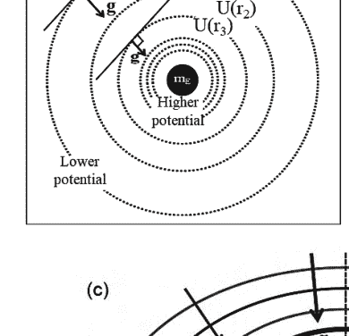

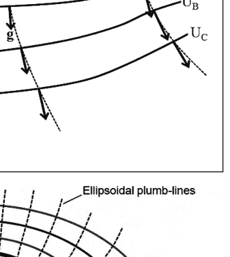

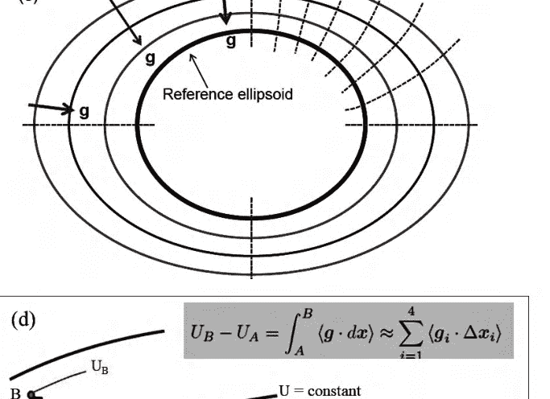

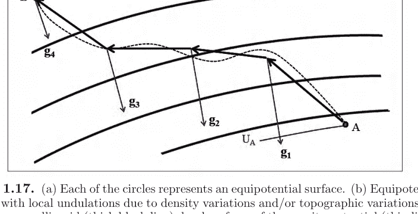

```
$U_B - U_A = \int_A^B \langle g \cdot dx \rangle \approx \sum_{i=1}^{4} \langle g_i \cdot \Delta x_i \rangle$
```

图 1.17. (a) 每个圆代表一个等位面。 (b) 由于密度变化和/或地形变化引起的局部起伏的等位面。 (c) 理想参考椭球体（粗黑线）、重力势的水平面（细线）以及铅垂线（虚线）。 (d) 功的积分路径。

让我们将重力势与质量为 $m_2$ 的物体上重力所做的功的概念联系起来。也就是说，当粒子在地球引力场中从点 $\boldsymbol{x}_A = r_A \hat{\boldsymbol{i}}_r$ 移动到另一点 $\boldsymbol{x}_B = r_B \hat{\boldsymbol{i}}_r$ 时，我们有

$$W = \int_{\boldsymbol{x}_A}^{\boldsymbol{x}_B} -m_2\left[\boldsymbol{g}(\boldsymbol{x}) \cdot d\boldsymbol{x}\right]$$
$$= m_2 \int_{r_A}^{r_B} G\frac{m_1}{r^3}\left(r\hat{\boldsymbol{i}}_r\right)\cdot\left(dr\hat{\boldsymbol{i}}_r\right)= m_2 \int_{r_A}^{r_B} \frac{G m_1}{r^2} dr . \tag{1.82}$$

利用方程 (1.79) 中重力势的定义，我们随后写出

$$W = -G m_2 m_1 \left[\frac{1}{r_B} - \frac{1}{r_A}\right] = m_2\left[U(\boldsymbol{x}_B) - U(\boldsymbol{x}_A)\right] . \tag{1.83}$$

该结果表明，将质量 $m_2$ 从点 $\boldsymbol{x}_A$ 移动到点 $\boldsymbol{x}_B$ 所需的功是 $A$ 和 $B$ 之间的重力势差，其中 $B$ 处于更高的势能。它还表明在将质点从 A 移动到 B 时，所走的路线并不重要。唯一重要的是 $\boldsymbol{x}_A$ 和 $\boldsymbol{x}_B$ 之间的势差。因此重力确实是保守力，因为势能的变化不是初始点和终点之间所走路径的函数。

尽管本小节中的结果是使用与地球的引力相互作用作为示例推导出来的，但它们适用于任何物体。

### Example #6:

现在让我们考虑在假设 $r = r_{\text{earth}} + h$ 且 $h \ll r_{\text{earth}}$ 的条件下，将质量 $m_2$ 从地球表面 $r_{\text{earth}}$ 提升到 $r$ 所涉及的功（例如，$r_{\text{earth}} = 6400$ km 且 $h = 100$ km）。将质量 $m_2$ 从地球表面提升到 $r$ 点所需的总功为

$$W = -G m_1 m_2 \left[\frac{1}{r} - \frac{1}{r_{\text{earth}}}\right] = -G m_1 m_2 \left[\frac{h}{r_{\text{earth}}^2}\right] = -m_2 g h ,$$

其中

$$g = |\boldsymbol{g}| = \frac{G m_1}{r_{\text{earth}}^2} . \tag{1.84}$$

### Example #7:

利用重力势的概念，我们可以在假设地球不自转的情况下确定物体（例如 1000-kg 火箭）必须具有的最小初始速度才能逃离地球引力场。逃逸意味着它能够无限远地远离地球引力场。例如，月球距离地球无限远，因此阿波罗航天器需要逃离地球引力场才能到达那里。由于重力是保守力，系统的机械能必须守恒。轨道上物体的总机械能是其动能和势能之和。请记住，动能是由于具有质量的物体运动而产生的能量。如果我们用“1”和“2”分别表示质量被抛射的时刻以及它远离地球引力吸引时的条件，我们则写出

$$E_{K1} + m_2 U_1 = E_{K2} + m_2 U_2$$

或

$$\frac{1}{2} m_2 v_1^2 - \frac{G m_1 m_2}{r_1} = \frac{1}{2} m_2 v_2^2 - \frac{G m_1 m_2}{r_2}, \tag{1.85}$$

其中 $E_{K1}$ 和 $E_{K2}$ 表示动能，$U_1$ 和 $U_2$ 是势能。用于逃逸的最小发射速度，称为逃逸速度，将导致火箭仅在达到 $r_2 = \infty$ 时停止（$v_2 = 0$，因此动能变为零，即重力能变为零）。然后我们发现逃逸速度为

$$E_{K1} + m_2 U_1 = 0 \Longleftrightarrow \frac{1}{2} m_2 v_1^2 = \frac{G m_1 m_2}{r_1}$$

因此

$$v_1 = \sqrt{\frac{2 G m_1}{r_1}} = 11.12\ \text{km/s}.$$

请记住 $m_1$ 和 $r_1$ 分别是固体地球的质量和半径。对于火星、金星、水星、月球、木星、土星、天王星、海王星和太阳，逃逸速度分别为 5.0 km/s、10.3 km/s、4.2 km/s、2.3 km/s、61 km/s、37 km/s、22 km/s、25 km/s 和 618 km/s。我们只需将 $m_1$ 和 $r_1$ 替换为所考虑源的质量和半径，即可得到这些速度。

让我们回顾一下，动能与物体的速度有关。如果一个物体的质量为 $m$，速度为 $v$，则动能为 $E_K = \frac{1}{2} m v^2$。请注意，虽然物体的速度可能为正或负（取决于方向），但动能始终为正。当物体运动为旋转时，动能为 $E_R = I \omega^2$，其中 $I$ 是物体的转动惯量，$\omega$ 是其角速度（另见 Ikelle, 2023b）。对于半径为 $R$、质量为 $m$、绕其对称轴旋转的实心圆柱体，$I = m R^2$。再次，重力势能为 $E_g = m g h$，其中质量 $m$ 位于地面上方高度 $h$ 处。

## The Poisson and Laplace equations:

行星的引力场由其密度引起。行星的质量分布本质上是三维的，但我们能做的最多就是测量地球表面的重力加速度。我们能否从表面测量重建行星的质量分布？答案是肯定的，归功于一个被称为高斯定理的基本关系（即向量场 $\boldsymbol{g}$ 在闭合曲面上的面积分等于其散度 $\operatorname{div}(\boldsymbol{g}) = \nabla \cdot \boldsymbol{g}$ 的体积分），该定理在 Ikelle (2020) 中描述，如果我们能求解由此产生的方程，它将表面测量与整个行星的性质联系起来。

假设我们在边界域 $D$ 的表面 $\partial D$ 处处测量 $\boldsymbol{g}$，其中法向量 $\boldsymbol{n}$ 向外指向。在下文中我们假设坐标系的原点位于行星中心，$r = |\boldsymbol{x} - \boldsymbol{x}_0| = |\boldsymbol{x}|$。高斯定理告诉我们：

$$\int_{\partial D} [\boldsymbol{g}(\boldsymbol{x}) \cdot \boldsymbol{n}(\boldsymbol{x})] \, dS(\boldsymbol{x}) = \int_{D} [\nabla \cdot \boldsymbol{g}(\boldsymbol{x})] \, dV(\boldsymbol{x})$$ $$= -\int_{D} [\nabla^2 U(\boldsymbol{x})] \, dV(\boldsymbol{x}) \tag{1.86}$$

我们也在推导 (1.86) 时使用了 (1.81)。通过假设 $\partial D$ 为球面，我们可以如下替代地将表面测量与整个行星的密度联系起来：

$$\int_{\partial D} [\boldsymbol{g}(\boldsymbol{x}) \cdot \boldsymbol{n}(\boldsymbol{x})] \, dS(\boldsymbol{x}) = -\int_{\partial D} g_n(\boldsymbol{x}) dS(\boldsymbol{x}) = -4\pi R^2 \left(\frac{G m_1}{R^2}\right)$$ $$= -4\pi G \int_{D} \rho(\boldsymbol{x}) dV(\boldsymbol{x}) \tag{1.87}$$

其中 $g_n(\boldsymbol{x})$ 为 $\boldsymbol{g}(\boldsymbol{x})$ 垂直于 $dS(\boldsymbol{x})$ 的分量。我们利用了这样一个事实：在球对称体内，重力加速度 $\boldsymbol{g}$ 仅由观测点 $r = |\boldsymbol{x}|$ 与质心之间的质量决定。将从表面测量到行星内部势和密度的两种方法相等，我们得到泊松方程：

$$\nabla^2 U(\boldsymbol{x}) = 4\pi G \rho(\boldsymbol{x}) \tag{1.88}$$

我们利用了 (1.87) 和 (1.88) 的相等性在其积分函数处处成立这一事实。泊松方程是基本的。它不需要关于密度在 $D$ 内如何分布的确切信息。泊松方程的齐次情况（即空间某区域无物质；密度为零）给出拉普拉斯方程：

$$\nabla^2 U(\boldsymbol{x}) = 0 \tag{1.89}$$

该结果只是陈述场线不能在无质量的区域开始或结束。由于行星的所有质量都位于表面内部，行星外部的重力势满足拉普拉斯方程。

## Spherical harmonics:

现在我们面临求解泊松方程的挑战。我们在此给出该方程的解而不加证明，因为该解的推导冗长。此外，这些推导需要超出本书预期读者的数学背景。

对于地球，由于其形状，使用球坐标是有利的。它们与笛卡尔坐标的关系如下：

$$\left\{ \begin{array}{l} x = r \sin \theta \cos \phi \\ y = r \sin \theta \sin \phi \\ z = r \cos \theta \end{array} \right. \tag{1.90}$$

$\theta$ 是余纬度（$\theta$ 在 0 和 $\pi$ 之间变化），$\phi$ 是经度（$\phi$ 在 0 和 $2\pi$ 之间变化）。有关更多细节，请参阅图 1.18。一件非常重要

勒让德函数（见 Ikelle, 2020），我们得到 $A_l^{m,o}$。理论上，需要无穷级数才能完全表征重力场，但实际上双重求和被截断到最大值约为 $n$，介于 100 和 200 之间。

## 重力梯度测量原理

除使用单个加速度计测量重力矢量外（或作为替代），我们还可以测量重力梯度张量（或重力梯度矩阵），其定义如下（例如，Baur and Grafarend, 2006）：

$\mathbf{\Gamma} = \begin{pmatrix} \frac{\partial g_x}{\partial x} & \frac{\partial g_x}{\partial y} & \frac{\partial g_x}{\partial z} \\ \frac{\partial g_y}{\partial x} & \frac{\partial g_y}{\partial y} & \frac{\partial g_y}{\partial z} \\ \frac{\partial g_z}{\partial x} & \frac{\partial g_z}{\partial y} & \frac{\partial g_z}{\partial z} \end{pmatrix} = - \begin{pmatrix} \frac{\partial^2 U}{\partial x^2} & \frac{\partial^2 U}{\partial y \partial x} & \frac{\partial^2 U}{\partial z \partial x} \\ \frac{\partial^2 U}{\partial x \partial y} & \frac{\partial^2 U}{\partial y^2} & \frac{\partial^2 U}{\partial z \partial y} \\ \frac{\partial^2 U}{\partial x \partial z} & \frac{\partial^2 U}{\partial y \partial z} & \frac{\partial^2 U}{\partial z^2} \end{pmatrix}, \tag{1.94}$

通过加速度计阵列进行测量，尤其是在使用卫星或飞机进行测量时。该张量是对称张量，因为标量量的微分顺序无关紧要，并且它只有五个独立分量，因为对角分量的和为零（自由空间中的拉普拉斯方程）；即，

$\nabla^2 U(\mathbf{x}) = \frac{\partial^2 U}{\partial x^2} + \frac{\partial^2 U}{\partial y^2} + \frac{\partial^2 U}{\partial z^2} = - \left( \frac{\partial g_x}{\partial x} + \frac{\partial g_y}{\partial y} + \frac{\partial g_z}{\partial z} \right) = 0.$

这五个分量例如可以是 $(\partial g_x/\partial x, \partial g_x/\partial y, \partial g_x/\partial z, \partial g_z/\partial y, \partial g_z/\partial z)$。重力梯度张量的实际实现是通过对加速度计取差值，如下所示：

$\Gamma_{jk} = \frac{g_j(x_k + \Delta x_k) - g_j(x_k)}{\Delta x_k}, \tag{1.95}$

其中 $j,k \in \{x_1,x_2,x_3\} = \{x,y,z\}$ 且 $\Delta x_k$ 是 $x_k$ 方向上加速度计之间的短距离。通过测量重力的高阶导数，可以准确确定小尺度特征。

## 大地水准面.³

³用所有复杂的地表地形变化（例如山脉和山谷）来表示地球的形状是不可能的任务。整个科学分支——大地测量学——致力于研究地球的形状和大小。大地测量学家定义了两个主要模型或参考面，即大地水准面和椭球体，以近似地球的形状。

存在无穷多个等位面，地球上一个特定的等位面被称为大地水准面。它与平均海平面重合（忽略潮汐和海洋中的其他动力效应）；也就是说，大地水准面是最符合平均海平面的等位面。大地水准面将是地球的表面，如果海洋能够自由流动并覆盖整个固体地球表面（在没有风、潮汐和洋流的情况下）。海洋表面将与大地水准面表面对齐，所以大地水准面是地球的理论形状。选择平均海平面完全是任意的，但这是有意义的，因为平衡状态下流体的表面必须遵循等位面。所以在海洋上，大地水准面就是海洋表面。在大陆上，大地水准面不是地形表面（其位置可通过重力测量计算）。大地水准面由使用雷达技术测量海面高程的卫星记录。如图 1.19 所示，大地水准面在赤道处更宽，在两极处更薄。记住大地水准面是一个等位面，因此它必须保持与重力场方向垂直。大地水准面的凸起和凹陷为我们提供了海底地形和地下物质组成的线索。

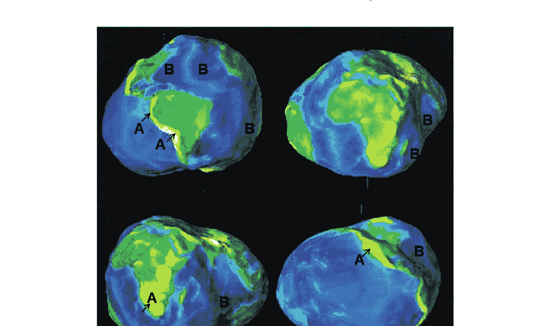

参考椭球是地球的另一个（理论）形状。它是最接近大地水准面的椭球。可以证明（Clairaut and Colson, 1739；和 Blakely, 1995）该参考椭球上重力的（理论）值为：

g(θ) = g_eq (1 + k sin²θ) / sqrt(1 - e² sin²θ)
≈ g_eq (1 + k sin²θ) (1 + ½ e² sin²θ + ⅜ e⁴ sin⁴θ)
= g_eq (1 + k1 sin²θ + k2 sin⁴θ)
= g_eq [1 + (k1 + k2) sin²θ - k2/4 sin²(2θ)] , (1.96)

其中 θ 是纬度，g_eq 是赤道处的重力，e² = (a² - b²)/a² （a 是半长轴，b 是半短轴）是椭球的偏心率，k = (b g_pole - a g_eq)/(a g_eq) 是取决于地球形状和自转的常数，g_pole 是两极处的重力。最后等式中的另外两个参数与 k 和 e 的关系如下：k₁ = k + ½ e² 和 k₂ = ½ k e² + ⅜ e⁴。g_eq、k 和 e 的典型值分别为 g_eq = 978031.846 mGal，k = 0.001931851，和 e² = 0.006694379，我们可以推导出 k₁ = 0.005278895 和 k₂ = 0.000023462。这些值通过不断增加的卫星数据得到更精确的确定。我们在 (1.96) 中使用了泰勒展开，并将计算限制在泰勒级数的第三项以得到最后的等式。所以如果地球是均匀的椭球体，地球表面重力的值将由 (1.96) 给出。

> 测验：地球表面距离地球中心最远的位置在哪里？

大地水准面在海洋学中用于确定（平均）海面地形。在海洋部分被海冰、冰山或冰架覆盖的极地地区，大地水准面还提供了表面椭球高与自由板高度之间的联系，而后者反过来可用于推断浮冰的厚度，包括南极亚冰川湖（Ewert et al., 2012）。在地球物理学中，重力异常的分析可揭示岩石圈厚度的信息以及塑造大陆和周围海洋的构造和地球动力学过程。

再次注意，我们无法直接看到大地水准面和参考椭球；因此，我们实际上无法测量大地水准面之上或之下的高度。我们必须通过重力测量推断大地水准面的位置，并通过数学或数值建模确定参考椭球的位置。

大地水准面起伏是大地水准面与参考椭球之间以米为单位的差异。大地水准面起伏也称为大地水准面高异常。它们由固体地球中质量的分布、海底和地球表面的地形以及地幔过程引起。它们通常用 N 表示，即相对于大地水准面的椭球高（见图 1.20）。就绝对值而言，N 始终小于 100 m——即约为 10^{-5} × r_e，其中 r_e 是地球半径。全球大地水准面高异常图如图 1.21 所示。大地水准面高异常的宽度指示了引起它们的密度异常的深度。当地下密度异常接近地表时，大地水准面高异常较窄。当密度异常非常深时，大地水准面高异常非常宽，有时跨越数千公里。这些大尺度的大地水准面高异常是地幔对流的大规模上涌（浅色）和下沉（深色）的结果，我们将在后续章节讨论。如图 1.21 所示，由于水深（即海底地形），海洋上存在显著的大地水准面高异常。例如，在海洋上存在海山，导致水被岩石取代。岩石增加了该区域的重力拉力，从而改变了


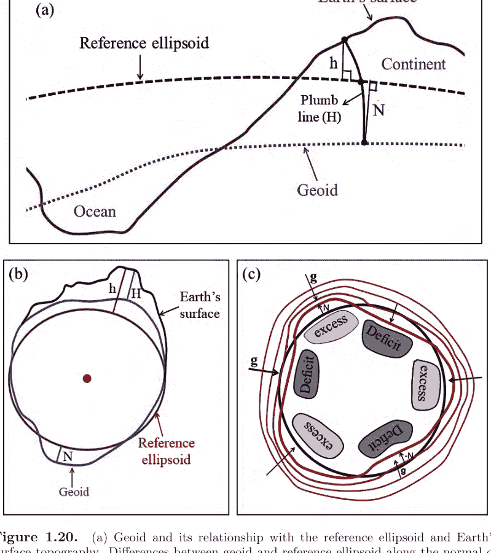

图1.20. (a) 大地水准面及其与参考椭球和地球表面地形的关系。沿椭球法线方向，大地水准面与参考椭球之间的差异称为大地水准面高（或起伏）异常 N。在美国本土，除阿拉斯加外，大地水准面高处处为负。h 是沿椭球法线方向地球表面与参考椭球之间的差异，称为椭球高。当大地水准面与参考椭球不重合时，h ≈ H + N，其中 H 是沿铅垂线方向的海拔高度，也称为正高。在得克萨斯州休斯敦，N = −27.5 米，h = 13 米，H = 40.5 米。(b) 大地水准面、参考椭球和地球表面地形的水平切片示意图。(c) 重力变化与地球内部质量不均匀分布的关系。粗红色曲线为大地水准面，粗黑色曲线为参考椭球。

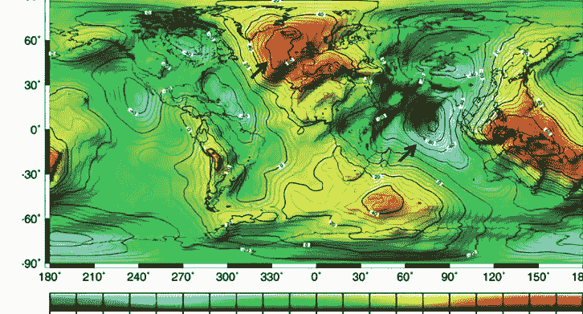

图1.21. 这是大地水准面与参考椭球差异的世界地图。高于该参考面的高度为正（趋向+90），低于的为负（趋向−110）。从绝对值看，这些大地水准面起伏处处小于100米。这些变化非常宽广，有时跨越数千公里，如图中两个深色箭头所示。它们是地球深部密度广泛差异的结果。最大的异常与海沟有关。

海平面。注意海平面在海山、海脊和水下高原上方会升高。最大的负异常与最深的海沟（10公里或更深，且充满水而非岩石，如Ikelle, 2023a所示）、大的负振幅以及向陆一侧岛弧上方的大的正值有关。

## 重力异常与校正。

如果地球是一个完全均匀的球体，没有横向不均匀性，并且不旋转，那么 g 处处相同。遗憾的是，情况并非如此。地球是不均匀的，并且会旋转。旋转使地球成为一个偏心率为 1/298 的扁球体。地球的极半径比赤道半径小 20 公里，这意味着赤道上的 g 比两极小 0.4%。在赤道上，|g| 约为 978,000 mGal（毫伽）。地球表面的重力测量表明，重力变化比椭球形状所暗示的微小变化更多。这些 |g| 的变化取决于两个因素：海底和地球表面的地形（例如山脉、山谷、平原、洋脊和深海海沟）以及地下的密度变化（例如地壳和地幔的密度变化、盐丘、沉积盆地和矿石）。这些变化被称为重力异常。它们是局部变化，振幅为几个 mGal。

此外，|g| 还随时间变化，这由潮汐、大气压、海洋地形、水体和极移引起。这些变化对研究天气、气候和大陆水储量很重要，但对研究与密度变化相关的重力异常并不重要。在大多数情况下，地下密度的变化在数千年甚至数百万年内是恒定的。

地面重力测量相对于这些时间性重力变化几乎是在恒定时间段内进行的，因此它们的影响可以忽略不计。然而，这些 |g| 的时间变化在卫星重力测量中很重要，因为卫星记录几乎是随时间连续的，我们稍后将对此进行描述。在这种情况下，在将这些数据用于估算地下密度变化之前，需要对重力场进行数周或数月的平均，以抵消时间性重力变化。

让我们重申，密度（单位体积的质量）是固体地球最重要的参数之一。固体地球内部的所有过程都以某种方式与非平衡的质量分布相关。固体地球主要特征的质量无法直接确定。然而，可以使用钻孔岩心样品测量地壳上部（小于8公里）的密度。在地球更深部，密度可以通过地震波速度（见Ikelle, 2023b）和重力异常来确定。

**测验。**（1）地球表面 g 的变化范围是多少？（2）地形表面、椭球面和大地水准面之间有什么区别？

## 自由空气校正。

正如我们从 Ikelle（2023b）中的牛顿万有引力定律所看到的，重力随距离的平方而减小。因此，如果我们把重力仪从地面上的点 R0（或任何其他基准面）提升到 M0，如图1.22所示，重力将会改变。为了能够比较在不同高度测得的数据，我们必须将它们归算到共同基准面（即，我们必须对数据进行正则化）。这种针对地形效应的校正分为几个步骤，自由空气校正是第一步。

正如我们在本章中迄今所讨论的，地下质量分布与岩石密度直接相关，而岩石密度在不同位置是不同的（见Ikelle, 2023a）。如果地下存在更致密的岩石，由此增加的质量将产生更大的引力。换句话说，岩石密度是导致重力场变化的唯一物理性质，它解释了大部分重力异常（与预期的差异）。地表重力变化的另一个重要原因来自陆地地形和海底地形（即洋底地形）。这些变化与地下的任何物理性质没有直接关系。因此，在地球物理研究中，特别是在矿床勘探中，我们只对地下的密度变化感兴趣。因此，需要去除与陆地地形和海底地形相关的 |g| 的不需要分量。这些去除通常称为归算或校正。我们在这里描述一些关键校正（另见图1.22），假设大地水准面和参考椭球是已知的。

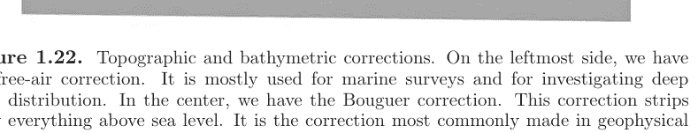

**图1.22.** 地形和海底地形校正。最左侧是自由空气校正，主要用于海洋测量和深部质量分布研究。中间是布格校正，该校正剔除海平面以上的一切，是地球物理勘探中最常用的校正，需要知道板层密度 ρ。最右侧是针对地球表面山带和山谷的地形校正。M0、M1、M2 和 M4 是实际测量点（即重力测站位置），R0、R1、R2 和 R4 是经过地形和海底地形校正后的外推测量点。

假设某次重力测量是在海平面以上高度 h（点 M0）处进行的。自由空气校正仅考虑重力仪与选定基准点 R0 之间的空气（图1.22最左侧），对重力仪海拔变化进行校正。然后按如下方式确定自由空气异常：

Δg_fa(θ) = g_obs − g_0(θ) + δg_fa = g_obs(θ) − g_0(θ) (1 − 2h/r_e) , (1.97)

其中

δg_fa = 2h/r_e g_0(θ) ≈ 0.308769 × h , (如果 h 以米为单位，则单位为毫伽) (1.98)

式中，g_obs 是在特定位置测得的重力，g_0 是由参考椭球地球模型给出的理论重力（即，如果地球是均匀椭球体时地球表面的重力值），r_e 是地球半径，δg_fa 是自由空气校正。当大地水准面与参考椭球不重合时，可以用 h′ = h + N 简单替代 h，其中 N 是大地水准面异常（即大地水准面高或起伏）。注意，如果重力仪的海拔高于参考椭球，则应用自由空气校正后，观测点的重力将增加。

## 框1.2：引力与惯性

除了少数例外，在太空中运动的天体，如果没有大气或地面阻力使其减速，是不会停止的。太空本身没有引力——也就是说，它的引力为零。然而，天体通常有引力，因为密度直接影响引力。这就是为什么较大的行星具有更强的引力，而我们的太阳质量最大，引力最强。行星体的形成方式多种多样，但各种力使它们运动起来。无论它们移动得多慢，都不会停下来。当太阳和较小的天体（如彗星）进入彼此的范围内时，更大的引力会获胜。天体要么直接撞向太阳，要么在沿椭圆运动后最终撞向太阳；或者，它要绕太阳许多圈后才会被拉进去。


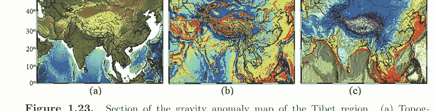

图 1.23. 西藏地区重力异常图的截面。 (a) 西藏地区的地形和水深。 (b) 西藏的自由空气重力异常。 (c) 西藏地区的布格重力异常图。 (改编自 Fowler, 1990 and https://wiki.tfes.org/Gravimetry)。

总体而言，给定区域的自由空气重力异常图与其地形在地球的大多数区域和大陆上相关性良好，包括西藏地区（见图 1.23）。即使在火星等地外行星上，地形与自由空气重力剖面之间也存在很强的相关性，如图 1.24 所示。

图 1.24. (a) 地形 (b) 自由空气重力

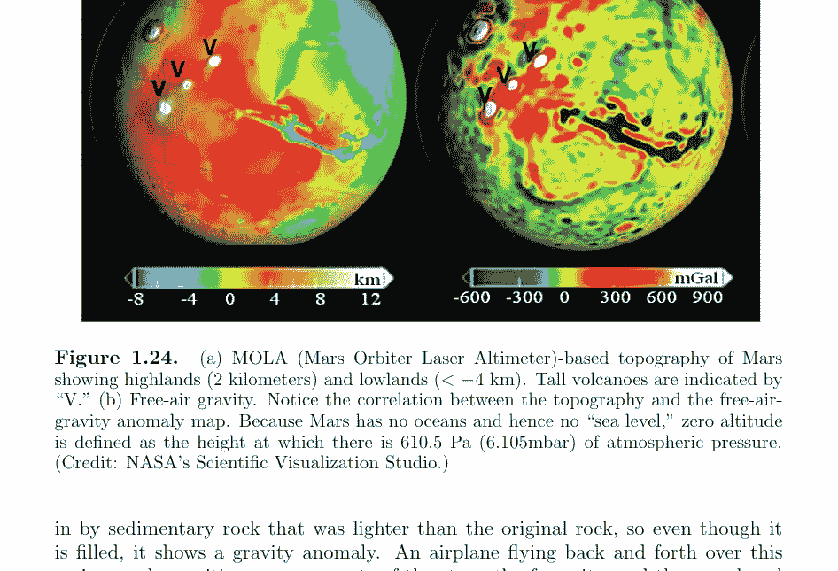

## 布格校正和地形校正。

布格校正从数据中去除测量点 M1 与基准点 R1 之间岩石的影响，如图 1.22（中心）所示。忽略地形校正，布格重力异常则由下式给出

Δg_B = g_obs − g_0(θ) + δg_fa + δg_B = g_obs − g_0(θ) [1 − 2h/r_e] −2πGρh , (1.99)

其中

δg_B = −2πGρh ≈ −0.04193 × 2.67 × h , (in mGal if h is in m) (1.100)

其中 G 为万有引力常数，ρ 为地壳岩石的假定平均密度，h 再次为海拔高度。地形密度 ρ 通常取为 2.67 g/cm³。

布格校正假设板体在水平方向上无限延伸。由于地球表面地形（地貌），这一假设并不总是成立。如果能够获取数字地形/水深数据，应用地形校正是很直接的。我们只需将重力站周围划分为若干区域，估算每个区域的平均海拔，并基于布格校正计算各区域的重力效应。对地下岩石密度的了解对于布格校正和地形校正是必不可少的。

## 重力勘探。

重力的一种用途是重力测量有助于绘制埋藏的陨石坑。最引人注目的发现之一是墨西哥尤卡坦半岛上的埋藏陨石坑（例如 Alvarez et al., 1980）。该陨石坑被比原始岩石更轻的沉积岩填满，因此即使被填满，仍显示出重力异常。一架在该地区往返飞行的飞机对重力强度进行了灵敏测量，并制作出了图 1.25 所示的地图。在该地图中，陨石坑的直径估计为 150 公里，深 20 公里，已深入该地区约 10-30 公里深度的陆壳。人们认为该陨石坑是在约 6600 万年前小行星或彗星撞击导致恐龙和许多动物物种灭绝时留下的。据信该撞击释放的能量约为 210 亿枚广岛原子弹。

让我们简要描述重力仪的关键特征。现代重力仪设计用于测量试质量的自由落体（见图 1.26a）。为避免空气阻力，自由落体运动在真空中进行（见图 1.26b）。重力仪组件测量的该运动参数为沿垂直轴的高度和时间对 (z_i, t'_i)，如图 1.26 所示，其中 i 的取值从 0 到例如 1,000，距离约为 20 厘米，时间为约 0.2 秒。激光干涉仪用于确定 (z_i, t'_i)。重力由此对得出。

\frac{\partial^2 z}{\partial t^2} = g_0 + \gamma z , (1.101)

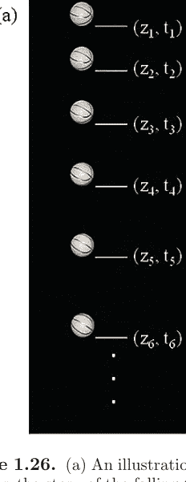

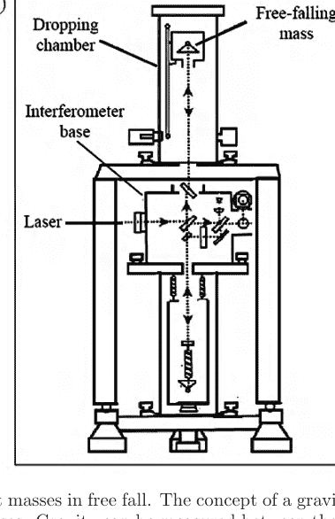

图 1.26. (a) 试质量自由落体的示意图。重力仪的概念基于下落试质量的故事。重力可以在各种位置-时间对之间测量；(zi, ti) 其中 i =1, 2, 3, .... 要测量 1 mGal 的变化，时间必须保持在纳秒以内。 (b) 现代重力仪的示意图。该装置由 (i) 带有使试质量自由下落的机械装置的真空下落室，以及 (ii) 用于测量位置-时间对的光束激光位移干涉仪组成。 (Source: Micro-g Solutions, Inc.)

## 示例 #8：埋藏的均匀球体。

在进行勘测之前，简单的几何体常用于重力建模。目标是粗略估计目标结构的异常效应。例如，如果我们发现模拟异常的振幅低于仪器的灵敏度，则完全没有必要进行任何测量。简单的基本体数量很少；然而，将它们组合起来可以构建出甚至复杂的模型。

重力测量可以写成

g_pred = g0 - δg_fa + δg_B + δg_z , (1.105)

其中 g0 是均匀参考椭球的重力响应，δg_fa 是参考椭球上方的自由空气贡献，δg_B 是参考椭球上方多余质量的贡献，而 δg_z 是地下多余质量的贡献。我们重点关注 δg_z 的计算。

球体是最基本的物体，可作为其他模型的一部分或近似对称物体。让我们描述地质构造如何引起重力异常。我们考虑在均匀介质中穿过埋藏球体的地表重力测量。该球体具有多余质量 m_s，质量越大重力越高。注意 Δg_z 在 x = 0 处具有最大值，此处记为 Δg_z,max

$$\Delta g_{z,\max} = \frac{G m_s}{z^2} \tag{1.108}$$

在图 1.27a 中的点 B，g_z 已降至峰值的一半。距离 x_h 称为曲线的半宽；即

$$\delta g_z = \frac{1}{2}\delta g_{z,\max} \Longleftrightarrow x_h = \sqrt{(2^{2/3} - 1)}\,z = 0.7664\,z \tag{1.109}$$

或 z = 1.3048 × x_h。换句话说，我们可以根据 x_h 的值确定 z 并推导出多余质量为

$$m_s = \frac{g_{z,\max} z^2}{G} \tag{1.110}$$

球体的深度 z 可以根据测量异常值一半处的半宽来估计。

## 示例 #9：埋藏的无限圆柱。

当对埋藏圆柱进行重力测量时，我们有

$$\delta g_z = \frac{2G\pi a^2 z \Delta\rho}{(x^2 + z^2)} \tag{1.111}$$

其中 a 为圆柱截面的半径，Δρ = ρ0 − ρ1 为均匀介质与埋藏圆柱之间的密度差；ρ0 为均匀介质的密度，ρ1 为埋藏圆柱的密度。请注意，圆柱异常衰减比球体慢，为 1/z 而非 1/z²，且异常比球体更宽。虽然在勘测剖面中区分这两个物体可能很困难（见图 1.29），但地图会显示圆柱的平行线性等值线与球体的圆形等值线。

测验：尽管在过去 100 年左右的技术进步，重力测量仍反映了质量相对于某个参考（如试质量）的可感知位移。美国收集的第一批重力数据由 G. Putnam 于约 1890 年获得。Putnam 使用了基于重力与摆周期之间关系的摆重力仪：

$$g = \frac{4\pi^2 l}{T^2} \tag{1.112}$$ where l is the length of the pendulum and T is the pendulum period. 假设摆的周期已知为 1 s，求 10 mGal 重力异常的摆位移。

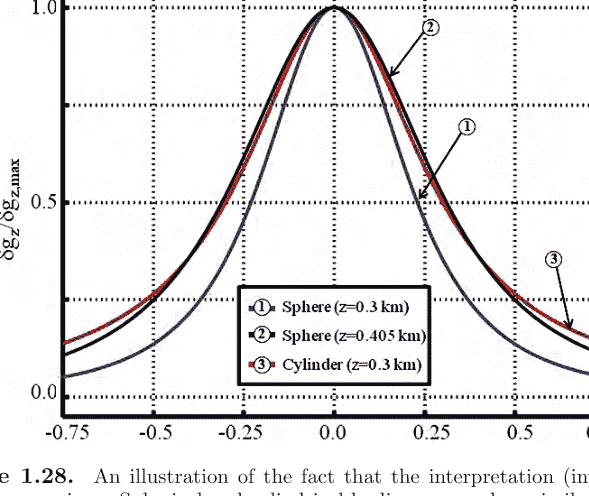

图 1.28. 重力数据解释（反演）不唯一性的说明。球体和圆柱体可以产生相似的重力剖面。

再次注意，$g_z$ 在 $x = 0$ 处具有最大值，此处记为 $g_{z,\max}$

$g_{z,\max} = \frac{2G\pi a^2 \Delta\rho}{z}.$

(1.113)

半宽距离，$x_h$，现在为

$g_z = \frac{1}{2}g_{z,\max} \Longleftrightarrow x_h = z$

(1.114)

如图 1.28 所示，圆柱异常衰减比球体慢，$1/z$ 而非 $1/z^2$，且异常比球体更宽。我们可以看到，仅凭单一剖面很难区分埋藏的球体和圆柱体。我们需要在网格上收集重力数据以检测各方向的重力变化。

综上所述，地球重力场的两个基本特征是大地水准面和重力异常。重力异常可用于定位具有大质量集中区域和包含陆地凹陷的区域。大地水准面是地球重力场的等位势面，与平均海平面重合，重力异常由此导出。


## 表 1.4. 用于生成图 1.28 的 Matlab 代码

```
clear all; G=6.67e-3; rho=1; a=1; x = -800:0.2:800; z=300;
g=((4*pi*G*rho*a^3)/3).*z./(x.^2+z.^2).^1.5; % sphere
gm = ((4*pi*G*rho*a^3)/3)/z^2; plot(x',g/gm); hold % blue line
g1=((2*pi*G*rho*a^2)/1).*z./(x.^2+z.^2).^1; % cylinder
g1m = ((2*pi*G*rho*a^2)/1)/z; plot(x',g1/g1m,'r'); % red line
z=405; g=((4*pi*G*rho*a^3)/3).*z./(x.^2+z.^2).^1.5; % another sphere
gm = ((4*pi*G*rho*a^3)/3)/z^2; plot(x',g/gm,'k'); % black line
```

**计算练习：** (1) 使用表 1.4 中的 Matlab 代码重现图 1.28 中的结果。
(2) 证明超过 (x-y) 表面的过剩球形质量的重力响应可以写成

$$\delta g_z = \frac{G m_s z}{(x^2 + y^2 + z^2)^{3/2}}$$ ,

(1.115)

(3) 使用表 1.5 中的 Matlab 代码重现图 1.29 中的结果。
(4) 修改表 1.5 中的代码，以预测 (x-y) 表面与参考椭球体表面重合情况下的重力响应。

#### 1.1.5. 卫星重力任务

仅使用陆地上表面的重力测量、船舶获得的海上重力测量以及飞机获得的重力测量来制作精确详细的似地形模型已被证明非常具有挑战性。 由于我们无法在每个地方进行测量，因此在构建似地形时很难在长距离和全球范围内准确地组合这些重力测量。 所得数据远非连续或全球分布的，

## 表 1.5. 用于生成图 1.29 的 Matlab 代码

```
clear all; close all; G=6.67e-3; rho=1; a=40; z=200;
[x,y]=meshgrid(-400:0.5:400,-400:0.5:400); r=(x.^2+y.^2).^0.5;
gm=((4*pi*G*rho*a^3)/3).*z./(r.^2+z.^2).^1.5;
[n,m] = size(gm); delgz1 = zeros(n,m); gfa = zeros(n,m);
r=((x-300).^2+y.^2).^0.5;
gn=((4*pi*G*rho*a^3)/3).*z./(r.^2+z.^2).^1.5;
r=((x-300).^2+(y+200).^2).^0.5;
gp=((4*pi*G*rho*a^3)/3).*z./(r.^2+z.^2).^1.5;
r=((x+300).^2+(y+200).^2).^0.5;
gd=((4*pi*G*rho*a^3)/3).*z./(r.^2+z.^2).^1.5;
g0= 9.78032677; z=100; gfa(100:1100,600:1100) = g0*((2*z)/(1000*6370.));
z1=2.5; delrho=2.67; h=5;
delgz1 = G*0.001*delrho*h*(pi/2+ -atan(x./z1)); delgz1(1200:n,:) = 0;
g = g0 - gfa - delgz1 + 0.6*(gm+(0.8*gn)+gp+gd);
contourf(x,y,g,10);
```

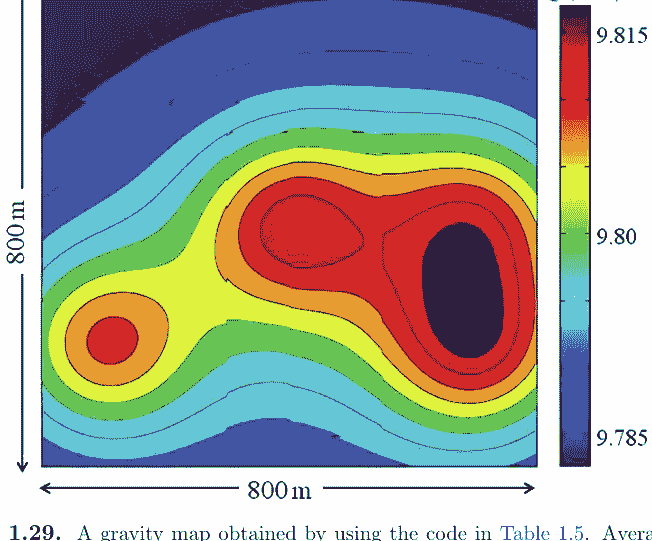

图 1.29. 使用表 1.5 中的代码获得的重力图。 地球表面平均重力约为 g = 9.8 m/s²，且变化约为 g 的 0.2%。

而且只能实现一个相当不令人满意的似地形。 1957 年，随着低地球轨道 (LEO⁴) 人造（人造）卫星的出现，找到了补救措施。 如今，轨道上有专门用于科学测量的卫星，包括重力测量。 例如，GRACE（重力恢复与气候实验）卫星由 NASA 于 2002 年发射（2002-2017），为我们提供了全球连续的高质量重力数据（例如，Tapley 等人，2004 年）。 这些数据使我们能够构建详细的准确似地形，例如图 1.18 和 1.20 中所示的似地形，以及地球表面和大气层的其他特征。 第二代 GRACE 卫星，即 GRACE-FO（重力恢复与气候实验后续）卫星，于 2018 年由 NASA 发射。

GRACE 卫星以非常高的精度测量重力和似地形的长波长（即 40000 km 至 400 km）结构。 它们甚至可以检测由于质量重新分布（冰、海平面、大陆水文）而引起的地球系统的时间变化，并详细说明水如何在地球周围移动。 GRACE 在 2004 年苏门答腊地震和海啸后观察到了重力的时间变化（Han 等人，2006 年）。 这些变化是由于板块质量重新分布造成的，约为 15 µgal。 GRACE 数据还用于创建修订后的平均重力场，其中包含与大气和海洋表面以及冰川相关的重力场短期变化的影响较少。 这些数据与固体地球结构研究相关。

⁴低地球轨道是地球表面以上 160 km 至 2,000 km 的高度。 地球的通信、导航和卫星就位于此。 国际空间站 (ISS) 也在此进行其操作。

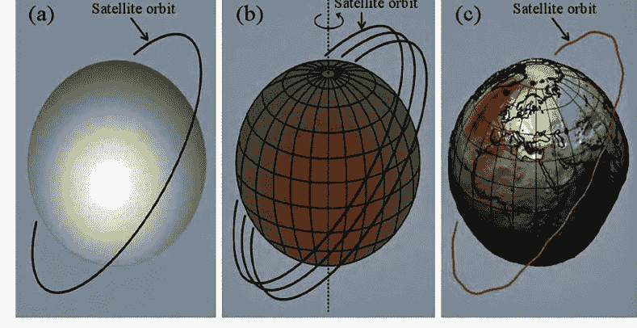

图 1.30. 围绕两个理想化地球模型和实际地球的卫星轨道路径。 (a) 如果地球是均匀球体，则根据开普勒第一定律，卫星的路径将是椭圆的。 (b) 如果地球是均匀椭球体，则根据开普勒第一定律，卫星的路径也将是椭圆的。 (c) 围绕实际地球运行的卫星的路径是由于重力而扭曲的椭圆（相对于参考椭圆的轨道摄动）。 如图 1.25 所示，轨道摄动随位置-时间对而变化。 （改编自 Rummel 等人，2002 年）

行星的轨道运动遵循与自由下落测试质量相同的规律。 测量下落测试质量的位置和时间被测量卫星轨道摄动所取代（见图 1.30）。 使用 GRACE，我们有两个相同的卫星轨道（Wolf，1969）：一个在另一个后面，在同一轨道平面上，距离地球表面约 220 km（见图 1.31a），高度约为地球表面以上 500 km。 两个 GRACE 卫星都由 GPS 卫星跟踪。 GPS 接收机用于确定 GRACE 卫星在地球上的精确位置，精度在厘米以内，其相对运动由高灵敏度的微波链路精确测量，精度在几微米以内。 当卫星对绕地球运行 时，略微更强的重力区域（过剩质量集中，固定或移动）会影响它们，如下所示：考虑 GRACE 卫星接近重力异常的情况。 当领先卫星接近异常时，两颗卫星之间的距离增加——当跟随卫星接近异常时，它会加速并追上领先卫星，它们的距离减小。

现在让我们考虑 GRACE 卫星远离该特定异常的情况。 当领先卫星远离异常并超出其影响范围时，跟随卫星仍可能被异常向后拉动，我们的分离度增加。 跟随卫星也将在该异常的影响下移动，但 GRACE 卫星分离的变化捕捉到了该异常的特征。 因此，绘制
全球地球重力场在近年来的巨大进展特别得益于卫星重力任务 GRACE 和 GOCE（重力海洋环流探测器）。 GOCE 于 2009 年 3 月发射，于 2013 年 11 月进入轨道（Floberghagen 等人，2011 年）。 GOCE 也是一颗低轨道卫星，经过流线型设计，可穿过最上层大气。 它除了实际重力外，还测量两个独立的重力梯度（重力梯度仪），如 (1.94) 中所述。 两个梯度为 ∂gx/∂y 和 ∂gz/∂y。 然而，GOCE

图 1.31. （续。）

GPS 卫星

K 波段微波链路

GPS 接收机

GRACE 卫星

地面 GPS 接收机

GPS 接收机

GRACE 卫星

第 5 级河外天体

第 4 级行星天体

第 3 级 MEO - 中地球轨道器 GEO - 地球静止轨道器卫星任务

第 2 级 LEO - 低地球轨道卫星任务

第 1 级大地测量地面基础设施

GNSS 卫星

InSAR

DORIS

潮汐计

地面重力测量

激光测距

卫星测高

卫星重力测量

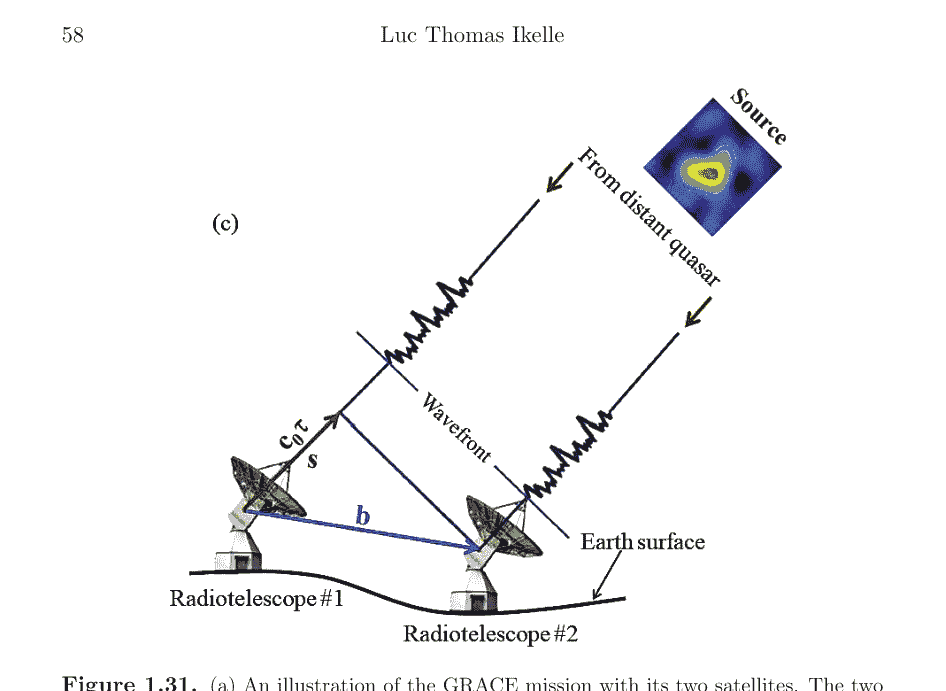

## 图 1.31. (a) GRACE 任务及其两颗卫星的示意图。 高度约为 500 km 的两颗卫星以约 220 km 的距离一前一后飞行。 称为 K 波段微波链路的星间测量装置确定两颗卫星之间的相对距离（即卫星之间的差分轨道摄动）。 双 GRACE 卫星的机载 GPS 接收机测量其绝对位置。 GRACE 对重力场的大尺度时间变化敏感，并能够监测地球表面质量再分布，包括冰川融化和地下水储量变化。 (b) 空间大地测量技术包括甚长基线干涉测量 (VLBI)、月球激光测距 (LLR)、卫星激光测距 (SLR)、DORIS、GNSS（全球导航卫星系统）、InSAR、卫星测高和卫星重力测量。 这些卫星用于确定地球上的位置。 该大地测量基础设施取决于与地球表面的距离。 在地球表面（第 1 级），我们拥有原位仪器和空间大地测量跟踪站的地面网络以及数据和分析中心。 第 2 级包括低地球轨道 (LEO) 卫星。 InSAR、卫星测高和卫星重力测量位于此级别。 大多数 GNSS 位于第 3 级。 第 4 级包括月球和行星。 类星体位于第 5 级，在那里它们提供固定在空间中的惯性参考系。

数据的极地数据间隙大于 GRACE，直径约为 1,400 km。 因此，为了使用 GRACE 和 GOCE 数据类型，必须应用某种类型的正则化（Pail 等人，2011 年）或包括地面重力数据。

GRACE 和 GOCE 使重力测量的相干覆盖和一致精度分别达到前所未有的 130 km 和 90 km 分辨率。 这些实验产生的重力场使我们能够研究更深的大地构造特征和大尺度区域到大陆尺度的似地形模式。 基本上，你离地球越远，重力场


类似于椭球体，因为这些起伏和凹凸都会衰减。因此，GRACE和GOCE对大地水准面和重力场变化的估计仅对大面积区域（如整个科罗拉多高原）足够精确。对于更高分辨率（10公里或以下）的数据，我们还需要在大多数大陆和海洋上加入地面测量数据，以补充卫星数据。

小测验：你所在的城市距离纽约9184公里，距离巴黎6904公里，距离上海11800公里。你在哪个城市？

特别是在过去十年中，国际科学界部署了配备重力仪的飞机和船舶，收集了大量新的地面重力数据。然而，在西藏和南极洲，由于恶劣的环境，重力测量仍然具有挑战性。例如，2018年关于南极大陆的可用重力异常数据覆盖了南极大陆的73%（相当于整个欧洲的面积）。换句话说，南极洲仍然是地球上最难进入的地区，因此仍然存在相当大的重力数据覆盖缺口（参见Ikelle, 2020）。

小测验：卫星重力测量系统可分为四类：（1）在轨卫星相对于地面跟踪站的位移；（2）卫星与海面相互之间的位移；（3）两颗卫星相互之间的位移；（4）单颗卫星内两个质量块的相对位移。请用这一分类对GRACE和GOCE进行归类。

#### 1.1.6. 拉格朗日点：太空中的小行星、卫星和望远镜

到目前为止，我们仅限于分析两体引力。该分析可以扩展到三体或多体引力系统。典型的三体例子是地球、太阳和一颗人造卫星。在这种情况下，我们理想地希望卫星相对于地球和太阳保持静止，以便我们能够监测地球和太阳上的动态变化，包括地球上的构造变化，以及地球和太阳上的大气、重力和磁变化。我们基本上是在处理两个大质量物体，记为m₁（如太阳）和m₂（如地球），它们围绕其共同质心（CM）做圆周运动，以及第三个物体的运动，其质量m（如卫星或小行星）与m₁和m₂相比基本可以忽略不计——即m ≪ m₁且m ≪ m₂。拉格朗日点，也称为L点，是空间中m₁和m₂的引力相互抵消的位置，因此m（如卫星）恰好停留在你放置它的位置（即保持静止）。换句话说，m₁、m₂和m的引力在五个拉格朗日点处相互抵消为零。这些点以法裔意大利数学家约瑟夫·拉格朗日的名字命名，他于1772年在研究受限三体引力时发现了这些点。“受限”一词指的是其中两个质量远大于第三个质量。今天我们知道完整的三体问题是混沌的，因此无法用封闭形式求解。所以拉格朗日有充分的理由做出这一假设。请注意，在拉格朗日点维持望远镜和卫星只需要很少的能量。

### 拉格朗日点的坐标。

现在让我们推导拉格朗日点的坐标。我们的推导大量借鉴了Cornish（1988）的方法。设x₁和x₂分别为m₁和m₂的位置，作用在位于x处的第三个质量m上的总力为

F(x) = −Gm₁m/∥x−x₁∥³(x−x₁)−Gm₂m/∥x−x₂∥³(x−x₂)。 (1.116)

找到质量m运动方程的拉格朗日点的最简单方法是将三体问题转换到一个坐标系中，该坐标系的原点位于m₁和m₂的质心，并以等于m₁和m₂轨道角频率的角频率ω旋转（即一个共转参考系，其中m₁和m₂保持固定位置）。该角频率由开普勒第三定律给出：ω²R³=G(m₁+m₂)，R=|x₁−x₂|是m₁和m₂的间距，ω=|ω|。在旋转坐标系中，m₁和m₂的位置是固定的，m的运动方程现在包含虚假的离心力和科里奥利力（关于科里奥利力的描述，参见Ikelle, 2023c）。在旋转参考系中作用于m的力Fₘ为

Fₘ(x)=F(x)−ω×(ω×x)−2m(ω×dx/dt)
=−∇U(x)=0, (1.117)

其中

U(x)=−G(m₁m/|x−x₁| + m₂m/|x−x₂|) − ½mω²|x|² (1.118)

是广义势，F是(1.116)中给出的引力。方程(1.117)右侧第二项是离心力，第三项是科里奥利力。拉格朗日点（即静止点）对应于满足Fₘ=−∇U=0的x。考虑以质心为原点、z轴与角速度方向一致的笛卡尔坐标，如下：

ω=ωi_z, x=x(t)i_x+y(t)i_y, x₁=−αRi_x, x₂=−βRi_x, (1.119)

其中

α=m₂/(m₁+m₂) 且 β=m₁/(m₁+m₂)。 (1.120)

方程(1.117)化简为

Fₘ/ω²=(x−β(x+αR)R³/[(x+αR)²+y²]^{3/2}−α(x−βR)R³/[(x−βR)²+y²]^{3/2})i_x
+(y−βyR³/[(x+αR)²+y²]^{3/2}−αyR³/[(x−βR)²+y²]^{3/2})i_y=0。 (1.121)

五次方程存在实数根，这给出了前三个拉格朗日点的位置。对于一般的α值，我们无法找到方程(1.122)的封闭形式解，因此我们寻求在α ≪ 1极限下有效的近似解。在α的最低阶，我们发现前三个拉格朗日点位于

$$L_1 : \left[ R \left(1 - \left(\frac{\alpha}{3}\right)^{1/3}\right), 0\right]^T ,\; L_2 : \left[ R \left(1 + \left(\frac{\alpha}{3}\right)^{1/3}\right), 0\right]^T ,$$
$$\text{以及 } L_3 : \left[ -R \left(1 + \left(\frac{5\alpha}{12}\right)\right), 0\right]^T 。$$

对于地日系统，α ≈ 3 × 10⁻⁶，R = 1 AU ≈ 1.5 × 10⁸ km，第一和第二拉格朗日点L₁和L₂位于距地球约150万公里处。第三拉格朗日点L₃位于距太阳约1 AU处。

为了确定另外两个拉格朗日点，我们需要将离心力（其方向从质心径向向外）与两个质量施加的引力相平衡，如图1.32c和1.32d所示。显然，在垂直于离心力的方向上的力平衡只涉及引力。这表明我们可以将力分解为平行于x和垂直于x的方向。合适的投影向量是x iₓ + y iᵧ和y iₓ − x iᵧ。Fₘ的垂直投影为

$$F_m^{\perp} = \alpha \beta y \omega^2 R^3 \left( \frac{1}{[(x + \beta R)^2 + y^2]^{3/2}} - \frac{1}{[(x + \alpha R)^2 + y^2]^{3/2}} \right) 。$$

令Fₘ^⊥ = 0且y ≠ 0，告诉我们拉格朗日点必须与两个质量等距。Fₘ的平行投影为

$$F_m^{\parallel} = \omega^2 \frac{x^2 + y^2}{R} \left( \frac{1}{R^3} - \frac{1}{[(x - \beta R)^2 + y^2]^{3/2}} \right) 。 \tag{1.123}$$

要求力的平行分量为零，可得出条件：拉格朗日点与每个质量的距离为R。换句话说，L₄位于等边三角形的顶点，两个质量构成另外两个顶点（见图1.32c）。L₅则通过L₄关于x轴的镜像反射得到。具体来说，第四和第五拉格朗日点的坐标为

$$L_4 : \left[ \frac{R}{2} \left(\frac{m_1 - m_2}{m_1 + m_2}\right), \frac{\sqrt{3}}{2} R \right]^T ,\; L_5 : \left[ \frac{R}{2} \left(\frac{m_1 - m_2}{m_1 + m_2}\right), -\frac{\sqrt{3}}{2} R \right]^T 。$$

### 稳定性分析。

L₁、L₂和L₃只是太空中的点，而L₄和L₅是独立形成的小椭圆形凹地，如图1.32d所示——也就是说，L₁、L₂和L₃是不稳定点，L₄和L₅是稳定点。小


L1、L2 或 L3 的偏离将随时间 τ ≈ 2/5ω 呈指数增长。对于地球-太阳系统 ω = 2π year⁻¹ 且 τ ≈ 23 天。换句话说，如果不进行轨道修正，停泊在 L1 或 L2 的卫星几个月后就会漂移。

例如，考虑一个太阳-地球系统和太空中的一颗卫星。无论你选择把卫星放在哪里，重力作用意味着它最终会过分靠近太阳或地球。如果卫星离太阳太近，它要么会撞向太阳，要么围绕太阳运行。相反，如果你的卫星离地球太近，它会坠回大气层，或围绕行星运行。卫星只能在拉格朗日点保持稳定。放置在 L1、L2 或 L3 的卫星最终会移开，因为这三个拉格朗日点是不稳定的。在 L4 和 L5，即使卫星放置不完全精确，重力也会将其推向理想位置，并且它会永远停留在那里，因为 L4 和 L5 是稳定的。注意，在太阳-地球系统中，L4 和 L5 在其轨道上跟随行星约 60 度。它们正被视为地外太空殖民地的潜在位置。

地球-太阳系统的第一和第二拉格朗日点的稳定性是太空任务中的重要考虑因素。目前，太阳和日球层观测卫星（SOHO）停泊在地球-太阳 L1 点，而詹姆斯·韦伯太空望远镜位于日-地 L2 点，距离地球约 1.5 百万公里。由于位于 L1 的所有物体都以地球的角频率绕太阳运行，SOHO 对太阳有不间断的观测。由于 L1 是不稳定点，需要偶尔进行轨道修正以保持卫星静止。从 L2 看，太阳、地球和月球在天空中挤成一个很小的区域，使詹姆斯·韦伯太空望远镜可以自由观测宇宙的其余部分。该望远镜有 10 年的燃料。

还要注意，如果 m1 是我们的太阳，每个行星和我们太阳系的每颗卫星都与之关联五个拉格朗日点。行星引力越强（即行星质量越大），拉格朗日点越稳定。在太阳-木星系统中，L4 和 L5 是约 1691 颗被称为特洛伊小行星的小行星的所在地——小行星大多位于火星和木星之间的小行星带；它们由岩石、金属或两者混合组成。这个名字取自荷马《伊利亚特》中出现的神话人物，《伊利亚特》是一部设定在特洛伊战争期间的史诗。位于木星前方 L4 点的小行星以《伊利亚特》中的希腊人物命名，被称为希腊营。位于 L5 点的小行星以特洛伊人物命名，被称为特洛伊营。两个营都被认为是特洛伊天体的类型。太阳-地球系统没有特洛伊卫星。

测验：（1）确定地球-月球-卫星系统的拉格朗日点 L1、L2 和 L3。（2）确定太阳-火星-卫星系统的拉格朗日点 L1、L2 和 L3。地球-月球-卫星系统和太阳-火星-卫星系统的 L1、L2 和 L3。

## 晕轨道或轨道控制。

正如我们之前讨论的，L1、L2 和 L3 拉格朗日点是不稳定的。因此，卫星实际上配备了系统使其保持在这些点附近。换句话说，一颗卫星实际上被放置在例如 L2 周围的已知轨道上。当卫星开始缓慢向地球漂移时，在太阳-地球系统的情况下，卫星内的电子系统会将卫星推回 L2。如果卫星实际上停泊在 L2，就无法预测它最终会向哪个方向漂移。如果它远离太阳漂移，整个任务就会结束。因此，卫星被保持在 L1、L2 或 L3 周围的轨道上，其运动可以轻松监测并在必要时进行修正。这些轨道被表征为晕轨道。罗伯特·威拉德·法夸尔（1932-2015）提出了晕轨道的想法（Farquhar, 1966）并参与了与 NASA 的许多航天飞行任务。

第一个使用晕轨道的任务是 1978 年发射的欧洲航天局和 NASA 联合航天器。它前往太阳-地球 L1 点并在那里停留了数年。欧洲航天局/NASA 联合的 SOHO 任务也使用围绕太阳-地球 L1 点的晕轨道（Howell, 1984）。2018 年 5 月，中国航天计划将第一颗通信中继卫星鹊桥放置在地球-月球 L2 点的晕轨道上（Li et al, 2021）。2019 年 1 月 3 日，嫦娥四号航天器在月球背面冯·卡门撞击坑着陆，利用鹊桥中继卫星与地球通信，正如我们稍后将讨论的那样。

#### 1.1.7. 应用：南极洲的重力异常与地形对比

现代南极全域自由空气重力异常图显示在图 1.33b 中。该图包括从 −30 mGal 到 −60 mGal 的强负异常，以及约 +50 mGal 的强正自由空气重力异常。这些强自由空气重力异常主要发现于南极大陆，特别是威尔克斯地、公主伊丽莎白地、罗斯海、内陆大陆中部和威德尔海扇区。其中一些异常非常大，与地球其他地区的重力异常相当，但有些则出人意料地不同。此外，这些异常几乎随机分布。显然，目前

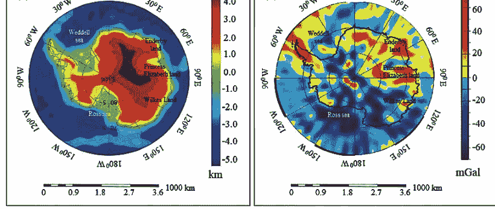

图 1.33. （a）南极洲的地形和水深。（b）南极洲的自由空气重力异常。

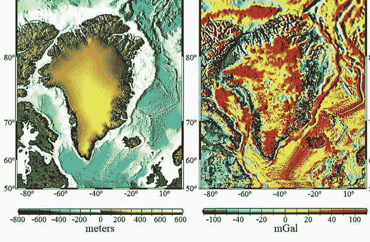

图 1.34. （a）包括格陵兰在内的北极地形和水深。（b）北极的自由空气重力异常。（改编自 https://bgi.obs-mip.fr/grids-and-models-2/）。

图 1.33b 中的南极自由空气重力异常图与其地形（见图 1.33a）不相关，这与地球上大多数地区和大陆形成对比，包括格陵兰和澳大利亚（见图 1.34 和 1.35）。

在这两个例子中，我们在自由空气异常与该地区地形之间有很高的相关性——即海平面以上的海拔会产生正的自由空气重力异常，而海平面以下的山谷会产生负的重力异常，如（1.97）所述。即使在火星等外星行星上，我们也能看到地形与自由空气重力剖面之间存在很强的相关性，如图 1.24 所示。

我们可以看到，尽管整个区域都在海平面以上，南极大陆中部仍有一些负的自由空气异常。如何解释南极（见图 1.33）中这些大且几乎随机分布的自由空气重力异常？事实证明，覆盖南极大陆的冰层本身具有地形。换句话说，覆盖南极大陆的冰层分布不均匀。如图 1.36 所示，去除覆盖的冰层后，地形和自由空气异常的相关性更有效。

注意南极的布格异常剖面与图 1.37 和 1.38 中的非洲、澳大利亚和格陵兰的剖面相当相似。记住，布格异常反映密度和地形。如果我们忽略地形或假设地形变化与密度变化相比很小，多余的较轻岩石会产生负的重力异常，而致密岩石往往会形成正的重力异常，如图 1.20c 和公式（1.99）所述。还要注意，冰盖对图 1.34 中北极的自由空气异常没有明显影响

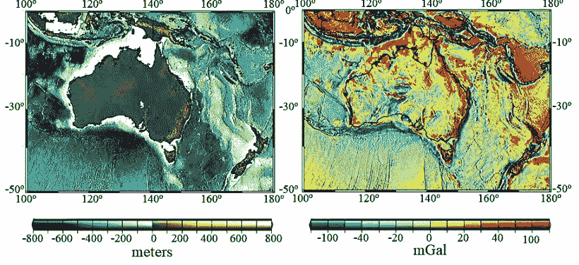

图 1.35. 澳大利亚重力异常图的截面。（a）澳大利亚的地形和水深。（b）澳大利亚的自由空气重力异常。（改编自 https://bgi.obs-mip.fr/grids-and-models-2/）。

——即南极冰盖与其下地层之间存在不整合，而北极没有。

那么是什么导致北极和南极冰盖行为不同？东南极冰盖上有一个湖泊，称为沃斯托克湖。它是南极最大的湖泊。位于东南极冰盖俄罗斯沃斯托克站下方约 4 公里处，该水体也是已知的最大亚冰湖。它长约 240 公里，最大宽度约 50 公里。它容纳了近 5,400 立方公里的水（见 BBC 新闻，Lake Vostok drilling in Antarctic running out of time By Katia Moskvitch, Science reporter, 27 January

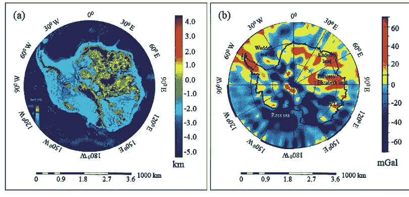

图 1.36. （a）冰盖下南极洲的地形和水深。（Credit: Mathieu Morlighem/UCI.）（b）南极洲的自由空气重力异常。


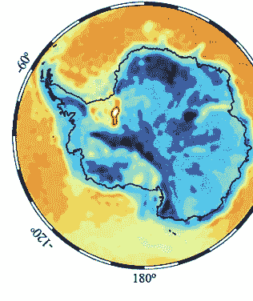

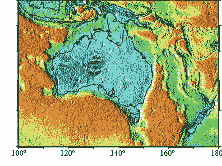

图 1.37. (a) 南极洲（改编自 Tenzer et al., 2008）和 (b) 澳大利亚（改编自 https://bgi.obs-mip.fr/grids-and-models-2/）的布格重力异常剖面，去除了地形的影响以揭示地表下密度变化和地壳厚度变化。低值（负值）表示测量点下方密度较低。高值（正值）表示测量点下方密度较高。

南极冰盖中存在超过 70 个亚冰湖。这些湖泊表明，南极冰盖的重力异常可以分两步计算：先对冰进行自由空气改正，然后对湖泊进行布格改正。与其仅与自由空气改正相比，必须将这一两步过程的结果与南极的地形进行比较。

70 个左右湖泊在南极冰盖下方的发现和/或确认，得益于 GPR 数据采集调查和 GPR 数据成像（见第 4 章），尤其是这些湖泊的水至今尚未被直接采样，因为湖泊处于高压（约 355 巴）、低温（约 -3 摄氏度）和永久黑暗的环境中。GPR 对于根据温度区分暖冰和冷冰非常有用。温冰是处于或接近其压力熔点的冰，而冷冰则低于该温度。温冰中在晶界、空腔和通道之间形成水。这种类型的冰存在于温性冰川和多温冰川中。多温冰川也含有通常不含水的冷冰。冷冰对电磁信号是透明的，而暖冰由于水与冰界面会显示多次反射。因此它们可通过 GPR 轻松区分（Moran et al., 2003）。多温冰川和温性冰川具有脉络、融池、通道和导管，融水通过其流动。在冷冰川中，地表产生的水只会通过地表通道排出，而不会渗入冰体。

注意，南极冰盖的质量密度随深度增加，从约 300 kg/m³ 增加到 900 kg/m³，而湖水的质量密度约为 1000 kg/m³。这些密度差异足以导致，如果忽略它们，南极的布格异常可能是不正确的。此外，如果不考虑南极冰盖下方的湖泊，则

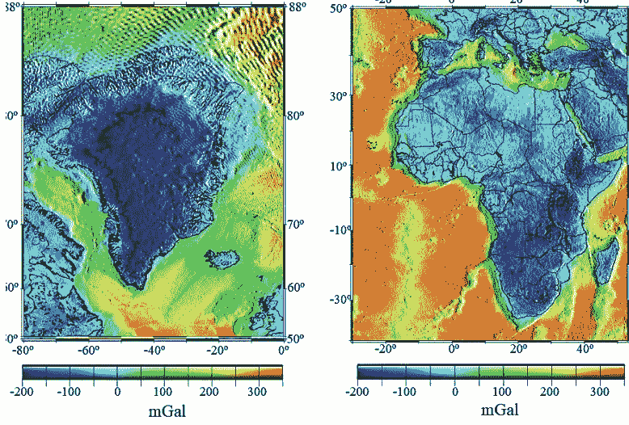

图 1.38. (a) 北极和 (b) 非洲的布格重力异常剖面，去除了地形的影响以揭示地表下密度变化和地壳厚度变化。低值（负值）表示测量点下方密度较低。高值（正值）表示测量点下方密度较高。（改编自 https://bgi.obs-mip.fr/grids-and-models-2/）。

基岩地形将是错误的，南极的自由空气异常也将是错误的。请记住，地下物质的质量密度以及陆地上的地形和水深测量（海底地形）是重力场变化的唯一原因。南极冰盖下的湖泊也增加了冰盖下存在生物的可能性。

有未经证实的说法称，南极的亚冰湖已有超过 3500 万年的历史。它们可能含有独特的生命形式，包括古老的微生物。湖泊黑暗、营养匮乏的环境可能与木星的卫星欧罗巴的条件相似，欧罗巴被认为在其冰冻表面下拥有一个巨大的海洋。俄罗斯南极计划于 2008-2009 年钻入南极冰盖。他们的钻头在距离沃斯托克湖估计表面约 80 米处卡住，该湖深约 4 公里。有说法称湖面不断升降，湖泊偶尔排空然后重新注满。技术改进已完成。目前，正在考虑钻探亚冰湖的计划。这些包括沃斯托克湖、埃尔斯沃斯湖、南极西部一个相对较小的湖泊，以及位于南极罗斯冰架附近的惠兰斯湖。无论如何，我们仍有很多需要学习和了解的关于


图 1.39. 这两张照片显示的是芬迪湾海滩上同一区域，相隔大约十二小时。我们可以看到水位已经上涨并完全覆盖了海滩。假设照片中的人高 1.5 米至 1.8 米，因此水位在 12 小时内至少上升了 5 至 7 米[鸣谢海洋钻探计划（ODP）]。

南极洲，包括南极洲如何从 1 亿年前无冰区转变为今天被厚厚冰盖覆盖的南极洲。

### 1.2. 应用：潮汐力

相对于陆地每日海平面升降的现象称为潮汐。潮汐源于两种基本力的组合：（1）月球对地球施加的引力以及（2）地球和月球绕其共同重心（质量）公转产生的离心力。沿海岸线最熟悉的潮汐证据是高水位和低水位——通常每天两次。潮汐通常的范围（垂直、高低差）为两米，但世界上有一些地区各种条件共同作用几乎产生不了潮汐（例如地中海，范围为 2 至 3 厘米），也有一些地区潮汐被大大放大（例如澳大利亚西北海岸，范围可达 12 米，而在加拿大新斯科舍省的芬迪湾，可上升至 15 米）。图 1.39 说明了芬迪湾高潮和低潮的一个例子。该图显示同一地点相隔约 12 小时，范围约为 6 米。

理解潮汐不仅仅是为了说明保持月球在其轨道上的引力，它们对沿海海洋生物有深远影响。实际上，沿海生物根据生物能够承受的出露和浸没程度被划分为区域和亚区域。除了解决开普勒问题外，牛顿还能够将海洋潮汐解释为由月球和太阳引起的引力效应。

海洋潮汐受除地球以外的天体影响，包括月球和太阳。然而，潮汐现象主要由月球和太阳主导。太阳引起的潮汐力约为月球的 0.45 倍，而金星约为月球的 0.0054 倍——对于大多数地方，与金星相关的潮汐小于 0.1 毫米。因此我们首先将讨论限制在地月系统。

#### 1.2.1. 地月系统和日地系统的质心

地月系统是一个围绕共同重心，即质心运动的双星系统。换句话说，地球和月球被锁定在运动中，以一个月为周期旋转。设 $r_c$、$r_1$ 和 $r_2$ 分别为参考点与质心、地球中心和月球中心之间的距离。我们可以定义质心为

$r_c(m_e + m_m) = r_1 m_e + r_2 m_m$,  (1.124)

其中 $m_e$ 是地球的质量，$m_m$ 是月球的质量。将参考点设在地球中心（见图 1.40a），我们有 $r_1 = 0$ 且

$r_c = \frac{m_m}{m_e + m_m} r$,  (1.125)

其中 $r_2 = r$ 是地球中心与月球中心之间的距离。地球中心与月球中心之间的距离与地球半径之比约为 60，$r/R \approx 60$，且 $m_e/m_m \approx 81.53$ 得到 $r_c \approx 60/82 R \approx 4500$ km（$R$ 为地球半径）。因此，由于地球和月球质量的差异，质心位于距离地球中心约 3/4 倍地球半径处（见图 1.40a）。

我们可以通过考察地月系统旋转中心的受力平衡来另行引入质心。同样，我们假设地球和月球相互绕转，并且在引力作用下处于稳定的双星轨道。旋转中心位于连接地球中心和月球中心的直线上，如图 1.40a 所示。这里有两种力在起作用：离心力和引力吸引力。离心力源于地球（或月球）沿其轨道切线飞向太空的惯性趋势。由于地球不会飞向太空，引力必须在地球质心处被离心力平衡（大小相等、方向相反的力矢量）。这种受力平衡可以用大小表示如下：

$\frac{G m_e m_m}{r^2} = \frac{m_e v_e^2}{r_c} = \frac{m_m v_m^2}{r - r_c}$,  (1.126)

其中 $v_e$ 是地球的速度，$v_m$ 是月球的速度。式 (1.126) 中的第一项是引力吸引力；即，$\boldsymbol{F}_g = G m_e m_m / r^2 \boldsymbol{i}_1$ 是 $m_e$ 对 $m_m$ 施加的力，$-\boldsymbol{F}_g$ 是 $m_m$ 对 $m_e$ 施加的力。这两个引力指向月球和地球的中心，如图 1.40a 所示。式 (1.126) 中的第二项和第三项是地球和月球的离心力。离心力在地球质心处处等于（但符号相反）引力。它们指向远离月球和地球中心的方向，如图 1.40a 所示。再次，式 (1.126) 反映了地月系统通过离心力与引力之间的平衡保持动态平衡的事实


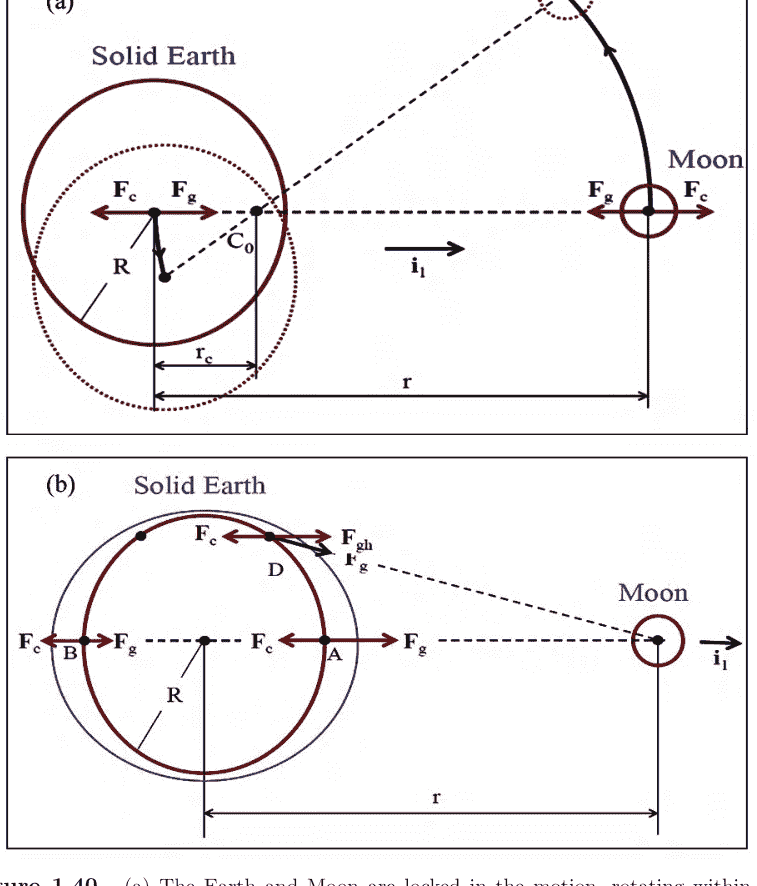

图 1.40. (a) 地球和月球被锁定在一起运动，在一个月的时间内绕转。C0 是它们共同质心的位置，称为地月质心。地月系统通过它们的离心力 F_c 和万有引力 F_g 保持动态平衡。(b) 我们在这里考虑月球对单位质量的粒子 A、B 和 D 的引力。这些粒子位于地球表面。引潮力是 F_g 和 F_c 的和。D 点的力 F_g 可以分解为水平分量 (F_gh) 和垂直分量。对于地球内部和表面上的所有粒子（点），离心力是相同的。

该天体系统的旋转速率可以定义为 ω = v_e/r_c = v_m/(r - r_c)。于是，公式 (1.126) 可以改写为

$$ \frac{G m_e m_m}{r^2} = m_e \omega^2 r_c = m_m \omega^2 (r - r_c) \implies m_e r_c = m_m (r - r_c) $$

或

$$ r_c = \frac{m_m}{m_e + m_m} r , $$

由此我们可以推断出质心的位置。注意，地球是一个刚体，因此其中的每一个质点都沿相同的轨道运行，因此它的所有点都受到相同的离心力。然而，引力会变化，因为它们随地球上的点与月球中心之间的距离而变化，如公式 (1.3) 所述和图 1.40b 所示。

现在让我们考虑日地系统。太阳中心与地球中心之间的平均距离约为 1.5 \times 10^{8} km。它们的质心平均位于距太阳中心约 450 km 处。太阳和地球在一年内围绕这个共同质心旋转。

#### 1.2.2. 引潮力

图 1.40b 显示了位于地球相反两侧的 A 点和 B 点的两个单位质量粒子。A 点是地球表面最靠近月球的点，B 点是地球表面距离月球最远的点。我们将分析月球如何改变这两个粒子上的力。在地球中心，月球的引力为

$$ \mathbf{F}_{g,O}^{(m)} = \frac{G m_m}{r^2} \mathbf{i}_1 . $$

由于力的平衡，地球中心的离心力方向背离月球；即

$$ \mathbf{F}_c^{(m)} = - \frac{G m_m}{r^2} \mathbf{i}_1 . $$

在地球朝向月球一侧的 A 点，月球的引力为

$$ \mathbf{F}_{g,A}^{(m)} = \frac{G m_m}{(r - R)^2} \mathbf{i}_1 . $$

这个力当然指向月球，并且它的大小大于地球中心处，因为它更靠近月球。在 A 点（见图 1.40b），月球的净引力为

$$ \mathbf{F}_A^{(m)} = \mathbf{F}_{g,A}^{(m)} + \mathbf{F}_c^{(m)} = \mathbf{F}_{g,A}^{(m)} - \mathbf{F}_{g,O}^{(m)} $$

或

$$ \mathbf{F}_A^{(m)} = \left[ \frac{G m_m}{(r - R)^2} - \frac{G m_m}{r^2} \right] \mathbf{i}_1 \approx \left[ \frac{G m_m}{r^2} \left(1 + \frac{2R}{r}\right) - \frac{G m_m}{r^2} \right] \mathbf{i}_1 = \frac{2 G m_m R}{r^3} \mathbf{i}_1 .$$

这个力是月球的吸引力与离心力（或地球中心的引力与 A 点的引力之差）之和，它对应于一个指向月球的力，而“引潮力”就是 $F_A^{(m)}$。我们利用了 $(R/r) \ll 1$（因为 $R/r \approx 1/60$）的事实，对小量 $\alpha = R/r$ 进行了展开 $1/(1-\alpha)^2 \approx 1+2\alpha$，从而得到 (1.132) 中指向月球的净力。地球的引力不包含在 (1.132) 中。

在 B 点，月球的引力场为

$$\mathbf{F}_{g,B}^{(m)} = \frac{G m_m}{(r+R)^2} \mathbf{i}_1 \tag{1.133}$$

而在 $B$ 点，(1.129) 中给出的离心力是相同的。在该点，引力的大小小于地球中心处，因为它距离月球更远。B 点处月球的净引力为

$$\begin{aligned}
\mathbf{F}_B^{(m)} &= \mathbf{F}_{g,B}^{(m)} - \mathbf{F}_{g,O}^{(m)} = \left[ \frac{G m_m}{(r+R)^2} - \frac{G m_m}{r^2} \right] \mathbf{i}_1 \\
&\approx \left[ \frac{G m_m}{r^2} \left(1 - \frac{2R}{r}\right) - \frac{G m_m}{r^2} \right] \mathbf{i}_1 \\
&= -\frac{2 G m_m R}{r^3} \mathbf{i}_1 .
\end{aligned} \tag{1.134}$$

因此，在距离月球最近的 A 点，引力超过离心力，而在距离月球较远的 B 点，离心力超过引力。换句话说，相反的半球受到方向相反的净力，导致海洋两侧都鼓起，如图 1.40b 所示。A 点的净引力使地球“近侧”的水被拉向月球。在 B 点，离心力超过引力，水试图沿直线继续运动，远离地球，也形成了一个凸起。因此，引力和惯性的共同作用产生了两个水体凸起。地球两侧的凸起与比值 $m_m / r^3$ 成正比。

太阳也会影响两个潮汐凸起的大小和位置。这些对地球两侧的影响近似与比值 $m_s / r_s^3$ 成正比，也会产生太阳引潮力；即

$$\mathbf{F}_A^{(s)} \approx \frac{2 G m_s R}{r_s^3} \mathbf{i}_1 , \tag{1.135}$$

$$\mathbf{F}_B^{(s)} \approx -\frac{2 G m_s R}{r_s^3} \mathbf{i}_1 , \tag{1.136}$$

其中 $m_s$ 是太阳的质量，$r_s$ 是地球中心到太阳中心的距离。但由于太阳到地球的距离远得多，太阳的比值 $m_s / r_s^3$ 仅为月球的一半左右 [$m_s = 27.07 \times 10^6 m_m$，$r_s^3 = (389)^3 r^3 = 58.8 \times 10^6 r^3$]。基本上，引力与两个天体之间距离的平方成反比，而引潮力与距离的立方成反比。后一观察结果解释了月球在引起潮汐方面的影响力是太阳的 2.18 倍。

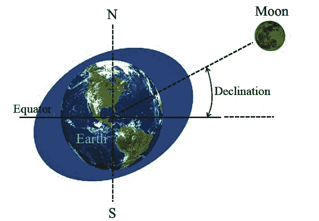

图 1.41. 赤纬的示意图，即月球在地球赤道上方或下方的角距离。两个潮汐凸起跟踪月球赤纬的变化。

为简单起见，我们只给出了选定点 A 和 B（见图 1.40b）的引潮力，这些点位于连接地球中心与月球（或太阳）中心的直线上。这种表示是不完整的。地球上的每个点，包括标记为 D 的点，都受到月球和太阳的径向引力，因此受到的潮汐力也各不相同。然而，只有潮汐力的水平分量才会真正对水粒子产生潮汐加速，因为几乎没有阻力。换句话说，水平分量在移动水体方面比试图提升水体的垂直分量更有效。因此，在地球表面，侧向引潮力在产生潮汐凸起方面比垂直力更重要。

随着时间的推移，月球和太阳相对于地球赤道的位置会发生变化。这些变化对每日潮汐高度和强度有直接影响。当月球绕地球运行时，它与地球赤道的夹角会增大和减小。这个角度称为赤纬（见图 1.41）。类似地，太阳相对于地球赤道的位置随着地球绕太阳旋转而在一年中发生变化。太阳的赤纬也影响潮汐。让我们看一下月球和太阳的赤纬对潮汐影响的具体例子。当太阳、月球和地球排列成一条线时（如新月或满月时），两个潮汐效应会相互增强，太阳潮对月球潮产生附加效应，从而造成特高潮和极低潮（如图 1.42a 所示）。这些潮汐称为大潮。


一周后，当太阳和月亮彼此成直角时（即从新月到第一季度月或从满月到第三季度月），低太阳潮发生在高月潮的时间，反之亦然（见图1.42b）。因此，潮差小于平均值。这些潮汐称为小潮。随着月亮从新月到第一季度月或从满月到第三季度月，太阳潮落后于月潮，使得合成潮被延迟。因此，合成潮的高潮和低潮比仅有月潮时出现得更早（见图1.42c）。这种情形称为提前。类似地，随着月亮从第一季度月到满月或从第三季度月到新月，太阳潮领先于月潮，使得合成潮的高潮和低潮比仅有月潮时出现得更晚（见图1.42d）。这种情形称为滞后。

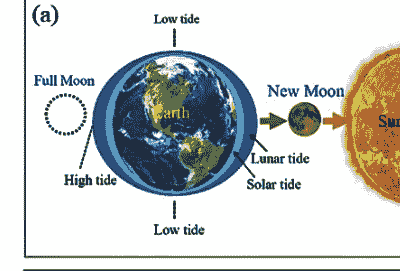

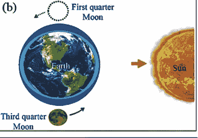

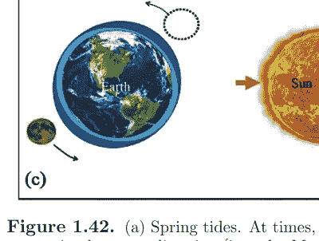

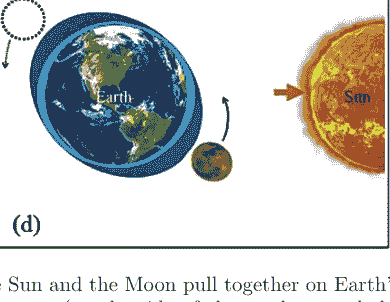

图1.42. (a) 大潮。此时，太阳和月亮在同一方向上共同牵引地球的水体 [即月亮为新月（位于地球朝向太阳的一侧）或满月（位于地球背离太阳的一侧）。高太阳潮与高月潮同时发生，同样，低太阳潮与低月潮同时发生。 (b) 小潮。当月亮与太阳成直角时（即月亮处于第一或第三季度），低太阳潮发生在月潮高潮时，而高太阳潮发生在月潮低潮时。 (c) 从新月到第一季度月以及从满月到第三季度月时，合成潮的高潮和低潮比仅有月潮时出现得更早。 (d) 从第一季度月到满月以及从第三季度月到新月时，合成潮的高潮和低潮比仅有月潮时出现得更晚。

#### 1.2.3. 潮汐发生

潮汐产生力使海洋盆地的水体进入周期性运动，可表示为一系列谐波分量或分潮（Doodson, 1921）；即，

$$h(t) = \sum_i H_i \cos\left(\frac{v_i}{L_i}t + \xi_i + \kappa_i\right), \tag{1.137}$$

其中 $h(t)$ 是时间 $t$ 时的高度，$H_i$ 是相对于选定基准面平均水位以上的高度，$v_i$ 是波潮速度，$L_i$ 是波潮波长，$\xi_i$ 是相对于平衡潮的相位滞后，$\kappa_i$ 是第 $i$ 个谐波的局部相位。参数 $H_i$、$v_i$、$L_i$、$\xi_i$、$v_i$ 和 $\kappa_i$ 与第 $i$ 个谐波分量相关。方程 (1.137) 可用于模拟太阳、月球和地球相对运动的几乎所有扰动，包括它们的相对距离、它们的赤纬，以及月潮和太阳潮同相（最大对齐）和反相（一个最大与另一个最小对齐）的情况，分别产生大潮和小潮（见图1.42）。请注意，通过谐波分析研究潮高的研究由拉普拉斯、威廉·汤姆森（开尔文勋爵）和乔治·达尔文开始。Doodson (1921) 扩展了他们的工作。方程 (1.137) 中的基本假设是，无论看起来多么复杂，潮汐在任何地点的变化都可以用有限数量的简单谐波之和来表示。

图1.43a 说明了单一谐波的潮汐波。波峰为高潮，波谷为低潮。潮汐波的高度为潮差（或潮汐范围），潮汐的周期为固定点上两次相继波峰出现之间的时间间隔。潮波速度近似为

$$v = \sqrt{gH}, \tag{1.138}$$

其中 $v$ 为潮汐波速，$H$ 为水深，$g$ 为重力加速度。请注意，波速仅取决于水深，因为 $g$ 几乎恒定。当潮波进入沿海地区（水深 $H$ 减小的浅水区）时，其速度减慢。波浪随后变得更高 [即 $h(t)$ 增加] 且波长显著变短，如图1.43b 所示，以维持能量守恒原理。

海洋对潮汐产生力的响应通常分为三种：半日潮、日潮和混合潮。当每个潮汐日内两个高潮和两个低潮的高度大致相等时，潮汐为半日潮（如图1.44a 所示）。半日潮相继高潮之间的时间间隔约为12.42小时。当每个潮汐日内两个高潮和/或低潮存在相对较大的差异（即存在较大的日不等）时，潮汐为混合潮（见图1.44c 和1.44d）。混合潮的典型例子见于美国太平洋沿岸。当每个潮汐日只有一个高潮和一个低潮时，潮汐为日潮（如图1.44b 所示）。在这种情况下，相继高潮之间的时间间隔约为24.84小时。日潮是最不常见的。典型例子有爪哇海、北部湾和渤海（中国）。

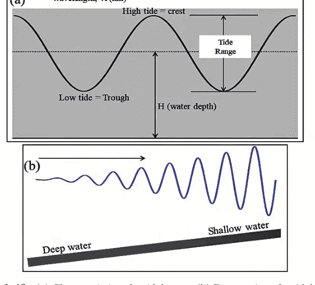

图1.43. (a) 潮汐波的特征。 (b) 潮汐波向浅水传播。

在大多数地方（例如非洲海岸，除索马里海岸为混合半日潮外、西欧海岸以及北美东海岸的许多地区），潮汐变化为半日潮。半日潮的成因在于，与我们熟知的24小时太阳日不同，朔望日长达24小时50分钟。这种差异发生是因为月球绕地球公转的方向与地球自转轴方向相同。因此，地球需要额外50分钟才能“追上”月球。由于地球每朔望日旋转经过两个潮汐隆起，我们每24小时50分钟经历两次高潮和两次低潮。高潮相隔12小时25分钟，岸边水位从高潮到低潮再到高潮需要6小时12.5分钟。

请注意，我们将在下一章中使用的平均海平面是海表面在较长时间（通常为一个月或一年）内的平均高度，在此期间与潮汐和风暴潮相关的短期变化相互抵消。

#### 1.2.4. 潮差

如果地球是一个没有大洲的完美球体，所有地区每朔望日都会经历两次高低潮且比例相等。事实上，在开阔海洋中，潮汐波波峰的实际高度相对均匀但相当小（通常为1米或更少）。只有当潮波进入浅水区时

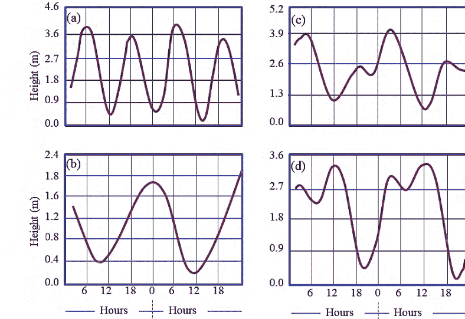

图1.44. 潮汐类型：半日潮、日潮和混合潮。 (a) 潮汐最常见为半日潮（每天两次高水位和两次低水位）周期为12小时25分钟，或 (b) 日潮（每天一个潮汐周期）周期为24小时50分钟。 (c) 和 (d) 为混合潮。高水位高度、低水位高度或两者之间存在较大不等。

由于陆地反射以及进入限制性通道，潮差才会变大。因为陆地、通道和水深从一个海岸线到另一个海岸线变化很大，潮差在全球呈现复杂的分布，如图1.45所示。

每个地点都有独特的海岸线和独特的海底地形（即海底地形），赋予每个地点独特的潮差。例如，当海洋潮汐隆起撞击宽阔的大陆边缘时，潮汐高度会被放大。相反，在远离大陆边缘的中洋岛屿上，潮汐高度通常非常小，小于1米（Thurman, 1994）。湾和河口的形状也可以放大潮汐强度。特别是漏斗形湾，可以显著改变潮汐幅度。加拿大新斯科舍省的芬迪湾是这种效应的最著名例子之一。它拥有世界上最高的潮汐，15米（Thurman, 1994）。潮汐的放大发生在湾口到湾头（见图1.46）。湾的变窄导致潮波在海岸反射，从而放大潮差。这种现象称为潮汐共振。此外，在这种情况下，放大进一步增加，因为湾的自然振荡周期接近潮汐周期。建设性干涉增加了潮差。

潮汐共振发生的适当深度和宽度的大陆架区域，例如澳大利亚西北大陆架（见


图 1.45. 全球潮差。（改编自 Egbert 和 Erofeeva，2002）。

图 1.47），也可能表现出较大的潮差。一般而言，潮汐通常在半封闭海域以及呈漏斗状的海湾和河口入口处最大，例如俄罗斯的彭津斯卡亚古巴湾（12 米）和英国的布里斯托尔海峡（12 米）。其他潮差较大的地区包括法国格兰维尔（11 米）、阿根廷里奥加耶戈斯（10 米）、海峡群岛圣赫利埃（9.5 米）和阿拉斯加库克湾（9 米）。

测验：每天总是会有两次高潮吗？

局部风力和天气模式也会影响沿海潮汐。强烈的离岸风和其他模式会将水从海岸线移开，夸大低潮暴露，如地中海和波罗的海的情况。基本上，与局部风力和天气模式相关的地中海（2 至 3 厘米潮汐）和波罗的海（小于 10 厘米潮汐）的振荡模式抵消了这些海域的潮汐产生力。一般而言，潮差通常在开阔大洋、远离大陆边缘的中洋岛屿、沿开阔大洋海岸线以及几乎完全封闭的海域最小。请注意，地中海和波罗的海几乎是完全封闭的海域（见图 1.48）。

为了总结上述关于海洋潮汐的讨论，让我们对与潮汐相关的摩擦、气候变化、洛希极限以及天体的内聚力做非常简短的说明。地球每日的潮汐由于摩擦导致其自转能量损失，从而减慢地球自转速率。目前这一自转速率约为每 100 年 0.0016 秒。与此同时，月球正以大约每 100 年 3.8 米的速度远离我们，因此其轨道周期增加。这一过程将持续下去，直到达到稳定状态，即地球自转周期等于月球公转周期。在这种情况下，月球对地球的潮汐力将保持稳定，因为地球将与月球潮汐锁定，始终保持同一面朝向它，只有太阳潮汐将


图 1.46. 芬迪湾的潮差为 15 米。该湾位于加拿大大西洋海岸。湾内的潮汐主要由半日振荡主导，高潮位和低潮位的范围大致相同。潮差从湾口约 2 米变化到米纳斯盆地超过 15 米。


图 1.47. 澳大利亚海岸线的潮差。[改编自澳大利亚国家潮汐设施（NTF）的 2018 年潮汐图]。

图 1.48. （上）地中海地图，显示其几乎完全被陆地包围。（下）波罗的海地图显示其也是几乎完全被陆地包围的海域。


图 1.49. 月球始终有一面朝向我们的示意图。月球每 27.3 天绕地球公转一次，并在其轴上自转一次（即同步自转）。因此，它始终面向我们。

人类坠入黑洞也会经历潮汐力，这可能是致命的！头部和脚部之间的加速度差异可能达到地球重力的数千倍。人们真的会被撕裂！同样，如果潮汐力强于天体的内聚力，该天体将被破坏。正如我们稍后将讨论的，卫星在被这种方式粉碎之前接近系外行星的最小距离称为相对于该系外行星的洛希距离。随着太空探索的继续，我们总有一天会遇到被系外行星强引力潮汐撕裂的卫星。

#### 1.2.5. 月球背面

是的，有一个月球半球我们从未通过肉眼甚至望远镜看到，直到最近的 2019 年。这个月球半球始终背向地球（见图 1.49）。每次我们看到月球时，我们看到的只是月球的一面。我们可见的月球一面被称为月球近侧。月球的另一面，被称为月球背面，被我们隐藏了。这种现象是由于地球和月球潮汐锁定，正如上文所述——即月球绕其轴旋转的速度与它绕地球旋转的速度相同。月球在其轴上完成一次完整自转所需的时间与它绕地球公转所需的时间相同，大约为 27.3 天。这意味着同一面始终朝向我们。然而，值得注意的是，月球背面接收到的阳光量与月球近侧（即面向地球的一侧）相同。

请注意，图 1.49 中月球绕地球的旋转有时被称为同步自转。太阳系中的许多卫星（包括火星的福波斯和德莫斯、木星的木卫一、木卫二、木卫三和木卫四、土星的恩克拉多斯、土卫三、土卫四和土卫六、天王星的米兰达、 Ariel、乌姆布里尔、提塔尼亚和奥伯龙，以及海王星的特里同）也处于同步自转状态；也就是说，这些卫星在近乎圆形的轨道上公转时始终向其行星展示同一面。换句话说，它们的自转周期与其公转周期之间存在精确关系。这些关系是行星产生的潮汐力的直接结果。还请注意，水星不是始终保持同一面朝向太阳，而是由于其相当偏心的轨道（e = 0.206），每完成两次公转就完成三次自转。根据美国宇航局詹姆斯·韦伯太空望远镜的最新观测，TRAPPIST-1 b，即距离 TRAPPIST-1 恒星最近的行星，被 TRAPPIST-1 恒星潮汐锁定。同样，这意味着 TRAPPIST-1 b 的一侧始终面向恒星，而另一侧则处于永久黑暗之中。

### 着陆过程

2019 年 1 月 3 日，中国国家航天局的嫦娥四号探测器首次在月球背面着陆，并为我们提供了月球两面的高分辨率图像。人们可能会想，为什么此前没有探测器和漫游车在月球背面活动。这次着陆远非平常事件。美国和前苏联的登月任务，包括阿波罗计划和月球（Lunik）计划，从未在月球背面着陆。月球背面着陆的挑战包括：

- 确保为操作安全而在背面与地球之间进行通信。从月球背面无法与地球通信。航天器既不能向地球控制中心发送无线电信号，也不能接收来自地球控制中心的无线电信号；对于载人甚至无人着陆，以及/或探测器和科学设备出现故障而言，这是一个危险的提议。
- 确保航天器/漫游车能够绕月球进行环绕飞行，包括在其环绕周期期间穿越背面。正是执行这些环绕飞行的困难使得直到最近拍摄和/或看到月球背面才成为不可能。
- 并确保航天器在月球背面软着陆，以确保所需数据能够被记录并返回地球。本质上，记录的数据，包括照片，是着陆的证明。我们需要避免坠毁着陆，以确保摄像机、射电天文、地球物理和地球化学仪器在着陆后能够正常工作。换句话说，这些摄像机和仪器必须能够部署在月球表面，并且必须持续记录和/或向地球传输数据。

中国的嫦娥四号（CE-4）任务由着陆器、漫游车和中继卫星组成，克服了这些挑战。它将一颗名为鹊桥的中继卫星放置在地球-月球 L₂ 拉格朗日点的晕轨道上。鹊桥于 2018 年 5 月 21 日成功发射，并于 6 月 14 日进入 L₂ 点的晕轨道，成为连接地球与月球背面的第一颗卫星，规避了访问月球背面的一大主要挑战。从地球-月球 L₂ 拉格朗日点，鹊桥可以与月球背面和地球进行通信。鹊桥成为三方通信的枢纽：来自月球的

从月球背面到地月 L₂ 拉格朗日点，以及从地月 L₂ 到地球，反之亦然。

下一步是于 2018 年 12 月 8 日发射由着陆器、漫游车和中继卫星组成的嫦娥四号探测器。它在经过多次路径调整和修正后，于 2018 年 12 月 30 日进入月球轨道。最后一步是软着陆；成败攸关的一步。如同之前一样，探测器与中继卫星之间的通信对于监测下降过程至关重要。存在远程执行此类下降的技术。例如，石油和天然气行业今天常规地执行此类下降操作，以将传感器放置在海面以下 1.5 公里以上、海底处，通过远程操作车辆与水面控制中心之间的无线电通信，这些车辆实际上代替人类将传感器放置在海底。

漫游车着陆在南极-艾特肯盆地中最平坦的区域之一的冯·卡门撞击坑，因为那是着陆漫游车更简单的地方。该撞击坑宽约 2,500 公里，深 12 公里。由于月球地壳薄，撞击该区域的撞击可能穿透地壳进入月球地幔。

**Quiz:** 月球背面与地球之间的距离为 500,000 公里。定义地月 L₂ 点。

## 月球近侧与远侧的比较


**Figure 1.50.** 月球近侧和远侧的地形。南极-艾特肯盆地宽约 2,500 公里。（改编自克莱门廷任务图像）。

图 1.50 显示了月球近侧和远侧的地形。它表明，尽管两者接收到的阳光几乎相等，远侧与近侧显著不同。图 1.50 中圆圈的黑色线条捕捉到了其中一些差异。近侧有一片被暗色熔岩流覆盖的区域（月海或海洋）。远侧地形崎岖，拥有众多撞击坑和平坦区域相对较少。这些撞击使远侧在某些部分呈现出更接近水星的重度撞击坑外观（见 Ikelle, 2023a）。它拥有太阳系中最大的撞击坑之一，南极-艾特肯盆地，这是一个宽 2,500 公里的凹陷，占据了远侧南部的大部分区域。远侧看不到海洋。


**Figure 1.51.** 月球近侧和远侧的自由空气异常。（图像来源：NASA/JPL-Caltech/CSM）。

月球近侧与远侧之间的差异表明月球可能由两种完全不同组成的物质混合物形成。也许地球可能屏蔽了近侧免受大量轰击。因此，它们的差异可能由撞击物沉积在远侧的材料引起。图 1.51 中两侧的自由空气异常增强并进一步阐明了它们的地形差异。图 1.52 中的布格异常显示典型的蓝色、黄色和红色，分别对应异常的负值、接近零值和正值。通过将这些结果与图 1.37 和 1.38 进行比较，可以推断圆圈线内的区域具有与地球上许多大陆一样的光色岩石，因此是未来月球殖民地的合适区域。然而，请注意图 1.50 中该区域（黑色圆圈内）的奇怪纹理。我们迄今为止尚未在地球地图上发现这种纹理。


**Figure 1.52.** 去除了地形影响后月球近侧和远侧的布格异常，以揭示地表下密度变化和地壳厚度变化。（图像来源：NASA/JPL-Caltech/CSM）。

**Quiz:** 木星上有潮汐吗？

#### 1.2.6. 泰坦潮汐

迄今为止我们的讨论主要集中于水潮汐，因此集中于具有地表水的行星。实际上，天体固体部分也受潮汐影响。更一般地说，任何置于另一天体引力场中的天体都会经历使其变形的潮汐力。这是因为一侧的吸引力比另一侧更强。例如，地球引起的月球固体潮汐每月变化约 ±0.1 米。除了形状变化外，月球的引力场和在空间中的取向也受潮汐影响。换句话说，潮汐力重塑了恒星系统的轨道，决定了行星和系外行星周围卫星系统的位置和轨道参数。由于稳态下每个周期所做的功，潮汐也会在天体中产生热量。此外，有关系外行星内部结构、组成和演化的信息可能首先来自潮汐测量，因为当前的系外行星质量和半径不能直接用于识别系外行星的内部结构，因为不同的组成和密度剖面可能导致相同的解。对固体系外行星甚至木卫的直接地下勘探还遥不可及。

泰坦是土星 82 颗卫星中最大的另一颗具有显著潮汐的天体。泰坦直径为 5,150 公里，偏心率为 0.0288，距太阳 14 亿公里。泰坦每 16 天完成一次围绕土星的椭圆轨道。土星的引力在该期间引起潮汐力（见图 1.53）。在远离土星的最远点，泰坦几乎是完美的球形。然而，在最接近点，土星引力最强的地方，泰坦变得更扁，其直径变化 10 米（Castillo-Rogez and Lunine, 2010）。


**Figure 1.53.** 土星与泰坦之间的距离随时间变化；泰坦上的潮汐力随时间变化；并且体响应的振幅变化存在滞后，同时伴随着能量耗散。

我们对泰坦的当前理解在 2005 年取得了巨大飞跃，当时 NASA-ESA-ASI 的卡西尼- Huygens 无人航天器于 2004 年 7 月 1 日进入土星轨道，并在 2005 年 1 月 14 日降落在泰坦，飞行了七年（从 1997 年 10 月 15 日到 2005 年 1 月 14 日），途中飞掠地球、金星和木星。该任务以发现土星环分层和土星四颗卫星的天文学家 Giovanni Domenico Cassini 命名。它也以发现泰坦于 1655 年的天文学家、数学家和物理学家 Christiaan Huygens 命名。卡西尼- Huygens 任务因火箭燃料资源耗尽于 2017 年结束。

截至 2023 年 4 月，泰坦是除地球外已知唯一地表存在液体的天体。而且这种液体是甲烷（CH₄），是最简单的烃，而不是水（Stofan et al., 2007）。大多数人知道甲烷是我们烹饪时在燃气灶上使用的气体。奇怪的是，泰坦上存在液态甲烷的湖泊，甚至海洋。这些湖泊和海洋中的潮汐力几乎为零。

然而，卡西尼航天器在 2006 年至 2011 年间六次近距离飞掠期间加速度的精确测量显示，泰坦对土星可变的潮汐场以周期性形状变化作出响应。潮汐场要求泰坦的内部在轨道周期时间尺度上是可变形的，这与深处的全球海洋一致。

为了建立这种联系，我们需要直接与潮汐相关的参数的测量值，称为 Love 数。它描述了畸变程度。我们的下一个任务是介绍该参数并定义从卡西尼- Huygens 数据获得的泰坦潮汐的值。

### 潮汐势和 Love 数

例如，行星及其卫星、太阳及其行星、恒星及其系外行星、双星系统、三星系统和四星系统都受到相互引力相互作用的影响。当对给定天体（称为主星）超越质点近似时，另一天体（称为次星或伴星）施加的引力在其表面和质心处不同。施加了微分引力，这按定义就是潮汐力。


我们已将 r 和 θ 设为时间的函数 t。主体（例如土星）的引力会在次级天体（例如泰坦）的内部以及其表面产生潮汐。在次级天体（例如泰坦）的内部，物质会重新分布。这种物质的重新分布进一步改变了势场，放大了该效应。当 r = a_s（即次级天体的表面）时，我们有

$$V_{\text{tides}}^{(2)}(a_s, \lambda, t) = (1 + k_2) W_2(a_s, \lambda, t) = h_2 W_2(a_s, \lambda, t) ,\tag{1.143}$$

其中 $V_{\text{tides}}^{(2)}(a_s, \theta, t)$ 是新的势，它通过 $k_2$ 考虑了次级天体（例如泰坦）内部物质的重新分布，$k_2$ 被称为 2 次的 Love 数，且 $h_2 = 1 + k_2$。Love 数以引入它的 Love（1911）命名。当使用勒让德多项式的高阶项时，我们有多个 Love 数，其中 $k_j$ 为 j 次的 Love 数。由式（1.141）和（1.143）可得潮汐表面形变

$$\Delta r_{\text{tides}} = \frac{V_{\text{tides}}^{(2)}}{g} = a_s \frac{m_p}{m_s} h_2 \left(\frac{a_s}{r}\right)^3 P_2(\lambda) .\tag{1.144}$$

## 旋转势和 Love 数。

我们考虑次级天体（例如泰坦）的自转轴不一定垂直于轨道平面的情况。我们将倾角 $\Theta$ 定义为任意半径矢量 $\boldsymbol{x} = [r \sin \theta \cos \phi, r \sin \theta \sin \phi, r \cos \theta]^T$ 与自转轴之间的夹角。Kopal（1959）和 Heller 等（2019）表明，在这种情况下自转势可写为如下形式：

$$W_{\text{rotation}}^{(2)} \approx -\frac{1}{3} \frac{G m_s}{r} \left(1 + \frac{m_p}{m_s}\right) F_s^2 \left(\frac{a_s}{r}\right)^2 P_2(\cos \Theta) ,\tag{1.145}$$

其中 $F_s = \tau_{\text{orbit}}/\tau_{\text{rotation}}$ 为轨道周期与自转周期之比。自转表面形变为

$$\Delta r_{\text{rotation}} = \frac{h_2 W_{\text{rotation}}^{(2)}}{g} = -\frac{a_s}{3} \left(1 + \frac{m_p}{m_s}\right) F_s^2 h_2 P_2(\cos \Theta) .\tag{1.146}$$

## 表面形变。

假设表面形变为简单叠加，总表面形状由下式定义

$$\Delta a_s(\theta, \phi) = a_s + \Delta r_{\text{tides}} + \Delta r_{\text{rotation}}$$

$$= a_s \left[1 + \frac{m_p}{m_s} h_2 \left(\frac{a_s}{r}\right)^3 P_2(\lambda) - \frac{1}{3} h_2 \left(1 + \frac{m_p}{m_s}\right) \left(\frac{a_s}{r}\right)^3 F_s^2 P_2(\cos \Theta)\right] .\tag{1.147}$$

我们可以通过例如最小二乘拟合，将 $\Delta a_s(\theta, \phi)$ 拟合为次级行星不同飞掠时的三阶多项式来确定 $k_2$（或 $h_2$）的值。


图 1.55. 泰坦内部主要基于 k₂ 的值。

表 1.6 给出了各种次级天体的一些数值。很明显，k₂ 受天体可变形性（即弹性剪切模量，也称为刚度）和均匀性（即质量密度的变化）的影响，这两者是天体内部的两个重要指标。实际上，从式（1.147）可以看出，内部天体的潮汐效应完全包含在 Love 数 k₂ 中，或等价地 h₂ 中。它例如衡量了物体的中心凝聚程度。天体质量分布越均匀，Love 数 k₂ 越大。最大均匀性由恒定密度和零刚度的天体表示，其 k₂ 的最大值为 1.5。如果行星中心凝聚程度更高，Love 数会减小。具有核心的行星由于中心凝聚更强，通常具有较小的 Love 数。例如，具有 10 m_earth 核心模型的土星 k₂ = 0.39。换句话说，k₂ 推断出大质量核心的存在。请注意，具有致密核心的行星的 Love 数小于具有相同刚度的均匀天体。

Love 数 k₂ = 0 对应刚性天体，因为物质不重新分布。我们可以在表 1.6 中看到，大多数行星和卫星的 Love 数较低，因为它们的内部不均匀且相当刚性，正如预期。Love 数 k₂ = 3/2 对应零刚度（即剪切模量为零），如理想液体。

对于 k₂ > 0.4，通常推断天体内部可能存在海洋。泰坦拥有全球地下海洋的想法（见图 1.55）主要基于其 Love 数明显大于 0.4 的事实，如表 1.6 所示。如此大的潮汐场响应要求泰坦内部在轨道周期时间尺度上是可变形的，这与深处的全球海洋一致。

总体而言，月球内部密度是恒定的，正如我们在 Ikelle（2023c）中讨论的。表 1.6 中其较低的 Love 数表明月球核心也很刚性，且其核心质量与总质量之比大于 0.85。

请注意，k₂ 可能不足以确定天体的内部结构。然而它提供了其物质分布和整体刚度的极佳指示。因此，对于给定的 $k_2$ 值，天体可能存在几种可接受的微观模型。

**Quiz:** 没有任何物理学原理表明系外行星不能拥有自己的恒星（见图 1.54）。类木系外行星可以拥有自己的小恒星。毕竟，聚变反应堆旨在在地球上建造我们自己的太阳。事实证明，自然界已经自发地这样做了。这就是我们需要定位并复制的东西。讨论。

## 表 1.6. 一些 Love 数 $k_2$ 及其解释和示例。

| $k_2$ | 解释和示例 |
|---|---|
| 0 | 刚性体（无物质重新分布）和恒定密度。 |
| 0.0198 ± 0.0025 | 月球（Williams, 2007）来自月球激光测距（LLR）数据。 |
| 0.27 ± 0.02 | 海王星（基于核心质量/行星质量=0.45 外推）。 |
| 0.307 ± 0.02 | 无海洋质量的固体地球。 |
| 0.390 ± 0.024 | 土星（Lainey et al., 2017）来自卡西尼观测。 |
| 0.464 ± 0.023 | 水星（Verma and Margot, 2016）。 |
| 0.411 | 金星。 |
| 0.425 ± 0.005 | 海王星（基于核心质量/行星质量=0.27 外推）。 |
| 0.45 | 火星。 |
| 0.464 ± 0.023 | 水星（Verma and Margot, 2016）。 |
| 0.535 ± 0.006 | 木星（Ni, 2018）来自朱诺观测。 |
| 0.616 ± 0.067 | 泰坦（Durante et al., 2019）来自卡西尼观测。 |
| 0.94 | 具有地球密度剖面的流体天体。 |
| 1.20 | 泰西斯（泰西斯密度为 0.973g/cc）。 |
| 1.5 | 均匀密度流体天体。 |

#### 1.2.7. 潮汐可能是地球生命的起源

地球绕其轴的每日自转与轨道平面成一定角度。地球的轨道平面是其绕太阳运行的路径。该平面称为黄道。赤道定义为垂直于地球自转轴的平面。因此，这两个平面彼此独立。这两个平面之间的角度代表地球的倾斜。该角度称为轴倾或斜率。它定义为

$\theta \approx 23.45396^\circ - 0.01301346^\circ t - 0.000002^\circ t^2 + 0.000001^\circ t^3$, (1.148)

其中 $\theta$ 为斜率，$t$ 为太阳在季节循环中返回同一位置所需的时间，以地球为观测点。起始日期为 1900 年 1 月 1 日。由于 $t$ 的变化，地球轴倾每 41,000 年在 22.1 度到 24.5 度之间变化。这种在 22.1 度与 24.5 度之间振荡的 41,000 年周期称为米兰科维奇循环。⁵ 地球相对于其轨道平面的倾斜不是一个假设。相反，如果你

⁵ 地球轨道变化以偏心率、斜率和岁差为特征。地球绕太阳轨道的椭圆形由其偏心率表征——即轨道偏离完美圆的程度的度量；即 $e^2 = 1 - (P^2 / a^2)$，其中 $e$ 为偏心率，$P$ 为最近距离，称为近日点，$a$ 为最远

绘制行星表面不同位置的太阳光入射角。观察这一点的最直接方式是查看黄道与赤道之间的夹角。每年一次，在夏至（6月21日或前后），北极点直接指向太阳，而南极完全被遮挡，接收不到入射辐射。半年后，在冬至（12月21日或前后），北极点背离太阳，接收不到阳光。

由于太阳系中没有任何两颗行星具有相同的倾斜角（水星0.1度；金星177度；地球23度；火星25度；木星3度；土星27度；天王星97度；海王星30度；冥王星120度），并且各行星倾斜角之间没有明显的相关性，因此这些倾斜角通常被视为随机过程的结果。

没有哪颗行星的自转轴垂直于其轨道。早期的（不到十亿年）内太阳系中存在着无数轨道重叠且不稳定的年轻天体。地球倾斜的一个可能的随机原因，是数十亿年前的一次巨大撞击，当时另一个较小的行星与地球相撞。大约四十亿年前，一个名为“忒伊亚”（Theia）、大小与火星相当的天体与地球相撞，形成了倾斜的地轴。在此之前，地球的自转轴倾角为0度。

目前地球倾斜最明显的后果是，它使地球适宜生物生存并产生了四季；正是倾斜给我们带来了春、夏、秋、冬。季节变化对农业、植物生长和许多物种至关重要。昼夜长短随纬度和一年中的时间而变化。如果没有地轴倾斜，地球与太阳的关系将不复存在，季节性也将不复存在，地球的生物圈将会截然不同。热带可能被冰雪覆盖，南极洲则会变成一片广袤的沙漠。各地都将有12小时白昼和12小时黑夜。两极将陷入永恒的冰冻暮色之中，而赤道则被无尽的热浪炙烤。

正是月球将地球的倾斜角维持在22.1°至24.5°之间。如前几小节所述，月球对地球有潮汐作用。也正是这种潮汐作用防止地球的倾斜角发生过大变化——也就是说，月球与地球潮汐锁定，因此它们的自转和公转变得同步。如果没有月球，地球的自转轴将在0°到90°之间剧烈摆动，一天将只有五到六个小时。地球倾斜的这些变动会导致快速的气候变化。正是月球使我们免于这些灾难，并使生命得以存在。事实上，月球形成时，潮汐比今天高1000倍。它们会像水墙一样向内陆推进，高达4公里，宛如一条山脉。地球像一个摇晃的陀螺，其岁差——即自转轴相对于太阳的指向——以约21,000年的平均周期摆动。

今天，月球始终以同一面朝向地球，因为它与地球潮汐锁定。月球确实在自转，但与开始自转时相比，如今已显著减慢。最终，如果月球不自转，我们就会看到月球的两种大小。由于月球自转与它围绕地球公转的速率相同——同步自转——所以我们在地球上总是看到月球的同一面。月球背面并不总是黑暗的。如果你身处太空，当月球以一个月为周期绕地球运行时，你可以观察到太阳照射到月球的各个面。

它们绵延数百公里，将陆地的矿物质和营养物质带入海洋。它们创造了矿物质的不同组合，使其时而结合、时而分离。在这种剧烈的环境中，合适的矿物质组合有可能被锻造成生命。由月球引起的高大潮汐在流入与流出过程中带来的化学浓度变化，可能促进了DNA的演化。这也可能促使DNA分裂并复制。

同样在数十亿年前，我们的行星自转速度比现在快四倍。巨大的飓风级狂风和四公里高的潮汐几乎持续存在于地球的大气中。当时的环境对生命来说过于严酷。潮汐缓慢地减慢了地球的自转速度，最终将一天从6小时延长到24小时。即使在二十亿年前，一天也有20小时；一年有438天。月球当时与地球的距离比今天近（约为今天的1.6分之一）。它对海洋潮汐的影响比今天更大。随着地球自转减慢，大气不再绕地球猛烈旋转。飓风级大风不再是常态，更复杂的生命形式在地球相对和平与宁静中演化。今天，我们仍会遭遇飓风、季风和气旋，每小时150公里的大风，房屋被掀翻屋顶，以及巨大的洪水。然而几天之后，它们就成为了过去，一切恢复正常。人们继续自己的生活。月球的影响已经减弱，但没有消失。地球与月球之间的引力关系从未停止。我们在这个星球上的存在，是许多事物在恰当的时间汇聚在一起的结果。月球逐渐远离地球、潮汐的强度和高度逐渐降低，便是其中两个例子。这些因素连同行星构造和液态地核，共同决定了我们今天的存在。

### 1.3. 应用：地壳厚度的地壳均衡

同样地，固态地球主要由固态内核、液态外核和黏性地幔组成（参见Ikelle，2023a）。地壳在软流圈（上地幔）上滑动。存在一个力系统，使得这些负载——包括低洼的海洋和高耸的大陆——能够保持平衡。均衡（isostasy）是垂直运动物理平衡的概念，它使我们能够描述岩石圈的垂直动力学，包括低洼海洋和高耸大陆的形成，支撑山脉或反之下压盆地的力，古海岸线的成因，以及大洋地壳厚度小于10公里、大陆地壳厚度在35至70公里之间的事实。

#### 1.3.1. 阿基米德原理

阿基米德原理是均衡概念的核心。这条物理学原理由阿基米德在数千年前发现。考虑一个被浮力（上举力）F_up向上推的物体；该浮力等于物体所排开的流体的重量，如图


图1.56. 浮力示例。(a) 物体可以通过改变自身密度来改变其浮力，从而在重力场中上升或下沉。阿基米德原理指出，漂浮在液体中的物块的重量等于被排开液体的体积。(c) 冰山示例。冰山也被称为“冰之山”。它们是漂浮在开阔水域中的巨大淡水冰体，在从大陆冰架或冰川断裂后形成。（改编自 https://www.theactivetimes.com/users/hbyrnes）。

图1.56a所示，同时还有作用在物体质心上的向下重力F_dw。阿基米德浮力定律，或简称阿基米德原理，指出：浸在流体（即液体和气体，包括空气、水和油）中的物体，无论是完全浸没还是部分浸没，都会受到一个向上的力，其大小等于该物体所排开的流体的重量（Heath, 2010; Halliday et al., 2011）。换句话说，漂浮固体的重量由它所排开的流体的重量所支撑。因此，作用在物体上的净垂直力大小ΔF = |F_up| − |F_dw|，等于浮力大小与其重量大小之差。如果这个净力大小为正值，物体上升；若为负值，物体下沉；若为零，则物体处于中性浮力状态——即它保持在原位，既不上升也不下沉。换句话说，阿基米德原理有助于判断放入流体中的物体是漂浮还是下沉。

令作用在物体上的向下重力与向上浮力相等，我们得到

|F_dw| = |F_up| ⟺ m_o g = m_d g

或

ρ_o V_o g = ρ_f V_d g ⟺ ρ_o / ρ_f = V_d / V_o , (1.149)

其中m_o = ρ_o V_o是物体的质量，ρ_o是物体的密度，V_o是浸没部分的体积，m_d = ρ_f V_d是被排开的流体的质量，ρ_f是流体的密度，V_d是被排开流体的体积。可以看出，若ρ_o < ρ_f，则V_d < V_o，物体漂浮。若ρ_o > ρ_f，则V_d > V_o，物体下沉。物体与液体之间密度对比的符号。

判断物体是否漂浮（块体密度小于液体）或下沉（块体密度大于液体）。通过利用以下事实

volume = length × width × height
(1.150)

并假设对于每一列，宽度和长度都等于一个单位，我们可以由 (1.149) 推导出

h_s ρ_f = h_o ρ_o ⟺ h_s / h_o = ρ_o / ρ_f ⟺ h_s = h_o ρ_o / ρ_f
(1.151)

其中 h_s 为物体浸入流体中的部分的高度，h_o 为整个物体的高度。请记住水的密度为 1 g/cm³，而在正常大气压下空气的密度约为 0.0012 g/cm³。密度小于水的物体将会漂浮，而密度大于水的物体将会下沉。冰的密度约为 0.9 g/cm³；因此，冰山的浸没部分约占其体积的 90%。只有 10% 在水面上方且可见；例如，如果 h_o 为 100 m，则 h_s 为 90 m，或者 90,000 kg 的冰排开了 100,000 kg 的水，而剩下的 10,000 kg 的冰山位于水面之上。换句话说，冰山的密度较低，但接近水的密度，它只有在很大一部分浸没的情况下才会漂浮，如图 1.56c 所示。

请注意，船舶（见图 1.56b）和潜艇都是基于阿基米德原理设计的。船底是空心的，使其平均密度小于水，因此船能够排开与其重量相等的水量，从而漂浮。潜艇是一种可以改变浮力的船只，使其能够在水面航行（即潜艇的一部分位于水面之上时）或在水下运行（即潜艇完全浸没，且没有任何部分或附属物位于水面之上）。它包括压载舱，可以注水以增加其重量，使其沉入海中并下沉更深。在期望的深度时，它使用调平舱来维持中性浮力，使其既不下沉也不上升（即 ΔF = |F_up| − |F_dw| = 0）。当潜艇准备返回水面时，压缩空气被强制注入压载舱以排出水，使潜艇上升。大多数现代潜艇的工作深度在 300 至 500 米之间。

#### 1.3.2. 等静力学

阿基米德原理的扩展是等静力学概念，它告诉我们被排开的水将流向何处。如果你在图 1.57a 所示的浮动物体下方 A 点处的静水压力 P_A，以及浮动物体相邻的 B 点处的 P_B 进行测量，两个压力将相等——也就是说，这些点处于等静平衡。P_A 的任何变化都会立即通过流体的重新分布得到补偿，使 P_A 再次等于 P_B。例如，通过增加浮动物体的整体密度来增加其重量，物体下方的压力 P_A 会变得大于相邻点上的压力 P_B。然而，这种压力的潜在差异不会发生，因为流体会自发地从高压流向低压，直到包含 A、B 两点的表面上的压力再次相等——这就是我们具有等静平衡的原因。简而言之，大于某一补偿深度的深度不再对压力的横向变化产生贡献。这种对不均匀压力的流体流动概念适用于各种现象，包括大气和海洋在较大空间尺度上的环流，甚至适用于地球地壳与地幔之间的引力平衡状态，就好像（较轻的）地壳漂浮在（较重的）地幔之上一样。


图 1.57. (a) 艾里等静补偿模型。地壳整体根据阿基米德原理漂浮在半液体层中。补偿质量直接位于山脉和海洋之下。地壳具有恒定的密度，地壳与地幔之间的界面深度变化。 (b) 普拉特等静补偿模型。海平面以下地壳的密度横向变化，山脉下方小于海洋下方。补偿深度在各地相同。

#### 1.3.3. 地壳厚度：厚大陆与薄海洋地壳的解释

与漂浮在水上的冰山类似，Fisher（1881）将地球地壳描述为冰山，将其下方的软流圈描述为水。换句话说，他认为地壳可以近似为处于等静平衡状态——地幔不是液体，但表现得像粘性液体（等静力学起作用的非常关键的条件）；这种类比关乎地壳在地幔上滑动以及软流圈在某一深度处的压力不变的事实。Fisher（1881）实际上使用的是“流体静力平衡”一词，而不是“等静平衡”。“等静力学”一词由 Dutton 于 1882 年在其对 Fisher 书籍的赞赏性评论中引入，并在其后续论文之一中出现（Dutton, 1889）。

密度在 2.6 至 3.0 g/cc 之间的地壳岩石比上地幔密度低，上地幔的密度为 3.3 g/cc。因此，地壳岩石可以在地幔中漂浮，方式与冰山在海洋中漂浮相似。换句话说，阿基米德原理可用于解释大陆地壳和海洋地壳为何以由密度和厚度决定的高度坐落在地幔之上。

如示例所示，在图 1.57a 中，地幔内存在一个共同深度（补偿深度），在此深度上覆材料施加的压力相等（即存在等静平衡）；在此深度之上每根垂直材料柱的质量相同。任何偏离这种平衡的情况都会引发等静调整，以垂直运动的形式表现，其速度由地幔的粘度和地幔内部压力差的大小决定。换句话说，如果一根柱子质量不足，则该区域的地幔压力低于正常压力，这种不足会引发地幔中的岩浆流动以填补这一低压区。如果一根柱子质量过剩，则其下方的地幔压力高于正常压力，地幔中的岩浆会远离该区域流动以恢复等静平衡。

再次，等静平衡的概念可用于回答关于岩石圈垂直动力学的许多问题。例如，我们可以通过使两个处于等静平衡的岩石圈柱相等来计算海洋地壳的厚度，如下例所示。如图 1.57a 所示，通过使补偿深度以上垂直柱 1 和 2 的质量相等，如果这两根岩石柱处于等静平衡，则它们既不上升也不下沉，因此这两根柱的质量必须相等。我们可以计算出位于高度为 h₁ 的山脉下方的根部厚度 H₁：

h₂ρc + H₁ρm = (h₁ + h₂ + H₁)ρc ⟺ H₁ = (ρc / (ρm − ρc)) h₁ . (1.152)

类似地，通过使垂直柱 1 和 3 的质量相等，我们可以计算出位于深度为 h_w 的海洋盆地下方的反根厚度 h₃：

h₂ρc + Hρm = h_wρw + (h₂ − h_w − h₃)ρc + (H + h₃)ρm

or

h₃ = ((ρc − ρw) / (ρm − ρc)) h_w . (1.153)

图 1.57a 中的模型被称为艾里模型。它用两个密度来解释质量亏缺，即刚性上层的密度 ρc 和地幔的密度 ρm。因此山脉具有深根。基本上，地壳厚度的横向变化允许地表地形通过深部地壳根部得到补偿。代入不同参数的实际值，包括 h₂ = 30 km（海岸地壳厚度）、h₁ = 6 km（山脉海拔）、h_w = 5 km（海洋深度）、ρc = 2.8 g/cc（地壳密度）、ρm = 3.3 g/cc（地幔密度）和 ρw = 1.0 g/cc（水密度），我们发现 H₁ = 33.6 km，h₃ = 18 km，因此山脉下方的地壳厚度 h_cc = h₁ + h₂ + H₁ = 69.6 km，而海洋地壳厚度 h_oc = h₂ − h_w − h₃ = 7 km。因此艾里模型解释了为何较厚、密度较小且更具浮力的地壳在地形上高于较薄且更致密的海洋地壳。它也解释了为何高海拔山脉会深深延伸到上地幔中。


图1.57b展示了另一种解释山脉下方质量亏损的模型，即普拉特假说。在该模型中，上层底面的深度保持恒定，并通过密度的横向变化来实现压力恒定。如图1.57a所示，通过令补偿深度以上第4和第5垂直柱内的质量相等，我们可以求出位于高度为h₁的山脉之下的低密度物质ρ₁：

$$H_2\rho_{sc} = (h_1 + H_2)\rho_{cc} \iff \rho_{cc} = \left(\frac{H_2}{h_1 + H_2}\right)\rho_{sc},\qquad (1.154)$$

其中ρ_cc是海平面以上地壳的密度。类似地，通过令第4和第6垂直柱内的质量相等，我们可以求出位于深度为h_w的洋盆之下的高密度物质ρ_oc：

$$H_2\rho_{sc} = h_w\rho_w + (H_2 - h_w)\rho_{oc} \iff \rho_{oc} = \left(\frac{H_2\rho_{sc} - h_w\rho_w}{H_2 - h_w}\right).\qquad (1.155)$$

如果我们假设ρ_w = 1.0 g/cc、ρ_sc = 2.67 g/cc、H₂ = 113.7 km、h₁ = 6 km、h_w = 5 km，则可求得ρ_cc = 2.56、ρ_oc = 2.78 g/cc。因此，山脉下方的密度低于海岸和海洋下方的密度。

**测验：**

- (1) 解释5 km高的青藏高原需要多大的地壳密度（ρ_cc）？假设ρ_sc = 2.8 g/cc、ρ_m = 3.1 g/cc、H₂ = 30 km。
- (2) 支撑青藏高原所需的山根有多深？

艾里模型和普拉特模型并非仅有的可能模型。可能还存在密度变化与地壳厚度的组合。总体而言，大多数数据支持用艾里模型解释大陆山脉，因为大陆山脉具有厚地壳根；而大多数数据支持用普拉特模型解释大洋中脊，因为大多数大洋中脊的地形由密度变化支撑。

注意，所有这些例子都证实地球表面处于地壳均衡状态。大陆相对于洋盆升高，是因为下方岩石的密度和厚度不同。地球有一个赤道“隆起”。

因此，地球岩石圈由大约12个大型且彼此分离的碎块组成，由于其刚度，这些碎块表现为刚性板块。对这些岩石圈碎块的运动和相互作用的描述称为板块构造，如Ikelle（2023a）所述。板块在其共同边界处的相互作用决定了地幔对流的总体格局，并解释了地球上大部分地震和火山活动。大陆地壳比大洋地壳（8 km）更厚（25–70 km），且平均密度较小。这种差异使大陆岩石圈具有更大的浮力。地壳均衡原理预测，大陆岩石圈（根）将在黏性软流圈之上浮得更高，而大洋岩石圈则浮得更低。请注意，这里仅利用固体块体的垂直运动来确定地壳厚度。这些结果与地壳是由来自上升运动中的岩浆房的熔岩凝固而成的观点一致，如Ikelle（2023a）所述。此外，我们对固体块体垂直运动的描述基于两条经过充分验证的定律：牛顿万有引力定律和阿基米德浮力原理。相比之下，我们在Ikelle（2023a）中看到，板块构造理论既包括地壳的垂直运动，也包括地壳的侧向运动。侧向运动与大陆漂移有关。水平运动背后的驱动力尚无定论。需要强调的是，地壳均衡与Ikelle（2023a）中描述的其他构造过程（如大陆漂移和海底扩张）有根本性区别。它本质上关乎垂直运动，而不是像大陆漂移那样的水平运动。这里不涉及地壳向地幔俯冲的过程。然而，地壳均衡使我们能够相当准确地预测地壳厚度；因此，地壳均衡是任何水平板块运动描述/模型都必须包含的关键约束之一（见Ikelle，2024）。

### 1.4. 应用：构造大地测量学

测定地球的大小、形状、定向及重力场以及这些量随时间变化的科学，有时被称为大地测量学（例如Lambeck，1988）。我们在本章第一节讨论的地球重力场和重力位被视为物理大地测量学。大地测量学的另一分支，即几何大地测量学，主要关注动力学（4D = 空间与时间）现象的测量，例如地面沉降、海平面和气候变化。如上一节所述，在过去约60年里，得益于空间测量，大地测量已变得非常精确（达到毫米级），因此现在可以测量地球上的板块运动以及跨大陆距离、极短和极长的时间尺度上的形变。当今的大地测量技术已非常先进，地球表面每一点的运动都可被测量。这里我们聚焦几何大地测量学的一个应用，即构造大地测量学。再说一次，地球是太阳系中唯一一个板块构造影响了我们这种生命形式存在的行星。

构造大地测量学利用地球表面在空间和时间上的三维位置与位移（即地表形变），来量化活动构造过程引起的变化，如板块运动、板块边界形变、板内形变（即板块内部形变）、火山过程和地面沉降。这些地表及地下形变有助于我们更好地理解山脉的生长、大陆的张裂、地貌景观的演化以及导致地震的过程（例如Segall和Davis，1998；以及Bock和Melgar，2016）。

例如，弹性回跳理论（Reid，1910）是地球物理学最深刻的发现之一，它通过分析1906年旧金山7.8级地震前后的地表形变测量而建立。Reid（1910）得出结论，1906年地震是地震前100至1000年间圣安德烈亚斯断层周边广大地区地壳中储存的应变能发生弹性回跳的结果。最终，累积的应变能超过断层岩石所能承受的限度，断层发生滑动，从而引发地震。

如今，量化地壳形变循环及其在空间和时间上的瞬态过程——包括地震之间的时间（称为震间期）、地震之后的时间（称为震后期）以及地震阶段本身（称为同震期）——是构造大地测量学的研究范畴。更一般地说，现代构造大地测量学通过其空间测量证实，板块构造——包括横跨地球表面的大陆漂移——都是观测事实。


**图1.58.** (a) 笛卡尔坐标(x, y, z)在球坐标(r, φ, θ)和大地坐标中的另一种表示。(b) 三角测量示意图。我们假设A和B的水平坐标已知。也就是说，在A点，使用经纬仪测量到B、C、D、E各点的所有方向；然后移动到B点，测量到目标A、C、D、E的方向。利用这些水平角和距离，可以通过交会确定C、D、E的水平坐标。

本节的目标是描述空间构造大地测量方法背后的基本原理。然后，我们将说明如何应用这些方法来识别岩石圈的稳定地块并测量其运动。此外，我们还将绘制大范围大陆内部区域的地表形变图。

#### 1.4.1. 全球定位系统：相对运动

**地面大地测量学。**

大地测量学要解决的基本问题是确定x(t) = [x(t), y(t), z(t)]^T。直到20世纪80年代，构造大地测量学主要依赖地面台站网络所获取的地面测量以及三角测量和水准测量等计算技术。图1.58b展示了一个典型的地面台站网络，其中点x_A和x_B的水平坐标已知，而x_C、x_D、x_E的水平坐标未知。利用简单的三角公式，我们可以求出某一点的水平坐标，例如x_C，如下所示：

$$x_C = \frac{x_A\cot\beta + x_B\cot\alpha}{\cot\alpha + \cot\beta} + \frac{y_B - y_A}{\cot\alpha + \cot\beta},\qquad (1.156)$$

$$y_C = \frac{y_A\cot\beta + y_B\cot\alpha}{\cot\alpha + \cot\beta} - \frac{x_B - x_A}{\cot\alpha + \cot\beta}.\qquad (1.157)$$

类似地，我们可以推导出x_D和x_E的水平坐标。因此，我们可以通过从另外两个点（例如x_A和x_B）测量到某一点（例如x_C）的角度α和β，以及x_A与x_B之间的距离，来确定该点的水平坐标。这些角度测量由称为经纬仪的可旋转望远镜完成。将经纬仪移动到分布广泛的台站网络中，可以获得许多这样的站间三角形的角度。这里的关键假设是测量点之间存在视线（LOS）。这一假设


图 1.59. (a) 如何利用天顶角测量确定 A 和 B 两点间高差的示意图。 (b) 利用水准方法估算高差的示意图。 注：水准测得的高差不能简单相加得到某一点的高程。

限制经纬仪的最大距离不超过 200 km。我们能够达到约 200 km，是因为图 1.58b 中的点实际上是通常高 20-30 米的观测塔。高度改善了邻近塔之间的视线。

用于确定垂直坐标（即高程变形）的技术称为水准测量。这里的垂直坐标再次是指某一点相对于大地水准面的高度。如图 1.59a 所示，我们可以按如下方式确定 x_A 与 x_B 之间的高程：

ΔH = d sin γ  or  H_B = H_A + d sin γ , (1.158)

其中 d 为两点间的水平距离，γ 为垂直角，H_A 为 x_A 的正高，H_B 为 x_B 的正高，且 ΔH = H_B − H_A。因此，利用例如经纬仪测量垂直角 γ，以及 x_A 与 x_B 之间的距离，我们可以确定两点之间的高程差，甚至在已知 x_A 的高程时确定 x_B 的高程。

在地表地形复杂的地区，式 (1.158) 不成立，尤其当两点之间的距离较大时，因为给定等位面上的点的正高通常随距离变化。在这种情况下的一种解决方案是进行一系列小的高程测量。我们假设垂直高差很小，以至于我们认为每个高差的重力恒定。该技术可使用式 (1.80) 描述。以离散形式，式 (1.80) 可写为如下：

U(x_B) − U(x_A) = Σ_{i=1}^{N} g_i ΔH_i = ḡ H , (1.159)

with

ḡ = Σ_{i=1}^{N} g_i ΔH_i / Σ_{i=1}^{N} ΔH_i , (1.160)

and

$H \neq \sum_{i=1}^{N} \Delta H_i$ ,  (1.161)

其中 $H$ 为 B 处的正高，$\Delta H_i$ 表示该点垂线上的等位面之间的间隔，$\bar g$ 为垂线上的平均重力。如图 1.59b 所示，水准测得的高差不能简单相加得到某一点的高程。因为 $\boldsymbol{x}_A$ 位于大地水准面上，(1.159) 化简为

$U(\boldsymbol{x}_B) = \sum_{i=1}^{N} g_i \Delta H_i = \bar g H$ .  (1.162)

目标是重建 $H$。我们首先使用 $\Delta H_i$ 和 $g_i$ 计算 $U(\boldsymbol{x}_B)$，然后推导出 $H = U(\boldsymbol{x}_B)/\bar g$。

在 1900 年代，地面大地测量已被使用。1906 年旧金山地震前后地壳变形的地学测量可能是构造大地测量对地震研究做出的首次重大贡献之一。变形三角测量显示，基于所推导的水平坐标差异（Hayford and Baldwin, 1908），圣安德烈斯断层以西的土地相对于断层以东的站点向西北移动了 2-6 m。再次，这些结果对于认识弹性回跳（Reid, 1910）具有根本重要性，该认识至今仍可用于地壳变形循环研究和通过估计断层滑动进行地震预报。对同一地学测量的最新研究在很大程度上证实了这些结果。在 Hayford 和 Baldwin（1908）对地震期间高程变化的测量中，变形几乎完全是水平的，证实了该事件的走滑（转换断层）性质——即该事件沿着另一侧水平滑动（尊重扭动和转换边界）。

## 全球定位系统。

测量和/或监测两点（站点）之间长距离（例如 200 km）的板块构造远场运动超出了上面简要描述的地面大地测量技术的能力，因为它们需要在站点之间保持视线。20 世纪 80 年代专门的地球轨道卫星星座的部署，特别是全球定位系统（GPS），以及 20 世纪 90 年代的干涉合成孔径雷达（InSAR）方法，使得此类测量成为可能，从而彻底改变了构造大地测量。空间大地测量方法比地面大地测量方法更便宜、更快、更易于使用。一旦相关卫星发射，测量结果准确、相对容易进行，有时是公开可用的。在两测量点之间没有视线的情况下，可以在非常大的距离上获得精确的相对定位。它相对于地固地心参考系给出三维位置。然而，我们仍处于空间构造大地测量的早期阶段。卫星大地测量时代只发生了四次巨型地震：（1）2004 年 $M_W$-9.1 和 2005 年 $M_W$-8.6 均发生在印度尼西亚苏门答腊，（2）2010 年 $M_W$-8.8 Maule, Chile, 和（3）2011 年 $M_W$-9.1 Tohoku-Oki, Japan。对这些事件的分析，尤其是震后（地震后）变形，在大多数情况下仍不确定，主要是由于近海和海洋附近大地测量网络有限。以下是关于空间大地测量和构造大地测量的一些综述文章、书籍和报告：Hofmann-Wellenhof, 1992；Leick, 2003；以及 Segall and Davis, 1998。

现在让我们集中讨论 GPS 方法。目前有超过 30 颗 GPS 卫星的星座绕地球运行，周期为 12 小时，分布在六个不同的轨道面，高度约为 20,000 km。地面上，一个全球性的 GPS 接收机网络牢固地耦合到地面上，用于控制和监测该星座。GPS 卫星发射两个信号，波长分别为 19 cm（1.575 GHz）和 24 cm（1.227 GHz）。自 2010 年发射的 GPS 卫星发射第三个信号，波长为 25.5 cm。我们需要两个信号，因为它们的加权和可以消除 GPS 无线电信号通过电离层时的效应。大多数 GPS 接收机包含电子设备、软件和计算能力，以确定卫星与地面站之间的传播时间，并利用光速 c0 推导出卫星与地面站之间的距离（即 z = c0 Δt，其中 c0 为光速）。GPS 卫星发射的第三个信号的增加提高了这些计算的精度（Hatch et al., 2000）。

## Quiz and Computational exercise::

相对于彼此固定的三点足以在三维空间中定义一个参考系。

- (1) 设 x1 = (0,0,0)、x2 = (x21,0,0) 和 x3 = (x31,x32,0) 分别是半径为 r1、r2 和 r3 的三个球的中心。确定这三个球的交点 (x,y,z)。
- (2) 利用此案例解释为何我们在图 1.60 中使用四个球而不是三个。
- (3) 使用以下 Matlab 脚本来确定在 x1 = (x11,x12,x13)、x2 = (x21,x22,x23) 和 x3 = (x31,x32,x33) 分别是半径为 r1、r2 和 r3 的三个球的中心的情况下，这三个球的交点的分量具有虚数的条件。以下是 Matlab 脚本：

```
A = [1 1 1; 1 0 1; 1 1 0]'; %A = [x11 x12 x13; x21 x22 x23; x31 x32 x33]'
r = [1.5; 2; 1]; %r = [r1; r2; r3]
ii1 = (A(:,2) - A(:,1))/norm((A(:,2) - A(:,1))','fro');
iia = ii1' * (A(:,3) - A(:,1));
ii2 = (A(:,3) - A(:,1) - iia * ii1)/norm((A(:,3) - ...
    A(:,1) - iia * ii1)','fro');
B = [ii1, ii2, cross(ii1, ii2)]; cc = B' * (A - repmat(A(:,1),1,3));
x = (r(1)^2 - r(2)^2 + d^2)/(2 * cc(1,2));
y = (r(1)^2 - r(3)^2 + iia^2 + cc(2,3)^2)/(2 * cc(2,3)) - iia/cc(2,3) * x;
z = sqrt(r(1)^2 - x^2 - y^2); xx = B * [x; y; z] + A(:,1);
```

从同时测量的四个或更多卫星的信号以及每个卫星的位置出发，我们可以像从多个地震仪的到达时间定位地震震中一样，以厘米级以下的精度计算三维站点位置（例如，Ikelle, 2017b and 2020）。如果我们知道 GPS 卫星 A 到地面接收机的距离 dA，我们就在一个球面上，其


**图 1.60.** 我们需要四个 GPS 卫星来利用全球定位系统计算地球上的精确位置。 (a) 仅从一颗卫星，我们可以在以 GPS 接收器与卫星之间距离为半径的想象球面上任何位置。 (b) 如果增加第二颗卫星，我们只能位于这两个想象球体的交集处。 (c) 如果增加第三颗卫星，可能的位置只有两个点。 (d) 从四颗卫星，可以确定地球的精确位置，就像从多个地震仪的到达时间定位地震一样。

中间是卫星 A 且直径为 \(d_A\)（见图 1.60）。如果我们还知道 GPS 卫星 B 到同一地面接收器的距离 \(d_B\)，我们现在就位于两个球体相交的圆上。如果我们还知道 GPS 卫星 C 到同一地面接收器的距离 \(d_C\)，我们现在就位于三个球体相交的两个点之一（见图 1.60）。需要第四颗卫星来确定这两个位置中的哪一个是不正确的。这就是利用卫星三角测量确定三维台站位置的基本原理。请再次注意，与地面方法不同，GPS 方法不需要网络中台站之间具有视线。还请注意，GPS 测量的垂直位置是相对于本章所述部分的理想化椭球参考系（即椭球高）而言的，而不是地球大地水准面。因此，在将 GPS 垂直位置转换为像水准测量获得的那样的正高时，需要了解局部重力场。请记住，常椭球高的表面不一定是等位势面。因此，在椭球高系统中，水有可能从“高度”较低的点流向“高度”较高的点。

直到 1990 年代初期，只有间歇性 GPS 野外调查（sGPS）——即 GPS 野外勘测活动，其中 GPS 接收器像石油和天然气勘探的经典地震勘测一样被埋入地下短时间然后移除——被用来监测地球表面形变。这些调查在像智利-秘鲁地区这样的地震活跃地区平均每两年重复一次。如今，由于设备成本下降，sGPS 已被永久网络 GPS（cGPS）方法取代并得到补充。在永久网络 GPS 方法中，由永久耦合到地面的 GPS 接收器进行连续记录。它们为我们提供每日位置并观测瞬态效应。现在全球有数千个永久安装的 GPS 接收器。这些永久 GPS 接收器对地球动力学研究产生了深远影响。这些永久 GPS 网络的网络（也称为连续 GPS）可检测板块间的形变（inter-plate）和构造板块内部的形变（intra-plate）。它们已成为研究驱动自然地震和火山喷发的地球内部基本过程的地球测量研究的重要组成部分。连续记录还允许我们在以下近似下测量板块的相对速度：

\[
x(t) \approx x_0 + v_R(t - t_0) + \sum_i \Delta x_i(t), \qquad (1.163)
\]

其中 \(x(t)\) 是时间 \(t\) 时 GPS 接收器的瞬时位置，\(x_0\) 是参考历元 \(t_0\) 时的点位置，\(v_R\) 是板块的相对速度，\(\Delta x_i\) 是由于各种时变效应引起的校正。基本上 \(v_R\) 是通过对位置 \(x(t)\) 随时间变化的加权最小二乘直线拟合来估计的。\(v_R\) 的估计精度随时间增加。校正 \(\Delta x_i\) 包括地震、固体地球潮汐位移、海底负荷、极潮、大气负荷和地心运动（地心是包括海洋和大气在内的整个地球的质量中心 CM）。

> **测验。** 位置向量可以在时间 t 时定义如下：
>
> ```
> x(t) = r(t) [sin θ(t) cos ϕ(t)]   =   [[ζ(ψ) + h(t)] sin θ(t) cos ψ(t)]
>        [sin θ(t) sin ϕ(t)]        =   [[ζ(ψ) + h(t)] sin θ(t) sin ψ(t)]
>        [cos θ(t)]                  =   [[(b²/a²)ζ(ψ) + h(t)] cos θ(t)]
> ```
>
> 其中 \(\zeta(\psi) = a^2 (a^2 \cos^2 \psi + b^2 \sin^2 \psi)^{-1/2}\)。绘制此配置的示意图，包括 \(a\)、\(b\)、\(h\)、\(\psi\)、\(\theta\)、\(\zeta(\psi)\)。

### 相对运动

让我们强调 \(x(t)\) 和 \(v_R\) 从根本上是相对量。随着板块的移动，GPS 接收器的位置相对于彼此发生变化。事实上，Ikelle（2023a）图 3.23a 和本书表 1.7 显示了板块之间的相对运动。实际上，大多数板块运动的证据实际上是相对板块运动的测量——板块 B 相对于板块 A 的运动；将一侧固定为“固定”，以便我们可以看到另一侧相对于它的运动。如今，这些相对板块运动大多是通过 GPS 测量获得的，我们可以利用板块运动通常非常稳定的事实来外推过去约一百万年的板块运动。这些测量的 10 年时间历史显示，例如，北美和欧洲的分离以约每年 1.7 厘米的稳定速率进行（见 Ikelle（2023a）图 3.23a），太平洋板块以约每年 5 厘米的速率掠过北美板块。然而，由于破裂引起的运动，如与地震相关的运动，是非线性运动。

**表 1.7.** 板块运动相对于北美洲（前五行）和太平洋板块（后八行）。请注意，我们还包含了 NNR 框架相对于北美洲的相对运动。这些运动是过去三百万年的平均值。（改编自 DeMets et al., 1994）。

| 板块 | 纬度 | 经度 | \|ω\| (°/Ma) |
|---|---:|---:|---:|
| 南极洲 (AN) | 60.511 | 119.619 | 0.2540 |
| 澳大利亚 (AU) | 29.112 | 49.006 | 0.7579 |
| 非洲 (AF) | 78.807 | 38.279 | 0.2380 |
| 太平洋 (PA) | -48.709 | 101.833 | 0.7486 |
| 欧亚 (EU) | 62.408 | 135.831 | 0.2137 |
| 北美洲 (NA) |  |  |  |
| 纳斯卡 (NZ) | 61.544 | -109.781 | 0.6362 |
| 科科斯 (CO) | 27.883 | 153.892 | 1.3572 |
| 加勒比 (CA) | 74.346 | -0.11384 | 0.1031 |
| 阿拉伯 (AR) | 44.132 | 25.586 | 0.5688 |
| 印度 (IN) | 43.281 | 29.570 | 0.5803 |
| 南美洲 (SA) | -16.290 | 121.876 | 0.1465 |
| Juan de Fuca (JF) | -22.417 | 67.203 | 0.8297 |
| 菲律宾 (PH) | -43.986 | -19.814 | 0.8389 |
| 里维拉 (RI) | 22.821 | -109.407 | 1.8032 |
| 斯科舍 (SC) | -43.459 | 123.120 | 0.0925 |
| NNR 框架 | 2.429 | 93.965 | 0.2064 |

由于地球大致是由移动的碎片（板块）组成的球体，让我们也回顾一下与角运动方程（例如旋转运动）相关的一些基本量。记住，任何运动的东西都有动量，动量是运动的量。如果某物沿直线运动，它具有线性动量。任何沿曲线或圆周运动的东西，如固体地球，具有角动量。Ikelle（2023b）表 2.2 显示了线性运动（平移运动）与角运动之间的类比。该类比需要谨慎对待。例如，转动惯量 \(I\) 不是物体的恒定属性，但其质量是恒定属性。角动量这一物理量衡量旋转物体的旋转量，就像线性动量（简单称为动量）衡量运动物体的运动量一样。质量为 \(m\)、位置矢量为 \(x\) 且线性速度为 \(v\) 的物体的角动量为 \(L = x \times (m v)\)，其中 \(\times\) 为叉积。线性速度与角速度矢量（也称为欧拉矢量）\(\omega\) 的关系如下：

```
v = ω × x  ⇔  [v1; v2; v3] = [z ω2 − y ω3; x ω3 − z ω1; y ω1 − x ω2]   (1.164)

or

v = [0  z  -y; -z  0  x; y  -x  0] [ω1; ω2; ω3]
  = [0  -ω3  ω2; ω3  0  -ω1; -ω2  ω1  0] [x; y; z].
```


**计算练习：** 在本练习中，我们计算地球表面上板块 B 上给定点 (λ, φ) 的速度，相对于板块 A（即板块 A 为参考系）。使用下面的脚本将本书第一卷图 3.23a 中的箭头与特定的速度值关联起来，并验证南极洲、欧亚大陆、北美洲和南美洲板块相对于非洲板块的相对运动方向的准确性，这里非洲板块为参考系，使用以下数值：非洲-南极洲（λ = 5.6° N，φ = 39.2° W，ω = 0.13°/Ma），非洲-欧亚大陆（λ = 21° N，φ = 20.6° W，ω = 0.13°/Ma），非洲-北美洲（λ = 78.8° N，φ = 38.3° E，ω = 0.24°/Ma），以及非洲-南美洲（λ = 62.5° N，φ = 39.4° W，ω = 0.32°/Ma）。
以下是 Matlab 脚本：
对于纬度，北为正，南为负。对于经度，东为正，西为负。

```
lam = 34.75; phi = -116.5; lamr = 48.7; phir = -78.2;
om = 0.78; R = 6371; rad = pi/180.; lam = lam * rad;
phi = phi * rad; lamr = lamr * rad; phir = phir * rad;
xx = [cos(lam) * cos(phi), cos(lam) * sin(phi), sin(lam)]';
omv = [cos(lamr) * cos(phir), cos(lamr) * sin(phir), sin(lamr)]' * om;
B = [-sin(lam) * cos(phi), -sin(lam) * sin(phi), cos(lam); ...
 -sin(phi), cos(phi), 0; ...
 -cos(lam) * cos(phi), -cos(lam) * sin(phi), -sin(lam)];
v = R * rad * B * cross(omv, xx); vv = norm(v);
psi = atan(v(2)/v(1)) * 180/pi;
```

板块角速度矢量中有三个参数，并且通常每个测点对应的水平速度分量有两个数据可用。因此，我们至少需要两个测点来确定板块角速度矢量。一般来说，测点越多、相距越远，角速度的确定就越准确。

利用纬度 λ 和经度 φ，我们可以对地球表面上的点改写 (1.164) 为

\[ \begin{bmatrix} v_1 \\ v_2 \\ v_3 \end{bmatrix} = R \begin{bmatrix} \omega_3 \sin \lambda - \omega_2 \cos \lambda \sin \phi \\ \omega_3 \cos \lambda \cos \phi - \omega_1 \sin \lambda \\ \omega_1 \cos \lambda \sin \phi - \omega_2 \cos \lambda \cos \phi \end{bmatrix} = R\omega \begin{bmatrix} \sin \lambda \cos \theta \sin \varphi - \sin \theta \cos \lambda \sin \phi \\ \sin \theta \cos \lambda \cos \phi - \cos \theta \cos \varphi \sin \lambda \\ \cos \lambda \cos \theta \sin(\phi - \varphi) \end{bmatrix}, \tag{1.165} \]

其中

\[ \boldsymbol{x} = R[\sin(\pi/2 - \lambda)\cos\phi, \sin(\pi/2 - \lambda)\sin\phi, \cos(\pi/2 - \lambda)]^T = R[\cos\lambda\cos\phi, \cos\lambda\sin\phi, \sin\lambda]^T, \]

R 为地球半径，ω = ω[cos θ cos φ, cos θ sin φ, sin θ]^T 为角速度（欧拉矢量），θ 和 ψ 描述地球表面上的欧拉极，

且 ω = |ω| 为标量角速度或旋转速率。v 到北、东、下坐标的转换是

```
\begin{bmatrix} v_{\text{north}} \\ v_{\text{east}} \\ v_{\text{down}} \end{bmatrix} = \begin{bmatrix} -\sin\lambda\cos\phi & -\sin\lambda\sin\phi & \cos\lambda \\ -\sin\phi & \cos\phi & 0 \\ -\cos\lambda\cos\phi & -\cos\lambda\sin\phi & -\sin\lambda \end{bmatrix} \begin{bmatrix} v_1 \\ v_2 \\ v_3 \end{bmatrix} . \quad (1.166)
```

注意我们也可以定义角速度（欧拉矢量）ω = ω[cosθ cosψ, cosθ sinψ, sinθ]^T，其中 θ（纬度）和 ψ（经度）描述地球表面上的欧拉极，且 ω = |ω| 为标量角速度或旋转速率。在板块构造中，它描述了板块绕起源于球体中心的固定轴的旋转。欧拉极是欧拉矢量 ω^(n) 与球面相交的位置。地球质心是坐标系的原点。现在我们定义构造板块的相对速度。我们用两个上标表示线性相对速度；即，

```
\mathbf{v}^{(rs)} = \boldsymbol{\omega}^{(rs)} \times \mathbf{x} , \quad (1.167)
```

其中 v^(rs) 是板块 r 相对于板块 s 的相对线速度。换句话说，这里板块 s 为参考系；v^(rs) 是相对于该参考系定义的。

#### 1.4.2. 绝对运动：热点模型

板块运动可以是相对的或绝对的。再者，相对板块运动描述一个板块相对于另一个板块的运动；这相当于选择一个参考系，其位置可以随时间独立于其他板块而变化。相对运动发生在板块边界（即洋中脊、海沟和转换断层；地球岩石圈的破裂处），如图 Ikelle (2023a) 的图 3.23a 所示。绝对板块运动描述板块相对于固定参考系的运动，例如地球介幔（弱软流圈下方相对坚强的地幔）和地球中心。本节剩余部分的主要关注点是绝对板块运动的计算。这些计算首先确定或选择相对于所有板块运动的固定参考系。

确定板块相对于全局唯一（固定）参考系的（绝对）坐标至关重要，因为这样的坐标使我们能够知道什么在实际运动，什么保持固定（零运动）。全局唯一参考系对于可视化和模拟构造变形非常方便，包括图 1.61 所示的大板块内部的小变形。这种可视化提高了我们对地球表面和近地表系统和过程演化的理解。绝对坐标也确保了互操作性，并且正如我们在 Ikelle (2024) 中将看到的那样，当在太阳系的背景下研究地球构造时，它们至关重要。请注意，板块构造理论是从板块之间的相对测量发展而来的。这些测量实际上是局部的，通常比全局的绝对测量更容易进行。虽然球形地球上两个板块之间的相对运动可以描述为 v^(rs) = ω^(rs) × x，其中 v^(rs) 是板块 r 相对于板块 s 的相对线速度，但绝对线速度可以用一个上标描述为 v^(r) = ω^(r) × x，因为 s 不再是变量，它是固定的，因此 v^(r) 是板块 r 相对于固定全局参考系的线速度。


> 图 1.61。另一幅全球板块构造图显示，如图 1.1a 所定义，许多主要板块并非如此“刚性”。GPS 测量揭示了一些活动变形。现在认为印度-澳大利亚板块由印度、澳大利亚和摩羯板块组成。非洲东部由 Lwandle 和索马里板块组成。（改编自 DeMets et al., 1994）。

如果地球是一个不发生形变的径向对称球体（如现今的水星、金星和火星），全局唯一参考系的定义将是直接的——由于板块在整个地球表面相对运动，地球自转，且存在海洋潮汐，因此没有明显或确定的地球固定参考系能够与地球在空间中的日运动共同旋转。一种方法是识别刚性块体或点（即静止块体或点），因为这些块体或点与地球绕地心轴共同旋转。大陆板块不是解决方案，因为它们不一定完全刚性或完整；相反，它们内部存在各种断层，构造运动曾在这些断层上发生——而且肯定仍在发生。主要由 GPS 测量观测到的板块内部活动变形产生了包含超过 14 个板块的全球板块运动模型（例如 DeMets et al., 1990）。换句话说，Ikelle (2023a) 图 3.23a 中的一些大型“刚性”（主要）板块实际上包含块体，这些块体与它们被正式认为属于的主要板块足够独立地运动。这些块体被称为微板块或简称为板块。定义“刚性”板块内微板块的地震活动区也被称为弥散板块边界或弥散板块边界带（例如 Gordon et al., 1999 和 Argus et al., 2010）。例如，Ikelle (2023a) 图 3.23a 中的模型将印度和澳大利亚合并为单一板块，即澳大利亚-印度板块，而新的板块模型通过观察到的与喜马拉雅隆起相关的中印度洋变形来区分印度板块和澳大利亚板块（见图 1.61）。

图 1.61 中的模型还将北美板块在其与欧亚大陆的西部边界处一分为二，以包括鄂霍茨克和白令微板块。总体而言，

图1.61包含38个小板块（鄂霍次克、阿穆尔、扬子、冲绳、巽他、缅甸、莫鲁卡海、班达海、帝汶、伯德半岛、毛克、卡罗琳、马里亚纳、北俾斯麦、马努斯、南俾斯麦、所罗门海、伍德拉克、新赫布里底、康威礁、巴尔莫勒礁、富图纳、纽阿福欧、汤加、克马德克、里瓦达、加拉帕戈斯、复活节、胡安费尔南德斯、巴拿马、北安第斯、阿尔蒂普拉诺、设得兰、斯科舍、桑威奇、爱琴海、安纳托利亚、索马里）。再次，所有这些区域都被视为微板块（或简单地称为板块），因为GPS测量显示它们的运动与它们过去被认为所属的主要板块相比是足够独立的。然而，需要注意的是，板块是刚性的且内部不发生变形，但它们可以在板块边界沿相对移动，这一想法是对解释大多数全球地质现象和过程的合理近似。然而，板块的刚性不足以用作地球固定参考系。

早期的绝对板块运动计算尝试使用了某些热点（即板块内部和板块边界上具有特别强烈火山活动的地点），这些热点起源于下地幔，并且相对于彼此固定，作为地球固定参考系（Wilson, 1963；Minster and Jordan, 1978；Gripp and Gordon, 1990；以及 Morgan and Morgan, 2007）——基本思想是某些热点是来自地幔深处上升的热岩羽流的结果，并且下地幔相对于岩石圈的运动非常缓慢。此外，绝对板块运动可以确定岩石圈相对于下地幔的运动。这是因为下地幔占固体地球质量的70%，并且比上方的软流圈和下方的外核变形更慢。因此，来自深部地幔的热点可以在地质时间尺度上用作地球参考系。

请记住，相对于彼此固定的三个点足以在三维空间中定义一个参考系。因此，在相当长的时间内（例如数百万年）以恒定角距离相互固定的两个热点，加上地球质心（地球的地心）作为第三点，为我们提供了所需的参考系。下一步是选择两个热点。首先，必须排除位于板块边界和其他变形区的热点（例如固体地球潮汐、潮汐海洋负荷变形和冰后期回弹），例如位于中大西洋脊的冰岛、位于转换断层的留尼汪岛以及位于东非大陆裂谷的阿法尔。位于太平洋板块内的太平洋热点（夏威夷、路易斯维尔、萨摩亚、塔希提和马尔克斯群岛）几乎是构建热点参考系时唯一可被认为可靠的热点。

两个合适的热点示例是夏威夷（纬度：19.4° N，经度：155.3° W，年龄：约1.2亿年）和路易斯维尔（纬度：50.9° S，经度：138.1° W，年龄：约1.2亿年），因为它们都位于太平洋板块上，并且两条链都有可靠的年龄数据。夏威夷热点位于太平洋板块中部，距离最近的板块边界超过3,200公里。在南太平洋，路易斯维尔热点位于汤加以北。Norton（2000）的分析表明，在过去的8000万年里，太平洋热点相对于彼此保持相当稳定，并且独立于移动的太平洋板块。

设 $\boldsymbol{\omega}^{(\text{plate,hotspot})}$ 为给定板块相对于该参考系的角速度。我们可以由此得到该板块的绝对线速度为

$$\boldsymbol{v}^{(\text{plate})} = \boldsymbol{\omega}^{(\text{plate,hotspot})} \times \boldsymbol{x}, \qquad (1.168)$$

其中 $\boldsymbol{x}$ 是从地球中心到该板块表面感兴趣点的向量。热点参考系相对于板块的欧拉向量为 $\boldsymbol{\omega}^{(\text{hotspot,plate})}$ 且 $\boldsymbol{\omega}^{(\text{plate,hotspot})} = -\boldsymbol{\omega}^{(\text{hotspot,plate})}$——即热点参考系中板块的绝对欧拉向量。假设我们已知板块 $r$ 的绝对欧拉向量。在板块刚性的假设下，我们可以利用易于获得的相对欧拉向量按如下方式得到板块 $s$ 的绝对欧拉向量：

$$\boldsymbol{\omega}^{(r,\text{hotspot})} = \boldsymbol{\omega}^{(r,s)} + \boldsymbol{\omega}^{(s,\text{hotspot})}$$

或

$$\boldsymbol{\omega}^{(s,\text{hotspot})} = \boldsymbol{\omega}^{(r,\text{hotspot})} - \boldsymbol{\omega}^{(r,s)}. \qquad (1.169)$$

一旦每个板块的绝对角速度向量已知，我们就可以利用 (1.168) 推导出它们的绝对线速度。假设 $r$ 为太平洋板块，$s$ 为非洲板块。我们可以利用太平洋板块相对于非洲板块的运动以及太平洋板块相对于假定固定的夏威夷-皇帝热点的绝对运动，来确定非洲板块相对于假定固定夏威夷-皇帝热点的绝对运动。因此，我们只需要一个固定热点相对于任意板块的角速度测量值，以及所有板块相对于一个板块的相对测量值。例如，“固定”夏威夷热点与刚性太平洋板块之间的相对角速度为每百万年0.7895度，并且在过去的2500万年里保持不变。我们假设太平洋板块相对于夏威夷热点的运动局限于地球表面，并且角速度向量垂直于该表面。

图1.62显示了假设夏威夷热点为固定全球参考时得到的绝对板块运动。我们可以看到：

- 板块在赤道附近比在极地附近移动更快；
- 太平洋板块和澳大利亚板块是地球上移动最快的板块；
- 北美似乎围绕太平洋南美外的一个点旋转；
- 南极洲移动非常缓慢；
- 大多数板块总体向西运动，尽管速度不同，其中向东移动的纳斯卡板块是少数例外之一；
- 在张裂板块边界处，一个板块向西移动的速度比其后方、向东的相邻板块更快；
- 相反，在俯冲板块边界处，一个板块向西移动的速度比其前方、向西的前一板块更快。

大多数板块的西向漂移意味着板块具有总体运动趋势，而不是随机运动。


> **图1.62。** 假设深部夏威夷热点为固定全球参考时得到的绝对板块运动。箭头（向量）越长，该地理点的板块速度越高。（改编自 Cox and Hart, 1986。）

请注意，我们已根据其靠近板块边界的程度排除了一些热点作为构建固定参考系的点。位于板块边界沿线或附近的热点不能用于固定参考系。同样重要的是排除其源相对于地幔不固定的热点，因为绝对板块运动计算中的假设是这些运动相对于地幔。为此，知道热点是否相对于地幔固定也是至关重要的。

正如表1.8所示，太平洋板块的浅部和深部板块内热点给出了显著不同的绝对板块角速度，正如 Cuffaro and Doglioni (2007) 所指出的。这里的浅部热点是位于南太平洋的社群热点，深部热点是位于北太平洋的夏威夷热点。如果将热点的源取为中上部软流圈，则板块相对于地幔的运动更快，因此与相对于源于下地幔的热点测量的板块运动相比，这些板块速度存在显著误差。太平洋热点位于太平洋板块内部，很可能是可用于热点参考系的唯一热点。

总之，大多数热点不是固定的，因此它们不代表绝对参考系。这是因为它们位于板块边缘，例如洋中脊（如加拉帕戈斯和冰岛）、转换断层（如留尼汪）或大陆裂谷（如阿法尔）。这些是相对于彼此和地幔移动的构造所在的位置。唯一与固定热点参考系相关的热点是位于板块内部的热点。Norton (2000) 认为，太平洋热点（位于地球上移动最快的板块上）在过去的8000万年里相对于彼此保持相当稳定。深部和浅部热点解释产生了两个热点参考系。在热点具有深部地幔源的情况下，仍有一些板块相对于地幔向东移动（图1.62），而在浅部源的情况下，所有板块都具有西向分量，尽管速度不同。值得注意的是，这种西向漂移即使在板块运动相对于南极洲计算时仍然存在（Le Pichon, 1968；Knopoff and Leeds, 1972）。南极洲位于几乎没有俯冲板块的板块上。因此，它通常被认为相对于其下方的地幔是静止的，或仅缓慢移动。


表 1.8. 相对于深部（夏威夷）和浅部（社群）热点参考系的全球板块运动。（数据：Gripp 和 Gordon，2002）。第二、三和第四列与深部热点相关，最后三列与浅部热点相关。

| 板块 | 纬度 | 经度 | \|ω\| °/Ma | 纬度 | 经度 | \|ω\| °/Ma |
|---|---|---|---|---|---|---|
| 南极 | -47.34 | 74.51 | 0.202 | -59.38 | 86.98 | 1.256 |
| 澳大利亚 | -0.091 | 44.48 | 0.747 | -38.86 | 62.78 | 1.488 |
| 非洲 | -43.39 | 21.14 | 0.199 | -61.75 | 76.73 | 1.213 |
| 太平洋 | -61.47 | 90.33 | 1.061 | -61.47 | 90.33 | 2.123 |
| 欧亚 | -61.90 | 73.47 | 0.205 | -62.35 | 87.51 | 1.265 |
| 北美 | -74.70 | 13.40 | 0.383 | -67.52 | 79.79 | 1.409 |
| 纳斯卡 | 35.88 | -90.91 | 0.323 | -71.73 | 91.65 | 0.782 |
| 科科斯 | 13.17 | -116.0 | 1.162 | -42.84 | -135.9 | 0.982 |
| 加勒比 | -73.21 | 25.92 | 0.283 | -65.54 | 82.59 | 1.322 |
| 阿拉伯 | 2.95 | 23.17 | 0.508 | -46.99 | 56.73 | 1.239 |
| 印度 | 3.069 | 26.47 | 0.521 | -46.05 | 57.93 | 1.256 |
| 南美 | -70.58 | 80.40 | 0.436 | -64.18 | 88.12 | 1.492 |
| Juan de Fuca | -39.21 | 61.63 | 1.012 | -51.45 | 72.84 | 2.010 |
| 菲律宾 | -53.88 | -16.67 | 1.154 | -68.89 | 25.66 | 1.999 |
| 斯科舍 | -76.91 | 52.23 | 0.445 | -66.65 | 84.27 | 1.488 |
| 岩石圈 | -55.90 | 69.93 | 0.436 | -60.24 | 83.66 | 1.490 |

#### 1.4.3. 全球定位系统：使用 NNR 框架的绝对运动

无净旋转（NNR）框架（也称为平均岩石圈参考系）是近似地球固定框架的另一个例子。它基于岩石圈运动之和为零的假设；也就是说，整体岩石圈没有净旋转，因此其 N 个板块也没有净旋转（例如，Solomon 和 Sleep，1974；Minster 和 Jordan，1978；以及 Argus 等，2010）。在此框架中，板块被设想相对于固定的地球中心运动，而岩石圈相对于其下方的地幔并不运动。因此，所有板块绝对运动按面积加权之和为零；即，

$$\boldsymbol{L} = \sum_{n=1}^{N}\int_{D_n} \left[ \boldsymbol{x} \times \boldsymbol{v}^{(n)}(\boldsymbol{x}) \right] dS(\boldsymbol{x}) = \sum_{n=1}^{N}\int_{D_n} \left[ \boldsymbol{x} \times \left( \boldsymbol{\omega}^{(n)} \times \boldsymbol{x} \right) \right] dS(\boldsymbol{x})$$
$$= \sum_{n=1}^{N}\int_{D_n} \left[ \boldsymbol{\omega}^{(n)} (\boldsymbol{x} \cdot \boldsymbol{x}) - \boldsymbol{x} \left( \boldsymbol{\omega}^{(n)} \cdot \boldsymbol{x} \right) \right] dS(\boldsymbol{x}) = 0, \tag{1.170}$$

其中 $\boldsymbol{L}$ 是地球岩石圈的总角动量之和，$\boldsymbol{v}^{(n)} = \boldsymbol{\omega}^{(n)} \times \boldsymbol{x}$ 是对应表面位置向量 $\boldsymbol{x}$ 的线性水平速度向量，$dS(\boldsymbol{x})$ 是在 $\boldsymbol{x}$ 处的表面面积的无穷小元素，$\boldsymbol{\omega}^{(n)} = [\omega_1^{(n)}, \omega_2^{(n)}, \omega_3^{(n)}]^T$ 是第 $n$ 个板块的角速度，也称为欧拉向量，而 $D_n$ 是第 $n$ 个板块的表面。我们在推导 (1.170) 中使用了恒等式 $\boldsymbol{a} \times (\boldsymbol{b} \times \boldsymbol{a}) = (\boldsymbol{a} \cdot \boldsymbol{a})\boldsymbol{b} - (\boldsymbol{a} \cdot \boldsymbol{b})\boldsymbol{a}$ 并定义地球半径等于一，使得 $x \cdot x = 1$。请注意，(1.170) 中的条件现在被用来检验全球参考系的精度。$|L|$ 越接近零，全球框架越精确。

在紧凑的记法中，(1.170) 可以写成

$L_k = \sum_{n=1}^{N} \sum_{l=1}^{3} I_{kl}^{(n)} \omega_l^{(n)} = 0$

或

$\left( \sum_{n=1}^{N} I_{kl}^{(n)} \right) \omega_l^{(r)} = - \sum_{n=1}^{N} \sum_{p=1}^{3} I_{kp}^{(n)} \omega_p^{(nr)}$ , (1.171)

量 $I_{kl}^{(n)}$，其被称为惯性张量，为

$I_{kl}^{(n)} = \int_{D_n} (\delta_{kl} - x_k x_l) \, dS(x)$

$= D^{(n)} \delta_{kl} - \int_{D^{(n)}} x_k x_l \, dS(x) = D^{(n)} \delta_{kl} - \int_{D^{(n)}} x_k x_l \sin\theta \, d\theta \, d\phi$ (1.172)

其中 $\omega^{(n)} = \omega^{(nr)} + \omega^{(r)}$ 是第 $n$ 个板块的绝对欧拉向量，$\omega^{(r)}$ 是参考板块的欧拉向量，$\delta_{kl}$ 是克罗内克 delta（$\delta_{kl}=1$ 若 $k=l$ 且 0 否则），而 $D^{(n)}$ 是第 $n$ 个板块的面积。在 (1.171) 中，我们假设地球半径归一化为单位（即 $|x|=1$ 且球面积为 $4\pi|x|^2=4\pi$）。(1.171) 中的第一个方程随后可以写成关于 $\omega^{(r)}$ 的三个未知分量的三个方程的线性系统，如 (1.171) 所描述。张量 $I^{(n)}$ 通常在小面积上求值，例如 ($0.6^\circ$ by $0.5^\circ$)（Schettino，1999）。方程 (1.172) 可以简化为以下表达式

$I_{kl}^{(n)} = \sum_{p=1}^{K^{(n)}} \left[ D_p^{(n)} \delta_{kl} - x_{k,p}^{(n)} x_{l,p}^{(n)} \right]$ (1.173)

其中 $K^{(n)}$ 是第 $n$ 个板块上的小面积数量。表 1.9 显示了主要板块的 $I^{(n)}$ 分量。整个岩石圈的总 $I$ 张量可以通过简单地求和与每个板块相关的张量 $I^{(n)}$ 得到。其结果为：

$I_{kl} = \sum_{n=1}^{N} I_{kl}^{(n)} = \frac{8\pi}{3} \delta_{kl}$ . (1.174)

利用 (1.171) 和 (1.174)，我们得到 $\omega^{(r)}$ 用相对欧拉向量 $\omega^{(nr)}$ 表示如下：

$\omega_k^{(r)} = - \frac{3}{8\pi} \sum_{n=1}^{N} \sum_{p=1}^{3} I_{kp}^{(n)} \omega_p^{(nr)}$ . (1.175)

图 1.63. 相对于 NNR 参考系的现今绝对板块速度；也就是说，我们假设整体岩石圈无净旋转。

#### 1.4.4. 全球定位系统：使用 ITR 框架的绝对运动

ITRF：数学模型。如上所述，运动和位置可以相对于参考系 (O, i_x, i_y, i_z) 描述，其中原点 O 是整个地球（包括海洋和大气）的质心（CM），并且接近地球的质心。向量集合 (i_x, i_y, i_z) 是一个右手正交基。我们假设基向量具有相同的长度（即 |e_x| = |e_y| = |e_z| = λ）。该长度称为尺度。基的取向也假定为赤道——即 e_z 是极的方向，e_y 与格林威治子午线对齐，而 e_x 与赤道对齐。因此，地面固定参考系完全由其原点 O、其尺度 λ 以及其基向量的取向表征。根据定义，参考固定框架取向的时间演化在整个地球地壳上服从无净旋转（NNR）条件。

天空中的卫星系统已允许，并且继续允许我们从地球表面数百个大地测量站记录地球表面大量三维向量位置和速度。速度是解释构造板块运动所必需的。这些位置和速度随时间变化。如果所有这些位置都标准化到一个固定框架中，那么从大量三维向量位置和速度确定该框架的问题是适定的，甚至是超定的，只要地球上大地测量站的分布密集且不过于稀疏（见图 1.64）。北半球的大地测量站数量约为南半球的四倍，且大地测量站的分布仍然非常稀疏，尤其是在南半球，这限制了我们准确表示物理地球及其旋转的能力，从而确定全球固定全球框架的能力。我们只能希望这种财富分布的另一个指标在未来几年内得到克服，因为理解地球构造可能是我们生活中最重要的因素之一，甚至是地球上生命存续的关键。并非所有站点都是 GNSS（GPS、GLONASS、Galileo、...）系统。其他站点基于甚长基线干涉测量（VLBI）、卫星激光测距（SLR）和多普勒轨道测定与无线电定位综合卫星（DORIS）系统，这些记录方式进一步约束了框架估计（见图 1.31）。我们稍后将描述这些系统。无论如何，固定的唯一参考系可以与三维向量位置和速度相关如下（Altamimi 等，2016 和 2017）：

$$\boldsymbol{x}_s^{(i)}(t) - \delta\boldsymbol{x}_{PSD}^{(i)}(t) = \boldsymbol{x}_c^{(i)}(t_0) + (t - t_0)\frac{d\boldsymbol{x}_c^{(i)}}{dt} + \Delta\boldsymbol{x}_f^{(i)}(t)$$
$$+ \boldsymbol{T}_k + D_k\boldsymbol{x}_c^{(i)} + \boldsymbol{R}_k\boldsymbol{x}_c^{(i)} + [t - t_0]\left[\frac{d\boldsymbol{T}_k}{dt} + \frac{dD_k}{dt}\boldsymbol{x}_c^{(i)} + \frac{d\boldsymbol{R}_k}{dt}\boldsymbol{x}_c^{(i)}\right],\tag{1.176}$$

$$\frac{d\boldsymbol{x}_s^{(i)}}{dt} = \frac{d\boldsymbol{x}_c^{(i)}}{dt} + \frac{d\boldsymbol{T}_k}{dt} + \frac{dD_k}{dt}\boldsymbol{x}_c^{(i)} + \frac{d\boldsymbol{R}_k}{dt}\boldsymbol{x}_c^{(i)},\tag{1.177}$$

with

$$\boldsymbol{R}_k = \begin{bmatrix} 0 & -\Omega_z & \Omega_y \\ \Omega_z & 0 & -\Omega_x \\ -\Omega_y & \Omega_x & 0 \end{bmatrix},\tag{1.178}$$

表 1.10. 一些主要现代板块的 NNR 欧拉向量。Schettino（1999）获得了类似的结果。

| 板块 | 纬度 | 经度 | ω(°/Ma) |
|-------|----------|-----------|---------|
| 非洲 | 50.640 | -73.591 | 0.291 |
| 南极 | 63.222 | -115.261 | 0.238 |
| 阿拉伯 | 44.935 | -4.437 | 0.544 |
| 澳大利亚 | 33.866 | 33.154 | 0.647 |
| 加勒比 | 25.135 | -92.627 | 0.214 |
| 科科斯 | 24.526 | -115.758 | 1.509 |
| 欧亚 | 50.806 | -111.889 | 0.234 |
| 印度 | 45.432 | 0.348 | 0.546 |
| 纳斯卡 | 47.850 | -99.962 | 0.743 |
| 北美 | -2.299 | -85.540 | 0.207 |
| 南美 | -25.341 | -123.920 | 0.115 |
| Juan de Fuca | -27.4 | 58.1 | 0.64 |
| 菲律宾 | -37.948 | -35.319 | 0.900 |
| 太平洋 | -62.990 | 107.041 | 0.641 |


站点变得可用。向量 T_k 描述固定参考系与站点之间的潜在平移；R_k 描述固定参考系与站点之间的旋转矩阵（Ω_x、Ω_y 和 Ω_z 分别是绕 x、y 和 z 轴的旋转角）；D_k 表示大地测量站点系统之间的小尺度差异，Δx_f^(i) 是由于各种时变效应引起的改正，如固体地球潮汐位移、海潮负荷、冰后期回弹和大气负荷；δx_PS_D^(i) 是震后形变改正的总和，用于补偿某些观测站遭受重大地震和火山喷发的影响，特别是智利（2010 年）和日本（2011 年）的最近毁灭性事件。约 117 个站点（包括 10 个 GPS-SLR、13 个 GPS-VLBI 和 7 个 GPS-DORIS 共址站点）在一过去十年中受到约 59 次大地震的显著影响。

测验：线性动量和角动量有什么区别？请给出这两个量的数学定义。

理论上 x_s^(i)(t) 和 x_c^(i) 呈非线性关系。过去已构建了多个大地参考系。因为我们并非从零开始，且经验表明之前的参考系彼此足够接近，因此我们在此采用 x_s^(i)(t) 与 x_c^(i) 之间关系的线性化版本——即方程 (1.176) 是该关系在 x_c^(i) 到 x_s^(i)(t) 的变化如表 1.11 所示假设下的线性化版本。方程 (1.177) 是对方程 (1.176) 关于时间求导得到的。尺度因子 D_k 和旋转矩阵 R_k 的量级为 10^-9，而 dx_c^(i)/dt 约为每年 10 厘米，因此速率 D dx_c^(i)/dt 和 R_k dx_c^(i)/dt 的量级为 100 年内 10^-4 毫米，因此可忽略不计，这也是这些速率未包含在方程 (1.177) 中的原因。两个 ITRF 之间的转换通常是时间的函数，以反映其原点、尺度和定向之间的时变差异。

随着更多数据的可用以及更多大地测量站点的上线，ITRF 会定期改进。因此存在各种 ITRF。新的 ITRF 版本是

表 1.11. ITRF2020 到 ITRF2014 以及 ITRF2020 到 ITRF2008 在历元 2015 的转换参数，以及 ITRF2014 到 ITRF2008 在历元 2000 的转换参数。这些参数取自 IERS 年度报告，以及 ITRF2020、ITRF2014 和 ITRF2008 之间的转换参数。矩阵 R_k 为零且 dT_1/dt 也为零。

| ITRFs | T1 (mm) | T2 (mm) | T3 (mm) | D (ppb) | dT2/dt (mm/y) | dT3/dt (mm/y) | dD/dt (ppb/y) |
|---|---|---|---|---|---|---|---|
| 20 to 14 | -1.4 | -0.9 | 1.4 | -0.42 | -0.1 | 0.2 | 0.00 |
| 20 to 08 | 0.2 | 1.0 | 3.3 | -0.29 | -0.1 | 0.1 | 0.03 |
| 14 to 08 | 1.6 | 1.9 | 2.4 | -0.02 | 0.0 | -0.1 | 0.03 |

地球定向参数（岁差⁷、章动⁸、极移⁹ 和世界时）。事实上 VLBI 是唯一能够直接测量章动参数和地球自转角的大地测量技术。因此，它是唯一能够为 ITRF 提供完整 EOP 集的技术。

请记住多普勒效应（或多普勒频移）是波频率相对于相对于波源运动的观测者的变化；即，

$f' = f_0 \left( \frac{1}{1 + \frac{v_0}{c_0}} \right),$ (1.181)

其中 $f'$ 是相对于静止观测者以速度 $v_0$ 运动的物体的频率，$f_0$ 是源频率。因此，来自电磁谱任何部分的来自任何部分的电磁谱的光都可能根据您相对于发射源的相对运动而在频率上向上或向下移动。DORIS 系统基于对地面站发射并由搭载 DORIS 接收机的不同卫星接收的射频信号的多普勒频移的精确测量。随着卫星轨道经过地面信标，多普勒频移的测量得以进行。发射的射频信号是双频信号，频率为 400 MHz 和 2 GHz。卫星上的 DORIS 接收机实时计算卫星的位置和速度。该速度用于轨道确定。因此，DORIS 对 ITRF 的主要贡献是其非常精确且实时的轨道确定、精确的地面信标位置确定、地球自转参数以及地球中心位置的测量。

表 1.12 表明每种大地测量技术如何为 ITRF2014 的实现做出贡献。到目前为止，四种空间大地测量技术（GPS、SLR、VLBI 和 DORIS）都无法提供与 ITRF 一样精确的参考系——例如，从 GPS 和 DORIS 数据中恢复地球质心位置仍然很困难。ITRF 汇集了四种空间大地测量技术的优势并弥补了其弱点、系统性和随机误差，包括站点稀疏且分布不均的影响以及噪声。因此，ITRF 的原点及其速率本质上基于 SLR 数据，ITRF 的尺度及其尺度速率本质上基于 VLBI、SLR 和 DORIS 数据，而 ITRF 的定向基于全部四种大地测量数据类型。

⁷这些轨道变化以其偏心率、黄赤交角和岁差为特征。偏心率是轨道偏离完美圆形的程度。地球绕其轴的每日自转相对于其轨道平面有一个角度。该角度称为轴倾或黄赤交角。地球像一个摇晃的陀螺，其岁差是其昼夜轴与日地距离对齐的度量。

⁸章动是一种导致自转物体的自转轴取向随时间变化的现象。章动是由其他附近天体的引力作用于自转物体引起的。

⁹岁差和章动是地球自转轴由位于地球外部的空间观测者所看到的运动，而地球自转极相对于地球上的观测者也随时间变化。

## 表 1.12. 各种大地测量技术对 ITRF 的贡献。

|  | VLBI | SLR | GPS | DORIS |
|---|---|---|---|---|
| 起源和速率 | No | Yes | No | Yes |
| 尺度 | Yes | Yes | No | Yes |
| 定向和速率 | Yes | Yes | Yes | Yes |
| 卫星轨道 | No | Yes | Yes | No |
| 类星体坐标 | Yes | No | No | No |
| 极移和速率；EOP | Yes | Yes | Yes | No |
| 世界时 (dUT)；EOP | Yes | No | No | No |
| 日长 (LOD)；EOP | Yes | Yes | Yes | No |
| 章动（及章动速率）；EOP | Yes | Yes | Yes | No |
| 地球重力场 | No | No | Yes | No |
| 对流层 | Yes | No | Yes | No |
| 电离层 | Yes | No | Yes | No |

实际上，ITRF（例如 ITRF2014）的原点设计为在给定历元 t0（例如 2010 年）处平移参数为零，并且 ITRF 与 ILRS 和 SLR 时间序列之间的平移速率为零。在 ITRF 尺度中，在给定历元 t0 处尺度因子为零，并且 ITRF 与 VLBI 时间序列之间的尺度速率为零。ITRF 的定向定义为在给定历元 t0 处旋转参数为零，并且 ITRF（例如 ITRF2014）与前一 ITRF（例如 ITRF2008）版本之间的旋转速率为零。

## 数据处理。

求解 (1.176)、(1.177)、(1.178) 和 (1.179) 中方程组的数值代码可在国际大地参考系（ITRF）网站上获得。输入数据为 x_s^(i)、其时间导数和 EOP（即 x_s^(p)、y_s^(p)、x_s^(p) 和 y_s^(p) 的速率、UT_s 和 LOD_s），输出为 x_c^(i)、D_s、T_s、R_s 及其时间导数，以及 EOP（x_c^(p)、y_c^(p)、x_c^(p) 和 y_c^(p) 的速率、Rxk、Rzk、UT_c 和 LOD_c）。换句话说，ITRF 是由站点位置和速度的时间序列以及 EOP 构建的。如 (1.176)、(1.177)、(1.178) 和 (1.179) 所示，所得到的参考系不是构造运动中心参考系，并且在设计中不需要板块构造的定义或板块构造的数量。它用于多种应用，包括航空、陆地和海上导航、制图、地理边界争端以及影响地球系统的变化的量化。ITRF 需要非常精确且长期稳定的性能，以便确定例如全球海平面上升，其可能小至每年 1 毫米。因此，ITRF 对于监测地球动力学至关重要，包括火山喷发和地震（见 Ikelle, 2023c），以及确定人造卫星的轨道。图 1.65 显示了用于 ITRF2014 和 ITRF2020 的不同技术输入时间序列的示例。ITRF2014 的数据时间跨度为 VLBI 1980.0-2015.0、SLR 1993.0-2015.0、DORIS 1993.0-2015.0 和 GPS 1994.0-2015.1。这些时间序列表示 GPS 站点位置随时间的变化。这些时间序列实际上是 GPS、SLR 和 DORIS 的周解以及逐会话 VLBI 法方程系统（一个会话约包含 24 小时）。位置可以用三维表示为南北方向的运动（即纬度和经度的变化）、东西方向的运动（即变化

## 引力与大地测量学

在经度方向），以及上下（垂直高度）方向的运动。点的趋势显示了GPS站运动的方向。如果一条线的斜率为零，则该站在该维度上不移动。

### 图 1.65.（续）

### (a) P211 的时间序列

### (b) P208 的时间序列

### (c) AREQ 的时间序列

### (d) TSKB 的时间序列

慢滑事件

震后

震后


图 1.65. 用于ITRF2014计算的各站时间序列示例。我们展示了纬度、经度、垂直高度随时间的运动。(a) 日本日南市油津的P211站；约北纬31.5度，东经131.4度。(b) 日本和歌山县串本的P208站，约北纬33.45度，东经135.7度。(c) 秘鲁阿雷基帕的AREQ站；约南纬16.5度，西经71.5度。(d) 日本筑波的TSKB站；约北纬36.1度，东经140.1度。(e) 萨蒙岛的SAMO站；约南纬13.8度，西经171.9度。(f) 美国的CRRS站；约南纬13.8度，西经171.9度。（改编自加州理工学院喷气推进实验室的时间序列；https://sideshow.jpl.nasa.gov/post/series.html）。

请注意，一些时间序列包含不连续和非线性运动。不连续性主要由设备更换和地震等地球物理效应引起。与GPS和DORIS相比，VLBI和SLR时间序列的不连续性很少，因为VLBI和SLR设备更换很少，这归因于其复杂性和成本。图1.65c显示了受到2001年阿雷基帕-卡马纳-塔克纳地区（Mw = 8.4）地震引起的陆地运动影响的时间序列。阿雷基帕（AREQ）GPS站位于秘鲁西南部，处于大洋纳斯卡板块沿秘鲁-智利海沟俯冲到南美板块之下的俯冲带（见Ikelle，2023a）。有趣的是，GPS时间记录了2001年6月23日的地震。在事件发生前，趋势为 −2.6 ± 0.5 毫米/年，事件后方向变为正的 4.2 ± 0.1 毫米/年抬升趋势。从2005年起，可以观察到趋势略微减小。这与震后事件可预期的指数行为一致，我们将在后面描述。图1.65d展示了2011年3月11日发生的9.1级日本东北地震导致的筑波VLBI站地表位移（见Ikelle，2023a）。遗憾的是，与地震相关的时间序列不包含任何可用于预测或监测地震的明显震前行为。用于计算ITRF2014的100多个站点受到大地震引起的震后变形的影响。其他示例见图1.65e和图1.65f，包括2009年9月29日发生在克马德克-汤加俯冲带附近的南太平洋的7.8级萨摩亚地震和海啸（由SAMO站记录），以及2010年4月20日由CRRS站记录的7.2级埃尔马约尔-库卡帕地震。埃尔马约尔-库卡帕地震在下加利福尼亚州至美墨边境之间破裂了120公里的上地壳。

### 表 1.13. GPS站运动与$R_N$（GPS纬度时间序列图的速率）和$R_E$（GPS经度时间序列图的速率）的关系。

|  |  |
|---|---|
| $R_N = R_E = 0$ | GPS站不移动 |
| $R_N > 0$ $R_E > 0$ | GPS站向东北移动 |
| $R_N > 0$ $R_E < 0$ | GPS站向西北移动（图1.65a） |
| $R_N > 0$ $R_E = 0$ | GPS站向北移动 |
| $R_N < 0$ $R_E = 0$ | GPS站向南移动 |
| $R_N = 0$ $R_E > 0$ | GPS站向东移动 |
| $R_N = 0$ $R_E < 0$ | GPS站向西移动 |
| $R_N < 0$ $R_E > 0$ | GPS站向东南移动 |
| $R_N < 0$ $R_E < 0$ | GPS站向西南移动（图1.65b） |

表1.13展示了GPS站运动与$R_N$（GPS纬度时间序列图的速率）和$R_E$（GPS经度时间序列图的速率）的关系。

在数据分析中，所有时间序列都表现出周期信号，其中一些信号的振幅非常低，肉眼无法分辨。因此，(1.176)中的校正项$\Delta\boldsymbol{x}_f$可以建模为傅里叶级数，即

$$\Delta\boldsymbol{x}_f = \sum_{q=1}^{Q} \boldsymbol{a}^{(q)} \cos(\omega_q t) + \boldsymbol{b}^{(q)} \sin(\omega_q t) , \tag{1.182}$$

其中$\boldsymbol{a}^{(q)}$和$\boldsymbol{b}^{(q)}$是向量$\Delta\boldsymbol{x}$的傅里叶系数。(1.176)中的震后轨迹$\delta\boldsymbol{x}_{\text{PSD}}$在某一历元$t$的每个分量可以写成如下形式（Altamimi等，2016）：

$$\delta L(t) = \sum_{i=1}^{N_l} A_i^{(l)} \log\left(1 + \frac{t - t_i^{(l)}}{\tau_i^{(l)}}\right) + \sum_{i=1}^{N_e} A_i^{(e)} \left[1 - \exp\left(-\frac{t - t_i^{(e)}}{\tau_i^{(e)}}\right)\right] ,$$

其中$N_l$ 是参数模型中对数项的数目；$N_e$ 是参数模型中指数项的数目；$A_i^{(l)}$ 是第 $i$ 个对数项的振幅；$A_i^{(e)}$ 是第 $i$ 个指数项的振幅；$\tau_i^{(l)}$ 是第 $i$ 个对数项的松弛时间；$\tau_i^{(e)}$ 是第 $i$ 个指数项的松弛时间；$t_i^{(l)}$ 是与第 $i$ 个对数项对应的地震时间（日期）；且 $t_i^{(e)}$ 是与第 $i$ 个指数项对应的地震时间（日期）。利用这两个模型，我们可以拟合速度、偏移量以及年和半年周期函数的振幅的时间序列。因此，ITRF2014和即将到来的ITRF2020的计算使用了线性运动以及非线性运动，如不连续性、周期信号、震后变形、当前冰融化引起的速度变化，以及一些其他未识别的站点轨迹行为。

如图1.66所示，ITRF的构建是一个两步过程。（1）第一步是估计局部（站点）变换参数，包括尺度变化、平移变化和旋转变化随时间的变化及其时间导数（速率）。更准确地说，我们估计Tk、Dk和Rk及其时间导数。它还考虑了非线性运动（例如，不连续性、周期信号、震后变形、速度变化以及一些其他未识别的站点轨迹行为），并识别和移除异常值。该分析基于带最小二乘优化的多元回归（见Ikelle，2024）。xm,s(t)的估计基于(1.176)，并假设速率及其时间导数为零。（2）第二步是对四种技术解的时间序列进行叠加（累积），以生成站点位置和速度以及EOP的长期累积解；并将得到的叠加解与共址站点的本地连接相结合。该步骤的输入是在线性运动假设下，每种测量技术的新xm,s(t)，也称为长期叠加TRF。相关的EOP同时被重新调整，使其与各自的叠加TRF一致。


图 1.66. 计算ITRF2014解和其他类似框架（如DTRF2014）的关键步骤。

### 表 1.14. 相对于夏威夷热点、NNR框架、ITRF2008和ITRF2014定义的估计绝对板块旋转极的比较。单位为度/百万年或(°/Ma)。

|  | Hotspot | NNR | ITRF2008 | ITRF2014 |
|---|---|---|---|---|
| 南极洲（AN） | 0.2024 | 0.238 | 0.214 | 0.216 |
| 澳大利亚（AU） | 0.7467 | 0.647 | 0.633 | 0.630 |
| 非洲（AF） | 0.1987 | 0.291 | 0.268 | 0.267 |
| 太平洋（PA） | 1.0613 | 0.641 | 0.634 | 0.680 |
| 欧亚（EU） | 0.2047 | 0.234 | 0.256 | 0.255 |
| 北美（NA） | 0.3835 | 0.207 | 0.189 | 0.193 |
| 纳斯卡（NZ） | 0.3231 | 0.743 | 0.682 | 0.632 |
| 加勒比（CA） | 0.2827 | 0.214 | 0.208 | 0.337 |
| 阿拉伯（AR） | 0.5083 | 0.544 | 0.570 | 0.582 |
| 印度（IN） | 0.5211 | 0.546 | 0.552 | 0.523 |
| 南美（SA） | 0.4358 | 0.115 | 0.127 | 0.122 |

## 一些数值结果

ITRF的关键特征之一是它们不仅易于提供水平运动，还提供垂直运动。图1.67分别显示了ITRF2014和ITRF2020的绝对速度场——这些图显示水平运动可达20厘米/年，垂直分量可达40毫米/年。此外，垂直速度可以为负。在NNR框架中，垂直运动被约束为零。

此外，这些ITRF解使我们能够以每年亚毫米级量化板块运动。ITRF2014垂直速度数据证实了北美、格陵兰和芬诺斯坎迪亚的抬升。总体而言，对于地理参考应用，ITRF2020和ITRF2014之间的差异很小。通过检查Ikelle（2023a）中的相对板块运动和図1.67中的绝对板块运动，我们可以看到板块运动速度与板块的大小、周长和洋脊长度无关，这一观点最早由Forsyth和Uyeda（1975）指出。加勒比板块显然不是一个刚性板块。表1.14提供了一些板块在热点框架、NNR框架、ITRF2008和ITRF2014下的具体角速度。

由于地壳的持续变形，任何特定ITRF的精度都会随着时间的推移而不可避免地下降。因此，ITRF实现必须定期更新，以考虑新获取的观测数据以及数据分析程序和/或组合技术的升级。对于地球表面，实现一个与时间无关的固定参考框架可能是可行的。请注意，被称为LARES的新一代激光测距卫星已于2022年由ESA发射到约5900公里高度的高空轨道。LARES的应用包括对爱因斯坦广义相对论的检验。


#### 1.4.5. 干涉合成孔径雷达

GPS 是对地表形变的点测量，而 InSAR（即具有干涉测量能力的微波系统）是对地表形变的空间测绘。InSAR 利用自身辐射能量照射地球表面。如今，它被用于活动构造和地震形变研究。InSAR 的首次应用是测量 1992 年美国加州兰德斯地震的同震形变。如今，用 InSAR 研究的地震数量已多到无法在此一一列举。

当前的方法是，通过 InSAR 照射获取同一空间位置、不同时间的两个图像（见图 1.68）。这样，可以逐像素地测量和分析两幅图像之间的相位差。利用以下简单公式，这些相位差可转换为地表位移：

Δφ(x,t) = 4π/λ Δr(x,t) ,   (1.183)

其中 Δφ 是 InSAR 图像之间的相位差，λ 是雷达波的波长，Δr 是地表位移，通常在 5 到 100 米之间。地表位移可用于识别以前未绘制的断层、滑移分布（即断层中已破裂和未破裂的部分），如图 1.68a 所示。两幅精确配准的 SAR 图像的相位数据经差分处理后可生成称为干涉图的图像。干涉图包含两次图像获取之间地表朝向或远离雷达的微小位移信息，如图 1.68b 所示。

### 1.5. 应用：人类火星及更远之旅

再说，超越近地轨道（LEO）的星际旅行，以及建立对月球（平均距地球表面 38.4 万公里）、小行星和火星（平均距地球表面 2.25 亿公里）等目的地的持续到达能力，主要关乎将人们从一个引力场移动到另一个引力场，从有光合作用的区域移动到没有光合作用的区域（即几乎没有大气氧），和/或从受大气层和磁层保护免受太阳辐射的行星表面，移动到大气层和磁层保护有限的行星或卫星。对于火星任务，人体将经历三种不同的引力场。在火星与地球之间大约六个月的旅程中，人体将处于失重状态（0g_earth 或零重力）。通常使用“微重力”一词而不是“零重力”，因为引力永远不会为零，只是非常小。在火星表面，人们将在约为地球重力三分之一（1/3 g_earth）的环境中生活和工作，而回到地球后，你必须重新适应地球重力（1g_earth），如图 1.69 所示。记住，重量 W = m g。所以当 g 为零时，我们变得失重；当 g > 9.8 m/s² 时，我们开始增重。

在火星上通信延迟单向长达 20 分钟，且存在设备故障可能性的情况下，你必须能够完成任务

## (a) ITRF 2014

水平速度

2 cm/year

## (b) ITRF 2020

水平速度

2 cm/year

> 图 1.67. （续）


图 1.68. 合成孔径雷达（InSAR）示意图。(a) 地震前的地球表面图像。(b) 地震后的地球表面图像。(c) 地震前后（或任意两幅连续图像）信号之间的相位差使我们能够量化地球表面的变化。“F”线是断层。（改编自 NASA/JPL-Caltech）。

据 NASA 和其他研究者报告，微重力环境下人体机能发生的生理变化包括：
- 脱水；
- 心血管影响，包括因心脏需求减少而导致的血流量下降；
- 骨质流失和脱矿（钙和其他矿物质流失）或骨骼系统退化；
- 肺功能改变；
- 肌肉流失/肌肉失健；
- 红细胞生成减少，导致轻度“太空”贫血；
- 血浆和其他体液流失；
- 平衡障碍；
- 免疫系统减弱；
- “太空适应综合征”（SAS），表现为恶心、头痛、眩晕、嗜睡和出汗，影响半数宇航员，但仅持续数天；
- 由于血液积聚增多对脑功能的未知影响；
- 一些轻微不适，包括面部浮肿、排气增多、体重减轻、肌肉质量减少、鼻塞和睡眠障碍。

在国际空间站（ISS）上长期暴露于微重力环境中的人，即使在近地轨道环境下，也会产生有害的生理影响。在相当长的时间内暴露于 0g_earth 环境中，人体显然还有其他变化尚待发现，例如太空中出生的婴儿与地球上出生的婴儿会有何不同。然而，这些变化


图 1.69. 通往太空的飞行路径示例。

我们今天已经知道，如果返回地球，将构成重大的医疗危害，并可能产生生理影响，包括暂时性和潜在慢性的身体转变。对于那些不返回且能够在新条件下生存的人（可能生活在洞穴中），这些变化可能导致与地球上所见不同的新人类物种。实际上，我们最终可能会针对每种引力场产生一个新的人类分支，甚至出现地球人类与计算机的混合体，因为在某些引力下，思维可能会与身体分离，或者某些身体器官在没有计算机辅助的情况下无法运作。是的，重力变化可能对人类产生难以想象的后果；因为重力（1g_earth）对我们的生存至关重要。请注意，前往重力大于 1g 的地方旅行时，我们的肌肉可能会增加，而身高会变矮。

太空中的生命体需要一门新的空间生物物理学。这门生物物理学可能对地球人类非常有益，因为它将可能增进我们对衰老、创伤、疾病以及心脏功能的理解。本节的目标是更详细地阐述太空飞行期间生理变化的原因。我们将重点关注 NAD⁺ 的生成与减少、血液流动与积聚，以及骨骼和肌肉密度。请注意，我们在 Ikelle (2023b) 中讨论了太空旅行者的辐射效应，并在本章中进一步扩展。另请注意，在第 3 章中，我们将讨论深空人类与地球人类之间远程通信的挑战。我们还将讨论人为改变重力环境的方法。

#### 1.5.1. 空间生物物理学：NAD⁺ 减少与骨骼和肌肉流失

血液流动对人类生命至关重要。它在向组织输送营养物质和氧气方面发挥着重要作用。正常的血液流动是心血管


图 1.70. (a) 固体地球中重力随深度的变化。(b) 压力随深度的变化。在固体地球中，压力随深度增加而增大，因为上覆岩石的质量不断增加。

### 骨密度与人类最佳重力

活骨不断被重塑。我们的骨骼状态总是接近骨形成和骨吸收之间的平衡（骨吸收是指在骨骼生长周期中旧骨的分解和同化）。在童年和青少年时期，骨形成略占优势，因为我们在生长骨骼。我们在二十多岁时达到骨量峰值，此后，骨吸收占上风，因为重力不能完全平衡支撑骨骼的应力。在青少年时期之后进入大于 1g_earth 的重力环境，将限制骨吸收，从而限制骨质流失。相反，在青少年时期之后进入小于 1g_earth 的重力环境，将加速骨吸收，从而加速骨质流失。

人体在失重状态下倾向于放松，因为它不再对抗重力引力，身体活动也大大减少。这种重力引力的缺失减轻了我们的骨骼系统原本承受的机械应变。骨骼上应力的减少导致进行性骨质流失。通常储存在骨骼中的钙被释放到血液中。

钙和钠作为矿物质天然地从岩石中提取出来，存在于地球表层土壤中。它们被土壤中生长的作物吸收，进入我们的食物，然后进入我们的骨骼。此外，牛奶和橙汁等食物中添加钙以预防骨骼疾病。存在一些药物可以减少钙从骨骼中的排泄。不幸的是，一些报告


表明它们在太空中并不有效。营养，包括摄入足够的食物，变得至关重要，否则你可能会损害健康，因为营养物质是身体每个细胞和系统功能所必需的。

太空旅行者骨骼中的矿物质流失估计每月超过1%。相比之下，地球上老年人骨质流失的速度约为每年1%（Mazess, 1982；以及 Nilas and Christiansen, 1987）。假设骨质流失与重力呈线性关系，我们有

Bone loss(% per year) = − 11 / g_earth g + 12(%)  (1.184)

按此速率，前往火星的27岁旅行者四年后归来时将拥有60岁旅行者的骨骼。还请注意，可能存在一个重力为 g = 10.7 m/s² 的类地行星，人类可以在其中多年不发生骨质流失。或者正在寻找重力约为10.7 m/s² 的系外行星（见 Ikelle, 2024），或建造具有 g = 10.7 m/s² 的舱室的房屋。也许太空生物物理学将帮助地球上的人们更长寿、更健康地生活，就像亚伯拉罕，据称他活了175多岁，甚至像诺亚，据称他活到了950多岁，正如《圣经》所述。

从地球核心到地球大气深处的重力分布图，见图1.71和1.72，表明最大重力也约为 g = 10.7 m/s²。换句话说，使智人比当前预期寿命活得更长的最佳重力，也是地球重力剖面中的最大重力。不幸的是，这种最佳重力位于下地幔，我们无法在物理上到达那里。在一些山脉中，例如埃雷布斯山，存在通向下地幔的大孔。埃雷布斯山是南极洲第二高的火山，南极洲最高的活火山，也是地球上最南端的活火山。

## 烟酰胺腺嘌呤二核苷酸（NAD⁺）。

细胞是组织的基本构建单元。所有细胞都会随着衰老以及与1g_earth不同的重力而发生变化。它们变得更大，分裂和增殖能力下降。除其他变化外，许多细胞会失去其功能以及部分分子，和/或开始异常功能。

正如 Fischetti 和 Christiansen (2021) 所描述的那样，人体定期更换自身约30万亿个细胞。其中按质量计约72%为脂肪和肌肉，分别平均存活12至50年。我们血液中的微小细胞仅存活三到120天，而肠道内壁的细胞通常存活不到一周。因此，这两组构成了周转的绝大部分。每天约有3300亿个细胞被替换，相当于我们所有细胞的约1%。在80到100天内，30万亿个细胞将被补充。随着我们变老，细胞补充率以及构成这些细胞的部分分子会因我们生命后期活动减少而下降。例如，分子 NAD⁺ 的再生随着年龄增长而减少，同时部分血细胞也减少，尽管我们的免疫系统随着年龄增长消耗更多 NAD⁺，导致体内 NAD⁺ 水平耗竭。类似的影响也适用于深空微重力中的人类。


图 1.71. 重力随高度的变化。

### 肌肉流失
与骨密度一样，肌肉密度也会适应身体活动水平。年龄相关的肌肉流失是衰老的自然组成部分，因为身体活动水平下降。30岁以后，我们每年开始流失约0.4%的肌肉。大多数人在一生中会流失约30%的肌肉质量。步行是提高整体肌肉力量的一种好方法，因为腿部负责我们的行动能力。

太空微重力旅行期间肌肉活动减少会导致肌肉力量和功率下降，从而导致肌肉流失。根据 Trappe 等人 (2009) 的研究，尽管使用了包括跑步机跑步、骑自行车锻炼和抗阻锻炼在内的锻炼计划，国际空间站上的太空旅行者每月小腿肌肉体积损失约2.2%，峰值肌肉功率每月下降约5.3%。肌肉大小和力量通常是支撑和维持我们姿势、耐力活动、短时间爆发速度以及肌肉力量和强度的纤维的功能。在微重力下，活动受限，尤其是与短时间爆发速度和肌肉力量相关的活动，导致肌肉流失。对于在接近0g_Earth的重力下穿越数亿公里、持续数月的火星之旅，旅行者在到达火星前将经历肌肉质量和力量的大幅流失。这些损失可能会阻碍任务的成功。

#### 1.5.2. 月球殖民地与即将到来的火星之旅

使太空对人体不友好的另一个主要问题是高辐射水平。在地球上，我们受大气及其结构的保护，免受大部分有害太阳辐射的影响。在太空中则不是。换句话说，如果没有地球提供的强大磁场和大气，我们就无法逃脱太阳系其他太空环境中的高辐射水平。辐射如此穿透性强，以至于几分钟内就能到达内脏，人体全身。后果包括癌症和其他疾病的发展，并导致相当迅速的死亡。例如，在月球上，由于缺乏大气，人体暴露于辐射而没有缓解。在火星上，大气稀薄，仅为地球的约1%（见 Ikelle, 2023a），辐射水平如此强烈，以至于正在考虑地下栖息地（例如洞穴），以及用于火星表面探险的强屏蔽车辆。事实上，有害辐射比重力场的差异更能阻止人类太空旅行。

正如 Ikelle (2023b) 所讨论的那样，高密度金属，如铅、铁和铀，可用于保护太空旅行者免受太阳辐射。需要轻质铅和铁织物的进展来解决这个问题。

### 月球殖民地：
可能，月球定居最复杂的一方面是找到不受地震影响的生活区。正如 Ikelle, 2023a 所描述的那样，在1969年至1977年间，地球月球上记录了超过12,000次地震事件。地下洞穴定居没有迹象，因为存在起源于地表以下200公里、震级高达5的地震。它们是规律性事件，约每月一次。定居者可能需要开发多个生活区，以便在月震周期性发生时移动以避免地震影响。还有浅层的流星体引起的月震需要应对。

另一个主要问题是月球地下氧气的可获得性。对于生活的其他必需品，只需想象你要生活在海底、北极、南极或撒哈拉沙漠中央。月球以及火星含有建造太阳能电池板所需几乎所有材料——一种无限且可持续的能源。

请注意，根据2008年搭载印度 Chandrayaan-1 的 NASA 雷达仪器进行的遥感观测，我们月球南北两极最黑暗、最寒冷的地区存在超过6000亿公斤的水冰，那里的温度不会升高到约-160摄氏度以上。在此之前，月球上水的唯一证据是在地下深处。利用冰水作为空气、饮用水、推进剂甚至整个月球工业的来源，将使在月球上建立永久基地变得更容易。还请注意，火星上尚未发现任何形式的水。潜在水的报道只是对粘土的误读。

### 火星之旅。
无需担心地震，但猛烈的火星大风（每小时超过100公里；62英里/小时）可能使任何在火星表面持续数分钟的访问都不可能。我们必须再次转向洞穴作为休息场所。

火星上有大型熔岩管（即由火山喷口流出的熔岩在熔岩流硬化表面下移动而形成的管道）。它们最初由 Viking 轨道器图像指出，后来利用火星奥德赛、火星全球勘测者、火星快车和火星勘测轨道器的轨道器图像确认。这些管道可能是人类在火星上居住的最安全的地方。其中一些熔岩管位于赫拉斯平原，经历的宇宙和太阳辐射比行星表面大部分地区更少，且不受火星表面严重风暴的影响。它们比地球上的宽100多倍，因此可以容纳大量人口。


在许多人的心目中，在月球和火星上建立永久基地的想法往往还很模糊。我们提议轮换派遣小规模的科学家和工程师团队前往月球和火星，类似于我们目前在南极洲的作法。在地球上，南极洲尚无法被永久居住。我们从未在南极洲有过本土生命这一事实告诉我们，我们的生理机能不太可能在其他任何地方适应或调整。然而，企鹅曾经并且现在仍然生活在南极洲。我们首先必须确定或找到一种能够居住在月球和/或火星上的地球生物。2019年1月，中国科学家通过他们的嫦娥四号月球车在月球上进行了植物种植实验。它将一个名为“月球微生态系统”（LME）的小型生物圈带到了月球表面。LME中包含：马铃薯种子、棉花种子、油菜籽、酵母、果蝇卵，以及一种常见的杂草——*拟南芥*。所有这些都在几小时内死亡，只有棉花植株长出了两片叶子，但大约两周后也因低温而死亡。无论如何，南极洲的地震很少见，就像在南极洲一样，而且重力在南极洲不是一个因素。想象一下，如果要在一个人为设定的、重力不同于1g的南极洲永久生活，需要发生怎样的生理变化——相比之下，我们生活在温暖的陆地上，处于1g环境。

## 防辐射织物。

正如Ikelle（2023b）中所讨论的，铅、铁和铀等高密度金属可用于屏蔽伽马射线，从而屏蔽太阳辐射。为了解决这个问题，需要在轻质铅和铁织物方面取得进展。玄武岩颗粒也可以加入此类织物中。

**计算练习：** 使用表1.15中的数据和以下Matlab命令重现图1.72：
`quiver(long, lat, veast, vnord, 1.5,'r','lineWidth',1.5)`

**表1.15.** 部分GPS水平速度；lat代表纬度，long代表经度，vnord代表GPS站点沿北轴的速度，veast代表GPS站点沿东轴的速度。速度单位为米/年。

| lat | long | vnord | veast | lat | long | vnord | veast |
|---|---|---|---|---|---|---|---|
| 30.40 | 268.81 | -0.0009 | -0.0134 | 40.23 | 277.01 | 0.0018 | -0.0153 |
| 34.11 | 242.91 | 0.0066 | -0.0286 | 34.59 | 243.57 | -0.0035 | -0.0186 |
| 63.65 | 189.43 | -0.0235 | -0.0007 | 16.74 | 297.78 | 0.0140 | 0.0108 |
| 60.38 | 193.79 | -0.0241 | -0.0035 | 32.96 | 273.99 | 0.0007 | -0.0134 |
| 58.95 | 198.25 | -0.0225 | -0.0063 | 31.78 | 274.03 | 0.0010 | -0.0130 |
| 61.03 | 200.12 | -0.0240 | -0.0034 | 45.95 | 281.92 | 0.0023 | -0.0165 |
| 51.86 | 183.33 | -0.0116 | -0.0116 | 36.88 | 239.33 | -0.0116 | -0.0339 |
| 67.05 | 203.09 | -0.0236 | -0.0055 | 34.01 | 240.63 | 0.0184 | -0.0415 |
| 60.07 | 217.61 | 0.0144 | -0.0301 | 39.01 | 283.39 | 0.0040 | -0.0148 |
| 66.55 | 214.78 | -0.0211 | -0.0092 | 33.34 | 242.67 | 0.0170 | -0.0380 |
| 58.19 | 223.35 | -0.0047 | -0.0183 | 36.11 | 265.82 | -0.0021 | -0.0142 |
| 56.24 | 225.35 | -0.0083 | -0.0137 | 36.18 | 266.96 | -0.0006 | -0.0138 |
| 58.41 | 225.45 | -0.0132 | -0.0127 | 35.20 | 241.08 | -0.0003 | -0.0281 |
| 16.26 | 298.47 | 0.0147 | 0.0101 | 43.66 | 247.37 | -0.0100 | -0.0161 |
| 59.77 | 208.13 | -0.0280 | -0.0061 | 43.82 | 238.63 | -0.0089 | -0.0229 |
| 58.92 | 206.35 | -0.0221 | -0.0073 | 39.39 | 242.69 | -0.0090 | -0.0168 |
| 54.83 | 200.41 | -0.0120 | -0.0130 | 63.48 | 197.99 | -0.0227 | -0.0114 |
| 60.48 | 210.27 | -0.0046 | -0.0185 | 59.37 | 206.64 | -0.0319 | -0.0035 |
| 58.92 | 207.75 | -0.0251 | -0.0071 | 54.14 | 194.23 | -0.0222 | -0.0066 |
| 55.92 | 200.87 | -0.0139 | -0.0144 | 53.87 | 193.45 | -0.0226 | -0.0076 |
| 58.21 | 205.84 | -0.0193 | -0.0072 | 54.21 | 194.10 | -0.0193 | -0.0054 |
| 59.42 | 213.66 | 0.0156 | -0.0256 | 59.38 | 206.46 | -0.0296 | -0.0050 |
| 61.47 | 209.26 | -0.0232 | -0.0092 | 54.84 | 195.61 | -0.0211 | -0.0062 |
| 59.37 | 209.20 | -0.0109 | -0.0140 | 54.81 | 196.00 | -0.0198 | -0.0099 |
| 57.75 | 206.65 | -0.0141 | -0.0141 | 43.06 | 277.31 | 0.0014 | -0.0162 |
| 55.90 | 199.59 | -0.0177 | -0.0124 | 32.98 | 248.48 | -0.0071 | -0.0140 |
| 61.24 | 210.43 | -0.0153 | -0.0175 | 33.05 | 249.08 | -0.0075 | -0.0134 |
| 60.08 | 207.37 | -0.0300 | -0.0045 | 34.60 | 247.53 | -0.0018 | -0.0203 |
| 61.49 | 208.16 | -0.0272 | -0.0066 | 34.26 | 248.75 | -0.0192 | -0.0070 |
| 61.76 | 209.93 | -0.0215 | -0.0117 | 31.95 | 249.22 | -0.0038 | -0.0188 |
| 61.76 | 209.93 | -0.0215 | -0.0117 | 49.18 | 291.73 | 0.0058 | -0.0161 |
| 57.15 | 189.78 | -0.0236 | -0.0039 | 48.83 | 234.86 | -0.0060 | -0.0042 |
| 64.02 | 217.92 | -0.0188 | -0.0081 | 33.48 | 240.97 | 0.0227 | -0.0411 |
| 62.83 | 216.29 | -0.0091 | -0.0172 | 18.20 | 288.90 | 0.0093 | 0.0084 |
| 63.11 | 217.97 | -0.0179 | -0.0036 | 42.60 | 245.12 | -0.0083 | -0.0195 |
| 63.69 | 214.11 | -0.0205 | -0.0057 | 34.58 | 240.01 | 0.0206 | -0.0413 |
| 63.04 | 216.74 | -0.0153 | -0.0047 | 50.54 | 233.15 | -0.0094 | -0.0116 |
| 59.99 | 212.59 | 0.0273 | -0.0273 | 13.08 | 300.39 | 0.0148 | 0.0131 |
| 9.371 | 280.05 | 0.0118 | 0.0162 | 48.75 | 237.52 | -0.0009 | -0.0019 |
| 44.05 | 238.68 | -0.0110 | -0.0149 | 47.61 | 237.87 | 0.0120 | -0.0145 |
| 33.96 | 241.84 | 0.0158 | -0.0385 | 45.97 | 252.00 | -0.0081 | -0.0152 |
| 47.53 | 235.74 | 0.0134 | 0.0045 | 35.28 | 243.91 | -0.0078 | -0.0157 |
| 42.76 | 250.44 | -0.0075 | -0.0150 | 33.61 | 245.28 | -0.0076 | -0.0143 |
| 33.96 | 243.01 | 0.0087 | -0.0270 | 9.76 | 274.79 | 0.0146 | 0.0083 |
| 37.91 | 237.84 | -0.0060 | -0.0384 | 27.94 | 278.21 | 0.0014 | -0.0119 |
| 44.73 | 247.46 | -0.0094 | -0.0152 | 34.61 | 239.80 | 0.0303 | -0.0458 |
| 35.15 | 240.65 | 0.0042 | -0.0289 | 42.83 | 235.43 | 0.0014 | -0.0066 |
| 41.72 | 272.46 | 0.0003 | -0.0156 | 35.88 | 239.56 | 0.0142 | -0.0330 |
| 42.81 | 253.61 | -0.0059 | -0.0154 | 46.19 | 236.63 | -0.0041 | -0.0154 |
| 19.73 | 280.24 | 0.0038 | -0.0067 | 34.80 | 240.98 | 0.0088 | -0.0334 |
| 34.25 | 253.03 | -0.0062 | -0.0136 | 12.97 | 272.44 | 0.0051 | 0.0061 |
| 45.65 | 275.53 | 0.0015 | -0.0167 | 43.22 | 238.21 | -0.0100 | -0.0202 |
| 38.77 | 284.91 | 0.0040 | -0.0149 | 37.08 | 239.78 | -0.0098 | -0.0360 |
| 45.48 | 236.02 | -0.0032 | -0.0056 | 34.27 | 242.57 | 0.0070 | -0.0268 |
| 34.53 | 241.85 | 0.0104 | -0.0304 | 42.97 | 237.91 | -0.0026 | -0.0155 |
| 40.55 | 245.12 | -0.0095 | -0.0166 | 40.44 | 235.60 | 0.0234 | -0.0332 |
| 17.04 | 298.23 | 0.0157 | 0.0101 | 18.56 | 291.64 | 0.0104 | 0.0058 |
| 17.90 | 288.32 | 0.0097 | 0.0088 | 17.02 | 282.21 | 0.0075 | 0.0090 |
| 20.97 | 286.32 | 0.0058 | -0.0080 | 17.40 | 276.05 | 0.0032 | -0.0026 |
| 13.40 | 272.57 | 0.0057 | 0.0087 | 19.57 | 271.94 | 0.0006 | -0.0081 |
| 19.66 | 290.06 | 0.0067 | -0.0058 | 11.99 | 276.22 | 0.0073 | 0.0125 |
| 13.37 | 278.63 | 0.0062 | 0.0105 | 12.22 | 288.01 | 0.0128 | 0.0108 |
| 8.94 | 291.95 | 0.0112 | -0.0050 | 12.48 | 298.57 | 0.0133 | 0.0116 |
| 18.58 | 296.57 | 0.0161 | 0.0103 | 8.54 | 281.98 | 0.0182 | 0.0097 |
| 48.53 | 238.25 | -0.0052 | -0.0184 | 32.86 | 244.87 | -0.0078 | -0.0134 |
| 34.08 | 278.87 | 0.0042 | -0.0137 | 35.70 | 278.76 | 0.0029 | -0.0138 |
| 38.20 | 282.62 | 0.0036 | -0.0148 | 33.56 | 248.11 | -0.0065 | -0.0132 |
| 33.73 | 243.61 | 0.0075 | -0.0270 | 36.90 | 284.28 | 0.0042 | -0.0145 |
| 46.84 | 237.74 | -0.0077 | -0.0098 | 35.79 | 239.24 | 0.0221 | -0.0374 |
| 35.24 | 240.27 | 0.0079 | -0.00313 | 17.75 | 295.41 | 0.0128 | 0.0101 |
| 18.76 | 290.95 | 0.0083 | 0.0035 | 33.86 | 241.74 | 0.0172 | -0.0391 |
| 34.40 | 240.62 | 0.0160 | -0.0400 | 41.28 | 287.33 | 0.0051 | -0.0153 |
| 34.12 | 243.62 | 0.0004 | -0.0187 | 7.93 | 287.48 | 0.00144 | 0.0014 |
| 47.42 | 236.78 | -0.0053 | -0.0005 | 45.61 | 237.50 | -0.0105 | -0.0258 |
| 37.74 | 241.01 | -0.0018 | -0.0184 | 39.67 | 284.25 | 0.0041 | -0.0148 |
| 37.87 | 238.08 | -0.0036 | -0.0350 | 33.43 | 242.69 | 0.0173 | -0.0384 |
| 36.42 | 279.28 | 0.0029 | -0.0141 | 49.32 | 240.37 | -0.0104 | -0.0130 |
| 70.33 | 211.52 | -0.0200 | -0.0088 | 33.73 | 243.28 | 0.0092 | -0.0287 |
| 36.18 | 284.24 | 0.0047 | -0.0130 | 47.65 | 241.85 | -0.0129 | -0.0155 |
| 39.65 | 253.15 | -0.0086 | -0.0161 | 37.91 | 245.73 | -0.0090 | -0.0159 |
| 34.94 | 241.16 | 0.0055 | -0.0279 | 16.91 | 270.13 | 0.0005 | -0.0073 |
| 33.58 | 241.87 | 0.0192 | -0.0398 | 33.64 | 242.57 | 0.0163 | -0.0371 |
| 34.59 | 241.54 | 0.0117 | -0.0295 | 45.43 | 242.71 | -0.0086 | -0.0148 |
| 41.25 | 248.07 | -0.0087 | -0.0149 | 10.14 | 274.43 | 0.0118 | 0.0100 |
| 34.10 | 242.47 | 0.0122 | -0.0341 | 64.80 | 212.15 | -0.0213 | -0.0057 |
| 34.06 | 241.55 | 0.0027 | -0.0216 | 34.09 | 243.06 | 0.0053 | -0.0255 |
| 34.35 | 241.11 | 0.0184 | -0.0389 | 34.73 | 241.75 | 0.0068 | -0.0257 |
| 35.19 | 276.60 | 0.0021 | -0.0141 | 46.20 | 236.04 | -0.00087 | -0.0176 |
| 33.95 | 276.67 | 0.0022 | -0.0125 | 32.38 | 276.65 | 0.0018 | -0.0129 |
| 35.31 | 278.81 | 0.0027 | -0.0138 | 47.74 | 269.65 | -0.0023 | -0.0171 |
| 49.68 | 233.87 | -0.0079 | -0.0072 | 34.29 | 243.18 | -0.0009 | -0.0174 |
| 34.30 | 245.81 | -0.0071 | -0.0142 | 45.83 | 239.61 | -0.00089 | -0.0122 |
| 35.42 | 243.11 | -0.0030 | -0.0169 | 39.91 | 248.10 | -0.0079 | -0.0162 |
| 12.22 | 298.35 | 0.0104 | 0.0127 | 63.83 | 211.02 | -0.0192 | -0.0103 |
| 45.36 | 239.21 | -0.0080 | -0.0194 | 39.54 | 252.67 | -0.0172 | -0.0167 |
| 43.24 | 246.75 | -0.0093 | -0.0162 | 58.41 | 224.30 | -0.0140 | -0.0116 |
| 34.28 | 272.14 | 0.0007 | -0.0146 | 30.51 | 269.53 | -0.0005 | -0.0125 |
| 34.46 | 239.31 | 0.0256 | -0.0412 | 33.78 | 241.71 | 0.0190 | -0.0375 |
| 34.75 | 243.56 | -0.0054 | -0.0184 | 66.40 | 321.78 | 0.0185 | -0.0233 |
| 34.75 | 242.20 | 0.0048 | -0.0230 | 44.68 | 296.38 | 0.0084 | -0.0153 |
| 73.67 | 331.87 | -0.0113 | -0.0221 | 38.58 | 283.86 | 0.0040 | -0.0148 |
| 34.45 | 242.15 | 0.0076 | -0.0290 | 70.73 | 242.23 | -0.0123 | -0.0170 |
| 37.65 | 241.17 | -0.0044 | -0.0132 | 49.66 | 276.48 | 0.0003 | -0.0182 |
| 44.11 | 238.15 | -0.0165 | 0.0153 | 44.11 | 238.15 | -0.0165 | 0.0153 |

### 1.6. 短文：板块运动速度的估算

有趣的是，有些观点之所以只是理论，是因为它们的一些答案或观察结果用途有限或趣味有限。但在科学中并非如此；在科学中，理论是一种经过充分检验并被广泛接受的观点，科学家们一致认为它最准确地描述了他们的观察结果。一个理论之所以成为范式，是因为它描述了许多相互关联的观察结果。板块构造理论就是这样一个范式。它解释了地震与火山之间的相关性，有时也解释了它们之间的不相关性，以及大陆漂移、大型大洋中脊系统、深海海沟、海山链和洋脊内的裂谷。板块构造理论解释了所有这些观察结果。板块构造理论在很大程度上依赖于板块速度矢量的计算。我们的目标是重新审视

## 重力与大地测量学


我们进行了这些计算，并提出了一种基于卫星测量地表形变的替代方法。

以太平洋板块为例。板块运动是利用夏威夷海山链计算得出的，其假设是海山是太平洋板块在固定夏威夷热点的上方运动而形成的。基本思想是：两个海山之间的距离（设为 δd）除以它们的年龄差（δt），即可得到太平洋板块的速度，包括其方向，因为 δd 是一个矢量。在这些计算中，确定描述海山的点以计算海山之间的距离、测定熔岩的年龄从而确定海山的年龄，以及假设热点固定不动，都是潜在的重大误差来源。对于没有山链和热点的板块，经典方法是海底扩张（例如，Ikelle, 2020；第12章）。我们关注的位置位于离散边界，那里会生成新的洋底。当新洋底形成时，含铁玄武岩具有不同的磁极性。这些铁质被地球磁场磁化。当地磁北极和南极发生翻转时，地球磁场也会翻转。通过观察海底扩张产生的铁质的极性，我们可以确定洋底物质的年龄以及其与离散边界的距离，从而确定板块速度。

如今，借助多个台站，我们可以获得多个地表形变矢量，从而得到多个质点速度。我们可以在图 1.67 中看到这些质点速度。

**表 1.16.** 加利福尼亚州近年来的一些地震；lat 代表纬度，long 代表经度。

| 日期 | 名称 | 地区 | 纬度（°N） | 经度（°E） | 震级 |
|------|------|--------|----------|------------|-----|
| 2022-12-20 | 洪堡 | 北海岸 | 40.745 | 236.14 | 6.4 Mw |
| 2019-07-05 | 里奇克莱斯特 | 东部 | 35.766 | 242.395 | 7.1 Mw |
| 2019-07-04 | 里奇克莱斯特 | 东部 | 35.766 | 242.395 | 6.4 Mw |
| 2014-08-24 | 南纳帕 | 北湾 | 38.22 | 237.69 | 6.0 Mw |
| 2014-03-28 | 拉哈布拉 | 洛杉矶地区 | 34.037 | 241.73 | 5.1 Mw |
| 2010-04-04 | 下加利福尼亚 | 下加利福尼亚 | 32.13 | 244.7 | 7.2 Mw |
| 2010-01-09 | 尤里卡 | 北海岸 | 40.65 | 235.24 | 6.5 Mw |
| 2008-07-29 | 奇诺岗 | 洛杉矶地区 | 33.947 | 242.284 | 5.4 Mw |
| 2007-10-30 | 阿勒姆罗克 | 湾区 | 37.26 | 238.074 | 5.6 Mw |

进行这些校正（包括非线性独立成分分析）的方法在 Ikelle (2024) 中有描述并得到应用。

### 1.7. 专题文章：加利福尼亚州的地震与黄石国家公园的火山喷发

本章重点讨论如何利用构造大地测量学来获取参考框架。除了 Ikelle (2023a) 中描述的经典地震数据外，我们还将使用构造大地测量学来监测与地震、火山喷发和滑坡等自然灾害相关的地表形变，正如 Ikelle (2024) 所述。

如图 1.74 所示，构造大地测量学包含大量信息，既可通过给定 GPS 台站上这些信息在方向和时间上的变化来监测自然灾害，也可通过利用当今可用的多个台站来监测。

我们使用了 GNSS 数据（https://www.unavco.org/data/gps-gnss/gps-gnss.html）。图 1.74a 展示了来自加利福尼亚州里奇克莱斯特 2019 年 7 月 4 日和 5 日地震震中附近的 P580 台站（35.62° N, 242.80° E）的数据。里奇克莱斯特位于克恩县，瑟尔斯谷以西（距洛杉矶东北偏北约 200 公里）。这一地震事件包括 2019 年 7 月 4 日发生在瑟尔斯谷的 6.4 级前震，还包括约 34 小时后即 7 月 5 日发生在里奇克莱斯特的 7.1 级主震。此外还有许多余震，主要发生在中国湖海军航空武器站附近。十一个月后，里奇克莱斯特以东发生了一次 Mw 5.5 级余震（是该序列中最大的一次余震）。

加利福尼亚州其他近期的显著地震列于表 1.16，并在图 1.74a 和 1.74b 中标注。

黄石国家公园附近的 OFW2 台站（纬度 44.451° N，经度 249.168°）显示了 2016 年火山喷发前后的地表形变。2016 年 2 月 16 日，怀俄明州黄石国家公园发生了一次 6.3 级地震。震中距老忠实泉仅 2 公里，方位为北北西。距震中 140 公里处都能感觉到震动。作为美国本土近 10 年来最强地震之一，这次地震让大多数人措手不及。2016 年 2 月 16 日，发生了火山喷发。这些事件的信号在图 1.74 中十分明显。注意图 1.74a 中转换断层地震地表形变的尺度与图 1.74b 中黄石火山喷发地表形变的尺度之间存在的高度差异。还要注意，P580 台站数据的变化方式与 OFW2 台站不同。

表 1.16 列出了自 2007 年以来加利福尼亚州发生的最重大事件。然而，目前还没有明显的特征能够让我们预测这些事件。在 Ikelle (2024) 中，我们使用高级统计方法构建了机器学习方案和人工智能系统，以帮助我们进行这些预测。

从根本上说，目前并不存在一个方程组，能够让我们利用从 GNSS、SLR、DORIS 和 VLBI 获得的地面运动提前数月做出预测。然而，我们有足够的数据来了解这类方程组是如何运作的，以及需要哪些额外信息才能建立这些方程组。我们可以借助数据分解、聚类和神经网络等统计工具来实现这一点，这些工具如今已与机器学习和人工智能结合。这些工具的核心在于确定特征，以区分会导致地震的形变与不会导致地震的形变，以及火山喷发与非火山喷发，如 Ikelle (2023a) 所述。在 Ikelle (2024) 中，我们描述了其中一些特征。

归根结底，地震就是断裂过程，就像你所在地区的桥梁坍塌一样。岩石中含有裂缝/断裂。最终，岩石破坏是通过裂缝的生长、新裂缝的形成、既有裂缝（断裂）的重新激活以及它们在岩层中的传播而发生的。所有这些过程都会影响地表形变，但其尺度在大多数时候是肉眼无法看到的，直到发生一次显著的地震、火山喷发或滑坡。寻找岩层重大变化背后的前兆过程颇具挑战性。然而，我们知道这些前兆机制是存在的，因为许多地震都明确出现了前震。在没有前震的地震和滑坡中，类似机制也以隐性方式存在。此外，火山喷发前小震次数急剧增加这一事实，也证实了前兆机制的存在。


图 1.74. (a) 位于加利福尼亚州里奇克莱斯特 2019 年 7 月 4 日和 5 日地震震中附近的 P580 台站（35.62° N, 242.80° E）的纬度、经度和高度随时间的变化。竖线表示表 1.16 中地震发生的时刻。这里的纬度实际上是实际纬度减去参考纬度，参考纬度为 356209466 × 10⁻⁷ 十进制度；类似地，经度是实际经度减去参考经度，参考经度为 24280777 × 10⁻⁵ 十进制度；高度是实际高度减去参考高度，参考高度为 166959 cm。(b) 位于美国黄石国家公园附近的 OFW2 台站（纬度 44.451° N，经度 249.168°）的纬度、经度和高度随时间的变化。这里的纬度实际上是实际纬度减去参考纬度，参考纬度为 356209466 × 10⁻⁷ 十进制度；类似地，经度是实际经度减去参考经度，参考经度为 24280777 × 10⁻⁵ 十进制度；高度是实际高度减去参考高度，参考高度为 166959 cm。


### 1.8. 结论

很容易看出，一旦掌握了重力基础，就能发展出广泛的潜在应用和狭窄的专业知识。通过研究航天计划，我们可以认识到中国、美国、俄罗斯和印度如今是世界上最先进的经济体，因为空间科学与技术决定了它们的发展。现代医疗治疗、延长人类寿命、新材料、交通运输等都与航天计划的进步有关。尽管预算较低，中国和印度的计划仍取得了显著进展，这是由于缺乏对科学和工程理解与严谨性的社会科学家的比例较低。以印度为例，印度前往月球两极的 Chandrayaan-3 任务是一项战略任务。正如地球两极一样，越来越清楚的是，许多行星、系外行星和卫星的两极都具有巨大的潜在水储备。这成为人类探索和火箭燃料的核心。我们可以在水星和火星上看到这一现象，也可以在我们的月球和土卫六恩克拉多斯上看到。

## 第2章

### 热辐射、热传导和热对流

热是构成物质的原子的运动的度量，我们所测量的温度即由此而来。热会移动。本章中，我们描述热的运动，也称为热传递机制。它们是辐射、传导、对流和潜热。理解热传递机制对于理解地球气候、固体地球的加热和冷却、地球上的质量扩展、天空中恒星的演化、人类热疗、热机和热泵至关重要。其中一些热传递机制的应用是现代人类生活中的核心。热传递机制也解释了为什么房间里的冷水玻璃会变暖，而冰箱里的温水玻璃会变冷。要烹饪美味的食物，必须对热传递有良好的理解。我们从描述热力学中能量守恒和熵不守恒定律开始本章。

**关键句子：** *我们生活中熵的增加描述了我们随着年龄增长能量衰减的过程。对于分子生物来说，最终的结局是死亡。对于机器，它们总有一天会疲劳、停止工作并被退役。我们这个时代的挑战之一是降低熵增加的速率。这种降低会导致更健康、寿命更长的人生，以及更好的人类。*

### 2.1. 热传递与熵

#### 2.1.1. 能量守恒与热力学第一定律

**术语。** 让我们开始定义本讨论中采用的热传递术语。热与功一样，是传递中的能量。然而，作为热的能量传递是在分子水平上由于温度差而发生的。符号 $Q$ 用来表示热。与功类似，传递的热量取决于路径，而不仅仅取决于系统的初始和最终状态。热的单位是焦耳（J），因为热是能量的一种形式。许多系统中的热量，包括固体地球，其热量随时间和空间变化，因此 $Q = Q(\mathbf{x}, t)$。


图 2.1. 热传导的示意图——即热量如何通过直接接触正在接触的物体（固体和非运动流体）传递。只要两个物体或物质接触，较热的物体就会向较冷的物体传递热量（T1 > T2）。A 表示垂直于热传递方向的面积。熵（S）是另一个热力学变量。当系统的过程从一个平衡态转变到另一个平衡态时，如果过程是不可逆的，则系统加环境的熵增加；如果是可逆过程则保持不变。

符号 Q' = dQ/dt 是热流率——即单位时间内传递的热量。热流的单位是焦耳每秒（J/s）或瓦特（W）。该量重申了这里的热量随时间 t 变化。

符号 q = dQ'/(dt A n) (W/m²) 是热通量（也称为热流率密度）。它描述了沿热传递方向法线方向单位面积的热传递速率。向量 n = n(x) 垂直于热传递方向。热通量的单位是 W/m²。图 2.1 描绘了通过直接接触正在接触的物体（固体和非运动流体）以及面积 A 的热传递。只要两个物体或物质接触，较热的物体就会向较冷的物体传递热量。图 2.2 显示了热通量的行星垂直分量（也称为热流率密度，即垂直于热传递方向单位面积的热传递速率）。在此图中，热流较小的区域较热，热流中等的区域较凉。在大洋中脊处热流高（热流大），在大陆上热流低（热流小）。大多数热量损失发生在海洋中。

符号 q' (W/m³) 是热产生（体积热释放）——即热源，例如来自长寿命放射性元素的放射性衰变，如铀-238（参见 Ikelle, 2023a 和 2023b）。

经典热力学及其定律主要由 Carnot（1824）、Clausius（1850 和 1852）、Kelvin（1851）、Planck（1897）、


图 2.2. 热通量的行星垂直分量（也称为热流率密度，即垂直于热传递方向单位面积的热传递速率）。我们在大洋中脊处有高热流（大值），在大陆上热流低（小值）。大多数海洋中的热量损失发生在海洋板块的形成和冷却期间。基本上地球的热收支驱动着板块构造。（来源：Pollack, Hurter, and Johnson (1993) Rev. Geophys. 31, 267-280.）

Gibbs（1957）和 Carathéodory（1925）提出。我们现在回顾这些定律，从热力学第一定律开始。假设一个封闭系统，如固体地球，从辐射中接收一定量的热能（热）Q。热是由于温度差而自发流动的能量。因此，系统可能做一定量的外部或内部功 W——即系统进出且非由温度差引起的能量流动。热为负如果系统比周围环境更热（即热量离开系统），为正如果周围环境比系统更热（即热量进入系统）。当对系统做功时，功为正；当系统做功时，功为负。热梯度、电势梯度、导致质量下落的重力势等都是地球等系统可能产生功的条件示例。能量守恒原理指出，供给系统超过系统所做的外部功的能量盈余为 Q − W；即，

ΔU = Q − W ⟹ dU = dQ − dW ⟺ dQ/dt = P dV/dt + dU/dt , (2.1)

或

( 变化
 总能量
 的系统 ) = ( 总能量
 进入
 系统 ) − ( 总能量
 离开
 系统 ) ,

其中 ΔU 是系统内能（与温度相关）的变化，Q 是加入系统的热量，W 是系统所做的功（见图 2.3）。因此热力学第一定律，也称为能量守恒原理，指出在过程中系统总能量的净变化（增加或减少）等于


图 2.3. 热力学第一定律的示意图。ΔU 是系统中的内能（即总动能和势能）；Q 是热，W 是功。系统只包含内能。系统不包含以热或功形式存在的能量。热和功只在系统发生变化时存在。进入系统的任何能量为正；也就是说，如果系统吸收热量（热量传递进入系统），则 Q > 0 且对系统做功，W > 0。离开系统的任何能量为负；也就是说，如果系统放出热量，则 Q < 0，且系统做功，W < 0。（a）系统中发生总共 Q（例如 Q = 16 焦耳）的热传递，而功带走 W（例如 W = 6 焦耳）。内能的变化为 ΔU = Q − W = 16 − 6 = 10 焦耳。（b）热量 Q 从系统移除（例如 Q = −100 焦耳）而功 W 投入其中（例如 W = −110 焦耳），导致内能增加 ΔU = Q − W = 10 = −100 − (−110) = 10 焦耳。

该过程中进入系统和离开系统的总能量之差。换句话说，能量不会被创造或毁灭；它可以从一种形式转变为另一种形式。请注意，内能是能量的一种形式；它是系统的属性。功也是能量的一种形式，但它是传递中的能量（例如压缩气体）。功不是系统的属性。功是作用于系统或由系统完成的 process，但系统不包含功。这种系统属性的能量形式与传递进出系统的能量形式之间的区别在热力学应用中很重要，我们将在下一节讨论。热与功一样，也是传递中的能量。然而，作为热的能量传递是在分子水平上由于温度差而发生的（例如加热气体）。


(2.1) 中的第二个方程是能量守恒原理的微分形式，其中 $dQ$ 是加入系统的热量微分增量，$dW$ 是系统所做的功的微分元素，$dU$ 是系统内能的微分增量。在 (2.1) 的第三个方程中，可得热量传递速率等于功传递速率加上内热能的变化率。我们利用了微分功是移动物质的力 $F$ 与强制方向上移动的距离（或深度）$dz$ 的乘积；即，

$$dW = F dz = P A dz = P dV.$$ (2.2)

大多数情况下，我们关注的是材料上的压力。由于 $F = P A$，其中 $P$ 为压力，$A$ 为横截面积，且 $dV = A dz$ 为微分体积，我们得到 (2.2) 中的最后一个等式——即 $dW = P dV$（功等于施加压力 × 位移体积）。(2.1) 的两个众所周知的特例是

定容 : $Q' = \frac{dQ}{dt} = \frac{dU}{dt} = \frac{dU}{dT}\frac{dT}{dt} = m c_V \frac{dT}{dt}$ , (2.3)

定压 : $Q' = \frac{dQ}{dt} = \frac{dH}{dt} = \frac{dH}{dT}\frac{dT}{dt} = m c_P \frac{dT}{dt}$ , (2.4)

with

$$c_V = \frac{1}{m}\left(\frac{dU}{dT}\right)_V \quad \text{and} \quad c_P = \frac{1}{m}\left(\frac{dH}{dT}\right)_P ,$$ (2.5)

其中 $H = U + PV$ 称为焓，$m$ 为物体的质量，$c_V$ 和 $c_P$ 分别为定容和定压比热容。在定容条件下 $dW$ 为零（即 $dQ = dU$），比热 $c_V$ 是将单位质量材料温度升高 1 开尔文所需的热量。利用以下事实

$$dQ = d(U + PV) - V dP = dH - V dP ,$$ (2.6)

在定压条件下 $dQ = d(U + PV) = dH$，比热 $c_P$ 是将单位质量材料温度升高 1 开尔文所需的热量；比热 $c_P$ 是材料储存热能能力的度量。例如，在室温下水的 $c_P = 4.18\ \text{kJ/kg}^\circ\text{C}$，铁的 $c_P = 0.45\ \text{kJ/kg}^\circ\text{C}$，这表明水每单位质量可储存的能量几乎是铁的 10 倍。请注意，物质的焓不能直接测量，而是相对于某个参考值给出。例如，水或蒸汽的比焓采用的参考是水的比焓在 0.01 摄氏度和正常大气压下为零。

在中等至低压条件 ($P < 2\ \text{GPa}$) 下，地壳中的大多数液体和固体可被建模为不可压缩——即体积 $V$ 对任何压力或温度变化保持不变——材料，且两个比热相等，$c_V = c_P = c$；即，

$$Q' = \frac{dQ}{dt} = m c \frac{dT}{dt}.$$ (2.7)

当物体冷却时，根据该方程释放能量。事实上，该方程是本章第三部分推导地壳地热学的基础。请注意，当空气团在大气中向上移动时，其大小（体积）会发生变化。空气团内部的空气压力始终等于其周围空气的压力。

## 示例：是什么导致气候变化？

设固体地球为系统，抵达地球的太阳辐射能为 $Q$（见图 2.4）。到达地球的能量一部分被反射，$W$，而另一部分被地球吸收并重新辐射，$\Delta U$；即，

```
[ Emitted radiation by Earth ($\Delta U$) ] = [ Incoming radiation from the sun ($Q$) ]
- [ Reflected radiation by Earth ($W$) ] . (2.8)
```

太阳 incoming 辐射、地球反射辐射和地球发射辐射之间存在平衡。我们有一个热力学第一定律作用的例子。请注意，内能 $\Delta U$ 的变化涉及系统温度的变化。此外，这些内能变化仅取决于系统的初始和最终状态，因此与系统在这两个状态之间转移的方式无关。


**图 2.4.** 这是一个简化的气候系统。太阳向各个方向辐射能量。到达地球的能量一部分被反射，而另一部分被地球吸收并重新辐射。

主要长寿命放射性元素如 238U、235U、232Th 和 40K（Ikelle, 2023a 和 2023b）的放射性衰变的一个后果是地球正在冷却。当物体冷却时，根据热力学第一定律释放能量。这里的系统是固体地球，过程是冷却。我们有一个热力学第一定律作用的例子。

就气候系统而言，我们可以这样解释该定律：在任何给定地点和时间，都有一定量的太阳能落在地球表面，产生热量。除非这同等量的热能被耗散回太空，否则地球会变暖。相反，如果辐射回太空的热量超过接收的热量，地球就会变冷。此外，(2.9) 中气候系统的任何组成部分的任何变化都会导致气候变化。例如，任何改变到达地球的太阳能量的数量或分布的东西（太阳变化、轨道变化）都可能导致气候变化。由于人类无法改变太阳辐射量，这种变化是自然的，因此相应的气候变化也是自然的。地球反射辐射量的变化可以产生气候变化。地球反射辐射由云、冰、沙漠等引起。事实上，任何改变进入和/或离开地球表面的能量流动或改变其分布的东西（荒漠化、大陆漂移）都可能导致气候变化。例如，人类可以通过砍伐或种植树木来影响地球反射的辐射。地球发射辐射量的变化也可能导致气候变化。人类还可以通过向大气中引入颗粒和气体来影响这种辐射，可能阻碍长波辐射逸入太空。任何改变大气辐射特性（例如火山气溶胶）的东西都可能导致气候变化。

## 示例：热力学第一定律解释人类新陈代谢。

人类新陈代谢（例如氧气消耗、二氧化碳、废物产生、葡萄糖转化为丙酮酸、大分子分解形成高能化合物如 ATP 和 ADP）是将食物转化为（热、功和脂肪）的过程。这里人体是系统。其温度由周围环境保持恒定，因此 Q 为负。此外，如果你锻炼身体，身体就会做功，因此 W 也为负。内能从身体中带出，因此 ΔU 为负。如果你吃恰到好处的食物，那么你的平均内能保持恒定 ΔU = 0；食物补充了损失。如果你反复暴饮暴食，则 ΔU 始终为正，你的身体会将这多余的内能储存为脂肪。如果你吃得太少，也可能导致 ΔU 为负。如果 ΔU 几天为负，则身体会代谢自身脂肪以维持体温并做功消耗身体能量。这个过程就是节食导致体重减轻的方式。请注意，除了热量和功之外，还有排泄和体重变化。

## 示例：化学反应中的焓和能量变化。

如 Ikelle (2023b) 所描述，原子间的键在化学反应中可能断裂、结合、重组或兼而有之，从而吸收或释放能量。因此，系统（即化学反应）吸收或释放的热量。在恒压下，这种热量称为焓，如 (2.6) 所描述，其变化为

化学反应产生的焓称为反应焓，通常表示为 ΔH_rxn。反应焓实际上是产物焓与反应物焓之差；即，

ΔH_rxn = Σ_i n_i ΔH_products^(i) - Σ_k n_k ΔH_reactants^(k)
= Σ energy required to break bonds
- Σ energy released by bond formations, (2.9)

其中 n_i 为化学计量系数。无论实际反应一步完成还是经过多个中间步骤进行都一样——即反应的总焓变与反应发生的路径无关。当 ΔH_rxn < 0 时，我们说反应是放热的，ΔH_rxn > 0 时反应是吸热的，而 ΔH_rxn = 0 时反应是热中性的。

反应焓的量化并不直接，因为它无法直接测量。然而，根据式 (2.4)，焓变可以表示如下：

ΔH_rxn = m × c_P × ΔT , (2.10)

其中 m 为反应物的质量，c_P 为产物的比热，ΔT 为反应引起的温度变化。因此，我们可以通过测量 m、c_P 和 ΔT 间接测定反应焓。例如，考虑以下反应：

2 H₂ + O₂ ⟶ 2 H₂O . (2.11)
2×(2 g)   2×(16 g) =36 g   2×(2 g+16 g)

质量为 36 克，产物即水，其比热约为 4.2 焦耳/(克·K)。假设我们的反应在开始时为 185 K，但已冷却至 95 K。反应结束时 ΔT = 95 K − 185 K = −90 K。我们可以推断 ΔH_rxn = (36 g) × (4.2 J K⁻¹ g⁻¹) × (−90 K) = −13,608 J。该反应是放热的。

 alternatively 可以使用已知的键能（例如，N–N 键的能量约为 160 kJ/mol，N–F 键的能量约为 272 kJ/mol，N–Br 键的能量约为 243 kJ/mol；更多示例见 Ikelle (2023a) 的表 2.7）来估算反应的焓。例如，考虑以下反应：

H₂ + F₂ ⟶ 2 HF . (2.12)

将 H₂ 分子中的 H 原子拆开所需的能量为 436 kJ/mol，而将 F₂ 中的 F 原子拆开所需的能量为 158 kJ/mol。从 H 和 F 形成 HF 所需的能量为 −568 kJ/mol。我们可以根据式 (2.9) 将这些量全部相加得到 ΔH_rxn = 436 + 158 − 2 × 568 = −542 kJ/mol。

其中 $k_B = 1.381 \times 10^{-23}$ J/K 为玻尔兹曼常数。我们现在可以将 $n_v(v)dv$ 代入压力积分 (2.14) 得到状态方程；即，

$$P = \frac{1}{3}\int_0^{\infty} mv^2 n_v(v) dv = n \left(\frac{m}{2\pi k_B T}\right)^{3/2} \int_0^{\infty} dx\, x^4 \exp\left(-\frac{m}{2k_B T}x^2\right) = n k_B T . \tag{2.16}$$

以下是该理想气体状态方程的多种等价形式：

$$P = n k_B T = \frac{N}{V}k_B T = \frac{N}{N_{Av}V}RT = \rho \frac{k_B T}{\mu}$$

或

$$PV = nRT = N k_B T = \rho \frac{RT}{M} , \tag{2.17}$$

其中 $n$ 为气体粒子的数密度，$V$ 为体积，$N = nV$ 为体积 $V$ 中包含的粒子数，$N/N_{Av}$ 为气体体积 $V$ 中的摩尔数，$R = k_B N_{Av} = 8.31$ 焦耳/(开尔文 $\times$ 摩尔) 称为通用气体常数，$N_{Av} \approx 6.02 \times 10^{23}$ 为阿伏伽德罗常数（见 Ikelle, 2023a），$\mu = \rho N_{Av}/n$ 为气体粒子的平均分子量，$\rho$ 为质量密度，$M$ 为分子质量。另选地，若压力以大气压计、体积以升计，则 $R = 0.082$ (L·atm)/(开尔文 $\times$ 摩尔)。因此，对于压力 $P$（单位为帕斯卡）、体积 $V$（单位为 m$^3$）和温度 $T$（单位为开尔文），理想气体定律方程为 $PV = nRT$。如果我们想用分子数 $N$ 代替摩尔数 $n$，可以把理想气体定律写成，

$$PV = N k_B T , \tag{2.18}$$

$k_B = 1.381 \times 10^{-23}$ J/K 为玻尔兹曼常数。

对于理想气体，式 (2.6) 中的热力学方程可写为

$$\begin{aligned} dQ &= m c_V dT + d(PV) - V dP \\ &= m c_V dT + d(nRT) - V dP \\ &= m (c_V + R_d) dT - V dP , \end{aligned} \tag{2.19}$$

利用气体质量为摩尔数 $\times$ 分子质量 ($m = n \times M$) 这一事实以及 $R_d = R/M$。在恒压下，最后一个项消失；因此 $c_P = c_V + R_d$。该关系有时被称为 Mayer 关系。于是，$R_d = c_P - c_V = 287$ J/(kg K)。对于理想单原子气体（例如 Ar、O 和 H），

$$c_V = \frac{3}{2}R_d \text{ and } c_P = \frac{5}{2}R_d , \tag{2.20}$$

而对于中等温度的双原子气体，50 < T < 600 K，
c_v = 5/2 R_d and c_p = 7/2 R_d . (2.21)

在低温下，比热可以用常数很好地建模；此时内能变化严格与温度变化成正比。对于中等到高温，比热的温度变化不再是常数，因此内能的变化不再严格与温度变化成正比。

理想气体方程可以调整以考虑这些偏离理想行为的情况。修正后的理想气体方程称为范德瓦尔斯方程；

(P + n²a / V²)(V - nb) = nRT , (2.22)

其中 a 和 b 为经验常数，对每种气体不同；例如，氦气的 a = 0.0341 (L×atm)/mol²，b = 0.0237 L/mol；氖气的 a = 0.211 (L²×atm)/mol²，b = 0.0171 L/mol；氩气的 a = 1.34 (L²×atm)/mol²，b = 0.0322 L/mol；氢气的 a = 0.244 (L²×atm)/mol²，b = 0.0266 L/mol；氢气的 a = 1.39 (L²×atm/mol²)，b = 0.0391 L/mol；氧气的 a = 1.36 (L²×atm)/mol²，b = 0.0381 L/mol。

#### 2.1.2 熵、平衡与热力学第二定律

假设我们从高压环境（例如地球地幔深处）取出一种热物质，并将其带到低压环境（例如地壳）而不让其与周围介质交换任何热量。由于压力下降，体积膨胀，其温度降低。因此，我们有热力学变量的变化可以描述这一过程——即温度、压力和体积的变化。然而，没有变量描述热量的得失。这是热力学第一定律的不足，而热力学第二定律纠正了这一点。第二定律告诉我们还有另一个有用的热力学变量称为熵 S，就像压力、温度和体积一样，但熵不能直接测量，物质的熵是相对于某个参考值给出的。此外，第二定律指出熵的变化 dS 等于热传递 dQ 除以温度 T (Clausius, 1865)

dS = dQ / T → ΔS = S_B - S_A = ∫_A^B dQ / T , (2.23)

dS / dt > 0 (entropy always increases). (2.24)

更精确地说，dS 是系统在某过程中熵的变化，dQ 是过程中向系统或从系统传递的热量，T 是热量传递时的温度。

### 表 2.1. 一些系统和过程的分组：热力学系统是具有边界的物质和空间的集合。热力学过程是系统经历的状态序列。周围环境是研究系统之外的一切。

| Process/system | Definition |
|---|---|
| Reversible process | The change of entropy of the system |
| Irreversible process | If reversed, the entropy of the system and/or surroundings will increase. |
| Isentropic process | The entropy of the system remains unchanged |
| Adiabatic process | There is no heat transfer across the system boundaries |
| Isobaric process | The pressure, $P$, of the system is constant |
| Isochoric process | The volume, $V$, of the system is constant |
| Isothermal process | The temperature, $T$, of the system is constant |
| Isolated system | Neither mass nor energy can cross the boundaries |
| Closed system | Only energy can cross the boundaries |
| Open system | Both mass and energy can cross the boundaries |

热量传递时的绝对温度。熵的单位为 J/K（焦耳每开尔文）。对于给定的物理过程，如果系统和环境的总熵保持不变，则过程可以逆转——即系统的熵变化为零。工程师称这种过程为 *isentropic* 过程，因为 isentropic 意为熵恒定。如果物理过程是不可逆的¹（即仅沿一个方向发生），则系统和环境的组合熵必须增加——对于不可逆过程，最终熵必须大于初始熵。*adiabatic* 过程是指没有热量进入或离开系统的过程。绝热系统可以被认为是完全绝缘的（另见表 2.1）。

正如我们在下一节中将看到的，实际上整本书中，大多数过程自发地仅沿一个方向发生——即它们是不可逆的。例如，破碎的玻璃不会恢复原状；热量涉及能量从高温物体向低温物体的传递，但反向是不可能的。因此，不可逆过程只能沿一个方向进行。当反向路径可能时，其本质上不同。换句话说，热力学第二定律禁止这些过程，这就是为什么它可以用许多看似不同但实际上等价的方式表述。表达第二定律的其他方式包括以下内容：

- The entropy of a physical system left to itself will increase or, if the system is already at its maximum entropy, the entropy will remain the same.
- Any system, when left to itself, tends toward equilibrium with its surroundings. For example, hot tea cools and ice cream melts, at room temperature.

- 孤立的物理系统的熵会增加，或者如果系统已处于最大熵状态，则熵将保持不变。
- 任何系统在被单独留下时，倾向于与其周围环境达到平衡。例如，热茶会冷却，冰淇淋在室温下会融化。

¹ 可逆过程是指在反向过程结束时，系统和周围环境都恢复到初始状态的过程。可逆过程只有在（原始和反向）过程的组合中，系统与周围环境之间交换的净热量和净功为零时才可能实现。


有

$$f(p)=4\pi\left(\frac{m}{2\pi k_B T}\right)^{3/2}\frac{p^2}{m^2}\exp\left(\frac{-p^2}{2 m k_B T}\right),\tag{2.28}$$

其中 $n$ 是单位体积内的粒子总数，$n_p$ 是动量为 $p$ 的粒子的密度，$m$ 是气体分子的质量，$k_B$ 是玻尔兹曼常数，$T$ 是绝对温度，且 $f(p)$ 是描述 $n$ 个气体分子中动量分布的基本表达式。该分布函数描述理想气体中粒子的动量，其中粒子在静止容器内自由运动，彼此之间没有相互作用，除非发生极短暂的碰撞，在碰撞中它们相互交换能量和动量，或与热环境交换能量。最可能的动量（即分布曲线达到峰值的动量——即 $df(p)/dp=0$）为 $p_m=\sqrt{2k_B m T}$ 或最可能的速率 $v_m=\sqrt{(2k_B T)/m}$。此外，平均速率随温度升高而增加，因为该分布具有不对称形状。最低可能速率是 0，最高为无穷大。从物理上讲，方程 (2.27) 描述了我们周围的空气分子即使在相同温度下也不都以相同速率运动这一事实。一些空气分子会以极快的速度运动，一些以中等速度运动，还有一些空气分子几乎不动。因此，气体中单个空气分子的速度是没有意义的。还有一种已知的第二种统计物理分布，称为 *普朗克分布*，我们稍后会介绍。普朗克分布是给定频率范围内光子的数密度。

因为 $dQ/T$ 的平均值总是增加的，尽管其中一些可以为负，而非均质介质的电磁和弹性参数的平均值可以为正也可以为负。

1877 年，玻尔兹曼 (Schrödinger, 1952; Ben-Naim, 2007) 指出，每一次自然界的自发变化都倾向于朝向更高的无序方向发生，而熵是衡量这种无序或随机性的量。换句话说，熵的不断增加可以被解释为自然界从有序走向无序的方式。例如，当前快速的冰川融化（我们每年失去的雪和冰比 15 年前多约 30%）伴随着熵的显著增加，因为冰块是水分子高度结构化和有序的系统，而融化将其转化为无序的液体，在液体中分子没有固定位置（见 Ikelle 2023a）。

在该定义中使用无形的秩序和无序概念，使得一些人将熵和热力学的第二定律与我们自己的生活联系起来，远离热量和温度的范畴。我们生活中的事物不可避免地变得不那么有序，我们逐渐衰老并死亡，这一事实被视为热力学第二定律的表述 (Schrödinger, 1945; and Lindley, 2001)。显然，必须对大量系综而不是一个人或一个家庭考虑这一说法。第二定律也被视为我们宇宙的基本定律。基本上，我们的宇宙今天处于比例如 45 亿年前更高的熵状态，尽管事物看起来井然有序，所有行星几乎都是球形的，并且有序地构成太阳系、星系和复杂的宇宙结构。我们宇宙的熵不断增加主要归因于我们宇宙中黑洞形成的不断增加以及我们宇宙中充满了新生成的光子。值得注意的是，将不断增加的熵解释为无序或随机性的度量在实验上仍然相当有效，尽管存在一些“奇异”的反例。Bridgman (1941) 表明，某些过冷熔体的结晶（过冷流体在低于其凝固点时仍保持流体而不是变成固体）可以增加其熵。McGlashan (1966) 表明，某些过饱和溶液的结晶（具有结晶和沉淀倾向的溶液）也可以增加其熵。因此，我们宇宙的熵变化对于不可逆过程必须大于零，对于可逆过程等于零。也许，在某个时候，我们宇宙的熵将达到最大值（这被称为我们宇宙的热寂）——即我们的宇宙将处于均匀的温度和密度状态。所有物理、化学和生物过程都将停止，因为完全无序的状态意味着没有能量可用于做功，因为随着熵的增加，我们宇宙中可用于做功的能量越来越少。此外，如果估计熵可以持续至少 $10^{100}$ 年是正确的话，那么在我们宇宙的开始时，熵必须非常小或接近于零。接近于零的熵意味着在我们宇宙开始时物质几乎是均匀的。还要注意，人脑成像研究发现，从早期生活、整个童年到成年早期，熵产生迅速上升，随后熵产生缓慢增加（Aoki, 1991; and Shyu et al., 2011）。

在地球上，我们仍然拥有大量的化学、重力、核、太阳和风能。有一天，产生这些能量的所有燃料都将被耗尽，所有温度将趋于相等，因此热机将不再发挥作用。

方程 (2.23) 允许我们仅用状态变量来写出可逆过程的第一定律为

$dU = T dS - P dV = \left(\frac{\partial U}{\partial S}\right)_V dS - \left(\frac{\partial U}{\partial V}\right)_S dV$, (2.29)

由此我们可以看出

$\left(\frac{\partial U}{\partial S}\right)_V = T \text{ and } \left(\frac{\partial U}{\partial V}\right)_S = -P$. (2.30)

方程 (2.29) 通常被称为联合第一和第二定律方程，并作为讨论许多热相关问题的起点。式 (2.30) 中的内能偏导数可用于求得麦克斯韦热力学关系之一；即 $\left(\frac{\partial}{\partial V}\right)_S \left(\frac{\partial U}{\partial S}\right)_V = \left(\frac{\partial}{\partial S}\right)_V \left(\frac{\partial U}{\partial V}\right)_S$ 或 $\left(\frac{\partial T}{\partial V}\right)_S = -\left(\frac{\partial P}{\partial S}\right)_V$. (2.31)

我们利用了精确微分的二阶偏导数必须相同这一事实，无论求导的顺序如何。其他三个麦克斯韦热力学关系为 (VanWylen and Sonntag, 1993)：

$$\left(\frac{\partial V}{\partial S}\right)_P = \left(\frac{\partial T}{\partial P}\right)_S\,,\ \left(\frac{\partial S}{\partial V}\right)_T = \left(\frac{\partial P}{\partial T}\right)_V\,,$$

$$\text{and}\ \left(\frac{\partial S}{\partial P}\right)_T = -\left(\frac{\partial V}{\partial T}\right)_P.\tag{2.32}$$

它们是通过用焓的变化 $dH = TdS + VdP$、亥姆霍兹自由能的变化 $dF = -SdT - PdV$ 以及吉布斯自由能的变化 $dG = -SdT + VdP$ 分别代替式 (2.30) 中的内能变化 $dU = TdS - PdV$ 而得到的。因此我们有四个热力学变量：$T$、$P$、$V$ 和 $S$。它们与式 (2.31) 和 (2.32) 中的四个麦克斯韦关系相关。注意，通过使用式 (2.29) 中的联合第一和第二定律方程，我们可以另行写出比定容热容为

$$c_V = \frac{1}{m}\left(\frac{dU}{dT}\right)_V = \frac{1}{m}T\left(\frac{dS}{dT}\right)_V\ \text{and}$$

$$c_P = \frac{1}{m}\left(\frac{dH}{dT}\right)_P = \frac{1}{m}T\left(\frac{dS}{dT}\right)_P.\tag{2.33}$$

## 示例：理想气体中声速的推导。

本例的目标是确定在理想气体中激发的声波的速率，例如空气，由大膜如鼓、扬声器或爆炸激发。空气中产生的波就像 Ikelle (2023a) 中描述的固体或流体（液体或气体）中的压缩波。波经过时空气会压缩然后膨胀。想象一个包含空气的初等管。进入管的声速为 $c_s$，声波以 $c_s + dc_s$ 的速率离开。管入口面的气体密度为 $\rho$，另一侧为 $\rho + d\rho$。应用质量守恒原理并忽略两个无穷小的乘积（即 $d\rho dc_s \approx 0$），我们有

$$(\rho + d\rho)A(c_s + dc_s) - \rho A c_s = 0 \iff c_s d\rho = -\rho dc_s\,,\tag{2.34}$$

其中 $A$ 是管面的面积。假设管可近似为长方体，前表面承受 $(P + dP)dydz$ 的力，其中 $P + dP$ 是沿 $x$ 轴前表面所受的压力，后表面承受 $P$ 的前向压力，故受力为 $P dydz$。管上的净力为 $-dP dydz$，并受到加速度

$$\frac{dc_s}{dt} = \frac{\text{force}}{\text{mass}} = \frac{-dP dydz}{\rho dx dydz} = \frac{-dP}{\rho dx}$$

或

$$dc_s = \frac{-dP}{\rho dx} \times dt = \frac{-dP}{\rho c_s}.\tag{2.35}$$


我们利用了声波穿过基本管段所需总时间为 $dt = dx/c_s$ 这一事实。此外，通过将 (2.34) 中的质量守恒代入 (2.35)，我们得到

$$\rho c_s dc_s = -dP \implies c_s^2 d\rho = dP \iff c_s = \left(\frac{dP}{d\rho}\right)^{1/2}. \tag{2.36}$$

声波进入和离开管段时处于同一状态，且不增加熵；即 $PV^\gamma = \text{constant}$（其中 $\gamma = c_P/c_V$），这意味着

$$\ln P + \gamma \ln V = \text{constant} \implies \ln P - \gamma \ln \rho = \text{constant}$$

或

$$\frac{dP}{d\rho} = \gamma \frac{P}{\rho} = \gamma \frac{RT}{M}, \tag{2.37}$$

其中 $M$ 为气体分子质量，如前所述。结合 (2.36) 和 (2.37)，我们得到声波在空气中传播的速度为

$$c_s = \left(\gamma \frac{RT}{M}\right)^{1/2}. \tag{2.38}$$

注意，气体越热，声速越快。气体越重，声速越慢。对于空气，$\gamma = 1.4$，$M = 0.029$ kg/mole，$R = 8.314$ Joule/(Kelvin $\times$ mole)，且 $T = 300$ K。我们于是得到

$$c_s = \left(\frac{1.4 \times 8.314 \times 300}{0.029}\right)^{1/2} = 347\ \text{m/s}. \tag{2.39}$$

**测验：**

- (1) 将 0 摄氏度的 1 克冰转变为 0 摄氏度的 1 克液态水所需的热量为 $3.35 \times 10^2$ 焦耳。当 100 克 0 摄氏度的冰融化为 100 克 0 摄氏度的液态水时，熵的变化是多少？
- (2) 假设两个储热器直接接触。热量 $Q$ 从高温储热器（热源）传递到低温储热器（热汇）。确定熵变并证明热量传递是不可逆的。
- (3) 在绝热膨胀中没有热量供给，但做了功。证明对于理想气体，该功为 $W = c_V(T_B - T_A)$，其中 $T_A$ 为绝热过程开始时的温度，$T_B$ 为绝热过程结束时的温度。

#### 2.1.3. 熵：公共政策

熵的使用并不局限于热力学。它扩展到公共政策和经济学领域。然而，在这些情况下，关键参数不再是温度。现在是统计分布，包括随机变量。


图 2.5. α = 0.5、1（拉普拉斯）、2（高斯）和 6 的广义高斯分布。对于尺度参数 β，我们使用了以下表达式：β² = Γ(1/α) / Γ(3/α)。请注意，我们已将 α = 1、2 和 6 对应的曲线放大以便于显示。缩放因子显示在此图片的右上角。

此时一个基本问题是：如何解释熵？为回答这个问题，让我们回到之前讨论的抛硬币例子。我们对该例子的讨论是在结果等概率的假设下进行的；即出现正面和反面的概率均为 0.5。假设硬币被修改，使得抛硬币实验变得有偏。这种修改可能导致正面出现次数多于反面，或导致确定性实验，例如结果始终为正面。硬币的这些可能修改显示出需要一个额外的统计量来表征实验本身的随机程度。熵提供了这种表征。如果实验真的像抛硬币一样不可预测，具有两个等概率结果，则熵 $H[X]$ 达到其最大值。在抛硬币实验中，该最大值为 1。如果实验完全偏向正面或反面，则熵为零。

因此，熵是抛硬币实验概率密度函数 $p_X$ 的函数：

$$H[X] = -\left[p_X \log p_X + (1 - p_X) \log(1 - p_X)\right]. \tag{2.45}$$

在这种情况下，PDF 可以用一个单一值表示。图 2.6 显示了熵作为 $p_X$ 的函数。等概率结果时熵最大；确定性结果 $p_X = 0$ 和 $p_X = 1$ 时熵最小。


图 2.7. (a) 广义高斯 PDF 的熵作为 α 的函数，α 为正实数，描述分布的尖锐程度。(b) 我们将熵随 α 变化的图在 α = 2 附近放大，以指出最大熵在 α = 2 时取得。

图 2.7 捕捉了熵作为 α 的函数的这一描述。请注意，高斯 PDF（即 α = 2）具有最大的熵。这一结果表明，高斯分布是所有对称分布中“最随机”或结构最少的。我们还可以注意到，对于“尖峰”PDF，熵也很小。

#### 2.1.4. 热传递机制

热量可以通过四种方式移动：传导、对流、潜热和辐射（图 2.8）。热能在分子以非常无序的方式快速运动的物质中最为强烈。此类物质会将其部分热量释放给分子扰动较小的另一种物质。当这种情况发生时，热量被认为从一种物质“流向”另一种物质（或从一个物体流向另一个物体）。能量传递以温度变化表示。这种热传递被称为传导，它需要物质的存在，因此只能发生在固体、液体和气体中（见图 2.1 和 2.8）。因此，当处理相互接触的物体（固体、液体和气体）时，传导是传递热量的良好方式。但在真空中（没有物质的区域），例如太空中，它是没有用的。换句话说，传导对于太阳和地球之间的热交换（或气候科学）并不重要，因为地球与太空之间没有东西可以传导热量。

热量可以通过对流从热的地方传递到冷的地方。对流发生在液体或气体的较暖区域上升到较冷的液体或气态区域时。较冷的液体或气体随后占据较暖区域上升后留下的位置。这种交换导致一种称为对流的连续循环模式。锅中沸腾的水是对流的良好例子（见 Ikelle, 2023a 的图 3.33 和图 2.8）。对流对于描述大气和海洋在局部和全球尺度上的运动非常重要。


图 2.8. 四种热传递机制的说明。平底锅悬在燃烧器上方，并未与其直接接触。然而，能量通过辐射过程从燃烧器传递到平底锅。平底锅吸收了大部分辐射并变得很热。反过来，平底锅底部附近的水吸收的热能比上方水多。底部较热的水上升，顶部不太热的水下降，形成称为对流的垂直循环流。对流将新的但较冷的水带到平底锅底部以吸收平底锅底部的热能。一旦水达到沸点，部分液态水会变成气泡（潜热）。平底锅下部热量分子对分子地沿着平底锅侧壁迁移到其手柄，然后沿手柄传出，所有这些都是通过传导过程进行的。

当物质改变相态，例如从固体到液体或液体到气体时，需要潜热能。例如，将水转化为蒸汽需要热量。这种传递热量方式在气候科学中与海洋和大气之间的水循环有关。更一般地说，与系统相态相关的内能是潜能或潜热（见图 2.8 和 2.9）。它与系统分子之间的分子间作用力（将分子结合在一起的作用力）有关。如 Ikelle (2023a) 所描述，这些作用力在固体中最强，在气体中最弱。

辐射对于气候科学研究非常重要甚至至关重要，是一种热传递方法，它不依赖于热源与被加热物体之间的任何接触，如传导和对流的情况（见图 2.4 和 2.8）。热量可以通过空旷空间通过热辐射传递，通常称为红外辐射。辐射吸收是通过电磁相互作用直接完成的。该过程涉及辐射开始时（辐射）和结束时的


图 2.9　通过水循环的各个组成部分对潜热（即相变过程中吸收或释放的能量）的另一图解，参见 Ikelle（2023a）。冻结（从液态到固态）和凝结（从气态到液态）释放潜热。熔化（从固态到液态）和蒸发（从液态到气态）吸收潜热。升华（从固态直接到气态）吸收潜热，因为物质在改变相态之前，需要由粒子运动的动能克服分子间原子间力中储存的势能。凝华（从气态直接到固态）释放潜热。（改编自 https://arenahanna.wordpress.com/。）

过程，但并非在通过空间的实际传输过程中。基本上，能量源中分子振动所包含的热能被传递给能量接收器中分子振动所含的热能。电作用力负责整个过程。能量以电磁波的形式在空间中传播。辐射的例子包括来自太阳的热量。能量穿过真空空间，从太阳传播到地球以及太阳系的其他行星。辐射也发生在地球表面与大气之间，以及大气与海洋内部。

辐射使我们能够探测宇宙的很大一部分。它使我们能够描述宇宙中发射光的天体。迄今为止，人类曾前往并带回样本的最遥远天体是月球和一颗小行星。如 Ikelle（2023a）所述，地球上的陨石和无人任务使我们对太阳系行星、小行星和彗星有了深入了解。除此之外，过去几个世纪我们获得的关于宇宙的大部分知识主要基于对辐射的研究。因此，理解辐射的性质是现代科学和技术的一个基本组成部分。

总之，所有四种热传递形式（或机制）都将热量从一个物体传递到另一个物体，或从系统（如气候系统）的一个部分传递到另一个部分——热量总是从温度相对较高的地方流向温度相对较低的地方。潜热描述的是相态（固态、液态和气态）之间的热量传递；辐射描述的是真空空间中的热量（例如，加热地球的阳光和使我们能在黑暗中看见的红外辐射）；传导描述的是材料内部的热量传递；而对流描述的是流体内部的热量传递。传导、对流、潜热和辐射可以写成如下形式：

```
\[
\left\{
\begin{array}{ll}
\mathbf{q} = -k \nabla T & \text{conduction}\\
q = h (T - T_\infty) & \text{convection}\\
q = \epsilon \sigma \left(T^4 - T_0^4\right) & \text{radiation}\\
q = L_f m & \text{latent}
\end{array}
\right.,
\tag{2.49}
\]
```

其中 k 是热导率，T 是物体的温度，T∞ 是环境的温度，h 是对流换热系数，T0 是周围环境的温度，ε 是发射率（其值在 0 到 1 之间变化），Lf 是熔化潜热，σ 是斯特藩-玻尔兹曼常数。对于热传导，热通量方程具有矢量形式，表明热通量是与温度梯度场对齐的矢量。对于热对流，热通量方程具有标量形式。

#### 2.1.5. 热传导方程

对流是一种非常有效的热量传输方式，但只有在物质能够流动时才能起作用。坚固（刚性）的固体材料不能对流，而只能传导热量。换句话说，在坚固材料中，只能通过分子振动与自由电子传输能量的结合来实现传导。传导可以发生在液体和气体中。在气体和液体中，传导是由于分子在随机运动过程中的碰撞和扩散引起的。

传导由傅里叶定律描述，即：

```
\[
\mathbf{q} = -k \nabla T = -k \left[ \frac{\partial T}{\partial x} \mathbf{i}_1 + \frac{\partial T}{\partial y} \mathbf{i}_2 + \frac{\partial T}{\partial z} \mathbf{i}_3 \right]
\]
\[
= -k \left[ \frac{\partial T}{\partial x}, \frac{\partial T}{\partial y}, \frac{\partial T}{\partial z} \right]^T .
\tag{2.50}
\]
```

该定律以让·傅里叶（Jean Fourier）的名字命名，他在 1822 年的传热学著作中首先提出了这一定律。它描述的是热通量与温度梯度之间的关系。如果在某个关注区域内温度恒定，那么就没有热流——当然如此！负号确保沿正方向的热传递为正值。

通过介质的热传导速率取决于介质的几何形状、厚度、介质材料，以及介质两侧的温差。我们知道，用玻璃棉（一种保温材料）包裹热水箱可以降低水箱的热损失速率，而且保温层越厚，热损失越小。我们还知道，当放置水箱的房间温度降低时，热水箱的热损失速率会更高；此外，水箱越大，表面积越大，因此热损失速率也越大。

表 2.2　一些常见材料的热导率：固体和液体中的传导通过原子或分子之间的键传递能量。金属通常具有较高的热导率（导体）。泡沫聚苯乙烯、羊毛织物和玻璃纤维的热导率非常低（绝缘体）。

| 物质 | k [W/(m K)] | 物质 | k [W/(m K)] |
|---|---|---|---|
| 玄武岩 | 2.09 | 金刚石 | 1000 |
| 平均地壳 | 2.51 | 银 | 406 |
| 冰 | 1.6 | 铜 | 385 |
| 心脏 | 0.59 | 金 | 314 |
| 肝脏 | 0.57 | 铝 | 205 |
| 肾脏 | 0.54 | 铁 | 73.2 |
| 水（273 K） | 0.57 | 铅 | 35 |
| 水（647 K） | 0.24 | 汞 | 8.3 |
| 皮肤 | 0.5 | 盐 | 5.4 - 7.2 |
| 肌肉 | 0.38 - 0.54 | 砂岩 | 1.5 - 4.2 |
| 大脑 | 0.16 - 0.57 | 花岗岩 | 2.4 - 3.8 |
| 脂肪 | 0.19 - 0.20 | 橄榄岩 | 3.35 |
| 玻璃纤维 | 0.038 | 石灰岩 | 2.15 |
| 泡沫聚苯乙烯 | 0.025 | 煤 | 0.21 |
| 空气 | 0.024 | 页岩气 | 0.049 |

对于许多热传导问题，例如在固体地球中，水平热流并不重要，我们可以将问题简化为沿深度轴的一维问题，这是这里的第一个推论：

q = -k ∇T ⟹ q ≈ -k dT/dz ⟹ q ≈ -k ΔT/h . (2.51)

我们只能接触到地球表面附近的一个薄区域（例如，只有 0 到 10 公里厚的洋壳），因此可以假设温度梯度大致是线性的；这是 (2.51) 中的第二个推论。要测量热流，我们只需测量地球中某个深度范围 h 上的温度差 ΔT，测量材料的热导率，然后使用 (2.51) 中的第三个公式即可。

量 k 被称为介质的热导率，单位为瓦特每米每开尔文度（W/(m K)）。它的定义是：当温度在单位距离内降低 1 度时，单位面积单位时间内的热流。换句话说，它衡量材料传导热量的能力，反映了能量通过材料传递的相对难易程度。它取决于材料的键合和结构。表 2.2 表明，铁的导热速度比水快一百多倍。因此，相对于铁，水是不良的热导体，尽管水是储存热能的优良介质。总的来说，固体比液体或气体更好的导体，因为它们的分子紧密地堆积在一起，因此分子更容易将热量传递下去。液体和气体中的分子分布得更远，因此它们接触得较少。


## 热扩散方程。

本小节的目标是预测强材料内部温度分布和热传递。我们为实现这一目标所采用的基本物理原理是能量守恒，也称为热力学第一定律，见式(2.7)。

我们首先给出热力学第一定律关于密度局部值的表述：

Q' = m c_P ∂T/∂t = ∫_D (ρ c_P ∂T/∂t) dV , (2.52)

其中 D 是空间中一个固定区域（见图 2.10a），代表给定介质的一部分，其表面 ∂D 描述该区域的边界。图 2.10a 中显示了表面 ∂D 的一个元素 dA，带有两个向量：法向量 n 和热通量向量 q = −k∇T。

我们也可以通过 ∂D 的传导（外）热量加上区域 D 内产生的（或消耗的）热量，例如核反应，来预测热流率（第二）。根据图 2.10a，我们可以将 dA 外的热通量 dQ' 写为

dQ' = q · (n dA) = [(-k∇T) · n] dA . (2.53)

我们现在将推导 D 上的热率。请注意，该区域的数学处理比前几节描述的稍复杂。然而，快速回顾 Ikelle (2020) 的附录 A 将使你能够处理这三四个方程。无论如何，利用高斯定理（见 Ikelle, 2020 附录 A），∂D 的传导（外）热量加上


图 2.10.（续。）


图 2.10. (a) 热流场中具有表面 ∂D 的固体区域 D。无穷小质量元为 ρdV，无穷小表面元为 dS，其单位法向量为 n（|n| = 1），热通量向量为 q = −k∇T。(b) 现在该体积包含流体。因此 D 包含热流和流体流动场，表面为 ∂D。热通量向量为 q = −k∇T，流体质点速度为 u。

区域 D 可写为

$$Q' = -\int_{\partial D}[(-k\nabla T)\cdot\mathbf{n}]\,dA + \int_D q' dV$$
$$= \int_D (\nabla\cdot k\nabla T + q')\,dV.\tag{2.54}$$

请注意，我们已包含体积热释放可分布于该区域的可能性，q'（W/m³）。将式(2.52)和(2.54)相等，我们得到

$$\int_D \left(\nabla\cdot k\nabla T - \rho c_P \frac{\partial T}{\partial t} + q'\right) dV = 0$$

或

$$\nabla\cdot k\nabla T + q' = \rho c_P \frac{\partial T}{\partial t}.\tag{2.55}$$

这里的含义基于这样一个事实：由于区域 D 是任意的，该积分方程的被积函数必须恒等于零。这一含义是在材料或材料块不可压缩的假设下，强材料或材料块（如岩石圈）的所需热扩散方程。最终，扩散方程关联了温度变化率和温度梯度。它是热力学第一定律和傅里叶定律的结合得到的。岩石单位体积的热产生率 q′ 可以是 D 中放射性同位素衰变能量的乘积之和。

## 热扩散率。

如果热导率（k）的变化很小，热导率可以从扩散方程中的温度中提出，我们得到

$$\frac{1}{\alpha}\frac{\partial T}{\partial t} = \nabla^2 T + \frac{q'}{k}\tag{2.56}$$

热扩散率定义为

$$\alpha = \frac{\text{Heat conducted}}{\text{Heat stored}} = \frac{k}{\rho c_P}\ (\text{m}^2/\text{s})\tag{2.57}$$

其中

$$\nabla^2 T = \nabla \cdot (\nabla T) = \frac{\partial^2 T}{\partial x^2} + \frac{\partial^2 T}{\partial y^2} + \frac{\partial^2 T}{\partial z^2}\tag{2.58}$$

顾名思义，热扩散率可以被视为热量通过材料“扩散”的速率的度量。其量纲为长度²/时间。热扩散率 α 从水的 0.14 × 10⁻⁶ m²/s 到银的 174 × 10⁻⁶ m²/s，差异超过一千倍。热扩散率越大，热量向介质传播越快——热扩散率值小意味着热量大部分被材料吸收，只有少量热量会被进一步传导。热扩散率可能的边界条件在图 2.11 中给出。热扩散方程在许多类型系统和过程中的应用将在下一节讨论。

#### 2.1.6. 对流热扩散方程

对流是热量通过流体的传递方式[见 Ikelle (2023a) 图 3.33 和图 2.8]。流体的重要特性之一是受热时会上升。热流体变得密度更小而上升。较冷的流体密度更大因此下沉。换句话说，流体密度的差异直接源于流体与固体壁面之间的温度差异。这种上下运动形成了所谓的对流流。对流流是加热流体的环形运动，有助于热量扩散。因此，如 Ikelle (2023a) 图 3.33 所示，我们需要一个由两个表面和加热器包围的流体层来产生对流。雷利数是一个无量纲数，用来描述对流层内对流的强弱。其定义如下

$$R_a = \frac{\rho g \beta \Delta T d^3}{\eta \alpha}\tag{2.59}$$

其中

$$\beta = \frac{1}{V}\left(\frac{\partial V}{\partial T}\right)_P\tag{2.60}$$


图 2.11. 表面 z = 0 处热扩散的边界条件。(a) 恒定表面温度，T(0, t) = T_S；(b) 恒定表面热通量，有限热通量，−k[∂T/∂z](z = 0) = q；(c) 绝热或绝缘表面，[∂T/∂z](z = 0) = 0；以及 (d) 对流表面条件，−k[∂T/∂z](z = 0) = h[T_env − T(0, t)]。

其中 g 为重力，ρ 为流体密度，β 为热膨胀系数，d 为流体层厚度，α 为流体热扩散率，η 为流体粘度，ΔT 为底部与顶部表面之间的温差（见 Ikelle (2023a) 图 3.33）。雷利数本质上是促进对流强度的参数与抑制对流的参数之比。它告诉我们什么使对流更可能发生。流体粘度增大会延缓对流。热扩散率 α 的较大值也会阻碍对流。相反，较大的温差 ΔT、流体层厚度 d 和流体密度 ρ 有助于对流。换句话说，雷利数代表了热浮力驱动、粘性阻尼和热扩散之间的竞争。请注意，有时你会看到雷利数的定义中没有密度项；这是因为使用了运动粘度 η/ρ。

实验（实验室和计算机）表明，雷利数 R_a 必须超过临界雷利数 R_ac，该值介于 200 到 1000 之间（取决于几何形状），对流才能发生。对于 R_a < R_ac，材料稳定，通过传导传递热量。对于 R_a > R_ac，材料将对流不稳定，并通过对流更快地传递热量。由于控制流体流动的方程非常复杂且需要数值求解，如我们稍后将看到，雷利数为我们提供了关于在给定材料中对流是否可能发生以及可能有多强有用的见解。

让我们转向对流-扩散方程的推导。在对流传热中，热量在表面与运动流体（液体或气体）之间传递，当它们处于不同温度时。传热速率由牛顿冷却定律给出；即

$$q = h(T_s - T_\infty) = -k \frac{dT}{dz}\Big|_{z=z_0},\tag{2.61}$$

T∞ 为流体温度，Ts 为表面温度，且 Ts > T∞。这里的温度梯度垂直于流体-固体界面，并在流体-固体界面处求值，k 为流体的导热系数。典型对流传热系数值：自由对流液体为 50 至 1,000 W/(m²K)，气体强制对流为 35 至 250 W/(m²K)，液体强制对流为 50 至 20,000 W/(m²K)。在强制对流中，流体运动由机械手段产生，例如家用风扇冷却器和加热器中的风扇吹动空气。自然对流发生在向流体添加热量且流体密度随温度变化时。流动由重力作用于密度变化而诱导。

为了推导对流传热方程，我们还将采用式(2.52)中的热力学第一定律，正如我们在上一节推导导热方程时所做的那样，以实现这一目标。两个推导之间的关键区别在于，我们现在允许区域 D 包含流体。因此，图 2.10b 中所示的表面 ∂D 的元素 dA 现在由三个向量表示，而不是图 2.10a 中所示的两个。我们有一个法向量 n，热通量向量 q = -k∇T，以及流体质点速度 u。我们可以通过 ∂D 的传导（外）热量、∂D 的流体流动（外）热量以及区域 D 内由核反应等产生的（或消耗的）热量来预测热流率。根据图 2.10b，我们可以将 dA 外的热通量 dQ' 写为

$$dQ' = [(-k\nabla T)\cdot \mathbf{n}] dA + \rho c_P T (\mathbf{u}\cdot\mathbf{n}) dA .\tag{2.62}$$

该方程实际上是式(2.53)中传导的一种版本，只是通过流体流动增强，这就是式(2.62)右边第二项。该项描述了在时间间隔 dt 内穿过表面 dA 的质量的能量。该质量为

$$dm = \rho dV = \rho dt (\mathbf{u}\cdot\mathbf{n}) dA \quad \text{or} \quad \frac{dm}{dt} = \rho (\mathbf{u}\cdot\mathbf{n}) dA .\tag{2.63}$$

与 dm 相关的穿过边界的能量为

$$dQ'_{\text{adv}} = \rho c_P T \frac{dm}{dt} = \rho c_P T (\mathbf{u}\cdot\mathbf{n}) dA .\tag{2.64}$$

让我们回到方程(2.62)。利用高斯定理（见 Ikelle (2020) 附录 A），∂D 的传导（外）和流体外热量加上区域 D 内产生的（或消耗的）热量可写为

$$\begin{aligned}
Q' &= -\int_{\partial D}[(-k\nabla T)\cdot\mathbf{n}] dA - \int_{\partial D}[\rho c_P (\mathbf{u}\cdot\mathbf{n})] dA + \int_D q' dV \\
&= \int_D \{(\nabla\cdot k\nabla T) - \rho c_P [\nabla\cdot(\mathbf{u}T)] + q'\} dV .
\end{aligned}\tag{2.65}$$


通过将式 (2.52) 和 (2.65) 等同，我们得到

$$\int_D \left( \nabla \cdot k \nabla T - \rho c_P \left( \frac{\partial T}{\partial t} + [\nabla \cdot (\mathbf{u} T)] \right) + q' \right) dV = 0 \tag{2.66}$$

由于区域 $D$ 是任意的，该方程的被积函数必须为零。因此，我们得到对流-热-扩散方程；即

$$\nabla \cdot k \nabla T + q' = \rho c_P \left( \frac{\partial T}{\partial t} + [\nabla \cdot (\mathbf{u} T)] \right) \tag{2.67}$$

让我们按如下方式分解 $\nabla \cdot (\mathbf{u} T)$：

$$\nabla \cdot (\mathbf{u} T) = (\nabla \cdot \mathbf{u}) T + \mathbf{u} \cdot \nabla T \tag{2.68}$$

如果我们假设流动是不可压缩的，则 $\nabla \cdot \mathbf{u} = 0$。我们可以重新排列式 (2.67) 中的对流扩散方程，并使用热扩散率项 $[\alpha = k/(\rho c_P)]$ 得到

$$\underbrace{\frac{\partial T}{\partial t}}_{\text{storage}} + \underbrace{(\mathbf{u} \cdot \nabla T)}_{\text{advection}} = \underbrace{\alpha \nabla^2 T}_{\text{conduction}} + \underbrace{\frac{q'}{\rho c_P}}_{\text{generation}} \tag{2.69}$$

新方程的第一项描述能量存储，第二项描述由于整体流体运动引起的热量传输，第三项描述热传导，最后一个项描述热产生。它与式 (2.56) 中得到的固体体的相应导热扩散方程相同，除了第二项，即称为平流的项。换句话说，对流是传导加上平流。同样，考虑的物体产生的热量通过 $q'$ 包含在对流-扩散方程中。请记住，得到该方程所使用的假设是物性（热导率 $k$、密度 $\rho$、比热 $c_P$）为常数且流动不可压缩（$\nabla \cdot \mathbf{u} = 0$）。对于稳态（温度不随时间变化），式 (2.69) 中的存储项可以忽略，且在没有整体流动通过的固体中可以忽略平流项（另见表 2.3）。正如我们稍后将讨论的，边界条件（BCs）是物体表面处的条件，初始条件是时间 $t = 0$ 时的条件。边界条件和初始条件对于求解任何特定物理情况下的对流-扩散和热-扩散方程是必需的。三种典型的传热边界条件是：
- 特定表面的温度
- 特定表面的热通量
- 特定表面的对流和/或辐射传热条件

总之，对流传热与导热传热不同之处在于，整体流体运动通过平流机制增强了整体传热；即

$$\text{Convection} = \text{Conduction} + \text{Advection}$$

其中平流是由于整体流体运动引起的热量传输。基本上，我们同时具有流场，即通过系统所含材料的转移来传递热量（此处为流动流体），以及通过传导的热流（即原子间碰撞中的热量扩散）。将对流热-扩散方程应用于许多类型的系统以及一些过程将在下一节中讨论。

## 表 2.3. 对流热-扩散方程项的含义。

| 项 | 含义 | 何时可以忽略它？ |
|---|---|---|
| ● 存储 | 存储能量的变化率 | 温度随时间无变化（稳态） |
| ● 平流 | 由于整体流动引起的能量传输 | 在没有整体流动的固体中 |
| ● 传导 | 由于传导引起的能量传输 | 热传导缓慢 |
| ● 生成 | 能量生成 | 无内部热生成 |

请注意，在第 1 章中，我们介绍了波动方程，而在本章中，我们刚刚介绍了扩散方程。这两组方程在科学中都很重要且经典。两者都是二阶偏微分方程，有一个关键区别：波动方程总是关于时间的二阶，而扩散方程或热方程总是关于时间的一阶。对于各向同性均匀介质且沿一个方向传播的特殊情况，这些方程为

```
∂²u_z(z,t)/∂t² − c₀² ∂²u_z(z,t)/∂z² = f(z,t)   (wave equation; hyperbolic)
```

和

```
∂c_z(z,t)/∂t − k ∂²c_z(z,t)/∂z² = g(z,t)   (diffusion equation; parabolic)
```

其中 u_z 可以是垂直方向上的表面位移 c₀ 是波速，f(z,t) 是波传播的源，c_z 可以是位置 x = [0,0,z]^T 和时间 t 处的化学物质浓度，k 为扩散系数，g(z,t) 为化学产生源。

### 2.2. 应用：热辐射和温室效应

太阳与地球之间的热量交换是气候模型的主要驱动力。正如我们在上一节中描述的那样，这种热交换机制是辐射。它是通过电磁辐射交换进行的，因此我们将首先描述辐射交换的基本定律，然后利用它们预测地面温度并描述温室效应。

#### 2.2.1. 黑体、辐射四定律和普朗克定律

### 辐射第一定律。

让我们从光在空间中随时间传播的现象开始。在某一点，光击中物质。让我们通过假设该物质可以振动来理想化问题。如果光的波长等于物质的波长，即

λ_matter = λ_light ,

(2.70)

物质可以吸收光从而变暖。但该物质也可以发射光。基本上，任何温度高于绝对零的物质形式都可以发射光。因此我们有辐射第一定律，它指出所有温度高于 0 K（绝对零）的物体（或所有物质）都会发射电磁辐射。

> 测验：（1）人体是黑体吗？（2）恒星是黑体吗？

### 黑体。

如果一个物体的振荡发生在所有频率（即所有波长）上，我们称其为黑体。² 黑体是一个理想物体，它吸收照射到其上的所有辐射，且不反射任何辐射。它也是辐射最有效的发射体。来自黑体的光称为黑体光谱，表示黑体发射的辐射强度与波长（或频率）的关系。固体地球和太阳是黑体的良好例子，因为它们可以在任何频率下振荡。由于这两个黑体在气候系统中的重要性，我们发现熟悉黑体的物理性质很有用。实际上，黑体光谱是量子力学研究中的基石。对黑体光谱的分析导致了量子力学领域的发现，量子力学为从极长波长到极短波长的辐射机制提供了完整的解释，而连续介质力学（经典力学）仅对红外和可见辐射等长波长正确。

### 普朗克定律。

考虑真空中的辐射源（例如太阳）为温度为 T（开尔文）的黑体，其在立体角 dΩ 上和波长范围 [λ, λ+dλ] 上的表面亮度 I(T)，如图 2.12 所示。源在空间某一点接收到的来自辐射源的能量为

dE = I(λ, T) cos θ dA dΩ dλ dt or I(λ, T) = dE / (cos θ dA dΩ dλ dt) , (2.71)

其中 dA 是辐射通过的空间中的面积，θ 是远离该表面法线的角度，dt 是检测辐射的时间窗口。为了得到作为频率 f 的函数的相应公式，我们使用 λ = c/f 且 dλ = −c/f² df 的事实，其中 c 为光速。

正如我们在图 2.12 中看到的，E 随源距离的变化，该变化包含在立体角 dΩ 中，其与源-探测器距离的倒数成比例减小。因此，表面亮度，通常称为比强度，与该距离无关。它是不同波长平面波的叠加。换句话说，I(λ, T) 在真空中守恒，因此它沿光子流动守恒。


图2.12. 描述在空间中某位置，在时间间隔dt内、立体角dΩ、面积dA上，从强度为I₀、立体角dΩ、波长范围dλ的物体以角度θ到达的能量的描述。

Planck光子分布函数，如量子力学所预测，比强度可以写为（Planck, 1897）：

I(λ,T) = 2hc²/λ⁵ n_photon = 2hc² / [λ⁵ (exp(hc/(λk_B T)) - 1)] = a₁ / [π λ⁵ (exp(a₂/(λT)) - 1)] , (2.72)

其中

n_photon = 1 / [exp(hc/(λk_B T)) - 1] , (2.73)

这里n_photon（即Planck分布）给出单个波长（或频率）下的平均光子数，c是光速，h = 6.626 × 10⁻³⁴ J·s = 4.136 × 10⁻¹⁵ eV·s 是Planck常数，k_B是Boltzmann常数，a₁ = 2πhc² = 3.74 × 10⁻¹⁶ W/m⁻²，a₂ = hc/k = 1.44 × 10⁻² m K。该公式被称为Planck定律。通过使用exp(x)的泰勒级数，即

exp(x) = 1 + x + x²/2! + x³/3! + ... = 1 + x + x²/2 + x³/6 + ... , (2.74)

并且限制到该级数的前两项，我们可以将方程(2.72)近似为：

I(λ,T)≈2c k_B T/λ^4 , (2.75)

而Planck常数h从I(λ,T)的表达式中消失。方程(2.75)被称为瑞利-金斯定律。它在大波长（低频）下与实验结果一致，但在短波长（高频）下与实验结果严重不符。图2.13展示了不同温度下黑体辐射的光谱强度分布随波长的变化。3000-K曲线接近太阳的辐射。升高温度也会增加所有波长下的辐射强度。曲线下的总面积对应于黑体辐射的能量。因此，在瑞利-金斯定律下，黑体发出的能量（曲线下的面积）随着波长减小而趋于无穷，而Planck曲线下的总面积增加，对应于物体变热时每个波长处以及总辐射的增加。这是经典力学（连续介质力学）的预测。实际测量表明这一预测是错误的，这一错误预测被称为紫外灾难。

量子力学通过指出能量不是连续的来修正这一问题。能量是一份一份的。在长波长处，这些能量子非常小且紧密，因此我们可以将这些波长的辐射能量描述为连续的。红外线和可见光辐射都是如此。在这些情况下，连续介质力学提供了良好的近似。当达到X射线和伽马射线时，能量子间隔很大，连续介质力学不再适用。还要注意，随着黑体温度升高，强度最大值向更短波长移动。换句话说，光谱峰值所对应的波长与温度成反比。这两个观测结果引出了所谓的Stefan-Boltzmann定律和Wien定律，接下来将用数学描述。在此之前，让我们注意图2.14。该图也显示了图2.13中的黑体光谱，但波长采用对数刻度。注意Planck曲线和瑞利-金斯曲线形状的变化。

## 辐射第二定律

Stefan-Boltzmann定律告诉我们，所有波长上的总发射是Planck曲线下的面积。因此，我们可以通过积分Planck定律得到Stefan-Boltzmann定律，即：

```
E(T) = \int_{\lambda=0}^{\infty} I(\lambda, T)d\lambda = \frac{2k^4\pi^2T^4}{15c^2h^3} = \sigma T^4 , (2.76)
```

```
\sigma = \frac{2k^4\pi^2}{15c^2h^3} , (2.77)
```

其中\sigma = 5.67 \times 10^{-8} Wm^{-2}K^{-4} 是Stefan-Boltzmann常数，E(T)是黑体辐射的能量，单位为W/m²（也称为热辐射通量或


图2.13. 如标注所示，黑体发射（Planck函数）在不同绝对温度下，作为波长的函数绘制在线性坐标上。使物体变热会导致其在整个光谱范围内辐射更多。还要注意，温度升高会使峰值强度向更短波长移动。温度越高，光谱峰值的波长越短。

所有波长上的总通量是通过对所有波长积分Planck函数得到的（即所有波长上的总通量）。该公式被称为Stefan-Boltzmann定律。它告诉我们，随着温度升高，发射能量增加。这对我们这里的讨论非常重要，因为我们将在地球能量平衡方程中使用它。注意，在这些推导以及本小节中，我们使用了开尔文温标而不是摄氏或华氏温标，这样四次方温度，例如，就能够在我们公式中保留摄氏和华氏温标上的负温度。这是辐射第二定律，它指出温度为T (K)的黑体从其表面以速率E = εσT⁴发射辐射，其中ε是所考虑物体表面的发射率，对于黑体ε = 1。

注意，黑体的光度是单位时间内发射的总能量。光度的SI单位是瓦特。光度可以通过对整个表面上的辐射能量进行积分来确定：

```
L = \int_S E dA . (2.78)
```

对于半径为R、温度为T的球形黑体，光度密度为

```
L = 4\pi R^2 E = 4\pi \sigma R^2 T^4 . (2.79)
```


图2.14. 如标注所示，黑体发射（Planck函数）在绝对温度下，作为波长的函数绘制在对数坐标上。

这一结果引出了恒星有效温度的常见定义：

$T_{\text{eff}} = \left( \frac{L}{4\pi\sigma R^2} \right)^{1/4}$  (2.80)

与Planck黑体函数相关的其他重要量包括能量强度（即光子能量密度），

$U(T) = \frac{4\pi}{c} E(T)$ ,  (2.81)

以及辐射压，

$P(T) = \frac{4\pi}{3c} E(T) = a T^4$ ,  (2.82)

其中 $a = 4/3c$。还要注意，只要 $I(\lambda,T)$ 是各向同性的，$P(T) = U(T)/3$ 就成立，无论是否存在黑体辐射。

## 辐射第三定律

对(2.72)中的Planck强度函数求导，并令导数等于零，即

$\left. \frac{\partial I(\lambda,T)}{\partial \lambda} \right|_{\lambda_{\max}} = 0$ ,  (2.83)

可得到温度为 $T$ 的黑体峰值发射波长，即

$$\lambda_{\max} \approx \frac{2978}{T},$$  (2.84)

其中 $\lambda_{\max}$ 以微米表示，$T$ 以开尔文表示。该方程表示辐射第三定律，它指出光谱峰值对应的波长与温度成反比——即随着温度升高，最大发射波长减小，因此来自黑体的热辐射峰值强度出现在更短的波长处。第三定律也称为Wien位移定律。基于该方程，可以通过了解辐射源的发射光谱来估算其温度，如图2.13和图2.14所示。

**练习：** (1) 证明Wien位移定律。对于气候科学感兴趣的数值，指数项远大于1。利用这一假设，验证(2.72)可另写为：

$$\log I(\lambda,T)=\log a_1 -5\log\lambda - \frac{a_2}{\lambda T}.$$  (2.85)

并验证

$$\frac{\partial[\log I(\lambda,T)]}{\partial\lambda}= -\frac{5}{\lambda}+\frac{a_2}{\lambda^2 T}.$$  (2.86)

推导出(2.84)。(2) 根据人眼对550 nm光的敏感性估算太阳表面温度。我们假设大气对可见光范围内所有频率都具有相似的透明度。

## 太阳和地球辐射

图2.15展示了太阳和地球的黑体光谱。显然，太阳辐射远多于地球，太阳的短波辐射与地球的长波辐射之间几乎没有重叠。注意，99%的阳光波长小于4.0 $\mu$m，阳光基本上被称为短波辐射，然而我们仍认为太阳是黑体，因为其余1%覆盖了电磁波谱的其余部分。还要注意，99%的地球辐射波长大于5.0 $\mu$m，本质上代表长波辐射，然而我们仍认为地球是黑体，因为其余1%覆盖了剩余的电磁波谱。

## 辐射第四定律

大气是黑体，但大气中的个别气体不是黑体，因为它们只在有限的波长范围（即红外波段）内吸收和发射。换句话说，温室气体（我们稍后将描述）不是黑体，但其行为仍然可以通过应用针对黑体推导的辐射定律来理解。为此，有必要定义物体的发射率和吸收率。在任何给定波长 $\lambda$ 处，发射率被定义为


图2.15.（a）太阳和地球的黑体光谱（线性刻度）。地球光谱放大了10^6倍，因为太阳辐射远多于地球。两个光谱之间几乎没有重叠：太阳（短波）和地球（长波）。太阳温度为5778开尔文，地球温度为290开尔文。（b）太阳和地球的黑体光谱（对数刻度）。

所考虑物体辐射的强度，$E_\lambda$，与理想黑体的辐射强度，$I(\lambda, T)$，之比：

$$\varepsilon_\lambda = \frac{E_\lambda(\text{emitted})}{I(\lambda, T)}$$  (2.87)

因此，发射率衡量的是物体在给定波长下的辐射强度；对于所有真实物质，其值介于0和1之间。灰体被定义为发射率与波长无关的物质。吸收率 $a_\lambda$ 是被考虑物体吸收的入射单色强度所占的份额；即，

$$a_\lambda = \frac{E_\lambda(\text{absorbed})}{E_\lambda(\text{emitted})}$$  (2.88)

非黑体（任何气体）会吸收入射到其上的辐射的一部分 $a_\lambda$；这通常（强烈地）随波长 $\lambda$ 变化。它也会发射黑体在该波长下所发射辐射的一部分 $\varepsilon_\lambda$。辐射第四定律指出，在所有波长下，分数吸收率等于分数发射率；即，

$$\varepsilon_\lambda = a_\lambda$$  (2.89)

换句话说，在给定波长下是强吸收体的物质，在该波长下也是强发射体；同样，弱吸收体也是弱发射体。这一定律称为基尔霍夫定律。

总之，普朗克定律描述了每个温度下强度随波长的变化；斯特藩-玻尔兹曼定律描述了所有波长下的总发射。维恩位移定律估算峰值发射波长，基尔霍夫定律描述了非黑体的吸收和发射。同样重要的是，热辐射是热量传递的基本机制之一。热辐射的特征取决于表面的吸收率和发射率。此外，辐射不仅仅由单一频率组成，而是包含连续弥散的光子能量。

## 一些黑体示例

（1）一个没有内部热源但发光的球形物体，由于储存的热量而成为黑体；即，

$$\frac{d}{dt}(\text{heat capacity} \times \text{mass} \times T_{\text{eff}}) = 4\pi r^{2}\sigma T^{4}$$  (2.90)

白矮星（见 Ikelle, 2023b）就是这类黑体的典型例子。尽管白矮星缺乏核聚变，但它们非常炽热。冷却中的中子星也是黑体。（2）赫罗图中处于热平衡的主序星是黑体；即，

$$\int_{0}^{M} \varepsilon_{\text{nuc}} dm = 4\pi r^{2}\sigma T^{4}$$  (2.91)

（3）行星是黑体。行星吸收恒星发射功率的一小部分，将其重新处理为热量，并以与恒星温度截然不同的温度作为黑体进行辐射。行星内部在相关时间尺度上不参与，但表面和大气层会迅速获得满足能量平衡所需的温度。（4）恒星是良好的黑体。它们在(2.79)中的光度既为测量恒星半径提供了一种方法（如果我们能测量温度和光度），也为理解赫罗图（即恒星温度对光度的图）提供了另一种方法。例如，TRAPPIST-1的质量仅为0.09 m_sun，半径为0.11 r_sun，有效温度为2560开尔文，因此光度仅为5.25 × 10^-4 L_sun。

#### 2.2.2. 无大气层的气候模型：水星

我们这一小节的目标是通过考虑图2.4和图2.16中所示的简化气候模型来解释气候系统是如何工作的。关于气候建模，我们试图回答的问题是：进出地球的能量流如何影响地球的温度？

想象一下，行星只从太阳吸收电磁波谱中短波长的光（主要在可见光区域），并且行星只以较长波长（即电磁波谱的热红外部分）向太空发射光。换句话说，阳光是行星能量输入的来源。当太阳能量到达地球时，它被气候系统的不同部分部分吸收。吸收的能量被转化回热量，这使地球变暖并变得适宜居住。热量是向各个方向发射的红外光，这是能量离开地球的方式。也就是说，地球只通过长波辐射损失能量。注意，太阳辐射的吸收在空间和时间上都是不均匀的，这一事实导致了我们气候的复杂模式和季节变化。然而，我们在这里将忽略这一事实，而专注于全球平均温度。

大多数太阳辐射直接到达地球表面：（1）70%被地球表面吸收，然后以红外辐射形式发射，（2）30%直接反射回太空（反照率）。为了建立地球的热量收支，我们假设能量通过气候系统是守恒的——也就是说，能量可以被转移，但不能被消灭。利用能量守恒原理，我们可以将图2.4所示气候模型的平衡方程写为：

$S(1 - \xi)\pi R^2 = \sigma T^4 4\pi R^2$ (2.92)

或

$T = T_{\text{skin}} = \left[ \frac{S(1 - \xi)}{4\sigma} \right]^{\frac{1}{4}},$ (2.93)

其中 $S$ 是太阳辐射通量³（也称为太阳常数），$\xi$ 是反照率（地球的反照率目前约为0.3），$R$ 是固体地球半径，且

³太阳以 $Q = 3.87 \times 10^{26}$ W 的速率发射能量。太阳常数为 $S = Q/(4\pi R^2)$，其中 $R$ 是从给定行星到太阳的距离。

T 是地面温度。在该模型中，我们假设来自太阳的能量与向太空发出的红外辐射平衡。换句话说，当加热[见(2.92)左侧]等于冷却[见(2.92)右侧]时，或者等价地，当进入的短波辐射[见(2.92)左侧]等于向外发射的长波辐射[见(2.92)右侧]时，能量平衡就发生了。在等式中引入 (πR²) 是为了补偿行星（包括地球）是球体这一事实，且它们的表面相对于入射辐射是倾斜的。换句话说，在任何给定时刻，太阳只照射地球的一侧。从太阳的角度看，地球只是一个圆，而不是球体，因此太阳辐射被一个面积为 πR² 的圆接收。项 πR² 就是这个圆的面积。项 4πR² 是行星的总表面积。请注意，由(2.93)中没有大气层的气候模型得到的温度通常被称为皮肤温度，因此记作 T_skin。

我们现在有了问题的答案：进出地球的能量流如何影响地球的温度？答案见(2.93)。通过将所有相关参数代入类地行星（金星、火星、地球）的温度方程，这些行星的平均（有效）温度如表2.4所示。

地球的平均温度 -18.15摄氏度（即255开尔文）相当低。地球的实际平均温度为15.85摄氏度（即289开尔文）。那么，我们的气候模型完全错了吗？不，它只是不完整，因为我们需要在该模型中包含大气层。注意，太阳输出变化也无济于事。太阳常数在11年的太阳黑子周期中变化。这种变化在11年期间约为0.07%。对全球温度的影响约为0.2 K，这是一个非常小的影响。

正如 Ikelle (2023a) 所述，水星没有大气层。因此，在没有大气层的模型中，水星的温度预计与其真实有效温度相符。

> 测验：（1）假设太阳以 Q = 3.8736 × 10^26 W 的速率发射能量。太阳常数为
> S = Q / (4πr²) , (2.94)
> 其中 r 是给定行星到太阳的距离。求地球、金星、火星、木星和水星的太阳常数。（2）海洋的反照率在0.02到0.1之间；森林在0.06到0.18之间；城市在0.14到0.18之间；草原在0.16到0.20之间；沙漠（沙地）在0.35到0.45之间；云（厚层云）在0.60到0.70之间；新雪在0.75到0.95之间。解释云的反照率随表面类型变化的原因。


图 2.16. 太阳-地面-大气系统能量流动图，其中大气被建模为一层且 α = ξ。

$T_{\text{ground}} = 2^{\frac{1}{4}} T_{\text{skin}} \approx 1.189 T_{\text{skin}} . \qquad (2.98)$

正如我们在 Ikelle (2023a) 中所述，大气有若干层。因此对于 n 层的大气模型，(2.98) 变为

$T_{\text{ground}} = \left[ \frac{S(n + 1)(1 - \xi)}{4\sigma} \right]^{\frac{1}{4}} . \qquad (2.99)$

注意当 n = 1 时，(2.99) 化简为 (2.98)。通过将所有相关参数代入类地行星（金星、火星、地球）的温度方程 [(2.97) 和 (2.98)]，这些行星的平均（有效）温度列于表 2.5。

记住，行星的反照率是入射太阳辐射立即反射回太空的百分比。因此这次地球表面有点太暖了。新的地面温度约为 26.85 摄氏度（地球实际平均温度约为 15.85 摄氏度），比无大气行星高出 45 摄氏度。地球表面现在不仅接收净太阳辐射，还接收来自大气的红外光。因为表面感受到的入射辐射比大气不存在（或对红外辐射完全透明）时更多，所以地球比无大气气候模型更暖。这个过程对地球以及其他类地行星金星和火星都有效。表 2.5 中的结果比无温室效应的行星更好。


图 2.17. 温室效应的理想化模型示意图。阳光穿过大气层加热行星表面。行星表面发射红外辐射。红外辐射被大气中的温室气体吸收。这些气体也辐射能量，其中一部分指向表面和下层大气。这一过程称为温室效应；地球表面不仅接收净太阳辐射，还接收来自大气的红外线。因此温室效应是一种增温效应。

温室效应。本小节的目标是描述温室效应如何影响地球温度。

理解为什么温室气体吸收红外电磁辐射需要引入键偶极、分子振动和分子偶极矩。键偶极是一个向量，表示键中电荷分离的程度。例如，在图 2.18 中我们可以看到水中每个 H-O 键的键偶极。我们可以用沿 x 轴和 z 轴的向量代替键偶极。分子中所有键向量的矢量和是分子偶极矩。水具有偶极矩，如图 2.18 所示。然而，CO₂ 分子没有偶极矩，因为两个键偶极相互抵消（详见 Ikelle, 2023b）。

测验：如 Ikelle (2023a) 中所述，水星表面的温度变化在整个太阳系中最剧烈。为什么？

我们在前几小节讨论中产生的一个问题涉及 CO₂ 和其他温室气体对地面温度的影响。 在一定程度上，


静止偶极矩

无静止偶极矩

图 2.18. H2O 和 CO2 分子在其静止状态下的分子偶极矩。H2O 在静止状态下具有偶极矩，而 CO2 在静止状态下没有偶极矩。CO2 没有偶极矩，因为两个键向量相互抵消。

程度上，我们可以使用前一小节描述的一层模型来回答这个问题。气候模型中最受温室气体效应影响的参数是大气吸收率/发射率。大气中 CO2 的浓度越高，发射率越大，因为大气吸收和发射长波辐射的效率更高。这就是为什么温室气体具有普遍的增温效应。如果我们用 α 和 ε 分别表示大气的吸收率和发射率，则大气和地面的能量收支方程可描述如下：

S(1-ξ)/4 = εσT_atmos^4 + (1-ε)σT_ground^4 , (2.100)

S(1-ξ)/4 + εσT_atmos^4 = σT_ground^4 . (2.101)

方程 (2.100) 显示大气能量平衡，(2.101) 显示地面能量平衡（另见图 2.19）。(2.100) 左边第一项表示大气吸收的短波辐射，第二项表示地面发射的长波辐射功率，第三项表示来自表面的长波辐射中被大气吸收的比例 ε（因此图 2.17 中的模型对应于 ε = 1）。右边表示大气发射的长波辐射功率。(2.101) 左边第一项表示地面吸收的短波


图 2.19. 太阳-地面-大气系统能量流动图，其中大气被建模为吸收性一层模型且 α = ξ。

辐射被地面吸收，第二项表示大气发射的长波辐射功率，右边表示地面发射的长波辐射功率。请注意我们在这些方程中使用了基尔霍夫定律（即大气的发射率等于其吸收率）。求解这两个温度时，我们得到

$$T_{\text{ground}} = \left(\frac{2}{2 - \epsilon}\right)^{\frac{1}{4}} T_{\text{skin}}, \qquad (2.102)$$

其中

$$T_{\text{skin}} = \left[\frac{S(1 - \xi)}{4\sigma}\right]^{\frac{1}{4}}. \qquad (2.103)$$

因此，当 ε = 0（无大气的气候模型，如图 2.4 所示）时，我们有 T_ground = T_skin，而当 ε = 1（不透明大气的气候模型，如图 2.16 所示）时，我们有 T_ground = 2^{1/4} T_skin，如前一节所述。由于温室效应，我们有 0 < ε < 1，这意味着给定 ε 的实际有效温度大于无大气的地球温度（即高于 255 开尔文）且小于不透明大气的地球温度（即小于 300 开尔文）。对于多层大气，存在一个有效 ε 值大于 1 但小于 2（即 1 ≤ ε < 2），并且

## 表 2.6. 金星、地球和火星的平均温度，由考虑其大气的能量平衡方程推导得出；S 为太阳常数，α 为反照率，T_ground^(1) 为无大气行星的平均温度，T_ground^(2) 为不透明大气行星的平均温度，T_ground^(3) 为具有温室效应的行星的平均温度，T_obs 为行星实际平均温度。泰坦的温度捕捉到观测到的温室效应，但它仍然正确，因为我们必须包括稍后将讨论的反温室效应。

| 行星 | S (W/m²) | ξ | ε | T_obs (K) | T_ground^(1) (K) | T_ground^(2) (K) | T_ground^(3) (K) |
|--------|----------|---|-----|-----------|------------------|------------------|------------------|
| Venus | 2600 | 0.71 | 1.978 | 737 | 240 | 285 | 732.9 |
| Earth | 1370 | 0.3 | 0.788 | 289 | 255 | 300 | 289 |
| Mars | 600 | 0.16 | 0.01 | 220 | 216 | 259 | 220.3 |
| Titan (moon) | 15 | 0.3 | 1.203 | 94 | 82 | 97 | 103 |

大气包括温室效应（大气增温）和反温室效应（大气降温）。基本上，通过适当的 ε 值，我们可以重建与实际平均温度相当接近的平均温度，地球为 289 开尔文。请注意，图 2.19 中的温室模型适用于金星。

通过将所有相关参数代入所有类地行星（金星、火星、地球）的温度方程 [(2.103) 和 (2.102)]，这些行星的平均（有效）温度列于表 2.6。

我们可以使用 (2.100) 和 (2.101) 得到图 2.16 模型中的以下大气温度：

```
T_atmos = \left( \frac{1}{2 - \epsilon} \right)^{\frac{1}{4}} T_skin = \left( \frac{1}{2} \right)^{\frac{1}{4}} T_ground . \quad (2.104)
```

请注意 T_atmos < T_ground：大气平均总是比地面凉。

两个相互发射黑体辐射的平行平面形成一个黑体。假设两个平面都完美地发射和吸收辐射。T1 和 T2 随情况（尺寸、质量等）而变化。如果这些平面的表面延伸到无限大且表面之间的空间为空真空，则通过辐射从平面 1 传递到平面 2 的净能量通量（W/m²）为（Siegel and Howell, 1990）

```
q = \left[ \frac{1}{e(T_1)} + \frac{1}{e(T_2)} - 1 \right]^{-1} \sigma (T_1^4 - T_2^4) , \quad (2.105)
```

其中 e(T1) 和 e(T2) 分别是平面 1 和平面 2 的发射率。请注意，通量与表面之间的间距无关。


#### 2.2.5. 大气对电磁辐射的吸收

高分辨率光谱⁵数据的检查显示，320-380 cm⁻¹区域的吸收带由水蒸气引起，而680-740 cm⁻¹区域的吸收带由二氧化碳引起。图2.20显示了H₂O、CO₂和CH₄的吸收光谱。注意，即使大气饱和于水蒸气，仍有大量红外线穿透。CO₂和CH₄吸收H₂O不吸收的红外波长。此外，水吸收 incoming 太阳红外辐射，因为水分子内部振动的频率与太阳红外辐射波的频率相同。

图2.20还显示了一个红外光谱的例子；很明显，在红外光谱的某些部分，辐射被大气中的各种气体所捕获。在这些气体中，二氧化碳、水蒸气和臭氧是最重要的吸收体。二氧化碳在约600至800 cm⁻¹范围内显著吸收红外辐射，这也对应于普朗克函数的最大强度。水蒸气吸收约1200至2,000 cm⁻¹的热红外光，并在500 cm⁻¹以下的转动带中吸收。除了臭氧具有约1,040 cm⁻¹的吸收带外，大气在800至1,200 cm⁻¹范围内相对透明。该区域被称为大气窗口。二氧化碳在较短波长的4.3 μm区域（2,325 cm⁻¹）也有一个吸收带。二氧化碳的全球分布相当均匀，尽管有观测证据表明，由于化石燃料燃烧的增加，过去一个世纪以来二氧化碳持续全球增加。与二氧化碳不同，水蒸气和臭氧在时间和地理位置方面都高度可变。这些变化对地球-大气系统的辐射收支和长期气候变化至关重要。

**Exercise:** White et al. (1997) 表明，由11年周期太阳活动变化引起的预期温度变化ΔT可以用以下方程描述：

$$\Delta T(t)=\frac{\Delta S}{\rho h c_P \sqrt{(K^2+\omega_S^2)}}\cos(\omega_S t + \theta_S) \tag{2.106}$$

其中ΔS ≈ 0.2 W/m²描述太阳常数的变化（地球接收到的几乎全部能量），ω_S = 2π/T_S = 2π/(11 years)是11年周期的角版本，ρ = 1.0 g/cm³是海水的平均密度，K = 1/year是能量损失到深海和大气中的耗散时间尺度，h = 50 m是海洋混合层的平均深度，c_P = 4.2 × 10³ Ws/(K kg)是恒压下海水的平均比热容，且θ_S = tan⁻¹(ω_S/K)。

(1) 确定太阳周期期间的温度变化范围。
(2) 太阳活动的变化对地球表面气候有显著影响吗？。

⁵分子的振动可以通过红外光谱仪来研究。通过将一些众所周知的参考光束与穿过样品的光束进行比较，我们可以推断出分子在其振动能级激发时吸收的频率。


图2.20. (a) 水蒸气的吸收光谱，(b) 水蒸气和二氧化碳吸收光谱的叠加，(c) 水蒸气、二氧化碳和甲烷吸收光谱的叠加。水蒸气承担了大部分短波辐射的吸收，这意味着即使大气饱和于水蒸气，仍有大量红外辐射穿透；通常，CO₂和CH₄吸收H₂O不吸收的红外波长。(Adapted from spectralcal.com)。

### 表2.8. 计算和绘制斯特藩-玻尔兹曼定律的Matlab命令。斯特藩-玻尔兹曼定律是用基本物理常数h、c和k表示的。

```
>> h = 6.626e-34; % Planck's constant in J-sec
>> k = 1.381e-23; % Boltzmann constant in J-K-1
>> c0=2.997*10.^8; % m/s speed of light in vacuum
>> n=1; %refractive index of the medium
>> step= 2.8429e-007; lambda=[10.^-7:step:2* ...
    10.^-5]; T=1;
>> figure(1);
for i=300:50:800
    VD = 2*pi*h.*(c0.^2);
    Mi=VD./((n.^2).*(lambda.^5).*(exp((h.*c0)./(n.*k.*T.*lambda.*i))-1));
plot(lambda,Mi); hold on; end; grid; xlabel('lambda'); ylabel('M(lambda)')
```

可以确认这些系外行星中存在或曾经存在氧生成和/或厌氧光合作用，例如通过它们大气中N₂、O₂、H₂O、CO₂和Ar的含量，这些行星内部是否存在现在或过去的板块构造，以及是否存在磁层和卫星，


### 图2.21. 用基本物理常数h、c和k表示的斯特藩-玻尔兹曼定律结果的示意图。所说明的数学公式源自经典物理学（统计热力学）而非量子力学。

包括可能含有/保存生物生命成分的冰卫星。在确定如何寻找具有有机生命的类地行星时，还必须牢记我们宇宙在创生与质量膨胀之间的循环性质。还要注意，如Ikelle (2023a)中所讨论的，地球上所有生命都由相同的六种基本元素成分构成：碳、氢、氮、氧、磷和硫（CHNOPS）。考虑到磷的产生与超新星有关，而超新星不是像TRAPPIST-1这样的小恒星的生命周期的一部分，TRAPPIST-1中潜在的生命可能由于缺乏磷而与我们自己的生命显著不同。在地球上，一些微生物不含磷。

由于TRAPPIST-1行星在质量、密度和大小上都与地球相当相似，因此它们的光度很可能在0.7到0.2之间，其恒星常数基于前几小节的计算在1000到3000 W/m²之间。这些假设意味着TRAPPIST-1行星的地表温度可能在215到500开尔文之间变化。换句话说，基于其行星温度，不能排除TRAPPIST-1中某些行星存在液态水的可能性。请注意，TRAPPIST-1行星的上述温度窗口不包括温室效应。

TRAPPIST-1 b是距离TRAPPIST-1恒星最近的系外行星，根据NASA詹姆斯·韦伯太空望远镜的最新观测，它被TRAPPIST-1恒星潮汐锁定。这意味着TRAPPIST-1 b的一侧始终面向恒星，而另一侧（夜侧）永久处于黑暗并永远朝向太空。其日侧温度约为500开尔文（227摄氏度）；在此温度下，任何水都会变成蒸汽。根据这些温度，TRAPPIST-1 b没有显著的大气，就像我们恒星最近的行星水星一样。请注意，TRAPPIST-1 b的温度与表2.4中的水星温度并无太大差异。TRAPPIST-1 b距离TRAPPIST-1（170万公里）比水星与太阳的距离（6750万公里）更近，而太阳比TRAPPIST-1更明亮（0.055 L_sun，主要是红外辐射），这可能抵消了TRAPPIST-1 b与水星之间温度的微小差异。尽管TRAPPIST-1系外行星都比我们绕太阳运行的行星更靠近其恒星（所有TRAPPIST-1系外行星都可以舒适地容纳在水星绕太阳的轨道内），它们仍从其微小的恒星接收到相当数量的能量。系外行星TRAPPIST-1 d、e、f和g很可能具有液态表面，包括水，因为一般来说温度随距离恒星的增加而降低（见表2.5）。恒星类型与其系外行星之间的关系以及恒星系统的建模在第6章和Ikelle (2024)中有详细讨论。

#### 2.2.7. TRAPPIST-1系外行星的磁场

被称为氧化物的矿物（见Ikelle, 2023a的第3章）描述了岩石的化学组成。Ikelle (2023a) 显示了一些这些关键氧化物及其质量密度。设ρ_i为第i个氧化物，i从1变化到N。密度的


**表 2.9.** U、Th 和 K 浓度（ppm）的示意图。ρ 为密度（g/cm³），q' 为放射性热产生率，单位为 μW/m³，k 为热导率，单位为 W/(m K)。

|  | U | Th | K | ρ | q' | k |
|---|---|---|---|---|---|---|
| 花岗岩 | 4.7 | 20. | 36,000 | 2.65 | 2.95 | 2.93 |
| 玄武岩 | 0.9 | 2.2 | 15,000 | 2.80 | 0.56 | 2.09 |
| 平均地壳 | 1.55 | 5.75 | 15,000 | 2.80 | 1.00 | 2.51 |
| 橄榄岩 | 0.019 | 0.05 | 59 | 3.15 | 0.01 | 3.35 |

固体地球的热状态，包括其地温梯度，以及地球热能用于供暖/制冷和发电。

我们的第二个目标是讨论恒星内部（包括我们的太阳）的能量传输。如今，这种能量是电力的重要来源，并在地球上发现的大量分子和矿物的形成中发挥着核心作用，详见 Ikelle (2023b)。

#### 2.3.1. 岩石圈中的导热传输

对流是传输热量的非常有效的方式，但只有在物质能够流动时才能运作。岩石圈坚硬，因此在软流圈之上以准刚性块体形式平移；因此，热量不能通过岩石圈对流，而是通过岩石圈传导。换句话说，岩石圈中只有传导是可能的。因此，我们可以使用方程 (2.55) 来描述岩石圈中的热传递。或者，当热导率 k 的变化很小时，我们可以使用方程 (2.56)。岩石单位体积的热产生率 q' 可以是岩石圈中放射性同位素衰变能量的乘积之和。如果同位素的能量为 e_i，岩石中同位素的浓度为 α_i（ppm）且岩石密度为 ρ，则 q' = ρ Σ_i α_i e_i，单位为 W/m³。岩石的放射性程度各不相同。我们可以使用 q' 将热产生纳入扩散方程。表 2.9 显示了一些有用的热产生源示例。

**示例：单层热稳态。** 让我们看看如何从传导的扩散方程推导出地温梯度的具体示例。记住，地温梯度是地球内部温度随深度增加而增加的速率。在这个第一个示例中，我们假设热稳态（即 ∂T/∂t = 0）并且水平热流不重要，因此我们可以将问题简化为一维问题（即 1D 假设）。因此方程 (2.56) 变为

$$\frac{d^2T}{dz^2} = - \frac{q'}{k} \iff T = - \frac{q'}{2k}z^2 + C_1 z + C_2$$

or

$$T = -\frac{q'}{2k}z^2 + \frac{q_S}{k}z + T_S . \tag{2.107}$$

其中 $C_1$ 和 $C_2$ 是对简化扩散方程关于 z 两次积分得到的积分常数。记住深度 z 坐标向下为正。我们可以从地质边界条件确定这两个未知的积分常数。第一个边界条件是 z = 0 时温度为零——即表面温度为 $T(z = 0) = C_2 = T_S$。第二个边界条件是表面的热通量为 $q_S = k[dT/dz](z = 0) = kC_1$；绝热边界条件对应于表面热通量为零。而地温就是 (2.107) 的最后一个方程。我们可以看到地温的曲率由热产生率除以热导率 $q'/k$ 决定。换句话说，在没有热产生源的情况下，岩石圈的地温只是一条直线。那就是海洋岩石圈的情况。这种类型的岩石圈不富含放射性元素，其放射性来源可以忽略不计。因此，海洋地壳的地温本质上是一条直线。

现在让我们计算由表面温度和基底（例如地球地壳与地幔之间的边界，也称为莫霍面或 Mohorovicic 不连续面）热通量在深度 $z_M$ 处决定的地温——即第一个边界条件仍为表面温度，第二个是关于基底（例如莫霍面）热通量在深度 $z_M$ 处。换句话说，热量明确来自地球内部。地温则变为

$$T = -\frac{q'}{2k}z^2 + C_1 z + C_2$$

or

$$T = -\frac{q'}{2k}z^2 + \left(\frac{q_M + q' z_M}{k}\right)z + T_S , \tag{2.108}$$

其中 $T(z = 0) = T_S = C_2$。新的边界条件则为

$$q_M = k \left.\frac{dT}{dz}\right|_{z=z_M} = -q' z_M + k C_1 \quad \text{or} \quad C_1 = \frac{q_M}{k} + \frac{q'}{k} z_M . \tag{2.109}$$

请注意，在第二个边界中，温度对深度导数的符号在基底（即深度 $z_M$ 处）为 $+$，以反映热通量向地表对流为正。还请注意，该地温方程证实基底热流通过 $q' z_M/k$ 对深度 $z$ 处的温度梯度有贡献。通过使用以下标准模型：$k = 2.5\,\text{W/m}^\circ\text{C}$；$q' = 1.25 \times 10^{-6}\,\text{W/m}^3$；和 $q_M = 21 \times 10^{-3}\,\text{W/m}^2$，我们可以验证浅层梯度约为 $30^\circ\text{C/km}$，深层梯度约为 $15^\circ\text{C/km}$。我们可以通过降低导热率、增加热产生或增加基底热流来增加这些梯度（见图 2.22）。


图 2.23. (a) 具有两种不同热产生率的两层模型。(b) 与此模型相关的地温曲线，针对各种热产生模型，z1 = 40 km，z2 = 60 km，k = 2.5 W/m°C，q2 = 20 ×10⁻³ W/m²，q'1 = 1.25 × 10⁻⁶ W/m³，且 q'2 = {0, 0.55, 1.25, 2.55, 4.55} × 10⁻⁶ W/m³。

- 层 #1: [0, z1]

$$\frac{d^2 T}{dz^2} = -\frac{q'_1}{k_1} \Longrightarrow T = -\frac{q'_1}{2k_1}z^2 + \left[\frac{q_2}{k_1} + \frac{q'_2 (z_2 - z_1)}{k_1} + \frac{q'_1 z_1}{k_1}\right] z .$$

- 层 #2: [z1, z2]

$$\frac{d^2 T}{dz^2} = -\frac{q'_2}{k_2} \Longrightarrow T = -\frac{q'_2}{2k_2}z^2 + \left(\frac{q_2}{k_2} + \frac{q'_2 z_2}{k_2}\right) z + \frac{(q'_1 - q'_2)}{2k_2}z_1^2 .$$

在地表，温度为零（TS = 0）且 q = −q2 当 z = z2 时。地温不是一条直线，如人们所期望的那样（见图 2.23）。请注意，该模型可用于描述“干热岩”地热能源资源，其中第二层描述热岩。为了有效进行地热能源生产，热岩必须尽可能靠近地球表面。地热能源资源在 Ikelle (2017b 和 2020) 中有讨论。

## 示例：海洋岩石圈板块的冷却。

现在让我们考虑非稳态传导-扩散方程。我们从 (2.56) 中的温度扩散方程的 1-D 版本开始；即，

$$\frac{1}{\alpha}\frac{\partial T(z,t)}{\partial t}=\frac{\partial^{2}T(z,t)}{\partial z^{2}}+\frac{q'}{\rho c_{P}},\qquad(2.110)$$

其中 $\alpha = k/(\rho c_{P})$ 为热扩散率。我们首先假设热产生为零。热方程的解是 (Carslaw and Jaeger, 1959)

$$T(z,t)=C_{1}+C_{2}\,\operatorname{erf}\left(\frac{z}{2\sqrt{\alpha t}}\right),\qquad(2.111)$$

其中

$$\operatorname{erf}(y)=\frac{2}{\sqrt{\pi}}\int_{0}^{y}\exp(-\eta^{2})\,d\eta\qquad(2.112)$$

是误差函数，且 $C_{1}$ 和 $C_{2}$ 为积分常数。误差函数表示高斯函数 $\phi(\eta)=(1/\sqrt{2\pi})\exp(-\eta^{2})$ 从 $\eta=0$ 到 $\eta=y$ 的面积，使得 $\operatorname{erf}(0)=0$，$\operatorname{erf}(\infty)=1$，且 $\operatorname{erf}(-y)=-\operatorname{erf}(y)$。它是一个标准函数，就像正弦、余弦或对数一样。Matlab 中的误差函数是 erf。对于初始条件 $T(z,t=0)=T_{M}$，恒定温度条件，$T(z=0,t)=T_{S}$，(2.110) 中热方程的解则为

$$T(z,t)=T_{S}+(T_{M}-T_{S})\operatorname{erf}\left(\frac{z}{2\sqrt{\alpha t}}\right).\qquad(2.113)$$

换句话说，我们有一个温度为 $T_{M}$ 的半空间，在表面 $T_{S}$ 处冷却。初始温度可能由于初始重力坍塌而产生（见 Ikelle, 2023b），但表面与太阳辐射处于平衡状态并保持在 $T_{S}$ 温度，因此地球冷却。这个解是常用的海洋岩石圈，如图 2.24 所示，$T_{S}=0$。在洋脊处，地幔温度几乎达到地表（$z=0$）。在洋脊处形成的物质以等于构造板块速度的速率远离扩张中心。这个示例的关键点，通过其对非稳态扩散-热方程的解，是岩石圈的深度分布与岩石圈年龄有关，年龄越大深度越大。我们还可以看到，随着板块冷却，热边界层增厚。

**测验：** 一些气候变化是突然的——即快速且不可预测的。在过去，百万年时间跨度内，平均全球温度在不到 10 年内上升或下降超过 $6^{\circ}$ C 的情况超过 10 次，且至少有一次在短短五年内发生。本世纪 $6^{\circ}$ C 的升温将被视为一次突发气候变化。最近一次突发气候变化是什么时候？

**测验：** 让我们看看如何从传导的扩散方程推导出地温梯度的具体示例。记住，地温梯度是地球内部温度随深度增加而增加的速率。在此练习中，我们假设热稳态且无放射性热产生率，并且水平热流不重要。确定该模型的地温。


图 2.24. 这里是如 (2.113) 所描述的、热线性非稳态和水平热流（准一维）且无热产生条件下的岩石圈热地温曲线。此处的热扩散率与花岗岩的数量级相当；即 α = 8 × 10⁻⁷ m²/s。

对 (2.113) 关于 z 求导，我们得到导热热流随年龄的变化；即

$q = -k \left.\frac{\partial T(z,t)}{\partial z}\right|_{z=0} = -\frac{k(T_M - T_S)}{\sqrt{\pi \alpha t}}. \qquad (2.114)$

换句话说，表面热流随年龄增大而减小，正如人们所预期的那样。

现在让我们在非稳态热传导方程中加入内部热产生。我们可以使用 Ikelle 和 Amundsen (2018) 中描述的有限差分格式来求解该方程。以下是一个 Matlab 脚本示例：

```
L = 30 * 10^3; tau = 1 * 10^(15); TS = 0;
TM = 800.00; Ti = 800;
alpha = 8.0645e-7; q = 15.0e-6; rhocp = 3.1 * 10^6;
nx = 100; dz = L/(nx - 1); dt = 0.25 * (dz^2/alpha); nt = tau/dt;
r = alpha * dt/dz^2; s = q/(rhocp) * dt; T = zeros(nx + 1,1) + Ti;
T(1) = TS; T(nx + 1) = TM;
for n = 1 : nt; Told = T; for j = 2 : nx
    T(j) = Told(j) + r * (Told(j + 1) - 2 * Told(j) + Told(j - 1)) + s;
end;
TF(:,n) = T(:); end
[M, c] = contour(TF,9); colormap; c.LineWidth = 1.05;
```

## 辐射、传导和对流


图 2.25. 这里是如 (2.113) 所描述的、热线性非稳态和水平热流（准一维）且无热产生条件下的岩石圈热地温曲线。此处的热扩散率为 α = 8 × 10^{-7} m²/s，表面热流为 q₀ = 8 × 10^{-2} W/m²，热导率为 k = 2.0 W/m°C。

图 2.25 中的结果，对于 T(z, t = 0) = T_M 和 T(z, 0, t) = T_S，表明即使是均匀的热产生也会对温度剖面产生显著影响。除了洋壳的形成外，当热产生非常高时，还可以模拟温度随深度增加而降低的情况。由于洋壳中大规模热产生较为罕见，图 2.25c 中的温度剖面出现更可能发生在大陆地壳中。

## 示例：非线性热传导方程。

> ρcP ∂T/∂t = ∂/∂z [ k(T) ∂T/∂z ] + q' , (2.115)

> ρcP ∂T/∂t = k(T) ∂²T/∂z² + dk(T)/dT (∂T/∂z)² + q' . (2.116)

## 表 2.10. 用于预测非线性地球地壳地温的 Matlab 命令。

```
clear all; close all; rho=3*10^3; cp=2.5*10^3; k0=2.5; b0=0.0022;
nt=91; nx=81; tfinal=15*10^(13); dt=tfinal/(nt-1); A=rho*cp/dt;
x0=0.01*10^3; xL=30*10^3; dx=(xL-x0)/(nx-1); T0=0.75*10^3; TL=1.5*10^3;
x=zeros(nx,1); TT0=zeros(nx,1); t=zeros(nt,1);
TT1=zeros(nx,1); TT=zeros(nx,1);
Tnew=zeros(nx,1); G=zeros(nx,1); TF=zeros(nx,nt);
for i=1:nx; x(i)=x0+(i-1)*dx; TT0(i)=TL; end;
for n=1:nt; t(n)=(n-1)*dt; end;
L=zeros(nx,nx); L(1,1)=1; L(nx,nx)=1; TF(:,1)=TT0;
for n=2:nt
  TT=TF(:,n-1); TT1=TF(:,n-1); eps=1;
  while(eps>0.0001)
    G(1)=TT(1)-T0; G(nx)=TT(nx)-TL;
    for i=2:nx-1
      k=k0*exp(b0*TT(i)); Dk=b0*k; D2k=b0*Dk;
      DT=(TT(i+1)-TT(i-1))/(2*dx); f=(A*(TT(i)-TT1(i))-...
      Dk*DT*DT)/k;
      q=(-f*Dk+A-D2k*DT*DT)/k; p=-2*Dk*DT/k;
      G(i)=TT(i+1)-2*TT(i)+TT(i-1)-dx*dx*f;
      L(i,i-1)=1+0.5*dx*dx*p; L(i,i)=-2*dx*dx*q; L(i,i+1)=1-0.5*dx*dx*p;
    end
    Tnew=TT-L\G; eps=sqrt(dx*(Tnew-TT)*(Tnew-TT)); TT=Tnew;
  end
  TF(:,n)=TT;
end; [M,c]= contourf(x,t,TF'); colormap; c.LineWidth = 1.05;
```

方程 (2.115) 通常通过有限差分技术数值求解，使用与表 2.10 中类似的代码（另见 Ikelle and Amundsen, 2018）。图 2.26 显示了线性（即 k = k0 = 常数，ρ = 常数，cP = 常数，且 q' = 0）和非线性传导-扩散方程的解，其中 k(T) = k0 exp(b0 T)，ρ = 常数，cP = 常数，且 q' = 0。对于非线性情况，随着向地球内部深处移动，温度增加速率比线性情况慢。线性解表明岩石圈在不切实际的年龄之前不会达到稳态（即温度不随时间变化的状态），而在非线性解中，稳态大约在 200 万年左右；岩石圈厚度不会无限增长。图 2.26 中的线性和非线性解，连同图 2.25 中的线性解，解释了为什么洋壳厚度小于大陆地壳厚度。还请记住，本小节推导的大多数公式以及相关图示描述的是沿递减温度梯度向下传导的热流。从图 2.24、2.25 和 2.26 中的温度变化可以看出，岩石圈中的热传导非常缓慢；大约每百万年 10 公里或 1 厘米/年。随着远离热源，温度上升得更慢。

## 总结。

结束本小节，让我们对岩石圈热流在地温上的一些情况做些说明。大陆和海洋的地壳（大陆


温度比今天大约低 6 摄氏度。作对比，今天 20 世纪的全球平均气温为 14 摄氏度，这意味着当时的全球平均气温为 8 摄氏度。

充其量，始于 18 世纪末的工业时代的 CO₂ 排放对第四纪冰期冰河时代的影响微乎其微。到目前为止，它就像大多数过去的冰河时代一样。这是一个时期，厚厚的冰盖覆盖了广阔的陆地，尤其是在极地附近。一个冰期持续数百万年。冰期的成因仍不明确。冰期主要成因包括板块构造、洋流和热量分布。地球的气候在整个冰期期间并非一直处于冰冻状态。相反，气候在冰期和间冰期之间变化。冰期非常寒冷，持续 10 万年。间冰期是两个冰期之间的较温暖时期，持续 10,000 至 15,000 年。我们目前处于全新世间冰期。

地幔从 10 至 70 公里深处开始，一直延伸到 2,900 公里深处的地核。我们的目标是使用 (2.67) 和 (2.69) 中的对流-扩散方程，从而确定地幔的地温。我们首先定义地幔对流。如 Ikel (2023a) 的图 3.3a 所示，我们需要一个由两个表面和加热器包围的流体层来产生对流。在

地球内部固体中，我们在较冷的地壳（浅层较冷的岩石）和较热的地核（深层较热的岩石）之间存在对流。换句话说，地幔可以描述为从下方加热、从上方冷却的流体层（参见 Ikelle (2023a) 的图 3.33b）。这里的“流体”（地幔羽流）是亚岩石圈地幔的岩石，它们在更深更热的地幔中受热并部分或完全熔化。这些所谓的流体是粘性的（粘度是岩石对流动的阻力；它随温度升高而降低）。无论如何，我们有地幔对流，正如 Bull (1921) 和 Holmes (1931) 最早指出的那样。

如 Ikelle (2023a) 所指出的，对流发生在温度变化前的密度恒定的流体（液体或气体）中。很明显，地幔不是流体，其密度也不均匀。然而，全地幔对流（或部分地幔对流）是板块构造的核心原则。我们将在第 6 章重新讨论这个问题。然而，在建立教育背景的背景下，这是本书的主要目标，这些假设的有效性影响不大。如果这些假设远离现实，我们仍然必须向学生演示如何推导和解释与对流相关的地温。此外，这项练习将帮助他们理解并为该领域未来的发展做出贡献。

以下是一些地幔参数（Schubert et al., 2001）：

ρ ≈ 4000 (kg/m³)
g ≈ 10 (m/s²)
β = 3 × 10⁻⁵ (K⁻¹)
ν = 10²² Pa·s
ΔT ≈ 3000 K,
d = 2900 km,
α = 10⁻⁶ m²/s
} ⇒ Rₐ ≈ 10⁷

瑞利数约为 10⁷，远超临界值，尽管地幔粘度极高。然而，地幔也很热、很大，因此对流非常剧烈。

再次注意，岩石随温度升高而膨胀，其密度因此略有下降。1% 的膨胀需要 300-400 摄氏度的升高，并导致密度下降 1%。粘度是岩石发生塑性流动的倾向。岩石在熔化之前就可以流动。H₂O 的存在促进了固体岩石中的流动。对流将热岩石从地球内部带向上。岩石圈中的岩石太冷，无法继续对流。热量主要通过传导在岩石圈中移动。岩石圈-软流圈边界约为 1,300 摄氏度。

总结一下，固体地球通过对流和传导移动热量如下：

Heating → expansion → rise → cooling → contraction → sink .
Mantle                     Lithosphere

基本上，热物质膨胀上升，冷物质收缩下沉，通过洋岩石圈的形成和破坏过程。热量通过地幔对流传递到岩石圈底部，将热物质带到较浅深度，从而释放压力，使两者都熔化


上升的物质及其接触的岩石圈岩石。

## 热地温梯度。

推导地幔的地温梯度归结为求解对流-扩散方程，即 (2.67) 或 (2.69) 中的方程。该方程也称为平流-扩散方程。在本第一个示例中，我们假设热稳态（即 ∂T/∂t = 0），且无放射性热产生率（即 q' = 0），并且水平热流不重要，因此可以将问题简化为一维问题（即 1D 假设）。方程 (2.69) 变为

```
\left( u_z \frac{\partial T}{\partial z} - \alpha \frac{\partial^2 T}{\partial z^2} = 0 \iff T(z) = C_1 [\exp(Pe z) - 1] + C_2 , (2.119)
```

其中 Pe = (u_z × L)/α 是 Péclet 数（一个无量纲数，以法国物理学家 Jean Claude Eugène Péclet 命名），L 是对流过程的长度尺度（例如流体管道的宽度），u_z 是流动速度，α 是热扩散率，而 C₁ 和 C₂ 是对简化扩散方程关于 z 两次积分后得到的积分常数。我们在此假设 u_z 和 α 为常数。Péclet 数也可以用扩散时间和平流时间表示，如下所示：

```
Pe = \frac{t_{diffusion}}{t_{advection}} = \frac{L^2 u_z}{L \alpha} = \frac{L u_z}{\alpha} . (2.120)
```

可以看出，如果 Pe ≪ 1，则可以忽略平流，过程将以扩散为主。温度可以用 u_z = 0 在 (2.119) 中建模。如果 Pe ≈ 1，则在温度建模中必须同时包含平流和扩散项。如果 Pe ≫ 1，则平流在温度建模中起主导作用。

为了求得 (2.119) 中的 C₁ 和 C₂，我们假设地幔顶部温度恒定（即 z = 0 时 T = T_S）以及地幔底部（地幔基部）温度恒定（深度 z = z_M 时 T = T_M）。1D 稳态平流-扩散方程 (2.119) 的解析解则为

```
T(z) = (T_M - T_S) \frac{\exp(Pe z) - 1}{\exp(Pe z_M) - 1} + T_S . (2.121)
```

图 2.29 显示了不同 Pe 值下的该地温梯度。当 Pe = 0 时，(2.119) 中的平流-扩散方程简化为纯扩散输运；即，

```
\frac{d^2T(z)}{dz^2} = 0 \iff T(z) = C_1' z + C_2' , (2.122)
```

其中 C₁' 和 C₂' 为积分常数。对于 T(z = 0) = 0 = C₂' 且在 T(z = z_M) = T_M = z_M C₁' 时，地温梯度在 z = 0 与 z_M 之间为一条直线，如海洋地壳中所示，如图 2.29 所示；即，

```
T = T_M \frac{z}{z_M} . (2.123)
```

当 Pe 为正时，流动方向是从地幔顶部到地幔底部。对于较大的 Pe 值，T_S 在几乎所有地方占主导，除了小的


图 2.30. 稳态平流-对流 Péclet 数。Pe = 10 表示流体平流，Pe = 0.1 表示热传导。

线性情况（见图 2.30b），当指数因子为正且年龄相当晚时（见图 2.30c），与指数因子为正时的线性情况相比。同样，热导率的温度依赖性会导致平流的稳态趋向于地热传导的稳态，当指数因子为正时（见图 2.30d），或进一步将温度变化限制在地幔底部（见图 2.30f）。换句话说，热导率的温度依赖性对于将观测或推断的温度分布拟合到特定地下热模型中至关重要。

> 测验：冰川的 Péclet 数主要是正的还是负的？解释你的答案。

## 示例：绝热地温梯度。

我们在此推导地幔的温度梯度，假设对流过程中没有热交换发生（即熵恒定）；即，(dT/dz)_S 。该梯度称为绝热梯度，对应的地温梯度称为绝热地温梯度（或绝热线）。我们将前一示例中推导的梯度称为热地温梯度。记住恒定熵意味着所考虑过程中没有热量损失或获得。因此绝热梯度

和绝热梯度。一般我们可以将热梯度写为如下形式：

$$\frac{dT}{dz}=\underbrace{\left(\frac{\partial T}{\partial P}\right)_S\frac{\partial P}{\partial z}}_{\text{Adiabat}}+\underbrace{\left(\frac{\partial T}{\partial S}\right)_P\frac{\partial S}{\partial z}}_{\text{Non-adiabat}}.$$ (2.133)

注意右边的第一项包含绝热梯度，第二项对于绝热地温梯度（绝热线）显然为零。第二项表征地幔的对流，包括其活力。

## 示例：固相线和液相线。

除了绝热地温梯度之外，固相线和液相线也是固体地球热地温梯度的其他极限。固相线（也称为熔融曲线）是岩石开始熔融的曲线之上。液相线是岩石完全液化之上的曲线。地温梯度和熔点曲线通常随深度逐渐增加（见图 2.32）。尽管温度大幅增加，物质不一定会熔融，因为温度和压力同时增加。温度升高使物质趋向于液态，压力升高使物质趋向于固态。这种动态使得熔点曲线也随深度增加。一般来说，熔点曲线随深度的增加速度比地温梯度更快，如图 2.32 所示。

我们对固相线和液相线的了解来自于熔融关键地下物质的实验室实验，即橄榄石、橄榄岩、玄武岩、花岗岩和铁。由于地下极高的原位温度和极高的原位压力


**Figure 2.32.** 地幔岩石固相线和液相线的示意图。深色表示固体岩石，浅色表示熔融岩石。在一定深度，随着温度升高，岩石开始熔融。第一批熔体出现在固相线温度。然后随着温度升高，固相部分逐渐减少。岩石在液相线之外完全熔融。


图 2.33. (a) 在远离构造活跃区的陆地区域，地温梯度永远达不到固相线（原位压力下干玄武岩的熔点；干花岗岩也使用）而不是岩石；地温梯度始终远低于地幔固相线温度，因此地幔不会熔融。熔融曲线被表征为干的，因为我们处于干燥环境中。(b) 在中洋脊，温度随深度迅速增加，这是由于薄岩石圈下方上升的炽热岩浆。地温梯度穿过固相线，地幔开始熔融。(c) 在热点处，也存在一个地温梯度超过固相线的区域，导致熔融和岩浆形成。地幔羽流在向地表上升时也会发生熔融。这被称为减压熔融。(d) 在俯冲带，温度随深度缓慢增加，这是由于相对较冷的沉积物和流体（即海水）与古老、寒冷的大洋岩石圈一起俯冲。尽管岩石相对较冷，但固相线（原位压力下湿花岗岩的熔点；湿玄武岩也使用）因含水岩石和沉积物而降低，导致熔融和汇聚板块边界火山活动。熔融曲线被表征为湿的，因为我们处于潮湿环境中。

地下环境，无法在实验室中复制（例如，在地核中，压力和温度条件可分别超过 364 GPa 和 5,000 开尔文），固相线和液相线是通过外推在中等压力下获得的实验数据的结果得到的。

地温梯度与物质熔点的接近程度不仅决定了物质是否熔融，这是地幔对流发生的必备特征，而且决定了其刚度。当地温梯度，包括绝热线，穿过固相线时熔融开始。在远离构造活跃区的陆地区域，地温梯度永远达不到岩石的固相线（熔点）（见图 2.33 和 2.34）。在中洋脊，温度由于上升的炽热


## 辐射、传导和对流


**图 2.34.** 固相线与地温梯度的比较。熔融开始于地温梯度与固相线相交时。在远离构造活动带的大陆地区，地温梯度永远达不到岩石的固相线（干固相线）。存在一个地温梯度超过湿固相线的区域。

薄地壳下方的岩浆（见图 2.33 和 2.34）。请注意存在一个地温梯度超过固相线的区域，导致熔融和岩浆形成。在俯冲带中，温度随深度缓慢增加，这是由于相对较冷的沉积物和流体（即海水）与穿透到深处的古老、寒冷的海洋岩石圈一起被俯冲。尽管岩石相对较冷，但含水岩石和沉积物会降低固相线，导致熔融和汇聚板块边界火山活动。

地壳下的熔融发生有两个基本原因。俯冲活动是一个原因。俯冲带将洋壳及其覆盖的海洋沉积物带向下推入地幔。俯冲板块相对较冷。它们是在地球表面形成，并在中洋脊形成后冷却。此外，它们携带的沉积物含有熔点较低的矿物，这些矿物是在地球表面低温条件下形成的。俯冲板块还伴随着水，这进一步降低了矿物的熔点——水对岩石来说就像盐对雪冰一样；往冰上撒一些盐，它会在低于 0 摄氏度的温度下融化。因此，随着板块被带入更深、更热的地幔，它们受热并部分或完全熔化。这种熔融岩石，即岩浆，比周围岩石密度更小，并通过浮力上升穿过岩石圈到达地表，在那里形成火山。


**图 2.35.** 地球核心的地温梯度与固相线的比较。外核是液态的，因为熔融曲线位于地温梯度的左侧，因此它会熔化。内核是固态的，因为在如此高的压力下，地温梯度不足以使其熔化。

地壳下熔融的另一个原因是地幔对流。地幔对流将热量带到地表，导致热点出现。地幔对流将热量输送到岩石圈底部，将热物质带到较浅的深度，从而释放压力，使上升物质以及其接触的岩石圈岩石都能熔化。由这种深部热输送形成的火山地点被称为热点。

**测验：** (1) 定义一个过程，其中一个气块的温度由于膨胀或压缩而发生变化，但没有热量被加入或带离该气块。 (2) 解释为什么非洲和南极洲有众多热点（见 Ikelle, 2023a）。

#### 2.3.3. 核心中的传导和对流

如图 2.35 所示，外核是液态的，因为熔融曲线位于其地温梯度的左侧，因此它会熔化。内核是固态的，因为其地温梯度由于高压而不足以使其熔化。

地球的液态外核也是固体地球以及地表热产生的主要贡献者。其确切的温度剖面仍不确定。它通常根据我们认为存在于深地球中的材料（例如铁）的熔融实验推断。一些计算表明其温度高于 6,000 开尔文，压力约为 330 GPa。


**图 2.36.** 显示固体地球主要层中主导的热传递方式的示意图。基本上，热量通过对流和传导过程从地球内部传向地表。ICB 代表内核边界，CMB 代表核幔边界。

内核中这大量热量是 45 亿多年前行星吸积的残留，内核至今仍含有大量这种热量。其中一部分从内核传导到外核，如图 2.36 所示。对流在将热量输送到核心顶部方面发挥着重要作用。一旦热量到达下地幔，它就会通过地幔对流向地表输送，如前几节所述。实际上，核心的热演化受地幔对流控制，地幔对流决定了核心的总热损失。

对流是外核中的重要机制。随着铁结晶并下沉形成固体内核，它会留下含有更高比例轻元素的熔体，因此基本上我们在内核边界（ICB）的一个半球上发生固化，另一个半球发生熔化。由于这种液体比周围物质更具浮力，它会向上上升，形成对流。然而，热量只能通过传导而不是对流从核心传递到地幔，因为铁太致密，无法侵入较轻的地幔，漂浮在上方。

假设地球核心的温度剖面遵循绝热地温梯度，我们可以通过求解 (2.128) 和 (2.131)，并在 ICB 处的边界条件为 ICB 处的温度等于 ICB 处的结晶温度，来获得地球核心的地温梯度。利用这些方程和边界条件，Labrosse 等人（2003）表明核心的温度剖面可近似为：

$$ T(r) = T_{LI} \exp \left[ \frac{3}{2} \left( \frac{r_0^2 - r^2}{L_\rho^2} \right) \right] , $$

其中 $r$ 是核心中的径向位置，$r_0 = 1220$ km 是内核的半径，$T_{LI}$ 是外核的液相线（通常是在 ICB 压力下铁完全液态的最低温度）。量 $L_\rho$ 被称为密度长度尺度，定义为 $L_\rho = 3K_c/(2\pi G \rho_c^2) \approx 7680$ km，其中 $G$ 是万有引力常数，$K_c$ 和 $\rho_c$ 分别是固体地球中心处的体积模量和密度。

**表 2.11.** 预测地球地温梯度的 Matlab 命令。

```matlab
>> clear all; close all
>> zl = 190000; k = 3.8; qp = 0.25e-6; qm = 10e-3; A = qp/(2*k);
>> B = (qm+(qp*zl))/k; zz=0:1000:zl; T=-A*(zz.^2)+B*zz;% Litho
>> ra=2900; rm=191:1:ra; T0 = T(191);
>> T(192:ra+1)=T0+(0.55*rm); % Mantle
>> r0 = 3480; r = r0:-1:1; Lp = 7680;
>> r1= 1220; rnm = 1.5*((r1*r1)-(r.*r))/(Lp*Lp); % Core
>> T(ra+2:ra+r0+1) = 5000*exp(rnm); zzkm = 0:ra+r0; plot(zzkm,T)
>> grid on
>> axis([0 6500 0 6000])
>> print figure37.pdf -dpdf
```

**图 2.37.** 使用表 2.11 中的 Matlab 命令获得的地球地温梯度。


总之，有四种主要的放射性同位素是固体地球的热源：铀-235、铀-238、钍-232 和钾-40。这四种同位素的半衰期在数十亿年量级。因此，大量这些同位素仍保留在固体地球中，并使地幔对流和板块构造活跃了数十亿年。地球的液态外核也是固体地球中 45 亿多年前行星吸积遗留下来的热产生的主要贡献者。

**计算练习：** 使用表 2.11 中的 Matlab 命令重现图 2.37 中的地球地温梯度。

热量在固体地球中通过传导和对流传播（见图 2.36）。热量从核心传导到地幔。一旦热量到达下地幔，它就会通过地幔对流向地表输送。地幔的热量通过岩石岩石圈传向地球表面——在热点中，对流以火山熔岩的形式直接将热量输送到地表。在其他地方，热量通过缓慢传导穿过坚硬、刚性的岩石圈到达地表。由此产生的固体地球温度从地表约 0 摄氏度增加到中心约 6,500 摄氏度。在地球地壳内，温度迅速增加，约为每公里深度 30 摄氏度。在岩石圈底部，约 100 公里深处，温度约为 1,400 摄氏度。然而，你需要在地幔底部附近下降，温度才会翻倍至 2,800 摄氏度。对于地幔的大部分，温度增加非常缓慢——约为每公里深度 0.5 摄氏度。

**计算练习：** 表 2.12 中的 Matlab 代码包含在 z = 0 和 z = L 处具有边界条件、在 t = 0 处具有初始条件的导热扩散方程的数值解。利用此代码重现图 2.38 中岩石圈的地温梯度解。

地球科学家通过求解方程 (2.55) 和 (2.67) 确定这些温度。求解这些方程所需的边界和初始条件由地震数据确定的固体地球各层边界的位置以及对地壳下矿物如橄榄石、花岗岩、玄武岩、橄榄岩和铁的熔融曲线的实验室测量提供。

#### 2.3.4. 恒星中的能量传输

如本节前几小节所述，固体地球通过热传导和对流失去其内部热量。地球上部 100-200 km 的地层冷却并硬化形成岩石圈。内部热量通过岩石圈传导到地球表面。在岩石圈之下，内部热量通过岩石的对流循环传输。在恒星中会发生什么？


## 表 2.12. 求解导热扩散的 Matlab 代码。

```
L = 100000; % Lithosphere depth in meters (100 km)
dz = 1000; % depth step is 1000 meters (1 km)
tmax = 300*5.154*10^13; % duration of the propagation in s (300 MA)
dt = 10*5.154*10^10; % time step in seconds (10 thousand years)
alpha = 8.5*10^-7; % thermal diffusivity in m^2/s
r = alpha*dt/dz^2; r2 = 1 - 2*r; % r must be smaller than 0.5
nz = 1 + floor(L/dz); nt = 1 + floor(tmax/dt);
z = linspace(0,L,nz)'; t = linspace(0,tmax,nt); T = zeros(nz,nt);
T(:,1) = 273*(z/L); T(1,:) = 0; T(nz,:) = 1200; % ic and bc
for m=2:nt
    for i=2:nz-1
        T(i,m) = r*T(i-1,m-1) + r2*T(i,m-1) + r*T(i+1,m-1);
    end
end
nsnap=floor(nt/5); nsnap2=floor(nt/100); plot(z,T(:,1),'k-'); hold;
plot(z,T(:,2*nsnap2),'k'); plot(z,T(:,5*nsnap2),'b');
plot(z,T(:,10*nsnap2),'g'); plot(z,T(:,15*nsnap2),'m'); plot(z,T(:,5*nsnap),'r');
```


图 2.38. 地幔热地温的演化是通过使用方程 (2.117) 预测的。我们首先构建了该方程的 Matlab 代码。该代码如表 2.12 所示。

如 Ikelle (2023b) 中所述，太阳中的能量是通过在极高温度和压力下将四个氢原子核聚变成一个氦


图 2.39. 星体中辐射和对流能量传输的实际（辐射）温度梯度（实线）和绝热温度梯度（虚线）的示意图。当辐射梯度比绝热梯度更陡时，对流是能量传输最有效的方式。该区域随后被称为对流不稳定。

核。这部分能量通过辐射区以辐射方式传输，然后通过对流传输到太阳表面。注意，与固体地球相比，太阳中的能量传输不包括传导，因为恒星中，包括太阳在内，没有大块固体材料——恒星内部是离子、电子和光子的混合物。它在很大程度上是通过辐射传输的，在其表面附近的一小部分则通过对流传输。此外，虽然任何其他恒星的热核心中产生的能量都像太阳一样向其较冷的表面传输，但有些恒星从核心到表面的能量传输路径与太阳不同。在某些恒星中，能量仅通过对流传输，而其他恒星在其核心具有大范围的对流（参见图 2.39 和 2.40）。我们的目标是确定恒星的温度梯度，就像我们在上一节中对固体地球所做的那样，并推断恒星中的能量传输机制。

## 辐射能量传输。

因为我们主要处理的是恒星内部的气体，没有像地球岩石圈那样的固体材料，所以导热在恒星中不是一种有效的传热机制，因此我们可以忽略它。我们将考虑辐射和对流，这两种能量传输机制会根据恒星不同区域的温度梯度而发生。为了得到温度梯度方程，我们考虑在光子平均自由程 ℓ = 1/(κρ) 处分隔的两个黑体板 T 和 T+dT——平均碰撞距离称为平均自由程，其中 κ 是恒星的透明度（我们稍后会进一步阐述恒星的透明度）。在恒星中每个半径 r 处，透明度取决于该处的密度、温度和化学成分

## 框 2.2：辐射压力

EM 波即使无质量也携带动量。如果入射的 EM 波被物体吸收，或从物体反射，EM 波会将动量传递给物体。EM 波作用于物体的时间越长，传递的动量就越多。这种更长的依赖性可以通过使用作用于物体表面上的入射 EM 波的压力来忽略，这种压力被称为辐射压力。辐射压力是研究恒星内部的核心，在那里 EM 辐射与离子、电子和光子的混合物共存。离子和电子可以被视为理想气体，量子效应可以忽略。总压力为 P = P_gas + P_rad，其中 P_gas = P_ion + P_elect，P_ion 是离子的压力，P_elect 是电子压力，P_rad 是辐射压力。气体压力在低质量恒星中最重要，而辐射压力在高质量恒星中最重要。在本章的第一部分，我们确定了 P_gas。我们使用了理想气体的麦克斯韦-玻尔兹曼分布函数来获得 P_gas、温度和体积之间的关系。我们此处的目标是确定 P_rad。

```
n(f)df = 4π / c * 2f² df / [exp(hf/k_B T)-1]
```

用于从 (2.14) 中的积分方程确定 P_rad。令 p = hf/c 且 n_f(f) = n_p(p)dp，可得

```
P_rad = 1/3 ∫ n_f(h) h df = 4π/(3c) ∫ 2h f³/c² / [exp(hf/kT)-1] df = 4π k_B⁴ T⁴/(3 c² h³) ∫ x³ / [exp(x)-1] dx = 1/3 a T⁴
```

其中 a = 4σ_SB/c ≈ 8π⁵ k_B⁴/(15³ h³) 是辐射密度常数，x = hf/(k_B T) 且 df = (k_B T / h) dx 。注意当 T³ = (3R)/(aμ) 时气体压力等于辐射压力：即

```
P_gas = P_rad ⇔ R/μ T = 1/3 a T⁴ ⇒ T³ = 3R / (a μ ρ)
```

还要注意，在太阳中心，P_gas / P_rad ≈ 7×10^{-4}——也就是说，辐射压力在太阳中心并不重要。我们使用了 ρ = 150 g/cm³，T = 1.6×10^7 K，且 R = 8.31 J/K/mol。为了评估辐射压力的重要性。因此辐射压力在太阳的平均点上似乎可以忽略不计。没有借助我们对太阳中能量产生方式的了解，其内部温度的值已被推导出来，并且已推断出材料本质上是理想气体，辐射压力可忽略不计。显然，随着恒星质量的增加，辐射压力变得越来越重要。

## 表 2.13. 对称恒星的结构方程。ρ 为密度，m 为包容质量，L 为光度，T 为温度，κ 为不透明度（恒星对辐射的透明程度），G 为通用常数，q' 为单位质量的能量产生率，r 为距恒星中心的距离。

| Equation | Description |
|---|---|
| dm/dr = 4πr²ρ(r) | 质量守恒 |
| dP/dr = -(Gm/r²)ρ(r) = g(r)ρ(r) | 静水平衡 |
| dL/dr = 4πr²ρ q' | 能量产生 |
| dT/dr = -[(κρ)/(16πr²σ_SB T³)] L(r) | 辐射能量传输 |

因此净热通量为

F = -4σ_SB T^3 \frac{d\ell}{dr} = - \frac{4σ_SB T^3}{\kappa \rho} \frac{dT}{dr} . (2.140)

我们随后推导出辐射的温度梯度方程

L(r) = 4πr²F = - \frac{16πr²σ_SB T^3 }{\kappa \rho} \frac{dT}{dr}

或

\left( \frac{dT}{dr} \right)_{rad} = - \frac{\kappa \rho}{16πr²σ_SB T^3} L(r) , (2.141)

或与 dm/dr 的质量守恒方程结合（参见表 2.13）我们得到

\left( \frac{dT}{dm} \right)_{rad} = - \frac{\kappa}{64πσ_SB T^4} L(r) , (2.142)

其中 L(r) 是半径 r 处厚度为 dr 的壳层中通过的光度（能量流率），σ_SB = (a c_0)/3 是斯特藩-玻尔兹曼常数，c_0 是真空中的光速，a 是辐射密度常数。方程 (2.141) 显示我们需要知道光度分布才能确定热分布。较大的光度和/或较大的不透明度 κ 意味着 dT/dr 的较大（负）值。换句话说，(2.141) 中出现的透明度系数 κ 决定了在特定温度梯度下辐射可以传输的通量。因此 κ 是恒星中能量传输中的一个重要量。

在静水平衡中，我们可以将方程 (2.142) 与表 2.13 中的静水平衡方程结合如下：

dT/dm = dT/dP * dP/dm = -Gm T / (4πr^4 P) d log P   (2.143)

我们定义无量纲辐射温度梯度如下：

\nabla_{rad} = \left( \frac{d \log T}{d \log P} \right)_{rad} = \frac{\kappa P}{16 \pi \sigma_{SB} G m T^4} L(r) , 

G 为通用常数。记住 ∂ log A = ∂A/A。


不透明度的单位为面积除以质量。它表示恒星内部对电磁辐射的不透明程度，这意味着它决定了辐射如何传输通量，因此它是评估辐射温度梯度的重要量。太阳不透明度在太阳中心约为 1 cm²/g（假设 T = 1.6 × 10⁷ K 且 ρ = 157 g/cm³），到太阳表面附近约为 100 cm²/g（假设 T = 6 × 10⁵ K 且 ρ = 0.026 g/cm³）。这些不透明度表明太阳内部对电磁辐射极其不透明。一般而言，恒星的不透明度随温度升高而按幂律减小（Kippenhahn and Weigert, 1990; and Prialnik, 2009），如下所示：

```
$\kappa = \kappa_0 \rho^r T^{-s}$
```

其中 r 和 s 是随恒星变化的正常数。对于 T < 10⁴ K，我们有 r = s = 0，而对于太阳的核心，我们有 r = 1 且 s = 3.5。作为参考，离开太阳表面的辐射温度约为 T_sun = 5760 K，到达地球表面时约为 T_earth = 255 K。

让我们利用前述结果来估算太阳中的温度梯度，假设在 r = 0.3 r_sun（太阳内部）处，光度约为 L(r) ≈ 4 × 10³³ erg/s，温度为 T(r) ≈ 6.8 × 10⁶ K，密度为 ρ(r) ≈ 12 g/cm³，不透明度为 κ(r) ≈ 2 cm²/g。则平均太阳温度梯度为

```
$\frac{dT}{dr} \approx -1 \times 10^{-4}\ \text{K/cm}\ .\tag{2.144}$
```

我们可以看到温度变化非常缓慢。这一结果与太阳在此半径处为辐射区这一事实一致。

在 Ikelle (2023b) 中，我们推导了三条恒星结构方程，描述密度、压强、温度和光度等参数在恒星内部如何变化。式 (2.141) 中的能量传输方程代表恒星结构的第四条方程。这四条方程被收录在表 2.13 中。与之相关的边界条件是 r = R 时压强为零 [即 ρ(R_star) = 0 且 P(R_star) = 0，其中 R_star 为恒星半径，m_star 为恒星质量]，恒星表面的温度为 T(R_star) = T_eff，表面光度为 L_star。我们还假设恒星内部的这些参数仅是距恒星中心半径 r 的函数，并与密度相关。这些方程的解使我们能够对恒星的光度和演化做出预测。不同种类和年龄的恒星具有不同的内部结构，反映了它们的组成元素和能量传输机制。

### 绝热温度梯度
如前一节所述，了解绝热（与环境无热交换）温度梯度对于对流分析很重要。因此，我们在此专门针对理想气体推导绝热温度梯度方程，尽管它不是恒星结构方程。理想气体服从 P = (R/μ)ρT。如果我们将气体团块向上移动一小段距离 dr，则压强的变化为

```
$dP = \frac{R}{\mu}\left(\rho\frac{dT}{dr}+T\frac{d\rho}{dr}\right)dr = \left(\frac{P}{T}\frac{dT}{dr}+\frac{P}{\rho}\frac{d\rho}{dr}\right)dr\ .\tag{2.145}$
```

我们假设 μ 为常数。如果气体是绝热的，我们还知道 P = Kργ，其中 γ = cp/cv 为比热容之比。因此，我们也有

dP = K γ ρ^{γ-1} dρ/dr = γ (P/ρ) dρ/dr . (2.146)

通过令 (2.145) 和 (2.146) 相等，我们得到

(dT/dr)_adiab = (1 - 1/γ) (T/P) dP/dr . (2.147)

这里的 dT/dr 值是绝热温度梯度，而 (2.141) 中的 dT/dr 值是恒星温度梯度。另一种形式为

(dT/dr)_adiab = (1 - 1/γ) (T/P) dP/dr

或

∇_adiab = (d log T / d log P)_adiab = (γ-1)/γ . (2.148)

对于理想气体，我们有 γ = 5/3，因此 ∇_adiab = [(5/3) - 1]/(5/3) = 0.4。该值在恒星能量传输分析中很重要。

## 辐射和对流的能量传输
恒星从表面辐射的能量通常由作为热源的恒星核心补充。每个 dr 处的向外能量通量需要一种有效的方式来通过恒星传输能量。通过光子运动的辐射热传输通常是恒星中最重要的能量传输方式。然而，通过大块气体整体运动的对流热传输也在恒星中发生。如前所述，太阳的辐射机制需要 5000 万年才能将能量传输通过辐射区。相比之下，对流机制只需数小时即可通过对流区。因此，通过预测热量通过恒星内部各个区域所需的时间，我们可以确定恒星中能量传输由辐射或对流承载的区域。不幸的是，这种预测目前还不可能，因为表 2.13 中的恒星结构四条方程是与时间无关的。然而，在这些方程中，温度随质量 m(r)（半径 r 处的质量）和光度 L(r) 而变化。比较（辐射）热梯度和绝热梯度的另一种方法是；即，

(dT/dr)_star > (dT/dr)_adiab . (2.149)

左边由 (2.141) 给出，右边由 (2.147) 给出；恒星梯度即为辐射梯度。如果该不等式成立，则所考虑的恒星区域内没有对流。换句话说，如果该不等式被违反，则对流开始。由于 dT/dr 为负值，我们可以用绝对值另一种方式表达该条件如下：

|\left(\frac{dT}{dr}\right)_{\text{star}}| < |\left(\frac{dT}{dr}\right)_{\text{adiab}}| \iff \nabla_{\text{rad}} < \nabla_{\text{adiab}} . \quad (2.150)

该不等式被称为抗对流的 Schwarzschild 稳定性判据。该不等式的示意图显示在图 2.39 中。与前一小节中对地球地幔和地核的描述类似，绝热梯度代表恒星内部温度梯度的上限——如果超过此限，热量将通过对流传输。

我们需要求解表 2.13 中的方程组以求得恒星的梯度。由于该方程组高度非线性和时变，其完整求解需要数值方法（例如 Maeder, 2009; and Kippenhahn and Weigert, 1990）。表 2.13 中方程的当前数值解表明，恒星上对流区的出现是恒星质量的函数。以下是一些关键结论：

- 对于 m_star < 0.35 m_sun，恒星完全对流（图 2.40）。这些情况下需要传输的能量太大，无法有效通过辐射传输；它由对流传输。这种行为意味着 ∇_rad > ∇_adiab。大的辐射梯度是由于大的不透明度所致，其可达 10^5 cm²/g。
- 对于 0.35 m_sun < m_star < 1.2 m_sun，恒星具有辐射核心和对流包层，如图 2.40 所示。能量产生分布在较大区域，这使恒星中心的 ∇_rad 保持较低，因此其核心为辐射区。按定义，太阳属于这一范围的恒星。
- 对于 m_star > 1.2 m_sun，恒星具有对流核心和辐射区（图 2.40）。这些恒星产生的能量相对于其核心质量非常大，而核心质量很小。结果是 ∇_rad 向中心急剧增加，从而形成对流核心。这些对流核心的大小随恒星质量增加（图 2.40），当恒星质量接近 100 m_sun 时，其可包含恒星质量的最高达 80%。

恒星会自转、对流并具有磁场。在上述推导中，我们忽略了磁场。我们假设恒星是球对称的。实际上恒星会自转、对流并具有磁场；这些会引起偏离球对称性的偏差。然而，这些偏差足够小，以至于对于大多数恒星，我们在第一阶可以忽略它们。在第 6 章中，我们在 Schwarzschild 稳定性判据的推导中加入磁场。

### 2.4. 生物传热
迄今为止，我们关于热传输的大多数例子仅限于非生命体，例如太阳系行星的大气、固体地球和恒星。在下一节中，我们将讨论通过热机的热传输。然而，

热传递也发生在生物体内。几乎所有生物体内的化学过程都依赖温度——也就是说，生物系统中存在热能的传输。此外，热传递在诊断和治疗应用中也被使用。我们都熟悉加热-冷却垫，甚至可能将其作为治疗手段使用。体育活动，尤其是职业体育，广泛使用这些垫子来缓解疼痛。它们是热传递在生物系统预防、治疗、保存和保护技术中应用的生动例证。它们用于热或冷治疗以破坏肿瘤、改善脑损伤后患者的预后，并保护人类免受极端环境条件的影响。

皮肤组织是有效的热导体，在极端高温下，周围环境可能导致体内过量的内能，而根据热力学第一定律，通过做功无法补偿。因此极端高温对健康有直接影响，且比任何其他极端天气事件导致更多人死亡。欧洲（2003年）和俄罗斯（2017年和2010年）的极端高温事件分别导致超过70,000人和55,000人死亡，如Ikelle（2020）所述，并导致大量农作物和牲畜损失。极端高温导致死亡的原因是身体无法通过做功来调节体温。极端高温的症状包括出汗、疲劳和皮肤灼伤。此外，极端高温会加重心血管疾病、呼吸系统疾病和糖尿病等慢性病。因此，热传递是生命体的重要组成部分。

我们的目标是将在本章第一部分描述的热的辐射、对流和传导机制与一些当前的诊断和治疗机制联系起来。生物热传递是研究生物系统中热能传输的通用名称。它通常分为三组，基于温度变化对生物体化学速率过程的影响（另见表2.14）：高热（温度升高至40摄氏度或以上）、低体温（温度降至35摄氏度以下）和低温生物学（低于冰点温度）。

表2.14. 生物热过程和生物医学应用的温度（摄氏度）范围。

| T (°) | 生物热过程 |
|---|---|
| < -1 | 低温生物学（细胞冻结或已冻结） |
| < 28 | 由于室颤，预计12小时内死亡 |
| 28-32 | 意识丧失 |
| 32-35 | 低体温 |
| 36.5-37.5 | 正常体温 |
| 40-45 | 高热 |
| 46-50 | 1小时内不可逆的细胞损伤 |
| 50-52 | 6分钟内凝固性坏死 |
| 60-100 | 几乎瞬时的凝固性坏死 |
| > 100 | 组织汽化 |

#### 2.4.1. 生物热的基本方面
人类系统最显著的特征之一是我们能够在广泛的环境条件和热应激下，将核心温度（位于头部、胸腔和腹部内）维持在接近37摄氏度（即36.2至37.8摄氏度之间）。维持这一温度对人类生存至关重要。每当核心温度偏离此值时，我们的系统会自动触发逆转机制，使系统恢复到37摄氏度。这些逆转机制包括通过血管收缩和颤抖产生的产热（热生成）使温度向核心温度升高，以及血管扩张、喘气和出汗（热耗散）使温度向核心温度降低。我们体温大部分时间紧密围绕37摄氏度的机制统称为体温调节。换句话说，我们的系统产生热量，而这些热量的耗散导致熵的产生。

让我们进一步阐述与体温调节相关的热获取和热损失的概念。身体表面是身体与环境之间进行热交换的主要场所。控制流向皮肤的血液流量是控制向周围环境散热或从周围环境吸热速率的重要方式。来自身体核心的温暖血液在经过皮肤附近时通常会向环境散热。地球表面温度平均低于30摄氏度。身体自发的过程，即血管收缩，使我们能够缩小供给皮肤的血管直径，从而减少血流量并帮助我们保留热量。另一方面，当我们需要散热时，身体自发的过程，即血管扩张，使我们能够扩大这些血管，从而增加流向皮肤的血流量并帮助我们将多余热量散失到环境中。出汗产生及其随后的蒸发是人类主要的散热方式。

让我们也进一步阐述核心温度的概念。这一概念意味着存在外周壳层温度的存在。核心温度反映了深部身体组织和器官内部的温度，这些器官在休息或睡眠时维持身体的生命功能，如呼吸和保暖。这些器官包括大脑、心脏和肝脏。壳层温度在手脚皮肤处测量，这些身体部位受皮肤血流影响。在温暖环境中，这一差异减小（通常比核心温度低4摄氏度，见图2.41），因为皮肤血流增加且皮肤温度接近环境温度。在寒冷应激期间，这一差异增大，因为皮肤血流减少导致壳层温度下降并将热量保存到核心。

让我们现在简要讨论人体体温调节的功能。当你的大脑，更具体地说其称为下丘脑的区域，感知到内部温度过高时，它会启动散热反应，并在温度过低时启动产热或保热反应，通过向肌肉、器官、腺体和神经系统发送信号。它们以多种方式响应以帮助将体温恢复正常。这些反应包括行为改变、代谢产热增加以及与环境之间热交换的控制。

- 在炎热的白天，多喝冷水和坐在阴凉处是行为改变的一部分。在寒冷的日子里，你可能会穿上外套，坐在温暖的角落里，吃热食。
- 代谢产热增加可以通过肌肉收缩实现——例如，当你非常寒冷时无法控制地颤抖。刻意的动作，如搓手或快走，以及颤抖都会增加肌肉活动，从而提高产热；换句话说，我们产生自己的体热并能调节体温。
- 控制与环境之间的热交换包括循环机制，如改变血流模式，以及蒸发机制、喘气和出汗。因此，体温调节只有在心血管系统正常工作时才可能。这意味着系统将氧气和营养物质输送到包围细胞的组织液中并清除代谢废物，动脉将血液从心脏带出，血管将血液返回心脏。换句话说，血液向身体各部位的系统性运输，包括皮肤血流，是体温调节的必要条件。


图2.41. 人体温度场。身体核心的温度基本保持恒定，约为37°C，而身体壳层的温度受外部和内部影响。(a) 寒冷环境温度（约25°C）下的人体温度。(b) 温暖环境温度（约30°C）下的人体温度。(改编自 https://www.oilsandplants.com/temperature.htm)。

尽管需要严格调节核心温度，人类仍可在最恶劣的地方短暂生存，如撒哈拉沙漠（白天温度可达50摄氏度）和寒冷的北欧国家——体温调节能力可在这些极端条件下维持两三个小时。之后，体温调节就会失效。这就是为什么在非常寒冷的冬夜，睡在街头的人会被发现死亡，而热浪主要杀死那些无法在数小时内逃离受影响地区的人。


## 人体热平衡。

这里是热平衡方程（Tansey and Johnson, 2015）

```
heat storage = metabolism – work – evaporation

± radiation ± conduction ± convection ,
```

其中 work 是所做的外部功，evaporation 是向环境散失的热量，如呼吸道中蒸发的水和皮肤表面蒸发的汗液，radiation 是以电磁辐射形式（热）在物体间传递，conduction 是热量直接向/从身体与之接触的物体移动，convection 是向移动的气体或液体传递热量，而 metabolism 指的是体内产生热量的化学反应。当热储存 = 0（即热中性条件）时，身体处于热平衡状态。产热与散热平衡，核心体温维持在37摄氏度。然而，在极端天气的更严重暴露下，热储存 ≠ 0，热量可能会被储存或散失。例如，高湿度（限制蒸发）和/或穿着厚重衣物（阻碍汗液有效蒸发）会导致热储存 > 0，因此热量被储存。

## 低体温症、高体温症与低温生物学。

与热相关的疾病是一类疾病谱，当身体的体温调节系统因过热（高体温症）或过冷（低体温症）而失效时发生。任一状态都可能对各种身体系统产生有害影响，最显著的是血流减少导致缺血（包括心肌在内的身体器官血流不足）以及多器官衰竭。

当低体温症时体温严重下降（即低于35摄氏度），身体会降低氧气需求、增加血液粘度、减少大脑血流、降低肾血浆流量，并可能导致直接组织损伤。与寒冷相关的炎症可通过使动脉中的斑块更易脱落并阻塞动脉，从而引发心脏病，切断流向心脏的血流。

再者，高体温症定义为体温高于40摄氏度，身体无法正常降温。高体温症期间皮肤血流量可达每分钟6至8升，而在热中性环境中皮肤血流量约为每分钟0.250升。多种情况可导致高体温症。它们包括有毒物质摄入、某些药物反应以及暴露于极端高温。积极补液和降低核心体温的及时治疗对于减轻疾病和防止死亡至关重要。空调是预防与热相关疾病和死亡的首要保护因素，尤其是在热浪期间。

请注意，白细胞释放的称为致热原的化学物质可使身体核心体温在37摄氏度以上升高2至3摄氏度，以帮助杀死细菌和病毒。核心体温的这种升高会引起发热和寒战，即使你感觉很热。发热是身体释放致热原的结果。病毒性疾病或其他感染性疾病可导致人发热。

低温生物学通过其应用，即称为冷冻外科，也称为冷冻消融，是一种技术，其中不期望或患病的组织从外部被冷冻，使用-15摄氏度至-40摄氏度之间的温度。冷冻外科是一种低侵入性手术，术中出血极少，手术部位局限，患者恢复时间和住院时间减少（Wells et al., 2005）。

## 大规模灭绝。

体温调节不仅限于人类；实际上对大多数生物都适用，尽管核心温度不同。事实上，动物有时根据其温度调节方式分为恒温动物和变温动物。恒温动物，如鸟类和哺乳动物，利用代谢热维持稳定的内部温度，该温度通常与环境不同。变温动物，如蜥蜴和蛇，不利用代谢热维持体温，而是取环境温度。因此，由于气候的显著变化，一些物种的体温调节失效是正常且自然的。北极的北极熊和南极的企鹅提供了两种不同类型体温调节的显著例子。

企鹅维持约38摄氏度的体温，但生活在南极海冰上30摄氏度至-60摄氏度的温度范围内。它们有厚皮肤和大量皮下脂肪以在寒冷天气中保持温暖。它们还聚集在一起，形成可能包含数千只企鹅的群体以保持舒适。除了吸收太阳热量外，企鹅黑暗的背部表面也有助于其升温。它们通过热辐射将体内热量散失到周围空气中，就像我们在寒冷日子里身体所做的那样。为了在散热的同时维持核心体温，企鹅像所有温血动物一样依赖食物的代谢。

北极熊核心体温约为37摄氏度，皮肤下有厚约11厘米的隔热脂肪层和15厘米的毛发（厚生长毛），即使气温降至-37摄氏度也能保持温暖。它们向环境散失的热量极少，以至于在热成像相机中几乎不可见。

在平稳气候变化的足够时间内，具有扩散能力的某些物种将迁移到适宜的热环境。其他生物可能通过可塑性或进化适应新的局部环境。有些可能只是无法适应或迁移。在这种情况下，局部种群或整个物种的灭绝将会发生。

如前所述，一些气候变化是突变的——即快速且不可预测的。过去，全球平均气温在不到10年内上升或下降超过6摄氏度，在一百万年跨度内超过10摄氏度。本世纪气温上升6摄氏度将被视为一次突变气候变化。许多物种的适应和迁移时间不足以适应此类变化。


图 2.42. (a) 多段人体解剖示意图。段包括头部、颈部、上臂、大腿、前臂、手和脚。(b) 段作为圆柱体的详细表示。它包括皮肤、脂肪、肌肉和核心（骨骼）。热传递模型基于核心、皮肤、动脉和静脉，通过对流、传导和灌注交换热量。(c) 皮肤组织生物热模型的另一示意图。肌肉厚度约为34.2毫米，皮肤脂肪厚度约为12.08毫米。核心体温，T_c 和动脉温度，T_a 都假定为37°C；T_sf 为皮肤温度；T_i 为肌肉与皮肤界面处的温度。

#### 2.4.2. 生物传热方程：热诊断与治疗

### 人体物理模型。

在深入研究传热方程及其解之前，有用的是回想起人体可以概念化为多段模型（Fiala, 1999），如图2.42所示。段通常被描绘为圆柱体，除头部外，头部被描述为球体。代表肩部、腿部、大腿、手臂和前臂的段由内到外依次为骨骼、肌肉、脂肪组织和皮肤层。头部、胸部和腹部段还分别包括大脑、肺和内脏，如表2.15所示。由于头部被描述为球体，层半径被重新调整以保持头部体积恒定。

通过两组主要动脉和静脉的血液循环是维持体温的主要机制。如Ikelle (2023a)所述，血液通过主动脉（直径约5000 μm的最大血管）离开心脏。它通过动脉输送到肌肉并

表 2.15. 多段体模型的关键要素及其尺寸（改编自 Coccarelli et al., 2016）。括号中的数字为平均长度（cm）。

| 圆柱体 | 组织 | 层半径 (cm) |
|---|---|---|
| 头部 (23.5) | 大脑、骨骼、脂肪、皮肤 | 6.6, 7.6, 7.8, 8.0 |
| 颈部 (7.9) | 骨骼、肌肉、脂肪、皮肤 | 1.9, 5.4, 5.6, 5.8 |
| 胸廓 (15.6) | 肺、骨骼、肌肉、脂肪、皮肤 | 7.7, 9, 12.3, 12.6, 13 |
| 腹部 (25) | 内脏、骨骼、肌肉、脂肪、皮肤 | 8, 8.3, 10.9, 12.4, 12.4, 13 |
| 肩部 (13.4) | 骨骼、肌肉、脂肪、皮肤 | 3.7, 3.9, 4.4, 4.6 |
| 上臂 (29.6) | 骨骼、肌肉、脂肪、皮肤 | 1.5, 3.4, 4.0, 4.2 |
| 前臂 (23.7) | 骨骼、肌肉、脂肪、皮肤 | 1.5, 3.4, 4.0, 4.2 |
| 大腿 (58.5) | 骨骼、肌肉、脂肪、皮肤 | 2.2, 4.8, 5.3, 5.5 |
| 小腿 (34.3) | 骨骼、肌肉、脂肪、皮肤 | 2.2, 4.8, 5.3, 5.5 |

直径在 300-1,000 μm 范围内的静脉。血液随后被输送到直径为 20-40 μm 且与最小运输血管相连的微动脉。返回心脏的血液循环由静脉组成。

皮肤是人体最大的器官。它保护我们免受周围环境的影响，并在体温调节、感觉和宿主防御功能中发挥重要作用。身体与环境之间的热能交换发生在皮肤处并通过皮肤进行。人体皮肤的常见热物理参数为：密度 (ρ = 1,000 kg/m³)、热导率 (k = 0.5 – 0.628 W/(m·K)) 和比热容 (c_P = 4.2 J/(kg·K))。内部组织温度在距表面 L = 2 – 3 cm 处达到恒定值。

图 2.42 中的圆柱体段描述使我们能够分别对身体各段进行建模和分析。此外，这样的建模和分析在现代医学中可用，并考虑了对环境条件的敏感性、包围组织的介质温度、肌肉代谢以及血液流动。组织与动脉壁之间的热交换在大血管中通过对流发生，在小动脉中通过灌注发生。这些段的某些传热分析可以在一维 (1-D) 笛卡尔坐标下进行，对应于表面加热/冷却，一维圆柱坐标，适用于使用加热/冷却探针的治疗，以及用于小加热/冷却区域的一维球对称坐标。这些段也在二维和三维坐标中进行分析。如 Ikelle (2020) 附录 A 中所述，一个坐标系统的数学和计算描述也可以应用于另一个坐标系统。

## 生物热方程

本节前几小节中介绍的人类及其环境之间的热交换与前几节中介绍的非生命物体的热交换相同。因此，生物组织中的温度场遵循与非生命物体的温度场相同的热扩散方程，只是源项不同；即，(Pennes, 1948)

$$
\underbrace{\rho c_P \frac{\partial T(\mathbf{x},t)}{\partial t}}_{\text{Storage}} = \underbrace{\nabla \cdot [k \nabla T(\mathbf{x},t)]}_{\text{conduction}} + \underbrace{\rho_b c_b w_b(T)[T_a - T(\mathbf{x},t)]}_{\text{convection}} + \underbrace{q'_m(\mathbf{x},t) + q'_e(\mathbf{x},t) + q'_r(\mathbf{x},t)}_{\text{generation}}, \quad (2.151)
$$

其中 $T = T(\mathbf{x},t)$，$t > 0$，表示随时间 $t$ [s] 和空间 $\mathbf{x}$ 变化的组织温度，单位为开尔文，$\rho$ 为组织密度 [kg/m³]，$c_P$ 为组织比定压热容 [J/(kg K)]，$k$ 为组织热导率 [W/(m·K)]，$w_b = w_b(T)$ 为血液灌注率 [kg/(m³ s)]，$\rho_b$ 为血液密度 [kg/m³]，$c_b$ 为血液比定压热容 [J/(kg K)]，$T_a$ 为动脉温度 [K]，$q'_m$ 为代谢产热率 [W/m³]，$q'_e$ 为血液灌注产热 [W/m³]，$q'_r$ 为区域热源 [W/m³]。方程 (2.151) 本质上是一个具有生物产热项的传导热扩散方程过程。在生物学中，该方程归因于 Pennes (1948)，被称为生物热方程。只要规定了适当的初始条件和边界条件，该方程就可以预测组织中的温度场。许多学科和行业使用该方程来预测不同热环境下人类的热响应。其中包括生物气象学、汽车工业、服装研究和医疗应用。在以下段落中，我们的示例将重点关注医疗应用。

无方向项 $q = w_b(T) c_b (T_a - T)$ 被称为血液灌注。它描述了组织毛细血管水平的容积血流，与方程 (2.50) 相似。它通过血液与细胞的交换携带营养物质并带走废物。灌注是身体健康功能固有的，因此其量化在医疗保健中很重要。方程 (2.151) 中的参数通常被假定为常数，除了随温度 $T$ 变化的血液灌注。血液灌注效应和测量的最广泛应用之一是肿瘤检测。已知肿瘤的灌注率与正常健康组织不同，因为肿瘤中的血流比健康组织更快。注意，在冷冻生物学中，(2.151) 中的血液灌注项可以忽略不计，因为快速冷冻组织首先导致毛细血管收缩，然后在毛细血管中冻结所有血液，$w_b$ 降为零。此外，细胞在冻结时无法产生任何代谢热，因此在 0°C 以下的温度下 $q'_m$ 为零。还要注意，在冷冻手术过程中温度监测很困难，因为插入温度探针会增加手术的侵入性。因此，(2.151) 的解析和/或数值解通常用于确定该过程中组织的温度分布。

表 2.16. 生物热系统的传热机制。

| | 传导 | 对流 | 辐射 |
|---|---|---|---|
| 组织 | 显著 | 显著 | 可忽略 |
| 骨骼 | 显著 | 可忽略 | 可忽略 |
| 血管 | 显著 | 显著 | 可忽略 |
| 皮肤 | 可忽略 | 显著 | 显著 |

方程 (2.151) 在生物组织表面或生物组织与治疗装置之间的边界上受三种类型的 BC（边界条件）的约束。它们是：

- (1) $T|_{\text{boundary}} = T_S$,
- (2) $-k \frac{\partial T}{\partial x}|_{\text{boundary}} = q_S$,
- (3) $-k \frac{\partial T}{\partial x}|_{\text{boundary}} = h_f (T_f - T|_{\text{boundary}})$, (2.152)

其中 boundary 是边界的全部或一部分，$h_f$ 为传热系数，$T_f$ 为周围介质的温度（即外部环境温度）。第一类 BC 表示在恒定温度 $T_S$ 下的加热/冷却；第二类 BC 表示通过恒定热流 $q_S$ 进行的加热/冷却；第三类 BC 表示通过对流传热进行的加热/冷却，这意味着组织表面与恒定温度 $T_f$ 的流体之间的热交换。或者，加热/冷却也可以通过辐射而不是对流发生；即，第三类 BC 也可以表示为

$q = -\sigma_{SB} \varepsilon \left( T_f^4 - T^4|_{\text{boundary}} \right)$;

其中 $\sigma_{SB}$ 为 Stefan-Boltzmann 常数，$\varepsilon$ 为表面与外部之间的辐射交换因子。几乎所有加热/冷却方法至少包括这三种类型的 BC 中的一种。例如，一些热疗加热装置利用加热金属盘和恒定温度 BC；其他装置利用具有对流传热 BC 的加热金属盘。有关这些边界条件对生物热系统的重要性，请参阅表 2.16。

方程 (2.151) 的复杂性清楚地表明，人体温度是一个复杂的机制。该机制受激素和神经递质的释放、血液流向皮肤的重新分布、呼吸、蒸发、代谢率的调节、某些病理事件（例如发热）以及外部事件的影响（例如使体内肿瘤冻结或超热的高温疗法和低温疗法、不同的空气温度、湿度水平和风速）。因此，温度是诊断和治疗中的关键参数。例如，局部组织温度升高可能表明代谢率高、身体对感染的反应、异物的清除以及由于运动导致骨骼肌和关节温度升高，以及恶性肿瘤的存在。温度测量在许多治疗中也至关重要

涉及高温热疗或低温冷疗的过程中，热量可以被加入或移除。例如，将组织温度人为升高到40–42°C范围可以缓解疼痛（镇痛）并促进伤口愈合。但请注意，温度升高本身并不能治愈疾病；它只是为机体自愈和/或治疗创造更好的条件。高温热疗的一个典型临床应用是通过选择性攻击肿瘤来治疗癌症。这种应用包括将目标区域的温度人为升高到约42°C并持续至多一小时，同时避免过度加热邻近组织。了解体内温度分布对于这类应用至关重要。这一信息可以通过求解方程(2.151)中的生物热方程方便地获得。换言之，方程(2.151)中的生物热方程在许多医学治疗中起着关键作用。生物热系统中的热传递机制。

侵入式温度测量只能提供离散点处的组织温度信息。它们具有快速响应时间，并且是周期性温度监测而非连续监测。可植入体内的探针数量受患者耐受性限制，因此获得的组织温度信息有限——像方程(2.151)那样的数学模型能在治疗期间计算组织温度，并利用温度的时空分布来补充侵入式温度测量。利用(2.151)解的疗法，可以通过最大化治疗效果并最小化不良副作用，对施热几何结构进行优化。治疗结果可以根据方程(2.151)的预测来评估。该方程的解甚至可用于制定新的治疗策略，并更详细地研究组织的热特性。

方程(2.151)中的生物热方程与上一节讨论的热扩散方程不同，它考虑了组织的热物理性质（热容、热导率等）引起的热效应、受辐照生物体的几何形状、因光吸收产生的热量、因代谢过程产生的热量，以及因血液灌注引起的热流。我们在本节讨论简单几何形状下(2.151)的解析解，以及更真实、更复杂组织几何形状下(2.151)的数值解。

## 示例：一维稳态生物传热解

使用加热金属盘进行热疗的加热装置可以近似用一维生物热方程描述。此外，用冷却垫进行体表冷却也可以近似用一维生物热方程描述。因此，我们从求解一维生物热方程开始。我们假设生物组织的稳态温度和组织特性不依赖于组织温度且为常数。在这些假设下，方程(2.151)可简化为：

```
k \frac{d^2 T(x)}{dx^2} + \rho_b c_b \omega_b [T_B - T(x)] = 0 , \quad (2.153)
```

其中

```
T_B = T_a + \frac{q'_m}{\rho_b c_b \omega_b} \quad (2.154)
```

是由生物传热模型描述的每个组织或器官的平衡温度。局部动脉温度 $T_a$ 通常假定为常数，等于体核温度 $T_c = 37^\circ\text{C}$。方程(2.153)的解为

$T(x) = C_1 + C_2 \exp\left(-\frac{x}{\ell_B}\right), \qquad (2.155)$

其中

$\ell_B = \left[\frac{k}{\rho_b c_b \omega_b}\right]^{1/2} \qquad (2.156)$

是生物传热的特征深度，$C_1$ 和 $C_2$ 是积分常数。最终的稳态解为：

- (1)：$T(x) = T_B + (T_S - T_B) \exp\left(-\frac{x}{\ell_B}\right)$，其中 $T(x = 0) = T_S = C_1 + C_2$，且 $T(x = \infty) = T_B = C_1$；
- (2)：$T(x) = T_B + \frac{q_w \ell_B}{k} \exp\left(-\frac{x}{\ell_B}\right)$，其中 $-k\left.\frac{\partial T}{\partial x}\right|_{x=0} = \frac{k C_2}{\ell_B} = q_w$，且 $T(x = \infty) = T_B = C_1$；
- (3)：$T(x) = T_B + \frac{T_f - T_B}{1 + k/(h_f \ell_B)} \exp\left(-\frac{x}{\ell_B}\right)$，其中 $-k\left.\frac{\partial T}{\partial x}\right|_{x=0} = h_f [T_f - T(x = 0)]$，或 $\frac{k C_2}{\ell_B} = h_f [T_f - (C_2 + C_1)]$，且 $T(x = \infty) = T_B = C_1$。

注意，生物传热的特征深度 $\ell_B$ 是这些解的控制参数。实验表明，热穿透深度 $\ell_T$（即热效应所能达到的最深深度）与生物传热的特征深度存在如下关系：$\ell_T \approx 2.3\,\ell_B$（见表2.17）。该深度是估算治疗过程中热传递影响深度的重要参数。

图2.43 使用典型的组织和血液特性，展示了生物传热方程在低温（即 $T_S < T_a$）和高温（即 $T_S > T_a$）情况下的这些解析解。可以看出，对于高温热疗，在相同位置 $x$ 处，组织温度随组织热导率的增加而升高，并随血液灌注的减少而升高。对于低温冷疗，只要 $T(x) < 37.5^\circ\text{C}$，在相同位置 $x$ 处，组织温度随组织热导率的增加而降低，并随血液灌注的增加而升高。

表2.17 当动脉血温度 T_a 恒定为约37°C、代谢产热速率 q'_m 恒定为约4200 W/m³时，某些器官或组织的热物理性质。这里涉及脂肪组织和骨骼肌；k 的单位为 [W/(m·K)]，c_b 的单位为 [J/(kg·K)]。

|  | k | c_b | ρ_b | ω_b | T_B | ℓ_B | ℓ_T |
|---|---|---|---|---|---|---|---|
|  |  |  | [kg/(m³)] | [1/s] | [°C] | [mm] | [mm] |
| 肾脏 | 0.54 | 3700 | 1050 | 0.061 | 37.02 | 1.5 | 3.45 |
| 肝脏 | 0.52 | 3600 | 1060 | 0.015 | 37.07 | 3.0 | 6.90 |
| 前列腺 | 0.50 | 3850 | 1000 | 0.0061 | 37.18 | 4.6 | 10.58 |
| 脑 | 0.50 | 3700 | 1050 | 0.0035 | 37.31 | 6.1 | 14.03 |
| 皮肤 | 0.45 | 3300 | 1200 | 0.0013 | 37.82 | 9.3 | 21.39 |
| 组织 | 0.27 | 3100 | 950 | 0.0005 | 39.85 | 13.5 | 31.05 |
| 肌肉 | 0.50 | 3465 | 1050 | 0.0009 | 38.28 | 12.4 | 28.52 |


图2.43 当温度 T_S 施加于均匀体段时，沿轴向的稳态温度分布。(a) T_S = 30°C（低温）时三个血液灌注水平下的温度分布，其他参数固定。(b) T_S = 42°C（高温）时三个血液灌注水平下的温度分布，其他参数固定。(c) T_S = 30°C（低温）时三种热导率下的温度分布，其他参数固定。(d) T_S = 42°C（高温）时三种热导率下的温度分布。


图2.44 稳态生物传热时温度随深度的分布。

图2.44 展示了诊断肿瘤的一种可能方式。根据 Deng 和 Liu（2002）的研究，肿瘤中的血液灌注和代谢率通常异常高于周围健康组织。例如，在肿瘤中可以有 $[\omega_b = 0.0001\ \text{1/s}, q'_m = 42000\ \text{W/m}^3]$，而在健康组织中为 $[\omega_b = 0.002\ \text{1/s}, q'_m = 4200\ \text{W/m}^3]$。在大多数点上，稳态温度分布清楚地显示出健康皮肤与肿瘤皮肤之间的巨大差异，无论是低温还是高温情况。

## 示例：一维非稳态线性生物传热解

对于一维非稳态系统，方程(2.151)可简化为

$\rho c_P \frac{\partial T(x,t)}{\partial t} = \frac{\partial}{\partial x} \cdot \left(k \nabla T(x,t)\right) + \rho_b c_b \omega_b(T) \left(T_a - T(x,t)\right)$

$+ q'_m(x,t) + q'_e(x,t) .$ 
(2.157)

我们使用 Ikelle（2018）中描述的隐式有限差分建模技术对该方程进行数值求解。表2.18 给出了在以下边界和初始条件下求解(2.157)的示例代码：

$-k \left.\frac{\partial T}{\partial x}\right|_{x=0} = q_w\ ,\ T(x = L,t) = T_c\ ,\ \text{and}\ T(x,t = 0) = T_c .$

换句话说，我们假设皮肤内部在 $t = 0$ 时的初始温度是均匀的，且等于体核温度 $T_c = 37^\circ\text{C}$。图2.45a 显示了温度随深度和时间的变化。从图2.45a 可以看出，与稳态情况类似，在加热早期，组织温度随组织深度的增加而降低；皮肤表面温度逐渐下降。注意，随着时间增加，温度曲线并未变得更陡峭，而是趋向于稳态——也就是说，存在一个时间点，在该时间点

## 表 2.18. 预测一维生物热的 Matlab 命令

```
nt=100; nx=40; L=0.05; dz=L/nx; time=30; dt=time/nt; wrcp=0.9*3770; cc=4200; kc=0.5; qo=1400; Tb=37; Tinit=37; Tnew=zeros(nx+2,nt); Tnew(1:nx+2,1)= Tinit;
for n=1:(nt-1)
    atop=zeros(1,nx+1); atop(1)=2*kc/dz; atop(2)=kc/dz; atop(nx+1)=2*kc/dz;
    abot=zeros(1,nx+1); abot(1)=2*kc/dz; abot(nx)=kc/dz;
    a=zeros(1,nx+2); a(1)=atop(1); a(nx+2)=1;
    a(2)=(3*kc/dz)+(cc*dz/dt)+wrcp*dz; a(nx+1)=(3*kc/dz)+(cc*dz/dt)+wrcp*dz;
    b=zeros(nx+2,1); b(1)=qo; b(nx+2)=Tb; b(2)=wrcp*Tb*dz+(cc*dz/dt)*Tnew(2,n);
    b(nx+1)=wrcp*Tb*dz+(cc*dz/dt)*Tnew(nx+1,n); A=zeros(nx+2,nx+2);
    for i=3:nx
        atop(i)=kc/dz; abot(i-1)=kc/dz; a(i)=(2*kc/dz)+(cc*dz/dt)+wrcp*dz;
        b(i)=wrcp*Tb*dz+(cc*dz/dt)*Tnew(i,n);
    end; A=diag(a,0)+diag(-atop,1)+diag(-abot,-1);
    for i=1:nx+2
        D(i,i-1)=1; U(1,i)=A(1,i);
    end; Y(1,1)=b(1);
    for i=2:nx+2
        D(i,i-1)=A(i,i-1)/U(i-1,i-1); U(i,i)=A(i,i)-D(i,i-1)*A(i-1,i); Y(i,1)=b(i)-D(i,i-1)*Y(i-1);
    end
    for i=1:nx+1
        U(i,i+1)=A(i,i+1);
    end; Tnew(:,n+1)=U\Y;
end; [M, c]= contourf(Tnew);colormap; c.LineWidth = 1.05;
```

生物组织中的温度分布会达到稳态，正如我们在先前的深度示例中所看到的那样。皮肤表面温度逐渐向稳态下降。随着穿透深度，生物组织中达到稳态温度分布所需的时间也是估计治疗时间的一个重要参数。该时间取决于边界条件，如图 2.45 所示，通过其对表面热通量 qS 的依赖性可知。第一类边界条件下达到稳态的时间，在 (2.152) 中，为 1.35×ℓb/α，而第二类边界条件下的时间，在 (2.152) 中，为 2.30×ℓb/α，其中 α=ρb cb/k。第三类边界条件的时间，在 (2.152) 中，在 1.35 到 2.30×ℓb/α 之间变化。

准确早期评估烧伤损伤的皮肤损伤可以大大改善后续护理。研究发现，烧伤会引起皮肤的血流和热传导变化，取决于烧伤程度。例如，正常和烧伤组织可以用不同的性质来定义：k = 0.5 W/m·K，ω = 0.0005 ml/s/ml 用于正常组织，而 k = 0.2 W/m·K，ω = 0.0001 ml/s/ml 用于烧伤组织。烧伤组织热导率和血液灌注率值较低的主要原因是燃烧过程中可能的水分流失和血管损伤。图 2.45 中的结果显示了两种组织在皮肤表面非常不同的瞬态温度曲线，因此表面温度的检测可用于确定烧伤程度。

> 练习：我们可以对这两个边界条件另行求解 (2.153)：
> 
> \(-k \frac{dT}{dx} \big|_{x=0} = h_f [T_f - T(x = 0)]\) and \(T(x) = T_c\),
> 
> 其中 \(T_c\) 为核心温度，\(h_f\) 为皮肤表面与周围空气之间的热对流系数，描述了自然对流和辐射的总体贡献，\(T_f\) 为周围空气温度。
> 
> 验证 (2.153) 的解变为
> 
> \[T(x) = T_B + \frac{(T_c - T_B) \left[ \frac{1}{\ell_B} \cosh(x/\ell_B) + \frac{h_f}{k} \sinh(x/\ell_B) \right]}{\frac{1}{\ell_B} \cosh(L/\ell_B) + \frac{h_f}{k} \sinh(L/\ell_B)} + \frac{\frac{h_f}{k} (T_f - T_B) \sinh((L - x)/\ell_B)}{\frac{1}{\ell_B} \cosh(L/\ell_B) + \frac{h_f}{k} \sinh(L/\ell_B)} \]

使太空对人体不友好的另一个主要问题是高辐射水平。在地球上，我们受大气及其结构的保护，免受大部分有害太阳辐射的影响。换句话说，如果没有地球提供的强大磁场和大气，我们就无法逃脱太阳系其他太空环境中的高辐射水平。如图 2.45c 所示，高辐射的穿透性极强，以至于在几分钟甚至几秒钟内就能到达内脏，人体全身，因为高辐射伴随着血液灌注的显著变化。如图 2.45d 所示，在几秒钟内，器官就会受到影响，死亡可能几乎是瞬间的。例如，在月球表面，由于缺乏大气，人体暴露于辐射而没有缓解。在火星上，大气稀薄，只有地球的约 1%（见 Ikelle，2023a），辐射水平如此强烈，以至于正在考虑地下栖息地（例如洞穴/熔岩管），以及在火星表面进行远征的强屏蔽车辆。事实上，有害辐射比重力场的差异更能阻碍人类太空旅行。

> 示例：1D 非稳态非线性生物热解。肿瘤已知具有与正常健康组织不同的灌注率，如前所述。血液流经它们的速度比健康组织更快。因此，了解这种异常灌注率的影响和测量有助于评估肿瘤的大小和严重程度。通过改变血液灌注，可以检查不同血液体积流速对生物体内热传递的影响。在许多热疗治疗中，血液灌注通常假定按以下指数形式变化
> 
> \(\omega_b(T) = a_1 \exp(a_2 T) \),
> 
> (2.158)


## 图 2.45. （续。）

其中 $a_1$ 和 $a_2$ 为正常数，其中 $a_1 = 0.0002\ 1/s$ 和 $a_2 = 0.008$ 为正常健康组织的典型值，而 $a_1 = 0.002\ 1/s$ 和 $a_2 = 0.008$ 为肿瘤。对于 $a_2$ 这样的小值，例如 $a_2 = 0.001$，指数血液灌注率几乎是线性的，因为 $a_2^2$ 非常小，因此二次


图 2.45. 一维非稳态线性生物热的温度随深度和时间的变化分布：（a）q_w = 40 W/m³ 且 ω_b = 0.0007 1/s；（b）q_w = 1400 W/m³ 且 ω_b = 0.0007 1/s；（c）q_w = 1000 W/m³ 且 ω_b = 0.0003 1/s；以及（d）q_w = 1400 W/m³ 且 ω_b = 0.0003 1/s。


图 2.46. 一维非稳态非线性生物热的温度随深度和时间的变化分布：（a）a₁ = 0.0002 1/s，a₂ = 0，且 cₚ = c_b = 4200 Ws/kg/K；（b）a₁ = 0.002 1/s，a₂ = 0，且 cₚ = c_b = 4200 Ws/kg/K；（c）a₁ = 0.0002 1/s，a₂ = 0.008，且 cₚ = c_b = 4200 Ws/kg/K；以及（d）a₁ = 0.002 1/s，a₂ = 0.008，且 cₚ = c_b = 4200 Ws/kg/K。

温度依赖性血液灌注和泰勒展开的高阶项可以忽略不计。图 2.46 显示了指数和恒定血液灌注率的温度随距离和时间的变化分布。最高温度发现超过 45 摄氏度，这是由于生物传热方程的非线性。

**计算练习：** 考虑以下一维非稳态带辐射的生物热：

$$\frac{\partial T(x,t)}{\partial t} = \alpha \frac{\partial^2 T(x,t)}{\partial x^2} + \omega_b (T_b - T(x,t)) + h \left[ T_\infty^4 - T^4(x,t) \right] ,$$

其中 $T(x,t)$ 为体段内的温度分布，$T_\infty$ 为周围温度。显式有限差分建模的时间步长（见 Ikelle and Amundsen，2018）可写为如下：

$$T_{n+1,j} = \frac{U_n}{D_n},$$

其中

$$U_n = T_{n,j} \left(1 - \frac{\Delta t}{(\Delta x)^2}\right) + \frac{\Delta t}{(\Delta x)^2} \left(T_{n,j+1} + T_{n,j-1}\right) + \frac{h \Delta t}{T_b^4} \left[T_{n,j}^2 + T_\infty^2\right] \left[T_{n,j} + T_\infty\right] T_\infty$$

和

$$D_n = 1 + \frac{h \Delta t}{T_\infty^3} \left[T_{n,j}^2 + T_\infty^2\right] \left[T_{n,j} + T_\infty\right].$$

初始条件为 $T_{0,j} = T_0 \sin(\pi \times j \times \Delta x / L)$，边界条件为 $T_{n,0} = T_1$ 和 $T_{n,N} = T_2$。为此问题开发 Matlab 脚本。

### 2.5. 热机与泵

当两个储层直接接触时，一部分热量从高温储层传递到低温储层（图 2.1）。该过程不产生功。此外，该过程也是你不能通过打开冰箱来冷却厨房的原因！当两个储层不直接接触时，并且使用发动机将热量从高温储层传递到低温储层，发动机做功；我们就有了热机设计的基本原理。热力学最初源于设计和构建此类热机的高效版本的需求，然后在卡诺、克劳修斯、开尔文、普朗克、吉布斯和卡拉西奥多里发现熵和热力学第一定律和第二定律后，成为所有理论科学的核心。因此，热机是一种物理或理论装置，将热能（热量）转换为机械输出（功）。它在一个循环过程中运行——即周期性地返回到其初始条件，反复重复相同的过程。热机的例子包括发电厂、汽车的内燃机、蒸汽机和喷气发动机。我们在此描述热机的基本组成部分以及它们与热力学第二定律的关系。我们还描述泵发动机，它们只是反向热机；它们从冷储层吸热并将其传递到热储层。冰箱和空调是泵发动机的典型例子。


#### 2.5.1. 热机与热力学第二定律

让我们首先回忆一下，循环过程会使系统，例如热机，在每个循环结束时回到其原始状态。例如，在汽车热机点火后，汽车活塞气缸中的热气体体积增大，推动活塞向外运动。但在循环结束时，活塞恢复到其原始热力学状态，以便工作循环可以重复。在这样的系统中，内能 $U$ 在每个循环的开始和结束时相同；即，

$$\Delta U = 0 \iff W = Q \ ,\qquad (2.159)$$

依据热力学第一定律。现在让我们考虑一个在两个热库之间运行的热机。在一个完整循环中，发动机吸收热量（$Q_H$ 来自热库，即热源），用其中一部分热量做功（$W$），并将剩余部分返回到较冷的库（$Q_C$）。循环期间的净热传递为

$$Q = Q_H - Q_C \implies Q_C = Q_H - W \ .\qquad (2.160)$$

在本节的这个表达式以及许多其他表达式中，为了与热机的传统处理保持一致，我们将 $Q_H$ 和 $Q_C$ 都视为正值，即使 $Q_C$ 表示离开发动机的能量。热库和冷库的温度分别为 $T_{\text{hot}}$（开尔文）和 $T_{\text{cold}}$（开尔文）。

由于热库是外部加热的（例如，通过使用石油），因此工作尽可能高效地完成是很重要的。事实上，我们希望有 $W = Q_H$——也就是说，没有热量传递到环境中（$Q_C = 0$）。不幸的是，热力学第二定律告诉我们，在任何循环系统中都不可能将热量完全转化为功。然而，出于实际原因，我们希望有一个最优发动机，用最少的燃料做最多的功。我们可以用其热效率 $\eta$ 来衡量热机的性能，定义为

$$\eta = \frac{W}{Q_H} = 1 - \frac{Q_C}{Q_H} = \frac{\text{work done}}{\text{energy put into the system}} = \frac{\text{what you get out}}{\text{what you put in}}\, ,\qquad (2.161)$$

其中 $\eta < 1$，因为 100% 效率是不可能的。例如，一台良好的汽车发动机的效率约为 20%，柴油发动机的效率范围为 35% 至 40%。

总之，大多数标准热机（蒸汽、汽油、柴油）通过向气体供应热量工作，气体随后在气缸中膨胀并推动活塞做功。问题在于热量和/或气体必须以某种方式从气缸中排出，以便为下一个循环做好准备。

### 卡诺发动机：理想热机。

热机如何实现其最大效率？为了确定热机效率的上限，卡诺（1824 年）提出了一种假设的热机，现在称为卡诺发动机。卡诺发动机在现实中无法实现，因为它可逆运行（见图 2.47 和表 2.19）。它由无摩擦活塞限制在气缸中的理想气体和一个 4 步工作循环组成（两个绝热过程和两个等温过程，全部可逆）：


图 2.47. (a) 卡诺循环的压力-体积图及其对应的气体-活塞模型。(b) 反向卡诺循环的压力-体积图及其对应的气体-活塞模型。

- 第 1 步是等温膨胀，$T = T_{\text{hot}}$，从 $V_1$ 到 $V_2$。因此 $\Delta U_1 = 0$，所做的功为

$$W_1 = Q_H = -\int_{V_1}^{V_2} P dV = -\int_{V_1}^{V_2} \frac{R T_{\text{hot}}}{V} dV = -R T_{\text{hot}} \ln\left(\frac{V_2}{V_1}\right) \quad (2.162)$$

- 第 2 步继续从 $V_2$ 到 $V_3$ 的可逆膨胀，但以绝热方式进行（即 $Q_2 = 0$）。由于发动机在气体膨胀时做功，气体的能量必须减少，而由于气体是理想的，这意味着温度必须降至 $T_{\text{cold}}$；即，

$$W_2 = \Delta U_2 = c_V \left(T_{\text{cold}} - T_{\text{hot}}\right) \quad (2.163)$$

- 第 3 步反转活塞运动。活塞将气体从 $V_3$ 等温且可逆地压缩到 $V_4$，在 $T = T_{\text{cold}}$ 时放出热量 $Q_C$。功为

$$W_3 = Q_C = -R T_{\text{cold}} \ln\left(\frac{V_4}{V_3}\right)\tag{2.164}$$

### 表 2.19. 一个卡诺循环的四个步骤。

| 1 → 2 | 等温膨胀 | $T = T_{\text{hot}}$ | $V_1 \to V_2$ | $Q_1 = Q_H$ |
| 2 → 3 | 绝热膨胀 | $T_{\text{hot}} \to T_{\text{cold}}$ | $V_2 \to V_3$ | $Q_2 = 0$ |
| 3 → 4 | 等温压缩 | $T = T_{\text{cold}}$ | $V_3 \to V_4$ | $Q_3 = Q_C$ |
| 4 → 1 | 绝热压缩 | $T_{\text{cold}} \to T_{\text{hot}}$ | $V_4 \to V_1$ | $Q_4 = 0$ |

- 第 4 步是从 $V_4$ 回到 $V_1$ 的绝热、可逆压缩。由于活塞压缩气体时做功，气体的温度必须从 $T_{\text{cold}}$ 升高回 $T_{\text{hot}}$。系统（即气缸中的气体和活塞）恢复到其原始状态。由于此步骤是绝热且可逆的，功为

$$W_4 = \Delta U_4 = -c_V \left(T_{\text{cold}} - T_{\text{hot}}\right).\tag{2.165}$$

由于步骤 #2 和 #4 是绝热且可逆的，体积变化由下式关联

$$\left(\frac{T_{\text{cold}}}{T_{\text{hot}}}\right)^{c_V} = \left(\frac{V_2}{V_3}\right)^{R}\quad\text{and}\quad\left(\frac{T_{\text{hot}}}{T_{\text{cold}}}\right)^{c_V} = \left(\frac{V_4}{V_1}\right)^{R}$$

或

$$\frac{V_1}{V_2} = \frac{V_4}{V_3}.\tag{2.166}$$

利用 (2.166)，净功为

$$W = W_1 + W_2 + W_3 + W_4 = -R\left(T_{\text{hot}} - T_{\text{cold}}\right)\ln\left(\frac{V_2}{V_1}\right)\tag{2.167}$$

发动机效率，按 (2.161) 定义，为

$$\eta_{\text{carnot}} = \frac{W}{Q_H} = \frac{-R\left(T_{\text{hot}} - T_{\text{cold}}\right)\ln\left(V_2/V_1\right)}{-R T_{\text{hot}}\ln\left(V_2/V_1\right)} = \frac{T_{\text{hot}} - T_{\text{cold}}}{T_{\text{hot}}}\tag{2.168}$$

或

$$\eta_{\text{carnot}} = 1 - \frac{|Q_C|}{|Q_H|} = 1 - \frac{R T_{\text{cold}}\ln\left(V_2/V_1\right)}{R T_{\text{hot}}\ln\left(V_2/V_1\right)} = 1 - \frac{T_{\text{cold}}}{T_{\text{hot}}},\tag{2.169}$$

其中 $T_{\text{hot}}$ 和 $T_{\text{cold}}$ 分别以开尔文计。效率为零如果 $T_{\text{hot}} = T_{\text{cold}}$ 且只有当 $T_{\text{cold}} = 0$ 开尔文时效率才为 100%。由于这样的库不可用，$T_{\text{hot}} > T_{\text{cold}}$ 且 $T_{\text{cold}} \neq 0$ 开尔文，100% 效率无法实现。在大多数实际情况下，$T_{\text{cold}}$ 接近室温，300 K。此外，在两个能量库之间运行的任何真实热机的效率都不能超过在相同两个库之间运行的卡诺发动机的效率。

**测验：** 发动机在一个循环中从热库转移 $2 \times 10^3$ J 的能量，并向冷库转移 $1.5 \times 10^3$ J。(1) 求发动机的效率。(2) 发动机在一个循环中做多少功？

图 2.48. (a) 斯蒂林循环的气体-活塞模型。该模型由两个活塞-气缸系统组成，其腔室已充满气体并通过管道连接。过程在恒定体积 V1 下开始，气体的温度从 T1 = Tcold 升高到 T2 = Thot。左活塞中的气体膨胀，右活塞中的气体压缩，使得总体积保持不变。发动机中的气体在恒定温度 Thot 下膨胀。左活塞向上移动，右活塞固定。在恒定体积 V2 下，气体的温度从 Thot 降低到 Tcold。左活塞中的气体压缩，右活塞中的气体膨胀，使得总体积保持不变。气体在恒定温度 Tcold 下压缩。右活塞压缩气体，左活塞固定。(b) 斯蒂林循环的温度-体积图和 (c) 压力-体积图。

例：斯蒂林发动机是有史以来建造的最有效实用热机之一。斯蒂林发动机内部使用的气体永远不会离开发动机。没有像汽油或柴油发动机那样排放高压气体的排气阀，也没有发生爆炸。由于这些特性，斯蒂林发动机非常安静。斯蒂林发动机的循环如表 2.20 和图 2.48 所示。置换活塞将气体驱动到热区，在那里气体在恒定体积（等容）下吸收热量 Q12，并使温度从 T1 升高到 T2 = Thot。气体在 T2 下等温吸收热量 Q23，活塞移动使体积从 V1 膨胀到 V2。气体放出热量 Q34，并在恒定体积 V2 下冷却到 T1 = Tcold。气体的收缩使动力活塞向下移动，使体积减小回 V1，并放出更多热量 Q41。


## 表 2.20 斯特林发动机循环的四个步骤。

| 1 → 2 | 等容（等体积） | T₁ → T₂ | V₂ = V₁, Q₁₂, W₁₂ = 0 |
| 2 → 3 | 等温膨胀 | T₃ = T₂ | V₂ → V₃, Q₂₃ |
| 3 → 4 | 等容（等体积） | T₃ → T₄ | V₄ = V₃, Q₃₄, W₃₄ = 0 |
| 4 → 1 | 等温压缩 | T₄ = T₁ | V₄ → V₁, Q₄₁ |

斯特林发动机的效率为

η = W / (Q₁₂ + Q₂₃) = [Q₁₂ + Q₂₃ - (-Q₃₄ - Q₄₁)] / (Q₁₂ + Q₂₃) = (Q₂₃ + Q₄₁) / (Q₁₂ + Q₂₃) = [(T₂ - T₁) ln(V₂/V₁)] / [3/2 (T₂ - T₁) + T₂ ln(V₂/V₁)] , (2.170)

其中

Q₁₂ = -Q₃₄ = ΔU₁₂ = n c_V (T₂ - T₁) = 3nR/2 (T₂ - T₁) , (2.171)

Q₂₃ = -W₂₃ = n R T₂ ln(V₂/V₁) (2.172)

以及

Q₄₁ = -W₄₁ = n R T₁ ln(V₁/V₂) = -n R T₁ ln(V₂/V₁) . (2.173)

我们可以验证，斯特林发动机的效率低于卡诺热机，因为

[(T₂ - T₁) ln(V₂/V₁)] / [3/2 (T₂ - T₁) + T₂ ln(V₂/V₁)] < (T₂ - T₁)/T₂ ⟺ η_stirling < η_carnot .

## 奥托发动机：汽油机和柴油机。

奥托发动机用于汽车。汽油机和柴油机就是其中的例子。表 2.21 和图 2.49 展示了奥托发动机循环的四冲程过程（进气、压缩、做功、排气），其中进气和排气冲程的净功可以忽略不计。循环的输入包括在活塞向下运动时，在大气压下将油气混合物吸入气缸，使体积从 V₀ 增加到 V₁。进气阀关闭。活塞向上运动，油气混合物从 V₁ 到 V₂ 被绝热压缩，温度从 T₁ 升高到 T₂。活塞到达最高点后，火花塞点燃油气混合物，燃烧过程产生的快速加热使气体膨胀、压力升高。这种燃烧被建模为来自一系列温度从 T₂ 到 T₃ 的热库的准静态传热。气体从 V₃ 到 V₄ 绝热膨胀，温度从 T₃ 降至 T₄。排气阀打开，气体被排出。然而，体积大致保持不变的原因是


**图 2.49.** (a) 四冲程内燃机中的活塞和阀门。(b) 奥托循环的压强-体积图。(c) 柴油循环的压强-体积图。柴油循环与奥托（或汽油）循环仅在 2 → 3 阶段不同；在热量方面，汽油机有 $Q_H = c_V (T_3 - T_2)$，柴油机有 $Q_H = c_P (T_3 - T_2)$。柴油循环和汽油循环的其余三个阶段相同。

时间间隔很短，气体不做功。然后，排气阀保持打开，活塞向上运动。残余气体在大气压下被排出，体积从 $V_4$ 减小到 $V_1$。随后循环重复。

利用表 2.21 中的表达式，我们得到奥托发动机的热效率为

$$\eta_{\text{otto}} = 1 - \frac{Q_C}{Q_H} = 1 - \frac{T_4 - T_1}{T_3 - T_2} = 1 - \frac{1}{(V_1/V_2)^{\gamma-1}}. \tag{2.174}$$

**表 2.21.** 奥托发动机循环的四个步骤，其中 $\gamma = c_P / c_V$。

| 步骤 | 过程 | $T$ | $V$, $Q$ |
|------|---------|-----|----------|
| ● 1 → 2 | 等熵压缩 | $T_1 \to T_2$ | $V_1 \to V_2$, $Q_{12}=0$<br>$T_1 = T_2 (V_2/V_1)^{\gamma-1}$ |
| ● 2 → 3 | 等容加热 | $T_2 \to T_3$ | $V_2 = V_3$, $Q_{23}=Q_H$<br>$Q_{23}=c_V (T_3 - T_2)$ |
| ● 3 → 4 | 等熵压缩 | $T_3 \to T_4$ | $V_3 \to V_4$, $Q_{34}=0$<br>$T_3 = T_4 (V_3/V_4)^{\gamma-1}$ |
| ● 4 → 1 | 等容放热 | $T_4 \to T_1$ | $V_4 = V_1$, $Q_{41}=Q_C$<br>$Q_{41}=c_V (T_4 - T_1)$ |

其中 γ = c_P/c_V 是摩尔热容之比，V₁/V₂ 通常称为压缩比。我们还使用了以下事实：步骤 #1 和 #3 中的绝热气体膨胀表达式可以写成如下形式：

$$\frac{T_4 - T_1}{T_3 - T_2} = \left(\frac{V_2}{V_1}\right)^{\gamma -1} = \frac{T_3}{T_4} = \frac{T_2}{T_1}, \tag{2.175}$$

因为 V₄ = V₁，V₂ = V₃。典型压缩比为 8，γ = 1.4，因此 η_otto = 0.56。实际发动机的效率在 15% 到 20% 之间，主要原因是摩擦、传导引起的能量传递以及油气混合物的不完全燃烧。结合 (2.174) 和 (2.175)，我们得到

$$\eta_{\text{otto}} = 1 - \frac{T_2}{T_1} < \eta_{\text{carnot}}, \tag{2.176}$$

其中，卡诺热机的效率为

$$\eta_{\text{carnot}} = 1 - \frac{T_3}{T_1} \tag{2.177}$$

因为在奥托发动机循环中，最低温度为 T₃，最高温度为 T₁。因此，在这两个温度的热库之间工作的卡诺热机，其效率高于奥托发动机。

柴油机循环的运行方式与奥托循环相似，但没有火花塞。在这种情况下，可以实现更高的压缩比，因为在进气冲程中只有空气被吸入气缸。燃料在压缩冲程结束时喷入气缸，从而避免油气混合物在压缩冲程中自燃。喷油后，燃烧在无火花塞的情况下沿恒压阶段 (2 → 3) 自发发生。由于燃料是在活塞移出气缸的这段时间内喷入的，因此该步骤可以建模为等压热量输入，即：

$$Q_H = c_P (T_3 - T_2). \tag{2.178}$$

在此阶段，假设在准静态过程中，热量从一系列温度介于 T₁ 和 T₂ 之间的热库中吸收。在其他阶段，发生的过程与奥托循环中描述的过程相同。因此，效率由下式给出：

## 示例：风力涡轮机技术。

在平均风速足以驱动风力涡轮机的地方，风能可用于发电（例如，Ikelle，2017 和 2020）。如图 2.50 所示，风力涡轮机


图 2.50. 风力涡轮机的一些关键部件。(a) 风力发电场中的一台现代风力涡轮机。(b) 带齿轮箱的现代风力涡轮机的基本部件。

包括塔架、机舱、转子（一个轮毂和三片叶片）和基础。旋转的叶片连接到一个随其旋转的中央轮毂上。风吹过叶片，产生一个取决于风力的转动力。旋转的叶片带动机舱内的一根轴转动，该轴进入齿轮箱。齿轮箱提高发电机的旋转速度，发电机利用磁场将旋转能转换为电能。

风或任何其他运动流体实际上是用功率而不是能量来描述的。功率是单位时间内的动能，即：

```
$$P = \frac{1}{2} \frac{dm}{dt} v_1^2 = \rho A v_1$$ (2.180)
```

其中 $m$ 是运动物体的质量，$v_1$ 是其速度，$dm/dt$ 是质量流率（即密度 × 体积通量），$\rho$ 是空气密度，$A = \pi r^2$ 是转子扫掠面积（涡轮机尺寸）。在此方程中，我们使用了这样一个事实：每秒流经管道内部的体积等于管道横截面积与流体速度的乘积（$dV/dt = A v$）。我们可以按如下方式估算风功率：

```
$$P_{\text{wind}} = \frac{1}{2} \rho A v_1^3.$$ (2.181)
```

风可提供的功率是风速立方的函数。因此，如果风速是前一天的两倍，其能量含量将增加八倍。涡轮机不一定能捕获所有这些功率；它只能捕获其中一部分。假设风以速度 $v_1$ 轴向吹入涡轮机叶片（即平行于转子叶片轴），并以速度 $v_2 < v_1$ 流出转子区域。假设风与涡轮机之间不存在阻力。


叶片。根据能量守恒，涡轮的功率由下式给出

$P_{\text{turbine}} = \frac{1}{2} \frac{dm}{dt} \left(v_1^2 - v_2^2\right) = \frac{1}{2} A v \left(v_1^2 - v_2^2\right)$

$= \frac{1}{2} P_{\text{wind}} \left(1 + \frac{v_2}{v_1}\right) \left(1 - \frac{v_2^2}{v_1^2}\right), \quad (2.182)$

其中 $v = (v_1 + v_2)/2$ 为转子处的风速。风力涡轮机的效率是这两个功率之比：

$\eta_{\text{turbine}} = \frac{P_{\text{turbine}}}{P_{\text{wind}}} = \frac{1}{2} \left(1 + \frac{v_2}{v_1}\right) \left(1 - \frac{v_2^2}{v_1^2}\right). \quad (2.183)$

与热机类似，热机的效率仅是 $T_{\text{hot}}$ 和 $T_{\text{cold}}$ 的函数，风力涡轮机的效率仅取决于 $v_1$ 和 $v_2$ 的比值。使 $\eta_{\text{turbine}}$ 达到最大值的 $v_2/v_1$ 比值所对应的最大涡轮效率；即

$\frac{d\eta_{\text{turbine}}}{d(v_2/v_1)} = \frac{1}{2} \left(1 - 2\frac{v_2}{v_1} - 3\frac{v_2^2}{v_1^2}\right) = 0 \implies \frac{v_2}{v_1} = \frac{1}{3}. \quad (2.184)$

将 $v_2/v_1 = 1/3$ 代入 (2.183)，可推导出 $\eta_{\text{turbine}}$ 的最大值为 0.59。该结果被称为贝茨定律。它指出理想风力涡轮机最多可以将 59% 的 incoming 风功率转换为涡轮叶片的旋转运动。当前大多数风力涡轮机的效率在 10-30% 范围内。更一般地，涡轮功率输出可表示如下 (Ikelle, 2017b and 2020)

$P_{\text{turbine}} = C_P P_{\text{wind}}, \quad (2.185)$

其中 $C_P$ 是与涡轮机相关的系数。该系数取决于涡轮机的类型、其效率和其他运行条件。尽管如此，性能最佳的涡轮机也不能超过 $C_P = 16/27 = 0.59.$

#### 2.5.2. 热泵

如上所述，在热机中，能量传递是从热库到冷库，这是自然方向。热机的作用是对来自热库的能量进行处理以做有用功。在冰箱或热泵中，我们希望将能量从冷库转移到热库。这种传递在没有装置介于两者之间时是不可能的。执行此任务的装置是热泵和冰箱。例如，夏季家庭使用空调进行制冷，将家庭中凉爽房间的能量转移到室外温暖的空气中——也就是说，在热泵中，发动机从冷库吸收能量 $Q_C$ 并向热库排出能量 $Q_H$，如下所示：

$Q_H = Q_C + W, \quad (2.186)$

功 $W$ 对热泵完成。热泵的有效性由一个称为性能系数 的数值来描述，即

$$\text{COP}_R = \frac{\text{energy transferred at low temperature}}{\text{work done on the pump}} = \frac{Q_C}{W} = \frac{T_{\text{cold}}}{T_{\text{hot}} - T_{\text{cold}}}.\;(2.187)$$

随着该定义中两个储库温度之差趋近于零，$\text{COP}_R$ 趋向于 $\infty$。实际上，$\text{COP}_R$ 限制在 10 以内。性能良好的冰箱的典型 $\text{COP}_R$ 值为 5 或 6。我们通过使用假设的卡诺热泵只是图 2.47 中所示循环的逆过程这一事实得到了最后一个等式。

实际上 COP 有两种模式。(2.187) 中的一种称为制冷模式，其中你获得从低温储库移除的能量。另一种模式称为制热模式，定义如下

$$\text{COP}_H = \frac{\text{energy transferred at high temperature}}{\text{work done on the pump}} = \frac{Q_H}{W} = \frac{T_{\text{hot}}}{T_{\text{hot}} - T_{\text{cold}}}.\;(2.188)$$

比较式 (2.187) 和 (2.188) 可得

$$\text{COP}_H = \text{COP}_R + 1.\;(2.189)$$

### 示例：冰箱。

卡诺冰箱是卡诺循环的逆过程，如图 2.47a 所示。逆向卡诺循环的 P-V 图如图 2.47a 和表 2.19 所示。逆向卡诺循环的实际困难是步骤 #1 中两相混合物的压缩和步骤 #4 中的膨胀。它们导致制冷剂非常潮湿（制冷循环中使用的工质称为制冷剂），导致涡轮叶片侵蚀。

这些不切实际的问题可以通过在压缩制冷剂之前使其汽化来克服。换句话说，等温过程被恒压过程所取代，如图 2.51 和表 2.22 所示。因此，在实际冰箱循环中，流体通过喷嘴进入低压区域膨胀。冷却气体与冰箱内部隔间处于热接触；随着热量从冰箱传递给它，它会变热。这是在恒压下进行的，因此是等压膨胀。气体被转移到压缩机，压缩机在此过程中完成大部分功。气体绝热压缩，加热并重新变为液体。热液体通过冰箱外部的线圈，热量传递到房间。这是等压压缩过程。空调的工作方式相同；它是一个冰箱，其内部是需要冷却的房间（即 $T_{\text{room}} = T_{\text{cold}}$），其外部是广阔的户外（$T_{\text{outside}} = T_{\text{hot}}$）。

表 2.22. 一个逆向卡诺循环的四个步骤。

| 步骤 | 过程 | 温度 | 体积/热量 |
|---|---|---|---|
| 1 → 2 | 绝热压缩 | $T_{\text{hot}} \to T_{\text{cold}}$ | $V_1 \to V_2$, $Q_1 = 0$ |
| 2 → 3 | 等温压缩 | $T = T_{\text{cold}}$ | $V_2 \to V_3$, $Q_2 = Q_C$ |
| 3 → 4 | 绝热膨胀 | $T_{\text{cold}} \to T_{\text{hot}}$ | $V_3 \to V_4$, $Q_3 = 0$ |
| 4 → 1 | 等温膨胀 | $T = T_{\text{hot}}$ | $V_4 \to V_1$, $Q_4 = Q_H$ |


图 2.51. (a) 冰箱四步过程的示意图。步骤 #1：流体通过喷嘴膨胀进入低压区域。此步骤本质上是绝热膨胀。步骤 #2：冷却气体与冰箱内部隔间处于热接触；随着热量从冰箱传递给它，它会变热。此步骤是等压膨胀。步骤 #3：气体被转移到压缩机，压缩机在此过程中完成大部分功。气体绝热压缩，加热并重新变为液体。步骤 #4：热液体通过冰箱外部的线圈，热量传递到房间。此步骤是等压压缩过程。空调的工作方式相同。(adapted from http://physics.bu.edu/ duffy/py105/Heatengines.html) (b) 冰箱循环的 P-V 图。

#### 2.5.3. 心脏是泵发动机吗？

心脏是一个器官，通过整个身体泵送血液，包括大脑和每个细胞、神经和肌肉。它是使血液流动的能量来源。它由两个独立的泵系统组成，右侧和左侧（图 2.52）。右侧系统从静脉接收缺氧血液并将其泵送到肺部，在肺部它吸收氧气并排出二氧化碳。左侧系统从肺部接收富氧血液并将其泵送；通过动脉，到身体的其余部分。没有心脏，身体就无法接收血液携带的生命必需的氧气和营养。血液还清除废物。当心脏停止功能时，身体会因缺氧而迅速死亡。因此，心脏是人体最重要的器官之一。事实上，心率变异性，连同呼吸频率、血压、静脉氧饱和度以及氧和葡萄糖代谢，是青春、健康、衰老、疾病以及最终死亡的关键指标。

心脏从出生到死亡不停地跳动，其活动速率根据身体的需求而变化。它的跳动并不特别强，只有

表 2.23. 一个冰箱循环的四个步骤。

| 步骤 | 过程 | 温度 | 体积/热量 |
|---|---|---|---|
| 1 → 2 | 等压膨胀 | T_hot → T_cold | V1 → V2, Q1 = 0 |
| 2 → 3 | 绝热压缩 | T = T_cold | V2 → V3, Q2 = Q_C |
|  |  |  | Q2 = c_P (T2 − T3) |
| 3 → 4 | 等压压缩 | T_cold → T_hot | V3 → V4, Q3 = 0 |
| 4 → 1 | 绝热膨胀 | T = T_hot | V4 → V1, Q4 = Q_H |
|  |  |  | Q4 = c_P (T2 − T3) |


**图 2.52.** (a) 人工心脏与 (b) 人类心脏并列。 (来源：SynCardia Systems, LLC.)

足够强壮以推动血液流动。基本上，心脏拥有自己的电系统来协调心室的工作（心律）并控制心跳频率（心率）。动脉在这一点上也有帮助。心脏问题大多与该电系统的功能失调有关。这些问题包括心律失常（即心脏以不协调或随机的方式跳动）、心动过速（即心脏跳动过快）和心动过缓（即心脏跳动过慢）。

心脏由一种特殊的肌肉构成，称为心肌。心肌收缩以泵血。泵血后，心肌放松足够以便在再次收缩泵血前正确充满血液。可以将这一循环描述为热力学过程，如等熵、等压和等温过程吗？这是我们在本小节中讨论的两个基本问题之一。另一个问题是：我们能否模仿前几小节中描述的热机和泵机来设计人工机械心脏？

### 心脏周期作为热力学循环。

图 2.53 显示了心脏周期四个阶段的简单示意图——即心脏向身体供应血液的机制。平均而言，人类心脏在静息时每分钟泵出 5.6 升血液——每天有超过 8,000 升血液循环通过健康人类心脏。图 2.53 中的 1 → 2 阶段是舒张期，心脏从前一循环末的收缩状态重新充血——这一阶段本质上是回流搏出量（心脏泵出的血液量），血液缓慢充满心脏，体积增加而压力不变（舒张期）。在 2 → 3 阶段，心脏开始围绕被困的血液收缩（收缩期）。在 3 → 4 阶段，心脏继续收缩，导致在恒定压力下血液快速流出。在 4 → 1 阶段，心脏组织扩张，缓解压力，血液重新涌入，循环重复。该图基于心脏体积和形状的测量以及心脏在心脏周期每个部分通过的血液量。我们可以看到，我们处理的是一个完整心脏周期的压力-体积图：1 → 2 充盈；2 → 3：等容收缩；3 → 4：射血；4 → 1：等容舒张。换句话说，心脏周期可以描述为一个热力学 PV 循环，描述压力产生和血液体积变化。此外，从正常个体获得的压力、体积和流量曲线几乎完全与此循环一致。


**图 2.53.** (a) 心脏周期的压力-体积图——心脏周期代表单次心跳期间发生的所有事件。1 → 2 阶段是舒张充盈期。二尖瓣在此阶段末关闭。2 → 3 阶段是等容收缩。它发生在早期收缩期，期间心室收缩而无相应体积变化。心脏周期中这一短暂部分发生在所有心脏瓣膜关闭时。主动脉瓣有助于保持血液通过心脏的正确流动方向，在此阶段末打开。3 → 4 阶段是射血。主动脉瓣在此阶段末关闭。

### 人工机械心脏。

没有任何热机或泵机可与人类心脏相比；心脏不是一种发动机。心脏中不存在摩擦或电电阻。因此，它永远不会过热。肌肉，可被视为心脏的发动机，通过有丝分裂自动修复或替换（用新形成的细胞替换旧细胞；参见 Ikelle, 2023a，必要时）。相比之下，例如汽车发动机内部发生的燃烧会产生巨大的热量。很难想象任何物理泵能在运行和持久性方面接近人类心脏的效率。尽管如此，现在已有多种人工机械心脏设计，甚至有商业版本用于帮助终末期心力衰竭患者。这些人工机械心脏不是捐赠心脏，也不是机械与捐赠心脏的混合体。它们是纯机械心脏。它们有可能减少对捐赠心脏的需求，甚至消除捐赠者与接受者之间血型或抗体水平匹配的繁琐要求。人工机械心脏与热机和泵机有何不同，已在前两个小节中描述。

任何预期每天输送超过 8,000 升血液的泵都需要大量能量，例如大电池。这种电池不太可能装入人体胸腔，并且可能需要定期更换。此外，在体内植入如此大的电池与若干安全问题相关。今天最常见的解决方案是心脏内的泵，如图 2.53b 所示，其中包括可产生空气脉冲和真空的驱动器，有助于将血液泵入和泵出心室，并配有无线外部供电系统。重要的是该系统必须是无线而非有线系统，后者可能成为不需要的细菌和其他病原体的传播途径。

### 2.6. 随笔：熵与时间之箭：不可逆定律

熵总是增加的——即热力学第二定律是不可逆的。这里的不可逆意味着我们不能利用热力学第二定律返回到先前的状态，甚至不能返回到导致当前状态的物理状态。该性质也描述了时间的方向是单向的，始终指向前方。然而，所有其他已知的经典和量子物理定律都是可逆的。我们尚未确定这些定律是否适用于黑洞。无论如何，在正确应用时，利用当前的物理定律，你可以准确地知道自己将走向何方以及来自何方。换句话说，这些定律告诉我们，未来和过去之间没有限制。让我们通过一个简单的例子来回忆这一概念，即无限均匀声学介质对速度为 \(c\) 且具有 delta 函数源的压力响应。在频域中，压力场及其复共轭分别为，

$$p(\mathbf{x},\omega,\mathbf{x}') = \frac{1}{4\pi |\mathbf{x} - \mathbf{x}'|} \exp\left(i\frac{\omega}{c} |\mathbf{x} - \mathbf{x}'|\right) ,$$

$$p(\mathbf{x},-\omega,\mathbf{x}') = \frac{1}{4\pi |\mathbf{x} - \mathbf{x}'|} \exp\left(-i\frac{\omega}{c} |\mathbf{x} - \mathbf{x}'|\right) ,$$

where

$$|\mathbf{x} - \mathbf{x}'| = \sqrt{(x - x')^2 + (y - y')^2 + (z - z')^2}$$

for \(|\mathbf{x} - \mathbf{x}'| \neq 0\). In the time domain, these fields are

$$p(\mathbf{x},t,\mathbf{x}') = \frac{1}{4\pi |\mathbf{x} - \mathbf{x}'|} \delta\left(t - \frac{|\mathbf{x} - \mathbf{x}'|}{c}\right) = \frac{1}{4\pi |\mathbf{x} - \mathbf{x}'|} \delta(t - t_o) ,$$

$$p'(\mathbf{x},t,\mathbf{x}') = \frac{1}{4\pi |\mathbf{x} - \mathbf{x}'|} \delta\left(t + \frac{|\mathbf{x} - \mathbf{x}'|}{c}\right) = \frac{1}{4\pi |\mathbf{x} - \mathbf{x}'|} \delta(t + t_o) ,$$

where

$$t_o = \frac{|\boldsymbol{x} - \boldsymbol{x}'|}{c}$$

\(p(\boldsymbol{x},t,\boldsymbol{x}')\) and \(p'(\boldsymbol{x},t,\boldsymbol{x}')\) are the Fourier transforms of \(p(\boldsymbol{x},\omega,\mathbf{x}')\) and \(p(\mathbf{x},-\omega,\mathbf{x}')\), respectively. From (2.190), it follows that \(p(\boldsymbol{x},t,\boldsymbol{x}')\) is the time-retarded field, and its Fourier transform is \(p(\boldsymbol{x},\omega,\mathbf{x}')\). Similarly, \(p'(\boldsymbol{x},t,\boldsymbol{x}')\) is the time-advanced field, and its Fourier transform is \(p(\mathbf{x},-\omega,\mathbf{x}')\). Retarded waves progressively move with increases in time, as visualized in the classical movies of wave propagation (e.g., Ikelle and Amundsen, 2005 and 2018; and Ikelle, 2023c). They are consistent with the way current scattering experiments are carried out; they arrive at receiver locations at some time after they have left the source location. Advanced waves travel backward in time; that is, they arrive at the receivers before they have left the source point. These waves are really an affront to our common sense and our understanding of how the world operates—our ever-aging bodies being an obvious testimony. So despite the fact that advanced waves are valid solutions to the wave equations, they are generally ignored in most scattering studies, at least in part because of their counterintuitive nature. In more general terms, the laws of motion are reversible. They provide the rules for updating the physical state. At a given physical state, they allow us to move to the next state but also where we came from.

Entropy encompasses everything around us, including all the other laws of physics. So as entropy is always increasing, our modern physics must include some irreversible laws of physics that we are still to discover in order for the entropy to still grow. Alternatively, at microscopic and macroscopic levels, the world around us sparsely uses our laws of physics backward in time. So the forward time of these laws dominates the entropy and ensures that it is, so far, the only quantity of physics which is always increasing.

From a human perspective, the offspring is an ensemble of molecules stuffed into a small area and therefore it represents a low entropy entity. It includes too small components that we cannot see (quantum mechanics) and too numerous to take into account, even in modern physics. As we grow we spread in space (molecules diffuse), as no information is lost; our entropy continues to increase until we reach our point of death.

### 2.7. 随笔：地球上的云形成

云覆盖了大约三分之二的地球。它们代表地球上一个关键的气候变量。它们通过吸收和散射与太阳辐射相互作用，并且在较小程度上通过吸收、散射和发射与地表辐射相互作用。此外，云一直令我们人类着迷。当我们想象天堂时，云通常会以某种形式出现。它们始终悬浮在我们上方，用雨水淋我们，并像魔法一样漂浮。云（包括水蒸气⁶到液滴或冰晶的相变）可以凭空出现，字面意义上是从蓝天中出现，在一个完全晴朗的日子里，以惊人的速度覆盖整个天空。同样，云经常消散，从多云状态回到完全晴朗的空气中（涉及从液

⁶记住水蒸气是气体而不是液体；它是气态而非液态的水。


图 2.54. (a) 水循环（也称为水文循环）。(b) 水的相变。(c) 通过烧水壶中沸水展示凝结和云形成的示意图。

到气体)一样快。同样，如果没有云，我们就不会有河流、湖泊或淡水。我们的目标是研究云的形成，包括它们的形状和颜色。

#### 2.7.1. 地球大气中的水蒸气和气溶胶

水是地球温度条件下唯一以三种相态（气态、液态和固态）存在的物质，它无时不在，存在于地下、地球表面附近，甚至在大气中，正如我们可以在 Ikelle (2023a) 中的水循环和图 2.54 中了解到的。大气主要由气体（“空气”）组成，但也含有微小的液体——主要是水——和固态物质——主要是盐和尘埃——以颗粒的形式存在。这些水颗粒被称为水蒸气，而固体颗粒被称为气溶胶。尽管

表 2.24. 空气团露点随高度变化的一个示例。

| 海拔 (m) | 空气团 (° C) | 露点 (° C) | 饱和 |
|---|---|---|---|
| 6000 | -15.5 | -15.5 | 是 |
| 5000 | -9.5 | -9.5 | 是 |
| 4000 | -3.5 | -3.5 | 是 |
| 3000 | 3.5 | 3.5 | 是 |
| 2000 | 13.5 | 3.5 | 否 |
| 1000 | 23.5 | 3.5 | 否 |
| 0 (海平面) | 33.5 | 3.5 | 否 |

使该水蒸气量达到 100% 湿度时的温度被称为露点。它是空气中的水分开始凝结成水的温度。因此，露点是湿度的另一个衡量指标，它始终等于或低于当前气温。表 2.24 说明了空气团露点随高度的变化。请注意，露点温度在达到饱和之前保持恒定。在此示例中，气团在被抬升至海拔 3000 米以上后冷却至饱和。云开始在气团中形成的高度即为此高度。一旦达到饱和，随着气团继续上升，凝结就会发生。由于凝结释放的潜热，温度变化率从每 1000 米 10 摄氏度下降到每 1000 米 6 摄氏度，因为一旦凝结开始，上升气团中空气的温度不仅受冷却影响，还受云形成过程中释放的潜热影响（从水蒸气到液体的凝结）——潜热传递描述了与相变相关的所有热传递，如前所述。因为露点温度追踪气团中水蒸气量的变化，所以一旦通过凝结开始形成云，露点温度必须下降。露点温度的下降表明气团中水蒸气量在减少。水并没有消失，而是凝结成了云的液体。上升气团中的露点温度将保持与气温相同，使得气团中的相对湿度保持在 100%。请注意，饱和气团冷却率为每 1000 米 6 摄氏度，这只是教学目的的粗略近似。实际冷却率取决于凝结的水蒸气量。

#### 2.7.2. 云的形成

通过蒸发水，沸腾的水壶在空气中产生大量水蒸气分子（蒸汽），如图 2.54 所示。这种蒸汽基本上就是一朵云。同样的过程解释了为什么你在寒冷的冬日外出行走时能够暂时“看到”自己的呼吸。在地球的大气中，大多数云形成在地面之上。考虑地球表面附近的一个假设空气团。它含有水蒸气，水蒸气来自海洋和湖泊等液态表面。随着空气团向上移动，它会带走这种以水蒸气形式存在的水。随着上升，它膨胀并冷却；即空气团内的温度下降。随着空气继续冷却，其相对湿度增加。一旦相对湿度达到 100%，任何进一步的冷却都会导致净凝结和云的形成；即空气中多余的水蒸气凝结（或沉积）成液态水滴（或冰晶），并附着在微小的气溶胶颗粒上，例如尘埃、烟雾和盐，这些被称为云凝结核。

让我们再稍微扩展一下大气中的凝结。一旦相对湿度达到 100%，任何进一步的冷却都会导致净凝结和云的形成。事实上，只会有足够的水凝结以使相对湿度保持在 100%。空气中不可见的水蒸气和悬浮的气溶胶不断相互碰撞。当空气冷却至露点时，部分水蒸气在碰撞时会粘附到气溶胶上；这就是凝结。最终，围绕气溶胶颗粒或冰晶形成更大的可见水滴，这些水滴开始与其他水滴粘合，形成云。雾是地面或近地面的一层浅薄云层。

迫使空气上升的机制是云形成的核心。地球表面加热、自由对流、包括区域内空气流入和/或流出的水平气流运动以及高度结构是促进空气向上运动和云形成的一些主要机制。例如，当沿地球表面移动的空气遇到山脉时，被迫向上并越过山脉移动，同时上升时冷却。如果空气冷却至饱和点，水蒸气就会凝结，形成云。另一个例子是来自各个方向的空气向区域内的净水平流入。汇聚的空气被迫向上移动，因为它无法向下移动。第三个例子是太阳的热量导致空气上升。因为有些表面比周围表面更好地吸收太阳辐射并变得更暖（例如，柏油路面通常比草地表面更暖，或岩石表面通常比湿土壤更暖）。这些热表面上方形成空气并开始向上上升。只要这些暖气团比周围空气更暖，它们就会继续上升。

迫使空气上升的机制是云形成的核心。地球表面加热、自由对流、包括区域内空气流入和/或流出的水平气流运动以及高度结构是促进空气向上运动和云形成的一些主要机制。例如，当沿地球表面移动的空气遇到山脉时，被迫向上并越过山脉移动，同时上升时冷却。如果空气冷却至饱和点，水蒸气就会凝结，形成云。另一个例子是来自各个方向的空气向区域内的净水平流入。汇聚的空气被迫向上移动，因为它无法向下移动。第三个例子是太阳的热量导致空气上升。因为有些表面比周围表面更好地吸收太阳辐射并变得更暖（例如，柏油路面通常比草地表面更暖，或岩石表面通常比湿土壤更暖）。这些热表面上方形成空气并开始向上上升。只要这些暖气团比周围空气更暖，它们就会继续上升。

人们可能会想知道密度为 1 g/cc、比大气空气重 780 多倍的巨量水是如何作为云漂浮在天空中的。让我们强调，我们处理的是水蒸气，即气态的水，而不是液态的水。实际上，水蒸气在零摄氏度时的密度为 4.77 × 10⁻⁶ g/cm³，比空气的密度 1.275 × 10⁻³ g/cm³ 在零摄氏度时要轻。因为液态水比空气更密，所以当水蒸气凝结成液态水和/或液态水破裂并重新变成水蒸气时就会下雨。此外，当水滴低于某一尺寸时，它们几乎没有重量，无法克服空气阻力，有效地停止下落。气溶胶能够永远漂浮在大气中而不下沉的原因也是类似的。

#### 2.7.3. 一些奇特的云形成

以下是气象学家经常采用的一种云形成分类。它在图 2.55 中有所说明。

- *透镜云*是静止的透镜形云，通常形成于高空，有时与风向垂直排列。在大多数情况下，它们是在山峰上或山峰上方、山脉下风处，甚至建筑物内部形成的。当强风遇到高大结构时，空气有时会被引导向上并越过它。该空气在上升时冷却，如果含有足够的水分，就会凝结成波峰处的平坦云层。空气会在障碍物另一侧继续以波浪形式移动。透镜云不会移动，因为它们是由风和静止结构共同产生的。
- *波云*是由稳定快速的气流越过隆起的陆地特征（如山脉）而产生的。也被称为开尔文-亥姆霍兹不稳定性。在某种程度上，它们类似于海洋波浪。换句话说，大气对周围环境做出反应，就像水一样。毕竟，水和空气都是流体，遵循相同的波动方程。
- *夜光（夜闪）云*由高空的水冰晶体组成，约在 100 公里处。它们最常在夏季在赤道以北和以南 50 至 70 度纬度之间被观测到。请注意，罕见的云可以达到约 20 公里高。这与对流层一样高，对流层是大气的最底层。夜光云有时可以在约 76–85 公里的中间层被看到。
- *晨光云*是滚云，长可达 1,000 公里，纬度 1 至 2 公里，通常仅在地面以上 100 至 200 米处移动，速度可达每小时 60 公里。有时只有一个滚云，有时有长达二十个连续的滚云。这些云极其罕见，唯一能稳定产生它们的地点是澳大利亚的开普约克。它们不一定与


图2.55. (a) 荚状云显示了山的高度。(b) 土耳其布尔萨上空的另一片荚状云。(c) 美国怀俄明州上空罕见的波状云。(d) 北半球上空约80公里处的一颗夜间发光的夜光云。(e) 澳大利亚伯克敦周围罕见的晨辉云。(f) 英格兰米德兰兹上空带有一个大缺口的穿洞云。(g) 美国伊利诺伊州上空的悬球云。(h) 由水滴和/或冰晶衍射引起的虹彩云。图片来源：谷歌图片。

伴随着风暴。从9月到11月中旬，在澳大利亚北部的伯克敦上空经常可以观察到晨辉云。

- *火积云*，又称火焰云，是与火灾、火山活动或地球表面任何其他强烈加热空气有关的密集积状云。
- *穿洞云*，又称打孔云，含有大型圆形空洞，当云中水温低于冰点但因缺乏冰核粒子而尚未结冰时形成。穿洞云有时看起来像是有人用巨型打孔机在云上打了一个洞。
- *悬球云*。通常情况下，云底是平坦的，因为上升并冷却的湿润暖空气会在特定温度下凝结成水滴，而该温度通常对应一个非常特定的高度。随着水滴增大，云变得不透明。然而，在某些条件下，云中会形成包含大水滴或冰晶的云袋，这些大水滴或冰晶在下落时蒸发到晴朗的空气中。这种云袋可能出现在雷暴附近的湍流空气中。如果从侧面照射，形成的悬球云会显得格外壮观。云底下方悬挂的袋状细胞状图案，通常出现在积雨云下方，但它们也可能附着在其他类型的母云上。这些云与有时高达18公里的高耸积雨雷暴有关。人们常认为悬球云与龙卷风有关，因为产生龙卷风的超级单体雷暴强度足以也产生这些云。随着水滴增大，云变得不透明。
- *虹彩云* 是光被小水滴或小冰晶分别散射的结果。较大的冰晶产生光晕，这是一种折射现象，而非虹彩。类似地，虹彩应该与较大雨滴中产生彩虹的折射现象区分开来。

请注意，云呈现出不同的颜色，主要是白色、蓝色和红色。这些颜色由照射云的光线决定。被阳光直接照射的云在我们看来是白色的，因为我们的眼睛将彩虹所有颜色的混合感知为白色。此外，云由许多小水滴和冰晶组成。在云中，光线可以以多种不同方式从这些粒子反射或散射，由于彩虹颜色的混合，我们看到云呈现出相当均匀的亮白色。非白色的云是由于阴影和/或在光线到达云之前发生的散射所致，例如在日落或日出时。阳光的颜色可以从黄色到深红色，这是因为阳光在穿过大气层路径较长时，其蓝色成分被散射。例如，如果一朵云被严重遮蔽并被散射的蓝光照射，它可能看起来偏蓝。罕见的绿色云是含有大量吸收红光的水的云。照射到云上的光呈现红色，因为蓝色成分被散射，然后红色成分被云中的水吸收，只剩下绿色。

如图2.55所示，云有多种奇特、奇妙和令人惊叹的形态。2023年1月26日，土耳其布尔萨上空悬停的碟形橙色云就是荚状云的一个例子，而不是即将登陆地球的飞碟。布尔萨坐落于海拔2500米的乌卢达格山山麓。这里的一个关键结论——我们将在第6章和Ikelle（2024）中进一步阐述——是云的形成可能与行星表面形状有关。因此，我们可以利用云来推断土星和木星固体表面的结构。

总之，要在行星大气中形成云，我们需要（1）热量，以提高挥发性化学物质的温度，使其蒸发为气态。我们还需要（2）足够的引力，使气体保持在行星附近。我们还需要（3）磁场，以偏转太阳风，防止太阳风经过时将气体剥离。在地球上，挥发性化学分子是水。温度足以将液态水蒸发为气态（水蒸气）。引力足够大，使水蒸气保持在地球固体表面附近。太阳风被地球磁场偏转。木星和土星等类木行星拥有由氢和氦组成的大气，因此蒸发不是必需的。此外，它们具有强大的引力和巨大的磁场。

### 2.8. 专题：泰坦上的云层形成

在我们的太阳系中，至少还有另一个地方出现过云的形成；泰坦（直径5150公里）是土星最大的卫星，也是太阳系中紧随木星的木卫三（直径5262公里）之后的第二大卫星。卡西尼-惠更斯任务（1997-2017）返回了我们将在此讨论的泰坦云的珍贵图像。在描述云的形成之前，我们将首先简要描述泰坦表面的地貌、其大气成分、泰坦上的反温室效应以及泰坦上的液体循环。

#### 2.8.1. 泰坦的地貌

泰坦是土星最大的卫星，其表面温度为-180摄氏度。图2.56显示了它的主要特征。地表包括由水冰构成的山脉、山谷、沙丘、湖泊、海洋和河流，这些水冰冻得比花岗岩还硬。然而，与地球、火星、月球和金星上10-30公里的起伏幅度相比（例如，Lorenz等人，2011年），泰坦的地形起伏幅度非常狭窄（不到2公里）。那些看起来在平坦地表上旋转的岩石和卵石实际上是冰块。泰坦上岩石遍布的沙漠地貌类似于地球上的撒哈拉沙漠。例如，泰坦上的沙丘表明，移动沙子的风仍然活跃。就像地球上的石头被河流磨损一样，泰坦上的冰块具有尖锐的边缘。由于这些冰块像鹅卵石一样圆润，泰坦表面存在液体，如前一章所述。事实上，在图2.56b中泰坦北极附近可见的黑色斑点和污迹是


图2.57. 泰坦大气层和地球大气层采用同一比例。地球大气层紧密包裹着地球。泰坦有厚厚的毯子覆盖着这颗卫星。与地球类似，泰坦的大气层主要是氮气。然而，它还含有3.5%的甲烷。在地球和许多其他行星上，化学过程发生在表面附近。然而，在泰坦上，其化学反应器位于480公里以上的中间层和热层中。结果是大量的有机化合物最终下降到表面。

#### 2.8.2. 泰坦的大气组成与霾层形成

一个显著大气层的发现使泰坦在太阳系各卫星中独树一帜。事实上，它的大气使其比许多其他行星更像行星（图2.57），它是除地球之外唯一拥有浓厚N₂大气的地方。泰坦的大气如此稠密浓厚，以至于即使使用地面或太空望远镜，也很难从远处看到其表面。泰坦的大气看起来像一个模糊的橙色球体，阻挡了进一步观察泰坦表面和对流层的视线。它如此之厚，以至于惠更斯号探测器在泰坦表面上方1000公里处降落花费了超过2.5小时，而不是几分钟。得益于携带多种仪器的卡西尼-惠更斯任务，我们现在知道，由于泰坦的重力较低（g_titan = 0.143 g_earth = 1.352 m/s²），泰坦的大气层比地球的延伸得更远。例如，地球的中间层/热层边界高度约为86公里，而泰坦的为600公里。


为了解释泰坦大气层相对于地球大气层的庞大，我们假设泰坦和地球大气的压力可以粗略表示如下：

$p_{\text{titan}} \approx p_{0,\text{titan}} \left(1 - g_{\text{titan}} \rho_{\text{titan}} h_{\text{titan}}\right)$

and

$p_{\text{earth}} \approx p_{0,\text{earth}} \left(1 - g_{\text{earth}} \rho_{\text{earth}} h_{\text{earth}}\right)$ ,

其中 $p_{0,\text{titan}} = 1.5\,p_{0,\text{earth}} = 1.5\,\text{bar}$ 为表面压力，$h_{\text{titan}}$ 和 $h_{\text{earth}}$ 分别为泰坦和地球大气的厚度，$\rho_{\text{titan}}$ 和 $\rho_{\text{earth}}$ 分别为泰坦和地球大气的质量密度。由于泰坦和地球大气的压力范围相同且密度也相近，我们必须有 $h_{\text{titan}} \gg h_{\text{earth}}$ 来补偿 $g_{\text{titan}} \ll g_{\text{earth}}$ 这一事实。

与地球相似，泰坦的大气主要由氮气组成。然而，其甲烷气体含量在2%至5%之间，具体取决于高度（赤道附近表面为5%；下层平流层为1.4%；约1000公里处为2%），高空氢气含量为0.5%，下层大气中小于0.2%。泰坦表面温度为-180摄氏度，在320公里高度为-90摄氏度。在最顶部，泰坦天空呈蓝色，因为主要由氮气和氢气填充，但在约400公里高度时，前述的橙色雾霾开始形成，一直延续到100公里，只有在接近表面时才消散。在30英里处，卫星表面变得可见。橙色雾霾层在整个范围内相当均匀地不透明。此处阳光永远无法到达表面。顶层由氢气和氮气组成。

在地球和许多其他行星上，产生分子的化学过程发生在表面附近。然而在泰坦，其化学反应器位于480公里以上，产生大量有机化合物（图2.57）。其中一些最终下降到较低层形成雾霾层，甚至到达表面、河流、海洋和沙丘。我们接下来将讨论泰坦出人意料的大气化学。

## 太阳系中最复杂的大气化学。

与太阳系中的行星相似，泰坦的大气具有明确定义的对流层、平流层、中层、热层和外层（图2.57中未显示）。由于泰坦距离太阳比地球更远，其热层接收到的太阳通量约为到达地球的1%。由于泰坦没有显著的磁场，一些来自太阳辐射的带电粒子（例如电子和像H+这样的离子）也会穿透泰坦大气。在Ikelle（2024）中解释了地球的磁场在行星周围形成一个不可见的磁层，称为磁层。该磁层阻止太阳带电粒子到达我们，但允许阳光通过。土星具有显著的磁场，因此也有磁层。然而，土星的磁层并不能完全覆盖泰坦。约5%的泰坦未受到太阳辐射的保护，因此一些太阳带电粒子会随阳光一起到达泰坦。这些高能粒子和阳光一方面与泰坦的母分子——氮气、甲烷和氢气——另一方面相互作用，创造了太阳系中最复杂的大气化学。

氮气和甲烷分子在进入泰坦大气层1000公里以上时被阳光或高能粒子分解。该过程导致大量正离子和电子的形成，从而引发一系列化学反应，产生多种*烃类*[乙炔（C₂H₂）、乙烯（C₂H₄）、乙烷（C₂H₆）、环丙烯亚基（c-C₃H₂）、丙炔和丙二烯（C₃H₄）、甲基乙炔（C₃H₄）、丙烯（C₃H₆）、丙烷（C₃H₈）、丙炔（CH₃C₂H）、二乙炔（C₄H₂）、苯（C₆H₆）等]、*腈类*[氢氰酸（HCN）、氢异氰酸（HNC）、氰乙炔（HC₃N）、氰化物（C₂N₂）、丙烯腈、乙腈和氰丙炔（C₃H₃N）、丙腈（CH₃CH₂CN）、脱氢三嗪（C₆N₂）、二氰二乙炔（C₆N₂）等]以及*含氧化合物*[水（H₂O）、一氧化碳（CO）和二氧化碳（CO₂）]。其中一些分子是异构体（即具有相同化学式的化合物）。值得注意的是，甚至环状分子如苯（参见Ikelle, 2023a第二章）也在泰坦大气中发现。苯是更大烃类的构建模块——被称为多环芳烃（PAHs）的两环和三环结构——构成泰坦雾霾大气中的分子和颗粒。本研究中的研究人员将一个双环PAH与另一种烃类结合并形成了一个三环PAH。记住，碳链是通向更复杂分子的构建模块，这些分子可能是生命最早形式的基础（参见Ikelle, 2023a第二章）。在卡西尼- Huygens任务期间，所有这些分子都被证实是在泰坦大气中自发产生的（例如，Waite et al. 2009；Vuitton et al., 2009；Cravens et al., 2009）。它检测到多环芳烃（PAHs），一类天然存在于煤、原油和汽油中的化学物质。在地球上，它们是燃烧煤、石油、天然气、木材、垃圾和烟草的产物。泰坦大气中检测到的一些PAHs也含有氮原子。PAHs是日益增大的化合物序列的第一步。这些PAHs可以凝聚并形成大型聚集体，由于其重量更大，倾向于沉降到较低的大气层。

泰坦大气中发生的化学反应通常被称为光化学。光化学基于光吸收，如图2.58a所示。光化学反应是指利用阳光驱动化学反应和/或发电。这些过程始于高能粒子和太阳紫外光子对N₂和CH₄的解离⁷。解离和电离的N₂和CH₄如N₂⁺、N⁺、CH₄⁺和CH₅⁺引发化学反应，导致CH₄不可逆地破坏并导致H₂的形成以及大量其他复杂有机分子包括烃类和

⁷在解离中，离子被分离。电离是一种化学反应，其中某些物质被转化为离子。


图2.58。（a）导致泰坦大气中硫醇形成的有机化学过程示意图。该过程始于太阳紫外辐射和高能粒子撞击泰坦大气所提供的自由能。CH₄、N₂和H₂通过一系列反应结合形成更大的有机化合物（100至350道尔顿），最终导致在1000公里处观测到的硫醇气溶胶（20至8000道尔顿）的形成。（b）泰坦气候系统内能量流动示意图。入射的太阳可见光和紫外光主要由于其雾霾而被泰坦大气吸收，在平流层内直接散射回太空。剩余的太阳能进入深层对流层。粗箭头表示红外辐射。

上述所述的腈类。这些气态分子最终会变得足够重而成为有机气溶胶。⁸因此，分子生长由涉及自由基和正负离子的气相反应驱动，所有这些都可能处于某种激发电子态，以及气溶胶表面上的非均相化学。一些这些反应被记录在表2.25中。这些反应的效率和结果强烈取决于大气的物理特性，即压力和温度。此外，物种分布受分子扩散以及垂直和水平风的影响。此外，物种从上层平流层逸出并在下层平流层凝结。

⁸再次说明，气溶胶是指悬浮在气体中的任何颗粒，因此是描述泰坦大气中颗粒的最通用术语。


## 框 2.1：液化天然气（LNG）

在地球上，我们也会与 LNG（液化天然气）中的甲烷打交道。LNG 主要由甲烷组成。如本节所述及图 2.59b 所示，当天然气（甲烷）在液化设施中于大气压（即 1.01 巴）下冷却到约 -161.5 摄氏度时，它会凝结成液体。必须仔细进行净化和脱水，以去除在液化温度下会变成固体的杂质。当天然气转化为 LNG 时，其体积缩小到原来的约 1/600。天然气通过管道或 LNG 运输船运往市场。在美国，天然气在美国和加拿大境内通过管道运输，在北美以外则以 LNG 形式通过 LNG 运输船运输。截至 2023 年 4 月，美国拥有约 50 万公里的天然气输送管道。正如 Ikelle（2023a 和 2023c）所述，早期地球没有分子氧，但含有一些氢和碳。这是甲烷湖形成的理想环境。如果这些湖在数十亿年前形成于地球，那么它们如今已被多年的侵蚀和成岩作用埋藏在地下。一些天然气田可能正是通过这些烃类湖泊形成的：当它们被埋藏在一定的压力和温度条件下时，便从液态转变为气态。

如前所述，Strobel（1974）的研究表明，甲烷会被阳光破坏。土卫六大气中现有的甲烷只能维持不到约 1 亿年，在地质时间尺度上这仍然是短暂的。它是如何得到补充的？这是一个基础而根本的科学问题。回答这个问题可能需要对固态土卫六的组成和构造过程，以及土卫六内部与大气之间的相互作用有确切的理解。土卫六上甲烷的来源很可能完全不同于类木行星大气和地球大气中的甲烷来源。甲烷在巨行星——木星、土星、天王星和海王星上含量丰富，因为这些行星由原始太阳星云的相同物质构成，并经历了相同的化学过程，而这些物质和过程包含甲烷——太阳系中广泛分布的一种气体。类地行星通常贫甲烷，但地球是个例外。在地球大气中按体积计为 1750 ppb（十亿分之一）的甲烷里，90% 至 95% 来源于生物作用，尤其是许多生物的新陈代谢，包括牛、山羊、牦牛等食草有蹄类动物；它们打嗝排出的甲烷占全球年甲烷释放量的五分之一（例如，Keppler 和 Röckmann，2007）。换句话说，是生命本身在补充地球的甲烷供给。此外，由于地球上的甲烷与生物之间存在这种联系，土卫六上是否存在生命仍是一个悬而未决的问题。

从图 2.58a 和表 2.25 得出的要点之一是，气溶胶在数十亿年间持续沉降到土卫六表面。如果任其发展，它们可能堆积至数百米厚。然而，甲烷雨预计会将部分沉积物冲刷到湖床或河流盆地中。尽管如此，预计仍有相当数量的沉积物会完好地保留在表面。

表 2.25. 土卫六大气中一些化学反应示例。请注意，当太阳辐射照射到土卫六大气中的甲烷、氮气和其他气体时，许多分子会在级联化学反应中形成。其中 N₂ 含量为 95-98%，CH₄ 为 1.5-5%，H₂ 为 0.1-0.2%，C₂H₆ 约为 20 ppm（百万分率），CO 约为 45 ppm，C₂H₂ 为 1.9-3.3 ppm，C₃H₈ 约为 700 ppb（十亿分率），HCN 为 100-800 ppb，C₂H₄ 约为 160 ppb。

| 离子和中性粒子 | 反应 | 类型 |
|---|---|---|
| N₂⁺ | H⁺ + N₂ → H + N₂⁺ | 俘获过程 |
| N⁺ | H⁺ + N₂ → H + N⁺ + N | 解离碰撞 |
| N₂⁺ | H⁺ + N₂ → H⁺ + N₂⁺ + e⁻ | 电离 |
| CH₂ | CH₄ + hν → CH₂ + H₂ | 解离 |
| CH₂ | CH₄ + hν → CH₂ + 2H | 解离 |
| CH | CH₄ + hν → CH + H + H₂ | 解离 |
| CH | CH₄ + hν → CH₃ + H | 解离 |
| CH₄⁺ | CH₄ + hν → CH₄⁺ + e⁻ | 电离 |
| CH₅⁺ | CH₄⁺ + CH₄ → CH₅⁺ + CH₃ | 电荷交换 |
| C₂H₂ | C₂H₄ + hν → C₂H₂ + H₂ | 解离 |
| C₂H₂⁺ | C₂H₄ + hν → C₂H₂⁺ + H₂ + e⁻ | 电离 |
| C₂H₃⁺ | C₂H₄ + hν → C₂H₃⁺ + H + e⁻ | 电离 |
| C₂H₄⁺ | C₂H₄ + hν → C₂H₄⁺ + e⁻ | 电离 |
| H₃O⁺ | CH₅⁺ + H₂O → H₃O⁺ + CH₄ | 电荷交换 |
| C₂H₂ | 2CH₂ → C₂H₂ + H₂ | 中性-中性反应 |
| C₂H₄ | CH + CH₄ → C₂H₄ + H | 中性-中性反应 |
| CO | H₂CO + hν → CO + H₂ | 解离 |
| C₂H₆ | CH₃ + CH₃ + M → C₂H₆ + M | 凝聚 |
| C₄H₂ | C₂H + C₂H₂ → C₄H₂ + H | 中性-中性反应 |
| CO₂ | CO + OH → CO₂ + H | 凝聚 |
| HCN | N + CH₃ → HCN + 2H | 中性-中性反应 |
| HC₃N | HCN + C₂H → HC₃N + H | 中性-中性反应 |
| CH₂NH | N + CH₄ → CH₂NH + H | 中性-中性反应 |
| CH₃CN | CH + CH₂NH → CH₃CN + H | 中性-中性反应 |
| C₆H₆ | 2C₂H₂ + 2CH₄ → C₆H₆ + 2H + 2H₂ | 苯 |
| PAH | C₆H₆ + C₂H → PAH – polymer | 多环芳烃（PAHs） |

有人可能会担心，富含碳氢化合物的土卫六大气是否具有可燃性。碳原子和氢原子能形成非常稳定的分子。一份碳和四份氢（即甲烷）是我们能制造出的最稳定化合物之一。氧气才是甲烷在地球上具有可燃性的真正原因。甲烷和其他碳氢化合物的燃烧，以及金属和某些岩石的生锈，都是由氧气引起的。事实上，正如 Ikelle（2023a 和 2023b）所述，如果没有氧气驱动反应，我们世界中的一切——包括大多数生物——都将无法运作。土卫六完全是另一个世界。土卫六的大气中不含氧气，只含有微量的 CO、CO₂ 和 H₂O。因此，除非将装满氧气的储罐送到这颗星球上，否则不可能在土卫六上燃起大火。氮-甲烷大气与地球的氮-氧大气同样稳定。


图 2.59.（a）水的相图与（b）甲烷的相图。甲烷是一种无色、无臭、无味且比空气轻的气体。甲烷在空气中燃烧时呈蓝色火焰。在氧气充足的情况下，甲烷燃烧生成二氧化碳（CO₂）和水（H₂O）。它燃烧时会产生大量热量，因此作为燃料来源非常有用。甲烷也是一种非常有效的温室气体。

## 霾层：土卫六大气与表面之间存在独特联系

土卫六表面与大气之间的联系在我们的太阳系中同样独一无二；大气化学作用产生的物质沉积在表面，随后被风成和河流等地表-大气相互作用改造，形成了广阔的沙丘地带和辽阔的湖泊与海洋。在距地表 320 至 400 公里之间（见图 2.57 和图 2.58a），在到达表面前，土卫六的大气由托林霾（tholin haze）组成。地球上的托林霾是燃烧产生的烟灰。Tholin 是卡尔·萨根（Carl Sagan）创造的一个源自希腊语的术语（Sagan 和 Khare，1979；Carl Sagan 和 Dermott，1984；Dermott 和 Sagan，1995），用于描述由含氮有机物质形成的红棕色雾气，也就是现在所称的托林霾。这些悬浮的固体纳米颗粒是太阳系中最复杂的有机物质之一。卡西尼-惠更斯号任务的热解-质谱联用和红外光谱测量（见第 3 章）表明，托林霾具有富氮核心，并带有多环芳烃（PAH）特征（Imanaka 等人，2004；Israël 等人，2005；Szopa 等人，2006；Coates 等人，2007；Vinatier 等人，2012；Waite 等人，2007；Coll 等人，2013；Sciamma-O'Brien 等人，2014；He 和 Smith，2014；Gautier 等人，2017；He 等人，2017）。当紫外线和宇宙辐射照射到土卫六这类大气中的甲烷、氮气和其他气体混合物时，这些分子会在级联化学反应中形成。这些观测结果支持含氮多环芳烃（N-PAH）的通用模型。Schulz 等人（2021）的模拟霾合成实验证实，托林霾很可能由含五元芳香环的 N-PAH 分子组成，包括 C₁₀N₃H₉、C₉N₂H₇、C₇NH₉、C₂₃N₆H₁₃、C₈N₂H₁₀、C₂₁N₆H₁₂、C₈N₃H₇、C₂₀N₃H₁₃、C₁₂NH₁₁、C₇H₁₅ 和 C₇NH₇。这些分子会吸收紫外线。


正如我们将在第3章中讨论的那样。雾霾遮挡了更复杂的分子，使其无法被看到。然而，它们是此类分子存在的迹象，因为托林是由越来越复杂的有机物反应生成的。Ikelle（2023a）中所描述的地球上大多数生命大分子有可能是在雾霾层之下形成的。请注意，红外波长可以穿透土卫六的大气层，包括雾霾层，而可见光则不能。

#### 2.8.3. 反温室效应

我们首先回顾一下：太阳为气候发出三种关键辐射：红外、可见光和紫外。行星或卫星的大气和表面会将部分可见光和紫外光转化为红外光。温室气体将行星或卫星发出的红外光反射回其表面。

在本章第二节中，我们介绍了温室效应，它导致行星和卫星表面升温。由McKay等人（1991）提出的反温室效应则与温室效应相反；它导致行星和卫星表面降温。地球上的温室气体——即二氧化碳（CO₂）、水（H₂O）、一氧化二氮（N₂O）和甲烷（CH₄）——允许太阳以普通可见光形式将能量送达地表，但会阻挡地表辐射出去的部分红外热能。土卫六的温室气体——甲烷（CH₄）、氮气（N₂）和氢气（H₂）——也起着同样的作用。大气气体会将其中部分能量辐射回地面，使其升温。在土卫六的主要温室气体中，氢气起着关键作用。尽管它含量很少，却能吸收甲烷和氮气这些更为丰富的气体所不吸收的某些光谱波段的辐射。因此，土卫六上的氢气就像地球上的二氧化碳一样，在气候演化中起着关键作用。行星表面被太阳能量加热。这种能量在人类肉眼可见的电磁光谱波段中最为明亮。行星通过发射红外辐射（我们将其感知为热量）来冷却。当某些气体阻挡红外辐射逸出并将其辐射回地表时，就会产生温室效应，使地表温度进一步升高。

与常规温室气体不同，已知能够冷却环境的反温室气体并不多，甚至可能还有尚未发现的。硫酸（H₂SO₄）是一种潜在的反温室气体。当向大气中注入足量时，它可以反射入射的太阳辐射，从而减少到达地面的阳光量。在现有云层之上增加云层会使它们更稠密，从而提高云层的反射率。二甲基硫（C₂H₆S）也可用于制造允许热量逸入太空的云层。目前已知的大多数反温室气体的缺点在于寿命短，需要每天或每年补充，导致维护成本高昂。其中一些还会造成臭氧层损耗或酸雨。但愿有一天我们能发现一颗拥有有效反温室气体的系外行星，必要时可将其用于地球。更一般地说，反温室效应发生在有大气层的行星或卫星在其高层大气中吸收或散射入射阳光时，从而阻止能量到达该天体的表面。如前所述，在土卫六的平流层中，雾霾层吸收太阳辐射，但对来自土卫六表面的红外能量几乎透明。这种吸收减少了到达土卫六表面的太阳能，同时让红外能量逸出，从而使土卫六表面冷却。换言之，雾霾层反射来自太阳的热量，却允许土卫六的热量辐射到太空中。

如表2.4和方程（2.93）所示，土卫六的表层温度$T_{\text{skin}}$（即假设土卫六反照率为$\xi = 0.3$、没有大气时的温度）与观测温度$T_{\text{true}}$不相等。在我们太阳系的所有行星上，$T_{\text{true}}$都高于$T_{\text{skin}}$。正如我们在本章第二节所讨论的，$T_{\text{true}}$与$T_{\text{skin}}$之间的差异描述了所有行星上的温室效应和/或大气效应。除了温室效应和大气效应外，这些差异还描述了土卫六大气中的反温室效应（见图2.58b）。

现在让我们在确定土卫六地表温度的模型中考虑大气、雾霾层和温室效应。包含这些气候贡献的大气最好描述为多层大气。我们这里使用了图2.58b所描述的两层模型：上层大气表现得像前面描述的普通行星大气，包含温室气体；下层大气包含反温室效应。利用（2.102）和表2.6中的结果，我们可以验证温室效应使$T_{\text{skin}}$升高$\Delta T_{\text{green}} = 21\ \text{K}$。由于温室效应导致升温，因此温度升高。对反温室效应重复推导（2.102）的过程，可以得到

```
$T_{\text{ground}} = \left(\frac{2}{2 - \epsilon}\right)^{-\frac{1}{4}} T_{\text{skin}}\,\qquad (2.190)$
```

其中$T_{\text{skin}}$由（2.103）给出。对于$\epsilon = 0.88$，反温室效应导致的平均温度为$T_{\text{ground}} = 73\ \text{K}$。因此我们可以看出，反温室效应使平均温度比$T_{\text{skin}}$降低了$\Delta T_{\text{anti}} = 9\ \text{K}$。假设温室效应和反温室效应具有可加性，我们得到土卫六的温度：

```
$T_{\text{titan}} = T_{\text{skin}} + \Delta T_{\text{green}} - \Delta T_{\text{anti}}$
$= (82 + 21 - 9)\ \text{K} = 94\ \text{K}\,\qquad (2.191)$
```

最后，让我们注意一下1991年菲律宾皮纳图博火山的喷发，这是逾一个世纪以来最大规模的火山喷发，将超过两千万吨的二氧化硫送入大气层。这些二氧化硫形成了持续数月的全球性雾霾层。地球北半球的表面温度下降了0.5摄氏度，到达地球表面的净辐射量也减少了。因此，我们在1991年目睹了一场短暂存在的雾霾，它对地球产生了反温室效应。此外，在20亿年前，由于氧气缺乏而氢气和氮气更多，这些气体倾向于散射紫光，天空的颜色可能更多呈现紫色而非蓝色，就像今天的土卫六一样。地球上不会有绿色植物，也不会有任何其他植被或花朵来为景观增添色彩。动物、昆虫和海洋生物至少在接下来的15亿年中都没有出现。20亿年前，地球看起来就像今天的土卫六一样孤寂。

#### 2.8.4. 云层的形成

正如上一节所讨论的，云层悬浮在我们上空，给我们带来雨水。没有云层，我们就不会有河流、湖泊或淡水。与地球一样，土卫六是太阳系中唯一已知有证据表明其表面有降雨的地方。卡西尼-惠更斯号对云层的探测，是证实土卫六表面存在甲烷海洋、湖泊和河流的又一个步骤。此外，土卫六的表面温度接近甲烷的三相点，就像地球的表面温度接近水的三相点一样（见图2.59a和图2.59b）。由于土卫六大气层浓厚、重力较低，雨滴的下落速度仅为1.6 m/s，而地球上为10 m/s。

图2.60展示了土卫六北极上空的一层平流层云。卡西尼-惠更斯号任务以及间歇性运行的太空望远镜和地面望远镜，在土卫六上观测到了高度从10公里（对流层中部）到300公里（中间层低层）的云层，这些云层远高于雾霾层；也就是说，土卫六大气中有对流层云和平流层云，甚至还有中间层云。云层主要分布在极地地区，包括南极，那里没有湖泊存在。赤道区域只有极少数云层。

正如我们在上一节中关于地球云层的描述，我们需要某种等效的碳氢化合物、腈类和含氧化合物的水文循环来尝试理解云层的形成。这种级联水文循环涉及凝结、蒸发、饱和以及气体从地表的输运。


图2.60：土卫六北极上空的一层平流层云。图片来源：NASA/JPL-Caltech/Space Science Institute。


表 2.26. 木卫三（木星最大的卫星）、木卫二（木星的卫星）、土卫二（土星的卫星）和土卫六（土星最大的卫星）的一些物理特性。g 代表地球重力。

| | 木卫二 | 土卫二 | 土卫六 | 木卫三 |
|---|---|---|---|---|
| ● 平均表面温度（K） | 130 | 75 | 90 | 110 |
| ● 重力（g） | 0.134 | 0.0116 | 0.138 | 0.146 |
| ● 半径（km） | 1,561 | 252 | 2,574 | 2,631 |
| ● 密度（g/cc） | 2.989 | 1.609 | 1.879 | 1.942 |

面对平流层。这些过程在土卫六上都不容易进行。例如，平流层云需要约十种有机蒸气凝结成纯冰和共凝结冰。平流层中的云非常复杂。此外，土卫六表面获得的阳光只有地球的千分之一，蒸发过程的有效性如何？需要更多关于云组成的信息，以及向土卫六大气提供甲烷的来源。这将使我们能够模拟土卫六的甲烷循环以及云的形成。

在 Ikelle（2023d）的第 1 章中，我们根据土卫六的温度、压力和重力剖面描述了可能形成的云层结构。

2.9. 专题文章：从南极湖泊到木卫二的地下海洋

在南极沃斯托克站的深处，俄罗斯科学家发现了一处原始液态水体，该水体被四公里厚的冰层与外界隔绝（见图 2.61），其中还含有大量微生物。它已被封存了约 1500 万年。这是现代最重要的发现之一。这一发现意味着，生命——尤其是微生物生命——可能存在于南极深处（而不是智人，因为我们无法在那种温度下生存）。此外，这一发现支持了这样一种观点，即其他行星和卫星的冰壳之下（即使没有大气）也可能存在液态水海洋甚至生命，例如木星的卫星木卫二、木卫三和木卫四，以及土星的卫星土卫二和土卫六。目前仍不清楚为什么水在冰层下能保持液态。

奇怪的是，上方四公里厚的冰层所施加的巨大压力可能会阻止湖水结冰。冰的密度小于水⁹，因此可能对湖泊起到隔热作用，从而防止冰盖下沉。我们都知道，在冬季，北方湖泊和池塘的表面会结冰，但下方不会结冰。这使植物、微生物和鱼类能够在冬季存活并繁盛。

⁹ H₂O 具有一个不寻常的特性：其固态的密度低于液态。


图 2.61. 南极洲包含沃斯托克湖的横截面模型，该湖是南极冰盖下约 70 个湖泊之一。相对磁导率为 μ_r = (c0/v)^2(1/ε_r)。这些湖泊承受着高压（约 355 巴）、低温（约 −3 摄氏度）和永久黑暗。ε_r 是相对介电常数；σ 是电导率；v 是速度。另请参见第 3 章。

2.9.1. 南极冰下湖泊的热源

可能使南极冰层深处数百万年保持液态的潜在热源包括南极火山。几项研究表明，南极洲在当今全新世时期有超过 100 座火山。一些火山完全位于冰盖之下（Wyk de Vries 等，2018）。还有一些火山在地面上可见，比如埃里伯斯火山（海拔 3794 米），它时不时喷出几缕烟雾，以证明自己仍在活动。大多数火山位于南极洲西部地区，其中埃里伯斯火山位于罗斯岛，距麦克默多站不远。埃里伯斯火山是南极洲最活跃的火山。此外，根据 Wyk de Vries 等人（2018）的研究，南极洲很可能是地球上最大火山山脉的所在地，其规模超过东非和喜马拉雅山脉。南极洲最大的火山是锡德利火山，海拔 4285 米。锡德利火山位于玛丽·伯德地，这是南极洲一个偏远且无人认领的地区。锡德利火山的最后一次喷发发生在约 470 万年前。

此外，在南大西洋一个偏远的亚南极岛屿上的火山中，发现了一个巨大的炽热熔岩湖（直径 90 至 215 米）（Gray 等，2019）。虽然许多火山在喷发时会喷出熔岩，形成临时的熔岩池和熔岩湖，但这些熔岩通常会在几天或几周内干涸成固体岩石。相比之下，这个熔岩湖保持熔融状态。熔岩湖十分罕见。这只是地球上发现的第八个熔岩湖。其他七个持久熔岩湖分别是：刚果民主共和国的尼拉贡戈火山、埃塞俄比亚的埃尔塔阿勒火山、南极洲罗斯海边的埃里伯斯火山、瓦努阿图的亚苏尔火山、瓦努阿图的安布里姆火山岛、夏威夷的基拉韦厄火山，以及尼加拉瓜的马萨亚火山口。

南极火山由地幔岩浆的大量上涌驱动，这被称为地幔热点（参见 Ikelle，2023a）。这与产生夏威夷群岛并驱动黄石公园火山和地热活动的机制相同（参见 Ikelle，2023a）。热点与其上方的温度读数以及地表温度相吻合。这种火山活动与俯冲带无关，但与地震相关。

2.9.2. 南极冰下湖泊中的产氧光合作用

与 Ikelle（2023b）中描述的热液喷口不同，我们在沃斯托克湖中处理的并非不产氧光合作用。由于湖水中的氧气含量很高，我们面对的其实是一种不寻常的产氧光合作用。这是因为湖泊完全黑暗，且与外界隔绝，使得光合生物不太可能在那里生存。我们所面对的情况类似于地球 20 亿年前的状态。在地球历史的最初 20 亿年中，空气中的氧气非常稀少。Shang 等人（2019）提出，在地球历史 21 亿至 24 亿年之间，大气中的氧气逐渐积累，这一时期被称为大氧化事件（GOE），其原因是某些海洋微生物（如蓝藻）与海洋沉积物中的矿物相互作用。这一模型可用于描述冰下湖泊中的产氧光合作用。

在地球历史的 20 亿年前，液态海洋被冰覆盖。冰层也覆盖了陆地，因为最后的云层在高山之巅降下了冰雪。科拉超深钻孔（KSDB）科学钻探项目为我们提供了含有硫同位素的岩石样本，以重建这一时期的状况。该项目钻入地壳达 15 公里深，在前苏联实施。固体地球的高温高压使钻探变得困难。KSDB 于 1970 年开始钻探。1992 年，它达到了 12 公里的最终深度（不到到达地心距离的 1%），并达到了 245 摄氏度的温度，与地表温度相比，这是非常高的温度。

对于这颗行星表面来说，接下来会发生什么？它被困在看似永恒的冰冷监狱中，就像土卫六、木卫二和木卫三的海洋可能被困住一样。地球为何以及如何从古代缺氧的封闭环境演变为现代富氧的世界？O₂ 通过产氧光合作用产生，并通过有氧呼吸或还原性化合物的氧化被消耗。当 O₂ 的产生速率超过消耗速率时，O₂ 就会积累。通过冰下湖泊中的水以及水与基岩之间的相互作用，我们具备了产氧光合作用的所有要素。真正的挑战是增加一种控制机制，使氧气积累不超过某一阈值，并定义该阈值。大氧化事件建模面临的挑战是使大气中的氧气含量不超过 21%。利用部分氧化的有机物质，Shang 等人（2019）提出了一种达到该阈值的方法。


图2.62 土卫二、木卫二和木卫三的合成图——分别成像。

#### 2.9.3. 木卫二的地下海洋

1995年，当美国宇航局的伽利略号太空探测器飞越木星的卫星木卫二时，发现了一个被巨大且破碎的冰壳覆盖的奇异世界。这片冰壳下方可能隐藏着液态海洋，就像沃斯托克湖和南极其他冰下湖一样。木卫二在其冰壳之下拥有一片全球性海洋，深度可能达150公里。它被一层厚达15至25公里的冰层所掩盖。木卫二破碎的地壳（图2.62）可能是由一系列暖冰喷发造成的，因为木卫二的地壳扩张张开，暴露出下方较温暖的层。

与土卫六（泰坦）不同，还没有探测器在木卫二着陆。木卫二距离地球约6.3亿公里，这意味着用目前已知的引擎技术，至少需要三年才能到达那里。木卫二的表面温度为零下143摄氏度，比南极洲还冷。它暴露在木星强大磁场产生的强烈辐射中。木卫二每天受到的辐射量为5.4 Sv（540 rem），约是地球人类年均辐射剂量的1800倍。木卫二的重力非常低，约为地球的13.4%（木卫二：1.315 m/s²，地球：9.81 m/s²）。前往木卫二的航天器、着陆器或无人机需要大量屏蔽层以在辐射中存活，同时需要更少的燃料和推力来安全着陆。然而，它在冰面上的牵引力和稳定性也会较低。要到达海洋，航天器或着陆器必须钻穿或融化冰层。这将需要大量动力和设备。而且一旦进入海洋，它将面临未知的危险，如压力、黑暗、寒冷，以及可能未知的生命形式。木卫二的水量可能几乎是地球的3倍。就像在南极洲一样，木卫二海底的火山活动也能提供热量。地球上最早的文明都发源于河流附近。令人惊讶的是，我们不断观察到，我们在太阳系其他行星和卫星上寻找的一切，都以某种规模存在于地球上，或曾在地球的某个时空尺度上出现过。其他行星和卫星上已经发生或正在发生的一切，也都正在地球上某个时空以某种规模发生，或曾在地球上某个时空以某种规模发生过。答案就在你身边，和/或在地球的历史中。

注意，卡西尼号在2005年7月还有另一项惊人发现。卡西尼号探测到土卫二南极地区喷出的水蒸气。图2.62展示了土卫二南极地区喷出的水蒸气射流（更多细节见 Ikelle, 2024）。

### 2.10. 专题：磁极逆转对于生物未必是灾难性的

两千多年前，人类发现了能吸引铁的自然铁磁体。它们被称为磁石（lodestones），在古英语中也被称为 *引路石*，因为它们对早期导航至关重要。换句话说，最初的磁铁和罗盘并非发明出来的，而是来自天然存在的磁铁矿。到十九世纪，得益于吉尔伯特（1600）、贝泰利（1868）、佩雷格里努斯（1904）和汤普森（1913）的研究，人们已经充分认识到，包括磁石在内的所有磁铁都有南极和北极，两块磁铁的磁极要么相互吸引，要么相互排斥。这些磁铁始终按南北方向排列；然而，罗盘并不精确指向由恒星定义的地理北极。磁北极与地理北极的偏差被定义为磁偏角和磁倾角。这些磁偏角和磁倾角的变化现在被称为地磁场的长期变化。人们也早已确认，固体地球本身就像一块大磁铁。这是基于磁石球的吸引特性与已知地球磁性之间的类比。基于这一系列观察和实验，一个研究地球电磁场（包括其时空变化）的地球物理学分支诞生了。这个分支如今被称为地磁学，是地球物理学中最古老的分支。然而，如今研究最广泛的地球物理学分支是地震学。

#### 2.10.1. 地球磁层

地磁学以电磁学物理学为基础。它帮助我们理解地球磁场的起源、成因和特征，理解地球物理过程（例如 Ikelle, 2023a 中描述的极移和全球板块构造），包括地核动力学（例如内核和外核的存在），以及地球磁场如何与太阳活动相互作用，产生被称为 *磁层* 的隐形包层，保护我们在地球上免受太阳辐射。

地球磁场的源大致呈偶极状，所产生的磁场延伸到太空。这个磁场是液态外核围绕固态铁镍内核旋转的结果。虽然场在行星中心最强，但磁场远远延伸到地球表面之外。在约70-500公里处，该磁场与从太阳光球层向外流动的带电粒子太阳风相遇。地球磁场通常是太阳风无法穿透的障碍物（Chapman and Ferraro, 1931; Dungey, 1961）。然而，太阳风将地球磁场推拉成彗星状的区域，称为磁层（见图2.63）。


图2.63 称为磁层的磁场包围着地球。这里展示的是艺术家绘制的太阳风粒子流概念图。（改编自NASA图像）

尽管名为“磁层”，它并非球形，而是子弹形。换句话说，磁层使太阳风偏转，保护我们免受太阳风影响。这包括危险的带电粒子辐射，尤其是太阳日冕物质抛射。太空中的专用地磁卫星可以通过测量电磁场来测量磁层（例如，见 Ikelle, 2020 和 2024）。

#### 2.10.2. 地磁主要坐标

地磁场的关键参数是强度（B）、磁倾角（I）和磁偏角（D）。如图2.64所示，这些参数与地磁场 B 的关系如下：

B_x = B cos I cos D ,  B_y = B cos I sin D , and  B_z = B sin I ,  (2.192)

其中

D = tan^{-1} ( B_y / B_x ) ,  I = tan^{-1} ( B_z / sqrt(B_x^2 + B_y^2) ) , and  B = sqrt(B_x^2 + B_y^2 + B_z^2) ,

其中 D 是真北（地理北）与场矢量 B_h = B_x i1 + B_y i2 之间的夹角，向东为正（范围从西经180°到东经180°，即从−180°到180°，有时也从0°到360°）；I 是水平面与场矢量 B 之间的夹角，向下为正（从北纬90°到南纬90°，即从−90°到90°）；B_x 是北向强度，B_y 是东向强度，B_z 是垂直强度，向下为正，B 是磁强度。三个独立分量的示例有：(B_x, B_y, B_z)、(B_h, D, B) 和 (B_h, D, B_z)。


图2.64 B 是总磁场，B_h 是水平分量，B_x 是北向分量，B_y 是东向分量，B_z 是垂直分量，D 是磁偏角，I 是磁倾角。

表2.27 显示了四个地点在不同时间的这些参数。数据来自美国国家海洋和大气管理局（NOAA，美国商务部）的磁场计算器。我们可以看到，地球磁场的强度和方向随地点和时间变化。正如人们所预料的，赤道附近的强度（例如非洲中非共和国首都班吉）约为 30000 nT，小于极地附近地点（例如美国阿拉斯加州安克雷奇）的强度。实际上，根据表2.27中的四个地点，我们可以看到，从赤道向两极按班吉、库尔斯克、安克雷奇、威尔克斯地的顺序移动时，场强稳步增加。地磁场强度的这些变化反映了这样一个事实：地磁场不受地球表面和洋底附近地貌的影响。这些地貌包括山脉、大洋中脊、海沟等。它们还意味着，地球表面地磁场的主要源头位于固体地球深处或深空。这再次论证了地磁场的主要源头很可能位于地核之中。此外，这些变化表明，地球表面温度与磁场呈负相关；地球表面温度从赤道向磁极递减，而磁场强度从赤道向磁极递增。


**表 2.27.** 偏角 (D) [+ 东偏北，单位为度]；倾角 (I) [+ 向下，单位为度]；水平强度北分量 (B_x) [+ 向北，单位为 nT]；水平强度东分量 (B_y) [+ 向东，单位为 nT]；垂直强度 (B_z) [+ 向下，单位为 nT]；以及总强度 (B) [单位为 nT] 的阿拉斯加 (61.20° N, 149.96° W)、中非共和国首都班吉 (4.40° N, 18.56° E)、俄罗斯库尔斯克 (51.73° N, 36.19° E)、南极洲威尔克斯地 (68° S, 120° E)。

| 日期 | 数量 | 安克雷奇 | 班吉 | 库尔斯克 | 威尔克斯地 |
|---|---|---|---|---|---|
| 1900 年 3 月 11 日 | D (°) | 28.041 | -11.219 | 1.376 | -75.263 |
| 1900 年 3 月 11 日 | I (°) | 74.720 | -9.866 | 65.133 | -84.738 |
| 1900 年 3 月 11 日 | B_x (nT) | 13334.8 | 31,723.5 | 20282.6 | 1567.5 |
| 1900 年 3 月 11 日 | B_y (nT) | 7115.3 | -6,292.4 | 487.3 | -5959.5 |
| 1900 年 3 月 11 日 | B_z (nT) | 55325.6 | -5,625.0 | 43773.4 | -66915.9 |
| 1900 年 3 月 11 日 | B (nT) | 57352.9 | 32,827.0 | 48246.6 | 67199.0 |
| 2000 年 3 月 11 日 | D (°) | 21.571 | -1.286 | 5.074 | -118.060 |
| 2000 年 3 月 11 日 | I (°) | 74.152 | -16.125 | 69.396 | -83.215 |
| 2000 年 3 月 11 日 | B_x (nT) | 14194.3 | 31922.5 | 17864.8 | -3589.6 |
| 2000 年 3 月 11 日 | B_y (nT) | 5611.7 | -717.0 | 1585.9 | -6733.9 |
| 2000 年 3 月 11 日 | B_z (nT) | 53767.4 | -9231.7 | 47705.2 | -64134.6 |
| 2000 年 3 月 11 日 | B (nT) | 55891.8 | 33238.3 | 50965.2 | 64586.9 |
| 2019 年 3 月 11 日 | D (°) | 15.522 | 1.200 | 9.358 | -123.722 |
| 2019 年 3 月 11 日 | I (°) | 74.185 | -16.538 | 68.686 | -83.412 |
| 2019 年 3 月 11 日 | B_x (nT) | 14604.3 | 32193.3 | 18482.0 | -4107.6 |
| 2019 年 3 月 11 日 | B_y (nT) | 4056.3 | 674.7 | 3045.8 | -6154.0 |
| 2019 年 3 月 11 日 | B_z (nT) | 53512.7 | -9561.2 | 48008.0 | -64066.3 |
| 2019 年 3 月 11 日 | B (nT) | 55617.9 | 33589.9 | 51532.8 | 64492.2 |

#### 2.10.3. 磁极反转

如图 2.65 所示，地磁场的强度和方向（包括极地）随时间变化。变化表现为，地磁北极有时会突然移动到地磁南极，反之亦然（即有时指向北方的指南针会指向南极洲而不是北极）——磁极或磁倾极位置是磁力线垂直穿透地球的区域（见图 2.66），即倾角达到 90°。目前估计，在过去 8300 万年中，极性转换已发生超过 183 次。最近一次反转发生在 78.1 万年前（Cande and Kent, 1995）。也有长达 6000 万年没有反转的时期（超年代是指没有发生反转的长时间段），以及许多未完成的反转，在这些反转中，磁极被观察到向赤道移动一段时间后又返回并与地球自转轴紧密对齐。未完成的反转，可能被视为失败的反转，被称为漂移。最后一次漂移发生在 4 万年前，证据表明我们可能再次朝那个方向发展。地磁场在过去 3000 年中已损失了 30% 的强度。按此速率，仅作计算而言，地磁场将在几个世纪或一千年内降至接近零。没有任何迹象表明它会完全消失。地磁场减少 90% 通常会逆转。地球磁场反转的原因在 Ikelle (2024) 中有讨论。


图 2.65. （续。）


图 2.65. 过去 400 年间四个地点的地磁场随时间变化：美国阿拉斯加安克雷奇 (61.2° N, 149.96° W)、非洲中非共和国首都班吉 (4.4° N, 18.56° E)、俄罗斯库尔斯克 (51.7° N, 36.2° E) 和南极洲威尔克斯地 (69° S, 120° E)；(a) 为磁场强度，(b) 为偏角，(c) 为倾角。


图 2.66. 地球偶极模型坐标的示意图。该偶极的南极靠近地理南极，其北极靠近地理北极。2018 年该偶极与地磁数据的最佳拟合与地理北极相差 11.5 度。北磁极目前位于冰冻的北冰洋中。南磁极位于南极海岸附近的海洋中，澳大利亚以南。

#### 2.10.4. 即将到来的磁极反转对我们的文明有多危险？

在磁极反转期间，磁层并未完全打开，因为地磁北极和南极之间没有转换点（Ikelle, 2020）。地磁场相对于赤道不对称，相对于零子午线也不对称。换句话说，巨大的偶极中心与固体地球中心重合的可能性不大。事实上，在磁极反转的 100 至 1000 年左右的时间里，在任何给定时刻，只有大气的一小部分可以被来自太阳的带电粒子进入。换句话说，我们的情况是，只有约 5% 的磁层对来自太阳辐射的带电粒子是可渗透的，而另外 95% 仍然不可渗透。就像土卫六一样，约 95% 由土星磁层保护，约 5% 暴露于太阳辐射。这个窗口产生各种反应，导致如表 2.28 所描述的分子生成。这些反应的大多数在 Ikelle (2023b) 第一章中有描述。其中一些分子可能对地球上的生命和大氧化事件 (GOE) 做出贡献。在磁极反转期间也会发生类似土卫六大气中的复杂大气化学。

**表 2.28.** 地磁极反转期间地球大气中一些化学反应的例子。

| 反应 | 反应 |
|---|---|
| O₂ ⟶ O + O | O + O₂ ⟶ O₃ |
| O₃ ⟶ O₂ + O | O + O₃ ⟶ 2 O₂ |
| CO₂ + H₂ ⟶ H₂O + CO | Cl + O₃ ⟶ ClO + O₂ |
| ClO + O ⟶ Cl + O₂ | Cl + O₃ + ClO + O ⟶ ClO + Cl + 2 O₂ |
| CH₄ ⟶ C + 2 H₂ | ClO + ClO ⟶ ClO₂ |
| HCl + ClONO₂ ⟶ Cl₂ + HNO₃ | H₂O + ClONO₂ ⟶ HOCl + HNO₃ |
| 2 O₃ ⟶ 3 O₂ | O₂ + e⁻ ⟶ O₂•⁻ |
| O₂ + 4 e⁻ + 4 H⁺ ⟶ 2 H₂O | O₂ + e⁻ + e⁻ ⟶ O₂⁻² |
| CO₂ + H₂O ⟶ CH₂O + O₂ | 2 CH₂O ⟶ CH₄ + CO₂ |
| CO₂ + 2 H₂O ⟶ CH₄ + 2 O₂ | CH₄ + OH ⟶ CH₃ + H₂O |
| 2 H₂O + 4 e⁻ ⟶ 2 H₂ + O₂ | CO + 3 H₂ ⟶ CH₄ + H₂O |
| 2 CO ⟶ C + CO₂ | CO₂ + H₂ ⟶ CO + H₂O |

通常认为地磁反转是一个非常致命的事件，甚至可能导致某些物种的大规模灭绝，包括我们生活了约 600 万年的祖先——现代人类仅在约 23 万年前进化，而我们今天所知的文明仅有约 6000 年历史。因为磁层在给定时间仅狭窄地打开，大规模灭绝的可能性非常小。此外，由于地球液态外核与其地幔之间的差异，像地震这样剧烈的事件也不太可能发生。地幔导致构造漂移，从而引发地震。尽管地幔和液态外核相互接触，但液态外核的任何变化影响地幔并破坏构造板块需要数百万年。没有化石和其他记录显示过去磁极反转与地震有关。此外，在过去的反转期间，没有地质记录或替代测量显示大规模灭绝。也有，如图 2.67 所示，目前存在局部磁极反转，这些反转


图 2.67. (a) 基于 1590 年至 1700 年六个地点这些数值的 B_x、B_y 和 B_z 的 3D 散点图：美国阿拉斯加安克雷奇 (61.2° N, 149.96° W)、Northgeo (80.31° N, 72.62° W)、非洲中非共和国首都班吉 (4.4° N, 18.56° E)、俄罗斯库尔斯克 (51.7° N, 36.2° E)、南极洲威尔克斯地 (69° S, 120° E) 和 Southgeo (80.31° S, 107.38° E)。此处的曲线表明极地自 1590 年以来的变化情况。(b) 1590 年至 2019 年期间的相同散点图。


在过去150年中完成的地磁反转（例如，靠近地磁北极的Northgeo）或即将在中非共和国完成的地磁反转，并未引起任何已知的重大关注。但请注意，在磁极反转期间，一些天基卫星会因暴露在来自太阳的带电粒子中而下坠或发生故障。这种故障可能是对我们的文明产生的少数影响之一。这是因为我们越来越依赖太空卫星进行通信、电网运行、电子设备以及海上和空中导航。我们将在Ikelle (2024)中进一步讨论地球的磁极反转。

在大西洋中，南美洲与非洲之间，有一片广阔的区域，被称为南大西洋异常区（SAA）。SAA从智利延伸到津巴布韦（距离遥远）。SAA处的地球磁场强度比极区弱三倍。卫星和航天器在该区域持续遭遇电子故障。这表明大气层中有一个非常狭窄的区域，磁层无法保护我们。

SAA于20世纪50年代首次被发现，此后，SAA区域的地球磁场强度下降了6%。此外，SAA已向西移动。自1590年以来，B_z从负值增加到接近零。在过去的200年里，B_z又回到了负值。该区域展示了局部流产的磁极反转。无论如何，SAA可能包含极地反转和流产的线索。这里是研究磁极反转的危害、缓解和适应措施的绝佳地点（见Ikelle, 2024）。

Taylor & Francis

Taylor & Francis Group

http://taylorandfrancis.com

## 第3章

## 电磁辐射与光谱学

电磁（EM）辐射存在于我们周围以及整个宇宙中。然而，电磁辐射极难掌握。虽然我们无法看见光这种电磁辐射，但我们可以欣赏斐济珊瑚礁在蓝色海水中的美丽、阳光的温暖、晒伤的刺痛、闪电的自然电现象、使磁石指向北方的磁力，以及光对生物新陈代谢的贡献，如Ikelle (2023b)所述。电磁波为我们带来观测信息。换言之，电磁场虽然看不见，但它们是真实的，能够（通过施加力）对物体做功并交换能量。科学家直到19世纪90年代才接受这一事实。今天，我们利用电磁波来发现骨折（通过X射线）、用微波炉烹饪食物、在全球范围内即时无线通信，以及构建计算机、机器人和人工智能系统，这些现在都是现代生活的核心。

关于电磁波的基本问题包括它们如何产生、如何传播、我们如何理解和组织它们千差万别的性质，以及它们与电和磁效应之间的关系。本章旨在回答其中一个问题，即光与物质的相互作用，称为光谱学。主要目标是利用光与物质的相互作用来确定物质的分子和原子组成，有时甚至确定物质的电子和核结构及状态。当一束光与物质相互作用时，可能发生许多现象，包括入射辐射被物质反射回来、入射辐射被物质部分或完全吸收、以及物质以热、光甚至机械扰动的形式发射辐射。光谱仪能够读取并记录电磁响应。这些响应使人们能够深入了解原子和分子中电子的行为、生物分子和器官、恒星、矿物和岩石的组成，并帮助我们理解恒星大气层的温度和压力、星系的年龄、铜为什么是红色、金为什么几乎惰性，以及某些物质为什么在黑暗中发光。光谱学和物质能级一直处于我们技术进步的前沿，甚至将成为许多未来技术进步的核心。

**关键句：** *电磁力是DNA、意识、从分子到恒星和星系的化学成分、整个宇宙中所有光子可能相连，以及光可能是我们宇宙中所有量子纠缠起源的可能性的基础。这些机制表明，在电磁场较弱的系外行星和系外卫星上，类人生命形式是不可能存在的。换句话说，电磁场是物质宇宙中生命存在的先决条件。*

### 3.1. 微观和宏观麦克斯韦方程组

在Ikelle (2023b)中，我们描述了真空中的麦克斯韦方程组。麦克斯韦方程组支配电磁场。这些方程的解是电磁波（或称光子）。这些波覆盖了整个电磁频谱，从0 Hz到无穷大 Hz，包括伽马射线、X射线、紫外光、可见光、太赫兹光、红外光和无线电波。这里我们描述物质（包括物理材料）的麦克斯韦方程组及其解，这些解表示电磁波在物质中的传播。

#### 3.1.1. 微观和宏观尺度

在处理物质中的电磁学时，必须特别注意微观尺度（或原子尺度）和宏观尺度（人类感官尺度），这些尺度是进行实验测量的尺度。在真空中不需要这种区分，因为我们面对的是均匀介质（所有点具有相同性质）和各向同性介质（任何方向具有相同性质）。

如Ikelle (2023a)所述，物质由原子（大小约为10⁻¹⁰ m）组成。我们可以通过描述这些方程在原子尺度上进入的场，在原子尺度上描述支配电磁场的麦克斯韦方程组。这一选择意味着，麦克斯韦方程组将所有物质视为由带电和不带电粒子（即点电荷）组成。处理与离散电荷相关的微观场的麦克斯韦方程组通常被称为*微观麦克斯韦方程组*。如果点电荷是电子之类的粒子，那么一个宏观物体将由数量巨大的电子组成，对于宏观尺度单元的下限，约10⁻⁸ m = 100埃，大约有100亿个或更多电子。这就是为什么在许多问题中，使用点电荷以及微观尺度并不方便。我们这里主要描述宏观麦克斯韦方程组，它们处理的是与离散电荷相关的微观场进行局部空间平均而得到的场。因此，物质的微观性质（原子尺度上的微观行为）并不明确包含在宏观场中。换句话说，宏观麦克斯韦方程组忽略了精细尺度上的许多细节，这些细节可能对于在更粗略尺度（人类感官尺度）上理解物质并不重要，它计算的是在某个适当大小的体积上平均后的场。

推导宏观麦克斯韦方程组的基本假设是，微观量的空间平均会产生随位置分段连续变化的辅助宏观量。物质被认为是连续的，并完全填满它所占据的空间，没有留下任何孔洞或空腔。它不包含任何空隙——也就是说，我们将忽略物质的原子尺度（微观尺度），并将其视为没有孔洞或空腔。然而，宏观麦克斯韦方程组与实验测量结果相符，并且它们隐含地包含了电荷守恒的基本性质——即电荷不会被创造或消灭，只会移动，这意味着电荷由宏观麦克斯韦方程组守恒。

因此，麦克斯韦方程组有两种主要形式：微观和宏观。微观麦克斯韦方程组包含难以计算的原子级电荷。宏观麦克斯韦方程组包含辅助场，使我们不必了解原子尺度的电荷。本书主要关注宏观麦克斯韦方程组，但微观尺度仍需牢记，以便进行解释。

#### 3.1.2. 宏观尺度下的洛伦兹力定律

在Ikelle (2023b)中，我们利用洛伦兹力引入了带电粒子的电场和磁场。现在我们已经从原子（微观）尺度转向宏观尺度，有必要重新审视洛伦兹力定律，从而在宏观尺度背景下重新引入电场和磁场。让我们首先回顾一下我们在微观尺度上对洛伦兹力的描述。点电荷是一个电荷q，它所占据的空间区域与该点电荷到任何其他物体的距离相比可以忽略不计。考虑真空中单个点电荷。实验表明，作用在该点电荷上的力为（用矢量和下标记号表示）

```
F = qE + qμ₀v × H (microscopic)
```

其中F是洛伦兹力，E是电场强度，H是磁场强度，μ₀是真空磁导率，v是点电荷相对于真空域中观察者的速度，如Ikelle (2023b)的图1.36所示。注意，电场力和磁力并不是分开的，而是同一事物（电磁力）的不同表现形式。根据洛伦兹力定律，对于静止电荷q（即v = 0）的特殊情况，我们可以将电场定义为E = F/q。类似地，我们可以假设电场为零，从洛伦兹力定律定义磁场。因此，磁场H是电荷q速度变化所产生的效应。注意，洛伦兹力告诉我们电磁场如何影响带电粒子，麦克斯韦方程组则告诉我们带电粒子如何影响电磁场；这是典型的“作用与反作用”现象，确保了能量守恒。换句话说，电磁场可以给带电粒子增加能量，带电粒子也可以把能量给予电磁场。

对于宏观尺度问题，我们面对的不是点电荷，而是由数量巨大的微小电荷（例如电子）组成的宏观物体。因此，我们引入体电荷密度ρ_E(x, t)的概念，在位置x和时间t处，它定义为包含在区域dV(x, t)中的电荷量与体积之比，dV(x, t)是一个物理上无限小的体积，由该体积上的一个小闭合曲面所界定。


**图 3.1.** 带电粒子在电场作用下运动的示意图。这种运动被称为漂移。粒子倾向于从高浓度区域向低浓度区域扩散或重新分布。在微观尺度上运动高度无方向性，但在宏观尺度上具有净方向。带电粒子的平均净运动产生电流。漂移速度 \(\mathbf{v} = -\mu_e \mathbf{E}\) 与施加的电场成正比，且 \(\mu_e\) 为电子迁移率。负号与漂移速度方向与电场方向相反这一事实有关。

同一有界域的，即，
\[
\rho_E(\mathbf{x},t)=\frac{dQ(\mathbf{x},t)}{dV(\mathbf{x},t)},
\tag{3.2}
\]
其中 \(dQ(\mathbf{x},t)\) 表示在时间 \(t\) 时包含在有界域 \(dV(\mathbf{x},t)\) 中的电荷。体积电荷密度在场存在时也受洛伦兹力作用。基于微观尺度描述运动的带电粒子而宏观尺度描述运动的带电粒子集合这一事实，我们可以类比 (3.2) 按如下方式在宏观尺度上定义洛伦兹力：
\[
\mathbf{F} = \rho_E \mathbf{E} + \rho_E \mu_0 \mathbf{v} \times \mathbf{H} = \rho_E \mathbf{E} + \mu_0 \mathbf{J} \times \mathbf{H} \quad \text{(macroscopic)},
\tag{3.3}
\]
其中 \(\mathbf{J} = \rho_E \mathbf{v}\) 是电荷的流动（即电电流的体积密度），而 \(\mathbf{v}\) 现在是平均电子速度，也称为漂移速度（见图 3.1）。基本上，给定体积 \(dV(\mathbf{x},t)\) 中的粒子运动高度无方向性，如图 3.1 所示，但在宏观尺度上具有净方向。也就是说，我们忽略随机运动，将粒子视为以速度矢量场 \(\mathbf{v}(\mathbf{x},t)\) 通过材料运动，其为
\[
\mathbf{v}(\mathbf{x},t) = \frac{1}{N_p(\mathbf{x},t)} \sum_{i=1}^{N_p(\mathbf{x},t)} \mathbf{w}^{(i)},
\tag{3.4}
\]
其中 \(N_p(\mathbf{x},t)\) 是在时间 \(t\) 时有界域 \(dV(\mathbf{x},t)\) 中的粒子总数，而 \(\mathbf{w}^{(i)}\) 是第 \(i\) 个粒子的速度。请注意，决定其温度热力学概念的粒子运动的混沌部分不贡献于漂移速度。电电流的体积密度与单个电荷及其速度的关系如下：
\[
\mathbf{J}(\mathbf{x},t)=\frac{1}{dV(\mathbf{x},t)}\sum_{i=1}^{N_p(\mathbf{x},t)}q_i\mathbf{w}^{(i)}
\tag{3.5}
\]
假设对每个 \(i\) 都有 \(q_i=q\)（即单物种介质），则得到
\[
\mathbf{J}(\mathbf{x},t)=\left[\frac{qN_p(\mathbf{x},t)}{dV(\mathbf{x},t)}\right]\left[\frac{1}{N_p(\mathbf{x},t)}\sum_{i=1}^{N_p(\mathbf{x},t)}\mathbf{w}^{(i)}\right]=\rho_E(\mathbf{x},t)\mathbf{v}(\mathbf{x},t)
\tag{3.6}
\]
其中
\[
\rho_E(\mathbf{x},t)=\frac{qN_p(\mathbf{x},t)}{dV(\mathbf{x},t)}
\tag{3.7}
\]
其中 \(qN_p(\mathbf{x},t)\) 表示包含在有界域 \(dV(\mathbf{x},t)\) 中的电荷。请注意，电电流密度 \(\mathbf{J}\) 是单位时间内垂直流过单位表面的电荷量的流动，如图 3.2a 所示。因此，如果电荷量 \(dQ\) 在时间 \(dt\) 内流过表面 \(dS\)，我们可以另行定义电电流密度 \(\mathbf{J}\) 如下：
\[
J=\rho_E v=\frac{dQ}{dV}\frac{dl}{dt}=\frac{dQ}{dS\,dl}\frac{dl}{dt}=\frac{dQ}{dS\,dt}=\frac{dI}{dS}
\tag{3.8}
\]
其中
\[
dI=\frac{dQ}{dt}=\frac{\text{charge}}{\text{time}}
\tag{3.9}
\]
其中 \(J=|\mathbf{J}|\)，\(v=|\mathbf{v}|\)，且 \(dI\) 是通过表面 \(dS\) 的电流大小。电流是单位时间内流过一点的电荷。电流的单位是安培（A）。对于半径 \(r=|\mathbf{x}|\) 的球，我们可以验证
\[
I=\int_S J\,dS=4\pi r^2 J=4\pi|\mathbf{x}|^2 J
\tag{3.10}
\]
因此，(3.3) 中的宏观单位体积洛伦兹力作用于 \(\rho_E\) 和 \(\mathbf{J}\)。我们可以将电场定义为 \(\mathbf{E}=\mathbf{F}/\rho_E\)，用于电荷的静态分布（即 \(\mathbf{v}=\mathbf{0}\)）。类似地，我们可以通过假设电场为零，根据洛伦兹力定律定义磁场。


**图 3.2.** (a) 电流密度的通量。箭头指向流动方向。通量矢量 \(\mathbf{J}\) 与流动电流密度的输运速度 \(\mathbf{v}\) 和电荷体积密度 \(\rho_E\) 相关。(b) 电子从负极板（负电极）流向正极板（正电极）。离子向相反方向移动。

## 宏观尺度上的电荷守恒。

让我们做三个观察。一个关于总电荷，第二个关于产生电流的带电粒子运动，第三个关于体积电荷密度与电荷流动之间的关系。有界域 \(\mathcal{D}(t)\) 中的总电荷为
\[
Q(t)=\int_{\mathcal{D}(t)} \rho_E(\mathbf{x},t)\,dV(\mathbf{x},t),
\tag{3.11}
\]
其中 \(Q(t)\) 是时间 \(t\) 时的总电荷。任何封闭系统的净电荷始终守恒；无论发生什么，这个净电荷都不会改变。因此，总电荷 \(Q\) 描述的是宏观尺度上的电荷守恒，而不是体积电荷密度 \(\rho_E(\mathbf{x},t)\)。

## 带电粒子与离子的运动。

带电粒子，如电子，不会突然从一点跳到另一点；它们必须从一点流向另一点。在宏观尺度上，带电粒子的净运动产生电电流。在金属中，电流由电子携带，而在液体、气体和等离子体中，电流由离子携带。换句话说，离子也是产生电电流的带电粒子。典型的离子例子有钠（Na⁺ 带有 一个正电荷）、氯化物（Cl⁻ 带有 一个负电荷）、钾（K⁺ 带有 一个正电荷）、钙（Ca⁺⁺ 带有 两个正电荷）、氧（O⁺ 带有 一个正电荷）、氦（He⁺⁺ 带有 两个正电荷）和氢（H⁺ 带有 一个正电荷）；H⁺ 是质子。

带正电的离子称为阳离子，带负电的离子称为阴离子。这些离子可以是流体（电解质）通过毛细管流动的一部分。请注意，某些固体如水冰被称为质子导体。它们含有可自由移动的正氢离子。在这些材料中，电流由移动的离子组成，而非金属中发现的移动电子。如果离子不能移动，就不会有电流流动。深空中的主要离子是 H⁺、He⁺⁺ 和 O⁺。存在于人体细胞中的离子包括 Na⁺、Cl⁻、K⁺、Ca⁺⁺ 和蛋白质（A⁻）。

例如，考虑一种含有质子和电子的介质，如深空中的无碰撞介质。我们用 \(m_e\) 和 \(m_i\) 分别表示电子和质子的质量，用 \(n_e\) 和 \(n_i\) 表示电子和质子的粒子密度（单位体积内的粒子数），用 \(q_e\) 和 \(q_i\) 表示电子和质子的电荷，并可按如下方式定义该介质的质量密度、电荷密度和电流密度：
\[
\rho = n_e m_e + n_i m_i, \quad \rho_E = q_e n_e + q_i n_i, \quad \text{and} \quad \mathbf{J} = q_e n_e \mathbf{v}_e + q_i n_i \mathbf{v}_i,
\]
其中 \(\mathbf{v}_e\) 和 \(\mathbf{v}_i\) 分别是电子和质子的速度。假设 \(n_i=n_e=n\)，并利用 \(q_i=-q_e=e\) 这一事实，则
\[
\mathbf{J} = q_e n_e \mathbf{v}_e + q_i n_i \mathbf{v}_i = en(\mathbf{v}_i-\mathbf{v}_e)
\tag{3.12}
\]
且 \(\rho_E=0\)。即使粒子个体的电荷非零，宏观电荷密度也可以为零。此外，只要 \(\mathbf{v}_e \neq \mathbf{v}_i\) 或电子和离子向相反方向运动，如图 3.2b 所示，即使在电荷密度为零的介质中也可能存在电流。

## 电电流的连续性方程。

我们还提及宏观量 \(\rho_E(\mathbf{x},t)\) 与 \(\mathbf{J}(\mathbf{x},t)\) 之间的关系；即，
\[
\frac{\partial\rho_E(\mathbf{x},t)}{\partial t} + \nabla\cdot\mathbf{J}(\mathbf{x},t) = 0
\quad\text{or}\quad
\rho_E(\mathbf{x},t) = \rho_E(\mathbf{x},0) - \int_0^t \nabla\cdot\mathbf{J}(\mathbf{x},t')\,dt'.
\tag{3.13}
\]
这里的第一个方程被称为电电流的连续性方程。该连续性方程是电荷守恒的局部形式，并且对所有电荷和电流的物理系统始终成立，没有任何例外。

再次注意，离子也可以定义为电子数和质子数不相等的原子。如果一个原子比质子多电子，则它是阴离子。

> **测验：** 微观和宏观尺度区分在真空中不是问题。为什么？


#### 3.1.3. 微观和宏观麦克斯韦方程

在 Ikelle (2023b) 中，我们描述了真空中的麦克斯韦方程。在这种情况下考虑物质的最简单方法是保留真空中的麦克斯韦方程，并用描述物质存在量的量替换右边的零项，即，

−∇ × H(x,t) + ε₀ ∂E(x,t)/∂t = −J^(s) − J^(p)  (3.14)

∇ × E(x,t) + μ₀ ∂H(x,t)/∂t = −K^(s) − K^(p) .  (3.15)

注意我们用两部分描述了物质的存在：J^(s) 和 K^(s) 分别描述材料电电流体积密度和材料磁电流体积密度的外部源，J^(p) 和 K^(p) 分别描述材料电电流体积密度和材料磁电流体积密度的感应部分。我们在此假设 J^(s) = K^(s) = 0。请注意，在真空中 J 和 K 为零，因为真空中没有任何电荷。

自由电荷和束缚电荷都会对感应电电流做出贡献（图 3.3）。一些材料包含能够移动的自由电荷（主要是这些


图 3.3. 感应电电流体积密度是自由电荷密度引起的感应电电流体积密度和电极化引起的束缚电流密度的总和。感应电电流体积密度描述了能够到处移动的自由电荷的作用。通常，这些“自由电荷”是未附着于任何特定原子的电子。这些自由电荷在外部 E 场的影响下移动。电极化描述了束缚在原子上且不能在材料中自由移动的电子的作用。

自由电荷是未附着于任何特定原子的电子）。这些自由电荷在外部 E 场的影响下移动。许多材料没有能够移动的自由电子，但具有束缚在原子上的电子，或除了自由电荷外还有束缚电荷。因此，感应电电流体积密度可以写成自由电荷密度引起的感应电电流体积密度和束缚电流密度引起的电极化的总和，即，

$$\mathbf{J}^{(\mathrm{p})}(\mathbf{x},t)=\mathbf{J}(\mathbf{x},t)+\frac{\partial\mathbf{P}(\mathbf{x},t)}{\partial t},\qquad(3.16)$$

其中 J 是由于自由电荷密度引起的感应电电流体积密度，P 是由于束缚电流密度引起的电极化。极化状态的变化对应于电荷运动，因此 ∂P/∂t 等价于电流。请注意，对于微观麦克斯韦方程，电极化为零，因为每个粒子都被单独处理。

理论上，我们也可以分解材料磁电流体积密度的感应部分，即，

$$\mathbf{K}^{(\mathrm{p})}(\mathbf{x},t)=\underbrace{\mathbf{K}(\mathbf{x},t)}_{=0}+\mu_0\frac{\partial\mathbf{M}(\mathbf{x},t)}{\partial t},\qquad(3.17)$$

其中 K 是由于材料磁单极子（即孤立磁荷）引起的磁电流感应体积密度，M 是由于磁偶极子引起的磁化，∂M/∂t 是磁电流密度。不存在磁单极子。与可以孤立的电荷（即正负电荷单独存在）不同，两个磁极总是成对出现。当你折断条形磁铁时，会得到两个新的条形磁铁，每个都有北极和南极。换句话说，磁单极子意味着存在一个仅具有一个磁极的孤立磁铁（没有南极的北极，或相反）。没有人曾经找到过孤立的磁荷（磁单极子），至少在我们的宇宙中是这样。因此，虽然理论上我们也可以像对感应电电流那样将材料磁电流体积密度的感应部分分解为两部分，但只有感应磁偶极子部分才重要。实际上，磁荷的缺失正是磁力线在任何地方既不开始也不结束的原因（参见 Ikelle, 2023b）。此外，磁荷的缺失也是物质中麦克斯韦方程看起来不对称的原因。请注意，对于微观麦克斯韦方程，磁性为零，因为每个粒子都被单独处理。

通过使用 (3.16) 和 (3.17) 中材料电和磁电流感应体积密度的定义，我们得到麦克斯韦方程的这种替代形式：

$$-\nabla\times\mathbf{H}+\varepsilon_0\frac{\partial\mathbf{E}}{\partial t}+\mathbf{J}+\frac{\partial\mathbf{P}}{\partial t}=\mathbf{0}\qquad(3.18)$$ $$\nabla\times\mathbf{E}+\mu_0\frac{\partial\mathbf{H}}{\partial t}+\mu_0\frac{\partial\mathbf{M}}{\partial t}=\mathbf{0},\qquad(3.19)$$

其中

J^{(p)} = J + \frac{\partial P}{\partial t} and K^{(p)} = \mu_0 \frac{\partial M}{\partial t} . (3.20)

再次，这些方程中的不对称性是由于磁荷的缺失。

## 因果微观和宏观麦克斯韦方程。

通常在麦克斯韦方程中引入电和磁位移场，即，


其中 D = \varepsilon_0 E + P 且 B = \mu_0 (H + M)。请注意，位移场的定义不对介质施加任何条件，因此始终有效。现在让我们推导相容性方程。通过对第一和第二麦克斯韦方程关于 x 求微分，并注意到这些方程的第一项为零，因为任何矢量场的旋度的散度始终为零（参见 Ikelle, 2020），我们得到以下两个新关系：


这些关系被称为相容性方程。我们将假设源具有因果作用，该作用在 t = 0 时被打开，使得电场和磁场在 t = 0 时以及 t = 0 之前为零。我们现在对这些相容性方程关于时间积分，以便消除它们的时间导数。我们因此得到


因为电和磁位移场在 t ≤ 0 时为零。通过如下重写 (3.25)：


其中


我们现在可以推导出高斯定律。量 ρ_E(x,t) 实质上是体积电荷密度，在 (3.2) 和 (3.13) 中引入。通过对 (3.28) 关于时间 t 求导，我们再次得到连续性方程，即，

∂ρ_E(x,t)/∂t = −∇·J(x,t)    电荷守恒 . (3.29)

再次，连续性方程是电荷守恒方程（即电子不会被创造或毁灭，只是移动）。很有趣的是，电荷守恒隐含地包含在麦克斯韦方程中。磁位移场的高斯定律在 (3.26) 中给出，即，

∇·B(x,t) = 0 . (3.30)

总之，虽然洛伦兹力定律定义了电场和磁场如何被测量和观察，但表 3.1 中的麦克斯韦方程解释了这些场如何直接由电荷和电流产生。电学高斯定律指出，离开样品体积的电通量的净量与体积内的电荷成正比。它表明静电场的源是电荷。磁学高斯定律指出产生磁单极子是不可能的。它表明通过闭合表面的总磁通量为零。如果没有磁单极子，产生磁场的唯一方法是通过由带电粒子产生的电场移动电场。因此，例如，铁棒磁铁通过使铁原子中的电子运动对齐来产生其磁场。安培定律指出，电流（移动电荷）和随时间变化的电场会感应磁场。法拉第定律指出，每当磁场变化时，就会产生电场。

换句话说，麦克斯韦方程还描述了电场和磁场如何相互关联。此外，它们描述了时变电场如何产生时变磁场，反之亦然。根据高斯定律，电场源于体积电荷密度。由于磁荷缺失，磁力线缺乏起点或终点。麦克斯韦方程描述了电磁场。麦克斯韦方程与引力没有直接关系，也不描述强核力或弱核力。因此，我们不能单独使用麦克斯韦方程来理解行星运动或原子结构。请注意，麦克斯韦方程和洛伦兹力定律是独立的物理定律。麦克斯韦方程告诉你给定电荷和电流分布产生的电磁场是什么。力定律告诉你电荷和电流对给定电磁场的响应（运动）。

表 3.1 还显示了物质的微观麦克斯韦方程。与宏观方程不同，微观麦克斯韦方程不包括由于束缚电荷电流和材料磁化 M 引起的电极化 P。这些场为零，因为在微观尺度上每个电荷都被单独处理。请记住，材料的电极化和磁化用于通过在足够大的尺度上平均这些电荷和电流来捕捉非常复杂且颗粒化的束缚电荷和颗粒化束缚电流，以便看不到单个原子的颗粒性，但也足够

## 表 3.1. 宏观和微观尺度上的麦克斯韦方程组以及宏观尺度的本构方程。

这些方程中强制执行了介质响应的因果性：H 和 E 在 t = 0 之前为零。对于电介质，真空的 ε₀ 和 μ₀ 被 ε 和 μ 取代。

| 宏观尺度 | 微观尺度 | 定律名称 |
|---|---|---|
| 强度场 | | |
| ∇ × H = ε₀ ∂E/∂t + J + ∂P/∂t | ∇ × H = ε₀ ∂E/∂t + J | Ampère |
| ∇ × E = -μ₀ ∂H/∂t - μ₀ ∂M/∂t | ∇ × E = -μ₀ ∂H/∂t | Faraday |
| ∇·(ε₀ E + P) = ρ_E | ∇·E = ρ_{E,f}/ε₀ | Gauss (electric) |
| μ₀ ∇·(H + M) = 0 | ∇·H = 0 | Gauss (magnetic) |
| 以及位移场 | | |
| ∇ × H = ∂D/∂t + J | ∇ × B = μ₀ε₀ ∂E/∂t + μ₀ J | Ampère |
| ∇ × E = -∂B/∂t | ∇ × E = -∂B/∂t | Faraday |
| ∇·D = ρ_E | ∇·E = ρ_{E,f}/ε₀ | Gauss (electric) |
| ∇·B = 0 | ∇·B = 0 | Gauss (magnetic) |
| 本构方程 | | |
| D = ε₀ E + P = ε E | | |
| B = μ₀ H + μ₀ M = μ H | | |
| J = σ E | | Ohm |
| P = ε₀ χ^{(e)} E | | |
| M = χ^{(m)} H | | |
| 麦克斯韦与本构 | | |
| ∇ × H = ε ∂E/∂t + σ E | | Ampère |
| ∇ × E = -μ ∂H/∂t | | Faraday |
| ∇·(ε E) = ρ_E | | Gauss (electric) |
| ∇·(μ H) = 0 | | Gauss (magnetic) |

如此之小以至于它们随材料位置而变化。换句话说，极化 P 和磁化 M 是宏观麦克斯韦方程的区分特征。此外，可以将宏观电位移高斯定律中的电荷密度定义为自由电子的电荷密度 ρ_{E,f} 和束缚电子的电荷密度 ρ_{E,b} 之和；即，

∇ · D = ρ_E ⟺ ε₀ ∇ · E + ∇ · P = ρ_{E,f} + ρ_{E,b} , (3.31)

其中 ε₀ ∇ · E = ρ_{E,f} 且 ∇ · P = ρ_{E,b}。由于在微观尺度中每个粒子都被单独处理，与电极化相关的束缚电子的电荷密度 ρ_{E,b} 在此尺度上被忽略，因为 P 为零。因此，在微观尺度中，电场的高斯定律为

∇ · E = ρ_{E,f} / ε₀ . (3.32)

## 表 3.2. 与麦克斯韦方程组相关的一些基本电磁量的列表，以及它们的含义和单位。

| 名称 | 符号 | 单位（符号） |
|---|---|---|
| 电流体密度 | $J$ ($J_i$) | 安培/米² (A/m²) |
| 电极化 | $P$ ($P_j$) | 库仑/米² (C/m²) |
| 磁化强度 | $M$ ($M_j$) | 安培/米 (A/m) |
| 电导率 | $\sigma$ | 西门子/米 (S/m) |
| （绝对）介电常数 | $\varepsilon$ | 法拉/米 (F/m) |
| 相对介电常数 | $\varepsilon_r$ | 无量纲 |
| （绝对）磁导率 | $\mu$ | 亨利/米 (H/m) |
| 相对磁导率 | $\mu_r$ | 无量纲 |
| 电极化率 | $\chi^{(e)}$ | 无量纲 |
| 磁化率 | $\chi^{(m)}$ | 无量纲 |

## 非因果的微观和宏观麦克斯韦方程组。

我们通过在假设源具有因果作用的情况下积分 (3.23) 和 (3.24) 中的相容性方程得到 (3.27) 和 (3.30) 中的高斯定律，该作用在 t = 0 时被打开，使得电场和磁场在 t = 0 时以及在 t = 0 之前为零。现在让我们考虑源的非因果作用。这些积分可以写成

$\nabla \cdot D(\mathbf{x}, t) = \int_{-\infty}^{t} \left[ \frac{\partial [\nabla \cdot D(\mathbf{x}, t')]}{\partial t'} \right] dt'$ 
$= - \int_{0}^{t} [\nabla \cdot \mathbf{J}(\mathbf{x}, t')] dt' - \int_{-\infty}^{0} [\nabla \cdot \mathbf{J}(\mathbf{x}, t')] dt' , \quad (3.33)$

$\nabla \cdot B(\mathbf{x}, t) = \int_{0}^{t} \left[ \frac{\partial [\nabla \cdot B(\mathbf{x}, t')]}{\partial t'} \right] dt' + \int_{-\infty}^{0} \left[ \frac{\partial [\nabla \cdot B(\mathbf{x}, t')]}{\partial t'} \right] dt' . \quad (3.34)$

将 (3.33) 重写如下：

$\nabla \cdot D(\mathbf{x}, t) = \rho_E(\mathbf{x}, t) + g(\mathbf{x}) \quad \text{Gauss law} \quad (3.35)$

## 表 3.3. 本书使用的一些关键单位。

| 名称 | 缩写 | 名称 | 缩写 |
|---|---|---|---|
| 赫兹 | Hz = 1/s | 欧姆 | Ω |
| 牛顿 | N = (kg m)/s² | 西门子 | S = 1/Ω |
| 帕斯卡 | Pa = N/m² = kg/(m s²) | 韦伯 | Wb = V s |
| 焦耳 | J = N m = (kg m²)/s² | 亨利 | H |
| 特斯拉 | T = Wb/m² = kg/(C s) | 纳特斯拉 | nT = 10⁻⁹ T |
| 高斯 | Gauss = 10⁻⁴ Tesla = 10⁵ γ | 库仑 | C |
| 瓦特 | W = (kg m²)/s³ | 伏特 | V |
| 法拉 | F | | |

其中

$$\rho_E(\boldsymbol{x},t)= -\int_{0}^{t} [\nabla \cdot \boldsymbol{J}(\boldsymbol{x},t')] dt' \quad\text{and}\quad g(\boldsymbol{x})= -\int_{-\infty}^{0} [\nabla \cdot \boldsymbol{J}(\boldsymbol{x},t')] dt', \qquad (3.36)$$

我们现在可以推导出高斯定律的非因果版本。通过对 (3.36) 关于时间 t 求导，我们可以看到 (3.29) 中的连续性方程保持不变。换句话说，电荷守恒不受非因果源作用的影响。

磁位移场的非因果高斯定律在 (3.34) 中给出，即

$$\nabla \cdot \boldsymbol{B}(\boldsymbol{x},t) = f(\boldsymbol{x}) , \qquad (3.37)$$

其中

$$f(\boldsymbol{x}) = \int_{-\infty}^{0} \left[ \frac{\partial[\nabla \cdot \boldsymbol{B}(\boldsymbol{x},t')]}{\partial t'} \right] dt' . \qquad (3.38)$$

基本上，在非因果麦克斯韦方程中，磁性高斯定律可以产生一个时间无关的磁单极子，因为通过闭合表面的总磁通量可以不为零。我们可以使用磁单极子以及由带电粒子产生的电场移动来产生磁场。

## 非因果麦克斯韦方程与含磁单极子的麦克斯韦方程的对比。

磁单极子的思想最早由 Paul Dirac 于 1931 年提出。他提出了一种假设的初级粒子，即一个孤立的磁体，只有一个磁极（北极没有南极或反之）。假设 $\boldsymbol{P}=\boldsymbol{M}=\boldsymbol{0}$，以下是非因果麦克斯韦方程与含磁单极子的麦克斯韦方程的比较描述。

| 因果 + 磁单极子 | 仅非因果 |
|---|---|
| $\nabla \times \boldsymbol{B}(\boldsymbol{x},t) = \mu_0 \left( \varepsilon_0 \frac{\partial \boldsymbol{E}(\boldsymbol{x},t)}{\partial t} + \boldsymbol{J}(\boldsymbol{x},t) \right)$ | 未改变 |
| $\nabla \times \boldsymbol{E}(\boldsymbol{x},t) = - \frac{\partial \boldsymbol{B}(\boldsymbol{x},t)}{\partial t}$ | 未改变 |
| $\nabla \cdot \boldsymbol{E}(\boldsymbol{x},t) = \frac{\rho_E(\boldsymbol{x},t)}{\varepsilon_0}$ | $\nabla \cdot \boldsymbol{E}(\boldsymbol{x},t) = \frac{\rho_E(\boldsymbol{x},t)}{\varepsilon_0} + g(\boldsymbol{x})$ |
| $\nabla \cdot \boldsymbol{B}(\boldsymbol{x},t) = \mu_0 \xi(\boldsymbol{x},t)$ | $\nabla \cdot \boldsymbol{B}(\boldsymbol{x},t) = f(\boldsymbol{x})$ |

正如我们之前所描述的，磁单极子仍有待发现或设计。同样，白洞从未被观察到，即使它们是爱因斯坦场方程的解。磁单极子 [即 ∇ · B(x, t) ≠ 0] 将是场的源或汇，在那里它终止或从那里发出，就像电场对电荷所做的那样。

当 ∇ · B(x, t) = 0 时，麦克斯韦方程组是不对称的，因为只有带电粒子才能产生电场。对磁场来说并非如此。我们必须移动电粒子才能产生磁场，如 (3.1) 中所述。换句话说，麦克斯韦方程组是不对称的，因为两个高斯定律不包含类似的源项。没有任何基本定律或物理原理使这两个定律如此不同。这只是我们尚未发现磁单极子的事实。也许磁单极子非常大，只能在星系尺度上看到。也许磁单极子粒子负责仍未完全理解的宇宙射线事件。非因果麦克斯韦方程与含磁单极子的麦克斯韦方程具有相同的结构是值得注意的。构造一个没有因果性的系统非常困难。常见的方法是在介电常数、电磁磁导率和/或电导率的描述中加入记忆，如我们在 Ikelle (2024) 中所述。

## 电磁场中的能量交换与坡印廷矢量。

电磁波包含能量。明显的例子是夏季。例如，在地球表面的某些位置，太阳辐射的强度约为 1360 Watts/m²。能量来自许多频率的电磁波。总强度只是各个波强度的总和。利用光速，我们可以估计这种能量在到达地球之前传播了大约八分钟。电磁波中能量的另一个不太明显的例子是伽马射线的能量。这些射线可以破坏活细胞和/或与岩石相互作用以揭示岩石特性。电磁波可以通过其电场和磁场将能量带入系统（例如岩石构造）。这些场可以施加力并在系统中移动电荷，从而对它们做功。我们的目标是回答以下问题：给定振幅的电磁波携带多少能量？从这个问题的答案来看，坡印廷¹ 矢量是表征电磁场中功率流面积密度的量。我们将通过计算电磁能量方程来解决这个问题。

首先，我们取电场与安培定律的标量积以及磁场与法拉第定律的标量积；即，

E · [−∇ × H + ε₀ ∂E/∂t + J + ∂P/∂t] = 0   (3.39)

和

H · [∇ × E + μ₀ ∂H/∂t + μ₀ ∂M/∂t] = 0 .   (3.40)

通过求和这两个方程并使用以下矢量恒等式

∇ · (a × b) = b · (∇ × a) − a · (∇ × b) ,   (3.41)


我们得出真空中电磁能量方程的局部形式，即坡印廷定理：

∇·(E×H)+ 1/2 ∂/∂t [ε₀E²+μ₀H²] + E·(J+∂P/∂t)+μ₀H·∂M/∂t = 0

或

∇·S + ∂W/∂t = −E·(J+∂P/∂t) − μ₀H·∂M/∂t . (3.42)

其中

S = E×H   and   W = 1/2 [ε₀E²+μ₀H²] ,  (3.43)

式中W为电磁场的能量密度，S为坡印廷矢量（电磁功率流的面积密度）。坡印廷矢量是单位时间内通过单位截面积传递的能量（或单位面积功率）。因此在真空中（即J=0、P=0且M=0），电场和磁场各携带总能量的一半。

方程(3.42)就是坡印廷定理。它并不能立刻告诉我们电磁场中能量的太多信息；但如果将其从微分形式转换为积分形式，其物理意义就会变得更加清晰。考虑一个给定的体积D。我们利用散度定理对(3.42)中的坡印廷定理方程进行积分，得到电磁能量方程的全局形式，即：

∫_{∂D} n·(E×H) dS(x) = ∂/∂t[∫_D {(1/2 ε₀E²)+(1/2 μ₀H²)} dV(x)] + ∫_D E·(J+∂P/∂t) dV(x) + μ₀ ∫_D H·∂M/∂t dV(x) .  (3.44)

请注意，我们在此将n定义为指向内部的矢量，以便能够交换E和H的顺序。该方程右侧括号中的项是体积D中所包含的能量。括号中的第一项是储存在电场中的能量，第二项是储存在磁场中的能量。在真空中，电磁场的能量密度为

W = 1/2 [ε₀E²+μ₀H²] = ε₀E²  (3.45)

因为在自由空间中B = μ₀H = E/c₀。让我们考虑一种特殊情形，即正弦行波，其形式为

E(x,t)= i₁ E₀ cos(kz−ωt)   and   B(x,t)= i₂ E₀/c₀ cos(kz−ωt) .  (3.46)

电磁场的能量密度和坡印廷矢量分别为

W = 1/2 [ε₀E²+μ₀H²] = ε₀E² = ε₀E₀² cos²(kz−ωt)  (3.47)

S = E × H = c₀ε₀E₀²k = c₀Wk = c₀ε₀E₀² cos²(kz − ωt)k (3.48)

其中k = i₁ × i₂ = i₃。由于cos²(kz − ωt)在一个周期内的平均值为1/2，因此能量密度和坡印廷矢量的平均值分别为

W_avg = ½ ε₀ E₀² and |S|_avg = ½ c₀ ε₀ E₀² . (3.49)

|S|avg被称为波的强度。它是单位时间内通过（或击中）单位面积表面的平均能量。

> **练习：** 地下的一处源发射平均功率为5 × 10^{-3}瓦的余弦波。(i) 求该余弦波的强度。(ii) 求E₀和B₀。我们假设该源在半径31.623 m内向所有方向均匀辐射。

值得强调的是，离子和/或电子本身实际上并不会移动很多。真正传播的是坡印廷矢量，它承载了离子和/或电子之间的相互作用。想象一个在真空中静止的晶格，它由以相互排斥方式排列的磁铁组成。它们之间的相互作用使它们保持不动。现在，如果我们移动其中一块磁铁，你会看到这种位移传播开来。然而，磁铁本身几乎不动，但相互作用以光速传播。这就是为什么坡印廷矢量能够流过导体，使电能得以进入我们的家庭和建筑物。

我们有六个未知场（ρ_E、P、M、J、H和E），其中包括五个矢量量，但只有四个方程（安培定律、法拉第定律和两个高斯定律）。因此，宏观麦克斯韦方程组是欠定的。从物理角度来看，一旦给定产生场的源和物质分布，电磁场就必须被唯一确定。如果没有另一组关系，关于物质的麦克斯韦方程组仍是不完整的。这些关系被称为本构关系。我们的下一个任务是描述本构关系，它描述材料行为（即物质分布）。本构关系将电磁场强度（初级场）与电磁位移场（次级场）联系起来，如图3.4所示。

这些关系之所以是宏观量之间的关系的第二个原因是，它们源自对材料性质的实验观测。换句话说，即使不了解局部微观场之间的关系，也可以建立这些关系。

在本构方程中，初级场E和H可以被视为输入，而次级场D、B和J（或P、M和J）则被视为输出或预测响应。在最一般的情况下，本构方程是初级场与次级场之间的任意关系，即：

```
J = J(E, H) , P = P(E, H) , M = M(E, H) (3.50)
```


(a) 本构关系是初级场E和H与次级场P、M和J之间的关系。(b) 或者，本构关系是初级场E和H与次级场D、B和J之间的关系。这些关系取决于场所在的物质（介质）。微观尺度上不存在本构方程。

```
J = J(E,H) , D = D(E,H) , B = B(E,H) . (3.51)
```

如果这些关系是线性的，则该介质在其电磁行为上被认为是线性的。否则，该介质在其电磁行为上被认为是非线性的。非线性材料在某些应用中是可取的，例如光相位调制。但在其他应用中，它们是不可取的。如果描述初级场与次级场之间关系的介质参数不随方向变化（即它们是标量），则在空间中的给定点处，该介质在该点被认为是各向同性的。否则，该介质是各向异性的。在各向异性材料中，性质取决于x、y、z方向，本构关系可以按分量形式写成矩阵（或张量）形式。有一大类材料在弱电磁场（E和H场足够小）存在下具有线性时不变性（即性质不随时间变化）和各向同性行为。这类材料包括结晶矿物。结晶矿物由随机取向的微观晶体组成，在宏观尺度上表现为各向同性介质。现在我们重点讨论时不变的线性各向同性介质。

表3.4列出了通过发现初级场与次级场之间的线性关系而引入的参数。方程J(x,t) = σ(x)E(x,t)被称为欧姆定律，它通过电导率σ将电流密度J与电场E联系起来，电导率是材料传导电流的能力。电导率的单位是西门子每米（S/m）。

不同材料的电导率变化超过27个数量级，这是所有物理性质中变化幅度最大的。电导率的倒数

表3.4. 在时不变的线性各向同性介质情况下，通过发现初级场与次级场之间的线性关系而引入的参数。在各向同性介质中，所有这些参数都是标量（即零阶张量）。

| 初级场 | 次级场 | 参数 |
|---------|-----------|----------|
| E(x,t) | J(x,t) = σ(x)E(x,t) | σ：电导率 |
| E(x,t) | P(x,t) = ε₀χ^(e)(x)E(x,t) | χ^(e)：电极化率 |
| E(x,t) | D(x,t) = ε(x)E(x,t) = ε₀εᵣ(x)E(x,t) | ε：介电常数 |
|  | εᵣ：相对介电常数 |  |
| H(x,t) | M(x,t) = χ^(m)(x)H(x,t) | χ^(m)：磁化率 |
| H(x,t) | B(x,t) = μ(x)H(x,t) = μ₀μᵣ(x)H(x,t) | μ：磁导率 |
|  | μᵣ：相对磁导率 |  |

就是电阻率，即ρ(x) = 1/σ(x)。它衡量给定材料对电流流动的阻碍程度。电阻率的单位是欧姆·米，即西门子/米 = 1/(欧姆 × 米)。

如图3.5所示，利用电导率值，我们可以将材料分为电导体、电绝缘体和半导体。导体是允许电荷自由移动的物体或材料。绝缘体是强烈阻止电荷流动的物体或材料类型，也就是说它不传导电荷。半导体是其电导率介于导体和绝缘体之间的物体或材料类型。大多数金属都是良好的电导体。电气设备制造中最常用的材料是铜和铝，因为它们具有很高的电导率。此外，铜与其他元素的合金也有使用。电气设备制造中最常用的绝缘体材料是橡胶、玻璃、塑料和木材，因为它们的电导率非常低。半导体构成了我们技术社会的支柱。半导体之所以如此重要，在于其独特的电学行为。它们对极少量溶质的存在表现出极高的敏感性（指数依赖），这些溶质被称为掺杂剂，从而使我们有可能通过掺杂来控制半导体的电导率。所有微芯片处理器都基于硅（Si）和锗（Ge）等半导体的应用。此外，许多用作传感器的器件也基于这些半导体材料。

岩石的电导率主要取决于孔隙度、温度以及水与岩石相互作用中的盐度。请记住，孔隙度是材料的孔隙体积与总体积之比。饱和流体是岩石中占主导地位的电导体，而饱和度


表3.5. 部分岩石、金属和流体的电导率、其在1 MHz下的相对介电常数（Keller和Frischknecht，1966；Daniels和Alberty，1966）及其磁化率。我们添加了真空的电导率、相对介电常数和磁化率作为参考值。空气的电导率几乎为零，在真空（即自由空间）中为零。盐度（即溶解在水中的盐量）与电导率成正比。此处假定地下水为淡水。

| 材料 | σ (S/m) | ε/ε₀ | χ^(m) |
|---|---|---|---|
| 真空 | 0 | 1 | 0 |
| *火成岩与变质岩* |  |  |  |
| 玄武岩 | 10⁻⁶ − 10⁻³ | 12 | 300 − 182000 |
| 花岗岩 | 10⁻⁶ − 2 × 10⁻⁴ | 4 − 7 | 10 − 50000 |
| 辉长岩 | 10⁻⁷ − 10⁻³ |  | 800 − 76000 |
| 橄榄岩 | 10⁻⁵ − 10⁻² |  | 95500 − 196000 |
| 大理岩 | 4 × 10⁻⁹ − 10⁻² | 1 − 8 | 30 − 25000 |
| 板岩 | 2.5 × 10⁻⁸ − 1.7 × 10⁻³ |  | 0 − 38000 |
| 片麻岩 | 10⁻⁶ − 10⁻² |  | 250 − 25000 |
| *沉积岩* |  |  |  |
| 白云岩 |  |  | −12.5 − 20000 |
| 石灰岩 | 2.5 × 10⁻³ − 0.02 | 4 − 8 | 10 − 25000 |
| 砂岩 | 2.5 × 10⁻⁴ − 0.125 | 2 − 10 | 0 − 21000 |
| 页岩 | 5 × 10⁻⁴ − 0.05 | 5 − 15 | 60 − 18600 |
| *土壤和流体* |  |  |  |
| 石油 | 3 × 10⁻¹² − 13 × 10⁻¹² | 2 |  |
| 煤 | 0.5 × 10⁻³ − 2 × 10⁻³ | 3.5 − 8 | 0 − 1000 |
| 盐 | 1 × 10⁻⁵ − 1 × 10⁻³ | 3 − 15 | -10 |
| 黏土 | 0.01 − 1 | 5 − 40 | 10 − 500 |
| 地下水 | 0.01 − 1 | 80 | 0 |
| 海水 | 4 | 0.2 | 0 |
| 空气 | 3 × 10⁻¹⁵ − 8 × 10⁻¹⁵ | 1 | 0 |
| 等离子体 | 10³ − 10⁶ |  |  |
| *20°C下的金属* |  |  |  |
| 银 | 6.78 × 10⁷ |  | −2.6 × 10⁻⁵ |
| 铜 | 5.96 × 10⁷ |  | −0.98 × 10⁻⁵ |
| 金 | 4.50 × 10⁷ |  | 0 |
| 铝 | 3.80 × 10⁷ |  | 2.2 × 10⁻⁵ |
| 钠 | 2.16 × 10⁷ |  | 0.72 × 10⁻⁵ |
| 钨 | 2.00 × 10⁷ |  | 6.8 × 10⁻⁵ |
| 镍 | 1.43 × 10⁷ |  | 99 |

决定了电导率的主体。储集岩的所有干燥组分都具有高电阻率（它们是电绝缘体）。表3.5给出了常见岩石、流体和金属的电导率值（Keller和Frischknecht，1966；Daniels和Alberty，1966）。火成岩和变质岩通常具有较低的电导率值。沉积岩通常孔隙度更高、含水量更高，其电导率值通常高于火成岩和变质岩。碳氢化合物、干燥岩石和淡水具有高电阻（即不导电）。


图3.5. (a) 电导率变化示意图。不同材料之间的电导率变化超过27个数量级，是任何物理性质中变化最大的。电导率的值使我们能够将材料分为电导体、电绝缘体和半导体。(b) 一些常见岩石和矿物的电阻率。这些数据取自Keller和Frischknecht（1966）以及Daniels和Alberty（1966）。注意，电阻率的倒数是电导率。

盐水（卤水）导电性很强。因此，多孔地层具有电导率，其大小取决于填充孔隙空间的流体性质，因为岩石基质不导电，而通常饱和流体是导电卤水。因此，当卤水被不导电的碳氢化合物替代时，就会产生电导率差异。注意，在真空（即自由空间）中，电导率σ为零。实际上，物质与真空之间的一个关键区别在于物质具有非零电导率。

如我们前面所述，电流主要是离子和/或电子之间的相互作用。纯水不导电，因为它没有可用的自由电子，因此没有可相互作用的东西。使自来水导电的是其中溶解的盐。盐不产生自由电子，而是产生离子。钠是有效的电导体，因为其价壳层中有一个单电子。这导致原子结构不稳定，容易失去电子。更一般地说，金属的电导率取决于可用自由电子的数量。

## 介电常数。

表3.1和表3.4中的其他参数是电极化率、磁化率、介电常数和磁导率。电极化率χ(e)将电场E与电极化强度P联系起来，磁化率χ(m)将磁场H与磁化强度M联系起来。这两个磁化率都是无量纲的。

电极化率衡量材料在电场作用下极化的难易程度。介电常数或绝对介电常数ε是在介质中形成电场时所遇到的电阻的量度。因此，介电常数与材料抵抗电场的能力有关。在这种情况下，使用“permittivity”一词并不恰当，因为它源于“permit”（许可），暗示的是相反的量。所以，约定用“permittivity”表示。在表3.4中，我们还引入了电介质材料的相对介电常数εr，即电介质材料的介电常数与自由空间（真空）介电常数之比。

介电常数与电极化率直接相关，这可以从以下推导中看出：

D_i(x, t) = ε₀E_i(x, t) + P_i(x, t)
= ε₀ [1 + χ^(e)(x)] E_i(x, t)
= ε(x)E_i(x, t) = ε₀ε_r(x)E_i(x, t) . (3.54)

因此我们有

ε(x) = ε₀ [1 + χ^(e)(x)] 或 ε_r(x) = ε(x)/ε₀ = 1 + χ^(e)(x) . (3.55)

换句话说，介电常数使得电极化率不再必要，反之亦然。表3.5显示了一些常见材料的相对介电常数。

## 磁性材料。

磁导率μ是衡量材料在其内部支持磁场形成的能力。因此，它是材料在响应外加磁场时获得的磁化程度。磁导率的倒数是磁阻率。在表3.4中，我们还引入了磁性材料的相对磁导率，即磁性材料的磁导率与自由空间（真空）磁导率之比。相对磁导率约为1（即μ_r ≈ 1）的材料被认为是非磁性材料。非磁性材料包括空气、铝、金和铜。

磁导率与磁化率直接相关，这可以从以下推导中看出：

B(x,t) = μ0[H(x,t) + M(x,t)]
= μ0[1 + χ^(m)(x)] H(x,t)
= μ(x)H(x,t) = μ0 μr(x) H(x,t). (3.56)

因此我们有

μ(x) = μ0[1 + χ^(m)(x)]   或   μr(x) = μ(x)/μ0 = 1 + χ^(m)(x). (3.57)

换句话说，磁导率使得磁化率不再必要。表3.5显示了岩石和常见材料的磁化率。岩石的磁性通常归因于其中少量的磁性矿物，即磁铁矿（Fe3O4）和赤铁矿（Fe2O3）。火成岩通常具有强磁性，因为其磁铁矿含量相对较高。火成岩中磁铁矿的比例往往随酸度增加而降低。

总之，麦克斯韦方程组的另一个巨大成功在于，它们用导电率、介电常数和磁导率在宏观尺度上对材料进行了简单的刻画。了解这些量就能告诉我们关于所考虑材料在宏观尺度上需要知道的一切。此外，这些性质的值使我们能够将材料分为电导体、电绝缘体和半导体，并且如我们后面所见，还可以分为抗磁性材料、顺磁性材料和铁磁性材料。在真空（即自由空间）中，电导率为零（σ = 0 S/m），介电常数 ε = ε0 = 8.8542 × 10^−12 F/m，磁导率 μ = μ0 = 4π × 10^−7 H/m。

> 小测验：举出两个导体、两个绝缘体和两个半导体的例子。

## 矿物和岩石的磁性。

所有材料还可以根据其体磁化率分为三类：抗磁性、顺磁性或铁磁性（例如，Blakely，1995），如表3.6所示。

- 抗磁性材料具有较小且为负的磁化率（即χ^(m)非常小且为负）。大多数已知抗磁性材料的磁化率在−10^−7到−10^−5之间。抗磁性材料包括许多金属（如铝、铋、铜、铅、锗、银、金、金刚石和汞）、非金属元素（如硼、硅、磷和硫）、石墨、石英、长石、大理石、盐（NaCl）、水（H2O）和气体（H2）。


## 表 3.6. 抗磁性、顺磁性和铁磁性材料的磁导率。

| 材料 | 磁化率 | 磁导率 |
|---|---|---|
| 抗磁性 | $[-10^{-5}, -10^{-7}]$ | $\mu < \mu_0$ or $\mu_r < 1$ |
| 顺磁性 | $[10^{-5}, 10^{-3}]$ | $\mu > \mu_0$ or $\mu_r > 1$ |
| 铁磁性 | $\chi^{(m)} \gg 1$ | $\mu \gg \mu_0$ or $\mu_r \gg 1$ |

- 顺磁性材料具有较小且为正的磁化率（即 $\chi^{(m)}$ 很小且为正）。顺磁性材料的磁化率通常为 $10^{-5}$ 量级，如铝、钡、钙、镁、铂、钠、钛、钨、铀、液态（O$_2$）和气态（O$_2$）。
- 铁磁性材料具有较大且为正的磁化率（即 $\chi^{(m)}$ 较大且为正）。铁磁性材料包括铁、镍和钴，以及含有这些元素的化合物。注意，此处的铁磁性材料包括亚铁磁性材料，它们也具有较大且为正的磁化率，且其磁化率小于铁磁性材料的磁化率。铁氧体是最有用的亚铁磁性材料。

这种分组对于解释与地球地壳地球物理性质相关的地磁场异常以及研究地磁场随时间的变化非常重要，我们将在下一章讨论。

请注意，铁磁性材料具有永久磁化（也称为剩磁）。事实上，铁磁性是最强的磁性形式。它负责日常生活中遇到的大部分磁性行为，是所有永久磁铁的基础，包括被其吸引的金属。它们用于增强当电流通过材料时产生的磁通密度（$\boldsymbol{B}$）。铁磁性的应用包括电磁铁铁芯、电动机、变压器、发电机、数据存储、记录介质（磁微作动器、磁传感器、动圈式麦克风、铝带麦克风等）以及磁悬浮（磁悬浮列车和磁悬浮）。铁磁力用于抵消重力加速度和其他任何加速度的影响。

必须牢记感应磁化与剩磁之间的区别。感应磁化 $\boldsymbol{M}_I$ 仅在外磁场存在时存在。它在找矿勘探中非常重要。剩磁 $\boldsymbol{M}_R$ 是外磁场消失或性质改变后初始磁化所保留的部分。剩磁被冻结在岩石内部，岩石在无场区域仍保持磁化。剩磁记录了过去磁场的记录，图 3.6 是古地磁学的核心，我们将在 Ikelle (2024) 中讨论。

比值 $|\boldsymbol{M}_R|/|\boldsymbol{M}_I|$，称为 Königsberger 比值（Clark, 1997, 和 Mussett and Khan, 2000），用于表征岩石。Königsberger 比值高的岩石是古代地磁场的良好记录者。它们是基性岩，如玄武岩和辉长岩，以及花岗岩。例如，石灰岩通常具有非常小的 Königsberger 比值。抗磁性和顺磁性是感应磁化的例子，因此抗磁性和顺磁性材料通常被称为非磁性，而铁磁性材料被称为磁性，因为其初始磁化的一部分在外磁场消失后仍然保留——也就是说，铁磁性材料具有永久磁化。正是对剩磁岩石的研究使我们能够确定磁北极和磁南极在地质时间中发生了反转。


图 3.6. 所有材料都可以根据其磁性行为按体磁化率分为五类之一。最常见的三种磁性类型是抗磁性、顺磁性和铁磁性。（a）抗磁性材料具有较小且为负的磁化率。（b）顺磁性材料具有较小且为正的磁化率。（c）铁磁性材料具有较大且为正的磁化率。

具有剩磁特性的最重要的造岩矿物是磁铁矿（Fe3O4）、赤铁矿（Fe2O3）和钛铁矿（FeTiO3）。最早发现的磁铁是称为磁石（磁铁矿）的含铁岩石。磁铁矿仅占地壳矿物约 1.5%，却是地球物理测绘中最重要的磁性矿物（Clark and Emerson, 1991）。沉积岩通常是非磁性的。变质岩可能构成地球地壳的最大部分，具有广泛的磁化率范围。岩浆岩（例如玄武岩、辉长岩、闪长岩和花岗岩）也表现出广泛的磁性性质。

#### 3.1.5. 导体、半导体、绝缘体和电介质

### 能隙
同样，我们也可以根据电子能带将材料分为绝缘体、半导体和导体。同样，孤立的原子由致密的中心原子核组成，其周围环绕着一团电子（参见 Ikelle, 2023a 的第 2 章）。这团电子被组织成一组离散的能带，如图 3.7a 所示。这些能带描述了固体中电子可能具有的能量范围和不可能具有的能量范围。单个原子中的电子被限制在明确定义的能带内，其能量在原子内的变化只在能带之间发生。导带是通过将自由电子的能量水平范围分组而形成的。通常导带是空的，但当施加外部能量时，价带中的电子跃迁到导带并成为自由电子。导带中的电子能量高于价带中的电子。导带电子不受原子核束缚。禁带位于价带和导带之间。禁带是决定固体电导率的主要因素；因此它可用于将材料分类为绝缘体、导体和半导体。


图 3.7. （a）原子电子的另一幅图示。围绕原子核的电子云被组织成一组离散的能带。（b）固体中三种非常关键的能带的图示，即价带、导带和禁带（也称为能隙和带隙）。导带是通过将自由电子能级分组形成的。（c）导体、绝缘体和半导体的原子结构。导体在其外层轨道壳中有 1 到 3 个价电子（VEs）。半导体在其外层轨道壳中有 4 个价电子。绝缘体在其外层轨道壳中有 5 到 8 个价电子。

图 3.7b 和 3.8 以及表 3.7 显示了半导体和绝缘体的典型能带图。它们显示了价带的顶部边缘，用 E_v 表示，以及导带的底部边缘，用 E_c 表示。E_c 与 E_v 之间的差值为带隙能量，或能隙，E_g。


图 3.8. （a）绝缘体能带的图示。大的禁带确保在正常温度下价带中的任何电子都无法到达导电带。（b）半导体能带的图示。小的禁带确保热能使价带中一小部分电子能够跨越禁带。这使它们能够到达导电带。（c）导体能带的图示。这些情况下没有禁带，因为价带与导电带重叠。

绝缘体价带中的电子与空的导带之间被非常大的禁带分隔（例如金刚石的 E_g = 7 eV）。需要大量的能量使电子跃迁通过间隙并导致绝缘体击穿。半导体价带中的电子与空的导带之间被小的禁带分隔，约为 0.15 eV < E_g < 3.5 eV

表 3.7. 导体、半导体和绝缘体的导电性和能隙区间。导体的能隙（禁带）为零或非常小。半导体的能隙比导体大，但比绝缘体小。绝缘体的能隙非常大，σ 的单位为 S/m。

| 属性 | 导体 | 半导体 | 绝缘体 |
|---|---|---|---|
| 电导率 | 很高 σ > 10⁴ | 在导体和绝缘体之间 10⁻⁴ < σ < 10⁴ | 可忽略 σ < 10⁻⁴ |
| 禁带（能隙） | 零或非常小 | 比导体大但比绝缘体小（Ge 的 E_g = 0.7 eV） | 非常大（例如 SiO₂ 的 E_g = 9 eV） |
| 示例 | 银、铜和金。 | 硅、碳和锗。 | 云母、磷、玻璃和橡胶。 |


（例如，硅的 $E_g = 1.1$ eV）。禁带足够窄，使得热激发或其他激发能够跨越该间隙。在诸如金属的导体中，价带与导带重叠。综上所述，导体的能隙（禁带）为零或非常小。半导体的能隙高于导体，但低于绝缘体。对于绝缘体而言，它非常大。

> **测验：** 如果半导体对波长大于 0.87 μm 的光是透明的，其带隙能量是多少？

## 半导体的电导率

由形式为的阿伦尼乌斯方程描述

```
$$\sigma = \sigma_0 \exp\left[ -\frac{E_g}{2k_B T} \right], \qquad (3.58)$$
```

其中 $E_g$ 是能隙，$k_B$ 是玻尔兹曼常数，$T$ 是绝对温度，$\sigma_0$ 是常数。如果我们知道某一温度下的电导率，可以通过将该温度值代入阿伦尼乌斯方程来确定 $\sigma_0$。当半导体被加热时会发生什么？随着越来越多的电子获得足够的能量来克服带隙，半导体成为更好的导电体。这是半导体与金属之间的一个关键区别。随着金属的加热，其电导率会下降。

## 半导体的 p 型和 n 型掺杂。

现在让我们讨论半导体如何由于掺杂而有时成为非常有效的导体。

半导体不导电，表现得像绝缘体。硅和锗的价带与导带之间存在 1.1 eV 和 0.7 eV 的能隙。价带是满的，但导带是空的，尤其是在非常低的温度下。然而，两带之间的能隙如此之小，以至于电子仅通过添加热能甚至合适波长的光能就可以跨越它。因此，加热半导体样品或照射光线可能会导致其电导率。例如，在 20 摄氏度（或 293 开尔文）时，硅每立方厘米有 0.0009 S/m 的导电电子；在 150 摄氏度（或 423 开尔文）时，硅的导电性因此高出 550 多倍。因此半导体只有在电子获得足够能量并移动到导带时才会开始导电。这种类型的半导体称为本征半导体（纯半导体），因为它自身就能导电。

还有另一种类型的半导体称为外延半导体（也称为掺杂半导体或不纯半导体）。外延半导体基本上是向其中添加了极少量杂质以提高电导率的本征半导体。将杂质添加到半导体中的过程称为掺杂，因此半导体被称为掺杂半导体。用杂质掺杂会对材料的电学性质产生相当明显的影响。在 300 开尔文时，在锗中添加 $10^{-8}$ 个杂质原子可以将锗的电导率提高 12 倍。

存在两种类型的外延半导体：p 型和 n 型。在 p 型半导体中，如图 3.9a 所示，向本征硅或锗半导体中添加三价（三价电子）杂质，如硼。


Figure 3.9. (a) p 型半导体的示意图。三价杂质如硼被添加到本征硅或锗中。(b) 三价原子能级刚好位于充满的硅价带之上。当电子跃迁到硼能级时，它在价带中留下空穴。p 型半导体中最大的导电性是由价带中空穴的移动引起的。(c) n 型半导体掺杂的示意图。五价杂质如磷被添加到本征硅或锗中。这些杂质为半导体提供额外电子。(d) 五价能级刚好位于半导体空的导带之下。导电主要归因于电子的移动。

特定杂质的选择是为了减小电子跃迁到导带所需的间隙。三价杂质是最合适的选择。例如，如图 3.9a 所示，硅价带中的电子只需进行很小的跃迁即可到达刚好位于硅满价带之上的硼能级（受主能级）。添加三价杂质的过程会自动产生空穴，因为杂质只能提供三个价电子给四个价电子的半导体，即当电子跃迁到硼能级时，它会在价带中留下空穴。因此，p 型掺杂会在半导体中产生大量空穴。p 型半导体中最大的导电性是由价带中空穴的移动引起的。也就是说，空穴是 p 型半导体中的多数载流子，电子是少数载流子；p 代表正电荷，因为空穴表现为正电荷。


在 n 型半导体中，如磷等五价（五价电子）杂质被添加到本征硅或锗半导体中。杂质（掺杂剂）具有五个价电子，其中四个电子用于与周围硅原子形成共价键，如图 3.9b 所示。因此剩下的一个电子仅被松散束缚。五价（五价电子）杂质被选用来减小电子跃迁到导带所需的间隙。磷被选中是因为其能级刚好位于硅空导带之下。来自磷的额外电子可以非常容易地以很小的能量从磷能级跃迁到导带。这将有助于导电。例如，硅中纳米量的磷掺杂比例在室温下产生约 5×10^16 每立方厘米的导电电子。这比本征硅高出 500 万倍。


总之，当空穴主导其电导率时，掺杂半导体被表征为 p 型；当电子主导其电导率时，被表征为 n 型。p 型掺杂包括向本征硅或锗半导体中添加硼、镓和铟等三价（三价电子）杂质原子。n 型掺杂包括向本征硅或锗半导体中添加磷、砷和锑等五价（五价电子）杂质原子。导电可以通过负电子在导带内移动（n 型半导体）或正空穴在价带内移动（n 型半导体）发生。

#### 3.1.6. 非线性本构方程

原子蒸气和非金属固体通常可以用线性响应很好地描述。然而，实际上，自然界中的一切都是非线性的，只是程度不同。这种非线性可以用本构方程来建模。在 Ikelle (2023c) 中，我们描述了如何将与运动方程（即应力和应变关系）相关的线性本构方程扩展为非线性。这里，我们考虑与麦克斯韦方程相关的非线性本构方程。换句话说，P 和 E 的关系类似于弹性介质中的应变和应力——即 P = P(E)。如前一小节所述，对于足够小的 |E| 值，该关系被认为是线性的——即 P = ε0χ^(e1)E，其中 χ^(e1) = χ^(e)。类似地，可以引入第二个本构方程，H = H(B)，它在线性磁性材料中简化为 H = μB。经验表明大多数材料是线性磁性的。非线性主要由极化和电决定


场强关系（见图3.10）。因此，这里对非线性电磁学的扩展将侧重于电极化强度与电场强度之间的关系。

## 非线性极化率

沿用Ikelle（2023c）在推导某些本构方程时所采用的方法，我们从极化与电场之间相互作用的能量密度出发。该能量为

```
U = ε₀ [P_i^{(0)} E_i + χ_{ij}^{(e1)} E_i E_j /2 + χ_{ijk}^{(e2)} E_i E_j E_k /3 + χ_{ijkl}^{(e3)} E_i E_j E_k E_l /4 + ... ] (3.59)
```

在笛卡尔坐标下，极化强度与电场强度的关系如下：

```
P_i = ∂U/∂E_i = ε₀ P_i^{(0)} + ε₀ ∑_{j=1}^3 χ_{ij}^{(e1)} E_j + ∑_{k=1}^3 ∑_{l=1}^3 χ_{ikl}^{(e2)} E_k E_l + ∑_{m=1}^3 ∑_{n=1}^3 ∑_{p=1}^3 χ_{imnp}^{(e3)} E_m E_n E_p + ... (3.60)
```

或

```
P = ε₀ ( P^{(0)} + χ^{(e1)} E + χ^{(e2)} E² + χ^{(e3)} E³ + ... ) (3.61)
```

其中

$$\chi^{(e;n)}_{ijk...}=\frac{1}{n_1!n_2!n_3!}\frac{\partial^n P_i}{\partial E_j\partial E_k...}\Bigg|_{\boldsymbol{E}=\mathbf{0}},\qquad(3.62)$$

式中，$n_i$ 表示沿第 $i$ 个笛卡尔方向极化的场数，$\boldsymbol{\chi}^{(e;n)}$ 称为第 $(n+1)$ 阶电极化率张量；$\boldsymbol{\chi}^{(e;1)}$ 有九个常量，$\boldsymbol{\chi}^{(e;2)}$ 有27个常量，$\boldsymbol{\chi}^{(e;3)}$ 有81个常量。（3.61）式右侧的前两项构成线性电磁学，其后的各项构成非线性电磁学。零阶项 $\boldsymbol{P}^{(0)}$ 表示在没有外加场的情况下介质中存在的极化（即静态极化）。这一零阶项在真空极化中起着重要作用，尤其是在处理我们稍后将描述的卡西米尔效应时。大多数非线性材料通常以其 $\boldsymbol{\chi}^{(e;2)}$ 和 $\boldsymbol{\chi}^{(e;3)}$ 响应为特征。$\boldsymbol{\chi}^{(e;2)}$ 材料具有最强的非线性响应，但它们必须缺乏反演对称性，否则其响应将几乎为零。中心对称材料是指其极化率展开式中所有偶次幂项均为零的材料。

为简单起见，让我们考虑各向同性非线性介质的情形。方程（3.60）简化为

$$P_i = \varepsilon_0\left(\chi^{(e;1)}E_i + \chi^{(e;2)}E_i^2 + \chi^{(e;3)}E_i^3 + ...\right).\qquad(3.63)$$

我们可以通过分析电子相对于原子核的位移来粗略估计非线性极化率。假设线性极化率的量级为1（即 $\chi^{(e;1)} \sim 1$），电子位移的距离与原子尺寸相当，原子尺寸大致为玻尔半径的量级，$a_0 = \varepsilon\hbar^2/(me^2) \approx 5 \times 10^{-9}$ cm，则二阶极化率可估计为 $\chi^{(e;2)} \approx 1/E_{at} \approx 1.94 \times 10^{-12}$ m/V，其中 $E_{at} = e/(4\pi\varepsilon_0 a_0^2) \approx 1.94 \times 10^{-12}$ m/V 是将电子束缚在原子核上的场强（Boyd, 1999）。类似地，可以估计 $\chi^{(e;3)} = 1/E_{at}^2 \approx 3.78 \times 10^{-24}$ m$^2$/V$^2$。三阶极化率的典型值在 $10^{-21}$ 到 $10^{-24}$ m$^2$/V$^2$ 之间。更一般地说，将一个电子从其晶格位置释放出来所需的总能量大约为1电子伏特，晶格位置之间的间距约为 $10^{-10}$ 米，那么产生强非线性所需的特征电场约为 $10^{10}$ V/m（即每皮米0.01伏）。相应地，由于 $\chi^{(e;2)}_{ijk}$ 的量纲为1/（电场强度），$\chi^{(e;3)}_{ijkl}$ 的量纲为1/（电场强度）$^2$，它们笛卡尔分量的粗略上限为：$\chi^{(e;2)}_{ijk} \le 100$ pm/V，$\chi_{ijkl} \le 100$ pm/V$^2$，其中pm为皮米（$10^{-12}$ 米）。

表3.7显示了一些具有显著二阶极化率的晶体。磷酸二氢钾（KH$_2$PO$_4$），又称KDP，是截至2022年使用最广泛的非线性晶体之一，并非因为其非线性极化率（实际上相当有限），而是因为它能承受强电场而不受损，并且具有很高的双折射率（在不同方向上、对不同偏振的光具有不同的速度）。

$^2$晶体是分子在三维空间中的重复排列。常见的例子包括金刚石晶体。一种自制晶体的简便方法是将食盐溶于水至饱和，然后静置过夜。

具有显著 $\chi_{ijk}^{(e;2)}$ 的材料被称为非中心对称材料，这意味着该材料缺乏反演对称性；也就是说，如果取一个固定点为原点，那么其他每个点 $\boldsymbol{x}$ 都变为 $-\boldsymbol{x}$。反演只有一个固定点。另一方面，中心对称材料以反演中心为其对称元素。KDP晶体是非中心对称的，而熔融石英是中心对称的。

## 和频与差频产生

让我们考虑入射到二阶非线性介质上的场包含两个不同频率分量的情形，我们将其表示为

$E(t) = E_1 \exp(-i\omega_1 t) + E_2 \exp(-i\omega_2 t) + \text{c.c.}$  (3.64)

其中c.c.表示复共轭。那么，在我们非线性介质中的二阶极化响应为

$P^{(2)}(t) = \varepsilon_0\chi^{(e;2)}[E(t)]^2$

$= \varepsilon_0\chi^{(e;2)} \left\{ \underbrace{E_1^2 \exp(-2i\omega_1 t) + E_2^2 \exp(-2i\omega_2 t)}_{SHG} + \underbrace{2E_1E_2 \exp[-i(\omega_1 + \omega_2)t]}_{SFG} + \underbrace{2E_1E_1^* \exp[-i(\omega_1 - \omega_2)t]}_{DFG} \right\}$

$+ \varepsilon_0\chi^{(e;2)} \text{c.c.} + \underbrace{2\varepsilon_0\chi^{(e;2)}[E_1E_1^* + E_2E_2^*]}_{OR}.$  (3.65)

因此，如果我们有一个包含两个频率（$\omega_1$ 和 $\omega_2$）的输入场，极化将包含每个频率的二倍频分量（$2\omega_1$ 和 $2\omega_2$），我们称之为二次谐波产生（SHG）；和频与差频分量（$\omega_1+\omega_2$、$\omega_1-\omega_2$），我们分别称之为和频产生（SFG）与差频产生（DFG）；以及零频分量，我们称之为光整流（OR）。换句话说，材料的非线性效应通过将光谱能量转移到新的频率来产生新的频谱分量。这里的最后一项代表输出中的直流项，相当于一个空间均匀且不随时间变化的电场。在超快脉冲通过 $\chi^{(e;2)}$ 非线性介质的情况下，直流场的快速建立随后快速衰减将导致电磁波的发射。我们将在产生太赫兹（THz）波的语境中再次遇到这一效应。注意，在和频产生过程中，两个输入光子湮灭并产生一个频率为和频 $\omega_3 = \omega_1 + \omega_2$ 的光子。而在差频产生过程中，湮灭产生一个频率为差频 $\omega_3 = \omega_1 - \omega_2$ 的光子。举例说明，如果我们有两个频率分别为200 THz和300 THz的场，那么极化将包含每个频率的二倍频分量（400和600 THz）、和频与差频分量（500和100 THz）以及零频分量。

图3.11展示了电磁学的非线性效应。对于线性介质，不会产生新的频率，因此入射波形不会发生畸变。


图3.11. 与原子里响应相关的波形。注意，对于中心对称介质，时间平均响应为零；而对于非中心对称介质，时间平均响应非零，因为介质对例如向上方向的电场与向下方向的电场的响应不同。

然而，表现出显著波形畸变的非线性介质会产生感应极化。我们还可以区分非中心对称非线性介质与中心对称非线性介质。中心对称非线性介质的时间平均响应即使存在畸变也为零。中心对称非线性介质的响应中只存在基频的奇次谐波。非中心对称非线性介质的响应中同时包含偶次和奇次谐波。其时间平均响应非零，因为它们对例如向上方向的电场与向下方向的电场的响应不同。

现在让我们考虑三个入射场的情形，其频率分别为 ω₁、ω₂ 和 ω₃：

E(t) = E₁ exp(−iω₁t) + E₂ exp(−iω₂t) + E₃ exp(−iω₃t) + c.c. . (3.66)

具有三个不同频率分量的场是三阶相互作用最一般的情形。场 P⁽³⁾ = χ⁽ᵉ;³⁾[E(t)]³ 在表3.8中产生了22个不同的频率分量。换言之，如果将三个项全部显式写出，代数运算将变得非常冗长。以下是介质对微扰具有非瞬时响应的情形：

P(x,t) = ε₀ ∫_{-∞}^{+∞} χ^{(e;1)}(τ) E(x, t − τ) dτ + ε₀ ∫∫_{-∞}^{+∞} χ^{(e;2)}(τ₁, τ₂) E(x, t − τ₁) E(x, t − τ₂) dτ₁ dτ₂ + ε₀ ∫∫∫_{-∞}^{+∞} χ^{(e;3)}(τ₁, τ₂, τ₃) E(x, t − τ₁) E(x, t − τ₂) E(x, t − τ₃) dτ₁ dτ₂ dτ₃ + … (3.67)


**表3.8.** 某些非线性晶体的二阶和三阶非线性极化率：用于四波混频的材料。皮米每伏特（pm/V）= 10⁻¹² m/V。改编自 Yariv 和 Yeh（2007）。

| 非线性晶体 | χ^(e;2) (pm/V) | χ^(e;3) (pm/V)² |
|---|---|---|
| 碲 (Te) | χ₃₃₃^(e;2) = 1300 | |
| CdGeAs₂ | χ₃₂₁^(e;2) = 900 | |
| 硒 (Se) | χ₃₃₃^(e;2) = 320 | |
| 磷酸二氢钾 (KDP) | χ₃₂₁^(e;2) = 0.88 | |
| β-硼酸钡 (BBO) | χ₂₂₂^(e;2) = 4.4 | |
| 熔融石英 (SiO₂) | | χ₁₁₁₁^(e;3) = 56.4 |
| SF₆玻璃 | | χ₁₁₁₁^(e;3) = 587 |
| CS₂液体 | | χ₁₁₁₁^(e;3) = 6,400 |
| 聚合物晶体 | | χ₁₁₁₁^(e;3) = 6.53 × 10⁵ |
| 砷化镓 (GaAs) | χ₃₂₁^(e;2) = 740 | |

在傅里叶域中，该表达式变为

P(x, t) = ε₀ χ^(e;1)(ω) E(x, ω) + ε₀ ∫_{-∞}^{+∞} χ^(e;2)(ω - ω₂, ω₂) E(x, ω - ω₂) E(x, ω₂) dω₂ + ε₀ ∫∫_{-∞}^{+∞} χ^(e;3)(ω - ω₂ - ω₃, ω₂, ω₃) E(x, ω - ω₂ - ω₃) E(x, ω₂) E(x, ω₃) dω₂ dω₃ + ... (3.68)

非线性响应的频率始终是输入场频率之和。

## 非线性波动方程的一个示例

我们这里从表3.1中的麦克斯韦方程组出发。对法拉第定律取旋度得到

∇ × ∇ × E = - 1/c₀ ∂/∂t (∇ × B) , (3.69)

其中c₀² = 1/(ε₀ μ₀)。将安培定律代入该方程得

∇ × ∇ × E + 1/c₀² ∂²E/∂t² = - μ₀ ∂²P/∂t² , (3.70)

或者，将P分解为线性和非线性电极化强度，即P = P_L + P_NL，我们得到

∇ × ∇ × E + ε^(1)/c₀² ∂²E/∂t² = - μ₀ ∂²P_NL/∂t² , (3.71)

其中 $\varepsilon^{(1)} = 1 + \chi^{(e;1)}$，且

$\boldsymbol{P}_{\mathrm{NL}} = \chi^{(e;2)} \boldsymbol{E}^2 + \chi^{(e;3)} \boldsymbol{E}^3 + \dots \tag{3.72}$

利用关系式 $\nabla \times \nabla \times \boldsymbol{E} = -\nabla^2 \boldsymbol{E} + \nabla (\nabla \cdot \boldsymbol{E})$ 并假设不存在自由电荷或电流（即 $\nabla \cdot \boldsymbol{E} = 0$），我们得到

$\nabla^2 \boldsymbol{E} - \frac{\varepsilon^{(1)}}{c_0^2} \frac{\partial^2 \boldsymbol{E}}{\partial t^2} = \mu_0 \frac{\partial^2 \boldsymbol{P}_{\mathrm{NL}}}{\partial t^2} . \tag{3.73}$

## 非中心对称和中心对称介质

以下是在电场 $E$ 作用下电子位置 $x$ 的一维运动方程：

$m \frac{d^2 x}{dt^2} = -2 m \gamma \underbrace{\frac{dx}{dt}}_{\text{阻尼}} - \underbrace{m \omega_0^2 x - m a x^2 + m b x^3}_{\text{恢复力}} - e E \tag{3.74}$

并利用 $P = -N e x$ 得

$\frac{d^2 P}{dt^2} = -2 \gamma \frac{dP}{dt} - \omega_0^2 P + \frac{a}{N e} P^2 + \frac{b}{N^2 e^2} P^3 + \frac{N e^2}{m} E , \tag{3.75}$

其中 $a$ 和 $b$ 是表征非线性强度的参数，$-e$ 是电子电荷，$\gamma$ 是阻尼参数，$N$ 是单位体积内的偶极子数目。我们通过假设恢复力是电子偏离其平衡位置的位移的非线性函数而得到该方程。我们还在位移 $x$ 的恢复力泰勒级数展开中保留了线性和非线性项。与该恢复力形式对应的势能函数为

$U(x) = - \int \tilde{F}_{\text{恢复力}} dx = \frac{1}{2} m \omega_0^2 x^2 + \frac{1}{2} m a x^3 - \frac{1}{4} m b x^4 . \tag{3.76}$

该势能函数如图3.12所示。当 $a = b = 0$ 时，原子电子所感受到的势是完全抛物的。当 $a \neq 0$ 且 $b = 0$ 时，电子不再处于完美的抛物线中。该模型描述非中心对称晶体。当 $a = 0$ 且 $b \neq 0$ 时，势函数是对称的（即 $U(x) = U(-x)$），势能函数包含 $x$ 的偶次幂。该模型说明中心对称情况。当 $a \neq 0$ 且 $b \neq 0$ 时，(3.74) 描述非中心对称介质。现在让我们推导 $\chi^{(e;1)}$、$\chi^{(e;2)}$ 和 $\chi^{(e;3)}$。

### *线性极化率*

这种情况对应于 (3.74) 中 $a = b = 0$ 的情形。对该方程进行傅里叶变换，我们得到

$(\omega_0^2 - \omega^2 + 2 i \omega \gamma) x = -\frac{e}{m} E \quad \text{或} \quad x(\omega) = \frac{-e E}{m D(\omega)} , \tag{3.77}$

其中

$D(\omega) = \omega_0^2 - \omega^2 + 2 i \omega \gamma . \tag{3.78}$

**图3.12.** (a) 非中心对称介质和 (b) 中心对称介质的势能函数。与原子响应相关的形式。

利用 $P(\omega) = -N e x(\omega)$ 以及 $P(\omega) = \varepsilon_0 \chi^{(e;1)}(\omega) E$，我们可以得到 $\chi^{(e;1)}$ 如下：

```
χ^(e;1)(ω) = N e² / (m ε₀ D(ω))
```

请注意 $\chi^{(e;1)}$ 是一个复数。其实部与介质的折射率有关，而虚部与吸收系数有关。

这种情况对应于 (3.74) 中 $a \neq 0$ 且 $b = 0$ 的情形。我们尝试以幂级数展开的形式求解 $x = \lambda x^{(1)} + \lambda^{2} x^{(2)} + \cdots$。为了使该幂级数对于任意耦合强度 $\lambda$ 都是 (3.74) 的解，我们要求 (3.74) 中正比于 $\lambda$、$\lambda^{2}$ 等的项各自分别满足方程。这些项导出

```
d²x^(1)/dt² + 2γ dx^(1)/dt + ω₀²x^(1) = -eE(t)/m   (3.80)
```

```
d²x^(2)/dt² + 2γ dx^(2)/dt + ω₀²x^(2) + a[x^(1)]² = 0 .   (3.81)
```

对 (3.80) 进行傅里叶变换，并采用电场的通用形式 [即 $E = \sum_n E(\omega_n) \exp(-i\omega_n t)$]，我们得到 $x^{(1)} = -e/m \sum_n E(\omega_n) \exp(-i\omega_n t) / D(\omega_n)$ 。   (3.82)

对 (3.81) 进行傅里叶变换，并采用电场的通用形式 [即 $E = \sum_n E(\omega_n) \exp(-i\omega_n t)$]，我们得到 $x^{(2)} = -ea/m² \sum_n \sum_m E(\omega_n)E(\omega_m) \exp[-i(\omega_n + \omega_m)t] / [D(\omega_n) D(\omega_m) D(\omega_n + \omega_m)]$ 。   (3.83)

由以下两个表达式

$$P^{(2)} = -N e x^{(2)} = \frac{N e^{2} a}{m^{2}} \frac{\sum_{n}\sum_{m} E(\omega_{n})E(\omega_{m}) \exp[-i(\omega_{m}+\omega_{n})t]}{D(\omega_{m})D(\omega_{n})D(\omega_{m}+\omega_{n})}$$

和

$$P^{(2)} = \varepsilon_0 \sum_{n}\sum_{m} \chi^{(e;2)}(\omega_{m},\omega_{n})E(\omega_{n})E(\omega_{m}) \exp[-i(\omega_{m}+\omega_{n})t]$$

我们得到

$$\chi^{(e;2)}(\omega_{1},\omega_{2}) = \frac{N e^{3} a}{\varepsilon_{0} m^{2}} \frac{1}{D(\omega_{1}+\omega_{2})D(\omega_{1})D(\omega_{2})}\tag{3.84}$$

Miller（1964）指出，以下比值

$$\alpha = \frac{\chi^{(e;2)}(\omega_{1},\omega_{2})}{\chi^{(e;1)}(\omega_{1}+\omega_{2})\chi^{(e;1)}(\omega_{1})\chi^{(e;1)}(\omega_{2})}\tag{3.85}$$

对于所有非中心对称晶体几乎是一个常数。

### *三阶非线性极化率*

这种情况对应于 (3.74) 中 $a = 0$ 且 $b \neq 0$ 的情形。我们现在尝试以幂级数展开的形式求解 $x = \lambda x^{(1)} + \lambda^{2} x^{(2)} + \lambda^{3} x^{(3)} \cdots$。利用上述对二阶非线性极化率的推导，我们得到

$$\chi^{(e;3)}(\omega_{1},\omega_{2},\omega_{3}) = \frac{N e^{4} b}{\varepsilon_{0} m^{3}} \frac{1}{D(\omega_{1}+\omega_{2}+\omega_{3})D(\omega_{1})D(\omega_{2})D(\omega_{3})}$$

#### 3.1.7 电偶极矩

### 静电学和静磁学

在介绍偶极子和偶极矩之前，让我们回顾一下 Ikelle（2017b、2020 和 2023b）中描述的静电学基础。静电学是电磁学的一个分支，研究静止电荷的效应（即场，包括力，不依赖于粒子的速度）。静磁学是电磁学的另一个分支，研究稳态运动电荷（即恒稳电流或直流电）的效应。电磁学的这些分支是在电磁场静态行为的假设下发展起来的，即

$$\frac{\partial \boldsymbol{E}}{\partial t} = \frac{\partial \boldsymbol{H}}{\partial t} = \frac{\partial \boldsymbol{D}}{\partial t} = \frac{\partial \boldsymbol{B}}{\partial t} = 0 \tag{3.86}$$

也就是说，当在某一时刻 $t = t_{0}$ 接通给定时间上幅值恒定的源时，麦克斯韦方程组的解随着时间趋于无穷而趋于一个与时间无关的极限。在静态假设下，表3.1中的宏观麦克斯韦方程组简化为

$$\nabla \times \boldsymbol{H} = \boldsymbol{J}\tag{3.87}$$


**表3.9.** 三阶相互作用过程中产生的频率。

| RHG | SFG & DFG | SFG & DFG | RHG | SFG & DFG | SFG & DFG |
|---|---|---|---|---|---|
| ω₁ | 2ω₁ ± ω₂ | ω₁ + ω₂ + ω₃ | ω₂ | 2ω₁ ± ω₃ | ω₁ + ω₂ − ω₃ |
| ω₃ | 2ω₂ ± ω₁ | ω₁ − ω₂ + ω₃ | 3ω₁ | 2ω₂ ± ω₃ | −ω₁ + ω₂ + ω₃ |
| 3ω₂ | 2ω₃ ± ω₁ |  | 3ω₃ | 2ω₃ ± ω₂ |  |

\[
\nabla \times \mathbf{E} = 0 \qquad (3.88)
\]

\[
\nabla \cdot \mathbf{D} = \rho_E \qquad (3.89)
\]

\[
\nabla \cdot \mathbf{B} = 0 \qquad (3.90)
\]

注意，电场和磁场的方程不再相互耦合。因此，在静态极限下，麦克斯韦方程组分解为相互解耦的静电方程和静磁方程。

法拉第定律和电场的高斯定律[即方程(3.88)和(3.89)]是静电方程。静电学的本构方程仅建立电位移\(\mathbf{D}\)与电场强度\(\mathbf{E}\)之间的关系，如表3.10所示。安培定律和磁场的高斯定律[即方程(3.87)和(3.90)]是静磁方程。静磁学的本构方程之一是磁通密度\(\mathbf{B}\)与磁场强度\(\mathbf{H}\)之间的关系，如表3.10所示。

**表3.10.** 静电学和静磁学的麦克斯韦方程组。

| 静电学 | 定律名称 |
|---|---|
| \(\nabla \times \mathbf{E} = 0\) | 法拉第定律 |
| \(\nabla \cdot \mathbf{D} = \rho_E\) | 高斯定律（电） |
| \(\mathbf{D} = \varepsilon \mathbf{E}\) | 本构方程 |

| 静磁学 | 定律名称 |
|---|---|
| \(\nabla \times \mathbf{H} = \mathbf{J}\) | 安培定律 |
| \(\nabla \cdot \mathbf{B} = 0\) | 高斯定律（磁） |
| \(\mathbf{B} = \mu \mathbf{H}\) | 本构方程 |
| \(\nabla \cdot \mathbf{J} = 0\) | 欧姆定律 |

我们在上一章中描述的另一个重要电磁方程是连续性方程。它描述了电荷既不能创生也不能消灭这一事实。由于我们令时间导数为零，因此得到

\[
\nabla \cdot \mathbf{J} = 0 \qquad (3.91)
\]

该方程描述的电流称为恒定电流。恒定电流是指一种持续流动的电流，它永远存在，不发生变化，电荷也不会在任何地方堆积。因此，恒定电流产生的磁场不随时间变化。我们之所以关注静电学和静磁学，是因为在很大程度上，电磁效应对分子的作用（包括对温室气体的作用）可以用静电学来描述；一些用于地下勘探的测井研究可以用静磁学来描述；而我们将要在Ikelle（2024）中讨论的地磁场也随时间缓慢变化，因此也可以用静磁学来描述。

我们将从研究支配静电场的两个基本定律入手来学习静电学：库仑定律和高斯定律。这两个定律都以实验研究为基础。尽管库仑定律适用于求任意电荷构型所产生的电场，但当电荷分布具有对称性时，使用高斯定律会更简便。一些特殊问题用库仑定律求解需要付出很多努力，但应用高斯定律却能轻松求解。

## 静电力定律与电场

我们从两个点电荷之间的静电力开始讨论（见图3.13a）。这种力控制着与静电效应相关的电荷分离。


**图3.13.** （a）两个电荷之间库仑相互作用的几何关系。库仑定律描述的是，相对于原点\(O\)位于\(\mathbf{x}\)处的静电荷\(q\)，如何受到位于\(\mathbf{x}_0\)处的静电荷\(q_1\)的静电力作用。同种电荷相斥，异种电荷相吸。（b）由各个电荷分布\(\rho(\mathbf{x}')\)产生的电场强度示意图。\(\rho(\mathbf{x}')\)产生的电场是众多点电荷产生的场的叠加。

对于分别位于\(\mathbf{x}\)和\(\mathbf{x}_1\)的两个这样的电荷\(q\)和\(q_1\)，由位于\(\mathbf{x}_1\)的电荷\(q_1\)引起的、作用在位于\(\mathbf{x}\)、电荷量为\(q\)的带电粒子上的力\(\mathbf{F}_1\)，由下式（库仑定律）给出

\[
\mathbf{F}_1(\mathbf{x}) = \frac{1}{4\pi\varepsilon_0} \frac{q q_1}{|\mathbf{x} - \mathbf{x}_1|^3} (\mathbf{x} - \mathbf{x}_1) \qquad (3.92)
\]

其中\(\varepsilon_0\)是自由空间（真空）的介电常数。注意，该公式仅在\(\mathbf{x}\)和\(\mathbf{x}_1\)处于不同位置时才有意义。\(q\)受到\(q_1\)的力与\(q_1\)受到\(q\)的力大小相等、方向相反（同种电荷相斥，异种电荷相吸）。该公式假定电荷处于真空或自由空间中。当电荷置于电介质材料中时，只需将自由空间的介电常数\(\varepsilon_0\)替换为电介质材料的介电常数\(\varepsilon\)即可。还要注意，无论粒子是静止的还是运动的，该力都相同。

不失一般性，我们可以把第二个电荷放在原点\(\mathbf{x}_1 = 0\)处。于是，由位于\(\mathbf{x}_1 = 0\)的电荷\(q_1\)引起的、作用在位于\(\mathbf{x}\)、电荷量为\(q\)的带电粒子上的力\(\mathbf{F}_1\)由下式给出

\[
\mathbf{F}_1(\mathbf{x}) = \frac{1}{4\pi\varepsilon_0}\frac{q q_1}{|\mathbf{x}|^3}\mathbf{x} \qquad (3.93)
\]

这个力被称为静电学的库仑定律，是一个实验事实。它不依赖于粒子的速度，无论粒子是静止还是运动，它都相同。注意，这个力的大小与两个电荷之间距离的平方成反比，即\(1/|\mathbf{x}|^2\)，原因何在？对于光和声的强度，平方反比定律是能量均匀分布在球面上的结果。由于球面的面积为\(4\pi|\mathbf{x}|^2\)，声强或光强按\(1/|\mathbf{x}|^2\)衰减。对于静电力，并没有什么东西均匀地分布在球面上。它们对\(1/|\mathbf{x}|^2\)定律的依赖是空间几何的结果。

如果我们有\(N\)个电荷\(q_i\)，分别位于\(\mathbf{x}_i\)（\(i = 1, \ldots, N\)），那么位于\(\mathbf{x}\)处的一个额外电荷\(q\)将受到如下力

\[
\mathbf{F}(\mathbf{x}) = \frac{q}{4\pi\varepsilon_0}\sum_{i=1}^{N}\frac{q_i}{|\mathbf{x}-\mathbf{x}_i|^3}(\mathbf{x}-\mathbf{x}_i) \qquad (3.94)
\]

因此，要得到电荷\(q\)受到的其他所有电荷的总力，我们只需将每个电荷\(q_i\)产生的库仑力相加（叠加）即可。换句话说，静电力遵循叠加原理。我们将静电强度场\(\mathbf{E}\)定义为单位检验电荷（即\(q=1\)）在位置\(\mathbf{x}\)处所受的力：

\[
\mathbf{F}(\mathbf{x}) = q\mathbf{E}(\mathbf{x}) \Longleftrightarrow \mathbf{E}(\mathbf{x}) = \frac{1}{4\pi\varepsilon_0}\sum_{i=1}^{N} q_i \frac{(\mathbf{x}-\mathbf{x}_i)}{|\mathbf{x}-\mathbf{x}_i|^3} \qquad (3.95)
\]

因此，如上一节所述，电场是电磁理论中的一个基本量，它只是一种在数学上便于描述单位检验电荷受力的方式。注意，与上一节不同，这里的电场是解析定义的，并且与时间无关。一般来说，它取决于位置和电荷。这是静电近似的结果。到目前为止，我们只考虑了点电荷产生的力和电场；点电荷本质上是占据非常小物理空间的电荷，即处于微观尺度。同样，在宏观尺度上，我们使用上一节引入的电荷密度概念。设\(\rho_E(\mathbf{x})\)为单位体积的电荷密度。由每个电荷分布\(\rho_E(\mathbf{x})\)产生的电场强度可以看作是无数点电荷贡献的场之和。

由于\(\mathbf{E}\)是一个梯度场，其旋度为零（\(\nabla \times \mathbf{E} = 0\)；法拉第定律），因此我们推断，库仑电场除了满足高斯定律外，也满足法拉第定律（即满足静电学的两个麦克斯韦方程）。注意，静电势按\(1/|\mathbf{x}|\)衰减，而电场强度按\(1/|\mathbf{x}|^2\)衰减。还要注意，静电势在“无穷远处”为零。

由高斯定律和电势，我们有

\[
\nabla \cdot \mathbf{E}(\mathbf{x}) = \frac{\rho_E(\mathbf{x})}{\varepsilon_0} \iff \nabla^2 \phi_E(\mathbf{x}) = \frac{\rho_E(\mathbf{x})}{\varepsilon_0}, \qquad (3.104)
\]

这称为泊松方程。当\(\rho_E = 0\)时，它退化为拉普拉斯方程；即

\[
\nabla^2 \phi_E(\mathbf{x}) = 0 \qquad (3.105)
\]

我们在第1章中已经描述过该方程的解。

## 偶极子的电势与电场

让我们计算偶极子的电势和电场（见图3.14a）。


**图3.14.** （a）电荷偶极子由一对等量异号的点电荷组成，它们相距一个很小的距离（即远小于我们观察所产生场时的距离）。矢量\(\mathbf{p}\)为偶极矩矢量。（b）偶极子电场线和标量电势线（即等势面）的示意图。等势面与\(E\)场线垂直。

回忆一下，电荷偶极子由一对等量异号的点电荷组成，它们相隔一个很短的距离（即远小于我们观察所产生场时的距离），如图3.14a所示。电偶极子产生的电势是每个电荷产生的电势之和：

\[
\phi_E(\mathbf{x}) = \frac{1}{4\pi\varepsilon_0} \left[ \frac{q}{r} - \frac{q}{r + \Delta r} \right] = \frac{q}{4\pi\varepsilon_0} \left[ \frac{\Delta r}{r^2(1 + \Delta r / r)} \right] \qquad (3.106)
\]


## 表3.11 用于计算点电荷电场线的Matlab代码

```matlab
clear all; clf
n = 5; x=rand(n,1)-0.5; y=rand(n,1)-0.5; % n. of charges and locations
q = rand(n,1); q = q - mean(q); % charge
ke = 8.9875e9; xi = linspace(-1,1,33); yi = linspace(-1,1,33);
[XI YI] = meshgrid(xi,yi); zi = complex(XI,YI); z = complex(x,y);
[ZI Z] = ndgrid(zi(:),z(:)); dZ = ZI-Z; Zn=abs(dZ); E = (dZ./Zn.^3)*(q(:))*ke;
E = reshape(E,size(XI)); Ex = real(E); Ey = imag(E);
figure; quiver(XI, YI, Ex, Ey); hold on
plot(x,y, 'o'); axis equal
```

其中 r = |x|。利用远场近似（即 Δr << r）下的 (1 + x)^n ≈ 1 + nx 或 Δr(1+Δr/r)^{-1} ≈ Δr 这一事实，我们有 Δr = d cosθ，因此

φ_E(x) ≈ qd cosθ / (4π ε0 r^2) = p cosθ / (4π ε0 r^2) , (3.107)

其中 p = qd 是偶极矩。然后我们可以从电势推导出电场如下：

E(x) = -∇φ_E(x) = - [∂φ_E/∂r i_r + (1/r) ∂φ_E/∂θ i_θ ] ≈ (p / (4π ε0 r^2)) [cosθ i_r + sinθ i_θ ] . (3.108)

我们可以看到，使用电势而不是电场可以使问题的求解变得更加容易。图3.14b展示了电偶极子的电场线和等势线。等势线是 φ_E 为常数的曲面。注意，电场线的方向对于正电荷是径向向外的，对于负电荷是径向向内的。由于电场是电标量势的负梯度，电场线处处垂直于等势面，并指向电势降低的方向。

> 计算练习：(1) 表3.11提供了一段用Matlab计算点电荷产生的电场线的代码。使用此代码重现图3.15。改变n（电荷数）以更好地理解电场线的表示。(2) 表3.12提供了一段利用库仑定律在二维平面中计算偶极子电场的Matlab代码。使用此代码重现图3.16所示的结果。

## 分子的电偶极矩

偶极子的大小和方向通常通过其偶极矩来度量；即

p = \sum_i q_i x_i , (3.109)

其中 p 是偶极矩矢量，q_i 是第 i 个电荷的电荷量，x_i 是表示第 i 个电荷位置的矢量。|p| 的单位通常是德拜

## 表3.12 利用库仑定律计算二维平面中偶极子电场的Matlab代码

```matlab
clear all; const = 9; Nx = 101; Ny = 101; EF = zeros(Nx,Ny); ex = EF; ey = EF;
r = EF; rr2 = EF; Q = [1,-1]; X = [5,-5]; Y = [0,0]; % Array of charges
for k = 1:2
    q = Q(k); % Compute the unit vectors
    for i=1:Nx
        for j=1:Ny
            rr2(i,j) = (i-51-X(k))^2+(j-51-Y(k))^2;
            r(i,j) = 0.01+sqrt(rr2(i,j));ex(i,j) = ex(i,j)+(i-51-X(k))./r(i,j);
            ey(i,j) = ey(i,j)+(j-51-Y(k))./r(i,j);
        end
    end
    rr2 = 0.01+rr2; EF = EF + q.*const./rr2;
end
xrange = (1:Nx)-51; yrange = (1:Ny)-51; contourrange = -8:0.02:8;
contour(xrange,yrange,EF',contourrange,'linewidth',1.2);
axis([-25 25 -15 15]);colorbar('location','eastoutside','fontsize',12);
xlabel('x ','fontsize',14);ylabel('y ','fontsize',14);
title('Electric field distribution, E (x,y) in V/m','fontsize',14);
```

(D)，其中 1 德拜 = 3.336 × 10⁻³⁰ C·m。它得名于彼得·德拜（Peter Debye，1884-1966），他开创了偶极矩和粒子间电相互作用的研究，并于1936年获得诺贝尔化学奖。对于一个两电荷分离的


## 图3.15 点电荷（圆圈）产生的电场线示意图

## 电场分布


图3.16 二维平面中偶极子电场的示意图。我们使用库仑定律来计算该电场。

对于像双原子分子这样的偶极子系统（$q_1 = -q$ 和 $q_2 = +q$；或使用化学命名法中更常见的术语 $\delta^+$ 和 $\delta^-$），或者当考虑分子内的键偶极矩时，方程(3.109)可简化为

$\boldsymbol{p} = q(\boldsymbol{x}_2 - \boldsymbol{x}_1) = q|\boldsymbol{x}_2 - \boldsymbol{x}_1|\mathbf{i}_r$, (3.110)

其中 $\boldsymbol{x}_1$ 和 $\boldsymbol{x}_2$ 是定义两个电荷在空间中位置的矢量，$\mathbf{i}_r$ 是两个电荷连线的方向（对于双原子分子，偶极子方向沿键轴）。注意，当 $|\boldsymbol{x}_1| = |\boldsymbol{x}_2|$ 时，式(3.110)中的偶极矩为零。换句话说，当正电荷的重心与负电荷的重心重合时，式(3.110)中的偶极矩为零。对于连续电荷分布，求和被空间积分所取代，我们用电荷密度代替离散电荷。我们有

$\boldsymbol{p} = \int_V \rho_E(\boldsymbol{x}') \boldsymbol{x}' dV(\boldsymbol{x}')$, (3.111)

其中 $\rho_E(\boldsymbol{x}')$ 仍然代表电荷密度。例如，考虑一个电子和一个质子相距100 pm的简单系统。当质子和电子靠近时，偶极矩（极性程度）减小。在这种情况下，

偶极矩计算如下：

|p| = q|x₂ − x₁| = (1.60 × 10^{-19} C)(1.0 × 10^{-10} m)

= (1.60 × 10^{-29} C · m) (1D / 3.336 × 10^{-30} C · m)

= 4.80 D . (3.112)

随着质子和电子距离增大，偶极矩增大。

我们的下一个任务是确定分子是极性还是非极性。在此之前，让我们回顾一些基本的分子化学命名，即同核、异核、线性和非线性分子。同核分子是由仅含一种化学元素的、数量不等的原子组成的分子。H₂、O₂、N₂ 和臭氧（O₃）都是同核分子。异核分子是由多种化学元素的原子组成的分子。例如，水分子（H₂O）是异核的，因为它含有氢（H）和氧（O）两种不同元素的原子，HF 也是异核分子。线性分子几何结构由一个中心原子连接到两个其他原子组成，键角为180度。O=C=O 是一个线性分子（见图3.17）。另一方面，非线性分子具有不规则的几何结构。换句话说，非线性分子的原子排列不是直线。这些分子的化学结构呈锯齿状或交联状。

为了确定分子是非极性还是极性，有必要考察 Ikelle (2023a) 中复习的电负性概念。我们还要回顾，元素的电负性（EN）是衡量其在与另一种元素的共价键中吸引共享电子能力的指标。电负性采用鲍林标度测量，范围从0到4（例如，Ikelle, 2023a）。F、O、N 和 Cl 是电负性最强的元素，而电负性为0.7的 Cs 和 Fr 是电负性最弱的元素。考虑一个含有元素 X 和 Y 的通用双原子分子 XY。当两个成键原子的电负性差的绝对值小于0.5 [即 |EN(X) − EN(Y)| < 0.5] 时，XY 被认为是非极性的。在这些情况下，两个原子对成键电子几乎施加相同的吸引力。因此，含有相同电负性元素的双原子分子，如 H₂、O₂、Cl₂ 和 N₂，是非极性的 [即 |EN(X) − EN(Y)| = 0 < 0.5]。当两个成键原子的电负性差的绝对值大于或等于0.5且小于1.7 [即 0.5 ≤ |EN(X) − EN(Y)| < 1.7] 时，XY 是共价极性的；也就是说，我们有一个电子密度分布不均匀的键。氧原子（EN=3.5）比氢原子（EN=2.1）电负性更强，对电子的吸引更强。O–H 键因电负性差为1.4而强烈极化。由于有一对未共享电子（即一对孤对电子），我们的键具有不均匀的电子密度分布。C–H 的差值为0.4，是非极性的；C–N 键的差值为0.5，相对非极性；C–O 的差值为1.0，是极性的。极性分子包括 H₂O、HCl、CH₃Cl、NH₃ 等（例如，|p|HCl = 1.03 德拜；|p|H₂O = 1.84 德拜），如图3.17所述。平行于原子线的箭头表示偶极矩。同核双原子分子如


图3.17 分子偶极矩的示例。键的偶极矩通过电负性确定（如Keller, 2022a）。分子的偶极矩是各键偶极矩的矢量之和。(a) H2O，(b) CO2，(c) C2H5Cl，(d) HF，以及(e)和(f) C2H2Cl2的两种异构体（其中一种为极性，另一种为非极性）的偶极矩。

氮气（N2）、氢气（H2）、氧气（O2）和氯气（Cl2）由于电荷分布对称且电负性相近，因此偶极矩为零。这些分子是完全非极性分子，因为它们的电负性差为零。其他非极性分子还包括CH4、C2H6、C6H6、CCl4和CBr4。

通常，我们无需计算分子的性质就能判断它是极性还是非极性。当给定分子的正电荷重心与负电荷重心不重合时，分子中就会产生极性，偶极矩不为零。根据图3.18，苯的正负电荷重心相同，因此其偶极矩（C6H6）为零。V形分子是极性的，因为其总偶极矩不为零。图3.17显示水分子呈V形，因此是极性的。注意，烯烃（CnH2n）是含有碳-碳键和碳-氢键的碳氢化合物。它们是非极性的，因为碳-碳键的偶极矩为零，且碳-氢键的电负性差小于0.5。烷烃（CnH2n+2）也是非极性分子，因为它们只包含非极性的碳-碳键和碳-氢键。


> 图3.18 苯分子（C6H6）的偶极矩。

电多极展开。为了进一步解释偶极矩的概念，有必要对上面定义的电势进行展开，即：

$$
\phi_E(\mathbf{x}) = k_\varepsilon \sum_{i=1}^N \frac{q_i}{|\mathbf{x} - \mathbf{x}_i|} \approx \frac{k_\varepsilon}{|\mathbf{x}|} \left[ \sum_i q_i \right] + \frac{k_\varepsilon}{|\mathbf{x}|^2} \left[ \sum_i q_i \mathbf{x}_i \right] + \frac{k_\varepsilon}{2 |\mathbf{x}|^3} \left[ \sum_i q_i (3 x_i^{(j)} x_i^{(k)} - \delta_{jk} |\mathbf{x}_i|^2 ) \right] \mathbf{i}_j \mathbf{i}_k + \dots , \quad (3.113)
$$

其中 k_ε = 1/4π ε_0，x_i^{(k)} 表示第 i 个粒子位置的第 k 个坐标（见图3.19）。这一展开称为多极展开。第一个括号中的表达式就是总电荷，也称为单极矩。由于该项依赖于1/|x|，当我们远离源时，源看起来像一个点电荷，其电荷等于源的总电荷。第二个括号中的表达式是前面定义的偶极矩。整个第二项，即偶极项，也对电势有贡献，但它按1/|x|^2衰减，因此除非单极矩为零，否则在远离源处通常可以忽略。如果单极矩为零，偶极项将成为首阶项。下一个括号中的表达式

$$
\left[ \sum_i q_i (3 x_i^{(j)} x_i^{(k)} - \delta_{jk} |x_i|^2 ) \right] \mathbf{i}_j \mathbf{i}_k \quad (3.114)
$$

就是无迹四极矩。四极矩由两个偶极子构成。电势的第三项只有在单极矩


图3.19 电偶极子（矩为p）的场构型，电场矢量 E 位于 r = h sin²θ 和 θ 方向，指向任意观察点 A；h 是赤道场线距离。我们还在此附上了电偶极子和四极子构型的电荷分布。

和偶极矩均为零时才显著。我们还可以将这一展开写成连续物质分布的积分形式：

φ_E(x) = k_ε ∫_V [ρ_E(x') / |x - x'|] dV(x')
≈ (k_ε / |x|) [∫_V ρ_E(x') dV(x')]_{Monopole} + (k_ε / |x|²) [∫_V ρ_E(x') x^{(j)'} dV(x')] i_j_{Dipole}
+ (k_ε / 2|x|³) [∫_V ρ_E(x') (3 x^{(i)'} x^{(k)'} - δ_{jk} |x'|²) dV(x')] i_j i_k + ..._{Quadrupole}

对于纯偶极子的电场（即单极矩为零），偶极项成为首阶项，即：

Q = ∫_V ρ_E(x) dV(x) = 0 ⟹ φ_E ≈ (k / |x|²) p · i_r . (3.115)

例如，如果偶极子位于原点并沿 z 轴取向（即 p = p_m i_z），则 (3.115) 简化为：

φ_E = k_ε (p_m i_z · i_r) / |x|² = k_ε p_m cosθ / |x|² . (3.116)

正如 Ikelle (2023b) 所述，引力场也可以用相同的方式展开。

## 介电材料的偶极性质。

介电材料是一种特殊形式的电绝缘体。介电材料具有电偶极子，它们是原子或


图3.20 (a) 无电场时电介质中的极性分子。(b) 施加电场后电介质中极性分子状态的一个示例。

两端带有正负电荷的分子。在施加电场的情况下，它可以通过获得显著的电极化（即 |P| 显著增加）而被极化。正电荷沿电场方向位移，负电荷沿相反方向移动。注意，电荷不像在电导体中那样流过材料，而是仅从它们的平均平衡位置发生微小偏移，从而引起介电极化。这些偶极子的数量和行为决定了材料的介电性能。电极化强度的增加意味着相对介电常数增加，如 (3.55) 所述。

大多数介电材料是固体。例如瓷器（陶瓷）、云母、玻璃、塑料和金属氧化物。某些液体和气体也可以用作高效的介电材料。蒸馏水是一种不错的电介质。真空是一种极其高效的电介质。干燥空气是优良的电介质，被用于可变电容器和传输线。引入电介质的关键原因之一是它们有助于我们制造更好的电容器（见第5章）。电介质对于解释电子学、光学、固态物理学和细胞生物物理学中的各种现象也至关重要。

当我们增大外加电场的强度时，反向内电场的强度也同时增大。在某个时刻，电介质材料在外电场作用下发生击穿。例如，空气击穿后，电荷穿过空气产生闪电。在不破坏材料的前提下能施加的最大电场称为该材料的介电强度。

#### 3.1.8. 磁偶极矩

静磁学：矢量磁势。静磁学的基本方程（包括连续性方程）与静电学方程一起列于表3.10。它们要求稳定电流。一个稳定电流


图3.21 安培力定律。载有静态电流 I 的小回路 C，通过位于 x 处的切向线元 dl，受到来自载有静态电流 I′ 的小回路 C′ 的静磁力，C′ 通过位于 x′ 处的切向线元 dl′。

将斯托克斯定理（见 Ikelle 2020）应用于 (3.121) 式等号的左边，我们得到安培定律的积分形式，即：

∮_C [B(x) · dl(x)] = μ₀ I ,  (3.122)

其中

I = ∬_S [J(x) · n(x)] dS(x) .  (3.123)

电流 I 是与电流密度矢量 J 相关联的通量。磁场沿表面 S 的边界 C 的线积分。C 始终是闭合曲线。有时磁场难以用毕奥-萨伐尔定律确定，我们将接下来描述该定律。对于具有高对称性的磁场，可以改用 (3.122) 中的安培定律，因为它能简化推导。

## 毕奥-萨伐尔定律与矢量势。

关于两个电流小回路 (C, dl, I) 和 (C′, dl′, I′) 之间相互作用的实验表明，它们通过机械力相互作用，F(x) = μ₀ I I′ /4π ∮_C dl × ∮_C′ dl′ × (x − x′)/|x − x′|³ = I ∮_C dl × B(x) ，根据安培力定律，B(x) = μ₀ I′ /4π ∮_C′ dl′ × (x − x′)/|x − x′|³ = − μ₀ I′ /4π ∮_C′ dl′ × ∇(1/|x − x′|) ，(3.124) 这与电荷相互作用的方式非常相似。该力作用于 x 处的 (C, dl, I)，由位于 x′ 处的 (C′, dl′, I′) 产生，如图3.21所示。我们使用了恒等式 ∇(1/|x − x′|) = − (x − x′)/|x − x′|³ ，(3.125)。


利用 (3.130)，磁矢势可以写成

$$\begin{aligned}
\boldsymbol{A}(\boldsymbol{x}) &= \frac{\mu_0 I}{4\pi} \oint_C d\boldsymbol{l}' \frac{1}{|\boldsymbol{x} - \boldsymbol{x}'|} \\
&= \frac{\mu_0 I}{4\pi} \left\{ \sum_{n=0}^{\infty} \left[ \frac{1}{r^{n+1}} \oint_C (r')^n P_n^0(\cos\gamma) d\boldsymbol{l}' \right] \right\} \\
&= \frac{\mu_0 I}{4\pi} \left\{ \frac{1}{r} \oint_C d\boldsymbol{l}' + \frac{1}{r^2} \oint_C r' \cos\gamma \, d\boldsymbol{l}' \right. \\
&\quad + \left. \frac{1}{r^3} \oint_C (r')^2 \left( \frac{3}{2} \cos^2\gamma - \frac{1}{2} \right) d\boldsymbol{l}' + \dots \right\} .
\end{aligned}$$

式 (3.131) 中的最后一个等式以多极展开的形式给出，是在假设距离 $|\boldsymbol{x} - \boldsymbol{x}'|$ 很大时得到的。第一项称为单极项，因为对任意闭合回路 $d\boldsymbol{l}'$ 的线积分都为零，所以它为零。第二项称为偶极项，通常是多极展开中的主导项。第三项称为四极项。偶极项产生的矢势为

$$\boldsymbol{A}_{\text{dipole}}(\boldsymbol{x}) = \frac{\mu_0}{4\pi} \frac{\boldsymbol{m} \times \boldsymbol{x}}{|\boldsymbol{x}|^2} \Longrightarrow \boldsymbol{B}_{\text{dipole}}(\boldsymbol{x}) = \nabla \times \boldsymbol{A}_{\text{dipole}}(\boldsymbol{x}) , \qquad (3.131)$$

其中 $\boldsymbol{m}$ 称为电流回路的磁偶极矩。其定义为

$$\boldsymbol{m} = \frac{1}{2} I \oint_C (\boldsymbol{x}' \times d\boldsymbol{l}') . \qquad (3.132)$$

对于相对于回路尺寸很远的点，偶极近似是很好的。因此，磁矢势与标量引力势和电势的一个重要区别是，磁矢势不包含单极项。这也是另一种证实地球表面我们仍然无法找到磁单极子的方式。

为完整起见，我们也可以用体积分代替线积分来得到磁多极。利用表 3.1 和 3.10 中定义的电流密度 $\boldsymbol{J}$，我们可以将磁势改写为电流密度 $\boldsymbol{J}$ 的体积分，并展开结果以得到磁多极；即，

$$\begin{aligned}
A_i(\boldsymbol{x}) &= k_M \int \frac{J_i(\boldsymbol{x}')}{|\boldsymbol{x} - \boldsymbol{x}'|} dV(\boldsymbol{x}') \\
&\approx \underbrace{\frac{k_M}{|\boldsymbol{x}|} \left[ \int_V J_i(\boldsymbol{x}') dV(\boldsymbol{x}') \right]}_{\text{Monopole}} + \underbrace{\frac{k_M}{|\boldsymbol{x}|^2} \left[ \int_V J_i(\boldsymbol{x}') x^{(j)'} dV(\boldsymbol{x}') \right] \mathbf{i}_j}_{\text{Dipole}} \\
&\quad + \underbrace{\frac{k_M}{2|\boldsymbol{x}|^3} \left[ \int_V J_i(\boldsymbol{x}') \left( 3 x_i^{(j)'} x_i^{(k)'} - \delta_{jk}|\boldsymbol{x}'_i|^2 \right) dV(\boldsymbol{x}') \right] \mathbf{i}_j \mathbf{i}_k + \dots}_{\text{Quadrupole}}
\end{aligned}$$

其中 k_M = μ0/(4π) 且 A_i 是矢量 A 的 i 分量。因此我们可以看出，磁矢势的领先阶贡献由下式给出

$A_i \approx k_M \int_V J_i(\mathbf{x}') dV(\mathbf{x}') = k_M \int_V [\nabla \cdot (x'_i \mathbf{J}) - x'_i \nabla \cdot \mathbf{J}] dV(\mathbf{x}') = 0.$

我们在这些推导中使用了连续性方程（即 ∇·J = 0）。这是单极项；单极矩只是总电流。对于静态电流分布，总电流总是消失的，因为否则电荷会随时间产生净移动。因此，不仅不存在磁单极子，而且也不可能建立一个产生 1/|x| 磁矢势的静态电流分布。对于静态电流分布，磁矢势总是按 1/|x|^2 或更快衰减。偶极项为

$A_i \approx \frac{k_M}{|\mathbf{x}|^2} \left[ \int_V J_i(\mathbf{x}') x^{(j)\prime} dV(\mathbf{x}') \right] \mathbf{i}_j . \tag{3.133}$

方括号中的对象是一个二阶张量；它有两个自由指标：i 和 j。这个二阶张量是磁偶极矩。同样，磁四极矩是一个三阶张量；它有三个自由指标：i、j 和 k。

### 示例：圆形电流回路产生的磁场。
考虑 x−y 平面内半径为 a 的圆形回路通有恒定电流 I，如图 3.22b 所示。利用图 3.22b 中的定义，我们有

$\mathbf{l}' = a(\cos\theta \mathbf{i}_1 + \sin\theta \mathbf{i}_2) \implies d\mathbf{l}' = a d\theta(-\sin\theta \mathbf{i}_1 + \cos\theta \mathbf{i}_2) \tag{3.134}$

并且

$\frac{(\mathbf{x} - \mathbf{x}')}{|\mathbf{x} - \mathbf{x}'|^3} = \frac{-a\cos\theta \mathbf{i}_1 - a\sin\theta \mathbf{i}_2 + z \mathbf{i}_3}{[a^2 + z^2]^{3/2}} , \tag{3.135}$

其中 $\mathbf{x} = [0,0,z]^T$ 且 $\mathbf{x}' = a[\cos\theta, \sin\theta, 0]^T$。由 (3.124) 可推导出半径为 a、电流为 I 的圆形回路轴线上距离 z 处的磁场如下：

$\mathbf{B} = \frac{\mu_0 I}{4\pi} \int_0^{2\pi} d\theta \frac{(-\sin\theta \mathbf{i}_1 + \cos\theta \mathbf{i}_2) \times (-\cos\theta \mathbf{i}_1 - \sin\theta \mathbf{i}_2 + z \mathbf{i}_3)}{a[1 + (z/a)^2]^{3/2}} = \frac{\mu_0 a I}{4\pi} \int_0^{2\pi} d\theta \frac{z\cos\theta \mathbf{i}_1 + z\sin\theta \mathbf{i}_2 + a \mathbf{i}_3}{a[1 + (z/a)^2]^{3/2}} = \mathbf{i}_3 \frac{\mu_0 I}{2a[1 + (z/a)^2]^{3/2}} . \tag{3.136}$

记住 $\mathbf{i}_1 \times \mathbf{i}_3 = -\mathbf{i}_2$，$\mathbf{i}_2 \times \mathbf{i}_3 = \mathbf{i}_1$，且 $\mathbf{i}_2 \times \mathbf{i}_1 = -\mathbf{i}_3$。$\mathbf{B}$ 的 x 和 y 分量为零。因此，我们看到 $B_z$ 是磁场的唯一非零分量。这一结论也可以通过对称性论证得到。

### 示例：螺线管（螺旋线圈）产生的磁场。
考虑长度为 l、匝数为 N（圈）的螺线管。螺线管可以被视为堆叠


图 3.22. (a) 单根导线的磁场。载有电电流的长直导线周围磁场的形状。(b) 将导线环绕会使磁场变为环形（甜甜圈）形状。(c) 缠绕在螺线管上的线圈。(d) 基于式 (3.122) 中安培定律计算理想无限长螺线管内部磁场强度的矩形路径示意图。

沿 z 轴的圆形线圈，如图 3.22c 所示。z 与 z + dz 之间的匝数为 N dz / l = n dz，其中 n 为缠绕在半径为 a 的圆柱管上的单位长度匝数。这些匝数所承载的电流为 n I dz。根据前一示例的结果，P 点处由

$z$ 与 $z+dz$ 之间的匝数产生的场为

$$d\boldsymbol{B}=\boldsymbol{i}_3\frac{\mu_0 a^2}{2[a^2+(z-h)^2]^{3/2}}(n I dz)\tag{3.137}$$

根据图 3.22c 中的定义，我们有

$$z-h=\frac{a}{\tan\theta}\Longrightarrow dz=-\frac{a}{\sin^2\theta}d\theta\tag{3.138}$$

并且

$$\frac{a^2}{[a^2+(z-h)^2]^{3/2}}=\frac{\sin^3\theta}{a}\tag{3.139}$$

将 (3.137) 在螺线管全长上积分，我们得到

$$\boldsymbol{B}=\boldsymbol{i}_3\frac{\mu_0 n I}{2}\int_{-l/2}^{l/2}\frac{a^2}{[a^2+(z-h)^2]^{3/2}}dz$$

$$= -\boldsymbol{i}_3\frac{\mu_0 n I}{2}\int_{\theta_1}^{\theta_2}\sin\theta\,d\theta=\boldsymbol{i}_3\frac{\mu_0 n I}{2}[\cos\theta_1-\cos\theta_2]\tag{3.140}$$

对于无限长螺线管，$\theta_1=0$ 且 $\theta_2=\pi$，我们得到

$$\boldsymbol{B}=\boldsymbol{i}_3\mu_0 n I=\boldsymbol{i}_3\frac{\mu_0 N I}{l}\tag{3.141}$$

这些结果对螺线管内部的点有效，但在螺线管外部 $|\boldsymbol{B}|=0$。

我们也可以利用式 (3.122) 中的安培定律计算理想无限长螺线管内部的磁场强度。我们选择一条长度为 $l$、宽度为 $w$ 的矩形路径，如图 3.22d 所示，部分路径在螺线管内部，部分在外部。沿此回路的 $\boldsymbol{B}$ 线积分为

$$\oint_C \boldsymbol{B}(\boldsymbol{x})\cdot d\boldsymbol{l}(\boldsymbol{x})=\int_h^i \boldsymbol{B}(\boldsymbol{x})\cdot d\boldsymbol{l}(\boldsymbol{x})=B l\tag{3.142}$$

假设 $\boldsymbol{B}$ 场为常数。沿路径 $ij$ 和 $kh$ 的贡献为零，因为沿这些路径 $\boldsymbol{B}$ 与 $d\boldsymbol{l}$ 正交。我们假设外部路径 $jk$ 相对于螺线管直径足够远，以至于对于理想螺线管——无限长且匝数紧密排列——场近似为零。我们可以推导出

$$\oint_C[\boldsymbol{B}(\boldsymbol{x})\cdot d\boldsymbol{l}(\boldsymbol{x})]=\mu_0 N I\Longrightarrow B=\frac{\mu_0 N I}{l}\tag{3.143}$$

我们利用了穿过积分路径所限定面积的总电流为 $N I$，其中 $N$ 为匝数，$I$ 为回路电流这一事实。因此安培定律的右端为 $\mu_0 N I$。

如图 3.23b 所示，一个回路产生偶极形磁场，许多回路形成螺线管形状也产生偶极形磁场（见图 3.23b），与 Ikelle (2023b) 中描述的条形磁铁相似。因此电荷（电流）的运动是磁性的唯一来源，而变化的磁


**图 3.23.** (a) 电流环产生的磁场线。 (b) 通电螺线管产生的磁场线。

线或线圈附近的磁场会在线或线圈中感应出电压（电流）。

## 磁性材料的偶极性质。

正如介电材料一样，磁性材料也有偶极子，但它们是磁偶极子（即小磁铁）。磁偶极子是一个棒磁铁（图 3.24），具有北极和南极。换句话说，在原子（微观）尺度上，磁性材料的某些原子表现为磁偶极子；也就是说，它们具有磁性。其他原子可以是非磁性的。这些偶极子与外加磁场相互作用，从而在材料中产生特征性的（宏观）磁通密度（磁位移）。磁性材料分为抗磁性、顺磁性和铁磁性材料。


**图 3.24.** (a) 电偶极子和 (b) 磁偶极子。电偶极子可以分离为点电荷。磁北极或磁南极的点源从未在地球上被分离或发现。


图 3.25. （左）抗磁性、顺磁性和铁磁性材料的磁化。抗磁性材料没有永久磁性原子。感应原子朝与外加场相反的方向取向。顺磁性材料具有随机排列的永久磁性原子。感应原子与外加场方向平行并沿外加场方向取向。铁磁性材料具有产生较大磁矩的永久排列磁性原子。感应原子与外加场方向平行并沿外加场方向排列自身。（右）铁磁性、反铁磁性和亚铁磁性材料的磁化。

在没有外加磁场的情况下，抗磁性材料的每个原子的净磁偶极矩为零。图 3.25a 说明了这一点。基本上，在抗磁性材料中，对于具有某一磁矩的电子，就有一个具有相反磁矩的电子。这导致整个原子的净磁矩为零。也就是说，对于每个顺时针绕核运动的电子，就有一个逆时针绕核运动的电子。抗磁性材料没有净永久磁矩和磁化。在外磁场存在时，感应磁偶极矩与外加场相反排列（即磁化在与磁场相反的方向上发展，见图 3.25）。换句话说，抗磁性材料不表现出永久磁性，且当外加场撤除时感应磁矩消失。

顺磁性材料具有永久偶极磁矩，而抗磁性物质的偶极矩为零。在顺磁性材料中，原子由于顺时针运动的电子比逆时针运动的电子多（或相反）而具有净磁矩。然而，不同原子的磁矩指向是随机的。也就是说，在没有外磁场的情况下，顺磁性材料的每个原子具有净非零（但较弱）的磁偶极矩。这些磁偶极矩是随机取向的，如图 3.25a 所示，因此宏观磁化为零。在外磁场存在时，磁偶极子与外场对齐。

在铁磁性材料中，原子具有净磁矩。然而，与顺磁性材料不同，磁矩不是随机的，而是排列的。这种排列与磁畴有关。磁畴是具有排列偶极子的许多原子的区域，如图 3.25b 所示。在没有外加磁场的情况下，磁畴是随机取向的，因此净宏观磁场为零。当铁磁性材料样品置于磁场中时，其磁畴的磁矩倾向于沿外加场方向旋转对齐。

铁磁性材料的边界类别还包括两种磁性材料。它们是反铁磁性和亚铁磁性材料。在反铁磁性材料中，单个原子的磁矩很强，但相邻原子沿相反方向排列，如图 3.25b 所示。换句话说，原子具有反平行磁矩。即使在外加场存在时，材料的宏观磁化也微不足道，如图 3.25b 所示。反铁磁性材料包括过渡金属、铬和锰，以及它们的许多化合物，如氧化锰、氧化钴、氧化镍、氧化铬、硫化锰、硒化锰和氯化铜。

亚铁磁性材料表现出介于铁磁性和反铁磁性之间的行为。在没有外加磁场的情况下，磁畴是随机取向的，因此净宏观磁化为零。这在图 3.25b 中有所说明。换句话说，原子具有混合的平行和反平行排列的磁矩。在外加磁场存在时，磁畴与外磁场对齐。铁氧体是最有用的亚铁磁性材料。铁氧体是一种含有铁化合物的陶瓷材料。

在铁磁性材料中，磁位移与磁场强度之间的关系是非线性的（即 B 与 H 之间的关系是非线性的），因为磁导率取决于材料的先前历史（B 与 H 之间的磁滞回线）。换句话说，铁磁性材料具有记忆性。从未磁化的铁磁性样品开始。B 和 H 均为零。我们在图 3.26 的磁化曲线上处于点 O。如果 H 沿正方向增加，则 B 从 O 增加到饱和点 a。现在如果 H 减小到零，B 也会减小但不会达到零。B 将由于样品内的剩余磁性而从 a 移动到 b。为了使 B 降为零，我们必须施加一种称为矫顽力的力。这种矫顽力反转磁场，重新排列原子磁体，直到样品变得未磁化（即在 c 处）。该反向电流的增加会导致样品朝相反方向磁化。进一步增加 H 将导致样品达到饱和点，但方向相反（即点 d）。该点与点 b 对称。


图 3.26. 铁磁性磁滞回线。

如果 H 再次减小到零，样品中存在的剩余磁性将在点 e 处等于先前的值但方向相反。再次沿正方向增加 H 将导致 B 在点 f 处达到零。如前所述，进一步沿正方向增加 H 将导致样品在点 a 处达到饱和。磁滞效应的作用表明铁磁性材料具有记忆性，因为在外磁场被移除后它们仍保持磁化。请注意，软铁磁性材料如铁或硅钢具有非常窄的磁滞回线，导致剩余磁性非常小。

#### 3.1.9. 地面穿透雷达

用于重建地下电阻率（或电导率）模型的表面电磁勘测（即不钻孔）包括大地电磁（MT）勘测和地面穿透雷达（GPR）。在 MT 勘测中，电磁场由地电流自然产生，地电流由太阳风与地球磁层和电离层的相互作用以及雷暴、闪电引起（图 3.27）。地电流的周期范围在 0.1 s 到 10^5 s 之间（或频率在 10 Hz 到 10^-5 Hz 之间）。频率高于 5 Hz 的地电流由全球雷暴引起，而频率低于 0.5 Hz 的地电流由太阳风与地球磁层和电离层的相互作用产生。我们在 0.5 Hz 到 5 Hz 之间有一个死带，在此带中自然电磁波动强度非常低，因此可忽略不计。因此，可以从 MT 数据重建数十公里深度的电阻率，因为低频的深部穿透能力很大。

GPR 使用雷达脉冲（无线电频谱微波波段的电磁辐射）向地下发射电磁能量，并利用反射信号探测地下结构。这些脉冲通常在 10 MHz 到 2.6 GHz 范围内。由于频率相关的衰减机-


图 3.27. (a) MT 电流源和地面穿透雷达（GPR）源的光谱。MT 源产生的信号介于 10⁻⁵ Hz 到 10 Hz 之间，其原因是雷暴（通常在赤道附近）以及太阳风与地球磁场的相互作用。中非（例如喀麦隆、刚果北部和乌干达）、南美北部（例如哥伦比亚、委内瑞拉和巴西北部）、整个中美洲以及印度尼西亚是主要的雷暴中心。地面穿透雷达向地下发射电磁脉冲。这些脉冲通常在 10 MHz 到 2.6 GHz 范围内。我们在 0.5 Hz 到 5 Hz 之间存在一个死带，其中自然电磁波动非常低。

机制，高频（例如 GPR）比低频（例如 MT）穿透得不深。然而，高频可以比低频提供更高的电阻率分辨率描述。GPR 所涉及的原理与地震学相似（参见 Ikelle (2023a) 第 1 章），区别在于 GPR 方法使用电磁能量而不是声/弹性能量，并且能量可能在地下电性性质发生变化的边界处反射，而不是像地震能量那样在地下力学性质发生变化的边界处反射。

几乎所有登陆火星的现代航天器都配备了 GPR 系统，以便了解火星地下并寻找可能的生命，因为此类生命可能只存在于地下。人类生命的可能证据包括发现地下洞穴、管道和埋藏电缆，确定地层和冰川的厚度和结构，以及探测埋藏的容器化危险废物。问题是，我们现实中能期望 GPR 看多深？我们在这里通过讨论线性均匀各向同性导体中的电磁波传播来对这个问题提供一些答案——也就是说，我们假设导体中没有晶体结构、没有不均匀性、没有空隙，也没有缺陷。


**图 3.28.** 电子如何在 *导体* 内自由移动的示意图。请记住，绝缘体中的电子与原子紧密结合在一起，这就是电流无法通过 *绝缘体* 的主要原因。(a) [1] 当电荷转移到导体上时，[2] 它们相互排斥并开始分开。[3] 它们最终分布在导体的表面。换句话说，电子会迅速重新排列并移动到导体内部电场消失的构型。因此，导体上的所有电荷都位于其表面。(b) 导体内部电场等于零的另一个示意图。导体表面外侧的电场垂直于导体表面。

## 自由电荷密度的微分方程。

在写出导体麦克斯韦方程之前，重新推导自由电荷密度的微分方程是有用的，因为它使我们能够假设我们处理的是未带电导体。

将欧姆定律 $\mathbf{J}=\sigma\mathbf{E}$ 代入 (3.13) 中的连续性方程（电荷守恒），并使用电学高斯定律 $\nabla\cdot\mathbf{D}=\rho_E$ 从连续性方程中消去电场，我们得到

$$ \frac{1}{\rho_E}\frac{\partial\rho_E}{\partial t}+\frac{\sigma}{\varepsilon}=0\implies\rho_E(\mathbf{x},t)=\rho_E(\mathbf{x},0)\exp\left[-\frac{\sigma t}{\varepsilon}\right],\qquad(3.144) $$

其中 $\rho_E(\mathbf{x},0)$ 为初始电荷密度。该关系实际上是连续性方程的另一种表达。它表明，如果我们在导体上放置一些电荷，它将在特征时间 $\tau_c=\varepsilon/\sigma$ 内流向边缘（参见图 3.28、3.29 和 3.30）。例如，考虑由纯铜制成的导体，其电导率 $\sigma=5.95\times10^7\ \text{S/m}$。如果我们假设 $\varepsilon=3\varepsilon_0=3\times8.85\times10^{-12}\ \text{F/m}$，则

$$ \tau_c=\frac{\varepsilon}{\sigma}=4.5\times10^{-19}\ \text{second}.\qquad(3.145) $$


图 3.29. 电荷密度微分方程的通解示意图，为阻尼指数。特征阻尼时间 τ_c = ε/σ，其中 ε 为介电常数，σ 为电导率。该解告诉我们，时间零时存在的任何电荷密度都会在特征时间 τ_c 内呈指数衰减并耗散。

然而，纯铜中自由电子的特征碰撞时间 τ_collision = 3.2 × 10⁻¹³ 秒；因此 τ_c << τ_collision。我们可以看到，纯铜中的特征时间与纯铜中的碰撞时间相比非常小。因此，如果我们愿意等待很短的时间（例如一皮秒），那么在时间零时积聚在良好导体内部的任何初始自由电荷密度都将耗散/衰减掉，从那时起，导体中的自由电荷密度可以安全地假设为零。这就是我们在这里对导体麦克斯韦方程所做的假设。

## 电磁波方程。

对于具有 ρ_E(x, t > Δt) = 0 的良好导体（例如 Δt = 20τ_c），我们可以写出 t ≥ Δt 时的麦克斯韦方程（未带电欧姆导体）如下：

$$ \begin{aligned} -\nabla \times H + \sigma E + \varepsilon \frac{\partial E}{\partial t} &= 0, \qquad(3.146) \\ \nabla \times E + \mu \frac{\partial H}{\partial t} &= 0, \qquad(3.147) \\ \nabla \cdot E &= 0, \qquad(3.148) \\ \nabla \cdot H &= 0. \qquad(3.149) \end{aligned} $$

其中 −iωμσE₀ 表示传导电流，ω²μεE₀ 表示位移电流。位移电流与传导电流之比 R₀ = ωε/σ 决定了给定应用中的相关项。对于约 1 Hz 的低频信号和约 0.01 S/m 的电导率（即大地电磁法，并假设介电常数为自由空间值），我们有 R₀ = 5.56 × 10⁻⁹。在这种情况下，传导电流占主导，即

$$ \nabla^2 E = \mu\sigma \frac{\partial E}{\partial t} + \mu\varepsilon \frac{\partial^2 E}{\partial t^2} \implies \nabla^2 E = \mu\sigma \frac{\partial E}{\partial t}; \qquad \text{(diffusion eq.)} \ (3.154) $$

也就是说，如果我们忽略波动方程的二阶时间导数项，我们最终会得到扩散型方程。对于约 1 GHz 的高频信号和约 10⁻⁵ S/m 的电导率（即地面穿透雷达），并假设介电常数为自由空间值，我们有 R₀ = 5561。位移电流占主导，信号作为电磁波传播，即

$$ \nabla^2 E = \mu\sigma \frac{\partial E}{\partial t} + \mu\varepsilon \frac{\partial^2 E}{\partial t^2} \implies \nabla^2 E = \mu\varepsilon \frac{\partial^2 E}{\partial t^2}; \qquad \text{(wave eq.)} \ (3.155) $$

因此，对于地面穿透雷达（GPR）等高频方法，介电常数是最重要的性质。

## 一维电磁波方程与趋肤深度。

让我们考虑沿 z 轴的一维波动方程版本，如 (3.150) 所示，以便更直观地了解随深度损失的磁能。我们可以假设该波动方程的以下复平面波解

$$ E(z,t) = E_0 \exp[i(kz - \omega t)], \qquad(3.156) $$

它在电磁波传播方向上是指数衰减的，且 E₀ 是 z = 0 处（例如地球表面）的电场强度。将上述解代入 (3.150)，我们得到以下色散关系

$$ k^2 = \mu\varepsilon\omega^2 + i\mu\sigma\omega = [k_r + i k_i]^2, \qquad(3.157) $$

其中

$$ k_r = \omega \sqrt{\frac{\mu\varepsilon}{2}} \sqrt{1 + \sqrt{1 + \left(\frac{\sigma}{\omega\varepsilon}\right)^2}}, \qquad(3.158) $$

$$ k_i = \omega \sqrt{\frac{\mu\varepsilon}{2}} \sqrt{-1 + \sqrt{1 + \left(\frac{\sigma}{\omega\varepsilon}\right)^2}}. \qquad(3.159) $$

该关系告诉我们，波矢 k = k i₃ = (k_r + i k_i) i₃，它是 z 方向上的一个矢量，是一个复数。请注意，当电导率为零时（即我们处理的是介电介质时），波矢是实数。该结果在物理上意味着导体中的电磁波传播是色散的（即电磁波传播是频率相关的）。


在导体中波矢量的实部 \(k_r\) 与波的波长相关（\(\lambda = 2\pi/k_r\) 且 \(v = \omega/k_r\)），而虚部 \(k_i\) 与其振幅相关。对于远小于 \(\sigma/\varepsilon\) 的频率 [参见公式 (3.157)]，波在振幅衰减至 \(z = 0\) 处原始值的 \(\exp(-1) = 0.368\) 倍之前所传播的距离 \(\delta\) 为

\[
\delta = \frac{1}{|k_i|} = \left( \frac{2}{\omega\mu\sigma} \right)^{1/2} = \left( \frac{1}{\pi\mu} \right)^{1/2} \left( \frac{T}{\sigma} \right)^{1/2} \approx 503 \left( \frac{T}{\sigma} \right)^{1/2}, \tag{3.160}
\]

其中 \(T = 2\pi/\omega\) 为以秒为单位的周期。在 (3.160) 的最后近似中，我们假设 \(\mu = \mu_0 = 4\pi \times 10^{-7}\) H/m。该距离被称为趋肤深度。它描述了电磁波的穿透深度作为材料电导率和所用频率的函数。在趋肤深度处，场振幅降低约 37%。例如，对于铜，\(\delta \approx 6\) cm（1 Hz 时）且 \(\delta \approx 2\) mm（1 kHz 时），高频波被发现穿透导体更少。表 3.6 显示了地下某些层的趋肤深度，仅作为电导率和频率的函数。这些深度说明电磁波在介质中衰减的快慢。对于理想导体介质（即 \(\sigma \to \infty\)），趋肤深度为零（无穿透）。

## 南极亚冰湖的 GPR 模拟

除了地震勘探外，探地雷达（GPR）是用于大面积浅层地下高分辨率成像的一种流行地球物理方法。由于其便携性和非破坏性，以及快速的数据采集和穿透冰盖的优异信号穿透能力，GPR 是南极勘探的有吸引力的工具。图 2.61 显示了包含沃斯托克湖的南极浅层地下剖面。这是南极冰盖下约 70 个湖泊之一。这些湖泊的发现和/或确认得益于 GPR 数据采集调查和 GPR 数据成像，尤其是在尚未直接采样任何湖泊液态水时，因为这些湖泊承受着高压（约 355 巴）、低温（约 −3 °C）和永久黑暗。

GPR 系统通常由一个向固体地球发射电磁（EM）信号的源（发射器）和捕获反射、折射和散射信号的接收天线组成。采集信号的形状用于识别冰盖下方的湖泊和基岩。有时我们将 GPR 数据采集限制在一条直线并假设介质为二维。例如，介质可在 \(x\) 和 \(z\) 方向变化，在 \(y\) 方向不变，且采集沿固定 \(z\) 的 \(x\) 轴进行。换句话说，地球模型被假设沿测线方向不变。这当然是不真实的。由于冰盖下湖泊和基岩的结构特征，采集垂直平面外的反射、折射和散射信号将被记录在二维数据中。

当源激发时，电磁能量以扩展的波前向外传播。如果二维采集线垂直平面外的地质结构没有变化，只有来自垂直平面内的反射才会被记录。来自平面外的反射的存在是二维 GPR 数据固有问题之一。通常很难区分二维地震测线垂直平面内的反射事件与平面外反射。如果在我们的成像方案中忽略这些反射，我们可能会得到不准确的地下表征。只要冰盖保持均质，冰盖的任何反射都会指示基岩和湖泊的存在。因此二维采集足以探测基岩和湖泊。由于冰/液态水、冰/基岩和液态水/基岩的对比强度显著不同，如图 2.61 所示，我们甚至可以识别湖泊和基岩。

当我们限制在二维（2D）时，我们必须假设电场和磁场与三个经典笛卡尔坐标 \(x\)、\(y\) 和 \(z\) 中的一个无关——例如 \(y\)；即

\[
\frac{\partial E}{\partial y} = \frac{\partial H}{\partial y} = 0. \tag{3.161}
\]

\(E\) 与 \(H\) 垂直这一事实意味着我们有麦克斯韦方程组的两种可能形式，称为横向电场（TE）模式 \([H = (0, H_y, 0)^T,\; E = (E_x, 0, E_z)^T]\) 和横向磁场（TM）模式 \([H = (H_x, 0, H_z)^T,\; E = (0, E_y, 0)^T]\)。因此在 TE 模式中，所有电场分量都与传播方向横向。在 TM 模式中只有沿传播方向的电场。图 3.31 显示了这两种模式对应的麦克斯韦方程。

| 横向电场 (TE) \([H_y, E_x, E_z]\) | 横向磁场 (TM) \([H_x, H_z, E_y]\) |
|---|---|
| \(\frac{\partial H_y}{\partial t} = -\frac{\partial E_x}{\partial z} + \frac{\partial E_z}{\partial x}\)<br>\(\frac{\partial E_x}{\partial t} + \sigma E_x = -\frac{\partial H_y}{\partial z}\)<br>\(\frac{\partial E_z}{\partial t} + \sigma E_z = \frac{\partial H_y}{\partial x}\) | \(\frac{\partial H_x}{\partial t} = \frac{\partial E_y}{\partial z}\)<br>\(\frac{\partial H_z}{\partial t} = -\frac{\partial E_y}{\partial x}\)<br>\(\frac{\partial E_y}{\partial t} + \sigma E_y = \frac{\partial H_x}{\partial z} - \frac{\partial H_z}{\partial x}\) |

> 图 3.31. 根据麦克斯韦方程在二维介质中独立传播的场模式。在横向电场（TE）模式中，我们有 \(E_z \neq 0\) 且 \(H_z = 0\)。在横向磁场（TM）模式中，我们有 \(E_z = 0\) 且 \(H_z \neq 0\)。

图 3.32 显示了通过图 2.61 中二维南极亚冰湖模型的电磁波传播示例。在图 3.32 中，我们使用了 TM 模式并显示了 \(E_y\)。由于篇幅有限，仅在此图中展示了该模型中波传播的四个快照。所使用的源为

\[
s(t) = 0.353 - 0.488 \cos(2.28\pi t f_c) + 0.145 \cos(4.562\pi t f_c) - 0.010 \cos(6.844\pi t f_c). \tag{3.162}
\]

**图 3.32.** 使用横向磁场（TM）模式的电磁波传播快照。此处显示的量为 \(E_y\)。


其中 \(f_c = 2.83\) MHz。我们还使用了附录 A 中描述的有限差分建模公式和代码来获得图 3.32 中的结果。图 2.61 中的模型以 \(1200 \times 1200\) 离散化，网格间距 \(dx = dz = 3.2\) m。该网格相当小，但足以在存在液态水湖的情况下清晰地了解南极电磁波传播的关键特征。实际上，沃斯托克湖至少长 240 km、宽 50 km，位于中部东南极冰盖之下，介于湖泊南部上方的 3,750 m 与北部上方的 4,150 m 之间。

让我们回到图 3.32。我们可以在各个界面识别出一些反射和透射。图 3.32 中的快照图像非常复杂，尤其是在 \(t \ge 8100\) ns 时。多次反射、折射和衍射是由湖泊液态水与冰之间、以及基岩与冰之间介电常数、电磁磁导率和电导率的巨大差异引起的（参见图 2.61）。这些差异如此之大，以至于在某些区域几乎没有信号穿过基岩。在湖泊标记为“A”的区域，由于冰与液态水之间以及冰与基岩之间（主要是介电常数）的大对比，信号的波长显著增加，且无反射。如 Ikelle (2023c) 第 1 章所述，衍射波向下和向上辐射。

基岩中的向下衍射波侧向进入区域 B，在那里它们被困在具有电磁性质非常强对比的两个边界的层中。不幸的是，信号无法向上移动，因此无法被位于冰盖表面或其上方的传感器记录。因此，由于存在无反射区域，湖泊下方甚至基岩内部目标的探测是困难的。像石油和天然气工业这样对基岩内部勘探感兴趣的人必须克服这一挑战。地震勘测使用两种波型（P 波和 S 波），可用于克服这一挑战，正如目前用于勘探盐构造下方储层所做的那样。

快照提供了电磁波与南极地下相互作用的见解。然而，GPR 实验的输出是冰盖表面或上方记录的数据，如图 3.33a 所示。GPR 设备（例如安装在飞机上）在冰上或上方沿预定义线纵向移动，发射和接收电磁信号。由于介电常数、磁导率和电导率的变化，来自地下层的返回波被编码在反射 GPR 数据中。然后在此过程中记录的 GPR 数据基于反射的到达时间和强度成像，以获得地下模型。波从源传播到接收器所需的时间记录在 GPR 数据中。从这些旅行时我们可以重建记录能量被反射的反射体的深度。此外，反射波的幅度使我们能够确定导致反射的物理性质对比。因此我们重建地质模型中各种不连续性的位置以及表征这些不连续性的物理性质对比。此类重建的示例将在后面的章节中讨论。

在图 3.33b 中，我们假设数据采集在冰盖内进行，以减少冰盖内的传播路径，因为冰盖被认为是均质的。也就是说，为演示目的，源和接收器位于冰内，靠近引起反射、散射和折射的基岩和湖泊。实际上，大多数 GPR 中的源和接收器位于空气中，如图 3.33a 所示。

GPR 数据通常使用事件的概念来描述。事件是与波经由地下某条路径从源传播到接收器相对应的相干地震能量。在图 3.34 中，我们指出了 GPR 事件的示例。对地下勘探感兴趣的事件是地下反射或衍射的事件。自由表面反射（空气/冰）事件未包含在图 3.34 中。我们将该界面视为吸收边界（参见附录 A）。

请注意，有一些无法证实/已证实的报道称火星南极下方 1.5 公里处有一个湖泊。如果发现此类水，自动意味着至少以微生物形式存在地外生命。每当地球上有水时，几乎总是有某种生物，无论大小。


图 3.33. (a) 探地雷达实验中源和接收器分布的一个示例。 (b) 用于图 3.34 的源和接收器分布。

## 弹性与电磁学。

弹性波（包括仅限于在液体和气体中传播的声波）和电磁波是能量在我们周围世界中传输的两种重要方式。这两类波是现代科学的核心。弹性波穿过固体、液体和气体传播，如 Ikelle (2023b) 中所述。它们主要用于增进对固体地球及其相关灾害的理解，勘探地球的能源和矿物，并生产地球的能源。

电磁波与弹性波的不同之处在于，它们不需要介质即可传播。电磁波不仅可以穿过气体、液体和固体材料，还可以穿过太空的真空。这种能力之所以可能，是因为电磁波由电场和磁场组成，两者都在振荡。如前所述，电场的变化会引起磁场的变化，反之亦然。通过这种关系，电磁波能够自行在空间中传播。表 3.13 总结了电磁学与弹性之间的一些关键差异。

## 表 3.14. 电磁学与弹性之间的关键差异。

| 弹性 | 电磁学 |
|---|---|
| (i) 弹性波不能通过真空传输能量。 | (i) 电磁波通过固体、液体和气体以及真空传输能量。 |
| (ii) 弹性波需要介质（固体、液体、气体）将其能量从一个位置传输到另一个位置。 | (ii) 电磁波由带电粒子的振动产生。 |
| (iii) 弹性波是由介质某一部分的突然变形或运动引起的。 | (iii) 太阳产生的电磁波随后穿过外层空间的真空到达地球。一般而言，它们是由黑体辐射产生的。 |
| (iv) 弹性波是 P 波和 S 波。 | (iv) 所有光波都是电磁波的例子。 |
| (v) 在水中，P 波速度为 1500 m/s，S 波速度为零。 | (v) 在真空中，光速为 3 × 10⁸ m/s。光在空气中传播比在真空中慢，在水中更慢。 |
| (vi) 声音是由振动产生的弹性波。听觉基于声波。 | (vi) 视觉基于电磁波。嗅觉也基于电磁波。 |
| (vii) 声波不能激发原子。 | (vii) 电磁波可以激发原子。 |

光的一些主要特性。光的传播速度远快于声音。光和声音都会发生折射、衍射和干涉。在通过介质传播时，光和声音都会损失速度、改变方向或被吸收。两者都用于医学诊断和治疗，如本书三卷中所讨论的。例如，诊断性超声是一种非侵入性诊断技术，用于对身体内部进行成像。治疗性超声利用声波与组织相互作用，以摧毁病变或异常组织，如肿瘤，溶解血栓，或将药物输送到体内的特定位置。在大多数情况下，超声治疗是非侵入性的。无需在皮肤上做切口或切割，不留伤口或疤痕。类似地，红外疗法如今广泛用于牙科和自身免疫性疾病等领域。它用于治疗肌肉疼痛、关节僵硬和关节炎等。

**测验：** 为什么我们有时能听到声音，却看不到发出声音的源头？


图 3.35. (a) CO₂ 振动模式的弹簧-球模型及其波数。 (b) H₂O 振动模式的弹簧-球模型及其波数。原子是球，化学键是棒。

#### 3.2.1. 分子振动

我们首先简要介绍分子振动的背景。有关分子振动的更多细节，另见 Ikelle (2023a 和 2023b)。每个含有 n 个原子的分子具有 3n 个自由度（振动自由度 + 平动自由度 + 转动自由度）。非线性分子可以有三个平动、三个转动和 3n − 6 个振动自由度（也称为振动基频数）。线性分子可以有三个平动、两个转动和 3n − 5 个振动。以 CO₂ 分子为例。它是一个线性多原子分子。二氧化碳（即 n = 3）可以有 3n − 5 = 4 个振动：两个 C−O 键伸缩和两个 O−C−O 键角弯曲（见图 3.35a）。三原子分子 H₂O 也有三个振动模式（即 3n − 6 = 3(3) − 6 = 3）。这些模式是对称伸缩、弯曲或变形模式，以及不对称伸缩，如图 3.35b 所示。注意，水（H₂O）和二氧化碳（CO₂）的振动非常不同，尽管这两个分子具有相同数量的原子。因此，振动模式可用于区分分子。

对于双原子分子，如 HCl 和 O₂（即 n = 2），我们有 3(2) − 5 = 1 个振动模式（即只有一个振动），即简单的伸缩。这种振动会改变分子的极化率，但不会引起任何偶极变化，因为分子中没有偶极（另见图 3.17）。对于 O−O，振动关于中心是对称的。对于非线性分子，如 C₆H₆，我们有 3n − 6 = 3(12) − 6 = 30 个振动模式。

分子振动可以被视为一个谐波振荡器。任何分子振动的能级为

$\mathcal{U}_v = \frac{h}{2\pi} \left(v + \frac{1}{2}\right) \sqrt{\frac{\kappa_s}{m_R}} = \left(v + \frac{1}{2}\right) h f = 2\pi c_0 h \left(v + \frac{1}{2}\right) k_w,$

其中

$m_R = \frac{m_1 \times m_2}{m_1 + m_2} \quad \text{and} \quad k_w = \frac{1}{2\pi c_0} \sqrt{\frac{\kappa}{\mu}},$

式中 $v$ 是振动量子数（仅取正整数，包括零），$h = 6.626 \times 10^{-34}$ Js 是普朗克常数，$\kappa_s$ 是键的力常数，$m_1$ 和 $m_2$ 是参与振动的各个原子的质量，$m_R$ 是约化质量，$k_w$ 是波数（cm$^{-1}$；1 cm$^{-1}$ ↔ 29,979 MHz ↔ 1.2398 × 10$^{-4}$ eV），$c_0$ 是光速。C−C、C=C、C≡C、C−O 和 N−O 的力常数分别为 5 × 10$^5$ dynes/cm、10 × 10$^5$ dynes/cm、15 × 10$^5$ dynes/cm、19 × 10$^5$ dynes/cm 和 16 × 10$^5$ dynes/cm——也就是说，随着键强度的增加，波数增加（例如，C≡C > C=C > C−C）。

此外，随着质量的减小，波数增加（例如，C−H > C−C > C−Cl > C−Fe）。振动能量以及振动频率与键强度成正比，与分子体系的质量成反比。因此，不同的化学官能团以不同的频率振动。一个振动的分子官能团可以吸收辐射能，从最低（$v = 0$）振动状态跃迁到第一激发（$v = 1$）状态，而引起这种吸收的辐射频率必须与键的初始振动频率相同。这个基本吸收频率就是所谓的基频吸收。分子也可以吸收辐射跃迁到更高的激发态（$v = 2$ 或 3）。所谓的零点能出现在 $v = 0$ 时，此时 $\mathcal{U}_v = (1/2)h f$，这种振动能无法从分子中移除。

#### 3.2.2. 红外光谱技术的表述

如 Ikelle (2023b) 所述并如图 3.36 所示，电磁波谱包括，从最低能量/最长波长到最高能量/最短波长，依次为无线电波、微波、红外、可见光、紫外、X 射线和伽马射线（见图 3.36）；波的能量与其频率成正比，如上一小节所述。不同的能量以不同方式影响分子。无线电波可引起核自旋跃迁；微波可引起转动运动；红外可引起分子振动；可见光和近紫外可引起电子跃迁；远紫外、X 射线和伽马射线可引起电离³。

³当激发能量足够高以至于电子离开原子时，就会发生原子电离。这可以由高能光子（光电离）、加热（热电离）或与外部电子或离子的碰撞触发。


两个振动能级之间的能量差（例如，$\mathcal{U}_1 - \mathcal{U}_0$）。由于化学键的这些能量差在 0.5 和 0.005 eV 量级，对应于红外光（IR），因此足以引起分子振动。于是，振动光谱可以基于红外吸收。这种振动光谱被称为*红外*光谱，通常被称为 IR 光谱。它常被用于通过让红外光透过待鉴别的化合物或分子，来识别未知化合物和分子中的醇、胺、羰基等官能团。

IR 光谱是通过绘制强度（吸光度或透射率）随波数变化的曲线而得到的，波数与基态和激发振动态之间的能量差成正比，如图 3.37 所示。吸光度通常计算为 $A = \log_{10} (\mathcal{U}_{\text{inc}}/\mathcal{U}_{\text{abso}})$，其中 $\mathcal{U}_{\text{inc}}$ 是入射能量，$\mathcal{U}_{\text{abso}}$ 是吸收能量。它表示样品吸收了多少光。透射率与吸光度相反，即 $T = \mathcal{U}_{\text{abso}}/\mathcal{U}_{\text{inc}}$。因此，透射率的降低意味着能量正被某个特定键吸收，进而该特定键被激发。发生透射率变化的区域与官能团之间的关系已为人熟知。这些关系构成了针对给定 IR 光谱识别分子中存在的官能团的基础。

只有当通过吸收传递给分子的红外光子能量引起分子偶极矩变化时，分子振动效应才能在 IR 光谱中显现。更准确地说，只有当偶极矩 $\boldsymbol{p}$ 相对于振动振幅 $Q$ 的变化不为零时，IR 吸收才可能发生；也就是说，由于 $\lambda$ 远大于大多数分子的尺寸，这里认为电场在整个分子上是均匀的。从量子力学角度看，IR 吸收是一种由电偶极算符介导的跃迁，其中偶极矩 $\boldsymbol{p}$ 相对于振动振幅 $Q$ 的变化大于零；即：

$$\left| \left( \frac{\partial \boldsymbol{p}}{\partial Q} \right)_0 \right| \neq 0 , \tag{3.163}$$

其中 $\boldsymbol{p}$ 是偶极矩的大小，其定义见 (3.109, 3.110, 3.111)。因此，在具有对称中心的分子中，关于对称中心对称的振动是红外非活性的（例如，H$_2$、N$_2$ 和 Cl$_2$ 等所有对称双原子分子都是红外非活性的）。关于对称中心不对称的振动是红外活性的（例如，CO$_2$ 中的对称伸缩是红外非活性的，而不对称伸缩是红外活性的）。

一旦记录到红外光谱，这种实验技术的下一步就是解读光谱。X–H 伸缩区（X 可为 O、C、N）通常位于 4000 到 2500 cm$^{-1}$ 之间。三键区在 2500 到 2000 cm$^{-1}$ 之间，双键区在 2000 到 1500 cm$^{-1}$ 之间。仅凭一种化合物的红外光谱往往不足以鉴别该化合物。通常需要将红外光谱与其他技术（如拉曼光谱和核磁共振波谱，我们稍后将介绍）结合使用。计算机化反问题求解（包括人工智能系统）的进展拓展了从 IR 仪器可获得的信息范围（见 Ikelle, 2020d）。IR 谱带可按其相对强度分为强带、中带、


**图 3.37.** (a) 样品受到辐照时会发生什么？当分子吸收一个光子时，它会吸收光子的能量以达到某种*激发态*。(b) 为了发生吸收，光子能量必须等于分子某对能级之间的差值 ΔU。

或弱带，取决于它们在红外光谱中的相对强度。强带几乎覆盖整个透射率轴，如图 3.38a 中的 950 cm⁻¹、图 3.38b 中的 1250 cm⁻¹ 和图 3.38d 中的 675 cm⁻¹。中带下降到透射率轴的大约一半，如图 3.38b 中的 3000 cm⁻¹ 和图 3.38d 中的 775 cm⁻¹。弱带下降到透射率轴的三分之一或更少，如图 3.38a 中的 1800 cm⁻¹ 和图 3.38b 中的 3500 cm⁻¹。

**研究练习：** (1) 解释元素 115 是什么以及它是如何制造的。说出它的一个稳定同位素及其半衰期。并描述其目前的工业应用（如果有的话）。(2) 物理学家罗伯特·费曼曾预言元素周期表将终止于元素 137。我们是否已达到这个极限？

#### 3.2.3. 有机分子的红外光谱

图 3.38 显示了一些典型的 IR 光谱。百分之百的透射率意味着每个波长的光都穿过了样品。然而，较低的透射率水平意味着部分能量被化合物吸收，从而产生向下的尖峰。横轴表示吸收带的位置。通常使用波数（单位 cm⁻¹）而不是频率来表示 IR 光谱。红外辐射的波数通常在 4000 到 500 cm⁻¹ 范围内。在图 3.38 中，尖峰代表吸收带


## 图 3.38.（续）

在 IR 光谱中。分子具有多种共价键，每种键具有不同的振动模式，因此化合物的吸收光谱通常有几个谱带。图 3.38a 显示了乙醇（C₂H₅OH）的光谱。与大多数醇一样，它具有显著的 O−H 伸缩振动以及 C−O 伸缩振动。醇的 O−H 伸缩出现在 3500-3200 cm⁻¹ 区域。它是一个非常强且宽的谱带。C−O 伸缩位于以下区域：


图 3.38. (a) 乙醇（C₂H₅OH）、(b) 乙酸乙酯（C₄H₈O₂）、(c) 乙酸（CH₃COOH）和 (d) 乙炔（C₂H₂）的 IR 光谱（横轴为波数，纵轴为强度）。1500 到 400 cm⁻¹ 之间的区域称为指纹区。它很少用于识别特定的官能团。虚线表示振动光谱的典型区域。并非所有共价键都会在 IR 光谱中显示谱带；只有极性键才会。宽谱带的一个典型例子是醇中 O–H 键所显示的谱带。数据来自 NIST。


> 图 3.39. IR 光谱的一个示例。

基频模式加总）。在本实验中，你将分别分析 C₂H₂ 和 C₂D₂ 在 1328.18 和 1048.49 cm⁻¹ 处的两个（不对称和对称）弯曲模式的组合谱带。下表给出了乙炔简正模式的原子位移模式示意图。仅显示五个模式，因为弯曲模式以简并成对出现，即有两个频率相同的等价模式。所绘弯曲模式的配对模式涉及偏离纸面的弯曲（用 + 和 - 号表示）。

除了水以外，上述关于 IR 光谱的讨论都集中在有机物上。实际上，与有机化合物一样，无机化合物以及由此扩展的矿物和岩石也能产生红外光谱。如 Ikelle (2023a) 所述，岩石是由一种或多种矿物的颗粒天然形成的粘结聚集体，而矿物是天然存在的无机结晶固体，具有确定的成分（或成分范围）。高岭石（Al₂(Si₂O₅)(OH)₂）、白云母 KAl₃(Si₃O₁₀)(OH)₂、方解石（CaCO₃）、斜长石（CaAl₂Si₂O₈ 或 NaAlSi₃O₈）、碱性长石（KAlSi₃O₈）、橄榄石（Fe₂SiO₄ 或 Mg₂SiO₄）和石英（SiO₂）都是矿物的例子。岩石也可以包含非矿物物质，例如煤层内的有机质。注意，液体和非晶态材料（如玻璃）不是矿物。地壳中大约有五十种矿物，这些矿物在地壳中的质量中有 98.5% 来自八种化学元素：46.6% 来自氧（O），27.7% 来自硅（Si），8.1% 来自铝（Al），5% 来自铁（Fe），3.6% 来自钙（Ca），2.8% 来自钠（Na），2.6% 来自钾（K），2.1% 来自镁（Mg），


图 3.40. 硅酸盐矿物（a）和（d）的红外光谱；以及非硅酸盐矿物（b）和（c）。

以及来自所有其他矿物的1.5％。它们可分为两大类，即硅酸盐矿物和非硅酸盐矿物。在地壳中，硅酸盐矿物占92％，而非硅酸盐矿物占8％。所有硅酸盐矿物都含有硅和氧，其比例各不相同，从SiO₂到SiO₄不等。

石英、长石、角闪石、辉石和高岭石都是硅酸盐矿物。非硅酸盐矿物包括方解石、石膏、黄铁矿和岩盐。石英的硬度是石膏的三倍，是方解石的两倍，且仅略高于碱性长石。刚玉（Al₂O₃）是最硬的矿物。晶体格子（格子原子由原子键固定）控制着矿物的形状和许多性质。还有一些被称为氧化物的矿物。这些矿物用于描述岩石的化学组成。氧化物的例子包括二氧化硅（SiO₂）、二氧化钛（TiO₂）、氧化铝（Al₂O₃）、氧化铁（FeO）、氧化锰（MnO）、氧化镁（MgO）、氧化钙（CaO）和氧化钾（K₂O）。

如图3.40、3.41和3.42所示，矿物的红外光谱具有宽的红外带。这些带的数目与有机分子相比较少，并且主要出现在较低的波数处。红外带的较少数量表明与红外光相互作用的矿物组分数量较少。例如，简单的无机化合物，如NaCl、KBr和ZnSe，在中红外（4000-400 cm⁻¹）区域不产生任何振动；这就是它们被用于制造红外窗口的原因。


图 3.41. 硅酸盐矿物的红外光谱。

研究岩石和矿物光谱学的关键方面之一是需要了解行星组成，包括我们太阳系中的岩石行星。通过此类研究，我们可以推断出行星和系外行星地质演化的主要阶段。在图3.40、3.41和3.42中，我们展示了如何从矿物推断岩石的光谱学，因为矿物是岩石的构成单元。图3.40表明我们可以区分非硅酸盐矿物和硅酸盐矿物。石英和辉石是硅酸盐矿物，而方解石（一种碳酸盐矿物）和石膏（一种硫酸盐矿物）是非硅酸盐矿物。图3.40a显示了石英的典型主要吸收特征（峰）：1100至950 cm⁻¹（Si−O基团的不对称伸缩振动，峰值最大约为1080 cm⁻¹）；800和780 cm⁻¹（对称伸缩振动）；700 cm⁻¹、520 cm⁻¹和450 cm⁻¹（对称和不对称Si−O弯曲模式）。图3.40b显示了碳酸盐矿物方解石的光谱。基本振动源于碳酸根CO₃²⁻离子，出现在1400 cm⁻¹（不对称伸缩）、875 cm⁻¹（面外弯曲振动）和727 cm⁻¹（面内弯曲振动）处。图3.40c说明基本振动位于3550 cm⁻¹（对称伸缩振动）、1700 cm⁻¹（O-H弯曲振动模式）、1130-1080 cm⁻¹（反对称振动模式）、680 cm⁻¹（硫酸根伸缩模式）和约600 cm⁻¹（硫酸根弯曲模式）。这些峰证实了样品的身份。这些观察结果与X射线衍射（XRD）分析（也称为X射线晶体学）非常吻合，后者可识别材料的晶体结构并确定原子平面的取向。


图 3.42. 粘土矿物的红外光谱。

图3.40a中的辉石显示吸收特征范围为1100至980 cm⁻¹、800至700 cm⁻¹以及650至375 cm⁻¹。辉石是有用岩浆过程的指示剂。四种矿物在2000至400 cm⁻¹范围内表现出不同的行为。进一步的实验表明，我们可以通过红外光谱成功区分硅酸盐矿物和非硅酸盐矿物。如果我们只关注每种矿物的第一个主峰，可以看到这些峰对于非硅酸盐矿物位于1100 cm⁻¹波数之前，而对于硅酸盐矿物则位于该波数之后。图3.41仅描述硅酸盐矿物，证实了这一观察。给定矿物或岩石中二氧化硅含量的变化会影响第一个峰之前的光谱趋势以及第一个峰的波数。该第一个峰的波数随着二氧化硅含量的增加而减小。该峰之后的变异随矿物或岩石中的其他氧化物而变化。

粘土矿物的光谱如图3.42所示。为了突出伊利石样品实际上是一种硅酸盐。其变化高度依赖于其石英含量，因此，多个信号重叠或可能归因于石英振动。位于3630 cm⁻¹的峰对应于-OH基团的伸缩振动。蒙脱石的光谱与伊利石非常相似，仅在光谱特征上存在细微差异。高岭石和白云母可以通过其在约3700 cm⁻¹处清晰定义的吸收区域轻松与其他粘土矿物区分开来。该区域包括同相和反相运动模式，以及内表面-OH基团的伸缩振动。

总之，红外光谱是指有机和无机物质（包括固体、液体和气体）对红外辐射吸收的测量。有机物中不同的官能团在不同频率下吸收红外辐射，使我们能够识别这些基团。所有对称的双原子分子，如H₂、N₂和Cl₂等，都是红外非活性的。乙烯中C=C键的对称伸缩（对称中心）是红外非活性的。CO₂中的对称伸缩是红外非活性的，而不对称伸缩是红外活性的。中红外光谱（4000-400 cm⁻¹）大致可分为四个区域，基团频率的性质通常可由其所在的区域确定。这些区域概括如下：X–H（如O–H、C–H和N–H）伸缩区（4000-2500 cm⁻¹）、三键区（2500-2000 cm⁻¹）、双键区（2000-1500 cm⁻¹）和指纹区（1500-600 cm⁻¹）。O–H伸缩产生一个宽带，出现在3700-3600 cm⁻¹范围内。相比之下，N–H伸缩通常在3400至3300 cm⁻¹之间观察到。这种吸收通常比O–H伸缩尖锐得多，因此可以区分。从氧化物的红外光谱确定岩石组成的 multivariate 数据分析在 Ikelle (2024) 中有描述。

## Box 3.1: 有机分子中的官能团

有机分子由官能团构成，这体现了官能团的重要性。此外，特定官能团的性质和反应化学可以显著独立于环境。因此，只需了解几种通用官能团的化学性质即可预测数千种天然化学品的化学行为。官能团的数量未知。然而，常见的官能团有：醇（–OH）、醛（–CHO）、烯烃（–C=C–）、炔烃（–C≡C–）、酰胺（–CONH₂）、胺（–NH₂）、酸酐（–COO–CO–）、羧酸（–COOH）、酯（–COO–）、酮（–CO–）、腈（–CN）和硫醇（–SH）。

### 3.3. 应用：拉曼光谱技术

#### 3.3.1. 拉曼光谱的表述

拉曼光谱是另一种振动光谱技术，实际上是对红外测量的补充。拉曼光谱与红外光谱互补，因为某些振动仅为拉曼活性，某些仅为红外活性，还有一些两者兼具（见图3.43）。与红外光谱不同，拉曼光谱依赖于物质的光散射而不是光吸收。如 Ikelle (2023b) 中所述并如图3.43所示，这种散射可以是弹性散射（也称为瑞利散射），动能守恒，或非弹性散射（也称为拉曼散射），能量损失。

拉曼光谱基于光子的非弹性散射。在这种散射中，散射光的频率与入射光束的频率发生偏移。因此，散射光子的能量与入射光子的能量不同。能量差与中红外量子直接吸收探测到的跃迁处于同一范围，尽管使用紫外、可见或近红外光的光子来诱导散射。在光谱学背景下，光子的非弹性散射首次由印度科学家钱德拉塞卡拉·文卡塔·拉曼（1888-1970）于1928年发现，因此被称为拉曼效应。他对非弹性散射的发现使他在1930年获得了物理学诺贝尔奖。


为了更精确地描述散射光频率相对于入射光束频率的移动，让我们考虑一个分子与电磁波 E = E₀ cos(2π f₀ t) 的相互作用，其中 f₀ 是入射光束的频率。振荡的电场可以感生出如下的电偶极矩：

p^(ind) = α̂(f) E = E₀ α̂(f) cos(2π f₀ t),

其中 α̂(f) 是极化率张量——p、E 和 E₀ 是矢量，α̂(f) 是对称的二阶张量。极化率随时间变化，因为它描述了电子分布对以简正模式频率 f_k 振荡的原子核运动的响应。因此，我们可以将 α̂(f) 表示为如下形式：

α̂(f) = α̂₀ + (∂α̂ / ∂Q_k)_0 Q_k cos(2π f_k t).

将 (3.165) 代入 (3.164)，我们得到

p^(ind) = E₀ [α̂₀ + (∂α̂ / ∂Q_k)_0 Q_k cos(2π f_k t)] cos(2π f₀ t) = E₀ α̂₀ cos(2π f₀ t) + E₀ (∂α̂ / ∂Q_k)_0 Q_k cos[2π (f₀ + f_k)t] + E₀ (∂α̂ / ∂Q_k)_0 Q_k cos[2π (f₀ − f_k)t].


图3.44. (a) 丁酸（C4H8O2）的IR和拉曼光谱；(b) 乙酸（C2H4O2）的IR和拉曼光谱。这些峰提供了关于组成、浓度等信息。峰的出现是因为不同分子在IR和拉曼方法中与光的相互作用不同。数据来自NIST。

拉曼光谱。它们通常与红外光谱中的谱带相对立。同一分子的拉曼光谱中可能会缺少一些完整的红外谱带，反之亦然。

事实上，*指纹谱*实际上是法医研究中与指纹中存在的化学成分以及相关作者识别有关的术语。拉曼光谱被用于分析犯罪现场的多种法医证据，包括指纹。指纹主要由外分泌腺和皮脂腺的分泌物构成。外分泌汗液主要由水（98%）以及有机物（如氨基酸、蛋白质和乳酸）和无机物（如Na⁺、K⁺、Cl⁻和金属离子）的混合物组成。皮脂分泌物主要由脂肪酸、甘油酯、胆固醇、角鲨烯和各种脂质酯组成。

拉曼光谱已被证明是分析指纹的有力工具，因为它对化学成分复杂的样品具有高灵敏度。图3.44显示了在指纹区800–1500 cm⁻¹范围内指纹拉曼光谱的一个示例，其多个峰与指纹的化学成分有关。对此类数据的进一步分析在Ikelle（2024）中进行。

### 3.4. 应用：太赫兹光谱与无意识知觉

电磁波谱的详细划分包括太赫兹（THz）辐射（即频率约0.1 THz至10 THz；辐射波长3 × 10⁶ nm至3 × 10⁴ nm；波数3.33 cm⁻¹至333 cm⁻¹；或等价地能量为0.42至42 meV），如图3.36所示。太赫兹辐射也称为太赫兹间隙、太赫兹波、T波、T射线、太赫兹光、T光、T勒克斯、亚毫米辐射，简称为THz。本章讨论太赫兹光谱的主要动机是，大量分子，包括与麻醉药物相关的分子，其振动活动扩展到涵盖太赫兹（THz）辐射。THz光谱低频区域中的一些振动是分子间的（见表3.17）。这正是红外光谱与太赫兹光谱之间的区别之一。

从核心上讲，THz光谱在概念上类似于红外光谱（IR）技术。然而，对所得光谱的解释却显著不同。红外吸收的解释基于与单个化学键相关的振动（例如，约3300 cm⁻¹处的O–H伸缩振动），这些振动描述了特定官能团。太赫兹频率的能量低得多，由分子间运动产生，因此不能将它们解释为特定官能团的吸收。

**表3.17.** 电磁波谱太赫兹区域中的分子模式和活性。

| 波数（cm⁻¹） | 相互作用类型 |
|---|---|
| 3.33–4000 | 分子转动（气体） |
| 3.33–300 | 晶体声子振动 |
| 300–800 | 分子内键合振动 |
| 80–800 | 低频骨架和扭转形变 |
| 50–1000 | 分子间键合振动 |

THz光谱可用于描述晶体系统。这些系统不仅由单个分子结构决定，还由固体中原子和分子的排列决定。它们还可用于识别化学组成相同但晶体形态不同的材料（通常称为多晶型物）、了解包括DNA和蛋白质在内的无定形系统，甚至预测无定形稳定性。

THz辐射是非电离的（即不损伤化学键）、非侵入式且非破坏性的。此外，它们对极性物质具有相位敏感性，并具有高穿透能力。THz辐射可以穿过大多数对可见光不透明的材料，包括塑料、纸张、藏有武器的衣物，并可传播数十米。由于许多非极性和非金属包装材料在太赫兹频率下是透明的，因此它们允许THz辐射穿透隐蔽的屏障。这使得THz辐射能够识别密封环境内部的晶体物质，特别是潜在的危险材料。此外，THz光谱范围包含大量晶体材料光谱的重要部分。这些材料包括炸药、非法药物，以及大多数其他粉末形式的化学品。该区域中的最低频率与分子间运动有关，最高频率与分子内运动有关。因此，THz光谱可用于检测有害气体、农药、有毒化合物和药物，并研究纳米材料。

有些人可能会想，为什么太赫兹光谱没有出现在所有教科书中。本质上，地球高层大气含有一些气体，它们几乎完全吸收了来自太阳的太赫兹光，使其无法到达地球表面。因此，我们面临着在地球上人工产生太赫兹辐射，甚至为某些应用产生强场THz脉冲的艰巨任务。这一挑战迄今限制了人类在生活中受益于太赫兹应用的能力。事实上，将太赫兹区域称为“太赫兹间隙”源于产生和检测太赫兹光的困难。越来越多的光学和微波理论正在推动产生和检测太赫兹辐射的技术。在本节中，我们描述太赫兹光谱的一些特性和应用。

#### 3.4.1. 麻醉药物与无意识

麻醉是世界上最伟大的医学发现之一，对人类来说是一次偶然的发现（“来自外星人的礼物”）。它选择性地、可逆地阻断意识，同时保留无意识的大脑（如小脑）活动，从而能够进行侵入性手术。这里将麻醉定义为短时间内的感觉丧失和记忆丧失。因此，我们在这里以非常狭义和具体的措辞使用“意识”，即某人是否清醒。在中风或创伤性脑损伤后，有些人可能永远不会完全醒来；也就是说，他们永远不会从无意识知觉中恢复过来。意识包括感觉、疼痛、爱、祈祷、冥想和自由意志。尽管这些意识特征非常重要，但它们超出了现代科学（包括当前的量子力学和量子计算）的范畴。这是因为证明现有理论存在困难。现代科学似乎越来越需要扩展，以提供一个可以研究意识特征的框架。


图3.45. 五种麻醉分子以及二氧化碳和氧化亚氮的光谱。这五种麻醉分子在世界各地的手术室中发挥着核心作用。五种麻醉分子以及二氧化碳和氧化亚氮的光谱。

让我们继续关注我们的焦点——意识觉知。如今，麻醉机上的气体分析仪采用红外技术，是世界各国大多数手术室中的一项技术奇迹。尽管在临床环境中使用麻醉药物诱导暂时性无意识（包括感觉丧失）已有170多年的历史，我们对这些药物机制的理解仍不完整。此外，麻醉如何起作用以及大脑如何产生意识体验的机制仍属未知。理解它们可能有助于解释意识。

如今临床使用的大多数吸入性麻醉剂是卤化醚（例如，Urban 和 Barann，2002），如异氟烷（C₃H₂ClF₅O）、地氟烷（C₃H₂F₆O）、恩氟烷（C₃H₂ClF₅O）、氟烷（C₂HBrClF₃）和七氟烷（C₄H₃F₇O）。这些麻醉剂的光谱如图3.45所示，其中包括如今使用量正在减少的恩氟烷和氟烷。我们加入了氧化亚氮（N₂O）和二氧化碳（CO₂），以强调麻醉剂光谱与一些含有人体和人体细胞中具有重要意义的化学元素的分子有何不同。此外，N₂O和CO₂连同O₂被用于监测麻醉期间非意识脑活动（如呼吸和睡眠）的持续功能。我们可以无一例外地看到，所有麻醉剂在1050 cm⁻¹到1400 cm⁻¹之间具有非常小的透射率（大的吸收率），而在该窗口之外几乎完全透射（无吸收）——我们将此窗口称为意识窗口。此外，很难找到对太赫兹或红外光的响应呈带限滤波器形状的分子。当生物或化学样品暴露于麻醉剂时，在波数域表示时，它们的相互作用仅限于一个狭窄的窗口。如前一小节所讨论的，红外光谱无法测量O₂，但拉曼光谱可以。


图3.46. (a) 完全无意识样品的光谱示意图。(b) 始终无意识样品（如CO₂）的光谱示意图。(c) 部分无意识样品的光谱。Tr(k) 是透射率曲线，A 和 A_sample 是透射率曲线与100%透射率线之间的面积。

麻醉药物不影响意识窗口之外的化学样品。换言之，麻醉气体不影响非意识脑活动。它们只影响意识觉知和短期记忆。

麻醉剂与化学样品之间的相互作用是线性的还是非线性的？太赫兹光谱在微观尺度上运作，定义为波长小于十分之一毫米。因此，电磁辐射（或光）的叠加在该区域有效，我们可以认为麻醉药物与人体分子的相互作用是线性的。因此，如图3.46所示，当麻醉药物和化学样品在波数域中表示时，我们看到麻醉药物对化学样品的作用可以描述为对化学样品的经典带限滤波操作。这两个光谱的乘积在时域中是一个卷积。

#### 3.4.2. 意识的量化；意识觉知

到目前为止的关键收获是，只要我们的作用仅限于意识窗口，我们就可以关闭意识并完全恢复。因为中风或创伤性脑损伤会影响非意识脑活动，人们无法完全恢复。在透射率和波数的二维空间中，意识窗口可以定义为 [0, 100] × [1050, 1400]。因此，任何在意识窗口内具有100%透射率的化学样品，按定义就是完全无意识的。图3.42显示了一些几乎“无意识”的黏土矿物。然而，图3.38中的有机分子却是有意识的。

我们用 A 表示意识窗口的面积 [0, 100] × [1050, 1400]。同样，用 A_sample 表示面积 [0, Tr(k)] × [1050, 1400]，其中 Tr(k) 是所考虑样品的透射曲线。我们可以定义任何暴露于任何麻醉药物的化学样品的意识水平如下：

$$l_{\text{consc}} = \frac{A_{\text{sample}}}{A}.$$ (3.168)

受试者的意识水平在0到1之间变化，其中 l_consc = 0 表示接受麻醉药物的受试者完全无意识，而 l_consc = 1 表示药物对受试者没有影响。受试者保持完全清醒；没有吸收任何药物。从这个定义我们可以看出，在图3.42中，无意识水平不为零，而是相当小。

令人惊讶的是，矿物也具有“意识”。换句话说，一些岩石具有记忆，如 Ikelle (2023c) 所述，但它们并没有意识觉知。本章介绍的有机和无机分子具有记忆，但它们不一定是意识实体。因此，我们宇宙中的某些物质很可能是意识，因此整个宇宙可能就是意识。图3.47显示咖啡因、威士忌和可卡因具有较高的意识水平，但未达到麻醉水平。咖啡因、威士忌和可卡因会影响非意识脑活动，如睡眠和呼吸。

酒精会导致视力模糊、言语不清、走路不稳等。这些症状通常在你清醒后消失。然而，如果你长期频繁饮酒，酒精会对你的大脑造成永久性影响。这种影响不会在你清醒后逆转。长期影响包括记忆问题和认知功能下降。


图3.47. (a) 一种名为胸腺嘧啶（C5H6N2O2）的DNA分子，(b) 一种名为环己基丙酸酯（C9H16O2）的威士忌分子，(c) 可卡因分子 C17H21NO4，以及 (d) 8-氯咖啡因（C8H9ClN4O2）的光谱示例，包括它们的意识窗口。数据来自 NIST 数据标准参考。

#### 3.4.3. 太赫兹频率：从量子到经典机制的过渡

太赫兹辐射对应电磁波谱中微波与红外区域之间的频率（波长为1mm到1μm）。在红外区域，我们在量子尺度上运作。我们可以将太赫兹（THz）视为从量子到经典力学尺度或从微观到宏观尺度的过渡。奇怪的是，意识正属于这一过渡区域。量子力学过程和实验是概率性的，而经典力学的过程和实验则不是。在过渡期间，过程和实验的结果具有高度可能性。因此，无意识和意识并非完全基于量子力学或经典力学的过程。这一结论还使我们能够回避这样一个事实：无意识和意识在室温下发生，这与当前某些量子力学表述相矛盾。

#### 3.4.4. 记忆丧失、记忆增强和时间缺失

当对患者实施全身麻醉时，在麻醉药物作用期间，他/她会缺失一段时间。我们的记忆在这段时间内不捕捉任何东西。然而，我们的记忆能回忆起麻醉前后的事件。换言之，麻醉药物只影响临时记忆。因此，许多研究提出的存在短期和长期记忆的观点（如 Mangal, 2022）是有道理的。短期记忆和/或工作记忆是通往长期记忆的门户。长期记忆通常被称为记忆。它存储我们学得的事实、概念、理论、常规行为、已掌握的任务等。此外，我们能够在阿尔茨海默病、帕金森病和中风病例中恢复记忆，这一事实强化了至少存在两种记忆系统的概念。因此，麻醉药物主要影响短期记忆和/或工作记忆，并且仅以这样的方式影响长期记忆：在麻醉药物作用期间，长期记忆会随着我们情绪或短暂心态的变化而被修改和重构。通过向麻醉剂中添加一些杂质，我们可以控制其在特定受试者中的电阻和电导率以及其有效持续时间。

到目前为止，我们在这个小节中使用了三个关键概念：波数、光和药物。光和药物作为可观察的物理对象存在。虽然当我们从时域转换到波数表示时，没有数据丢失或增加，但这种表示为确定或重建信号数据的一些模糊或隐藏方面提供了一个框架。它甚至可以利用波数表示产生理想的效果。

理论上，我们可以设计光以产生类似于药物的波数响应，从而用光代替药物。要用于医学和临床目的是一个非常具有挑战性的任务。这是因为在向大脑照射太赫兹光后，用我们目前的技术几乎不可能控制光在大脑内部的混响。混响会在波数响应中引入陷波，从而改变所需的波数响应。陷波会收窄波数响应，并且持续时间长的混响可能产生不良影响。这些混响或许可以解释1980年12月26日至28日发生在英国的蓝道申森林事件（BBC新闻，2020年12月26日，以及


*不明空中现象的武器化*，作者：约翰·伯勒斯和詹姆斯·沃罗，2020年12月15日。1980年12月26日至28日，驻扎在英国伍德布里奇皇家空军基地（该基地靠近蓝道申森林）的美国空军安全人员在连续三个夜晚被神秘光线所笼罩。事实证明，暴露于这种辐射严重损害了这些人的健康。我们可以设计理想的太赫兹频谱和太赫兹光，以寻找发射这些波数的植物及植物混合物。

#### 3.4.5. 机器能有意识吗？

尽管计算技术取得了巨大进步，但没有任何迹象表明计算机/人工智能有一天能够在广义上模拟意识。计算是经典物理和量子物理的一种有限实现。由于这些科学并不能解释意识，计算机无法填补缺失的信息。当某一科学开发出模拟意识的框架时，计算机或许有一天就能做到这一点。我们将在第4章和第5章进一步探讨这个问题。

### 3.5. 应用：核磁共振波谱法

核磁共振（NMR）波谱法由诺贝尔物理学奖获得者汉森·布莱克和托里·帕塞尔发现，它与上述三种波谱法一样，基于光与物质的相互作用。然而，光是由各种频率的无线电波组成的。在此过程中不会产生电子跃迁、振动跃迁或转动跃迁，因为无线电波频率的能量太小。但它足以引起核子（质子和中子）自旋的变化——也就是说，吸收一个射频光子会使核自旋从基态跃迁到激发态。粒子自旋这一关键概念在本节中至关重要。

#### 3.5.1. 量子自旋

在以上讨论及前面的章节中，我们描述了物质、原子乃至亚原子粒子（包括电子和光子）的各种性质。与电荷一样，电子和光子等粒子的自旋是粒子的另一个基本可观测量，这意味着粒子具有磁偶极矩。这一属性是所有具有自旋的粒子所具备的电磁取向。它在量子物理学中起着至关重要的作用。在这里，自旋并不意味着运动，而只是一个古怪的术语选择。粒子自旋是量子化的固有角动量和磁矩；也就是说，它只能取离散值。这个角动量为
$L = \hbar\sqrt{s(s + 1)}$ ，
其中 s = {0,1/2,1,3/2,2,...} 是自旋，ħ = 1.055 × 10^-34 J s 是约化普朗克常数——这里的固有角动量不同于 Ikelle（2023b 和 2023c）中定义的经典角动量。请注意，s 仅限于非负整数和半整数，其中光子 s = 1，电子和质子等物质粒子 s = 1/2。更大的复合粒子，如重核或多电子原子，可以有许多不同的可能 s 值。自旋为零和整数自旋的粒子称为玻色子。半整数（1/2、3/2、5/2，...）自旋的粒子称为费米子。

无论涉及何种物理学，粒子自旋都是实验事实。第一个实验由格拉赫和斯特恩（1922）完成。他们让带有电子的原子水平穿过一个上下取向的磁场。人们会预期磁场会根据电子自旋使原子偏转。无论磁场方向如何，电子总是沿磁场方向或与磁场相反的方向取向。请注意，在经典物理学中，磁场方向的不同会在仪器中产生连续范围的偏转。然而，在量子力学中只能观察到两个分离的偏转。第4章将阐述量子世界的这种奇异之处。无论你如何制造电子，包括当它与磁场不对齐时，当你将其置于磁场中并打开磁场时，可能发生两种情况之一。如果它指向上方——那么不会发射光子。如果它指向下方，那么电子会发射一个光子，其频率对应于上下跃迁的能量。原子中电子的自旋决定了它所产生的磁场的方向。

在许多原子（如碳-12）中，自旋彼此配对，因此原子的原子核没有总自旋。然而，在某些原子（如氢-1和碳-13）中，原子核确实具有总自旋。确定原子核净自旋的规则如下：

- 如果中子数和质子数均为偶数，则原子核没有自旋（即 s = 0）；例如碳-12、氧-16和硫-32。
- 如果中子数和质子数之和为奇数（即质子数为奇数且中子数为偶数，或质子数为偶数且中子数为奇数），则原子核具有半整数自旋；例如，氢-1（s = 1/2）、碳-13（s = 1/2）、氟-19（s = 1/2）、氮-15（s = 1/2）、磷-31（s = 1/2）、钠-23（s = 3/2）、铝-27（s = 5/2）、氧-17（s = 5/2）和钴-59（s = 7/2）。
- 如果中子数和质子数均为奇数，则原子核具有整数自旋（例如 1、2、3）；例如，氢-2（s = 1）和氮-14（s = 1）。

量子力学告诉我们，自旋为 s 的原子核将具有 2s + 1 种可能的取向；例如，自旋为 1/2 的原子核将有两种可能的取向，就像电子一样。总而言之，自旋与内部和外部的磁场都会发生相互作用。自旋可以影响宏观性质。

#### 3.5.2. 核磁共振（NMR）

波谱法通常用于鉴定化合物。其原理是原子的主要原子核具有磁矩和角动量。


图 3.48. (a) 原子的主要原子核具有磁矩和角动量。质子上旋转的电荷产生磁偶极子。(b) 当外部磁场作用于原子核时，核动量绕其自身轴（1）和磁场轴（2）旋转。

当外部磁场作用于原子核时，其旋转轴将发生变化。在施加外部磁场之前，它会绕其旋转轴进行进动（见图 3.48）。原子核绕先前轴旋转的频率称为进动频率或拉莫尔频率（例如，对于处于 B0 = 1.41 特斯拉磁场中的质子，进动频率约为 60 MHz）。该频率与磁场大小成正比。换句话说，外部磁场强度越强，进动频率越高。由于质子是带电粒子，原子核还会产生一个以射频振荡的电场。当该电场的射频与进动频率匹配时，就会发生核磁共振，能量从无线电波传到原子核。这种能量转移使原子核从较低状态跃迁到较高状态，从而产生吸收。

#### 3.5.3. 化学位移

核磁共振需要考虑的另一个关键特征是原子核周围电子对原子核净磁场的影响。当施加外部磁场时，原子核周围的电子会循环流动。这会产生一个与外部磁场方向相反的小型次级磁场。因此，原子核中净磁场的大小为
$B_{\text{loc}} = (1-\sigma)B_0$ ，（3.169）
其中 $B_0$ 是所施加外部磁场的大小，$B_{\text{loc}}$ 是原子核实际感受到的磁场，$\sigma B_0$ 是电子运动的影响，而 $\sigma$ 是已知的

称为屏蔽常数或防护常数。根据Becker（1969），常数σ非常小——对于质子通常为10⁻⁵，对其他核小于10⁻³。与B₀（无电子时的原子核）相关的共振频率和与B_loc（有电子时的原子核）相关的共振频率之间的差异称为化学位移。位移的大小取决于原子核的类型以及附近原子和分子中电子运动的细节。

由于σ如此之小，因此很难确定共振频率及其差异。实际上，并没有人尝试实际测量它们。相反，将一种参考化合物添加到待测物质溶液中，以测量该核相对于参考核的共振频率，如下所示：

```
δ = (f₀(Hz) − f_ref(Hz)) / f_ref(Hz) × 10⁶ = (f₀(Hz) − f_ref(Hz)) / f_ref(MHz) ppm ,   (3.170)
```

其中f₀是所考察核的共振频率，f_ref是参考核的共振频率，ppm代表百万分之一，δ是*化学位移*的实际度量。通常采用四甲基硅烷（Si(CH₃)₄，简称TMS）的共振频率作为参考频率。使用TMS作为参考有几个原因。它是碳与电负性较小的元素硅相连的一个罕见例子。这种连接屏蔽了碳，因此使其出现在较低的ppm处，而其他质子在该处不发出信号。因此，在分析NMR谱时，可以忽略0 ppm处的峰。其次，它的沸点低，如果需要，可以更容易地纯化样品。NMR波谱学的精度使得能够测量这种化学位移。对化学位移的研究已经积累了关于化学键和分子结构的大量信息。

因此，NMR检测的是强外磁场下核自旋的量子跃迁。要被检测到，原子核必须至少具有两种不同的自旋态。这等价于非零自旋（即s ≠ 0）。因此，s=0的同位素（如碳-12、氧-16和硅-28）在NMR中不可见，它们被称为NMR非活性同位素。活性NMR同位素（即NMR可见的）包括碳-13、氧-17和硅-29，它们具有整数或半整数自旋。这里有两个例子。在60 MHz仪器中对苯甲醇进行质子NMR实验，OH的共振频率比TMS频率高144 Hz。化学位移为

```
δ = (f₀ − f_ref) / f_ref = 144 Hz / 60 MHz = 2.4 ppm .   (3.171)
```

在300 MHz NMR仪器中对苯甲醇进行质子NMR实验，测得的CH₂与TMS之间的频率差为Δf = f₀ − f_ref = 1380 Hz。我们可以推断化学位移为4.6 ppm；即

```
δ = Δf / f_ref = 1380 / 300 = 4.6 ppm .   (3.172)
```

在δ标度上，质子NMR化学位移的范围为-10到30 ppm。大多数金属氢化物具有负化学位移。大多数有机化合物具有

可用于确定核基团是否处于化学键网络中。它们还可用于确定核基团之间的距离。

核磁共振（NMR）主要用于科学研究中，以确定磁场对原子核的影响，以及更广泛地确定物质的物理、化学和生物性质，包括分子结构随温度、分子浓度、pH和离子强度的变化（或不变性）。广为人知的医学成像技术——磁共振成像（MRI），我们将在Ikelle（2024）中讨论，基于与NMR相同的原理。它是一种先进的医学成像技术，利用计算机生成的无线电波和磁场来创建内部器官的详细图像。该过程生成含水身体部位的复杂图像。与NMR一样，MRI依靠辐射数据来识别未知化合物。NMR利用辐射频率来生成信息，而MRI则基于辐射强度产生信息。NMR波谱学确定物质的化学结构。在MRI成像中，目标是获得身体的详细图像。通过MRI可以区分不同类型的组织。

### 3.6. 应用：人眼光谱学

眼睛的三个主要组成部分是瞳孔、晶状体和视网膜，如图3.50所示。瞳孔允许可见光进入眼睛。晶状体将可见光聚焦形成图像。视网膜随后检测光并将其转换为电化学信号，然后发送到大脑。在人类视觉过程中，我们假设光源距离晶状体足够远，因此入射光线可以被描述为平行光线。


图3.51. (a) 光线在角膜处以及进入和离开晶状体时发生最大会聚，从而在视网膜上形成图像。来自物体顶部和底部的光线被追踪，并在视网膜上产生倒立的实像。到物体的距离按小于比例绘制。(b) 折射发生在晶状体的前表面。物体在视网膜上的图像比原始物体小得多。

#### 3.6.1. 角膜、瞳孔和晶状体

正如Ikelle (2023b)中所讨论的，光可以被视为波或粒子。这里我们将其视为波。我们可以使用几何光线来描述这些波。当光线穿过两种具有不同折射率的材料之间的界面时，会发生弯曲或折射。材料的折射率是真空中的光速与介质中的光速之比——即折射率为$n = c_0/v$，其中$c_0$是光速，$v$是介质中的光速。

我们眼睛的晶状体系统由两个透镜组成：眼睛前表面的角膜和眼睛内部的晶状体。两个透镜之间的空间充满了一种透明的凝胶状液体，称为房水。此外，眼睛的内腔并非完全空无一物。它被另一种透明凝胶状液体填充，称为玻璃体液。注意，角膜和晶状体不含血管。没有血液（一种粘性液体）保证了角膜和晶状体的透明性。两个透镜之间是虹膜，一层不透明的有色薄膜。该晶状体系统利用折射来弯曲平行光线（见图3.51）。光线从晶状体的前表面进入，从后表面离开。

为完整起见，我们描述一般透镜的光学几何，包括眼镜和相机中的透镜。薄透镜的焦距$f$与物距$d_o$和像距$d_i$有关，如图3.51所示，即：

$$\frac{1}{f} = \frac{1}{d_i} + \frac{1}{d_o}.$$ (3.173)

如果物体离透镜很远，则物距可视为无穷大。在这种情况下，来自物体的光线是平行的，$1/d_o$等于零，像距等于焦距。由此将焦点定义为透镜会聚来自远处物体的平行入射光线的位置。图像的大小可以不同于物体的大小。图像的放大率$M$定义为：

$$M = -\frac{d_i}{d_o}.$$ (3.174)

如果$|M|$大于1，则图像比物体大；如果$|M|$小于1，则图像比物体小。放大率$M$可正可负，既表示图像的大小也表示其方向。如果$M$为正，则图像是正立的，即与物体方向相同。如果$M$为负，则图像是倒立的，即与物体方向相反。如果物体是正立的，那么倒立的图像看起来就是上下颠倒的。

让我们回到眼睛晶状体系统的功能。我们的晶状体在透射所有可见光的同时，阻止紫外线到达视网膜。它们含有保护性色素，可吸收有害的紫外线辐射并安全地消散其能量。紫外线光子有足够的能量破坏视网膜中的蛋白质，因此任何紫外线泄漏都对我们的视网膜有害。房水和玻璃体液选择性地吸收波长短于380纳米的光，因为这种光的光子能量大于3电子伏特，会破坏对我们眼睛功能至关重要的分子。红外光也会被这些液体吸收。换言之，我们的晶状体系统及其液体将我们的视觉限制在可见光范围内。角膜和巩膜在强烈暴露下会受到损伤，但损伤通常能迅速自我修复。此外，我们的皮肤暴露在紫外线下会变黑。而且，紫外线会伤害DNA。只有寿命很短的动物才能看到紫外线，因为它们的眼睛在较长的寿命中会受到损伤。

#### 3.6.2. 视网膜

视网膜只对可见光起反应。视网膜的细胞称为视锥细胞，它们吸收入射光子，然后向大脑发出电信号，大脑将由此产生的电化学信号解读为我们看到的各种颜色。视锥细胞有三种类型，每种对应三种基本颜色（红、黄、蓝）之一的范围。每种视锥细胞的电化学脉冲浓度与其位置的组合使我们产生视觉。所有视锥细胞对紫外线辐射都不敏感。


图 3.52. 蜜蜂视觉与人类视觉的对比。蜜蜂可以看到颜色，而且它们实际上是三色视觉的。人类的颜色组合基于红、蓝和绿，而蜜蜂的颜色基于紫外线、蓝和绿。U=紫外线（小于440纳米）；B=蓝色（440-485纳米）；C=青色（485-510纳米）；G=绿色（510-565纳米）；Y=黄色（565-590纳米）；O=橙色（590-625纳米）；R=红色（大于625纳米）。

#### 3.6.3. 阳光与地球大气层的过滤

如前所述，电磁波谱包括无线电波、微波、红外线、可见光、紫外线、X射线和伽马射线。所有这些光都由恒星发出——这就是恒星是黑体的原因（见第2章）。如图3.52所示，到达我们的太阳辐射量在电磁波谱的各部分并不相同。可见光波段是到达我们的太阳辐射的主要波段。所有其他光都被我们的磁层和大气层衰减。地球上使用的无线电波、微波、红外线、紫外光、X射线和伽马射线大多是人为产生的，或是折射、反射或非线性相互作用的结果。基本上，我们可以非线性地混合可见频率，以产生可见波段之外的频率，如上一节和Ikelle（2023b）所述。

我们的眼睛已经进化到只能检测可见光，而可见光是到达地球的阳光的主要光带。可见光的波长范围从380到700纳米。对于10^6到10^-12米的波长范围，在这个对数尺度上，可见光大约占据整个电磁波谱的1/60。换句话说，我们的眼睛只能看到电磁波谱的一小部分——也就是说，有很多东西我们观察不到。虽然地球表面没有其他我们无法观察到的三维生物，但我们确实会错过那里发生的一些事情。我们已经开发出能够感知我们看不见波长的传感器。

可见范围足够大，人类能够看清干净的水、食物并躲避危险，因为对我们生命的大多数物理危险都处于可见光谱中。但为什么我们进化到只能看到电磁波谱中很薄的一小段呢？为了检测可见范围之外的光，我们的眼睛必须含有能够吸收这种光并因此发生化学反应的分子。我们的身体主要由水溶液中的碳基化合物组成，就像所有其他生物一样。电磁波谱的某些部分，如紫外线


图 3.53. 经过垂直台阶断层的衍射和反射模式。在(a)中，震源位于台阶正上方；在(b)中，震源偏离衍射边缘200米（z1 = 500米，z2 = 750米）。这里顶部介质的属性为[VP = 1500米/秒，VS = 0.0米/秒，ρ = 1.0克/立方厘米]。底部介质的属性为[VP = 2000米/秒，VS = 0.0米/秒，ρ = 2.0克/立方厘米]。R1：来自z1界面的反射；D1：来自顶角的第一衍射；R2：来自z2界面的反射；R3：来自z2界面的反射后经过台阶的又一次反射。

总而言之，我们几乎整个解剖学和生理学，包括我们的眼睛，都进化为适应我们周围的环境。但这种进化并没有包括那些能够承受人类完全看到电磁波谱所需的更高能量的分子。如果我们暴露于紫外线光谱之外的高强度光下，比如明亮的阳光或到处是雪的环境里，我们需要太阳镜来防止视网膜受到不可逆的损伤。还要注意，当太阳落山、天空变暗时，人眼无法看到物体。借助红外望远镜或红外相机，我们可以看到一个非常繁忙的夜空。有一些天体在夜间变得活跃，使夜空看起来比其他情况下更繁忙。

测验：为什么角膜具有最强的折射能力？

### 3.7. 应用：恒星光谱学

#### 3.7.1. 光学望远镜

现代技术使我们能够通过光学望远镜等探测器看到肉眼无法看到的东西。光学望远镜是设计用来使远处物体看起来更近的光学仪器。它是由透镜或曲面镜组成的排列，用于收集300 GHz到10²¹ Hz范围内的电磁辐射（包括红外线、可见光谱、紫外线、X射线和伽马射线谱），将其聚焦在一个小区域上，并放大产生的图像，如图3.54和图3.55所示。换句话说，光学望远镜是电磁辐射收集器，然后将其转化为图像。同样，透镜是能让光通过自身的材料。可以是水晶、玻璃或塑料。镜子本质上是一个反射表面。镜子越抛光或越光亮，从其表面反射的光就越多。光学望远镜观测距离非常远的天体。因此，可以假设电磁辐射来自无穷远，并由平行光线表示。光学望远镜用于测量地球外电磁场的强度。

如图3.54和图3.55所示，光学望远镜主要有两种类型：（1）折射望远镜，它使用透镜通过弯曲电磁辐射（即改变电磁辐射的方向）将入射的电磁辐射聚焦到一个焦点上，就像我们的眼睛一样；（2）反射望远镜，它使用曲面镜通过将光线反射到焦点来聚焦电磁辐射。折射望远镜中的弯曲量取决于透镜材料的类型和电磁辐射的波长。在反射望远镜中，电磁辐射在反射表面上的入射角等于该表面的反射角。当今大多数望远镜都是多透镜系统。例如，当今大多数折射望远镜采用所谓的卡塞格林设计。光从顶部进入，经主镜反射，再经副镜反射，然后通过一个孔聚焦，如图3.54所示。伽利略发明了第一台双透镜折射望远镜，艾萨克·牛顿发明了反射望远镜的基本设计。

光学望远镜的大小通常由其主透镜或主镜的直径d来描述。透镜或镜子的收集面积为A = π(d/2)²。聚光能力面积与π(d/2)²成正比。当d = 10米时，面积为P = 7.85 × 10⁵平方厘米。假设人眼d = 7.1毫米，其聚光能力是人眼的196万倍。更大的望远镜能够拍摄细节更丰富的图像，并具有更好的角分辨率。角分辨率与镜子的直径成反比。

到目前为止，当今最专业的望远镜大多是反射望远镜。折射望远镜的问题包括与实际焦点偏离的像差、玻璃缺陷，以及因重量引起的畸变。反射望远镜在像差、玻璃缺陷、支撑和畸变方面问题更少。此外，反射望远镜的直径可以达到10米，而折射望远镜的直径只能达到1米。因此，大型反射望远镜具有高分辨率。

光学望远镜可以观测天体。从非常热到非常冷，它们包括炽热星际气体、黑洞、超新星、气体喷流、脉冲星、太阳耀斑、炽热年轻恒星、星系和星际尘埃云。借助光谱中的伽马射线和X射线，我们可以看到星际气体、黑洞、超新星、气体喷流、脉冲星和太阳耀斑。利用光谱中的紫外部分，除了炽热年轻恒星外，我们还可以观测太阳耀斑。光谱中的可见部分使我们能够看到恒星，包括太阳，以及星系。利用光谱中的红外部分，我们可以观测星际尘埃云。

光学望远镜会受到恶劣天气（云是个问题）和杂散辐射（如太阳、月亮和城市光污染）的负面影响。因此，世界上最大、最专业的望远镜位于夏威夷、智利、亚利桑那、加那利群岛和墨西哥。这些望远镜远离光线


图 3.54. 反射望远镜的示意图。反射望远镜使用一个大的抛物面镜将光线导向平坦的次镜，次镜再将图像以直角方向导向聚焦于你的眼睛。

光污染，在高海拔且大气稳定的环境中。世界上最大的折射望远镜位于美国威斯康星州威廉斯湾的耶克斯天文台。它的物镜为 1 米。Objective 是指光学管顶部透镜的术语。物镜的大小直接关系到能够分辨的物体有多暗。哈勃空间望远镜是一个反射望远镜。大多数普通人使用的望远镜被称为道布森望远镜，以约翰·道布森命名，他在 60 年代后期以其简单的光学望远镜设计普及了望远镜。2.5 米的胡克牛顿反射望远镜被埃德温·哈勃用来发现宇宙正在膨胀（Ikelle, 2024）。拥有 39 米直径主镜（实际上是由多个镜面拼接而成）的最大反射望远镜，即欧洲极大望远镜，预计将在 2025 年开始收集光线。

测验：假设你生活在一个距离地球 1.5 亿光年的星球上。如果你今天用望远镜对准地球，你会看到什么物种？

## 3.7.2. 著名哈勃望远镜的诞生

在 1960 年代，NASA 和美国空军（USAF）开发了一个名为 MOL⁵（载人轨道实验室）的项目，用于将机组人员送入太空执行 30 天的任务并返回地球（Courtney Homer 所著的《国家侦察和载人轨道实验室的反思》；https://bookstore.gpo.gov）。MOL 包含了一台最早的 CCD（电荷耦合器件）相机，能够从

⁵ MOL 的宇航员可能在阿波罗 11 号的阿姆斯特朗和奥尔德林之前就已登陆月球。美国安全国家及其它所谓的发达国家的触角深度参与了科学编辑，而如今这包括所谓的公平。美国一直拥有两个或多个太空项目，包括公众/民用的、被称为 NASA 的项目。


图 3.55. 折射望远镜的示意图。折射望远镜使用两个或多个透镜来使光线弯曲至焦点；这里使用了两个透镜。Objective 是光学管顶部透镜的经典术语。

绕地卫星向下传输图像到地球。这些复杂的镜头有钥匙孔，像门上的钥匙孔。所有钥匙孔都从轨道向下注视地球。有人突发奇想把一个钥匙孔反过来，从地球向外看向太空，这就是著名哈勃望远镜诞生的方式。keyhole-12 的电子相机系统如此有效，以至于指向地球的卫星可以读出地面上棒球上的文字。在 1980 年代，哈勃望远镜带着它的钥匙孔指向恒星、月球和火星，以极其细致地研究它们的表面。寻找外星基地和外星活动是这一过程的一部分。

1990 年 4 月 24 日，哈勃搭乘发现号航天飞机进入太空。一天后它被部署到地球轨道。哈勃是太空中的第一台大型光学望远镜，是终极的山顶。在大气扭曲之上，远高于雨云和光污染，哈勃对宇宙拥有无阻碍的视野。尽管与庞大的地面望远镜相比它的镜面很小（直径仅 2.5 米），它仍能比地面望远镜看得更清晰。它以美国天文学家埃德温·P·哈勃（1889–1953）命名，他证实了宇宙正在膨胀并为大爆炸理论奠定了基础。

哈勃望远镜的主要成就包括：测量宇宙的膨胀和加速速率；发现黑洞在星系中很常见；提供从诞生到死亡的恒星生命的关键新见解；发现行星形成伴随恒星诞生的首个证据；表征其他恒星周围行星的大气；以及监测我们太阳系各行星上的天气变化。

描述爱因斯坦的引力透镜现象。当大量物质，如星系团，产生引力场时就会发生引力透镜。这会扭曲并放大其后但在同一视线中的遥远星系的光线。这些扭曲的物体比星系更远。

欧洲航天局是 JWST 的 NASA 项目合作伙伴。NASA 在韦伯的设计和建造上花费 88 亿美元，另外再投入 8.6 亿美元支持五年的任务工作。这在美国总计为 97 亿美元。欧洲航天局在该项目中投资约 7.6 亿美元，为韦伯的四个设备中的两个做出贡献并提供 Ariane 发射。加拿大航天局（CSA）也提供了约 2 亿美元。包括所有附件，JWST 大到必须折叠才能装入发射器，并在抵达太空时远程展开。韦伯的燃料供应设计为在轨道上保持稳定十年。未来机器人可能为燃料箱加注燃料并非不可能，但目前前景尚未规划。

除了镜面外，JWST 还配备了近红外相机（NIRCam）、近红外光谱仪（NIRSpec）、四个中红外仪器（MIRI）、精细导星传感器（FGS）以及近红外成像仪和无狭缝光谱仪（NIRISS）。这些不同的仪器帮助 JWST 探索宇宙。这些仪器拍摄图像、研究物体光线，并保持望远镜稳定并按轨道运行。凭借这一套设备，JWST 可以看到天空中的几乎所有东西，尤其是像星系和恒星这样的大型天体。

JWST 的两个最重要的目标是：（1）收集图像和数据以研究早期星系和恒星的形成、新恒星和系外行星的形成（诞生）；（2）收集系外行星大气的光谱以确定其组成并推断潜在生命。JWST 望远镜可以探测氮、氧、氩、二氧化碳、甲烷、水蒸气、氖、臭氧、一氧化二氮、氯甲烷、溴化物、磷化氢以及硫化气体如甲硫醇等气体，后者由荒地、内陆土壤和沿海生态系统中的细菌产生。由于我们对地外生命的定义仍不确定，从这些生物特征推断过去或现存生命的存在将成为我们这个时代最具挑战性的科学难题之一，且存在大量假阳性。JWST 已发现 TRAPPIST-1 系统中的第一颗系外行星 TRAPPIST-1b，以及 Proxima 系统中的 Proxima b。TRAPPIST-1 b 是 TRAPPIST-1 系统中七颗已知行星中最内层的，围绕其恒星运行的距离为 0.011 AU。它在 1.51 个地球日内完成一次公转。TRAPPIST-1 b 略大于地球，但密度大致相同，这表明其为岩石组成。韦伯对 TRAPPIST-1 b 发出的中红外光的测量表明该行星没有显著的大气层。关于地外生命的更有趣结果预计将出现在 TRAPPIST-1 e（见第 6 章）。

Proxima b 的 JWST 数据备受期待。我们可以预期它将提供更多信息以证实并解释 Proxima b 上人造光的发现（例如 Tabor 和 Loeb，2021）。显而易见的问题是：我们在星际邻域是否还有另一个文明？对这个问题的答案充满期待。有必要提到 JWST 无法直接成像系外行星。相反，WFIRST 望远镜可能在十年结束前做到这一点。 Nancy Grace 罗曼太空望远镜（简称 Roman 或罗曼太空望远镜，或宽视场红外巡天望远镜或 WFIRST）是另一台正在研发的 NASA 红外太空望远镜，计划于 2027 年 5 月前发射，主要用于系外行星和生命。

由于 JWST 目前对天空上数十万个遥远星系的巡天，我们可能会更多地了解暗物质在星系历史和未来中的潜在作用。还请注意 JWST 并不是第一台红外望远镜。存在基于地球的红外观测站。例如，哈勃空间望远镜具有近红外能力，而斯皮策太空望远镜专注于红外观测。因为它们位于地球附近或地球表面，它们受到地球大气强烈的红外吸收的影响。

## 3.7.4. 看向过去以及尺度如何？

我们能看到周围物体的唯一方式是当它们反射和/或发射光线且光线击中我们的眼睛时。对于遥远的天体也是如此，因为光以有限且非常大的速度 300,000 公里每秒传播。所以每次我们看到月亮时，我们就回溯了时间

```
t = d_earth-object / c_0 = 384,400 km / 300,000 km/s = 1.281 s
(3.175)
```

其中 c_0 是光速，d_earth-object 是地球与月球之间的距离。进入我们眼睛的光线在 1.281 秒前离开了月球（并不算很久——但那是历史）。如果物体是太阳，d_earth-object 为 1.5 亿公里。当我们看到太阳时，我们看到的是 8.3 分钟前的它。太阳耀斑正朝地球而来，将在 8.3 分钟后到达。如果我们没有来自其周围卫星监测站和/或地球上太阳监测站的警告，损害将是前所未有的。位于南半球半人马座的 Proxima Centauri（图 3.57）是三合星系统（两颗恒星绕第三颗恒星运行）中的一颗红矮星。它是我们太阳系外最近的恒星，d_earth-object = 4.2 光年远。当我们在 2023 年 4 月从地球上看 Proxima Centauri 时，我们看到的是 2019 年 2 月的 Proxima Centauri。当你看仙女座星系时，它距离我们 d_earth-object = 253.7 万光年，我们看到的是 253.7 万年前的它。换句话说，如果物体非常遥远，光线需要一些时间才能到达地球。有些天体如此遥远，光线需要数年才能到达地球。假设我们能瞬间旅行到一颗距离 6600 万光年的恒星，我们就能看到它今天的样子以及地球 6600 万年前的样子，即恐龙时代。借助一台非常强大的望远镜，我们甚至可以看到恐龙在地球上漫游。不幸的是，目前的望远镜功率不足以实现这种分辨率。目前，我们不拥有能够捕捉航天器在月球着陆的航天器，更不用说看到数百万光年外地球上的动物或尼安德特人了。

詹姆斯·韦伯望远镜（JWST）目前位于拉格朗日 L_2 点，可以回溯许多光年，但无法一直回溯到大爆炸。我们看到的最早光线是 137.99 亿年前。那几乎是大爆炸时期，但并非完全：它出现在大爆炸后 37.8 万年。在此之前，宇宙不是


图 3.57。该地图涵盖了我们 11 光年半径内的所有恒星。半人马座比邻星距离约为 4.22 光年。该地图上只有两颗恒星拥有系外行星。半人马座比邻星有一颗系外行星，而南鱼座ε星有两颗系外行星。

宇宙对电磁辐射变得透明。原因在于早期宇宙炎热且致密，并充满等离子体。等离子体是离子和自由电子的混合物（参见第 6 章）。它不像气体那样，由原子核和绕其运行的电子构成的原子组成。尽管如此，电子能量如此之高，以至于无法留在原子中。因此它们自由地四处游动。因此，等离子体是不透明的。大爆炸后 378,000 年，宇宙膨胀并冷却，意味着电子可以留在其原子核中。因此宇宙被气体而非等离子体填满，并变得清晰。带电电子和质子首次结合形成电中性氢原子的时期，约在 378,000 年前，被称为复合时代。最早的光实际上是复合时代之前该等离子体的余辉。这是工作在电磁波谱（包括无线电波、红外、可见光、紫外线、X 射线和伽马射线）上的望远镜所能看到的最早的光。JWST 已返回了早期宇宙中出现的第一个星系的图像。这些距离约 460 亿光年。值得重申的是，大爆炸后形成的第一个星系可能非常明亮。然而，这些光的波长已红移到红外光谱，这凸显了收集光的 JWST 红外仪器的[content]


图 3.57。该地图涵盖了我们 11 光年半径内的所有恒星。半人马座比邻星距离约为 4.22 光年。该地图上只有两颗恒星拥有系外行星。半人马座比邻星有一颗系外行星，而南鱼座ε星有两颗系外行星。

宇宙对电磁辐射变得透明。原因在于早期宇宙炎热且致密，并充满等离子体。等离子体是离子和自由电子的混合物（参见第 6 章）。它不像气体那样，由原子核和绕其运行的电子构成的原子组成。尽管如此，电子能量如此之高，以至于无法留在原子中。因此它们自由地四处游动。因此，等离子体是不透明的。大爆炸后 378,000 年，宇宙膨胀并冷却，意味着电子可以留在其原子核中。因此宇宙被气体而非等离子体填满，并变得清晰。带电电子和质子首次结合形成电中性氢原子的时期，约在 378,000 年前，被称为复合时代。最早的光实际上是复合时代之前该等离子体的余辉。这是工作在电磁波谱（包括无线电波、红外、可见光、紫外线、X 射线和伽马射线）上的望远镜所能看到的最早的光。JWST 已返回了早期宇宙中出现的第一个星系的图像。这些距离约 460 亿光年。值得重申的是，大爆炸后形成的第一个星系可能非常明亮。然而，这些光的波长已红移到红外光谱，这凸显了收集光的 JWST 红外仪器的[content]


图 3.57。该地图涵盖了我们 11 光年半径内的所有恒星。半人马座比邻星距离约为 4.22 光年。该地图上只有两颗恒星拥有系外行星。半人马座比邻星有一颗系外行星，而南鱼座ε星有两颗系外行星。

宇宙对电磁辐射变得透明。原因在于早期宇宙炎热且致密，并充满等离子体。等离子体是离子和自由电子的混合物（参见第 6 章）。它不像气体那样，由原子核和绕其运行的电子构成的原子组成。尽管如此，电子能量如此之高，以至于无法留在原子中。因此它们自由地四处游动。因此，等离子体是不透明的。大爆炸后 378,000 年，宇宙膨胀并冷却，意味着电子可以留在其原子核中。因此宇宙被气体而非等离子体填满，并变得清晰。带电电子和质子首次结合形成电中性氢原子的时期，约在 378,000 年前，被称为复合时代。最早的光实际上是复合时代之前该等离子体的余辉。这是工作在电磁波谱（包括无线电波、红外、可见光、紫外线、X 射线和伽马射线）上的望远镜所能看到的最早的光。JWST 已返回了早期宇宙中出现的第一个星系的图像。这些距离约 460 亿光年。值得重申的是，大爆炸后形成的第一个星系可能非常明亮。然而，这些光的波长已红移到红外光谱，这凸显了收集光的 JWST 红外仪器的[content]


图 3.57。该地图涵盖了我们 11 光年半径内的所有恒星。半人马座比邻星距离约为 4.22 光年。该地图上只有两颗恒星拥有系外行星。半人马座比邻星有一颗系外行星，而南鱼座ε星有两颗系外行星。

宇宙对电磁辐射变得透明。原因在于早期宇宙炎热且致密，并充满等离子体。等离子体是离子和自由电子的混合物（参见第 6 章）。它不像气体那样，由原子核和绕其运行的电子构成的原子组成。尽管如此，电子能量如此之高，以至于无法留在原子中。因此它们自由地四处游动。因此，等离子体是不透明的。大爆炸后 378,000 年，宇宙膨胀并冷却，意味着电子可以留在其原子核中。因此宇宙被气体而非等离子体填满，并变得清晰。带电电子和质子首次结合形成电中性氢原子的时期，约在 378,000 年前，被称为复合时代。最早的光实际上是复合时代之前该等离子体的余辉。这是工作在电磁波谱（包括无线电波、红外、可见光、紫外线、X 射线和伽马射线）上的望远镜所能看到的最早的光。JWST 已返回了早期宇宙中出现的第一个星系的图像。这些距离约 460 亿光年。值得重申的是，大爆炸后形成的第一个星系可能非常明亮。然而，这些光的波长已红移到红外光谱，这凸显了收集光的 JWST 红外仪器的[content]


图 3.57。该地图涵盖了我们 11 光年半径内的所有恒星。半人马座比邻星距离约为 4.22 光年。该地图上只有两颗恒星拥有系外行星。半人马座比邻星有一颗系外行星，而南鱼座ε星有两颗系外行星。

宇宙对电磁辐射变得透明。原因在于早期宇宙炎热且致密，并充满等离子体。等离子体是离子和自由电子的混合物（参见第 6 章）。它不像气体那样，由原子核和绕其运行的电子构成的原子组成。尽管如此，电子能量如此之高，以至于无法留在原子中。因此它们自由地四处游动。因此，等离子体是不透明的。大爆炸后 378,000 年，宇宙膨胀并冷却，意味着电子可以留在其原子核中。因此宇宙被气体而非等离子体填满，并变得清晰。带电电子和质子首次结合形成电中性氢原子的时期，约在 378,000 年前，被称为复合时代。最早的光实际上是复合时代之前该等离子体的余辉。这是工作在电磁波谱（包括无线电波、红外、可见光、紫外线、X 射线和伽马射线）上的望远镜所能看到的最早的光。JWST 已返回了早期宇宙中出现的第一个星系的图像。这些距离约 460 亿光年。值得重申的是，大爆炸后形成的第一个星系可能非常明亮。然而，这些光的波长已红移到红外光谱，这凸显了收集光的 JWST 红外仪器的[content]


图 3.57。该地图涵盖了我们 11 光年半径内的所有恒星。半人马座比邻星距离约为 4.22 光年。该地图上只有两颗恒星拥有系外行星。半人马座比邻星有一颗系外行星，而南鱼座ε星有两颗系外行星。

宇宙对电磁辐射变得透明。原因在于早期宇宙炎热且致密，并充满等离子体。等离子体是离子和自由电子的混合物（参见第 6 章）。它不像气体那样，由原子核和绕其运行的电子构成的原子组成。尽管如此，电子能量如此之高，以至于无法留在原子中。因此它们自由地四处游动。因此，等离子体是不透明的。大爆炸后 378,000 年，宇宙膨胀并冷却，意味着电子可以留在其原子核中。因此宇宙被气体而非等离子体填满，并变得清晰。带电电子和质子首次结合形成电中性氢原子的时期，约在 378,000 年前，被称为复合时代。最早的光实际上是复合时代之前该等离子体的余辉。这是工作在电磁波谱（包括无线电波、红外、可见光、紫外线、X 射线和伽马射线）上的望远镜所能看到的最早的光。JWST 已返回了早期宇宙中出现的第一个星系的图像。这些距离约 460 亿光年。值得重申的是，大爆炸后形成的第一个星系可能非常明亮。然而，这些光的波长已红移到红外光谱，这凸显了收集光的 JWST 红外仪器的[content]


图 3.57。该地图涵盖了我们 11 光年半径内的所有恒星。半人马座比邻星距离约为 4.22 光年。该地图上只有两颗恒星拥有系外行星。半人马座比邻星有一颗系外行星，而南鱼座ε星有两颗系外行星。

宇宙对电磁辐射变得透明。原因在于早期宇宙炎热且致密，并充满等离子体。等离子体是离子和自由电子的混合物（参见第 6 章）。它不像气体那样，由原子核和绕其运行的电子构成的原子组成。尽管如此，电子能量如此之高，以至于无法留在原子中。因此它们自由地四处游动。因此，等离子体是不透明的。大爆炸后 378,000 年，宇宙膨胀并冷却，意味着电子可以留在其原子核中。因此宇宙被气体而非等离子体填满，并变得清晰。带电电子和质子首次结合形成电中性氢原子的时期，约在 378,000 年前，被称为复合时代。最早的光实际上是复合时代之前该等离子体的余辉。这是工作在电磁波谱（包括无线电波、红外、可见光、紫外线、X 射线和伽马射线）上的望远镜所能看到的最早的光。JWST 已返回了早期宇宙中出现的第一个星系的图像。这些距离约 460 亿光年。值得重申的是，大爆炸后形成的第一个星系可能非常明亮。然而，这些光的波长已红移到红外光谱，这凸显了收集光的 JWST 红外仪器的[content]


图 3.57。该地图涵盖了我们 11 光年半径内的所有恒星。半人马座比邻星距约 4.22 光年。该图上仅两颗恒星有系外行星。半人马座比邻星有一颗，南鱼座ε星有两颗。

宇宙对电磁辐射变得透明。早期宇宙炎热致密，充满等离子体。等离子体是离子与自由电子的混合（见第 6 章）。它不像由原子核和绕转电子构成的气体。电子能量极高，无法留在原子中，因而自由游动。于是等离子体不透明。大爆炸后 378,000 年，宇宙膨胀冷却，电子可留在原子核中。宇宙由等离子体变为气体而变得清晰。带电电子与质子首次结合形成电中性氢原子的时期，约 378,000 年前，称为复合时代。最早的光实为复合时代前等离子体的余辉。这是工作于电磁波谱（包括无线电、红外、可见光、紫外、X 射线和伽马射线）的望远镜能见到的最早光。JWST 已返回早期宇宙首批星系的图像，距约 460 亿光年。值得重申，大爆炸后首批星系可能很亮。但其波长已红移到红外，故 JWST 红外仪器[content]

图 3.57。该地图涵盖我们 11 光年半径内所有恒星。半人马座比邻星距约 4.22 光年。该图上仅两颗恒星有系外行星。半人马座比邻星有一颗，南鱼座ε星有两颗。宇宙对电磁辐射变得透明。早期宇宙炎热致密，充满等离子体。等离子体是离子与自由电子混合（见第 6 章）。它不像由原子核和绕转电子构成的气体。电子能量极高，无法留在原子中，因而自由游动。于是等离子体不透明。大爆炸后 378,000 年，宇宙膨胀冷却，电子可留在原子核中。宇宙由等离子体变为气体而变得清晰。带电电子与质子首次结合形成电中性氢原子的时期，约 378,000 年前，称为复合时代。最早的光实为复合时代前等离子体的余辉。这是工作于电磁波谱（包括无线电、红外、可见光、紫外、X 射线和伽马射线）的望远镜能见到的最早光。JWST 已返回早期宇宙首批星系的图像，距约 460 亿光年。值得重申，大爆炸后首批星系可能很亮。但其波长已红移到红外，故 JWST 红外仪器[content]


图 3.57。该地图涵盖了我们 11 光年半径内的所有恒星。半人马座比邻星距离约为 4.22 光年。该地图上只有两颗恒星拥有系外行星。半人马座比邻星有一颗系外行星，而南鱼座ε星有两颗系外行星。

宇宙对电磁辐射变得透明。原因在于早期宇宙炎热且致密，并充满等离子体。等离子体是离子和自由电子的混合物（参见第 6 章）。它不像气体那样，由原子核和绕其运行的电子构成的原子组成。尽管如此，电子能量如此之高，以至于无法留在原子中。因此它们自由地四处游动。因此，等离子体是不透明的。大爆炸后 378,000 年，宇宙膨胀并冷却，意味着电子可以留在其原子核中。因此宇宙被气体而非等离子体填满，并变得清晰。带电电子和质子首次结合形成电中性氢原子的时期，约在 378,000 年前，被称为复合时代。最早的光实际上是复合时代之前该等离子体的余辉。这是工作在电磁波谱（包括无线电波、红外、可见光、紫外线、X 射线和伽马射线）上的望远镜所能看到的最早的光。韦伯望远镜已返回了早期宇宙中出现的第一个星系的图像。这些距离约 460 亿光年。值得重申的是，大爆炸后形成的第一个星系可能非常明亮。然而，这些光的波长已红移到红外光谱，这凸显了韦伯望远镜红外仪器的[content]


图 3.57。该图覆盖我们 11 光年半径内所有恒星。半人马座比邻星约 4.22 光年。该图仅两颗恒星有系外行星。比邻星一颗，南鱼座ε星两颗。

宇宙对电磁辐射变透明。早期宇宙热而致密，充满等离子体。等离子体是离子与自由电子混合（见第 6 章）。不像由原子核和电子构成的气体。电子能量极高，无法束缚。它们自由游动，等离子体不透明。大爆炸后 378,000 年，宇宙膨胀冷却，电子可留在原子核。宇宙由等离子体变为气体而清晰。带电电子与质子首次结合成电中性氢原子的时期，约 378,000 年前，称复合时代。最早的光是复合时代前等离子体的余辉。这是电磁波谱望远镜能见到的最早光，包括无线电、红外、可见光、紫外、X 射线和伽马射线。JWST 已返回早期宇宙首批星系图像，距约 460 亿光年。首批星系可能很亮，但波长已红移到红外，故 JWST 红外仪器[content]


图 3.57。该地图涵盖我们 11 光年半径内所有恒星。半人马座比邻星约 4.22 光年。该图仅两颗恒星有系外行星。比邻星一颗，南鱼座ε星两颗。

宇宙对电磁辐射变透明。早期宇宙热而致密，充满等离子体。等离子体是离子与自由电子混合（见第 6 章）。不像由原子核和电子构成的气体。电子能量极高，无法束缚。它们自由游动，等离子体不透明。大爆炸后 378,000 年，宇宙膨胀冷却，电子可留在原子核。宇宙由等离子体变为气体而清晰。带电电子与质子首次结合成电中性氢原子的时期，约 378,000 年前，称复合时代。最早的光是复合时代前等离子体的余辉。这是电磁波谱望远镜能见到的最早光，包括无线电、红外、可见光、紫外、X 射线和伽马射线。詹姆斯韦伯太空望远镜已返回早期宇宙首批星系图像，距约 460 亿光年。首批星系可能很亮，但波长已红移到红外，故詹姆斯韦伯太空望远镜红外仪器[content]


图 3.57。该地图涵盖我们 11 光年半径内所有恒星。半人马座比邻星约 4.22 光年。该图仅两颗恒星有系外行星。比邻星一颗，南鱼座ε星两颗。

宇宙对电磁辐射变透明。早期宇宙热而致密，充满等离子体。等离子体是离子与自由电子混合（见第 6 章）。不像由原子核和电子构成的气体。电子能量极高，无法束缚。它们自由游动，等离子体不透明。大爆炸后 378,000 年，宇宙膨胀冷却，电子可留在原子核。宇宙由等离子体变为气体而清晰。带电电子与质子首次结合成电中性氢原子的时期，约 378,000 年前，称复合时代。最早的光是复合时代前等离子体的余辉。这是电磁波谱望远镜能见到的最早光，包括无线电、红外、可见光、紫外、X 射线和伽马射线。詹姆斯韦伯太空望远镜已返回早期宇宙首批星系图像，距约 460 亿光年。首批星系可能很亮，但波长已红移到红外，故詹姆斯韦伯太空望远镜红外设备[content]


图 3.57。该地图涵盖我们 11 光年半径内所有恒星。半人马座比邻星约 4.22 光年。该图仅两颗恒星有系外行星。比邻星一颗，南鱼座ε星两颗。

宇宙对电磁辐射变透明。早期宇宙热而致密，充满等离子体。等离子体是离子与自由电子混合（见第 6 章）。不像由原子核和电子构成的气体。电子能量极高，无法束缚。它们自由游动，等离子体不透明。大爆炸后 378,000 年，宇宙膨胀冷却，电子可留在原子核。宇宙由等离子体变为气体而清晰。带电电子与质子首次结合成电中性氢原子的时期，约 378,000 年前，称复合时代。最早的光是复合时代前等离子体的余辉。这是电磁波谱望远镜能见到的最早光，包括无线电、红外线、可见光、紫外、X 射线和伽马射线。詹姆斯韦伯太空望远镜已返回早期宇宙首批星系图像，距约 460 亿光年。首批星系可能很亮，但波长已移至红外线，故詹姆斯韦伯太空望远镜红外线设备[content]


图 3.57。该地图涵盖我们 11 光年半径内所有恒星。


来自银河系，并且在我们银河系中心方向最强，即人马座方向。

格罗特·雷伯了解到卡尔·央斯基关于银河系射电波的发现后，希望跟进这一发现。雷伯在后院建造了一台抛物面碟形反射器。他每晚花数小时用他的射电望远镜扫描天空。他必须在夜间工作，因为白天汽车发动机的火花会带来太多干扰。最终，他用工作于160 MHz（波长1.9米）的接收器探测到了来自银河系的射电辐射。在1938至1943年间，雷伯对来自天空的射电波进行了首次巡测，并在工程期刊和天文学期刊上发表了结果。这奠定了射电天文学的未来。

再说一次，除了我们用肉眼看到的，还有太多东西。这是因为可见光只是电磁波谱中极小的一部分，而且我这样说还是轻的。电磁波谱由能量水平各不相同的多种辐射组成。较长波长（射电、红外、微波）能量最低，较短波长（紫外、X射线和伽马射线）能量最高。太空中的所有天体都会发出不同种类、不同数量的辐射。

中国的FAST望远镜是一台位于地球表面的射电望远镜。它的可探测波长范围为10厘米到4.3米。它是同类中最大的，直径500米，收集面积达196,000平方米。此前的纪录保持者是阿雷西博天文台。显然，FAST比阿雷西博天文台看得远三倍，并且巡天速度比阿雷西博天文台快10倍。其主要目的是巡测银河系和其他星系中的中性氢。它还能探测新的脉冲星（包括银河系内和银河系外），并搜寻地外生命（这可能是他们最感兴趣的）。公共媒体对FAST和JWST的比较具有误导性。再说一次，詹姆斯·韦布空间望远镜主要是一台在太空绕地球运行的红外望远镜。

#### 3.7.6. 恒星的组成

光谱学⁹与大型望远镜的结合使用，使我们能够测定恒星的运动、银河星流、超新星、系外行星、太阳耀斑活动以及恒星的化学成分。大多数时候，大型望远镜收集来自恒星和其他太空天体的光，这些光通过相机前的滤光片自动分离成单色图像。滤光片只允许特定颜色到达探测器。换句话说，滤光片的作用是在光到达探测器之前将不同波长的光分开。然后单色图像叠加形成真彩色图像——这就是获得太空天体图像的方式。恒星光谱学中常用的颜色及其代表波长包括樱桃红（λ = 660 nm）、红（λ = 630 nm）、橙红（λ = 610 nm）、橙（λ = 595 nm）、琥珀（λ = 590 nm）、黄（λ = 580 nm）、黄绿（λ = 565 nm）、草绿（λ = 550 nm）、祖母绿（λ = 520 nm）、青（λ = 500 nm）、浅绿（λ = 490 nm）、天蓝（λ = 480 nm）、蓝（λ = 465 nm）、靛蓝（λ = 450 nm）、紫（λ = 420 nm）和深紫（λ = 390 nm）。展开的光谱如图3.60所示。暗线是氢线，位于410、434、486和656 nm处。它们是氢的特征。

### 连续光谱
### 氢发射光谱
### 氢吸收光谱
### 氢吸收光谱
400 500 600 700
波长（纳米）


图3.60. 氢的连续光谱、发射光谱和吸收光谱沿着发射光谱线和吸收光谱线的比较。吸收光谱（底部）中的黑线恰好位于发射光谱出现线的相同位置。来自恒星的光谱通常是吸收光谱。

哈勃可以收集从紫外200 nm到红外1700 nm波长范围内的光（人类视觉范围约为380-700 nm）。我们可以使用超过76种不同的滤光片来记录特定波长或波长范围。

由于原子和分子中电子的能级是量子化的，电磁辐射的吸收和发射只发生在特定波长处，因此光谱并不是平滑的，而是被不同厚度的吸收或发射“线”所打断，如图3.60所示。谱线的精确位置（波长）指示了发射和/或吸收的位置。每种化学元素都有其特定且独特的吸收或发射波长。恒星和其他太空天体的吸收光谱可以描述为其化学成分吸收图谱的叠加。因此，我们可以解读来自恒星和太空中其他天体的光，以确定它们的化学成分。通过长时间收集恒星的光谱，我们可以确定恒星是否表现出变化（例如，它随时间变亮变暗，且呈可重复的模式）。这种连续记录有时能捕捉到恒星生命中的独特时刻，如恒星死亡和超新星爆发。吸收线还可以帮助我们估计温度。不同元素谱线的存在和强度都表明恒星是更热还是更冷。例如，热恒星的光谱中有强烈的氢线，而冷恒星则有强烈的钙线和钠线。我们可以用第2章中描述的维恩定律从波长推算温度：

$T(\text{Kelvin}) = \frac{3 \times 10^7}{\lambda(\text{Angstroms})}$ (3.177)

任何被加热到500摄氏度以上的物体都会开始发出红光。随着进一步加热（只要它不会燃烧或汽化），它会按顺序改变颜色：橙、黄、白。每种颜色都有其对应的温度。光谱还能告诉我们恒星运行的速度和方向。运动恒星光谱中的所有吸收线相对于静止恒星的光谱会出现相同量的位移。向较低波数方向移动（蓝移）表明恒星正朝我们运动，而向较高波数方向移动（红移）则表明恒星正在远离我们。类似地，我们也可以分析恒星的自转。无论如何，一旦我们确定了恒星的温度，就可以推断出它的光度和年龄，如Ikelle（2023b）所述。

图3.61显示了恒星中98种化学元素的光谱。我们可以将恒星和其他太空天体的化学成分编码和解码为这98种光谱的线性组合。天体所含的元素越多，其光谱就可能越复杂（见图3.62）。其他因素，如运动，会影响谱线的位置，但不会影响同一元素谱线之间的间距。幸运的是，计算机建模使我们即使面对谱线密集的光谱也能区分许多不同的元素和化合物，并识别出因运动而移位的谱线。请注意，我们看到并表征的不是恒星内部的光谱，而是恒星大气层的光谱，有时甚至是它们系外行星的大气层。还要注意，一些望远镜位于地球大气层之上，以捕捉红外光和其他被地球大气层阻挡的光波段。

也存在一个系统中有不止一颗恒星的情况。双星系统（例如南河三A和B、天狼星A和B）非常普遍，甚至比单星系统还要常见，而且可以拥有行星（见Ikelle，2024）。双星中的每一颗恒星都与另一颗恒星通过引力联系在一起。其中一颗恒星很可能小得多，肉眼不可见。这两颗恒星围绕一个共同中心运行，并且自转方向相反。北方夜空中最亮的恒星是天狼星A。它是一个双星系统。它的伴星是一颗现称为天狼星B的白矮星。我们必须强调，两颗恒星之间的距离并不能决定它们是否构成双星系统。双星系统意味着两颗恒星在引力上相互束缚——也就是说，无论它们彼此距离多远，它们都相互绕转。双星可以由两颗相互接触的恒星组成，但这只是一种假设的可能性。双星系统中恒星之间的最大间距仍然未知。已有报告称间距可超过0.03光年。

**测验：** 太阳的平均温度为6000开尔文，人类为310开尔文，分子云为20开尔文，宇宙背景为2.7开尔文。请确定与太阳、人类、分子云和宇宙背景相关的电磁波谱的光。

三星系统（例如半人马座α、EZ宝瓶座和印第安座ε）由一双星和一颗距离远得多的第三颗恒星组成。半人马座α是一个


Figure 3.61. Each element of the periodic table has unique sets of colors and different strengths of those colors. Here is the periodic table for determining the star chemical composition. Source: http://umop.net/spectra/

图 3.61. 周期表中的每个元素都有独特的颜色集合以及这些颜色的不同强度。这里是用于确定恒星化学组成的周期表。来源：http://umop.net/spectra/

A good example of a triple-star system—Alpha Centauri A and B orbit about as far apart as the Sun and Uranus, with Proxima is 0.21 light-years away. If you stood on a planet orbiting Alpha Centauri A, then Alpha Centauri B would be a mini-sun about 100 times dimmer than A, and Proxima would look like just another star. A four-star system is two doubles a considerable distance apart from each other.

三合星系统的良好例子——半人马座阿尔法 A 和 B 的轨道距离大约与太阳和天王星相当，而比邻星距离为 0.21 光年。如果你站在围绕半人马座阿尔法 A 公转的行星上，那么半人马座阿尔法 B 将是一个比 A 暗约 100 倍的迷你太阳，而比邻星看起来就像另一颗普通的恒星。四合星系统是两个双星系统相距相当远。


Figure 3.62. (a) The Sun spectral lines. The absorption spectrum of our Sun and its chemical composition. (b) Absorption spectra can also reveal another aspect of a distant star, its velocity. The lines can be shifted in the red or blue direction of the spectrum. A shift in the red direction is known as redshift. This indicates that the star is moving away from us. A shift in the blue direction, as shown here, is known as blueshift. It indicates that the star is moving toward us. V=violet (380-440 nm); B = blue (440-485 nm); C= cyan (485-510 nm); G=green (510-565 nm); Y= yellow (565-590 nm); O= orange (590-625 nm); and R= red (greater than 625 nm).

图 3.62. (a) 太阳光谱线。 我们太阳的吸收光谱及其化学组成。 (b) 吸收光谱还可以揭示遥远恒星的另一个方面，即其速度。 线条可以在光谱的红端或蓝端发生偏移。 向红端偏移被称为红移。 这表明恒星正在远离我们。 如图所示向蓝端偏移被称为蓝移。 这表明恒星正在朝我们移动。 V=紫罗兰色（380-440 nm）； B = 蓝色（440-485 nm）； C= 青色（485-510 nm）； G=绿色（510-565 nm）； Y= 黄色（565-590 nm）； O= 橙色（590-625 nm）； 以及 R= 红色（大于 625 nm）。

Systems up to six stars have been found, but they are very rare, and more than six is very unlikely.

系统最多可达六颗恒星，但它们非常罕见，超过六颗则非常不可能。

Notice that the search of exoplanets (new planets orbiting other stars than the Sun) and the observations of distant galaxies and the expansion of our universe are predominantly based on spectroscopy of the light absorption, emission, and scattering of stars and other space objects collected by telescopes. Unfortunately, the light emitted by some matter in our universe, called dark matter, is invisible to any telescope we have today, as discussed in Chapter 1. So James Webb telescope now in space cannot see dark matter and nobody can, as we do not know what this substance really is. But these telescopes have no problems seeing through or past this substance because dark matter does not interact with electromagnetic radiation—that is, dark matter does not make any other thing invisible in our universe. Objects in space appear to be obscured by dark matter, which scatters, reflects, and refracts any light. The light from distant stars is slightly distorted in ways that allow the dark matter distribution to be mapped.

注意，外行星（围绕除太阳以外其他恒星运行的新行星）的搜寻以及对遥远星系和我们宇宙膨胀的观测主要基于望远镜收集的恒星和其他天体的光吸收、发射和散射的光谱学。不幸的是，我们宇宙中某些物质发出的光，被称为暗物质，对我们今天拥有的任何望远镜都是不可见的，如第一章所述。因此，现在在太空中的詹姆斯·韦伯望远镜无法看到暗物质，也没有人能看到，因为我们不知道这种物质到底是什么。但这些望远镜穿过或越过这种物质没有任何问题，因为暗物质不与电磁辐射相互作用——也就是说，暗物质不会使我们宇宙中的任何其他事物变得不可见。太空中的物体似乎被暗物质遮蔽，暗物质会散射、反射和折射任何光。来自遥远恒星的光以允许暗物质分布被绘制的方式略微扭曲。

Although Isaac Newton’s apparatus can be considered a crude spectroscope, it is generally recognized that the spectroscope was invented by Joseph Fraunhofer (1787-1826), Gustav Robert Kirchhoff (1824-1887), and Robert Wilhelm Bunsen (1811-1899) around 1860. Joseph Fraunhofer (1787-1826) showed in 1818 that by measuring the exact wavelengths of the colors, each element emitted its own spectral pattern.

尽管艾萨克·牛顿的装置可以被视为一种粗糙的光谱仪，但通常认为光谱仪是由约瑟夫·夫琅禾费（1787-1826）、古斯塔夫·罗伯特·基尔霍夫（1824-1887）和罗伯特·威廉·本生（1811-1899）于 1860 年左右发明的。约瑟夫·夫琅禾费（1787-1826）于 1818 年证明，通过测量颜色的确切波长，每个元素都会发出其自己的光谱模式。

In 1859, Bunsen and Gustav Robert Kirchhoff (1824-1887) developed the modern version of this instrument called a flame spectroscope. This allowed them to precisely identify elements by their emission spectra—even new elements within mixtures and compounds.

1859 年，本生和古斯塔夫·罗伯特·基尔霍夫（1824-1887）开发了这种仪器的现代版本，称为火焰光谱仪。这使他们能够通过发射光谱精确识别元素——即使是混合物和化合物中的新元素。

## Box 3.3: MeerKAT: South African Radio Observatory

## 框 3.3：MeerKAT：南非射电天文台

Breakthrough Listen is a scientific research program that analyzes radio signals in search of extraterrestrial intelligence (SETI) beyond Earth. The basic idea is to detect and record the signatures of technologies used for communication, air travel, space travel, propulsion, or other purposes by aliens just like natural phenomena such as pulsars, jets and lobes of active galactic nuclei, and the cosmic microwave background have signatures primarily at radio frequencies. These signatures may reveal advanced life on worlds other than our own. There are a significant number of radio and optical telescopes around the globe that can record such signatures, even at interstellar distances. Breakthrough Listen employs the Automated Planet Finder in California for optical search. For radio search, the program employs the Robert C. Byrd Green Bank Telescope in West Virginia, USA, and the CSIRO Parkes Radio Telescope in New South Wales, Australia, the VERITAS Cherenkov Telescope in Arizona, USA, and the MeerKAT telescope in South Africa. These telescopes are sensitive enough to hear common aircraft radar transmitted to us from any of the 1000 nearest stars. During the 10 years of Breakthrough Listen, 100 million dollars will be committed. MeerKAT telescope, the Southern Hemisphere’s largest radio telescope, is now participating in the Breakthrough Listen program. It is made up of 64 satellite dishes (Figure 3.59). Each stands 20 meters tall. The dishes are connected over five miles of dry land, 630 kilometers northeast of Cape Town. Moreover, there is no need to physically move its antennas. The 64 dishes can monitor a large area of the sky and scan 64 objects at the same time. MeerKAT’s targets include Alpha Centauri A, Alpha Centauri B, and Proxima Centauri. In 2020, Breakthrough Listen detected an odd radio signal coming from Proxima Centauri, the closest star to our own Sun and a member of Alpha Centauri. MeerKAT is expected to search over one million stars in our interstellar neighborhood in the next two years. It is possible that all alien communications are telepathic and the machines, including engines, are silent. Therefore, the signals we are recording may be the result of blowing winds, explosions of cosmic objects, and collisions between cosmic objects. Anyway, we must identify alternative measurements to constrain Breakthrough Listen measurements.

Breakthrough Listen 是一个科学研究项目，分析无线电信号以寻找地球以外地外智慧生命（SETI）。基本思想是探测并记录外星人用于通信、航空旅行、太空旅行、推进或其他目的的技术特征，就像脉冲星、活动星系核的喷流和瓣以及宇宙微波背景等自然现象主要在无线电频率上具有特征一样。这些特征可能揭示我们世界以外的先进生命。全球有大量无线电和光学望远镜可以记录此类特征，即使在星际距离上也是如此。Breakthrough Listen 在加利福尼亚使用自动化行星探测器进行光学搜索。对于无线电搜索，该项目使用美国西弗吉尼亚州的罗伯特·C·伯德格林班克望远镜、澳大利亚新南威尔士州的 CSIRO 帕克斯射电望远镜、美国亚利桑那州的 VERITAS 切伦科夫望远镜以及南非的 MeerKAT 望远镜。这些望远镜的灵敏度足以听到从最近 1000 颗恒星中任何一颗传来的普通飞机雷达。在 Breakthrough Listen 的 10 年期间，将投入 1 亿美元。MeerKAT 望远镜是南半球最大的射电望远镜，现已参与 Breakthrough Listen 项目。它由 64 个卫星天线盘组成（图 3.59）。每个高度为 20 米。天线盘连接在开普敦东北 630 公里处五英里干地上。此外，无需物理移动其天线。64 个天线盘可以监测天空的大面积并同时扫描 64 个天体。MeerKAT 的目标包括半人马座阿尔法 A、半人马座阿尔法 B 和半人马座比邻星。2020 年，Breakthrough Listen 探测到来自比邻星的奇异无线电信号，比邻星是我们太阳最近的恒星，也是半人马座阿尔法成员。预计 MeerKAT 在未来两年内将搜索我们星际邻域超过一百万颗恒星。外星人所有的通信都是心灵感应的，机器包括发动机都是沉默的，这是有可能的。因此，我们记录的信号可能是吹风、宇宙物体爆炸和宇宙物体碰撞的结果。无论如何，我们必须确定替代测量方法以约束 Breakthrough Listen 测量。


Figure 3.63. (a) Examples of aliphatic hydrocarbons. This group of hydrocarbons forms the most abundant fraction in crude oil. (b) Examples of aromatic hydrocarbons. These hydrocarbons are cyclic, planar compounds that resemble benzene. Benzene is the simplest aromatic hydrocarbon.

图 3.63. (a) 脂肪族烃的例子。 这类烃类在原油中最丰富。 (b) 芳香族烃的例子。 这些烃类是环状、平面的化合物，类似于苯。 苯是最简单的芳香族烃。

### 3.8. Essay: Spectroscopy of Cancer-causing Chemicals: Polycyclic Aromatic Hydrocarbons

## 3.8. 论文：致癌化学物质的光谱学：多环芳烃

Hydrocarbons are divided into two major categories: aliphatic (non-aromatic) and aromatic (arenes), as illustrated in Figure 3.63. The chemical structure of aromatic compounds cannot be properly represented in the same way as aliphatic compounds. We here focus on polycyclic aromatic hydrocarbons, also known as PAHs.

烃类分为两大类：脂肪族（非芳香族）和芳香族（芳烃），如图 3.63 所示。芳香族化合物的化学结构不能像脂肪族化合物那样正确表示。我们在此重点关注多环芳烃，也称为 PAHs。

PAHs are a class of organic compounds that contain only carbon and hydrogen. They are usually made up of two to ten aromatic rings in a linear, cluster, or angular arrangement (e.g., Sahoo et al., 2020). Figure 3.64 shows reactions associated with the formation of the first aromatic ring. These reactions are based on experimental and computational studies, involving several different reactants and reaction mechanisms (e.g., Reizer et al., 2022). Rings are drawn on two vertical sides (when possible), with as many rings as possible in a line and the rest of the structure sitting in the top right quadrant. The simplest representatives of such members are naphthalene (C10H8) with two aromatic rings, anthracene (C14H10) with three aromatic rings, acenaphthylene (C12H8) with two aromatic rings and quadrant, pyrene (C16H10), fluorene (C13H10), and fluoranthene (C16H10) (see Figure 3.65). PAHs are solid at ambient temperature and the least volatile hydrocarbons. As described by Achten and Andersson (2015), the boiling points of the PAHs [200-300 degrees

PAHs 是一类仅含有碳和氢的有机化合物。它们通常由两个到十个芳香环以线性、簇状或角状排列组成（例如 Sahoo 等，2020）。图 3.64 显示了与第一个芳香环形成相关的反应。这些反应基于实验和计算研究，涉及几种不同的反应物和反应机制（例如 Reizer 等，2022）。环画在两个垂直侧（当可能时），尽可能多地将环排成一线，其余结构位于右上象限。此类成员的最简单代表是萘（C10H8）有两个芳香环，蒽（C14H10）有三个芳香环，苊烯（C12H8）有两个芳香环和象限，芘（C16H10），芴（C13H10），和荧蒽（C16H10）（见图 3.65）。PAHs 在环境温度下为固体，是挥发性最低的烃类。如 Achten 和 Andersson（2015）所述，PAHs 的沸点 [200-300 摄氏度


Figure 3.64. The most well-known reactant pairs involved in the formation of the first aromatic ring of PAHs. Adapted from Reizer et al., 2022.

图 3.64. 参与 PAHs 第一个芳香环形成的最为人所知的反应物对。改编自 Reizer 等，2022。

Celsius (2-ring PAHs), 300-400 degrees Celsius (3-ring PAHs), 300-450 degrees Celsius (4-ring PAHs), 350-500 degrees Celsius (5-ring PAHs), and 500-600 degrees Celsius (6-10-ring PAHs)] are markedly higher than those of the n-alkanes of the same carbon number (e.g., 174 degrees Celsius for 10 carbons, 235 degrees Celsius for 13 carbons, and 287 degrees Celsius for 16 carbons). Nonetheless, light PAHs (2-3 rings) are present in the environment mainly in the vapor form, while heavier PAHs (more than five rings) are predominantly adsorbed on organic particulate matter, usually on small particles (< 2.5 μm); four-ring compounds have an intermediate behavior. PAHs are uncharged, non-polar, lipophilic (they dissolve much easier in lipids (a class of oily organic compounds) than in water), and planar. Larger PAHs are generally insoluble in water, while some PAHs are soluble and known contaminants in drinking water. They are usually colorless. PAHs with five or six rings are the most common.

摄氏度（2 环 PAHs），300-400 摄氏度（3 环 PAHs），300-450 摄氏度（4 环 PAHs），350-500 摄氏度（5 环 PAHs），以及 500-600 摄氏度（6-10 环 PAHs）] 明显高于相同碳数的正烷烃（例如，10 个碳为 174 摄氏度，13 个碳为 235 摄氏度，16 个碳为 287 摄氏度）。尽管如此，轻质 PAHs（2-3 环）在环境中主要以蒸气形式存在，而重质 PAHs（超过五环）主要吸附在有机颗粒物质上，通常在小颗粒（< 2.5 μm）上；四环化合物具有中间行为。PAHs 不带电，非极性，亲脂性（它们比在水中更容易溶解在脂质（一种油性有机化合物）中），并且是平面的。较大的 PAHs 通常不溶于水，而一些 PAHs 可溶且是饮用水中已知的污染物。它们通常是无色的。五环或六环的 PAHs 最常见。

PAHs are found in coal and oil deposits. They are also produced by the incomplete combustion or pyrolysis of organic matter—for example, in engines and incinerators, coke production, waste burning, and when biomass burns in forest fires (Kozak et al., 2017; Li et al., 2019; Lin et al., 2019; and Sahoo et al., 2020). Industrial activity that produces and distributes PAHs includes aluminum, iron, steel, road paving, and asphalt manufacturing; coal gasification, tar distillation, shale oil and gas production; and the production of coke. Over 100 PAHs have been identified in Earth’s atmospheric particulate matter and about 200 in tobacco smoke.

PAHs 存在于煤和石油矿床中。它们也由有机物的不完全燃烧或热解产生——例如，在发动机和焚化炉中，焦炭生产，废物焚烧，以及生物质在森林火灾中燃烧时（Kozak 等，2017；Li 等，2019；Lin 等，2019；和 Sahoo 等，2020）。产生和分发 PAHs 的工业活动包括铝、铁、钢、道路铺设和沥青制造；煤气化、焦油蒸馏、页岩油和天然气生产；以及焦炭生产。地球大气颗粒物中已鉴定出超过 100 种 PAHs，烟草烟雾中约有 200 种。

Polycyclic aromatic hydrocarbons (PAHs) are carcinogenic organic compounds. Cancers, including skin, lung, bladder, liver, and stomach cancers, represent a primary human health risk of exposure to PAHs. People who smoke tobacco products,

多环芳烃（PAHs）是致癌有机化合物。包括皮肤、肺、膀胱、肝脏和胃癌在内的癌症是接触 PAHs 的主要人类健康风险。吸烟的人，


## 图 3.65.（续）

或经常接触二手烟的人，属于暴露程度最高的人群；在吸烟者家中，烟草烟雾贡献了室内多环芳烃（PAHs）水平的 90%。事实上，多环芳烃构成最大一类致癌化学物质，在威胁人类的化合物中排名第九。接触多环芳烃还与心血管疾病和胎儿发育不良有关。

这些物质会干扰细胞间的信号传导机制，增加细胞分裂的机会，并可能使发生癌变的细胞获得优势。苯本身因在肝脏中的代谢而诱发白血病。因此，多环芳烃本身并不危险；它们大多是在进入消化系统后才变得危险。

多环芳烃会发生生物转化。这一过程会产生高反应活性的代谢物，这些代谢物与细胞 DNA 相互作用，形成 PAH-DNA 加合物。对这些加合物的测量在人体生物监测中具有重要意义，用于监测 PAH 致癌暴露，同时它们也用作分子流行病学研究的工具（Poirier et al., 1998; Perera, 2000, 2011; Farmer et al., 2003）。PAH-DNA 加合物已被用作生物标志物，用于评估波兰（Perera, 2000）、保加利亚、捷克共和国和斯洛伐克（Taioli et al., 2007）人群对有毒混合物的暴露水平。根据这些研究，保加利亚人群对致癌性多环芳烃的平均个人暴露水平最高，其次是斯洛伐克和捷克共和国。从高暴露地区居民的外周血样本中发现，环境污染与 PAH-DNA 加合物水平、姐妹染色单体交换、染色体畸变以及致癌性多环芳烃癌基因表达的显著升高存在关联。

图 3.65 展示了几种多环芳烃的红外光谱。我们可以看到，它们的致癌效应位于 2950 cm⁻¹ 到 3150 cm⁻¹ 之间。最强的 C–H 伸缩振动通常落在 3080-3040 cm⁻¹（3.25-3.29 μm）范围内，该范围包含在这一区域中。注意，对于三环和四环的多环芳烃，如蒽（C₁₄H₁₀）、荧蒽（C₁₆H₁₀）和苯并[a]蒽（C₁₈H₁₂），致癌区域显著变窄，呈现单一峰。当我们转向五环和六环的多环芳烃，如苯并[a]芘（C₂₀H₁₂）和二苯并[a,h]芘（C₂₄H₁₄）时，狭窄的致癌区域被一个陡峭的下陷窗口取代，该窗口横跨红外光谱的整个非指纹区。换句话说，当癌症与含有五个或更多环的多环芳烃相关时，癌会在体内广泛扩散。

癌症的治疗归根结底是通过光构型和分子设计来消除波数的吸收带。目前的治疗尝试通常在高温下进行。

土卫六（泰坦）的大气告诉我们，多环芳烃可以在原始的超低温环境中生成，甚至癌症治疗也可以在这种原始环境中进行。请记住，泰坦大气的温度为 90 开尔文（-183.15 摄氏度），多环芳烃即处于这种温度条件下。在信号处理中，校正类似图 3.65 中的下陷光谱被称为去鬼波（deghosting）（见 Ikelle 和 Amundsen，2018）。在这里，可以通过结合发射分子与吸收分子/同位素、通过药物和/或通过操纵光来实现。

### 3.9. 短文：一些生物特征气体与光特征

#### 3.9.1. 一些生物特征气体

目前，詹姆斯·韦布空间望远镜（JWST）正在推动系外行星研究的变革。我们很快将首次深入了解太阳系外岩石质、可能类似地球的世界上的条件，例如 TRAPPIST-1d、TRAPPIST-1e 和 TRAPPIST-1f 系外行星。JWST 将利用光谱学探测构成系外行星大气的、吸收星光的气体。这些气体被称为生物特征气体，包括氢（H₂）、氧（O₂）、臭氧（O₃）、水（H₂O）、甲烷（CH₄）、一氧化二氮（N₂O）、硫化氢（H₂S）、甲烷（CH₄）、二氧化碳（CO₂）、磷化氢（PH₃）和氨（NH₃）。

这些气体大部分存在于太阳系行星的大气中。例如，磷化氢天然存在于以氢为主的大气中，如气态巨行星木星和土星。它已连同氨一起在金星大气中被探测到。在地球上，微生物会产生磷化氢，例如在动物肠道中。如果没有生命存在，我们就不会预期磷化氢大量出现。认为金星上存在生命这一反复出现的观点，主要与金星大气中的磷化氢有关。此外，这一评论表明，即使我们发现并准确测量了一种系外行星的生物特征气体，我们也无法确定该系外行星是否存在现在、过去或将来的生命。这样的发现可能会缩小搜索范围。在得出确定性结论之前，还需要寻找更多数据，包括每种气体的百分比。

生物体的化学组成通常与其所在行星或系外行星的大气化学组成相似。如图 3.66 所示，另一种潜在生物特征气体氨在毫米波长处表现出共振。当这种波长投射到人类或任何多孔物体上时，会在小腔体（如人脑中的腔体）中引起回响。这可能对我们造成严重影响，甚至导致死亡。因此，来自大气中含有足量氨的系外行星或行星的生物将构成危险，危害人类。

氨是一种由氮和氢组成的无机无色气体，带有明显的刺激性气味。在生物学上，它是一种常见的含氮废物，尤其常见于水生生物。它作为全球 45% 食物的前体，对陆生生物的营养需求具有重要贡献。因此，大气中含有足量氨可能预示着生命。

NASA 的詹姆斯·韦布空间望远镜利用 JWST 上名为近红外成像仪与无缝光谱仪（FGS-NIRISS）的仪器，在一颗围绕遥远类日恒星运行的热而蓬松的气态巨行星 WASP-96 b 的大气中，捕捉到了明显的水特征，以及云和霾存在的证据。NIRISS 观测 0.8 至 5.0 微米波长的光。NIRISS 提供近红外成像和光谱能力。作为唯一能够进行孔径掩模干涉测量的仪器，NIRISS 能以高于其他成像仪的分辨率拍摄明亮天体的图像。其光谱模式能够对系外行星进行光谱观测。WASP-96 b 距离我们约 1150 光年，是一颗在我们太阳系中没有直接对应体的气态巨行星。其质量为木星质量的 0.48 倍，半径为木星半径的 1.2 倍，比任何围绕太阳运行的行星都蓬松得多。而且温度超过 538 摄氏度，明显更热。WASP-96 b 的轨道非常靠近其类日恒星，距离约 0.0453 天文单位，轨道周期为 3.5 天。近红外成像仪与无缝光谱仪（NIRISS）是韦布的四台科学仪器之一。NIRISS 提供近红外成像和光谱能力。作为唯一能够进行孔径掩模干涉测量的仪器，NIRISS 具有独特能力，能以高于其他成像仪的分辨率拍摄明亮天体的图像。


> 图 3.66 使用 NIST（美国国家标准与技术研究院）数据得到的三种可能生物特征气体的红外光谱。氨在毫米波长处表现出共振的区域已突出显示。

当测得系外行星大气的气体组成后，我们可以使用以下公式（见 Ikelle，2023a，第 1 章）

```
O₂/N₂ ≈ −10.07 CO₂ + 3462 ,
(3.178)
```

来判断该系外行星对生物生命和产氧光合作用的适宜性。这里，O₂/N₂ 以 per meg 为单位（1 per meg = 0.0001%），CO₂ 以 ppm 为单位，其中 ppm 代表百万分之一（即 1 ppm = 0.0001%），4.8 per meg 相当于 1 ppm（即每摩尔干燥空气中 1 μmol）。使用 ppm 甚至 ppb（十亿分之一）是表达当今地球大气中某些气体（如 O₂）含量有多微小的另一种方式。

正如 JWST 如今所展示的（例如图 3.56），我们或许能够观测到光年距离处发光的恒星。同样，在光年距离处直接观测由带有大气的行星、卫星、系外行星或系外卫星产生的光，是发现潜在生命甚至文明的另一种方式。可探测的光包括极光、核辐射，以及与不受控核裂变或核聚变爆炸相关的光。它们还包括与大型陨石坠落相关的骤然光亮和黑暗、VE-8 和 VE-9 型火山喷发产生的光、恒星发出的巨大耀斑，以及第 6 章所述的、来自拥有自身恒星的系外行星的光。这类光可以被望远镜尤其是空间望远镜探测到。


对于像NASA的旅行者1号和旅行者2号这样的探测器，它们已经离开了我们的太阳系，正在星际介质中运行。截至2023年11月，旅行者1号距离地球190亿公里。

极光是由拥有显著大气层和强大全球磁场的行星及系外行星产生的。在一个新形成的系外行星的南北极出现这些光芒，可以被视为一个重大事件，因为这些光芒告诉我们，一个先进的文明最终将从该系外行星上涌现。另一方面，恒星的大规模耀斑可以完全压制系外行星的磁层，几乎使其失效，从而导致大灭绝。

天体发生的不受控核裂变（核链式反应）或核聚变（热核）爆炸将释放出大量光。例如，来自苏联的威力巨大的沙皇炸弹会使温度骤然升至数百万摄氏度，其威力是广岛和长崎原子弹总和的1500倍。在这样的爆炸温度下，大气中的氮原子发生聚变，释放能量。大气氮被点燃可能会使海洋中的氢发生聚变。核爆炸可能将整个行星或系外行星变成一个聚变炸弹，使其汽化。行星或系外行星甚至可能变成一颗发光的恒星。当裂变材料耗尽时，反应停止。为了理解这些爆炸的影响，请考虑以下类比。假设你住在一个邻里不介意在屋外做事的社区。如果你所在社区的一所房子着了火，着火房屋附近和远处的人都会变得警觉，并愿意以各种形式提供帮助，以避免火势蔓延到其他房屋。这就是分布在距离我们数光年之外的其他行星上的文明之间会发生的事情。

由于第二次世界大战期间武器照亮了地球的天空，以及广岛和长崎爆炸之后，出现了一个太空民间传说：来自其他文明的神秘访客曾到访地球。事实上，其中一些访客正在密切关注核武器，以防止它们可能被释放到太空。因此，这一民间传说得到了上述类比的部分支持。这就是为什么外星遭遇更有可能发生在拥有先进核武器的地方，而不是随机出现在世界各地。换句话说，突然照亮或遮蔽一颗行星的大气层是吸引和识别附近其他文明的一种方式。如果正如Brandenberg（2021）所建议的那样，火星大气层被两次核爆炸蒸发，那么对火星地质和行星演化的研究将成为一个更关键的测试案例。迄今为止，已有六个探测器登陆火星，它们揭示的许多奇异地质结构使这些发现更加重要。人们还将期待在地球上发现火星爆炸的证据。无论如何，通过观察恒星，任何先进文明都已经掌握了裂变和聚变核反应的现象。人造裂变和/或聚变反应很可能是在我们银河系和宇宙其他地方识别和定位其他先进文明的最明显工具和标志。

早期太阳系，尤其是地球历史的最初十亿年左右，经常受到直径一百公里或更大的大型天体的撞击。其中许多撞击的威力将超过我们目前的核弹。希克苏鲁伯撞击释放的能量约为1亿兆吨，其威力是沙皇炸弹的200万倍。它与恐龙的大灭绝有关；这次撞击可能瞬间毁灭了恐龙文明。

任何附近的文明都会注意到并感受到这种撞击产生的光和辐射。

火山爆发指数（VEI）是衡量火山喷发爆炸性的指标。该指数由Newhall和Self于1982年提出。喷射物体积（即从固体地球抛入大气的火山物质）、喷发云高度和喷发持续时间是VEI的决定因素。VEI将熔岩、火山弹和熔结凝灰岩等同对待。VEI-8级火山可以产生超过1.0 × 10¹²（一万亿）立方米（m³）的喷射物，喷发云柱高度超过40公里。此类喷发发生后，数光年之外的先进文明将能够看到它，任何附近的文明也会被它吸引。

如第1章和第6章所讨论的，一些恒星拥有自己的系外行星（即它们的引力使行星围绕它们运行）。太空望远镜或类似系统可以在非常远的距离上观测到这些系外行星发出的光。到目前为止，这些光还没有得到很好的科学解释。

JWST是否捕捉到了来自比邻星b的光？很可能没有，截至2023年11月还没有。科学家和广大公众都在等待这个问题的明确答案。如前所述，比邻星b是离我们最近的系外行星。如图3.57所示，比邻星和天苑四（Epsilon Eridani）的系外行星上的潜在文明必定是我们的首要关注对象。然而，它距离我们4.5光年。以我们目前的太空旅行技术，需要大约7万年或750代智人（现代人类）才能到达比邻星b。目前关于比邻星b的数据难以解释。它的质量密度很大，为6克/立方厘米，大于地球。根据氧化物的质量密度（见Ikelle，2023b第3章），这样的行星预计拥有一个巨大的金属核心和产热放射性元素，以及强大的磁层。然而，它离其恒星非常近（比水星离太阳更近，也比TRAPPIST-1b离TRAPPIST-1更近），这表明它没有大气层。这意味着其巨大的质量密度对于比邻星b避免被其恒星的引力撕裂至关重要。此外，半人马座α A和B在四体构型（见图3.57）中的引力作用仍是一个悬而未决的问题。事实上，比邻星也被称为半人马座α C，而行星比邻星b由于这个三星系统也被称为半人马座α cb。基本上，詹姆斯·韦伯望远镜将确定比邻星b是否有大气层、其气体成分，但不会确认该行星上存在生命。比邻星很可能还包含另外两颗行星，即比邻星c和比邻星d。半人马座α星系中的另外两颗恒星——半人马座α A和半人马座α B——也很可能包含两颗行星，即半人马座α Ab和半人马座α Bc。截至2023年11月，这些行星的确认仍在等待中。

### 3.10. 专题文章：分子、矿物和恒星光谱的解码

恒星光谱可以被解释为元素周期表中元素及其光谱的函数。这些光谱见图3.61。我们将这些元素及其光谱记为U_{jk}，其中k代表这些元素，j代表与这些元素相关的光谱。类似地，我们可以将矿物光谱描述为氧化物及其光谱的函数。因此，我们也可以将这些氧化物及其光谱记为U_{jk}，其中k代表这些氧化物，j代表与这些氧化物相关的光谱。在Ikelle（2024）中，我们引入了新的基本分子及其光谱。有机分子的光谱可以描述为这些基本分子及其光谱的函数。同样，我们可以将这些基本分子及其光谱记为U_{jk}，其中k代表这些分子，j代表与这些分子相关的光谱。因此，我们可以将光谱的解码（即确定给定恒星、分子和矿物光谱的化学成分）表述如下：

```
X_i = \sum_j \sum_k A_{ijk} U_{jk} , (3.179)
```

其中X_i是我们希望解码的光谱。X_i和U_{jk}都是已知的。解码过程归结为重构A_{ijk}。如Ikelle（2010、2017和2024）所述，无论索引i、j和k的值如何，我们都可以确定这些加权项，包括i < k和/或i < j的未确定情况。此类估计的例子见Ikelle（2024）。


## 第4章
### 从量子计算看我们的宇宙

正如 Ikelle（2023）所讨论的，自然界由量子力学构成，其核心是反直觉且非经典的概念。这些概念包括波粒二象性、精确可预测性的缺失、能级的离散谱以及宇宙的不可分割性。我们已经在 Ikelle（2023a、2023b 和 2023c）中讨论了波粒二象性、能级的离散谱和精确可预测性的缺失。这里我们聚焦于宇宙的不可分割性。宇宙的各个部分相互关联，无论它们相距多远，都会相互影响。在亚原子层面，这种不可分割性被称为量子纠缠。

当两个同类型的量子粒子（如光子或电子）发生关联时，就会产生量子纠缠，使得对其中一个粒子的影响会自动且瞬时地作用于另一个粒子，即使这两个粒子相距数万亿公里（例如，一个粒子在地球上，而另一个粒子在距离我们 40.2 万亿公里的比邻星上）。例如，一个纠缠粒子的自旋、动量和/或偏振发生变化，都会自动且瞬时地影响其孪生粒子，无论它们之间的距离有多远。我们这里处理的是不涉及光速的短程和长程关联。因此，量子纠缠并不违反爱因斯坦的狭义相对论。这种现象预计会在宏观层面显现，并带来深远的科技进步和社会变革。由于纠缠可以发生在许多量子粒子之间，它也会以某种形式发生在原子、分子、生物物种以及有机和无机物质之间。在本章中，我们将介绍量子纠缠的关键原理及其一些应用。其中有些应用目前仍难以触及。

量子纠缠的主要应用之一是在所谓的量子计算中。量子计算有两种学派。一种学派旨在解决经典物理学中当前的瓶颈应用，包括天气预报、气候建模、优化放射治疗、能源勘探、地震勘探优化、油藏优化以及储备和现货交易优化。与传统数字计算相比，量子计算极大地减少了计算时间和能耗。也许，

如下所述，量子力学解的概率性质源于其解的复值表示。请注意，对于恒定势，薛定谔方程具有恒定波长和频率的正弦行波解。这一结果源于以下事实：如果势是恒定的，则作用在粒子上的力为零（见方程（4.2））。

让我们回顾一下，粒子的总能量是动能与势能之和；即

$$U = \frac{1}{2}m v^2 + \underbrace{V(\boldsymbol{x},t)}_{\text{势能}} = \frac{1}{2}\frac{p^2}{m} + V(\boldsymbol{x},t). \tag{4.7}$$

势能提供有关作用在粒子上的力的信息。它就是（4.1）中的项 $V(\boldsymbol{x},t)$。

**计算练习：** 我们使用附录 A 中的推导来开发表 4.1 中的代码，该代码使用有限差分技术在时间-空间域中求解薛定谔方程。使用这些命令重现图 4.1 中的结果。这些结果描述了代表自由粒子（电子）的波包的传播。该波包是一个正弦函数和一个高斯包络。

在物理学中最有趣的情况下，我们实际上有 $V(\boldsymbol{x},t)=V(\boldsymbol{x})$；也就是说，势能与时间无关。波函数具有以下形式

### 表 4.1. 用于在时空域中模拟波函数的 Matlab 代码。

```
clear all; close all;
 nx = 501; nt = 4000; L = 5e-9; me=9.10938291e-31; hbar=1.054571726e-34;
 x=linspace(0,L,nx); dx=x(2)-x(1); dt=0.1*2*me*dx^2/hbar; t=0:dt:nt*dt;
 psiR = zeros(nt,nx); psiI = zeros(nt,nx); xx = x.*1e9;
 nx1 = round(nx/6); s = L/25; wL = 1.6e-10; AN= 5.3113e+04;
 yR = AN*exp(-0.5*((x-x(nx1))./s).^2)*cos((2*pi).*(x-x(nx1))./wL);
 yI = AN*exp(-0.5*((x-x(nx1))./s).^2)*sin((2*pi).*(x-x(nx1))./wL);
 psiR(1,:) = yR; psiI(1,:) = yI;
 for it = 1:nt-1
     yR=yR-0.1*([0,yI(1:end-1)]-2*yI+[yI(2:end),0]); psiR(it+1,:)=yR;
     yI=yI+0.1*([0,yR(1:end-1)]-2*yR+[yR(2:end),0]); psiI(it+1,:)=yI;
 end
 for it = 2:nt
     psiI(it,:) = 0.5*(psiI(it,:)+psiI(it-1,:));
 end
 yP = psiR(nt,:);plot(xx,yP,'b','linewidth',2); hold on
 yP = psiR(1,:); plot(xx,yP,'b','linewidth',1); hold off
 grid on
 % yP = psiI(nt,:); plot(xx,yP,'r','linewidth',2); hold on
 % yP = psiI(1,:); plot(xx,yP,'r','linewidth',1); hold off
 % yP = psiR(nt,:).^2+psiI(nt,:).^2; plot(xx,yP,'k','linewidth',2); hold on
 % yP = psiR(1,:).^2+psiI(1,:).^2; plot(xx,yP,'k','linewidth',1); hold off
```


在这些情况下，Ψ(x, t) = ψ(x)φ(t)。我们将自己限制在 x = [x, 0]^T。将这个表达式代入（4.1），我们得到

$$\frac{1}{\psi(x)} \left[ -\frac{\hbar}{2m} \frac{d^2 \psi(x)}{dx^2} + V(x)\psi(x) \right] = i \hbar \frac{1}{\phi(t)} \frac{d\phi(t)}{dt} = C$$

其中 C 是常数，因为该方程中与时间无关的部分等于与 x 无关的部分。让我们先求解该方程中与时间相关的部分；即

$$i \hbar \frac{1}{\phi(t)} \frac{d\phi(t)}{dt} = C \implies \phi(t) = \exp\left[-\frac{i C t}{\hbar}\right] = \exp[-2\pi i f t] = \exp\left[-\frac{i U t}{\hbar}\right]$$

其中 U 是粒子的总能量。由于 f = C/h 且 f = U/h，C 已被 U 替换。（4.8）中与时间无关的部分可以写成如下本征函数方程：

$$-\frac{\hbar}{2m} \frac{d^2 \psi(x)}{dx^2} + V(x)\psi(x) = U \psi(x)$$

这个方程被称为时间无关的薛定谔方程，因为时间变量 $t$ 不出现在该方程中。该方程的解是一个本征函数。因此，当本征函数被确定时，我们得到薛定谔方程的解为

$$\Psi(\boldsymbol{x}, t) = \psi(\boldsymbol{x}) \exp\left[ -i \frac{U}{\hbar} t \right] . \tag{4.11}$$

**测验：** 证明 $\Psi(x,t)=A\sin(kx - \omega t + \phi)$ 不是薛定谔方程的解，其中 $k$ 是波数，$\omega$ 是角频率，$\phi$ 是相位常数。该波沿正 $x$ 方向移动。

### 势能的例子。

薛定谔方程的关键组成部分之一是势能。让我们简要看一些已知的例子。我们从 1928 年提出的 $\alpha$ 放射性的伽莫夫模型开始。简而言之，伽莫夫假设 $\alpha$ 粒子（氦-4）已经束缚在原子核上。它们感受到的势能是两项之和：第一项来自平均核力，可以用伍兹-萨克森势 $V_{VW}(r)$ 来描述；第二项就是库仑势 $V_C(r)$，它源于 $\alpha$ 粒子与其他核子之间的电磁相互作用：

$$V_{VW}(r) = -V_0 \left[ 1 - \exp\left( \frac{r - R}{a} \right) \right]^{-1} \quad \text{和} \quad V_C(r) = \frac{V_0}{r} , \tag{4.12}$$

其中 $V_{VW}(r)$ 与平均核力相关，被称为伍兹-萨克森势 $V_{VW}(r)$，而 $V_C(r)$ 就是库仑势 $V_C(r)$，它源于 $\alpha$ 粒子与其他核子之间的电磁相互作用。我们可以将 $\alpha$ 粒子感受到的净势能写为 $V(r) = \kappa V_{VW}(r) + (-\kappa) V_C(r)$，其中 $\kappa$ 可以是常数，也可以是 $r$ 的函数，例如线性函数。正如 Ikelle（2023b）中所讨论的，α 发射是一种涉及两个核 X 和 Y 的放射性过程，通常可以描述如下：

$$ {}^{A}_{Z}X \rightarrow {}^{A-4}_{Z-2}Y + {}^{4}_{2}\alpha , \quad \text{或} \quad {}^{A}_{Z}X \rightarrow {}^{A-4}_{Z-2}Y + {}^{4}_{2}\text{He} , \tag{4.13}$$

其中 ${}^{A}_{Z}X$ 是典型的不稳定原子核，${}^{A-4}_{Z-2}Y$ 是氦-4 原子核，即 α 粒子。我们将在下一节中将 α 粒子用作量子隧穿的例子。当处理双原子分子时，莫尔斯势可以更好地近似势能面。它由（Morse, 1929）给出


其中时变部分模型可用于模拟系统与光子的相互作用。这里 A 是一个常数，且 ω_p 是时变微扰的频率。

## 示例：能量量子化。

考虑一个质量为 m 的粒子被限制在一维势阱中，如图 4.2 所示。粒子可在盒子内部自由移动但无法逃逸。这个例子通常被称为无限方势阱。势能可以描述为

```
V(x) = 0 for 0 ≤ x ≤ L
V(x) = ∞ for other x
```

波函数在盒子外为零（即 Ψ(x) = 0），因为根据定义，粒子出现在盒子外的概率为零。式 (4.10) 中的定态薛定谔方程化简为

```
- (ħ² / 2m) d²ψ/dx² = U ψ  ⇒  d²ψ/dx² = -k² ψ ,
```

其中 k = √(2mU)/ħ。我们寻找形如 ψ(x) = C₁ sin(kx) + C₂ cos(kx) 的解，C₁ 和 C₂ 为任意常数。边界条件为

```
ψ(0) = 0 ⇒ C₂ = 0 and ψ(L) = 0 ⇒ C₁ sin(kL) = 0 .
```


图 4.3. a) 氢原子的原子核（+）和电子（e-）。b) 氦原子的原子核（++）和电子（e-）。

确定 C₁ 的过程称为 *normalization of wave functions*。注意在此例中概率密度函数与时间无关，因为 Ψ*_n(x,t)Ψ_n(x,t) 与时间无关。

如图所示 4.2 所示，粒子在各态之间变化。我们最有可能在基态时在盒子中心找到粒子。在 (n = 2) 态，粒子出现在盒子中心的概率为零。随着 n 的增大，量子力学概率密度振荡得越来越剧烈。当 n 接近无穷大时，量子力学概率变得恒定，粒子在盒子内任何位置出现的概率相等。在这种情况下，量子力学预测趋近于经典力学预测。

## 示例：氢原子的薛定谔波动方程。

氢原子由电子和质子组成，是一个两粒子系统（见图 4.3a）。如第 3 章和第 5 章所述，原子的势能可通过库仑方程计算；即，

V(r) = k q₁ q₂ / r = Z e (-e) / (4π ε₀ r) ⟺_{Z=1} V(r) = - e² / (4π ε₀ r) , (4.21)

其中 r = |x| 为电子与原子核之间的距离，q₁ = Z e，为原子核的电荷（氢原子情况下即质子），电子电荷为 q₂ = -e，且 ε₀ 为自由空间的渗透率。对于氢原子 Z = 1。势能是三维且球对称的。我们将使用球坐标 (r, θ, φ)。让我们先回顾球坐标中的拉普拉斯算子（例如 Ikelle and Amundsen, 2018；第 17 章）

∇² = 1/r² ∂/∂r ( r² ∂/∂r ) + 1/(r² sin θ) ∂/∂θ ( sin θ ∂/∂θ ) + 1/(r² sin² θ) ∂²/∂φ² . (4.22)

在球对称势中粒子的三维情况下，之前推导的解几乎可以立即应用。这种对称性意味着 ∂/∂θ = ∂/∂φ = 0 且 ψ(r,θ,φ) = ψ(r)。定态薛定谔方程可写为如下形式：

− ħ²/2m_e ∇² ψ(r) + V(r) ψ(r) = 0 ⇒ − ħ²/2m_e (1/r²) d/dr (r² d/dr) ψ(r) + V(r) ψ(r) = 0 .

容易验证，若将波函数写为 ψ(r) = u(r)/r，则函数 u(r) 满足以下一维方程

− ħ²/2m_e d²u(r)/dr² + V(r) u(r) = 0 with r > 0 . (4.23)

该方程与一维粒子完全相同，只是这里 r 仅为正值，且 u(r) 必须在原点处趋于零。

让我们考虑完整三维情况。我们现在使用具有全部依赖性的 ψ(r,θ,φ) 求解

− ħ²/2m_e ∇² ψ(r,θ,φ) − e²/(4π ε₀ r) ψ = U ψ , (4.24)

其中 m_e 为电子质量，假设以下形式

ψ(r,θ,φ) = R(r) Θ(θ) Φ(φ) = R(r) Y(θ,φ) , (4.25)

其中 Y(θ,φ) = Θ(θ) Φ(φ)。换句话说，薛定谔方程解的半径、极角和方位角的变化是分离的。对于原子和分子，波函数实际上是所有电子和原子核坐标的函数。这里我们使用了 Born-Oppenheimer 近似，即忽略原子核坐标。该近似基于原子核质量远大于电子这一事实；即，

ħ²/2m_nucleus ≪ ħ²/2m_e for these terms of the Schrödinger equation, where m_nucleus is the nucleus mass and m_e is the electron mass. To a reasonable approximation, one can solve the Schrödinger equation only for electrons and assume the nuclei are frozen.

在合理的近似下，可以仅对电子求解薛定谔方程并假设原子核是固定的。

将 (4.25) 和 (4.22) 代入 (4.24)，我们得到

(1/Φ) d²Φ/dφ² = − (sin²θ / R) d/dr (r² dR/dr) − (1/ sinθ) d/dθ (sinθ dΘ/dθ) − (2m_e r² sin²θ / ħ²) [U + e²/(4π ε₀ r)] = −m² , (4.26)

其中 m² 是一个整数常数（不要与质量混淆）。我们利用这些等式中第一项与 r 和 θ 无关，第二项与 φ 无关这一事实，得出这些等式必须为常数。我们可以推导出氢原子第一个基本薛定谔方程的第一项

d²Φ/dφ² + m² Φ = 0 ⇒ Φ = C_φ exp[i m φ] , (4.27)

其中 $C_\phi$ 为积分常数。我们可以将第二个等式除以 $\sin^2\theta$ 得到

$$
\frac{1}{R} \frac{d}{dr} \left( r^2 \frac{dR}{dr} \right) + \frac{2m_e}{\hbar^2} r^2 \left[ U + \frac{e^2}{4\pi \epsilon_0 r} \right] = - \frac{1}{\sin\theta} \frac{d}{d\theta} \left( \sin \theta \frac{d\Theta}{d\theta} \right) - \frac{m^2}{\sin^2 \theta} = l(l+1) . 
$$ (4.28)

第一项仅依赖于半径 $r$，第二项依赖于角度 $\theta, \phi$。分离常数为 $l(l+1)$。我们可以推导出氢原子的第二和第三个薛定谔方程

$$
\frac{d}{dr} \left( r^2 \frac{dR}{dr} \right) + \frac{2 m_e r^2}{\hbar^2} \left[ U + \frac{e^2}{4\pi \epsilon_0 r} \right] R - l(l+1)R = 0 
$$ (4.29)

and

$$
\sin \theta \frac{d}{d\theta} \left( \sin \theta \frac{d\Theta}{d\theta} \right) + [l(l+1)\sin^2 \theta - m^2] \Theta = 0 \implies \Theta(\theta) = P_l^m (\cos \theta) , 
$$ (4.30)

其中再次 $l$ 为非负整数，$m$ 为整数。式 (4.30) 以 $\cos\theta$ 为自变量的勒让德多项式而著称，通常记为 $P_l^m(\cos\theta)$。$r Y(\theta,\phi) = \Theta(\theta)\Phi(\phi)$ 的乘积实际上代表球谐函数；即，

$$
Y(\theta,\phi) = \Theta(\theta)\Phi(\phi) = \sqrt{ \frac{2l+1}{4\pi} \frac{(l-m)!}{(l+m)!} } P_l^m (\cos \theta) \exp [i m \phi] . 
$$ (4.31)

式 (4.29) 中径向方程解的推导相当冗长且没有显著的教育价值。因此我们借用 Liboff (2003) 和 Sullivan (2012) 的结果。径向方程解可写为

$$
R_{nl}(r) = \left( \frac{2Z}{na} \right)^{3/2} \sqrt{ \frac{(n-1-l)!}{2n [(n+l)!]} } \left( \frac{2Zr}{na} \right)^l L_{n-l-1}^{2l+1} \left( \frac{2Zr}{na} \right) \exp \left( - \frac{Zr}{na} \right) , 
$$ (4.32)

where

a = \frac{4\pi \epsilon_0 \hbar^2}{m_e e^2} and $L_n^k = \frac{1}{n!} \exp(x) x^{-k} \frac{d^n}{dx^n} [\exp(-x) x^{n+k}]$ (4.33)
are Bohr radius and associated Laguerre functions, respectively. The full normalized hydrogen wave function is

其中 a = \frac{4\pi \epsilon_0 \hbar^2}{m_e e^2} and $L_n^k = \frac{1}{n!} \exp(x) x^{-k} \frac{d^n}{dx^n} [\exp(-x) x^{n+k}]$ (4.33) 分别为玻尔半径和关联拉盖尔函数。完整的归一化氢原子波函数为

$$ \psi_{nlm}(r,\theta,\phi) = R_{nl}(r) \Theta(\theta) \Phi(\phi) = R_{nl}(r) Y_l^m (\theta, \phi) . $$ (4.34)

因此求解氢原子的薛定谔方程时，关键结果是量子数 $n$, $l$, 和 $m$；$n = 1,2,3,...$ 称为主量子数（能级），$l = 0,1,2,3,...,n-1$ 为角动量量子数，$m = -l, -l+1, ..., 0, ..., l-1, l$ 为磁量子数。

## 量子纠缠与计算

其中

V(x'_ij) = -Z e^2 / (4π ε₀ |x' - x_i|) and V(x_ij) = e^2 / (4π ε₀ |x_i - x_j|), (4.38)

对于氦原子 N = 2，x' 为原子核的位置，m_n 为原子核的质量。

## 多电子原子和分子的薛定谔方程。

```
[- (ħ² / 2 m_n) (∑_{i=1}^K ∇_i'^2) - (ħ² / 2 m_e) (∑_{i=1}^N ∇_i^2) + ∑_{j=1}^K ∑_{i=1}^N V(x'_ij) + ∑_{i=1}^K ∑_{j=i+1}^K V(x''_ij) + ∑_{i=1}^N ∑_{j=i+1}^N V(x_ij)] ψ(x_1, ..., x_N, x'_1, ..., x'_K) = U ψ(x_1, ..., x_N, x'_1, ..., x'_K) .
```

其中

V(x'_ij) = - Z_j e^2 / (4π ε₀ |x'_j - x_i|), V(x_ij) = e^2 / (4π ε₀ |x_i - x_j|), V(x''_ij) = Z_j Z_i e^2 / (4π ε₀ |x'_i - x_j|).

第一项为原子核的动能，第二项为电子的动能，V(x'_ij) 表示原子核-原子核排斥，V(x_ij) 表示电子-电子排斥。

求解 N 电子原子和 K 个原子核的薛定谔方程迄今为止在解析上完全不可能且在数值上对基于经典力学的计算机来说 prohibitively expensive，因为变量数量庞大；例如钠原子，N = 11 且 K = 1，对应 3N = 34 个变量包括时间；水分子含有 10 个电子和 3 个原子核，其中氧的 Z_O = 8，氢的 Z_H1 = Z_H2 = 1。对精确解最基本的近似是将多电子波函数写成单电子波函数的简单乘积，并将该波函数所描述状态下原子的能量作为单电子组分的能量之和。

波函数写为：

ψ(x_1, ..., x_N) ≈ ψ_1(x_1)ψ_2(x_2)ψ_3(x_3)...ψ_N(x_N) . (4.39)

通过将多电子波函数写成单电子函数的乘积，我们在概念上将多电子原子转变为位于各自轨道中的单个电子集合，其空间特征和能量可以分别确定。因此每个函数 ψ_i(x_i) 与一个轨道能量 U_n 相关联。对于原子，这些单电子波函数称为原子轨道。需要注意的是，这种形式并不意味着电子完全独立，因为每个电子的动力学（从而波函数）是

受原子中所有其他电子的有效场/势支配。单电子轨道可以用类氢原子波函数很好地近似。

## 哈密顿量（量子力学）。

哈密顿量以威廉·罗万·哈密顿命名，他对牛顿力学进行了革命性的重新表述，即哈密顿力学，这一表述对量子物理学的发展具有重要的历史意义。与矢量记号类似，它通常用 Ĥ 表示，其中帽子表示它是一个算符。它也可以写作 H 或 H。在量子力学中，系统的哈密顿量是对应于该系统总能量的算符，包括与系统相关的所有粒子的动能和势能。对于单粒子系统，哈密顿量为

Ĥ = Ť + V̂ = - ħ²/(2 m_p) ∇² + V(x, t)   (4.40)

其中

V̂ = V = V(x, t)   且   Ť = - ħ²/(2 m_p) ∇²   (4.41)

且 m_p 是粒子的质量。尽管这不是经典力学中哈密顿量的严格定义，但它是量子力学中最常见的形式。将这些组合起来就得到了薛定谔方程中使用的形式：

Ĥ Ψ(x, t) = i ħ ∂Ψ(x, t)/∂t ,   (4.42)

如（4.27）所述。在定态薛定谔方程中，该运算可能产生特定的能量值，称为能量本征值。这种情况可以表示为

Ĥ ψ_i(x) = U_i ψ_i(x) ,   (4.43)

其中能量的特定值 U_i 称为能量本征值，函数 ψ_i 称为本征函数（波函数），如前文所述。

计算练习：我们使用附录A中的推导来编写表4.2中的代码，利用 eig 函数求解 ψ_i 的本征值 U 和本征向量。使用这些命令重现图4.4中的结果。

对于原子、分子、地球和宇宙等 N 粒子系统，哈密顿量具有以下形式

Ĥ = - ħ²/2 Σ_{i=1}^{N} 1/m_j ∇_j² + V(x₁, x₂, ..., x_N, t)   (4.44)

其中

∇_j² = ∂²/∂x_j² + ∂²/∂y_j² + ∂²/∂z_j²   (4.45)


图4.5. 表示势垒的示意图。在区域（A）和（C）中，动能（U）高于势能（V）。对于区域（B），波矢变为虚数（因为 V > U）。

只需等待已公布的珠穆朗玛峰下方铁路隧道建成通车，火车或汽车就能从山的一侧消失，然后出现在珠穆朗玛峰的另一侧，而无需翻越山峰。换句话说，即使是火车和汽车，也不能不爬坡就越过山丘。你可以寻找或查看一条隧道，然后穿过该隧道到达山的另一侧，即使你的体能并非最佳，也无需翻山越岭。类似的现象在量子层面也存在。隧穿能量势垒使量子粒子能够在一个位置消失，并立即出现在另一个位置。本小节描述量子层面的自发隧穿。

如图4.5所示，一个在势能为零（V = 0）的A区域中运动的粒子遇到一个势能为 V(x) = V0 的势垒。如果这个粒子是经典粒子，它会被弹回。事情到此结束。然而，量子粒子有时即使其势能低于势垒能量，也能够穿过。该构型可描述如下：

```
{
区域 A [-∞, 0],      V(x) = 0,      ψ_xx(x) + k_A^2 ψ = 0,   k_A = √{2mU}/ħ
区域 B [0, L],        V(x) = V0,     ψ_xx(x) + k_B^2 ψ = 0,   k_B = √{2m(V0 − U)}/ħ
区域 C [L, ∞],       V(x) = 0,      ψ_xx(x) + k_A^2 ψ = 0,   k_A = √{2mU}/ħ
}
```

这里 ψ_xx 表示 ψ 对 x 的二阶导数。在每个区域中，薛定谔方程将被求解，然后这些解将以在任何边界处都平滑的方式拼接在一起。现在让我们来看这个构型的每个区域中定态薛定谔方程的解。利用前面小节的結果，我们有

```
{
区域 A [-∞, 0],      φ_A = A1 exp(i k_A x) + A2 exp(-i k_A x)
区域 B [0, L],       φ_B = B1 exp(k_B x) + B2 exp(-k_B x)
区域 C [L, ∞],       φ_C = C1 exp(i k_A x) + C2 exp(-i k_A x)
}. (4.47)
```

注意，在区域B中，我们使用实指数而不是复指数，因为我们假设 U < V0。对于 U > V0 这一不太有趣的情况，其解


图4.6. 对应于能量为 U 的粒子的波函数 ψ(x) 示意图。波函数在区域A和C中振荡，因为 U > V(x)；在区域B中指数衰减，因为 U < V(x)。也就是说，波不会在墙或势垒处突然终止，而是迅速衰减。如果势垒足够薄，概率函数可能会穿过势垒延伸到区域C中。

区域B中定态薛定谔方程的解也将涉及复指数。实指数意味着波函数迅速衰减；这里没有传播（图4.6）。ψ_A 的第一项是入射波，第二项对应于在势垒处的反射。在势垒内部没有传播。换句话说，粒子是局域的。没有来自区域C的波在势垒上反射。因此 φ_C 的系数 C2 为零（C2 = 0）。

目标是确定（4.47）中的常数，从而推导出薛定谔方程的解。实际上，我们感兴趣的是透射系数和反射系数，它们使我们能够评估量子隧穿。我们可以定义 r_q = A2/A1 为反射系数，t_q = C1/A1 为透射系数。由于波函数及其对 x 的导数在 x = 0 和 x = L 处必须连续，我们有以下边界条件：

ψ_A(0) = ψ_B(0), ψ_B(L) = ψ_C(L), dψ_A/dx (0) = dψ_B/dx (0), 且 dψ_B/dx (L) = dψ_C/dx (L)。

我们得到

⎧ 1 + r_q = (B1/A1) + (B2/A1)
  i k_A - i k_A r_q = k_B (B1/A1) - k_B (B2/A1)
  (B1/A1) exp(k_B L) + (B2/A1) exp(-k_B L) = t_q exp(i k_A L)
  k_B (B1/A1) exp(k_B L) - k_B (B2/A1) exp(-k_B L) = i k_A t_q exp(i k_A L)
  r_q r_q* + t_q t_q* = 1
. (4.48)

通过求解这个方程组，我们得到
T_q = t_q t_q* = [1 + sinh²(k_B L) / (4 η (1 - η))]⁻¹ , (4.49)


图4.7. 在 U < V₀ 情况下，量子粒子撞击不同长度矩形势垒时的透射系数和反射系数。

其中 η = U/V₀。我们可以用 R_q = 1 − T_q 来推导 R_q。图4.7显示了不同势垒长度下的透射和反射情况。根据这些结果，势垒长度越小，即使粒子的势能小于势垒能量，能够穿过能量势垒的粒子数量也越多。这就是量子隧穿。

计算练习：我们使用表4.3中的代码计算反射和透射系数，以重现图4.7中的结果。

为了完整起见，我们考虑 U > V₀ 的情况；即粒子能量远高于势垒高度。由于粒子可以传播

## 量子纠缠与计算

在区域B中也可以自由传播，因此区域B中不存在实数指数。换句话说，所有指数现在都是复数值。利用上述边界条件，我们得到以下方程组

```
1 + r_q = (B_1/A_1) + (B_2/A_1)
ik_A - ik_A r_q = k'_B (B_1/A_1) - k'_B (B_2/A_1)
(B_1/A_1) exp(ik'_B L) + (B_2/A_1) exp(-ik'_B L) = t_q exp(ik_A L)
k'_B (B_1/A_1) exp(ik'_B L) - k'_B (B_2/A_1) exp(-ik'_B L) = ik_A t_q exp(ik_A L)
r_q r_q^* + t_q t_q^* = 1
```

其中 k'_B = sqrt(2m(U - V_0))/ħ = sqrt(2m V_0 (η - 1))/ħ。注意，我们现在使用 k'_B 而不是 k_B，以确保区域B中的波数为正。对于 T_q，方程组（4.47）的解为 [1 + sin²(k'_B L)/(4 η (η - 1))]^{-1}，其中 η = U/V_0。我们推导出 R_q = 1 - T_q。图4.8显示了不同势垒长度下的透射和反射情况。还要注意，因为 U > V_0，η 现在从1变化到2。图4.8a中的大幅变化是由势垒壁之间的反复反射（回响）引起的。随着势垒长度减小，回响减少，因为入射波长增大并变得大于势垒长度。在某些点上，粒子被透射的几率几乎为100%。

```
^{210}Po \to ^{206}Pb + ^4He
```

钋-210的原子核中有84个质子和126个中子。在这个反应过程中，原子核会发射出一个α粒子，即氦-4原子核。α粒子在原子核内部形成。然而，经典力学认为它永远无法逃逸，因为它能量不足。但它确实通过量子隧穿穿过了能量势垒。

上述量子隧穿可以解释 Ikelle (2023b) 中介绍的 α 衰变。不稳定的原子核并不会自发衰变成更稳定的子核。例如，半衰期为138天的钋-210会发射α粒子，这些粒子携带大量能量，可以损伤或破坏体内细胞中的遗传物质。一些不稳定原子核需要很长时间才能衰变，这一事实意味着存在某种类型的势垒，α粒子必须克服它。这个势垒由来自其他核子（质子和中子）的弱核力和强核力以及库仑斥力共同产生。这些力产生一个如（4.2）所定义的能量势 V(x)。α粒子的动能约为4到9 MeV，低于库仑势垒（约26-30 MeV）。

## 表4.3. 用于模拟反射和透射系数的 Matlab 代码。

```
clear all; close all;
me=0.0017; he=4.135*10^(-15); V0=1*10^(-6);
eta=0.005:0.001:0.995; [n1,n2]=size(eta); Lect = 0.01*10^(-9);
for iax=1:n2
    kB00 = sqrt(2*me*V0*(1.0-eta(iax))); kB = kB00/he;
    TI00 = sinh(kB*Lect)*sinh(kB*Lect); TI11 = 4*eta(iax)*(1-eta(iax));
    TINV = 1 + (TI00/TI11); TT(iax) = TINV^(-1);
end
```


## 持有者

## 公式集

本文档概述了数学和物理不同领域中最重要的公式。

内容包含：
- 算术
- 代数
- 几何
- 三角学

### 1. 算术与代数

```
a + b = b + a
a · b = b · a
(a + b)² = a² + 2ab + b²
a² − b² = (a + b)(a − b)
```

### 2. 几何

```
Fläche: A = πr²
Umfang: U = 2πr
Volumen: V = a³
```


图 4.9 势能与距原子核中心的距离 r 的关系。粗曲线表示核力与库仑斥力的综合效应。核吸引力使势能为负，而库仑力则产生正势能。细曲线是波函数，表示势垒内 α 粒子的量子波函数指数衰减。但它不会变为零。

地核提供了所需的热量，以维持在从太阳获取热量与向太空散失热量之间的舒适平衡。如果没有量子隧穿，地球将会非常寒冷。

## 氢核聚变：量子隧穿效应

在太阳核心，四个氢核在极高的温度和压力下聚变成一个氦核，其中包含两个质子和两个中子（见图 4.10）。这种核反应被归类为聚变，因为它将四个低质量的氢核结合成一个质量更大的氦核。它产生大量的光子能量。根据爱因斯坦方程 U = mc²，少量质量乘以光速的平方（一个非常大的数），从而从极小的质量中释放出巨大的能量（类似于核弹）。这些聚变反应能够长时间持续，因为有足够多的粒子（密度），它们具有足够的能量（温度），并且碰撞足够频繁。释放出的能量随后开始以光子辐射的形式向外层太阳区域移动。它穿过辐射区——辐射区因其跨越传输能量的主要方式而得名（见第 2 章）——极其缓慢地到达对流区。

光子可能需要长达 5000 万年的时间才能穿过辐射区。然后以热量形式存在的能量通过对流移动到表面——对流是热量通过流体流动（见第 2 章），在


图 4.10 聚变是一个过程，四个氢核在极高的温度和压力下聚变成一个氦核，外加一些其他粒子和大量能量。这一过程发生在太阳核心。聚变以阳光形式释放的能量需要 8 分 20 秒到达地球。阳光以电磁波辐射的形式穿过太空。

这种情况下，流体就是等离子体。对流区底部的等离子体极其炽热，它冒泡到表面，并在那里将热量散失到太空。等离子体冷却后，又会沉回对流区底部。无论如何，一旦能量到达太阳表面，它主要由带电粒子（主要是质子、H+ 和电子）以平均约 400 公里/秒（几乎每小时 150 万公里）的速度向太阳系其余部分和各个方向传播，但其速度范围可从 200 公里/秒到高达 1000 公里/秒。这些带电粒子流被称为太阳风或等离子体（Kivelson and Russell, 1995）。太阳风肉眼不可见。

因此，恒星（包括我们的太阳）通过将氢核挤压到一起并将其转化为氦来工作，如图 4.10 所示。每秒钟，我们的太阳成功地将 6 亿吨氢挤压成氦，并在此过程中产生能量。在热核聚变过程开始之前，氢核必须克服库仑势垒。该势垒由静电效应产生，氢核必须突破这一势垒，才能靠得足够近以使聚变发生。恒星中的温度和压力完全能够以传统方式使这些原子核融合。量子隧穿使它们能够直接穿过库仑能量势垒并照样融合。然而，这种情况发生的概率极低，但由于恒星由无数个氢核组成，这又是极其常见的事，正如我们都活着并且感到温暖一样。

## 深空化学

星际空间（深空）寒冷（低于 50 开尔文）、荒凉且相当空旷。随着温度降低，化学反应变慢，因为跨越反应能垒的能量更少。粒子几乎完全静止，而且粒子数量极少，因此化学反应很罕见。因此，理论上，深空被认为是一个不宜居的环境


> 图 4.11. (a) 扫描隧道显微镜（STM）装置（STM）。(b) 隧穿过程的示意图。(c) 超平金表面的高分辨率 STM 图像。(d) 图像的放大视图显示出金的台阶。(c) 和 (d) 改编自 https://www.platypustech.com/

其中 z 是隧穿间隙宽度，U 是电子能量，V₀ 是势垒能量，V 是外部间隙电压。隧穿电子产生的小电流被放大并发送到记录隧穿电流的计算机。根据针尖与样品之间的距离，隧穿电流的大小被用于确定样品的表面。隧穿电流随着针尖与样品之间的距离增加而减小。它可以实现原子水平的表面成像，并提供表面的三维轮廓。电流随距离 z 的快速衰减是因为在较大距离上穿过真空势垒的隧穿概率极小，其特征衰减长度关系与 k = √(2m_e(U - V₀))/ℏ 成正比，因此隧穿电流指数依赖于针尖-表面间距。电流随间距 z 的快速衰减导致 z 方向的高分辨率。针尖和样品通常都是导电或半导体材料。然而，现代 STM 能够分析广泛的系统，包括非导电系统以及浸没在液体环境中的样品。

## 量子纠缠与计算

通过将针尖安装在旋转器上，它可以从一个位置移动到另一个位置，以对给定样品进行所需扫描。为了检测样品的表面结构，我们可以让针尖保持恒定高度，或者保持电流恒定。由于表面有起伏，针尖高度会变化以确保电流恒定。这样，表面图像基于针尖高度。或者，我们可以保持针尖高度恒定，然后利用电流变化来形成样品图像。

图 4.11c 和图 4.11d 显示了使用 STM 成像的金表面。图像显示每个晶粒由几个堆叠的金台阶组成。仔细观察图像，我们观察到台阶与台阶之间的高度差约为 0.2 纳米。

总之，STM 技术的重要特征是隧穿势垒的形状和大小、施加到样品和针尖上的电压，以及极其尖锐的导电针尖，它能够分辨小于 0.1 纳米的特征，深度分辨率为 0.01 纳米。这意味着单个原子可以常规地进行成像和操控。

## 深空旅行

在 Ikelle (2024) 中，详细讨论了重要主题，包括星际旅行的动机。我们刚刚讨论了太空中能量势垒的可能性以及如何应对它们。首先，让我们回顾一下，离我们最近的恒星是比邻星，也被称为半人马座α星，因为它是包括半人马座α星 A 和 B 在内的三星系统的一员。比邻星是一颗红矮星，我们只能通过望远镜看到它。它距离地球约 4.2 光年。实际上，我们主要感兴趣的是探访与行星系统相关的系外行星，而不是恒星本身。截至 2023 年，比邻星有一颗系外行星，即比邻星 b。星际旅行的首批目的地之一将是这颗系外行星。作为参考，离我们最近的星系是仙女座星系，距离约 250 万光年。

我们前往一颗潜在系外行星的旅程正在进行中，尽管我们还不知道是哪一颗。1977 年，NASA 发射了旅行者一号和二号探测器。这些探测器并非星际飞船。它们的设计寿命并未打算持续 46 年并且还在延续。它们现在距离我们约 0.0025 光年。它们已经摆脱了太阳引力。它们目前并未指向比邻星 b。如果它们被重新定向到比邻星 b 的方向，它们将在距今 75,000 个地球年（即 75 千年）后到达比邻星。到那时，我们的文明可能已经因同时发生的地震、火山爆发、特大太阳耀斑或核末日而灭绝。正如 Ikelle (2024) 中所讨论的，更现实的情景正在研究中。

有一天，也许就在本千年内，用于长途星际旅行的深空飞行器将会出现。第一个主要挑战将是寻找路径以避开宇宙障碍、强辐射、新生恒星区域，以及其他在经典物理学基础上几乎不可逾越的障碍。Baker 等人 (2014) 在我们的邻近区域、地球上方 11,500 公里处发现了这样一个势垒。他们发现了一个几乎不可逾越的屏障，在强烈的太阳风暴期间，它可能烧毁卫星并使空间系统退化。该屏障位于范艾伦辐射带——由地球磁场聚集在适当位置的带电粒子集合。范艾伦辐射带本身是由探险者 1 号于 1958 年探测到的。


在随后的几十年里，研究人员了解到，它们的大小可能会改变或合并，有时甚至会分裂成三条带。但一般来说，内带从地球表面上方650公里延伸至9,650公里，外带从地表上方13,500公里延伸至58,000公里。来自范艾伦探测器的最新数据显示，外带的内缘（海拔约11,500公里处）实际上非常明显。对于速度最快、能量最高的电子，这个边缘是一道尖锐的边界，在正常情况下，电子无法穿透。就好像这些电子在太空中撞上了一堵玻璃墙。因此，第一步，我们需要开发方法来识别航天器和人类面临的潜在能量屏障。这是一种在稍高尺度上的量子势垒和隧穿。毕竟，在星系尺度上，人类和飞行器可被视为亚粒子。无论如何，物理定律无论尺度如何都是如此，量子物理学与大小无关。

#### 4.1.3. 海森堡不确定性原理

量子力学的基本结论之一是海森堡不确定性原理。它告诉我们，不可能同时知道一个粒子的位置以及它运动得多快。路易·德布罗意指出，像电子这样的粒子表现得像波。前面小节描述的波函数为类粒子波和海森堡不确定性原理提供了意义。

让我们从平面波 Ψ(x,t) = A cos(kx − ωt) 开始。如前所述，这个波函数满足经典粒子波动方程，但不满足量子粒子波动方程。首先我们可以注意到，与 Ψ(x,t) 相关的概率是

P(x,t) = ∫₋∞^∞ Ψ*(x,t)Ψ(x,t)dx = A² ∫₋∞^∞ cos²(kx − ωt)dx = A² × ∞ . (4.55)

基本上，我们得到一个不可归一化的波函数，因为按概率密度函数的定义，P(x,t) 不等于1。我们还可以验证，波速与相应粒子的速度是不同的；即，

c_wave = ω/k = fλ = (U/h)(h/p) = U/p = ½ m c_particle² / (m c_particle) = ½ c_particle . (4.56)

我们原本期望 c_wave = c_particle，但事实并非如此。因此，我们不能将此波函数与量子粒子相关联，因为我们的速度不正确，而且波函数不可归一化。

考虑添加两个波函数如下：

Ψ(x,t) = cos(kx − ωt) + cos[(k + Δk)x − (ω + Δω)t] = 2 cos[ (Δk/2)x − (Δω/2)t ] cos[ ((2k + Δk)/2)x − (Δω/2)t ] ≈ 2 cos[ (Δk/2)x − (Δω/2)t ] cos(kx − ωt) (4.57) 调制器


**图4.12.** (a) 该波不代表量子粒子，因为它不是局域的。 (b) 该波不代表量子粒子，因为它不是局域的。 (c) 该波代表量子粒子，因为它是局域的。

在这些推导中，我们假设 k ≫ Δk 和 ω ≫ Δω。在图4.12b中，我们可以看到这两个平面波的组合产生了一系列波包，它们以不同于各自分量的速度运动。与第二个余弦相关并在(4.56)中给出的单个波的速度显然不同于整个群的速度；即，

c_group = dω/dk = d/dk (ℏk²/(2m)) = p/m = m c_particle² / m = c_particle . (4.58)

因此，实际上代表粒子速度的是群波速度。

我们仍然需要形成一个单一的波包，以确保波函数归一化。解决方案是在(4.57)中选择一个非周期且局域的调制器，从而得到一个单一的孤立波包。考虑以零均值高斯概率密度作为调制器；即，

Ψ(x) = (2Δx²/π)^(1/4) exp( -x²/(4Δx²) ) exp[ i (k₀x - ωt) ] (4.59)

其中 Δx 是标准差，因此 Δk = 1/(2Δx)，这意味着 ΔxΔk = 1/2。正如图4.12c所示，我们现在有了一个局域化的波包，Δx 是波包的宽度。随着调制函数的宽度增大，Δk 变小。我们现在有一个定义良好的波包，可用来描述类粒子。与此波函数相关的概率是

$$|\Psi|^2 = \Psi^*\Psi = \frac{1}{\sqrt{2\pi}\alpha}\exp\left(-\frac{x^2}{2\alpha}\right), \tag{4.60}$$

这是高斯分布的概率密度函数。由于标准差提供了相应概率分布的扩散或宽度的信息。此外，我们看到 Δx 和 Δk 的变化使得这两者的乘积始终保持

$$\Delta x\Delta k = \frac{1}{2} \Longrightarrow \Delta x\Delta p = \frac{\hbar}{2}. \tag{4.61}$$

最后一个表达式告诉我们，粒子的位置和动量可以同时被精确知道的程度存在一个基本极限。当粒子位置的不确定性减小时，粒子动量的不确定性增大。同样，如果粒子动量的不确定性减小，粒子位置的不确定性就会增大。现在很清楚了，这一关系来自与量子粒子相关的波包以及叠加原理。

值得强调的是，我们是通过高斯调制器得出这一结果的。由于高斯分布是方差已知时的最大熵连续分布，当我们根据中心极限定理观察许多粒子时，它就会出现。因此，高斯调制器实际上是一个极限。对于高斯调制器，ΔxΔp = ℏ/2 是绝对的最小总不确定性。如果我们用其他非高斯概率密度函数（见第2章）作为调制函数重复这一分析，将会发现如下不等式

$$\Delta x\Delta p \geq \frac{\hbar}{2}, \tag{4.62}$$

这就是所谓海森堡不确定性原理。可以说，对位置的精确认识与对动量的精确认识是不相容的，因为它们的概率分布不确定性的乘积 ΔxΔp 必须大于或等于 ℏ/2。

### 示例。

让我们来看看海森堡不确定性原理的一个具体应用。首先需要回顾均值和标准差的概念。假设我们对物理参数 X 进行 N 次相同测量，X 可以是粒子位置 x 或其动量 p。可观测量 X 的均值是

$$\langle X \rangle (t) = \int_{-\infty}^{+\infty} \Psi^*(x,t)\hat{X}\Psi(x,t)dx, \tag{4.63}$$

以及

$$\langle p\rangle(t) = -i\hbar \int_{-\infty}^{+\infty} \Psi^*(x,t)\frac{\partial\Psi(x,t)}{\partial x}dx\ ,\tag{4.64}$$

其中 X̂ = x（位置）和 X̂ = −iℏ∂/∂x（动量）。确定 X 的不确定性归结为估计其标准差；即，

$$\Delta X(t)=\left[\langle X^2\rangle(t)-\langle X\rangle^2(t)\right]^{1/2}\tag{4.65}$$

其中

$$\langle X^2\rangle(t)=\int_{-\infty}^{+\infty} \Psi^*(x,t)\hat{X}\hat{X}\Psi(x,t)dx\ .\tag{4.66}$$

因此，x 和 p 的不确定性为

$$(\Delta x)^2(t)=\int \left[x-\langle x\rangle(t)\right]^2|\Psi(x,t)|^2 dx$$

$$(\Delta p)^2(t)=(i\hbar)^2\int_{-\infty}^{+\infty}\Psi^*(x,t)\left\{\frac{\partial^2\Psi(x,t)}{\partial x^2}-\left[\frac{\partial\Psi(x,t)}{\partial x}\right]^2\right\}dx\ .\tag{4.67}$$

让我们用图4.1所述波包的时间演化来说明这些结果。表4.4显示了上述公式的计算结果。图4.13将结果绘制为ΔxΔp随时间的变化。我们可以看到，无论时间如何，ΔxΔp始终大于 ℏ/2。也就是说，在波包演化过程中，海森堡不确定性原理始终成立。我们还可以看到波包如何因不确定性的增大而扩散。位置的不确定性随时间增大，而动量的不确定性不会增大，因为没有力作用在电子上来改变其动量。你可以减小波包宽度并运行模拟。你会注意到，减小初始波包的空间宽度会增加动量的扩散。这会增大波包扩散的速率。再次强调，*不确定性原理*告诉我们，不可能找到一种状态使粒子同时具有确定的位置和动量。因此，经典物理中粒子沿明确轨迹运动的观点在量子力学中不成立。

总之，海森堡不确定性原理告诉我们，粒子的位置和动量无法同时被精确确定。不确定性原理只适用于像电子、正电子、光子等亚原子粒子。例如，它并不禁止纳米技术处理原子和分子等大粒子的位置和动量。这是因为原子和分子很大。根据海森堡不确定性原理进行的量子力学计算几乎不限制原子和分子被固定在原位的精度。


## 表 4.4. 用于计算与海森堡不确定性原理相关的 ΔxΔp 的 Matlab 代码。

```
clear all; close all; nx = 501; nt = 4000; L = 5e-9;
me = 9.10938291e-31; hbar = 1.054571726e-34;
x = linspace(0,L,nx); dx = x(2)-x(1); dt = 0.1*2*me*dx^2/hbar;
psiR = zeros(nt,nx); psiI = zeros(nt,nx);
ix1 = round(nx/6); s = L/25; wL = 1.6e-10; AN= 5.3113e+04;
yR = AN*exp(-0.5*((x-x(ix1))./s).^2).*cos((2*pi).*(x-x(ix1))./wL);
yI = AN*exp(-0.5.*((x-x(ix1))./s).^2).*sin((2*pi).*(x-x(ix1))./wL);
for it = 1:nt-1
    for ix = 2:nx-1
        yR(ix)=yR(ix)-0.1*(yI(ix+1)-2*yI(ix)+yI(ix-1));
    end
    psiR(it+1,:) = yR;
    for ix = 2:nx-1
        yI(ix) = yI(ix) + 0.1*(yR(ix+1)-2*yR(ix)+yR(ix-1));
    end
    psiI(it+1,:) = yI;
end
for it = 2:nt
    psiI(it,:) = 0.5*(psiI(it,:) + psiI(it-1,:));
end
sc=2*ones(nx,1); sc(2:nx-1)=4; sc(1)=1; sc(nx)=1; sc=((L/(nx-1))/3)*sc;
for icx=1:nt
    y = psiR(icx,:) + 1i.*psiI(icx,:); fn = conj(y).*x.*y; X1 = fn*sc;% <x>
    fn = conj(y).*x.*x.*y; X2 = fn*sc;% <x**2>
    fn = gradient(y,dx); fn = conj(y).*fn; P1=(-1i*hbar)*fn*sc; % <p>
    fn = 4*del2(y,dx); fn = conj(y).*fn; P2=hbar^2*fn*sc; % <p**2>
    DelX = abs(sqrt(X2 - X1^2)); DelP = abs(sqrt(P2 - P1^2));
    DelXP0 = DelX*DelP; bnu(icx) = DelXP0; bna(icx) = 0.53e-34;
end
tta = 0:dt:(nt-1)*dt; plot(tta, bnu,'k'); hold; plot(tta, bna,'r')
grid; axis([0 (nt-1)*dt -0.53e-34 (1+0.02)*DelXP0])
```

### 4.2. 量子纠缠：自然不可分离性

本节中，我们介绍量子纠缠的关键原理。量子纠缠最早由爱因斯坦、波多尔斯基和罗森（1935 年）以及薛定谔（1935 年）提出，是一种物理现象，在这种现象中，多粒子系统的量子态在数学上无法分解为单粒子波函数的克罗内克积，即使粒子相隔很远。纠缠态已在实验室中产生（例如 Wu 和 Shaknov，1950 年；Freedman 和 Clauser，1972 年；以及 Aspect 等人，1983 年），并被用于通过贝尔不等式（Bell，1964 年）检验经典局域隐变量理论与量子力学之间的矛盾。为了开始，我们介绍狄拉克符号，它被用于量子力学的大多数数学描述中，包括量子纠缠。

### 量子测量。

在讨论量子测量之前，让我们重新介绍系统和态在量子物理学中的概念。再次强调，物理系统的状态是物理学的基本概念之一。它指的是区分该系统与其他相似系统的那些方面。例如，我们人类由相似的粒子（例如电子、光子和原子）构成，但没有两个人完全相同。换句话说，由基本粒子组成的系统可以配置成呈现各种个性或状态。


图 4.13. 海森堡不确定性原理适用于波包随时间扩展和扩散的情况。

如 Ikelle（2023a）所述，量子力学测量仅提供给定实验可能结果的概率。它们不提供实际结果。概率也与经典物理学中的可能性相关。然而，这些概率只是做出确定判断所需信息/数据不足的指示。当必要的信息因某种原因变得可用时，最终结果就可以确定。相比之下，量子力学测量是概率性的，无论是否存在“信息缺失”。

如图 4.14 和 4.15 所示，量子测量包括（1）正在测量的性质的微观系统，（2）与被测系统相互作用的测量装置，以及（3）围绕装置的环境。装置是一个经典系统。如果微观系统是单个粒子，装置可以设计为测量其能量、或其位置、或其动量或其自旋、或其它性质。如同经典物理学一样，这些性质被称为可观测量。这里的关键点是，在进行量子测量后，微观系统可能会被改变。让我们考虑由 Ikelle（2023b）描述的用光电探测器计数单模腔场中光子的例子。光电探测器的运行模式代表经典装置，其作用是吸收一个光子并产生电流脉冲。因此，我们完全可以计数场中的光子数量。然而，通过这样做，计数完成后不会留下任何光子。换句话说，我们执行了量子测量，但在测量完成后，我们使腔场处于真空态。注意，然而，我们通过在测量后将一些光子放回腔中来摆弄该过程。让我们考虑第二个例子，其中经典装置测量量子系统的能量。装置将像用经典系统代替量子系统一样测量能量。测量完成后，微观系统存活下来，即使我们立即重新测量同一量，也会得到相同的结果。


图 4.14. 假设电子处于真空中且未被磁场定向。当磁场激活时，会发生两种情况之一。在围绕磁场取向旋转一段时间后，电子会释放其进动能量。它然后直指向上或直指向下。

回顾一下，可观测量是系统中可以测量的任何性质；例如，自旋、极化、位置、动量、能量、角动量、磁矩等等。在经典力学中，所有可观测量都是广义坐标和动量的函数。因此，对物理状态的了解意味着对系统所有可能可观测量的了解。在量子力学中，对于每个可观测量都存在一个相应的厄米算符。在下一节中，我们将定义根据该规则知道某时刻 t 的物理状态意味着知道每个可观测量的期望值。这些沿 x-、y- 和 z- 轴的算符为

σ₁ = ( 0 1 ; 1 0 ), σ₂ = ( 0 -i ; i 0 ), σ₃ = ( 1 0 ; 0 -1 ), (4.68)


图 4.15. 量子系统在周围环境存在的情况下与经典物理测量装置相互作用。测量的结果由测量装置记录。

其中 σ₁、σ₂ 和 σ₃ 分别是沿 x-、y- 和 z- 轴的自旋粒子的可观测量。我们可以验证 σ₁ 的本征向量为：[1/√2,1/√2]ᵀ 本征值 λ = 1 且 [1/√2,−1/√2]ᵀ 本征值 λ = −1。我们也可以验证 σ₂ 的本征向量为：[1/√2,i/√2]ᵀ 本征值 λ = −1 且 [1/√2,−i/√2]ᵀ 本征值 λ = +1；σ₃ 的本征向量为：[1,0]ᵀ 本征值 λ = 1 且 [0,1]ᵀ 本征值 λ = −1。我们还有 σ₁² = σ₂² = σ₃² = I，其中 I 是单位矩阵。此外，这三个矩阵具有相同的本征值，且每个本征值的平方为 1。因为本征值是测量值，且每个本征值的平方为 1 意味着我们只能测量 +1 和 -1。σ₁、σ₂ 和 σ₃ 之间没有共同的本征向量，这基本上意味着我们不能同时沿两个方向进行两次测量。换句话说，同时测量两个量的条件是可观测量共享相同的本征向量。本征值是 注意对于任意给定向量 a = [a₁,a₂]ᵀ 且 |a₁|²+|a₂|² = 1，存在一个法向量 n = [n₁,n₂,n₃]ᵀ（即一个方向）且 n₁²+n₂²+n₃² = 1，使得

(σ · n) ( a₁ \ a₂ ) = ( a₁ \ a₂ ) ,  (4.69)

或

(n₁σ₁ + n₂σ₂ + n₃σ₃) ( a₁ \ a₂ ) = ( a₁ \ a₂ ) ,  (4.70)

且本征值为 1。因此，如果满足上述条件，自旋只会在 n 指示的方向上向上或向下。还要注意，对于 n = [cosθ,0,sinθ]ᵀ，我们有

σ · n = ( cosθ  sinθ \ sinθ  −cosθ ) .  (4.71)

你测量某个量时会得到一个答案。该答案对应于某个本征值。你使系统保留该本征值和本征向量。所以

如果你发现沿 *n* 方向的自旋向上，你就使系统保持在自旋沿 *n* 方向向上的状态。回顾一下，可观测量是系统的任何可测量属性；例如，自旋。

量子粒子没有确切的位置。它的位置在你测量之前是一个概率函数。然后你有点强迫它做出决定。这是一种拟人化的解释，但对我们的目的来说已经足够了。因此，如果你把一批量子放在屏障的一侧，它们无法穿越。但由于它们的位置不确定，每个量子在“被迫做出决定”时都有一个很小但非零的概率出现在屏障的错误一侧。

量子测量方法论和理解始终涉及通过经典物理装置进行的经典物理测量，包括经典计算机。正如我们稍后将更详细讨论的那样，目前的设计和提案并不设想独立的量子计算机。它们需要外围的经典计算机。这一要求可能是量子力学表述不完整的另一个迹象。

## 框 4.1：克罗内克积

克罗内克积，用 ⊗ 表示，是对任意大小的两个矩阵进行的一种运算，结果为分块矩阵。它是张量积的一种特例。如果 **A** 是 *M* × *N* 矩阵且 **B** 是 *P* × *Q* 矩阵，则 **A** ⊗ **B** 是 *MP* × *NQ* 矩阵；即，

**A** ⊗ **B** = ⎛ a₁₁**B** … a₁ₙ**B** ⎞
                ⎜   ⋮   ⋱    ⋮   ⎟
                ⎝ aₘ₁**B** … aₘₙ**B** ⎠

= ⎛ a₁₁b₁₁ … a₁₁b₁q … a₁ₙb₁₁ … a₁ₙb₁q ⎞
  ⎜ a₁₁b₂₁ … a₁₁b₂q … a₁ₙb₂₁ … a₁ₙb₂q ⎟
  ⎜   ⋮   ⋱    ⋮      ⋮      ⋱    ⋮   ⎟
  ⎜ a₁₁bₚ₁ … a₁₁bₚq … a₁ₙbₚ₁ … a₁ₙbₚq ⎟
  ⎜   ⋮      ⋮   ⋱      ⋮         ⋮   ⎟
  ⎜   ⋮      ⋮      ⋮   ⋱      ⋮      ⋮ ⎟
  ⎜ aₘ₁b₁₁ … aₘ₁b₁q … aₘₙb₁₁ … aₘₙb₁q ⎟
  ⎜ aₘ₁b₂₁ … aₘ₁b₂q … aₘₙb₂₁ … aₘₙb₂q ⎟
  ⎜   ⋮   ⋱    ⋮      ⋮      ⋱    ⋮   ⎟
  ⎝ aₘ₁bₚ₁ … aₘ₁bₚq … aₘₙbₚ₁ … aₘₙbₚq ⎠ .

现在考虑两个向量：**x** = [x₁,...,x_M]^T 和 **y** = [y₁,...,y_N]^T。它们的乘积为

**x** ⊗ **y** = [x₁**y**^T, ..., x_M**y**^T]^T = [x₁y₁, x₁y₂, ..., x₁y_N, x₂y₁, ..., x_M y_N]^T ;

例如，[1,0]^T ⊗ [0,1]^T = [0,1,0,0]^T。执行此乘积的 Matlab 函数是 kron。

## 表 4.5. Dirac 符号.

|  |  |  |
|---|---|---|
| 向量 | $|a\rangle = [a_1, a_2, ..., a_n]^T$ | $a$ 是列向量 |
| 缩放向量 | $\alpha |a\rangle = [\alpha a_1, \alpha a_2, ..., \alpha a_n]^T$ | $\alpha$ 为复数值 |
| 矩阵作用于向量 | $M |a\rangle = m_{ij} a_j$ | $M$ 为矩阵 |
| 对偶向量 | $\langle b| = [b_1^*, b_2^*, ..., b_n^*]$ | $b$ 为行向量 |
| 内积 | $\langle b|a\rangle = b_i^* a_i = (a|b)^*$ | $\langle b|a\rangle = \langle a|b\rangle^*$ |
| 内积 | $\langle b|M|a\rangle = \langle a|M|b\rangle^*$ | $M$ 为厄米 |
| $M$ 的期望值 | $\langle a|M|a\rangle = \langle a|M|a\rangle^*$ |  |
| 特征方程 | $M |a\rangle = \lambda_a |a\rangle$ | $\lambda_a$ 为特征值 |
| 特征值 | $\lambda_a = \langle a|M|a\rangle / \langle a|a\rangle$ | $\lambda_a$ 为实值 |
| 外积 | $|a\rangle |b\rangle = |a\rangle \otimes |b\rangle$ | 张量积 |
| 外积 | $|a\rangle\langle b| = a_i b_j^*$ | 矩阵 |

#### 4.2.1. Dirac 符号

Dirac 的 bra & ket 符号是一种非常方便的记号，它增强了数学运算的清晰度。如表 4.5 所示，Dirac 符号使我们能够轻松区分标量、向量和算符，并轻松构造内积、外积和张量积。bra & ket 记号的名称来自单词 bracket（仅仅因为它类似于将一个括号分成两半 < | 和 | >）。列向量 a 表示为 |a>，行向量 b 表示为 <b|，a 和 b 的内积表示为 <b|a>。设 M 为矩阵，c = M |a> 为向量，且 <b|M|a> = <b|c> 也是一个内积。当 M 为厄米矩阵时（即 m_ij = m*_ji，其中 m_ij 是 M 的分量，且 M 的对角线按定义仅由实数值组成），则有 <b|M|a> = <a|M|b>*。厄米算符的特征值是实数，因为任何向量与其自身的内积都是实数。注意，对于具有两个不同特征值的厄米矩阵 M——即 M |a> = λ_a |a> 且 M |b> = λ_b |b>——如果 λ_a ≠ λ_b，则 a 和 b 正交。假设 a 和 b 是厄米算符 M 的本征态，且 λ_a ≠ λ_b。我们可以验证

M |a> = λ_a |a> ⟹ <b|M|a> = λ_a <b|a> and M |b> = λ_b |b>

或

<b|M|a> = <Mb|a> ⟺ <b|λ_a|a> = <λ_b b|a> ⟺ (λ_a - λ_b)<b|a> = 0 .

由于 λ_a ≠ λ_b，a 和 b 正交。另外，如果两个矩阵 M 和 N 共享一组共同的特征向量，它们可交换；即 [M, N] = MN - NM = 0 则 MN = NM。如果厄米算符的两个本征态对应不同的特征值，则这两个本征态正交。我们可以验证

M |a_i> = λ_i^(a) |a_i> ⟺ NM |a_i> = λ_i^(a) N |a_i> = λ_i^(a) λ_i^(b) |a_i>

而

N |a_i> = λ_i^(b) |a_i> ⟺ MN |a_i> = λ_i^(b) M |a_i> = λ_i^(b) λ_i^(a) |a_i>

因此

[M, N] |a_i> = (MN - NM) |a_i> = (λ_i^(b) λ_i^(a) - λ_i^(b) λ_i^(a)) |a_i> = 0 .

在量子力学中，对于每个可观测量 M 都存在一个对应的厄米算符。物理态 a 的知识意味着对每个可观测量的期望值的知识，根据规则

< M > = < a | M | a > ,

< M > 是系统处于态 |a> 时可观测量的平均值或期望值。尽管单次测量的结果是概率性的，但我们通常对平均结果感兴趣，这为我们提供了关于系统和可观测量的更多信息。

请记住，可观测量的测量值（例如 (4.68) 中的矩阵）是可观测量的特征值之一。得到特定特征值的概率由系统态向量与相应特征向量内积的模平方给出。测量后立即系统的状态是测量前状态在特征向量子空间上的归一化投影。如果 B 是一个具有特征值 λ_k^{(b)} 和特征向量 |b_k> 的可观测量 [即 B |b_k> = λ_k^{(b)} ]，给定系统处于态 |ψ>，则测量 B 得到 λ_k^{(b)} 作为结果的概率为

p(b_k) = |<b_k|ψ>|^2 = <ψ|P_k|ψ> , (4.72)

其中 P_k = |b_k><b_k|。

因此，在量子力学中，我们主要处理向量和作用于向量的线性算符。向量由 bras 和 kets 表示。因此向量在量子力学数学描述中的吸引力，它们可能是向量及其算符最方便和高效的记号。所以，与经典的晦涩观点相反，至少从数学观点来看，量子力学并不那么晦涩。它本质上使用具有标量积的线性复值向量空间，这按定义是一个复希尔伯特空间，并通过作用于向量的矩阵包含线性变换。请注意，我们在量子力学中使用复数来有效处理时间和可逆性，尤其是态随时间的演化。

在量子力学中，纯态是希尔伯特空间中的单位向量——即每个方向对应一个唯一的物理态。例如，在沿 z 方向进行自旋测量后，我们可以确定系统沿此方向自旋的状态。这种态被称为纯态。

### 示例：量子比特系统。

考虑两个向量 |u> = [1, 0]^T 和 |d> = [0, 1]^T，表示量子比特，也称为 qubit。向量 |u> 可以解释为电子自旋向上，向量 |d> 为电子自旋向下。我们可以将电子态定义为 |a> = a_u |u> + a_d |d>，其中 <u|a>^2 = a_u a_u^* 是找到电子指向向上的概率，而 <d|a>^2 = a_d a_d^* 是找到电子指向向下的概率。由于概率之和必须为 1，我们有以下条件 <a|a> = a_u a_u^* + a_d a_d^* = 1。我们可以验证 <u|u> = <d|d> = 1 且 <u|d> = <d|u> = 0。因此向量 u 和 d 正交，正如人们所期望的那样。请注意 a_u = a_d = 1/√2 是一个有效选择——在这种情况下电子水平指向——但 a_u = a_d = 1 不是因为概率之和

不是 1。还要注意，仅知道概率不足以确定系数 a_u 和 a_d；例如，

|a⟩ = cos(θ₁/2) |u⟩ + exp(iφ₁) sin(θ₁/2) |d⟩ (4.73)

其中 a_u = cos(θ₁/2)，a_d = exp(iφ₁) sin(θ₁/2)，|a_u|² = cos²(θ₁/2)，且 |a_d|² = sin²(θ₁/2)。这个选择是有意义的，因为概率之和为 1。然而我们无法从 |a_d|² 中恢复 a_d。

## Box 4.2: 狄拉克符号中的薛定谔方程

我们的目标是将上一节中描述的薛定谔方程用狄拉克符号重写。我们可以通过将微分方程转化为矩阵方程来实现。如果将 x 分成 N 个等间距的点 [x₁,x₂,...,x_N]，我们可以将波函数表示为 Ψ(x,t) = [Ψ(x₁,t), Ψ(x₂,t), ..., Ψ(x_N,t)]^T。薛定谔方程给出了波函数在某哈密顿量作用下的时间演化：

i ħ ∂/∂t |ψ⟩ = Ĥ |ψ⟩ (4.74)

其中 Ĥ 是上一节中定义的哈密顿量（即动能和势能之和）。如果将波函数的时间相关部分与空间部分分离，我们就可以利用定态薛定谔方程来分析空间波函数的本征值：

Ĥ |ψ⟩ = U |ψ⟩ (4.75)

其中 ψ(x) = [ψ(x₁), ψ(x₂), ..., ψ(x_N)]^T。我们可以对简单势（方势阱、方势垒、谐振子等）求出定态薛定谔方程的精确解。然而，对于更复杂的势分布，我们通常找不到精确解。在这些情况下，我们必须转向附录 A 中描述的数值方法。

量子比特是经典比特的量子类比，在普通计算机中通常表示为 0 和 1 或 1 和 -1。相比之下，量子比特是最简单的有趣量子系统，也是量子计算机中使用的基本信息单元（Martin-Lopez et al., 2012）。还要注意，叠加指的是任何向量都是两个量子态的线性组合。归一化后，量子比特的线性组合也是有效的量子态。

两个态的外积是一个重要的运算，给定两个态输出一个矩阵。两个态的外积（另见表 4.5）通常记为 |a⟩⟨b|；例如，

|a⟩⟨b| = [a₁, a₂]^T [b₁*, b₂*] = 
( a₁ b₁*   a₁ b₂*
a₂ b₁*   a₂ b₂* )

在这种记法中，任何矩阵都可以写成比特串态之间外积的线性组合。对于一个 2 × 2 矩阵，我们有

A = ( a00 a01 
a10 a11 ) = a00 |u⟩⟨u| + a01 |u⟩⟨d| + a10 |d⟩⟨u| + a11 |d⟩⟨d| ,

且式 (4.68) 中的可观测量，也称为泡利算符，可以用量子比特表示如下：
σ₁ = |u⟩⟨d| + |d⟩⟨u| , σ₂ = −i |u⟩⟨d| + i |d⟩⟨u| , and σ₃ = |u⟩⟨u| − |d⟩⟨d| .

与恒等算符一起，泡利算符构成了两量子比特厄米算符的基，即任何单量子比特算符都可以写成 σ₁、σ₂、σ₃ 和 I 的线性组合。

量子态的经典术语是 (i) 基态或经典态，即计算基中的单个态，例如 |u⟩ 和 |d⟩，(ii) 纯态，即基态的叠加，例如 |a⟩ = a_u |u⟩ + a_d |d⟩，以及 (iii) 混合态，即纯态上的经典概率分布 ρ = ∑_i p_i |a⟩⟨b|。我们将在下一小节进一步描述和讨论混合态。

## 示例：多量子比特系统。

量子比特的数学结构推广到更高维的量子系统，用于诸如包含大量量子比特的量子计算机等应用。因此，有必要知道如何根据单个量子比特的状态构造量子比特系统的组合态。

量子比特系统的联合态使用张量积 ⊗ 描述。数学上，两个态的张量积与它们对应向量的克罗内克积相同。假设我们有两个单量子比特态 |a⟩ = [a₁, a₂]ᵀ 和 |a'⟩ = [a'₁, a'₂]ᵀ。那么由两个独立量子比特组成的系统的完整态为，

|aa⟩ = |a⟩ ⊗ |a'⟩ = [a₁a'₁, a₁a'₂, a₂a'₁, a₂a'₂]ᵀ .

有时 ⊗ 符号会被省略。例如，|a⟩ ⊗ |a'⟩ 简写为 |aa'⟩，而 |u⟩ ⊗ |u⟩ 简写为 |uu⟩。

考虑两个量子比特 |a⟩₁ 和 |a'⟩₂ 的张量积，它们分别位于希尔伯特空间 H₁ 和 H₂ 中。复合系统 H = H₁ ⊗ H₂ 的基向量为

- |uu⟩ = |u⟩ ⊗ |u⟩ = [1, 0, 0, 0]ᵀ , |ud⟩ = |u⟩ ⊗ |d⟩ = [0, 1, 0, 0]ᵀ ,
- |du⟩ = |d⟩ ⊗ |u⟩ = [0, 0, 1, 0]ᵀ , |dd⟩ = |d⟩ ⊗ |d⟩ = [0, 0, 0, 1]ᵀ ,
- and
- |ddu⟩ = |d⟩ ⊗ |d⟩ ⊗ |u⟩ = [0, 0, 0, 0, 0, 0, 0, 1]ᵀ ,

例如 |du⟩ 的第一个向量表示电子 1，第二个向量表示电子 2。利用这些基态，我们可以将一般的两量子比特态表示为 |a₁₂⟩ = α₀ |uu⟩ + α₁ |ud⟩ + α₂ |du⟩ + α₃ |dd⟩ (4.76)

其中 |α₀|² + |α₁|² + |α₂|² + |α₃|² = 1 , (4.77)

表 4.6. 量子比特的变换。 例如，(up, up) 对应 (电子 1，电子 2) 的自旋。这些 τ 矩阵是 σ 矩阵的类比。σ₁、σ₂ 和 σ₃ 仅作用于电子 1，而 τ₁、τ₂ 和 τ₃ 作用于电子 2。

| (上, 上) | (上, 下) | (下, 上) | (下, 下) |
|----------|------------|------------|--------------|
| σ₃|uu⟩ = |uu⟩ | σ₃|ud⟩ = |ud⟩ | σ₃|du⟩ = -|du⟩ | σ₃|dd⟩ = -|dd⟩ |
| σ₂|uu⟩ = i|du⟩ | σ₂|ud⟩ = i|dd⟩ | σ₂|du⟩ = -i|uu⟩ | σ₂|dd⟩ = -i|dd⟩ |
| σ₁|uu⟩ = |uu⟩ | σ₁|ud⟩ = |dd⟩ | σ₁|du⟩ = |du⟩ | σ₁|dd⟩ = |dd⟩ |
| τ₃|uu⟩ = |uu⟩ | τ₃|ud⟩ = -|ud⟩ | τ₃|du⟩ = |du⟩ | τ₃|dd⟩ = -|dd⟩ |
| τ₂|uu⟩ = i|ud⟩ | τ₂|ud⟩ = -i|uu⟩ | τ₂|du⟩ = i|dd⟩ | τ₂|dd⟩ = |du⟩ |
| τ₁|uu⟩ = |ud⟩ | τ₁|ud⟩ = |uu⟩ | τ₁|du⟩ = |dd⟩ | τ₁|dd⟩ = |du⟩ |

且 α_i 为复数。以下是另一个叠加态（即态）：

|a'⟩ = 1/√2 |u⟩|u⟩ + 1/√2 |d⟩|d⟩

(4.78)

该态意味着，如果我们测量 2 粒子系统的自旋，我们有 1/2 的概率得到 |u⟩|u⟩（例如，两个粒子自旋向上）和 1/2 的概率得到 |d⟩|d⟩（例如，两个粒子自旋向下）。

让我们将电子 1 的自旋算符标记为 σ₁、σ₂ 和 σ₃，如 (4.68) 中所述，电子 2 的自旋算符标记为 τ₁、τ₂ 和 τ₃。这些算符的作用如表 4.6 所示。

一般而言，由 N 个量子比特组成的复合量子比特系统的维度为 2^N，即乘积空间的维度呈指数增长。同样，由 N 个量子比特组成的态可以写成如下形式：

|a_N⟩ = α₀ |uu...uu⟩ + α₁ |uu...ud⟩ + ... + α_{N-1} |dd...dd⟩ .

还要注意，叠加原理在这些情况下仍然适用。

> 测量沿方向 n = [cosθ, sinθ]^T 的自旋的算符在 (4.71) 中给出。证明它有本征向量 |θ₊⟩ = cos(θ/2) |u⟩ + sin(θ/2) |d⟩ 和 |θ₋⟩ = -sin(θ/2) |u⟩ + cos(θ/2) |d⟩。

如前一小节所述，测量对应于将量子信息（存储在量子系统中）转化为经典信息。对量子比特 |a⟩ 的测量通常对应于读出一个经典比特，即 0 或 1。量子力学的一个关键特征是测量结果是概率性的。测量后得到 |u⟩ 的概率为 |⟨u|a⟩|^2，得到 |d⟩ 的概率为 |⟨d|a⟩|^2。现在考虑一个三量子比特态 |a₃⟩，但我们只

测量第一个量子比特并使其他两个量子比特保持不变。第一个量子比特得到 $|u\rangle$ 的概率为 $$|\langle uuu|a_3\rangle|^2 + |\langle uud|a_3\rangle|^2 + |\langle udu|a_3\rangle|^2 + |\langle udd|a_3\rangle|^2 .$$

测量后系统的态将通过归一化态得到，$$\langle uuu|a_3\rangle|uuu\rangle + \langle uud|a_3\rangle|uud\rangle + \langle udu|a_3\rangle|udu\rangle + \langle udd|a_3\rangle|udd\rangle .$$

如果 $a_3 = (1/\sqrt{2})(|uuu\rangle + |ddd\rangle)$，我们可以看到第一个量子比特得到 $|u\rangle$ 的概率为 0.5，如果得到该结果，系统的最终态将变为 $|uuu\rangle$。另一方面，如果我们测量第一个量子比特得到 $|d\rangle$，我们将得到态 $|ddd\rangle$。请注意，如果由于测量导致系统态发生不连续变化，则这种瞬时态变化被称为 *态向量的坍缩*。

## 量子门。

经典计算机使用门来计算比特。量子计算机也有用于处理量子比特的门。在量子信息理论中，包括基于门的量子计算，我们经常将小的幺正变换称为 *门*。门可以在每个计算步骤中变换量子比特。我们经常使用其中一些门，因此它们有特殊的名称和符号与之关联。例如，矩阵 $$\text{NOT} = X = \begin{pmatrix} 0 & 1 \\ 1 & 0 \end{pmatrix}$$ 称为 NOT 门。它翻转比特。我们可以验证 $\text{NOT}|u\rangle = |d\rangle$。$\sqrt{\text{NOT}}$ 门，$$\sqrt{\text{NOT}} = \frac{1}{2}\begin{pmatrix} 1+i & 1-i \\ 1-i & 1+i \end{pmatrix},$$ 满足性质 $$\sqrt{\text{NOT}}\sqrt{\text{NOT}} = \text{NOT}. \tag{4.79}$$

哈达玛门为 $$H = \frac{1}{\sqrt{2}}\begin{pmatrix} 1 & 1 \\ 1 & -1 \end{pmatrix}. \tag{4.80}$$ 哈达玛门很有用，因为它将 $\{|u\rangle ,|d\rangle\}$ 基映射到 $\{|+\rangle ,|-\rangle\}$ 基，反之亦然；即 $$H|u\rangle = |+\rangle = \frac{(|u\rangle + |d\rangle)}{\sqrt{2}}, \quad H|d\rangle = |-\rangle = \frac{(|u\rangle - |d\rangle)}{\sqrt{2}}, \tag{4.81}$$ $H|+\rangle = |u\rangle$ 且 $H|-\rangle = |d\rangle$。我们可以看到哈达玛门产生叠加。另一个基变换门的例子是 $$\frac{1}{\sqrt{2}}\begin{pmatrix} 1 & 1 \\ i & -i \end{pmatrix} \tag{4.82}$$ 该门将 $\{|u\rangle ,|d\rangle\}$ 基切换到 $\{|i\rangle ,|-i\rangle\}$ 基。


哈达玛门在量子计算中用于创建叠加态。方程(4.81)展示了两个这样的例子。第二个表达式中的负号区分了经典计算和量子计算。让我们将哈达玛门应用于一个真正的叠加态，比如$(|u\rangle + |d\rangle)/\sqrt{2}$，我们得到

$$ H \frac{1}{\sqrt{2}} (|u\rangle + |d\rangle) = \frac{1}{\sqrt{2}} H |u\rangle + \frac{1}{\sqrt{2}} H |d\rangle . \tag{4.83} $$

这是一个干涉效应的小例子。量子干涉是指亚原子粒子在概率叠加态中与自身及其他粒子相互作用和影响的现象。测量时，量子态会受其影响。量子干涉使某些算法能够比经典计算方法更快。量子干涉源于量子粒子（如电子或光子）的波动性质，它是一种量子态可以相长或相消组合的现象，从而带来独特的计算优势。

在量子计算中，我们将遇到的最常见的双量子比特操作之一是CNOT门。当且仅当第一位为1时，它翻转第二位。该操作对应的矩阵是

$$ \text{CNOT} = \begin{pmatrix} 1 & 0 & 0 & 0 \\ 0 & 1 & 0 & 0 \\ 0 & 0 & 0 & 1 \\ 0 & 0 & 1 & 0 \end{pmatrix}. \tag{4.84} $$

我们可以验证

$$ \text{CNOT} |du\rangle = \text{CNOT} \left[ \begin{pmatrix}0\\1\end{pmatrix} \otimes \begin{pmatrix}1\\0\end{pmatrix} \right] = \begin{pmatrix}1&0&0&0\\0&1&0&0\\0&0&0&1\\0&0&1&0\end{pmatrix} \begin{pmatrix}0\\0\\1\\0\end{pmatrix} $$ $$ = \begin{pmatrix}0\\0\\0\\1\end{pmatrix} = \begin{pmatrix}0\\1\end{pmatrix} \otimes \begin{pmatrix}0\\1\end{pmatrix} = |dd\rangle $$

$$ \text{CNOT} |dd\rangle = \text{CNOT} \left[ \begin{pmatrix}0\\1\end{pmatrix} \otimes \begin{pmatrix}0\\1\end{pmatrix} \right] = \begin{pmatrix}1&0&0&0\\0&1&0&0\\0&0&0&1\\0&0&1&0\end{pmatrix} \begin{pmatrix}0\\0\\0\\1\end{pmatrix} $$ $$ = \begin{pmatrix}0\\0\\1\\0\end{pmatrix} = \begin{pmatrix}0\\1\end{pmatrix} \otimes \begin{pmatrix}1\\0\end{pmatrix} = |du\rangle . $$

注意，上面介绍的门矩阵都是可逆的。实际上，当今量子计算中使用的所有门矩阵都是可逆的。量子计算没有与门，因为这种门不可逆。高级计算基于逻辑门的构造链，如图4.16所示。


图4.16. 量子计算的一个示例，其中X是非门，H是哈达玛门。

> 小测验：（1）将H ⊗ H |ud⟩表示为|−⟩和|−⟩的函数。
> （2）我们考虑一个n量子比特系统。许多量子计算算法使用n位哈达玛变换，它是每个比特的哈达玛变换的张量积：
> 
> W_n = H ⊗ H ⊗ H ⊗ ... ⊗ H,
>       n次
> 
> 其中W_n是沃尔什-哈达玛变换。求W_3 |uuu⟩作为沃尔什-哈达玛变换的函数。

#### 4.2.2. 量子纠缠的一种表述

量子纠缠是现代量子信息理论的关键组成部分之一，具有无穷的潜在应用。我们如何定义和量化我们的量子系统状态是纠缠的呢？本小节的目标是回答这些问题，从纠缠态的定义和施密特分解开始。这种分解提供了确定纯态是可分离还是纠缠的最简单方法之一。Gühne和Tóth（2009）以及Horodecki等人（2009）是编写本小节时使用的两个主要参考文献。

### 量子纠缠的数学定义

让我们考虑两个电子，其状态分别为：|a₁⟩ = α₁ |u⟩ + β₁ |d⟩ 和 |a₂⟩ = α₂ |u⟩ + β₂ |d⟩，其中 α₁² + β₁² = 1，α₂² + β₂² = 1。让我们强调，每个电子都有自己的状态。在数学上，|a₁⟩是ℋ₁的二维向量，|a₂⟩是ℋ₂的二维向量。这两个电子可以写成态的乘积：

|a₁a₂⟩ = α₁α₂ |uu⟩ + α₁β₂ |ud⟩ + β₁α₂ |du⟩ + β₁β₂ |dd⟩ . (4.85)

我们得到了两个独立态的态，这也称为乘积态；纠缠粒子无法在不涉及彼此的情况下分解为完全独立的局部项。在量子物理世界中，通常将电子1称为爱丽丝的电子，电子2称为鲍勃的电子。那么对于乘积态，爱丽丝和鲍勃的电子彼此独立。（就它们的状态而言是这样。电子之间仍然会通过电和磁相互作用。）它们独立的事实意味着爱丽丝可以对自己的磁场做任何她想做的事，每个电子都会沿相反方向对另一个电子作出响应。最终，电子形成(4.86)的状态。此外，当两个电子碰撞时，它们自然会产生这种状态。

> **小测验：** 以下量子态
> 
> $$\left[ \frac{1}{\sqrt{2}}, 0, 0, \frac{1}{\sqrt{2}} \right]^T$$
> 
> (4.89)
> 
> 是纠缠的吗？

到目前为止，我们主要使用电子和电子自旋来阐释纠缠。再次强调，量子纠缠意味着两个粒子具有某种关联。这两个粒子可以是电子。例如，电子可以自旋纠缠。光子可以偏振纠缠。它们不需要具有相同的频率，也不需要同时形成。一对光子或电子发生纠缠后，即使被分隔到更远的距离，它们也保持联系。这种现象主要是一种基于对的现象，其中两个光子或两个电子都可以经历量子纠缠。因此，总的来说，n个光子可以经历纠缠，但会以成对的方式发生。例如，电子可以自旋纠缠。光子可以偏振纠缠。纠缠适用于所有量子系统。电子和光子能否纠缠仍是一个悬而未决的问题。如果这种纠缠存在，它必须基于光子和电子的属性，即自旋。

注意，三个电子之间也可能存在纠缠。以下是纠缠三粒子态的两个典型示例：

$|GHZ\rangle = \frac{1}{\sqrt{2}} (|uuu\rangle \pm |ddd\rangle)$

(4.90)

以格林伯格、霍恩和泽林格（1989）的名字命名。同样，我们可以看到，当其中一个粒子被观测时，它取一个特定值，其纠缠对在同一瞬间取相反的值。例如，假设其中两个测量是$\sigma_1^A$和$\sigma_1^B$，第三个测量是$\sigma_2^C$。我们可以验证

$\sigma_1^A \otimes \sigma_1^B \otimes \sigma_2^C |GHZ\rangle = \sigma_1^A \otimes \sigma_2^B \otimes \sigma_1^C |GHZ\rangle$
$= \sigma_2^A \otimes \sigma_1^B \otimes \sigma_1^C |GHZ\rangle$
$= +|GHZ\rangle$

(4.91)

换句话说，三个测量的乘积总是等于+1。$|GHZ\rangle$也是$\sigma_2^A \otimes \sigma_2^B \otimes \sigma_2^C$的本征态；即

$\sigma_2^A \otimes \sigma_2^B \otimes \sigma_2^C |GHZ\rangle = -|GHZ\rangle$

(4.92)

换句话说，这三个测量的乘积必须给出-1。

另一个常见的著名3量子比特态是（Dür等，2000）

$|W\rangle = \frac{1}{\sqrt{3}} (|uud\rangle + |udu\rangle + |duu\rangle)$

(4.93)

在多部分体系中，可分离性和纠缠以类似方式定义，使用乘积张量。

## 施密特分解

让我们假设 H = H1 ⊗ H2 是一个由复值构成的 m × n 向量的希尔伯特空间，H1 是由复值构成的 m 向量的希尔伯特空间，H2 是由复值构成的 n 向量的希尔伯特空间。如果我们有 H1 的正交归一基 {（ai）}i=1^r 和 H2 的正交归一基 {（bi）}i=1^r，则 H 的单位向量 |v> 可以写成如下形式：

```
|v> = ∑_{i=1}^r γ_i |a_i> ⊗ |b_i> , (4.94)
```

其中 γ_i 是严格为正的实标量，且 ∑_{i=1}^r γ_i^2 = 1。纯态 |v> 如果能够化简为

```
|v> = |a> ⊗ |b> , (4.95)
```

则称为可分离态（有时也称为乘积态），其中 |a> 属于 H1，|b> 属于 H2。否则，|v> 称为纠缠态。换句话说，状态 |v> 是可分离的当且仅当它的施密特系数 {γ1, γ2, γ3, ...} 是 {1,0,0,...}。

让我们看一些具体的例子。对于一个 n = m = 2 的量子系统，以下状态

```
|v> = 1/√2 (|u1>|d2> - |d1>|u2>) (4.96)
```

是纠缠的。这个状态是所有纠缠态中最著名的，通常被称为单重态或EPR对，以爱因斯坦、波多尔斯基和罗森（1935）的名字命名。注意，这个状态是各态之和，不能写成更简单的形式；这正是它纠缠的原因。

以下两个状态

```
|v> = 1/√2 (|ud> + |du>) 和 |w> = 1/√2 (|uu> + |dd>) (4.97)
```

也是纠缠的。例如，在 |w> 中，如果一个电子被测量为自旋向上，那么另一个电子也会自旋向上，仅仅因为它们以自旋关联的方式纠缠在一起。然而，仅仅因为一个状态写成基项之和，并不一定意味着它是纠缠的。考虑例如

```
|v> = 1/√2 (|u1>|d2> + |d1>|d2>) = 1/√2 (|u1> + |d1>) |d2> = |h1> |d2>
```

其中 |h1> = |u1> + |d1>。这个状态不是纠缠的。更一般地说，如果一个状态不能写成(4.95)中的形式，则称它是纠缠的。例如，|v> = |u1> ⊗ |d2> 不是纠缠的。

现在让我们描述一种稍后检查状态是否纠缠的方法。考虑 H = H1 ⊗ H2 与 m × n 矩阵空间 M 之间的线性映射。该映射可以定义为

```
Γ(|v>) = ∑_{i=1}^r γ_i |a_i> (|b_i>)* = UDV , (4.98)
```


其中 $|v\rangle$ 是 $\mathcal{H}$ 的一个态。对于大多数矩阵，我们也使用奇异值分解（SVD）将 $\Gamma = U D V$ 重写，其中 $U$ 是一个 $n \times n$ 矩阵，$V$ 是一个 $m \times m$ 矩阵，$D$ 是一个 $n \times m$ 对角矩阵 $D$，$r$ 是 $\Gamma$ 的秩，$\gamma_i$ 是 $D$ 的第 $i$ 个非零对角元，$|a_i\rangle$ 是 $U$ 的第 $i$ 列，而 $|b_i\rangle^*$ 是 $V$ 的第 $i$ 行。矩阵 $U$ 和 $V$ 都是幺正的（$U U^\dagger = U^\dagger U = I$ 且 $V V^\dagger = V^\dagger V = I$，其中 $U^\dagger$ 和 $V^\dagger$ 分别是 $U$ 和 $V$ 的转置复共轭）。态 $|v\rangle$ 可分离当且仅当矩阵 $\Gamma(|v\rangle)$ 的秩为 1。例如，对于 $\mathcal{H}$ 中的 $|v\rangle = |u u\rangle$（显然是可分离的），我们有

$\Gamma(|v\rangle) = \begin{pmatrix} 1 & 0 \\ 0 & 0 \end{pmatrix}$ (4.99)

其秩为 1。另一方面，对于 $|v\rangle = (1/\sqrt{2})(|u u\rangle + |d d\rangle)$，它被称为 Bell 态，我们有

$\Gamma(|v\rangle) = \begin{pmatrix} 1 & 0 \\ 0 & 1 \end{pmatrix}$, (4.100)

其秩为 2。因此 $|v\rangle$ 是纠缠的。

## Bell 不等式（1964）
它是一个大学入学水平集合论的简单不等式。

设想一组粒子可以根据我们记为 $A$、$B$ 和 $C$ 的三个性质分为三类（图 4.18）。令 $\mathcal{N}(X$ 且非 $Y)$ 为具有性质 $X$ 而不具有性质 $Y$ 的元素的数量，其中 $X$ 和 $Y$ 表示性质 $A$、$B$ 和 $C$。Bell 不等式指出：

$\mathcal{N}(A,\text{ and not B}) \le \mathcal{N}(A,\text{ and not C}) + \mathcal{N}(C,\text{ and not B})$

且

$n_1 + n_4 \le n_1 + n_2 + n_7 + n_4 \quad \text{or}\quad p\uparrow + p\downarrow \le p\uparrow + n_2 + n_7 + p\downarrow$,

$n_i$（其中 $i = 1,2,...,7$）表示图 4.18 中各个区域的粒子数。该不等式基于经典逻辑显然是正确的，如图 4.18 所示。换句话说，经典物理学总是遵守 Bell 不等式，但理论和实验表明，我们所处的量子世界在某些情况下并不遵守，即当集合中可能包含量子纠缠的粒子时，经典逻辑可以认为它们对我们是隐藏的——某些粒子未被计数。另一种解释这一结果的方式是将其置于所谓的 *局域性原理* 的框架下思考，即一个位置的物理过程不会影响另一个位置的物理过程。用爱因斯坦的话说，没有超距作用。经典物理学总是遵守该不等式，但在某些情况下量子物理学不遵守，即当两个位置处的物体量子纠缠时。在经典理论中，态由相空间（实值空间）中的点表示。然而，在量子力学中，态是复值向量空间中的复值向量。这两个空间完全不同，其副作用之一就是 Bell 不等式被违反。

让我们考虑一组原子和电子，它们的性质包括自旋、质量、速度和位置。在量子力学中，存在成对的值


Figure 4.18. Bell 定理的描述。（上）三个标记为 A、B 和 C 的集合的简单 Venn 图，它们可以相互重叠。我们还将这些集合划分为区域。这些区域中的粒子数记为 n1、n2、...、n7。改编自 Leonard Susskind 的讲座。（下）以 Venn 图形式表示的 Bell 不等式。

不能同时被精确测量。例如，这些粒子的速度和位置不能同时被测量。在任何给定时刻，粒子的速度、位置或两者都是不确定的。也许存在隐藏变量，但它们确实存在，如果你知道它们的值，就能完全预测系统的状态。也就是说，宇宙本质上并不是不确定的。或者，量子力学本身是不完整的。牛顿运动方程和麦克斯韦方程在几乎所有尺度上都是正确的。然而，附加在这些方程上的本构关系是不完整且不精确的，如 Ikelle (2023c) 和前一章所述。牛顿运动方程和麦克斯韦方程在几乎所有尺度上都是正确的。例如，在牛顿力学中，两个非相互作用粒子的运动可以是每个粒子各自运动方程的结果，系统的运动只是这两个独立解的组合。对于量子力学纠缠粒子则不然。一个粒子的运动取决于另一个，即使它们在产生之后没有物理相互作用。

#### 4.2.3. 密度矩阵与混合态

到目前为止，我们处理的是纯态。它们在亚原子水平上在自然界中无处不在。在与环境相互作用的同时保持纠缠要困难得多。因此，实际上由于产生过程中涉及的仪器以及对态的完全或不完全信息描述，我们无法保证纯态的完美产生。所以我们必须为态的产生分配概率——即密度算符或密度矩阵提供了一种描述这些态的方法，其中纯态是密度矩阵的特例。换句话说，密度矩阵是表示量子系统的最一般方法。本小节的目标是介绍密度矩阵和非纯态的概念，后者被称为混合态。

假设我们有一个装置制备量子系统处于某些态。例如，该装置可以是产生电子的烤箱，或产生光子的量子光学装置。但假设该装置不完美，它以一定的概率 $p_i$ 产生态 $|\psi_i\rangle$，其中 $i$ 从 1 变到 $n$。设 $M$ 为一个可观测量。$M$ 的期望值为 $$\langle M \rangle = \sum_i p_i \langle\psi_i|M|\psi_i\rangle = \sum_i p_i \operatorname{Tr}\left(M |\psi_i\rangle\langle\psi_i|\right) = \operatorname{Tr}(M\rho) \tag{4.101}$$

其中 $$\rho = \sum_i p_i |\psi_i\rangle\langle\psi_i| \tag{4.102}$$

其中 $0 \le p_i \le 1$ 对所有 $i$ 成立，$\sum_i p_i = 1$，且 $\rho$ 是密度矩阵。那么我们有 $\langle M \rangle = \operatorname{Tr}(M\rho)$。对于纯态 $|\phi\rangle$，我们有 $n = 1$ 且 $p_1 = 1$，密度矩阵化简为 $\rho = |\psi\rangle\langle\psi|$。因此在这种纯态下完全不需要使用 $\rho$。可以直接继续使用 $|\psi\rangle$。非纯态通常称为混合态。在这种情况下，ket 表示法不适用，必须使用 $\rho$。

总之，密度矩阵是一个描述量子系统处于混合态的矩阵，是若干量子态的统计系综。混合态是对量子态的分布，$\{p_i, \psi_i\}$，意味着以概率 $p_i$ 态为 $|\psi_i\rangle$。因此，我们可以将纯态视为混合态的退化情形，其中所有概率为 0 或 1。不幸的是，量子纠缠是一个非常脆弱的量。它很容易通过量子退相干被破坏，即量子粒子与环境交换信息。

### 示例。
假设一台机器试图产生处于态 $|u\rangle$ 的量子比特，最终以概率 $p$ 产生 $|u\rangle$，以概率 $1-p$ 产生态 $|\psi\rangle = \cos(\theta/2) |u\rangle + \sin(\theta/2) |d\rangle$，其中 $\theta$ 足够小，使得 $|\psi\rangle$ 可表征为相对于 $|u\rangle$ 的微小偏差。该系统的密度矩阵为 $$\rho = p |u\rangle\langle u| + (1-p) |\psi\rangle\langle\psi| = \begin{pmatrix} p + (1-p)\cos^2\frac{\theta}{2} & (1-p)\cos\frac{\theta}{2}\sin\frac{\theta}{2} \\ (1-p)\sin\frac{\theta}{2}\cos\frac{\theta}{2} & (1-p)\sin^2\frac{\theta}{2} \end{pmatrix}. \tag{4.103}$$ 我们可以通过构造 $k$ 从 1 到 $n-1$ 的 $|\psi_i\rangle$ 将 $\rho$ 推广到 $n \times n$。对于 $\theta = \pi/4$ 且 $p = 1/2$（即机器产生 $|u\rangle$ 或 $|\phi\rangle$ 的概率为 50-50），$\rho$ 化简为 $$\rho = \frac{1}{2} \begin{pmatrix} 1 & 0 \\ 0 & 1 \end{pmatrix}, \tag{4.104}$$


因此，我们拥有完全随机的信息。更一般地，如果混合态的概率等权重，则我们拥有完全随机的信息。这种情况被称为 *混合的模糊性*。

## 密度矩阵的性质。

密度矩阵满足若干性质。首先，密度矩阵是一个厄米算符：$\rho^\dagger = \rho$，这是因为概率 $p_i$ 为实数。$\rho$ 的厄米性意味着密度矩阵的所有本征值都是实数。

其次，$\mathrm{Tr}(\rho) = 1$，这意味着概率之和为一。实际上 $\mathrm{Tr}(\rho)$ 是 $\rho$ 的本征值之和。这些本征值本身可以被视为不同状态的概率。本征值与本征态（即本征向量）相对应。因为 $\rho$ 是厄米矩阵，其本征态彼此正交。如上所述，例如，当 $\lambda_1 = \lambda_2 = ... = \lambda_n = 1/n$ 时，我们处于完全无知状态，而当处理纯态时（即 $n = 1$ 且 $p = 1$，因此 $\rho = |\psi\rangle\langle\psi|$）则具有最大知识。此外，混合态可以定义为具有多于一个非零本征值的密度矩阵。

第三，密度矩阵是半正定的；即，如果 $|\phi\rangle$ 是任意量子态则

$$\langle\phi|\rho|\phi\rangle = \sum_i p_i |\langle\phi|\psi_i\rangle|^2 \ge 0 \tag{4.105}$$

正半定算符的等价定义是其本征值始终非负的算符。

## 量子系统的熵。

在第 2 章中，我们介绍了经典系统的熵。它由下式给出：

$$S = - \sum_i^n p_i \log p_i \tag{4.106}$$

如果只有一个 $p_i$（即 $n = 1$ 且 $p_1 = 1$）非零，我们确切知道系统所处的状态，熵（信息缺乏）为零；$S = 1 \log 1 = 0$。如果概率相等 $p_1 = p_2 = ... = p_n = 1/n$ 则：

$$S = - \sum_{i=1}^n \frac{1}{n} \log(1/n) = \log n = S_{\max} \tag{4.107}$$

其中 $S_{\max} = \log n$ 是该系统的最大熵。对于量子系统，熵是

$$S = -\mathrm{Tr}(\rho \log \rho) \tag{4.108}$$

与经典情形类似，如果系统确定处于某一状态，则 $S = 1 \log 1 = 0$。如果系统处于 $n$ 个状态中任一状态的概率相等均为 $1/n$，且处于这 $n$ 个状态之外的概率为零，则：$S = \log n$。如


> 图 4.19. 利用量子通信卫星墨子成功向中国两座城市发送了纠缠光子。墨子将光子束向地球发射，使它们相隔超过 1200 公里。改编自 https://www.sciencenews.org/article/quantum-satellite-shatters-entanglement-record.

量子纠缠过程。让我们强调，量子纠缠是指一个粒子的状态决定另一个粒子的状态，这是因为必须满足守恒定律这一现代物理学，尤其是量子力学的基石。守恒定律实际上是纠缠的根源。看似奇怪的性质来自量子力学。这里我们讨论电子和光子的纠缠。

## 光子纠缠。

可以通过一种称为下转换的过程创建一对最大纠缠的光子。在此过程中，频率为 $f$ 的单个光子穿过合适的非线性晶体，同时产生两个在能量上最大纠缠的光子，每个光子的频率为 $f/2$。该过程必须保持能量、动量和角动量（极化）。因此，这三个性质在两个光子中纠缠。如果过程是能量简并的，则两个发射的光子，称为信号光子和闲频光子，具有相同的能量，纠缠的性质是动量和角动量（极化）。非线性晶体的可能选择是表 3.6 中的非中心对称非线性 $\chi^{(2)}$ 晶体，通常包括贝塔钡硼酸盐（BBO），在上一章第 3 章中描述——一个 $\chi^{(2)}$ 介质是一种非线性晶体，其中极化率的一般非线性展开中的第二项是占主导的非线性项。此类晶体上的散射事件满足动量和能量守恒。没有这种类型的非线性晶体，单个光子不会自动分裂成两个。无论如何，从晶体发射的所有光子对都是纠缠的。

## 电子纠缠

电子纠缠可以以多种方式发生，尽管真正实用的只有少数几种。例如，单个原子上特定电子轨道（壳层）中的电子彼此纠缠，因为原子上特定电子轨道中的电子由于它们之间的库仑相互作用而具有强相关性。原子中的电子更一般地形成自旋单态（4.96），这确保它们处于纠缠态。类似的论证也适用于自旋三重态构型（4.86），在这种情况下电子占据不同的轨道态。这些纠缠并不太有用，因为它们是局部的，而在大多数实际情况下我们感兴趣的是空间可分离的电子对。

另一种使电子纠缠的方式是使它们碰撞。挑战在于电子不会物理相互作用，因为它们不能比普朗克长度更近（普朗克长度为 $10^{-35}$ 米，普朗克时间为 $10^{-43}$ 秒）。请记住每个电子都有一个电磁场。当两个电子彼此靠近时，每个电子开始响应由另一个电子引起的电磁场的变化。它们越近，电子之间的排斥力就越强。因此，两个电子实际上永远不会彼此反弹，但它们可以足够接近以确保它们纠缠。

现在让我们考虑一个实际例子。如果两个独立的电子吸收最大纠缠的光子，电子就会自旋纠缠，因为光的极化携带可以转移到电子上的自旋信息。纠缠发生在光学腔中。基本上，光学腔由两个非常光滑的部分反射表面组成，它们彼此非常接近放置，中间的空间是真空。然后整个装置冷却到接近绝对零度温度。然后可以利用一对纠缠光子使被困在光学腔中的两个中性原子彼此纠缠。一个光子会被每个原子吸收，然后两个原子就会彼此纠缠。请注意，我们并没有直接使用电子，而是使用原子。

## 原子纠缠。

纠缠不仅限于亚原子粒子。原子、离子和其他大质量粒子也可以纠缠。这种纠缠通常通过涉及光学腔的实验进行——两个相对的不完美镜子——包含两个或多个原子，如图 4.20 所示。光被照射到腔的一侧，并在镜子之间来回反射。一些光最终会通过腔的另一侧逸出，在那里被探测器捕获。泄漏的原因是这里的镜子不完美——即并非所有照射到它们的光线都被反射回去。原子会自发地从腔中发射光子，这是由于原子与两侧自由空间电磁场模式的耦合，如图 4.20 所示。然后可以监测由于腔中下落的原子耦合而导致的光腔透射变化。在光学腔实验中，通常使用如图 4.20 所示的球面镜。这种装置称为法布里-珀罗结构。腔的设计是在两个反射器之间限制光（电磁场）。放置在两个反射器之间的原子或其他粒子与电磁场相互作用。因此，光学腔是由两个高反射镜（介电或金属）以小距离平行放置的装置。这种装置被广泛用作放大光-物质相互作用的平台。用高品质因数镜子在这种装置中捕获单个原子为

初始为空的腔中受激的原子会发射一个（且仅一个）光子，该光子随后可被捕获并再次被吸收，这一现象被称为真空拉比振荡。腔的存在使原子通常不可逆的自发辐射过程转变为相干且可逆的振荡。在光学和微波两个领域，通过使用模式体积小且具有高品质因数镜面的电磁谐振器，已经实现了单原子与光子的强耦合。

考虑具有两个稳定基态 |g⟩ 和 |f⟩ 的原子。假设两个原子最初都制备在两个基态的等权重叠加态 (|g⟩ + |f⟩)/√2 中。通过进行一种非破坏性测量来测量 N，即处于 |f⟩ 态的原子数，态矢量将被投影到最大纠缠态 |φ⟩ = (|g f⟩ + |f g⟩)/√2，前提是我们得到结果 N = 1。如果得到结果 N = 0 或 N = 2，则所得态分别为 |g g⟩ 或 |f f⟩，因此初始态可以重建，我们可以重复测量直到获得期望的纠缠量子态。平均而言两次测量足以产生该态（Sorensen 和 Molmer）。当腔中有 M = 3 个原子时，我们可以通过平均 4/3 次探测来产生 W = (|f f g⟩ + |f g f⟩ + |g f f⟩)/√3。（Sorensen 和 Molmer）此外，可以通过让所有其他原子保持在 |g⟩ 中而不对 N 产生贡献，从而纠缠一小部分原子。可以组合多个，尤其适用于量子计算（见 Ikelle, 2024）。一个位点上的一组原子的纠缠态的一个分量可以转移到远程位置另一组原子中的一个原子上。通过简单重复，原始态的任何分量都可以通过这种方式转移，从而创建非局域纠缠。

通过涉及如上所述的光学腔的实验，该腔包含约 3100 个冷却至接近绝对零度的铷-87 原子，McConnell 等人（2015）成功地在 3100 个原子的更大集合中纠缠了约 2910 个原子。为此他们向腔中发射了一个极其微弱的偏振激光脉冲。偶尔，脉冲中的一个光子会在腔内来回弹跳并与几乎所有原子自旋相互作用。这种相互作用的连续过程使原子纠缠起来。该光子随后可以离开腔并被探测到。这种纠缠光子可被识别，因为它们的偏振已被原子相互作用旋转了 90 度。因此，每当探测到这样一个“herald”光子时，物理学家会立即测量总原子自旋的方向。他们多次重复这一过程以确定纠缠原子的 Wigner 函数。分布不像高斯圆盘，而更像是一个正概率环包围着一个负概率的内部区域。这个负概率的空洞是纠缠的标志。此外，研究人员能够计算出纠缠涉及 3100 个原子中的约 2910 个。在此实验中，原子自旋被纠缠在负概率空洞相对两侧的两个态中（见 Ikelle, 2024）。该过程遵守能量、动量和角动量（偏振）守恒定律。

原子可以通过一种称为测量诱导纠缠或纠缠交换的方法（Halder 等，2007）利用光实现远程纠缠。在此方法中，纠缠（被传送）在两个独立产生且从未相互作用过的光子之间转移。原子首先与光子纠缠。这些光子仅以特定方式被测量，使得它们只提供关于原子对的信息，而不提供关于单个原子的信息。原子/光子纠缠是局域的；交换是远程的，发生在两个原子之间的中点。没有超光速的远距离作用发生。一切都是因果的。原子并不是唯一可以交换纠缠的实体。事实上，它最初被用于纠缠远程光子。纠缠可以在来自不同源且以前完全独立的两个粒子之间转移或交换。Halder 等（2007）纠缠了来自连续源的两个自主光子——两个独立的纠缠光子对，例如 A1-A2 和 B1-B2，由自主源发射。通过对每对中的一个光子（A1 和 B1）进行联合测量，这些光子进入纠缠态（随后用探测器验证），即所谓的四种贝尔态之一（即 |v⟩ = (1/√2)(|uu⟩ + |dd⟩)）。

还有几种其他纠缠原子的方法。激光冷却就是其中一个例子。一组 N 个氦-4 原子可通过激光冷却至接近零开尔文（-273.15 摄氏度）并产生玻色-爱因斯坦凝聚体。凝聚体的 N 个原子是纠缠的，因为它们都是相同的，发生在其中一个原子上的任何事情（如自旋态）必须发生在其他原子上。

### 4.3. Application: Quantum Computing

#### 4.3.1. Classical Mechanics-Based Computers

现有计算机使用比特——即所有信息/数据都以一系列 1 和 0 的形式存储、处理和交换。这些序列能够表示和存储任何数字、字母或符号。那么具有 N 个比特的计算机可以处于 2^N 种可能状态；例如，

Lucas = 0100 1100 0111 0101 0110 0011 0110 0001 0111 0011
      L    u    c    a    s

49.27N = 0011 0100 0010 1001 0010 1110 0011 0010 0011 0111 0100 1110 ,
      4    9    .    2    7    N

for N = 8. 二进制字中的比特数决定了该字可以表示的最大十进制值。8 位处理器意味着处理器能够同时处理 8 位二进制数。为了进行计算并将数字存储在内存中，计算机使用称为晶体管的微小开关。晶体管是处理器最小且最基本的单元。它们允许电子（电流）通过或阻断电子的流动。电子的流动用 1 表示，阻断该流动用 0 表示。实际计算是通过使用称为逻辑门的电路进行的，这些电路本身由多个连接在一起的晶体管组成。当逻辑门串联起来时，就可以在进行高级计算。因此，传统计算机将数字存储在内存中，并使用这些存储的数字执行加法和减法等简单计算。当计算机按顺序执行大量这些操作时，就形成了算法，这时计算机才开始变得有用。晶体管越多，处理速度越快，效率越高。

**Quiz:** 提出五种构建量子比特的物理方法。

#### 4.3.2. Quantum Mechanics-Based Computers

工程师和科学家已将数百万个晶体管集成到指甲大小的硅片上。结果是四十年来前所未有的计算能力增长。然而，我们已达到极限，因为我们当前的晶体管几乎是原子大小。在经典物理中它们无法变得更小。如果我们进一步减小晶体管的尺寸，事情就会开始出现奇怪的响应，因为我们现在处于量子物理中——例如，原子和亚原子粒子可以同时存在于多个状态。例如，电子可以表现为自旋向上和自旋向下；或单个光子的偏振，其中两个状态可取为垂直偏振和水平偏振。在经典系统中，比特必须处于一种状态或另一种状态。因此，我们必须重新配置计算机使其在量子物理中运行，以继续计算能力的增长——也就是说，我们必须进行一次重大的范式转变。

关键变化是我们现在使用量子比特和多量子比特代替比特，并使用量子门。我们必须使用光子、原子核或电子代替晶体管来存储、处理和交换数据。例如，代替两个比特作为输入和两个比特作为输出，我们现在处理二维向量 |u⟩ = |0⟩ = [1,0]^T 及其正交伴随 |d⟩ = |1⟩ = [0,1]^T。此外，我们可以对这两个值进行叠加——即 |a⟩ = a0 |0⟩ + a1 |1⟩，其中 a0 和 a1 是复数且满足 |a0|^2 + |a1|^2 = 1。我们以概率 |a0|^2 测量到态 |0⟩，以概率 |a1|^2 测量到态 |1⟩。量子计算机的主要优势在于有可能解决在经典计算中会耗费过长时间的问题，例如因式分解和数据库中的信息检索。

叠加是量子力学中的一个基本概念，在量子计算中起着至关重要的作用。叠加可以导致建设性干涉，从而增强正确答案。它也可以导致破坏性干涉，有助于识别错误答案，因为错误答案通常会发生破坏性干涉。我们需要不止一个量子比特来形成长序列或量子比特阵列，从而使量子计算机具有吸引力。例如，代替两个比特作为输入和两个比特作为输出，我们现在处理四个输入和输出态 |00⟩、|01⟩、|10⟩ 和 |11⟩ 及其叠加态。因此，N 个量子比特可以存储 2^N 个数字（与可能的众多叠加态相符），而 N 个比特在任何特定时刻只能包含 N 个数字。此外，操作 N 个量子比特（或 2^N 个数字）的状态只需要一次操作，而经典计算机需要 2^N 次操作。

与标准计算机一样，我们也为量子计算机开发了算法，这些算法归结为量子比特操作。这些操作由作用于比特的简单逻辑门执行。经典布尔电路由 N 位寄存器上的 AND、OR 和 NOT 门组成。NOT 门只是翻转一个比特，使 0 变为 1，1 变为 0。AND 门接收两个输入比特并输出一个比特


1，当且仅当两个输入位都为 1 时。这三个门足以在 N 位字符串上实现你想要的任何经典操作。量子计算具有类似的、一次作用一个量子比特的门。正如我们在上一节定义的那样，我们描述了一个将 |0> 切换为 |1> 且反之亦然的非门（NOT 门）。阿达马门允许叠加。例如，如果我们将阿达马门作用于 |0>，我们会得到 ((|0> + |1>)/√2)。阿达马门还包含干涉。还有一些基于受控非门工作的门，它们类似于 if-then 语句。如果第一位为 1，你就翻转第二位。通过受控非门实现两个量子比特的相互作用，我们有 |0a> → |0a> 和 |1a> → |1(1 - a)>。这三个门足以实现与门，因为它是不可逆的。量子计算没有与门。

最后，我们需要通过可由我们分析/解释的 0 和 1 字符串，将量子计算的结果带到经典世界。从程序员的角度来看，挑战在于输出甚至可能以叠加态的形式出现。对于任何量子问题，解的任意线性组合仍然是一个解。相比之下，经典问题通常以单个解或多个独立解结束。换句话说，量子计算机算法并不提供正确/期望的答案。答案必须用传统计算机来检验。在某些情况下，我们甚至需要人工智能和机器学习工具（见 Ikelle, 2024）来确定期望/正确的答案。有时，量子程序需要运行多次才能获得正确的输出。无论如何，值得强调的是，当前的设计和提案并未设想独立的量子计算机。与经典计算不同，它们需要外围计算。这一要求可能预示着量子力学表述尚不完整。

> 测验：一台三量子比特量子计算机可以同时存储 2^3 = 8 种由 |0> 和 |1> 组成的可能组合。因此，一台三量子比特量子计算机的计算速度是一台 3 位传统计算机的 8 倍；一台 n 量子比特计算机有 N = 2^n 个可能状态。请比较一台 64 量子比特量子计算机与一台 64 位经典计算机。

总而言之，量子计算机是门和量子比特的组合。因此，当从经典计算机转向量子计算机时，比特变成量子比特，门变成酉²量子门，经典电路演化为量子电路，读取电路输出变成测量最终状态。在技术层面，必须先构建所有量子比特。运行一个产生适当干涉的电路：导致正确输出的计算路径应与其他路径相长干涉，其他路径则相消干涉。除了叠加之外，量子比特还可以表现出纠缠，即两个或多个量子比特彼此关联。这种性质带来更强大的计算能力，因为对其中一个量子比特的操作可以瞬时影响另一个量子比特，无论距离多远。

量子计算仍然面临巨大的科学和技术挑战。如前所述，任何合理的二能级物理系统都可以用来实现量子比特：电子自旋、光子偏振，以及基态与激发态。这些都是三个例子。例如，|0⟩ 可以表示自旋向上，|1⟩ 表示自旋向下；某个被捕获的离子可以通过其基态与 |0⟩ 对应、激发态与 |1⟩ 对应来标识。当前量子计算机原型之间的主要差异之一是构建量子比特的技术挑战。当前的量子计算机必须在低于零摄氏度的温度下运行，以促进亚原子操作，因为这类操作在自然界中是在纯净环境中进行的，远离噪声和热量，在那里量子退相干最小甚至不存在。在纯净环境中运行的量子计算机必须克服量子退相干和噪声。此外，它们还必须能够纠缠任意其他量子比特，并且每个量子比特都要有足够的相干时间。相干时间影响量子比特能执行的操作数量。

> 测验：假设你有一个函数 f(x)。存在 y，满足 y ≠ x 且 |x − y| = kP，其中 k 是整数，P 是任意数，使得 f(x) = f(y)。请描述这个函数的特征。

#### 4.3.3. Shor 的量子因式分解算法

量子算法是给量子计算机的指令。然而，与经典计算机的算法不同，量子算法的结果无法保证正确。典型的量子算法是一系列使用量子门进行量子态变换，随后进行测量的过程。如前所述，这些门是酉（可逆）的。量子算法已经显示出对经典算法的优越性。其中一个就是 Shor 算法（Shor, 1994 和 1997）。以这个简单方程为例：

M = p q , (4.110)

其中 M 是已知的正整数，p 和 q 是未知的质数。对于给定的 p 和 q，我们可以很容易推出 M。反过来，在大数情况下几乎不可能。这个否定性结果如今被用于数字安全，包括银行信息安全、计算机安全、互联网安全和电信安全。解决这个逆问题将对我们当前的社会结构产生深远影响，因为它允许一些人绕过数字安全。量子计算机中的 Shor 量子算法使我们能够恢复 p 和 q。它使得在多项式时间内分解一个整数成为可能，而最高效的经典算法则需要指数时间。³ 由于 Shor 算法，现代流行文化声称量子计算将很快终结保密，一切都会像《圣经》所描述的那样从屋顶上被公开。⁴ 无论如何，量子傅里叶变换（QFT）——离散傅里叶变换的量子实现——是 Shor 算法的重要组成部分。因此，我们将先从描述 QFT 开始，再推导 Shor 因式分解算法。

³ 2022 年，世界上还没有一台计算机能够执行 Shor 算法。因此，我们不应期望有精确的运行时间估计，因为这将取决于运行该算法的计算机的具体细节。

⁴ 你们在暗中所说的，将要在明处被人听见；在内室附耳所说的，将要在房顶上被宣扬出来（路加福音 12:3）。

## 量子傅里叶变换（QFT）

与经典傅里叶变换的工作方式相同。然而，它的实现非常优雅，且比经典对应物快指数级。经典傅里叶变换将向量 $\boldsymbol{x} = [x_1, x_2, ..., x_N]^T$ 映射为 $\boldsymbol{y} = [z_1, z_2, ..., z_N]^T$，如下所示：

$$z_k = \frac{1}{\sqrt{N}} \sum_{j=0}^{N-1} x_j \exp\left(\frac{2\pi j k}{N}\right), \tag{4.111}$$

其中 $N$ 是 $\boldsymbol{x}$ 的均匀采样点数量，$x_j = j\Delta x$；$x_j$ 是复数，$j = 0, ..., N-1$，$y_k$ 是复数，$k = 0, ..., N-1$。QFT 所做的基本相同，但它作用于量子态。换句话说，QFT 直接作用于量子比特。我们假设有一台 $n$ 量子比特计算机，且 $N = 2^n$。因此一个量子基向量

$$|x\rangle = |2^{n-1}x_1 + 2^{n-2}x_2 + ... + 2^0 x_n\rangle$$ $$= \underbrace{|x_1 x_2 x_3 ... x_n\rangle}_{n-\text{qubits}} = |x_1\rangle \otimes |x_2\rangle \otimes |x_3\rangle \otimes ... \otimes |x_n\rangle, \tag{4.112}$$

其中 $x_k \in \{0,1\}$。除了上一节介绍的多量子比特记号外，我们通过第一个等式添加了十进制表示。这个等式允许我们在二进制表示和十进制表示之间相互转换。例如，在一台 3 量子比特计算机中，$|5\rangle = |2^2 \times 1 + 2^1 \times 0 + 2^0 \times 1\rangle = |101\rangle = |1\rangle \otimes |0\rangle \otimes |1\rangle$。根据上一节对多量子比特的定义，我们可以将 $|x\rangle$ 映射为 $|z\rangle$，如下所示：

$$|z\rangle = \text{QFT}|x\rangle = \frac{1}{\sqrt{N}} \sum_{y=0}^{N-1} \exp\left(\frac{2\pi i x y}{N}\right) |y\rangle$$ $$= \frac{1}{\sqrt{N}} \sum_{y=0}^{N-1} \exp\left(2\pi i x \sum_{k=1}^{n} \frac{y^k}{2^k}\right) |y_1 y_2 y_3 ... y_n\rangle$$ $$= \frac{1}{\sqrt{N}} \sum_{y=0}^{N-1} \prod_{k=1}^{n} \exp\left(2\pi i \frac{x y^k}{2^k}\right) |y_1 y_2 y_3 ... y_n\rangle$$ $$= \frac{1}{\sqrt{N}} \left(|0\rangle + \exp\left(2\pi i \frac{x}{2^1}\right) |1\rangle\right) \otimes \left(|0\rangle + \exp\left(2\pi i \frac{x}{2^2}\right) |1\rangle\right)$$ $$\otimes \left(|0\rangle + \exp\left(2\pi i \frac{x}{2^3}\right) |1\rangle\right) \otimes ... \otimes \left(|0\rangle + \exp\left(2\pi i \frac{x}{2^n}\right) |1\rangle\right)$$ $$= \frac{1}{\sqrt{N}} \bigotimes_{j=1}^{n} \left(|0\rangle + \exp\left(2\pi i \frac{x}{2^j}\right) |1\rangle\right). \tag{4.113}$$

这里，更大的张量积符号用作克罗内克张量积的带下标乘积。在这种形式下，QFT 可以被描述为多个张量


图 4.21. 单量子比特 QFT。我们从基本量子比特 |0⟩ 和 |1⟩ 变换到 |+⟩ 和 |−⟩。

量子态的乘积。对于单量子比特系统（N = 2^n = 2^1 = 2），我们可以看到 QFT 为

```
QFT |0⟩ = 1/√2 (|0⟩ + |1⟩) = |+⟩ = H|0⟩
```

```
QFT |1⟩ = 1/√2 (|0⟩ - |1⟩) = |−⟩ = H|1⟩ . (4.114)
```

如图 4.21 所示，单量子比特 QFT 就像是将一个基旋转 90 度到另一个基。对于多量子比特系统，张量积中除了 Hadamard 门之外，还包括旋转门（也称为受控相移门）。旋转门可以写成如下形式：

```
R_k = \begin{bmatrix} 1 & 0 \\ 0 & \exp(2\pi i / 2^k) \end{bmatrix} (4.115)
```

```
R_k |x_j⟩ = \exp(2\pi i x_j / 2^k ) |x_j⟩ . (4.116)
```


## 图 4.22. QFT 电路由 H 门和 R_k 的受控版本组成。

注意，与前面介绍的其他量子门一样，R_k 是一个酉门。QFT 表示一个时间演化算符，由 n^2 个门并行组成，其中一些是 Hadamard 门，一些是受控相移门。

图 4.22 展示了与 (4.113) 相关的 QFT 量子电路。让我们稍微离题一下，来定义量子电路。量子电路是指作用于量子比特的一系列量子门。它也可以显式地包含量子比特的测量和初始化。横轴是时间，从左开始，到右结束。水平线是量子比特，双线表示经典比特。这些线连接的是对量子比特执行的操作。这些线定义了事件的顺序，通常不是物理线缆。当前的量子电路通常是为理想量子计算机编写的，因为真正的量子硬件还不存在。当它们最终可用时，更多供应商特定的限制，如更短的退相干时间（或由于与物理环境相互作用而导致的更短执行时间），可能会进一步约束当前的量子电路。

QFT 电路由 H 门和 R_k 的受控版本组成。QFT 算法首先在第一个量子比特 |x1> 上执行一个 Hadamard 操作和 n − 1 个条件旋转，共 n 个操作。随后，对第二个量子比特 |x2> 应用另一个 Hadamard 操作和 n − 2 个旋转，共 (n − 1) 个操作，依此类推。Coppersmith（1994）发现了量子傅里叶变换。

考虑到 N = 2^n，QFT 电路的计算成本为 O((log2 N)^2)，这比计算成本为 O(N log2 N) 的 FFT 算法指数级更快。表 4.7 比较了 FFT（快速傅里叶变换）和 QFT（量子傅里叶变换）算法的成本。注意，随着比特数增加，QFT 的优势非常巨大。因此，量子傅里叶变换（QFT）与经典快速傅里叶变换（FFT）的主要区别在于：

- QFT 一次性对叠加态执行傅里叶变换，而 FFT 则按顺序每次处理一个数据样本；
- QFT 需要具有高量子比特数的容错量子计算机，而 FFT 已广泛实现于传统数字硬件上。

## 表 4.7. FFT 与 QFT 算法成本比较。

| N = 2^n | FFT N log₂ N | QFT (log₂ N)² | FFT/QFT |
|---|---|---|---|
| 4 | 8 | 4 | 2.0 |
| 8 | 24 | 9 | 2.67 |
| 16 | 64 | 16 | 4 |
| 32 | 160 | 25 | 6.40 |
| 64 | 384 | 36 | 10.67 |
| 128 | 896 | 49 | 18.29 |
| 256 | 2,048 | 64 | 32.00 |
| 512 | 4,608 | 81 | 56.89 |
| 1024 | 10,240 | 100 | 102.40 |
| 2048 | 22,528 | 121 | 186.18 |
| 4096 | 49,152 | 144 | 341.33 |
| 8192 | 106,496 | 169 | 630.15 |

## 量子因数分解。

“将质数与合数区分开来，并将合数分解为质因数的问题，是算术中最重要且最有用的一个问题。它耗费了古今数学家的心血与智慧，以至于再详细讨论这个问题已是多余……此外，科学本身的高贵似乎也要求我们探索一切可能的方法，来解决这样一个优美而著名的问题。”（卡尔·弗里德里希·高斯，《算术研究》，1801 年）。因此，当 Peter Shor（1994）证明量子计算机能够高效地进行因数分解时，这意义非凡；也就是说，对于给定的正整数 M，我们可以找到素数 p 和 q，使得 M = pq。

## 模运算。

基于 Shor 算法因数分解 M 的基本思想归结为寻找 M 的周期。因此，我们首先必须认识到，整数 M 可以被描述为周期性的。为此，我们需要回顾模运算的两个关键工具，即整数模的概念和最大公约数（gcd）模函数。在 Matlab 中，gcd 的函数是 gcd。下面以 M = 3 和 M = 21 为例说明这两个概念。

| a ≡ b (mod M) | gcd(a, M) | a^r ≡ b (mod M) | gcd(a^r, M) |
|---|---|---|---|
| 1 ≡ 1 (mod 3) | gcd(1,3) = 1 | 2^0 ≡ 1 (mod 21) | gcd(1,21) = 1 |
| 2 ≡ 2 (mod 3) | gcd(2,3) = 1 | 2^1 ≡ 2 (mod 21) | gcd(2,21) = 1 |
| 3 ≡ 0 (mod 3) | gcd(3,3) = 3 | 2^2 ≡ 4 (mod 21) | gcd(4,21) = 1 |
| 4 ≡ 1 (mod 3) | gcd(4,3) = 1 | 2^3 ≡ 8 (mod 21) | gcd(8,21) = 1 |
| 5 ≡ 2 (mod 3) | gcd(5,3) = 1 | 2^4 ≡ 16 (mod 21) | gcd(16,21) = 1 |
| 6 ≡ 0 (mod 3) | gcd(6,3) = 3 | 2^5 ≡ 11 (mod 21) | gcd(32,21) = 1 |
| 7 ≡ 1 (mod 3) | gcd(7,3) = 1 | 2^6 ≡ 1 (mod 21) | gcd(64,21) = 1 |
| 8 ≡ 2 (mod 3) | gcd(8,3) = 1 | 2^7 ≡ 2 (mod 21) | gcd(128,21) = 1 |
| 9 ≡ 0 (mod 3) | gcd(9,3) = 3 | 2^8 ≡ 4 (mod 21) | gcd(256,21) = 1 |
| 12 ≡ 0 (mod 3) | gcd(12,3) = 3 | 3 ≡ 3 (mod 21) | gcd(3,21) = 3 |
| 15 ≡ 0 (mod 3) | gcd(15,3) = 3 | 7 ≡ 7 (mod 21) | gcd(7,21) = 7 |

因此，我们可以写成 a ≡ b (mod M)，其含义是 b = a - qM，其中 q 是某个商；b ∈ {0, ... M-1} 是余数；例如，考虑比值 5/3，商为 1，余数为 2。这个命题的正式写法是 5 ≡ 2 (mod 3)。注意，M 的模运算是周期性的。还要注意，如果 gcd(a,M) > 1，那么我们就纯属侥幸地完成了 M 的因式分解。

我们再来看两个例子。假设因式分解是方程 a² ≡ 1 (mod M) 的解，其中 M 是奇数且 r=2，那么

a² - 1 ≡ 0 (mod M) ⇔ (a+1)(a-1) = 0 (mod M)

因此 M 的因子要么是 gcd(a+1,M)，要么是 gcd(a-1,M)。对于 M = 21 且 a = 8，我们有

8² = 64 ≡ 1 (mod 21) ⇔ 8² - 1² = (8-1) × (8+1) ≡ 1 (mod 21)

我们可以推断出 gcd(9,21) = 3 和 gcd(7,21) = 7 是 21 的质因数。

让我们考虑一个更大的整数 M = 314191，并随机猜测 a = 127，gcd(a,m) = gcd(127,314191) = 1。因此 a 不能因数分解 M。现在我们寻找 r，使得 a^r = 127^r ≡ 1 (mod 314191)。通过经典搜索，r = 17388。这意味着

127^17388 - 1 = 314191 ⇔ (127^17388/2 - 1) (127^17388/2 + 1) = 314191

我们可以推断出 gcd(127^8694 + 1,314191) = 829 和 gcd(127^8694 - 1,314191) = 379 是 M = 314191 的两个因子。对于大整数，寻找 r（其中 r 以 r 为间隔的周期性尖峰形式出现）在经典计算机上代价极高（或几乎不可能）。Shor 算法被设计为使用量子计算机来寻找这个周期，因为量子计算机能够将量子比特存储在叠加态中，从而可以同时运行多个步骤。表 4.8 描述了 Shor 算法的关键步骤。它展示了因数分解问题如何转化为求周期问题。

求周期问题。假设我们有一个以 r 为周期的函数 f(r)。其逆傅里叶变换 ˆf 也以 M/r 为周期。这就是 Shor 算法求周期所依据的关键性质。

### 表 4.8. Shor 算法的关键步骤。我们将 M 的因数分解转化为寻找 a^r 的周期，其中 r 是周期。

- (1) 选择一个 a < M；例如，a = 13，M = 15。
如果 gcd(a,M) = 1（即 a 和 M 没有公约数），则转到步骤 #2。
如果 gcd(a,M) > 1，则不需要量子计算机。

- (2) 找到最小的 r，使得 a^r ≡ 1 (mod M)；例如，r = 4。
[13^0 ≡ 1, 13^1 ≡ 13, 13^2 ≡ 4, 13^3 ≡ 7, 13^4 ≡ 1, 13^5 ≡ 13, 13^6 ≡ 4,...](mod 15)

- (3) 如果 r 是偶数，则 x = a^{r/2} (mod M)；例如，x = 13^2 ≡ 4 (mod 15)
如果 x + 1 ≠ 0 (mod M)，则 p 和/或 q ∈ {gcd(x+1,M), gcd(x-1,M)}。
例如，4 + 1 ≠ 0 (mod 15)，p 和/或 q ∈ {gcd(3,15)=3, gcd(5,15)=5}。

- (4) 否则（即 r 为奇数），选择另一个 a，并返回步骤 #2。


图 4.23. 周期查找电路。最后一步发生的干涉是量子计算机非常适合周期查找的原因之一。我们称之为干涉，因为它是相位中的相加导致了抵消。

基本方法包括三个关键步骤：（1）制备包含 r 在其相位中的周期性叠加态，（2）然后对其进行傅里叶变换以消除线性位移并产生 y = kM/r，以及（3）重复这两个步骤直到有足够多的这样的 y，从而我们可以计算它们的最大公约数并求解 r。

我们首先构造这个幺正变换

```
$$U_f |y\rangle = \begin{cases} |x y\rangle & \text{if } 0 \le y \le M - 1 \\ |y\rangle & \text{otherwise} \end{cases}.$$
```

我们然后执行如 图 4.23 所示的操作序列：

```
$$|0\rangle|0\rangle \underset{QFT}{\Longrightarrow} \frac{1}{\sqrt{M}} \sum_{x=0}^{N-1} |x\rangle|0\rangle \underset{U_f}{\Longrightarrow} \frac{1}{\sqrt{M}} \sum_{x=0}^{M-1} |x\rangle|f(x)\rangle$$
```

```
$$\underset{\text{meas}}{\Longrightarrow} \sqrt{\frac{r}{M}} \sum_{k=0}^{M/r-1} |kr + x_0\rangle|f(x_0)\rangle \underset{\text{QFT}}{\Longrightarrow} \frac{1}{M} \sqrt{r} \sum_{k=0}^{r-1} \alpha_y |y\rangle$$
```

with

```
$$\alpha_y = \sum_{k=0}^{M/r-1} \exp\left[2\pi i (x_0 + k n) y\right], \qquad (4.117)$$
```

其中 $f(x) = a^x \pmod{M}$，且 $a^1 = a^r = 1$，中间的所有幂次互不相同然后重复；$r$ 是周期；meas 代表测量。寄存器初始状态为 $|0\rangle \otimes |0\rangle$。接下来我们对寄存器 1 应用傅里叶变换。接下来我们测量第二个寄存器。如果 $y$ 是 $M/r$ 的倍数，则 $\alpha_y = 1/\sqrt{r}$。这应被视为由于最终 QFT 引起的建设性干涉。如果 $y$ 不是 $M/r$ 的倍数，$\alpha_y$ 为 0。这可以被视为由于最终 QFT 引起的破坏性干涉。

也存在核聚变比地球上更自然的系外行星。还有其他处于等离子体状态的系外行星，其亚原子世界更容易被触及。事实上，即使在地球上，也并非一切在任何地方都可能。温度、大气条件、土壤和地下物质的变化决定了什么可能，什么不可能。

量子力学与我们世界之间的联系今天被视为将经典计算机附加到潜在的量子计算机上。脑-心智模型，心智可能处于亚原子世界（大多数光子），而大脑处于原子和分子世界，告诉我们这种联系可能如何。通过模仿这种模型，量子计算可能更有效。而且退相干必须被视为量子计算的一个组成部分而不是一种麻烦。它提供了联系并解释了为什么在大尺度上物理学看起来是经典的。此外，意识在其多种形式中可能自然地从这种计算模型中产生。

如果转向我们周围世界的模拟，如量子力学所描述的那样，即使在构建能量势以求解薛定谔方程所需的粒子数量也是可以想象的。一个体重约 70 kg 的人含有约 1.5 × 10^28 个电子。对于如此多粒子的能量势和系统的状态的定义为 Ψ(x₁, x₂, x₃, ..., xₙ, t)，其中 n = 1.5 × 10^28 是可以想象的。此外，还必须考虑这些粒子的互连性和相互作用。这种相互联系是我们生活的核心，并且随时间变化很大。此外，没有量子波函数或一组量子波函数能与宇宙的其余部分隔离。无论如何，任何人如果完全按照量子力学表述解决上述问题并构建足够的量子计算机，将控制世界。他们将成为人类的祸害。

#### 4.3.5. 未来并非固定

在上一章中，我们讨论了非常遥远距离上的存在可能能够看到其他遥远位置的过去的可能性，因为光从一个位置传播到另一个位置需要时间。在任何位置关于任何系统的未来，类似的观察是不可能的。实际上，本章中的推导告诉我们，我们无法无论位置和时间如何查看未来，因为薛定谔方程的结果是概率性的。波函数是一个概率量。预测未来意味着预测给定系统的波函数。因为系统在时空中不是静态的，能量势始终在时空中变化。

大多数波函数通常近似周期性或循环性，与著名的轶事“历史总在重复”一致。周期是未来预测的基础，例如未来十年东京地区是否会出现 VEI = 4 或更高的火山喷发。即使所谓的公众预言家，如诺查丹玛斯（1503 年 12 月 - 1566 年 7 月）对其预言的时间和地点也非常模糊。请注意，波函数永远不会不连续，就像所有波方程的响应一样。因此，科学中对异常概念的流行使用必须重新审视。那些声称能预测未来的人实际上是在看到与波函数高概率相关联的事件，如果他们能够访问量子波函数。换句话说，我们监测波函数并观察某些事件的可能性如何随时间增加。

通常，寻找其他类型生命形式和文明的概念涉及寻找类地行星、系外行星、卫星和系外卫星。我们经常忽视寻找与地球处于同一进化路径上的天体的問題。如果找到这样的天体并且它在该路径上落后于我们，我们可以显著改善我们对自身早期星球和我们宇宙的理解。如果这样的天体在进化路径上领先于我们，它也可以帮助我们预测自己的未来并为之规划。

有一天，也许在本世纪，人类将能够与我们数光年之外的其他文明建立瞬时通信。这是无需光速的。这种互动将使其他文明能够看到我们的过去并即时传输图像和流。我们最终将知道金字塔是谁建造的以及出于什么目的。我们也将知道人类如何出现/到达地球，2.78 亿年前发生了什么等等。

Taylor & Francis
Taylor & Francis Group
http://taylorandfrancis.com

## Chapter 5

### Spontaneous Technology

我们本章的主要目标之一是描述人体、大气、地下和真空中带电粒子和流体的运动。人体中带电粒子的运动一方面驱动细胞之间的通信，另一方面驱动细胞与环境之间的通信。它们是我们五种主要感觉（嗅觉、触觉、视觉、味觉和听觉）功能的核心，以及我们的大脑和心智与身体其他部分之间的通信。没有我们体内这些带电粒子的运动，你就无法阅读本章或站直。此外，这些运动也是自我修复的核心。

地下、大气中甚至真空中也有带电粒子和流体的运动。这些运动也可以自发产生大量能量，这些能量对于探索地球固体地壳至关重要。这甚至可以每天为家庭和工业生产电力。

更一般地说，自发系统，也称为自组织系统，与我们当前复杂排列的系统非常不同，因为它们对自然和人为危害非常稳健。此外，它们扩展到建筑、核裂变、核聚变和机械发动机等其他领域。自然或更高智慧开发并完善的工具是我们不需要重新发明的。如果这些系统及其相关技术未被整合到我们当前的教育体系中，我们将严重损害后代。即使现代科学和技术无法解释其中的一些现象也是必要的。在像全日食耀斑或同时发生多次地震等自然灾害的情况下，我们的现代技术，包括我们文明的记录，将会丢失。依靠自发技术可以是我们生存的关键之一。

**关键句子：** *二十一世纪最重大的科学挑战之一是理解人类心智和大脑，包括协调所有身体功能的生物电信号系统。得益于这些生物电信号，总有一天我们的心智、大脑和物理机器，包括计算机，将形成无缝的整体。*

### 5.1. 人体中的电

在本节中我们将讨论我们体内电的自发产生（即在活体个体中持续发生的电力生产），


## 图 5.1. 大脑解剖图。大脑的主要结构和功能。这些结构有一些共同的功能，并且高度相连。这里附上了一张带有大脑半球的全脑视图。

（有形部分）和思维（无形部分）之间的关系可以类比于人工智能系统与其创造者之间的关系。这些比喻是错误的，必须弃用。请记住，比喻能让我们将一种事物的性质与另一种事物联系起来。此外，人类记忆的存储似乎与我们的情绪直接相关；这一过程在计算机中没有对应物。而且，我们并不知道人类记忆在生物学上是如何组织的，更不用说将其与计算机内存进行比较了。因此，现在考虑在自发系统与当前时代的计算机这类被动设备之间建立任何比喻都是没有意义的。

## 我们思维的一个假想模型。

我们知道的一点是，思维通过大脑与身体交互。大脑是真正的神经中枢，拥有超过860亿¹个神经细胞（Herculano-Houzel, 2009; Azevedo et al., 2009）和数万亿个称为突触的特化连接。由于我们的基因组、发育、学习和经历，这些连接决定了大脑的工作方式。神经元通过轴突和树突紧密地相互连接（见图 5.2）。

> 人类大脑中的神经元总数并非直接测量所得。研究人员将四名近期去世男性的大脑液化。他们测量了这些“汤”中的样本，统计每个样本中的神经元数量，然后按比例放大，以得出每个大脑“浓汤”（一种源自法国的顺滑、细腻、调味丰富的汤）的神经元含量。人类大脑拥有860±50亿个神经元的说法，是对单个脑细胞的精确统计，这是一个平均值。

电子跃迁到一个完全不同的能级。当电子回落到其原始位置时，会产生并发射一个新的光子。核爆炸会以所有这些方式产生和摧毁光子。

### 脑部疾病。

需要重申的是，生物智能研究的社会效益不仅限于促进先进计算机和人工智能系统的构建，还包括可能更好地治疗脑部疾病，例如阿尔茨海默病、帕金森病、精神分裂症、抑郁症、创伤后应激障碍、自闭症谱系障碍等。一般性脑损伤症状可能包括：头痛、恶心或呕吐、感觉困惑或迷失方向、头晕、感觉疲倦或嗜睡、言语问题（如口齿不清）、睡眠比平时多或少、一个或两个瞳孔放大、鼻子或耳朵有液体流出、感觉问题（如视力模糊或耳鸣）、记不住事情或难以集中注意力、情绪波动或异常行为。此外，更深入地理解人类思维的一个结果是理解人类的决策过程。在本节的后面部分，我们进一步描述人脑的关键细胞及其部分功能。我们还将讨论人脑疾病之间的联系。

值得注意的是，上述疾病没有一种是思维疾病。换句话说，思维不会疲劳。此外，治疗脑部疾病的新兴技术似乎包括毫米大小的植入装置，并且本质上不受思维变化的影响。

#### 5.1.2. 大脑：一个电化学网络

大脑处理信息并控制身体功能。它由数十亿个神经元组成，这些神经元通过电信号和化学信号进行通信。大脑负责多种功能，包括感知、运动、情绪和认知。

### 大脑的解剖与功能。

大脑有三个主要部分：大脑（cerebrum）、小脑和脑干（见图 5.1）。大脑是脑部最大的部分，由左右两个半球组成，两者之间由一条称为半球间裂（也称为纵裂）的沟分隔。每个半球可分为四个叶：额叶、顶叶、颞叶和枕叶。换句话说，每个脑叶都有左右两侧。每个叶还可以进一步划分。例如，颞叶可细分为杏仁核、丘脑、下丘脑（有助于维持体内稳态）等（见图 5.3）。没有明确的层次表明细分不可能进行。然而，我们的大脑确实会生长新的神经元，但不是通过分裂，而是通过神经干细胞进行的神经发生（神经组织的生长和发育）。然而，神经发生赶不上损耗的速度，并且大部分局限于大脑的某些区域，例如海马体。额叶中的运动皮层赋予大脑特有的皱褶外观。尽管我们现在知道大多数大脑功能依赖于整个大脑中许多不同区域的协同工作，但每个叶仍然承担着某些功能的主要部分。


图 5.3. 边缘系统包括下丘脑、海马体、杏仁核以及附近的其他几个区域。它可能负责我们的情感生活，并影响记忆的形成。

额叶负责管理思考、情绪、个性、判断、自我控制、肌肉控制和运动、记忆存储等。大脑的颞叶管理我们的情绪、嗅觉、处理来自感官的信息、存储和检索记忆，以及理解语言。颞叶中被称为杏仁核的区域管理恐惧和焦虑等情绪。它还影响你在获得奖励时的感受以及与学习相关的情绪。海马体是颞叶的另一个关键区域。它存储我们可以访问、记忆和描述的陈述性记忆。陈述性记忆包括对事件的记忆或记忆的事实和信息。我们的海马体还有助于识别记忆，即我们基于存储的记忆识别某些东西（如物体、声音或面孔）的能力。顶叶是我们理解周围世界的关键部分。它处理我们的触觉，并将来自其他感官的输入整合成可用的形式。我们的顶叶还帮助我们理解自己与周围其他事物的空间关系。我们的枕叶处理视觉信号，并与许多其他大脑区域协同工作。它在语言和阅读、存储记忆、识别熟悉的地方和面孔等方面起着至关重要的作用。影响大脑的常见疾病和失调包括阿尔茨海默病（即随时间的推移，记忆力、思维、学习和组织能力下降）、头痛、失忆或健忘、脑肿瘤（包括脑癌）、癫痫发作（如癫痫）和中风。这四种脑叶通常都会受到这些疾病的影响。

我们的小脑是大脑的一部分，它协调和调节大脑和身体中的各种功能和过程。这些功能包括

平衡、学习、情绪调节、协调运动以及注意力。它拥有我们全身一半以上的神经元（构成神经系统的细胞）。

脑干将大脑与脊髓连接起来。它由三个主要部分组成：中脑、脑桥和延髓。中脑控制眼球运动，并处理视觉和听觉信息。脑桥是一组连接大脑不同部位的神经。脑桥还包含一些脑神经的起始部。这些神经控制面部运动并传递感觉信息。延髓是脑的下部。它充当心脏和肺的控制中心。它调节许多重要功能，包括呼吸、心率、全身血流、警觉、睡眠模式、打喷嚏和吞咽。

人类也是动物！这意味着人脑与许多其他动物的大脑有很多共同之处。几乎所有动物的大脑都有相同的基本部分：帮助我们移动、思考和感知周围世界的部分。尽管大多数动物大脑的基本部分是相同的，但每种动物的大脑所做的工作都略有不同且有其特殊之处。例如，猫的视力非常好，因此它们的视觉处理能力更强。同样，狗的嗅觉非常灵敏，因此它们大脑中识别不同气味的部分比其他动物更强大。

神经元是信息信使。基本上，它们是在大脑内部和全身传递数据的传感器和导线。神经元之所以如此特别，是因为与其他细胞不同，神经元不会繁殖或再生，如前所述。它们一旦死亡就不会被替换。当神经元在通往另一个神经元的途中受损时，轴突会面临一个充满分子*停止标志*的恶劣环境，这些标志向轴突发出*禁止通行*的信号。有些停止标志是髓鞘的一部分（见*图 5.4*）。有些则在受损神经元周围筑起保护墙，以防止损伤扩散。后者由称为*星形胶质细胞*的脑细胞构成。

神经元正是通过*神经发生*的过程在大脑中形成的。神经发生对胚胎发育至关重要，并且在出生后以及整个生命过程中，某些大脑区域仍在持续进行。新的神经元在我们大脑的海马体区域产生。同样，新形成的神经元不是替代品；它们会形成新的连接，有时连接到皮层的远端区域，以帮助巩固记忆。目前的估计显示，每天新增的海马体神经元不超过40个。这相当于一生中大约新增一百万个神经元，但与皮层中的160亿个神经元相比，这并不算多。

最常见的脑细胞是神经元（约860亿个）和神经胶质细胞（约840亿个，与银河系中恒星的数量大致相同，约为1亿颗）。尽管神经元是最著名的脑细胞，但神经元和神经胶质细胞（或胶质细胞）对于大脑的正常运作都是必不可少的。实际上，胶质细胞的数量比神经元多得多。神经元向大脑和神经系统发送及接收电化学信号，神经系统由中枢神经系统和外周神经系统组成。神经系统包括神经细胞、肌肉和脊髓，或腺细胞。一个典型的神经元有大约10,000个连接，因此大脑本身可能包含约860万亿个连接（86 × 10^9 × 10^4），或

约 86,000 公里的互联。如果我们非常粗略地将大脑近似为一台以约 100 Hz 运行的计算机（神经元振动的频率），我们会得到每个大脑每秒 86 × 10^15（或 86 × 10^9 × 10^4 × 10^2）次运算。

胶质细胞，也称为胶质细胞或神经胶质，像胶水一样将神经元粘合在一起。它们也参与大脑信号传导，并且对神经元的健康功能必不可少。然而，胶质细胞既不发送也不接收电化学信号。它们维持稳态（由活体系统维持的稳定的内部化学和物理条件的状态；稳态是生物系统通过调节以适应最有利于生存的条件而趋于保持稳定的任何自我调节过程），在外周神经系统中形成髓鞘，并为神经元提供支持和保护。如图 5.4 所示，髓鞘是一种绝缘层或鞘，形成于神经周围，包括大脑和脊髓中的神经。它由蛋白质和脂肪物质组成。

神经元由与身体其他细胞相同的材料构成。它们拥有其他细胞所共有的细胞器（即线粒体、核糖体等），并且具有完全相同的 DNA。神经元是有机分子如磷脂和蛋白质构成的分子质量。在原子层面，它们由不同的原子和离子构成。

一个神经元有三个基本部分：细胞体（也称为胞体）、利用其众多分支接收来自其他神经元信号的树突，以及通过轴突末端向周围神经元发送信号并将某些类型的信息传回胞体的轴突，如图 5.2 所示。细胞体包含细胞核。细胞核包含以染色体形式存在的遗传物质，如 Ikelle（2023a）所述。轴突的长度可延伸至胞体直径的数十倍、数百倍，甚至数万倍。许多神经元只有一个轴突，但该轴突可能会——并且通常会——发生广泛分支，从而能够与许多目标细胞进行通信。轴突从胞体中出现的部分称为轴突丘。轴突末端位于轴突末端，位于轴突分支离胞体最远的尖端处，并包含突触。你可以把它们看作信号发射器。尽管在某些神经元图示中未包含，但一些长轴突被髓鞘覆盖。树突也从胞体延伸出几百微米。因此，神经元通过树突和胞体接收多个电化学信号（如我们在下一小节中将看到的），并沿轴突发出信号；信号从一个神经元的轴突传递到另一个神经元的树突。神经元接收和传递信息，使我们的身体能够做出反应。此外，神经元在细胞信号处理和传递方面高度特化。鉴于它们在神经系统不同部位执行的多种功能多样性，其形状、大小和电化学特性存在很大差异。

神经元根据其位置分为三种类型。

- (1) 感觉神经元对触觉、听觉、视觉、味觉和嗅觉等刺激做出反应（但不限于这些）。这些神经元由环境中的感觉输入激活。它们通过产生内部刺激做出反应。例如，皮肤包含数百万个感觉受体，收集与触觉、压力、温度和疼痛相关的信息。这些受体将其发送到感觉神经元（即大脑的一部分）进行处理和反应。舌头包含被称为味蕾的小群感觉细胞，它们对食物中的化学物质做出反应。味蕾对甜、酸、咸、苦和鲜味做出反应。味蕾将信息发送给感觉神经元以处理味觉。
- (2) 运动（传出）神经元接收来自大脑和脊髓的信号，以控制从肌肉收缩到腺体分泌的一切。
- (3) 中间神经元将同一脑区或脊髓内的神经元相互连接。

除了人类所拥有的五种主要感觉（嗅觉、触觉、视觉、味觉和听觉）之外，还有一种更强大的感觉称为前庭感觉，它使我们的身体能够识别运动并利用它们来保持平衡。该系统位于耳朵中，如图 5.3 所示。它由耳石器官和半规管组成。我们能够通过耳石器官感知线加速度的方向和速度（速度变化而方向不变），而半规管使我们能够感知角加速度的方向和速度（速度变化伴随方向变化）。前庭感觉与地球重力协同工作，并提供关于运动、平衡和空间定向的感觉信息。去掉重力，我们就无法分辨地面和天花板在哪里，因为我们失去了空间感知。正是我们前庭系统使我们能够走钢丝或在跳水时旋转。它主动跟踪我们手臂和腿的位置，使我们能够在不失去平衡的情况下完成这些技巧。

大脑也会产生新细胞，就像我们身体大多数器官一样。它们被称为干细胞（一种空细胞）。这些细胞未分化。它们就像空白的纸张。类似于空白纸张，它们可以变成不同类型的特化细胞。当干细胞保持存活时，它们可以分裂成其他干细胞和特化细胞。胚胎大脑中存在许多干细胞，这意味着随着大脑的生长，各类特化细胞也在生长。换句话说，大脑细胞在胚胎时期诞生。干细胞在脑发育和童年期间产生神经元。有趣的是，干细胞的产生在成年大脑中仍然持续。

综上所述，人类大脑有 1700 亿个细胞。大脑皮层有 160 亿个神经元和 610 亿个胶质细胞。小脑有 690 亿个神经元，只有 160 亿个胶质细胞。大脑的其他部分总共有 70 亿个胶质细胞和 7 亿个神经元。

## 情绪与抑郁

情绪触发大脑记忆。因为大脑编码记忆，它会发出信号表明何时应该或不应该编码某物。因为我们的记忆定义了我们是谁，所以我们的情绪非常重要，我们不需要太努力去压抑它们。我们的一些情绪是外部触发的、集体触发的或内部触发的。几乎所有喀麦隆足球迷都期待胜利地观看他们国家的世界杯比赛。这些球迷既单独又集体地感受情绪。抢劫受害者体验到外部产生的情绪，但不是一起体验。分娩在女性体内产生内部情绪。这三个例子都将储存在我们的记忆中，因为它们与之相关的情绪能量。没有情绪能量，我们会不必要地编码我们可能不需要的信息，而这对大脑来说是巨大的成本。

从电磁学的角度来看，情绪能量图像点亮了我们大脑中的神经元。这些神经元产生电能，传到你大脑后部的视觉皮层。皮层解释感官世界。它解释视觉、听觉和触觉世界。因此所有感觉都来到大脑表面。信号随后传到海马体，海马体形成记忆。紧邻它的是杏仁核（图 5.3），它是情绪中心。海马体和杏仁核相互连接得如此紧密，以至于它们之间的神经元、树突和连接几乎无法区分。因此，例如足球比赛和抢劫犯的图像会立即在杏仁核中触发情绪。所以我们从视觉感知进化到记忆和情绪中心。这通过信号传到大脑表面上方的下丘脑，转化为身体的体验，包括恐惧。下丘脑是身体自主神经系统命令发出的地方，因此自主神经系统在我们身体中介导的体验范围。

所以如果你感到受到威胁，由海马体、杏仁核和下丘脑组成的人脑回路会激活身体中另一个系统，称为内分泌应激系统。该系统包括应激激素。信号进入血液并携带一种激素从下丘脑到肾上腺。在肾上腺中，激素皮质醇被释放。抑郁人群（即长期处于极端情绪和认知压力下的人）可能会出现这些激素的持续释放。持续的抑郁会损害你的记忆。你的海马体萎缩，而你的杏仁核增大。随着情绪中心扩张，对强烈情绪反应的偏向是以记忆为代价发展起来的。

图 5.5 显示了抑郁症患者的脑功能地形图。事实证明，不只是一个部位。抑郁症状包括情绪


图 5.5。左：健康大脑的扫描，包括额叶的健康血流。右：抑郁大脑的扫描，包括额叶和扣带皮层的血流减少。


摇摆不定、缺乏动力、思考与行动。因此，多个脑区单独或协同异常也就不足为奇了。由于我们并不确切知道抑郁的诱因是什么以及抑郁处于哪个阶段，图5.5中的模式是高度动态且非重复的。

## 智力、学习与记忆。

智力仍然是一个模糊的概念。当我们看到智力的表现形式时，甚至可能认不出来。无论如何，我们在此假设智力是一种心理构造，是我们为了描述和解释人类行为中的某些变异来源而发明的。与所有行为一样，智力通过神经活动和其他生物信号表现出来。这些神经活动模式包括神经元放电。哪些神经元？哪些脑区？是什么导致一些人比另一些人智力更高？你能做些什么来提高自己的智力？

人类大脑最迷人且最令人困惑的方面之一，是它从微小的大脑自然生物性生长为一个能够理解和操控整个世界的巨大大脑。这种生长非常复杂，在很大程度上仍未被理解。随着我们的成长和学习，信息一遍又一遍地从一個神经元传递到另一个神经元，在大脑中形成连接或通路。随着年龄增长，大脑必须更努力地工作才能形成新的神经通路。这使得掌握复杂任务或改变既定行为模式变得困难。这就是为什么持续挑战大脑去学习新事物并建立新连接很重要；这有助于在一生中保持大脑活跃。这一观察也表明，环境和条件性环境是人类智力增长的因素。捕捉人类大脑的生长过程是人工智能系统面临的主要挑战之一。

记忆是另一种复杂的大脑功能。我们做过、学过和见过的事情首先在皮层中处理。然后，如果我们感觉到这些信息足够重要而需要永久记住，它就会被传递到大脑的其他区域（如海马体和杏仁核）进行长期存储和提取。当这些信息在大脑中穿行时，它们会创建通路，这些通路成为记忆的基础。例如，阅读——现代社会中我们智力的核心组成部分——需要广博的知识，因此也需要巨大的存储能力。

人类的陈述性知识似乎以全息方式存储在连接模式中。很长一段时间里，神经生物学家认为信息必须是局部化的，记忆存储在一个细胞或一组细胞中。现在我们知道了构成每条记忆的信息是存储在众多细胞之间的连接网络中。一个特定的细胞或一组细胞可能存储许多记忆的片段。随着更多记忆被存储，较弱的记忆不会被删除，只是变得越来越模糊。细节逐渐模糊，直到最终完全无法再被回忆起来。

## 睡眠

仍然是现代科学最引人入胜的谜团之一。没有充足的睡眠，人们难以集中注意力并快速反应。事实上，睡眠不足对生产力的影响可能与饮酒过量一样大。它对我们的情绪健康也至关重要。一些人认为睡眠不足会增加各种健康问题的风险，包括糖尿病、心血管疾病和心脏病发作、中风、抑郁、高血压、肥胖和感染。目前基于脑电图（EEG，见后续小节）实验的理解是，大脑在睡眠期间高度活跃。睡眠期间心率、血压和体温都会下降。

在睡眠期间，一些记忆被擦除，一些记忆被恢复。在睡眠期间，胶质细胞会擦除你不需要的记忆，让你的大脑在未来建立新的、更强的连接。人们还可以使用太赫兹频谱中特定强度的部分来清除大脑中的某些记忆，尽管副作用仍有待确定（见第3章）。另一种方法是在大脑中植入设备（如深部脑刺激；DBS）来破坏神经回路中的连接。或者，植入设备可用于重建因抑郁、强迫症、脑损伤、感染和其他精神疾病而受损的神经回路功能（Benabid，2007；Hampson等，2013；以及Lozano和Lipsman，2013）。关于睡眠的一个基本未解问题是：这是否就是我们的心智在身体能量补充期间所做的事情？

## 注意。

认知方面包括注意。我们如何优先处理传入的感觉信息，以适合短期和长期行动规划的方式对其进行过滤和格式化？例如，假设当其他人同时说话时，我们需要理解其中一个人在说什么（鸡尾酒会问题）？这个问题被称为鸡尾酒会问题，由Colin Cherry及其同事在六十多年前提出。图5.6说明了这个问题，它涉及在一个包含两个代表人类耳朵的麦克风的房间里，几个人同时说话[（Cherry，1953，1957和1961）；（Cherry和Taylor，1954）；（Cherry和Sayers，1956和1959）；以及（Sayers和Cherry，1957）]。如果有I个人在说话，产生的声音信号就是I个声音信号的混合（图5.6）。我们的大脑专注于一个输出，并在某种程度上忽略其他信号。我们的大脑如何过滤掉不需要的信号？我们并非天生就能专注于一个人。婴儿捕捉的是整个混合体。随着我们的成长，我们的词典形成了几乎可以瞬时访问的多个单词、表达和句子。此外，我们的词典包含随时间推移而产生的显著冗余，使我们能够从部分声音中进行外推，甚至内插。也就是说，我们文明的许多特征是通过时间获得的，因此有替代方式来发展它们，甚至使它们更有效。

尽管经过多次努力，我们还没有为鸡尾酒会问题构建出一台解码机器。这是因为我们构建词典的标准未能包含冗余、外推和解释。如果我们想要有效的人工智能系统，一个更有效的词典必须模仿人类大脑的专注和注意。


图5.6. 鸡尾酒会问题。如果I个人在一个包含两个麦克风的房间里同时说话，那么每个麦克风的输出就是两个声音信号的混合。给定这两个信号混合，解码过程旨在恢复原始的I个声音信号。

## 微管

（例如，Hameroff和Penrose，1996）是细胞骨架²的微小管状元件。图5.7显示了一个带有细胞核和微管的神经元——请记住，一个细胞只有一个细胞核。它们是笔直、中空的纤维状杆，直径约为25纳米（即小至原子水平，原子直径在0.1到0.5纳米之间），有助于维持真核细胞的形态（原核细胞没有微管）。细胞中的微管长度在200纳米到25微米之间变化。这取决于特定微管的任务和细胞生命周期的状态。它们实际上是细胞中最大的细胞骨架丝，遍布整个细胞质。它们是构建神经元的骨架，赋予细胞结构和形状。它们在大脑中形成一个网络，通过特殊的附着蛋白为囊泡、颗粒、线粒体等细胞器以及染色体提供运输路线。它们对于理解大脑功能（包括记忆丧失）变得越来越重要。因此，神经元并不是一个水袋。它在内部高度结构化，具有细胞骨架和微管。

²细胞骨架是许多活细胞细胞质中蛋白质丝和微管的微观网络，赋予细胞形状和连贯性。它从细胞核延伸到细胞膜，由相似的蛋白质组成。它帮助细胞维持其形状和内部组织。它还提供机械支持，使细胞能够执行分裂和移动等基本功能。

微管是由一种丰富的球状细胞质蛋白——微管蛋白——组成的亚基构成的生物聚合物，如图5.7所示。微管的每个亚基由两个略有不同但密切相关的简单单元组成，称为α-微管蛋白和β-微管蛋白，它们紧密结合在一起形成异二聚体，因为微管蛋白由两个不同的亚基组成一个二聚体。在微管中，亚基组织成13


图5.7. 荧光光学显微镜下看到的微管网络。这些微管是直的中空圆柱体，存在于所有真核细胞的细胞质中（原核细胞没有）。它们直径约25纳米，长度在200纳米到25微米之间。我们在此附上了单条原丝内微管蛋白二聚体的排列。注意α-微管蛋白朝向负端，而β-微管蛋白朝向正端。改编自 https://www.olympus-lifescience.com/en/microscope-resource/galleries/confocal/cells/gelu/gelusb1/

平行原丝。这种组织结构赋予微管极性：一端只暴露α-微管蛋白，另一端只暴露β-微管蛋白。

通过添加或去除球状微管蛋白，聚合微管的长度可以增加或减少。由于微管的两端不相同，每一极发生生长或解聚的速率也有差异。极性丝中生长和缩短最快的一端称为正端，相对的一端称为负端。对于所有微管，负端是暴露α-微管蛋白的那一端。在动物细胞中，这一端位于细胞核附近含中心粒的中心体处，而由暴露的β-亚基组成的正端则伸向细胞表面。微管持续地进行组装和拆卸，这样微管蛋白单体可以在需要时被转运到其他地方构建微管。需要特别指出的是，树突中的微管是不连续的，极性有些混杂——一根朝一个方向，旁边一根朝另一个方向——而例如轴突中的微管以及所有其他非神经元细胞中的微管，则是连续且不间断的。

如果我们粗略地把大脑近似为一台计算机，以微管作为比特（或量子比特），以1000万赫兹（微管振动频率）运行，每个神经元有十亿个微管蛋白，那么每个神经元每秒将进行10^16次运算，整个大脑每秒将进行86 × 10^25（即86 × 10^9 × 10^9 × 10^7）次运算。在可预见的未来，人工过程和系统永远无法与人脑的计算密度和效率相匹敌。

**测验：** 神经元细胞与我们身体中的其他细胞有何不同？

#### 5.1.3. 类人脑的局限性

### 120年的预期寿命是一个挑战，也是一个潜在的极限。

人脑在生命的第一年体积增长到原来的三倍，与身体同步，同时保持1:40至1:50之间的脑体比³。身体和头部会一直生长到大约18岁。人脑在二十多岁后期开始丧失一些记忆能力和认知技能。随着年龄增长，大脑和身体一样会萎缩。脑体比保持在大约1:40。

人脑的进化需要代谢上的权衡。在这种权衡成立时，我们的大脑虽然只占身体质量的大约2%，却要消耗身体内高达20%的血液、20%的氧气摄入量，以及全身约20%的能量。大脑中的神经元是这些不成比例的氧气、血液和能量的主要消耗者。此外，神经元需要氧气和能量才能生存。随着能量产生减少，大脑获得的能量减少而萎缩，于是一些神经元死亡。如果错误的神经元死亡，我们也会随之死亡。而且，神经元死亡会在大脑中产生大量垃圾，最终导致我们死亡。

衰老的特征是脑容量进行性丧失，40岁后估计每十年减少5%。70岁后这一速度更快。脑回（gyrus 的复数形式）变窄，脑沟（sulcus 的复数形式）变宽，皮质变薄，脑室明显扩大，大脑与颅骨之间的间隙增大，导致神经元死亡。我们的大脑皮层，即大脑的皱褶外层，会随年龄增长而变薄。额叶中的衰老也很明显，额叶负责处理记忆、情绪、冲动控制、问题解决、社交互动和运动功能。作为老年脑疾病的一个例子，阿尔茨海默病会因发育、环境或疾病相关因素而缓慢地造成破坏。


图5.9. 具有不同脑体比的两个类人生物的草图。

地球。但当温度从地球下降时，类人生物的体质量增加。一般来说，类人生物在低温下具有较大的体质量以获得额外保护，如第1章和第2章所述。

## 从猿到人类。

在我们从猿进化到人类的时期，不仅大脑神经元数量急剧增加，而且我们的脑体比也从1:180增加到1:40。因此，人类大脑在尺寸上大幅增长，而我们身体的其他质量则从猿的水平下降。我们如何从拥有64亿神经元的猿进化到拥有860亿神经元的人类？可能的答案包括自发基因操纵和/或人工基因操纵。会有不止一对猿的二元体因自发基因操纵而进化为人类的二元体，这意味着多对猿的二元体进化为人类的二元体。根据考古数据，埃塞俄比亚早期人类可追溯到233,000年前，只有猿的一对二元体进化为人类的二元体这一事实表明，这种进化可能通过人工基因操纵发生。猿从不长尾巴这一事实可能在将猿转变为直立行走的灵长类动物的选择中起关键作用。

人脑与动物大脑有很多共同之处（见图5.10）。例如，黑猩猩拥有一个皮层，它利用来自我们感官的信息帮助它们理解世界，并向其他部位发送信号

| 动物: | 猿 | 人类 | 大象 |
|---|---|---|---|
| 脑的图片: | ![猿脑] | ![人脑] | ![象脑] |
| 脑重量: | 0.083 kg | 1.36 kg | 2.85 kg |
| 脑神经元数: | 22x10⁹ neurons | 86x10⁹ neurons | 251x10⁹ neurons |
| 大脑皮层神经元数: | 6x10⁹ neurons | 16x10⁹ neurons | 6x10⁹ neurons |
| 脑体比: | 1:180 | 1:40 | 1:560 |

图5.10. 猿、人和大象大脑大小比较。

脑和身体帮助其移动和交流，就像人类一样。皮层还负责学习、思考和决策。如果你比较人类大脑与其他动物在神经元方面的差异，我们可以在图5.10中看到，例如，人脑的神经元数量并不比大象脑多。然而，人类大脑皮层神经元的数量几乎是大型大象大脑皮层的三倍。尽管非洲大象大脑皮层的大小，其中的56亿神经元与集中在体积小得多的 人类大脑皮层中的平均160亿神经元相比相形见绌。除非我们准备承认，大象的小脑神经元数量是我们的三倍（因此大脑也是如此），认知能力必须比我们人类更强，否则我们可以排除小脑中神经元总数在任何程度上限制或足以决定大脑认知能力的假设。

#### 5.1.4. 膜电位：体内及与环境之间的信号传递

本小节的目标是描述电电流如何在细胞之间，以及细胞与细胞外部环境之间驱动通信。这些电流是电化学的，因为它们是由离子而不是电子的运动产生的。例如，请记住，离子是由于失去一个或多个电子（阴离子）或获得一个或多个电子（阳离子）而具有净电荷的原子或分子。存在于人类细胞中的离子包括钠（Na⁺）、氯（Cl⁻）、钾（K⁺）、钙（Ca⁺⁺）和蛋白质（A⁻）。这些离子穿过细胞膜（也称为质膜或细胞质膜），细胞膜将所有细胞的内部与外部环境（也称为细胞外空间）分隔开。


图5.11. 通过细胞膜在我们体内传递信号的说明。对于典型的静息神经元，钠、氯和钙集中在细胞外，而钾和其他阴离子集中在细胞内。这种离子分布导致负的静息膜电位。

如Ikelle（2023a）所述，细胞膜由嵌入蛋白质的脂质双层组成。它将神经元与其周围的细胞外液分隔开（见图5.11）。它是一系列脂质（脂肪）分子，头部朝外，尾部朝内排列。在神经元内部，有大量用于各种想象功能的蛋白质。其中一些是激酶和磷酸酶。有些调节代谢和能量消耗。其他参与神经递质使用后的产生和降解。蛋白质在细胞中无处不在。神经元有自己的蛋白质。在磷脂双分子层上，蛋白质受体贯穿膜，从细胞内液到细胞外液。这允许通过神经递质进行通信。带电的原子，称为离子，是神经元不可或缺的一部分。细胞内液含有钠、钾和氯等离子。没有这些离子以及促进其移动的受体，神经元就无法发送信息。

### 电信号、电梯度与静息膜电位。

如上所述，包括钠、钾和氯在内的各种离子在细胞内外分布不均。这些离子的存在和移动不仅在神经元放电时至关重要，在神经元静息时也很重要。如图5.12所示，细胞内环境富含K⁺，而细胞外环境富含Na⁺和Cl⁻——也就是说，钠总是更集中在细胞外，钾总是更集中在细胞内。细胞外环境类似于海水（即高Na⁺、低K⁺和高Cl⁻），而细胞内环境则相反（即低Na⁺、高K⁺和低Cl⁻）。


图5.12. 化学突触的说明。突触前神经元将神经递质分子释放到突触间隙中。这些分子与突触后细胞上的受体结合，使其更有可能或更不可能放电。

细胞膜的主要功能是（1）保护细胞免受环境影响，（2）控制离子进出细胞器，（3）作为细胞信号传导和离子传导，（4）作为多种细胞外结构的附着表面，包括细胞壁、称为糖萼的碳水化合物层以及蛋白质纤维的细胞内网络（即细胞骨架）。

细胞膜厚度在7.5至10.0纳米之间。从生物电的角度来看，离子通道（见图5.11）构成了细胞膜最重要的部分。它们是大分子孔，钠、钾和氯离子通过这些孔穿过膜。约有100万个离子每秒流经一个开放的通道。我们体内的电流是由这些离子流动引起的。所产生的电脉冲沿神经纤维传播而不衰减（Beck, 1888）。换句话说，神经元轴突的信号传递是一个全或无的过程。当细胞体受到超过阈值的刺激时，轴突以相同的速度和相同的方向传递相同的动作电位，而与超过阈值的程度或输入的持续时间无关。它与通过物理电路的信号传播不同。在铜线中，电子沿信号路径漂移，但信号本身作为压缩波移动，而不是像生物系统中的横波。

考虑仅我们的神经元系统含有钾和钠离子的情况。神经元在不发送信号时处于静息状态。在典型的静息神经元中，钠离子浓度在细胞外高于细胞内。钾浓度则相反，细胞内钾离子比细胞外多。这种离子分离发生在细胞膜处，并在膜两侧形成化学梯度。我们还存在电梯度，因为在静息时，细胞外带正电的粒子更多。

相对于细胞内部。细胞内外净电荷的差异称为膜电位。因此，静息膜电位意味着膜两侧没有电流通过。然而，钾离子浓度在细胞内空间中通常比细胞外空间高30到50倍。因此，静息膜电位通常为负值（即，内部相比外部有过量的负电荷），并且因细胞而异，从约-20 mV（毫伏）到-100 mV不等。实际上，所有人类细胞都有负的静息膜电位，包括神经元。例如，在典型的神经元中，静息膜电位为-70 mV（即，静息时神经元内部的电位比外部低70 mV）。在典型的骨骼肌细胞中，其值为-90 mV，而在大多数其他哺乳动物细胞中，膜电位约为-50 mV。这种电位差能够维持下来，因为细胞膜的脂质双分子层对离子扩散起到了屏障作用。

更一般地说，我们有两个电位不同的环境。生物细胞内部与外部之间的电位差称为膜电位（也称为跨膜电位或膜电压）。在神经元膜处产生的电信号从树突传向突触。它们可以用电极测量，用仪器放大器放大，并用于监测心脏、大脑、眼睛、肌肉等各种器官的功能，如我们稍后将讨论的那样。请注意，细胞内的A⁻有助于使细胞质带负电，而细胞外液中的Cl⁻可以参与电信号传导。还请注意，除非在非常特殊的情况下，我们身体的整体电平衡是中性的：每有一个负电荷就有一个正电荷。

## 突触

一个神经元的轴突与另一个神经元的树突之间的连接（边界），通过该连接两个神经元进行通信，被称为突触。换句话说，突触是两个神经元之间的界面。突触有两种类型：电突触和化学突触。电突触在人类神经系统中较少见。电突触是两个细胞之间的简单孔隙，允许离子通过。它们允许电信号传递到邻近细胞。大多数神经元通过一种更复杂的结构——化学突触相互连接。一种化学物质在两个神经元之间的极小空间中释放。该空间被称为突触间隙，如图5.12所示。这种化学物质被突触间隙另一侧的下游神经元摄取。

## 动作电位：去极化、超极化和复极化

因此，在许多细胞中，静息膜电位永远不会改变；细胞可以在不影响其电平衡的情况下进行工作。但在其他细胞中，尤其是在神经和肌肉细胞中，当离子进出细胞时，静息电位会发生变化。离子不能随意穿过膜。它们通过离子通道穿过膜。这些通道具有选择性通透性，意味着它们只允许一种或少量离子通过（见图5.13）。当离子通过通道并穿过它时，它们会使膜电位从静息电位变为动作电位。

### 框 5.1：离子浓度和扩散

有几种方法可以定义或指定溶液的浓度。数密度和浓度描述了原子尺度上的电过程。数密度（$n$）为

$$n = \frac{\text{number of particles in solution}}{\text{volume of solution}}$$

单位体积的物质的量称为浓度。它定义为

$$C = \frac{\text{amount of ion species}}{\text{volume of solution}}$$

浓度的单位是每立方米的摩尔数。更实用的单位是每升的摩尔数。浓度为1摩尔每升的溶液通常称为摩尔溶液。$10^{-3}$摩尔每升的浓度称为毫摩尔（mM）。在本章中，我们主要使用mM单位来表示浓度。

考虑图5.14中存在电压（电池）时的电荷分布。上下板上电荷之间的能量差为：

$$\Delta U = \mathcal{U}(x = d) - \mathcal{U}(x = 0) = q[V(d) - V(0)] = q\Delta V$$

其中$\mathcal{U}$是能量，$d$是两个平行板之间的距离，$\Delta V$是如图5.14所示的电压。根据玻尔兹曼的离子随机热运动，我们有（见第2章）

$$C(d) = C(0) \exp\left(-\frac{\Delta U}{k_0 T}\right) = C(0) \exp\left(-q\frac{\Delta V}{k_0 T}\right) \Longleftrightarrow \Delta V = -\frac{k_0 T}{q}\ln\left[\frac{C(d)}{C(0)}\right]$$

其中$k_0$是玻尔兹曼常数，$T$是绝对温度。这里的最后一个方程被称为能斯特关系。它告诉我们电位确实是两种溶液之间浓度差的结果。离子扩散是指离子从高浓度区域向低浓度区域移动的趋势。


图5.13. 通过电压门控通道的钠离子和钾离子转运。细胞的细胞质也被称为细胞内部。钠钾交换泵机制。（a）钠离子从细胞外向细胞内移动，（b）钾离子从细胞内向细胞外移动。

当外部刺激足够大，将神经元胞体中的膜从例如-70 mV（静息阶段）提升到-55 mV或更高的阈值时，这会在轴突丘触发动作电位，然后沿轴突传播。一旦细胞膜达到阈值电压，钠通道打开，Na⁺由于电化学梯度而迅速涌入细胞。膜电位变为正值。这被称为*去极化*。电压梯度可升至+40 mV。随着膜电位变为正值，钠通道关闭，钾通道由于钾电化学梯度而打开。钾离子流出细胞，使其变得不那么正电，最终变为负电。这个过程被称为*复极化*。在短暂的一段时间内，膜电位处于超极化状态——即比静息电位更负。通过钠钾泵，通过将更多的钠离子排出而比钾离子进入更多来恢复化学梯度。这个过程使膜电位恢复到其静息电位。

为了清晰起见，让我们对去极化、超极化和复极化的概念添加一些具体说明（见图5.15）。例如，膜电位从-70 mV变为-40 mV的变化是部分去极化；从-70 mV变为0 mV的变化是完全去极化。从-70 mV变为-80 mV的变化是超极化。在复极化中，电梯度的变化使细胞恢复到其原始的静息膜电位。再次，细胞的静息状态不是电中性（0 mV），而是神经元约-70 mV的负细胞内部。


图5.14. 存在电压（电池）时的电荷分布。这里膜仅对正离子具有通透性。电场由正离子向左侧更稀释的溶液中扩散而在膜中建立。

另外，一般来说，膜对K⁺具有高度通透性——即钾离子可以轻松地进出膜，因为膜中有许多开放的钾通道。这些钾通道不允许其他离子通过膜（即膜是半通透的）。对于


图5.15. （a）神经元动作电位。动作电位可由静息膜电位（约-70 mV）的小幅去极化触发。当去极化达到阈值时，这会触发电压门控Na⁺通道（-55 mV）的开放。这种开放导致Na⁺离子快速内流，使膜去极化至+40 mV。Na⁺通道在约一毫秒内失活（一种形式的关闭），电压门控K⁺通道打开。K⁺离子的这种外流使膜复极化回-70 mV或更负的电位，导致超极化后电位。（b）心脏动作电位。通过电压门控Na⁺通道的快速Na⁺内流使细胞膜去极化。电压门控K⁺通道打开，开始复极化。电压门控Ca²⁺通道打开，Ca²⁺正电荷的内流与K⁺正电荷的外流相平衡，产生平台期。Ca²⁺通道关闭，K⁺通道保持开放，使膜电位复极化至-90 mV。


例如，细胞内部的大多数负电荷，即蛋白质，不能出来——也就是说，膜对蛋白质不通透，因为它们太大（蛋白质是大分子）。阳离子 Na⁺ 在细胞外比细胞内更集中，并通过 Na⁺ 通道被跨膜电位差驱动进入细胞。同样，静息膜电位对应于 Na⁺ 和 Cl⁻ 在细胞外更集中，而 K⁺ 和有机阴离子（有机酸和蛋白质）在细胞内更集中。浓度梯度与半透膜的结合产生了电位。

细胞内外之间的膜电位对神经元尤其重要，因为神经元膜静息电位的快速变化产生神经冲动，这是神经信号传导的基础。在肌细胞中，膜电位的变化引起收缩。在内分泌细胞中，膜电位的变化导致激素释放。在非兴奋性细胞中，如胶质细胞、上皮细胞和脂肪细胞（以及其他细胞），静息膜电位随时间变化不大。

能斯特方程定义了浓度梯度与电位之间的电化学平衡（即细胞内的总能量等于细胞外的总能量），针对某一特定离子。恰好平衡浓度梯度的电位称为能斯特电位（也称为反转电位）。能斯特方程揭示了离子的反转电位如何取决于该离子在内外侧的浓度。它是一个计算膜电位的简单代数公式如下（Nernst, 1888 and 1889）：

$$
z F V_{\mathrm{in}} + RT \ln[\mathrm{ion}]_{\mathrm{in}} = z F V_{\mathrm{out}} + RT \ln[\mathrm{ion}]_{\mathrm{out}}
$$

or

$$
\Delta V = V_{\mathrm{in}} - V_{\mathrm{out}} = \frac{RT}{zF} \ln\frac{[\mathrm{ion}]_{\mathrm{out}}}{[\mathrm{ion}]_{\mathrm{in}}} \approx 27 \frac{1}{z} \ln\frac{[\mathrm{ion}]_{\mathrm{out}}}{[\mathrm{ion}]_{\mathrm{in}}}\ \mathrm{mV}, \tag{5.1}
$$

其中 \(R\) 为气体常数，\(T\) 为绝对温度（开尔文），\(F\) 为法拉第常数 [\(9.649 \times 10^4\) C/mol]，\(z\) 为离子的价态（\(z = 1\) 对阳离子，\(z = -1\) 对阴离子），\(\mathrm{ion}_{\mathrm{out}}\) 和 \(\mathrm{ion}_{\mathrm{in}}\) 分别为细胞外（细胞外）和细胞内（细胞内）的化学浓度。我们在 (5.1) 中的近似中使用了 \(T = 310\) 开尔文 \(\approx 37\) 摄氏度。请注意，在生物电磁学中，离子的数量通常以摩尔表示（一摩尔等于克分子量，包含 \(6.0225 \times 10^{23}\) 个分子，阿伏伽德罗常数个分子），而法拉第常数将一价离子的摩尔数转换为电荷量。因此 \(zF\) 实际上代表电荷。表 5.1 显示了四种离子的电位。我们可以看出 Na⁺ 倾向于使细胞去极化（使内部更正），Ca²⁺ 倾向于使细胞去极化（使内部更正），K⁺ 倾向于使细胞超极化（使内部更负），Cl⁻ 倾向于使细胞超极化（使内部更负）。

当总膜电流为零时达到静息电位；即，

$$
I_{\mathrm{Na}^+} + I_{\mathrm{K}^+} + I_{\mathrm{Cl}^-} = 0 \tag{5.2}
$$

or

$$
g_{K^+}[\Delta V_{\mathrm{res}} - \Delta V_{K^+}] + g_{Na^+}[\Delta V_{\mathrm{res}} - \Delta V_{Na^+}] + g_{Cl^-}[\Delta V_{\mathrm{res}} - \Delta V_{Cl^-}] = 0, \tag{5.3}
$$

where

$$
g_{Na^+} = \frac{I_{Na^+}}{\Delta V_{\mathrm{res}} - \Delta V_{Na^+}}, \quad g_{K^+} = \frac{I_{K^+}}{\Delta V_{\mathrm{res}} - \Delta V_{K^+}},
$$

and

$$
g_{Cl^-} = \frac{I_{Cl^-}}{\Delta V_{\mathrm{res}} - \Delta V_{Cl^-}}, \tag{5.4}
$$

其中 \(\Delta V_{\mathrm{res}}\) 为膜电压 [mV]，\(\Delta V_{Na^+}\)、\(\Delta V_{K^+}\)、\(\Delta V_{Cl^-}\) 分别为钠、钾和氯的能斯特电压 [mV]，\(I_{Na^+}\)、\(I_{K^+}\)、\(I_{Cl^-}\) 分别为钠、钾和氯（泄漏电流）每单位面积携带的电电流 mA/m²，\(g_{Na^+}\)、\(g_{K^+}\)、\(g_{Cl^-}\) 分别为钠、钾和氯每单位面积的膜电导（1/电阻）——也称为泄漏电导 S/m²。我们可以将 (5.3) 中的静息膜电位另行表示如下：

$$
\Delta V_{\mathrm{res}} = \frac{g_{K^+}\Delta V_{K^+} + g_{Na^+}\Delta V_{Na^+} + g_{Cl^-}\Delta V_{Cl^-}}{g_{K^+} + g_{Na^+} + g_{Cl^-}}. \tag{5.5}
$$

因此，膜的静息电位主要由通透性最大的离子决定。在这些推导中，我们仅使用了影响生物电现象的三种离子：K⁺、Na⁺ 和 Cl⁻。请注意，Ca²⁺ 也在一些组织中对生物电有贡献，包括心脏。

**测验：**

1. What is the reversal potential of Ca²⁺ at body temperature?
2. Determine the resting membrane potential of a cell with \(g_{Na^+}/g_{K^+} = 0.03\) and \(g_{Cl^-}/g_{K^+} = 0.1\).

#### 5.1.5. 电生理活动

如今，医学常规测量由以下产生的电或磁信号：（1）体内活组织自发活动和（2）生物组织外部的电子设备可刺激电和/或磁反应。这些电场和磁场用于医学诊断和治疗。磁信号通过前一小节讨论的电场与磁场之间的联系在此包含。我们在此描述临床中使用的一些经典生物电磁方法。我们首先介绍一些电磁学背景，关于在像大脑这样不均匀物体周围计算电位和磁场的背景。

大脑半径约为 0.25 m，而电化学信号的波长约为 500 m——即超过大脑半径的 2000 倍。因此，第 3 章中麦克斯韦准静态方程的使用是合理的。此外，本问题涉及两种电流密度。

产生的电流源于神经和肌细胞的生物电活动，由于能量从化学形式转换为电形式。该电流是非保守的，我们将其记为 \(J^{(a)}=J^{(a)}(x,t)\)，其中 \(x\) 是场被评估的点。它负责电场，\(E=E(x,t)\)，而第二电流，\(\sigma E\)，其中 \(\sigma\) 是大脑的电导率，是在电阻材料中施加场的结果，如大脑。因此总电流是 [see Chapter 5 of Ikelle (2023a) and Chapter 12 of Ikelle (2020)]

$$
J = J^{(a)} + \sigma E \Rightarrow J = J^{(a)} - \sigma\nabla\phi, \quad E = -\nabla\phi
$$

其中 \(\phi=\phi(x,t)\) 为标量势。我们还使用了 \(E=-\nabla\phi\) 这一事实。利用 \(\nabla\cdot J=0\) in Chapter 3，我们可以推导出

$$
\nabla\cdot J^{(a)} = \sigma\nabla^2\phi \Rightarrow \phi = -\frac{1}{4\pi\sigma}\int_V \frac{1}{|x|}\nabla\cdot J^{(a)}\,dV = \frac{1}{4\pi\sigma}\int_V J^{(a)}\cdot\nabla\left(\frac{1}{|x|}\right)dV. \tag{5.7}
$$

这里的第一个方程允许我们在假设大脑电导率光滑的情况下计算电位，但事实并非如此，因为大脑中存在各种区域，如图 5.1 所示。为了考虑这些区域，我们将大脑划分为有限数量的均质区域。我们将这些区域的边界记为 \(S_m\)。在这些边界上，电位 \(\phi\) 和电流密度的法向分量必须连续：

$$
\phi^{(-)}(S_m) = \phi^{(+)}(S_m)
$$

and

$$
\sigma_m^{(-)}\nabla\phi^{(-)}(S_m)\cdot n_m = \sigma_m^{(+)}\nabla\phi^{(+)}(S_m)\cdot n_m, \tag{5.8}
$$

其中上标 \((-)\) 和 \((+)\) 表示边界的相对两侧，\(n_m\) 是指向从 \((-)\) 区域到 \((+)\) 区域的 \(S_m\) 的法向量。如果我们定义 \(\psi = 1/|x|\)，根据格林定理（Smyth, 1968），我们有

$$
\int_{S_m}\left[\sigma_m^{(-)}\left(\psi^{(-)}\nabla\phi^{(-)} - \phi^{(-)}\nabla\psi^{(-)}\right) - \sigma_m^{(+)}\left(\psi^{(+)}\nabla\phi^{(+)} - \phi^{(+)}\nabla\psi^{(+)}\right)\right]\cdot n_m\,dS_m = \int_{V_m}\left[\psi\nabla\cdot(\sigma_m\nabla\phi) - \phi\nabla\cdot(\sigma_m\nabla\psi)\right]dV_m. \tag{5.9}
$$

将 (5.8) 中的边界条件和 (5.7) 中的第一个方程代入 (5.9)，我们得到（Geselowitz, 1967 and 1970）：

$$
\phi = \frac{1}{4\pi\sigma}\int_V J^{(a)}\cdot\nabla\left(\frac{1}{|x|}\right)dV + \sum_m \int_{S_m}\left(\sigma_m^{(+)} - \sigma_m^{(-)}\right)\phi\,\nabla\left(\frac{1}{|x|}\right)\cdot n_m\,dS_m. \tag{5.10}
$$

该方程评估大脑内任何位置的电位。

体积导体中的电流密度产生的磁场由以下关系给出（Stratton, 1941; Jackson, 1968）：

$$
4\pi H = \int_V J \times \nabla\left(\frac{1}{|x|}\right)dV = \int_V J^{(a)} \times \nabla\left(\frac{1}{|x|}\right)dV - \int_V \sigma\nabla\phi \times \nabla\left(\frac{1}{|x|}\right)dV = \int_V J^{(a)} \times \nabla\left(\frac{1}{|x|}\right)dV - \sum_m \int_{V_m}\sigma_m\nabla\phi \times \nabla\left(\frac{1}{|x|}\right)dV = \int_V J^{(a)} \times \nabla\left(\frac{1}{|x|}\right)dV - \sum_m \int_{V_m}\sigma_m\nabla\times\left[\phi\nabla\left(\frac{1}{|x|}\right)\right]dV.
$$

在最后的等式中，我们使用矢量恒等式 \(\nabla\times(\phi a) = \phi\nabla\times a + \nabla\phi\times a\)，其中 \(a = \nabla(1/|x|)\)，并且事实 \(\nabla\times\nabla\Psi = 0\)，其中 \(\Psi\) 是 \(x\) 的任意函数；即，

$$
\nabla\times\left[\phi\nabla\left(\frac{1}{|x|}\right)\right] = \phi\nabla\times\nabla\left(\frac{1}{|x|}\right) + \nabla\phi\times\nabla\left(\frac{1}{|x|}\right)
$$

or

$$
\nabla\times\left[\phi\nabla\left(\frac{1}{|x|}\right)\right] = \nabla\phi\times\nabla\left(\frac{1}{|x|}\right). \tag{5.11}
$$

最后，应用散度定理（参见 Ikelle, 2020 附录 A），我们得到

$$
4\pi H = \int_V J^{(a)} \times \nabla\left(\frac{1}{|x|}\right)dV + \sum_m \int_{S_m}\left(\sigma_m^{(+)} - \sigma_m^{(-)}\right)\phi\,\nabla\left(\frac{1}{|x|}\right)\times n_m\,dS_m. \tag{5.12}
$$

该方程描述了包含内部（电）体积源 \(J^{(a)}\) 和不均匀性 \((\sigma_m^{(+)} - \sigma_m^{(-)})\) 的有限体积导体（大脑）外部的磁场。方程 (5.10) 和 (5.12) 是电生理活动和测量的基础。这些方程最初由 Geselowitz (1970) 推导得出。

### 脑电图（EEG）

measures the brain's spontaneous electrical activity on the surface of the brain for 20 to 30 minutes at a time. Spontaneous


图 5.16. (a) 所得平均电位时间序列图，以及 (b) 在 P200、P60、N45 和 N100 成分峰值时于不同时间点各电极处测得的电位拓扑图（波形）。请注意，EEG 波形取决于在不同位置进行的测量。

活动意味着它在活体个体中持续发生。这里我们关注的是大脑活动。请注意，大脑活动也可以因刺激而产生，无论是电、听觉、视觉等刺激。一般来说，这类刺激会产生相对较小的响应。EEG 是利用放置在头皮上的多个电极（见图 5.16a 中的附图）绘制的大脑电活动电压（如 (5.10) 所定义）随时间变化的曲线集合。这些曲线被称为脑电图（图 5.16a）。电极由带细导线的小金属圆盘组成。在头皮上测量时，EEG 振幅约为 100 μV；在脑表面测量时约为 1-2 mV。如前所述，电压波动源于脑神经元内的离子电流。该信号的带宽在 0.1 Hz 至 50 Hz 之间。EEG 用于诊断睡眠障碍、中风、麻醉深度、昏迷、脑病、脑肿瘤、头部损伤造成的脑损伤、脑功能障碍和癫痫。癫痫是世界上最常见的神经系统疾病之一，影响全球超过 4000 万人。

脑电信号通常使用所谓的脑波——α、β、δ、θ 和 γ 波——进行分析，这一分类最早由德国精神病学家汉斯·伯格提出。这些分类提供了大脑活动源的指示。图 5.17 展示了这些脑波。δ 波的频率范围为 0.5-4 Hz，振幅在 20 至 400 μV 之间。它们在婴儿和深度睡眠的成年人中可被检测到。θ 波的频率范围为 4-8 Hz，振幅在 5 至 100 μV 之间。在成年人中，θ 波在压力状态下出现。高水平的 θ 波被视为异常。α 波的频谱为 8-13 Hz，振幅为 2-10 μV。当闭眼时，α 波主导脑电信号。α 波与休息、冥想和睡眠有关。β 波的频率为 13-30 Hz，振幅为


图 5.17. 该信号通道包含原始脑电信号及对应的频带：δ（0.1 至 4 Hz）、θ（4 至 8 Hz）、α（8 至 14 Hz）、β（14 至 30 Hz）和 γ（30 至 100 Hz）。

1-5 μV。如果你在抵制或抑制动作，或解决数学问题，β 波通常具有较小的振幅和较高的频率。γ 波的频谱在 30-100 Hz 之间，振幅小于 2 µV。γ 波出现在快速眼动（REM）、学习时刻和极度快乐时。

人类大脑电场的首次记录是由德国精神病学家汉斯·伯格于 1924 年在德国耶拿的耶拿大学医院完成的。他将这一记录命名为脑电图（EEG）（Berger, 1929）。从 1929 年到 1938 年，他以同一标题“Über das Elektroencephalogram des Menschen”发表了 20 篇关于 EEG 的科学论文。

总之，EEG 信号如今是研究大脑及与衰老相关疾病的不可或缺的工具。我们还可以利用方程 (5.10) 模拟这些数据。通过反演来识别 EEG 信号的源仍然是一个待解决的问题。然而，我们希望 EEG 技术能够显著改进，以监测脑神经元健康。如前所述，神经元对于将地球上的预期寿命延长至 100 岁至关重要。

## 脑磁图（MEG）

脑磁图（MEG）也像脑电图（EEG）一样绘制大脑活动图，但通过测量神经元电活动产生的磁场，而非电位。换句话说，MEG 使用非常灵敏的磁力计测量大脑中自然发生的电流所感应的磁场，如 (5.10) 中所定义。

图 5.18. (a) 一些脑磁图（MEG）信号。(b) 等值线图显示了 100 ms 时响应的方向和幅度，刻度为 20 飞特斯拉（fT）/步。(c) 另一些脑磁图（MEG）信号。我们还附上了一位患者戴着装满磁传感器的大头盔的示意图。每个探测器输出头皮上的时变磁场。(d) 等值线图显示了 100 ms 时响应的方向和幅度。

患者通常坐在 MEG 扫描仪下方或躺在其内部，该扫描仪形似一个包裹整个头部的吹风机，但包含一组磁传感器（见图 5.18c）。SQUID（超导量子干涉器件）阵列是目前最常用的磁力计（Hämäläinen 等，1993；Boto 等，2018）。虽然单个神经元相关的磁场强度可忽略不计，但特定区域内多个神经元共同兴奋的效果会在头部外产生可测量的磁场。大脑产生的这些神经磁信号极其微小——仅为地球磁场强度的十亿分之一。因此，MEG 扫描仪需要超导传感器（如 SQUID 传感器）来放大信号。SQUID 传感器对飞特斯拉（即 10^{-15} 特斯拉）级别的神经活动敏感，这比地球磁场约小 1 亿倍。

MEG 涵盖感知和认知的大脑过程，可在手术切除前定位受病理影响的区域，并确定大脑各部分的功能。MEG 可用于临床环境，以发现异常的证据（Carlson, 2010；Braeutigam, 2013）。

总之，MEG 和 EEG 信号的来源都是大脑的电活动。但磁场测量的灵敏度分布有所不同。如果电导联的电极放置在球形容积导体（头部）上，并且位于磁导联的对称轴上，则电导联场与磁导联场在容积导体中的任何位置都相互垂直。因此，MEG 能够检测到 EEG 无法感知的源成分。


> 图 5.19. (a) 典型的心电图检测，电极贴附在手臂和胸部。(b) 典型的心电图，附有事件命名。(c) 异常心电图示例，T 波倒置。这提示缺血。

心电图（ECG）测量心跳的电活动，包括心跳的速率和节律、心腔的大小和位置、心肌细胞或传导系统是否存在损伤、心脏药物的效应以及植入式起搏器的功能（Braunwald, 1997）。它是利用放置在皮肤上（见图 5.19）、胸部或胸腔上的电极，绘制心脏电活动电压（如 (5.10) 所定义）随时间变化的曲线，并记录心跳。换句话说，皮肤上记录的心电位就是心电图（ECG），因为心脏的节律性活动是由右心房中特殊肌细胞的自发刺激所产生的电信号控制的。这些细胞构成窦房（SA）结或起搏点（图 5.20）。请记住，心脏由称为心肌的肌肉组成。它分为四个腔室：右心房、左心房和左右心室。其主要功能是将血液泵送至体循环和肺循环（见 Ikelle, 2023c）。更深入地说，心脏通过收缩其肌细胞产生电流。这些细胞能够自我刺激，产生心律——即心跳的规律序列。

ECG 记录与 EEG 记录相似（见图 5.17），尤其是在通过目视检查进行解读时。ECG 比 EEG 对患者更友好，因为它不需要在头皮上放置电极，但其成本远高于 EEG。ECG 相对于 EEG 的关键优势在于，磁信号受大脑、颅骨和头皮之间电导率差异的畸变影响较小。


比电信号。


图 5.20. 心脏和正常电活动的示意图，包括心脏特化细胞的波形和相应的心电图信号。显示了每种心脏特化细胞的不同波形。所示的延迟近似于健康心脏中发现的延迟。 （改编自 Malmivuo 和 Plonsey，1995 年）。

在心肌细胞中，电激活与神经细胞相似——即钠离子和钾离子跨细胞膜流动。电极检测到每个心血管周期（心跳）期间心肌去极化后复极化引起的微小电变化。图 5.20 显示了在不同特化心脏组织中观察到的动作电位波形。健康心脏的去极化进展有序，从窦房结（SA 结）中的起搏细胞开始，扩散到整个心房，并通过房室结（AV 结）向下进入希氏束（以德国医生 Wilhelm His Jr.，1863-1934 年命名）和浦肯野纤维（以 Jan Evangelista Purkinje，1787-1869 年命名），向左向下扩散到整个心室。再次，SA 结细胞是自兴奋起搏细胞。它们以每分钟 70 次的速度产生动作电位。它们之间，房内结间通路连接 SA 结和 AV 结。它调节心房到心室的心脏冲动的传导。从心室壁内侧，许多激活部位形成波前。该波前通过心室质量向外壁传播。该过程源于细胞间激活。每个心室肌区域去极化后，复极化发生。活动的终止似乎从心外膜（心肌外侧）向心内膜（心肌内侧）传播。通过比较 EEG（图 5.16 和 5.17）和 ECG（图 5.19 和 5.20），我们可以看出心电图具有尖峰（事件）模式，而脑电图显示多个波。

心电图波的符号取决于电偶极子向量的方向、极性和测量仪器的电极位置。在临床检查中，通常除六个额面心电图外，还会制作六个横断面心电图。

正常心电图在心动周期中表现出五种可识别的事件的特定模式。这些事件是 P 事件、QRS 事件、T 事件、P-R 间期和 S-T 段。P 事件显示右心房激活，这表明心房去极化（心房收缩）。其持续时间约为 80 ms。放大的 P 事件表示心房更大。QRS 事件显示右心室和左心室之间快速去极化（收缩）。其持续时间在 80 到 100 ms 之间。QRS 事件开始后不久，心室收缩。放大的 QRS 事件提示心肌梗死。较长的 P-Q 间期意味着冲动通过心房并到达心室所需的时间更长。它发生在冠状动脉疾病和风湿热中，当心脏形成瘢痕组织时。T 事件显示心室复极化（舒张）。其持续时间约为 160 ms。ST 事件显示室间隔复极化。S-T 段高于基线的升高代表急性心肌梗死，而 S-T 段的降低意味着心肌供氧不足。平坦的 T 事件表明心肌供氧不足，如冠状动脉疾病中发生的那样。升高的 T 事件可能表明血液中钾离子水平升高，如高钾血症。P-R 间期代表冲动通过心房到达心室所需的时间。

总之，心电图指示心脏收缩的速率和节律或模式。它提供了关于心肌状况的线索。这包括心脏是否正常、是否增大、心脏某些区域是否受损，以及心脏节律异常即心律失常。心电图还有助于确定心肌梗死引起的损伤的位置和程度，并随后评估恢复的程度。心电图用于诊断血栓、低血压、头晕、高血压、充血性心力衰竭等。典型心电图波形以 P-QRS-T-U 波群为特征（见表 5.3）。每个波群具有特定的频谱含量：P 波，持续时间约为 150 ms，频谱含量高达 10 Hz；QRS 波群的振幅相对高于其他波，正常心跳时的持续时间约为 100 ms。

表 5.3. 正常心动周期的主要电事件。
请注意，心房复极很少被观察到且未标注。

| 间隔 | 标准持续时间（s） | 间隔期间心脏的事件 |
|---|---|---|
| PR | 0.12-0.21 | 心房去极化 |
| QRS | 0.08-0.11 | 心室去极化 |
| QT | 0.35-0.42 | 心室去极化 |
| ST | 0.27-0.33 | 心室复极化 |

测验：（1）确定跨膜电位水平，使其恰好阻止 Na⁺、K⁺、Cl⁻、Ca²⁺ 和 HCO₃⁻ 的净扩散。（2）静息膜电位：细胞膜内外存在不同种类和浓度的离子。定义它们。（3）提出一种诊断和识别脑肿瘤的方法。（4）SQUID 磁力计也可以记录大脑的磁场。在 α 节律期间，大脑产生的磁场约为 10⁻¹¹ 特斯拉。这个磁场与地球的磁场相比如何？

### 磁心电图 (MCG)
使用超灵敏设备如 SQUID 传感器测量心脏电电流产生的磁场（见图 5.21）。它可以被视为心电图的磁学版本，就像 MEG 被视为脑电图的磁学版本一样。第一次 MCG 测量是由 Baule 和 McFee（1963 年）使用放置在胸部上方的两个大线圈进行的，线圈连接在相反方向以抵消相对较大的磁背景。使用 SQUID 传感器标志着磁心电图的开始（Zimmerman 等，1970 年；和 Cohen 等，1970 年）。正如我们在图 5.21b 中看到的那样，磁心电图与心电图（ECG）相似，具有更多局部变化。在左心室肥厚患者中，MCG 比 ECG 更频繁地显示 T 事件倒置。MCG 提供与 ECG 不同的信息。MCG 除了 ECG 外可以改善诊断和治疗。MCG 现在被认为是可以监测胎儿心脏的方式之一（见图 5.21c 和 5.21d）。

#### 5.1.6. 细胞膜与电容器的类比
如本节前几小节所述，电信号对于理解神经系统功能至关重要。特别是细胞的电特性决定了电信号沿质膜的传播方式。细胞膜与电容器的类比为我们提供了一种替代方法来培养细胞电特性的直觉。在本小节中，我们探讨细胞膜作为电导体和绝缘体的电特性。这些被动电特性源于膜材料的物理和化学特性以及膜中的离子通道。我们将从回顾电容器开始。

### 电容器。
电容器是一种用于储存电势能的电气设备。它由两个导体（金属板）组成，由自由空间或其他介电介质隔开（见图 5.22）。两个导体靠近但不接触，并在充电时携带相等且相反的电荷（即当电压⁵ 施加到它们上进行有限的充电时间时）。两个导体可以是任何形状，但平行板型是最常见的。在电电路图中，电容器由两条相等的平行线表示。充电的净效应是

⁵再次，电流是带电载体的实际流动，而电势差是导致该流动的力。这种差异被称为电压。


图 5.21. 磁心电图（MCG）监测装置及其信号。MCG 系统利用超导量子干涉器件（SQUID）磁力计阵列在躯干水平测量感应磁场。（a）患者接受 MCG。（b）磁心电图信号（c）胎儿磁心电图测量由胎儿心脏内部电活动引起的胎儿心脏磁活动。由于母体腹部上方的磁场极其微弱，因此使用超导设备记录这些场。这些测量在磁屏蔽室中进行，因为胎儿心脏信号幅度非常小。胎儿心脏的峰值磁场约为 3 皮特斯拉（或 3 × 10⁻¹² 特斯拉）。（d）胎儿 MCG 信号（母亲和孩子）。

电容器的作用是从一个极板移除电荷并将其添加到另一个极板；这正是电池或其他任何电源连接到电容器时所做的事情。

让我们用数学方法说明导体之间由自由空间隔开的电容器的充电和放电过程。

步骤 #1. 利用高斯定律（第 3 章），我们可以验证电位服从拉普拉斯方程；即，∇·(εE)=ρ ⟺ −∇·(ε∇φ)=∇ρ ⟺ ∇²φ(x)=0 ，(5.13)

其中 φ 为能量势。我们假设 ε 和 ρ 为常数并利用事实 E=−∇φ。我们通过求解拉普拉斯方程来确定极板之间的电位，其中两个极板代表边界条件；即，∇²φ(x)=0 ⟺ d²φ(x)/dx²=0 ，(5.14)


图 5.22. （a）电容器是储电装置，由两个导电极板组成，极板之间由绝缘屏障隔开，例如自由空间或陶瓷、聚合物薄膜或氧化铝等介电材料。如果两个导体被充电（即当电压在有限时间内施加到它们上时），它们会带上相等且相反的电荷。（b）这里是两个平行导体平面的电场线（E 场线）。注意：内部的 E 场线相当均匀。外部的 E 场线可以忽略不计。电荷在极板内边缘积累。

其中 φ(x = 0) = 0 且 φ(d) = φ₁₂。解为 φ(x) = (φ₁₂/d)x，其中 d 为两个极板（电极）之间的距离，也是介电介质的厚度。

步骤 #2. 将极板之间的电场评估为负的电位梯度；即，

$$\boldsymbol{E} = -\nabla \phi(\boldsymbol{x}) = -\boldsymbol{i}_1 \frac{d\phi(x)}{dx} = -\boldsymbol{i}_1 \frac{\phi_{12}}{d}.$$  (5.15)

步骤 #3：评估导体 2 上的表面电荷：

$$q = \varepsilon \boldsymbol{i}_n \cdot \boldsymbol{E} = \varepsilon (-\boldsymbol{i}_1) \cdot \left(-\boldsymbol{i}_1 \frac{\phi_{12}}{d}\right) = \frac{\varepsilon \phi_{12}}{d}.$$  (5.16)

步骤 #4：评估导体 2 上的总电荷：

$$Q = qA = \frac{\varepsilon A \phi_{12}}{d},$$  (5.17)

其中 A 为极板（电极）的表面积。

步骤 #5：评估平行板电容器的电容：

$$C = \frac{Q}{\phi_{12}} = \frac{\varepsilon A}{d}.$$ 
(5.18)

步骤 #6：评估电容器中存储的能量（参见第 3 章）：

$$\mathcal{U}_E = \text{Energy density} \times \text{Volume}$$

$$= \left(\frac{1}{2}\varepsilon E^2\right) \times (A d) = \frac{1}{2}\frac{\varepsilon A}{d}\phi_{12} = \frac{1}{2}\frac{Q^2}{C}.$$ 
(5.19)

因此，量 $C = Q/V$，其中 $V = \Delta\phi$ 为电压或两个极板之间的电位差，被称为电容 [单位为法拉（F）]。它是导体结构储存电荷能力的度量。它与电容器中储存的能量有关，如下 $\mathcal{U}_E = \frac{1}{2}Q^2/C$。常规电容器的电容范围为 0.1 到 1 $\mu$F，电压范围为 50 到 400 V。比电阻是电导的倒数（相当于 1/电导）。

**神经元和轴突本质上是微小的电容器。**细胞膜由双层脂质层组成（即由两层脂质（脂肪）分子组成），尾部朝内，其亲水性（亲水）头部朝外。两层磷脂形成一种流动的半透膜，控制离子和分子进出细胞。因此，回答你的问题，细胞膜由两层脂质分子组成，总共两层，将细胞外空间中的离子与细胞质中的离子和带电蛋白分开。这些脂质膜是极好的电绝缘体。因此细胞膜是分隔细胞内外相反电荷的电绝缘体，质膜表现得像电容器（见图 5.23）。也就是说，细胞膜具有电容。从


**图 5.23.** 细胞膜作为电容器的表示。（左）理想化的电容器由两个平行导体组成，导体之间由自由空间或陶瓷、聚合物薄膜或氧化铝等介电材料隔开。（中）理想化电容器的横截面。（右）无离子通道的细胞膜作为电容器的示意图，该电容器由一块脂质膜形成。两个极板实际上是膜两侧的电解质溶液。

根据上述讨论，膜电容与膜中绝缘脂质部分的厚度有关，如下所示：

$C = \frac{\varepsilon_0 \kappa}{d} \approx \frac{8.85 \times 10^{-14} \times 5}{8 \times 10^{-9}} = 5.53 \times 10^{-5} \text{ F/cm}^2 = 55.3 \ \mu\text{F/cm}^2 , \quad (5.20)$

其中 $C$ 为质膜的电容，$d$ 为细胞外空间与含有离子和带电蛋白的细胞质之间的距离，$\varepsilon_0$ 为介电常数（$\varepsilon_0 = 8.85 \times 10^{-8} \ \mu\text{F/cm}$），$\kappa$ 为分隔两个导电极板的绝缘材料的介电常数（膜脂质 $\kappa = 5$）。电子显微镜先前报告的 $d$ 的估计值为 8 纳米。这种膜电容只是一个指示，因为 $V = Q/C$，如前所述，意味着膜电压的变化伴随着膜电容的变化。典型的神经细胞膜电容值约为 $1 \ \mu\text{F/cm}^2$。

因此，神经元和轴突可以被视为微型电容器。然而，两者之间存在一些实质性差异。常规电容器设计用于储存电能，而神经元和轴突利用极化产生电脉冲（动作电位）。极化发生在细胞内部正负电荷不平衡时。神经元和轴突利用极化产生电脉冲（动作电位）。简而言之，虽然神经元和轴突与电容器有一些相似之处，但它们并不完全相同。

## 细胞膜对注入电流的电响应。

如图所示 5.24 所示，如果恒定电流 $I$ 注入细胞，则电荷 $Q$ 以恒定速率（$I = dQ/dt$）添加到膜电容器中。离子通道为注入电荷跨膜移动提供了另一条路径。这


图 5.24. 细胞膜的电模拟为电阻和电容器的组合。脂质双层由电容器表示，电阻表示离子通道的通透性。

除添加到膜电容器电荷之外。当电流注入细胞时，它可以为电容器充电，或通过导体流出细胞，或两者兼而有之。最初，所有电流都会流入电容器。这是因为电容器开始时在其上具有静息电位电压，并使电阻保持在同一电压（因为它们是并联的）。因此，膜的整体电路由并联电阻和组合并联电容组成（见图 5.24），响应为

$$ I = I_R + I_C = \underbrace{\frac{V}{R}}_{\text{Resistor}} + \underbrace{C\frac{dV}{dt}}_{\text{Capacitor}} \implies V(t) = IR\left[1 - \exp\left(-\frac{t}{RC}\right)\right], \quad (5.21) $$

V 为膜电压的变化 [mV]，I 为单位面积的刺激电流 [μA/cm²]，R 为膜电阻乘以单位面积 [kΩcm²]，t 为刺激时间 [ms]，τ = RC 为膜时间常数 [ms]，C 为单位表面膜电容 μF/cm²。因此，在恒定电流 I 注入期间，电压呈指数上升。乘积 RC 是电压上升的指数时间常数，简写为 τ = RC（刺激时间）。电压的渐近值为 V∞ = IR，即所有电流流经膜电阻时预期的电压。最初，所有注入的电荷都流向膜电容器。然而，随着电荷积累，越来越多的电荷改为流经电阻。这一直持续到最后所有电流都流经电阻路径。当电流注入终止时，电容器上积累的电荷通过并联电阻放电。这种电压衰减也是指数性的，时间常数相同，τ。


图 5.25. 心电图（ECGs）。心电图并不描绘心脏的物理状态或其功能，而是电活动。

测验：图 5.25 显示心电图（ECG 或 EKG）。确定其中对应健康患者的图。

计算练习：（1）使用表 5.4 中的 Matlab 代码重现图 5.26 中的 EEG 信号及其 β、α、θ 和 δ 波。（2）修改代码以重现 γ 波。


## 表5.4 用于模拟β、α、θ和δ波的Matlab代码

```matlab
Zc=0.057501127785; Zri=0.0001;Zlc=.001; time=0:1:128;
AA= [2195 1998 1932 2014 2015 1965 1900 1883 1883 1966 1916 1932 1916 ...
1883 1916 1769 1752 1769 1785 2015 2080 2080 2162 2129 2097 2014 ...
1949 1982 1998 1818 1801 1851 1736 1506 1457 1687 1850 1966 2047 ...
1982 1966 2146 2195 2506 2637 2637 2604 2342 2179 1867 1818 1785 ...
1753 1720 1769 2031 2031 2162 2162 2145 2227 2424 2440 2424 2326 ...
1900 2178 2178 2146 2194 1998 2015 1982 1785 1752 1523 1523 1752 ...
1736 1867 1851 1867 2047 2097 2129 2064 2048 2031 2031 2224 2277 ...
2276 2260 2113 2080 2162 2129 2129 2244 2309 2391 2473 2473 2572 ...
2604 2719 2670 2358 2359 2244 2146 2145 2080 1998 2113 2015 2064 ...
2179 2227 2621 2686 2441 2309 2129 2080 1998 1932 1818 1];
ffx=AA';
%% Original
plot(time,ffx,'k'); grid; axis([-10 138 -100 3000]);
fs=500; Afft=fft(ffx,1024); Lfft=length(Afft); L=(0:Lfft-1)*(fs/Lfft);
plot(L,20*log10((abs(Afft)))); grid; axis([-20 520 80 260]);
%% delta wave
[nn,fo,ao,ww] = firpmord([0.3, 4.0]/(fs/2), [1 0], [Zc, Zri]);
qq = firpm(nn,fo,ao,ww); xdel=filter(dfilt.dffir(qq),ffx);
plot(time,xdel,'k'); grid; axis([-10 138 -20 450]);
Afft=fft(xdel,1024);
plot(L,20*log10((abs(Afft)))); grid; axis([-20 520 80 200]);
%% theta wave
[nn,fo,ao,ww] = firpmord([3.75 4 7.75 8]/(fs/2), [0 1 0], [Zlc, Zc, Zri]);
qq = firpm(nn,fo,ao,ww); xth=filter(dfilt.dffir(qq),ffx);
plot(time,xth,'k'); grid; axis([-10 138 -8 10]);
Afft=fft(xth,1024);
plot(L,20*log10((abs(Afft)))); grid; axis([-20 520 10 120]);
%% alpha wave
[nn,fo,ao,ww] = firpmord([7.75 8 13.75 14]/(fs/2), [0 1 0], [Zlc, Zc, Zri]);
qq = firpm(nn,fo,ao,ww); xalp=filter(dfilt.dffir(qq),ffx);
plot(time,xalp,'k'); grid; axis([-10 138 -10 15]);
Afft=fft(xalp,1024);
plot(L,20*log10((abs(Afft)))); grid; axis([-20 520 20 130]);
%% beta wave
[nn,fo,ao,ww] = firpmord([13.5 14 29.5 30]/(fs/2), [0 1 0], [Zlc, Zc, Zri]);
qq = firpm(nn,fo,ao,ww); xbet=filter(dfilt.dffir(qq),ffx);
plot(time,xbet,'k'); grid; axis([-10 138 -15 20]);
Afft=fft(xbet,1024);
plot(L,20*log10((abs(Afft)))); grid; axis([-20 520 -50 130]);
```

总而言之，电生理学是研究生物细胞和组织电磁特性的学科。它通过测量和解读身体的电磁反应来实现，特别是心脏和神经系统的电磁反应。例如，对心脏的电生理学研究可能涉及将电极放置在心脏内部以测量其电活动。这将使我们能够检测异常。未检测到异常即表示患者的电生理正常。这可以成为一种有价值的诊断工具，因为它有助于排除可能引起症状的某些疾病或病症。异常可能表明存在潜在的疾病或病症，例如心律失常或神经系统疾病。它们被用于诊断和治疗各种疾病，如癫痫、心律紊乱和心律失常。治疗方法包括通过药物维持心律正常，或加速或减慢心律；在心脏中植入起搏器以保持心跳足够快，或对心脏的多个部位进行电再同步；通过电击使心脏摆脱严重/致命的心律；切除传导系统的一小部分以修复功能异常区域并重新引导电流。更概括地说，电生理学增进了我们对人体电磁特性及其与健康和疾病关系的理解。


图5.26（续）


图5.26 （a和b）脑电波样本；（c和d）δ波；（e和f）θ波；（g和h）α波；（i和j）β波。

### 5.2 来自大地的电能

本节的目标是描述从大地和真空中自发产生电能的一些可能途径。我们将首先介绍麦克斯韦方程组的积分形式和法拉第感应定律。这些方程是理解发电的基础。

#### 5.2.1 电磁感应

### 麦克斯韦方程组的积分形式

第3章中推导出的四个麦克斯韦方程也可以写成积分形式，如表5.5所示。电场和磁场的高斯定律的积分形式通过使用散度定理获得，而安培定律和法拉第定律的积分形式则通过应用斯托克斯定理获得。让我们看一个具体例子。借助这两个定理，可以很容易地从麦克斯韦微分方程过渡到积分方程。例如，对电场高斯定律的两边在由闭合曲面∂D所界定的闭体积D上进行积分，并利用散度定理，我们得到积分形式，即

∬_{∂D} [D(x,t)·n(x)] dS(x) = Q_E(t)   (5.22)

其中

Q_E(t) = ∭_{D} ρ(x,t) dV(x) ,   (5.23),

表5.5 麦克斯韦方程的微分形式和积分形式。这两种形式通过斯托克斯定理和散度定理相关联（例如，Ikelle，2020）。注意dS = n dS，S是任意曲面，不一定是闭合的，而∂D是闭合曲面（体积D的边界）。电场和磁场的线积分是沿曲面S的边界C的闭合路径；C始终是闭合曲线。注意高斯定律是对闭合曲面的积分，而安培定律是对闭合路径的积分。

| 微分形式 | 积分形式 |
|---|---|
| ∇ × H = J + ∂D/∂t | ∮_C H·dl = ∬_S (J + ∂D/∂t)·dS  安培 |
| ∇ × E = -∂B/∂t | ∮_C E·dl = -∬_S ∂B/∂t·dS  法拉第 |
| ∇·D = ρ | ∬_{∂D} D·dS = ∭_D ρ dV  高斯（电场） |
| ∇·B = 0 | ∬_{∂D} B·dS = 0  高斯（磁场） |

其中n是垂直于曲面∂D且指向外侧的单位向量，Q_E是体积D内的总电荷。类似地，我们可以通过散度定理得到磁场高斯定律的积分形式。我们还可以用同样的方式得到电荷守恒定律的积分形式，即

∬_{∂D} [J(x,t)·n(x)] dS(x) = - d/dt [∭_D ρ(x,t) dV(x)] .   (5.24)

左边表示单位时间内通过曲面∂D向外流出的总电荷量。右边表示单位时间内体积D内部电荷减少的量。换言之，电荷不会凭空消失（或凭空产生）——它在一个空间区域减少，只是因为流入了其他区域。

让我们对由围道C界定的曲面S上的法拉第定律微分形式进行积分。我们得到

∬_S [(∇ × E(x,t))·n(x)] dS(x) = - d/dt ∬_S [B(x,t)·n(x)] dS(x) .   (5.25)

注意S是任意曲面，不一定是闭合的。通过将斯托克斯定理应用于(5.25)的左边，我们得到法拉第定律的积分形式，即

∮_C [E·dl(x)] = - d/dt ∬_S [B(x,t)·n(x)] dS(x) .   (5.26)

电场线积分沿曲面S的边界C进行。C始终是闭合曲线。将斯托克斯定理类似地应用于安培定律的微分形式，可得表5.5中安培定律的积分形式。我们可以假设表5.5中各场的时间导数为零，从而推导出静电学和静磁学麦克斯韦方程组的积分形式。

### 法拉第感应定律

(5.26)中法拉第定律的积分形式也可以写成

ℰ(t) = - dΦ_B(t)/dt ,   (5.27)

其中ℰ(t)称为电动势（emf）或感应电压，定义如下：

ℰ(t) = ∮_C E(x,t)·dl(x) ,   (5.28)

Φ_B(t)为磁通量，定义如下：

Φ_B(t) = ∬_S [B(x,t)·n(x)] dS(x) .   (5.29)

电场闭合线积分沿曲面S的边界C进行。如图5.27所示，C始终是闭合曲线。

让我们进一步阐述电动势和磁通量的定义。考虑一个电场区域，以及电荷q沿某一定义路径从A运动到B的过程。正如我们在第3章中讨论的，在AB路径上的每一点，电场都会对该电荷施加一个力，从而在将该电荷沿路径移动到另一点的过程中做功。总


图5.27 电场区域中的闭合路径C。


从A到B所做的功是（5.28）中从A到B的线积分，其中我们使用力F = qE，而不是E，且不假设闭合路径。现在假设我们处理的是单位电荷，且路径AB是一条闭合曲线，则将该电荷从A移动到B所做的功正好变为(5.28)中所定义的ℰ(t)。换言之，E沿闭合路径的线积分就是电场将电荷沿闭合路径移动一周时对单位电荷所做的功。它就是闭合路径上的电压，称为电动势。

现在让我们转向磁通量。对于均匀磁场的特殊情况，磁通量（见(5.29)）变为表面积与磁场的标量积，即：

Φ_B = [B · n] S = B S cos θ . (5.30)

当磁场矢量垂直于表面（即θ = 0）时，磁通量最大；也就是说，表面垂直于磁感线方向，如图5.28c所示。

然而，如果表面平行于磁感线，如图5.28a所示，则没有磁感线穿过表面；磁通量为零。如果表面的法线与磁感线成θ角，如图5.28b所示，则沿表面S流动的磁通量为B S cos θ，其中B cos θ是B垂直于表面的分量，而平行于表面的切向分量为B sin θ。因此，磁通量表征穿过开放表面S的磁感线。它取决于S的大小、B的大小以及表面法线与磁场之间的角度。

现在让我们考虑非均匀磁场。穿过S的磁通量可以通过将表面S划分为许多磁场均匀的微元面dS(x)来求得。对于每个用x表示的微元面dS(x)，其磁通量为B(x) · n(x) dS(x)。(5.29)中的总磁通量就是这些微元面贡献的总和。

让我们回到法拉第感应定律(5.27)。负号表示电动势的方向与产生该电压的磁通量变化方向相反。该方程由迈克尔·法拉第于1831年通过实验发现，可表述如下：通过改变磁场可以感应出电流（或电压）。感应电动势实际上取决于磁通量的变化率。对于由N匝具有相同面积的线圈（电感器）组成的特殊情况，如图3.22所示，法拉第感应定律(5.27)变为

ℰ(t) = −N dΦ_B(t)/dt . (5.31)

我们可以看到，发电机产生的电压大小可以通过改变线圈中导线的匝数N来优化。由于磁通量与电流I(t)成正比，我们也可以将(5.31)表示为

ℰ(t) = −L dI(t)/dt , (5.32)

其中L称为电感。它衡量电感器对电流变化的阻碍程度。L的单位是亨利（H）。这两个表达式，在(5.31)和

## 电感应。

在前面几段中，我们分别把电场和磁场视为由静止电荷和运动电荷（电流）产生。我们已经看到，通过随时间变化磁场，可以通过电磁感应产生电场。同样，对导体施加电场会产生电流，而电流又会生成磁场；即：

$$\mathcal{H} = \varepsilon_0 \frac{\partial \Phi_E}{\partial t} + I_E \tag{5.39}$$

其中

$$\mathcal{H} = \oint \mathbf{H} \cdot d\mathbf{l} \tag{5.40}$$

$$ \Phi_E = \iint \mathbf{D} \cdot d\mathbf{S} $$

以及

$$ I_E = \iint_S (\mathbf{J} \cdot \mathbf{n}) \, dS . \tag{5.41} $$

电流 $I_E$ 是与电流密度矢量 $\mathbf{J}$ 相关联的通量。

## 测井仪器。

测井涉及使用位于井眼中的传感器测量钻孔周围岩石的物理性质。测井资料提供孔隙度、岩性、烃类存在以及其他感兴趣的岩石性质的原地测量结果。请记住，用于测井测量的工具必须应对井下极其恶劣的条件。这些条件包括高温高压、恶劣的化学环境，以及测量物理原理和井眼几何形状所带来的物理限制。还应当记住，我们关注的是岩石在未受扰动状态下的性质，而钻凿井眼这一行为是对地层最具扰动性的事情。因此，了解井眼环境是非常值得的。

钻井泥浆（也称润滑泥浆）是钻井过程中的关键要素，对测井测量和解释有重大影响。钻井过程使用通过钻杆泵入的润滑泥浆（见图5.29a）。这种润滑泥浆使钻头保持冷却和润滑。它通过将岩屑（或碎屑）从被钻地层中携带出来，防止井眼堵塞，从而阻止地层流体进入井筒（泥浆柱的压力高于地层孔隙压力）。超过地层压力的井筒压力可防止井喷。钻井泥浆通常是膨润土和油或水的混合物，再加上重晶石（BaSO₄）——一种高比重非金属矿物——以调节密度。

当钻井泥浆遇到孔隙性和渗透性岩层（松散地层）时，由于流体压力差，钻井泥浆将流入地层。这种流动称为侵入。大量原始流体


图5.29. (a) 润滑泥浆（钻井泥浆）通过钻杆泵入的示意图。钻头由钻井泥浆冷却和润滑。钻井泥浆还用于将钻头处的钻屑清除并输送到地面。(b) 井眼的垂直剖面图，显示泥饼、冲刷带（泥浆滤液替换储层流体的区域）、过渡带以及深入地层中的未侵入带。(c) 井眼的水平切片。

被泥浆滤液替换的区域称为侵入带。泥浆滤液侵入侵入带的深度称为侵入直径，此处用d_j表示（见图5.29b）。侵入直径通常表示为d_j与d_h的比值（其中d_h表示井眼直径）。在侵入过程中，钻井泥浆中的固体颗粒（即来自钻井泥浆的黏土矿物）将留在井壁上，岩石充当有效的过滤器。泥浆颗粒在井眼内壁上的堆积通常称为泥饼（h_mc）。泥饼是孔隙性和渗透性岩层的指示标志。侵入量取决于泥饼的渗透率，而非岩石的孔隙度。一般来说，如果钻井泥浆含有相同数量的固体颗粒，等体积的泥浆滤液可以侵入低孔隙度岩石和高孔隙度岩石。钻井泥浆中的固体颗粒会凝聚并形成不渗透的泥饼。随后，泥饼成为进一步侵入的屏障。因为在形成不渗透泥饼屏障之前，等体积的流体可以侵入，所以低孔隙度岩石中的侵入直径更大。这是因为低孔隙度岩石的存储能力或可供侵入流体填充的孔隙体积较小，因此，更大范围岩石中的孔隙都会受到影响。钻井泥浆中剩余的液体部分进入孔隙性和渗透性岩层，将储层流体推回。这部分钻井泥浆称为*泥浆滤液*。

泥浆滤液替换储层流体的区域称为*冲刷带*（即图5.29b中的 $d_i$）。冲刷带从井眼向外仅延伸几英寸，是侵入带的一部分。如果侵入较深或中等，泥浆滤液将冲刷带中的地层水完全清除。当冲刷带中存在石油时，泥浆滤液的冲刷程度可通过冲刷带与未侵入带之间的含水饱和度差来确定。通常，约70-95%的石油被冲刷掉，剩余的石油称为残余油。更深入岩石中，储层流体被泥浆滤液不完全替换的区域称为*过渡带*（图5.29b中的 $d_j - d_i$）。更深入地层、原始孔隙内容物未被泥浆滤液污染的区域称为*未侵入（原始）带*。通常应尽量减小侵入带，方法是：(i) 确保泥浆具有足够的盐度，以避免冲刷扩大井眼直径；(ii) 设定泥浆比重，使泥浆压力仅略高于地层压力。

#### 5.2.2 电阻率测井

同样，物质的电阻率是衡量其对电流通过阻碍程度的物理量。火成岩、变质岩和干燥的沉积岩是电的不良导体——也就是说，它们具有非常高的电阻率。构成油气储层主体的多数沉积岩含有充满溶解盐水的孔隙。虽然沉积岩的骨架不是电导体，但其充满盐水（卤水）的孔隙允许电流通过。因此，这些岩石的电阻率与其含水饱和度直接相关。表5.7展示了一些典型地下物质的电阻率。注意盐水的电阻率变化范围，这取决于NaCl的浓度。岩石材料是绝缘体。储层岩石由于孔隙空间中的电解导体而具有可检测到的导电性。例如，黏土矿物的导电性会因电解质的存在而大大增加。在某些情况下，岩石电阻率可能源于

表5.7. 一些地层的电阻率。石油和天然气是良好的绝缘体，因此具有高电阻率。溶解盐的浓度是盐度的度量，以百万分率（ppm）表示。

| 物质 | R (ohm-m) | 物质 | R (ohm-m) |
|---|---|---|---|
| 大理石 | $5 \times 10^7 - 10^9$ | 黏土/页岩 | $2 - 10$ |
| 石英 | $10^{12} - 3 \times 10^{14}$ | 盐水砂 | $0.5 - 10$ |
| 石油 | $2 \times 10^{14}$ | 油砂 | $5 - 10^3$ |
| 蒸馏水 | $2 \times 10^{14}$ | “致密”灰岩 | $10^3$ |
| 盐水 (15° C; 2 kppm) | 3.4 | 石油 | 高电阻率 |
| 盐水 (15° C; 10) | 0.72 | 天然气 | 高电阻率 |
| 盐水 (15° C; 20) | 0.38 | 水基泥浆 | 低电阻率 |
| 盐水 (15° C; 100) | 0.09 | 油基泥浆 | 高电阻率 |
| 盐水 (15° C; 200) | 0.06 | 岩石骨架 | 高电阻率 |


金属、石墨或金属硫化物。注意，石油和天然气是良好的绝缘体，因此具有高电阻率。盐水是良好的导体，因此具有低电阻率。

请记住，流体饱和度是给定样品中流体体积与孔隙体积之比，即：

$S_w = \frac{V_w}{V_p} , \quad S_o = \frac{V_o}{V_p} , \quad \text{and} \quad S_g = \frac{V_g}{V_p} \text{ with } S_w + S_o + S_g = 1 ,$

其中，$V_w$ 是水的体积，$V_o$ 是油的体积，$V_g$ 是天然气的体积，$V_p$ 是孔隙体积，$S_w$ 是含水饱和度，$S_o$ 是含油饱和度，$S_g$ 是含气饱和度。在油气勘探与开发中，通常假定当岩石不干燥时，所有未被水占据的孔隙空间都被烃类所占据。

在测井范畴内，我们处理的是准静态（与时间近乎无关）电磁场。静电学和静磁学是电磁学中与此情形对应的分支（见第3章）。对于位于半径为 $r = |\mathbf{x}|$ 的球体中的电荷 $q$，电流可写为

$I = \int_S J dS = \int_S (\sigma E) dS = \frac{\sigma q}{4\pi \varepsilon_0 r^2} 4\pi r^2 = \frac{\sigma q}{\varepsilon_0} = \frac{q}{R_t \varepsilon_0} , \tag{5.42}$

其中 $J = |\mathbf{J}|$，电场为

$\mathbf{E}(\mathbf{x}) = \frac{1}{4\pi\varepsilon} q \frac{\mathbf{x}}{|\mathbf{x}|^3} = -\nabla \phi(\mathbf{x}) , \tag{5.43}$

$E(\mathbf{x}) = |\mathbf{E}(\mathbf{x})|$，电势为

$\phi(\mathbf{x}) = V(\mathbf{x}) = \frac{1}{4\pi\varepsilon_0} \frac{q}{|\mathbf{x}|} . \tag{5.44}$

将（5.44）代入（5.42）后，我们得到

$V(\mathbf{x}) = \frac{1}{4\pi|\mathbf{x}|} R_t I \quad \text{or} \quad R_t = 4\pi|\mathbf{x}| \frac{V}{I} = K \frac{V}{I} , \tag{5.45}$

其中，对于大多数仪器，$K = 4\pi|\mathbf{x}|$ 为常数。

电阻率测井由发射强度为 $I$ 的电流的电极（有源源）和在两点之间测量电压 $V$ 的电极（接收器）组成，如图5.30所示。我们针对不同深度 $z$ 推导电阻率 $R_t$ 如下：

$R_t(z) = K \frac{V(z)}{I} , \tag{5.46}$

其中，$K$ 是与电极间距有关的仪器常数，下标 $t$ 代表“真实”，$R_t$ 表示真电阻率，即地层未侵入区的电阻率。我们之所以在未扰动钻井条件下的岩石性质中加上形容词*未侵入的*，是因为钻井这一行为是对地层可能发生的最大干扰，如图5.30所示。


图5.30. (a) 电阻率测井如图所示，由发射电流的电极和在两点之间测量电压的电极组成。B 是地面电极，A、M、N 电极安装在探管上。电流通过电极对 A-B 流入地层，并在电极对 M-N 上测量电压。(b) 说明电流在泥浆中而非地层中流动的示意图。在这种情况下，测得的电阻率不能准确反映地层的电阻率。(c) 测井工具周围的介质包括井眼泥浆、侵入带和未污染带（未侵入带）。电阻率测井中唯一期望得到的是原状地层电阻率（未侵入带）。

图5.29. 井眼中的泥浆导电性很强，电流倾向于在泥浆中流动而不是在地层中流动，因此最终会得到错误的测量结果。此外，根据地层的孔隙度和渗透率，部分钻井泥浆会在某一时刻渗入地层。这是因为超压井筒与地层压力之间存在流体压力差。我们可以通过感应方式产生电流，或通过电极阵列使电流在地层中横向聚焦来克服这一问题，这将在下文中讨论。这些工具能够应对电阻率极高的泥浆（油基泥浆或以气体作为井筒流体）。感应测井测量的是电导率，因此有时也被称为电导率测井。

## 聚焦式井筒工具

电阻率测井系统由一个电流发射电极和一个电压测量电极组成（见图5.30）。在充满高导电性泥浆的井眼中，电流会通过泥浆而不是地层流动。在这种情况下，注入电流所产生的电压将无法反映地层的电阻率。该技术的第二个困难是，注入的电流可能最终流入邻近的围岩（肩层），其电阻率远低于正对电流电极的实际地层。在这种情况下，视电阻率将再次不能代表


图5.31. 电阻率测井中三个发射电极 A0、A1 和 A1' 的示意图。电极 A1 和 A1' 的电位保持恒定，并与中间电极 A0 的电位相同。由于只有在存在电位差时才会有电流流动，因此在垂直方向上没有电流（或几乎没有电流）流动。电流主要来自 A0，并横向聚焦。

高阻层，而更可能代表电阻率较低的围岩（肩层）。聚焦式井筒工具迫使电流在地层中水平流动。这可以防止测量结果受到钻井泥浆或侵入部分的影响。例如，考虑图5.31所示的三个相同长度的发射电极 A0、A1 和 A1' 的情形——电极 A1 和 A1' 的电位保持恒定，并与中间电极 A0 的电位相同。由于只有在存在电位差时才会有电流流动，因此在原理上垂直方向不应有电流流动。这是因为沿此垂直方向的电位降为零，电流将聚焦于地层。因此，电流泡从中心测量电极水平向外发出。

图5.31所示的三个电极说明了聚焦方法。然而，实际中使用七个或更多电极，因为三电极工具在电阻率测量中会显示出一些层界面的影响。电极 A1 和 A1' 不再采用加长形式，而是引入额外的监测电极，以阻止电流沿平行于探管的方向流过井眼泥浆。这是通过改变屏蔽电极的屏蔽电流来实现的，使得每对监测电极之间的电位降为零。由于沿此垂直方向的电位降为零，电流将聚焦于地层。

### 感应测井情况

测井工具带有多个发射-接收线圈，但只需考虑单个发射线圈和接收线圈即可简单描述这一思路的基本原理，如图5.32所示。一个高频电流


图5.32. 感应测井示意图。探管是一种由非导电材料制成的工具。探管由两个导线线圈组成，即一个发射线圈和一个接收线圈。将恒定幅度的高频交变电流（20 kHz）施加到发射线圈。这会围绕探管感应出一个交变磁场，进而在地层中感应出次级电流。这些电流在探管周围以同轴环路流动。它们又产生自己的交变磁场，该磁场在探管接收线圈中感应出电流。测量接收到的信号，其大小与地层的电导率成正比。

（通常为20至40 kHz）通过发射线圈送出，这在地层中感应出交变电流，并在地层中产生一个磁场，该磁场又在接收线圈中感应出交变电流。无论井筒流体是什么，感应工具都能提供良好的电阻率测量结果。

总之，电阻率测井工具分为两类：感应工具和电极工具。后者通过电极阵列将电流送入地层。这类工具适用于盐水基泥浆。前者通过工具产生磁场，在地层中感应出电流。这类工具通常与油基、空气基或淡水基泥浆一起使用。

```
S_w(z)^n = F R_w / R_t(z) or log(R_t(z)) = log(F R_w) - n log(S_w(z))
```

其中 R_w 是地层中的水电阻率，R_t 是真地层电阻率，F 是地层电阻率因子。通过在地层中 F 为常数的较小部分内工作，我们可以使用 Ikelle（2024）中描述的统计方法求解/重建地层的含水饱和度。

如今，电阻率不仅沿垂向测量，还在井眼周围的不同方位角上测量。换言之，上述方程也可以用另一种方式


图5.33. (a) 典型SP测量工具的示意图。它由一个悬挂在井眼中的电极组成。另一个电极固定在地表。一个电压表测量井中电极与地面电极之间的电位差。当可渗透且多孔的地层（如砂岩）夹在两个不可渗透地层（如页岩）之间时，会产生SP。就设备要求和操作简便性而言，SP测量工具被认为是最便宜的地球物理方法之一。(b) SP测井曲线。(c) 电阻率测井曲线。

它可以写成

[S_w(z,θ)]^n = F(θ)R_w / R_t(z) 或 log[R_t(z)] = log[F(θ)R_w] − n log[S_w(z,θ)]

其中θ是方位角。同样，通过在地层中F与z无关的小区域内工作，我们可以使用Ikelle（2024）中描述的统计方法来求解/重建含水饱和度。

#### 5.2.3. 测井中的自然电位

从历史上看，最早的测井测量是通过向地层发送电流来记录岩层电阻率随深度变化的情况，如上一小节所述。出乎意料的是，记录中反复观察到噪声。最终确定这些噪声是由第二个电流源引起的。这个第二源是自然或自发地存在于地下的。⁶ 换句话说，地下存在两个电位源：人造电位源和自然产生的电位源。这两个源已演变成两种电测井方法：前面描述的电阻率测井和自然电位（SP）测井。本小节重点介绍SP测井。该方法也旨在恢复岩层的饱和度和电阻率。通过这些参数，还可以识别不可渗透带（如页岩）和可渗透带（如砂岩）。

### SP测井实验

图5.33a显示了典型的SP工具，用于测量两点之间的电位或直流电压差。一点是地面电极。第二点是通过电缆下放到井下的电极。SP测井是被动的；SP实验不需要向地下发送电流。这就是为什么SP也被称为*自然电位*——SP实际上意味着自然电位。然而，SP实验需要导电钻井泥浆（如井眼中的盐水基泥浆）才能运行。当井眼充满非导电钻井泥浆（如油基钻井泥浆）时，它不会产生预期的测量结果，因为这种泥浆不能提供SP电极与岩层之间的电连续性。

一个悬挂在井眼中的单个移动电极使我们能够随深度变化测量电位差。这是相对于固定在地表、泥浆池或其他合适位置的参考电极而言的。请记住，电极是一种导体，电流通过它进入或离开物体或区域。通常，记录的电位差小至1毫伏。注意，SP测井在海上难以进行。钻机支腿上的海浪通常会在记录的SP测井曲线中引起难以过滤的波浪状图案。

因此，存在SP电流（即产生流动离子）需要三个条件：

-  导电的井眼流体（即盐水基泥浆）。SP不适用于非导电钻井泥浆（如油基泥浆）。因此，有必要回顾一下，碳氢化合物、干燥岩石和淡水都是高电阻的（即非导电的）。盐水（卤水）导电性很好。
-  地层必须由半渗透-可渗透-半渗透的配置组成。换句话说，一个多孔且可渗透的地层夹在两个半渗透地层（如页岩）之间。图5.34b说明了这一点。*半渗透*岩石（如页岩）允许某些离子通过并阻挡其他离子，就像人体中的细胞膜一样。Na⁺离子在可渗透带中的浓度高于页岩，因此倾向于流入页岩。它们被界面上的电位差驱动进入页岩。此外，页岩对Cl⁻阴离子是不可渗透的。更一般地说，半渗透地层必须具有离子选择性，以允许优先的离子运输。离子运动诱导电流流动。


图5.34. (a) 扩散电位示意图。它是泥浆滤液与地层流体之间盐度差异的结果。氯离子比钠离子更具迁移性，更容易扩散到侵入带。净结果是一股负电荷流入侵入带，从而产生电荷不平衡（电位差），称为扩散电位。扩散电位引起电流（从负极到正极）从侵入带流向未侵入带。(b) 膜电位示意图。考虑一个上下均有厚页岩层的可渗透地层。页岩对Na⁺离子是可渗透的，但对Cl⁻离子是不可渗透的。也就是说，Na⁺离子可以通过页岩从高浓度NaCl溶液移动到低浓度NaCl溶液。

-  井眼流体与地层流体之间的盐度浓度差和/或流体压力、盐度（水中溶解的所有盐类的度量）差异是SP的主要来源。

### 自然电压源

在地下，有许多可能的方式自发产生电压。SP可以由流体中带电离子相对于固定岩石的运动、离子在固定多孔岩石中的运动，以及岩石和流体的各种化学成分之间的电相互作用而产生。两个最有效的来源是扩散电位（也称为液接电位）和膜电位。一种情况是，例如，两个含盐水地层之间的盐度（氯化钠，NaCl）差异；另一种情况是，半渗透岩石（如页岩）允许某些离子通过并阻挡其他离子的通道。

### 扩散电位（也称为液接电位）

在这种情况下，自然电位是由于两个含盐水地层之间的盐度差异（见图5.34a）。这种SP来源被称为扩散电位。它存在于侵入带和未侵入带之间的界面处，是泥浆滤液与地层流体之间盐度差异的直接结果。

现在让我们局限于氯化钠（NaCl）的情况，NaCl是地层水（包括泥浆滤液和地层水）中常见的一种盐。因此两种溶液是泥浆滤液和地层水。这种盐有两种离子：Cl⁻和Na⁺。流过不同盐度溶液之间界面的电流是由称为液接电位的电动势（emf）产生的，即ΔV（见框5.1）：

$C_w = C_{mf} \exp\left[ -\frac{q}{k_0 T}\Delta V \right] \iff \Delta V = -\frac{k_0 T}{q} \log\left( \frac{C_w}{C_{mf}} \right), \quad (5.47)$

其中，$C_w$ 和 $C_{mf}$ 是两种溶液在地层温度 $T$ 下的氯化钠浓度（即浓度是离子种类数量除以溶液体积）；$k_0$ 是玻尔兹曼常数；$q$ 是离子种类的电荷，Na⁺ 的 $q = e$，Cl⁻ 的 $q = -e$。基本上，两种溶液之间的电位差会非常迅速地达到一个与浓度比对数成正比的平衡值。这个方程被称为能斯特关系式。我们可以看到，电位差是由阴离子（Cl⁻）和阳离子（Na⁺）迁移率的差异引起的，因为Na⁺和Cl⁻离子可以从一种溶液扩散（移动）到另一种溶液。这里离子的扩散是指离子从高NaCl浓度区域向较低NaCl浓度区域移动的趋势；也就是说，溶解在水中的离子的自扩散。这种扩散是离子随机热运动的直接结果。

特定离子种类扩散的速率与其质量成反比。由于Na⁺远小于Cl⁻，Cl⁻离子比Na⁺离子具有更大的迁移率（见表5.2），⁷ 这种离子扩散的净结果是负电荷（Cl⁻离子）从较浓溶液流向较稀溶液。在测井实验中，扩散电位可能出现在侵入带和未侵入带之间的界面处，如前所述并在图5.29中说明。请记住，当钻井泥浆遇到多孔且可渗透的层段时，泥浆会流入（或侵入）地层。未侵入带是地层中更深处、原始孔隙内容未被泥浆滤液污染的带。侵入带流体与未侵入带地层流体之间的盐度差异是测井中自然扩散电位的主要来源。假设未侵入带中的水比侵入带中的水更咸。当两种液体在侵入带和未侵入带之间的界面处接触时，将发生扩散。来自高盐度地层水的离子将扩散到侵入带中以平衡盐度。氯离子比钠离子更容易迁移并扩散到侵入带中。净结果是一股负电荷流入侵入带，导致称为扩散电位的电荷不平衡（电位差）。扩散电位使电流（从负极到正极）从侵入带流向未侵入带。

由于水中的盐含量大致与其电导率成正比，如表5.7所示，我们可以根据电阻率重写（5.47）：

⁷ Cl⁻离子的质量为5.9 × 10⁻²⁶ kg，Na⁺离子的质量为3.8 × 10⁻²⁶ kg。


地层水、泥浆滤液和地层温度。T 为摄氏度表示的地层温度，如下所示：

ΔV = (65 + 0.24 × T) log (Rₘf / R_w) , (5.48)

with
- Rₘf < R_w ⟹ ΔV > 0; 即 SP > 0,
- Rₘf > R_w ⟹ ΔV < 0; 即 SP < 0,
- Rₘf ≈ R_w ⟹ ΔV ≈ 0; 即 无 SP,

且其中 T 为摄氏度表示的地层温度，Rₘf 为泥浆滤液电阻率，R_w 为地层水电阻率。最流行的 SP 关系式版本是式 (5.48)。实际上，这就是自发极化测井所需的唯一公式。注意，如果可以从测井中得到总 SP 偏转，且已知地层温度并能测量泥浆滤液电阻率，则所需地层水电阻率 R_w 即可求得。当泥浆滤液盐度低于地层水，即泥浆滤液电阻率大于地层水电阻率时，自发极化偏转将为负响应，如图 5.35 所示。当泥浆滤液盐度超过地层水时，即泥浆滤液电阻率小于地层水电阻率时，自发极化向右偏转。当泥浆滤液电阻率等于地层水电阻率时，没有 SP 响应。页岩中的 SP 响应相对恒定，称为页岩基线。

在渗透层中，SP 测井相对于页岩基线将执行以下操作：(1) 当泥浆滤液电阻率大于地层水电阻率时向左负偏转，低于页岩基线，自发极化偏转将为负响应；(2) 当泥浆滤液电阻率小于地层水电阻率时向右正偏转，高于页岩基线；(3) 当泥浆滤液电阻率等于地层水电阻率时无偏转。薄层、泥质和天然气会抑制 SP 曲线。

烃类（例如油、天然气、凝析油）的存在会降低 SP 测井上的响应，因为孔隙水与井筒流体的接触减少。这种现象称为烃类抑制，可用于识别具有商业潜力的岩石。SP 曲线在页岩地层对面通常是“平坦的”，因为由于低渗透率、低孔隙度特性（致密）没有离子交换，从而形成基线。页岩以外的致密岩石（例如致密砂岩、致密碳酸盐岩）也会因无离子交换而导致 SP 曲线响应差或无响应。

膜电位（有时称为页岩电位）存在于未侵入带与页岩（或其他半渗透岩石）之间，该页岩夹在渗透层之间（见图 5.34b）。与前一节类似，膜电位由离子选择性膜组成，该膜是渗透地层顶部和底部的页岩层。由于电双层存在，页岩允许 Na+ 离子从未侵入带中的咸地层水通过到井眼。氯离子因此不能通过页岩。这是因为页岩是阳离子交换体（即带负电），并排斥氯离子等阴离子。随着钠离子从未侵入带迁移到井眼，电位被诱导。然后电流通过页岩从渗透地层的未侵入带流向井眼。这种情况对于更咸的地层水是正确的。扩散电位的幅度通常为膜电位的 20%。

膜电位的产生可以在前一节描述的细胞生物学中找到。同样，细胞（例如神经元、肌肉细胞、一些内分泌细胞和体内的其他细胞）是所有生命的基本构建块。人体由数万亿个细胞组成。它们为身体提供结构，从食物中摄取营养，将其转化为能量，并执行专门的功能。细胞通过细胞膜与外界环境隔离开来。在地球物理学中，细胞膜被页岩或任何不渗透岩石取代，细胞被渗透和多孔地层取代。我们在细胞生物学和 SP 井测井之间具有平行的膜电位。（另见图 5.36）。


图 5.35. （左）SP 测井的示意图。页岩中 SP 测井读数相当恒定（页岩基线）。SP 可能向左（负）或向右（正）偏离页岩基线，这取决于地层水和泥浆滤液的相对盐度；这些仅发生在多孔、渗透层中。石灰岩除非多孔或裂缝，否则渗透性低。砂岩向左偏转。如果探管遇到比钻井泥浆导电性更好的流体（如盐水），SP 将向左偏转；如果流体导电性差（如淡水或油），则向右偏转。（中）PSP = 厚均质泥质砂岩带中读取的 SP 测井，SSP = 厚清洁砂岩带中读取的 SP 测井。（右）SP 测井是床渗透性的指标，但不是定量的。


图 5.36. 细胞生物学中膜电位与 SP 井测井之间平行的示意图。

SP 测井。SP 测井测量范围从 1 毫伏到 1 伏。图 5.33b 显示了典型的 SP 测井示例。页岩中记录的 SP 读数通常相当恒定，并在测井上形成一条直线，称为页岩基线。在渗透地层中，SP 曲线从页岩基线偏离，要么向左（负），要么向右（正），这取决于地层水和泥浆滤液的相对盐度。如果地层流体比钻井泥浆导电性更好（如盐水），曲线将向左偏转。如果流体导电性差（如淡水或油），曲线将向右偏转。即使很小的 SP 偏转也表明床渗透性。因此，SP 测井检测渗透层及其边界。然而，目前的 SP 测井无法量化渗透率或孔隙度。换句话说，较大的渗透率不一定与较大的偏转相关，反之亦然。请注意，当地层流体与泥浆滤液之间没有盐度差异时，一些渗透层可能没有偏转。图 5.35 说明了页岩、砂岩和石灰岩中典型的 SP 响应。

请注意在图 5.35 中，砂线是通过最厚渗透层附近 SP 曲线最大（通常为负）偏转绘制的。砂线与页岩基线的分离，以 mV 为单位，称为静态自发电位（SSP）。因此 SSP 是厚、清洁、多孔和渗透层中自发电位曲线的最大偏转。我们可以经验地定义水-页岩砂岩地层中的页岩体积为

$$V_{shale} = 1 - \frac{PSP}{SSP}$$

其中 PSP 是厚均质泥质砂岩带中自发电位曲线的偏转；即 PSP = 厚均质泥质砂岩带中读取的 SP 测井，SSP = 厚清洁砂岩带中读取的 SP 测井。砂岩中的页岩体积是页岩砂岩储层中页岩含量的粗略指标。

测验：提出一种利用 SP 测井确定地层水电阻率的方法。

#### 5.2.4 应用：来自枯竭油藏的人工地热能

地热能由温泉中逸出的蒸汽热量产生，如图 5.37a 所示。地热系统通常分为 (1) 蒸汽主导系统、(2) 液体主导系统和 (3) 增强型地热系统（EGS）。在蒸汽主导和液体主导系统中，蒸汽或热水从地下岩石中的天然裂缝中提取，然后将冷流体注入地下以补充耗尽的流体。EGS 由含有热水的不可渗透岩石组成。利用井将冷流体泵入热岩石中收集热量，然后通过将流体泵送到地表提取热量。当 EGS 型储层通过天然裂缝缺乏足够的连通性时，储层会通过使用高压流体注入进行压裂以增加渗透性并促进流体在岩石中的流动，就像对致密油气储层进行水力压裂一样。

来自固体地球的热量表明，地球体积的 99% 温度高于 1000 摄氏度（见图 5.37b）。总热含量估计约为 10^{31} 焦耳，因此地热资源基础足以满足全球电力需求。然而，地热系统容量有限，因为合适的地点数量有限，且如果使用过快，热量会被耗尽。

一些枯竭的油气储层今天被用于储存 CO2，即所谓的 CO2 封存（例如，Ikelle 和 Amundsen，2005 和 2018；Ikelle，2017 和 2020）。枯竭的油气储层也可以用于电力生产，其配置与标准地热能源生产相同。我们将流体注入地下加热并产生蒸汽，然后用其驱动涡轮机发电。从本质上讲，我们正在使用从煤炭发电的技术，使蒸汽轮机成为发电的核心组成部分。典型输入是热水、任何合适的流体或蒸汽，输出是电或热。枯竭油气田中井和地面设备的存在可以最大限度地减少这些井的供热和发电投资成本。这使得从这些井中提取地热能。


图5.37. (a) 内华达州一处温泉中，地球的热量——即地热能源——以蒸汽形式逸出的示意图。(b) 地球的温度梯度。

让枯竭油井变得有利可图。此外，地热开采将不会对环境造成额外的影响。那些用于石油和/或天然气开采的储层拥有数百甚至数千口井，例如像加瓦尔油田这样的超巨型油田。这些井用于向储层注入流体以增加压力和/或压裂岩石，以及用于石油和天然气的开采。

有超过2000万口深度超过3公里的废弃油气井。目前使用的地热资源主要取自深度小于2公里的井。由于废弃油气井比地热储层更深，基于固体地球温度梯度，废弃井平均可产出更多热量。这里的关键参数是温度。温度低于75摄氏度的井不能用于发电。深度超过3公里的废弃油井或气井的井底温度通常超过250摄氏度。因此，废弃油井比标准地热井能产出更多热量。

全球地热发电装机容量在2022年估计为16,127兆瓦（MW），约有3,200口活跃井。这2000万口左右的深井有潜力将地热发电量提升数倍。此外，如同标准地热能一样，基于废弃井的地热能可以在短时间内（例如几个月）用新鲜水或任何其他合适的流体进行补充。因此，它们具有可再生性。而石油和天然气需要数十亿年才能补充。请注意，地下自电位产生的潜在电量太小，即使利用废弃井也不具备商业可行性。泥浆生产的成本进一步使得这种在地球上发电和用电的自电位解决方案失去吸引力。

#### 5.2.5. 应用：自发核裂变反应堆——加蓬案例

地下的特征在于自发核裂变反应，正如Ikelle（2020和2023b）所描述的那样。我们这里感兴趣的是靠近地球表面的自发核裂变反应堆。因此，自然构造力、水循环和岩石循环必须结合起来，在地球表面附近聚集并抬升足够的可裂变材料（即像铀-235这样的原子核，它们在吸收中子等亚原子粒子时会自然分裂）达到临界质量，从而使核裂变得以发生。核裂变链式反应（nuclear fission chain reactions）必须得到控制。当放射性物质耗尽时，系统必须安全关闭，放射性废物必须安全地埋入地下。

以下是铀-235裂变反应的一个例子：

${}_{92}^{235}\text{U} + {}_0^1\text{n} \rightarrow ({}_{92}^{236}\text{U})^* \rightarrow {}_{56}^{141}\text{Ba} + {}_{36}^{92}\text{Kr} + 3 {}_0^1\text{n} + 166\ \text{MeV}$

该反应于1938年由奥托·哈恩和弗里茨·斯特拉斯曼发现。裂变产物（也称为裂变碎片）、三个中子和约166 MeV的能量（比煤炭燃烧等化学反应的单次反应能量超过一千万倍）被释放出来。正如Ikelle（2023b）所描述的，这些特定的裂变反应，包括上述反应，受统计概率支配。图5.38展示了其他例子。有趣的是，事实是能量被产生，同时产生两到三个中子。这些中子可能撞击其他铀-235原子并触发链式反应。原子弹和核电站通过裂变链式反应释放出巨大能量。在裂变链式反应中，每秒发生数十亿次反应。这种反应链的产物是巨量的。


图5.38. 一个中子撞击铀-235原子核，将其分裂成两个原子核（通常一个较重、一个较轻）和2或3个自由中子。当中子撞击下一个铀原子核时，它们可能引起下一次裂变，然后一次接一次，从而建立起链式反应。

正如Ikelle（2023b）所描述的，这些产物包括铯-133、铯-134、碘-135、氙-135、锆-93、钼-99、锝-99、锶-90、钇-90、锆-90、钕-142、钕-143和钌-99。其中一些同位素是稳定的。它们表征了裂变反应，可用来在数十亿年后追踪地球表面附近裂变核反应的起源。

上述反应在人工核反应堆中以受控方式进行处理。链式反应通过中子毒物（也称为中子吸收剂、核控制棒）和中子慢化剂来停止或控制。中子毒物135Xe是最常用的，因为它具有很大的中子吸收截面，约为3.5 × 10^6靶恩（见Ikelle，2023b）。中子慢化剂，含有水[轻水（H2O）和重水（D2O）]或石墨（C），使我们能够改变引起更多裂变的中子比例。它们将中子从初始速度20,000公里/秒减慢到2公里/秒。受控的（核裂变）链式反应产生热量，热量使水沸腾，产生蒸汽，蒸汽驱动涡轮机并发电。因此，核反应堆的主要组成部分是足够数量的可裂变材料（如铀-235）、进行裂变反应的锅炉、中子慢化剂，以及放射性废物的处置。

### 自发铀浓缩。

如今，自然开采的铀中大约有0.72%是铀-235，99.27%是铀-238，0.0055%是铀-234。铀-235与铀-238的比例为0.00720。甚至阿波罗宇航员从月球带回的铀样本也含有0.72%的铀-235。然而，绝大多数核动力反应堆使用铀-235作为燃料。但0.72%的铀-235不足以驱动这些反应堆。大多数基于铀-235的民用和商业核反应堆需要约3-5%的铀-235。因此，天然开采的铀必须通过称为铀浓缩的过程加以改进。该过程包括增加天然铀中铀-235相对于其他同位素的含量。最先进的浓缩技术涉及气体离心机（Khan，1986和1987；Bogovalov和Borman，2016）。对于民用核反应堆，浓缩将可裂变同位素铀-235的比例从天然铀中的0.72%提高约五到七倍。请注意，核弹的制造需要90%的浓缩水平。事实上，铀浓缩和裂变链式反应的控制是民用核电与军事核武器之间的核心区别。

但17亿年前，这超过了铀-235的两个完整半衰期，当时铀-235约占所有铀的3.58%，因为17亿年大约是铀-235半衰期（铀-235的半衰期为7亿年）的2.42倍。在约17亿年前加蓬自发核反应堆运行之时，地球铀中铀-235的含量约为3.58%。换句话说，在17亿年前，有足够的铀-235在适当条件下触发自持核反应堆。人工铀浓缩并非必要。今天，我们所知的来自17亿年前的自持核反应堆只有一个。大多数大型铀聚集区分布在澳大利亚（约45%）、哈萨克斯坦（约


图5.39. (a) 奥克洛反应堆的位置。(b) 加蓬奥克洛铀矿的景观。

15%）、加拿大（约14%）和南部非洲（约10%）。由于铀在地壳中分布广泛，有可能侵蚀、风化和/或变质作用使得其他过去自持核反应堆的识别在今天变得困难。

### 奥克洛裂变反应堆的形成与运行。

约17亿年前，在加蓬的奥克洛矿（图5.39），铀通过流过富含有机碳和铀矿脉的古老砂岩的矿化火山流体而聚集在一起。构造力将砂岩连同其铀矿脉向地表抬升，朝向构成地壳大部分的花岗岩基底。8 当它们被抬升向地表时，地下水会渗入岩石并包围铀。岩浆岩的风化和细菌活动使得铀浓缩到足以引发核链式反应的程度。反应堆区域本身是厘米至米厚的高度富集铀层，埋藏在铀矿层内（图5.40）。这样的区域共有16个。每个反应堆间歇运行数年乃至数十万年。反应堆运行的总时间跨度被认为约为一百万年。

在奥克洛，17亿年前铀-235的相对丰度占所有铀的3.58%。这是核裂变开始的主要原因之一。除了足够的铀-235，天然裂变反应堆还需要中子吸收剂和慢化剂浓度。在这里，吸收剂和慢化剂是地下水。沿断层渗入地层的水使发射出的中子减慢到足够程度，并吸收部分发射出的中子。这有助于维持稳定的核裂变。没有水来减速中子，受控裂变就不可能发生。原子不会分裂。水不仅减慢了放射性衰变产生的中子产物，而且首先在高度浓缩的铀矿床内触发了链式反应。最终，持续衰变释放的热量会使水沸腾。这将产生强大的放射性蒸汽羽流

8 大型铀聚集区与花岗岩、沉积岩和地下水有关。


图5.40. 奥克洛天然核反应堆的简化地质图。反应堆用数字1周围的圆圈标示。它们位于多孔、水饱和的砂岩中。奥克洛共有16个地点，据认为在大约17亿年前发生了自持核裂变反应，并持续了数十万年。改编自维基百科。

像有毒的间歇泉一样从固体地球中喷涌而出。经过数十万年，奥克洛曾经丰富的铀已消耗到低于裂变反应堆运转所需的平均水平，自发反应堆归于沉寂。随着时间的推移，奥克洛反应堆产生了大量有毒的钚和铯同位素，这些同位素此后已衰变为稳定的原子核。在此过程中，没有有害放射性泄漏到环境中。这就是17亿年前在加蓬弗朗斯维尔自然发生、并持续了约100万年的自持核反应的过程。据估计，在那段时间里，其平均热功率低于100千瓦（Meshik, 2005; Mervine, 2011; Gauthier-Lafaye et al., 1996）。

## 自发反应堆的放射性废物封存

与人造核反应堆一样，奥克洛裂变反应堆也产生放射性废物。自发反应堆是如何处理其废物的？这些废物保持在原地，在17亿年间移动了不到3米（Gauthier-Lafaye et al., 1996）。尽管这些废物没有封装在燃料棒束中，没有被包壳，并且在数百万年间经历了剧烈的温度波动，还被水冲刷了数十万年，情况依然如此。最主要的发现是，长寿命废物——钚、镅等超铀元素以及其他锕系元素——在还原环境（几乎没有游离氧）中与岩石发生化学结合，并且完全保持不动。为了实现可持续性，核废料地质处置库必须满足这一标准。基于奥克洛核反应堆的发现，我们今天正在建造地下放射性废物处置库。

KBS-3（瑞典语 kärnbränslesäkerhet 的缩写，意为核燃料安全）是由瑞典 Svensk Kärnbränslehantering AB（SKB）开发的一种高放废物处置技术。它基于奥克洛反应堆的发现，即存在还原环境。额外的屏障包括以下内容，以强化还原环境的假设。燃料保持在燃料棒内，燃料棒包覆锆合金。燃料棒置于铸铁支架中。铸铁可确保即使水进入封装燃料棒束及其支架的50毫米厚铜罐，环境仍保持还原性。在罐体周围添加一层吸水膨润土粘土。粘土作为软垫层，使罐体免受基岩运动的影响。它还故意保持湿润，因为湿润后它会膨胀到50个大气压的压力，并被压入钻孔周围的所有裂缝和裂隙中；该钻孔位于地质稳定的基岩下500米处，具有还原环境且水流动很小。

## 奥克洛裂变反应堆的证据

根据Bodu等人（1972）、Neuilly等人（1972）、Raffenach等人（1976）、Naudet（1991）、Gauthier-Lafaye等人（1996）以及Davis等人（2014）的研究，来自奥克洛的铀样品仅含0.6%的铀-235，而当今所有天然铀的铀-235含量为0.72%——这一显著差异表明曾发生过大量裂变。大量古老的（不再具有放射性的）裂变产物废物嵌入天然铀矿中，证实了约17亿年前奥克洛发生过自发核裂变反应。

典型钕含有27.1%的钕-142，而在奥克洛仅占6%。此外，奥克洛的钕含有钕-143，这与核裂变反应一致。⁹ 钌-99的浓度也很高，在27%到30%之间，而典型值为12.7%。钌是核反应堆中的裂变产物之一。其过量是锝-99（裂变产物）通过发射一个电子衰变为钌-99的结果；即：

$$_{43}^{99}\text{Tc} \rightarrow _{44}^{99}\text{Ru} + _{-1}^{0}\beta$$

锝-99是一种长寿命放射性锝同位素，半衰期为211,000年。它是铀-235的产物。

⁹ 钕的稳定同位素包括钕-142（27.1%）、钕-146（17.2%）、钕-143（12.2%）、钕-145（8.3%）和钕-148（5.76%）。钕的放射性同位素包括钕-144（23.80%）和钕-150（5.64%）。

## 钍核反应堆

大自然赋予我们两种无需大量输入即可进行核反应的核素：钍和铀。与铀不同，即使在高能中子作用下，钍也不会发生裂变（即钍不会分裂）。换句话说，钍本身不是核燃料。其他重裂变核素有铀-233、钚-239和钚-241。它们分别是在核反应堆中由钍-232、铀-238和钚-240这些可转换核素人工生产的。因此，铀-235是唯一天然存在的热中子裂变同位素。

钍-232不能通过热中子发生裂变，但可以转化为铀-233，而铀-233是一种可裂变材料——也就是说，它是核燃料。然后核裂变就可以开始了。到目前为止，这一过程尚未被证明具有商业可行性。铀-238也是一种天然存在的可转换同位素。

### 5.3. 专题：卡西米尔效应与超级电容器

#### 5.3.1. 超级电容器：储能

如第一节所述，传统电容器的电容范围在0.1至1 µF之间，电压范围为50至400 V。根据(5.18)式，要增大电容，必须增大介电常数ε和/或表面积A，并减小厚度d。目前的解决方案通过电极表面（极板）和电极材料来增大介电常数并减小厚度。这些解决方案被称为超级电容器或超电容器，电容值在1至100法拉量级；也就是说，超电容器的电容值比传统电容器大一百万倍以上。然而，它们每单位体积储存的能量通常仅为传统电容器的10到100倍。这是因为超电容器的电压比传统电容器低。典型的例子是静电双电层电容器（EDLC）。

EDLC与常规电容器具有类似的机制。然而，EDLC不是将电荷存储在介电层中，而是利用电极与电解质之间的界面进行能量存储（例如，Béguin等人，2009）。如Ikelle（2023b）所示，EDLC有两个被薄界面（厚度在3 × 10⁻¹⁰到8 × 10⁻¹⁰米之间）隔开的双电层。每个双电层通常有一个碳电极和一种电解质溶液（例如水）。两相在界面（隔膜）处相互接触，正负电荷在此累积。存储电荷的薄界面充当EDLC的介电层。有效介电层厚度极薄意味着电容非常高。除了极小的分离厚度外，比常规电容器更大的电极/电解质界面面积也可进一步提高EDLC的电容。此外，它们能够以极快的速率充放电，并且可以循环数百万次。EDLC的充电时间约为1秒，放电时间也约为1秒。锂离子电池充电需要3到5分钟，而EDLC放电需要3到5分钟。还要注意，电池通过化学反应存储能量，如Ikelle（2022b）所述；而在超电容器中，能量存储在双电层内，这是一种物理存储机制（例如，参见Ikelle，2020，第16章）。由于电荷是物理存储的，没有直接限制超电容器循环寿命的退化机制。只有一些副作用阻止超电容器实现无限循环寿命。电池的循环寿命要短得多，并且在很大程度上取决于给定循环中充入和放出电池的能量多少。这也称为放电深度。相比之下，超电容器对放电深度没有限制。


图5.41 卡西米尔效应示意图。平行放置的不带电导体板之间的内部区域，由于板对场施加的边界条件，量子真空能量密度降低。这种能量产生一个可测量的吸引力，将板拉向彼此。

#### 5.3.2. 卡西米尔效应：从真空产生能量

卡西米尔效应描述了真空中两块不带电的导体板（中性板）之间产生的力，它们相隔几纳米，且不存在任何外部电磁场。换句话说，卡西米尔效应也涉及类似电容器的板。然而，与电容器不同，卡西米尔效应中的板是中性的。

在经典描述中，不存在外部场也意味着板间没有场，因此测量不到板之间的力。量子力学彻底改变了我们对真空的认识。所有场——尤其是电磁场——都有涨落。换句话说，在任何给定时刻，它们的实际值都在一个恒定的平均值附近变化。即使是在绝对零度的完美真空中，也存在被称为“真空涨落”的涨落场，其平均能量相当于光子能量的一半。卡西米尔效应告诉我们，在非常小的尺度上，不带电的导体板会产生一个力，其表达式为（Casimir, 1948）

$$\frac{F_c}{A} = - \frac{d\mathcal{U}}{da} = - \frac{\hbar c_0 \pi^2}{240 a^4} \Rightarrow \mathcal{U} = - \frac{\pi^2 \hbar c_0 A}{720 a^3}\tag{5.50}$$

其中 $F_c$ 是卡西米尔力，$\mathcal{U}$ 是卡西米尔能量，$A$ 是板的面积，$\hbar = 1.055 \times 10^{-34}$ J·s 是约化普朗克常数，$c_0$ 是光速，$a$ 是板间距离，且 $A \gg a^2$。力为负值，表明该力是吸引力：使两块板靠得更近时，能量会降低。尽管它在本质上是量子的，但会宏观地表现出来。

例如，对于面积为 A = 1 cm² 的两块平行板，间距为 d = 1 μm 时，吸引力为 \(1.3 \times 10^{-7}\) 牛顿。该力显然处于实验室测力技术的测量范围内。

卡西米尔效应以荷兰物理学家亨德里克·卡西米尔的名字命名，他于1948年预言了电磁系统中的这一效应。直到1997年，S. 拉莫罗的一项直接实验定量测量了卡西米尔力，其结果与理论预测值的偏差在5%以内（Lamoreaux, 1997）。这是一个意义深远的成果，因为该力的起源无法追溯到自然界的四种基本力（引力、电磁力和两种核力），而是一种完全由量子真空改变引起的力。

### 驻电磁波与卡西米尔效应

如Ikelle（2017b、2020和2022b）所述，麦克斯韦方程组在自由空间中具有电场和磁场的波动解。在一维波组态下，电场和磁场满足如下一维波动方程：

$$\left(\frac{\partial^2}{\partial x^2} - \mu_0\varepsilon_0 \frac{\partial^2}{\partial t^2}\right) E_y(x, t) = 0$$

以及

$$\left(\frac{\partial^2}{\partial x^2} - \mu_0\varepsilon_0 \frac{\partial^2}{\partial t^2}\right) B_z(x, t) = 0 , \tag{5.51}$$

其中 k 是波数，ω 是角频率。让我们考察一种情形：有两个正弦平面电磁波，一个沿 +x 方向传播，其电场和磁场为

$$E_y^{(1)}(x, t) = E_0 \cos(kx - \omega t) \quad \text{and} \quad B_z^{(1)}(x, t) = B_0 \cos(kx - \omega t)$$

另一个沿负 x 方向传播，其电场和磁场为

$$E_y^{(2)}(x, t) = -E_0 \cos(kx + \omega t) \quad \text{and} \quad B_z^{(2)}(x, t) = B_0 \cos(kx + \omega t).$$

为简单起见，我们假设这些电磁波具有相同的振幅和波数。利用叠加原理以及恒等式 \(\cos(\alpha \pm \beta) = \cos\alpha\cos\beta \mp \sin\alpha\sin\beta\)，得到

$$E_y(x, t) = E_y^{(1)}(x, t) + E_y^{(2)}(x, t) = 2E_0 \sin(kx)\sin(\omega t)$$

以及

$$B_z(x, t) = B_z^{(1)}(x, t) + B_z^{(2)}(x, t) = 2B_0 \cos(kx)\cos(\omega t).$$

可以验证，总场 \(E_y\) 和 \(B_z\) 仍然满足方程(5.51)所给出的波动方程，尽管它们不再具有 \(kx \pm \omega t\) 的函数形式。方程(5.51)所描述的波被称为驻波，它们并不传播，而只是在空间和时间中振荡。卡西米尔效应中两板之间的波正是这种情况。换句话说，卡西米尔效应通过相消（反相）叠加破坏所有传播波模式，只保留驻波。此外，如图5.38所示，这些驻波只有有限数量的频率，而在两板外侧区域则存在所有波和所有频率。并且，两板内部之外的空间相对于两板内部是对称的。

### 第五种力

正如我们上面提到的，卡西米尔力并不是由四种力中的任何一种引起的——即引力、电磁力和弱核力与强核力——这些力负责我们普通物质宇宙中发生的每个事件、作用和反应。因此，有时有人推测卡西米尔力是第五种力，并且它与我们4维（时空）世界之外的某个维度或某些维度有关（见Ikelle, 2024）。

自由空间的真空能量估计约为每立方米4 GeV。换句话说，真空能量比核能高出几个数量级（每次氘-氚聚变事件释放17.6 MeV，一次铀-235裂变释放约200 MeV，每次氘-氘聚变事件释放约4 MeV）。因此，人们争相利用它用于消费和星际旅行，并使其武器化。如果我们试图以利用风能的方式去利用它，很可能会犯错误。风能对毁灭生物物种的影响，最终将比燃烧碳氢化合物可能对环境造成的破坏严重数倍。无论如何，利用任何可用能源资源的正确方式是复制或模仿自然界的用法。到目前为止，要弄清自然界如何利用真空能量仍然很困难（另见Ikelle, 2024）。

## 第6章：等离子体、磁流体力学、吸积与系外行星

固体、液体和气体由“中性”原子组成（即正负电荷平衡的原子）。另一方面，等离子体不包含中性原子；也就是说，它没有像固体、液体和气体那样的原子结构。它由电子、质子和离子组成。离子是“带电”原子（即原子核周围失去电子的原子），如 H⁻、H₂⁺、H₃⁺、O⁻、O₂⁺ 和 C⁻。将原子中的电子剥离的过程称为*电离*。它发生在非常高的温度下，比如10,000开尔文或更高，例如在恒星（包括我们的太阳）和星系中。此外，这些介质能维持如此高的温度（即电离物质），这就是为什么数以万亿计的恒星、数十亿的星系以及它们之间的空间都由等离子体构成。外层空间的一切都是等离子体，包括极光、太阳风、日冕和太阳黑子、地球和类木行星的磁层、彗尾、气状星云、恒星内部和大气、星系旋臂、类星体、脉冲星、新星和黑洞。实际上，等离子体占可见宇宙的99%以上（即宇宙中非暗物质的99%）。

作为人类，我们觉得电离非常令人欣慰，因为它从我们常见的中性原子物质中产生了等离子体态。这个过程对我们来说是熟悉而直观的。实际上，图6.1中最重要部分是*去电离*的概念，它包含了核聚变。它是地球上一切事物（无论有生命的还是无生命的）背后的过程。我们可以把所有人类变成液体，然后变成气体，最后变成等离子体。也许有一天，也许就在这个千年里，我们也将理解如何从等离子体回到人类。也就是说，人类，包括他们的思想（灵魂），实际上是生物形式的等离子体。创世记3:19——“...你本是尘土，仍要归于尘土。”

来自太阳的带电粒子不会到达地球，因为它们被地球磁场阻挡，我们将在后面讨论。然而，地球磁场允许太阳光通过，这是因为光由电荷平衡（中性）的原子组成。


图 6.1。固体具有特定的形状和体积。液体没有特定的形状，但具有特定的体积。其形状由其容器决定。气体没有形状，除非在各面被限制，否则会无限扩散。等离子体是一种没有定义形状或体积的流体。与气体不同，它具有未束缚的带电粒子。它比气体更热、密度更低。此外，它受电磁力作用的程度远大于气体，而气体通常几乎不受其影响，甚至完全不受影响。这里的温度是指在 1 个大气压下的氢气温度。

因此，除了岩石行星、岩石系外行星、岩石卫星和陨石外，我们宇宙中的所有物体都是由等离子体构成的。例如，恒星是处于流体静力平衡的等离子体球（即引力被压力梯度平衡），木星型行星是巨大的气体球，尽管具有岩石/金属核心；行星大气是分层、气态流体，被行星引力保持；白矮星和中子星是流体；原行星盘是围绕新形成恒星的致密气体（主要是 H 和 He，以及一些分子：H₂O、CO、CO₂、CH₄ 和 NH₃）和尘埃盘（尘埃由金属、石墨和硅酸盐、硅、镁、铁以及各种形式的碳构成的微观矿物颗粒组成），行星系统由此形成；星际介质是星系中恒星之间的等离子体；星系际介质是星系之间的等离子体；星系团内介质是星系团中的热等离子体。这些流体中包括中性流体、带电流体（也称为等离子体）、无碰撞流体（也称为深空等离子体）和辐射过程。辐射过程以电磁辐射（光子）的形式存在，使我们能够从宇宙另一侧的物体接收地球上的信息。因此，Ikelle (2023c) 中主要针对地表流体类型（如水、油和气体）描述的流体动力学必须扩展到包括中性流体、带电流体、无碰撞流体和辐射过程的动力学，以便充分理解恒星和行星的形成、恒星和星系环境、恒星内部及其演化、天空中的闪电和风暴、时变湍流对流和旋转，甚至岩石行星和陨石内部的部分，以及我们宇宙中的许多其他现象。我们本章的任务是尝试将流体动力学扩展以涵盖其中一些现象。

我们将通过密度 ρ(x)、速度场 v(x, t)、压力 p(x, t) 以及内能密度 U(x, t)（或等价地，温度 T(x, t)）来描述中性流体，正如我们在 Ikelle (2023b 和 2023c) 中所做的那样。它们的时间演化将由连续性方程、纳维-斯托克斯方程和能量方程描述。对于等离子体，我们将加入麦克斯韦方程。由连续性方程、纳维-斯托克斯方程、能量方程和麦克斯韦方程组成的方程组被称为流体动力学方程。当使用感应方程描述磁场的时间演化并且忽略电场时，该方程组被称为磁流体力学，简称 MHD。我们首先讨论生命中最关键的等离子体之一。

**关键句：** *智慧和渊源一直以来都被我们的祖先从天空和星辰中寻求。不管主修什么专业，入学并毕业却对天空和天穹的了解还不如 5,000 年前马里东加部落所知，这毫无意义。*

### 6.1. 太阳结构与风

#### 6.1.1. 太阳结构

正如 Ikelle (2023a) 中所讨论的，太阳是一个巨大的球体，其平均半径约为地球半径的 110 倍（即 r_sun ≈ 110 r_earth，其中 r_earth = 6371 km），质量为 1.99 × 10^30 kg，约占太阳系质量的 99%。太阳处于等离子体状态，这是物质的第四种状态，因为它被加热到没有任何物质能以液体或固体形式存在。事实上，太阳如此之热，以至于其中的许多原子都被电离，即剥离了一个或多个电子。这种从原子中移除电子的现象意味着太阳中存在大量自由电子和带正电的离子，使其成为一个带电环境，与地球表面中性的环境截然不同。在后面的章节中，我们将讨论地球的电磁场及其大气如何阻挡大部分从太阳雨落到地球上的带电粒子。只有光能穿透。

尽管太阳不是固体，它确实具有明确的内部结构，如图 6.2a 和 6.3a 所示。太阳半径的层为（1）核心（r_sun^core ≈ 0.3 r_sun = 33 r_earth），平均温度约为 1200 万开尔文，核聚变在此发生，（2）辐射区（厚约 280,000 公里），平均温度约为 500 万开尔文，热量通过辐射传递，（3）对流区（厚约 210,000 公里），平均温度约为 100 万开尔文，热量通过对流传递，以及（4）光球，即可见表面，平均温度约为 5000 开尔文，厚 500 公里。色球层是太阳大气中位于光球上方约 400 km 至 2100 km 的一层。色球层的温度在底部约为 4000 K，顶部约为 8000 K。随着远离光球，温度会升高，这与下层不同，下层是越靠近太阳中心温度越高。在色球层之上，我们有日冕，其平均温度接近一


图 6.2。 （上）太阳结构的示意图。 （下）太阳释放出一种被称为太阳风的恒定粒子和磁场流。太阳风流会到达行星表面，除非被大气、磁场或两者（如地球）所阻挡。


图 6.3。 （a）太阳的整体结构。 （b）躁动的太阳，其中 t3 > t2 > t1 > t0。太阳上一次爆发产生的磁显示被称为日冕雨的快照。磁场是不可见的，但带电等离子体被迫沿着磁力线移动。这在 30 纳米的极紫外波长下明亮地显示出来，并在其缓慢落回太阳表面时勾勒出磁场。 （b1）活动区的爆发前状态。 （b2）和（b3）日冕环和膨胀等离子体结构的形成。 （b4）爆发后。 来源：NASA 图像。


图 6.4。过去 45 年间跨度内的磁图（太阳磁场随时间变化的时间序列）。太阳在 11 年周期内将其所有磁场反转为相反的极化，并在下一个周期中再次反转，完整周期时间为 22 年。11 年周期是平均值。自 1700 年以来，一些周期持续长达 15 年，短至 9 年。当前周期预计在 2024 年达到峰值，下降至 2031 年。改编自 NASA MSF 中心的图像。

百万开尔文。温度快速上升的区域位于色球层和日冕之间，被称为过渡区。它只有几十公里厚。

太阳的大气（即光球、色球层和日冕）也在这些层中混合着一些高温和低温区域，以及寿命从几秒到数月的众多特征（见图 6.2b 和 6.3b）。例如，太阳黑子是太阳表面最冷的部分（太阳黑子内部的温度通常在 3,000 至 4500 开尔文之间，低于周围约为 5800 开尔文的等离子体），是太阳最可见的结构。与周围光球的温度对比使太阳黑子在可见光发射中呈现为暗斑。它们是太阳表面的暗斑，由成对形成的磁场环引起，并随磁场移动。它们是强磁集中区，相对较冷，因为磁场抑制了对流运动。太阳黑子的直径可达 80,000 km。太阳黑子在数天或数周的寿命中演化。它会发生膨胀、收缩、旋转以及相对于周围等离子体的差动运动。鉴于其单一磁极性的强烈集中，太阳黑子是日冕环、耀斑、磁重联事件、太阳耀斑和日冕物质抛射等的宿主。

太阳黑子周期遵循大约 11 年的周期。磁场在 11 年内变化然后翻转（图 6.4）。一些太阳黑子周期比其他周期更强烈。也有几乎没有太阳黑子的时期。这些时期被称为蒙德极小期。最近一次蒙德极小期发生在 1645 年至 1715 年。在这大约 70 年的期间内，观测到的太阳黑子少于 100 个。


这与现代在相似时间跨度内观测到的典型80,000到100,000个太阳黑子形成对比（Maunder, 1894; Beckman and Mahoney, 1998）。太阳黑子数量是太阳动力学和太阳磁场变化的有效指标。值得注意的是，2017年太阳完全空白，有25%的时间没有太阳黑子，太阳活动周期处于历史低点。第24太阳活动周期始于2009年春季，一直到预计2030年左右开始的第26太阳活动周期，太阳的输出可能更弱，使太阳降至自17世纪以来未曾见过的弱输出水平。

此外，太阳磁场也可能受到扰动。这些扰动会产生太阳耀斑和日冕物质抛射（CME），它们实际上是与日冕中储存的磁能释放相关的两类巨大爆炸（见图6.2和图6.3）。太阳耀斑是巨大能量的突然释放（在几分钟到几小时内释放高达6×10^25焦耳），几乎可以在电磁波谱的所有频率上观测到（Benz 2008），从无线电波到X射线，因此我们只能看到其可见部分，即350纳米到750纳米。耀斑发射的机制将在第4章讨论。太阳辐照通量目前由航天器持续监测。如果耀斑朝向地球，加速粒子需要2到3天才能到达地球。粒子通量可能损坏卫星、扰动电离层，并影响电网配电和电信。预测太阳耀斑的发生率是空间天气预报的关键部分（见第4章）。

日冕物质抛射（CME）也是从太阳大气中抛射出的大量等离子体爆发，由日冕中磁场重排引起。它可以抛射出数十亿吨的日冕物质。实际上，CME与太阳耀斑的主要区别在于，太阳耀斑影响太阳大气的所有层，而大多数CME仅源于日冕。CME通常与其他大规模瞬变活动有关，例如太阳耀斑、爆发日珥和射电暴。CME从太阳向外传播的速度范围从低于250 km/s到接近3000 km/s。最快的朝向地球的CME可以在15至18小时内到达我们的星球。较慢的CME可能需要几天才能到达我们的星球。随着它们远离太阳传播，其尺寸会增大。较大的CME到达我们星球时，其大小可覆盖地球与太阳之间空间的近四分之一。太阳在活动极大期附近每天产生数次CME，而在活动极小期附近，每几天产生一次。朝向地球的CME可能损坏卫星并影响通信系统。估算CME发生的概率及其到达地球的时间是空间天气预报的重要组成部分。CME的物理机制将在第4章探讨。请注意，日冕洞是太阳日冕中的暗区，因为它们比周围的等离子体更冷、密度更低。它们是在X射线望远镜时代初期被发现的。它们可以在太阳上的任何时间和位置形成，但在太阳的南北两极最为常见且稳定；但这些极区冕洞可以增长并扩展到较低的太阳纬度。持续存在的冕洞是高速太阳风流的长期来源。此外，请注意日冕环与连接太阳表面磁区域的闭合磁力线有关（见图6.3b）。一些日冕环可持续数天或数周，但大多数变化相当迅速。

还有太阳的日珥和暗条，它们是由太阳大气中磁场悬浮的等离子体形成的结构。日珥是悬浮在太阳表面之上的低温高密度等离子体结构，其温度远低于周围的日冕。它们的典型寿命约为几天甚至几个月。有些日珥会分裂并引发CME。在太阳盘面上观测到的日珥被称为太阳暗条。

空间天气会影响空间活动，包括人类卫星和航天器（目前人造卫星在地球的热层和外逸层中运行），各类通信（从电话到电视）、导航和地理定位系统，甚至电网的运行和完整性。它还会影响空间访客和移民的安全。此外，我们在地球上对空间技术的使用持续快速增长。GPS（全球定位系统）接收器现在几乎出现在每部手机以及许多汽车和卡车中，我们越来越多地暴露于空间天气的风险之下，因此，能够预测空间天气何时可能恶化以及以何种方式恶化变得越来越重要。例如，2006年12月5日GOES-13航天器观测到的一次太阳耀斑极为强烈，不仅损坏了拍摄图像的相机，还干扰了地球上的卫星导航系统。1989年3月13日，一场600 nT的磁暴中断了加拿大魁北克省的整个电网。1859年9月1日至2日，一场大规模强太阳风暴，一种全球极光，笼罩了整个地球18小时。这类风暴被称为卡灵顿事件。1859年的卡灵顿事件中断了地球上所有电信服务。本十年（即2031年之前）将会出现类似事件。

#### 6.1.2. 从太阳等离子体到地球大气

一个光子穿越辐射区可能需要长达5000万年的时间。能量以热的形式通过对流到达表面——对流是热量通过流体传递（见第2章），在这种情况下流体是等离子体。对流区底部的等离子体极其炽热，它会沸腾到表面，并在那里将热量释放到太空。等离子体冷却后，又会下沉回对流区底部。一旦能量到达太阳表面，它主要由带电粒子（主要是质子，即氢离子H⁺，以及电子）以约400 km/s的平均速度（几乎每小时150万公里）向太阳系其余各个方向传播，但速度范围可从200 km/s到高达1000 km/s。这些主要是电子和质子的带电粒子流被称为太阳风或等离子体（Kivelson and Russell, 1995）——一股太阳风流每秒可相当于一百万吨物质。太阳风肉眼不可见。太阳活动的影响通过太阳风传递到地球和其他行星。因此，太阳风是日地耦合系统中的关键要素。它携带着太阳磁场（称为行星际磁场（IMF））。注意，根据Ulysses任务的测量，存在速度约300 km/s、温度约1.4×10⁶开尔文的慢太阳风，以及速度约750 km/s、温度约1.8×10⁵开尔文的快太阳风；我们将在本章第三节连同其来源一起讨论这些数值。


图6.6. 赫罗图的另一幅插图，展示了表面重力与光度之间的关系，其中L_sun = 3.86 × 10^26 W。

赫茨普龙和亨利·诺里斯·拉塞尔。它可能是天体物理学中最基本、最强大的图示工具。我们还可以在图中加入光谱序列的七个类型：O、B、A、F、G、K、M（见表6.1）。这些类型从热到冷排列，O型最热，M型最冷。每个光谱类型又进一步分为10个亚型，例如G0、G1、G2、……、G9，其中G2对应太阳。我们还可以使用重力来对恒星进行分类（见图6.5和图6.6）。通过使用光度与（表面）温度的关系，即：

```
$L = 4\pi r^2 \sigma T^4 \Longrightarrow \frac{L}{L_{\text{sun}}} = \left(\frac{r}{r_{\text{sun}}}\right)^2 \left(\frac{T}{T_{\text{sun}}}\right)^4 \quad (6.1)$
```

```
$r = \sqrt{\frac{L}{4\pi\sigma T^2}} \Longrightarrow \log_{10}\left(\frac{r}{r_{\text{sun}}}\right) = \frac{1}{2}\log_{10}\left(\frac{L}{L_{\text{sun}}}\right) - 2\log_{10}\left(\frac{T}{T_{\text{sun}}}\right) \quad (6.2)$
```

```
$g = \frac{G_0 m}{r^2} = \frac{4\pi G_0 m \sigma T^4}{L}, \quad (6.3)$
```


表 6.1. 光谱分类概要：Upsilon Orionis 是一颗 O 型星；Pleiades、Eta Centauri 和 Vega，以及 Sirius A 是 B 型星；Diadem 和 Porrima 是 A 型星；Tabby star 和 Procyon A 是 F 型星；Alpha Centauri B、Tau Ceti 和 Sun 是 G 型星，Alpha Centauri C、Epsilon Eridani、Epsilon Indi 是 K 型星；TRAPPIST-1、Alpha Centauri A 以及 EZ Aquarii A、B 和 C 是 M 型星。Tabby star 位于天鹅座，距离地球约 1,470 光年（450 秒差距），L = 4.68 L_sun。该星经历了一系列至今尚未完全解释的变暗和变亮现象。

|  | $T_{\text{eff}}$ (10³ K) | 颜色 | $m/m_{\text{sun}}$ | $r/r_{\text{sun}}$ | $L/L_{\text{sun}}$ |
|---|---|---|---|---|---|
| O | 28-50 | 蓝色 | 20-60 | 9-15 | 90,000-800,000 |
| B | 10-28 | 蓝白色 | 3-18 | 3-8.4 | 95-52,000 |
| A | 7.5-10 | 白色 | 2-3 | 1.7-2.7 | 8-55 |
| F | 6-7.5 | 白黄色 | 1.1-1.6 | 1.2-1.6 | 2.0-6.5 |
| G | 4.9-6.0 | 黄色 | 0.85-1.1 | 0.85-1.1 | 0.66-1.5 |
| K | 3.5-4.9 | 橙色 | 0.65-0.85 | 0.65-0.85 | 0.10-0.42 |
| M | 2.0-3.5 | 红色 | 0.08-0.5 | 0.17-0.63 | 0.001-0.08 |

我们可以推导出恒星的重力与其光度和温度之间的关系；即，

$$\log_{10}\left(\frac{g}{g_{sun}}\right)=\log_{10}\left(\frac{m}{m_{sun}}\right)-\log_{10}\left(\frac{L}{L_{sun}}\right)+4\log_{10}\left(\frac{T}{T_{sun}}\right).\qquad(6.4)$$

请记住 log10(g_sun) = 4.4 且 log10(T_sun) = 3.76，对应 T = 5770 开尔文。注意重力、温度和光度彼此关联，如图 6.6 所示。表面重力是质量和半径的函数——但质量和半径非常难以确定，因此我们通常只关注恒星的表面重力。我们的生命形式受恒星和系外行星的重力影响。K 型星和 M 型星处于这样的温度范围，预计存在大量中性原子，因此物质可以以气态、液态甚至固态形式存在。

太阳的亮度，也称为太阳辐照度，在数学上如上所述重新定义，是照射到地球某一特定位置或点的太阳能量的多少。在大多数情况下，所使用的单位是每平方米瓦特。太阳在地球上的亮度从一个特定点到另一个点各不相同。对公众而言，这可能是太阳最为人所知的特征。如 Ikelle (2020) 和第 2 章所述，我们太阳系各行星，包括地球，从行星表面向外延伸到太空的所有天气和气候都受太阳动力学的影响。作为黑体，它在整个电磁波谱中发射电磁能量。太阳发射的大部分能量在可见波长范围内（大约 350 至 750 纳米）。在这些波长下，太阳的输出几乎恒定。在紫外波长（大约 120 至 350 纳米）下，太阳亮度的变化在太阳周期中更大，变化幅度可达 15%。在更短的波长下，太阳在几分钟内变化 30% 至 300%。这些波长被上层大气吸收，因此对地球气候的影响很小。在光谱的另一端，在红外波长（大约 750 至 10,000 纳米）下，太阳非常稳定，在太阳周期中变化仅为 1% 或更少。

**Quiz:** (1) 求主序星中重力、温度和光度之间的关系。 (2) 根据其表面温度 $T = 25,000$ 开尔文和光度 $L = 3.84 \times 10^{26}$ 瓦，求天狼星 B 的半径。

在第 4 章中，我们将讨论太阳到 2070 年（约 50 年）的变暗，这将导致地球冷却。到 2030 年，我们预计会看到太阳黑子产生减少以及到达地球的紫外辐射减少。我们将看到太阳 11 年可变太阳黑子活动周期的中断。这种太阳 11 年周期的中断被称为 *Maunder Minimum*。最近一次 Maunder Minimum 发生在 1645 年至 1715 年间，在此期间世界某些地区变得极其寒冷。

#### 6.1.3. 太阳的磁场：发电机

太阳大气活动实际上是太阳大气磁场活动。因此，太阳的磁场是研究其太阳大气的基礎。如 Ikelle (2023b) 和第 3 章所述，磁场可通过安培定律由电电流和变化的电场产生，如下所示：

∇ × **B** = μ₀ **J** + μ₀ ε₀ ∂**E**/∂t

其中

**J**(**x**, t) = Σᵢ qᵢ ∫ **v** fᵢ(**x**, **v**, t) d³**v**

在无单极条件 ∇ · **B** = 0 下，其中 **B** 是磁场，**E** 是电场，**J** 是电流密度，μ₀ 是自由空间的磁导率，ε₀ 是自由空间的介电常数，qᵢ 是 i 物种的粒子电荷，v 是粒子速度，fᵢ 是 i 物种的分布函数。因此，磁场可由电电流产生。因此，我们有一个两步过程，首先产生电，然后感应磁场。实际上，这就是太阳中磁场的产生方式。如前所述，我们的太阳是一个巨大的等离子体，其中充满流动、对流、移动的带电粒子。这些运动产生电电流，进而产生太阳磁场。对电电流系统及其与磁场关系的<|message|> 研究由 Gauss (1839) 开创，他首次指出太空中电电流可能改变地面观测到的磁场，Carrington (1860) 在当年超级风暴期间发现了极光显示与磁力计扰动之间的关系，Stewart (1882) 最先注意到太阳辐射使上层大气电离，从而允许电电流在此区域流动，以及 Birkeland (1908, 1913) 发现沿场电流将太阳风与地球电离层连接起来，导致极光。

太阳实际上充当发电机，一种将机械能转换为电磁能或相反的装置。自行车和飞轮是发电机的例子。磁铁附着在自行车的轴上。为了减轻自行车重量，旋转磁铁会感应出电场和电流。换句话说，踩踏旋转将动能转化为电能和光能。我们也可以通过旋转车轮来储存电能。基本上，飞轮是一种具有一定质量的圆盘，以非常高的速度旋转，将能量以动能和/或旋转能的形式储存起来。现代高科技飞轮的圆盘附着在直立的转子上，以减少重力的影响（参见 Ikelle, 2020）。它们由一台同时在放电过程中充当发电机的简单电动机充电。当能量被提取时，由于能量守恒，飞轮的转速会下降。增加能量会导致飞轮速度增加。大多数飞轮系统使用电力来加速和减速飞轮。现代单飞轮的旋转速度可达 16,000 rpm（每分钟转数），容量可达 25 千瓦时（kWh），可几乎瞬间吸收和注入。

太阳磁场在短短几年内发生剧烈变化，并且以周期性方式变化这一事实表明，磁场在太阳内部持续产生。因此，太阳产生其电磁场，太阳大气受其影响。这导致了多种现象的产生，这些现象在原子物质的另外三种状态中没有对应物，包括高能辐射的发射和超音速电离风的形成。这些事实与太阳发电机思想一致。许多天体，包括地球、类木行星和恒星，都可以通过发电机理论提供动力，该理论是旋转、对流和电导性流体产生和维持磁场的机制。需要注意的是，太阳爆发，如大型太阳耀斑和日冕物质抛射，是磁能迅速释放为热能和动能的结果。由先进成像探测器、SDO（太阳动力学天文台）和 Ulysses 任务等卫星对太阳风的观测极大地提高了我们对太阳风特性的认识和理解，我们将在下一节中讨论。

### 6.2. 无碰撞等离子体中带电粒子的运动

带电粒子及其运动对于理解大气中的电电流系统（闪电、风暴等）以及我们周围和宇宙中的磁场至关重要。它们使我们能够理解太阳辐射与地球辐射之间的相互作用，如本章第三节所述。因此，了解带电粒子在规定的电场和/或磁场中的运动对我们很重要，这是本节的目标。

当电磁波在地球大气深处传播通过等离子体¹ 时，数十亿计的电荷与波相互作用，并且与

¹ 宇宙中约 99% 的物质处于等离子体状态。然而，我们在日常生活中很少遇到自然产生的等离子体——几乎完全以闪电的形式出现。


**图6.7** 展示了从高度电离的无碰撞等离子体到弱电离的碰撞粒子三种不同等离子体区域的示意图。(a) 地球大气层。(b) 地球电离层。(c) 磁层、电离层和热层中的电子、离子、中性粒子及其碰撞。在高于400公里的高海拔处，带电粒子可以被视为无碰撞的。在F区电离层中，电子与离子之间的碰撞不可忽略。在E区电离层中，中性粒子与带电粒子之间的碰撞非常重要。

彼此之间。我们将在本章后面遇到此类问题。但现在我们只想讨论一个简单得多的问题，即单个电荷在给定场中的运动。我们可以忽略所有其他电荷，当然，除了那些存在于某处以产生我们假定在所考虑区域内存在的场的电荷和电流。换句话说，我们考虑一个模型，其中每个粒子的运动被单独处理，并且粒子之间的碰撞不频繁。该模型通常适用于远离地球表面的等离子体大气中，因为深空等离子体通常是无碰撞的，例如星系和暗物质晕。更重要的是，我们将在下一章讨论的暗物质也可能遵循该模型。此外，星系中恒星内的等离子体以及土星环中的颗粒也可能遵循该模型。

空间中哪些具体位置符合带电粒子的无碰撞模型？如Ikelle（2023a和2023b）以及图6.7所述，电离层是由高能紫外线和X射线太阳辐射从氧原子和氮原子中剥离电子而形成的等离子体层。同样，从原子中剥离电子的过程称为电离。电离层范围从70公里到约600公里高度（从中间层中部一直到磁层），而电离层下方的大气层大部分保持中性。在400公里及以上高度，粒子之间的碰撞很少发生。电离层的这一部分就是空间中符合带电粒子无碰撞模型的一个例子。

太阳极紫外（EUV）辐射是覆盖电磁波谱10–120纳米波段的太阳辐射。它具有很高的能量，并被上层大气吸收，这不仅加热了上层大气，还使其电离，从而产生电离层。太阳EUV辐射在典型太阳活动周期内变化达十倍。这种变化导致电离层和上层大气产生类似的变化。太阳EUV变化是电离层变化的三个主要驱动因素之一。太阳极紫外（EUV）辐射起源于太阳大气的日冕和色球层。太阳EUV谱在1至120纳米之间，主要由氢（H）、氦（He）、氧（O）、钠（Na）、镁（Mg）、硅（Si）和铁（Fe）的谱线主导。EUV光子到达地球后，在80公里以上的上层大气中被完全吸收。地球的热层（海拔80至600公里）主要由太阳EUV辐射加热。EUV光子也使大气电离，产生电子，这些电子构成了电离层。太阳EUV辐照度在从分钟到小时（太阳耀斑）、几天到几个月（太阳自转）以及几年到几十年（太阳周期）的时间尺度上变化可达一个数量级。高度变化的EUV辐射导致热层和电离层在相似的量级和时间尺度上发生变化。由于太阳EUV辐射被上层大气吸收，因此无法在地面上测量。因此，必须通过火箭和卫星进行测量。建造和维护能够测量太阳EUV辐射的传感器非常困难，所以多年来人们依赖太阳EUV的替代指标，如太阳黑子数或F10.7厘米射电流量。

在没有碰撞的情况下，受任意电场\((\mathbf{E} = \mathbf{E}(\mathbf{x},t))\)和磁场\((\mathbf{B} = \mathbf{B}(\mathbf{x},t))\)作用的单个带电粒子的运动由基本运动方程描述——也就是说，作用在该单个粒子上的洛伦兹力等于粒子质量与粒子加速度的乘积（牛顿第二运动定律）：

$$
m \frac{d\mathbf{v}(\mathbf{x},t)}{dt} = q\mathbf{E}(\mathbf{x},t) + q\mathbf{v}(\mathbf{x},t) \times \mathbf{B}(\mathbf{x},t), \tag{6.5}
$$

其中\(m\)是粒子质量，\(\mathbf{v} = \mathbf{v}(\mathbf{x},t)\)是粒子速度，\(q\)是其电荷，\(t\)是时间。如果我们假设\(\mathbf{E} = 0\)，并将(6.5)两边与\(\mathbf{v}\)取点积，我们得到

$$
\mathbf{v} \cdot \left[ m \frac{d\mathbf{v}}{dt} \right] = q(\mathbf{v} \cdot [\mathbf{v} \times \mathbf{B}]) \implies \frac{d}{dt}\left[\frac{1}{2} m v^2\right] = 0, \tag{6.6}
$$

其中\(v = |\mathbf{v}|\)。我们利用了\(\mathbf{v} \cdot (\mathbf{v} \times \mathbf{B}) = 0\)这一事实（见Ikelle, 2020）。我们可以看到，动能\(\frac{1}{2} m v^2\)是常数，因此\(v\)是常数。因为动能等于洛伦兹力对带电粒子所做的功，我们还可以观察到，即使磁场非均匀，它也不做功。

(6.5)中的微分方程连同初始条件完全确定了带电粒子以\(m/q\)表示的运动。该方程的解告诉我们，带电粒子可以经历不同类型的运动，包括回旋运动、漂移运动和弹跳运动。我们在此描述这三种运动——即带电粒子和流体如何在给定的\(\mathbf{E}\)场和\(\mathbf{B}\)场中运动。


**图6.8.** (a) 均匀磁场中的圆形轨道。质子（\(q\)为正）逆时针旋转（左旋）。电子（\(q = -e\)为负）绕磁场顺时针旋转。\(\mathbf{v}_\perp\)给出圆周分量，\(\mathbf{v}_\parallel\)给出沿均匀场的恒定运动。(b) 当\(v_\perp\)非零时，在稳定均匀磁场中总运动呈螺旋形。当\(v_\perp = 0\)时，带电粒子在恒定磁场中自由运动。

#### 6.2.1. 回旋运动（拉莫尔运动）

让我们从带电粒子在无电场（即\(\mathbf{E} = \mathbf{0}\)）情况下垂直于磁场运动的情形开始，也就是说，作用在该单个粒子上的洛伦兹力将垂直于\(\mathbf{v}\)和\(\mathbf{B}\)，如图6.8a所示。我们假设磁场均匀且沿垂直方向稳定（即\(\mathbf{B} = B_z \mathbf{i}_z = [0,0,B_z]^T\)）。从(6.5)并利用Ikelle（2020）中矢量叉积的定义，我们得到

$$
\frac{dv_z}{dt} = 0,\quad \frac{dv_x}{dt} = \frac{qB_z}{m}v_y,\quad \text{and}\quad \frac{dv_y}{dt} = -\frac{qB_z}{m}v_x. \tag{6.7}
$$

我们可以看到，在稳定均匀磁场中，粒子运动在平行于磁场方向（\(z\)-轴）和垂直于磁场方向（\(x\)-轴和\(y\)-轴）上是不同的。如果带电粒子平行于磁场运动（这里即\(\mathbf{i}_z\)方向），磁场对粒子不施加力<sup>2</sup>，并且由于\(dv_z/dt = 0\)，速度保持不变。对(6.7)中第二和第三个方程取二阶导数，我们得到

$$
\frac{d^2 v_x}{dt^2} = \frac{qB_z}{m}\frac{dv_y}{dt} = -\left(\frac{qB_z}{m}\right)^2 v_x,\quad
\frac{d^2 v_y}{dt^2} = -\frac{qB_z}{m}\frac{dv_x}{dt} = -\left(\frac{qB_z}{m}\right)^2 v_y. \tag{6.8}
$$

<sup>2</sup>牛顿第一定律指出，如果物体所受净力为零，则其速度恒定。

**表6.2.** 大气三个层次的回旋频率和回旋半径。\(B_z\)是磁场强度，\(U\)是动能。第一行代表磁层上方的太阳风，第二行也表示磁层，最后一行代表电离层。质子的回旋半径远大于电子。

| \(B_z\) (nT) | \(U\) (eV) | 电子 \(\Omega_g\) (rad/s) | \(r_g\) (km) | 质子 \(\Omega_g\) (rad/s) | \(r_g\) (km) |
|---|---:|---:|---:|---:|---:|
| 5 | 10 | 850 | 2.09 | 0.463 | 89.4 |
| 100 | 1000 | 17000 | 1.05 | 9.3 | 44.7 |
| 50000 | 0.1 | \(8.5 \times 10^{6}\) | \(2.09 \times 10^{-5}\) | 4630 | \(8.94 \times 10^{-4}\) |

这些方程类似于简谐振子的方程。我们可以验证(6.8)中方程的通解为

$$
\begin{aligned}
v_x(t) &= v_\perp \cos(\Omega_g t + \phi) &&\implies x(t) = x_0 + \frac{v_\perp}{\Omega_g} \sin(\Omega_g t + \phi),\\
v_y(t) &= \mp v_\perp \sin(\Omega_g t + \phi) &&\implies y(t) = y_0 + \frac{v_\perp}{\Omega_g} \cos(\Omega_g t + \phi),\\
v_z(t) &= v_{z0} = \text{constant} &&\implies z(t) = z_0 + v_{z0}t,
\end{aligned}
\tag{6.9}
$$

其中\(\Omega_g = (|q|B_z)/m\)，\(v_\perp\)由垂直于\(\mathbf{B}\)的初始速度约束，\(\pm\)表示正电荷或负电荷，\(q\)。我们还可以验证

$$
v_\perp^2 = v_x^2 + v_y^2, \qquad v_\parallel = v_z
$$

以及

$$
[x(t) - x_0]^2 + [y(t) - y_0]^2 = r_g^2, \tag{6.10}
$$

其中\(r_g = v_\perp/\Omega_g = (m v_\perp)/(|q|B_z)\)，\(v_\perp\)是与带电粒子绕磁场线圆周运动相关的速度，\(v_\parallel\)是与带电粒子沿磁场线运动相关的速度，如图6.8b所示。在(6.9)和(6.10)中令\(t = 0\)，我们得到\(\tan\phi = -v_y(0)/v_x(0)\)。也就是说，相位\(\phi\)用于匹配初始速度。因此，均匀磁场中的带电粒子绕点\((x_0, y_0, z)\)沿垂直于\(\mathbf{B}\)场线的圆形路径旋转。图6.8b展示了粒子运动。轨道圆的半径\(r_g\)称为回旋半径。同一种粒子的所有粒子以相同的角频率（角回旋频率）\(\Omega_g\)旋转。例如，质子和电子以相反方向旋转。

让我们看一些回旋半径（也称为拉莫尔半径）和回旋频率（也称为回旋加速器频率）的数值示例。通过使用上述定义以及表6.2中电子和质子的性质，我们可以将电子和质子的回旋半径写为：

$$
r_g^{(e)} = \frac{\sqrt{2 m_e U}}{e B_z} \approx 3.3 \times 10^{-6} \frac{\sqrt{U}}{B_z}
$$


且

$$r_g^{(p)} = \frac{\sqrt{2m_p}}{e}\frac{\sqrt{U}}{B_z} \approx 1.41 \times 10^{-4}\frac{\sqrt{U}}{B_z},\tag{6.14}$$

其中 $U = \frac{1}{2}mv^2 = \frac{1}{2}m_e v_e^2 = \frac{1}{2}m_p v_p^2$ 为电子伏特（eV）中的动能，$B_z$ 的单位为特斯拉，$r_g^{(e)}$ 和 $r_g^{(p)}$ 的单位为米，且 $r_g^{(p)}/r_g^{(e)} = \sqrt{m_p/m_e} \approx 42.86$。当 $U = 10$ eV 且 $B_z = 5 \times 10^{-9}$ 特斯拉时，我们有 $r_g^{(e)} = 2087$ m 且 $r_g^{(p)} = 89400$ m。相应的角回旋频率值为

$$\Omega_g^{(e)} = \frac{e}{m_e}B_z \approx 1.7 \times 10^{11} B_z = 850\ \text{(rad/s)}\tag{6.15}$$

$$\Omega_g^{(p)} = \frac{e}{m_p}B_z \approx 9.26 \times 10^{7} B_z = 0.463\ \text{(rad/s)};\tag{6.16}$$

对于日冕，$\Omega_g^{(p)} = 1$ MHz，$r_g^{(p)} = 0.1$ m，$\Omega_g^{(e)} = 1.8$ GHz，$r_g^{(e)} = 73$ μm。再次说明，电子伏特（eV）是原子（微观尺度）和核物理中常用的能量单位。它等于电子在 1 伏特电势下加速所获得的动能。表 6.2 显示了地球大气层某些层的角回旋频率和回旋半径的额外具体值。

让我们指出，上述结果指出带电粒子在均匀磁场中沿垂直于 $\boldsymbol{B}$ 场线的圆形路径旋转，该结果对任意均匀磁场均有效，无论 $\boldsymbol{B}$ 的方向如何。基本上，我们可以使用矢量分析求解 $\boldsymbol{E} = \mathbf{0}$ 时的方程 (6.5)。利用定义 $\boldsymbol{v} = \boldsymbol{v}_\perp + \boldsymbol{v}_\parallel$，其中 $\boldsymbol{v}_\perp$ 垂直于磁场，$\boldsymbol{v}_\parallel$ 平行于 $\boldsymbol{B}$，方程 (6.5) 中的运动方程可拆分为如下两个方程：

$$\frac{d\boldsymbol{v}_\parallel}{dt} = \frac{q}{m}(\boldsymbol{v}_\parallel \times \boldsymbol{B}) = \mathbf{0}\ \text{and}\ \frac{d\boldsymbol{v}_\perp}{dt} = \frac{q}{m}(\boldsymbol{v}_\perp \times \boldsymbol{B}) .\tag{6.17}$$

第一个方程告诉我们 $\boldsymbol{v}_\parallel$ 为常数。第二个方程告诉我们 $d\boldsymbol{v}_\perp/dt$ 始终垂直于 $\boldsymbol{v}_\perp$（见 Ikelle, 2020）。因此 $\boldsymbol{v}_\perp$，进而 $\boldsymbol{v}_\perp \times \boldsymbol{B}$ 为常数。也就是说，加速度大小恒定且始终垂直于 $\boldsymbol{B}$ 和 $\boldsymbol{v}_\perp$，因此方程 (6.17) 中的第二个方程描述的是圆周运动。

让我们稍微偏离等离子体物理，指出在研究粒子轨迹时仅考虑电场的情况（即 $\boldsymbol{B} = \mathbf{0}$）是产生加速带电粒子束的基础，广泛应用于多种领域，包括医学和工业应用中电子束产生的 X 射线（见 Ikelle, 2023c）、电子显微镜（见 Ikelle, 2023a）、中子产生（见 Ikelle, 2023b）以及电视和（CRT）显示器。方程 (6.5) 中的粒子运动方程简化为

$$m\frac{d\boldsymbol{v}}{dt} = q\boldsymbol{E} = -q\nabla\phi ,\tag{6.18}$$

其中 $\phi$ 为静电势，如第三章所述。能量守恒变为

$$\left[ m \frac{d\mathbf{v}}{dt} \right] \cdot \mathbf{v} = (-q \nabla \phi) \cdot \mathbf{v} = -q \frac{d\phi}{dt} \implies \frac{d}{dt} \left( \frac{1}{2} m v^2 + q \phi \right) = 0, \tag{6.19}$$

因此 $\frac{1}{2} m v^2 + q \phi = \text{constant}$。也就是说，粒子在通过电势降 $\phi$ 时获得动能 $q \phi$。对于具有粒子源电势 $\phi_s$ 且两个平行导体带有相等且相反电势 $\phi_a$ 的加速器系统，我们有

$$\frac{1}{2} m v_x^2 + q \phi_s = 0 \implies v_x = \sqrt{\frac{-2 q \phi_s}{m}} \tag{6.20}$$

且

$$m \frac{d v_z}{dt} = q E_a \implies v_z = \frac{q}{m} E_a t = \frac{q}{m} E_a \frac{x}{v_x}. \tag{6.21}$$

其中 $\mathbf{E} = E_a \mathbf{i}_z$ 为加速器的静电场。因此我们有 $\frac{dz}{dt} = v_z$

或

$$z = \int_0^t v_z dt' = \frac{q}{m} E_a \int_0^t t' dt' = \frac{q}{m} E_a \frac{t^2}{2} = \frac{q}{m} E_a \frac{x^2}{2 v_x^2}. \tag{6.22}$$

因此加速器输出处粒子的偏转量为

$$z_0 = \frac{q}{m} E_a \frac{L^2}{2 v_x^2} = \frac{1}{4} \frac{\phi_a}{\phi_s} \frac{L^2}{d}, \tag{6.23}$$

其中 $d$ 为 $z$ 方向上两个导体之间的距离，$L$ 为 $x$ 方向上导体的长度。我们使用了 $E_a = -\phi_a / d$ 的事实（见第 5 章）。

总之，带电粒子在均匀磁场中的运动是沿平行于 $\mathbf{B}$ 方向以恒定速度 $\mathbf{v}_\parallel$ 的匀速运动，以及在垂直于 $\mathbf{B}$ 的平面内以速度 $\mathbf{v}_\perp$ 的匀速圆周运动之和。圆周运动的特定转频称为回旋频率（或回旋加速器频率），特定半径称为回旋半径（或拉莫尔半径），它们取决于粒子的电荷和质量以及磁场的强度。换句话说，带电粒子可沿恒定磁场自由运动，但任何垂直于磁场的速度都会使其绕磁场线轨道运动。这种粒子运动常被称为回旋运动，因为其轨迹为螺旋线。回旋运动的中心称为导向中心或拉莫尔中心。没有磁场时，带电粒子随机运动，如图 6.9 所示。


图 6.9. 无磁场时带电粒子几乎随机运动——它们不沿磁场线运动。

请注意，对于相对论情形，我们放弃了非相对论带电粒子的假设（即 $|v| \ll c_0$）。通过在拉莫尔频率和半径的定义中用 $v/\gamma$ 替换 $v$，我们得到

$$\Omega'_g = \frac{qB_z}{m\gamma} \quad \text{and} \quad r'_g = \frac{\gamma m v}{q B_z}, \tag{6.24}$$

其中

$$\gamma = \left(1 - \frac{v^2}{c_0^2}\right)^{-1/2}, \tag{6.25}$$

且 $\Omega'_g$ 和 $r'_g$ 分别称为回旋频率和回旋半径。当 $\gamma = 1$ 时，我们回到拉莫尔频率和半径的早期定义。还请注意，随着物质速度 $v$ 接近光速 $c_0$，$\gamma$ 渐近趋于无穷大，$\gamma \to \infty$。因此拉莫尔频率的减小确保了在时空域中不可能达到速度极限。

#### 6.2.2. 漂移运动

### 均匀电场和磁场。

让我们考虑在均匀磁场 $\mathbf{B}$ 和正交的电场 $\mathbf{E}$ 中的粒子运动。我们可以将速度写为如下形式：

$$\boldsymbol{v} = \boldsymbol{w} + \frac{\boldsymbol{E} \times \boldsymbol{B}}{B^2} = \boldsymbol{w} + \boldsymbol{v}_E \tag{6.26}$$

其中

$$\boldsymbol{v}_E = \frac{\boldsymbol{E} \times \boldsymbol{B}}{B^2}, \tag{6.27}$$


**图 6.10.** **E** × **B** 回旋漂移的示意图，其中 **E** = [E_x, 0, 0]^T 且 **B** = [0, 0, B_z]^T。我们展示了粒子的空间位置及其轨迹。结果是导向中心垂直于 **E** 和 **B** 两个方向运动。粒子在场中漂移。**E** × **B** 漂移与电荷和质量无关。电子和离子一起运动。

方程 (6.28) 左边第二项为零，因为电场和磁场均为时间不变。此外，由于磁场 $\mathbf{B}$ 和电场 $\mathbf{E}$ 正交，我们有以下恒等式

$$(\mathbf{E} \times \mathbf{B}) \times \mathbf{B} = \mathbf{B} (\mathbf{B} \cdot \mathbf{E}) - \mathbf{E} (\mathbf{B} \cdot \mathbf{B}) = -B^2 \mathbf{E}. \tag{6.29}$$

利用该恒等式，我们推导出与均匀磁场中回旋运动类似的粒子方程；即，

$$m \frac{d\mathbf{w}}{dt} = q \, \mathbf{w} \times \mathbf{B}. \tag{6.30}$$

由于 $\mathbf{v} = \mathbf{w} + \mathbf{v}_E$，所得运动是回旋运动与速度为 $\mathbf{v}_E$ 且垂直于电场和磁场的漂移之和（见图 6.10）。换句话说，通过加入垂直于 $\mathbf{B}$ 的电场，带电粒子开始垂直于 $\mathbf{E}$ 和 $\mathbf{B}$ 漂移。所有粒子均以 $\mathbf{v}_E$ 沿同一方向漂移，无论电荷或质量（即 $q$ 和 $m$）如何，如图 6.11a 和 6.12a 所示。

请注意，漂移速度 $\mathbf{v}_E$ 的表达式可通过用作用于粒子的任何非电磁力 $\mathbf{F}$ 替换电场力 $q\mathbf{E}$ 来推广；即，


(a) E × B 漂移。电子和离子一起运动。注意 E × B 漂移与电荷和质量无关。因此，该漂移运动不会产生电流。(b) 由磁场梯度引起的粒子漂移。Grad-B 漂移是与空间非均匀磁场相关的漂移。B 大致均匀，力线为直线，但其密度在特定方向上增加，例如 y 方向，该密度由 ∇B 描述。在这种情况下，漂移垂直于 ∇B 和 B，离子和电子向相反方向漂移。该漂移运动会产生电流。

关联的运动方程变为

```
m \frac{dv}{dt} = q (v \times B) + F = q \left( \frac{F}{q} + v \times B \right) , (6.31)
```

并且我们用以下替换 v_E

```
v_F = \frac{F \times B}{q B^2} . (6.32)
```


> 练习：考虑一个在均匀恒定电场且无磁场的带电粒子。式 (6.5) 中的粒子运动方程简化为 m(dv/dt) = qE。假设 E = E_x i_x 且 v(t = 0) = 0。因此，(x, y) 平面包含电场和初始速度。由于垂直于该平面的加速度为零，且如果垂直于该平面的初始速度为零，则运动保持在该平面内。验证随后运动为 x(t) = (qE_x/2m)t² 且 v_x(t) = (qE_x/m)t。还验证粒子的动能为 U_E = m v_x²/2 = [(qE_x)²/(2m)]t²。在这种情况下，粒子轨迹为抛物线。

在重力场的情况下，例如，我们有 v_F = (m g × B) / (q B²)，(6.33) 且 v_F 被称为重力漂移 (Goldston and Rutherford, 1995)。因此，对带电粒子施加外力也可以产生带电粒子的漂移。由于重力漂移取决于粒子的电荷，原子核和电子向相反方向漂移。

计算练习：
- 使用表 6.3 中的 Matlab 代码，重现图 6.8b 中的回旋运动。
- 使用表 6.3 中的 Matlab 代码，重现图 6.10 中带有 E × B 漂移的回旋运动。

## 测验
让我们考虑 B = [0,0,Bz]^T 且 E = [Ex,0,0]^T。验证带电荷 q 的粒子的漂移速度为 v_E = [0,-Ex/Bz,0]^T，这意味着该漂移垂直于 E 和 B。还验证

v_y = ± sin( (|q|Bz)/m t + φ0 ) - Ex/Bz.  (6.34)

粒子导心在 -i_y 方向漂移，即 -y 方向。因此加上一个电场（垂直于 B），等离子体开始垂直于 E 和 B 漂移（E × B 漂移）。

非均匀磁场对带电粒子动力学有不同的影响。例如，一个在具有非零梯度的磁场中的带电粒子会发生所谓的 grad-B 漂移（Baumjohann and Treumann, 1997）。沿弯曲磁力线运动的带电粒子会受到垂直于磁场的离心力。因此带电粒子在运动中会发生漂移。这种漂移被称为曲率漂移（Baumjohann and Treumann, 1997）。与非均匀磁场中带电粒子的运动相关联的漂移还有很多。我们将集中讨论 grad-B 漂移和曲率漂移。

## 表 6.3. (上) 用于模拟均匀磁场环境中运动带电粒子的代码；x(t) = [rg sin(Ωg t + θ), rg cos(Ωg t + θ), v∥ t]^T。 (下) 用于模拟 E = [Ex,0,0]^T 且 B = [0,0,Bz]^T 时回旋运动的 E × B 漂移的代码。

```
clear all; clear figure; Bz=-5; m=5; vpara=[0 0 0.5]; vper=[3 4 0]; q=-1;
rg=m*(norm(vper))/(q*Bz); theta=atan(vper(2)/vper(1))+pi/2;
xc=rg*cos(theta); yc=rg*sin(theta); wg=norm(vper)/rg; figure
plot3(-15:0.1:15,0,0); hold on; plot3(0,-15:0.1:15,0); plot3(0,0,-15:0.1:15)
xlim([-15 15]); ylim([-15 15]); t=0; tic
for n=1:500
    dt = toc; tic; x=xc+rg*cos(wg*t+theta); y=yc+rg*sin(wg*t+theta);
    z=vpara(3)*t; plot3(x,y,z,'-'); hold on ; t=t+dt; pause(0.00000000215)
end
q=+1; rg = m*(norm(vper))/(q*Bz);
xc=rg*cos(theta); yc=rg*sin(theta); wg= norm(vper)/rg; t=0; tic
for n=1:400
    dt = toc; tic; x=xc+rg*cos(wg*t+theta); y=yc+rg*sin(wg*t+theta);
    z=vpara(3)*t; plot3(x,y,z,'-r'); hold on; t=t+dt; pause(0.0000000025)
end
```

```
Bz=5; Ex = 2900; m=5; vpara=[0 0 0.5]; vper=[3 4 0];
q=-1; rg=m*(norm(vper))/(q*Bz); theta=atan(vper(2)/vper(1));
xc=rg*cos(theta); yc=rg*sin(theta); z0=-10; wg=norm(vper)/rg; figure
plot3(-15:0.1:15,0,0); hold on; plot3(0,-15:0.1:15,0);
plot3(0,0,-15:0.1:15); xlim([-15 15]); ylim([-15 15]); t=0; tic
for n=1:700
    dt = toc; tic; x=xc+rg*cos(wg*t+theta);
    y=yc+rg*sin(wg*t+theta)-(Ex/Bz)*t*0.0001;
    z=z0+(vpara(3)*t); plot3(x,y,z,'-.'); hold on; t=t+dt; pause(0.0000000025)
end
```

虽然我们不能对最一般的非均匀磁场解析求解 (6.5)，但仍可对某些类非均匀磁场求解。我们在此描述非均匀磁场中带电粒子的运动，其磁场可表示如下（Baumjohann and Treumann, 1997）：

$$\boldsymbol{B}(\boldsymbol{x},t) \approx \boldsymbol{B}_0 + \boldsymbol{B}_1(\boldsymbol{x},t) = \boldsymbol{B}_0 + (\boldsymbol{x}\cdot\nabla)\boldsymbol{B}(\boldsymbol{x},t)\,,\qquad(6.35)$$

with

$$\boldsymbol{B}_1(\boldsymbol{x},t) = (\boldsymbol{x}\cdot\nabla)\boldsymbol{B}(\boldsymbol{x},t)\,,\qquad(6.36)$$

其中 $\boldsymbol{B}_0$ 为均匀磁场，且 $|\boldsymbol{B}_1| = |(\boldsymbol{x}\cdot\nabla)\boldsymbol{B}|$ 与 $|\boldsymbol{B}_0|$ 相比非常小。这种近似意味着磁场强度可在距离 $|\boldsymbol{x}-\boldsymbol{x}_0| < |\boldsymbol{x}_0|$ 时进行泰勒展开，其中 $r_0 = |\boldsymbol{x}_0|$ 为回旋半径。我们仅保留了泰勒级数的前两项。我们还将粒子速度和位置分解如下：

$$\boldsymbol{v} = \boldsymbol{v}_0 + \delta\boldsymbol{v}\quad\text{and}\quad \boldsymbol{x} = \boldsymbol{x}_0 + \delta\boldsymbol{x}\,,\qquad(6.37)$$

with

$$\boldsymbol{v}_0 = \frac{d\boldsymbol{x}_0}{dt}\quad\text{and}\quad \delta\boldsymbol{v} = \frac{d(\delta\boldsymbol{x})}{dt}\,,\qquad(6.38)$$

且 $|\delta\boldsymbol{v}| \ll |\boldsymbol{v}_0|$ 且 $|\delta\boldsymbol{x}| \ll |\boldsymbol{x}_0|$。将这些分解代入 (6.5) 并假设 $\boldsymbol{E}=\boldsymbol{0}$，我们得到

$$\begin{aligned}
m\frac{d\boldsymbol{v}(\boldsymbol{x},t)}{dt} &= q\boldsymbol{v}(\boldsymbol{x},t)\times\boldsymbol{B}(\boldsymbol{x},t)\\
&= q\big[\boldsymbol{v}\times\boldsymbol{B}_0 + (\boldsymbol{v}_0+\delta\boldsymbol{v})\times(\boldsymbol{x}\cdot\nabla)\boldsymbol{B}\big]\\
&\approx q(\boldsymbol{v}\times\boldsymbol{B}_0)+\boldsymbol{F}_{\mathrm{grad}}(\boldsymbol{x}_0,\boldsymbol{v}_0)
\end{aligned}\qquad(6.39)$$

with

$$\boldsymbol{F}_{\mathrm{grad}}(\boldsymbol{x}_0,\boldsymbol{v}_0)=\boldsymbol{v}_0\times(\boldsymbol{x}_0\cdot\nabla)\boldsymbol{B}\,.$$
\qquad(6.40)

所有二阶修正项都被舍弃，因为我们处理的是微小变化。

现在我们必须处理 $\boldsymbol{v}_0$ 和 $\boldsymbol{x}_0$ 是周期函数这一事实，如前一小节所述，通过对时间和平面对 $\boldsymbol{F}_{\mathrm{grad}}(\boldsymbol{x}_0,\boldsymbol{v}_0)$ 取平均。记住，对于 $\boldsymbol{B}=B_z\boldsymbol{i}_z$，我们有

$$\boldsymbol{x}_0 = [x_0 + r_0\sin(\Omega_0 t + \phi),\, y_0 \pm r_0\cos(\Omega_0 t + \phi),\, z_0 + v_{z0}t]^T\qquad(6.41)$$


图 6.14. 曲率漂移的另一幅说明（即 B 场线弯曲）显示了非均匀磁场存在下带电粒子的导心轨迹。此处使用的非均匀磁场为 **B** = [B_r cos(Ω_g t), B_r sin(Ω_g t), 0]^T，其中 B_r ∝ √(x² + y²)，Ω_g = m q / B_z0，且 B_z0 = 30 nT。

在我们对 **v**_grad-B 的上述推导中，我们假设 **B** = B_z **i**_z。实际上，式 (6.44) 中的漂移速度对具有很小非零梯度的任意非均匀磁场均有效，与 **B** 的方向无关。我们只需将 B_z 替换为 B；即：

**v**_grad-B = U_⊥ / (q B³) [ **B** × ∇B ] = **F** × **B** / (q B²) , (6.45)

其中 **F** = -μ_mag ∇B 且 μ_mag = U_⊥ / B。

## 曲率漂移。

我们已看到 grad-B 漂移使带电粒子在 B 场横向漂移，当电荷相反时漂移方向相反。该非均匀磁场的力线近似为直线，但其密度在特定方向上增加。这些密度变化由 ∇B 描述。除了 grad-B 漂移之外，还有曲率漂移，这是弯曲磁力线的结果。换句话说，当 **B** 场线弯曲且粒子沿场线的 v_∥ 不为零时，会发生另一种漂移。

沿弯曲磁力线运动的带电粒子会受到离心力（图 6.12b）。假设曲率半径 R_c 与回旋半径 r0 相比很大（即 r0 ≪ R_c）。如 Ikelle (2023a) 所描述，向外的离心力为

**F**_cent = m v_∥² / R_c **R**_c / R_c , (6.46)

其中 $R_c = |R_c|$，(6.31) 中的带电粒子方程变为

$$m\frac{d\boldsymbol{v}(\boldsymbol{x},t)}{dt}=q\left(\frac{\boldsymbol{F}_{\text{cent}}}{q}+\boldsymbol{v}\times\boldsymbol{B}\right).\tag{6.47}$$

将该力直接代入 (6.32)，可得到离心漂移速度如下：

$$\boldsymbol{v}_{\text{drift}}=\frac{\boldsymbol{F}_{\text{cent}}\times\boldsymbol{B}}{qB^2}=\frac{mv_{\parallel}^2}{qR_c^2}\left(\frac{\boldsymbol{R}_c\times\boldsymbol{B}}{B^2}\right)=\frac{2U_{\parallel}}{qR_c^2}\left(\frac{\boldsymbol{R}_c\times\boldsymbol{B}}{B^2}\right),\tag{6.48}$$

其中 $U_{\parallel}=(mv_{\parallel}^2)/2$。因此，根据 $q$ 的符号，漂移方向为垂直纸面向内或向外。图 6.14 给出了带电粒子在环形几何非均匀磁场中引导中心轨迹的一个示例。粒子沿磁力线的弯曲方向漂移。

因为由 (6.48) 可知 $B$ 与 $1/R_c$ 成正比，我们可以验证 $\nabla B/B=\boldsymbol{R}_c/R_c^2$ [即 $\nabla(R_c^{-1})=-\boldsymbol{R}_c/R_c^3$]。因此，我们也可以将漂移速度写成如下形式：

$$\boldsymbol{v}_{\text{drift}}=\frac{2U_{\parallel}}{q}\left(\frac{\boldsymbol{B}\times\nabla\boldsymbol{B}}{B^3}\right).\tag{6.49}$$

在这种形式下，我们可以直接比较梯度 B 漂移和曲率漂移。总而言之，梯度漂移和曲率漂移方向相同，且与粒子能量成正比。最后，我们可以将总的引导中心漂移写成

$$\boldsymbol{v}_D=\underbrace{\frac{\boldsymbol{E}\times\boldsymbol{B}}{B^2}}_{E\times B\text{ 漂移}}+\underbrace{\frac{\boldsymbol{F}\times\boldsymbol{B}}{B^2}}_{\text{外力漂移}}+\underbrace{\frac{U_{\perp}}{qB^3}[\boldsymbol{B}\times\nabla\boldsymbol{B}]}_{\text{grad-B 漂移}}+\underbrace{\frac{2U_{\parallel}}{qB^3}[\boldsymbol{B}\times\nabla\boldsymbol{B}]}_{\text{曲率漂移}}.$$

这些只是粒子漂移的示例，粒子漂移即粒子引导中心的运动。由磁场与外力共同作用产生的漂移有许多已知和未知的类型。本章最后的练习以及表 6.4 和表 6.6 中的代码，为读者提供了实验此处所述漂移并探索可能的新漂移的机会。请注意，粒子漂移可用于解释和描述许多现象，例如行星磁场、日冕环和托卡马克。

#### 6.2.3. 磁镜

我们继续考虑电场为零、磁场非均匀时带电粒子的运动。从图 6.15 可以看出，当粒子运动到强磁场区域时，由于这些区域像镜子一样，粒子可能被反射。带电粒子的弹跳运动是粒子在两镜之间沿（平行于）磁场的上下往复运动。我们这里的目标是解释弹跳运动背后的这种镜效应。我们将首先引入带电粒子运动的第二个常数，即磁矩。(6.6) 中引入的另一个常数是带电粒子动能的守恒。

## 表 6.5. 自然界中各种等离子体的一些性质。L 是所关注的宏观长度尺度或系统尺寸，B_eq 是磁场，t0 是观测时间。

|  | L (km) | B_eq (T) | t0 (s) |
|---|---|---|---|
| 托卡马克 | 0.020 | 3 | 3 × 10⁻⁶ |
| 地球磁层 | 4 × 10⁴ | 3 × 10⁻⁵ | 6 |
| 太阳日冕环 | 10⁵ | 3 × 10⁻² | 15 |
| 中子星磁层 | 10³ | 10¹¹ | 10⁻² |
| 年轻恒星体吸积盘（YSO） | 1.5 × 10⁶ | 10⁻⁴ | 7 × 10⁵ |
| 活动星系核吸积盘（AGN） | 4 × 10¹⁵ | 10⁻⁴ | 2 × 10¹² |
| 星系等离子体 | 10¹⁸ | 10⁻⁸ | 10¹⁵ |

## 表 6.6. 用于在磁偶极子（类地磁偶极子）存在的情况下模拟单粒子运动的 Matlab 代码。其输出为带电粒子（此处为质子）的轨迹和动力学。

```
close all; clear all;
e = 1.602176565e-19; mp = 1.672621777e-27; me = 9.10938291e-31;
c = 299792458; Re = 6378137 ; U = 15e6; % kinetic energy in eV
m = mp; vabs = c/sqrt(1-(m*c^2)/(U*e)); pitcha = 30.0; vx0 = 0.0;
vy0 = vabs*sin(pitcha*pi/180); vz0 = vabs*cos(pitcha*pi/180);
tf = 100; time = 0:0.01:tf;
[t,xx] = ode45(@Lorenz,time,[4*Re ;0; 0; vx0; vy0; vz0]); % solve eqn
plot3(xx(:,1)/Re,xx(:,2)/Re,xx(:,3)/Re,'r'); % trajectory in 3D
xlabel('x[Re]'); ylabel('y[Re]'); zlabel('z[Re]')
%plot(xx(:,1)/Re,xx(:,2)/Re,'r'); % trajectory in 2D
hold on; sphere(30); hold off;grid on
```

```
function xxf = Lorenz(t,xxin)
xxf = zeros(6,1); Beq = 3.07e-5; Re = 6378137; e = 1.602176565e-19;
mp = 1.672621777e-27; me = 9.10938291e-31; c = 299792458;
qem = e/mp; % qom=e/mp for proton & qom=-e/me for electron
usB00 = -Beq*Re^3/(xxin(1)^2 + xxin(2)^2 + xxin(3)^2)^2.5;
Bx = 3*xxin(1)*xxin(3)*usB00; By = 3*xxin(2)*xxin(3)*usB00;
Bz = (2*xxin(3)^2 -xxin(1)^2 -xxin(2)^2)*usB00;
xxf(1) = xxin(4); xxf(2) = xxin(5); xxf(3) = xxin(6); % (dx/dt,dy/dt,...)
xxf(4) = qem*(xxin(5)*Bz - xxin(6)*By); % dvx/dt = qem*(v x B)-x
xxf(5) = qem*(xxin(6)*Bx - xxin(4)*Bz); % dvy/dt = qem*(v x B)-y
xxf(6) = qem*(xxin(4)*By - xxin(5)*Bx); % dvz/dt = qem*(v x B)-z
end
```

其中

μ_mag = (m v_⊥²)/(2B) = |q| v_⊥²/(2Ω₀) = U_⊥/B = (垂直于磁场的动能)/(磁场强度). (6.51)

我们使用由 grad-B 漂移产生的粒子速度中沿磁场方向的分量。量 μ_mag 称为磁矩，由于它是常数，因此它在粒子运动中守恒。让我们证明 μ_mag 确实是


图 6.15. 磁镜示意图，其中包含 t = 8000 dt、t = 19000 dt、t = 29000 dt 和 t = 39000 dt 时刻带电粒子运动的快照。这里使用的非均匀磁场为 B = Br0 i_r + Bz i_z = [Br0 cos(Ωg t), Br sin(Ωg t), Bz]^T，其中 Bz = Bz0 + x dBx/dx + y dBy/dy，Ωg = mq/Bz0，Br0 = 1100 nT，Bz0 = 30 nT。更多细节可参见表 6.4。回旋半径在磁场较弱处较大，在磁场较强处较小。注意，粒子可以在磁镜上反射（弹跳）。

在粒子运动过程中是一个常数。注意，我们也可以通过沿包围面积 A 的闭合回路流动的电流来引入磁矩。面积为 A、电流为 I 的电流回路具有磁矩 μ_mag = I A / c0，其中 c0 是光速。带电粒子沿其拉莫尔半径运动就是这样一种回路，其中 A = π r_g^2，I = q(Ω/2π)，Ω = v⊥/r_g，由此我们得到 (6.51) 中的结果。还要注意，磁矩是一个绝热不变量，这意味着在外部变量缓慢变化时它保持不变。我们接下来的任务是证明这一结果。

如果用 v∥ 对 (6.50) 两边取点积，我们得到

d/dt (1/2 m v∥^2) = - μ_mag v∥ dB/dz = - μ_mag dz/dt dB/dz = - μ_mag dB/dt . (6.52)

利用动能守恒，我们可以构造一个包含 μ_mag 的第二个独立方程如下：

d/dt (1/2 m v∥^2 + 1/2 m v⊥^2) = d/dt (1/2 m v∥^2 + μ_mag B) = 0 . (6.53)

我们使用了磁矩的定义 ½mv⊥² = μmag B。令 (6.52) 与 (6.53) 相等，可得

```
d(μmag B)/dt − μmag dB/dt = 0 ⇔ dμmag/dt = 0 ,
```

对于 μmag 不随时间变化（即为常数）的情况，该式成立。在上述推导中，我们使用了磁场随时间缓慢变化这一事实。

磁矩守恒本质上就是关于引导中心的角动量守恒。正如我们在 Ikle (2023b) 中定义的，角动量为 L = m x0 × v，其大小为

```
|L| = m |x0| v sinθ = m r0 v⊥ = 2m / |q| μmag ,
```

其中 θ 是 x0 与 v 之间的夹角，如 Ikle (2020) 中所定义，且 v⊥ = v sinθ。由于 L 是常数，μmag 也是常数。

## 磁镜力。

现在考虑图 6.16 中的磁场。当场均匀时，磁力线相互平行，粒子沿椭圆运动，洛伦兹力垂直于 B 和 v⊥，并指向引导中心。当场不均匀时（图 6.16），在这种情况下磁力线向右汇聚，磁场与磁力线之间形成一个夹角，因此洛伦兹力在 z 方向上的分量不再为零。因而，粒子将沿着与场强增大方向相反的方向被加速。粒子将被反射回来，磁场增强的区域因此充当反射器，称为磁镜。为了定量描述这一结果，让我们在柱坐标系中计算 z 方向上的洛伦兹力：

```
Fz = q (v × B)z / c0 = q v⊥ Br / c0 ,
```

其中 B = Br r + Bz z，Br 是磁场在柱坐标 r 方向上的分量，z 方向如图 6.16 所示。我们假设磁场是轴对称的（即 ∂B/∂θ = 0）。利用麦克斯韦方程 ∇ · B = 0，并再次在柱极坐标中处理，我们得到

```
1/r ∂(r Br)/∂r + ∂Bz/∂z = 0 ⇒ ∂(r Br)/∂r = -r ∂Bz/∂z .
```

如果 ∂Bz/∂z 在 r = 0 处给定，并且随 r 变化不大，那么

```
r Br ≈ -1/2 r² [∂Bz/∂z ]_{r=0} ⇒ Br = -1/2 r [∂Bz/∂z ]_{r=0} .
```

我们得到洛伦兹力的垂直分量

```
∇ · B = 1/r ∂(r Br)/∂r + ∂Bz/∂z = 0
```


**图6.16.** (a) 磁镜（即磁反射器）的示意图，以及 $\boldsymbol{v}$ 与 $\boldsymbol{B}$ 之间的投掷角。(b) 磁镜能量的解释。随着 $B(\zeta)$ 增大，能量守恒意味着 $v_{\parallel}(\zeta)$ 减小。在某个转折点 $v_{\parallel}(\zeta)=0$，粒子掉头返回。

或

$$B_r = -\frac{r}{2}\frac{\partial B_z}{\partial z} \implies F_z = -\mu_{\mathrm{mag}}\frac{\partial B_z}{\partial z}. \tag{6.58}$$

在这些推导中，我们还假设第一个蕴含式中的 $\partial B_z/\partial z$ 与 $r$ 无关。然后，对第一个方程关于 $r$ 积分，便得到 $B_r$。可以看出，洛伦兹力有一个非零分量，它正比于带电粒子的磁矩，方向与磁场强度增加的方向相反；该力使粒子沿磁力线朝磁场强度减小的方向加速。注意，类比电荷所受的静电力 $\boldsymbol{F} = -q \nabla \phi$，(6.58) 中的磁场表现得像一个势场。

图6.16b 展示了磁镜能量的解释。该解释基于动能恒定和磁矩恒定，即：

$$U = \frac{1}{2} m v_{\parallel}^2 + \frac{1}{2} m v_{\perp}^2 = \text{cst} \quad \text{and} \quad \mu_{\mathrm{mag}} = \frac{m v_{\perp}^2}{2B} = \text{cst}$$

或

$$U = \frac{1}{2} m [v_{\parallel}(\zeta)]^2 + \mu_{\mathrm{mag}} B(\zeta) = \text{cst}, \tag{6.59}$$

其中 $\zeta$ 是沿磁场的距离，cst 表示常数。随着 $B(\zeta)$ 增大，能量守恒意味着 $v_{\parallel}(\zeta)$ 减小。在某个转折点 $v_{\parallel}(\zeta) = 0$，粒子掉头返回。

### 损失锥

我们现在来讨论损失锥的概念，如图6.17所示。靠近线圈处的磁场比线圈之间的磁场更强。假设粒子以动能 $U = \frac{1}{2} m (v_{\perp}^2 + v_{\parallel}^2)$ 和磁矩 $\mu_{\mathrm{mag}}$ 开始运动，这两个量在带电粒子运动过程中均守恒。当粒子沿 $\boldsymbol{B}$ 强度增大的方向（例如朝向图6.17中的一个线圈）运动时，$v_{\perp}$ 必须增大以保证磁矩守恒。粒子最终会到达一个 $B$ 足够强的区域，在该区域中，粒子无法在不违反磁矩守恒、动能守恒或两者的情况下进一步深入：粒子将被反射回来。换句话说，磁场增强的区域起到反射器的作用，称为磁镜。

我们用 $v_{\perp,1}$ 和 $v_{\parallel,1}$ 表示线圈之间的速度，用 $v_{\perp,2}$ 和 $v_{\parallel,2}$ 表示线圈处的速度。在反射点，我们有 $v_{\parallel,2} = 0$。由于 (6.51) 中的磁矩恒定，当回旋运动从 $\boldsymbol{v}_{\perp,1}$ 加速到 $\boldsymbol{v}_{\perp,2}$ 时，我们从较弱的 $\boldsymbol{B}_{\min}$ 移动到较强的 $\boldsymbol{B}_{\max}$；即：

$$\frac{m v_{\perp,1}^2}{2 B_{\min}} = \frac{m v_{\perp,2}^2}{2 B_{\max}} \iff \frac{m v_1^2 \sin^2 \theta_1}{2 B_{\min}} = \frac{m v_1^2 \sin^2 \theta_2}{2 B_{\max}}$$

或

$$\frac{\sin^2 \theta_2}{\sin^2 \theta_1} = \frac{B_{\max}}{B_{\min}}. \tag{6.60}$$

因此，随着 $B$ 增大，粒子速度的垂直分量增大：粒子越来越垂直于 $\boldsymbol{B}$ 运动。我们最终会到达一个临界点，此时 $\theta_2 = \pi/2 = 90^\circ$。于是有

$$\sin \theta_c = \sqrt{\frac{B_{\min}}{B_{\max}}}, \tag{6.61}$$

其中 $B_{\max}$ 是 $\theta_2 = 90$ 度时的磁场大小。如果粒子的 $\theta > \theta_c$，则被约束在磁镜中。否则它们会逃离磁镜（即 $\theta < \theta_c$；$\theta$ 值小于 $\theta_c$ 的粒子无法被反射）。速度空间中逃逸粒子所占的部分称为损失锥。损失锥的张角不依赖于质量或电荷。如果等离子体是无碰撞的，电子和质子会同等程度地损失。


**图6.17.** (a) 磁瓶（即磁镜俘获）的示意图。将两个磁镜（这里是两个线圈）组合起来，就可以得到磁瓶。磁瓶既可通过螺旋运动，也可通过在磁镜上的反射来约束带电粒子。曲线描绘的是磁力线。线圈处的磁场强度比中间大，从而在两者之间形成磁镜；带电粒子可被俘获。(b) 临界角 $\theta_c = \sin^{-1}[(B_{\min}/B_{\max})^{1/2}]$ 将速度空间划分为损失锥和磁约束区域。若 $\theta > \theta_c$，带电粒子被约束在磁约束区域；若 $\theta < \theta_c$，则从损失锥逃逸。

### 框6.1：一些术语

- 白矮星和中子星是恒星残骸。
- 原行星盘是环绕新形成恒星的稠密气体和尘埃（金属、石墨、硅酸盐）盘，行星系统从中形成。
- 星际介质（ISM）是星系中恒星之间的气体。ISM 大致具有三相结构：它由稠密、寒冷（约10开尔文）的分子相、温暖（约10^4 K）的相，以及稀薄、炽热（约10^6 K）的相组成。恒星从稠密的分子相中形成，而炽热相由超新星爆炸产生。
- 吸积<sup>a</sup>盘是气态、黏性的盘，其中黏性（因湍流而增强）导致物质以一定的净速率向盘中心径向内落，同时角动量向外输运（吸积）。
- 在天文学中，星座是天球上的一个区域，其中一组可见恒星形成可感知的图案或轮廓，通常代表某种动物。如今，天空被划分为八十八个具有明确边界的星座。猎户座包含天空中最亮的十颗恒星中的两颗——参宿七（猎户座β）和参宿四（猎户座α）——以及许多著名星云——猎户座星云、德马兰星云和马头星云。

<sup>a</sup> 吸积是指任何大质量天体因引力吸引而质量增大的过程。

可以设计一种具有许多线圈（即电流环）的装置，这些线圈作为磁镜围绕磁场中部，用以约束带电粒子的运动路径，甚至可以通过调整线圈的数量和取向来优化磁场的拓扑。优化的目标是尽可能减少离子/电子泄漏。磁瓶就是这类装置的一个特例，即两个磁镜靠得很近。例如，两个相距很小的平行线圈，通以相同方向的相同电流，就会在它们之间产生磁瓶（见图6.17）。靠近磁瓶两端的粒子会受到指向区域中心的磁力；具有适当速度的粒子会从区域一端反复螺旋到另一端并返回——它们会朝磁瓶的另一端螺旋运动，到达另一个线圈时又被反射回来，如此往复。

因此，磁瓶类似于玻璃瓶，但它是用磁场制成的，两端都有“瓶颈”。

**计算练习：** 我们现在使用表6.4中的微分方程求解器，来预测非均匀磁场中粒子的运动。（1）通过重现图6.8b中的结果来验证此代码。（2）这些代码包含四个非均匀磁场的示例。根据需要修改此代码，以重现图6.13、6.14和6.15中的结果。

磁瓶可用于暂时俘获带电粒子。俘获电子比俘获离子更容易，因为电子的质量要小得多。这种技术用于在聚变实验中约束高能等离子体，我们将在后文讨论。磁约束实际上就是磁约束聚变的基本原理。然而，磁瓶会泄漏。构成损失锥的粒子会从磁瓶中泄漏出去。

#### 6.2.4. 类地球磁场中的带电粒子与范艾伦辐射带

本小节的目标是研究带电粒子（电子、质子、α粒子以及电离层氧离子）在类地球磁场中的轨迹和动力学。我们将地球磁场近似为一个巨大的偶极场。换言之，我们研究的是带电粒子在强偶极磁场中运动的近似模型（另见表6.5）。在笛卡尔坐标系中，该偶极场可表示如下（Öztürk, 2012）：

$$\boldsymbol{B}=\frac{\mu_0}{4\pi|\boldsymbol{x}|^3}\left[3\left(\boldsymbol{M}\cdot\frac{\boldsymbol{x}}{|\boldsymbol{x}|}\right)\frac{\boldsymbol{x}}{|\boldsymbol{x}|}-\boldsymbol{M}\right]=-\frac{B_{\mathrm{eq}}R_{\mathrm{earth}}^3}{|\boldsymbol{x}|^5}\left[3xz,\ 3yz,\ 2z^2-x^2-y^2\right]^T, \tag{6.62}$$

其中

$$\boldsymbol{M}=-M_0\boldsymbol{i}_z\quad\text{and}\quad M_0=(4\pi/\mu_0)B_{\mathrm{eq}}R_{\mathrm{earth}}^3, \tag{6.63}$$

其中 $B_{\mathrm{eq}}=3.07\times10^{-5}$ 特斯拉是地球表面磁赤道处（即 $x=R_{\mathrm{earth}}$、$y=0$、$z=0$）测得的磁场强度，$R_{\mathrm{earth}}$ 是地球半径，$|\boldsymbol{x}|^2=x^2+y^2+z^2$，$\boldsymbol{M}$ 是偶极矩。对于地球，我们通常取 $\boldsymbol{M}$ 与 $z$ 轴反平行，因为磁北极靠近地理南极，我们将在本章后面讨论这一点。通过求解以下六个常微分方程组成的方程组，可以得到带电粒子（电子、质子、α粒子）在该磁场位形中的轨迹和动力学：

$$\frac{d\boldsymbol{x}}{dt}=\boldsymbol{v}\quad\text{and}\quad\frac{d\boldsymbol{v}}{dt}=\frac{q}{m}(\boldsymbol{v}\times\boldsymbol{B}), \tag{6.64}$$

其中 $m=\gamma m_0$，$m_0$ 为静止质量，$\gamma=(1-v^2/c_0^2)^{-1/2}$ 为相对论因子。注意，非相对论运动时 $\gamma=1$。速度矢量为 $\boldsymbol{v}=[v_x,v_y,v_z]^T$，其大小由粒子的动能 $\mathcal{U}_k$ 根据下式估算：

$$v=c_0\left[1-\left(\frac{m_0c_0^2}{m_0c_0^2+\mathcal{U}_k}\right)^2\right]^{1/2}. \tag{6.65}$$


这些带电粒子运动所受地球引力场的影响在此也被忽略。我们使用 ODE45 Matlab 求解器（带五阶修正的四阶龙格-库塔方法）数值求解 (6.62) 中的常微分方程组，如表 6.6 所示。结果为 vx、vy、vz、x、y 和 z。我们首先计算速度分量 [vx, vy, vz]^T，然后利用速度分量的估计值推导出 [x, y, z]^T。在初始时刻 t = 0，速度分量为 [vx0 = v sin θ cos ψ, vy0 = v sin θ sin ψ, vz0 = v cos θ]^T。具有相同动能的离子和电子的速度大小 v 会因质量不同而不同。这里，rL 为回旋半径，ψ 为回旋相位。

图 6.18 显示了动能为 5 MeV 和 15 MeV 的质子的轨迹，这是辐射带典型的能量范围。这些质子从 [4R_earth, 0, 0]^T 开始，赤道俯仰角（速度与磁场矢量之间的夹角）θ = 30°，ψ = 90°，因此 vy0 = v sin θ，vz0 = v cos θ，且 vx0 = 0。我们追踪了它们 100 秒。如图 6.18 所示，带电粒子被困在由偶极行星磁场形成的磁镜中，起始位置为 4R_earth。请注意，质子并不沿着磁场的单条线运动；相反，它们在横向漂移的同时向其中一个极螺旋前进。粒子的漂移速度不是恒定的，因为它取决于其径向位置，如前所述。动能为 5 MeV 的粒子永远达不到极点；它在赤道附近来回弹跳。因此，这些质子的运动是 (1) E × B 漂移、(2) 极化漂移、(3) 梯度漂移和 (4) 曲率漂移的叠加。这些运动已在前面的小节中描述过。由于 ∇B × B 漂移的电荷依赖性，质子向西移动。


图 6.18. (a) 在地球偶极场中，θ = 30°、ψ = 90°、起始位置为 [4R_earth,0,0]^T 的 5 MeV 动能质子的模拟三维轨迹，时间为 50 s。 (b) 与 (a) 相同，但为 15 MeV 动能质子。

图 6.19 显示了另一种由地球磁场形成的磁镜中被捕获的高能电离粒子（质子和电子）的例证。被捕获的粒子在地球磁场的北极和南极之间来回运动，并经历曲率漂移（电子和质子的方向相反）。换句话说，地球磁场形成了自身的磁瓶。这些粒子大多来自太阳风和宇宙射线。质子、电子、氦离子和电离层氧离子是地球磁场捕获区常见的粒子种类。通过捕获太阳风，地球磁场偏转这些高能粒子并保护大气免受破坏。这些带电粒子的约束被称为范艾伦辐射带。


图 6.19. (a) 粒子（电子、质子和离子）沿磁力线被困在偶极场中。 (b) 地球的两个主要范艾伦带，实际上是磁瓶。它们由被困在地球磁场中的高能电离粒子组成。它们可从地面以上 640 km 处一直延伸到约 9 R_earth 的距离。

这些带以詹姆斯·范艾伦命名，他于 1958 年利用搭载在 Explorer 1 卫星上的仪器获得的数据发现了它们。这些带是包含非常高能粒子（尤其是高能电子和质子）的区域，这些粒子被困在地球磁场中并在地球周围轨道运行。这些带高度动态，在分钟到年的时间尺度上增减。高能电子和质子造成的辐射水平极高，使得范艾伦辐射带对卫星、航天器和太空旅行者来说是非常恶劣的区域。因此，范艾伦辐射带由动能高达数 MeV 的电子和能量高达数百 MeV 的质子组成。地球有两个这样的带，有时还会暂时形成其他带。典型能量高于 0.1 百万电子伏特（MeV）的电子既存在于内带（在赤道面上从地球中心上方约 1.5 至 3 R_earth），也存在于外带（约 3 至 10 R_earth）。典型能量超过 10 MeV 的高能质子形成一个从约 1.1 至 3 R_earth 延伸的带。换句话说，内范艾伦带由高能质子和电子组成。外范艾伦带由低能电子组成。两个主要带是同心、甜甜圈状的带电粒子区域，由行星磁场固定在地球周围。两个带都具有动态性，可响应太阳风暴和太空环境的其他变化而扩张和收缩。

与大多数磁瓶一样，范艾伦辐射带存在一些泄漏——即一些带电粒子在极点未被反射而从地球的范艾伦辐射带逃逸，反而进入大气并与空气分子碰撞，从而产生极光（见图 1.20）。北极光，又称北半球（北极地区）的极光 Borealis，以及南极光，又称南半球（南极地区）的极光 Australis，发生在地球表面（电离层中）上方 100 公里至 1000 公里之间的磁极——生活在南北极的人们会定期看到极光。观看地球极光最合适的时间和地点是在高纬度地区漫长的冬季夜晚，这也是它们也被称为极光、北极光或南极光的原因。壮观的极光用五彩的光线照亮黑暗的天空。范艾伦带由地球磁场形成，地球磁场偏转来自太阳风的带电粒子并将其捕获在地球磁层中。这些粒子随后被磁场加速并被捕获在范艾伦带中。


图 6.20. (a) 范艾伦辐射带由能量高达数 MeV 的电子和能量高达数百 MeV 的质子组成。 (b) 如图所示的地面观测到的极光。 (c) 由航天器摄像机观测到的极光发展的全球视图。 (d) 明亮闪烁的极光用明亮的光线照亮黑暗的天空。 （鸣谢阿拉斯加大学地球物理研究所。）

从太空看（图 6.20c），极光是围绕地球磁极的发光椭圆，它遵循磁层。只有太阳粒子进入大气的地方被照亮。它们引发化学反应释放能量，我们以光的形式看到它。最常见的颜色是绿色，这是由于氧原子受激发跃迁所致。然而，极光可以呈现多种颜色。例如，红色和粉红色极光也被观测到，太空测量显示极光还会发射 X 射线和紫外线（图 6.20b）。换句话说，太阳最终对极光负责。它们的形成是太阳风中数十亿带电粒子与行星大气中的原子和分子碰撞的结果。换句话说，太阳最终导致极光产生。它们是太阳风中数十亿带电粒子与行星大气中的原子和分子碰撞的结果。这些碰撞使天空呈现出五彩光辉。与受激发氧的碰撞使天空呈现红色和绿色。与受激发氮的碰撞可以产生蓝色或猩红色，或两者同时产生，使极光看起来呈紫色。请注意，在极光事件期间，天空的大部分仍然保持黑暗。只有太阳粒子进入大气的地方被照亮。它们引发化学反应释放能量，我们以光的形式看到它。


在本系列图书的这一部分，你可能以为自己已经了解了太空旅行危险的全部内容。事实上，还有一个危险我们仍需讨论，那就是穿越范艾伦辐射带的任务。这些辐射带是致命的辐射之海，位于前往月球和/或火星的旅途之中。除了防护材料外，常见的策略还包括尽量减少穿过辐射带的时间，避开内辐射带等高能量、高密度带电粒子区域，并尽可能根据天气状况选择发射日期。例如，图6.20中展示的阿波罗计划在20世纪70年代选择的飞行路径表明，宇航员避开了内辐射带和外辐射带的高强度区域——内、外范艾伦辐射带之间的区域位于2至4个地球半径处，被视为安全区。阿波罗宇航员在一到两个小时内进出范艾伦辐射带。据美国国家航空航天局（NASA）称，宇航员受到的总体辐射量因任务而异，但测得值在1.6至11.4毫戈瑞之间。这远低于美国原子能委员会为从事放射性工作的人员设定的每年50毫戈瑞的标准。迄今为止，这些飞行路径和辐射剂量尚未得到独立验证。辐射剂量似乎比人们预期的至少小10倍（见Ikelle，2023b）。无论如何，电子辐射带的径向位置和强度变化极大，而预测其变化是太空旅行面临的主要挑战之一。

我们对太阳系其他七大行星固有磁场的现有定量认识是，它们同样可以近似为偶极子，但磁场强度和方向不同，我们稍后将讨论这一点。与火星（赤道磁场Beq < 0.5纳特斯拉）、金星（Beq < 2纳特斯拉）和水星（Beq = 330纳特斯拉）相比，距离太阳最远的四颗行星——木星（Beq = 428,000纳特斯拉）、土星（Beq = 21,000纳特斯拉）、天王星（Beq = 23,000纳特斯拉）和海王星（Beq = 14,000纳特斯拉）具有显著的磁场强度，其中1纳特斯拉 = 10⁻⁹特斯拉 = 10⁻⁵高斯。我们的月球也可以近似为一个偶极子，其Beq < 0.2纳特斯拉。由于类木行星具有强磁场，且在磁极附近很强，带电粒子也可以被俘获在从一个磁极延伸到另一个磁极的磁力线上，因为它们在靠近一个极的高场区域反弹，然后在靠近另一个极的高场区域反弹。以这种方式被俘获在磁力线上的高能离子和电子构成了木星和土星的范艾伦辐射带。这些辐射带已由NASA的先驱者10号（1973年）和先驱者11号（1974年）在木星和土星发现，并由NASA的旅行者2号（1979年）在天王星发现。

计算练习：我们使用表6.6中的微分方程求解器来预测粒子在偶极子地球磁场中的运动。请复现图6.18。

#### 6.2.5. 木星上的极光

例如，木星的磁场从其表面延伸超过400万英里。它发挥着与地球磁场相同的功能。木星受到其磁场的保护，免受太阳高能带电粒子雨的侵袭，但在两极除外，这些粒子可以进入大气层并使其发光，就像地球一样。


图6.21. 哈勃太空望远镜拍摄的木星极光紫外图像。图中显示了三个不同的发射区域。主卵形区域与木星共转，且不与太阳对齐。

换句话说，木星也像地球一样拥有极光。然而，这些极光肉眼不可见，因为它们位于电磁波谱的紫外线和X射线部分。图6.21是NASA/ESA哈勃太空望远镜拍摄的木星极光图像。木星的极光覆盖面积大于地球。此外，木星极光的能量比地球极光高出数百倍，并且与地球极光不同，它们从未停止。

请注意，木星的极光与地球的极光不同，因为木星的极光有多个来源。木星在两极附近强大的磁场会捕获来自其周围环境的带电粒子。这不仅包括来自入射太阳风中的带电粒子，还包括其轨道卫星（尤其是木卫一）抛入太空的粒子。这颗卫星上有众多大型火山，我们将在接下来的章节中讨论。

虽然地球和木星都显示极光卵形（围绕各自磁极的极光发射的环形区域），但只有木星在极光卵形内部存在极光发射，通常称为极区极光。图6.21展示了Bhardwaj和Gladstone（2000）所指出的木星三种主要极光类型。它们分别是中心发射（也称为主极光卵形）、两个极区发射（每个极附近各一个）以及外部发射。主极光呈卵形且稳定，与行星共转，在木星大气中对应水平方向数百公里的范围。在木卫一、木卫二和木卫三的磁通管足点处也观测到了极光发射。它们由卫星的足迹组成。图6.21显示了由木星卫星的电流引起的亮斑。虽然木卫四与磁层的相互作用被认为比其他卫星弱得多，但任何木卫四的极光都很难与主极光区分开来。与木卫一相关的极光包括一个延伸环绕木星的“尾迹”特征。第三种类型的木星极光是高变化性的极区极光，出现在比主极光更高的纬度处。在暴露于太阳风时，任何具有显著磁场的行星都会产生极光。

> 小测验：垂直力导致粒子的漂移；即
>
> v = v∥b + vg + (E × B)/B² + (m dE⊥/dt)/qB² + (mv∥² + 0.5mv⊥²) B × ∇B / qB B² ，
>
> 其中下标∥和⊥分别表示相对于磁场的平行和垂直分量，b = B/B 是沿磁场的单位矢量，m是粒子质量，q是粒子电荷，B是磁场强度，vg是旋转垂直速度。请定义漂移项#1、#2、#3、#4和#5。

#### 6.2.6. 磁约束聚变反应堆

正如我们在本系列丛书的前两本书中讨论的，核聚变是宇宙中最基本的能量产生机制。繁星满天的夜空展示了无数聚变反应堆，它们燃烧氢核并将其转化为氦，同时释放能量。我们的恒星——太阳释放的能量使地球适宜居住，也使我们的存在成为可能。在所有可能的聚变反应中，截面最大的是氘（²D）和氚（³T）之间的反应；即

```
²D + ³T → ⁴He (3.5 MeV) + ¹₀n (14.1 MeV) , (6.66)
```

其中²D = ²H，³T = ³H（氢的两种同位素）。基本上，这些氢同位素的结合产生携带3.5 MeV能量的氦原子和具有14.1 MeV能量的自由中子。实现这种聚变反应的经典方法是将离子约束在允许高密度等离子体存在于约1亿摄氏度温度下的环境中。有三种约束等离子体的方法：引力约束（已在Ikelle（2023b）和第一章中描述）、惯性约束（我们将在下一章中描述）以及磁约束（本小节的焦点）。地球上大多数聚变试验仅限于磁约束。

如前所述，在磁约束中，带电粒子被具有适当几何形状和强度的磁场约束。这种约束对热作用不敏感，并且不含杂质（即几乎没有泄漏和杂质，从而使聚变反应能够发生）。为聚变反应堆构建磁约束具有挑战性，因为它必须满足这两个条件。我们不能在直线磁场中约束粒子，因为粒子即使不能穿过磁力线，也可以沿其自由移动。唯一的选择是弯曲磁力线，使其没有端点。为聚变约束等离子体而发展起来的基本磁场几何结构之一是托卡马克（见


图 6.22. 托卡马克聚变反应堆示意图，包含其极向和环向磁场线圈、欧姆线圈、真空容器以及具有磁力线的嵌套等离子体磁通面。存在两种类型的磁场：由线圈产生的环向场，以及由等离子体电流产生的极向场。极向场线圈控制等离子体位置和形状。改编自 Kikuchi et al. (2020)。

如图 6.22 所示，托卡马克在俄语中意为“磁性环形室”。托卡马克最初由苏联物理学家伊戈尔·塔姆和安德烈·萨哈罗夫在 1950 年代构想。首个工作托卡马克归功于纳坦·雅夫林斯基的工作——即他创造了 1 亿度等离子体与室温壁之间的界面。在托卡马克中，磁力线弯曲成圆圈，因此它们没有末端；这就是托卡马克背后的思想。

如图 6.22 所示，托卡马克是呈环面（甜甜圈）形状的聚变装置，其中带电粒子在真空中利用非常强的磁场约束，磁线圈排列成闭合环，从而避免端部损失。它们包含强大的电磁铁，可产生非常强的磁场。托卡马克中的主要场分量是环向方向的场（绕环面），该场由一组相同的环向场线圈产生（布置在极向平面，即垂直于环向方向的平面）。通常采用 16 至 32 个环向线圈。它们在垂直轴（此处选为 z 轴）周围具有旋转对称性。单独的环向场无法完全约束等离子体，因为带电粒子会因磁场梯度和曲率而漂移，导致不同电荷种类产生相反的垂直漂移——离子向上漂移，电子向下漂移。电荷分离和等离子体损失导致电场产生。在讨论解决此问题之前，让我们更好地理解这些漂移。


图 6.23. (a) 环向和极向磁场。(b) 环向和极向磁力线。(c) 等离子体量和托卡马克磁力线的坐标系 (r,θ,φ)。r 为半径，θ 为极向角，φ 为环向角，x = (R + r cos θ) cos φ，y = (R + r cos θ) sin φ，且 z = r sin θ。

基本上，环向磁场是弯曲的，其强度不均匀。托卡马克的垂直投影视图可描述为 z 平面中以 R = 0 为圆心的圆弧（见图 6.23）。通过对包围面 S 积分麦克斯韦方程（安培定律），我们得到

∇ × B_tor = μ0 J ⇒ ∫_S n · (∇ × B_tor) dA = μ0 ∫_S n · J dA

或

2π R B_tor = μ0 I , (6.67)

其中 n 是垂直于表面的单位向量且 B = B_tor i_φ，斯托克斯定理已应用于将面积分转换为沿曲线的积分，B_tor 是磁场的环向分量（即沿单位向量 i_r 方向的分量），I 是流过该表面的总电流。该电流源于穿过面 S 的环向场线圈中的电流。我们假设 I 为常数，因此 B_tor = C / R，其中 C = μ0 I / (2π) 为常数，从而磁场按 1/R 变化。环向磁场的梯度为

∇ B_tor = ∇ (C / R) = - C / R² i_r = - B_tor / R i_r ⇒ (B_tor × ∇ B_tor) / B_tor² = 1 / R i_r .

因此环向磁场的非均匀性导致以下漂移；即，

$$
\boldsymbol{v}_d = \frac{mv_{\parallel}^2 + 0.5\,mv_{\perp}^2}{qB_{\mathrm{tor}}}\frac{\boldsymbol{B}_{\mathrm{tor}}\times\nabla B_{\mathrm{tor}}}{B_{\mathrm{tor}}^2}
= \frac{mv_{\parallel}^2 + 0.5\,mv_{\perp}^2}{qB_{\mathrm{tor}}R}[\boldsymbol{i}_\phi\times(-\boldsymbol{i}_r)]
= \frac{mv_{\parallel}^2 + 0.5\,mv_{\perp}^2}{qB_{\mathrm{tor}}R}\boldsymbol{i}_z\ .\qquad(6.68)
$$

该漂移导致电荷分离。因为漂移的符号取决于电荷 $q$ 的符号，离子和电子沿对称轴平行漂移，方向相反，从而离开其磁力线并导致额外的垂直电场。在垂直电场和环向磁场的交叉场布置中，现在出现第二种漂移。换句话说，$\boldsymbol{E}\times\boldsymbol{B}_{\mathrm{tor}}$ 漂移垂直于 $\boldsymbol{E}_{\mathrm{tor}} = -E_{\mathrm{tor}}\boldsymbol{i}_z$ 和 $\boldsymbol{B}_{\mathrm{tor}} = B_{\mathrm{tor}}\boldsymbol{i}_\phi$ 方向。该漂移可表示如下：

$$
\boldsymbol{v}_E = \frac{\boldsymbol{E}_{\mathrm{tor}}\times\boldsymbol{B}_{\mathrm{tor}}}{B_{\mathrm{tor}}^2}
= -\frac{E_{\mathrm{tor}}}{B_{\mathrm{tor}}}(\boldsymbol{i}_z\times\boldsymbol{i}_\phi)
= -\frac{E_{\mathrm{tor}}}{B_{\mathrm{tor}}}\boldsymbol{i}_r\ .\qquad(6.69)
$$

它指向 outward，从而导致等离子体环向径向膨胀。因此，(6.68) 中与 $\boldsymbol{B}_{\mathrm{tor}}$ 梯度相关的漂移会建立电场，而该电场导致 $\boldsymbol{E}\times\boldsymbol{B}_{\mathrm{tor}}$ 漂移，将等离子体（电子和离子）驱动到腔室壁，破坏约束。

现在让我们把注意力转向环向约束问题的解决方案。我们采用防止由梯度 B 漂移引起的电荷分离的思路，从而避免 $\boldsymbol{E}_{\mathrm{tor}}\times\boldsymbol{B}_{\mathrm{tor}}$ 漂移。通过扭曲环向磁力线形成螺旋——即图 6.23 中磁力线的扭曲，可以抵消梯度 B 漂移及其产生的电荷分离。基本思想是托卡马克装置包含沿环向磁场的极向磁场。净磁场为 $\boldsymbol{B}=\boldsymbol{B}_{\mathrm{tor}}+\boldsymbol{B}_{\mathrm{pol}}$，其中 $\boldsymbol{B}_{\mathrm{pol}}=B_{\mathrm{pol}}\boldsymbol{i}_\theta$ 为极向磁场。让我们通过引入 $\boldsymbol{B}_{\mathrm{pol}}$ 验证我们确实具有螺旋磁力线。由极向磁场产生的粒子运动方程为：

$$
r\frac{d\theta}{dt}=\frac{B_{\mathrm{pol}}}{B_{\mathrm{tor}}}v_\phi
=\frac{B_{\mathrm{pol}}}{B_{\mathrm{tor}}}\frac{B_{\mathrm{tor}}}{B}v_{\parallel}
=\frac{B_{\mathrm{pol}}}{B}v_{\parallel}\qquad(6.70)
$$

且 $r=$ 常数，其中 $B^2 = B_{\mathrm{pol}}^2 + B_{\mathrm{tor}}^2$。现在在此运动上加上 $\boldsymbol{i}_z$ 方向的交叉场漂移；即，

$$
r\frac{d\theta}{dt}=\frac{B_{\mathrm{pol}}}{B}v_{\parallel}+v_d\cos\theta\quad\text{and}\quad\frac{dr}{dt}=v_d\sin\theta\ .\qquad(6.71)
$$

消去这两个方程中的时间，我们得到

$$
\frac{dr}{dt}\frac{d\theta}{dt}=\frac{dr}{d\theta}\implies\frac{dr}{r}=\frac{v_d\sin\theta}{(B_{\mathrm{pol}}/B)v_{\parallel}+v_d\cos\theta}d\theta\ .
$$

假设 $B_\theta$, $B$, $v_{\parallel}$, $v_d$ 为常数。通过积分上述轨道方程，我们得到

$$
\ln r = -\ln\left|\frac{B_{\mathrm{pol}}}{B}v_{\parallel}+v_d\cos\theta\right|+C\ .\qquad(6.72)
$$

其中 C 为积分常数。令 θ = π/2 时 r = r0，我们得到

$$
r = r_0 \left[1 + \frac{B v_d}{B_{\mathrm{pol}} v_{\parallel}} \cos\theta\right]^{-1} \approx r_0 - \Delta_t \cos\theta, \qquad(6.73)
$$

其中 $\Delta_t = \frac{B v_d}{B_{\mathrm{pol}} v_{\parallel}} r_0$。此处的近似为 $\Delta_t / r_0 \ll 1$。只要 $\Delta_t / r_0$ 很小，粒子将被约束。

总之，托卡马克的发展归结为环面结构，其磁力线在环向和极向上环绕环面，且磁力线密度在内部高于外部（环面效应），使得构成等离子体的带电粒子（电子和离子）沿磁力线螺旋运动。由于磁约束中粒子的捕获，核碰撞增多，从而提高聚变效率。磁约束构建的主要困难是将等离子体泄漏降至可忽略水平。

注意，如 Ikelle (2023b) 中所述，氦-3 可与氘融合形成氦-4 和一个 energetic 质子，可用于发电。挑战在于获取氦-3，它在地球上稀少，但在气态巨行星木星、土星、天王星、海王星以及地球月球上丰富。

## Box 6.2: Some Nuclear Fusion Reactions

如 Ikelle (2023b) 及上文所述，当较重元素的势能低于两个独立原子核势能之和时，聚变反应是可行的。根据实验，原子序数为 26 的铁具有最低的势能水平，因此是最稳定的原子核。这表明比铁更轻的元素聚变总是产生能量。但释放的能量取决于反应截面以及每次单独反应获得的能量：

- ²₁D + ³₁T → ⁴₂He + ¹₀n (14.1 MeV) + 能量 (17.6 MeV)
- ²₁D + ²₁D ⇌ ³₂He + ¹₀n + 能量 (3.3 MeV), 50%
- ²₁D + ²₁D ⇌ ³₁T + ¹₁H + 能量 (4.0 MeV), 50%
- ²₁D + ³₂He → ¹₁H + ⁴₂He + 能量 (18.4 MeV)
- ³₂He + ³₂He → 2 ¹₁H + ⁴₂He + 能量 (12.9 MeV)
- ²₁D + ⁶₃Li → 2 ⁴₂He + 能量 (22.4 MeV)
- ¹₁H + ¹¹₅B → 3 ⁴₂He + 能量 (8.7 MeV)


### 6.3. 磁化流体：磁流体力学

如前一节所述，带电粒子及其运动对于理解深空中的电系统以及我们周围的电场和磁场至关重要。在前一节中，我们通过将深空中的粒子视为无碰撞介质中的单个粒子，采用了更动理论的观点来研究行星离子加速。在无碰撞等离子体中，粒子运动发生的尺度远小于粒子在因粒子碰撞导致其运动方向发生显著改变之前所走的典型距离（即平均自由程）。星系团的暗物质和星系团内介质中的等离子体可被视为无碰撞。在碰撞等离子体中，粒子运动发生的尺度远大于平均自由程。本节考虑的所有流体均为碰撞性的。

因此，在这里，我们将带电粒子及其运动视为运动中的导电流体。深空中带电粒子数量众多，数量级达数十亿，因此它们在宏观尺度上表现为受磁场驱动的导电等离子体流体。此外，该等离子体模型假设粒子之间的碰撞频繁发生（见图 6.23）。术语 *磁流体力学*（MHD）用于描述磁场诱导非磁性导电流体运动（包括速度场）的现象。在磁场存在下，导电等离子体流体就是此类现象之一。因此，我们在这里将这些带电粒子及其运动视为运动中的导电流体。深空中带电粒子数量众多，数量级达数十亿，因此它们在宏观尺度上表现为受磁场驱动的导电等离子体流体。此外，该等离子体模型假设粒子之间的碰撞频繁发生（见图 6.24）。

除了深空探测之外，MHD 在地球表面也有许多应用。在冶金工业中，由于金属的高导电性，磁场被用于搅拌、泵送、悬浮和加热液态金属。无需标准发动机。一些现代船只和潜艇通过用磁场取代油气发动机并使用氢等导电流体受益于 MHD 概念。这种组合也是某些未来飞机和导弹系统的基础。

MHD 基于 Ikelle (2023c) 中描述的流体运动基本物理定律。它在流体运动定律与麦克斯韦方程组之间建立了耦合。我们在此描述这种耦合，以及 MHD 的主要结果，即磁场可在导电流体中诱导电流。这些电流对流体施加力并改变原始磁场。我们不假设等离子体是无碰撞的。实际上，等离子体的流体模型在等离子体为碰撞性时最为适用。

**测验：** 气体和等离子体有什么区别？

#### 6.3.1. MHD 方程

### 各种等离子体及其长度和时间尺度。

在回顾 MHD 基本方程之前，让我们描述各种等离子体及其时间


图 6.24. 若干等离子体相对于数密度和温度显示。理想等离子体是指库仑碰撞可忽略的情况，否则等离子体为非理想。[改编自 Myers (1978) 和 Saigo (2000)]。

和长度尺度。再次，等离子体是一种电离流体，由正离子和自由电子组成，其比例使得总体电荷基本为零，通常在低压下（如上层大气和荧光灯中），如 https://home.cern/science 所描述。如图 6.24 所示，我们星系中的等离子体差异很大。冷星际等离子体形成分子云（T ~ 10⁻³ 电子伏特或 11.6 开尔文）和弥散云（T ~ 10⁻² 电子伏特或 116 开尔文）。星际等离子体，更一般地说是星际介质，是恒星之间的空间。

MHD 等离子体的时间尺度长于电子和离子的等离子体频率和回旋频率的倒数：1/τ >> ω_pe, ω_pi, Ω_ce, Ω_ci，其中 ω_pe 和 ω_pi 分别为电子和离子的等离子体频率，而 Ω_ce 和 Ω_ci 分别为电子和离子的回旋（陀螺或拉莫尔）频率。再次，等离子体和回旋频率为

ω_pα = (4π n_α q_α² / m_α)^{1/2} and Ω_α = q_α B / m_α , (6.74)

分别，其中 α 代表各种粒子种类，电子的 q_α = e，离子的 q_α = Ze。双组分等离子体的总等离子体频率定义为 ω_p² = ω_pe² + ω_pi²。由于自然界中大多数等离子体 ω_pe >> ω_pi，我们有 ω_p ≈ ω_e。

德拜长度告诉我们带电粒子的电场能被其他粒子感受到多远。例如，正离子倾向于吸引

电子。MHD 在长于德拜长度和电子/离子回旋半径（拉莫尔半径）的长度尺度上有效：$L \gg \lambda_D, r_{Le}, r_{Li}$，其中 $\lambda_D$ 为德拜长度，$r_{Le}$ 和 $r_{Li}$ 分别为电子和离子的回旋半径。德拜长度和回旋半径定义为

$\lambda_D = \left(\frac{T}{4\pi e^2 n_e}\right)^{1/2} = \left(\frac{\lambda_e^2 \lambda_i^2}{\lambda_e^2 + \lambda_i^2}\right)^{1/2}, \quad \lambda_\alpha = \left(\frac{T_\alpha}{4\pi e^2 n_e}\right)^{1/2}$

和

$n_\alpha = \frac{\text{number of } \alpha\text{--particles}}{\text{volume (cm}^3\text{)}} \quad \text{and} \quad r_{L\alpha} = \frac{m_\alpha v_\alpha}{q_\alpha B}$

其中 $\alpha$ 代表各种粒子种类，$n_\alpha$ 为 cm$^{-3}$ 中的数密度，$T$ 为开尔文温度。

在图 6.24 中，我们区分了理想和非理想等离子体。在非理想等离子体模型中，等离子体可以是粘性的和/或电电阻性的。在理想等离子体模型中，我们假设这两种效应可忽略——即等离子体是非粘性的完美导电介质。

### 连续性方程：质量守恒。

现在我们转向 MHD 方程。我们首先回顾 Ikelle (2023c) 中描述的质量守恒方程。它是：

$\frac{\partial \rho(\boldsymbol{x},t)}{\partial t} + \nabla \cdot (\rho(\boldsymbol{x},t)\boldsymbol{v}(\boldsymbol{x},t)) = 0$, (6.75)

其中 $\rho$ 为质量密度，$\boldsymbol{v}$ 为流体速度矢量。

### 动量方程（现包含洛伦兹力）。

考虑由质量为 $m_e$、电荷为 $q_e = -e$ 的电子和质量为 $m_i$、电荷为 $q_i = e$ 的离子组成的等离子体。如本章第一部分所述，我们可以按如下方式定义该等离子体的电荷和电流密度：

$\rho_E = e(Z_i n_i - n_e) \quad \text{and} \quad \boldsymbol{J} = e(Z_i n_i \boldsymbol{v}_i - n_e \boldsymbol{v}_e)$, (6.76)

其中 $n_e$ 为电子粒子密度，$n_i$ 为离子粒子密度，$Z_i$ 为离子原子序数，$v_e$ 为电子速度，$v_i$ 为离子速度。可以将等离子体视为两种流体，一种描述离子流动，另一种描述电子流动。在深空等离子体中，将整个等离子体视为单一流体是合适的，因为两种流动缓慢且同步运动和作用。电子和离子被迫同步作用，这是由于频繁碰撞和/或强外部磁场的作用。

我们在此假设准中性成立，即 $n = n_e = Z_i n_i$。该假设对深空等离子体是现实的，它意味着电荷消失，$\rho_E = 0$，但等离子体携带有限电流。我们也将整个等离子体描述为单一流体。单一流体的粒子平均质量和速度定义如下：

$m = m_i + m_e \quad \text{and} \quad \boldsymbol{v} = \frac{m_i \boldsymbol{v}_i + m_e \boldsymbol{v}_e}{m_i + m_e}$. (6.77)


等离子体运动受牛顿第二定律支配，如下所示：

\( \left( \frac{\partial}{\partial t} + \mathbf{v}(\mathbf{x}, t) \cdot \nabla \right) \rho(\mathbf{x}, t)\mathbf{v}(\mathbf{x}, t) = \mathbf{F}(\mathbf{x}, t) \, \)

其中 ρ = ρ(x,t) = m n(x,t) 为等离子体质量密度，v = v(x,t) 为等离子体速度，而 F = F(x,t) 为作用于等离子体元的单位体积力。F 的例子包括洛伦兹力、引力以及压力梯度力。

MHD 运动方程为

\( \left[ \frac{\partial}{\partial t} + \mathbf{v} \cdot \nabla \right] (\rho \mathbf{v}) = - \nabla p - \rho \nabla \Psi + \rho_E \mathbf{E} + \mathbf{J} \times \mathbf{B} \, \)

其中 ρ_E 为电荷密度，J 为等离子体电流密度矢量，B 为磁场，E 为电场，Ψ 为引力势（其中 ∇²Ψ = 4πG₀ρ），而 p 为热力学压强（也称为气体压强或动压强，此处为等离子体压强），它是离子和电子各自压强之和，即

p = p_e + p_i ,

而不是对每个粒子种类单独考虑，p_i 为离子压强，p_e 为电子压强。这些压强将等离子体从高压区推向低压区。引力势 Ψ 非零的流体被表征为自引力。例如，恒星和星系是自引力的。利用不含位移电流的安培定律（即 ∇ × B = μ₀ J ⇒ J × B =

\( \nabla \times \mathbf{B} = \mu_0 \mathbf{J} \Rightarrow \mathbf{J} \times \mathbf{B} = \frac{1}{\mu_0} \mathbf{B} \times (\nabla \times \mathbf{B}) = \frac{(\mathbf{B} \cdot \nabla) \mathbf{B}}{\mu_0} - \nabla \left[ \frac{B^2}{2\mu_0} \right] \, \)

其中 B² = B · B，B²/2μ₀ 为磁能密度，通常被视为磁压强，而 (B · ∇)B/μ₀ 为磁曲率力，通常被视为一种张力，试图拉直弯曲的磁力线。磁张力作用于磁力线曲率中心的指向，如图 6.25 所示。因此洛伦兹力等于磁压强加上磁张力。于是参数 β 定义为

\( \beta = \frac{\text{plasma pressure}}{\text{magnetic pressure}} = \frac{\text{thermal pressure}}{\text{magnetic pressure}} = \frac{p}{B^2/(2\mu_0)} \, \)

可用于确定洛伦兹力中这些项的重要性以及总压强 = 磁压强 + 热压强 = p + B²/2μ₀。若 β ≪ 1，磁场占主导——这就是日冕和托卡马克的情况（β < 0.1）。若 β ≫ 1，等离子体压强力占主导——这就是恒星内部的情况。若 β ~ 1，压强/磁力同等重要——这就是日光层、太阳风的部分区域以及星际介质的情况。大多数现代日冕磁场重建假设磁压强力和磁张力平衡（即日冕中洛伦兹力消失）。


**图 6.25.** 洛伦兹力的分解为 (a) 磁张力（即 −B²x/(4π|x|²)）和 (b) 磁压强力（即 ∇⊥(B²/(8π))），其中 B 为磁场矢量的大小。

### 测验：

- (a) 证明对于太阳风，气体压强梯度项与洛伦兹力的比值即等离子体-β 为 β = 3.5 × 10⁻²¹ n T / B²，其中 n 的单位为 m⁻³，T 的单位为开尔文，B 的单位为高斯。求日冕、光球磁通管以及地球轨道附近太阳风中的 β。
- (b) 在磁场为 5 特斯拉的构型中，对其施加的压强是多少？
- (c) 求 B(x) = [0, exp(−x²), 0]ᵀ 的磁压强和磁张力。
- (d) 求 B(y) = [2y, 1, 0]ᵀ 的磁压强和磁张力。

在 (6.80) 中，我们使用了恒等式

(∇ × B) × B = −∇(B²/2) + (B · ∇)B . (6.82)

MHD 等离子体准中性（即 ρ_E = 0）的假设使我们能够将方程 (6.79) 简化为

[∂/∂t + v · ∇] (ρv) = −∇p − ρ∇Ψ − 1/μ₀ B × (∇ × B) (6.83)

或

\[ \left[ \frac{\partial}{\partial t} + \boldsymbol{v} \cdot \nabla \right] (\rho \boldsymbol{v}) = -\nabla p - \rho \nabla \Psi + \frac{(\boldsymbol{B} \cdot \nabla) \boldsymbol{B}}{\mu_0} - \nabla \left( \frac{B^2}{2\mu_0} \right) . \tag{6.84} \]

通过将 \(\boldsymbol{B}\) 视为源，我们可以产生等离子体运动，其描述等离子体量 \(\rho\)、\(\boldsymbol{v}\)、\(\Psi\) 和 \(p\) 的正向时间演化。

**感应方程** 显示磁场也在等离子体速度 \(\boldsymbol{v}\) 的影响下演化。让我们推导该演化方程。欧姆定律，\(\boldsymbol{J} = \sigma \boldsymbol{E}\)，实际上仅在等离子体元静止系中感受到电场时才有效。对于以速度 \(\boldsymbol{v}\) 运动的等离子体，欧姆定律为（Spitzer, 1962）

\[ \boldsymbol{J} = \sigma (\boldsymbol{E} + \boldsymbol{v} \times \boldsymbol{B}) . \tag{6.85} \]

我们将在广义欧姆定律部分重新讨论该定律。通过将该方程与法拉第定律结合，我们得到电阻性 MHD 的感应方程

\[ \frac{\partial \boldsymbol{B}}{\partial t} = -\nabla \times \boldsymbol{E} = \nabla \times (\boldsymbol{v} \times \boldsymbol{B}) - \nabla \times \left( \frac{1}{\sigma} \boldsymbol{J} \right) = \underbrace{\nabla \times (\boldsymbol{v} \times \boldsymbol{B})}_{\text{induction (generation)}} - \underbrace{\nabla \times \left( \frac{1}{\mu_0 \sigma} \nabla \times \boldsymbol{B} \right)}_{\text{diffusion (dissipation)}} = \nabla \times (\boldsymbol{v} \times \boldsymbol{B}) - \frac{1}{\mu_0 \sigma} \nabla^2 \boldsymbol{B} , \tag{6.86} \]

其中我们允许 \(\sigma\) 在空间中变化。我们使用了矢量恒等式

\[ \nabla \times \nabla \times \boldsymbol{B} = \nabla (\nabla \cdot \boldsymbol{B}) - \nabla^2 \boldsymbol{B} . \tag{6.87} \]

(6.86) 中的第一个等式是法拉第定律，第二个方程是通过将 (6.85) 代入法拉第定律得到的，第三个等式是通过使用不含位移电流的安培定律得到的，该电流很小，如前所述。现在，如果 \(\boldsymbol{B}\) 是感应 MHD 方程的解，那么 \(-\boldsymbol{B}\) 也是解。无论流动场、初始条件或边界条件如何，*正常* 与 *反向* 磁场极性之间没有偏好。如果 \(\sigma\) 为常数且 \(\sigma \to \infty\)（即等离子体被视为完美导体因此无碰撞），(6.86) 变为

\[ \frac{\partial \boldsymbol{B}}{\partial t} = \nabla \times (\boldsymbol{v} \times \boldsymbol{B}) . \tag{6.88} \]

因此速度 \(\boldsymbol{v}\) 在 (6.83) 中由磁场的作用而改变。现在磁场也由等离子体速度的作用而改变（即等离子体可以产生自身的磁场），如 (6.88) 所描述。换句话说，在地球外核和空间等离子体等完美导电流体中，

该结果意味着共动流体环中的 B 通量为常数，这被称为阿尔芬定理。换句话说，在理想 MHD（无碰撞等离子体）中，等离子体不能穿过 B 磁力线。如果两个等离子体元最初由一条磁力线连接，它们将始终保持连接；理想 MHD 中磁拓扑得以保持。此外，该近似意味着磁场运动不会产生电流，因为 v_i = v_e（见第四节）。冻结条件在非理想情况下会失效 [η = 1/(μ0σ) ≠ 0；磁扩散率非零]。特别是，磁重联（例如具有巨大能量源的日冕和地球磁层与太阳风的相互作用）是一种破坏磁场拓扑的过程，正如我们稍后将看到的。

## 热能方程：能量守恒。

能量守恒可以写为

\frac{D}{Dt} \left( \frac{\rho v^2}{2} \right) = \rho v \cdot \frac{Dv}{Dt} = -\rho v \cdot \nabla \Phi - v \cdot \nabla p + \frac{1}{4\pi} v \cdot [(\nabla \times B) \times B] . (6.91)

这表明流体元的动能随力的做功而变化。

利用这两个恒等式

\nabla \cdot (A \times B) = (\nabla \times A) \cdot B - A \cdot (\nabla \times B) (6.92)

和

\frac{\partial}{\partial t} \left( \frac{B^2}{2} \right) = B \cdot \frac{\partial B}{\partial t} = c_0 B \cdot (\nabla \times E) , (6.93)

其中 E = -(v/c_0) \times B，能量守恒方程变为：

\frac{\partial}{\partial t} \left( U + \frac{B^2}{2\mu_0} \right) + \nabla \cdot \left( U v + p v + \frac{E \times B}{\mu_0} \right) = 0

或

\frac{\partial e}{\partial t} + \nabla \cdot (e v + \Pi \cdot v) = 0 , (6.94)

其中

U = \frac{1}{2} \rho v^2 + \rho \epsilon + \rho \Psi , e = U + \frac{B^2}{2\mu_0} ,

且

\Pi = \left( p + \frac{B^2}{2\mu_0} \right) I - \frac{B B}{\mu_0} , (6.95)

其中 \epsilon 为热能密度，B^2/2\mu_0 为磁场的能量密度，(E \times B)/\mu_0 为坡印廷通量。注意 \Pi 为二阶应力张量。在多方理想气体的情况下，我们有 \epsilon = p/(\gamma - 1)\rho，其中 \gamma = 常数。


**图6.27.** 理想等离子体的MHD方程。这是一个由8个方程组成的封闭方程组，对应8个未知数：\(\rho\)、\(\mathbf{v}\)、\(\mathbf{B}\) 和 \(p\)。

如果 \(p = p(\rho)\)（即状态方程是正压的），则不需要能量方程来封闭方程组。空间和行星物理学中常用两种正压状态方程：等温状态方程（\(p = c_{\mathrm{is}}^2 \rho\)，其中 \(c_{\mathrm{is}}\) 是等温声速，为常数），它描述的是冷却和加热始终相互平衡以维持恒定温度的流体；以及绝热状态方程（\(p = c_s^2 \rho^\gamma\)，其中 \(c_s\) 是绝热声速，为常数），它不存在净加热或净冷却（除体积压缩或膨胀引起的绝热加热或冷却外）。我们用 \(p = c_s^2 \rho\) 或 \(p = c_s^2 \rho^\gamma\) 替换 (6.94)，其中 \(\gamma\) 是比热比。绝热能量方程可以写为

\[
\frac{D}{Dt}\left(\frac{p}{\rho^{\gamma}}\right) = 0
\iff
\frac{\partial p}{\partial t} = -\mathbf{v}\cdot\nabla p - \gamma p \nabla\cdot\mathbf{v}.
\tag{6.96}
\]

在强碰撞条件下，该方程是适用的。注意，对于无碰撞流体，不存在状态方程。

## 总结：理想等离子体的MHD方程

理想等离子体的MHD方程汇总于图6.27。它们包括质量守恒方程(6.75)、动量守恒方程(6.83)、感应方程(6.88)和能量守恒方程(6.94)。还有一个约束条件 \(\nabla\cdot\mathbf{B} = 0\)。这些方程适用于理想等离子体，因为所有耗散过程（有限粘性、电阻率和热导率）都被忽略了。注意，这些磁流体力学方程中包含了通常的声学方程（见卷1第1章），只要令 \(\mathbf{B} = \mathbf{0}\) 即可得到。因此，磁流体力学方程包含熟悉的声速 \(c_s = \sqrt{\gamma p / \rho}\)，其中 \(\rho\) 和 \(p\) 分别指介质未扰动状态下的流体密度和压力。

> **测验：** 针对静态平衡（即 \(\partial/\partial t = 0\) 和 \(\boldsymbol{v} = \mathbf{0}\)）重写MHD方程。

## 总结：非理想等离子体的MHD方程


**图6.28.** 非理想等离子体的MHD方程。

非理想等离子体的MHD方程汇总于图6.28。它们由方程(6.75)、(6.83)、(6.86)和(6.94)组成。它们通过参数 \(\eta\)（磁扩散率）包含耗散效应，\(\eta\) 与电导率 \(\sigma\) 的关系为 \(\eta = 1/(\mu\sigma)\)；同时还通过作用于等离子体单位体积上的外部粘性力来体现耗散，该力可写为：

\[
F_{\mathrm{ex}} = \nu \rho \left[ \nabla^2 \boldsymbol{v} + \frac{1}{3} \nabla (\nabla \cdot \boldsymbol{v}) \right], \qquad (6.97)
\]

\(\nu\) 是运动粘性系数。我们还可以考虑双极扩散、欧姆扩散和霍尔效应，这些将在后面讨论。双极扩散是指中性粒子与带电粒子之间的相互作用，可以看作一个摩擦项。它使中性流体能够通过与带电粒子的碰撞来响应磁力。欧姆扩散源于电子与中性粒子的碰撞。最后，霍尔效应是由正、负电荷粒子之间的漂移引起的。

> **测验：** 如果波动方程中的所有量都满足 \(\partial/\partial t = 0\)，则该波称为定常波。我们假设这些量还只沿 \(x\) 轴变化。证明以下各式是MHD方程的解：
>
> \[
> \frac{\partial(\rho v_x)}{\partial x} = 0 \Longleftrightarrow \rho v_x = \mathrm{const}
> \tag{6.98}
> \]
>
> \[
> \rho v_x \frac{\partial v_x}{\partial x} = -\frac{\partial}{\partial x}\left( p + \frac{B^2}{\mu_0} \right)
> \Longleftrightarrow
> \rho v_x^2 + p + \frac{B^2}{\mu_0} = \mathrm{const}
> \tag{6.99}
> \]
>
> \[
> \rho v_x \frac{\partial v_\perp}{\partial x} = \frac{B_x}{\mu_0} \frac{\partial B_\perp}{\partial x}
> \Longleftrightarrow
> \rho v_x v_\perp - \frac{B_x}{\mu_0} B_\perp = \mathrm{const}
> \tag{6.100}
> \]
>
> \[
> \frac{\partial}{\partial x}\left( B_x v_\perp - v_x B_\perp \right) = 0
> \Longleftrightarrow
> B_x v_\perp - v_x B_\perp = \mathrm{const}
> \tag{6.101}
> \]
>
> 其中 \(\perp\) 表示 \(y\) 分量和 \(z\) 分量，且 \(B_x\) 是常数，因为 \(\nabla\cdot\mathbf{B} = 0\)。

再次强调，MHD并不处理单个粒子，而是将等离子体视为连续介质，其前提是所关注的长度尺度大于粒子间碰撞的平均自由程；在色球层中该平均自由程约为3 cm，在日冕中约为30 km，在太阳风中约为太阳与地球之间的平均距离。MHD在无碰撞等离子体中通常也效果良好，尽管这种假设并不满足：例如，在太阳风中，平均自由程约为一个天文单位。在无碰撞等离子体中，标准MHD方程有两个重要修正。首先，压力不是各向同性的，因此需要使用压力张量；其次，欧姆定律推广为包含代表电子惯性、霍尔项和电子应力的新项，如下一章所述。

#### 6.3.2. MHD方程与尺度无关

MHD方程的解适用于从纳米（\(10^{-9}\) m）到星系（\(10^{21}\) m）的尺度范围。它们为我们研究等离子体（即导电流体）与磁场的相互作用提供了有力工具。例如，本章及后续章节将利用MHD方程组的这些解来尝试理解恒星形成、恒星内部及其大气、行星磁层以及地核。

与Ikelle（2023b）第3章中描述的纳维-斯托克斯方程一样，MHD方程也是与尺度无关的。换句话说，可以基于典型量级选择长度、质量和时间的单位来使MHD方程无量纲化：\(l_0\) 为长度尺度，\(\rho_0\) 为等离子体密度，\(B_0\) 为某一代表性位置处的磁场。时间单位则利用阿尔芬速度得出：

\[
v_0 = \frac{B_0}{\sqrt{\mu_0 \rho_0}} \implies t_0 = \frac{l_0}{v_0}
\tag{6.102}
\]

我们将在本节后面讨论阿尔芬速度。借助这个基本三元组 \(l_0\)、\(\rho_0\)、\(B_0\)（以及导出量 \(t_0\) 和 \(v_0\)），我们构造无量纲的自变量和相应的微分算子：

\[
\bar{l} = \frac{l}{l_0}, \quad \bar{t} = \frac{t}{t_0}
\implies
\bar{\nabla} = l_0 \nabla, \quad \frac{\partial}{\partial \bar{t}} = t_0 \frac{\partial}{\partial t},
\tag{6.103}
\]

以及无量纲的因变量：

\[
\bar{\rho} = \frac{\rho}{\rho_0}, \quad
\bar{\boldsymbol{v}} = \frac{\boldsymbol{v}}{v_0}, \quad
\bar{p} = \frac{p}{\rho_0 v_0^2}, \quad
\bar{\boldsymbol{B}} = \frac{\boldsymbol{B}}{B_0}, \quad
\bar{\boldsymbol{g}} = \frac{l_0}{v_0^2} \boldsymbol{g}.
\tag{6.104}
\]

我们可以验证，加横杠的MHD方程与未加横杠的方程完全相同（只是消去了 \(\mu_0\)）；也就是说，例如加横杠的理想MHD方程与等离子体的大小（\(l_0\)）、磁场强度（\(B_0\)）和密度（\(\rho_0\)）无关，因此也与时间尺度（\(t_0\)）无关。

**表6.7.** 实际等离子体的尺度。YSO代表年轻恒星天体，AGN代表活动星系核。

|  | \(l_0\) (m) | \(B_0\) (T) | \(t_0\) (s) |
|---|---|---|---|
| 电离层 | \(10^4 - 10^5\) | \(5 \times 10^{-5}\) | \(100\) |
| 外逸层 | \(10^7\) | \(5 \times 10^{-5} - 5 \times 10^{-8}\) | \(10^5\) |
| 行星际空间 | \(10^{11}\) | \(10^{-8}\) | \(2 \times 10^6\) |
| 星际空间 | \(3.2 \times 10^{19}\) | \(10^{-10} - 10^{-9}\) | \(10^{16}\) |
| 太阳色球层 | \(10^8\) | \(10^{-1} - 10^{-4}\) | \(10^3\) |
| 日冕 | \(10^8 - 10^9\) | \(10^{-2} - 10^{-5}\) | \(10^3\) |

这一性质很重要，因为它使我们能够在广泛的物理过程范围内使用相同的MHD方程——从磁约束实验室实验中的模型等离子体，到太阳和大尺度现象；从数百天文单位量级的吸积盘（典型的原行星盘），到活动星系核（AGN）中数百或数千千秒差距的尺度，正如我们在表6.5和表6.7中所见。

#### 6.3.3. 应用：帕克太阳风模型

**无磁场风。** Parker（1958）假设太阳风可以被描述为等温（即 \(\boldsymbol{B} = \mathbf{0}\) 且 \(T = T_0\)）且定常（即 \(\partial/\partial t = 0\)）膨胀的等离子体。在这种情况下，理想MHD方程简化为：

\[
\nabla \cdot (\rho \boldsymbol{v}) = 0, \quad
\rho (\boldsymbol{v} \cdot \nabla) \boldsymbol{v} = -\nabla p - \rho \nabla \Psi, \quad
\text{and} \quad
p = \rho R T
\]

其中 \(T = T_0\)。为了求解这种情况下的MHD方程，我们聚焦于球对称解。在该假设下，速度 \(\boldsymbol{v}\) 取为纯


径向，$\boldsymbol{v} = v(r)\hat{\boldsymbol{i}}_r$，$\rho = \rho(r)$，重力加速度 $-\nabla\Psi = \boldsymbol{g} = g\hat{\boldsymbol{i}}_r$ 服从反平方定律，$g = G_0 m_{\text{sun}}/r^2$。假设球坐标为 $(r,\theta,\phi)$，$\boldsymbol{v}$ 沿 $\theta$ 和 $\phi$ 的分量为零。温度恒定，因此声速为 $c_s^2 = p/\rho$，其中 $\gamma = 1$。质量连续方程和动量守恒方程变为

$$\frac{d(r^2 \rho v)}{dr}=0\ \text{(or }r^2\rho v=\text{cst)}\ \Longleftrightarrow\ \frac{1}{\rho}\frac{d\rho}{dr}= -\frac{1}{r^2 v}\frac{d(r^2 v)}{dr}\tag{6.105}$$

$$\rho v\frac{dv}{dr}= -\frac{dp}{dr} -\frac{G_0 m_{\text{sun}}\rho}{r^2}\ \underset{c_s^2=p/\rho}{\Longleftrightarrow}\ v\frac{dv}{dr}= -c_s^2\frac{1}{\rho}\frac{d\rho}{dr} -\frac{G_0 m_{\text{sun}}}{r^2}.\tag{6.106}$$

在这些推导中，我们使用了球坐标中的微分算子；即，

$$\nabla a = \frac{da}{dr}\quad\text{and}\quad \nabla\cdot\boldsymbol{A}= \frac{1}{r^2}\frac{d(r^2 A_r)}{dr},\tag{6.107}$$

其中 $a$ 是 $r$ 的任意标量函数，$\boldsymbol{A}$ 是仅具有依赖于 $r$ 的径向分量的任意矢量。将 (6.105) 代入 (6.106)，我们得到

$$v\frac{dv}{dr}= \frac{c_s^2}{r^2 v}\frac{d(r^2 v)}{dr} -\frac{G_0 m_{\text{sun}}}{r^2}\ \Longleftrightarrow\ \left(v-\frac{c_s^2}{v}\right)dv = 2\frac{c_s^2}{r^2}(r-r_c)dr,$$

其中 $r_c = G_0 m_{\text{sun}}/(2c_s^2)$ 是临界半径，表示风速达到声速 $v = c_s$ 的位置。该方程可以很容易地积分得到帕克方程；即，

$$\left(\frac{v}{c_s}\right)^2 -\log\left(\frac{v}{c_s}\right)^2 = 4\log\left(\frac{r}{r_c}\right)+4\frac{r_c}{r}+C.\tag{6.108}$$

其中 $C$ 是可由边界条件确定的积分常数。该方程存在若干依赖于 $C$ 的数学上可接受的解类。这些解如图 6.29 所示。

我们可以看出，如果流动从亚音速过渡到超音速或反之亦然（跨音波），则必须在 $r = r_c$ 处通过，以便速度梯度保持有限。我们基本上在小 $r$ 值和 $r \to \infty$ 时具有六类行为不同的解。其中一些是不物理的，例如第 5 类和第 6 类，它们在给定半径处预测两个风速。$r/r_c$ 的很大范围内也没有风速，包括 $r = r_c$。第 4 类解表明风速是超音速的，与 $r$ 无关。在日冕底部粒子运动速度快于声速的想法与测量结果不一致。尽管第 3 类解是跨音速的，但它们也存在从日冕流出的粒子速度快于声速的问题。这与测量结果不一致。第 1 类解表明风速是亚音速的，与 $r$ 无关。它们被称为太阳微风解。在直接测量出现之前，这一解曾被认真考虑。


图 6.29. 帕克太阳风模型的六类数学解。

帕克（1958）预测物理解将是第 2 类。对于太阳风，他预测太阳风的最小速度出现在 $r = r_{\text{sun}}$，即日冕层的底部（参见图 6.2 和 6.3）。他还发现，随着远离日冕，风速变得超音速。他的结论在苏联 1959 年的 Lunik 3 号和金星 1 号对太阳风速度进行的首次零星测量，以及 1962 年 Mariner 2 号在距太阳中心 0.3 AU 至 1 AU 之间进行的连续测量之前一直受到怀疑。

第 2 类解对应于方程 (6.108) 中的 $C = -3$，可通过代入 $v = c_s$ 和 $r = r_c$ 验证。帕克的解通过临界点（模型将临界点置于百万度日冕的约 $11.5 r_{\text{sun}}$ 处），并且在 $r > r_c$ 时风为超音速。例如，假设典型的日冕温度为 $T = 10^6$ 开尔文（一百万开尔文），声速为

$$c_s = \sqrt{RT} = (8.3 \times 10^7 \times 10^6)^{1/2} \approx 10^7 \ \mathrm{cm/s} = 100 \ \mathrm{km/s},$$

临界半径为

$$r_c = \frac{G_0 m_{\text{sun}}}{2 c_s^2} = 7 \times 10^9 \ \mathrm{m} \approx 10 r_{\text{sun}}.$$

作为参考，地球轨道半径为 $214 r_{\text{sun}}$。因此，到达地球时太阳风已高度超音速。为了从帕克模型计算实际风速，我们设 $r = 214 r_{\text{sun}}$ 并求解 $v$。于是，

$$\left(\frac{v}{c_s}\right)^2 - \log \left(\frac{v}{c_s}\right)^2 = 4\log \left(\frac{214}{10}\right) + 4\frac{10}{214} - 3 = 9.44$$

使用牛顿-拉夫逊法（例如 Matlab），我们得到 $v = 3.45 c_s = 310$ km/s。1 AU 处的观测给出宁静太阳风为 $v = 320$ km/s。因此，帕克太阳风模型对速度的估计相当准确。如果 $T = 2 \times 10^6$ 开尔文，风速约为 600 km/s。如我们稍后在等离子体中波传播的背景下讨论的，帕克（1958）在推导太阳风速度时忽略磁场，并不会以任何显著方式改变他的结果。

图 6.30 显示了由联合 ESA/NASA 的尤利西斯任务测量的太阳风速度。尤利西斯于 1990 年 10 月 6 日发射。其探测器配备了能够探测和测量太阳风离子和电子、磁场、无线电和等离子体波、尘埃和气体、X 射线和伽马射线的科学仪器。除了确定太阳风粒子通常以 300–700 km/s 的速度旅行外，该任务还帮助确定太阳磁场每约 11 年反转一次方向。高速太阳风起源于太阳极区的日冕孔，而低速太阳风起源于流束。太阳的南北两极有大而持久的日冕孔，因此高纬度充满快速太阳风（通常大于 500 km/s）。在地球和其他行星绕行的赤道平面上，太阳风最常见状态是低速风，速度小于 400 km/s。太阳风的这一部分形成赤道电流片。换句话说，太阳两极的太阳风通常比黄道面更快。

正如预期的那样，太阳风始终指向远离太阳，并携带磁云。日球层磁场（HMF），也称为行星际磁场（IMF），是太阳磁场的一部分，由太阳风带入行星际空间。IMF 被认为“冻结”在太阳风等离子体中，如前所述；即 IMF 嵌入等离子体中并随太阳风向外流动。由于太阳自转，IMF 如同太阳风一样向外呈螺旋状传播。低速风比高速风更稠密（$n \approx 10^7$ cm$^{-3}$ 相对于 $n \approx 10^6$ cm$^{-3}$）。因此，太阳通过太阳风带走的粒子不断损失质量，速率为约 $2.5 \times 10^{-14}$ 太阳质量每年。注意，太阳风并非来自太阳表面的全部，而是仅来自磁场开放的区域——即磁力线出现的区域。这仅占整个表面的约 20%。约 80% 的磁场是闭合的，有效地将炽热的日冕束缚住。

来自极区日冕孔的快速风将相反极性的磁场带入日球层，然后被嵌入慢风中的日球层电流片（HCS）分隔开。在远离太阳的各纬度范围内的测量显示，该边界在太阳赤道周围并不对称，而是在平均上向南偏移。这种偏移必须反映太阳上的不对称；但由于太阳上向内和向外的磁通不能不匹配，其起源尚不清楚。原位，HCS 是扭曲的并且

受太阳自转和太阳磁轴倾角的综合效应所变形，这些效应在太阳活动极大期更为显著。

加热日冕并驱动太阳风的能量来自对流光球运动的机械能，后者被转化为磁能和/或波能。特别地，湍流和磁重联在理论上和观测上都被认为与日冕加热和加速有关。然而，现有的观测无法充分约束这些理论，日冕的加热机制以及太阳风的加速机制的身份仍然是太阳和日球物理学中未解之谜之一。日冕等离子体是如何产生、被赋能的，以及它如何挣脱束缚日冕磁场的限制，是具有根本物理意义的问题，对预测我们自身的空间环境至关重要，同时对其他天体物理对象的自然等离子体物理的理解也至关重要，从其他恒星，到吸积盘及其日冕，到喷流、X射线和伽马射线暴以及宇宙射线加速等 energetic 现象。

人们可能会想知道为什么日冕的温度远高于太阳内部的很大一部分。图 6.31 显示了太阳大气中温度、压力和质量密度的分布，并证实了这些观测。我们可以看到太阳大气中的等离子体是高度不均匀的。随着远离太阳，日冕区域的温度从约 0.1 百万开尔文增加到超过一百万开尔文。换句话说，日冕随着远离太阳核心的距离而变热。这基本上意味着日冕的热源不仅仅来自太阳内部。

在 \(r=R_{\rm sun}\) 处，利用 (6.109)，我们得到

\[
\frac{B_\phi}{B_r} = \frac{v_\phi - r\Omega_{\text{sun}}}{v_r}. \tag{6.112}
\]

必须将质量守恒和动量守恒方程添加到上述冻结磁场方程中。假设在稳态模型中太阳损失质量的速率恒定，则球坐标系中的质量和动量守恒可以表示如下：

\[
\frac{dm_{\text{sun}}}{dt} = 4\pi\rho r^2 v_r
\quad\text{and}\quad
\rho v_r \frac{d(rv_\phi)}{dr} = \frac{B_r}{\mu_0} \frac{d}{dr}(rB_\phi), \tag{6.113}
\]

分别。通过将动量守恒方程乘以 \(r^2\) 并利用恒定的质量损失率，我们可以对动量守恒方程进行积分得到

\[
r\left(v_\phi - \frac{B_r B_\phi}{\mu_0 \rho v_r}\right)=L
\quad\text{or}\quad
r v_\phi - \underbrace{\frac{r B_r B_\phi}{\mu_0 \rho v_r}}_{\text{magnetic AM}} = L, \tag{6.114}
\]

其中 \(L\) 是积分常数，AM 代表单位质量的角动量。因此我们可以看出 \(L\) 实际上是单位质量的流出角动量，其中包括气体的角动量和磁场的角动量。现在方程 (6.114) 和 (6.111) 可以改写为形式

\[
v_\phi = r\Omega_{\text{sun}} \frac{v_r^2\left[L/(r^2\Omega_{\text{sun}})\right] - v_A^2}{v_r^2 - v_A^2}, \tag{6.115}
\]

其中

\[
v_A^2 = \frac{B_r^2}{\mu_0 \rho} \tag{6.116}
\]

是我们将在下一小节更详细讨论的阿尔芬速度。请注意，只有磁场的径向分量 \(B_r\) 影响太阳风的方位角速度。阿尔芬临界点位于距离太阳中心 \(r_A\) 处，定义为径向流动等于阿尔芬速度的点，即 \(v_A = v_r\)。靠近太阳时，太阳风太弱而无法改变磁场的结构，因此

\[
\rho v^2 \ll \frac{B^2}{\mu_0}. \tag{6.117}
\]

因此太阳磁场迫使太阳风与太阳共同旋转。当太阳风变为超阿尔芬时，

\[
\rho v^2 \gg \frac{B^2}{\mu_0}. \tag{6.118}
\]

两种状态之间的转变发生在阿尔芬半径 (\(r_A\)) 处，其中

\[
\rho v^2 = \frac{B^2}{\mu_0} \tag{6.119}
\]

由于太阳的磁场可以用偶极子很好地近似 [参见方程 6.62 和 6.63]，\(B \approx M_0/R_{\text{sun}}^3\)，则阿尔芬半径为

\[
r_A \approx \left(\frac{M_0^2}{\mu_0\rho_{sw}v_r^2}\right)^{1/6}. \tag{6.120}
\]

此时分母为零，因此为了使用洛必达法则，分子也必须为零。方程 (6.115) 中分子在该临界点的消失发生在 \(L = r_A^2\Omega_{\text{sun}}\) 时，从而确定了 \(r = r_A\) 处的单位质量角动量。在这种情况下我们有 \(L = r_A^2\Omega_{\text{sun}}\)。因此太阳或任何恒星失去角动量的时间是

\[
\tau_{\text{loss}} = \frac{\text{Angular momentum of the Sun}}{\text{Angular momentum loss rate of the Sun}}
= \frac{m_{\text{sun}}\Omega_{\text{sun}}R_{\text{sun}}^2}{(dm_{\text{sun}}/dt)\Omega_{\text{sun}}r_A^2}
= \frac{m_{\text{sun}}R_{\text{sun}}^2}{(dm_{\text{sun}}/dt)r_A^2}. \tag{6.121}
\]

由于 \(r_A^2/R_{\text{sun}}^2 \sim 10^2\)–\(10^4\) 且在十亿年内 \((dm_{\text{sun}}/dt)/m_{\text{sun}} \sim 10^{-4}\)–\(10^{-5}\)，太阳角动量的损失本质上是由于其磁化风。太阳系几乎所有的角动量都存在于行星运动中，主要是由木星的贡献驱动的。

#### 6.3.4. 应用：磁流体动力学波

波是固体地球和流体动力学的核心。它们也是等离子体物理的核心。在等离子体生命中，没有什么比波更关键的了。本小节介绍 MHD 近似下等离子体的波特性。如同固体和流体一样，等离子体中的波也可以描述为在介质中从一处传播到另一处的小扰动。更大的扰动在下一小节中描述。

我们从平衡态的等离子体开始，此时没有任何东西随时间变化且没有流动；即 \(\partial/\partial t = 0\) 且 \(\mathbf{v}=0\)，\(\rho = \rho_0 = \text{constant}\)，\(p = p_0 = \text{constant}\)，且 \(\mathbf{B}=\mathbf{B}_0 = \text{constant}\)。我们然后假设所有量都略微扰动如下：

\[
\rho = \rho_0 + \rho_1(\mathbf{x},t) \;,\quad
\mathbf{v}=\mathbf{v}^{(1)}(\mathbf{x},t) \;,\quad
\mathbf{B}=\mathbf{B}_0 + \mathbf{B}_1(\mathbf{x},t)
\]

和

\[
p = p_0 + p_1(\mathbf{x},t) \;, \tag{6.122}
\]

其中 \(\mathbf{v}^{(0)} = 0\) 因为参考 MHD 状态是静止的。我们假设没有重力。下角标和上标 1 用于扰动量。将 (6.122) 代入 MHD 方程后，平衡项自然消失，且扰动出现一次以上项相对很小。因此我们只剩下扰动量出现一次的项。本质上 MHD 方程已被线性化。然后我们将所有扰动量分解为傅里叶模的形式 \(\exp[i(\omega t - \mathbf{k}\cdot\mathbf{x})]\)（例如，\(\mathbf{v}^{(1)} = \hat{\mathbf{v}}^{(1)} \exp[i(\omega t - \mathbf{k}\cdot\mathbf{x})]\)）得到

\[
\frac{\partial\rho_1}{\partial t}+\rho_0\nabla\cdot\mathbf{v}^{(1)}=0
\Longrightarrow -\omega\hat{\rho}_1+\rho_0\mathbf{k}\cdot\hat{\mathbf{v}}^{(1)}=0 \qquad (6.123)
\]

\[
\rho_0\frac{\partial\mathbf{v}^{(1)}}{\partial t}
= -\nabla p_1+\frac{(\nabla\times\mathbf{B}_1)\times\mathbf{B}_0}{\mu_0}
\]

或

\[
-\omega\rho_0\hat{\mathbf{v}}^{(1)}
= -\hat{p}_1\mathbf{k}+\frac{(\mathbf{k}\times\hat{\mathbf{B}}_1)\times\mathbf{B}_0}{\mu_0} \qquad (6.124)
\]

\[
\frac{\partial\mathbf{B}_1}{\partial t}
= \nabla\times(\mathbf{v}^{(1)}\times\mathbf{B}_0)
\Longrightarrow -\omega\hat{\mathbf{B}}_1
= \mathbf{k}\times\left(\hat{\mathbf{v}}^{(1)}\times\mathbf{B}_0\right) \qquad (6.125)
\]

\[
\frac{\partial p_1}{\partial t}+\gamma p_0\nabla\cdot\mathbf{v}^{(1)}=0
\Longrightarrow -\omega\hat{p}_1+\gamma p_0\mathbf{k}\cdot\hat{\mathbf{v}}^{(1)}=0 \qquad (6.126)
\]

且 \(\nabla\cdot\mathbf{B}_1 = 0\)，其中 \(\mathbf{k}\) 是波矢（它垂直于波前）。对动量方程再取一次时间导数，将 (6.125) 和 (6.126) 代入新的动量方程，并假设 \(\mathbf{B}_0 = B_0\mathbf{i}_z\)，我们得到：

\[
\frac{\partial^2\mathbf{v}^{(1)}}{\partial t^2}
= -\frac{1}{\rho_0}\nabla\left(\frac{\partial p_1}{\partial t}\right)
+\frac{1}{\rho_0\mu_0}\left[\nabla\times\left(\frac{\partial\mathbf{B}_1}{\partial t}\right)\times\mathbf{B}_0\right]
\]

\[
= c_s^2\nabla\left(\nabla\cdot\mathbf{v}^{(1)}\right)
+c_A^2\left[\nabla\times\left(\nabla\times(\mathbf{v}^{(1)}\times\mathbf{i}_z)\right)\times\mathbf{i}_z\right],
\]

或在进行时间傅里叶变换后，

\[
\omega^2\hat{\mathbf{v}}^{(1)}
= c_s^2\left(\mathbf{k}\cdot\hat{\mathbf{v}}^{(1)}\right)\mathbf{k}
+c_A^2\left\{\mathbf{k}\times\left[\mathbf{k}\times\left(\hat{\mathbf{v}}^{(1)}\times\mathbf{i}_z\right)\right]\times\mathbf{i}_z\right\}, \qquad (6.127)
\]

其中 \(c_s = \sqrt{\gamma p_0/\rho_0}\) 是绝热声速，\(c_A = \sqrt{B_0^2/(\mu_0\rho_0)}\) 被称为阿尔芬速度，以首次观测到 MHD 波的瑞典科学家汉内斯·阿尔芬命名。声速和阿尔芬速度是磁流体动力学方程描述的所有波现象的基础。其他速度也起着重要作用，但它们可以用 \(c_s\) 和 \(c_A\) 表示，正如我们稍后将讨论的那样。


图 6.32. MHD 模式的相速度。x − z 平面中快波、慢波和纯阿尔芬波的波图。磁场 B 在 z 方向。此图称为 Friedrichs 图。角度 θ 描述相对于 B0 的传播方向。参数 β 是等离子体压力与磁压力之比。

因此，具有 (6.134) 中色散关系的这些磁声波是纵向的，并且总是扰动等离子体的密度。当 θ = 0 时它们变得简并。

由于同时涉及声速和阿尔芬速度，显然区分不同物理区域的关键参数将是它们之比，或者，习惯上，是 MHD 介质中热能与磁能之比，称为等离子体 β：

$$\beta = \frac{p_0}{B_0^2/\mu_0} = \frac{c_s^2}{c_A^2}.$$ (6.141)

磁声波可以方便地用图 6.32 中的所谓 Friedrichs 图来概括。

> 实验：Rayleigh-Taylor 不稳定性可以通过将热着色水注入冷水玻璃杯中产生，如图 6.34 所示；我们处理的是两种密度不同的不可混溶流体。最初，这种构型是稳定的，但随着着色水冷却并变得比下面的水更稠密，它变得不稳定。Rayleigh-Taylor 不稳定性产生下落的“蘑菇”。重现图 6.34 中的结果。

## 等离子体地震学。

波运动发生在固体、液体、气体中，以及如上所述在等离子体中。波的类型可以通过观察介质在突然变形时形状和体积的变化来确定。介质形状的变化产生剪切波（也称为

P 波和 S 波通过地球的传播是科学家在过去 100 年左右用来发展我们对地球内部当前认识的主要工具，包括其主要层、石油、天然气和水储量。同样，阿尔芬波和磁声波如今代表了理解和在太阳系周围传输能量、表征太阳大气以及预测空间天气的主要工具之一，而空间天气已成为通信和地球电网运行的核心。换句话说，MHD 波的存在使我们能够理解在冻结外部磁场存在下等离子体的弹性和可压缩性质。驱动这些波的力是磁压力和气体压力的梯度，以及磁张力。

实验：Kelvin-Helmholtz 不稳定性。获取如图 6.35 所示的容器。用染成红色的淡水（ρ = 0.998 g/cm³）装满容器一半。然后用染成蓝色的盐水（ρ = 1.075 g/cm³）装满另一半。两种水之间没有混合。淡水留在上方，因为它的密度低于盐水。密封容器并确保内部没有气泡。然后倾斜容器以确保两种流体以不同速度移动以获得图 6.35 中的结果。

### 6.4. MHD 不稳定性和吸积

等离子体在稳态下（即 ∂/∂t = 0），按定义处于平衡状态。如果对等离子体施加微小扰动且该微小扰动随时间衰减或仅在平衡构型周围振荡，我们仍将该构型视为稳定。相反，如果该构型随时间增长，系统相对于扰动将变得不稳定。我们宇宙中的重要现象是由不稳定构型引起的，包括第 2 章中描述的地球大气中的波云、第 2 章中描述的幔 convection、沙丘、粒子加速、木星和土星大气的性质、木星上的红点、太阳/恒星爆发、太阳风与地球磁层相互作用、恒星和星系形成，包括它们的旋臂、我们稍后将讨论的吸积盘和旋臂、星际介质的多相性质，以及星际介质中的超新星爆炸。换句话说，研究等离子体不稳定性有几个原因。实际上流体和等离子体不稳定性在所有尺度上都存在于我们周围。自然的大部分由流体和等离子体不稳定性组成，包括宇宙中与地球组装过程类似的吸积过程。图 6.34 和 6.35 说明了不稳定性在某些情况下的工作方式。我们在本小节的目标是建立五种此类不稳定性的判据，即对流不稳定性、Jeans 不稳定性、磁旋转（吸积）不稳定性、Rayleigh-Taylor 不稳定性和 Kelvin-Helmholtz 不稳定性。

对流不稳定性关注的是静水力平衡的稳定性，如第 2 章所述。Jeans 不稳定性关注的是自引力流体抵抗引力坍缩的稳定性。磁旋转不稳定性关注的是围绕中心天体轨道运动的等离子体的稳定性。


图 6.34. Rayleigh-Taylor（或重在轻上）不稳定性 t₂ > t₁ > t₀；重流体在轻流体之上（重/轻）。这两种流体是不可混溶的。密度差驱动 Rayleigh-Taylor 不稳定性。

Rayleigh-Taylor 不稳定性和 Kelvin-Helmholtz 不稳定性关注的是具有切向速度和/或密度相对于质量通量连续变化为零的界面的稳定性。我们首先引入小扰动的拉格朗日和欧拉形式。这些形式对于推导这些不稳定性的判据至关重要。

#### 6.4.1. 欧拉与拉格朗日形式

欧拉形式使用随时间不变的固定位置，如我们在前一小节中所做的那样。拉格朗日形式将介质和位置视为共动。具体而言，我们感兴趣的是建立数学欧拉和拉格朗日微分之间的差异以及小扰动模型的拉格朗日和欧拉表述之间的差异。我们将限制在非相对论表述。参见例如 Fiedler and Burton, 2021 和 Burton and Noble, 2014,

### 欧拉和拉格朗日时间导数。

例如，考虑位置 x 和时间 t 处的等离子体密度 ρ(x,t)。在时间 t + δt 时，该元将位于位置 x + δx。等离子体元的量 ρ 的变化为

Dρ/Dt = lim_{δt→0} [ (ρ(x+δx, t+δt) - ρ(x,t)) / δt ] = lim_{δt→0} [ ∂ρ/∂t + (δx/δt)·∇ρ + O(δt, |δx|) ] , (6.142)

其中
ρ(x+δx, t+δt) = ρ(x,t) + ∂ρ/∂t δt + δx·∇ρ + O(δt², |δx|², δt|δx|),

并且其中 D/Dt 是拉格朗日导数，∂/∂t 分别是密度的欧拉导数。因此我们在拉格朗日和欧拉导数之间有以下关系：

Dρ/Dt ≈ ∂ρ/∂t + (δx/δt)·∂ρ/∂x = ∂ρ/∂t + v·∇ρ . (6.143)
拉格朗日    欧拉    对流    欧拉    对流


其中 $v_0$ 是背景速度。因为 $\Delta v = \delta v + \xi \cdot \nabla v_0$，我们可以使用 (6.148) 得到

```
\delta v = \frac{\partial \xi}{\partial t} + v_0 \cdot \nabla \xi - \xi \cdot \nabla v_0 . (6.149)
```

注意额外的 $\xi \cdot \nabla v_0$ 项（图 6.36），代表背景流体的测量。

### 欧拉 MHD 扰动的表述。

设我们寻求理想 MHD 方程的解的形式为 $\rho = \rho_0 + \delta \rho$, $p = p_0 + \delta p$, $\Psi = \Psi_0 + \delta \Psi$, 和 $B = B^{(0)} + \delta B$, 且 $v = 0 + \delta v$, 其中 $\rho_0$ 是平衡质量密度，$v_0$ 是流动速度，$p_0$ 是平衡压力且 $B_0$ 是平衡磁场。通过将这些量代入理想 MHD 方程并假设扰动的振幅相当小，欧拉扰动 $\delta \rho$, $\delta v$, $\delta p$, $\delta B$ 可以写为如下方程：

```
\frac{\partial \delta \rho}{\partial t} + \nabla \cdot (\rho_0 \delta v) = 0 \quad (6.150)

\frac{\partial \delta v}{\partial t} + \rho_0 \nabla (\delta \Psi) + \delta p \nabla \Psi_0 + \nabla \delta p + B_0 \times (\nabla \times \delta B) - (\nabla \times B_0) \times \delta B = 0 \quad (6.151)

\frac{\partial \delta p}{\partial t} + \delta v \cdot \nabla p_0 + \gamma p_0 \nabla \cdot \delta v = 0 \quad (6.152)

\frac{\partial \delta B}{\partial t} - B_0 \cdot \nabla \delta v + B_0 \nabla \cdot \delta v + v_1 \cdot \nabla B_0 = 0 \quad (6.153)
```

且 ∇·δB = 0，其中 ρ₀、v₀、p₀、B₀ 应满足理想 MHD 方程的平衡条件。

## Box 6.3: Equations of States (EoS)

状态方程将 ρ、T 和 p 关联为 p = p(ρ,T)。大多数天体物理流体可粗略近似为理想气体。相应的状态方程为

p = n k_B T = \frac{k_B}{\mu m_H} \rho T = \frac{\mathcal{R}}{\mu} \rho T , (6.154)

其中 μ 为以质子质量 m_H 为单位的平均粒子质量。压力 p 仅为密度 ρ 的函数的流体称为正压流体。在等温情况下，T 为常数，因此 p ∝ ρ。在绝热情况下，理想气体经历可逆热力学变化，使得 p = K ρ^γ，其中 K 和 γ 为常数。在许多情况下，恒星表现为多方星，例如完全对流恒星，其 p-ρ 关系接近绝热关系。对于这样的恒星，假设单原子气体 γ = 5/3，则有 p = K ρ^{5/3}。

### 等温情况

### 绝热情况

p = \frac{\mathcal{R}}{\mu} \rho T \quad\quad p = K \rho^\gamma \quad\quad EoS

c_{is}^2 = \left.\frac{dp}{d\rho}\right|_T = \frac{\mathcal{R}T}{\mu} \quad\quad c_{As}^2 = \left.\frac{dp}{d\rho}\right|_S = \frac{\gamma p}{\rho} = \frac{\gamma \mathcal{R}T}{\mu} \quad\quad Phase velocity

我们看到 c_{is} 与 c_{As} 仅相差 \sqrt{\gamma}。在星际介质中 μ ≈ 1，而在地球大气中 μ ≈ 28。若 v = 0 且 ∂/∂t = 0，则流体系统处于流体静力平衡。通过结合连续性方程和动量方程，我们得到流体静力平衡方程：

∇p = -ρ ∇Ψ .

假设正压状态方程 p = p(ρ)，该方程组可以求解。

## Frieman–Rotenberg formalism (1960).

让我们也尝试用 ξ 表示理想 MHD 方程的解（见图 6.36）。我们关注以下扰动

ρ = ρ₀ + δρ ,  p = p₀ + δp, and  B = B^{(0)} + δB ,

其中 ρ₀ 为平衡质量密度，v₀ 为流动速度，p₀ 为平衡压力，B₀ 为平衡磁场。将这些量代入理想 MHD 方程，我们可以仅用 ξ 表示如下：

Δρ ≈ δρ + ξ·∇ρ₀  with  δρ = -∇·(ρ₀ ξ) , (6.155)

Δp ≈ δp + ξ·∇p₀  with  δp = −γp₀ ∇·ξ − ξ·∇p₀ ,  (6.156)

Δv ≈ δv + ξ·∇v₀  with  δv = ∂ξ/∂t + (v₀·∇)ξ − (ξ·∇)v₀ ,  (6.157)

ΔB ≈ δB + ξ·∇B₀  with  δB = ∇ × (ξ × B₀) .  (6.158)

方程 (6.155) 基于质量守恒，方程 (6.156) 基于状态方程，方程 (6.157) 基于动量方程，方程 (6.158) 基于感应方程。将这些量代入拉格朗日动量方程 (6.145)，我们得到 ξ 的线性化运动方程 (Frieman and Rotenberg, 1960)：

ρ₀ ∂²ξ/∂t² + 2ρ₀ v₀·∇(∂ξ/∂t) − G(ξ) = 0 ,  (6.159)

其中

G(ξ) = F(ξ) + ∇·(ξρ₀ v₀·∇v₀ − ρ₀ v₀ v₀·∇ξ) ,  (6.160)

F(ξ) = −∇(δp) − B₀ × (∇ × δB) + (∇ × B₀) × δB + (∇Ψ)∇·(ρ₀ ξ) ,  (6.161)

其中 G 是作用于等离子体的广义扰动力。它包含特定的流动项。此外，2ρ₀ v₀·∇ 是一个反对称算子，被称为陀螺算子。若 ξ·F(ξ) < 0，则位移与力方向相反，力反对位移，系统将在平衡位置附近振荡。构型是稳定的。若 ξ·F(ξ) > 0，则位移与力方向相反，力促进位移，导致扰动增长。构型是不稳定的（见图 6.37）。若 ξ·F(ξ) = 0，则扰动是中性稳定的。请注意，类力项 G(ξ) 也可以写成总压力形式如下：

G = −∇Π + (B₀·∇δB + δB·∇B₀)/μ₀ − g ∇·(ρ₀ ξ) + ∇·( ρ₀ ξ dv₀/dt − ρ₀ v₀ v₀·∇ξ ) − ∂(ρ₀ v₀)/∂t · ∇ξ ,  (6.162)

其中

Π = δp + B₀·δB/(2μ₀) = −γp₀ ∇·ξ − ξ·∇p₀ + B₀·δB/(2μ₀) ,  (6.163)

为总压力。


**Figure 6.37.** 如果扰动稳定平衡，小球将在平衡位置附近振荡。如果扰动不稳定平衡，小球将滚开。

对于正则模，$\boldsymbol{\xi}(\boldsymbol{x},t)=\hat{\boldsymbol{\xi}}(\boldsymbol{x})\exp(-i\omega t)$，得到一个二次特征值问题

$$\boldsymbol{G}(\hat{\boldsymbol{\xi}})+2i\rho_0\omega\boldsymbol{v}_0\cdot\nabla\hat{\boldsymbol{\xi}}+\rho_0\omega^2\hat{\boldsymbol{\xi}}=0.\tag{6.164}$$

当背景中 $\boldsymbol{v}_0=\mathbf{0}$ 时，方程 (6.164) 化为

$$\boldsymbol{F}(\hat{\boldsymbol{\xi}})=-\rho_0\omega^2\hat{\boldsymbol{\xi}}.\tag{6.165}$$

对于所有解 $\omega^2>0$，平衡是稳定的（振荡），而对于所有解 $\omega^2<0$，平衡是不稳定的（指数增长）。用色散关系表述稳定性和不稳定性在数学上比图 6.37 中的更直接。因此我将使用该表述。所以当 $\omega^2>0$ 时系统稳定，当 $\omega^2<0$ 时系统不稳定，或者当 $\omega$ 为实值频率时系统稳定，当 $\omega$ 为复值频率时系统不稳定。

## Example: MHD of stratified static plasmas in Cartesian coordinates.

考虑 $\rho_0=\rho_0(z)$，$\boldsymbol{v}_0(z)=[v_{x0}(z),v_{y0}(z),0]^T=$ const.，$\boldsymbol{B}_0(z)=[B_{x0}(z),B_{y0}(z),0]^T$，且 $p_0=p_0(z)$ 的情况；即我们选择在 $x-y$ 平面内随 $z$ 方向变化的平衡磁场，且重力加速度 $\boldsymbol{g}=-g\boldsymbol{i}_z$。因此我们选择 $z$ 为分层方向。这里等离子体被认为是不可压缩的。我们可以验证 $\boldsymbol{v}_0\cdot\nabla\boldsymbol{v}_0=0$。利用背景密度不随时间变化的事实，质量守恒方程简化为 $\nabla(\rho\boldsymbol{v})=0$。因此我们也可以验证

$$\nabla\cdot(\rho_0\boldsymbol{v}_0\boldsymbol{v}_0\cdot\nabla\hat{\boldsymbol{\xi}})=\rho_0(\boldsymbol{v}_0\cdot\nabla)^2\hat{\boldsymbol{\xi}}$$

且方程 (6.164) 化为

$$\boldsymbol{F}(\hat{\boldsymbol{\xi}})=-\rho_0\tilde{\omega}^2\hat{\boldsymbol{\xi}}\ \text{with}\ \tilde{\omega}=\omega+i\boldsymbol{v}\cdot\nabla=\omega-\Omega_0(z),\tag{6.166}$$

其中 $\Omega_0(z)=\boldsymbol{k}_0\cdot\boldsymbol{v}(z)$ 表示局部多普勒频移，$\tilde{\omega}(z)$ 为在与位于垂直位置 $z$ 的等离子体层一起运动的局部参考系中观测到的局部多普勒频移频率。对于静止等离子体，$\Omega_0(z)$ 显然为零。

我们可以旋转坐标系使 $k_x = 0$，从而选择如下形式的位移

$\boldsymbol{\xi}(\boldsymbol{x}, t) = \left[ \hat{\xi}_x(z; k_x, k_y), 0, \hat{\xi}_z(z; k_x, k_y) \right]^T \exp(i k_x x + i k_y y - i \omega t), \quad (6.167)$

其中带帽的量为傅里叶振幅。由于我们假设不可压缩性，两个分量关系如下：

$\nabla \cdot \boldsymbol{\xi} = \frac{d \hat{\xi}_z}{dz} + i k_x \hat{\xi}_x = 0. \quad (6.168)$

换句话说，只需要一个分量，因为另一个可以由不可压缩性推导出来。让我们关注垂直位移，我们将其记为 $\hat{\xi} = \hat{\xi}_z$。让我们从 $\boldsymbol{B} = \mathbf{0}$ 的情况开始。经过冗长的代数运算，我们可以验证 (6.164) 变为（例如 Goedbloed and Poedts, 2004；以及 Goedbloed et al., 2019）

$\frac{d}{dz} \left[ \frac{\gamma \rho_0 \rho_0 \omega^2}{\rho \omega^2 - k_0^2 \gamma \rho_0} \frac{d \hat{\xi}}{dz} \right] + \left[ \rho_0 \omega^2 - \frac{k_0^2 \rho_0^2 g^2}{\rho_0 \omega^2 - k_0^2 \gamma \rho_0} - \frac{d}{dz} \left( \frac{k_0^2 \gamma \rho_0 \rho_0 g}{\rho \omega^2 - k_0^2 \gamma \rho_0} \right) \right] \hat{\xi} = 0. \quad (6.169)$

对于不可压缩等离子体（即 $\gamma \longrightarrow \infty$），除了我们已经做出的假设 $B_0^2 = B B_0 \cdot \boldsymbol{B}_0 = 0$ 外，我们可以假设 $\rho |\omega^2| \ll k_0^2 \gamma \rho_0$。我们还假设重力为常数。我们可以验证 (6.169) 化为

$\frac{d}{dz} \left[ \rho_0 \omega^2 \frac{d \hat{\xi}}{dz} \right] - k_0^2 \rho \left( \omega^2 - N_B^2 \right) \hat{\xi} = 0, \quad (6.170)$

其中

$N_B^2 = -\frac{1}{\rho_0} \left( \frac{\rho_0' g^2}{\gamma \rho_0} + g \frac{d \rho_0}{dz} \right) = -g \left( \frac{1}{\rho_0} \frac{d \rho_0}{dz} - \frac{1}{\gamma \rho_0} \frac{d p_0}{dz} \right) = -g \left( \frac{d \ln(\rho_0)}{dz} - \frac{1}{\gamma} \frac{d \ln(p_0)}{dz} \right) = \frac{g}{\gamma} \frac{d \ln \left( p_0 \rho_0^{-\gamma} \right)}{dz} \quad (6.171)$

是所谓的 Brunt-Väisälä 频率。在 (6.171) 中，我们使用平衡方程 $d p_0 / d z = -g$。对于等温气体 $\gamma = 1$ 且温度梯度为零。因此，在等温天体中 Brunt-Väisälä 频率为零。具有陡峭温度梯度的大气很可能对流（$N_B^2$ 为负且不满足第 2 章所述的 Schwarzschild 稳定判据），而具有平缓温度梯度的大气应是稳定的（并且

具有正的 \(N_B^2\)。我们将在后面关于对流不稳定性的讨论中再次回到这个频率。当磁场非零时，(6.169) 变为

```
\frac{d}{dz}\left[(\gamma\rho_0+B_0^2)\rho_0(\omega^2-\omega_A^2)(\omega^2-\frac{\gamma\rho_0\omega_A^2}{\gamma\rho_0+B_0^2}\omega^2)\frac{d\hat{\xi}}{dz}\right]/\left[\rho_0\omega^4-k_0^2(\gamma\rho_0+B_0^2)(\omega^2-\frac{\gamma\rho_0\omega_A^2}{\gamma\rho_0+B_0^2}\omega^2)\frac{d\hat{\xi}}{dz}\right]+\left[\rho_0(\omega^2-\omega_A^2)-\frac{k_0^2\rho_0^2g^2(\omega^2-\omega_A^2)}{\rho_0\omega^4-k_0^2(\gamma\rho_0+B_0^2)(\omega^2-\frac{\gamma\rho_0\omega_A^2}{\gamma\rho_0+B_0^2}\omega^2)}\right]\hat{\xi}+\frac{d}{dz}\left\{\rho_0g-\frac{\rho_0^2g\omega^2(\omega^2-\omega_A^2)}{\rho_0\omega^4-k_0^2(\gamma\rho_0+B_0^2)(\omega^2-\frac{\gamma\rho_0\omega_A^2}{\gamma\rho_0+B_0^2}\omega^2)}\right\}\hat{\xi}=0
```

其中 \( \omega_A = \mathbf{k} \cdot \mathbf{B}_0 / \sqrt{\rho_0 \mu_0} \) 为阿尔芬角频率。我们可以通过令 \( B_0 = 0 \) 来验证，这意味着 \( \omega_A = 0 \)，我们将回到 (6.172)。对于不可压缩等离子体（即 \( \gamma \to \infty \)），我们可以假设 \( \rho_0 |\omega|^2 \ll k_0^2 (\gamma \rho_0 + B_0^2) \)。可以验证 (6.172) 化简为

```
\frac{d}{dz}\left[\rho_0(\omega^2-\omega_A^2)\frac{d\hat{\xi}}{dz}\right]-k_0^2\left[\rho_0(\omega^2-\omega_A^2)-\frac{\rho_0^2g^2}{\gamma\rho_0+B_0^2}-\frac{d\rho_0}{dz}g\right]\hat{\xi}=0
```

```
\frac{d}{dz}\left[\rho_0(\omega^2-\omega_A^2)\frac{d\hat{\xi}}{dz}\right]-k_0\rho_0\left[(\omega^2-\omega_A^2)-N_M^2\right]\hat{\xi}=0
```

```
N_M^2=-\frac{1}{\rho_0}\left(\frac{\rho_0^2g^2}{\gamma\rho_0+B_0^2}+\frac{d\rho_0}{dz}g\right)
```

是磁修正的布伦特-瓦伊萨拉频率，因为它现在包含了磁贡献。

## 示例：笛卡尔坐标系中分层静止等离子体的 MHD。

由于平衡条件与静态和静止等离子体相同，这意味着在用 \( \tilde{\omega}(z) \) 替换 \( \omega \) 后，(6.169) 至 (6.176) 中的方程对静止等离子体仍然有效。

对于不可压缩磁化等离子体（即 \( \gamma \to \infty \)），例如，(6.176) 变为

```
\frac{d}{dz}\left[\rho_0(\tilde{\omega}^2-\omega_A^2)\frac{d\hat{\xi}}{dz}\right]-k_0^2\left[\rho_0(\tilde{\omega}^2-\omega_A^2)+\frac{\rho_0^2g^2}{\gamma\rho_0+B_0^2}+\frac{d\rho_0}{dz}g\right]\hat{\xi}=0
```

```
\Pi=\frac{\rho_0}{k_0^2}(\tilde{\omega}^2-\omega_A^2)\frac{d\hat{\xi}}{dz}
```

其中 \tilde{\omega}(z) = \omega - \Omega_0(z), \Omega_0(z) = \boldsymbol{k}_0 \cdot \boldsymbol{v}(z), \boldsymbol{k}_0 = [k_x, k_y, 0]^T 为水平波矢，阿尔芬角频率为 \omega_A = \boldsymbol{k}_0 \cdot \boldsymbol{B}_0 / \sqrt{\rho_0 \mu_0}。这为新的流动驱动（开尔文-亥姆霍兹）不稳定性提供了可能性，我们将在后面讨论。当密度恒定且 \rho_0^2 g_0^2 \ll k_0^2(\gamma p_0 + B_0^2) 时，(6.176) 进一步化简为

$$\frac{d^2 \hat{\xi}}{dz^2} - k_0^2 \hat{\xi} = 0 \ .$$
(6.178)

对于两个半空间的情况，上半空间表示区间 [0, +\infty]，下半空间表示区间 (-\infty,0]，在 z = 0 处有描述法向速度连续性和压力平衡的两个边界条件；即，

$$\left[ \boldsymbol{n} \cdot \hat{\boldsymbol{\xi}} \right]_1^2 = 0 \quad \text{and} \quad \left[ \Pi + \boldsymbol{n} \cdot \boldsymbol{\xi} \, \boldsymbol{n} \cdot \nabla \left( p + \frac{B^2}{2\mu_0} \right) \right]_1^2 = 0 \ ,$$
(6.179)

其中 \boldsymbol{n} 表示半空间界面上的法向量。注意天体通常处于流体静力平衡，这意味着剖面：p(z)、B_x(z) 和 B_y(z) 满足如下关系：

$$\frac{d}{dz} \left[ p(z) + \frac{B^2(z)}{2\mu_0} \right] = -\rho g \ .$$
(6.180)

## 示例：圆柱坐标系中的分层 MHD。

让我们考虑圆柱坐标 \boldsymbol{r} = [r, \theta, z]^T 中的 Frieman-Rotenberg 形式主义，在一维圆柱平衡中，由密度 \rho(r)、压力 p(r)、磁场分量 B_\theta(r) 和 B_z(r) 或 \boldsymbol{B} = [0, B_\theta(r), B_z(r)]^T 以及速度分量 v_\theta(r) 和 v_z(r) 或 \boldsymbol{v} = [0, v_\theta(r), v_z(r)]^T 描述。平衡仅受径向坐标 r 上一个微分方程的限制。引力势 \Psi(r) 被认为是由位于轴 r = 0 上的致密天体产生的。由于圆柱对称性，我们考虑如下形式的法向模的傅里叶分量

$$\boldsymbol{\xi}(r, \theta, z) = [\xi_r(r), \xi_\theta(r), \xi_z(r)]^T \exp[ i (m\theta + kz - \omega t)] \ .$$
(6.181)

圆柱等离子体的谱方程为（例如，Bondeson et al., 1987）

$$\boldsymbol{F}(\boldsymbol{\xi}) - \underbrace{\left[ \left( \frac{\rho_0 v_\theta^2}{r} \right) \nabla \cdot \boldsymbol{\xi} + r \frac{d}{dr} \left( \frac{\rho_0 v_\theta^2}{r^2} \right) \xi_r \right] \boldsymbol{i}_r}_{\sim \text{centrifugal force}} + 2 i \rho \tilde{\omega} \left( \frac{v_\theta}{r} \right) \boldsymbol{i}_z \times \boldsymbol{\xi} + \rho \tilde{\omega}^2 \boldsymbol{\xi} = \boldsymbol{0},$$
(6.182)

其中

$$\tilde{\omega} = \omega - \Omega_0 = \omega - \underbrace{\frac{m v_\theta}{r}}_{\text{Coriolis}} - k v_z \ .$$
(6.183)

注意在圆柱坐标中，谱方程变得更加复杂，因为 $\mathbf{v}\cdot\nabla\mathbf{v}$ in (6.160) 现在产生离心加速度，而算子 $\mathbf{v}\cdot\nabla$ 在 (6.166) 中给频率带来额外的科里奥利贡献。还要注意在没有旋转的情况下，$v_\theta = 0$，简单的“准静态”形式 $\mathbf{F}(\boldsymbol{\xi}) = -\rho\tilde{\omega}^2\boldsymbol{\xi}$ 再次得到。

假设等离子体不可压缩，$\nabla\cdot\boldsymbol{\xi}=0$，位移局限于盘面，$v_z = 0$（即纯方位角速度场），且垂直磁场为零，$B_\theta = 0$。此外，我们仅将分析限制在垂直波数 $k$ 上；即 $m = 0$。这些假设适用于吸积盘，我们将在后面讨论。谱问题随后简化为求解

$$r\frac{d}{dr}\left(\frac{1}{r}\frac{d\chi}{dr}\right)-k^2\left[1-\frac{\kappa^2(r)}{\omega^2-\omega_A^2}-\frac{4\omega_A^2\Omega^2(r)}{(\omega^2-\omega_A^2)^2}\right]\chi=0\tag{6.184}$$

其中

$$\chi = r\xi\;,\quad \Omega = \frac{v_\theta}{r}\;,\text{ and }\kappa^2 = \frac{1}{r^3}\frac{d\left(r^4\Omega^2\right)}{dr}=2r\Omega\frac{d\Omega}{dr}+4\Omega^2\;,\tag{6.185}$$

在边界条件 $\xi(r_1)=\xi(r_2)=0$ 下。注意天体通常处于流体静力平衡。圆柱坐标平衡意味着剖面：$p(r)$、$B_\theta$ 和 $B_z(r)$ 满足如下关系：

$$\frac{d}{dr}\left[p(r)+\frac{B^2(r)}{2\mu_0}\right]+\frac{B_\theta^2(r)}{r}=\rho\frac{v_\theta^2(r)}{r}-\rho g\;.\tag{6.186}$$

因此，$\rho(r)$、$p(r)$、$v_\theta(r)$、$B_\theta$ 和 $B_z(r)$ 彼此相关。仅分量 $v_z(r)$ 可以任意选取。注意分层等离子体的线性化 MHD 方程在 1D 情况下，无论坐标系如何，都可以写成如下形式的常微分方程（ODEs）：

$$\frac{d}{d\alpha}\left[P(\alpha;\omega^2)\frac{d\xi}{d\alpha}\right]+Q(\alpha;\omega^2)\xi=0\;,\tag{6.187}$$

其中 $\alpha$ 可以是 $z$、$y$、$x$ 和 $r$。存在非常高效的数值程序来积分 n 个非线性一阶微分方程组。因此，将上述二阶 ODE 转化为两个一阶（线性）ODE 系统的学习练习是有用的。

#### 6.4.2. 引力坍缩

星系包含巨分子云（GMCs）。这些云的稳定性由自引力将物质拉入与内部云压将物质推出的平衡来保证。当云压超过引力时，会发生振荡（声波）。当引力克服云压时，云坍缩。例如，云中的微小扰动可能导致其指数增长并变得不稳定。这导致云的坍缩，从而产生恒星形成。Jeans 不稳定性描述了自引力云中的引力不稳定性。我们此处的目标是推导这种不稳定性。其他

这些过程中还涉及各种力，包括磁力、旋转力以及外部压力。还将讨论这些力对金斯不稳定性的影响。

## 专栏 6.4：分子云

> 分子云是星际介质（星系内恒星之间的区域）中的广阔区域，按原子数目计，含有99%的氢气和氦气。它还含有少量由早期恒星演化产生的较重元素，如CO。分子云比其周围环境更致密。此外，分子云非常不均匀，并拥有密度高得多的区域，称为团块（clumps）和核（cores）。它们的团块可以被各种恒星力塑造、驱散或压缩，包括恒星风、光子轰击和超新星冲击波。随着更多物质在某一区域积聚，密度、压力和温度升高。随着气体云密度增加，它通过光子发射损失能量，从而在此过程中冷却。随着冷却，单原子氢气形成双原子氢分子（H₂）；如果存在较重元素，还会形成微量的H₂O、N₂。这样我们就得到了分子云。这些云极其寒冷，通常约为10 K，主要是因为它们的一些分子在辐射能量方面非常高效。它们的质量通常在10 m_sun到10^6 m_sun之间，平均密度为100 cm^{-3}，大小在10到100秒差距之间（32.6光年到326光年）。

> 引力使云坍缩。这里正是原恒星（年轻恒星）形成的地方。当温度达到1500万摄氏度时，核聚变发生，一颗恒星诞生了。到太阳完全形成时，它已几乎耗尽周围所有的质量。它被一个旋转的残余物质盘包围，称为太阳星云。在这个扁平盘内，绕太阳运行的行星、卫星、小行星和彗星得以形成。

> 云主要通过其内部**CO**分子的发射来探测。CO分子可以旋转（见**Ikelle, 2023a**；以及**第2章**）。具有1个角动量量子的旋转分子可以自发发射一个光子并停止旋转（将其角动量交给光子）。这些光子的能量为**U = 4.8 × 10^{-4} eV**，因此对应的频率为**f = U/h = 115 GHz**。这位于光谱的射电部分。这些光子能够穿透地球大气层并被射电望远镜探测到。射电波基本不受尘埃影响，使我们能够探测**HI**云——主要由中性氢原子（一个质子加一个电子）组成的云。银河系以及其他旋涡星系中恒星之间的大部分物质，都以相对较冷的**HI**气体形式存在。

> 在Ikelle（2023b）中，我们讨论了燃烧氢的恒星的结构，它们构成了图6.5和图6.6中的主序。这是恒星度过其生命中大部分时间的阶段。年轻恒星是指那些尚未到达主序的恒星。

## 无磁化金斯不稳定性（采用微扰法）

考虑一个均匀的分子云，其密度为ρ₀，压力为p₀，在引力势Ψ₀中无运动，即v₀ = 0。在这种均匀气体分布中，我们假设存在小扰动，例如由附近超新星产生的冲击波或星系旋臂经过所引起。因此，密度、压力和速度分布偏离其原始状态。我们有
ρ = ρ₀ + δρ , p = p₀ + δp , Ψ = Ψ₀ + δΨ , v = δv ,
其中假设扰动的振幅较小，即 |δρ|/ρ₀ ≪ 1，|δp|/p₀ ≪ 1，|δv|/c_s ≪ 1。

变量仅沿 z 方向变化。利用 (6.150)-(6.153)，我们得到
∂δρ/∂t + ρ₀ ∂δv_z/∂z = 0 , ρ₀ (∂δv_z/∂t) = -∂δp/∂z - ρ₀ ∂δΨ/∂z ,
以及
p₀ = c_is²ρ₀ = k_B ρ₀ T / μ m_H 和 δp = c_is² δρ ⇒ c_is² = k_B T / μ m_H , (6.188)
其中 μ 是平均分子量（气体完全中性时 μ = 1），m_H 是氢原子质量，T 是云的平均温度。此外，我们假设扰动本身是等温的，因此 c_is 保持不变。

将连续性方程和状态方程代入动量方程，我们得到
∂δv_z/∂t = c_is² ∂δρ/∂z - ρ₀ ∂δΨ/∂z . (6.189)

对 (6.189) 关于 z 求导，并将连续性方程和泊松方程（∇²δΨ = 4πG₀ δρ）代入所得方程，我们得到由自引力导致的密度扰动的增长，即：
∂²δv_z / ∂z ∂t = -c_is² ∂²δρ / ∂z² - 4πG₀ ρ₀ δρ  ⇌  ∂²δρ / ∂t² = c_is² ∂²δρ / ∂z² + 4πG₀ ρ₀ δρ . (6.190)

如果 G₀ = 0，该方程表示声波在均匀介质中的传播。换句话说，该方程展示了声波如何在自引力介质中传播。将扰动分解为 δρ(z, t) ∝ exp[i(kz − ωt)] 形式的傅里叶模式，我们得到如下色散关系
ω² = c_is² k² - 4πG₀ ρ₀ . (6.191)

我们可以区分两种情况：当 ω² > 0 时，波是普通振荡波；当 ω² < 0 时，出现不稳定性。临界波数（即这两种状态之间的边界；ω = 0）和临界波长为
k_J = √(4πG₀ ρ₀ / c_is²) 和 λ_J = 2π / k_J = √(π c_is² / G₀ ρ₀) , (6.192)

表6.9. 分子云的物理性质。推导这些性质所用的常量包括 G0 = 6.67 × 10^{-11} m³/(kg s²)，k_B = 1.380649 × 10^{-23} m² kg s^{-2} K^{-1}，以及 m_H = 1.67 × 10^{-27} kg。换算关系包括 1 pc = 206,265 AU = 3.09 × 10^{16} m。Myrs 表示百万年，pc 表示秒差距。巨分子云（GMCs）是质量在 10^4 m_sun 至 10^7 m_sun 之间、大小在 10-100 pc 范围内的大型云。

| μ | < m > (10^{-27} kg) | c_is (m/s) | T (K) | n (m^{-3}) | λ_J (pc) | m_J (m_sun) | t_ff (Myrs) | 示例云 |
|---|---|---|---|---|---|---|---|---|
| 2.33 | 3.34 | 84.24 | 2 | 5 × 10^7 | 1.45 | 3.9 | 5.15 | 冷 |
| 2.33 | 3.34 | 133.2 | 5 | 1 × 10^12 | 0.0072 | 0.05 | 0.0163 | 冷 |
| 1.00 | 1.67 | 287.5 | 10 | 10^6 | 49.5 | 1565 | 51.5 |  |
| 1.00 | 1.67 | 287.5 | 10 | 10^8 | 4.95 | 156.5 | 5.15 | 冷 |
| 1.00 | 1.67 | 287.5 | 10 | 10^10 | 0.495 | 15.66 | 0.51 | 核心/B68 |
| 2.00 | 1.67 | 203.3 | 10 | 10^6 | 32.42 | 440.21 | 51.5 | B335 |
| 1.00 | 1.67 | 642.9 | 50 | 10^6 | 110.6 | 17,505 | 51.5 | 弥散 |
| 1.00 | 1.67 | 642.9 | 50 | 10^10 | 1.11 | 175.05 | 0.51 |  |
| 1.00 | 1.67 | 909.3 | 100 | 10^6 | 156.5 | 49,511 | 51.5 | 暗 |
| 1.00 | 1.67 | 909.3 | 100 | 10^10 | 1.565 | 495.11 | 0.51 |  |
| 2.33 | 1.67 | 5327.8 | 8000 | 10^6 | 916.8 | 10^7 | 51.5 | 暖 |
| 2.33 | 1.67 | 53278 | 800000 | 10^4 | 91,687 | 10^11 | 515 | 热 |

当密度 n = 10^8 m^{-3} 时，金斯质量 m_J = 52.95 m_sun。这些云的质量通常在 10^2 到 10^7 m_sun 之间。然而，它们在星系中只占据很小的体积，因为它们比周围的气体更致密。当数密度为 n = 10^6 m^{-3}、温度为 T = 8,000 K 时，我们可以得到高达 m = 5 × 10^6 m_sun 的金斯质量——换句话说，巨大的云可以由压力支撑。请注意，云的质量可以是太阳质量的数千倍，如表6.9所示。还要注意，恒星的大小仅为约 10^{-7} pc，密度约为 1 g/cm^3。因此，在恒星形成过程中，密度可以增加超过20个数量级。

如第2章所述，一个受引力作用的气体云按照下式给出的时标坍缩：

$t_{ff} = \left(\frac{3\pi}{32 G_0 \rho_0}\right)^{1/2} = 6.65 \times 10^{-8} < m >^{-1/2} \left(\frac{n}{10^9 \text{ m}^{-3}}\right)^{-1/2} \text{ 百万年 }, \text{ (6.194)}$

其中 t_ff 是云的所谓自由落体时间。也就是说，这是云收缩到 r = 0 处一点所需的时间。对于星际密度 ρ0 = ×10^{-15} g/cm^{-3} = 10^{-21} kg/m^{-3}，自由落体时间约为 t_ff ≈ 5170万年。按天文学标准，这一时间非常短暂。因此，我们若能捕捉到一颗正在形成的恒星，将是非常幸运的。换言之，如果没有相反的力，尤其是气体压力，这种云会非常迅速地坍缩！图6.38说明了金斯不稳定性如何导致星际气体云坍缩，以及随后的原恒星和恒星形成。这时，内部气体压力不足以阻止一个充满物质的区域发生引力坍缩。请注意，自引力及其相关不稳定性对星系和星团至关重要。(6.189)、(6.192)、(6.193) 和 (6.194) 的结果忽略了角动量（旋转）和磁场，而这些因素会阻碍坍缩，从而延长真实的坍缩时间。上面给出的自由落体坍缩时间是对更现实的坍缩时间计算的一个下限。


**Figure 6.38.** (a) 星云在星系的每个旋臂中孕育婴儿恒星。 (b) 婴儿恒星的特写。 (c) 云团由于内部云压（此处为 \(p_{\rm cloud}\)）想要消散，而引力想要将其拉拢在一起。当向内指向的引力大于向外指向的压力力时就会发生坍缩。物质被挤压成盘状，这是最终恒星的开端。随着引力将更多气体拉向盘的中心，它变得更致密、更坚硬，直到达到约 1500 万开尔文左右。 (d) 氢原子融合形成氦，恒星发光。

## 无磁化 Jeans 不稳定性：利用 virial 定理。

有几种方法可以推导 Jeans 不稳定性。可能最简单的方法是通过第 1 章中描述的 virial 定理。对于处于流体静力平衡的球对称云，假设密度恒定，忽略磁场且不考虑自转，virial 定理将云的内部动能和引力势能联系如下：

$$
2K + U = 0,
$$

其中 \(K\) 是内部动能，\(U\) 是引力势能。让我们再次考虑系统偏离平衡的情况。如果气体压力占主导，\(2K > |U|\)。如果引力占主导气体压力，则发生引力坍缩，可表示为 \(2K < |U|\)。云的内部动能为

$$
K = \frac{3}{2} \mathcal{N} k_B T = \frac{3}{2} \frac{m}{\mu m_H} k_B T,
$$

其中

$$
\mathcal{N} = \frac{m}{\mu m_H}
$$

是总粒子数。云的引力势能为

$$
U = -\alpha G_0 \frac{m^2}{r} = -\alpha G_0 m^{5/3} \left( \frac{3}{4\pi \rho_0} \right)^{-1/3}
$$


**Figure 6.39.** 当向内指向的引力大于向外指向的压力力时云坍缩的示意图。在坍缩过程中，云的子区域出现。这些子区域开始自行坍缩。这导致碎裂。

其中 \(\alpha\) 是一个小而正的、量级为 1 的经验因子，取决于内部密度结构；对于像 H\(_2\) 这样的双原子分子，\(\alpha = 5/2\)，对于单原子气体，\(\alpha = 3/2\)。我们在云引力势能的定义中使用了 \(m = (4/3)\pi r^3 \rho_0\) 这一事实。我们可以推导出引力坍缩的条件如下：

$$
2K < |U| \quad\Longrightarrow\quad \frac{3m k_B T}{\mu m_H} < \alpha G_0 m^{5/3}\left(\frac{3}{4\pi\rho_0}\right)^{-1/3} \quad\Longleftrightarrow\quad m > m_J, \tag{6.199}
$$

其中

$$
m_J = \frac{9}{2\alpha^{3/2}\sqrt{\pi}} \left(\frac{k_B}{G_0 \mu m_H}\right)^{3/2} T^{3/2} \rho_0^{-1/2}. \tag{6.200}
$$

我们通过选取 \(\alpha = (3/\pi)^2\) 回到式 (6.193) 中的 Jeans 质量。

## 磁化 Jeans 不稳定性：磁流体静力云。

为了获得更真实的不稳定性判据，我们应考虑自引力之外的旋转和磁化等离子体。我们将在柱坐标 \((r, \theta, z)\) 或 \((i_r, i_\theta, i_z)\) 中工作，其中 \(i_r\) 是云膨胀和收缩的方向，\(i_\theta\) 描述云的旋转，\(i_z\) 描述云坍缩的方向。我们假设 \(\delta\mathbf{v} = [\delta v_r, \delta v_\theta, 0]^T\)，且 \(\delta\mathbf{B} = [0,0,\delta B_z]^T\)，如 图 6.39 所示。通过对式 (6.150)–(6.153) 关于 \(t\) 和 \(r\) 进行傅里叶变换，我们得到理想 MHD 定律的质量守恒、引力势、状态方程、动量守恒和磁通量守恒的以下扰动方程

$$
\omega \frac{\delta\rho}{\rho_0} - k_r \delta v_r = 0, \qquad k^2 \Psi + 4\pi G_0 \delta\rho = 0, \qquad \frac{\delta p}{\delta\rho} = \frac{p_0}{\rho_0} = c_{is}^2, \tag{6.201}
$$

$$
-i\omega \delta v_r - 2\Omega_0 \delta v_\theta + i k_r \frac{\delta p}{\rho_0} + k_r \delta\Psi + i k_r c_A^2 \frac{\delta B_z}{B_0} = 0, \tag{6.202}
$$

$$
\frac{\kappa^2 \delta v_r}{2\Omega_0} - i\omega \delta v_\theta = 0, \qquad \omega \frac{\delta B_z}{B_0} + k_r \delta v_r = 0, \tag{6.203}
$$

其中 \(\mathbf{k} = [k_r, 0, 0]^T\)，\(\kappa^2 = 4\Omega_0^2 + \dfrac{\partial \Omega_0^2}{\partial \ln r}\)，且 \(\Omega_0 = v_\theta / r\)。将式 (6.201) 和 (6.203) 中的方程代入 (6.202)，我们得到

$$
\left[\omega^2 - \kappa^2 - \omega_A^2 - \left(c_{is}^2 k_r^2 - 4\pi G_0 \rho_0\right)\right] \delta\rho(\omega, k_r) = 0. \tag{6.204}
$$

注意在极限 \(\kappa = 0\) 且 \(c_A^2 = B_0^2/(\mu_0 \rho_0) = 0\) 时，我们恢复式 (6.191) 中的标准 Jeans 色散关系。不稳定性条件 \(\omega^2 < 0\) 意味着

$$
\hat{k}_r^2 < \hat{k}_J^2 = \frac{4\pi G_0 \rho_0 - \kappa^2}{c_{is}^2 + c_A^2}
$$

或

$$
\hat{\lambda}_J = \frac{2\pi}{\hat{k}_J} = 2\pi \left[\frac{c_{is}^2 + c_A^2}{4\pi G_0 \rho_0 - \kappa^2}\right]^{1/2}, \qquad
\hat{m}_J = \frac{4\pi}{3} \rho_0 \left(\frac{\hat{\lambda}_J}{2}\right)^3. \tag{6.205}
$$

该解只有在 \(\kappa^2 < 4\pi G_0 \rho_0\) 时才具有物理意义。

**Table 6.10.** 磁化分子云的物理性质。推导这些性质所使用的常数包括 \(G_0 = 6.67 \times 10^{-11}\,\mathrm{m^3/(kg\,s^2)}\)，\(k_B = 1.380649 \times 10^{-23}\,\mathrm{m^2\,kg\,s^{-2}\,K^{-1}}\)，以及 \(m_{\mathrm{H}} = 1.67 \times 10^{-27}\,\mathrm{kg}\)。换算包括 \(1\,\mathrm{pc} = 3.09 \times 10^{16}\,\mathrm{m}\)。自转由 \(\kappa_0 = \kappa^2/(4\pi G_0 \rho_0)\) 描述，pc 代表秒差距。

| \(\rho\) (kg/m³) | \(c_{is}\) (m/s) | \(c_A/c_{is}\) | \(\kappa_0\) | \(\lambda_J\) (pc) | \(m_J\) (\(M_\odot\)) | \(\hat{\lambda}_J\) (pc) | \(\hat{m}_J\) (\(M_\odot\)) | 示例云 |
|---|---|---|---|---|---|---|---|---|
| \(1.67 \times 10^{-19}\) | 84.24 | 0.2 | 0 | 1.45 | 3.9 | 1.48 | 4.18 | 冷 |
| \(1.67 \times 10^{-19}\) | 84.24 | 0.2 | 0.2 | 1.45 | 3.9 | 1.65 | 5.84 | 冷 |
| \(1.67 \times 10^{-19}\) | 84.24 | 0.4 | 0.2 | 1.45 | 3.9 | 1.75 | 6.88 | 冷 |
| \(1.67 \times 10^{-19}\) | 84.24 | 0.4 | 0.4 | 1.45 | 3.9 | 2.02 | 10.58 | 冷 |
| \(1.67 \times 10^{-17}\) | 287.5 | 0.2 | 0.0 | 0.495 | 15.66 | 0.504 | 16.61 | 核心/B68 |
| \(1.67 \times 10^{-17}\) | 287.5 | 0.2 | 0.2 | 0.495 | 15.66 | 0.564 | 23.21 | 核心/B68 |
| \(1.67 \times 10^{-17}\) | 287.5 | 0.4 | 0.4 | 0.495 | 15.66 | 0.688 | 42.09 | 核心/B68 |
| \(1.67 \times 10^{-21}\) | 642.9 | 0.2 | 0.0 | 110.6 | 17,505 | 112.8 | 18,565 | 弥散 |
| \(1.67 \times 10^{-21}\) | 642.9 | 0.2 | 0.2 | 110.6 | 17,505 | 126.2 | 25,946 | 弥散 |
| \(1.67 \times 10^{-21}\) | 642.9 | 0.4 | 0.4 | 110.6 | 17,505 | 153.8 | 47,056 | 弥散 |

我们可以看到式 (6.205) 和表 6.10 中，Jeans 质量随着磁场强度 \(c_A\) 的增加而增加，也随着自转项 \(\kappa\) 的增加而增加。换句话说，磁场和自转进一步降低了引力坍缩的可能性，因为 \(\hat{m}_J\) 大于 \(m_J\)。对于给定的云质量 \(m\)，引力坍缩的条件现在为 \(m > \hat{m}_J \ge m_J\)。旋转的、自引力的和磁化的等离子体稳定了云。恒星形成于云中最致密、最冷的部分。

## 总结。

恒星形成于分子云中。分子云的例子包括仙女座、天蝎座、狼座、蛇夫座和猎户座。它们的质量在 \(1\,M_\odot\) 到 \(10^7\,M_\odot\) 之间变化，大小在 \(1\) 到 \(10^7\,\mathrm{pc}\) 之间变化。引力是导致分子云坍缩的唯一力。所有其他已知力都反对坍缩——也就是说，它们可以阻止坍缩（图 6.40）。它们包括云内部压力、云磁场、云自转以及与超新星、恒星风、旋臂密度波等现象相关的外部力。因此，现代恒星形成理论基于所有这些过程之间复杂的相互作用。恒星形成确实是一个多尺度、多物理的问题，很难单独区分各个过程。


## Box 6.5：平均分子质量

对于由不同原子种类组成的理想气体，状态方程为 \(p = n k_B T\)，其中 \(p\) 为气体压力，\(T\) 为温度，\(k_B\) 为玻尔兹曼常数，\(n\) 为粒子数密度，即单位体积内所有种类粒子的总数。如果 \(\langle m \rangle\) 为每个粒子的平均质量，我们可以重写状态方程为

$$
p = n k_B T = \frac{\rho}{\langle m \rangle} k_B T = \frac{\rho}{\mu m_H} k_B T, \tag{6.206}
$$

其中

$$
\rho = n \langle m \rangle \quad \text{and} \quad \mu = \frac{\langle m \rangle}{m_H}, \tag{6.207}
$$

其中 \(\rho\) 为气体混合物的总密度，\(m_H\) 为质子质量，\(\mu\) 为平均分子质量。习惯上用原子质量单位（AMU）表示每个粒子的平均质量，对于我们的目的，我们将其定义为质子质量 \(m_p\)。例如，假设气体混合物仅由氢组成。那么以 amu 计的每个粒子的平均质量为 1，使 \(\mu = 1\)。如果所有氢都完全电离，一个氢原子（1 amu）的质量将被两个粒子（H 核和自由电子）共享，每个粒子的平均质量现在为 1 amu 每 2 个粒子，或 \(\mu = 0.5\)。类似地，对于纯 He 气体，所有 He 原子完全电离时，一个 He 原子（4 amu）的质量将被三个粒子（He 核和两个自由电子）共享，或 \(\mu = 4/3 = 1.33\)。


**测验：旋转条件下的金斯不稳定性。** 为了推导更实际的不稳定性判据，必须考虑旋转。在旋转参考系中，需要在流体动力学方程组 (6.150)-(6.153) 中加入科里奥利加速度和离心加速度。我们可以将离心力与引力合并，用 Ψ 表示由旋转通过离心力引起的引力势扰动。科里奥利加速度可以作为附加源项加入动量方程。假设扰动仅沿 z 轴变化，在没有磁效应的情况下，在时-空域和频率-波数域中重写旋转云团的方程组 (6.150)-(6.153)。(2) 推导当扰动传播方向与旋转轴夹角为 90 度时的金斯波长。

#### 6.4.3. 开尔文-亥姆霍兹不稳定性与瑞利-泰勒不稳定性

瑞利-泰勒（RT）不稳定性与开尔文-亥姆霍兹（KH）不稳定性是自然界中观测到的典型流体和等离子体动力学现象，包括云层、行星大气和超新星等。它们发生在分隔两种不同性质的流体或等离子体的界面处。这两种不稳定性通常同时出现。此外，两者的数学推导过程相同。我们在此推导这些界面不稳定性的条件。

考虑两个不可压缩、均匀的平面等离子体层，其中嵌有恒定磁场 $\boldsymbol{B}_1$ 和 $\boldsymbol{B}_2$、恒定速度场 $\boldsymbol{v}_1$ 和 $\boldsymbol{v}_2$ 以及恒定密度 $\rho_1$ 和 $\rho_2$，如图 6.41 所示。我们保持垂直重力场 $g = -g\hat{\boldsymbol{i}}_z$。整个结构由以下两个区域组成：

$\rho_0 = \begin{cases} \rho_1, & z < 0 \\ \rho_2, & z > 0 \end{cases} \quad , \quad \boldsymbol{v} = \begin{cases} \boldsymbol{v}_1, & z < 0 \\ \boldsymbol{v}_2, & z > 0 \end{cases} \quad , \quad \boldsymbol{B}_0 = \begin{cases} \boldsymbol{B}_1, & z < 0 \\ \boldsymbol{B}_2, & z > 0 \end{cases} \quad . \quad (6.208)$

两个区域中的磁场均假定为平行于 $x$-$y$ 平面。我们处理的是定常等离子体而非静态等离子体，如图 6.41 所示。正是两个等离子体界面处速度、磁场和密度的跃变，使等离子体在某些条件下变得不稳定。

因此，这两个等离子体具有不同的速度和密度，并受到如下不同磁场的作用（另见图 6.41）：

- 上层（$0 < z \le a$）：$\rho_1 = \text{const.}$，$\boldsymbol{v}_1 = [v_{x1}, v_{y1}, 0]^T = \text{const.}$，$\boldsymbol{B}_1 = [B_{x1}, B_{y1}, 0]^T = \text{const.}$，且 $p_1 = p_0 - \rho_1 g z$，其中 $p_0 > \rho g a$。根据 (6.177)，我们有

$\frac{d^2 \xi^{(1)}}{dz^2} - k_0^2 \xi^{(1)} = 0$, with $\xi^{(1)}(a) = 0 \implies \xi^{(1)} = C_1 \frac{\sinh[k_0(a - z)]}{\sinh(k_0 a)}$,

其中 $C_1$ 为积分常数，$\xi^{(1)}$ 是拉格朗日位移矢量 $\boldsymbol{\xi}$ 的垂直分量。同样，$\boldsymbol{\xi}$ 描述了不稳定性使流体元在初始流 $(\boldsymbol{v} = \boldsymbol{v}_0 = \mathbf{0})$ 与扰动流 $(\boldsymbol{v} = \boldsymbol{v}_0 + \delta \boldsymbol{v} = \delta \boldsymbol{v} = \partial \boldsymbol{\xi}/\partial t)$ 之间发生位移的方式。


图 6.41. 考虑两个等离子体。上层（z > 0）和下层（z < 0）流体具有不同的密度 ρ₁ 和 ρ₂。对两个等离子体施加了两个不同的磁场。等离子体界面处的扰动为垂直位移 z = ξ(x, y, t)；即界面在 ξ(x, y, t) 处的扰动位置。

- 下层（$-b < z \le 0$）：ρ = const.，v₂ = [vₓ₂, vᵧ₂, 0]ᵀ = const.，B₂ = [Bₓ₂, Bᵧ₂, 0]ᵀ = const.，且 p₂ = p₀ - ρ₂ g z。根据 (6.177)，我们有

$d²ξ⁽²⁾/dz² - k₀² ξ⁽²⁾ = 0 , with ξ⁽²⁾(-b) = 0 ⟹ ξ⁽²⁾ = C₂ sinh[k₀(z + b)] / sinh(k₀ b) ,$

其中 C₂ 是积分常数。

- 第一个边界条件是运动学边界条件，表述界面处等离子体位移（或法向速度）的法向分量连续；即

$\xi^{(1)}(0) = \xi^{(2)}(0) \implies C_1 = C_2 .$

- 第二个边界条件是动力学边界条件，表述界面 z = 0 处总压力（压力平衡）连续；即

$[Π - ρ g ξ]_1^2 = 0 \implies [ (ρ/k₀²)(~ω² - ω_A²) (1/ξ) dξ/dz - ρ g ]_1^2 = 0 , \quad (6.209)$

其中 Π 是在 (6.177) 中针对随深度变化的不可压缩等离子体（即 γ ⟶ ∞）定义的总压力（动力学压力加磁压力），这意味着 ∇·ξ = 0。

分析不稳定性的标准方法是求出其色散关系。将 ξ₁ 和 ξ₂ 的解代入 (6.209) 得到色散方程：

-ρ₁ [ (ω - Ω₀₁)² - ω_A₁² ] coth(k₀ a) - k₀ ρ₁ g
= -ρ₂ [ (ω - Ω₀₂)² - ω_A₂² ] coth(k₀ b) - k₀ ρ₂ g.   (6.210)

对于短波长（即壁面实际上 $a \longrightarrow \infty$ 和 $b \longrightarrow -\infty$），我们有 $k_0 x \gg 1$，因此 $\coth(k_0 x) \approx 1$。上述解简化为

$$\omega = \omega^{(r)} + i\omega^{(i)} = \frac{\rho_1\Omega_{01} + \rho_2\Omega_{02}}{\rho_1 + \rho_2} \pm \left[ -\frac{\rho_1\rho_2 (\Omega_{01} - \Omega_{02})^2}{(\rho_1 + \rho_2)^2} + \frac{\rho_1\omega_{A1}^2 + \rho_2\omega_{A2}^2}{\rho_1 + \rho_2} - \frac{k_0 (\rho_1 - \rho_2) g}{\rho_1 + \rho_2} \right]^{1/2}, \tag{6.211}$$

其中 $\Omega_{01} = \boldsymbol{k}_0 \cdot \boldsymbol{v}_1$，$\Omega_{02} = \boldsymbol{k}_0 \cdot \boldsymbol{v}_2$，$\omega_{A1} = \boldsymbol{k}_0 \cdot \boldsymbol{B}_1 / \sqrt{\mu_0\rho_1}$，$\omega_{A2} = \boldsymbol{k}_0 \cdot \boldsymbol{B}_2 / \sqrt{\mu_0\rho_2}$，$\boldsymbol{k}_0 = [k_x, k_y]^T$，且 $k_0^2 = \boldsymbol{k}_0 \cdot \boldsymbol{k}_0$。波动方程的解 $\xi$ 表示两支波（当 $\omega$ 为实数（或 $\omega^2 > 0$）时）或具有复频率的两个模（即不稳定性）——也就是说，它们取决于 (6.211) 中平方根下表达式的符号。我们可以看到，当 $\omega^{(i)} = 0$ 时 $\omega$ 是实数；更一般地，当该表达式为负时，也就是说：

$$\underbrace{\frac{(\boldsymbol{k}_0 \cdot \boldsymbol{B}_1)^2 + (\boldsymbol{k}_0 \cdot \boldsymbol{B}_2)^2}{\mu_0}}_{\text{磁剪切}} < \underbrace{\frac{\rho_1\rho_2}{\rho_1 + \rho_2} [\boldsymbol{k}_0 \cdot (\boldsymbol{v}_{01} - \boldsymbol{v}_{02})]^2}_{\text{KH 驱动}} + \underbrace{k_0 (\rho_1 - \rho_2) g}_{\text{RT 驱动}}, \tag{6.212}$$

则系统是不稳定的。KH 驱动和 RT 驱动这两个术语表征了两种不同的不稳定性，我们将在接下来的段落中描述。三个项之间存在真正的竞争，因此稳定性取决于所有这些参数的精确选择。所以，这种界面不稳定性的关键原因是 $\Omega_{01} \neq \Omega_{02}$、$\omega_{A1} \neq 0$、$\omega_{A2} \neq 0$ 和/或 $\rho_1 < \rho_2$。注意，上述推导仅限于 $\boldsymbol{k}_0 \parallel \boldsymbol{B}_0$ 的情形。实际上，即使当 $\boldsymbol{k}_0 \perp \boldsymbol{B}_0$ 时它们也成立，这等价于令 $\omega_{A2} = \boldsymbol{k}_0 \cdot \boldsymbol{B}_2 / \sqrt{\mu_0\rho_2} = 0$ 和 $\omega_{A1} = \boldsymbol{k}_0 \cdot \boldsymbol{B}_1 / \sqrt{\mu_0\rho_1} = 0$。换言之，$\boldsymbol{k}_0 \perp \boldsymbol{B}_0$ 消除了磁场对界面不稳定性的影响，从而产生流体动力学不稳定性。

### 开尔文-亥姆霍兹（KH）不稳定性

开尔文-亥姆霍兹（KH）不稳定性是一种界面不稳定性，当两种密度不同的流体在其界面上存在速度差时产生。假设没有重力，即 (6.211) 变为

$$\omega_{\text{KH}} = \frac{\rho_1\Omega_{01} + \rho_2\Omega_{02}}{\rho_1 + \rho_2} \pm \left[ -\frac{\rho_1\rho_2 (\Omega_{01} - \Omega_{02})^2}{(\rho_1 + \rho_2)^2} + \frac{\rho_1\omega_{A1}^2 + \rho_2\omega_{A2}^2}{\rho_1 + \rho_2} \right]^{1/2} \tag{6.213}$$

并且在此条件下，$\omega_{\text{KH}}$ 变为复值频率：

$$\frac{(\boldsymbol{k}_0 \cdot \boldsymbol{B}_1)^2 + (\boldsymbol{k}_0 \cdot \boldsymbol{B}_2)^2}{\mu_0} < \frac{\rho_1\rho_2}{\rho_1 + \rho_2} [\boldsymbol{k}_0 \cdot (\boldsymbol{v}_{01} - \boldsymbol{v}_{02})]^2. \tag{6.214}$$

这种不稳定性由开尔文勋爵（以温度单位著称）于 1871 年提出，并由赫尔曼·冯·亥姆霍兹（以亥姆霍兹方程著称）于 1868 年提出，如今被称为开尔文-亥姆霍兹不稳定性（KHI）。考虑特殊情况：$\boldsymbol{v}_1 = [v_{1x}, 0, 0]^T$，$\boldsymbol{v}_2 = [0, 0, 0]^T$（即静止），$\boldsymbol{B}_1 = \boldsymbol{B}_2 = \boldsymbol{B}_0$，且 $\boldsymbol{k}_0 = [k_x, k_y]^T$。则 (6.213) 中的不稳定性判据简化为

$$\underbrace{\frac{2(\boldsymbol{k}_0 \cdot \boldsymbol{B}_0)^2}{\mu_0 \bar{\rho}}}_{\text{磁张力}} < \underbrace{\boldsymbol{k}_0 \cdot \boldsymbol{v}_{01}}_{\text{速度剪切}}. \tag{6.215}$$


其中

$$\bar{\rho}=\frac{\rho_1\rho_2}{\rho_1+\rho_2}.$$ \tag{6.216}

注意，当 $\boldsymbol{k}_0 \perp \boldsymbol{B}_0$ 时，磁场对开尔文-亥姆霍兹不稳定性没有影响。

对于流体动力学情形（即不考虑磁场），(6.213) 化为

$$\omega_{\mathrm{KH;hydro}}=\frac{\rho_1\Omega_{01}+\rho_2\Omega_{02}}{\rho_1+\rho_2}\pm\left[ -\frac{\rho_1\rho_2\left(\Omega_{01}-\Omega_{02}\right)^2}{\left(\rho_1+\rho_2\right)^2}\right]^{1/2}$$

其不稳定条件为

$$\frac{\rho_1\rho_2}{\rho_1+\rho_2}\left[\boldsymbol{k}_0\cdot\left(\boldsymbol{v}_{01}-\boldsymbol{v}_{02}\right)\right]^2>0.$$ \tag{6.217}

在所有波长下，只要 $\boldsymbol{v}_{01}\neq\boldsymbol{v}_{02}$，我们就会得到流体动力学 KH 不稳定性。

KHI 是一种普遍存在的物理现象，可在涉及两种流速不同的流体的多种介质中观测到。图 6.35 展示了仅在倾斜水箱时出现的流体动力学 KH 不稳定性，因为两种流体的运动速度不同。在它们的界面上，流体速度差异导致部分云体上升、部分云体下降。这种稳定的干涉图样形成滚动波，并随着两种流体之间速度差的增大而增长。因此，当两种流体以不同速度运动时，就会产生开尔文-亥姆霍兹不稳定性波。这些流体可以是温度和密度各不相同的气层，且上层运动更快；也可以是海洋内部密度不同的层；还可以是海面与其上方多风的大气；甚至可以是木星大气中快速运动的条带。事实上，气象卫星正是利用开尔文-亥姆霍兹不稳定性来测量大面积水域上的风速。风在空气/水界面处剪切水体，从而产生波浪，这是风与海洋之间开尔文-亥姆霍兹不稳定性的结果。卫星上的计算机通过测量滚动波高来确定海洋粗糙度。

在图 6.42a 中，我们看到的主要是流体动力学 KH 不稳定性所产生的云，因为这里存在两种受到不同风（即风切变）作用的流体。在第 2 章中，我们详细讨论了这两种流体（即上方水汽和下方干空气）的云形成过程。请记住，气流的速度和方向随高度变化。山脉或山丘等屏障可以将一种流体分成两种速度不同的流体。靠近屏障的流体部分减速，而上方部分几乎不受屏障影响。

在第 2 章中，我们还讨论了泰坦大气中的云形成。泰坦是土星最大的卫星。它拥有厚而浓密的大气，主要由 98.5% 的氮气组成，其余为甲烷和氢气。其表面大气压高于地球，约为 1.45 atm（即泰坦大气压强是地球的 1.45 倍），表面重力仅为 0.14 g_earth（1.35 m/s²）。温度为 -180 摄氏度。在这个网站 http://esamultimedia.esa.int/images/huygens_alien_winds_descent.mp3 上，你可以听到泰坦的风声。换句话说，泰坦大气中有风，且风速随高度变化。这种风及其变化是泰坦大气中云形成的原因。


**图 6.42.** (a) 地球大气中发生速度切变时，云层内发展出的开尔文-亥姆霍兹不稳定性（KHI）示意图。注意沿速度间断分布的涡量扰动。(b) 在木星大气中观测到的 KHI。地球大气中，氮气占 78%，氧气占 21%；而在木星上，氦气占大气成分的一小部分。差异旋转带有助于证明木星表面附近并非固体。这张由詹姆斯·韦布空间望远镜拍摄的图像中，木星的南北部分正闪耀着木星的极光。

### 测验
假设磁场为零，$\boldsymbol{v}_1 = -\boldsymbol{v}_2 = [v_{1x},0,0]^T$，$\rho_1 \neq \rho_2$，且 $g = 0$。请描述这种情况下的稳定性判据。

## 瑞利-泰勒不稳定性

当较重的流体位于较轻的流体之上时，这种现象在地球上最为常见；重力使分隔两种流体的界面失稳，导致所施加扰动的增长，并最终演变为剧烈的湍流混合。它对应于 $\boldsymbol{v}_1 = \boldsymbol{v}_2 = \mathbf{0}$ 且 $g \neq 0$ 的特殊情况。此时 (6.211) 中的色散关系变为

```
$$\omega_{\mathrm{RT}}^2 = \frac{\rho_1\omega_{A1}^2 + \rho_2\omega_{A2}^2}{\rho_1 + \rho_2} - \frac{k_0(\rho_1 - \rho_2)g}{\rho_1 + \rho_2} = \frac{\rho_1\omega_{A1}^2 + \rho_2\omega_{A2}^2}{\rho_1 + \rho_2} - k_0 g \mathcal{A} \,,\qquad (6.218)$$
```

其中

```
$$\mathcal{A} = \frac{(\rho_1 - \rho_2)}{(\rho_1 + \rho_2)}\qquad (6.219)$$
```

称为系统的阿特伍德数，当满足以下条件时，$\omega_{\mathrm{RT}}$ 变为复值频率：

```
$$\frac{(\boldsymbol{k}_0 \cdot \boldsymbol{B}_1)^2 + (\boldsymbol{k}_0 \cdot \boldsymbol{B}_2)^2}{\mu_0} < k_0 (\rho_1 - \rho_2) g \,.\qquad (6.220)$$
```


这种不稳定性以瑞利勋爵和 G. I. 泰勒的名字命名。对于流体动力学流体（即不考虑磁场），(6.220) 化为

k₀(ρ₁ - ρ₂)g > 0 ,

其中 ρ₂ 和 ρ₁ 分别是“底部”和“顶部”流体的密度。因此我们发现，如果 ρ₂ > ρ₁（较密的流体在底部），则 ω 为实数，系统是稳定的；而如果 ρ₁ > ρ₂（较密的流体在顶部），则频率为虚数，速度随时间指数增长，ξ(t) = ξ(0) exp(ωt)。图 6.34 展示了较轻流体与推动较重流体之间的流体动力学瑞利-泰勒不稳定性。我们可以看到较轻（密度较低）流体进入较重（密度较高）流体的指状渗透。

RT 不稳定性的另一个例子如图 6.43 所示。它是超新星爆炸的产物。如 Ikelle (2023b) 所述，超新星爆炸是恒星剧烈、破坏性的爆炸。超新星抛出的较轻碎片推动较重的星际介质，形成超新星遗迹。爆炸波引起瑞利-泰勒不稳定性，这为合成重质量元素提供了条件，此外还有恒星爆炸前内部核聚变合成的轻质量元素。图 6.43 显示了超新星爆炸前恒星抛出的碎片与星际介质的混合物，其结果是形成超新星遗迹。图 6.43 中各气体的不同亮度表明化学成分存在差异。

### 木星大气。
在这个网站 https://www.planetary.org/space-images/24-jupiter-days-worth-of 上，我们可以看到木星大气有超过十二条由氨气和甲烷气体构成的平行条带。每条条带中都有方向相反、速度在 100 至 1000 公里/小时（比地球上最猛烈的飓风还快）之间的不同风。由于木星是一颗快速自转、具有强大磁场和重力的行星，(6.212) 中的任何参数都不能先验地视为零。我们需要同时处理磁 KHI 和 RTI，如 (6.212) 所述。正是这种组合造成了 Ikelle (2024) 所描述的复杂涡旋混合物。他利用图 6.44 中的木星模型，数值模拟了涡旋甚至大红斑。仅基于流体和风的性质这是不可能的。正如第 2 章所讨论的，圆形且局部的云反映了给定行星或卫星大气与其固体内部之间边界的地形。要产生红斑，木星大气在边界处必须包含一座大山/山峰。红斑预计就在这座山的上方。根据微波辐射计和重力数据，木星大气厚达 3000 公里，大红斑的根深达 300 公里。Ikelle (2024) 通过建模确定，这座山必须至少高出木星大气与固体之间的边界 2500 公里。注意，这座山在 Nettelman (2017) 的重力球谐中并未清晰显示，这一事实告诉我们，在该边界上还存在其他较小的山。这些山脉改变了与 spher- 相关的加权平均值。


图 6.44. 木星内部及其大气层下方的山脉。这些山脉已在 Ikelle (2024) 中进行了建模。


ical 谐波计算。还请注意，木星的总半径几乎为 70,000 公里。

与其被分解，云层在木星大气中可持续数千年甚至数百万年。这是因为木星大气非常寒冷，约为 -110 摄氏度。在该温度下，气体分子几乎不移动，原子移动也很缓慢。此外，木星具有较大的重力（即 g_jupiter ≈ 2.5g_earth），它会将大气拉拢在一起。泰坦能够维持相当大的大气，因为其大气非常寒冷，-180 摄氏度。尽管其重力较低，泰坦仍能做到这一点。很明显，木星磁层对其大气免受太阳风侵袭的屏蔽作用以及其远离太阳的距离（木星与太阳的距离是太阳与地球距离的 9 倍）对于维持木星大气中云层数千年至关重要。吹动木星云层的太阳风在该距离下要弱得多，再加上其磁屏蔽。

#### 6.4.4. 对流不稳定性与恒星中的能量传输

如第 2 章所述，我们经常遇到从下方加热的流体，因此上方更冷（例如，地球核心加热地球地幔底部；地球大气从地球表面受热；太阳辐射区加热太阳对流区底部等）。这一过程导致温度梯度：底部较轻/较热。与下一小节将讨论的吸积类似，对流是天体中的基本过程。例如，对流是恒星内部能量传输的核心。这里的问题是，在什么条件下这种逆温度梯度变得不稳定，产生被称为热对流的翻转运动。请注意，RTI 是对流不稳定性的一个例子（Kruskal and Schwarzschild, 1954）；在此我们将 RTI 计算推广到连续分层的 MHD 流体。即

```
ρ = ρ₀(z) + δρ , p = p₀(z) + δp , B = B₀(z) + δB , and v = δv   (6.222)
```

```
-1 (dρ₀/dz + dB₀²/dz) = g  ⇌  -1 dρ₀/dz = g ,   (6.223)
```

```
∂/∂t (p / ρ^γ) = 0  ⇒  ρ₀ (α² + k²) 1/ρ₀ ∂ρ/∂t = γ/ρ₀ ∂ρ/∂t  ⇒  δp/ρ₀ = γ δρ/ρ₀ ,   (6.224)
```

### WKB 近似。

这些扰动产生拉格朗日垂直位移 ξ，描述于 (6.184)。正如我们在先前推导不稳定性时所做的那样，我们希望通过对 (6.184) 关于 z 取傅里叶变换并消除 ξ = ξ_z 的导数来确定该方程的色散关系，并利用所得色散仅依赖于 ω² 这一事实，该值必须为正，否则我们会有不稳定性（即 ω² < 0）。不幸的是，此处这样的计算并不容易进行，因为背景等离子体是深度依赖的，因此 (6.184) 中背景量与垂直位移的乘积会在 k_z 波数上产生不期望的卷积。我们可以数值求解 (6.184)。或者，通过假设 ξ 在与背景尺度相比的极小尺度上变化，我们可以使用 WKB（Wentzel–Kramers–Brillouin）近似（Dingle, 1973; Bleistein, 1984; Ikelle et al., 1988; and Ikelle, 1995; and Ikelle and Amundsen, 2005）来求解该方程；即

$$\frac{d}{dz}\left[ f'(z,\omega^2)\frac{d\xi}{dz}\right] - g'(z,\omega^2)\xi \approx \left[\alpha^2 f'(z,\omega^2)+g'(z,\omega^2)\right]\xi ,\tag{6.225}$$

under the assumption that ξ has the following form

$$\xi(z,\omega)=\beta(z,\omega)\exp\left[-i\int_{z_0}^{z}\alpha(s)ds\right] ,\tag{6.226}$$

where f'(z,ω²) and g'(z,ω²) are two arbitrary functions, α represents a local “wavenumber” in the z-direction and β represents the amplitude of ξ. The implication in (6.225) leads to a local dispersion equation. This approximation is valid here because the equilibrium state allows us to assume that the background pressure and density variations are very smooth. We will first study them in HD and then in MHD.

### HD Schwarzschild 对流稳定判据。

与 (6.170) 相关的局部色散方程，例如，简化为

$$\alpha^2 = -\frac{g'}{f'} = \frac{-k_0^2\rho_0\left(\omega^2 - N_B^2\right)}{\rho_0\omega^2}\tag{6.227}$$

which implies that

$$\omega^2 = \frac{k_0^2}{k_0^2 + \alpha^2} N_B^2 ,\tag{6.228}$$

where N_B is the Brunt–Väisälä frequency in (6.171). So instability just appears to depend on the square of the Brunt–Väisälä frequency: N_B² ≥ 0. It is assumed that the magnetic field is zero and that fluid is incompressible and static in order to reach this result.

验证 (6.234) 中结果的有效方法是通过基于热力学论证的第 2 章中的类似结果进行比较。理想气体服从 p = (ℛ/μ)ρT。如果我们将气体团块向上移动一小段距离 dz，则压力的变化为

$$\frac{dp_0}{dz}= \frac{p_0}{T}\frac{dT}{dz}+ \frac{p_0}{\rho_0}\frac{d\rho_0}{dz} \iff \frac{1}{\rho_0}\frac{dp_0}{dz}= \frac{1}{p_0}\frac{dp_0}{dz} - \frac{1}{T}\frac{dT}{dz} .\tag{6.229}$$

By substituting (6.229) in (6.171) and assuming that μ is constant, we obtain

```
N_B² = -g (1/ρ₀ dρ₀/dz - 1/γρ₀ dρ₀/dz)
= -g (1/ρ₀ dρ₀/dz - 1/T dT/dz - 1/γρ₀ dρ₀/dz)
= g/T [dT/dz - (1 - 1/γ) T dρ₀/dz / ρ₀] . (6.230)
```

The last equality here allows us to express the Brunt-Väisälä frequency in terms of the equilibrium temperature gradient. We can see that

```
N_B² ≥ 0 ⇒ dT/dz ≥ (1 - 1/γ) T dρ₀/dz / ρ₀ or (1/T) dT/dz ≥ (1 - 1/γ) (1/ρ₀) dρ₀/dz . (6.231)
```

如第 2 章所述，我们得到对流稳定性的 Schwarzschild 判据。它比较天体（例如恒星）的热梯度与绝热梯度。如果该不等式成立，则所考虑的天体区域内没有对流。对流开始于该不等式被违反时；N_B² < 0。换句话说，N_B² ≥ 0 实际上是对流稳定性的 Schwarzschild 判据。例如，在太阳的外层，冷却如此强烈，以至于温度梯度的绝对值超过绝热温度梯度。这是 Schwarzschild 对流稳定判据给出的阈值。因此，对流不稳定性的条件是

```
dlnρ₀ / dlnT < γ / (γ - 1) . (6.232)
```

对于单原子气体，γ = 5/3 且 dlnρ₀/dlnT < 2.5。

### MHD Schwarzschild 静止等离子体对流稳定判据。

我们现在加入磁场以寻求 Schwarzschild 稳定判据的修正版本，使用 (6.174) 而不是 (6.170)。与 (6.174) 相关的局部色散为

```
α² = -g'/f = -k₀² (ω² - ω_A² - N_M²) / ρ₀ (ω² - ω_A²) (6.233)
```

which implies that

```
ω² = ω_A² + k₀² N_M² / (k₀² + α²) , (6.234)
```

where N_M is the magnetically modified Brunt-Väisälä frequency in (6.172) because it now contains magnetic contribution. Two conditions must be fulfilled to reach convection instability:

```
N_M² < 0 and |N_M| > ω_A (6.235)
```

is a cross-over of two branches of the local dispersion equation with the solutions.

### MHD Schwarzschild 定常等离子体对流稳定判据

我们现在考虑天体的运动以及磁场。我们寻求 Schwarzschild 稳定判据的修正版本，使用 (6.176)。与 (6.176) 相关的局部色散方程为

```
\alpha^2 = -\frac{g'}{f'} = \frac{-k_0^2 \rho_0 (\tilde{\omega}^2 - \omega_A^2 - N_M^2)}{\rho_0 (\tilde{\omega}^2 - \omega_A^2)}
```

which implies that

```
\tilde{\omega}^2 = \omega_A^2 + \frac{k_0^2 N_M^2}{k_0^2 + \alpha^2}
```

or

```
\omega = k_0 v \pm \sqrt{k_0^2 v^2 + \omega_A^2 + \frac{k_0^2 N_M^2}{k_0^2 + \alpha^2}}
```

where $N_M$ is the magnetically modified Brunt-Väisälä frequency in (6.172) because it now contains magnetic contribution. Two conditions must be fulfilled to reach convection instability:

```
N_M^2 < 0 \quad \text{and} \quad |N_M^2| > k_0^2 v^2 + \omega_A^2
```

is a cross-over of two branches of the local dispersion equation with the solutions.

#### 6.4.5. 吸积盘与磁旋转不稳定性（MRI）

如 Box 6.1 所述，围绕致密重中央引力天体（例如恒星、行星、中子星和黑洞）的吸积盘由这样一个空间区域组成，其中在旋转物质的引力场中快速旋转的材料在缓慢向内螺旋时将能量和角动量损失给中央天体（见图 6.45）。这些旋转物质包括气体、尘埃和其他已接近中央天体但未落入其中的恒星碎屑。围绕中央天体，吸积物质形成一个扁平带。因此，朝向巨大中央天体运动的气体趋向于圆化，形成盘，并向内向外扩散。这种构型被称为吸积盘（或盘）。天体物理学中的盘的例子包括行星环（例如土星环）、原行星盘（例如 HL Tau）和螺旋盘（例如星系盘）。

吸积盘中的中央天体可以是年轻原恒星（其中 $m_{\rm star} \approx m_{\rm sun}$）、中子星（其中 $m_{\rm star} \approx 1.5 m_{\rm sun}$）和黑洞（其中 $m_{\rm star} \approx 10^9 \times m_{\rm sun}$）——令人难以置信的是，如此范围的天体可以基于我们稍后将看到的相同公式。这些系统之间存在若干显著差异，但它们都涉及吸积。聚变反应堆共享这一吸积特征。实验室聚变装置（托卡马克、恒星器等）以及天体（恒星日冕、吸积盘、星系螺旋臂等）中等离子体的宏观动力学均可由相同的磁流体动力学（MHD）方程描述，该方程是尺度无关的。尽管 MHD 方程的尺度无关性允许通过


图 6.45. (a) 星云在星系的每个旋臂中孕育婴儿恒星。 (b) 婴儿恒星的特写。 (c) 云团由于内部云压（此处为 p_cloud）而想要消散，而引力想要将其拉拢在一起。当向内指向的引力大于向外指向的压力力时就会发生坍缩。物质被挤压成一个盘，这是最终恒星的开始。随着引力将更多气体拉向盘的中心，它变得更致密、更坚硬，直到达到约 1500 万开尔文。 (d) 氢原子融合形成氦，恒星发光。

同样的技术，支配整体力平衡的参数的关键差异不应被忽视。

例如，参数 β = 2μ0ρ/B² 对于托卡马克等离子体很小，而对于天体物理等离子体通常很大。因此，托卡马克中的等离子体动力学始终由磁场主导，而对于天体物理等离子体可能并非如此。

## 吸积盘的性质和可观测特征

坠入物质以其引力能量为中心引力天体提供能量。此过程包括坠入物质逐渐损失角动量。这使得物质能够逐步向内移动，朝向中心引力天体。因此，盘上的坠入物质沿圆形路径运动，直到在落入中心天体之前失去角动量。随着物质落入中心天体，引力势能被释放。这种能量释放使等离子体加热。炽热的等离子体辐射掉能量，提供吸积的观测特征。请注意，黑洞本身并不发光，但吸积盘会发光。

## 表 6.11. 吸积盘性质的简要总结。PPS 代表原行星系统，WD 代表白矮星，BH 代表黑洞，NS 代表中子星。

| 中心天体 | 盘尺寸 (km) | T (K) | 光度 | 盘厚度 | 示例 |
|---|---|---|---|---|---|
| • 1-3 m_sun | 10^4 – 10^10 | 10 – 10^5 | L << L_Edd | 薄 | PPS WD |
| •3-20 m_sun | 10 – 10^6 | 10^3 – 10^7 | L < L_Edd | 薄 | BH, NS Binary stars |
| • 10^6 – 10^9 m_sun | 10 – 10^6 | 10^3 – 10^7 | L > L_Edd L >> L_Edd | 厚 | BH, AGN neutron star |

表 6.11 总结了吸积盘的性质。在恒星形成期间，致密分子云的中心部分坍缩成具有气体包层的原恒星，该包层最终沉降在旋转的原行星吸积盘上。此类盘中的吸积触发行星和行星系统的形成。原恒星深埋于气体和尘埃中。它们只能在红外、毫米或亚毫米波段可见。大多数星系在其中心（核）具有超大质量（数百万至数十亿倍太阳质量）黑洞。在活动星系核中，黑洞吸积产生的辐射功率通常超过其宿主星系。吸积盘周围环绕着炽热的气体云。King (2015) 显示，宇宙中最大超大质量黑洞的质量可能存在约 500 亿倍太阳质量的极限。在其尺寸的某个阶段，其吸积盘可能变得如此巨大，以至于坠入物质之间的摩擦和其他力可能产生不稳定性。这可能导致整个吸积盘坍缩成众多恒星。

**测验：** 确定 1 kg 坠入物质落入 (1) 白矮星，m_wd = 0.85 m_sun 且 r_wd = 6.6 × 10^6 m = 0.0095 r_sun 以及 (2) 中子星，m_ns = 1.5 m_sun 且 r_ns = 10 km 的释放能量。

## 磁旋转不稳定性 (MRI) 判据

吸积盘背后的三个基本现象是引力、角动量守恒和耗散。耗散是此过程的关键部分，因为如果没有它，盘将守恒角动量，因此永远旋转而不发生变化。然而，旋转物质失去角动量的想法是最具挑战性的。请记住，比角动量（即单位质量的角动量）是轨道半径 r 的递增函数；即，

$$\hat{L}(r) = \frac{L}{\rho} = \sqrt{G m r}.$$ (6.246)

如果角动量守恒且 r = 常数，旋转物质将永远绕轨道运行而不会发生吸积。为了更接近中心天体，旋转物质必须失去其角动量。角动量守恒下吸积盘问题的当前解决方案是磁流体不稳定性，即磁旋转不稳定性，其中吸积盘被描述为在磁场存在下具有中心天体的自转盘 (Velikhov, 1959; Chandrasekhar, 1960; Balbus and Hawley, 1991; Hawley and Balbus, 1991; and Latter et al., 2015)。Velikhov (1959) 和 Chandrasekhar (1961) 证明了磁化旋转流中不稳定性的存在，但这种不稳定性对吸积盘的重要性未被认识到。磁旋转不稳定性在 Balbus 和 Hawley (1991) 的突破性工作中被重新发现并应用于吸积盘。在方程 (6.181) 到 (6.185) 中，我们描述了磁旋转不稳定性的基本数学。它们基于圆柱坐标中的简单扰动。我们在这里只关注从这些推导中提取描述磁旋转不稳定性的色散方程。

为了描述盘中轨道上的粒子，圆柱坐标是利用吸积盘构型圆柱对称性的自然选择。通过使用上述提到的 WKB 近似，与 (6.185) 相关的局部色散方程为

$$ (\alpha^2 + k_0^2) \left(\omega^2 - \omega_A^2\right)^2 - k_0^2 \kappa^2 \left(\omega^2 - \omega_A^2\right) - 4 k_0^2 \omega_A^2 \Omega^2 = 0 \ , \qquad (6.247) $$

其中 $\kappa^2$ 为 epicyclic frequency，$\Omega(r)$ 为角频率 [not confused with $\Omega_0(r)$ introduced in KHI]。基本上，epicyclic frequency 表示将测量多少比角动量（即单位质量的角动量），其中 $\kappa^2$ 为 epicyclic frequency，$\Omega(r)$ 为角频率 [not confused with $\Omega_0(r)$ introduced in KHI]。Epicyclic frequency 是比角动量（即单位质量的角动量）多少的度量

$$ \hat{L}(r) = \frac{L}{\rho} = r^2 \Omega \implies \frac{\partial \hat{L}(r)}{\partial t} = 0 \ , \text{if } \kappa^2 = 0 \ . \qquad (6.248) $$

对应的两个解为

$$ \omega^2 = \omega_A^2 + \frac{k_0^2}{2 \left(k_0^2 + \alpha^2\right)} \kappa^2 \pm \sqrt{\left(\frac{k_0^2}{2 \left(k_0^2 + \alpha^2\right)} \kappa^2\right)^2 + 4 \frac{k_0^2}{k_0^2 + \alpha^2} \omega_A^2 \Omega^2} \ . \qquad (6.249) $$

最全局模式 ($\alpha^2 \ll k_0^2$) 的表达式给出不稳定性判据，

$$ \omega^2 \approx \omega_A^2 + \frac{\kappa^2}{2} \pm \sqrt{\kappa^4 + 16 \omega_A^2 \Omega^2} \iff_{\omega^2 < 0} \begin{cases} \kappa^2 < 0 & \text{for } \omega_A = 0 \\ \kappa^2 - 4 \Omega^2 < -\omega_A^2 & \text{for } \omega_A \neq 0 \end{cases} \ . \qquad (6.250) $$

方程 (6.185) 的 $\kappa$ 和上述方程使我们能够区分流体动力学盘 ($\omega_A^2 = 0$) 的稳定性和磁流体动力学盘 ($\omega_A^2 \neq 0$) 的稳定性。

## 开普勒盘构型

让我们首先回忆一下，如果系统的质量大部分集中在中心，如太阳系中，任何绕轨道运行的天体（如行星）的速度与它与中心的距离的平方根成反比。螺旋星系不具有这种旋转曲线这一事实表明，它们的整体质量分布与可见物质的分布不同。这是重要证据

正如第1章所讨论的，宇宙中存在大量暗物质。

因此，在开普勒盘结构中，旋转速度与距天体中心距离的关系遵循开普勒定律：Ω(r) ∝ r^{-3/2}，这意味着 dΩ/dr < 0。在流体动力学极限下，我们可以看到当κ² ≥ 0时流体是稳定的。开普勒转动满足这一判据，因为

Ω² = Ω_K² = Gm / r³ ⇒ κ_K² = Gm / r³ > 0

其中G是引力常数，下标K表示这是开普勒轨道的特征。为了解释吸积盘中耗散过程的湍流增强，研究兴趣转向了磁流体动力学不稳定性。然而，MRI（磁旋转不稳定性）本身并不能说明吸积盘中的湍流和角动量输运。二者之间的联系是通过模拟建立起来的（Brandenburg et al., 1995; Hawley et al., 1995; Armitage, 1998; Simon et al., 2012），其中包括这样一个事实：MRI可以起到发电机的作用，在没有外部电流的区域中抵抗耗散，维持湍流和磁场。角动量输运主要源于磁流体动力学（MHD）应力。如果盘被净垂直磁场所贯穿，则会产生更强的湍流和输运。

让我们考虑这样一种情形：盘心位于r₀，并以角速度Ω₀与流体共转。我们假设角速度可以近似为幂律形式，即

Ω = Ω₀ (r / r₀)^{-α} ,   (6.251)

其中α描述不同的转动定律，开普勒情形下α = 3/2。图6.46绘制了不同α值下（6.250）式中的MRI色散关系。我们可以看到，在很大的ω_A/Ω₀范围内（即ω² < 0），MRI是不稳定的，这包括开普勒盘以及所有正的α值。当α < 0时，不稳定性消失。注意，对于较大的ω_A值（即较大的磁场B值），无论α取何值，系统都是稳定的。因此，具有小磁场的开普勒盘总是不稳定的。所以，磁旋转不稳定性会在充分电离的盘中引起湍流，从而驱动角动量输运和吸积。尽管利用磁旋转不稳定性模拟吸积盘中的湍流过程取得了成功，但自然界是否真的采用这一过程仍是一个悬而未决的问题。

总之，吸积盘需要满足以下条件：(i) ∂Ω²/dr < 0；(ii) 盘中存在弱磁场；(iii) 盘的电离度足够高，使磁场与流体耦合。大多数天体盘都满足这些先决条件。碰撞粒子之间会传递能量和角动量。那些最终能量或角动量过少的粒子会降低轨道，并被中心天体（如黑洞）吞噬。

#### 6.4.6 恒星形成：引力坍缩与吸积盘

磁流体动力学的目标之一是帮助人类理解自身的起源（即生命如何以及何时在地球上出现）。正如我们将在Ikelle（2024）中进一步讨论的，我们的


起源与行星、太阳系、星际介质以及邻近恒星的形成交织在一起。因此，理解导致恒星和行星形成的过程至关重要。在本小节中，我们将重点讨论恒星形成。就目前所知，恒星形成是行星形成的必要前提。因此，我们将在下一个小节中讨论行星形成。Spitzer、Mestel、Field、Shu和Mouschovias是研究恒星形成的先驱中的一部分。我们为未能列出所有参考文献而致歉。

得益于哈勃（1990年发射）和开普勒（2009年发射）等强大的望远镜，我们能够巡视、编目并推算出数千个恒星系统在其生命周期各阶段（从诞生到剧烈死亡）的特征（Ikelle, 2023b）。目前有多个原恒星系统正在被研究，它们拥有活跃吸积的原行星盘。一个例子是极年轻的HL Tauri系统，见图6.45c。盘中的沟槽是由行星雕刻出来的。Shu等人（1987）利用更早期的恒星形成数据，为我们提供了恒星形成所有关键步骤的优雅描述，如图6.47所示。事实证明，这一描述基本上基于前述的引力坍缩和盘吸积。我们在此采用Shu的主序恒星形成模型。

### 引力坍缩：中心天体的形成

所有恒星都形成于寒冷的分子云中；这些分子云是星际介质（ISM）中广阔的高密度区域，主要由氢和氦组成。这些云中通常含有少量

> 图 6.47. 恒星形成示意图。(a) 暗云核逐渐收缩，直到磁支撑被克服，并在t=0时开始由内向外坍缩。(b) 深度嵌入的原恒星经历高吸积和超声速外流阶段。(c) 外流逐渐清除周围物质，只留下年轻的T Tauri星和残余的原行星吸积盘；在1-1000万年的时间尺度上，(d) 最终形成成熟的行星系统。（改编自波茨坦天体物理研究所的Mark McCaughrean和M.R. Hogerheije的作品。）

更为复杂的分子——碳氢化合物、二氧化硅、一氧化碳、水和甲烷——它们对生命至关重要。这些分子在云内运动，产生压力。这些分子也具有质量，因此在云中产生引力。云内质量分布不均，进一步加剧了云内的分子间相互作用。云还会旋转。典型云团的半径通常在6×10^6 AU到6.5×10^6 AU之间。它们的质量介于10 m_sun到10^6 m_sun之间，温度介于10到50开尔文。超新星以及太空中的其他现象会产生冲击波穿过星际空间，导致云团变得引力不稳定。然后引力会超过云中的所有其他力。最终，云团碎裂成原恒星，即高粒子密度区域。原恒星会散布开来并从整体云团中分离。即使原恒星已脱离整体云团，气体和尘埃仍会不断下落。这些原恒星的尺度从2000 AU到20000 AU不等，并最终导致恒星形成。云团会产生多个原恒星。由于每个原恒星都可能成为一颗恒星，云团很少只形成单颗恒星。一个云团会产生一个星团。图6.47展示了从原恒星阶段开始的恒星形成过程。

其尺度约为50-100 pc（pc = 秒差距 = 3.26光年 = 206,265 AU），温度介于10到50开尔文，密度从分子云中的每立方厘米1000个粒子到稠密核心中的每立方厘米100,000个粒子不等。

原恒星同样是观测事实，因为哈勃太空望远镜在猎户座星云中发现了原恒星。它们对可见光不透明，被称为暗星云。为了识别它们，需要使用红外和射电望远镜。换言之，我们需要长波长来窥视暗云内部。

### 吸积：原恒星阶段

原恒星具有自身独特的引力。在原恒星中，云团也会经历引力（可加速云团坍缩）与等离子体压力、湍流、磁场和辐射压（抵抗引力）之间的不平衡。原恒星内部的云团最终会坍缩，因为它持续获得质量（尤其是中心区域通过下落气体获得质量），并且引力已经超过了作用在原恒星云团上的所有其他力。下落气体还会以热的形式释放动能，导致原恒星中心的温度和压力升高。除了原恒星云团坍缩之外，云团仍在继续旋转，将原恒星物质卷入旋涡，从而在球体周围形成一个盘。此外，物质收缩的加剧使原恒星温度升高。云团旋转的速度将气体抛入中央盘，压缩中心周围的物质并集中质量。这个过程持续约十万年，直到在盘中心形成一个不再收缩的稳定的热气体球。恒星将在这里诞生。在某个时刻，压力阻止更多气体落入核心，该天体便作为原恒星稳定下来。但随着下落物质被吸积，恒星的包层仍会继续增大。

### 吸积：T Tauri阶段与热核聚变

下落物质在炽热球体周围聚集；此时球体像一个气体熔炉，通过提高质量压缩密度并最终提高温度。最终，质量和压力达到足够程度，原恒星点火，开启恒星这座巨大熔炉的第一阶段。此时，恒星的温度或质量还不足以开始核聚变，因为其能量和热源仅来自包层的引力压缩；这种压缩使恒星周围炽热膨胀的气体受到压缩，从而增加恒星的质量和密度，并且常常伴有特征性的双极外流气体喷流。不久之后，原恒星星云中的大量物质便集中到原恒星上。恒星周围的包层逐渐耗尽，这颗新生恒星第一次变得可见。它首先在远红外波段被观测到，随后在可见光波段也能看到。它是一颗年轻恒星天体。大约在此时期，只要恒星质量至少为0.08 m_sun，原恒星的内部温度就会达到足够高的值（至少300万开尔文），从而开始热核聚变。在数千万年的时间里，它将缓慢过渡到主序燃烧阶段。与此同时，这颗年轻恒星会产生某种向外的压力，并从其光球层喷发出喷流。这吹走了气态包层的最后一部分。这个包层大约需要100万年才能变得透明并完全消散；随后会产生一股强大的恒星风，阻止新的质量下落——也就是说，恒星风沿系统的转轴爆发，使下落物质反转，并将其扫入两个向外膨胀的气体壳层中。

以及尘埃；在赤道区域仍发生吸积（见图6.47b）。年轻恒星现在完全可见，并被归类为T陶矮星（详见Ikelle, 2023b）。其核心开始发生热核聚变，其质量已固定，未来演化也已确定。恒星之所以发光，是因为其核心中发生的热核聚变反应，通过将氢聚变为氦释放出巨大的能量。

T陶阶段的恒星在稳定为主序星之前可损失多达50%的质量，因此我们称它们为前主序星。如图6.47所示，箭头指示T陶星将如何演化为主序星。它们作为冷星开始生命，然后变热、变蓝且略微变暗，具体取决于初始质量。非常大质量的年轻恒星诞生得如此之快，以至于它们仅在主序上出现短暂的T陶阶段，因此从未被观测到。

## 喷流阶段。

一旦原恒星成为氢燃烧恒星，通常沿自转轴形成强烈的恒星风。因此，许多年轻恒星具有双极外流，即气体从恒星两极流出。也就是说，外流角随时间张开，终止吸积并在光学上显露出新形成的恒星及其周围盘（图6.47c）。射电望远镜很容易看到这一特征。这种坍缩的一个后果是，年轻的T陶星通常被巨大、致密的环绕恒星盘包围。这些盘逐渐吸积到恒星表面，并从盘（红外波段）以及物质落到恒星上的位置（光学和紫外波段）辐射能量。某种程度上，被吸积到恒星上的物质的一部分以高度准直的恒星喷流垂直于盘面被抛射。环绕恒星盘最终会消散，当行星形成时。

## 棕矮星。

如果原恒星形成时的质量小于0.08 M_sun，其内部温度永远达不到开始热核聚变所需的高度。它成为一种被称为棕矮星的失败恒星，介于行星和恒星之间。棕矮星比气态巨行星（木星型）更重，但不足以成为恒星。棕矮星直到20世纪90年代中期才被确认。现在科学家正在研究关于棕矮星的一系列有趣问题：有多少棕矮星？它们的质量范围是多少？是否存在一直延伸到木星质量的连续天体？它们是否都起源相同？

无论如何，棕矮星仍会发出能量，主要是红外，由于其坍缩势能转化为动能。坍缩产生的能量足以使棕矮星发光超过1500万年。它们最终会黯淡并冷却，成为黑矮星。棕矮星表明吸积盘不一定导致由聚变驱动的天体。可用的物质数量是吸积结果的关键。因此，认为吸积盘不适用于行星形成的想法可能是错误的。

> 测验：木星是棕矮星吗？0.00000000

所有恒星都有相同的生命周期。太阳是一颗平均恒星，因此它会膨胀外层并最终像较小的恒星一样成为白矮星。另一方面，巨型蓝星会在大规模爆炸中爆发，最终成为中子星（或最大恒星的黑洞）。图6.48显示了太阳的循环。


图6.48. 包括太阳在内的恒星生命周期的示意图。我们的太阳是在46亿年前由巨分子云的引力坍缩形成。它最终变得足够热以开始氢的核聚变。到目前为止，太阳已使用了37%的燃料，并在50亿年后耗尽氢。在这一点上，太阳会膨胀并成为红巨星，吞没内太阳系。当所有燃料用完时，太阳会坍缩并成为白矮星。

## 恒星形成的预测模型。

为了从科学角度充分理解恒星形成，我们需要物理定律，使我们能够从分子云过渡到恒星形成。此类定律必须整合引力坍缩、吸积盘和聚变，以及某个过程可能失败的可能性。MHD可用于分别描述每个过程。挑战在于自动化级联过程。Ikelle (2023a) 描述了使用AI学习该级联如何构建的序列。

#### 6.4.7. 行星和奥陌陌的吸积

### 行星形成。

行星是始于星系的宇宙演化的最终产物。似乎一些行星和系外行星包含生命甚至智能生命。它们可能是宇宙中物质和能量的最终归宿。因此，行星主要由恒星形成后的残余物和恒星形成后发生的吸积物质形成。有可能我们会得到另一颗主序星、棕星或行星。这取决于剩余物质的数量和组成。此外，行星并不预期必然处于相同的物质状态。一些行星具有一种物质状态，一些可能具有两种物质状态，一些可能具有像地球一样的三种物质状态，或根据行星在星际介质中的吸积盘位置具有全部四种状态。吸积盘的温度和化学组成是关键参数。

行星形成建模在科学上仍是一个艰巨的问题。人们仍在努力寻找一个符合所有已知观测的模型（见Ikelle, 2024）。例如，据认为我们太阳系的岩石行星在过去经历了多次剧烈碰撞。它们甚至可能是这些碰撞的结果。即使如此，岩石行星的偏心率小于木星型行星：地球偏心率为0.0167086，金星0.006772，水星0.2656，火星0.0934，木星0.048498，土星0.0555，天王星0.046381，海王星0.009456。我们的观点是，行星和系外行星是通过吸积形成的，就像恒星和星系一样。与恒星相反，行星形成不涉及核聚变。如果太阳形成后剩余的氢和氦足够多，木星可能是一颗恒星。

太阳的形成包括气体和尘埃的吸积盘，如上所述。该盘的化学成分包括氢、氦、水、一氧化碳、二氧化碳、甲烷、氨、硫化氢、金属、石墨和硅酸盐。我们太阳系的各种行星由气体和尘埃的盘云吸积形成。金属、石墨和硅酸盐是尘埃的一部分。由于氢和氦是盘中的主要成分，富含氦和氢的木星和土星首先形成。天王星和海王星是第二批行星。最后但并非最不重要的是，富含大量硅酸盐的岩石行星形成。我们知道木星和土星是被创造的，因为与天王星、海王星和岩石行星不同，木星和土星富含氦和氢。它们也是最大的行星，因为它们拥有最大的可利用物质储备。到其他岩石行星形成时，太阳系原始云中大部分氢和氦已从吸积盘中消失。木星型行星最终位于霜线之外、距离形成中的太阳2.7至3.4 AU的区域，在那里条件有利于气态巨行星的形成，因为较轻的挥发性气体如氢和氦的温度足够低，可以被形成中的外行星轻易捕获。它们可能遵循与恒星相同的路径，而不达到聚变温度。

岩石行星由木星型行星形成后吸积盘中剩余的物质形成。它们最初是围绕中心原恒星运行的尘埃颗粒。通过直接接触和自组织，这些颗粒形成直径达200米的团块，进而碰撞形成更大的天体（星子），大小约为~10公里（km）（见图6.49）。这些天体通过进一步碰撞逐渐增大，在接下来的数百万年中以每年厘米的速度增长。星子是吸积盘背景下的核心天体。星子在1亿年的时间内合并，最终形成了内行星：水星、金星、地球和火星。此外，在盘中较温暖、靠近恒星的部分，只有岩石星子能够存活。这是因为冰和其他挥发性物质会蒸发或升华。很明显，必须研究磁旋转不稳定性判据的变化，以将吸积盘的化学组成与最终形成的行星和系外行星类型联系起来。


## 等离子体与磁流体力学


ʻ欧umuamua 是第一个被探测到穿过太阳系的星际天体。罗伯特·韦里克于 2017 年 10 月 19 日使用夏威夷哈雷阿卡拉天文台的 Pan-STARRS 望远镜发现了它。这距离 ʻ欧umuamua 于 9 月 9 日经过距太阳最近点大约 40 天。当它首次被观测时，它距离地球约 3300 万公里（0.22 天文单位，约是月球的 85 倍远），并且已经远离太阳而去。

图 6.50 显示 ʻ欧umuamua 是一个非常不寻常的天体。它的形状与围绕太阳运行数十亿年的行星、卫星、小行星和彗星都不同。这种极端的细长形状表明 ʻ欧umuamua 可能是 Ikelle (2023b) 第 3 章和 Ikelle (2023a) 第 1 章中描述的风化过程的结果，而非盘吸积。ʻ欧umuamua 的母系系外行星也可能由于这种内部风化过程而具有活跃的构造活动，就像地球一样。

当大量物质聚集在一起时，它们可以在一个致密的中心天体周围旋转并变平。如上所述，吸积盘是宇宙中强大的引擎。此外，吸积盘在宇宙中广泛存在。它们可以将引力能以高效率转化为辐射，效率可达 40%。这一过程可用于地球上制造巨型飞机和航天器，包括我们自己的诺亚方舟版本。这种设计也可以包括学习宇宙中可能形成的吸积盘。


图 6.50. ʻ欧umuamua 的艺术概念图。它是一个暗红色的、细长的高延展性金属或岩石物体，长约 1,000 英尺（400 米）。改编自 ESO/M. Kornmesser 的图像

其内部有巨大的空隙，就像我们的月球一样，具有显著的空隙（或均质空间），如 Ikelle (2023c 和 2024) 以及第 1 章所述。那么盘吸积过程如何容纳中心天体中间的空洞。如果您曾经尝试挖一个足够大的洞，并为泥土、土壤、碎石或任何东西试图填回洞而苦恼，您就已经知道答案了。引力会把物质拉入以填补空洞。就这么简单。它可能对星际旅行产生重大影响（Ikelle, 2024）。在给定时间内，自然总是选择能耗最小的路径。由于吸积盘广泛存在，我们可以说自然选择了它们作为最佳方法。现代科学技术旨在向自然学习并复制自然的做法。

### 6.5. 广义欧姆定律与磁重联

在介绍公式 (6.85) 时，我们提及了运动流体与静止流体的欧姆定律的差异。实际上，这就是广义欧姆定律与第 3 章中标准欧姆定律之间的区别。这是在理想 MHD（图 6.27）与非理想 MHD（图 6.28）之间的关键区别。本节推导广义欧姆定律。通过使用广义欧姆定律，我们还讨论磁重联和磁单极子。我们将从 MHD 角度重新推导标准欧姆定律，以便于比较两条定律。

#### 6.5.1. 电导率的微观解释

让我们分别写出电子和离子的运动方程，即 (6.79)：

```
m_e [∂/∂t + v_e · ∇] (n_e v_e) = -∇p_e - n_e e (E + v_e × B) + m_e n_e ν_ei (v_i - v_e), (6.252)
```

```
m_i [∂/∂t + v_i · ∇] (n_i v_i) = -∇p_i + n_i e (E + v_i × B) - m_e n_i ν_ei (v_i - v_e), (6.253)
```

其中下标 e 用于电子，i 用于离子。我们使用了 ρ_e = m_e n_e、ρ_i = m_i n_i、ρ_e,e = -n_e e 和 ρ_e,i = Z_i n_i e 这一事实，并再次假设 Z_i = 1（即离子为质子）。公式 (6.252) 中的最后一项描述了离子与电子碰撞过程中动量转移的速率。它表示离子与电子之间转移的平均动量，ν_ei 为电子-离子碰撞频率。它与公式 (6.253) 中的最后一项大小相等符号相反，因为动量守恒要求两项符号相反。我们假设没有引力。我们在 (6.252) 和 (6.253) 中未包含离子-离子和电子-电子碰撞的影响，因为同类粒子碰撞不会改变总动量（对该类所有粒子取平均），而异类粒子碰撞会在物种之间交换动量。

现在假设等离子体静止或作匀速运动（粒子加速度为零），且压力和磁场为零。公式 (6.252) 中的运动方程简化为

```
0 = -n_e E - m_e n_e ν_ei v_e  ⇔  J = σ E , (6.254)
```

其中 J = -n_e e v_e = ρ_e,e v_e  且  σ = e² n_e / (m_e ν_ei)  (6.255)

σ 为电导率。该电导率公式使我们能够将第 3 章中定义的宏观量 σ 与微观尺度联系起来。通过增大公式 (6.255) 中的电子粒子数密度 n_e，我们提高等离子体电导率，而通过增大离子-电子碰撞频率 ν_ei，我们提高等离子体电阻率。很明显，定律 J = σ E 在 B ≠ 0、v 不是恒定矢量和/或 p 不是常数时不成立。

现在转向广义欧姆定律的推导：n_i = n_e = n。将方程 (6.252) 乘以 -e/m_e 并加上乘以 e/m_i 的方程 (6.253)，忽略惯性项，即 (v_e · ∇)v_e 和 (v_i · ∇)v_i，我们得到

```
∂/∂t [e n (v_i - v_e)] = - (e/m_i) ∇p_i + (e/m_e) ∇p_e + e² n (1/m_e + 1/m_i) E + e² [ (v_e × B)/m_e + (v_i × B)/m_i ] - e n ν_ei [ (v_i - v_e) - (m_e / m_i) (v_i - v_e) ] . (6.256)
```

由于 $m_i \gg m_e$，则 $e/m_e \gg e/m_i$ 且 $n_e e^2/m_e \gg n_i e^2/m_i$，我们忽略 $m_e/m_i$ 比值量级的微小项。此外，在热平衡下，电子动压与离子压相似（即 $p_e \approx p_i$）。省去这些项后，我们得到广义欧姆定律（Rossi and Olbert, 1970；以及 Greene, 1973），即

$$\frac{\partial \boldsymbol{J}}{\partial t}=\frac{e^2 n}{m_e}[\boldsymbol{E}+(\boldsymbol{v}\times\boldsymbol{B})]-\frac{e}{m_e}(\boldsymbol{J}\times\boldsymbol{B})-\nu_{ei}\boldsymbol{J}+\frac{e}{m_e}\nabla p_e\ ,\qquad (6.257)$$

$$\boldsymbol{J}=\sigma[\boldsymbol{E}+(\boldsymbol{v}\times\boldsymbol{B})]-\frac{\Omega_g^{(e)}}{\nu_{ei}}\frac{\boldsymbol{J}\times\boldsymbol{B}}{B}-\frac{1}{\nu_{ei}}\frac{\partial \boldsymbol{J}}{\partial t}+\frac{e}{m_e}\nabla p_e\ ,\qquad (6.258)$$

或

$$\boldsymbol{E}=-\boldsymbol{v}\times\boldsymbol{B}+\frac{1}{\sigma}\boldsymbol{J}+\frac{\boldsymbol{J}\times\boldsymbol{B}}{e n_e}-\frac{1}{n_e e}\nabla p_e+\frac{m_e}{n e^2}\frac{\partial \boldsymbol{J}}{\partial t}\ ,\qquad (6.259)$$

其中 $\Omega_g^{(e)}=eB/m_e$ 是先前引入的电子回旋运动的电子回旋频率。广义欧姆定律，或更一般地磁流体力学，解释了变化的流动、压力梯度或惯性应力会产生电流。

假设 $\boldsymbol{B}=\mathbf{0}$、电流密度缓慢变化且 $p_e$ 为常数时，广义欧姆定律简化为标准欧姆定律 $\boldsymbol{J}=\sigma\boldsymbol{E}$。如果 $\boldsymbol{B}\neq\mathbf{0}$，但电流密度缓慢变化且 $p_e$ 为常数，广义欧姆定律简化为 (6.85)。在理想 MHD 中，等离子体被假设为理想导电，没有电子压力梯度，且电流密度被假设仅缓慢变化。广义欧姆定律简化为 $\boldsymbol{E}=-\boldsymbol{v}\times\boldsymbol{B}$。

假设压力 $p_e$ 为常数且电流密度 $\boldsymbol{J}$ 平滑，方程 (6.258) 变为

$$\boldsymbol{J}=\sigma[\boldsymbol{E}+(\boldsymbol{v}\times\boldsymbol{B})]-\frac{\Omega_g^{(e)}}{\nu_{ei}}\frac{\boldsymbol{J}\times\boldsymbol{B}}{B}\ .\qquad (6.260)$$

可以验证 (6.260) 的解为

$$\boldsymbol{J}=\sigma\boldsymbol{E}_{\parallel}^{(\mathrm{eff})}+\sigma_{\perp}\boldsymbol{E}_{\perp}^{(\mathrm{eff})}+\sigma_{H}\boldsymbol{b}\times\boldsymbol{E}_{\perp}^{(\mathrm{eff})}\qquad (6.261)$$

其中

$$\sigma_{\perp}=\sigma\left[1+\left(\frac{\Omega_g^{(e)}}{\nu_{ei}}\right)^2\right]^{-1}\quad\text{and}\quad\sigma_{H}=\sigma\frac{\Omega_g^{(e)}}{\nu_{ei}}\left[1+\left(\frac{\Omega_g^{(e)}}{\nu_{ei}}\right)^2\right]^{-1}\ ,$$

且 $\boldsymbol{E}^{(\mathrm{eff})}=\boldsymbol{E}+\boldsymbol{v}\times\boldsymbol{B}$，$\boldsymbol{b}=\boldsymbol{B}/B$ 为沿磁场的单位矢量，$\boldsymbol{E}_{\parallel}^{(\mathrm{eff})}$ 为 $\boldsymbol{E}^{(\mathrm{eff})}$ 平行于 $\boldsymbol{b}$ 的分量，$\boldsymbol{E}_{\perp}^{(\mathrm{eff})}$ 为 $\boldsymbol{E}^{(\mathrm{eff})}$ 垂直于 $\boldsymbol{b}$ 的分量。我们可以看到，等离子体中磁场的存在不仅改变电导率的大小。当 $\sigma\neq\sigma_{\perp}$ 时，它还导致等离子体电导率随方向变化。这里的第三项是霍尔电流。


#### 6.5.2. 三流体欧姆定律

三流体模型将电子、离子和中性粒子视为三种流体——也就是说，等离子体不一定只由电子和离子组成。中性粒子也可以存在于等离子体中，尤其是在部分电离等离子体中。该模型还考虑了它们之间的碰撞，即电子-离子、电子-中性粒子和离子-中性粒子碰撞。该模型在描述磁层、电离层和热层之间的相互作用时特别有用（见图6.7）。相应的运动方程为

$$m_e\left[\frac{\partial}{\partial t}+\mathbf{v}_e\cdot\nabla\right]\left(n_e\mathbf{v}_e\right)= -\nabla p_e - n_e e\left(\mathbf{E}+\mathbf{v}_e\times\mathbf{B}\right)$$ $$+ m_e n_e \nu_{ei}\left(\mathbf{v}_i-\mathbf{v}_e\right)$$ $$+ m_e n_e \nu_{en}\left(\mathbf{v}_e-\mathbf{v}_n\right),\tag{6.262}$$ $$m_i\left[\frac{\partial}{\partial t}+\mathbf{v}_i\cdot\nabla\right]\left(n_i\mathbf{v}_i\right)= -\nabla p_i + n_i e\left(\mathbf{E}+\mathbf{v}_i\times\mathbf{B}\right)$$ $$- m_e n_i \nu_{ei}\left(\mathbf{v}_i-\mathbf{v}_e\right)$$ $$+ m_i n_i \nu_{in}\left(\mathbf{v}_i-\mathbf{v}_n\right),\tag{6.263}$$ $$m_n\left[\frac{\partial}{\partial t}+\mathbf{v}_n\cdot\nabla\right]\left(n_n\mathbf{v}_n\right)= -\nabla p_n + m_n n_n \nu_{ni}\left(\mathbf{v}_n-\mathbf{v}_i\right)$$ $$+ m_n n_n \nu_{ne}\left(\mathbf{v}_n-\mathbf{v}_e\right),\tag{6.264}$$

其中下标 e、i 和 n 分别与电子、离子和中性粒子相关，$\nu_{ei}$ 是电子-离子碰撞频率，$\nu_{ni}$ 是中性粒子-离子碰撞频率，$\nu_{ne}$ 是中性粒子-电子碰撞频率。与 (6.252) 和 (6.253) 相比，我们现在在 (6.262) 和 (6.263) 的碰撞项中添加了中性粒子对带电粒子的影响。请注意，在推导广义欧姆定律时，方程 (6.264) 可以忽略，因为它不包含电流密度或电磁场。推导过程与双流体相同。我们将方程 (6.262) 乘以 $-(e\nu_{in})/m_e$，再加上乘以 $(e\nu_{en})/m_i$ 的方程 (6.263)，并忽略惯性项。在此过程中我们消去了 $v_n$。然后，利用 $m_i \gg m_e$ 忽略量级为 $m_e/m_i$ 的小项，我们得到广义欧姆定律。然而，与电流密度和电磁场矢量相关的系数（例如在 (6.258) 中）包括离子-中性粒子和电子碰撞频率。三流体模型的物理优势来自于对这些不同系数的检验。对于部分电离等离子体的特殊情况（即电子-离子碰撞很罕见），与这些三流体模型相关的广义欧姆定律为

$$\mathbf{J}=\sigma_P\left[\mathbf{E}+(\mathbf{v}\times\mathbf{B})\right]-\alpha_H\frac{\mathbf{J}\times\mathbf{B}}{B},\tag{6.265}$$

其中

$$\sigma_P = \frac{e^2 n_e}{m_e} \frac{m_i \nu_{in} + m_e \nu_{en}}{m_i \nu_{in} \nu_{en}} \quad \text{and} \quad \alpha_H = \frac{e}{m_e} \frac{m_i \nu_{in} - \frac{m_e}{m_i} m_e \nu_{en}}{m_i \nu_{in} \nu_{en}},$$

假设压力 $p_e$ 恒定，电流密度 $J$ 平滑，$\nu_{in} \neq 0$ 且 $\nu_{en} \neq 0$。可以验证 (6.265) 的解为

$$\boldsymbol{J} = \sigma_P \boldsymbol{E}_\parallel^{(\text{eff})} + \sigma_\perp \boldsymbol{E}_\perp^{(\text{eff})} + \sigma_H \boldsymbol{b} \times \boldsymbol{E}_\perp^{(\text{eff})} \tag{6.266}$$

其中

$$\sigma_\perp = \sigma_P (1 + \alpha_H^2)^{-1} \quad \text{and} \quad \sigma_H = \sigma_P \alpha_H (1 + \alpha_H^2)^{-1}.$$

#### 6.5.3. 磁重联：理想MHD的一种偏离

正如 Biskamp (2000)、Yamada 等人 (2010) 和 Ikelle (2020) 所述，磁重联涉及两个方向相反的磁场。当它们彼此靠近时，会发生断裂，使得磁力线重新排列成一对 U 形。图 6.51 对此进行了说明。磁重联的核心是影响爆炸附近磁场和等离子体的爆炸。这些爆炸在极小的空间内释放大量能量。磁场拓扑结构突然改变。磁力线断裂并重新连接。

磁重联是天体物理、空间和聚变等离子体中的一个关键现象。这一过程在许多空间和天体物理情境中都能观察到，包括太阳耀斑（Giovanelli, 1946）、日冕物质抛射和北极光（见 Ikelle, 2024）、地球磁层顶和磁尾（Dungey, 1961）等。早在20世纪50年代，对太阳耀斑重联的观测就已相当成熟。在不到20分钟的时间里，它们会剥落然后消亡。人们可以从远处看到它们。它在实验室等离子体中也很常见，例如托卡马克、球马克和反场箍缩，尽管在这些情况下它是不希望的。


图6.51. 重联现象的示意图，其中两条磁力线断裂并连接。磁力线的方向对重联至关重要。两条磁力线必须是相反的。当它们彼此靠近时（从左到右），它们断裂并重新连接。两条U形磁力线彼此重新连接。

根据理想MHD，这种情况不可能发生。我们需要在欧姆定律中添加额外的项来允许重联。在广义欧姆定律中，存在电阻率、霍尔电流、电子惯性和压力、以及双极扩散等因素，它们与弱碰撞或无碰撞等离子体有关。由于广义欧姆定律是非理想MHD模型的方程之一，非理想MHD可用于模拟空间中的磁重联。请注意，我们将在 Ikelle (2024) 中再次讨论这一现象，因为它在理解太阳与磁层相互作用方面起着至关重要的作用。磁重联是日冕和太阳耀斑中能量释放的关键机制（见图6.3）。

### 对理想MHD与非理想MHD差异的再次探讨

理想MHD与非理想MHD的区别在于磁感应方程。更一般地，该方程可以写成如下形式：

$$\boldsymbol{E} = -\boldsymbol{v} \times \boldsymbol{B} + \boldsymbol{R} \ , \qquad (6.267)$$

其中 $\boldsymbol{R}$ 是区分这两种MHD表述的算子。对于理想MHD，$\boldsymbol{R} = \mathbf{0}$。对于非理想MHD，我们可以有

$$\boldsymbol{R} = \frac{1}{\sigma} \boldsymbol{J} + \frac{\boldsymbol{J} \times \boldsymbol{B}}{e n_e} - \frac{1}{n_e e} \nabla p_e + \frac{m_e}{n_e e^2} \frac{\partial \boldsymbol{J}}{\partial t} \qquad (6.268)$$

如 (6.259) 中所定义。经典电磁学通常告诉我们，磁力线不会断裂；它们始终是连续的。但缺少的告诫是，这一说法仅在物质遵循理想MHD时才成立，如图6.27所示——即 $\boldsymbol{E} = -\boldsymbol{v} \times \boldsymbol{B}$。理想MHD等离子体的行为类似于完美导电的流体。本章第三节中的所有示例都仅限于理想MHD。为了证明这一定理，我们考虑以下通量：

$$\Phi = \iint_{S(t)} \boldsymbol{B} \cdot \boldsymbol{n} dS \qquad (6.269)$$

穿过一个以速度 $\boldsymbol{u}_\perp$ 运动的表面。通量可能会因 $\boldsymbol{B}$ 随时间变化和/或表面 $S$ 随流体运动而移动/变形而改变。类似于方程 (6.89)，我们可以验证

$$\begin{aligned}
\frac{\partial \Phi}{\partial t} &= \iint_{S(t)} \frac{\partial \boldsymbol{B}}{\partial t} \cdot \boldsymbol{n} dS - \oint_{\partial S(t)} \boldsymbol{u}_\perp \times \boldsymbol{B} \cdot d\boldsymbol{l} \\
&= \iint_{S(t)} \nabla \times (\boldsymbol{v} \times \boldsymbol{B}) \cdot \boldsymbol{n} dS - \oint_{\partial S(t)} \boldsymbol{u}_\perp \times \boldsymbol{B} \cdot d\boldsymbol{l} \\
&= \oint_{\partial S(t)} (\boldsymbol{v} - \boldsymbol{u}_\perp) \cdot d\boldsymbol{l} \\
&= 0 \quad \text{if} \quad \boldsymbol{u}_\perp = \boldsymbol{v} \ .
\end{aligned} \qquad (6.270)$$

其中 $\boldsymbol{S} = S \boldsymbol{n}$，$\boldsymbol{n}$ 是垂直于 $S$ 的单位矢量，dS 是 $S$ 的面积元。因此，等离子体与磁力线相连。我们在这些推导中使用

事实是 ∂B/∂t = ∇ × E 且 E + v × B = 0（即 R = 0）意味着感应方程为 ∂B/∂t = ∇ × (v × B)。我们还使用斯托克斯定理将 S 上的面积分转换为 ∂S 上的线积分。

如果 R ≠ 0，则感应方程为 ∂B/∂t = ∇ × (v × B) + ∇ × R，且磁力线确实可以断裂。当两条相反的磁力线相互接近时，电电流密度变得极大。这导致磁力线断裂并重新连接。

从物理学的角度来看，我们比较冻结通量（理想 MHD）和未冻结通量（非理想 MHD）。正如我们之前讨论的，汉内斯·阿尔文证明如果 R = 0，等离子体粒子会被冻结（锁定）在磁场中。也就是说，在此约束下，我们无法将粒子与磁力线解耦；磁力线冻结在等离子体运动中。因此我们无法破坏磁力线。如果两个等离子体单元最初由一条磁力线连接，它们将保持连接。磁场拓扑/连通性是不变的。根据观测，磁力线会断裂。如果 (??eq:chpmhdf.01rel) 中的某一项非零，粒子将不再冻结在磁力线中。自然可能更灵活。它允许等离子体在空间的某些地方不与磁场锁定。换句话说，重联破坏了拓扑不变性；我们所说的重联是指场构型（或其一部分）拓扑的变化，当沿不同方向运行的相邻磁力线“接触”并交换其路径的方向时。关于在 Ikelle (2024) 第 1 章和第 2 章中发展的重联理论，还存在其他问题，包括磁场拓扑的变化。

### 一个示例。

首先，我们要注意，重联，或磁力线拓扑的变化，对于真空中的磁力线来说是平凡发生的。让我们看一个具体例子。

请记住，磁力线可以定义为 dx/B_x = dy/B_y = dz/B_z。该微分方程组的解定义了一条磁力线。考虑以下真空磁场，B = B₀[y cos(ωt − kz), x cos(ωt − kz), 0]^T，其中 B₀ 和 k 为常数。利用 (6.271)，磁力线由 x dx = y dy ⇒ y² − x² = ±a² = 常数 给出。

因此，磁力线是双曲线。解 y = √(x² ± a²) 表示一组磁力线，而 y = −√(x² ± a²) 表示 x² ± a² > 0 时的反平行磁力线。利用以下 Matlab 命令，

```matlab
x = -4 : 0.01 : 4; y2 = x.^2; y = sqrt(y2); plot(x,y,'k'); hold; plot(x,-y,'k')
y2 = 1 + x.^2; y = sqrt(y2); plot(x,y); plot(x,-y);
y2 = 4 + x.^2; y = sqrt(y2); plot(x,y); plot(x,-y);
x = -4 : 0.01 : -2; y2 = -4 + x.^2; y = sqrt(y2); plot(x,y,'r');plot(x,-y,'r');
x1 = 2 : 0.01 : 4; y2 = -4 + x1.^2; y = sqrt(y2); plot(x1,y,'r'); plot(x1,-y,'r');
x = -4 : 0.01 : -1; y2 = -1 + x.^2; y = sqrt(y2); plot(x,y,'r'); plot(x,-y,'r');
x1 = 1 : 0.01 : 4; y2 = -1 + x1.^2; y = sqrt(y2); plot(x1,y,'r'); plot(x1,-y,'r');
```


**图 6.52. 真空中重联的卡通图。重联发生在磁力线合并、重新连接并断裂时。反平行磁力线通过重联重新配置。磁力线不相交。**

我们可以验证重联（或合并）机制，该机制允许在原本隔离的区域之间进行动量和能量交换（另见图 6.52）。不幸的是，当处理磁化等离子体而不是真空时，重联可能只发生在特定的磁几何结构中。被认为冻结在等离子体中的带电粒子必须产生特殊的耗散过程才能发生这种重联。这些耗散过程取决于磁几何结构。换句话说，重现复杂重联图像的过程比重现图 6.52 中简单图像的过程更复杂。我们在 Ikelle (2024) 中进一步讨论了这个问题，其背景是地球和木星磁层。

### 6.6. 应用：系外行星

系外行星，也称为系外行星，绕着除太阳之外的恒星（或多颗恒星）运行。还有自由漂浮的系外行星，称为流浪行星，它们绕银河系中心运行且不受任何恒星束缚。系外行星探索至关重要（1）在回答基本问题方面，例如：我们是否是这个宇宙中唯一的生命以及我们来自哪里？（2）为人类提供移民的替代场所，以及（3）学习可以改善地球上生活的新技术和疗法。例如，识别高辐射环境中的生命可以帮助我们了解减少人类对辐射影响脆弱性的必要变化。在地球发生磁性逆转以及核爆炸的情况下，这种理解以及相关的疗法和预防措施可能证明是有帮助的。本节探讨恒星与系外行星之间的关系以及系外行星分类。

截至 2023 年 4 月，有 5,322 颗系外行星分布在 4,000 个行星系统中[^3]，已确认 603 个多行星系统。换句话说，大多数行星系统只有一个系外行星。与数十亿颗恒星和星系相比，已确认的行星数量仍然太少。我们的星系银河系包含至少 1000 亿颗恒星，包括我们的太阳。如果每十颗恒星包含多于一颗行星，我们的星系中已经有数十亿颗行星。然而，这是一个足够大的样本来进行统计分析。

[^3]: 行星系统是一组围绕恒星或恒星系统运行或不运行的引力束缚的非恒星天体。多行星系统是至少有两颗行星的恒星。

这些系外行星中的大多数绕 L、M、K、G、F 恒星运行（即如第 6.5 和 6.6 图以及表 6.1 中所述的白黄、黄、橙和红恒星），只有 5,322 颗系外行星中的 15 颗绕 A 恒星（白恒星）运行。它们中没有一颗绕 O（蓝）和 B（蓝白）恒星运行，如图 6.53 所示。蓝恒星和蓝白色恒星的表面温度很高，超过 10,000 开尔文，有时超过 50,000 开尔文。蓝恒星形成于星系核附近碰撞和合并的双星。它们只能持续数百万年，所以没有发现绕蓝恒星运行的系外行星也就不足为奇了。如果这样一颗巨星有一个系外行星，根据我们目前对地球的了解，就没有足够的时间让生命出现。单细胞生物出现后，复杂生命形式进化之前已经过去了近二十亿年。此外，由于频繁的超新星爆炸和来自星系中心超大质量黑洞的辐射，蓝恒星的最终系外行星不太可能存在生命。这与它们靠近星系核有关。LBV 1806-20 于 2004 年 1 月发现，是一颗蓝恒星。它距离我们约 28,000 光年，比太阳亮约两百万倍。一颗名为 R136a1 的蓝超巨星比太阳亮近九百万倍。它的估计质量超过 250 个太阳，体积足够大，可以容纳 27,000 个太阳在其内部。


**图 6.53. 与目前已知的系外行星相关的恒星的光度与温度示意图。与图 6.5 相比，我们可以看到没有已知的与白矮星或超巨星相关的系外行星。数据来源：https://exoplanetarchive.ipac.caltech.edu/.**

少数系外行星距离我们远达 27,000 光年（即 255.4 千 quadrillion 公里）。距离我们最近的几个系外行星列于表 6.12。请注意，迄今为止发现的大多数系外行星位于我们星系银河系的一个相对较小的区域，因此这些发现不太可能很容易扩展到整个宇宙。NASA 的开普勒太空望远镜在我们的星系中发现的行星比恒星多。

**表 6.12. 目前已确认距离我们最近的系外行星。Ly 代表光年。小写字母“b”代表系外行星，按发现顺序排列。第一个发现的行星总是命名为 b，其后行星命名为 c、d、e、f 等。**

| 行星 | 光年 | 半径 ($r_{earth}$) | 质量 ($m_{earth}$) | 轨道周期 | 恒星 |
|---|---|---|---|---|---|
| ● Proxima Centauri b | 4.24 | 1.03 | 1.07 | 9.9 天 | Proxima Centauri (M) |
| ● Epsilon Eridani b | 10.5 | 13.75 | 209.88 | 7.3 年 | Epsilon Eridani (K) |
| ● Ross 128 b | 11 | 1.11 | 1.4 | 9.9 天 | Ross 128 (M) |
| ● Tau Ceti e | 11.9 | 1.81 | 3.93 | 162.9 天 | Tau Ceti (G) |
| ● Tau Ceti f | 11.9 | 1.81 | 3.93 | 1.7 年 | Tau Ceti (G) |
| ● Tau Ceti g | 11.9 | 1.18 | 1.75 | 20 天 | Tau Ceti (G) |
| ● Tau Ceti h | 11.9 | 1.19 | 1.83 | 49.4 天 | Tau Ceti (G) |
| ● GJ 1061 b | 12 | 1.1 | 1.37 | 3.2 天 | Gliese 1061 (M) |
| ● GJ 1061 c | 12 | 1.18 | 1.74 | 6.7 天 | Gliese 1061 (M) |
| ● GJ 1061 d | 12 | 1.16 | 1.64 | 13 天 | Gliese 1061 (M) |
| ● Epsilon Indi A b | 12 | 12.87 | 1033.5 | 45.2 年 | Epsilon Indi (K) |

正如您在本节中会注意到的，系外行星的命名惯例是国际天文学联合会（IAU）采用的用于命名多星系统的系统的扩展。对于绕单颗恒星运行的系外行星，IAU 命名法是通过采用其母恒星的指定或专有名称形成的。然后添加一个小写字母。字母按每颗行星在其母恒星周围的发现顺序给出。这样，系统中发现的第一颗行星被指定为“b”（母恒星被认为是“a”），而后发现的行星则被赋予后续字母。如果同一系统中几颗行星同时被发现，最靠近恒星的那颗获得下一个字母，其后行星按轨道大小的顺序排列。

到目前为止，只有两个行星系统有四颗恒星。换句话说，行星系统中可能的恒星最高数量为四颗。这个数字可能是

即使在我们发现数十亿颗系外行星时，最大值也... 三星系的行星系统数量为39个，双星系统共有562个。因此约4000个行星系统中约有3400个只有一颗恒星，像我们的行星系统一样。给定行星系统中系外行星的最大数量为8，且所有拥有8颗系外行星的行星系统都只有一颗恒星，就像我们的太阳系一样（如果忽略冥王星）；即，单星行星系统中系外行星的最大数量为8；双星行星系统中系外行星的最大数量为5；三星系统中系外行星的最大数量为2；四星系统中系外行星的最大数量为1。实际上，给定行星系统中系外行星的数量随着系统中恒星数量的增加而减少。目前尚未探测到围绕系外行星或其他非恒星系外天体运行的系外卫星或系外月球（即天然卫星）。

在本节中，我们旨在定位类地系外行星、具有生物生命潜力的系外行星，以及拥有恒星而非相反的系外行星。我们将从系外行星发现方法的简要概述开始。

#### 6.6.1. 系外行星的探索

寻找系外行星有多种方法。迄今为止，没有一种方法明显优于其他方法。每种方法都适用于不同的情况。在可能的情况下，我们会用与原始发现不同的方法来确认系外行星的发现。以下是最成功的方法：

- *凌星法：测量恒星变暗（Rosenblatt, 1971）*。通过观测亮度的周期性下降，我们可以推断系外行星的存在并估算其大小和轨道。已确认的系外行星中几乎四分之三（约73%）是通过凌星法发现的。然而，这一高比例的发现并不意味着该方法优于其他方法。相反，这是因为基于该方法的开普勒太空望远镜任务成果丰硕。如今这一发现比例正在稳步下降，而直接成像的发现则在稳步增长。请注意，开普勒在将其标记为候选系外行星之前至少会探测到三次凌星。系外行星候选体也会通过直接观测得到验证。额外的凌星事件还用于估算系外行星候选体绕其恒星公转所需的时间。TRAPPIST-1的系外行星是通过凌星法发现的。
- *径向速度法：监测恒星光谱*。该方法基于系外行星绕恒星公转时产生的摆动。这些摆动可表现为恒星光谱中波长的变化，通过监测其光谱线即可观察到。这些被称为多普勒频移的位移揭示了行星的存在、质量和轨道。该方法适用于几乎所有行星系统，但它非常复杂，需要4米或8米级的望远镜。较大的摆动更容易被探测到。因此，更大质量且更靠近其恒星的系外行星更容易被探测到，因为它们会产生最大的摆动。约20%的系外行星是通过这种方式发现的。该方法给出了行星质量的估计值，$m_p$。事实上，该方法对行星质量设定了一个下限，因为它测量的是 $m_p \sin i$，其中 $i$ 是行星轨道相对于天球切平面的倾角，这也是估计行星表面重力 $g = Gm_p / r_p^2$ 的主要误差来源。
- *直接成像*。将一台大型望远镜置于遮光盘中以阻挡恒星，看到行星。该方法具有挑战性，因为行星通常很暗淡，且被其主恒星的光辉所掩盖。然而，它提供了有关系外行星特征的宝贵信息，例如其温度和大气。
- *引力微透镜：探测双重增亮*。当像恒星这样的大质量物体经过遥远恒星前方时，其引力就像透镜一样，弯曲并放大背景恒星的光线。如果系外行星绕前景恒星运行，它会引起观测光线的额外扰动。通过研究这些波动，我们可以推断系外行星的存在及其性质。截至2021年，该方法仍处于起步阶段。

太空望远镜通过观测*凌星*发现了数千颗行星，即当其微小的行星经过恒星与我们的望远镜之间时，恒星光线轻微变暗。随着运送到太空的机器人望远镜的出现，预计这一数量在十年内将上升到数十万颗。

当前系外行星搜索方法的一个弱点是与系外行星相关联的M型恒星数量有限。M型恒星构成了银河系人口的大部分，约占75%。因此它们是最常见的！类太阳恒星占人口的6%，K矮星占13%。然而图6.53显示，我们当前的样本中与F型和G型恒星相关的系外行星要多得多。大多数M型恒星是微小的红矮星，质量小于太阳的50%。然而，其中一些实际上是巨星和超巨星，如参宿四。一些熟悉的M型恒星包括参宿四（红巨星），以及红矮星半人马座比邻星、巴纳德星和格利泽581。

另一个弱点是无法探测流浪恒星。与其他系外行星不同，流浪行星直接绕银河系运行，而不围绕恒星旋转。如果某物绕恒星运行，我们可以将其探测为经过我们和其恒星之间（凌星法），观察恒星因系外行星引力而摆动（径向速度法），直接拍摄它（直接成像法）或使用其他方法。因为流浪恒星没有母恒星可供其经过或引力影响恒星，所以它们仍然无法被探测到。它们不产生光这一事实进一步增加了复杂性。当引力微透镜方法可用时，将找到漂浮在星际空间中的流浪世界。

请注意，流浪系外行星是太空民间传说的组成部分，尤其是尼比鲁。人们相信它曾被被称为阿努纳奇的古代外星人居住。尼比鲁绕我们的太阳运行3600年。这颗行星有时离太阳非常近，有时离太阳很远。偶尔，这些类型的故事是正确的，随着更多数据的出现，必须进一步调查。即使在当前的系外行星数据库（表6.13）中也能找到具有奇怪轨道周期和大偏心率的系外行星。例如，系外行星COCONUTS-2 b绕其恒星公转需要超过110万年。有时轨道周期如此之长


**图6.54.** 轨道偏心率的示意图。偏心率是行星轨道偏离圆形的程度——偏心率越高，轨道越椭圆。轨道偏心率的示意图。它是行星轨道偏离圆形的程度——偏心率越高，轨道越椭圆。行星可以绕两颗恒星运行，这两颗恒星描述了椭圆的两个焦点。WASP-96 b和KOI-13 b是零偏心率系外行星的例子。Kepler-130 d是0.80偏心率系外行星的例子

以至于无法使用凌星法。图6.54显示了行星或系外行星如何绕两颗恒星运行。行星有时离一颗恒星非常近，有时离同一颗恒星非常远。

当前系外行星搜索方法的另一个弱点是无法同时探测系外行星及其系外卫星。迄今为止发现的数千颗系外行星中，没有一颗被确认拥有卫星。某些未确认的系外行星可能是由于复杂的恒星-系外行星-系外卫星系统造成的歧义，尤其是凌星现象，这是一个真实的可能性。这种系统会使恒星-系外行星凌星曲线变得不那么重复并以显著的方式失真。这一弱点可能是当前系外行星样本中的一个重要因素。

#### 6.6.2. 为什么系外行星半径分布是双峰的？

双峰分布有两个峰值。在连续概率分布中，众数是分布中的峰值。如图6.55所示，系外行星的半径遵循双峰分布。最高峰，称为主要众数，位于1.3 r_earth，较低的，称为次要众数，位于13.6 r_earth。第一个具有两个峰值的研究由Fulton et al. (2017)完成。越来越可能的是，更大的系外行星样本不会改变这一事实。因为系外行星的增长可能发生在M型恒星中，主要众数可能比图6.55更大。

首先，即使我们将自己限制在单星型系外行星上，这种双峰分布仍然存在。

- 对于M型恒星系外行星观察到双峰分布，主要众数在1.25 r_earth，次要众数在12.3 r_earth。主要众数出现次数为


图 6.55. 外行星半径的直方图。半人马座比邻星 b 是距离地球最近的外行星，距离为 4.2 光年。它每 11.186 个地球日绕半人马座比邻星运行一次，距离约为 0.049 天文单位。这比地球距离太阳的距离近 20 多倍。

表 6.13. 一些外行星表现出较大的偏心率和/或较大的轨道周期。我们对一些名称和参数进行了缩写。“CO-2 b”代表 COCONUTS-2 b，“CO-2 A”代表 COCONUTS-2 A，“CFH 98 b”代表 CFHTWIR-Oph 98 b，“CFH 98 A”代表 CFHTWIR-Oph 98 A，“VHS b”代表 VHS J125601.92-125723.9 b，“VHS”代表 VHS J125601.92-125723.9，“#”代表恒星数量，OS-M 代表轨道半长轴，“sm”代表搜索方法，“I”代表直接成像，“R”代表径向速度法。数据来源：https://exoplanetarchive.ipac.caltech.edu/.

| 行星 | 恒星 | # | 类型 | 搜索方法 | 轨道周期（地球日） | OS-M（天文单位） | 偏心率 |
|---|---|---|---|---|---|---|---|
| --- | --- | --- | --- | --- | --- | --- | --- |
| CO-2 b | CO-2 A | 1 | M | I | 402000000 | 7506 |  |
| CFH 98 b | CFH 98 A | 1 | M | I | 8040000 | 200 |  |
| Oph 11 b | Oph 11 | 1 | M | I | 7300000 | 243 |  |
| VHS b | VHS | 2 | M | R | 5800000 | 350 | 0.68 |
| b Cen AB b | b Cen A | 2 | A | I | 1790000 | 556 | 0.40 |
| HD 26161 b | HD 26161 | 1 |  | R | 10943 | 10.1 | 0.922 |
| HD 80869 b | HD 80869 | 1 | G | R | 1753 | 2.91 | 0.92 |
| Kepler-1704 b | Kepler-1704 | 1 |  | T | 988 | 2.03 | 0.92 |
| HD 20782 b | HD 20782 | 2 | G | R | 597 | 1.36 | 0.95 |
| HD 156846 b | HD 156846 | 2 | G | R | 359 | 1.12 | 0.85 |


图 6.56. 外行星温度的直方图。开普勒-20b 是绕开普勒-20 运行的外行星，该系统距离地球 922 光年。55 Cancri e 是 55 Cancri A 轨道上的外行星。

差异显著。重力、质量和密度都有各自不同的统计特征。换句话说，统计数据表明外行星参数之间存在复杂的关联。请注意，外行星温度通常并非直接测量。它们是根据恒星的有效温度 T_eff、外行星半径 r_p 以及外行星的半长轴 d 估算的，利用外行星为黑体的事实，如下

T_p^4 = 1/4 (r_p / d)^2 T_eff^4 . (6.274)

该公式忽略了外行星的反照率。

#### 6.6.3. 拥有自身恒星的外行星：自发聚变

自 1930 年代以来，人们一直在尝试在地球上制造自己的恒星。如前所述，其想法是在地球上复制太阳的聚变反应。例如，图 6.21 中描述的托卡马克就是为此而设计的。它混合了两种类型的氢气，例如氘和氚，以获得所需的等离子体。托卡马克必须达到 1.5 亿摄氏度才能获得等离子体。托卡马克壁内的大型磁铁容纳等离子体并阻止其接触壁面而冷却。氘和氚的混合物产生氦并喷出中子。中子从等离子体中飞出并撞击托卡马克壁。它们携带能量。希望这种能量大于用于聚变的能量。这种能量将利用聚变能量加热水，使其变成蒸汽来驱动涡轮机并发电。

表 6.14. 一些外行星拥有自己的太阳。我们对一些名称和参数进行了缩写。$m_p$ 和 $r_p$ 代表行星质量和半径，$m_s$ 和 $r_s$ 代表恒星质量和半径，$g_p$ 是行星的重力，$g_s$ 是恒星重力，jm 是木星质量，jr 是木星半径，sm 是太阳质量，sr 是太阳半径。数据来源：https://exoplanetarchive.ipac.caltech.edu/.

| 行星 | 恒星 | 类型 | $m_p$ (jm) | $r_p$ (jr) | $m_s$ (sm) | $r_s$ (sr) | $g_p$ m/s² | $g_s$ m/s² |
|---|---|---|---|---|---|---|---|---|
| --- | --- | --- | --- | --- | --- | --- | --- | --- |
| ups And c | ups And | F | 1.1 | 13.98 | 1.6 | 1.3 | 299.7 | 146.4 |
| nu Oph c | nu Oph | K | 1.07 | 24.66 | 14.6 | 2.7 | 558.7 | 3.47 |
| HD 125390 b | HD 125390 | G | 1.06 | 27.20 | 6.5 | 1.8 | 627.9 | 11.91 |
| Kepler-203 c | Kepler-203 |  | 0.22 | 2.36 | 1.11 | 1 | 1260 | 222.4 |
| K2-77 b | K2-77 |  | 0.21 | 1.9 | 0.76 | 0.8 | 1170 | 379.5 |
| K2-416 b | K2-416 | M | 0.24 | 5.2 | 0.55 | 0.55 | 2400 | 498.2 |
| KOI-4777.01 | KOI-4777 |  | 0.045 | 0.312 | 0.4 | 0.41 | 3900 | 702.2 |
| K2-137 b | K2-137 | M | 0.057 | 0.5 | 0.29 | 0.46 | 3900 | 1500 |

此外，氚在地球上几乎不存在。大多数氚是在裂变反应堆中产生的。随着越来越多的核裂变反应堆关闭，全球氚供应量不足 20 千克。典型的聚变反应堆在不到三个月的时间内就会消耗掉氚储备。月球拥有氦，可以用于聚变；因此进行月球探索。最终的挑战是使聚变反应持续时间超过目前的 30 秒——就像太阳每天照耀超过 30 秒一样——并长时间保持这种非常热的等离子体。用非科学的语言来说，这一目标至少在未来 100 年内仍将遥不可及。

我们将比预想的更早意识到还有另一条道路。一个可能的直接方法是直接从太阳的光球层窃取等离子体。另一种解决方案是学习一些外行星如何拥有自己发光恒星。换句话说，存在重力大于邻近恒星的外行星，因此它们可以捕获一颗小恒星。正如我们可以在图 6.57 中看到的（另见表 6.14），目前的外行星数据库包含约 150 颗拥有自身恒星的外行星。在我们能够掌握如何在地球上制造和维持恒星之前 100 多年，我们就会学会更好地操纵重力（参见 Ikelle, 2024），从而在我们磁层边界带来一颗较小的恒星，以在我们能够掌握如何制造和维持地球上的恒星之前就增加我们的能源资源。

总之，地球上聚变核反应堆建设存在两种学派。100 多年前，旧学派使用地球材料建造了此类反应堆。另一种方法涉及从恒星、包括我们的太阳以及直接拥有此类物质的其他外行星中获取等离子体。从外星世界获取等离子体的挑战之一是建造提取等离子体的容器以将其运回。这种容器可以用铱作为成分来制造。铱（Ir）是元素周期表中的一种（金属）元素，原子序数（即质子数）为 77，原子质量（原子平均质量）为 192.217 amu，熔点为 2446°，沸点为 4428°。它有两个稳定同位素：铱-191（37.3%）和铱-193（62.7%）。


图 6.57. 外行星重力与恒星重力的散点图。

铱是在超新星爆炸中产生的。在地球上，它是元素周期表中最稀有的元素之一。它也是元素周期表上最耐腐蚀的元素，即使在高达 2400° 的温度下也是如此。它还具有所有元素中最高的密度。它的密度为 22.65 g/cm³。相比之下，铅的密度为 11.34 g/cm³，铁的密度为 7.874 g/cm³。今天，铱通常作为铜或镍开采的副产品商业回收。铱矿石在巴西、美国、缅甸、南非、俄罗斯和澳大利亚发现。纯铱在地壳中极为稀少，地壳中仅有约 2 亿分之一。但它在小行星或彗星中含量更高，因为它们未受极端温度和重力的影响。

地球上小行星撞击被称为铱层，因为留下了喷射物。这样的层（K-T 界线）分隔了白垩纪和第三纪。该层含有比地壳更高的铱浓度。K-T 界线之上没有发现恐龙化石，这支持了约 6600 万年前发生全球性小行星撞击导致恐龙灭绝的观点。墨西哥尤卡坦半岛的希克苏鲁伯陨石坑是导致这次大灭绝的小行星撞击地点。

#### 6.6.4. 具有潜在生命的类地行星

我们知道恒星的性质之间存在关系，例如（6.1）-（6.4）所述。这些关系使得很容易找到可能含有可能具有生命的外行星的行星系统。人们希望

系外行星属性之间也有类似的关系。其中一些关系正在显现，如图6.58所示。我们可以看到系外行星的大小（半径）和质量（重量）是相关的。本质上，这里有两大区域：低质量区域中质量与半径呈线性关系，高质量区域中半径与质量基本无关。第一个区域可能包含我们太阳系中已知的岩石质和气态天体。第二个区域可能主要包括高粒子密度的等离子体物质，如图6.58b所示。这种等离子体的质量密度可能是固体的1000倍。基本上，我们可以看到系外行星的组成可以从非常岩石质（如金星）到液态、气态，最后到非常致密的等离子体不等。

图6.58c显示了表面重力与质量密度之间的关系。这种关系存在三个区域。低密度区域对应气态和液态系外行星。在标记为1的区域，表面重力随质量密度线性增长。曲线2代表具有岩石表面的系外行星。标为3的曲线对应含有大量等离子体物质的系外行星。图6.58d显示，常见系外行星的温度在200到1400 K之间。注意，目前还无法直接测量表面温度。


图6.58 (a) 系外行星半径与质量的散点图。(b) 系外行星半径与密度的散点图。(c) 系外行星重力与密度的散点图。(d) 系外行星重力与温度的散点图。请注意，一些系外行星的平均温度超过1500 K。它们很可能拥有自己的光源。

许多物理过程会影响行星表面的温度分布，如（6.274）所述。不过，最主要的影响是恒星辐射输入与表面辐射热损失之间的能量平衡。若进一步假设行星表面温度均匀、入射辐射无滤波、且为黑体辐射，那么唯一变量就是恒星光度和系外行星距恒星的径向距离。因此，行星反照率和磁层的影响被忽略。反照率会降低地球温度，而磁层会升高地球温度。

在搜寻类地系外行星的过程中，系外行星的表面温度、半径、重力和密度起着关键作用。表面温度与系外行星的磁场相关，因此可以告诉我们系外行星可能受到何种保护，免受来自恒星的带电粒子侵袭。我们在此假设类地系外行星的温度介于270至370开尔文之间。表面重力被认为在8.6到11 m/s²之间，因为多细胞生物在这样重力范围下可以像我们一样移动；而约10.7 m/s²的重力对我们的生物类型而言是最佳重力，因为它会使生物体的肌肉流失变慢，这意味着（在这种重力下）生命可以比我们活得更健康、更长久。密度也至关重要，以确保我们处理的至少部分是岩石表面。我们将质量密度设定在2.5到6.5 g/cm³之间。我们还假设系外行星的半径小于2.0个木星半径。我们未对系外行星的质量加以约束，因为它与半径、重力和密度相关。此外，由于行星质量估算的不确定性所带来的误差，我们将样本从约5400颗系外行星减少到约3800颗。在查看当前系外行星目录（例如 https://exoplanetarchive.ipac.caltech.edu/cgi-bin）时，根据这些约束我们只找到六颗系外行星（见表6.15）。这六颗行星都属于单恒星行星系统。其中有四颗系外行星是距离其恒星的第二和第三颗行星（就像地球一样）。类地系外行星很罕见。正如大多数稀有事物一样，地球可能含有吸引访客的稀有之物。我们将TRAPPIST-1的行星加入表6.15以供参考。根据图6.58，一些系外行星的温度超过1500 K。也就是说，一些系外行星的温度几乎与某些M型恒星一样高，因此它们的等离子体无需加工就能直接发光。换句话说，有些系外行星能自己产生光。这类系外行星的例子包括 WASP-121 b、Kepler-76 b、Kepler-78 b、TOI-2260 b 和 TOI-561 b。

总而言之，岩石天体的大气、表面和内部结构使我们能够直接发现行星磁化的原因和方式。此外，它还能描绘其居民的特征。研究行星、卫星、系外行星或系外卫星性质的最精确方法之一，是分析近地表和深部地下的地震波，正如我们在地球上通过固体地球探测所做的那样。正如Ikelle和Amundsen（2005年和2018年）以及Ikelle（2020年和2023c）所讨论的，地震实验及其产生的地震数据使我们能够揭示地球详细的内部结构。它们还可用于揭示其他行星的详细内部结构，尤其是具有岩石或冰表面、甚至以气体或等离子体为第一层的系外行星和系外卫星。地震探测工具应扩展到深空探测中。或许在本世纪，人们能在火星、水星以及木星卫星上进行地震实验。对于系外行星和系外卫星而言，这类实验的前景还很遥远。目前，我们只能依靠密度、重力、辐射水平和磁场等宏观数据来描述系外行星的大气、表面和内部。

表6.15 基于重力、温度、密度和半径选出的一些类地系外行星。我们缩写了部分名称和参数。r_p表示行星半径，g_p表示行星重力，er表示地球半径，jr表示木星半径，Dist表示行星与恒星之间的距离。数据来源：https://exoplanetarchive.ipac.caltech.edu/。

| 行星 | 温度（K） | r_p（地球半径） | r_p（木星半径） | g_p（m/s²） | ρ（g/cm³） | 恒星温度（K） | 距离（pc） |
|--------|-----------------|----------|----------|------------|-----------|-------------------|-----------|
| Kepler-1052 c | 302 | 2.3 | 0.211 | 10.83 | 2.66 | 5818 | 943.4 |
| Kepler-1126 c | 305 | 1.45 | 0.15 | 9.79 | 4.87 | 5678 | 635.7 |
| Kepler-138 d | 345 | 1.51 | 0.135 | 9.4 | 3.6 | 3841 | 66.86 |
| Kepler-1649 b | 307 | 1.017 | 0.091 | 10.2 | 5.38 | 3240 | 92.19 |
| TOI-1266 c | 344 | 1.56 | 0.139 | 9.3 | 3.18 | 3600 | 36.01 |
| TOI-700 e | 273 | 0.953 | 0.085 | 9.2 | 5.19 | 3459 | 31.13 |
| TRAPPIST-1c | 380 | 1.097 | 0.099 | 10.7 | 4.89 | 2550 | 12.1 |
| TRAPPIST-1g | 200 | 1.13 | 0.103 | 8.54 | 5.04 | 2550 | 12.3 |

有些矿物被称为氧化物。这些矿物描述了岩石的化学成分。表6.16列出了一些关键氧化物。令ρ_i为第i种氧化物，i从1到N。岩石质系外行星的密度可表示为

ρ_exoplanet = ∑_{i=1}^N α_i ρ_i，且 ∑_{i=1}^N α_i = 1。

在此方程中，α_i表示每种氧化物所占体积与系外行星总体积之比。N表示该系外行星上氧化物的数量。假设N=3（即地壳、地幔和地核），我们可以确定ρ_1、ρ_2和ρ_3的实际值，以及它们占据的系外行星体积比例。此外，我们可以根据前面讨论的系外行星半径、系外行星类型和恒星类型之间的关系来约束最终解。在Ikelle（2024）中，我们讨论了如何构建AI系统来估算N>10的系外行星的组成。当处理流体行星时，表6.16必须包含基本的有机分子。

表6.16 用于描述岩石化学成分的关键氧化物。密度单位为g/cm³，

| 氧化物 | ρ | 氧化物 | ρ |
|--------|---|--------|---|
| 二氧化硅（SiO₂） | 2.65 | 二氧化钛（TiO₂） | 4.23 |
| 氧化铝（Al₂O₃） | 3.99 | 赤铁矿（Fe₂O₃） | 5.27 |
| 氧化亚铁（FeO） | 5.75 | 氧化锰（MnO） | 5.43 |
| 氧化镁（MgO） | 3.60 | 氧化钙（CaO） | 3.34 |
| 氧化钠（Na₂O） | 2.27 | 氧化钾（K₂O） | 2.13 |
| 水（H₂O） | 1.00 | 二氧化碳（CO₂） | 1.98 |
| 五氧化二磷（P₂O₅） | 2.39 | 晶质铀矿（UO₂） | 11.0 |
| 方钍石（ThO₂） | 10.0 |  |  |


#### 6.6.5. 德雷克方程

是否存在智慧足够高、能够向我们远距离广播信号且能被我们探测到的外星生命？1961年，天体物理学家弗兰克·德雷克提出了一种计算我们在银河系中发现智慧外星生命概率的方法。这一计算被称为德雷克方程。其表达式如下：

$$N = R_* f_P n_e f_1 f_i f_c L$$ (6.275)

其中，$N$ 是银河系中能够与人类通信的智慧外星文明的数量。更准确地说，$N$ 让我们了解找到它们的几率。参数为：$R_*$ 是我们银河系中恒星形成的平均速率，$f_P$ 是拥有行星的恒星所占的比例，$n_e$ 是每颗拥有行星的恒星中平均有多少颗行星可能支持生命，$f_1$ 是支持生命的行星中发展出生命的比例，$f_i$ 是生命获得智慧的行星比例，$f_c$ 是发展出通信能力的智慧文明比例，$L$ 是这些文明能够进行通信的平均时间长度。

在不到140亿年的时间里，我们的银河系已拥有2000亿颗恒星。因此 $R_* = 15$ 年$^{-1}$（即在银河系的生命期内，平均每年形成15颗恒星）。当前的系外行星数据库证实，G、F、K、M和L型恒星拥有大量系外行星，并能维持生命。O、B甚至A型恒星则很可能没有生命。因此 $f_P$ 很可能不为零。还有对“胚胎”系外行星的观测。也存在大气和物质组成适合生命的系外行星（见第3章）。因此 $n_e$ 很可能不为零。根据温度、表面引力和密度，少量系外行星在某个时期会支持生命。因此 $f_1$ 很可能不为零。在Ikelle（2023）中，我们描述了一些讯息，例如麦田怪圈、太赫兹信号，甚至对所谓的阿雷西博讯息的回应，这些都表明至少存在一颗生命获得智慧的系外行星。因此 $f_i$ 很可能不为零。最后，$L$ 是文明存在的时间长度，一百万年。这是恒星耀斑、同时发生地震、技术足够先进并根据热力学第二定律达到自我毁灭水平所需的时间。随着科学和空间观测的进步，我们将随时间不断完善这些参数。以下是这些参数的示例：

- $R_* = 15$ 年$^{-1}$（每年形成15颗恒星）。
- $f_P = 0.5$（所有形成的恒星中超过一半将拥有系外行星）
- $n_e = 0.01$（拥有系外行星的恒星将有一颗能够发展生命的行星）
- $f_1 = 0.5$（这些行星中有50%将发展出生命）
- $f_i = 1$（其中100%将发展出智慧生命）
- $f_c = 0.01$（其中1%将能够进行通信）
- $L =$ 在1,000,000到100,000,000年之间

将上述数值代入德雷克方程，我们可以估算出那里存在375到375,000个外星文明。这些文明已达到足够高的智慧水平，能够将信号广播到我们这里，且持续时间足够长，使我们能够发现它们。为了使 N = 1（即，银河系中不存在地球研究人员能够与之通信的其他智慧生命形式），我们不得不使其中一些数值完全不切实际，例如 fc = 2.7 × 10^{-5}。

## 附录A
### 高级数值模拟

现代科学包括麦克斯韦方程组、弹性波方程、纳维-斯托克斯方程、热对流扩散方程和薛定谔方程。它们已成为现代科学的主流语言，因为它们是揭开自然和宇宙许多奥秘的基础。这些奥秘涉及空间和时间的演化。这些方程显式或隐式地几乎是所有学科的理论基础，例如生物学、化学、气候学、生态学、经济学、工程学、遗传学、地质学、神经科学、物理学、生理学、社会学和宇宙学。它们在理解这些学科中发挥着关键作用。本附录的目标是使用有限差分技术描述这些方程的数值解。

模拟热传递、电磁波传播和弹性波传播的问题，对应于在一组初始条件、最终条件和边界条件下求解微分方程的问题。求解微分方程最成功的数值技术之一是有限差分模拟（FDM）。它涉及在时空网格点上对波场和地质模型进行离散化，以及对波动方程导数的数值近似（例如，Yee，1966；Madariaga，1976；Virieux，1986；以及Ikelle和Amundsen，2005和2018）。当空间和时间上能够进行足够的离散化，从而允许精确计算波动方程导数时，有限差分技术是模拟复杂模型中弹性波传播的最准确工具。

### A.1. 差分算子

有限差分公式是本附录中微分方程数值求解方法的基础。在整个附录中，我们使用了前向、后向和中心差分算子的基本概念。我们将这些定义限制在二阶算子。更高阶的算子将在后续内容中介绍。因此，为了推导弹性动力学微分方程的近似，我们将使用以下算子：

前向：∂g(x)/∂x ≈ 1/Δx [g(x + Δx) − g(x)] ，
后向：$\frac{\partial g(x)}{\partial x} \approx \frac{1}{\Delta x} [g(x) - g(x - \Delta x)]$，
中心：$\frac{\partial g(x)}{\partial x} \approx \frac{1}{2\Delta x} [g(x + \frac{1}{2}\Delta x) - g(x - \frac{1}{2}\Delta x)]$，
平均：$g(x) \approx \frac{1}{2} [g(x + \frac{1}{2}\Delta x) + g(x - \frac{1}{2}\Delta x)]$，

其中 $g(x)$ 是 $x$ 的任意连续函数。显然，这些公式只是近似，但随着 $\Delta x$ 变小，它们会变得更加精确。如果应用前向差分算子或后向算子，当增量减半时，误差大约减半。对于中心差分，当 $\Delta x$ 减半时，误差大约减小到原来的四分之一。换句话说，随着 $\Delta x$ 变小，前向差分近似的误差也以线性方式变小[即 $\mathcal{O}(\Delta x)$]，而中心差分近似的精度则达到 $\mathcal{O}(\Delta x^2)$ 阶。因此，对于较小的 $\Delta x$ 值，中心差分近似优于前向和后向近似。

### A.2. 热扩散方程的有限差分模拟

同样，有限差分方法使我们能够近似求解偏微分方程和积分方程。有限差分方法基本上有两种类型：显式有限差分法和隐式有限差分法。在接下来的小节中，我们将介绍显式有限差分法。这里我们描述热方程的隐式有限差分法，并将其与显式有限差分法进行对比。我们之所以考虑热方程的隐式有限差分法，是因为它在热传递和流体流动研究中的重要性，如Ikelle（2023b）中所讨论的。显式和隐式有限差分方法的优缺点概述于表A.1中。

**表A.1. 显式与隐式有限差分方法的比较。**

| 显式方法 | 隐式方法 |
| --- | --- |
| • 易于设置（算法简单） | • 设置复杂（涉及更多过程） |
| • 对Δt无约束（对于给定的Δx，稳定性约束对Δt施加了最大限制。） | • 对Δt无约束（在更大的Δt下可保持稳定性，所需时间步更少。） |
| • 涉及的计算机时间较少。 | • 由于矩阵操作算法，需要更多的计算机时间。 |
|  | • 潜在的截断误差由大的Δt引起。 |


### A.2.1. 热（或扩散）方程

热方程（或扩散方程）可写为如下形式：

$$
\rho c_P \frac{\partial T(x,t)}{\partial t} + \rho c_P w \frac{\partial T(x,t)}{\partial x} = \frac{\partial}{\partial x}\left[k(x)\frac{\partial T(x,t)}{\partial x}\right] + q'(T) , \tag{A.1}
$$

其中 $k$ 是热导率（或扩散系数），$w$ 是流动速度，$t$ 是时间变量，$x$ 是空间变量，$\rho$ 是密度，$c_P$ 是比热容，$q'$ 是热生成，$T(x,t)$ 是未知温度场。$q'(T)$ 随温度的变化可用于在流固传导的背景下模拟对流，在生物热的背景下模拟血液灌注，以及只要 $q'$ 与温度呈线性关系时的其他热源。$q'$ 的非线性温度依赖性将在第二部分中讨论。我们假设 $x$ 限制在区间 $[0, L]$ 内。若 $k$ 为常数，(A.1) 简化为

$$
\frac{\partial T(x,t)}{\partial t} = D\frac{\partial^2 T(x,t)}{\partial x^2} - w\frac{\partial T(x,t)}{\partial x} + \frac{q'(T)}{\rho c_P} , \tag{A.2}
$$

其中 $D = k/(\rho c_P)$ 为热扩散率。为求得该方程的良定解，我们需要初始条件和边界条件。我们可以将初始条件定义为 $T(x,0)=c(x)$，边界条件定义为 $T(0,t)=a(t)$ 和 $T(L,t)=b(t)$，其中 $a(t)$、$b(t)$ 和 $c(t)$ 为任意连续函数。

### A.2.2. 显式有限差分法

通过使用前向差分近似，如前所述，我们可以如下近似 (A.2) 中的时间导数：

$$
\frac{\partial T(x,t)}{\partial t} \approx \frac{T_{n+1,j} - T_{n,j}}{\Delta t} ; \tag{A.3}
$$

并通过使用中心差分近似，如上所述，我们可以如下近似 (A.2) 中的一阶和二阶空间导数：

$$
\frac{\partial T(x,t)}{\partial x} \approx \frac{T_{n,j+1} - T_{n,j-1}}{2\Delta x}, \tag{A.4}
$$

$$
\frac{\partial^2 T(x,t)}{\partial x^2} \approx \frac{T_{n,j+1} - 2T_{n,j} + T_{n,j-1}}{(\Delta x)^2}, \tag{A.5}
$$

$$
T_{n+1,j} = (\alpha+\zeta)T_{n,j-1} + (1-2\alpha)T_{n,j} + (\alpha-\zeta)T_{n,j+1} + F(T_{n,j}), \tag{A.6}
$$

其中

$$
\alpha = \frac{D\,\Delta t}{(\Delta x)^2}\;,\quad \zeta = \frac{w\,\Delta t}{2\Delta x}\;,\quad \text{and}\quad F(T_{n,j}) = \frac{\Delta t}{\rho c_P}\,q'(T_{n,j})\;\tag{A.7}
$$

初始条件为 $T_{0,j}=c(j\Delta x)$，边界条件为 $T_{n,0}=a(n\Delta t)$ 和 $T_{n,J}=b(n\Delta t)$，其中 $L=J\Delta x$。请注意，方程 (A.6) 中的显式有限差分法仅包含一个未知量 $T_{n+1,j}$（即 $t+\Delta t$ 时的温度）。该未知量可以直接由 $t$ 时已知的 $T$ 值求得。换句话说，由于我们已知 $T_{n,j+1}$、$T_{n,j}$ 和 $T_{n,j-1}$，我们可以通过“推进”从一个时间步到下一个时间步来计算 $T_{n+1,j}$。

请注意，方程 (A.6) 也可以写成矩阵形式

$$
\boldsymbol{u}^{(n+1)} = \boldsymbol{A}\boldsymbol{u}^{(n)} + \boldsymbol{b}^{(n)}\;,\tag{A.8}
$$

其中

$$
\boldsymbol{A}=\begin{pmatrix}1-2\alpha & \alpha-\zeta & 0 & \dots & 0 \\ \alpha+\zeta & 1-2\alpha & \alpha-\zeta & \ddots & 0 \\ 0 & \alpha+\zeta & 1-2\alpha & \ddots & \vdots \\ \vdots & \ddots & \ddots & \ddots & \alpha-\zeta \\ 0 & \dots & 0 & \alpha+\zeta & 1-2\alpha\end{pmatrix}\tag{A.9}
$$

$$
\boldsymbol{u}^{(n)} = [T_{n,1},\dots,T_{n,J-1}]^{T}\tag{A.10}
$$

$$
\boldsymbol{b}^{(n)} = [(\alpha+\zeta)T_{n,0}+F(T_{n,1}),F(T_{n,2}),\dots,F(T_{n,J-2}),(\alpha-\zeta)T_{n,J}+F(T_{n,J-1})]^{T}\tag{A.11}
$$

其中 $\boldsymbol{A}$ 是一个 $(J-1)\times(J-1)$ 矩阵，而 $\boldsymbol{u}^{(n)}$ 和 $\boldsymbol{b}^{(n)}$ 是 $(J-1)$ 分量的向量。我们将在后面将方程 (A.8) 与隐式解进行对比。让我们给出 $F(T_{n,j})$ 的一个具体例子。在生物热中，血液灌注可表示为 $q'(T)=c_b\rho_b\omega_b[T_b(t)-T(x,t)]$。相应的离散化 $F(T_{n,j})$ 为

$$
F(T_{n,j}) = \frac{c_b\rho_b}{\rho c_p}\,\omega_b[(T_b)_n - T_{n,j}]\tag{A.12}
$$

假设 $c_b$、$\rho_b$ 和 $\omega_b$ 为常数。

显式有限差分法在数值上相对简单实现。主要缺点是其解并不总是稳定的。让我们进一步阐述 (A.4) 的稳定性条件。我们可以通过寻求 (A.4) 的解的形式来得到 (A.4) 的稳定性条件

$$
T_{n,j}=\beta_n(k)\exp(-ikj\Delta x)\;,\tag{A.13}
$$

条件为 $|\beta_n(k)|\le 1$。在 (A.13) 所示的形式中，(A.4) 的解归结为估计 $\beta_n(k)$，通常称为放大因子函数。通过将 (A.13) 代入 (A.4) 并暂时忽略源项，我们得到

$$
\beta_n(k) = 1 - 4D \sin^2\left(\frac{k\Delta x}{2}\right), \tag{A.14}
$$

并利用条件 $|\beta_n(k)| \le 1$，我们得到以下稳定性条件

$$
\alpha \le \frac{1}{2} \iff \frac{D \Delta t}{(\Delta x)^2} \le \frac{1}{2}, \tag{A.15}
$$

对 (A.4) 而言。若不满足此条件，显式有限差分解变得不稳定并开始剧烈振荡。然而，该条件有时在模拟小尺度非均匀性时会带来严重限制，因为它要求 $\Delta t$ 非常小；因此此类计算需要非常多的时间步。

### A.2.3. 具有时间后向差分的隐式有限差分法

而不是使用时间导数的前向差分近似，隐式有限差分格式使用后向差分近似；即

$$
\frac{\partial T(x,t)}{\partial t} \approx \frac{T_{n,j} - T_{n-1,j}}{\Delta t}. \tag{A.16}
$$

也可以使用时间导数的前向差分近似，并简单地在新的时间步 $(n+1)$ 处计算空间导数。因此方程 (A.2) 的隐式有限差分形式可写为如下：

$$
\frac{T_{n+1,j} - T_{n,j}}{\Delta t} = D\frac{T_{n+1,j+1} - 2T_{n+1,j} + T_{n+1,j-1}}{(\Delta x)^2} - w\frac{T_{n+1,j+1} - T_{n+1,j-1}}{2\Delta x} + F(T_{n,j}), \tag{A.17}
$$

或

$$
T_{n,j} = -(\alpha + \zeta)T_{n+1,j-1} + (1 + 2\alpha)T_{n+1,j} - (\alpha - \zeta)T_{n+1,j+1} + F(T_{n,j}). \tag{A.18}
$$

这些方程与方程 (A.6) 非常相似，唯一的区别是空间导数不是在 $t = n\Delta t$ 处求值，而是在 $t = (n+1)\Delta t$ 处求值。然而，这一差异具有重要后果；我们不再对 $T_{n+1,j-1}$、$T_{n+1,j}$ 和 $T_{n+1,j+1}$ 有显式关系；在显式方法中，温度在 $(n)$ 处求值（例如 $T_{n,j}$），而在隐式方法中，温度在 $(n+1)$ 处求值（例如 $T_{n+1,j}$）。因此，在每个时间步必须求解一组同时线性方程以获得 $T_j^{n+1}$。方程 (A.18) 连同前面引入的边界条件可以写为

$$
\boldsymbol{B}\boldsymbol{u}^{(n+1)} = \boldsymbol{u}^{(n)} + \boldsymbol{b}^{(n)}, \tag{A.19}
$$

其中

$$
\boldsymbol{B} = \begin{pmatrix} 1 + 2\alpha & -\alpha + \zeta & 0 & \dots & 0 \\ -\alpha - \zeta & 1 + 2\alpha & -\alpha + \zeta & \ddots & 0 \\ 0 & -\alpha - \zeta & 1 + 2\alpha & \ddots & \vdots \\ \vdots & \ddots & \ddots & \ddots & -\alpha + \zeta \\ 0 & \dots & 0 & -\alpha - \zeta & 1 + 2\alpha \end{pmatrix}, \tag{A.20}
$$

其中 $\boldsymbol{B}$ 是一个 $(J-1)\times(J-1)$ 矩阵，如显式有限差分法中 (A.9) 的矩阵 $\boldsymbol{A}$。然而，在 (A.19) 中，我们处理的是矩阵求逆，而不是像 (A.8) 中那样简单的一系列乘法运算。线性系统 (A.19) 的可能解包括 (i) $\boldsymbol{B}$ 的直接求逆（基于 $\boldsymbol{B}$ 是三对角正定 Toeplitz 矩阵的事实），(ii) $\boldsymbol{B}$ 的 LU 分解的使用，以及 (iii) 线性方程组的经典迭代方法。

现在让我们估计与 (A.18) 相关的放大因子函数以确定隐式有限差分建模的稳定性条件。通过将 (A.13) 代入 (A.18) 并暂时忽略源项，我们得到

$$
\beta_n(k) = \left[1 + 4\alpha \sin^2\left(\frac{k\Delta x}{2}\right)\right]^{-1}, \tag{A.21}
$$

它始终满足稳定性条件 $|\beta_n(k)| \le 1$。因此隐式格式是无条件稳定的。

### A.2.4. 具有时间前向有限差分的隐式有限差分法

在显式格式中，我们使用时间前向有限差分与空间中心有限差分的组合。对于隐式格式，我们使用时间后向有限差分与空间中心有限差分的组合。有时，希望将隐式方法的稳定性和显式方法的精度结合到单一格式中。显式和隐式格式空间导数的平均值，

$$
\frac{T_{n+1,j} - T_{n,j}}{\Delta t} = \frac{D}{2(\Delta x)^2}\left[\left(T_{n+1,j+1} - 2T_{n+1,j} + T_{n+1,j-1}\right) + \left(T_{n,j+1} - 2T_{n,j} + T_{n,j-1}\right)\right] \tag{A.22}
$$

或

$$
\begin{aligned} \alpha T_{n,j-1} + 2(1-\alpha)T_{n,j} + \alpha T_{n,j+1} &= -\alpha T_{n+1,j-1} + 2(1+\alpha)T_{n+1,j} \\ &\quad - \alpha T_{n+1,j+1}, \tag{A.23} \end{aligned}
$$

方程 (A.26) 的离散形式如下：

$$T_{n+1,i,j,k}=T_{n,i,j,k}+\frac{D\Delta t}{\Delta x^{2}}\left[T_{n,i+1,j,k}-2T_{n,i,j,k}+T_{n,i-1,j,k}\right]$$ $$+\frac{D\Delta t}{\Delta y^{2}}\left[T_{n,i,j+1,k}-2T_{n,i,j,k}+T_{n,i,j-1,k}\right]$$ $$+\frac{D\Delta t}{\Delta z^{2}}\left[T_{n,i,j,k+1}-2T_{n,i,j,k}+T_{n,i,j,k-1}\right]+\frac{q'(i,j,k)\Delta t}{\rho c_{p}}.$$

这些方程是显式的，因为在每个时间步中，时间 $n+1$ 处的未知节点温度由时间 $n$ 处的已知温度确定。必须定义初始条件，以便在时间 $t=0$ 时每个节点的温度已知。假设 $\Delta x=\Delta y$，二维内部节点的稳定性判据为 $\alpha=D\Delta t/(\Delta x)^{2}\le 1/4$。

隐式方法则通过在时间 $n+1$ 而不是 $n$ 处计算所有其他温度而得到。这就得到了一种向后差分方法，其二维形式为

$$T_{n,i,j,k}=[1-4\alpha]T_{n+1,i,j,k}$$ $$-\alpha\left(T_{n+1,i+1,j,k}+T_{n+1,i-1,j,k}+T_{n+1,i,j+1,k}\right.$$ $$+T_{n+1,i,j-1,k}+T_{n+1,i,j,k+1}+T_{n+1,i,j,k-1}\right)+F(T_{n,i,j}),$$

其中 $F(T_{n,i,j})=q'(i,j,k)\Delta t/(\rho c_{p})$。因此，节点 $i,j,k$ 处的新温度取决于其他相邻节点处的新未知温度。因此，需要使用高斯-赛德尔迭代或矩阵求逆进行联立求解。

### A.3. 非线性传热建模

现在我们考虑在热导率随温度变化的介质中的一维传热，即：

$$\rho c_{P}\left(\frac{\partial T}{\partial t}+u_{z}\frac{\partial T}{\partial z}\right)-\frac{\partial}{\partial z}\left[k(T)\frac{\partial T}{\partial z}\right]=q'(T)\qquad\text{(A.27)}$$

或

$$\rho c_{P}\left(\frac{\partial T}{\partial t}+u_{z}\frac{\partial T}{\partial z}\right)-\frac{\partial k(T)}{\partial T}\left(\frac{\partial T}{\partial z}\right)^{2}-k(T)\frac{\partial^{2}T}{dz^{2}}=q'(T).\qquad\text{(A.28)}$$

该方程的有限差分格式为

$$\rho c_{P}\left[\frac{T_{n,j}-T_{n-1,j}}{\Delta t}\right]=-\rho c_{P}u_{z}\hat{T}_{n,j}+\frac{\partial k}{\partial T}(T_{n,j})\hat{T}_{n,j}^{2}+k(T_{n,j})\frac{\partial^{2}T_{n,j}}{dz^{2}}+q'(T).\qquad\text{(A.29)}$$

对 (A.29) 求解温度 $T_{n,j}$ 的二阶空间导数，我们得到

$\frac{\partial^2 T_{n,j}}{dz^2} = \frac{T_{n,j+1} - 2T_{n,j} + T_{n,j-1}}{(\Delta z)^2} + f\left(T_{n,j}, \tilde{T}_{n,j}, T_{n-1,j}\right), \qquad (A.30)$

其中

$f\left(T_{n,j}, \tilde{T}_{n,j}, T_{n-1,j}\right) = \frac{1}{k(T_{n,j})}\left\{\rho c_P \left[\frac{T_{n,j} - T_{n-1,j}}{\Delta t}\right] + \rho c_P u_z \tilde{T}_{n,j} - \frac{\partial k}{\partial T}(T_{n,j})\left(\tilde{T}_{n,j}\right)^2 - q'(T_{n,j})\right\}, \qquad (A.31)$

以及

$\tilde{T}_{n,j} = \frac{T_{n,j+1} - T_{n,j-1}}{2\Delta z} = [\partial T / \partial z](n\Delta t, j\Delta z), \qquad (A.32)$

$T_{n,1} = T(t = n\Delta t, z = a) = \alpha(t = n\Delta t), \qquad (A.33)$

$T_{n,N} = T(t = n\Delta t, z = b) = \beta(t = n\Delta t), \qquad (A.34)$

其中 $\tilde{T}_{n,j}$ 是温度梯度，$f$ 是非线性函数。从初始条件 $T_{0,j}$ 出发，我们可以利用牛顿法对 $n = 1, 2, ..., N$ 依次求解 (A.30)。我们实现的牛顿法需要 $f\left(T_{n,j}, \tilde{T}_{n,j}, T_{n-1,j}\right)$ 关于 $T_{n,j}$ 和 $\tilde{T}_{n,j}$ 的偏导数。引入记号 $f_{n,j} = f\left(T_{n,j}, \tilde{T}_{n,j}, T_{n-1,j}\right)$，我们得到

$q_{n,j} = \frac{\partial f}{\partial T}(n\Delta t, j\Delta z) = \frac{1}{k(T_{n,j})}\left[-f_{n,j}\frac{\partial k(T_{n,j})}{\partial T} + \frac{\rho c_P}{\Delta t} - \frac{\partial^2 k(T_{n,j})}{\partial T^2}\left(\tilde{T}_{n,j}\right)^2 - \frac{\partial q'}{\partial T}(T_{n,j})\right], \qquad (A.35)$

$p_{n,j} = \frac{\partial f}{\partial \tilde{T}}(n\Delta t, j\Delta z) = \frac{1}{k(T_{n,j})}\left\{\rho c_P u_z - 2\frac{\partial k(T)}{\partial T}\tilde{T}_{n,j}\right\}. \qquad (A.36)$

引入列向量 $\boldsymbol{G}_n = [G_{n,1}, G_{n,2}, ..., G_{n,N}]^T$，其分量为

$G_{n,1} = T_{n,1} - T_a(t_n), \quad G_{n,N} = T_{n,N} - T_b(t_n), \qquad (A.37)$

以及

$G_{n,j} = T_{n,j+1} - 2T_{n,j} + T_{n,j-1} - \Delta z^2 f_{n,j}, \qquad (A.38)$

非线性方程组 (A.30) 以及边界条件 (A.33) 和 (A.34) 可以写成单一方程：

$\boldsymbol{G}_n(\boldsymbol{u}_n) = 0, \qquad (A.39)$

其中

\boldsymbol{u}_n = [T_{n,1}, T_{n,2}, ..., T_{n,N}]^T . \quad (A.40)

从某个初始猜测 \boldsymbol{u}^{(0)} 开始，非线性系统 (A.39) 可以通过牛顿迭代法求解：

\boldsymbol{u}_n^{(k+1)} = \boldsymbol{u}_n^{(k)} - \left[\boldsymbol{L}^{(k)}\right]^{-1} \boldsymbol{G}\left(\boldsymbol{u}_n^{(k)}\right) , \quad (A.41)

其中

\boldsymbol{L}^{(k)} = \frac{\partial \boldsymbol{G}_n}{\partial \boldsymbol{u}_n}\left(\boldsymbol{u}_n^{(k)}\right) . \quad (A.42)

计算雅可比矩阵的元素，我们得到

L_n^{(k)}(1,1)=1 ; \quad L_n^{(k)}(N,N)=1 ; \quad L_n^{(k)}(i,i)= -2 - \Delta z^2 q_{n,i}^{(k)} ;

L_n^{(k)}(i,i-1)=1 + \frac{1}{2}\Delta z p_{n,i}^{(k)} ; \quad and \quad L_n^{(k)}(i,i+1)=1 - \frac{1}{2}\Delta z p_{n,i}^{(k)} .

在实际中，当两次连续迭代的解之间的差值小于预定义阈值时，迭代过程通常结束。

### A.4. Madariaga-Virieux 交错网格方案

弹性波动方程中涉及的场如下：\boldsymbol{\tau}，应力张量，单位为 Pa（帕斯卡 = 牛顿/米²）；\boldsymbol{v}，质点速度矢量，单位为 m/s（米/秒）；\boldsymbol{F}，外力体积源密度，单位为 N/m³（牛顿/米³）；\boldsymbol{I}，外部应力源速率的体积源密度，单位为 Pa/s。利用这些量，线性弹性波传播方程可以写为

\frac{\partial v_i(\boldsymbol{x},t)}{\partial t} - \sigma(\boldsymbol{x})\frac{\partial \tau_{ij}(\boldsymbol{x},t)}{\partial x_j} = F_i(\boldsymbol{x},t) \quad (momentum conservation) , \quad (A.43)

\frac{\partial \tau_{ij}(\boldsymbol{x},t)}{\partial t} - c_{ijpq}(\boldsymbol{x})\frac{\partial v_q(\boldsymbol{x},t)}{\partial x_p} = I_{ij}(\boldsymbol{x},t) \quad (stress - strain relations) , \quad (A.44)

为了求解这些方程，我们需要指定适当的边界条件和初始条件。初始条件是：在震源激发之前，应力和质点速度场及其时间导数为零；即：

```
v = ∂ₜv = 0 ,  t ≤ 0 .  (A.45)
```

```
τ = ∂ₜτ = 0 ,  t ≤ 0 .  (A.46)
```

模拟地震波传播的边界条件本质上由自由表面边界决定：陆地地震勘探中的空气-固体界面和海洋地震勘探中的空气-水界面。在本节中，我们将假设自由表面为平面。设自由表面位于深度 z = 0 处。则边界条件为

```
τₓz(x, y, z = 0, t) = τᵧz(x, y, z = 0, t) = τzz(x, y, z = 0, t) = 0 .  (A.47)
```

我们认为介质的其余部分是无界的。

本小节的目标是利用我们将在下面描述的 Madariaga-Virieux 交错网格有限差分技术，在 (A.45)-(A.47) 的边界条件和初始条件下数值求解方程 (A.43)-(A.44)。与大多数有限差分模拟一样，交错网格有限差分模拟的第一步是对地质模型以及表征波场的量（即本例中的质点速度和应力）进行离散化。因此，我们分别对时间域和空间域进行如下离散化：

```
t = nΔt ,  n = 0,1,2,...,N
x = iΔx ,  i = 0,1,2,...,I
 y = jΔy ,  j = 0,1,2,...,J
z = kΔz ,  k = 0,1,2,...,K  .  (A.48)
```

其中 Δt 是时间间隔（时间步长），Δx 是 x 方向的间距间隔（网格大小），Δy 是 y 方向的间距间隔（网格大小），Δz 是 z 方向的间距间隔（网格大小）。数据长度的总时间为 NΔt。地下模型的大小为 IΔx × JΔy × KΔz。我们将这种离散化称为参考网格（也称为非交错网格或自然网格）。这个术语将使我们能够区分 (A.48) 中的离散化与稍后将要讨论的与交错网格技术相关的其他离散化。

标准有限差分计算是在自然网格单元上进行的（图 A.1）。在这些计算中，微分方程 (A.43)-(A.44) 中的每个量都定义为索引 n、i、j 和 k 的函数，按照以下两个示例：

```
σ(x, y, z) = σ[iΔx, jΔy, kΔz] = σ_{i,j,k}
τₓz(x, y, z, t) = τₓz(iΔx, jΔy, kΔz, nΔt) = [τₓz]_{i,j,k}^n  .  (A.49)
```

基本上，方程 (A.43)-(A.44) 中的所有量共享相同的网格点，即单元顶点。


Figure A.1. 求解三维弹性动力学方程的自然非交错网格结构的示意图。所有波场分量均在其自然位置的网格点上定义，即在单元顶点处（即所有波场分量均在每个顶点处定义）。

在交错网格技术中，微分方程 (A.43)-(A.44) 中的并非所有量都栅格化在参考网格的点上。有些量定义在参考网格之外半个网格点处，例如 x = (i ± ½) Δx 而不是 x = iΔx。图 A.2 显示了在介质仅具有正交各向异性对称性时方程 (A.43)-(A.44) 的交错栅格配置示例。我们限制自己的原因将在本小节后面讨论。注意正应力、比容和刚度位于同一位置。由此产生两个问题：(i) 为什么有些量位于参考网格上而其他量位于参考网格之外？以及 (ii) 我们为什么选择使用交错网格有限差分技术而不是标准有限差分技术？让我们从第二个问题开始。我们将某些量置于参考网格上而其他量置于参考网格之外的目标是得到一个有限差分格式，其中微分算子仅作用于波场变量，而不作用于介质参数。记住波场按定义在空间和时间上是连续的，因此适合对空间和时间变量求微分，而介质参数通常是关于空间变量的不连续函数，因此不太适合对空间求微分。因此，只要可能就应避免对介质参数求微分。交错网格技术使我们能够做到这一点。

现在让我们转向交错栅格配置中物理量位置的问题。首先，在交错栅格配置中定位弹性波动方程的物理量并没有唯一的方法。


Figure A.2. (a) 在假设介质具有正交各向异性对称性的情况下，(A.43)-(A.44) 的一个交错栅格化示例。(b) 同一方程的另一个交错栅格化示例。

例如，图 A.2 是两个有效解。在交错栅格配置中选择物理量位置的目标是各种微分算子必须仅在交错网格点处需要波场分量，在这些点上这些分量被定义；微分算子必须不需要任何插值来实现这一目标。当满足这一目标时，质点速度分量可独立于应力进行更新。这一结果产生了一种有效的实现，尽管与标准有限差分技术相比，其计算机代码需要一些额外的思考（特别是在各种变量的索引方面）。

使用图 A.2a 中的定义，方程 (A.43)-(A.44) 中量的离散形式可写为如下：

$C_{IJ}(x,y,z)=C_{IJ}\left[(i+\tfrac12)\Delta x,(j+\tfrac12)\Delta y,(k+\tfrac12)\Delta z\right]=[C_{IJ}]_{i+1/2,j+1/2,k+1/2}$,
$\sigma(x,y,z)=\sigma\left[(i+\tfrac12)\Delta x,(j+\tfrac12)\Delta y,(k+\tfrac12)\Delta z\right]=\sigma_{i+1/2,j+1/2,k+1/2}$

对于介质参数，以及

$\tau_{pp}(x,y,z,t)=\tau_{pp}\left[(i+\tfrac12)\Delta x,(j+\tfrac12)\Delta y,(k+\tfrac12)\Delta z,n\Delta t\right]=[\tau_{pp}]_{i+1/2,j+1/2,k+1/2}^{n}$,
$\tau_{yz}(x,y,z,t)=\tau_{yz}\left[(i+\tfrac12)\Delta x,j\Delta y,k\Delta z,n\Delta t\right]=[\tau_{yz}]_{i+1/2,j,k}^{n}$,
$\tau_{xz}(x,y,z,t)=\tau_{xz}\left[i\Delta x,(j+\tfrac12)\Delta y,k\Delta z,n\Delta t\right]=[\tau_{xz}]_{i,j+1/2,k}^{n}$,
$\tau_{xy}(x,y,z,t)=\tau_{xy}\left[i\Delta x,j\Delta y,(k+\tfrac12)\Delta z,n\Delta t\right]=[\tau_{xy}]_{i,j,k+1/2}^{n}$,
$v_x(x,y,z,t)=v_x\left[i\Delta x,(j+\tfrac12)\Delta y,(k+\tfrac12)\Delta z,(n+\tfrac12)\Delta t\right]=[v_x]_{i,j+1/2,k+1/2}^{n+1/2}$,
$v_y(x,y,z,t)=v_y\left[(i+\tfrac12)\Delta x,j\Delta y,(k+\tfrac12)\Delta z,(n+\tfrac12)\Delta t\right]=[v_y]_{i+1/2,j,k+1/2}^{n+1/2}$,
$v_z(x,y,z,t)=v_z\left[(i+\tfrac12)\Delta x,(j+\tfrac12)\Delta y,k\Delta z,(n+\tfrac12)\Delta t\right]=[v_z]_{i+1/2,j+1/2,k}^{n+1/2}$
(A.50)

其中 $p = x, y, z$ 为正应力。

在给出交错网格技术中的最终方程之前，让我们回顾一下计算一阶导数的基本公式。有限差分技术中的一阶导数基于泰勒级数的近似。导数可以用二阶算子、四阶算子甚至更高阶算子来近似。阶数越高，差分算子越长，实际一阶导数的精度越高，计算时间也越昂贵。

对于任意 $\alpha$，函数 $g(x)$ 的一阶导数可由 Abramowitz 和 Stegun (1964) 给出的三点公式近似：

$\frac{\partial g(x+\alpha\Delta x)}{\partial x}= \frac{1}{\Delta x}\left[\left(\alpha-\frac12\right)g(x-\Delta x)-2\alpha g(x)+\left(\alpha+\frac12\right)g(x+\Delta x)\right]+...$ (A.51)

将方程 (A.51) 在 $\alpha = 0$ 处求值可得到参考网格上的导数：

$\frac{\partial g(x)}{\partial x}\approx\frac{1}{\Delta x}\left[-\frac12 g(x-\Delta x)+\frac12 g(x+\Delta x)\right]$ (A.52)

类似地，将方程 (A.51) 在 $\alpha = 1/2$ 处求值可得到

$\frac{\partial g\left(x+\frac12\Delta x\right)}{\partial x}\approx\frac{1}{\Delta x}\left[-g(x)+g(x+\Delta x)\right]$ (A.53)

我们也可以通过将方程 (A.53) 在负方向平移半个网格点来得到参考网格上的导数；即

\[\frac{\partial g(x)}{\partial x} \approx \frac{1}{\Delta x} \left[ -g \left( x - \frac{1}{2}\Delta x \right) + g \left( x + \frac{1}{2}\Delta x \right) \right] \ . \] (A.54)

方程 (A.54) 是近似一阶导数的二阶算子。我们的时间导数基于此公式。

对于空间导数，我们将使用四阶或更高阶近似。我们可以使用五点公式得到四阶近似。对于任意 α，函数 g(x) 的一阶导数可由五点公式近似，如下：

\[\frac{\partial g(x + \alpha\Delta x)}{\partial x} = \frac{1}{\Delta x} \left[ \frac{1}{12} (2\alpha^3 - 3\alpha^2 - \alpha + 1) g(x - 2\Delta x) 
 - \frac{1}{6} (4\alpha^3 - 3\alpha^2 - 8\alpha + 4) g(x - \Delta x) 
 + \frac{1}{2} (4\alpha^3 - 3\alpha) g(x) 
 + \frac{1}{6} (4\alpha^3 - 3\alpha^2 - 8\alpha + 4) g(x + \Delta x) 
 - \frac{1}{12} (2\alpha^3 - 3\alpha^2 - \alpha + 1) g(x + 2\Delta x) \right] + ... \ . \] (A.55)

将方程 (A.55) 在 α = 0 处求值可得到参考网格上的导数：

\[\frac{\partial g(x)}{\partial x} \approx \frac{1}{\Delta x} \left[ \frac{1}{12}g(x - 2\Delta x) - \frac{2}{3}g(x - \Delta x) + \frac{2}{3}g(x + \Delta x) - \frac{1}{12}g(x + 2\Delta x) \right] \ . \] (A.56)

类似地，将方程 (A.55) 在 α = 1/2 处求值可得到

\[\frac{\partial g(x + \frac{1}{2}\Delta x)}{\partial x} \approx \frac{1}{\Delta x} \left[ \frac{1}{24}g(x - \Delta x) - \frac{9}{8}g(x) + \frac{9}{8}g(x + \Delta x) - \frac{1}{24}g(x + 2\Delta x) \right] \ . \] (A.57)

我们也可以通过将方程 (A.57) 在负方向平移半个网格点来得到参考网格上的导数；即

\[\frac{\partial g(x)}{\partial x} \approx \frac{1}{\Delta x} \left[ \frac{1}{24}g(x - \frac{3}{2}\Delta x) - \frac{9}{8}g(x - \frac{1}{2}\Delta x) + \frac{9}{8}g(x + \frac{1}{2}\Delta x) - \frac{1}{24}g(x + \frac{3}{2}\Delta x) \right] \ . \] (A.58)


表 A.2. 二阶至十阶有限差分算子的系数 $c_m^{(M)}$。以下 Matlab 命令可用于计算给定 $n$ 的双阶乘：k = cos(pi * n) - 1; df = 2^((-k+2*n)/4) * pi^(k/4) * gamma((n + 2)/2)。

| $M$ | $m=1$ | $m=2$ | $m=3$ | $m=4$ | $m=5$ |
|---|---|---|---|---|---|
| 1 | 1 |  |  |  |  |
| 2 | 9/8 | $-1/24$ |  |  |  |
| 3 | 75/64 | $-25/384$ | 3/640 |  |  |
| 4 | 1225/1024 | $-245/3072$ | 49/5120 | $-5/7168$ |  |
| 5 | 19845/16384 | $-735/8192$ | 567/40960 | $-495/229376$ | 35/294912 |

公式 (A.58) 是用于近似一阶导数的四阶算子。该公式可推广到 $2M$ 阶近似，如下所示：

$$\frac{\partial g(x)}{\partial x} \approx \frac{1}{\Delta x} \sum_{m=1}^{M} c_m^{(M)} \left\{ g\left[x + \left(m - \frac{1}{2}\right)\Delta x\right] - g\left[x - \left(m - \frac{1}{2}\right)\Delta x\right]\right\}, \quad (A.59)$$

其中

$$c_m^{(M)} = 2(-1)^{m-1}\left(\frac{1}{2m-1}\right)^2 \frac{[(2M-1)!!]^2}{[2(M-m)]!!\,[2(M+m-1)]!!} \qquad (A.60)$$

以及

$$(2M-1)!! = \prod_{k=1}^{M}(2k-1) = \frac{(2M)!}{2^M M!}. \qquad (A.61)$$

表 A.2 给出了二阶至十阶有限差分算子的系数 $c_m^{(M)}$。

利用这些公式，(A.43) 中的偏微分方程可以近似为

$$[v_x]_{i,j+1/2,k+1/2}^{n+1/2} = [v_x]_{i,j+1/2,k+1/2}^{n-1/2} + [\Delta t b_x (D_x \tau_{xx} + D_y \tau_{xy} + D_z \tau_{xz} + F_x)]_{i,j+1/2,k+1/2}^n$$

$$[v_y]_{i+1/2,j,k+1/2}^{n+1/2} = [v_y]_{i+1/2,j,k+1/2}^{n-1/2} + [\Delta t b_y (D_x \tau_{xy} + D_y \tau_{yy} + D_z \tau_{yz} + f_y)]_{i+1/2,j,k+1/2}^n$$

$$[v_z]_{i+1/2,j+1/2,k}^{n+1/2} = [v_z]_{i+1/2,j+1/2,k}^{n-1/2} + [\Delta t b_z (D_x \tau_{xz} + D_y \tau_{yz} + D_z \tau_{zz} + f_y)]_{i+1/2,j+1/2,k}^n$$

其中

$$b_x = \frac{1}{4}[\sigma_{i,j,k} + \sigma_{i-1,j,k}] ,$$

$$b_y = \frac{1}{2}[\sigma_{i,j,k} + \sigma_{i,j-1,k}] ,$$

$$b_z = \frac{1}{2}[\sigma_{i,j,k} + \sigma_{i,j,k-1}] .$$

算子 $D_x$、$D_y$ 和 $D_z$ 分别表示对 $x$、$y$ 和 $z$ 的一阶空间导数。例如，沿 $x$ 轴的空间导数算子 $D_x$ 的计算如下：

$$D_x g_{i,j,k} \approx \frac{1}{\Delta x} \sum_{m=1}^{M} c_m^{(M)} \left(g_{i+m-1/2,j,k} - g_{i-m+1/2,j,k}\right) .$$

注意，例如在计算 $v_x$ 时，需要网格点 $[i\Delta x, (j + \tfrac{1}{2})\Delta y, (k + \tfrac{1}{2})\Delta z]^T$ 处的比容。遗憾的是，比容未在该网格点上定义。我们取了网格点 $[(i - \tfrac{1}{2})\Delta x, (j + \tfrac{1}{2})\Delta y, (k + \tfrac{1}{2})\Delta z]^T$ 和 $[(i + \tfrac{1}{2})\Delta x, (j + \tfrac{1}{2})\Delta y, (k + \tfrac{1}{2})\Delta z]^T$ 处的比容的算术平均值，以获得 $[i\Delta x, (j + \tfrac{1}{2})\Delta y, (k + \tfrac{1}{2})\Delta z]^T$ 处的比容。我们将这一比容平均值记为 $b_x$。在计算 $v_y$ 和 $v_z$ 时，我们采用相同的方法，并最终分别引入 $[(i + \tfrac{1}{2})\Delta x, j\Delta y, (k + \tfrac{1}{2})\Delta z]^T$ 和 $[(i + \tfrac{1}{2})\Delta x, (j + \tfrac{1}{2})\Delta y, k\Delta z]^T$ 处比容的算术平均值 $b_y$ 和 $b_z$。还要注意，微分算子仅作用于波场变量，而不作用于比容。因此，该方案中不需要对介质参数进行微分，从而比容的不连续性不会被微分算子改变。

现在让我们转向 (A.44) 中方程的交替网格差分。在交替网格技术中，各种微分运算的结果都自然地中心化并与网格点及与网格点相关的量重合，但这种想法对于 (A.44) 中的某些项并不成立。为了更具体地说明这一点，让我们考虑 $\tau_{xx}$ 的交替网格计算，即：

$$[\tau_{xx}]_{i+1/2,j+1/2,k+1/2}^{n+1} = [\tau_{xx}]_{i+1/2,j+1/2,k+1/2}^{n} + \Delta t \left[ C_{11} D_x v_x + C_{12} D_y v_y + C_{13} D_z v_z + C_{14} (D_z v_y + D_y v_z) + C_{15} (D_z v_x + D_x v_z) + C_{16} (D_y v_x + D_x v_y) + I_{xx} \right]_{i+1/2,j+1/2,k+1/2}^{n+1/2} . \quad (A.62)$$

与 $C_{14}$、$C_{15}$ 和 $C_{16}$ 相关的 $T_{xx}$ 各项（即 $D_z v_y$、$D_y v_z$、$D_z v_x$、$D_x v_z$、$D_y v_x$ 和 $D_x v_y$）的计算需要某些网格点处的质点速度分量值，而这些分量在该处并未定义。例如，我们可以验证

$[D_z v_y]^{n+1/2}_{i+1/2,j+1/2,k+1/2}$
$\approx \frac{1}{\Delta x}\sum_{m=1}^{M}c_m^{(M)}\left([v_y]^{n+1/2}_{i+m,j+1/2,k+1/2} - [v_y]^{n+1/2}_{i-m+1,j+1/2,k+1/2}\right)$ ;  (A.63);

也就是说，计算 $D_z v_y$ 需要 $v_y$ 在未定义 $v_y$ 的网格点处的值。对于 $D_y v_z$、$D_z v_x$、$D_x v_z$、$D_y v_x$ 和 $D_x v_y$ 也可作类似观察。相比之下，我们可以验证

$[D_x v_x]^{n+1/2}_{i+1/2,j+1/2,k+1/2}$
$\approx \frac{1}{\Delta x}\sum_{m=1}^{M}c_m^{(M)}\left([v_x]^{n+1/2}_{i+m,j+1/2,k+1/2} - [v_x]^{n+1/2}_{i-m+1,j+1/2,k+1/2}\right)$ ,  (A.64)

这表明 $D_x v_x$ 的计算是自然中心化的，因此只需要在定义了 $v_x$ 的网格点处取值 $v_x$。我们还可以验证，$D_y v_y$ 和 $D_z v_z$ 的计算也是中心化的，使得这些计算只涉及分别定义了 $v_y$ 和 $v_z$ 的网格点。因此，由于需要计算 $D_z v_y$、$D_y v_z$、$D_z v_x$、$D_x v_z$、$D_y v_x$ 和 $D_x v_y$，在计算 $T_{xx}$ 以及所有应力时，需要对质点速度进行某些插值。这类插值会降低有限差分解的总体精度，因此最好避免。

注意，体力类型震源的点震源表示可以直接在运动方程中实现，如 (A.62)-(A.64) 所述。在这些方程中，体力震源时间函数不随时间微分；它仅由比容和 $\Delta t$ 进行缩放。

矩张量震源可以通过应力的更新方程或质点速度的更新方程来实现。在质点速度实现中，矩张量的每个分量都通过相应的体力力偶实现，力之间有离散的力臂长度。例如，在交替网格速度-应力格式中，矩张量的 $I_{xx}$ 分量等价于一对沿 $x$ 轴相反方向作用的力 $(I_{xx}/\Delta x)$。由于这些力施加在一个网格点上，相应的体积为一个网格单元（即 $\Delta x\Delta y\Delta z$）。因此，在网格点 $[i_s\Delta x, j_s\Delta y, k_s\Delta z]^T$ 处，矩张量 $I_{xx}$ 分量的质点速度更新为

$[v_x]^{n+1/2}_{i_s+1,j_s+1/2,k_s+1/2} = [v_x]^{n+1/2}_{i_s+1,j_s+1/2,k_s+1/2} + \Delta t\,b_x(i_s,j_s,k_s)\frac{I_{xx}(i_s,j_s,k_s)}{\Delta x\Delta y\Delta z}$  (A.65)

$[v_x]^{n+1/2}_{i_s-1,j_s+1/2,k_s+1/2} = [v_x]^{n+1/2}_{i_s-1,j_s+1/2,k_s+1/2} - \Delta t\,b_x(i_s,j_s,k_s)\frac{I_{xx}(i_s,j_s,k_s)}{\Delta x\Delta y\Delta z}$ .  (A.66)

然而，用于表示矩张量 $I_{xy}$ 分量的等效体力并不位于网格线 $i_s$ 上，它们必须由四个沿 $x$ 轴相反方向作用、力臂长度为 $2\Delta y$ 的等效体力 ($I_{xy}/2\Delta y$) 平均得到。因此，在网格点 $[i_s\Delta x, j_s\Delta y, k_s\Delta z]^T$ 处，矩张量 $I_{xy}$ 分量的质点速度更新为

[v_x]_{i_s\pm1,j_s+1/2,k_s+1/2}^{n+1/2} = [v_x]_{i_s\pm1,j_s+1/2,k_s+1/2}^{n+1/2} + \Delta t\,b_x(i_s,j_s,k_s)\frac{I_{xy}(i_s,j_s,k_s)}{\Delta x\Delta y^2\Delta z} \tag{A.67}

[v_x]_{i_s\mp1,j_s-1/2,k_s+1/2}^{n+1/2} = [v_x]_{i_s\mp1,j_s-1/2,k_s+1/2}^{n+1/2} - \Delta t\,b_x(i_s,j_s,k_s)\frac{I_{xy}(i_s,j_s,k_s)}{\Delta x\Delta y^2\Delta z}. \tag{A.68}

类似地，矩张量的其余分量可以实现为以网格节点 $[i_s\Delta x, j_s\Delta y, k_s\Delta z]^T$ 为中心的等效体力。

爆炸震源的实现既可以采用正应力，也可以采用质点速度。注意，这种矩张量实现允许我们通过使用矩张量的相等对角元素和消失的非对角元素来模拟爆炸震源。

#### A.4.1. 稳定性与频散条件

频散条件和稳定性条件是用有限差分算法成功模拟波传播必须满足的两个重要准则。频散条件使我们能够避免因计算空间导数时的近似而引入的误差。稳定性条件使我们能够避免与波场分量递归计算（逐时间步）相关的误差。例如，在 (A.62)-(A.64) 中可以看到，在交替网格有限差分方程中，表征波动运动的量是逐时间步递归计算的。例如，计算时间步 $(n+1/2)$ 的质点速度分量和时间步 $(n+1)$ 的应力分量，需要前一时间步 $(n-1/2)$ 的质点速度分量和时间步 $(n)$ 的应力分量。然而，这种递归计算可能成为数值不稳定的来源。事实上，数值解引入的误差在有限差分格式的时间推进过程中会传播并被放大，导致计算过程中出现显著的不稳定性，并在最终数据中产生伪影。如果满足稳定性条件，这种不稳定性是极不可能发生的。本小节的目标是描述我们在前面小节中介绍的交替网格有限差分格式的频散和稳定性条件，即 Madariaga-Virieux 格式和部分交替网格格式。我们没有提到基于具有多动量方程的交替网格的格式，因为它们与 Madariaga-Virieux 格式具有相同的时间和空间差分算子，因此具有相同的稳定性和频散条件。为了推导有限差分算法的稳定性和频散条件，我们首先构造一个二阶偏微分方程，用于

粒子速度场在假设 (i) 刚度张量为各向同性，(ii) 刚度张量的非零分量为常数，以及 (iii) 源项为零 的条件下。于是将应力-应变方程 (A.44) 代入在这些假设下的速度-应力方程 (A.43) 中，我们得到

```
$$\frac{\partial^{2}v_{p}(\mathbf{x},t)}{\partial t^{2}} = \eta_{pqrs}\frac{\partial^{2}v_{r}(\mathbf{x},t)}{\partial x_{q}\partial x_{s}}\,\qquad\text{(A.69)}$$
```

式中

```
$$\eta_{pqrs} = \left(V_{P}^{2} - 2V_{S}^{2}\right)\delta_{pq}\delta_{rs} + V_{S}^{2}\left(\delta_{pr}\delta_{qs} + \delta_{ps}\delta_{qr}\right)\,,\qquad\text{(A.70)}$$
```

其中 $V_{P}$ 和 $V_{S}$ 分别为 P 波和 S 波速度。如众所周知，任意波都可以按平面波谱展开，这也可以视为波动方程的本征模。因此有限差分方法必须对任意平面波稳定。因此，我们对稳定性条件的推导可以基于以下试探平面波解，

```
$$v_{p}(\mathbf{x},t)=\zeta_{p}\exp\left[i\left(\mathbf{k}\cdot\mathbf{x}-\omega t\right)\right]=\zeta_{p}\exp(-i\omega t)\exp\left[i\left(k_{1}x_{1}+k_{2}x_{2}+k_{3}x_{3}\right)\right],\qquad\text{(A.71)}$$
```

其中 $\mathbf{k}=k_{j}\mathbf{a}_{j}$ 且 $\{\mathbf{a}_{1},\mathbf{a}_{2},\mathbf{a}_{3}\}$ 是三个相互垂直的基向量，每个基向量的长度为单位长度，$\mathbf{a}_{3}$ 指向垂直向下。如果我们假设该解的时间依赖性满足

```
$$v_{p}(\mathbf{x},t+\Delta t)=\alpha v_{p}(\mathbf{x},t)\,,\qquad\text{(A.72)}$$
```

其中 $\alpha$ 为所谓的增长因子，则对于有限差分格式稳定，我们必须对所有 $k_{j}$ 值都有增长因子 $|\alpha|\le 1$。我们的下一个任务是通过显式地用 P 波速度和时间步长表示该条件，使其更易于使用。利用任何具有 (A.71) 所给出表示的平面波满足 P 波传播的无散条件这一事实，而这正是我们关注色散和稳定性条件数学的问题，(A.69) 化简为

```
$$\frac{1}{V_{P}^{2}}\frac{\partial^{2}\mathbf{v}(\mathbf{x},t)}{\partial t^{2}}=\langle\nabla,\nabla\rangle\mathbf{v}(\mathbf{x},t)\,,\qquad\text{(A.73)}$$
```

其中梯度算子为

```
$$\nabla = \frac{\partial}{\partial x_{q}}\mathbf{a}_{q}\,.$$
\qquad\text{(A.74)}
```

对于 Madariaga-Virieux 交错格式，β² 为

β² = -∑_{a=1}^3 ∑_{b=1}^3 ⟨a_a, a_b⟩ { - 2i/Δx_a ∑_{m=1}^M c_m^{(M)} sin[ (m - 1/2) k_a Δx_a ] } { - 2i/Δx_b ∑_{m=1}^M c_m^{(M)} sin[ (m - 1/2) k_b Δx_b ] } = 4 ∑_{a=1}^3 [ { 1/Δx_a ∑_{m=1}^M c_m^{(M)} sin[ (m - 1/2) k_a Δx_a ] } ]² . (A.77)

在此表达式中，我们利用了单位向量正交归一的事实。对于部分交错网格格式，β² 为

β² = -∑_{a=1}^3 ∑_{b=1}^3 ⟨a_a, a_b⟩ { - i/(2Δx_a) ∑_{q=1}^4 e_{qa} ∑_{m=1}^M c_m^{(M)} sin[ (m - 1/2) e_{qc} k_c Δx_c ] } { - i/(2Δx_a) ∑_{q=1}^4 e_{qa} ∑_{m=1}^M c_m^{(M)} sin[ (m - 1/2) e_{qr} k_r Δx_r ] } = ∑_{a=1}^3 [ { 1/(2Δx_a) ∑_{q=1}^4 e_{qa} ∑_{m=1}^M c_m^{(M)} sin[ (m - 1/2) e_{qc} k_c Δx_c ] } ]² . (A.78)

我们可以按如下方式构造 α (A.76)：

α = ( 1 - ½ β² V_P² Δt² ) ± Δt √[ β² V_P² Δt² - 4 ] . (A.79)

如前所述，对于有限差分算法稳定，α 必须对所有 k 值都小于 1；即我们只关心保证数值解稳定的时间步长的上界。从 (A.79) 可见，该条件当且仅当

β_max² V_{P,max}² Δt² ≤ 4 , (A.80)

其中 V_{P,max} 为计算域中 P 波速度的最大值，β_max 为 β 的最大值。将 (A.73) 中的 V_P 替换为 V_S，我们得到 S 波的类似表达式，如 (A.80)。由于我们只关心保证数值解稳定的时间步长的上界，可以忽略与 V_S 相关的条件。因此，除非满足 (A.80) 中的条件，否则我们之前推导的交错网格解可能会发散。让我们强调，严格来说，该条件仅在本文做出的两个假设下有效；即介质是均匀的¹，且时间导数被近似

¹一般来说，对于非均匀介质，尚无法解析地推导稳定性条件。研究正在进行中，以开发针对给定非均匀介质的可靠且易于使用的公式。

用 (A.54) 中的二阶差分算子近似。然而，实践中已表明，即使对于非均匀介质，该条件也是充分的。

为了更深入地了解 (A.80) 中的条件，让我们考虑网格间距相等（即 Δx = Δy = Δz）的特殊情况。我们可以验证 (A.80) 中的稳定性条件化简为

\frac{V_{P,max}Δt}{Δx} \leq \frac{1}{\sqrt{3 \sum_{k=1}^M |c_m^{(M)}|}} 

对于 Madariaga-Virieux 交错网格配置。对于部分交错网格配置，(A.80) 化简为

\frac{V_{P,max}Δt}{Δx} \leq \frac{1}{\sum_{k=1}^M |c_m^{(M)}|} .

请注意，对于给定的网格间距 Δx，Madariaga-Virieux 交错网格配置的稳定性判据 (A.81) 比部分交错网格配置的稳定性判据 (A.82) 更严格。这种差异的发生是因为部分交错网格的空间微分方向增大了网格点之间的间距，相对于沿坐标轴之一的网格点间距。表 A.3 总结了差分算子阶数（即 M）的各种取值下的稳定性条件。

**表 A.3.** 有限差分系数算子二阶至十阶的系数 $c_m^M$ 的绝对值之和，以及在 $\eta = \Delta x/V_{P,\max}$ 时 Madariaga-Virieux 交错格式 (MVSG) 和部分交错网格格式 (PSG) 的相应稳定性条件。

| M | \sum_{k=1}^M |c_m^{(M)}| | MVSG | PSG |
| --- | --- | --- | --- | --- |
| 1 | 1 | Δt ≤ 0.577η | Δt ≤ η |
| 2 | 7/6 | Δt ≤ 0.495η | Δt ≤ 0.857η |
| 3 | 149/120 | Δt ≤ 0.465η | Δt ≤ 0.805η |
| 4 | 69157/53760 | Δt ≤ 0.449η | Δt ≤ 0.777η |
| 5 | 6797417/5160960 | Δt ≤ 0.438η | Δt ≤ 0.759η |

现在我们转向色散条件。从稳定性条件的推导中，利用 (A.71) 中的平面波解包含形如 exp(−iωt) 的时间依赖性，我们可以推导出色散。通过对 (A.72) 和 (A.73) 关于时间和空间做傅里叶变换，我们得到

\frac{4}{Δt^2} \sin^2 \left( \frac{ω Δt}{2} \right) v_p(\mathbf{k}, ω) = V_p^2 β^2 v_p(\mathbf{k}, ω) .

由此方程可推导出

ω Δt = 2 \sin^{-1} \left( \frac{Δt}{2} V_p β \right) .

或

$$\frac{V_{\text{FDM}}}{V_P} = \frac{G}{\pi r} \sin^{-1}\left(\frac{\Delta t}{2} V_P \beta\right),\tag{A.85}$$

其中

$$r = \frac{V_P \Delta t}{\sqrt{3}} \sqrt{\frac{1}{\Delta x^2} + \frac{1}{\Delta y^2} + \frac{1}{\Delta z^2}}\tag{A.86}$$

$$G = \frac{2\pi V_{\text{FDM}}}{\sqrt{3}\,\omega} \sqrt{\frac{1}{\Delta x^2} + \frac{1}{\Delta y^2} + \frac{1}{\Delta z^2}} = \frac{2\pi}{\sqrt{3}\,k} \sqrt{\frac{1}{\Delta x^2} + \frac{1}{\Delta y^2} + \frac{1}{\Delta z^2}}\tag{A.87}$$

$$k^2 = k_x^2 + k_y^2 + k_z^2.\tag{A.88}$$

这里 $V_{\text{FDM}} = \omega/k$ 是波通过数值网格传播的速度，$G$ 为每波长的网格点数，$r$ 为 CFL（Courant Friedrich Lewy）数，$G/r$ 为每个周期的时间步数。因此色散分析的输入为 $V_P$、$\Delta x$、$\Delta y$、$\Delta z$、$\boldsymbol{k}$ 和 $\Delta t$。因此当比值 $V_{\text{FDM}}/V_P$ 等于一时，没有色散；波通过数值网格传播的速度等于介质速度 $V_P$。如果 $V_{\text{FDM}}/V_P$ 远离 1，则会发生色散误差。

让我们看一下 $\Delta x = \Delta y = \Delta z$ 的特殊情况。将 (A.78) 代入 (A.85)，我们可以验证 (A.85) 化简为

$$\frac{V_{\text{FDM}}}{V_P} = \frac{1}{\pi r H} \sin^{-1}\left( r \sqrt{\sum_{a=1}^{3} \left[ \sum_{m=1}^{M} c_m^{(M)} \sin\left[2\pi\left(m - \frac{1}{2}\right) H a_a\right] \right]^2 } \right),\tag{A.89}$$

对于 Madariaga-Virieux 格式，其中 $H = 1/G$ 且

$$\boldsymbol{a} = \frac{\omega}{V_P}\boldsymbol{k} = [\cos(\theta)\sin(\phi),\sin(\theta)\sin(\phi),\cos(\phi)]^T.\tag{A.90}$$

将 (A.78) 代入 (A.85) 并利用三角恒等式

$$\sin(a)\cos(b)\cos(c) = \frac{1}{4}\big[\sin(a+b+c)+\sin(a+b-c)+\sin(a-b+c)+\sin(a-b-c)\big],\tag{A.91}$$

我们可以验证 (A.85) 化简为

$$\frac{V_{\text{FDM}}}{V_P} = \frac{1}{\pi r H}\sin^{-1}\left(r\left\{\left[\sum_{m=1}^{M}c_m^{(M)}\sin(A_1)\cos(A_2)\cos(A_3)\right]^2 + \left[\sum_{m=1}^{M}c_m^{(M)}\sin(A_2)\cos(A_3)\cos(A_1)\right]^2 + \left[\sum_{m=1}^{M}c_m^{(M)}\sin(A_3)\cos(A_1)\cos(A_2)\right]^2\right\}^{1/2}\right),\tag{A.92}$$


其中

$A_a = A_a(m) = 2\pi\left(m - \frac{1}{2}\right) H a_a ,\qquad\text{(A.93)}$

对于部分交错网格格式。注意，这里我们使用了 Virieux 参数 $H$ 代替 $G$，并使这些方程依赖于 $r$、$H$、差分算子的阶数（即 $M$）以及传播方向 $\theta$ 和 $\phi$。因此目标是选择网格间距，使得对于给定的速度和时间间隔，$V_{\text{FDM}}/V_P$ 的比值接近 1。我们可以通过绘制 Madariaga-Virieux 交错网格格式中 $V_{\text{FDM}}/V_P$ 比值随 $r$、$H$ 以及差分算子阶数（即 $M$）的变化曲线来对色散格式形成一个概念，例如。图 A.3 显示了这些曲线。


图 A.3.（续）。


图 A.3.（续）。


图 A.3. 显示了 Madariaga-Virieux 交错网格格式在不同传播方向、不同 CFL 数以及不同空间微分阶数下由数值色散引起的建模误差的曲线。

注意，这些图中 CFL 数 $r$ 的变化范围并不相同。实际上，为了格式稳定，$r$ 必须小于某个常数 $r_{\max}$。Madariaga-Virieux 格式交错网格稳定性的该数值的最大值是（Saenger et al., 2000）

$r_{\max} = \sqrt{3}\sum_{m=1}^{M}\left|c_m^{(M)}\right| .\qquad\text{(A.94)}$

总之，对于给定的有限差分数值格式，降低网格色散有不同的方法。可能的解决方案包括最小化 $H$、选择小于 $r_{\max}$ 的 $r$ 以及使用高阶空间微分。

### A.4.2. 自由表面边界条件

给定在 (A.47) 中的自由表面边界条件指出法向应力 $\tau_{zz}$ 以及剪切应力 $\tau_{xz}$ 和 $\tau_{yz}$ 在 $z = 0$ 处为零。请记住，(A.59) 中用于近似前几小节所述交错网格格式中空间导数的差分算子需要在诸如 $z = -\tfrac{1}{2}\Delta z$、$z = -\Delta z$ 和 $z = -\tfrac{3}{2}\Delta z$ 等位置设置网格点，以便在 $z = 0$ 处甚至在 $z = 0$ 以下的几个网格点处计算波场分量的 $z$ 导数。这些位置位于自由表面之上，因此在计算网格之外。这就是为什么在自由表面及其附近的波场求值通常与计算网格内部更深处网格点的波场求值分开处理的原因。这里我们描述 Levander (1988) 提出的计算自由表面及其附近波场分量的策略。该策略基于以下假设：自由表面上方的 $\tau_{zz}$、$\tau_{xz}$ 和 $\tau_{yz}$ 值相对于自由表面是对计算网格内部这些应力值的反对称：

$\tau_{pz}(x,y,-z) = -\tau_{pz}(x,y,z) ,\qquad\text{(A.95)}$

其中 $p = x, y, z$。该反对称性确保应力 $\tau_{pz}$ 在 $z = 0$ 处为零。该应力反对称假设的实际实现可针对图 A.2a 中的 Madariaga-Virieux 网格配置进行，

使用 2M 阶差分算子，如下所示：

$$\left\{\begin{array}{l}[\tau_{zz}]_{i+1/2,j+1/2,-m/2}^{n} = -[\tau_{zz}]_{i+1/2,j+1/2,m/2}^{n}\\[\tau_{yz}]_{i+1/2,j,0}^{n}=0\\[\tau_{xz}]_{i,j+1/2,0}^{n}=0\\[\tau_{yz}]_{i+1/2,j,-m}^{n} = -[\tau_{yz}]_{i+1/2,j,m}^{n}\\[\tau_{xz}]_{i,j+1/2,-m}^{n} = -[\tau_{xz}]_{i,j+1/2,m}^{n}\end{array}\right.,\qquad (A.96)$$

其中 $m = 1,2,\ldots,M$。请注意，在这些方程中法向应力和剪切应力被不同地处理，因为在图 A.2a 中剪切应力 $\tau_{xz}$ 和 $\tau_{yz}$ 在自由表面处为零而 $\tau_{zz}$ 不是。基于图 A.2a 配置相关的更新方程 (A.62)–(A.64)，从一个时间步更新到下一个时间步时也需要自由表面上方的值的质点速度分量。例如，$[v_z]_{i+1/2,j+1/2,0}^{n+1/2}$ 可以通过使用 $\tau_{zz}$ 的反对称值来计算 $D_z \tau_{zz}$ 从 (A.62) 得到；$[v_x]_{i,j+1/2,-1/2}^{n+1/2}$ 可以通过利用 $\tau_{xz}$ 在 $z = 0$ 处为零的事实以及 $\tau_{xz}$ 的胡克定律，使用二阶差分算子从 (A.62) 得到；$[v_y]_{i+1/2,j,-m/2}^{n+1/2}$ 可以通过利用 $\tau_{xz}$ 在 $z = 0$ 处为零的事实以及 $\tau_{xz}$ 的胡克定律，使用二阶差分算子从 (A.62) 得到，等等。

如前所述，图 A.2a 中 Madariaga-Virieux 网格配置的构造不是唯一的。因此，(A.47) 中边界条件的实际实现会随构造而变化。例如，对于图 A.2b 中的构造，(A.47) 中的边界条件可以实现为

$$\left\{\begin{array}{l}[\tau_{zz}]_{i,j,0}^{n}=0\\[\tau_{xz}]_{i+1/2,j,-m/2}^{n} = -[\tau_{xz}]_{i+1/2,j,m/2}^{n}\\[\tau_{yz}]_{i,j+1/2,-m/2}^{n} = -[\tau_{yz}]_{i,j+1/2,m/2}^{n}\\[\tau_{zz}]_{i,j,-m}^{n} = -[\tau_{zz}]_{i,j,m}^{n}\end{array}\right.,\qquad (A.97)$$

其中 $m = 1,2,\ldots,M$。

在具有多动量方程的交错网格情况下，边界条件的实现更为直接：

$$\left\{\begin{array}{l}[\tau_{pz}]_{i+1/2,j,0}^{n}=[\tau_{pz}]_{i,j+1/2,0}^{n}=0\\[\tau_{pz}]_{i,j,-m/2}^{n} = -[\tau_{pz}]_{i,j,m/2}^{n}\\[\tau_{pz}]_{i,j+1/2,-m/2}^{n} = -[\tau_{pz}]_{i,j+1/2,m/2}^{n}\\[\tau_{pz}]_{i+1/2,j+1/2,-m/2}^{n} = -[\tau_{pz}]_{i+1/2,j+1/2,m/2}^{n}\end{array}\right..\qquad (A.98)$$

基于这些条件，更新方程可进一步修改后使用。此外，我们可以注意到，在所有单元壁上计算所有应力分量会导致边界条件的精确满足，而这在通常的交错网格中是不可能的，正如我们之前指出的那样。

### A.4.3. 吸收边界条件

有限差分建模的另一个主要要求是在有限差分代码中引入吸收边界，以适应以下事实：


图 A.4. （左）包含自由表面的介质中波传播的一个快照。我们在这些计算中使用了交错有限差分建模技术。（右）同一快照，但用吸收边界条件代替自由表面。我们使用了 Cerjan 的吸收边界条件。虚线表示界面。


如下：

$$\tilde{x}_b = x_b + \frac{i}{\omega}\int_0^{x_b} d_b(\eta)d\eta \quad (b=1,2,3), \tag{A.101}$$

其中 $d_b(x_b)$ 为衰减因子。我们假设衰减因子在主计算域内为零 [即 $d_b(x_b)=0$]，在吸收区为正 [即 $d_b(x_b)>0$]。衰减因子的典型形式为

$$d_b(x_b) = \left(\frac{x_b}{L}\right)^2 d_0 \tag{A.102}$$

其中

$$d_0 = \frac{3V_{P,\max}\log(R_c)}{2L}, \tag{A.103}$$

其中 $L$ 为 PML 层的厚度，$R_c$ 为目标理论反射系数，通常取为 0.001。

通过如下方式写出应力与质点速度方程 (A.43) 和 (A.44) 的空间导数：

$$\frac{\partial}{\partial\tilde{x}_b} = \frac{1}{\varepsilon_b}\frac{\partial}{\partial x_b}, \tag{A.104}$$

其中

$$\varepsilon_b(x_b,\omega) = 1 + i\frac{d_b(x_b)}{\omega}, \tag{A.105}$$

并对方程 (A.43) 和 (A.44) 关于时间进行傅里叶变换，我们得到

$$-i\omega v_a(\mathbf{x},\omega) = \sigma(\mathbf{x})\frac{1}{\varepsilon_b(x_b,\omega)}\frac{\partial\tau_{ab}(\mathbf{x},\omega)}{\partial x_b} \tag{A.106}$$

$$-i\omega\tau_{\alpha\beta}(\mathbf{x},\omega) = c_{\alpha\beta\eta\zeta}(\mathbf{x})\frac{1}{\varepsilon_\eta(x_\eta,\omega)}\frac{\partial\nu_\zeta(\mathbf{x},\omega)}{\partial x_\eta}. \tag{A.107}$$

请注意，我们并未为傅里叶变换后的物理量定义新的符号，而是使用带不同参数的同一符号，因为上下文已明确指示当前考虑的量。例如，$v_a(\mathbf{x},\omega)$ 是 $v_a(\mathbf{x},t)$ 关于时间的傅里叶变换。我们将在本节剩余部分使用此约定。最后，请注意，我们在此未包含源项，因为它们在吸收区通常为零。

为了便于 (A.106) 和 (A.107) 中 PML 方程的代数运算，我们发现重新定义应力场很方便，使得 (A.43) 和 (A.44) 中的方程组与 (A.106) 和 (A.107) 中的方程组具有相同的数学结构。换句话说，我们可以将方程 (A.106) 和 (A.107) 重写如下：

$$-i\omega v_a(\mathbf{x},\omega) = \frac{1}{\varepsilon_1\varepsilon_2\varepsilon_3}\sigma(\mathbf{x})\frac{\partial\tilde{\tau}_{ab}(\mathbf{x},\omega)}{\partial x_b} \tag{A.108}$$

$-i\omega\tilde{\tau}_{\alpha\beta}(\mathbf{x},\omega)=\frac{\varepsilon_1\varepsilon_2\varepsilon_3}{\varepsilon_\beta\varepsilon_\eta}c_{\alpha\beta\xi\eta}(\mathbf{x})\frac{\partial v_\zeta(\mathbf{x},\omega)}{\partial x_\eta}$ , (A.109)

其中

$\tilde{\tau}_{ab}(\mathbf{x},\omega)=\frac{\varepsilon_1\varepsilon_2\varepsilon_3}{\varepsilon_b}\tau_{ab}(\mathbf{x},\omega)$ . (A.110)

请注意张量 $\tilde{\tau}$ 是非对称的（即 $\tilde{\tau}_{ab}\neq\tilde{\tau}_{ba}$）。我们还可以注意到 $\tilde{\tau}=\tau$ 跨越非 PML 区与 PML 区之间的边界，这意味着 $\tilde{\tau}$ 只是 $\tau$ 在 PML 区中的延续。因此，我们可以在方程 (A.108)-(A.109) 中用 $\tau$ 替换 $\tilde{\tau}$，并得到以下 PML 方程：

$-i\omega v_a(\mathbf{x},\omega)=\frac{1}{\varepsilon_1\varepsilon_2\varepsilon_3}\sigma(\mathbf{x})\frac{\partial\tau_{ab}(\mathbf{x},\omega)}{\partial x_b}$ (A.111)

$-i\omega\tau_{\alpha\beta}(\mathbf{x},\omega)=\frac{\varepsilon_1\varepsilon_2\varepsilon_3}{\varepsilon_\beta\varepsilon_\eta}c_{\alpha\beta\xi\eta}(\mathbf{x})\frac{\partial v_\zeta(\mathbf{x},\omega)}{\partial x_\eta}$ . (A.112)

由于我们的有限差分模拟在时域进行，我们必须通过对时间进行逆傅里叶变换将方程 (A.111)-(A.112) 转换回时域。由于系数 $\varepsilon_j=\varepsilon_j(x_j,\omega)$ 的频率依赖性，结果方程中会出现时域卷积算子。这些时域卷积算子必须被消除或修改，以适应我们此处有限差分解在时间上是递归的这一事实（即在给定时间波场的计算显式依赖于更早时间的波场值），而标准时域卷积运算不是递归的。它们是对时间的求和。消除 PML 方程中的时域卷积算子的一种方法是把方程 (A.111)-(A.112) 分解为新的方程，每个方程中只有一个因子 $\varepsilon_b$。为了说明这种方法，让我们考虑以下表达式：

$w_{ab}(\mathbf{x},\omega)=\varepsilon_b(x_b,\omega)v_a(\mathbf{x},\omega)=\left[1+i\frac{d_b(x_b)}{\omega}\right]v_a(\mathbf{x},\omega)$ , (A.113)

这在时域中是一个卷积。通过将此表达式乘以 $-i\omega$，我们消除了卷积算子；即

$-i\omega w_{ab}(\mathbf{x},\omega)=-i\omega v_a(\mathbf{x},\omega)+d_b(x_b)v_a(\mathbf{x},\omega)$ , (A.114)

这对应于

$\frac{\partial w_{ab}(\mathbf{x},t)}{\partial t}=\frac{\partial v_a(\mathbf{x},t)}{\partial t}+d_b(x_b)v_a(\mathbf{x},t)$ . (A.115)

这一思想由 Oskooi 和 Johnson (2011) 针对 Maxwell 方程的 PML 解提出。为了将这一思想推广到弹性情况，我们需要对方程 (A.111)-(A.112) 进行分解。虽然 (A.111) 的分解是显而易见的，但 (A.112) 的分解需要更多注意，因为该方程中存在阻尼因子的比值。实际上，该比值是两个阻尼因子的乘积；即

$$\frac{\varepsilon_1\varepsilon_2\varepsilon_3}{\varepsilon_\eta} = \varepsilon'_\eta\varepsilon''_\eta = \begin{cases} \varepsilon_2\varepsilon_3 & \text{if } \eta = 1 \\ \varepsilon_3\varepsilon_1 & \text{if } \eta = 2 \\ \varepsilon_1\varepsilon_2 & \text{if } \eta = 3 \end{cases}$$ (A.116)

其中 $\varepsilon'_\eta \equiv \{\varepsilon_2, \varepsilon_3, \varepsilon_1\}$ 且 $\varepsilon''_\eta \equiv \{\varepsilon_3, \varepsilon_1, \varepsilon_2\}$。这一思想由 Oskooi 和 Johnson (2011) 针对 Maxwell 方程的 PML 解提出。利用方程 (A.111)-(A.112)，我们可以将方程 (A.111) 和 (A.112) 分解如下：

$$-i\omega\varepsilon_1 w_{a1}(\mathbf{x},\omega) = \sigma(\mathbf{x})\frac{\partial \tau_{ab}(\mathbf{x},\omega)}{\partial x_b} ,$$ (A.117)

$$-i\omega\varepsilon_2 w_{a2}(\mathbf{x},\omega) = -i\omega w_{a1}(\mathbf{x},\omega) ,$$ (A.118)

$$-i\omega\varepsilon_3 v_a(\mathbf{x},\omega) = -i\omega w_{a2}(\mathbf{x},\omega) ,$$ (A.119)

$$-i\omega e_{\xi\eta;1}(\mathbf{x},\omega) = -i\omega\varepsilon'_\eta\frac{\partial v_\zeta(\mathbf{x},\omega)}{\partial x_\eta} ,$$ (A.120)

$$-i\omega e_{\xi\eta;2}(\mathbf{x},\omega) = -i\omega\varepsilon''_\eta e_{\xi\eta;1}(\mathbf{x},\omega) ,$$ (A.121)

$$-i\omega\varepsilon_\beta \tau_{\alpha\beta}(\mathbf{x},\omega) = c_{\alpha\beta\zeta\eta}(\mathbf{x}) e_{\xi\eta;2}(\mathbf{x},\omega) .$$ (A.122)

通过对这些方程关于时间进行逆傅里叶变换，我们可以推导出时域中的 PML 方程；即

$$\frac{\partial w_{a1}(\mathbf{x},t)}{\partial t} + d_1(x_1) w_{a1}(\mathbf{x},t) = \sigma(\mathbf{x})\frac{\partial \tau_{ab}(\mathbf{x},t)}{\partial x_b} ,$$ (A.123)

$$\frac{\partial \tau_{\alpha\beta}(\mathbf{x},t)}{\partial t} + d_{\beta}(x_{\beta})\tau_{\alpha\beta}(\mathbf{x},t) = c_{\alpha\beta\gamma\eta}(\mathbf{x})e_{\gamma\eta;2}(\mathbf{x},t) , \tag{A.128}$$

其中 d' = [d₂(x₂), d₃(x₃), d₁(x₁)]ᵀ 且 d'' = [d₃(x₃), d₁(x₁), d₂(x₂)]ᵀ。这些方程可使用 (A.54) 和 (A.59) 中的有限差分算子求解，就像我们之前对非 PML 方程 (A.43) 和 (A.44) 所做的那样。

现在让我们看一个 PML 边界条件的数值例子。我们首先回顾由 Cerjan et al. (1985) 引入的吸收边界，直到最近它一直是首选方法。我们回顾该解的原因是，Cerjan 解与 PML 解之间的对比很好地表明了 PML 解的精度和有效性。Cerjan 边界条件，也称为阻尼边界条件，是通过在数值模型周围包围一层网格条带创建的。应力和质点速度场乘以因子

$$G(i) = \exp\left\{ -\left[\frac{\alpha}{iabmax}(iabmax - i)\right]^2\right\} \quad \text{for } 1 \le i \le iabmax , \tag{A.129}$$

其中 iabmax 为网格点数表示的条带宽度，α 为通过试错确定的常数，用于获得最佳吸收边界条件。对于 iabmax = 60 个网格点，α 的最佳值为 0.3。图 A.4 中的结果基于这些值。该例中的模型为二维，线源。

现在转向 PML 边界条件。首先，我们注意到在二维介质且线源的情况下，方程 (A.123)-(A.128) 简化为

$$\frac{\partial w_1(\mathbf{x},t)}{\partial t} + d_1(x_1)w_1(\mathbf{x},t) = \sigma(\mathbf{x})\left[ \frac{\partial \tau_{11}(\mathbf{x},t)}{\partial x_1} + \frac{\partial \tau_{13}(\mathbf{x},t)}{\partial x_3} \right] \tag{A.130}$$

$$\frac{\partial w_3(\mathbf{x},t)}{\partial t} + d_1(x_1)w_3(\mathbf{x},t) = \sigma(\mathbf{x})\left[ \frac{\partial \tau_{31}(\mathbf{x},t)}{\partial x_1} + \frac{\partial \tau_{33}(\mathbf{x},t)}{\partial x_3} \right] \tag{A.131}$$

$$\frac{\partial v_1(\mathbf{x},t)}{\partial t} + d_3(x_3)v_1(\mathbf{x},t) = \frac{\partial w_1(\mathbf{x},t)}{\partial t} \tag{A.132}$$ $$\frac{\partial v_3(\mathbf{x},t)}{\partial t} + d_3(x_3)v_3(\mathbf{x},t) = \frac{\partial w_3(\mathbf{x},t)}{\partial t} \tag{A.133}$$ $$\frac{\partial e_{11}(\mathbf{x},t)}{\partial t} = \frac{\partial}{\partial t}\left[ \frac{\partial v_1(\mathbf{x},t)}{\partial x_1} \right] + d_3(x_3)\left[ \frac{\partial v_1(\mathbf{x},t)}{\partial x_1} \right]$$ $$\frac{\partial e_{13}(\mathbf{x},t)}{\partial t} = \frac{\partial}{\partial t}\left[ \frac{\partial v_1(\mathbf{x},t)}{\partial x_3} \right] + d_1(x_1)\left[ \frac{\partial v_1(\mathbf{x},t)}{\partial x_3} \right]$$ $$\frac{\partial e_{31}(\mathbf{x},t)}{\partial t} = \frac{\partial}{\partial t}\left[ \frac{\partial v_3(\mathbf{x},t)}{\partial x_1} \right] + d_3(x_3)\left[ \frac{\partial v_3(\mathbf{x},t)}{\partial x_1} \right] \tag{A.134}$$


图 A.5.（左）波在含自由表面的介质中传播的快照。这些计算采用了交错网格有限差分建模技术。（右）将自由表面替换为吸收边界条件后的同一快照。我们使用了 PML 吸收边界条件。这里的虚线表示界面。

$$\frac{\partial e_{33}(\mathbf{x},t)}{\partial t} = \frac{\partial}{\partial t}\left[\frac{\partial v_3(\mathbf{x},t)}{\partial x_3}\right] + d_1(x_1)\left[\frac{\partial v_3(\mathbf{x},t)}{\partial x_3}\right]\tag{A.135}$$

$$\frac{\partial \tau_{jk}(\mathbf{x},t)}{\partial t} + d_k(x_k)\tau_{jk}(\mathbf{x},t) = c_{jkpq}(\mathbf{x})e_{pq}(\mathbf{x},t)\tag{A.136}$$

Ikelle 和 Amundsen（2018）提供了这些方程在 Madariaga-Virieux 格式下的 Matlab 实现。图 A.5 展示了基于该代码的 PML 方案的应用。吸收层长度仅为 10 个网格点。我们可以看到，即使对于只有 10 个网格点的条带，PML 边界条件也非常精确，尤其是与图 A.4 中阻尼边界条件的结果相比时。本节所述三维有限差分交错网格建模算法的主要步骤见图 A.6。三维模型的规模较大仍然是运行 3D FDM 的障碍之一。

### A.5. 薛定谔方程的模拟

#### A.5.1. 有限差分格式

如第 4 章所述，质量为 $m$ 的粒子由波函数 $\Psi(\mathbf{x},t)=\Psi_R(\mathbf{x},t)+i\Psi_I(\mathbf{x},t)$ 描述，其时间演化为

$$-\frac{\hbar^2}{2m}\nabla^2\Psi(\mathbf{x},t)+V(\mathbf{x})\Psi(\mathbf{x},t)=i\hbar\frac{\partial\Psi(\mathbf{x},t)}{\partial t}\tag{A.137}$$

$\hbar\frac{[\Psi_I]_{i,j,k}^{n+1/2} - [\Psi_I]_{i,j,k}^{n-1/2}}{\Delta t} = \frac{\hbar^2}{2m}\left[\frac{[\Psi_R]_{i+1,j,k}^n - 2[\Psi_R]_{i,j,k}^n + [\Psi_R]_{i-1,j,k}^n}{(\Delta x)^2} + \frac{[\Psi_R]_{i,j+1,k}^{n+1/2} - 2[\Psi_R]_{i,j,k}^n + [\Psi_R]_{i,j-1,k}^n}{(\Delta y)^2} + \frac{[\Psi_R]_{i,j,k+1}^n - 2[\Psi_R]_{i,j,k}^n + [\Psi_R]_{i,j,k-1}^n}{(\Delta z)^2}\right] - [V]_{i,j,k}[\Psi_R]_{i,j,k}^n \quad (A.139)$

采用与上一节相同的推导，我们通过如下选择时间步长来确保格式稳定：

$\Delta t < 2\left[\frac{2\hbar}{m}\left(\frac{1}{(\Delta x)^2} + \frac{1}{(\Delta y)^2} + \frac{1}{(\Delta z)^2}\right) + \frac{\max_{i,j,k}[[V]]_{i,j,k}}{\hbar}\right]^{-1}. \quad (A.140)$

我们可以再次应用 PML 边界条件。

#### A.5.2. 一维情形下的时空解

一维量子系统的薛定谔方程如下：

$$-\frac{\hbar^2}{2m}\frac{d^2\psi}{dx^2} + V(x)\psi(x) = U\psi(x). \quad (A.141)$$

为简单起见，我们选择单位制，使粒子质量 $m$ 作为质量单位，$\hbar$ 作为角动量单位。此外，我们假设势能 $V$ 不依赖于时间。约化后的薛定谔方程为

$$-\frac{1}{2}\frac{d^2\Psi(x,t)}{dx^2} + V(x,t)\Psi(x,t) = i\frac{\partial\Psi(x,t)}{\partial t}. \quad (A.142)$$

薛定谔方程实际上是一个反应-扩散方程。对二阶导数使用中心差分，拉普拉斯算子可计算为

$$\nabla^2\Psi(x,t) \approx \frac{\Psi(x+\Delta x,t) - 2\Psi(x,t) + \Psi(x-\Delta x,t)}{\Delta x^2} \quad (A.143)$$

现在我们把注意力转向时间演化。然后，可以使用四阶龙格-库塔法计算网格上每个点的 Ψ(x,t+Δt)，即：

$$\Psi(x,t+\Delta t)=\Psi(x,t)+\frac{\Delta t}{6}(k_1+2k_2+2k_3+k_4)\ ,\tag{A.146}$$

其中

$$k_1=f(x,\Psi)\ ,\ k_2=f\left(\Psi+\frac{\Delta t}{2}k_1\right)\ ,$$

$$k_3=f\left(\Psi+\frac{\Delta t}{2}k_2\right)\ ,\ \text{and}\ k_4=f(\Psi+\Delta t\,k_3)\ .\tag{A.147}$$

在数值实现中，可以使用 Matlab 函数 ode45。对于哈密顿量与空间无关的情形，该算法退化为龙格-库塔法的应用。

#### A.5.3. 一维情形下的定态解

如第 4 章所述，在这种情况下，薛定谔方程退化为本征函数方程

$$\hat H\psi(x)=U\psi(x)\ .\tag{A.148}$$

采样后，ψ(x) 成为本征向量，U 成为本征值。更明确地，我们有

$$-\frac{\hbar^2}{2m}\frac{d^2\psi}{dx^2}+V(x)\psi(x)=U\psi(x)\ .\tag{A.149}$$

为简单起见，我们采用 m=1 和 ħ=1 的单位制。于是方程变为

$$-\frac{1}{2}\frac{d^2\psi}{dx^2}+V(x)\psi(x)=U\psi(x)\ .\tag{A.150}$$

利用二阶中心导数公式，我们可以将 (A.150) 离散为如下形式：

$$-\frac{1}{2}\left(\frac{\psi_{j+1}-2\psi_j+\psi_{j-1}}{\Delta x^2}\right)+V_j\psi_j=U\psi_j\tag{A.151}$$

或

$$\left[\hat T_{ij}+\hat V_{ij}\right]\psi_j=U\psi_i\ ,\tag{A.152}$$

其中

$$\hat T=-\frac{1}{2(\Delta x)^2}\begin{pmatrix}-2&1&0&\dots&\dots&0\\1&-2&1&\dots&\dots&0\\0&1&-2&\dots&\dots&0\\\vdots&\vdots&\vdots&\ddots& &\vdots\\\vdots&\vdots&\vdots& &\ddots&1\\0&0&0&\dots&1&-2\end{pmatrix}\ ,\tag{A.153}$$

\hat{V} = \begin{pmatrix} V(x_1) & 0 & \cdots & \cdots & \cdots & 0 \\ 0 & V(x_2) & 0 & \cdots & \cdots & 0 \\ \vdots & 0 & \ddots & & & \vdots \\ \vdots & \vdots & & \ddots & & \vdots \\ \vdots & \vdots & & & \ddots & 0 \\ 0 & 0 & \cdots & \cdots & 0 & V(x_N) \end{pmatrix}. \quad (A.154)

## 附录 B

### 部分测验与习题的答案

### 第 1 章：

- 假设一颗行星绕太阳运行一周（假定为圆形轨道）需要 3.09 天。该行星到太阳的距离为 6.433 × 10⁶ km。（1）这颗行星的运动速度是多少？（2）这颗行星的质量是多少？

（1）该行星的轨道速度为

$T = \frac{2\pi r}{v} \Longrightarrow v = \frac{2\pi r}{T} = \frac{2\pi \times 6.433 \times 10^9\ \text{m}}{3.09 \times 86400\ \text{s}} = 151\ \text{km/s}.$

（2）利用以下关系：

$v = \sqrt{\frac{G m_1}{r}} \Longrightarrow m_1 = \frac{4\pi^2 r^3}{G T^2}$

$= \frac{4\pi^2 \times (6.433 \times 10^9\ \text{m})^3}{(6.67 \times 10^{-11}\ \text{N m}^2\text{kg}^{-2}) \times (3.09 \times 86400\ \text{s})^2} = 2.21 \times 10^{30}\ \text{kg}$

- 地球引力对一个位于珠穆朗玛峰顶（h = 8850 m）的 100 kg 的人的作用力是多少？

$F = \frac{G m_{\text{earth}} m_{\text{human}}}{(r_{\text{earth}} + h)^2} = \frac{(6.67 \times 10^{-11})(6 \times 10^{24}\ \text{kg})(100\ \text{kg})}{(6.4 \times 10^6 + 8850)^2\ \text{m}^2} = 974.354\ \text{N}$

- 太阳到行星的距离以及行星相对太阳的公转周期是分析太阳系的关键参数。这些参数随着行星到太阳的距离增大而增大（例如，水星、金星、火星、木星、土星、天王星和海王星的公转周期与地球公转周期之比分别为 0.241、0.615、1.88、11.9、29.4、83.80、164、248）。然而，行星的重力、质量和半径并不随行星到太阳的距离增大或减小（例如，水星、金星、火星、木星、土星、天王星和海王星表面重力与地球表面重力之比分别为 0.378、0.894、0.379、2.54、1.07、0.8、1.2 和 0.059），为什么？

因为轨道距离与密度之间没有关系；我们的行星按密度从大到小的顺序为地球、水星、金星、火星、海王星、木星、天王星和土星。行星目前的位置不一定就是它们形成的位置，因此早期太阳系中可能存在更有规律的排序。气态巨行星的组成与岩石行星明显不同。它们的大小也差异巨大，原因有二。首先，原始行星状星云中气体和冰的含量多于金属和岩石。氢、碳、氧、氮含量丰富，而硅和铁较少，这为外围行星提供了更多的构造物质。其次，这些巨行星更强的引力使它们能够收集大量的氢和氦，而较小行星较弱的引力无法收集这些物质。木星的巨大引力进一步塑造了太阳系以及内侧类地行星的生长。当星云开始聚集成行星时，木星的引力加速了附近物质的运动，引发了破坏性碰撞，而非建设性地将物质黏合在一起。这些碰撞形成了位于火星和木星之间的小行星带（见第 1 章）。这个小行星带是当前撞击地球的大部分陨石的来源。对小行星和陨石的研究有助于我们确定地球的年龄及其地核、地幔和地壳的组成。木星的引力或许也能解释火星质量较小：这颗更大的行星在从太阳系内缘向外缘迁移时消耗了物质。重元素的稀缺在一定程度上解释了类地行星体积有限的原因。

- （a）地球轨道的偏心率是多少？（b）证明椭圆方程也可以写成如下形式：

$$r = \frac{a(1 - e^2)}{1 + e \cos \theta}.$$

其中 r 和 θ 分别为距离和角度，定义如图 1.12 所示。

由半长轴和半短轴的测量距离可得地球轨道的偏心率 e = √(a² - b²)/a = 0.01674。利用 x = r cos θ 和 y = r sin θ 即可得到上述椭圆方程。

- 物体的视重 w 取决于测量地点的纬度 θ。相比之下，真重完全由地球引力引起，其大小等于 w = m g_e，且在任何地方都相同（m 为物体质量）。（a）如果赤道上地球表面某点的切向速度为 v_θ，求该物体在赤道处的视重。（b）赤道处的视重力加速度是多少？

（a）请记住

$$\boldsymbol{v} = \frac{d\boldsymbol{x}}{dt} = \frac{dr}{dt}\boldsymbol{i}_r + r\frac{d\boldsymbol{i}_r}{d\theta}\frac{d\theta}{dt} = \frac{dr}{dt}\boldsymbol{i}_r + r\frac{d\theta}{dt}\boldsymbol{i}_\theta$$

在赤道处，v_θ 是速度沿 i_θ 方向的分量，即：

$$v_\theta = R \frac{d\theta}{dt}$$


其中 $R$ 为地球半径。赤道处的重量为

$$w = m g_e - \frac{m v_\theta^2}{R} = m \left[ g_e - R \left(\frac{d\theta}{dt}\right)^2 \right]$$

其中 $\omega = d\theta/dt$ 被称为地球的角速度。（b）赤道处的表观重力加速度为

$$g_{eq} = g_e - R\omega^2 = 9.81\ \text{m/s}^2 - \left(\frac{2\pi}{86164\,\text{s}}\right) \times 0.637 \times 10^6\ \text{m} = 9.78\ \text{m/s}^2.$$

我们利用 $\omega = 2\pi/T$ 这一事实，其中 $T = 86164\ \text{s}$ 为地球的自转周期。地球完成一次自转需要 86,164 s（约 24 小时）。

-   (1) 如表 1.2 所示，尽管火星比水星更大、更具质量，但两者在表面的引力几乎相同。为什么？
-   (2) 知道一个行星的质量和半径有什么帮助？
-   (3) 如果你在地球上重 100 kg，那么在太阳系其他行星上你会重多少？

尽管火星比水星质量更大，但水星的密度更高（见表 1.6）。这导致两颗行星在表面的引力几乎相同。

## 黑洞

给定一颗质量为 $m_1$ 的大质量恒星，计算其半径（称为史瓦西半径），使得甚至从恒星表面发出的光也无法逃逸。确定太阳的史瓦西半径以及如果其质量被包含在相应的球形体积中时所具有的平均质量密度（该体积的边界球面称为事件视界）。请注意，我们对宇宙的当前理解是，在未来 1,000 年内仍将继续形成新的黑洞。

黑洞是恒星在自身引力作用下坍缩后的残骸。请记住，物体逃离地球引力场所需的最小初速度为

$$v = \sqrt{\frac{G m_1}{R}}$$

其中 $m_1$ 和 $R$ 分别为实心地球的质量和半径。为了计算史瓦西半径，我们使用上述恒星的方程并将逃逸速度 $v$ 替换为 $c = 3.00 \times 10^8\ \text{m/s}$，即光速，

$$c = \sqrt{\frac{G m_1}{R_s}}$$

或

$$R_s = \frac{2 G m_1}{c^2} = \frac{2 \times (6.67 \times 10^{-11}\,\text{N m}^2\text{kg}^{-2}) \times (1.99 \times 10^{30}\,\text{kg})}{(3.0 \times 10^8\ \text{m/s})^2} = 2950\ \text{m}.$$

由于大量质量集中在一个非常小的球体中，逃逸速度非常大。如果逃逸速度超过光速，辐射就无法逃逸，看起来是黑色的。史瓦西半径 $R_s$ 是逃逸速度等于 $c = 3.00 \times 10^8\ \text{m/s}$ 的临界半径。

史瓦西半径显然远小于太阳的半径，即 $6.96 \times 10^8\ \text{m}$。如果太阳全部被包含在事件视界内，则其平均质量密度将为

$$\rho = \frac{m_1}{(4\pi/3)R^3} = \frac{3 \times (1.99 \times 10^{30}\,\text{kg})}{4\pi \times (2950\ \text{m})^3} = 1.84 \times 10^{19}\,\text{kg/m}^3.$$

有证据表明“超大质量黑洞存在于星系中心，可能存在于所有星系中。”

## 地球表面距离地球中心最远的位置是什么？

赤道上的钦博拉索山顶是地球上最高的点。

-   (1) 地球表面 g 的变化范围是多少？
-   (2) 地形表面、椭球表面和大地水准面之间有什么区别？

9.78 - 9.832 m/s²（赤道至两极）

地形表面 = 地球上的实际表面

大地水准面 = 与平均海平面相吻合的特定重力等位势面。这一选择完全是任意的。但它是有意义的，因为流体平衡时的表面并且“容易”定位。参考椭球 = 最能拟合地球表面的椭球体。该椭球是地球表面形状的理论（数学）表示。

尽管在过去 100 年左右的技术进步，重力测量反映了质量相对于某个参考（如试验质量）的可感知位移。美国收集的第一批重力数据由 G. Putnam 于约 1890 年获得。Putnam 使用了基于重力与摆周期之间关系的摆重力仪：

```
g = 4π²l / T²
```

其中 l 为摆长，T 为摆周期。假设摆的周期已知为 1 s，求 10 mGal 的重力异常对应的摆位移。

```
l = T² Δg / 4π² = 2.5μm
```

你所在的城市距离纽约市 9184 km，距离巴黎 6,904 km，距离上海 11,800 km。在地图上查看。只有一个城市具有这些距离，那就是喀麦隆的杜阿拉。知道三个距离可以唯一确定位置。GPS 以类似的方式工作，但不是测量到城市的距离，而是测量到卫星的距离。即使卫星在移动，它们广播信号时的接收机位置也是已知的，因此 GPS 接收器中的计算机可以计算你的位置。

用于重力测量的卫星系统可分为四类：（1）卫星在轨道上的位移相对于地面跟踪站；（2）卫星与海面相对于彼此的位移；（3）两颗卫星相对于彼此的位移；以及（4）单个卫星内两个质量的相对位移。用此分组对 GRACE 和 GOCE 进行分类。

第 1 组任务通常依赖于精确测量卫星的位置并将其与根据地球（或其他行星）重力场模型给出的理论位置进行比较，假设没有异常质量分布。在早期工作中，它涉及跟踪单颗卫星在轨道上的运动及其真实位置与预期位置的偏差。第 2 组任务使用卫星搭载的激光高度计测量高度。激光测量的高度变化是跟踪海上重力变化的特别好方法。因为高度计测量的是海洋高度变化，所以这种方法本质上是绘制

## 表 B.1. 拉格朗日点。

| m1 -- m2 | R (10^9 m) | L1 (10^9 m) | L2 (10^9 m) | L3 (10^9 m) |
|---|---|---|---|---|
| Earth--Moon | 0.3844 | 0.326 | 0.4489 | -0.38168 |
| Sun--Mars | 227.94 | 226.86 | 229.03 | -227.94 |

海洋表面而非卫星高度的重力变化。第 3 组 现代重力任务，如 GRACE 和 GRACE-FO，通过将两颗卫星沿同一轨道放置来绘制重力场的变化。重力异常会导致两颗卫星之间的距离偏离其预期的分离距离。重力异常的大小（或将检测到的多余质量）取决于卫星的高度和它们之间的距离。第 4 组：GOCE。

(1) 确定地球-月球-卫星系统的拉格朗日点 L1、L2 和 L3。(2) 确定太阳-火星-卫星系统的拉格朗日点 L1、L2 和 L3。地球-月球-卫星和地球-月球-卫星系统的 L1、L2 和 L3。

每天是否总是有两次高潮？

不。世界上有些地方每天大约经历两次高潮，而有些地方则经历双高水位或双低水位。这些现象是由海岸线的形状和水深造成的。在世界某些地区每天只有一次高潮和低潮（例如澳大利亚的卡鲁姆巴），甚至是混合潮。

月球背面与地球之间的距离为 500,000 km。定义地球-月球 L2 点。

月球以外 60,000 公里。

木星上有潮汐吗？

木星是一个没有表面或海洋的气态巨行星。因此，如同地球上所知的那样，没有潮汐。当“潮汐效应”一词指的是这个大天体对其卫星的巨大引力影响时，木星仍然没有足够大的卫星来引起显著的潮汐。最大的潮汐将来自木卫一，因为它是最近的大卫星（木卫三更大，但离木星更远）。木卫一对木星的潮汐力比月球对地球的潮汐力弱约 8%。鉴于木星的质量巨大，其潮汐可以忽略不计。

没有任何物理学原理表明系外行星不能拥有自己的恒星（见图 1.54）。类木系外行星可以拥有自己的小恒星。毕竟，聚变反应堆的设计就是在地球上建造我们自己的太阳。事实证明，自然界已经自发地这样做了。这就是我们需要定位和复制的东西。讨论。

见第 6 章。

(1) 解释 5 km 高的青藏高原需要多大的地壳密度（ρ_cc）？假设 ρ_sc = 2.8 g/cc，ρ_m = 3.1 g/cc，且 H2 = 30 km。(2) 支撑青藏高原需要多深的根？

(1) 在补偿深度处，各点的压力相等（见图 3.22）。因此在补偿深度处，山下方的压力必须等于印度平原下方的压力

ρ_cc = ( H2 / (h1 + H2) ) ρ_sc = 2.4 g/cc . (B.1)


## 开始使用 Android Studio

欢迎使用您的新开发环境！这是培训材料的指定设置。开始之前，请确保您的计算机上已安装 Android Studio IDE。

### 安装 Android Studio

从官方开发者网站为您的操作系统下载并安装 Android Studio。

1. 为您的操作系统下载 Android Studio 的最新版本。
2. 打开下载的安装程序文件。
3. 按照屏幕上的说明完成安装。
4. 安装完成后启动 Android Studio。

### 设置 Android Studio

第一次启动 Android Studio 时，系统会要求您导入设置。如果您使用的是全新安装，请选择“Do not import settings”。

设置向导将引导您下载 Android SDK 组件。请确保接受许可协议并安装推荐的 SDK 包。

> **注意：**某些组件可能需要额外的磁盘空间。请确保至少有推荐的 8 GB 可用空间。

- Android SDK
- Android SDK Platform
- Performance (Intel® HAXM)
- Android Virtual Device

SDK 组件安装完成后，您就可以创建第一个 Android 应用项目了。

您可以在官方 Android 开发者网站上找到更多文档和资源。

因此，对于一般反应形式

αA + βB ⟶ γC + ηD

则

ΔH_rxn = [γΔH_C + ηΔH_D] − [αΔH_A + βΔH_B]

(b) 我们从已知的焓值开始；即，

4 NO + 3 O₂ ⟶ 2 N₂O₅,       2ΔH_N₂O₅ = −445 kJ/mol

2 NO + O₂ ⟶ 2 NO₂,       2ΔH_NO₂ = −115 kJ/mol

则

ΔH_rxn = [4ΔH_NO₂ + ΔH_O₂] − 2ΔH_N₂O₅

= 2 × (−115) + 0 − (−445) = 215 kJ/mol.

(1) 将 0°C 时 1 克冰转变为 0°C 时 1 克液态水的所需热量为 3.35 × 10^7 J。当 100 克 0°C 的冰融化为 100 克 0°C 的液态水时，熵的变化是多少？ (2) 假设两个储热器直接接触。热量 Q 从高温储热器（热源）传递到低温储热器（热汇）。确定熵变并证明热量传递是不可逆的。 (3) 绝热膨胀中没有热量供给，但做了功。证明对于理想气体，该功为 W = c_V (T_B − T_A)，其中 T_A 是绝热过程开始时的温度，T_B 是绝热过程结束时的温度。

(1) 将 0°C 的温度换算为 273 K，我们得到

ΔS = ΔQ / T = 3.35 × 10^7 J / 273 K = 1.23 × 10^5 J/K

(2) 熵变为

ΔS = Q (1/T_cold − 1/T_hot) > 0.

因为 ΔS > 0，所以热量传递是不可逆的。此过程中没有功 W 产生。当两个储热器不被允许直接接触，而是使用发动机将部分热量 Q_H 转换为功并将剩余热量 Q_C 排放到低温储热器时，我们就得到了热机的基本原理。

(3) 为了求出气体绝热膨胀从 V_A 到 V_B 所做的功，对于绝热线 P V^γ = P_A V_A^γ = P_B V_B^γ，

W = ∫_{V_A}^{V_B} P dV = P_A V_A^γ ∫_{V_A}^{V_B} dV / V^γ = P_A V_A^γ (V_B^{1−γ} − V_A^{1−γ})/(1 − γ) = (P_B V_B − P_A V_A)/(1 − γ).

利用理想气体定律 P V = R T，我们得到

W = R (T_B − T_A)/(1 − γ) = c_V (T_B − T_A).

(1) 人体是黑体吗？
(2) 恒星是黑体吗？

(1) 维恩位移定律的证明。对于气候科学感兴趣的值，指数项远大于 1。利用这一假设，验证（2.72）可以改写如下：

log I(λ, T) = log a_1 − 5 log λ − a_2 / (λ T)

并且验证

∂[log I(λ, T)] / ∂λ = −5 / λ + a_2 / (λ² T)

从人眼对 550 nm 光的敏感性估计太阳的表面温度。我们假设大气对可见范围内的所有频率同样透明。人类在正常体温（约 37°C，或 310 K）下主要在红外波段辐射，但并不吸收所有入射电磁辐射。因此人体不是黑体。人类感受到太阳辐射的热量随温度升高。照射到我们皮肤上的辐射能量被我们体内水分子的分子吸收（请记住我们身体的含量约为 70% 的水），因为水分子内部振动的频率与红外辐射相同。然而我们的身体拥有可以消除体内多余热量的系统，保持准稳定的内部温度。恒星是近乎完美的黑体。不同波长（颜色）之间的能量分布强烈依赖于温度。实际上，许多宇宙物体辐射大致类似于真正的黑体，包括我们的宇宙。

推导（2.84）。

(2) 从人眼对 550 nm 光的敏感性估计太阳的表面温度。我们假设大气对可见范围内的所有频率同样透明。

T_sun = 2.978 × 10^6 nm K / 550 nm = 5414 K

是太阳的表面温度。该估计值与太阳光球有效温度的精确值 5781 K 足够接近。对于人类，温度约为 310 K 且 λ_max = 9.4 μm；对于分子云，温度约为 20 K 且 λ_max = 145 μm。

(1) 假设太阳以 Q = 3.8736 × 10^26 W 的速率发射能量。太阳常数为

S = Q / (4πr²),

其中 r 是给定行星与太阳的距离。确定地球、金星、火星、木星和水星的太阳常数。

**表 B.2. 地表温度。**

| 行星 | T_a | T_e | N | T_g (K) |
|---|---|---|---|---|
| Mercury | 440 | 441 | 0 | 440 |
| Venus | 737 | 240 | 88 | 737 |
| Earth | 289 | 255 | 1 | 303 |
| Mars | 220 | 217 | 0 | 217 |
| Jupiter | 165 | 105 | 5 | 165 |

(2) 海洋的反照率在 0.02 到 0.1 之间；森林在 0.06 到 0.18 之间；城市在 0.14 到 0.18 之间；草原在 0.16 到 0.20 之间；沙漠（沙子）在 0.35 到 0.45 之间；云（厚层层云）在 0.60 到 0.70 之间；新鲜积雪在 0.75 到 0.95 之间。解释这些反照率随地表类型变化的原因。

(1)

| 行星 | r (10^9 m) | S (W/m^2) |
|---|---|---|
| Mercury | 58 | 9163 |
| Venus | 109 | 2600 |
| Earth | 150 | 1370 |
| Mars | 227 | 600 |
| Jupiter | 778 | 51 |

(2) 海洋上方的反照率很小（0.02–0.1）。陆地上更大（沙漠地区通常为 0.35–0.45），在雪和冰上尤其高。反照率取决于反射表面的性质。太阳辐射被白云、冰川和雪反射到太空中。尘埃和火山灰也会阻止阳光到达地球。

考虑一个对短波（太阳）辐射完全透明但对红外地表辐射非常不透明的大气。具体来说，假设它可以由 n 层大气表示，每层完全吸收红外辐射。需要多少层才能得到地球、金星和火星的实际平均温度？解释为什么某些行星的 N 为零。

通过考虑第 n 层的能量平衡，我们可以证明

2T_n^4 = T_{n+1}^4 + T_{n-1}^4,

其中 T_n 是第 n 层的温度，n > 1。因此地表温度为

T_g = (N + 1)^{1/4} T_e,

其中 T_e 是行星发射温度，T_g 是地表温度，T_a 是实际地表温度。没有大气体的行星 N = 0。阳光到达地球之前必须穿过大气层。如第一章所述，地球大气有若干层。对流层是天气发生和气候决定的地方。还有一种情况是大气可以吸收可见光而不是让其通过。这种情况可能发生在地球上，如果上层大气充满了因核事故、核战争或任何旨在降低地球温度的人工设计而产生的尘埃。地球会太冷；这就是为什么这种情景被称为核冬天。


*如 Ikelle (2022a) 中所述，水星的表面温度变化是我们整个太阳系中最剧烈的。为什么？*

因为该行星没有大气。水星表面的温度既有高温也有低温。白天，表面温度可高达 430 摄氏度。由于行星没有大气来保留热量，夜间表面温度可降至 -180 摄氏度。这些温度变化是整个太阳系中最剧烈的。

*White 等 (1997) 表明，由 11 年周期太阳活动变化引起的预期温度变化 ΔT 可由以下方程描述：*

ΔT(t) = ΔS / [ρ c_P √(K² + ω_S²)] cos(ω_S t + θ_S) , (B.5)

*其中 ΔS ≈ 0.2 W/m² 描述太阳常数的变化（地球接收到的几乎全部能量），ω_S = 2π/T_S = 2π/(11 years) 是 11 年周期的角频率形式，ρ = 1.0 g/cm³ 是海水的平均密度，K = 1/year 是能量向深海和大气损失的耗散时间尺度，h = 50 m 是海洋混合层的平均深度，c_P = 4.2 × 10³ Ws/(K kg) 是恒压下海水的平均比热容，且 θ_S = tan⁻¹(ω_S/K)。*

*(1) 确定太阳周期期间的温度变化范围。(2) 太阳活动的变化对地球表面气候有显著影响吗？提示：Shaviv (2008)。*

(i) 使用 ω_S = 1.8 × 10⁻⁸ 1/秒，K = 3.1 × 10⁻⁸ 1/秒，以及 ρ = 1000 kg/m³，我们可以验证太阳周期期间的温度变化范围为 -0.026 至 0.026 K。(ii) 该范围表明太阳活动可能对地球气候产生显著影响。这一结果与政府间气候变化专门委员会（IPCC）的官方共识相矛盾。差异的原因在于 IPCC 假设 ΔS ≈ 0.05 W/m²，相对于估计约为 2.5 W/m² 的温室气体效应而言很小。Shaviv (2008) 认为 ΔS ≈ 0.2 W/m² 甚至可能更高。

*冰川的 Péclet 数主要是正的还是负的？解释你的答案。*

冰的运动速度主要是垂直向下。在仅考虑垂直平流的假设下。因此，Péclet 数主要是正的。

*(1) 定义一个过程，其中气块的温度因膨胀或压缩而变化，但没有热量被加入或带走。(2) 解释为什么非洲和南极洲有众多热点（参见 Ikelle, 2022a）。*

热点可以在地球表面的任何地方发生，并且确实会发生。然而，由于岩石圈在某些地方比其他地方更厚，并且岩石圈板块相对于地幔对流系统以不同的速率横向移动，因此一些板块和板块的部分比其他板块拥有更多的热点。因此，包括非洲和南极洲等大陆在内的缓慢移动板块具有众多热点，薄板块，如完全由薄海洋岩石圈组成的太平洋板块，也是如此。

*一台发动机在一个循环中从热源吸收 2 × 10³ J 的能量，并向冷源传递 1.5 × 10³ J 的能量。(1) 求发动机的效率。(2) 发动机在一个循环中做了多少功？*

(1) η = 1 − Q_C/Q_H = 1 − 1.5/2 = 0.25 = 25.0 % (2) W = Q_H − Q_C = 5.0 × 10² J.

你的耳膜。收音机之所以能工作，是因为广播电台的声音波被转换为电磁波，然后编码并在射频范围内传输。汽车里的收音机接收无线电波，解码信息，并使用扬声器将其转换回声波，将你最喜欢的音乐带到你的耳朵。

## Chapter 4:

*证明 Ψ(x,t) = A sin(kx − ωt + φ) 不是薛定谔方程的解，其中 k 是波数，ω 是角频率，φ 是相位常数。该波沿正 x 方向传播。*

将 ∂Ψ(x,t)/∂t = −ωA sin(kx − ωt)，∂Ψ(x,t)/∂x = kA cos(kx − ωt) 以及 ∂²Ψ(x,t)/∂x² = −k²Ψ(x,t) 代入含时薛定谔方程，我们得到

−iħω cos(kx − ωt) = (ħ²k²/(2m) + V) A sin(kx − ωt) , (B.6)

这是不成立的，因为 cos(x) ≠ sin(x)。

- (1) 用 |−⟩ 和 |−⟩ 的函数形式确定 H ⊗ H |ud⟩。
- (2) 我们考虑一个由 n 个量子比特组成的系统。许多量子计算算法使用 n 位哈达玛变换，它是每个位哈达玛变换的张量积：

Wₙ = H ⊗ H ⊗ H ⊗ … ⊗ H , n times

*其中 Wₙ 是 Walsh-Hadamard 变换。确定 W₃ |uuu⟩ 关于 Walsh-Hadamard 变换的函数形式。*

H ⊗ H |ud⟩ = 1/√2 (|u⟩ + |d⟩) ⊗ 1/√2 (|u⟩ − |d⟩) + 1/2 (|uu⟩ − |ud⟩ + |du⟩ − |dd⟩)

Wₙ |uuu⟩ = H ⊗ H ⊗ H |uuu⟩
= 1/√2 (|u⟩ + |d⟩) ⊗ 1/√2 (|u⟩ + |d⟩) ⊗ 1/√2 (|u⟩ + |d⟩)
= 1/2³/² (|uuu⟩ + |uud⟩ + |udu⟩ + |udd⟩ + |duu⟩ + |dud⟩ + |ddu⟩ + |ddd⟩)
= 1/2³/² (|000⟩ + |001⟩ + |010⟩ + |011⟩ + |100⟩ + |101⟩ + |110⟩ + |111⟩)
= 1/2³/² Σₓ₌₀₀₀¹¹¹ |x⟩ .

这里 x 是一个长度为 3 的二进制字符串。

*以下量子态*

[ 1/√2 , 0 , 0 , 1/√2 ]ᵀ (B.7)

*是否纠缠。*

让我们如下写出该态：

$$\begin{pmatrix} \frac{1}{\sqrt{2}} \\ 0 \\ 0 \\ \frac{1}{\sqrt{2}} \end{pmatrix} = \begin{pmatrix} a \\ b \end{pmatrix} \otimes \begin{pmatrix} c \\ d \end{pmatrix},$$

其中 $a$, $b$, $c$ 和 $d$ 是未知数。这些未知数满足以下关系：

$$ac = bd = \frac{1}{\sqrt{2}} \quad \text{and} \quad ad = bc = 0.$$

我们找不到满足这些关系的 $a$, $b$, $c$ 和 $d$。因此，该量子态无法分解，所以它是纠缠的。

*提出五种构造量子比特的物理方法。*

- (1) 光子垂直和水平偏振；(2) 在空间中沿相反方向运动的两个电子；(3) 在时间上沿相反方向运动的两个电子；(4) 自旋向上电子和自旋向下电子；(5) 原子核自旋（NMR 量子比特）；(6) 物质和反物质；以及 (7) 电子和正电子。

*三量子比特量子计算机可以同时存储 $2^3 = 8$ 种 $|0\rangle$ 和 $|1\rangle$ 的可能组合。因此，与 3 位传统计算机相比，三量子比特量子计算机的计算速度快 8 倍；$n$ 量子比特计算机有 $N = 2^n$ 种可能状态。将 64 量子比特量子计算机与 64 位经典计算机进行比较。*

例如，64 量子比特量子计算机的计算能力比我们的 64 位经典计算机快 $2^{64}$ 倍。64 位处理器一次可以处理 64 位二进制数。因为每个位参与一个过程。一旦过程完成，该位将保存其他过程的信息。你看，即使进行并行编程，你也会使用多个处理器，但从技术上讲，处理器中的物理位不会被共享。这些处理器中的所有位都是独立的。

模拟 3 个量子比特不需要 $2 \times 3 = 6$ 个数字。它需要 $2^3 = 8$ 个数字。模拟 10 个量子比特不需要 $2 \times 10 = 20$ 个数字。它需要 $2^{10} = 1024$ 个数字。依此类推。实际上，多量子比特相对于多个经典位具有优势，因为量子比特能够同时处于多种状态的能力使其性能随每个额外量子比特呈指数增长，而随着额外经典位的增加，性能的增长是线性的。

*假设你有一个函数 $f(x)$。存在 $y \neq x$ 使得 $|x - y| = kP$，其中 $k$ 是整数，$P$ 是任意数，且 $f(x) = f(y)$。刻画该函数。*

$f(x)$ 是一个周期为 $P$ 的周期函数。例如，$f(x) = \sin(x)$ 且 $f(x) = f(x + 2\pi k) = f(y)$，其中 $y = x + k2\pi$，$|x - y| = k2\pi$，且 $P = 2\pi$。

## Chapter 5:

*神经细胞与我们身体中的其他细胞有何不同？*

神经元或神经细胞被认为与其他细胞不同，因为神经元通过电化学过程相互通信。这些神经元包含一些特化的结构（突触）和化学物质（神经递质）。它们还具有特化的细胞部分——树突和轴突。

神经元在能量方面非常贪婪。大脑消耗 25% 的葡萄糖、20% 的氧气和 15% 的心输出量。在约 20,000 个基因中，14000

在脑组织中表达。线粒体在神经元胞体和轴突中数量更多。神经元除大脑某些部位外不能再生。

(1) 体温下 Ca++ 的反转电位是多少？(2) 求 g_Na+ / g_K+ = 0.03 且 g_Cl- / g_K+ = 0.1 的细胞的静息膜电位。(3) 提出一种诊断和识别脑肿瘤的方法。

(1) 恰好平衡浓度梯度的电位称为反转电位。能斯特方程揭示了离子的反转电位如何取决于该离子的内外浓度：

ΔV = RT / zF ln[ (ion)_out / (ion)_in ]

= 27 mV / 2 ln[ (Ca++)_out / (Ca++)_in ] ≈ 13.5 mV ln[ 2 mM / 0.0002 mM ] = 124 mV ,

对于 T = 310 开尔文（体温），F = 96480 库仑/摩尔，R = 8.31 焦耳/摩尔·K，z = 2，(ion)_out = 2 mM，(ion)_in = 0.0002 mM。

(2) 让我们在一个具体情况下计算静息电位：

ΔV_res = [ ΔV_K+ + (g_Na+ / g_K+) ΔV_Na+ + (g_Cl- / g_K+) ΔV_Cl- ] / [ 1 + (g_Na+ / g_K+) + (g_Cl- / g_K+) ]

= [ -80 mV + 0.03 × 59 mV - 0.1 × 65 mV ] / [ 1 + 0.03 + 0.1 ] = -76 mV

细胞的静息电位是膜可通透的所有离子的反转电位之间的折中。每个离子在这种折中所起的影响取决于其通透性。通透性更高的离子比通透性较低的离子影响更大。

(1) 确定跨膜的电位水平，使其恰好阻止 Na+、K+、Cl-、Ca++ 和 HCO3- 的净扩散。(2) 静息膜电位：细胞膜内外有不同种类和浓度的离子。定义它们。(3) 提出一种诊断和识别脑肿瘤的方法。(4) SQUID 磁强计也可以记录大脑的磁场。在α节律期间，大脑产生的磁场约为 10^-11 特斯拉。这个磁场与地球磁场相比如何？

(1) 能斯特电位是平衡电位。跨膜的电位水平恰好阻止离子的净扩散(2) 细胞膜内外有不同种类和浓度的离子：

- 细胞内：负离子（蛋白质-、PO4--、SO4--）；正离子（K+）。
- 细胞外：负离子（HCO3-、Cl-）；正离子（Na+）。

细胞内负离子更多，尤其是蛋白质，负离子（尤其是蛋白质）通常不能穿过膜。

(3) EEG 可以证实脑肿瘤，因为肿瘤区域的电活动减少。

(4) 约为地球磁场的十亿分之一。

图 5.25 显示心电图（ECG 或 EKG）。确定其中对应健康的。

没有一个是正常的。(1) P 波极低或缺失：(a)、(b)、(c)、(d) 和 (e)。(2) 心率异常：心率过快或过慢可能是心房颤动的迹象：(b)、(c)、(d) 和 (e)。(3) 心律异常：不规则的心律

## 数字病理学扫描仪 NanoZoomer S360

数字病理学扫描仪是一种将玻璃切片转换为高分辨率数字图像的设备。NanoZoomer S360 支持最多360张切片的自动连续扫描，提供高速、高画质的病理图像。

- 最多360张切片连续扫描
- 高速扫描模式（20倍/40倍）
- 高亮LED光源和自动对焦
- 紧凑机身，操作简便

| 项目 | 规格 |
|------|------|
| 型号 | C13220-01 |
| 扫描时间 | 约40秒（20倍）/ 约150秒（40倍） |
| 分辨率 | 0.46µm/像素（20倍）/ 0.23µm/像素（40倍） |
| 光源 | LED |

石油和天然气行业已开发出单调图，可根据 $R_{w}$ 推断 OOIP（原始油藏量或发现量）。

## 第 6 章：

(1) 求主序星中重力、温度和光度之间的关系。(2) 根据其表面温度 $T = 25,000$ 开尔文和光度 $L = 3.84 \times 10^{26}$ 瓦，求天狼星 B 的半径。

仅主序（V）

$m \propto L^{7/2} \Longrightarrow \log_{10}\left(\frac{m}{m_{\mathrm{sun}}}\right) = 3.5\log_{10}\left(\frac{L}{L_{\mathrm{sun}}}\right)$

由此得到

$\log_{10}\left(\frac{g}{g_{\mathrm{sun}}}\right) = 4\log_{10}\left(\frac{T}{T_{\mathrm{sun}}}\right) - 2.5\log_{10}\left(\frac{L}{L_{\mathrm{sun}}}\right)$.

(2)

$\frac{r}{r_{\mathrm{sun}}} = \left(\frac{L}{L_{\mathrm{sun}}}\right)^{1/2} \left(\frac{T}{T_{\mathrm{sun}}}\right)^{2} \approx 0.01$

垂直力导致粒子漂移；即，

$\boldsymbol{v} = \underbrace{v_{\parallel}\boldsymbol{b}}_{\#1} + \underbrace{\boldsymbol{v}_{g}}_{\#2} + \underbrace{\frac{\boldsymbol{E}\times\boldsymbol{B}}{B^{2}}}_{\#3} + \underbrace{\frac{m}{qB^{2}}\frac{d\boldsymbol{E}_{\perp}}{dt}}_{\#4} + \underbrace{\frac{mv_{\parallel}^{2}+0.5mv_{\perp}^{2}}{qB}\boldsymbol{B}\times\nabla B \overbrace{}^{\#5}}_{B^{2}}$

其中下标 $\parallel$ 和 $\perp$ 分别指相对于磁场的平行和垂直分量，$\boldsymbol{b}=\boldsymbol{B}/B$ 是沿磁场的单位矢量，$m$ 是粒子质量，$q$ 是粒子电荷，$B$ 是磁场强度，$\boldsymbol{v}_{g}$ 是旋转的垂直速度。定义漂移项 #1、#2、#3、#4 和 #5。

项 #1 是沿场的平行运动。项 #2 形式上表示与粒子绕磁场回旋相关的速度的快速旋转（回旋）。项 #3 表示 $\boldsymbol{E}\times\boldsymbol{B}$ 漂移。项 #4 表示极化漂移。项 #5 是曲率和 grad-B 漂移的组合。

气体和等离子体有什么区别？

气体通常是电中性的，不能被磁约束，而等离子体可以。等离子体是电离的。

重写静态平衡（即 $\partial/\partial t = 0$ 且 $\boldsymbol{v}=\boldsymbol{0}$）的 MHD 方程。

$\nabla p = -\frac{1}{\mu_{0}}(\nabla\times\boldsymbol{B})\times\boldsymbol{B} + \rho\boldsymbol{g}\quad\text{and}\quad \nabla\cdot\boldsymbol{B}=0$

(a) 证明对于太阳风，气体压力梯度项与洛伦兹力的比值称为等离子体-β，即 β = 3.5 × 10^{-21} nT / B^2，其中 n 的单位为 m^{-3}，T 的单位为开尔文，B 的单位为高斯。确定太阳日冕、光球磁通管和地球轨道附近太阳风中的 β。(b) 在磁场为 5 特斯拉的构型中，对其施加的压力是多少。

我们只需假设等离子体满足状态方程 p = k_B nT 即可得到上述方程；即 β = n k_B T / (B² / μ0) = 3.5 × 10^{-21} nT / B² 。

使用图 2.17。在太阳日冕中，T = 10^6 开尔文，n = 10^14 m^{-3}，B = 10 高斯，且 β = 3.5 × 10^{-3}。在光球磁通管中，T = 6 × 10^3 开尔文，n = 10^23 m^{-3}，B = 1000 高斯，且 β = 2。在地球轨道附近的太阳风中，T = 2 × 10^5 开尔文，n = 10^7 m^{-3}，B = 6 × 10^{-5} 高斯，且 β = 2。(b) 5 T 的磁场施加的压力为 B²/(2μ0) ≈ 10^7 N/m² ≈ 100 atm。

Navier-Stokes 方程与 MHD 方程有什么区别？

麦克斯韦方程涉及电磁场。Navier（或 Navier Stokes）方程涉及流体流动。磁流体动力学（MHD）是两者的结合，考虑了像等离子体这样的导电流体的电磁和流体行为。Navier Stokes 有 5 个方程（密度、动量、能量），理想 MHD 有 8 个方程，增加了磁场的时变（法拉第定律的简化形式）。

解释为什么这些漂移会促成向西的环电流？考虑位于行星偶极场磁赤道上的粒子。

离子会向东-西漂移，而电子则向相反方向漂移。

假设磁场为零，v1 = -v2 = [v1x,0,0]^T，ρ1 ≠ ρ2，且 g = 0。描述这种情况下的稳定性判据。

ω_RT = k v1x ρ1 ± i sqrt(k² v1x² ρ1 ρ2) / (ρ1 + ρ2)   (B.13)

由于 ω_RT 是复频率，在这种情况下我们总是存在不稳定性。

带旋转的 Jeans 不稳定性。为了推导出更现实的不稳定性判据，有必要考虑旋转。在旋转参考系中，有必要在流体动力学方程中加入科里奥利和离心加速度。我们可以将离心力和引力结合起来，用 Ψ 描述由离心力引起的旋转导致的引力势扰动。科里奥利加速度可以作为额外的源项加入动量方程。假设扰动仅沿 z 轴变化，重写无磁效应情况下旋转云团在时空和频率-波数域中的方程，(2) 推导出扰动传播方向与旋转轴夹角为 90 度时的 Jeans 波长。

因此，旋转云团且无磁效应的方程简化为

连续性方程 : ∂ρ/∂t + ∇ · (ρ0 δv) = 0


动量方程 : $\frac{\partial \delta \mathbf{v}}{\partial t} + \rho_0 \nabla (\delta \Psi) + \nabla \delta p + \underbrace{2\Omega \times \delta \mathbf{v}}_{\text{Coriolis}} + \underbrace{\Omega \times (\Omega \times \mathbf{x})}_{\text{centrifugal}} = 0$

泊松方程 : $\nabla^2 \delta \Psi = 4\pi G_0 \delta \rho$

其中 $\rho_0 = \text{constant}$, $\mathbf{v}_0 = 0$, 且 $p_0 = 0$, $\mathbf{\Omega}$ 为旋转矢量。 后者左手边的第二项和第三项分别代表由于旋转产生的科里奥利效应和离心力。 $\mathbf{\Omega} = [0,\Omega_y,\Omega_z]^T$, 且 $\nabla \delta p = [0,0,\partial \delta p / \partial z]^T$。 假设扰动仅沿 $z-$ 轴传播。 我们随后得到扰动方程且

$\frac{\partial \delta \rho}{\partial t} + \rho_0 \frac{\partial \delta v_z}{\partial z} = 0 \Longleftrightarrow \omega \delta \rho - \rho_0 k \delta v_z = 0$

$\frac{\partial \delta v_x}{\partial t} + 2\Omega_y v_z - 2\Omega_z v_y = 0 \Longleftrightarrow \omega v_x - 2i\Omega_z v_y + 2i\Omega_y v_z = 0$

$\frac{\partial \delta v_y}{\partial t} + 2\Omega_z v_x = 0 \Longleftrightarrow 2i\Omega_z v_x + \omega v_y = 0$

$\frac{\partial \delta v_z}{\partial t} + \frac{1}{\rho_0} \frac{\partial \delta p}{\partial z} + \frac{\partial \delta \Psi}{\partial z} - 2\Omega_y v_x = 0 \Longleftrightarrow -2i\Omega_y v_x + \omega v_z - \frac{c^2 k}{\rho_0} v_z + k \delta \rho = 0$

$\frac{\partial^2 \delta \Psi}{\partial z^2} = 4\pi G_0 \delta \rho \Longleftrightarrow 4\pi G_0 \delta \rho - k^2 \delta \Psi = 0$

或以矩阵形式表示为

$\begin{pmatrix} \omega & -2i\Omega_z & 2i\Omega_y & 0 & 0 \\ 2i\Omega_z & \omega & 0 & 0 & 0 \\ 2i\Omega_y & 0 & \omega & -(c^2 k_z)/\rho_0 & k_z \\ 0 & 0 & -\rho_0 k_z & \omega & 0 \\ 0 & 0 & 0 & 4\pi G_0 & -k_z^2 \end{pmatrix} \begin{pmatrix} v_x \\ v_y \\ v_z \\ \delta \rho \\ \delta \Psi \end{pmatrix} = \begin{pmatrix} 0 \\ 0 \\ 0 \\ 0 \\ 0 \end{pmatrix}$

令 5 x 5 系数矩阵的行列式等于零以满足其非平凡性，我们得到长期方程 我们寻找非平凡解。这意味着行列式必须为零。这导致关于 $\omega$ 的二二次方程用于色散关系

$\omega^4 - (4\Omega^2 + c^2 k_z^2 - 4\pi G_0 \rho_0) \omega^2 + 4\Omega^2 (c^2 k_z^2 - 4\pi G_0 \rho_0) \cos^2 \theta = 0 , \qquad (B.14)$

其中 $\theta$ 为扰动传播方向 $\mathbf{k}$ 与旋转轴 $\mathbf{\Omega}$ 之间的夹角。 利用韦达关系，我们可以得到求解该方程的 $\omega$ 的以下两个方程：

$\omega_1^2 + \omega_2^2 = 4\Omega^2 + c^2 k_z^2 - 4\pi G_0 \rho_0 \quad \text{and} \quad \omega_1^2 \omega_2^2 = 4\Omega^2 (c^2 k_z^2 - 4\pi G_0 \rho_0) \qquad (B.15)$

第二种情况是重要的特殊情况，其中 $\theta = 90^\circ$, 即旋转轴与扰动相互垂直。色散关系取简化的形式：

$\omega^2 [\omega^2 - (4\Omega^2 + c^2 k_z^2 - 4\pi G_0 \rho_0)] = 0 , \qquad (B.16)$

显然，额外的旋转项起稳定作用。 对于足够大的旋转，在垂直于旋转轴的方向上，旋转可以使重力坍缩的较大尺度稳定下来。 这无非是角动量是恒星形成的敌人这一事实，并且云不再坍缩成一点，而是必须坍缩成盘。

如果我们考虑旋转盘，科里奥利力与气体收缩相抗衡 ⟹ 不稳定性条件发生变化 (Toomre, 1964)。 为了推导出更现实的不稳定性判据，有必要考虑旋转。 在旋转参考系中，有必要在流体动力学方程中加入科里奥利和离心加速度。

## 木星是褐矮星吗？

褐矮星是质量小于 80 m_Jupiter 但至少大于 13 m_Jupiter 的失败恒星——也就是说，木星的质量小于 0.075 m_Brown−dwarf。 木星太小而不能成为褐矮星，甚至作为正文所述的气态巨行星也太小。 此外，木星太冷而不能成为褐矮星。 换句话说，如果木星是褐矮星，它会比现在更热更亮。

## 确定 1 kg 入射物质落到 (1) 白矮星 m_wd = 0.85 m_sun 且 r_wd = 6.6 × 10^6 m = 0.0095 r_sun 以及 (2) 中子星 m_ns = 1.5 m_sun 且 r_ns = 10 km 上所释放的能量。

(1) ΔU = G m / r = 1.71 × 10^13 J (2) ΔU = G m / r = 1.86 × 10^16 J.

## 参考文献

Achten, C., and Andersson, J.T., 2015, 多环芳香化合物的概述 (PAC), *Polycycl Aromat Compd.*, **35**, 177–186.

Acuna, M.H. and Ness, N.F., 1976, 木星的主磁场, *J. Geophys. Res.*, **81**, 2917–2922.

Airy, G.B., 1855, 关于计算山体质量吸引力对大地测量站视天文纬度的影响, *Phil. Trans. R. Soc. London*, **145**, 101–104.

Alfvén, H., *宇宙电动力学*, Oxford Univ. Press, New York, 1950.

Alfvén, H., and Fälthammar, C.-G., *宇宙电动力学，基本原理*, Oxford Univ. Press, New York, 1963.

Altamimi et al., 2016: ITRF2014: 国际地球参考框架的新版本，模拟非线性站点运动, *J. Geophys. Res. Solid Earth*, **121**.

Altamimi, Z. and Gross, R., 2017, *大地测量学*, In: Teunissen P, Montenbruck O (eds), Springer Handbook of Global Navigation Satellite Systems, Springer, Heidelberg, chap 36, 1039–1059.

Alvarez, L.W., Alvarez, W., Asaro, F., and Michel, H., 1980, 白垩纪/第三纪灭绝的外星原因: *Science*, **208**, 1095–1108.

Aoki, I., 1991, 人类发展、生长和衰老的熵原理, *J. Theor. Biol.*, **150**, 215–223.

Argus, D.F., Gordon, R.G., Heflin, M.B., et al., 2010, 板块角速度和地球中心速度来自空间大地测量 *Geophysical Journal International*, **180**, 913–960.

Armstrong, J.A., Bloembergen, N., Ducuing, J., and Pershan, P.S., 1962, 非线性电介质中光波之间的相互作用, *Phys. Rev.*, **127**, 1918–1939.

Arnett, D., 1996, *超新星和核合成*, Princeton University Press.

Aspect, A., Grangier, P., and Roger, G., 1982, 爱因斯坦-波多尔斯基-罗森-玻姆思想实验的实验实现：贝尔不等式的新违反, *Phys. Rev. Lett.*, **49**, 91–94.

Azevedo, F.A., Carvalho, L.R., Grinberg, L.T., Farfel, J.M., Ferretti, R.E., et al., 2009, 神经元和非神经元细胞数量相等使人类大脑成为等距放大的灵长类大脑, *J Comp Neurol.*, **513**, 532–541.

Babcock, H.W., 1939, 仙女座星云的旋转, *Lick Observatory Bulletin*, **19**, 41–51.

Balbus, S., and Hawley, J., 1991, 吸积盘中的不稳定性、湍流和增强输运, *Astrophys. J.*, **376**, 214.

Ball, P., 2011, 纠缠钻石一起振动, *Nature*, **332**.

Barnes, R., and Raymond, S.N., 2004, 预测已知系外行星系统中的行星。I. 测试粒子模拟, *The Astrophysical Journal*, **617**, 569–574.

Baule, G., and McFee, R., 1963, 心脏磁场的检测, *American heart journal*, **66**, 95–96.

Baur, O., and Grafarend, E.W., 2006, 高性能、基于重力梯度张量不变量和运动学轨道信息的 GOCE 重力场恢复. In: Flury, J., Rummel, R., Reigber, C., Rothacher, M., Boedecker, G., Schreiber, U. (eds.): Observation of the Earth System from Space. Springer, New York, NY

Becker, E.D., 1969, *高分辨率核磁共振*, Academic Press.

Beckman, J.E., and Mahoney, T.J., 1998, 默冬极小期与气候变化：历史记录是否促进了当前研究？ *ASP Conference Series*, **153**, 212.

Bell, J.S., 1964, 关于爱因斯坦-波多尔斯基-罗森悖论, *Physics*, **1**, 195–200.

Benabid, A.L., 2007, 深部脑刺激的未来展望, *Exp. Rev. Med. Devices*, **4**, 895–903.

Bentridi, S.E., Gall, B., Hidaka, H., Amrani, N., Gauthier-Lafaye, F., 奥克洛天然核反应堆形成和演化中黏土和中子吸收剂作用的研究

Ben-Naim, A., 2007, *基于信息的统计热力学*, World Scientific.

Blakley, J., 1995, *重力与磁学中的位势理论*, Cambridge University Press, New York.

Bock, Y., and Melgar, D., 2016, GPS 大地测量的物理应用：综述, *Reports on Progress in Physics*, **79**.

Bodu, R., et al., 1972, 关于在加蓬铀中发现的同位素异常的存在, *CR Académie des Sciences Paris*, **275**, 1731.

Bogovalov, S., and Borman, V., 2016, 优化并流气体离心机的分离能力, *Nuclear Engineering and Technology*. Elsevier BV., **48**, 719–726.

Boltzmann, L.E., 1974, *热力学第二定律（理论物理与哲学问题）*, Springer-Verlag, NY, USA.

Bondeson, A., Iacono, R., and Bhattacharjee, A.H., 1987, 具有剪切平衡流的圆柱等离子体的局部磁流体不稳定性, *Phys. Fluids*, **30**, 2167–2180.

Boto, E., Holmes, N., Leggett, J., Roberts, G., et al., 2018, 通过可穿戴系统将脑磁图向现实世界应用推进, *Nature*, **555**, 657–6612.


Boyd, R.W., 1999, 非线性光学极化率的量级估计, J. Mod. Opt., 46, 367–378.

Braeutigam, S., 2013, 磁脑电图：放射学中的基础及已建立和新兴的临床应用, ISRN Radiology, 2013, 529463.

Braunwald, E., 1997, 千禧年之交的心血管医学：成就、关切与机遇, The New England Journal of Medicine, 337, 1360–1369.

Bridgman, P.W., 1941, 热力学的本质, Harvard University Press.

Buck, L., and Axel, R., 1991, 一个新型多基因家族可能编码嗅觉受体：嗅觉识别的分子基础, Cell., 65, 175–187.

Bull, A.J., 1921, 山脉形成的假说, Geol. Mag., 58, 364–397.

Burton, D.A., and Noble, A., 2014, 关于辐射反作用的熵, Physics Letters A, 378, 1031–1035. ISSN 0375-9601

Carlson, C., 2010, 语言的Wada试验：fMRI与语言侧化？, Epilepsy Curr., 10, 86–88.

Carathéodory, C., 1925, ‘关于利用可逆过程确定能量和绝对温度...’

Carnot, S., 1824, 《论火的原动力》, translation in 2005, Dover, New York.

Carr, B., Kühnel, F. and Sandstad, M., 2016, 原始黑洞作为暗物质, Phys. Rev. D, 94, 083504.

Carslaw, H.S., and Jaeger, J.C., 1959, 固体中的热传导, 2nd edition, Oxford University Press, London.

Carter, R., 2019, 《人脑书》, DK Publishing.

Castillo-Rogez, J.C., and Lunine, J.I., 2010, 受卡西尼观测约束的泰坦岩石核心演化, Geophys. Res. Lett., 37, L20205.

Çengel, Y.A., 2007, 传热与质传递：实用方法, McGraw-Hill.

Cerjan, C., Kosloff, D., Kosloff, R., and Reshef, M., 1985, 离散声波和弹性波方程的非反射边界条件, Geophysics, 50, 530–743.

Chandrasekhar, S., 1960, 水磁学中非耗散Couette流的稳定性, Proceedings of the National Academy of Sciences of the United States of America, 46, 253–257.

Chandrasekhar, S., 2010, 《恒星结构研究导论》, Dover, New York.

Cherry, E.C., 1953, 关于单耳和双耳语音识别的一些实验, Journal of the Acoustical Society of America, 25, 975–979.

Cherry, E.C., 1957, 关于人类交流：综述、调查与批判, Cambridge, MA: MIT Press.

Cherry, E.C., 1961, 两只耳朵——但只有一个世界. In W. A. Rosenblith (Ed.), Sensory communication, 99–117, New York: Wiley.

Cherry, E.C., and Sayers, B., 1956, 人类“互相关”——一种测量语音感知某些参数的技术, Journal of the Acoustical Society of America, 28, 889–895.

Cherry, E.C., and Sayers, B., 1959, 关于双耳融合的机制, Journal of the Acoustical Society of America, 31, 535.

Cherry, E.C., and Taylor, W.K., 1954, 关于单耳和双耳语音识别的进一步实验, Journal of the Acoustical Society of America, 26, 554-559.

Clausius, R.J.E., 1850, 热的机械理论: translation in 2008, Kessinger, Whitefish, Montana.

Clausius, R., 1865, 关于机械热理论基本方程的各种便于应用的形式, Ann. Phys., 201, 353-400.

Coates, A.J., Wellbrock, A., Lewis, G.R., Jones, G.H., et al. 2009. 泰坦电离层中的重负离子：高度和纬度依赖性. Planet. Space Sci., 57, 1866–1871.

Coccarelli, A., Boileau, E., Parthimos, D., and Nithiarasu, P., 2016, 具有嵌入式体循环的人体高级计算生物传热模型, Biomech Model Mechanobiol, 15, 1173–1190.

Cohen, D., Edelsack, E.A., and Zimmerman, J.E., 1970, 用超导点接触磁强计在屏蔽室内测得的磁心电图, Appl. Phys. Lett., 16, 278.

Connerney, J.E.P., Acuna, M.H., and Ness, N.F., 1982, 旅行者1号对木星行星磁场的评估, J. Geophys. Res. 87, 3623-3627.

Connerney, J.E.P., Acuna, M.H., Ness, N.F., and Satoh, T., 1998, 受木卫一通量管足迹约束的木星磁场新模型, J. Geophys. Res., 103, 11,929–11,940.

Coppersmith, D., 1994, 一种用于量子因式分解的近似傅里叶变换, Technical Report RC19642, IBM.

Cornish, N.J., 1998, 拉格朗日点, WMAP Education and Outreach.

Cox, A. and Hart, R.B., 1986, 板构造：它是如何运作的, Blackwell Scientific Publications, Oxford.

Cuffaro, M., and Doglioni, C., 2007, 深部与浅部热点参考系中的全球运动学, Geological Society of America Special Paper, 430, 359-430.

Daniels, F., and Alberty, R.A., 1966, 物理化学, John Wiley and Sons, Inc.

Darwin, G.H., 1901, 《潮汐》, John Murray, London, England.

Delrez, L., Gillon, M., Triaud, A., et al., 2018, 2017年初用斯皮策望远镜对TRAPPIST-1的观测, Monthly Notices, 475, 3577-3597.

DeMets, C., Gordon, R.G., Argus, D.F., and Stein, S., 1990, 当前板块运动, Geophys. J. Int., 101, 425-478.

DeMets, C., Gordon, R.G., Argus, D.F., and Stein, S., 1994, 地磁倒转时间尺度近期修订对当前板块运动估计的影响, Geophys. Res. Lett., 21, 2191-2194.

Deng, Z.S., and Jin, J., 2002, 皮肤表面或生物体内空间或瞬态加热的生物传热问题的解析研究, Journal of Biomechanical Engineering, 124, 638–650.

de Sitter, W., 1934, 关于膨胀宇宙中的距离、星等及相关量, Bulletin of the Astronomical Institutes of the Netherlands, 7, 205.

Dirac, P.A.M., 1931, 电磁场中的量子化奇点, Proceedings of The Royal Society A, 133, 60–72.

Doodson, A.T., 1921, 潮汐生成势的谐波展开, Proceedings of the Royal Society of London Series A, 100, 305–329.

Dougherty, M.K., Balogh, A., Southwood, D.J., and Smith, E.J., 1996, 尤利西斯对木星行星磁场的评估, J. Geophys. Res., 101, 24,929–24,942.

Drazin, P.G., and Reid, W.H., 2004, 流体动力稳定性, Cambridge University Press, UK.

Dronkers, J.J., 1964, 潮汐计算: North-Holland Publishing Company, Amsterdam, The Netherlands.

Dunbar, R.C., 1982, 推导麦克斯韦分布, J. Chem. Ed., 59, 22-23.

Dür, W., Vidal, G., and Cirac, J.I., 三个量子比特可以以两种不等价的方式纠缠, Physical Review A, 62, 43–44.

Durante, D., Hemingway, D.J., Racioppa, P., Less, L., and Stevenson, D.J., 2019, 卡西尼任务后泰坦的重力场和内部结构, Icarus, 326, 123–132.

Egbert, G.D., and Erofeeva, S., 2002, 正压海洋潮汐的高效反演建模, Journal of Atmospheric and Oceanic Technology, 19, 183–204.

Einstein, A., Podolsky, B., and Rosen, N., 1935, 量子力学对物理实在的描述能否认为是完备的？, Phys. Rev., 47, 777–780.

Ellis, D.V., Singer, J.M., 2007, 地球科学家的测井, Second edition, Springer.

Ewert, H., Popov, S.V., Richter, A., Schwabe, J., Scheinert, M., and Dietrich, R., 2012, ICESat测高数据的精确分析及东南极沃斯托克亚冰湖静水平衡评估, Geophys. J. Int., 191, 557-568.

Faraday, M., 1834, 关于电的实验研究，第七系列. Phil. Trans. R. Soc. (Lond.), 124, 77–122.

Farmer, P.B., et al., 2003, 致癌环境污染物的分子流行病学研究。环境污染中多环芳烃（PAHs）对外源性和氧化性DNA损伤的影响, Mutat Res., 544, 397–402.

Farquhar, R., 1966, 共线平动点附近的驻留控制及其在月球通信问题中的应用: AAS Science and Technology Series: Space Flight Mechanics Specialist Symposium, 11, 519-535.

Fiala, D., 1999, 适用于广泛环境条件的人体体温调节计算机模型：被动系统, J Appl Physiol, 87, 1957–1972.

Fiedler, C., and Burton, D.A., 2021, 激光驱动等离子体的类比霍金温度, Physics Letters A, 403, 127380.


Filipov, S.和Faragó, L.，2018，非线性传热建模中的隐式欧拉时间离散与FDM牛顿法。
Fischetti, M.和Christiansen, J.，2021，八十天塑造新我：细胞更新广泛而迅速，《科学美国人》，324，76。
Fisher, O.，1881，地壳物理学，麦克米伦公司，英国伦敦。
Floberghagen, R.、Fehringer, M.、Lamarre, D.、Muzi, D.、Frommknecht, B.等人，2011，重力场与稳态海洋环流探测卫星任务的设计、运行与利用，《大地测量学杂志》，85，749–758。
Forsyth, D.和Uyeda, S.，1975，论板块运动驱动力的相对重要性，《国际地球物理杂志》，43，163–200。
Fourier, J.B.J.，2009，热的解析理论：剑桥大学出版社。该版本是1822年法文原著《热的解析理论》1878年英文译本的再版，堪称杰作。
Fowler, C.M.R.，1995，固体地球：全球地球物理学导论，剑桥大学出版社。
Franco, M.I.、Turina, L.、Mershin, A.和Skoulakis, E.M.C.，2011，果蝇嗅觉中的分子振动感知成分，《美国国家科学院院刊》，108，3797–3802。
Frieman, E.和Rotenberg, M.，1960，论稳态平衡的磁流体力学稳定性，《现代物理评论》，32，898–902。
Gauthier-Lafaye, F.、Holliger, P.和Blanc, P.-L.，1996，加蓬弗朗斯维尔盆地中的天然裂变反应堆：地质系统中“临界事件”的条件与结果综述，《地球化学与宇宙化学学报》，60，4831–4852。
Gerlach, W.和Stern, O.，1922，磁场中方向量子化的实验验证，《物理学杂志》，9，349–352。
Geselowitz, D.B.，1970，内部电流源在非均匀容积导体外部产生的磁场，《IEEE生物磁学汇刊》，6，346–347。
Gibbs, J.W.，1957，J. Willard Gibbs文集，耶鲁大学出版社，纽黑文。
Goldman, D.E.，1943，膜中的电位、阻抗与整流，《普通生理学杂志》，27，37–60。
Gordon, R.G.、Argus, D.F.和Heflin, M.B.，1999，印度相对于欧亚大陆角速度的修正估计，《美国地球物理联合会汇刊》，80，273。
Gray, D.M.、Burton-Johnson, A.和Fretwell, P.T.，2019，基于Landsat、Sentinel-2和ASTER卫星影像的桑德斯岛（南桑威奇群岛）迈克尔火山熔岩湖证据，《火山学与地热研究杂志》，379，60–71。
Greenberger, D.M.、Horne, M.A.和Zeilinger, A.，1989，贝尔定理、量子理论与宇宙概念，克鲁维尔出版社，多德雷赫特，73–76。
Gripp, A.E.和Gordon, R.G.，1990，基于NUVEL-1全球板块运动模型的相对热点当前板块速度，《地球物理研究快报》，17，1109–1112。
Gripp, A.E.和Gordon, R.G.，2002，热点年轻轨迹与当前板块速度，《国际地球物理杂志》，150，321–361。
Grover, L.，1996，一种用于数据库搜索的快速量子力学算法。见第28届ACM计算理论研讨会论文集，212–219。
Grover, L.K.，1997，量子力学有助于大海捞针，《物理评论快报》，79，325。
Gühne, O.和Tóth, G.，2009，纠缠检测，《物理学报告》，474，1–75。
Halder, M.、Beveratos, A.、Gisin, N.、Scarani, V.、Simon, C.和Zbinden, H.，2007，通过时间测量纠缠独立光子，《自然物理学》，3，692–695。
Halliday, D.、Resnick, R.和Walker, J.，2011，物理学基础：第9版，威利出版社，纽约。
Hämäläinen, M.S.、Hari, R.、Ilmoniemi, R.J.、Knuutila, J.和Lounasmaa, O.V.，1993，脑磁图：理论、仪器及其在人类工作大脑无创研究中的应用，《现代物理评论》，65，413–497。
Hampson, R.、Song, D.、Opris, I.、Santos, L.、Shin, D.、Gerhardt, G.等人，（2013）。通过促进任务特异性神经放电的神经假体增强灵长类海马体的记忆编码，《神经工程杂志》，10(6)，066013。
Han, S.-C.、Shum, C.K.、Bevis, M.、Ji, C.和Kuo, C.-Y.，2006，GRACE观测到的2004年苏门答腊–安达曼地震后地壳扩张，《科学》，313，658–662。
Hartle, J.B.，2003，引力：爱因斯坦广义相对论导论，Benjamin Cummings出版社。
Hatch, R.、Jung, J.和Enge, P.，2000，民用GPS：三个频率的益处，《GPS解决方案》，3，1–9。
Hawley, J.F.和Balbus, S.A.，1991，弱磁化盘中的强局部剪切不稳定性。II. 非线性演化，《天体物理杂志》，376，223。
Hayford, J.F.和Baldwin, A.L.，1908，1906年4月18日加州地震：地震调查委员会，卡内基研究所，1，114–115。
Heath, T.L.，2010，阿基米德全集，现代符号编排：剑桥大学出版社，英国剑桥。
Hellard, H.、Csizmadia, S.、Padovan, S.等人，2019，系外行星凌星曲线中流体洛夫数k2的反演，《天体物理杂志》，878，119。
Herculano-Houzel, S.，2009，数字中的人脑：线性放大的灵长类大脑，《人类神经科学前沿》，3，31。
Herculano-Houzel, S.，2012，灵长类大脑的神经元缩放规则：灵长类的优势，《脑研究进展》，195，325–340。
对泰坦雾霾中含氮多环芳香族化合物的影响，《伊卡洛斯》，168，344–366。
Israël, G.、Szopa, C.、Raulin, F.、Cabane, M.等人，2005，泰坦大气气溶胶中原位热解与分析得到的复杂有机物，《自然》，438，796–799。
Jackson, J.D.，1998，经典电动力学：第三版，约翰·威利父子出版社。
Jakubke, H.-D.和Jeschkeit, H.，1994，简明化学百科全书，Mary Eagleson翻译修订。柏林：Walter de Gruyter出版社。
Kathuria, P.、Sharma, P.、Abendong, M.N.和Wetmore, S.D.，2015，马兜铃酸损伤后DNA的构象偏好：ALI和ALII-N⁶-dA加合物不同诱变潜力的结构与能量学见解，《生物化学》，54，2414-2428。
Keller, G.V.和Frischknecht, F.C.，1966，地球物理勘探中的电法，培格曼出版社，英国牛津。
Khan, A.Q.、Atta, M.A.和Mirza, J.A.，1986，离心机气体管组件中的流致振动，《核科学与技术杂志》，23，819-827。
Khan, A.Q.、Suleman, M.、Ashraf, M.和Khan, M.Z.，1987，超速离心机转子平衡的一些实际问题，《核科学与技术杂志》，24，951-959。
Kikuchi, M.、Lackner, K.和Tran, M.Q.，2012，聚变物理学，国际原子能机构，奥地利维也纳。
Kippenhahn, R.和Weigert, A.，1990，恒星结构与演化，施普林格出版社。
Knopoff, L.和Leeds, A.，1972，岩石圈动量和地球减速，《自然》，237，93-95。
Kopal, Z.，1959，密近双星系统，威利出版社，纽约。
Kozak, K.、Ruman, M.、Kosek, K.、Karasiński, G.、Stachnik, L.和Polkowska, Z.，2017，火山喷发对西斯匹次卑尔根岛南部（斯瓦尔巴群岛霍尔松峡湾）水生生态系统中多环芳烃化合物出现的影响，《水》，9，42。
Labrosse, S.和Macouin, M.，2003，内核与地球发电机，《法国科学院报告-地球科学》，335，37-50。
Lagrange, J.-L.，1867，拉格朗日全集，由M. J.-A. Serret编辑，法国。
Lainey, V.、Jacobson, R.A.、Tajeddine, R.等人，2017，来自卡西尼号天体测量数据对土星内部结构的新约束，《伊卡洛斯》，281，286-296。
Lambeck, K.，1988，地球物理大地测量学，牛津大学出版社。
Leick, A.，2003，GPS卫星测量，第3版，约翰·威利父子出版社，纽约。
Le Pichon, X.，1968，海底扩张与大陆漂移，《地球物理研究杂志》，73，3661-3697。
Levander, A.R.，1988，四阶有限差分P-SV地震图，《地球物理学》，53，1425-1436。
Li, C.等人，2021，嫦娥四号任务综述：开辟月球背面科学探索的前沿，《空间科学评论》，217，35。
Li, H.-Y.、Gao, P.-P.和Ni, H.-G.，2019，模拟城市固体废物焚烧中母体多环芳烃和卤代多环芳烃的排放特征，《整体环境科学》，665，11–17。
Li, H.Y.和Gregory, S.，1974，离子在海水和深海沉积物中的扩散，《地球化学与宇宙化学学报》，38，703–714。
Lin, Y.C.、Li, Y.C.、Shangdian, S.、Chou, F.C.、Sheu, Y.T.和Cheng, P.C.，2019，随车型和里程变化的移动源汽油车排放PM2.5及其多环芳烃含量评估。《环境圈》，226，502–508。
Lindley, D.，2001，玻尔兹曼的原子，自由出版社，纽约。
Liboff, R.L.，2003，量子力学入门：第四版，艾迪生-韦斯利出版社。
Lorenz, R.D.、Turtle, E.P.、Stiles, B.、Le Gall, A.等人，2011，泰坦的地形测量，《伊卡洛斯》，211，699–706。
Love, A.E.H.，1911，地球动力学若干问题：剑桥大学出版社。
Lozano, A.和Lipsman, N.，2013，利用深部脑刺激探测和调节功能失调的神经回路，《神经元》，77，406–424。
Lundquist, S.，1949，磁流体动力学波的实验研究，《物理评论》，107，1805–1809。
Madariaga, R.，1976，扩展圆形断层的动力学，《美国地震学会通报》，66，639–666。
Maeder, A.，2009，旋转恒星的物理学、形成与演化：施普林格出版社，德国柏林。
Malmivuo, J.和Plonsey, R.，1995，生物电磁学：生物电与生物磁场原理及应用，牛津大学出版社。
Maniati, K.、Haralambous, K.J.、Turina, L.和Skoulakis, E.M.C.，2017，黑腹果蝇对气味功能基团的振动检测，《eNeuro》，4，5。
Martin-Lopez, E.、Laing, A.、Lawson, T.、Alvarez, R.、Zhou, X.-Q.和O'Brien, J.L.，2012，利用量子比特循环实现肖尔量子因式分解算法的实验，《自然光子学》，6，773–776。
Maunder, E.W.，1894，一次长期太阳黑子极小期，《知识》，17，173–176。
Mazess, R.B.，1982，论衰老性骨丢失，《临床骨科及相关研究》，165，239–252。
McConnell, R.、Zhang, H.、Hu, J.、Cuk, S.和Vuletic, V.，2015，单光子预示的近3000个原子负维格纳函数纠缠态，《自然》，519，439–442。
McGlashan, M.L.J.，1966，热力学定律的正确与误用，《化学教育杂志》，43，226。
McKay, C.P.、Pollack, J.B.和Courtin, R.，1991，泰坦上的温室效应与反温室效应，《科学》，253，1118–1121。
McKenzie, D.、Jackson, J.和Priestley, K.，2005，海洋与大陆岩石圈的热结构，《地球与行星科学通讯》，233，337–349。


Miller, R.C., 1964, 压电晶体中的光学二次谐波产生, 《应用物理快报》, 5, 17.

Minster, J.B., and Jordan, T.H., 1978, 现今板块运动, 《地球物理研究杂志》, 83, 5331–5354.

Morgan, W.J., and Morgan, J.P., 2007, In G. R. Foulger, & D. M. Jurdy (Eds.), 热点参考系中的板块速度: 美国地质学会专刊 - 美国地质学会, 《美国地质学会通报》, 430, 65–78, 博尔德, 科罗拉多州.

Morse, P.M., 1929, 根据波力学论双原子分子. II. 振动能级, 《物理评论》, 34, 57.

Nagornyi, V.D., 1995, 绝对重力仪分析的新方法, 《计量学》, 32, 210–208.

Nakariakov, V.M., Ofman, L., DeLuca, E.E., Roberts, B., and Davila, J.M., 1999, TRACE 观测到阻尼日冕环振荡：对日冕加热的意义, 《科学》, 285, 862–864.

Naudet, R., 1991, OKLO：化石核反应堆。物理研究, Eyrolles, 巴黎, 法国.

Nernst, W.H., 1888, 关于溶解体动力学的扩散理论, 《物理化学杂志》, 3, 613-637.

Nernst, W.H., 1889, 离子的电动机效能, 《物理化学杂志》, 4, 129–181.

Ni, D., 2018, 基于朱诺数据的木星内部经验模型，惯性矩和潮汐 Love 数 k2: 《天文学与天体物理学》, 613, A32, 1–9.

Nilas, L., and Christiansen, C., 1987, 骨量及其与年龄和绝经期的关系, 《临床内分泌与代谢杂志》, 65, 697–702.

Norton, I.O., 2000, 全球热点参考系与板块运动, 华盛顿特区 美国地球物理联合会地球物理专著系列, 121, 339–357.

Pail, R., et al., 2011, 由三种不同方法推导的首批 GOCE 重力场模型, 《大地测量学杂志》, 85, 819.

Parijskij, Y.N., 2001, 高红移射电宇宙 In Sanchez, Norma (ed.). 《天体基本物理学当前专题》, Springer, 第 223 页.

Parker, E.N., 1996, 磁层物理学的替代范式: 《地球物理研究杂志》, 101, 10587–10625.

Pass, J., 2008, 太空医学：病房中的医学天体社会学: 第 46 届 AIAA 航空航天科学会议和展览, 雷诺, 内华达州, Astrosociology.com, 亨廷顿海滩, CA, 92647

Pennes, H.H., 1948, 静息人前臂组织和动脉血液温度分析, 《应用生理学杂志》, 1, 93–122.

Perera, F.P., 2000, 分子流行病学：通往预防之路？ 《国家癌症研究所杂志》, 92, 602–612.

Perera, F.P., Wang, S., Vishnevetsky, J., Zhang, B., Cole, K.J., Tang, D., et al., 2011, 脐带血中 PAH/芳香 DNA 加合物及纽约市儿童的行为评分. 《环境健康展望》, 119, 1176–1181.

Perrin, F., 1928, Francis Perrin 博士论文：旋转布朗运动的数学研究, 巴黎大学.

Perrin, F., 1939, 关于铀链式转化的可能条件的计算, 《法兰西科学院院刊》, 208, 1394–1396.

Planck, M., 1897, 热力学论著：1990 年译本, Dover, 纽约.

Poirier, M.C., Weston, A., Schoket, B., Shamkhani, H., Pan, C.F., McDiarmid, M.A., Scott, B.G., Deeter, D.P., Heller, J.M., Jacobson-Kram, D., and Rothman, N., 1998, 1991 年驻科威特美国陆军士兵的生物监测, 《癌症流行病学、生物标志物与预防》, 7, 545-551.

Poirier, M.C., Beland, F.A., 1992, 动物模型慢性致癌物暴露期间的 DNA 加合物测量和肿瘤发生率：对基于 DNA 加合物的 人类癌症风险评估的意义, 《化学研究毒理学》, 5, 749–755.

Prialnik, D., 2009, 恒星结构与演化理论导论, 第二版, 剑桥大学出版社, 剑桥, 英国.

Pratt, J.H., 1855, 关于喜马拉雅山及其以外的隆起地区对印度铅垂线的影响, 《伦敦皇家学会哲学汇刊》, 145, 53–100.

Raffenach, J.C., Menes, J., Devillers, C., Lucas, M., and Hagemann, R., 1976, Oklo 天然反应堆矿石样品中铀、铅及多种裂变产物的化学和同位素研究, 《地球与行星科学快报》, 30, 94–108.

Randall, B.A., 利用阿马尔忒亚微特征改进的木星内磁层磁场模型, 《地球物理研究杂志》, 103, 17,535–17,542.

Rankine, W.J.M., 1908, 蒸汽机及其他原动机的手册：第十七版, Griffin, 伦敦.

Reid, H.F., 1910, 地震力学 (华盛顿特区：卡内基华盛顿研究所)

Reizer, E., Viskolcz, B., and Fiser, B., 2022, 多环芳烃的形成与生长机制：迷你综述, 《化学圈》, 291, 132793

Reynolds, J., 1997, 应用与环境地球物理学导论, John Wiley, 奇切斯特, 纽约.

Reynolds, O., 1903, 机械与物理论文集, 第三卷, 宇宙的次级力学, 剑桥大学出版社, 剑桥, 英国.

Reynolds, W.C., 1968, 热力学：第二版, McGraw-Hill, 纽约. 剑桥大学出版社, 剑桥, 纽约.

Roche, E., 1849, 流体质量在远处点引力作用下的形状 (远处点引力作用下流体质量的形状), 第 1 部分, 蒙彼利埃科学院：科学部纪要, 1, 243-262.

Roche, E., 1850, 流体质量在远处点引力作用下的形状 (远处点引力作用下流体质量的形状), 第 2 部分, 蒙彼利埃科学院：科学部纪要, 1, 333-348.

Roche, E., 1851, 流体质量在远处点引力作用下的形状 (远处点引力作用下流体质量的形状), 第 3 部分, 蒙彼利埃科学院：科学部纪要, 2, 21-32.

Rubin, V.C., and Ford, W.K. Jr., 1970, 从发射区光谱巡天得到的仙女座星云自转, 《天体物理学杂志》, 159, 379.

Rubin, V.C., Ford, Jr., W.K., and Thonnard, N., 1980, 光度和半径范围很大（从 NGC 4605 /R = 4kpc/ 到 UGC 2885 /R = 122 kpc/）的 21 个 SC 星系的旋转特性, 《天体物理学杂志》, 238, 471.

Rummel, R., Balmino, G., Johannessen, J., Visser, P., and Woodworth, P., 2002, 专用重力场任务——原理与目标, 《地球动力学杂志》, 33, 3-20.

Saenger, E.H., Gold, N., and Shapiro, S.A., 2000, 利用改进有限差分网格模拟弹性波传播, 《波传播》, 31, 77-92.

Sahoo, B.M., Ravi Kumar, B.V.V., Banik, B.K., and Borah, P., 2020, 多环芳烃（PAHs）：结构、合成及其生物学特征. 《当前有机合成》, 17, 625-640.

Sanders, R.H., 2010, 暗物质问题：历史视角, 剑桥大学出版社.

Sayers, B., and Cherry, E.C., 1957, 言语听觉中双耳融合的机制, 《美国声学学会杂志》, 31, 535.

Schatz, J.F., and Simmons, G., 1972, 高温下地球材料的热导率, 《地球物理研究杂志》, 77, 6966-6983.

Schettino, A., 1999, 计算构造板块几何参数的计算方法, 《计算地球科学》, 25, 897-907.

Schrödinger, E., 1935, 量子力学中的现状, 《自然科学》, 23, 807-812.

Schrödinger, E., 1945, 生命是什么？, 剑桥大学出版社, 剑桥, 英国.

Schrödinger, E., 1952, 统计热力学, 剑桥大学出版社, 剑桥.

Schubert, G., Turcotte, D., and Olson, P., 2001, 地球与行星地幔对流, 剑桥大学出版社, 剑桥, 英国.

Segall, P., and Davis, J.L., 1998, GPS 在地球动力学和地震研究中的应用, 《地球与行星科学年度综述》, 6, 301-336.

Shannon, C.E., 1948, 通信的数学理论, 《贝尔系统技术期刊》, 27, 379-423.

Shaviv, N.J., 2008, 利用海洋作为量热计量化太阳辐射强迫, 《地球物理研究杂志》, 113.

Shor, P.W., 1994, 量子计算算法：离散对数与因式分解. In: Proceedings 35th Annual Symposium on Foundations of Computer Science, 124-134.


Shor, P.W., 1997, 量子计算机上素数分解和离散对数的多项式时间算法, SIAM J. Comput., 26, 1484–1509.

Shyu, K.K., Wu, Y.T., Chen, T.R., Chen, H.Y., Hu, H.H., and Guo, W.Y., 2011, 利用三维改进盒计数法从 MR 图像测量胎儿皮层表面复杂度, IEEE Trans. Instrum. Meas., 60, 522–531.

Siegel, R., Howell, J.R., 1990, 热辐射传热, McGraw-Hill.

Smith, S.M., and Zwart, S.R., 2008, 航天营养生物化学. In: Makowski, G., ed. Adv Clin Chem, 46, Burlington: Academic Press, 87–130.

Smythe, W.R., 1968, 静电与动态电学, 第3版, McGraw-Hill, New York.

Soderberg, T., 2016, 生物导向有机化学, 第1卷和第2卷, University of Minnesota Morris.

Solomon, S.C., and Sleep, N.H., 1974, 绝对板块运动的若干简单物理模型, J. Geophys. Res., 79, 2557–2567.

Stofan, E.R., Elachi, C., Lunine, J.I., Lorenz, R.D., Stiles, et al., 2007, 泰坦的湖泊, Nature, 445, 61–64.

Stratton, J.A., 1941, 电磁理论, McGraw-Hill, New York.

Strobel, D.F., 1974, 泰坦大气中烃的光化学, Icarus, 21, 466–470.

Sullivan, D.M., 2012, 电气工程师的量子力学, John Wiley & Sons, Inc.

Susskind, L., 1995, 世界作为全息图, J. Math. Phys., 36, 6377–6396.

Szopa, C., Cernogora, G., Boufendi, L., Correia, J.J., et al., 2006, PAMPRE：泰坦类物质生产与研究的尘埃等离子体实验, Planet. Space Sci., 54, 394–404.

Taioli, E., Sram, R.J., Binkova, B., Kalina, I., et al., 2007, 致癌性多环芳烃暴露的生物标志物及其与环境因素的关系, Mutation Research/Fundamental and Molecular Mechanisms of Mutagenesis, 620, 16–21.

Tansey, E.A., and Johnson, C.D., 2015, 体温调节的最新进展: Adv. Physiol. Educ. 39, 139–148.

Tapley, B., Bettadpur, S., Ries, J., Thompson, P., and Watkins, M., 2004, GRACE 对地球系统质量变化的测量: Science, 305, 503–505.

Tarashi, S., Siadat, S.D., Badi, S.A., et al., 2019, 肠道细菌及其代谢产物：哪一个是结直肠癌的被告？, Microorganisms, 7, 561.

Tenzer, R., Chen, W., and Baranov, A.A., 2008, 来自遥感和地震数据的南极岩石圈结构重力图, Pure and Applied Geophysics, 175(1).

Thomson (Lord Kelvin), W., 1851, 《论热的动力学理论》手稿笔记: Arch. Hist. Exact Sci., 16, 281–282.

Thomson (Lord Kelvin), W., 1852, 自然界中机械能耗散的普遍趋势: Proc. R. Soc. Edinb., 20, 139–142.

Thurman, H.V., 1994, 入门海洋学, 第七版, Macmillan, New York, NY.

Timmen, L., 2003, 自由落体绝对重力仪有效测量高度的精确定义, Metrologia, 40, 62–65.

Trappe, T., et al., 2009, 太空中的运动：国际空间站飞行6个月后的人类骨骼肌, J Appl Physiol., 106, 1159–1168.

Truesdell, C., 1969, 合理热力学, McGraw-Hill, New York, NY, USA

Tsurutani, B.T., and Ho, C.M., 1999, 行星际空间中的间断和阿尔芬波综述：尤利西斯结果, Reviews of Geophysics, 37, 517–541.

Turcotte, D., and Schubert, G., 2002, 地动力学, Cambridge University Press, Cambridge.

Urban, B.W., and Barann, M., 2002, 麻醉的分子和基本机制, Pabst Science Publishers.

van der Meijde, M., Pail, R., and Bingham, R., Floberg-Hagen, R., GOCE 数据、模型和应用综述, International Journal of Applied Earth Observation and Geoinformation, 35, 4–15.

Van Wylen, G.J., and Sonntag, R.E., 1993, 经典热力学基础, 第4版, John Wiley and Sons, New York.

Verma, A.K., and Margot, J.L., 2016, 来自信使号无线电科学数据的水星重力、潮汐和自转, Journal of Geophysical Research: Planets, 121, 1627–1640.

Vernazza, J.E., Avrett, E.H., and Loeser, R., 1981, 太阳色球层结构. III - 平静太阳 EUV 亮度成分模型, The Astrophysical Journal Supplement Series, 45, 635–725.

Velikhov, E.P., 1959, 磁场中旋转圆柱间流动的理想导体液体的稳定性, Sov. Phys. JETP, 9, 995.

Virieux, J., 1984, 非均匀介质中 SH 波传播：速度-应力有限差分法, Geophysics, 49, 1933–1957.

Virieux, J., 1986, 非均匀介质中 P-SV 波传播：速度应力有限差分法, Geophysics, 51, 889–901.

Voigt, J., 2002, 极光电流回路中的阿尔芬波耦合, Surveys in Geophysics, 23, 335–377.

Waite, J. H. Jr., Young, D. T., Cravens, T. E., Coates, A. J., et al. 2007. 泰坦上层大气中类物质形成过程, Science, 316, 870–875. 10.1126/science.1139727.

Wald, R.M., 1997, 引力坍缩与宇宙审查: In Iyer, B. R.; Bhawal, B.(eds.), Black Holes, Gravitational Radiation and the Universe: Springer, 69–86.

Watts, A.B., 2001, 地壳均衡与岩石圈挠曲, Cambridge University Press, UK.

Wells, P.B., Thomsen, S., Jones, M.A., Baek, S., and Humphrey, J.D., 2005, 机械应力调节胶原蛋白热变性的组织学证据, Biomech Model Mechanobiol, 4, 201–210.

White, W.B., Lean, J., Cayan, D., and Dettinger, M., 1997, 全球上层海洋温度对太阳辐照度变化的响应, J. Geophys. Res., 102, 3255–3266.

Warwick, W., and Bannister, D., 1989, *格雷氏解剖学*, Churchill Livingstone, London, UK

Williams, J.G., 2007, 月球内核探测方案, *Geophys. Res. Lett.*, **34**, L03202.

Wilson, J.T., 1963, 来自岛屿的海底扩张证据, *Nature*, **197**, 536-538.

Wolf, M., 1969, 利用卫星对直接测量地球引力势, *Journal of Geophysical Research*, **74**, 5295-5300.

Wu, C.S., Shaknov, I., 1950, 散射湮灭辐射的角关联, *Phys. Rev.*, **77**, 136.

Wyk de Vries, M., Bingham, R.G., and Hein, A.S., 2018, 一个新的火山省：西南极亚冰川火山的清单, *Geological Society, London, Special Publications*, **461**, 231-248.

Yariv, A., and Yeh, P., 2007, *光子学：现代通信中的光电子学*, Oxford: Oxford University Press.

Yee, K., 1966, 各向同性介质中涉及麦克斯韦方程组的初边值问题的数值解, *IEEE Transactions on Antennas and Propagation*, **14**, 302-307.

Yin, J., Cao, Y., Li, Y-H, et al., 2017, 基于卫星的1200公里纠缠分发, *Science*, **356**, 1140-1144.

Zimmerman, J. E., Thiene, P., and Harding, J. T., 1970, 稳定射频偏置超导点接触量子器件的设计与运行，以及对完美清洁金属接触性质的说明, *Journal of Applied Physics*, **41**, 1572-1580.

Zwicky, F., 1933, 外星系星云的红移, *Helvetica Physica Acta*, **6**, 110-127.

Zwicky, F., 1937, 星云及其星系团的质量, *Astrophys. J.*, **86**, 217.

## Index

2004 年苏门答腊地震，55

### A
-   废弃油气井，573
-   绝对参考系，113
-   吸积盘，642，646，657，687，688-694，696-697，698-700
-   绝热梯度，220-223，231，236-237，686
-   平流，180-181，214，218-220
-   平流-扩散方程，218
-   艾里模型，98
-   阿尔芬速度，641-642，649，651-652，654，655
-   阿尔芬波，652-654，656，657
-   烷烃，352，379，430
-   烯烃，352，379
-   炔烃，379
-   氨，434-435，683，698
-   安培定律，315，319，343，356-357，370，554，594，628，634，636
-   杏仁核，511-512，517-518
-   仙女座，418，463，675
-   角动量，17-20，89，107，114，402，403，404，449，470，488，489，492，614，618，648-650，669，672，687，688，690-692
-   无氧光合作用，202，293
-   南极洲，59，64-69，93，107，108，112-113，116，117，137，139-140，214，242，291-294，298，300，302，372，375，622
-   反温室效应，198，279，288-289
-   反温室气体，288
-   阿波罗，36，84，414，575，624
-   阿基米德原理，94-96，97-98
-   心律失常，268，543，551
-   小行星带，22-25，63
-   小行星，6，22-23，25，59，63，130，172，584，669，671，699，717
-   原子纠缠，490
-   极光，435-436，583，590，594，622-624，625-626，681，704

### B
-   带隙能量，330
-   班吉，297
-   质心，70-72
-   海底地形测量，42，46-47，64，65，66，68，78
-   芬迪湾，69，78，80
-   贝尔不等式，468，484，485，488
-   苯，283，286，352，379，429，433
-   双峰分布，712
-   生物电磁学，508，533
-   生物生命，68，93，203，204，375，710
-   生物特征，417，434
-   生物圈，93
-   毕奥-萨伐尔定律，357-358
-   黑体，182，184-189，192，198，201，231，422
-   黑体辐射，184，186
-   黑体光谱，182，184，187
-   黑洞，1，28-29，83，163，413，415，422，583，687，688，690，692，696，709
-   布格异常，65
-   布格改正，47，67
-   脑活动，508，538，539
-   脑体比，524
-   脑肿瘤，512，538
-   棕矮星，696
-   布伦特- Väisälä 频率，665-666，685-686，687


## C
- 喀麦隆，7
- 癌症，138, 247, 429-433
- 电容器，355, 544-545, 547, 548-549, 556, 580
- 卡诺热机，257, 259, 261, 263
- 卡诺制冷机，266
- 卡西米尔效应，336, 579, 580-582
- 卡西尼-惠更斯，87-88, 279, 281, 283, 287, 290
- CDC，135
- 细胞膜，519, 526, 527, 528-530, 532, 542, 544, 547, 548, 566, 570
- 重心，69, 70, 350, 352
- 地心，1, 4, 6-7, 11, 70, 72-73, 109, 112
- 离心加速度，668
- 离心力，15, 60, 62, 69, 70, 72-73, 606, 609, 667
- 链式反应，574, 575, 576
- 月船1号，139
- 嫦娥四号，64, 84
- 嫦娥四号，84, 140
- 色球层，585, 588, 597, 635, 641, 652
- 云的形成，271-272, 274, 276, 278, 279, 291
- 无碰撞等离子体，538, 595, 631, 641, 705
- 后发座星系团，28, 31
- 相容方程，314, 317
- 意识觉知，398, 399, 508
- 连续性方程，311, 315, 318, 343, 355, 360, 368, 585, 633, 660, 662, 670
- 对流，42, 99, 149, 170-172, 173, 177-180, 204, 205, 206, 216-217, 218, 219, 220-223, 224, 226-227, 229, 231, 235, 236-237, 238, 241, 244, 246, 275, 459, 584, 585, 588, 590, 652, 657, 684, 686, 687, 725
- 对流-扩散方程，179-180, 216, 218-219
- 对流不稳定性，686, 687
- 对流不稳定性，657, 666, 684, 686
- 对流稳定性，685-686, 687
- 科里奥利力，60
- 日冕环，588-589, 610
- 日冕物质抛射，296, 588-589, 595, 704
- 同震，100, 130
- 库仑定律，344-345, 356
- 冷冻消融，242
- 低温生物学，238, 241-242, 245
- 冷冻手术，242, 245
- 曲率漂移，610
- 蓝藻，293
- 气旋，94

## D
- 暗物质，25-32, 418, 427-428, 583, 596, 631, 692
- 德拜长度，632-633
- 退相干，488, 504
- 枯竭油气藏，572
- 去极化，529, 530-531, 542-543
- 柴油机，257, 260, 261, 263
- 扩散方程，176, 177, 181, 205-206, 208-209
- 偶极矩，195, 342, 348-354, 355, 359-360, 364-365, 383, 393, 394, 402, 619
- 色散关系，371, 653, 655, 670, 678, 681, 684
- 多普勒效应，123
- 多普勒频移，123, 664, 710
- DORIS，118, 121, 122-124, 126, 146
- 德雷克方程，721
- 发电机，594-595, 647, 692

## E
- 类地系外行星，710, 717, 719
- 地震，55, 99-100, 103-104, 106, 120, 124, 126-127, 130, 139-140, 142, 145-147, 204, 293, 301, 463, 507, 721
- 离心率，15, 42, 44, 82, 87, 92, 123, 698
- 爱丁顿极限，689
- EDLCs，579
- 脑电图，537-539, 540, 541, 543, 544
- 电势，151, 347, 358-359, 533, 536, 544, 566
- 发电，507, 572
- 电极化，313, 315–316, 326, 335, 339, 355
- 心电图（ECG），541
- 脑电图（EEG），537, 539
- 电动势，554–555, 557
- 椭圆星系，28–29
- 恒温动物，242
- 等势面，34, 40, 103, 105, 348
- 欧拉描述，658–660, 661
- 欧拉矢量，107–109, 112, 114–115
- 系外行星，1, 24–25, 83, 87, 88, 137, 201–203, 204, 288, 390, 416–417, 423, 425, 426, 433–435, 436–437, 463, 504–505, 524, 583–584, 591, 593, 697–698, 699, 707–710, 711–721

## F
- 月球背面，64, 83, 84, 93
- 第五种力，582
- 指纹，387, 392, 396
- 热力学第一定律，149, 151, 154–155, 159, 175, 177, 179, 238, 257
- 裂变，436, 460, 574–575, 577, 578–579, 582
- 裂变链式反应，574, 575
- 裂变反应堆，14, 573, 577, 578, 716
- 自由空气改正，45–46, 67
- 自由空气重力异常，47, 64–65
- 自由空气重力异常，64
- 自由落体试验，56
- 自由落体时间，12–13, 672
- Frieman–Rotenberg 形式体系，662, 667
- 冻结磁通，706
- 官能团，379, 381, 383, 387, 391, 396, 406
- 聚变，435–436, 459, 460, 682, 687, 695, 696–697, 698, 715–716

## G
- 加蓬，573, 575, 576–577
- 伽利略，6, 118, 294
- 门，478
- 高斯性，166
- 高斯定律，315–316, 318, 343–344, 347, 356, 368, 370, 545, 552–553
- 高斯定理，37–38, 175, 179
- GCRF，121
- 广义欧姆定律，700, 702, 705
- 大地测量学，1, 22, 40, 58, 100, 101, 103–104, 121, 145
- 大地水准面，33–34, 40–42, 46, 53, 54–55, 58–59, 102–103, 105
- 地温曲线，206–208, 212–213, 217, 218–220, 221–225, 226, 293
- 地热能，204, 208, 572–573
- 地热学，154, 204
- 加瓦尔油田，573
- 吉布斯自由能，164
- 格洛纳斯（GLONASS），118
- 全球导航卫星系统（GNSS），58, 118, 146
- GOCE，57–59
- 探地雷达数据采集，67
- GPS，57, 103–106, 110–111, 116, 118, 121, 123, 124–126, 127, 130, 590
- GPS卫星，56, 104
- GRACE，55–59
- GRACE-FO，55
- 梯度B漂移，606, 608, 609, 612
- 重力仪，48, 59
- 引力不稳定性，668, 671
- 引力透镜，29
- 微引力透镜，711
- 引力势，33–34, 36–37, 38, 161, 634, 667, 670
- 大氧化事件（GOE），293, 300
- 温室效应，181, 194–195, 197–198, 201, 203
- 温室气体，187, 194–196, 288–289, 344
- 探地雷达（GPR），366, 371, 372
- 基态，402, 446–447, 450, 492, 495–496
- 回旋频率，599–601
- 回旋运动，598, 601, 603, 616

## H
- 阿达马门，478–479, 495, 498–499
- 霾，281–282, 287–288, 289, 290, 434
- 心律，268, 551
- 热传导方程，210
- 热扩散方程，175–176, 180, 244, 247
- 热机，149, 161, 163, 237, 256, 257, 259–260, 265, 269
- 热泵，149, 265–266
- 热传递，149–150, 159, 160, 170–173, 175, 179, 180, 189, 204, 205, 213, 231, 237–238, 246–247, 252, 257, 261, 274
- 热输运，180
- 海森堡不确定性原理，446, 464, 466–467
- 亨利·卡文迪许，5
- 赫罗图，189–190
- 希尔伯特空间，474, 476, 483
- 海马体，511–513, 517–518, 523
- 稳态，511, 515
- 哈勃，414–415, 416, 418, 424, 625, 693, 695
- 飓风，94, 683
- 氢聚变，459
- 流体静力平衡，29–30, 32, 234, 584, 657, 667–668, 673
- 热液喷口，204, 293
- 羟基，379
- 超极化，529, 531
- 热疗，238, 241, 246–248, 250, 253
- 下丘脑，239, 511, 517
- 低体温症，238, 241, 246–248, 250

## I
- 理想磁流体动力学，637–638, 642, 661–662, 684, 700, 702, 704–706
- 红外，171, 182, 184, 187, 190–195, 199, 203, 284, 287–289, 306, 378, 379, 381–384, 387, 388–389, 391–392, 394–395, 396, 398, 401, 409, 410–412, 413, 416–420, 423–425, 433, 434, 593, 690, 695, 696
- 合成孔径雷达干涉测量（InSAR），58, 103, 130
- 洞察号，22
- 干涉，78, 378, 423, 479, 494–495, 502, 540
- 干涉图，130
- 星际，13, 413, 417, 421, 428, 436, 460–461, 463, 632, 635, 657, 669, 672, 682, 693–694, 698, 699–700, 711
- 电离，283, 381, 583, 596, 692
- 电离层，104, 366, 589, 594, 596–597, 622, 703
- 缺血，241
- 地壳均衡，94, 96, 97, 99–100
- 均衡平衡，96, 97–99
- ITRF，117, 120–124, 128, 129

## J
- 詹姆斯·克拉克·麦克斯韦，161
- 詹姆斯·范艾伦，620
- 詹姆斯·韦布空间望远镜（JWST），416, 433
- 让·傅里叶，173
- 金斯不稳定性，657, 668–669, 671–672, 673, 674
- 约瑟夫·拉格朗日，59
- 火星之旅，22
- 木星大气，625, 680, 683–684

## K
- 开尔文-亥姆霍兹不稳定性，276, 657–658, 679–680
- 开普勒盘，691–692
- 开普勒常数，16
- 开普勒定律，15–16, 20, 60, 692
- 动能，14, 30, 36–37, 264, 392, 440, 451, 452, 457–458, 495, 497, 600–601, 612, 616, 619–620, 638, 673, 695, 696
- 科拉超深钻孔（KSDB），293
- 克罗内克积，468, 472, 476–477
- 柯伊伯带，22–23, 25

## L
- 拉格朗日量，418
- 拉格朗日点，59, 60–63
- 拉格朗日量，416, 658, 660, 663
- 拉盖尔函数，449
- 沃斯托克湖，66, 68, 293, 294, 372, 374
- 拉普拉斯方程，38, 40, 347, 545
- 拉莫尔频率，404, 602
- 潜热，149, 170–173, 274
- 勒让德函数，39–40, 358
- 荚状云，276
- 预期寿命，137, 522–523, 539
- 地球生命，23, 25, 92, 288, 300, 432, 508
- 液相线，223-224, 228
- 锂，579
- 液化天然气（LNG），285
- 洛伦兹力定律，307, 309, 315
- 勒夫数，88, 90, 91
- 路德维希·玻尔兹曼，161
- 月球号，84

## M
- 磁瓶，618-619, 620, 622
- 磁扩散率，638, 640
- 磁镜，610, 614, 616, 618, 620
- 磁矩，364-365, 402, 403, 470, 610, 611-614, 616
- 磁单极子，313, 315, 318-319, 359-360, 700
- 磁导率，307, 326-327, 594
- 磁重联，638, 646, 700, 704-705
- 地磁倒转，295, 300, 302-303, 708
- 心磁图（MCG），544
- 脑磁图（MEG），539
- 磁流体动力学方程，639-640, 651
- 磁旋转不稳定性，657, 687, 690-692, 698
- 磁层，130, 202, 204, 282-283, 295-296, 300, 303, 366, 410, 436-437, 583, 596, 622, 625, 638, 641, 657, 684, 703, 705, 716, 719
- 大地电磁（MT）测量，366
- 主小行星带，23
- 蒙德极小期，588, 594
- 麦克斯韦关系式，164
- 麦克斯韦方程组，306-307, 312-313, 314-316, 317, 318-319, 321, 327, 334, 339, 342-343, 347, 368-369, 373, 440, 485, 552, 554, 581, 631, 753-754
- MeerKat，428
- 熔点，67, 223-225, 280, 716
- 膜电容，548-549
- 膜电位，526, 527, 529-531, 533, 534-535, 567, 569-571
- 墨西哥，7, 47, 413, 717
- MHD方程，631, 633, 636, 641-642, 651, 661-662, 668, 687
- Miclus卫星，488
- 微重力，130, 133, 135, 137, 138
- 微管，519-520
- 米兰科维奇循环，92
- 分子云，12, 416, 632, 669, 671, 675, 690, 693, 694-695, 697
- 熔岩，213
- 单原子理想气体，32
- 季风，94
- 月震，139
- 月球表面重力，7
- 多量子比特，476, 497
- 肌肉流失，133, 138
- 心肌，268, 541

## N
- 纳米材料，397
- 纳维-斯托克斯方程，12, 440, 585, 641
- 钕，575, 578
- 能斯特方程，533-534
- 神经系统，239, 508, 513, 515, 517, 529, 544, 550
- 中子星，189, 584, 618, 687
- 牛顿定律，1-3, 5, 17, 45, 99, 179, 597
- 无净旋转参考架，114, 116, 129
- 非中心对称晶体，340, 342
- 无净旋转，114, 118
- 非高斯，167, 466
- 非线性材料，322, 336
- 非硅酸盐矿物，389-391
- 正常密度，167
- 核弹，436, 574
- 核裂变，435-436, 507, 573-575, 576, 578
- 核磁共振（NMR），379, 403, 407
- 核自旋，405

## O
- 海沟，44
- 奥克洛矿，576
- 奥克洛反应堆，577-578


## O
-   不透明度, 231, 234–235, 689
-   光学腔, 490–492
-   光学望远镜, 412–414, 415, 420–421, 428
-   正高, 102–103, 105
-   奥托发动机, 261–262
-   奥陌陌, 697, 699
-   产氧光合作用, 202, 293, 435

## P
-   多环芳烃, 283, 429–433
-   摆位移, 52
-   光子纠缠, 489
-   光合作用, 130, 202, 293
-   普朗克分布, 183
-   普朗克定律, 181, 182–183, 189
-   等离子体, 14, 583–722
-   板块边界, 109, 111–112
-   泊松方程, 38, 347
-   极向磁场, 629
-   多环芳香烃, 283, 429–430, 433
-   震后, 120, 126–128
-   势能, 30, 33, 36–37, 340, 440–442, 444, 445, 447, 452, 454, 456, 458, 464, 630, 673–674, 688
-   坡印廷矢量, 319, 321
-   普拉特假说, 99
-   进动, 92–93, 123, 404
-   进动频率, 404
-   原行星盘, 642, 687, 693
-   半人马座比邻星, 132, 418, 428, 437, 439, 463, 711
-   P型半导体, 334
-   Putnam, 52

## Q
-   量子测量, 468–470, 472, 477
-   量子力学概率, 447
-   量子隧穿, 444, 453, 455–456, 457, 459–460, 461
-   量子比特, 474–475, 476–477, 478–480, 482, 486, 488, 494–496, 497–499, 501–502, 503, 521
-   鹊桥, 64, 84
-   量子计算机, 472, 475, 476–477, 478, 488, 494–495, 496, 499, 500–501, 503–504
-   量子退相干, 486, 496
-   量子纠缠, 439, 468, 480, 482, 486, 488–489
-   量子傅里叶变换 (QFT), 496, 497, 499
-   量子门, 478, 494–495, 496, 499

## R
-   辐射压力, 12, 186, 233, 689, 695
-   放射性废物, 574–575, 577–578
-   射电望远镜, 420–421, 669, 695, 696
-   拉曼散射, 392–393, 394
-   拉曼光谱学, 379, 383, 392, 394, 396, 398
-   随机变量, 165, 166, 169
-   瑞利散射, 392–393, 394, 421
-   瑞利-泰勒不稳定性, 655, 657, 658, 681–682
-   现实聚变, 14
-   红移, 420, 425
-   参考椭球, 34, 41–42, 46, 50
-   再极化, 529–531, 542–543
-   电阻率, 323–324, 366–367, 555, 557, 560–561, 562–563, 564, 565–566, 568–569, 639, 701, 705
-   静息电位, 529, 531, 533, 535, 549
-   反转电位, 533
-   罗什极限, 79, 82
-   罗什半径, 82
-   旋转势, 90
-   旋转矢量, 17
-   俄罗斯南极计划, 68

## S
-   卫星, 1, 4, 5, 7, 16, 40–42, 45, 54–58, 59, 63, 64, 82, 84–85, 103–105, 118, 122–123, 124, 129, 143, 296, 303, 415, 418, 428, 463, 488, 589, 590, 595, 597, 620, 625, 680
-   卫星重力测量, 45
-   扫描隧道显微镜 (STM), 461
-   施密特分解, 480, 483
