# 网络入门指南 (CCNAv7)


ScoutAutomatedPrintCode


- **主编**
  Mark Taub
- **Cisco Press 联盟经理**
  Arezou Gol
- **ITP 产品管理总监**
  Brett Bartow
- **高级编辑**
  James Manly
- **执行编辑**
  Sandra Schroeder
- **开发编辑**
  Christopher Cleveland
- **高级项目编辑**
  Tonya Simpson
- **校对编辑**
  Kitty Wilson
- **技术编辑**
  Bob Vachon
- **编辑助理**
  Cindy Teeters
- **封面设计师**
  Chuti Prasertsith
- **排版**
  codeMantra
- **索引编纂者**
  Erika Millen
- **校对员**
  Abigail Manheim


我们非常感谢您的协助。

## 撰稿作者简介

**Rick Graziani** 在加利福尼亚州圣克鲁斯的 Cabrillo College 和加州大学圣克鲁斯分校教授计算机科学和计算机网络课程。在教学之前，Rick 在 Santa Cruz Operation、Tandem Computers 和 Lockheed Missiles and Space Corporation 从事信息技术工作，并曾在美国海岸警卫队服役。他拥有加州州立大学蒙特雷湾分校计算机科学和系统理论的文学硕士学位。Rick 还担任思科网络学院课程工程团队的课程开发人员。当 Rick 不工作时，他最有可能在圣克鲁斯最喜欢的冲浪点冲浪。

**Allan Johnson** 于 1999 年进入学术界，在担任企业主/经营者 10 年后，致力于他对教学的热情。他拥有工商管理硕士和培训与发展教育硕士学位。他在高中层面教授 CCNA 课程七年，并在德克萨斯州科珀斯克里斯蒂的 Del Mar College 教授 CCNA 和 CCNP 课程。2003 年，Allan 开始将大部分时间和精力投入到 CCNA 教学支持团队，为全球网络学院讲师提供服务并创建培训材料。他现在全职为思科网络学院工作，担任课程负责人。


## 目标 137


目标在远程网络上 (9.1.2) 299


## 主题覆盖

以下列表全面概述了各章提供的功能，以便您能有效利用学习时间：

- **目标：** 列在每章开头，目标参考了本章涵盖的核心概念。目标与在线课程相应章节中所述的目标相匹配；然而，*配套指南* 中的问题格式鼓励您在阅读章节时思考如何找到答案。
- **注释：** 这些是简短的侧边栏，指出有趣的事实、节省时间的方法和重要安全问题。
- **摘要：** 每章末尾是对本章关键概念的总结。它提供了本章的概要，并作为学习辅助。
- **练习：** 在每章末尾列出了所有实验室、课堂活动和 Packet Tracer 活动的完整列表，供学习时参考。

## 可读性

以下功能旨在帮助您理解网络词汇：

- **关键术语：** 每章以关键术语列表开始，并附有页码参考以便在章节内找到该术语的使用位置。术语按其在章节中解释的顺序列出。此便捷参考允许您找到一个术语，翻到该术语出现的页面，并在上下文中查看该术语。关键术语词汇表定义了所有关键术语。
- **关键术语词汇表：** 本书包含全新的关键术语词汇表，定义了超过 1000 个术语。

## 练习

熟能生巧。本 *配套指南* 为您提供了将所学知识付诸实践的充足机会。您会发现以下功能在强化您所接受的教学方面非常有价值和有效：

- **检查理解问题及答案：** 复习问题以自我评估工具的形式呈现在每章末尾。这些问题与在线课程中的问题风格相匹配。附录 A，'Answers to 'Check Your Understanding' Questions,' 为所有问题提供了答案键，并包括每个答案的解释。
- **实验和活动：** 在每章中，您将被引导返回在线课程，以利用提供的活动来强化概念。此外，每章末尾的“Practice”部分列出了所有实验和活动，以便对本章介绍的主题进行练习。
- **在线课程页码参考：** 大多数标题后都有一个括号中的数字——例如，(1.1.2)。该数字指的是在线课程中的页码，以便您可以轻松跳转到该位置在线观看视频、练习活动、执行实验或复习主题。


## 关于 Packet Tracer 软件和活动

在各章中穿插了一些思科 Packet Tracer 活动。Packet Tracer 允许您创建网络、可视化网络中数据包的流动，并使用基本测试工具来确定网络是否可行。当您看到此图标时，可以使用 Packet Tracer 与所列文件一起执行本书中建议的任务。活动文件可在在线课程中获得。Packet Tracer 软件仅可通过思科网络学院网站获得。请向您的讲师申请访问 Packet Tracer。

## 本书的组织结构

本书与思科网络学院 CCNA IT Essential v7 课程密切对应，分为 17 章、一篇附录和一个关键术语词汇表：

- **Chapter 1, “当今的网络”**：本章介绍了网络的概念，并概述了遇到的不同类型的网络。它探讨了网络如何影响我们工作、学习和娱乐的方式。本章还探讨了网络的最新趋势，如视频、云计算和 BYOD，以及如何帮助确保稳健、可靠、安全的网络以支持这些趋势。
- **Chapter 2, “基础交换机和终端设备配置”**：本章介绍了与大多数思科设备一起使用的操作系统：Cisco IOS。描述了 IOS 的基本目的和功能，以及访问 IOS 的方法。本章还描述了如何在 IOS 命令行界面中操作以及基本的 IOS 设备配置。
- **Chapter 3, “协议与模型”**：本章探讨了网络通信中规则或协议的重要性。它探索了 OSI 参考模型和 TCP/IP 通信套件，并研究了这些模型如何提供必要的协议以允许在现代融合网络上进行通信。
- **Chapter 4, “物理层”**：本章介绍了 OSI 模型的最低层：物理层。本章解释了比特在物理介质上的传输。
- **Chapter 5, “数制系统”**：本章解释了如何在十进制、二进制和十六进制数制系统之间转换。理解这些数制系统对于理解 IPv4、IPv6 和以太网 MAC 地址至关重要。
- **Chapter 6, “数据链路层”**：本章讨论了数据链路层如何为传输准备网络层数据包、控制对物理介质的访问以及在各种介质上传输数据。本章包括了数据在 LAN 和 WAN 上传输时发生的封装协议和过程的描述。
- **Chapter 7, “以太网交换”**：本章探讨了以太网 LAN 协议的功能。它探索了以太网的工作原理，包括设备如何在多点接入网络中使用以太网 MAC 地址进行通信。本章讨论了以太网交换机如何构建 MAC 地址表并转发以太网帧。
- **Chapter 8, “网络层”**：本章介绍了网络层的功能——路由——以及执行此功能的基本设备——路由器。它介绍了与 IPv4 和 IPv6 的寻址、路径确定和数据包相关的重要的路由概念。本章还介绍了路由器如何执行数据包转发、静态和动态路由以及 IP 路由表。
- **Chapter 9, “地址解析”**：本章讨论了主机计算机和其他终端设备如何为已知的 IPv4 或 IPv6 地址确定以太网 MAC 地址。本章研究了用于 IPv4 地址解析的 ARP 协议和用于 IPv6 的邻居发现协议。
- **Chapter 10, “基础路由器配置”**：本章解释了如何配置思科路由器，包括接口上的 IPv4 和 IPv6 地址。
- **Chapter 11, “IPv4 地址”**：本章重点介绍 IPv4 网络寻址，包括地址类型和地址分配。它描述了如何使用子网掩码来确定网络中的子网数和主机数。它探讨了如何通过根据网络需求最优划分 IPv4 地址空间来提高网络性能。它探索了有效主机地址的计算以及子网和广播地址的确定。
- **Chapter 12, “IPv6 地址”**：本章重点介绍 IPv6 网络寻址，包括 IPv6 地址表示、地址类型以及不同类型 IPv6 地址的结构。本章介绍了终端设备可以自动接收 IPv6 地址的不同方法。
- **Chapter 13, “ICMP”**：本章介绍了 Internet 控制消息协议（ICMP）工具，如 ping 和 trace。


-   **第14章，“传输层”**：本章介绍传输控制协议（TCP）和用户数据报协议（UDP），并探讨这些协议如何将信息传输 across 网络。它探讨了 TCP 如何使用分段、三次握手和确认来确保数据的可靠传输。它还探讨了 UDP 提供的尽力而为的传输机制，并描述了在何种情况下更倾向于使用 UDP 而非 TCP。
-   **第15章，“应用层”**：本章介绍 TCP/IP 应用层的一些协议，这也与 OSI 模型的顶层三层相关。本章重点介绍应用层的作用，以及应用层中的应用程序、服务和协议如何使数据网络间的稳健通信成为可能。这将通过检查一些关键协议和服务来演示，包括 HTTP、HTTPS、DNS、DHCP、SMTP/POP 和 FTP。
-   **第16章，“网络安全基础”**：本章介绍网络安全威胁和漏洞。讨论了各种网络攻击和缓解技术，以及如何保护网络设备。
-   **第17章，“构建小型网络”**：本章重新审视小型网络中的各种组件，并描述它们如何协同工作以实现网络扩展。它检查网络配置和故障排除问题，以及不同的故障排除方法。
-   **附录 A，“‘检查你的理解’问题的答案”**：本附录列出了包含在每章末尾的“检查你的理解”复习问题的答案。
-   **关键术语词汇表**：关键术语词汇表为每章中确定的所有关键术语提供定义。

## 图表鸣谢
-   图 2-2，Windows 10 GUI 屏幕截图 © Microsoft 2020
-   图 2-4，PuTTY 屏幕截图 © 1997-2020 Simon Tatham
-   图 2-5，Tera Term 屏幕截图 © 2004-2019 TeraTerm Project
-   图 2-6，SecureCRT 屏幕截图 © 1995-2020 VanDyke Software, Inc.
-   图 2-9，PuTTY 启动屏幕截图 © 1997-2020 Simon Tatham
-   图 2-10，PuTTY 设置为将会话记录到文本文件的屏幕截图 © 1997-2020 Simon Tatham
-   图 2-11，关闭会话日志记录的屏幕截图 © 1997-2020 Simon Tatham
-   图 2-12，Windows 主机上配置或验证 IPv4 地址的屏幕截图 © Microsoft 2020
-   图 2-13，Windows 主机上配置或验证 IPv6 地址的屏幕截图 © Microsoft 2020
-   图 2-15，Windows 主机上访问 IPv4 属性的屏幕截图 © Microsoft 2020
-   图 2-16，Windows 主机上手动配置 IPv4 地址的屏幕截图 © Microsoft 2020
-   图 2-17，将 Windows 主机设置为自动获取 IPv4 地址的屏幕截图 © Microsoft 2020
-   图 3-21A，© 2020 IEEE
-   图 3-21B，© Internet Engineering Task Force
-   图 3-21C，© Internet Assigned Numbers Authority
-   图 3-21D，© 2020 Internet Corporation for Assigned Names and Numbers
-   图 3-21E，© ITU 2020
-   图 3-21F，© Telecommunications Industry Association
-   图 3-22A，© 2020 Internet Society
-   图 3-22B，© Internet Engineering Task Force
-   图 3-22C，© Internet Engineering Task Force
-   图 3-22D，© Internet Research Task Force
-   图 11-2，Windows PC 上 IPv4 地址的屏幕截图 © Microsoft 2020
-   图 11-13A，© 1997–2020，美国互联网号码注册管理机构
-   图 11-13B，© 1992-2020 Réseaux IP Européens Network Coordination Centre RIPE NCC
-   图 11-13C，© 拉丁美洲和加勒比网络信息中心
-   图 11-13D，© 2020 非洲网络信息中心（AFRINIC）
-   图 11-13E，© 2020 APNIC
-   图 12-1A，© 1997–2020，美国互联网号码注册管理机构
-   图 12-1B，© 1992-2020 Réseaux IP Européens Network Coordination Centre RIPE NCC
-   图 12-1C，© 拉丁美洲和加勒比网络信息中心
-   图 12-1D，© 2020. 保留所有权利 - 非洲网络信息中心（AFRINIC）
-   图 12-1E，© 2020 APNIC
-   图 12-13，Windows 主机上手动配置 IPv6 地址的屏幕截图 © Microsoft 2020
-   图 16-8，Windows 10 更新的屏幕截图 © Microsoft 2020
-   图 17-6，Windows 任务管理器的屏幕截图 © Microsoft 2020
-   图 17-8，显示数据包统计的 Wireshark 捕获屏幕截图 © Microsoft 2020
-   图 17-9，Windows 10 Wi-Fi 网络连接使用详情的屏幕截图 © Microsoft 2020
-   图 17-17，Windows 10 网络连接详情的屏幕截图 © Microsoft 2020
-   图 17-18，Linux Ubuntu 连接信息的屏幕截图 © Canonical Ltd
-   图 17-19，macOS 主机上配置信息的屏幕截图 © Microsoft 2020

## 目标
完成本章后，您将能够回答以下问题：
-   网络如何影响我们的日常生活？
-   主机和网络设备如何使用？
-   网络表示是什么，它们在网络拓扑中如何使用？
-   常见类型网络的特征是什么？
-   LAN 和 WAN 如何互联到互联网？
-   可靠网络的四个基本要求是什么？
-   BYOD、在线协作、视频和云计算等趋势如何改变我们互动的方式？
-   所有网络有哪些基本安全威胁和解决方案？
-   网络领域有哪些就业机会？

## 关键术语
本章使用以下关键术语。您可以在本书末尾的词汇表中找到定义。
-   server 第 4 页
-   client 第 4 页
-   end device 第 6 页
-   intermediary device 第 6 页
-   topology 第 10 页
-   small office and home office (SOHO) networks 第 12 页
-   local-area networks (LANs) 第 13 页
-   wide-area networks (WANs) 第 13 页
-   internet 第 15 页
-   intranet 第 16 页
-   extranet 第 16 页
-   internet service provider (ISP) 第 17 页
-   digital subscriber line (DSL) 第 18 页
-   cellular connection 第 18 页
-   satellite connection 第 19 页
-   dialup telephone connection 第 19 页
-   converged data network 第 21 页
-   fault-tolerant network 第 24 页
-   scalable network 第 24 页
-   quality of service (QoS) 第 25 页
-   confidentiality 第 27 页
-   integrity 第 27 页
-   availability 第 27 页
-   bring your own device (BYOD) 第 28 页
-   cloud computing 第 29 页
-   powerline networking 第 31 页
-   wireless internet service provider (WISP) 第 32 页

## 引言 (1.0)
恭喜！本章通过让您对网络的创建、操作和维护有一个基础性的理解，开启您在信息技术领域取得成功的职业道路。作为奖励，您可以利用 Packet Tracer 进行网络模拟。我们保证您会非常喜欢它！

### 网络影响我们的生活 (1.1)
网络无处不在。它们为我们提供了一种与同地或世界各地的人们沟通和共享信息和资源的方式。网络需要大量的技术和程序，可以迅速适应不同的条件和要求。

### 网络连接我们 (1.1.1)
在人类生存的所有必需品中，与他人互动的需求仅次于我们维持生命的需求。对我们来说，沟通的重要性几乎与我们对空气、水、食物和住所的依赖一样重要。

在当今世界，通过网络的使用，我们的联系前所未有。有想法的人可以立即与他人沟通以将这些想法变为现实。新闻事件和发现可在数秒内为全世界所知。个人甚至可以与身处海洋和大陆彼岸的朋友连接并进行游戏。


### 视频—Cisco Networking Academy 学习体验 (1.1.2)
世界改变者并非天生。他们是造就的。自 1997 年以来，Cisco Networking Academy 一直致力于一个目标：为数字经济培养下一代人才所需的技能和教育。请参考在线课程观看此视频。

### 无边界 (1.1.3)
网络技术的进步或许是当今世界最重大的变化之一。它们正在帮助创造一个世界，在这个世界中，国家边界、地理距离和物理限制变得不那么相关，并呈现出不断减小的障碍。

互联网改变了我们的社会、商业、政治和个人互动的方式。互联网上通信的即时性鼓励了全球社区的创建。全球社区允许社会互动独立于位置或时区。


创建用于交流思想和信息的在线社区具有在全球范围内增加生产力机会的潜力。

云让我们可以存储文档和图片并随时随地访问它们。因此，无论我们是在火车上、在公园里，还是站在山顶，我们都可以无缝地在任何设备上访问云存储的数据和应用程序。

## 网络组件 (1.2)

使网络能够提供服务和资源需要许多不同的组件。这些各种组件协同工作，以确保资源以高效的方式交付给需要服务的人。

### 主机角色 (1.2.1)

如果你想成为全球在线社区的一部分，你的计算机、平板电脑或智能手机必须首先连接到网络。该网络必须连接到互联网。本节讨论网络的各个部分。看看你是否能在自己的家庭或学校网络中识别出这些组件！

任何连接到网络并直接参与网络通信的计算机都被归类为主机。主机可以称为终端设备。一些主机也称为客户端。然而，术语“主机”特指在网络上分配了用于通信目的的号码的设备。该号码用于在特定网络内标识主机，称为因特网协议 (IP) 地址。IP 地址标识主机及其所连接的网络。

服务器是具有软件的计算机，该软件允许它们向网络上的其他终端设备提供信息，例如电子邮件或网页。每项服务都需要单独的服务器软件。例如，服务器需要 Web 服务器软件才能向网络提供 Web 服务。装有服务器软件的计算机可以同时为许多不同的客户端提供服务。

如前所述，客户端是一种主机类型。客户端具有用于请求和显示从服务器获取的信息的软件，如图 1-1 所示。

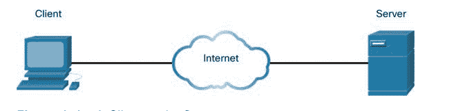

图 1-1 客户端和服务器

客户端软件的示例是 Web 浏览器，例如 Chrome 或 Firefox。单台计算机也可以运行多种类型的客户端软件。例如，用户可以在即时消息和收听音频流的同时检查电子邮件并查看网页。表 1-1 列出了三种常见的服务器软件类型。

表 1-1 常见服务器软件

| 软件类型 | 描述 |
|---|---|
| 电子邮件 | 电子邮件服务器运行电子邮件服务器软件。客户端使用邮件客户端软件，如 Microsoft Outlook，来访问服务器上的电子邮件。 |
| Web | Web 服务器运行 Web 服务器软件。客户端使用浏览器软件，如 Windows Internet Explorer，来访问服务器上的网页。 |
| 文件 | 文件服务器将企业和用户文件存储在中央位置。客户端设备使用客户端软件如 Windows 文件资源管理器访问这些文件。 |

### 对等 (1.2.2)

客户端和服务器软件通常运行在不同的计算机上，但也可以让一台计算机同时用于两种角色。在小型企业和家庭中，许多计算机在网络上同时充当服务器和客户端。这种类型的网络称为对等网络，如图 1-2 所示。

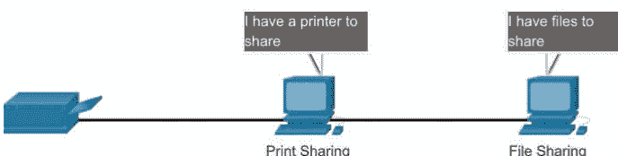

图 1-2 对等网络

表 1-2 概述了对等网络的优点和缺点。

表 1-2 对等网络的优点和缺点

| 优点 | 缺点 |
|---|---|
| 易于设置 | 没有集中管理 |
| 复杂度较低 | 安全性不足 |
| 成本较低，因为可能不需要网络设备和专用服务器 | 不可扩展 |
| 可用于简单任务，如传输文件和共享打印机 | 所有设备都可能同时充当客户端和服务器，从而降低其性能 |

### 终端设备 (1.2.3)

人们最熟悉的网络设备是终端设备。为了区分一个终端设备与另一个终端设备，网络上的每个终端设备都有一个地址。当终端设备发起通信时，它使用目标终端设备的地址来指定将消息发送到何处。

终端设备是网络上传输的消息的源或目的地，如图 1-3 所示。

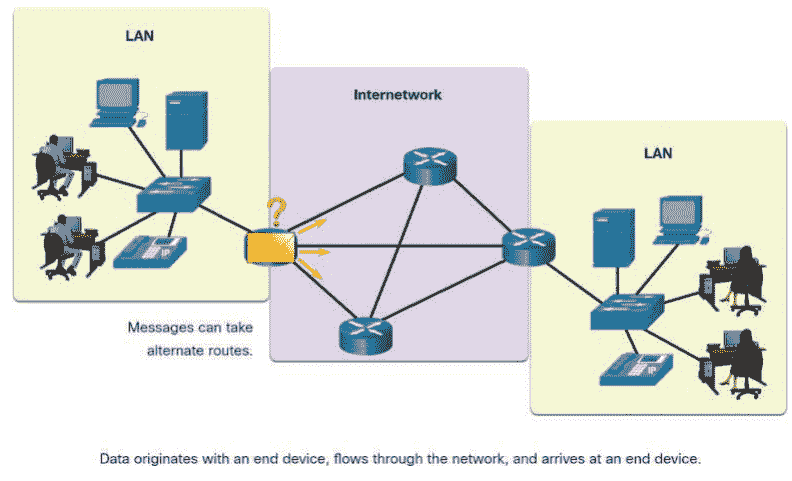

数据始于终端设备，经过网络传输，到达终端设备。

图 1-3 数据通过网络的流动

### 中间设备 (1.2.4)

中间设备将单个终端设备连接到网络。它们可以将多个单独的网络连接起来形成互连网络。这些中间设备提供连接性并确保数据在网络中流动。

中间设备使用目标终端设备地址，结合有关网络互连的信息，来确定消息应通过网络采取的路径。图 1-4 显示了最常见的中间设备的示例。

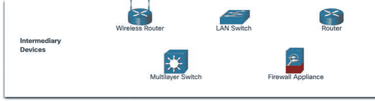

图 1-4 中间设备

中间网络设备执行以下一些或全部功能：
- 再生成并重新传输通信信号
- 维护有关网络和互连网络中存在哪些路径的信息
- 通知其他设备错误和通信故障
- 在链路故障时沿替代路径引导数据
- 根据优先级对消息进行分类和定向
- 根据安全设置允许或拒绝数据流

### 注

图 1-4 未显示任何旧式以太网集线器。以太网集线器也称为多端口中继器。中继器再生成并重新传输通信信号。请注意，每个中间设备都执行中继器的功能。

### 网络介质 (1.2.5)

通信通过网络上的介质传输。介质提供了消息从源到目的地的传输通道。

现代网络主要使用三种类型的介质来互连设备，如图 1-5 所示：
- **电缆内的金属导线：** 数据被编码为电脉冲。
- **电缆内的玻璃或塑料光纤（光纤电缆）：** 数据被编码为光脉冲。
- **无线传输：** 数据通过调制特定频率的电磁波进行编码。

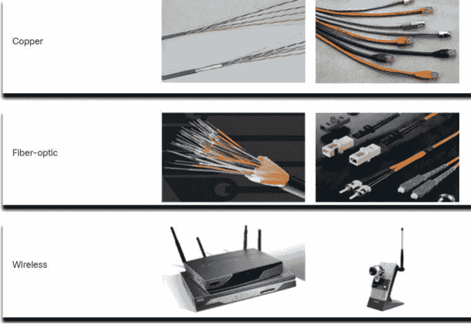

图 1-5 网络介质

不同类型的网络介质具有不同的特性和优点。并非所有网络介质具有相同的特性，也并非都适用于相同的用途。

### 检查你的理解——网络组件 (1.2.6)

请参考在线课程完成此活动。

### 交互式图形

## 网络表示和拓扑 (1.3)

网络的基础设施使用常用符号来表示设备，并使用不同类型的图表来表示这些设备在网络中的互连。理解这些符号和图表是理解网络通信的重要方面。

### 网络表示 (1.3.1)

网络架构师和管理员必须能够展示其网络的外观。他们需要能够轻松地看到哪些组件连接到其他组件，它们位于何处以及如何连接。网络图通常使用符号，如图 1-6 所示，来表示网络中的不同设备和连接。

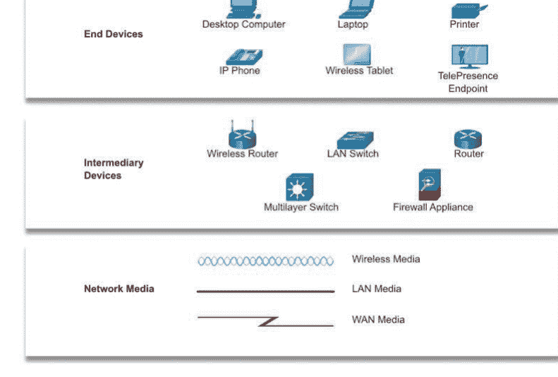

图 1-6 拓扑图网络符号

图表提供了一种轻松理解设备如何在网络中连接的方法。这种网络的“图片”称为拓扑图。能够识别物理网络组件的逻辑表示对于可视化网络的组织和操作至关重要。

除此之外，还使用专门的术语来描述这些设备和介质如何相互连接：
- **网络接口卡 (NIC)**: NIC 在物理上将终端设备连接到网络。
- **物理端口**: 端口是网络设备上的连接器或插口，介质在此处连接到终端设备或另一台网络设备。
- **接口**: 接口是网络设备上连接到网络的专用端口。由于路由器连接网络，路由器上的端口被称为网络接口。


**注意**
通常，术语 *端口* 和 *接口* 被互换使用。

### 拓扑图 (1.3.2)
*拓扑* 图是任何从事网络工作的人必须的文档。这样的图表提供了网络连接方式的可视化地图。有两种类型的拓扑图：物理和逻辑。

### 物理拓扑图
物理拓扑图说明了中间设备的物理位置和电缆安装情况，如图 1-7 所示。您可以看到这些设备所在的房间在此物理拓扑中已标注。

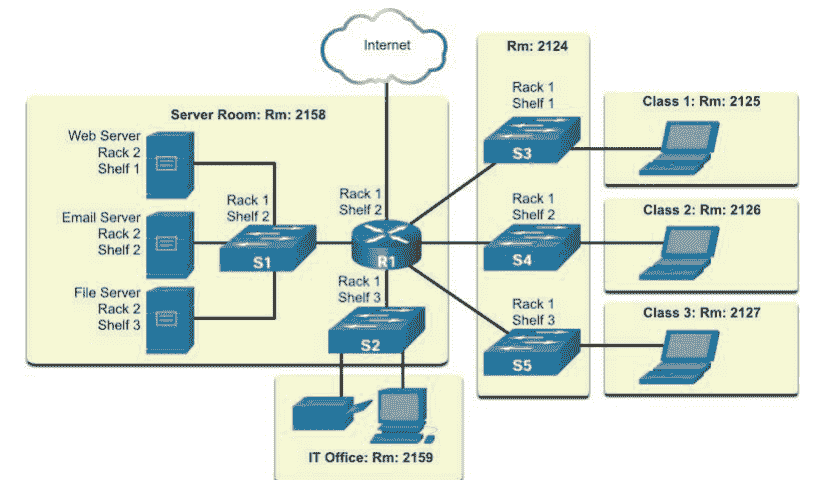

图 1-7 物理拓扑示例

### 逻辑拓扑图
逻辑拓扑图说明了网络中的设备、端口和寻址方案，如图 1-8 所示。您可以看到哪些终端设备连接到哪些中间设备以及使用的是什么介质。

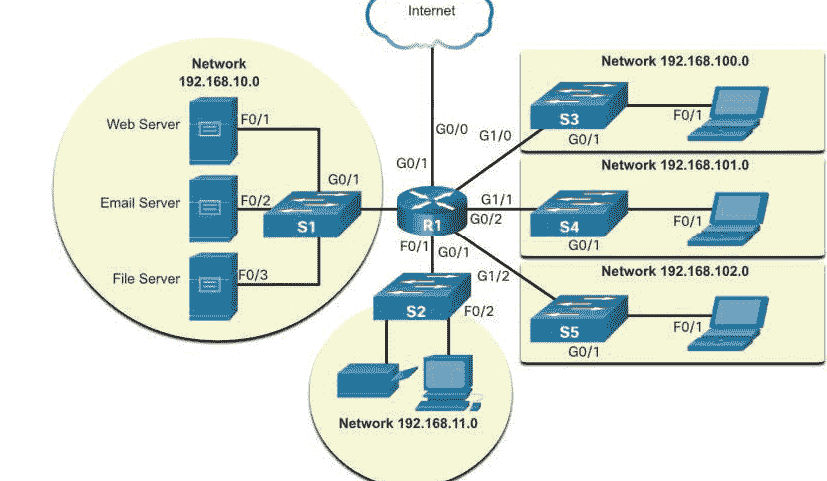

图 1-8 逻辑拓扑示例

物理和逻辑图中显示的拓扑在课程的这个阶段适合您的理解水平。搜索互联网上的“网络拓扑图”以查看更复杂的示例。如果在搜索词中加上“Cisco”一词，您会找到许多使用与这些图中类似图标的拓扑。

### 检查你的理解——网络表示和拓扑 (1.3.3)
请参考在线课程完成此活动。

交互式图形

## 网络的常见类型 (1.4)
网络可以根据多种方式进行分类，包括按规模、按位置或按功能。不管讨论的是哪种类型的网络，其底层原理都适用于所有类型的网络。

### 多种规模的网络 (1.4.1)
现在您已熟悉构成网络的组件以及它们在物理和逻辑拓扑中的表示，您就可以学习有关各种不同类型的网络了。

网络有各种规模。它们范围从由两台计算机组成的简单网络到连接数百万台设备的网络。

简单的家庭网络让您可以将打印机、文档、图片和音乐等资源在少数本地终端设备之间共享。

*小型办公室和家庭办公室 (SOHO) 网络* 允许人们在家中或远程办公室工作。许多自由职业者使用这类网络来宣传和销售产品、订购用品以及与客户沟通。

企业和大型组织使用网络来提供网络服务器上信息的整合、存储和访问。网络提供电子邮件、即时消息以及员工之间的协作。许多组织使用到互联网的网络连接为客户提供产品和服务。

互联网是现存最大的网络。事实上，术语 *互联网* 意味着“网络的网络”。互联网是由相互连接的私有和公共网络组成的集合。

在小型企业和家庭中，许多计算机在网络上同时充当服务器和客户端。这种类型的网络称为对等网络。有各种规模的网络可以按多种方式进行分类，包括以下内容：

- **小型家庭网络：** 小型家庭网络将几台计算机彼此连接并连接到互联网。
- **SOHO 网络：** SOHO 网络允许家庭办公室或远程办公室中的计算机连接到企业网络或访问集中共享资源。
- **中型到大型网络：** 中型到大型网络，例如企业和学校使用的网络，可以有多个地点，连接数百或数千台主机。
- **全球网络：** 互联网是一个网络的网络，连接全球数以亿计的计算机。

### LAN 和 WAN (1.4.2)
网络基础设施在以下方面差异很大

- 覆盖区域的大小
- 连接的用户数量
- 可用服务的数量和类型
- 责任范围

两种最常见的网络基础设施类型是 *局域网 (LANs)* 和 *广域网 (WANs)*。LAN 是一种网络基础设施，可在小地理区域内为用户和终端设备提供访问。LAN 通常用于企业内的部门、家庭或小型企业网络。WAN 是一种网络基础设施，可在广阔的地理区域内为其他网络提供访问，通常由大型企业或电信服务提供商拥有和管理。图 1-9 显示了连接到 WAN 的 LAN。

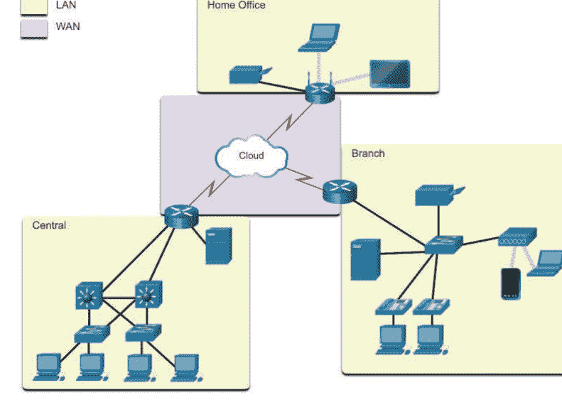

图 1-9 连接的 LAN 和 WAN 示例

### LAN
LAN 是一种跨越小地理区域的网络基础设施。LAN 具有以下特定特征：

- LAN 在有限区域（如家庭、学校、办公楼或校园）内互连终端设备。
- LAN 通常由单个组织或个人管理。管理控制在网络级别执行并管理安全和访问控制策略。
- LAN 为内部终端设备和中间设备提供高速带宽，如图 1-10 所示。

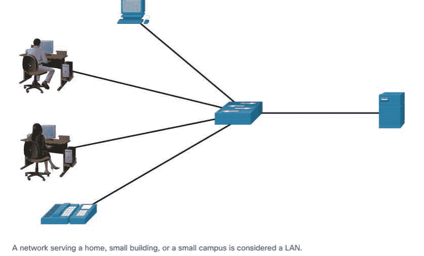

为家庭、小型建筑或小型校园服务的网络被视为 LAN。

图 1-10 LAN 示例

### WAN
图 1-11 显示了互连两个 LAN 的 WAN。WAN 是一种跨越广阔地理区域的网络基础设施。WAN 通常由服务提供商 (SP) 或互联网服务提供商 (ISP) 管理。

WAN 具有以下特定特征：

- WAN 在广阔的地理区域内互连 LAN，例如城市、州、省、国家或大陆之间。
- WAN 通常由多个服务提供商管理。
- WAN 通常在 LAN 之间提供较慢速度的链路。

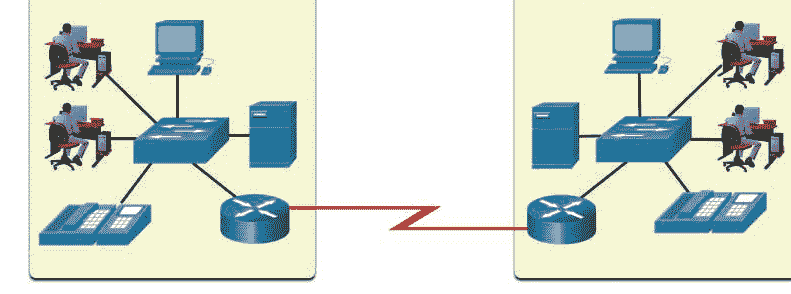

图 1-11 WAN 链路示例

### 因特网 (1.4.3)
*因特网* 是由相互连接的网络组成的全球集合（*因特网*，简称为 *因特网*）。图 1-12 显示了一种将互联网视为相互连接的 LAN 和 WAN 集合的视图。

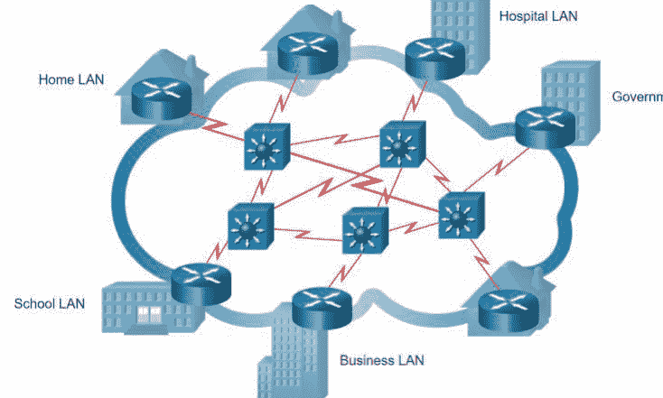

图 1-12 互联网视图示例

图 1-12 中的一些 LAN 示例通过 WAN 连接相互连接。然后 WAN 彼此连接。WAN 连接线（看起来像闪电）代表我们连接网络的各种方式。WAN 可以通过铜线、光纤电缆和无线传输（未显示）连接。

互联网不属于任何个人或团体。在这种多样化的基础设施上实现有效通信需要应用一致且公认的技术和标准，以及众多网络管理机构的合作。已开发组织来帮助维护互联网协议和流程的结构和标准化。这些组织包括互联网工程任务组 (IETF)、互联网名称与数字地址分配机构 (ICANN) 和互联网架构委员会 (IAB)，等等。

### 内联网和外联网 (1.4.4)
与互联网术语相似的另外两个术语是内联网和外联网。

术语 *内联网* 通常用于指属于某个组织的 LAN 和 WAN 的私有连接。内联网设计为仅供组织的成员、员工或其他授权人员访问。

组织可能会使用 *外联网* 为在不同组织工作但需要访问组织数据的个人提供安全可靠的访问。以下是一些外联网示例：

- 一家公司为外部供应商和承包商提供访问权限
- 一家医院为医生提供预订系统，以便他们为患者预约
- 一个地方教育办公室为其辖区内的学校提供预算和人事信息

图 1-13 说明了不同群体对公司内联网、公司外联网和互联网的访问级别。

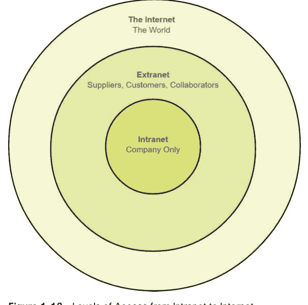

Figure 1-13 从内网到互联网的访问级别

交互式图形

### 检查你的理解——常见网络类型 (1.4.5)

请参考在线课程完成此活动。

## 互联网连接 (1.5)

诸如计算机和智能手机之类的终端设备可以通过多种方式连接到网络，使用有线和无线方式。这些相同的连接类型也用于互连中间设备。

### 互联网接入技术 (1.5.1)

现在你对构成网络的内容以及不同类型的网络有基本的了解。如何实际将用户和组织连接到互联网？正如你可能已经知道的那样，有很多不同的方式可以做到这一点。

家用用户、远程办公人员和小办公室通常需要连接到互联网服务提供商 (ISP) 才能访问互联网。连接选项在不同的 ISP 和不同地理位置之间差异很大。然而，流行选择包括宽带电缆、宽带数字用户线路 (DSL)、无线广域网和移动服务。

组织通常还需要访问其他企业站点以及互联网。需要快速连接来支持 IP 电话、视频会议和数据中心存储等业务服务。ISP 提供企业级互连。流行的企业级服务包括企业 DSL、租用线路和 Metro Ethernet。

### 家庭和小办公室互联网连接 (1.5.2)

图 1-14 说明了小型办公室和家庭办公室用户常见的连接选项：

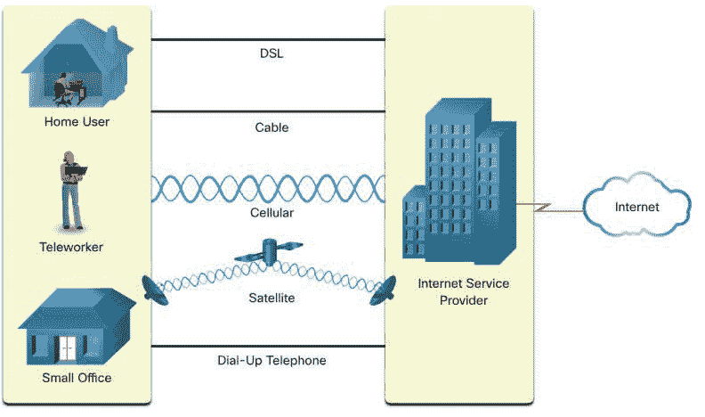

Figure 1-14 小型办公室和家庭办公室连接选项

- **有线电视连接**：这种连接类型通常由有线电视服务提供商提供，互联网数据信号通过与传输有线电视的同一电缆传输。这种连接类型提供高带宽、高可用性和始终在线的互联网连接。
- *数字用户线路 (DSL)*：DSL 提供高带宽、高可用性和始终在线的互联网连接。DSL 运行在电话线上。一般来说，小型办公室和家庭办公室用户使用非对称数字用户线路 (ADSL) 连接，这意味着下载速度比上传速度快。
- *蜂窝连接*：蜂窝互联网接入使用手机网络连接。在任何可以获得蜂窝信号的地方，都可以获得蜂窝互联网接入。性能受手机或其他设备以及其连接的基站能力的限制。
- **卫星连接：** 在原本完全没有互联网连接的地区，卫星互联网接入的可用性是一大优势。卫星天线必须与卫星保持清晰的视线。
- **拨号电话连接：** 这是一种经济实惠的选项，使用任何电话线路和调制解调器。拨号调制解调器连接提供的低带宽不足以进行大数据的传输，尽管在旅行时它对于移动访问很有用。

连接的选择取决于地理位置和服务提供商的可用性。

### 企业互联网连接 (1.5.3)

企业连接选项与家庭用户选项不同。企业可能需要更高的带宽、专用带宽和管理服务。可用的连接选项取决于附近服务提供商的类型。

图 1-15 说明了企业常见的连接选项：

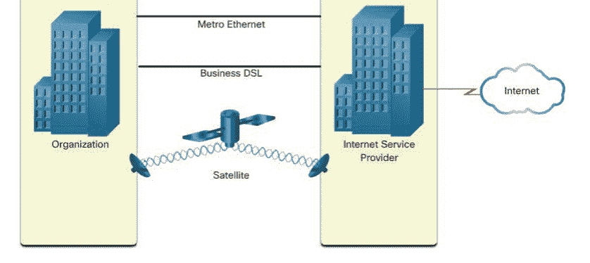

Figure 1-15 企业连接选项

- **专用租用线路：** 租用线路是服务提供商网络内的专用电路，用于连接地理上分离的办公室以进行私人语音和/或数据网络。电路按月或按年租赁。
- **Metro Ethernet：** 这有时被称为以太网 WAN。在本章中，我们将称其为 Metro Ethernet。Metro Ethernet 可用于将 LAN 接入技术扩展到 WAN。以太网是一种 LAN 技术，你将在后面的章节中学习。
- **企业 DSL：** 企业 DSL 有多种格式。一种流行选择是对称数字用户线路 (SDSL)，它与消费版 DSL 相似，但提供相同的高上传和下载速度。
- **卫星：** 当有线解决方案不可用时，卫星服务可以提供连接。

连接的选择取决于地理位置和服务提供商的可用性。

### 网络融合 (1.5.4)

考虑一所建于 30 年前的学校。当时，一些教室为数据网络、电话网络和电视的视频网络布线。这些独立的网络无法相互通信。每个网络使用不同的技术来传输通信信号。每个网络都有自己的规则和标准以确保通信成功。多个服务运行在多个网络上，如图 1-16 所示。

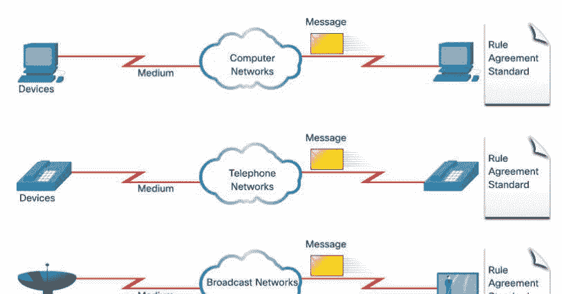

Figure 1-16 传统网络

今天，独立的数据、电话和视频网络已经融合。与专用网络不同，融合网络能够通过同一网络基础设施在许多不同类型的设备之间传输数据、语音和视频。该网络基础设施使用相同的规则、协议和实施标准。融合数据网络在一个网络上承载多个服务，如图 1-17 所示。

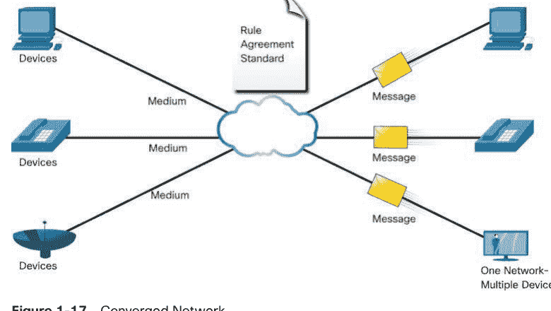

Figure 1-17 融合网络

### 视频

### 视频—下载和安装 Packet Tracer (1.5.5)

本视频向你展示如何下载和安装 Packet Tracer，你可以用它在计算机上模拟网络的创建和测试。Packet Tracer 是一款有趣、可带回家、灵活的软件程序，它将给你机会使用你刚刚学到的网络表示和理论来构建网络模型并探索相对复杂的局域网和广域网。

学生通常使用 Packet Tracer 来

- 准备认证考试
- 练习网络课程中学到的内容
- 提升求职面试技能
- 考察将新技术添加到现有网络设计中的影响
- 提升物联网工作的技能
- 参与全球设计挑战（如 2017 年在 Facebook 上的 PT 7 设计挑战）

Packet Tracer 是许多思科网络学院课程中使用的必备学习工具。

要获取和安装 Cisco Packet Tracer，请按照以下步骤操作：


- **步骤 1.** 登录你的思科网络学院“我正在学习”页面。
- **步骤 2.** 选择资源。
- **步骤 3.** 选择下载 Packet Tracer。
- **步骤 4.** 选择你需要的 Packet Tracer 版本。
- **步骤 5.** 将文件保存到你的计算机。
- **步骤 6.** 启动 Packet Tracer 安装程序。

请参考在线课程观看此视频。


### 视频—入门 Cisco Packet Tracer (1.5.6)

Packet Tracer 是一款允许你模拟真实网络的工具。它提供三个主要功能：

- 你可以添加设备并通过有线或无线方式连接它们
- 你可以选择、删除、检查、标记和分组网络中的组件
- 你可以通过打开现有/示例网络、保存当前网络以及修改用户配置文件或首选项来管理网络

如果你使用过任何程序，例如文字处理器或电子表格，你已经熟悉位于顶部菜单栏的文件菜单命令。打开、保存、另存为和退出命令的工作方式与任何程序相同，但有两个命令是 Packet Tracer 特有的：

- 打开示例命令显示 Packet Tracer 中包含的各种网络和物联网设备的预建功能和配置示例目录。
- 退出并注销命令会删除此副本 Packet Tracer 的注册信息，并要求下一个使用此副本 Packet Tracer 的用户再次进行登录程序。

请参考在线课程观看此视频。


Packet Tracer
活动

### Packet Tracer—网络表示 (1.5.7)

在本次活动中，您将探索 Packet Tracer 如何作为网络表示的建模工具。

## 可靠的网络 (1.6)

网络是向终端用户以可靠、高效和安全的方式分发各种服务的平台。

### 网络架构 (1.6.1)

您是否曾经在网上忙碌工作时遇到“互联网中断”的情况？正如您现在所知，互联网并没有中断，但您可能会失去与它的连接——这会非常令人沮丧。随着全世界如此多的人依赖网络访问来工作和学习，网络必须可靠至关重要。在此上下文中，可靠性不仅仅指您与互联网的连接。本节重点介绍网络可靠性的四个方面。

网络的作用已经改变。曾经仅用于数据的网络现在已成为一个系统，能够在媒体丰富、融合的网络环境中实现人与人、设备与信息之间的连接。为了使网络在此类环境中高效运行并不断发展，网络必须建立在标准网络架构之上。

网络还支持各种各样的应用程序和服务。它们必须在构成物理基础设施的许多不同类型的电缆和设备上运行。在此上下文中，网络架构一词指的是支持基础设施的技术以及使数据在网络中传输的编程服务和规则，即协议。

随着网络的发展，网络架构师必须解决四个基本特征以满足用户期望：

- 容错
- 可扩展性
- 服务质量 (QoS)
- 安全

### 容错 (1.6.2)

容错网络是一种限制故障影响设备数量的网络。它旨在在发生故障时实现快速恢复。这些网络依赖于消息源与目的地之间的多条路径。如果一条路径失败，消息会立即通过不同的链路发送。拥有通往目的地的多条路径称为冗余。

实现分组交换网络是提供冗余的一种方式。分组交换将流量拆分为在共享网络上传输的数据包。单个消息，例如电子邮件或视频流，被拆分为多个称为数据包的消息块。每个数据包都有消息源和目的地的必要寻址信息。网络中的路由器根据当时网络状况交换数据包。这意味着单个消息中的所有数据包可能通过非常不同的路径到达同一目的地。在图 1-18 中，用户对路由器在链路故障时动态更改路由的情况毫不知情且不受影响。

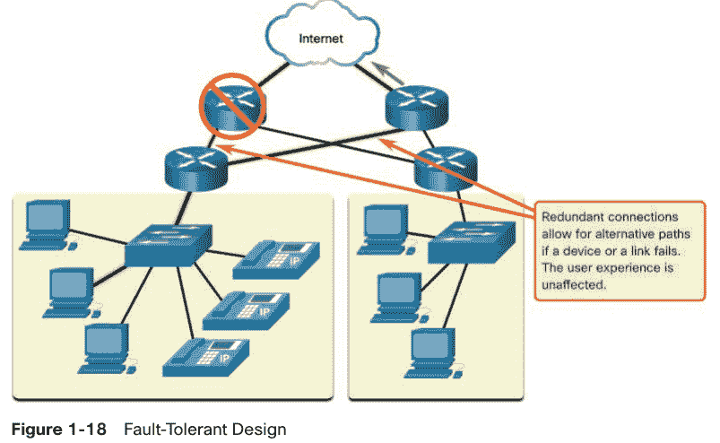

图 1-18 容错设计

### 可扩展性 (1.6.3)

可扩展网络能够快速扩展以支持新用户和应用程序。它在不降低现有用户访问的服务性能的情况下实现这一点。图 1-19 显示了如何轻松地将新网络添加到现有网络中。这些网络可扩展，因为设计者遵循了公认的标准和协议。由于这些标准和协议，软件和硬件供应商可以专注于改进产品和服务，而无需为在网络中运行设计一套新的规则。

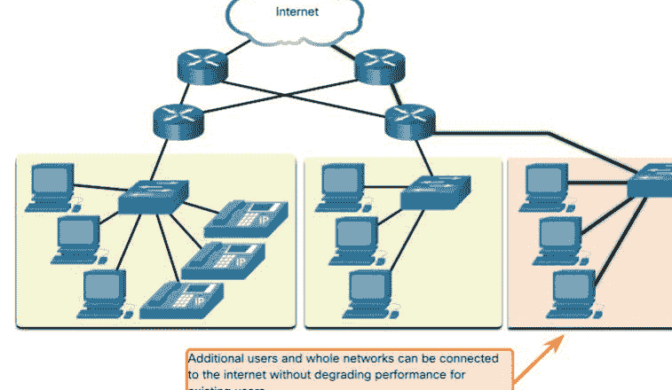

可以在不降低现有用户性能的情况下将更多用户和整个网络连接到互联网。

图 1-19 可扩展设计

### 服务质量 (1.6.4)

服务质量 (QoS) 是当今网络中日益增长的需求。网络上为用户提供的新的应用程序，例如语音和实时视频传输，对交付服务的质量提出了更高的期望。您是否曾尝试观看视频并遇到不断中断和暂停的情况？随着数据、语音和视频内容继续汇聚到同一网络，QoS 成为管理拥塞并确保内容可靠交付给所有用户的主要机制。

当带宽需求超过可用量时就会发生拥塞。网络带宽以每秒可传输的位数来衡量，即每秒位 (bps)。当在网络上尝试同时通信时，网络带宽需求可能超过其可用性，从而造成网络拥塞。

当流量量大于网络可传输量时，设备会将数据包保存在内存中，直到有资源可用于传输它们为止。在图 1-20 中，一个用户正在请求网页，另一个用户正在进行电话通话。在实施 QoS 策略的情况下，路由器可以管理数据和语音流量的流动，并在网络出现拥塞时优先考虑语音通信。

由路由器管理的服务质量可确保优先级与通信类型及其对组织的重要性相匹配。

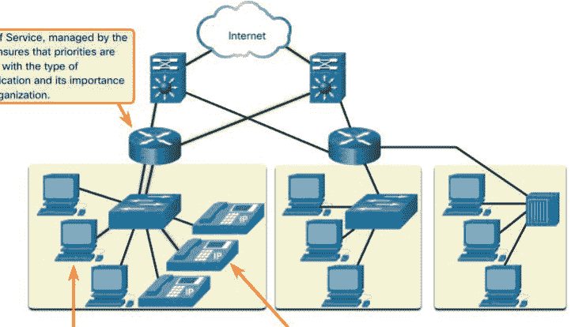

网页通常可以获得较低的优先级。

语音 over IP (VoIP) 通话需要优先权以保持流畅、无中断的用户体验。

图 1-20 QoS 设计

### 网络安全 (1.6.5)

网络基础设施、服务以及网络连接设备上包含的数据是至关重要的个人和商业资产。网络管理员必须解决两种类型的网络安全问题：网络基础设施安全和信息安全。

保护网络基础设施涉及物理保护提供网络连接的设备，并防止未经授权访问其上的管理软件，如图 1-21 所示。

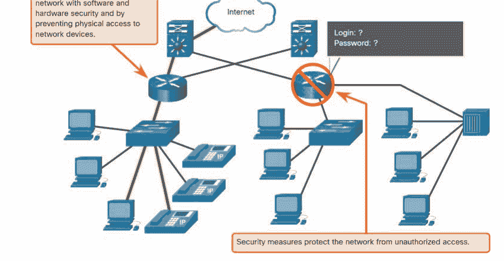

图 1-21 安全设计

网络管理员还必须保护网络上传输的数据包中包含的信息，以及存储在网络连接设备上的信息。为了实现网络安全目标，有三个主要要求：

- **保密性**：数据保密性意味着只有预期且授权的接收者才能访问和读取数据。
- **完整性**：数据完整性向用户保证信息在从源到目的地的传输过程中未被更改。
- **可用性**：数据可用性向用户保证授权用户能够及时可靠地访问数据服务。

### 检查你的理解——可靠的网络 (1.6.6)

请参考在线课程完成此活动。

### 交互式图形

## 网络趋势 (1.7)

网络环境不断发展，为终端用户提供新的体验和机会。网络现在能够以曾经只能梦想的方式提供服务和应用程序。

### 最新趋势 (1.7.1)

您现在已经了解了很多关于网络的知识，包括它们由什么组成、如何连接我们以及保持其可靠所需的条件。但网络与其他事物一样在不断变化。作为 NetAcad 学生，您需要了解一些网络趋势。

随着新技术和终端用户设备进入市场，企业和消费者必须继续适应不断变化的网络环境。以下几个网络趋势影响着组织和消费者：

- 自带设备 (BYOD)
- 在线协作
- 视频通信
- 云计算

### 自带设备 (BYOD) (1.7.2)

任何设备、任何内容、任何方式的概念是全球主要趋势，要求我们以显著不同的方式使用设备并安全地将其连接到网络。自带设备 (BYOD) 为终端用户提供了使用个人工具访问信息并在企业或校园网络中通信的自由。随着消费设备的增长和相关成本的下降，员工和学生可能拥有用于个人使用的先进计算和网络设备。这些设备包括笔记本电脑、便携式电脑、平板电脑、智能手机和电子阅读器。此类设备可能由公司或学校购买，也可能由个人购买，或两者兼有。

BYOD 指的是任何所有权、任何地点的任何设备。

### 在线协作 (1.7.3)

个人希望连接到网络不仅是为了访问数据应用程序，也是为了相互协作。协作被定义为“与他人共同开展联合项目的行为”。协作工具，例如 Cisco Webex（见图 1-22），使员工、学生、教师、客户和合作伙伴能够即时连接、互动并实现其目标。

协作是组织保持竞争力的关键和战略重点。协作在教育中也是一个重点。学生需要协作以帮助彼此学习，发展在劳动力市场中使用的团队技能，并在团队项目上共同工作。


图 1-22 Cisco Webex 界面

Cisco Webex Teams 是一款多功能协作工具，可让您向一个或多人发送即时消息、发布图像以及发布视频和链接。每个团队“空间”都会保留在其上发布的所有内容的历史记录。

### 视频通信 (1.7.4)

网络中对通信和协作工作至关重要的一项方面是视频。视频用于通信、协作和娱乐。只要有互联网连接，无论身处何地，都可以进行视频通话。

视频会议是与他人进行本地和全球通信的强大工具。随着组织跨越地理和文化边界扩展，视频正成为有效协作的关键要求。

### 视频—Cisco Webex Huddles (1.7.5)

请参考在线课程观看此视频。

视频

### 云计算 (1.7.6)

云计算是我们访问和存储数据的方式之一。云计算允许我们将个人文件——甚至备份整个驱动器——存储在互联网上的服务器上。诸如文字处理和照片编辑之类的应用程序可以使用云访问。

对于企业而言，云计算扩展了 IT 的能力，而无需投资新基础设施、为新人员培训或许可新软件。这些服务可按需提供，并以经济的方式交付给世界任何地方的任何设备，同时不影响安全或功能。

云计算之所以成为可能，是因为有数据中心。数据中心是用于容纳计算机系统及其相关组件的设施。数据中心可以占据建筑物的一间房间、一层或多层楼，或整个仓库大小的建筑物。数据中心通常建造和维护成本非常高昂。因此，只有大型组织才会使用自建的数据中心来存放其数据并为用户提供服务。无法负担维护自己的私有数据中心的小型组织可以通过从云中更大的数据中心组织租赁服务器和存储服务来降低总体拥有成本。

为了安全、可靠和容错，云提供商通常将数据存储在分布式数据中心中。不是将个人或组织的所有数据存储在一个数据中心，而是将其存储在不同位置的多个数据中心中。

如表 1-3 所示，主要有四种云类型：公有云、私有云、混合云和社区云。

### 表 1-3 云类型

| 云类型 | 描述 |
|---|---|
| 公有 | 公有云中提供的基于云的应用程序和服务面向公众开放。服务可能是免费的，也可能采用按需付费模式，例如支付在线存储费用。公有云使用互联网提供服务。 |
| 私有 | 私有云中提供的基于云的应用程序和服务面向特定组织或实体，例如政府。私有云可以使用组织的私有网络搭建，尽管这样做成本高昂且维护困难。私有云也可以由外部组织管理，并具有严格的访问安全控制。 |
| 混合 | 混合云由两个或多个云组成（例如部分私有、部分公有），其中每个部分保持为独立对象，但两者通过单一架构连接。混合云上的个人可以根据用户访问权限对各种服务拥有不同程度的访问权限。 |
| 社区 | 社区云是为特定实体或组织专属使用而创建的。公有云与社区云之间的区别在于为社区定制的职能需求。例如，医疗保健组织必须遵守政策和法律（如 HIPAA），这些政策和法律要求特殊的身份验证和保密性。社区云由具有相似需求和关注点的多个组织使用。社区云与公有云环境类似，但具有与私有云中类似的设定安全、隐私甚至监管合规级别。 |

### 家庭中的技术趋势 (1.7.7)

网络趋势不仅影响我们在工作和学校中的沟通方式，还改变了家庭的许多方面。最新的家庭趋势包括智能家居技术。

智能家居技术正被整合到日常家电中，这些家电可以与其他设备连接，使家电更“智能”或自动化。例如，您可以在一天外出前准备好食物并将其放入烤箱烹饪。您会为智能烤箱编程以烹饪您想要的食物，并且烤箱会连接到您的日程表，以便确定您应该何时有空进食并相应调整开始时间和烹饪时长。它甚至可以根据日程变化调整烹饪时间和温度。此外，智能手机或平板电脑连接可让您直接连接到烤箱以进行所需的任何调整。当食物准备好时，烤箱可以向您（或您指定的某人）发送警报消息以表明食物已完成。

智能家居技术正被开发用于房屋的各个房间。随着家庭网络和高速互联网技术的扩展，智能家居技术将变得更加普遍。

## 电力线网络 (1.7.8)

*电力线网络* 用于家庭网络，使用现有的电气布线连接设备，如图 1-23 所示。

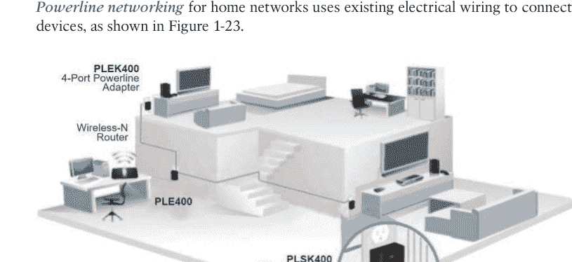

图 1-23 电力线网络适配器

使用标准电力线适配器，设备可以在有电源插座的任何地方连接到局域网。无需安装数据电缆，且几乎不使用额外电量。电力线网络使用传输电力的同一布线在特定频率上传输数据。

当无线接入点无法覆盖家庭中的所有设备时，电力线网络尤其有用。电力线网络不是数据网络中专用布线的替代品。然而，当数据网络电缆或无线通信不可行或无效时，它是一种替代方案。

## 无线宽带 (1.7.9)

在许多有线电视和 DSL 不可用的地区，可使用无线方式连接互联网。

### 无线互联网服务提供商

无线互联网服务提供商（WISP）是一种 ISP，使用与家庭无线局域网（WLAN）中类似的无线技术将订阅用户连接到指定的接入点或热点。WISP 最常见于 DSL 或有线服务不可用的农村环境中。

尽管可以为天线安装单独的发射塔，但通常天线会附着在现有的高架结构上，例如水塔或无线电塔。订阅用户屋顶上安装一个小型碟形天线或天线，其范围在 WISP 发射器的范围内。订阅用户的接入单元连接到家庭内部的有线网络。从家庭用户角度来看，该设置与 DSL 或有线服务并没有太大不同。主要区别在于从家庭到 ISP 的连接是无线而不是物理电缆。

### 无线宽带服务

另一种面向家庭和小型企业的无线解决方案是无线宽带。该解决方案使用与智能手机相同的蜂窝技术。天线安装在房屋外部，为家庭中的设备提供无线或有线连接。在许多地区，家庭无线宽带正直接与 DSL 和有线服务竞争。


### 检查理解—网络趋势 (1.7.10)

请参考在线课程完成此活动。


## Network Security (1.8)
网络安全 (1.8)

Security is a critical component in designing, implementing, and maintaining networks. Network engineers and administrators must always consider security risks and employ the proper mitigation methods before deploying any type of network service.
安全是设计、实施和维护网络中的关键组成部分。网络工程师和管理员在部署任何类型的网络服务之前必须始终考虑安全风险并采用适当的缓解方法。

### Security Threats (1.8.1)
安全威胁 (1.8.1)

You have, no doubt, heard or read news stories about a company network being breached, giving threat actors access to the personal information of thousands of customers. Network security is always going to be a top priority of administrators.
你无疑听说或读到过关于公司网络被入侵的新闻报道，导致威胁行为者能够访问数千名客户的个人信息。网络安全始终是管理员的首要优先事项。

Network security is an integral part of computer networking, regardless of whether the network is a home network with a single connection to the internet or a corporate network with thousands of users. Network security must consider the environment, as well as the tools and requirements of the network. It must be able to secure data while still allowing for the quality of service that users expect of the network.
无论是只有一个互联网连接的家庭网络还是拥有数千用户的企业网络，网络安全都是计算机网络不可或缺的一部分。网络安全必须考虑环境以及网络的工具和要求。它必须能够在保护数据的同时，仍允许用户对网络所期望的服务质量。

Securing a network involves using protocols, technologies, devices, tools, and techniques to protect data and mitigate threats. Threat vectors may be external or internal. Many external network security threats today originate from the internet.
保护网络涉及使用协议、技术、设备、工具和技术来保护数据并减轻威胁。威胁向量可能是外部的或内部的。许多当今的外部网络安全威胁源自互联网。

There are several common external threats to networks:
网络存在几种常见的外部威胁：

- **Viruses, worms, and Trojan horses:** These contain malicious software or code running on a user device.
- **病毒、蠕虫和特洛伊木马：** 这些包含在用户设备上运行的恶意软件或代码。
- **Spyware and adware:** These types of software are installed on a user's device to secretly collect information about the user.
- **间谍软件和广告软件：** 这类软件安装在用户的设备上，以秘密收集有关用户的信息。
- **Zero-day attacks:** Also called zero-hour attacks, these attacks occur on the first day that a vulnerability becomes known.
- **零日攻击：** 又称为零小时攻击，这些攻击发生在漏洞被发现的第一天。
- **Threat actor attacks:** In these attacks, malicious persons attack user devices or network resources.
- **威胁行为者攻击：** 在这些攻击中，恶意人员攻击用户设备或网络资源。
- **Denial-of-service attacks:** These attacks slow or crash applications and processes on a network device.
- **拒绝服务攻击：** 这些攻击会减慢或导致网络设备上的应用程序和进程崩溃。
- **Data interception and theft:** This type of attack involves capturing private information from an organization's network.
- **数据拦截和窃取：** 此类攻击涉及从组织的网络中捕获私人信息。
- **Identity theft:** This type of attack involves stealing the login credentials of a user in order to access private data.
- **身份盗窃：** 此类攻击涉及窃取用户的登录凭据以访问私人数据。

It is important to consider internal threats. Many studies have shown that the most common data breaches are related to internal network users. Such breaches may be attributed to lost or stolen devices, accidental misuse by employees, or even malicious employees. BYOD strategies make corporate data especially vulnerable. Therefore, when developing a security policy, it is important to address both external and internal security threats, as shown in Figure 1-24.
考虑内部威胁很重要。许多研究表明，最常见的数据泄露与内部网络用户有关。此类泄露可能归因于设备丢失或被盗、员工意外误用，甚至是恶意员工。BYOD 策略使企业数据尤其容易受到攻击。因此，在制定安全策略时，重要的是同时解决外部和内部安全威胁，如图 1-24 所示。

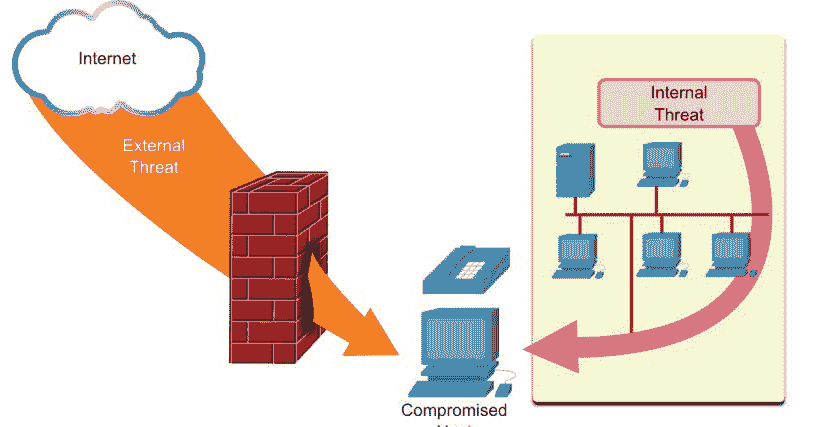

Figure 1-24 External and Internal Threats
图 1-24 外部和内部威胁

### Security Solutions (1.8.2)
安全解决方案 (1.8.2)

No single solution can protect a network from the variety of threats that exist. For this reason, security should be implemented in multiple layers, using more than one security solution. If one security component fails to identify and protect a network, others may succeed.
没有单一的解决方案可以保护网络免受存在的各种威胁。因此，安全应分层实施，使用不止一种安全解决方案。如果一个安全组件未能识别和保护网络，其他组件可能会成功。

A home network security implementation is usually rather basic. Typically, you implement it on the end devices, as well as at the point of connection to the internet. You may even be able to rely on contracted services from the ISP.
家庭网络安全实施通常相当基础。通常，你会在终端设备以及连接到互联网的接入点上实施它。你甚至可能能够依赖 ISP 提供的合同服务。

These are the basic security components for a home or small office network:
家庭或小型办公室网络的基本安全组件如下：

- **Antivirus and antispyware:** These applications help to protect end devices from becoming infected with malicious software.
- **防病毒和反间谍软件：** 这些应用程序有助于保护终端设备免受恶意软件感染。
- **Firewall filtering:** Firewall filtering blocks unauthorized access into and out of the network. This may include a host-based firewall system that prevents unauthorized access to the end device or a basic filtering service on the home router to prevent unauthorized access from the outside world into the network.
- **防火墙过滤：** 防火墙过滤阻止未经授权的网络进出访问。这可能包括基于主机的防火墙系统，防止未经授权访问终端设备，或家庭路由器上的基本过滤服务，防止外部世界未经授权访问网络。

In contrast, the network security implementation for a corporate network usually consists of many components built into the network to monitor and filter traffic. Ideally, all components work together to minimize maintenance and improve security. Larger networks and corporate networks use antivirus, antispyware, and firewall filtering, and they also have additional security requirements:
相比之下，企业网络的网络安全实施通常由内置于网络中的许多组件组成，用于监控和过滤流量。理想情况下，所有组件协同工作以最大限度地减少维护并提高安全性。大型网络和企业网络使用防病毒、反间谍软件和防火墙过滤，并且还具有额外的安全要求：

- **Dedicated firewall systems:** These provide more advanced firewall capabilities that can filter large amounts of traffic with more granularity.
- **专用防火墙系统：** 这些提供更先进的防火墙功能，可以更精细地过滤大量流量。
- **Access control lists (ACL):** ACLs further filter access and traffic forwarding based on IP addresses and applications.
- **访问控制列表 (ACL)：** ACL 根据 IP 地址和应用程序进一步过滤访问和流量转发。
- **Intrusion prevention systems (IPS):** These systems identify fast-spreading threats, such as zero-day or zero-hour attacks.
- **入侵防御系统 (IPS)：** 这些系统识别快速传播的威胁，例如零日或零小时攻击。
- **Virtual private networks (VPN):** These networks provide secure access into an organization for remote workers.
- **虚拟专用网络 (VPN)：** 这些网络为远程工作人员提供进入组织的 安全访问。

Network security requirements must consider the environment as well as the various applications and computing requirements. Both home and business environments must be able to secure their data while still allowing for the quality of service that users expect of each technology. In addition, any security solution that is implemented must be adaptable to the growing needs of the network and changing trends.
网络安全要求必须考虑环境以及各种应用程序和计算要求。家庭和企业环境都必须能够在保护数据的同时，仍允许用户对每项技术所期望的服务质量。此外，实施的任何安全解决方案都必须能够适应网络不断增长的需求和不断变化的趋势。

The study of network security threats and mitigation techniques starts with a clear understanding of the underlying switching and routing infrastructure used to organize network services.
网络安全威胁和缓解技术的研究始于对用于组织网络服务的底层交换和路由基础设施的清晰理解。

### Check Your Understanding—Network Security (1.8.3)
检查你的理解——网络安全 (1.8.3)

Refer to the online course to complete this activity.
请参考在线课程完成此活动。


## The IT Professional (1.9)
IT 专业人员 (1.9)

The role of an IT professional is constantly evolving. An IT professional is always learning in an ever-changing environment.
IT 专业人员的角色不断发展。IT 专业人员在不断变化的环境中始终在学习。

### CCNA (1.9.1)
CCNA (1.9.1)

As a NetAcad student, you may already have a career in IT, or you may be educating yourself to prepare for your career. In either case, it is good to know about the skills needed for the various jobs that are available in IT.
作为 NetAcad 学生，你可能已经从事 IT 职业，或者你可能正在为你的职业做教育准备。在任何情况下，了解 IT 中可用的各种工作所需的技能都是有益的。

Network engineers are more vital today than ever before, and their roles and required skills are constantly evolving. The Cisco Certified Network Associate (CCNA) certification demonstrates that you have knowledge of foundational technologies and ensures that you stay relevant with the skills needed for the adoption of next-generation technologies.
网络工程师今天比以往任何时候都更重要，他们的角色和所需技能不断发展。思科认证网络助理 (CCNA) 认证证明你具备基础技术的知识，并确保你保持与采用下一代技术所需的技能的相关性。

The requirements of the CCNA for networking engineers have been consolidated and updated to three courses and one exam covering the fundamental topics for all network technologies. This new CCNA focuses on IP foundation and security topics, along with wireless, virtualization, automation, and network programmability.
网络工程师的 CCNA 要求已整合并更新为三门课程和一门考试，涵盖所有网络技术的核心主题。新的 CCNA 专注于 IP 基础和安全主题，以及无线、虚拟化、自动化和网络可编程性。

Cisco offers new DevNet certifications at the associate, specialist, and professional levels to validate your software development skills.
思科提供新的 DevNet 认证，分为助理、专家和专业级别，以验证你的软件开发技能。

In addition, you can obtain specialist certifications (such as Cisco Enterprise Advanced Infrastructure Specialist certification) to validate your skills in line with your job role and interests.
此外，你可以获得专家认证（如思科企业高级基础设施专家认证）以验证你的技能与你的工作角色和兴趣保持一致。

You can start where you want. There are no prerequisites to start earning your associate-, specialist-, professional-, or expert-level certifications. Continuing education credits for recertification and ongoing development are now available for CCNA certification.
你可以从任何地方开始。开始获得助理级、专家级、专业级或专家级认证没有先决条件。CCNA 认证现在提供继续教育学分用于重新认证和持续发展。

### Networking Jobs (1.9.2)
网络工作 (1.9.2)

Your CCNA certification will prepare you for a variety of jobs in today's market. At www.netacad.com you can click the Careers menu and then select Employment opportunities. You can find employment opportunities where you live by using the Talent Bridge Matching Engine. Use this new program to search for jobs with Cisco and Cisco partners and distributors seeking Cisco Networking Academy students and alumni.
你的 CCNA 认证将为你在当今市场中的各种工作做好准备。在 www.netacad.com，你可以点击职业菜单，然后选择就业机会。你可以使用人才桥匹配引擎找到你所在地的就业机会。使用这个新程序搜索思科及其合作伙伴和分销商为思科网络学院学生和校友提供的职位。

You can also search for IT jobs using online search engines such as Indeed, Glassdoor, and Monster. Use search terms such as IT, *network administrator*, *network architect*, and *computer systems administrator*. You can also search using the term *Cisco CCNA*.
你也可以使用 Indeed、Glassdoor 和 Monster 等在线搜索引擎搜索 IT 工作。使用诸如 IT、*网络管理员*、*网络架构师* 和 *计算机系统管理员* 等搜索词。你也可以使用 *Cisco CCNA* 术语进行搜索。


### Lab—Research IT and Networking Job Opportunities (1.9.3)
实验——研究 IT 和网络工作机会 (1.9.3)

In this lab, you will complete the following objectives: Part 1: Research Job Opportunities; Part 2: Reflect on Research.
在本实验中，你将完成以下目标：第一部分：研究工作机会；第二部分：反思研究。


## 摘要 (1.10)

以下是本章主题及其对应在线模块的摘要。

### 网络影响我们的生活

在当今世界，通过网络的使用，我们前所未有地相互连接。有想法的人可以即时与其他人沟通，将这些想法变为现实。创建用于交流思想和信息的在线社区，有可能在全球范围内增加生产力机会。云使我们能够存储文档和图片，并在任何时间、任何地点访问它们。

### 网络组件

所有连接到网络并直接参与网络通信的计算机都被归类为主机。主机可以称为终端设备，其中一些主机也称为客户端。许多计算机在称为点对点网络的网络上同时充当服务器和客户端。终端设备是网络上传输的消息的源或目的地。中间设备将各个终端设备连接到网络，并且可以连接多个独立网络形成互联网络。中间设备使用目的终端设备地址，结合网络互联信息，来确定消息在网络中应走的路径。媒体提供了消息从源到目的地的传输通道。

### 网络表示与拓扑

网络图通常使用符号来表示构成网络的不同设备和连接。拓扑图提供了一种轻松理解大型网络中设备如何连接的方法。物理拓扑图说明了中间设备的物理位置和电缆安装。逻辑拓扑图说明了网络中的设备、端口和寻址方案。

### 常见网络类型

小型家庭网络将几台计算机相互连接并连接到互联网。小办公/家庭办公（SOHO）网络允许家庭办公室或远程办公室中的计算机连接到企业网络或访问集中共享资源。中型到大型网络，例如企业和学校使用的网络，可能有多个地点，拥有数百或数千台互联主机。互联网是一个连接全球数亿台计算机的网络互联。两种最常见的网络基础设施是局域网（LAN）和广域网（WAN）。LAN 是跨越小地理区域的网络基础设施。WAN 是跨越广阔地理区域的网络基础设施。Intranet 是属于某个组织的 LAN 和 WAN 的私有连接。组织可能会使用 extranet 为在不同组织工作但需要访问组织数据的个人提供安全可靠的访问。

### 互联网连接

SOHO 互联网连接包括有线电视、DSL、蜂窝、卫星和拨号电话。企业互联网连接包括专用租赁线路、Metro Ethernet、企业 DSL 和卫星。连接的选择取决于地理位置和服务提供商的可用性。传统的独立网络使用不同的技术、规则和标准。融合网络通过同一网络基础设施在许多不同类型的设备之间传输数据、语音和视频。该网络基础设施使用同一套规则、协议和实施标准。Packet Tracer 是一款灵活的软件程序，让您可以使用网络表示和理论构建网络模型并探索相对复杂的 LAN 和 WAN。

### 可靠网络

术语网络架构指的是支持基础设施的技术以及在网络上移动数据的编程服务和规则，或协议。随着网络的发展，我们了解到网络架构师必须解决四个基本特征以满足用户期望：容错性、可扩展性、服务质量（QoS）和安全性。容错网络限制了受故障影响的设备数量。冗余意味着拥有多条到达目的地的路径。可扩展网络能够快速扩展以支持新用户和应用程序。网络之所以可扩展，是因为设计人员遵循公认的标准和协议。QoS 是管理拥塞并确保内容可靠交付给用户的首要机制。网络管理员必须解决两种类型的网络安全问题：网络基础设施安全和信息安全。为了实现网络安全目标，有三个主要要求：保密性、完整性和可用性。

### 网络趋势

几种最近的网络趋势影响着组织和消费者：自带设备（BYOD）、在线协作、视频通信和云计算。

BYOD 指任何所有权、任何地点使用的任何设备。协作工具如 Cisco WebEx 使员工、学生、教师、客户和合作伙伴能够即时连接、互动并实现其目标。视频用于通信、协作和娱乐。只要有互联网连接，无论身在何处，都可以进行视频通话。云计算允许我们将个人文件——甚至备份整个驱动器——存储在互联网上的服务器上。诸如文字处理和照片编辑等应用程序可通过云访问。主要有四种云类型：公共云、私有云、混合云和定制云。智能家居技术正在为房屋的每个房间开发。随着家庭网络和高速互联网技术的扩展，智能家居技术将变得更加普遍。利用输送电力的同一布线，电力线网络在特定频率上传输数据。无线互联网服务提供商（WISP）是一种 ISP，它使用与家庭无线局域网（WLAN）中类似的无线技术将订阅用户连接到指定的接入点或热点。

### 网络安全

网络存在几种常见的外部威胁：

- 病毒、蠕虫和特洛伊木马
- 间谍软件和广告软件
- 零日攻击
- 威胁行为者攻击
- 拒绝服务攻击
- 数据拦截和窃取
- 身份盗窃

家庭或小型办公网络的基本安全组件是：

- 反病毒和反间谍软件
- 防火墙过滤

大型网络和企业网络使用反病毒、反间谍软件和防火墙过滤，并且还具有额外的安全要求：

- 专用防火墙系统
- 访问控制列表（ACL）
- 入侵防御系统（IPS）
- 虚拟专用网络（VPN）

### IT 专业人员

Cisco 认证网络助理（CCNA）认证证明您具备基础技术知识，并确保您具备采用下一代技术所需的技能保持相关性。您的 CCNA 认证将为您在当今市场上的各种工作做好准备。在 www.netacad.com 上，您可以点击 Careers 菜单，然后选择 Employment opportunities。您可以使用 Talent Bridge Matching Engine 在您所在地区查找就业机会，搜索 Cisco 以及 Cisco 合作伙伴和分销商为 Cisco 网络学院学生和校友提供的职位。

## 练习

以下活动提供了对本章介绍的主题的练习。实验室可在配套的 *介绍网络实验室与学习指南 (CCNAv7)*（ISBN 9780136634454）中找到。Packet Tracer 活动说明也提供在 *实验室与学习指南* 中。PKA 文件可在在线课程中获得。


### 实验室

Lab 1.9.3：研究 IT 和网络工作机会


### Packet Tracer 活动

Packet Tracer 1.5.7：网络表示

### 检查您的理解问题

请完成此处列出的所有复习问题，以测试您对本章主题和概念的理解。附录“Answers to ‘Check Your Understanding’ Questions”列出了答案。

1. 在例行检查期间，技术人员发现安装在计算机上的软件正在秘密收集有关该计算机用户访问的网站的数据。哪种类型的威胁正在影响这台计算机？
   a. DoS attack
   b. identity theft
   c. spyware
   d. zero-day attack


2. 哪一个术语指的是为供应商、客户和合作伙伴提供对公司办公场所安全访问的网络？

- a. 因特网
- b. 内联网
- c. 外联网
- d. 扩展网

3. 一家大型公司已修改其网络，允许用户通过个人笔记本电脑和智能手机访问网络资源。这描述了哪一种网络趋势？

- a. 云计算
- b. 在线协作
- c. 自带设备
- d. 视频会议

4. 什么是 ISP？

- a. 它是一个制定网络布线和布线标准的标准化机构。
- b. 它是一种协议，规定了局域网中计算机如何通信。
- c. 它是一个使个人和企业能够连接到因特网的组织。
- d. 它是一种网络设备，将多个不同网络设备的功能组合在一个设备中。

5. 在以下哪种情况下建议使用 WISP？

- a. 城市中的一家网吧
- b. 没有有线宽带接入的农村地区农场
- c. 任何拥有多个无线设备的家庭
- d. 一栋建筑内可通过电缆接入因特网的公寓

6. 网络的哪种特性使其能够快速扩展以支持新用户和应用程序，而不会影响向现有用户提供的服务的性能？

- a. 可靠性
- b. 可扩展性
- c. 服务质量
- d. 可访问性

7. 一所大学正在其校园建设一栋新宿舍楼。工人们正在挖掘地面为宿舍楼安装新的水管。一名工人意外损坏了一根连接两栋现有宿舍楼与校园数据中心的 fiber-optic 电缆。尽管电缆已被切断，宿舍楼的学生仅经历了很短的网络服务中断。这里描述了网络的哪种特性？

- a. 服务质量
- b. 可扩展性
- c. 安全性
- d. 容错性
- e. 完整性

8. 可扩展网络具有哪两种特性？（选择两项。）

- a. 随着流量的增加容易过载
- b. 在不影响现有用户的情况下增大规模
- c. 不如小型网络可靠
- d. 适用于允许扩展的模块化设备
- e. 提供有限数量的应用程序

9. 哪种设备执行确定消息在互联网之间应走哪条路径的功能？

- a. 路由器
- b. 防火墙
- c. Web 服务器
- d. DSL 调制解调器

10. 哪两种因特网连接选项不需要向建筑物铺设物理电缆？（选择两项。）

- a. DSL
- b. 蜂窝
- c. 卫星
- d. 拨号
- e. 专用租用线路

11. 家庭用户进行网上购物必须访问哪种类型的网络？

- a. 内联网
- b. 因特网
- c. 外联网
- d. 局域网

12. BYOD 如何改变企业实施网络的方式？

- a. BYOD 要求组织购买笔记本电脑而不是台式电脑。
- b. BYOD 用户负责自己的网络安全，从而减少了组织安全策略的需求。
- c. BYOD 设备比组织购买的设备更昂贵。
- d. BYOD 提供了用户访问网络资源的位置和方式的灵活性。

13. 一名员工希望以最安全的方式远程访问组织的网络。哪种网络功能可以让员工安全地远程访问公司网络？

- a. ACL
- b. IPS
- c. VPN
- d. BYOD

14. 什么是因特网？

- a. 它是基于以太网技术的网络。
- b. 它为移动设备提供网络访问。
- c. 它通过互联的全球网络提供连接。
- d. 它是具有 LAN 和 WAN 连接的组织的专用网络。

15. 网络上的终端设备有哪些两个功能？（选择两项。）

- a. 它们产生流经网络的数据。
- b. 在链路故障时，它们将数据导向备用路径。
- c. 它们过滤数据的流动以增强安全性。
- d. 它们是人类与通信网络之间的接口。
- e. 它们提供网络消息传输的通道。

本页特意留空

## 基本交换机和终端设备配置

## 目标

完成本章后，您将能够回答以下问题：

- 如何出于配置目的访问 Cisco IOS 设备？
- 如何导航 Cisco IOS 以配置网络设备？
- Cisco IOS 软件的命令结构是什么？
- 如何使用 CLI 配置 Cisco IOS 设备？
- 如何使用 IOS 命令保存运行配置？
- 设备如何在网络介质之间通信？
- 如何为主机设备配置 IP 地址？
- 如何验证两个终端设备之间的连通性？

## 关键术语

本章使用以下关键术语。您可以在本书末尾的术语表中找到定义。

内核 第46页
外壳 第46页
命令行界面 (CLI) 第46页
图形用户界面 (GUI) 第46页
Cisco Internetwork Operating System (IOS) 第48页
固件 第48页
控制台 第49页
Secure Shell (SSH) 第50页
Telnet 第50页
user EXEC 模式 第53页
privileged EXEC 模式 第53页
global configuration 模式 第53页
ping 第57页
traceroute 第57页
virtual terminal (vty) 第64页
nonvolatile random-access memory 第67页
random-access memory 第67页
IPv4 地址 第72页
子网掩码 第72页
IPv6 地址 第72页
switch virtual interface (SVI) 第74页
Dynamic Host Configuration Protocol (DHCP) 第76页
Domain Name System (DNS) 第76页

## 引言 (2.0)

作为您网络职业生涯的一部分，您可能需要建立新网络或维护和升级现有网络。在任何情况下，您都将配置交换机和终端设备，使其安全并根据您的要求有效运行。

开箱即用，交换机和终端设备带有一些通用配置。但对于您的特定网络，交换机和终端设备需要您的特定信息和说明。在本模块中，您将学习如何访问 Cisco IOS 网络设备。您将学习基本配置命令，并使用它们来配置和验证 Cisco IOS 设备以及具有 IP 地址的终端设备。

当然，网络管理还有更多内容，但在交换机和终端设备配置好之前，这些都无法进行。让我们开始吧！

## Cisco IOS 访问 (2.1)

本节介绍大多数 Cisco 设备使用的操作系统。

### 操作系统 (2.1.1)

每个终端设备和网络设备都必须具有操作系统 (OS)。如图 2-1 所示，操作系统中直接与计算机硬件交互的部分称为内核。与应用程序和用户接口的部分称为外壳。用户可以通过使用命令行界面 (CLI) 或图形用户界面 (GUI) 与外壳交互：

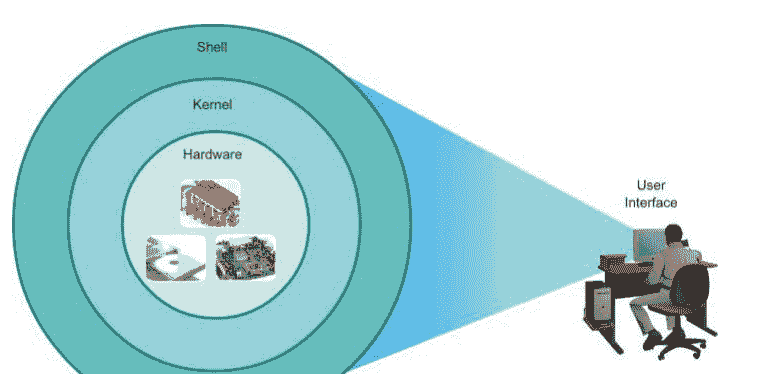

图 2-1 Shell、Kernel 和硬件

- **Shell:** 外壳是用户界面，允许用户请求计算机执行特定任务。这些请求可以通过 CLI 或 GUI 进行。
- **Kernel:** 内核在计算机的硬件和软件之间进行通信，并管理硬件资源的使用方式以满足软件需求。
- **Hardware:** 硬件是计算机的物理部分，包括底层电子设备。

使用 CLI 时，用户通过在命令提示符下在键盘上输入命令，在基于文本的环境中直接与系统交互，如示例 2-1 所示。系统执行命令并通常提供文本输出。操作 CLI 需要很少的开销；然而，它确实要求用户了解控制系统的底层命令结构。

### 示例 2-1 CLI 示例

```
analyst@secOps ~]$ ls
Desktop  Downloads  lab.support.files  second_drive
[analyst@secOps ~]$
```

### GUI (2.1.2)

诸如 Windows、macOS、Linux KDE、Apple iOS 或 Android 之类的 GUI 允许用户使用图形图标、菜单和窗口的环境与系统交互。与 CLI 相比，图 2-2 中的 Windows 10 GUI 示例更用户友好，且需要较少的对控制系统的底层命令结构的了解。因此，大多数用户依赖 GUI 环境。

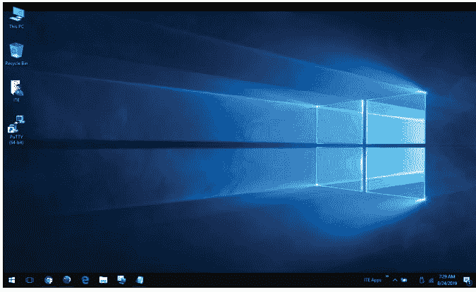

图 2-2 Windows 10 GUI


然而，GUI 不一定总能提供 CLI 可用的所有功能。GUI 也可能出现故障、崩溃或无法按指定方式运行。因此，网络设备通常通过 CLI 访问。与 GUI 相比，CLI 占用资源更少且非常稳定。

用于许多 Cisco 设备上的网络操作系统家族称为 *思科互联网操作系统 (IOS)*。Cisco IOS 用于许多 Cisco 路由器和交换机，无论设备类型或大小如何。每个设备类型（例如，路由器或交换机）使用不同版本的 Cisco IOS。其他 Cisco 操作系统包括 IOS XE、IOS XR 和 NX-OS。

> **注意**
>
> 家用路由器的操作系统通常称为 *固件*。配置家用路由器最常见的方法是使用基于 Web 浏览器的 GUI。

### 操作系统的用途 (2.1.3)

网络操作系统类似于 PC 操作系统。通过 GUI，PC 操作系统使用户能够执行以下操作：

- 使用鼠标进行选择和运行程序
- 输入文本和基于文本的命令
- 在监视器上查看输出

CLI 为基础的网络操作系统（如交换机或路由器上的 Cisco IOS）使网络技术人员能够执行以下操作：

- 使用键盘运行基于 CLI 的网络程序
- 使用键盘输入文本和基于文本的命令
- 在监视器上查看输出

Cisco 网络设备运行特定版本的 Cisco IOS。IOS 版本取决于所使用的设备类型和所需功能。虽然每个设备都带有默认的 IOS 和功能集，但可以升级 IOS 版本或功能集以获得额外功能。

图 2-3 列出了 Cisco Catalyst 2960 交换机的 IOS 软件版本。

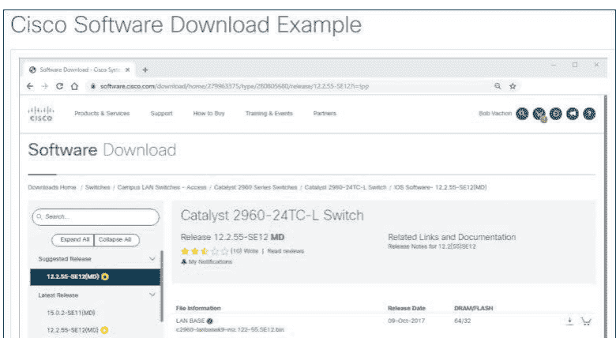

图 2-3 Cisco 软件下载网页

### 访问方法 (2.1.4)

交换机默认转发流量，无需显式配置即可运行。例如，连接到同一台新交换机的两个已配置主机将能够通信。

无论新交换机的默认行为如何，所有交换机都应进行配置和保护。表 2-1 列出了配置和保护交换机的三种访问方法。

表 2-1 Cisco 设备访问方法

| 方法 | 描述 |
|---|---|
| *控制台* | 这是一个物理管理端口，提供对 Cisco 设备的 *带外* 访问。*带外* 访问是指通过专用管理通道进行访问，该通道仅用于设备维护目的。使用控制台端口的优点是即使未配置任何网络服务，设备仍可访问，例如在执行初始配置时。控制台连接需要运行终端仿真软件的计算机以及连接设备的专用控制台电缆。 |
| *安全 Shell (SSH)* | SSH 是一种带内且推荐的方法，用于通过网络上的虚拟接口远程建立安全的 CLI 连接。与控制台连接不同，SSH 连接需要在设备上具有活动的网络服务，包括配置了地址的活动接口。大多数版本的 Cisco IOS 包括 SSH 服务器和 SSH 客户端，可用于与其他设备建立 SSH 会话。 |
| *Telnet* | Telnet 是一种不安全的带内方法，用于通过网络上的虚拟接口远程建立 CLI 会话。与 SSH 不同，Telnet 不提供安全加密连接，仅应在实验室环境中使用。用户身份验证、密码和命令以明文形式通过网络发送。最佳做法是使用 SSH 而不是 Telnet。Cisco IOS 包括 Telnet 服务器和 Telnet 客户端。 |

**注意**

一些设备，例如路由器，还可能支持传统的辅助端口，该端口曾用于通过调制解调器通过电话连接远程建立 CLI 会话。与控制台连接类似，AUX 端口为带外，不需要配置或可用网络服务。

### 终端仿真程序 (2.1.5)

有多个终端仿真程序可供使用，您可以通过控制台端口的串行连接或通过 SSH/Telnet 连接连接到网络设备。这些程序允许您通过调整窗口大小、更改字体大小和更改配色方案来提高工作效率。

图 2-4 至图 2-6 显示了三种流行的终端仿真程序的 GUI：PuTTY、Tera Term 和 SecureCRT。

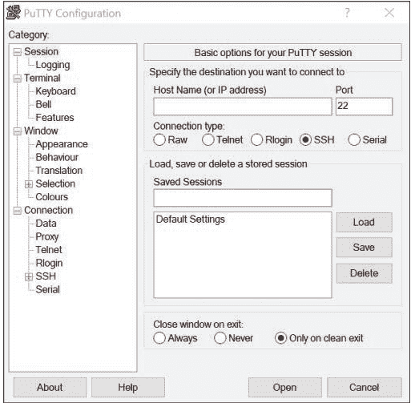

图 2-4 PuTTY

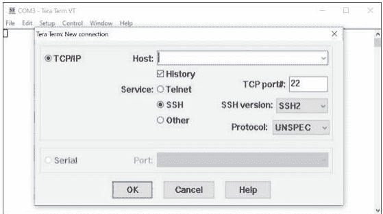

图 2-5 Tera Term

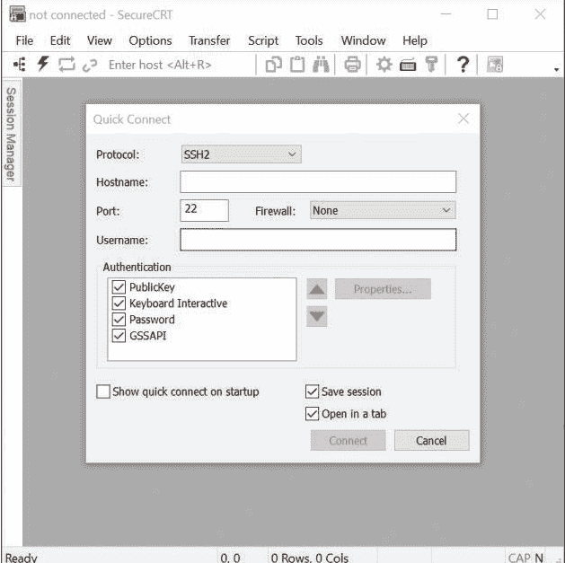

图 2-6 SecureCRT

### 检查你的理解——Cisco IOS 访问 (2.1.6)

请参考在线课程完成此活动。

交互式图形

## IOS 导航 (2.2)

本节介绍 Cisco IOS 中某些模式的基础知识。

### 主要命令模式 (2.2.1)

在上一节中，您了解到每个网络设备都需要一个操作系统，并且这些设备可以使用 CLI 或 GUI 进行配置。使用 CLI 可能比使用 GUI 为网络管理员提供更精确的控制和灵活性。本节讨论使用 CLI 导航 Cisco IOS。

作为安全功能，Cisco IOS 软件将管理访问分为以下两种命令模式：

- **User EXEC mode**: 此模式功能有限，但对基本操作很有用。它只允许有限数量的基本监控命令，并且不允许执行可能更改设备配置的任何命令。用户 EXEC 模式由以 > 符号结尾的 CLI 提示符标识。
- **Privileged EXEC mode**: 要执行配置命令，网络管理员必须访问特权 EXEC 模式。更高配置模式，例如全局配置模式，只能从特权 EXEC 模式访问。特权 EXEC 模式可以通过以 # 符号结尾的提示符识别。

表 2-2 总结了两种模式并显示了 Cisco 交换机和路由器的默认 CLI 提示符。

表 2-2 IOS 命令模式

| 命令模式 | 描述 | 默认设备提示符 |
|---|---|---|
| User EXEC mode | 此模式仅允许访问有限数量的基本监控命令。它通常被称为“只读”模式。 | Switch> Router> |
| Privileged EXEC mode | 此模式允许访问所有命令和功能。用户可以使用任何监控命令并可以执行配置和管理命令。 | Switch# Router# |

### 配置模式和子配置模式 (2.2.2)

要配置设备，用户必须进入全局配置模式，通常称为 global config 模式。

从全局配置模式，用户可以进行影响整个设备操作的 CLI 配置更改。全局配置模式由在设备名称后以 (config)# 结尾的提示符标识，例如 Switch(config)#。

在其他特定配置模式之前访问全局配置模式。从全局配置模式，用户可以进入不同的子配置模式。

这些模式中的每一个都允许配置 IOS 设备的特定部分或功能。两种常见的子配置模式是

- **Line configuration mode:** 用于配置控制台、SSH、Telnet 或 AUX 访问。
- **Interface configuration mode:** 用于配置交换机端口或路由器网络接口。

当使用 CLI 时，模式由该模式唯一的命令行提示符标识。默认情况下，每个提示符都以设备名称开头。名称之后，提示符的其余部分表示模式。例如，线路配置模式的默认提示符为 Switch(config-line)#，接口配置模式的默认提示符为 Switch(config-if)#。

### 视频—IOS CLI 主要命令模式 (2.2.3)

请参考在线课程观看此视频。

### 在 IOS 模式之间导航 (2.2.4)

使用各种命令在命令提示符之间移动。要从用户 EXEC 模式移动到特权 EXEC 模式，请使用 enable 命令。使用 disable 命令返回到用户 EXEC 模式。

**注意**
特权 EXEC 模式有时称为 enable 模式。

要在特权 EXEC 模式中进出全局配置模式，请使用 configure terminal 命令。要返回特权 EXEC 模式，请从全局配置模式输入 exit 命令。

有许多不同的子配置模式。如示例 2-2 所示，要进入线路子配置模式，您使用 line 命令，后跟要访问的管理线路类型和编号。使用 exit 命令退出子配置模式并返回全局配置模式。

示例 2-2 进入子配置模式

```
Switch(config)# line console 0
Switch(config-line)# exit
Switch(config)#
```


从全局配置模式的任何子配置模式移动到模式层次结构中在其上一步的模式，请输入 exit 命令。

从任何子配置模式移动到特权 EXEC 模式，请输入 end 命令，如示例 2-3 所示，或输入键组合 Ctrl+Z。

### 示例 2-3 直接返回特权 EXEC 模式

```
Switch(config-line)# end
Switch#
```

你还可以直接从一个子配置模式移动到另一个子配置模式。在示例 2-4 中，注意在选择接口后，命令行提示符从 (config-line)# 更改为 (config-if)#。

### 示例 2-4 在子配置模式之间移动

```
Switch(config-line)# interface FastEthernet 0/1
Switch(config-if)#
```

### 视频—在 IOS 模式之间导航 (2.2.5)

请参考在线课程观看此视频。


### 关于语法检查器活动的说明 (2.2.6)

当你学习如何修改设备配置时，在使用真实设备之前，你可能希望先在一个安全、非生产的环境中开始。NetAcad 提供多种仿真工具来帮助建立你的配置和故障排除技能。这些仿真工具通常不具备真实设备的全部功能。其中一种工具是语法检查器。使用语法检查器，你会得到一组指令来输入特定的一组命令。除非按指定输入完全且正确的命令，否则你无法在语法检查器中继续。更高级的仿真工具，例如 Packet Tracer，允许你输入缩写命令，就像你在真实设备上操作一样。

### 语法检查器—在 IOS 模式之间导航 (2.2.7)

使用语法检查器活动在交换机上在 IOS 命令行之间导航。

请参考在线课程完成此活动。


交互式图形

### 检查你的理解—IOS 导航 (2.2.8)

请参考在线课程完成此活动。

## 命令结构 (2.3)

Cisco IOS 如同其他操作系统一样，使用具有特定结构的命令。要配置 IOS 设备，网络技术人员需要理解此结构。本节介绍 IOS 命令结构。

### 基本 IOS 命令结构 (2.3.1)

本节介绍 Cisco IOS 命令的基本结构。网络管理员必须了解基本的 IOS 命令结构才能使用 CLI 进行设备配置。

Cisco IOS 设备支持许多命令。每个 IOS 命令都有特定的格式或语法，并且只能在适当的模式下执行。如图 2-7 所示，命令的一般语法是命令后跟任何适当的关键字和参数：

- **关键字：** 这是在操作系统中定义的具体参数（在图 2-7 中为 ip protocols）。
- **参数：** 这不是预定义的；它是用户定义的值或变量（在图 2-7 中为 192.168.10.5）。

在输入每个完整的命令（包括任何关键字和参数）后，按 Enter 键将命令提交给命令解释器。


图 2-7 命令语法

### IOS 命令语法检查 (2.3.2)

命令可能需要一个或多个参数。要确定命令所需的关键字和参数，请参考命令语法。语法提供了在输入命令时必须使用的模式或格式。

如表 2-3 所示，粗体文本表示按所示输入的命令和关键字。斜体文本表示用户提供值的参数。

表 2-3 命令语法约定

| 惯例 | 描述 |
|---|---|
| 粗体 | 粗体文本表示您按所示逐字输入的命令和关键字。 |
| 斜体 | 斜体文本表示您提供值的参数。 |
| [x] | 方括号表示可选元素（关键字或参数）。 |
| {x} | 大括号表示必需元素（关键字或参数）。 |
| [x {y | z}] | 方括号内的大括号和垂直线表示可选元素中的必需选择。空格用于清晰地分隔命令的各部分。 |

例如，description 命令的语法是 description string。参数是用户提供的字符串值。description 命令通常用于标识接口的用途。例如，命令 description Connects to the main headquarters office switch 描述了连接另一端设备的所在位置。

以下示例演示了用于记录和使用 IOS 命令的约定：

- ping ip-address: 命令是 ping，用户定义的参数是目标设备的 IP 地址（例如，ping 10.10.10.5）。
- traceroute ip-address: 命令是 traceroute，用户定义的参数是目标设备的 IP 地址（例如，traceroute 192.168.254.254）。

如果命令复杂且具有多个参数，你可能会看到它这样表示：

```
Switch(config-if)# switchport port-security aging { static | time time | type {absolute | inactivity}}
```

命令通常随后附有对命令和每个参数的详细描述。

Cisco IOS 命令参考是特定 IOS 命令的最终信息来源。

### IOS 帮助功能 (2.3.3)

IOS 提供两种帮助形式：上下文相关帮助和命令语法检查。

上下文相关帮助可让您快速找到以下问题的答案：

- 每个命令模式中有哪些可用命令？
- 哪些命令以特定字符或字符组开头？
- 特定命令有哪些可用参数和关键字？

要访问上下文相关帮助，只需在 CLI 输入问号 ? 即可。

命令语法检查验证用户是否输入了有效命令。当输入命令时，命令行解释器从左到右评估命令。如果解释器理解该命令，则执行请求的操作，并且 CLI 返回到适当的提示符。但是，如果解释器无法理解正在输入的命令，它会提供反馈，描述命令的问题。


### 视频—上下文相关帮助和命令语法检查 (2.3.4)

请参考在线课程观看此视频。

### 热键和快捷方式 (2.3.5)

IOS CLI 提供热键和快捷方式，使配置、监控和故障排除变得更容易。

命令和关键字可以缩短为识别唯一选择的最小字符数。例如，configure 命令可以缩短为 conf，因为 configure 是唯一以 conf 开头的命令。更短的版本 con 将无法工作，因为不止一个命令以 con 开头。关键字也可以缩短。

表 2-4 列出了增强命令行编辑的按键。

### 表 2-4 命令行编辑快捷方式

| 按键 | 描述 |
|---|---|
| Tab | 完成部分命令名称输入。 |
| Backspace | 删除光标左侧的字符。 |
| Ctrl+D | 删除光标处的字符。 |
| Ctrl+K | 删除从光标到命令行末尾的所有字符。 |
| Esc+D | 删除从光标到单词末尾的所有字符。 |
| Ctrl+U or Ctrl+X | 删除从光标回至命令行开始处的所有字符。 |
| Ctrl+W | 删除光标左侧的单词。 |
| Ctrl+A | 将光标移动到行首。 |
| Left Arrow or Ctrl+B | 将光标向左移动一个字符。 |
| Esc+B | 将光标向左移回一个单词。 |
| Esc+F | 将光标向右向前移动一个单词。 |
| Right Arrow or Ctrl+F | 将光标向右移动一个字符。 |
| Ctrl+E | 将光标移动到命令行的末尾。 |
| Up Arrow or Ctrl+P | 从历史缓冲区召回命令，从最近的命令开始。 |
| Ctrl+R or Ctrl+I or Ctrl+L | 在接收到控制台消息后重新显示系统提示符和命令行。 |

### 注

虽然 Delete 键通常删除提示符右侧的字符，但 IOS 命令结构不识别 Delete 键。

当命令的输出产生超出终端窗口显示量的文本时，IOS 会显示 --More-- 提示符。表 2-5 描述了在此提示符显示时可使用的按键。


### 表 2-5 在 --More-- 提示后使用的键入

| 键入 | 描述 |
|---|---|
| Enter key | 显示下一行。 |
| Spacebar | 显示下一屏。 |
| Any other key | 结束显示字符串，返回特权 EXEC 模式。 |

表 2-6 列出了退出操作时使用的键入。

### 表 2-6 退出操作时使用的键入

| 键入 | 描述 |
|---|---|
| Ctrl+C | 在任何配置模式下，结束配置模式并返回特权 EXEC 模式。在设置模式下，中止到命令提示符。 |
| Ctrl+Z | 在任何配置模式下，结束配置模式并返回特权 EXEC 模式。 |
| Ctrl+Shift+6 | 通用中断序列，用于中止 DNS 查找、traceroutes、pings 等操作。 |


### 视频—热键和快捷方式 (2.3.6)

请参考在线课程观看此视频。


### Packet Tracer—导航 IOS (2.3.7)

在此活动中，您将练习导航 Cisco IOS 所需的技能，包括不同的用户访问模式、各种配置模式以及日常使用的常用命令。您还将通过配置 clock 命令来练习访问上下文相关帮助。


## Lab—使用 Tera Term 进行控制台连接导航 IOS (2.3.8)

在本实验中，您将完成以下目标：

- 第 1 部分：通过串行控制台端口访问 Cisco 交换机
- 第 2 部分：显示和配置基本设备设置
- 第 3 部分：（可选）使用迷你 USB 控制台电缆访问 Cisco 路由器

## 基本设备配置 (2.4)

在设备可在网络中使用之前，需要对其进行配置。本节介绍 Cisco IOS 设备的[content]
### 表 2-5 在 --More-- 提示后使用的键入

| 键入 | 描述 |
|---|---|
| Enter key | 显示下一行。 |
| Spacebar | 显示下一屏。 |
| Any other key | 结束显示字符串，返回特权 EXEC 模式。 |

表 2-6 列出了退出操作时使用的键入。

### 表 2-6 退出操作时使用的键入

| 键入 | 描述 |
|---|---|
| Ctrl+C | 在任何配置模式下，结束配置模式并返回特权 EXEC 模式。在设置模式下，中止到命令提示符。 |
| Ctrl+Z | 在任何配置模式下，结束配置模式并返回特权 EXEC 模式。 |
| Ctrl+Shift+6 | 通用中断序列，用于中止 DNS 查找、traceroutes、pings 等操作。 |


### 视频—热键和快捷方式 (2.3.6)

请参考在线课程观看此视频。


### Packet Tracer—导航 IOS (2.3.7)

在此活动中，您将练习导航 Cisco IOS 所需的技能，包括不同的用户访问模式、各种配置模式以及日常使用的常用命令。您还将通过配置 clock 命令来练习访问上下文相关帮助。


## Lab—使用 Tera Term 进行控制台连接导航 IOS (2.3.8)

在本实验中，您将完成以下目标：

- 第 1 部分：通过串行控制台端口访问 Cisco 交换机
- 第 2 部分：显示和配置基本设备设置
- 第 3 部分：（可选）使用迷你 USB 控制台电缆访问 Cisco 路由器

## 基本设备配置 (2.4)

在设备可在网络中使用之前，需要对其进行配置。本节介绍 Cisco IOS 设备的[content]
### 表 2-5 在 --More-- 提示后使用的键入

| 键入 | 描述 |
|---|---|
| Enter key | 显示下一行。 |
| Spacebar | 显示下一屏。 |
| Any other key | 结束显示字符串，返回特权 EXEC 模式。 |

表 2-6 列出了退出操作时使用的键入。

### 表 2-6 退出操作时使用的键入

| 键入 | 描述 |
|---|---|
| Ctrl+C | 在任何配置模式下，结束配置模式并返回特权 EXEC 模式。在设置模式下，中止到命令提示符。 |
| Ctrl+Z | 在任何配置模式下，结束配置模式并返回特权 EXEC 模式。 |
| Ctrl+Shift+6 | 通用中断序列，用于中止 DNS 查找、traceroutes、pings 等操作。 |


### 视频—热键和快捷方式 (2.3.6)

请参考在线课程观看此视频。


### Packet Tracer—导航 IOS (2.3.7)

在此活动中，您将练习导航 Cisco IOS 所需的技能，包括不同的用户访问模式、各种配置模式以及日常使用的常用命令。您还将通过配置 clock 命令来练习访问上下文相关帮助。


## Lab—使用 Tera Term 进行控制台连接导航 IOS (2.3.8)

在本实验中，您将完成以下目标：

- 第 1 部分：通过串行控制台端口访问 Cisco 交换机
- 第 2 部分：显示和配置基本设备设置
- 第 3 部分：（可选）使用迷你 USB 控制台电缆访问 Cisco 路由器

## 基本设备配置 (2.4)

在设备可在网络中使用之前，需要对其进行配置。本节介绍 Cisco IOS 设备的[content]
### 表 2-5 在 --More-- 提示后使用的键入

| 键入 | 描述 |
|---|---|
| Enter key | 显示下一行。 |
| Spacebar | 显示下一屏。 |
| Any other key | 结束显示字符串，返回特权 EXEC 模式。 |

表 2-6 列出了退出操作时使用的键入。

### 表 2-6 退出操作时使用的键入

| 键入 | 描述 |
|---|---|
| Ctrl+C | 在任何配置模式下，结束配置模式并返回特权 EXEC 模式。在设置模式下，中止到命令提示符。 |
| Ctrl+Z | 在任何配置模式下，结束配置模式并返回特权 EXEC 模式。 |
| Ctrl+Shift+6 | 通用中断序列，用于中止 DNS 查找、traceroutes、pings 等操作。 |


### 视频—热键和快捷方式 (2.3.6)

请参考在线课程观看此视频。


### Packet Tracer—导航 IOS (2.3.7)

在此活动中，您将练习导航 Cisco IOS 所需的技能，包括不同的用户访问模式、各种配置模式以及日常使用的常用命令。您还将通过配置 clock 命令来练习访问上下文相关帮助。


## Lab—使用 Tera Term 进行控制台连接导航 IOS (2.3.8)

在本实验中，您将完成以下目标：

- 第 1 部分：通过串行控制台端口访问 Cisco 交换机
- 第 2 部分：显示和配置基本设备设置
- 第 3 部分：（可选）使用迷你 USB 控制台电缆访问 Cisco 路由器

## 基本设备配置 (2.4)

在设备可在网络中使用之前，需要对其进行配置。本节介绍 Cisco IOS 设备的[content]
### 表 2-5 在 --More-- 提示后使用的键入

| 键入 | 描述 |
|---|---|
| Enter key | 显示下一行。 |
| Spacebar | 显示下一屏。 |
| Any other key | 结束显示字符串，返回特权 EXEC 模式。 |

表 2-6 列出了退出操作时使用的键入。

### 表 2-6 退出操作时使用的键入

| 键入 | 描述 |
|---|---|
| Ctrl+C | 在任何配置模式下，结束配置模式并返回特权 EXEC 模式。在设置模式下，中止到命令提示符。 |
| Ctrl+Z | 在任何配置模式下，结束配置模式并返回特权 EXEC 模式。 |
| Ctrl+Shift+6 | 通用中断序列，用于中止 DNS 查找、traceroutes、pings 等操作。 |


### 视频—热键和快捷方式 (2.3.6)

请参考在线课程观看此视频。


### Packet Tracer—导航 IOS (2.3.7)

在此活动中，您将练习导航 Cisco IOS 所需的技能，包括不同的用户访问模式、各种配置模式以及日常使用的常用命令。您还将通过配置 clock 命令来练习访问上下文相关帮助。


## Lab—使用 Tera Term 进行控制台连接导航 IOS (2.3.8)

在本实验中，您将完成以下目标：

- 第 1 部分：通过串行控制台端口访问 Cisco 交换机
- 第 2 部分：显示和配置基本设备设置
- 第 3 部分：（可选）使用迷你 USB 控制台电缆访问 Cisco 路由器

## 基本设备配置 (2.4)

在设备可在网络中使用之前，需要对其进行配置。本节介绍 Cisco IOS 设备的[content]
### 表 2-5 在 --More-- 提示后使用的键入

| 键入 | 描述 |
|---|---|
| Enter key | 显示下一行。 |
| Spacebar | 显示下一屏。 |
| Any other key | 结束显示字符串，返回特权 EXEC 模式。 |

表 2-6 列出了退出操作时使用的键入。

### 表 2-6 退出操作时使用的键入

| 键入 | 描述 |
|---|---|
| Ctrl+C | 在任何配置模式下，结束配置模式并返回特权 EXEC 模式。在设置模式下，中止到命令提示符。 |
| Ctrl+Z | 在任何配置模式下，结束配置模式并返回特权 EXEC 模式。 |
| Ctrl+Shift+6 | 通用中断序列，用于中止 DNS 查找、traceroutes、pings 等操作。 |


### 视频—热键和快捷方式 (2.3.6)

请参考在线课程观看此视频。


### Packet Tracer—导航 IOS (2.3.7)

在此活动中，您将练习导航 Cisco IOS 所需的技能，包括不同的用户访问模式、各种配置模式以及日常使用的常用命令。您还将通过配置 clock 命令来练习访问上下文相关帮助。


## Lab—使用 Tera Term 进行控制台连接导航 IOS (2.3.8)

在本实验中，您将完成以下目标：

- 第 1 部分：通过串行控制台端口访问 Cisco 交换机
- 第 2 部分：显示和配置基本设备设置
- 第 3 部分：（可选）使用迷你 USB 控制台电缆访问 Cisco 路由器

## 基本设备配置 (2.4)

在设备可在网络中使用之前，需要对其进行配置。本节介绍 Cisco IOS 设备的[content]
### 表 2-5 在 --More-- 提示后使用的键入

| 键入 | 描述 |
|---|---|
| Enter key | 显示下一行。 |
| Spacebar | 显示下一屏。 |
| Any other key | 结束显示字符串，返回特权 EXEC 模式。 |

表 2-6 列出了退出操作时使用的键入。

### 表 2-6 退出操作时使用的键入

| 键入 | 描述 |
|---|---|
| Ctrl+C | 在任何配置模式下，结束配置模式并返回特权 EXEC 模式。在设置模式下，中止到命令提示符。 |
| Ctrl+Z | 在任何配置模式下，结束配置模式并返回特权 EXEC 模式。 |
| Ctrl+Shift+6 | 通用中断序列，用于中止 DNS 查找、traceroutes、pings 等操作。 |


### 视频—热键和快捷方式 (2.3.6)

请参考在线课程观看此视频。


### Packet Tracer—导航 IOS (2.3.7)

在此活动中，您将练习导航 Cisco IOS 所需的技能，包括不同的用户访问模式、各种配置模式以及日常使用的常用命令。您还将通过配置 clock 命令来练习访问上下文相关帮助。


## Lab—使用 Tera Term 进行控制台连接导航 IOS (2.3.8)

在本实验中，您将完成以下目标：

- 第 1 部分：通过串行控制台端口访问 Cisco 交换机
- 第 2 部分：显示和配置基本设备设置
- 第 3 部分：（可选）使用迷你 USB 控制台电缆访问 Cisco 路由器

## 基本设备配置 (2.4)

在设备可在网络中使用之前，需要对其进行配置。本节介绍 Cisco IOS 设备的[content]
### 表 2-5 在 --More-- 提示后使用的键入
| 键入 | 描述 |
|---|---|
| Enter key | 显示下一行。 |
| Spacebar | 显示下一屏。 |
| Any other key | 结束显示字符串，返回特权 EXEC 模式。 |
表 2-6 列出了退出操作时使用的键入。
### 表 2-6 退出操作时使用的键入
| 键入 | 描述 |
|---|---|
| Ctrl+C | 在任何配置模式下，结束配置模式并返回特权 EXEC 模式。在设置模式下，中止到命令提示符。 |
| Ctrl+Z | 在任何配置模式下，结束配置模式并返回特权 EXEC 模式。 |
| Ctrl+Shift+6 | 通用中断序列，用于中止 DNS 查找、traceroutes、pings 等操作。 |

### 视频—热键和快捷方式 (2.3.6)
请参考在线课程观看此视频。

### Packet Tracer—导航 IOS (2.3.7)
在此活动中，您将练习导航 Cisco IOS 所需的技能，包括不同的用户访问模式、各种配置模式以及日常使用的常用命令。您还将通过配置 clock 命令来练习访问上下文相关帮助。

## Lab—使用 Tera Term 进行控制台连接导航 IOS (2.3.8)
在本实验中，您将完成以下目标：
- 第 1 部分：通过串行控制台端口访问 Cisco 交换机
- 第 2 部分：显示和配置基本设备设置
- 第 3 部分：（可选）使用迷你 USB 控制台电缆访问 Cisco 路由器
## 基本设备配置 (2.4)
在设备可在网络中使用之前，需要对其进行配置。本节介绍 Cisco IOS 设备的[content]
### 设备名称 (2.4.1)

您已学习了大量关于 Cisco IOS、导航 IOS 和命令结构的内容。现在，您已准备好配置设备！任何设备上的第一个配置命令都应为其分配唯一的设备名称或主机名。默认情况下，每个设备都会分配一个出厂默认名称。例如，Cisco IOS 交换机名为“Switch”。

问题在于，如果网络中的所有交换机都保留其默认名称，则很难识别特定设备。例如，当使用 SSH 远程访问时，您如何知道已连接到正确的设备？主机名可确认您已连接到正确的设备。

应将默认名称更改为更具描述性的名称。明智地选择名称可更轻松地记住、记录和识别网络设备。以下是主机的重要命名准则：

- 以字母开头
- 不包含空格
- 以字母或数字结尾
- 仅使用字母、数字和连字符
- 长度少于 64 个字符

组织必须选择一种命名约定，使其易于直观地识别特定设备。设备 IOS 中使用的主机名保留大写和小写字符。例如，图 2-8 显示了三个跨越三个不同楼层的交换机在网络中相互连接。所使用的命名约定结合了每个设备的位置和用途。网络文档应解释这些名称是如何选择的，以便可相应地命名其他设备。

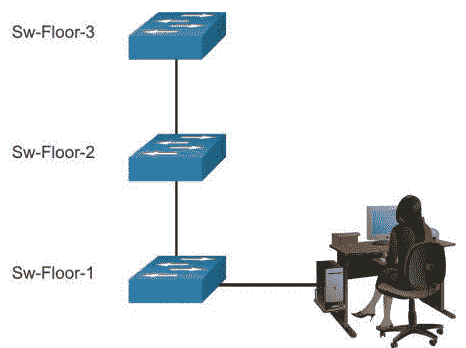

当网络设备命名时，它们易于用于配置目的进行识别。

### 图 2-8 为便于识别而对多个设备进行命名的示例

确定命名约定后，下一步是使用 CLI 将名称应用于设备。如示例 2-5 所示，从特权 EXEC 模式开始，通过输入 configure terminal 命令访问全局配置模式。注意命令提示符的变化。

### 示例 2-5 配置主机名

```
Switch# configure terminal
Switch(config)# hostname Sw-Floor-1
Sw-Floor-1(config)#
```

从全局配置模式开始，输入 hostname 命令，后跟交换机的名称，然后按 Enter。注意命令提示符名称的变化。

### 注意

要将交换机恢复为默认提示符，请使用 no hostname 全局配置命令。

每次添加或修改设备时，都要确保文档已更新。通过其位置、用途和地址在文档中标识每个设备。

### 密码准则 (2.4.2)

弱密码或易于猜测的密码的持续使用仍然是组织面临的最大安全问题。网络设备，包括家庭无线路由器，应始终配置密码以限制管理访问。

Cisco IOS 可以配置为使用分层模式密码，以允许在网络设备上具有不同的访问权限。

所有网络设备都应通过使用密码保护特权 EXEC、用户 EXEC 和远程 Telnet 访问来限制管理访问。此外，所有密码都应加密，并提供法律通知。

选择密码时，请使用不易猜测的强密码。选择密码时应考虑以下几点：

- 使用长度超过八个字符的密码。
- 使用大写字母、小写字母、数字、特殊字符和/或数字序列的组合。
- 避免为多个设备使用相同的密码。
- 不要使用常用词，因为它们很容易被猜到。

使用互联网搜索查找密码生成器。许多生成器允许您设置长度、字符集和其他参数。

> **注意**
本课程中的大多数实验都使用简单的密码，例如 cisco 或 class。这些密码被认为很弱且易于猜测，不应在生产环境中使用。我们仅在课堂环境中或为了说明配置示例而出于方便使用这些密码。

### 配置密码 (2.4.3)

当您最初连接到设备时，您处于用户 EXEC 模式。此模式使用控制台进行保护。

要保护用户 EXEC 模式访问，请使用 line console 0 全局配置命令进入线路控制台配置模式，如示例 2-6 所示。零用于表示第一个（并且在大多数情况下是唯一的）控制台接口。接下来，使用 password password 命令指定用户 EXEC 模式密码。最后，使用 login 命令启用用户 EXEC 访问。

### 示例 2-6 设置控制台密码

```
Sw-Floor-1# configure terminal
Sw-Floor-1(config)# line console 0
Sw-Floor-1(config-line)# password cisco
Sw-Floor-1(config-line)# login
Sw-Floor-1(config-line)# end
Sw-Floor-1#
```

现在控制台访问需要在允许访问用户 EXEC 模式之前输入密码。

要对所有 IOS 命令具有管理员访问权限，包括配置设备的命令，您必须获得特权 EXEC 模式访问权限。它是最重要的访问方法，因为它提供对设备的完全访问。

要保护特权 EXEC 访问，请使用 **enable secret password** 全局配置命令，如示例 2-7 所示。

### 示例 2-7 设置特权 EXEC 密码

```
Sw-Floor-1# configure terminal
Sw-Floor-1(config)# enable secret class
Sw-Floor-1(config)# exit
Sw-Floor-1#
```

*Virtual terminal (vty)* 线路使用 Telnet 或 SSH 启用对设备的远程访问。许多 Cisco 交换机支持多达 16 条 vty 线路，编号为 0 到 15。

要保护 vty 线路，请使用 **line vty 0 15** 全局配置命令进入线路 vty 模式。接下来，使用 **password password** 命令指定 vty 密码。最后，使用 **login** 命令启用 vty 访问。

示例 2-8 显示了在交换机上保护 vty 线路的示例。

### 示例 2-8 设置远程访问密码

```
Sw-Floor-1# configure terminal
Sw-Floor-1(config)# line vty 0 15
Sw-Floor-1(config-line)# password cisco
Sw-Floor-1(config-line)# login
Sw-Floor-1(config-line)# end
Sw-Floor-1#
```

### 加密密码 (2.4.4)

startup-config 和 running-config 文件以明文显示大多数密码。这是一个安全威胁，因为任何有权访问这些文件的人都可以发现密码。

要加密所有明文密码，请使用 **service password-encryption** 全局配置命令，如示例 2-9 所示。

### 示例 2-9 加密密码

```
Sw-Floor-1# configure terminal
Sw-Floor-1(config)# service password-encryption
Sw-Floor-1(config)#
```


该命令对所有未加密的密码应用弱加密。此加密仅适用于配置文件中的密码，而不适用于网络中传输的密码。该命令的目的是防止未经授权的人员查看配置文件中的密码。

使用 show running-config 命令验证密码是否已加密，如示例 2-10 所示。

### 示例 2-10 验证密码是否已加密

```
Sw-Floor-1(config)# end
Sw-Floor-1# show running-config
!
!
<Output omitted>
!
line con 0
password 7 094F471A1A0A
login
!
line vty 0 4
password 7 03095A0F034F38435B49150A1819
login
line vty 5 15
password 7 094F471A1A0A
login
!
!
!
end
```

### 横幅消息 (2.4.5)

虽然要求密码是一种防止未经授权人员进入网络的方法，但提供一种声明只有授权人员应尝试访问设备的方法至关重要。为此，您可以在设备输出中添加横幅。横幅在有人因入侵设备而被起诉时可能成为法律程序的重要组成部分。某些法律体系除非有通知可见，否则不允许起诉，甚至不允许监控用户。

要在网络设备上创建每日横幅消息，请使用 banner motd # 每日消息 # 全局配置命令。命令语法中的 # 称为定界字符。它在消息之前和之后输入。只要该字符不在消息中出现，定界字符可以是任何字符。

因此，通常使用 # 等符号。执行命令后，横幅将在所有后续访问设备的尝试中显示，直到横幅被移除为止。

### 示例 2-11 配置横幅

```
Sw-Floor-1# configure terminal
Sw-Floor-1(config)# banner motd #Authorized Access Only#
```

## 视频—对交换机的安全管理访问 (2.4.6)

请参考在线课程观看此视频。

### 语法检查器—基本设备配置 (2.4.7)

按如下方式保护对交换机的管理访问：

- 分配设备名称。
- 保护用户 EXEC 模式访问。
- 保护特权 EXEC 模式访问。
- 保护 vty 访问。
- 加密所有明文密码。
- 显示登录横幅。

请参考在线课程完成此活动。

### 检查你的理解—基本设备配置 (2.4.8)

请参考在线课程完成此活动。

## 保存配置 (2.5)

对基于 Cisco IOS 的设备的配置更改会应用于运行配置。此工作配置应备份以支持网络恢复。本节介绍用于备份和恢复 Cisco IOS 设备上运行配置的一些方法。

### 配置文件 (2.5.1)

您现在已了解如何在交换机上执行基本配置，包括设置密码和横幅消息。本节将向您展示如何保存配置。

两个系统文件存储设备配置：

- **startup-config**：这是存储在 *非易失性随机存取存储器 (NVRAM)* 中的已保存配置文件。它包含设备在启动或重新启动时将使用的所有命令。Flash 在设备断电时不会丢失其内容。

> **注意**
路由器将配置文件保存在单个位置，即 NVRAM 中的 startup-config。许多交换机将配置保存在两个关联文件中：NVRAM 中的 startup-config 和闪存中的 config.txt 文件。

- **running-config**：存储在 *随机存取存储器 (RAM)* 中。它反映当前配置。修改运行配置会立即影响 Cisco 设备的操作。RAM 是易失性存储器。设备断电或重新启动时，它会丢失所有内容。

**show running-config** 特权 EXEC 模式命令用于查看运行配置。如示例 2-12 所示，该命令列出当前存储在 RAM 中的完整配置。

### 示例 2-12 验证存储在 RAM 中的配置

```
Sw-Floor-1# show running-config
Building configuration...
Current configuration : 1351 bytes
!
! Last configuration change at 00:01:20 UTC Mon Mar 1 1993
!
version 15.0
no service pad
service timestamps debug datetime msec
service timestamps log datetime msec
service password-encryption
!
hostname Sw-Floor-1
!
```

要查看启动配置文件，请使用 **show startup-config** 特权 EXEC 命令。

如果设备断电或设备重新启动，所有配置更改将丢失，除非已保存。要将对运行配置所做的更改保存到启动配置文件，请使用 copy running-config startup-config 特权 EXEC 模式命令。

### 修改运行配置 (2.5.2)

如果对运行配置所做的更改没有达到预期效果且运行配置尚未保存，您可以恢复设备到之前的配置。逐个删除已更改的命令，或使用 reload 特权 EXEC 模式命令重新加载设备以恢复 startup-config。

使用 reload 命令删除未保存的运行配置的缺点是设备将离线一段时间，导致网络停机。

当启动重新加载时，IOS 会检测到运行配置中有未保存到启动配置的更改。会出现提示，询问是否保存更改。要丢弃更改，请输入 n 或 no。

另外，如果不期望的更改已保存到启动配置，可能需要清除所有配置。这需要擦除启动配置并重新启动设备。启动配置通过使用 erase startup-config 特权 EXEC 模式命令删除。发出命令后，交换机会提示您确认。按 Enter 接受。

从 NVRAM 删除启动配置后，重新加载设备以从 RAM 中删除当前运行配置文件。重新加载时，交换机加载随设备一起提供的默认启动配置。


### 视频—修改运行配置 (2.5.3)

请参考在线课程观看此视频。

### 捕获配置到文本文件 (2.5.4)

配置文件可以保存并归档到文本文档中。以下步骤序列可确保配置文件的可工作副本可供以后编辑或重用。

例如，假设交换机已配置，并且运行配置已保存在设备上。请按照以下步骤操作：


- **步骤 1.** 打开终端仿真软件，例如 PuTTY（见图 2-9）或 Tera Term，该软件已连接到交换机。

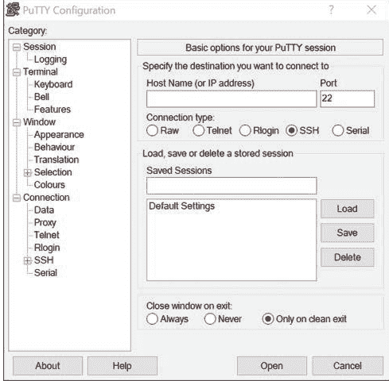

### 图 2-9 PuTTY 启动屏幕

步骤 2. 在终端软件中启用日志记录，并为保存日志文件分配名称和文件位置。图 2-10 显示所有会话输出将被捕获到指定的文件（即 MySwitchLogs）。

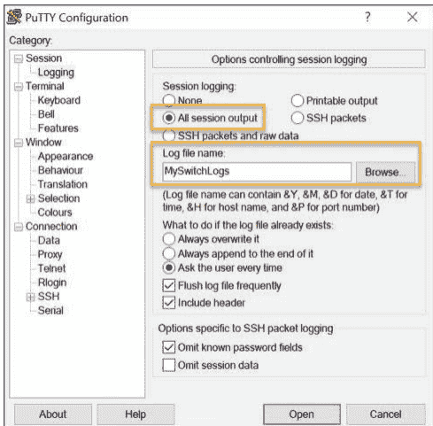

### 图 2-10 设置 PuTTY 将会话记录到文本文件

步骤 3. 在特权 EXEC 提示符下执行 show running-config 命令，如示例 2-13 所示，或执行 show startup-config 命令。然后终端窗口中显示的文本将被放置在所选文件中。

### 示例 2-13 显示并将配置记录到文本文件

```
Sw-Floor-1# show running-config
Building configuration...
```

步骤 4. 在终端软件中禁用日志记录。图 2-11 显示了通过选择“无”会话日志选项来禁用日志记录的方法。

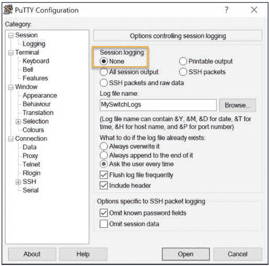

### 图 2-11 关闭会话日志记录

创建的文本文件可作为设备当前实现方式的记录。在使用该文件恢复已保存配置到设备之前，可能需要对其进行编辑。

将配置文件恢复到设备：

步骤 1. 在设备上进入全局配置模式。

步骤 2. 将文本文件复制并粘贴到连接到交换机的终端窗口中。


文件中的文本作为 CLI 中的命令应用，并在设备上成为运行配置。这是手动配置设备的一种便捷方法。


## Packet Tracer—配置初始交换机设置 (2.5.5)

在本次活动中，您将执行基本的交换机配置。您将使用加密和明文密码保护对 CLI 和控制台端口的访问。您将学习如何为登录交换机的用户配置消息。这些横幅还将用于警告未经授权的用户访问被禁止。

## 端口和地址 (2.6)

为了使设备在网络上通信，每个设备都必须应用寻址信息。本节介绍 IP 地址、接口和端口。

### IP 地址 (2.6.1)

恭喜您已完成基本的设备配置！当然，乐趣还未结束。如果您希望终端设备相互通信，必须确保每个设备都有合适的 IP 地址并且连接正确。在本节中，您将了解 IP 地址、设备端口以及用于连接设备的媒体。

使用 IP 地址是使设备能够相互定位并在互联网上建立端到端通信的主要手段。网络上的每个终端设备都必须配置 IP 地址。终端设备的示例包括

- Computers (workstations, laptops, file servers, web servers)
- Network printers
- VoIP phones
- Security cameras
- Smartphones
- Mobile handheld devices (such as wireless barcode scanners)

IPv4 地址的结构称为点分十进制表示法；使用这种表示法，地址由 0 到 255 之间的四个十进制数字表示。IPv4 地址分配给连接到网络的单个设备。

### 注

本课程中的 IP 指 IPv4 和 IPv6 协议。IPv6 是 IP 的最新版本，正在取代更常见的 IPv4。

使用 IPv4 地址时，还需要子网掩码。IPv4 子网掩码是一个 32 位值，用于区分地址的网络部分和主机部分。结合 IPv4 地址，子网掩码决定设备属于哪个子网。

图 2-12 中的示例显示了分配给主机的 IPv4 地址（192.168.1.10）、子网掩码（255.255.255.0）和默认网关（192.168.1.1）。默认网关地址是主机用于访问远程网络（包括互联网）的路由器的 IP 地址。

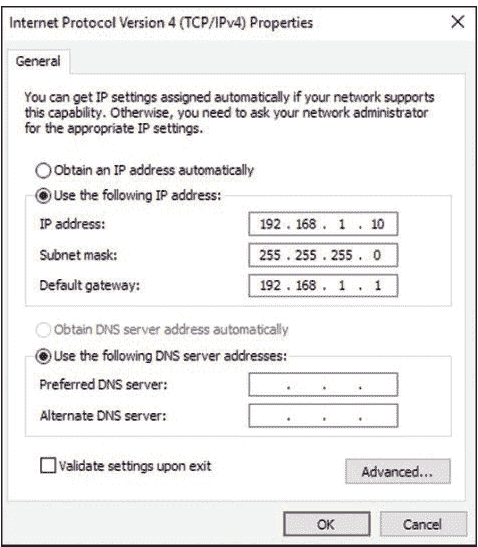

图 2-12 在 Windows 主机上配置或验证 IPv4 地址

IPv6 地址长度为 128 位，以十六进制值的字符串形式书写，如图 2-13 所示。每 4 位由一个十六进制数字表示，共 32 个十六进制值。四位十六进制数字的组由冒号（:）分隔。IPv6 地址不区分大小写，可以用小写或大写书写。

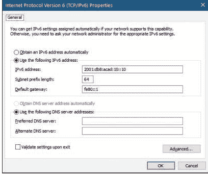

图 2-13 在 Windows 主机上配置或验证 IPv6 地址

### 接口和端口 (2.6.2)

网络通信依赖于终端用户设备接口、网络设备接口以及连接它们的电缆。每个物理接口都有规范或标准来定义它。连接到接口的电缆必须设计为与接口的物理标准相匹配。网络媒体类型包括双绞铜缆、光纤电缆、同轴电缆和无线，如图 2-14 所示。

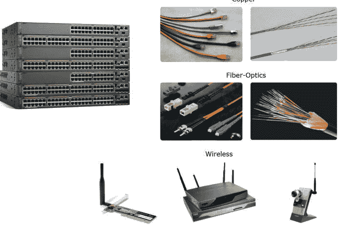

图 2-14 网络媒体类型

不同类型的网络媒体具有不同的特性和优势。并非所有网络媒体都具有相同的特性。并非所有媒体都适用于相同的目的。各种媒体之间的一些差异包括：

- Distance the media can successfully carry signals
- Environment in which the media is to be installed
- Amount of data and the speed at which it must be transmitted
- Cost of the media and installation

不仅互联网上的每个链路都需要特定类型的网络媒体，而且每个链路还需要特定的网络技术。例如，以太网是当今使用最广泛的局域网（LAN）技术。以太网端口存在于终端用户设备、交换机设备和其他可以通过电缆物理连接到网络的网络设备上。

Cisco IOS 第 2 层交换机具有供设备连接的物理端口。这些端口不支持第 3 层 IP 地址。因此，交换机有一个或多个 *交换机虚拟接口（SVIs）*。这些是虚拟接口，因为设备上没有与其关联的物理硬件；一个 SVI 是在软件中创建的。

虚拟接口让您可以使用 IPv4 和 IPv6 通过网络远程管理交换机。每台交换机都自带一个在默认配置“开箱即用”中出现的 SVI。默认 SVI 是接口 VLAN 1。

> **注意**
> 第 2 层交换机不需要 IP 地址。分配给 SVI 的 IP 地址用于远程访问交换机。交换机执行其操作不需要 IP 地址。


### 检查您的理解—端口和地址 (2.6.3)

请参考在线课程完成此活动。

## 配置 IP 地址 (2.7)

本节介绍如何将 IP 地址应用于终端设备和以太网交换机以实现远程访问。

### 终端设备的手动 IP 地址配置 (2.7.1)

就像您需要电话号码来给朋友发短信或打电话一样，网络中的终端设备需要 IP 地址才能与其他设备通信。在本节中，您将了解通过在交换机和 PC 上配置 IP 地址来实现基本连接的方法。

IPv4 地址信息可以手动输入到终端设备中，也可以使用动态主机配置协议（DHCP）自动获取。

要在 Windows 主机上手动配置 IPv4 地址，请打开控制面板 > 网络和共享中心 > 更改适配器设置并选择适配器。接下来，右键单击并选择属性以显示以太网属性对话框，如图 2-15 所示。

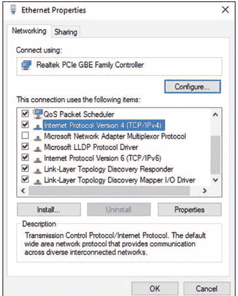

图 2-15 访问 Windows 主机上的 IPv4 属性

突出显示 Internet Protocol Version 4 (TCP/IPv4) 并单击属性以打开 Internet Protocol Version 4 (TCP/IPv4) 属性窗口。配置 IPv4 地址和子网掩码信息，以及默认网关，如图 2-16 所示。

注

IPv6 地址和配置选项与 IPv4 选项类似。

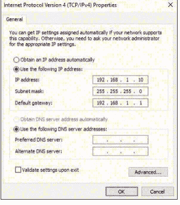

图 2-16 在 Windows 主机上手动配置 IPv4 地址

**注意**

DNS 服务器地址是域名系统（DNS）服务器的 IPv4 和 IPv6 地址，用于将 IP 地址翻译为域名，例如 www.cisco.com。

### 终端设备的自动 IP 地址配置 (2.7.2)

终端设备通常默认使用 *动态主机配置协议（DHCP）* 进行自动 IPv4 地址配置。DHCP 是一种在几乎每个网络中使用的技术。理解 DHCP 为何如此受欢迎的最佳方法是考虑如果没有它需要进行的所有额外工作。

在网络中，DHCP 为每个启用 DHCP 的终端设备启用自动 IPv4 地址配置。想象一下，如果每次连接到网络时，您都必须手动输入 IPv4 地址、子网掩码、默认网关和 *域名系统（DNS）* 服务器所需花费的时间。将此乘以组织中的每个用户和每台设备，您就会看到问题所在。手动配置还会增加因重复另一台设备的 IPv4 地址而导致配置错误的可能性。

如图所示 2-17，要在 Windows PC 上配置 DHCP，您只需选择 **自动获得 IP 地址** 和 **自动获得 DNS 服务器地址**。然后您的 PC 会搜索 DHCP 服务器并分配在网络上通信所需的地址设置。

**注意**

IPv6 使用 DHCPv6 和 SLAAC（无状态地址自动配置）进行动态地址分配。


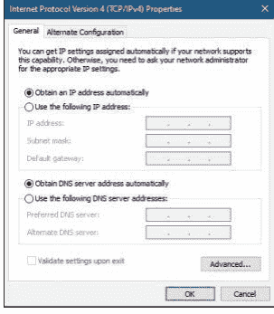

## 图 2-17 将 Windows 主机设置为自动获取 IPv4 地址

### 交互式图形

## 语法检查器—验证 Windows PC IP 配置 (2.7.3)

可以通过在命令提示符下使用 ipconfig 命令来在 Windows PC 上显示 IP 配置设置。输出将显示从 DHCP 服务器接收到的 IPv4 地址、子网掩码和网关信息。输入 ipconfig 命令以在 Windows PC 上显示 IP 配置。请参考在线课程完成此活动。

### 交换机虚拟接口配置 (2.7.4)

要远程访问交换机，必须在 SVI 上配置 IP 地址和子网掩码。要在交换机上配置 SVI，请使用 interface vlan 1 全局配置命令（其中 vlan 1 不是实际的物理接口而是一个虚拟接口），如示例 2-14 所示。接下来，使用 ip address ip-address subnet-mask 接口配置命令分配 IPv4 地址。最后，使用 no shutdown 接口配置命令启用虚拟接口。与 Windows 主机类似，配置了 IPv4 地址的交换机通常也需要分配默认网关。您可以使用 ip default-gateway ip-address 全局配置命令分配默认网关，其中 ip-address 是网络上本地路由器的 IPv4 地址。

配置这些命令后，交换机已具备通过网络进行通信所需的所有 IPv4 元素。

### 示例 2-14 在交换机上配置 SVI

```
Sw-Floor-1# configure terminal
Sw-Floor-1(config)# interface vlan 1
Sw-Floor-1(config-if)# ip address 192.168.1.20 255.255.255.0
Sw-Floor-1(config-if)# ip default-gateway 192.168.1.1
Sw-Floor-1(config-if)# no shutdown
```


### 语法检查器—配置交换机虚拟接口 (2.7.5)

请参考在线课程完成此活动。


### Packet Tracer—实现基本连通性 (2.7.6)

在此活动中，您将首先执行基本的交换机配置。然后通过在交换机和 PC 上配置 IP 地址来实现基本连通性。完成 IP 地址配置后，您将使用各种 show 命令验证配置，并使用 ping 命令验证设备之间的基本连通性。

## 验证连通性 (2.8)

主要的故障排除技术是验证两个或多个 IPv4 设备之间的逻辑连通性。本节引用了演示如何验证连通性的视频活动。


### 视频活动—测试接口分配 (2.8.1)

在上一节中，您通过在交换机和 PC 上配置 IP 地址实现了基本连通性。然后您验证了配置和连通性以验证配置是否正常工作。

您将在本节继续此过程。使用 CLI，您将验证网络中交换机和路由器的接口和地址。在您使用命令和实用程序如 ipconfig 验证 PC 主机网络配置的方式相同，您使用特定命令验证交换机和路由器等中间设备的接口和地址设置。

请参考在线课程观看此视频。


## 视频活动—测试端到端连通性 (2.8.2)

ping 命令可用于测试网络上另一台设备或互联网上的网站的连通性。

## 摘要 (2.9)

以下是本章主题及其对应在线模块的摘要。

## Cisco IOS 访问

每个终端设备和网络设备都需要一个操作系统（OS）。用户可以通过键盘和命令行界面（CLI）与 shell 交互，以运行基于 CLI 的网络程序，使用键盘输入文本和基于文本的命令，并在监视器上查看输出。

作为安全功能，Cisco IOS 软件将管理访问分为两种命令模式：用户 EXEC 模式和特权 EXEC 模式。

## IOS 导航

全局配置模式在其他特定配置模式之前访问。从全局配置模式，用户可以进入不同的子配置模式。这些模式中的每一个都允许配置 IOS 设备的特定部分或功能。两种常见的子配置模式是线路配置模式和接口配置模式。要进入和退出全局配置模式，请使用 configure terminal 特权 EXEC 模式命令。要返回到特权 EXEC 模式，请输入 exit 全局配置模式命令。

## 命令结构

每个 IOS 命令都有特定的格式或语法，并且只能在适当的模式下执行。命令的一般语法是命令后跟任何适当的关键字和参数。IOS 提供了两种帮助形式：上下文相关帮助和命令语法检查。

## 基础设备配置

任何设备的第一个配置命令都应为其分配唯一的设备名称或主机名。网络设备应始终配置密码以限制管理访问。Cisco IOS 可以配置为使用分层模式密码以允许网络设备的不同访问权限。配置和加密所有密码非常重要。也很重要的是通过向设备输出添加横幅来提供一种声明，只有授权人员应尝试访问设备的方法。

## 保存配置

两个系统文件存储设备的配置：startup-config 和 running-config。如果未保存，可以更改运行配置文件。也可以保存配置文件并将它们归档为文本文档。

## 端口和地址

IP 地址使设备能够相互定位并在互联网上建立端到端通信。网络上的每个终端设备都必须配置 IP 地址。IPv4 地址的结构称为点分十进制表示法；使用这种表示法，地址使用 0 到 255 之间的四个十进制数字表示。

## 配置 IP 地址

IPv4 地址信息可以手动输入到终端设备中，也可以使用动态主机配置协议（DHCP）自动输入。在网络中，DHCP 允许为每个启用 DHCP 的终端设备自动配置 IPv4 地址。要远程访问交换机，必须在 SVI 上配置 IP 地址和子网掩码。要在交换机上配置 SVI，请使用 interface vlan 1 全局配置命令（其中 vlan 1 不是实际的物理接口而是一个虚拟接口）。

## 验证连通性

与您使用命令和实用程序验证 PC 主机网络配置的方式相同，您还使用命令验证交换机和路由器等中间设备的接口和地址设置。show ip interface brief 命令验证交换机接口的状态。ping 命令可用于测试网络上另一台设备或互联网上的网站的连通性。


### Packet Tracer—基础交换机和终端设备配置 (2.9.1)

作为一名新聘用的 LAN 技术员，您已被网络管理员要求演示您配置小型 LAN 的能力。您的任务包括使用 Cisco IOS 配置两台交换机的初始设置，并配置主机设备的 IP 地址参数以提供端到端连通性。您需要在有线且通电的网络上使用两台交换机和两台主机。


### 实验—基础交换机和终端设备配置 (2.9.2)

在本实验中，您将完成以下目标：
- 第 1 部分：设置网络拓扑
- 第 2 部分：配置 PC 主机
- 第 3 部分：配置和验证基本交换机设置

## 练习

以下活动提供了对本章介绍的主题的练习。实验可在配套的 *网络基础实验与学习指南（CCNAv7）*（ISBN 9780136634454）中找到。Packet Tracer 活动说明也提供在 *实验与学习指南* 中。PKA 文件可在在线课程中找到。


## 实验
- 实验 2.3.8：使用 Tera Term 进行控制台连接导航 IOS
- 实验 2.9.2：基础交换机和终端设备配置

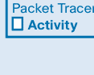

## Packet Tracer 活动
- Packet Tracer 2.3.7：导航 IOS
- Packet Tracer 2.5.5：配置初始交换机设置
- Packet Tracer 2.7.6：实现基本连通性
- Packet Tracer 2.9.1：基础交换机和终端设备配置

## 检查你的理解问题

完成此处列出的所有复习问题，以测试您对本章主题和概念的理解。附录“‘Check Your Understanding’ Questions 的答案”列出了答案。

1. 关于 Cisco IOS 设备中的运行配置文件的哪种说法是正确的？
- a. 修改时它会立即影响设备的操作。
- b. 它存储在 NVRAM 中。
- c. 它应使用 erase running-config 命令删除。
- d. 路由器重新启动时会自动保存。


2. 关于用户 EXEC 模式，以下哪两个陈述是正确的？（选择两项。）

+   a. 所有路由器命令都可用。
b. 通过输入 enable 命令可以访问全局配置模式。
c. 此模式的设备提示符以 > 符号结尾。
d. 可以配置接口和路由协议。
e. 只能查看路由器配置的某些方面。

3. 在 Cisco 路由器或交换机上使用 enable secret 命令可以保护哪种类型的访问？

+   a. 虚拟终端
b. 特权 EXEC
c. AUX 端口
d. 控制台线路

4. Cisco 交换机上的默认 SVI 是什么？

+   a. VLAN 1
b. VLAN 99
c. VLAN 100
d. VLAN 999

5. 通过 Cisco CLI 配置主机名时，以下哪三个命名约定属于指南？（选择三项。）

+   a. 主机名长度应少于 64 个字符。
b. 主机名应全部用小写字符书写。
c. 主机名不应包含空格。
d. 主机名应以特殊字符结尾。
e. 主机名应以字母开头。

6. Shell 在操作系统中的功能是什么？

+   a. 它与设备硬件交互。
b. 它在用户和内核之间进行接口。
c. 它提供专用防火墙服务。
d. 它为设备提供入侵保护服务。

7. 具有有效操作系统的交换机包含存储在 NVRAM 中的配置文件。配置文件具有 enable secret 密码但没有 line console 0 密码。当路由器启动时，将显示哪种模式？

+   - a. 全局配置模式
- b. 设置模式
- c. 特权 EXEC 模式
- d. 用户 EXEC 模式

8. 管理员刚刚更改了 IOS 设备上接口的 IP 地址。为了将这些更改应用到设备，还必须做什么？

+   - a. 将运行配置复制到启动配置文件。
- b. 将启动配置文件中的信息复制到运行配置。
- c. 重新加载设备，并在提示保存配置时输入 yes。
- d. 无需执行任何操作。对 IOS 设备的配置更改在命令正确输入并按下 Enter 键后立即生效。

9. Cisco 路由器或交换机上哪个内存位置在设备重新启动时会丢失所有内容？

+   - a. ROM
- b. flash
- c. NVRAM
- d. RAM

10. 技术人员为什么会输入命令 copy startup-config running-config？

+   - a. 从交换机中删除所有配置
- b. 将活动配置保存到 NVRAM
- c. 将现有配置复制到 RAM
- d. 使更改后的配置成为新的启动配置

11. DHCP 提供哪种功能？

+   - a. 自动为每个主机分配 IP 地址
- b. 远程交换机管理
- c. 将 IP 地址翻译为域名
- d. 端到端连通性测试

12. Cisco IOS CLI 的上下文相关帮助功能为用户提供了哪两个功能？（选择两项。）

+   - a. 在提交错误命令时提供错误消息
- b. 显示当前模式下所有可用命令的列表
- c. 允许用户使用 Tab 键完成缩写命令的剩余部分
- d. 确定已输入命令可用的选项、关键字或参数
- e. 选择完成任务的最佳命令

13. Cisco 路由器上哪个内存位置存储启动配置文件？

+   - a. RAM
- b. ROM
- c. NVRAM
- d. flash

## 协议和模型

## 目标

完成本章后，您将能够回答以下问题：

+   - 成功通信需要哪些类型的规则？
- 为什么网络通信中需要协议？
- 遵守协议套件的目的是什么？
- 标准组织在建立网络互操作性协议方面发挥什么作用？

+   - TCP/IP 模型和 OSI 模型如何用于促进通信过程中的标准化？
- 数据封装如何允许数据在网络上传输？
- 本地主机如何访问网络上的本地资源？

## 关键术语

本章使用以下关键术语。您可以在本书末尾的术语表中找到定义。

+   源 第 87 页
目标 第 87 页
信道 第 87 页
编码 第 89 页
解码 第 89 页
封装 第 91 页
解封装 第 91 页
流量控制 第 92 页
响应超时 第 92 页
访问方法 第 92 页
单播 第 93 页

+   组播 第 93 页
广播 第 93 页
协议 第 94 页
协议套件 第 97 页
参考模型 第 111 页
分段 第 117 页
复用 第 117 页
协议数据单元 (PDU) 第 119 页
以太网 第 124 页
默认网关 第 126 页

## 引言 (3.0)

您了解简单网络的基本组件，以及如何进行初始配置。在配置并连接这些组件后，您如何知道它们会协同工作？协议！协议是由标准组织创建的一套商定的规则。您无法拿起一条规则来仔细观察它，那么您如何真正理解为什么会有这样的规则以及它应该做什么？模型！模型为您提供了一种可视化规则及其在网络中位置的方法。本章提供了网络协议和模型的概述。您即将对网络实际如何工作获得更深入的理解！


### 课堂活动—设计通信系统 (3.0.3)

您刚刚为个人使用购买了一辆新汽车。开了一周左右后，您发现它工作不正常。您与几位同行讨论了这个问题，并决定将其送到他们强烈推荐的汽车维修设施。那是附近唯一一家维修设施。

当您到达维修设施时，您发现所有机械师都说另一种语言。您很难解释汽车的性能问题，但维修确实需要进行。您不确定是否能把它开回家去研究其他选择。

您必须找到一种与维修设施合作的方法，以确保您的汽车得到正确修复。

您将如何与机械师沟通？设计一个通信模型以确保汽车得到妥善维修。

## 规则 (3.1)

计算机网络使用通信规则，与人类通信中使用的规则类似。为了使两个设备能够通信，它们必须使用相同的规则。


### 视频—气泡中的设备 (3.1.1)

请参考在线课程观看此视频。

### 通信基础 (3.1.2)

网络在规模、形状和功能上各不相同。它们可以像跨互联网连接的设备一样复杂，也可以像两台计算机通过单根电缆直接连接一样简单，介于两者之间的一切皆有可能。然而，仅仅在终端设备之间建立有线或无线物理连接是不够的以实现通信。要实现通信，设备必须知道“如何”通信。

人们使用许多不同的通信方法交换思想。然而，所有通信方法都有以下三个共同元素：

+   - **消息 *源*（发送者）**：消息源是需要向其他个人或设备发送消息的人或电子设备。
- **消息 *目标*（接收者）**：目标接收消息并对其进行解释。
- ***信道***：信道由提供消息从源到目标传输路径的媒体组成。

### 通信协议 (3.1.3)

发送消息，无论是通过面对面通信还是通过网络，都受称为 *协议* 的规则管辖。这些协议特定于所使用的通信方法类型。在我们日常的个人通信中，我们用来通过一种媒介（如电话呼叫）通信的规则不一定与使用另一种媒介（如发送信件）的规则相同。然而，在每种情况下，都有关于我们如何通信的规则或协议。

例如，在图 3-1 中，两人可以面对面交流。

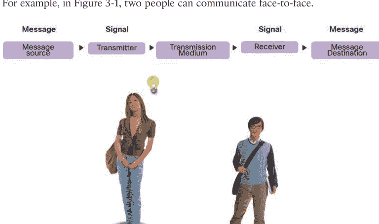

图 3-1 面对面通信协议


在进行交流之前，个人必须就如何交流达成一致。如果交流使用语音，他们必须首先就语言达成一致。接下来，当他们有要分享的信息时，必须能够以易于理解的方式格式化该信息。

如果某人使用英语但句子结构不佳，信息可能会被误解。以下各节描述了用于实现通信的协议。

### Rule Establishment (3.1.4)

在相互交流之前，个人必须使用既定的规则或协议来规范对话。例如，考虑以下信息：

人类 通信 之间 治理 规则。理解未正确格式化且未遵循既定规则和协议的消息非常困难。语法、语言、标点和句子的结构使人类配置对许多不同个体来说是可理解的。

很难阅读此信息，因为它未遵循语言和语法规则。它应使用规则（即协议）编写，这些规则规范了有效的通信。以下示例显示消息现在已正确遵循语言和语法的规则：

规则支配人类之间的通信。理解未正确格式化且未遵循既定规则和协议的消息非常困难。语法、语言、标点和句子的结构使配置对许多不同个体来说在人类层面是可理解的。

协议必须满足以下要求才能成功传递被接收者理解的消息：

- 已识别的发送方和接收方
- 通用语言和语法
- 传输速度和时序
- 确认或应答要求

### Network Protocol Requirements (3.1.5)

用于网络通信的协议具有许多基本特征。除了识别源和目的地之外，计算机和网络协议还定义了消息如何在网络上传输的细节。
常见的计算机协议包括以下要求：

- 消息编码
- 消息格式化和封装
- 消息大小
- 消息时序
- 消息交付选项

### Message Encoding (3.1.6)

发送消息的第一步之一是编码。编码是将信息转换为传输可接受形式的过程。解码则反向进行以解释信息。

假设一个人打电话给朋友讨论美丽日落的细节，如图 3-2 所示。

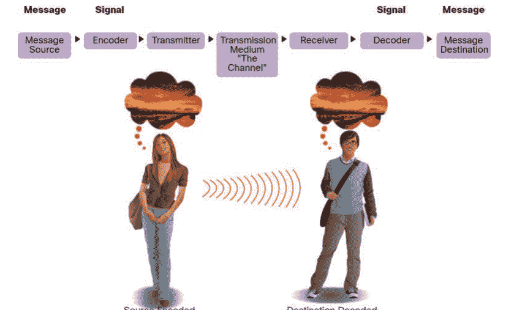

图 3-2 消息的编码和解码

为了传达信息，她将自己的想法转换为约定的语言。然后她使用口语的声音和语调说出这些词以传达信息。她的朋友听取描述并解码声音以理解收到的信息。

消息编码也在计算机通信中发生。主机之间的编码必须采用适合介质的格式。跨网络发送的消息首先由发送主机转换为位。每个位被编码为铜线上的电压模式、光纤中的红外光或无线系统的微波。目的主机接收并解码信号以解释消息。

### Message Formatting and Encapsulation (3.1.7)

当消息从源发送到目的地时，必须使用特定的格式或结构。消息格式取决于消息类型和用于传递消息的通道。

人类通信中要求正确格式的一个常见例子是发送信件。如图 3-3 所示，信封上有发送方和接收方的地址，各自位于信封上的适当位置。如果目的地址和格式不正确，信件将无法送达。

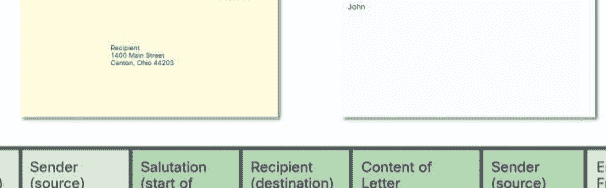

| 收件人（目的地）位置地址 | 发送方（源）位置地址 | 问候语（开始消息指示符） | 收件人（目的地）标识符 | 信件内容（封装数据） | 发送方（源）标识符 | 帧结束（结束消息指示符） |
|---|---|---|---|---|---|---|
| 信封地址 | 封装的信件 |  |  |  |  |  |
| 1400 Main Street Canton, Ohio 44203 | 4085 SE Pine Street Ocala, Florida 34471 | 亲爱的 | Jane | 我刚从旅行回来。我想你可能会喜欢看我的照片。 | John |  |

图 3-3 发送信件的格式

将一种消息格式（信件）放置在另一种消息格式（信封）内部的过程称为封装。解封装发生在接收方反转该过程并将信件从信封中取出时。

与发送信件一样，通过计算机网络发送消息也需要遵循特定的规则来进行交付和处理。

互联网协议（IP）是一种协议，其功能类似于信封示例中的寻址。在图 3-4 中，互联网协议版本 6（IPv6）数据包的字段标识数据包的源和目的地。IP 负责通过一个或多个网络将消息从消息源发送到目的地。

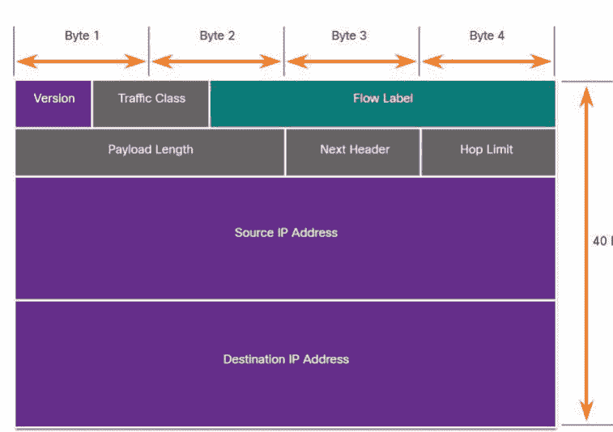

图 3-4 IPv6 报头中的字段

### Note

IPv6 数据包的字段将在第 8 章“网络层”中详细讨论。

### Message Size (3.1.8)

另一条通信规则规定了消息大小。当人们相互交流时，他们发送的消息通常被分解为较小的部分，即句子。这些句子的大小限制在接收者一次能处理的数量范围内。这种大小使接收者更容易阅读和理解消息。

在网络中，对帧的大小限制要求源主机将长消息分解为满足最小和最大大小要求的各个片段。因此，长消息以单独的帧发送，每个帧包含原始消息的一部分。每个帧都有自己的寻址信息。在接收主机处，消息的各个片段被重组为原始消息。

### Message Timing (3.1.9)

消息时序在网络通信中非常重要。消息时序包括以下内容：

- *流量控制*：这是管理数据传输速率的过程。流量控制定义了可以发送多少信息以及可以以何种速度交付。例如，如果一个人说话太快，接收者可能难以听清和理解信息。在网络通信中，源和目的设备使用网络协议来协商和管理信息的流动。
- *响应超时*：如果一个人提出问题并且在可接受的时间内没有听到响应，该人会认为不会有答案到来并据此做出反应。该人可能会重复问题或继续对话。网络上的主机使用网络协议来指定等待响应的时间以及响应超时时采取的操作。
- *访问方法*：访问方法决定何时可以发送消息。在图 3-5 中，两个人同时说话，发生了“信息碰撞”。这两个人需要后退并重新开始。同样，当设备想要在无线局域网上传输时，无线局域网网络接口卡（NIC）必须确定无线介质是否可用。

## Message Delivery Options (3.1.10)

消息可以通过不同方式交付。有时，一个人希望将信息传达给单个个人。其他时候，该人可能需要同时向一群人发送信息，甚至向某个区域的所有人发送信息。


> 抱歉？我没听懂你。

> 抱歉？我没听懂你。


### 图 3-5 碰撞信息

网络通信涉及类似的传输选项，包括以下内容（参见图 3-6）：

- *单播*: 信息传输到单个终端设备。
- *多播*: 信息传输到一个或多个终端设备。
- *广播*: 信息传输到所有终端设备。

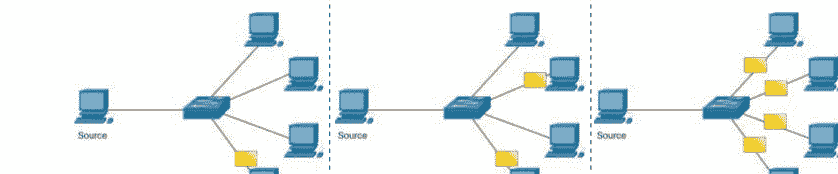

单播通信
多播通信
广播通信

## 图 3-6 比较单播、多播和广播通信

## 关于节点图标的说明 (3.1.11)

网络文档和拓扑通常使用节点图标——通常是一个圆圈——来表示网络和终端设备。图 3-7 显示了使用节点图标而不是计算机图标比较三种不同传输选项的情况。

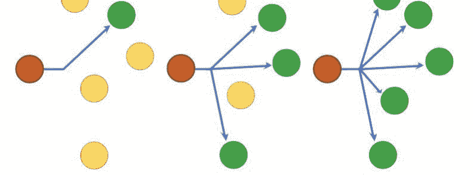

图 3-7 节点图标

交互式图形

## 检查你的理解——规则 (3.1.12)

请参考在线课程完成此活动。

## 协议

正如人类通信一样，各种网络和计算机协议必须能够相互交互并协同工作，才能使网络通信成功。

## 网络协议概述 (3.2.1)

你知道为了使终端设备能够通过网络通信，所有设备必须遵守同一套规则。这些规则称为协议，它们在网络中具有许多功能。本节提供网络协议概述。

网络协议定义了设备之间交换消息的通用格式和规则集。协议由终端设备和中间设备通过软件、硬件或两者实现。每个网络协议都有其自己的功能、格式和通信规则。

表 3-1 列出了使一个或多个网络之间通信成为可能的各种协议类型。

### 表 3-1 协议类型

| 协议类型 | 描述 |
|---|---|
| 网络通信协议 | 这些协议使两个或多个设备能够通过一个或多个网络进行通信。以太网技术系列涉及多种协议，如 IP、传输控制协议 (TCP)、超文本传输协议 (HTTP) 等。 |
| 网络安全协议 | 这些协议通过提供身份验证、数据完整性和数据加密来保护数据。安全协议的示例包括安全外壳 (SSH)、安全套接层 (SSL) 和传输层安全 (TLS)。 |
| 路由协议 | 这些协议使路由器能够交换路由信息、比较路径信息并选择到目标网络的最佳路径。路由协议的示例包括开放最短路径优先 (OSPF) 和边界网关协议 (BGP)。 |
| 服务发现协议 | 这些协议用于自动检测设备或服务。服务发现协议的示例包括动态主机配置协议 (DHCP)，用于发现 IP 地址分配服务，以及域名系统 (DNS)，用于执行名称到 IP 地址的转换。 |

## 网络协议功能 (3.2.2)

网络通信协议负责终端设备之间网络通信所需的各种功能。例如，图 3-8 显示了计算机如何通过多个网络设备向服务器发送消息。

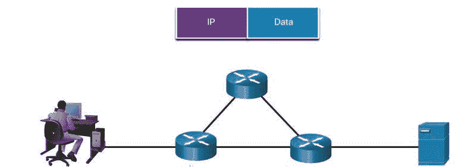

图 3-8 计算机如何向服务器发送消息

计算机和网络设备使用商定的协议进行通信。
表 3-2 列出了这些协议的功能。

## 表 3-2 协议功能

| 功能 | 描述 |
|---|---|
| 地址解析 | 协议通过使用定义的寻址方案来识别消息的发送方和预期接收方。提供寻址的协议示例包括以太网、IPv4 和 IPv6。 |
| 可靠性 | 可靠性在消息在传输过程中丢失或损坏时提供保证交付机制。TCP 提供保证交付。 |
| 流量控制 | 此功能确保数据在两个通信设备之间以高效的速率流动。TCP 提供流量控制服务。 |
| 排序 | 此功能为每个传输的数据段唯一标记。接收设备使用排序信息正确重新组装信息。这在数据段丢失、延迟或乱序接收时很有用。TCP 提供排序服务。 |
| 错误检测 | 此功能用于确定数据在传输过程中是否损坏。提供错误检测的协议包括以太网、IPv4、IPv6 和 TCP。 |
| 应用接口 | 此功能包含用于网络应用程序之间进程到进程通信的信息。例如，在访问网页时，使用 HTTP 或 HTTPS 在客户端和服务器 Web 进程之间进行通信。 |

### 协议交互 (3.2.3)

在计算机网络上发送消息通常需要使用多个协议，每个协议都有自己的功能和格式。图 3-9 显示了当设备向 Web 服务器请求其网页时使用的一些常见网络协议。


## 检查你的理解——协议 (3.2.4)

请参考在线课程完成此活动。

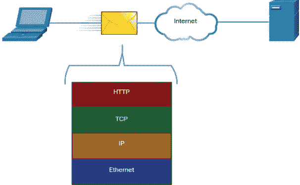

图 3-9 发送消息时使用的常见网络协议

## 协议套件 (3.3)

协议套件是一组协同工作以提供全面网络通信服务的协议。协议套件可以由标准组织指定或由供应商开发。

### 网络协议套件 (3.3.1)

在许多情况下，协议必须能够与其他协议协同工作，以便你的在线体验为网络通信提供所需的一切。协议套件旨在无缝协同工作。

协议套件是一组相互关联的协议，用于执行通信功能。

可视化协议套件内协议交互的最佳方法之一是将其视为堆栈。协议堆栈显示了套件内各个协议的实现方式。协议以层的方式查看，每个更高级别的服务都依赖于在较低层显示的协议定义的功能。堆栈的较低层关注通过网络移动数据并为上层提供服务，而上层则专注于发送消息的内容。

如 图 3-10 所示，我们可以使用层来描述面对面通信中发生的活动。底部是物理层，我们看到两个人用声音大声说出词语。中间是规则层，它规定了通信的要求，包括选择共同语言的要求。顶部是内容层，即通信内容实际被说出的地方。

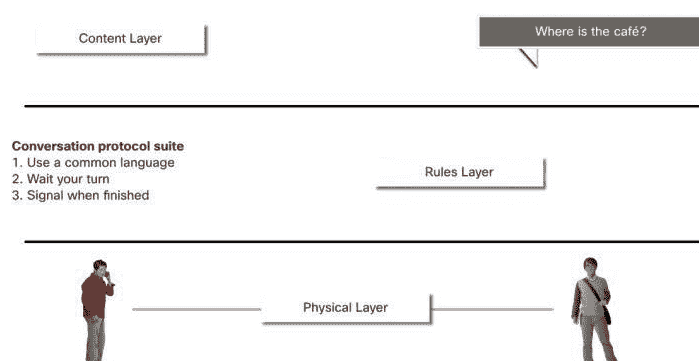

协议套件是一组协同工作以帮助解决问题的规则。

图 3-10 人类通信中的层

### 协议套件的演变 (3.3.2)

协议套件是一组协同工作以提供全面网络通信服务的协议。自 1970 年代以来，出现了几种不同的协议套件，有些由标准组织开发，有些由各种供应商开发。

随着网络通信和互联网的开始发展，存在几个竞争的协议套件，如图 3-11 所示，并在以下列表中描述：

- **Internet Protocol Suite or TCP/IP**: 这是今天最常用和最相关的协议套件。TCP/IP 协议套件是由互联网工程任务组 (IETF) 维护的开放标准协议套件。
- **Open Systems Interconnection (OSI) protocols**: 这是由国际标准化组织 (ISO) 和国际电信联盟 (ITU) 于 1977 年联合开发的协议族。OSI 协议还包括一个称为 OSI 参考模型的七层模型。OSI 参考模型对协议的功能进行分类。今天 OSI 主要以其分层模型而闻名。OSI 协议在很大程度上已被 TCP/IP 取代。


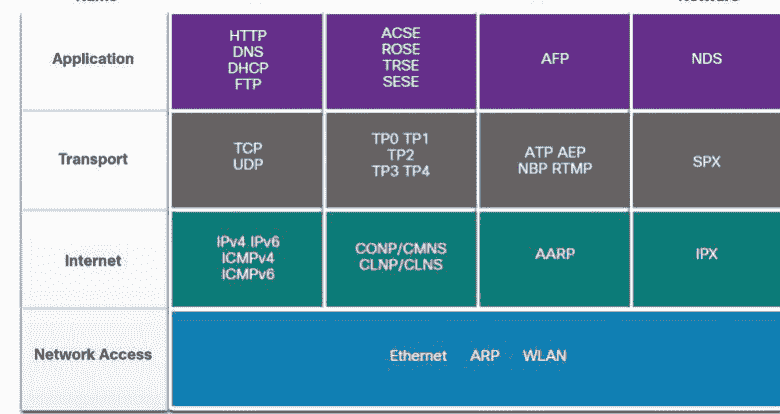

图 3-11 竞争的协议套件

- **AppleTalk:** Apple 在 1985 年为 Apple 设备发布了这种短命的专有协议套件。1995 年，Apple 采用 TCP/IP 取代 AppleTalk。
- **Novell NetWare:** Novell 在 1983 年开发了这种短命的专有协议套件和网络操作系统，使用 IPX 网络协议。1995 年，Novell 采用 TCP/IP 取代 IPX。

## TCP/IP Protocol Example (3.3.3)

TCP/IP 协议可用于应用层、传输层和互联网层。网络访问层中没有 TCP/IP 协议。最常见的网络访问层局域网协议是 Ethernet 和 WLAN（无线局域网）协议。网络访问层协议负责通过物理介质传输 IP 数据包。

图 3-12 显示了主机与 Web 服务器之间用于发送数据包的三个 TCP/IP 协议的示例。HTTP、TCP 和 IP 是所使用的 TCP/IP 协议。在网络访问层，示例中使用了 Ethernet。然而，这也可以是无线标准，例如 WLAN 或蜂窝服务。

## TCP/IP Protocol Suite (3.3.4)

如今，TCP/IP 协议套件包含许多协议，并不断发展以支持新服务。一些最流行的 TCP/IP 协议如图 3-13 所示。


图 3-12 用于 Web 客户端/服务器通信的 TCP/IP 协议


图 3-13 TCP/IP 协议套件中的协议示例

## Application Layer

应用层包括网络利用设备的网络应用程序和协议，包括

- **名称系统**
  - DNS：域名系统。DNS 将域名（如 cisco.com）翻译成 IP 地址。
- **主机配置**
  - DHCPv4：用于 IPv4 的动态主机配置协议。DHCPv4 服务器在启动时动态分配 IPv4 地址信息给 DHCPv4 客户端，并在不再需要时允许地址被重用。
  - DHCPv6：用于 IPv6 的动态主机配置协议。DHCPv6 与 DHCPv4 类似。DHCPv6 服务器在启动时动态分配 IPv6 地址信息给 DHCPv6 客户端。
  - SLAAC：无状态地址自动配置。SLAAC 允许设备在不使用 DHCPv6 服务器的情况下获得其 IPv6 地址信息。
- **电子邮件**
  - SMTP：简单邮件传输协议。SMTP 使客户端能够向邮件服务器发送电子邮件，并使服务器能够向其他服务器发送电子邮件。
  - POP3：邮局协议版本 3。POP3 使客户端能够从邮件服务器检索电子邮件并将其下载到客户端的本地邮件应用程序。
  - IMAP：互联网消息访问协议。IMAP 使客户端能够访问存储在邮件服务器上的电子邮件并在服务器上维护电子邮件。
- **文件传输**
  - FTP：文件传输协议。FTP 设定了规则，使一个主机上的用户能够通过网络访问并在另一主机之间传输文件。FTP 是一种可靠的、面向连接的、经确认的文件传输协议。
  - SFTP：SSH 文件传输协议。作为 Secure Shell（SSH）协议的扩展，SFTP 可用于建立安全的文件传输会话，其中文件传输被加密。SSH 是一种用于安全远程登录的方法，通常用于访问设备的命令行。
  - TFTP：简单文件传输协议。TFTP 是一种简单的、无连接的文件传输协议，具有尽力而为的、未经确认的文件传输。它需要的开销比 FTP 少。

### Web and web service

- **HTTP：** 超文本传输协议。HTTP 是一套在万维网上交换文本、图形图像、声音、视频和其他多媒体文件的规则。
- **HTTPS：** HTTP 安全。HTTPS 是 HTTP 的安全形式，可对万维网上交换的数据进行加密。
- **REST：** 表述性状态转移。REST 是一种使用应用程序编程接口（APIs）和 HTTP 请求创建 Web 应用程序的方法。

## Transport Layer

传输层提供主机到主机的通信服务，包括

### Connection oriented

- **TCP：** 传输控制协议。TCP 使在不同主机上运行的进程之间实现可靠通信，并提供可靠的、经确认的传输以确认成功交付。

### Connectionless

- **UDP：** 用户数据报协议。UDP 使一个主机上运行的进程能够向另一主机上运行的进程发送数据包。然而，UDP 不确认数据报传输是否成功。

## Internet Layer

互联网层用于将数据包从源传输到最终目的地。互联网层包括

### Internet Protocol

- **IPv4：** 互联网协议版本 4。IPv4 从传输层接收消息段，将消息打包成数据包，并为网络上的端到端传输对数据包进行寻址。IPv4 使用 32 位地址。
- **IPv6：** IP 版本 6。IPv6 与 IPv4 类似，但使用 128 位地址。
- **NAT：** 网络地址转换。NAT 将私有网络中的 IPv4 地址转换为全局唯一的公共 IPv4 地址。

### Messaging

- **ICMPv4：** 用于 IPv4 的互联网控制消息协议。ICMPv4 为源主机提供有关数据包传输错误的目的主机反馈。
- **ICMPv6：** 用于 IPv6 的 ICMP。ICMPv6 在功能上与 ICMPv4 类似，但用于 IPv6 数据包。
- **ICMPv6 ND：** ICMPv6 邻居发现。ICMPv6 ND 包含四个协议消息，用于地址解析和重复地址检测。

### Routing protocols

- **OSPF：** 开放最短路径优先。OSPF 是一种链路状态路由协议，使用基于区域的分层设计。OSPF 是一种开放标准的内部路由协议。
- **EIGRP：** 增强型内部网关路由协议。EIGRP 是一种 Cisco 专有路由协议，使用基于带宽、延迟、负载和可靠性的复合度量。
- **BGP：** 边界网关协议。BGP 是一种开放标准的外部网关路由协议，用于互联网服务提供商（ISPs）之间。BGP 也常用于 ISP 及其大型私有客户之间交换路由信息。

## Network Access Layer

网络访问层提供物理网络上的通信服务，通常从一个网络接口卡（NIC）到同一网络上的另一个 NIC。网络访问层包括

### Address resolution

- **ARP：** 地址解析协议。ARP 在 IPv4 地址和硬件地址之间提供动态地址映射。

### Data link protocols

- **Ethernet：** Ethernet 定义了网络访问层布线和信号标准的规则。
- **WLAN：** 无线局域网。WLAN 协议定义了在 2.4 GHz 和 5 GHz 射频上进行无线信号的规则。

## TCP/IP Communication Process (3.3.5)

图 3-14 至图 3-20 演示了完整的 TCP/IP 通信过程，使用 Web 服务器向客户端传输数据的示例。本过程和这些协议将在后面的章节中更详细地介绍。这些是该过程的基本步骤：

请前往课程在线观看 TCP/IP 通信过程的动画。

第 1 步。在图 3-14 中，该过程始于 Web 服务器准备超文本标记语言（HTML）页面作为待发送的数据。

第 2 步。应用程序协议 HTTP 头部被添加到 HTML 数据的前面。头部包含各种信息，包括服务器使用的 HTTP 版本以及指示其具有 Web 客户端信息的状态代码。


图 3-14 准备待发送的 HTML

第 3 步。如图 3-15 所示，HTTP 应用层协议将 HTML 格式的网页数据传递到传输层。TCP 向 HTTP 数据添加头部信息。TCP 传输层协议用于管理单独的会话，在此示例中为 Web 服务器与 Web 客户端之间。

第 4 步。接下来，如图 3-16 所示，IP 信息被添加到 TCP 信息的前面。IP 分配适当的源 IP 地址和目标 IP 地址。这些信息称为 IP 数据包。

第 5 步。Ethernet 协议在 IP 数据包的两端添加信息，称为数据链路帧，如图 3-17 所示。

第 6 步。此数据现在通过互联网传输，如图 3-18 所示。图中云所代表的互联网是由媒体和中间设备组成的集合。


图 3-15 添加 TCP 段头


图 3-16 添加 IP 数据包头


图 3-17 添加以太网帧头


图 3-18 将帧作为比特发送到目的地

第 7 步。图 3-19 显示客户端接收包含数据的链路层帧。协议头一次处理一个，并以与添加时相反的顺序移除。以太网信息被处理并移除，然后是 IP 协议信息、TCP 信息，最后是 HTTP 信息。

## 协议封装术语


图 3-19 Web 客户端解封装帧

第 8 步。网页信息随后传递给客户端的 Web 浏览器软件，如图 3-20 所示。


图 3-20 Web 客户端将数据发送到 Web 浏览器

## 检查你的理解—协议套件 (3.3.6)

请参考在线课程完成此活动。

交互式图形

## 标准组织 (3.4)

标准组织创建标准，使设备能够独立于任何特定厂商进行通信。软件或硬件只需应用标准，而与厂商无关。

### 开放标准 (3.4.1)

购买新轮胎时，你可以选择的制造商有很多。它们中至少有一种轮胎适合你的汽车。这是因为汽车行业在制造汽车时使用标准。同样，协议也使用标准。由于网络组件有许多不同的制造商，它们必须都使用相同的标准。在网络领域，标准由国际标准组织制定。

开放标准鼓励互操作性、竞争和创新。它们还保证没有任何单一公司的产品可以垄断市场或对其竞争对手拥有不公平的优势。

例如，当你为家庭购买无线路由器时，有许多来自不同厂商的选择，所有这些都包含了 IPv4、IPv6、DHCP、SLAAC、以太网和 802.11 无线局域网等标准协议。这些开放标准还允许运行 macOS 的客户端从运行 Linux 操作系统的 Web 服务器下载网页。这是因为两个操作系统都实现了开放标准协议，例如 TCP/IP 协议套件中的协议。

标准组织通常是厂商中立的、非营利组织，成立目的是开发和推广开放标准的概念。这些组织在维护一个开放的互联网方面很重要，互联网具有可自由访问的规范和协议，任何厂商都可以实现。

一个标准组织可能会完全自行起草一套规则，或者在其他情况下，可能选择专有协议作为标准的基础。如果使用专有协议，标准组织通常会涉及创建该协议的厂商。

图 3-21 显示了各种标准组织的标志。

### 互联网标准 (3.4.2)

各个组织对推广和创建互联网和 TCP/IP 协议的标准有不同的职责。


图 3-21 标准组织

图 3-22 显示了参与互联网开发和支持的标准组织，如下列表所述。

- **互联网协会 (ISOC)：**负责在全球范围内推广互联网使用的开放开发和演进。
- **互联网架构委员会 (IAB)：**负责互联网标准的总体管理和开发。
- **互联网工程任务组 (IETF)：**开发、更新和维护互联网和 TCP/IP 技术。这包括开发新协议和更新现有协议的过程和文档，即请求评论 (RFC) 文档。
- **互联网研究任务组 (IRTF)：**专注于与互联网和 TCP/IP 协议相关的长期研究，例如反垃圾邮件研究组 (ASRG)、密码论坛研究组 (CFRG) 和点对点研究组 (P2PRG)。

图 3-23 显示了参与 TCP/IP 开发和支持的标准组织，包括 IANA 和 ICANN：

- **互联网名称与数字地址分配机构 (ICANN)：**总部位于美国，ICANN 协调 IP 地址分配、域名管理以及 TCP/IP 协议中使用的其他信息的分配。
- **互联网号码分配局 (IANA)：**IANA 负责监督和管理 ICANN 的 IP 地址分配、域名管理和协议标识符。


图 3-22 互联网标准组织


图 3-23 TCP/IP 标准组织

### 电子和通信标准 (3.4.3)

各个标准组织负责推广和创建用于通过有线或无线介质将 IP 数据包作为电子信号传输的电子和通信标准。这些标准组织包括以下内容：

- **电气和电子工程师学会 (IEEE，读作“I-triple-E”)：**该电气工程和电子组织致力于推动技术创新，并在电力和能源、医疗保健、电信和网络等广泛行业中创建标准。重要的 IEEE 网络标准包括 802.3 以太网和 802.11 WLAN 标准。搜索互联网以了解其他 IEEE 网络标准。
- **电子工业联盟 (EIA)：**该组织以其与电气布线、连接器以及用于安装网络设备的 19 英寸机架相关的标准而闻名。
- **电信工业协会 (TIA)：**该组织负责在多个领域开发通信标准，包括无线电设备、蜂窝塔、语音 over IP (VoIP) 设备、卫星通信等。
- **国际电信联盟-电信标准化部门 (ITU-T)：**国际电信联盟-电信标准化部门是最大、最古老的通信标准组织之一，定义了视频压缩、互联网协议电视 (IPTV) 和宽带通信等标准，例如数字用户线路 (DSL)。


### 实验—研究网络标准 (3.4.4)

在本实验中，你将完成以下目标：

- 第 1 部分：研究网络标准组织
- 第 2 部分：反思互联网和计算机网络经验


### 检查你的理解—标准组织 (3.4.5)

请参考在线课程完成此活动。

## 参考模型 (3.5)

*参考模型*是帮助理解和实现各种协议之间关系的概念框架。

### 使用分层模型的益处 (3.5.1)

你不能像在装配线上观看汽车组件组装一样实际观看真实数据包在真实网络中传输，因此拥有一种思考网络的方式来想象正在发生的事情是有帮助的。在这种情况下，模型很有用。

诸如网络如何运行之类的复杂概念可能难以解释和理解。因此，使用分层模型将网络的操作模块化为可管理的层。

使用分层模型描述网络协议和操作的好处如下：

- 协助协议设计，因为在特定层运行的协议有其作用的定义信息以及与上下层定义的接口
- 促进竞争，因为不同厂商的产品可以协同工作
- 防止某一层中的技术或能力变化影响上下层
- 提供描述网络功能和能力的通用语言

如图 3-24 所示，有两种分层模型用于描述网络操作：

- 开放系统互连 (OSI) 参考模型
- TCP/IP 参考模型

### OSI 参考模型 (3.5.2)

OSI 参考模型提供了可在各层发生的广泛功能和服务列表。这种模型通过描述特定层必须完成的工作但不规定如何完成，来为所有类型的网络协议和服务提供一致性。

它还描述了各层与其直接上下层之间的交互。本课程中讨论的 TCP/IP 协议围绕 OSI 和 TCP/IP 模型构建。表 3-3 显示了 OSI 模型各层的详细信息。随着本书中更详细地讨论协议，各层的功能和层间关系将变得更加明显。


网络模型只是网络操作的表示。模型并非实际网络。

图 3-24 OSI 和 TCP/IP 模型

### 表 3-3 OSI 模型的层

| OSI 模型层 | 描述 |
|---|---|
| 层 7：应用层 | 应用层包含用于进程间通信的协议。 |
| 层 6：表示层 | 表示层为应用层服务之间传输的数据提供通用表示。 |
| 层 5：会话层 | 会话层为表示层提供服务，以组织其对话并管理数据交换。 |
| 层 4：传输层 | 传输层定义了对端设备之间单个通信的数据进行分段、传输和重新组装的服务。 |
| 层 3：网络层 | 网络层提供在已识别的端设备之间通过网络交换数据各个部分的服务。 |
| 层 2：数据链路层 | 数据链路层协议描述了在公共介质上在设备之间交换数据帧的方法。 |
| 层 1：物理层 | 物理层协议描述了激活、维护和停用网络设备之间用于比特传输的物理连接的机械、电气、功能和程序手段。 |

**注意**

虽然 TCP/IP 模型层仅按名称引用，但七层 OSI 模型层更常按编号而非名称引用。例如，物理层被称为 OSI 模型的第 1 层，数据链路层为第 2 层，以此类推。

## TCP/IP 协议模型 (3.5.3)

TCP/IP 协议模型用于互联网络通信，创建于 20 世纪 70 年代初，有时被称为互联网模型。该模型与特定协议套件的结构非常接近。TCP/IP 模型是一个协议模型，因为它描述了 TCP/IP 套件中各层协议发生的函数。TCP/IP 也用作参考模型。表 3-4 显示了 TCP/IP 模型各层的详细信息。

### 表 3-4 TCP/IP 模型的层

| TCP/IP 模型层 | 描述 |
|---|---|
| 层 4：应用层 | 代表用户数据并处理编码和对话控制 |
| 层 3：传输层 | 支持不同网络中各种设备之间的通信 |
| 层 2：互联网层 | 确定网络中的最佳路径 |
| 层 1：网络访问层 | 控制构成网络的硬件设备和介质 |

标准和 TCP/IP 协议的定义在公开论坛中讨论，并在 IETF RFC 的公开可用集合中定义。RFC 由网络工程师撰写并发送给其他 IETF 成员征求意见。

## OSI 和 TCP/IP 模型比较 (3.5.4)

构成 TCP/IP 协议套件的协议也可以用 OSI 参考模型来描述。在 OSI 模型中，TCP/IP 模型的网络访问层和应用层被进一步划分，以描述这些层必须发生的离散功能，如图 3-25 所示。

在网络访问层，TCP/IP 协议套件并未指定在物理介质上传输时使用哪些协议；它仅描述从互联网层到物理网络协议的交接。OSI 模型第 1 层和第 2 层处理访问介质所需的程序以及在网络上传输数据的物理手段。


图 3-25 OSI 和 TCP/IP 模型比较

关键相似之处在于传输层和网络层；然而，这两个模型在与各层上下层的关系上有所不同：

- OSI 第 3 层，即网络层，直接映射到 TCP/IP 互联网层。该层用于描述寻址和路由互联网中消息的协议。
- OSI 第 4 层，即传输层，直接映射到 TCP/IP 传输层。该层描述了提供源主机与目标主机之间有序可靠的数据传输的通用服务和功能。
- TCP/IP 应用层包含多个协议，为各种终端用户应用程序提供特定功能。OSI 第 5、6 和 7 层被用作应用软件开发人员和供应商的参考，以生产在网络上运行的应用程序。
- TCP/IP 和 OSI 模型在引用各层协议时都很常用。由于 OSI 模型将数据链路层与物理层分开，因此在引用这些较低层时常被使用。


## Packet Tracer—调查 TCP/IP 和 OSI 模型在实际中的应用 (3.5.5)

本模拟活动旨在为理解 TCP/IP 协议套件及其与 OSI 模型的关系奠定基础。模拟模式允许您查看在各层通过网络发送的数据内容。

随着数据在网络中移动，它被分解成更小的片段并被标识，以便在到达目的地时可以重新组合。每个片段都被赋予一个特定名称，并与 TCP/IP 和 OSI 模型的特定层相关联。分配的名称称为协议数据单元（PDU）。使用 Packet Tracer 模拟模式，您可以查看各层及其关联的 PDU。本活动的步骤引导用户通过使用客户端 PC 上可用的 Web 浏览器应用程序从 Web 服务器请求网页的过程。

尽管此时显示的大部分信息可能不熟悉，但此活动为您提供了探索 Packet Tracer 功能的机会，以便您可以可视化封装过程。

## 数据封装 (3.6)

本节讨论信息如何在网络上传输。

### 消息分段 (3.6.1)

理解 OSI 参考模型和 TCP/IP 协议模型在学习数据在网络中移动时如何被封装时会很有帮助。这个过程并不像通过邮政系统发送实体信件那么简单。

理论上，单个通信，例如视频或带有许多大型附件的电子邮件消息，可以作为一个庞大、不间断的比特流从源发送到目的地。然而，这会给需要使用相同通信信道或链路的其他设备带来问题。这些庞大的数据流会导致显著延迟。此外，如果在传输过程中互联网络基础设施中的任何链路发生故障，完整消息将丢失并必须完全重新传输。

更好的方法是将其数据分成更小、更易管理的块在网络上传输。分段是将数据流划分为较小的单元以在网络上传输的过程，如图 3-26 所示。

分段是必要的，因为数据网络使用 TCP/IP 协议套件以单个 IP 数据包发送数据。每个数据包单独发送，就好像您将一封长信作为一系列单独的明信片发送一样。包含同一目的地的分段的数据包可以通过不同路径发送。


图 3-26 消息分段

消息分段有两个主要好处：

- **提高速度**：由于大数据流被分割成数据包，大量数据可以在不占用通信链路的情况下通过网络发送。这允许许多不同的对话在网络上交错进行，这一过程称为 *复用*，如图 3-27 所示。
- **提高效率**：如果单个分段由于网络故障或网络拥塞而未能到达目的地，则只需重新传输该分段，而非整个数据流。


### 图 3-27 多路复用多个消息

### 排序 (3.6.2)

使用分段和多路复用来跨网络传输消息的挑战在于该过程增加的复杂程度。想象一下，如果你必须发送一封 100 页的信，但每个信封只能容纳 1 页；你需要 100 个信封，并且每个信封都需要单独地址。100 页信件以 100 个不同信封发送时，可能会乱序到达。因此，每个信封中的信息需要包含序列号，以确保接收方能够按正确顺序重新组装页面。

在网络通信中，消息的每个段都必须经过类似的处理，以确保其到达正确的目的地并能重新组装成原始消息的内容，如图 3-28 所示。TCP 负责对各个段进行排序。

## 协议数据单元 (3.6.3)

随着应用程序数据沿着协议栈向下传递以便在网络媒体上传输，在每个层级都会添加各种协议信息。此过程称为封装。

注意
尽管 UDP PDU 被称为数据报，IP 数据包有时也被称作 IP 数据报。


### 图 3-28 为重新组装而标记段

数据在任何层所采取的形式称为协议数据单元（PDU）。在封装期间，每个层根据所使用的协议对从上层接收到的 PDU 进行封装。在该过程的每个阶段，PDU 都有不同的名称以反映其功能。虽然 PDU 没有通用的命名约定，但在本书中，PDU 按照 TCP/IP 套件的协议命名。各种形式数据的 PDU 如图 3-29 所示。

以下是从应用层开始的 PDU 列表：

- **数据：** 应用层使用的 PDU 的通用术语
- **段：** 传输层 PDU
- **数据包：** 网络层 PDU
- **帧：** 数据链路层 PDU
- **位：** 物理层 PDU，用于在介质上传输数据时


### 图 3-29 封装

### 注意

如果传输头是 TCP，则 PDU 为段。如果传输头是 UDP，则为数据报。

## 封装示例 (3.6.4)

当消息在网络上传送时，封装过程自上而下进行。在每个层，上层信息被视为封装协议内的数据。例如，在图 3-29 中，传输层头（例如 TCP）连同原始数据一起，被视为下层网络层 IP 数据包内的数据。网络层添加网络层协议（IP）。换句话说，TCP 段被视为网络层或 IP 数据包的数据部分。

## 解封装示例 (3.6.5)

在接收主机处，封装过程被逆转；这称为解封装。解封装是接收设备用于移除一个或多个协议头的过程。数据在向上移动到堆栈中朝向终端用户应用程序时被解封装。当每个层从下层接收到数据时，它会处理该层头的头。处理完头后，头会被移除，数据部分会被移交给更高层协议。

交互式图形

## 检查你的理解——数据封装 (3.6.6)

请参考在线课程完成此活动。

## 数据访问 (3.7)

在访问网络资源之前，数据必须使用正确的目标地址进行封装，并且还必须包含适当的源地址信息以允许目标设备进行回复。访问本地网络资源需要两种具有不同作用的地址类型。

## 地址 (3.7.1)

正如你刚刚学到的，在网络中对消息进行分段是必要的。但如果这些分段的消息没有正确寻址，就无处可去。本节提供网络地址的概述。你还将有机会使用 Wireshark 工具，该工具可帮助你“查看”网络流量。

网络层和数据链路层负责将数据从源设备传递到目标设备。如图 3-30 所示，两层中的协议都包含源地址和目标地址，但这些地址具有不同的用途：


图 3-30 网络地址和数据链路地址

- **网络层源地址和目标地址：** 负责将 IP 数据包从原始源传递到最终目标，该目标可能在同一网络或远程网络上。
- **数据链路层源地址和目标地址：** 负责将数据链路帧从一个网络接口卡（NIC）传递到同一网络上的另一个 NIC。

## 第三层逻辑地址 (3.7.2)

IP 地址是网络层或第三层的逻辑地址，用于将 IP 数据包从原始源传递到最终目标，如图 3-31 所示。


图 3-31 第三层网络地址

IP 数据包包含两个 IP 地址：

- **源 IP 地址：** 发送设备的 IP 地址，即数据包的原始源
- **目标 IP 地址：** 接收设备的 IP 地址，即数据包的最终目标

IP 地址表示原始源 IP 地址和最终目标 IP 地址。无论源和目标是否在同一 IP 网络或不同 IP 网络上，均属如此。

IP 地址包含两个部分：

- **网络部分（IPv4）或前缀（IPv6）：** 地址的最左侧部分表示 IP 地址所属的网络。同一网络上的所有设备都具有相同的地址网络部分。
- **主机部分（IPv4）或接口 ID（IPv6）：** 在网络部分之后，地址的剩余部分是主机部分，用于标识网络上的特定设备。此部分在网络上的每个设备或接口中都是唯一的。

### 注意

子网掩码（IPv4）或前缀长度（IPv6）用于区分 IP 地址的网络部分和主机部分。

## 同一网络上的设备 (3.7.3)

让我们看一个客户端计算机 PC1 与同一 IP 网络上的 FTP 服务器通信的示例：

- **源 IPv4 地址：** 这是发送设备的 IPv4 地址，客户端计算机 PC1 为 192.168.1.110。
- **目标 IPv4 地址：** 这是接收设备的 IPv4 地址，FTP 服务器为 192.168.1.9。

请注意图 3-32 中，源 IPv4 地址和目标 IPv4 地址的网络部分都在同一网络上。源 IPv4 地址的网络部分和目标 IPv4 地址的网络部分相同；因此，源和目标在同一网络上。


图 3-32 同一网络上的网络层地址

## 数据链路层地址的作用：同一 IP 网络 (3.7.4)

当 IP 数据包的发送方和接收方在同一网络上时，数据链路帧会直接发送到接收设备。在以太网网络上，数据链路地址被称为以太网媒体访问控制（MAC）地址，如图 3-33 所示。


图 3-33 同一网络上的数据链路层地址

MAC 地址物理嵌入在以太网 NIC 上。有源 MAC 地址和目标 MAC 地址：

- **源 MAC 地址：** 这是发送带有封装 IP 数据包的数据链路帧的设备的 data link 地址，或以太网 MAC 地址。在此示例中，PC1 的以太网 NIC 的 MAC 地址为 AA-AA-AA-AA-AA-AA，以十六进制表示法书写。
- **目标 MAC 地址：** 当接收设备与发送设备在同一网络上时，这是接收设备的数据链路地址。在此示例中，目标 MAC 地址是 FTP 服务器的 MAC 地址，CC-CC-CC-CC-CC-CC，以十六进制表示法书写。

带有封装 IP 数据包的帧可以从 PC1 直接传输到 FTP 服务器。


## 远程网络上的设备 (3.7.5)

当设备与远程网络上的设备通信时，网络层地址和数据链路层地址的作用是什么？图 3-33 所示的示例中，客户端计算机 PC1 正在与不同 IP 网络上的服务器 Web Server 通信。

## 网络层地址的作用 (3.7.6)

当数据包的发送方与接收方位于不同网络时，源 IP 地址和目标 IP 地址表示位于不同网络上的主机。这由目标主机 IP 地址的网络部分指示。

- **源 IPv4 地址**：发送设备的 IPv4 地址，即客户端计算机 PC1：192.168.1.110
- **目标 IPv4 地址**：接收设备的 IPv4 地址，即服务器 Web Server：172.16.1.99

注意图 3-34 中，源 IPv4 地址和目标 IPv4 地址的网络部分位于不同的网络上。


图 3-34 不同网络上的网络层地址

## 数据链路层地址的作用：不同 IP 网络 (3.7.7)

当 IP 数据包的发送方和接收方位于不同网络时，Ethernet 数据链路帧无法直接发送到目标主机，因为主机在发送方的网络中无法直接到达。Ethernet 帧必须发送到另一台设备，即路由器或默认网关。在我们的示例中，默认网关是 R1。R1 具有与 PC1 位于同一网络上的 Ethernet 数据链路地址。这使得 PC1 能够直接到达路由器。

- **源 MAC 地址：** 源 MAC 地址是发送设备 PC1 的 Ethernet MAC 地址。PC1 的 Ethernet 接口的 MAC 地址为 AA-AA-AA-AA-AA-AA。
- **目标 MAC 地址：** 当接收设备，即目标 IP 地址，与发送设备位于不同网络时，发送设备使用默认网关或路由器的 Ethernet MAC 地址。在此示例中，目标 MAC 地址是 R1 Ethernet 接口的 MAC 地址，11-11-11-11-11-11。这是在与 PC1 相同网络上连接的接口，如图 3-35 所示。


图 3-35 不同网络上的数据链路层地址

现在封装了 IP 数据包的 Ethernet 帧可以传输到 R1。R1 将数据包转发到目标 Web Server。这可能意味着 R1 将数据包转发到另一台路由器，或如果目标位于连接到 R1 的网络上，则直接转发到 Web Server。

必须在本地网络上的每台主机上配置默认网关的 IP 地址。所有发往远程网络目标的数据包都发送到默认网关。Ethernet MAC 地址和默认网关将在第 7、8 和 9 章中更详细地讨论。

## 数据链路地址 (3.7.8)

数据链路层（第 2 层）物理地址具有独特的作用。数据链路地址的目的是将数据链路帧从一个网络接口传递到同一网络上的另一个网络接口。

在有线或无线网络上传输 IP 数据包之前，它必须封装在数据链路帧中，以便在物理介质上传输。该过程在图 3-36 至 3-38 中说明。


图 3-36 第二层数据链路地址：第一跳

随着 IP 数据包从主机到路由器，从路由器到路由器，最后从路由器到主机，在沿途的每个点，IP 数据包都被封装在新的数据链路帧中。每个数据链路帧包含发送帧的 NIC 的源数据链路地址和接收帧的 NIC 的目标数据链路地址。


图 3-37 第二层数据链路地址：第二跳

第 2 层（数据链路）协议仅用于在同一网络上将数据包从 NIC 传递到 NIC。路由器在接收到一台 NIC 上的第 2 层信息后会将其移除，并在转发到出口 NIC 朝向最终目的地之前添加新的数据链路信息。


图 3-38 第二层数据链路地址：第三跳

IP 数据包被封装在包含以下数据链路信息的 data link 帧中：

- 源数据链路地址：发送数据链路帧的 NIC 的物理地址。
- **目标数据链路地址：** 接收数据链路帧的 NIC 的物理地址。该地址是下一跳路由器或最终目标设备的地址。


## 实验—安装 Wireshark (3.7.9)

Wireshark 是一款软件协议分析器，或“数据包嗅探器”应用程序，用于网络故障排除、分析、软件和协议开发以及教育。在整个课程中，Wireshark 用于演示网络概念。在本实验中，您将下载并安装 Wireshark。


## 实验—使用 Wireshark 查看网络流量 (3.7.10)

在本实验中，您将使用 Wireshark 捕获和分析流量。


## 检查你的理解—数据访问 (3.7.11)

请参考在线课程完成此活动。

## 摘要 (3.8)

以下是本章主题及其对应在线模块的摘要。

### 规则

所有通信方法都有三个共同元素：消息源（发送方）、消息目标（接收方）和信道。发送消息受称为协议的规则管理。协议必须包括已识别的发送方和接收方、共同的语言和语法、交付的速度和时间，以及确认或应答要求。常见的计算机协议包括以下要求：消息编码、格式化和封装、大小、时序和交付选项。编码是将信息转换为另一种可接受的传输形式的过程。解码则反向进行此过程以解释信息。消息格式取决于消息类型和用于传递消息的信道。消息时序包括流量控制、响应超时和访问方法。消息交付选项包括单播、多播和广播。

### 协议

协议由终端设备和中间设备以软件、硬件或两者实现。计算机网络上传送的消息通常需要使用多个协议，每个协议都有其自己的功能和格式。每个网络协议都有其自己的功能、格式和通信规则。Ethernet 协议族包括 IP、TCP、HTTP 等。SSH、SSL 和 TLS 等协议通过提供身份验证、数据完整性和数据加密来保护数据。OSPF 和 BGP 等协议使路由器能够交换路由信息、比较路径信息并选择到目标网络的最佳路径。DHCP 和 DNS 等协议用于自动检测设备或服务。计算机和网络设备使用商定的协议提供寻址、可靠性、流量控制、排序、错误检测和应用程序接口等功能。

### 协议套件

协议套件是一组相互关联的协议，用于执行通信功能。协议栈显示套件内各个协议的实现方式。自 1970 年代以来，出现了几种不同的协议套件，有些由标准组织开发，有些由各种厂商开发。

TCP/IP 协议可用于应用层、传输层和互联网层。
TCP/IP 是当今网络和互联网使用的协议套件。TCP/IP 为供应商和制造商提供了两个重要方面：开放标准协议套件和基于标准的协议套件。TCP/IP 协议套件通信过程使诸如 Web 服务器封装并向客户端发送网页，以及客户端对网页进行解封装以在 Web 浏览器中显示等过程成为可能。

### 标准组织

开放标准鼓励互操作性、竞争和创新。标准组织通常是厂商中立的非营利组织，成立目的是开发和推广开放标准的概念。各种组织在推广和创建互联网标准方面承担不同的职责，包括 ISOC、IAB、IETF 和 IRTF。开发和支持 TCP/IP 的标准组织包括 ICANN 和 IANA。电子和通信标准组织包括 IEEE、EIA、TIA 和 ITU-T。

### 参考模型

用于描述网络操作的两个参考模型是 OSI 和 TCP/IP。OSI 模型有七层：

- Layer 7: 应用层
- Layer 6: 表示层
- Layer 5: 会话层
- Layer 4: 传输层
- Layer 3: 网络层
- Layer 2: 数据链路层
- Layer 1: 物理层

TCP/IP 模型有四层：

- Layer 4: 应用层
- Layer 3: 传输层
- Layer 2: 互联网层
- Layer 1: 网络访问层


### 数据封装

分段消息有两个主要好处：

- 通过从源到目的地发送较小的单个数据块，网络上可以交错进行许多不同的对话。这称为 *多路复用*。
- 分段可以提高网络通信的效率。如果消息的一部分未能到达目的地，则只需重新传输缺失的部分。

TCP 负责对消息的各个段进行排序。数据在任何一层所采取的形式称为 *协议数据单元 (PDU)*。在封装期间，每个层根据所使用的协议对从上层接收到的 PDU 进行封装。当在网络上发送消息时，封装过程从上到下工作。该过程在接收主机上被反转，称为 *解封装*。解封装是接收设备用于移除一个或多个协议头部的过程。数据在向上传输至最终用户应用程序的过程中被解封装。

## 数据访问

网络层和数据链路层负责将数据从源设备传递到目标设备。两个层中的协议都包含源地址和目的地址，但它们的地址用途不同：

- **网络层源地址和目的地址**：负责将 IP 数据包从原始源传递到最终目的地，该目的地可能在同一网络上或远程网络上。
- **数据链路层源地址和目的地址**：负责将数据链路帧从一个网络接口卡 (NIC) 传递到同一网络上的另一个 NIC。

IP 地址表示原始源 IP 地址和最终目的 IP 地址。IP 地址包含两部分：网络部分 (IPv4) 或前缀 (IPv6) 以及主机部分 (IPv4) 或接口 ID (IPv6)。当 IP 数据包的发送方和接收方位于同一网络上时，数据链路帧会直接发送到接收设备。在以太网中，数据链路地址被称为以太网媒体访问控制 (MAC) 地址。当数据包的发送方与接收方位于不同网络时，源 IP 地址和目的 IP 地址表示不同网络上的主机。以太网帧必须发送到另一台设备，即路由器或默认网关。

## 实践

以下活动提供了对本章介绍主题的练习。实验可在配套的 *《网络导论实验室与学习指南》* (CCNAv7) (ISBN 9780136634454) 中获得。Packet Tracer 活动说明也提供在 *《实验室与学习指南》* 中。PKA 文件可在在线课程中获得。


## 实验室

- Lab 3.4.4: 研究网络标准
- Lab 3.7.9: 安装 Wireshark
- Lab 3.7.10: 使用 Wireshark 查看网络流量


## Packet Tracer 活动

Packet Tracer 3.5.5: 调查 TCP/IP 和 OSI 模型在实际中的应用

## 检查你的理解问题

完成此处列出的所有复习问题，以测试你对本章主题和概念的理解。附录“‘检查你的理解’问题的答案”列出了答案。

1. 以下哪些是标准组织？（选择三项。）
   a. IANA
   b. TCP/IP
   c. IEEE
   d. IETF
   e. OSI
   f. MAC
2. 哪种类型的通信将消息发送到局域网上的所有设备？
   a. broadcast
   b. multicast
   c. unicast
   d. allcast

3. 在计算机通信中，消息编码的目的是什么？
   a. 将信息转换为适合传输的适当形式
   b. 解释信息
   c. 将大消息分解为较小的帧
   d. 就成功通信的正确时序进行协商

4. 当所有设备需要同时接收相同消息时，使用哪种消息传递选项？
   a. duplex
   b. unicast
   c. multicast
   d. broadcast

5. 使用分层网络模型有哪些两个好处？（选择两项。）
   a. 它有助于协议设计。
   b. 它加快了数据包的传递。
   c. 它防止设计人员创建自己的模型。
   d. 它防止一层中的技术影响其他层。
   e. 它确保一层中的设备可以在下一更高层中运行。

6. 协议在数据通信中的目的是什么？
   a. 为每种类型的通信指定信道或介质的带宽
   b. 指定将支持通信的设备操作系统
   c. 提供特定类型通信所需的规则
   d. 规定通信期间发送的消息内容

7. 用于向远程网络传递数据的逻辑地址是哪个？
   a. destination MAC address
   b. destination IP address
   c. destination port number
   d. source MAC address
   e. source IP address

8. 用于描述网络模型中任何一层的数据的通用术语是什么？
   a. frame
   b. packet
   c. protocol data unit
   d. segment

9. 哪些两个协议在互联网层运行？（选择两项。）
   a. POP
   b. BOOTP
   c. ICMP
   d. IP
   e. Ethernet

10. OSI 模型的哪一层定义了用于在终端设备之间进行单独通信的分割和重组数据的服务？
    a. application
    b. presentation
    c. session
    d. transport
    e. network

11. 哪种类型的通信同时向一组主机目的地发送消息？
    a. broadcast
    b. multicast
    c. unicast
    d. anycast

12. 用于接收传输数据并将其转换为可读消息的过程是什么？
    a. access control
    b. decoding
    c. encapsulation
    d. flow control

13. 在 IP 数据包通过物理介质传输之前对其做了什么？
    a. 它被标记了信息，保证可靠交付。
    b. 它被分割成较小的单个部分。
    c. 它被封装成 TCP 段。
    d. 它被封装在第 2 层帧中。

14. 用于将一条消息放在另一条消息内部以便从源传输到目的地的过程是什么？
    a. access control
    b. decoding
    c. encapsulation
    d. flow control

15. Web 客户端正在向 Web 服务器发送网页请求。从客户端的角度来看，用于准备请求以进行传输的协议栈的正确顺序是什么？
    a. HTTP, IP, TCP, Ethernet
    b. HTTP, TCP, IP, Ethernet
    c. Ethernet, TCP, IP, HTTP
    d. Ethernet, IP, TCP, HTTP

## 目标

完成本章后，你将能够回答以下问题：

- 网络中物理层的目的和功能是什么？
- 物理层的特性是什么？
- 铜缆的基本特性是什么？
- UTP 电缆在以太网中如何使用？
- 光纤电缆是什么，其相对于其他介质的主要优势是什么？
- 如何使用有线和无线介质连接设备？

## 关键术语

本章使用了以下关键术语。你可以在本书末尾的术语表中找到定义。

无线接入点 (AP) 第 138 页
网络接口卡 (NIC) 第 139 页
国际标准化组织 (ISO) 第 141 页
电信工业协会/电子工业协会 (TIA/EIA) 第 141 页
国际电信联盟 (ITU) 第 141 页
美国国家标准学会 (ANSI) 第 141 页
电气电子工程师学会 (IEEE) 第 141 页
编码 第 142 页
曼彻斯特编码 第 143 页
带宽 第 145 页
吞吐量 第 146 页
有效吞吐量 第 146 页
电磁干扰 (EMI) 第 147 页
串扰 第 147 页
非屏蔽双绞线 (UTP) 第 148 页
屏蔽双绞线 (STP) 第 150 页
同轴电缆 第 151 页
光纤电缆 第 152 页
Wi-Fi 第 165 页
Bluetooth 第 166 页
WiMAX 第 166 页
Zigbee 第 166 页


## 引言 (4.0)

OSI 模型的物理层位于栈的底部。它是 TCP/IP 模型网络访问层的一部分。没有物理层，就不会有网络。本章详细解释了连接物理层的三种方式。Packet Tracer 活动和实验将为您提供所需的信心来布线您自己的网络！让我们开始吧！

## 物理层的目的 (4.1)

网络上传输的所有数据都必须由发送节点在介质上表示，并由接收节点在介质上解释。物理层负责这些功能。本节探讨物理层。

### 物理连接 (4.1.1)

无论是连接到家中的本地打印机还是连接到另一个国家的网站，在任何网络通信发生之前，都必须建立到本地网络的物理连接。物理连接可以是有线连接，使用电缆，也可以是无线连接，使用无线电波。

使用的物理连接类型取决于网络的设置。例如，在许多企业办公室中，员工的台式机或笔记本电脑通过电缆物理连接到共享交换机。这种设置是有线网络。数据通过物理电缆传输。

除了有线连接外，许多企业还为笔记本电脑、平板电脑和智能手机提供无线连接。对于无线设备，数据使用无线电波传输。无线连接很常见，因为个人和企业都了解其优势。无线网络上的设备必须连接到无线接入点 (AP) 或无线路由器，如图 4-1 所示。


图 4-1 无线路由器

图 4-1 中的数字表示接入点的组件：

- 1. 无线天线（在图 4-1 所示的路由器版本中嵌入在内部）
- 2. 几个以太网交换机端口
- 3. 一个互联网端口

与企业办公室一样，大多数家庭也提供有线和无线网络连接。图 4-2 显示了一个家庭路由器和一台连接到局域网 (LAN) 的笔记本电脑。


图 4-2 连接到无线路由器的有线连接

网络接口卡 (NIC) 将设备连接到网络。如图 4-3 所示，以太网 NIC 用于有线连接，而无线局域网 (WLAN) NIC 用于无线。终端用户设备可能包含一种或两种类型的 NIC。例如，网络打印机可能只有以太网 NIC，在这种情况下，它必须使用以太网电缆连接到网络。其他设备，例如平板电脑和智能手机，可能只包含 WLAN NIC，必须使用无线连接。

就连接网络时的性能水平而言，并非所有物理连接都是相同的。

### 物理层 (4.1.2)

OSI 物理层提供将数据链路层帧组成的位通过网络介质传输的手段。该层从数据链路层接收完整的帧，并将其编码为一系列信号传输到本地介质。构成帧的编码位由终端设备或中间设备接收。

图 4-4 显示了封装过程的示例。在该过程的最后部分，位通过物理介质发送。物理层对帧进行编码并创建表示每个帧中位的电、光或无线电波信号。然后这些信号一个接一个地通过介质发送。


图 4-3 使用以太网 NIC 的有线连接

目的节点物理层从介质中检索这些单独的信号，将其恢复为位表示，并将位作为完整帧传递给数据链路层。

请参考在线课程以查看封装过程的动画。

交互式图形

交互式图形

### 检查你的理解——物理层的目的 (4.1.3)

请参考在线课程完成此活动。


图 4-4 通过介质传输的位

## 物理层特性 (4.2)

网络通信的基础是物理层，第 1 层。本节检查构成物理层的标准和组件。

### 物理层标准 (4.2.1)

上一节提供了物理层及其在网络中位置的高级概述。本节更深入地探讨物理层的具体细节。它查看构建网络所使用的组件和介质，以及使一切协同工作所需的标准。

OSI 上层协议和操作的执行使用由软件工程师和计算机科学家设计的软件。TCP/IP 套件中的服务和协议由互联网工程任务组 (IETF) 定义。

物理层由工程师开发的电子电路、介质和连接器组成。因此，管理此硬件的标准由相关的电气和通信工程组织定义是合适的。

许多不同的国际和国家组织、监管政府组织和私营公司参与建立和维护物理层标准。例如，物理层硬件、介质、编码和信号标准由以下标准组织定义和管理（见图 4-5）：

- 国际标准化组织 (ISO)
- 电信工业协会/电子工业协会 (TIA/EIA)
- 国际电信联盟 (ITU)
- 美国国家标准学会 (ANSI)
- 电气和电子工程师学会 (IEEE)
- 国家电信监管机构，包括美国的联邦通信委员会 (FCC) 和欧洲电信标准学会 (ETSI)

除此之外，还有许多区域布线标准组织制定本地规范，例如 CSA（加拿大标准协会）、CENELEC（欧洲电工标准化委员会）和 JSA/JIS（日本标准协会）。


图 4-5 物理层标准组织

### 物理组件 (4.2.2)

物理层标准涉及三个功能领域：

- 物理组件
- 编码
- 信号

物理组件是传输表示位的信号的电子硬件设备、介质和其他连接器。NIC、接口和连接器以及电缆（包括电缆材料和电缆设计）等硬件组件都在与物理层相关的标准中指定。Cisco 1941 路由器上的各种端口和接口也是基于标准的具有特定连接器和针脚分配的物理组件示例。

### 编码 (4.2.3)

*编码*，或线路编码，是将数据位流转换为预定义“代码”的一种方法。代码是用于提供可被发送方和接收方识别的可预测模式的位组合。换句话说，编码是表示数字信息的方法或模式。这类似于摩尔斯电码使用一系列点和划来编码消息的方式。

例如，*曼彻斯特编码*将高到低电压转换表示为 0 位，将低到高电压转换表示为 1 位。图 4-6 说明了曼彻斯特编码的示例。转换发生在每个位周期的中间。这种编码用于 10 Mbps 以太网。更快的传输速率需要更复杂的编码。曼彻斯特编码用于较旧的以太网标准，例如 10BASE-T。以太网 100BASE-TX 使用 4B/5B 编码，而 1000BASE-T 使用 8B/10B 编码。


图 4-6 曼彻斯特编码

### 信号 (4.2.4)

物理层必须生成表示介质上 1 和 0 的电、光或无线信号。位表示的方式称为*信号方法*。物理层标准必须定义表示 1 的信号类型和表示 0 的信号类型。这可以简单到电信号或光脉冲电平的变化。例如，长脉冲可能表示 1，而短脉冲可能表示 0。这类似于摩尔斯电码中使用的信号方法，该方法可能使用一系列开/关音调、灯光或咔嗒声通过电话线或在海上船只之间发送文本。

图 4-7 至 4-9 显示了铜缆、光纤电缆和无线介质的信号说明。


图 4-7 铜缆上的电信号


图 4-8 光纤电缆上的光脉冲


图 4-9 无线上的微波信号

### 带宽 (4.2.5)

不同物理介质支持以不同速率传输位。数据传输通常以带宽来讨论。带宽是指介质能够承载数据的容量。数字带宽衡量在给定时间内数据可以从一个地方流向另一个地方的数量。带宽通常以千比特每秒 (Kbps)、兆比特每秒 (Mbps) 或吉比特每秒 (Gbps) 来衡量。带宽有时被认为是指比特传输的速度，但这不准确。例如，在 10 Mbps 和 100 Mbps 以太网中，比特都是以电的速度发送的。10 Mbps 与 100 Mbps 以太网之间的区别在于每秒传输的比特数。

决定网络实际带宽的因素组合包括：
- 物理介质的特性
- 用于信号传输和检测网络信号所选的技术

物理介质特性、当前技术和物理定律都在决定可用带宽中发挥作用。

表 4-1 显示了带宽常用的计量单位。

表 4-1 带宽单位

| 带宽单位 | 缩写 | 等价关系 |
|---|---|---|
| 每秒比特 | bps | 1 bps = 带宽的基本单位 |
| 千比特每秒 | Kbps | 1 Kbps = 1000 bps = 10³ bps |
| 兆比特每秒 | Mbps | 1 Mbps = 1,000,000 bps = 10⁶ bps |
| 吉比特每秒 | Gbps | 1 Gbps = 1,000,000,000 bps = 10⁹ bps |
| 太比特每秒 | Tbps | 1 Tbps = 1,000,000,000,000 bps = 10¹² bps |

### 带宽术语 (4.2.6)

用于衡量带宽质量的术语包括
- 延迟
- 吞吐量
- 有效吞吐量

### 延迟

延迟是指数据从一个点到另一个点所需的时间，包括延迟。

在互联网络或具有多个段的网络中，吞吐量不可能快于从源到目的路径中最慢的链路。即使所有或大部分段具有高带宽，只要路径中有一个段吞吐量低，就会造成整个网络吞吐量的瓶颈。

### 吞吐量

*吞吐量*是在给定时间内通过介质传输比特的度量。

由于多种因素，吞吐量通常与物理层实现中指定的带宽不匹配。吞吐量通常低于带宽。影响吞吐量的因素很多，包括以下内容：
- 流量数量
- 流量类型
- 源与目的地之间遇到的网络设备数量造成的延迟

有许多在线速度测试可以揭示互联网连接的吞吐量。

### 有效吞吐量

评估可用数据传输的第三个度量是 goodput。*Goodput* 是在给定时间内传输的可用数据的度量。Goodput 是吞吐量减去建立会话、确认、封装和重传比特的流量开销。Goodput 总是低于吞吐量，而吞吐量通常低于带宽。


### 检查你的理解—物理层特性 (4.2.7)

请参考在线课程完成此活动。

## 铜缆 (4.3)

铜缆是最古老且使用最广泛的通信介质之一。本节探讨铜介质在数据网络中的特性和用途。

### 铜缆特性 (4.3.1)

铜缆是当今网络中使用最常见的布线类型。事实上，铜缆不仅仅是一种电缆。有三种不同类型的铜缆，各自用于特定情况。

网络使用铜缆是因为它价格低廉、易于安装，并且对电流的电阻较低。然而，铜缆受距离和信号干扰的限制。

数据在铜缆上传输为电脉冲。目的设备的网络接口中的检测器必须接收到可以成功解码以匹配发送信号的信号。然而，信号传输越远，衰减越严重。这被称为信号衰减。因此，所有铜介质必须遵循指导标准规定的严格距离限制。

电脉冲的定时和电压值也容易受到两个来源的干扰：
- *电磁干扰 (EMI)* 或射频干扰 (RFI)：EMI 和 RFI 信号会扭曲并破坏铜介质承载的数据信号。EMI 和 RFI 的潜在来源包括无线电波和电磁设备，例如荧光灯或电动机。
- *串扰*：串扰是由一根导线上信号的电场或磁场对相邻导线上信号造成的干扰。在电话电路中，串扰可能导致听到相邻电路中另一段语音通话。具体来说，当电流流经导线时，会在导线周围产生一个小的圆形磁场，相邻导线可能会接收到该磁场。

图 4-10 显示了数据传输如何受干扰影响：
1. 传输纯数字信号。
2. 在介质上存在干扰信号。
3. 数字信号被干扰信号破坏。
4. 接收计算机读取到改变后的信号。请注意，0 位现在被解释为 1 位。

为了抵消 EMI 和 RFI 的负面影响，一些类型的铜缆包裹在金属屏蔽层中，并需要适当的接地连接。

为了抵消串扰的负面影响，一些类型的铜缆将相反的电路线对绞合在一起，从而有效抵消串扰。


图 4-10 干扰对数据传输的影响

铜缆对电子噪声的易感性也可以通过以下方式限制
- 选择最适合特定网络环境的电缆类型或类别
- 设计布线基础设施以避免建筑结构中已知和潜在的干扰源
- 使用包括正确处理和端接电缆的布线技术

### 铜缆类型 (4.3.2)

如图 4-11 所示，网络中使用了三种主要的铜介质。

### 非屏蔽双绞线 (UTP) (4.3.3)

*非屏蔽双绞线 (UTP)* 布线是最常见的网络介质。采用 RJ-45 连接器端接的 UTP 布线用于将网络主机与交换机和路由器等中间网络设备互连。


图 4-11 铜缆类型

在局域网中，UTP 电缆由四对彩色编码的导线组成，这些导线被绞合在一起，然后封装在柔性塑料护套中，以防止轻微的物理损坏，如图 4-12 所示。导线的绞合有助于防止来自其他导线的信号干扰。

颜色代码标识各个线对和导线，并有助于电缆端接。

图 4-12 中的数字标识了 UTP 电缆的一些关键特性：
1. 外层护套保护铜线免受物理损坏。
2. 绞合线对保护信号免受干扰。
3. 彩色编码的塑料绝缘在电气上将导线彼此隔离并标识线对。


图 4-12 UTP 电缆

### 屏蔽双绞线 (STP) (4.3.4)

屏蔽双绞线 (STP) 比 UTP 布线提供更好的抗噪保护。然而，与 UTP 电缆相比，STP 电缆明显更昂贵且更难安装。与 UTP 电缆一样，STP 使用 RJ-45 连接器。

STP 电缆结合了屏蔽技术以抵消 EMI 和 RFI，以及线缆绞合技术以抵消串扰。为了充分发挥屏蔽的好处，STP 电缆采用特殊的屏蔽 STP 数据连接器进行端接。如果电缆接地不当，屏蔽层可能会充当天线并接收不需要的信号。

图 4-13 所示的 STP 电缆使用四对导线，每对都用箔屏蔽包裹，然后再用整体金属编织层或箔包裹。


图 4-13 STP 电缆


The numbers in Figure 4-13 identify some key features of STP cable:
- 1. 外层护套
- 2. 编织或箔屏蔽层
- 3. 箔屏蔽层
- 4. 绞合线对

### 同轴电缆 (4.3.5)

*同轴电缆*，简称同轴电缆，其名称来源于两个导体共享同一轴的事实。如图 4-14 所示，同轴电缆由以下部分组成：
- 1. 整根电缆都覆盖有电缆护套以防止轻微的物理损坏。
- 2. 绝缘材料被编织铜网或金属箔包围，该材料充当电路中的第二根导线，并作为内部导体的屏蔽层。此第二层或屏蔽层还减少了外部电磁干扰量。
- 3. 一层柔性塑料绝缘层包围着一根铜导体。
- 4. 铜导体用于传输电子信号。

使用不同类型的连接器与同轴电缆配合使用。图 4-14 显示了贝约内特·尼尔-康塞尔曼 (BNC)、N 型和 F 型连接器。


图 4-14 同轴电缆和连接器

图 4-14 中的数字标识了同轴电缆的一些关键特性：
- 1. 外层护套
- 2. 编织铜屏蔽层
- 3. 塑料绝缘层
- 4. 铜导体

尽管 UTP 电缆在现代以太网安装中基本上取代了同轴电缆，但同轴电缆设计仍用于以下情况：
- **无线安装：** 同轴电缆将天线连接到无线设备。同轴电缆在天线和无线设备之间传输射频 (RF) 能量。
- **有线互联网安装：** 有线服务提供商通过用 *光纤电缆* 替换同轴电缆的部分和支持的放大元件，为客户提供互联网连接。然而，客户场所内部的布线仍然是同轴电缆。

交互式图形

### 检查理解—铜缆 (4.3.6)

请参考在线课程完成此活动。

## UTP 布线 (4.4)

铜介质有一些固有问题。像 UTP 那样扭转铜介质的内部线对是一种低成本的解决方案，可提高布线性能。本节进一步探讨 UTP 布线。

### UTP 布线特性 (4.4.1)

在上一节中，您了解了一些关于无屏蔽双绞线 (UTP) 铜缆的知识。由于 UTP 布线是局域网使用的标准，本节详细介绍了其优点和局限性，以及可以采取的措施来避免问题。

用作网络介质时，UTP 布线由四对颜色编码的铜线组成，这些铜线被扭绞在一起，然后封装在柔性塑料护套中。其小尺寸在安装期间可能具有优势。

UTP 电缆不使用屏蔽来抵消 EMI 和 RFI 的影响。相反，电缆设计人员发现了其他方法来限制串扰的负面影响：
- **抵消：** 设计人员现在将电路中的电线配对。当两个具有完全相反磁场的电线在电气电路中紧密放置时，两个磁场相互抵消，并且还抵消任何外部 EMI 和 RFI 信号。
- **变化每根线对的绞合数：** 为了进一步增强配对电路电线的抵消效果，设计人员会改变电缆中每根线对的绞合数。UTP 电缆必须遵循精确的规范，规定每米（3.28 英尺）电缆允许的绞合或编织数。请注意图 4-15 中，底部线对（虽然在这本书中看不到，但它是橙色/橙白）比它上面的线对（是蓝色/蓝白线对）绞合得更少。每种颜色的线对绞合次数不同。


图 4-15 每根 UTP 线对的绞合数不同

UTP 电缆完全依赖于绞合线对产生的抵消效应来限制信号退化，并有效地为网络介质内的线对提供自屏蔽。

### UTP 布线标准和连接器 (4.4.2)

UTP 布线符合 TIA/EIA 共同制定的标准。具体来说，TIA/EIA-568 规定了局域网安装的商业布线标准，并且是局域网布线环境中最常用的标准。定义的一些元素如下：
- 电缆类型
- 电缆长度
- 连接器
- 电缆端接
- 电缆测试方法

铜缆的电气特性由电气和电子工程师学会 (IEEE) 定义。IEEE 根据性能对 UTP 布线进行评级。电缆根据其承载各种带宽速率的能力分为类别。例如，Category 5 电缆通常用于 100BASE-TX 快速以太网安装中。其他类别包括增强型 Category 5 电缆、Category 6 和 Category 6a。

更高类别的电缆设计和构造用于支持更高的数据速率。随着新的千兆速度以太网技术的开发和采用，Category 5e 现在是最低可接受的电缆类型，而 Category 6 是新建建筑安装的推荐类型。

图 4-16 显示了三类 UTP 电缆：
- Category 3 最初用于语音线路上的语音通信，但后来开始用于数据传输。
- Category 5 和 5e 用于数据传输。Category 5 支持 100 Mbps，Category 5e 支持 1000 Mbps。
- Category 6 在每根线对之间增加了分隔符以支持更高的速度。Category 6 支持高达 10 Gbps。
- Category 6a 与 Category 6 相似，具有改进的串扰特性以允许更长的距离。
- Category 7 也支持 10 Gbps。
- Category 8 支持 40 Gbps。

一些制造商正在生产超过 TIA/EIA Category 6a 规格的电缆，并将其称为 Category 7。

UTP 电缆通常使用 RJ-45 连接器端接。TIA/EIA-568 标准描述了以太网电缆的线色代码和引脚分配（引脚排列）。

如图 4-17 所示，RJ-45 连接器是压接在电缆末端的公组件。

插座，如图 4-18 所示，是网络设备、墙壁、隔间隔板出口或配线架的母组件。

当端接不当 时，电缆是物理层性能下降的潜在来源。图 4-19 显示了不良端接 UTP 电缆的示例。此不良连接器上的电线暴露、未绞合，并且未完全被护套覆盖。


Category 3 电缆 (UTP)


Category 5 和 5e 电缆 (UTP)


Category 6 电缆 (UTP)

图 4-16 UTP 类别


图 4-17 RJ-45 UTP 插头


图 4-18 RJ-45 UTP 插座


图 4-19 端接不良的 UTP 电缆

图 4-20 显示了一根端接良好的 UTP 电缆。这是一个良好的连接器，电线仅在连接连接器所需的范围内解开绞合。


图 4-20 端接良好的 UTP 电缆

> 注
不正确的电缆端接会影响传输性能。

### 直通和交叉 UTP 电缆 (4.4.3)

不同的情况可能要求 UTP 电缆根据不同的布线规范进行布线。这意味着电缆中的各个电线必须以不同的顺序连接到 RJ-45 连接器中的不同引脚组。

以下是使用特定布线规范创建的主要电缆类型：
- **以太网直通：** 这是最常见的网络电缆类型，通常用于将主机连接到交换机以及交换机连接到路由器。
- **以太网交叉：** 此电缆用于连接类似设备——例如将交换机连接到交换机、主机连接到主机或路由器连接到路由器。然而，交叉电缆现在被认为已过时，因为网卡使用介质相关接口交叉 (auto-MDIX) 自动检测电缆类型并进行内部连接。

注

另一种电缆类型是翻转电缆，这是一种思科专有电缆。它用于将工作站连接到路由器或交换机控制台端口。

在设备之间错误使用交叉或直通电缆可能不会损坏设备，但设备之间的连接和通信将不会进行。这是常见错误，如果未实现连接性，检查设备连接是否正确应该是第一个故障排除操作。


图 4-21 T568A 和 T568B 标准


表 4-2 显示了 UTP 电缆类型、相关标准以及这些电缆的典型应用。

### 表 4-2 电缆类型和标准

| Cable Type | Standard | Application |
|---|---|---|
| Ethernet straight-through | Both ends T568A or both ends T568B | Connects a network host to a network device such as a switch or hub |
| Ethernet crossover | One end T568A, other end T568B | Connects two network hosts<br>Connects two network intermediary devices (switch to switch or router to router) |
| Rollover | Cisco proprietary | Connects a workstation serial port to a router console port, using an adapter |

### 活动—电缆针脚 (4.4.4)

对于此活动，请正确排列 TIA/EIA 电缆针脚的线缆颜色。通过点击选择线缆护套颜色。然后点击一根线缆以将该护套应用到其上。请参考在线课程完成此活动。


## 光纤布线 (4.5)

网络介质的选择正受到网络带宽日益增长的需求驱动。光纤电缆的距离和性能使其成为支持这些网络需求的良好介质选择。本节探讨光纤布线在数据网络中的特性。

### 光纤布线特性 (4.5.1)

正如您所学，光纤布线是当今许多网络中使用的布线类型。由于其昂贵，它不如各种铜缆布线常用。但光纤布线具有某些特性，使其在某些情况下成为最佳选择，如本节所述。

光纤电缆比任何其他网络介质传输数据距离更远、带宽更高。光纤电缆可以比铜线以更少的衰减传输信号，并且完全免疫 EMI 和 RFI。光纤通常用于互连网络设备。

光纤包含一根柔韧但极细的透明超纯玻璃丝，不比人类头发大多少。位被编码为光脉冲在光纤上传输。光纤电缆充当波导，或“光管”，以在两端之间传输光，同时信号损失最小。

作为类比，请考虑一个内部涂有镜面涂层的空纸巾卷。想象它长 1000 米，并且使用小型激光笔以光速发送摩尔斯电码信号。本质上，光纤电缆就是这样工作的，只是其直径更小并使用复杂的光技术。

### 光纤介质类型 (4.5.2)

光纤电缆大致分为两种类型：单模光纤 (SMF) 和多模光纤 (MMF)。

### 单模光纤

SMF 由非常小的纤芯组成，并使用昂贵的激光技术发送单束光，如图 4-22 所示。SMF 在跨越数百公里的长距离情况下很受欢迎，例如长途电话和有线电视应用所需的距离。


### 多模光纤

MMF 由较大的纤芯组成，并使用 LED 发射器发送光脉冲。具体来说，LED 的光以不同角度进入多模光纤，如图 4-23 所示。由于其可由低成本 LED 供电，因此在局域网中很受欢迎。它在长达 550 米的链路长度上提供高达 10 Gbps 的带宽。


图 4-23 多模光纤

MMF 与 SMF 之间主要区别之一是色散量。色散是指光脉冲随时间扩散。色散增加意味着信号强度损失增加。MMF 的色散大于 SMF；这就是为什么 MMF 在信号损失发生前只能传输到 550 米。

### 光纤布线用途 (4.5.3)

光纤布线现在在四种类型的行业中使用：

- **企业网络：** 光纤用于骨干布线应用和互连基础设施设备。
- **光纤到户 (FTTH)：** 光纤用于向家庭和小型企业提供始终在线的宽带服务。
- **长途网络：** 服务提供商使用光纤连接国家和城市。
- **海底电缆网络：** 光纤用于提供可靠的高速、大容量解决方案，能够在恶劣的海底环境中承受跨洋距离。在互联网上搜索“submarine cables telegeography map”以在线查看各种地图。

本书的重点是企业内部光纤的使用。

### 光纤连接器 (4.5.4)

光纤连接器终止光纤的末端。有多种光纤连接器可供选择。它们之间的主要区别在于尺寸和耦合方法。企业根据其设备决定将使用哪些类型的连接器。

**Note**
一些交换机和路由器具有端口，可通过小型可插拔 (SFP) 收发器支持光纤连接器。在互联网上搜索各种类型的 SFP。

直头 (ST) 连接器（见图 4-24）是使用最早的连接器类型之一。连接器通过“拧上/拧下”卡口式机构牢固锁定。


图 4-24 直头 (ST) 连接器

用户连接器 (SC) 连接器（见图 4-25）有时被称为方形连接器或标准连接器。它们是广泛采用的局域网和广域网连接器，使用推/拉机构确保可靠插入。这种连接器类型与多模和单模光纤一起使用。


图 4-25 用户连接器 (SC) 连接器

朗讯连接器 (LC) 单工连接器（见图 4-26）是 SC 连接器的缩小版本。LC 连接器有时被称为小连接器或本地连接器，由于其尺寸更小，其受欢迎程度正在迅速增长。


图 4-26 朗讯连接器 (LC) 单工连接器

双工多模 LC 连接器（见图 4-27）类似于 LC 单工连接器，但使用双工连接器。


图 4-27 双工多模 LC 连接器

直到最近，光只能沿一个方向在光纤上传输。需要两根光纤来支持全双工操作。因此，需要将两根光纤电缆与光纤跳线捆绑在一起，并使用一对标准单纤连接器端接。一些光纤连接器可在单个连接器中接受发射和接收光纤，该连接器称为双工连接器（见图 4-27）。如 100BASE-BX 等 BX 标准使用不同的波长在单根光纤上进行发送和接收。

### 光纤跳线 (4.5.5)

需要光纤跳线来互连基础设施设备。颜色的使用区分单模和多模跳线。单模光纤电缆具有黄色外套，多模光纤电缆具有橙色（或水色）外套。

图 4-28 显示了四种类型的光纤跳线。

**Note**
光纤电缆在不使用时应使用小型塑料帽保护。


SC-SC 多模跳线


LC-LC 单模跳线


ST-LC 多模跳线


SC-ST 单模跳线

图 4-28 光纤跳线

### 光纤与铜缆 (4.5.6)

与使用铜缆相比，使用光纤电缆有许多优势。表 4-3 突出了这些电缆类型之间的一些差异。

目前，在大多数企业环境中，光纤主要用作骨干布线，用于数据分发设施之间高流量点对点连接。它还用于互连多建筑校园中的建筑物。由于光纤电缆不导电且信号损失低，因此非常适合这些用途。

### 表 4-3 UTP 与光纤布线比较

| Implementation Issue | UTP Cabling | Fiber-Optic Cabling |
|---|---|---|
| Bandwidth supported | 10 Mbps–10 Gbps | 10 Mbps–100 Gbps |
| Distance | Relatively short (1–100 meters) | Relatively long (1–100,000 meters) |
| Immunity to EMI and RFI | Low | High (completely immune) |
| Immunity to electrical hazards | Low | High (completely immune) |
| Media and connector costs | Lowest | Highest |
| Installation skills required | Lowest | Highest |
| Safety precautions | Lowest | Highest |

### 检查你的理解—光纤布线 (4.5.7)

请参考在线课程完成此活动。


## 无线介质 (4.6)

随着移动设备使用量的增加，无线网络需求不断增长。本节探讨无线介质的特性和用途。

### 无线介质特性 (4.6.1)

您可能正在使用平板电脑或智能手机阅读本书或参加配套课程。这只有通过使用无线介质连接到网络物理层才有可能实现。

无线介质承载电磁信号，这些信号代表使用无线电波或微波频率的数据通信的二进制数字。


无线媒体提供了所有媒体中最大的移动性选项。无线现在是用户连接家庭和企业网络的主要方式，无线设备数量持续增加。

无线的一些局限性如下：

- **覆盖范围：** 无线数据通信技术在开放环境中工作良好。然而，建筑物和结构中使用的某些建筑材料以及当地地形可能会限制有效覆盖范围。
- **干扰：** 无线容易受到干扰，会受到家用无绳电话、某些类型的荧光灯、微波炉和其他无线通信等常见设备的干扰。
- **安全性：** 无线通信覆盖不需要访问物理电缆。因此，未经授权访问网络的设备和用户可以访问传输。网络安全是无线网络管理的主要组成部分。
- **共享介质：** WLAN 以半双工方式运行，这意味着一次只能有一个设备发送或接收。无线介质在所有无线用户之间共享。同时访问 WLAN 的用户越多，每个用户的带宽就越低。

尽管无线在桌面连接方面越来越受欢迎，但铜缆和光纤是最受欢迎的物理层介质，用于部署路由器和交换机等中间网络设备。

### 无线媒体类型 (4.6.2)

IEEE 和电信行业对无线数据通信的标准涵盖数据链路层和物理层。在这些标准中，物理层规范适用于以下等领域：

- 数据到无线电信号编码
- 传输频率和功率
- 信号接收和解码要求
- 天线设计和构造

这些是无线标准：

- *Wi-Fi* (**IEEE 802.11**)：Wi-Fi 是一种无线局域网（WLAN）技术，使用一种称为载波侦听多路访问/冲突避免（CSMA/CA）的基于竞争的协议。无线 NIC 在传输前必须先侦听，以确定无线电信道是否空闲。如果其他无线设备正在传输，则 NIC 必须等待直到信道空闲。Wi-Fi 是 Wi-Fi 联盟的商标。Wi-Fi 与基于 IEEE 802.11 标准的认证 WLAN 设备一起使用。
- **_Bluetooth_** (IEEE 802.15)：Bluetooth 是一种无线个人局域网（WPAN）标准，使用设备配对过程在 1 到 100 米的距离内进行通信。
- **_WiMAX_** (IEEE 802.16)：微波接入全球互通（WiMAX）是一种无线标准，使用点到多点拓扑提供无线宽带接入。
- **_Zigbee_** (IEEE 802.15.4)：Zigbee 是一种用于低数据速率、低功耗通信的规范。它适用于需要短距离、低数据速率和长电池寿命的应用。Zigbee 通常用于工业和物联网（IoT）环境，例如无线灯开关和医疗设备数据采集。

### 注

其他无线技术，例如蜂窝和卫星通信，也可以提供数据网络连接。然而，这些无线技术超出了本章的范围。

### 无线局域网 (4.6.3)

常见的无线数据实现涉及使设备能够通过局域网无线连接。通常，WLAN 需要以下网络设备：

- **无线接入点（AP）：** 无线 AP 集中用户的无线信号并连接到现有的基于铜的网络基础设施，例如以太网。家庭和小型企业无线路由器将路由器、交换机和接入点的功能集成到一个设备中，如图 4-29 所示。
- **无线 NIC 适配器：** 这些适配器为网络主机提供无线通信能力。

随着技术的发展，已出现了许多基于 WLAN 以太网的标准。购买无线设备时，确保网络中的兼容性和互操作性非常重要。

无线数据通信技术的优势显而易见——尤其是节省昂贵的建筑布线成本和主机移动的便利性。然而，网络管理员必须制定和应用严格的安全策略和流程，以保护 WLAN 免受未经授权的访问和损坏。


图 4-29 Cisco Meraki MX64W

交互式图形

### 检查你的理解——无线媒体 (4.6.4)

请参考在线课程完成此活动。

Packet Tracer 活动

### Packet Tracer—连接有线和无线局域网 (4.6.5)

在 Packet Tracer、实验室环境或企业环境中工作时，您应该知道如何选择合适的电缆并知道如何正确连接设备。在此活动中，您将检查 Packet Tracer 中的设备配置，根据配置选择合适的电缆并连接设备。在此活动中，您还将探索 Packet Tracer 中网络的物理视图。


### 实验——查看有线和无线 NIC 信息 (4.6.6)

在本实验中，您将完成以下目标：

- 第 1 部分：识别并使用 PC NIC
- 第 2 部分：识别并使用系统托盘网络图标

Packet Tracer 活动

## Packet Tracer—连接物理层 (4.7.1)

在此活动中，您将探索互联网设备上可用的不同选项。您还将被要求确定在连接多个设备时哪些选项提供必要的连接。最后，您将添加正确的模块并连接设备。

## 摘要 (4.7)

以下是对本章主题及其对应在线模块的总结。

### 物理层目的

在任何网络通信发生之前，必须建立到本地网络的物理连接。物理连接可以是使用电缆的有线连接，也可以是使用无线电波的无线连接。网络接口卡（NIC）将设备连接到网络。以太网 NIC 用于有线连接，而 WLAN（无线局域网）NIC 用于无线。OSI 物理层提供将数据链路层帧构成的位传输到网络介质的手段。物理层从数据链路层接收完整的帧，并将其编码为一系列信号传输到本地介质。构成帧的编码位由终端设备或中间设备接收。

### 物理层特性

物理层由工程师开发的电子电路、介质和连接器组成。物理层标准涉及三个功能领域：物理组件、编码和信号。带宽是介质承载数据的能力。数字带宽衡量在给定时间内可以从一个地方流向另一个地方的数据量。吞吐量是在给定时间内跨介质传输位的度量，通常低于带宽。延迟是指数据从一个给定点到另一个给定点所需的时间，包括延迟。Goodput 是在给定时间内传输的可使用数据的度量。物理层对每种类型的介质产生位表示和分组如下：

- **铜缆：** 信号是电脉冲的模式。
- **光纤电缆：** 信号是光的模式。
- **无线：** 信号是微波传输的模式。

### 铜缆布线

网络使用铜介质，因为它价格便宜、易于安装，并且对电流的电阻较低。然而，铜介质受距离和信号干扰的限制。电脉冲的定时和电压值也容易受到两种来源的干扰：EMI 和串扰。三种类型的铜

布线有 UTP、STP 和同轴电缆（coax）。UTP 具有外护套以保护铜线免受物理损坏，绞合线对以保护信号免受干扰，以及彩色编码的塑料绝缘层，可在电气上将导线彼此隔离并标识每一对。STP 电缆使用四对导线，每对都用箔屏蔽包裹，然后四对再用整体金属编织层或箔包裹。同轴电缆，或简称为 coax，因其具有两个共享同一轴的导体而得名。Coax 用于将天线连接到无线设备。有线电视互联网提供商在其客户 premises 内使用 coax。

## UTP Cabling
UTP 布线由四对彩色编码的铜线绞合在一起，然后封装在柔性塑料护套中组成。UTP 电缆不使用屏蔽来抵消 EMI 和 RFI 的影响。相反，电缆设计人员发现了其他可以限制串扰负面影响的方法：通过使用抵消以及通过改变每对线的绞合数。UTP 布线符合 TIA/EIA 共同制定的标准。铜缆的电气特性由电气和电子工程师学会（IEEE）定义。UTP 电缆通常使用 RJ-45 连接器端接。通过使用特定的布线规范创建的主要电缆类型是以太网直通和以太网交叉。Cisco 拥有一条专有的 UTP 电缆，称为翻滚电缆，用于将工作站连接到路由器控制台端口。

### Fiber-Optic Cabling
光纤电缆比任何其他网络介质传输的数据距离更远、带宽更高。光纤电缆可以比铜线以更少的衰减传输信号，并且完全免疫于 EMI 和 RFI。光纤包含一根柔韧但极其纤细、透明的非常纯净的玻璃细丝，其大小不比人类头发大多少。位在光纤上以光脉冲的形式编码。光纤布线现在正被用于企业网络、FTTH、长途网络和海底电缆网络。光纤连接器有四种类型：ST、SC、LC 和双工多模 LC。光纤跳线包括 SC-SC 多模、LC-LC 单模、ST-LC 多模和 SC-ST 单模。在大多数企业环境中，光纤主要用作骨干布线，用于数据分发设施之间高流量点对点连接以及多建筑园区中建筑物之间的互连。

### Wireless Media
无线介质承载表示数据通信二进制数字的电磁信号，使用无线电波或微波频率。无线确实有一些局限性，包括覆盖范围、干扰、安全以及任何共享介质都会出现的问题。无线标准包括 Wi-Fi（IEEE 802.11）、Bluetooth（IEEE 802.15）、WiMAX（IEEE 802.16）和 Zigbee（IEEE 802.15.4）。无线局域网（WLAN）需要无线 AP 和无线 NIC 适配器。

## Practice
以下活动提供了本章介绍主题的练习。实验可在配套的《Introduction to Networks Labs & Study Guide（CCNAv7）》（ISBN 9780136634454）中找到。Packet Tracer 活动说明也提供在 Labs & Study Guide 中。PKA 文件可在在线课程中获得。


### Lab
### Lab 4.6.6: View Wired and Wireless NIC Information


## Packet Tracer Activities
Packet Tracer 4.6.5: Connect a Wired and Wireless LAN

Packet Tracer 4.7.1: Connect the Physical Layer

## Check Your Understanding Questions
完成此处列出的所有复习问题，以测试你对本章主题和概念的理解。附录“‘Check Your Understanding’问题的答案”列出了答案。

- 1. OSI 物理层的作用是什么？
  a. 控制对介质的访问
  b. 在本地介质上传输位
  c. 对接收到的帧执行错误检测
  d. 在物理网络介质之间交换节点之间的帧

2. 为什么单根光纤连接需要使用两根光纤？
- a. 两个光纤允许数据在不降质的情况下传输更远的距离。
- b. 两个光纤可防止串扰在连接上造成干扰。
- c. 两个光纤可提高数据传输的速度。
- d. 两个光纤可实现全双工连接。

3. 以下哪项描述了串扰？
- a. 由于荧光灯引起的网络信号失真
- b. 由于相邻导线中携带的信号引起的传输消息失真
- c. 长电缆长度上网络信号的减弱
- d. 由于距离接入点过远而导致的无线信号丢失

4. 用于减少铜缆中串扰影响的程序是什么？
- a. 要求正确的接地连接
- b. 将相反电路的线对绞合在一起
- c. 用金属屏蔽包裹一束导线
- d. 设计电缆基础设施以避免串扰干扰
- e. 安装时避免尖锐弯曲

5. 用于将 PC 连接到交换机端口的 UTP 电缆类型是什么？
- a. 控制台
- b. 翻滚
- c. 交叉
- d. 直通

6. 带宽的定义是什么？
- a. 在给定时间内介质上的位速度
- b. 位在网络上的传输速度
- c. 在给定时间内可以流动的数据量
- d. 在给定时间内传输的可使用数据的度量

7. 哪项陈述正确描述了帧编码？
- a. 它使用一个波的特性来修改另一个波。
- b. 它与以均匀间隔的时间持续时间发生的时钟信号一起传输数据信号。
- c. 它产生表示帧二进制数的电、光或无线信号。
- d. 它将位转换为预定义的代码，以便提供可预测的模式以帮助区分数据位和控制位。

8. 以下哪项是 UTP 布线的特性？
- a. 抵消
- b. 包层
- c. 对电气危害的免疫
- d. 编织铜编织层或金属箔

9. 一个无线局域网正在部署在公园管理员占用的新单间办公室内部。该办公室位于国家公园的最高处。网络测试完成后，技术人员报告无线局域网信号偶尔会受到某种干扰的影响。信号失真可能的原因是什么？
- a. 微波炉
- b. 办公室周围的大量树木
- c. 无线局域网安装的较高位置
- d. 无线局域网中使用的无线设备数量

10. 术语 *吞吐量* 表示什么？
- a. ISP 提供的保证数据传输速率
- b. 特定介质承载数据的容量
- c. 在给定时间内在介质上传输的可使用数据的度量
- d. 在给定时间内在介质上传输的位的度量

11. 使用光纤布线而不是铜缆布线的一个优点是什么？
- a. 它通常比铜缆便宜。
- b. 它可以绕尖锐弯曲安装。
- c. 它比铜缆更容易端接和安装。
- d. 它能够比铜缆传输信号更远。

12. 哪个标准组织监督无线局域网标准的发展？
- a. IANA
- b. IEEE
- c. ISO
- d. TIA

13. 网络管理员正在设计一个包括有线和无线连接的新网络基础设施。在什么情况下建议使用无线连接？
- a. 终端用户设备只有以太网 NIC。
- b. 终端用户设备由于性能要求需要专用连接。
- c. 终端用户设备在连接到网络时需要移动性。
- d. 终端用户设备区域有高浓度的 RFI。

14. 网络管理员正在排查服务器的连接问题。使用测试仪，管理员注意到服务器 NIC 产生的信号失真且不可用。在 OSI 模型的哪一层发生错误？
- a. 表示层
- b. 网络层
- c. 物理层
- d. 数据链路层

15. 用于将工作站串行端口连接到 Cisco 路由器控制台端口的电缆类型是什么？
- a. 交叉
- b. 翻滚
- c. 直通
- d. 同轴


This page intentionally left blank

## Objectives

Upon completion of this chapter, you will be able to answer the following questions:

- How do you convert numbers between decimal and binary systems?
- How do you convert numbers between decimal and hexadecimal systems?

## Key Terms

This chapter uses the following key terms. You can find the definitions in the glossary at the end of the book.

*点分十进制* page 176
*十六进制* page 176
*二进制* page 176

## Introduction (5.0)

Guess what? This is the 32-bit binary IPv4 address of a computer in a network: 11000000.10101000.00001010.00001010. This is the IPv4 address for the same computer in *点分十进制*: 192.168.10.10. Which one would you rather work with? Addresses get even more complicated with IPv6, where addresses are 128 bits! To make these addresses more manageable, IPv6 uses the hexadecimal system, which includes the numbers 0 to 9 and the letters A to F.

As a network administrator, you must know how to convert binary addresses into dotted decimal and dotted decimal addresses into *二进制*. You also need to know how to convert dotted decimal into *十六进制* and vice versa. (*提示:* You still need your binary conversion skills when converting between dotted decimal and hexadecimal.)

They may seem complicated, but these conversions are not that hard when you learn a few tricks. The module that corresponds to this chapter contains an activity called the Binary Game, which will really help you get started. Why wait?

## Binary Number System (5.1)

IPv4 addresses are 32-bit addresses expressed in decimal notation. This section discusses the binary number system along with the conversion between the binary and decimal number systems.

### Binary and IPv4 Addresses (5.1.1)

IPv4 addresses begin as binary, series of only 1s and 0s. These are difficult to manage, so network administrators convert them to decimal. This section shows you a few ways to do this.

Binary is a numbering system that consists of the digits 0 and 1, called *位*. In contrast, the decimal numbering system consists of the digits 0 to 9.

It is important to understand binary because hosts, servers, and network devices use binary addressing. Specifically, they use binary IPv4 addresses, as shown in Figure 5-1, to identify each other.

Each address consists of a string of 32 bits, divided into four sections called *八位组*. Each octet contains 8 bits (or 1 byte), and each octet is separated with a dot. For example, PC1 in Figure 5-1 is assigned IPv4 address 11000000.10101000.00001010.00001010. Its default gateway address would be that of the R1 Gigabit Ethernet interface: 11000000.10101000.00001010.00000001.


### Figure 5-1 IPv4 Address in Binary Format

Binary works well with hosts and network devices. However, it is very challenging for humans to work with. For ease of use by people, IPv4 addresses are commonly expressed in dotted decimal notation. Figure 5-2 shows the same network as Figure 5-1, but here PC1 is assigned the IPv4 address 192.168.10.10, and its default gateway address is 192.168.10.1.


### Figure 5-2 IPv4 Addresses in Dotted Decimal Format

For a solid understanding of network addressing, it is necessary to know binary addressing and gain practical skills converting between binary and dotted decimal IPv4 addresses. The following sections cover how to convert between base 2 (binary) and base 10 (decimal) numbering systems.

### Video—Converting Between Binary and Decimal Numbering Systems (5.1.2)

Refer to the online course to view this video.

### Binary Positional Notation (5.1.3)

Learning to convert binary to decimal requires an understanding of positional notation. Positional notation means that a digit represents different values depending on the “position” the digit occupies in the sequence of numbers. You already know the most common numbering system, the decimal (base 10) notation system.

The decimal positional notation system operates as described in Table 5-1.

Table 5-1 Decimal Positional Notation

|  |  |  |  |  |
|---|---|---|---|---|
| 基数 | 10 | 10 | 10 | 10 |
| 数字中的位置 | 3 | 2 | 1 | 0 |
| 计算 | (10³) | (10²) | (10¹) | (10⁰) |
| 位置值 | 1000 | 100 | 10 | 1 |

The following bullets describe the rows in Table 5-1:

- Row 1 (radix) is the number base. Decimal notation is based on 10, so the radix is 10.
- Row 2 (position in number) considers the position of the decimal number starting with, from right to left, 0 (1st position), 1 (2nd position), 2 (3rd position), 3 (4th position). These numbers also represent the exponential values used to calculate the positional value in the 4th row.
- Row 3 (calculate) calculates the positional value by taking the radix and raising it by the exponential value of its position in row 2.

**注意**
n⁰ is = 1.

- Row 4 (positional value) represents units of thousands, hundreds, tens, and ones.

To use the positional system, match a given number to its positional value. The example in Table 5-2 illustrates how positional notation is used with the decimal number 1234.

Table 5-2 Example of Using Decimal Positional Notation

|  | 千位 | 百位 | 十位 | 个位 |
|---|---|---|---|---|
| 位置值 | 1000 | 100 | 10 | 1 |
| 十进制数（1234） | 1 | 2 | 3 | 4 |
| 计算 | 1 × 1000 | 2 × 100 | 3 × 10 | 4 × 1 |
| 求和... | 1000 | + 200 | + 30 | + 4 |
| 结果 | 1234 |  |  |  |

In contrast, the binary positional notation operates as described in Table 5-3.

Table 5-3 Binary Positional Notation

| 基数 | 2 | 2 | 2 | 2 | 2 | 2 | 2 | 2 |
|---|---|---|---|---|---|---|---|---|
| 数字中的位置 | 7 | 6 | 5 | 4 | 3 | 2 | 1 | 0 |
| 计算 | (2⁷) | (2⁶) | (2⁵) | (2⁴) | (2³) | (2²) | (2¹) | (2⁰) |
| 位置值 | 128 | 64 | 32 | 16 | 8 | 4 | 2 | 1 |

The following bullets describe the rows in Table 5-3:

- Row 1 (radix) is the number base. Binary notation is based on 2, so the radix is 2.
- Row 2 (position in number) considers the position of the binary number starting with, from right to left, 0 (1st position), 1 (2nd position), 2 (3rd position), 3 (4th position). These numbers also represent the exponential value used to calculate the positional value in the 4th row.
- Row 3 (calculate) calculates the positional value by taking the radix and raising it by the exponential value of its position in row 2.

**注意**
n⁰ is = 1.

- Row 4 (positional value) represents units of ones, twos, fours, eights, and so on.

The example in Table 5-4 illustrates how a binary number 11000000 corresponds to the number 192. If the binary number had been 10101000, then the corresponding decimal number would be 168.

Table 5-4 Example of Using Binary Positional Notation

| 位置值 | 128 | 64 | 32 | 16 | 8 | 4 | 2 | 1 |
|---|---|---|---|---|---|---|---|---|
| 二进制数（11000000） | 1 | 1 | 0 | 0 | 0 | 0 | 0 | 0 |
| 计算 | 1 × 128 | 1 × 64 | 0 × 32 | 0 × 16 | 0 × 8 | 0 × 4 | 0 × 2 | 0 × 1 |
| 求和... | 128 | + 64 | + 0 | + 0 | + 0 | + 0 | + 0 | + 0 |
| 结果 | 192 |  |  |  |  |  |  |  |


### Check Your Understanding—Binary Number System (5.1.4)

Refer to the online course to complete this activity.

### Convert Binary to Decimal (5.1.5)

To convert a binary IPv4 address to its dotted decimal equivalent, divide the IPv4 address into four 8-bit octets. Then apply the binary positional value to the first octet binary number and calculate accordingly.

For example, say that 11000000.10101000.00001011.00001010 is the binary IPv4 address of a host. To convert the binary address to decimal, start with the first octet, as shown in Table 5-5. Enter the 8-bit binary number under the positional value of row 1 and then calculate to produce the decimal number 192. This number goes into the first octet of the dotted decimal notation.

Table 5-5 Converting 11000000 to Decimal

| 位置值 | 128 | 64 | 32 | 16 | 8 | 4 | 2 | 1 |
|---|---|---|---|---|---|---|---|---|
| 二进制数（11000000） | 1 | 1 | 0 | 0 | 0 | 0 | 0 | 0 |
| 计算 | 1 × 128 | 1 × 64 | 0 × 32 | 0 × 16 | 0 × 8 | 0 × 4 | 0 × 2 | 0 × 1 |
| 求和... | 128 | + 64 | + 0 | + 0 | + 0 | + 0 | + 0 | + 0 |
| 结果 | 192 |  |  |  |  |  |  |  |

Next, convert the second octet of 10101000 as shown in Table 5-6. The resulting decimal value is 168, and it goes into the second octet.


## 表 5-6 将 10101000 转换为十进制

| 位置值 | 128 | 64 | 32 | 16 | 8 | 4 | 2 | 1 |
|---|---|---|---|---|---|---|---|---|
| 二进制数 (10101000) | 1 | 0 | 1 | 0 | 1 | 0 | 0 | 0 |
| 计算 | 1 × 128 | 0 × 64 | 1 × 32 | 0 × 16 | 1 × 8 | 0 × 4 | 0 × 2 | 0 × 1 |
| 累加... | 128 | + 0 | + 32 | + 0 | + 8 | + 0 | + 0 | + 0 |
| 结果 | 168 |  |  |  |  |  |  |  |

如表 5-7 所示，将 00001011 的第三个八位组转换。

## 表 5-7 将 00001011 转换为十进制

| 位置值 | 128 | 64 | 32 | 16 | 8 | 4 | 2 | 1 |
|---|---|---|---|---|---|---|---|---|
| 二进制数 (00001011) | 0 | 0 | 0 | 0 | 1 | 0 | 1 | 1 |
| 计算 | 0 × 128 | 0 × 64 | 0 × 32 | 0 × 16 | 1 × 8 | 0 × 4 | 1 × 2 | 1 × 1 |
| 累加... | 0 | + 0 | + 0 | + 0 | + 8 | + 0 | + 2 | + 1 |
| 结果 | 11 |  |  |  |  |  |  |  |

如表 5-8 所示，将 00001010 的第四个八位组转换。这完成了 IP 地址并产生点分十进制结果 192.168.11.10。

## 表 5-8 将 00001010 转换为十进制

| 位置值 | 128 | 64 | 32 | 16 | 8 | 4 | 2 | 1 |
|---|---|---|---|---|---|---|---|---|
| 二进制数 (00001010) | 0 | 0 | 0 | 0 | 1 | 0 | 1 | 0 |
| 计算 | 0 × 128 | 0 × 64 | 0 × 32 | 0 × 16 | 1 × 8 | 0 × 4 | 1 × 2 | 0 × 1 |
| 累加... | 0 | + 0 | + 0 | + 0 | + 8 | + 0 | + 2 | + 0 |
| 结果 | 10 |  |  |  |  |  |  |  |


## 活动—二进制到十进制转换 (5.1.6)

本活动允许您根据需要练习 8 位二进制到十进制的转换。我们建议您使用此工具，直到能够无误地进行转换。将八位组中显示的二进制数转换为其十进制值。

请参考在线课程完成此活动。

## 十进制到二进制转换 (5.1.7)

还需要了解如何将点分十进制 IPv4 地址转换为二进制。一个有用的工具是二进制位置值表。图 5-3 至图 5-10 显示了这种类型的表的示例。以下步骤将演示如何使用此表进行转换：


**步骤 1.** 在图 5-3 中，八位组的十进制数 (*n*) 是否大于或等于最高有效位 (**128**)?

- 如果否，则在 **128** 位置值中输入二进制 **0**。
- 如果是，则在 **128** 位置值中添加二进制 **1**，并从十进制数中减去 **128**。


**图 5-3 128 位置值**

**步骤 2.** 在图 5-4 中，八位组的十进制数 (*n*) 是否大于或等于下一个最高有效位 (**64**)?

- 如果否，则在 **64** 位置值中输入二进制 **0**。
- 如果是，则在 **64** 位置值中添加二进制 **1**，并从十进制数中减去 **64**。

**步骤 3.** 在图 5-5 中，八位组的十进制数 (*n*) 是否大于或等于下一个最高有效位 (**32**)?

- 如果否，则在 **32** 位置值中输入二进制 **0**。
- 如果是，则在 **32** 位置值中添加二进制 **1**，并从十进制数中减去 **32**。


## 图 5-4 64 位置值


## 图 5-5 32 位置值

## 步骤 4.

在图 5-6 中，八位组的十进制数 (n) 是否大于或等于下一个最高有效位 (16)？

- 如果否，则在 16 位置值中输入二进制 0。
- 如果是，则在 16 位置值中添加二进制 1，并从十进制数中减去 16。


## 图 5-6 16 位置值

步骤 5. 在图 5-7 中，八位组的十进制数 (n) 是否大于或等于下一个最高有效位 (8)？

- 如果否，则在 8 位置值中输入二进制 0。
- 如果是，则在 8 位置值中添加二进制 1，并从十进制数中减去 8。


## 图 5-7 8 位置值

## 步骤 6.

在图 5-8 中，八位组的十进制数 (n) 是否大于或等于下一个最高有效位 (4)？

- 如果否，则在 4 位置值中输入二进制 0。
- 如果是，则在 4 位置值中添加二进制 1，并从十进制数中减去 4。


## 图 5-8 4 位置值

## 步骤 7.

在图 5-9 中，八位组的十进制数 (n) 是否大于或等于下一个最高有效位 (2)？

- 如果否，则在 2 位置值中输入二进制 0。
- 如果是，则在 2 位置值中添加二进制 1，并从十进制数中减去 2。

## 步骤 8.

在图 5-10 中，八位组的十进制数 (n) 是否大于或等于最后一个最高有效位 (1)？

- 如果否，则在 1 位置值中输入二进制 0。
- 如果是，则在 1 位置值中添加二进制 1，并从最后一个十进制数中减去 1。


图 5-9  2 位置值


图 5-10  1 位置值

## 十进制到二进制转换示例 (5.1.8)

为了帮助理解从十进制到二进制的转换过程，请考虑 IP 地址 192.168.11.10。

第一个八位组数字 192 使用前面解释的位置记数过程转换为二进制。

对于较容易或较小的十进制数，可以绕过减法过程。例如，注意到在不实际进行减法过程的情况下，计算第三个八位组转换为二进制数是相当容易的（8 + 2 = 10）。第三个八位组的二进制值是 00001010。

第四个八位组是 11（8 + 2 + 1）。第四个八位组的二进制值是 00001011。

二进制和十进制之间的转换乍一看可能具有挑战性，但随着练习，时间会变得更容易。

图 5-11 至图 5-21 说明了将 IP 地址 192.168.10.11 转换为二进制的步骤：

## 步骤 1.

在图 5-11 中，第一个八位组数字 192 是否大于或等于高位 128？

- 是的，所以在高位位置值中添加 1 以表示 128。
- 从 192 中减去 128 得到余数 64。


图 5-11 步骤 1

## 步骤 2.

在图 5-12 中，余数 64 是否大于或等于下一个高位 64？

- 它相等，所以在下一个高位位置值中添加 1。

示例：192.168.10.11


图 5-12 步骤 2

步骤 3. 在图 5-13 中，由于没有余数，在剩余的位置值中输入二进制 0。

- 第一个八位组的二进制值是 11000000。

示例：192.168.10.11


图 5-13 步骤 3

步骤 4. 在图 5-14 中，第二个八位组数字 168 是否大于或等于高位 128？

- 是的，所以在高位位置值中添加 1 以表示 128。
- 从 168 中减去 128 得到余数 40。

示例：192.168.10.11


图 5-14 步骤 4

步骤 5. 在图 5-15 中，余数 40 是否大于或等于下一个高位 64？

- 不是，所以在位置值中输入二进制 0。

示例：192.168.10.11


图 5-15 步骤 5

步骤 6. 在图 5-16 中，余数 40 是否大于或等于下一个高位 32？

- 是的，所以在高位位置值中添加 1 以表示 32。
- 从 40 中减去 32 得到余数 8。

示例：192.168.10.11


图 5-16 步骤 6

步骤 7. 在图 5-17 中，余数 8 是否大于或等于下一个高位 16？

- 不是，所以在位置值中输入二进制 0。

示例：192.168.10.11


图 5-17 步骤 7

步骤 8. 在图 5-18 中，余数 8 是否大于或等于下一个高位 8？

- 它相等，所以在下一个高位位置值中添加 1。


示例：192.168.10.11


图 5-18 第 8 步

第 9 步。在图 5-19 中，由于没有余数，在剩余的位置值中输入二进制 0。

- 第二个八位字节的二进制值是 10101000。

示例：192.168.10.11


图 5-19 第 9 步

第 10 步。在图 5-20 中，第三个八位字节的二进制值是 00001010。

第 11 步。在图 5-21 中，第四个八位字节的二进制值是 00001011。

示例：192.168.10.11

| 位置值 | 128 | 64 | 32 | 16 | 8 | 4 | 2 | 1 |
|---|---|---|---|---|---|---|---|---|
|  | 0 | 0 | 0 | 0 | 1 | 0 | 1 | 0 |

11000000 . 10101000 . 00001010 . ________

图 5-20 第 10 步

示例：192.168.10.11

| 位置值 | 128 | 64 | 32 | 16 | 8 | 4 | 2 | 1 |
|---|---|---|---|---|---|---|---|---|
|  | 0 | 0 | 0 | 0 | 1 | 0 | 1 | 1 |

11000000 . 10101000 . 00001010 . 00001011

图 5-21 第 11 步

交互式图形

## 活动—十进制到二进制转换 (5.1.9)

本活动允许您练习将十进制转换为 8 位二进制值。我们建议您使用此工具，直到能够无错误地进行转换。将“十进制值”行中显示的十进制数字转换为其二进制位。

参考在线课程完成此活动。

交互式图形

## 活动—二进制游戏 (5.1.10)

玩这个游戏是学习网络二进制数字的有趣方式。

游戏链接：登录 cisco.com 并从 https://learningnetwork.cisco.com/docs/DOC-1803 或 https://learningnetwork.cisco.com/docs/DOC-11119 下载游戏。（如果您还没有，请创建一个思科账户。）

## IPv4 地址 (5.1.11)

如本节开头所述，路由器和计算机只理解二进制，而人类使用十进制。了解这两种编号系统及其在网络中的使用方式对您非常重要。

192.168.10.10 是一个分配给计算机的 IP 地址，如图 5-22 所示。


图 5-22 点分十进制地址

该地址由四个不同的八位字节组成，如图 5-23 所示。


图 5-23 八位字节

计算机将地址存储为整个 32 位数据流，如图 5-24 所示。


图 5-24 32 位地址

## 十六进制数系统 (5.2)

IPv6 地址是使用十六进制表示法表示的 128 位地址。本节讨论十六进制数系统以及十六进制和十进制数系统之间的转换。

### 十六进制和 IPv6 地址 (5.2.1)

现在您知道如何将二进制转换为十进制以及十进制转换为二进制。您需要该技能来理解网络中的 IPv4 地址。但您在网络中同样可能使用 IPv6 地址。要理解 IPv6 地址，您必须能够在十六进制和十进制之间相互转换。

正如十进制是基数 10 的数系统，十六进制是基数 16 的系统。基数 16 的数系统使用数字 0 到 9 和字母 A 到 F。图 5-25 显示了二进制 0000 到 1111 的等效十进制和十六进制值。

二进制和十六进制配合良好，因为用单个十六进制数字表示一个值比用 4 个二进制位表示更容易。

十六进制编号系统在网络中用于表示 IP 版本 6 (IPv6) 地址和以太网 MAC 地址。

IPv6 地址长度为 128 位，每 4 位由一个十六进制数字表示，共 32 个十六进制值。IPv6 地址不区分大小写；可以用小写或大写书写。

如图 5-26 所示，书写 IPv6 地址的首选格式为 x:x:x:x:x:x:x:x，其中每个 x 由四个十六进制值组成。在提到 IPv4 地址的 8 位时，我们使用术语“八位字节”。在 IPv6 中，“hextet”是用于指代 16 位或 4 个十六进制值的段的非正式术语。每个 x 是一个 hextet，即 16 位或 4 个十六进制数字。


图 5-25 比较十进制、二进制和十六进制数系统


图 5-26 IPv6 地址的 Hextets

图 5-27 中的示例拓扑显示了 IPv6 十六进制地址。


图 5-27 带有 IPv6 地址的拓扑

### 视频—在十六进制和十进制编号系统之间转换 (5.2.2)

参考在线课程观看此视频。

### 十进制到十六进制转换 (5.2.3)

将十进制数字转换为十六进制值是一个直接的过程，涉及以下步骤：

- 第 1 步。将十进制数字转换为 8 位二进制字符串。
- 第 2 步。从最右位置开始，将二进制字符串分成四组。
- 第 3 步。将每组 4 个二进制数字转换为等效的十六进制数字。

让我们看一个将十进制数字 168 转换为十六进制的示例：

- 第 1 步。168 的二进制是 10101000。
- 第 2 步。10101000 分成两组 4 位二进制数字为 1010 和 1000。
- 第 3 步。1010 为十六进制 A，1000 为十六进制 8。

答案：168 的十六进制为 A8。

### 十六进制到十进制转换 (5.2.4)

将十六进制数字转换为十进制值也是一个直接的过程，只涉及三个步骤：

- 第 1 步。将十六进制数字转换为 4 位二进制字符串。
- 第 2 步。从最右位置开始创建 8 位二进制分组。
- 第 3 步。将每个 8 位二进制分组转换为等效的十进制数字。

以下是将十六进制 D2 转换为十进制的步骤示例：

- 第 1 步。D2 的 4 位二进制字符串为 1101 和 0010。
- 第 2 步。1101 和 0010 在 8 位分组中为 11010010。
- 第 3 步。11010010 的二进制等价于十进制的 210。

答案：十六进制的 D2 为十进制的 210。

交互式图形

### 检查您的理解—十六进制数系统 (5.2.5)

参考在线课程完成此活动。

## 摘要 (5.3)

以下是本章主题及其对应在线模块的摘要。

## 二进制数系统

二进制是一种由数字 0 和 1 组成的编号系统，称为位。相比之下，十进制编号系统由数字 0 到 9 组成。

理解二进制很重要，因为主机、服务器和网络设备使用二进制寻址——具体来说是二进制 IPv4 地址——来相互识别。您必须了解二进制寻址以及如何在二进制和点分十进制 IPv4 地址之间转换。

在本章中，您学习了几种将十进制转换为二进制以及二进制转换为十进制的方法。

## 十六进制数系统

正如十进制是基数 10 的数系统，十六进制是基数 16 的系统。基数 16 的数系统使用数字 0 到 9 和字母 A 到 F。

十六进制编号系统在网络中用于表示 IPv6 地址和以太网 MAC 地址。IPv6 地址长度为 128 位，每 4 位由一个十六进制数字表示，共 32 个十六进制值。

要将十六进制转换为十进制，您必须先将十六进制转换为二进制，然后将二进制转换为十进制。要将十进制转换为十六进制，您也必须先将十进制转换为二进制。

## 练习

本章没有实验室或 Packet Tracer 活动。

## 检查您的理解问题

完成此处列出的所有复习问题，以测试您对本章主题和概念的理解。附录“‘检查您的理解’问题的答案”列出了答案。

1. 十进制数字 173 的二进制表示是什么？
   a. 10100111
   b. 10100101
   c. 10101101
   d. 10110101

2. 二进制地址 11101100 00010001 00001100 00001010 的点分十进制等效地址是什么？
   a. 234.1710.9
   b. 234.16.12.10
   c. 236.17.12.6
   d. 236.17.12.10

3. IPv6 地址中有多少个二进制位？
   a. 32
   b. 48
   c. 64
   d. 128
   e. 256

4. 十进制数字 232 的二进制等价是什么？
   a. 11101000
   b. 11000110
   c. 10011000
   d. 11110010

5. 关于 IPv4 和 IPv6 地址，以下哪两个陈述是正确的？（选择两个。）
   a. IPv6 地址由十六进制数字表示。
   b. IPv4 地址由十六进制数字表示。
   c. IPv6 地址长度为 32 位。
   d. IPv4 地址长度为 32 位。
   e. IPv4 地址长度为 128 位。
   f. IPv6 地址长度为 64 位。

6. 哪种 IPv4 地址格式看起来像 201.192.1.14，并且是为了方便人们使用而创建的？
   a. 二进制
   b. 点分十进制
   c. 十六进制
   d. ASCII


7. IPv4 地址 11001011.00000000.01110001.11010011 的点分十进制表示是什么？

a. 192.0.2.199
b. 198.51.100.201
c. 203.0.113.211
d. 209.165.201.223

8. 二进制数 10010101 的十进制等价值是什么？

a. 149
b. 157
c. 168
d. 192

9. 十六进制数 0x3F 的十进制等价值是什么？（0x 表示十六进制）

a. 63
b. 77
c. 87
d. 93

10. 二进制字符串 00001010.01100100.00010101.00000001 表示的 IPv4 地址的点分十进制表示是什么？

a. 10.100.21.1
b. 10.10.20.1
c. 100.10.11.1
d. 100.21.10.1

11. 0xC9 的十进制等价值是什么？（0x 表示十六进制）

a. 185
b. 200
c. 201
d. 199

12. 哪个是有效的十六进制数？

a. f
b. g
c. h
d. j

13. 0xCA 的二进制表示是什么？（0x 表示十六进制）

a. 10111010
b. 11010101
c. 11001010
d. 11011010

14. IPv4 地址有多少位？

a. 32
b. 64
c. 128
d. 256

本页特意留空

## 目标

完成本章后，您将能够回答以下问题：

- 数据链路层在为特定媒体准备通信传输时的目的和功能是什么？
- WAN 和 LAN 拓扑上的媒体访问控制方法的特征是什么？
- 数据链路帧的特征和功能是什么？

## 关键术语

本章使用以下关键术语。您可以在本书末尾的术语表中找到定义。

逻辑链路控制 (LLC) 第 206 页
媒体访问控制 (MAC) 第 206 页
请求评论 (RFCs) 第 209 页
物理拓扑 第 210 页
逻辑拓扑 第 210 页
星型拓扑 第 211 页
扩展星型拓扑 第 213 页
总线拓扑 第 214 页
环形拓扑 第 214 页
半双工 第 215 页
全双工 第 215 页
载波侦听多路访问/冲突检测 (CSMA/CD) 第 216 页
载波侦听多路访问/冲突避免 (CSMA/CA) 第 216 页

## 引言 (6.0)

每个网络都有连接组件的物理组件和媒体。不同类型的媒体需要有关数据的不同信息，以便接受它并在物理网络上传输。想象一下这样：一个击打良好的高尔夫球在空中快速远行。它也可以在水中移动，但在没有更强力的击打帮助的情况下，它不会像在空中那样快或远。这是因为高尔夫球正在通过不同的介质旅行：水而不是空气。

数据需要在不同介质之间移动时得到帮助。数据链路层提供这种帮助。正如你可能猜到的，这种帮助因多种因素而异。本章为您概述了这些因素、它们如何影响数据，以及为确保成功交付而设计的协议。让我们开始吧！

## 数据链路层的作用 (6.1)

本节介绍数据链路层在物理层上发送和接收数据的角色。

### 数据链路层 (6.1.1)

OSI 模型的数据链路层（第 2 层），如图 6-1 所示，为物理网络准备网络数据。数据链路层负责网络接口卡（NIC）到 NIC 的通信。数据链路层执行以下操作：

- 允许上层访问媒体。上层协议完全不知道用于转发数据的媒体类型。
- 接受数据，通常是第 3 层数据包（即 IPv4 或 IPv6 数据包），并将其封装为第 2 层帧。
- 控制数据如何在媒体上放置和接收。
- 在网络媒体上在端点之间交换帧。
- 接收封装的数据，通常是第 3 层数据包，并将数据导向正确的上层协议。
- 执行错误检测并拒绝任何损坏的帧。


图 6-1 数据链路层的作用

在计算机网络中，节点是可以沿通信路径接收、创建、存储或转发数据的设备。节点可以是笔记本电脑或手机等终端设备，也可以是 Ethernet 交换机等中间设备。

如果没有数据链路层，网络层协议如 IP 就必须为交付路径上可能存在的每种媒体类型提供连接方案。此外，每当开发出新的网络技术或媒体时，IP 都必须进行适应。

图 6-2 显示了数据链路层如何向第 3 层数据包添加第 2 层以太网目标和源 NIC 信息的示例。然后它可以将此信息转换为物理层（即第 1 层）支持的格式。


图 6-2 第 2 层（数据链路层）地址

## IEEE 802 LAN/MAN 数据链路子层 (6.1.2)

IEEE 802 LAN/MAN 标准专门用于以太网局域网（LAN）、无线局域网（WLAN）、无线个人局域网（WPAN）以及其他类型的局域网和城域网。IEEE 802 LAN/MAN 数据链路层由两个子层组成：

- **逻辑链路控制 (LLC)**：此 IEEE 802.2 子层在上层网络软件和下层设备硬件之间通信。它在帧中放置信息以标识帧中使用了哪个网络层协议。此信息允许多个第 3 层协议，如 IPv4 和 IPv6，使用相同的网络接口和媒体。
- **媒体访问控制 (MAC)**：此子层（在 IEEE 802.3、802.11 和 802.15 中指定），在硬件中实现，负责数据封装和媒体访问控制。它提供数据链路层寻址并与各种物理层技术集成。

图 6-3 显示了数据链路层的两个子层（LLC 和 MAC）。

LLC 子层接收网络协议数据，通常是 IPv4 或 IPv6 数据包，并添加第 2 层控制信息以帮助将数据包传递到目标节点。

MAC 子层控制 NIC 和其他负责在有线或无线 LAN/MAN 介质上发送和接收数据的硬件。


图 6-3 LLC 和 MAC 子层

MAC 子层提供数据封装：

- **帧定界：** 帧化过程提供重要的定界符以识别帧内的字段。这些定界位在发送节点和接收节点之间提供同步。
- **寻址：** MAC 子层为在同一共享介质上的设备之间传输第 2 层帧提供源地址和目标地址。
- **错误检测：** MAC 子层包括用于检测传输错误的尾部。

MAC 子层还提供媒体访问控制，允许多个设备通过共享（半双工）介质通信。全双工通信不需要访问控制。

## 提供对媒体的访问 (6.1.3)

每个数据包从本地主机到远程主机传输过程中遇到的网络环境可能具有不同的特征。例如，以太网 LAN

通常由许多主机争用网络介质的访问组成。MAC 子层解决了这个问题。对于串行链路，访问方法可能仅由两个设备（通常是两个路由器）之间的直接连接组成。因此，它们不需要 IEEE 802 MAC 子层采用的技术。

路由器接口将数据包封装到适当的帧中。合适的媒体访问控制方法用于访问每个链路。在任何给定的网络层数据包交换中，可能存在许多数据链路层和媒体转换。

在路径的每个跳上，路由器执行以下第 2 层功能：

1. 从介质接收帧
2. 解封装帧
3. 将数据包重新封装到新的帧中
4. 转发适合物理网络该段介质的新帧

图 6-4 中的路由器具有以太网接口用于连接到 LAN，以及串行接口用于连接到 WAN。当路由器处理帧时，它使用数据链路层服务从一个介质接收帧，将其解封装为第 3 层 PDU，将 PDU 重新封装为新帧，并将帧放置在网络下一链路的介质上。


图 6-4 不同介质的不同数据链路帧


## 数据链路层标准 (6.1.4)

数据链路层协议通常不由 *请求评论* (*RFCs*) 定义，而与 TCP/IP 套件上层协议不同。互联网工程任务组 (IETF) 维护 TCP/IP 协议套件上层的功能协议和服务，但不定义 TCP/IP 网络接入层的功能和操作。

定义适用于网络接入层（即 OSI 物理层和数据链路层）的开放标准和协议的工程组织包括以下内容：

- 电气和电子工程师学会 (IEEE)
- 国际电信联盟 (ITU)
- 国际标准化组织 (ISO)
- 美国国家标准学会 (ANSI)

## 检查你的理解——数据链路层的目的 (6.1.5)

请参考在线课程完成此活动。


## 拓扑结构 (6.2)

网络上的节点可以以多种方式互连。这些节点如何连接或如何通信取决于网络的拓扑结构。本节概述了网络拓扑结构以及如何监管对介质的数据访问。

### 物理和逻辑拓扑 (6.2.1)

正如你在上一节中所学到的，数据链路层为物理网络准备网络数据。它必须了解网络的逻辑拓扑，以便确定将帧从一个设备传输到另一个设备所需的条件。本节解释了数据链路层与不同逻辑网络拓扑协同工作的方式。

网络的拓扑结构是网络设备及其之间互连的排列或关系。

描述 LAN 和 WAN 网络时使用两种类型的拓扑：

- *物理拓扑*：标识物理连接以及终端设备和中间设备（即路由器、交换机和无线接入点）如何互连。拓扑结构还可能包括特定的设备位置信息，例如房间号和设备机架上的位置。物理拓扑通常是点到点或星型。
- *逻辑拓扑*：指网络将帧从一个节点传输到下一个节点的方式。此拓扑使用设备接口和第 3 层 IP 地址方案标识虚拟连接。

数据链路层在控制对介质的数据访问时“看到”网络的逻辑拓扑。正是逻辑拓扑影响所使用的网络帧格式和介质访问控制类型。

图 6-5 显示了小型示例网络的示例物理拓扑。


图 6-5 物理拓扑示例

图 6-6 显示了与图 6-5 中所示相同网络的示例逻辑拓扑。


图 6-6 逻辑拓扑示例

## WAN 拓扑 (6.2.2)

WAN 通常使用三种常见的物理 WAN 拓扑互连：点到点、中心辐射和网状。

### 点到点

点到点链路（见图 6-7）是最简单、最常见的 WAN 拓扑。它由两个端点之间的永久链路组成。


图 6-7 点到点拓扑

### 中心辐射

图 6-8 显示了星型拓扑的 WAN 版本，其中中央站点通过点到点链路互连分支站点。在此拓扑中，分支站点无法在不经过中央站点的情况下与其他分支站点交换数据。


图 6-8 中心辐射拓扑

### 网状

网状拓扑（见图 6-9）提供高可用性，但要求每个终端系统与其他每个系统互连。因此，管理和物理成本可能非常高。每个链路本质上是到另一节点的点到点链路。


图 6-9 网状拓扑

混合拓扑是任何拓扑的变体或组合。例如，部分网状拓扑是一种混合拓扑，其中一些但不是全部终端设备相互互连。

## 点到点 WAN 拓扑 (6.2.3)

物理点到点拓扑直接连接两个节点，如图 6-10 所示。在这种配置中，两个节点无需与其他主机共享介质。此外，使用串行通信协议（如点对点协议 (PPP)）时，节点无需判断传入帧是发往它还是另一节点。因此，逻辑数据链路协议可以非常简单，因为介质上的所有帧只能在两个节点之间传输。节点在一端将帧放置在介质上，而这些帧则由点到点电路另一端的节点从介质中取出。


注意

通过以太网的点到点连接要求设备判断传入帧是否发往该节点。

源节点和目标节点可能通过多个中间设备在一定地理距离上间接连接。然而，正如图 6-11 所示，网络中使用物理设备不会影响逻辑拓扑。在图 6-11 中，添加中间物理连接可能不会改变逻辑拓扑。逻辑点到点连接保持不变。


## LAN 拓扑 (6.2.4)

在多访问 LAN 中，终端设备（即节点）使用星型或扩展星型拓扑互连，如图 6-12 所示。在这种拓扑中，终端设备连接到中央中间设备——在本例中为以太网交换机。扩展星型拓扑通过互连多个以太网交换机来扩展星型拓扑。星型和扩展星型拓扑易于安装、非常可扩展（意味着易于添加和移除终端设备），并且易于故障排除。早期的星型拓扑使用以太网集线器互连终端设备。

有时，以太网 LAN 上可能仅连接了两个设备。例如，两个互连的路由器就是以太网用于点到点拓扑的示例。

### 传统 LAN 拓扑

早期的以太网和传统令牌环 LAN 技术还包括另外两种类型的拓扑：

- **总线拓扑**：在此拓扑中，所有终端系统彼此串联，并在两端以某种形式终止。互连终端设备不需要诸如交换机之类的基础设施设备。传统以太网网络通常使用同轴电缆的总线拓扑，因为它便宜且易于设置。
- **环形拓扑**：在此拓扑中，终端系统连接到各自的邻居，形成一个环。与总线拓扑不同，环不需要终止。传统光纤分布式数据接口 (FDDI) 和令牌环网络使用环形拓扑。

图 6-12 说明了终端设备如何在 LAN 上互连。在网络图形中，直线通常表示以太网 LAN，包括简单的星型或扩展星型。


图 6-12 LAN 物理拓扑

## 半双工和全双工通信 (6.2.5)

了解双工通信在讨论 LAN 拓扑时很重要，因为它指的是两个设备之间数据传输的方向。双工有两种常见模式：半双工和全双工。

### 半双工通信

在半双工通信中，两个设备可以在介质上传输和接收，但不能同时进行。WLAN 和使用以太网集线器的传统总线拓扑使用半双工模式。半双工仅允许一次只有一个设备在共享介质上发送或接收。在图 6-13 中，服务器和集线器以半双工方式运行。


图 6-13 半双工通信

### 全双工通信

全双工通信时，两个设备可以同时在共享介质上传输和接收。数据链路层假定介质在任何时候都可供两个节点传输使用。以太网交换机默认以全双工模式运行，但如果连接到诸如以太网集线器之类的设备，则可以以半双工运行。图 6-14 显示了全双工通信的示例。


图 6-14 全双工通信

总之，半双工将数据交换限制为一次一个方向。全双工允许数据发送和接收同时进行。


两个互连的接口（如主机 NIC 和以太网交换机上的接口）使用相同的双工模式非常重要。否则会出现双工不匹配，从而在链路上造成效率低下和延迟。

## 访问控制方法 (6.2.6)

以太网 LAN 和 WLAN 是多址接入网络的示例。*多址接入网络*是指可以有两个或多个终端设备同时尝试访问网络的网络。

一些多址接入网络需要规则来规范设备如何共享物理介质。共享介质有两种基本访问控制方法：

- 基于竞争的访问
- 受控访问

### 基于竞争的访问

在基于竞争的多址接入网络中，所有节点都在半双工下运行，竞争介质的使用。然而，一次只能有一个设备发送。因此，如果多个设备同时传输，则需要执行一个过程。基于竞争的访问方法的示例包括以下内容：

- *载波侦听多路访问/冲突检测 (CSMA/CD)* 用于旧式总线拓扑以太网 LAN（见图 6-15）。
- *载波侦听多路访问/冲突避免 (CSMA/CA)* 用于无线局域网。


图 6-15 共享介质上的基于竞争的访问

### 受控访问

在受控多址接入网络中，每个节点都有自己的使用介质的时间。这些确定性的旧式网络效率低下，因为设备必须等待轮到自己才能访问介质。使用受控访问的多址接入网络的示例包括以下内容：

- 旧式令牌环（见图 6-16）
- 旧式 ARCNET


每个节点必须等待轮到自己才能访问网络介质。

图 6-16 令牌环上的受控访问

Note
今天，以太网网络以全双工运行，不需要访问方法。

## 基于竞争的访问—CSMA/CD (6.2.7)

基于竞争的访问网络的示例包括以下内容：

- 无线局域网（使用 CSMA/CA）
- 旧式总线拓扑以太网 LAN（使用 CSMA/CD）
- 使用集线器的旧式以太网 LAN（使用 CSMA/CD）

这些网络以半双工模式运行，这意味着一次只能有一个设备发送或接收。因此，需要一个过程来规范设备何时可以发送以及当多个设备同时发送时会发生什么。

如果两个设备同时传输，就会发生冲突。对于旧式以太网 LAN，两个设备都会在网络上检测到冲突。这是 CSMA/CD 中的冲突检测 (CD) 部分。NIC 将传输的数据与接收到的数据进行比较，或识别出介质上的信号幅度高于正常值。在发生冲突的情况下，两个设备发送的数据都会损坏，需要重新发送。

图 6-17 至图 6-19 演示了使用集线器的旧式以太网 LAN 中 CSMA/CD 过程。

在图 6-17 中，PC1 有一个要发送给 PC3 的以太网帧。PC1 NIC 需要确定是否有任何设备正在介质上传输。如果它未检测到载波信号（换句话说，如果它没有接收到来自另一设备的传输），则假定网络可用于发送。

当介质可用时，PC1 NIC 发送以太网帧。


图 6-17 PC1 发送帧

在图 6-18 中，以太网集线器接收并发送帧。以太网集线器也称为多端口中继器。任何在输入端口上接收到的位都会被再生并发送到所有其他端口，如图所示。

如果另一个设备，例如 PC2，想要传输但当前正在接收帧，则必须等待信道变空。


图 6-18 集线器转发接收到的帧

在图 6-19 中，连接到集线器的所有设备都会接收到帧。然而，由于帧具有针对 PC3 的目标数据链路地址，只有该设备接受并复制整个帧。所有其他设备 NIC 都忽略该帧。


图 6-19 集线器发送帧

## 基于竞争的访问—CSMA/CA (6.2.8)

IEEE 802.11 WLAN 使用的另一种 CSMA 形式是载波侦听多路访问/冲突避免 (CSMA/CA)。

CSMA/CA 使用与 CSMA/CD 类似的方法来检测介质是否空闲，但它使用额外的技术。在无线环境中，设备可能无法检测到冲突。CSMA/CA 不检测冲突而是
通过在传输前等待来尝试避免冲突。每个传输的设备都包含其所需的传输时间。所有其他无线设备都会接收此信息并知道介质将不可用的时间长度。

在图 6-20 中，如果主机 A 正在从接入点接收无线帧，则主机 B 和 C 也会看到该帧以及介质将不可用的时间长度。


图 6-20 CSMA/CA

无线设备发送 802.11 帧后，接收方会返回确认，以便发送方知道帧已到达。

基于竞争的系统——无论是使用集线器的以太网 LAN 还是 WLAN——在重度介质使用下扩展性都不佳。

Note

使用交换机的以太网 LAN 不使用基于竞争的系统，因为交换机和主机 NIC 以全双工模式运行。

## 检查你的理解—拓扑结构 (6.2.9)

请参考在线课程完成此活动。

交互式图形

## 数据链路帧 (6.3)

数据链路层需要在发送主机第 3 层和接收主机第 3 层之间提供可理解的数据。为此，第 3 层 PDU 被包装上头部和尾部形成第 2 层帧。本节检查帧结构的常见元素以及一些常用的数据链路层协议。

### 帧 (6.3.1)

本节详细讨论数据链路帧在网络中移动时发生的情况。附加到帧上的信息取决于所使用的协议。

数据链路层通过用头部和尾部对其进行封装来为封装的数据（通常是 IPv4 或 IPv6 数据包）在本地介质上传输做准备，从而创建帧。

数据链路协议负责同一网络内 NIC 到 NIC 的通信。虽然有许多不同的数据链路层协议描述数据链路层帧，但每种帧类型都有三个基本部分：

- 头部
- 数据
- 尾部

与其他封装协议不同，数据链路层协议在帧末尾以尾部的形式附加信息。

所有数据链路层协议都将数据封装在帧的数据字段中。然而，帧的结构以及头部和尾部包含的字段根据协议而有所不同。

没有一种帧结构能够满足所有类型介质上的所有数据传输需求。根据环境，帧中所需的控制信息量会有所不同，以匹配介质和逻辑拓扑的访问控制要求。例如，WLAN 帧必须包含冲突避免程序，因此与以太网帧相比需要额外的控制信息。

如图 6-21 所示，在脆弱的环境中，需要更多的控制来确保交付。随着控制信息需求的增加，头部和尾部字段会更大。


需要付出更大的努力来确保交付。这意味着更高的开销和更慢的传输速率。

图 6-21 脆弱环境

### 帧字段 (6.3.2)

帧定界将流分解为可解码的分组，控制信息作为不同字段中的值插入头部和尾部。此格式为物理信号提供一种结构，该结构可被节点识别并在目的地解码为数据包。

通用帧字段如图 6-22 所示。并非所有协议都包含所有这些字段。特定数据链路协议的标准定义了实际的帧格式。


图 6-22 通用帧格式

数据链路层协议在每个帧末尾添加尾部。在称为错误检测的过程中，尾部确定帧是否无错误到达。此过程将构成帧的位的逻辑或数学摘要放在尾部。数据链路层添加错误检测是因为信号在

媒体可能受到干扰、失真或丢失的影响，从而显著改变这些信号所代表的比特值。

发送节点会创建帧内容的逻辑摘要，称为循环冗余校验（CRC）值。该值被放置在帧校验序列（FCS）字段中以表示帧的内容。在以太网尾部，FCS 为接收节点提供了一种确定帧是否发生传输错误的方法。

### 第 2 层地址 (6.3.3)

数据链路层提供在共享本地介质上传输帧时使用的寻址。该层中的设备地址称为物理地址。数据链路层寻址包含在帧头中，并指定本地网络上的帧目标节点。它通常位于帧的开头，因此 NIC 可以在接受帧的其余部分之前快速确定是否与其自己的第 2 层地址匹配。帧头还可能包含帧的源地址。

与分层的第 3 层逻辑地址不同，物理地址并不指示设备位于哪个网络。相反，物理地址是特定设备的唯一标识。即使设备移动到另一个网络或子网，设备仍可使用相同的第 2 层物理地址运行。因此，第 2 层地址仅用于在同一 IP 网络上的同一共享介质内连接设备。

图 6-23 至 6-25 说明了第 2 层和第 3 层地址的功能。当 IP 数据包从主机到路由器、路由器到路由器，最后从路由器到主机传输时，在沿途的每个点，IP 数据包都被封装在新的数据链路帧中。每个数据链路帧都包含发送帧的 NIC 的源数据链路地址和接收帧的 NIC 的目标数据链路地址。

在图 6-23 中，源主机将第 3 层 IP 数据包封装在第 2 层帧中。在帧头中，主机将其第 2 层地址添加为源地址，并将 R1 的第 2 层地址添加为目标地址。

在图 6-24 中，R1 将第 3 层 IP 数据包封装在新的第 2 层帧中。在帧头中，R1 将其第 2 层地址添加为源地址，并将 R2 的第 2 层地址添加为目标地址。

在图 6-25 中，R2 将第 3 层 IP 数据包封装在新的第 2 层帧中。在帧头中，R2 将其第 2 层地址添加为源地址，并将服务器的第 2 层地址添加为目标地址。

### 图 6-23 主机到路由器通信


### 图 6-24 路由器到路由器通信


数据链路层地址仅用于本地交付。该层中的地址在本地网络之外没有意义。相比之下，在第 3 层，数据包头中的地址会从源主机携带到目标主机，而不管路由沿途的网络跳数。

如果数据必须传递到另一个网络段，则需要中间设备，例如路由器。路由器必须根据物理地址接受帧并对帧进行解封装，以便检查分层地址，即 IP 地址。利用 IP 地址，路由器可以确定目标设备的网络位置以及到达它的最佳路径。当它知道将数据包转发到何处时，路由器会为数据包创建新的帧，并且新帧被发送到下一个网络段，朝向其最终目的地。


图 6-25 路由器到主机通信

### LAN 和 WAN 帧 (6.3.4)

以太网协议由有线局域网使用。无线通信属于 WLAN 协议（在 IEEE 802.11 中指定），这些协议专为多址接入网络而设计。

WAN 通常对各种点对点、轮辐式和全网状拓扑使用其他类型的协议。多年来，一些常见的 WAN 协议包括以下内容：

- 点对点协议 (PPP)
- 高级数据链路控制 (HDLC)
- 帧中继
- 异步传输模式 (ATM)
- X.25

这些第 2 层协议现在在 WAN 中正被以太网取代。

在 TCP/IP 网络中，所有 OSI 第 2 层协议都与 OSI 第 3 层的 IP 协同工作。然而，所使用的第 2 层协议取决于逻辑拓扑和物理介质。

每个协议都为指定的第 2 层逻辑拓扑执行媒体访问控制。这意味着在实现这些协议时，多个不同的网络设备可以作为在数据链路层运行的节点。这些设备包括计算机上的 NIC 以及路由器和第 2 层交换机上的接口。

用于特定网络拓扑的第 2 层协议由用于实现该拓扑的技术决定。所使用的技术由网络规模决定，即主机数量和地理范围，以及网络上提供的服务。

LAN 通常使用能够支持大量主机的高带宽技术。LAN 的地理区域相对较小（单个建筑物或多建筑物校园）及其用户高密度使得这种技术具有成本效益。

然而，对于覆盖大地理区域（例如城市或多个城市）的 WAN，使用高带宽技术通常不是成本效益高的。长距离物理链路的成本以及用于在这些距离上传输信号的技术通常会导致较低的带宽容量。

带宽的差异通常导致 LAN 和 WAN 使用不同的协议。

数据链路层协议包括以下内容：

- 以太网
- 802.11 无线
- 点对点协议 (PPP)
- 高级数据链路控制 (HDLC)
- 帧中继

图 6-26 显示了第 2 层协议的示例。


### 图 6-26 第 2 层协议示例

### 检查你的理解—数据链路帧 (6.3.5)

请参考在线课程完成此活动。

交互式图形

## 摘要 (6.4)

以下是本章主题及其对应在线模块的摘要。

### 数据链路层目的

OSI 模型的数据链路层（第 2 层）为物理网络准备网络数据。数据链路层负责网络接口卡（NIC）到 NIC 的通信。如果没有数据链路层，网络层协议（如 IP）就必须为交付路径上可能存在的每种介质类型提供连接方案。IEEE 802 LAN/MAN 数据链路层由两个子层组成：LLC 和 MAC。MAC 子层通过帧定界、寻址和错误检测提供数据封装。路由器接口将数据包封装到适当的帧中。合适的媒体访问控制方法用于访问每个链路。定义适用于网络接入层的开放标准和协议的工程组织包括 IEEE、ITU、ISO 和 ANSI。

### 拓扑结构

LAN 和 WAN 网络中使用的两种拓扑类型是物理和逻辑。数据链路层在控制对介质的数据访问时“看到”网络的逻辑拓扑。逻辑拓扑影响所使用的网络帧类型和媒体访问控制。三种常见的物理 WAN 拓扑是点对点、轮辐式和网状。物理点对点拓扑直接连接两个终端设备（节点）。添加中间物理连接可能不会改变逻辑拓扑。在多址接入 LAN 中，节点使用星型或扩展星型拓扑互连，其中节点连接到中央中间设备。物理 LAN 拓扑包括星型、扩展星型、总线型和环型。半双工通信一次在一个方向上交换数据。全双工同时发送和接收数据。两个互连的接口必须使用相同的双工模式，否则双工不匹配会在链路上造成效率低下和延迟。以太网 LAN 和 WLAN 是多址接入网络的示例。多址接入网络是可以同时有多个节点访问网络的网络。某些多址接入网络需要规则来规范设备如何共享物理介质。共享介质有两种基本访问控制方法：基于竞争的访问和受控访问。在基于竞争的多址接入网络中，所有节点都以半双工运行。如果多个设备同时传输，则会发生冲突。基于竞争的访问方法的示例包括用于总线拓扑以太网 LAN 的 CSMA/CD 和用于 WLAN 的 CSMA/CA。


## 数据链路帧

数据链路层通过为其添加头部和尾部来封装数据（通常是 IPv4 或 IPv6 数据包），以便在本地介质上传输，从而创建帧。数据链路协议负责同一网络内 NIC 到 NIC 的通信。有许多不同的数据链路层协议描述数据链路层帧，每种帧类型都有三个基本部分：头部、数据和尾部。与其他封装协议不同，数据链路层会在尾部附加信息。没有一种帧结构能够满足所有类型介质上所有数据传输的需求。根据环境的不同，帧中所需的控制信息量会有所变化，以匹配介质和逻辑拓扑的访问控制要求。帧字段包括帧开始和停止指示标志、寻址、类型、控制、数据和错误检测。数据链路层提供用于在共享本地介质上传输帧的寻址。该层中的设备地址是物理地址。数据链路层寻址包含在帧头部中，并指定本地网络上的帧目标节点。数据链路层地址仅用于本地交付。在 TCP/IP 网络中，所有 OSI 第 2 层协议都与 OSI 第 3 层上的 IP 协同工作。然而，所使用的第 2 层协议取决于逻辑拓扑和物理介质。每个协议为指定的第 2 层逻辑拓扑执行介质访问控制。用于特定网络拓扑的第 2 层协议由实现该拓扑所使用的技术决定。数据链路层协议包括 Ethernet、802.11 无线、PPP、HDLC 和 Frame Relay。

## 练习

本章没有实验室或 Packet Tracer 活动。

## 检查你的理解问题

完成此处列出的所有复习问题，以测试你对本章主题和概念的理解。附录“‘检查你的理解’问题的答案”列出了答案。

+   1. 在数据链路层使用什么标识符来唯一标识一个以太网设备？
   a. IP 地址
   b. MAC 地址
   c. 序列号
   d. TCP 端口号
   e. UDP 端口号

2. 哪两个工程组织定义了适用于数据链路层的开放标准和协议？（选择两项。）

a. 电气和电子工程师学会（IEEE）
b. 因特网号码分配机构（IANA）
c. 国际电信联盟（ITU）
d. 电子工业联盟（EIA）
e. 因特网协会（ISOC）

3. OSI 模型中哪一层负责指定用于特定类型介质的封装方法？

a. 应用层
b. 传输层
c. 数据链路层
d. 物理层

4. 关于物理拓扑和逻辑拓扑，什么说法是正确的？

a. 逻辑拓扑始终与物理拓扑相同。
b. 物理拓扑关注网络如何传输帧。
c. 物理拓扑显示每个网络的 IP 地址方案。
d. 逻辑拓扑指的是网络如何在设备之间传输数据。

5. 通过将所有以太网电缆连接到中央设备可以创建哪种物理拓扑？

a. 总线
b. 环形
c. 星形
d. 网状

6. 技术人员被要求为提供高冗余度的网络开发物理拓扑。哪种物理拓扑要求网络上的每个节点都连接到每个其他节点？

a. 总线
b. 层次结构
c. 网状
d. 环形
e. 星形

7. 哪句话描述了数据传输的半双工模式？

+   - a. 网络上传输的数据只能沿一个方向流动。
- b. 网络上传输的数据一次只能沿一个方向流动。
- c. 网络上传输的数据沿一个方向同时流向多个不同的目的地。
- d. 网络上传输的数据可以同时沿两个方向流动。

8. 逻辑链路控制（LLC）子层的功能是什么？

+   - a. 定义由硬件执行的介质访问过程
- b. 提供数据链路寻址
- c. 识别正在使用的网络层协议
- d. 接受段并将其打包成称为数据包的数据单元

9. 以太网在与传统以太网集线器配合使用时使用哪种数据链路层介质访问控制方法？

+   - a. CSMA/CD
- b. 确定性
- c. 轮流
- d. 令牌传递

10. OSI 模型数据链路层的两个子层是什么？（选择两项。）

+   - a. 网际
- b. 物理
- c. LLC
- d. 传输
- e. MAC
- f. 网络访问

11. 在无线网络上使用什么方法来管理基于争用的访问？

+   - a. CSMA/CD
- b. 优先级排序
- c. CSMA/CA
- d. 令牌传递

12. OSI 模型的数据链路层执行哪些两项服务？（选择两项。）

+   a. 它确定转发数据包所使用的路径。
b. 它接受第 3 层数据包并将其封装成帧。
c. 它提供介质访问控制并执行错误检测。
d. 它通过构建 MAC 地址表来监控第 2 层通信。

13. NIC 的什么属性会将其置于 OSI 模型的数据链路层？

+   a. 已连接的以太网电缆
b. IP 地址
c. MAC 地址
d. RJ-45 端口
e. TCP/IP 协议栈

14. 尽管 CSMA/CD 仍然是以太网的一个特性，为什么它不再必要？

+   a. IPv6 地址几乎是无限的。
b. 使用 CSMA/CA。
c. 第 2 层交换机能够全双工。
d. 半双工交换机的发展使 CSMA/CD 不再必要。
e. 千兆以太网速度使 CSMA/CD 不再必要。

## 目标

完成本章后，你将能够回答以下问题：

+   - 以太网子层与帧字段有何关系？
- 什么是以太网 MAC 地址？
- 交换机如何构建其 MAC 地址表并转发帧？
- 第 2 层交换机端口上有哪些可用的交换机转发方法和端口设置？

## 关键术语

本章使用了以下关键术语。你可以在本书末尾的术语表中找到定义。

contention-based access method  page 237
基于争用的访问方法  第 237 页
collision fragment  page 238
冲突片段  第 238 页
runt frame  page 238
残帧  第 238 页
jumbo frame  page 238
巨型帧  第 238 页
baby giant frame  page 238
婴儿巨型帧  第 238 页
cyclic redundancy check (CRC)  page 239
循环冗余校验（CRC）  第 239 页
organizationally unique identifier (OUI)  page 242
组织唯一标识符（OUI）  第 242 页
burned-in address (BIA)  page 243
烧录地址（BIA）  第 243 页
Address Resolution Protocol (ARP)  page 245
地址解析协议（ARP）  第 245 页
Neighbor Discovery (ND)  page 245
邻居发现（ND）  第 245 页
MAC address table  page 249
MAC 地址表  第 249 页
unknown unicast  page 250
未知单播  第 250 页
store-and-forward switching  page 254
存储转发交换  第 254 页
cut-through switching  page 255
直通交换  第 255 页
fast-forward switching  page 256
快速转发交换  第 256 页
fragment-free switching  page 256
无碎片交换  第 256 页
automatic medium-dependent interface crossover (auto-MDIX)  page 259
自动介质相关接口交叉（auto-MDIX）  第 259 页

## 介绍（7.0）

如果你计划成为网络管理员或网络架构师，你肯定需要了解以太网和以太网交换。今天使用最广泛的两种局域网技术是以太网和 WLAN。以太网支持高达 100 Gbps 的带宽，这解释了其受欢迎的原因。本章包含一个实验室，在其中你将使用 Wireshark 查看以太网帧，还有另一个实验室让你查看网络设备的 MAC 地址。还有一些教学视频可以帮助你更好地理解以太网。到你完成本章时，你将能够创建使用以太网的交换网络！

## 以太网帧（7.1）

以太网工作在数据链路层和物理层。它是一系列网络技术，定义在 IEEE 802.2 和 802.3 标准中。

### 以太网封装（7.1.1）

本章从对以太网技术的讨论开始，包括对 MAC 子层和以太网帧字段的解释。

今天使用两种局域网技术：以太网和无线局域网（WLAN）。以太网使用有线通信，包括双绞线、光纤链路和同轴电缆。

以太网工作在数据链路层和物理层。它是一系列网络技术，定义在 IEEE 802.2 和 802.3 标准中。以太网支持以下数据带宽：

+   - 10 Mbps
- 100 Mbps
- 1000 Mbps (1 Gbps)
- 10,000 Mbps (10 Gbps)
- 40,000 Mbps (40 Gbps)
- 100,000 Mbps (100 Gbps)

如 Figure 7-1 所示，以太网标准定义了第 2 层协议和第 1 层技术。


以太网由数据链路层和物理层协议定义

图 7-1 OSI 模型中的以太网

## 数据链路子层 (7.1.2)

IEEE 802 LAN/MAN 协议，包括以太网，使用数据链路层的两个子层进行操作：逻辑链路控制（LLC）和媒体访问控制（MAC）层（见图 7-2）。

回顾一下，LLC 和 MAC 子层在数据链路层中具有以下作用：

- **LLC 子层：** 这个 IEEE 802.2 子层在上层网络软件和下层设备硬件之间进行通信。它在帧中放置信息以标识该帧使用的网络层协议。此信息允许多个第三层协议，例如 IPv4 和 IPv6，使用相同的网络接口和介质。
- **MAC 子层：** 这个子层（在 IEEE 802.3、802.11 和 802.15 中指定），在硬件中实现，负责数据封装和媒体访问控制。它提供数据链路层寻址并与各种物理层技术集成。


图 7-2 OSI 模型中的 IEEE 以太网标准

## MAC 子层 (7.1.3)

MAC 子层负责数据封装和访问介质。

### 数据封装

IEEE 802.3 数据封装包括以下内容：

- **以太网帧：** 这是以太网帧的内部结构。
- **以太网寻址：** 以太网帧包括源 MAC 地址和目的 MAC 地址，以便在同一局域网上将以太网帧从以太网网卡传递到以太网网卡。
- **以太网错误检测：** 以太网帧包括用于错误检测的帧校验序列（FCS）尾部。

### 访问介质

如图所示 7-3 所示，IEEE 802.3 MAC 子层包括在各种类型的介质（包括铜缆和光纤）上不同以太网通信标准的规范。


图 7-3 MAC 子层的详细信息

回顾一下，使用总线拓扑或集线器的传统以太网是共享的半双工介质。以太网在半双工介质上使用 *基于争用的访问方法*。载波侦听多路访问/冲突检测（CSMA/CD）用于确保一次只有一个设备进行传输。CSMA/CD 允许多个设备共享同一半双工介质，并在多个设备同时尝试传输时检测冲突。它还提供重传的退避算法。

今天的以太网局域网使用在全双工下运行的交换机。与以太网交换机的全双工通信不需要通过 CSMA/CD 进行访问控制。

## 以太网帧字段 (7.1.4)

以太网帧的最小尺寸为 64 字节，预期最大为 1518 字节。如果包含额外要求，例如 VLAN 标记，则帧大小可能更大。（VLAN 标记超出了本书的范围。）

帧包括从目的 MAC 地址字段到 FCS 字段的所有字节。描述帧大小时不包括前导码字段。

任何长度小于 64 字节的帧都被视为冲突片段或残帧，并会被接收站自动丢弃。数据超过 1500 字节的帧被视为巨型帧或婴儿巨型帧。

如果传输帧的大小小于最小值或大于最大值，接收设备会丢弃该帧。丢弃的帧很可能是由冲突或其他不需要的信号引起的。它们被视为无效。巨型帧受大多数快速以太网和千兆以太网交换机和网卡支持。

图 7-4 显示了以太网帧中的字段。


图 7-4 以太网帧结构和字段大小

表 7-1 提供了有关每个字段功能的更多信息。

表 7-1 以太网帧字段详情

| 字段 | 描述 |
|---|---|
| 前导码和帧起始定界符字段 | 前导码（7 字节）和帧起始定界符（SFD），也称为帧起始（1 字节）字段，用于发送设备和接收设备之间的同步。这帧的前 8 个字节用于引起接收节点注意。基本上，前几个字节告诉接收方准备接收新帧。 |
| 目的 MAC 地址字段 | 这个 6 字节字段是预期接收者的标识符。回顾一下，第二层使用此地址帮助设备确定帧是否发给它们。帧中的地址与设备中的 MAC 地址进行比较。如果匹配，设备接受该帧。它可以是单播、组播或广播地址。 |
| 源 MAC 地址字段 | 这个 6 字节字段标识帧的源网卡或接口。 |
| 类型/长度字段 | 这个 2 字节字段标识封装在以太网帧中的上层协议。常见值以十六进制表示，IPv4 为 0x800，IPv6 为 0x86DD，ARP 为 0x806。**注：** 您也可能看到该字段被称为 EtherType、Type 或 Length。 |
| 数据字段 | 这个字段（范围可从 46 到 1500 字节）包含来自更高层封装的数据，即通用的第三层 PDU 或更常见的是 IPv4 数据包。所有帧必须至少为 64 字节长。如果封装的小数据包，额外的位称为填充位，用于将帧大小增加到此最小尺寸。 |
| 帧校验序列字段 | 帧校验序列（FCS）字段（4 字节）用于检测帧中的错误。它使用 *循环冗余校验 (CRC)*。发送设备在帧的 FCS 字段中包含 CRC 的结果。接收设备接收帧并生成 CRC 以查找错误。如果计算匹配，则未发生错误。计算不匹配表示数据已更改；在这种情况下，帧将被丢弃。数据的更改可能是由于表示位的电信号中断造成的。 |

### 检查你的理解—以太网交换 (7.1.5)

请参考在线课程完成此活动。


### 实验—使用 Wireshark 检查以太网帧 (7.1.6)

在本实验中，您将完成以下目标：

- Part 1：检查以太网 II 帧中的报头字段
- Part 2：使用 Wireshark 捕获和分析以太网帧


## 以太网 MAC 地址 (7.2)

以太网技术依赖于 MAC 地址来运行。MAC 地址用于标识帧源和目的。

### MAC 地址和十六进制 (7.2.1)

如第 5 章“数字系统”中详细讨论的那样，在网络中，IPv4 地址使用十进制（基数 10）数字系统和二进制（基数 2）数字系统表示。IPv6 地址和以太网地址使用十六进制（基数 16）数字系统表示。要理解十六进制，您必须首先非常熟悉二进制和十进制。

十六进制数字系统使用数字 0 到 9 和字母 A 到 F。

以太网 MAC 地址由 48 位二进制值组成。十六进制用于标识以太网地址，因为单个十六进制数字代表 4 个二进制位。因此，48 位以太网 MAC 地址可以用 12 个十六进制值表示。

图 7-5 比较了二进制 0000 到 1111 的等效十进制和十六进制值。


图 7-5 十进制到二进制到十六进制转换

鉴于 8 位（1 字节）是常见的二进制分组，二进制 00000000 到 11111111 可以用十六进制表示为范围 00 到 FF，如图 7-6 所示。


| 十进制 | 二进制 | 十六进制 |
|---|---|---|
| 0 | 0000 0000 | 00 |
| 1 | 0000 0001 | 01 |
| 2 | 0000 0010 | 02 |
| 3 | 0000 0011 | 03 |
| 4 | 0000 0100 | 04 |
| 5 | 0000 0101 | 05 |
| 6 | 0000 0110 | 06 |
| 7 | 0000 0111 | 07 |
| 8 | 0000 1000 | 08 |
| 10 | 0000 1010 | 0A |
| 15 | 0000 1111 | 0F |
| 16 | 0001 0000 | 10 |
| 32 | 0010 0000 | 20 |
| 64 | 0100 0000 | 40 |
| 128 | 1000 0000 | 80 |
| 192 | 1100 0000 | C0 |
| 202 | 1100 1010 | CA |
| 240 | 1111 0000 | F0 |
| 255 | 1111 1111 | FF |

### 图 7-6 十进制到二进制到十六进制转换的选定示例

使用十六进制时，前导零始终显示以完成 8 位表示。例如，在图 7-6 中，二进制值 0000 1010 显示为十六进制中的 0A。

十六进制数通常由前面加上 0x 的值表示（例如，0x73），以便在文档中区分十进制和十六进制值。

十六进制还可以使用下标 16 表示，或使用后面跟有 H 的十六进制数表示（例如，73H）。

您可能需要在十进制和十六进制值之间进行转换。如果需要此类转换，请将十进制或十六进制值转换为二进制，然后根据需要将二进制值转换为十进制或十六进制。有关更多信息，请参阅第 5 章。

### 以太网 MAC 地址 (7.2.2)

在以太网 LAN 中，每个网络设备都连接到同一个共享介质。MAC 地址用于标识本地网络段上的物理源和目标设备（NICs）。MAC 地址提供了一种在 OSI 模型的数据链路层进行设备识别的方法。

以太网 MAC 地址是一个 48 位地址，使用 12 位十六进制数字表示，如图 7-7 所示。因为 1 字节等于 8 位，我们也可以说 MAC 地址是 6 字节长。


### 图 7-7 以太网 MAC 地址的位、十六进制组和字节

所有 MAC 地址必须对以太网设备或以太网接口唯一。为了确保唯一性，每个销售以太网设备的厂商都必须向 IEEE 注册，以获得一个唯一的 6 位十六进制（即 24 位或 3 字节）代码，称为组织唯一标识符（OUI）。

当厂商为设备或以太网接口分配 MAC 地址时，厂商必须执行以下操作：
- 使用其分配的 OUI 作为前 6 位十六进制数字。
- 在最后 6 位十六进制数字中分配一个唯一值。

因此，以太网 MAC 地址由 6 位十六进制厂商 OUI 代码后跟 6 位十六进制厂商分配值组成，如图 7-8 所示。


### 图 7-8 以太网 MAC 地址结构

例如，假设思科需要为新设备分配唯一的 MAC 地址，并且 IEEE 已将思科分配 OUI 00-60-2F。思科将为设备配置唯一的厂商代码，例如 3A-07-BC。因此，该设备的以太网 MAC 地址将为 00-60-2F-3A-07-BC。

确保其没有两个设备被分配相同的 MAC 地址是厂商的责任。然而，由于制造过程中出现错误、某些虚拟机实现方法中出现错误，或使用几种软件工具之一进行的修改，可能存在重复的 MAC 地址。在这种情况下，有必要使用新的 NIC 修改 MAC 地址或使用软件进行修改。

### 帧处理 (7.2.3)

有时 MAC 地址被称为烧录地址（BIA），因为该地址硬编码到 NIC 上的只读存储器（ROM）中。这意味着该地址永久编码到 ROM 芯片中。

### 注

使用现代 PC 操作系统和 NIC，可以在软件中更改 MAC 地址。当尝试访问基于 BIA 进行过滤的网络时，这很有用。因此，基于 MAC 地址过滤或控制流量不再像过去那样安全。

当计算机启动时，NIC 会将其 MAC 地址从 ROM 复制到 RAM。当设备将消息转发到以太网网络时，如图 7-9 所示，以太网报头包括以下内容：
- **源 MAC 地址：** 这是源设备 NIC 的 MAC 地址。
- **目标 MAC 地址：** 这是目标设备 NIC 的 MAC 地址。

| 目标地址 | 源地址 | 数据 |
|---|---|---|
| CC:CC:CC:CC:CC:CC | AA:AA:AA:AA:AA:AA | 封装数据 |
| 帧寻址 |  |  |


图 7-9 源准备帧以发送到目标

当 NIC 接收到以太网帧时，它会检查目标 MAC 地址是否与存储在 RAM 中的物理 MAC 地址匹配。如果不匹配，设备会丢弃该帧。在图 7-10 中，H2 和 H3 丢弃该帧。H4 的 MAC 地址匹配，因此 H4 将帧传递到 OSI 层，在那里进行去封装处理。

| 目标地址 | 源地址 | 数据 |
|---|---|---|
| CC:CC:CC:CC:CC:CC | AA:AA:AA:AA:AA:AA | 封装数据 |
| 帧寻址 |  |  |


图 7-10 所有设备都接收帧，但只有目标进行处理

### 注

如果目标 MAC 地址是广播地址或主机是其成员的多播组，以太网 NIC 也会接受帧。

任何作为以太网帧的源或目标的设备都将具有以太网 NIC，因此具有 MAC 地址。这包括工作站、服务器、打印机、移动设备和路由器。

### 单播 MAC 地址 (7.2.4)

在以太网中，不同的 MAC 地址用于第 2 层单播、广播和多播通信。

单播 MAC 地址是唯一地址，当帧从单个发送设备发送到单个目标设备时使用。

在图 7-11 中，目标 MAC 地址和目标 IP 地址都是单播。


### 图 7-11 单播帧传输

具有 IPv4 地址 192.168.1.5（源）的<|message|> 主机请求从服务器 IPv4 单播地址 192.168.1.200 的网页。对于单播数据包的发送和接收，IP 数据包报头中必须包含目标 IP 地址。以太网帧报头中也必须存在相应的目标 MAC 地址。IP 地址和 MAC 地址结合起来将数据传递到一个特定的目标主机。

源主机用于确定与 IPv4 地址关联的目标 MAC 地址的过程称为地址解析协议（ARP）。源主机用于确定与 IPv6 地址关联的目标 MAC 地址的过程称为邻居发现（ND）。

### 注

源 MAC 地址必须始终是单播地址。

### 广播 MAC 地址 (7.2.5)

以太网广播帧会被以太网 LAN 上的每个设备接收和处理。以太网广播的特征如下：
- 其目标 MAC 地址在十六进制中为 FF-FF-FF-FF-FF-FF（或二进制中为 48 个 1）。
- 它在所有以太网交换机端口上泛洪，除了入站端口。
- 它不会被路由器转发。

如果封装的数据是 IPv4 广播数据包，这意味着数据包包含目标 IPv4 地址，其主机部分全部为 1。地址中的这种编号意味着本地网络（广播域）上的所有主机都会接收并处理该数据包。

在图 7-12 中，目标 MAC 地址和目标 IP 地址都是广播地址。


图 7-12 广播帧传输

源主机向其网络上的所有设备发送 IPv4 广播数据包。IPv4 目标地址是广播地址，192.168.1.255。当 IPv4 广播数据包封装在以太网帧中时，目标 MAC 地址是广播 MAC 地址 FF-FF-FF-FF-FF-FF，十六进制（或二进制中为 48 个 1）。


DHCP for IPv4 是一个使用以太网和 IPv4 广播地址的协议的示例。然而，并非所有以太网广播都携带 IPv4 广播数据包。例如，ARP 请求不使用 IPv4，但 ARP 消息作为以太网广播发送。

### 多播 MAC 地址 (7.2.6)

一个以太网多播帧会被属于同一多播组、以太网 LAN 上的设备组接收和处理。以太网多播帧的特征如下：

- 当封装的数据是 IPv4 多播数据包时，其目的 MAC 地址为 01-00-5E，而当封装的数据是 IPv6 多播数据包时，其目的 MAC 地址为 33-33。
- 当封装的数据不是 IP 时，还有其他保留的多播目的 MAC 地址，例如生成树协议 (STP) 和链路层发现协议 (LLDP)。
- 除非交换机配置了多播侦听，否则它会泛洪到除入端口外的所有以太网交换机端口。
- 除非路由器配置为路由多播数据包，否则路由器不会转发它。

如果封装的数据是 IP 多播数据包，则属于多播组的设备会被分配一个多播组 IP 地址。IPv4 多播地址的范围是 224.0.0.0 到 239.255.255.255。IPv6 多播地址的范围以 ff00::/8 开始。由于多播地址代表一组地址（有时称为主机组），它只能用作数据包的目的地。源地址始终是单播地址。

与单播和广播地址一样，多播 IP 地址需要在本地网络上交付帧时对应一个多播 MAC 地址。多播 MAC 地址与 IPv4 或 IPv6 多播地址相关联，并使用其寻址信息。

在图 7-13 中，目的 MAC 地址和目的 IP 地址都是多播地址。

路由协议和其他网络协议使用多播寻址。视频和成像软件等应用程序也可能使用多播寻址，尽管多播应用程序并不常见。


## 图 7-13 多播帧传输

### 实验——查看网络设备 MAC 地址 (7.2.7)

在本实验中，您将完成以下目标：

- 第 1 部分：设置拓扑并初始化设备
- 第 2 部分：配置设备并验证连通性
- 第 3 部分：显示、描述和分析以太网 MAC 地址

## MAC 地址表 (7.3)

与传统的以太网集线器相比，以太网交换机提高了效率和整体网络性能。虽然传统上大多数局域网交换机在 OSI 模型的第 2 层运行，但现在越来越多地部署了第 3 层交换机。本节重点介绍第 2 层交换机。第 3 层交换机超出了本书的范围。

### 交换机基础 (7.3.1)

现在您已经了解了所有关于以太网 MAC 地址的知识，是时候谈谈交换机如何使用这些地址将帧转发（或丢弃）到网络上的其他设备。如果交换机只是将收到的每个帧都转发到所有端口，您的网络将如此拥塞，以至于可能完全停滞。

第 2 层以太网交换机使用第 2 层 MAC 地址进行转发决策。它完全不知道帧数据部分中携带的数据（协议），例如 IPv4 数据包、ARP 消息或 IPv6 ND 数据包。交换机的转发决策完全基于第 2 层以太网 MAC 地址。

以太网交换机检查其 *MAC 地址表* 为每个帧做出转发决策。相比之下，传统的以太网集线器将位重复到除入端口外的所有端口。在图 7-14 中，四端口交换机刚刚加电。表格显示了 MAC 地址表，该表尚未学习四个连接 PC 的 MAC 地址。

## 注意

本节中的 MAC 地址已缩短以用于演示目的。


交换机 MAC 地址表为空。

## 图 7-14  交换机启动时 MAC 地址表为空

## 注意

MAC 地址表有时被称为内容可寻址内存 (CAM) 表。虽然 CAM 表这一术语相当常见，但就本课程而言，我们将其称为 MAC 地址表。

### 交换机学习和转发 (7.3.2)

交换机通过检查端口上接收到的帧的源 MAC 地址动态构建其 MAC 地址表。交换机通过在帧中的目的 MAC 地址与 MAC 地址表中的条目之间搜索匹配来转发帧。

## 检查源 MAC 地址

进入交换机的每个帧都会被检查以学习新信息。它通过检查帧的源 MAC 地址和帧进入交换机的端口号来实现。如果源 MAC 地址不存在，则将其连同入端口号一起添加到表中。如果源 MAC 地址已存在，则交换机会更新该条目的刷新计时器。默认情况下，大多数以太网交换机在表中保留条目 5 分钟。

例如，在图 7-15 中，PC-A 正在向 PC-D 发送以太网帧。表格显示交换机将 PC-A 的 MAC 地址添加到 MAC 地址表。

注意

如果源 MAC 地址存在于表中但位于不同的端口，交换机将其视为新条目。条目将被替换，使用相同的 MAC 地址但使用更新的端口号。

## 查找目的 MAC 地址

如果目的 MAC 地址是单播地址，交换机会在帧的目的 MAC 地址与其 MAC 地址表中的条目之间查找匹配项。如果目的 MAC 地址在表中，则交换机将帧转发到指定的端口。如果目的 MAC 地址不在表中，则交换机将帧转发到除入端口外的所有端口。这称为 *未知单播*。

如图所示 7-16 所示，交换机在表中没有 PC-D 的目的 MAC 地址，因此它将帧发送到除端口 1 之外的所有端口。

注意

如果目的 MAC 地址是广播或多播地址，则帧会泛洪到除入端口外的所有端口。

| 端口 | MAC 地址 |
|------|-------------|
| 1 | 00-0A |


1. PC-A 发送以太网帧。
2. 交换机将 PC-A 的端口号和 MAC 地址添加到 MAC 地址表。

## 图 7-15 交换机学习 PC-A 的 MAC 地址

| 端口 | MAC 地址 |
|------|-------------|
| 1 | 00-0A |


1. 目的 MAC 地址不在表中。
2. 交换机将帧转发到所有其他端口。

## 图 7-16 交换机将帧转发到所有其他端口

### 过滤帧 (7.3.3)

随着交换机从不同设备接收帧，它能够通过检查每个帧的源 MAC 地址来填充其 MAC 地址表。当交换机的 MAC 地址表包含目的 MAC 地址时，交换机能够过滤帧并转发到单个端口。

在图 7-17 中，PC-D 正在回复 PC-A。交换机在端口 4 的入站帧中看到 PC-D 的 MAC 地址。然后交换机将 PC-D 的 MAC 地址放入与端口 4 关联的 MAC 地址表中。

**MAC 地址表**

| 端口 | MAC 地址 |
|------|-------------|
| 1 | 00-0A |
| 4 | 00-0D |


交换机将 PC-D 的端口号和 MAC 地址添加到其 MAC 地址表。

## 图 7-17  交换机学习 PC-D 的 MAC 地址

接下来，由于交换机在 MAC 地址表中具有 PC-A 的目的 MAC 地址，因此它仅将帧发送到端口 1，如图 7-18 所示。

接下来，PC-A 如图 7-19 所示向 PC-D 发送另一个帧。MAC 地址表已包含 PC-A 的 MAC 地址；因此，该条目的 5 分钟刷新计时器被重置。接下来，由于交换机表包含 PC-D 的目的 MAC 地址，因此它仅将帧发送到端口 4。


### 视频——连接交换机上的 MAC 地址表 (7.3.4)

交换机可以有一个端口关联多个 MAC 地址。当交换机连接到另一台交换机时很常见。交换机将为每个具有不同源 MAC 地址的接收帧拥有单独的 MAC 地址表条目。

请参考在线课程观看此视频。


**MAC 地址表**

| 端口 | MAC 地址 |
|------|-------------|
| 1 | 00-0A |
| 4 | 00-0D |


- 1. 交换机为目标地址有一个 MAC 地址条目。
- 2. 交换机过滤帧，仅通过端口 1 发送出去。

## 图 7-18 交换机将帧转发到属于 PC-A 的端口

**MAC 地址表**

| 端口 | MAC 地址 |
|------|-------------|
| 1 | 00-0A |
| 4 | 00-0D |


- 1. 交换机接收来自 PC-A 的另一帧并刷新端口 1 的 MAC 地址条目的计时器。
- 2. 交换机具有目标 MAC 地址的最新条目并过滤帧，仅通过端口 4 转发。

## 图 7-19 交换机将帧转发到属于 PC-D 的端口

## 视频—向默认网关发送帧 (7.3.5)

当设备的 IP 地址位于远程网络上时，以太网帧不能直接发送到目标设备。相反，以太网帧发送到默认网关的 MAC 地址，即路由器。

请参考在线课程观看此视频。

## 活动—Switch It! (7.3.6)

使用此活动检查您对交换机如何学习和转发帧的理解。

请参考在线课程完成此活动。

## 实验—查看交换机 MAC 地址表 (7.3.7)

在本实验中，您将完成以下目标：

- Part 1: 构建和配置网络
- Part 2: 检查交换机 MAC 地址表

## 交换机速率和转发方法 (7.4)

交换机可能具有实现各种转发方法以提高网络性能的能力。

## Cisco 交换机上的帧转发方法 (7.4.1)

正如您在上一节中所学，交换机使用其 MAC 地址表来确定用于转发帧的端口。对于 Cisco 交换机，实际上有两种帧转发方法，并且根据情况，使用其中一种而不是另一种是有充分理由的。

交换机使用以下其中一种转发方法在网络端口之间切换数据：

- *存储转发切换*: 采用这种帧转发方法，交换机接收整个帧并计算 CRC。交换机使用基于帧中位数（1）数的数学公式来确定接收到的帧是否有错误。如果 CRC 有效，交换机将查找目的地址，从而确定出站接口。然后帧被转发到正确的端口。
- **直通切换:** 采用这种帧转发方法，交换机在帧完全接收之前就转发帧。至少必须在帧转发之前读取帧的目的地址。

存储转发切换的一个很大的优势是交换机在传播帧之前确定帧是否有错误。当在帧中检测到错误时，交换机丢弃该帧。丢弃有错误的帧可以减少损坏数据消耗的带宽量。存储转发切换对于需要帧分类以进行流量优先级的汇聚网络上的服务质量（QoS）分析是必需的。例如，语音 over IP（VoIP）数据流需要优先于网页浏览流量。

图 7-20 显示了存储转发过程。


> 存储转发交换机接收整个帧并计算 CRC。如果 CRC 有效，交换机将查找目的地址，从而确定出站接口。然后帧被转发到正确的端口。

图 7-20 存储转发切换

## 直通切换 (7.4.2)

在直通切换中，交换机在传输未完成时就对数据进行操作。交换机仅缓冲足够多的帧以读取目的 MAC 地址，以便确定用于转发数据的端口。目的 MAC 地址位于帧的前缀之后的最初 6 个字节中。交换机在交换表中查找目的 MAC 地址，确定出站接口端口，并通过指定的交换机端口将帧转发到其目的地。交换机不对帧执行任何错误检查。

图 7-21 显示了直通切换过程。


直通交换机在帧完全接收之前就转发帧。至少必须在帧转发之前读取帧的目的地址。

图 7-21 直通切换

直通切换有两种变体：

- *快速转发切换*: 快速转发切换提供最低的延迟级别。采用快速转发切换，交换机在读取目的地址后立即转发数据包。由于快速转发切换在整个数据包接收完成之前就开始转发，因此有时会转发带有错误的包。这种情况很少发生，目的网卡在接收时会丢弃有故障的数据包。在快速转发模式下，延迟从接收到的第一个位到传输的第一个位进行测量。快速转发切换是典型的直通切换方法。
- *无碎片切换*: 在无碎片切换中，交换机在转发前存储帧的前 64 个字节。无碎片切换可以被视为存储转发切换和快速转发切换之间的折中。交换机仅存储帧的前 64 个字节的原因是大多数网络错误和冲突发生在前 64 个字节中。无碎片切换试图通过在转发帧之前对帧的前 64 个字节执行少量错误检查来增强快速转发切换，以确保未发生冲突。无碎片切换是在存储转发切换的高延迟和高完整性与快速转发切换的低延迟和降低的完整性之间的一种折中。

一些交换机配置为按端口执行直通切换，直到达到用户定义的错误阈值，然后自动更改为存储转发。当错误率低于阈值时，端口会自动更改回直通切换。

## 交换机上的内存缓冲 (7.4.3)

以太网交换机可能会使用缓冲技术在转发它们之前存储帧。当目标端口由于拥塞而繁忙时，也可以使用缓冲。交换机在可以传输之前存储帧。

如表 7-2 所示，有两种内存缓冲方法。

表 7-2 内存缓冲方法

| 方法 | 描述 |
|---|---|
| 基于端口的内存缓冲 | 帧存储在与特定入站和出站端口链接的队列中。 |
|  | 只有当队列中前面的所有帧都已成功传输时，帧才会被传输到出站端口。 |
|  | 由于目标端口繁忙，单个帧可能会延迟内存中所有帧的传输。即使其他帧可以传输到空闲的目标端口，也会发生这种延迟。 |
| 共享内存缓冲 | 所有帧都存放在所有交换机端口共享的公共内存缓冲区中，并且端口所需的缓冲内存量是动态分配的。 |
|  | 缓冲区中的帧动态链接到目标端口，使数据包能够在一个端口上接收然后在另一个端口上传输，而无需将其移动到不同的队列。 |

共享内存缓冲导致能够存储更大的帧，并且可能丢弃更少的帧。这在非对称交换中很重要，非对称交换允许在不同端口上具有不同的数据速率，例如将服务器连接到 10 Gbps 交换机端口而将 PC 连接到 1 Gbps 端口。

## 双工和速率设置 (7.4.4)

交换机上最基本的两个设置是每个单独交换机端口的带宽（有时称为速率）和双工设置。交换机端口与连接的设备（如计算机或其他交换机）之间的双工和带宽设置必须匹配。

在以太网网络上通信中使用两种类型的双工设置：

- 全双工：连接的两端可以同时发送和接收。
- 半双工：连接的一端一次只能发送。


Autonegotiation is an optional function on most Ethernet switches and NICs. It enables two devices to automatically negotiate the best speed and duplex capabilities. Full-duplex is chosen if both devices have the capability, along with their highest common bandwidth.

In Figure 7-22, the Ethernet NIC for PC-A can operate in full-duplex or half-duplex and at 10 Mbps or 100 Mbps. PC-A is connected to switch S1 on port 1, which can operate in full-duplex or half-duplex and at 10 Mbps, 100 Mbps, or 1000 Mbps (1 Gbps). If both devices are using autonegotiation, the operating mode is full-duplex, at 100 Mbps.


图 7-22 双工和速率设置

### 注

Most Cisco switches and Ethernet NICs default to autonegotiation for speed and duplexing. Gigabit Ethernet ports operate only in full-duplex.

大多数 Cisco 交换机和以太网 NIC 默认对速率和双工使用自动协商。千兆以太网端口仅在全双工模式下运行。

Duplex mismatch is one of the most common causes of performance issues on 10/100 Mbps Ethernet links. It occurs when one port on the link operates at half-duplex while the other port operates at full-duplex, as shown in Figure 7-23. In this scenario, S2 will continually experience collisions because S1 keeps sending frames any time it has something to send.

双工不匹配是 10/100 Mbps 以太网链路性能问题最常见的原因之一。它发生在链路上的一个端口以半双工运行而另一个端口以全双工运行时，如图 7-23 所示。在这种情况下，S2 将不断发生冲突，因为 S1 在有帧要发送时就会持续发送帧。


## 图 7-23 双工不匹配

Duplex mismatch occurs when one or both ports on a link are reset, and the autonegotiation process does not result in the two link partners having the same configuration. It also can occur when users reconfigure one side of a link and forget to reconfigure the other. Both sides of a link should have autonegotiation on, or both sides should have it off. Best practice is to configure both Ethernet switch ports as full-duplex.

双工不匹配发生在链路上的一个或两个端口被重置，并且自动协商过程未能使两个链路伙伴具有相同配置时。它也可能发生在用户重新配置链路的一侧而忘记重新配置另一侧时。链路的两侧应都启用自动协商，或两侧都关闭。最佳做法是将两个以太网交换机端口都配置为全双工。

## Auto-MDIX (7.4.5)

At one time, connections between devices required the use of either a crossover cable or a straight-through cable. The type of cable required depended on the type of interconnecting devices. For example, Figure 7-24 identifies the correct cable types required to interconnect a switch to a switch, a switch to a router, a switch to a host, or a router to a host. A crossover cable is used for connecting like devices, and a straight-through cable is used for connecting unlike devices.

过去，设备之间的连接需要使用交叉电缆或直通电缆。所需电缆类型取决于互连设备的类型。例如，图 7-24 标识了将交换机连接到交换机、交换机连接到路由器、交换机连接到主机或路由器连接到主机所需的正确电缆类型。交叉电缆用于连接同类设备，直通电缆用于连接不同类设备。

> 注

A direct connection between a router and a host requires a crossover connection.

直接将路由器和主机连接起来需要交叉连接。

Most switch devices now support the automatic medium-dependent interface crossover (auto-MDIX) feature. When this feature is enabled, the switch automatically detects the type of cable attached to the port and configures the interfaces accordingly. Therefore, you can use either a crossover cable or a straight-through cable for connections to a copper 10/100/1000 port on a switch, regardless of the type of device on the other end of the connection.

现在大多数交换机设备都支持自动介质相关接口交叉（auto-MDIX）功能。当启用此功能时，交换机会自动检测连接到端口的电缆类型并相应地配置接口。因此，无论连接另一端是什么类型的设备，您都可以使用交叉电缆或直通电缆连接到交换机上的铜制 10/100/1000 端口。

The auto-MDIX feature is enabled by default on switches running Cisco IOS Release 12.2(18)SE or later. However, the feature can be disabled. For this reason, you should always use the correct cable type and should not rely on the auto-MDIX feature. Auto-MDIX can be re-enabled using the mdix auto interface configuration command.

在运行 Cisco IOS 版本 12.2(18)SE 或更高版本的交换机上，auto-MDIX 功能默认启用。但是，该功能可以被禁用。因此，您应始终使用正确的电缆类型，而不应依赖 auto-MDIX 功能。可以使用 mdix auto 接口配置命令重新启用 Auto-MDIX。


图 7-24 电缆类型

交互式图形

## 检查你的理解——交换机速率和转发方法 (7.4.6)

Refer to the online course to complete this activity.

请参考在线课程完成此活动。

## 摘要 (7.5)

The following is a summary of the topics in the chapter and their corresponding online modules.

以下是本章主题及其对应在线模块的摘要。

### 以太网帧

Ethernet operates at the data link layer and the physical layer. Ethernet standards define both the Layer 2 protocols and the Layer 1 technologies. Ethernet operates at the LLC and MAC sublayers of the data link layer. Data encapsulation includes the following: Ethernet frame, Ethernet addressing, and Ethernet error detection. Ethernet LANs use switches that operate in full-duplex. The Ethernet frame fields are Preamble and Start Frame Delimiter, Destination MAC Address, Source MAC Address, EtherType, Data, and FCS.

以太网工作在数据链路层和物理层。以太网标准定义了第 2 层协议和第 1 层技术。以太网工作在数据链路层的 LLC 和 MAC 子层。数据封装包括以下内容：以太网帧、以太网寻址和以太网差错检测。以太网局域网使用工作在全双工模式的交换机。以太网帧字段为前导码和帧起始定界符、目的 MAC 地址、源 MAC 地址、EtherType、数据和 FCS。

### 以太网 MAC 地址

The binary number system uses the digits 0 and 1. Decimal uses 0 through 9. Hexadecimal uses 0 through 9 and the letters A through F. The MAC address is used to identify the physical source and destination devices (NICs) on the local network segment. MAC addressing provides a method for device identification at the data link layer of the OSI model. An Ethernet MAC address is a 48-bit address expressed using 12 hexadecimal digits, or 6 bytes. An Ethernet MAC address consists of a 6-digit hexadecimal vendor OUI code followed by a 6-digit hexadecimal vendor-assigned value. When a device is forwarding a message to an Ethernet network, the Ethernet header includes the source and destination MAC addresses. In Ethernet, different MAC addresses are used for Layer 2 unicast, broadcast, and multicast communications.

二进制数制使用数字 0 和 1。十进制使用 0 到 9。十六进制使用 0 到 9 和字母 A 到 F。MAC 地址用于标识本地网络段上的物理源和目的设备（NIC）。MAC 地址提供了一种在 OSI 模型数据链路层进行设备识别的方法。以太网 MAC 地址是 48 位地址，使用 12 位十六进制数字或 6 字节表示。以太网 MAC 地址由 6 位十六进制厂商 OUI 代码后跟 6 位十六进制厂商分配值组成。当设备向以太网转发消息时，以太网报头包含源 MAC 地址和目的 MAC 地址。在以太网中，不同的 MAC 地址用于第 2 层单播、广播和多播通信。

### MAC 地址表

A Layer 2 Ethernet switch makes forwarding decisions based solely on Layer 2 Ethernet MAC addresses. The switch dynamically builds its MAC address table by examining the source MAC addresses of the frames received on a port. The switch forwards frames by searching for a match between the destination MAC address in the frame and an entry in the MAC address table. As a switch receives frames from different devices, it is able to populate its MAC address table by examining the source MAC address of each frame. When the MAC address table of the switch contains the destination MAC address, the switch is able to filter the frame and forward it out a single port.

第 2 层以太网交换机仅基于第 2 层以太网 MAC 地址做出转发决策。交换机通过检查端口上接收到的帧的源 MAC 地址动态构建其 MAC 地址表。交换机通过在帧中的目的 MAC 地址与 MAC 地址表中的条目之间查找匹配项来转发帧。随着交换机从不同设备接收帧，它能够通过检查每个帧的源 MAC 地址来填充其 MAC 地址表。当交换机的 MAC 地址表包含目的 MAC 地址时，交换机能够过滤帧并将其转发到单个端口。

### 交换机速率和转发方法

Switches use one of two forwarding methods for switching data between network ports: store-and-forward switching or cut-through switching. Two variants of cut-through switching are fast-forward and fragment-free switching. Two methods of memory buffering are port-based memory buffering and shared memory buffering. Two types of duplex settings are used for communications on an Ethernet network: full-duplex and half-duplex. Autonegotiation is an optional function on most Ethernet switches and NICs. It enables two devices to automatically negotiate the best speed and duplex capabilities. Full-duplex is chosen if both devices have the capability, and their highest common bandwidth is chosen. Most switch devices now support the automatic medium-dependent interface crossover (auto-MDIX) feature. When this feature is enabled, the switch automatically detects the type of cable attached to the port and configures the interfaces accordingly.

交换机使用两种转发方法之一在网络端口之间切换数据：存储转发切换或直通切换。直通切换的两种变体是快速转发和无碎片切换。内存缓冲的两种方法是基于端口的内存缓冲和共享内存缓冲。以太网通信中使用两种双工设置：全双工和半双工。自动协商是大多数以太网交换机和 NIC 上的可选功能。它使两个设备能够自动协商最佳速率和双工能力。如果两个设备都具备该能力，则选择全双工，并选择它们共同的最高带宽。现在大多数交换机设备都支持自动介质相关接口交叉（auto-MDIX）功能。当启用此功能时，交换机会自动检测连接到端口的电缆类型并相应地配置接口。

## 练习

The following activities provide practice with the topics introduced in this chapter. The lab is available in the companion *Introduction to Networks Labs & Study Guide (CCNAv7)* (ISBN 9780136634454). The Packet Tracer activity instructions are also provided in the *Labs & Study Guide*. The PKA files are available in the online course.

以下活动提供了本章介绍主题的练习。实验室可在配套的 *网络基础实验室与学习指南 (CCNAv7)*（ISBN 9780136634454）中找到。Packet Tracer 活动说明也提供在 *实验室与学习指南* 中。PKA 文件可在在线课程中找到。


## 实验

- Lab 7.1.6: Use Wireshark to Examine Ethernet Frames
- Lab 7.1.6: 使用 Wireshark 检查以太网帧
- Lab 7.2.7: View Network Device MAC Addresses
- Lab 7.2.7: 查看网络设备 MAC 地址
- Lab 7.3.7: View the Switch MAC Address Table
- Lab 7.3.7: 查看交换机 MAC 地址表

## 检查你的理解问题

Complete all the review questions listed here to test your understanding of the topics and concepts in this chapter. The appendix “Answers to ‘Check Your Understanding’ Questions” lists the answers.

请完成此处列出的所有复习问题，以测试您对本章主题和概念的理解。附录“‘检查你的理解’问题的答案”列出了答案。

1. Which network device makes forwarding decisions based only on the destination MAC address that is contained in a frame?
1. 哪个网络设备仅基于帧中包含的目的 MAC 地址做出转发决策？
- a. repeater
- a. 中继器
- b. hub
- b. 集线器
- c. Layer 2 switch
- c. 第 2 层交换机
- d. router
- d. 路由器

2. For which network device is the primary function to send data to a specific destination based on the information found in the MAC address table?
2. 对于哪个网络设备，其主要功能是根据 MAC 地址表中找到的信息将数据发送到特定目的地？
- a. hub
- a. 集线器
- b. router
- b. 路由器
- c. Layer 2 switch
- c. 第 2 层交换机
- d. modem
- d. 调制解调器

3. What does the LLC sublayer do?
3. LLC 子层做什么？
- a. It performs data encapsulation.
- a. 它执行数据封装。
- b. It communicates with upper protocol layers.
- b. 它与上层协议层通信。
- c. It is responsible for media access control.
- c. 它负责媒体访问控制。
- d. It adds a header and trailer to a packet to form an OSI Layer 2 PDU.
- d. 它向数据包添加报头和尾部以形成 OSI 第 2 层 PDU。

4. Which statement is true about MAC addresses?
4. 关于 MAC 地址，哪个说法是正确的？
- a. MAC addresses are implemented by software.
- a. MAC 地址由软件实现。
- b. A NIC needs a MAC address only if it is connected to a WAN.
- b. 只有当 NIC 连接到广域网时才需要 MAC 地址。
- c. The first 3 bytes are used by the vendor-assigned OUI.
- c. 前 3 个字节由厂商分配的 OUI 使用。
- d. The ISO is responsible for MAC address regulations.
- d. ISO 负责 MAC 地址规范。

5. What happens to a runt frame received by a Cisco Ethernet switch?
5. Cisco 以太网交换机接收到的残帧会发生什么？
- a. The frame is dropped.
- a. 帧被丢弃。
- b. The frame is returned to the originating network device.
- b. 帧被返回给源网络设备。
- c. The frame is broadcast to all other devices on the same network.
- c. 帧被广播到同一网络上的所有其他设备。
- d. The frame is sent to the default gateway.
- d. 帧被发送到默认网关。

6. What are the minimum and maximum sizes of an Ethernet frame? (Choose two.)
6. 以太网帧的最小和最大尺寸是多少？（选择两个。）
- a. 56 bytes
- a. 56 字节
- b. 64 bytes
- b. 64 字节
- c. 128 bytes
- c. 128 字节
- d. 1024 bytes
- d. 1024 字节
- e. 1518 bytes
- e. 1518 字节


7. 为了构建其 MAC 地址表，交换机记录什么寻址信息？
- a. 到达数据包的目的层 3 地址
- b. 传出帧的目的层 2 地址
- c. 传出帧的源层 3 地址
- d. 到达帧的源层 2 地址

8. 哪两个特征描述了以太网技术？（选择两个。）
- a. 它由 IEEE 802.3 标准支持。
- b. 它由 IEEE 802.5 标准支持。
- c. 它通常使用平均 16 Mbps 进行数据传输。
- d. 它使用唯一的 MAC 地址以确保数据被发送到并由适当的目的地处理。
- e. 它使用环形拓扑。

9. 什么陈述描述了 MAC 地址？
- a. 它们是全局唯一的。
- b. 它们只能在私有网络内路由。
- c. 它们作为层 3 PDU 的一部分添加。
- d. 它们具有 32 位二进制值。

10. 多播 MAC 地址的前 24 位分配的特殊值是什么？
- a. 01-5E-00
- b. FF-00-5E
- c. FF-FF-FF
- d. 01-00-5E

11. 如果以太网上的主机接收到目的 MAC 地址与其自身 MAC 地址不匹配的帧，它会做什么？
- a. 它将丢弃该帧。
- b. 它将把帧转发到下一个主机。
- c. 它将从媒体中移除该帧。
- d. 它将剥离数据链路帧以检查目的 IP 地址。

12. 什么是 auto-MDIX？
- a. 一种 Cisco 交换机类型
- b. 一种以太网连接器类型
- c. 一种自动确定速度和双工的功能
- d. 一种检测以太网电缆类型的功能

13. MAC 子层执行哪两个功能或操作？（选择两个。）
- a. 它负责媒体访问控制。
- b. 它执行 NIC 驱动程序软件的功能。
- c. 它添加头和尾以形成 OSI 层 2 PDU。
- d. 它处理上层和下层之间的通信。
- e. 它向网络协议头添加控制信息。

14. 01-00-5E-0A-00-02 是什么类型的地址？
- a. 到达本地子网内每个主机的地址
- b. 到达特定主机的地址
- c. 到达网络中每个主机的地址
- d. 到达特定主机组的地址

本页特意留空

## 目标
在完成本章后，您将能够回答以下问题：
- 网络层如何使用 IP 协议进行可靠通信？
- IPv4 数据包中主要头部字段的作用是什么？
- IPv6 数据包中主要头部字段的作用是什么？
- 网络设备如何使用路由表将数据包定向到目标网络？
- 路由器路由表中的字段功能是什么？

## 关键术语
本章使用了以下关键术语。您可以在本书末尾的词汇表中找到定义。

*routing* 第 269 页
*connectionless* 第 271 页
*best effort* 第 271 页
*media independent* 第 271 页
*maximum transmission unit (MTU)* 第 274 页
*fragmentation* 第 274 页
*Internet Control Message Protocol (ICMP)* 第 275 页
*Network Address Translation (NAT)* 第 277 页

*loopback interface* 第 281 页
*default gateway* 第 282 页
*directly connected networks* 第 286 页
*remote networks* 第 286 页
*default route* 第 286 页
*static route* 第 287 页
*dynamic routing protocol* 第 288 页

## 引言 (8.0)
到目前为止，您可能已经注意到，本课程中的模块——以及本书中的章节——正从下往上通过 OSI 模型层进行推进。本章重点介绍 OSI 模型的网络层，即通信协议和路由协议运行的地方。假设您想给住在另一个城市——甚至另一个国家——的朋友发送电子邮件。此人不在与您相同的网络上。简单的交换网络无法将您的消息传递到该网络的末端以外。您需要一些帮助来保持消息沿着通往朋友终端设备的路径移动。要向不在您本地网络上的任何人发送电子邮件（视频或文件等），您必须能够访问路由器。要访问路由器，您必须使用网络层协议。为了帮助您可视化这些过程，本模块包含两个 Wireshark 活动。祝您愉快！

## 网络层特性 (8.1)
本节介绍网络层的协议和功能。网络层的功能是促进数据从一个网络传输到另一个网络。本节介绍网络层的基本功能。

### 网络层 (8.1.1)
网络层，或 OSI 第 3 层，提供服务，允许终端设备在网络之间交换数据。如图 8-1 所示，IP 版本 4 (IPv4) 和 IP 版本 6 (IPv6) 是主要的网络层通信协议。其他网络层协议包括路由协议，如开放最短路径优先 (OSPF) 和消息协议，如 Internet 控制消息协议 (ICMP)。

为了实现跨网络边界的端到端通信，网络层协议执行四个基本操作：
- **终端设备的寻址：** 终端设备必须配置唯一的 IP 地址以在网络上进行识别。
- **封装：** 网络层将传输层的数据单元 (PDU) 封装成数据包。封装过程添加 IP 头信息，例如源（发送）和目的（接收）主机的 IP 地址。封装过程由 IP 数据包的源执行。


图 8-1 OSI 模型的网络层
- **路由：** 网络层提供服务，将数据包定向到另一个网络上的目标主机。要前往其他网络，数据包必须由路由器处理。路由器的作用是选择最佳路径并将数据包导向目标主机，这一过程称为路由。数据包在到达目标主机之前可能会经过许多路由器。数据包到达目标主机所经过的每个路由器称为一次跳。
- **解封装：** 当数据包到达目标主机的网络层时，主机会检查数据包的 IP 头。如果头中的目的 IP 地址与其自身的 IP 地址匹配，则 IP 头将从数据包中移除。数据包由网络层解封装后，生成的第 4 层 PDU 会传递到传输层适当的服务。解封装过程由 IP 数据包的目标主机执行。

与管理每个主机上运行的进程之间数据传输的传输层（OSI 第 4 层）不同，网络层通信协议（即 IPv4 和 IPv6）指定用于将数据从一个主机携带到另一个主机的包结构和处理。不考虑每个数据包中携带的数据进行操作，使网络层能够携带多个主机之间多种类型通信的数据包。

### IP 封装 (8.1.2)
IP 通过添加 IP 头来封装来自传输层（网络层正上方的一层）的段或其他数据。IP 头用于将数据包传递到目标主机。

图 8-2 说明了传输层 PDU 如何被网络层 PDU 封装以创建 IP 数据包。


图 8-2 封装在网络层中的传输层 PDU

按层封装数据的过程使不同层的服务能够在不影响其他层的情况下开发和扩展。这意味着传输层段可以方便地由 IPv4 或 IPv6 或未来可能开发的任何新协议进行打包。

IP 头在穿越网络到达目的地时会被第 3 层设备（即路由器和第 3 层交换机）检查。需要注意的是，IP 地址信息从数据包离开源主机到到达目标主机期间保持不变，除非由执行 IPv4 网络地址转换 (NAT) 的设备进行转换。

注意
NAT 在第 8 章和第 12 章中讨论。


路由器实现路由协议以在网络之间路由数据包。这些中间设备执行的包转发涉及检查数据包报头中的网络层寻址。在所有情况下，数据包的数据部分——即封装的传输层 PDU 或其他数据——在网络层处理过程中保持不变。

## IP 的特征 (8.1.3)

IP 被设计为一种开销低的协议。它仅提供在互连的网络系统上将数据包从源传递到目的所必需的功能。该协议未设计用于跟踪和管理数据包的流动。这些功能，如有需要，则由其他层上的其他协议执行，主要是在第 4 层执行 TCP。

以下是 IP 的基本特征：

- *无连接*：在发送数据包之前，未与目的地建立连接。
- *尽力而为*：IP 本质上不可靠，因为数据包的传递不能保证。
- *媒体独立*：操作独立于承载数据的介质（即铜缆、光纤或无线）。

## 无连接 (8.1.4)

IP 是无连接的，这意味着在发送数据之前，IP 不会创建专用端到端连接。无连接通信在概念上类似于在不提前通知收件人的情况下给某人寄信。图 8-3 说明了这一关键点。


一封信被发送。

图 8-3 无连接通信的信件类比

无连接数据通信遵循相同的原理。如图 8-4 所示，IP 在转发数据包之前不需要初始的控制信息交换来建立端到端连接。


一个数据包被发送。

图 8-4 IP 是无连接的

## 尽力而为 (8.1.5)

IP 不需要在报头中包含额外的字段来维护已建立的连接。此过程大大降低了 IP 的开销。然而，由于没有预先建立的端到端连接，发送方在发送数据包时不知道目的设备是否存在且功能正常；他们也不知道目的地是否接收到数据包或目的设备是否能够访问和读取数据包。

IP 不能保证所有发送的数据包实际上都被接收。图 8-5 说明了 IP 的不可靠或尽力而为交付特性。作为不可靠的网络层协议，IP 不能保证所有发送的数据包都会被接收。其他协议管理数据包的跟踪和确保其交付的过程。


图 8-5 尽力而为交付

## 媒体独立 (8.1.6)

不可靠意味着 IP 没有管理并从未交付或损坏的数据包中恢复的能力。这是因为虽然 IP 数据包随交付位置信息一起发送，但它们不包含可处理的信息来通知发送方交付是否成功。数据包可能在损坏、乱序或根本未到达的情况下到达目的地。IP 如果发生错误，则不提供数据包重传的能力。

如果乱序的数据包被交付，或者数据包丢失，则使用数据的应用程序或上层服务必须解决这些问题。这使得 IP 能够非常高效地运行。在 TCP/IP 协议套件中，可靠性是传输层 TCP 的角色。

IP 独立于协议栈较低层承载数据的介质运行。如图 8-6 所示，IP 数据包可以作为铜缆上的电子信号、光纤上的光信号或无线电信号无线传输。


图 8-6 IP 数据包跨越多种媒体类型

OSI 数据链路层负责准备 IP 数据包以通过通信介质传输。这意味着 IP 数据包的交付不受任何特定介质的限制。

然而，网络层考虑的一个主要媒体特征是每个介质可以传输的 PDU 的最大大小。该特征称为 *最大传输单元 (MTU)*。数据链路层与网络层之间的控制通信的一部分是为数据包建立最大大小。数据链路层将 MTU 值传递给网络层。网络层然后确定数据包可以有多大。

在某些情况下，中间设备，通常是路由器，在将数据包从一个介质转发到具有更小 MTU 的另一个介质时，必须拆分 IPv4 数据包。此过程称为 *分片数据包*，或 *分片*。分片会导致延迟。IPv6 数据包不能由路由器分片。

交互式图形

## 检查你的理解——IP 特征 (8.1.7)

请参阅在线课程完成此活动。

## IPv4 数据包 (8.2)

网络层提供端到端数据传输的能力基于第 3 层报头的 content 和解释。本节检查 IPv4 报头的结构和内容。

## IPv4 数据包报头 (8.2.1)

IPv4 是主要的网络层通信协议之一。数据包的 IPv4 报头用于确保该数据包在前往目的端设备途中被交付到下一个站点。

IPv4 数据包报头由包含有关数据包的重要信息的字段组成。这些字段包含由第 3 层进程检查的二进制数字。

## IPv4 数据包报头字段 (8.2.2)

每个 IPv4 数据包报头字段的二进制值标识 IP 数据包的各种设置。协议报头图，从左到右、从上到下阅读，提供在讨论协议字段时可参考的视觉资料。图 8-7 中的 IP 协议报头图标识了 IPv4 数据包的字段。


图 8-7 IPv4 数据包报头字段

IPv4 报头中的重要字段包括以下内容：

- **版本：** 该字段包含一个设置为 0100 的 4 位二进制值，用于标识这是一个 IPv4 数据包。
- **差异化服务，或 DiffServ (DS)：** 过去称为服务类型 (ToS) 字段，DS 字段是一个 8 位字段，用于确定每个数据包的优先级。DiffServ 字段的 6 个最高有效位是差异化服务代码点 (DSCP) 位，最后 2 位是显式拥塞通知 (ECN) 位。
- **头部校验和：** 该字段用于检测 IPv4 报头中的损坏。
- **生存时间 (TTL)：** TTL 字段包含一个 8 位二进制值，用于限制数据包的生命周期。IPv4 数据包的源设备设置初始 TTL 值。每次数据包被路由器处理时，该值减 1。如果 TTL 字段递减到 0，路由器会丢弃数据包并向源 IP 地址发送 *因特网控制报文协议 (ICMP)* 超时消息。由于路由器递减每个数据包的 TTL，因此路由器还必须重新计算报头校验和。

- **协议：** 该字段用于标识下一层协议。此 8 位二进制值指示数据包携带的数据有效载荷类型，使网络层能够将数据传递给适当的 upper-layer 协议。常见值包括 ICMP (1)、TCP (6) 和 UDP (17)。
- **源 IPv4 地址：** 该字段包含一个 32 位二进制值，表示数据包的源 IPv4 地址。源 IPv4 地址始终是单播地址。
- **目的 IPv4 地址：** 该字段包含一个 32 位二进制值，表示数据包的目的 IPv4 地址。目的 IPv4 地址是单播、组播或广播地址。

最常引用的两个字段是源 IPv4 地址字段和目的 IPv4 地址字段。这些字段标识数据包来自何处以及去往何处。通常，这些地址在数据包从源到目的的传输过程中不会改变。

Internet 报头长度 (IHL)、总长度和报头校验和字段用于标识和验证数据包。

其他字段用于重新排序分片的数据包。具体来说，IPv4 数据包使用标识、标志和分片偏移字段来跟踪分片。当路由器将数据包从一个介质转发到具有更小 MTU 的另一个介质时，可能需要对 IPv4 数据包进行分片。

选项和填充字段很少使用，超出本章范围。


## 视频——Wireshark 中的示例 IPv4 报头 (8.2.3)

请参阅在线课程观看此视频。


## 检查你的理解——IPv4 数据包 (8.2.4)

请参阅在线课程完成此活动。

## IPv6 数据包 (8.3)

本节介绍 IPv4 的继任者：IPv6。


## IPv4 的局限性 (8.3.1)

IPv4 今天仍在使用，但最终 IPv6 将取代 IPv4。为了更好地理解为何需要了解 IPv6，了解 IPv4 的局限性和 IPv6 的优势会有所帮助。

多年来，为应对新的挑战，已开发出许多协议和流程。然而，即使经过所有这些变化，IPv4 仍面临三大主要问题：

- **IPv4 地址耗尽：** IPv4 可用的唯一公共地址数量有限。尽管大约有 40 亿个 IPv4 地址，但新启用 IP 的设备数量不断增加、始终在线的连接增多，以及欠发达地区潜在的增长，都增加了对更多地址的需求。
- **缺乏端到端连接性：** *网络地址转换 (NAT)* 是在 IPv4 网络中常见实现的技术。NAT 为多个设备共享单个公共 IPv4 地址提供了一种方式。然而，由于公共 IPv4 地址是共享的，内部网络主机的 IPv4 地址会被隐藏。这对于需要端到端连接性的技术来说可能存在问题。
- **网络复杂性增加：** 虽然 NAT 延长了 IPv4 的使用寿命，但它本意只是作为过渡到 IPv6 的机制。NAT 在各种实现中会增加网络的额外复杂性，造成延迟并使故障排除更加困难。

## IPv6 概述 (8.3.2)

20 世纪 90 年代初，互联网工程任务组 IETF 对 IPv4 的问题感到担忧，并开始寻找替代方案。这项活动导致了 IP 版本 6（IPv6）的开发。IPv6 克服了 IPv4 的局限性，是一种强大的增强功能，其特性更适合当前和可预见的网络需求。

IPv6 提供了以下改进：

- **地址空间增加：** IPv6 地址基于 128 位分层寻址，而 IPv4 地址为 32 位。
- **改进的报文处理：** IPv6 头部已简化，字段更少。
- **消除对 NAT 的需求：** 得益于大量的公共 IPv6 地址，在私有 IPv4 地址和公共 IPv4 地址之间不再需要 NAT。这避免了需要端到端连接性的应用程序所经历的一些 NAT 引起的问题。

32 位 IPv4 地址空间提供大约 4,294,967,296 个唯一地址。IPv6 地址空间提供 340,282,366,920,938,463,374,607,431,768,211,456 个，或 340 不可数地址。这大致相当于地球上每一粒沙子。

图 8-8 比较了 IPv4 地址空间和 IPv6 地址空间。

| 数字名称 | 科学记数法 | 零的个数 |
|---|---|---|
| 1 千 | 10^3 | 1,000 |
| 1 百万 | 10^6 | 1,000,000 |
| 1 十亿 | 10^9 | 1,000,000,000 |
| 1 万亿 | 10^12 | 1,000,000,000,000 |
| 1 千万亿 | 10^15 | 1,000,000,000,000,000 |
| 1  quintillion | 10^18 | 1,000,000,000,000,000,000 |
| 1  sextillion | 10^21 | 1,000,000,000,000,000,000,000 |
| 1  septillion | 10^24 | 1,000,000,000,000,000,000,000,000 |
| 1  octillion | 10^27 | 1,000,000,000,000,000,000,000,000,000 |
| 1  nonillion | 10^30 | 1,000,000,000,000,000,000,000,000,000,000 |
| 1  decillion | 10^33 | 1,000,000,000,000,000,000,000,000,000,000,000 |
| 1  undecillion | 10^36 | 1,000,000,000,000,000,000,000,000,000,000,000,000 |

### 图 8-8 IPv4 和 IPv6 地址空间

## IPv4 数据包报头字段在 IPv6 数据包报头中 (8.3.3)

IPv6 相对于 IPv4 的主要设计改进之一是简化的 IPv6 头部。

IPv4 头部由 20 个八位字节的可变长度头部组成（如果使用 Options 字段则最多 60 字节），并包含 12 个基本头部字段，不包括 Options 字段和 Padding 字段。

对于 IPv6，一些字段保持不变，一些字段更改了名称和位置，而一些 IPv4 字段不再需要，如图 8-9 所示。

如图 8-10 所示的简化 IPv6 头部由 40 个八位字节的固定长度头部组成（很大程度上是由于源和目标 IPv6 地址的长度）。

简化的 IPv6 头部比 IPv4 头部处理效率更高。


### 图例

- 从 IPv4 到 IPv6 保留的字段名称
- 在 IPv6 中名称和位置已更改
- IPv6 中不再需要的字段

### 图 8-9 IPv4 字段保留、更改或移除


### 图例

- 从 IPv4 到 IPv6 保留的字段名称
- 在 IPv6 中名称和位置已更改
- IPv6 中的新字段

### 图 8-10 IPv6 数据包报头字段

## IPv6 数据包报头 (8.3.4)

如图 8-10 所示，IPv6 数据包报头的字段如下：

- **Version：** 该字段包含一个 4 位二进制值，设置为 0110，用于标识此为 IP 版本 6 数据包。
- **Traffic Class：** 该 8 位字段相当于 IPv4 的 Differentiated Services（DS）字段。
- **Flow Label：** 该 20 位字段建议所有具有相同流标签的数据包由路由器以相同类型的方式处理。
- **Payload Length：** 该 16 位字段指示 IPv6 数据包的数据部分或有效载荷的长度。这不包括 IPv6 头部的长度，IPv6 头部为固定的 40 字节。
- **Next Header：** 该 8 位字段相当于 IPv4 的 Protocol 字段。它指示数据包所携带的数据有效载荷类型，使网络层能够将数据传递给适当的更高层协议。
- **Hop Limit：** 该 8 位字段取代了 IPv4 的 TTL 字段。每次路由器转发数据包时，该值递减 1。当计数器达到 0 时，数据包将被丢弃，并向发送主机转发 ICMPv6 Time Exceeded 消息。该消息指示数据包因跳数限制超出而未到达目的地。与 IPv4 不同，IPv6 不包含 IPv6 头部校验和字段，因为该功能在下层和上层均执行。这意味着当路由器递减 Hop Limit 字段时，无需重新计算校验和，这也提高了网络性能。
- **Source IPv6 Address：** 该 128 位字段标识发送主机的 IPv6 地址。
- **Destination IPv6 Address：** 该 128 位字段标识接收主机的 IPv6 地址。

IPv6 数据包还可能包含扩展头部（EHs），提供可选的网络层信息。扩展头部是可选的，放置在 IPv6 头部和有效载荷之间。EHs 用于分片、安全、支持移动性等。

与 IPv4 不同，路由器不会对转发的 IPv6 数据包进行分片。


## 视频—Wireshark 中的示例 IPv6 头部 (8.3.5)

请参考在线课程观看此视频。

### 交互式图形

## 检查你的理解—IPv6 数据包 (8.3.6)

请参考在线课程完成此活动。

## 主机如何路由 (8.4)

主机需要与可能位于本地网络之外的网络上的主机通信。本节探讨主机通信如何到达远程网络上的主机。

## 主机转发决策 (8.4.1)

对于 IPv4 和 IPv6，数据包始终在源主机创建。源主机必须能够将数据包定向到目标主机。为此，主机终端设备创建自己的路由表。本节讨论终端设备如何使用路由表。

网络层的另一个作用是在主机之间定向数据包。主机可以向以下目标发送数据包：

- **自身：** 主机可以通过向特殊 IPv4 地址 127.0.0.1 或 IPv6 地址 ::1 发送数据包来 ping 自身，该地址称为 *环回接口*。Ping 环回接口可测试主机上的 TCP/IP 协议栈。
- **本地主机：** 这是与发送主机位于同一本地网络的目标主机。源主机和目标主机共享相同的网络地址。
- **远程主机：** 这是位于远程网络的目标主机。源主机和目标主机不共享相同的网络地址。

图 8-11 说明了 PC1 连接到同一网络上的本地主机以及位于另一个网络上的远程主机。


图 8-11 主机可以连接到本地和远程网络


数据包是发往本地主机还是远程主机由源端设备决定。源端设备确定目的 IP 地址是否与源设备本身所在的网络相同。判断方法因 IP 版本而异：

- **在 IPv4 中：** 源设备使用自己的子网掩码以及自己的 IPv4 地址和目的 IPv4 地址来进行此判断。
- **在 IPv6 中：** 本地路由器向网络上的所有设备通告本地网络地址（前缀）。

在家庭或企业网络中，您可能有多台有线和无线设备通过中间设备互连，例如局域网交换机或无线接入点（WAP）。该中间设备在本地网络中提供本地主机之间的互连。本地主机可以相互访问并共享信息，而无需任何额外设备。如果主机向配置了与主机设备相同 IP 网络的设备发送数据包，则数据包只需从主机接口转发出去，经过中间设备，直接到达目的设备。

当然，在大多数情况下，我们希望我们的设备能够连接到本地网络段之外，例如连接到其他家庭、企业和互联网。超出本地网络段的设备称为 *远程主机*。当源设备向远程目的设备发送数据包时，需要路由器和路由的帮助。路由是识别到目的地的最佳路径的过程。连接到本地网络段的路由器称为 *默认网关*。

## 默认网关 (8.4.2)

*默认网关* 是网络设备（即路由器或三层交换机），可以路由流量到其他网络。如果把网络类比为房间，那么默认网关就像一扇门。如果您想进入另一个房间或网络，您需要找到那扇门。

在网络上，默认网关通常是具有以下功能的路由器：

- 它具有与本地网络上其他主机相同的地址范围的本地 IP 地址。
- 它可以接收数据进入本地网络并将数据转发出本地网络。
- 它将流量路由到其他网络。

发送本地网络外部的流量需要默认网关。如果没有默认网关、默认网关地址未配置或默认网关宕机，则无法将流量转发到本地网络之外。

## 主机路由到默认网关 (8.4.3)

主机路由表通常包含默认网关。对于 IPv4，主机通过动态主机配置协议（DHCP）动态获取默认网关的 IPv4 地址，或手动配置。对于 IPv6，路由器可以通告默认网关地址，或主机可以手动配置。

在图 8-12 中，假设 PC1 和 PC2 配置的默认网关 IPv4 地址为 192.168.10.1。


图 8-12 主机使用默认网关进行远程网络访问

配置默认网关会在 PC 的路由表中创建默认路由。默认路由是计算机尝试联系远程网络时所采取的路由或路径。

在图 8-12 中，PC1 和 PC2 都有默认路由将所有发往远程网络的流量发送到 R1。

## 主机路由表 (8.4.4)

在 Windows 主机上，可以使用 route print 或 netstat -r 命令显示主机路由表。这两个命令生成的输出相同。输出乍一看可能令人不知所措，但其实相当简单易懂。

图 8-13 显示了主机路由的示例拓扑。


图 8-13 主机路由拓扑

示例 8-1 显示了在图 8-13 中 PC1 上由 netstat -r 命令生成的输出。

### 示例 8-1 PC1 的 IPv4 路由表

```
C:\Users\PC1> netstat -r

IPv4 Route Table
===============================================================================
Active Routes:
Network Destination      Netmask          Gateway       Interface   Metric
          0.0.0.0          0.0.0.0      192.168.10.1    192.168.10.10     25
        127.0.0.0        255.0.0.0         On-link        127.0.0.1    306
        127.0.0.1      255.255.255.255         On-link        127.0.0.1    306
      127.255.255.255  255.255.255.255         On-link        127.0.0.1    306
      192.168.10.0    255.255.255.0         On-link      192.168.10.10    281
      192.168.10.10  255.255.255.255         On-link      192.168.10.10    281
      192.168.10.255  255.255.255.255         On-link      192.168.10.10    281
        224.0.0.0        240.0.0.0         On-link        127.0.0.1    306
        224.0.0.0        240.0.0.0         On-link      192.168.10.10    281
    255.255.255.255  255.255.255.255         On-link        127.0.0.1    306
    255.255.255.255  255.255.255.255         On-link      192.168.10.10    281
```

### 注意

示例 8-1 中的输出显示了 IPv4 路由表。

netstat -r 命令或等效的 route print 命令的输出与当前 TCP/IP 网络连接相关，分为三个部分：

- **接口列表：** 本节列出主机上每个网络接口的媒体访问控制（MAC）地址和分配的接口编号，包括以太网、Wi-Fi 和蓝牙适配器。
- **IPv4 路由表：** 本节列出所有已知的 IPv4 路由，包括直接连接、本地网络和本地默认路由。
- **IPv6 路由表：** 本节列出所有已知的 IPv6 路由，包括直接连接、本地网络和本地默认路由。

## 检查您的理解——主机如何路由 (8.4.5)

请参考在线课程完成此活动。

Interactive Graphic

## 路由简介 (8.5)

本节介绍路由器在路由过程中的作用，并介绍使用路由表转发数据包。

### 路由器数据包转发决策 (8.5.1)

在本章中，您已经了解了主机路由表。大多数网络还包含路由器，这些中间设备也包含路由表。本节介绍网络层上的路由器操作。当主机向另一台主机发送数据包时，它会查阅路由表以确定将数据包发送到何处。如果目的主机位于远程网络，则数据包会转发到默认网关，通常是本地路由器。

当数据包到达路由器接口时会发生什么？路由器检查数据包的目的 IP 地址，并在路由表中搜索以确定将数据包转发到何处。路由表包含所有已知网络地址（前缀）的列表以及将数据包转发到何处。这些条目称为 *路由条目* 或 *路由*。路由器使用匹配度最好（即最长）的路由条目转发数据包。图 8-14 说明了此转发过程：


图 8-14 数据包转发过程

- **步骤 1。** 数据包到达路由器 R1 的千兆以太网 0/0/0 接口。R1 去封装第 2 层以太网头和尾。
- **步骤 2。** 路由器 R1 检查数据包的目的 IPv4 地址，并在其 IPv4 路由表中搜索最佳匹配。路由条目指示此数据包应转发到路由器 R2。
- **步骤 3。** 路由器 R1 将数据包封装到新的以太网头和尾中，并将数据包转发到下一跳路由器 R2。

表 8-1 显示了 R1 路由表的相关信息。

### 表 8-1 R1 路由表

| 路由 | 下一跳或出接口 |
|---|---|
| 192.168.10.0/24 | G0/0/0 |
| 209.165.200.224/30 | G0/0/1 |
| 10.1.1.0/24 | Through R2 |
| 默认路由 0.0.0.0/0 | Through R2 |

### IP 路由器路由表 (8.5.2)

路由器的路由表包含网络路由条目，列出所有可能的已知网络目的地。

路由表存储三种类型的路由条目：

- *直连网络*：这些网络路由条目是活动的路由器接口。当接口配置了 IP 地址并被激活时，路由器会添加一条直连路由。每个路由器接口都连接到不同的网络段。在图 8-15 中，R1 IPv4 路由表中的直连网络将是 192.168.10.0/24 和 209.165.200.224/30。
- *远程网络*：这些网络路由条目连接到其他路由器。路由器通过管理员显式配置或使用动态路由协议交换路由信息来了解远程网络。在图 8-15 中，R1 IPv4 路由表中的远程网络将是 10.1.1.0/24。
- *默认路由*：与主机一样，大多数路由器也包含默认路由条目，即最后的网关。当 IP 路由表中没有更好的（更长）匹配项时，使用默认路由。在图 8-15 中，R1 IPv4 路由表很可能包含一条默认路由，将所有数据包转发到路由器 R2。

图 8-15 标识了路由器 R1 的直连网络和远程网络。

在图 8-15 中，R1 有两个直连网络：

- 192.168.10.0/24
- 209.165.200.224/30

R1 还有远程网络（即 10.1.1.0/24 和互联网），它可以了解这些网络。


Figure 8-15 Example Topology of Directly Connected and Remote Networks

图 8-15 直接连接和远程网络的示例拓扑

A router can learn about remote networks in one of two ways:

路由器可以以两种方式之一了解远程网络：

- **Manually:** Remote networks are manually entered into the route table using static routes.
- **Dynamically:** Remote routes are automatically learned using a dynamic routing protocol.

- **手动：** 远程网络使用静态路由手动输入到路由表中。
- **动态：** 远程路由使用动态路由协议自动学习。

## Static Routing (8.5.3)

## 静态路由（8.5.3）

*Static routes* are route entries that are manually configured. Figure 8-16 shows an example of a static route that was manually configured on router R1. A static route includes the remote network address and the IP address of the next hop router.

*静态路由* 是手动配置的路由条目。图 8-16 显示了在路由器 R1 上手动配置的静态路由示例。静态路由包括远程网络地址和下一跳路由器的 IP 地址。


```
R1(config)# ip route 10.1.1.0 255.255.255.0 209.165.200.226
```

Figure 8-16 Static Routing Example

图 8-16 静态路由示例

If there is a change in the network topology, a static route is not automatically updated and must be manually reconfigured. For example, in Figure 8-17, R1 has a static route to reach the 10.1.1.0/24 network via R2. If that path becomes unavailable, R1 needs to be reconfigured with a new static route to the 10.1.1.0/24 network via R3. Router R3 therefore needs to have a route entry in its routing table to send packets destined for 10.1.1.0/24 to R2.

如果网络拓扑发生变化，静态路由不会自动更新，必须手动重新配置。例如，在图 8-17 中，R1 具有经由 R2 到达 10.1.1.0/24 网络的静态路由。如果该路径变得不可用，则需要重新配置 R1，使其具有经由 R3 到达 10.1.1.0/24 网络的新静态路由。因此，路由器 R3 需要在其路由表中具有路由条目，以便将目标为 10.1.1.0/24 的数据包发送到 R2。


Figure 8-17 Static Routing Does Not Automatically Update to Topology Changes

图 8-17 静态路由不会自动更新以适应拓扑变化

Static routing has the following characteristics:

静态路由具有以下特征：

- A static route must be configured manually.
- The administrator needs to reconfigure a static route if there is a change in the topology and the static route is no longer viable.
- A static route is appropriate for a small network and when there are few or no redundant links.
- A static route is commonly used with a dynamic routing protocol for configuring a default route.

- 静态路由必须手动配置。
- 如果拓扑发生变化且静态路由不再可行，管理员需要重新配置静态路由。
- 静态路由适用于小型网络以及冗余链路很少或没有的情况。
- 静态路由通常与动态路由协议一起用于配置默认路由。

## Dynamic Routing (8.5.4)

## 动态路由（8.5.4）

A *dynamic routing protocol* allows the routers to automatically learn about remote networks, including a default route, from other routers. Routers that use dynamic routing protocols automatically share routing information with other routers and compensate for any topology changes without involving the network administrator. If there is a change in the network topology, routers share this information using the dynamic routing protocol and automatically update their routing tables.

*动态路由协议* 允许路由器从其他路由器自动了解远程网络，包括默认路由。使用动态路由协议的路由器会自动与其他路由器共享路由信息，并在不涉及网络管理员的情况下补偿任何拓扑变化。如果网络拓扑发生变化，路由器会使用动态路由协议共享此信息并自动更新其路由表。

Dynamic routing protocols include OSPF and Enhanced Interior Gateway Routing Protocol (EIGRP). Figure 8-18 shows an example of routers R1 and R2 automatically sharing network information using the routing protocol OSPF.

动态路由协议包括 OSPF 和增强型内部网关路由协议（EIGRP）。图 8-18 显示了路由器 R1 和 R2 使用路由协议 OSPF 自动共享网络信息的示例。


Figure 8-18 Dynamic Routing Example

图 8-18 动态路由示例

Basic dynamic routing configuration only requires the network administrator to enable the directly connected networks within the dynamic routing protocol. The dynamic routing protocol automatically does the following:

基本的动态路由配置仅要求网络管理员在动态路由协议中启用直接连接的网络。动态路由协议会自动执行以下操作：

- Discovers remote networks
- Maintains up-to-date routing information
- Chooses the best paths to destination networks
- Attempts to find a new best path if the current path is no longer available

- 发现远程网络
- 维护最新的路由信息
- 选择到目标网络的最佳路径
- 如果当前路径不再可用，则尝试找到新的最佳路径

When a router is manually configured with a static route or learns about a remote network dynamically using a dynamic routing protocol, the remote network address and next hop address are entered into the IP routing table. As shown in Figure 8-19, if there is a change in the network topology, the routers automatically adjust and attempt to find a new best path.

当路由器手动配置静态路由或使用动态路由协议动态了解远程网络时，远程网络地址和下一跳地址会输入到 IP 路由表中。如图 8-19 所示，如果网络拓扑发生变化，路由器会自动调整并尝试找到新的最佳路径。


Figure 8-19 Dynamic Routing Automatically Updates to Topology Changes

图 8-19 动态路由自动更新以适应拓扑变化

### Note

## 注意

It is common for some routers to use a combination of both static routes and a dynamic routing protocol.

一些路由器同时使用静态路由和动态路由协议的组合是很常见的。

## Video—IPv4 Router Routing Tables (8.5.5)

## 视频—IPv4 路由器路由表（8.5.5）

Refer to the online course to view this video.

请参考在线课程观看此视频。

## Introduction to an IPv4 Routing Table (8.5.6)

## IPv4 路由表简介（8.5.6）

Notice in Figure 8-20 that R2 is connected to the internet. Therefore, the administrator configured R1 with a default static route sending packets to R2 when there is no specific entry in the routing table that matches the destination IP address. R1 and R2 are also using OSPF routing to advertise directly connected networks.

请注意图 8-20 中 R2 已连接到互联网。因此，管理员为 R1 配置了默认静态路由，当路由表中没有与目标 IP 地址匹配的特定条目时，将数据包发送到 R2。R1 和 R2 也使用 OSPF 路由来通告直接连接的网络。


Figure 8-20 Sample Topology for IPv4 Routing Table

图 8-20 IPv4 路由表的示例拓扑

The show ip route privileged EXEC mode command is used to view the IPv4 routing table on a Cisco IOS router. Example 8-2 shows the IPv4 routing table of router R1.

show ip route 特权 EXEC 模式命令用于查看 Cisco IOS 路由器上的 IPv4 路由表。示例 8-2 显示了路由器 R1 的 IPv4 路由表。

### Example 8-2 R1 IPv4 Routing Table

### 示例 8-2 R1 IPv4 路由表

```
R1# show ip route
Codes: L - local, C - connected, S - static, R - RIP, M - mobile, B - BGP
      D - EIGRP, EX - EIGRP external, O - OSPF, IA - OSPF inter area
      N1 - OSPF NSSA external type 1, N2 - OSPF NSSA external type 2
      E1 - OSPF external type 1, E2 - OSPF external type 2
      i - IS-IS, su - IS-IS summary, L1 - IS-IS level-1, L2 - IS-IS level-2
      ia - IS-IS inter area, * - candidate default, U - per-user static route
      o - ODR, P - periodic downloaded static route, H - NHRP, l - LISP
      a - application route
      + - replicated route, % - next hop override, p - overrides from PFR
Gateway of last resort is 209.165.200.226 to network 0.0.0.0
S*   0.0.0.0/0 [1/0] via 209.165.200.226, GigabitEthernet0/0/1
10.0.0.0/24 is subnetted, 1 subnets
O       10.1.1.0 [110/2] via 209.165.200.226, 00:02:45, GigabitEthernet0/0/1
192.168.10.0/24 is variably subnetted, 2 subnets, 2 masks
C       192.168.10.0/24 is directly connected, GigabitEthernet0/0/0
L       192.168.10.1/32 is directly connected, GigabitEthernet0/0/0
209.165.200.0/24 is variably subnetted, 2 subnets, 2 masks
C       209.165.200.224/30 is directly connected, GigabitEthernet0/0/1
L       209.165.200.225/32 is directly connected, GigabitEthernet0/0/1
R1#
```

At the beginning of each routing table entry is a code that is used to identify the type of route or how the route was learned. Common route sources (codes) include these:

每个路由表条目的开头都有一个代码，用于标识路由的类型或路由的学习方式。常见的路由来源（代码）包括以下内容：

- L: Directly connected local interface IP address
- C: Directly connected network
- S: Static route manually configured by an administrator
- O: OSPF
- D: EIGRP

- L：直接连接的本地接口 IP 地址
- C：直接连接的网络
- S：管理员手动配置的静态路由
- O：OSPF
- D：EIGRP

The routing table displays all of the known IPv4 destination routes for R1.

路由表显示了 R1 的所有已知 IPv4 目标路由。

A directly connected route is automatically created when a router interface is configured with IP address information and is activated. The router adds two route entries with the codes C (that is, the connected network) and L (that is, the local interface IP address of the connected network). The route entries also identify the exit interface to use to reach the network. The two directly connected networks in this example are 192.168.10.0/24 and 209.165.200.224/30.

当路由器接口配置了 IP 地址信息并被激活时，会自动创建直接连接路由。路由器添加两个路由条目，代码为 C（即连接的网络）和 L（即连接网络的本地接口 IP 地址）。路由条目还标识用于到达网络的出接口。此示例中的两个直接连接网络为 192.168.10.0/24 和 209.165.200.224/30。

Routers R1 and R2 are also using the OSPF dynamic routing protocol to exchange router information. In the sample routing table, R1 has a route entry for the 10.1.1.0/24 network that it learned dynamically from router R2 thanks to the OSPF routing protocol.

路由器 R1 和 R2 也使用 OSPF 动态路由协议交换路由器信息。在示例路由表中，R1 具有 10.1.1.0/24 网络的路由条目，这是它通过 OSPF 路由协议从路由器 R2 动态学习到的。

A default route has a network address of all zeros. For example, say that the IPv4 network address is 0.0.0.0. A static route entry in the routing table begins with the code S*, as highlighted in Example 8-2.

默认路由的网络地址为全零。例如，假设 IPv4 网络地址为 0.0.0.0。路由表中的静态路由条目以代码 S* 开头，如示例 8-2 中突出显示的那样。


## Check Your Understanding—Introduction to Routing (8.5.7)

## 检查你的理解—路由简介（8.5.7）

Refer to the online course to complete this activity.

请参考在线课程完成此活动。

## Summary (8.6)

## 摘要（8.6）

The following is a summary of the topics in the chapter and their corresponding online modules.

以下是本章主题及其对应在线模块的摘要。

## Network Layer Characteristics

## 网络层特性

The network layer (OSI Layer 3) provides services to allow end devices to exchange data across networks. IPv4 and IPv6 are the principal network layer communication protocols. The network layer also includes the routing protocol OSPF and messaging protocols such as ICMP. Network layer protocols perform four basic operations: addressing end devices, encapsulation, routing, and de-encapsulation. IPv4 and IPv6 specify the packet structure and processing used to carry the data from one host to another host. IP encapsulates the transport layer segment by adding an IP header, which is used to deliver the packet to the destination host. The IP header is examined by Layer 3 devices (that is, routers) as it travels across a network to its destination. IP is connectionless, meaning that it creates no dedicated end-to-end connection before data is sent. In addition, IP is best effort, meaning that it does not guarantee that all packets that are sent are, in fact, received. Finally, IP is media independent, meaning that it operates independently of the media that carry the data at lower layers of the protocol stack.

网络层（OSI 第 3 层）提供服务以允许终端设备在网络间交换数据。IPv4 和 IPv6 是主要的网络层通信协议。网络层还包括路由协议 OSPF 和消息协议如 ICMP。网络层协议执行四个基本操作：寻址终端设备、封装、路由和解封装。IPv4 和 IPv6 指定用于将数据从一个主机携带到另一个主机的分组结构和处理。IP 通过添加 IP 头封装传输层段，该头用于将分组传递到目标主机。IP 头在穿越网络到达其目的地时会被第 3 层设备（即路由器）检查。IP 是无连接的，这意味着在发送数据之前它不会创建专用端到端连接。此外，IP 是尽力而为的，这意味着它不能保证发送的所有分组实际上都被接收。最后，IP 是媒体独立的，这意味着它独立于协议栈下层承载数据的媒体而运行。

## IPv4 Packet

## IPv4 分组

An IPv4 packet header consists of fields containing information about the packet. These fields contain binary numbers that are examined by the Layer 3 process. The binary values of the fields identify various settings of the IP packet. Significant fields in the IPv4 header include Version, DS, Header Checksum, TTL, Protocol, Source IPv4 Address, and Destination IPv4 Address.

IPv4 分组头由包含有关分组信息的字段组成。这些字段包含由第 3 层进程检查的二进制数字。字段的二进制值标识 IP 分组的各种设置。IPv4 头中的重要字段包括 Version、DS、Header Checksum、TTL、Protocol、Source IPv4 Address 和 Destination IPv4 Address。

## IPv6 Packet

## IPv6 分组

IPv6 is designed to overcome the limitations of IPv4, including IPv4 address depletion, lack of end-to-end connectivity, and increased network complexity. IPv6 increases the available address space, improves packet handling, and eliminates the need for NAT. The fields in the IPv6 packet header include Version, Traffic Class, Flow Label, Payload Length, Next Header, Hop Limit, Source IPv6 Address, and Destination IPv6 Address.

IPv6 设计用于克服 IPv4 的限制，包括 IPv4 地址耗尽、缺乏端到端连接性和网络复杂性增加。IPv6 增加了可用地址空间，改进了分组处理，并消除了对 NAT 的需求。IPv6 分组头中的字段包括 Version、Traffic Class、Flow Label、Payload Length、Next Header、Hop Limit、Source IPv6 Address 和 Destination IPv6 Address。


## 主机如何路由

主机可以向自身、另一台本地主机或远程主机发送数据包。在 IPv4 中，源设备使用自己的子网掩码以及自己的 IPv4 地址和目标 IPv4 地址来确定目标主机是否在同一网络上。在 IPv6 中，本地路由器向网络上的所有设备通告本地网络地址（前缀）以做出此判断。默认网关是能够将流量路由到其他网络的网络设备（即路由器）。在网络上，默认网关通常是路由器，它具有与本地网络上其他主机相同的地址范围内的本地 IP 地址，可以接收数据进入本地网络并将数据转发出本地网络，并且可以路由流量到其他网络。主机路由表通常包含默认网关。在 IPv4 中，主机可能通过 DHCP 动态接收默认网关的 IPv4 地址，也可能手动配置。在 IPv6 中，路由器可以通告默认网关地址，或主机可以手动配置。在 Windows 主机上，可以使用 **route print** 或 **netstat -r** 命令显示主机路由表。

## 路由简介

当主机向另一台主机发送数据包时，它会查阅路由表以确定将数据包发送到何处。如果目标主机位于远程网络，则数据包会被转发到默认网关，通常是本地路由器。当数据包到达路由器接口时会发生什么？路由器检查数据包的目的 IP 地址并搜索其路由表以确定将数据包转发到何处。路由表包含所有已知网络地址（前缀）的列表以及将数据包转发到何处。这些条目称为路由条目或路由。路由器使用最佳（最长）匹配的路由条目转发数据包。路由器的路由表存储三种类型的路由条目：直连网络、远程网络和默认路由。路由器通过手动方式或使用动态路由协议动态学习远程网络。静态路由是手动配置的路由条目。静态路由包括远程网络地址和下一跳路由器的 IP 地址。OSPF 和 EIGRP 是两种动态路由协议。**show ip route** 特权 EXEC 模式命令用于查看 Cisco IOS 路由器上的 IPv4 路由表。IPv4 路由表的开头有一个代码，用于标识路由的类型或路由的学习方式。常见的路由来源（代码）包括：

- L：直连本地接口 IP 地址
- C：直连网络
- S：由管理员手动配置的静态路由
- O：开放最短路径优先（OSPF）
- D：增强型内部网关路由协议（EIGRP）

## 实践

本章没有实验室或 Packet Tracer 活动。

## 检查你的理解问题

完成此处列出的所有复习问题，以测试你对本章主题和概念的理解。附录“《检查你的理解》问题的答案”列出了答案。

1. 路由器用于将数据包转发到其目的地的的信息是什么？
   a. 源 IP 地址
   b. 目的 IP 地址
   c. 源数据链路地址
   d. 目的数据链路地址
2. 计算机必须向同一局域网中的目标主机发送数据包。数据包将如何发送？
   a. 数据包将首先发送到默认网关，然后根据网关的响应，可能发送到目标主机。
   b. 数据包将直接发送到目标主机。
   c. 数据包将首先发送到默认网关，然后从默认网关直接发送到目标主机。
   d. 数据包将只发送到默认网关。
3. 路由器从千兆以太网 0/0/0 接口接收到数据包并确定数据包需要从千兆以太网 0/0/1 接口转发。路由器接下来会做什么？
   a. 将数据包路由出千兆以太网 0/0/1 接口
   b. 创建一个新的第 2 层以太网帧以发送到目的地
   c. 查看 ARP 缓存以确定目的 IP 地址
   d. 查看路由表以确定目标网络是否在路由表中
4. 主机可以使用哪个 IPv4 地址 ping 回环接口？
   a. 126.0.0.1
   b. 127.0.0.0
   c. 126.0.0.0
   d. 127.0.1
5. 当 OSI 模型中的较低层使用无连接协议时，如何检测丢失的数据并在必要时重传？
   a. 使用无连接确认请求重传。
   b. 上层面向连接的协议跟踪接收到的数据，可以从发送主机上的上层协议请求重传。
   c. 如果没有面向连接的传输服务，网络层 IP 协议管理通信会话。
   d. 最佳努力交付过程保证所有发送的数据包都被接收。
6. 创建和实施 IPv6 的主要原因是什么？
   a. 使读取 32 位地址更容易
   b. 解决 IPv4 地址耗尽问题
   c. 为 Internet 名称注册表提供更多地址空间
   d. 允许 NAT 支持私有寻址
7. 哪种说法准确描述了 IPv4 的特征？
   a. 所有 IPv4 地址都可分配给主机。
   b. IPv4 具有 32 位地址空间。
   c. IPv4 头部比 IPv6 头部具有更少的字段。
   d. IPv4 具有 128 位地址空间。
8. 当路由器接收到 IPv6 数据包时，检查什么信息以查看数据包是否超过了可以转发数据包的路由器数量？
   a. 目的 IP 地址
   b. 源 IP 地址
   c. 跳数限制
   d. TTL
9. 路由器在 IPv6 数据包中使用哪个字段来确定数据包是否已过期应被丢弃？
   a. TTL
   b. 跳数限制
   c. 地址不可达
   d. 无路由到目的地
10. 可以在 Windows 主机上使用哪个命令显示路由表？
    a. netstat -s
    b. show ip route
    c. netstat -r
    d. print route
11. 在 OSI 第 3 层封装期间添加什么信息？
    a. 源和目的 MAC 地址
    b. 源和目的应用程序协议
    c. 源和目的端口号
    d. 源和目的 IP 地址
12. 网络层如何确定 MTU 值？
    a. 网络层依赖于更高层来确定 MTU。
    b. 网络层依赖于数据链路层设置 MTU 并调整传输速度以适应它。
    c. 网络层根据数据链路帧的 MTU 确定数据包可以有多大。
    d. 为了提高速度交付，网络层忽略 MTU。
13. 哪个特征描述了 IPv6 相对于 IPv4 的增强？
    a. IPv6 基于 128 位平面寻址，而 IPv4 基于 32 位分层寻址。
    b. IPv6 头部比 IPv4 头部更简单，从而改善了数据包处理。
    c. IPv4 和 IPv6 都支持身份验证，但只有 IPv6 支持隐私功能。
    d. IPv6 地址空间是 IPv4 地址空间的四倍。

## 地址解析

## 目标

完成本章后，你将能够回答以下问题：

- MAC 地址和 IP 地址的角色是什么？
- ARP 的目的是什么？
- IPv6 邻居发现的操作是什么？

## 关键术语

本章使用以下关键术语。你可以在本书末尾的词汇表中找到定义。

*物理地址* 第 298 页
*逻辑地址* 第 298 页
*ARP 表* 第 302 页
*ARP 缓存* 第 302 页

## 简介 (9.0)

主机和路由器都创建路由表以确保它们能够在网络间发送和接收数据。那么这些信息是如何在路由表中创建的？作为网络管理员，你可以手动输入这些 MAC 和 IP 地址。但这需要花费大量时间，并且出现一些错误的风险很大。
你是否认为必须有某种方式可以由主机和路由器本身自动完成？当然，你是对的！尽管地址解析过程是自动的，但你必须了解其工作原理，因为你可能需要排除故障，或者更糟的是，你的网络可能受到威胁行为者的攻击。你准备好学习地址解析了吗？本章提到了几个非常好的视频来帮助解释概念，以及三个 Packet Tracer 活动来巩固你的理解。为什么还要等？

## MAC 和 IP (9.1)

本节讨论第 2 层数据链路地址（如以太网 MAC 地址）和第 3 层网络地址（如 IP 地址）之间的差异。

## 目的地在同一网络 (9.1.1)

有时主机必须发送消息，但它只知道目标设备的 IP 地址。主机需要知道该设备的 MAC 地址，但如何发现？这就是地址解析变得至关重要的地方。

在以太网局域网上分配给设备的两个主要地址是：

- *物理地址*（MAC 地址）：该地址用于同一以太网网络上的 NIC 到 NIC 通信。
- *逻辑地址*（IP 地址）：该地址用于将数据包从源设备发送到目标设备。目标 IP 地址可能与源设备在同一 IP 网络上，也可能在远程网络上。

第 2 层物理地址（即以太网 MAC 地址）用于将封装了 IP 数据包的数据链路帧从同一网络上的一个 NIC 传递到另一个 NIC。如果目标 IP 地址在同一网络上，则目标 MAC 地址将是目标设备的 MAC 地址。

在图 9-1 中，PC1 想向 PC2 发送数据包。该图显示了从 PC1 发送的数据包中包含的第 2 层目的和源 MAC 地址以及第 3 层 IPv4 地址。


| 目标 MAC | 源 MAC | 源 IPv4 | 目标 IPv4 |
|---|---|---|---|
| 55-55-55 | aa-aa-aa | 192.168.10.10 | 192.168.10.11 |

图 9-1 同一网络上主机的寻址

第 2 层以太网帧包含以下内容：

- **目标 MAC 地址：** 这是 PC2 的简化 MAC 地址，55-55-55。
- **源 MAC 地址：** 这是 PC1 上以太网 NIC 的简化 MAC 地址，aa-aa-aa。

第 3 层 IP 数据包包含以下内容：

- **源 IPv4 地址：** 这是 PC1 的 IPv4 地址，192.168.10.10。
- **目标 IPv4 地址：** 这是 PC2 的 IPv4 地址，192.168.10.11。

### 远程网络上的目标 (9.1.2)

当目标 IP 地址（IPv4 或 IPv6）位于远程网络时，目标 MAC 地址为主机默认网关（即路由器接口）的地址。

在图 9-2 中，PC1 想向 PC2 发送数据包。PC2 位于远程网络上。由于目标 IPv4 地址不在 PC1 的同一本地网络上，因此目标 MAC 地址是路由器上本地默认网关的地址。

路由器检查目标 IPv4 地址以确定转发 IPv4 数据包的最佳路径。当路由器接收到以太网帧时，它会解封装第 2 层信息。利用目标 IPv4 地址，它确定下一跳设备，然后将 IPv4 数据包封装到用于出站接口的新数据链路帧中。

R1 现在可以用新的第 2 层地址信息封装数据包，如图 9-3 所示。


### 图 9-2 远程网络示例：PC1 到 R1


### 图 9-3 远程网络示例：R1 到 R2

新的目标 MAC 地址将是 R2 G0/0/1 接口的地址，而新的源 MAC 地址将是 R1 G0/0/1 接口的地址。

在路径中的每条链路上，IP 数据包都被封装在帧中。该帧特定于与该链路关联的数据链路技术，例如以太网。如果下一跳设备是最终目标，则目标 MAC 地址是该设备以太网 NIC 的地址，如图 9-4 所示。


### 图 9-4 远程网络示例：R2 到 PC2

数据流中 IP 数据包的 IP 地址如何与通往目标路径上每条链路的 MAC 地址相关联？对于 IPv4 数据包，这通过称为地址解析协议（ARP）的过程完成。对于 IPv6 数据包，该过程是 ICMPv6 邻居发现（ND）。


### Packet Tracer—识别 MAC 和 IP 地址 (9.1.3)

在此 Packet Tracer 活动中，您将完成以下目标：

- 收集本地网络通信的 PDU 信息
- 收集远程网络通信的 PDU 信息

此活动针对查看 PDU 进行了优化。设备已配置好。您将在仿真模式下收集 PDU 信息并回答有关收集数据的系列问题。


## 检查您的理解—MAC 和 IP (9.1.4)

请参考在线课程完成此活动。

## ARP (9.2)

本节讨论 MAC 地址与 IPv4 地址之间的关系，以及如何使用地址解析协议（ARP）映射这两个地址。

### ARP 概述 (9.2.1)

如果您的网络使用 IPv4 通信协议，则需要地址解析协议（ARP）将 IPv4 地址映射到 MAC 地址。本节解释 ARP 的工作原理。

以太网上的每个 IP 设备都有唯一的以太网 MAC 地址。当设备发送以太网第 2 层帧时，它包含这两个地址：

- **目标 MAC 地址**：同一本地网络段上目标设备的以太网 MAC 地址。如果目标主机位于另一个网络上，则帧中的目标地址将是默认网关（即路由器）的地址。
- **源 MAC 地址**：源主机上以太网 NIC 的 MAC 地址。

图 9-5 说明了在 IPv4 网络上向同一段上的另一主机发送帧时出现的问题。


图 9-5 主机不知道目标的 MAC 地址

要向同一本地 IPv4 网络上的另一主机发送数据包，主机必须知道目标设备的 IPv4 地址和 MAC 地址。设备目标 IPv4 地址是已知的或通过设备名称解析的。但是，必须发现 MAC 地址。

当设备知道其 IPv4 地址时，它使用 ARP 来确定本地设备的目标 MAC 地址。

ARP 提供两个基本功能：

- 将 IPv4 地址解析为 MAC 地址
- 维护 IPv4 到 MAC 地址映射表

### ARP 功能 (9.2.2)

当数据包被发送到数据链路层以封装成以太网帧时，设备会参考其内存中的表来查找映射到 IPv4 地址的 MAC 地址。该表临时存储在 RAM 中，称为 ARP 表或 ARP 缓存。

发送设备在 ARP 表中搜索目标 IPv4 地址及其对应的 MAC 地址。然后：

- 如果数据包的目标 IPv4 地址与源 IPv4 地址在同一网络上，则设备在 ARP 表中搜索目标 IPv4 地址。
- 如果目标 IPv4 地址与源 IPv4 地址不在同一网络上，则设备在 ARP 表中搜索默认网关的 IPv4 地址。

在这两种情况下，搜索都是针对设备的 IPv4 地址及其对应的 MAC 地址。

ARP 表中的每个条目或行都将 IPv4 地址与 MAC 地址绑定。我们称两个值之间的关系为映射。该映射只需让您在表中定位 IPv4 地址并发现对应的 MAC 地址。ARP 表临时保存（缓存）LAN 上设备的映射。

如果设备找到 IPv4 地址，则其对应的 MAC 地址用作帧中的目标 MAC 地址。如果未找到条目，则设备发送 ARP 请求，如图 9-6 所示。


图 9-6 H1 发送广播 ARP 请求

目标以 ARP 回复进行响应，如图 9-7 所示。


### 图 9-7 H4 发送单播 ARP 回复

### 视频—ARP 请求 (9.2.3)

### 视频

当设备需要确定与 IPv4 地址关联的 MAC 地址，并且其 ARP 表中没有该 IPv4 地址的条目时，会发送 ARP 请求。

ARP 消息直接封装在以太网帧内。没有 IPv4 标头。ARP 请求使用以下标头字段封装在以太网帧中：

- **目标 MAC 地址**：这是一个广播地址 FF-FF-FF-FF-FF-FF，要求 LAN 上的所有以太网 NIC 接受并处理 ARP 请求。
- **源 MAC 地址**：这是 ARP 请求发送者的 MAC 地址。
- **类型**：ARP 消息的类型字段设置为 0x806。这通知接收 NIC 帧的数据部分需要传递给 ARP 进程。

由于 ARP 请求是广播，因此交换机将其泛洪到除接收端口外的所有端口。LAN 上的所有以太网 NIC 都处理广播，并且必须将 ARP 请求传递给设备的操作系统进行处理。每个设备都必须处理 ARP 请求以查看目标 IPv4 地址是否与其自身匹配。路由器不会将广播转发到其他接口。

LAN 上只有一个设备的 IPv4 地址与 ARP 请求中的目标 IPv4 地址匹配。所有其他设备都不回复。

请参考在线课程观看此视频。


### 视频—ARP 操作—ARP 回复 (9.2.4)

只有与 ARP 请求关联的目标 IPv4 地址的设备才会用 ARP 回复进行响应。ARP 回复封装在以太网帧中，使用以下头部字段：

- **目标 MAC 地址：** 这是 ARP 请求发送者的 MAC 地址。
- **源 MAC 地址：** 这是 ARP 回复发送者的 MAC 地址。
- **类型：** ARP 消息的类型字段设置为 0x806。这会通知接收 NIC，帧的数据部分需要传递给 ARP 进程。

只有最初发送 ARP 请求的设备才会收到单播 ARP 回复。收到 ARP 回复后，设备会将其 IPv4 地址和对应的 MAC 地址添加到其 ARP 表中。随后发往该 IPv4 地址的数据包可以封装在帧中使用对应的 MAC 地址。

如果没有设备对 ARP 请求做出响应，则数据包会被丢弃，因为无法创建帧。

ARP 表中的条目带有时间戳。如果设备在时间戳过期前未从特定设备收到帧，则该设备的条目会从 ARP 表中删除。

此外，可以在 ARP 表中输入静态映射条目，但这种情况很少见。静态 ARP 表条目不会随时间过期，必须手动删除。

**注意：** IPv4 使用 ARP，而 IPv6 使用类似的过程，称为 ICMPv6 邻居发现 (ND)。IPv6 使用邻居请求和邻居通告消息，它们类似于 IPv4 的 ARP 请求和 ARP 回复。

请参考在线课程观看此视频。


### 视频—ARP 在远程通信中的作用 (9.2.5)

当目标 IPv4 地址不在源 IPv4 地址所在的同一网络时，源设备需要将帧发送到其默认网关。这就是本地路由器的接口。每当源设备有一个发往另一网络的 IPv4 地址的数据包时，它会将该数据包封装在帧中，使用路由器的目标 MAC 地址。

默认网关的 IPv4 地址存储在主机的 IPv4 配置中。当主机为目标创建数据包时，它会比较目标 IPv4 地址和自身的 IPv4 地址，以确定这两个 IPv4 地址是否位于同一第 3 层网络上。如果目标主机不在同一网络上，源会检查其 ARP 表中是否存在默认网关 IPv4 地址的条目。如果 ARP 表中没有条目，源会使用 ARP 进程来确定默认网关的 MAC 地址。

请参考在线课程观看此视频。

### 从 ARP 表中删除条目 (9.2.6)

对于每个设备，ARP 缓存计时器会删除一段指定时间内未使用的 ARP 条目。时间长短取决于设备的操作系统。例如，较新的 Windows 操作系统会存储 15 到 45 秒的 ARP 表条目，如图 9-8 所示。

还可以使用命令手动删除 ARP 表中的部分或全部条目。删除条目后，必须再次进行发送 ARP 请求和接收 ARP 回复的过程，才能再次将映射输入 ARP 表。


MAC 地址已缩短用于演示目的。

图 9-8 删除 MAC 到 IP 地址映射

### 网络设备上的 ARP 表 (9.2.7)

在 Cisco 路由器上，使用 show ip arp 命令显示 ARP 表，如示例 9-1 所示。

### 示例 9-1 Cisco 路由器 ARP 表

```
R1# show ip arp
Protocol Address Age (min) Hardware Addr Type Interface
Internet 192.168.10.1 - a0e0.af0d.e140 ARPA GigabitEthernet0/0/0
Internet 209.165.200.225 - a0e0.af0d.e141 ARPA GigabitEthernet0/0/1
Internet 209.165.200.226 1 a03d.6fe1.9d91 ARPA GigabitEthernet0/0/1
R1#
```

在 Windows 10 PC 上，使用 arp -a 命令显示 ARP 表，如示例 9-2 所示。

### 示例 9-2 Windows 10 PC ARP 表

```
C:\Users\PC> arp -a
Interface: 192.168.1.124 --- 0x10
Internet Address Physical Address Type
192.168.1.1 c8-d7-19-cc-a0-86 dynamic
192.168.1.101 08-3e-0c-f5-f7-77 dynamic
192.168.1.110 08-3e-0c-f5-f7-56 dynamic
192.168.1.112 ac-b3-13-4a-bd-d0 dynamic
192.168.1.117 08-3e-0c-f5-f7-5c dynamic
192.168.1.126 24-77-03-45-5d-c4 dynamic
192.168.1.146 94-57-a5-0c-5b-02 dynamic
192.168.1.255 ff-ff-ff-ff-ff-ff static
224.0.0.22 01-00-5e-00-00-16 static
224.0.0.251 01-00-5e-00-00-fb static
239.255.255.250 01-00-5e-7f-ff-fa static
255.255.255.255 ff-ff-ff-ff-ff-ff static
C:\Users\PC>
```

### ARP 问题—ARP 广播和 ARP 欺骗 (9.2.8)

作为广播帧，ARP 请求会被本地网络上的每个设备接收和处理。在典型的企业网络中，这些广播对网络性能的影响可能很小。然而，如果大量设备同时开机并开始同时访问网络服务，则在短时间内可能会出现性能下降，如图 9-9 所示。设备发送初始 ARP 广播并学习必要的 MAC 地址后，对网络的影响将被降到最低。

### 所有设备同时开机

共享媒体（多点接入）


ARP 广播可能会淹没本地媒体。

### 图 9-9 ARP 广播淹没网络

在某些情况下，使用 ARP 可能会导致潜在的安全风险。威胁行为者可以使用 ARP 欺骗执行 ARP  poisoning 攻击。这是一种威胁行为者对属于另一设备（如默认网关）的 IPv4 地址的 ARP 请求进行回复的技术，如图 9-10 所示。威胁行为者发送带有其自身 MAC 地址的 ARP 回复。ARP 回复的接收者会将其 ARP 表中添加错误的 MAC 地址，并将这些数据包发送给威胁行为者。


注：MAC 地址已缩短用于演示目的。

### 图 9-10 威胁行为者伪造 ARP 回复

企业级交换机可以使用诸如动态 ARP 检查 (DAI) 之类的缓解技术。DAI 超出了本课程的范围。


### Packet Tracer—检查 ARP 表 (9.2.9)

在此 Packet Tracer 活动中，你将完成以下目标：

- 检查 ARP 请求
- 检查交换机 MAC 地址表
- 检查远程通信中的 ARP 过程

此活动针对查看 PDU 进行了优化。设备已配置好。你将在仿真模式下收集 PDU 信息并回答有关收集数据的系列问题。


### 检查你的理解—ARP (9.2.10)

请参考在线课程完成此活动。

## IPv6 邻居发现 (9.3)

本节讨论 MAC 地址与 IPv6 地址之间的关系，以及如何使用邻居发现 (ND) 协议映射这两个地址。


### 视频—IPv6 邻居发现 (9.3.1)

如果你的网络使用 IPv6 通信协议，则邻居发现协议 (ND) 就是将 IPv6 地址与 MAC 地址匹配的协议。本节解释 ND 的工作原理。

请参考在线课程观看此视频。

### IPv6 邻居发现消息 (9.3.2)

IPv6 邻居发现协议有时被称为 ND 或 NDP。在本书中，我们称之为 ND。ND 使用 ICMPv6 为 IPv6 提供地址解析、路由器发现和重定向服务。ICMPv6 ND 使用五个 ICMPv6 消息来执行这些服务：

- 邻居请求消息
- 邻居通告消息
- 路由器请求消息
- 路由器通告消息
- 重定向消息

邻居请求和邻居通告消息用于设备到设备消息，例如地址解析（类似于 IPv4 的 ARP）。设备包括主机计算机和路由器，如图 9-11 所示。


图 9-11 设备到设备消息

路由器请求和路由器通告消息用于设备与路由器之间的消息。路由器发现通常用于动态地址分配和无状态地址自动配置 (SLAAC)。


图 9-12 设备–路由器消息

> **注意**
第五个 ICMPv6 ND 消息是重定向消息，用于更好的下一跳选择。这超出了本书的范围。

IPv6 ND 在 IETF RFC 4861 中定义。


### IPv6 邻居发现—地址解析 (9.3.3)

与 IPv4 的 ARP 类似，IPv6 设备使用 IPv6 ND 来确定具有已知 IPv6 地址的设备的 MAC 地址。

ICMPv6 邻居请求和邻居通告消息用于 MAC 地址解析。这与 IPv4 ARP 中使用的 ARP 请求和 ARP 回复类似。例如，假设 PC1 想 ping IPv6 地址为 2001:db8:acad:1:1 的 PC2。为了确定已知 IPv6 地址的 MAC 地址，PC1 发送 ICMPv6 邻居请求消息，如图 9-13 所示。


图 9-13 IPv6 邻居发现过程

ICMPv6 邻居请求消息使用特殊的以太网和 IPv6 组播地址发送。这使得接收设备的以太网网卡能够在无需将消息发送给操作系统进行处理的情况下判断邻居请求消息是否发给自己。

PC2 用包含其 MAC 地址的 ICMPv6 邻居通告消息进行回复。


### Packet Tracer—IPv6 邻居发现 (9.3.4)

为了使一台设备与另一台设备通信，必须知道目的设备的 MAC 地址。在 IPv6 中，一个称为邻居发现的过程负责确定目的 MAC 地址。在本次活动中，您将在仿真模式下收集 PDU 信息以更好地理解该过程。此活动没有 Packet Tracer 评分。

请参考在线课程完成此活动。


### 检查你的理解—邻居发现 (9.3.5)

请参考在线课程完成此活动。

## 摘要 (9.4)

以下是本章主题及其对应在线模块的摘要。

## MAC 和 IP

第 2 层物理地址（即以太网 MAC 地址）用于将封装了 IP 数据包的数据链路帧从同一网络上的一个网卡传递到另一个网卡。如果目的 IP 地址位于同一网络，则目的 MAC 地址是目的设备的地址。当目的 IP 地址（IPv4 或 IPv6）位于远程网络时，目的 MAC 地址是主机默认网关（即路由器接口）的地址。沿路径中的每条链路，IP 数据包都被封装在帧中。帧特定于与该链路相关的数据链路技术，例如以太网。如果下一跳设备是最终目的地，则目的 MAC 地址是该设备以太网网卡的地址。数据流中 IP 数据包的 IP 地址如何与通往目的地的路径上每条链路上的 MAC 地址相关联？对于 IPv4 数据包，此关联通过称为 ARP 的过程完成。对于 IPv6 数据包，该过程是 ICMPv6 ND。

## ARP

每个以太网网络上的 IP 设备都有唯一的以太网 MAC 地址。当设备发送以太网第 2 层帧时，它包含两个地址：目的 MAC 地址和源 MAC 地址。当设备知道其 IPv4 地址时，使用 ARP 来确定本地设备的目的 MAC 地址。ARP 提供两个基本功能：将 IPv4 地址解析为 MAC 地址并维护 IPv4 到 MAC 地址映射表。ARP 请求使用有关源和目的 MAC 地址以及类型的标头信息封装在以太网帧中。局域网中只有一个设备的 IPv4 地址与 ARP 请求中的目标 IPv4 地址匹配。所有其他设备均不回复。ARP 回复包含与请求相同的标头字段。只有最初发送 ARP 请求的设备才会收到单播 ARP 回复。收到 ARP 回复后，设备会将其 IPv4 地址和对应的 MAC 地址添加到其 ARP 表中。当目的 IPv4 地址不在源 IPv4 地址的同一网络上时，源设备需要将帧发送到其默认网关。这是本地路由器的接口。对于每个设备，ARP 缓存计时器会删除一段时间内未使用的 ARP 条目。还可以使用命令手动删除 ARP 表中的部分或全部条目。作为广播帧，ARP 请求会被本地网络上的每个设备接收和处理，这可能会导致网络变慢。威胁行为者可以使用 ARP 欺骗来执行 ARP 攻击。

## 邻居发现

IPv6 不使用 ARP；而是使用 ND 协议来解析 MAC 地址。ND 使用 ICMPv6 为 IPv6 提供地址解析、路由器发现和重定向服务。ICMPv6 ND 使用五个 ICMPv6 消息来执行这些服务：邻居请求、邻居通告、路由器请求、路由器通告和重定向。与 IPv4 的 ARP 类似，IPv6 设备使用 IPv6 ND 将设备的 MAC 地址解析为已知的 IPv6 地址。

## 练习

以下活动提供了对本章介绍主题的练习。实验室可在配套的 *《网络基础实验室与学习指南 (CCNAv7)》* (ISBN 9780136634454) 中找到。Packet Tracer 活动说明也提供在 *《实验室与学习指南》* 中。PKA 文件可在在线课程中找到。


## Packet Tracer 活动

- Packet Tracer 9.1.3: 识别 MAC 和 IP 地址
- Packet Tracer 9.2.9: 检查 ARP 表
- Packet Tracer 9.3.4: IPv6 邻居发现

## 检查你的理解问题

请完成此处列出的所有复习问题，以测试您对本章主题和概念的理解。附录“‘检查你的理解’问题的答案”列出了答案。

1. 当主机向远程网络上的主机发送 IPv4 数据包时，ARP 请求中请求的是什么地址？
   a. 目的主机的 IPv4 地址
   b. 默认网关的 IPv4 地址
   c. 默认网关的 MAC 地址，即发送主机最近的路由器接口
   d. 连接到发送主机的交换机端口的 MAC 地址

2. ARP 过程如何使用 IPv4 地址？
   a. 确定远程目的主机的 MAC 地址
   b. 确定同一网络上设备的 MAC 地址
   c. 确定数据包从源到目的地所花费的时间
   d. 根据 IP 地址中的位数确定网络号

3. 交换机中的 ARP 表将以下哪一项映射在一起？
   a. 第 3 层地址到第 2 层地址
   b. 第 3 层地址到第 4 层地址
   c. 第 4 层地址到第 2 层地址
   d. 第 2 层地址到第 4 层地址

4. ARP 协议的一个功能是什么？
   a. 自动获取 IPv4 地址
   b. 将域名映射到其 IPv4 地址
   c. 将 IPv4 地址解析为 MAC 地址
   d. 维护域名与其解析的 IPv4 地址的表

5. 哪个路由器组件保存路由表、ARP 缓存和运行配置文件？
   a. RAM
   b. Flash
   c. NVRAM
   d. ROM

6. ARP 表中包含什么类型的信息？
   a. 与目的 MAC 地址关联的交换机端口
   b. 域名到 IPv4 地址的映射
   c. 到达目的网络的路由
   d. IPv4 地址到 MAC 地址的映射

7. 网络安全分析师认为攻击者正在伪造默认网关的 MAC 地址以进行中间人攻击。分析师应使用哪个命令来查看主机用于访问默认网关的 MAC 地址？
   a. ipconfig /all
   b. route print
   c. netstat -r
   d. arp -a

8. ARP 的一个功能是什么？
   a. 将已知的 MAC 地址解析为未知的 IPv4 地址
   b. 将已知的端口地址解析为未知的 MAC 地址
   c. 将已知的 MAC 地址解析为未知的端口地址
   d. 将已知的 IPv4 地址解析为未知的 MAC 地址

9. IPv4 网络中 ARP 的目的是什么？
   a. 根据目的 IP 地址转发数据
   b. 在已知 IP 地址时获取特定的 MAC 地址
   c. 根据目的 MAC 地址转发数据
   d. 根据收集到的信息在交换机中构建 MAC 地址表

10. 当第 2 层交换机接收到第 2 层广播帧时，它会采取什么操作？
   a. 它丢弃该帧。
   b. 它将帧转发到除接收帧的端口外的所有端口。
   c. 它将帧转发到所有已注册转发广播的端口。
   d. 它将帧转发到所有端口。

11. ARP 请求中使用哪个目的 MAC 地址？
   a. 0.0.0.0
   b. 255.255.255.255
   c. FFFF.FFFF.FFFF
   d. 1270.0.1
   e. 01-00-5E-00-AA-23


12. ICMPv6 Neighbor Solicitation 消息的目的 MAC 地址是什么？
- a. 多播
- b. 单播
- c. 广播
- d. 任播

13. 当接收到的帧的目的 MAC 地址不在 MAC 表中时，二层交换机做什么？
- a. 它发起 ARP 请求。
- b. 它将帧广播到交换机上的所有端口。
- c. 它通知发送主机帧无法交付。
- d. 它将帧转发到除接收帧的端口外的所有端口。

14. 在以太网 MAC 地址解析过程中使用了哪两种 ICMPv6 消息？（选择两项。）
- a. 路由器请求
- b. 路由器通告
- c. 邻居请求
- d. 邻居通告
- e. 回显请求

## 目标

本章完成后，你将能够回答以下问题：
- 如何在 Cisco IOS 路由器上配置初始设置？
- 如何在 Cisco IOS 路由器上配置两个活动接口？
- 如何配置设备使用默认网关？

## 引言 (10.0)

你是否参加过接力赛？第一个人跑完比赛的第一棒并将接力棒交给下一位跑者，后者继续在第二棒前进并将接力棒交给第三位跑者，以此类推。如果第一个跑者不知道在哪里找到第二个跑者，或者第一个跑者在交接前掉落了接力棒，那么该接力队肯定会输掉比赛。

分组路由类似于接力。正如你所知，路由表由路由器创建并用于将数据包从本地网络转发到其他网络。但路由器在配置之前无法创建路由表或转发任何数据包。如果你计划成为网络管理员，你肯定必须知道如何做到这一点。好消息？很容易！本章包含 Syntax Checker 活动，以便你可以练习配置命令并查看输出。还有一些 Packet Tracer 活动供你入门。让我们开始吧！

## 配置初始路由器设置 (10.1)

本节介绍所有 IOS 路由器所需的基本配置。

## 基本路由器配置步骤 (10.1.1)

应完成以下任务以配置路由器的初始设置：


**步骤 1.** 配置设备名称：
```
Router(config)# hostname hostname
```
**步骤 2.** 保护特权 EXEC 模式：
```
Router(config)# enable secret password
```
**步骤 3.** 保护用户 EXEC 模式：
```
Router(config)# line console 0
Router(config-line)# password password
Router(config-line)# login
```
**步骤 4.** 保护远程 Telnet/SSH 访问：
```
Router(config)# line vty 0 4
Router(config-line)# password password
Router(config-line)# login
Router(config-line)# transport input {ssh | telnet}
```
**步骤 5.** 在配置文件中保护所有密码：
```
Router(config-line)# exit
Router(config)# service password-encryption
```

Step 6. 提供合法的通知横幅：
```
Router(config)# banner motd delimiter message delimiter
```

Step 7. 保存配置：
```
Router(config)# end
Router# copy running-config startup-config
```

## 基本路由器配置示例 (10.1.2)

本节提供一个示例，使用图 10-1 中的拓扑。在此示例中，你将看到如何为路由器 R1 配置初始设置。


图 10-1 基本路由器配置参考拓扑

要为 R1 配置设备名称，请使用示例 10-1 中的命令。

## 示例 10-1 配置设备名称
```
Router> enable
Router# configure terminal
Enter configuration commands, one per line.
End with CNTL/Z.
Router(config)# hostname R1
R1(config)#
```

## 注意

请注意，在示例 10-1 中，路由器提示符现在显示主机名。

所有路由器访问都应得到保护。特权 EXEC 模式为用户提供对设备及其配置的完全访问权限。因此，这是最重要的需要保护的模式。

示例 10-2 中的命令可保护特权 EXEC 模式和用户 EXEC 模式，启用 Telnet 和 SSH 远程访问，并加密所有明文（即用户 EXEC 和 vty 线路）密码。

## 示例 10-2 保护对路由器的访问
```
R1(config)# enable secret class
R1(config)#

R1(config)# line console 0
R1(config-line)# password cisco
R1(config-line)# login
R1(config-line)# exit
R1(config)#

R1(config)# line vty 0 4
R1(config-line)# password cisco
R1(config-line)# login
R1(config-line)# transport input ssh telnet
R1(config-line)# exit
R1(config)#

R1(config)# service password-encryption
R1(config)#
```

提供合法通知以警告用户只有允许的用户才能访问设备是个好主意。合法通知的配置如示例 10-3 所示。

## 示例 10-3 配置横幅警告
```
R1(config)# banner motd #
Enter TEXT message. End with a new line and the #
**************************************************
WARNING: Unauthorized access is prohibited!
**************************************************
#
R1(config)#
```

如果到目前为止显示的命令全部输入到意外断电的路由器上，所有这些配置都将丢失。因此，在实施更改时保存配置非常重要。示例 10-4 中显示的命令将配置保存到 NVRAM。

## 示例 10-4 保存运行配置
```
R1# copy running-config startup-config
Destination filename [startup-config]?
Building configuration...
[OK]
R1#
```

## Syntax Checker—配置初始路由器设置 (10.1.3)

使用此 Syntax Checker 活动练习在路由器上配置初始设置：
- 配置设备名称。
- 保护特权 EXEC 模式。
- 保护并启用远程 SSH 和 Telnet 访问。
- 保护所有明文密码。
- 提供合法通知。

请参考在线课程完成此活动。

## Packet Tracer—配置初始路由器设置 (10.1.4)

在此活动中，你将执行基本的路由器配置。你将使用加密和明文密码保护对 CLI 和控制台端口的访问。你还将为登录路由器的用户配置消息。这些横幅还警告未经授权的用户禁止访问。最后，你将验证并保存运行配置。

## 配置接口 (10.2)

本节介绍基本路由器接口配置。

## 配置路由器接口 (10.2.1)

当你的路由器具有基本配置后，下一步是配置其接口。这是因为在配置接口之前，终端设备无法访问路由器。Cisco 路由器上有许多不同类型的接口。例如，Cisco ISR 4321 路由器配备了两个千兆以太网接口：
- GigabitEthernet 0/0/0 (G0/0/0)
- GigabitEthernet 0/0/1 (G0/0/1)

配置路由器接口类似于在交换机上配置管理 SVI。具体来说，它涉及发出以下命令：
```
Router(config)# interface type-and-number
Router(config-if)# description description-text
Router(config-if)# ip address ipv4-address subnet-mask
Router(config-if)# ipv6 address ipv6-address/prefix-length
Router(config-if)# no shutdown
```


> **注意**
当路由器接口启用时，应显示信息消息以确认已启用的链路。

虽然 **description** 命令不是启用接口所必需的，但使用它是一个良好的做法。此命令在生产网络的故障排除中可能很有帮助，因为它使你能够提供有关所连接网络类型的信息。例如，对于连接到 ISP 或服务提供商的接口，你可以使用 **description** 命令输入第三方连接和联系信息。

> **注意**
*description-text* 限制为 240 个字符。

使用 **no shutdown** 命令激活接口，类似于为接口供电。接口还必须连接到另一台设备，例如交换机或路由器，以便物理层处于活动状态。

> **注意**
在没有以太网交换机的路由器间连接中，两个互连接口都必须配置并启用。

## 配置路由器接口示例 (10.2.2)

示例 10-5 显示了如何启用图 10-1 中 R1 的直接连接接口。

## 示例 10-5 使用双栈寻址配置路由器接口
```
R1> enable
R1# configure terminal
Enter configuration commands, one per line.
End with CNTL/Z.
R1(config)# interface gigabitEthernet 0/0/0
R1(config-if)# description Link to LAN
R1(config-if)# ip address 192.168.10.1 255.255.255.0
R1(config-if)# ipv6 address 2001:db8:acad:10::1/64
R1(config-if)# no shutdown
R1(config-if)# exit
R1(config)#
```

*Aug  1 01:43:53.435: %LINK-3-UPDOWN: 接口 GigabitEthernet0/0/0，状态更改为
down
*Aug  1 01:43:56.447: %LINK-3-UPDOWN: 接口 GigabitEthernet0/0/0，状态更改为
up
*Aug  1 01:43:57.447: %LINEPROTO-5-UPDOWN: 线路协议在接口
    GigabitEthernet0/0/0，状态更改为 up
R1(config)#
R1(config)#
R1(config)# interface gigabitEthernet 0/0/1
R1(config-if)# description Link to R2
R1(config-if)# ip address 209.165.200.225 255.255.255.252
R1(config-if)# ipv6 address 2001:db8:feed:224::1/64
R1(config-if)# no shutdown
R1(config-if)# exit
R1(config)#
*Aug  1 01:46:29.170: %LINK-3-UPDOWN: 接口 GigabitEthernet0/0/1，状态更改为
down
*Aug  1 01:46:32.171: %LINK-3-UPDOWN: 接口 GigabitEthernet0/0/1，状态更改为
up
*Aug  1 01:46:33.171: %LINEPROTO-5-UPDOWN: 线路协议在接口
GigabitEthernet0/0/1，状态更改为 up
R1(config)#

### Note

请注意信息性消息，说明 G0/0/0 和 G0/0/1 已启用。

## Verify Interface Configuration (10.2.3)

可以用来验证接口配置的命令有多种。其中最有用的命令是 show ip interface brief 和 show ipv6 interface brief，如示例 10-6 所示。

## Example 10-6 Verifying the Interface Configuration

```
R1# show ip interface brief
Interface              IP-Address      OK? Method Status                Protocol
GigabitEthernet0/0/0   192.168.10.1    YES manual up                    up
GigabitEthernet0/0/1   209.165.200.225 YES manual up                    up
Vlan1                  unassigned      YES unset  administratively down    down
R1# show ipv6 interface brief
GigabitEthernet0/0/0   [up/up]
    FE80::201:C9FF:FE89:4501
    2001:DB8:ACAD:10::1
GigabitEthernet0/0/1        [up/up]
    FE80::201:C9FF:FE89:4502
    2001:DB8:FEED:224::1
Vlan1                       [administratively down/down]
    unassigned
R1#
```

## Configuration Verification Commands (10.2.4)

表 10-1 描述了最常用于验证接口配置的 show 命令。

表 10-1 验证命令

| 命令 | 输出描述 |
|---|---|
| show ip interface brief | 显示所有接口、其 IP 地址和当前状态。已配置且已连接的接口在 Status 下应显示为 up，在 Protocol 下应显示为 up。其他任何情况都表示配置或布线存在问题。 |
| show ipv6 interface brief | 显示所有接口、其 IP 地址和当前状态。已配置且已连接的接口在 Status 下应显示为 up，在 Protocol 下应显示为 up。其他任何情况都表示配置或布线存在问题。 |
| show ip route | 显示存储在 RAM 中的 IP 路由表内容。 |
| show ipv6 route |  |
| show interfaces | 显示设备上所有接口的统计信息。但是，此命令仅显示 IPv4 地址信息。 |
| show ip interfaces | 显示路由器上所有接口的 IPv4 统计信息。 |
| show ipv6 interface | 显示路由器上所有接口的 IPv6 统计信息。 |

示例 10-7 至 10-13 显示了这些配置验证命令的命令输出。

## Example 10-7 The show ip interface brief Command

```
R1# show ip interface brief
Interface              IP-Address      OK? Method Status                Protocol
GigabitEthernet0/0/0   192.168.10.1    YES manual   up                    up
GigabitEthernet0/0/1   209.165.200.225 YES manual   up                    up
Vlan1                  unassigned      YES unset    administratively down down
R1#
```

## Example 10-8 The show ipv6 interface brief Command

```
R1# show ipv6 interface brief
GigabitEthernet0/0/0              [up/up]
    FE80::201:C9FF:FE89:4501
    2001:DB8:ACAD:10::1
GigabitEthernet0/0/1              [up/up]
    FE80::201:C9FF:FE89:4502
    2001:DB8:FEED:224::1
Vlan1                             [administratively down/down]
    unassigned
R1#
```

## Example 10-9 The show ip route Command

```
R1# show ip route
Codes: L - local, C - connected, S - static, R - RIP, M - mobile, B - BGP
       D - EIGRP, EX - EIGRP external, O - OSPF, IA - OSPF inter area
       N1 - OSPF NSSA external type 1, N2 - OSPF NSSA external type 2
       E1 - OSPF external type 1, E2 - OSPF external type 2
       i - IS-IS, su - IS-IS summary, L1 - IS-IS level-1, L2 - IS-IS level-2
       ia - IS-IS inter area, * - candidate default, U - per-user static route
       o - ODR, P - periodic downloaded static route, H - NHRP, l - LISP
       a - application route
       + - replicated route, % - next hop override, p - overrides from PfR
Gateway of last resort is not set
     192.168.10.0/24 is variably subnetted, 2 subnets, 2 masks
C       192.168.10.0/24 is directly connected, GigabitEthernet0/0/0
L       192.168.10.1/32 is directly connected, GigabitEthernet0/0/0
     209.165.200.0/24 is variably subnetted, 2 subnets, 2 masks
C       209.165.200.224/30 is directly connected, GigabitEthernet0/0/1
L       209.165.200.225/32 is directly connected, GigabitEthernet0/0/1
R1#
```

## Example 10-10 The show ipv6 route Command

```
R1# show ipv6 route
IPv6 Routing Table - default - 5 entries
Codes: C - Connected, L - Local, S - Static, U - Per-user Static route
       B - BGP, R - RIP, H - NHRP, I1 - ISIS L1
       I2 - ISIS L2, IA - ISIS interarea, IS - ISIS summary, D - EIGRP
       EX - EIGRP external, ND - ND Default, NDp - ND Prefix, DCE - Destination
       ND r - Redirect, RL - RPL, O - OSPF Intra, OI - OSPF Inter
       OE1 - OSPF ext 1, OE2 - OSPF ext 2, ON1 - OSPF NSSA ext 1
       ON2 - OSPF NSSA ext 2, a - Application
C  2001:DB8:ACAD:10::/64 [0/0]
    via GigabitEthernet0/0/0, directly connected
L  2001:DB8:ACAD:10::1/128 [0/0]
    via GigabitEthernet0/0/0, receive
C  2001:DB8:FEED:224::/64 [0/0]
    via GigabitEthernet0/0/1, directly connected
L  2001:DB8:FEED:224::1/128 [0/0]
    via GigabitEthernet0/0/1, receive
L  FF00::/8 [0/0]
    via Null0, receive
R1#
```

## Example 10-11 The show interfaces Command

```
R1# show interfaces gig0/0/0
GigabitEthernet0/0/0 is up, line protocol is up
  Hardware is ISR4321-2X1GE, address is a0e0.af0d.e140 (bia a0e0.af0d.e140)
  Description: Link to LAN
  Internet address is 192.168.10.1/24
  MTU 1500 bytes, BW 100000 Kbit/sec, DLY 100 usec,
    reliability 255/255, txload 1/255, rxload 1/255
  Encapsulation ARPA, loopback not set
  Keepalive not supported
  Full Duplex, 100Mbps, link type is auto, media type is RJ45
  output flow-control is off, input flow-control is off
  ARP type: ARPA, ARP Timeout 04:00:00
  Last input 00:00:01, output 00:00:35, output hang never
  Last clearing of "show interface" counters never
  Input queue: 0/375/0/0 (size/max/drops/flushes); Total output drops: 0
  Queueing strategy: fifo
  Output queue: 0/40 (size/max)
  5 minute input rate 0 bits/sec, 0 packets/sec
  5 minute output rate 0 bits/sec, 0 packets/sec
    1180 packets input, 109486 bytes, 0 no buffer
    Received 84 broadcasts (0 IP multicasts)
    0 runts, 0 giants, 0 throttles
    0 input errors, 0 CRC, 0 frame, 0 overrun, 0 ignored
    0 watchdog, 1096 multicast, 0 pause input
    65 packets output, 22292 bytes, 0 underruns
    0 output errors, 0 collisions, 2 interface resets
    11 unknown protocol drops
    0 babble, 0 late collision, 0 deferred
    1 lost carrier, 0 no carrier, 0 pause output
    0 output buffer failures, 0 output buffers swapped out
R1#
```

## Example 10-12 The show ip interface Command

```
R1# show ip interface g0/0/0
GigabitEthernet0/0/0 is up, line protocol is up
    Internet address is 192.168.10.1/24
    Broadcast address is 255.255.255.255
    Address determined by setup command
    MTU is 1500 bytes
    Helper address is not set
    Directed broadcast forwarding is disabled
    Outgoing Common access list is not set
    Outgoing access list is not set
    Inbound Common access list is not set
    Inbound  access list is not set
    Proxy ARP is enabled
    Local Proxy ARP is disabled
    Security level is default
    Split horizon is enabled
    ICMP redirects are always sent
    ICMP unreachables are always sent
    ICMP mask replies are never sent
    IP fast switching is enabled
    IP Flow switching is disabled
    IP CEF switching is enabled
    IP CEF switching turbo vector
    IP Null turbo vector
    Associated unicast routing topologies:
            Topology "base", operation state is UP
    IP multicast fast switching is enabled
    IP multicast distributed fast switching is disabled
    IP route-cache flags are Fast, CEF
    Router Discovery is disabled
    IP output packet accounting is disabled
    IP access violation accounting is disabled
    TCP/IP header compression is disabled
    RTP/IP header compression is disabled
    Probe proxy name replies are disabled
    Policy routing is disabled
    Network address translation is disabled
    BGP Policy Mapping is disabled
    Input features: MCI Check
    IPv4 WCCP Redirect outbound is disabled
    IPv4 WCCP Redirect inbound is disabled
    IPv4 WCCP Redirect exclude is disabled
R1#
```


### 示例 10-13 show ipv6 interface 命令

```
R1# show ipv6 interface g0/0/0
GigabitEthernet0/0/0 is up, line protocol is up
IPv6 is enabled, link-local address is FE80::868A:8DFF:FE44:49B0
No Virtual link-local address(es):
Description: Link to LAN
Global unicast address(es):
    2001:DB8:ACAD:10::1, subnet is 2001:DB8:ACAD:10::/64
Joined group address(es):
    FF02::1
    FF02::1:FF00:1
    FF02::1:FF44:49B0
MTU is 1500 bytes
ICMP error messages limited to one every 100 milliseconds
ICMP redirects are enabled
ICMP unreachables are sent
ND DAD is enabled, number of DAD attempts: 1
ND reachable time is 30000 milliseconds (using 30000)
ND NS retransmit interval is 1000 milliseconds
R1#
```


### 语法检查器—配置接口 (10.2.5)

使用此语法检查器活动练习在路由器上配置 GigabitEthernet 0/0 接口：

- 将链路描述为 Link to LAN。
- 配置 IPv4 地址为 192.168.10.1，子网掩码为 255.255.255.0。
- 配置 IPv6 地址为 2001:db8:acad:10::1，前缀长度为 /64。
- 激活接口。

请参考在线课程完成此活动。

## 配置默认网关 (10.3)

要将数据包发送到本地网络之外，设备需要知道将数据包转发到哪里。对于终端设备，这通常称为默认网关。本节介绍默认网关的概念和使用方法。

### 主机上的默认网关 (10.3.1)

如果本地网络只有一个路由器，则该路由器是网关路由器，网络上的所有主机和交换机都必须配置此信息。如果本地网络有多个路由器，其中一个必须被指定为默认网关路由器。本节解释如何在主机和交换机上配置默认网关。

要使终端设备通过网络通信，必须配置正确的 IP 地址信息，包括默认网关地址。默认网关仅在主机想要向另一网络上的设备发送数据包时使用。默认网关地址通常是连接到主机本地网络的路由器接口地址。主机设备的 IP 地址和路由器接口地址必须在同一网络中。

例如，假设一个 IPv4 网络拓扑由一台路由器互连两个独立的局域网。G0/0/0 连接到网络 192.168.10.0，而 G0/0/1 连接到网络 192.168.11.0。每个主机设备都配置有适当的默认网关地址。

在图 10-2 中，如果 PC1 向 PC2 发送数据包，则不使用默认网关。相反，PC1 使用 PC2 的 IPv4 地址寻址数据包，并通过交换机直接将数据包转发给 PC2。


图 10-2 无需默认网关

如果 PC1 向 PC3 发送数据包会怎样？PC1 将使用 PC3 的 IPv4 地址寻址数据包，但会将数据包转发到其默认网关，即 R1 的 G0/0/0 接口。路由器接受数据包并访问其路由表，以根据目标地址确定 G0/0/1 是适当的出接口。然后 R1 将数据包从适当的接口转发出去以到达 PC3，如图 10-3 所示。


图 10-3 需要默认网关

在 IPv6 网络上也会发生相同的过程，尽管图 10-2 和 10-3 中未显示。设备将使用本地路由器的 IPv6 地址作为其默认网关。

### 交换机上的默认网关 (10.3.2)

互连客户端计算机的交换机通常是第 2 层设备。第 2 层交换机无需 IP 地址即可正常运行。但是，可以在交换机上配置 IP 设置以便管理员远程访问交换机。

要通过本地 IP 网络连接和管理交换机，该交换机必须配置有交换机虚拟接口（SVI）。SVI 在本地局域网上配置有 IPv4 地址和子网掩码。交换机还必须配置默认网关地址，以便从另一网络远程管理交换机。

默认网关地址通常配置在所有将与本地网络之外通信的设备上。

要配置交换机上的 IPv4 默认网关，请使用 ip default-gateway ip-address 全局配置命令，其中 ip-address 是连接到交换机的本地路由器接口的 IPv4 地址。

图 10-4 显示管理员在另一网络上建立到交换机 S1 的远程连接并执行 show running-config 命令。


### 图 10-4 远程访问交换机

在图 10-4 中，管理员主机将使用其默认网关将数据包发送到 R1 的 G0/0/1 接口。R1 将数据包通过其 G0/0/0 接口转发给 S1。由于数据包源 IPv4 地址来自另一网络，S1 需要默认网关将数据包转发到 R1 的 G0/0/0 接口。因此，必须为 S1 配置默认网关，以便能够回复并与管理主机建立 SSH 连接。

**注意**

连接到交换机的主机计算机发出的数据包必须已在其主机计算机操作系统上配置默认网关地址。

工作组交换机也可以在 SVI 上配置 IPv6 地址。但是，交换机不需要手动配置默认网关的 IPv6 地址。交换机会自动从路由器的 ICMPv6 路由器通告消息中接收其默认网关。

### 语法检查器—配置默认网关 (10.3.3)

使用此语法检查器活动练习配置第 2 层交换机的默认网关。

请参考在线课程完成此活动。

### Packet Tracer—将路由器连接到局域网 (10.3.4)

在此活动中，您将使用各种 show 命令显示路由器的当前状态。然后您将使用寻址表配置路由器以太网接口。最后，您将使用命令验证和测试您的配置。

### Packet Tracer—排查默认网关问题 (10.3.5)

要使设备跨多个网络通信，必须配置 IP 地址、子网掩码和默认网关。默认网关在主机想要向另一网络上的设备发送数据包时使用。默认网关地址通常是连接到主机所连接的本地网络的路由器接口地址。在此活动中，您将完成网络文档的记录。然后您将通过测试端到端连接并排查问题来验证网络文档。您将使用的故障排除方法包括以下步骤：

- 步骤 1. 验证网络文档并使用测试来隔离问题。
- 步骤 2. 为给定问题确定适当的解决方案。
- 步骤 3. 实施解决方案。
- 步骤 4. 测试以验证问题是否已解决。
- 步骤 5. 记录解决方案。


## 摘要 (10.4)

以下是本章主题及其对应在线模块的摘要。

### 配置初始路由器设置

应完成以下任务以配置路由器的初始设置：

- **步骤 1.** 配置设备名称。
- **步骤 2.** 保护特权 EXEC 模式。
- **步骤 3.** 保护用户 EXEC 模式。
- **步骤 4.** 保护远程 Telnet/SSH 访问。
- **步骤 5.** 在配置文件中保护所有密码。
- **步骤 6.** 提供合法通知横幅。
- **步骤 7.** 保存配置。

### 配置接口

要使路由器可达，必须配置路由器接口。Cisco ISR 4321 路由器配备了两个千兆以太网接口：GigabitEthernet 0/0/0 (G0/0/0) 和 GigabitEthernet 0/0/1 (G0/0/1)。配置路由器接口与配置交换机上的管理 SVI 非常相似。使用 no shutdown 命令激活接口。接口还必须连接到另一台设备，例如交换机或路由器，以便物理层处于活动状态。可以使用的几个命令来验证接口配置，包括 show ip interface brief、show ipv6 interface brief、show ip route、show ipv6 route、show interfaces、show ip interface 和 show ipv6 interface。

### 配置默认网关

要使终端设备通过网络通信，必须配置正确的 IP 地址信息，包括默认网关地址。默认网关地址通常是连接到主机本地网络的路由器的路由器接口地址。主机设备的 IP 地址和路由器接口地址必须在同一网络中。要通过本地 IP 网络连接和管理交换机，必须配置交换机虚拟接口（SVI）。SVI 在本地局域网上配置有 IPv4 地址和子网掩码。交换机还必须配置默认网关地址，以便从另一网络远程管理交换机。要配置交换机上的 IPv4 默认网关，

use the ip default-gateway ip-address global configuration command. Use the IPv4 address of the local router interface that is connected to the switch.

## 视频—网络设备差异：第 1 部分 (10.4.1)

## 视频—网络设备差异：第 2 部分 (10.4.2)

## Packet Tracer—基本设备配置 (10.4.3)

你的网络管理员对你在 LAN 技术员岗位上的表现印象深刻。她希望你现在能展示你配置连接两个 LAN 的路由器的能力。你的任务包括使用 Cisco IOS 在路由器和交换机上配置基本设置。然后你将通过测试端到端连通性来验证你的配置以及现有设备的配置。

## 实验—构建交换机和路由器网络 (10.4.4)

在本实验中，你将完成以下目标：

- Part 1: Set Up the Topology and Initialize Devices
- Part 2: Configure Devices and Verify Connectivity
- Part 3: Display Device Information

## 练习

以下活动提供了本章介绍主题的练习。实验可在配套的 *Introduction to Networks Labs & Study Guide (CCNAv7)*（ISBN 9780136634454）中找到。Packet Tracer 活动说明也提供在 *Labs & Study Guide* 中。PKA 文件可在在线课程中获取。

## 实验

实验 10.4.4: Build a Switch and Router Network


## Packet Tracer 活动

- Packet Tracer 10.1.4: Configure Initial Router Settings
- Packet Tracer 10.3.4: Connect a Router to a LAN
- Packet Tracer 10.3.5: Troubleshoot Default Gateway Issues
- Packet Tracer 10.4.3: Basic Device Configuration

## 检查你的理解问题

完成此处列出的所有复习问题，以测试你对本章主题和概念的理解。附录“Answers to ‘Check Your Understanding’ Questions”列出了答案。

1. A router boots without any preconfigured commands. What is the reason for this?

+   a. The IOS image is corrupt.
b. Cisco IOS is missing from flash memory.
c. The configuration file is missing from NVRAM.
d. The POST process has detected hardware failure.

2. Which command is used to encrypt all passwords in a router configuration file?

+   a. Router_A(config)# enable secret <password>
b. Router_A(config)# service password-encryption
c. Router_A(config)# enable password <password>
d. Router_A(config)# encrypt password

3. Company policy requires you to use the most secure method to safeguard access to the privileged EXEC and configuration mode on the routers. The privileged EXEC password is trustknow1. Which of the following router commands achieves the goal of providing the highest level of security?

+   a. secret password trustknow1
b. enable password trustknow1
c. service password-encryption
d. enable secret trustknow1

4. What will be the command prompt from the router after the command router(config)# hostname portsmouth is entered?

+   - a. portsmouth#
- b. portsmouth(config)#
- c. invalid input detected
- d. hostname portsmouth#
- e. ? command not recognized
  Router(config)#

5. An administrator is configuring a new router to permit out-of-band management access. Which set of commands will allow the required login using the password cisco?

+   - a. Router(config)# line vty 0 4
  Router(config-line) password manage
  Router(config-line) exit
  Router(config)# enable password cisco
- b. Router(config)# line vty 0 4
  Router(config-line) password cisco
  Router(config-line) login
- c. Router(config)# line console 0
  Router(config-line) password cisco
  Router(config-line) login
- d. Router(config)# line console 0
  Router(config-line) password cisco
  Router(config-line) exit
  Router(config)# service password-encryption

6. Which command can be used on a Cisco router to display all interfaces, the IPv4 address assigned, and the current status?

+   - a. show ip interface brief
- b. ping
- c. show ip route
- d. show interface fa0/1

7. Which CLI mode allows users to access all device commands, such as those used for configuration, management, and troubleshooting?

+   - a. user EXEC mode
- b. privileged EXEC mode
- c. global configuration mode
- d. interface configuration mode

8. What is the purpose of the startup configuration file on a Cisco router?

+   - a. It facilitates the basic operation of the hardware components of a device.
- b. It contains the commands that are used to initially configure a router on startup.
- c. It contains the configuration commands that the router IOS is currently using.
- d. It provides a limited backup version of IOS, in case the router cannot load the full-featured IOS.

9. Which characteristic describes the default gateway of a host computer?

+   - a. the logical address of the router interface on the same network as the host computer
- b. the physical address of the switch interface connected to the host computer
- c. the physical address of the router interface on the same network as the host computer
- d. the logical address assigned to the switch interface connected to the router

10. What is the purpose of the banner motd command?

+   - a. It configures a message that identifies printed documents to LAN users.
- b. Routers use it to communicate the status of their links with one another.
- c. It provides an easy way of communicating with any user attached to a router's LAN.
- d. It provides a way to make announcements to those who log in to a router.

11. A technician is configuring a router to allow for all forms of management access. As part of each different type of access, the technician is trying to type the command login. Which configuration mode should be used to do this task?

+   - a. user EXEC mode
- b. global configuration mode
- c. console line and vty line configuration modes
- d. privileged EXEC mode

12. What is stored in the NVRAM of a Cisco router?

+   - a. Cisco IOS
- b. the running configuration
- c. the bootup instructions
- d. the startup configuration

13. Which statement regarding the service password-encryption command is true?

+   - a. It is configured in privileged EXEC mode.
- b. It encrypts only line mode passwords.
- c. When the service password-encryption command is entered, all plaintext passwords are encrypted.
- d. To see the passwords encrypted by the service password-encryption command in plaintext, issue the no service password-encryption command.

## 目标

完成本章后，你将能够回答以下问题：

- What is the structure of an IPv4 address, including the network portion, the host portion, and the subnet mask?
- What are the characteristics and uses of unicast, broadcast, and multicast IPv4 addresses?
- What are public, private, and reserved IPv4 addresses?
- How does subnetting a network enable better communication?
- How do you calculate IPv4 subnets for a /24 prefix?
- How do you calculate IPv4 subnets for /16 and /8 prefixes?
- Given a set of requirements for subnetting, how do you implement an IPv4 addressing scheme?
- How do you create a flexible addressing scheme using variable-length subnet masking (VLSM)?
- How do you implement a VLSM addressing scheme?

## 关键术语

本章使用了以下关键术语。你可以在本书末尾的词汇表中找到定义。

*octet boundary*  *page 364*
*intranet*  *page 375*
*DMZ*  *page 375*
*variable-length subnet masking (VLSM)*  *page 381*

## 引言 (11.0)

Plenty of networks are still using IPv4 addressing today, while organizations are making the transition to IPv6. So it is still very important for network administrators to know everything they can about IPv4 addressing. This chapter covers the fundamental aspects of IPv4 addressing in detail. It covers how to segment a network into subnets and how to use variable-length subnet masking (VLSM) as part of an overall IPv4 addressing scheme. Subnetting is like cutting a pie into smaller and smaller pieces. Subnetting may seem overwhelming at first, but we show you some tricks to help you along the way. This chapter includes several videos, activities to help you practice subnetting, Packet Tracer activities, and labs. Once you get the hang of IPv4 addressing, you'll be on your way to network administration!

## IPv4 地址结构 (11.1)

本节介绍 IPv4 地址结构。

### 网络和主机部分 (11.1.1)

An IPv4 address is a 32-bit hierarchical address that is made up of a network portion and a host portion. When determining the network portion versus the host portion, you must look at the 32-bit stream, as shown in Figure 11-1.


Figure 11-1 Network and Host Portions of an IPv4 Address

The bits in the network portion of the address must be identical for all devices that reside in the same network. The bits in the host portion of the address must be unique to identify a specific host within a network. If two hosts have the same bit pattern in the specified network portion of the 32-bit stream, those two hosts reside in the same network.

But how do hosts know which portion of the 32 bits identifies the network and which identifies the host? That is the role of the subnet mask.


### 子网掩码 (11.1.2)

如图 11-2 所示，为主机分配 IPv4 地址需要以下内容：

- IPv4 地址：这是主机的唯一 IPv4 地址。
- 子网掩码：用于标识 IPv4 地址的网络/主机部分。


图 11-2 Windows PC 上的 IPv4 地址

注意
要访问远程网络需要默认网关 IPv4 地址，而要将域名翻译为 IPv4 地址则需要 DNS 服务器 IPv4 地址。

IPv4 子网掩码用于区分 IPv4 地址的网络部分和主机部分。当为设备分配 IPv4 地址时，子网掩码用于确定设备的网络地址。网络地址代表同一网络上的所有设备。

图 11-3 以点分十进制和二进制格式显示 32 位子网掩码。


图 11-3 32 位子网掩码

请注意，子网掩码是一串连续的 1 位，后跟一串连续的 0 位。

为了识别 IPv4 地址的网络部分和主机部分，子网掩码会与 IPv4 地址逐位从左到右进行比较，如图 11-4 所示。


图 11-4 子网掩码与 IPv4 地址的比较

请注意，子网掩码本身并不包含 IPv4 地址的网络部分或主机部分；它只是告诉计算机在 IPv4 地址中查找网络部分的位置以及查找主机部分的位置。用于识别网络部分和主机部分的过程称为 ANDing。

### 前缀长度 (11.1.3)

使用点分十进制子网掩码地址表示网络地址和主机地址可能很麻烦。幸运的是，有一种识别子网掩码的替代方法：称为前缀长度的方法。

前缀长度是子网掩码中设置为 1 的位数。它以“斜杠表示法”书写，即正斜杠（/）后跟设置为 1 的位数。要计算前缀长度，请统计子网掩码中的位数并在其前面加上斜杠。表 11-1 提供了一些示例。第一列列出了可与主机地址一起使用的各种子网掩码。第二列显示转换后的 32 位二进制地址。最后一列显示 resulting 前缀长度。

表 11-1 子网掩码与前缀长度的比较

| 子网掩码 | 32 位地址 | 前缀长度 |
|---|---|---|
| 255.0.0.0 | 11111111.00000000.00000000.00000000 | /8 |
| 255.255.0.0 | 11111111.11111111.00000000.00000000 | /16 |
| 255.255.255.0 | 11111111.11111111.11111111.00000000 | /24 |
| 255.255.255.128 | 11111111.11111111.11111111.10000000 | /25 |
| 255.255.255.192 | 11111111.11111111.11111111.11000000 | /26 |
| 255.255.255.224 | 11111111.11111111.11111111.11100000 | /27 |
| 255.255.255.240 | 11111111.11111111.11111111.11110000 | /28 |
| 255.255.255.248 | 11111111.11111111.11111111.11111000 | /29 |
| 255.255.255.252 | 11111111.11111111.11111111.11111100 | /30 |

注意

网络地址也称为 *前缀* 或 *网络前缀*。因此，前缀长度是子网掩码中 1 位的数目。

当使用前缀长度表示 IPv4 地址时，IPv4 地址后跟前缀长度且中间无空格。例如，192.168.10.10 255.255.255.0 将写为 192.168.10.10/24。本章后面您将了解更多关于使用各种类型前缀长度的内容。目前，我们重点关注 /24（即 255.255.255.0）前缀。

## 确定网络：逻辑 AND (11.1.4)

逻辑 AND 是布尔逻辑或数字逻辑中使用的三种布尔运算之一。其他两种是 OR 和 NOT。AND 运算用于确定网络地址。

逻辑 AND 比较两个位并产生结果，如下所示：

- 1 AND 1 = 1
- 0 AND 1 = 0
- 1 AND 0 = 0
- 0 AND 0 = 0

请注意，只有 1 AND 1 才会产生 1。任何其他组合的结果都是 0。

注意

在数字逻辑中，1 表示真，0 表示假。使用 AND 运算时，两个输入值都必须为真（1）结果才为真（1）。

为了识别 IPv4 主机的网络地址，IPv4 地址会逐位与子网掩码进行逻辑 AND 操作。地址与子网掩码之间的 AND 操作会得出网络地址。

为了说明 AND 如何用于发现网络地址，请考虑一个 IPv4 地址为 192.168.10.10 且子网掩码为 255.255.255.0 的主机，如图 11-5 所示：

- **IPv4 主机地址 (192.168.10.10)：** 以点分十进制和二进制格式显示主机的 IPv4 地址。
- **子网掩码 (255.255.255.0)：** 以点分十进制和二进制格式显示主机的子网掩码。
- **网络地址 (192.168.10.0)：** IPv4 地址与子网掩码之间的逻辑 AND 操作会产生以点分十进制和二进制格式显示的 IPv4 网络地址。


### 图 11-5 AND 操作示例

以第一组位为例，请注意 AND 操作是在主机地址的 1 位与子网掩码的 1 位上执行的。这会导致网络地址的 1 位：1 AND 1 = 1。

IPv4 主机地址与子网掩码之间的 AND 操作会得出该主机的 IPv4 网络地址。在此示例中，主机地址 192.168.10.10 与子网掩码 255.255.255.0 (/24) 之间的 AND 操作会得出 IPv4 网络地址 192.168.10.0/24。这是一个重要的 IPv4 操作，因为它告诉主机它属于哪个网络。

## 视频—网络、主机和广播地址 (11.1.5)

请参考在线课程观看此视频。

## 网络、主机和广播地址 (11.1.6)

每个网络中都有三种类型的 IP 地址：

- 网络地址
- 主机地址
- 广播地址

以下各节使用图 11-6 中的拓扑结构检查这三种类型的地址。


图 11-6 网络地址和主机地址示例

### 网络地址

网络地址是代表特定网络的地址。如果设备满足以下三个条件，则属于该网络：

- 它的子网掩码与网络地址相同。
- 它的网络位与网络地址相同，如子网掩码所示。
- 它位于与具有相同网络地址的其他主机相同的广播域中。

主机通过对其 IPv4 地址和子网掩码执行 AND 操作来确定其网络地址。

如表 11-2 所示，网络地址在主机部分的所有位均为 0，由子网掩码确定。在此示例中，网络地址为 192.168.10.0/24。网络地址不能分配给设备。

### 表 11-2 网络、主机和广播地址

| 描述 | 网络部分 | 主机部分 | 主机位 |
|---|---|---|---|
| 子网掩码：255.255.255.0 或 /24 11111111 11111111 11111111 | 255 255 255 | 0 00000000 |  |
| 网络地址：192.168.10.0 或 /24 11000000 10100000 00001010 | 192 168 10 | 0 00000000 | 全为 0 |
| 第一个地址：192.168.10.1 或 /24 11000000 10100000 00001010 | 192 168 10 | 1 00000001 | 全为 0 且为 1 |
| 最后一个地址：192.168.10.254 或 /24 11000000 10100000 00001010 | 192 168 10 | 254 11111110 | 全为 1 且为 0 |
| 广播地址：192.168.10.255 或 /24 11000000 10100000 00001010 | 192 168 10 | 255 11111111 | 全为 1 |

### 主机地址

主机地址是可以分配给主机计算机、笔记本电脑、智能手机、网络摄像头、打印机、路由器等设备的地址。地址的主机部分是由子网掩码中的 0 位指示的位。主机地址的主机部分可以有任何位组合，除了全为 0 位（这将是网络地址）或全为 1 位（这将是广播地址）。

同一网络中的所有设备必须具有相同的子网掩码和相同的网络位。只有主机位不同且必须唯一。

在表 11-2 中，请注意有一个第一个主机地址，还有一个最后一个主机地址：

- **第一个主机地址：** 网络中的第一个主机具有全为 0 的位，最后一位（最右位）为 1 位。在此示例中，它是 192.168.10.1/24。
- **最后一个主机地址：** 网络中的最后一个主机具有全为 1 的位，最后一位（最右位）为 0 位。在此示例中，它是 192.168.10.254/24。

介于第一个和最后一个主机地址之间（包括两者）的任何地址——在此情况下，为 192.168.10.1/24 至 192.168.10.254/24——都可以分配给网络上的设备。


## 广播地址

广播地址是一种用于在 IPv4 网络上[content]
## 广播地址

广播地址是一种用于在 IPv4 网络上[content]
## 广播地址

广播地址是一种用于在 IPv4 网络上[content]
## 广播地址

广播地址是一种用于在 IPv4 网络上[content]
## 广播地址

广播地址是一种用于在 IPv4 网络上[content]
## 广播地址

广播地址是一种用于在 IPv4 网络上[content]
## 广播地址

广播地址是一种用于在 IPv4 网络上[content]
## 广播地址

广播地址是一种用于在 IPv4 网络上[content]
## 广播地址

广播地址是一种用于在 IPv4 网络上[content]
## 广播地址

广播地址是一种用于在 IPv4 网络上[content]
## 广播地址

广播地址是一种用于在 IPv4 网络上[content]
## 广播地址

广播地址是一种用于在 IPv4 网络上[content]
## 广播地址

广播地址是一种用于在 IPv4 网络上[content]
## 广播地址

广播地址是一种用于在 IPv4 网络上[content]
## 广播地址

广播地址是一种用于在 IPv4 网络上[content]
## 广播地址

广播地址是一种用于在 IPv4 网络上[content]
## 广播地址

广播地址是一种用于在 IPv4 网络上[content]
## 广播地址

广播地址是一种用于在 IPv4 网络上[content]
## 广播地址

广播地址是一种用于在 IPv4 网络上[content]
## 广播地址

广播地址是一种用于在 IPv4 网络上[content]
## 广播地址

广播地址是一种用于在 IPv4 网络上[content]
## 广播地址

广播地址是一种用于在 IPv4 网络上[content]
## 广播地址

广播地址是一种用于在 IPv4 网络上[content]
## 广播地址

广播地址是一种用于在 IPv4 网络上[content]
## 广播地址

广播地址是一种用于在 IPv4 网络上[content]
## 广播地址

广播地址是一种用于在 IPv4 网络上[content]
## 广播地址

广播地址是一种用于在 IPv4 网络上[content]
## 广播地址

广播地址是一种用于在 IPv4 网络上[content]
## 广播地址

广播地址是一种用于在 IPv4 网络上[content]
## 广播地址

广播地址是一种用于在 IPv4 网络上[content]
## 广播地址

广播地址是一种用于在 IPv4 网络上[content]
## 广播地址

广播地址是一种用于在 IPv4 网络上[content]
## 广播地址

广播地址是一种用于在 IPv4 网络上[content]
## 广播地址

广播地址是一种用于在 IPv4 网络上[content]
## 广播地址

广播地址是一种用于在 IPv4 网络上[content]
## 广播地址

广播地址是一种用于在 IPv4 网络上[content]
## 广播地址

广播地址用于在 IPv4 网络上[content]
## 广播地址

广播地址用于在 IPv4 网络上[content]
## 广播地址

广播地址是一种用于在 IPv4 网络上[content]
## 广播地址

广播地址是一种用于在 IPv4 网络上[content]
## 广播地址

广播地址是一种用于在 IPv4 网络上[content]
## 广播地址

测试
[/content]

That works? Let's try.

[content]
## 广播地址

测试


## 图 11-10 私有 IPv4 地址转换为公有 IPv4 地址


## 图 11-11 使用公有 IPv4 地址的 DMZ 示例

### 注

私有 IPv4 地址通常用于教育目的，以确保所使用的地址不是属于组织的公有 IPv4 地址。

## 活动—通过或阻止 IPv4 地址 (11.3.3)

请参考在线课程完成此活动。

## 特殊用途 IPv4 地址 (11.3.4)

某些地址，例如网络地址和广播地址，不能分配给主机。此外，特殊地址可以分配给主机，但对这些主机在网络内的交互方式有限制。

### 回环地址

回环地址（范围为 127.0.0.0/8 或 127.0.0.1 至 127.255.255.254，尽管更常被识别为仅 127.0.0.1）是主机用于将流量导向自身的一种特殊地址。例如，回环地址可用于主机上测试 TCP/IP 配置是否正常运行，如示例 11-1 所示。请注意 127.0.0.1 回环地址如何响应 ping 命令。还请注意此块中的任何地址都会回环到本地主机，这在第二次 ping 中有所体现。

### 示例 11-1 Ping 回环接口

```
C:\Users\NetAcad> ping 127.0.0.1
Pinging 127.0.0.1 with 32 bytes of data:
Reply from 127.0.0.1: bytes=32 time<1ms TTL=128
Reply from 127.0.0.1: bytes=32 time<1ms TTL=128
Reply from 127.0.0.1: bytes=32 time<1ms TTL=128
Reply from 127.0.0.1: bytes=32 time<1ms TTL=128
Ping statistics for 127.0.0.1:
    Packets: Sent = 4, Received = 4, Lost = 0 (0% loss),
Approximate round trip times in milli-seconds:
    Minimum = 0ms, Maximum = 0ms, Average = 0ms
C:\Users\NetAcad> ping 127.1.1.1
Pinging 127.1.1.1 with 32 bytes of data:
Reply from 127.1.1.1: bytes=32 time<1ms TTL=128
Reply from 127.1.1.1: bytes=32 time<1ms TTL=128
Reply from 127.1.1.1: bytes=32 time<1ms TTL=128
Reply from 127.1.1.1: bytes=32 time<1ms TTL=128
Ping statistics for 127.1.1.1:
    Packets: Sent = 4, Received = 4, Lost = 0 (0% loss),
Approximate round trip times in milli-seconds:
    Minimum = 0ms, Maximum = 0ms, Average = 0ms
C:\Users\NetAcad>
```

### 链路本地地址

链路本地地址（范围为 169.254.0.0/16 或 169.254.0.1 至 169.254.255.254）更常被称为自动私有 IP 地址分配（APIPA）地址，或自分配地址。它们由 Windows DHCP 客户端在没有可用 DHCP 服务器时用于自行配置。链路本地地址可在点对点连接中使用，但通常不用于此目的。

## 传统分类寻址 (11.3.5)

1981 年，IPv4 地址采用分类寻址分配，如 RFC 790 (https://tools.ietf.org/html/rfc790) 所定义。客户根据 A、B 或 C 三个类别之一分配网络地址。该 RFC 将单播范围划分为特定类别，如下所示：

- **A 类 (0.0.0.0/8 至 127.0.0.0/8)：** 设计用于支持拥有超过 1600 万个主机地址的极大规模网络。A 类使用固定的 /8 前缀，第一字节表示网络地址，其余三个字节用于主机地址（每个网络超过 1600 万个主机地址）。
- **B 类 (128.0.0.0/16 至 191.255.0.0/16)：** 设计用于满足中等到大型网络的需求，最多约 65,000 个主机地址。B 类使用固定的 /16 前缀，两个高位字节表示网络地址，其余两个字节用于主机地址（每个网络超过 65,000 个主机地址）。
- **C 类 (192.0.0.0/24 至 223.255.255.0/24)：** 设计用于支持小型网络，最多 254 台主机。C 类使用固定的 /24 前缀，前三个字节表示网络，最后一个字节用于主机地址（每个网络仅 254 个主机地址）。

> **注**
> 还有一个 D 类组播块，范围为 224.0.0.0 至 239.0.0.0，以及一个 E 类实验地址块，范围为 240.0.0.0 至 255.0.0。

当时，由于使用互联网的计算机数量有限，分类寻址是分配地址的有效方式。如图 11-12 所示，A 类和 B 类网络拥有非常多的主机地址，而 C 类网络的主机地址非常少。A 类网络占 IPv4 网络的 50%，这意味着大部分可用的 IPv4 地址未被使用。


图 11-12 分类寻址

20 世纪 90 年代中期，随着万维网 (WWW) 的引入，分类寻址被弃用，以便更有效地分配有限的 IPv4 地址空间。分类地址分配被无分类寻址取代，而无分类寻址目前仍在使用。无分类寻址忽略了 A、B、C 类的规则。公有 IPv4 网络地址（网络地址和子网掩码）是根据可证明合理的地址数量进行分配的。

## IP 地址分配 (11.3.6)

公有 IPv4 地址是在互联网上全球路由的地址。公有 IPv4 地址必须是唯一的。

IPv4 和 IPv6 地址均由互联网号码分配机构 (IANA) 管理。IANA 管理并向区域互联网注册管理机构 (RIR) 分配 IP 地址块。五个 RIR 如图 11-13 所示。

RIR 负责向 ISP 分配 IP 地址，ISP 向组织和较小的 ISP 提供 IPv4 地址块。组织也可以直接从 RIR 获取其地址（受该 RIR 政策约束）。

五个 RIR 如下：

- AfriNIC (African Network Information Centre): Africa region
- APNIC (Asia Pacific Network Information Centre): Asia/Pacific region
- ARIN (American Registry for Internet Numbers): North America region
- **LACNIC (Regional Latin-American and Caribbean IP Address Registry)**: Latin America and some Caribbean islands
- **RIPE NCC (Réseaux IP Européens Network Coordination Centre)**: Europe, the Middle East, and Central Asia


图 11-13 五个区域互联网注册管理机构

交互式图形

## 活动—公有或私有 IPv4 地址 (11.3.7)

请参考在线课程完成此活动。

交互式图形

## 检查你的理解—IPv4 地址类型 (11.3.8)

请参考在线课程完成此活动。

## 网络分段 (11.4)

本节讨论网络分段以及我们将较大网络划分为称为子网的较小网络的原因。

### 广播域和分段 (11.4.1)

你是否曾经收到一封发送给工作或学校每个人的电子邮件？那是一封广播邮件，希望它包含
你们每个人都需要了解的信息。但通常广播并不真正与邮件列表中的每个人相关。有时，只有部分人群需要阅读作为广播发送的信息。

在以太网 LAN 中，设备使用广播和地址解析协议 (ARP) 来定位其他设备。ARP 向本地网络上已知的 IPv4 地址发送第 2 层广播以发现关联的 MAC 地址。以太网 LAN 上的设备也使用服务来定位其他设备。主机通常使用动态主机配置协议 (DHCP) 获取其 IPv4 地址配置，该协议在本地网络上发送广播以定位 DHCP 服务器。

交换机将广播传播到除接收接口外的所有接口。例如，如果图 11-14 中的交换机接收到广播，它会将其转发给网络中连接的其他交换机和其他用户。


图 11-14 具有四个交换机的广播域

路由器不传播广播。当路由器接收到广播时，它不会将其转发到其他接口。例如，当 R1 在其千兆以太网 0/0 接口上接收到广播时，它不会转发到另一个接口。

因此，每个路由器接口都连接到一个广播域，广播仅在该特定广播域内传播。

### 大型广播域的问题 (11.4.2)

大型广播域是连接许多主机的网络。大型广播域的问题是这些主机可能会产生过多的广播，从而对网络产生负面影响。在图 11-15 中，LAN 1 连接了 400 个用户，可能产生过量的广播流量。这种设置可能造成的显著流量会导致网络操作变慢，同时设备操作也会变慢，因为设备必须接收并处理每个广播数据包。


### 图 11-15 大型广播域


解决方案是减小网络规模以创建较小的广播域，这一过程称为子网划分。这些较小的网络空间称为子网。

在图 11-16 中，网络地址为 172.16.0.0/16 的 LAN 1 中的 400 名用户已被划分为两个各有 200 名用户的子网：172.16.0.0/24 和 172.16.1.0/24。现在广播仅在较小的广播域内传播。因此，LAN 1 中的广播不会传播到 LAN 2。


### 图 11-16 分割大型广播域

请注意，前缀长度已从单个 /16 网络变为两个 /24 网络。这就是子网划分的基础：使用主机位来创建额外的子网。

## 注意

术语“子网”和“网络”经常可以互换使用。在大多数情况下，网络是某个较大地址块的子网。

## 网络分段的原因 (11.4.3)

子网划分可减少整体网络流量并提高网络性能。它还使管理员能够实施安全策略，例如哪些子网允许或不允许相互通信。此外，子网划分可减少因配置错误、硬件/软件问题或恶意行为导致的异常广播流量影响的设备数量。

如图 11-17 至图 11-19 所示，有多种使用子网来帮助管理网络设备的方法。


图 11-17 按位置进行子网划分

网络管理员可以使用对网络有意义的任何其他划分来创建子网。请注意，在图 11-17 至图 11-19 中，子网使用更长的前缀长度来标识网络。

理解如何对网络进行子网划分是所有网络管理员必须掌握的基本技能。已经创建了各种方法来帮助理解这一过程。虽然起初可能有点令人不知所措，但请密切注意细节，并通过练习，子网划分会变得更容易。

交互式图形

## 检查你的理解——网络分段 (11.4.4)

请参考在线课程完成此活动。


### 图 11-18 按组或功能进行子网划分


### 图 11-19 按设备类型进行子网划分

## 对 IPv4 网络进行子网划分 (11.5)

如果不进行子网划分，随着主机数量的增加，以 IPv4 为基础的网络性能会迅速下降。适当的子网划分可以更好地控制网络流量并大大提高网络效率。

## 在八位组边界上进行子网划分 (11.5.1)

在上一节中，你学习了分割网络的几个好理由。你还了解到分割网络称为子网划分。子网划分是在管理 IPv4 网络时必须具备的关键技能。起初有点令人望而生畏，但随着练习会变得容易得多。

IPv4 子网是通过将一个或多个主机位用作网络位来创建的。此过程涉及扩展子网掩码，从地址的主机部分借用一些位以创建额外的网络位。借用的主机位越多，可以定义的子网就越多。借用的位越多以增加子网数量，每个子网的主机数就越少。

网络最容易在八位组边界上进行子网划分：/8、/16 或 /24。表 11-4 标识了这些前缀长度。请注意，使用更长的前缀会减少每个子网的主机数。

表 11-4 八位组边界上的子网掩码

| 前缀长度 | 子网掩码 | 二进制子网掩码（n = 网络，h = 主机） | 主机数量 |
|---|---|---|---|
| /8 | 255.0.0.0 | nnnnnnnn.hhhhhhhh.hhhhhhhh.hhhhhhhh<br>11111111.00000000.00000000.00000000 | 16,777,214 |
| /16 | 255.255.0.0 | nnnnnnnn.nnnnnnnn.hhhhhhhh.hhhhhhhh<br>11111111.11111111.00000000.00000000 | 65,534 |
| /24 | 255.255.255.0 | nnnnnnnn.nnnnnnnn.nnnnnnnn.hhhhhhhh<br>11111111.11111111.11111111.00000000 | 254 |

为了理解在八位组边界上进行子网划分如何有用，请考虑以下示例：假设某企业选择私有地址 10.0.0.0/8 作为其内部网络地址。该网络地址可以在一个广播域中连接 16,777,214 个主机。显然，在单个子网上拥有超过 1600 万个主机是不理想的。

企业可以在八位组边界 /16 上进一步对 10.0.0.0/8 地址进行子网划分，如表 11-5 所示。这将使企业能够定义多达 256 个子网

（即 10.0.0.0/16 到 10.255.0.0/16），每个子网可连接 65,534 个主机。请注意，前两个八位组标识地址的网络部分，而最后两个八位组用于主机 IP 地址。

## 表 11-5 使用 /16 前缀对网络 10.0.0.0/8 进行子网划分

| 子网地址（256 个可能子网） | 主机范围（每个子网 65,534 个可能主机） | 广播 |
|---|---|---|
| 10.0.0.0/16 | 10.0.0.1–10.0.255.254 | 10.0.255.255 |
| 10.1.0.0/16 | 10.1.0.1–10.1.255.254 | 10.1.255.255 |
| 10.2.0.0/16 | 10.2.0.1–10.2.255.254 | 10.2.255.255 |
| 10.3.0.0/16 | 10.3.0.1–10.3.255.254 | 10.3.255.255 |
| 10.4.0.0/16 | 10.4.0.1–10.4.255.254 | 10.4.255.255 |
| 10.5.0.0/16 | 10.5.0.1–10.5.255.254 | 10.5.255.255 |
| 10.6.0.0/16 | 10.6.0.1–10.6.255.254 | 10.6.255.255 |
| 10.7.0.0/16 | 10.7.0.1–10.7.255.254 | 10.7.255.255 |
| ... | ... | ... |
| 10.255.0.0/16 | 10.255.0.1–10.255.255.254 | 10.255.255.255 |

或者，企业可以选择在 /24 八位组边界上对 10.0.0.0/8 网络进行子网划分，如表 11-6 所示。这将使企业能够定义 65,536 个子网，每个子网可连接 254 个主机。/24 边界在子网划分中非常流行，因为它容纳了合理数量的主机，并且方便地在八位组边界上进行子网划分。

## 表 11-6 使用 /24 前缀对网络 10.0.0.0/8 进行子网划分

| 子网地址（65,536 个可能子网） | 主机范围（254 个可能主机） | 广播 |
|---|---|---|
| 10.0.0.0/24 | 10.0.0.1–10.0.0.254 | 10.0.0.255 |
| 10.0.1.0/24 | 10.0.1.1–10.0.1.254 | 10.0.1.255 |
| 10.0.2.0/24 | 10.0.2.1–10.0.2.254 | 10.0.2.255 |
| ... | ... | ... |
| 10.0.255.0/24 | 10.0.255.1–10.0.255.254 | 10.0.255.255 |
| 10.1.0.0/24 | 10.1.0.1–10.1.0.254 | 10.1.0.255 |
| 10.1.1.0/24 | 10.1.1.1–10.1.1.254 | 10.1.1.255 |
| 10.1.2.0/24 | 10.1.2.1–10.1.2.254 | 10.1.2.255 |
| ... | ... | ... |
| 10.100.0.0/24 | 10.100.0.1–10.100.0.254 | 10.100.0.255 |
| ... | ... | ... |
| 10.255.255.0/24 | 10.255.255.1–10.255.255.254 | 10.255.255.255 |

## 在八位组边界内进行子网划分 (11.5.2)

到目前为止所示的示例已从常见的 /8、/16 和 /24 网络前缀借用了主机位。然而，子网可以从任何主机位位置借用位来创建其他掩码。

例如，/24 网络地址通常通过从第四个八位组借用位并使用更长的前缀来进行子网划分。这为管理员在为较少数量的终端设备分配网络地址时提供了额外的灵活性。

表 11-7 显示了对 /24 网络进行子网划分的六种方法。

表 11-7 对 /24 网络进行子网划分

| 前缀长度 | 子网掩码 | 二进制子网掩码（n = 网络，h = 主机） | 子网数量 | 主机数量 |
|---|---|---|---|---|
| /25 | 255.255.255.128 | nnnnnnnn.nnnnnnnn.nnnnnnnn.nhhhhhhh<br>11111111.11111111.11111111.10000000 | 2 | 126 |
| /26 | 255.255.255.192 | nnnnnnnn.nnnnnnnn.nnnnnnnn.nnhhhhhh<br>11111111.11111111.11111111.11000000 | 4 | 62 |
| /27 | 255.255.255.224 | nnnnnnnn.nnnnnnnn.nnnnnnnn.nnnnhhhh<br>11111111.11111111.11111111.11100000 | 8 | 30 |
| /28 | 255.255.255.240 | nnnnnnnn.nnnnnnnn.nnnnnnnn.nnnnhhhh<br>11111111.11111111.11111111.11110000 | 16 | 14 |
| /29 | 255.255.255.248 | nnnnnnnn.nnnnnnnn.nnnnnnnn.nnnnnhhh<br>11111111.11111111.11111111.11111000 | 32 | 6 |
| /30 | 255.255.255.252 | nnnnnnnn.nnnnnnnn.nnnnnnnn.nnnnnnhh<br>11111111.11111111.11111111.11111100 | 64 | 2 |


对每个从第四个八位组借用的位，可用子网的数量翻倍，而每个子网的主机地址数量减少：

- /25 行：从第四个八位组借用 1 位可创建 2 个子网，每个子网支持 126 个主机。
- /26 行：借用 2 位可创建 4 个子网，每个子网支持 62 个主机。
- /27 行：借用 3 位可创建 8 个子网，每个子网支持 30 个主机。
- /28 行：借用 4 位可创建 16 个子网，每个子网支持 14 个主机。
- /29 行：借用 5 位可创建 32 个子网，每个子网支持 6 个主机。
- /30 行：借用 6 位可创建 64 个子网，每个子网支持 2 个主机。


## 视频—子网掩码 (11.5.3)

请参考在线课程观看此视频。


## 视频—使用魔术数字进行子网划分 (11.5.4)

请参考在线课程观看此视频。


## Packet Tracer—子网划分 IPv4 网络 (11.5.5)

在此活动中，从单个网络地址和网络掩码开始，您将把客户网络划分为多个子网。子网划分方案应基于每个子网所需的计算机主机数量，以及其他网络考虑因素，例如未来网络主机扩展。

在创建子网划分方案并通过填写缺失的主机和接口 IP 地址完成表格后，您将配置主机 PC、交换机和路由器接口。

在网络设备和主机 PC 配置完成后，您将使用 ping 命令测试网络连通性。

## 子网划分斜杠 16 和斜杠 8 前缀 (11.6)

本节讨论并举例说明子网划分具有 /16 和 /8 前缀长度的网络。

## 使用斜杠 16 前缀创建子网 (11.6.1)

有些子网划分比其他子网划分更容易。本节解释如何创建每个子网具有相同主机数量的子网。

在需要更大数量子网的情况下，需要一个具有更多可借用主机位 IPv4 网络。例如，网络地址 172.16.0.0 的默认掩码为 255.255.0.0，或 /16。该地址在网络部分有 16 位，在主机部分有 16 位。主机部分的 16 位可用于创建子网而借用。表 11-8 突出了子网划分 /16 前缀的所有可能情况。

## 表 11-8 子网划分 /16 网络

| 前缀长度 | 子网掩码 | 网络地址 (n = 网络, h = 主机) | 子网数量 | 主机数量 |
|---|---|---|---|---|
| /17 | 255.255.128.0 | nnnnnnnn.nnnnnnnn.nhhhhhhh.hhhhhhhh<br>11111111.11111111.10000000.00000000 | 2 | 32766 |
| /18 | 255.255.192.0 | nnnnnnnn.nnnnnnnn.nnhhhhhh.hhhhhhhh<br>11111111.11111111.11000000.00000000 | 4 | 16382 |
| /19 | 255.255.224.0 | nnnnnnnn.nnnnnnnn.nnnhhhhh.hhhhhhhh<br>11111111.11111111.11100000.00000000 | 8 | 8190 |
| /20 | 255.255.240.0 | nnnnnnnn.nnnnnnnn.nnnnhhhh.hhhhhhhh<br>11111111.11111111.11110000.00000000 | 16 | 4094 |
| /21 | 255.255.248.0 | nnnnnnnn.nnnnnnnn.nnnnnhhh.hhhhhhhh<br>11111111.11111111.11111000.00000000 | 32 | 2046 |
| /22 | 255.255.252.0 | nnnnnnnn.nnnnnnnn.nnnnnnhh.hhhhhhhh<br>11111111.11111111.11111100.00000000 | 64 | 1022 |
| /23 | 255.255.254.0 | nnnnnnnn.nnnnnnnn.nnnnnnnh.hhhhhhhh<br>11111111.11111111.11111110.00000000 | 128 | 510 |
| /24 | 255.255.255.0 | nnnnnnnn.nnnnnnnn.nnnnnnnn.hhhhhhhh<br>11111111.11111111.11111111.00000000 | 256 | 254 |
| /25 | 255.255.255.128 | nnnnnnnn.nnnnnnnn.nnnnnnnn.nhhhhhh<br>11111111.11111111.11111111.10000000 | 512 | 126 |
| /26 | 255.255.255.192 | nnnnnnnn.nnnnnnnn.nnnnnnnn.nnhhhhh<br>11111111.11111111.11111111.11000000 | 1024 | 62 |
| /27 | 255.255.255.224 | nnnnnnnn.nnnnnnnn.nnnnnnnn.nnnhhhh<br>11111111.11111111.11111111.11100000 | 2048 | 30 |
| /28 | 255.255.255.240 | nnnnnnnn.nnnnnnnn.nnnnnnnn.nnnnhhhh<br>11111111.11111111.11111111.11110000 | 4096 | 14 |
| /29 | 255.255.255.248 | nnnnnnnn.nnnnnnnn.nnnnnnnn.nnnnhhh<br>11111111.11111111.11111111.11111000 | 8192 | 6 |
| /30 | 255.255.255.252 | nnnnnnnn.nnnnnnnn.nnnnnnnn.nnnnnhh<br>11111111.11111111.11111111.11111100 | 16384 | 2 |

虽然您不需要记住此表，但您需要很好地理解表中每个值的生成方式。不要让表的大小吓到您。它之所以很大，是因为有 8 个额外的位可以借用，因此子网和主机的数量只是更大。

## 使用斜杠 16 前缀创建 100 个子网 (11.6.2)

考虑一家需要至少 100 个子网的大型企业，它选择了私有地址 172.16.0.0/16 作为其内部网络地址。

从 /16 地址借位时，从第三个八位组开始从左到右借位。每次借用一个位，直到借到创建 100 个子网所需的位数。

图 11-20 显示了从第三个八位组和第四个八位组借位时可以创建的子网数量。请注意，现在最多可以借用 14 个主机位。

为了满足企业 100 个子网的需求，需要借用 7 位（即 2^7 = 128 个子网），总共 128 个子网，如图 11-21 所示。

请记住，子网掩码必须更改以反映借用的位。在此示例中，借用 7 位时，掩码向第三个八位组扩展 7 位。以十进制表示，掩码为 255.255.254.0，或 /23 前缀，因为第三个八位组在二进制中为 11111110，第四个八位组在二进制中为 00000000。

图 11-22 显示了由此产生的子网，从 172.16.0.0/23 到 172.16.254.0/23。


## 图 11-20 创建的子网数量


## 图 11-21 172.16.0.0/23 网络

借用 7 位用于子网后，第三个八位组剩余 1 个主机位，第四个八位组剩余 8 个主机位，未借用的总共 9 位。2^9 得到 512 个总主机地址。第一个地址保留用于网络地址，最后一个地址保留用于广播地址，因此减去这两个地址（2^9 - 2）后，每个 /23 子网可用的主机地址为 510 个。

如图 11-23 所示，第一个子网的第一个主机地址为 172.16.0.1，最后一个主机地址为 172.16.1.254。


借用 7 位可创建 128 个子网

... to ...

## 图 11-22 生成的 /23 子网

网络地址

```
172. 16. 00 00 00 0 0. 0000 0000 = 172.16.0.0/23
```

第一个主机地址

```
172. 16. 00 00 00 0 0. 0000 0001 = 172.16.0.1/23
```

最后一个主机地址

```
172. 16. 00 00 00 0 1. 1111 1110 = 172.16.1.254/23
```

广播地址

```
172. 16. 00 00 00 0 1. 1111 1111 = 172.16.1.255/23
```

## 图 11-23 172.16.0.0/23 子网的地址范围

## 使用斜杠 8 前缀创建 1000 个子网 (11.6.3)

一些组织，例如小型服务提供商或大型企业，可能需要超过 100 个子网。例如，一家小型 ISP 可能需要为其客户提供 1000 个子网。每个客户需要在主机部分有足够的空间来创建自己的子网。

假设一家 ISP 具有网络地址 10.0.0.0 255.0.0.0，或 10.0.0.0/8。这意味着网络部分有 8 位，有 24 个主机位可用于子网划分借用。因此，小型 ISP 将对 10.0.0.0/8 网络进行子网划分。

要创建子网，必须从现有互联网的 IPv4 地址的主机部分借位。从第一个可用的主机位从左开始，每次借用一个位，直到达到创建 1000 个子网所需的位数。如图 11-24 所示，您需要借用 10 位来创建 1024 个子网（2^10 = 1024）。您最终从第二个八位组借用 8 位，并从第三个八位组额外借用 2 位。


图 11-24 创建的子网数量

图 11-25 显示了网络地址和由此产生的子网掩码，转换为 255.255.192.0，或 10.0.0.0/18。

图 11-26 显示了借用 10 位后产生的子网，从 10.0.0/18 到 10.255.128.0/18。


图 11-25 10.0.0.0/18 网络


借用 10 位可创建 1024 个子网


图 11-26 生成的 /18 子网

借用 10 位来创建子网会为每个子网留下 14 个主机位。每个子网减去 2 个主机（1 个用于网络地址，1 个用于广播地址）后，剩下 2^14 – 2 = 16,382 个主机/子网。这意味着 1024 个子网中的每一个最多可支持 16,382 个主机。

图 11-27 显示了第一个子网的详细信息。


## 视频—跨多个八位组的子网划分 (11.6.4)

请参考在线课程观看此视频。

网络地址
10. 00 00 00 00. 00 00 0000. 0000 0000 = 10.0.0.0/18

首个主机地址
10. 00 00 00 00. 00 00 0000. 0000 0001 = 10.0.0.1/18

最后一个主机地址
10. 00 00 00 00. 00 11 1111. 1111 1110 = 10.0.63.254/18

广播地址
10. 00 00 00 00. 00 11 1111. 1111 1111 = 10.0.63.255/18

图 11-27 10.0.0.0/18 子网的地址范围


## 活动—计算子网掩码 (11.6.5)

请参考在线课程完成此活动。


## 实验—计算 IPv4 子网 (11.6.6)

在本实验中，您将完成以下目标：

- 第 1 部分：确定 IPv4 地址子网划分
- 第 2 部分：计算 IPv4 地址子网划分

## 根据需求进行子网划分 (11.7)

本节讨论网络中使用私有 IPv4 地址空间的区域与使用公共 IPv4 地址空间的区域进行子网划分的差异。虽然子网划分的技术相同，但有一些重要的考虑因素。

### 私有与公共 IPv4 地址空间的子网划分 (11.7.1)

贵组织的网络可能同时使用公共和私有 IPv4 地址。这会影响您对网络进行子网划分的方式。

图 11-28 显示了一个典型的企业网络，其中包括以下组件：


图 11-28 企业网络中的内联网和 DMZ

- **内联网：** 这是公司网络的内部部分，仅在组织内部可访问。内联网中的设备使用私有 IPv4 地址。
- **DMZ：** 这是公司网络中包含可供互联网访问的资源的部分，例如 Web 服务器。DMZ 中的设备使用公共 IPv4 地址。

内联网和 DMZ 具有独特的子网划分要求和挑战。

内联网使用私有 IPv4 地址空间。这意味着组织可以使用任何私有 IPv4 网络地址，包括 10.0.0.0/8 前缀，具有 24 个主机位和超过 1600 万个主机。使用具有 24 个主机位的网络地址使子网划分更容易、更灵活。这包括使用 /16 或 /24 子网掩码在八位组边界上进行子网划分。

例如，私有 IPv4 网络地址 10.0.0.0/8 可以使用 /16 掩码进行子网划分。如表 11-9 所示，这会产生 256 个子网，每个子网有 65,534 个主机。如果组织需要少于 200 个子网，留有一定增长空间，这将使每个子网的主机地址绰绰有余。

## 表 11-9 使用 /16 前缀对网络 10.0.0.0/8 进行子网划分

| 子网地址 (256 个可能的子网) | 主机范围 (每个子网 65,534 个可能主机) | 广播 |
|---|---|---|
| 10.0.0.0/16 | 10.0.0.1–10.0.255.254 | 10.0.255.255 |
| 10.1.0.0/16 | 10.1.0.1–10.1.255.254 | 10.1.255.255 |
| 10.2.0.0/16 | 10.2.0.1–10.2.255.254 | 10.2.255.255 |
| 10.3.0.0/16 | 10.3.0.1–10.3.255.254 | 10.3.255.255 |
| 10.4.0.0/16 | 10.4.0.1–10.4.255.254 | 10.4.255.255 |
| 10.5.0.0/16 | 10.5.0.1–10.5.255.254 | 10.5.255.255 |
| 10.6.0.0/16 | 10.6.0.1–10.6.255.254 | 10.6.255.255 |
| 10.7.0.0/16 | 10.7.0.1–10.7.255.254 | 10.7.255.255 |
| ... | ... | ... |
| 10.255.0.0/16 | 10.255.0.1–10.255.255.254 | 10.255.255.255 |

使用 10.0.0.0/8 私有 IPv4 网络地址的另一种选择是使用 /24 掩码进行子网划分。如表 11-10 所示，这会产生 65,536 个子网，每个子网有 254 个主机。如果组织需要超过 256 个子网，则可以使用 /24 掩码，每个子网有 254 个主机。

## 表 11-10 使用 /24 前缀对网络 10.0.0.0/8 进行子网划分

| 子网地址 (65,536 个可能的子网) | 主机范围 (254 个可能主机/子网) | 广播 |
|---|---|---|
| 10.0.0.0/24 | 10.0.0.1–10.0.0.254 | 10.0.0.255 |
| 10.0.1.0/24 | 10.0.1.1–10.0.1.254 | 10.0.1.255 |
| 10.0.2.0/24 | 10.0.2.1–10.0.2.254 | 10.0.2.255 |
| ... | ... | ... |
| 10.0.255.0/24 | 10.0.255.1–10.0.255.254 | 10.0.255.255 |
| 10.1.0.0/24 | 10.1.0.1–10.1.0.254 | 10.1.0.255 |
| 10.1.1.0/24 | 10.1.1.1–10.1.1.254 | 10.1.1.255 |
| 10.1.2.0/24 | 10.1.2.1–10.1.2.254 | 10.1.2.255 |
| ... | ... | ... |

| 子网地址 (65,536 个可能的子网) | 主机范围 (254 个可能主机/子网) | 广播 |
|---|---|---|
| 10.100.0.0/24 | 10.100.0.1–10.100.0.254 | 10.100.0.255 |
| ... | ... | ... |
| 10.255.255.0/24 | 10.255.255.1–10.255.255.254 | 10.255.255.255 |

10.0.0.0/8 网络也可以使用其他任何前缀长度进行子网划分，例如 /12、/18、/20 等，这为网络管理员提供了多种选择。使用 10.0.0.0/8 私有 IPv4 网络地址使子网规划和实施变得简单。

## DMZ 呢？

由于 DMZ 中的设备需要从互联网公开访问，这些设备需要公共 IPv4 地址。公共 IPv4 地址空间的耗尽问题始于 1990 年代中期。自 2011 年以来，IANA 和五分之四的 RIR 已耗尽 IPv4 地址空间。尽管组织正在向 IPv6 过渡，但剩余的 IPv4 地址空间仍然严重有限。这意味着组织必须最大化其有限的公共 IPv4 地址数量；因此，网络管理员必须将网络的公共地址空间划分为具有不同子网掩码的子网，以最小化每个子网中未使用的主机地址数量。这被称为可变长度子网掩码 VLSM。

### 最小化未使用的主机 IPv4 地址并最大化子网 (11.7.2)

为了最小化未使用的主机 IPv4 地址数量并最大化可用子网数量，规划子网时有两个考虑因素：每个网络所需的主机地址数量以及所需的单个子网数量。

表 11-11 显示了对 /24 网络进行子网划分的详细信息。请注意，子网数量与主机数量之间存在反比关系。借用用于创建子网的位数越多，可用的主机位就越少。如果需要更多主机地址，则需要更多主机位，从而导致子网数量减少。

最大子网所需的主机地址数量决定了主机部分必须保留多少位。请记住，其中两个地址不能使用，因此可用地址数量可计算为 2^n − 2。

## 表 11-11 对 /24 网络进行子网划分

| 前缀长度 | 子网掩码 | 二进制子网掩码 (n = 网络, h = 主机) | 子网数量 | 每个子网的主机数量 |
|---|---|---|---|---|
| /25 | 255.255.255.128 | nnnnnnnn.nnnnnnnn.nnnnnnnn.nhhhhhhh<br>11111111.11111111.11111111.10000000 | 2 | 126 |
| /26 | 255.255.255.192 | nnnnnnnn.nnnnnnnn.nnnnnnnn.nnhhhhhh<br>11111111.11111111.11111111.11000000 | 4 | 62 |
| /27 | 255.255.255.224 | nnnnnnnn.nnnnnnnn.nnnnnnnn.nnnhhhh<br>11111111.11111111.11111111.11100000 | 8 | 30 |
| /28 | 255.255.255.240 | nnnnnnnn.nnnnnnnn.nnnnnnnn.nnnnhhh<br>11111111.11111111.11111111.11110000 | 16 | 14 |
| /29 | 255.255.255.248 | nnnnnnnn.nnnnnnnn.nnnnnnnn.nnnnnhh<br>11111111.11111111.11111111.11111000 | 32 | 6 |
| /30 | 255.255.255.252 | nnnnnnnn.nnnnnnnn.nnnnnnnn.nnnnnnh<br>11111111.11111111.11111111.11111100 | 64 | 2 |

网络管理员必须制定网络寻址方案，以适应每个网络的最大主机数量和子网数量。寻址方案应允许每个子网的主机地址数量和子网总数同时增长。

### 示例：高效 IPv4 子网划分 (11.7.3)

在本示例中，ISP 已为公司总部分配公共网络地址 172.16.0.0/22（具有 10 个主机位）。如图所示 11-29，该地址提供 1022 个主机地址。

注意
172.16.0.0/22 是 IPv4 私有地址空间的一部分；它不是实际的公共 IPv4 地址。


图 11-29 网络地址


企业总部有一个 DMZ 和四个分支机构，每个都需要自己的公共 IPv4 地址空间。企业总部需要充分利用其有限的 IPv4 地址空间。

图 11-30 所示的拓扑包含五个站点：一个企业办公地点和四个分支站点。每个站点都需要互联网连接，因此需要五个互联网连接。这意味着组织需要从公司的 172.16.0.0/22 公共地址中获取 10 个子网。最大的子网需要 40 个地址。


## 图 11-30 五个站点的企业拓扑

172.16.0.0/22 网络地址有 10 个主机位，如图 11-31 所示。由于最大的子网需要 40 个主机，管理员至少需要 6 个主机位来为 40 个主机提供寻址。（这是通过使用公式 2^6 − 2 = 62 个主机确定的。）

使用确定子网的公式得出 16 个子网（即 2^4 = 16）。本示例中的互联网需要 10 个子网，因此这将满足要求并允许一定的增长。

在这种情况下，前 4 个主机位可用于分配子网。这意味着将借用第三个八位组中的 2 位和第四个八位组中的 2 位。当从 172.16.0.0/22 网络借用 4 位时，新前缀长度为 /26，子网掩码为 255.255.255.192。

|  | 网络部分 | 主机部分 | 点分十进制 |
|---|---|---|---|
|  | 10101100.00010000.000000 | 00.00 000000 | 172.16.0.0/22 |
| 0 | 10101100.00010000.000000 | 00.00 000000 | 172.16.0.0/26 |
| 1 | 10101100.00010000.000000 | 00.01 000000 | 172.16.0.64/26 |
| 2 | 10101100.00010000.000000 | 00.10 000000 | 172.16.0.128/26 |
| 3 | 10101100.00010000.000000 | 00.11 000000 | 172.16.0.192/26 |
| 4 | 10101100.00010000.000000 | 01.00 000000 | 172.16.1.0/26 |
| 5 | 10101100.00010000.000000 | 01.01 000000 | 172.16.1.64/26 |
| 6 | 10101100.00010000.000000 | 01.10 000000 | 172.16.1.128/26 |
| 14 | 10101100.00010000.000000 | 11.10 000000 | 172.16.3.128/26 |
| 15 | 10101100.00010000.000000 | 11.11 000000 | 172.16.3.192/26 |

子网 7 - 13 未显示

从主机部分借用 4 位以创建子网

## 图 11-31 子网方案

如图 11-32 所示，子网可以分配给每个位置和路由器到 ISP 的连接。


## 图 11-32 分配给每个站点和 ISP 的子网


## 活动—确定要借用的位数 (11.7.4)

请参考在线课程完成此活动。


## Packet Tracer—子网划分场景 (11.7.5)

在此活动中，您需要对网络地址 192.168.100.0/24 进行子网划分，并为拓扑中所示的网络提供 IP 地址分配。网络中的每个 LAN 需要至少 25 个地址的空间；这包括终端设备以及交换机和路由器。R1 到 R2 之间的连接将为链路的每个端点需要一个 IP 地址。

## VLSM (11.8)

本节讨论一种称为 *可变长子网掩码 (VLSM)* 的技术，可用于对子网进行子网划分。VLSM 通常用于帮助节约 IPv4 地址空间。


## 视频—VLSM 基础 (11.8.1)

如前一节所述，公有地址和私有地址会影响您对网络进行子网划分的方式。还有其他问题会影响子网划分方案。标准的 /16 子网划分方案创建的子网每个具有相同数量的主机。您创建的并非每个子网都需要这么多主机，许多 IPv4 地址将未被使用。也许您需要一个包含更多主机的子网。这就是为什么开发了可变长子网掩码 (VLSM)。

请参考在线课程观看此视频。


## 视频—VLSM 示例 (11.8.2)

请参考在线课程观看此视频。

## IPv4 地址保护 (11.8.3)

由于公共 IPv4 地址空间的枯竭，在对 IPv4 网络进行子网划分时，充分利用可用主机地址是主要关注点。

**Note**
IPv6 的更大地址允许比 IPv4 更容易的地址规划和分配。节约 IPv6 地址不是问题。这是推动向 IPv6 过渡的驱动力之一。

使用传统子网划分，每个子网分配相同数量的地址。如果所有子网对主机数量的要求相同，或者节约 IPv4 地址空间不是问题，这些固定大小的地址块是高效的。然而，对于公共 IPv4 地址，通常并非如此。例如，图 11-33 所示的拓扑需要七个子网：四个 LAN 各一个，以及路由器之间三个连接各一个。


## 图 11-33 IPv4 地址分配的拓扑示例

使用地址 192.168.20.0/24 进行传统子网划分，可以从最后一个八位组的主机部分借用 3 位以满足七个子网的需求。如图 11-34 所示，借用 3 位创建了八个子网，并剩下 5 个主机位，每个子网有 30 个可用主机。此方案创建了所需的子网并满足了最大 LAN 的主机需求。


## 图 11-34 基本子网划分方案

这七个子网可以分配给 LAN 和 WAN 网络，如图 11-35 所示。

尽管这种传统子网划分满足了最大 LAN 的需求并将地址空间划分为足够数量的子网，但它会导致大量未使用地址的浪费。


## 图 11-35 使用 /27 子网掩码分配的 IPv4 地址

例如，三个 WAN 链路的每个子网只需要两个地址。由于每个子网有 30 个可用地址，因此这些子网中每个子网有 28 个未使用地址。如图 11-36 所示，这导致 84 个未使用地址（即 28 × 3）。


## 图 11-36 WAN 子网上的未使用地址

此外，该方案通过减少可用子网的总数来限制未来的增长。这种低效的地址使用是传统子网划分的特征。将传统子网划分方案应用于此场景效率不高且浪费。

可变长子网掩码 (VLSM) 的开发是为了避免浪费地址，通过使子网能够被进一步子网划分。

## VLSM (11.8.4)

在之前所有的子网划分示例中，对所有子网应用了相同的子网掩码。这意味着每个子网具有相同数量的可用主机地址。

如图 11-37 左侧所示，传统子网划分创建大小相等 的子网。传统方案中的每个子网使用相同的子网掩码。如图所示右侧所示，VLSM 允许网络空间被划分为不相等 的部分。在 VLSM 中，子网掩码根据为特定子网借用的位数而变化——因此 VLSM 中的“可变”部分。

## 传统子网划分创建大小相等 的子网

## 大小不一的子网

一个子网使用 /30 子网掩码进一步划分，以创建每个包含 2 个主机的 8 个更小的子网。


## 图 11-37 传统子网划分与 VLSM

VLSM 只是对子网进行子网划分。之前使用的相同拓扑如图 11-38 所示。在这种情况下，我们再次使用 192.168.20.0/24 网络并对其进行子网划分以获得七个子网：四个 LAN 各一个，以及路由器之间三个连接各一个。

图 11-39 显示网络 192.168.20.0/24 被划分为八个大小相等 的子网，每个子网有 30 个可用主机地址。四个子网用于 LAN，三个子网可用于路由器之间的连接。

然而，路由器之间的连接每个子网只需要 2 个主机地址（每个路由器接口一个主机地址）。目前所有子网每个子网都有 30 个可用主机地址。为了避免每个子网浪费 28 个地址，可以使用 VLSM 为路由器间连接创建更小的子网。

为了为路由器间链路创建更小的子网，将对其中一个子网进行划分。在本示例中，最后一个子网 192.168.20.224/27 将被进一步子网划分。图 11-40 显示最后一个子网使用子网掩码 255.255.255.252，即 /30，进一步子网划分。


## 图 11-38 IPv4 地址分配拓扑示例


| 网络部分 | 主机部分 | 点分十进制 |
|---|---|---|
| 11000000.10101000.00010100 | .00000000 | 192.168.20.0/24 |
| 0 11000000.10101000.00010100 .00000000 | 192.168.20.0/27 | LAN A、B、C、D |
| 1 11000000.10101000.00010100 .00100000 | 192.168.20.32/27 | |
| 2 11000000.10101000.00010100 .01000000 | 192.168.20.64/27 | |
| 3 11000000.10101000.00010100 .01100000 | 192.168.20.96/27 | |
| 4 11000000.10101000.00010100 .10000000 | 192.168.20.128/27 | 未使用 / 可用 |
| 5 11000000.10101000.00010100 .10100000 | 192.168.20.160/27 | |
| 6 11000000.10101000.00010100 .11000000 | 192.168.20.192/27 | |
| 7 11000000.10101000.00010100 .11100000 | 192.168.20.224/27 | |

子网 7 将被进一步子网划分。

## 图 11-39 基本子网划分方案

为什么是 /30？请回想一下，当所需主机地址数量已知时，可以使用公式 2^n – 2（其中 n 等于剩余的主机位数）来计算。要提供两个可用地址，必须在主机部分保留 2 个主机位。

因为子网划分后的 192.168.20.224/27 地址空间中有 5 个主机位，可以再借用 3 个位，留下 2 个位用于主机部分。此时进行的计算与传统子网划分所使用的计算完全相同。借用位并确定子网范围。图 11-41 显示了四个 /27 子网如何分配给 LAN，以及三个 /30 子网如何分配给路由器间链路。

这种 VLSM 子网划分方案将每个子网的地址数量减少到适合需要较少子网的网络的大小。对子网 7 进行子网划分以用于路由器间链路，使得子网 4、5 和 6 可用于未来网络，并为路由器间连接提供了五个额外的子网。


图 11-40 VLSM 子网划分方案


图 11-41 分配给网络的 VLSM 地址方案

注意
使用 VLSM 时，始终先满足最大子网的主机需求。继续进行子网划分，直到满足最小子网的主机需求为止。

## VLSM 拓扑地址分配 (11.8.5)

使用 VLSM 子网，可以在不造成不必要浪费的情况下对 LAN 和路由器间网络进行寻址。

图 11-42 显示了网络地址分配以及分配给路由器接口的 IPv4 地址。

使用统一的寻址方案，每个子网的第一个主机 IPv4 地址分配给路由器的 LAN 接口。每个子网上的主机将具有来自该子网主机地址范围的主机 IPv4 地址以及适当的掩码。主机将使用所连接路由器 LAN 接口的地址作为默认网关地址。


图 11-42 分配给接口的 IPv4 地址

表 11-12 显示了每个网络的网络地址和主机地址范围。四个 LAN 的默认网关地址均已显示。

## 表 11-12 VLSM 地址分配表

|  | 网络地址 | 主机地址范围 | 默认网关地址 |
|---|---|---|---|
| 建筑 A | 192.168.20.0/27 | 192.168.20.1/27–192.168.20.30/27 | 192.168.20.1/27 |
| 建筑 B | 192.168.20.32/27 | 192.168.20.33/27–192.168.20.62/27 | 192.168.20.33/27 |
| 建筑 C | 192.168.20.64/27 | 192.168.20.65/27–192.168.20.94/27 | 192.168.20.65/27 |
| 建筑 D | 192.168.20.96/27 | 192.168.20.97/27–192.168.20.126/27 | 192.168.20.97/27 |
| R1–R2 | 192.168.20.224/30 | 192.168.20.225/30–192.168.20.226/30 |  |
| R2–R3 | 192.168.20.228/30 | 192.168.20.229/30–192.168.20.230/30 |  |
| R3–R4 | 192.168.20.232/30 | 192.168.20.233/30–192.168.20.234/30 |  |

交互式图形

## 活动—VLSM 练习 (11.8.6)

请参考在线课程完成此活动。

## 结构化设计 (11.9)

为了容纳所有当前和未来需要 IP 地址的设备，有必要制定一个计划和寻址方案，以满足网络的需求。

## IPv4 网络地址规划 (11.9.1)

在开始子网划分之前，您应该为整个网络制定 IPv4 寻址方案。您必须确定需要多少个子网、特定子网需要多少主机、子网中包含哪些设备、网络的哪些部分使用私有地址、哪些使用公有地址，以及许多其他因素。良好的寻址方案允许增长。良好的寻址方案也是优秀网络管理员的标志。

规划 IPv4 网络子网要求您同时检查组织网络使用需求以及子网的结构方式。执行网络需求研究是起点。这意味着查看整个网络——包括内联网和 DMZ——并确定每个区域如何进行分割。地址计划包括确定在哪里需要地址节约（通常在 DMZ 中）以及哪里有更多灵活性（通常在内联网中）。

在需要地址节约的地方，计划应确定需要多少个子网以及每个子网需要多少主机。如前所述，节约通常对 DMZ 内的公有 IPv4 地址空间是必需的，通常可以通过使用 VLSM 来解决。

地址节约在企业内联网中通常比在 DMZ 中问题较少。这在很大程度上是由于私有 IPv4 地址，包括 10.0.0.0/8，提供了超过 1600 万个主机 IPv4 地址。

对于大多数组织而言，私有 IPv4 地址足以提供充足的内部（内联网）地址。对于许多大型组织和 ISP 来说，即使是私有 IPv4 地址空间也不足以满足内部需求。这也是组织转向 IPv6 的另一个原因。

对于使用私有 IPv4 地址的内联网和使用公有 IPv4 地址的 DMZ 来说，地址规划和分配很重要。

地址计划通常应包括对每个子网按大小划分的需求确定。每个子网会有多少主机？地址计划还需包括主机地址如何分配，哪些主机需要静态 IPv4 地址，哪些主机可以使用 DHCP 获取寻址信息。这也有助于防止地址重复，同时允许出于性能和安全原因对地址进行监控和管理。

了解您的 IPv4 地址需求将帮助您确定要实施的主机地址范围或范围，并确保有足够的地址来满足网络需求。

## 设备地址分配 (11.9.2)

在网络中，不同类型的设备需要地址：

- **终端用户客户端：** 大多数网络使用动态主机配置协议（DHCP）动态分配 IPv4 地址给客户端设备。这减轻了网络支持人员的负担，并几乎消除了输入错误。借助 DHCP，地址仅租用一段时间，并在租期到期时可以重用。这对于支持临时用户和无线设备的网络来说是一个重要特性。更改子网划分方案意味着 DHCP 服务器需要重新配置，并且客户端必须续订其 IPv4 地址。IPv6 客户端可以通过使用 DHCPv6 或 SLAAC 获取地址信息。
- **服务器和外设：** 每个服务器或外设都应具有可预测的静态 IP 地址。对这些设备使用一致的编号系统。
- **可从互联网访问的服务器：** 任何需要在互联网上公开可用的服务器必须具有公有 IPv4 地址，通常使用 NAT 访问。在某些组织中，内部服务器（不可公开访问）必须对远程用户可用。在大多数情况下，这些服务器在内部分配私有地址，并且用户需要创建虚拟专用网络（VPN）连接来访问服务器。这与用户从内联网内的主机访问服务器的效果相同。
- **中间设备：** 这些设备分配地址用于网络管理、监控和安全。由于网络管理员需要知道如何与中间设备通信，因此它们应具有可预测的静态分配地址。
- **网关：** 路由器和防火墙设备为每个接口分配一个 IP 地址，该地址充当该网络中主机的网关。通常，路由器接口使用网络中的最低或最高地址。

在制定 IP 寻址方案时，通常建议您遵循一套固定的模式来为各种类型的设备分配地址。采用此类约定有助于管理员在添加和删除设备以及基于 IP 地址过滤流量时，也简化了文档。


## Packet Tracer—VLSM 设计与实施练习 (11.9.3)

在此活动中，您将获得一个 /24 网络地址用于设计 VLSM 寻址方案。基于一组要求，您将分配子网和寻址、配置设备并验证连通性。


## 摘要 (11.10)

以下是本章主题及其对应在线模块的摘要。

## IPv4 地址结构

IPv4 地址是一个 32 位的层次结构地址，由网络部分和主机部分组成。地址网络部分中的位对于同一网络中的所有设备必须相同。地址主机部分中的位必须唯一，以标识网络中的特定主机。主机需要唯一的 IPv4 地址和子网掩码来显示地址的网络/主机部分。前缀长度是子网掩码中设置为 1 的位数。它以“斜杠表示法”书写，即 / 后跟设置为 1 的位数。逻辑与是对 2 个位进行比较。只有 1 AND 1 产生 1，任何其他组合结果为 0。每个网络内都有网络地址、主机地址和广播地址。

## IPv4 单播、广播和多播

单播传输是指设备在点对点通信中向另一设备发送消息。单播数据包是目的 IP 地址为单播地址的数据包，即单个接收者的地址。广播传输是指设备在一点对多通信中向网络上的所有设备发送消息。广播数据包的目的 IP 地址在主机部分全为 1，或 32 个 1 位。多播传输通过允许主机向订阅多播组的选定主机集合发送单个数据包来减少流量。多播数据包是目的 IP 地址为多播地址的数据包。IPv4 已将 224.0.0.0 到 239.255.255.255 地址保留为多播范围。

## IPv4 地址类型

公共 IPv4 地址在 ISP 路由器之间全局路由。并非所有可用的 IPv4 地址都可以在互联网上使用。大多数组织使用称为私有地址的地址块为内部主机分配 IPv4 地址。大多数内部网络使用私有 IPv4 地址为所有内部设备（在内联网中）寻址；然而，这些私有地址不可全局路由。主机可以使用环回地址将流量导回自身。链路本地地址更常被称为 APIPA 地址，或自分配地址。1981 年，IPv4 地址使用分类寻址分配：A、B 或 C。公共 IPv4 地址必须是唯一的，并在互联网上全局路由。IPv4 和 IPv6 地址均由 IANA 管理，IANA 将 IP 地址块分配给 RIR。

## 网络分段

在以太网 LAN 中，设备使用 ARP 定位其他设备。交换机将广播传播到除接收接口外的所有接口。路由器不传播广播；相反，每个路由器接口连接一个广播域，广播仅在该特定域内传播。大型广播域是连接许多主机的网络。大型广播域的问题是主机可能产生过多的广播并负面影响网络。解决方案是通过称为子网划分的过程减小网络规模以创建较小的广播域。这些较小的网络空间称为子网。子网划分减少整体网络流量并提高网络性能。管理员可按位置、网络之间或设备类型进行子网划分。

## 子网划分 IPv4 网络

IPv4 子网是通过将一个或多个主机位用作网络位来创建的。这是通过扩展子网掩码，从地址的主机部分借用一些位来创建额外的网络位来实现的。借用的主机位越多，可定义的子网就越多。为增加子网数量而借用的位越多，每个子网的主机数就越少。网络最容易在字节边界处进行子网划分：/8、/16 和 /24。子网可以从任何主机位位置借位来创建其他掩码。

## 子网划分 /16 和 /8 前缀

需要更多子网的情况需要一个有更多主机位可供借用的 IPv4 网络。要创建子网，必须从现有互联网的 IPv4 地址的主机部分借位。从第一个可用的主机位开始向左，逐位借用，直到达到创建所需子网数量所需的位数。从 /16 地址借位时，从第三个八位组开始，从左到右借位。第一个地址保留为网络地址，最后一个地址保留为广播地址。

## 根据需求进行子网划分

典型的企业网络包含内联网和 DMZ，两者都有子网划分需求和挑战。内联网使用私有 IPv4 地址空间。10.0.0.0/8 网络也可以使用其他前缀长度进行子网划分，例如 /12、/18、/20 等，这意味着网络管理员有许多选择。由于 DMZ 中的设备需要从互联网公开访问，因此这些设备需要公共 IPv4 地址。组织必须最大化其有限的公共 IPv4 地址供应。为了减少每个子网中未使用的主机地址数量，网络管理员必须使用不同的子网掩码对公共地址空间进行子网划分。这被称为可变长子网掩码（VLSM）。管理员必须考虑每个网络所需的主机地址数量以及所需的子网数量。

## 可变长子网掩码

传统子网划分可能满足组织最大 LAN 的需求并将地址空间划分为足够数量的子网。但也可能导致大量未使用地址的浪费。VLSM 允许网络空间被划分为不相等部分。在 VLSM 中，子网掩码根据为特定子网借用的位数而变化——因此 VLSM 中的“可变”部分。VLSM 只是对子网进行子网划分。使用 VLSM 时，始终先满足最大子网的主机需求。继续子网划分，直到满足最小子网的主机需求。子网始终需要在适当的位边界上开始。

## 结构化设计

网络管理员应研究网络需求，以便更好地规划 IPv4 网络子网的结构。这意味着查看整个网络——内联网和 DMZ——并确定每个区域将如何分段。地址计划包括确定需要地址节约的位置（通常在 DMZ 内）和有更多灵活性的位置（通常在内联网内）。在需要地址节约的地方，计划应确定需要多少个子网以及每个子网需要多少主机。如前所述，DMZ 内的公共 IPv4 地址空间通常需要节约，这通常可以通过使用 VLSM 来解决。地址计划包括主机地址如何分配、哪些主机需要静态 IPv4 地址以及哪些主机可以使用 DHCP 获取寻址信息。在网络中，不同类型的设备需要地址：终端用户客户端、服务器和外围设备、可从互联网访问的服务器、中介设备和网关。在开发 IP 地址方案时，通常建议遵循一套模式为各种类型的设备分配地址。拥有此类约定有助于管理员在添加和移除设备以及基于 IP 地址过滤流量时，并简化文档。


## Packet Tracer—设计和实施 VLSM 地址方案 (11.10.1)

在此活动中，您将基于网络地址和主机需求设计 VLSM 地址方案。您将在路由器、交换机和网络主机上配置寻址：

- 1. 基于给定需求设计 VLSM IP 地址方案。


2. 在网络设备和主机上配置寻址。
3. 验证 IP 连通性。
4. 根据需要排除连通性问题。

## Lab—设计和实施 VLSM 寻址方案 (11.10.2)

在本实验中，使用 192.168.33.128/25 网络地址为拓扑图中显示的网络制定寻址方案。使用 VLSM 来满足 IPv4 寻址要求。在设计完 VLSM 地址方案后，您将使用适当的 IP 地址信息配置路由器上的接口。BR2 处的未来 LAN 需要分配地址，但此时不会配置任何接口。

## 实践

以下活动提供了本章介绍主题的练习。实验可在配套的 *介绍网络实验室与学习指南 (CCNAv7)*（ISBN 9780136634454）中找到。Packet Tracer 活动说明也提供在 *实验室与学习指南* 中。PKA 文件可在在线课程中获得。

## 实验

- Lab 11.6.6: 计算 IPv4 子网
- Lab 11.10.2: 设计和实施 VLSM 寻址方案

## Packet Tracer 活动

- Packet Tracer 11.5.5: 子网划分 IPv4 网络
- Packet Tracer 11.7.5: 子网划分场景
- Packet Tracer 11.9.3: VLSM 设计与实施练习
- Packet Tracer 11.10.1: 设计和实施 VLSM 寻址方案

## 检查你的理解问题

完成此处列出的所有复习问题，以测试你对本章主题和概念的理解。附录“‘检查你的理解’问题的答案”列出了答案。

1. 子网掩码 255.255.255.224 的前缀长度表示法是什么？
   a. /25
   b. /26
   c. /27
   d. /28

2. 配置为 /26 掩码的 IPv4 子网上有多少个有效主机地址？
   a. 254
   b. 190
   c. 192
   d. 62
   e. 64

3. 如果有 5 个主机位可用，将使用哪个子网掩码？
   a. 255.255.255.0
   b. 255.255.255.128
   c. 255.255.255.224
   d. 255.255.255.240

4. 网络管理员将 192.168.10.0/24 网络划分为具有 /26 掩码的子网。创建了多少个等大小的子网？
   a. 1
   b. 2
   c. 4
   d. 8
   e. 16
   f. 64

5. 斜杠表示法 /20 代表什么子网掩码？
   a. 255.255.255.248
   b. 255.255.224.0
   c. 255.255.240.0
   d. 255.255.255.0
   e. 255.255.255.192

6. 关于可变长度子网掩码，以下哪种说法是正确的？
a. 所有子网大小相等。
b. 子网的大小可能不同，具体取决于要求。
c. 子网只能再子网划分一次。
d. 为了创建额外的子网，是归还位而不是借位。

7. 为什么第 3 层设备对目标 IPv4 地址和子网掩码执行 AND 运算？
a. 识别目标网络的广播地址
b. 识别目标主机的主机地址
c. 识别有故障的帧
d. 识别目标网络的网络地址

8. 192.168.1.0/27 网络上有多少个可用的 IPv4 地址？
a. 256
b. 254
c. 62
d. 30
e. 16
f. 32

9. 如果恰好有 4 个主机位可用，将使用哪个子网掩码？
a. 255.255.255.224
b. 255.255.255.128
c. 255.255.255.240
d. 255.255.255.248

10. 以下哪些是 IPv4 地址的组成部分？（选择两项。）
a. 子网部分
b. 网络部分
c. 逻辑部分
d. 主机部分
e. 物理部分
f. 广播部分

11. 如果网络设备具有 /30 掩码，此网络上的主机有多少个 IPv4 地址可用？
- a. 64
- b. 8
- c. 2
- d. 32
- e. 16
- f. 4

12. IPv4 地址 172.17.4.250/24 代表什么？
- a. 网络地址
- b. 组播地址
- c. 主机地址
- d. 广播地址

13. 如果网络设备具有 /28 掩码，此网络上的主机有多少个 IP 地址可用？
- a. 256
- b. 254
- c. 62
- d. 32
- e. 16
- f. 14

14. 子网掩码与 IPv4 地址结合使用的目的是什么？
- a. 在网络上唯一标识主机
- b. 识别地址是公网还是私网
- c. 确定主机所属的子网
- d. 向外部隐藏 IP 地址

15. 网络管理员正在对网络进行可变子网划分。最小的子网掩码为 255.255.255.224。此子网将提供多少个可用的主机地址？
- a. 2
- b. 6
- c. 14
- d. 30
- e. 62

## 目标

完成本章后，你将能够回答以下问题：
- 为什么需要 IPv6 地址？
- IPv6 地址如何表示？
- IPv6 网络地址的类型有哪些？
- 如何配置静态全局单播和链路本地 IPv6 网络地址？
- 如何动态配置全局单播地址？
- 如何动态配置链路本地地址？
- 如何识别 IPv6 地址？
- 如何实现子网化的 IPv6 寻址方案？

## 关键术语

本章使用了以下关键术语。你可以在本书末尾的术语表中找到定义。
- dual stack 第 399 页
- tunneling 第 400 页
- Network Address Translation 64 (NAT64) 第 401 页
- preferred format 第 402 页
- global unicast address (GUA) 第 408 页
- link-local address (LLA) 第 408 页
- global routing prefix 第 410 页
- subnet ID 第 410 页
- interface ID 第 410 页
- Router Advertisement (RA) message 第 417 页
- Router Solicitation (RS) message 第 417 页
- stateless address autoconfiguration (SLAAC) 第 418 页
- stateless DHCPv6 第 419 页
- stateful DHCPv6 第 420 页
- Extended Unique Identifier (EUI) 第 422 页
- well-known IPv6 multicast address 第 430 页
- solicited-node multicast address 第 432 页

## 引言 (12.0)

现在是成为（或成为）网络管理员的绝佳时机！为什么？在许多网络中，你会发现 IPv4 和 IPv6 同时工作。在学习子网划分 IPv4 网络的艰苦工作之后，你可能会发现子网划分 IPv6 网络要容易得多。你可能没有预料到这一点，对吧？本章末尾的 Packet Tracer 将给你机会子网划分 IPv6 网络。继续，跳进去吧！

## IPv4 问题 (12.1)

本节探讨迁移到 IPv6 的原因。

### IPv6 的需求 (12.1.1)

你已经知道 IPv4 地址短缺的问题。这就是为什么你需要学习 IPv6。

IPv6 被设计为 IPv4 的继任者。IPv6 具有更大的 128 位地址空间，提供 340 不可数（即 340 后跟 36 个零）个可能的地址。然而，IPv6 不仅仅是更大、地址更多。

当 IETF 开始开发 IPv4 的继任者时，它抓住了机会来修复 IPv4 的局限性并加入增强功能。一个例子是 Internet 控制消息协议版本 6（ICMPv6），它包括 IPv4 的 ICMP（ICMPv4）中没有的地址解析和地址自动配置。

IPv4 地址空间的枯竭一直是转向 IPv6 的推动因素。非洲、亚洲和其他世界地区已变得更加连通互联网，而 IPv4 地址不足以满足这一增长。如图 12-1 所示，五大 RIR 中有四个已耗尽 IPv4 地址。

IPv4 的理论最大地址数为 4.3 亿。私有地址结合网络地址转换（NAT）在减缓 IPv4 地址空间枯竭方面发挥了重要作用。然而，NAT 对许多应用来说存在问题，会产生延迟，并且具有严重阻碍点对点通信的局限性。

随着移动设备的数量不断增加，移动运营商在向 IPv6 过渡方面一直走在前列。美国排名前两位的移动运营商报告称，其超过 90% 的流量现在通过 IPv6 进行。

大多数顶级 ISP 和内容提供商，如 YouTube、Facebook 和 Netflix，也已完成过渡。包括 Microsoft、Facebook 和 LinkedIn 在内的许多公司正在内部转向仅 IPv6 网络。2018 年，宽带 ISP Comcast 报告 IPv6 部署超过 65%，英国天空广播公司报告部署超过 86%。


图 12-1 RIR IPv4 耗尽日期

### 物联网

今天的互联网与过去几十年的互联网有显著不同。今天的互联网不仅仅是电子邮件、网页和计算机之间的文件传输。不断发展的互联网正在成为物联网（IoT）。访问互联网的设备不再仅限于计算机、平板电脑和智能手机。配备传感器的、具备互联网功能的设备包括从汽车和生物医学设备到家用电器和自然生态系统等一切。

随着互联网用户数量的增加、IPv4 地址空间有限、NAT 和物联网存在问题，现在是时候认真过渡到 IPv6 了。

### IPv4 与 IPv6 共存 (12.1.2)

没有具体日期可以迁移到仅 IPv6 的互联网。IPv4 和 IPv6 将在不久的将来共存，迁移过程将需要数年时间。IETF 已创建了各种协议和工具来帮助网络管理员将网络迁移到 IPv6。迁移技术可分为三类：双栈、隧道和转换。

### 双栈

双栈允许 IPv4 和 IPv6 在同一网络段中共存。双栈设备同时运行 IPv4 和 IPv6 协议栈，如图 12-2 所示。使用双栈，也称为原生 IPv6，客户网络具有到 ISP 的 IPv6 连接，并且能够通过 IPv6 访问互联网上的内容。


图 12-2 双栈拓扑

### 隧道

*隧道* 是一种通过 IPv4 网络传输 IPv6 数据包的方法。IPv6 数据包被封装在 IPv4 数据包内部，类似于其他类型的数据，如图 12-3 所示。


图 12-3 隧道拓扑

### 转换

*网络地址转换 64（NAT64）* 允许启用 IPv6 的设备使用类似于 IPv4 NAT 的转换技术与启用 IPv4 的设备通信。IPv6 数据包被转换为 IPv4 数据包，IPv4 数据包被转换为 IPv6 数据包，如图 12-4 所示。


图 12-4 NAT64 拓扑

> **注意**
隧道和转换用于过渡到原生 IPv6，仅在需要时使用。目标应是从源到目的地的原生 IPv6 通信。

交互式图形

## 检查你的理解——IPv4 问题 (12.1.3)

请参考在线课程完成此活动。

## IPv6 地址表示 (12.2)

本节讨论 IPv6 地址的表示方法。

### IPv6 地址格式 (12.2.1)

学习网络中 IPv6 的第一步是了解 IPv6 地址的书写和格式。IPv6 地址比 IPv4 地址大得多，这就是为什么我们不太可能耗尽它们。

IPv6 地址长度为 128 位，以十六进制值的字符串形式书写。每 4 位由一个十六进制数字表示，共 32 个十六进制值，如图 12-5 所示。IPv6 地址不区分大小写，可以用小写或大写书写。


图 12-5 16 位段，或称十六位组

### 首选格式

图 12-5 显示了书写 IPv6 地址的首选格式：x:x:x:x:x:x:x:x，每个 x 由 4 个十六进制值组成。术语“八位组”指的是 IPv4 地址的 8 位。在 IPv6 中，hextet 是非官方术语，用来指 16 位或 4 个十六进制值的段。每个 x 是一个十六位组，即 16 位或 4 个十六进制数字。

当使用首选格式时，你使用全部 32 个十六进制数字书写 IPv6 地址。尽管这种格式被称为首选，但它不一定是表示 IPv6 地址的理想方法。以下各节描述了两种有助于减少表示 IPv6 地址所需数字数量的规则。

示例 12-1 显示了几种首选格式的 IPv6 地址。

### 示例 12-1 IPv6 地址首选格式

```
2001 : 0db8 : 0000 : 1111 : 0000 : 0000 : 0000: 0200
2001 : 0db8 : 0000 : 00a3 : abcd : 0000 : 0000: 1234
2001 : 0db8 : 000a : 0001 : c012 : 9aff : fe9a: 19ac
2001 : 0db8 : aaaa : 0001 : 0000 : 0000 : 0000: 0000
fe80 : 0000 : 0000 : 0000 : 0123 : 4567 : 89ab: cdef
fe80 : 0000 : 0000 : 0000 : 0000 : 0000 : 0000: 0001
fe80 : 0000 : 0000 : 0000 : 0123 : 9aff : fe9a: 19ac
fe80 : 0000 : 0000 : 0000 : 0123 : 4567 : 89ab: cdef
0000 : 0000 : 0000 : 0000 : 0000 : 0000 : 0000: 0001
0000 : 0000 : 0000 : 0000 : 0000 : 0000 : 0000: 0000
```

### 规则 1—省略前导零 (12.2.2)

帮助减少 IPv6 地址中数字数量的第一条规则是在任何十六位组中省略任何前导 0（零）。以下是省略前导 0 的四种示例方式：

- 01ab 可以表示为 1ab
- 09f0 可以表示为 9f0
- 0a00 可以表示为 a00
- 00ab 可以表示为 ab

此规则仅适用于前导 0——不适用于尾随 0，否则地址会变得模糊。例如，如果可以省略前导和尾随 0，十六位组 abc 可能是 0abc 或 abc0，但它们不代表相同的值。表 12-1 显示了省略前导 0 的示例。

表 12-1 省略前导 0

| 类型 | 格式 |
|---|---|
| 首选 | 2001:0db8:0000:1111:0000:0000:0000:0200 |
| 无前导 0 | 2001:db8:0:1111:0:0:0:200 |
| 首选 | 2001:0db8:0000:00a3:ab00:0ab0:00ab:1234 |
| 无前导 0 | 2001:db8:0:a3:ab00:ab0:ab:1234 |
| 首选 | 2001:0db8:000a:0001:c012:90ff:fe90:0001 |
| 无前导 0 | 2001:db8:a:1:c012:90ff:fe90:1 |
| 首选 | 2001:0db8:aaaa:0001:0000:0000:0000:0000 |
| 无前导 0 | 2001:db8:aaaa:1:0:0:0:0 |
| 首选 | fe80:0000:0000:0000:0123:4567:89ab:cdef |
| 无前导 0 | fe80:0:0:0:123:4567:89ab:cdef |
| 首选 | fe80:0000:0000:0000:0000:0000:0000:0001 |
| 无前导 0 | fe80:0:0:0:0:0:0:1 |
| 首选 | 0000:0000:0000:0000:0000:0000:0000:0001 |
| 无前导 0 | 0:0:0:0:0:0:0:1 |
| 首选 | 0000:0000:0000:0000:0000:0000:0000:0000 |
| 无前导 0 | 0:0:0:0:0:0:0:0 |

### 规则 2—双冒号 (12.2.3)

帮助减少 IPv6 地址中数字数量的第二条规则是双冒号 (::) 可以替换任何由一个或多个全为 0 的 16 位十六位组组成的单个连续字符串。例如，2001:db8:cafe:1:0:0:0:1（已省略前导 0）可以表示为 2001:db8:cafe:1::1。双冒号 (::) 用来代替三个全 0 的十六位组（0:0:0）。

双冒号 (::) 在地址中只能使用一次；如果可以使用多次，地址可能会扩展为多个可能的结果。使用双冒号规则并省略前导 0——通常称为压缩格式——通常可以大大减少 IPv6 地址中的字符数。

这是双冒号使用不当的示例：2001:db8::abcd::1234。此示例中双冒号使用了两次，你知道这违反了规则。此不正确的压缩格式地址可以有多种展开方式：

- 2001:db8::abcd:0000:0000:1234
- 2001:db8::abcd:0000:0000:0000:1234
- 2001:db8:0000:abcd::1234
- 2001:db8:0000:0000:abcd::1234

如果地址有多个连续的全 0 十六位组字符串，最好在最长的字符串上使用双冒号 (::)。如果字符串相等，应在第一个字符串上使用双冒号 (::)。表 12-2 显示了省略前导 0 和所有 0 段的示例。

表 12-2 省略前导 0 和所有 0 段

| 类型 | 格式 |
|---|---|
| 首选 | 2001:0db8:0000:1111:0000:0000:0000:0200 |
| 带空格的压缩 | 2001: db8: 0:1111: : 200 |
| 压缩 | 2001:db8:0:1111::200 |
| 首选 | 2001:0db8:0000:0000:ab00:0000:0000:0000 |
| 带空格的压缩 | 2001: db8: 0: 0:ab00:: |
| 压缩 | 2001:db8:0:0:ab00:: |
| 首选 | 2001:0db8:aaaa:0001:0000:0000:0000:0000 |
| 带空格的压缩 | 2001: db8:aaaa: 1:: |
| 压缩 | 2001:db8:aaaa:1:: |
| 首选 | fe80:0000:0000:0000:0123:4567:89ab:cdef |
| 带空格的压缩 | fe80: : 123 :4567 :89ab :cdef |
| 压缩 | fe80::123:4567:89ab:cdef |
| 首选 | fe80:0000:0000:0000:0000:0000:0000:0001 |
| 带空格的压缩 | fe80: : : 1 |
| 压缩 | fe80::0 |
| 首选 | 0000:0000:0000:0000:0000:0000:0000:0001 |
| 带空格的压缩 | : : 1 |
| 压缩 | ::1 |
| 首选 | 0000:0000:0000:0000:0000:0000:0000:0000 |
| 带空格的压缩 | :: |
| 压缩 | :: |


交互式图形

### 活动—IPv6 地址表示 (12.2.4)

请参考在线课程完成此活动。

## IPv6 地址类型 (12.3)

本节介绍 IPv6 地址的不同类型和用途。

### 单播、多播、任播 (12.3.1)

与 IPv4 一样，IPv6 地址有不同的类型。事实上，IPv6 地址有三大类：

- **单播：** IPv6 单播地址唯一标识 IPv6 启用设备上的一个接口。
- **多播：** IPv6 多播地址用于将单个 IPv6 数据包发送到多个目的地。
- **任播：** IPv6 任播地址是可分配给多个设备的任何 IPv6 单播地址。发送到任播地址的数据包将被路由到具有该地址的最近设备。任播地址超出本书范围。

与 IPv4 不同，IPv6 没有广播地址。然而，存在一个 IPv6 全节点多播地址，其功能基本相同。

### IPv6 前缀长度 (12.3.2)

IPv4 地址的前缀或网络部分可以通过点分十进制子网掩码或前缀长度（斜杠表示法）来标识。例如，IPv4 地址 192.168.1.10，点分十进制子网掩码为 255.255.255.0，等同于 192.168.1.10/24。

在 IPv6 中它仅称为 *前缀长度*。IPv6 不使用点分十进制子网掩码表示法。与 IPv4 一样，前缀长度以斜杠表示法表示，并用于指示 IPv6 地址的网络部分。

前缀长度的范围为 0 到 128。LAN 和大多数其他类型网络推荐的 IPv6 前缀长度为 /64，如图 12-6 所示。


图 12-6 IPv6 前缀长度

强烈建议大多数网络使用 64 位接口 ID。这是因为无状态地址自动配置（SLAAC）为接口 ID 使用 64 位。它还使子网划分更易于创建和管理。

### IPv6 单播地址的类型 (12.3.3)

IPv6 单播地址唯一标识 IPv6 启用设备上的一个接口。发送到单播地址的数据包将被分配该地址的接口接收。与 IPv4 类似，源 IPv6 地址必须是单播地址。目标 IPv6 地址可以是单播或多播地址。图 12-7 显示了 IPv6 单播地址的不同类型。


图 12-7 IPv6 单播地址

与仅有一个地址的 IPv4 设备不同，IPv6 地址通常有两个单播地址：

- *全局单播地址 (GUA)*：GUA 类似于公共 IPv4 地址。它是一个全球唯一、可在互联网路由的地址。GUAs 可以静态配置或动态分配。
- *链路本地地址 (LLA)*：每个 IPv6 启用设备都需要一个 LLA。LLAs 用于与同一本地链路上的其他设备通信。在 IPv6 中，术语 *链路* 指的是子网。LLA 仅限于单个链路。LLA 的唯一性只需在该链路上确认，因为 LLAs 不能在链路之外路由。换句话说，路由器不会转发具有链路本地源或目标地址的数据包。

### 关于唯一本地地址的说明 (12.3.4)

唯一本地地址（范围为 fc00::/7 到 fdff::/7）尚未得到广泛实施。因此，本章仅涵盖 GUA 和 LLA 配置。然而，唯一本地地址最终可能用于寻址不应从外部访问的设备，例如内部服务器和打印机。

IPv6 唯一本地地址与 IPv4 的 RFC 1918 私有地址有一些相似之处，但存在显著差异：

- 唯一本地地址用于站点内部或有限数量站点之间的本地寻址。
- 唯一本地地址可用于永远不需要访问其他网络的设备。
- 唯一本地地址不会在全球路由或转换为全局 IPv6 地址。

**注意**

许多站点也利用 RFC 1918 地址的私有特性来尝试保护或隐藏网络免受潜在安全风险。然而，这从来都不是这些技术的预期用途，IETF 一直建议站点对其面向互联网的路由器采取适当的安全预防措施。

### IPv6 GUA (12.3.5)

IPv6 全局单播地址（GUAs）在 IPv6 互联网上是全局唯一且可路由的。这些地址相当于公共 IPv4 地址。互联网名称与数字地址分配机构（ICANN），IANA 的运营方，将 IPv6 地址块分配给五个 RIR。目前，只有以 001 或 2000::/3 开头的 GUA 正在分配，如图 12-8 所示。

图 12-8 显示了第一个十六位段的值范围，其中当前可用 GUA 的第一个十六进制数字以 2 或 3 开头。这仅占总 IPv6 地址空间的八分之一，除去极小部分用于其他类型的单播和多播地址。

> **注意**
2001:db8::/32 地址已保留用于文档目的，包括示例中使用。


图 12-8 GUA 首个十六位段值的范围

图 12-9 显示了 GUA 的结构和范围。


图 12-9 具有 /48 全局路由前缀和 /64 前缀的 IPv6 地址

### IPv6 GUA 结构 (12.3.6)

如图 12-9 所示，GUA 有三个部分：

- 全局路由前缀
- 子网 ID
- 接口 ID

### 全局路由前缀

*全局路由前缀* 是由提供商（如 ISP）分配给客户或站点的地址的前缀或网络部分。例如，ISP 为其客户分配 /48 全局路由前缀是很常见的。全局路由前缀通常根据 ISP 的策略而变化。

图 12-9 显示了一个使用 /48 全局路由前缀的 GUA，这是一个 commonly assigned 全局路由前缀（因此也是本书大部分示例所使用的）。

例如，IPv6 地址 2001:db8:acad::/48 的全局路由前缀表示前 48 位（3 个十六位段：2001:db8:acad）；这就是 ISP 如何将此前缀（网络）识别为全局路由前缀。/48 前缀长度后的双冒号 (::) 表示地址其余部分全为 0。全局路由前缀的大小决定了子网 ID 的大小。

### 子网 ID

*子网 ID* 字段位于全局路由前缀和接口 ID 之间。与 IPv4 不同，IPv4 中必须从主机部分借用位来创建子网，而 IPv6 在设计时就考虑了子网划分。组织使用子网 ID 来标识其站点内的子网。子网 ID 越大，可用的子网越多。

> **注意**

许多组织获得 /32 全局路由前缀。如果你使用推荐的 /64 前缀来创建 64 位接口 ID，则剩下 32 位子网 ID。这意味着拥有 /32 全局路由前缀和 32 位子网 ID 的组织将拥有 4.3 亿个子网，每个子网有 18 百万亿亿台设备。这与公共 IPv4 地址的数量一样多！

图 12-9 中的 IPv6 地址具有 /48 全局路由前缀，这在许多企业网络中很常见。这使得检查地址的不同部分变得特别容易。使用典型的 /64 前缀长度，前四个十六位段用于地址的网络部分，第四个十六位段表示子网 ID。剩余的四个十六位段表示接口 ID。

### 接口 ID

IPv6 *接口 ID* 等同于 IPv4 地址的主机部分。使用 *接口 ID* 这一术语是因为单个主机可能有多个接口，每个接口有一个或多个 IPv6 地址。图 12-9 显示了 IPv6 GUA 结构的示例。强烈建议在大多数情况下使用 /64 子网，这会创建 64 位接口 ID。64 位接口 ID 允许每个子网有 18 百万亿亿台设备或主机。

/64 子网或前缀（全局路由前缀 + 子网 ID）为接口 ID 留下 64 位。这是为了允许启用 SLAAC 的设备创建自己的 64 位接口 ID。它还使制定有效的 IPv6 地址规划变得简单。

**注意**

与 IPv4 不同，在 IPv6 中，全 0 和全 1 的主机地址可以分配给设备。全 1 地址可以使用，因为 IPv6 中不使用广播地址。全 0 地址也可以使用，但它被保留为子网路由器任播地址，应仅分配给路由器。

### IPv6 LLA (12.3.7)

IPv6 链路本地地址（LLA）使设备能够与同一链路（子网）上且仅在该链路上的其他 IPv6 启用设备通信。源或目标为 LLA 的数据包不能在数据包源自的链路之外路由。

GUA 不是必需的。然而，每个 IPv6 启用网络接口必须有一个 LLA。

如果接口上未手动配置 LLA，设备将自动创建自己的 LLA，而无需与 DHCP 服务器通信。IPv6 启用主机即使设备未分配全局单播 IPv6 地址也会创建 IPv6 LLA。这允许 IPv6 启用设备与同一子网上的其他 IPv6 启用设备通信，包括默认网关（路由器）。

IPv6 LLAs 在 fe80::/10 范围内。/10 表示前 10 位为 1111 1110 10xx xxxx。第一个十六位段的范围为 1111 1110 1000 0000（fe80）到 1111 1110 1011 1111（febf）。

图 12-10 显示了使用 IPv6 LLA 通信的示例。PC 能够使用 LLA 直接与打印机通信。


## 图 12-10 IPv6 链路本地通信

Figure 12-11 显示了 IPv6 LLA 的一些用途：


### 图 12-11 使用 IPv6 LLA 的示例

- 1. 路由器使用邻居路由器的 LLA 发送路由更新。
- 2. 主机使用本地路由器的 LLA 作为默认网关。

注意
通常，使用的是路由器的 LLA 而不是 GUA 作为链路上其他设备的默认网关。

获取 LLA 的方法有两种：

- **静态：** 这意味着设备是手动配置的。
- **动态：** 这意味着设备通过使用随机生成的值或使用扩展唯一标识符（EUI）方法自行创建其接口 ID，该方法使用客户端 MAC 地址以及附加位。

### 交互式图形

### 检查你的理解——IPv6 地址类型（12.3.8）

请参考在线课程完成此活动。

## GUA 和 LLA 静态配置（12.4）

本节讨论 IPv6 全球单播（GUA）和链路本地地址的静态配置。

### 路由器上的静态 GUA 配置（12.4.1）

IPv6 GUA 与公共 IPv4 地址相同。它们在 IPv6 因特网上是全球唯一且可路由的。IPv6 LLA 使两个启用 IPv6 的设备能够在同一链路（子网）上相互通信。在路由器上静态配置 IPv6 GUA 和 LLA 以帮助创建 IPv6 网络非常容易。本节将教您如何做到这一点。

Cisco IOS 中大多数 IPv6 配置和验证命令与其 IPv4 对应命令相似。在许多情况下，唯一的区别是在命令中使用 ipv6 代替 ip。

例如，配置接口 IPv4 地址的 Cisco IOS 命令是 ip address ip-address subnet-mask。相比之下，配置接口 IPv6 GUA 的命令是 ipv6 address ipv6-address/prefix-length。请注意，ipv6-address 和 prefix-length 之间没有空格。

图 12-12 显示了本节配置示例中使用的拓扑。拓扑包括以下 IPv6 子网：

- 2001:db8:acad:1::/64
- 2001:db8:acad:2::/64
- 2001:db8:acad:3::/64


### 图 12-12 IPv6 地址拓扑

示例 12-2 显示了配置 R1 的 GigabitEthernet 0/0/0、GigabitEthernet 0/0/1 和 Serial 0/1/0 接口 IPv6 GUA 所需的命令。

## 示例 12-2 路由器 R1 上的 IPv6 GUA 配置

```
R1(config)# interface gigabitethernet 0/0/0
R1(config-if)# ipv6 address 2001:db8:acad:1::1/64
R1(config-if)# no shutdown
R1(config-if)# exit
R1(config)# interface gigabitethernet 0/0/1
R1(config-if)# ipv6 address 2001:db8:acad:2::1/64
R1(config-if)# no shutdown
R1(config-if)# exit
R1(config)# interface serial 0/1/0
R1(config-if)# ipv6 address 2001:db8:acad:3::1/64
R1(config-if)# no shutdown
```

### Windows 主机上的静态 GUA 配置（12.4.2）

手动配置主机上的 IPv6 地址与配置 IPv4 地址类似。

如 图 12-13 所示，为 PC1 配置的默认网关地址是 2001:db8:acad:1::1。这是同一网络上 R1 GigabitEthernet 接口的 GUA。或者，默认网关地址可以配置为与 GigabitEthernet 接口的 LLA 匹配。使用路由器的 LLA 作为默认网关地址被认为是最佳实践，但两种配置都有效。

与 IPv4 一样，对于 IPv6，在客户端上静态配置地址无法扩展到更大的环境。因此，大多数网络管理员启用 IPv6 地址的动态分配。

设备自动获取 IPv6 GUA 的方法有两种：

- Stateless address autoconfiguration (SLAAC)
- Stateful DHCPv6

SLAAC 和 DHCPv6 将在下一节中介绍。


### 图 12-13 在 Windows 主机上手动配置 IPv6 地址

注意
当使用 DHCPv6 或 SLAAC 时，路由器的 LLA 会自动指定为默认网关地址。

### 链路本地单播地址的静态配置（12.4.3）

通过手动配置 LLA，您可以创建可识别且更易于记忆的地址。通常，只需要在路由器上创建可识别的 LLA 即可。可识别性是有益的，因为路由器 LLA 用作默认网关地址并在路由通告消息中使用。

LLA 可以使用 ipv6 address ipv6-link-local-address link-local 命令手动配置。当地址以 fe80 到 febf 范围内的 hextet 开头时，link-local 参数必须跟在地址之后。

图 12-14 显示了一个每个接口上都有 LLA 的拓扑示例。


### 图 12-14 带有 LLA 的 IPv6 地址拓扑

示例 12-3 显示了路由器 R1 上 LLA 的配置。

### 示例 12-3 R1 静态 LLA 配置

```
R1(config)# interface gigabitethernet 0/0/0
R1(config-if)# ipv6 address fe80::1:1 link-local
R1(config-if)# exit
R1(config)# interface gigabitethernet 0/0/1
R1(config-if)# ipv6 address fe80::1:2 link-local
R1(config-if)# exit
R1(config)# interface serial 0/1/0
R1(config-if)# ipv6 address fe80::1:3 link-local
R1(config-if)# exit
```

LLA 可以静态配置以更易于识别为属于路由器 R1。在示例 12-3 中，路由器 R1 的每个接口都配置了以 fe80::1:n 开头的 LLA，并且最右边的数字 n 唯一。1 代表路由器 R1。

如果拓扑中包含路由器 R2，并且您想遵循与路由器 R1 相同的命名约定，则将 R2 的三个接口配置为 LLA fe80::2:1、fe80::2:2 和 fe80::2:3。

注意
只要在该链路上唯一，就可以在每个链路上配置完全相同的 LLA。这是因为 LLA 只需要在其链路上唯一即可。然而，常见做法是在路由器的每个接口上创建不同的 LLA，以便于识别路由器和特定接口。

### 语法检查器——GUA 和 LLA 静态配置（12.4.4）

请参考在线课程完成此活动。

### 交互式图形

## IPv6 GUA 的动态寻址（12.5）

本节讨论设备自动创建或接收 IPv6 GUA 的不同方式。

### RS 和 RA 消息（12.5.1）

如果您不想静态配置 IPv6 GUA，请不要担心。大多数设备动态获取其 IPv6 GUA。本节解释使用路由器通告（RA）消息和路由器请求（RS）消息时此过程的工作原理。本节内容较为技术性，但当您了解路由器通告可使用的三种方法之间的区别，以及创建接口 ID 的 EUI-64 过程与随机生成过程的区别时，您将在 IPv6 专业知识方面取得巨大飞跃！

对于 GUA，设备通过 Internet 控制消息协议版本 6（ICMPv6）消息动态获取地址。IPv6 路由器每 200 秒向网络上所有启用 IPv6 的设备发送 ICMPv6 RA 消息。RA 消息也会作为对主机发送 ICMPv6 RS 消息的响应而发送，后者是请求 RA 消息。如图 12-15 所示，这些消息的工作方式如下：


### 图 12-15 ICMPv6 RS 和 RA 消息

- 1. RS 消息由主机发送给所有 IPv6 路由器以请求寻址信息。
- 2. RA 消息发送给所有 IPv6 节点。如果使用方法 1（仅 SLAAC）——如下一节所述——RA 包括网络前缀、前缀长度和默认网关信息。

RA 消息位于 IPv6 路由器以太网接口上。路由器必须启用 IPv6 路由，默认情况下未启用。要将路由器启用为 IPv6 路由器，必须使用 ipv6 unicast-routing 全局配置命令。

ICMPv6 RA 消息是对设备如何获取 IPv6 GUA 的建议。最终决定由设备操作系统做出。ICMPv6 RA 消息包括以下内容：

- **网络前缀和前缀长度：** 这告诉设备它属于哪个网络。
- **默认网关地址：** 这是 IPv6 LLA，即 RA 消息的源 IPv6 地址。
- **DNS 地址和域名：** 这些是 DNS 服务器的地址和域名。

RA 消息有三种方法：

- **方法 1：SLAAC：** “我拥有您需要的一切，包括前缀、前缀长度和默认网关地址。”
- **方法 2：带无状态 DHCPv6 服务器的 SLAAC：** “这是我的信息，但您需要从无状态 DHCPv6 服务器获取其他信息，例如 DNS 地址。”
- **方法 3：有状态 DHCPv6（无 SLAAC）：** “我可以为您提供默认网关地址。您需要向有状态 DHCPv6 服务器请求所有其他信息。”

### 方法 1：SLAAC（12.5.2）

使用无状态地址自动配置（SLAAC），设备无需 DHCPv6 服务即可创建自己的 GUA。使用 SLAAC，设备依赖本地路由器的 ICMPv6 RA 消息获取必要信息。

默认情况下，RA 消息建议接收设备使用 RA 消息中的信息创建自己的 IPv6 GUA 和所有其他必要信息。无需 DHCPv6 服务器服务。

SLAAC 是无状态的，这意味着没有中央服务器（例如有状态 DHCPv6 服务器）分配 GUA 并维护设备及其地址的列表。使用 SLAAC，客户端设备使用 RA 消息中的信息创建自己的 GUA。如图 12-16 所示，地址的两个部分被创建：

- **前缀：** 前缀在 RA 消息中通告。
- **接口 ID：** 接口 ID 使用 EUI-64 过程或根据设备操作系统生成随机 64 位数字。


图 12-16 SLAAC 示例

图 12-16 所示的过程如下：

- 1. 路由器发送包含本地链路前缀的 RA 消息。
- 2. PC 使用 SLAAC 从 RA 消息中获取前缀并创建自己的接口 ID。

### 方法 2：SLAAC 和无状态 DHCPv6（12.5.3）

路由器接口可以配置为使用 SLAAC 和无状态 DHCPv6 发送路由器通告。

如图 12-17 所示，使用此方法，RA 消息建议设备使用以下内容：

- 使用 SLAAC 创建自己的 IPv6 GUA
- 路由器 LLA，即 RA 源 IPv6 地址，作为默认网关地址
- 无状态 DHCPv6 服务器获取其他信息，例如 DNS 服务器地址和域名

注意
无状态 DHCPv6 服务器分发 DNS 服务器地址和域名。它不分配 GUA。


图 12-17 SLAAC 和无状态 DHCPv6 示例

图 12-17 所示的过程如下：

- 1. PC 向所有 IPv6 路由器发送 RS 消息：“我需要寻址信息。”
- 2. 路由器向所有 IPv6 节点发送 RA 消息，其中指定了方法 2（SLAAC 和 DHCPv6）：“这是你的前缀、前缀长度和默认网关信息，但你需要从 DHCPv6 服务器获取 DNS 信息。”
- 3. PC 向所有 DHCPv6 服务器发送 DHCPv6 Solicit 消息：“我使用 SLAAC 创建了我的 IPv6 地址并获取了默认网关地址，但我需要从无状态 DHCPv6 服务器获取其他信息。”

### 方法 3：有状态 DHCPv6（12.5.4）

路由器接口可以配置为仅使用有状态 DHCPv6 发送 RA 消息。

*有状态 DHCPv6* 类似于 IPv4 的 DHCP。设备可以从有状态 DHCPv6 服务器自动接收其寻址信息——包括 GUA、前缀长度和 DNS 服务器地址。

如图 12-18 所示，使用此方法，RA 消息建议设备使用以下内容：

- 路由器 LLA，即 RA 源 IPv6 地址，作为默认网关地址
- 有状态 DHCPv6 服务器获取 GUA、DNS 服务器地址、域名和其他必要信息


图 12-18 有状态 DHCPv6 示例

图 12-18 所示的过程如下：

- 1. PC 向所有 IPv6 路由器发送 RS 消息：“我需要寻址信息。”
- 2. 路由器向所有 IPv6 节点发送 RA 消息，其中指定了方法 3（有状态 DHCPv6）：“我是你的默认网关，但你需要向有状态 DHCPv6 服务器请求你的 IPv6 地址和其他寻址信息。”
- 3. PC 向所有 DHCPv6 服务器发送 DHCPv6 Solicit 消息：“我从 RA 消息中收到了默认网关地址，但我需要从有状态 DHCPv6 服务器获取 IPv6 地址和所有其他寻址信息。”

有状态 DHCPv6 服务器分配并维护一个列表，记录哪个设备接收哪个 IPv6 地址。IPv4 的 DHCP 也是有状态的。

> **注意**
默认网关地址只能从 RA 消息中动态获取。无状态或有状态 DHCPv6 服务器不提供默认网关地址。

## EUI-64 过程 vs. 随机生成（12.5.5）

当 RA 消息为 SLAAC 或 SLAAC 加无状态 DHCPv6 时，客户端必须生成自己的接口 ID。客户端可从 RA 消息中获知地址的前缀部分，但必须自行创建接口 ID。接口 ID 可以使用 EUI-64 过程创建，也可以使用随机生成的 64 位数字创建，如图 12-19 所示。


图 12-19 动态创建接口 ID

图 12-19 所示的过程如下：

- 1. 路由器发送 RA 消息。
- 2. PC 使用 RA 消息中的前缀，并使用 EUI-64 或随机 64 位数字生成接口 ID。

## EUI-64 过程（12.5.6）

IEEE 定义了扩展唯一标识符（EUI）或修改的 EUI-64 过程。此过程使用客户端的 48 位以太网 MAC 地址，并在 48 位 MAC 地址中间插入另外 16 位以创建 64 位接口 ID。

以太网 MAC 地址通常以十六进制表示，由两部分组成：

- 组织唯一标识符（OUI）：OUI 是 IEEE 分配的 24 位（6 位十六进制数字）厂商代码。
- 设备标识符：设备标识符是在同一 OUI 内的唯一 24 位（6 位十六进制数字）值。

EUI-64 接口 ID 以二进制表示，由三部分组成：

- 来自客户端 MAC 地址的 24 位 OUI，但第 7 位（通用/本地 [U/L] 位）被反转。这意味着如果第 7 位为 0，则变为 1，反之亦然。
- 插入的 16 位值 fffe（十六进制）。
- 来自客户端 MAC 地址的 24 位设备标识符。

EUI-64 过程在图 12-20 中进行了说明，使用 R1 GigabitEthernet MAC 地址 fc99:4775:cee0。


图 12-20 EUI-64 过程

图 12-20 所示的过程如下：

- **步骤 1。** 将 MAC 地址在 OUI 和设备标识符之间划分。
- **步骤 2。** 插入十六进制值 fffe，其二进制为 1111 1111 1111 1110。
- **步骤 3。** 将 OUI 的前 2 个十六进制值转换为二进制并翻转 U/L 位（位 7）。在此示例中，位 7 中的 0 被更改为 1。

结果是 EUI-64 生成的接口 ID fe99:47ff:fe75:cee0。

注意

U/L 位的使用及其值反转的原因在 RFC 5342 中进行了讨论。

示例 12-4 中 ipconfig 命令的输出显示 IPv6 GUA 使用 SLAAC 和 EUI-64 过程动态创建。识别地址可能使用 EUI-64 创建的一个简单方法是接口 ID 中间存在 fffe。

EUI-64 的优点是可以使用以太网 MAC 地址确定接口 ID。它还允许网络管理员通过使用唯一的 MAC 地址轻松地将 IPv6 地址追踪到终端设备。然而，这引起了许多用户的隐私担忧，他们担心自己的数据包可能被追踪到实际的物理计算机。由于这些担忧，可能改用随机生成的接口 ID。

## 示例 12-4  EUI-64 生成的接口 ID

```
C:\> ipconfig
Windows IP Configuration
Ethernet adapter Local Area Connection:
    Connection-specific DNS Suffix  . :
    IPv6 Address. . . . . . . . . . : 2001:db8:acad:1:fc99:47ff:fe75:cee0
    Link-local IPv6 Address . . . . : fe80::fc99:47ff:fe75:cee0
    Default Gateway . . . . . . . . : fe80::1
C:\>
```

## 随机生成的接口 ID（12.5.7）

根据操作系统，设备可能会使用随机生成的接口 ID，而不是使用 MAC 地址和 EUI-64 过程。从 Windows Vista 开始，Windows 使用随机生成的接口 ID 而不是使用 EUI-64 创建的接口 ID。Windows XP 及之前的 Windows 操作系统使用 EUI-64。

在接口 ID 建立后，无论是通过 EUI-64 过程还是随机生成，都可以将其与 RA 消息中的 IPv6 前缀结合以创建 GUA，如示例 12-5 所示。

## 示例 12-5  随机 64 位生成的接口 ID

```
C:\> ipconfig
Windows IP Configuration
Ethernet adapter Local Area Connection:
    Connection-specific DNS Suffix  . :
    IPv6 Address. . . . . . . . . . : 2001:db8:acad:1:50a5:8a35:a5bb:66e1
    Link-local IPv6 Address . . . . : fe80::50a5:8a35:a5bb:66e1
    Default Gateway . . . . . . . . : fe80::1
C:\>
```

注意

为了确保任何 IPv6 单播地址的唯一性，客户端可能会使用一种称为重复地址检测（DAD）的过程。DAD 类似于客户端对其自身地址的 ARP 请求。如果没有回复，则地址是唯一的。

交互式图形

## 检查你的理解——IPv6 GUA 的动态寻址（12.5.8）

请参考在线课程完成此活动。

## IPv6 LLA 的动态寻址（12.6）

本节讨论设备如何自动创建 IPv6 链路本地地址。无论你如何创建 LLA（和 GUA），验证所有 IPv6 地址配置都很重要。本节解释动态生成的 LLA 和 IPv6 配置验证。

## 动态 LLA（12.6.1）

每个 IPv6 设备必须有一个 IPv6 LLA。与 IPv6 GUA 一样，你也可以动态创建 LLA。

图 12-21 显示了一个 LLA，使用 fe80::/10 前缀动态创建，并使用 EUI-64 过程或随机生成的 64 位数字作为接口 ID。


图 12-21 LLA 的动态创建

## Windows 上的动态 LLA（12.6.2）

Windows 等操作系统通常对 SLAAC 创建的 GUA 和动态分配的 LLA 使用相同的方法。示例 12-6 和 12-7 中突出显示的区域重复了本章前面显示的配置以进行说明。


### 示例 12-6 使用 EUI-64 生成的接口 ID

```
C:\> ipconfig
Windows IP Configuration
Ethernet adapter Local Area Connection:
Connection-specific DNS Suffix . . :
IPv6 Address. . . . . . . . . : 2001:db8:acad:1:fc99:47ff:fe75:cee0
Link-local IPv6 Address . . . . : fe80::fc99:47ff:fe75:cee0
Default Gateway . . . . . . . . : fe80::1
C:\>
```

### 示例 12-7 随机生成的 64 位接口 ID

```
C:\> ipconfig
Windows IP Configuration
Ethernet adapter Local Area Connection:
    Connection-specific DNS Suffix  . . :
    IPv6 Address. . . . . . . . . : 2001:db8:acad:1:50a5:8a35:a5bb:66e1
    Link-local IPv6 Address . . . . : fe80::50a5:8a35:a5bb:66e1
    Default Gateway . . . . . . . . : fe80::1
C:\>
```

## Cisco 路由器上的动态链路本地地址 (12.6.3)

一旦为接口分配了 GUA，Cisco 路由器就会自动创建 IPv6 LLA。默认情况下，Cisco IOS 路由器使用 EUI-64 为 IPv6 接口上的所有 LLA 生成接口 ID。对于串行接口，路由器使用以太网接口的 MAC 地址。请记住，LLA 只需要在该链路或网络上唯一。然而，使用动态分配的 LLA 的缺点是其接口 ID 很长，这使得识别和记住分配的地址变得困难。示例 12-8 显示了路由器 R1 上 GigabitEthernet 0/0/0 接口的 MAC 地址。该地址用于在同一接口上动态创建 LLA，也用于 Serial 0/1/0 接口。

为了更轻松地识别和记住路由器上的这些地址，通常在路由器上静态配置 IPv6 LLA。

### 示例 12-8 路由器 R1 上使用 EUI-64 的 IPv6 LLA

```
R1# show interface gigabitEthernet 0/0/0
GigabitEthernet0/0/0 is up, line protocol is up
    Hardware is ISR4221-2x1GE, address is 7079.b392.3640 (bia 7079.b392.3640)
(Output omitted)
```

```
R1# show ipv6 interface brief
GigabitEthernet0/0/0       [up/up]
    FE80::7279:B3FF:FE92:3640
    2001:DB8:ACAD:1::1
GigabitEthernet0/0/1       [up/up]
    FE80::7279:B3FF:FE92:3641
    2001:DB8:ACAD:2::1
Serial0/1/0                [up/up]
    FE80::7279:B3FF:FE92:3640
    2001:DB8:ACAD:3::1
Serial0/1/1                [down/down]
    unassigned
R1#
```

## 验证 IPv6 地址配置 (12.6.4)

图 12-22 显示了本节示例中使用的拓扑结构。


图 12-22 IPv6 地址拓扑

示例 12-9 中的 show ipv6 interface brief 命令显示以太网接口的 MAC 地址。EUI-64 使用此 MAC 地址为 LLA 生成接口 ID。此外，show ipv6 interface brief 命令为每个接口显示简化的输出。与接口在同一行上的 [up/up] 输出表示第 1 层/第 2 层接口状态。这与等效 IPv4 命令中的 Status 和 Protocol 列相同。

### 示例 12-9 R1 上的 show ipv6 interface brief 命令

```
R1# show ipv6 interface brief
GigabitEthernet0/0/0       [up/up]
  FE80::1:1
  2001:DB8:ACAD:1::1
GigabitEthernet0/0/1       [up/up]
  FE80::1:2
  2001:DB8:ACAD:2::1
Serial0/1/0                [up/up]
  FE80::1:3
  2001:DB8:ACAD:3::1
Serial0/1/1                [down/down]
  unassigned
R1#
```

请注意，每个接口都有两个 IPv6 地址。每个接口的第二个地址是已配置的 GUA。第一个地址——以 fe80 开头的地址——是接口的链路本地单播地址。请记住，一旦分配了 GUA，LLA 就会自动添加到接口。

还请注意，R1 的 Serial 0/1/0 LLA 与其 GigabitEthernet 0/0/0 接口相同。串行接口没有以太网 MAC 地址，因此 Cisco IOS 使用第一个可用的以太网接口的 MAC 地址。这是因为链路本地接口只需要在链路上唯一。

如示例 12-10 所示，show ipv6 route 命令可用于验证 IPv6 网络和特定的 IPv6 接口地址是否已安装在 IPv6 路由表中。show ipv6 route 命令仅显示 IPv6 网络，而不是 IPv4 网络。

### 示例 12-10 R1 上的 show ipv6 route 命令

```
R1# show ipv6 route
IPv6 Routing Table - default - 7 entries
Codes: C - Connected, L - Local, S - Static, U - Per-user Static route

C    2001:DB8:ACAD:1::/64 [0/0]
     via GigabitEthernet0/0/0, directly connected
L    2001:DB8:ACAD:1::1/128 [0/0]
     via GigabitEthernet0/0/0, receive
C    2001:DB8:ACAD:2::/64 [0/0]
     via GigabitEthernet0/0/1, directly connected
L    2001:DB8:ACAD:2::1/128 [0/0]
    via GigabitEthernet0/0/1, receive
C    2001:DB8:ACAD:3::/64 [0/0]
    via Serial0/1/0, directly connected
L    2001:DB8:ACAD:3::1/128 [0/0]
    via Serial0/1/0, receive
L    FF00::/8 [0/0]
    via Null0, receive
R1#
```

在路由表中，路由旁边的 C 表示直连网络。当路由器接口配置了 GUA 且处于 up/up 状态时，IPv6 前缀和前缀长度将被添加到 IPv6 路由表中以指示直连路由。

### 注

L 表示本地路由，即分配给接口的特定 IPv6 地址。这不是 LLA。LLA 不包含在路由器的路由表中，因为它们不是可路由地址。

接口上配置的 IPv6 GUA 也作为本地路由安装在路由表中。本地路由具有 /128 前缀。路由器使用路由表中的本地路由来高效处理以路由器接口地址为目的地址的数据包。

IPv6 的 ping 命令与 IPv4 使用的命令相同，只是使用了 IPv6 地址。如示例 12-11 所示，该命令用于验证 R1 与 PC1 之间的第 3 层连通性。从路由器 ping LLA 时，Cisco IOS 会提示用户输入出接口。因为目标 LLA 可能位于其一个或多个链路或网络上，所以路由器需要知道将 ping 发送到哪个接口。

### 示例 12-11 R1 上的 ping 命令

```
R1# ping 2001:db8:acad:1::10
Type escape sequence to abort.
Sending 5, 100-byte ICMP Echos to 2001:DB8:ACAD:1::10, timeout is 2 seconds:
!!!!!
Success rate is 100 percent (5/5), round-trip min/avg/max = 1/1/1 ms
R1#
```

## 语法检查器—验证 IPv6 地址配置 (12.6.5)

请参考在线课程完成此活动。

## Packet Tracer—配置 IPv6 地址 (12.6.6)

在此活动中，您将练习在路由器、服务器和客户端上配置 IPv6 地址。您还将练习验证您的 IPv6 地址实现。

## IPv6 组播地址 (12.7)

本节介绍两种类型的 IPv6 组播地址：众所周知的组播地址和 solicited-node 组播地址。

### 分配的 IPv6 组播地址 (12.7.1)

本章前面您了解到 IPv6 地址有三大类：单播、任播和组播。本节将更详细地介绍组播地址。

IPv6 组播地址与 IPv4 组播地址类似。请记住，组播地址用于将单个数据包发送到一个或多个目的地（组播组）。IPv6 组播地址具有前缀 ff00::/8。

> Note

组播地址只能是目的地址，不能是源地址。

IPv6 组播地址有两种类型：

- 众所周知的组播地址
- Solicited-node 组播地址

### 众所周知的 IPv6 组播地址 (12.7.2)

*众所周知的 IPv6 组播地址* 是分配的。分配的组播地址是为预定义设备组保留的组播地址。分配的组播地址是用于访问运行通用协议或服务的设备组的单个地址。分配的组播地址与特定协议一起使用，例如 DHCPv6。

这是两个常见的 IPv6 分配组播组：

- **ff02::1 all-nodes 组播组：** 这是一个所有启用 IPv6 的设备都加入的组播组。发送到该组的数据包将被链路或网络上的所有 IPv6 接口接收和处理。这与 IPv4 中的广播地址具有相同的效果。图 12-23 显示了使用 all-nodes 组播地址通信的示例。IPv6 路由器向 all-nodes 组播组发送 ICMPv6 RA 消息。
- **ff02::2 all-routers 组播组：** 这是一个所有 IPv6 路由器都加入的组播组。当使用 `ipv6 unicast-routing` 全局配置命令启用为 IPv6 路由器时，路由器成为该组的成员。发送到该组的数据包将被链路或网络上的所有 IPv6 路由器接收和处理。

地址中的第四位数字指的是作用域。作用域为 2 表示这些地址具有链路本地作用域，这意味着具有此目的地址的数据包不会在该链路或网络之外路由。


图 12-23 IPv6 All-Nodes 组播：RA 消息

启用 IPv6 的设备向 all-routers 组播地址发送 ICMPv6 RS 消息。RS 消息请求 IPv6 路由器发送 RA 消息以帮助设备进行地址配置。如图 12-23 所示，IPv6 路由器会使用 RA 消息进行响应。


## 请求节点 IPv6 多播地址 (12.7.3)

请求节点多播地址类似于全节点多播地址。请求节点多播地址的优点在于它映射到一个特殊的以太网多播地址。这允许以太网 NIC 通过检查目标 MAC 地址来过滤帧，而无需将其发送到 IPv6 进程以查看设备是否为 IPv6 数据包的预期目标，如图 12-24 所示。


Figure 12-24 Solicited-Node IPv6 多播示例


## Lab—识别 IPv6 地址 (12.7.4)

在本实验中，你将完成以下目标：

- Part 1: 识别 IPv6 地址的不同类型
- Part 2: 检查主机 IPv6 网络接口和地址
- Part 3: 练习 IPv6 地址缩写

## 子网划分 IPv6 网络 (12.8)

本节讨论基本的 IPv6 子网划分。

### 使用子网 ID 进行子网划分 (12.8.1)

正如本章开头所述，你可以对 IPv6 网络进行子网划分——而且这样做比对 IPv4 网络进行子网划分更容易。本节描述了该过程。

回想一下，对于 IPv4，你必须从主机部分借用位来创建子网。由于 IPv4 中的子网划分是事后考虑，因此该系统很笨拙。然而，IPv6 是在考虑子网划分的情况下设计的。IPv6 GUA 中的单独子网 ID 字段用于创建子网。如图 12-25 所示，子网 ID 字段是全局路由前缀和接口 ID 之间的区域。


Figure 12-25 带有 16 位子网 ID 的 GUA

128 位地址的好处是它可以为每个网络支持足够多的子网和每个子网的主机——因此地址节约不是问题。例如，如果全局路由前缀为 /48，并且你使用典型的 64 位作为接口 ID，你将得到一个 16 位子网 ID：

- **16 位子网 ID：** 创建多达 65,536 个子网
- **64 位接口 ID：** 支持每个子网多达 18 quintillion 个主机 IPv6 地址（即 18,000,000,000,000,000,000）

**注意**
对 64 位接口 ID（或主机部分）进行子网划分也是可能的，但很少需要。

与 IPv4 相比，IPv6 子网划分也更容易实现，因为不需要转换为二进制。要确定下一个可用的子网，只需以十六进制递增计数即可。

### IPv6 子网划分示例 (12.8.2)

要了解 IPv6 子网划分的工作原理，假设某个组织已被分配 2001:db8:acad::/48 全局路由前缀，并带有 16 位子网 ID。这将允许该组织创建 65,536 个 /64 子网，如图 12-26 所示。请注意，所有子网的全局路由前缀都相同。每个子网的子网 ID hextet 仅以十六进制递增。


Figure 12-26 IPv6 子网划分示例

### IPv6 子网分配 (12.8.3)

由于可供选择的子网超过 65,536 个，网络管理员的任务是设计一个逻辑方案来寻址网络。

图 12-27 所示的拓扑需要五个子网：每个 LAN 一个，以及 R1 和 R2 之间串行链路的一个。与 IPv4 不同，对于 IPv6，串行链路子网具有与 LAN 相同的网络前缀长度。虽然这似乎“浪费”了地址，但在 IPv6 中使用时，地址节约并不是一个问题。


Figure 12-27 IPv6 子网划分示例拓扑

如 图 12-28 所示，在本示例中，五个 IPv6 子网分配的子网 ID 字段为 0001 至 0005。每个 /64 子网提供的地址比将来所需的多得多。


Figure 12-28 五个已分配子网

### 配置了 IPv6 子网的路由器 (12.8.4)

使用 IPv6 子网配置路由器与 IPv4 的过程类似。示例 12-12 显示了路由器接口的每个接口都配置在不同的 IPv6 子网上。

### 示例 12-12 路由器 R1 上的 IPv6 地址配置

```
R1(config)# interface gigabitethernet 0/0/0
R1(config-if)# ipv6 address 2001:db8:acad:1::1/64
R1(config-if)# no shutdown
R1(config-if)# exit
R1(config)# interface gigabitethernet 0/0/1
R1(config-if)# ipv6 address 2001:db8:acad:2::1/64
R1(config-if)# no shutdown
R1(config-if)# exit
R1(config)# interface serial 0/1/0
R1(config-if)# ipv6 address 2001:db8:acad:3::1/64
R1(config-if)# no shutdown
```

交互式图形

### 检查你的理解—子网划分 IPv6 网络 (12.8.5)

请参考在线课程完成此活动。

## 摘要 (12.9)

以下是本章主题及其对应在线模块的摘要。

### IPv4 问题

IPv4 的理论最大地址数为 43 亿。私有地址与 NAT 的结合使用有助于减缓 IPv4 地址空间的耗尽。随着互联网人口的增加、IPv4 地址空间有限、NAT 和物联网的问题——向 IPv6 的过渡已经开始。IPv4 和 IPv6 将在不久的将来共存，完全过渡需要数年时间。IETF 已创建各种协议和工具来帮助网络管理员将网络迁移到 IPv6。迁移技术可分为三类：双栈、隧道和转换。

### IPv6 地址表示

IPv6 地址长度为 128 位，以十六进制值的字符串形式书写。每 4 位由一个十六进制数字表示，共计 32 个十六进制值。书写 IPv6 地址的首选格式为 x:x:x:x:x:x:x:x，每个 x 由 4 个十六进制值组成（例如，2001:0db8:0000:1111:0000:0000:0000:0200）。两条规则有助于减少表示 IPv6 地址所需的位数。第一条规则是在任何 hextet 中省略任何前导 0（零）（例如，2001:db8:0:1111:0:0:0:200）。第二条规则是双冒号（::）可以替换任何单个、连续的由全部为 0 的 16 位 hextet 组成的一个或多个字符串（例如，2001:db8:0:1111::200）。

### IPv6 地址类型

IPv6 地址有三种类型：单播、多播和任播。IPv6 不使用点分十进制子网掩码表示法。与 IPv4 一样，前缀长度以斜杠表示法表示，并用于指示 IPv6 地址的网络部分。IPv6 单播地址唯一标识 IPv6 启用设备的接口。IPv6 地址通常有两个单播地址：GUA 和 LLA。IPv6 唯一本地地址有多种用途：它们用于站点内或有限数量站点之间的本地寻址，可用于永远不需要访问另一网络的设备，并且它们不会在全球范围内路由或转换为全局 IPv6 地址。IPv6 全球单播地址（GUAs）在 IPv6 互联网上是全局唯一且可路由的。这些地址相当于公共 IPv4 地址。GUA 有三个部分：全局路由前缀、子网 ID 和接口 ID。IPv6 链路本地地址（LLA）使设备能够与同一链路上的其他 IPv6 启用设备通信，并且仅在该链路（子网）上通信。设备可以静态或动态地获得 LLA。

### GUA 和 LLA 静态配置

配置接口上 IPv4 地址的 Cisco IOS 命令是 ip address ip-address subnet-mask。配置接口上 IPv6 GUA 的命令是 ipv6 address ipv6-address/prefix-length。与 IPv4 一样，在客户端上配置静态地址无法扩展到更大的环境。因此，大多数 IPv6 网络中的网络管理员都会启用 IPv6 地址的动态分配。手动配置 LLA 可让你创建可识别且更容易记住的地址。通常，只需在路由器上创建可识别的 LLA。LLA 可以使用 ipv6 address ipv6-link-local-address link-local 命令手动配置。

### IPv6 GUAs 的动态寻址

设备通过 ICMPv6 消息动态获得 GUA。IPv6 路由器每 200 秒向网络上所有 IPv6 启用设备发送一次 ICMPv6 RA 消息。RA 消息也会作为对主机发送 ICMPv6 RS 消息的响应而发送，RS 消息是请求 RA 消息的请求。ICMPv6 RA 消息包括网络前缀和前缀长度、默认网关地址以及 DNS 地址和域名。RA 消息有三种方法：SLAAC、带无状态 DHCPv6 服务器的 SLAAC 和有状态 DHCPv6（无 SLAAC）。使用 SLAAC，客户端设备使用 RA 消息中的信息创建自己的 GUA，因为该消息包含前缀和接口 ID。使用带无状态 DHCPv6 的 SLAAC，RA 消息建议设备使用 SLAAC 创建自己的 IPv6 GUA，使用路由器 LLA 作为默认网关地址，并使用无状态 DHCPv6 服务器获取其他必要信息。使用有状态 DHCPv6，RA 建议设备使用路由器 LLA 作为默认网关地址，并使用有状态 DHCPv6 服务器获取 GUA、DNS 服务器地址、域名和所有其他必要信息。接口 ID 可以使用 EUI-64 过程或随机生成的 64 位数字创建。EUI 过程使用客户端的 48 位以太网 MAC 地址，并在 MAC 地址中间插入另外 16 位以创建 64 位接口 ID。根据操作系统，设备可能会使用随机生成的接口 ID。

### IPv6 LLAs 的动态寻址

每个 IPv6 设备必须具有 IPv6 LLA。LLA 可以手动配置或动态创建。Windows 等操作系统通常对 SLAAC 创建的 GUA 和动态分配的 LLA 使用相同的方法。Cisco 路由器

自动在接口分配 GUA 时创建 IPv6 LLA。默认情况下，Cisco IOS 路由器使用 EUI-64 为 IPv6 接口上的所有 LLA 生成接口 ID。对于串行接口，路由器使用以太网接口的 MAC 地址。为了更轻松地识别和记住路由器上的这些地址，通常在路由器上静态配置 IPv6 LLA。要验证 IPv6 地址配置，请使用以下三个命令：show ipv6 interface brief、show ipv6 route 和 ping。

## IPv6 组播地址

IPv6 组播地址有两种类型：众所周知的组播地址和 solicited-node 组播地址。已分配的组播地址是为预定义设备组保留的组播地址。众所周知的组播地址是已分配的。两种常见的 IPv6 已分配组播组是 ff02::1 全节点组播组和 ff02::2 全路由器组播组。solicited-node 组播地址类似于全节点组播地址。solicited-node 组播地址的优点是它映射到特殊的以太网组播地址。

## 对 IPv6 网络进行子网划分

IPv6 在设计时考虑了子网划分。IPv6 GUA 中的单独子网 ID 字段用于创建子网。子网 ID 字段是全局路由前缀和接口 ID 之间的区域。128 位地址的好处是它可以为每个网络支持足够多的子网和每个子网的主机。地址节约不是问题。例如，如果全局路由前缀为 /48，并且您使用典型的 64 位作为接口 ID，您将得到 16 位子网 ID：

- 16 位子网 ID：最多可创建 65,536 个子网
- 64 位接口 ID：每个子网最多支持 18 quintillion 个主机 IPv6 地址（即 18,000,000,000,000,000,000）

由于可供选择的子网超过 65,536 个，网络管理员的任务是设计一个逻辑的寻址方案来寻址网络。使用 IPv6 时，地址节约不是问题。就像配置 IPv4 时一样，使用 IPv6 时，每个路由器接口都可以配置为位于不同的 IPv6 子网上。


## Packet Tracer—实施子网化的 IPv6 地址方案 (12.9.1)

您的网络管理员希望您为拓扑中显示的网络分配五个 /64 IPv6 子网。您的任务是确定 IPv6 子网，为路由器分配 IPv6 地址，并设置 PC 以自动接收 IPv6 地址。您的最后一步是验证 IPv6 主机之间的连通性。

## 实验—在网络设备上配置 IPv6 地址 (12.9.2)

在本实验中，您将完成以下目标：

- 第 1 部分：设置拓扑并配置基本路由器和交换机设置
- 第 2 部分：手动配置 IPv6 地址
- 第 3 部分：验证端到端连通性

## 练习

以下活动提供了本章介绍主题的练习。实验可在配套的 Introduction to Networks Labs & Study Guide (CCNAv7)（ISBN 9780136634454）中找到。Packet Tracer 活动说明也提供在 Labs & Study Guide 中。PKA 文件可在在线课程中获得。

## 实验

Lab 12.7.4：识别 IPv6 地址

Lab 12.9.2：在网络设备上配置 IPv6 地址

## Packet Tracer 活动

Packet Tracer 12.6.6：配置 IPv6 地址

Packet Tracer 12.9.1：实施子网化的 IPv6 地址方案

## 检查您的理解问题

完成此处列出的所有复习问题，以测试您对本章主题和概念的理解。附录“‘检查您的理解’问题的答案”列出了答案。

1. 对 ::1 IPv6 地址 ping 成功表明什么？
   a. 主机已正确布线。
   b. 默认网关地址配置正确。
   c. 本地链路上的所有主机都可用。
   d. 链路本地地址配置正确。
   e. IP 已正确安装在主机上。

2. IPv6 地址 2001:0db8:0000:abcd:0000:0000:0000:0001 的最压缩表示是什么？
   a. 2001:0db8:abcd::1
   b. 2001:db8:0:abcd::1
   c. 2001:0db8:abcd::1
   d. 2001:0db8:0000:abcd::1
   e. 2001:db8::abcd:0:1

3. 命令 ping ::1 的目的是什么？
   a. 它测试 IPv6 主机的内部配置。
   b. 它测试子网上所有主机的广播能力。
   c. 它测试子网上所有主机的组播连通性。
   d. 它测试网络默认网关的可达性。

4. 至少，启用 IPv6 的接口需要哪种地址？
   a. link-local
   b. unique local
   c. site local
   d. global unicast

5. IPv6 地址 2001:db8::1000:a9cd:47ff:fe57:fe94/64 的接口 ID 是什么？
   a. fe94
   b. fe57:fe94
   c. 47ff:fe57:fe94
   d. a9cd:47ff:fe57:fe94
   e. 1000:a9cd:47ff:fe57:fe94

6. IPv6 全球单播地址的三个部分是什么？（选择三项。）
   a. 用于标识特定主机的本地网络的接口 ID
   b. 用于标识由 ISP 提供的地址网络部分的全局路由前缀
   c. 用于标识本地企业站点内部网络的子网 ID
   d. 用于标识由本地管理员提供的网络地址部分的全局路由前缀
   e. 用于标识网络上本地主机的接口 ID

7. IPv6 地址 2001:0db8:0000:ab00:0000:0000:0000:1234 可能的最压缩格式是什么？
   a. 2001:db8:0:ab00::1234
   b. 2001:db8:0:ab::1234
   c. 2001:db8:0000:ab::1234
   d. 2001:db8:0:ab:0::1234

8. 与 IPv6 地址 2001:db8:d15:ea:cc44::1/64 关联的前缀是什么？
   a. 2001::/64
   b. 2001:db8::/64
   c. 2001:db8:d15:ea::/64
   d. 2001:db8:d15:ea:cc44::/64

9. 在接口上启用 IPv6 时，自动分配给接口的地址类型是什么？
   a. global unicast
   b. link-local
   c. loopback
   d. unique local

10. 哪个 IPv6 网络前缀仅用于本地链路且不能路由？
    a. 2001::/3
    b. fc00::/7
    c. fe80::/10
    d. ff00::/12

11. 您的组织由服务提供商分配了 IPv6 前缀 2001:0:130f::/48。 使用此前缀，如果不借用接口 ID 位，您的组织可用于创建 /64 子网的位数是多少？
    a. 8
    b. 16
    c. 80
    d. 128

12. IPv6 地址 2001:db8:aa04:b5:1/64 的网络地址是什么？
    a. 2001::/64
    b. 2001:db8::/64
    c. 2001:db8:aa04::/64
    d. 2001:db8:aa04:b5::/64

13. 哪种类型的 IPv6 地址不可路由且仅用于单个子网上的通信？
    a. global unicast address
    b. link-local address
    c. loopback address
    d. unique local address
    e. unspecified address

14. IPv6 不支持哪种地址类型？
    a. private
    b. multicast
    c. unicast
    d. broadcast

15. 启用 IPv6 的路由器接口的最小配置是什么？
    a. to have a link-local IPv6 address
    b. to have both IPv4 and IPv6 addresses
    c. to have a self-generated loopback address
    d. to have both a link-local address and a global unicast address
    e. to have only an automatically generated multicast address

## 目标

完成本章后，您将能够回答以下问题：

- 如何使用 ICMP 测试网络连通性？
- 如何使用 **ping** 和 **traceroute** 实用程序测试网络连通性？

## 引言 (13.0)

想象一下，您有一个精致的模型火车套装。您的轨道和火车都已连接、通电并准备就绪。您拉下开关。火车绕轨道行驶到一半就停了。您立刻知道问题很可能出在火车停止的地方，所以您先去那里查看。对网络问题的可视化就没有那么容易了。幸运的是，有工具可以帮助您定位网络中的问题区域——它们适用于 IPv4 和 IPv6 网络！您会很高兴知道本章有几个 Packet Tracer 活动来帮助您练习使用这些工具，所以让我们开始测试吧！

## ICMP 消息 (13.1)

在本节中，您将了解不同类型的 Internet Control Message Protocol（ICMP）消息以及用于发送它们的工具。

### ICMPv4 和 ICMPv6 消息 (13.1.1)

尽管 IP 只是尽力而为的协议，但 TCP/IP 套件在与另一个 IP 设备通信时确实提供了错误消息和信息消息。这些消息使用 ICMP 服务发送。这些消息的目的是提供有关在某些条件下处理 IP 数据包相关问题的反馈——而不是使 IP 可靠。ICMP 消息不是必需的，并且出于安全原因在网络中通常不允许。

ICMP 可用于 IPv4 和 IPv6。ICMPv4 是 IPv4 的消息协议。ICMPv6 为 IPv6 提供相同的服务，但包含额外的功能。在本书中，术语 ICMP 用于指代 ICMPv4 和 ICMPv6。

ICMP 消息的类型及其发送原因非常广泛。本章讨论的 ICMPv4 和 ICMPv6 通用的 ICMP 消息包括

- 主机可达性（Echo Request 和 Echo Reply）消息
- 目标不可达或服务不可达消息
- 时间超出消息

### 主机可达性 (13.1.2)

ICMP Echo Request 和 Echo Reply 消息可用于测试 IP 网络上主机的可达性。本地主机向主机发送 ICMP Echo Request。如果

如果主机可用，则目标主机将以回显应答作出响应，如图 13-1 所示。这种对 ICMP 回显消息的使用是 ping 实用程序的基础。


图 13-1 回显请求和回显应答

## 目标或服务不可达 (13.1.3)

当主机或网关收到无法递送的数据包时，可使用 ICMP 目标不可达消息通知源主机目标或服务不可达。此消息包含一个代码，指示数据包无法递送的原因。

ICMPv4 的一些目标不可达代码如下：

- 0：网络不可达
- 1：主机不可达
- 2：协议不可达
- 3：端口不可达

ICMPv6 的一些目标不可达代码如下：

- 0：无路由到目标
- 1：与目标的通信被管理禁止（例如，由防火墙）
- 2：超出源地址范围
- 3：地址不可达
- 4：端口不可达

## 时间超过 (13.1.4)

路由器使用 ICMPv4 时间超过消息来指示数据包无法转发，因为数据包的生存时间 TTL 字段已递减为 0。如果路由器收到数据包并将 IPv4 数据包中的 TTL 字段递减为 0，则丢弃该数据包并向源主机发送时间超过消息。

如果路由器无法转发 IPv6 数据包因为数据包已过期，ICMPv6 也会发送时间超过消息。与使用 IPv4 TTL 字段不同，ICMPv6 使用 IPv6 跳数限制字段来确定数据包是否已过期。

> **注意**
时间超过消息被 traceroute 工具使用。

## ICMPv6 消息 (13.1.5)

ICMPv6 的信息和错误消息与使用 ICMPv4 实现的控制和错误消息非常相似。然而，ICMPv6 具有 ICMPv4 中找不到的新功能和改进功能。ICMPv6 消息封装在 IPv6 中。

ICMPv6 作为邻居发现协议 ND 或 NDP 的一部分包括四条新消息。

IPv6 路由器与 IPv6 设备之间，包括动态地址分配的消息如下：

- 路由器请求 RS 消息
- 路由器通告 RA 消息

IPv6 设备之间，包括重复地址检测和地址解析的消息如下：

- 邻居请求 NS 消息
- 邻居通告 NA 消息

> **注意**
ICMPv6 ND 还包括重定向消息，其功能与 ICMPv4 中使用的重定向消息相似。

IPv6 启用的路由器每 200 秒发送 RA 消息，以向 IPv6 启用的主机提供寻址信息。RA 消息可以包含主机的寻址信息，例如前缀、前缀长度、DNS 地址和域名。使用无状态地址自动配置 SLAAC 的主机将其默认网关设置为发送 RA 的路由器的链路本地地址。

在图 13-2 中，R1 向 ff02::1 发送 RA 消息，该地址是全节点组播地址，将到达 PC1。


## 图 13-2 RA 消息

IPv6 启用的路由器也会响应 RS 消息发送 RA 消息。在图 13-3 中，PC1 发送 RS 消息以确定如何动态接收其 IPv6 地址信息。R1 用 RA 消息回复 RS：

- 1. PC1 发送 RS 消息“嗨，我刚启动。网络上是否有 IPv6 路由器？我需要知道如何动态获取我的 IPv6 地址信息。”
- 2. R1 用 RA 消息回复“嗨，所有 IPv6 启用的设备。我是 R1，你可以使用 SLAAC 创建 IPv6 全球单播地址。前缀是 2001:db8:acad:1::/64。顺便说一下，使用我的链路本地地址 fe80::1 作为你的默认网关。”


## 图 13-3 RS 消息

当设备被分配全局 IPv6 单播或链路本地单播地址时，它可能会执行重复地址检测 DAD 以确保 IPv6 地址唯一。为了检查地址的唯一性，设备会发送 NS 消息，其自己的 IPv6 地址作为目标 IPv6 地址，如图 13-3 所示。

如果网络上另一台设备具有此地址，它会以 NA 消息响应，通知发送设备该地址正在使用中。如果在一定时间内未返回相应的 NA 消息，则单播地址是唯一且可接受的。

**注意**
DAD 不是必需的，但 RFC 4861 建议对单播地址执行 DAD。

在图 13-4 中，PC1 发送此 NS 消息以检查地址的唯一性：“谁拥有 IPv6 地址 2001:db8:acad:1::10，请发送给我你的 MAC 地址？”


## 图 13-4 NS 消息

当 LAN 上的设备知道目标的 IPv6 单播地址但不知道其以太网 MAC 地址时，会使用地址解析。为了确定目标的 MAC 地址，设备向 solicited-node 地址发送 NS 消息。该消息包含已知的目标 IPv6 地址。具有目标 IPv6 地址的设备会以包含其以太网 MAC 地址的 NA 消息进行响应。

在图 13-5 中，R1 向 2001:db8:acad:1::10 发送 NS 消息，要求其 MAC 地址：

- 1. R1 发送地址解析 NS 消息“谁拥有 IPv6 地址 2001:db8:acad:1::10，请发送给我你的 MAC 地址？”
- 2. PC1 用 NA 消息回复“我就是 2001:db8:acad:1::10，我的 MAC 地址是 00:aa:bb:cc:dd:ee。”


## 图 13-5 NA 消息

交互式图形

## 检查你的理解—ICMP 消息 (13.1.6)

请参考在线课程完成此活动。

## Ping 和 Traceroute 测试 (13.2)

本节讨论用于验证第 3 层连通性的两个重要工具：ping 和 traceroute。

## Ping—测试连通性 (13.2.1)

在本节中，你将了解 ping 和 traceroute tracert 工具的使用情况以及如何使用它们。ping 是 IPv4 和 IPv6 测试实用程序，使用 ICMP 回显请求和回显应答消息来测试主机之间的连通性。

要测试网络上另一台主机的连通性，使用 ping 命令向主机地址发送回显请求。如果指定地址的主机收到回显请求，它会以回显应答进行响应。每当收到回显应答时，ping 都会提供回显请求发送时间和回显应答接收时间之间的反馈。这可以作为网络性能的衡量标准。

ping 对回复有超时值。如果在超时期间未收到回复，ping 会提供未收到响应的消息。这可能表明存在问题，但也可能表明网络上已启用阻止 ping 消息的安全功能。如果在发送 ICMP 回显请求之前需要执行地址解析 ARP 或 ND，则第一次 ping 超时很常见。

发送完所有请求后，ping 实用程序会提供摘要，其中包括成功率和到目标的平均往返时间。

你可以使用 **ping** 执行以下类型的连通性测试：

- Ping 本地回环
- Ping 默认网关
- Ping 远程主机

## Ping 回环 (13.2.2)

**ping** 可用于测试本地主机上 IPv4 或 IPv6 的内部配置。要执行此测试，请 **ping** IPv4 的本地回环地址 127.0.0.1（IPv6 为 ::1），如图 13-6 所示。


**图 13-6** 在 Windows 主机上 Ping 回环

来自 IPv4 的 127.0.0.1 或来自 IPv6 的 ::1 的响应表明 IP 已正确安装在主机上。此响应来自网络层。但是，此响应并不表示地址、掩码或网关配置正确。它也不表示网络栈下层的状态。它只是测试 IP 直至 IP 的网络层。错误消息表明主机上 TCP/IP 未运行。

## Ping 默认网关 (13.2.3)

你可以使用 **ping** 测试主机在本地网络上通信的能力。这通常通过 ping 主机的默认网关 IP 地址来完成，如图 13-7 所示。对默认网关的 **ping** 成功表明该主机

并且用作默认网关的路由器接口在本地网络上均处于运行状态。


## 图 13-7 Ping 默认网关

对于此测试，最常使用默认网关地址，因为路由器通常始终处于运行状态。如果默认网关地址没有响应，可以向本地网络中已知处于运行状态的另一台主机的 IP 地址发送 ping。

如果默认网关或另一台主机作出响应，则确认本地主机能够成功通过本地网络进行通信。如果默认网关没有响应但另一台主机有响应，则可能表明用作默认网关的路由器接口存在问题。一种可能是主机上配置了错误的默认网关地址。另一种可能是路由器接口完全处于运行状态，但可能对其应用了安全策略，从而阻止其处理或响应 ping 请求。

## Ping 远程主机 (13.2.4)

ping 可用于测试本地主机在互联网之间进行通信的能力。本地主机可以 ping 远程网络中处于运行状态的 IPv4 主机，如图 13-8 所示。路由器使用其 IP 路由表转发数据包。


图 13-8 测试远程局域网的连通性

如果此 ping 成功，则可以验证互联网的大部分运行情况。跨互联网的成功 ping 确认了本地网络的通信、用作默认网关的路由器的运行情况，以及本地网络与远程主机网络之间路径上所有其他路由器的运行情况。

此外，还可以验证远程主机的功能。如果远程主机无法在其本地网络之外进行通信，则不会作出响应。

注意

许多网络管理员限制或禁止 ICMP 消息进入企业网络；因此，ping 无响应可能是由于安全限制造成的。

## Traceroute—测试路径 (13.2.5)

ping 用于测试两台主机之间的连通性，但不提供主机之间设备详细信息的。traceroute (tracert) 是一种实用程序，可生成沿路径成功到达的跳数列表。该列表可提供重要的验证和故障排除信息。如果数据到达目的地，则跟踪会列出主机之间路径上每个路由器的接口。如果数据在途中某个跳数处失败，则最后响应跟踪的路由器的地址可以指示问题或安全限制发生的位置。

## 往返时间 (RTT)

使用 traceroute 可为路径上的每个跳提供往返时间，并指示某个跳是否未响应。往返时间是指数据包到达远程主机所需的时间以及主机响应返回所需的时间。星号 (*) 用于表示丢失的数据包或未收到回复的数据包。这些信息可用于定位路径中存在问题的路由器，或可能表明路由器配置为不回复。如果显示屏显示某个跳的响应时间很高或数据丢失，则表明该路由器或其连接的资源可能处于压力状态。

## IPv4 TTL 和 IPv6 Hop Limit

traceroute 利用第 3 层报头中 IPv4 的 TTL 字段和 IPv6 的 Hop Limit 字段的功能，以及 ICMP Time Exceeded 消息。

traceroute 发送的第一组消息的 TTL 字段值为 1。这会导致 TTL 在第一个路由器处使 IPv4 数据包超时。该路由器随后会响应 ICMPv4 Time Exceeded 消息。此时 traceroute 已获得第一个跳的地址。

traceroute 然后对每组消息逐步递增 TTL 字段 (2、3、4，依此类推)。这样跟踪即可在数据包在路径中进一步超时时获得每个跳的地址。TTL 字段会一直增加，直到到达目的地，或增加到预定义的上限。

到达最终目的地后，主机将响应 ICMP Port Unreachable 消息或 ICMP Echo Reply 消息，而不是 ICMP Time Exceeded 消息。


前往在线课程查看 traceroute 如何利用 TTL 的动画演示。


## Packet Tracer—验证 IPv4 和 IPv6 地址 (13.2.6)

IPv4 和 IPv6 可以在同一网络中共存。从 PC 的命令提示符来看，命令的发出方式和输出的显示方式存在一些差异。


## Packet Tracer—使用 Ping 和 Traceroute 测试网络连通性 (13.2.7)

此活动中存在连通性问题。除了收集和记录网络信息外，您还将定位问题并实施可接受的解决方案以恢复连通性。

## 摘要 (13.3)

以下是本章主题及其对应在线模块的摘要。

## ICMP 消息

TCP/IP 套件在与其他 IP 设备通信时提供错误消息和信息消息。这些消息使用 ICMP 发送。这些消息的目的是在特定条件下提供与 IP 数据包处理相关的反馈。ICMPv4 和 ICMPv6 共有的 ICMP 消息包括主机可达性、目标不可达或服务不可达以及 Time Exceeded。ICMP Echo 消息测试 IP 网络上主机的可达性。本地主机向主机发送 ICMP Echo Request。如果主机可用，目标主机将以 Echo Reply 作出响应。这是 ping 实用程序的基础。当主机或网关收到无法投递的数据包时，可以使用 ICMP Destination Unreachable 消息通知源。该消息包含一个代码，指示数据包无法投递的原因。路由器使用 ICMPv4 Time Exceeded 消息来指示数据包无法转发，因为数据包的 Time-to-Live (TTL) 字段已递减至 0。如果路由器收到数据包并将 TTL 字段递减为零，它会丢弃数据包并向源主机发送 Time Exceeded 消息。ICMPv6 在此情况下也会发送 Time Exceeded。ICMPv6 使用 IPv6 Hop Limit 字段来确定数据包是否已过期。Time Exceeded 消息由 traceroute 工具使用。IPv6 路由器与使用动态地址分配的 IPv6 设备之间的消息包括 RS 和 RA。IPv6 设备之间的消息包括重定向消息（类似于 IPv4 中的）；NS 和 NA。

## Ping 和 Traceroute 测试

ping（由 IPv4 和 IPv6 使用）使用 ICMP Echo Request 和 Echo Reply 消息来测试主机之间的连通性。要测试网络上另一台主机的连通性，可使用 ping 命令向主机地址发送 Echo Request。如果指定地址的主机收到 Echo Request，它将以 Echo Reply 作出响应。每收到一个 Echo Reply，ping 都会提供请求发送时间和回复接收时间之间的反馈。在发送完所有请求后，ping 实用程序会提供一个摘要，其中包括成功率和到目的地的平均往返时间。ping 可用于测试本地主机上 IPv4 或 IPv6 的内部配置。您可以 ping IPv4 的本地环回地址 127.0.0.1 或 IPv6 的 ::1。您还可以使用 ping 通过 ping 主机的默认网关 IP 地址来测试主机在本地网络上通信的能力。对默认网关的成功 ping 表明主机和路由器接口


用作默认网关的均在本地网络上运行正常。ping 还可用于测试本地主机在互联网之间通信的能力。本地主机可以 ping 远程网络上运行正常的 IPv4 主机。traceroute（tracert）会生成沿途成功到达的跳数列表。该列表提供验证和故障排除信息。如果数据到达目的地，则跟踪会列出主机之间路径中每个路由器的接口。如果数据在途中某个跳点失败，最后响应跟踪的路由器的地址可以指示问题或安全限制发生的位置。往返时间是指数据包到达远程主机所需的时间以及主机响应返回所需的时间。traceroute 利用 IPv4 和 IPv6 第 3 层报头中 TTL 字段和 Hop Limit 字段的功能，以及 ICMP Time Exceeded 消息。


## Packet Tracer—使用 ICMP 测试和纠正网络连通性 (13.3.1)

在此 Packet Tracer 活动中，您将使用 ICMP 测试网络连通性并定位网络问题。您还将纠正简单的配置问题并恢复网络连通性：

- 使用 ICMP 定位连通性问题。
- 配置网络设备以纠正连通性问题。


## Lab—使用 Ping 和 Traceroute 测试网络连通性 (13.3.2)

在本实验中，您将完成以下目标：

- 第 1 部分：构建和配置网络
- 第 2 部分：使用 ping 命令进行基本网络测试
- 第 3 部分：使用 tracert 和 traceroute 命令进行基本网络测试
- 第 4 部分：排除拓扑故障

## 练习

以下活动提供了本章介绍主题的练习。实验可在配套的 Introduction to Networks Labs & Study Guide (CCNAv7)（ISBN 9780136634454）中找到。Packet Tracer 活动说明也提供在 Labs & Study Guide 中。PKA 文件可在在线课程中获得。

## 实验

Lab 13.3.2：使用 Ping 和 Traceroute 测试网络连通性

## Packet Tracer 活动

- Packet Tracer 13.2.6：验证 IPv4 和 IPv6 地址
- Packet Tracer 13.2.7：使用 ping 和 traceroute 测试网络连通性
- Packet Tracer 13.3.1：使用 ICMP 测试和纠正网络连通性

## 检查你的理解问题

请完成此处列出的所有复习问题，以测试您对本章主题和概念的理解。附录“‘检查你的理解’问题的答案”列出了答案。

1. 用户来电报告 PC 无法访问互联网。网络技术人员要求用户在命令提示符窗口中执行 ping 127.0.0.1 命令。用户报告结果为四个积极回复。基于此连通性测试，可以得出什么结论？
- a. PC 可以访问网络。问题存在于本地网络之外。
- b. 从 DHCP 服务器获取的 IP 地址是正确的。
- c. PC 可以访问互联网。但是，网页浏览器可能无法工作。
- d. TCP/IP 实现是功能正常的。

2. 哪个命令可用于使用 Echo Request 和 Echo Reply 消息测试两个设备之间的连通性？
- a. netstat
- b. ipconfig
- c. icmp
- d. ping

3. 路由器使用哪个 IPv6 字段来确定数据包已过期？
- a. TTL 字段
- b. CRC 字段
- c. Hop Limit 字段
- d. Time Exceeded 字段

4. 哪个协议提供有关数据包传输错误的反馈，从目标主机到源主机？
- a. ARP
- b. BOOTP
- c. DNS
- d. ICMP

5. 哪个实用程序使用 Internet 控制消息协议 (ICMP)？
- a. RIP
- b. DNS
- c. ping
- d. NTP

6. 网络管理员可以成功 ping www.cisco.com 上的服务器，但无法 ping 位于另一城市 ISP 上的公司 Web 服务器。哪个工具或命令可以帮助识别数据包丢失或延迟的具体路由器？
- a. ipconfig
- b. netstat
- c. telnet
- d. traceroute

7. IPv6 使用哪个协议提供地址解析和动态地址分配信息？
- a. ICMPv4
- b. NDP
- c. ARP
- d. DHCP

8. 主机在开始使用该地址之前可以发送什么消息来检查 IPv6 地址的唯一性？
- a. Neighbor Solicitation
- b. ARP Request
- c. Echo Request
- d. Router Solicitation

9. 技术人员正在排除网络故障，怀疑网络路径中的一个缺陷节点导致数据包被丢弃。技术人员只有端点设备的 IP 地址，没有中间设备的任何详细信息。技术人员可以使用什么 Windows 命令来识别故障节点？
- a. tracert
- b. ping
- c. ipconfig /flushdns
- d. ipconfig /displaydns

10. 一名无法连接到文件服务器的用户联系了帮助台。帮助台技术人员要求用户 ping 工作站上配置的默认网关的 IP 地址。此 ping 命令的目的是什么？
- a. 从服务器获取动态 IP 地址
- b. 请求网关将连接请求转发到文件服务器
- c. 测试主机是否有能力到达其他网络上的主机
- d. 将文件服务器的域名解析为其 IP 地址

11. 当在工作站上使用这些命令时，Windows tracert 命令做了 ping 命令没有做的事情是什么？
- a. tracert 命令更快地到达目的地。
- b. tracert 命令显示路径中路由器的信息。
- c. tracert 命令向路径中的每个跳发送一条 ICMP 消息。
- d. tracert 命令用于测试两个设备之间的连通性。

12. traceroute 实用程序在查找两个端主机之间的路径过程中使用哪个 ICMP 消息？
- a. Redirect
- b. ping
- c. Time Exceeded
- d. Destination Unreachable

13. 使用 **ping** 命令可以确定哪两件事？
（请选择两项。）
- a. 源设备和目标设备之间的路由器数量
- b. 距目标设备最近的路由器的 IP 地址
- c. 数据包到达目的地并响应返回源所需时间的平均值
- d. 通过网络到达目标设备的可达性
- e. 源和目标之间路径中每个路由器响应的平均时间

14. 哪条语句描述了 **traceroute** 实用程序的特征？
- a. 它发送四个 Echo Request 消息。
- b. 它利用 ICMP Source Quench 消息。
- c. 它主要用于测试两个主机之间的连通性。
- d. 它识别从源主机到目标主机的路径中的路由器。

本页特意留空

## 传输层

## 目标

完成本章后，您将能够回答以下问题：

- 传输层在管理端到端通信中数据传输方面的目的是什么？
- TCP 的特征是什么？
- UDP 的特征是什么？
- TCP 和 UDP 如何使用端口号？
- TCP 会话建立和终止过程如何促进可靠通信？
- TCP 协议数据单元如何传输和确认以保证交付？
- 传输层协议在支持端到端通信方面的操作是什么？

## 关键术语

本章使用以下关键术语。您可以在本书末尾的词汇表中找到定义。

传输控制协议 (TCP) 第 462 页
用户数据报协议 (UDP) 第 462 页
段 第 463 页
面向连接的协议 第 471 页
有状态 第 471 页
端口号 第 476 页
套接字 第 477 页
套接字对 第 477 页
三次握手 第 483 页
初始序列号 (ISN) 第 487 页
预期确认 第 488 页
选择性确认 (SACK) 第 489 页
窗口大小 第 490 页


## 引言 (14.0)
传输层正如其名称所示，是数据从一台主机传输到另一台主机的所在位置。这里是你的网络真正开始运行的地方！传输层使用两种协议：TCP 和 UDP。要理解 TCP，可以想象收到一封挂号信：你必须在邮递员交给你之前签字确认。这会稍微减慢过程，但发送方可以确定你收到了信件以及收到时间。要理解 UDP，可以想象一封普通的贴邮票的信：如果它到达你的邮箱，很可能就是寄给你的，但它实际上也可能是寄给不住在你地址的其他人的。并且，它可能根本就不会到达你的邮箱，发送方无法确定你是否收到了它。尽管 UDP 有弱点，但在某些情况下它是所需的协议。本章深入探讨 TCP 和 UDP 在传输层的工作方式。本章后面，你将能够观看多个视频来帮助理解这些过程。

## 数据传输 (14.1)
如前几章所述，要使源和目的地之间发生通信，必须遵循一套规则或协议。本节重点介绍传输层的协议。

### 传输层的作用 (14.1.1)
应用层程序生成必须在源主机和目标主机之间交换的数据。传输层负责在不同主机上运行的应用程序之间的逻辑通信。这可能包括在两台主机之间建立临时会话以及为应用程序可靠传输信息等过程。

如图 14-1 所示，传输层是应用层与负责网络传输的下层之间的桥梁。

传输层不知道目标主机类型、数据必须通过的介质类型、数据的传输路径、链路上的拥塞情况或网络的大小。

传输层包括两种协议：
- *传输控制协议 (TCP)*
- *用户数据报协议 (UDP)*


图 14-1 TCP/IP 模型中的传输层

### 传输层职责 (14.1.2)
传输层有许多职责。在传输层，源应用程序与目标应用程序之间流动的每组数据称为会话，并单独跟踪。维护和跟踪所有会话是传输层的职责。如图 14-2 所示，一台主机可能有多个应用程序同时在网络上通信。

大多数网络对单个数据包中可包含的数据量有限制。因此，数据必须被分成可管理的块。

将应用程序数据划分为适当大小的块是传输层的职责。根据所使用的传输层协议，传输层块称为段或数据报。图 14-3 说明了传输层为每个会话使用不同的块。


图 14-2 跟踪单个会话


图 14-3 分段数据和重新组装段

传输层将数据划分为更小的块（段或数据报），以便更易于管理和传输。

传输层协议为每个数据块添加包含二进制数据的报头信息，这些数据组织在多个字段中。这些字段中的值使各种传输层协议能够在管理数据通信时执行不同的功能。

例如，如图 14-4 所示，接收主机使用报头信息将数据块重新组装成接收应用层程序的完整数据流。


图 14-4 添加报头信息

传输层确保即使设备上运行多个应用程序，所有应用程序也能接收到正确的数据。

传输层必须能够分离和管理具有不同传输需求的多项通信。为了将数据流传递给适当的应用程序，传输层使用称为端口号的标识符来标识目标应用程序。如图 14-5 所示，每个需要访问网络的软件进程都被分配一个该主机唯一的端口号。


图 14-5 标识应用程序

将某些类型的数据（例如流式视频）作为一个完整的通信流在网络上传输可能会消耗所有可用带宽。这将阻止其他通信会话同时发生。它还会使错误恢复和损坏数据的重传变得困难。

如图 14-6 所示，传输层使用分段和复用使不同的通信会话能够在同一网络上交错进行。为防止问题，可以对段中的数据进行错误检查，以确定段在传输过程中是否被更改。


图 14-6 会话复用

### 传输层协议 (14.1.3)
IP 只关注数据包的结构、寻址和路由。IP 不指定数据包的交付或传输方式。

传输层协议指定如何在主机之间传输消息，并负责管理会话的可靠性要求。传输层包括 TCP 和 UDP 协议。

不同的应用程序具有不同的传输可靠性要求。因此，TCP/IP 提供了两种传输层协议，如图 14-7 所示。


图 14-7 传输层协议

### 传输控制协议 (TCP) (14.1.4)
IP 只关注从原始发送方到最终目的地的 数据包的结构、寻址和路由。IP 不负责保证交付或确定发送方和接收方之间是否需要建立连接。

TCP 被认为是一种可靠的、功能齐全的传输层协议，并确保所有数据到达目的地。TCP 包含确保应用程序数据交付的字段。这些字段需要发送方和接收方主机进行额外的处理。

注意

TCP 将数据划分为段。

TCP 传输类似于从源到目的地跟踪包裹的发送过程。如果一个发货订单被分成几个包裹，客户可以在线查看包裹的交付顺序。

TCP 使用以下基本操作提供可靠性和流量控制：
- 它对从特定应用程序传输到特定主机的 数据段进行编号和跟踪。
- 它确认已接收的数据。
- 它在一定时间后重传任何未确认的数据。
- 它对可能乱序到达的数据进行排序。
- 它以接收方可接受的有效速率发送数据。

为了维护会话状态并跟踪信息，TCP 必须首先在发送方和接收方之间建立连接。这就是为什么 TCP 被称为面向连接的协议。

前往在线课程查看 TCP 段和确认在发送方和接收方之间传输的动画。

交互式图形

### 用户数据报协议 (UDP) (14.1.5)
UDP 比 TCP 更简单的传输层协议。它不提供可靠性和流量控制，这意味着它需要更少的报头字段。因为发送方和接收方 UDP 进程不必管理可靠性和流量控制，所以 UDP 数据报的处理速度比 TCP 段快。UDP 以很少的开销和数据检查提供在适当应用程序之间传递数据报的基本功能。

注意

UDP 将数据划分为数据报，也称为段。

UDP 是一种无连接协议。因为 UDP 不提供可靠性或流量控制，所以不需要建立连接。因为 UDP 不跟踪客户端和服务器之间发送或接收的信息，所以 UDP 也被称为无状态协议。

UDP 也被称为尽力交付协议，因为它不提供数据已在目的地接收的确认。使用 UDP，没有传输层进程通知发送方交付成功。

UDP 过程类似于将一封普通的、非挂号的信件投入邮寄的过程。信件的发送方不知道接收方是否可接收

信件。此外，邮局不负责追踪信件或在信件未到达最终目的地时通知寄件人。

去在线课程查看 UDP 分段从发送方传输到接收方的动画。

交互式图形

## 适合应用的正确传输层协议 (14.1.6)

某些应用程序在网络传输过程中可以容忍一定程度的数据丢失，但不能接受传输延迟。对于这些应用程序，UDP 比 TCP 更好，因为它需要的网络开销更少。UDP 更适合语音 over IP（VoIP）等应用程序。对于 VoIP，确认和重传会减慢交付速度，使语音通话变得不可接受。

UDP 也被请求-应答型应用程序使用，其中数据量很小，并且可以快速重传。例如，域名系统（DNS）对这种类型的事务使用 UDP。客户端从 DNS 服务器请求已知域名对应的 IPv4 和 IPv6 地址。如果客户端在预定时间内未收到响应，它只需再次发送请求。

例如，如果实时视频流中的一两个分段未能到达，流中会出现短暂中断。这可能表现为图像或声音失真，但用户可能注意不到。如果目标设备必须考虑丢失的数据，流可能会在设备等待重传时延迟，这会导致图像或声音严重劣化。在这种情况下，最好用收到的分段呈现最佳媒体，而放弃可靠性。

对于其他应用程序，重要的是所有数据都能到达并且可以按正确顺序处理。对于这类应用程序，使用 TCP 作为传输协议。例如，数据库、网络浏览器和电子邮件客户端等应用程序要求发送的所有数据都以原始状态到达目的地。任何丢失的数据都可能破坏通信，使其不完整或无法读取。例如，在通过网络访问银行信息时，重要的是确保所有信息都正确发送和接收。

应用程序开发人员必须根据应用程序的要求选择适当的传输协议类型。视频可以通过 TCP 或 UDP 发送。通常流式传输存储的音频和视频的应用程序使用 TCP。在这种情况下，应用程序使用 TCP 执行缓冲、带宽探测和拥塞控制，以提供更好的用户体验。

实时视频和语音通常使用 UDP，但也可能使用 TCP 或同时使用 UDP 和 TCP。视频会议应用程序默认可能使用 UDP，但由于许多防火墙会阻止 UDP，应用程序也可能通过 TCP 发送。

流式传输存储的音频和视频的应用程序使用 TCP。例如，如果您的网络突然无法支持观看点播电影所需的带宽，应用程序会暂停播放。在暂停期间，您可能会看到“缓冲中…”消息，而 TCP 正在努力重新建立流。当所有分段都按顺序排列并且带宽恢复到最低水平时，您的 TCP 会话将恢复，电影开始再次播放。

图 14-8 总结了 UDP 和 TCP 之间的差异。


图 14-8 UDP 和 TCP 的属性

交互式图形

## 检查你的理解——数据传输 (14.1.7)

请参考在线课程完成此活动。

## TCP 概述 (14.2)

TCP 和 UDP 都是传输层协议，开发人员需要确定哪种协议最符合所开发应用程序的要求。TCP 建立提供可靠性和流量控制的连接。

## TCP 功能 (14.2.1)

在上一节中，您了解到 TCP 和 UDP 是两种传输层协议。本节提供有关 TCP 的作用以及何时最好使用它而不是 UDP 的更多详细信息。

要了解 TCP 和 UDP 之间的差异，了解每个协议如何实现特定的可靠性功能以及每个协议如何跟踪对话非常重要。

除了支持数据分段和重组的基本功能外，TCP 还提供以下服务：

- **建立会话：** TCP 是一种 *面向连接的协议*，在转发任何流量之前协商并在源设备和目标设备之间建立永久连接（或会话）。通过会话建立，设备协商在给定时间内可以转发的流量量，并且两个设备之间的通信数据可以得到密切管理。
- **确保可靠交付：** 分段在网络上传输时，由于多种原因可能会损坏或完全丢失。TCP 确保源发送的每个分段都到达目的地。
- **提供相同顺序交付：** 由于网络可能提供具有不同传输速率的多个路由，数据可能按错误顺序到达。通过对分段进行编号和排序，TCP 确保分段按正确顺序重新组装。
- **支持流量控制：** 网络主机具有有限的资源（即内存和处理能力）。当 TCP 意识到这些资源超载时，它可以请求发送应用程序降低数据流速率。TCP 通过调节源传输的数据量来实现这一点。此过程称为 *流量控制*，可以防止在接收主机资源不堪重负时需要重传数据。

有关 TCP 的更多信息，请在互联网上搜索 RFC 793。

## TCP 首部 (14.2.2)

TCP 是一种 *有状态* 协议，这意味着它会跟踪通信会话的状态。为了跟踪会话的状态，TCP 记录已发送的信息以及已得到确认的信息。有状态会话始于会话建立，终于会话终止。

TCP 分段在封装应用层数据时增加 20 字节（即 160 位）的开销。图 14-9 显示了 TCP 首部中的字段。

## TCP 首部字段 (14.2.3)

表 14-1 描述了 TCP 首部中的字段。


图 14-9 TCP 首部的字段

表 14-1 TCP 首部字段的详细信息

| TCP 首部字段 | 描述 |
|---|---|
| 源端口 | 用于通过端口号标识源应用程序的 16 位字段 |
| 目的端口 | 用于通过端口号标识目的应用程序的 16 位字段 |
| 序列号 | 用于数据重组目的的 32 位字段 |
| 确认号 | 用于指示数据已接收且源期望的下一个字节的 32 位字段 |
| 首部长度 | 称为 *数据偏移* 的 4 位字段，表示 TCP 分段首部的长度 |
| 保留 | 保留供将来使用的 6 位字段 |
| 控制位 | 用于包含位代码或标志以指示 TCP 分段的目的和功能的 6 位字段 |
| 窗口大小 | 用于指示一次可接受的字节数的 16 位字段 |
| 校验和 | 用于对分段首部和数据进行错误检查的 16 位字段 |
| 紧急 | 用于指示所包含数据是否紧急的 16 位字段 |

## 使用 TCP 的应用程序 (14.2.4)

TCP 很好地展示了 TCP/IP 协议套件的不同层具有特定角色。TCP 处理与将数据
流分成分段、提供可靠性、控制数据流和重新排序分段相关联的所有任务。TCP 使应用程序无需管理这些任务。应用程序，如图 14-10 所示，可以简单地将数据流发送到传输层并使用 TCP 的服务。


图 14-10 使用 TCP 的应用程序

## 检查你的理解——TCP 概述 (14.2.5)

请参考在线课程完成此活动。

交互式图形

## UDP 概述 (14.3)

TCP 提供的可靠性和流量控制功能会带来与连接建立和跟踪分段是否接收相关的额外开销。当这种开销造成不必要的延迟时，就该使用 UDP，它比 TCP 更简单的传输层协议。UDP 被许多应用程序和协议使用，包括延迟敏感的 VoIP 应用程序和简单的应答请求协议（即 DNS 和 DHCP）。

## UDP 功能 (14.3.1)

本节介绍 UDP，包括它的作用以及何时最好使用它而不是 TCP。UDP 是一种尽力而为的传输协议。它是一种轻量级传输协议，提供与 TCP 相同的数据分段和重组，但没有 TCP 的可靠性和流量控制。UDP 是一个如此简单的协议，通常用它与 TCP 相比不做什么来描述。

UDP 的功能包括以下内容：

- 数据按接收顺序重建。
- 任何丢失的分段都不会重新发送。


- 没有会话建立。
- 发送方不会被告知资源可用性。

有关 UDP 的更多信息，请在互联网上搜索 UDP RFC。

## UDP 头部 (14.3.2)

UDP 是一种无状态协议，这意味着客户端和服务器都不会跟踪通信会话的状态。如果使用 UDP 作为传输协议时需要可靠性，则必须由应用程序处理。

在网络上传输实时视频和语音时最重要的要求之一是数据必须快速持续流动。实时视频和语音应用程序可以容忍一定程度的数据丢失，且影响极小或不可察觉；它们非常适合使用 UDP。

UDP 中的通信块称为数据报或段。传输层协议以尽力而为的方式发送数据报。

UDP 头部比 TCP 头部简单得多，因为它只有四个字段，需要 8 字节（即 64 位）。图 14-11 显示了 UDP 头部中的字段。


图 14-11 UDP 头部的字段

## UDP 头部字段 (14.3.3)

表 14-2 描述了 UDP 头部中的字段。

表 14-2 UDP 头部字段详情

| UDP 头部字段 | 描述 |
|---|---|
| 源端口 | 用于通过端口号标识源应用程序的 16 位字段 |
| 目的端口 | 用于通过端口号标识目的应用程序的 16 位字段 |
| 长度 | 指示 UDP 数据报长度的 16 位字段 |
| 校验和 | 用于对数据报头部和数据进行错误检查的 16 位字段 |

## 使用 UDP 的应用程序 (14.3.4)

三种类型的应用程序最适合使用 UDP：

- **实时视频和多媒体应用程序：** 这些应用程序可以容忍一定程度的数据丢失，但要求延迟极小或为零。示例包括 VoIP 和实时流视频。
- **简单请求和应答应用程序：** 具有简单事务的应用程序，其中主机发送请求，可能收到回复也可能不收到回复。示例包括 DNS 和 DHCP。
- **自行处理可靠性的应用程序：** 单向通信，其中流量控制、错误检测、确认和错误恢复不是必需的或可以由应用程序处理。示例包括 SNMP 和 TFTP。

图 14-12 标识了使用 UDP 的应用程序。


图 14-12 使用 UDP 的应用程序

尽管 DNS 和 SNMP 默认使用 UDP，但它们也可以同时使用 TCP。如果 DNS 请求或 DNS 响应超过 512 字节，例如当 DNS 响应包含许多名称解析时，DNS 会使用 TCP。同样，在某些情况下，网络管理员可能希望配置 SNMP 使用 TCP。

交互式图形

## 检查你的理解——UDP 概述 (14.3.5)

请参考在线课程完成此活动。

## 端口号 (14.4)

本节介绍 TCP 和 UDP 如何使用端口号来标识正确的应用层进程。

## 多个独立通信 (14.4.1)

正如你所学到的那样，在某些情况下 TCP 是合适的协议，而在其他情况下应使用 UDP。不管传输的数据类型如何，TCP 和 UDP 传输层协议都使用端口号来管理多个同时进行的对话。如图 14-13 所示，TCP 和 UDP 头部字段标识源应用程序端口号和目的应用程序端口号。


图 14-13 源端口和目的端口字段

源端口号与本地主机上的源应用程序相关联，而目的端口号与远程主机上的目的应用程序相关联。

例如，假设主机正在从 Web 服务器发起网页请求。当主机发起网页请求时，源端口号由主机动态生成以唯一标识对话。主机生成的每个请求都使用不同的动态创建的源端口号。此过程允许同时进行多个对话。

在请求中，目的端口号标识了对目的 Web 服务器请求的服务类型。例如，当客户端在目的端口中指定端口 80 时，接收消息的服务器知道正在请求 Web 服务。

服务器可以同时提供多个服务，例如端口 80 上的 Web 服务和端口 21 上的文件传输协议 (FTP) 连接建立。

## 套接字对 (14.4.2)

源端口和目的端口放置在段中。然后段被封装在 IP 数据包中。IP 数据包包含源和目的的 IP 地址。源 IP 地址和源端口号或目的 IP 地址和目的端口号的组合称为套接字。

在图 14-14 的示例中，PC 同时向目的服务器请求 FTP 和 Web 服务。


图 14-14 主机发送多个同时通信

在示例中，PC 生成的 FTP 请求包括第 2 层 MAC 地址和第 3 层 IP 地址。请求还标识了源端口号 1305（由主机动态生成）和用于 FTP 服务的目的端口 21。主机还使用相同的第 2 层和第 3 层地址向服务器请求网页。但是，它使用源端口号 1099（由主机动态生成）和用于 Web 服务的目的端口 80。

套接字用于标识客户端请求的服务器和服务。客户端套接字可能如下所示，其中 1099 代表源端口号：192.168.1.5:1099。Web 服务器上的套接字可能是 192.168.1.7:80。这两个套接字组合在一起形成套接字对：192.168.1.5:1099，192.168.1.7:80。

套接字使客户端上运行的多个进程能够相互区分；它们还使对服务器进程的多个连接能够相互区分。

源端口号充当请求应用程序的返回地址。传输层跟踪此端口和发起请求的应用程序，以便在返回响应时，可以将其转发到正确的应用程序。

## 端口号组 (14.4.3)

因特网号码分配机构 (IANA) 是负责分配各种寻址标准（包括 16 位端口号）的标准组织。用于标识源和目的端口号的 16 位提供了从 0 到 65535 的端口范围。

IANA 已将数字范围划分为表 14-3 中显示的三个端口组。

表 14-3 端口号组详情

| 端口组 | 数字范围 | 描述 |
|---|---|---|
| 熟知端口 | 0 到 1023 | 这些端口号保留用于常见或流行的服务和应用程序，例如 Web 浏览器、电子邮件客户端和远程访问客户端。 |
|  |  | 为常见服务器应用程序定义的熟知端口使客户端能够轻松识别所需的关联服务。 |
| 已注册端口 | 1024 到 49,151 | 这些端口号由 IANA 分配给请求实体，用于特定进程或应用程序。 |
|  |  | 这些进程主要是用户选择安装的单个应用程序，而不是会获得熟知端口号的通用应用程序。例如，Cisco 已为其 RADIUS 服务器身份验证进程注册了端口 1812。 |
| 私有和/或动态端口 | 49,152 到 65,535 | 这些端口也称为 *临时端口*。 |
|  |  | 客户端操作系统通常在启动对服务的连接时动态分配端口号。 |
|  |  | 然后动态端口用于在通信期间标识客户端应用程序。 |


### 注
某些客户端操作系统在分配源端口时可能会使用注册端口号而不是动态端口号。

表 14-4 显示了一些常见的知名端口号及其关联的应用。

## 表 14-4 知名端口号

| 端口号 | 协议 | 应用 |
|---|---|---|
| 20 | TCP | 文件传输协议 (FTP)—数据 |
| 21 | TCP | 文件传输协议 (FTP)—控制 |
| 22 | TCP | 安全外壳 (SSH) |
| 23 | TCP | Telnet |
| 25 | TCP | 简单邮件传输协议 (SMTP) |
| 53 | UDP, TCP | 域名系统 (DNS) |
| 67 | UDP | 动态主机配置协议 (DHCP)—服务器 |
| 68 | UDP | 动态主机配置协议 (DHCP)—客户端 |
| 69 | UDP | 简单文件传输协议 (TFTP) |
| 80 | TCP | 超文本传输协议 (HTTP) |
| 110 | TCP | 邮局协议版本 3 (POP3) |
| 143 | TCP | 因特网消息访问协议 (IMAP) |
| 161 | UDP | 简单网络管理协议 (SNMP) |
| 443 | TCP | 超文本传输协议安全 (HTTPS) |

某些应用程序可以使用 TCP 和 UDP。 例如，DNS 在客户端向 DNS 服务器发送请求时使用 UDP。 然而，两个 DNS 服务器之间的通信始终使用 TCP。

在 IANA 网站上搜索 *端口注册表* 以查看端口号和关联应用的完整列表。

## netstat 命令 (14.4.4)

未解释的 TCP 连接可能构成重大安全威胁。它们可能表明有某物或某人连接到本地主机。有时有必要知道网络主机上有哪些活动 TCP 连接处于打开和运行状态。

netstat 是一个重要的网络实用程序，可用于验证此类连接。如示例 14-1 所示，netstat 命令的输出列出了所使用的协议、其本地地址和端口号、其外部地址和端口号以及其连接状态。

### 示例 14-1 Windows 主机上的 netstat 命令

```
C:\> netstat
Active Connections
Proto       Local Address          Foreign Address        State
TCP         192.168.1.124:3126     192.168.0.2:netbios-ssn ESTABLISHED
TCP         192.168.1.124:3158     207.138.126.152:http    ESTABLISHED
TCP         192.168.1.124:3159     207.138.126.169:http    ESTABLISHED
TCP         192.168.1.124:3160     207.138.126.169:http    ESTABLISHED
TCP         192.168.1.124:3161     sc.msn.com:http        ESTABLISHED
TCP         192.168.1.124:3166     www.cisco.com:http     ESTABLISHED
```

默认情况下，netstat 命令会尝试将 IP 地址解析为域名，并将端口号解析为知名应用程序。可以使用 -n 选项以数字形式显示 IP 地址和端口号。


## 检查你的理解—端口号 (14.4.5)

请参考在线课程完成此活动。

## TCP 通信过程 (14.5)

TCP 被认为是一种有状态协议，因为它在源和目标之间建立会话并跟踪该会话中的数据。本节介绍 TCP 如何建立此类连接以确保可靠性和流量控制。

### TCP 服务器进程 (14.5.1)

你已经了解 TCP 的基础知识。了解端口号的作用将有助于你掌握 TCP 通信过程的细节。在本节中，你还将了解 TCP 三次握手和会话终止过程。

服务器上运行的每个应用程序进程都配置为使用一个端口号。端口号要么由系统自动分配，要么由系统管理员手动配置。

单个服务器在同一传输层服务中不能将两个服务分配给同一个端口号。例如，运行 Web 服务器应用程序和文件传输应用程序的主机不能将两个应用程序都配置为使用相同的端口，例如 TCP 端口 80。

分配给特定端口的活动服务器应用程序被视为开放，这意味着传输层接受并处理发往该端口的段。任何发往正确套接字的传入客户端请求都会被接受，并且数据会传递给服务器应用程序。服务器上可以同时打开许多端口，每个活动服务器应用程序一个。

让我们来看一下 TCP 服务器进程。在图 14-15 中，客户端 1 正在请求 Web 服务，客户端 2 正在从同一服务器请求电子邮件服务。


图 14-15 客户端发送 TCP 请求

在图 14-16 中，客户端 1 使用知名目标端口 80 (HTTP) 请求 Web 服务，客户端 2 使用知名端口 25 (SMTP) 请求电子邮件服务。


图 14-16 请求目标端口

客户端请求会动态生成源端口号。在图 14-17 中，客户端 1 使用源端口 49152，客户端 2 使用源端口 51152。


图 14-17 请求源端口

当服务器响应客户端请求时，它会反转初始请求的源端口和目标端口，如图 14-18 和 14-19 所示。请注意，在图 14-18 中，服务器对 Web 请求的响应现在具有目标端口 49152，而电子邮件响应现在具有目标端口 51152。


图 14-18 响应目标端口

服务器响应中的源端口是初始请求中的原始目标端口，如图 14-19 所示。


图 14-19 响应源端口

### TCP 连接建立 (14.5.2)

在某些文化中，当两个人见面时，他们会通过握手来问候。双方都将握手视为友好问候的信号。网络上的连接也是如此。在 TCP 连接中，主机客户端通过三次握手过程与服务器建立连接。

图 14-20 显示了 TCP 连接建立过程的步骤：


图 14-20 TCP 连接建立过程的步骤

- **步骤 1. SYN：** 发起客户端请求与服务器的客户端到服务器通信会话。
- **步骤 2. ACK 和 SYN：** 服务器确认客户端到服务器的通信会话并请求服务器到客户端的通信会话。
- **步骤 3. ACK：** 发起客户端确认服务器到客户端的通信会话。

三次握手验证目标主机是否可用以进行通信。在此示例中，主机 A 已验证主机 B 可用。

### 会话终止 (14.5.3)

要关闭连接，必须在段头中设置结束 (FIN) 控制标志。要结束每个单向 TCP 会话，使用由 FIN 段和确认 (ACK) 段组成的双向握手。因此，要终止由 TCP 支持的单个对话，需要四次交换来结束两个会话。客户端或服务器都可以发起终止。

在下面的示例中，术语客户端和服务器仅用作参考以简化说明，但任何具有开放会话的两个主机都可以发起终止过程。

图 14-21 显示了 TCP 会话终止过程的步骤：


图 14-21 TCP 会话终止过程的步骤

- **步骤 1. FIN：** 当客户端在流中没有更多数据要发送时，它发送一个设置了 FIN 标志的段。
- **步骤 2. ACK：** 服务器发送 ACK 以确认收到 FIN，从而终止从客户端到服务器的会话。
- **步骤 3. FIN：** 服务器向客户端发送 FIN 以终止服务器到客户端的会话。
- **步骤 4. ACK：** 客户端以 ACK 作出响应，以确认来自服务器的 FIN。

当所有段都得到确认后，会话即关闭。

### TCP 三次握手分析 (14.5.4)

主机维护状态，跟踪会话中的每个数据段，并使用 TCP 头中的信息交换有关接收到的数据的信息。TCP 是一种全双工协议，其中每个连接代表两个单向通信会话。为了建立连接，主机执行三次握手。如图 14-22 所示，TCP 头中的控制位指示连接的进展和状态。

三次握手的功能如下：

- 它确认目标设备存在于网络上。
- 它验证目标设备具有活动服务，并且正在接受发起客户端打算使用的目标端口号上的请求。
- 它通知目标设备源客户端打算在该端口号上建立通信会话。

通信完成后，会话关闭，连接终止。连接和会话机制使 TCP 具有可靠性。


图 14-22 控制位字段


The 6 bits in the Control Bits field of the TCP segment header are also known as *flags*. A flag is a bit that is set to either on or off.

The six control bits flags are as follows:

- **URG:** Allows an application to process this data immediately.
- **ACK:** Acknowledgment flag used in connection establishment and session termination
- **PSH:** Push function
- **RST:** Flag used to reset the connection when an error or timeout occurs
- **SYN:** Flag used to synchronize sequence numbers used in connection establishment
- **FIN:** Flag indicating no more data from sender; used in session termination

Search the internet to learn more about the PSH and URG flags.

**Video—TCP 3-Way Handshake (14.5.5)**
Refer to the online course to view this video.

**Check Your Understanding—TCP Communication Process (14.5.6)**
Refer to the online course to complete this activity.

## Reliability and Flow Control (14.6)

Reliability and flow control are two of the main features of TCP that are not present in UDP.

### TCP Reliability—Guaranteed and Ordered Delivery (14.6.1)

The reason that TCP is the better protocol for some applications is because, unlike UDP, it re-sends dropped packets and numbers packets to indicate their proper order before delivery. TCP can also help maintain the flow of packets so that devices do not become overloaded. This section covers these features of TCP in detail.

There may be times when TCP segments do not arrive at their destination. Other times, TCP segments might arrive out of order. For the original message to be understood by the recipient, all the data must be received, and the data in the segments must be reassembled into the original order. Sequence numbers are assigned in the header of each packet to achieve this goal. The sequence number is the first data byte of a TCP segment.

During session setup, an initial sequence number (ISN) is set. This ISN represents the starting value of the bytes that are transmitted to the receiving application. As data is transmitted during the session, the sequence number is incremented by the number of bytes that have been transmitted. This data byte tracking enables each segment to be uniquely identified and acknowledged. Missing segments can then be identified.

The ISN does not begin at 1 but is effectively a random number. This prevents certain types of malicious attacks. For simplicity, we use an ISN of 1 for the examples in this chapter.

Segment sequence numbers indicate how to reassemble and reorder received segments, as shown in Figure 14-23.


### Figure 14-23 TCP Segments Are Reordered at the Destination

The receiving TCP process places the data from a segment into a receiving buffer. Segments are then placed in the proper sequence and are passed to the application layer when reassembled properly. Any segments that arrive with sequence numbers that are out of order are held for later processing. Then, when the segments with the missing bytes arrive, the segments are all processed in order.

### Video—TCP Reliability—Sequence Numbers and Acknowledgments (14.6.2)

Refer to the online course to view this video.

### TCP Reliability—Data Loss and Retransmission (14.6.3)

No matter how well designed a network is, data loss occasionally occurs. TCP provides methods of managing segment losses. Among these is a mechanism to retransmit segments for unacknowledged data.

The sequence (SEQ) number and acknowledgment (ACK) number are used together to confirm receipt of the bytes of data contained in the transmitted segments. The SEQ number identifies the first byte of data in the segment being transmitted. TCP uses the ACK number sent back to the source to indicate the next byte that the receiver expects to receive. This is called *expectational acknowledgment*.

Prior to later enhancements, TCP could only acknowledge the next byte expected. For example, in Figure 14-24, using segment numbers for simplicity, Host A sends segments 1 through 10 to Host B. If all the segments arrive except for segments 3 and 4, Host B replies with an acknowledgment specifying that the next segment expected is segment 3. Host A has no idea if any other segments arrived or not. Therefore, Host A re-sends segments 3 through 10. If all the re-sent segments arrive successfully, segments 5 through 10 are duplicates. This can lead to delays, congestion, and inefficiencies.

**Note**
For simplicity, segment numbers are used here instead of the byte numbers.


Figure 14-24 Data Retransmission

Host operating systems today typically employ an optional TCP feature called *selective acknowledgment (SACK)*, which is negotiated during the three-way handshake. If both hosts support SACK, the receiver can explicitly acknowledge which segments (bytes) were received, including any discontinuous segments. The sending host therefore needs to retransmit only the missing data. For example, in Figure 14-25, again using segment numbers for simplicity, Host A sends segments 1 through 10 to Host B. If all the segments arrive except for segments 3 and 4, Host B can acknowledge that it has received segments 1 and 2 (ACK 3) and selectively acknowledge segments 5 through 10 (SACK 5-10). Host A needs to re-send only segments 3 and 4.


### Figure 14-25 Selective Acknowledgment

### Note

TCP typically sends ACKs for every other packet, but other factors beyond the scope of this section may alter this behavior.

TCP uses timers to know how long to wait before re-sending a segment.

Video

### Video—TCP Reliability—Data Loss and Retransmission (14.6.4)

Refer to the online course to view this video. Play the video and click the link to download the PDF file. The video and PDF file examine TCP data loss and retransmission.

### TCP Flow Control—Window Size and Acknowledgments (14.6.5)

TCP provides mechanisms for flow control, which has to do with the amount of data the destination can receive and process reliably. Flow control helps maintain the reliability of TCP transmission by adjusting the rate of data flow between source and destination for a given session. To accomplish this, the TCP header includes a 16-bit field called the *window size*.

Figure 14-26 shows an example of window size and acknowledgments.


Figure 14-26 TCP Window Size Example

The window size determines the number of bytes that can be sent before an acknowledgment should be expected. The acknowledgment number is the number of the next expected byte.

The window size is the number of bytes that the destination device of a TCP session can accept and process at one time. In this example, the PC B initial window size for the TCP session is 10,000 bytes. Starting with the first byte, byte number 1, the last byte PC A can send without receiving an acknowledgment is byte 10,000. This is known as the *send window* of PC A. The window size is included in every TCP segment, so the destination can modify the window size at any time, depending on buffer availability.

The initial window size is agreed upon when the TCP session is established during the three-way handshake. The source device must limit the number of bytes sent to the destination device, based on the window size of the destination. Only after the source device receives an acknowledgment that the bytes have been received can it continue sending more data for the session. Typically, the destination does not wait for all the bytes for its window size to be received before it replies with an acknowledgment. As the bytes are received and processed, the destination sends acknowledgments to inform the source that it can continue to send additional bytes.

For example, it is typical that PC B would not wait until all 10,000 bytes have been received before sending an acknowledgment. This means PC A can adjust its send window as it receives acknowledgments from PC B. As shown in Figure 14-26, when PC A receives an acknowledgment with the acknowledgment number 2921, which is the next expected byte, the PC A send window increments 2920 bytes. This changes the send window from 10,000 bytes to 12,920. PC A can now continue to send up to another 10,000 bytes to PC B, as long as it does not send more than its new send window of 12,920.

A destination sending acknowledgments as it processes bytes received and the continual adjustment of the source send window is known as *sliding window*. In the previous example, the send window of PC A increments, or slides over, another 2921 bytes, from 10,000 to 12,920.

If the availability of the destination's buffer space decreases, the destination may reduce its window size to inform the source to reduce the number of bytes it should send without receiving an acknowledgment.

### Note

Devices today use the sliding window protocol. The receiver typically sends an acknowledgment after receiving every two segments. The number of segments received before acknowledgment occurs may vary, however. The advantage of the sliding window is that it allows the sender to continuously transmit segments, as long as the receiver is acknowledging previous segments. The details of the sliding window are beyond the scope of this book.

### TCP Flow Control—Maximum Segment Size (MSS) (14.6.6)

In Figure 14-27, the source is transmitting 1460 bytes of data within each TCP segment. This is typically the maximum segment size (MSS) that the destination device

可以接收。MSS 是 TCP 报头中 Options 字段的一部分，它指定设备在单个 TCP 分段中可以接收的最大数据量（以字节为单位）。MSS 不包括 TCP 报头。MSS 通常在三次握手期间包含。

## MSS = 最大分段大小


## 图 14-27 最大分段大小

使用 IPv4 时常见的 MSS 为 1460 字节。主机通过从以太网最大传输单元（MTU）中减去 IP 和 TCP 报头来确定其 MSS 字段的值。在以太网接口上，默认 MTU 为 1500 字节。减去 IPv4 报头 20 字节和 TCP 报头 20 字节后，默认 MSS 大小为 1460 字节，如图 14-28 所示。


## 图 14-28 1460 字节 MSS

### TCP 流量控制—拥塞避免 (14.6.7)

网络拥塞会导致数据包被超载的路由器丢弃。当包含 TCP 分段的数据包未到达其目的地时，它们将未被确认。通过确定 TCP 分段被发送但未被确认的速率，源可以假设网络拥塞的某个水平。

每当发生拥塞时，源会重传丢失的 TCP 分段。如果重传未得到适当控制，TCP 分段的额外重传可能会使拥塞变得更糟。不仅网络中引入了包含 TCP 分段的新数据包，而且丢失的被重传 TCP 分段的反馈效应也会增加拥塞。为了避免和控制拥塞，TCP 采用了多种拥塞处理机制、计时器和算法。

如果源确定 TCP 分段未被确认或未及时被确认，则它可以减少在收到确认之前发送的字节数。例如，在图 14-29 中，PC A 感知到存在拥塞，因此减少了在收到 PC B 的确认之前发送的字节数。

> 我没有收到来自 PC B 的预期确认，因此我将减少在收到确认之前发送的字节数。


图 14-29 TCP 拥塞控制

请注意，减少未确认字节数的是源，而不是由目标确定的窗口大小。

### 注

拥塞处理机制、计时器和算法的解释超出了本书的范围。

交互式图形

## 检查你的理解—可靠性与流量控制 (14.6.8)

请参考在线课程完成此活动。

## UDP 通信 (14.7)

有时与 TCP 相关的可靠性并非必需，或者提供这种可靠性的开销不适合该应用。这时就会使用 UDP。

### UDP 低开销与可靠性 (14.7.1)

如本章前面所述，UDP 非常适合 VoIP 等需要快速的通信。本节详细解释了为什么 UDP 非常适合某些类型的传输。如图 14-30 所示，UDP 不建立连接。UDP 提供低开销的数据传输，因为它具有小的數據报报头且没有网络管理流量。


图 14-30 发送方与接收方之间的无连接传输

### UDP 数据报重组 (14.7.2)

与 TCP 分段一样，发送到同一目的地的 UDP 数据报通常会走不同的路径并乱序到达。UDP 不像 TCP 那样跟踪序列号。UDP 没有办法将数据报重新排序为其传输顺序，如图 14-31 所示。

因此，UDP 只是按接收到的顺序重新组装数据并将其转发给应用程序。如果数据的顺序对应用程序很重要，则应用程序必须识别正确的顺序并确定应如何处理数据。


图 14-31 UDP：无连接且不可靠

### UDP 服务器进程和请求 (14.7.3)

与基于 TCP 的应用程序一样，基于 UDP 的服务器应用程序被分配众所周知或已注册的端口号，如图 14-32 所示。当这些应用程序或进程在服务器上运行时，它们接受与分配的端口号匹配的数据。当 UDP 收到发往这些端口之一的数据报时，它会根据端口号将应用数据转发给适当的应用程序。

**注**

图 14-32 中显示的远程身份验证拨入用户服务（RADIUS）服务器提供身份验证、授权和计费服务来管理用户访问。RADIUS 的操作超出了本书的范围。

### UDP 客户端进程 (14.7.4)

与 TCP 一样，在 UDP 中，客户端/服务器通信由请求服务器进程数据的客户端应用程序发起。UDP 客户端进程从端口号范围内动态选择一个端口号，并将其用作会话的源端口。目标端口通常是分配给服务器进程的众所周知或已注册的端口号。


## 图 14-32 UDP 服务器监听请求

客户端选择源端口和目标端口后，交易中所有数据报的报头中都使用相同的两个端口。对于从服务器返回到客户端的数据，数据报报头中的源端口号和目标端口号是反转的。

图 14-33 说明了两个主机请求 DNS 和 RADIUS 身份验证服务器服务的示例。在图中，客户端 1 正在发送 DNS 请求，而客户端 2 正在请求同一服务器的 RADIUS 身份验证服务。


## 图 14-33 客户端发送 UDP 请求

在图 14-34 中，客户端 1 使用众所周知的目标端口 53 发送 DNS 请求，而客户端 2 使用已注册的目标端口 1812 请求 RADIUS 身份验证服务。


## 图 14-34 UDP 请求目标端口

客户端的请求会动态生成源端口号。在这种情况下，客户端 1 使用源端口 49152，客户端 2 使用源端口 51152，如图 14-35 所示。


## 图 14-35 UDP 请求源端口

当服务器响应客户端请求时，它会反转初始请求的 destination 和 source 端口，如图 14-36 和 14-37 所示。服务器对 DNS 请求的响应现在包含目标端口 49152，而 RADIUS 身份验证响应现在是目标端口 51152，如图 14-36 所示。


## 图 14-36 UDP 响应目标

服务器响应中的源端口是初始请求中的原始目标端口，如图 14-37 所示。


## 图 14-37 UDP 响应源端口

## 检查你的理解—UDP 通信 (14.7.5)

请参考在线课程完成此活动。

交互式图形

## 摘要 (14.8)

以下是本章主题及其对应在线模块的摘要。

## 数据传输

传输层是应用层与负责网络传输的下层之间的桥梁。传输层负责在不同主机上运行的应用程序之间的逻辑通信。传输层包括 TCP 和 UDP。传输层协议指定如何在主机之间传输消息，并负责管理会话的可靠性要求。传输层负责跟踪会话、分割数据和重新组装分段、添加报头信息、识别应用程序以及处理会话多路复用。TCP 是有状态且可靠的，它确认数据、重传丢失的数据，并按顺序交付数据。使用 TCP 进行电子邮件和网页浏览。UDP 是无状态的、快速的、开销低，不需要确认，不重传丢失的数据，并按到达顺序交付数据。使用 UDP 进行 VoIP 和 DNS。

## TCP 概述

TCP 建立会话、确保可靠性、提供相同顺序交付并支持流量控制。TCP 分段在封装应用层数据时作为报头信息增加 20 字节的开销。TCP 报头字段为源端口、目标端口、序列号、确认号、报头长度、保留、控制位、窗口大小、校验和和紧急。HTTP、FTP、SMTP 和 Telnet 等应用程序使用 TCP。

## UDP 概述

UDP 按接收到的顺序重建数据，它不重传丢失的分段，不建立会话，也不通知发送方资源可用性。UDP 报头字段为源端口、目标端口、长度和校验和。DHCP、DNS、SNMP、TFTP、VoIP 和视频会议等应用程序使用 UDP。

## 端口号

TCP 和 UDP 传输层协议使用端口号来管理多个同时进行的会话。这就是为什么 TCP 和 UDP 报头字段标识源和目标应用程序端口号的原因。源和目标端口

被放置在段中。段随后被封装在 IP 数据包中。IP 数据包包含源地址和目的地址的 IP 地址。源 IP 地址和源端口号或目的 IP 地址和目的端口号的组合被称为套接字。套接字用于标识客户端请求的服务器和服务。端口号的范围从 0 到 65535。该范围分为几组：众所周知的端口、已注册端口、私有端口和动态端口。有几个众所周知的端口号保留用于常见应用程序，如 FTP、SSH、DNS 和 HTTP。有时有必要知道在网络主机上哪些活动 TCP 连接是打开并正在运行的。netstat 是一个重要的网络实用程序，可用于验证这些连接。

## TCP 通信过程

每个在服务器上运行的应用程序进程都配置为使用一个端口号。端口号要么由系统自动分配，要么由系统管理员手动配置。TCP 服务器进程包括客户端发送 TCP 请求、请求目的端口、请求源端口以及响应目的端口和源端口请求。要终止 TCP 支持的单个会话，需要四次交换来结束两个会话。客户端或服务器都可以发起终止。三次握手确认目标设备存在于网络上，验证目标设备具有活动服务并且正在接受发起客户端打算使用的目的端口上的请求，并通知目标设备源客户端打算在该端口号上建立通信会话。六个控制位标志为 URG、ACK、PSH、RST、SYN 和 FIN。

## 可靠性与流量控制

为了让收件人理解原始消息，所有数据必须被接收，并且这些段中的数据必须重新组装成原始顺序。序列号分配在数据包头中。无论网络设计得多么好，数据丢失偶尔还是会发生。TCP 提供了管理段丢失的方法。存在一种机制用于重传未被确认的数据。今天的主机操作系统通常采用一种可选的 TCP 功能，称为选择性确认（SACK），它在三次握手期间进行协商。如果两个主机都支持 SACK，接收方可以明确确认哪些段（字节）已接收，包括任何不连续的段。因此发送主机只需要重传丢失的数据。流量控制通过调整源和目的之间的数据流速率来帮助保持 TCP 传输的可靠性。为此，TCP 头包含一个 16 位字段，称为窗口大小。目的站在处理接收到的字节时发送确认以及源发送窗口的持续调整的过程称为滑动窗口。源可能在每个 TCP 段中传输 1460 字节的数据。这是一个目的设备可以接收的典型 MSS。为了避免和控制拥塞，TCP 采用了几种拥塞处理机制。是源在减少其发送的未被确认的字节数，而不是由目的决定的窗口大小。

## UDP 通信

UDP 是一种简单的协议，提供基本的传输层功能。当 UDP 数据报发送到目的地时，它们通常会走不同的路径并以错误的顺序到达。UDP 不像 TCP 那样跟踪序列号。UDP 没有办法将数据报重新排序为其传输顺序。UDP 只是按接收到的顺序重新组装数据并将其转发给应用程序。如果数据序列对应用程序很重要，应用程序必须识别正确的序列并确定数据应如何处理。基于 UDP 的服务器应用程序分配了众所周知或已注册的端口号。当 UDP 接收到发往这些端口之一的数据报时，它会根据端口号将应用程序数据转发给适当的应用程序。UDP 客户端进程从端口号范围内动态选择一个端口号并将其用作会话的源端口。目的端口通常是分配给服务器进程的众所周知或已注册的端口号。客户端选择源端口和目的端口后，交易中所有数据报的头中都使用相同的两个端口。对于从服务器返回到客户端的数据，数据报头中的源端口号和目的端口号是反转的。


## Packet Tracer—TCP and UDP Communications (14.8.1)

在此活动中，您将探索 TCP 和 UDP 协议的功能、复用以及端口号在确定哪个本地应用程序请求数据或正在发送数据方面的功能。

## 练习

以下活动提供了本章介绍主题的练习。实验可在配套的《Introduction to Networks Labs & Study Guide (CCNAv7)》（ISBN 9780136634454）中找到。Packet Tracer 活动说明也提供在 Labs & Study Guide 中。PKA 文件可在在线课程中获得。

## Packet Tracer 活动

Packet Tracer 14.8.1：TCP 和 UDP 通信

## 检查你的理解问题

完成此处列出的所有复习问题，以测试您对本章主题和概念的理解。附录“‘检查你的理解’问题的答案”列出了答案。

1. 客户端在使用传输层 UDP 与服务器建立通信时执行哪项操作？
   a. 客户端为会话设置窗口大小。
   b. 客户端向服务器发送 ISN 以开始三次握手。
   c. 客户端选择其源端口号。
   d. 客户端发送同步段以开始会话。
2. 用于建立面向连接会话的传输层功能是什么？
   a. UDP ACK 标志
   b. TCP 三次握手
   c. UDP 序列号
   d. TCP 端口号
3. TCP 和 UDP 众所周知端口的完整范围是什么？
   a. 0 到 255
   b. 0 到 1023
   c. 256 到 1023
   d. 1024 到 49151
4. 什么是套接字？
   a. 源 IP 地址和目的 IP 地址以及源以太网地址和目的以太网地址的组合
   b. 源 IP 地址和端口号或目的 IP 地址和端口号的组合
   c. 源序列号和目的序列号以及确认号的组合
   d. 源序列号和目的序列号以及端口号的组合

5. 网络服务器如何管理来自多个客户端对不同服务的请求？
- a. 服务器将所有请求通过默认网关发送。
- b. 每个请求都有源端口号和目的端口号的组合，来自唯一的 IP 地址。
- c. 服务器使用 IP 地址来识别不同的服务。
- d. 每个请求通过客户端的物理地址进行跟踪。

6. 哪两个服务或协议更喜欢 UDP 以实现快速传输和低开销？（选择两个。）
- a. FTP
- b. DNS
- c. HTTP
- d. POP3
- e. VoIP

7. 在 TCP 通信中使用源端口号的目的是什么？
- a. 通知远程设备对话已结束
- b. 组装乱序到达的段
- c. 跟踪设备之间的多个对话
- d. 询问未接收到的段

8. 哪个数字或数字集合代表一个套接字？
- a. 01-23-45-67-89-AB
- b. 21
- c. 192.168.1.1:80
- d. 10.1.1.15

9. TCP 头中用于三次握手以在两个网络设备之间建立连接的两个标志是什么？（选择两个。）
- a. ACK
- b. FIN
- c. PSH
- d. RST
- e. SYN
- f. URG


10. 如果 FTP 消息的一部分未送达目的地会发生什么？

- a. 由于 FTP 不使用可靠的传输方法，消息会丢失。
- b. FTP 源主机向目标主机发送查询。
- c. 丢失的 FTP 消息部分会被重新发送。
- d. 整个 FTP 消息会被重新发送。

11. 哪些类型的应用程序最适合使用 UDP？

- a. 对延迟敏感且可以容忍一定数据丢失的应用程序
- b. 需要可靠传输的应用程序
- c. 需要重传丢失分段的应用程序
- d. 对丢包敏感的应用程序

12. 网络拥塞导致源端得知发送给目的地的 TCP 分段丢失。TCP 如何解决这个问题？

- a. 源端在收到目的地确认之前减少传输的数据量。
- b. 源端减小窗口大小以降低来自目的地的传输速率。
- c. 目的地减小窗口大小。
- d. 目的地发送更少的确认消息以节省带宽。

13. TCP 提供但 UDP 未提供的两个操作是什么？（选择两个。）

- a. 标识应用程序
- b. 确认已接收数据
- c. 跟踪单个会话
- d. 重传任何未确认的数据
- e. 按接收顺序重建数据

14. 什么 TCP 机制通过允许设备在持续接收必要确认的同时不断发送稳定流量的分段来提高性能？

- a. 三次握手
- b. 套接字对
- c. 两次握手
- d. 滑动窗口

15. 传输层协议的职责是什么？

- a. 提供网络访问
- b. 标识单个会话
- c. 确定转发数据包的最佳路径
- d. 将私有 IP 地址翻译为公共 IP 地址

本页特意留空

## 目标

在完成本章后，您将能够回答以下问题：

- 应用层、表示层和会话层的功能如何协同工作以向终端用户应用程序提供网络服务？
- 终端用户应用程序如何在点对点网络中运行？
- Web 和电子邮件协议如何运行？
- DNS 和 DHCP 如何运行？
- 文件传输协议如何运行？

## 关键术语

本章使用了以下关键术语。您可以在本书末尾的词汇表中找到定义。

*Bootstrap Protocol (BOOTP)* 第 510 页
*Simple Mail Transfer Protocol (SMTP)* 第 510 页
*Post Office Protocol (POP3)* 第 510 页
*Internet Message Access Protocol (IMAP)* 第 510 页

*File Transfer Protocol (FTP)* 第 511 页
*Trivial File Transfer Protocol (TFTP)* 第 511 页
*Server Message Block (SMB)* 第 531 页

## 引言 (15.0)

正如您所学，传输层是数据实际从一台主机移动到另一台主机的地方。但在那之前，必须确定许多细节才能使数据传输正确进行。这就是为什么 OSI 模型和 TCP/IP 模型中都有应用层的原因。例如，在互联网上有流媒体视频之前，我们必须以各种其他方式观看家庭电影。如果您录制了孩子足球比赛的视频，而您父母在另一个城市只有录像带播放器，您必须将视频从摄像机复制到合适的录像带上寄给他们。如果您还想与拥有 DVD 播放器的兄弟分享视频，您必须将视频传输到 DVD 上寄给他。这就是应用层的全部内容：确保您的数据处于接收设备可用的格式。让我们深入了解！

## 应用、表示和会话 (15.1)

本节介绍 TCP/IP 应用层的一些协议，这也与 OSI 模型的顶层三个层相关。

### 应用层 (15.1.1)

在 OSI 模型和 TCP/IP 模型中，应用层是最接近最终用户的层。如图 15-1 所示，它是提供用于通信的应用程序与传输消息的底层网络之间接口的层。应用层协议用于在源主机和目标主机上运行的程序之间交换数据。

基于 TCP/IP 模型，OSI 模型的顶层三个层——应用层、表示层和会话层——定义了 TCP/IP 应用层的功能。

有许多应用层协议，并且不断有新协议被开发。其中一些最广为人知的应用层协议是超文本传输协议 (HTTP)、文件传输协议 (FTP)、简单文件传输协议 (TFTP)、互联网消息访问协议 (IMAP) 和域名系统 (DNS)。

### 表示层和会话层 (15.1.2)

表示层有三个主要功能：

- 在源设备上对数据进行格式化或呈现，使其与目标设备接收的格式兼容。
- 以目标设备可以解压缩的方式压缩数据。
- 对传输数据进行加密，并在接收时解密数据。


### 图 15-1 应用层协议示例

如图 15-2 所示，表示层为应用层格式化数据，并为文件格式设定标准。一些众所周知的视频标准包括 Matroska Video (MKV)、Motion Picture Experts Group (MPG) 和 QuickTime Video (MOV)。一些众所周知的图形图像格式是 Graphics Interchange Format (GIF)、Joint Photographic Experts Group (JPG) 和 Portable Network Graphics (PNG) 格式。


### 图 15-2 表示层协议示例

正如该层的名称所示，会话层的功能在源应用程序和目标应用程序之间创建和维护对话。会话层处理用于启动对话、保持其活跃以及重新启动中断或长时间空闲的会话的信息交换。

### TCP/IP 应用层协议 (15.1.3)

TCP/IP 应用层协议指定了许多常见互联网通信功能所需的格式和控制信息。应用层协议在通信会话期间由源设备和目标设备使用。为了使通信成功，源主机和目标主机上实现的应用层协议必须兼容。

表 15-1 描述了最流行的应用层协议。

表 15-1 TCP/IP 应用层协议

| 应用 | 协议 | 端口号 | 特征 |
|---|---|---|---|
| 名称系统 | Domain Name System (DNS) | TCP, UDP 客户端 53 | 将域名（如 cisco.com）翻译成 IP 地址 |
| 主机配置 | *Bootstrap Protocol (BOOTP)* | UDP 客户端 68，服务器 67 | 使无盘工作站能够发现其自己的 IP 地址、网络上 BOOTP 服务器的 IP 地址以及加载到内存中以启动计算机的文件<br><br>BOOTP 正被 DHCP 取代 |
|  | Dynamic Host Configuration Protocol (DHCP) | UDP 客户端 68，服务器 67 | 动态分配 IP 地址以便在不再需要时重复使用 |
| 电子邮件 | *Simple Mail Transfer Protocol (SMTP)* | TCP 25 | 使客户端能够向邮件服务器发送电子邮件<br><br>使服务器能够向其他服务器发送电子邮件 |
|  | *Post Office Protocol (POP3)* | TCP 110 | 使客户端能够从邮件服务器检索电子邮件<br><br>将电子邮件下载到客户端的本地邮件应用程序 |
|  | *Internet Message Access Protocol (IMAP)* | TCP 143 | 使客户端能够访问存储在邮件服务器上的电子邮件<br><br>在服务器上维护电子邮件 |
| 文件传输 | *File Transfer Protocol (FTP)* | TCP 20 至 21 | 设定规则，使一个主机上的用户能够通过网络访问另一个主机并在两者之间传输文件<br><br>FTP 是一种可靠的、面向连接的、带确认的文件传输协议 |
|  | *Trivial File Transfer Protocol (TFTP)* | UDP 客户端 69 | 一种简单的、无连接的文件传输协议，具有尽力而为的、无确认的文件传输<br><br>比 FTP 使用更少的开销 |
| Web | Hypertext Transfer Protocol (HTTP) | TCP 80, 8080 | 一套用于在万维网上交换文本、图形图像、声音、视频和其他多媒体文件的规则 |
|  | HTTP Secure (HTTPS) | TCP, UDP 443 | 浏览器使用加密来保护 HTTP 通信<br><br>验证您正在连接浏览器的网站 |

交互式图形

### 检查您的理解——应用、会话、表示 (15.1.4)

请参考在线课程完成此活动。

## 点对点 (15.2)

在上一节中，您了解到源主机和目标主机上实现 TCP/IP 应用层协议必须兼容。在本节中，您将了解客户端/服务器模型和点对点网络以及它们使用的进程，这些都在应用层。

### 客户端-服务器模型 (15.2.1)

在客户端/服务器模型中，请求信息的设备称为客户端，响应请求的设备称为服务器。客户端是硬件/软件组合，人们使用它直接访问存储在服务器上的资源。客户端和服务器进程被认为是应用层中的

层。客户端通过向服务器请求数据开始交换，服务器通过发送一个或多个数据流到客户端进行响应。应用层协议描述了客户端和服务器之间请求和响应的格式。除了实际的数据传输之外，此交换可能还需要用户身份验证以及要传输的数据文件的识别。

客户端/服务器网络的一个例子是 ISP 用于发送、接收和存储电子邮件的电子邮件服务。家庭电脑上的电子邮件客户端向 ISP 的电子邮件服务器请求任何未读邮件。服务器通过向客户端发送请求的电子邮件进行响应。从客户端到服务器的数据传输称为上传，而从服务器到客户端的数据称为下载。

如图 15-3 所示，文件从服务器下载到客户端。


### 点对点网络 (15.2.2)

在点对点（P2P）网络模型中，数据是在不使用专用服务器的情况下从对等设备访问的。P2P 网络模型包括两个部分：P2P 网络和 P2P 应用程序。这两个部分具有相似的功能，但在实践中它们的工作方式相当不同。

在 P2P 网络中，两台或多台计算机通过网络连接，可以在没有专用服务器的情况下共享资源（例如打印机和文件）。每个连接的终端设备（称为对等方）既可以充当服务器也可以充当客户端。一台计算机可能在一次交易中承担服务器角色，同时在另一次交易中充当客户端。客户端和服务器的角色是按请求设置的。

除了共享文件之外，这种网络还允许用户启用网络游戏或共享互联网连接。

在点对点交换中，两个设备在通信过程中被视为平等。Peer 1 拥有与 Peer 2 共享的文件，并且可以访问直接连接到 Peer 2 的共享打印机以打印文件。Peer 2 在访问 Peer 1 上的共享文件时与 Peer 1 共享直接连接的打印机，如图 15-4 所示。


图 15-4 PC 作为打印服务器运行

### 点对点应用程序 (15.2.3)

P2P 应用程序允许设备在同一通信中同时充当客户端和服务器，如图 15-5 所示。在此模型中，每个客户端都是服务器，每个服务器都是客户端。P2P 应用程序要求每个终端设备提供用户界面并运行后台服务。


图 15-5 短信作为点对点应用程序的示例

一些 P2P 应用程序使用混合系统，其中资源共享是分散的，但指向资源位置的索引存储在集中式目录中。在混合系统中，每个对等方访问索引服务器以获取存储在另一对等方上的资源的位置。

### 常见 P2P 应用程序 (15.2.4)

使用 P2P 应用程序，网络中运行该应用程序的每台计算机都可以充当客户端或为网络中也运行该应用程序的其他计算机充当服务器。常见的 P2P 网络包括以下内容：

- BitTorrent
- Direct Connect
- eDonkey
- Freenet

一些 P2P 应用程序基于 Gnutella 协议，每个用户与其他用户共享完整文件。如图 15-6 所示，Gnutella 兼容的客户端软件允许用户通过互联网连接到 Gnutella 服务，并定位和访问其他 Gnutella 对等方共享的资源。许多 Gnutella 客户端应用程序可用，包括 uTorrent、BitComet、DC++、Deluge 和 eMule。


图 15-6 P2P 网络中的 Gnutella 客户端软件

许多 P2P 应用程序允许用户同时相互共享许多文件的片段。客户端使用 torrent 文件来定位拥有所需片段的其他用户，以便他们可以直接连接到他们。此 torrent 文件还包含有关跟踪计算机的信息，这些计算机跟踪哪些用户拥有某些文件的特定片段。客户端同时向多个用户请求片段。这被称为 swarm，技术称为 BitTorrent。BitTorrent 有自己的客户端，还有许多其他 BitTorrent 客户端，包括 uTorrent、Deluge 和 qBittorrent。

### 交互式图形

## 注意

任何类型的文件都可以在用户之间共享。许多共享文件受版权保护，这意味着只有创作者才有权使用和分发它们。未经版权所有者许可下载或分发受版权保护的文件是违法的。版权侵权可能导致刑事指控和民事诉讼。

### 检查你的理解——点对点 (15.2.5)

请参考在线课程完成此活动。

## Web 和电子邮件协议 (15.3)

有应用层特定的协议设计用于常见的用途，例如网页浏览和电子邮件。本节对本章前面介绍的协议进行了更详细的介绍。

### 超文本传输协议和超文本标记语言 (15.3.1)

当网页地址或统一资源定位符（URL）输入到网页浏览器时，网页浏览器会建立到 Web 服务的连接。Web 服务运行在正在使用 HTTP 的服务器上。URL 和统一资源标识符（URI）是大多数人与网页地址关联的名称。

为了更好地理解网页浏览器和 Web 服务器如何交互，请检查网页（在本例中为 http://www.cisco.com/index.html）在浏览器中打开的方式：

步骤 1. 如图 15-7 所示，浏览器解释 URL 的三个部分：
- http（协议或方案）
- www.cisco.com（服务器名称）
- index.html（请求的具体文件名）


图 15-7 第 1 步：浏览器解释 URL

步骤 2. 如图 15-8 所示，浏览器检查名称服务器以将 www.cisco.com 转换为数字 IP 地址，以便用于连接到服务器。客户端通过向服务器发送 GET 请求来向服务器发起 HTTP 请求，并请求 index.html 文件。


图 15-8 第 2 步：请求网页

步骤 3. 作为对请求的响应，服务器将此网页的 HTML 代码发送到浏览器，如图 15-9 所示。


图 15-9 第 3 步：Web 服务器响应

步骤 4. 浏览器破译 HTML 代码并为浏览器窗口格式化页面，如图 15-10 所示。

### HTTP 和 HTTPS (15.3.2)

HTTP 是一种请求/响应协议。当客户端，通常是网页浏览器，向 Web 服务器发送请求时，HTTP 指定该通信中使用的消息类型。三种常见的消息类型是 GET、POST 和 PUT：
- **GET:** 这是客户端对数据的请求。客户端（网页浏览器）向 Web 服务器发送 GET 消息以请求 HTML 页面（参见图 15-11）。
- **POST**: 这将数据文件（如表单数据）上传到 Web 服务器。
- **PUT**: 这将资源或内容（如图像）上传到 Web 服务器。


图 15-10 第 4 步：浏览器解释和显示 HTML


```
Host : www.cisco.com
GET /index.html HTTP/1.1
```

图 15-11 HTTP GET 消息示例

尽管 HTTP 非常灵活，但它不是安全协议。请求消息以明文形式向服务器发送信息，可能被截获并读取。服务器响应，通常是 HTML 页面，也未加密。

为了在互联网上进行安全通信，使用 HTTP 安全（HTTPS）协议。HTTPS 使用身份验证和加密来保护数据在客户端和服务器之间传输时的安全。HTTPS 使用与 HTTP 相同的客户端请求/服务器响应过程，但数据流在跨网络传输之前使用传输层安全（TLS）或其前身安全套接层（SSL）进行加密。

### 电子邮件协议 (15.3.3)

ISP 提供的首要服务之一是电子邮件托管。为了在计算机或其他终端设备上运行，电子邮件需要多个应用程序和服务，如图 15-12 所示。电子邮件是通过网络发送、存储和检索电子消息的存储转发方法。电子邮件消息存储在邮件服务器上的数据库中。


图 15-12 电子邮件协议运行情况

电子邮件客户端与邮件服务器通信以发送和接收电子邮件。邮件服务器与其它邮件服务器通信以将消息从一个域传输

到另一个。电子邮件客户端在发送电子邮件时不会直接与其他电子邮件客户端通信。相反，两个客户端都依赖邮件服务器传输消息。

电子邮件支持三种独立的操作协议：简单邮件传输协议（SMTP）、邮局协议（POP）和 IMAP。发送邮件的应用层进程使用 SMTP。客户端使用两种应用层协议之一检索电子邮件：POP 或 IMAP。

## SMTP、POP 和 IMAP（15.3.4）

以下各节描述电子邮件协议 SMTP、POP 和 IMAP。

### SMTP

SMTP 消息必须具有消息头和消息正文。消息正文可以包含任意数量的文本，而消息头必须具有格式正确的收件人电子邮件地址和发件人地址。

当客户端发送电子邮件时，客户端 SMTP 进程会与服务器 SMTP 进程在众所周知的端口 25 上连接。连接建立后，客户端尝试通过连接将电子邮件发送到服务器，如图 15-13 所示。当服务器接收到消息时，如果收件人是本地用户，则将其放入本地账户中，否则将其转发到另一台邮件服务器以进行投递。


图 15-13 SMTP 示例

目的地电子邮件服务器在发送电子邮件消息时可能不在线或可能忙碌。因此，SMTP 会将消息排队以便稍后发送。服务器定期检查队列中的消息并尝试再次发送。如果在预定的过期时间后消息仍未投递，则将其作为无法投递返回给发件人。

### POP

应用程序可以使用 POP 从邮件服务器检索邮件。使用 POP 时，邮件从服务器下载到客户端，然后在服务器上删除。这是 POP 的默认操作。

服务器通过在 TCP 端口 110 上被动监听客户端连接请求来启动 POP 服务。当客户端想要使用该服务时，它会发送请求以建立与服务器的 TCP 连接，如图 15-14 所示。连接建立后，POP 服务器发送问候。客户端和 POP 服务器随后交换命令和响应，直到连接关闭或中止。


图 15-14 POP 示例

使用 POP，电子邮件消息会下载到客户端并从服务器中移除，因此没有集中位置保存电子邮件消息。由于 POP 不存储消息，因此不建议小型企业使用集中备份解决方案。

POP3 是最常用的 POP 版本。

### IMAP

IMAP 是另一种描述检索电子邮件消息方法的协议。与 POP 不同，当用户连接到 IMAP 兼容服务器时，消息的副本会下载到客户端应用程序，如图 15-15 所示。原始消息保留在服务器上，直到手动删除为止。用户在其电子邮件客户端软件中查看消息的副本。


图 15-15 IMAP 示例

用户可以在服务器上创建文件层次结构来组织和存储邮件。该文件结构在电子邮件客户端上重复。当用户决定删除消息时，服务器会同步该操作并从服务器中删除消息。

交互式图形

## 检查你的理解——Web 和电子邮件协议（15.3.5）

请参考在线课程完成此活动。

## IP 地址服务（15.4）

设计了一些应用层特定协议，使获取网络设备地址变得更容易。这些服务至关重要，因为记住 IP 地址而不是 URL 或手动配置中型到大型网络中的所有设备将非常耗时且困难。本节将更详细地介绍 IP 地址服务 DNS 和 DHCP。

### 域名服务（15.4.1）

在数据网络中，设备被标记为数字 IP 地址以在网络上传输和接收数据。域名是为了将这些数字地址转换为可识别的名称而创建的。

在互联网上，全限定域名（FQDN），例如 http://www.cisco.com，比 198.133.219.25 更容易让人记住，后者是 www.cisco.com 服务器的实际数字地址。如果 Cisco 决定更改 www.cisco.com 的数字地址，更改对用户是透明的，因为域名保持不变。新的地址链接到现有域名，并且连接性得以保持。

DNS 协议定义了一种自动服务，将资源名称与所需的数字网络地址匹配。它包括查询、响应和数据的格式。DNS 通信使用一种称为消息的单一格式。此消息格式用于所有类型的客户端查询和服务器响应、错误消息以及服务器之间资源记录信息的传输。

以下是 DNS 过程中的步骤：

- 第 1 步。用户在浏览器应用程序地址字段中输入 FQDN，如图 15-16 所示。

第 2 步。DNS 查询被发送到客户端计算机指定的 DNS 服务器，如图 15-17 所示。


图 15-16 第 1 步：在浏览器中输入 URL

图 15-17 第 2 步：将 DNS 查询发送到 DNS 服务器

第 3 步。DNS 服务器将 FQDN 与其 IP 地址匹配，如图 15-18 所示。


| FQDN | Address |
|---|---|
| www.cisco.com | 198.133.219.25 |

图 15-18 第 3 步：DNS 服务器将 FQDN 匹配到 IP 地址

第 4 步。DNS 查询响应连同 FQDN 的 IP 地址一起发送回客户端，如图 15-19 所示。


图 15-19 第 4 步：DNS 服务器响应 DNS 查询

第 5 步。客户端计算机使用 IP 地址向服务器发出请求，如图 15-20 所示。


图 15-20 第 5 步：客户端使用 IP 地址发送 Web 请求

### DNS 消息格式（15.4.2）

DNS 服务器存储不同类型的资源记录，用于解析名称。每个记录包含名称、地址和记录类型。以下是其中一些记录类型：

- A：终端用户设备 IPv4 地址
- NS：权威名称服务器
- AAAA：终端用户设备 IPv6 地址；读作“quad-A”
- MX：邮件交换记录

当客户端发出查询时，服务器上的 DNS 进程首先查看服务器自己的记录以解析名称。如果无法使用其存储的记录解析名称，它会联系其他服务器以解析名称。找到匹配项并返回给原始请求服务器后，服务器会临时存储数字地址，以防再次请求同一名称。

Windows PC 上的 DNS 客户端服务也会将先前解析的名称存储在内存中。`ipconfig /displaydns` 命令显示所有缓存的 DNS 条目。

如表 15-2 所示，DNS 在服务器之间使用相同的消息格式，由问题、答案、权威和附加信息组成，用于所有类型的客户端查询和服务器响应、错误消息以及资源记录信息的传输。

表 15-2 DNS 消息部分

| DNS 消息部分 | 描述 |
|---|---|
| Question | 名称服务器的问题 |
| Answer | 回答问题的资源记录 |
| Authority | 指向权威的资源记录 |
| Additional | 包含附加信息的资源记录 |

### DNS 层次结构（15.4.3）

DNS 协议使用分层系统创建数据库以提供名称解析，如图 15-21 所示。DNS 使用域名形成层次结构。

命名结构被分解为小而可管理的区域。每个 DNS 服务器维护一个特定的数据库文件，并负责管理整个 DNS 结构中仅该小部分的名称到 IP 映射。当 DNS 服务器收到不在其 DNS 区域内的名称转换请求时，DNS 服务器会将请求转发给正确区域内的另一台 DNS 服务器进行转换。DNS 可扩展，因为主机名解析分布在多个服务器上。

每个顶级域名代表组织类型或来源国家。顶级域名的示例包括以下内容：

- **.com：** 企业或行业
- **.org：** 非营利组织
- **.au：** 澳大利亚
- **.co：** 哥伦比亚


图 15-21 DNS 层次结构

## nslookup 命令 (15.4.4)

在配置网络设备时，会提供一个或多个 DNS 服务器地址，供 DNS 客户端用于名称解析。通常 ISP 会提供用于 DNS 服务器的地址。当用户应用程序按名称请求连接到远程设备时，请求的 DNS 客户端会查询名称服务器以将名称解析为数字地址。

计算机操作系统还提供了一个名为 nslookup 的实用程序，允许用户手动查询名称服务器以解析给定的主机名。该实用程序还可用于排除名称解析问题并验证名称服务器的当前状态。

当发出 nslookup 命令时，会显示为主机配置的默认 DNS 服务器，如示例 15-1 所示。可以在 nslookup 提示符下输入主机或域的名称。nslookup 实用程序提供了许多选项，可用于对 DNS 过程进行广泛的测试和验证。

### 示例 15-1 在 Windows 主机上使用 nslookup 命令

```
C:\Users> nslookup
Default Server:  dns-sj.cisco.com
Address:  171.70.168.183
> www.cisco.com
Server:  dns-sj.cisco.com
Address:  171.70.168.183
Name:    origin-www.cisco.com
Addresses:  2001:420:1101:1::a
          173.37.145.84
Aliases:  www.cisco.com
> cisco.netacad.net
Server:  dns-sj.cisco.com
Address:  171.70.168.183
Name:    cisco.netacad.net
Address:  72.163.6.223
>
```


## 语法检查器—nslookup 命令 (15.4.5)

请参考在线课程完成此活动。

## 动态主机配置协议 (15.4.6)

IPv4 服务的动态主机配置协议 (DHCP) 可自动分配 IPv4 地址、子网掩码、网关和其他 IPv4 网络参数。这称为动态寻址。动态寻址的替代方案是静态寻址，在这种情况下，网络管理员手动在主机上输入 IP 地址信息。

当主机连接到网络时，会联系 DHCP 服务器并请求地址。DHCP 服务器从称为池的配置地址范围内选择一个地址并将其分配（租用）给主机。

在较大网络中，或用户群体经常变化的情况下，DHCP 更适合地址分配。新的用户可能会到来并需要连接；其他人可能有新的计算机必须连接。与为每个连接使用静态寻址相比，使用 DHCP 自动分配 IPv4 地址更高效。

DHCP 可以为可配置的时间段分配 IP 地址，称为租期。租期是重要的 DHCP 设置。当租期到期或 DHCP 服务器收到 DHCPRELEASE 消息时，地址将被返回到 DHCP 池以供重用。用户可以自由地从一个位置移动到另一个位置，并可通过 DHCP 轻松重新建立网络连接。

如图 15-22 所示，各种类型的设备都可以作为 DHCP 服务器。大多数中型到大型网络中的 DHCP 服务器通常是本地专用基于 PC 的服务器。对于家庭网络，DHCP 服务器通常位于将家庭网络连接到 ISP 的本地路由器上。


图 15-22 不同 DHCP 服务器和客户端的示例

许多网络同时使用 DHCP 和静态寻址。DHCP 用于通用主机，例如终端用户设备。静态寻址用于网络设备，例如网关路由器、交换机、服务器和打印机。

DHCP for IPv6 (DHCPv6) 为 IPv6 客户端提供类似服务。DHCP for IPv4 与 DHCPv6 之间一个重要的区别是 DHCPv6 不提供默认网关地址。该地址只能从路由器的路由器通告消息中动态获取。

## DHCP 操作 (15.4.7)

如图 15-23 所示，当 IPv4 DHCP 配置的设备启动或连接到网络时，客户端会广播 DHCP 发现 (DHCPDISCOVER) 消息以识别网络上任何可用的 DHCP 服务器。DHCP 服务器会以 DHCP 提供 (DHCPOFFER) 消息进行回复，该消息向客户端提供租约。

提供消息包含要分配的 IPv4 地址和子网掩码、DNS 服务器的 IPv4 地址以及默认网关的 IPv4 地址。租约提供还包括租期的持续时间。


图 15-23 DHCP 消息

如果本地网络有多个 DHCP 服务器，客户端可能会收到多个 DHCPOFFER 消息。在这种情况下，客户端必须在各提供之间进行选择，并发送 DHCP 请求 (DHCPREQUEST) 消息，标识其接受的明确服务器和租约提供。客户端也可以选择请求服务器之前分配给它的地址。

如果客户端请求的 IPv4 地址或服务器提供的地址仍然可用，服务器会返回 DHCP 确认 (DHCPACK) 消息，向客户端确认租约已最终确定。如果提供不再有效，所选服务器会以 DHCP 负确认 (DHCPNAK) 消息进行响应。如果返回 DHCPNAK 消息，选择过程必须重新开始，并传输新的 DHCPDISCOVER 消息。客户端获得租约后，必须在租期到期前通过另一条 DHCPREQUEST 消息续订租约。

DHCP 服务器确保所有 IP 地址都是唯一的；也就是说，同一个 IP 地址不能同时分配给两个不同的网络设备。大多数 ISP 使用 DHCP 为其客户分配地址。

DHCPv6 有一组与 DHCP for IPv4 类似的消息。DHCPv6 消息为 SOLICIT、ADVERTISE、INFORMATION REQUEST 和 REPLY。

## 实验—观察 DNS 解析 (15.4.8)

在本实验中，您将完成以下目标：

- 第 1 部分：观察 URL 到 IP 地址的 DNS 转换
- 第 2 部分：使用 nslookup 命令在网站上观察 DNS 查找
- 第 3 部分：使用 nslookup 命令在邮件服务器上观察 DNS 查找


## 检查您的理解—IP 地址服务 (15.4.9)

请参考在线课程完成此活动。

## 文件共享服务 (15.5)

将文件从一台计算机传输到另一台计算机是常见过程。本节介绍支持文件共享的协议。

## 文件传输协议 (15.5.1)

如您在前几节中学到的，在客户端/服务器模型中，如果两个设备都使用文件共享协议（如文件传输协议 (FTP)），客户端可以向服务器上传数据并从服务器下载数据。与 HTTP、电子邮件和寻址协议一样，FTP 是常用的应用层协议。本节更详细地讨论 FTP。

FTP 的开发是为了允许在客户端和服务器之间进行数据传输。FTP 客户端是一个在计算机上运行的应用程序，用于从 FTP 服务器推送和拉取数据。

如图 15-24 所示，客户端使用 TCP 端口 21 建立到服务器的第一条连接，用于控制流量。流量包括客户端命令和服务器回复。

客户端使用 TCP 端口 20 建立到服务器的第二条连接，用于实际数据传输。每当有数据需要传输时，就会创建此连接。

数据传输可以在任一方向进行：客户端可以从服务器下载（拉取）数据，也可以向服务器上传（推送）数据。


图 15-24 FTP 控制和数据连接

## 服务器消息块 (15.5.2)

*服务器消息块 (SMB)* 是一种客户端/服务器文件共享协议，描述共享网络资源（如目录、文件、打印机和串行端口）的结构。它是一种请求/响应协议。所有 SMB 消息都有一个通用格式：固定大小的头部，后跟可变大小的参数和数据组件。

SMB 功能执行以下等功能：

- 启动、验证和终止会话
- 控制文件和打印机访问
- 允许应用程序向另一设备发送或接收消息

SMB 文件共享和打印服务已成为 Microsoft 网络的主流。随着 Windows 2000 软件系列的推出，Microsoft 更改了使用 SMB 的底层结构。在 Microsoft 产品的早期版本中，SMB 服务使用非 TCP/IP 协议来实现名称解析。Windows 2000 及所有后续 Microsoft 产品使用 DNS 命名，这允许 TCP/IP 协议直接支持 SMB 资源共享，如图 15-25 所示。


## 图 15-25 SMB 消息

图 15-26 显示了 Windows PC 之间 SMB 文件交换过程。

- 文件系统
- 打印机
- 邮件槽
- API


## 图 15-26 Windows PC 之间 SMB 文件交换

与 FTP 支持的文件共享不同，使用 SMB 时，客户端会与服务器建立长期连接。建立连接后，客户端用户可以像资源位于客户端主机本地一样访问服务器上的资源。

Linux 和 UNIX 操作系统也提供了与 Microsoft 网络共享资源的方法，使用名为 SAMBA 的 SMB 版本。macOS 也支持使用 SMB 协议进行资源共享。


## 检查你的理解—文件共享服务 (15.5.3)

请参考在线课程完成此活动。

## 摘要

以下是本章主题及其对应在线模块的摘要。

### 应用、表示和会话

在 OSI 模型和 TCP/IP 模型中，应用层是最接近最终用户的层。应用层协议用于在源主机和目标主机上运行的程序之间交换数据。表示层有三个主要功能：在源设备上格式化或呈现数据，使其以目标设备可接收的兼容形式存在；以目标设备可解压缩的方式压缩数据；以及在传输时加密数据并在接收时解密数据。会话层在源应用程序和目标应用程序之间创建并维护对话。会话层处理用于启动对话、保持其活跃以及重新启动中断或长时间空闲的会话的信息交换。TCP/IP 应用层协议指定了许多常见互联网通信功能所需的格式和控制信息。这些协议在会话期间由源设备和目标设备同时使用。源主机和目标主机上实现的协议必须兼容。

### 对等

在客户端/服务器模型中，请求信息的设备称为客户端，响应请求的设备称为服务器。客户端通过向服务器请求数据开始交换，服务器通过发送一个或多个数据流响应客户端。在 P2P 网络中，两个或多个计算机连接在网络上，可以在没有专用服务器的情况下共享资源。每个对等体都可以同时充当服务器和客户端。一台计算机在一次事务中可能承担服务器角色，同时在另一次事务中充当客户端。P2P 应用程序要求每个终端设备提供用户界面并运行后台服务。一些 P2P 应用程序使用混合系统，其中资源共享是分散的，但指向资源位置的索引存储在集中式目录中。许多 P2P 应用程序允许用户同时相互共享文件片段。客户端使用一个名为 torrent 文件的小文件来定位拥有所需片段的其他用户，以便直接连接。该文件还包含有关跟踪计算机的信息，这些计算机跟踪哪些用户拥有哪些文件的哪些片段。

### Web 和电子邮件协议

当在 Web 浏览器中输入 Web 地址或 URL 时，Web 浏览器会建立到 Web 服务的连接。Web 服务运行在服务器上，该服务器使用 HTTP，这是一种请求/响应协议。当客户端，通常是 Web 浏览器，向 Web 服务器发送请求时，HTTP 指定用于该通信的消息类型。三种常见消息类型是 GET、POST 和 PUT。为了在互联网上进行安全通信，HTTPS 使用与 HTTP 相同的客户端请求/服务器响应过程，但数据流在跨网络传输前会使用 SSL 进行加密。电子邮件支持三种独立的操作协议：SMTP、POP 和 IMAP。发送邮件的应用层进程使用 SMTP。客户端通过使用 POP 或 IMAP 检索电子邮件。SMTP 消息必须具有消息头和消息体。消息体可以包含任意数量的文本，而消息头必须具有格式正确的收件人电子邮件地址和发件人地址。应用程序可以使用 POP 从邮件服务器检索邮件。使用 POP 时，邮件从服务器下载到客户端，然后在服务器上删除。使用 IMAP，与 POP 不同，当用户连接到 IMAP 兼容服务器时，消息的副本会下载到客户端应用程序。原始消息保留在服务器上，直到手动删除。

### IP 地址服务

DNS 协议将资源名称与所需的数字网络地址匹配。DNS 协议通信使用消息格式，用于所有类型的客户端查询和服务器响应、错误消息以及服务器之间资源记录信息的传输。DNS 使用域名形成层次结构。每个 DNS 服务器维护一个特定的数据库文件，并负责管理整个 DNS 结构中仅一小部分的名称到 IP 映射。计算机操作系统使用 nslookup 允许用户手动查询名称服务器以解析给定的主机名。IPv4 的 DHCP 自动分配 IPv4 地址、子网掩码、网关和其他 IPv4 网络参数。DHCPv6 为 IPv6 客户端提供类似服务，只是它不提供默认网关地址。当 IPv4 DHCP 配置的设备启动或连接到网络时，客户端会广播 DHCP-DISCOVER 消息以识别网络上任何可用的 DHCP 服务器。DHCP 服务器用 DHCPOFFER 消息回复，该消息向客户端提供租约。DHCPv6 有一组与 DHCPv4 类似的消息。DHCPv6 消息为 SOLICIT、ADVERTISE、INFORMATION REQUEST 和 REPLY。

### 文件共享服务

FTP 客户端是一个在计算机上运行的应用程序，用于从 FTP 服务器推送和拉取数据。客户端使用 TCP 端口 21 建立到服务器的第一条连接以进行控制流量。客户端使用 TCP 端口 20 建立到服务器的第二条连接以进行实际数据传输。客户端可以从服务器下载数据，或将数据上传到服务器。SMB 消息功能的示例包括：启动、验证和终止会话；控制文件和打印机访问；以及允许应用程序向另一设备发送或从另一设备接收消息。与 FTP 支持的文件共享不同，使用 SMB 时客户端会建立与服务器的长期连接。建立连接后，客户端用户可以像资源位于客户端主机本地一样访问服务器上的资源。

## 练习

以下活动提供了对本章介绍主题的练习。
实验可在配套的 *《网络导论实验室与学习指南 (CCNAv7)》* (ISBN 9780136634454) 中找到。Packet Tracer 活动说明也提供在 *《实验室与学习指南》* 中。PKA 文件可在在线课程中获得。


实验
实验 15.4.8：观察 DNS 解析

## 检查你的理解问题

完成此处列出的所有复习问题，以测试你对本章主题和概念的理解。附录“‘检查你的理解’问题的答案”列出了答案。

1. 哪种协议可用于将邮件从邮件服务器传输到邮件客户端？
   a. SMTP
   b. POP3
   c. SNMP
   d. SMB

2. 在检索电子邮件时，哪种协议允许易于集中存储和备份电子邮件，这对中小型企业是理想的？
   a. IMAP
   b. POP
   c. SMTP
   d. HTTPS


3. 哪个应用层协议用于向 Microsoft 应用程序提供文件共享和打印服务？

+ - a. HTTP
- b. SMTP
- c. DHCP
- d. SMB

4. 一位作者正从个人计算机向图书出版商的文件服务器上传一章文档。在此网络模型中，个人计算机承担什么角色？

+ - a. 客户端
- b. 主机
- c. 服务器
- d. 从机
- e. 瞬时的

5. 关于 FTP，哪种说法是正确的？

+ - a. 客户端可以选择 FTP 是否建立一个或两个连接。
- b. 客户端可以从服务器下载数据或向服务器上传数据。
- c. FTP 是一种点对点应用程序。
- d. FTP 在数据传输期间不提供可靠性。

6. 无线主机需要请求一个 IPv4 地址。处理该请求会使用什么协议？

+ - a. FTP
- b. HTTP
- c. DHCP
- d. ICMP
- e. SNMP

7. 哪个 TCP/IP 模型层最接近终端用户？

+ - a. 应用层
- b. 互联网层
- c. 网络访问层
- d. 传输层

8. TCP/IP 模型的应用层使用了哪三种协议或标准？（选择三项。）

+ - a. TCP
- b. HTTP
- c. MPEG
- d. GIF
- e. IP
- f. UDP

9. 哪个协议使用加密？

+ - a. DHCP
- b. DNS
- c. FTP
- d. HTTPS

10. 为什么在大型网络中更倾向于使用 IPv4 的 DHCP？

+ - a. 大型网络发送的域名到 IP 地址解析请求比小型网络更多。
- b. DHCP 使用可靠的传输协议。
- c. 它可以防止分享受版权保护的文件。
- d. 与静态地址分配相比，它是管理 IPv4 地址更有效的方法。
- e. 大型网络上的主机需要的 IPv4 地址配置设置比小型网络上的主机更多。

11. 本地 DNS 服务器可以执行哪两项任务？（选择两项。）

+ - a. 为本地主机提供 IP 地址
- b. 允许两个网络设备之间的数据传输
- c. 为内部主机映射名称到 IP 地址
- d. 在服务器之间转发名称解析请求
- e. 检索电子邮件消息

12. 哪种设备最有可能为家庭网络上的客户端提供动态 IPv4 地址？

+ - a. 专用文件服务器
- b. 家庭路由器
- c. ISP DHCP 服务器
- d. DNS 服务器

13. URL http://www.cisco.com/index.html 的哪一部分代表顶级 DNS 域？

+ - a. .com
- b. www
- c. http
- d. index

14. TCP/IP 模型应用层的两个特征是什么？（选择两项。）

+ - a. 负责逻辑寻址
- b. 负责物理寻址
- c. 负责源应用程序和目标应用程序之间对话的创建和维护
- d. 最接近终端用户
- e. 负责建立窗口大小

15. HTTP 客户端使用什么类型的消息从 Web 服务器请求数据？

+ - a. GET
- b. POST
- c. PUT
- d. ACK

本页特意留空

## 网络安全基础

## 目标

完成本章后，您将能够回答以下问题：

+ - 为什么网络设备上需要基本的安全措施？
- 如何识别安全漏洞？
- 如何识别一般缓解技术？
- 如何配置网络设备以使用设备加固功能来缓解安全威胁？

## 关键术语

本章使用了以下关键术语。您可以在本书末尾的术语表中找到定义。

*病毒 page 546*
*蠕虫 page 547*
*特洛伊木马 page 547*
*侦察攻击 page 547*
*访问攻击 page 547*
*拒绝服务 (DoS) 攻击 page 547*
*互联网查询 page 548*

*ping 扫描 page 548*
*端口扫描 page 548*
*AAA（认证、授权和计费） page 555*
*有状态包检查 (SPI) page 557*
*暴力攻击 page 560*

## 引言 (16.0)

您可能已经设置了网络，或者您可能正准备这样做。这里有一个值得思考的问题：在未对其进行保护的情况下设置网络，就像打开您家里的所有门窗然后去度假一样。任何人都可以过来，获得进入权限，偷窃或破坏物品，或只是制造混乱。正如新闻文章一直指出的那样，任何网络都可能被攻破！作为网络管理员，使威胁行为者难以访问您的网络是您工作的一部分。本章概述了网络攻击的类型以及您可以采取的措施来降低威胁行为者成功的机会。它还包含 Packet Tracer 活动，让您练习一些网络安全的基本技术。如果您有一个网络，但它尚未尽可能安全，您现在就应该阅读本章！

## 安全威胁和漏洞 (16.1)

本节概述了各种类型的网络安全威胁和漏洞。

### 威胁类型 (16.1.1)

有线和无线计算机网络对于日常活动至关重要。个人和组织依赖他们的计算机和网络。未经授权的人员入侵可能导致昂贵的网络中断和工作损失。对网络的攻击可能造成毁灭性后果，并可能由于重要信息或资产的损坏或被盗而导致时间和金钱的损失。

入侵者可以通过软件漏洞、硬件攻击或猜测某人的用户名和密码来获得对网络的访问。那些通过修改软件或利用软件漏洞获得访问权限的入侵者被称为威胁行为者。

威胁行为者获得对网络的访问后，可能会出现四种类型的威胁：

+ - **信息窃取：** 这种威胁涉及侵入计算机以获取机密信息。信息可以用于或出售给各种用途。例如，窃取组织的专有信息，如研发数据。
- **数据丢失和篡改：** 这种威胁涉及侵入计算机以破坏或更改数据记录。数据丢失的一个例子是威胁行为者发送病毒格式化计算机硬盘。数据篡改的一个例子是侵入记录系统以更改信息，例如商品的价格。

+ - **身份盗窃：** 这种威胁是一种信息窃取形式，其中个人信息被窃取的目的是接管某人的身份。利用这些信息，威胁行为者可以获取法律文件、申请信用并进行未经授权的在线购买。身份盗窃是一个日益严重的问题，每年花费数十亿美元。
- **服务中断：** 这种威胁涉及阻止合法用户访问他们有权使用的服务。示例包括对服务器、网络设备或网络通信链路的拒绝服务 (DoS) 攻击。

### 漏洞类型 (16.1.2)

*漏洞* 指的是网络或设备中的弱点程度。路由器、交换机、桌面、服务器甚至安全设备都存在一定程度的漏洞。通常情况下，被攻击的网络设备是端点，例如服务器和桌面计算机。

存在三种主要漏洞或弱点来源：技术、配置和安全策略。这三个漏洞来源都可能使网络或设备暴露于各种攻击，包括恶意代码攻击和网络攻击。表 16-1 至 16-3 描述了每个类别中的漏洞示例。

表 16-1 技术漏洞

| 漏洞 | 描述 |
|---|---|
| TCP/IP 协议弱点 | 超文本传输协议 (HTTP)、文件传输协议 (FTP) 和互联网控制消息协议 (ICMP) 本质上是不安全的。 |
| TCP/IP 协议弱点 | 简单网络管理协议 (SNMP) 和简单邮件传输协议 (SMTP) 与 TCP 设计时所基于的固有不安全结构有关。 |
| 操作系统弱点 | 每个操作系统都有必须解决的安全问题。 |
| 操作系统弱点 | UNIX、Linux、macOS、Mac OS X、Windows Server 2012、Windows 7 和 Windows 8 已记录在计算机应急响应团队 (CERT) 档案中，网址为 http://www.cert.org。 |
| 网络设备弱点 | 各种类型的网络设备，例如路由器、防火墙和交换机，存在必须识别并防范的安全弱点。其弱点包括密码保护、缺乏身份验证、路由协议和防火墙漏洞。 |


## 表 16-2 配置漏洞

| 漏洞 | 描述 |
|---|---|
| 未受保护的用户账户 | 用户账户信息可能在网络中以不安全的方式传输，使用户名和密码暴露给威胁行为者。 |
| 系统账户密码容易被猜中 | 这个常见问题是由于用户密码创建不当造成的。 |
| 配置不当的互联网服务 | 当 Web 浏览器中启用 JavaScript 时，威胁行为者可能能够访问不受信任的站点。其他潜在的弱点来源包括配置不当的终端服务、FTP 或 Web 服务器（如 Microsoft Internet Information Services [IIS] 和 Apache HTTP 服务器）。 |
| 产品中未受保护的默认设置 | 许多产品具有创建或启用安全漏洞的默认设置。 |
| 配置不当的网络设备 | 设备配置错误可能导致重大的安全问题。例如，配置不当的访问列表、路由协议或 SNMP 社区字符串可能会创建或启用安全漏洞。 |

## 表 16-3 策略漏洞

| 漏洞 | 描述 |
|---|---|
| 缺乏书面安全策略 | 如果安全策略未书面记录，则无法一致地应用或执行。 |
| 政治斗争 | 政治斗争和地盘之争可能使实施一致的安全策略变得困难。 |
| 缺乏身份验证连续性 | 选择不当、易被破解或默认密码可能允许未经授权访问网络。 |
| 未应用逻辑访问控制 | 不充分的监控和审计允许攻击和未经授权的使用持续进行，浪费公司资源。这可能导致对允许这些不安全状况持续存在的 IT 技术人员、IT 管理人员甚至公司领导采取法律行动或解雇。 |
| 未遵循策略的软件和硬件安装及更改 | 对网络拓扑的未经授权更改和未批准应用程序的安装会创建或启用安全漏洞。 |
| 缺乏灾难恢复计划 | 如果没有灾难恢复计划，自然灾害发生或威胁行为者攻击企业时可能会出现混乱、恐慌和困惑。 |

### 物理安全 (16.1.3)

网络需要考虑的一个重要脆弱区域是设备的物理安全。如果网络资源可能受到物理破坏，威胁行为者可以拒绝使用网络资源。

物理威胁的四个类别如下：

- **硬件威胁：** 这包括对服务器、路由器、交换机、布线系统和工作站的物理损坏。
- **环境威胁：** 这包括温度极端（过热或过冷）或湿度极端（过潮或过干）。
- **电气威胁：** 这包括电压尖峰、供电电压不足（电压下降）、未调节电源（噪声）和完全断电。
- **维护威胁：** 这包括关键电气元件处理不当（静电放电）、缺乏关键备件、布线不良和标识不良。

组织需要制定并实施一个良好的物理安全计划来解决这些问题。图 16-1 显示了物理安全计划的示例，其中包括采取以下措施：


图 16-1 规划物理安全以限制设备损坏

- 保护计算机机房。
- 实施物理安全以限制设备损坏。
- 上锁设备并防止从门、天花板、架空地板、窗户、管道和通风口未经授权的访问。
- 使用电子日志监控和控制机柜入口。
- 使用安全摄像头。

交互式图形

## 检查你的理解——安全威胁和漏洞 (16.1.4)

请参考在线课程完成此活动。

## 网络攻击 (16.2)

可能发生许多不同类型的网络攻击，使用各种不同的方法。前一节解释了网络威胁的类型以及使威胁成为可能的漏洞。本节更详细地介绍威胁行为者如何获得对网络的访问或限制授权用户访问。它讨论了不同类别的网络攻击，例如恶意软件、侦察攻击、访问攻击和拒绝服务攻击，并提供了每个类别的示例。

### 恶意软件类型 (16.2.1)

恶意软件是恶意软件的简称。它是专门设计用于损坏、破坏、窃取或对数据、主机或网络造成“不良”或非法行为的代码或软件。病毒、蠕虫和特洛伊木马是恶意软件的类型。

### 病毒

计算机病毒是一种通过将自身副本插入另一程序并成为其一部分来传播的恶意软件。它从一台计算机传播到另一台计算机，传播过程中留下感染。病毒的严重程度范围从引起轻微烦人效果到损坏数据或软件并导致拒绝服务（DoS）状况。几乎所有病毒都附加到可执行文件，这意味着病毒可能存在于系统中但处于非活动状态，无法传播，直到用户运行或打开恶意主机文件或程序。当主机代码被执行时，病毒代码也会被执行。通常，主机程序在被病毒感染后仍能继续运行。然而，一些病毒会用自身的副本覆盖其他程序，完全破坏主机程序。当病毒所附带的软件或文档通过网络、磁盘、文件共享或感染的电子邮件附件从一台计算机传输到另一台计算机时，病毒就会传播。

交互式图形

### 蠕虫

计算机蠕虫与病毒相似，因为它们会复制自身的功能副本并可能造成相同类型的损害。与需要传播受感染主机文件的病毒不同，蠕虫是独立软件，无需主机程序或人工帮助即可传播。蠕虫无需附加到程序即可感染主机并通过系统漏洞进入计算机。蠕虫利用系统功能在网络中自行传播。

#### 特洛伊木马

特洛伊木马是一种恶意软件，以希腊人用来渗透特洛伊的木马命名。它是一件看起来合法的有害软件。用户通常会被骗在系统上加载并执行特洛伊木马。激活后，它可以对主机发动各种攻击，从烦扰用户（通过显示过多的弹出窗口或更改桌面）到损坏主机（删除文件、窃取数据或激活和传播其他恶意软件，如病毒）。特洛伊木马也以创建后门来让恶意用户访问系统而闻名。

与病毒和蠕虫不同，特洛伊木马不会通过感染其他文件来繁殖。它们自我复制。特洛伊木马必须通过用户交互传播；例如，用户可能需要打开电子邮件附件或从互联网下载并运行文件。

三种恶意软件类型的动画解释

前往在线课程观看三种恶意软件类型的动画解释。

### 侦察攻击 (16.2.2)

除了受到恶意代码攻击的威胁外，网络也可能成为各种网络攻击的受害者。网络攻击可分为三大类：

- 侦察攻击：这些攻击涉及系统、服务或漏洞的发现和映射。
- 访问攻击：这些攻击涉及数据、系统访问或用户权限的未经授权操作。
- 拒绝服务（DoS）攻击：这些攻击涉及网络、系统或服务的禁用或破坏。

对于侦察攻击，外部威胁行为者可以使用 nslookup 和 whois 等互联网工具轻松确定分配给特定公司或实体的 IP 地址空间。确定 IP 地址空间后，威胁行为者可以 ping 公开的 IP 地址以识别活跃的地址。为了帮助自动化此步骤，威胁行为者可能会使用 ping sweep 工具，如 fping 或 gping，系统地 ping 给定范围或子网中的所有网络地址。这类似于翻阅电话簿中的一节并逐一拨打每个号码以查看谁接听。

- *互联网查询*：威胁行为者寻找有关目标的初始信息。可使用各种工具，包括 Google 搜索、组织网站、whois 等。
- *Ping 扫描*：威胁行为者发起 ping 扫描以确定哪些 IP 地址处于活动状态。
- *端口扫描*：威胁行为者对发现的活动 IP 地址执行端口扫描。


互联网查询、Ping 扫描和端口扫描的动画

前往在线课程观看互联网查询、Ping 扫描和端口扫描的动画。

### 访问攻击 (16.2.3)

访问攻击利用身份验证服务、FTP 服务和 Web 服务中的已知漏洞来进入 Web 账户、机密数据库和其他敏感信息。访问攻击允许个人获得其无权查看的信息的未经授权访问。访问攻击可分为四种类型：密码攻击、信任利用、端口重定向和中间人攻击。

### 密码攻击

威胁行为者可以使用多种不同方法实施密码攻击：

- 爆破攻击
- 特洛伊木马攻击
- 数据包嗅探器

#### 信任利用

在信任利用攻击中，威胁行为者使用未经授权的权限访问系统并可能破坏目标。在图 16-2 中，系统 A


信任 System B。System B 信任所有人。威胁行为者想要获得对 System A 的访问权限。因此，威胁行为者首先入侵 System B，然后可以利用 System B 对 System A 发起攻击。


图 16-2 信任利用示例

### 端口重定向

在端口重定向攻击中，威胁行为者利用被入侵的系统作为攻击其他目标的基础。图 16-3 中的示例显示威胁行为者使用 SSH（端口 22）连接到被入侵的 Host A。Host A 受 Host B 信任，因此威胁行为者可以使用 Telnet（端口 23）访问它。

### 中间人攻击

在中间人攻击中，威胁行为者置身于两个合法实体之间，以便读取或修改在双方之间传递的数据。图 16-4 显示了一个中间人攻击的示例，其中数字与以下步骤相关：

- **步骤 1。** 当受害者请求网页时，请求被定向到威胁行为者的计算机。
- **步骤 2。** 威胁行为者的计算机接收请求并从合法网站检索真实页面。
- **步骤 3。** 威胁行为者可以篡改合法网页并更改数据。
- **步骤 4。** 威胁行为者将请求的页面转发给受害者。


图 16-3 端口重定向示例


图 16-4 中间人攻击示例

### 拒绝服务攻击 (16.2.4)

拒绝服务（DoS）攻击是最受关注的攻击形式之一，也是最难以消除的攻击之一。然而，由于其实施容易且可能造成重大损害，DoS 攻击值得安全管理员特别关注。

DoS 攻击有多种形式。最终，它们通过消耗系统资源来阻止授权人员使用服务。为了帮助防止 DoS 攻击，及时了解操作系统和应用程序的最新安全更新非常重要。

### DoS 攻击

DoS 攻击是重大风险，因为它们会中断通信并造成时间和金钱的重大损失。这些攻击相对简单，即使是不熟练的威胁行为者也能实施。图 16-5 显示了 DoS 攻击的示例。


图 16-5 DoS 攻击示例

### DDoS 攻击

分布式拒绝服务（DDoS）攻击与 DoS 攻击类似，但它源自多个协调的来源。例如，在图 16-6 中，威胁行为者建立了一个被感染主机的网络，称为僵尸，以形成僵尸网络。威胁行为者使用命令和控制（CnC）程序指示僵尸僵尸网络执行 DDoS 攻击。


图 16-6 DDoS 攻击示例

## 检查你的理解——网络攻击 (16.2.5)

请参考在线课程完成此活动。

交互式图形

## 实验——研究网络安全威胁 (16.2.6)

在本实验中，您将完成以下目标：

- 第 1 部分：探索 SANS 网站
- 第 2 部分：识别最近的网络安全威胁
- 第 3 部分：详细说明特定网络安全威胁

## 网络攻击缓解措施 (16.3)

作为网络专业人员的一个重要方面是在网络攻击发生之前采取必要的预防措施。现在您更了解威胁行为者如何入侵网络，您需要了解如何防止此类未经授权的访问。本节详细介绍了您可以采取的几种措施来使网络更安全。

### 防御纵深方法 (16.3.1)

为了缓解网络攻击，您必须首先保护设备，包括路由器、交换机、服务器和主机。大多数组织采用纵深防御方法（也称为分层方法）来保障安全。这需要网络设备和服务协同工作。

请考虑图 16-7 中的网络。已实施了多个安全设备和服务来保护其用户和资产免受 TCP/IP 威胁。


图 16-7 纵深防御拓扑示例

所有网络设备，包括路由器和交换机，也都经过加固，如其各自图标上的挂锁所示。这表明它们已被保护，以防止威胁行为者获得访问权限并篡改设备。

### 保留备份 (16.3.2)

备份设备配置和数据是防止数据丢失最有效的方法之一。数据备份将计算机上的信息副本存储到可移动备份介质中，可安全保存。基础设施设备应在 FTP 或类似文件服务器上备份配置文件和 IOS 映像。如果计算机或路由器硬件发生故障，可以使用备份副本恢复数据或配置。

备份应定期执行，如安全策略中所述。数据备份通常存储在异地，以防主设施发生任何情况时保护备份介质。Windows 主机具有备份和还原实用程序。用户将数据备份到另一驱动器或基于云的存储提供商非常重要。

表 16-4 描述了一些重要的备份考虑因素。

表 16-4 备份考虑因素

| 考虑因素 | 描述 |
|---|---|
| 频率 | 按照安全策略中确定的方式定期执行备份。 |
|  | 完整备份可能耗时，因此每月或每周执行完整备份，并频繁执行更改文件的部分备份。 |
| 存储 | 始终验证备份以确保数据的完整性并验证文件还原程序。 |
| 安全 | 备份应按照安全策略要求，以每日、每周或每月轮换的方式运送到批准的异地存储位置。 |
| 验证 | 备份应使用强密码进行保护，这些密码是恢复数据所必需的。 |

### 升级、更新和修补 (16.3.3)

及时了解最新发展可以更有效地防御网络攻击。随着新恶意软件的发布，企业需要保持最新的防病毒软件版本。

缓解蠕虫攻击最有效的方法是从操作系统供应商下载安全更新并修补所有易受攻击的系统。管理众多系统涉及创建标准软件映像（操作系统和经认可的、授权在客户端系统上使用的应用程序），该映像部署在新系统或升级的系统上。然而，安全要求会发生变化，已部署的系统可能需要安装更新的安全补丁。

管理关键安全补丁的一种解决方案是确保所有终端系统自动下载更新，如图 16-8 中 Windows 10 所示，以确保安全补丁在无需用户干预的情况下自动下载和安装。


图 16-8 Windows 10 更新

### 身份认证、授权和记账 (16.3.4)

所有网络设备都应安全配置，仅为授权个人提供访问权限。身份认证、授权和记账（AAA，或“triple A”）网络安全服务提供了在网络设备上设置访问控制的主要框架。

AAA 使能够控制谁被允许访问网络（身份认证）以及在访问网络时可以执行哪些操作（授权），并记录他们在场期间所做的事情（记账）。

AAA 的概念类似于信用卡的使用。信用卡标识谁可以使用它以及该用户可以花费多少，并记录用户花费了哪些商品，如图 16-9 所示。

### 防火墙 (16.3.5)

防火墙是保护用户免受外部威胁的最有效安全工具之一。防火墙通过阻止不期望的流量进入内部网络来保护计算机和网络。

网络防火墙位于两个或多个网络之间，控制它们之间的流量，并帮助防止未经授权的访问。例如，图 16-10 中的顶部拓扑说明了防火墙如何使内部网络主机发出的流量离开网络并返回内部网络。底部拓扑说明了由外部网络（即互联网）发起的流量如何被拒绝访问内部网络。


认证
你是谁？

授权
你能花费多少？

记账
你把钱花在了什么上面？

## 图 16-9 AAA 信用卡账单类比

防火墙允许内部网络的用户流量出站并返回。


防火墙拒绝外部流量访问内部网络。


### 图 16-10 防火墙操作

防火墙可能能够允许外部用户受控访问特定服务。例如，可供外部用户访问的服务器通常位于一个特殊网络上，被称为非军事区（DMZ），如图 16-11 所示。DMZ 使网络管理员能够为连接到该网络的主机应用特定策略。


图 16-11 带有 DMZ 的防火墙拓扑

### 防火墙类型 (16.3.6)

防火墙产品以多种形式提供。这些产品使用不同的技术来确定什么将被允许或拒绝访问网络。包括以下内容：

- **包过滤：** 基于 IP 地址或 MAC 地址阻止或允许访问。
- **应用过滤：** 基于端口号按特定应用类型阻止或允许访问。
- **URL 过滤：** 基于特定 URL 或关键字阻止或允许访问网站。
- *Stateful packet inspection (SPI)：* 确保传入数据包是对内部主机请求的合法响应。未经请求的包将被阻止，除非被特别允许。SPI 还可以包括识别和过滤特定类型攻击（如拒绝服务 (DoS) 攻击）的能力。

### 端点安全 (16.3.7)

端点或主机是个体计算机系统或设备，作为网络客户端。常见的端点有笔记本电脑、台式机、服务器、智能手机和平板电脑。保护端点设备是网络管理员最具挑战性的工作之一，因为人性会带来复杂性。公司必须制定完善的文件化策略，并且员工必须接受有关规则和正确使用网络的培训。策略通常包括使用防病毒软件和主机入侵防御。更全面的端点安全解决方案依赖于网络访问控制。

## 检查你的理解—网络攻击缓解 (16.3.8)

请参考在线课程完成此活动。

## 设备安全 (16.4)

网络上的设备需要特殊的安全保护。你可能已经为你的计算机、智能手机或平板电脑设置了密码。它是否足够强？你是否在使用其他工具来增强设备的[content]


认证
你是谁？

授权
你能花费多少？

记账
你把钱花在了什么上面？

## 图 16-9 AAA 信用卡账单类比

防火墙允许内部网络的用户流量出站并返回。


防火墙拒绝外部流量访问内部网络。


### 图 16-10 防火墙操作

防火墙可能能够允许外部用户受控访问特定服务。例如，可供外部用户访问的服务器通常位于一个特殊网络上，被称为非军事区（DMZ），如图 16-11 所示。DMZ 使网络管理员能够为连接到该网络的主机应用特定策略。


图 16-11 带有 DMZ 的防火墙拓扑

### 防火墙类型 (16.3.6)

防火墙产品以多种形式提供。这些产品使用不同的技术来确定什么将被允许或拒绝访问网络。包括以下内容：

- **包过滤：** 基于 IP 地址或 MAC 地址阻止或允许访问。
- **应用过滤：** 基于端口号按特定应用类型阻止或允许访问。
- **URL 过滤：** 基于特定 URL 或关键字阻止或允许访问网站。
- *Stateful packet inspection (SPI)：* 确保传入数据包是对内部主机请求的合法响应。未经请求的包将被阻止，除非被特别允许。SPI 还可以包括识别和过滤特定类型攻击（如拒绝服务 (DoS) 攻击）的能力。

### 端点安全 (16.3.7)

端点或主机是个体计算机系统或设备，作为网络客户端。常见的端点有笔记本电脑、台式机、服务器、智能手机和平板电脑。保护端点设备是网络管理员最具挑战性的工作之一，因为人性会带来复杂性。公司必须制定完善的文件化策略，并且员工必须接受有关规则和正确使用网络的培训。策略通常包括使用防病毒软件和主机入侵防御。更全面的端点安全解决方案依赖于网络访问控制。

## 检查你的理解—网络攻击缓解 (16.3.8)

请参考在线课程完成此活动。

## 设备安全 (16.4)

网络上的设备需要特殊的安全保护。你可能已经为你的计算机、智能手机或平板电脑设置了密码。它是否足够强？你是否在使用其他工具来增强设备的[content]


认证
你是谁？

授权
你能花费多少？

记账
你把钱花在了什么上面？

## 图 16-9 AAA 信用卡账单类比

防火墙允许内部网络的用户流量出站并返回。


防火墙拒绝外部流量访问内部网络。


### 图 16-10 防火墙操作

防火墙可能能够允许外部用户受控访问特定服务。例如，可供外部用户访问的服务器通常位于一个特殊网络上，被称为非军事区（DMZ），如图 16-11 所示。DMZ 使网络管理员能够为连接到该网络的主机应用特定策略。


图 16-11 带有 DMZ 的防火墙拓扑

### 防火墙类型 (16.3.6)

防火墙产品以多种形式提供。这些产品使用不同的技术来确定什么将被允许或拒绝访问网络。包括以下内容：

- **包过滤：** 基于 IP 地址或 MAC 地址阻止或允许访问。
- **应用过滤：** 基于端口号按特定应用类型阻止或允许访问。
- **URL 过滤：** 基于特定 URL 或关键字阻止或允许访问网站。
- *Stateful packet inspection (SPI)：* 确保传入数据包是对内部主机请求的合法响应。未经请求的包将被阻止，除非被特别允许。SPI 还可以包括识别和过滤特定类型攻击（如拒绝服务 (DoS) 攻击）的能力。

### 端点安全 (16.3.7)

端点或主机是个体计算机系统或设备，作为网络客户端。常见的端点有笔记本电脑、台式机、服务器、智能手机和平板电脑。保护端点设备是网络管理员最具挑战性的工作之一，因为人性会带来复杂性。公司必须制定完善的文件化策略，并且员工必须接受有关规则和正确使用网络的培训。策略通常包括使用防病毒软件和主机入侵防御。更全面的端点安全解决方案依赖于网络访问控制。

## 检查你的理解—网络攻击缓解 (16.3.8)

请参考在线课程完成此活动。

## 设备安全 (16.4)

网络上的设备需要特殊的安全保护。你可能已经为你的计算机、智能手机或平板电脑设置了密码。它是否足够强？你是否在使用其他工具来增强设备的


- **步骤 3.** 使用全局配置命令 crypto key generate rsa general-keys modulus bits 生成用于加密 SSH 流量的密钥。modulus bits 决定密钥的大小，可以配置为 360 位到 2048 位之间的值。位数越大，密钥越安全。但是位数越大，加密和解密信息所需的时间也越长。推荐的最小模数长度为 1024 位。
- **步骤 4.** 使用全局配置命令 username 验证或创建本地数据库条目。在示例中，使用了参数 secret，以便密码使用 MD5 进行加密。
- **步骤 5.** 使用线路配置命令 login local 对 vty 线路进行身份验证，使其与本地数据库进行比对。
- **步骤 6.** 启用 vty 入站 SSH 会话。默认情况下，vty 线路不允许任何输入会话。您可以使用 transport input {ssh | telnet} 命令指定多个输入协议，包括 Telnet 和 SSH。

在示例 16-3 中，路由器 R1 在 span.com 域中进行配置。此信息与 crypto key generate rsa general-keys modulus 命令中指定的位值一起使用以创建加密密钥。接下来，为名为 Bob 的用户创建本地数据库条目。最后，vty 线路配置为针对本地数据库进行身份验证，并仅接受入站 SSH 会话。

### 示例 16-3 在 Cisco 路由器上配置 SSH 访问

```
Router# configure terminal
Router(config)# hostname R1
R1(config)# ip domain name span.com
R1(config)# crypto key generate rsa general-keys modulus 1024
The name for the keys will be: R1.span.com % The key modulus size is 1024 bits
% Generating 1024 bit RSA keys, keys will be non-exportable...[OK]
Dec 13 16:19:12.079: %SSH-5-ENABLED: SSH 1.99 has been enabled
R1(config)#
R1(config)# username Bob secret cisco
R1(config)# line vty 0 4
R1(config-line)# login local
R1(config-line)# transport input ssh
R1(config-line)# exit
R1(config)#
```

### 禁用未使用的服务 (16.4.5)

Cisco 路由器和交换机启动时带有一组可能在网络中需要也可能不需要的活动服务。最佳实践是禁用任何未使用的服务，以保留系统资源，例如 CPU 周期和 RAM，并防止威胁行为者利用这些服务。默认启用的服务类型因 IOS 版本而异。例如，IOS XE 通常仅打开 HTTPS 和 DHCP 端口。您可以使用 show ip ports all 命令验证这一点，如示例 16-4 所示。

## 示例 16-4 在 IOS XE 上显示开放端口

```
Router# show ip ports all
Proto  Local Address      Foreign Address   State      PID/Program Name
TCB    Local Address      Foreign Address   (state)
tcp    :::443             ::: *             LISTEN     309/[IOS]HTTP CORE
tcp    *:443              *: *              LISTEN     309/[IOS]HTTP CORE
udp    *:67               0.0.0.0:          387/[IOS]DHCPD Receive
Router#
```

IOS XE 之前的 IOS 版本使用 show control-plane host open-ports 命令。您可能会在旧设备上看到此命令。输出与示例 16-4 中显示的输出相似。但是请注意，这台旧路由器正在运行不安全的 HTTP 服务器和 Telnet。这两项服务都应被禁用。如示例 16-5 所示，您可以使用全局配置命令 no ip http server 禁用 HTTP。通过在线路配置命令中仅指定 SSH 来禁用 Telnet：transport input ssh。

## 示例 16-5 在 IOS XE 之前的 IOS 版本上显示开放端口

```
Router# show control-plane host open-ports
Active internet connections (servers and established)
Prot      Local Address      Foreign Address               Service      State
tcp       *:23               *:0                           Telnet       LISTEN
tcp       *:80               *:0                           HTTP CORE    LISTEN
udp       *:67               *:0                           DHCPD Receive LISTEN
Router# configure terminal
Router(config)# no ip http server
Router(config)# line vty 0 15
Router(config-line)# transport input ssh
```


### Packet Tracer—配置安全密码和 SSH (16.4.6)

网络管理员要求您准备 RTA 和 SW1 以便部署。在将其连接到网络之前，必须启用安全措施。


### 实验—使用 SSH 配置网络设备 (16.4.7)

在本实验中，您将完成以下目标：

- 第 1 部分：配置基本设备设置
- 第 2 部分：为路由器配置 SSH 访问
- 第 3 部分：为交换机配置 SSH 访问
- 第 4 部分：从交换机 CLI 进行 SSH

## 摘要

以下是对本章主题及其对应在线模块的总结。

## 安全威胁和漏洞

网络攻击可能造成毁灭性后果，可能因重要信息或资产的损坏或被盗而导致时间和金钱损失。通过修改软件或利用软件漏洞获得访问权限的入侵者是威胁行为者。一旦威胁行为者获得对网络的访问权限，可能会出现四种威胁：信息窃取、数据丢失和篡改、身份盗用以及服务中断。存在三种主要漏洞或弱点：技术、配置和安全策略。四类物理威胁为硬件、环境、电气和维护。

## 网络攻击

恶意软件（Malware）是专门设计用于损坏、破坏、窃取或对数据、主机或网络实施“不良”或非法行为的代码或软件。病毒、蠕虫和特洛伊木马是恶意软件的类型。网络攻击可分为三大类：侦察、访问和拒绝服务。四类物理威胁为硬件、环境、电气和维护。三种侦察攻击类型为互联网查询、ping 扫描和端口扫描。四种访问攻击类型为密码（暴力破解、特洛伊木马、数据包嗅探器）、信任利用、端口重定向和中间人攻击。两种服务中断攻击类型为 DoS 和 DDoS。

## 网络攻击缓解

为了缓解网络攻击，首先必须保护设备，包括路由器、交换机、服务器和主机。大多数组织采用纵深防御的安全方法。这需要网络设备和服务协同工作。实施了多种安全设备和服务，以保护组织用户和资产免受 TCP/IP 威胁：VPN、ASA 防火墙、IPS、ESA/WSA 和 AAA 服务器。基础设施设备应将配置文件和 IOS 映像备份到 FTP 或类似文件服务器上。如果计算机或路由器的硬件出现故障，可以使用备份副本恢复数据或配置。缓解蠕虫攻击最有效的方法是从操作系统厂商下载安全更新并修补所有易受攻击的系统。为了管理关键安全补丁，请确保所有终端系统自动下载更新。

AAA 使能够控制谁被允许访问网络（身份验证）、他们在网络中可以做什么（授权）以及他们在访问网络时执行的操作（记账）。网络防火墙位于两个或多个网络之间，控制它们之间的流量并帮助防止未经授权的访问。通常可供外部用户访问的服务器位于称为 DMZ 的特殊网络上。防火墙使用各种技术来确定对网络的访问是否被允许或拒绝，包括数据包过滤、应用过滤、URL 过滤和 SPI。保护终端设备对网络安全至关重要。公司必须制定完善的文档化策略，其中可能包括使用防病毒软件和主机入侵防御。更全面的终端安全解决方案依赖于网络准入控制。

## 设备安全

当在设备上安装新操作系统时，安全设置被设置为默认值。这种安全级别是不够的。对于 Cisco 路由器，可以使用 Cisco AutoSecure 功能来协助保护系统。对于大多数操作系统，应立即更改默认用户名和密码，应将对系统资源的访问限制为仅授权使用者，并且在可能的情况下应关闭并卸载任何不必要的服务和应用程序。为了保护网络设备，使用强密码很重要。密码短语通常比简单密码更容易记住；它也更长，更难猜测。对于路由器和交换机，请加密所有明文密码，设置最小可接受的密码长度，阻止暴力密码猜测攻击，并在指定时间后禁用非活动特权 EXEC 模式访问。配置适当的设备以支持 SSH 并禁用未使用的服务。


### Packet Tracer—安全网络设备 (16.5.1)

在此活动中，您将根据一系列要求配置路由器和交换机。


### 实验—安全网络设备 (16.5.2)

在本实验中，您将完成以下目标：

- 第 1 部分：配置基本设备设置
- 第 2 部分：在路由器上配置基本安全措施
- 第 3 部分：在交换机上配置基本安全措施


## 练习

以下活动提供了本章介绍主题的练习。实验可在配套的 *Introduction to Networks Labs & Study Guide* (*CCNAv7*)（ISBN 9780136634454）中找到。Packet Tracer 活动说明也提供在 *Labs & Study Guide* 中。PKA 文件可在在线课程中获得。


## 实验

- Lab 16.2.6：研究网络安全威胁
- Lab 16.4.7：使用 SSH 配置网络设备
- Lab 16.5.2：保护网络设备


## Packet Tracer 活动

- Packet Tracer 16.4.6：配置安全密码和 SSH
- Packet Tracer 16.5.1：保护网络设备

## 检查你的理解问题

完成此处列出的所有复习问题，以测试你对本章主题和概念的理解。附录“‘检查你的理解’问题的答案”列出了答案。

+   1. 哪个组件旨在防止对计算机的未经授权的通信？
   a. security center
   b. port scanner
   c. antimalware
   d. antivirus
   e. firewall
2. 如果在 10 秒内有 2 次登录失败，哪个命令会阻止对 RouterA 的登录尝试 30 秒？
   a. RouterA(config)# login block-for 10 attempts 2 within 30
   b. RouterA(config)# login block-for 30 attempts 2 within 10
   c. RouterA(config)# login block-for 2 attempts 30 within 10
   d. RouterA(config)# login block-for 30 attempts 10 within 2

3. 网络安全记账功能的目的何在？
a. to require users to prove who they are
b. to determine which resources a user can access
c. to keep track of the actions of users
d. to provide challenge-and-response questions

4. 可能涉及使用 nslookup 和 fping 等工具的攻击类型是什么？
a. access attack
b. reconnaissance attack
c. denial-of-service attack
d. worm attack

5. SSH 相对于 Telnet 在远程管理路由器时提供什么好处？
a. encryption
b. TCP usage
c. authorization
d. connections via multiple vty lines

6. 保护用户免受外部威胁的最有效安全工具之一是什么？
a. firewall
b. router that run AAA services
c. path server
d. password encryption

7. 哪种类型的网络威胁旨在阻止授权用户访问资源？
a. DoS attack
b. access attack
c. reconnaissance attack
d. trust exploitation

8. AAA 框架提供了哪三项服务？（选择三项。）
+   a. accounting
b. automation
c. authorization
d. authentication
e. availability
f. autoconfiguration

9. 哪种恶意代码攻击是自包含的并试图利用系统中的特定漏洞？
+   a. virus
b. worm
c. Trojan horse
d. maintenance

10. 空调单元故障后，配线间中的一些路由器和交换机出现故障。这种情况描述了哪种类型的威胁？
+   a. configuration
b. environmental
c. electrical
d. maintenance

11. 术语“漏洞”是什么意思？
+   a. a weakness that makes a target susceptible to an attack
b. a computer that contains sensitive information
c. a method of attack to exploit a target
d. a known target or victim machine
e. a potential threat a hacker creates

12. 实现对路由器的 SSH 访问必须执行哪三个配置步骤？（选择三项。）
+   a. a password on the console line
b. an IP domain name
c. a user account
d. an enable mode password
e. a unique hostname
f. an encrypted password

13. 网络侦察攻击的目标是什么？
+   - a. discover and map systems
- b. manipulate data without authorization to do so
- c. disable network systems or services
- d. deny access to resources by legitimate users

14. 出于安全原因，网络管理员需要确保本地计算机不能相互 ping。哪些设置可以完成此任务？
+   - a. smartcard settings
- b. firewall settings
- c. MAC address settings
- d. file system settings

15. 网络管理员通过 SSH 建立到交换机的连接。什么特征唯一描述了 SSH 连接？
+   - a. out-of-band access to a switch through the use of a virtual terminal with password authentication
- b. remote access to the switch through the use of a telephone dialup connection
- c. on-site access to a switch through the use of a directly connected PC and a console cable
- d. remote access to a switch where data is encrypted during the session
- e. direct access to the switch through the use of a terminal emulation program

## 目标

完成本章后，你将能够回答以下问题：

- 在小型网络中使用哪些设备？
- 在小型网络中使用哪些协议和应用程序？
- 小型网络如何作为大型网络的基础？
- 如何使用 ping 和 tracert 命令的输出来验证连接并建立相对网络性能？
- 如何使用主机和 IOS 命令获取有关网络中设备的的信息？
- 常见的网络故障排除方法有哪些？
- 如何排除网络中设备的故障？

## 关键术语

本章使用了以下关键术语。你可以在本书末尾的词汇表中找到定义。

*冗余* 第 576 页
*协议分析器* 第 583 页
*服务质量 (QoS)* 第 577 页

## 引言 (17.0)

Hooray! 你已经来到本书的最后一章。你现在已经掌握了设置自己的网络所需的大部分基础知识。接下来去哪里？当然是构建网络。一旦你构建了网络，你需要验证它是否正常工作，并且可能还需要排除一些常见的网络问题。本章包含实验和 Packet Tracer 活动，帮助你练习作为网络管理员的新技能。让我们开始吧！

## 小型网络中的设备 (17.1)

小型网络中的网络设备数量和类型通常与大型网络不同，但各种规模的网络都必须能够提供许多相同的服务。

### 小型网络拓扑 (17.1.1)

大多数企业规模较小；因此，大多数企业网络也规模较小，这并不令人惊讶。

小型网络设计通常很简单。与大型网络相比，小型网络的设备数量和类型明显较少。例如，请参阅图 17-1 所示的示例小型企业网络。


图 17-1 小型企业网络拓扑

此小型网络需要路由器、交换机和无线接入点来连接有线和无线用户、IP 电话、打印机和服务器。小型网络通常具有单个 WAN 连接，由 DSL、电缆或以太网连接提供。

大型网络需要 IT 部门来维护、保护和排除网络设备的故障并保护组织数据。管理小型网络需要与管理大型网络所需的许多相同技能。小型网络由本地 IT 技术人员或合同专业人员管理。

### 小型网络的设备选择 (17.1.2)

与大型网络一样，小型网络也需要规划和设计以满足用户需求。规划确保所有需求、成本因素和部署选项都得到充分考虑。

第一个设计考虑因素之一是用于支持网络的中介设备类型。以下各节描述了在选择网络设备时必须考虑的因素。

### 成本

交换机或路由器的成本由其容量和功能决定，例如可用端口的数量和类型以及背板速度。影响成本的其他因素包括网络管理能力、嵌入式安全技术和可选的高级交换技术。连接网络上每个设备所需的布线费用也必须考虑。影响成本考虑的另一个关键因素是要纳入网络中的冗余量。

### 速度和端口/接口类型

选择路由器或交换机上的端口数量和类型是一个关键决策。较新的计算机具有内置 1 Gbps NIC。一些服务器甚至可能具有 10 Gbps 端口。虽然成本更高，但选择能够适应更高速度的第 2 层设备可以使网络演进，而无需更换核心设备。

### 可扩展性

网络设备有固定和模块化物理配置。固定配置设备具有特定数量和类型的端口或接口，不能扩展。模块化设备具有扩展槽，可在需求演变时添加新模块。交换机可提供额外的端口用于

high-speed uplinks. Routers can be used to connect different types of networks. Care must be taken to select the appropriate modules and interfaces for the specific media.

## 操作系统功能和服务

网络设备必须具有能够支持组织需求的操作系统，例如以下内容：

- 三层交换
- 网络地址转换 (NAT)
- 动态主机配置协议 (DHCP)
- 安全
- 服务质量 (QoS)
- 语音 over IP (VoIP)

## 小型网络的 IP 地址分配 (17.1.3)

在实施网络时，创建 IP 地址方案并使用它非常重要。互联网中每个主机或设备必须具有唯一的地址。

影响 IP 地址方案的设备包括以下内容：

- 终端用户设备，包括设备数量和连接类型（即有线、无线、远程访问）
- 服务器和外围设备（例如打印机和安全摄像头）
- 中间设备，包括交换机和接入点

建议您根据设备类型规划、记录和维护 IP 地址方案。使用计划好的 IP 地址方案可以更轻松地识别设备类型并排除故障，例如在使用协议分析器排查网络流量问题时。

例如，请考虑图 17-2 中小型至中型组织的拓扑结构。

该组织需要三个用户局域网（即 192.168.1.0/24、192.168.2.0/24、192.168.3.0/24）。该组织决定为每个 192.168.x.0/24 局域网实施一致的 IP 地址方案，采用表 17-1 所示的计划。


图 17-2 小型至中型组织拓扑

### 表 17-1 一致的 IPv4 地址方案示例

| 设备类型 | 可分配 IP 地址范围 | 汇总为 |
|---|---|---|
| 默认网关（路由器） | 192.168.x.1–192.168.x.2 | 192.168.x.0/30 |
| 交换机（最多 2 台） | 192.168.x.5–192.168.x.6 | 192.168.x.4/30 |
| 接入点（最多 6 个） | 192.168.x.9–192.168.x.14 | 192.168.x.8/29 |
| 服务器（最多 6 台） | 192.168.x.17–192.168.x.22 | 192.168.x.16/29 |
| 打印机（最多 6 台） | 192.168.x.25–192.168.x.30 | 192.168.x.24/29 |
| IP 电话（最多 6 部） | 192.168.x.33–192.168.x.38 | 192.168.x.32/29 |
| 有线设备（最多 62 台） | 192.168.x.65–192.168.x.126 | 192.168.x.64/26 |
| 无线设备（最多 62 台） | 192.168.x.193–192.168.x.254 | 192.168.x.192/26 |

图 17-3 显示了使用预定义 IP 地址方案分配了 IP 地址的 192.168.2.0/24 网络设备的示例。


图 17-3 已分配地址的小型企业拓扑

例如，默认网关 IP 地址为 192.168.2.1/24，交换机 IP 地址为 192.168.2.5/24，服务器 IP 地址为 192.168.2.17/24，依此类推。

请注意，可分配的 IP 地址范围是有意在子网边界上分配的，以简化组类型的汇总。例如，假设另一台 IP 地址为 192.168.2.6 的交换机被添加到网络中。为了在网络策略中识别所有交换机，管理员可以指定汇总的网络地址 192.168.x.4/30。

## 小型网络中的冗余 (17.1.4)

网络设计的重要组成部分是可靠性。即使是小型企业也经常严重依赖其网络进行业务运营。网络故障可能代价高昂。

为了保持高度的可靠性，网络设计中需要冗余。冗余有助于消除单点故障。实现网络冗余的方法有很多。冗余可以通过安装重复设备来实现，也可以通过为关键区域提供重复的网络链路来实现，如图 17-4 所示。


冗余服务器可在服务器故障时使用。

冗余链路存在以在链路故障时提供替代路径。

冗余交换机存在以在交换机故障时使用。

冗余路由器可在路由器或路由故障时使用。

图 17-4 具有冗余设备和链路的小型网络

小型网络通常通过一个或多个默认网关向互联网提供单一出口点。如果路由器故障，整个网络将失去对互联网的连接。因此，对于小型企业来说，支付第二服务提供商作为备份可能是明智的。

## 流量管理 (17.1.5)

即使在小型网络中，良好网络设计的目标也是提高员工的生产力并最大限度地减少网络停机时间。网络管理员应考虑网络设计中各种类型的流量及其处理方式。

小型网络中的路由器和交换机应配置为以相对于其他数据流量适当的方式支持实时流量，例如语音和视频。事实上，良好的网络设计实施服务质量（QoS），在拥塞时根据优先级仔细分类流量，如图 17-5 所示。


图 17-5 QoS 优先级队列

交互式图形

## 检查您的理解——小型网络中的设备 (17.1.6)

请参考在线课程完成此活动。

## 小型网络应用程序和协议 (17.2)

除了考虑小型网络中的网络设备外，检查其必须支持的应用程序和服务也很重要。

### 常见应用程序 (17.2.1)

上一节讨论了小型网络的组件以及一些设计考虑因素。在刚设置网络时需要这些考虑因素。设置好后，网络仍需要某些类型的应用程序和协议才能正常工作。

网络的实用性仅取决于其上的应用程序。提供网络访问的软件程序或进程有两种形式：网络应用程序和应用层服务。

### 网络应用程序

应用程序是用于通过网络通信的软件程序。一些终端用户应用程序具有网络感知能力，这意味着它们实现了应用层协议并且能够直接与协议栈的下层通信。电子邮件客户端和网络浏览器是此类应用程序的示例。

### 应用层服务

其他程序可能需要应用层服务的帮助来使用网络资源，例如文件传输或网络打印 spooling。虽然它们对员工来说是透明的，但这些服务是与网络接口并为传输准备数据的程序。不同类型的数据——无论是文本、图形还是视频——都需要不同的网络服务，以确保它们能被 OSI 模型下层功能正确处理而做好准备。

每个应用程序或网络服务都使用协议，协议定义了要使用的标准和数据格式。如果没有协议，数据网络将没有通用的格式化和定向数据的方式。为了理解各种网络服务的功能，有必要熟悉控制其操作的底层协议。

在 Windows PC 上，您使用任务管理器查看当前正在运行的应用程序、进程和服务，如图 17-6 所示。


图 17-6 Windows 任务管理器

## 常见协议 (17.2.2)

无论是小型网络还是大型网络，技术人员的大部分工作都或多或少涉及网络协议。网络协议支持小型网络中员工使用的应用程序和服务。

网络管理员通常需要访问网络设备和服务器。
两种最常见的远程访问解决方案是 Telnet 和安全外壳 (SSH)。
SSH 是 Telnet 的安全替代方案。连接后，管理员可以像本地登录一样访问 SSH 服务器设备。

SSH 用于在 SSH 客户端与其他启用 SSH 的设备之间建立安全远程访问连接：

- **网络设备：** 网络设备（例如路由器、交换机、接入点）必须支持 SSH，以向客户端提供远程访问 SSH 服务器服务。
- **服务器：** 服务器（例如 Web 服务器、电子邮件服务器）必须支持向客户端提供远程访问 SSH 服务器服务。

网络管理员还必须支持常见的网络服务器及其所需的相关网络协议，如图 17-7 所示，并在以下列表中描述：


图 17-7 常见网络服务器

- **Web 服务器：**
  - Web 客户端和 Web 服务器使用超文本传输协议 (HTTP) 交换 Web 流量。
  - Web 客户端和 Web 服务器使用超文本传输协议安全 (HTTPS) 交换安全 Web 通信。


### 电子邮件服务器：
- 电子邮件服务器和客户端使用简单邮件传输协议 (SMTP) 发送电子邮件。
- 电子邮件客户端使用邮局协议 (POP3) 或互联网消息访问协议 (IMAP) 来检索电子邮件。
- 收件人使用 user@xyz.xxx 格式指定。

### FTP 服务器：
- 文件传输协议 (FTP) 允许在客户端和 FTP 服务器之间下载和上传文件。
- FTP Secure (FTPS) 和 Secure FTP (SFTP) 用于安全 FTP 文件交换。

### DHCP 服务器：
- 客户端使用动态主机配置协议 (DHCP) 从 DHCP 服务器获取 IP 配置（即 IP 地址、子网掩码、默认网关等）。

### DNS 服务器：
- 域名系统 (DNS) 将域名解析为 IP 地址（例如，cisco.com = 72.163.4.185）。
- DNS 向请求主机提供网站（即域名）的 IP 地址。

### 注释
服务器可以提供多种网络服务。例如，服务器可以是电子邮件服务器、FTP 服务器和 SSH 服务器。

这些网络协议构成了网络专业人员的核心工具集。每个网络协议都定义了以下内容：
- 通信会话两端的进程
- 消息类型
- 消息语法
- 信息字段的含义
- 消息如何发送以及预期的响应
- 与下一层交互

许多公司已制定政策，尽可能使用这些协议的安全版本（例如 SSH、SFTP、HTTPS）。

### 语音和视频应用 (17.2.3)
当今企业越来越多地使用 IP 电话和流媒体与客户和业务合作伙伴进行通信。许多组织正在让员工远程工作。许多用户需要访问企业软件和文件，以及语音和视频应用的支持。

网络管理员必须确保网络中安装了适当的设备，并且网络设备已配置为确保优先交付。

以下是在支持实时应用时小型网络管理员必须考虑的因素：
- **基础设施：**
  - 网络基础设施必须支持实时应用。
  - 现有设备和布线必须经过测试和验证。
  - 可能需要更新的网络产品。
- **VoIP：**
  - VoIP 设备将模拟电话信号转换为数字 IP 数据包。
  - 通常，VoIP 比 IP 电话解决方案更便宜，但通信质量达不到相同的标准。
  - 小型网络的 IP 语音和视频可以使用 Skype 和 Cisco WebEx 的非企业版解决。
- **IP 电话：**
  - IP 电话使用专用服务器进行呼叫控制和信令，实现语音到 IP 的转换。
  - 许多厂商提供小型企业 IP 电话解决方案，例如 Cisco Business Edition 4000 系列产品。
- **实时应用：**
  - 网络必须支持服务质量 (QoS) 机制，以最大限度地减少实时流媒体应用的延迟问题。
  - 实时传输协议 (RTP) 和实时传输控制协议 (RTCP) 是支持此要求的两种协议。

### 检查理解——小型网络应用和协议 (17.2.4)
请参考在线课程完成此活动。

## 扩展到更大网络 (17.3)
网络支持业务，并且必须能够随着业务的增长而增长。

### 小型网络增长 (17.3.1)
如果你的网络是为小型企业服务的， presumably，你希望该企业发展壮大，并且希望你的网络随之增长。这称为 *扩展* 网络，并且有一些最佳实践可以做到这一点。

增长是许多小型企业的自然过程，其网络必须相应增长。理想情况下，网络管理员有足够的前瞻时间，可以在与公司增长保持一致的情况下对网络增长做出明智的决策。

要扩展网络，需要几个要素：
- **网络文档：** 物理和逻辑拓扑
- **设备清单：** 使用或构成网络的设备列表
- **预算：** 分项 IT 预算，包括财政年度设备采购预算
- **流量分析：** 协议、应用程序和服务的文档及其各自的流量需求

这些要素用于为小型网络扩展所伴随的决策提供信息。

### 协议分析 (17.3.2)
随着网络的增长，确定如何管理网络流量变得很重要。了解穿越网络的流量类型以及当前流量流向非常重要。有几个网络管理工具可用于此目的。然而，像 Wireshark 这样的简单的 *协议分析器* 也可以使用。

例如，在几个关键主机上运行 Wireshark 可以揭示流经网络的网络流量类型。图 17-8 显示了小型网络上 Windows 主机的 Wireshark 协议层次统计信息。屏幕截图显示主机正在使用 IPv6 和 IPv4 协议。IPv4 特定输出还显示主机已使用 DNS、SSL、HTTP、ICMP 和其他协议。

为了确定流量流模式，重要的是执行以下操作：
- 在高峰使用时段捕获流量，以获得不同流量类型的良好表示。
- 在不同的网络段和设备上执行捕获，因为某些流量将局限于特定段。


图 17-8 Wireshark 捕获显示数据包统计信息

协议分析器收集的信息根据流量的源和目标以及发送的流量类型进行评估。此分析可用于做出如何更有效地管理流量的决策。例如，可以通过减少不必要的流量或通过移动服务器完全改变流量模式来实现。

有时，简单地将服务器或服务重新定位到另一个网络段可以提高网络性能并满足不断增长的流量需求。其他时候，优化网络性能需要大规模的网络重新设计和干预。

### 员工网络利用率 (17.3.3)
除了了解不断变化的流量趋势外，网络管理员还必须了解网络使用方式的变化。许多操作系统提供内置工具来显示此类信息。例如，Windows 主机提供任务管理器、事件查看器和数据使用量等工具。此类工具可用于捕获以下信息的“快照”：
- 操作系统和操作系统版本
- CPU 利用率
- RAM 利用率
- 驱动器利用率
- 非网络应用程序
- 网络应用程序

在一段时间内记录小型网络中员工的快照对于识别不断发展的协议需求和相关流量非常有用。资源利用率的变化可能要求网络管理员相应地调整网络资源分配。

Windows 10 数据使用量工具对于确定哪些应用程序正在主机上使用网络服务特别有用。数据使用量工具可通过选择设置 > 网络和 Internet > 数据使用量 > 网络接口（过去 30 天）访问。

图 17-9 中的示例显示了远程用户 Windows 10 主机上使用本地 Wi-Fi 网络连接运行的应用程序。


图 17-9 Wi-Fi 网络连接的 Windows 10 使用详情

### 检查理解——扩展到更大网络 (17.3.4)
请参考在线课程完成此活动。

## 验证连接性 (17.4)
在网络实施后，网络管理员必须能够测试网络连接性以确保其正常运行。此外，网络管理员记录网络是个好主意。

### 使用 Ping 验证连接性 (17.4.1)
无论网络是小型且新的，即使你正在扩展现有网络，你也总是希望能够验证你的组件是否正确连接到彼此和互联网。本节讨论一些可用于确保网络连接的实用程序。

使用 ping 命令是快速测试源 IP 地址和目标 IP 地址之间第三层连接性的最有效方法。此命令还显示各种往返时间统计信息。

具体来说，ping 命令使用互联网控制消息协议 (ICMP) Echo 请求（ICMP 类型 8）和 Echo 回复（ICMP 类型 0）消息。ping 命令在大多数操作系统中可用，包括 Windows、Linux、macOS 和 Cisco IOS。

在 Windows 10 主机上，ping 命令发送四个连续的 ICMP Echo 请求消息，并期望从目标接收四个连续的 ICMP Echo 回复消息。

例如，假设 PC A ping PC B。如图 17-10 所示，PC A Windows 主机向 PC B（即 10.1.1.10）发送四个连续的 ICMP Echo 请求消息。

```
C:\> ping 10.1.1.10
```


| 源 IP | 目标 IP | ICMP |
|---|---|---|
| 192.168.10.10 | 10.1.1.10 | Echo |

图 17-10 PC A Ping PC B

目标主机接收并处理 ICMP Echo 请求，有时称为 ICMP Echo。如图 17-11 所示，PC B 通过发送四个 ICMP Echo 回复消息响应 PC A。


### 图 17-11 PC B 响应 PC A

如示例 17-1 中的命令输出所示，PC A 已收到来自 PC B 的 Echo Reply 消息，验证了第 3 层网络连接。此输出验证了 PC A 与 PC B 之间的第 3 层连通性。

### 示例 17-1 PC A 上的 ping 输出

```
C:\Users\PC-A> ping 10.1.1.10
Pinging 10.1.1.10 with 32 bytes of data:
Reply from 10.1.1.10: bytes=32 time=47ms TTL=51
Reply from 10.1.1.10: bytes=32 time=60ms TTL=51
Reply from 10.1.1.10: bytes=32 time=53ms TTL=51
Reply from 10.1.1.10: bytes=32 time=50ms TTL=51
Ping statistics for 10.1.1.10:
    Packets: Sent = 4, Received = 4, Lost = 0 (0% loss),
Approximate round trip times in milli-seconds:
    Minimum = 47ms, Maximum = 60ms, Average = 52ms
C:\Users\PC-A>
```

Cisco IOS 中的 ping 命令输出与 Windows 主机上的 ping 命令输出不同。例如，如示例 17-2 所示，IOS ping 发送五个 ICMP Echo 消息。

### 示例 17-2 R1 上的 ping 输出

```
R1# ping 10.1.1.10
Type escape sequence to abort.
Sending 5, 100-byte ICMP Echos to 10.1.1.10, timeout is 2 seconds:
!!!!!
Success rate is 100 percent (5/5), round-trip min/avg/max = 1/1/2 ms
R1#
```

请注意 !!!! 输出字符。IOS ping 命令为每个收到的 ICMP Echo Reply 消息显示一个 ! 输出字符。表 17-2 列出了 ping 命令最常见的输出字符。

### 表 17-2 IOS ping 指示符

| 元素 | 描述 |
|---|---|
| ! | - 感叹号表示成功收到 Echo Reply 消息。<br>- 它验证了源与目标之间的第 3 层连接。 |
| . | - 一个句点表示在等待 Echo Reply 消息时超时。<br>- 这表明路径中的某个位置发生了连通性问题。 |
| U | - 大写字母 U 表示路径中的路由器以 ICMP 类型 3“目标不可达”错误消息进行响应。<br>- 可能的原因包括路由器不知道通往目标网络的方向或无法在目标网络上找到主机。 |

注意
其他可能的 ping 回复包括 Q、M、? 和 &。但是，这些回复超出了本章的范围。

## 扩展 Ping（17.4.2）

标准 ping 使用距离目标网络最近的接口的 IP 地址作为 ping 的源。R1 上 ping 10.1.1.10 命令的源 IP 地址将是 G0/0/0 接口的地址（即 209.165.200.225），如图 17-12 所示。


### 图 17-12 R1 使用出接口作为源 IPv4 地址 Ping PC B

Cisco IOS 提供了 ping 命令的“扩展”模式。此模式使用户能够通过调整与命令操作相关的参数来创建特殊类型的 ping。

您在特权 EXEC 模式下通过输入不带目标 IP 地址的 ping 来进入扩展 ping。然后会提供多个提示以自定义扩展 ping。

注意
按 Enter 接受指示的默认值。

例如，假设您想测试从 R1 LAN（即 192.168.10.0/24）到 10.1.1.0 LAN 的连通性。这可以从 PC A 验证。但是，可以在 R1 上配置扩展 ping 以指定不同的源地址。

如图 17-13 所示，R1 上扩展 ping 命令的源 IP 地址可以配置为使用 G0/0/1 接口 IP 地址（即 192.168.10.1）。


| 源 IP | 目标 IP | ICMP |
|---|---|---|
| 192.168.10.1 | 10.1.1.10 | Echo |

### 图 17-13 R1 使用扩展 ping Ping PC B

示例 17-3 显示了 R1 上扩展 ping 的配置，其中源 IP 地址为 G0/0/1 接口（即 192.168.10.1）。

### 示例 17-3 R1 上的扩展 ping

```
R1# ping
Protocol [ip]:
Target IP address: 10.1.1.10
Repeat count [5]:
Datagram size [100]:
Timeout in seconds [2]:
Extended commands [n]: y
Ingress ping [n]:
Source address or interface: 192.168.10.1
DSCP Value [0]:
Type of service [0]:
Set DF bit in IP header? [no]:
Validate reply data? [no]:
Data pattern [0x0000ABCD]:
Loose, Strict, Record, Timestamp, Verbose [none]:
Sweep range of sizes [n]:
Type escape sequence to abort.
Sending 5, 100-byte ICMP Echos to 10.1.1.10, timeout is 2 seconds:
Packet sent with a source address of 192.168.10.1
!!!!!
Success rate is 100 percent (5/5), round-trip min/avg/max = 1/1/1 ms
R1#
```

注意
使用 **ping ipv6** 命令进行 IPv6 扩展 **pings**。

## 使用 Traceroute 验证连通性（17.4.3）

**ping** 命令对于快速确定是否存在第 3 层连通性问题很有用。但是，它无法识别问题沿路径的位置。

**traceroute** 可以帮助定位网络中的第 3 层问题区域。它返回数据包在网络中路由时经过的跳数列表。它可用于识别路径中可以找到问题的位置。

**traceroute** 命令的语法在不同操作系统之间有所不同，如图 17-14 所示。


### 图 17-14 Windows 和 Cisco IOS 跟踪命令

示例 17-4 显示了 Windows 10 主机上 **tracert** 命令的输出。

### 示例 17-4 PC A 上的 **tracert** 命令

```
C:\Users\PC-A> tracert 10.1.1.10
Tracing route to 10.1.1.10 over a maximum of 30 hops:
1    2 ms    2 ms    2 ms  192.168.10.1
2    *       *       *    Request timed out.
3    *       *       *    Request timed out.
4    *       *       *    Request timed out.
^C
C:\Users\PC-A>
```

注意
在 Windows 中使用 Ctrl+C 中断 tracert。

示例 17-4 中唯一的成功响应来自 R1 上的网关。下一跳的跟踪请求超时，如星号 (*) 所示，意味着下一跳路由器未响应。超时的请求表明局域网之外的互联网存在故障，或者这些路由器已配置为不对跟踪中使用的 Echo Request 消息做出响应。在此示例中，R1 与 R2 之间似乎存在问题。

Cisco IOS traceroute 命令的输出与 Windows tracert 命令的输出不同。图 17-15 中的拓扑提供了一个示例。


### 图 17-15 Cisco IOS traceroute 命令

示例 17-5 显示了 R1 上 traceroute 命令的示例输出。在此示例中，输出验证了 traceroute 命令可以成功到达 PC B。

### 示例 17-5 R1 上的 traceroute 命令

```
R1# traceroute 10.1.1.10
Type escape sequence to abort.
Tracing the route to 10.1.1.10
VRF info: (vrf in name/id, vrf out name/id)
 1 209.165.200.226 1 msec 0 msec 1 msec
 2 209.165.200.230 1 msec 0 msec 1 msec
 3 10.1.1.10 1 msec 0 msec
R1#
```

超时表示潜在问题。例如，如果 10.1.1.10 主机不可用，traceroute 命令将显示示例 17-6 所示的输出。

### 示例 17-6 R1 上 **traceroute** 命令的主机不可达输出

```
R1# traceroute 10.1.1.10
Type escape sequence to abort.
Tracing the route to 10.1.1.10
VRF info: (vrf in name/id, vrf out name/id)
 1 209.165.200.226 1 msec 0 msec 1 msec
 2 209.165.200.230 1 msec 0 msec 1 msec
 3 * * *
 4 * * *
 5 *
```

在 Cisco IOS 中使用 Ctrl+Shift+6 中断 **traceroute** 命令。

注意
Windows 实现的 **traceroute**（tracert）发送 ICMP Echo Request 消息。Cisco IOS 和 Linux 使用无效端口号的 UDP。最终目标返回 ICMP 端口不可达消息。

## 扩展 Traceroute（17.4.4）

与扩展 **ping** 命令类似，还有扩展 **traceroute** 命令。扩展 **traceroute** 命令允许管理员调整与命令操作相关的参数。这有助于在排除路由环路故障、确定下一跳路由器或确定数据包被路由器或防火墙丢弃或拒绝的位置时定位问题。

Windows **tracert** 命令允许通过命令行选项输入多个参数。但是，这种额外输入没有指导，就像扩展 **traceroute** IOS 命令一样。示例 17-7 显示了 Windows **tracert** 命令的可用选项。

Cisco IOS 扩展 **traceroute** 选项使用户能够通过调整与命令操作相关的参数来创建特殊类型的跟踪。扩展 **traceroute** 在特权 EXEC 模式下通过输入不带目标 IP 地址的 **traceroute** 进入。IOS 通过呈现与所有不同参数设置相关的多个提示来指导您完成命令选项。

注意
按 Enter 接受指示的默认值。


### 示例 17-7 PC A 上 tracert 命令的选项

```
C:\Users\PC-A> tracert /?
Usage: tracert [-d] [-h maximum_hops] [-j host-list] [-w timeout]
[-R] [-S srcaddr] [-4] [-6] target_name

Options:
    -d                Do not resolve addresses to hostnames.
    -h maximum_hops   Maximum number of hops to search for target.
    -j host-list      Loose source route along host-list (IPv4-only).
    -w timeout        Wait timeout milliseconds for each reply.
    -R                Trace round-trip path (IPv6-only).
    -S srcaddr        Source address to use (IPv6-only).
    -4                Force using IPv4.
    -6                Force using IPv6.
C:\Users\PC-A>
```

例如，假设你想从 R1 LAN 测试到 PC B 的连通性。尽管这可以从 PC A 验证，但可以在 R1 上配置扩展 traceroute 以指定不同的源地址，如图 17-16 所示。


图 17-16 Cisco IOS 扩展 traceroute 命令

如示例 17-8 所示，R1 上扩展 traceroute 命令的源 IP 地址可以配置为使用 R1 LAN 接口 IP 地址（即 192.168.10.1）。

## 网络基线 (17.4.5)

用于监控和排除网络性能故障的最有效工具之一是网络基线。创建有效的网络性能基线需要一段时间。 在不同时间和负载下测量性能有助于更好地了解整体网络性能。

### 示例 17-8 R1 上的扩展 traceroute 命令

```
R1# traceroute
Protocol [ip]:
Target IP address: 10.1.1.10
Ingress traceroute [n]:
Source address: 192.168.10.1
DSCP Value [0]:
Numeric display [n]:
Timeout in seconds [3]:
Probe count [3]:
Minimum Time to Live [1]:
Maximum Time to Live [30]:
Port Number [33434]:
Loose, Strict, Record, Timestamp, Verbose [none]:
Type escape sequence to abort.
Tracing the route to 192.168.10.10
VRF info: (vrf in name/id, vrf out name/id)
  1 209.165.200.226 1 msec 1 msec 1 msec
  2 209.165.200.230 0 msec 1 msec 0 msec
  3 *
      10.1.1.10 2 msec 2 msec
R1#
```

网络命令的输出为网络基线提供数据。 开始建立基线的一种方法是复制并粘贴执行 ping、traceroute 或其他相关命令的结果到文本文件中。 这样的文本文件可以加上日期时间戳并保存到归档中，以便以后检索并与其他类似文件进行比较。

需要考虑的项目包括错误消息以及主机之间的响应时间。 如果响应时间明显增加，可能存在需要解决的延迟问题。

例如，示例 17-9 中的 ping 输出被捕获并粘贴到文本文件中。

### 示例 17-9 2019 年 8 月 19 日 08:14:43 的 ping

```
C:\Users\PC-A> ping 10.1.1.10
Pinging 10.1.1.10 with 32 bytes of data:
Reply from 10.1.1.10: bytes=32 time<1ms TTL=64
Reply from 10.1.1.10: bytes=32 time<1ms TTL=64
Reply from 10.1.1.10: bytes=32 time<1ms TTL=64
Reply from 10.1.1.10: bytes=32 time<1ms TTL=64
Ping statistics for 10.1.1.10:
    Packets: Sent = 4, Received = 4, Lost = 0 (0% loss),
Approximate round trip times in milli-seconds:
    Minimum = 0ms, Maximum = 0ms, Average = 0ms
C:\Users\PC-A>
```

请注意，ping 往返时间小于 1 ms。

一个月后，ping 被重复并捕获，如示例 17-10 所示。

### 示例 17-10 2019 年 9 月 19 日 10:18:21 的 ping

```
C:\Users\PC-A> ping 10.1.1.10
Pinging 10.1.1.10 with 32 bytes of data:
Reply from 10.1.1.10: bytes=32 time=50ms TTL=64
Reply from 10.1.1.10: bytes=32 time=49ms TTL=64
Reply from 10.1.1.10: bytes=32 time=46ms TTL=64
Reply from 10.1.1.10: bytes=32 time=47ms TTL=64
Ping statistics for 10.1.1.10:
    Packets: Sent = 4, Received = 4, Lost = 0 (0% loss),
Approximate round trip times in milli-seconds:
    Minimum = 46ms, Maximum = 50ms, Average = 48ms
C:\Users\PC-A>
```

请注意，这次 ping 往返时间要长得多，表明可能存在问题。

企业网络应具有广泛的基线——比本书中描述的更广泛。 有专业的软件工具可用于存储和维护基线信息。 在本章中，我们介绍了一些基本技术并讨论基线的目的。

可以通过在互联网上搜索“Baseline Process Best Practices”找到思科基线流程的最佳实践。

## 实验——使用 Ping 和 Traceroute 测试网络延迟 (17.4.6)

在本实验中，你将完成以下目标：

- 第 1 部分：使用 Ping 记录网络延迟
- 第 2 部分：使用 Traceroute 记录网络延迟

## 主机和 IOS 命令 (17.5)

除了 show 命令之外，主机和网络设备上还有许多其他命令可用。

### Windows 主机上的 IP 配置 (17.5.1)

如果你使用了上一节中的任何工具来验证连通性并发现网络的某些部分未按预期工作，你可以使用一些命令来排除设备故障。 主机和 IOS 命令可以帮助你确定问题是否与设备的 IP 地址有关，这是常见的网络问题。

检查主机设备的 IP 地址是网络中验证和排除端到端连通性故障的常见做法。 在 Windows 10 中，你可以从“网络和共享中心”访问 IP 地址详细信息，如图 17-17 所示，以快速查看四个重要设置：地址、掩码、路由器和 DNS。


图 17-17 Windows 10 网络连接详细信息

然而，网络管理员通常通过在 Windows 计算机的命令行中发出 ipconfig 命令来查看 Windows 主机上的 IP 地址信息，如示例 17-11 所示。

### 示例 17-11 验证 Windows 主机上的 IP 配置

```
C:\Users\PC-A> ipconfig
Windows IP Configuration
(Output omitted)
Wireless LAN adapter Wi-Fi:
    Connection-specific DNS Suffix  . :
    Link-local IPv6 Address . . . . . : fe80::a4aa:2dd1:ae2d:a75e%16
    IPv4 Address. . . . . . . . . . . : 192.168.10.10
    Subnet Mask . . . . . . . . . . . : 255.255.255.0
    Default Gateway . . . . . . . . . : 192.168.10.1
(Output omitted)
```

你可以使用 ipconfig /all 命令查看 MAC 地址，以及有关设备第三层寻址的许多详细信息，如示例 17-12 所示。

### 示例 17-12 验证 Windows 主机上的完整寻址信息

```
C:\Users\PC-A> ipconfig /all
Windows IP Configuration
    Host Name . . . . . . . . . . . . : PC-A-00H20
    Primary Dns Suffix  . . . . . . : cisco.com
    Node Type . . . . . . . . . . . : Hybrid
    IP Routing Enabled. . . . . . . : No
    WINS Proxy Enabled. . . . . . . : No
    DNS Suffix Search List. . . . . : cisco.com
(Output omitted)
Wireless LAN adapter Wi-Fi:
    Connection-specific DNS Suffix  . :
    Description . . . . . . . . . . : Intel(R) Dual Band Wireless-AC 8265
    Physical Address. . . . . . . . : F8-94-C2-E4-C5-0A
    DHCP Enabled. . . . . . . . . . : Yes
    Autoconfiguration Enabled . . . : Yes
    Link-local IPv6 Address . . . . : fe80::a4aa:2dd1:ae2d:a75e%16(Preferred)
    IPv4 Address. . . . . . . . . . : 192.168.10.10(Preferred)
    Subnet Mask . . . . . . . . . . : 255.255.255.0
    Lease Obtained. . . . . . . . . : August 17, 2019 1:20:17 PM
    Lease Expires . . . . . . . . . : August 18, 2019 1:20:18 PM
    Default Gateway . . . . . . . . : 192.168.10.1
    DHCP Server . . . . . . . . . . : 192.168.10.1
    DHCPv6 IAID . . . . . . . . . . : 100177090
    DHCPv6 Client DUID. . . . . . . : 00-01-00-01-21-F3-76-75-54-E1-AD-DE-DA-9A
    DNS Servers . . . . . . . . . . : 192.168.10.1
    NetBIOS over Tcpip. . . . . . . : Enabled
```

如果主机配置为 DHCP 客户端，则可以使用 ipconfig /release 和 ipconfig /renew 命令更新 IP 地址配置，如示例 17-13 所示。

### 示例 17-13 释放和更新 Windows 主机上的 IP 配置

```
C:\Users\PC-A> ipconfig /release
(Output omitted)
Wireless LAN adapter Wi-Fi:
    Connection-specific DNS Suffix  .  :
    Link-local IPv6 Address . . . . : fe80::a4aa:2dd1:ae2d:a75e%16
    Default Gateway . . . . . . . . :
(Output omitted)
C:\Users\PC-A> ipconfig /renew
(Output omitted)
Wireless LAN adapter Wi-Fi:
    Connection-specific DNS Suffix  .  :
    Link-local IPv6 Address . . . . : fe80::a4aa:2dd1:ae2d:a75e%16
    IPv4 Address. . . . . . . . . . : 192.168.1.124
    Subnet Mask . . . . . . . . . . : 255.255.255.0
    Default Gateway . . . . . . . . : 192.168.1.1
(Output omitted)
C:\Users\PC-A>
```

Windows PC 上的 DNS 客户端服务还通过将先前解析的名称存储在内存中来优化 DNS 名称解析的性能。 ipconfig /displaydns 命令显示 Windows 计算机系统上的所有缓存 DNS 条目，如示例 17-14 所示。

### 示例 17-14 验证存储在 Windows 主机上的 DNS 信息

```
C:\Users\PC-A> ipconfig /displaydns
Windows IP Configuration
(Output omitted)
    netacad.com
    --------------------------------
    Record Name . . . . . : netacad.com
    Record Type . . . . . : 1
    Time To Live . . . . : 602
    Data Length . . . . : 4
    Section . . . . . . : Answer
    A (Host) Record . . . : 54.165.95.219
(Output omitted)
```


## Linux 主机上的 IP 配置 (17.5.2)

如何在 Linux 机器的 GUI 上验证 IP 设置取决于 Linux 发行版（distro）和桌面界面。图 17-18 显示了运行 Gnome 桌面的 Ubuntu 发行版上的连接信息对话框。


图 17-18 Linux Ubuntu 连接信息

在命令行中，网络管理员使用 ifconfig 命令来显示当前活动接口的状态及其 IP 配置，如示例 17-15 所示。

### 示例 17-15 在 Linux 主机上验证 IP 配置

```
[analyst@secOps ~]$ ifconfig

enp0s3   Link encap:Ethernet  HWaddr 08:00:27:b5:d6:cb
          inet addr:10.0.2.15  Bcast:10.0.2.255  Mask:255.255.255.0
          inet6 addr: fe80::57c6:ed95:b3c9:2951/64 Scope:Link
          UP BROADCAST RUNNING MULTICAST  MTU:1500  Metric:1
          RX packets:1332239 errors:0 dropped:0 overruns:0 frame:0
          TX packets:105910 errors:0 dropped:0 overruns:0 carrier:0
          collisions:0 txqueuelen:1000 
          RX bytes:1855455014 (1.8 GB)  TX bytes:13140139 (13.1 MB)

lo: flags=73  mtu 65536
          inet 127.0.0.1  netmask 255.0.0.0
          inet6 ::1  prefixlen 128  scopeid 0x10
          loop  txqueuelen 1000  (Local Loopback)
          RX packets 0  bytes 0 (0.0 B)
          RX errors 0  dropped 0  overruns 0  frame 0
          TX packets 0  bytes 0 (0.0 B)
          TX errors 0  dropped 0  overruns 0  carrier 0  collisions 0
```

Linux **ip address** 命令用于显示地址及其属性。它也可以用于添加或删除 IP 地址。

**注意**

显示的输出可能因 Linux 发行版而异。

## macOS 主机上的 IP 配置 (17.5.3)

在 Mac 主机的 GUI 中，打开 **网络偏好设置 > 高级** 以获取 IP 地址信息，如图 17-19 所示。


图 17-19 macOS 主机上的配置信息

然而，**ifconfig** 命令也可以用来验证接口 IP 配置，如示例 17-16 所示。

### 示例 17-16 在 macOS 主机上验证 IP 配置

```
MacBook-Air:~ Admin$ ifconfig en0

en0: flags=8863 mtu 1500
    ether c4:b3:01:a0:64:98
    inet6 fe80::c0f:1bf4:60b1:3adb%en0 prefixlen 64 secured scopeid 0x5
    inet 10.10.10.113 netmask 0xffffffff broadcast 10.10.10.255
    nd6 options=201
    media: autoselect
    status: active

MacBook-Air:~ Admin$
```

用于验证主机 IP 设置的其他有用的 macOS 命令包括 networksetup -listallnetworkservices 和 networksetup -getinfo <network service>。networksetup -listallnetworkservices 命令在示例 17-17 中显示。

### 示例 17-17 在 macOS 主机上验证其他网络配置信息

```
MacBook-Air:~ Admin$ networksetup -listallnetworkservices
An asterisk (*) denotes that a network service is disabled.
iPhone USB
Wi-Fi
Bluetooth PAN
Thunderbolt Bridge
MacBook-Air:~ Admin$
MacBook-Air:~ Admin$ networksetup -getinfo Wi-Fi
DHCP Configuration
IP address: 10.10.10.113
Subnet mask: 255.255.255.0
Router: 10.10.10.1
Client ID:
IPv6: Automatic
IPv6 IP address: none
IPv6 Router: none
Wi-Fi ID: c4:b3:01:a0:64:98
MacBook-Air:~ Admin$
```

## arp 命令 (17.5.4)

arp 命令可从 Windows、Linux 或 Mac 命令提示符执行。此命令列出主机 ARP 缓存中当前的所有设备，以及每个设备的 IPv4 地址、物理地址和寻址类型（静态/动态）。例如，请参阅图 17-20 中的拓扑。

示例 17-18 显示了 Windows PC-A 主机上 arp -a 命令的输出。

### 示例 17-18 Windows 主机上的 ARP 表

```
C:\Users\PC-A> arp -a
Interface: 192.168.93.175 --- 0xc
Internet Address      Physical Address      Type
10.0.0.2              d0-67-e5-b6-56-4b     dynamic
10.0.0.3              78-48-59-e3-b4-01     dynamic
10.0.0.4              00-21-b6-00-16-97     dynamic
10.0.0.254            00-15-99-cd-38-d9     dynamic
```


图 17-20 ARP 示例拓扑

**arp -a** 命令显示已知的 IP 地址和 MAC 地址绑定。
请注意，IP 地址 10.0.0.5 未包含在示例 17-18 中。这是因为 ARP 缓存仅显示最近访问的设备的信息。

为了确保 ARP 缓存已填充，您可以 ping 一个设备，使其在 ARP 表中有一个条目。例如，如果 PC-A ping 10.0.0.5，则 ARP 缓存将包含该 IP 地址的条目。

想要使用更新的信息重新填充缓存的网络管理员可以通过使用 **netsh interface ip delete arpcache** 命令来清除缓存。

> **注意**

您可能需要在主机上拥有管理员权限才能使用 **netsh interface ip delete arpcache** 命令。

## 常见 show 命令回顾 (17.5.5)

与使用命令和实用程序验证主机配置的方式相同，命令也可以用于验证中间设备的接口。Cisco IOS 提供了用于验证路由器和交换机接口操作的命令。

Cisco IOS CLI **show** 命令显示有关设备配置和操作的相關信息。网络技术人员广泛使用 **show** 命令来查看配置文件、检查设备接口和进程的状态以及验证设备的运行状态。几乎每个路由器进程或功能的状态都可以通过使用 **show** 命令显示。

表 17-3 列出了常用的 show 命令及其使用时机。

### 表 17-3 常见 show 命令

| 命令 | 何时有用 |
|---|---|
| show running-config | 用于验证当前配置和设置 |
| show interfaces | 用于验证接口状态并查看是否有任何错误消息 |
| show ip interface | 用于验证接口的第三层信息 |
| show arp | 用于验证本地以太网 LAN 上的已知主机列表 |
| show ip route | 用于验证第三层路由信息 |
| show protocols | 用于验证哪些协议正在运行 |
| show version | 用于验证设备的内存、接口和许可证 |

示例 17-19 至 17-25 显示了这些 show 命令各自的输出。

> 注意

部分命令的输出已被编辑，以聚焦于相关设置并减少内容。

如示例 17-19 所示，show running-config 命令验证当前配置和设置。

### 示例 17-19 show running-config 命令

```
R1# show running-config
(Output omitted)
!
version 15.5
service timestamps debug datetime msec
service timestamps log datetime msec
service password-encryption
!
hostname R1
!
interface GigabitEthernet0/0/0
 description Link to R2
 ip address 209.165.200.225 255.255.255.252
 negotiation auto
! 
interface GigabitEthernet0/0/1
 description Link to LAN
 ip address 192.168.10.1 255.255.255.0
 negotiation auto
! 
router ospf 10
 network 192.168.10.0 0.0.0.255 area 0
 network 209.165.200.224 0.0.0.3 area 0
! 
banner motd ^C Authorized access only! ^C
! 
line con 0
 password 7 14141B180F0B
 login
line vty 0 4
 password 7 0007IA150754
 login
 transport input telnet ssh
! 
end
R1#
```

如示例 17-20 所示，**show interfaces** 命令验证接口状态并显示任何错误消息。

### 示例 17-20 show interfaces 命令

```
R1# show interfaces
GigabitEthernet0/0/0 is up, line protocol is up
Hardware is ISR4321-2X1GE, address is a0e0.af0d.e140 (bia a0e0.af0d.e140)
Description: Link to R2
Internet address is 209.165.200.225/30
MTU 1500 bytes, BW 100000 Kbit/sec, DLY 100 usec,
    reliability 255/255, txload 1/255, rxload 1/255
Encapsulation ARPA, loopback not set
Keepalive not supported
Full Duplex, 100Mbps, link type is auto, media type is RJ45
output flow-control is off, input flow-control is off
ARP type: ARPA, ARP Timeout 04:00:00
Last input 00:00:01, output 00:00:21, output hang never
Last clearing of "show interface counters" never
Input queue: 0/375/0/0 (size/max/drops/flushes); Total output drops: 0
Queueing strategy: fifo
```


Output queue: 0/40 (size/max)
5 minute input rate 0 bits/sec, 0 packets/sec
5 minute output rate 0 bits/sec, 0 packets/sec
  5127 packets input, 590285 bytes, 0 no buffer
  Received 29 broadcasts (0 IP multicasts)
  0 runts, 0 giants, 0 throttles
  0 input errors, 0 CRC, 0 frame, 0 overrun, 0 ignored
  0 watchdog, 5043 multicast, 0 pause input
  1150 packets output, 153999 bytes, 0 underruns
  0 output errors, 0 collisions, 2 interface resets
  0 unknown protocol drops
  0 babble s, 0 late collision, 0 deferred
  1 lost carrier, 0 no carrier, 0 pause output
  0 output buffer failures, 0 output buffers swapped out
GigabitEthernet0/0/1 is up, line protocol is up

(输出已省略)

如示例 17-21 所示，show ip interface 命令用于验证接口的第 3 层信息。

## 示例 17-21 show ip interface 命令

```
R1# show ip interface
GigabitEthernet0/0/0 is up, line protocol is up
  Internet address is 209.165.200.225/30
  Broadcast address is 255.255.255.255
  Address determined by setup command
  MTU is 1500 bytes
  Helper address is not set
  Directed broadcast forwarding is disabled
  Multicast reserved groups joined: 224.0.0.5 224.0.0.6
  Outgoing Common access list is not set
  Outgoing access list is not set
  Inbound Common access list is not set
  Inbound access list is not set
  Proxy ARP is enabled
  Local Proxy ARP is disabled
  Security level is default
  Split horizon is enabled
  ICMP redirects are always sent
  ICMP unreachables are always sent
  ICMP mask replies are never sent
IP fast switching is enabled
IP Flow switching is disabled
IP CEF switching is enabled
IP CEF switching turbo vector
IP Null turbo vector
Associated unicast routing topologies:
    Topology "base", operation state is UP
IP multicast fast switching is enabled
IP multicast distributed fast switching is disabled
IP route-cache flags are Fast, CEF
Router Discovery is disabled
IP output packet accounting is disabled
IP access violation accounting is disabled
TCP/IP header compression is disabled
RTP/IP header compression is disabled
Probe proxy name replies are disabled
Policy routing is disabled
Network address translation is disabled
BGP Policy Mapping is disabled
Input features: MCI Check
IPv4 WCCP Redirect outbound is disabled
IPv4 WCCP Redirect inbound is disabled
IPv4 WCCP Redirect exclude is disabled
GigabitEthernet0/0/1 is up, line protocol is up

(Output omitted)
```

如示例 17-22 所示，show arp 命令用于验证本地以太网 LAN 上已知主机的列表。

## 示例 17-22 show arp 命令

R1# show arp

| 协议 | 地址 | 年龄（分钟） | 硬件地址 | 类型 | 接口 |
|---|---|---|---|---|---|
| Internet | 192.168.10.1 | - | a0e0.af0d.e141 | ARPA | GigabitEthernet0/0/1 |
| Internet | 192.168.10.10 | 95 | c07b.bcc4.a9c0 | ARPA | GigabitEthernet0/0/1 |
| Internet | 209.165.200.225 | - | a0e0.af0d.e140 | ARPA | GigabitEthernet0/0/0 |
| Internet | 209.165.200.226 | 138 | a03d.6fe1.9d90 | ARPA | GigabitEthernet0/0/0 |

R1#

如示例 17-23 所示，show ip route 命令用于验证第 3 层路由信息。

## 示例 17-23 show ip route 命令

```
R1# show ip route
Codes: L - local, C - connected, S - static, R - RIP, M - mobile, B - BGP
    D - EIGRP, EX - EIGRP external, O - OSPF, IA - OSPF inter area
    N1 - OSPF NSSA external type 1, N2 - OSPF NSSA external type 2
    E1 - OSPF external type 1, E2 - OSPF external type 2
    i - IS-IS, su - IS-IS summary, L1 - IS-IS level-1, L2 - IS-IS level-2
    ia - IS-IS inter area, * - candidate default, U - per-user static route
    o - ODR, P - periodic downloaded static route, H - NHRP, l - LISP
    a - application route
    + - replicated route, & - next hop override, p - overrides from PfR
Gateway of last resort is 209.165.200.226 to network 0.0.0.0
O*E2  0.0.0.0/0 [110/1] via 209.165.200.226, 02:19:50, GigabitEthernet0/0/0
        10.0.0.0/24 is subnetted, 1 subnets
O       10.1.1.0 [110/3] via 209.165.200.226, 02:05:42, GigabitEthernet0/0/0
        192.168.10.0/24 is variably subnetted, 2 subnets, 2 masks
C           192.168.10.0/24 is directly connected, GigabitEthernet0/0/1
L           192.168.10.1/32 is directly connected, GigabitEthernet0/0/1
        209.165.200.0/24 is variably subnetted, 3 subnets, 2 masks
C           209.165.200.224/30 is directly connected, GigabitEthernet0/0/0
L           209.165.200.225/32 is directly connected, GigabitEthernet0/0/0
O           209.165.200.228/30
                [110/2] via 209.165.200.226, 02:07:19, GigabitEthernet0/0/0
R1#
```

如示例 17-24 所示，show protocols 命令用于验证哪些协议处于运行状态。

## 示例 17-24 show protocols 命令

```
R1# show protocols
Global values:
    Internet Protocol routing is enabled
GigabitEthernet0/0/0 is up, line protocol is up
    Internet address is 209.165.200.225/30
GigabitEthernet0/0/1 is up, line protocol is up
    Internet address is 192.168.10.1/24
Serial0/1/0 is down, line protocol is down
Serial0/1/1 is down, line protocol is down
GigabitEthernet0 is administratively down, line protocol is down
R1#
```

如示例 17-25 所示，show version 命令用于验证设备的内存、接口和许可证。

## 示例 17-25 show version 命令

```
R1# show version
Cisco IOS XE Software, Version 03.16.08.S - Extended Support Release
Cisco IOS Software, ISR Software (X86_64-LINUX-IOSD-UNIVERSALK9-M), Version 15.5(3)S8, RELEASE SOFTWARE (fc2)
Technical Support: http://www.cisco.com/techsupport
Copyright (c) 1986-2018 by Cisco Systems, Inc.
Compiled Wed 08-Aug-18 10:48 by mcpre

(Output omitted)

ROM: IOS-XE ROMMON
R1 uptime is 2 hours, 25 minutes
Uptime for this control processor is 2 hours, 27 minutes
System returned to ROM by reload
System image file is "bootflash:/isr4300-universalk9.03.16.08.S.155-3.S8-ext.SPA.bin"
Last reload reason: LocalSoft

(Output omitted)

Technology Package License Information:
```

| 技术 | 技术包 | 当前类型 | 下次重启 |
|---|---|---|---|
| appxk9 | appxk9 | RightToUse | appxk9 |
| uck9 | None | None | None |
| securityk9 | securityk9 | Permanent | securityk9 |
| ipbase | ipbasek9 | Permanent | ipbasek9 |

cisco ISR4321/K9 (1RU) processor with 1647778K/6147K bytes of memory.
Processor board ID FLM2044W0LT
2 Gigabit Ethernet interfaces
2 Serial interfaces
32768K bytes of non-volatile configuration memory.
4194304K bytes of physical memory.
3207167K bytes of flash memory at bootflash:.
978928K bytes of USB flash at usb0:.
Configuration register is 0x2102
R1#

## show cdp neighbors 命令 (17.5.6)

除了本章迄今为止讨论的命令之外，还有其他一些有用的 IOS 命令。Cisco Discovery Protocol（CDP）是一种在数据链路层运行的思科专有协议。由于 CDP 在数据链路层运行，因此两个或多个思科网络设备，例如支持不同网络层协议的路由器，即使第 3 层连接尚未建立也可以相互了解。

当思科设备启动时，CDP 默认启动。CDP 会自动发现运行 CDP 的邻近思科设备，而不管运行哪些第 3 层协议或套件。CDP 与直接连接的 CDP 邻居交换硬件和软件设备信息。

CDP 提供有关每个 CDP 邻居设备的以下信息：

- **设备标识符：** 交换机、路由器或其他设备的配置主机名
- **地址列表：** 每个受支持协议的一个网络层地址
- **端口标识符：** 本地和远程端口的名称，以 ASCII 字符字符串的形式表示，例如 FastEthernet 0/0
- **功能列表：** 功能，例如特定设备是第 2 层交换机还是第 3 层交换机
- **平台：** 设备的硬件平台（例如思科 1841 系列路由器）

请参阅图 17-21 中的拓扑以及示例 17-26 中的 show cdp neighbors 命令输出。


图 17-21 CDP 邻居示例拓扑

## 示例 17-26 show cdp neighbors 命令

R3# show cdp neighbors

Capability Codes: R - Router, T - Trans Bridge, B - Source Route Bridge
                S - Switch, H - Host, I - IGMP, r - Repeater, P - Phone,
                D - Remote, C - CVTA, M - Two-port Mac Relay

| 设备 ID | 本地接口 | 保持时间 | 功能 | 平台 | 端口 ID |
|---|---|---|---|---|---|
| S3 | Gig 0/0/1 | 122 | S I | WS-C2960+ | Fas 0/5 |

Total cdp entries displayed : 1
R3#


示例 17-26 中的输出显示，R3 的 GigabitEthernet 0/0/1 接口连接到 S3 的 FastEthernet 0/5 接口，而 S3 是一台 Cisco Catalyst 2960+ 交换机。请注意，R3 并未收集到关于 S4 的信息。这是因为 CDP 只能发现直接连接的 Cisco 设备。S4 并未直接连接到 R3，因此未列在输出中。

show cdp neighbors detail 命令会显示邻居设备的 IP 地址。无论是否可以 ping 该邻居，此命令都会显示邻居的 IP 地址。当两台 Cisco 路由器无法通过其共享的数据链路路由时，此命令非常有帮助。show cdp neighbors detail 命令有助于确定 CDP 邻居中是否有一台存在 IP 配置错误。

CDP 虽然很有帮助，但也可能构成安全风险，因为它可以向威胁行为者提供有用的网络基础设施信息。例如，默认情况下，许多 IOS 版本会通过所有已启用的端口发送 CDP 广告。然而，最佳实践建议仅在连接到其他基础设施 Cisco 设备的接口上启用 CDP。应在面向用户的端口上禁用 CDP 广告。

由于某些 IOS 版本默认会发送 CDP 广告，因此了解如何禁用 CDP 很重要。要全局禁用 CDP，请使用全局配置命令 no cdp run。要在接口上禁用 CDP，请使用接口命令 no cdp enable。

## show ip interface brief 命令 (17.5.7)

最常用的命令之一是 show ip interface brief 命令。此命令比 show ip interface 命令提供的输出更简略。它为路由器上的所有网络接口提供关键信息的摘要。

在示例 17-27 中，show ip interface brief 输出显示路由器上的所有接口、分配给每个接口的 IP 地址（如有）以及接口的运行状态。

### 示例 17-27 路由器上的 show ip interface brief 命令

```
R1# show ip interface brief
Interface              IP-Address      OK? Method Status                Protocol
GigabitEthernet0/0/0   209.165.200.225 YES manual    up                    up
GigabitEthernet0/0/1   192.168.10.1    YES manual    up                    up
Serial0/1/0            unassigned      NO  unset     down                  down
Serial0/1/1            unassigned      NO  unset     down                  down
GigabitEthernet0       unassigned      YES unset     administratively down down
R1#
```

## 验证交换机接口

**show ip interface brief** 命令可用于验证交换机接口的状态，如示例 17-28 所示。

### 示例 17-28 交换机上的 **show ip interface brief** 命令

```
S1# show ip interface brief
Interface              IP-Address      OK? Method Status          Protocol
Vlan1                  192.168.254.250 YES manual up                up
FastEthernet0/1        unassigned      YES unset  down             down
FastEthernet0/2        unassigned      YES unset  up                up
FastEthernet0/3        unassigned      YES unset  up                up
```

示例 17-28 中的输出显示 VLAN 1 接口分配了 IPv4 地址 192.168.254.250，已启用并且运行正常。输出还显示 FastEthernet0/1 接口处于关闭状态。这表明要么没有设备连接到该接口，要么已连接的设备网络接口未运行。输出还显示 FastEthernet0/2 和 FastEthernet0/3 接口运行正常。这由状态和协议均显示为 up 所指示。

## 视频—show version 命令 (17.5.8)

**show version** 命令可用于验证和排除故障在启动过程中使用的一些基本硬件和软件组件。单击播放以观看课程早期的视频，其中回顾了 **show version** 命令的解释。

请参考在线课程观看此视频。

## Packet Tracer—解读 show 命令输出 (17.5.9)

此活动旨在强化路由器 **show** 命令的使用。在其中你将检查多个 **show** 命令的输出。

## 故障排除方法 (17.6)

在本章中，你学习了一些可用于帮助识别网络问题区域的实用程序和命令。这是故障排除的重要部分。故障排除网络问题的方法有很多。本节详细介绍了结构化的故障排除流程，可帮助你成为更好的网络管理员。它还提供了一些额外的命令来帮助你解决问题。网络故障排除是任何网络专业人员必备的关键技能。

### 基本故障排除方法 (17.6.1)

网络问题可能简单也可能复杂，可能由硬件、软件和连接问题组合引起。技术人员必须能够分析问题并在解决网络问题之前确定错误的根本原因。此过程称为故障排除。

一种常见且高效的故障排除方法基于科学方法。表 17-4 显示了故障排除过程中的六个主要步骤。

表 17-4 六个故障排除步骤

| 步骤 | 描述 |
|------|-------------|
| 步骤 1. 识别问题。 | 这是故障排除过程中的第一步。 |
|  | 尽管此步骤可以使用工具，但与用户交谈通常非常有帮助。 |
| 步骤 2. 建立可能原因的理论。 | 在识别出问题后，尝试建立可能原因的理论。 |
|  | 此步骤通常会产生多个可能导致问题的原因。 |
| 步骤 3. 测试理论以确定原因。 | 根据可能的原因，测试你的理论以确定哪个是问题的根本原因。 |
|  | 技术人员通常会应用快速程序以查看是否解决问题。 |
|  | 如果快速程序未纠正问题，你可能需要进一步研究问题以确定确切原因。 |
| 步骤 4. 建立行动计划并实施解决方案。 | 在确定问题的确切原因后，建立解决问题的行动计划并实施解决方案。 |
| 步骤 5. 验证解决方案并实施预防措施。 | 在纠正问题后，验证完整功能。 |
|  | 如适用，实施预防措施。 |
| 步骤 6. 记录发现、操作和结果。 | 在故障排除过程的最后一步，记录你的发现、操作和结果。 |
|  | 这对将来参考非常重要。 |

为评估问题，请确定网络中有多少设备出现问题。如果网络中只有一台设备出现问题，请从该设备开始故障排除过程。如果网络中所有设备都出现问题，请从所有其他设备连接的设备开始故障排除过程。你应通过一次排除一个问题来制定逻辑且一致的网络问题诊断方法。

### 解决还是升级？ (17.6.2)

在某些情况下，可能无法立即解决问题。当问题需要管理层决策、特定专业知识或故障排除技术人员无法获得的网络访问级别时，应升级问题。

例如，在故障排除后，假设技术人员得出结论路由器模块应被更换。此问题应升级以获得管理层批准。管理层可能需要再次升级问题，因为在购买新模块之前可能需要财务部门的批准。

公司政策应明确说明技术人员何时以及如何升级问题。

### debug 命令 (17.6.3)

操作系统进程、协议、机制和事件会生成消息以传达其状态。这些消息在故障排除或验证系统操作时可提供有价值的信息。IOS debug 命令允许管理员实时显示这些消息以供分析。它是监视 Cisco IOS 设备上事件的非常重要的工具。


所有 **调试** 命令均在特权 EXEC 模式下输入。Cisco IOS 允许将 **调试** 输出范围缩小为仅包含相关的功能或子功能。这很重要，因为调试输出在 CPU 进程中被赋予高优先级，并且可能导致系统无法使用。因此，仅在排除特定问题时使用 **调试** 命令。

例如，要监视 Cisco 路由器中 ICMP 消息的状态，请使用 **调试 ip icmp**，如示例 17-29 所示。

### 示例 17-29 使用 **调试** 命令监视 ICMP

```
R1# debug ip icmp
ICMP packet debugging is on
R1#
R1# ping 10.1.1.1
Type escape sequence to abort.
Sending 5, 100-byte ICMP Echos to 10.1.1.1, timeout is 2 seconds:
!!!!!
Success rate is 100 percent (5/5), round-trip min/avg/max = 1/1/2 ms
R1#
*Aug 20 14:18:59.605: ICMP: echo reply rcvd, src 10.1.1.1, dst 209.165.200.225, topology BASE, dscp 0 topoid 0
*Aug 20 14:18:59.606: ICMP: echo reply rcvd, src 10.1.1.1, dst 209.165.200.225, topology BASE, dscp 0 topoid 0
*Aug 20 14:18:59.608: ICMP: echo reply rcvd, src 10.1.1.1, dst 209.165.200.225, topology BASE, dscp 0 topoid 0
*Aug 20 14:18:59.609: ICMP: echo reply rcvd, src 10.1.1.1, dst 209.165.200.225, topology BASE, dscp 0 topoid 0
*Aug 20 14:18:59.611: ICMP: echo reply rcvd, src 10.1.1.1, dst 209.165.200.225, topology BASE, dscp 0 topoid 0
R1#
```

列出所有调试命令选项的简要说明，请在命令行中使用特权 EXEC 模式下的 **调试 ?** 命令。

关闭特定调试功能时，在 **调试** 命令前添加 **no** 关键字：

```
Router# no debug ip icmp
```

或者，您可以在特权 EXEC 模式下输入该命令的 **取消调试** 形式：

```
Router# undebug ip icmp
```

要一次性关闭所有活动的 **调试** 命令，请使用 **取消调试 all** 命令：

```
Router# undebug all
```

使用某些 **调试** 命令时请谨慎。诸如 **调试 all** 和 **调试 ip packet** 之类的命令会产生大量输出并占用大量系统资源。路由器可能因显示 **调试** 消息而变得过于繁忙，以至于没有足够的处理能力来执行其网络功能，甚至无法接收关闭调试的命令。因此，不建议使用这些命令选项，应避免使用。

## 终端监视 命令 (17.6.4)

访问 IOS 命令行界面的连接可以通过两种方式建立：

- **本地：** 本地连接（即控制台连接）需要使用翻转电缆物理访问路由器或交换机的控制台端口。
- **远程：** 远程连接需要使用 Telnet 或 SSH 建立到已配置 IP 的设备的连接。

某些 IOS 消息会自动显示在控制台连接上，但不会显示在远程连接上。例如，**调试** 输出默认显示在控制台连接上。然而，**调试** 输出不会自动显示在远程连接上。这是因为 **调试** 消息是日志消息，被阻止显示在 vty 线路上。

例如在示例 17-30 中，用户使用 Telnet 从 R2 建立到 R1 的远程连接。然后用户发出 **调试 ip icmp** 命令。然而，该命令未能显示 **调试** 输出。

### 示例 17-30 演示 **调试** 命令无终端输出

```
R2# telnet 209.165.200.225
Trying 209.165.200.225 ... Open
Authorized access only!
User Access Verification
Password:
R1> enable
Password:
R1# debug ip icmp
ICMP packet debugging is on
R1# ping 10.1.1.1
Type escape sequence to abort.
Sending 5, 100-byte ICMP Echos to 10.1.1.1, timeout is 2 seconds:
!!!!!
Success rate is 100 percent (5/5), round-trip min/avg/max = 1/1/2 ms
R1#
```

要在终端（虚拟控制台）上显示日志消息，请使用特权 EXEC 命令 **终端监视**。要停止在终端上记录消息，请使用特权 EXEC 命令 **终端 no monitor**。

例如在示例 17-31 中，注意已输入 **终端监视** 命令，并且 **ping** 命令显示了 **调试** 输出。

### 示例 17-31 启用并验证终端监视

```
R1# terminal monitor
R1# ping 10.1.1.1
Type escape sequence to abort.
Sending 5, 100-byte ICMP Echos to 10.1.1.1, timeout is 2 seconds:
!!!!!
Success rate is 100 percent (5/5), round-trip min/avg/max = 1/1/2 ms
R1#
*Aug 20 16:03:49.735: ICMP: echo reply rcvd, src 10.1.1.1, dst 209.165.200.225, topology BASE, dscp 0 topoid 0
*Aug 20 16:03:49.737: ICMP: echo reply rcvd, src 10.1.1.1, dst 209.165.200.225, topology BASE, dscp 0 topoid 0
*Aug 20 16:03:49.738: ICMP: echo reply rcvd, src 10.1.1.1, dst 209.165.200.225, topology BASE, dscp 0 topoid 0
*Aug 20 16:03:49.740: ICMP: echo reply rcvd, src 10.1.1.1, dst 209.165.200.225, topology BASE, dscp 0 topoid 0
*Aug 20 16:03:49.741: ICMP: echo reply rcvd, src 10.1.1.1, dst 209.165.200.225, topology BASE, dscp 0 topoid 0
R1# no debug ip icmp
ICMP packet debugging is off
R1#
```

### 注意

**调试** 命令的目的是在短时间内（即几秒钟到一分钟左右）捕获实时输出。始终在不需要时禁用 **调试**。

## 检查理解—故障排除方法 (17.6.5)

请参考在线课程完成此活动。


## 故障排除场景 (17.7)

本节重点介绍各种故障排除场景。

### 双工操作和不匹配问题 (17.7.1)

许多常见的网络问题可以用很少的努力识别和解决。现在您已掌握工具并了解网络故障排除流程，本节回顾了一些您作为网络管理员很可能遇到的常见网络问题。

在数据通信中，双工是指两个设备之间数据传输的方向。存在两种双工通信模式：

- **半双工：** 通信仅限于一次一个方向的数据交换。
- **全双工：** 通信允许同时发送和接收。

图 17-22 说明了每种双工方法的工作方式。


图 17-22 双工操作

互连的以太网接口必须以相同的双工模式运行，以获得最佳通信性能并避免链路上的低效率和延迟。

以太网自动协商功能有助于配置、最大程度地减少问题并最大化两个互连以太网链路之间的链路性能。连接的设备首先宣布其支持的功能，然后选择两端都支持的最高性能模式。例如，图 17-23 中的交换机和路由器已成功自动协商全双工模式。

如果两个连接设备中的一个以全双工运行而另一个以半双工运行，则会发生双工不匹配。虽然可以通过双工不匹配的链路进行数据通信，但链路性能非常差。

双工不匹配通常是由配置错误的接口或在极少数情况下由自动协商失败引起的。由于设备之间仍会进行通信，双工不匹配可能难以排除故障。


图 17-23 双工自动协商

### IOS 设备上的 IP 地址问题 (17.7.2)

与 IP 地址相关的问题可能会阻止远程网络设备通信。由于 IP 地址是分层的，因此分配给网络设备的任何 IP 地址都必须符合该网络中地址的范围。错误分配的 IP 地址会产生各种问题，包括 IP 地址冲突和路由问题。

不正确的 IPv4 分配的两个常见原因是手动分配错误和与 DHCP 相关的问题。

网络管理员通常必须手动为服务器和路由器等设备分配 IP 地址。如果分配过程中出现错误，很可能会出现与该设备的通信问题。

在 IOS 设备上，使用 show ip interface 命令或 show ip interface brief 命令来验证分配给网络接口的 IPv4 地址。例如，如示例 17-32 所示发出 show ip interface brief 命令将验证 R1 上的接口状态。

### 示例 17-32 使用 show ip interface brief 验证 Cisco 设备上的 IPv4 地址

```
R1# show ip interface brief
```

| 接口 | IP 地址 | 正常? | 方法 | 状态 | 协议 |
|---|---|---|---|---|---|
| GigabitEthernet0/0/0 | 209.165.200.225 | YES | manual | up | up |
| GigabitEthernet0/0/1 | 192.168.10.1 | YES | manual | up | up |
| Serial0/1/0 | unassigned | NO | unset | down | down |
| Serial0/1/1 | unassigned | NO | unset | down | down |
| GigabitEthernet0 | unassigned | YES | unset | administratively down | down |

```
R1#
```


## 终端设备上的 IP 地址问题 (17.7.3)

在基于 Windows 的机器上，当设备无法联系到 DHCP 服务器时，Windows 会自动分配一个属于 169.254.0.0/16 范围的地址。这种自动寻址称为自动专用 IP 地址分配 (APIPA)，旨在促进本地网络内的通信。可以将其理解为 Windows 在说：“我将使用来自 169.254.0.0/16 范围的此地址，因为我无法获取其他地址。”

通常，具有 APIPA 地址的计算机无法与其他网络设备通信，因为这些设备很可能不属于 169.254.0.0/16 网络。这种情况表明存在应予修复的自动 IPv4 地址分配问题。

### 注意

其他操作系统，例如 Linux 和 macOS，如果与 DHCP 服务器的通信失败，则不会为网络接口分配 IPv4 地址。

大多数终端设备配置为依赖 DHCP 服务器进行自动 IPv4 地址分配。如果设备无法与 DHCP 服务器通信，服务器就无法为特定网络分配 IPv4 地址，并且设备无法通信。

要验证分配给基于 Windows 的计算机的 IP 地址，请使用 ipconfig 命令，如示例 17-33 所示。

### 示例 17-33 使用 ipconfig 验证 Windows 主机上的 IPv4 地址

```
C:\Users\PC-A> ipconfig
Windows IP Configuration
(Output omitted)
Wireless LAN adapter Wi-Fi:
    Connection-specific DNS Suffix  . :
    Link-local IPv6 Address . . . . . : fe80::a4aa:2dd1:ae2d:a75e%16
    IPv4 Address . . . . . . . . . . : 192.168.10.10
    Subnet Mask . . . . . . . . . . . : 255.255.255.0
    Default Gateway . . . . . . . . . : 192.168.10.1
(Output omitted)
```

### 默认网关问题 (17.7.4)

终端设备的默认网关是可以将流量转发到其他网络的最接近的网络设备。如果设备的默认网关地址不正确或不存在，则无法与远程网络中的设备通信。由于默认网关是通往远程网络的路径，其地址必须属于与终端设备相同的网络。

默认网关的地址可以手动设置或从 DHCP 服务器获取。与 IPv4 地址问题类似，默认网关问题可能与配置错误（手动分配的情况）或 DHCP 问题（自动分配使用时）有关。

为了解决默认网关配置错误问题，请确保设备已配置正确的默认网关。如果默认地址是手动设置但不正确，您只需将其替换为正确的地址即可。如果默认网关地址是自动设置的，则需要确保设备能够与 DHCP 服务器通信。还必须验证路由器的接口上是否已正确配置 IPv4 地址和子网掩码，并且接口处于活动状态。

要验证基于 Windows 的计算机上的默认网关，请使用 ipconfig 命令，如示例 17-34 所示。

### 示例 17-34 使用 ipconfig 验证 Windows 主机上的默认网关

```
C:\Users\PC-A> ipconfig
Windows IP Configuration
(Output omitted)
Wireless LAN adapter Wi-Fi:
    Connection-specific DNS Suffix . . :
    Link-local IPv6 Address . . . . . : fe80::a4aa:2dd1:ae2d:a75e%16
    IPv4 Address. . . . . . . . . . : 192.168.10.10
    Subnet Mask . . . . . . . . . . : 255.255.255.0
    Default Gateway . . . . . . . . : 192.168.10.1
(Output omitted)
```

在路由器上，使用 show ip route 命令列出路由表并验证默认网关，也称为默认路由，是否已设置。当数据包的目的地址与路由表中的任何其他路由都不匹配时，就会使用此路由。

示例 17-35 中的输出验证了 R1 已配置默认网关，即最后的网关，并且它指向 IP 地址 209.165.200.226。

在示例 17-35 中，第一条高亮行基本上说明，通往任何地址，即 0.0.0.0 的网关应发送到 IP 地址 209.165.200.226。第二条高亮行显示了 R1 如何获知默认网关。在此情况下，R1 从另一台启用了 OSPF 的路由器接收了该信息。

### 示例 17-35 使用 show ip route 验证路由器上的默认网关

```
R1# show ip route | begin Gateway
Gateway of last resort is 209.165.200.226 to network 0.0.0.0
O*E2  0.0.0.0/0 [110/1] via 209.165.200.226, 02:19:50, GigabitEthernet0/0/0
         10.0.0.0/24 is subnetted, 1 subnets
O         10.1.1.0/24 [110/3] via 209.165.200.226, 02:05:42, GigabitEthernet0/0/0
         192.168.10.0/24 is variably subnetted, 2 subnets, 2 masks
C         192.168.10.0/24 is directly connected, GigabitEthernet0/0/1
L         192.168.10.1/32 is directly connected, GigabitEthernet0/0/1
         209.165.200.0/24 is variably subnetted, 3 subnets, 2 masks
C         209.165.200.224/30 is directly connected, GigabitEthernet0/0/0
L         209.165.200.225/32 is directly connected, GigabitEthernet0/0/0
O         209.165.200.228/30
                [110/2] via 209.165.200.226, 02:07:19, GigabitEthernet0/0/0
R1#
```

## 故障排除 DNS 问题 (17.7.5)

域名系统 DNS 是一种自动服务，可将网站名称，例如 www.cisco.com，与 IP 地址匹配。虽然 DNS 解析对设备通信并非至关重要，但对终端用户非常重要。

用户常常错误地将互联网链路的运行与 DNS 的可用性联系起来。用户投诉，例如“网络已断开”或“互联网已断开”，通常是由无法访问的 DNS 服务器引起的。虽然数据包路由和其他所有网络服务仍在运行，但 DNS 故障常常导致用户得出错误的结论。如果用户在 Web 浏览器中输入域名，例如 www.cisco.com，而 DNS 服务器无法访问，则名称将无法转换为 IP 地址，网站将无法显示。

DNS 服务器地址可以手动或自动分配。网络管理员通常负责在服务器和其他设备上手动分配 DNS 服务器地址，而 DHCP 则用于自动为客户端分配 DNS 服务器地址。

尽管公司和组织管理自己的 DNS 服务器很常见，但任何可访问的 DNS 服务器都可用于解析名称。小办公和家庭办公 SOHO 用户通常依赖其 ISP 维护的 DNS 服务器进行名称解析。ISP 维护的 DNS 服务器通过 DHCP 分配给 SOHO 客户。此外，Google 维护着一个公共 DNS 服务器，可供任何人使用；它非常适合测试。Google 公共 DNS 服务器的 IPv4 地址是 8.8.8.8，其 IPv6 DNS 地址是 2001:4860:4860::8888。

Cisco 提供 OpenDNS，通过过滤钓鱼网站和某些恶意软件网站提供安全的 DNS 服务。您可以在首选 DNS 服务器和备用 DNS 服务器字段中将 DNS 地址更改为 208.67.222.222 和 208.67.220.220。家庭和企业可使用诸如 Web 内容过滤和安全等高级功能。

使用 ipconfig /all 命令，如示例 17-36 所示，以验证 Windows 计算机正在使用哪个 DNS 服务器。

### 示例 17-36 使用 ipconfig /all 验证 Windows 主机上使用的 DNS 服务器

```
C:\Users\PC-A> ipconfig /all
(Output omitted)
Wireless LAN adapter Wi-Fi:
    Connection-specific DNS Suffix  . . : 
    Description . . . . . . . . . . . : Intel(R) Dual Band Wireless-AC 8265
    Physical Address. . . . . . . . . : F8-94-C2-E4-C5-0A
    DHCP Enabled. . . . . . . . . . . : Yes
    Autoconfiguration Enabled . . . . : Yes
    Link-local IPv6 Address . . . . . : fe80::a4aa:2dd1:ae2d:a75e%16(Preferred)
    IPv4 Address. . . . . . . . . . . : 192.168.10.10(Preferred)
    Subnet Mask . . . . . . . . . . . : 255.255.255.0
    Lease Obtained. . . . . . . . . . : August 17, 2019 1:20:17 PM
    Lease Expires . . . . . . . . . . : August 18, 2019 1:20:18 PM
    Default Gateway . . . . . . . . . : 192.168.10.1
    DHCP Server . . . . . . . . . . . : 192.168.10.1
    DHCPv6 IAID . . . . . . . . . . . : 100177090
    DHCPv6 Client DUID. . . . . . . . : 00-01-00-01-21-F3-76-75-54-E1-AD-DE-DA-9A
    DNS Servers . . . . . . . . . . . : 208.67.222.222
    NetBIOS over Tcpip. . . . . . . . : Enabled
(Output omitted)
```

nslookup 命令是 PC 上另一个有用的 DNS 故障排除工具。通过 nslookup，用户可以手动发出 DNS 查询并分析 DNS 响应。示例 17-37 中的 nslookup 命令显示了对 www.cisco.com 的查询输出。请注意，您也可以直接输入 IP 地址，nslookup 将解析其名称。

### 注意

由于各种原因，并非总能输入 IP 地址到 nslookup 中并获得域名。其中最常见的原因之一是大多数网站运行在支持多个站点的服务器上。


## 示例 17-37 在 Windows 主机上使用 nslookup 验证 DNS 信息

```
C:\Users\PC-A> nslookup
Default Server:  Home-Net
Address:  192.168.1.1
> cisco.com
Server:  Home-Net
Address:  192.168.1.1
Non-authoritative answer:
Name:    cisco.com
Addresses:  2001:420:1101:1::185
          72.163.4.185
> 8.8.8.8
Server:  Home-Net
Address:  192.168.1.1
Name:    dns.google
Address:  8.8.8.8
>
> 208.67.222.222
Server:  Home-Net
Address:  192.168.1.1
Name:    resolver1.opendns.com
Address:  208.67.222.222
>
```


## 实验——排查连接问题 (17.7.6)

在本实验中，您将完成以下目标：

- 识别问题
- 实施网络更改
- 验证完整功能
- 记录发现和配置更改


## Packet Tracer——排查连接问题 (17.7.7)

本 Packet Tracer 活动的目标是排查并解决连接问题，如果可能的话。否则，问题应清楚地记录下来以便升级。

## 摘要 (17.8)

以下是本章主题及其对应在线模块的摘要。

### 小型网络中的设备

小型网络通常具有由 DSL、电缆或以太网连接提供的单个 WAN 连接。小型网络由本地 IT 技术人员或外聘专业人员管理。选择小型网络设备时需要考虑的因素包括成本、速度、端口/接口类型、可扩展性以及操作系统功能和服务。在实施网络时，创建 IP 地址方案并将其用于终端设备、服务器和外围设备以及中间设备。冗余可以通过安装重复设备来实现，但也可以通过为关键区域提供重复的网络链路来实现。小型网络中的路由器和交换机应配置为以相对于其他数据流量的适当方式支持实时流量，例如语音和视频。事实上，一个良好的网络设计会实施服务质量 (QoS) 以根据优先级仔细分类流量。

### 小型网络应用程序和协议

网络应用程序和应用层服务这两种形式的软件程序或进程提供对网络的访问。一些终端用户应用程序实现应用层协议，能够直接与协议栈的下层通信。电子邮件客户端和网页浏览器是这种类型应用程序的示例。其他程序可能需要应用层服务的帮助才能使用网络资源，例如文件传输或网络打印池。这些程序与网络接口并准备数据以进行传输。两种最常见的远程访问解决方案是 Telnet 和安全外壳 (SSH)。SSH 是 Telnet 的安全替代方案。网络管理员还必须支持常见的网络服务器及其所需的关联网络协议，例如 Web 服务器、电子邮件服务器、FTP 服务器、DHCP 服务器和 DNS 服务器。如今，企业越来越多地使用 IP 电话和流媒体与客户和业务合作伙伴进行通信。这些是实时应用程序。因此，网络基础设施必须支持 VoIP、IP 电话和其他实时应用程序。

### 扩展到更大网络

要扩展网络，需要以下几个要素：网络文档、设备清单、预算和流量分析。了解跨越网络的流量类型以及当前流量流向非常重要。在高峰利用时段捕获流量，以获得不同流量类型的良好代表，并在不同的网络段和设备上进行捕获，因为某些流量将本地化于特定段。网络管理员必须了解网络使用情况的变化。员工计算机的使用详情可以用 Windows 任务管理器、事件查看器和数据使用情况等工具进行“快照”捕获。

### 验证连接

使用 ping 命令是快速测试源 IP 地址与目标 IP 地址之间第三层连接的最有效方法。该命令还显示各种往返时间统计信息。Cisco IOS 提供 ping 命令的“扩展”模式，使用户可以通过调整与命令操作相关的参数来创建特殊类型的 ping。扩展 ping 在特权 EXEC 模式下通过键入不带目标 IP 地址的 ping 进入。traceroute 可帮助定位网络中第三层问题区域。跟踪返回数据包在网络中路由时经过的跳数列表。它用于识别路径中出现问题的点。在 Windows 中，命令为 tracert，而在 Cisco IOS 中等效命令为 traceroute。还有扩展 traceroute 命令。它允许管理员调整与命令操作相关的参数。网络命令的输出为网络基线提供数据。建立基线的一种方法是复制并粘贴执行 ping、traceroute 或其他相关命令的结果到文本文件中。这些文本文件可以用日期时间戳，并保存到存档中以便以后检索和比较。

### 主机和 IOS 命令

网络管理员通过发出 ipconfig 命令在 Windows 主机上查看 IP 地址信息（地址、掩码、路由器和 DNS）。其他必要命令是 ipconfig /all、ipconfig /release 和 ipconfig /renew，以及 ipconfig /displaydns。在 Linux 机器上使用 GUI 验证 IP 设置因 Linux 发行版（distro）和桌面界面而异。必要命令是 ifconfig 和 ip address。在 Mac 主机的 GUI 中，打开网络偏好设置 > 高级以获取 IP 地址信息。Mac 的其他 IP 地址命令是 ifconfig、networksetup -listallnetworkservices 和 networksetup -getinfo <network service>。从 Windows、Linux 或 Mac 命令提示符执行的 arp 命令列出主机 ARP 缓存中当前的所有设备，并包括每个设备的 IPv4 地址、物理地址和寻址类型（静态/动态）。arp -a 命令显示已知的 IP 地址和 MAC 地址绑定。常见的 show 命令有 show running-config、show interfaces、show ip address、show arp、show ip route、show protocols 和 show version。show cdp neighbor 命令提供有关每个 CDP 邻居设备的以下信息：标识符、地址列表、端口标识符、功能列表和平台。**show cdp neighbors detail** 命令有助于确定 CDP 邻居之一是否存在 IP 配置错误。**show ip interface brief** 命令输出显示路由器上的所有接口、分配给每个接口的 IP 地址（如果有）以及接口的运行状态。

### 故障排除方法

- **步骤 1.** 识别问题。
- **步骤 2.** 建立可能原因的理论。
- **步骤 3.** 测试理论以确定原因。
- **步骤 4.** 建立行动计划并实施解决方案。
- **步骤 5.** 验证解决方案并实施预防措施。
- **步骤 6.** 记录发现、操作和结果。

当问题需要经理的决定、某些特定专业知识或故障排除技术人员无法获得的网络访问级别时，应升级问题。操作系统进程、协议、机制和事件会生成消息以传达其状态。IOS **debug** 命令允许管理员实时显示这些消息以供分析。要在终端（虚拟控制台）上显示日志消息，请使用 **terminal monitor** 特权 EXEC 命令。

### 故障排除场景

存在两种双工通信模式：半双工和全双工。如果两个连接设备中的一个以全双工运行而另一个以半双工运行，则会发生双工不匹配。虽然可以通过存在双工不匹配的链路进行数据通信，但链路性能非常差。

错误分配的 IP 地址会造成各种问题，包括 IP 地址冲突和路由问题。IPv4 分配不正确的两个常见原因是手动分配错误和与 DHCP 相关的问题。通常，终端设备配置为依赖 DHCP 服务器进行自动 IPv4 地址分配。如果设备无法与 DHCP 服务器通信，则服务器无法为特定网络分配 IPv4 地址，并且设备无法通信。

终端设备的默认网关是可以将流量转发到其他网络的最接近的网络设备。如果设备具有不正确的或不存在的默认网关地址，则无法与远程网络中的设备通信。因为默认网关是通往远程网络的路径，所以其地址必须属于与终端设备相同的网络。


DNS 故障经常导致用户认为网络已宕机。如果用户在 Web 浏览器中输入域名，例如 www.cisco.com，而 DNS 服务器无法访问，则名称无法转换为 IP 地址，网站也不会出现。


## Lab—Design and Build a Small Business Network (17.8.1)

在本实验中，您将设计并构建一个网络。


## Packet Tracer—Skills Integration Challenge (17.8.2)

在此 Packet Tracer 活动中，您将使用本书中获得的所有技能。


## Packet Tracer—Troubleshooting Challenge (17.8.3)

在此 Packet Tracer 活动中，您将排查并解决现有网络中的多个问题。

## Practice

以下活动提供了对本章介绍主题的练习。实验可在配套的 Introduction to Networks Labs & Study Guide (CCNAv7)（ISBN 9780136634454）中找到。Packet Tracer 活动说明也提供在 Labs & Study Guide 中。PKA 文件可在在线课程中获取。


## Labs

- Lab 17.4.6: 使用 Ping 和 Traceroute 测试网络延迟
- Lab 17.7.6: 排查连接问题
- Lab 17.8.1: 设计并构建小型网络


## Packet Tracer Activities

- Packet Tracer 17.5.9: 解析 show 命令输出
- Packet Tracer 17.7.7: 排查连接问题
- Packet Tracer 17.8.2: 技能综合挑战
- Packet Tracer 17.8.3: 故障排除挑战

## Check Your Understanding Questions

完成此处列出的所有复习问题，以测试您对本章主题和概念的理解。附录“Answers to ‘Check Your Understanding’ Questions”列出了答案。

1. 与小型企业相比，下列哪项网络设计考虑对大型企业更重要？
   a. Internet 路由器
   b. firewall
   c. 低端口密度交换机
   d. redundancy
2. 一名新聘用的网络技术人员被要求为一家增长预测较大的小型企业订购新硬件。选择新设备时，技术人员应主要关注哪一因素？
   a. 接口数量和类型固定的设备
   b. 支持网络监控的设备
   c. 冗余设备
   d. 支持模块化的设备
3. 哪种类型的流量最有可能在网络中具有最高优先级？
   a. FTP
   b. 即时消息
   c. voice
   d. SNMP
4. 网络技术人员正在调查从 PC 到地址为 10.1.1.5 的远程主机的网络连接。在 Windows PC 上发出时，哪条命令会显示到远程主机的路径？
   a. trace 10.1.1.5
   b. traceroute 10.1.1.5
   c. tracert 10.1.1.5
   d. ping 10.1.1.5
5. 用户在 Web 浏览器中输入 http://www.cisco.com 时无法访问网站。然而，她可以通过输入 http://72.163.4.185 访问同一站点。问题是什么？
   a. default gateway
   b. DHCP
   c. DNS
   d. TCP/IP protocol stack
6. Cisco IOS 调试输出消息默认发送到哪里？
   a. memory buffers
   b. vty lines
   c. syslog server
   d. console line
7. 扩展网络的哪个要素涉及识别物理和逻辑拓扑？
   a. traffic analysis
   b. network documentation
   c. device inventory
   d. cost analysis
8. 在小型网络中可以实施什么机制来帮助最小化实时流媒体应用的网络延迟？
   a. QoS
   b. PoE
   c. AAA
   d. ICMP
9. 如果计算机无法访问互联网并且收到了 IPv4 地址 169.254.142.5，则哪个进程失败了？
   a. IP
   b. DNS
   c. DHCP
   d. HTTP
10. 一家小型公司只有一个路由器作为通往其 ISP 的出口点。如果路由器本身或其与 ISP 的连接出现故障，可以采用哪种解决方案来保持连接？
    a. 激活连接到 ISP 的另一个路由器接口，以便流量可以通过它传输。
    b. 拥有一个连接到另一家 ISP 的第二台路由器。
    c. 从另一家 ISP 购买第二条最低成本链路以连接到此路由器。
    d. 为连接到内部网络的路由器添加更多接口。
11. 管理员应在何时建立网络基线？
    a. 网络流量处于峰值时
    b. 流量突然下降时
    c. 网络流量最低点时
    d. 在一段时间内定期
12. 哪两种流量类型需要延迟敏感的传输？（选择两项。）
    a. 电子邮件
    b. web
    c. FTP
    d. voice
    e. video
13. 网络技术人员怀疑两台 Cisco 交换机之间的特定网络连接存在双工不匹配。技术人员应使用哪条命令查看交换机端口的第 1 层和第 2 层详细信息？
    a. show interfaces
    b. show running-config
    c. show ip interface brief
    d. show mac address-table
14. 关于 Cisco 设备上的 CDP，哪种说法是正确的？
    a. show cdp neighbor detail 命令仅在存在第 3 层连接时才会显示邻居的 IP 地址。
    b. 要全局禁用 CDP，必须在接口配置模式下使用 no cdp enable 命令。
    c. CDP 可以全局禁用或在特定接口上禁用。
    d. 由于它在数据链路层运行，因此 CDP 只能在交换机中实现。
15. 在设计小型网络时选择设备时应考虑什么因素？
    a. 设备成本
    b. redundancy
    c. traffic analysis
    d. ISP

## Answers to “Check Your Understanding” Questions

### Chapter 1

1. C. 间谍软件是一种安装在用户设备上以收集用户信息的软件类型。
2. C. 组织可能会使用 extranet 为在不同组织工作但需要访问组织数据的个人提供安全可靠的访问。
3. C. BYOD 为终端用户提供使用个人设备访问信息并在企业或校园网络中通信的自由。
4. C. 家用用户、远程工作者和小型办公室通常需要连接到 ISP（互联网服务提供商）来访问互联网。
5. B. 无线互联网服务提供商（WISP）是一种 ISP，它使用与家庭无线局域网（WLAN）中类似的无线技术将订阅用户连接到指定的接入点或热点。WISP 最常见于 DSL 或有线服务不可用的农村环境。
6. B. 可扩展网络可以快速扩展以支持新用户和应用程序。
7. D. 容错网络在故障期间限制受影响设备的数量。它旨在在发生此类故障时允许快速恢复。
8. B and D. 可扩展网络可以快速扩展以支持新用户和应用程序。它在不降低现有用户访问的服务性能的情况下实现这一点。可扩展性通常在具有无线和移动设备的网络中是必需的，其中设备数量可能随时增加。
9. A. 路由器是一种互连多个网络的设备，负责在它们之间转发消息。
10. B and C. 蜂窝和卫星通信是无需物理电缆的无线技术。
11. B. 互联网是用于访问电子商务网站的通信网络。
12. D. BYOD 为终端用户提供使用个人设备访问信息并在企业或校园网络中通信的自由。趋势是允许员工从个人设备访问内部网络服务和信息。
13. C. 虚拟专用网络（VPN）为远程工作者提供对组织网络的安全访问。
14. C. 互联网是互连网络（internetwork，或简称为 internet）的全球集合。
15. A and D. 用户使用终端设备与网络交互。终端设备是网络上传输的消息的源或目的地。

### Chapter 2

1. A. 运行配置文件反映当前配置。修改运行配置会立即影响 Cisco 设备的操作。


## 第3章

2. C 和 E。用户 EXEC 模式功能有限，但对于基本操作很有用。它只允许有限数量的基本监控命令，但不允许执行任何可能更改设备配置的命令。用户 EXEC 模式由以 > 符号结尾的 CLI 提示符标识。

3. B。更高配置模式，例如全局配置模式，只能从特权 EXEC 模式进入。当此模式配置时，需要 enable secret 密码才能进入特权 EXEC 模式。

4. A。VLAN 1 不是物理接口而是虚拟接口。VLAN 1 是 Cisco 交换机的默认 VLAN。

5. A、C 和 E。配置主机名的准则如下：
- 以字母开头
- 不包含空格
- 以字母或数字结尾
- 仅使用字母、数字和连字符
- 长度少于 64 个字符

6. B。与计算机硬件直接交互的操作系统部分称为内核。

7. D。交换机启动时进入用户 EXEC 模式。如果交换机上未预先设置控制台密码，用户将处于用户 EXEC 模式。

8. D。IOS 中输入的大多数命令会立即生效，包括在接口上配置 IP 地址。

9. D。RAM 是易失性存储器，设备重新启动时会丢失所有信息。

10. C。命令 copy startup-config running-config 将 NVRAM 中的启动配置文件复制到 RAM 中的运行配置文件中。

11. A。使用 DHCP 的服务器可用于自动为主机分配 IP 地址信息。

12. B 和 D。上下文相关帮助提供：
- 每个命令模式中可用的命令
- 以特定字符或字符组开头的命令
- 特定命令可用的参数和关键字

13. C。路由器上的启动配置文件存储在 NVRAM 中，并在断电时保留信息。

1. A、C 和 D。IANA、IEEE 和 IETF 是标准组织。TCP/IP 和 OSI 是协议套件和模型，而 MAC 是 LAN 和 WLAN 的子层。

2. A。广播通信用于向 LAN 中的所有设备发送消息；它是“一对多”通信。单播用于“一对一”通信，多播用于“一对多组”通信。Allcast 不是一种通信类型。

3. A。编码是将信息转换为另一种可接受的传输形式的过程。

4. D。广播通信用于向 LAN 中的所有设备发送消息；它是“一对多”通信。单播是“一对一”通信，多播是“一对多组”通信。

5. A 和 D。分层模型的一个好处是协助协议设计，因为在特定层运行的协议具有它们所作用的定义信息以及与上下层定义的接口。另一个好处是防止某一层中的技术或能力变化影响上下层。

6. C。协议是规范通信的规则。

7. B。IP 地址用于将数据传递到同一网络上的设备以及其他网络上的设备。目标 IP 地址是消息的最终目的地。

8. C。术语协议数据单元（PDU）用于描述网络模型不同层的数据。例如，帧是 OSI 模型第 2 层使用的 PDU。

9. C 和 D。ICMP 和 IP 是 TCP/IP 模型互联网层中的协议。POP 和 BOOTP 是应用层协议，以太网是接入层协议。

10. D。传输层负责在传输时对数据进行分段，在接收时重新组装数据。

11. B。多播是一对多组通信。广播是一对多通信，单播是一对一通信。

12. B。编码是将信息转换为另一种可接受的传输形式的过程。解码则逆向此过程以解释信息。

13. D。IP 数据包被封装在第 2 层帧中以便在物理介质上传输。第 2 层用于同一网络上的 NIC 到 NIC 通信。

14. C。封装是在下一较低层前置适当的协议头部的过程。

15. B。要从服务器请求网页，Web 客户端准备 HTTP 请求，然后将其封装在 TCP 头部中，然后封装在 IP 头部中，最后封装在以太网头部和尾部中。

## 第4章

1. B。两台设备之间的数据必须通过网络介质传输，这是物理层的作用。它提供了一种在物理介质上传输位的方法，将其表示为一系列信号，例如不同的电压电平或电磁频率。

2. D。一根芯线用于发送，另一根芯线用于接收。

3. B。串扰是由一根导线上信号的电场或磁场影响相邻导线上信号引起的干扰。

4. B。电缆设计人员发现，他们可以通过改变每对线缆的绞合数来限制串扰的负面影响。抵消可以减少串扰：电路由磁场完全相反的两根导线组成，将它们放置在一起，两磁场相互抵消，同时也抵消任何外部 EMI 和 RFI 信号。

5. D。直通电缆用于连接“不同类型”的设备，例如 PC（计算机）和交换机。

6. C。带宽是在特定时间内可以传输的数据量，通常以每秒位数来衡量。

7. D。编码是将数据位流转换为预定义“代码”的方法。此过程有助于区分数据位和控制位。

## 第5章

8. A。抵消发生在电路中配对导线时。当电路由磁场完全相反的两根导线组成并放置在一起时，它们的磁场完全相反。因此，两磁场相互抵消，同时也抵消任何外部 EMI 和 RFI 信号。

9. A。微波炉使用与许多 WLAN 相同的频率，可能导致干扰。

10. D。吞吐量是在给定时间内跨介质传输位的度量。由于多种因素，吞吐量通常小于指定的带宽。

11. D。光纤电缆可以比铜缆以更少的衰减传输信号，从而使信号传输更远。

12. B。IEEE 是监督 WLAN 标准（IEEE 802.11）的组织。

13. C。WLAN 允许设备在不丢失连接的情况下移动。

14. C。NIC 引起的信号失真发生在物理层。

15. B。翻转电缆用于将设备连接到 Cisco 控制台端口。

1. C。10101101

2. D。11101100 为十进制 236，00010001 为十进制 17，00001100 为十进制 12，00001010 为十进制 10。

3. D。IPv6 地址为 128 位，使用最多 32 个十六进制数字表示。

4. A。11101000

## 第6章

5. A 和 D。IPv6 地址为 128 位，使用最多 32 个十六进制数字表示。IPv4 地址为 32 位，以点分十进制表示。

6. B。IPv4 地址为 32 位，以点分十进制表示。

7. C。203.0.113.211

8. A。149

9. A。0x3 转换为 0011，0xF 转换为 1111。因此，0x3F 的二进制为 0011 1111，等于十进制 63。

10. A。00001010 为十进制 10，01100100 为十进制 100，00010101 为十进制 21，00000001 为十进制 1。

11. C。0xC 转换为 1100，0x9 转换为 1001。因此，0xC9 的二进制为 1100 1001，为十进制 201。

12. A。十六进制数字有 16 个：0、1、2、3、4、5、6、7、8、9、A、B、C、D、E 和 F。

13. C。0xC 转换为 1100，0xA 转换为 1010。因此，0xCA 的二进制为 1100 1010。

14. A。IPv4 地址为 32 位，以点分十进制表示。

1. B。以太网 MAC 地址用于唯一标识和寻址以太网 LAN 上的设备。以太网 LAN 上的每个设备都有一个具有唯一 MAC 地址的以太网 NIC。

2. A 和 C。IEEE 和 ITU 都定义了适用于数据链路层的标准。IANA 负责分配 IP 地址空间、域名和端口号。


ISOC 监管 Internet Architecture Board (IAB)，而 EIA 有助于定义数据传输的电气特性。

3. C. 数据链路层对数据进行封装，通常是第 3 层数据包，以便通过不同类型的介质（如 Ethernet 或 Wi-Fi）进行传输。

4. D. 逻辑拓扑通常包括用于在设备之间传输数据的设备和网络类型，例如 Ethernet LAN。

5. C. 在星型拓扑中，使用中央设备连接所有终端设备。

6. C. 在网状网络或全网状网络中，所有终端设备（或节点）都连接到其他所有终端设备。

7. B. 半双工是一种可以在两个方向上发生的传输类型，但数据一次只能在一个方向上流动。

8. C. LLC 是用于识别封装在第 2 层帧中的第 3 层或网络层协议（如 IPv6）的子层。

9. A. CSMA/CD 由旧式 Ethernet 集线器使用。由于当今的 Ethernet LAN 使用全双工 Ethernet 交换机，因此不需要也不使用 CSMA/CD。

10. C 和 E. 数据链路层的两个子层是 LLC 和 MAC。LLC 子层接收网络协议数据，通常是 IPv4 或 IPv6 数据包，并添加第 2 层控制信息以帮助将数据包传递到目标节点。MAC 子层控制 NIC 和其他负责在有线或无线 LAN/MAN 介质上发送和接收数据的硬件。

11. C. 无线网络（规定在 IEEE 802.11 中）使用 CSMA/CA 来管理对共享无线介质的访问。

12. B 和 C. 数据链路层将第 3 层数据包（即 IPv4 或 IPv6 数据包）封装到第 2 层数据链路帧中，例如 Ethernet。数据链路层还负责访问介质，例如 Ethernet 或无线 LAN，并执行错误检测。

13. C. Ethernet 是数据链路层协议，它使用 MAC 地址在同一网络上的一个 Ethernet NIC 与另一个 Ethernet NIC 之间传输 Ethernet 帧。

14. C. CSMA/CD 用于在共享的半双工介质上竞争访问。使用全双工交换机意味着 Ethernet NIC 可以以全双工方式运行，不再需要竞争访问。

## 第 7 章

1. C. Ethernet 交换机检查目标 MAC 地址，并在其 MAC 地址表中查找匹配项以做出转发决策。

2. C. Ethernet 交换机检查目标 MAC 地址，并在其 MAC 地址表中查找匹配项以做出转发决策。

3. B. LLC 与上层协议（如 IPv4 或 IPv6）通信。

4. C. MAC 地址的前 3 个字节，称为 OUI（组织唯一标识符），分配给厂商。

5. A. Cisco 交换机丢弃残帧。

## 第 8 章

6. B 和 E. Ethernet 帧的最小尺寸为 64 字节。Ethernet 帧的预期最大尺寸为 1518 字节。最大尺寸可能更高，例如在需要 VLAN 标记时。

7. D. Ethernet 交换机通过检查和记录源 MAC 地址和入端口号来构建其 MAC 地址表。

8. A 和 D. IEEE 802.3 是 Ethernet 的 IEEE 标准。它使用唯一的 MAC 地址来确定发送给正确终端设备并由其处理的 Ethernet 帧。

9. A. 尽管在某些情况下重复可能是有意发生的，但绝大多数 Ethernet MAC 地址在全球范围内是唯一的。

10. D. 01-00-5E 表示这是一个多播 Ethernet 帧，意在发送给属于以下 24 位指示的特定多播组中的设备。

11. A. 主机将丢弃该帧。目标 MAC 地址位于帧的开头，因此设备可以立即确定它是否是该帧的目的地。

12. D. Auto-MDIX 允许在端口上使用直通线或交叉线。

13. A 和 C. MAC 子层负责访问介质，例如与旧式集线器一起使用的 CSMA/CD。它还为封装的数据添加帧，包括头部和尾部。

14. D. 01-00-5E 表示这是一个多播 Ethernet 帧，意在发送给属于以下 24 位指示的特定多播组中的设备。

1. B. 路由器检查数据包的目标 IP 地址，以在路由器的路由表中找到最佳匹配。

2. B. 如果目标 IP 地址与发送主机在同一网络上，则数据包直接转发到目标主机。仅当目标 IP 地址不在与发送主机相同的网络段上时，才使用默认网关。

3. B. 路由器在接收数据包时移除第 2 层帧。路由器在将数据包通过适当的接口转发时，将数据包封装在新的数据链路帧中。

4. D. 127.0.0.1 是一个 IPv4 环回地址。

5. B. 上层传输协议 TCP 负责可靠性和重传任何未接收到的数据。

6. B. IPv6 主要由于 IPv4 地址空间耗尽而开发。

7. B. IPv4 地址为 32 位。

8. C. 路由器检查数据包的目标 IP 地址，以在路由器的路由表中找到最佳匹配。路由表中的信息决定如何转发数据包。

9. B. 当路由器接收到 IPv6 数据包时，它将 Hop Limit 字段递减 1。如果 Hop Limit 等于 0，路由器将丢弃该数据包。

10. C. netstat -r 命令在 Windows 主机上显示路由表。

11. D. OSI 第 3 层协议 IPv4 和 IPv6 包括源 IP 地址和目标 IP 地址。

12. C. 网络层 MTU 基于数据链路帧的 MTU 大小。IP 设计为可在多种不同的下层技术上传输。

13. B. IPv6 头部长度固定，且字段比 IPv4 头部少。IPv6 头部不包含任何用于分片或有效载荷长度的字段，这使得 IPv6 数据包的处理更高效。

## 第 9 章

1. C. ARP 请求包含默认网关已知的 IPv4 地址，并请求与此 IPv4 地址关联的 MAC 地址。

2. B. ARP 过程将同一网络上已知的 IPv4 地址映射到 MAC 地址。

3. A. ARP 表将第 3 层 IPv4 地址映射到第 2 层 MAC 地址。

4. C. ARP 过程将同一网络上已知的 IPv4 地址映射到 MAC 地址。

5. A. 路由表、ARP 缓存和运行配置文件都保存在 RAM 内存中。

6. D. ARP 表包含 IPv4 地址到 MAC 地址的映射。

7. D. arp -a 显示用于到达特定 IPv4 地址的 MAC 地址。分析人员可以检查此信息以查看它是否是默认网关的正确 MAC 地址。

8. D. ARP 过程将同一网络上已知的 IPv4 地址映射到未知的 MAC 地址，并将此信息存储在本地 ARP 表中。

9. B. ARP 过程将同一网络上已知的 IPv4 地址映射到 MAC 地址，并将此信息存储在本地 ARP 表中。然后使用此信息转发 Ethernet 帧。

10. B. 在第 2 层 Ethernet 交换机上，广播帧会转发到除入端口外的所有端口。路由器不会转发广播帧。

11. C. ARP 请求作为 Ethernet 广播发送。

12. A. ICMPv6 Neighbor Solicitation 消息使用特殊的 Ethernet 和 IPv6 多播地址发送。这允许接收设备的 Ethernet NIC 在无需将消息发送给操作系统进行处理的情况下确定 Neighbor Solicitation 消息是否针对自身。

13. D. 在第 2 层 Ethernet 交换机上，如果目标 MAC 地址不在 MAC 地址表中，则帧会转发到除入端口外的所有端口。这些帧称为未知单播。

14. C 和 D. IPv6 中的 Neighbor Solicitation 消息相当于 IPv4 中的 ARP 请求，而 IPv6 中的 Neighbor Advertisement 消息相当于 IPv4 中的 ARP 回复。

## 第 10 章

1. C. 如果没有存储在 NVRAM 中的 startup-config 文件，路由器将在没有任何预配置命令的情况下启动。

2. B. service password-encryption 命令加密其中的所有密码


running-config 和 startup-config 文件。默认情况下，这不是强加密，但足以防止有人仅通过查看配置文件就了解到密码。

3. D. **enable secret <password>** 命令用于安全地保护从用户模式切换到特权 EXEC 模式时使用的密码。
4. B. 该命令会将路由器提示符从 router 改为 portsmouth。
5. C. 控制台端口用于通过带外管理访问路由器。**password** 和 **login** 命令都是必需的。
6. A. **show ip interface brief** 命令提供所有路由器接口的摘要、在这些接口上配置的任何 IPv4 地址以及每个接口的当前状态。
7. B. 所有配置命令以及许多管理和故障排除命令都需要特权 EXEC 模式。特权 EXEC 模式可访问所有 IOS 命令。
8. B. 启动配置文件包含所有先前保存的配置命令，并在启动时由 IOS 使用。
9. A. 默认网关的 IP 地址是与主机在同一网络上的本地路由器的 IP 地址。
10. D. **banner motd** 命令用于在有人登录路由器之前发布公告——例如关于“仅限授权访问”的某种声明。
11. C. 技术人员可以使用任何线路配置模式，例如 console 或 vty，来配置适当的访问命令。

12. D. startup-config 文件存储在 NVRAM（非易失性 RAM）中，并在启动期间使用。
13. C. **service password-encryption** 命令加密运行配置文件中先前以明文存储的所有密码。

## 第 11 章

1. C. 255.255.255.224 包含 27 个连续的 1 位。
2. D. /26 掩码表示 26 个 1 位表示地址的网络部分，剩下 6 位用于主机部分。2^6 – 2 等于 62 个有效主机地址。
3. C. 255.255.255.224，即 /27，包含 27 个连续的 1 位。这剩下 5 位用于主机地址。
4. C. 使用 /26 前缀对 192.168.10.0/24 网络进行子网划分，将子网掩码扩展 2 位，从 /24 到 /26。2^2 = 4 个子网。
5. C. /20 是 20 个连续的 1 位，计算如下：
255 = 8 个 1 位
255 = 8 个 1 位
240 = 4 个 1 位
0 = 0 个 1 位
总计 = 20 个 1 位
6. B. VLSM 允许在有足够主机位的情况下进一步对任何子网进行子网划分。这使得可以创建各种大小的子网或网络。
7. D. 对 IPv4 地址和子网掩码进行 AND 运算可确定地址的网络部分。

## 第 12 章

8. D. 具有 /27 前缀长度的网络地址包含 27 个连续的 1 位。这剩下 5 位用于主机地址，或 2^5 − 2（用于网络地址和广播地址），等于 30 个有效主机地址。

9. C. 255.255.255.240 是 28 个连续的 1 位。这剩下 4 个主机位。

10. B 和 D. IPv4 地址的两个部分是网络部分和主机部分，由子网掩码确定。

11. C. /30 前缀长度表示 30 个 1 位表示地址的网络部分，剩下 2 位用于主机部分。2^2 − 2 等于 2 个有效主机地址。

12. C. IPv4 地址 172.17.4.250 与子网掩码 255.255.255.0 (/24) 之间的 AND 运算，结果为网络地址 172.17.4.0（主机部分全部为 0 位）。该网络的广播地址为 172.17.4.255（主机部分全部为 1 位）。这意味着 172.17.4.250 既不是网络地址也不是广播地址，因此是主机地址。

13. F. /28 前缀长度表示 28 个连续的 1 位，表示地址的网络部分。这剩下 4 位用于主机部分。2^4 − 2 等于 14 个有效主机地址。

14. C. AND 运算用于 IPv4 地址与其子网掩码之间，以确定该设备的网络地址。

15. D. 255.255.255.224 子网掩码或 /27 前缀长度产生 27 个连续的 1 位，表示地址的网络部分。这剩下 5 位用于主机部分。2^5 − 2 等于 30 个有效主机地址。

1. E. Ping 循环地址可验证 IP 在本地主机上是否正常工作。大多数主机操作系统——包括 Windows、macOS、Linux、iOS 和 Android——默认都安装了 IPv4 和 IPv6。
2. B. 省略前导 0，且单个连续的全 0 hextet 字符串可以用双冒号 (::) 替换。
3. A. ::1 是 IPv6 循环地址。Ping 循环地址有助于验证主机上 IP 的内部配置。
4. A. 要使任何设备启用 IPv6，接口必须具有链路本地地址。
5. D. /64 前缀长度表示前 64 位，2001:db8::1000，表示网络地址。这剩下 64 位用于接口 ID（或 4 个 hextet）：a9cd:47ff:fe57:fe94。
6. B、C 和 E. IPv6 GUA 有三个部分：（1）由 ISP 或 IPv6 地址提供商分配的全局路由前缀；（2）子网 ID，即全局路由前缀与接口 ID 之间的位；以及（3）接口 ID，通常为 64 位，强烈建议与 SLAAC 兼容。
7. A. 省略前导 0，且单个连续的全 0 hextet 字符串可以用双冒号 (::) 替换。
8. C. 使用 /64 前缀长度，前 64 位（或前 4 个 hextet）——在本例中为 2001:db8:d15:ea——表示网络地址。
9. B. 当设备在接口上启用 IPv6 时，该接口会自动为自己分配一个链路本地地址。大多数主机操作系统——包括 Windows、macOS、Linux、iOS 和 Android——默认都安装了 IPv4 和 IPv6。这意味着它们至少具有一个 IPv6 链路本地地址。
10. C. 链路本地地址仅用于本地链路或网络上的通信，不能在该链路之外路由。
11. B. 使用 /48 全局路由前缀和 /64 前缀长度，您在全局路由前缀和接口 ID 之间剩下 16 位用于子网 ID。用 64（前缀长度）减去 48（全局路由前缀）可得出子网 ID。
12. D. 使用 /64 前缀长度，前 64 位（或前 4 个 hextet）——在本例中为 2001:db8:aa04:b5——表示网络地址。
13. B. 链路本地地址仅用于本地链路或网络上的通信，不能在该链路之外路由。
14. D. IPv6 没有广播。IPv6 包含一个面向所有 IPv6 设备的多播地址。
15. A. 与任何其他 IPv6 设备一样，Cisco 路由器的接口必须具有链路本地地址才能启用 IPv6。它不必具有全局单播地址，但必须具有链路本地地址。

## 第 13 章

1. D. 对循环地址的成功 ping 验证 TCP/IP 堆栈是否正常工作。
2. D. ping 命令使用 ICMP Echo 请求和 Echo 回复消息来测试连通性。
3. C. 路由器将 IPv6 Hop Limit 字段递减 1，并在该字段为 0 时丢弃数据包。

4. D. ICMP 提供信息和错误消息。
5. C. ping 实用程序使用 ICMP Echo 请求和 Echo 回复消息。
6. D. traceroute（或 Windows 中的 tracert）命令用于确定数据包可能被路由器丢弃或延迟的位置。该命令显示路径中成功接收数据包的路由器的 IP 地址。
7. B. ICMPv6 NDP（邻居发现协议）使用邻居请求和邻居通告消息为已知的 IPv6 地址和未知的 MAC 地址提供地址解析。路由器请求和路由器通告消息用于 IPv6 的动态地址分配信息。
8. A. IPv6 主机可以在使用其 IPv6 地址之前发送邻居请求消息以查看其是否唯一。NS 消息包含设备想要使用的 IPv6 地址。如果设备未收到邻居通告作为响应，它可以假定其 IPv6 地址是唯一的。这是一个可选过程，但大多数操作系统都实现了它。
9. A. 技术人员可以使用 Windows tracert 命令确定路径中最后成功接收数据包的路由器。
10. C. 对默认网关的成功 ping 表示设备可以到达用于将数据包转发到其他网络的路由器。
11. B. ping 命令仅验证连通性。traceroute 命令（或 Windows 中的 tracert）验证连通性并显示路径中路由器信息。


12. C. 路由器在将 IPv4 TTL 或 IPv6 Hop Limit 字段递减到 0 时使用 ICMP Time Exceeded 消息。traceroute 使用路由器发送的 ICMP Time Exceeded 消息的源 IP 地址来确定路由器的 IP 地址。

13. C 和 D. ping 命令验证目标 IP 地址是否可达，并显示源与目标之间的平均往返时间。

14. D. traceroute 实用程序识别到目标路径上的路由器。当路由器从 traceroute 接收到 IP 数据包时，它将 IPv4 TTL 或 IPv6 Hop Limit 字段递减 1。当该字段的值为 0 时，路由器向源返回 ICMP Time Exceeded 消息。traceroute 使用路由器发送的 ICMP Time Exceeded 消息的源 IP 地址来确定路由器的 IP 地址。

## 第 14 章

1. C. 客户端选择一个源端口号以唯一标识该设备的此进程。

2. B. TCP 三次握手用于在客户端和服务器之间建立面向连接的会话。

3. B. TCP 和 UDP 端口号 0 到 1023 为众所周知的网络应用程序保留。

4. B. 套接字是源 IP 地址和源端口号或目标 IP 地址和目标端口号的组合。这两个组合一起称为套接字对。

5. B. 服务器从客户端接收段，每个段都有源端口号和目标端口号。连同客户端的源 IP 地址，服务器可以唯一标识每个服务请求。

6. B 和 E. DNS 和 VoIP 通常使用 UDP 作为传输协议。DNS 使用 UDP 因为它是一个基于事务的应用程序。VoIP 使用 UDP 以避免不必要的延迟，并且因为它可以容忍一定程度的数据丢失。

7. C. TCP 跟踪多个对话以确保可靠性和流量控制。

8. C. 192.168.1.1:80 是使用目标 IPv4 地址和众所周知的目标端口 80（HTTP）的套接字的示例。

9. A 和 E. ACK 和 SYN 标志在 TCP 三次握手中使用，顺序如下：（1）SYN，（2）SYN，ACK，（3）ACK。

10. C. FTP 使用 TCP，因此任何未接收到的段都会被重新发送。

11. A. UDP 最适合用于对延迟敏感且可以容忍一定数据丢失的应用程序。

12. A. 如果源确定 TCP 段未被确认或未及时确认，它可以减少在接收到确认之前发送的字节数。

13. B 和 D. TCP 确认接收到的数据并重传任何未确认的数据。

14. D. 滑动窗口允许设备只要目标在处理接收到的字节时持续发送确认，就持续发送段。

15. B. TCP 和 UDP 都使用端口号，更具体地说是套接字对来标识单个对话。

## 第 15 章

1. B. POP3 将消息从电子邮件服务器传输到电子邮件客户端。

2. A. IMAP 用于将电子邮件消息存储在电子邮件服务器上，客户端可以从任何位置读取、删除和发送消息。

3. D. SMB 是 Microsoft 文件共享和打印服务应用程序协议。

4. A. 作者将使用文件传输软件的客户端版本，使用 FTP 等协议。文件服务器将使用同一应用程序的服务器版本。

5. B. FTP 使用 TCP 实现可靠性和流量控制。FTP 允许客户端设备从 FTP 文件服务器下载或上传数据。

6. C. IPv4 设备从 DHCP for IPv4 服务器获取其 IPv4 地址信息。

7. A. 用户通过使用客户端网络应用程序（如 Web 浏览器）与网络交互。这些应用程序使用应用层协议，如 HTTP 或 HTTPS。

8. B、C 和 D. TCP/IP 模型的应用层相当于 OSI 模型的应用层、表示层和会话层。HTTP、MPEG 和 GIF 都在此层使用。TCP 和 UDP 是传输层协议，IP 是互联网层协议。

9. D. HTTPS 使用 TLS（传输层安全）或其前身 SSL（安全套接字层）进行加密。

10. D. 与在客户端设备上静态分配 IPv4 地址信息相比，DHCP for IPv4 更高效且出错率更低。静态 IPv4 地址分配仍在需要地址保持一致的设备上进行，例如服务器和中间设备。

11. C 和 D. DNS 用于将域名映射到 IP 地址。DNS 可用于 IPv4 和 IPv6。

12. B. 通常，家庭路由器使用 DHCP 为客户端提供私有 IPv4 地址。它还在私有 IPv4 地址和公共 IPv4 地址之间执行 NAT。

13. A. 顶级域名（TLD）是 .com。

14. C 和 D. 应用层在源应用程序和目标应用程序之间创建对话，通常是客户端和服务器（例如，HTTP GET 请求和 HTTP 响应）。用户通过使用客户端网络应用程序（如 Web 浏览器）与网络交互。这些应用程序使用应用层协议，如 HTTP 或 HTTPS。

15. A. 客户端的浏览器使用 HTTP 或 HTTPS GET 消息从 Web 服务器请求数据。

## 第 16 章

1. E. 防火墙通过防止不必要的流量进入内部网络并保护设备免于发送或接收不必要的消息来保护计算机和网络。

2. B. login block-for 命令的语法是 login block-for seconds attempts tries within seconds。

3. C. 网络安全记账功能跟踪用户操作并将该信息存储在日志文件中。

4. B. nslookup 和 fping 是在侦察攻击中常用的命令，有助于发现和映射系统、服务或漏洞。

5. A. Telnet 以明文发送密码，而 SSH 对用户名和密码都进行加密。

6. A. 防火墙通过防止不必要的流量进入内部网络并保护设备免于发送或接收不必要的消息来保护计算机和网络。

7. A. DoS（拒绝服务）攻击使用虚假消息禁用服务器，以防止设备为授权用户提供服务。

8. A、C 和 D. AAA 使能够控制谁被允许访问网络（身份验证）、他们在网络中可以做什么（授权）以及他们在访问网络时执行的操作（记账）。

9. B. 计算机蠕虫与病毒相似，因为它们会复制自己的功能副本并可造成相同类型的损害。与需要传播受感染主机文件的病毒不同，蠕虫是独立软件，无需主机程序或人工帮助即可传播。

10. B. 空调单元故障导致网络设备过热属于环境情况。

11. A. 诸如未修补的安全问题或弱密码之类的漏洞会使设备容易受到攻击。

12. B、C 和 E. 要要求 IP 域名，请使用 ip domain name 全局配置命令。除非使用身份验证服务器，否则必须有本地数据库用户名条目；您可以通过使用 username 全局配置命令添加此条目。设备必须具有除默认名称之外的唯一主机名。

13. A. 侦察攻击有助于发现和映射系统、服务或漏洞。

14. B. 网络设备或终端设备上的防火墙设置可以防止 ICMP Echo 请求和 Echo 回复消息被转发或接收。

15. D. 与发送密码为明文的 Telnet 不同，SSH 对用户名和密码进行加密。

## 第 17 章

1. D. 在规模较小的企业中，冗余可能对业务运营不是关键，但在大型公司中可能非常重要。

2. D. 支持模块化的设备允许设备扩展。确保模块化可能比购买额外设备以适应额外增长更便宜。

3. C. 语音流量比 FTP、即时消息和 SNMP 更敏感于延迟，在拥塞期间可从 QoS 中受益。

4. C. Microsoft Windows 使用 tracert 命令代替 traceroute。

5. C. 如果可以通过 IP 地址直接访问远程设备但不能通过其域名访问，则问题可能是 DNS 服务器无法访问或无法解析该名称。并非总是可以访问

通过其 IP 地址访问网站，然而，因为大多数网站运行在支持许多不同网站的服务器上。

6. D. IOS 消息默认发送到控制台。

7. B. 网络文档的一个重要方面包括物理和逻辑拓扑。

8. A. QoS 可通过在拥塞时为某些类型的流量提供优先级来最小化延迟。

9. C. 如果计算机的 IPv4 地址以 169.254.x.x 开头，最可能意味着它无法通过 DHCP 获取 IPv4 地址。

10. B. 冗余路由器和到不同 ISP 的冗余连接可以在其中一个路由器出现故障、与 ISP 的连接出现故障或 ISP 出现问题时提供可靠性。

11. D. 网络基线是在一段时间内以定期间隔建立的。最佳实践是在一天和一周的不同时间进行这些测量，以便更真实地衡量网络流量。

12. D 和 E. 实时语音和视频流量对延迟的敏感度高于邮件、网页和 FTP 流量。

13. A. show interfaces 命令提供第 1 层和第 2 层信息，包括寻址、双工和带宽信息。

14. C. CDP 可以全局禁用或在特定接口上禁用。许多网络管理员出于安全原因在整个网络或部分网络上禁用 CDP，然后在故障排除时启用它。

15. A. 在选择设备时，许多小型网络会考虑成本。ISP 与选择设备无关。冗余和流量分析可能不是主要考虑因素，并且仍可在网络的某些部分中实现，而与当前安装的设备无关。

## 关键术语词汇表

本词汇表定义了本书各章开头列出的术语和缩写。

### A
AAA (authentication, authorization, and accounting) 用于在网络设备上设置访问控制的主要框架。

访问攻击 一种利用身份验证服务、FTP 服务和 Web 服务中已知漏洞的攻击类型，以进入 Web 账户、机密数据库和其他敏感信息。访问攻击允许个人未经授权访问他们无权查看的信息。

访问方法 LAN 硬件用于在网络上引导流量的规则集。它决定下一个使用 LAN 的主机或设备。

接入点 (AP) 连接到无线路由器的设备，用于扩展无线网络的覆盖范围。

确认 从一个网络设备发送到另一个网络设备的通知，以确认某些事件（例如，收到消息）已发生。

地址解析协议 (ARP) 用于将 IP 地址映射到 MAC 地址的互联网协议。定义于 RFC 826。

邻接表 路由器中的一个表，其中包含所选邻居路由器和终端节点之间形成的用于交换路由信息的关联列表。邻接基于使用公共媒体段。

交流电 一种电流，其方向以均匀重复的速率变化。这种类型的电通常由公用事业公司提供，并通过墙上插座接入。

美国国家标准学会 (ANSI) 一个监督美国标准开发的私人非营利组织。

美国信息交换标准代码 (ASCII) 用于字符表示的 8 位代码（7 位加奇偶校验）。

模拟电话 一种可以通过标准语音电话线路传输数据以实现互联网访问的电话类型。此类服务使用模拟调制解调器向远程站点的另一个调制解调器拨打电话。这种连接方法称为拨号。

AND（逻辑） 三种基本二进制逻辑运算之一。AND 的结果如下：1 AND 1 = 1，1 AND 0 = 0，0 AND 1 = 0，0 AND 0 = 0。

**ARP 缓存** 主机 RAM 中用于 ARP 条目的逻辑存储。*另请参阅* ARP 表。

**ARP 表** 主机 RAM 中用于 ARP 条目的逻辑存储。*另请参阅* ARP 缓存。

**已分配组播** 为预定义设备组保留的 IPv6 组播地址。

**非对称交换** 允许不同端口具有不同数据速率的交换技术。

**认证、授权和计费** *参见* AAA (authentication, authorization, and accounting)。

**自动介质相关接口交叉 (auto-MDIX)** 交换机端口或集线器端口上的功能，可检测交换机或集线器之间使用的电缆类型。一旦检测到电缆类型，端口就会相应地连接和配置。有了 auto-MDIX，无论另一端设备的类型如何，都可以使用交叉电缆或直通电缆连接到交换机上的铜制 10/100/1000 端口。

**可用性** 确保授权用户及时可靠地访问数据服务。网络防火墙设备以及桌面和服务器防病毒软件可以确保系统可靠性以及检测、抵御和应对网络安全漏洞的健壮性。构建具有很少单点故障的完全冗余网络基础设施可以减少这些威胁的影响。

### B
**婴儿巨型帧** 数据超过 1500 字节的以太网帧。也称为巨型帧。

**带宽** 给定网络介质或协议的额定吞吐量容量。带宽列为以每秒位表示的可用或已消耗的数据通信资源。

**尽力而为** 描述履行期望或标准要求的协议或尝试。

**尽力而为交付** 描述一种不使用复杂的确认系统来保证信息可靠交付的网络系统。

**二进制** 使用基数-2 数系统表示的数字。

**蓝牙 (IEEE 802.15)** 一种无线个人局域网 (WPAN) 标准，使用设备配对过程在 1 到 100 米的距离内进行通信。

**引导协议 (BOOTP)** 网络节点用于确定其以太网接口的 IP 地址以便于网络引导的协议。

**自带设备 (BYOD)** 允许终端用户使用个人工具访问信息并在企业或校园网络中进行通信的政策。

**广播** 一种传输形式，其中一个设备向网络内或另一个网络中的所有设备传输。

**广播地址** 保留用于向所有站点发送消息的特殊地址。通常，广播地址是全为 1 的 MAC 目标地址。*与...相比* 组播地址和单播地址。

**暴力攻击** 通过反复试验尝试访问用户名或密码。

**缓冲内存** 模块内置控制芯片的内存芯片。控制芯片协助内存控制器管理大量 RAM。

**烧入地址 (BIA)** 永久分配给 LAN 接口或 NIC 的 MAC 地址。它被称为烧入地址，因为该地址烧录在卡上的芯片中，且地址无法更改。也称为通用管理地址 (UAA)。

**总线拓扑** 一种网络拓扑，其中所有终端系统相互连接并在每端以某种形式终止。交换机等基础设施设备不需要互连终端设备。旧式以太网通常使用同轴电缆的 bus 拓扑，因为它便宜且易于设置。

### C
**电缆连接** 电缆连接到设备的点。

**有线电视互联网** 一种使用最初设计用于传输有线电视的同轴电缆线路并将终端用户计算机连接到有线电视公司的互联网服务形式。

**电缆测试仪** 用于检查线路短路、故障或线缆连接错误针脚的测试设备。

**载波侦听多路访问 (CSMA)** 一种媒体访问机制，其中准备传输数据的设备首先检查信道是否有载波。如果在特定时间内未检测到载波，则设备可以传输。*另请参阅* CSMA/CA 和 CSMA/CD。

**载波侦听多路访问/冲突避免 (CSMA/CA)** 调节数据传输到网络介质的媒体访问机制。CSMA/CA 与 CSMA/CD 相似，不同之处在于设备首先请求发送权，以避免冲突。CSMA/CA 用于 802.11 WLAN。

**载波侦听多路访问/冲突检测 (CSMA/CD)** 一种媒体访问机制，要求希望传输的节点在尝试发送前侦听载波信号。如果检测到载波，节点会等待正在进行的传输完成后再启动自己的传输。如果发生冲突并被检测到，发送节点在重传前使用退避算法。

**蜂窝连接** 使用手机网络连接的蜂窝互联网接入。只要用户能获得蜂窝信号，用户就能获得蜂窝互联网接入。性能受手机和所连接蜂窝基站能力的限制。

**信道** 在介质上用于将信息从发送方传输到接收方的通信路径。多个信道可以复用到单根电缆上。

**电路交换** 一种交换系统，其中在通话期间发送方和接收方之间存在专用物理电路路径。广泛用于电话公司网络。

**思科快速转发 (CEF)** 一种第 3 层交换方法，通过解耦第 2 层和第 3 层决策之间的通常严格相互依赖来加速数据包转发。转发决策信息存储在 CEF 交换的多个数据结构中。这些转发信息可以快速引用以加快数据包转发决策。


**思科互联网操作系统 (IOS)** 用于思科网络设备的网络操作系统集合的通用术语。

**分类寻址** 一种寻址类型，其中单播 IP 地址具有三个部分：网络部分、子网部分和主机部分。术语 *分类* 指的是首先对地址应用分类网络规则，然后可以将地址的其余部分分离为子网和主机部分以进行子网划分。最初，IPv4 地址分为五个类别：A 类、B 类、C 类、D 类和 E 类。分类寻址在当前网络实现中通常不被采用。

**无分类寻址** 一种 IPv4 寻址方案，使用不遵循分类寻址限制的子网掩码。它在将 IP 地址范围划分为单独网络时提供更大的灵活性。无分类寻址被认为是在当前网络实现中最佳的方法。另请参阅可变长子网掩码 (VLSM)。

**客户端** 通过网络远程访问另一台计算机上的服务的网络设备。

**客户端/服务器** 一种计算机系统设置，其中任务在服务提供者（服务器）和服务使用者（如工作站（客户端））之间分配。服务器用于存储应用程序和数据，大部分计算机处理在服务器上完成。

**云计算** 通过网络作为服务交付的计算资源（硬件和软件）。公司使用云中的硬件和软件，并收取服务费。

**云存储** 通过互联网访问的在线存储。

**同轴电缆 (coax)** 由包围单个内导线导体的中空外圆柱形导体组成的电缆。目前在局域网中使用两种同轴电缆：用于数字信号的 50 欧姆电缆，以及用于模拟信号的 75 欧姆电缆。

**协作** 多个人通过网络实时协作处理一个或多个文档的过程。

**冲突碎片** 长度小于 64 字节的任何帧。这些帧会被接收站自动丢弃。也称为残帧。

**命令行界面 (CLI)** 用户通过输入文本命令来操作的计算机操作系统或应用程序的用户界面。

**通信** 信息的传输和接收。

**社区** 共享共同经历和爱好并交换思想和信息的人群。社区允许不受位置或时区限制的社会互动。

**保密性** 确保只有预期且授权的接收者——个人、进程或设备——可以访问和读取数据的状态。保密性通过拥有强大的用户身份验证系统、强制使用难以猜测的密码以及要求用户频繁更改密码来实现。对数据进行加密以便只有预期接收者可以读取也是保密性的一部分。

**拥塞** 网络需要传输的比特数超过通信信道带宽所能提供的状态。

**拥塞** 超过网络容量的流量。

**面向连接** 用于描述需要建立虚拟电路的数据传输的术语。

**面向连接协议** 需要建立虚拟电路的协议。

**无连接** 用于描述在没有虚拟电路存在的情况下进行数据传输的术语。

**连接性** 与另一设备连接或互连的状态。

**控制台** 用于描述需要建立虚拟电路的数据传输的术语。

**内容可寻址存储器 (CAM) 表** 基于其内容而不是内存地址进行访问的存储器。也称为关联存储器。

**基于争用的访问方法** 一种非确定性网络方法，这意味着任何设备在有数据要发送时都可以尝试通过共享介质传输数据。

**融合数据网络** 将语音、视频和数据等各种形式的流量聚合到同一网络基础设施上的网络。

**纤芯** 光纤中心的传光元件。

**压线钳** 用于将连接器连接到电线上以制作电缆的工具。

**串扰** 当电缆捆绑在一起很长一段距离时发生的一种干扰源，其中一个电缆的信号泄漏并进入相邻电缆。另请参阅电磁干扰 (EMI)。

**CSMA/冲突避免 (CSMA/CA)** 参见载波侦听多路访问/冲突避免 (CSMA/CA)。

**CSMA/冲突检测 (CSMA/CD)** 参见载波侦听多路访问/冲突检测 (CSMA/CD)。

**定制云** 为满足特定行业（如医疗保健或媒体）的需求而构建的云。定制云可以是私有云或公有云。

**直通交换** 一种帧转发方法，在帧完全接收之前转发帧。至少必须在转发帧之前读取帧的目的地址。

**循环冗余校验 (CRC)** 一种哈希函数（一向加密），用于生成数据块（如数据包或计算机文件）的小型、固定大小的校验和。CRC 在传输或存储前计算并附加，接收方在之后验证以确认传输过程中未发生更改。它是一种差错检测技术，其中帧接收方通过将帧内容除以一个质数二进制除数计算余数，并将其与发送节点存储在帧中的值进行比较。

## D

**守护进程** 一种在后台运行且通常作为进程启动的计算机程序。守护进程通常支持服务器进程。

**数据中心** 容纳计算机系统及其相关组件的设施，包括冗余数据通信连接、高性能虚拟服务器、冗余存储系统和安全设备。

**数据网络** 企业历史上用于记录和管理业务系统的基础设施。数据网络已发展为能够传输多种信息服务，包括电子邮件、视频、消息传递和电话。

**数据报** 作为网络层单元通过传输介质发送的信息的逻辑分组，无需事先建立虚拟电路。IP 数据报是互联网中的主要信息单元。帧、消息、数据包和段也是数据报的术语。另请参阅协议数据单元 (PDU)。

**解封装** 终结设备在通过某种传输介质接收数据后，检查每一层更高层的报头和尾部，并最终将数据交给正确应用程序的过程。有时称为去封装。

**解码** 将一种形式转换为另一种形式。

**去封装** 参见解封装。

**默认网关** 网络中用作访问其他网络的接入点的设备。默认网关由主机用于转发具有超出本地子网目的地址的 IP 数据包。路由器接口通常用作默认网关。当计算机需要向另一个子网发送数据包时，它会将数据包发送到其默认网关。也称为默认路由器。

**默认路由** 需要零（无）位与数据包的目的 IP 地址匹配的路由。

**拒绝服务 (DoS)** 一种消耗系统资源以防止授权人员使用服务的攻击。为了帮助防止 DoS 攻击，重要的是及时更新操作系统和应用程序的最新安全更新。

**目的地** 消息的预期接收设备。

**目的端口号** 与远程设备上的目的应用程序相关联的 UDP 或 TCP 端口号。

**拨号电话连接** 使用任何电话线和调制解调器的廉价通信选项。拨号调制解调器连接提供的低带宽不足以进行大量数据传输，尽管它在旅行时用于移动访问是有用的。

**数码相机** 捕获可存储、显示、打印或更改的图像和视频的输入设备。

**数字用户线 (DSL)** 提供高带宽和高可用性的始终在线互联网服务。语音和数据信号在铜制电话线上通过不同频率传输。一般而言，小型办公室和家庭办公室用户使用非对称 DSL (ADSL) 连接，这意味着下载速度快于上传速度。


**定向广播** 描述 IPv4 数据包发送到特定网络中所有主机的术语。在定向广播中，数据包的单个副本被路由到指定的网络，在该网络中它被广播到该网络上的所有主机。

**直接连接网络** 连接到路由器物理以太网或串行接口的网络。

**DMZ (非军事区)** 内部网络中的一个区域，其中资源可供互联网访问，例如 Web 服务器，并且其中设备具有 IPv6 地址和可通过互联网访问的公共 IPv4 地址。

**域名系统 (DNS)** 一个互联网范围的系统，通过该系统，分层的一组 DNS 服务器共同保存所有名称到 IP 地址的映射，并且 DNS 服务器将用户引导至正确的 DNS 服务器以成功解析 DNS 名称。

**点分十进制** 使用四个用句点分隔的十进制数字表示 IPv4 地址。

**双栈** 指同时启用 IPv4 和 IPv6 协议的设备的术语。

**双工** 用于网络通信的设置。*另请参阅* 半双工和全双工。

**双工多模 LC 连接器** 一种光纤连接器，可在单个连接器中接受发射光纤和接收光纤。

**动态主机配置协议 (DHCP)** 用于动态分配主机 IP 配置的协议。该协议定义的功能用于请求并分配 IP 地址、默认网关和 DNS 服务器地址给网络主机。

**动态路由协议** 用于访问远程网络的协议，例如 EIGRP 和 OSPF。

## E

**电磁干扰 (EMI)** 由电流流动引起的磁信号干扰。EMI 可导致传输通道上的数据完整性降低和错误率增加。电流产生磁场，进而在附近的电线中引起其他电流，而感应电流会干扰其他电线的正常运行。

**启用密码** 用于限制从 IOS 用户 EXEC 模式访问特权 EXEC 模式的未加密密码。

**启用密文** 用于限制从 IOS 用户 EXEC 模式访问特权 EXEC 模式的加密密码。

**封装** 设备为应用程序数据添加网络头和尾部以便最终将数据传输到传输介质的过程。

**编码** 位在介质上表示的过程。

**终端设备** 通过网络传输的消息的源或目的地。

**EtherChannel** 与一组路由端口捆绑相关联的 Cisco 设备上的逻辑接口，用于聚合带宽。

**以太网** 由施乐公司发明并由施乐、英特尔和数字设备公司共同开发的基带局域网规范。以太网使用 CSMA/CD 并在各种电缆类型上以 10 Mbps 运行。以太网类似于 IEEE 802.3 系列。

**EUI-64 (扩展唯一标识符–64)** 通过使用 48 位以太网 MAC 地址、在中间插入 fffe 并翻转第七位来创建 IPv6 接口 ID 的过程。

**期望确认** TCP 使用的一种确认，其中 ACK 号码发送回源以指示接收方期望接收的下一个字节。

**扩展星型拓扑** 具有设备连接到中央设备且其他设备连接到这些设备的分层星型拓扑。

**扩展唯一标识符 (EUI-64)** 请参阅 EUI-64 (扩展唯一标识符–64)。

**外部网** 网络的一部分，为在不同组织工作但需要访问组织数据的个人提供安全可靠的访问。

## F

**快速转发交换** 一种交换类型，通过在读取目标地址后立即转发数据包来提供低延迟。

**容错网络** 限制故障影响的术语，使受影响的设备数量最少且时间最短。

**光纤电缆** 使用玻璃或塑料细丝传输数据的物理介质。光纤电缆由这些细丝的束组成，每根细丝都能够将数据传输为光波。

**光纤** 一种使用光传输数据的技术。

**文件传输协议 (FTP)** TCP/IP 协议栈的一部分的应用协议，用于在网络节点之间传输文件。FTP 在 RFC 959 中定义。

**文件传输协议安全 (FTPS)** FTP 的加密版本。

**防火墙** 通过防止不期望的流量进入内部网络来保护计算机或网络的硬件或软件设备。

**固件** 编程到 ROM 存储器中的永久软件。

**流量控制** 网络中设备之间数据流的管理。它用于防止在设备处理之前到达过多数据，导致数据溢出。

**转发表 (FIB)** 包含所有已知路由的数据结构。从概念上讲，FIB 类似于路由表。网络设备使用 FIB 查找表进行基于目标的交换决策。

**分片** 将 IP 数据报分割以满足第 2 层协议的 MTU 要求。

**无分片交换** 一种交换类型，其中交换机在转发之前存储帧的前 64 字节。它可以被视为存储转发交换和快速转发交换之间的折中。

**全双工** 双向通信，其中两个设备可以同时在介质上传输和接收。

## G

**网关** 通常是一个相对通用的术语，指不同种类的网络设备。历史上，当路由器创建时，它们被称为网关。

**全局配置模式** 用于配置全局参数或进入其他配置子模式（如接口、路由器和线路配置子模式）的模式。

**全局路由前缀** 由提供商（如 ISP）分配给客户或站点的 IPv6 前缀（或网络）地址部分。

**全局单播地址 (GUA)** 类似于公共 IPv4 地址的 IPv6 地址。它是全局唯一、可在互联网路由的地址。全局单播地址可以静态配置或动态分配。

**有效吞吐量** 应用级吞吐量。它是从特定源地址到特定目的地的每单位时间有用比特数，不包括协议开销和重传数据包。

**图形用户界面 (GUI)** 一种用户友好的界面，使用图形图像和控件以及文本来指示用户与计算机交互时可用的信息和操作。

## H

**半双工** 单向通信，其中设备可以在介质上传输和接收，但不能同时进行。

**十六进制 (基数 16)** 使用数字 0 到 9（其通常含义）以及字母 A 到 F 表示值为 10 到 15 的十六进制数字的数字系统。最右边的数字计为个位，下一个数字计为 16 的倍数，且 16² = 256。

**hextet** 用于指代 16 位或 4 个十六进制值的段的非正式术语。对于 IPv6 地址，每个组都是一个 hextet，即 16 位或 4 个十六进制数字。

**主机地址** 网络主机的 IPv4 地址。网络层地址。

**HTTP (超文本传输协议)** 一种提供在万维网上交换文本、图形图像、声音、视频和其他多媒体文件的规则集的协议。

**HTTPS (超文本传输协议安全)** 在万维网上交换文本、图形图像、声音和视频的规则集。HTTPS 使用安全套接层 (SSL) 协议或更新的传输层安全 (TLS) 协议添加加密和身份验证服务。

**集线器** 通过再生电信号来扩展网络覆盖范围的设备。它还接收一个端口上的数据，然后将其发送到所有其他活动端口。集线器是旧设备，不应在当今网络中使用。集线器不分割网络流量。


**混合云** 由两个或多个云组成的云（例如，部分为私有云，部分为公共云），其中每个部分保持为独立的对象，但两者通过单一架构连接。

**初始序列号 (ISN)** 一个随机选择的数字，用于开始跟踪会话中从客户端到服务器的数据流。随着数据对话的进行，客户端向服务器每发送一个字节的数据，每个段报头中的 ISN 就会增加 1。

**电气电子工程师学会 (IEEE)** 一项促进电力相关技术进步的国际非营利组织。IEEE 维护着定义许多局域网（LAN）协议的标准。

**综合业务数字网络 (ISDN)** 一种使用多个通道通过普通电话线上传输语音、视频和数据的宽带标准。

**完整性 (integrity)** 确保信息在从源地到目的地的传输过程中未被更改的保证。当信息受到故意或无意的损坏时，数据完整性就会受到破坏。通过要求对发送者验证以及使用机制验证数据包在传输过程中未发生变化，可以实现数据完整性。

**接口 (interface)** 网络设备上连接到各个网络的专用端口。由于路由器被用于互连网络，因此路由器上的端口被称为网络接口。

**接口 ID (interface ID)** IPv6 全局单播地址的主机部分。

**中间设备 (intermediary device)** 一种将终端设备连接到网络并能连接多个独立网络以形成互联网络的设备。

**国际标准组织 (ISO)** 一个定义许多网络标准并创建了 OSI 模型的国际标准机构。

**国际电信联盟 (ITU)** 负责处理信息和通信技术相关问题的联合国（UN）属机构。

**互联网 (internet)** 一种将企业网络、个人用户和互联网服务提供商（ISP）结合成的单一全球 IP 网络。

**互联网数字分配机构 (IANA)** 一个负责分配对 TCP/IP 和互联网正常运行至关数字的机构，包括分配全球唯一的 IP 地址。

**控制消息协议 (ICMP)** 一种属于 TCP/IP 网络层层协议，它定义了用于告知网络工程师互联网络运行状况的协议消息。例如，`ping` 命令发送 ICMP 消息以确定主机是否可以向另一个主机发送数据包。

**互联网邮件局访问协议 (IMAP)** 一种描述检索电子邮件消息方法的协议。消息的副本会被下载到客户端应用程序中，但原始消息在手动删除之前保留在服务器上。

**互联网查询 (internet query)** 一种在互联网上进行查询，包括 Google 搜索、组织网站、whois 等。

**巨型帧 (jumbo frame)** 一个数据负载超过 1500 字节的以太网帧。也称为婴儿巨型帧（baby giant frame）。

**互联网服务提供商 (ISP)** 一种通过为企业和个人提供连接，并与其他 ISP 连接以创建到所有其他 ISP 的连接，从而帮助创建互联网的公司。

**内核 (kernel)** 操作系统中直接与计算机硬件交互的部分。

**内网 (intranet)** 属于某个组织的局域网（LAN）和广域网（WAN）的私有连接，设计为仅供组织成员、员工或其他获得授权的人员访问。

**延迟 (latency)** 指数据从一个给定点传输到另一个点所需的时间（包括延迟）。

**入侵检测系统 (IDS)** 一种被动监控网络流量的系统。

**LDAP (轻量级目录访问协议)** 一种用于维护用户身份目录信息的协议，该信息可以在各个网络和系统之间共享。

**入侵防御系统 (IPS)** 一种监控进出流量的系统，寻找恶意软件、网络攻击特征等。如果它识别出威胁，可以立即停止它。

**有限广播 (limited broadcast)** 向特定网络或一系列网络发送的广播。

**IPv4 地址** 一个 32 位的数字，采用点分十进制表示法，由 IPv4 协议用于唯一标识连接到 IP 网络的接口。它还被用作 IP 头部中的目的地址以允许路由。作为源地址时，它允许计算机接收数据包并知道应该向哪个 IP 地址发送响应。

**视距无线传输 (line of sight wireless)** 一种始终开启的服务，使用无线电信号进行数据传输和接入互联网。发射塔和客户之间需要清晰的路径。

**IPv6 地址** 一种由 IPv6 协议使用的十六进制表示的 128 位地址。IPv6 地址是 IPv4 地址的继者。

**本地链路 IPv4 地址 (link-local IPv4 address)** 位于 169.254.0.0 到 169.254.255.255 范围内的 IPv4 地址。使用此类地址的通信其 TTL 为 1，且仅限于本地网络。

## J-K-L

**本地链路 IPv6 地址 (link-local IPv6 address)** 一种用于与同一本地链路上的设备通信的 IPv6 地址。在 IPv6 中，“链路（link）”一词指的是子网。本地链路地址局限于单一链路。其唯一性只需在该链上进行确认，因为它无法在链路之外进行路由。

**护套 (jacket)** 光电缆的外层，保护电缆免受磨损、潮湿和其他污染物的侵害。

**局域网 (LAN)** 一种为较小地理区域内的用户和终端设备提供访问的网络设施，通常是归个人或 IT 部门拥有并管理的企业、家庭或小型企业网络。

**逻辑地址 (logical address)** 一种用于从同一一网络或不同网络上的源设备向同一一网络或不同网络上的目的设备发送数据包的地址。通常是 IP 地址。

**逻辑链路控制 (LLC)** IEEE 802.2 标准，定义了以太网第 2 层规范的上子层（以及其他局域网标准）。

**逻辑拓扑图 (logical topology diagram)** 网络上设备的地图，表示设备之间如何相互通信。它识别了设备、端口和寻址方案。

**环回 (loopback)** 一个特殊的预留 IPv4 地址 127.0.0.1 或 IPv6 地址 ::1，可用于测试 TCP/IP 应用程序。计算机发送到 127.0.0.1（或 ::1）的数据包永远不会离开计算机，甚至不需要运行的网卡（NIC）。相反，数据包在最低层由 IP 处理，然后传回 TCP/IP 栈到同一计算机上的另一个应用程序。

**环回适配器 (loopback adapter)** 一种测试计算机端口基本功能的设备。该适配器针对被测试的端口。

**环回接口 (loopback interface)** 一种可以使用 IP 地址连接或识别设备的虚拟接口。

**LTE** 一种4G 技术的标识，符合 4G 速度标准。

## M

**MAC 地址表 (MAC address table)** 交换机上记录所有已知 MAC 地址以及用于转发发送给每个 MAC 地址的桥/交换端口的表格。

**曼彻斯特编码 (Manchester encoding)** 使用一种线路编码，其中每个数据位由至少一次电平跃变表示。

**最大传输单元 (MTU)** 允许从特定接口发送的最大 IP 数据包大小。以太网接口默认 MTU 为 1500，因为标准以太网帧的数据字段应限制在 1500 字节，而 IP 数据包位于以太网帧的数据字段内部。千兆以太网标准支持巨型帧，最大可达 9216 字节（包括标记）。

**介质访问控制 (MAC)** IEEE 以太网标准两个子层中的下层。它也是该子层的名称（由 IEEE 802.3 委员会定义）。

**介质无关 (media independent)** 描述不受未使用介质影响的网络层级的术语。在以太网中，这些是从数据链路层 LLC 子层开始的所有层。

**中大型网络 (medium to large network)** 公司或学校使用的网络，具有多个地点、成百或数千台互联的计算机。

**城域网 (MAN)** 跨越大型园区或城市的网络。

**调制解调器 (modem)** 一种将一种类型设备产生的信号转换为另一种设备兼容格式的设备，通常用于连接家庭或小型办公室到互联网。

**组播 (multicast)** 一种发送给群组内选定主机的消息。单个数据包由网络复制并发送到特定的网络地址子集。这些地址由指定
在目的地址字段中。*比较* 广播和单播。

**万用表** 一种用于测量交流/直流电压、电流和其他电气特性并可用于测试电路完整性和计算机组件中电力质量的设备。

**多模光纤 (MMF)** 光纤由较大纤芯组成，使用 LED 发射器发送光脉冲。

**复用** 将多个数字数据流合并为一个信号的过程。

## N

**邻居通告报文** 一种设备对 ICMPv6 邻居请求报文的响应而发送的 ICMPv6 报文；它包含 IPv6 地址和对应的 MAC 地址。

**邻居发现 (ND)** 一种使用 ICMPv6 为 IPv6 提供地址解析、路由器发现和重定向服务的协议。

**邻居请求报文** 当设备知道 IPv6 地址但需要对应的 MAC 地址时发送的 ICMPv6 报文。

**NetBIOS (NetBT)** 一种系统，使旧的计算机应用程序能够通过大型 TCP/IP 网络进行通信。

**网络地址** 由 IPv4 定义的点分十进制数，用于表示网络或子网。它表示主机所在的网络。也称为网络号或网络 ID。

**网络地址转换 (NAT)** 一种用于将 IP 地址转换为不同地址的技术，常用于将不能在互联网上路由的 RFC 1918 地址转换为可在互联网上路由的公共域地址。

**网络地址转换 64 (NAT64)** 一种允许 IPv6 启用设备与 IPv4 启用设备通信的技术，使用类似于 IPv4 NAT 的转换技术。IPv6 数据包被转换为 IPv4 数据包，反之亦然。

**网络架构** 支持基础设施以及在网络中移动数据的程序化服务和规则（即协议）的技术集合。

**网络附加存储 (NAS)** 连接到网络以使用集中存储位置为客户端提供文件级数据存储的服务器。

**网络基础设施** 定义网络内连接的架构；指用于传输数据的物理硬件和连接。

**网络接口卡 (NIC)** 通常用于局域网的计算机硬件，允许计算机连接到网络电缆。NIC 然后可在计算机的指示下通过电缆发送和接收数据。

**下一跳** 为了到达目的地而将第三层数据包交付给的下一个网关。

**半字节边界** 半字节之间的点，每个半字节为 4 位或 1 个十六进制数字。通过从接口 ID 借位，最佳实践是在半字节边界上进行子网划分。

**噪声** 干扰，例如 EMI 或 RFI，会导致电力不干净并可能导致计算机系统出现错误。

**不归零 (NRZ)** 一种线路编码，其中 1 由一种显著状态表示，0 由另一种状态表示。

**非易失性存储器** 计算机断电时内容不会被擦除的存储器。

**非易失性内存 express (NVMe)** 一种规范，专门开发用于通过在 SSD、PCIe 总线和操作系统之间提供标准接口，使计算机能够更好地利用 SSD 的功能。

**非易失性 RAM (NVRAM)** 设备断电时不会丢失其内容。

**nslookup** 用于在域名系统 (DNS) 中查找信息的服务或程序。

## O

**八位组** 8 个二进制位的组。它与字节相似，但不相同。计算机网络中的一个应用是使用八位组将 IPv4 地址划分为四个组成部分。

**八位组边界** IPv4 地址中落在八位组之间的部分。

**组织唯一标识符 (OUI)** MAC 地址的前半部分。制造商必须确保 OUI 的值已在 IEEE 注册。该值标识任何以太网 NIC 或接口的制造商。

**输出设备** 一种硬件设备，接收输入处理后的数据并传递信息以供使用。

**开销** 用于管理或操作网络的资源。开销消耗带宽并减少可在网络上传输的应用数据量。

## P

**分组交换** 一种网络架构，沿 perceived 最有效路径路由数据包并允许通信信道被多个连接共享。

**并行端口** 具有 25 针插座的端口，用于连接各种外围设备。

**点对点 (P2P)** 一种网络类型，其中每个设备同时充当应用程序的客户端和服务器部分。P2P 也描述了一个小型局域网，其中主机可以充当客户端和/或服务器。

**点对点文件共享** 一种系统，允许人们在无需从中央服务器存储和下载的情况下相互共享文件。用户只需安装 P2P 软件即可加入 P2P 网络。并非每个人都接受 P2P 文件共享。许多人担心违反版权材料的法律。

**个人区域网 (PAN)** 连接诸如鼠标、键盘、打印机、智能手机和平板电脑等设备在个人范围内的网络。

**物理地址** 用于同一以太网网络上 NIC 到 NIC 通信的地址。

**物理介质** 用于互连网络设备的电缆和连接器。

**物理端口** 网络设备上的连接器或插口，介质在此连接到终端设备或另一网络设备。

**物理拓扑** 网络中节点及其物理连接的排列。它提供了介质如何用于连接设备的表示。

**物理拓扑图** 标识中间设备物理位置和电缆安装的图表。

**ping** 一种故障排除工具，通过向特定 IP 地址发送数据包并等待回复来验证网络连通性。

**ping 扫描** 系统地 ping 给定范围或子网中所有网络地址的过程。这类似于翻阅电话簿中的一节并逐一拨打每个号码以查看谁接听。

**POP3** 参见邮局协议 3 (POP3)。

**端口** (1) 在以太网集线器和交换机硬件中，接口的另一个名称，是交换机中可连接电缆的物理连接器。(2) 在 TCP 和 UDP 中，唯一标识使用 TCP 或 UDP 的计算机上软件进程的软件功能。(3) 在 PC 中，PC 上的物理连接器，例如并行端口或 USB 端口。

**端口号** 用于标识源或目标应用程序的 TCP 或 UDP 字段。

**端口扫描** 确定远程设备上哪些 TCP 或 UDP 端口处于打开或监听状态的方法。

**邮局协议 (POP)** 允许计算机从服务器检索电子邮件的协议。

**邮局协议 3 (POP3)** 电子邮件客户端用于从电子邮件服务器检索消息的协议。

**以太网供电 (PoE)** 通过以太网电缆为网络设备供电。PoE 由两种不同的标准定义：IEEE 802.3af 和 Cisco。

**电力线网络** 一种新兴的家庭网络趋势，使用现有的电气布线连接设备。

**加电自检 (POST)** 基本输入/输出系统 (BIOS) 在启动时对计算机主要组件执行的硬件检查。

**首选格式** IPv6 地址格式 x:x:x:x:x:x:x:x，其中每个 x 由四个十六进制值组成。

**前缀长度** 在 IP 子网划分中，一组 IP 地址中必须相同的值的部分，以便地址位于同一子网中。

**私有地址** 根据 RFC 1918 定义的 IP 地址，无需全局唯一，因为该地址仅在数据包位于单个私有 IP 互联网内时存在于数据包内部。私有 IP 地址在大多数公司中很流行，NAT 将私有 IP 地址转换为全局唯一 IP 地址。

**私有云** 面向特定组织或实体（如政府）的基于云的应用程序和服务的存储库。

**特权执行 (EXEC) 模式** 支持访问配置和管理命令的 IOS 管理级别模式。


**协议 (protocol)** 一种定义服务或设备应执行任务的书面规范。每个协议都定义了消息（通常以报头的形式），以及使用这些消息来实现某些规定目的的规则和流程。

**协议分析仪 (protocol analyzer)** 一种网络监控设备，用于收集有关网络及其连接的设备状态的信息。也称为网络分析仪或数据包嗅探器。

**协议数据单元 (protocol data unit, PDU)** 一个通用术语，指特定网络层所关注的数据、报头和尾部。

**协议族 (protocol suite)** 将网络协议和标准划分为不同的类别（称为“层”），并定义了创建可用产品时需要实现哪些标准和协议集合。

**代理服务器 (proxy server)** 一种有权在客户端和服务器之间充当中继的计算机系统。

**公网地址 (public address)** 在 IANA 或其成员机构注册的 IP 地址，在全球范围内是唯一的，并通过互联网使用。

**公云 (public cloud)** 向公众提供的基于云的应用和服务。

**服务质量 (quality of service, QoS)** 一种控制机制，为不同的用户或数据流提供不同的优先级，以保证达到特定的性能水平。

**排队 (queuing)** 在路由和交换中，等待发送到接口的数据包积压。

**射频干扰 (radio frequency interference, RFI)** 干扰通过未屏蔽铜质电缆传输的信息的噪声。

**随机存存储器 (random-access memory, RAM)** 也称为读/写内存，可以向其写入数据并从中读取数据的内存。大多数处理使用的主要工作区域。如果关闭计算机，RAM 中存储的所有数据将丢失。

**只读存储 (read-only memory, ROM)** 位于主板上的非易失性内存，包含 CPU可以直接访问的指令。

**实时流量 (real-time traffic)** 尽可能快传输信号输出的数据流量，对延迟和抖动敏感。

**侦察攻击 (reconnaissance attack)** 一种用于发现和绘制系统或漏洞的攻击。

**冗余 (redundancy)** 一种旨在消除因单点故障导致停机的网络架构。包括设备或连接的复制以支持操作。

**参考模型 (reference model)** 一种帮助理解各种协议之间关系的概念框架。

**区域互联网注册机构 (Regional Internet Registry, RIR)** 五个负责在特定地理区域内分配 IP 地址的机构之一。

**远程网络 (remote network)** 一种通过将数据包转发到路由器即可到达 IP 网络。

**中继器 (repeater)** 一种再生信号以扩展信号传输距离的设备。

**意见请求 (Request for Comments, RFC)** 一系列由 IETF 开发的文档，涵盖了适用于 TCP/IP 协议族的研究、创新和方法。

**响应超时 (response timeout)** 服务在采取行动之前等待响应的时间；定义了服务等待多久。

**环形拓扑 (ring topology)** 一种物理拓扑，其中每个系统与其邻居连接，形成一个环。与总线拓扑不同，环形不需要终端。旧的光纤分布式数据接口 (FDDI) 和令牌环 (Token Ring) 使用了环形拓扑。

**RJ 连接器** 一种用于连接电信设备的标准物理接口。最常见的双绞连接器是 8 位 8 触（RJ45）模块化插头。

**往返时间 (round-trip time, RTT)** 设备发送数据到同一设备接收到响应之间的时间。

**路由器 (router)** 一种在网络之间转发数据的网络层设备。路由器使用 IP 地址将流量转发到其他网络。

**路由器公告消息 (Router Advertisement, RA message)** 路由器发送的用于使用 SLAAC 提供地址信息的 ICMPv6 消息。

**路由器请求消息 (Router Solicitation message)** 设备发送的请求路由器公告消息的 ICMPv6 消息。

**路由 (routing)** 路由器接收输入帧、丢弃数据链路报头和尾部、根据目的 IP 地址做出转发决策并将新帧从接口发送出去的过程。

**短小于帧 (runt frame)** 任何长度小于 64 字节的帧。小于帧会被接收站自动丢弃。也称为冲突碎片。

**卫星连接 (satellite connection)** 使用卫星和卫星天线提供的互联网接入，用于为那些其他情况下完全无法连接的地区提供服务。卫星天线需要清晰的视线。

**可扩展网络 (scalable network)** 一种可以快速扩展以支持新用户和应用程序，且不影响向现有用户提供的服务性能的网络。

**安全外壳 (Secure Shell, SSH)** 一种通过 TCP 应用为主机提供安全远程连接的协议。

**段 (segment)**
- 一个由桥接器、路由器或交换机界定的冲突域。
- 在使用总线拓扑的局域网中，一种连续的电路，可以通过中继器连接到其他此类段。
- 在 TCP 中，从应用程序接收大段数据并将其拆分为较小片段。
- 在 TCP 中，由分段过程产生的较小数据之一。

**分段 (segmentation)** 在 TCP 中，将大块数据拆分成足够小的片段，以放入 TCP 分段中，同时不违反关于分段内允许最大数据量的任何规则。

**选择性确认 (selective acknowledgment, SACK)** 一种可选的 TCP 特性，允许目标确认不连续段中的字节。通过 SACK，源主机只需要重传特定的未确认数据，而无需重传自上次确认数据以来的所有数据。

**序列号 (sequence number)** 放在数据报头中的信息，以确保到达数据的顺序正确。

**服务器 (server)** 多个并发用户使用或为许多用户提供计算机硬件或软件。例如，Web 服务器由在某些计算机上的 Web 服务器软件组成。

**服务器消息块 (Server Message Block, SMB)** 一种应用层网络协议，主要用于共享文件、打印机、串口以及网络节点之间的杂项通信。

**会话 (session)** 两个或多个网络设备之间相关的事务集。

**外壳 (shell)** 操作系统中与应用程序和用户交互的部分。

**屏蔽双绞线 (shielded twisted-pair, STP) cable)** 一种网络电缆，包括双绞线，每对线周围都有屏蔽层，且电缆中所有线外还有一层屏蔽。

**简单邮件传输协议 (Simple Mail Transfer Protocol, SMTP)** 一种应用层协议，提供从客户端到服务器以及服务器之间传输电子邮件的服务。

**单模光纤 (single-mode fiber, SMF)** 一种由极小芯组成的光纤，利用激光技术在数据传输中发送单光。

**SLAAC** 参见无状态地址自动配置 (SLAAC)。

**斜杠符号 (slash notation)** 一种表示网络前缀的方法，使用正斜杠（/)后跟网络前缀——例如192.168.254.0/24，其中 /24 表示斜杠格式的 24 位网络前缀。

**小型办公/家庭办公室网络 (small office/home office, SOHO) network)** 一种计算机可以连接到公司网络或访问集中共享资源的网络。

**智能家居技术 (smart home technology)** 集成到日常电器中的技术，使其能够与其他设备互连，变得更加“智能”或实现自动化。


SMB/CIFS 协议，这些协议允许网络中不同节点之间共享文件、打印机和其他资源。CIFS 是 SMB 的一种变体。

SNMP（简单网络管理协议）一种允许网络管理员从集中监控站监控网络操作的协议。

socket 网络设备内部的逻辑通信端。socket 通常由第 3 层地址和第 4 层端口号表示。

socket pair 源 IP 地址和源端口号，或目的 IP 地址和目的端口号的组合。

socket type 主板上的一个连接器，用于安装 CPU 并与 CPU 形成电气接口和接触。

请求 (RS) 消息 参见“路由请求消息（Router Solicitation message）”。

受请求的节点组播地址 是与 IPv6 单播地址相关的 IPv6 组播地址，该地址被映射到一个特殊的以太网组播地址。

源 消息的发送者。

源 IP 地址 放置在 IP 数据包头部的源主机的 IP 地址。

源端口号与本地设备上源应用程序相关的端口号。

欺骗 个人或程序伪装成另一个实体，以获取数据和网络访问权限的过程。

SSH 文件传输协议 (SFTP) 安全外壳 (SSH) 协议的扩展，用于建立安全的文件传输会话。

标准 约定的规则。

星型拓扑 一种物理拓扑，其中中央设备或中央站点连接其他设备或站点。

有状态 指对 TCP 等协议的实际对话及其通信会话状态的跟踪。

有状态 DHCPv6 类似于 IPv4 的 DHCP，一种提供 IPv6 地址、前缀长度以及其他信息（如 DNS 服务器和域名）的 DHCP。它不提供默认网关地址。

状态数据包检测 (SPI) 一种过程，其中入的数据包必须是内部主机请求的合法响应，除非被特别允许，否则未请求的数据包将被拦截。SPI 还可以包含识别和过滤特定类型攻击的能力，例如拒绝服务 (DoS)攻击。

无状态地址自动配置 (SLAAC) 一种即插即用的 IPv6 功能，允许设备在无需任何配置和无任何服务器（如 DHCP 服务器）的情况下连接到网络。

无状态 DHCPv6 一种 DHCP，提供 IPv6 地址和前缀长度以外的信息，如 DNS 服务器和域名。它不提供默认网关地址。

静态路由 路由表中的远程网络，由网络管理员手动输入到表中。

**存储转发交换** 一种帧转发方法，它接收整个帧并计算 CRC。CRC 使用一种基于帧中位（1 的位）数量的数学公式，来确定接收到的帧是否存在错误。如果 CRC 有效，交换机将查找目的地址，从而确定出接口接口。然后帧被从正确的端口转发出去。

**子网** 一组 IP 地址，其 IP 地址的第一部分相同，目的是允许路由通过这些地址的初始部分来识别该组。同一子网中的 IP 地址通常位于相同的网络介质上，且不被任何路由器隔开。不同子网的 IP 地址通常被至少一个路由器隔开。Subnet 是 subnetwork 的缩写。

**子网 ID** IPv6 全局单播地址的一部分，供组织用于识别其站点内的子网。子网 ID 越大，可用的子网越多。

**子网掩码** 一个点点十进制数，有助于识别 IPv4 地址的结构。掩码用二进制 1 表示相关 IPv4 地址的网络部分和子网部分，用二进制 0 表示相关 IPv4 地址的主机部分。

**子网络** 参见 subnet。

**交换机** 一种对局域网进行微段的硬件，通过接收数据并使用过滤和转发将数据发送到目标设备，从而连接网络上的多个设备。

**交换矩阵** 交换机内部的集成电路及相应的机器编程，允许控制通过交换机的数据路径。

**交换虚拟接口 (SVI)** 设备上没有关联物理硬件的虚拟接口。SVI 在软件中创建。虚拟接口被用通过网络远程管理交换机的手段。它们也用于 VLAN 之间的路由。

**syslog** 一种允许网络设备跨网络发送系统消息到 syslog 服务器的协议。

**系统扬声器** 主板使用的机箱扬声器，用于在 POST（自检）期间指示计算机状态。

# T

**TCP/IP 模型** 一个概念框架，由若干层组成，执行准备数据在网络上传传输所需的功能。

**电信行业协会/电子工业协会 (TIA/EIA)** 一个开发电信技术相关标准的组织。TIA 和电子工业联盟 (EIA) 共同制定了数据传输电气特性的标准，例如 EIA/TIA-232。

**Telnet** 一种非安全的网络服务，支持对远程主机进行 CLI 访问。它也可以用于验证源站和目的站之间的应用层软件。

**终端仿真** 一种网络应用，计算机运行软件使得远程主机看起来像一个直接连接的终端。

**测试地址** IPv4 地址块 192.0.2.0 到 192.0.2.255 (192.0.2.0/24)，专为教学目的而预留。这些地址可以用于文档和网络示例。

**三次握手** TCP 用于建立会话的过程。

**吞吐量** 某一时刻两台计算机之间的实际数据传输率。吞吐量受发送数据的最慢链路的影响，以及一天中可能变化的无数变量的影响。

存活时间 (TTL) IP 头中的一个字段，防止数据包在 IP 网络中无限循环。路由器每次转发数据包时都会递减 TTL 字段，如果 TTL 减到 0，路由器将丢弃该数据包，防止其永远循环。

**拓扑** 网络组件或节点的布局。示例包括星型、扩展星型、环形和网状。

**traceroute (tracert)** 许多计算机操作系统上的命令，用于发现从一台计算机向另一台发送数据包时使用的路由器 IP 地址和可能的主机名。

**流量优先级** 一种服务质量 (QoS) 过程，根据标记按优先级转发帧。

**传输控制协议 (TCP)** TCP/IP 模型中的第 4 层协议，允许应用程序保证网络数据的交付。

**简单文件传输协议 (TFTP)** 一种与 FTP 类似的协议，允许通过网络从一台计算机传输文件到另一台。TFTP 支持 UDP，而 FTP 支持 TCP。

**木马** 一种恶意软件，以希腊人入侵特洛伊使用的木马命名。它是看似的有害软件。用户通常被诱导在系统中加载并执行木马。

**故障排除** 用于定位计算机系统故障原因并修复相关硬件软件问题的系统过程。

**故障排除流程步骤** 定位计算机系统故障原因并修复相关硬件软件问题的系统方法，通过识别问题、建立可能的原因理论、测试理论以确定原因、制定行动计划、验证系统功能完整以及记录问题。

**隧道技术** 将 IP 数据包封装在另一个 IP 数据包内部的过程。

**双绞** 一种电缆，由一对按规则螺旋图案缠绕在一起的绝缘线组成，以控制电噪声的影响。

# U

**单播** 发向单个网络目的地的消息类型。与广播和组播对比。

**唯一本地地址** 一种 IPv6 地址，类似于 IPv4 的 RFC 1918 私有地址。唯一本地地址用于本地


地址位于站点内或站点之间的地址。这些地址不应该是全局 IPv6 网络可路由的。唯一的本地地址位于 FC0::/7 到 FDFF::/7 范围内。

**未知单播 (unknown unicast)** 一个在交换机 MAC 地址表中没有目的目的以太网帧。

**非屏蔽双绞 (UTP) 电缆** 一种通用电缆，由成对的铜线组成，电缆本身没有屏蔽。

**未指定地址 (unspecified address)** 以压缩格式表示为 ::/128 或仅 :: 的 IPv6 地址。当设备尚未分配 IPv6 地址且数据包的源与目标无关时，被用作源地址。

**用户数据报协议 (UDP)** TCP/IP 协议栈中的一种无连接传输层协议。UDP 是一种在不需要确认或保证交付的情况下交换数据报的简单协议，要求错误处理和重传在较高层处理。

**用户执行模式 (user EXEC)** CLI 模式，用户可使用的命令是特权模式的子集。通常使用用户 EXEC 命令临时更改设置、执行基本测试并列出系统信息。

**用户密码 (user password)** 一个允许根据定义级别访问的密码，例如完全访问、限制访问或仅查看访问。

# V

**可变长度子网掩码 (VLSM)** 一个允许为同一网络的不同网段指定不同子网掩码的过程。VLSM 可以帮助优化可用地址空间。

**虚拟电路 (virtual circuit)** 在网络中两个设备之间创建的逻辑连接。

**虚拟分类室 (virtual classroom)** 在没有物理限制的情况下创建的逻辑分类室环境。

**虚拟局域网 (VLAN)** 终端设备的一个网络，尽管它们可能物理位于 LAN 的不同网段，但表现就像连接到同一个网段一样。VLAN 通过交换机和路由器上的软件进行配置。

**虚拟终端 (vty)** IOS 设备上基于文本的逻辑接口。使用 Telnet 或 SSH 访问以执行管理任务。vty 线也称为虚拟终端。

**虚拟化 (virtualization)** 对某些东西如硬件平台、操作系统 (OS)、存储设备或网络资源创建虚拟版本。例如，虚拟机由运行在实际系统上的一个文件和程序组成。

**病毒 (virus)** 一种恶意软件，通过将自身的副本插入并成为另一个程序的一部分来传播。它从一台计算机传播到另一台计算机，并在途中留下感染。

**IP 语音 (VoIP)** 封装在 IP 数据包中的语音数据，允许其在已实现的 IP 网络中传输。

**易失性内存 (volatile memory)** 每次关闭电源时内容都会擦除的内存。

# W

**已知组播地址 (well-known multicast address)** 分配给预定义设备组的保留组播地址。

**已知组播 IPv6 地址 (well-known multicast IPv6 address)** 用于到达运行通用协议或服务的设备组的预定义 IPv6 组播地址。

**广域网 (WAN)** 提供跨越地理区域的其他网络访问的网络设施，通常由电信服务供应商所有和管理。

**Wi-Fi (IEEE 802.11)** 一种无线局域网 (WLAN) 技术，使用称为 CSMA/CA 的基于竞争协议。无线 NIC 在传输之前必须先监听以确定信道是否空闲。如果另一个无线设备正在传输，NIC 必须等待信道空闲。Wi-Fi 是 Wi-Fi 联盟的商标，用于基于 IEEE 802.11 标准的认证 WLAN 设备。

**Wi-Fi 分析器 (Wi-Fi analyzer)** 用于无线网络进行审计和故障排除的移动工具。

**WiMAX (IEEE 802.16)** 全球微波互操作性，一种使用点对多点拓扑提供无线宽带接入的无线标准。

**窗口大小 (window size)** TCP 报头中设置在发送段中的值，表示在另一端发送主机必须等待确认之前，接收主机愿意接收的最大未确认数据量。用于流量控制。

**无线接入点 (WAP)** 一种提供无线客户端连接到数据网络的网络设备。无线 AP 使用无线波与设备和其他无线接入点的无线 NIC 通信。

**无线互联网服务提供商 (WISP)** 一种使用家庭无线局域网 (WLAN) 中类似的无线技术将订阅者连接到指定接入点或热点的 ISP。

**无线局域网 (WLAN)** 一种与 LAN 类似的网络，但它使用无线连接连接小区域内的用户和设备，而不是有线连接。WLAN 使用无线波在无线设备之间传输数据。

**无线网格网络 (WMN)** 一种使用多个接入点来扩展 WLAN 的技术。

**无线网络接口卡 (NIC)** 一种使用射频将计算机连接到网络的设备。

**无线路由器 (wireless router)** 一种将多个无线设备连接到网络的设备，可能包含一个用于连接有线主机的交换机。

**蠕虫 (worm)** 一种与病毒类似的恶意软件会复制自身的功能副本并引起相同类型的损坏。与需要传播感染宿主文件的病毒不同，蠕虫是独立软件，传播不需要宿主程序或人工帮助。蠕虫不需要附加到程序来感染宿主，但可以通过系统中的漏洞进入计算机。

# Z

地址寻址 (addressing) 位于站点内或站点之间的地址。这些地址不应该是全局 IPv6 网络可路由的。唯一的本地地址位于 FC0::/7 到 FDFF::/7 范围内。Zigbee (IEEE 802.15.4) 一种用于短距离、低功耗、长电池寿命无线通信，适用于物联网 (IoT) 应用的医疗设备。

# 符号

* 星号 (asterisk), 453
* 冒号 (colon), 404–405
* /8 网络, 子网掩码, 372–373
* /10 网络, 子网掩码, 367–370
* 10BASE-T, 143
* /16 网络, 子网掩码, 391
* 100BASE-TX, 143

# A

A 记录, 524
AAA (认证、授权和计费), 555
AAA (认证、授权和计费), x, 645
AAAA 记录, 524
访问控制列表 (ACLs), 216–217
访问 (access), IOS. See IOS
访问攻击 (attacks), 545
  暴力破解 (brute-force), 646
  定义 (definition of), 645
  拒绝服务攻击 (DoS), 551–552
  中间人攻击 (man-in-the-middle), 549
  密码攻击 (password attacks), 548
  端口重定向 (port redirection), 549
  信任利用 (trust exploitation), 548
访问控制 (access control), 35, 216–217
访问控制列表 (access control lists), 35
访问方法, 645
接入点 (APs), 138, 645
接入技术 (access technologies), 17–20
  企业 (businesses), 19
  小型办公和家庭 (small office and home offices), 17
总结 (summary of), 38
确认 (ACK), 472, 484–486
确认 (Acknowledgment), 645
ACLs (访问控制列表), 35
地址保护 (address conservation), IPv4, 381–383
地址解析 (address resolution), IPv6 ND (Neighbor Discovery), 311
地址解析协议 (Address Resolution Protocol). See ARP (Address Resolution Protocol)
地址
  ARP (Address Resolution Protocol)
    广播 (broadcasts), 307–309
    定义 (definition of), 301–302
    使用 Packet Tracer 检查 (examining with Packet Tracer), 309
    映射 (maps), 303
    概述 (overview of), 302–304
    响应 (replies), 305
    请求 (requests), 304
    在远程通信中的作用 (role in remote communications), 305–306
    欺骗 (spoofing), 307–309
    总结 (summary of), 313
    表 (tables), 306–307
  数据链路 (data link), 124, 125, 126–129
  同一网络上的设备 (devices on same network), 123
  IP. See IP (Internet Protocol) 地址
  二层 (Layer 2), 223–225
  三层逻辑层 (Layer 3 logical), 122–123
  MAC (媒体访问控制), 239–248
    地址结构 (address structure), 241–243
    地址表 (address table), 248–254
    广播 (broadcast), 246–247
    远程网络目的 (destinations on remote network), 299–301
    同一网络目的 (destinations on same network), 298–299
    帧处理 (frame processing), 243–244
    十六进制数制 (hexadecimal number system), 240–241
    组播 (multicast), 247–248
    总结 (summary of), 313
    单播 (unicast), 244–245


- 美国国家标准学会 (ANSI), 141, 209
- 美国互联网号码注册管理机构 (ARIN), 358
- 美国信息交换标准代码 (ASCII), 645
- 模拟电话, 645
- AND，逻辑，345–346
- ANSI（美国国家标准学会），141, 209
- 反垃圾邮件研究小组 (ASRG), 109
- 反间谍软件, 34
- 防病毒软件, 34
- 任意播, 406, 436–437
- APIA（自动私有 IP 地址分配），357, 619
- APNIC（亚太网络信息中心），358
- AppleTalk, 99
- 应用过滤, 557
- 应用层。另见特定协议
  - 客户端-服务器模型, 511–512
  - 定义，113, 114, 508
  - 电子邮件协议, 518–521
  - IMAP（互联网消息访问协议），521
  - POP（邮局协议），520
  - SMTP（简单邮件传输协议），519–520
  - 概述，534
  - 文件共享服务, 530–533
  - FTP（文件传输协议），530
  - SMB（服务器消息块），531–533
  - 概述，535–536
  - 功能，508
  - IP 地址服务, 521–530
  - DHCP（动态主机配置协议），527–529
  - DNS（域名系统），522–525
  - nslookup 命令, 526–527
  - 概述，535
  - 概述，101–102, 508–511
  - 点对点应用, 513–515
  - 点对点网络, 512–513, 534
  - 服务，579
  - 概述，534
  - Web 协议, 515–518
  - HTML（超文本标记语言），515–517
  - HTTP（超文本传输协议），516–518
  - HTTPS（HTTP 安全），516–518
  - 概述，534
- 应用
  - 点对点，513–515
- 小型企业网络
  - 常见应用，578–579
  - 语音/视频应用，582
  - 概述，624
- AP（接入点），138, 166, 645
- 架构，网络，23
  - 容错，24
  - QoS（服务质量），25–26
  - 可扩展性，24–25
  - 安全设计，26–27
- ARCNET, 217
- ARIN（美国互联网号码注册管理机构），358
- ARP（地址解析协议），103, 245, 360
  - 广播，307–309
  - 定义，103, 245, 301–302, 360, 645
  - 使用 Packet Tracer 检查，309
  - 映射，303
  - 概述，302–304
  - 回复，305
  - 请求，304
  - 在远程通信中的作用，305–306
  - 欺骗，307–309
  - 概述，313
  - 表
    - 显示，306–307
    - 删除条目，306–307
  - arp -a 命令，307
- arp 命令，601–602
- ASCII（美国信息交换标准代码），645
- 亚太网络信息中心 (APNIC), 358
- ASRG（反垃圾邮件研究小组），109
- 指定组播，646
- 星号 (*)，453
- 非对称交换，646
- ATM（异步传输模式），225
- 攻击，546–552
  - 访问，548–549
  - 暴力，646
  - DoS（拒绝服务），551–552
  - 中间人攻击，549
  - 密码攻击，548
  - 端口重定向，549
  - 信任利用，548–549
- 恶意软件，546–547
  - 特洛伊木马，33, 547, 665
  - 病毒，546
  - 蠕虫，547, 668
  - 缓解，552–558
- AAA（认证、授权和计费），555
  - 备份，553–554
  - 纵深防御方法，553
  - 端点安全，558
  - 防火墙，555–557
  - 概述，565
  - 更新和补丁，554
  - 侦察，547–548, 660
  - 概述，565
- 衰减，信号，147
- .au 域名，525
- 认证、授权和计费 (AAA)，555, 645
- auto secure 命令，558–559
- 自动介质相关接口交叉 (auto-MDIX)，259–260, 646
- 自动私有 IP 地址分配 (APIPA)，357, 619
- auto-MDIX，259–260, 646
- AutoSecure，558–559
- 可用性，数据，27, 646
# B
- 婴儿巨型帧，238, 646
- 备份，553–554
- 带宽，234
  - 定义，646
  - 有效吞吐量，146, 653
  - 延迟，146
  - 吞吐量，146, 665
  - 单位，145
- 横幅消息，65–66
- banner motd 命令，65–66, 321, 322
- 最佳努力交付，272, 468, 646
- BGP（边界网关协议），103
  - BIA（烧录地址），243, 647
  - 二进制数系统，176–194
  - 二进制游戏，193
  - 二进制位置记数法，178–180
  - 二进制到十进制转换，180–181
  - 二进制位置值表，182–186
  - 示例，186–193
  - IPv4 地址，176–178, 193–194
  - 概述，198
- BitTorrent, 514
- 阻止 IPv4 地址，356
- Bluetooth，166, 169–170, 646
- BOOT（引导协议），510, 646
- 引导协议 (BOOTP)，646
- 边界网关协议 (BGP)，103
- 自带设备 (BYOD)，28, 646
  - 广播地址，349, 646
  - 广播域，分段和，359–362
  - 广播 MAC（媒体访问）地址，246–247
  - 广播传输，93
- ARP（地址解析协议），307–309
  - 定义，346
  - IPv4，350–352, 390
  - 暴力攻击，548, 560, 646
- 缓冲内存，257, 647
- 烧录地址 (BIA)，243, 647
- 总线拓扑，214, 647
- 企业。另见小型网络管理
# C
- 有线电缆互联网连接，18
- 电缆测试仪，647
- 布线，铜，7, 146–152, 168–169
  - 特征，147–148
  - 同轴电缆，151–152
  - 与光纤对比，163–164
  - 滚轮电缆，157
  - STP（屏蔽双绞线），150–151, 662
  - UTP（非屏蔽双绞线），152–158
  - 连接器，153–156
  - 交叉，157
  - 定义，148–150
  - 属性，152–153
  - 标准，153–156
  - 直通，157
  - T568A/T568B 标准，157–158
- 布线，光纤，158–164
  - 与铜对比，163–164
  - 定义，652
  - 光纤跳线，162–163
  - 光纤连接器，161–162
  - 行业应用，160
  - 多模光纤，160
  - 属性，158–159
  - 单模光纤，159
  - 概述，169
- CAM（内容可寻址内存）表，649
- 加拿大标准协会 (CSA)，141
- 载波侦听多路访问/冲突避免 (CSMA/CA)，165–166, 216, 219–220, 647
- 载波侦听多路访问/冲突检测 (CSMA/CD)，216, 217–219, 647
- 类别，UTP 布线，154
- CCNA（思科认证网络助理）认证，35–36
- CDP（思科发现协议），609–610
- CEF（思科快速转发），647
- 移动互联网，18–19, 647
- CENELEC（欧洲电工标准化委员会），141
- 认证，CCNA（思科认证网络助理），35–36
- CFRG（密码论坛研究），109
- 信道，87, 647
- 校验和字段
  - TCP 头部，472
  - UDP 头部，474
- 电路交换系统，647
- Cisco AutoSecure，558–559
- 思科认证网络助理 (CCNA) 认证，35–36
- 思科发现协议 (CDP)，609–610
- 思科快速转发 (CEF)，647
- Cisco IOS
  - 访问，46–52
  - 访问方法，49–50
  - GUI（图形用户界面），47–48
  - 操作系统，46–47
  - OS（操作系统），48–49
  - 概述，79
  - 终端仿真程序，50–52
  - 命令，56–60
    - 基本结构，56
    - 热键和快捷方式，58–60
    - 概述，79
    - 语法，57–58
  - 定义，648
  - 设备配置，61–66
    - 横幅消息，65–66
    - 捕获到文本文件，68–71
    - 配置文件，67–68
    - 设备名称，61–62, 321
    - 使用 Packet Tracer，71
    - 密码配置，63–64
    - 密码加密，64–65
    - 密码指南，62–63
    - 运行配置，修改，68
    - 小型企业网络管理，573–574, 624
    - 概述，79–80
    - 使用语法检查器，66
  - 帮助，58
  - 接口，73–74
  - IP（互联网协议）地址，618
    - 终端设备的自动配置，76–77
    - 终端设备的手动配置，75–76
    - 交换机虚拟配置，77–78
  - 导航，52–56
    - 命令模式，53–54
    - 在之间移动，54–55
    - Packet Tracer，60
    - 主模式，52–53
    - 子配置模式，53–54
    - 概述，79
    - 语法检查器，55–56
- 端口，73–74
- 验证连接，78, 80


- 路由器配置，435
- 子网分配，433–434
- 子网 ID，432–433
- LLA（链路本地地址）
  - 动态寻址，425–430
  - 静态，413–416
- 密码安全，559–561
- 密码，63–64
- 路由器接口，323–330
  - 基本配置，323–324
  - 双栈寻址，324–325
  - 概要，335
  - 验证命令，325–330
- 路由器，336–337
  - ARP 表，显示，306–307
  - 基本配置示例，321–323
  - 基本配置步骤，320–321，335
  - 默认网关，330–334
  - 动态 LLA（链路本地地址）上，426–427
  - 主机/路由器通信，223–225
  - 接口，323–330
  - 交换机和路由器网络构建，336–337
- SSH（安全外壳），561–562
  - 漏洞，544
- 配置模式，53–54
- 配置命令，58
- 配置终端命令，54，62，321，324
- 拥塞，定义，649
- 拥塞避免，493
- 已连接的交换机，MAC（媒体访问控制）地址表上，252
- 无连接，定义，649
- 无连接 IP（互联网协议），271–272
- 面向连接的协议，468，649。另见 TCP（传输控制协议）
- 连通性，验证，586–596
- Cisco IOS 设备，78，80
  - 网络基线，593–596
  - ping 命令，586–590
  - 概要，624
  - traceroute 命令，590–594
  - tracert 命令，590–593
- 连接器
  - 光纤，161–162
  - UTP（非屏蔽双绞线）电缆，153–156
- 控制台，49，649
- 内容可寻址内存（CAM）表，649
- 基于竞争的访问，217–220
- CSMA/CA（载波侦听多路访问/冲突避免），216，219–220
- CSMA/CD（载波侦听多路访问/冲突检测），216，217–219
  - 定义，649
- 基于竞争的访问方法，237
- 上下文相关帮助，58
- 控制位字段（TCP 头部），472
- 受控访问，217
- 汇聚网络，20–21，649
- 铜缆，7，146–152
  - 特性，147–148
  - 同轴电缆，151–152，648
  - 与光纤布线相比，163–164
  - 翻转电缆，157
  - STP（屏蔽双绞线），150–151，662
    - 概要，168–169
  - UTP（非屏蔽双绞线），152–158
    - 连接器，153–156
    - 交叉，157
    - 定义，148–150
    - 属性，152–153
    - 标准，153–156
    - 直通，157
    - 概要，169
    - T568A/T568B 标准，157–158
- copy running-config startup-config 命令，68，322
- 核心，光纤，649
- CRC（循环冗余校验），222–223，239，649
- 交叉 UTP 电缆，157
- 串扰，147，649
- 密码学研究小组（CFRG），109
- crypto key generate rsa modulus，561，562
- CSA（加拿大标准协会），141
- CSMA/CA（载波侦听多路访问/冲突避免），165–166，216，219–220，647
- CSMA/CD（载波侦听多路访问/冲突检测），216，217–219，647
- 自定义云，649
- 直通交换，255–256，649
- 循环冗余校验（CRC），222–223，239，649
- DAD（重复地址检测），424，448
- 守护进程，650
- 数据访问，121–129
  - 数据链路层，124，125，126–229
  - 同一网络上的设备，123
  - 第 3 层逻辑地址，122–123
  - 概述，121
  - 概要，132
- 数据可用性，27，646
- 数据中心，650
- 数据保密性，27
- 数据封装，116–121
  - 解封装，120–121，132
  - 示例，120
  - IP（互联网协议），270–271
  - MAC（媒体访问控制）子层，236
  - 消息分段，116–117
  - PDU（协议数据单元），118–120，132
  - 排序，96，118–119
  - 概要，132
- 数据字段（以太网帧），239
- 数据流，6
- 数据完整性，27，654
- 数据拦截和窃取，33
- 数据链路帧，221–226
  - 帧字段，222–223
  - LAN 帧，225–226
  - 第 2 层地址，223–225
  - 概述，221
  - WAN 帧，225–226
- 数据链路层
  - 地址，124，125，126–229
  - 数据链路帧，221–226
  - 帧字段，222–223
  - LAN 帧，225–226
  - 第 2 层地址，223–225
  - 概述，221
  - 概要，229
  - WAN 帧，225–226
  - 定义，114
  - IEEE 802 LAN/MAN 子层，206–207
  - 媒体访问，207–208
  - 目的，204–206，228
  - 标准，209
  - 拓扑，209–220
    - 访问控制方法，216–217
    - 基于竞争的访问，216–220
    - 受控访问，217
    - 全双工通信，215–216，653
    - 半双工通信，215，653
    - LAN（局域网），213–214
    - 物理/逻辑，209–211
    - 概要，228
    - WAN（广域网），211–213
- 数据链路子层，235
- 数据丢失，486–487，542
- 数据网络，定义，650
- 数据使用工具，585
- 数据报，118，463，468，494，650
- debug 命令，613–615，616
- debug ip icmp 命令，615
- debug ip packet 命令，615
- 解封装。另见 解封装
- 十进制数
  - 二进制到十进制转换，180–181
  - 十进制位置记数法，178–179
  - 十进制到二进制转换
    - 二进制位置值表，182–186
    - 示例，186–193
  - 十进制到十六进制转换，196
  - 十六进制到十进制转换，196–197
- 解码消息，89
- 解封装，120–121，132，650
- 默认网关
  - 配置，330–334
  - 在主机上，331–332
  - 路由器连接，334
  - 概要，335–336
  - 在交换机上，332–334
  - 使用 Syntax Checker，334
  - 定义，282
  - 主机路由到，282–283
  - ping，450–451
  - 发送帧到，254
  - 故障排除，334，619–620
- 默认路由，650
- 纵深防御方法，553
- 帧定界，207
- 消息传递，92–93
- Deluge，514
- 非军事区。另见 DMZ（非军事区）
- 拒绝服务（DoS）攻击，33，543，551–552，650
- description 命令，57，323
- 设计，IPv4 结构，387–389，392
  - 设备地址分配，389
  - IPv4 网络规划，388
  - 使用 Packet Tracer，389，393
- 目标 IPv4 地址字段，276
- 目标 IPv4 地址，122，123，125，299
- 目标 IPv6 地址字段，280
- 目标 MAC 地址字段，238
- 目标 MAC 地址，124，126，243，299，301，305
- 目标端口字段
  - TCP 头部，472
  - UDP 头部，474
- 目标端口号，650
- 目标不可达消息，445–446
- 目标，定义，87
- 设备地址分配，389
- 设备配置，61–66
  - 横幅消息，65–66
  - 捕获为文本，68–71
  - 配置文件，67–68
  - 设备名称，61–62
  - 使用 Packet Tracer，71，336
  - 密码
    - 配置，63–64
    - 加密，64–65
    - 指南，62–63
  - 运行配置，修改，68
  - 小型企业管理，573–574
  - 概要，79–80
  - 使用 Syntax Checker，66
  - 验证连通性，78，80
- 设备标识符，422
- 设备安全
  - Cisco AutoSecure，558–559
  - 密码，559–561
  - SSH（安全外壳），561–562
  - 概要，566
  - 未使用的服务，禁用，563–564
- DHCP（动态主机配置）
  - 定义，101，651
- DHCPv6，529，663
- 动态寻址，527
- 使用 IP 地址配置，75，360
- 租期，527–528
- 操作，528–529
- 概述，527–529
- 池，527
- 端口号，479
- 服务器，581
- SLAAC（无状态地址自动配置）
  - 有状态 DHCPv6，420–421
  - 和无状态 DHCPv6，419–420
- DHCPACK 消息，529
- DHCPDISCOVER 消息，528–529
- DHCPNAK 消息，529
- DHCPOFFER 消息，528–529
- DHCPREQUEST 消息，529
- 图表，拓扑，8–11
  - 定义，10
  - 逻辑，10–11
  - 网络符号，8–10
  - 物理，10
- 拨号互联网访问，19
- 拨号电话，650
- DiffServ（DS）字段（IPv4），275
- 数字相机，650
- 数字用户线路（DSL），9，18
- Direct Connect，514
- 定向广播传输，351–352，651
- 直接连接网络，651
- disable 命令，54
- 禁用服务，563–564
- 服务中断，543
- DMZ（非军事区）
  - 定义，651
  - 示例，354–355
  - 子网划分，377
- DNS（域名系统）
  - 定义，101，651
  - 层次结构，525
  - 消息格式，524–525
  - nslookup 命令，526–527，530
  - 概述，510，522–525
  - 端口号，479
  - 服务器，76，581
  - 故障排除，621–623
# E
- 域
  - 广播，359–362
  - 顶级，525
- DoS（拒绝服务）攻击，33，543，551–552，650
- 点分十进制表示法
  - 二进制到十进制转换，180–181
  - 十进制位置记数法，178–179
  - 十进制到二进制转换
    - 二进制位置值表，182–186
    - 示例，186–193
  - 十进制到十六进制转换，196
  - 十六进制到十进制转换，196–197
- 循环冗余校验（CRC），222–223，239，649
- 双冒号（::），404–405
- dotted，612
- DS（DS）字段（IPv4），275
- 数字用户线路（DSL），9，18
- Direct Connect，514
- 定向广播传输，351–352，651
- 直接连接网络，651
- disable 命令，54
- 禁用服务，563–564
- 服务中断，543
- DMZ（非军事区）
  - 定义，651
  - 示例，354–355
  - 子网划分，377
- DNS（域名系统）
  - 定义，101，651
  - 层次结构，525
  - 消息格式，524–525
  - nslookup 命令，526–527，530
  - 概述，510，522–525
  - 端口号，479
  - 服务器，76，581
  - 故障排除，621–623


错误检测, 96, 207, 222–223
升级, 613
EtherChannel, 651
以太网 (Ethernet), 254–255
  带宽, 234
  交叉, 157
  定义, 103, 652
  编码, 143
  帧, 234–239
    巨型婴儿型帧 (baby giant frames), 238, 646
    数据链路子层, 235
    封装, 234–235
    帧字段, 237–239
    过滤, 252–253
    转发方法, 254–255, 262
    巨型帧 (jumbo frames), 238, 655
    MAC 子层, 236–237
    飞车帧 (runt frames), 238, 661
    发送到默认网关, 254
    总结, 261
千兆比特 (Gigabit), 323
集线器, 7
MAC（媒体访问控制）地址, 239–248
  地址结构, 241–243
  地址表, 248–254, 261
  广播, 246–247
  帧处理, 243–244
  十六进制体系, 240–241
  多组播, 247–248
  总结, 261
  单播, 244–245
城域以太网 (Metro Ethernet), 18, 20
直通线, 157
交换机 (switches)
  Auto-MDIX, 259–260
  直通交换 (cut-through switching), 255–256, 649
  双工设置, 257–259
  快速转发交换 (fast-forward switching), 256, 652
  无分片交换 (fragment-free switching), 256, 652–653
  帧过滤, 252–253
  帧转发方法, 254–255
  学习与转发, 248–249
  内存缓冲开启, 257
  概述, 248–249
  速度设置, 257–259, 262
  存储并转发交换 (store-and-forward switching), 254–255, 664
ETSI (欧洲电信标准协会), 141
EUI-64 过程, 422–424, 652
EUIIs（扩展唯一标识符）, 422–424
欧洲电工标准化委员会, 141
欧洲电信标准协会 (ETSI), 141
EXEC 模式, 53, 666
exec-timeout 命令, 561
退出和登录命令 (Packet Tracer), 22
exit 命令, 54–55
可扩展性，小型企业网络, 573
期望性确认 (expectational acknowledgement), 488, 652
扩展唯一标识符 (EUIs), 422–424, 652
扩展头 (EHs), 280
外域网 (extranets), 16–17, 652
## F
快速转发交换, 256, 652
容错性, 24, 652
FCC (美国联邦通信委员会), 141
FCS（帧检举序列）字段, 222–223, 239
FDDI (光纤分布式数据接口), 214
美国联邦通信委员会 (FCC), 141
ff02::1 所有节点多组组, 431
ff02::2 所有路由器多组组, 431
FIB (转发信息基础), 652
光纤分布式数据接口 (FDDI), 214
光纤跳线, 162–163
光纤布线, 7, 158–164
  与铜缆布线的对比, 163–164
  定义, 652
  光纤跳线, 162–163
  光纤连接器, 161–162
  行业应用, 160
  多模光纤, 160
  属性, 158–159
  单模光纤, 159
  总结, 169
光纤连接器, 161–162
光纤入户 (FTTH), 160
字段
  数据链路帧, 222–223
  以太网帧, 237–239
IPv4 数据包, 274–276
IPv6 数据包, 280–281
TCP 头部, 472
UDP 头部, 474
文件服务器, 5
文件共享服务, 530–533
FTP (文件传输协议), 530
SMB (服务器消息块), 531–533
  总结, 535–536
文件传输协议 (FTP), 101, 511, 581. 另见文件共享服务
文件，配置, 67–68
过滤
  帧, 252–253
URL (统一资源定位符), 557
FIN 标志, 486
结束 (FIN) 控制标志, 484–485
防火墙, 34, 555–557
  定义, 652
固件, 48
标志, 486
流量控制, 92, 471, 490–494, 652
流 Label 字段 (IPv6), 280
消息格式化, 90–91
可插拔模块 (SFP) 设备, 161
转发, 248–249, 254–255, 262, 281–282, 285–286
转发信息基础 (FIB), 652
fping 命令, 547
FQDNs (完全限定域名名), 522
无分片交换, 256, 652–653
数据包分片, 274, 652
帧检举序列 (FCS) 字段, 222–223, 239
帧中继 (Frame Relay), 225
帧
  数据链路, 221–226
  帧字段, 222–223
  LAN 帧, 225–226
  层 2 地址, 223–225
  概述, 221
  总结, 229
  WAN 帧, 225–226
  定界, 207
  以太网, 234–239
  巨型婴儿型帧, 238, 646
  数据链路子层, 235
  封装, 234–235
  帧中的字段, 237–239
  转发方法, 254–255, 262
  巨型帧, 238, 655
  MAC 子层, 236–237
  飞车帧, 238, 661
  发送到默认网关, 254
  总结, 261
过滤
  MAC（媒体访问控制）地址, 243–244
  FreeNet, 514
  FTP (文件传输协议), 101, 479, 511, 530, 581
  定义, 652
  FTPS (安全 FTP), 581
  FTTH (光纤入户), 160
  全双工, 215–216, 617, 653
  完全限定域名 (FQDNs), 522
## G
网关, 默认
  配置, 330–334
  在主机上, 331–332
  路由器连接, 334
  总结, 335–336
  在交换机上, 332–334
  带语法检查的, 334
  定义, 282
  到主机路由, 282–283
  ping, 450–451
  发送帧, 254
  故障排除, 334, 619–620
  网关, 定义, 653
  Gbps (每秒千比特), 145
  GET 请求, 516
  GIF (图形交换格式), 509
  千兆以太网, 323
  每秒千比特 (Gbps), 145
  全局配置, 53, 653
  全局路由前缀, 410, 653
  全局单播地址. 见 GUAs (全局单播地址)
  Gnutella, 514
  goodput, 146, 653
  ping 命令, 547
  图形用户接口 (GUIs), 47–48, 653
  图形交换格式 (GIF), 509
  组, 478
  端口号
  GUAs (全局单播地址)
  定义, 408
  动态地址分配, 417–425, 437
  EUI-64 过程, 422–424
  随机生成的接口 ID, 424–425
  RS 和 RA 消息, 417–418
  SLAAC 和无状态 DHCP6, 419–420
  有状态 DHCP6, 420–421
  静态配置, 413–416
  结构, 408–411
  总结, 437
  GUIs (图形用户接口), 47–48, 653
## H
全双工, 215, 617, 653
  硬件, 47
  硬件威胁, 545
  HDLC (高级数据链路控制), 225
  头部校验和字段 (IPv4 数据包), 275
  头部长度字段 (TCP 头部), 472
  头部
  IPv4 (Internet 协议 4), 274–276
  IPv6 (Internet 协议 6), 278–281
  TCP (传输控制协议), 471–472
  UDP (用户数据报协议), 474
  帮助, Cisco IOS, 58
  十六进制体系, 194–197, 240–241
  十六进制转十进制, 196
  定义, 653
  十六进制转十进制, 196–197
  IPv6 地址, 194–196
  总结, 198
  字节, 653
高级数据链路控制 (HDLC), 225
  跳数限制字段 (IPv6 数据包), 280
  跳数, 269
  主机命令, 用于小型网络, 596–611. 另见特定命令
  IP 配置 (Linux 上), 599–600
  IP 配置 (MacOS 上), 596–601
  IP 配置 (Windows 上), 596–598
  总结, 625–626
  主机名命令, 62, 320, 321
主机
  Cisco IOS. 见 Cisco IOS
  默认网关配置, 331–332
  定义, 6
  主机地址, 348, 653
  主机命令, 596–611. 另见特定命令
  IP 配置 (Linux 上), 599–600
  IP 配置 (MacOS 上), 596–601
  IP 配置 (Windows 上), 596–598
  总结, 625–626
  主机通信, 281–284
  默认网关, 到主机路由, 282–283
  主机转发决策, 281–282
  主机/路由器通信, 223–225
  路由表, 283–284
  IP 地址. 见 IP (Internet 协议)
  Linux, 599–600
  MacOS, 596–601
  ping, 451–452
  可达性, 444–445
  远程, 282
  角色, 4–5
  Windows, 596–598
  热键, 58–60
  HTTP (超文本传输协议), 102, 479, 511, 516–518, 580
  定义, 653
  HTTPS (安全 HTTP), 102, 479, 511, 515–518, 580
    定义, 653
  星型拓扑结构, 211–212
  集线器, 653
  集线器, 以太网, 7
  混合云, 30, 654
  超文本传输协议 (HTTP), 102, 479, 511, 516–518, 580


互联网服务提供商 (ISPs)，9，655
互联网协会 (ISOC)，109
互联网络操作系统。参见 Cisco IOS
内联网，16–17，655
入侵检测系统 (IDS)，655
入侵防御系统 (IPSs)，35，655
IOS。参见 Cisco IOS
物联网 (IoT)，166，399
IP（Internet Protocol）地址，91，102，398–401
  ARP（Address Resolution Protocol）
    广播，307–309
    定义，301–302
    使用 Packet Tracer 检查，309
    映射，303
    概述，302–304
    回复，305
    请求，304
    在远程通信中的作用，305–306
    欺骗，307–309
    摘要，313
    表，306–307
自动配置终端设备，76–77
  特点，271
  最佳努力交付，272
  无连接，271–272
  媒体独立性，273–274
配置
  在 Linux 主机上，599–600
  在 Windows 主机上，596–598
定义，4
远程网络上的目标，299–301
同一网络上的目标，298–299
封装，270–271
IP 地址服务，521–530
  DHCP（Dynamic Host Configuration Protocol），527–529
  DNS（Domain Name System），522–525
  nslookup 命令，526–527
  摘要，535
IPv4。参见 IPv4（Internet Protocol version 4）寻址
IPv6。参见 IPv6（Internet Protocol version 6）寻址
回环，ping，450
手动配置终端设备，75–76
概述，122–123
小型企业网络，574–576
  结构，71–73
  摘要，80，313
交换机虚拟接口配置，77–78
故障排除
  在终端设备上，619
  在 IOS 设备上，618
  验证，77
VoIP（voice over IP），469，582
ip address 命令，77，323，413，600
ip default-gateway 命令，77，333
ip default-gateway ip-address 命令，335–336
ip domain name 命令，561
IP 电话，582
ipconfig /all 命令，622
ipconfig 命令，77，78，423–426，596–598，620
ipconfig /displaydns 命令，525
IPSs（入侵防御系统），35，655
IPv4（Internet Protocol version 4）寻址，72，102
  地址节约，381–383
  地址结构，342–349
    广播地址，349
    主机地址，348
    主机部分，342
    使用逻辑 AND 发现地址，345–346
    网络地址，347–348，657
    网络部分，342
    前缀长度，344–345
    子网掩码，343–344
    摘要，390
  分配，358–359
  二进制数系统，176–178
  广播，350–352，390
  与 IPv6 共存，399–405
    双栈寻址，399–400
    翻译，400–401
    隧道，400
  定义，655
  目标地址，299
  定向广播，351–352，651
  DMZ（非军事区），354–355
  限制，398–401，436
  多播，352–353，390
  网络分段，359–362
  广播域，359–362
  原因，362
  摘要，391
  数制，193–194
  概述，342
  数据包，274–276
  分片，274
  头字段，274–276
  头部，274
  限制，277
  摘要，292
  传递/阻止，356
  路由表，290–291
  路由到 Internet，354
  用于小型企业网络，574–576
  源地址，299
  结构化设计，387–389，392
  设备地址分配，389
  IPv4 网络地址规划，388
  使用 Packet Tracer，389，392–393
  子网划分，364–381
  /8 网络，372–373，391
  /16 网络，367–370，391
  企业示例，378–380
  DMZ（非军事区），377
  效率，377–380
  最大化，377–378
  在八位组边界上，364–366
  在八位组边界内，366–367
  使用 Packet Tracer，367，381
  私有与公共空间，374–377
  摘要，391–392
  最小化未使用的主机 IPv4 地址，377–378
  类型
    分类，357–358，648
    链路本地，357
    回环，356
    私有，353–354
    公共，353–354
    摘要，390
    单播，349–350，390
VLSM（可变长度子网掩码），381–387
  地址节约，381–383
  网络地址分配，386–387
  概述，381
  子网划分方案，383–385
  摘要，392
IPv6（Internet Protocol version 6）寻址，73，102，408
  地址格式，401–406，436
  双冒号 (::)，404–405
  前导零，403–404
  首选格式，402
  任播，406，436–437
  与 IPv4 共存，399–401
  双栈寻址，399–400
  翻译，400–401
  隧道，400
  GUAs（全球单播地址）
    定义，408
    动态寻址，417–425，437
    静态配置，413–416
    结构，408–411
    摘要，437
  LLAs（链路本地地址）
    定义，408
    动态寻址，425–430，437–438
    静态配置，413–416
    结构，411–412
    摘要，437
  多播
    特点，93，406，430–432，436–437
    请求节点，432
    摘要，438
    众所周知，430–431
  ND（邻居发现），309–312，314
    地址解析，311
    使用 Packet Tracer 检查，312
    消息，309–310
    摘要，314
  需要，398–401，436
  数制，194–196
  数据包，277–281
  头部，278–281
  概述，277–278
  前缀长度，406–407
  子网划分，432–435
    示例，433–434
    使用 Packet Tracer，438
  路由器配置，435

# J

# K

# L
  - 子网分配，434–435
  - 子网 ID，432–333
  - 摘要，438
  - 单播，406，407–408，436–437
  - 验证配置，427–430
  - ipv6 address 命令，323，413–414
  - ipv6 address link-local 命令，415–416
  - ipv6 unicast-routing 命令，418，431
  - IRFT（Internet Research Task Force），109
  - ISD（入侵检测系统），655
  - ISDN（综合业务数字网），654
  - ISN（初始序列号），487，654
  - ISO（国际标准化组织），98，141，209，654
  - ISOC（互联网协会），109
  - ISPs（互联网服务提供商），9，655
  - IT 专业人员，35–36
    - CCNA 认证，35–36
    - 网络工作，36
  - ITU（国际电信联盟），98，111，141，209，654
  - 外套，655
  - 日本标准协会 (JSA/JIS)，141
  - JPG（联合摄影专家组），509
  - JSA/JIS（日本标准协会），141
  - 巨型帧，238，655
  - kbps（千比特每秒），145
  - 内核，47，655
  - 键盘快捷键，58–60
  - kbps，145
  - LACNIC（拉丁美洲和加勒比地区 IP 注册局），359
  - LANs（局域网），12–14。另见 网络通信；网络；路由器配置
    - 定义，655
    - IEEE 802 LAN/MAN 子层，206–207
  - LAN 帧，225–226
  - 拓扑，213–214
  - 延迟，146，655
  - 第 2 层地址，223–225
  - 第 3 层逻辑地址，122–123
  - 分层安全，553
  - 层，OSI 模型。参见 OSI（开放系统互连）
  - 层，TCP/IP 模型。参见 TCP/IP（传输控制协议/互联网协议）模型
  - LC（Lucent Connector）连接器，162
  - LDAP（轻量级目录访问协议），655
  - 前导零
    - 双冒号 (::)，404–405
    - 在 IPv6 地址中，403–404
    - 学习，交换机，248–249
    - 租期，527–528
    - 租用线路，18，19
    - 传统分类寻址，357–358，648
    - 传统 LAN 拓扑，214
  - Length 字段（UDP 头部），474
  - 轻量级目录访问协议 (LDAP)，655
  - 有限广播，655
  - line console 0 命令，63
  - 视距无线，655
  - line vty 015 命令，64
  - Link Layer Discovery Protocol（LLDP），247
  - 链路本地地址。参见 LLAs（链路本地地址）
  - Linux 主机，IP（Internet Protocol）配置，599–600
  - LLAs（链路本地地址），357
    - 定义，408，655
    - 动态寻址，425–430，437–438
    - 动态 LLA 创建，425
    - Cisco 路由器上的动态 LLA，426–427
    - Windows 上的动态 LLA，425–426
    - IPv6 地址配置验证，427–430
    - 使用 Packet Tracer，430
    - 静态配置，413–416
    - 结构，411–412
    - 摘要，437
  - LLC（逻辑链路控制），206，235，656
  - LLDP（链路层发现协议），247
  - 局域网。参见 LANs（局域网）
  - AND，逻辑，645

# M
  - 逻辑地址。参见 IP（Internet Protocol）地址
逻辑 AND，345–346，645
逻辑链路控制 (LLC)，206，235，656
逻辑 NOT，345
逻辑 OR，345
逻辑拓扑，10–11，209–211
逻辑拓扑图，656
login block-for 命令，560
login 命令，63，64
login local 命令，562
长途网络，160
回环适配器，656
回环地址，356，450
回环接口，656
回环 ping，356
Lucent Connector (LC) 连接器，162
MAC（媒体访问控制）地址
  地址结构，240–241
  地址表，248–249
  在连接的交换机上，252
  定义，656
  帧过滤，252–253
  摘要，261
  交换机学习和转发，250–251
ARP（地址解析协议）
  广播，307–309
  定义，301–302
  使用 Packet Tracer 检查，309
  概述，302–304
  回复，305
  请求，304
  在远程通信中的作用，305–306
  欺骗，307–309
  摘要，313
  表，306–307
广播，246–247
定义，656
远程网络上的目标，299–301
同一网络上的目标，298–299
帧处理，243–244
十六进制数制，240–241
多播，247–248
摘要，261，313
单播，244–245
MAC（媒体访问控制）子层，236–237。参见 MAC（媒体访问控制）地址
数据封装，236
媒体访问，237
MacOS 主机，IP 配置，596–601
维护威胁，545
恶意软件，546–547
特洛伊木马，33，547，665
病毒，546
蠕虫，547，668
曼彻斯特编码，142–143
中间人攻击，549
MANs（城域网），656
映射 (ARP)，303
Matroska Video (MKV)，509
最大化子网，377–378
最大段大小 (MSS)，491–492
最大传输单元 (MTU)，492，656
Mbps（兆比特每秒），145
mdix auto 命令，259
媒体，网络，7–8
媒体访问
  数据链路层功能，207–208
  MAC（媒体访问控制）子层，237
媒体访问控制。参见 MAC（媒体访问控制）地址
媒体独立性，273–274，656
兆比特每秒 (Mbps)，145
内存缓冲，257，647
网状拓扑，212
消息。另见 数据封装
  横幅，65–66
  解码，89
  交付选项，92–93
  目标，87
DHCP（Dynamic Host Configuration Protocol），528–529
DNS（Domain Name System），524–525
封装，90–91
编码，88–89，142–143


# N

格式，90–91
ICMP（互联网控制消息协议），444–448
  - 目标不可达，445–446
  - 回显应答，444–445
  - 回显请求，444–445
  - 邻居通告（NA），446–448
  - 邻居请求（NS），446–448
  - 路由器通告（RA），446–448
  - 路由器请求（RS），446–448
  - 概要，454
  - 超时，446
ND（邻居发现），309–310
分段，116–117
大小，91–92
源，87
时序，92–93
都市以太网，18，20
城域网（MANs），656
不匹配问题，故障排除，617
缓解技术，552–558
  - AAA（身份验证、授权和记账），555
  - 备份，553–554
  - 纵深防御方法，553
  - 端点安全，558
  - 防火墙，555–557
  - 概要，565
  - 更新和补丁，554
MKV（Matroska 视频），509
MMF（多模光纤），160，657
模型。参见 OSI（开放系统互连）模型；TCP/IP（传输控制协议/互联网协议）模型
调制解调器，656
电影专家组（MPG），509
MOV（QuickTime 视频），509
MPG（电影专家组），509
MSS（最大报文段长度），491–492
MTU（最大传输单元），492，656
多访问网络，216
IPv4 组播地址，352–353，390
IPv6 组播地址
  - 指定组播，646
  - 特征，93，406，430–432，436–437
  - solicited-node，432
  - 概要，438
  well-known，430–431，667
组播 MAC（媒体访问控制）地址，247–248
组播传输，656–657
万用表，657
多模光纤（MMF），160，657
复用，117–118，132，657
MX 记录，524
NA（邻居通告）消息，309，446–448，657
名称，Cisco IOS 设备，61–62
NAS（网络附加存储），657
NAT（网络地址转换），354，398，657
NAT64（网络地址转换 64），400–401
导航，Cisco IOS，52–56
  - 配置模式，53–54
  - 在模式间移动，54–55
  - Packet Tracer，60
  - 主要命令模式，52–53
  - 子配置模式，53–54
  - 概要，79
  - 语法检查器，55–56
  - Tera Term，60
ND（邻居发现），245，309–312，446
  - 地址解析，311
  - 定义，657
  - 使用 Packet Tracer 检查，312
  - 消息，309–310
  - 概要，314
邻居通告（NA）消息，309，446–448，657
邻居发现。参见 ND（邻居发现）
邻居请求（NS）消息，309，446–448，657
netsh interface ip delete arpcache 命令，602
netstat 命令，479–480
netstat -r 命令，283–284，293
NetWare，99
网络接入层，103，114
网络地址转换 64（NAT64），400–401
网络地址转换（NAT），354，398，657
网络地址，347–348，657
网络应用程序，578
网络架构，定义，657
网络附加存储（NAS），657
网络基线，593–596
网络通信。另请参见 OSI（开放系统互连）模型；TCP/IP（传输控制协议/互联网协议）模型
通信标准，111
  - 数据访问，121–129
  - 数据链路地址，124，126–129
  - 同一网络上的设备，123
  - 第三层逻辑地址，122–123
  - 网络层地址，125
  - 概述，121
  - 概要，132
数据封装，116–121
  - 解封装，120–121
  - 示例，120
  - 消息分段，116–117
  - PDUs（协议数据单元），118–120
  - 排序，96，118–119
  - 概要，132
消息
  - 解码，89
  - 交付选项，92–93
  - 目的地，87
  - 封装，90–91
  - 编码，88–90，142–143
  - 分段，96，118–119
  - 大小，91–92
  - 源，87
  - 时序，92–93
  - 概述，86，87，88
协议套件，97–107
  - 演变，98–99
  - 概述，97–98
  - 概要，130
协议。另请参见特定协议
  - 定义，87–88
  - 功能，95–96
  - 交互，96
  - 要求，88–89
  - 概要，130
  - 类型，94–95
规则建立，88，130
标准，108–111
  - 电子标准，111
  - 互联网标准，109
  - 开放标准，108–109
  - 概要，131
网络基础设施，定义，657
网络接口卡（NICs），9，139，168，657
网络层。另请参见 IP（互联网协议）地址
  - 基本操作，268–269
  - 特征，268–274，292
  - 跳数，269
  - 主机通信，268–269
  - 路由，285–291
  - 概述，112–114
Packet Tracer 模拟，116
物理层。另请参见铜缆；光纤缆
  - 特征，141–146，168
  - 光纤缆，158–164
  - 目的，138–140
  - 概要，168
  - 无线介质，164–167，169–170
  概要，131
与 TCP/IP 模型比较，115–116
OSPF（开放最短路径优先），103
OSs（操作系统），46–47，48–49
OUIs（组织唯一标识符），242，422，658
带外管理，49
开销，658
P2P（点对点）应用程序，513–515
P2P（点对点）网络，5，512–513，534，658
P2PRG（点对点研究组），109
分组过滤，557
分组转发。参见转发
分组交换。参见交换机
Packet Tracer
  - ARP 表检查，309
  - Cisco IOS 导航，60
  - 连接路由器，334
  - 设备配置，71，336
  - 特征，22–23
  - 安装，21–22
  - IPv6 地址配置，430
  - IPv6 ND 检查，312
  - IPv6 子网划分，438


- 物理层连接，167
- 参考模型仿真，116
- 路由器配置，323
- 子网划分，367, 381
- 测试网络连通性，455
- VLSM 设计和实现，389, 392–393
- 数据包
  - 分片，274, 652
  - IPv4，274–276
    - 头字段，274–276
    - 头部，274
    - 限制，277
    - 摘要，292
  - IPv6，277–281
    - 头部，278–281
    - IPv6 数据包，277–278
  - 路由器转发决策，285–286
- PANs（个人区域网络），658
  - 并行端口，658
- 传递 IPv4 地址，356
- 密码短语，560
- 密码攻击，548
- password 命令，63, 64, 320
- 密码
  - Cisco IOS 设备
    - 配置，63–64
    - 加密，64–65
    - 指南，62–63
  - 配置，559–561
  - 启用，651
  - SSH（安全外壳），561–562
  - 补丁，554
- Payload Length 字段（IPv6 数据包），280
- PDUs（协议数据单元），118–120, 132, 660
- 对等方，512
- 点对点应用程序，513–515
- 点对点网络，5, 512–513, 534, 658
- 点对点研究组（P2PRG），109
- 个人区域网络（PAN），658
- 物理地址。参见 MAC（媒体访问控制）地址
- 物理层
  - 特征，141–146
    - 带宽，145–146
    - 组件，142
    - 编码，142–143
    - 信号，143–144
    - 标准组织，141
    - 摘要，168
  - 铜缆，146–152
    - 特征，147–148
    - 同轴电缆，151–152, 648
    - 与光纤电缆对比，163–164
    - 翻转电缆，157
    - STP（屏蔽双绞线），150–151
    - 摘要，168–169
  - UTP（非屏蔽双绞线），148–150, 152–158, 169
    - 定义，114
- 光纤电缆，158–164
  - 与铜缆对比，163–164
  - 光纤跳线，162–163
  - 光纤连接器，161–162
    - 行业应用，160
    - 多模光纤，160
      - 属性，158–159
    - 单模光纤，159
    - 摘要，169
  - 目的，138–140
  - 摘要，168
- 无线介质，164–167
  - 属性，164–165
  - 摘要，169–170
  - 类型，165–166
  - 无线局域网（WLAN），166–167
- 物理端口。参见 端口
- 物理安全，545–546
- 物理拓扑，10, 209–211, 659
  - 物理拓扑图，659
- ping 命令
  - 使用默认网关测试，450–451
  - 定义，659
  - 使用设备连通性验证，78
  - IOS 命令语法，57
  - 使用 IPv6 验证，429
  - 实验练习，455
  - 使用环回接口测试，356, 450
  - 网络基线评估，593–596
  - 概述，449–452
  - ping 扫描，547, 659
  - 使用远程主机测试，451–452
  - 小型企业网络验证，586–590
  - 摘要，454–455
- PNG（便携式网络图形），509
- PoE（以太网供电），659
- 点对点协议（PPP），225
  - 点对点拓扑，211, 213
- 策略漏洞，544
- 池，DHCP，527
- POP（邮局协议），479, 520, 659
- POP3（邮局协议），101, 510, 659
- 便携式网络图形（PNG），509
- 端口，9
  - Cisco IOS，73–74
  - 定义，659
  - 端口号
    - 定义，465, 659
    - 目标，650
    - 组，478
    - 使用多重分离，476
  - netstat 命令，479–480
  - 套接字对，477–478
  - 表，510–511
  - 知名端口，479
  - 重定向，549
  - 注册表，479
  - 扫描，548, 659
  - 选择，573
- 位置记数法
  - 二进制，178–180, 182–186
  - 十进制，178–179
  - 定义，178
- POST（加电自检），659
- 邮局协议（POP3），101, 479, 510, 659
- POST 请求，517
- 以太网供电（PoE），659
- 电力线网络，31–32, 659
- 加电自检（POST），659
- PPP（点对点协议），225
- Preamble 字段（以太网帧），238
- IPv6 首选格式，402–406, 659
- 前缀，345, 659
  - IPv4，344–345
  - IPv6，406–407
- 表示层，534
  - 定义，113
  - 功能，508–510
- 私有云，30, 659
- 私有 IPv4 地址，353–354, 374–377, 659
- 特权 EXEC 模式，53, 64, 659
- 协议分析器，660
- 协议数据单元（PDUs），118–120, 132, 660
- Protocol 字段（IPv4 数据包），276
- 协议套件，97–107
  - 定义，660
  - 演进，98–99
  - 概述，97–98
- 协议
  - 定义，87–88, 660
  - 功能，95–96
  - 协议间交互，96
  - 要求，88–89
  - 类型，94–95
- 代理服务器，660
- PSH 标志，486
- 公有云，30, 659
- 公共 IPv4 地址，353–354, 374–377, 659
- PUT 请求，517
- PuTTY，50, 68–70
- qBittorrent，514
- QoS（服务质量），25–26, 582, 660
- 服务质量（QoS），660
- 查询，互联网，655
- 排队，660
- QuickTime 视频（MOV），509
- RA（路由器通告）消息，310, 417–418, 446–448, 661
- 射频干扰（RFI），147, 660
- RADIUS（远程身份验证拨入用户服务），495
- RAM（随机存取存储器），67, 660
- 随机生成的接口 ID，424–425
- 只读存储器（ROM），243, 660
- 实时流量，660
- 实时传输控制协议（RTCP），582
- 实时传输协议（RTP），582
- 侦察攻击，547–548, 660
- 重定向消息，310
- 冗余，576–577, 660
- 参考模型。参见 OSI（开放系统互连）模型；TCP/IP（传输控制协议/互联网协议）模型
- 区域互联网注册管理机构（RIRs），358–359
- 区域互联网注册管理机构（RIR），661
- 区域拉丁美洲和加勒比地区 IP 地址注册管理机构（LACNIC），359
- 可靠性，38
- IP（互联网协议），273–274
  - 网络，23–27
  - 协议，96
- TCP（传输控制协议），486–490, 500–501
- UDP（用户数据报协议），494
- reload 命令，68
- 远程身份验证拨入用户服务（RADIUS），495
- 远程通信中 ARP（地址解析协议），305–306
- 远程主机
  - 定义，282
  - ping，451–452
  - 远程网络，661
- 中继器，661
- 回复（ARP），305
- REPLY 消息，529
- 表述性状态转移（REST），102
  - 网络表示，8–10, 37
- 请求
  - ARP（地址解析协议），304
  - TCP（传输控制协议），481–482
  - UDP（用户数据报协议），495–497
- 征求意见稿（RFCs），209, 661
- RIPE NCC（区域互联网网络中心），359
- Reserved 字段（TCP 头部），472
- 分辨率，613
- 响应
  - TCP（传输控制协议），482–483
  - 超时，92
- UDP（用户数据报协议），497–498
- REST（表述性状态转移），102
- RFI（射频干扰），147, 660
- 环形拓扑，214, 661
- RIRs（区域互联网注册管理机构），358–359
- RJ-11 连接器，661
- RJ-45 连接器，154, 661
- 翻转电缆，157
- ROM（只读存储器），243, 660
- 往返时间（RTT），661
- 路由条目，285, 293
- route print 命令，283–284
- 路由器通告（RA）消息，310, 417–418, 446–448, 661
- 路由器配置，336–337
- 路由器数据包转发决策，285–286
- 路由表，285–291
  - 动态，288–290
  - 主机转发决策，281–282
  - IPv4 路由表，290–291
  - 静态，287–288
- RST 标志，486
- RTCP（实时传输控制协议），582
- RTP（实时传输协议），582
- RTT（往返时间），661
- 修改运行配置，68
- running-config 文件，67
- 残帧，238, 661
- SACK（选择性确认），489
- SACK（选择性确认），662
- 卫星互联网接入，19, 661
- SC（用户连接器）连接器，161
- 可扩展性，小型网络，24–25, 583–586, 624
  - 定义，661–662
- 员工网络利用率，584–586
- 协议分析，583–584
- 小型网络增长，583
- SDSL（对称 DSL），20
- 安全 FTP（SFTP），101, 581, 663
- 安全外壳（SSH），50, 479, 561–562, 580, 662
- SecureCRT，50
- 安全，33–35
  - 攻击缓解，552–558
    - AAA（身份验证、授权和记账），555
    - 备份，553–554
    - 防御纵深方法，553
    - 端点安全，558
    - 防火墙，555–557
    - 更新和补丁，554
  - 攻击，546–552
    - 访问，548–549
    - 攻击缓解，565
    - 恶意软件，546–547
    - 侦察，547–548
    - 摘要，565
- 设计，26–27
  - 设备，558–564
    - Cisco AutoSecure，558–559
    - 密码，559–561
    - SSH（安全外壳），561–562
    - 摘要，566
  - 禁用未使用服务，563–564
- 缓解技术，34–35
- 物理，545–546
  - 摘要，39
- 威胁，33–34
  - 摘要，565
- 类型，542–553
- 漏洞，543–554
- 安全密码最小长度，560
- service password-encryption 命令，64, 560
- 网络分段，359–362
  - 广播域，359–362
  - 定义，662
  - 原因，362
  - 摘要，391
- 段，116–117, 463, 468
- ACK（确认），472, 484–485, 486, 488
  - 定义，662
- MSS（最大段大小），491–492
- 选择性确认（SACK），489
- 选择性确认（SACK），662
- SEQ（序列）号，488
- Sequence Number 字段（TCP 头部），472
- 序列号，662
- 排序，96, 118–119
- 服务器消息块（SMB），531–533, 662, 663
- 服务器
  - 通用软件，4–5
  - 定义，4
- TCP（传输控制协议）
  - 连接建立，483–484
  - 服务器进程，480–483
  - 会话终止，484–485
  - 三次握手，485–486
- 类型，580–581
- UDP（用户数据报协议），495


+ 服务
  - 应用层，579
    - 禁用，563–564
    - 文件共享，530–533
    - FTP（文件传输协议），530
    - SMB（服务器消息块），531–533
    - 概要，535–536
  - IP 地址，521–530
    - DHCP（动态主机配置协议），527–529
    - DNS（域名系统），522–525
    - nslookup 命令，526–527
    - 概要，535
  - 会话层，534
    - 定义，113
    - 功能，508–510
  - 会话，662
  - SFP（小型可插拔）设备，161
  - SFTP（安全 FTP），101，581，663
  - 共享服务。参见文件共享服务
  - shell，47
  - shells，662
  - 屏蔽双绞线（STP）电缆，150–151，662
  - show arp 命令，603，606
  - show cdp neighbors 命令，609–610
  - show control-plane host open-ports 命令，563
  - show interfaces 命令，328，335，603，604–605
  - show ip arp 命令，306–307
  - show ip interface brief 命令，325–326，335，610–611，618
  - show ip interface 命令，329，335，603，605–606，618
  - show ip ports all 命令，563
  - show ip route 命令，290–291，293，327，335，603，606–607，620
  - show ipv6 interface brief 命令，325–327，335，427–428
  - show ipv6 interface 命令，330，335
  - show ipv6 route 命令，327–328，335，428–429
  - show protocols 命令，603，607
  - show running-config 命令，65，67–68，70，333，603–604
  - show startup-config 命令，70
  - show version 命令，603，608，611
  - 信号衰减，147

+ 信号，143–144
- 简单邮件传输协议（SMTP），101，479，510，519–520，581，662，663
- 单工 LC（Lucent 连接器）连接器，162
- 单模光纤（SMF），159，662
- 大小
  - 消息，91–92
  - 网络，11–12
  - 窗口，472，490–491，667
- SLAAC（无状态地址自动配置），101
  - 定义，662，663
  - EUI-64 过程，422–424
  - 随机生成的接口 ID，424–425
  - 有状态 DHCPv6，420–421
  - 无状态 DHCPv6，419–420
  - 斜杠表示法，662
- 滑动窗口协议，491
- 小型企业网络管理
  - 应用
    - 常见应用，578–579
    - 概要，624
    - 语音/视频应用，582
  - 设备选择，573–574，624
    - 可扩展性，573
    - 主机和 IOS 命令，596–611
      - arp，601–602
      - ifconfig，596–601
      - Linux 主机上的 IP 配置，599–600
      - MacOS 主机上的 IP 配置，596–601
      - Windows 主机上的 IP 配置，596–598
      - ipconfig，596–598
      - show arp，603，606
      - show cdp neighbors，609–610
      - show interfaces，603，604–605
      - show ip interface，603，605–606
      - show ip interface brief，610–611
      - show ip route，603，606–607
      - show protocols，603，607
      - show running-config，603–604
      - show version，603，608，611
    - 概要，625–626
  - 互联网接入技术，19–20
  - IP 地址，574–576
    - 协议，579–581
  - 协议分析，583–584
  - 概要，624
    - 冗余，576–577，660
  - 可扩展性，624
  - 扩展，583–586
    - 定义，661–662
    - 员工网络利用率，584–586
    - 协议分析，583–584
    - 小型网络增长，583
    - 拓扑，572–573
    - 流量管理，577–578
  - 故障排除，611–616
    - 基本方法，612–613
    - debug 命令，613–615
    - 解决，613
    - terminal monitor 命令，615–616
    - 故障排除场景，616–623
    - 默认网关，619–620
    - 双工操作，617
    - 终端设备上的 IP 地址，619
    - IOS 设备上的 IP 地址，618
    - 不匹配问题，617
    - 概要，626
    - 验证连通性，586–596
    - 网络基线，593–596
    - ping 命令，586–590
    - 概要，625
    - traceroute 命令，590–594
    - tracert 命令，590–593
- 小型办公室和家庭办公室（SOHO）网络，12，17–19，662
- 智能家居，31，662
- SMB（服务器消息块），531–533，662，663
- SMF（单模光纤），159，662
- SMTP（简单邮件传输协议），479，510，519–520，581，662
- SNMP（简单网络管理协议），663
- 套接字对，477–478，663
- 套接字，663
- SOHO（小型办公室和家庭办公室）网络，12，17–19，662
- SOLITATION 消息，529
- Solicitation 消息。参见 RS（路由器请求）
- 被请求节点 IPv6 地址，432，663
- 源 IPv4 地址字段，276
- 源 IPv4 地址，122，123，125，299，663
- 源 IPv6 地址字段，280
- 源 MAC 地址字段，238
- 源 MAC 地址，124，126，243，299，305
- 源端口字段
  - TCP 头部，472
  - UDP 头部，474
- 源，87
- 生成树协议（STP），247
- 速度设置，257–259，262
- SPI（有状态数据包检查），557，663
- 欺骗，663
- 欺骗（ARP），307–309
- 间谍软件，33
- SSH（安全 Shell），50，479，561–562，580，662
- ST（直头）连接器，161
- 标准，108–111
  - 通信，111
  - 数据链路层，209
  - 电子，111
  - 互联网，109
  - 开放，108–109
  - 物理层，141
  - UTP（无屏蔽双绞线）电缆，153–156
- 星型拓扑，213–214，663
- 起始帧定界符字段（以太网帧），238
- startup-config 文件，67
- 有状态 DHCPv6，420–421，663
- 有状态数据包检查（SPI），557，663
- 有状态协议，471。另请参见 TCP（传输控制协议）
- 无状态地址自动配置。参见 SLAAC（无状态地址自动配置）
- 无状态 DHCPv6，418–420，663
- 无状态协议，468
- 静态寻址，527
- 静态配置
  - GUAs（全局单播地址），413–416
  - LLAs（链路本地地址），413–416
- 静态路由传播，663
- 静态路由，287–288
- 存储转发交换，254–255，664
- STP（屏蔽双绞线），150–151，662
- STP（生成树协议），247
- 直通 UTP 电缆，157
- 直头（ST）连接器，161
+ 强密码，560
- 结构化设计，IPv4，387–389，392
  - 设备地址分配，389
  - IPv4 网络地址规划，388
  - 使用 Packet Tracer，389，392–393
- 子配置模式，53–54
- 子层，IEEE 802 LAN/MAN，206–207
- 海底电缆网络，160
- 子网 ID，410，432–433，664
- 子网划分，364–381
  - 定义，664
  - IPv4
    - /8 网络，372–373，391
    - /16 网络，367–370，391
    - 企业示例，378–380
    - DMZ（非军事区），377
    - 效率，377–380
    - 最大化子网，377–378
    - 在八位组边界上，364–366
    - 在八位组边界内，366–367
    - 使用 Packet Tracer，367，381
    - 私有与公共空间，374–377
    - 概要，391–392
    - 最小化未使用的主机 IPv4 地址，377–378
  - VLSM（可变长子网掩码），381–387
    - IPv6，432–435
    - 示例，433–434
    - 使用 Packet Tracer，438
    - 路由器配置，435
    - 子网分配，433–434
    - 子网 ID，432–433
    - 概要，438
  - 子网 ID，410，432–433
  - 子网掩码，72，343–344
  - VLSM（可变长子网掩码），381–387
    - 地址节约，381–383
    - 网络地址分配，386–387
    - 概述，381
    - 子网划分方案，383–385
    - 概要，392
- 订户连接器（SC）连接器，161
- SVI（交换机虚拟接口），664
- SVIs（交换机虚拟接口），74
- 群集，514
- 交换结构，664
- 交换机虚拟接口（SVIs），74
- Switch(config)# 提示符，53–54
- 交换虚拟接口（SVI），664
- 交换机
  - 非对称交换，646
  - Cisco IOS。参见 Cisco IOS
  - 默认网关，332–334
  - 定义，664
  - 以太网
    - Auto-MDIX，259–260
    - 直通交换，255–256，649
    - 双工设置，257–259
    - 快速转发交换，256，652
    - 无碎片交换，256，652–653
    - 内存缓冲，257
    - 速度设置，257–259，262
    - 存储转发交换，254–255，664
  - 帧过滤，252–253
  - 帧转发方法，254–255，262
  - 学习和转发，248–249
  - MAC 地址。参见 MAC（媒体访问控制）地址
  - 概述，248–249
  - 交换机虚拟接口，77–78
- 对称 DSL（SDSL），20
- SYN 标志，486
- Syntax Checker
  - 使用 Cisco IOS 设备配置，66
  - 使用 Cisco IOS 导航，55–56
  - 使用默认网关配置，334
  - nslookup 命令，527
  - 使用路由器配置，323
  - syslog，664
  - 系统扬声器，664
T
T568A/T68B 标准，157–158
- 表格
  - ARP（地址解析协议）
    - 显示，306–307
    - 删除条目，306–307
  - 二进制位置值，182–186
  - CAM（内容可寻址存储器），649
  - MAC（媒体访问控制）地址，248–254
    - 在连接的交换机上，252
    - 定义，656
  - 帧过滤，252–253
  - 交换机基础，248–249
  - 交换机学习和转发，248–249
  - 查看，254
- 路由，283–284，286–287，290–291
- TCP（传输控制协议），102
  - 使用的应用，472–473
  - 拥塞避免，493
  - 连接建立，483–484
  - 数据丢失和重传，486–487
  - 定义，665
  - 特性，470–471
  - 流量控制，471，490–494
  - 头部，471–472
  - MSS（最大段大小），491–492
  - 数据包交付，486–487
  - 可靠性，467–468，486–490，500–501
  - 服务器进程，500
  - 会话终止，484–485
  - 概要，499
  - 三次握手，485–486
- 与 UDP（数据报协议）相比，469
- 窗口大小，490–491
- TCP/IP（传输控制协议）模型
- 应用层
  - 客户端-服务器模型，511
  - 定义，102
  - 电子邮件协议，518–521
  - 文件共享，530–533
  - IP 地址，521–530
  - 概述，101
  - 点对点网络，512–513
  - 协议，508–511
  - 目的，108
  - 概要，131
- 网络层。参见 IP（互联网协议）
- 地址
  - 基本操作，268–269
  - 特征，268–274
  - 跳数，269
  - 主机通信，281–284
  - 路由，285–291
  - 与 OSI 模型相比，115–116
  - 概述，114
- Packet Tracer 模拟，116
- 物理层。另请参见铜缆；光纤
  - 特征，141–146
  - 光纤电缆，158–164
  - 目的，138–140
  - 概要，168
- 无线介质，164–167，169–170
- 表示层，508–510
- 会话层，508–510
- 概要，131
- 传输层，102
- 技术漏洞，543
- 电信工业协会（TIA），
  111，664
- 电信工业协会/电子
  工业协会（TIA/EIA），141
- Telnet，50，479，580，664
- Tera Term，50，60
- 每秒太比特，145
- 终端仿真程序，50–52，664
- terminal monitor 命令，615–616
- test-net 地址，665
- 文本文件，将配置捕获到，68–71
- TFTP（简单文件传输协议），101，479，511，665
- 威胁行为者，33，542
- 威胁，33–34，542–543，565
- 三次握手，665
- 三次握手（TCP），485–486
- 吞吐量，146，665
- TIA（电信工业协会），
  111，141，664
- Time Exceeded 消息，446
- 超时，响应，92
- 生存时间（TTL）字段，275，446，453，665


- 定时消息，92–93
- Token Ring 局域网技术，214, 217
- 顶级域名，525
- 拓扑结构
  - 数据链路层，209–220
  - 访问控制方法，216–217
  - 基于争用的访问，216–220
  - 受控访问，217
  - 数据链路帧，229
  - 全双工通信，215–216, 653
  - 半双工通信，215, 653
  - LAN（局域网），213–214
  - 物理/逻辑，209–211
  - 概述，228
  - WAN（广域网），211–213
    - 定义，665
  - 小型企业网络，572–573。另见小型企业网络管理
  - 拓扑图，8–11
    - 定义，10
    - 逻辑，10–11
    - 网络符号，8–10
    - 物理，10
- ToS（服务类型）字段，275
- traceroute 命令
  - 定义，665
  - IOS 命令语法，57
  - 使用进行小型企业网络验证，590–594
  - 概述，454–455
  - 使用进行网络连通性测试，452–453, 455
- tracert 命令，590–593
- Traffic Class 字段（IPv6 数据包），280
- 流量管理，577–578
- 流量优先级，665
- 翻译，400–401
- 传输控制协议。另见 TCP（传输控制协议）
- transport input 命令，320, 562
- transport input ssh 命令，563
- 传输层
  - 定义，113, 114, 462
  - 概述，102
  - 端口号
    - 定义，465
    - 组，478
    - 使用进行多路分离通信，476
- netstat 命令，479–480
- 套接字对，477–478
  - 知名，479
- 协议，467
  - 职责，463–466
  - 作用，462
  - 段，463, 468
- TCP（传输控制协议）
  - 使用应用，472–473
  - 拥塞避免，493
  - 连接建立，483–484
  - 数据丢失和重传，489
  - 特性，470–471
  - 流量控制，471, 490–494
  - 头部，471–472
  - MSS（最大段大小），491–492
  - 数据包交付，486–487
  - 可靠性，467–468, 486–490, 500–501
  - 服务器进程，480–483
  - 会话终止，484–485
  - 概述，499
  - 三次握手，485–486
  - 与 UDP（用户数据报协议）比较，469–471
  - 窗口大小，490–491
- UDP（用户数据报协议）
  - 使用应用，475–476
  - 客户端进程，495–498
  - 数据报重组，494
  - 特性，473–474
  - 头部，474
  - 概述，473
  - 可靠性，468–470, 494
  - 服务器进程，495
  - 概述，499, 501
  - 与 TCP（传输控制协议）比较，469–470
- 简单文件传输协议（TFTP），101, 479, 511, 665
- 特洛伊木马，33, 547, 665
- 故障排除
  - 默认网关，334
  - 定义，665
  - 小型企业网络，611–623
    - 基本方法，612–613
    - debug 命令，613–615
- 默认网关问题，619–620
- DNS 问题，621–623
- 双工操作，617
- 终端设备上的 IP 地址，619
- IOS 设备上的 IP 地址，618
- 不匹配问题，617
- 解析 versus in，613
- 概述，626–627
- terminal monitor 命令，615–616
- 信任利用，548–549
- TTL（生存时间）字段，275, 446, 453, 665
- 隧道，400, 665
- 双绞线。另见 STP（屏蔽双绞线）；UTP（非屏蔽双绞线）
- 服务类型（ToS）字段（IPv4 数据包），275
- 类型/长度字段（以太网帧），239
- UDP（用户数据报协议）
  - 使用应用，475–476
  - 客户端进程，495–498
  - 数据报重组，494
  - 定义，102, 666
  - 特性，473–474
  - 头部，474
  - 概述，473
  - 可靠性，468–470, 494
  - 服务器进程，495
  - 概述，499, 501
  - 与 TCP（传输控制协议）比较，469–470
  - 调试命令，614
- 单播，93
  - IPv4，349–350, 390
  - IPv6，406, 407–408, 436–437
  - MAC 地址，244–245
  - 未知，250
  - 单播传输
    - 定义，665
    - 未知，666
  - 统一资源定位符（URLs），515, 557
  - 唯一本地地址，408, 665–666
  - 未知单播，250, 666
  - 非屏蔽双绞线。另见 UTP（非屏蔽双绞线）电缆
- 未指定地址，666
- 未使用的主机 IPv4 地址，最小化，377–378
- 未使用的服务，禁用，563–564
- 更新，安全，554
- 上传，512
- URG 标志，486
- 紧急字段（TCP 头部），472
- URLs（统一资源定位符），515, 557
- 用户数据报协议。另见 UDP（用户数据报协议）
- 用户执行模式，53, 666
- 用户密码。另见密码
- username 命令，562
- uTorrent，514
- UTP（非屏蔽双绞线），152–158
  - 连接器，153–156
  - 交叉，157
  - 定义，148–150, 666
  - 特性，152–153
  - 标准，153–156
  - 直通，157
  - 概述，169
- T568A/T68B 标准，157–158
- 可变长子网掩码。另见 VLSM（可变长子网掩码）
- 验证。另见配置
  - 设备连通性，78, 80
  - IP（Internet 协议）配置，77
  - IPv6 地址，427–430
  - 路由器接口，325–330
  - show interfaces 命令，328
  - show ip interface brief 命令，326
  - show ip interface 命令，329
  - show ip route 命令，327
  - show ipv6 interface brief 命令，326–327
  - show ipv6 interface 命令，330
  - show ipv6 route 命令，327–328
  - 小型企业网络连通性，586–596
    - 网络基线，593–596
    - ping 命令，586–590
    - 概述，624
    - traceroute 命令，590–594
    - tracert 命令，590–593
- 版本字段
  - IPv4 数据包，275
  - IPv6 数据包，280
- 视频，文件格式，509
- 视频应用，29, 582
- 虚拟电路，666
- 虚拟教室，666
- 虚拟专用网络（VPNs），35
- 虚拟终端（vty），64
- 虚拟化，666
- 病毒，33, 546, 666
- VLANs（虚拟局域网），666
- VLSM（可变长子网掩码），381–387
  - 地址节约，381–383
  - 定义，666
  - 网络分配，384–386
  - 概述，381
  - 概述，392
- 语音应用，582
- 语音 over IP（VoIP），469, 572–667
- 易失性存储器，667
- VPNs（虚拟专用网络），35
- vty（虚拟终端），64, 666
- 漏洞，543, 544
- WANs（广域网），14–15
  - 定义，666
  - 拓扑结构，211–213
    - 轮辐式，211–212
    - 网状，212
    - 点对点，211–213
- WAN 帧，225–226
- WAPs（无线接入点），138, 166, 667
- 弱密码，559
- 网页浏览器，515–517
- 网页，打开，515–517
- Web 协议，515–518
  - HTTP（超文本传输协议），516–518
  - HTTPS（HTTP 安全），515–518
  - 概述，534
- Web 服务器，580
- 众所周知的 IPv6 地址，430, 667
- 众所周知的端口号，479
- whois 命令，547
- 广域网。另见 WANs（广域网）
- Wi-Fi，165–166, 169–170, 667
- Wi-Fi 联盟，165–166, 169–170
- Wi-Fi 分析器，667
- WiMAX，166, 169–170, 667
- 窗口大小，472, 490–491, 667
- 窗口大小（TCP 头部），472
- Windows 计算机
  - ARP 表，显示，307
  - 数据使用工具，585
  - 动态 LLAs（链路本地地址），425–426
  - IP（Internet 协议）配置，596–598
- 无线接入点，138, 166, 667
- 无线互联网服务提供商（WISPs），32, 668
- 无线局域网（WLANs），103, 166–167, 234, 668
- 无线介质，164–167
  - 特性，164–165
  - 类型，165–166
  - 无线局域网（WLANs），166–167
- 无线网状网络，668
- 无线网络接口卡（NIC），668
- 无线网络，32
- 无线路由器，668
- Wireshark，129, 280, 583–584
- WISPs（无线互联网服务提供商），32, 668
- WMN（无线网状网络），668
- 蠕虫，33, 547, 668
- X.25，225
- 零日攻击，33
- Zigbee，166, 169–170, 668
