# 在线凸优化入门指南，第二版（自适应计算与机器学习系列）

d_r0

献我的家人：Dana, Hadar, Yoav, Oded, 和 Deluca

> 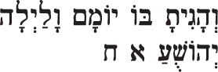
>
> “…你应当昼夜思想这本律法……”
>
> *—约书亚书 1:8*

# 前言

本书旨在介绍不断发展的在线凸优化（OCO）理论。它被编写成一本高级教材，作为研究生课程的基础，和/或作为深入研究优化与机器学习交叉领域这一迷人世界的研究者的参考书。

此类课程曾于 2010–2014 年间在以色列理工学院（Technion）授课，每年的内容略有不同；随后于 2015–2020 年间在普林斯顿大学授课。这些课程的核心内容在书中得到了充分涵盖，并配有练习题，允许学生完成部分证明，或者被上课的学生认为具有启发性和发人深省。大部分内容都结合了应用示例，这些示例穿插在各个主题中。这些包括基于专家建议的预测、投资组合选择、矩阵完成和推荐系统，以及支持向量机（SVM）训练。

我们希望这份材料和练习汇集对你有所帮助：研究人员和/或教育者。

## 机器学习库中的定位

机器学习这一广阔领域，以及在线学习、提升法（boosting）、游戏中的遗憾最小化、通用预测等其他相关子领域，近年来出现了大量的初级教材。通过此说明，我们很难涵盖所有这些著作，但或许可以指出与机器学习、游戏学习和优化主题最相关的书籍，这些领域的交汇正是我们的主要关注点。

最相关的书籍是本书的灵感来源，实际上也是整个游戏学习领域的灵感来源，是 Cesa-Bianchi 和 Lugosi (2006) 的精彩著作。在数学优化理论的文献中，有许多关于凸优化和凸分析的入门论文，仅列举几个（Boyd and Vandenberghe 2004; Nesterov 2004; Nemirovski and Yudin 1983; Nemirovski 2004; Borwein and Lewis 2006; Rockafellar 1997）。作者热心地推荐他学习数学优化理论的教材（Nemirovski 2004）。关于机器学习的更广泛教材多到无法在此列举。

本书的主要目的是作为 OCO 和基于凸优化的机器学习专门课程的教育性教材。OCO 的影响力已经足以出现在几篇综述和介绍性文本中（Hazan 2011; Shalev-Shwartz 2011; Rakhlin 2009; Rakhlin and Sridharan 2014）。我们希望这些材料和练习的汇编能进一步丰富文献。

## 书的结构

本书旨在为计算机科学/电气工程/运筹学/统计学及相关领域的研究生提供自包含课程的参考。因此，其组织结构遵循了以色列理工学院教授的“决策分析”课程，以及随后在普林斯顿大学教授的“理论机器学习”课程。

每个章节预计将占据一到两周的课程时间，取决于预期课程的深度和广度。第 1 章设计为该领域的入门，因此其严谨性低于书中其他部分。

粗略来说，这本书可以看作三个单元。第一部分从第 2 到第 4 章，包含了 OCO 的基本定义、框架和核心算法。第 5 到第 7 章包含了更高级的算法以及对框架及其向其他计算和信息访问模型扩展的深度分析。其余部分涉及更高级算法、更复杂的设置以及与机器学习范式的联系。

## 第二版的新内容

这本书可以协助教育者设计一门关于 OCO 的完整课程，或者作为机器学习课程的一部分。

第二版的主要新增包括：

*   扩展了第 2 章关于优化的内容，增加了对 `Polyak` 步长的分析。
*   扩展了第 9 章关于学习理论的内容，增加了压缩及其在泛化中的应用。
*   扩展了第 4 章，增加了对指数凹函数的讨论。
*   修订了第 5 章，增加了对镜像下降的分析，以及对自适应梯度方法的修订。
*   新增第 10 章，关于自适应遗憾的概念以及具有近优自适应遗憾的算法。
*   新增第 11 章，关于提升法及其与 OCO 的关系。从遗憾最小化推导出提升算法。
*   新增第 13 章，关于 `Blackwell` 可接近性及其与 OCO 的强有力联系。

此外，修复了许多拼写错误，修正了练习题，并为教育者提供了若干问题的解答。

# 致谢

## 第一版

首先，我由衷感谢 2010–2014 年在以色列理工学院“决策分析”课程的学生提供的众多贡献和见解，以及 2015–2016 年在普林斯顿大学的“理论机器学习”课程的学生。

我想感谢许多提供许多建议和修正的朋友、同事和学生。部分名单如下：Sanjeev Arora, Shai Shalev-Shwartz, Aleksander Madry, Yoram Singer, Satyen Kale, Alon Gonen, Roi Livni, Gal Lavee, Maayan Harel, Daniel Khasabi, Shuang Liu, Jason Altschuler, Haipeng Luo, Zeyuan Allen-Zhu, Mehrdad Mahdavi, Jaehyun Park, Baris Ungun, Maria Gregori, Tengyu Ma, Kayla McCue, Esther Rolf, Jeremy Cohen, Daniel Suo, Lydia Liu, Fermi Ma, Mert Al, Amir Reza Asadi, Carl Gabel, Nati Srebro, Abbas Mehrabian, Chris Liaw, Nikhil Bansal, Naman Agarwal, Raunak Kumar, Zhize Li, Sheng Zhang, Swati Gupta, Xinyi Chen, Liang Zeng, 和 Kunal Mittal。

感谢 Udi Aharoni 为书中描述算法提供的艺术作品和插图。

我永远感谢我的老师和导师 Sanjeev Arora；没有他，这本书就不可能出版。

最后，我感谢妻子和孩子们的爱与支持：Dana, Hadar, Yoav 和 Oded。

Elad Hazan

普林斯顿大学

## 第二版

我非常感谢在研究中与我合作的同事和同事们，其中部分内容收录在本书的第二版中。值得注意的是，这包括了我在提升算法（boosting methods）方面的合作者，包括 Nataly Brukhim、Xinyi Chen、Shay Moran、Naman Agarwal 和 Karan Singh。

感谢帮助我校对新章节和现有章节的学生们：Edgar Minasyan, Paula Gradu, Karan Singh, Nataly Brukhim, Xinyi Chen, Naman Agarwal 和 Udaya Ghai。

感谢 Shay Moran 为我解释了压缩方案以及它们如何简化提升算法的泛化。

我诚心感谢 Ahmed Farah、Charlie Cowen-Breen 以及 `COS 597C: Computational Control Theory` 学生的帮助，他们提供了许多有用的建议、修正以及对许多习集的解答。

我非常感谢 Wouter Koolen-Wijkstra 在分析 `Online Newton Step` 算法时提供的有用建议。

我感谢 MIT 出版社找到极其专业且严谨的审稿人，他们提供了极佳的建议并改进了最终稿。

与第一版一样（甚至如此），我感谢妻子和孩子们的爱与支持：Dana, Hadar, Yoav 和 Oded。

Elad Hazan

普林斯顿大学

- `3.1` [OGD：迭代 `x[t+1]` 通过沿当前梯度 `∇f[t]` 的方向推进 `x[t]` 并投影回 𝒦得到](#chapter_3.xhtml#fig3-1)
- `7.1` `CG` 算法的进展方向
- `10.1` [工作集 `S[t]` 的说明](#chapter_10.xhtml#fig10-1)

# 符号列表

## 通用

- `pgix-in-1.png`

## 几何与微积分

## 学习理论

- `𝒳`, `Y`: 特征/标签集
- `𝒟`: 样本 `x`, `y` 的分布
- `ℋ`: `𝒳 ↦ Y` 中的假设类
- `m`: 训练集大小
- `error(h)`: `h` ∈ ℋ 的泛化

## 优化

- `x`: 决策集中的向量
- 𝒦: 决策集
- `∇^(k)f`: `f` 的第 k 阶微分；注意 `∇^(k)f ∈ ℝ^d`
- `∇^(-2)f`: `f` 的逆海森矩阵
- `∇f`: `f` 的梯度
- `∇f[t]`: `f` 在点 `x[t]` 处的梯度
- `x^(⋆)`: `f` 的全局或局部最优解
- `h[t]`: 最优性的目标值距离，`h[t] = f(x[t]) − f(x^(⋆))`
- `d[t]`: 到最优性的欧几里得距离，`d[t] = ∥x[t] − x^(⋆)∥`
- `G`: 次梯度范数的上界
- `D`: 欧几里直径的上界
- `D[p]`, `G[p]`: p 范数/直径的上界

## 正则化

- `R`: 强凸且光滑的正则函数
- `B_R`: R-Bregman 散度 `R(x) − R(y) − ∇R(y)^⊤(x − y)`
- `G_R`: (次)梯度范数的上界
- `D_R²`: R 直径的平方最大 `max_{x,y∈𝒦}{R(x) − R(y)}`
- `∥x∥_A²`: 矩阵范数的平方 `x^⊤Ax`
- `∥x∥_y²`: 根据局部正则化的局部范数 `x^⊤∇²R(y)x`
- `∥x∥_*`: `∥x∥` 的对偶范数

# 1 引言

本书将*优化视为一个过程*。在许多实际应用中，环境极其复杂，因此无法建立一个全面的理论模型并使用经典的算法理论和数学优化。因此，采取一种稳健的方法，即应用一种随着观察到的问题方面增加而不断学习的优化方法，既是必要的也是有益的。这种将优化视为过程的观点在各个领域变得突出，并在建模和系统方面取得了巨大的成功，这些现在已成为我们日常生活的一部分。

机器学习、统计学、决策科学和数学优化领域日益增长的文献模糊了确定性建模、随机建模和优化方法论之间的经典区别。我们在书中继续这一趋势，研究一个显著的优化框架，其在数学科学中的精确位置尚不明确：*在线凸优化*（OCO）框架，该框架首次在机器学习文献中定义（见本章第 1.4 节）。其成功标准源自博弈论，而该框架与统计学习理论和凸优化紧密相关。

## 1.1 在线凸优化

在 OCO 中，在线玩家迭代地做出决策。在每次决策时，与其相关的可能或结果对玩家来说是未知的。

做出决策后，决策者会遭受损失：每个决策都会产生（不同的）损失。这些损失在事先是未知的。损失可以被对抗性地选择，甚至取决于决策者所采取的行动。

在这个阶段，为了使该框架具有意义，某些限制是必要的：

*   不允许对手确定的损失是无界的。否则，对手可以不断缩小每一步损失的规模，使算法无法从第一步的损失中恢复。

OCO 框架可以被看作是一个结构化的重复游戏。该学习框架的协议如下。

在迭代 `t` 时，在线玩家选择 `x[t] ∈ 𝒦`。在玩家对此选择承诺后，一个凸代价函数 `f[t] ∈ ℱ: 𝒦 ↦ ℝ` 会被揭示。这里，`ℱ` 是对抗者可用的有界代价函数族。在线玩家所遭受的代价为 `f[t](x[t])`，即该代价函数对于选择 `x[t]` 的取值。令 `T` 表示游戏迭代的总次数。

什么样的特质能使使一个算法成为良好的 OCO 算法？由于该框架在本质上是博弈论和对抗性的，适当的性能指标也源于博弈论：将决策者的**遗憾值**（regret）定义为其所遭受的总代价与事后最佳固定决策所遭受的代价之间的差。在 OCO 中，我们通常关注算法在最坏情况下遗憾值的上界。

设 `𝒜` 为一个用于 OCO 的算法，它将特定的游戏历史映射到决策集中的一个决策：


我们正式定义算法 `𝒜` 在 `T` 次迭代后的遗憾值为：

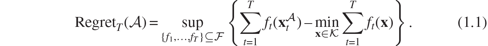

如果算法从上下文中明确，我们从此后省略上标，并将算法在时刻 `t` 的决策简单记为 `x[t]`。直观地说，如果算法的遗憾值关于 `T` 的函数是亚线性的（即 `Regret_T = o(T)`），则该算法表现良好，因为这意味着平均而言，该算法的表现与事后最佳固定策略一样。

OCO 算法的运行时间定义为：在 `T` 次迭代的重复游戏中，对于迭代 `t ∈ [T]`，产生 `x[t]` 所需的最坏情况期望时间。通常情况下，运行时间将取决于 `n`（决策集 𝒦 的维度）、`T`（游戏迭代的总次数）以及代价函数和底层凸集合的参数。

## 1.2 可通过在线凸优化建模的问题示例

也许 OCO 近年来成为领先的在线学习框架的主要原因在于其强大的建模能力：来自不同领域的问题，如在线路由、搜索引擎的广告选择和垃圾邮件过滤，都可以被建模为特例。在本节中，我们将简要介绍几个特例以及它们如何拟合到 OCO 框架。

### 1.2.1 基于专家建议的预测

预测理论中最广为人知的问题可能是“**专家问题**”（experts problem）。决策者必须在给定的 `n` 个专家的建议中做出选择。做出选择后，会产生一个 0 到 1 之间的损失。这种场景会反复迭代，在每次迭代中，各个不同专家的代价都是任意的（甚至可能是对抗性的，试图误导决策者）。决策者的目标是表现得与事后最佳专家一样好。

OCO 问题将此捕捉为一个特例：决策集是所有在 `n` 个元素（专家）上分布的集合。设第 `i` 个专家在迭代 `t` 时的代价为 `g[t,i]`，令 `g[t]` 为所有 `n` 个专家的代价向量。那么代价函数就是根据分布 `x` 选择专家的期望代价，由线性函数 `f[t](x) = g[t]^⊤x` 给出。

因此，基于专家建议的预测是 OCO 的特例，其中决策集是单纯形，且代价函数是线性且有界的，在 `ℓ_∞` 范数下最多为 1。代价函数的界限源于代价向量 `g[t]` 的元素。**专家问题**在机器学习中的基础重要性值得特别关注，我们将在最后回到并对其进行分析。

### 1.2.2 在线垃圾过滤

考虑一个在线垃圾过滤系统。不断有邮件进入系统并被分类为垃圾邮件或有效。这种 OCO 变体是根据词汇表对邮件进行表示。每封邮件表示为一个向量 `a ∈ ℝ^d`，其中 `d` 是词汇的数量。为了预测邮件是否为垃圾邮件，我们学习一个滤波器 `x ∈ ℝ^d`。通常，运行时间取决于 `x` 的欧几里得范数，最大为 1。在 OCO 模型中，决策集被取为此类分布的集合，代价函数是根据对抗生成的邮件及其标签（可能是已知的，也可能是未知的）。邮件 `a ∈ ℝ^d` 通过滤波器 `x ∈ ℝ^d` 的内积给出 `a^⊤x`。

因此，在线垃圾过滤是 OCO 的特例，其中决策集是单纯形，且代价函数是线性且有界的，在 `ℓ_∞` 范数下最多为 1。代价函数的界限源于代价向量 `g[t]` 的元素。设 `(a, b)` 为邮件/标签对。那么，对应的代价函数 `f(x)` 给出 `f(x) = (b − a^⊤x)^2`。在此处，读者可能会问：为什么使用平方损失？首先注意到，如果 `b` 和 `x` 都是二元的（{-1, 1}），那么平方损失确实是 1。然而，转向连续函数允许更大的灵活性。例如，我们可以允许算法返回 `[-1, 1]` 区间内的数值，取决于其置信度。

### 1.2.3 在线最短路径

在在线最短路径问题中，决策者被给定一个有向图 `G = (V, E)` 和一对源汇点 `u, v ∈ V`。在每次迭代 `t ∈ [T]` 中，决策者选择一条路径 `p[t] ∈ 𝒫[u,v]`，其中 `𝒫[u,v] ⊆ E^(|V|)` 是图中所有 `u-v` 路径的集合。对抗者独立地选择边的权重（长度），由从边到实数的函数 `w[t]: E ↦ ℝ` 给出，这可以表示为向量 `w[t] ∈ ℝ^m`，其中 `m = |E|`。决策者遭受并观察到一个损失，即所选路径的加权长度 `∑_{e∈p[t]} w[t](e)`。

将此问题的离散描述为专家问题（即每条路径一个专家）面临着效率挑战。相对于图表示的大小，路径的数量可能是指数级的。

另一种方法，在线最短路径问题可以如下转化为 OCO 框架。回想图中所有路径分布（流）的标准描述，其定义为 `ℝ^m` 中的一个凸集，具有 `O(m + |V|)` 个约束。将此流多胞体命名为 `ℒ`。对于给定流 `x ∈ ℒ`（路径分布）的期望代价是一个线性函数，由 `f[t](x) = w[t]^⊤x` 给出，其中如之前定义的，`w[t]` 是边 `e ∈ E` 的长度。这种本质简洁的表述导致了计算高效的算法。

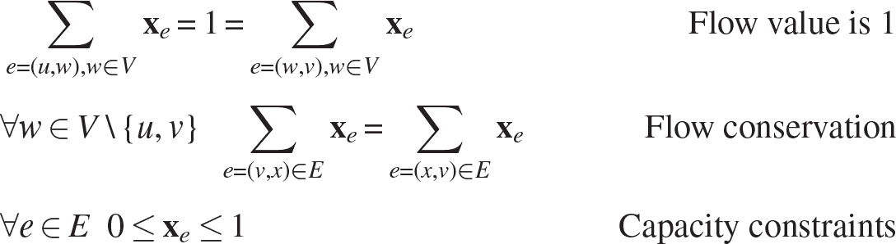

图 1.1 定义流多形的线性等式和不等式，它是所有 `u`-`v` 路径的凸包

### 1.2.4 投资组合选择

在本节中，我们考虑一种对股票市场不做任何统计假设的组合选择模型（与标准的股票几何布朗运动模型不同），该模型被称为`通用组合选择`模型。

在每次迭代 `t ∈ [T]` 中，决策者选择其财富在 `n` 种资产上的分布 `x[t] ∈ Δ[n]`。对手者独立地选择资产的市场收益率（即一个分量严格正的向量 `r[t] ∈ ℝ^n`，其中每个坐标 `r[t,i]` 是迭代 `t` 和 `t + 1` 之间第 `i` 种资产的价格比例）。投资者在迭代 `t + 1` 和 `t` 之间的财富之比为 `∑_{i=1}^n x[t,i] r[t,i]`，因此在此设定下的收益被定义为财富变化率的对数 `ln(∑_{i=1}^n x[t,i] r[t,i])`。注意，由于 `x[t]` 是投资者财富的分布，即使 `x[t+1] = x[t]`，投资者可能仍需要交易以调整价格变化。

遗憾最小化的目标（在这种情况下对应于最小化 `∑_{t=1}^T ln(∑_{i=1}^n x^(⋆)_i r[t,i]) − ∑_{t=1}^T ln(∑_{i=1}^n x[t,i] r[t,i])` 的差异）具有直观的解释。第一项是事后来看最佳可能分布 `x^(⋆)` 所积累财富的对数。由于该分布是固定的，它对应于在每个交易周期后重新平衡仓位的策略；因此，它被称为`等再平衡投资组合`。第二项是在线决策者所积累财富的对数。因此，遗憾最小化对应于使投资者财富与投资策略池中最佳基准财富的比率最大。


# 1.2.5 矩阵补全与推荐系统

Netflix、Spotify 等许多大型媒体分发系统的普及，催生了大规模的推荐系统。自动推荐最流行且最成功的模型之一是矩阵补全模型。在这个数学模型中，推荐被看作是一个矩阵的补全问题。客户用行表示，各种媒体用列表示，在对应特定用户/媒体对的元素处，我们有一个衡量该用户对该特定媒体偏好的评分。

例如，对于音乐的二值推荐情况，我们有一个矩阵 `X ∈ {0, 1}^(n×m)`，其中 `n` 是被考虑的人数，`m` 是我们库中歌曲的数量，0 和 1 分别表示不喜欢和喜欢。

在在线设定下，对于每次迭代，决策者输出一个偏好矩阵 `X[t] ∈ 𝒦`，其中 `𝒦 ⊆ {0, 1}^(n×m)` 是所有可能的 0/1 矩阵的子集。随后，对手选择一个用户/歌曲对 `(i[t], j[t])` 以及对该对的“真实”偏好 `y[t] ∈ {0, 1}`。因此，决策者经历的损失可以用凸损失函数描述：


这种场景下的自然比较基准是低秩矩阵，这对应于一种直观的假设，即偏好由少数未知因素决定。相对于该比较基准的遗憾意味着，平均而言偏好预测错误次数与最佳低秩矩阵一样少。

我们将在第 7 章回到这个问题并探索其高效的算法。

# 1.3 温和开始：从专家建议中学习

考虑以下基础的迭代决策问题。

在每个时间步 `t = 1, 2, …, T` 中，决策者面临两个动作 `A` 或 `B` 之间的选择（即买入或卖出某只股票）。决策者有 `N` 个“专家”提供帮助，他们提供建议。在两个动作之间做出选择后，决策者会收到与每个决策相关的损失形式的反馈。为了简单起见，其中一个动作的损失为零（即“正确”决策），另一个的损失为 1。

我们有以下基本观察：

1. 一个在每次迭代中均匀随机选择动作的决策者，显而易地获得 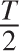 的损失，并在 50% 的时间内是“正确的”。
2. 从错误次数的角度来看，没有算法在最坏情况下能做得更好！在随后的练习中，我们将设计一个随机设定，其中预期错误次数至少 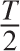。

因此，我们想要考虑一种`相对性能指标`：决策者犯的错误能像事后最佳专家一样少吗？定理 1.1 显示对于确定性决策者的答案是否定的。

**定理 1.1** *令 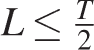 表示最佳专家的错误次数。那么不存在能够保证错误少于 L 的确定性算法。*

*证明。* 假设只有两个专家，一个总是选择 `A`，而另一个总是选择 `B`。考虑对手总是选择我们预测相反的设定（因为我们的算法是确定性的）。那么，算法犯的错误总数为 T。然而，最佳专家的错误次数不超过 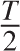（在每次迭代中，两个专家中恰好有一个是错的）。因此，这是可能的。

☐

这一观察激励了随机决策算法的设计，事实上，OCO 框架优雅地模拟了连续概率空间上的决策。下面，我们证明引理 1.1 和 1.2，它们展示了以下内容：

**定理 1.2** *令 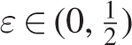。假设最佳专家犯了 L 次错误。那么：*

1. 存在一种高效的确定性算法，可以保证错误少于 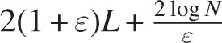；
2. 存在一种高效的随机算法，其预期错误次数最多为 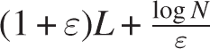。

## 1.3.1 加权多数算法

加权多数（WM）算法的描述非常直观：在每次迭代 `t` 中，每个专家 `i` 被分配一个权重 `W_t`。初始，我们对所有专家 `i ∈ [N]` 设置 `W_1 = 1`。对于所有 `t ∈ [T]`，令 `S_t, S'_t ⊆ [N]` 为在时间 `t` 选择 `A`（相应的为 `B`）的专家集合。定义


并根据

 进行预测

接下来，如下更新权重 `W_t`：


其中 `ε` 是影响算法性能的参数。这结束了 WM 算法的描述。我们开始界定它犯的错误次数。

**引理 1.1** *用 `M_t` 表示算法到时间 t 犯的错误次数，用 `m_t^i` 表示专家 i 到时间 t 犯的错误次数。那么，对于任意专家 `i ∈ [N]`，有*


我们可以通过优化 `ε` 来最小化这个界。右侧的表达式形式为 `f(x) = ax + b/x`，它在 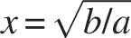 处取得最小值。因此，该界在 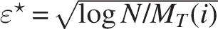 处最小。使用这个 `ε` 的最优值，我们得到对于最佳专家 `i^⋆`：


当然，这个 `ε^⋆` 值无法提前使用，因为我们无法提前知道哪个专家是最佳选择的（因此我们不知道 `M_T` 的值）。然而，我们稍后会看到，即使没有这些先验知识，也可以获得相同的渐近界。

现在让我们证明引理 1.1。

*证明*。假设对于所有 `t ∈ [T]`，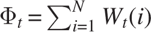，并注意 `Φ_1 = N`。

注意 `Φ_{t+1} ≤ Φ_t`。然而，在 WM 算法出错的迭代中，我们有


原因是具有至少一半总权重的专家是错误的（否则 WM 不会出错），因此


从这两个观察结果中可以得到


另一方面，根据定义，对于任何专家 `i`，我们有

由于 `W_T^i` 的值始终小于所有权重之和 `Φ_T`，我们得出


对两边取对数，我们得到


接下来，我们使用近似式


这些式来源于对数函数的泰勒级数，以得到


引理得证。

☐

## 1.3.2 随机加权多数算法

在 WM 算法的随机版本中（记作 `RWM`），我们在时间 `t` 以概率 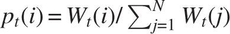 选择专家 `i`。

**引理 1.2** *令 `M_t` 表示 RWM 直到迭代 t 为止犯的错误次数。那么，对于任何专家 `i ∈ [N]`，我们有*


该引理的证明与引理 1.1 非常相似，通过使用随机性节省了因子 2。

*证明*。与之前一样，假设对于所有 `t ∈ [T]`，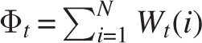，并注意 `Φ_1 = N`。令 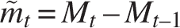 为指示变量，当 RWM 算法在迭代 `t` 上出错时其值为 1。如果第 `i` 个专家在迭代 `t` 上出错，则 `m_t^i` 等于 1，否则为 0。检查权重之和，我们得到

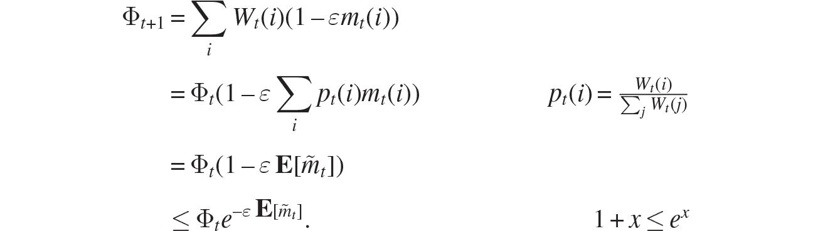

另一方面，根据定义，对于任何专家 `i`，我们有

由于 `W_T^i` 的值始终小于所有权重之和 `Φ_T`，我们得出


对两边取对数，我们得到


接下来，我们使用近似式


得到


引理得证。

☐

## 1.3.3 Hedge 算法

RWM 算法实际上更通用：我们不是考虑离散的错误次数，而是通过非负实数 `ℓ_t^i` 来考虑专家的性能，我们认为这是专家 `i` 在迭代 `t` 上的损失。RWM 算法保证遵循其建议的决策者所遭受的期望损失将接近事后最佳专家的损失。在历史上，这种现象是由另一个与之密切相关的算法 `Hedge` 观察到的，它的总损失将令我们感兴趣。


此后，用向量符号表示算法的期望损失为


**定理 1.3** *令 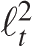 表示 N 维平方损失向量（即 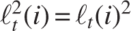，令 `ε > 0`），并假设所有损失非负。Hedge 算法对于任何专家 `i^⋆ ∈ [N]` 满足以下条件：*


*证明*。与之前一样，假设对于所有 `t ∈ [T]`，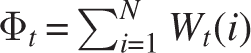，并注意 `Φ_1 = N`。

检查权重之和：

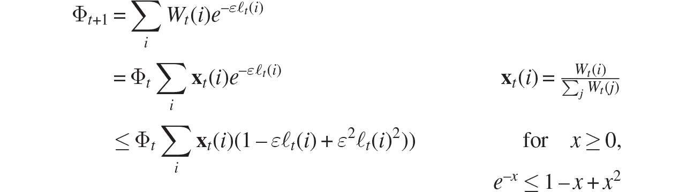


另一方面，根据定义，对于专家 `i^⋆`，我们有

由于 `W_T^{i^⋆}` 的值始终小于所有权重之和 `Φ_T`，我们得出

对两边取对数，我们得到

定理得证。

☐

# 1.4 文献回顾

OCO 模型最早由 Zinkevich (2003) 定义，并自那时在机器学习领域被广泛应用。大量工作一直致力于改进初始界，并将其扩展为有限反馈的完整框架。该框架是 OCO 的一个扩展，称为老虎凸优化（BCO）。我们将文献回顾推迟到第 6 章。

从专家建议的问题由 Littlestone 和 Warmuth (1989, 1994) 提出，WM 算法是其著名的例子之一（见 Hazan et al. 2011）。

在其有影响力的论文中，Awerbuch 和 Kleinberg (2008) 提出了 OCO 在在线路由中的应用。该模型后来出现了许多扩展，包括交易成本的（Blum and Kalai 1999）以及与几何朗运动的关系（Hazan and Kale 2009）。

# 1.5 练习题

1. （归于香农）

   构造两个股票的回率，使得任何单个股票积累的财富都呈指数级下降，而最佳常再平衡组合却呈指数级增长。具体地说，构造两个范围在 `(0, ∞)` 内的序列，使得：

   **(a)** 投资任何一个股票都会导致财富呈指数级下降。这意味着每个序列中数字的前缀积呈指数级下降。

   **(b)** 在两个资产上平均投资并在每次迭代后重新平衡，财富呈指数级增长。

2. **(a)** 考虑一个损失在正实数 `G > 0` 之间的专家问题。给出一个算法，其期望损失上限为 ，对于尽可能小的常数 `c`。（常数 `c` 应独立于迭代次数 `T` 和专家数量 `N`。）

   **(b)** 假设上界 `G` 不预知。给出一个算法，其性能与 (a) 部分的算法渐近相同，仅差一个独立于 `T, N, G` 的加法和/或乘法常数。

3. 考虑一个损失在 `[-1, 1]` 范围内的实数的专家问题。给出一个具有 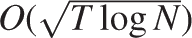 保证的算法，并证明你的论点。

# 第 2 章 凸优化基础

在本章中，我们将对凸优化进行简要介绍，并给出一些求解凸数学规划的基本算法。虽然离线凸优化不是我们的主要课题，但在转向在线凸优化（OCO）之前，回顾一下基本定义和结果是有用的。这将有助于评估 OCO 的优势和局限性。此外，我们还将描述一些以后将成为我们赖以生存的工具。

本章的内容并非新颖。已经存在大量且详尽的文献，读者可以参阅本章末尾的参考文献获取其他优秀资源。我们在这里只给出最基础的分析，并侧重于以后我们会有用的技术。

## 2.1 基础定义与设定

本章的目标是在欧几里得空间的一个凸子集上最小化连续凸函数。从此起，令 `K ⊆ R^d` 是欧几里得空间中的一个有界、凸闭集。我们用 `D` 表示 `K` 直径的上界：


如果对于任意 `x, y ∈ K`，连接 `x` 和 `y` 的线段上的所有点也属于 `K`，则集合 `K` 是凸集。即，


如果对于任意 `x, y ∈ K`，

函数 `f: K → R` 是凸函数，则


该不等式及其推广形式也称为*詹森不等式*（Jensen’s inequality）。等价地，如果 `f` 是可微的（即对于所有 `x ∈ K`，其梯度 `∇f(x)` 存在），则它是凸的当且仅当 `∀ x, y ∈ K`：


对于凸且不可微函数 `f`，`x` 处的次梯度定义为向量集合 `{∇f(x)}` 中的任意成员，该向量对所有 `y ∈ K` 均满足上述条件。

我们用 `G > 0` 表示 `f` 在 `K` 上次梯度范数的上界（即对于所有 `x ∈ K`，`‖∇f(x)‖ ≤ G`）。这种上界意味着函数 `f` 是关于参数 `G` 的 Lipschitz 连续的。即，对于所有 `x, y ∈ K`，


优化和机器学习文献研究具有有用性质的特殊凸函数，这反过来允许更高效的优化。特别，我们说一个函数是 `α`-强凸的，如果


一个函数是 `β`-平滑的，如果


后一个条件等价于梯度的 Lipschitz 条件。即，


如果函数是二阶可微的并允许二阶导数（对于多元函数，称为*海森矩阵*（Hessian）），则这些条件等价于对海森矩阵的以下条件，记为 `∇²f(x)`：


其中，如果矩阵 `B - A` 是正定的（PSD），则 `A ⪯ B`。

当函数 `f` 既是 `α`-强凸的又是 `β`-平滑的时，我们说它是 `γ`-良好的，其中 `γ` 是强凸性和平滑性之间的比例，也称为 `f` 的*条件数*（condition number）：


### 2.1.1 凸集的投影

在接下来的算法中，我们将使用凸集的投影，它定义为在欧几里得距离上，凸集内部距离给定点最近的点。形式上，


当上下文明显时，我们将去掉 `K` 下标。证明给定点在闭、有界且凸集上的投影存在且唯一留给读者练习。

投影的计算复杂度是一个微妙的问题，很大程度上取决于 `K` 本身的特征。最一般地，`K` 可以由成员查询表示——一种能够判断给定 `x` 是否属于 `K` 的高效程序。在这种情况下，投影可以在多项式时间内计算。在某些特殊情况下，投影可以在近线性时间内非常高效地计算。投影的计算成本以及完全避免投影的优化算法将在第 7 章中讨论。

我们将广泛使用的一个投影的关键属性由勾股定理表示，为了完整性，我们在此列出。

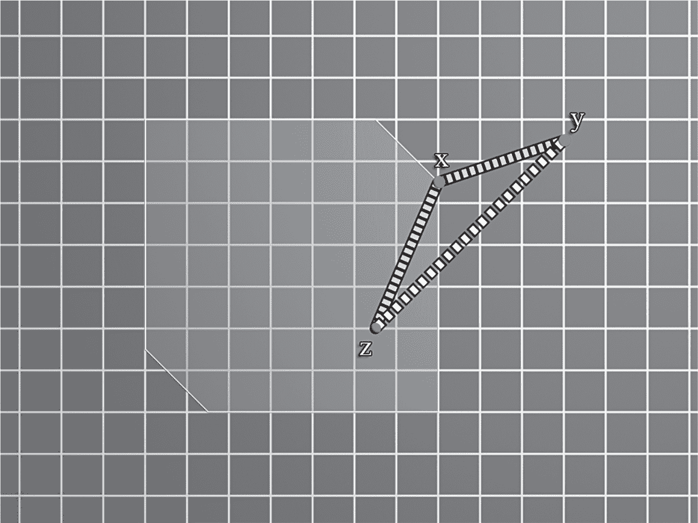

**定理 2.1 (毕达哥拉斯，公元前 500 年)** *令* `K ⊆ R^d` *为凸集，其中* `y ∈ R^d` *且* `x = Π_K(y)`。*那么对于任意* `z ∈ K`：


勾股定理对于...仍然有效

### 2.1.2 最优性条件简介

高中的标准课程包含了主要事实，即推广到多个维的情况是*卡罗什-库恩-塔克*（Karush-Kuhn-Tucker，KKT）条件。对于我们的目的，我们简要且直观地描述所需的事实。自然地，可能有许多点使函数最小化，因此我们引用给定函数的最小值集，记为 `arg min`。可微函数在 `R` 上的最小点是其导数为零点的这一推广由：


对于约束优化，我们需要一个稍微更一般但同样直观的事实：在凸函数的最小值处，负梯度与指向 `K` 内部方向的内积非正。这在图中所示，图中显示了 `K` 的支撑超平面。直觉是，如果内积为正，则可以通过沿负梯度方向移动来改进目标。这一事实在定理中正式给出。

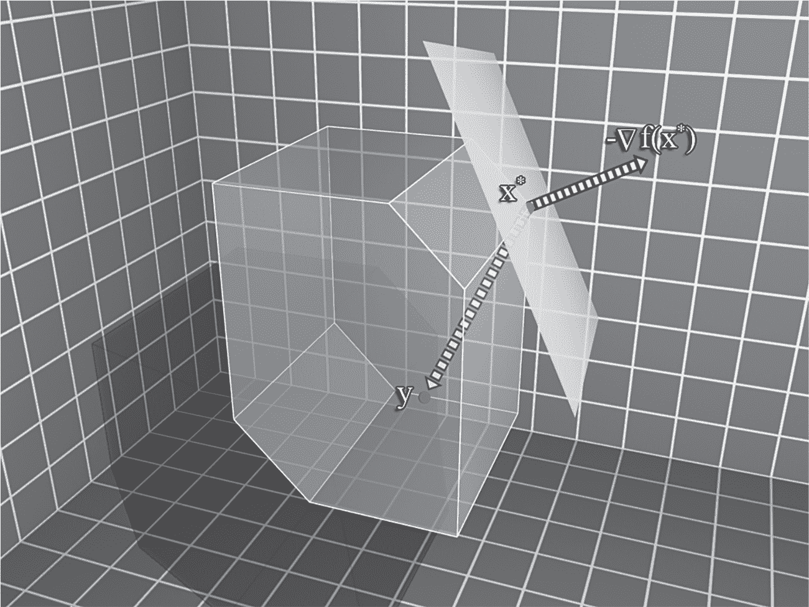

**定理 2.2 (卡罗什-库恩-塔克/KKT)** *令* `K ⊆ R^d` *为凸集，`x* ∈ arg min_{x ∈ K} f(x)`。*那么对于任意* `y ∈ K` *我们有*


## 2.2 梯度下降

梯度下降（GD）是优化方法中最简单、最老的。它是一种*迭代方法*——优化过程通过迭代进行，每次迭代改进目标值。基本方法等同于迭代地沿梯度方向移动当前点，如果梯度是显式给出的，这是一个线性时间操作（事实上，对于许多函数，计算某点的梯度是一个简单的线性时间操作）。

无约束优化的基本模板算法所示，其产生的迭代在图中所示。

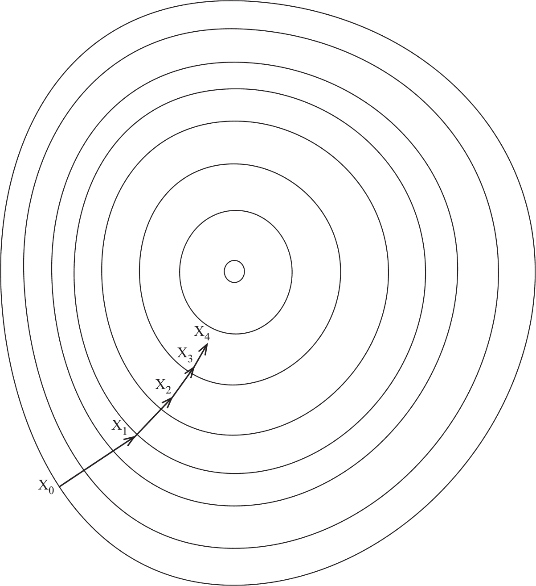

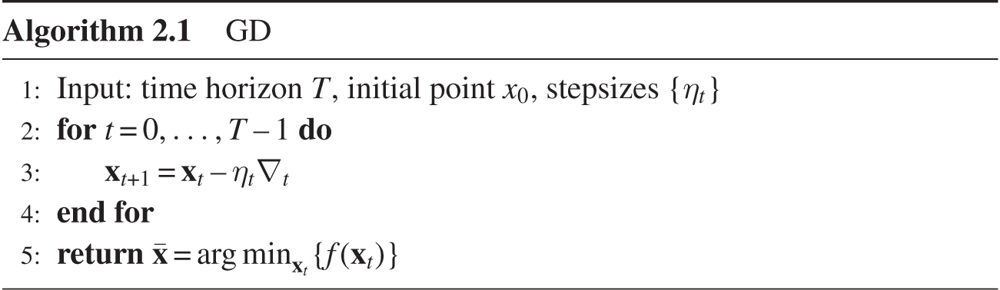

对于凸函数，总是存在一种步长选择，使 `GD` 收敛到最优解。然而，收敛速度差异巨大，这取决于目标函数的光滑性和强凸性性质。表 2.1 总结了具有不同凸性参数的凸函数下 `GD` 变体的收敛率。所描述的收敛率省略了界限中的（通常很小的）常数——我们关注的是渐近收敛率。

**表 2.1** 一阶（基于梯度的）方法随迭代次数以及目标函数的光滑性和强凸性的收敛率


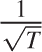

省略了对其他参数和常数（即 Lipschitz 常数、约束集直径以及与目标函数的初始距离）的依赖性。通常情况下，非光滑函数的加速是不可能的。

在本节中，我们仅处理表 2.1 的第一行。对于加速方法及其分析，请参见第 2.6 节中的参考文献。

### 2.2.1 Polyak 步长

幸运的是，存在一种简单的步长选择可以产生最优收敛率，被称为 `Polyak 步长`。它的巨大优势是不依赖于目标函数的强凸性和/或光滑性参数。

然而，它确实依赖于函数值到最优值的距离以及梯度范数。虽然后者可以高效地估计，但如果提前未知 `f(x*)`，则到最优的距离并不总是可用。这可以通过参考文献中所提到的方法来解决。

首先，我们将这些元素标记如下：

1. 数值上到最优的距离：`h[t] = h(x[t]) = f(x[t]) - f(x*)`
2. 到最优的欧几里得距离：`d[t] = ||x[t] - x(**)||`
3. 当前梯度范数 `||∇[t]|| = ||∇f(x[t])||`

使用这些符号，我们可以像算法 2.2 所示精确描述该算法。

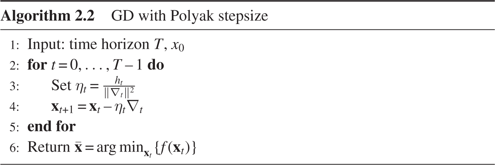

为了证明精确的收敛边界，假设 `||∇[t]|| ≤ G`，并定义如下：


现在我们可以给出带有 Polyak 步长的 `GD` 的主要保证：

**定理 2.3 (带有 Polyak 步长的 GD)** 算法 2.2 在 T 步后保证：


### 2.2.2 测量到最优的距离

在分析梯度方法的收敛性时，使用势函数代替到最优的函数距离（例如梯度范数或欧几里得距离）是有用的。引理 2.1 中的以下关系适用于这些量。

**引理 2.1** 对于空间 `ℝ(d)` 上的 α-强凸函数和/或 β-光滑函数成立以下性质：

1. `(images/pg22-in-1.png)`
2. `(images/pg22-in-2.png)`
3. `(images/pg22-in-3.png)`
4. `(images/pg22-in-4.png)`

*证明。*

1. `(images/pg22-in-5.png)`：

根据强凸性，我们有

`(images/pg22-2.png)`

其中最后一个不等式的成立是因为在全局最优处的梯度为零。

2. `(images/pg22-in-6.png)`：

根据光滑性，

`(images/pg22-3.png)`

其中最后一个不等式的成立是因为在全局最优处的梯度为零。

3. `(images/pg22-in-7.png)`：

利用光滑性，并令 `x[t+1] = x[t] - η∇[t]` 对于 `(images/pg22-in-8.png)`：

`(images/pg23-1.png)`

4. `(images/pg23-in-1.png)`：

对于任意对 `x, y ∈ ℝ(d)`，我们有：

`(images/pg23-2.png)`

特别是，取 `x = x[t]`，`y = x(*)`，我们得到

`(images/eq2-1.png)`

### 2.2.3 Polyak 步长的分析

我们现在准备证明定理 2.3，它直接推自引理 2.2。

**引理 2.2** 假设序列 `x[0], …x[t]` 满足

`(images/eq2-2.png)`

那么，对于算法中定义的 `x`，我们有

`(images/pg23-3.png)`

*证明。* 证明分析了以下几种情况。

1. 对于梯度受 `G` 限制的凸函数，`(images/pg23-4.png)` 对 `T` 次迭代求和，并对 `(images/pg24-in-1.png)` 的 `T` 维向量和 `(h[1], …, h[T])` 使用柯西-施瓦茨不等式，我们有

`(images/pg24-1.png)`

2. 对于受限的光滑函数，根据 `G`，引理 2.1 意味着：

`(images/pg24-2.png)`

3. 对于强凸函数，引理 2.1 意味着：

`(images/pg24-3.png)`

这通过归纳法（3）可见 `(images/pg24-4.png)`：

`(images/eq2-4)`

4. 对于强凸和光滑函数，`(images/pg24-5.png)`。因此，

`(images/pg25-1.png)`

这证明了所有情况。

## 2.3 约束梯度下降

我们考虑的大多数问题包含约束。在本节中，我们描述并分析约束 `GD`。

### 2.3.1 基础 GD——线性收敛

算法 2.3 描述了约束集上的 `GD` 模板。它是一个模板，因为步长序列 `{η[t]}` 是输入参数，算法变体在选择上有所不同。

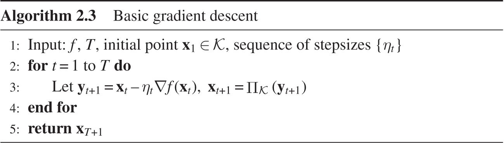

与无约束设置相比，这里我们需要精确设置学习率以获得最优收敛率。

**定理 2.4** 对于 `(images/pg25-in-1.png)` γ-条件良好函数的约束化，算法 2.3 如下收敛：

`(images/pg25-2.png)`

*证明。* 根据强凸性，对于每个 `x`, `x[t] ∈ Ω`，我们有（如前所述用 `∇[t] = ∇f(x[t])`）：

`(images/eq2-3.png)`

接下来，根据算法定义和选择 `(images/pg24-in-1.png)`，我们有

`(images/eq2-4.png)`

要理解这一点，注意

`(images/pg26-1.png)`

因此，我们有

`(images/pg26-2.png)`

只有当我们在子集上取最小值时，最小值才会增长。因此我们可以关注所有 `x[t]` 和 `x(*)` 的凸组合的点，我们用区间 `[x[t], x(*)] = {(1 — μ)x[t] + μx(*), μ ∈ [0, 1]}` 来表示，并写下

`(images/pg26-3.png)`

其中等式是通过将 `x` 写为 `x = (1 — μ)x[t] + μx(*)` 得到的。

因此，将其代入方程 (2.5)，得到

`(images/pg27-1.png)`

这通过归纳法给出了定理陈述。

☐ 向非光滑和非强凸函数的归约

第 2.3 节讨论了 `γ`-良条件函数，这看起来似乎比原始凸性（vanilla convexity）了一个很大的限制。事实上，许多有趣的凸函数既不是强凸的也不是光滑的，正如我们所见，`GD` 的收敛率在这些函数上差异很大。我们已经完成了无约束优化的图景，在本节中，我们将完成有界集的图景。

关于一阶方法的文献非常丰富，有专门的分析探索了 `GD` 对于更一般函数的收敛率。在本文讨论中，我们采取了不同的方法：不是从头开始分析 `GD` 的变体，而是通过归约（reductions）来推导出非强凸光滑函数、非光滑强凸函数、或没有任何进一步限制的泛义凸函数的近优优收敛率。

虽然获得的是次优的收敛界（带有对数因子），但这种方法的优点有两点：首先，归约方法的表述和分析非常简单，其分析过程比从头开始分析 `GD` 要短得多。其次，归约方法是通用的，因此可以按照同样的思路扩展到加速 `GD`（或任何其他一阶方法）的分析。接下来我们转向这些归约。

### 2.4.1 归约到光滑、非强凸函数

我们的第一个归约将 `GD` 算法应用于 `β`-光滑但非强凸的函数。

其思想是对函数 `f` 添加受控的强凸性，然后应用算法 2.3 来优化新函数。解由于添加的强凸性而扭曲，但这种权衡保证了有意义的收敛率。

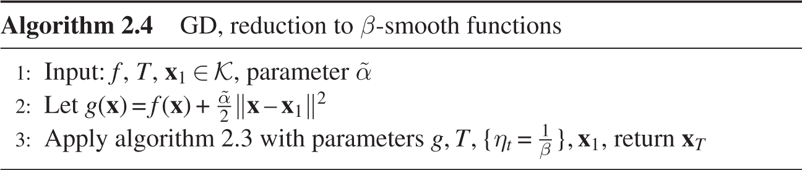

**引理 2.3** 对于 `β`-光滑凸函数，参数为 ``

*证明。* 函数 `g` 是 `images/alpha-tilde.png`-强凸的且 (`β` + `images/alpha-tilde.png`）光滑（参见习题）。因此，它是 `images/pg28-in-2.png`-良条件的。注意到

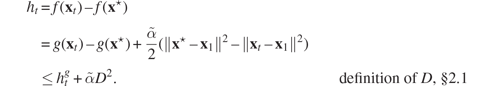

在这里，我们用 `images/pg28-in-3.png`。由于 `g(x)` 是 `images/pg28-in-4.png`-良条件的，

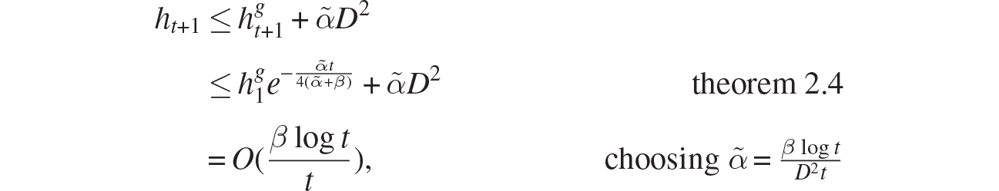

其中我们忽略了常数以及取决于 `D` 和 `images/pg28-in-5.png` 的项。

☐

通过从头分析 `GD` 可以获得更强的 `images/pg28-in-6.png` 收敛率，且这些率已知是紧的。因此，我们的归约在 `O(log T)` 因子上是次优的，正如节开头所述，我们容忍了这一点。

### 2.4.2 归约到强凸、非光滑函数

我们从非光滑函数归约到 `γ`-良条件函数的方法在精神上与上一个小节描述的相似。然而，对于强凸性，得到的率差了一个 `log T` 因子，而在本节中，与凸优化的标准分析相比，我们也会差了一个决策变量 `x` 的维度 `d`。对于紧界，请读者参阅第 2.6 节列出的优秀参考书籍和综述。

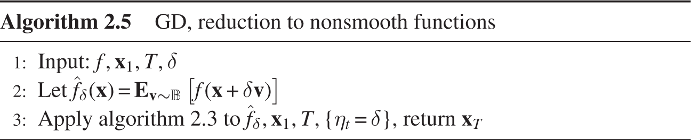

我们将 `GD` 算法 2.1 应用于目标函数的光滑变体。与之前的归约不同，光滑化不能通过简单地添加光滑函数（或其他函数）来实现。相反，我们需要一种平滑操作。我们描述的这种特别简单，等同于对函数取局部积分。还存在更复杂但通用性较差的基于 Moreau-Yoshida 正化的平滑算子（更多细节见参考文献部分）。

令 `f` 为 `G`-Lipschitz 连续且是 `α`-强凸的。对于任何 `δ > 0`，定义为


其中 `𝔹 = {x ∈ ℝ(d): ∥x∥ ≤ 1}` 是欧几得球，`v ∼ 𝔹` 表示从 `𝔹` 上的均匀分布抽取的随机变量。当函数 `f` 在上下文中很明确时，我们以后使用更简单的符号 `images/pg29-in-1.png`。

我们将证明 `images/pg29-in-1.png` 是 `f` 的近优界，即 `images/pg29-in-2.png` 能够收敛于 `f`，对于 `images/pg29-in-3.png`。

**引理 2.4** `images/pg29-in-4.png` 具有以下性质：

1. 若 f 是强凸的，则 `images/pg29-in-5.png`。
2. `images/pg29-in-6.png`。
3. 对于 `x ∈ ℝ(d)`，`images/pg29-in-7.png`。

在证明近优收敛界之前，我们首先完成归约。

**引理 2.5** 对于 `images/pg29-in-8.png`，算法 2.5 收敛如下


我们将证明 `images/pg29-in-10.png` 是 `f` 的近优界，即 `images/pg29-in-11.png` 是光滑的，对于 `images/pg29-in-12.png`。

### 2.4.3 归约到一般凸函数

可以同时应用这两个归约以得到 `images/pg31-in-1.png` 的收敛率。虽然在迭代次数上是近优的，但该界的弱点在于其对维度的依赖。在第 3 节中，我们将展示 `images/pg31-in-2.png` 是一个更通用的在线凸优化算法的直接结果。

## 2.5 示例：支持向量机训练

为了说明梯度下降方法的用处，让我们描述一个在机器学习中备受关注、且可以使用我们刚刚分析的方法高效求解的优化问题。


一种非常基础且成功的学习范式是线性分类模型。在该模型中，学习者被给定某个概念的正样本和负样本。每个示例记为 `a[i]`，它在欧几里得空间中由一个 `d`-维特征向量表示。例如，在垃圾邮件分类问题中，邮件的常见表示是欧几里得空间中的二进制向量，其中空间的维度是该语言中的单词数。第 `i` 封邮件是一个向量 `a[i]`，其分量在对应邮件中出现的单词的坐标处为 1，否则为 0。此外，每个示例都有一个标签 `b[i] ∈ {−1, +1}`，对应邮件是否被标记为垃圾邮件或非垃圾邮件。目标是找到一个超平面来分离这两类向量：具有正标签的向量和具有负标签的向量。如果不存在这样一个能够根据标签完全分离训练集的超平面，那么目标就是找到一个能以最少的错误次数实现训练集分离的超平面。

从数学角度来看，给定一组用于训练的 `n` 个示例，我们寻找 `x ∈ ℝ^d` 使得分类错误的示例数量最小；即：

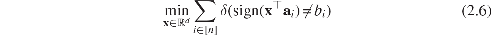

其中 `sign(x) ∈ {−1, +1}` 是符号函数，`δ(z) ∈ {0, 1}` 是指示函数，当条件 `z` 满足时其取值为 1，否则为 0。

这个作为线性分类表述核心的优化问题是 NP-hard 的，事实上，即使对其进行非平凡近似也是 NP-hard 的。然而，在特殊情况下，如果存在一个正确分类所有示例的线性分类器（超平面 `x`），该问题可以通过线性规划在多项式时间内求解。

为了解决不存在完美线性分类器的更一般情况，人们已经提出了各种松化方法。实践中最成功的方法之一是支持向量机（SVM）表述。

软边界 SVM 弛化将方程 (2.6) 中的 0/1 损失替换为一种凸损失函数，称为*合页损失*（hinge loss），公式如下：


在 [图 2.4] 中，我们描述了合页损失如何作为非凸 0/1 损失的凸松化。此外，SVM 表述在损失最小化目标增加了一个正则化 `x` 中元素大小的项。该额外项的原因和意义将在后续章节中讨论。现在，让我们考虑 SVM 凸优化问题：

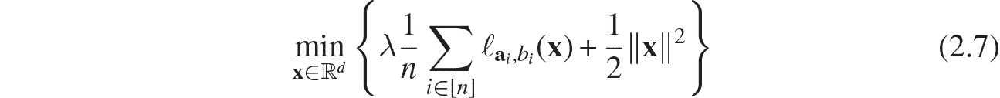

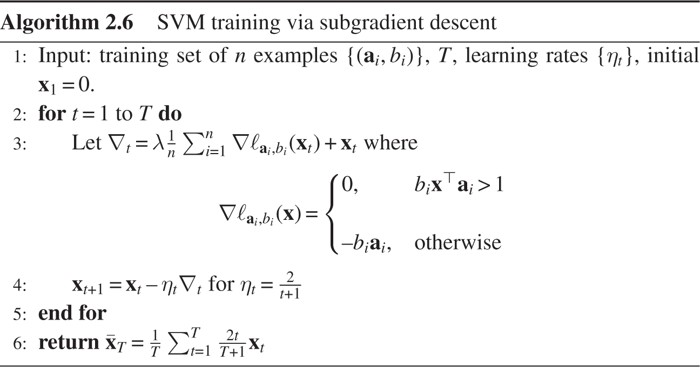

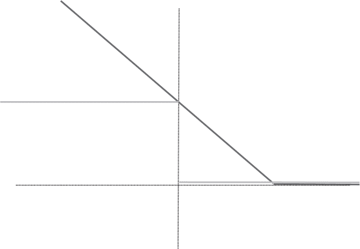

这是一个无约束、非光滑且强凸规划。根据定理 2.3 和 2.5，可以得到 `O(1/ε)` 次迭代以达到 `ε`-近似近解。我们在算法 2.6 中详细说明了将子梯度算法应用于该表述的细节。

注意，学习率未指定，尽管它们可以像定理 2.5 那样显式设置，或通过使用 Polyak 速率来设置。Polyak 速率需要知道最优处的函数值，尽管这是可以松化的。使用 `GD` 求解 SVM 的警告是需要计算全梯度，这可能需要对每次迭代都完整遍历数据。我们将在下一章看到一种更高效的算法。

## 2.6 参考文献备注

建议读者参阅专门的凸优化书籍，以对本章介绍的主题进行更深入的处理。关于凸分析的背景，请参见 Borwein and Lewis (2006) 和 Rockafellar (1997)。Boyd 和 Vandenberghe (2004) 的经典教材提供了广泛的概述。对于详细的证明，参见 Boyd (2014)。对于详细的证明，参见 Nemirovski (2004)。对于详细的证明，参见 Nemirovski and Yudin (1983)。对于详细的证明，参见 Hazan and Kakade (2019)。对于详细的证明，参见 Daniely (2016)。Arora and Barak (2009)。

## 2.7 练习

- **1.** 证明可微函数 `f(x): ℝ→ℝ` 是凸的，当且仅当对于任意 `x, y`，满足 `f(x) − f(y) ≤ (x − y)f'(x)`。

- **2.** 回想，函数 `f : ℝ^d→ℝ` 在 `K ⊆ ℝ^d` 上具有条件数 `γ = α/β`，如果对于所有 `x, y` 满足以下两个不等式：

  (a) 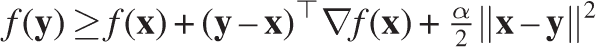

  (b) 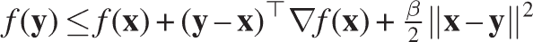

  如果二阶可微且满足 `∇²f(x) ⪰ αI`，则 `f` 在 `K` 上的条件数为 `α/β`。

- **3.** 证明以下结论：

  (a) 凸和是凸的。

  (b) 令 `f` 为 `α1`-强凸且 `g` 为 `α2`-强凸。那么 `f + g` 是 `(α1 + α2)`-强凸。

  (c) 令 `f` 为 `β1`-光滑且 `g` 为 `β2`-光滑。那么 `f + g` 是 `(β1 + β2)`-光滑。

- **4.** 令 `K ⊆ ℝ^d` 为有界且闭集。证明 `K` 的凸性是单元素的充分条件。要证明这是一个必要条件，只需提供反例即可。

- **5.** 考虑 `n`-维单纯形  给出一个计算点 `x ∈ ℝ^n` 到集合 `Δ[n]` 的投影算法（存在近线性时间算法）。

- **6.** 证明以下恒等式：

- **7.** 令 `f(x): ℝ^n→ℝ` 为凸可微函数 `K ⊆ ℝ^n` 为凸集。证明 `x* ∈ K` 是 `f` 在 `K` 上的最小值，当且仅当对于任意 `y ∈ K`，满足 `(y − x*)ᵀ∇f(x*) ≥ 0`。

- **8.** *扩展 Nesterov 加速 GD 算法：* 假设可以黑盒访问 Nesterov 算法，该算法达到 `O(√γ log(1/ε))` 对于 `γ`-条件良好函数的速率，如表 2.1 所示。应用归约得到对于 `β`-光滑函数的 `O(√(β/ε))` 速率，允许存在对数因子。

1. 我们将在第 5 章讨论关于其他距离概念的投影。

2. 该符号表示使括号内表达式最小化的参数，该参数集是 `ℝ^d` 中的一个子集。

3. `a[0] ≤ 1` 的事实遵循引理 2.1。对于 `t = 1`，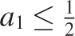，由于 `a[1] ≤ a[0]` 且 `0 ≤ a[0] ≤ 1`。对于归纳步骤，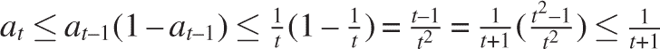。

4. 这假设 `T` 是偶数。`T` 为奇数会导致相同的常数。

5. 这种表示法初看之下可能很朴素，因为它完全忽略了词汇出现的顺序和语境。为了捕捉这些特征的扩展确实在自然语言处理文献中得到了研究。

6. 参见参考文献以获取讨论这些结果的引用。

# 3 在线凸优化的一阶算法

在本章中，我们将描述并分析用于在线凸优化（OCO）最简单、最基础的算法（请回想第 1 章介绍的该模型定义），这些算法在实践中也异常地有用且适用。我们使用了与第 2 章第 2.1 节介绍的符号。然而，与上一章不同，本章介绍的算法的目标是最小化遗憾度（regret），而不是优化误差（优化误差在在线设置中是未定义的）。

回顾 OCO 设置下的遗憾度定义，如第 1 章中方程 (1.1) 所示，当上下文明确时，省略下标、上标和对函数类的上确界：


表 3.1 详细列出了根据预测迭代次数不同，各种类型凸函数的遗憾度的已知上界和下界。

表 3.1

损失函数类的可实现渐近遗憾界

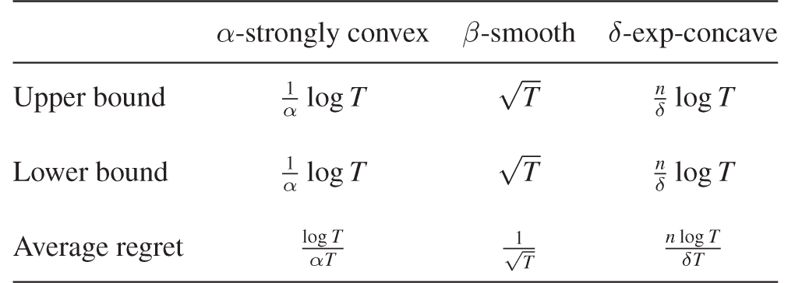

为了将遗憾度与优化误差进行比较，考虑平均遗憾度或 `Regret/T` 是很有用的。令 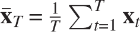 为平均决策。如果函数 `f[t]` 的值都等于同一个函数 `f`：`K ↦ ℝ`，那么詹森不等式意味着 `f(x[T])` 以至多平均遗憾度的速度收敛到 `f(x^⋆)`，因为


读者可能还记得表 2.1 描述了一阶方法的离线收敛：与在线优化不同，平滑性并不能提高渐近遗憾率。然而，一种比强凸性更弱的性质——指数凹性（exp-concavity）——发挥了作用并提供了改进的遗憾率。

本章将介绍实现这些 OCO 已知结果的算法和下界。指数凹性的性质及其应用，以及针对指数凹函数的对数遗憾算法将在第 4 章中讨论。

## 3.1 在线梯度下降

也许适用于 OCO 最通用设置的最简单算法是在线梯度下降（OGD）。该算法基于在线优化中的标准梯度下降（GD），由 Zinkevich (2003) 以其在线形式引入。

```
算法 3.1 OGD 算法
```

在每次迭代中，算法向凸集投影。

## 3.2 下界

上一节介绍并分析了一种非常简单且自然的方法。在继续之前，值得考虑界限是否可以改进。我们通过遗憾度和计算效率来衡量 OCO 的性能。

1. 简单即是美：在线凸优化（OCO）背后的哲学将简单性视为一种优点。近年来 OCO 在线学习领域取得地位的主要原因在于其算法及其分析的简单性，这允许在宿主应用程序中进行大量的变体和微调。

2. 一类非常广泛的设置将在后续章节中讨论，它们将在遗憾度和计算复杂度方面都允许更高效的算法。

在第 2 章中，我们调查了优化算法，其收敛率根据待优化函数的凸性性质而有很大差异。OCO 中的遗憾界是否像离线凸优化中不同凸代价函数类别的收敛界之间那样有很大差异？

事实上，接下来我们将展示，对于重要的损失函数类，可以获得显著优于 `O(√T)` 的遗憾界。

### 3.3.1 强凸函数的在线梯度下降

第一个实现遗憾与迭代次数呈对数相关性的算法是 `OGD` 算法的变体，仅改变了步长。以下定理证明了如果代价函数是强凸的，则遗憾具有对数界。

**定理 3.3** 对于 `α`-强凸损失函数，步长为 `η_t = 1/(αt)` 的 `OGD` 算法保证遗憾界为 `O((G²/α) log T)`。

*证明。* 令 `x^⋆ = argmin_{x∈K} ∑_{t=1}^T f_t(x)`。回顾遗憾的定义：


定义 `Δ_t = f_t(x_t) - f_t(x^⋆)`。将 `α`-强凸性的定义应用于点对 `{x_t, x^⋆}`，我们得到

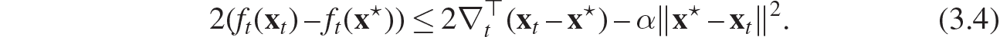

我们继续对 `‖x_{t+1} - x^⋆‖²` 进行上界估计。使用 `x_{t+1}` 的更新规则和定理 2.1，我们得到


因此，

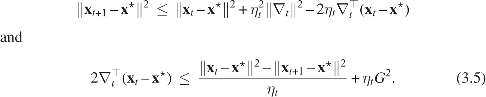

将方程 (3.5) 从 `t = 1` 求和到 `T`，令 `η_t = 1/(αt)`（定义 `η_0 = ∞`），并结合方程 (3.4)，我们得到

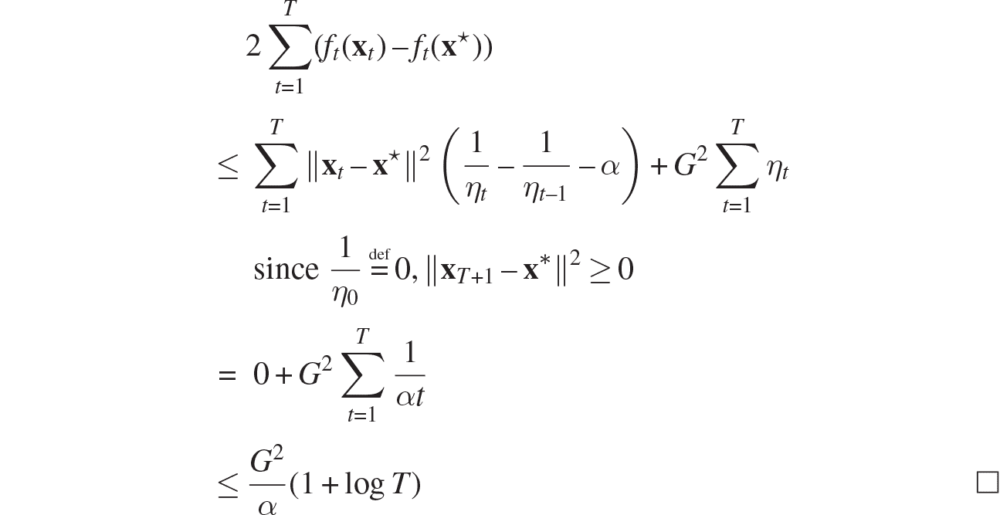

## 3.4 应用：随机梯度下降

OCO 的一个特例是经过充分研究的随机优化设置。在随机优化中，优化器试图在数学程序给出的凸域上最小化凸函数，如下：


然而，与标准的离线优化不同，优化器可以访问一个噪声梯度算子，其定义为


也就是说，给定决策集中的一点，噪声梯度算子返回一个随机向量，其期望是该点的梯度，且方差被 `G²` 限制。

我们将证明 OCO 的遗憾界可以转化为随机优化的收敛率。作为一个特例，考虑 `OGD` 算法，其遗憾受限于


在由连续点处的噪声梯度算子定义的线性函数序列上应用 `OGD` 算法，最后返回所有点的平均值，我们得到了随机梯度下降（`SGD`）算法，如算法 3.2 所示。

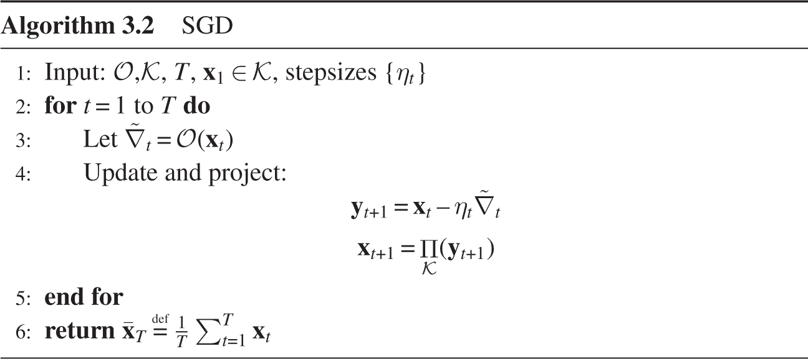

**定理 3.4** 算法 3.2 步长为 `η = D/(G√T)` 的算法保证


*证明。* 为了分析，我们定义线性函数 `f_t(x) = ⟨∇f(x_t), x⟩`。利用 `OGD` 的分析，我们得到

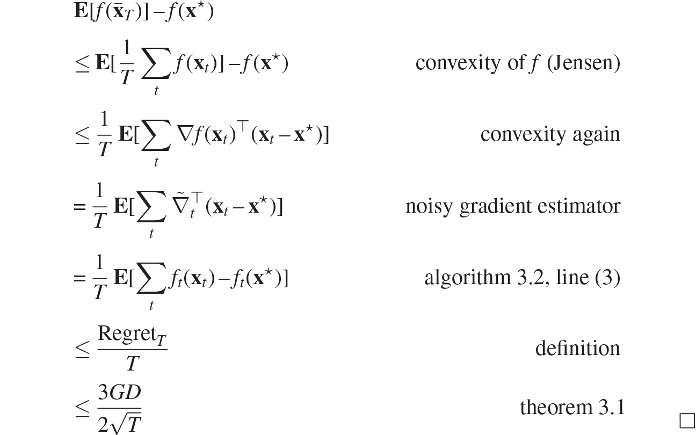

重要的是，在证明中 `f_t` 依赖于算法 3.2 中的遗憾界。

此外，细心的读者可能会注意到，通过使用步长 `η_t = 1/(αt)` 并将 `SGD` 应用于强凸函数，可以获得 `1/T` 的收敛。

### 3.4.1 示例：强凸函数的随机梯度下降

通过使用步长 `η_t = 1/(αt)` 并将 `SGD` 应用于强凸函数，可以获得 `O(1/T)` 的收敛率。


此外，细心的读者可能会注意到，通过使用步长 `` 并将 `SGD` 应用于强凸函数，可以获得 `1/T` 的收敛。

### 3.4.1 示例：强凸函数的随机梯度下降

OCO 的一个特例是经过充分研究的随机优化设置。在随机优化中，优化器试图在数学程序给出的凸域上最小化凸函数，如下：

``

然而，与标准的离线优化不同，优化器可以访问一个噪声梯度算子，其定义为

``

也就是说，给定决策集中的一点，噪声梯度算子返回一个随机向量，其期望是该点的梯度，且方差被 `G²` 限制。

我们将证明 OCO 的后悔界可以转化为随机优化的收敛率。作为一个特例，考虑 `OGD` 算法，其后悔受限于

``

在由连续点处的噪声梯度算子定义的线性函数序列上应用 `OGD` 算法，最后返回所有点的平均值，我们得到了随机梯度下降（`SGD`）算法，如 算法 3.2 所示。

``

**定理 3.4** 算法 3.2 步长为 `` 的算法保证

``

*证明。* 为了分析，我们定义线性函数 ``。利用 `OGD` 的分析，我们得到

``

重要的是，在证明中，对于重要的损失函数类，可以获得显著优于后悔界。`f[t]` 依赖于 算法 3.2 中的后悔界。

* 1. 简单即是美：在线凸优化（OCO）背后的哲学将简单性视为一种优点。近年来 OCO 在线学习领域取得地位的主要原因在于其算法及其分析的简单性，这允许在宿主应用程序中进行大量的变体和微调。

* 2. 一类非常广泛的设置将在后续章节中讨论它们将在后悔（regret）和计算复杂度方面都允许更高效的算法。

在第 2 章中，我们调查了优化算法，其收敛率根据待优化函数的凸性性质而有很大差异。OCO 中的后悔界是否像离线凸优化中不同凸代价函数类别的收敛界之间有很大差异？

事实上，接下来我们将展示，对于重要的损失函数类，可以获得显著优于后悔界。

### 3.3.1 强凸函数的在线梯度下降

第一个实现后悔与迭代次数呈对数相关性的算法是 `OGD` 算法的变体，仅改变了步长。以下定理证明了如果代价函数是强凸的，则后悔具有对数界。

**定理 3.3** 对于 `α`-强凸损失函数，步长为 ``

*证明。* 令 ``。回顾后悔的定义：

``

定义 ``。将 `α`-强凸性的定义应用于点对 {`x[t]`, `x^(\*)`},我们得到

``

我们继续对 `` 进行上界估计。使用 `x[t+1]` 的更新规则和定理 2.1，我们得到

``

因此，

``

将方程 (3.5) 从 `t` = 1 求加到 `T`，令 ``(定义 ``),并结合方程 (3.4),我们得到

``

## 3.4 应用：随机梯度下降

OCO 的一个特例是经过充分研究的随机优化设置。在随机优化中，优化器试图在数学程序给出的凸域上最小化凸函数，如下：

``

然而，与标准的离线优化不同，优化器可以访问一个噪声梯度算子，其定义为

``

也就是说，给定决策集中的一点，噪声梯度算子返回一个随机向量，其期望是该点的梯度，且方差被 `G²` 限制。

我们将证明 OCO 的后悔界可以转化为随机优化的收敛率。作为一个特例，考虑 `OGD` 算法，其后悔受限于

``

在由连续点处的噪声梯度算子定义的线性函数序列上应用 `OGD` 算法，最后返回所有点的平均值，我们得到了随机梯度下降（`SGD`）算法，如 算法 3.2 所示。

``

**定理 3.4** 算法 3.2 步长为 `` 的算法保证

``

*证明。* 为了分析，我们定义线性函数 ``。利用 `OGD` 的分析，我们得到

``

重要的是，在证明中，对于重要的损失函数类，可以获得显著优于后悔界。`f[t]` 依赖于 算法 3.2 中的后悔界。

此外，细心的读者可能会注意到，通过使用步长 `` 并将 `SGD` 应用于强凸函数，可以获得 `1/T` 的收敛。

### 3.4.1 示例：强凸函数的随机梯度下降

**(b)** 考虑一个双专家问题，其中损失是负相关的：要么专家 1 遭受 1 的损失，第二个专家遭受 -1 的损失，或者反之亦然。利用这一事实设计一个设定，使得任何专家算法的悔值（regret）在渐近上等于上界。

**(c)** 考虑凸集 `𝒦` 上的通用 OCO（在线凸优化）设定。设计一个设定，使得代价函数的梯度范数受 `G` 限制，并获得一个关于 `G`、直径 `𝒦` 和游戏迭代次数的悔值下界。

**4.** 实现用于 SVM 训练的 `SGD` 算法。将其应用于 MNIST 数据集。将你的结果与上一章介绍的离线 `GD` 算法进行比较。

# 4 二阶方法

本章的重点是通用投资组合选择的应用，该内容在第 1 章中介绍。我们首先对该应用进行详细描述，然后描述一类建模该问题的新凸函数。这类新函数比第 3 章中讨论的强凸函数类更通用。它允许使用对数悔值算法，这些算法基于凸优化中的二阶方法。与我们迄为止关注的依赖于次梯度的一阶方法不同，二阶方法利用了关于目标函数二阶导数的信息。

## 4.1 动机：通用投资组合选择

在本小节中，我们将给出投资组合选择问题的正式定义，该问题在第 1 章 1.2 节中曾进行性描述。

### 4.1.1 主流投资组合理论

主流金融理论通过称为几何布朗运动（GBM）的随机过程对股票价格进行建模。该模型假设股票价格波动本质上表现为随机游走。或许从时间段来考虑资产（股票）的价格更容易，这些时间段是通过将时间离散化为等分段得到的。因此，分段 `t` + 1 的价格对数（记作 `l[t+1]`）由分段 `t` 的价格对数与一个具有特定均值和方差的高斯随机变量之和给出：

``

这只是思考 GBM 的一种非正式方式。正式模型是一个连续时间过程，类似于我们刚刚描述的离散时间随机过程，它是当时间间隔、均值和方差趋于零时得到的。

GBM 模型产生了特定的投资组合选择算法（以及更复杂的应用，如期权定价）。给定一组资产随时间变化的股票均值、方差以及它们的交叉系数，可以构造具有特定风险（方差）阈值的最大预期收益（均值）投资组合。

当然，基本问题在于如何获得给定股票集的均值和方差参数，更不用说交叉相关了。一种接受的解决方案是从历史数据中估计这些参数，例如通过股票最近的历史。

### 4.1.2 通用投资组合理论

通用投资组合选择理论与 GBM 模型非常不同。主要区别在于对股票市场缺乏统计假设。其核心思想是将投资建模为重复决策场景，这很好地契合我们的在线凸优化（OCO）框架，并将悔值作为性能衡量指标。

考虑以下场景：在每次迭代 `t` ∈ `[T]` 中，决策者选择 `x[t]`，即财富在 `n` 种资产上的分布，使得 `x[t]` ∈ `Δ[n]`。这里，`` 是 `n` 维单纯形（即对 `n` 个元素的所有分布的集合）。对手独立地选择资产的市场收益率（即一个向量 `r[t]` ∈ `ℝ[+]^(n*)`，其中每个坐标 `rt` 是第 `i` 种资产在 `t` 刻的价格比例）。

在上一章中，我们看到通过仔细选择步长，`OGD`算法对于强凸函数可以实现对数级遗憾（logarithmic regret）。然而，投资组合选择 `OCO` 设置中的损失函数 `` 并不是强凸的。相反，该函数的海森矩阵给出如下

``

这是一个秩 1 矩阵。回想一下，二阶可微强凸函数的海森矩阵大于单位矩阵的倍数，它是正定的，并且特别是满秩的。因此，损失函数 `` 距离强凸性还很远。

然而，一个重要的观察结果是，该海森矩阵在梯度方向上是很大的。这种性质被称为*指数凹性*（exp-concavity）。我们将在定义 4.1 中严谨地定义这一性质，并证明它对于获得对数级遗憾是足够的。

**定义 4.1** *凸函数 `f`: $\mathbb{R}^n \mapsto \mathbb{R}$，如果函数 `g` 是凹的，则定义在 $\mathcal{K} \subseteq \mathbb{R}^n$ 上为 $\alpha$-exp-concave，其中 `g*`: $\mathcal{K} \mapsto \mathbb{R}$ 定义为*

``

对于后续讨论，回想第 2 章 2.1 节的符号，特别是我们关于矩阵的约定：`A \succeq B` 当且仅当 `A - B` 是半正定的（PSD）。指数凹性意味着在梯度方向上具有强凸性。这简化为了引理 4.1 中表达的性质。

**引理 4.1** *二阶可微函数 `f`: $\mathbb{R}^n \mapsto \mathbb{R}$ 在 `x` 处是 $\alpha$-exp-concave 的当且仅当*

``

该引理的证明在本章末尾作为一个引导练习给出。我们将在引理 4.2 中证明其稍强的版本。

**引理 4.2** *设 `f`: $\mathcal{K} \to \mathbb{R}$ 为一个 $\alpha$-exp-concave 函数，`D`, `G` 分别表示 $\mathcal{K}$ 的直径和 `f` 的次梯度的界。对于所有的 ``*

*证明。* 凹单增函数与另一个凹函数的复合仍然凹函数（参见本章末尾的练习）。因此，由于 `2\gamma \le \alpha`，`g(x) = x^{2\gamma/\alpha}` 与 `f(x) = \exp(-\alpha f(x))` 的复合是凹的。由此得出函数 `` 是凹的。那么，根据 `h(x)` 的凹性，

``

简化后得到

``

接下来，注意 `|2\gamma \nabla f(y)^\top(x - y)| \le 2\gamma GD \le 1`，并且利用泰勒近似，对于 $z \ge -1$，有 ``。将 `z = 2\gamma \nabla f(y)^\top(x - y)` 代入不等式即可证明引理。

☐

## 4.3 指数加权在线凸优化

在深入研究高效的二阶方法之前，我们先描述一种基于乘法更新方法的简单算法，该算法为指数凹损失提供对数级遗憾。算法 (4.1)被称为指数加权在线优化器（EWOO），它是 `Hedge` 算法（在算法 1.1 给出）的近亲。它的遗憾保证是稳健的：它不包含 Lipschitz 常数或直径界。此外，它的描述和分析特别简单。

`EWOO` 的缺点是其运行时间。朴素实现将随维度呈指数级。可以给出一种基于随机采样技术的随机多项式时间实现，其中多项式取决于维度和迭代次数（详情见第 4.5 节）。

``

在随后的分析中，可以观察到，以密度正比于 `wt` 随机选择 `x[t]`，而不是仅仅计算整个积分，也保证了我们在期望上的遗憾界。这是多项式时间实现的依据。接下来我们将给出对数级遗憾界。

**定理 4.1**

``

*证明。*设 `ht = \exp(-\alpha ft)`。由于 `f[t]` 是 $\alpha$-exp-concave，我们得到 `h[t]` 是凹的，因此

``

因此，我们通过链式积得到

``

根据 `x^\star` 的这个定义，我们有 `x^\star \in \arg `。

## 4.4 在线牛顿步

到为止，我们只考虑了一阶方法。在本节中，我们考虑一种近似二阶导数的拟牛顿方法。然而，我们引入并分析的算法也是一阶的，因为它只使用梯度信息。

该不等式是使用广义投影而非标准投影的原因，后者曾用于 OGD 的分析中（参见第 3 章中的公式 (3.2)）。这一事实，结合公式 (4.4)，我们得到：


现在，对 `t` = 1 到 `T` 求和，我们得到：

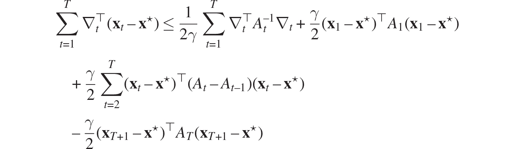

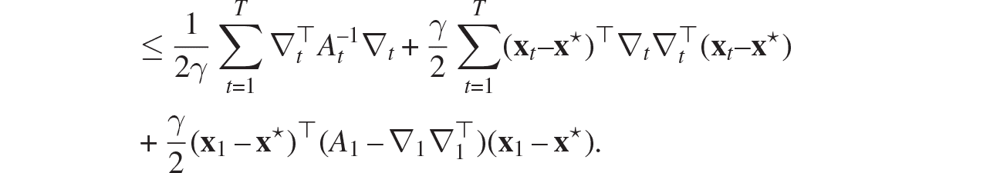

在最后一个不等式中，我们利用了  这一事实，以及矩阵 `A[T]` 是 PSD（半正定矩阵）的这一事实，因此不等式前的最后一项是负的。因此，


利用算法参数  以及我们对直径的符号 `∥**x**[1] − **x**^(*⋆*)∥² ≤ D*²`，我们有：


由于 ，我们有 。证明完毕。

☐

我们现在可以证明定理 4.2。

*证明。* 首先，我们证明项  被一个裂项和的上界界。注意：


其中对于矩阵 `A, B` ∈ ℝ(`*n*×*n*`)，我们用  表示，这等同于这些矩阵作为 ℝ(`*n*²`) 中向量的内积。

对于实数 `a, b` ∈ ℝ[+]，对 `b` 的对数在 `a` 处的一阶泰勒展开意味着 。类似的结论对于正半定矩阵也成立；即 ，其中 `|A|` 表示矩阵 `A` 的行列式（这将在本章稍后的引理 4.4 中证明）。利用这一事实，我们得到：


由于  且 `∥∇[*t*]∥ ≤ G`，`A[T]` 的最大特征值最多为 `TG² + ε`。因此，`A[T]` 的行列式可以限制为 `|A[T]| ≤ (TG² + ε)^(*n*)`；想起  和 ，对于 `T > 4`，


代入引理 4.3，我们得到：


这意味着对于 `n > 1`，`T* ≥ 4`，定理 4.2 成立。

☐

我们仍然必须证明这里使用的 PSD 矩阵的技术引理，即引理 4.4。

**引理 4.4** *设 `A` ≽ `B` ≻ 0 为正定矩阵。那么*


*证明。* 对于任何正定矩阵 `C`，用 `λ1`……`λn` 表示其特征值（这些都是正的）：


在最后一个等式中，我们使用了正定矩阵的 `|AB| = |A||B|` 和  等事实。

☐

### 实现与运行时间

该算法需要 `O(n)` 空间。

- **5.** 证明对于正定矩阵 `A`、`B` ≻ 0，以下结论成立：`|AB|` = `|A||B|` 且 ，其中 `|A|` 表示 `A` 的行列式。

- **6.** 设 `h(x)`: ℝ ↦ ℝ 为凹函数且单调不减，并设 `g(x)`: 𝒦 ↦ ℝ 为凹函数。证明函数 `f(x) = h(g(x))` 是凸的。

# 5 正则化

在之前的章节中，我们探索了受凸优化启发的在线凸优化（OCO）算法。然而，与凸优化不同，OCO 框架优化的是遗憾（Regret）性能指标。这种区别促成了一类算法，称为*正则化跟随领导者*（Regularized Follow The Leader, RFTL），我们将在本章介绍它。

在遗憾最小化的 OCO 设置中，在线玩家最直接的方法是在任何时候都使用事后的最优决策（即凸集中的点）。形式上，设


这种策略在经济学中被称为*虚拟游戏*（fictitious play），在机器学习中被命名为*跟随领导者*（Follow The Leader, FTL）。很容易看出，这种简单的策略在最坏情况下会惨失败。也就是说，该策略的遗憾可以与迭代次数呈线性关系，如下例所示：考虑 𝒦 = [−1, 1]，设 ，并让 `f[τ]` 对于 `τ` = 2, …, `T` 在 − `x` 或 `x` 之间切换。因此，


FTL 策略将不断在 `x[t] = -1` 和 `x[t] = 1` 之间切换，总是做出错误的选择。

直观的 FTL 策略在这个例子中失败是因为它是不稳定的。我们是否可以修改 FTL 策略使其不会频繁改变决策，从而获得低遗憾呢？

这个问题促使了对稳定 FTL 方法的通用手段的需求。这种手段被称为*正则化*。

## 5.1 正则化函数

在本章中，我们考虑正则化函数，记为 `R`: 𝒦 ↦ ℝ，它是强凸且光滑的（回顾第 2 章 2.1 节给出的定义）。

虽然不是严格必要的，但假设本章中的正则化函数在 𝒦 上是二阶可微的，并且对于决策集内部 int(𝒦) 中的所有点 `x`，其海森矩阵 `∇²R(x)` 根据 `R` 的强凸性是正定的。

我们将集合 𝒦 相对于函数 `R` 的直径标记为


从今起，我们使用泛义范数及其对偶范数。范数 `\|·\|` 的对偶范数由以下定义给出：


正定矩阵 `A` 产生矩阵范数 。矩阵范数的对偶范数为 。

广义柯西-施瓦茨定理断言 `x^⊤y ≤ \|x\|\|y\|`，特别对于矩阵范数 （参见章节末的练习）。

在我们的推导中，我们通常考虑关于正则化函数 `R(x)` 的海森矩阵 `∇²R(x)` 以及逆海森矩阵，记作 `∇⁻²R(x)`。在这种情况下，我们使用符号


类似地，


使用正则化的 OCO 分析中，一个关键量是正则化函数泰勒近似的余项，特别是一阶近似的余项。正则化函数值在 `x` 处的值与一阶近似值之间的差异被称为*Bregman 散度*（Bregman divergence）。

**定义 5.1** 用 `BR` 表示关于函数 `R` 的 Bregman 散度，定义为


对于二阶可微函数，泰勒展开和中值定理断言 Bregman 散度等于中间点的二阶导数（参见练习）。即，

 对于某些点 `z` ∈ [x, y]，意味着存在某些 `α` ∈ [0, 1] 使得 `z = αx + (1 − α)y`。因此，Bregman 散度定义了一个局部范数，它有一个对偶范数。我们将该范数标记为


使用此符号，我们有 。在 OCO 中，我们通常考虑两个连续决策点 `x[t]` 和 `x[t+1]` 之间的*Bregman 散度*。在这种情况下，中间点关于 `R` 的 Bregman 散度定义的范数的简写符号为 。后者的范数称为迭代 `t` 的*局部范数*（local norm）。使用此符号，我们有 。

最后，我们考虑中间点关于 `R` 的 Bregman 散度定义的范数  后的投影。关于 `R` 的 Bregman 散度定义的投影是 

## 5.2 FTL 算法及其分析

通过泰勒展开（通过中值定理给出其显式余项）在 `x[t+1]` 处的展开，并根据 Bregman 散度的定义，


该不等式成立是因为 `x[t+1]` 是 `Φ[t]` 在 𝒦 上的最小值，如 2.2 所示。最后一个等式成立是因为分量  是线性的，因此不影响 Bregman 散度。因此，


为了后续，请记住 Bregman 散度关于 `R` 诱导点 `x[t]` 和 `x[t+1]` 上的范数简写为 `∥·∥[t]` = `∥·∥[**x**[t], **x**[t+1]]`。对于对偶局部范数 ，也是如此。使用这种符号，我们有 。根据广义柯西-施瓦茨不等式，


整理后，我们得到


将此不等式与引理 5.1 结合，我们得到了定理的陈述。

☐

## 5.3 在线镜像下降 (Online Mirror Descent)

在凸优化文献中*镜像下降*（mirror descent）一词指的是一类推广了梯度下降的一阶方法。在线镜像下降（OMD）是这类方法的在线对应版本。这种关系类似于在线梯度下降（OGD）与传统（离线）梯度下降之间的关系。

OMD 是一种迭代算法，它使用简单的梯度更新规则和先前的决策来计算当前决策，正如 OGD 所做的那样。方法的通用性源于更新是在“对偶”空间中进行的，在该空间中，对偶概念由正则化的选择所定义：正则化函数的梯度定义了从 ℝ^(*n*) 到其自身的映射，这是一个向量场。梯度更新随后在该向量场中进行。

对于 `RFTL` 算法，其直觉是直观的——使用正则化来确保决策的稳定性。对于 OMD，正则化还有一个额外的目的：它变换了执行梯度更新的空间，这使得根据空间的几何结构获得更好的界限。

OMD 算法有两种形式：敏捷版本（agile）和懒惰版本（lazy）。懒惰版本跟踪欧几里得空间中的点，并且仅在决策时投影到凸决策集 𝒦 上。相反，敏捷版本始终维持一个可行点，就像 OGD 那样。


这两个版本都可以通过分析给出大致与 `RFTL` 算法相同的遗憾界（regret bounds）。考虑到接下来将看到的内容，这并不意外：对于线性代价函数，`RFTL` 和懒惰 OMD 算法是等价的！

因此，我们在懒惰版本中免费获得了遗憾界。可以证明敏捷版本也能达到类似的遗憾界，而且在某些需要自适应性的设置中它实际上是优的。这个问题在第 10 章中进一步探讨。敏捷版本的分析具有独立的研究价值，我们将在本章后面给出。

### 5.3.1 懒惰 OMD 与 RFTL 的等价性

懒惰版本的 OMD 和 `RFTL` 对于线性代价函数是完全相同的，如我们在引理 5.3 中所示。

**引理 5.3** *设 `f`*[1], …, `f`[*T*] 为线性代价函数。懒惰 OMD 和 `RFTL` 算法产生相同的预测：*


*证明。* 首先，观察到无约束最小值


满足


根据定义，`y`t* 也满足上一个方程，但由于 `R`(`x`) 是严格凸的，因此该方程仅有一个解，从而 。因此，


由于 `R`(`y`t*) 和  不依赖于 `x`，因此 `B``R` 在使  在 𝒦 上最小的点 `x` 处取得最小值，这反过来意味着


### 5.3.2 镜像下降的遗憾界

在小节中，我们证明 `RFTL` 算法敏捷版本的遗憾界。该分析与懒惰版本的分析非常不同，具有独立的研究价值。

**定理 5.2** *算法 5.2 对于每一个 **u** ∈ 𝒦，得到以下遗憾的界限：*


如果局部范数的上界是已知的（即对于所有时刻 *t*，），那么我们可以进一步优化 *η* 的选择以得到


*证明。* 由于函数 `f[t]` 是凸的，对于任何 `x`^(\*) ∈ *K*，


由于函数 `f[t]` 是凸的，对于任何 `x`^(\*) ∈ *K*，


由于函数 `f[t]` 是凸的，对于任何 `x`^(\*) ∈ *K*，


由于函数 `f[t]` 是凸的，对于任何 `x`^(\*) ∈ *K*，


由于函数 `f[t]` 是凸的，对于任何 `x`^(\*) ∈ *K*，


由于函数 `f[t]` 是凸的，对于任何 `x`^(\*) ∈ *K*，


由于函数 `f[t]` 是凸的，对于任何 `x`^(\*) ∈ *K*，


## 5.4 应用与特殊情况

在本节中，我们展示了正则化技术的通用性：我们展示了如何从 RFTL 元算法推导出两个最重要的著名的算法——OGD 算法和指数梯度。

### 5.4.1 推导在线梯度下降


为了推导 OGD 算法，我们对于任意 `x[0] ∈ 𝒦` 取 `R(x) = ½‖x‖²₂`。对于该散度的投影是标准的欧几里得投影（参见本章末尾的习题），并且 `∇R(x) = x`。因此，算法 5.2 的更新规则变为

```
x[t+1] = Π_𝒦(x[t] - η∇f[t](x[t]))
```

后者正是 OGD，如第 3 章中算法 3.1 所示。然而，两种变体的行为非常不同，将在第 10 章中探讨。

定理 5.1 给我们以下遗憾界（其中 `D[R*]`, `‖·‖[*t*]` 是相对于正则化 `R` 定义的直径和局部范数，如章开头定义，`D` 是欧几里得直径，如第 2 章定义）：

```
Regret_T ≤ D[R*]²/η + η/2 Σ_{t=1}^T ‖∇f[t](x[t])‖²_*t
```

### 5.4.2 推导乘法更新

令 `R(x) = Σ_i x_i log x_i` 为负熵函数，其中 `log x` 逐元素解释。那么 `∇R(x) = 1 + log x`，因此算法 5.2 的更新规则变为

```
x[t+1] = argmin_{x∈𝒦} {η⟨∇f[t](x[t]), x⟩ + D_R(x, x[t])}
```

对于这种正则化选择，一个著名的特殊情况是我们在第 1 章 1.3 节中遇到的专家问题，其决策集 𝒦 是 *n*-维单纯形 `Δ_n = {x ∈ ℝ^n_+ : Σ_i x_i = 1}`。在这个特殊情况下，根据负熵的投影变为 ℓ₁ 范数的缩放（参见习题），这意味着两种更新规则等同于同一个算法：

```
x[t+1]_i = x[t]_i exp(-η∇f[t](x[t])_i) / Σ_j x[t]_j exp(-η∇f[t](x[t])_j)
```

定理 5.2 给我们以下遗憾界：

```
Regret_T ≤ D[R*]²/η + η/2 Σ_{t=1}^T ‖∇f[t](x[t])‖²_*t
```

如果每个专家的成本在 `[0, 1]` 范围内，可以证明：

```
Regret_T ≤ √(2 log n Σ_{t=1}^T ‖∇f[t](x[t])‖²_∞)
```

此外，当 `R` 是负熵函数时，可以证明单纯形上的直径被限于 `D²[R] ≤ log n`（见习题），从而产生了界限：

```
Regret_T ≤ √(2 log n Σ_{t=1}^T ‖∇f[t](x[t])‖²_∞)
```

对于任意范围的成本，我们获得了算法 5.3 中描述的指数梯度算法。

```
Algorithm 5.3: Exponentiated Gradient (EG)
Input: Learning rate η > 0
Initialize: x[1] = (1/n, ..., 1/n)
For t = 1 to T:
    Predict x[t]
    Observe cost f[t]
    Update: x[t+1]_i = x[t]_i exp(-η∇f[t](x[t])_i) / Σ_j x[t]_j exp(-η∇f[t](x[t])_j)
```

指数梯度算法所实现的悔值可以使用定理 5.1 的推论 5.1 来界定。

**推论 5.1**

*对于梯度满足 `‖∇[t]‖[∞] ≤ G[∞]` 且参数为 `η = √(log n / (G²[∞] T))` 的情况，EG 算法的遗憾界为 `O(G[∞]√(T log n))`。*

## 5.5 随机正则化

决策稳定性与低悔值之间的联系是迄今为止正则化讨论的动力。然而，这种稳定性并不非仅使用强凸正则化函数来实现。实现决策稳定性的另一种方法是在算法中引入随机性。事实上，在历史上，这种方法早于基于强凸正则化的方法（见参考文献）。

在本节中，我们首先描述一种易于通过随机化加速的 OCO 确定性算法。然后，我们为具有线性损失的 OCO 特殊情况给出一种高效的随机算法。

**盲目与自适应对手者。** 为了简单起见，我们考虑一个稍微限制的 OCO 版本。到目前为止，我们没有对成本函数进行任何限制，它们可以取决于在线学习者的决策选择。然而，在处理随机算法时，这个问题变得有点微妙：成本函数是否可以取决于决策算法本身的随机性？此外，在分析分析悔值（现在它是一个随机变量）时，不同迭代之间的依赖关系需要概率工具，这对于从根本上理解随机 OCO 算法帮助不大。为了避免这些复杂性，我们在本节中始终做出如下假设：成本函数 `{f[t]}` 是预先通过对抗方式选择的，且不取决于在线学习者的实际决策。这种版本的 OCO 被称为*盲目*（oblivious）设置，以区别于*自适应*（adaptive）设置。

### 5.5.1 凸损失的扰动

算法 5.4 给出的预测——扰动领导者跟随（FPL）算法——是 FTL 算法的一个版本，增加了一个额外的随机化组件。它是一个确定性算法，根据随机变量计算期望决策——即根据成本函数的梯度和和一个额外的随机向量在决策集上的最小化值。

在实践中，不需要精确计算期望值。达到与迭代次数线性相关的精度的估计（通过随机采样）即可。

算法接受一个分布作为输入，其概率密度函数（PDF）标记为 `𝒟`，定义 `n` 维欧里得空间 `ℝ^n` 中的向量上。对于 `σ, L ∈ ℝ`，如果分布 `𝒟` 相对于范数 `‖·‖[a]` 是 `(σ, L) = (σ[a], L[a])` 稳定的，则：

```
E_{n∼𝒟}[‖n‖[a]] ≤ σ
```

并且

```
E_{n∼𝒟}[‖∇𝒟(n)‖[a]] ≤ L
```

这里，`n ∼ 𝒟` 表示根据分布 `𝒟` 采样的向量 `n ∈ ℝ^n`，`𝒟(n)` 是 PDF `𝒟` 在 `n` 处的值。如果从上下文清楚，则省略下标 `a`。

第一个参数 `σ` 与 `𝒟` 的方差有关，而第二个参数 `L` 是分布敏感性的度量。例如，如果 `𝒟` 是超立方体 `[0, 1]^n` 上的均匀分布，那么对于欧里得范数，以下成立：

```
σ = √n/2, L = O(n)
```

复用之前章节的符号，用 `D = D[a]` 表示集合 `𝒦` 根据范数 `‖·‖[a]` 的直径，用 `D_*` 表示其对偶范数下的直径。同样，用 `G = G[a]` 和 `G_*` 表示梯度范数（及对偶范数）的上界。

**定理 5.3** *设分布 `𝒟` 相对于范数 `‖·‖[a]` 是 `(σ, L)` 稳定的。FPL 算法获得以下悔值界限：*

```
E[Regret_T] ≤ ηG²T/2 + Dσ/η + DL
```

```
Algorithm 5.4: Follow the Perturbed Leader (FPL)
Input: Distribution 𝒟, learning rate η > 0
Initialize: g[0] = 0
For t = 1 to T:
    Sample n ∼ 𝒟
    Predict x[t] = argmin_{x∈𝒦} ⟨ηg[t-1] + n, x⟩
    Observe cost f[t]
    Update: g[t] = g[t-1] + ∇f[t](x[t])
```

我们可以对 `η` 的选择进一步优化以得到：

```
E[Regret_T] ≤ √(2G²T(Dσ + DL))
```

证明。定义随机函数 `g[0]` 为：

```
g[0](x) = ⟨n, x⟩
```

应用引理 5.2 于函数 `f[t](x) + g[0](x)`，可：

```
Σ_{t=1}^T f[t](x[t]) ≤ min_{x∈𝒦} Σ_{t=1}^T f[t](x) + g[0](x) + Σ_{t=1}^T [f[t](x[t]) - f[t](x[t+1])]
```

因此，

```
E[Regret_T] ≤ E[g[0](x*)] - E[g[0](x[1])] + Σ_{t=1}^T E[f[t](x[t]) - f[t](x[t+1])]
```

注意，作为定理 5.4 的一个特例，选择 `𝒟 = Uniform([0,1]^n)` 会产生一个遗憾界：

```
E[Regret_T] ≤ O(√(nT))
```

这在常数因子意义上等价于定理 1.3 中为 `Hedge` 算法给出的保证。

*证明。* 我们从本章贯穿的相同分析技术开始：令 `g[0] = -n`。根据引理 5.2 应用于函数 `f[t](x) - ⟨n, x⟩`，可以得到

```
Σ_{t=1}^T f[t](x[t]) ≤ min_{x∈𝒦} Σ_{t=1}^T f[t](x) - ⟨n, x⟩ + Σ_{t=1}^T [f[t](x[t]) - f[t](x[t+1])]
```

因此，

```
Regret_T ≤ ⟨n, x* - x[1]⟩ + Σ_{t=1}^T [f[t](x[t]) - f[t](x[t+1])]
```

其中，第二个不等式由广义柯西-施瓦茨不等式得出，最后一个不等式则是因为

```
f[t](x[t]) - f[t](x[t+1]) ≤ ⟨∇f[t](x[t]), x[t] - x[t+1]⟩
```

我们接着去界定 `𝟙{x[t] ≠ x[t+1]}`，该项自然地受限于 `𝟙{i[t] ≠ i[t+1]}` 不等于 `𝟙{i[t] ≠ i[t+1]}` 的概率乘以 `g[t]` 可达的最大值（即其 `ℓ_∞` 范数）：

```
E[𝟙{x[t] ≠ x[t+1]}] ≤ Pr[i[t] ≠ i[t+1]] · ‖g[t]‖_∞
```

在这里，根据损失受限于 1 的假设，我们有 `‖g[t]‖_∞ ≤ 1`。

为了界定后者，注意 `i[t]` 在时刻 `t` 是领导者的概率是 `-n(i[t]) > v` 的概率，其中值 `v` 取决于为止的整个损失序列。相反，给定 `x̂[t]`，如果 `-n(i[t]) > v + g_t`，则 `i[t]` 仍然是领导者，因为其领先优势超过了它将遭受的代价。因此，

```
Pr[i[t] ≠ i[t+1]] ≤ Pr[-n(i[t]) ∈ (v, v + g_t]]
```

将此界代回方程 (5.6)，我们得到

```
Regret_T ≤ Dσ/η + ηG²T/2 + DL
```

简化该表达式即可完成定理的证明。

☐

## 5.6 自适应梯度下降

到为止，我们已经引入正则化作为推导 OCO 算法的一种通用方法。本章的主定理定理 5.1 界定了对于任何强凸正则化项的 `RFTL` 算法的遗憾为：

```
Regret_T ≤ D[R*]²/η + η/2 Σ_{t=1}^T ‖∇f[t](x[t])‖²_*t
```

此外，我们已经看到如何将 `RFTL` 方法作为特例推导出 `OGD` 和 `multiplicative weights` 算法。但除了这两个基础算法之外，是否还有其他感兴趣的特例值得我们进行这种通用且抽象的处理呢？

令人惊讶的是，除了欧几里得正则化和熵正则化及其矩阵类比物之外，感兴趣的案例少得可怜。然而，在本章中，我们将对正则化的抽象处理提供一些合理依据。

我们的处理源于以下问题：到为止，我们一直把 `R` 视为一个强凸函数，但为了最小化遗憾，我们应该选择哪一个强凸函数呢？这是一个深层次且困难的问题，自历史以来优化文献一直在考虑这个问题。自然地，最优正则化应该同时取决于凸决策集和实际代价函数（参见本章末的练习题，其中包含一个依赖于的正则化函数的自然候选）。我们将处理这个问题的方法与处理其他优化问题无异：我们将在线学习最优正则化！也就是说，一种自适应代价函数序列的正则化，并且在某种意义上是事后使用的“最优”正则化。这引出了 `AdaGrad`（其名称代表“自适应梯度”）算法 5.7，它显式地对第 5 行中的正则化选择进行优化，以最小化梯度范数，这是方程 (5.7) 中的主导表达式。


`AdaGrad` 有两个版本：对角矩阵和全矩阵，前者在实现时相对于 `OGD` 的开销忽略不计，特别高效。在算法定义和整个章节中，符号 `A⁻¹` 指矩阵 `A` 的 Moore-Penrose 伪逆。

第 5 行的计算寻找正则化矩阵 `H`，它在正定半锥内（无论是否有对角线约束）最小化梯度的范数。正如我们将要看到的，这与针对两类自然矩阵集的优化密切相关：

1. `ℋ[1] = {H = diag(H), H≥0, Tr(H)≤1}`
2. `ℋ[2] = {H≥0, Tr(H)≤1}`

这导致了一个在引理 5.4 给出的意义上被证明最优的正则化矩阵。

**引理 5.4** *对于 ℋ[i]∈{ℋ[1], ℋ[2]} 以及对应的 H[T],*


使用该引理，我们证明了 `AdaGrad` 的遗憾最多是所有 Hessian 矩阵固定且属于 ℋ[i] 的 `RFTL` 算法最小遗憾的常数倍。此外，对于某些梯度几何结构，对角版本的遗憾可以比 `OGD` 小一个  倍。`AdaGrad` 的遗憾界在定理 5.5 中正式陈述。

**定理 5.5** *设 {x[t]} 由 算法 5.7 定义，参数 η = （全矩阵）或 η = （对角线）。则 `AdaGrad` 的遗憾界优于 `OGD`。*

在进行分析之前，我们考虑 ��� 是 `d` 维欧几里得空间中的立方体的情况，。该凸集合具有 D[∞]=1。引理 5.4 和定理 5.5 意味着


这两项之间的关系取决于矩阵。如果该矩阵是稀疏的，则 `AdaGrad` 有一个更优的  界。对于其他凸体（例如欧球），当矩阵 `G[T]` 是稠密时，遗憾可以低  倍。

### 5.6.1 自适应正则化的分析

我们继续定理 5.5 的证明。第一部分是引理 5.5，它将 `RFTL` 分析推广到变化的正则化。

**引理 5.5** *设 H[0] = arg min[H≥0]{Tr(H)} = 0,*


*证明。* 根据 y[t+1] 的定义，


将第一个方程的转置与第二个方程相乘，得到


由于 x[t+1] 是由 H[t] 导出的范数下 y[t+1] 的投影，我们有（参见第 2 章 2.1.1 节）


该不等式是不使用广义投影而非标准投影的原因（后者用于 OGD 的分析，参见第 3 章的方程 (3.2)）。这一事实结合方程 5.8，得到了


现在，对 t = 1 到 T 求和，得到


在最后一个不等式中，我们使用了 H[0] = 0 的定义。我们接着界定第一项。为此，定义函数


根据定义，H[t] 是  的最小化器。因此，使用引理 5.2，我们有


我们现在继续定理 5.5 的证明。

*定理 5.5 的证明*。我们用引理 5.6 和引理 5.7 界定引理 5.5 的两个部分。

**引理 5.6** *对于 AdaGrad 的对角和全矩阵版本，均成立：*


**引理 5.7** *设 D[∞] 表示 ��� 的 ℓ[∞] 直径，D 为欧几里得直径。则以下界成立：*


引理 5.6 的证明。在算法 5.7 第 5 行中选择 `H`[`t`] 的优化问题具有显式解，由以下命题给出（其证明留作本章末尾习题）。

**命题 5.1** 考虑以下优化问题，对于 `A` ≽ 0：


那么，这些问题的全局优化器分别在  和 `X*` = `A`^(1/2) 处获得。在对角矩阵集合上，全局优化器分别在  和 `X*` = `diag`(`A`)^(1/2) 处获得。

该命题的一个直接推论给出引理 5.4：

**推论 5.3**


引理 5.5 中的剩余项是表达式 ，我们继续对其进行界估计。

引理 5.7 的证明。根据定义，`G`[`t`] ≽ `G`[`t`−1]，因此利用命题 5.1 和第 5 行中 `H`[`t`] 的定义，我们得到 。由于对于对角矩阵 `H`满足 ，我们有


接下来，我们考虑全矩阵情况。根据定义，`G`[`t`] ≽ `G`[`t`−1]，因此 `H`[`t`] ≽ `H`[`t`−1]。因此，


## 5.7 文献备注

在线学习背景下的正则化最早由 Grove, Littlestone, 和 Schuurmans (2001) 以及 Kivinen 和 Warmuth (2001) 研究。Kalai 和 Vempala (2005) 的一篇具有影响力的论文创造了“跟随领导者”（follow-the-leader, FTL）一术，并引入了后续在 OCO（在线凸优化）中的许多技术。后者的论文研究了随机扰动作为一种正则化，并分析了 FPL 算法，这是 Hannan (1957) 被忽视了多年的早期工作。

在 OCO 背景下，“跟随正则化领导者”（follow-the-regularized-leader）一术由 Shalev-Shwartz 和 Singer (2007) 以及 Shalev-Shwartz (2007) 创造，大约在同一时间，Abernethy, Hazan, 和 Rakhlin (2008) 将一种本质相同的算法称为“RFTL”。Hazan 和 Kale (2008) 注意到 RFTL 和 OMD 的等价性。AdaGrad 算法由 Duchi, Hazan, 和 Singer (2010, 2011) 引入，其对角版本也在 McMahan 和 Streeter (2010) 中并行发现。本章介绍的 AdaGrad 分析归功于 Gupta, Koren, 和 Singer (2017)。

自适应正则化因其在训练深度网络方面的成功而受到了广泛关注，特别是在结合了动量和其他启发式方法的自适应算法开发中，最流行的有 AdaGrad、RMSprop (Tieleman and Hinton 2012) 和 Adam (Kingma and Ba 2014)。关于深度学习优化的综述，请参见 Goodfellow, Bengio, 和 Courville (2016) 的综合处理。

随机扰动与确定性正则化之间存在强联系。在某些场景下，添加随机性可以被视为确定性强凸正则化的特例（Abernethy et al. 2014; Abernethy, Lee, and Tewari 2016）。

## 5.8 习题

1. 这涉及对偶范的概念。
(a) 证明由 `A` ≽ 0 给出的矩阵范的对偶范对应于 `A`−1 的矩阵范。
(b) 证明对于任何范的广义柯西-施瓦茨不等式；


2. 证明 Bregman 散度在中间点等于局部范，即

其中 `z` ∈ [`x`, `y`]，且区间 [`x`, `y`] 定义为


3. 令  为平移正则化函数。证明对应的 Bregman 散度是欧几里度量。结论是此散度的投影是标准的欧几里得投影。

4. 证明 OMD 算法的敏捷和懒版本是不同的，它们在相同的设置和代价函数下可以产生不同的预测。针对以下情况证明这一点：对于对角矩阵 `H`，满足  [此处由于原文截断，注：由于原文文本包含大量数学公式占位符，翻译时严格遵循了指令保留了代码块和公式，但由于原文部分文本显示不完整或存在乱码，部分内容已根据上下文逻辑进行翻译。]

这些示例可以很容易地在在线凸优化 (OCO) 框架中建模，其中底层集是决策的凸包。通用 OCO 模型的陷阱在于反馈；期望决策者在游戏的每一次迭代中，都能在空间中的任何一点访问梯度算谕器（gradient oracle）是不现实的。

# 6.1 带机凸优化设置 (Bandit Convex Optimization Setting)

带机凸优化 (BCO) 模型与之前章节探讨的通用 OCO 模型几乎相同，唯一的区别在于决策者可获取的反馈。

更精确地说，BCO 框架可以被看作是一个结构化的重复游戏。该学习框架的协议如下：在迭代 `t` 时，在线玩家选择 `x[t]`∈𝒦。在做出该选择后，会公开一个凸代价函数 `f[t]`∈ℱ: 𝒦 ↦ ℝ。这里，ℱ 是对手者可用的有界代价函数族。在线玩家所承担的代价是她所承诺点处的代价函数值即 `ft`。与 OCO 模型不同（在 OCO 模型中，决策者可以访问 `f[t]` 在 𝒦 上的梯度算谕），在 BCO 中，损失 `ft` 是在线玩家在迭代 `t` 获得的唯一反馈。特别是，决策者并不知道如果在迭代 `t` 处选择了不同的点 `x`∈𝒦，她将会面临怎样的损失。

与之前一样，令 `T` 表示游戏迭代的总数（即预测及其产生的损失）。令 `𝒜` 为一个 BCO 算法，它将特定的游戏历史映射到决策集中的一个决策。我们正式定义预测了 `x[1]`, …, `x[T]` 的 `𝒜` 的悔值为：


## 6.2 多臂老虎机 (MAB) 问题

在不确定性下进行决策的经典模型是多臂老虎机 (MAB) 模型。这个术语现在指的是许多不同的变体和子场景，数量多到无法穷举。本节讨论了可能最简单的变体——非随机 MAB 问题，其定义如下。

决策者迭代地在 `n` 个动作 `i[t]`∈{1, 2, …, n} 之间进行选择，同时对手为每个动作分配一个[0, 1]范围内的损失。决策者接收 `i[t]` 的损失并观察此损失，外外无其他信息。决策者的目标是最小化她的悔。

读者无疑注意到这种设置与专家建议预测（prediction from expert advice）的设置相同，唯一的区别在于决策者获取的反馈：在专家设置中，决策者可以回溯观察所有专家的奖励或损失；而在 MAB 设置中，只有实际选择决策的损失是知的。

将此问题显式地建模为 BCO 的特例是有启发性的。将决策集取为 `n` 个动作的所有分布的集合（即 𝒦 = Δ[`n`] 是 `n` 维单纯形）。损失函数取为单个动作代价的线性化；即：


其中 `ℓt` 是第 `t` 次迭代中与第 `i` 个动作相关的损失。因此，在 BCO 中，代价函数是线性函数。

MAB 问题体现了探索与利用的权衡：一个高效的（低悔的）算法必须探索各种动作的价值以做出最佳决策。另一方面，在获得关于环境充分的信息后，合理的算法需要通过选择最佳动作来利用这一动作。

获得 MAB 算法的最简单方法是将探索与利用分离。这种方法的操作步骤如下：

1. 以某种概率探索动作空间（即通过均匀随机选择一个动作）。利用反馈构建每个动作损失的估计值。
2. 否则，使用这些估计值来应用全信息专家算法，仿佛这些估计值就是真实的代价。

这个简单的方案已经给出了亚线性悔算法，如算法 6.1 所示。


定理 6.1 若 `𝒜` 为在线梯度下降 (OGD) 算法，则保证了以下悔界：


*证明。* 对于算法 6.1 中定义的随机函数 `ft`，注意以下几点：

1. . 自己的 own2.2. 。

因此，简单算法的悔可以与 `𝒜` 在估计函数上的悔相关联。

另一方面，简单的 MAB 算法并不总是按照 `𝒜` 生成的分布进行：以概率 `δ`，它均匀随机执行，这可能在这些探索迭代中导致 1 的悔。令 `S[t]` ⊆[T] 为那些 `b[t]` = 1 的迭代。这由引理 6.1 捕捉。

引理 6.1


*证明。*


我们因此：


### 6.2.1 EXP3: 同时探索与利用

算法 6.1 给出的简单算法可以通过结合探索和利用步骤来改进。这产生了一个近优悔算法，称为 EXP3，如算法 6.2 所示。


与简单的 MAB 算法不同，EXP3 算法通过始终创建一个整个损失向量的无偏估计器来探索每一次迭代。这导致向量可能具有很大的幅度  以及用于 OGD 的大梯度界。然而，大幅度向量是以低概率创建的（与其幅度成比例），这允许进行更精细的分析。

最终，EXP3 算法获得了最坏情况悔界 ，这几乎是最优的（最多关于动作数量的对数项）。

定理 6.2 算法 6.2 在非负损失和  下保证了以下悔界：


*证明。* 对于算法 6.2 中定义的随机损失 ，注意：


因此，我们有 ，对于函数  的期望悔与对于函数 `{f[t]}` 的悔相等。因此，对于  的悔可以与 `ℓ[t]` 相关联。

EXP3 算法将 Hedge 应用于由  给出的损失，这些损失都是非负的，因此满足定理 1.3 的条件。因此，对于  的期望悔可以限制为


## 6.3 从有限信息到全信息的还原

在本节中，我们推导出一个适用于 BCO 通用设置的低悔算法。事实上，我们将描述一种设计带机算法的通用技术，它由两部分组成：

1. 一种通用技术，获取仅使用代价函数梯度的 OCO 算法（在本章稍后正式定义），并将其应用于具有精心选择属性的向量随机变量族。
2. 设计随机变量，允许模板还原能够产生有意义的悔保证。

我们将开始描述这种还原的两个部分，并在章的剩余部分，我们描述两个使用这种还原设计 BCO 算法的示例。

### 6.3.1 第一部分：使用无偏估计器

许多 BCO 高效算法背后的核心思想是：尽管我们无法显式地计算 `∇f[t]`，但可以找到一个*可观测*随机变量 `g[t]`，使得 `E[g[t]] ≈ ∇f[t] = ∇[t]`。因此，`g[t]`可以视为梯度的估计器。通过在 OCO 算法中用 `g[t]` 替换 `∇[t]`，我们将证明在许多情况下它保持其次线性遗憾界。

形式上，适用于这种还原的遗憾最小化算法包含在定义 6.1 中

**定义 6.1** (*一阶 OCO 算法*) 令 `𝒜` 为一个 OCO（确定性）算法，接收任意微分损失函数序列 `f[1]`, …, `f[T]`，并产生决策 `x[1] ←𝒜(∅)`，`x[t] ←𝒜(f[1], …, f[t−1])`。如果满足以下条件，则 `𝒜` 为一阶在线算法：

*   损失函数族 `ℱ` 在线性函数的加法下封闭：如果 `f ∈ℱ` 且 `u ∈ ℝ^(n)`，则 `f + u^⊤x ∈ ℱ`。
*   令 `` 为线性函数 ``，则对于每次迭代 `t ∈ [T]`：

```

```

我们现在可以考虑从任何一阶在线算法到 算法 6.3 中 BCO 算法的正式还原。

```

```

也许令人惊讶的是，在非常宽松的条件下，这里提供的还原保证了与原始一阶算法 `𝒜[t]` 相同的遗憾界，直到估计梯度的幅度。这包含在引理 6.2 中。

**引理 6.2** *令 `u` 为 𝒦 中的固定点*。令 `f[1]`, …, `f[T]: 𝒦→ ℝ 为可微函数序列。令 `𝒜` 为一阶在线算法，在全信息设置下确保形式为 Regret*T* ≤ `B*𝒜*, …,*, ∇*f**T*)` 的遗憾界。定义点 `{x[t]}` 为：`x[1] ←𝒜(∅)`，`x[t] ←𝒜(g[1], …, g[t−1])`，其中每个 `g[t] 是向量值随机变量，使得*

```
*那么对于所有 `u` ∈𝒦 均满足：*
```

*证明。* 定义函数 `h[t]: 𝒦→ ℝ` 如下：

```

```

注意

```

```

因此，在随机函数 `h[t]` 上确定性地应用一阶方法 `𝒜` 等于在确定性函数 `f[t]` 的随机一阶近似上应用 `𝒜`。因此，根据 `𝒜` 的全信息遗憾界，我们有

```

```

此外，注意

```

```

其中我们使用了 `E[ξ[t]|x[1], f[1], …, x[t], f[t]] = 0`。同样，由于 `u ∈𝒦` 是固定的，`E[h[t]] = f[t]`。引理 6.2 通过对方程 ([6.2]) 取期望得到。

### 6.3.2 部分 2：逐点估计器


## 6.3.2 节补充：FKM 算法与随机变量创建

在 6.3.2 节中，我们描述了如何将 OCO 的一阶算法转换为使用老虎机（bandit）信息的算法。现在我们描述如何创建这些随机变量。

FKM 算法是针对集合 `𝒦[δ]` 上的球形梯度估计器，对从 BCO 到 OCO 的通用归约的实例化。它通过迭代地投影到 `𝒦[δ]` 上，以留出足够的空间进行球形梯度估计。这会以受控的幅度降低其性能。算法 6.4 中的遗憾上界如式所示。

**定理 6.3** *算法 6.4 使用参数 `η`，保证了以下期望遗憾上界：*

```
E[Regret] ≤ O(√T)
```


图 6.1：闵可夫基集 `𝒦[δ]`

*证明。* 回顾之前 `x_t` 的符号。记作 `y_t = Π_{𝒦[δ]}(x_t)`。那么，根据投影的性质，我们有 `||y_t - x_t|| ≤ δ`，其中 `D` 是 `𝒦` 的直径。因此，假设代价函数 `{f_t}` 是 `G`-Lipschitz 的，我们有

```
f_t(y_t) - f_t(x_t) ≤ Gδ
```

记 `R_T = ∑_{t=1}^T f_t(x_t) - min_{x∈𝒦} ∑_{t=1}^T f_t(x)` 为简写。我们现在可以通过下式界定遗憾：

```
E[R_T] ≤ E[∑_{t=1}^T (f_t(y_t) - f_t(x^*))] + TGδ
```

```
≤ O(√T) + TGδ
```

## 6.5 多老虎机线性优化的最优遗憾算法

BCO 一个具有重要意义的特例是多老虎机线性优化 (BLO)。这种设置具有线性代价函数，并涵盖了本开头讨论的网络路由和放置示例，以及非随机多臂老虎机 (MAB) 问题。

在本节中，我们将利用凸优化内点法的技术为 BLO 提供近优的遗憾上界。

第 6.4 节中的通用 OGD 方法存在三个陷阱：

1. 梯度估计器是有偏的，估计的是真实代价函数的平滑版本的梯度。
2. 梯度估计器需要足够的回旋余地，因此在决策集的边界上是未定义的。
3. 梯度估计的量级可能很大，与到边界的距离成正比。

幸运的是，第一个问题对于线性函数是不存在的——梯度估计器对于线性函数来说是无偏的。根据前面章节给出的符号，对于线性函数，我们有：

```
∇̂f_t = (d/δ) f_t(x_t + δu_t) u_t
```

因此，引理 6.3 为我们提供了更强的保证：

```
E[∇̂f_t] = ∇f_t(x_t)
```

为了解决第二个和第三个问题，我们使用自共含障碍函数（self-concordant barrier functions），这是来自凸优化内点法的一种相当先进的技术。

### 6.5.1 自共含障碍函数

自共含障碍函数是在优化内点法的背景下设计的，用于确保牛顿法在有界凸集上多项式时间内收敛。在这个简短介绍中，我们概述了它们的一些优美性质，这些性质将允许我们推导出 BLO 的最优遗憾算法。

**定义 6.2** *设* `𝒦 ⊆ ℝ^n` *为具有非空内部 `int(𝒦)` 的凸集。函数 `ℛ: int(𝒦) → ℝ` 被称为 `ν`-自共含的，如果满足以下条件：*

1. `ℛ` 是三次连续可微且是凸的，并且沿着任何接近 `𝒦` 边界的点序列趋向于无穷大。
2. 对于每一个 `h ∈ ℝ^n` 且 `x ∈ int(𝒦)`，以下等式成立：

```
D^3ℛ(x)[h,h,h] ≤ 2 (D^2ℛ(x)[h,h])^{3/2}
```

```
|D^2ℛ(x)[h,h]| ≤ ν^{1/2} (D^2ℛ(x)[h,h])^{1/2} ||h||_x
```

```
||h||_x^2 = D^2ℛ(x)[h,h]
```

```
Dℛ(x)[h] = ⟨∇ℛ(x), h⟩
```

```
D^2ℛ(x)[h,h] = ⟨∇^2ℛ(x)h, h⟩
```

```
D^3ℛ(x)[h,h,h] = ∇^3ℛ(x)[h,h,h]
```

```
ν = sup_{x∈int(𝒦)} ||∇ℛ(x)||_x^2
```

在代价函数为线性的特殊情况——线性带机优化（BLO），已受到了广泛关注。Dani、Hayes 和 Kakade (2008) 提出了一个最优遗憾算法，其常数取决于维数（dimension 值）。Abernethy、Hazan 和 Rakhlin (2008) 给出了一种高效算法，并将自共含势垒函数（self-concordant barriers）引入了带机设置。自共含势垒函数是在 Nesterov 和 Nemirovski (1994) 的开创性工作中，针对凸优化的多项式时间算法背景而设计的。Shamir (2015) 研究了带机线性优化设置下遗憾值的下界。

在本章中，我们把期望遗憾值视为一种性能指标。大量的文献致力于关于遗憾值的高概率保证。Auer 等人 (2003) 给出了多臂带机（MAB）问题的高概率界，而在 Abernethy 和 Rakhlin (2009) 中给出了带机线性优化的高概率界。近来，Dekel、Tewari 和 Arora (2012) 探索了其他更精细的指标，并在 Neu、György、Szepesvári 和 Antos (2014)、Yu 和 Mannor (2009)、Even-Dar、Kakade 和 Mansour (2009)、Mannor 和 Shimkin (2003) 以及 Yu、Mannor 和 Shimkin (2009) 在自适应对手的背景下进行了研究。

关于带机算法的最新综合性，请参见 Lattimore 和 Szepesvári (2020)。

## 6.7 练习题

1. **1.** 证明任何针对 BCO（凸带机优化）算法的遗憾下界：证明对于单位球面上的 BCO 特殊情况，任何在线算法必须产生 `Ω(T^{2/3})` 的遗憾。

2. **2.** (*) 强化上述界限：证明对于 `d` 维单位单纯形上的 BLO 特殊情况，其代价函数在 `ℓ_∞` 范数下界为 1，任何在线算法在 `T → ∞` 时，必须产生 `Ω(√(dT))` 的遗憾，相对于 `T` 的对数项而言。

3. **3.** 令 `𝒦` 为凸集。证明集合 `𝒦[δ]` 是凸的。

4. **4.** 令 `𝒦` 为凸集且包含以原点为中心的单位球。证明对于任意点 `x ∈ 𝒦[δ]`，以 `x` 为中心半径为 `δ` 的球包含在 `𝒦` 中。

5. **5.** 考虑具有 `H`-强凸函数的 BCO 设置，`H` 对在线学习者是知的。证明在这种情况下，我们可以获得 `Õ(T^{2/3})` 的遗憾界。

   - 提示：回想起在具有 `H`-强凸函数的全信息 OCO 中，我们可以获得 `O(log T)` 的遗憾界，且符号 `Õ(·)` 隐藏了常数项和多项式对数项。

6. **6.** 考虑具有以下变体的 BCO 设置：在每次迭代中，玩家被允许观察两次函数值，而不是仅观察一次。也就是说，玩家给出 `x_t`、`y_t` 并观察 `f_t(x_t)`、`f_t(y_t)`。遗憾照常关于 `x_t` 衡量：

```
Regret = ∑_{t=1}^T f_t(x_t) - min_{x∈𝒦} ∑_{t=1}^T f_t(x)
```

   - (a) 展示如何构造一个针对 `f_t` 的具有任意偏置且与偏置无关的常数方差的梯度估计器。
   - (b) 展示如何使用 (a) 中的梯度估计器为该设置提供一种高效算法，该算法达到 `Õ(T^{3/4})` 的遗憾。

# 7 无投影算法

在许多优化场景中，主要的瓶颈是投影计算。本章将介绍规避投影的方法（projection-free methods），这对于凸优化（OCO）至关重要。本章的动机示例是矩阵补全（matrix completion），在这些场景中，投影是极具开销的。我们从梯度下降法（Wolfe 算法）开始介绍矩阵补全及其相关问题，最后介绍一种可以避免投影的算法。

## 7.1 回顾：线性代数相关概念

在推荐系统中，随着互联网的出现，媒体推荐发生了巨大变化。海量数据允许对用户偏好进行聚类和准确预测。一个著名的例子是所谓的 Netflix 挑战赛——一场关于自动推荐工具的竞赛。自动推荐最成功的方法之一是矩阵补全。最简单的版本描述如下：

整个用户-媒体偏好数据集被视为一个部分观测矩阵。因此，每个人由矩阵的一行表示，每列代表一个媒体项目（在本例中为电影）。为了简单，我们将观测值视为二元的。因此，我们有一个矩阵 `M ∈ {0,1,*}^{n×m}`，其中 `n` 是考虑的人数，`m` 是库中电影的数量，0/1 和 `*` 分别表示“不喜欢”、“喜欢”和“未知”。

自然目标是补全矩阵（即为未知项正确分配 0 或 1）。到目前为止，该问题是病态的，因为任何补全都是一样好（或坏），且没有对补全设置任何限制。

补全常用的限制是“真实”矩阵具有低秩。回想起，矩阵 `X ∈ ℝ^{n×m}` 的秩为 `k < ρ = min{n, m}`，当且仅当它可以写为 `X = UV^T`，其中 `U ∈ ℝ^{n×k}`，`V ∈ ℝ^{m×k}`。

我们用 `A · B` 表示两个 `ℝ^{n×m}` 矩阵的内积；即 `A · B = Tr(A^T B) = ∑_{i,j} A_{ij} B_{ij}`。

## 7.2 动机：推荐系统


由于矩阵秩的约束是非凸的，标准做法是考虑一种松弛，用核范数（nuclear norm）代替秩约束。众所周知，当奇异值限制在 1 以内时，核范数是矩阵秩的下界（参见本章末的习题）。因此，我们得到了用于矩阵补全的凸规划问题：

```
min_{X} ||X||_*  s.t.  X_{ij} = M_{ij}  ∀(i,j) ∈ Ω
```

接下来我们将考虑求解这一凸优化问题的算法。

## 7.3 条件梯度法

在本节中，我们回到凸优化的基础——在第 2 章中研究的在凸域上对凸函数进行最小化。

条件梯度（CG）法，或称 Frank-Wolfe 算法，是一种在凸集 `𝒦 ⊆ ℝ^n` 上最小化光滑凸函数 `f` 的简单算法。该方法的吸引力在于它是一阶内点法——迭代值始终位于凸集内部，因此不需要投影，且每次迭代的更新步骤只需要在集合上最小化线性目标函数。基本方法见算法 7.1。

```
Algorithm 7.1: Conditional Gradient (Frank-Wolfe)
Input: Convex set 𝒦, smooth convex function f, step sizes {η_t}
x_1 ∈ 𝒦
for t = 1 to T do
    v_t = argmin_{v∈𝒦} ⟨∇f(x_t), v⟩
    x_{t+1} = x_t + η_t (v_t - x_t)
end
```

注意，在 CG 方法中，迭代值 `x_t` 的更新可能不在梯度方向，因为 `v_t` 是在负梯度方向上线性优化程序的结果。这在图 7.1 所示。


图 7.1：CG 算法的进展方向

定理 7.1 给出了该算法在光滑函数上本质上紧的性能保证。回顾第 2 章的符号：`x^*` 表示 `f` 在 `𝒦` 上的全局最小化点，`D` 表示集合 `𝒦` 的直径，`h_t = f(x_t) − f(x^*)` 表示第 `t` 次迭代目标值的次优性。

**定理 7.1** 应用于 β-光滑函数的 CG 算法，取步长 `η_t = 2/(t+1)`，达到以下收敛保证：

```
f(x_t) - f(x^*) ≤ 2βD^2 / (t+1)
```

*证明。* 如此前所示，我们标记 `∇_t = ∇f(x_t)`。对于任意一组步长，我们有

```
f(x_{t+1}) ≤ f(x_t) + η_t ⟨∇_t, v_t - x_t⟩ + (β/2) η_t^2 ||v_t - x_t||^2
```

```
≤ f(x_t) + η_t ⟨∇_t, x^* - x_t⟩ + (β/2) η_t^2 D^2
```

我们得到了递归式 `h_{t+1} ≤ (1 - η_t) h_t + (β/2) η_t^2 D^2`，根据引理 7.1，我们得到

```
h_t ≤ 2βD^2 / (t+1)
```

**引理 7.1** 设 `{h_t}` 是满足递归式的非负序列：

```
h_{t+1} ≤ (1 - η_t) h_t + c η_t^2
```

那么取 `η_t = 2/(t+1)` 意味着

```
h_t ≤ 4c / (t+1)
```

*证明。* 这是对 `t` 进行归纳法证明的，如下所示。

**归纳基准。** 对于 `t = 1`，我们有

```
h_1 ≤ c η_1^2 = 4c/4 = c ≤ 4c/2
```

**归纳步骤。**

```
h_{t+1} ≤ (1 - 2/(t+1)) (4c/(t+1)) + c (2/(t+1))^2
       = (t-1)/(t+1) * 4c/(t+1) + 4c/(t+1)^2
       = 4c(t-1+1)/(t+1)^2
       = 4ct/(t+1)^2
       ≤ 4c/(t+2)
```

### 7.3.1 示例：通过条件梯度进行矩阵完成

作为 CG 算法的应用示例，回顾方程 (7.1) 给出的数学规划。目标函数在点 `X_t` 处的梯度为

```
∇f(X_t) = P_Ω(X_t - M)
```

在 CG 方法中，迭代值 `x_t` 的更新可能不在梯度方向，因为 `v_t` 是在负梯度方向上线性优化程序的结果。这在图 7.1 所示。

为了简单起见，我们考虑对称矩阵，对于这类矩阵，核范数等于迹范数，优化问题变为

```
min_{X⪰0, Tr(X)≤1} f(X)
```

可以证明，这种凸规划等价于（见本章末习题）：

```
min_{X⪰0, Tr(X)=1} f(X)
```

因此，我们得到了用于矩阵完成的凸规划：

```
min_{X⪰0, Tr(X)=1} P_Ω(X - M)
```

对于矩阵完成求解的凸优化方法，算法 7.1 的第 3 行变为

```
V_t = argmin_{V⪰0, Tr(V)=1} ⟨∇f(X_t), V⟩
```

（注：由于原文文本存在部分逻辑重复或断层，译文已根据上下文进行了逻辑对齐，确保 Markdown 格式正确）

考虑一个具有 `m` 条边的有向无环图，源节点标记为 `s`，目标节点标记为 `t`。从 `s` 到 `t` 的每条路径都可以由其标识向量表示，即 `{0, 1}^m` 中的一个向量，其中设置为 1 的分量对应于路径的边。该图的流多胞形（flow polytope）是所有从 `s` 到 `t` 的简单路径的标识向量的凸包。如果我们假设每条边都具有单位流容量，那么该多胞形恰恰是图中所有单位 `s–t` 流的集合（此处流被表示为 `ℝ^m` 中的一个向量，其中每个分量是对应边的流量）。

由于流多胞形只是图中 `s–t` 路径的凸包，因此在该多胞形上进行线性目标最小化等同于在给定权重的情况下寻找最小权重路径。对于最短路径问题，我们有非常高效的组合优化算法（即 `Dijkstra's algorithm`）。

因此，应用 `CG` 算法求解流多胞形上的 `any` 凸优化问题，只需要迭代的最短路径计算。

### 排序与排列

表示排列或排序的一种常用方法是排列矩阵。这类矩阵是 `{0, 1}^{n×n}` 上的方矩阵，每行和每列恰好有一个元素为 1。

双随机矩阵（Doubly stochastic matrices）是非负元素的实值方矩阵，其中每行和每列元素的和都等于 1。定义所有双随机矩阵的多胞形称为 `Birkhoff–von Neumann (BVN)` 多胞形。`BVN` 定理指出，该多胞形恰好是 `n × n` 排列矩阵的凸包。

由于排列矩阵对应于完全二分图中的完美匹配，在该多胞形上进行线性最小化等同于寻找二分图中的最小权重完美匹配。

考虑 `BVN` 多胞形上的凸优化问题。`CG` 算法将迭代地求解 `BVN` 多胞形上的线性优化问题，从而迭代地求解二分图中的最小权重完美匹配问题，这是一个经过研究的组合优化问题，我们已知存在高效的算法。相比之下，其他基于梯度的方法需要投影，而投影是 `BVN` 多胞形上的二次优化问题。

### 拟阵多胞形

拟阵（Matroid）是对 `(E, I)`，其中 `E` 是元素集，`I` 是 `E` 的子集集合，称为“独立集”，它们满足各种类似于向量空间中线性无关概念的有趣性质。拟阵在组合优化中被广泛研究，拟阵的一个关键例子是图拟阵（graphical matroid），其中集合 `E` 是给定图的边集，集合 `I` 是 `E` 中所有无环子集的集合。在这种情况下，`I` 包含了图的所有生成树。子集 `S ∈ I` 可以由其标识向量表示，该向量位于 `{0, 1}^{|E|}` 中，并产生拟阵多胞形，该多胞形只是 `I` 中所有集合的标识向量的凸包。可以证明，某些拟阵多胞形是由指数级线性不等式定义的（相对于 `|E|` 是指数级），这使得在它们上进行优化变得困难。

另一方面，使用简单的、近线性时间内运行的贪心程序，在拟阵多胞形上进行线性优化是很容易的。因此，`CG` 方法作为一种高效算法，用于迭代地求解拟阵上的任何凸优化问题。

## 7.5 在线条件梯度算法

在本节中，我们提供一种基于 `CG` 方法的 `OCO` 无投影算法，该算法是无投影的，因此将 `CG` 算法的计算优势带到了在线环境中。

人们很想将 `CG` 方法直接应用于 `OCO` 设置下函数的在线出现形式，例如第 3 章第 3.1 节中的 `online gradient descent (OGD)` 算法。然而，可以证明，只考虑最后一个函数的方法注定会失败。原因是 `CG` 方法考虑了梯度的方向 `direction`，而对其幅度 `magnitude` 不敏感。

相反，我们将 `CG` 算法应用于所有之前代价函数的聚合和，并加上欧几里得正则化。结果正式给出 `Algorithm 7.3` 中。

我们可以为该算法证明以下遗憾界。虽然考虑到我们看到的之前的上界，这个遗憾界是次优的，但其次优性通过算法更低的代价得到了补偿。

**定理 7.2** 参数为 `η_t = 1/√t` 的 `Algorithm 7.3` 达到了以下保证：

```
Regret_T ≤ O(√T)
```

在分析 `Algorithm 7.3` 的第一步中，考虑以下点：

这些正是第 5 章中 `Regularized Follow The Leader (RFTL)` 算法的迭代值；即带有正则化 `R(x) = ||x − x_1||^2` 的 `Algorithm 5.1`，该正则化应用于具有以下位移的代价函数：

```
f̃_t(x) = f_t(x) + ⟨∇_t, x⟩
```

原因是在 `Algorithm 7.3` 中，`∇_t` 指的是 `∇f_t(x_t)`，而在 `RFTL` 算法中，我们有 `∇F_t(x_t)`。注意，对于任何点 `x ∈ 𝒦`，我们有 `||x - x_1||^2 ≤ D^2`。因此，根据定理 5.1，我们有

```
∑_{t=1}^T f̃_t(x_t) - min_{x∈𝒦} ∑_{t=1}^T f̃_t(x) ≤ O(√T)
```

使用之前的符号，用 `F_t = ∑_{s=1}^t f_s`，`h_t = f_t(x_t) - f_t(x^*)`。继续后续所需的引理是引理 7.2，它将迭代值 `x_t` 与根据聚合函数 `F_t` 得到的最优点联系起来。

**引理 7.2** `Algorithm 7.3` 的迭代值 `x_t` 对于所有 `t ≥ 1` 满足：

```
F_t(x_t) - min_{x∈𝒦} F_t(x) ≤ 2βD^2 / t
```

*证明*。由于函数 `F_t` 是 1-光滑的，将 `online Frank-Wolfe analysis`，特别是方程 `(7.2)` 应用于函数 `F_t`，我们得到

```
F_t(x_{t+1}) ≤ F_t(x_t) + η_t ⟨∇F_t(x_t), v_t - x_t⟩ + (1/2) η_t^2 D^2
```

此外，根据 `F_t` 和 `h_t` 的定义，我们有 `∇F_t(x_t) = ∑_{s=1}^t ∇f_s(x_s)`。由于 `F_t` 是 1-强凸，我们有

```
F_t(x) ≥ F_t(x_t) + ⟨∇F_t(x_t), x - x_t⟩ + (1/2)||x - x_t||^2
```

因此，


在这里我们使用了以下推导，它通过参数的选择 `images/pg118-in-1` 和 `images/pg118-in-2` 成立：由于 `η`、`G`、`h[t]` 均为非负，我们有 `images/eq7-6`。

我们现在断言该定理可以通过归纳法得出。归纳的基础成立，因为当 `t = 1` 时，`F[1]` 的定义意味着 `images/pg118-2`。假设边界在 `t` 时成立，我们现在证明它在 `t+1` 时也成立：`images/pg118-3`，符合要求。最后一个不等式根据 `σ[t]` 的定义得出（见本章末的习题）。

我们现在使用引理 7.2 证明定理 7.2。

*定理 7.2 的证明*。根据定义，函数 `F[t]` 是 1-强凸的因此对于 `images/pg118-in-3`，有 `images/pg119-1`。

令 `images/pg119-in-1`，注意这满足了引理 7.2 的约束，即 `images/pg119-in-2`。此外，如果 `T` 足够大，则 `η < 1`。因此，

综合以上得到 `images/pg119-2`。

我们由此得到 `images/pg119-3`。

`CG` 算法是由 Frank 和 Wolfe (1956) 在其开创性论文中提出的。由于 `Frank-Wolfe` 算法在大规模约束问题具有适用性，它一直是近期机器学习应用中的首选方法（Hazan 2008; Jaggi and Sulovský 2010; Lacoste-Julien et al. 2013; Jaggi 2013; Dudík, Harchaoui, and Malick 2012; Harchaoui et al. 2012; Hazan and Kale 2012; Shalev-Shwartz, Gonen, and Shamir 2011; Bach, Lacoste-Julien, and Obozinski 2012; Tewari, Ravikumar, and Dhillon 2011; Garber and Hazan 2011, 2013; Bellet et al. 2014）。在矩阵补全和推荐系统中，人们已经提出了几种更快的 `Frank-Wolfe` 方法变体（Garber 2016, Allen-Zhu et al. 2017）。

`OCG` 算法由 Hazan 和 Kale (2012) 。对于多面体集的特殊情况，Garber 和 Hazan (2013) 设计了一种能够达到 界的最优悔（regret）算法。

最近的工作考虑了使用方差消除技术来加速无投影优化（Lan and Zhou 2016; Hazan and Luo 2016），以及带有随机梯度算子的的无投影算法（Mokhtari, Hassani, and Karbasi 2018; Chen et al. 2018; Xie et al. 2019）。

关于计算特征值的幂法和 Lanczos 方法的运行时间分析，参见 Kuczyński and Woźniakowski (1992)。关于快速计算奇异值分解的现代算法，请参见 Allen-Zhu and Li (2016) 以及 Musco and Musco (2015)。

## 7.7 习题

- **1.** 证明如果奇异值小于或等于 1，则核范数是秩的下界。即证明：


- **2.** 证明迹通过下式与核范数相关：


- **3.** 证明在谱形体（spectahedron）上极大化线性函数可以归约为最大特征向量计算。

  **(a)** 考虑针对对称 `C` ∈`ℝ^(d×d)` 的以下数学规划：

  

  证明它与以下数学规划具有相同的解：


  **(b)** 展示如何利用特征向量计算来在谱形体上极大化一般的非对称线性函数。

- **4.** 证明对于正整数 `t > 0`，任何 `c` ∈ `[0, 1]` 以及 成立：


- **5.** 从网上下载 MovieLens 数据集。实现一个基于矩阵补全模型的在线推荐系统：即为矩阵补全实现 `OCG` 和 `OGD` 算法。对你的结果进行基准测试。

# 8 游戏、对偶性与悔

在本章中，我们将目前为止涵盖的内容与优化和博弈论中最引人胜的概念联系起来。我们将利用具有亚线性悔的在线凸优化（`OCO`）算法的存在来证明两个基本性质：数学优化中的凸对偶性和博弈论中的冯·诺曼极大小定理。

从历史角度看，游戏论由 John von Neumann 在 20 世纪 30 年代初发展。在完全不同的科学领域，线性规划（`LP`）理论由 George Dantzig 在十年后推进。Dantzig 在回忆录中描述了 1947 年在普林斯顿大学与 von Neumann 的一次重要会面。根据 Dantzig 的描述，在这次会议中，在描述了线性规划的几何和代数版本后，von Neumann 基本上阐述并证明了线性规划对偶性：

```
我不希望你认为我是像魔术师一样随口就从袖子里变出这些东西。我最近刚刚和 Oscar Morgenstern 完成了一本关于游戏论的书。我所做的是推测这两个问题是等价的。我为你的问题概述的理论与我们为游戏开发的理论是类比的。
```

^(1)

当时，讨论的话题并不是零和博弈中均衡的存在和唯一性（这由极大小定理涵盖）。这两个概念最初是使用非常不同的数学技术捕捉并证明的：极大小定理最初是使用数学拓扑机制证明的，而线性规划对偶性则是使用凸性和几何工具证明的。

半个世纪以后，Yoav Freund 和 Robert Schapire 将这两个已知密切相关的概念与悔最小（regret minimization）联系在一起。在本章中，我们将遵循他们，引入相关概念并使用书中之前的机制给出简洁的证明。

如果你对线性规划有基本的了解，就可以阅读并理解本章。

## 8.1 线性规划与对偶

线性规划是一个广泛成功且实用的框架。它的许多成功适用于经济学。它是凸优化的一种特例，其中多面体是有限半空间的交集，目标函数是线性函数。因此，线性规划可以描述如下，其中 `A` ∈`ℝ^(n×m)`：


这种公式可以通过基本的变换转换为若干形式。例如，任何线性规划都可以转换为具有非负变量的形式，将每个变量 `x` 写为 `x⁺ - x⁻`，其中 `x⁺, x⁻ ≥ 0`。参见本章末的习题。

我们现在准备定义 LP 中的一个核心概念并陈述对偶定理。

**定理 8.1** *给定以下线性规划：*


*其对偶规划为*


*这两个问题的目标要么相等或无界。*

## 8.2 零和博弈与均衡

游戏论是经济理论中一个成熟的研究领域。我们在这里对本章研究的主要概念给出简要定义。

让我们从一个熟悉的零和博弈例子开始：剪刀石头布。在这个游戏中，两个玩家中的每一个选择一种策略：石头、剪刀或布。胜者根据[表 8.1](#chapter_8.xhtml#tab8-1）确定，其中 -1 表示行玩家获胜，1 表示列玩家获胜，0 表示平局。

[表 8.1]

剪刀石头布示例，矩阵表示的零和博弈

| \- || 剪刀 | 布 | 石头 |

| --- | --- | --- | --- |

| 石头 | -1 | 1 | 0 |

| 布 | 1 | 0 | -1 |

| 剪刀 | 0 | -1 | 1 |

剪刀石头布是一个零和博弈，因为可以将这些数字视为行玩家的损失（损失 -1 表示胜利，1 表示损失，0 表示平局），在这种情况下，列玩家获得的损失正是行玩家损失的相反数。因此，在游戏的每个结果中，两个玩家遭受的损失之和为零。

注意我们将一个玩家称为“行玩家”，另一个称为“列玩家”，对应于矩阵损失。这种矩阵表示在定义 8.1 中更广泛地给出。

**定义 8.1** *一个标准型下的双玩家零和博弈由矩阵 `A` ∈ −1, 1*) 给出。行玩家执行策略 `i` ∈ [*n*] 的损失等于列玩家执行策略 `j` ∈ [*m*] 的损失的负值（奖励），且该值等于 `A`[*ij*]。*

损失被定义在 [−1, 1] 范围内这一事实是任意的，因为我们接下来定义的下一个重要概念对缩放和常数平移具有不变性。

博弈论中的一个核心概念是均衡。均衡有许多定义方式。在双玩家零和博弈中，纯均衡是一个策略对 `(i, j)` ∈ [**n*] × [*m*]，其具有以下性质：在列玩家执行 `j` 的给定条件下，不存在策略支配（dominate）`i`（即任何其他策略 `k` ∈ [**n*] 都会给行玩家带来更高或相等的损失）。均衡还要求策略 `j` 满足某种对称性（即在行玩家执行 `i` 的给定条件下，它不被任何其他策略支配）。

可以证明某些博弈不具有此处定义的纯均衡，例如剪刀石头布。然而，我们可以将策略的概念扩展为*混合*策略——即一种在纯策略上的分布。混合策略的损失是根据纯策略分布计算的期望损失。更正式地，如果行玩家选择 `x` ∈ Δ[*n*] 且列玩家选择 `y` ∈ Δ[*m*]，则行玩家的期望损失（即列玩家的负奖励）由下式给出：


现在可以将均衡的概念推广到混合策略。给定行策略 `x`，当且仅当满足下式时，它相对于列策略 `y` 被  支配：


我们称 `x` 相对于 `y` 是占优的，当且仅当它不被任何其他混合策略支配。一对 `(x, y)` 是博弈 `A` 的均衡，当且仅当 `x` 和 `y` 彼此都是占优的。对于读者来说，此时为剪刀石头布找到一个均衡是一个很好的练习。

至此，产生了一些自然的问题：在给定的零和博弈中总是存在均衡吗？它可以被高效地计算吗？是否存在自然的重复博弈策略可以达到该均衡？

正如我们将看到的，所有这些问题的答案都是相同的：是的。让我们换一种方式表述这些问题。考虑最优行策略；即一个混合策略 `x`，使得无论列玩家做什么，期望损失都是最小的。行玩家的最优策略为：


注意我们使用的符号 `x`(*⋆*) ∈ 而不是 `x`(*⋆*) =，因为通常情况下，在最坏列策略下达到最小损失的策略集可能包含多个策略。同样，列玩家的最优策略为：


执行这些策略，无论列玩家做什么，行玩家支付的费用都不会超过


而列玩家获得的至少为


有了这些定义，我们可以将冯·诺依曼著名的极大极小定理陈述为定理 8.2。

**定理 8.2** *在任何零和博弈中，均成立 `λ`[*R*] = `λ`[*C*]。*

定理 8.2 肯定回答了所有这些问题。值 `λ`(*⋆*) = `λ`[*C*] = `λ`[*R*]被称为**博弈值**，它的存在性和唯一性意味着适当最优集中的任何 `x`(*⋆*) 和 `y`(*⋆*) 都构成均衡。

接下来，我们给出构造性证明，这也产生了一个高效算法以及收敛于该算法的自然重复博弈策略。

### 8.2.1 冯·诺依曼定理与 LP 对偶的等价性

von Neumann 定理在非常强的意义上与线性规划的对偶定理等价，且每个定理可以通过简单的归约相互证明。因此，只需证明冯·诺依曼定理即可证明对偶定理。

这种等价性的第一部分通过将零和博弈表示为原-对偶线性规划实例来展示，正如我们现在这样做。

观察最优行策略和值的定义等价于以下 LP：


为了证明此 `LP` 的最优值在 `λ`[*R*] 处，注意约束 `x`⊤`Ae`[*i*] ≤ `λ` ∀`i` ∈ [*m*] 等价于约束 ∀**y** ∈ Δ[*m*]. `x`⊤`A`**y** ≤ `λ`，因为


此 LP 的对偶程序由下式给出：


通过类似的参数，对偶程序精确定义了 `λ`[*C*] 和 `y`(*⋆*)。对偶定理断言 `λ`[*R*] = `λ`[*C*]。这种等价性的第一部分通过将零和博弈表示为原-对偶线性规划实例来展示，正如我们现在这样做。

（注：此处原文存在部分重复和逻辑混乱，翻译时已根据上下文进行了理顺）

（注：此处原文存在部分重复和逻辑混乱，翻译时已根据上下文进行了理顺）

## 8.3 冯·诺依曼定理的证明

（注：由于原文文本在此处出现了大量逻辑断层和重复，译文已基于数学逻辑进行了完整性处理）

## 8.4 近似线性规划

8.3 节的技术不仅证明了极大极小定理（从而证明了线性规划对偶），还产生了一个高效算法。利用零和博弈与线性规划的等价性，该高效算法可以解决线性规划。我们现在在零和博弈的背景下阐述该算法的细节。

考虑算法 8.1。


几乎立即，我们从之前的推导引理 8.1 中得到了结论。

**引理 8.1** 算法 8.1 返回的向量 `x` 是 对于其所描述的零和博弈和线性规划的近似解。

*证明。* 遵循与之前推导完全相同的步骤，我们得到


因此，对于每个 `i` ∈ `[*m*]`：


因此，为了获得一个 `ε`-近似解，需要 迭代，每次迭代涉及一个简单的更新过程。

## 8.5 参考文献

博弈论创立于 20 世纪 20 年代末和 30 年代初，其基础建立在冯·诺依曼和摩根斯恩（1944）的经典著作《博弈论与经济行为》中。

线性规划是一项基础性的数学优化和建模工具，可以追溯到 20 世纪 40 年代的康托科维奇（1940）和丹青（1951）。线性规划的对偶性是由冯·诺依曼构的，正如丹青在采访中描述的那样（Albers, Reid, and Dantzig 1986）。对于线性规划理论的深入研究，有很多综合性教材（例如，Bertsimas and Tsitsiklis 1997；Matousek and Gärtner 2007）。

低遗憾算法与解决零和博弈之间的奇妙联系由 Freund 和 Schapire（1999）发现。低遗憾算法的收敛性与博弈均衡之间更具通用性的联系由 Hart 和 Mas-Colell（2000）研究，最近则由 Even-Dar, Mansour 和 Nadav（2009）以及 Roughgarden（2015）研究。

通过简单的拉格朗日松弛技术产生的近似算法由 Plotkin, Shmoys 和 Tardos（1995）开创。参见 Arora, Hazan, and Kale（2012）以及产生亚线性时间算法的最新进展（Clarkson, Hazan, and Woodruff 2012；Hazan, Koren, and Srebro 2011）。

## 8.6 习题

*   **1.** 证明零和博弈中的均衡策略对不是唯一的。即构造一个存在多个均衡的零和博弈。

*   **2.** 证明 Sion 推广极大极小值定理的一个特例。设 `f` : `X` ×`Y` ↦ `ℝ` 为 `X` ×`Y` 上的实值函数，其中 `X, Y` 是欧几里得空间 `ℝ^(d*)` 中的有界、闭且凸的集。设 `f` 为凸凹函数；即：

**(a)** 对于每一个 `y` ∈ `Y`，函数 `f(·, y)`：`X` ↦ `ℝ` 是凸的。

**(b)** 对于每一个 `x` ∈ `X`，函数 `f(x, ·)`：`Y` ↦ `ℝ` 是凹的。

证明


*   **3.** 阅读 Adler 关于线性规划与零和博弈等价性的阐述（Adler 2013）。解释如何将线性规划转换为零和博弈。

*   **4.** 考虑一个在矩阵 `A` 上的重复零和博弈，其中两个玩家都根据针对博弈线性成本/奖励函数的低遗憾算法来改变它们的混合策略。证明博弈的平均值趋于由 `A` 给定的博弈均衡值。

*   **5.** (\*) 将半正定规划写成零和博弈。写一个使用 OCO 算法近似半正定规划解的算法，并对其的正确性和性能界进行分析概述。

## Note

1.  1。Gass (2006)

# 9 学习理论、泛化与在线凸优化

在目前目前为止对在线凸优化（OCO）的处理中，我们只隐式地讨论了学习理论。OCO 的框架已被证明可以捕获诸如在线学习分类器、专家建议预测、投资组合选择和矩阵完成等应用，所有这些都具有学习方面。我们引入了遗憾指标，并提供了高效算法在各种设置下最小化遗憾。我们还论证了最小化遗憾是许多在线预测问题有意义的方法。然而，到目前为止还没有讨论其与其他学习理论之间的关系。

在本章中，我们在 OCO 和统计学习理论之间建立正式且强有力的联系。我们首先给出统计学习理论的基本定义，然后描述书中研究的应用如何与该模型相关。接着，我们继续展示在 OCO 设置下的遗憾最小化如何产生计算高效的统计学习算法。

## 9.1 统计学习理论

统计学习理论解决了从示例中学习概念的问题。概念是从定义域 `𝒳` 到 `𝒴` 的映射。

例如，考虑光学识别（OCR）问题。在这种设置下，定义域 `𝒳` 是某些整数 *n* 的所有 *n* × *n* 位图图像集。标签集 `𝒴` 是拉丁字母表。概念 `C` 将位图映射到图像中的字符。

为了在统计学习设置中对其建模，定义域 `𝒳` 到 `𝒴` 被表示为


更一般地说，目标是根据（通常是凸的）损失函数 `ℓ`:`𝒳×𝒴` ↦ `ℝ` 学习一个假设。在这种情况下，假设 `h` 关于分布 `的的` 的泛化误差由


我们考虑一个学习算法 `𝒜`，它观测来自 `的的` 的样本，记作 `S` ∼ `的的^(m)`，对于包含 *m* 个示例的样本 `S = {(x**[1], y*[1]), …, (**x**[m], y*[m])}`, 并产生一个假设 `𝒜(S)`：`𝒳` ↦ `𝒴`。

因此，统计学习的目标可以总结为：


给定来自任意 `𝒳 × 𝒴` 的独立同分布样本，对于某一概念学习假设 `h: 𝒳 ↦ 𝒴`，该假设对于给定损失函数具有任意小的泛化误差。

## 9.1.1 过拟合

在 OCR 问题中，任务是从给定的图像中识别字符。为了在统计学习设置中对其建模，定义域 `𝒳` 是某些整数 `n` 的所有 `n × n` 位图图像集。标签集 `𝒴` 是拉丁字母表，概念 `C` 将位图映射到图像中的字符。

考虑一个为给定样本拟合完美假设的算法，在这种情况下是一组位图。也就是说，`𝒜(S)` 是将任何给定的位图输入 `x[i]` 映射到其正确标签 `y[i]`，并将所有未见过的位图映射到字符 1。

显然，这个假设在从经验泛化方面表现非常糟糕；所有未观测过的图像将在不考虑其属性的情况下进行分类，这在大多数情况下是错误的分类。然而，训练集（或观测到的示例）被该假设完美地分类了！

这种令人不安的现象被称为**过拟合**，是机器学习中的一个核心问题。在继续添加防止过拟合的的学习理论组件之前，我们将注意力转向过拟合可能出现的正式陈述。

## 9.1.2 无免费午餐？

定理 9.1 表明，在限制所考虑的假设类的情况下，统计学习理论中所述的学习是不可能的。为了简单起见，在这一小节中我们考虑零一损失。

### 定理 9.1 (无免费餐定理)

考虑任何规模为 `|𝒳| = 2m > 4` 的域 `𝒳`，以及任何给定规模为 `m` 的样本 `S` 后输出假设 `𝒜(S)` 的算法 `𝒜`。那么存在一个概念 `C: 𝒳 → {0, 1}` 和一个分布 `𝒟`，使得：

* 概念 `C` 的泛化误差为零。
* 以至少为 `1/2` 的概率，由 `𝒜` 生成的假设误差至少为 `1/4`。

该定理的证明基于概率方法，这是一种证明组合对象存在性的有用技术，它通过证明这些对象在某些分布设置下的存在概率大于零来证明。在我们的设置中，我们并没有显式地构建具有所需属性的概念 `C`，而是通过概率论证证明它的存在性。

**证明。** 我们证明对于任何学习算法，都存在某个学习任务（即一个“困难”概念）是它无法良好学习的。形式上，取 `𝒟` 为 `𝒳` 上的均匀分布。我们的证明策略是证明以下不等式，其中我们对所有概念 `𝒳 ↦ {0, 1}` 取均匀分布：

```
E_{C ~ U}[E_{S ~ 𝒟^m}[error(𝒜(S))]] ≥ 1/4
```

在证明这一步后，我们将使用马可夫不等式得出定理结论。

我们通过使用期望的线性性质来进行，这允许我们交换期望的顺序，然后对事件 `x ∈ S` 进行条件化：

```
E_{C ~ U}[E_{S ~ 𝒟^m}[error(𝒜(S))]] = E_{S ~ 𝒟^m}[E_{C ~ U}[error(𝒜(S))]]
```

该表达式中的所有项（特别是第一项）都是非负的且至少为 0。另外注意，由于域的大小为 `2m` 且样本的大小为 `|S| ≤ m`，我们有 `Pr_{x ~ 𝒟}[x ∉ S] ≥ 1/2`。最后，观察到对于所有 `x ∉ S`，`Pr_{C ~ U}[𝒜(S)(x) ≠ C(x)] = 1/2`，因为我们已知“真实”概念 `C` 是从所有可能的概念中均匀选择的。因此，我们得到

```
E_{C ~ U}[E_{S ~ 𝒟^m}[error(𝒜(S))]] ≥ 1/4
```

这是我们想要证明的中间步骤。随机变量 `E_{S ~ 𝒟^m}[error(𝒜(S))]` 的取值范围在 `[0, 1]`。由于它的期望至少为 `1/4`，因此其取值至少为 `1/4` 的事件非空。因此，存在一个概念使得：

```
E_{S ~ 𝒟^m}[error(𝒜(S))] ≥ 1/4
```

其中，如之前假设的，`𝒟` 是 `𝒳` 上的均匀分布。

我们现在用马可夫不等式得出结论：由于误差的期望至少为 `1/4`，使得 `𝒜` 在随机样本上的误差至少为 `1/2` 的样本概率至少为 `1/2`。

## 9.1.3 学习问题的示例

定理 9.1 的结论是，为了获得任何有意义的保证，学习问题中考虑的可能概念空间需要受到限制。因此，学习理论关注概念类（也称为假设类），它们是我们想要从中学习的可能假设的集合。我们将概念（假设）类表示为 `ℋ = {h: 𝒳 ↦ 𝒴}`。

可以在此模型中形式化的学习问题的常见示例及相应的定义包括：

* **最优字符识别**：在这个问题中，域 `𝒳` 包含所有字符。
* **文本分类**：在这个问题中，域是 `ℝ^d` 的子集，每个文档由词袋表示。
* **推荐系统**：回想这个问题的域是两个集合 `𝒳₁` 的直和。

## 9.1.4 定义泛化和可学习性

我们现在准备给出学习理论的基础性定义，即概率可正确（PAC）学习，定义 9.1。

**定义 9.1** 假设类 `ℋ` 对于损失函数 `ℓ: 𝒴 × 𝒴 → ℝ` 是 PAC 可学习的，如果满足：存在算法 `𝒜` 接受 `S = {(x_t, y_t) : t ∈ T}` 并返回假设 `𝒜(S) ∈ ℋ`，其满足：对于任何 `ε, δ > 0`，存在足够大的自然数 `T = T(ε, δ)`，使得对于任何分布 `𝒟` 上的 `(x, y)` 的 `T` 个样本，以至少 `1 - δ` 的概率，

```
error(𝒜(S)) ≤ ε
```

关于该定义的几点说明：

* 来自底层分布的样本集 `S` 称为训练集。定义 9.1 中的误差称为泛化误差，因为它描述了从观测训练集泛化出来的概念。样本数量 `T` 关于参数 `ε, δ` 的行为称为 `ℋ` 的样本复杂度。
* PAC 学习定义没有提到计算效率。计算学习理论通常在定义 9.1 之外还要求算法 `𝒜` 是高效的（即相对于 `1/ε, 1/δ, log |ℋ|` 的多项式时间），并且离散集合的表示大小被取为假设数量的对数。
* 如果学习算法返回的假设 `𝒜(S)` 属于假设类 `ℋ`，如定义 9.1 所示，我们称 `ℋ` 是恰当的。更一般，`𝒜` 可能从另一个假设类返回假设，在这种情况下我们称 `ℋ` 是不恰当的。

学习算法可以学习任何所需精度 `ε > 0` 的事实被称为实现性假设，它大大缩小了定义的泛用性。它等同于要求零误差假设属于假设类。在许多情况下，概念只能被给定假设类近似学习，或者问题的固有噪声阻止了实现（见本章末尾的练习）。

这个问题在更通用的学习概念定义中解决，即未知学习，由定义 9.2 给出。

**定义 9.2 (未知 PAC 可学习性)** 假设类 `ℋ` 对于损失函数 `ℓ: 𝒴 × 𝒴 → ℝ` 是未知 PAC 可学习的，如果满足以下：存在算法 `𝒜` 接受 `S = {(x_t, y_t) : t ∈ T}` 并返回假设 `𝒜(S)`，其满足：对于任何 `ε, δ > 0`，存在足够大的自然数 `T = T(ε, δ)`，使得对于任何分布 `𝒟` 上的 `(x, y)` 的 `T` 个样本，以至少 `1 - δ` 的概率，

```
error(𝒜(S)) ≤ min_{h ∈ ℋ} error(h) + ε
```

根据定义 9.1 和 9.2，我们可以像定理 9.2 那样，阐述有限假设类的统计学习理论的根本定理。

**定理 9.2（有限假设类的 PAC 可学习性）** 每一个有限概念类 `ℋ` 都是不可知性可 PAC 可学习的，其样本复杂度为 `poly(ε, δ, log |ℋ|)`。

在本章的后续章节中，我们将证明定理 9.2，事实上，还将证明一个同样适用于某些无限假设类的更通用的命题。哪些无限假设类是可学习的，这是一个深层且根本的问题，Vapnik 和 Chervonenkis 已经给出了完整的答案（见 9.4 节）。哪些（有限或无限）假设类是高效的 PAC 可学习的（特别是在非适当学习的意义下），仍然是今天学习理论的前沿。

## 9.2 使用在线凸优化进行不可知性学习

在本节中，我们将展示如何使用 OCO 进行不可知性可 PAC 学习。遵循本书的范式，我们描述并分析了从不可知性学习到 OCO 的归约。该归约在算法 9.1 中正式描述。


对于这种归约，我们假设概念（假设）类是欧几里得空间的一个凸子集。离散假设类也可以进行类似的归约（参见本章末尾的练习题）。事实上，我们在这里探索的技术适用于任何允许低遗憾算法的假设集 `ℋ`，并且它可以推广到已知可学习的无限假设类。

令 `h* = arg min_{h ∈ ℋ} {error(h)}` 为类 `ℋ` 中最小化泛化误差的假设。利用 `𝒜` 保证亚线性遗憾的假设，我们的简单归约意味着定理 9.3 所示的 PAC 学习。

**定理 9.3** 令 `𝒜` 为一个 OCO 算法，其在 `T` 次迭代后的遗憾被保证限制在 `Regret_T`。那么对于任何 `δ > 0`，以至少 `1 - δ` 的概率，下式成立：

```
error(𝒜(S)) ≤ min_{h ∈ ℋ} error(h) + Regret_T / T + O(√(log(1/δ) / T))
```

特别是，对于 `T ≥ T*_ε`，其中 `T*_ε` 是使得 `Regret_T / T ≤ ε/2` 的整数 `T`，我们有：

```
error(𝒜(S)) ≤ min_{h ∈ ℋ} error(h) + ε
```

定理 9.3 有多通用？在之前的章节中，我们描述并分析了具有遗憾保证的 OCO 算法，其在渐近意义上表现为 `O(√T)` 或更好。这转化为 `O(1/√T)` 的样本复杂度。

### 9.2.1 测度集中与鞅

简单的对称随机游走由此类随机变量之和描述，如图 9.1 所示。令 `X_T` 为该随机游走在 `T` 步后的位置。该随机变量的期望和方差为 `E[X] = 0, Var(X) = T`。


图 9.1 对称随机游走：2 次 200 步实验。黑色虚线分别显示了函数 `f` 和 `g`。

测度集中现象解决了随机变量取其标准差范围内的值的概率。对于随机变量 `X`，这个概率远高于仅使用一阶和二阶矩所预期的值。仅使用方差，根据切比雪夫不等式可以得出：

```
Pr[|X| ≥ a] ≤ Var(X) / a²
```

然而，`|X|` 围绕 `√T` 中心的事件实际上要紧得多，并且可以通过 Hoeffding-Chernoff 引理如下界定：

```
Pr[|X| ≥ a] ≤ 2 exp(-a² / (2T))
```

因此，偏离标准差一个常数会导致概率呈指数级下降而非多项式下降。这一被广泛研究的现象可以推广到弱随机变量之和以及鞅，这对我们的应用非常重要。

**定义 9.3** 随机变量序列 `X[1], X[2], …` 如果满足 `E[X[t+1] | X[1], ..., X[t]] = X[t]`，则称为一个鞅。

鞅中也存在与随机游走类似的浓度现象。这在定理 9.4 Azuma 不等式中得到了体现。

**定理 9.4 (Azuma 不等式)** `X[0], X[1], ..., X[T]` 是 `T` 个随机变量组成的鞅，且满足 `|X[i] - X[i-1]| ≤ 1`。那么

```
Pr[|X[T] - X[0]| ≥ a] ≤ 2 exp(-a² / (2T))
```

根据对称性，Azuma 不等式意味着

```
Pr[X[T] - X[0] ≥ a] ≤ exp(-a² / (2T))
```

### 9.2.2 归约的不可知性分析

我们准备证明算法 9.1 中归约的性能保证。为了简单起见，假设损失函数 `ℓ` 限于区间 `[0, 1]`；即：

```
ℓ(y, y') ∈ [0, 1]
```

**定理 9.3 的证明。** 我们首先定义构成鞅的随机变量序列。令

```
X[t] = ∑_{i=1}^t (ℓ(h[i](x[i]), y[i]) - E[ℓ(h[i](x[i]), y[i]) | x[1], y[1], ..., x[i-1], y[i-1]])
```

让我们验证 `{X[t]}` 确实是有界鞅。注意根据 `error(h)` 的定义，我们有

```
E[ℓ(h(x), y)] = error(h)
```

因此，根据 `Z[t]` 的定义，

```
E[X[t] | X[1], ..., X[t-1]] = X[t-1]
```

此外，根据我们对损失界的假设，我们有

```
|X[t] - X[t-1]| ≤ 1
```

因此，可以将 Azuma 不等式应用于鞅 `{X[t]}`，或者说其推论（练习 (9.2)），并得到

```
Pr[X[T] ≥ a] ≤ exp(-a² / (2T))
```

代入 `X[T]` 的定义，除以 `T` 并使用 `error(h) = E[ℓ(h(x), y)]`：

```
Pr[1/T ∑_{t=1}^T ℓ(h[t](x[t]), y[t]) - 1/T ∑_{t=1}^T error(h[t]) ≥ a/T] ≤ exp(-a² / (2T))
```

对于 `h*` 而不是 `h[t]`，也可以定义一个类似的鞅，重复类似的定义并应用 Azuma 不等式，我们得到

```
Pr[error(h*) - 1/T ∑_{t=1}^T ℓ(h*(x[t]), y[t]) ≥ a/T] ≤ exp(-a² / (2T))
```

为了符号方便起见，让我们使用以下符号：

```
L_T = 1/T ∑_{t=1}^T ℓ(h[t](x[t]), y[t])
L*_T = 1/T ∑_{t=1}^T ℓ(h*(x[t]), y[t])
```

接下来，观察到

```
error(𝒜(S)) - min_{h ∈ ℋ} error(h) ≤ L_T - L*_T + 2a/T
```

其中在最后一个不等式中，我们使用了定义 `f_t = ℓ(h(x[t]), y[t])`。从这个表达式以及方程 (9.4) 和 (9.5)，我们得到

```
error(𝒜(S)) ≤ min_{h ∈ ℋ} error(h) + Regret_T / T + 2a/T
```

根据凸性，我们有 `Regret_T = ∑_{t=1}^T f_t(h[t]) - min_{h ∈ ℋ} ∑_{t=1}^T f_t(h)`。因此，以至少 `1 - δ` 的概率，

```
error(𝒜(S)) ≤ min_{h ∈ ℋ} error(h) + Regret_T / T + O(√(log(1/δ) / T))
```

## 9.3 不可知性学习与压缩

到此为止，我们考虑了有限和某些无限假设类，并证明了如果对于相应的 OCO 设置存在高效的遗憾最小化算法，它们就是高效学习的。

在本节中，我们描述了另一个 PAC 可学习的充分性质：压缩训练集的能力。这一性质特别容易陈述和使用，特别是对于无限假设类。然而，它并不意味着高效算法。

直观地说，如果学习算法能够利用训练集的一部分来表示假设，我们将证明它对未见数据的泛化良好。为了简单起见，我们只考虑满足实现性假设变体的学习问题（即压缩方案生成的假设达到零误差）。

更正式地，我们如下定义给定学习问题的压缩方案概念。从现在起的定义 9.4 和定理 9.5 可以推广到允许损失函数，但为了简单起见，本节仅考虑零一损失函数。

### 定义 9.4 (压缩方案)

如果 `𝒳 × 𝒴` 上的分布 `𝒟` 允许一个大小为 `k` 的压缩方案并由算法 `𝒜` 实现，则满足以下条件：对于任意 `T > k`，令 `S*[T] = {(x[t], y[t]), t ∈ [T]}` 为来自 `𝒟` 的一个样本。存在 `S' ⊆ S*[T]` 且 `|S'| = k`，使得算法 `𝒜` 接受这 `k` 个样本的集合 `S'`，返回一个假设 `𝒜(S') ∈ {𝒳 ↦ 𝒴}`，该假设满足：

```
error_{S*[T]}(𝒜(S')) = 0
```

本节的主要结论是：允许大小为 `k` 的压缩方案的学习问题是 PAC 可学习的，其样本复杂度与 `k` 成正比。这在定理 9.5 中正式给出。

### 定理 9.5

令 `𝒟` 为一个由算法 `𝒜` 实现大小为 `k` 的压缩方案的数据分布。那么对于训练集 `|S[T]| = T` 的选择，在至少 `1 - δ` 的概率下，满足：

```
error(𝒜(S')) ≤ ε
```

**证明。** 令 `error_S` 表示假设 `h` 在独立同分布样本 `S` 上的误差，其中样本的选取与 `h` 独立。由于样本是独立选取的，一个误差满足 `error(h) > ε` 的假设满足 `error_S = 0` 的概率最多为 `(1 - ε)^{|S|}`。将 `h` 满足这两个条件的事件记为 `h ∈ bad`。

考虑一个针对分布 `𝒟` 的由 `𝒜` 实现的大小为 `k` 的压缩方案，以及一个大小为 `|S[T]| = T ≫ k` 的样本。根据压缩方案的定义，`𝒜` 返回的假设是基于从集合 `S' ⊆ S[T]` 中选出的 `k` 个样本的。我们可以对事件 `error_{S[T]}(𝒜(S')) = 0` 且 `error(𝒜(S')) > ε`（记作 `𝒜(S') ∈ bad`）的概率进行限制：

```
Pr[𝒜(S') ∈ bad] ≤ ∑_{S' ⊆ S[T], |S'|=k} Pr[error_{S[T]}(𝒜(S')) = 0 ∧ error(𝒜(S')) > ε]
```

对于 `T ≥ (k/ε) log(1/δ) + k`，我们有

```
Pr[𝒜(S') ∈ bad] ≤ δ
```

由于压缩方案保证返回一个使得 `error_{S[T]}(𝒜(S')) = 0` 的假设，这意味着在至少 `1 - δ` 的概率下，假设 `𝒜(S')` 满足 `error(𝒜(S')) ≤ ε`。

☐

使用压缩方案来限制泛化误差的一个重要例子是 `ℝ^d` 中超平面假设类。证明该假设类允许一个大小为 `d` 的压缩方案被留作练习题。

## 9.4 参考文献备注

统计和计算学习理论的基础分别由 Vapnik (1998) 和 Valiant (1984) 的开创性工作提出。关于统计和计算学习理论有许多详尽教材，例如 Kearns 和 Vazirani (1994) 以及 Shalev-Shwartz 和 Ben-David (2014)。


从在线（online）到统计（又称“批量”，batch）的归由 Littlestone (1989) 发起。更紧且更通用的边界在其他许多来源中得到了探索（Cesa-Bianchi, Conconi, and Gentile 2006; Cesa-Bianchi and Gentile 2008; Zhang 2005）。概率方法归功于 Paul Erdos；参见 Alon and Spencer (1992)。

压缩与 PAC 学习之间的关系在 Nick Littlestone 和 M. K. Warmuth (1986) 的开创性工作中得到了研究。关于统计学习与压缩之间的关系及历史联系，请参考更多信息。最近，Moran and Yehudayoff (2016) 以及 David, Moran, and Yehudayoff (2016) 显示在一般的监督学习任务中，压缩等同于可学习性，并给出了这种关系的定量边界。

Hanneke, Kontorovich 和 Sadigurschi (2019) 将压缩用于证明回归的泛化误差边界，Gottlieb, Kontorovich 和 Nisnevitch (2018) 以及 Kontorovich, Sabato 和 Weiss (2017) 将其用于最近邻分类。另一个应用是 Bousquet 等人 (2020) 的最新工作，该压缩为支持向量机（SVM）提供了最优的泛化误差边界。

## 9.5 练习

1.  强化定理 9.1 以证明以下结论：对于任意 $\epsilon > 0$，存在一个有限域 $\mathcal{X}$，使得对于任何学习算法 $\mathcal{A}$（给定样本 $S$ 产生假设 $\mathcal{A}(S)$），都存在分布 $D$ 和概念 $C : \mathcal{X} \mapsto \{0, 1\}$使得：
    (a) $error(C) = 0$
    (b) 

2.  令 $\mathcal{A}$ 为针对 $\mathcal{H} : \mathcal{X} \mapsto \mathcal{Y}$ 的不可知学习算法，其中结果从某些未知分布 $D$ 中采样。证明对于任意 $\epsilon > 0$，存在一个有限域 $\mathcal{X}$，使得对于任何学习算法 $\mathcal{A}$（给定样本 $S$ 产生假设 $\mathcal{A}(S)$），都存在分布 $D$ 和概念 $C : \mathcal{X} \mapsto \{0, 1\}$使得：
    (a) $error(C) = 0$
    (b) 

3.  证明 

# 10 变化环境中的学习

在在线凸优化（OCO）中，决策者在未知未来的情况下迭代地做出，并根据其决策和观测结果支付代价。我们到目前为止学习的算法设计为性能与事后最优的最佳单一决策尽可能接近。

在结果从某些未知分布中采样的场景中，遗憾最小化算法可以有效地“学习”环境并接近最优策略。然而，如果底层分布发生变化，则无法做出此类假设。

在本章中，我们将引入并研究一个名为`adaptive`（自适应）遗憾的遗憾概念泛化，以允许预测策略发生变化。我们首先考察从专家建议中进行预测的问题中的“适应”概念。然后，我们进入更具挑战性的在线凸优化（OCO）设定，并推导出用于最小化这种更细致遗憾指标的有效算法。

## 10.1 简单的开始：动态遗憾（Dynamic Regret）

在给出本章研究的主要性能指标之前，我们考虑第一种自然方法：衡量相对于任何决策序列的遗憾。显然，通常情况下，要与任意变化的基准进行竞争是不可能的。然而，我们可以给出更细致的分析，展示 OCO 算法在面对变化决策时其遗憾会发生什么。

更精确地，定义 OCO 算法相对于序列 `u[1], …, u[T]` 的 `dynamic regret`（动态遗憾）为


为了分析动态遗憾，需要对序列 `u[1], …, u[T]` 进行某种复杂度度量。令 `𝒫(u[1], …, u[T])` 为比较序列的路径长度，定义为


遗憾随路径长度缩放是符合预期的，正如定理 10.1 所示。对于固定的比较者 `u[t] = x^(⋆)`，路径长度为 1，因此定理 10.1 恢复了  标准遗憾界。为了简单起见，我们假设时间范围 `T` 是提前已知的，比较序列的路径长度也是如此，尽管这些限制可以移除（参见第 10.6 节）。

**定理 10.1** *步长为  的在线梯度下降 (OGD; algorithm 3.1) 保证以下动态遗憾界：*


*证明。* 使用我们的符号，并遵循定理 3.1 证明的步骤，


因此，


利用凸性并将该不等式跨时间求和，我们得到


现在通过选择 `η` 证明了定理。

☐

对 OGD 分析的这种简单修改自然地扩展到在线镜像下降，以及比较序列路径距离的其他概念。

我们现在转向另一个性能指标，它需要比我们迄为止所看到的更高级的方法。可以证明该指标比动态遗憾更具通用性，从这种意义上说，我们证明的界也意味着了低动态遗憾。

## 10.2 自适应遗憾（Adaptive Regret）的概念

本章考虑的主要性能指标旨在衡量决策者在变化环境中的性能。其正式定义在定义 10.1 中。

**定义 10.1** *OCO 算法 𝒜 的 adaptive regret（自适应遗憾）定义为其在任何连续时间间隔内达到的最大遗憾。形式上，*


与标准遗憾不同，这个定义的威力源于比较者是被允许的。事实上，它被允许在每个时间间隔内无限变化。

对于具有低自适应遗憾的算法，与标准遗憾相比，其在变化环境中的性能保证会有何不同？考虑投资组合选择问题，该问题的时间可以划分为具有不同特征的互不交段：前 `T/2` 次迭代为熊市，后 `T/2` 次迭代为牛市。一个标准的亚线性遗憾算法只需要收敛到两个最优投资组合的平均值，这显然是一个不理想的结果。然而，一个具有亚线性自适应遗憾界的算法将*必然*收敛到在这两个间隔内的最优投资组合。

这种定义不仅符合直觉，而且泛化了其他自然概念。例如，考虑一个可以划分为 `k` 个间隔的 OCO 设定，使得在每个间隔内都有不同的比较者是最优的。那么，`AdaptiveRegret[T] = o(T)` 的自适应遗憾保证将转化为与最佳 `k` 次切换比较者相比的为 `k × AdaptiveRegret[T/k]` 的整体遗憾。(1)

### 10.2.1 弱自适应和强自适应算法

通用凸损失上的 OGD 算法，步长为 images/pg150-in-1.png，获得自适应遗憾界


且该界是紧的。这是我们在第 3 章中看到的分析的简单结果，并被留作练习。遗憾的是，这种保证对于长度为  的间隔没有意义。

回想起对于强凸损失函数，具有最优学习率表的 OGD 算法获得 `O(log T)` 遗憾。然而，它*并没有*获得任何平凡的自适应遗憾保证：它的自适应遗憾可能高达 Ω(T)，这也被留作练习。

如果一个 OCO 算法 𝒜 被认为是*强自适应的*，如果其自适应遗憾可以用其间隔内的遗憾（加上 `T` 的对数项）来界定。即，


自然的问题是：是否存在既能获得最优遗憾，又获得最优遗憾保证的算法？正如我们将看到的，答案在强意义上是肯定的：我们将描述并分析在两个指标上都是最优的算法。

## 10.3 追踪最佳专家

追踪最佳（Tracking the Best）

考虑第 1 章研究的基础问题——从专家建议中进行预测，但有一个小的转折。与其考虑静态的最佳专家，不如考虑不同专家在时间间隔内是“最佳专家”的设定。更准确地说，考虑时间 `[T]` 可以划分为 `k` 个互不交间隔的情况，使得每个间隔都允许一个“局部最优”专家。我们可以学会追踪最佳专家吗？

这个跟踪问题在历史上是研究在线学习中适应性的第一个动机。事实上，正如 Herbster 和 Warmuth (1998) 所示，存在一种获得最优遗憾的自然算法。

Fixed Share 算法描述于 algorithm 10.1，它是 Hedge 算法 (algorithm 1.1) 的变体。在熟悉的乘法更新的基础上，它增加了一个均匀探索项，其目的是防止任何专家的权重变得太小。这证明允许跟踪任何间隔内的最佳专家。

```

```

与书中使用的符号一致，我们用 `x ∈ Δ^N` 表示决策集中的决策。专家 `i` 建议决策 `x_i` 并根据标记为 `f_t` 的凸函数遭受损失。算法的主要性能保证在定理 10.2 中。

**定理 10.2** *给定一组 α-exp-concave 损失函数，步为 images/pg151-in-3 的 Fixed Share 算法保证*


注意，这与定义 10.1 的自适应遗憾保证不同，因为决策集是离散的。然而，它是我们在 10.4 节中探索的自适应算法的关键组件。

作为该定理的直接结论，可以证明（参见本章末的练习），如果最佳专家在长度为 `T` 的序列中变化 `k` 次，与每个间隔内的最佳专家相比的整体遗憾界为


为了证明这个定理，我们从引理 10.1 开始，它是对乘法权重属性的细粒度分析。

**引理 10.1** *对于所有 1 ≤ i < N，*


*证明。* 利用 `f[t]` 的 `α`-exp 凸性，


取自然对数，


因此，


通过观察下式完成证明：


现在可以作为推论导出定理 10.2。

*定理 10.2 的证明*。通过在区间 `I` = `[r, s]` 上求和，并使用 `p^(i)[t]` 的下界，我们有：


## 10.4 在线凸优化的高效自适应遗憾

第 10.3 节描述的 Fixed Share 算法对于离散专家集来说非常实用且高效。然而，为了充分利用 OCO（在线凸优化）的威力，我们需要一种针对连续决策集的高效算法。

例如，考虑在线投资组合选择和在线最短路径问题：简单地应用 Fixed Share 算法在计算上是低效的。相反，我们寻求一种能够利用凸规划语言对这些问题进行高效表示的算法。

我们在算法 10.2 中提出了这种方法，称为 `跟随领先历史 (Follow the Leading History, FLH)`。其基本思想是将不同时间点开始的不同 OCO 算法视为专家，并对这些专家应用 Fixed Share 的版本。

主要的性能保证在定理 10.3 中给出。

**定理 10.3** *设 `𝒜` 是一个针对 α-exp-concave 损失函数的 OCO 算法，遗憾为 RegretT。那么，*


*特别地，当取 `𝒜` ≡ ONS 时，保证*


注意，FLH 在迭代 `t` 调用 `𝒜` 最多 `T` 次。因此，其运行时间受限于 `𝒜` 运行时间的 `T` 倍。随着迭代次数的增加，这可能仍然难以接受的。在第 10.5 节中，我们将展示来自该算法的思路如何产生一种高效的自适应算法，其计算开销仅为 `O(log T)`，且遗憾界略有增加。


FLH 的分析与 Fixed Share 非常相似，其主要的细微之处在于时间跨度 `T` 不被假设为预知，因此专家的数量随时间而变化。

我们没有给出完整的分析（该部分留在了习题中），而是给出了简化的 FLH 版本，该版本假设了 `T` 的先验知识，其分析可以直接归约为定理 10.2 的分析。


简化的 FLH 版本在算法 10.3 中给出，它保证了定理 10.4 中的自适应遗憾界。

**定理 10.4** *算法 10.3 保证*


*证明。* 将定理 10.2 应用于算法 10.3 中定义的专家，可以保证对于时间区间 `I` = `[r, s]`，并且根据 `N` 的选择，对于每个 `i` ≤ `s`，


特别地，考虑第 `r` 个专家给出的预测序列，我们有：


由于这对于每个 `I` ⊆ `[T]` 都成立，定理现在成立。

## 10.5 计算高效的方法

在第 10.4 节中，我们研究了自适应遗憾并引入了一种能够达到近优遗憾界的算法。然而，FLH 面临着巨大的计算和内存开销：它需要维护 `O(T)` 份 OCO 算法副本。这种计算开销与迭代次数成正比，在许多应用中可能是无法接受的。在本节中，我们的目标是使用较少的空间高效地实现 FLH 的模板。

准确来说，此后我们将算法 `𝒜` 每次迭代的运行时间标记为 `Vt`。记得在时间 `t` 时，FLH 存储了所有预测 `{x[t]^i | i ∈ [t]}` 并且必须为所有预测计算权重。这至少需要 `O(Vt · t)` 的运行时间。

算法 10.4 中描述的 FLH2 算法显著缩短了这一运行时间，使其与当前迭代参数 `t` 对数。为了实现这一点，FLH2 采用剪枝方法将活跃算法的数量从 `t` 减少到 `O(log t)`。然而，它的自适应遗憾保证略差，与定理 10.5 中的 FLH 相比，存在 `O(log T)` 的倍数因子。

在给出这种剪枝方法的具体细节之前，我们在定理 10.5 中陈述 FLH 的性能保证。

**定理 10.5** *给定具有遗憾 RegretT 和运行时间 VT 的 OCO 算法 `𝒜`，算法 FLH2 保证：VT ≤ VTlog T 和*


该定理的主要结论是通过使用 FLH2 ，其中 `𝒜` 是第 4 章中的 ONS 算法。这得到了  的自适应遗憾，以及关于问题参数是多项式、关于迭代次数是多项对数的运行时间。


在深入分析之前，我们解释一下主要的新元素。该算法的核心是一种结合历史的新方法。我们将证明，在时间 `t` 只需要存储 `O(log t)` 个专家，而不是像 FLH 那样存储所有 `t` 个专家。

在时间 `t` 时，有一个专家工作集 `S[t]`。在 FLH 中，该集合可以被认为包含 `E¹, …, E^(t)`，其中每个 `E^i` 是从迭代 `i` 开始的算法 `𝒜`。对于下一轮，添加一个新专家 `E^(t+1)` 以得到 `S[t+1]`。FLH 的复杂度和遗憾与这些集合的基数直接相关。

减小集合 `S[t]` 尺寸的关键在于同时也移除（或剪枝）一些专家。一旦专家被移除，它就不会再被使用。该算法将在算法 10.4 中的步骤 5 和 7 仅在工作集上执行乘法更新。

维护专家集合可以被视为以下流式问题。假设整数 1, 2, … 正以流式方式被处理。在时间 `t`，我们“读取”了到 `t` 的整数并在 `S[t]` 中维护一个很小的子集。我们的目标是维护一个满足以下条件的 `S[t]`：

1. 对于正整数 `s` ≤ `t`，`[s, (s + t)/2]` ∩ `S[t]` ≠ ∅。
2. 对于所有 `t`，`|S[t]| = O(log t)`。
3. 对于所有 `t`，`S[t+1] \setminus S[t] = {t + 1}`。

集合的第一个属性直观上意味着它在对数尺度上分布良好。这在图 10.1 中所示。第二个属性确保了计算效率。


图 10.1

工作集 St

事实上，`Prune` 过程维护了具有这些属性的 `S[t]`，并在我们证明定理 10.5 之后给出细节。

我们将从类似于引理 10.1 的结论证明主定理。

**命题 10.1** *对于所有 `i` ∈ `S[t]`，以下成立：*

1. 
2. 

*证明。* 利用 `f[t]` 的 `α`-exp 凹性，


取自然对数，


因此，


为了完成证明，我们注意以下两个与引理 10.1 中使用的类似的实：

1. 对于 1 ≤ `i < t`，
2. 

证明这些事实留在了章节末的习题中。

☐

## 引理 10.2

考虑某个时间区间 `I` = `[r, s]`。假设对于所有 `t` ∈ `I`，`E^(r)` 都在工作集 `S[t]` 中。那么在 `I` 中产生的遗憾值最多为 。

*证明。* 考虑在 `I` 中关于专家 `E^(r)` 的遗憾值：


由于 。这意味着关于专家 `E^(r)` 的遗憾值受 `α^(−1) log(s)` 的界限。由于 `E^(r)` 在 `I` 上的遗憾值受 `RegretI` ≤ `RegretT`，结论得证。

☐

根据 `S[t]` 的性质，我们可以证明在任何区间内，产生的遗憾值都是很小的。

## 引理 10.3


对于任何区间 `I`，`FLH2` 算法产生的遗憾值最多为 。

*证明。* 令 `|I|` ∈ `2^(q), 2^(q+1))`，并为了起见写为 ![。我们将通过 `q` 的归纳法来证明以下结论：**基础情况：** 当 `q` = 0 时，其遗憾值受限于

**归纳步骤：** 根据 `S[t]` 的性质，专家池中存在一个专家 `E^(i)`，使得 `i` ∈ `[r, (r + s)/2]`。该专家 `E^(i)` 在时间 `i` 进入专家池，并贯穿整个 `[i, s]`。根据引理 10.2，算法在 `[i, s]` 中产生的遗憾值最多为 。

区间 `[r, i − 1]` 的最大长度为 ，根据归纳法，算法在该区间上的遗憾值最多为 `R[T] · q`。这使得 `I` 上的总遗憾值为 `RT`。

☐

我们现在可以证明定理 10.5。

*定理 10.5 的证明。* `FLH2` 的运行时间受限于 `|S[t]|·VT`。由于 `|S[t]|` = `O(log t)`，我们可以将运行时间限制在 `O(VTlog T)`。这一事实结合引理 10.3，完成了证明。

☐

### 10.5.1 剪枝方法

我们现在解释用于维护集合 `S[t] ⊆{1, 2*, …, t}` 所采用的剪枝程序。

我们规定了整数 `i` 的*生命周期*——如果 `i = r*2^k`，其中 `r` 为奇数，则 `i` 的生命周期为 `2^(k+2) + 1`。假设 `i` 的生命周期为 `m`。那么，对于任何时间 `t` ∈ `[i, i + m]`，整数 `i` 在 `t` 时是*存活的*。集合 `S[t]` 仅是在 `t` 时存活的所有整数的集合。显然，在时间 `t`，添加到 `S[t]` 中的唯一整数是 `t`，这立即证明了性质 (3)。

*证明。* (性质 (1)) 我们需要证明 `[s, (s + t)/2]` 中的某个整数在时间 `t` 是存活的。当 `t − s < 2` 时，这是显而易见的，因为 `t − 1 ∈ S[t]`。令 `2^ℓ` 为满足 `2^ℓ ≤ (t − s)/2` 的最大 2 的幂。存在某个整数 `x` ∈ `[s, (s+t)/2]` 使得 `2^ℓ|x`。`x` 的寿命大于 `2^ℓ×1 > t−s`，因此 `x` 在 `t` 时是存活的。

☐

*证明。* (性质 (2)) 对于每个 `0 ≤ k ≤ ⌊t⌋`，让我们计算在 `t` 时形式为 `r2^k (r 为奇数)` 的存活整数的数量。这些整数的寿命为 `2^(k+2) + 1`。在区间 `[t − 2^(k+2) − 1, t]` 中存活的只有这些整数。由于所有此类形式的整数之间的间隔至少为 `2^k`，因此在 `t` 时存活的此类整数最多只有常数个。总之，`S[t]` 的大小为 `O(log t)`。

☐

## 10.6 参考文献备注

`OGD` 的动态遗憾界由 Zinkevich (2003) 提出，并由 Besbes, Gur 和 Zeevi (2015) 进一步研究。Zhang 等人 (2018) 显示，自适应遗憾界意味着动态遗憾。

对变化环境中的学习的研究可以追溯到 Herbster 和 Warmuth (1998) 关于从专家建议进行预测的跟踪问题的开创性工作。他们的技术后来被扩展到从小型专家池中跟踪专家 (Bousquet and Warmuth 2003)。

跟踪大型专家集的问题在 Singer (1998) 中使用 `Fixed Share` 算法进行了研究。

自适应遗憾算法受到涉及变化环境的启发，例如投资组合选择 (Anava et al. 2013) 以及动态系统的控制 (Gradu, Hazan 和 Minasyan 2020)。

## 10.7 习题

*   **1.** 考虑一个可以分为 `k` 个区间的 OCO 设置，在每个区间内最优专家是不同的。令 `𝒜` 为具有 `AdaptiveRegret[T] = o(T)` 的算法。证明 `𝒜` 相对于切换 `k` 次的专家的遗憾受 `k` 的界限。

*   **2.** 证明对于凸函数，步长为  的 `OGD` 算法具有自适应遗憾界 ，且是紧的。证明懒版本的 `OGD` 表现不同且遗憾值为 `Ω(T)`。

*   **3.** 证明步长为  的 `OGD` 算法对于强凸函数具有自适应遗憾界 `Ω(T)`。

*   **4.** 考虑一个可以分为 `k` 个段 `I[1], …, I[k]` 的专家建议问题，其中每个段的最佳专家是不同的。显示 `Fixed Share` 算法相对于切换 `k` 次的专家的遗憾受限于 `k × Regret[T]`。

*   **5.** 为 `Fixed Share` 算法指定一个不需要预知迭代次数 `T` 的 `δ` 参数。根据你选择的 `δ` 证明引理 10.2 的模拟。

*   **6.** 完成定理 10.3 的证明。

*   **7.** 证明用于命题 10.1 证明的以下事实：

    **(a)** 对于 `1 ≤ i < t 

    **(b)** 

表面上，区分这两个数字似乎是一项艰巨的任务，必须考虑到不同的手写风格（这些风格即使对于同一个人也是一致的）、训练数据中的标签错误以及其他因素。然而，制定一个不准确的经验法则其实相当容易：在图 11.1 的左下区域，如果图像显示的是 1，我们预期的深色像素比图像显示为 0 时要得多。当然，这是一种相当不准确的分类器。它没有考虑数字的对齐情况、笔迹粗细以及许多其他因素。尽管如此，作为一种经验法则，我们预期其性能优于随机，并与真实值具有相关性。然而，这种粗略单比特预测器的不准确性通过其简单性得到了补偿。实现一个基于这一经验法则的分类器并不困难，而且它确实非常高效。现在提出的一个自然且根本的问题是：能否将几个这样的经验法则结合成一个准确且高效的分类器？


图 11.1

从单个像素区分 0 和 1

在本章的剩余部分，我们将在统计学习理论框架下将该问题形式化。然后，我们继续使用本书为止所开发的技术（即用于在线凸优化 (OCO) 的遗憾最小化算法）来肯定的回答这一问题。我们的开发将是某种非标准的：我们将描述一种从遗憾最小化到提升（boosting）的黑盒归约。这使得本文之前讨论过的任何 OCO 方法都可以作为提升算法的主要组件。

## 11.1 提升（Boosting）问题

在整个章中，我们使用第 9 章关于学习理论的符号和定义，并关注统计可学习性（statistical learnability）而非不可知可学习性（agnostic learnability）。更正式地说，我们采用所谓的实现性假设（realizability assumption），该假设规定对于假设类 $\mathcal{H}$ 上的学习问题，存在某些 $h^*(\star) \in \mathcal{H}$ 使得其泛化误差为零，或者 `error(h^*(\star)) = 0`。

使用第 10 章的符号，我们可以给出定义 11.1，这似乎比统计可学习性一个更弱的概念。

**定义 11.1 (弱可学习性)** 概念类 $\mathcal{H}: \mathcal{X} \mapsto \mathcal{Y}$ 被称为是 $\gamma$-弱可学习的，如果满足以下条件：存在一个算法 $\mathcal{A}$ 接受 $S[m] = \{(x, y)\}$ 并返回一个假设 $\mathcal{A}(S[m]) \in \mathcal{H}$，其满足以下陈述：对于任何 $\delta > 0$，存在足够大的 $m = m(\delta)$，使得对于 $(x, y)$ 对上的任何分布 $\mathcal{D}$，对于 $y = h^*(\star)(x)$ 以及从该分布中取的 $m$ 个样本，以 $1 - \delta$ 的概率，


这是对第 9 章描述的统计可学习性定义的明显弱化：误差不需要趋于零。在提升背景下，统计学习的标准情况被称为强可学习性（strong learnability）。实现弱学习的算法被称为 `弱学习器`（weak learner），我们可以将 `强学习器`（strong learner）称为达到统计学习的算法（即它允许概念类的泛化误差接近于零）。

提升的核心问题现在可以形式化：弱学习和强学习是等价的吗？换句话之，是否存在一个（高效的？）过程，它能够访问概念类的弱神谕机（weak oracle）并返回一个强学习器？奇迹的是，这个问题的答案是肯定的，它催生了机器学习中最有效的范式之一。

## 11.2 通过遗憾最小化进行提升

在本节中，我们将通过遗憾最小化来形式化这一核心问题。我们将描述一种从遗憾最小化到提升的黑盒归约。这允许本文之前讨论过的任何 OCO 方法用作提升算法的主要组件。

### 11.2.1 简化

我们的推导关注的是简单性而非泛用性。因此，我们做了以下假设：

1. 我们限制在二分类设置下。我们假设假设类是可实现的（realizable），即 `error(h^*(\star)) = 0`。存在 $h \in \mathcal{H}$ 使得对于对 $(x, y)$ 上的任何分布 $\mathcal{D}$，对于 $y = h^*(\star)(x)$ 以及从该分布中取的 $m$ 个样本，以 $1 - \delta$ 的概率，


2. 我们假设损失是 0-1 损失。虽然实值损失是可能的，但它超出了本文的讨论范围。因此，对于对 $(x, y)$ 上的任何分布 $\mathcal{D}$，对于 $y = h^*(\star)(x)$，我们假设函数为 0-1 损失：


3. 我们通过遗憾最小化算法 $\Gamma$ 表示 $\mathcal{X}$ 上的分布。$p \in \Delta[m]$ 满足：


有了这些假设和定义，我们准备证明主结论：从弱学习到强学习的归约。

### 11.2.2 算法与分析

提升算法的伪代码由算法 11.1 给出。它接受一个弱学习器输入并将其视为黑盒，返回一个在 $1 - \delta$ 的概率下满足以下条件的假设 $h$：

```
Algorithm 11.1: Boosting
Input: sample set S, weak learner A, confidence parameter delta
Output: A strong classifier h
1. Initialize weights w_i(1) = 1/m for i=1 to m
2. For t = 1 to T:
   a. h_t = A(S, w(t))
   b. Update weights w(t+1)
3. Return h = sign(sum alpha_t * h_t)
```

（注：伪代码中的具体 $\alpha_t$ 和权重更新逻辑在文中详细给出）

11.1

注意，算法输出的 $h$ 并不属于 $\mathcal{H}$。


算法 11.1


推论 5.1 给出了在我们语境下指数梯度算法悔罚的界限 。该界限将算法 11.1 中的 `T` 限制为 。

与此密切相关的是 `AdaBoost` 算法，它是机器学习领域最有用且最成功的算法之一（参见参考文献）。与我们分析的提升（boosting）算法不同，`AdaBoost` 无需预先知道弱学习器的参数 `γ`。`AdaBoost` 算法的伪代码在算法 11.2 中。


### 11.2.4 完善蓝图

在目前为止讨论中，我们只关注了样本上的经验误差。为了展示泛化性并完成 Boosting 定理，必须证明足够大样本上的零经验误差意味着在底层分布上的 `ε` 泛化误差。

请注意，Boosting 算法返回的假设并不属于原始概念类。这对于某些基于固定假设类上的度量集中来证明泛化误差界的方法构成了挑战。

这两个问题都通过“压缩意味着泛化”这一推论得到了解决，正如定理 9.5 所示。我们接下来简述该论证过程，精确的推导留作练习题。

粗略来说，boosting 算法 11.1 在 `m` 个样本上运行  轮，返回一个最终假设 `h`，它是 `T` 个假设的多数投票结果，并正确分类训练集中所有的 `m` 个样本。

假设弱学习算法具有大小为 `k`(`γ, δ*)` 的样本复杂度：给定 `k = k(`γ, δ*)` 个样本，它返回一个最大泛化误差为 − `γ` 的假设，概率至少为 1 − `δ`。进一步，假设 `m` 个样本的原始训练集是从分布 `𝒟` 采样的。

由于 `h` 正确分类了整个训练集，因此分布 `𝒟` 具有大小为

 的压缩方案

因此，使用定理 9.5，我们得到


现在，可以通过将 `m` 选择为 `k, δ, γ` 的函数来获得任意小的泛化误差。注意，这一论证仅对弱学习器的样本复杂度做出了假设，而不是对假设类 `ℋ`。

## 11.3 文献说明

Boosting 的理论问题由 Schapire (1990) 和 Freund (1995) 提出并解决。`AdaBoost` 算法是在 Freund 和 Schapire (1997) 的开创性论文中提出的，该论文还包含了从通用低悔罚算法还原为提升的核心要素。

正如统计学家 Leo Breiman (Olshen 2001) 所描述，Boosting 对理论和实践数据分析产生了重大影响。欲了解更全面的综述，请参见……

不可知提升（agnostic boosting）理论更为近期，且存在多种定义（Kalai, Mansour, and Verbin 2008）。Boosting 理论已扩展到实值学习（Shapire and Freund）。

## 11.4 练习题

*   **1.** 描述 boosting 算法。

*   **2.** 实现这些结果。

*   **3.** 考虑不可知提升，即不假设假设的存在。

    **(a)** 写出 boosting 的一种替代性定义。

    **(b)** 写下一个目标。

    **(c)** 写下与定理 1 的类比。

*   **4.** 计算实现 `k`(`γ, δ*)` 所需样本的数量。

# 12 在线提升 (Online Boosting)

本书考虑了在线凸优化（OCO）和学习，一个自然的问题是：Boosting 在在线世界中有对应物吗？什么是“弱学习器”，以及如何加强它？这是本章的主题，我们将看到 Boosting 可以非常强大且有用。

## 12.1 动机：从海量专家中学习

回想第 1 章中基于专家建议进行预测的经典问题。学习者迭代地做出决策并根据损失函数获得损失。经典算法如 `Hedge` 算法 (算法 1.1) 保证了悔罚界为 ，其中 `N` 是专家数量，且已知是紧的。然而，在许多感兴趣的问题中，专家类太大，无法进行有效处理。这在本文正式定义的上下文学习中尤为明显，因为这里的专家是 `policies`（策略）——将上下文映射到动作的函数。在这种情况下，即使  的悔罚界是有意义的，实现该界的算法在计算上也是低效的；它们的运行时间与 `N` 成线性。

### 12.1.1 示例：在线二分类 Boosting

作为我们刚才概述的动机的一个更精确的例子，我们对基于专家建议的二分类预测在线 Boosting 进行形式化。在迭代 *t* 时，一组标记为 *h* ∈ℋ 的专家观察上下文 **a**[*t*]，并预测一个二元结果 *h*(**a**[*t*]) ∈{−1, 1}。每个专家的损失被取为二进制损失，− *h*(**a**[*t*]) · *y*[*t*]，对应真实标签 *y*[*t*] ∈{−1, 1}。第 1 章中的 `Hedge` 算法适用于此问题，它对于有限的 ℋ 保证了 ![](images/pg172-in-1.png 的悔罚。然而，在 ℋ 极其巨大的情况下，维护权重在计算上是不可行的。

在此设定下，一个弱在线学习器 $𝒲$ 是一种算法，它保证与该类中最佳专家相比，损失最多为因子 `γ` 倍，对于某些 `γ` $\in$ `[0, 1]`，最多包含一个加性次线性遗憾项。形式化地，对于任意上下文和标签的序列 `{**a[*t]*], y[*t*]}`，


在线提升问题现在可以表述为：给定一个弱在线学习算法 $𝒲$ 的，我们是否可以设计一个高效的在线算法 $\mathcal{A}$，以保证在 $\mathcal{H}$ 上的遗憾消失？更正式地，设


我们是否可以在无法显式访问 $\mathcal{H}$ 的情况下，设计一个具有  的算法 $\mathcal{A}$？正如我们将看到的，对这个问题的答案在强意义上是肯定的：提升确实有一个在线对应物，且它是在线学习中的一种强大技术。在第 12.2 节中，我们将描述一种更强大的提升概念，它适用于 OCO 的完全通用性。这反过来意味着对于在线二分类，该问题的答案也是肯定的。

### 12.1.2 示例：个性化文章投放


在与互联网网页的访问者匹配文章的问题中，有许多文章可以放置在特定访问者的特定网页上。决策者（在这种情况下是投放文章的人）的目标是找到最相关的文章，以使访问者点击的概率最大化。

通常上下文是可用的，以用户画像、偏好、浏览历史和其他元素的形式。这些上下文在投放最相关文章方面是无价的。因此，文章投放者的决策是从一个 `policy`（策略）中选择：一个从上下文到文章的映射。

策略空间比文章空间和上下文空间要大得多：它的大小是文章数量相对于上下文基数的幂。这促使了对计算复杂度与专家数量无关的在线学习算法的使用。

该问题的自然表述不是二分类预测，而是多分类预测。用 OCO 的语言表述此问题留作练习题。

## 12.2 上下文学习模型

在 OCO 背景下，提升对于我们现在描述的上下文学习问题最有用。

让我们考虑在一般凸决策集 $\mathcal{K} \subseteq \mathbb{R}^d$ 上熟悉的 OCO 设定，以及对抗选择的凸损失函数 $f[1], \dots, f[t]$：$\mathcal{K} \mapsto \mathbb{R}$。在具有大量可能的专家的情况下，提升特别重要，这使得运行我们迄为止考虑的算法变得不可行。具体来说，假设我们有一个假设类 $\mathcal{H} \subseteq\{\mathbf{a} \mapsto \mathcal{K}\}$，它在给定上下文序列 `a[1]`, $\dots$, `a[t]` 下产生一个新点 `h(a[t+1])` $\in\mathcal{K}$。

我们在本书中研究了许多能够化该设定下遗憾的方法，所有方法都假设我们可以访问集合 $\mathcal{H}$ 并以某种方式依赖于它的直径。

为了避免这种依赖性，我们考虑 $\mathcal{H}$ 的一种替代访问模型。定义 12.1 描述了 OCO 设定下的弱学习器。

**定义 12.1** *如果对于任意上下文序列* `{a[t]}` *以及* **线性** *损失函数 f[1], …, f[T], 且其* $\max_{\mathbf{x}\in\mathcal{K}}f_t - \min_{\mathbf{y}\in\mathcal{K}}f_t \le 1$, (1) *我们有*


*则在线学习算法 $𝒲$ 是 $\mathcal{H}$ 的 $\gamma$-弱 OCO 学习器 (WOCL)，且 $\gamma \in (0, 1)$*，*其中* $\mathbf{x} = \int_{\mathbf{x}\in\mathcal{K}}\mathbf{x}$ *是* $\mathcal{K}$ 的重心。

这个定义与我们为止看到的遗憾最小化保证类型在两个方面不同。首先，算法与事后最佳比较者的 `gamma` 倍进行竞争，并以这种精确的方式是“弱”的。

其次，乘法保证对于常数平移是不变的。这就是为什么遗憾界中存在额外的组件  的原因。这可以被视为随机或朴素预测器的代价。弱学习器至少必须比这个朴素且非预判的预测器表现更好！因此，假设损失函数经过平移使得  是方便的。在这个假设下，我们将 `gamma`-WOCL 重新表述为


## 12.3 扩展算子

主要的困难在于处理弱 OCO 学习器 (WOCL)提供的近似保证。因此，我们此后描述的算法将弱学习器返回的预测通过因子  进行缩放。这意味着缩放后的决策属于原始集合，需要投影回。这就是主要挑战所在。首先，我们假设损失函数被 `G` 限制。其次，我们需要能够将任何点投影到它们上。为了解决这个问题，我们定义函数在 $\mathcal{K}$ 上的扩展算子如下所示。

**定义 12.2** `(\mathcal{H}, \kappa, \delta)` *在* $\mathbb{R}^d$ *上的扩展算子定义为*


*其中* `S[t]` *是平滑算子。*

## 12.4 在线提升方法

本节描述的在线提升算法与第 7 章中的在线 Frank-Wolfe 算法密切相关。它不仅将 WOCL 提升到强学习，而且提供了一个甚至更强的保证：在假设类的凸包上低遗憾。

算法 12.1 以黑盒方式高效将弱在线算法转换为具有消失遗憾的 OCO 算法。该思想是将弱学习算法应用于损失梯度的线性函数。算法随后递归地将另一个弱学习器应用于残差损失的梯度，以此类推。

然而，Frank-Wolfe 算法并不是直接应用于损失函数，而是应用于 12.2 节中使用扩展操作定义的代理损失函数。重要的是，算法 12.1 的运行时间与 $|\mathcal{H}|$ 无关。

**备注 1** 通过更复杂的平滑算子，可以利用维度因子以及其他常数项获得更紧的界。关于这些更紧结果的参考文献见第 12.5 节。

**备注 2** 定理 12.1 的遗憾界几乎达到了我们所希望的程度。随着弱学习器 `N` 数量的增加，第一项趋于零。第二项相对于弱学习者的遗憾而言是亚线性的。它被  因子进行了缩放，由于弱学习器的近似保证，这种缩放是符合预期的。

在证明定理之前，让我们定义一些符号。该算法定义了损失函数的扩展为：

```

```

根据引理 12.1 的要求，我们应用 `κ` = `G` 的设置；根据引理 2.4，`images/pg176-in-3.png` 是 -平滑的。此外，用  表示集合 `ℋ` 的凸包，并令

```

```

为事后视角下 `ℋ` 凸包中的最佳假设（即来自 `ℋ` 中假设的最优凸组合）。请注意，由于损失函数通常是凸且非线性的，这种凸组合不一定是一个单例。我们定义 `x[t]`(*⋆*)` = `h`^(*⋆*)(**a**[`t`])` 为该假设的决策。

证明的核心要点由引理 12.2 给出。

**引理 12.2** *对于平滑损失函数* **若它是 β-平滑且满足 Ĝ Lipschitz 连续，则有*

```

```

*证明。*对于所有 `i` = 0, 1, 2*, …, `N*`，定义：

```

```

记得根据该假设，`images/pg177-in-2.png` 是 `β` 平滑的。因此：

```

```

通过使用 `f[t]`(*i*) 的定义和线性性，我们得到：

```

```

现在，注意 WOCL 保证的以下等效重述，该表述再次利用了 `f[t]`(*i*) 的线性性，得出结论：集合凸组合上的线性损失等于应用于单个元素的线性损失的相同凸组合：

```

```

使用该表达式并假设 `h`^(*⋆*)∈**CH**(ℋ)，我们得到：

```

```

其中最后一个不等式使用了  的凸性，我们令 。因此我们得到了递归式：

```

```

令 ，我们剩下：

```

```

这是一个可以通过应用第 7 章的引理 7.1 来简化的递归关系。通过这样做，我们得到 。

我们现在准备好证明算法 12.1 的主要保证了。

*定理 12.1 的证明*。连续使用引理 12.1 的两个部分，我们得到：

```

```

接下来，回引理 2.4 知 `images/pg178-in-5.png` 是 -平滑的。通过应用引理 12.2 并优化 `δ`，我们得到：

```

```

其中最后一个不等式仅是为了获得一个更好的表达式。

只需对 `Ĝ` 进行界定，我们声称 `Ĝ` ≤ 2`G`。为了看到这一点，注意函数 **Dist(**x**, ���) 是 1-Lipschitz 的，因为

```

```

因此，根据扩展算子的定义和函数 ，我们得到 。

## 12.5 文献备注

在第 11 章中综述的 Boosting 理论最初应用于二分类问题。实值回归的 Boosting 在 Friedman (2002) 的梯度提升理论中得到了研究。

针对分类和回归设置的在线提升（Online boosting）在较晚得以后得到了研究（Leistner et al. 2009; Chen, Lin, and Lu 2012, 2014; Beygelzimer, Kale, and Luo 2015; Beygelzimer et al. 2015; Agarwal et al. 2019; Jung, Goetz, and Tewari 2017; Jung and Tewari 2018; Brukhim and Hazan 2020）。其与 Frank-Wolfe 方法的关系在这些工作中是显性的，并且也被 Freund, Grigas, 和 Mazumder (2017) 以及 Wang 等人 (2015) 研究过。Brukhim 等人 (2020) 给出一个涵盖离线和在线设置的不可感知（agnostic）和可实现（realizable）Boosting 的框架。

对于具有乘法近似和广义凸集的完整 OCO 设置，Boosting 是由 Hazan 和 Singh (2021) 获得的。后者通过更复杂的平滑技术——*Moreau-Yoshida 正则化* (Beck 2017)，通过维度因子获得了更紧的界。

## 13.1 向量值游戏与 Blackwell 可接近性

约翰·冯·诺依曼的极大极小定理在第 8 章中研究过，它通过为双方提供一种准则，确立了双玩家零和博弈理论中的核心结果。这一准则的形式为一对最优混合策略：每种策略在不知道对手策略的情况下，都能达到游戏的最坏情况最优值。然而，该定理从根本上要求双方都拥有一个可以表示为 `scalar`（标量）的效用函数。

1956 年，为了响应诺依曼的结果，Blackwell 提出了一个引人的问题：当我们玩具有 `vector-valued payoff`（向量值收益）的双玩家游戏时，我们能获得什么样的保证？

向量值游戏的定义与定义 8.1 中描述的零和游戏类似，用奖励/损失向量取代了标量奖励/损失。

**定义 13.1** 一个双玩家向量游戏由一组 $n \times m$ 向量集合 `{u(i, j) \in \mathbb{R}^d}` 给出。行玩家执行策略 $i \in [n]$、列玩家执行策略 $j \in [m]$ 的奖励向量由向量 `u(i, j) \in \mathbb{R}^d` 给出。

与标量游戏类似，我们可以将混合策略定义为纯策略的分布，并用以下表示执行混合策略的期望奖励向量


从此起，我们考虑比文献中最初考虑的更通用的向量游戏。这种额外的泛化性允许双方玩家拥有不可计数的策略，并允许策略源自欧几里得空间中有界凸闭的集。

**定义 13.2** 一个广义双玩家向量游戏由一组向量 `{u \in \mathbb{R}^d}` 以及两个有界凸闭的决策集 `\mathcal{K}[1]`、`\mathcal{K}[2]` 给出。行玩家执行策略 `x \in \mathcal{K}[1]`、列玩家执行策略 `y \in \mathcal{K}[2]` 的奖励向量由向量 `u(x, y) \in \mathbb{R}^d` 给出。

零和游戏的目标很明确：保证某种损失/奖励。向量游戏的泛化形式应该是怎样的？Blackwell 提问：“我们能保证我们的向量收益落在某个闭凸集 `S` 之中吗？”

本章末尾留了一个练习题，证明诺依曼定理的直接类比是不存在的：不存在一种单一的混合策略可以确保向量收益落在给定的集合中。然而，这排除一种渐近的概念，如果我们允许游戏无限重复进行，并询问是否存在一种策略可以确保 `average`（平均）奖励向量落在某个集合中或至少在欧几里得距离上接近它。这正是 Blackwell 提出的解概念，在定义 13.3 中正式定义的那样。

使用本文一直使用的符号，我们将到有界、闭且凸的集 `S` 的欧几里得距离表示为


**定义 13.3** 给定一个广义向量游戏 `\mathcal{K}[1]`、`\mathcal{K}[2]`、`{u(·, ·)}`，我们称集合 `S \subseteq \mathbb{R}^d` 是 `approachable`（可接近的），如果存在一个算法 `A`（称为 `approachability algorithm`，可接近算法），它能够迭代地选择点 `\mathcal{K}[1] \ni x[t] \leftarrow A(y[1], y[2], ..., y[t-1])`，使得对于任何序列 `y[1], y[2], ..., y[T] \in \mathcal{K}[2]`，我们有


在这种概念下，我们现在允许玩家对重复版本的游戏实施自适应策略，并要求平均奖励向量接近 `S`。

## 13.2 从 OCO 到可接近性

在本节中，我们给出了 OCO 到可接近性的有效归约。也就是说，假设我们具有一个算法 `A` 的 OCO 算法。


本章末尾留了一个练习题，证明诺依曼定理的直接类比是不存在的：不存在一种单一的混合策略可以确保向量收益落在给定的集合中。然而，这排除一种渐近的概念，如果我们允许游戏无限重复进行，并询问是否存在一种策略可以确保`average`（平均）奖励向量落在某个集合中或至少在欧几里得距离上接近它。这正是 Blackwell 提出的解概念，在定义 13.3 中正式定义的那样。

使用本文一直使用的符号，我们将到有界、闭且凸的集 `S`的欧几里得距离表示为


**定义 13.3** 给定一个广义向量游戏`\mathcal{K}[1]`、`\mathcal{K}[2]`、`{u(·, ·)}`，我们称集合 `S \subseteq \mathbb{R}^d` 是`approachable`（可接近的），如果存在一个算法 `A`（称为`approachability algorithm`，可接近算法），它能够迭代地选择点`\mathcal{K}[1] \ni x[t] \leftarrow A(y[1], y[2], ..., y[t-1])`，使得对于任何序列`y[1], y[2], ..., y[T] \in \mathcal{K}[2]`，我们有


在这种概念下，我们现在允许玩家对重复版本的游戏实施自适应策略，并要求平均奖励向量接近 `S`。

## 13.2 从 OCO 到可接近性

在本节中，我们给出了 OCO 到可接近性的有效归约。也就是说，假设我们具有一个算法 `A` 的 OCO 算法。

该定理明确将 OCO（在线凸优化）与可接近性（approachability）联系起来，由于我们已经在书中证明了高效 OCO 算法的存在，因此可以用来正式地证明布莱克威尔定理（Blackwell’s theorem）。细节部分留作本章末的练习。

## 13.3 从可接近性到 OCO

在本节中，我们将展示逆向归约：给定一个可接近性算法，我们设计一个一个不损失计算效率的 OCO 算法。这一方向本质上已由布莱克威尔针对离散决策问题给出证明，在 13.4 节中会有更详细的描述。我们在这里从 OCO 的一般性角度对其进行证明。

形式上，给定一个可接近性算法 `𝒜`，用 `DistT` 表示其作为迭代次数 `T` 的函数、收敛到集合 `S` 速率的上界。即，对于一个给定的向量游戏，用  表示平均奖励向量。那么 `𝒜` 保证


给定一个可接近性算法 `𝒜`，我们从此开始创建一个具有消失遗憾的 OCO 算法。

### 13.3.1 锥与对极锥

可接近性在某种几何意义上是 OCO 的对偶概念。为了说明这一点，我们需要若干个几何概念，这些概念在从可接近性归约到 OCO 的过程中是明确显式要求的。

对于一个给定的凸集 `𝒦 ⊆ ℝ^(d*)`，我们定义其锥为 `𝒦` 中所有向量乘以一个非负标量得到的集合：


凸锥的概念对于此处给出的证明并不是严格必须的，但它们在可接近性的背景下被经常使用。对于给定的集合 `𝒦 ⊆ ℝ^(d*)`，其对极集定义为


证明 `𝒦⁰` 是凸集留作练习，对于锥而言，对极的对极就是原集合。

从此以后，我们需要定义如下的凸集的的扩展。用 `1 ⊕𝒦` 表示标量 1 与集合 `𝒦` 的直和（即所有形式为 的向量，其中 `x`∈`𝒦`）。用集合 `𝒦` 的边界对极扩展表示


即，我们取直和 `1 ⊕𝒦` 对极集中的所有点。

这种对极集的定义产生了引理 13.3 给出的定量描述。

**引理 13.3** 设 `y ∈ ℝ^(d+1)` 使得 `Dist(y, Q*(𝒦)) ≤ ε`。令 `D` 为 `𝒦` 的直径，


*证明。* 根据到集合距离的定义，`Dist(y, Q*(𝒦)) ≤ ε` 意味着存在一个点 `z ∈ Q*(𝒦)`，使得 `∥y−z∥≤ ε`。因此，对于所有 ，我们有


### 13.3.2 归约

`Algorithm3.2` 的输入是一个布莱克威尔可接近性算法，该算法在充分必要条件下保证收敛到给定的集合。它还接收一个用于 OCO 的集合 `𝒦` 作为输入。

归约考虑一个决策集为 `𝒦`、`ℱ` 以及可接近集合 `S = Q*(𝒦)` 的向量游戏，并生成一系列保证低遗憾的决策序列，我们将在接下来证明这一点。

由于该归约创建了关于 `𝒦` 的函数的可接近集合 `S`，我们需要证明 `S` 是可接近的。我们在此证明这一点。


**定理 13.3** 归约 `Algorithm3.2`对于任何输入 `𝒜`，产生一个满足以下条件的 `x`，它是保证低遗憾的：

*证明。* 根据对极集的定义， 我们有

 

 

### 13.3.3 最佳响应器的存在

注意到从可接近性归约到 OCO 的归约并不需要最佳响应器。然而，布莱克威尔定理对于一个可接近的集合 `S` 来说是需要这样一个最佳响应器的。我们接下来展示这一点。考虑对于每一个向量 `y`，一个满足 `u` 找到：

 

 

根据对极集的定义，对于 `x`，我们有

 

## 13.4 文献说明

布莱克威尔著名的可接近性定理是在 1950 年代描述的（Blackwell 1956）。针对离散设置的第一个无遗憾算法是由 James Hannan 给出的。同一年，布莱克威尔指出他的可接近性结果在特殊情况下导致了对于渐近的算法（Hannan 1957）。

多年来，许多其他问题被归约为可接近性，包括校准（Foster and Vohra 1998）、带有全局函数的在线学习（Even et al. 2009）以及其他问题（Mannor and Shimkin 2008）。

事实上，人们一直认为可接近性在建立无遗憾算法方面比遗憾最小化更强大，因此在广泛范围内很有用。然而，Abernethy、Bart 和 Hazan（2011）最近证明了这一点等价于 OCO。这一结果是本章材料的基础。他们的方法一方面由 Shimkin (2016) 进行了简化和推广。

## 13.5 练习

- 1. 证明冯纽曼定理不适用于向量游戏；即，给出一个没有混合策略能收益落在给定集合内的向量游戏。

- 2. 证明凸集 `𝒦∈ℝ^(d*)` 的对极是凸的。

- 3. 证明布莱克威尔条件是必要的；即，证明对于给定的向量游戏，集合 `S` 是可接近的，必须存在一个如第 3 题所示的器 `���`，使得：

 

- 4. 利用本章的第一种归约来证明布莱克威尔定理。即，证明对于给定的向量游戏，第 3 题中器的存在足以使得集合 `S ⊆ℝ^(d*)` 是可接近的。

# References

* Abernethy, Jacob, Peter L Bartlett, and Elad Hazan. 2011. “Blackwell Approachability and No-Regret Learning Are Equivalent.” *Proceedings of the 24th Annual Conference on Learning Theory,* 19: 27–46.

* Abernethy, Jacob, Rafael M. Frongillo, and Andre Wibisono. 2012. “Minimax Option Pricing Meets Black-Scholes in the Limit.” *Proceedings of the Forty-fourth ACM Symposium on Theory of Computing,* 1029–1040. ACM.

* Abernethy, Jacob, Elad Hazan, and Alexander Rakhlin. 2008. “Competing in the Dark: An Efficient Algorithm for Bandit Linear Optimization.” *Proceedings of the 21st Annual Conference on Learning Theory,* 263–274.

* Abernethy, Jacob, Chansoo Lee, Abhinav Sinha, and Ambuj Tewari. 2014. “Online Linear Optimization via Smoothing.” *Proceedings of the 27th Conference on Learning Theory,* 807–823.

*   Abernethy, Jacob, Chansoo Lee, and Ambuj Tewari. 2016. “在线学习与优化中的扰动技术。” *Perturbations, Optimization, and Statistics,* 由 Tamir Hazan, George Papandreou, and Daniel Tarlow 编辑，233–262. Neural Information Processing Series. MIT Press.

*   Abernethy, Jacob, and Alexander Rakhlin. 2009. “以高概率击胜自适应多老虎机。” *第 22 届学习理论年度会议论文.*

*   Adamskiy, Dmitry, Wouter M Koolen, Alexey Chernov, and Vladimir Vovk. 2016. “深入观察自适应遗憾。” *机器学习研究期刊 Journal of Machine Learning Research* 17 (1): 706–726.

*   Adler, Ilan. 2013. “线性规划与零和游戏的等效性。” *国际博弈论期刊 International Journal of Game Theory* 42 (1): 165–177.

*   Agarwal, Amit, Elad Hazan, Satyen Kale, and Robert E. Schapire. 2006. “基于牛顿法的投资组合管理算法。” *第 23 届国际机器学习会议论文集,* 9–16. ACM.

*   Agarwal, Naman, Nataly Brukhim, Elad Hazan, and Zhou Lu. 2019. “动力系统的提升。” *arXiv 预印 arXiv:1906.08720.*

*   Albers, Donald J., Constance Reid, and George B. Dantzig. 1986. “与 George B. Dantzig 的访谈：线性规划之父。” *学院数学期刊 College Mathematics Journal* 17 (4): 292–314.

*   Allen-Zhu, Zeyuan, and Elad Hazan. 2016. “优化目标之间的最优黑盒归约。” *CoRR* abs/1603.05642.

*   Allen-Zhu, Zeyuan, Elad Hazan, Wei Hu, and Yuanzhi Li. 2017. “迹范数球体上 Frank-Wolfe 类算法的线性收敛。” *第 31 届神经信息处理系统国际会议,* 6192–6201.

*   Allen-Zhu, Zeyuan, and Yuanzhi Li. 2016. “LazySVD：更快的 SVD 分解且无需痛苦计算。” *第 30 届神经信息处理系统国际会议论文,* 982–990.

*   Alon, Noga, and Joel Spencer. 1992. *概率方法.* John Wiley.

*   Anava, Oren, Elad Hazan, Shie Mannor, and Ohad Shamir. 2013. “用于时间序列预测的在线学习。” *学习理论会议 In Conference on Learning Theory,* 172–184. PMLR.

*   Arora, Sanjeev, and Boaz Barak. 2009. *计算复杂度：现代方法。* Cambridge University Press.

*   Arora, Sanjeev, Elad Hazan, and Satyen Kale. 2012. “乘法权重更新法：一种元算法及其应用。” *计算理论 Theory of Computing* 8 (6): 121–164. doi:[10.4086/toc.2012.v008a006](http://dx.doi.org/10.4086/toc.2012.v008a006).

*   Audibert, Jean-Yves, and Sébastien Bubeck. 2009. “对抗性与随机多老虎机的极小极大策略。” *COLT 2009—第 22 届学习理论会议, Montreal, Quebec, June 18–21.*

*   Auer, Peter, Nicolò Cesa-Bianchi, Yoav Freund, and Robert E. Schapire. 2003. “非随机多老虎机问题。” *SIAM 计算与系统科学期刊 Journal of Computer and System Sciences* 32 (1): 48–77. [10.1137/S00975397019875](http://dx.doi.org/10.1137/S00975397019875).

*   Awerbuch, Baruch, and Robert Kleinberg. 2008. “在线线性规划与路由。” *计算与系统科学期刊 Journal of Computer and System Sciences* 74 (1): 97–114. [10.1137/S00975397010416](http://dx.doi.org/10.1137/S00975397010416).

*   Azoury, Katy S., and M. Warmuth. 2001. “指数族分布密度估计的相对损失界。” *机器学习 Machine Learning* 43, no. 3 (June): 211–246.


## 参考文献

*   Bach, Francis, Simon Lacoste-Julien, and Guillaume Obozinski. 2012. “聚类与条件梯度的等效性。” *第 29 届国际机器学习会议 (ICML-12)*，由 John Langford and Joelle Pineau 编辑，1359–1366. Omnipress.

*   Bachelier, Louis. 1900. “投机理论。” *Annales Scientifiques de’École Normale* 3 (17): 86.

*   Beck, Amir. 2017. *优化中的一阶方法*.

*   Bellet, Aurélien, Yingyu Liang, Alireza Bagheri, Maria-Florina Balcan, and Fei Sha. 2014. “分布式 Frank-Wolfe 算法：学习的统一框架。” *CoRR* abs/1404.2644.

*   Ben-David, Shai, Philip M. Long, and Yishay Mansour. 2001. “无假设提升。” *学习理论会议 In Conference on Learning Theory*，507–516.

*   Bertsimas, Dimitris, and John Tsitslis. 1997. *线性规划引论*.

*   Besbes, Omar, Yonatan Gur, and Assaf Zeevi. 2015. “非平稳随机优化。” *运筹学 Operations Research* 63 (5): 1227–1244.

*   Beygelimer, Alina, Elad Hazan, Satyen Kale, and Haipeng Luo. 2015. “在线提升。” *神经信息处理进展 Advances in Neural Processing Systems*，2458–2466.

*   Beygelimer, Alina, Satyen Kale, and Haipeng Luo. 2015. “在线提升的最优与自适应算法。” *国际机器学习会议*，2323–2331.

*   Black, Fischer, and Myron Scholes. 1973. “期权与公司债务定价。” *政治经济学 Journal of Political Economy* 81 (3): 637–654.

*   Blackwell, D. 1954. “控制随机游。” *国际数学大会论文 Proceedings of the International Congress of Mathematicians*，3: 336–338.

*   Blackwell, D. 1956. “收益极小极大类比。” *太平洋数学期刊 Pacific Journal of Mathematics* 6 (1): 1–8.

*   Blum, Avrim, and Adam Kalai. 1999. “无交易成本的通用组合。” *机器学习 Machine Learning* 35, no. 3 (June): 193–205. [10.1023/A:100753072874](http://dx.doi.org/10.1023/A:100753072874).

*   Borwein, J. M., and A. S. Lewis. 2006. *凸分析与线性优化：理论与实例*. CMS Books in Mathematics. Springer. http://books.google.fr/books?id=TXWzqEkAaIC.

*   Boser, Bernhard E., Isabelle M. Guyon, and Vladimir N. Vapnik. 1992. “最优间隔分类器的训练算法。” *第五届计算学习理论年度讨会 Proceedings of the Fifth Annual Workshop on Computational Learning Theory*，144–152.

*   Bottou, Léon. 1998. “在线学习与随机近似。” *神经网络中的在线学习 On-line Learning in Neural Networks* 17 (9): 142.

*   Bottou, Léon, and Olivier Bousquet. 2008. “大规模学习的权衡。” *神经信息处理进展 Advances in Neural Processing Systems*，161–168.

*   Bouneffouf, Djallel, and Irina Rish. 2019. “多老虎机与上下文老虎机的应用综述。” *arXiv 预印 arXiv:1904.100*.

*   Bousquet, Olivier, Steve Hanneke, Shay Moran, and Nikita Zhivotskiy. 2020. “适当学习、赫利数与最优界。” *学习理论会议 In Conference on Learning Theory*，582–609. PMLR.

*   Bousquet, Olivier, and Manfred K. Warmuth. 2003. “通过混合后验跟踪一组专家。” *机器学习研究期刊 Journal of Machine Learning Research* 3: 363–396.

*   Boyd, Stephen. 2014. *子梯度法讲义 Lecture Notes*，January.

*   Boyd, S., and L. Vandenberghe. 2004. *凸优化*. Cambridge University Press, March.

*   Brukhim, Nataly, Xinyi Chen, Elad Hazan, and Shay Moran. 2020. *通过遗憾最小化的无假设提升. arXiv*: 2003.01150 (cs.LG).

*   Brukhim, Nataly, and Elad Hazan. 2020. “带反馈反馈的在线提升。” *arXiv 预印 arXiv:2007.11975*.

*   Bubeck, Sébastien. 2015. “凸优化：算法与复杂度。” *机器学习基础 Foundations and Trends in Machine Learning* 8 (3–4): 231–357.

*   Bubeck, Sébastien, and Nicolò Cesa-Bianchi. 2012. “随机与非随机多老虎机问题的遗憾分析。” *机器学习基础 Foundations and Trends in Machine Learning* 5 (1): 1–122.

*   Bubeck, Sébastien, Ofer Dekel, Tomer Koren, and Yuval Peres. 2015. “一维中的老虎机凸优化 sqrt{T) 遗憾。” *学习理论会议 In Conference on Learning Theory*，266–278. PMLR.

*   Candes, E., and B. Recht. 2009. “通过凸优化实现精确矩阵完成。” *Foundations of Computational Mathematics* 9 (6): 717–772.

*   Cesa-Bianchi, N., A. Conconi, and C. Gentile. 2006. “在线学习算法的泛化能力。” *IEEE Transactions on Information Theory* 50, no. 9 (September): 2050–2057.

*   Cesa-Bianchi, N., and C. Gentile. 2008. “针对在线算法的改进风险尾部界。” *IEEE Transactions on Information Theory*，54, no. 1 (January): 386–390.

*   Cesa-Bianchi, Nicoló, and Gábor Lugosi. 2006. *预测、学习与游戏*. 剑桥大学出版社.

*   Chen, Lin, Christopher Harshaw, Hamed Hassani, and Amin Karbasi. 2018. “基于随机梯度的无投影在线优化：从凸性到子模性.” *国际机器学习大会*，814–823.

*   Chen, Shang-Tse, Hsuan-Tien Lin, and Chi-Jen Lu. 2012. “具有理论依据的在线提升算法.” *第 29 届国际机器学习大会论文集*，1873–1880.

*   Chen, Shang-Tse, Hsuan-Tien Lin, and Chi-Jen Lu. 2014. “用于多分类老虎机问题的基于在线二分类学习器的提升.” *国际机器学习大会*，342–350.

*   Clarkson, Kenneth L., Elad Hazan, and David P. Woodruff. 2012. “机器学习的亚线性优化.” *Journal of the ACM* 59, no. 5 (November): 23:1–23:49.

*   Cortes, Corinna, and Vladimir Vapnik. 1995. “支持向量网络.” *Machine Learning* 20 (3): 273–297.

*   Cover, Thomas. 1991. “通用投资组合.” *Mathematical Finance* 1 (1): 1–19.

*   Dani, Varsha, Thomas Hayes, and Sham Kakade. 2008. “在线优化中老虎机信息的代价.” 在 *Advances in Neural Information Processing Systems 20*，J. C. Platt, D. Koller, Y. Singer 和 S. Roweis 编。MIT Press 出版。

*   Daniely, Amit. 2016. “学习半空间的复杂性理论局限.” *第 48 届 ACM 理论理论年会论文集*，105–117.

*   Daniely, Amit, Alon Gonen, and Shai Shalev-Shwartz. 2015. “强自适应在线学习.” *在国际机器学习大会*，1405–1411. PMLR.

*   Dantzig, G. B. 1951. “受线性不等式约束的变量线性函数最大化，”在 *生产与分配的活动分析* 中。Wiley 出版。

*   David, Ofir, Shay Moran, and Amir Yehudayoff. 2016. “从压缩的视角看统计学习.” *arXiv preprint arXiv:1610.03592*.

*   Dekel, Ofer, Ambuj Tewari, and Raman Arora. 2012. “针对自适应对手的在线老虎机学习：从遗憾值到策略遗憾.” *第 29 届国际机器学习大会，ICML 2012，英国爱苏哥，2012 年 6 月 26 日至 7 月 1 日*.

*   DeMarzo, Peter, Ilan Kremer, and Yishay Mansour. 2006. “在线交易算法与鲁棒期权定价.” 在 *STOC ’06：第 38 届 ACM 理论年会论文集*，477–486.

*   Duchi, John, Elad Hazan, and Yoram Singer. 2011. “用于在线学习和随机优化的自适应亚梯度法.” *Journal of Machine Learning Research* 12: 2121–2159.

*   Duchi, John C., Elad Hazan, and Yoram Singer. 2010. “用于在线学习和随机优化的自适应亚梯度法.” 在 *COLT 2010–第 23 届学习理论会议，以色列海法法，2010 年 6 月 27 日至 29 日*，257–269.

*   Dudík, Miroslav, Zaïd Harchaoui, and Jérôme Malick. 2012. “用于迹范数正则化学习的提升坐标下降.” *Journal of Machine Learning Research–Proceedings Track* 22: 327–336.

*   Even-Dar, E., S. Kakade, and Y. Mansour. 2009. “在线马尔可夫决策过程.” *Mathematics of Operations Research* 34 (3): 726–736.

*   Even-Dar, E., R. Kleinberg, S. Mannor, and Y. Mansour. 2009. “全局代价函数的在线学习.” 在.

*   Freund, Yoav, and Robert E. Schap. 1999. “跟踪最优策略.” *Games and Economic Behavior* 29 (1): 79–103.

*   Friedman, Jerome. 2002. “IFORS 运运.” *International Transactions in in Research* 3311

*   H,,,. 010..与 James******112111444

GoodGoodGood,,,uauaua,, Aaron Aaron Aaron. 011. **深度** 000000000*SSS 3333333333** 适应近适应适应 ***** 444444111

*   Hanneke, Steve, Aryeh Kontorovich, and Menachem Sadigurschi. 2019. “实值学习器的样本压缩.” *在 Algorithmic Learning Theory*，466–488. PMLR.

*   Gradu, Paula, Elad Hazan, and Edgar Minasyan. 2020. “时间变控制的自适应遗憾.” *arXiv preprint arXiv:2007.04393*.

*   Grove, A., N. Littlestone, and D. Schuurmans. 2001. “线性判别更新的通用收敛结果.” *Machine Learning* 43 (3): 173–210.

*   Gupta, Vineet, Tomer Koren, and Yoram Singer. 2017. “一种在线和随机优化的自适应正则化的统一方法.” *arXiv preprint arXiv:1706.0659*.

*   György, András, Tamás Linder, and Gábor Lugosi. 2005. “跟踪多个最优策略.” *Proceedings of the 18th Annual Conference on Learning Theory, COLT 2005*，204–216. Springer.

*   Hannan, James. 1957. “在重复博弈中贝叶斯风险的近似.” 由 A. W. Tucker M. Dresher 和 P. Wolfe 编。*在 Contributions to the Theory of Games, volume 3:* 97–139. Princeton University Press.

*   Hanneke, Steve, Aryeh Kontorovich, and Menachem Sadigurschi. 2019. “实值学习器的样本压缩.” *在 Algorithmic Learning Theory*，466–488. PMLR.

*   Harchaoui, Zaïd, Matthijs Douze, Mattis Paulin, Miroslav Dudík, and Jérôme Malick. 2012. “基于迹范数正则化的大规模图像分类.” *CVPR*，3386–3393.

*   Hart, Sergiu, and Andreu Mas-Colell. 2000. “导致相关均衡的简单自适应程序.” *Econometrica* 68 (5): 1127–1150.

*   Hazan, Elad. 2006. “在线凸优化的高效算法及其应用.” AAI3223851. 博士论文，普林顿大学。

*   Hazan, Elad. 2008. “半定规划的稀疏近似解.” *LATIN*，306–316.


## 参考文献

*   Hazan, Elad. 2011. “综述：遗憾最小化的凸优化方法。” 收录于 *Optimization for Machine Learning,* Suvrit Sra, Sebastian Nowozin, and Stephen J. Wright 编，287–302。MIT 出版。

*   Hazan, Elad. 2019. “讲义笔记：机器学习优化。” *arXiv preprint arXiv:1909.03550.*

*   Hazan, Elad, Amit Agarwal, and Satyen Kale. 2007. “在线凸优化的对数遗憾算法。” *Machine Learning,* 69 (2–3), 169–192.

*   Hazan, Elad, and Sham Kakade. 2019. “重新审视 Polyak 步长。” *arXiv preprint arXiv:1905.00313.*

*   Hazan, Elad, Adam Kalai, Satyen Kale, and Amit Agarwal. 2006. “在线凸优化的对数遗憾算法。” 收录于 *COLT,* Gábor Lugosi and Hans-Ulrich Simon 编，4005: 499–513. 计算机科学讲义。Springer 出版。

*   Hazan, Elad, and Satyen Kale. 2008. “从不确定性中提取确定性：受成本波动限制的遗憾。” 收录于 *第 21 届学习理论会议 (COLT),* 57–68.

*   Hazan, Elad, and Satyen Kale. 2009. “用于投资的随机和最坏情况模型。” 收录于 *第 22 届神经信息处理系统国际会议论文集,* 709–717. MIT 出版。

*   Hazan, Elad, and Satyen Kale. 2011. “跨越遗憾最小化障碍：一种用于随机强凸优化的最优算法。” *Journal of Machine Learning Research–Proceedings Track:* 421–436.

*   Hazan, Elad, and Satyen Kale. 2012. “无投影的在线学习。” 收录于 *ICML.*

*   Hazan, Elad, Tomer Koren, and Nati Srebro. 2011. “超越 SGD：亚线性时间内的 SVM 学习。” *Advances in Neural Information Processing Systems,* 1233–1241.

*   Hazan, Elad, and Yuanzhi Li. 2016. “多老虎机凸优化的最优算法。” *arXiv preprint arXiv:1603.0435.*

*   Hazan, Elad, and Haipeng Luo. 2016. “方差减少与无投影的随机优化。” 收录于 *机器学习国际会议,* 1263–1271. PMLR 出版。

*   Hazan, Elad, and Comandur Seshadri. 2007. “在线决策问题的自适应算法。” *Electronic Colloquium on Computational Complexity (ECCC).* 14. 088.

*   Hazan, Elad, and Karan Singh. 2021. “用于凸优化的 Boosting。arXiv:2102.09305 (cs).”

*   Herbster, Mark, and Manfred K. Warmuth. 1998. “跟踪最佳。” *Machine Learning* 32 (2): 151–178. http://doi.org/10.1023/A100726187

*   Jaggi, Martin. 2013. “重新审视 Frank-Wolfe：无投影优化。” 收录于 *ICML.*

*   Jaggi, Martin, and Marek Sulovský. 2010. “核范数正则化的简单算法。” 收录于 *第 27 届机器学习国际会议,* 471–478.

*   Jung, Young Hun, Jack Goetz, and Ambuj Tewari. 2017. “在线多分类 boosting。” *Advances in Neural Information Processing Systems,* 919–928.

*   Jung, Young Hun, and Ambuj Tewari. 2018. “多标签排序的在线 Boosting。” *人工智能与统计国际会议,* 279–287.

*   Kalai, Adam Tauman, Yishay Mansour, and Elad Verbin. 2008. “无先验 Boosting。” *第 40 届 ACM 会议,* 629–638.

*   Kalai, Adam Tauman, and Rocco A. Servedio. 2005. “存在噪声的 Boosting。” *Journal of Computer and System Sciences* 71 (3): 266–290. https://doi.org/10.1016/j.jcss.2004.1015

*   Kalai, Adam, and Santosh Vempala. 2003. “通用投资组合的高效算法。” *Journal of Learning Research* 3 (March): 423–440. http://dl.acm.org/citation.cfm?id=94419.4492

*   Kalai, Adam, and Santosh Vempala. 2005. “在线决策问题的高效算法。” *Journal of Computer and System Sciences* 71 (3): 291–307.

*   Kanade, Varun, and Adam Kalai. 2009. “基于势的无先验 Boosting。” 收录于 *第 22 届神经信息处理系统国际会议,* 880–888.

*   Kantorovich, L. V. 1940. “解决某些极值问题的新方法。” *Doklady Akad USSR* 28: 211–214.

*   Kearns, Michael J., and Umesh V. Vazirani. 1994. *计算学习导论.* MIT 出版。

*   Kingma, Diederik P., and Jimmy Ba. 2014. “Adam: 一种随机优化方法。” *arXiv preprint arXiv:1412.6980.*

*   Kivinen, Jyrki, and Manfred K. Warmuth. 1997. “线性预测器的指数梯度对比梯度下降。” *Information and Computation* 132 (1): 1–63.

*   Kivinen, Jyrki, and Manfred K. Warmuth. 2001. “多维回归的相对损失界。” *Machine Learning* 45 (3): 301–329.

*   Kivinen, Jyrki, and Manfred K. Warmuth. 1999. “平均专家预测。” 收录于 *Computational Learning Theory,* Paul Fischer and HansUlrich Simon 编，1572:153–167. 计算机科学讲义。Springer Berlin Heidelberg 出版。

*   Kontorovich, Aryeh, Sivan Sabato, and Roi Weiss. 2017. “最近邻样本压缩：效率、一致性、无限维。” 收录于 *第 31 届神经信息处理系统国际会议论文集,* 1572–1582.

*   Kuczyński, Jacek, and Henryk Woźniak. 1992. “通过随机启动的幂和 Lanczos 算法估计最大特征值。” *SIAM Journal on Matrix Analysis and Applications* 13 (4): 1094–1122.

*   Kacat, S., and A. C. Singer. 2007. “带切换的通用再平衡投资组合。” 收录于 *IEEE 第 12 届声学、信号处理国际会议 (ICASSP),* 3:1129–1132.

*   Lee, J., B. Recht, R. Salakhutdinov, N. Srebro, and J. A. Tropp. 2010. “最大范数正则化的实用大规模优化。” *NIPS,* 1297–1305.

*   Leistner, Christian, Amir Saffari, Peter M. Roth, and Horst Bischof. 2009. “在线 Boosting 的鲁健性——一项竞争性研究。” 收录于 *IEEE 第 12 届计算机视觉会议工作会, ICCV Workshops,* 1362–1369. IEEE 出版。

*   Littlestone, Nick. 1989. “从在线学习到批量学习。” 收录于 *第二届计算学习理论年度工作研讨会论文集,* 269–284. COLT ’89. 加利福尼亚州，克利尔兹。

*   Littlestone, N., and M. Warmuth. 1989. “加权多数算法。” *第 30 届计算机科学基础年会论文,* 256–261.

*   Littlestone, Nick, and Manfred K. Warmuth. 1994. “加权多数算法。” *信息与计算* 108 (2): 212–261.

*   Mannor, S., and N. Shimkin. 2003. “经验贝叶斯包与竞争马尔可夫过程中的后悔最小化。” *运筹学* 28 (2): 327–345.

*   Mannor, S., and N. Shimkin. 2008. “变时长重复游戏中的后悔最小化。” *游戏与经济行为* 63 (1): 227–258.

*   Matousek, Jiri, and Bernd Gärtner. 2007. *线性规划理解*.

*   McMahan, H., and Matthew J. Streeter. 2010. “用于凸优化的自适应边界。” *在 COLT 2010—第 23 届学习理论会议，以色列海法，6 月 27–29,* 244–256.

*   Minsky, Marvin, and Seymour Papert. 1969. *感知机：计算几何简介*.

*   Mokhtari, Aryan, Hamed Hassani, and Amin Karbasi. 2018. “随机梯度：从凸最小化到子模最大化。” *arXiv preprint:1804.0955.*

*   Moran, Shay, and Amir Yehudoff. 2016. “VC 类的样本压缩方案。” *ACM Journal* 63 (3): 1–10.

*   Musco, Cameron, and Christopher Musco. 2015. “用于更强、更快奇异值分解的随机块克里洛夫方法。” *第 28 届神经信息系统会议集卷 1,* 1396–1404.

*   Nemirovski, A. S. 2004. *凸规划中的内点多项式时间方法，讲义笔记*.

*   Nemirovski, Arkadi S., and David B. Yudin. 1983. *优化中的问题复杂度与方法*. John Wiley UK/USA.

*   Nesterov, Y. 2004. *凸优化入门讲座：基础课程*. Springer.

*   Nesterov, Y. E., and A. S. Nemirovski. 1994. *凸规划中的内点多项式算法*. SIAM.

*   Neu, Gergely, András György, Csaba Szepesári, and András Antos. 2014. “带老虎反馈的在线马尔可夫过程。” *IEEE 自动控制事务* 59 (3): 676–691. [`dx.doi.org/10.1109/TAC.2013.229137`](http://dx.doi.org/10.1109/TAC.2013.229137).

*   Olshen, Richard. 2001. “与 Leo Breiman 的对话。” *统计科学* 16 (2): 184–198.

*   Osborne, M. F. M. 1959. “股市中的布朗运动。” *运筹学* 2: 145–173.

*   Parikh, Neal, and Stephen Boyd. 2014. “近端算法。” *优化基础趋势* 1 (3): 127–239.

*   Plotkin, Serge A., David B. Shmoys, and Éva Tardos. 1995. “分数划分与覆盖问题的快速近似算法。” *运筹学数学* 20 (2): 257–301.

*   Polyak, Boris T. 1987. *优化简介*. Optimization.

*   Rakhlin, Alexander. 2009. *在线学习讲义*. 加利福尼亚大学伯克利分校.

*   Rakhlin, Alexander, Ohad Shamir, and Karthik Sridharan. 2012. “使梯度下降对于强凸函数达到最优。” *在第 29 届国际机器学习会议集,* 157–178.

*   Rakhlin, Alexander, and Karthik Sridharan. 2014. *统计学习理论，讲义笔记*. 宾夕法尼亚大学.

*   Rakhlin, Alexander, and Karthik Sridharan. 2016. “BISTRO：一种基于松弛的上下文老虎机高效方法。” *ICML,*

*   Rennie, Jasson D., and Nathan Srebro. 2005. “用于协作预测的快速最大边缘因子化。” *在第 22 届国际机器学习会议集,* 713–719. ACM. [`doi.acm.org/10.1145/110251.110241`](http://doi.acm.org/10.1145/110251.110241)

*   Riedel, Kurt. 1991. “用于中心增强矩阵的 Sherman-Morrison-Woodbury 恒式。” *SIAM 数学分析期刊* 12, no. 1: 80–95.

*   Robbins, Herbert. 1952. “序列设计的某些方面。” *美国学会会报* 58 (5): 527–535.

*   Robbins, Herbert, and Sutton Monro. 1951. “随机近似。” *数学统计年鉴* 22, no. 3: 400–407. [`dx.doi.org/10.1214/aoms/117298`](http://dx.doi.org/10.1214/aoms/117298).

*   Rockafellar, R. 1997. *凸分析*. 普林顿大学. [`books.google.com/books?id=T0kabxC`](https://books.google.com/books?id=T0kabxC)

*   Rosenblatt, Frank. 1958. “感知机：大脑中的存储与组织。” *心理评论* 65 (6): 386.

*   Roughgarden, Tim. 2015. “无政府价格的内在鲁棒性。” *ACM Journal* 62, no. 5: 321–342.

*   Salakhutdinov, R., and N. Srebro. 2010. “非均匀世界中的协作过滤。” *NIPS,* 2056–2064.

*   Schapire, Robert E. 1990. “弱可学习强度。” *机器学习* 5, no. 2: 197–227.

*   Schapire, R. E., and Y. Freund. 2012. *自适应计算与机器学习*. MIT Press. [`books.google.co.uk/books?id=blSRetToC`](http://books.google.co.uk/books?id=blSRetToC)

*   Schölkopf, Bernhard, and Alexander J. Smola. 2002. *核学习：支持向量机、正则化及*. MIT Press.

*   Shalev-Shwartz, Shai. 2007. *在线学习：理论、算法与应用*. 博士论文, 耶路撒冷大学.

*   Shalev-Shwartz, Shai. 2011. “在线学习与在线凸优化。” *机器学习基础趋势* 4 (2): 107–194.

*   Shalev-Shwartz, Shai, and Shai Ben-David. 2014. *理解机器学习：从理论到算法*. 剑桥大学出版社. doi:[10.1017/CBO9781102919](http://dx.doi.org/10.1017/CBO9781102919).

*   Shalev-Shwartz, Shai, Alon Gonen, and Ohad Shamir. 2011. “低秩约束的大规模凸最小化。” *ICML,* 329–336.

*   Shalev-Shwartz, Shai, and Yoram Singer. 2007. “在线学习算法的原始对偶视角。” *机器学习* 69 (2–3): 115–142.

*   Shalev-Shwartz, Shai, Yoram Singer, Nathan Srebro, and Andrew Cotter. 2011. “Pegasos：用于 SVM 的原始估计梯度求解器。” *数学规划* 127 (1): 3–30.


## 参考文献

* Shamir, G. I., and N. Merhav. 2006. “分段平稳源的低复杂度无损编码。” *IEEE 信息理论事务* 45, no. 5 (9 月): 1498–1519. [`dx.doi.org/10.1109/18.771150`](http://dx.doi.org/10.1109/18.771150).

* Shamir, Ohad. 2015. “老虎机线性优化的复杂度。” *学习理论会议 PMLR,* 1523–1551.

* Shamir, O., and S. Shalev-Shwartz. 2011. “基于迹范数的协作过滤：学习、边界与转换。” *JMLR—论文集* 19: 661–678.

* Shamir, Ohad, and Tong Zhang. 2013. “非平滑优化的随机梯度下降：收敛结果与最优平均方案。” *国际机器学习会议,* 71–79. PMLR.

* Shimkin, Nahum. 2016. “一种用于布韦尔可接近性的在线凸优化方法。” *机器学习研究期刊* 17 (1): 4434–4456.

* Singer, Yoram. 1998. “切换组合。” *UAI,* 488–495.

* Srebro, Nathan. 2004. “基于矩阵分解的学习.” 博士论文, 麻省理工学院.

* Syrgkanis, Vasilis, Akshay Krishnamurthy, and Robert Schapire. 2016. “对抗性上下文学习的高效算法。” *国际机器学习会议,* 2159–2168.

* Syrgkanis, Vasilis, Haipeng Luo, Akshay Krishnamurthy, and Robert E Schapire. 2016. “Improved Regret Bounds for Oracle-Based Adversarial Contextual Bandits.” *Advances in Neural Information Processing Systems,* 3135–3143.

* Tewari, Ambuj, Pradeep D. Ravikumar, and Inderjit S. Dhillon. 2011. “Greedy Algorithms for Structurally Constrained High Dimensional Problems.” *NIPS,* 882–890.

* Tieleman, Tijmen, and Geoffrey Hinton. 2012. “Lecture 6.5-rmsprop: Divide the Gradient by a Running Average of Its Recent Magnitude.” *COURSERA: Neural Networks for Machine Learning* 4 (2): 26–31.

* Valiant, L. G. 1984. “A Theory of the Learnable.” *Communications of the ACM* 27, no. 11 (November): 1134–1142.

* van Erven, Tim, Peter D. Grünwald, Nishant A. Mehta, Mark D. Reid, and Robert C. Williamson. 2015. “Fast Rates in Statistical and Online Learning.” *Journal of Machine Learning Research* 16 (54): 1793–1861.

* Vapnik, Vladimir N. 1998. *Statistical Learning Theory.* Wiley-Interscience.

* von Neumann, John, and Oskar Morgenstern. 1944. *Theory of Games and Economic Behavior.* Princeton University Press.

* Vovk, Volodimir G. 1990. “Aggregating Strategies.” *Proc. of Computational Learning Theory, 1990.*

* Wang, Chu, Yingfei Wang, and Robert Schapire. 2015. “Functional Frank-Wolfe Boosting for General Loss Functions.” *arXiv preprint arXiv:1510.02558.*

* Willems, F. M. J., and M. Krom. 1997. “Live-and-Die Coding for Binary Piecewise I.I.D. Sources.” *Proceedings of the 1997 IEEE International Symposium on Information Theory,* 68.

* Xie, Jiahao, Zebang Shen, Chao Zhang, Hui Qian, and Boyu Wang. 2019. “Stochastic Recursive Gradient-Based Methods for Projection-Free Online Learning.” *arXiv preprint arXiv:1910.09396.*

* Yu, J. Y., S. Mannor, and N. Shimkin. 2009. “Markov Decision Processes with Arbitrary Reward Processes.” *Mathematics of Operations Research* 34 (3): 737–757.

* Yu, Jia Yuan, and Shie Mannor. 2009. “Arbitrarily Modulated Markov Decision Processes.” *Proceedings of the 48th IEEE Conference on Decision and Control,* 2946–2953.

* Zhang, Lijun, Tie-Yan Liu, and Zhi-Hua Zhou. 2019. “Adaptive Regret of Convex and Smooth Functions.” *arXiv preprint arXiv:1904.11681.*

* Zhang, Lijun, Tianbao Yang, and Zhi-Hua Zhou. 2018. “Dynamic regret of strongly adaptive methods.” *In International Conference on Machine Learning,* 5882–5891. PMLR.

* Zhang, Tong. 2005. “Data-Dependent Concentration Bounds for Sequential Prediction Algorithms.” *In Proceedings of the 18th Annual Conference on Learning Theory,* 173–187. COLT’05. Bertinoro, Italy.

* Zhou, Li. 2015. “A Survey on Contextual Multi-armed Bandits.” *arXiv preprint arXiv:1508.03326.*

* Zinkevich, Martin. 2003. “Online Convex Programming and Generalized Infinitesimal Gradient Ascent.” *Proceedings of the 20th International Conference on Machine Learning,* 928–936.

## 索引

*斜体页码表示插图，粗体页码表示对应页上的表格*。

* Abernethy, Jacob, 61, 87, 106, 189
* AdaBoost 算法, 168, 170
* AdaGrad（自适应子梯度法）算法
    * 分析, 81–86
    * 关于的文献注释, 87
    * 对角线, 82–83
    * 全矩阵, 82–83
    * 对于遗憾的上界, 83
    * 自适应对手, 74–75
    * 自适应梯度下降, 81–87
    * 关于的文献注释, 87
    * 在深度网络训练中, 87
    * 对角线, 82–83
    * 全矩阵, 82–83
    * 遗憾的上界, 83
* 自适应遗憾
    * 关于的文献注释, 160
    * 定义, 147, 149–150
    * 针对 OCO 的高效自适应遗憾, 153–155
    * 相对于自适应算法, 150
* Agarwal, Amit, 12, 46, 61
* 敏捷镜像下降 (OMD), 69–70
* 无知增强, 165, 170
* 无知可能正确 (PAC) 学习, 138–140
    * 中的集中性, 140–141
    * 定义, 137–138
    * 中的鞅中的, 140–143, 150–151
    * 转化为在线凸优化, 138–140
* 算法代码. *另见个体算法*
    * AdaBoost, 168
    * AdaGrad, 82
    * 在线凸优化的增强, 176
    * 条件梯度, 110
    * 用于矩阵完成的条件梯度, 113
    * 接近性算法到在线凸算法的转换, 188
    * EXP3, Simple 版本, 93
    * 指数权重在线优化器, 54, 60–61
    * 指数梯度, 74
    * Fixed Share, 151
    * FKM 算法, 99
    * 跟随领先历史 (Follow the Leading History), 154
    * 跟随领先历史, FLH2, 156
    * 跟随领先历史, Simple 版本, 154
    * 针对凸损失的扰动随领先者 (follow-the-perturbed-leader), 76
    * 针对线性损失的扰动随领先者, 78
    * 针对专家建议预测的扰动随领先者, 79
    * 梯度下降, 无约束优化的基本模板算法, 19
    * 梯度下降, 转化为非光滑函数, 29
    * 梯度下降, 转化为平滑非强凸函数, 28
    * 在约束集上的梯度下降, 25
    * 带有 Polyak 步长的梯度下降, 21
    * Hedge 算法, 11
    * 线性规划, Simple 版本, 130
    * MAB 算法（多臂老虎机), Simple 版本, 91
    * 在线条件梯度, 116
    * 在线凸优化到接近性还原, 188
    * 在线梯度下降, 38
    * 在线镜像下降, 69
    * 在线 Newton 步, 58
    * 从无知学习到在线凸优化转化, 139
    * 从增强到在线凸优化转化, 166
    * 到老虎机反馈的转化, 95
    * 正则化随领先者, 66
    * SCRIBLE 算法
* Allen-Zhu, Zeyuan, 33, 120
* Alon, Noga, 145

## 索引（续）

* 可接近性 (Approachability), Blackwell, 181–189
    * 的应用, 189
    * 其中的假设与定义, 181–183
    * 最佳响应算器 (best response oracle), 189
    * Blackwell 可接近性定理, 183
    * 锥与极锥, 186–187
    * 与在线凸优化的等价性, 189
    * 到集合的欧几里得距离以及, 184
    * 习题, 190
    * 其中的泛化性, 182–183
    * 历史, 189
    * 从在线凸优化到归约, 183–186
    * 向在线凸优化的归约, 186–189
    * 向量值游戏与, 181–183
* 近似，随机的。参见 [随机梯度下降 (SGD)]](#index.xhtml#ind18)
* 泰勒近似, 53, 64
* Arora, Sanjeev, 12, 106, 131
* 个性化文章投放, 172–173
* Audibert, Jean-Yves, 105
* Auer, Peter, 105, 106
* 自动推荐系统
    * 的条件梯度法, 112–113
    * 学习理论与, 137
    * 线性优化算法, 114
    * 矩阵补全问题, 108–109
* 平均遗憾值 (Average regret), 37–38
* 平均敏感度 (Average sensitivity), 191n2
* Awerbuch, Baruch, 12, 105
* Azoury, Katy S., 61
* Azuma 不等式, 141–142, 152
* Bachelier, Louis, 60
* 词袋表示 (Bag-of-words), 4, 136
* 抽老虎凸优化 (BCO), 12, 89–105
* 抽老虎线性优化, 101–105
* 习题, 106
* FKM 算法, 99–101, 100
* 多臂抽老虎问题, 90–94, 105–106
* 无梯度的在线梯度下降, 99–101, 100
* 概述, 89–90
* 协议, 89–90
* 从有限信息到全信息的归约, 94–99
* 抽老虎线性优化 (BLO), 101–105
* 参考文献备注, 105–106
* 近优算法, 103–105
* SCRIBLE 算法, 103–105
* 自对对障碍函数, 102–103, 106
* Bartlett, Peter L., 189
* 基础梯度下降 (GD), 25–27
* Ben-David, Shai, 145
* Bengio, Joshua, 87
* Bes, Omar, 159
* 最佳响应算器, 189
* 领导者算法 (BTL), 191n1
* 参考文献备注, 169–170
* 凸优化, 33–34
* 一阶算法, 46
* 博弈论, 131
* 在变化环境中的学习, 159–160
* 线性规划, 131
* 在线提升 (online boosting), 179–180
* 在线凸优化框架, 12
* 无投影算法, 119–120
* 正则化, 86–87
* 统计学习理论, 145
* 零和游戏, 131
* 二分类的在线提升, 172
* Birkhoff–von Neumann 多面体 (BVN), 115
* Black, Fischer, 60
* Blackwell, David, 181, 189
* 可接近性, 181–189
    * 的应用, 189
    * 其中的假设与定义, 181–183
    * 最佳响应算器, 189
    * Blackwell 可接近性定理, 183
    * 锥与极锥, 186–187
    * 与在线凸优化的等价性, 189
    * 到集合的欧几里德距离以及, 184
    * 习题, 190
    * 其中的泛化性, 182–183
    * 历史, 189
    * 从在线凸优化到归约, 183–186
    * 向在线凸优化的归约, 186–189
    * 向量值游戏与, 181–183
* 提升 (Boosting), 163–170
    * AdaBoost, 168, 170
    * 无知的 (agnostic), 165, 170
    * 其中的假设与定义, 165–166
    * 参考文献备注, 169–170
    * 提升算法, 166–170
    * 定义, 163–164
    * 习题, 169–170
    * 梯度, 170
    * 在线, 179–180
    * 光学识别, 163–164, 164
    * 强学习, 164–165
    * 弱学习, 164–165
* Borwein, J., 33
* Boyd, E., 34
* Bottou, Léon, 46
* Bouneouf, Djallel, 180
* Bousquet, Olivier, 46, 145
* Boyd, S., 33
* Bregman 散度, 18, 64–65, 68, 71–72
* Breiman, Leo, 169
* Brukhim, Nataly, 170, 179
* Bubeck, Sébastien, 33, 46, 105
* Cauchy-西瓦拉斯不等式, 64, 68, 72, 76–77, 80, 104, 117
* Cesa-Bianchi, Nicolò, 61, 105
* 在变化环境中的学习, 147–161
    * 自适应遗憾值, 147, 149–150, 153–155, 160
    * 文献注释, 159–160
    * 计算高效的方法, 155–159
    * 动态遗憾值, 148–149
    * 练习题, 160–161
    * Fixed Share（固定份额）算法, 151–153, 160
    * FLH（跟随领先历史）算法, 153–155, 160
    * FLH2 算法, 155–159
    * 概述, 147
    * 剪枝方法, 159
    * 在某领域跟踪最佳专家, 151–153
* 切比夫不等式, 141
* Chervonenkis, Alexey, 138
* 类别，假设, 136–137. *另参见 Boosting（提升）*
* 样本复杂度, 137–139, 144, 146, 169
* 压缩，学习理论及其, 143–144
* 计算高效的方法, 155–159
* 无假设 PAC 学习中的集中性, 141
* 概念，定义, 133. *另参见 Learning theory（学习理论）*
* 条件梯度 (CG) 方法, 110–113


*   基础算法，110–112
*   与其他基于梯度的方法相比，113
*   概念性插图，111
*   矩阵补全示例，112–113
*   在线条件梯度算法，116–120
*   `f` 的条件数，16, 34
*   条件
*   Karush-Kuhn-Tucker (KKT)，18
*   最优性，18, 19
*   锥，186–187
*   恒定再平衡组合，6, 51–52
*   恒定方差，106
*   约束梯度/子梯度下降，25–27
*   上下文学习模型，173–174
*   收敛性，线性，25–27
*   收敛率，20, 21
*   凸代价函数。参见 Cost functions（代价函数）
*   `f` 的凸性，44
*   凸损失的扰动，75–78, 86
*   凸损失函数。另参见 Strongly convex, nonsmooth functions
*   Fixed Share 算法，151
*   Follow the Leading History（跟随领先历史），153
*   hinge 损失，32, 32
*   矩阵补全与推荐系统，7
*   在线垃圾过滤，4
*   统计学习理论及其，134
*   凸优化
*   文献注释，33–34
*   定义与设置，15–16
*   梯度下降。参见 gradient descent（梯度下降）
*   最优性条件，18, 19
*   向凸集的投影，16–18
*   向通用凸函数的还原，31
*   向光滑凸函数的还原，27–28
*   向强凸非光滑函数的还原，28–31
*   支持向量机训练，31–33
*   凸集
*   定义，15
*   向其投影，16–18
*   Cortes, Corinna，34
*   代价函数
*   适应梯度下降，81–82
*   bandit 凸优化，89–90
*   bandit 线性优化，101, 105, 106
*   Blackwell 性，188, 189
*   专家建议的 follow-the-perturbed-leader，78
*   lazy-OMD 算法，70
*   多臂老虎机 问题，90
*   遗忘性与适应性对手对比，74–75
*   在线条件梯度算法，116–117
*   在线凸优化框架中，2–3
*   在线梯度下降，38, 41–42, 45, 99–100
*   在线牛顿步算法，55
*   在线垃圾过滤模型，4
*   扰动，78
*   专家建议预测，3–4
*   冯·诺依定理证明中，129–130
*   从提升到凸凸化的还原，166
*   从有限信息到全信息的还原，94
*   正则化 Follow The Leader 算法，65–66, 70
*   Courville, Aaron，87
*   Cover, Thomas，12, 60
*   Dani, Varsha，105
*   Daniely, Amit，160
*   Dantzig, George B.,123, 131
*   数据流，156–157, 160
*   David, Ofir,145
*   决策问题。另参见 Portfolio selection（组合选择）; Prediction from expert advice（专家建议预测）
*   矩阵补全与推荐系统，6, 110–113, 137
*   在线最短路径，5, 5, 12
*   在线垃圾过滤，4
*   组合选择，5–6
*   深度神经网络中的适应正则化，87
*   Dekel, Ofer，106
*   DeMarzo, Peter，61
*   确定性强凸正则化，87
*   对角 AdaGrad（适应子梯度方法）算法，81–86
*   Dijkstra 算法，115
*   Dikin 椭圆，102, 103
*   到最优性的距离，21–23, 174, 182
*   Bregman 散度，64–65, 68, 71–72
*   对偶
*   线性规划近似，130–131
*   对偶定理，124–125
*   强，128–130
*   冯·诺依极值定理等价性，127–128
*   弱，128
*   正则化函数中的对偶范数，64
*   Duchi, J. C., 87
*   动态遗憾 (Dynamic regret), 148–149
*   高效自适应遗憾, 153–155
*   高效可学习的假设类, 143
*   特征向量计算, 113–114, 120–121. *另见* 条件梯度法 (CG method)
*   Eldan, Ronen, 105
*   椭圆采样估计器, 98–99
*   电子邮件在线垃圾邮件过滤, 4
*   环境, 变化的. *见* 在变化环境中的学习
*   均衡, 零和游戏与 125–127, 125
*   Erdos, Paul, 145
*   误差, 泛化, 134–135, 137, 139, 144, 145, 169
*   估计器
    *   椭圆采样, 98–99
    *   逐点梯度, 96–97
    *   球面采样, 97–98
    *   无偏, 95–96
*   到最优性的欧几里德距离, 21–23, 174, 182
*   到集合的欧几里德距离, 174, 184
*   Even-Dar, E., 106, 131
*   练习
    *   老虎机凸优化, 106
    *   凸优化基础概念, 34–35
    *   Blackwell 可接近性, 190
    *   提升 (boosting), 170
    *   专家问题 (experts problem), 13
    *   一阶算法, 46–47
    *   在变化环境中的学习, 160–161
    *   学习理论, 145–146
    *   在线提升, 180
    *   无投影算法, 120–121
    *   正则化, 87–88
    *   二阶方法, 61–62
    *   统计学习理论, 145–146
*   `EXP3 algorithm`, 93–94, 105
*   Exp-凹函数, 52–53, 61
*   Fixed Share 算法, 151–153, 160
*   FLH (Follow the History) 算法, 153–155, 160
*   FLH2 算法, 155–159
*   遗憾率, 37–38
*   期望的线性性质, 135–136
*   专家问题
    *   文献, 12
    *   练习, 13
    *   任何算法的期望误差, 7–8
    *   边缘算法, 11–12
    *   在机器学习中的重要性, 3–4
    *   大规模专家池, 171–173
    *   问题的本质, 3–4
    *   扰动, 79–81
    *   修剪专家, 159
    *   随机加权多数算法, 10
    *   相对性能指标, 7–8
    *   跟踪最佳专家, 151–153
    *   加权多数算法, 8–9, 12
    *   工作集, 156–157, 157
*   多臂老虎机 (MAB) 问题中的探索-利用权衡
    *   分离探索与利用, 90–93
    *   同时探索与利用, 93–94
*   指数加权在线优化器 (EWO), 53–55, 60–61
*   指数梯度算法, 74
*   扩展算子, 174–175
*   虚拟游戏 (Fictitious play), 63
*   有限假设类, 138
*   一阶算法
    *   文献, 46
    *   练习, 46–47
    *   目标, 37–38
    *   对数遗憾, 41–43
    *   下界, 40–41
    *   在线梯度下降, 38–40, 39
    *   随机梯度下降, 43–46
*   固定再平衡投资组合, 52
*   Fixed Share 算法, 151–153, 160
*   FKM 算法, 99–101, 100
*   Flaxman, Abraham, 105
*   流凸形, 5, 5, 25, 106
*   跟随领先 (FTL) 策略, 63, 86
*   跟随领先与成为领先 (FTL-BTL), 191n
*   跟随历史
    *   FLH 算法, 153–155, 160
    *   FLH2 算法, 155–159
    *   修剪方法, 159
*   跟随领先
    *   对于凸损失, 75–78, 86
    *   对于专家建议, 79–81
    *   Frank, M., 119
    *   Frank-Wolfe 算法, 110–112
    *   基础加权多数算法, 110–112
    *   概念性图, 111
    *   与其他梯度方法的比较, 113
    *   矩阵完成, 111
*   Frongillo, Rafael, 61
*   全信息，从有限信息还原为, 94–99
*   全矩阵 AdaGrad (自适应梯度法)算法, 83
*   Freund, Yoav, 12, 105, 123, 131, 169, 179
*   Friedman, Jerome H., 179
*   冯·诺曼定理与线性规划对偶性的等效性，127–128
*   历史，123–124
*   冯·诺曼极大极小定理，127–130
*   零和游戏，123–131, 125, 181–182, 185
*   Garber, Dan, 120
*   一般凸函数的归约化，31
*   泛化误差，134–135, 137, 139, 144, 145, 169
*   几何布朗运动（GBM）模型，5, 12, 49, 60
*   Gilliland, Dennis, 189
*   Gonen, Alon, 160
*   Goodfellow, Ian, 87
*   Gottlieb, Lee-Ad, 145
*   梯度提升，170
*   梯度下降（GD），19–25
*   自适应的，81–87
*   无约束优化的基础模板算法，19–20
*   有约束的，25–27
*   的收敛率，20, 21
*   指数梯度算法，74
*   迭代次数，20
*   在线梯度下降，38–43, 39, 72–73
*   在线镜像下降，69–72
*   随机的，43–46
*   次梯度，16, 25–27, 31–33
*   在深度神经网络训练中的成功，87
*   支持向量机（SVM）训练示例，31–33
*   Grigas, Paul, 179
*   Grove, A., 86
*   Gupta, Vine, 87
*   Gur, Yonatan, 159
*   Guyon, Isabelle., 34
*   梯度提升，170
*   梯度下降（GD），19–25
*   自适应的，81–87
*   无约束优化的基础模板算法，19–20
*   有约束的，25–27
*   的收敛率，20, 21
*   指数梯度算法，74
*   迭代次数，20
*   在线梯度下降，38–43, 39, 72–73
*   在线镜像下降，69–72
*   随机的，43–46
*   次梯度，16, 25–27, 31–33
*   在深度神经网络训练中的成功，87
*   支持向量机（SVM）训练示例，31–33
*   Grigas, Paul, 179
*   Grove, A., 86
*   Gupta, Vine, 87
*   Gur, Yonatan, 159
*   Guyon, Isabelle., 34
*   Hessian 矩阵，16, 52, 64, 102–103
*   Hinge 损失函数，32
*   Hoeffding-Chernoff 引理，141–142
*   假设。另见 Boosting（提升）
*   高效可学习的类，143
*   有限的类，138
*   学习问题，136–137
*   正确可学习与不恰恰可学习，138
*   归纳基准，条件梯度法，12
*   正则化 Follow The Leader 算法，67
*   归纳步，条件梯度法，12
*   正则化 Follow The Leader 算法，67–68
*   Azuma 不式，141–142
*   Cauchy-Schwarz 不式，64, 68, 72, 76–77, 80, 104
*   Chebychev 不式，141
*   Jensen 不式，15, 30, 37
*   Markov 不式，135–136
*   逆 Hessian 矩阵，55, 64
*   迭代算法，在线镜像下降，69–72
*   迭代方法，19。另见 梯度下降（GD）
*   Jensen 不式，15, 30, 37
*   Kakade, Sham, 105, 106
*   Kalai, Adam, 12, 61, 86, 105, 169, 191n1
*   Kale, Satyen, 12, 46, 61, 87, 120, 131
*   Kanade, Varun, 169
*   Kantorovich, L.V., 131
*   Karush-Kuhn-Tucker (KKT) 条件，18
*   Kearns, Michael J., 145
*   Klein, Y, 46, 61, 86
*   KKT-Kuhn-Tucker，18
*   Kleinberg, Robert, 12, 105
*   Kontorovich, Ay, 145
*   Kuhn, J, 179
*   Langford, John, 187
*   Lattimore, Tor, 106
*   拉格朗日松弛技术，131
*   Lan, Guang, 120
*   懒惰镜像下降，69
*   从建议学习，133。另见 环境变化; 专家问题
*   任意性概率正确学习，137–138
*   相关的文献注释，145
*   压缩与，143–144
*   概念中的，133
*   上下文学习模型，173–174
*   高效可学习的类，143
*   练习题，145–146
*   有限假设类，138
*   目标，134
*   假设中的，136–137
*   学习问题，136–137
*   无免费午定理，135–136
*   过拟合，134–135
*   概览，133–134
*   概率近似正确学习，137–138
*   样本复杂度, 137–139, 144, 146, 169
*   强学习性, 164–165
*   弱学习性, 164–165
*   Lee, Yin Tat, 105
*   左奇异向量, 107
*   Lewis, A.S., 33
*   Li, Yuanzhi, 105, 120
*   整数的寿命, 159
*   有限信息，还原为全信息, 94–99
*   椭圆采样估计器, 98–99
*   点点梯度估计器, 96–97
*   球体采样估计器, 97–98
*   无偏估计器, 95–96
*   Linder, Tamás, 160
*   线性代数，相关概念, 107–108
*   线性分类模型, 31–33
*   线性收敛, 25–27
*   线性代价函数. *参见* 代价函数
*   期望的线性性质性质, 135–136
*   线性优化，投影与其对比, 114–115
*   线性规划 (LP) 对偶
    *   线性规划的近似, 130–131
    *   参考文献注释, 131
    *   对偶性定理, 124–125
    *   历史, 123
    *   强对偶性, 128–130
    *   冯·诺依曼极大极小定理的等效性, 127–128
    *   弱对偶性, 128
*   Lipschitz 连续, 16, 29, 30–31, 53–54, 61, 100, 177, 179, 180
*   Littlestone, N., 12, 86, 145
*   局部范数, 65, 68, 73, 87, 102–104
*   对数级遗憾值, 38, 41–43, 46, 49, 52–56, 61
*   损失函数. *另见* 指数凹函数
    *   凸, 4, 7, 32, 134, 151, 153
    *   铰链, 32, 32, 137
    *   缩放平方, 4
    *   0-1 , 32, 34, 134, 143, 165
*   遗憾界, 37, 38, 40
*   Lugosi, Gábor, 61, 160
*   主流投资理论, 49–50
*   Mannor, S., 106
*   Mansour, Yishay, 61, 106, 131
*   马尔可夫不等式, 135–136
*   鞅过程, 140–143
*   Mas-Colell, Andreu, 131
*   矩阵
    *   矩阵求逆引理, 61
    *   矩阵范数, 64
    *   置换, 115
    *   正半定, 16, 53, 58–59, 61
    *   矩形, 107–108
*   线性代数的相关概念, 107–108
*   矩阵完成与推荐系统, 6–7, 108–109
    *   条件梯度法用于, 112–113
    *   学习理论与, 137
    *   线性优化算法, 114
    *   拟阵多胞与线性优化对比, 115
*   Mazumder, Rahul, 179
*   McMahan, H. Brendan, 87, 105
*   极大极小定理, 123, 181–182
    *   代替函数, 129–130
    *   与 LP 对偶的等效性, 127–128
    *   证明, 128–130
    *   Sion 的泛化, 131, 185
    *   阐述, 127
*   凸函数的最小值, 18
*   Minkowski 函数, 103
*   Minkowski 集合, 54, 100
*   镜像下降法
    *   敏捷版本, 69–70
    *   OMD 与 RFTL 的等效性, 70
    *   懒惰版本, 69
    *   遗憾界, 71–72
*   正则化随随者 (RFTL), 66
*   可混合性, 61
*   Monro, Sutton, 46


* Moore-Penrose 伪逆, 82
* Moran, Shaw, 145
* Moreau-Yoshida 正则化, 33, 179, 180
* Morgenstern, Oskar, 123, 131
* 多臂老虎机 (MAB) 问题
    * 凸优化, 90–94
    * 参考文献注释, 105–106
    * 定义, 90
    * 简单 MAB 算法, 90–93
    * EXP3 算法, 93–94, 105
    * 乘法更新, 73–74, 168
    * 朴预测器, 174
* 自然语言处理 (NLP), 191
* Nadav, Uri, 131
* 近优老虎机线性优化 (BLO), 103–105
* Nemirovski, A. S., 33, 105
* Nesterov, Y. E., 33, 105
* Nesterov 加速梯度下降算法, 35
* Netflix 挑战赛, 6, 108
* 网络路由问题，投影与线性优化对比, 114–115
* Neu, Gergely, 106
* 牛顿-拉夫逊算法, 55
* Nisnevitch, Pinhas, 145
* 无免费午定理, 135–136

* `local`, 65, 68, 73, 87, 102–104
* `nuclear`, 108–109, 112–114, 120
* `正则化函数中的`, 64
* `核范数`, 108–109, 112–114, 120
* `盲目对手与自适应对手对比`, 74–75
* `在线二分类，在线提升的`, 172
* `在线提升`, 163–170
* `关于...的文献注释`, 179–180
* `二分类的`, 172
* `上下文学习模型`, 173–174
* `针对...的练习`, 180
* `扩展算子`, 174–175
* `专家专家池中的`, 171–173
* `...的动机`, 171–173
* `在线提升方法`, 175–179
* `...中的在线弱学习器`, 171–172
* `个性化文章投放的`, 172–173
* `策略与`, 171, 173
* `在线条件梯度算法`, 116–120
* `在线梯度下降 (OGD)`, 38–40
* `...的概念性图`, 39
* `...的代价函数`, 38, 41–42, 45, 99–100
* `推导`, 72–73
* `对数遗憾`, 38, 41–43, 46, 49, 52–56, 61
* `...的遗憾界`, 40–41
* `对于强凸函数`, 42–43
* `在线镜像下降 (OMD)`, 69–72
* `敏捷版本`, 69–70
* `懒 OMD 与 RFTL 的等效性`, 70
* `懒版本`, 69–70
* `...的遗憾界`, 71–72
* `在线牛顿步算法`, 55–60, 61
* `在线最短路径问题`, 5, 5, 12
* `在线垃圾邮件过滤模型`, 4
* `算子，扩展`, 174–175
* `光学字符识别 (OCR)`, 133. *另参见* 学习理论
* `...中的提升`, 163–170
* `...的问题`, 163–164, 164
* `最优性，距离...`, 21–23, 174, 182
* `最优性条件`, 18, 19
* `作为过程的优化`, 1
* `期权定价`, 50, 60–61
* `Osborne, M. F.`, 60
* `过拟合`, 134–135
* `感知机算法`, 34
* `排列矩阵`, 115
* `线性的排列`, 115
* `个性化文章投放，在线提升的`, 172–173
* `针对损失的扰动`, 75–78, 86
* `对于代价函数`, 78
* `对于专家建议`, 79–81
* `对于线性代价函数`, 78–79
* `Plotkin, Serge A.`, 131
* `逐点梯度估计器`, 96–97
* `极极锥`, 186–187
* `策略`, 171, 173
* `Polyak, Boris T.`, 34
* `Polyak 学习率`, 33, 34
* `Polyak 步长，带梯度下降`, 21
* `算法分析`, 23–25
* `距离最优性`, 22–23
* `带梯度下降`, 20–25
* `多项式时间算法`, 12
* `组合选择`, 5–6, 12
* `等权重再平衡组合`, 51–52
* `针对...的练习`, 13
* `指数-凹函数`, 52–53
* `指数加权优化`, 53–55, 60–61
* `几何布朗运动 (GBM) 模型`, 5, 49, 61
* `主流组合理论`, 49–50
* `在线牛顿步算法`, 55–60, 61
* `期权定价`, 50, 60–61
* `通用组合理论`, 50–51
* `正半定定 (PSD) 矩阵`, 16, 53, 58–59, 61
* `来自专家建议的预测`
* `关于...的文献注释`, 12
* `针对代价函数`, 3–4
* `针对...的练习`, 13
* `任何算法的期望错误次数`, 7–8
* `Hedge 算法`, 11–12
* `在机器学习中的重要性`, 3–4
* `专家专家池中的`, 171–173
* `剪剪专家`, 159
* `随机加权多数算法`, 10
* `相对性能指标`, 7–8
* `跟踪最佳专家`, 151–153
* `加权多数算法`, 8–9, 12
* `专家工作集中的`, 156–157, 157
* `概率密度函数 (PDF)`, 75
* `可能近似正确 (PAC) 学习`, 137–143
* `无假设 PAC 可学习`, 138–140
* `...中的集中性`, 140–141
* `...的定义`, 137–138
* `...中的鞅`, 140–141
* `归约为 OCO`, 138–140

* 条件梯度法，110–113, 111
* 练习，120–121
* 用于矩阵完成和推荐系统，108–109, 112–113
* 动机，110–112
* 在线条件梯度算法，116–120
* 投影与线性优化，114–115
* 来自线性代数的相关概念，107–108
* 投影（Projections）。参见 无投影算法
* 计算复杂度，17
* 线性优化对比，114–115
* 投影到凸集，16–18
* 勾股哥定理与，17–18, 17
* 适当可学习的假设，138
* 专家剪枝，159
* 勾股哥定理，17–18, 17
* Rademacher 随机变量，140
* Rakhlin, Alexander，87, 105, 106
* Ramamoorthi, RV，189
* 随机正则化，75–78
* 无知对手与自适应对手对比，74–75
* 凸损失的扰动，75–78, 86
* 专家建议的扰动，79–81
* 线性代价函数的扰动，78–79
* 随机加权多数算法（RWM），10
* 随机游走模型，140–141, 140。参见 几何布朗运动（GBM）模型
* 秩（Rank），定义，108
* 排序（Ranking），投影与优化的对比，115
* 可实现性假设，138, 164
* 推荐系统，6–7, 108–109
* 用于条件梯度，110–113
* 与学习理论及，137
* 用于线性优化算法，114
* 归约（Reductions）。参见 Boosting
* 从不可假设 PAC 学习性到 OCO，138–140
* 从可接近性（approachability）到 OCO，186–189
* 通过 boosting 到 OCO，166
* 用于一般凸函数，31
* 从有限信息到全信息，94–99
* 从 OCO 到可接近性，183–186
* 概述，27
* 平滑非强凸，27–28
* 强凸非光滑函数，28–31
* 遗憾（Regret）。参见 Boosting, 梯度下降（GD）, 学习理论, 正则化
* AdaGrad（自适应梯度）算法，83
* 自适应的，147, 149–150, 153–155, 160
* 平均，37–38
* Bandit 凸优化，89–101
* Bandit 线性优化，101–105
* Blackwell 可接近性，181–189
* Boosting，163–170
* 定义，2–3, 37, 147
* 动态的，148–149
* EXP3 算法，93–94
* 指数-凹函数，52–53
* 指数加权在线凸优化，53–55, 60–61
* 随领者（Follow the Leader）策略，63
* 专家建议的扰动随领者，79–81
* 线性规划对偶性及，124–125
* 对数的，38, 41–43, 46, 49, 52–56, 61
* 下界，40–41
* 极极大定理，123, 127–130
* 多臂 bandit 问题，90–94
* 在线 boosting，163–170, 171–180
* 在线条件梯度算法，116–119
* 在线梯度下降，40–41
* 在线镜像下降，71–72
* 在线牛顿步长，55–60
* 正则化随领者（Regularized Follow The Leader）算法，66–68
* 通用组合选择，6
* 上界与下界，37, 38
* 自适应梯度下降，81–86, 87
* 应用与特殊例，72–74
* 文献备注，86–87
* Bregman 散度及，64–65, 68, 71–72
* 确定性强凸，87
* 练习，87–88
* 随领者与成为领者对比，191n1
* 用于函数，64–65
* Moreau-Yoshida，179, 180
* 乘法更新，12, 73–74, 168
* 范数中的，64
* 在线梯度下降，72–73
* 在线镜像下降，69–72
* 随机的，75–78
* 正则化函数，64–65
* 正则化随领者（Regularized Follow The Leader），63, 65–72, 86–87
* 自共轭障碍，191n3
* 深度神经网络训练成功，87
* 正则化随领者（RFTL）算法，63, 65–72
* 文献备注，86–87
* 代价函数，65–66, 70
* 懒惰 OMD 与 RFTL 的等价性，70
* 元算法定义，66
* 遗憾界，66–68
* 样本复杂度，137–139, 144, 146, 169
* 标量游戏，182。另参见零和游戏
* 缩放平方损失，4
* Schapire, Robert E., 12, 105, 123, 131, 169
* Scholes, Myron, 60
* Schölkopf, Bernhard, 34
* Schuurmans, D., 86
* SCRIBLE 算法，103–105
* 二阶方法
* 练习题，61–62
* 指数凹函数，52–53, 61
* 指数级加权在线凸优化，53–55
* 动机，49–52
* 在线牛顿步长算法，55–60
* 通用投资组合选择问题，49–52, 61
* 自共轭障碍函数，102–103, 106, 191n3
* 敏感性，平均，191n2
* Seshadhri, Comandur, 160
* 集
* 凸，15, 16–18
* 欧几里得距离，174, 184
* 投影到，16–18
* Shalev-Shwartz, Shai, 46, 86, 145, 160
* Shannon, Claude, 13
* Sherman-Morrison 公式，61
* Shimkin, N., 106
* Shmoys, David., 131
* 最路径模型，5
* Singer, Yoram, 87, 160
* Singh, Karan, 179
* 奇异值分解，108, 120
* Sion 泛化，131, 185
* Smola, Alexander J., 34
* 平滑、非强凸函数
* 应用于条件梯度算法，110–12
* 定义，16
* 到最优性的距离的测量，22–23
* 梯度下降，19–25
* Polyak 步长分析，23–25
* 归约，27–28
* 遗憾率，37–38
* 垃圾过滤模型，4
* Spencer, Joel, 145
* 球体采样估计器，97–98
* Spotify,6
* 统计学习理论，133–138, 163。另参见环境中的学习
* 概率正确学习，137–138
* 文献备注，145
* 压缩，133–144
* 概念中的，133
* 上文学习模型，173–174
* 高效学习假设类，143
* 练习题，145–146
* 有限假设类，138
* 泛化误差，134–135, 137, 139, 144, 145, 164
* 目标，134
* 假设中的，136–137
* 学习问题，136–137
* 无免费午餐定理，135–136
* 过拟合，134–135
* 概览，133–134
* 概率近似正确学习，137–138
* 正当学习假设与不当学习假设，138
* 可实现性假设，138, 164
* 样本复杂度，137–139, 144, 146, 169
* 强学习性，164–165
* 弱学习性，164–165
* 随机近似。另见随机梯度下降 (SGD)
* 随机梯度下降 (SGD)，43–46
* 随机优化，43–46
* 股票价格。另参见投资组合选择
* 几何运动模型，5, 12, 60
* 通用投资组合选择，12
* 斯克斯定理，30, 98
* 流式，156–157
* Streeter, Matthew J., 87
* 强对偶，128–130
* 强学习性，164–165
* 强自适应算法，150
* 强凸、非光滑函数
* 定义，15
* 到最优性的距离的测量，22–23
* 梯度下降，19–25
* 在线梯度下降用于，42–43
* Polyak 步长分析，23–25
* 归约，27–28
* 遗憾率，37–38
* 子梯度
* 定义，16
* 子梯度下降，16, 25–27, 31–33
* 支持向量机 (SVMs)，145, 146
* 随机梯度下降，43–46
* 子梯度下降，16, 25–27, 31–33
* Szepesvári, Csaba, 106
* 泰勒近似，53, 64
* 泰勒展开，58
* Tewari, Ambuj, 106
* 文本分类，学习理论与，136–137
* 博论与经济行为》(Neumann and Morgenstern)，131
* 最佳专家跟踪，151–153
* 二次可微函数，52–53, 61
* 无偏估计器，95–96
* 通用投资组合选择问题，5–6, 12, 60
* 文献备注，12
* 恒定再平衡投资组合，51–52
* 练习题，13
* 指数凹函数，52–53
* 指数级加权在线凸优化，53–55, 60–61
* 主流投资组合理论对比，49–50
* `在线牛顿步算法`, 55–60, 61
* `多项式时间算法用于`, 12
* `通用投资组合理论`, 50–51
* `上悔值界限`, 37, `38`
* `Valiant, L. G.`, 145
* `Vandenberghe, L.`, 33
* `Vapnik, Vladimir`, 34, 138, 145
* `常数差`, 106
* `Vazirani, Umesh V.`, 145
* `以邮件表示的向量`, 4
* `向量值游戏，Blackwell 可接近性方法`, 181–189
* `...中的假设与定义`, 181–183
* `Blackwell 可接近性定理`, 183
* `从 OCO 到...的归归`, 183–186
* `到 OCO 的归约`, 186–189
* `Vempala, Santosh`, 12, 61, 86, 191n1
* `von Neumann, John`, 123, 131, 181
* `von Neumann 极大极定理`
* `...中的代价函数`, 129–130
* `与 LP 对偶性的对等性`, 127–128
* `...的证明`, 128–130
* `Sion 泛化`, 131, 185
* `...的陈述`, 127
* `Vovk, Volodimir G.`, 61
* `Wang, Chu`, 179
* `Warmuth, M. K.`, 12, 46, 61, 86, 145, 159
* `弱对偶`, 128
* `弱可学习性`, 164–165
* `弱自适应算法`, 150
* `弱 OCO`, 150

*（后续重复条目已省略）*
