# Python 入门指南：数据科学与量化金融（2.0）

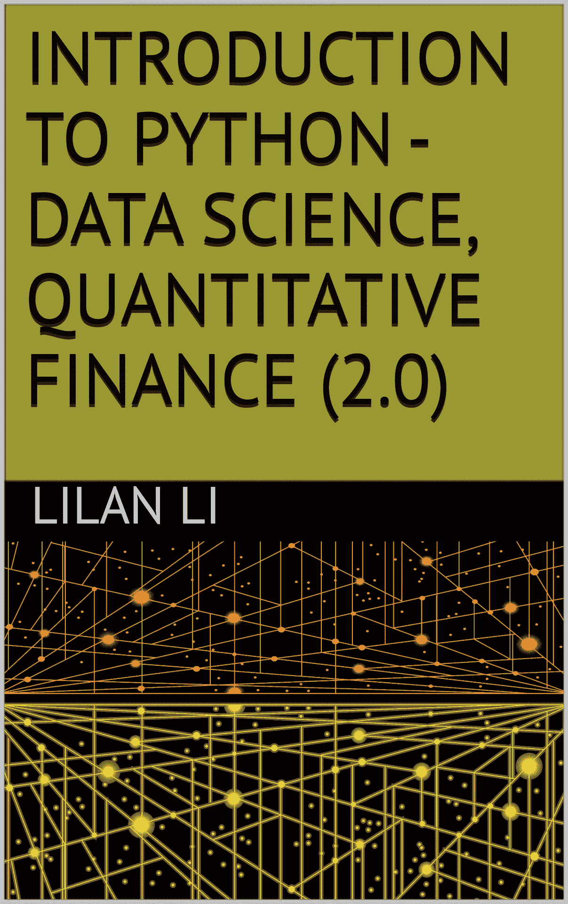


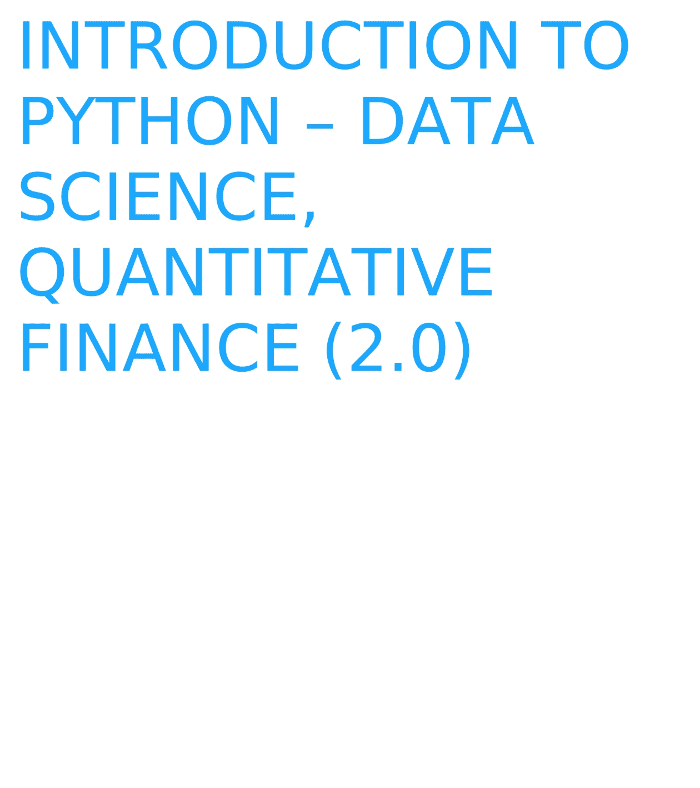

## 第二版序言

学习 Python 并不是本书的目的，解决底层问题才是。在所有脚本语言中，Python 的主导地位得益于协作的社会工程：它是开源的，可以从开发者世界获得免费且无限制的支持，并吸引越来越多的数据科学家和工程师通过行业特定功能来支持其增长。

本小书从编程介绍开始，并通过一些示例展示了这些内容如何融入金融专业人士的日常工作中。由于大多数示例都是为投资银行的真实工作生活定制的，因此本书适用于初学者也适用于中级金融专业人士。

在第三章中，学习曲线变得更加陡峭，并引入了定量建模和参数分析示例。如果你是金融专业的毕业生，或者对从事量化金融领域感兴趣，这本书也为你提供了一个机会，让你在申请投资银行职位之前提升技能。

话虽如此，这并不是面试面试用书。它是一份说明或介绍，旨在帮助你向量化金融领域的大跨越做好准备。

### 关于作者

## 1.1 编程语言基础

当我高中向我妈妈展示我的第一份编程作业时，那是一个基于命令行的数学游戏，目的是猜一个数字——一个实数，而不是复数。它涉及到一些随机生成的种子和一些预定义的计算，以及另一个随机生成的实数作为目标答案。我还可以设置难度级别来让玩家更容易通过。我清楚地记得我妈妈看着那个黑白色的类 DOS 屏幕，希望能播放一首欢快的歌曲。是的，一旦我猜对了，那个声音就会响起来奖励获胜者。那是上世纪的故事，我不记得我当时使用的是什么语言了。它运行在我拥有的第一台电脑上，可能在几十年前就已经回收利用了（希望如此）。

故事暂暂不谈，让我们来看看编程的定义：编程是将算法并将其编码为一种符号（即编程语言），以便计算机可以执行的过程。重要的第一步是找到解决问题或需求的解决方案。编程通常是我们创建解决方案表示形式的方式。

### 阿姆斯特数（Armstrong Numbers）

让我们从一个小例子开始：阿姆斯特数。一个三位阿姆斯特数是一个整数，其各位数字的立方之和等于该数字本身。例如，371 是一个阿姆斯特数，因为 `3³ + 7³ + 1³ = 371`。我们该如何为此编写算法或解决方案呢？现在我们有一个需求和一个需要解决的问题。其次，在尝试解决方案之前，我们必须分解问题（抽象化）。最小的阿姆斯特数是 1，因为 `1³ = 1`。对于单数字整数来说很简单，我们只需要获取输入并将其乘以三次。如果它等于输入的整数，它就是阿姆斯特数，否则不是。

两位、三位、四位甚至五位的整数呢？如果我们想打印给定上限范围内所有的阿姆斯特数怎么办？现在我们需要一个算法或一个更有结构性的计划：首先，我们逐位读取整数的数字（为了这样做，我们必须将整数转换为字符串，然后对每个数字重复 `i3` 操作并累加）。这涉及一个 `for` 循环：

```python
l = 0
s = str(n)
for i in s:
    l = int(i)*int(i)*int(i) + l
```

我们通过 `s = str(n)` 将多位整数转换为字符串 `s`，其中 `n` 是输入整数。`for` 循环读取字符串的每个字符并计算 `i3`。这里通过编写 `int(i)` 完成从字符串到整数的数据类型转换，以便进行算运算。由于目的是累加每个数字的 `i3`，我们需要在每个 `for` 循环步骤中加上之前的计算结果，否则如果只用 `l=int(i)*int(i)*int(i)`，只会得到最后一位数字的立方。对于 `n = 123`，上述代码的结果为 `1³ + 2³ + 3³ = 36`。

现在我们需要将其封装成一个函数，以便以后从主函数中复用。假设下一步是找到 1 到某个上限之间所有的阿姆斯特数。现在你必须脑海中涉及到一种 `for` 循环来计算该范围内的每个整数，如果它符合阿姆斯特数的标准，我们就保留并打印它。如果不符合，我们就继续。因此，需要一个阿姆斯特数测试函数来检查是否满足标准。

首先，我们将刚刚提到的算法封装进函数 `arm(n)`（Python 函数将在第 1.6 节介绍），处理输入 `n` 为单位整数的情况：

```python
def arm(n):
    l = 0
    if len(str(n)) <2: #单位整数情况
        return n*n*n
    else:
        s = str(n)
        for i in s:
            l = int(i)*int(i)*int(i)+ l
        return l
```

测试函数名为 `arm_test(x)`。它读取输入数字 `x` 并将其与阿姆斯特数计算函数 `arm(n)` 进行比较：

```python
def arm_test(x):
    if x == arm(x):
        print (x, "is an Armstrong number!")
    else:
        print (x, "isn't an Armstrong number")
```

最后，总有一个主部分来定义输入输出，以及如何调用不同的函数，以及结果如何作为另一个函数的中间输入。完整代码位于后面的 Python 函数章节 1.6 中。

## 1.2 什么是 Python？

Python 是一种用于通用编程的解释型高级编程语言。由 Guido van Rossum 创建并在 1991 年首次发布，Python 的设计哲学强调代码的可读性，特别使用了大量的空白字符。Python 具有动态类型系统和自动内存管理。它支持多种编程范式，包括面向对象、命令式和函数式编程，并拥有庞大的标准库。

Python 使用空白（空格和制表符）而不是大括号 `{}`。这称为缩进。因此，当你输入 Python 代码时，需要注意空格键，因为它可能会引入结构错误。下面是 Java 中带有 `for` 循环的公共函数示例：

```java
public static int sumList(int[] liste) {
    int total = 0;
    for(int val : liste) {
        total += val;
    }
    return total;
}
```

在 Python 中，你不需要在方法前面声明公共或私有，也不需要声明变量类型。以下代码是 Python 中的样子：

```python
def sumList(liste):
    total = 0
    for val in liste:
        total += val
    return total
```

Python 可读且语法简单，这使得它对用户更友好且不那么复杂。因此，它很容易供初学者学习，并具有许多交互特性。最重要的是，在过去的几十年里，这种语言经历了巨大的演变，有许多开源包可用于执行复杂的算法。

## 1.3 Python 开发环境

在开始编程之前，你需要一个代码编辑器，或 IDE - 集成开发环境。`Spyder` 是学者入门的良好选择，特别是对于那些不需要使用 `PyCharm` 中包含的一些高级功能的人来说。它轻量且易于安装，并且通常带有 Python 包。它不需要许可证，在运行程序时也不会消耗过多内存。`PyCharm` 适用于熟悉 IDE 及其集成功能（如调试、单步进入断点、重构以及涉及多个文件、包和多名开发人员的大规模开发）的高级用户。如果你有一个庞大的 Python 程序库，你需要一个像 `PyCharm` 这样的工具。

开始 Python 编码的一个很好的选择是使用命令行的 shell 环境或控制台。经典的 DOS 命令行也可以配合文本编辑器使用。控制台是你在命令解释器内部输入、与数据交互并将其可视化的地方。在控制台中输入的所有命令都会被立即执行，从而允许用户自由地中断任何进程。

另一个流行的开发环境是 `Jupyter Notebook`。它是一个开源 Web 应用程序，允许你创建和共享包含实时代码、方程和图表的文档。它具有与控制台式开发环境相同的优势，但更符合视觉习惯且功能强大。存在各种集成数据科学平台（例如 `Anaconda`），其中开发环境和开源包已经预先下载。在本书中，所有的代码示例要么基于 `Jupyter notebook`，要么基于 `Python Console`（大多数如 `Spyder` 和 `PyCharm` 都有控制台窗口）。可以在此处下载 `Anaconda`：[https://www.anaconda.com/]。`Anaconda Navigator` 是一个基于 GUI 的工具，允许你轻松地找到 `Anaconda` 提供的所有不同工具包和软件。运行该程序将显示界面：

如你所见，有很多程序供你使用。点击 Launch 打开 `Jupyter Notebook` 程序。浏览器将打开一个新标签页，显示主目录下的文件夹和文件列表。

## 1.4 Python 中的基本数据类型

我在下表中列出了基本数据类型，并附有相关的注释和示例：

| 类型 | 示例 | 注释 |
| :--- | :--- | :--- |
| `bool` | `True`, `False` | 这是一个“逻辑”值 |
| `int` | `123` | 整数 |
| `float` | `1.23` | Python 中的 `float` 类型指定浮点数，在内部表示为二进制（基 2）分数。大多数小数无法精确地表示为二进制分数，因此在大多数情况下，浮点数的内部表示是实际值的近似。在实践中，实际值与表示值之间的差异非常小，不应引起显著问题 |
| `complex` | `1.2+3j` | 复数的指定格式为 `<实部>+<虚部>j`，两者均为浮点数值。 |
| `Str` | `"hello"`, `''` | 字符串是字符数据的序列。Python 中的字符串可以包含你任意数量的字符。唯一的限制是你机器的内存资源。字符串可以是空的 |
| `list` | `[1,2,3]`, `[2,5,'python']`, `[[2,4],[3,6]]` | `list` 可以包含一系列相同类型或不同类型的值，并由方括号 `[]` 定义。Python 中的所有列表都从 0 开始索引。列表不限于单一维度。可以通过逗号分隔多个方括号 `[]` 来声明多个维度。`List` 是动态且可变的。 |
| `tuple` | `(1,2,3)` | `tuples` 是类似于列表的一组值，以类似的方式操作。然而，元组的大小是固定的（不可变的），一旦赋值，成员就无法更改。`Tuples` 由括号 `()` 定义。 |
| `dict` | `{'Age': 17, 'name': 'Peter'}` | Python 中的字典是 `Key: Value` 对的列表。这是一种强大的数据类型，可以存储大量通过 `keys` 关联的相关信息。字典的主要操作是根据 `key` 名称提取值。与使用索引的列表不同，字典允许使用 `key` 来访问其成员。字典还可以用于排序、迭代和比较数据。字典使用大括号 `{}` 创建，值对之间用逗号分隔，键和值对之间用冒号关联：字典中的每个 `Key` 必须是唯一的。 |

以上是 Python 中最常见的数据类型，我们可以使用下面的代码行来检查 Python 数据类型。例如：`type(variable)`

## 1.5 循环与条件

循环可能是编程世界中最重要的逻辑操作之一。只要满足特定条件，循环就会重复执行。

### For 语句

让我们看看 `range(x)` 的含义：

- 迭代器从 0 开始并遍历 `x` 个整数。
- 如果 `x > 2`，则为 `(0, 1,2,…..x)`。

```python
for i in range(3):
    print(i)
### 输出: 0 1 2
```

### While 语句

```python
j = 4
while j > 0:
    print(j)
    j = j-1
### 输出: 4 3 2 1
```

### For 还是 while？

如果我们知道执行主体的最大次数，则使用 `for` 循环。例如，如果我们正在遍历元素列表，我们知道可能需要的迭代次数是“列表中的所有元素”。相反，如果我们需要重复某些计算直到满足某个条件，且无法预先计算何时发生，那么我们需要一个 `while` 循环。我们将第一种情况（`for` 循环）称为“确定性迭代”；后一种情况（`while` 循环）称为“不确定性迭代”——我们甚至不确定需要多少次迭代！

### 条件语句

为了编写实用的程序，我们几乎总是检查条件并据此更改程序的行为。条件提供了这种能力。最简单的形式是 `if` 语句：

```python
if 布尔表达式:
    语句
```

`if` 语句后面的布尔表达式称为 `条件`。如果它为真，则执行所有的缩进语句。如果条件为假会发生什么；我们是做其他事情还是设置另一个条件？另一个条件由 `elif` 引导，默认语句由 `else` 引导：

```python
if type(i) == list:
    print("是列表类型")
elif type(i) == int:
    print("是整数类型")
else:
    print("是其他类型")
```

## 1.6 Python 函数

`function`（函数）是一个只有在被调用时才会运行的代码块。当从另一个函数调用或直接从 Python 提示符调用时，我们可以传递参数（也称为参数）。函数可以执行打印、修改值、进行代数运算等任务，并返回数据作为结果。我们可以在 Python 控制台中输入代码：

```python
def first_function(a):
    print ("the input is", a)
    result = a+a*2
    return result
```

`def` 表示这是一个函数，可以通过提供正确的输入在代码的其它地方进行调用。与之前的命令行编码风格相比，它是代码复用一个示例。当我们执行或调用此函数时，我们只需要将数据/参数传递到函数中：

```python
>>> first_function(2)
the input is 2
6
```

此外还有设置默认参数的可能性。默认参数是指当在函数调用中没有为该参数提供值时，它会假设一个默认值的参数。对于上面的示例，我们可以增加它的复杂性：

```python
def first_function(a, type = 'int'):
    print ("the input is", a, "and the data type is", type(a))
    if type == 'int':
        result = a + a*2
    else:
        result = a[0] + a[0]*2
    return result
```

`a[0]` 是访问列表元素的方法。`a[0]` 是列表的第一个元素，`a[1]` 表示第二个元素，以此此类推。如果尝试访问列表长度之外的元素位置，通常会抛出错误 `list index out of range`。如果我们在调用函数时不指定 `type = `，它将使用在函数定义参数中设置的默认值（在本例中，它是 `type = int`）。请注意，许多 Python 预定义函数都有默认参数，使用它们时我们应该注意它们的默认值。

```python
>>> first_function(2)
the input is 2 and the type is int
6
```

这里 `6` 是 `a + a*2 = 2 + 2*2 = 6` 的结果。

```python
>>> first_function([2,3,4])
the input is [2, 3, 4] and the type is int
[2, 3, 4, 2, 3, 4, 2, 3, 4]
```

在这种情况下，在函数中没有指定类型，因此类型为默认值 `int`，因此计算结果 `a + a*2`（当 `a = [2,3,4]` 时）变为了：`[2,3,4] + [2,3,4] * 2 = [2, 3, 4, 2, 3, 4, 2, 3, 4]`。但如果我们修改参数并覆盖了它的默认值，结果就会不同：

```python
>>> first_function([2,3,4], 'list')
the input is [2, 3, 4] and the type is list
6
```

这里 `6` 是 `a[0] + a[0]*2` 的结果，其中 `a[0] = 2`，是输入列表 `[2,3,4]` 的第一个元素。对于安姆斯特数（Armstrong number）的情况，显示了完整的代码。你应该能够在 `PyCharm` 或 `Spyder` 等 IDE 上运行这段代码。

`arm()` 是用于计算输入数字的安姆斯特数的。

```python
def arm ( num ):
    calnumber = 0
    if len ( str ( num )) < 2 : # 单位数情况
        return num * num * num
    else:
        string = str ( num )
        for i in string:
            calnumber = int (i)* int (i)* int (i)+calnumber
    return calnumber
```

`arm_test()` 是用于测试从输入计算出的安姆斯特数是否为安姆斯特数。


```python
def arm_test(num):
    if num == arm(num):
        print(num, "is an Armstrong number!")
    else:
        print(num, "isn't an Armstrong number")

def arm_list(limit):
    for i in range(1, limit):
        if i == arm(i):
            print(i, "is an Armstrong number!")
        else:
            continue

while True:
    while True:
        try:
            NUMBER = int(input("Enter the number:"))
            break
        except ValueError:
            print("Oops that was not a valid number, try again....")
    print("You have just entered: %d" % NUMBER)
    arm_test(NUMBER)
    LIMIT = int(input("Enter the upper limit:"))
    arm_list(LIMIT)
    VAR = input("Would you like to play again? (Y/N): ")
    if VAR == "N" or VAR == "n":
        break
```

取决于你与程序的交互，输出大致如下：

```
Enter the number:12
You have just entered: 12
12 isn't an Armstrong number
Enter the upper limit:1000
1 is an Armstrong number!
153 is an Armstrong number!
370 is an Armstrong number!
371 is an Armstrong number!
407 is an Armstrong number!
Would you like to play again? (Y/N): n
```

如果你对最后一个问题`Would you like to play again?`回答`Y`，整个程序将再次运行，因为整个循环会持续。请注意，如果你在第二个输入中选择了一个非常高的上限，Python 代码需要一段时间来计算并找到所有的安姆斯特数。

## 1.7 示例

在通过安姆斯特数示例介绍 Python 基础之后，将演示更多利用 Python 函数和循环的示例，这些都是基础模块。

### 1.7.1 第一个示例：欧拉数 e

Leonhard Euler 是 18 世纪的一位瑞士数学家。他对数学的不同分支都有许多贡献。在他许多发现和发展中，我们将观察最著名的数学常数之一——欧拉数`e`，它大约等于 2.71828，代表对数的自然底。我们尝试计算或估计与三角学相关的数学常数`e`。在这个示例中，我们将从金融中的复利中获得灵感。基于复利利率的`e`估计公式所示。

一个更通用的指数函数`ex`或`exp(x)`可以编写。根据`ex`的导数等于`ex`本身以及著名的泰勒级数定义，当`x = 1`时，`ex`可以通过无穷级数的和来计算。

```python
def recur_factorial(n):
    if n == 1:
        return n
    else:
        return n * recur_factorial(n - 1)
```

```python
j = 1
e2 = 0
e = 1 + 1/1  # initialize e
while j <= 5:
    if j == 2:
        e2 = 1/2
        e = e + e2
        print('mathematical constant e is', e)
    if j == 3:
        e2 = 1/6
        e = e + e2
        print('mathematical constant e is', e)
    if j == 4:
        e2 = 1/24
        e = e + e2
        print('mathematical constant e is', e)
    if j == 5:
        e2 = 1/120
        e = e + e2
        print('mathematical constant e is', e)
    j = j + 1
```

输出为：`mathematical constant e is 2.5`，`mathematical constant e is 2.6666666666666665`，`mathematical constant e is 2.708333333333333`，`mathematical constant e is 2.7166666666666663`。

我们将迭代限制设为 5，并使用`while`循环来计算`n`等于 5 的无限级数。这是一个独立的计算，只要没有达到迭代限制，`if`条件就可以继续执行。它没有调用 Python 函数`recur_factorial(n)`，因为`n!`的计算是内联完成的，这并不是理想的，因为随着迭代的增加，这种计算会变得复杂并可能引入错误，从而降低精度。

方法 2，使用函数`recur_factorial(n)`来计算`n!`并使用`while`循环来累加阶乘。迭代次数设为 9。

- `while j < 10`意味着循环在`j`达到 9 时停止。

```python
j = 0
e = 1.0  # initialize e
while j < 10:
    e2 = 1/recur_factorial(j + 1)
    e = e2 + e
    print('e is', e, 'and iteration number is', j)
    j = j + 1
```

输出为：`e is 2.0 and iteration number is 0`，`e is 2.5 and iteration number is 1`，`e is 2.6666666666666665 and iteration number is 2`，`e is 2.708333333333333 and iteration number is 3`，`e is 2.7166666666666663 and iteration number is 4`，`e is 2.718055555555555 and iteration number is 5`，`e is 2.718253968253968 and iteration number is 6`，`e is 2.71827876984127 and iteration number is 7`，`e is 2.718281525573192 and iteration number is 8`，`e is 2.71828180114638 and iteration number is 9`。

我们可以看到，随着迭代的增加，数学常数`e`的精度得到了提高，特别是当`n`高于 5 时。方法 3 与方法 2 非常相似。唯一的区别是使用了`for`循环而不是`while`循环。在这种情况下，我们不需要手动增加`j`。

使用`for`：

```python
e = 1.0  # initialize e
for j in range(10):
    e2 = 1/recur_factorial(j + 1)
    e = e2 + e  # sum-up
    print('e is', e, 'and iteration number is', j)
```

输出为：`e is 2.0 and iteration number is 0`，`e is 2.5 and iteration number is 1`，`e is 2.6666666666666665 and iteration number is 2`，`e is 2.708333333333333 and iteration number is 3`，`e is 2.7166666666666663 and iteration number is 4`，`e is 2.718055555555555 and iteration number is 5`，`e is 2.718253968253968 and iteration number is 6`，`e is 2.71827876984127 and iteration number is 7`，`e is 2.718281525573192 and iteration number is 8`，`e is 2.71828180114638 and iteration number is 9`。

方法 4 使用了强大的 Python`List`类型来方便累加。在方法 3 中，累加是在`for`循环中实现的，而不同`n`的阶乘值被存储在列表中。累加是通过 Python`sum()`函数实现的：当`a`是列表时，`sum(a)`会加上列表`a`中的所有数字。在代码中，我们调用`recur_factorial(n)`并打印列表`e2`，它包含了不同`n`的`1/n!`值：`1/1, 1/2, 1/6, 1/24……`。

```python
n = 9
e2 = [1/recur_factorial(i) for i in range(1, n)]
print(e2)
e = 1 + sum(e2)
print('e is', e, 'and the number of iteration is', n)
```

输出类似于：`[1.0, 0.5, 0.16666666666666666, 0.041666666666666664, 0.008333333333333333, 0.001388888888888889, 0.0001984126984126984, 2.48015873015873e-05]`，`e is 2.71827876984127 and the number of iteration is 9`。

有一种更好的方法可以完全在主代码中消除`for`（或`while`）循环，但这需要对函数`recur_factorial(n)`进行修改，以扩展其功能，包含根据`n`值对不同阶乘进行累加。我将这个留给你的练习。

### 1.7.2 第二个示例：欧拉等式

由于我对欧拉和自然对数底`e`充满热情，我们将来看欧拉发明的另一个杰作：图 1‑4 写了欧拉等式，我假设你对复数及其几何表示已经熟悉了。

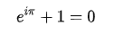

图 1‑4 欧拉等式，其中`e`是我们在第一个示例中估算的欧拉数。`i`是虚数单位，定义为`i² = -1`，`π`是圆周率，即圆周长与直径的比值。从图 1‑2 中，我们设置`x = iπ`，得到`e^{iπ}:`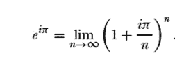

我们知道当`n`趋于无穷时，`e^{iπ}`会趋于 -1。我们实现了一个收敛逻辑来检查`n \in [0,100]`时`e^{iπ}`的值。与之前估计`e`的示例类似，我们创建了一个函数来执行迭代。这里与函数`recur_factorial(n)`的区别在于我们使用了图 1‑3 中的公式，该公式包含显式的迭代`n`和隐式的迭代`n_local`。

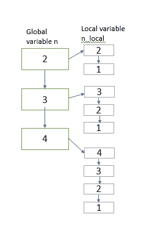

图 1‑5 全局变量`n`向局部变量`n_local`传递的示意。`n_local`是函数调用时创建的局部变量。它只在函数内部使用：`euler_id_loop(n_local)`。它控制此函数调用需要多少局部迭代。`n`是全局变量，从局部迭代的角度来看它是无关的，因为它由主函数中的关键语句决定：`for n in range(1, 1000)`。请参见图 1‑5 的示意，代码表示如下：

```python
def euler_id_loop(n_local):
    if n_local == 1:
        return (1 + (math.pi * complex(0, 1)) / n)
    else:
        return (1 + (math.pi * complex(0, 1)) / n) * euler_id_loop(n_local - 1)
```

主函数变为：

```python
import math as math
import matplotlib.pyplot as plt
real = []
imag = []
for n in range(1, 1000):
    # n 是全局变量，控制循环迭代
    if n == 1:
        eulerid = (1 + (math.pi * complex(0, 1)) / 1)
        print(n, eulerid)
    else:
        eulerid = euler_id_loop(n)  # n 被传递给函数以形成一个新的局部变量
        real.append(eulerid.real)
        imag.append(eulerid.imag)
    real.append(eulerid.real)
    imag.append(eulerid.imag)
plt.scatter(real, imag)
plt.xlabel('real')
plt.ylabel('imaginary')
plt.grid()
plt.show()
```

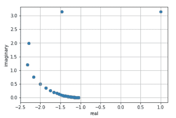

图 1‑6 图形中的欧拉等式收敛证明

如果我们对`iπ`做些处理，将其变为变量并设置迭代来遍历整个频谱会怎样？如果我们的迭代和循环逻辑足够好，它应该显示出一个完整的圆，因为有`e^{iπ} = -1`和`e^{2iπ} = 0`。我们设置了一个名为`euler_id_loop_pi(pi_size, n_local)`的函数，其中`pi_size`代表变量`nπ`，`n`从 0 到我们需要完整圆的数量。一个完整的圆是`2π`。与`euler_id_loop(n_local)`来说，这里的逻辑是相同的，只是用额外的局部变量`pi_size`代替了简单的`math.pi`，因为这里的`pi_size`是随时间变化的变量。`n_local`是迭代器。

```python
def euler_id_loop_pi(pi_size, n_local):
    if n_local == 1:
        return (1 + (pi_size * complex(0, 1)) / n)
    else:
        return (1 + (pi_size * complex(0, 1)) / n) * euler_id_loop_pi(pi_size, n_local - 1)
```

我们然后编写主部分来遍历圆并绘图：

```python
import numpy as np
real = []
imag = []
n = 2000  # 迭代，增加值以提高精度
full_circle = 2  # 2Π 意味着一个圆，4 Π 意味着两个圆
for i in np.arange(0, full_circle * math.pi * 1.0, full_circle * math.pi / 100):
    eulerid = euler_id_loop_pi(i, n)
    real.append(eulerid.real)
    imag.append(eulerid.imag)
plt.scatter(real, imag)
plt.grid()
plt.xlabel('real')
plt.ylabel('imaginary')
plt.show()
```

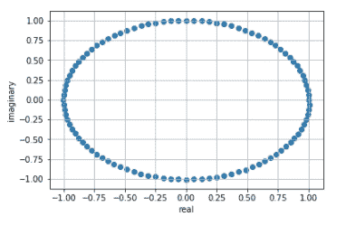

图 1‑7 当`π \in[0,100]`时欧拉数`e^{iπ}`的完整圆。如果迭代不够大，即使我们遍历了整个频谱，在 -1 和 0 处也会不匹配。

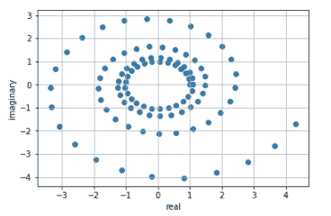

图 1‑8 欧拉收敛

关于这个奇妙数学方程的最后思考。沿着整个视野这个带有实部和虚部的美丽圆。如果我们从连续的角度来看，只有四条线是真正的 100% 实部或 100% 虚部。其余部分（无限数量的线条都是实部和虚部的混合）。在生活中，不也是如此吗？如果有错误但不被修正，不断重复（迭代）。

# 2 Python 包

在本章中，我们将仔细研究三个常用的 Python 包：用于数学和统计的 NumPy，用于数据分析的 Pandas 以及用于可视化的 Matplotlib。

## 2.1 数学 - NumPy

NumPy 是 Python 编程语言的一个库，增加了对大型多维数组和矩阵的支持，以及许多高级数学函数（如线性代数、傅里叶变换和随机数功能），用于对这些数组进行操作。除了明显的科学用途外，NumPy 还可以作为高效的通用数据多维容器。可以定义任意的数据类型。这使得 NumPy 能够与各种数据库无缝且快速地集成。

### 2.1.1 Numpy 简介

在安装 Numpy 包之前，你首先需要安装好`python`。例如，如果你是通过 Anaconda 安装的`python`，那么 NumPy 和其他有用的课程包已经安装好了。如果没有，请在控制台窗口中输入以下命令使用`pip`安装：

```bash
pip install numpy
```


NumPy 提供了高性能的多维数组，以及用于计算和操作这些数组的基本工具。数组是一个由相同类型的元素（通常是数字）组成的表格，通过一个正整数元组进行索引。在 NumPy 中，维度被称为轴（axes）。Numpy 的多维数组被称为`ndarray`。注意，它与标准 Python 库中的类`array.array`不同，后者只处理一维数组且提供的功能较少。

我们首先导入`numpy`包以使用它，并给它取了一个简短名称`np`：

```python
import numpy as np
```

然后，我们创建一个从 0 到 15、维度为 3x5 的多维数组（矩阵）：

```python
a = np.arange(15).reshape(3, 5)
```

要查看创建的对象`a`，只需在控制台输入它并按回车键：

```python
a
array([[ 0, 1, 2, 3, 4], [5, 6, 7, 8, 9], [10, 11, 12, 13, 14]])
```

如果我们想检查数组的维度和大小，我们使用`shape`命令，它会返回一个整数元组，表示数组在每个维度上的尺寸：

```python
a.shape (3, 5)
```

你也可以使用`size`来获取数组内部元素的数量。在上面的示例中，它仅仅是`3 x 5 = 15`。但`size`不告诉数组的维度：

```python
a.size 15
```

`ndim`命令返回数组的轴的数量——即维度的数量，它不会显示每个轴上的元素总数，例如，数组`a`有两个维度：

```python
a.ndim 2
```

我们还可以创建一个三维数组并应用相同的函数。将下面的示例与上面的示例比较，`reshape`完成了矩阵形状操作的工作。

```python
b = np.arange(16).reshape(2, 4, 2)
b
array([[[0, 1], [2, 3], [4, 5], [6, 7]], [[8, 9], [10, 11], [12, 13], [14, 15]]])
```

数组`b`有三个维度：

```python
b.ndim 3
```

数组`b`有三个维度，每个维度分别有 2, 4, 2 个元素：

```python
b.shape (2, 4, 2)
b.size 16
```

为了访问 3D 数组特定位置的值，我们必须指定这三个维度：

```python
b[0][0][1] 1
b[0][1][1] 3
```

或者只取数组的一个子集：

```python
b[1][2]
array([12, 13])
b[1]
array([[8, 9], [10, 11], [12, 13], [14, 15]])
```

创建数组有多种方法：

```python
a = np.array([2,3,4])
a
array([2, 3, 4])
```

数组将序列的序列转换为二维数组，将序列的序列转换为三维数组，依此类推：

```python
b = np.array([(1.5,2,3), (4,5,6)])
b
array([[1.5, 2., 3.], [4., 5., 6.]])
b.ndim 2
```

数组类型在创建时也可以显式指定：

```python
c = np.array([[1,2], [3,4]], dtype = float)
c
array([[1., 2.], [3., 4.]])
```

## 2.1.2 其他 Numpy 示例

通常，数组的元素是未知的，但其尺寸是知的。因此，NumPy 提供了几个创建带有初始内容的数组函数。这减少了增长数组的开销。`zeros`函数创建一个全零数组，`ones`函数创建一个全 1 数组，而`empty`函数创建一个初始内容取决于内存状态的数组。默认情况下，创建的数组的`dtype`是`float64`。

全零数组：

```python
np.zeros((3,4))
array([[0., 0., 0., 0.], [0., 0., 0., 0.], [0., 0., 0., 0.]])
```

全 1 数组：

```python
a = np.ones((2,3,4), dtype=np.int16)
a
array([[[1, 1, 1], [1, 1, 1], [1, 1, 1]], ...]])
```

我们也可以轻松地更改创建的`ndarray`的值：

```python
a[:] = 3.41
a
array([[3, 3, 3], [3, 3, 3], [3, 3, 3]])
```

你可能奇怪为什么值是 3 而不是 3.41？这是因为我们创建的`ndarray`的数据类型指定为`int16`。下面的代码可以使用`astype`通过重新分配类型来解决这个问题：

```python
a = a.astype('float64')
a[:] = 3.41
a
array([[3.41, 3.41, 3.41], [3.41, 3.41, 3.41]])
```

创建数字序列，NumPy 提供了类似于`range()`的函数，返回的是数组而不是列表：

```python
np.arange(10, 30, 5)
array([10, 15, 20, 25])
```

当`arange`使用浮点数参数时，由于浮点精度问题，通常无法预测元素的数量。由于这个原因，通常使用`linspace`函数来接收元素的数量：

```python
np.linspace(0, 2, 6)
array([0. , 0.4, 0.8, 1.2, 1.6, 2. ])
```

### 基础操作

在数组上的算术运算符可以逐元素应用。会创建一个填充了结果的新数组。

```python
a = np.array([20,30,40,50])
b = np.arange(4)
b
array([0, 1, 2, 3])
```

在创建`a`和`b`后，我们尝试进行减法：

```python
c = a - b
c
array([20, 29, 38, 47])
```

乘法：`b`数组每个元素的平方：

```python
b**2
array([0, 1, 4, 9])
```

其他类的数学运算：

```python
10*np.sin(a)
array([ 9.12945251, -9.88031624, 7.4511316, -2.62374854])
```

也可以应用逻辑函数测试数组的每个元素：

```python
a < 35
array([ True, True, False, False])
```

与许多矩阵语言不同，乘法运算符`*`在 NumPy 中是逐元素操作：

```python
A = np.array([[1,1], [0,1]])
B = np.array([[2,0],[3,4]])
A * B # 这是逐元素乘积
array([[2, 0], [0, 4]])
```

矩阵乘积可以使用`dot`函数执行：

```python
A.dot(B) #矩阵乘积
array([[5, 4], [3, 4]])
```

一些经典操作，例如数组所有元素的和：

```python
a = np.array([[0.2, 0.3, 0.4],[0.5, 0.6, 0.7]])
a
array([[0.2, 0.3, 0.4], [0.5, 0.6, 0.7]])
a.sum() 2.7000000000000002
```

其他经典函数是：

```python
a.max() 0.6999999999999996
a.mean() 0.4500000000000001
a.min() 0.2000000000000001
```

与和或最大相比，乘积是一个相对复杂的操作。它正在做的是：`0.2*0.3*0.4*0.5*0.6*0.7`

```python
a.prod() 0.0050399999999999993
```

默认情况下，这些操作应用于数组就像它是是一个数字列表，无论其形状如何。但是，通过指定`axis`参数，你可以沿着数组的指定轴应用操作：

```python
b = np.arange(12).reshape(3,4)
b
array([[0, 1, 2, 3], [4, 5, 6, 7], [8, 9, 10, 11]])
```

现在我们有一个 2D `ndarray`，并尝试对每一列和每一行进行一些操作：

```python
>>> b.sum(axis=0) # 每列求和 array([12, 15, 18, 21])
>>> b.min(axis=1) # 每行的最小值 array([0, 4, 8])
>>> b.cumsum(axis=1) # 每行的累加和 array([[ 0,  1,  3,  6], [ 4,  9, 15, 22], [ 8, 17, 27, 38]]])
>>> b.prod(axis = 0) # 每列的矩阵乘积 array([  0,  45, 120, 231])
```

由于`ndarray`是二维二维的，如果我们设置`axis = 2`，它将返回错误：

```python
>>> b.prod(axis = 2) 
AxisError: axis 2 is out of bounds for array of dimension 2
```

NumPy 还提供了熟悉的数学函数，如`sin`、`cos`、`exp`和`sqrt`。在 NumPy 中，这些被称为“通用函数”（`ufunc`）。

```python
>>> a = 2.4
>>> np.sqrt(a) 1.5491933384829668
>>> np.exp(a) 11.023176380641601
```

在 NumPy 中，这些函数在数组上进行逐元素操作，产生一个数组作为输出：

```python
>>> B = np.arange(3)
>>> B
array([0, 1, 2])
>>> np.exp(B)
array([ 1.,  2.71828183,  7.3890561 ])
>>> np.sqrt(B)
array([ 0.,  1.,  1.41421356])
>>> C = np.array([2., -1., 4.])
>>> np.add(B, C)
array([ 2.,  0.,  6.])
```

多维数组对象也是如此。你将在本书后面介绍的各种示例中看到更多 Numpy 的用法。NumPy 的用途之一是用于蒙特卡洛模拟方法的`ndarray`类。

## 2.2 数据分析 / - Pandas

Pandas 是一个开源的、BSD 许可库，为 Python 编程语言提供了高性能、易用的数据结构和数据分析工具。它与动物熊猫无关，名字源于术语`panel data`（面板数据），这是一个计量经济学中包含同一对象在多个时期观测值的数据集。

该库具有以下特性：

* 用于数据操作的集成索引`DataFrame`对象。
* 用于在内存数据结构与不同文件格式之间读写数据的工具。
* 数据对齐和对缺失数据的集成处理。
* 数据集的重塑和透视（pivot）。
* 基于标签的大数据集切片和子集提取。
* 数据结构的列插入和删除。
* 分组引擎（Group by），允许对数据集进行拆分-应用-合并（split-apply-combine）操作。
* 数据集的合并和连接。
* 分级轴索引，用于在低维数据结构中处理高维数据。
* 时间序列功能：日期范围生成和频率转换、移动窗口统计、移动窗口线性回归、日期偏移和滞后。

### 2.2.1 股票市场分析示例

`DataFrame`及其包含的所有函数非常强大。以下示例是 Pandas 包在金融数据时间序列中的应用。需要将输入数据文件存储在本地，例如在`C:\Temp`中，算法是读取输入数据并根据不同的统计目的对其进行处理。道斯琼工业平均指数历史数据可以从各种互联网源下载，例如`yahoo finance`。我们将 CSV 文件保存到：`C:\Temp\DJI.csv`。

在这个示例中，我们查看从 2007/11/20 到 2018/11/20 的历史数据范围，数据所示（Image0016.jpg）。代码的第一部分是创建 Pandas 数据并将此 csv 文件读取到 dataframe：

```python
import pandas as pd
import numpy as np
location = r'C:\Temp\DJI.csv'
df = pd.read_csv(location)
```

正如我们从 (Image0017.jpg) 中看到的，`df`拥有 2771 行 x 7 列。我们可以计算`Close`列的最大值：

```python
df['Close'].max()
```

我们可以找到最大`Close`值的索引：

```python
df['Close'].idxmax()
```

如果我们想知道更多关于那一天的信息，可以简单地使用`loc`：

```python
df.loc[id]
```

输出所示（Image0018.jpg）：

```python
id = df['Close'].idxmax()
sortedDF = df.sort_values('Volume', ascending=True)
print(sortedDF)
```

我们注意到，尽管列出了前 10 个成交量，但原始 dataframe 的索引没有改变。

### 2.2.2 进一步练习

让我们根据 (Image0019.jpg) 做一个稍微高级的练习。使用此公式计算每日收益率。Pandas 是基于 NumPy 的。NumPy 速度的关键是一次性对整个数组执行操作，而不是逐行或逐项。因此，我们先将 pandas 序列转换为`ndarray`：

```python
adjClose = df['Close'].values
```

输出所示（Image0020.jpg）。为了理解`adjClose[1:]`和`adjClose[:-1]`它们实际上代表什么，我创建了图 2-1，希望从视觉角度容易理解：

```python
ret = (adjClose[1:] - adjClose[:-1]) / adjClose[:-1]
```

道斯琼工业平均指数每日收益率 (ret) 数组为：[-0.01622578, 0.0142073, -0.01829148, ..., 0.00490133, -0.01557383]$。或者，我们只需要遍历（循环会降低算法速度）Pand dataframe 中的所有项。首先，我们需要定义大小正确的空 NumPy `ndarray`。你会发现这与定义一个全零的 NumPy `ndarray` 不是回事。应该谨慎使用，如果定义了比需要更大的空数组，会导致数组末尾出现额外的非零值，反过来会混淆或导致我们的计算结果出错。

```python
ret = np.empty(adjClose.size-1)
for i in range(adjClose.size-1):
    ret[i] = (adjClose[i+1] - adjClose[i]) / adjClose[i]
```

```python
print (ret) array([-0.01622578,  0.0142073 , -0.01829148, ..., 0.00490133, -0.01557383])
```

返回值的输出与第一种相同。使用`Pandas` series 特性的第一种方法快得多（对于不熟悉`Pandas`数据序列结构的人来说可能可能那么直观），而且更加高级。

### 练习 2

另一个我们可以轻松练习的练习是计算每日收益率的平均值和标准差：

```python
mean = ret.mean()
stdv = ret.std()
print('the mean of the daily return is' , mean)
print('the standard deviation is' , stdv)
```

每日收益率的平均值为`0.0005977280989583951`，标准差为`0.007498175157038745`。

### 练习 3

计算收益率后，我们需要通过将计算出的每日收益率写回新的 csv 文件来存储它们。第一方法是传统的循环方法（缓慢！），它涉及逐个插入项目：

```python
adjClose = df['Adj Close']
adjCloseArray = adjClose.values
ret = (adjCloseArray[1:] - adjCloseArray[:-1])/ adjCloseArray[:-1]
i = 0
while i < adjClose.size- 1 :
    df.loc[i, ('return')] = ret[i]
    i = i+ 1
```

`loc[]`在行级别工作，要访问列只需使用`df['xxx']`，其中`xxx`是数据框列名。上述是行和列组合的示例：

```python
print (df)
```

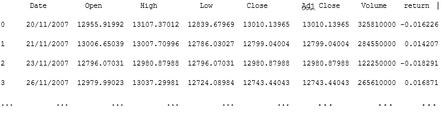 [2771 行 x 8 列]

第二种方法是将转换后的`Pandas` series 直接插入整个`DataFrame`而不使用循环，这种方法更快且更直观。我们首先将收益率数组转换为`Pandas DataFrame`，然后使用带有相关参数的`insert()`函数：

```python
df_ret = pd.DataFrame(ret, dtype = 'float')
df.insert(loc = 0, column = 'return ', value = df_ret)
```

结果如下：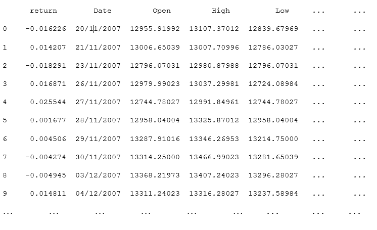 我们也可以通过将`loc = 0`改为其他值（只要`0 <= loc <= len(columns)`）来更改此新创建列的位置。有许多替代方案，例如使用`.apply()`函数。如果你感兴趣，我将留给你们去探索所有这些。本章的主要目的是介绍 Python 或者预热其相关包在金融数据领域的适用用法知识。


### 练习 4

在计算平均值和标准差后，我们可以进行简单的过滤，查看每日收益率值中的异常值。我们将离群值定义为偏离平均值两倍标准差的值。

```python
upLimit = mean + 2 * stdv
lowLimit = mean - 2 * stdv

# 从数据框中过滤出所需行的逻辑条件
df[(df['return'] > upLimit) | (df['return'] < lowLimit)]
```

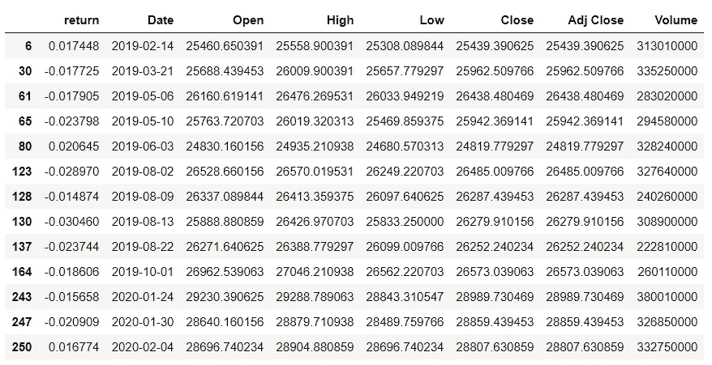

图 2‑2 用于道斯指数数据的 pandas 数据框架。它在每日限制报告中非常有用。通常，在面对大量的每日数据或历史数据时，我们需要过滤出有多少天或多少实体超过了业务或法规预设的限制。一个典型的例子是 `VaR` 或 `Expected Shortfall` 预期缺口分析。`VaR`（或 `ES`）决定了银行在特定时间内可以承受的损失限制。对于每年（或其他时间段）超过此限制的天数有一个阈值。使用一些简单的逻辑，我们可以轻松地提取这些异常值。

### 2.2.3 报告生成

现在我们将带有新插入列值的数据框作为报告保存，例如本地或共享驱动器上的 csv 文件。

```python
df.to_csv(r'C:/Temp/DJI_return.csv')
```

你应该能看到 `C:/Temp` 下创建了新文件 `DJI_return.csv`。你可能会认为 csv 文件并不那么“强大”，你更倾向于使用 Excel 作为报告模板，并嵌入图形图表。以下是对道琼斯指数历史数据进行数据分析示例的完整代码，并生成一个带有图形图表的 Excel 工作表作为报告模板。

```python
from pandas import read_csv
import pandas as pd

location = r'C:/Temp/DJI.csv'
df = pd.read_csv(location)

# 现在我们创建了一个 pandas Data Frames
adjClose = df['Adj Close']
adjCloseArray = adjClose.values

# 计算每日收益率
ret = (adjCloseArray[1:] - adjCloseArray[:-1]) / adjCloseArray[:-1]

# 将每日收益率插回数据
df_ret = pd.DataFrame(ret, dtype='float')
df.insert(loc=0, column='return ', value=df_ret)

# 将 Pandas DataFrame 保存到 Excel 表格
out_path = r'C:/Temp/Dow_return.xlsx'
writer = pd.ExcelWriter(out_path, engine='xlsxwriter')
df.to_excel(writer, sheet_name='Sheet1', startrow=0)

# 获取簿和表对象以便进一步操作
book = writer.book
sheet = writer.sheets['Sheet1']

# 计算平均值和标准差以计算异常值。这里我们使用 2 倍标准差作为标准
mean = ret.mean()
stdv = ret.std()
upLimit = mean + 2 * stdv
lowLimit = mean - 2 * stdv

# 使用条件格式将异常值设为红色
format1 = book.add_format({'font_color': '#E93423'})
sheet.conditional_format(
    'B2:B2771',
    {
        'type': 'cell',
        'criteria': '<=',
        'value': lowLimit,
        'format': format1
    }
)

# 整个期间的图表
chart = book.add_chart({'type': 'column'})
chart.add_series({
    'values': '=Sheet1!B2: B2771',
    'name': '=Sheet1!B1',
    'categories': '=Sheet1!$C$2:$C$2771'
})

# 我们在正确的位置插入每日收益率图表
sheet.insert_chart('K10', chart)
writer.save()
```

可以看出，与生成包含结果的简单 csv 文件相比，拥有 Excel 工作簿作为报告模板需要更多的代码行和配置。生成的报告看起来：

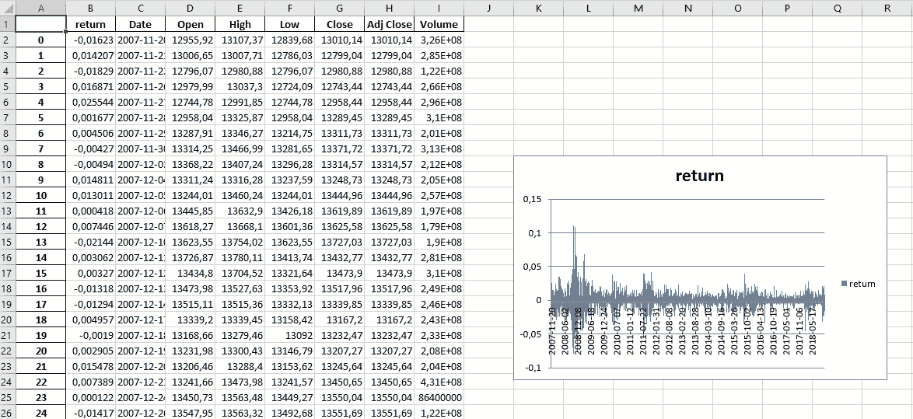

图 2‑3 生成的报告。我们已经解释了 `Pandas` 包在数据分析方面可以提供的基础函数，它极其依赖于具有重复操作的大规模数据，例如每日报告的生成或对标准数据的每日分析。在报告生成方面，有进一步的可能性通过更个性化的格式和专用的标题等来扩展工作表功能。我将留给你们去探索这个选项。

尽管如此，我们不需要把生活变得得太复杂，因为某些事情直接在工作表上做更容易。在数据科学部分，也有可能直接在 Yahoo 数据上工作而无需将其下载为本地保存文件，这允许使用更高级的“数据科学”方法来分析多个股票的金融市场。由于组合管理和算法投资不是本书的主题，我将留给你们根据兴趣探索这一领域。

## 2.3 可视化图形 – Matplotlib

Matplotlib 图形表示在金融领域非常重要。让我们来看看如何绘制数据。我们需要先导入绘图包。最常用的包名为 `matplotlib`。典型的导入标题格式为：

```python
import matplotlib
import matplotlib.pyplot as plt
```

在下方的代码示例中，假设上述导入已执行，`plt` 代表 `matplotlib.pyplot`。以 `pandas` 包为例，通过简单的命令即可完成单列数据的简单图表：

```python
df['Adj Close'].plot(grid=True)
```

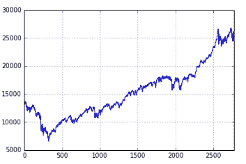

图 2‑4 输入数据中的 `AdjClose` 时间序列

这种图非常简单且原始，没有图表标题也没有关于其代表含义的轴信息。x 轴本应代表 `Date` 类型，但它显示的是不同的信息。让我们通过一种更复杂的方法，在同一张图表中绘制每日收益率和 `Adj close` 数据，但它们各自拥有独立的刻度。

要正确绘制 `Date` 类型并不显而易见，因为从源文件加载时，DataFrame 中的 `Date` 列是字符串类型。如果我们将其转换为 `int/float`，它可以正常工作，但在 x 轴上显示 `int/float` 类型在视觉上是不直观的。例如，上面简单绘制了某些数据的图，我们很难直观地理解 x 轴 `[0-2500]` 代表什么：点的间隔还是仅仅不同的步骤等。

`Pandas` 包提供了一个简单的方法来实现。在早期当我们将 csv 文件读取到 `Pandas` DataFrame 时，只需添加额外的参数 `parse_date`，这是一个将字符串列序列转换为 datetime 实例数组的函数：

```python
df = pd.read_csv(location, parse_dates=['Date'])
date = df['Date'].values
```

变量 `date` 的类型是 `numpy.ndarray`，但通过插入这个额外参数 `parse_dates=['Date']`，它的元素类型已从字符串变为了 `numpy.datetime64`。以下代码将产生描述的图表：

```python
import matplotlib
import matplotlib.pyplot as plt

fig, ax1 = plt.subplots()

color = 'red'
ax1.set_xlabel('Date')
ax1.set_ylabel('daily return', color=color)
ax1.plot(date[:-1], ret, color=color)  # 这是为了适应 x 和 y 轴的大小，因为 ret 的元素比其他少一个
ax1.tick_params(axis='y', labelcolor=color)

ax2 = ax1.twinx()  # 实例化共享相同 x 轴的第二个轴
color = 'blue'
ax2.set_ylabel('Adj Close', color=color)
ax2.plot(date, adjCloseArray, color=color)  # 这里我们使用了 Numpy，也可以使用 pandas 数据序列如 df['Adj Close']
ax2.tick_params(axis='y', labelcolor=color)

plt.title('Historical Daily return and Adj close value')
plt.grid()
plt.show()
```

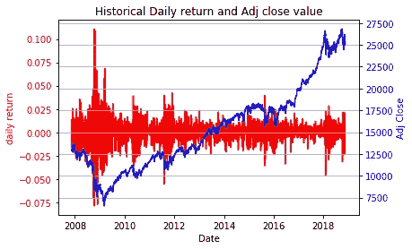

图 2‑5 一图中的两个图表，左侧（红色）为每日收益率时间序列，右轴（蓝色）为调整后收盘价时间序列

与第一个简单图相比，这里有几个特点：

- 我们有了图表标题和每个轴的名称来指示它们代表的含义。
- 在同一图中绘制了两个不同的刻度值，它们各自拥有自己的刻度。
- 非易处理的 `Date` 类型已正确转换。

## 2.4 结论

我们已经了解了什么是编程语言以及什么是 Python：从基础数据类型、循环、条件到 Python 函数。显然，它与其他编程语言有许多相似之处，例如在金融领域也常用的 `R` 和 `VBA`。然后，我们学习了三个最常用的 Python 包：`Numpy`、`Pandas` 和 `Matplotlib`。所有这些内容都结合示例进行了解释。在下一章《进阶 Python 示例》中，我们将提高学习曲线的门槛，通过引入数学建模示例和面向对象编程概念来进一步探索这三个包。

# 3 高级 Python 示例

在本章中，我将进一步探索一些使用不同 Python 包的高级 Python 示例，创建不同的函数并引入面向对象编程 (OOP)。对于初学者，我更建议在开始更高级的旅程之前，先阅读上一章并玩玩该章节中的示例。这里还介绍了量化金融模型及其数学表示。这需要一些基础的量化金融背景。

## 3.1 数学建模

我们看过了一个应用 `Pandas` 包的示例，其中分析了道斯琼平均指数的历史价格数据。现在我们想要构建一个程序来预测资产价格运动的未来路径。示例中有三种可能的建模选择：

第一个是**确定性模型** (Deterministic Model)，这意味着资产路径遵循确定性路径，并以无风险利率 `r` 的速度增长——就像我们银行账户里的资金，其年利率是知的。假设资产 `S` 以无风险利率 `r` 增长，标准公式为：

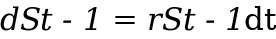

其中 `t = [1, T]`，`T` 是底层交易 `S` 的到期日，`S` 是底层资产价格，`r` 是无风险利率，`dt` 是时间的无限小增量，`dS-1` 是 `S` 的无限小增量，等于 `S`：


`t-1`

第二个模型假设资产既增加也不减少，它保持在初始水平。公式变为：

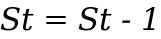

其中 `T` 是该工具的到期日。

第三个是**随机模型** (stochastic Model)。显然，它是三个模型中最复杂的，但也很好地代表了现实情况，即未来的资产路径是未知的，由漂移率 `μ`：


驱动，并由随机运动中的随机变量伴随：


假设资产 `S` 以恒定的漂移率 `μ` 增长，且恒定的波动率：


经典公式为：

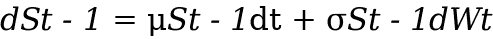

其中 `t = [1, T]`，`T` 是底层交易的到期日：


`μ` 是资产增长率，`dt` 是时间的无限小增量，`dS-1` 是 `S` 的无限小增量，等于 `S`；`dW` 是资产随机性的随机运动，我们有：


`t-1`

实现方式是简化的，意味着不涉及市场数据，也没有校准。这只是为了概念理解和说明。三个模型被实现为 Python 函数：

```python
def deterministic_model(s_1, r, dt):
    # 假设资产以无风险利率 r 增长
    s = s_1 * (1 + r * dt)
    return s


def constant_model(s_1):
    s = s_1
    return s


def stochastic_model(s_1, dt, mu, vol):
    dW = np.random.randn(1)[0] * np.sqrt(dt)  # numpy ndarray 返回数组类型，由于其中只有一个随机数，我们使用 [0] 取值
    ds = mu * s_1 * dt + vol * s_1 * dW
    s = s_1 + ds
    return s
```

未来的资产路径是沿时间轴的时间序列。对于随机模型，我们需要蒙特卡洛技术，这在这里通过 `NumPy` 包实现。由于不确定性（与确定性或恒定模型不同），我们不仅要在时间轴上模拟，还需要在多个路径上进行，从而获得潜在资产价格路径的概述。

在代码开头，我通过硬编码了某些市场数据。显然，这些参数可以不同的值，但必须遵守某些条件：

### 参数设置

1. `volatility` 不能超过 100% - 在这里我们将 `volatility` 设置为 `10%`。
2. `漂移率 μ ( mu )` 和 `无风险利率 r` 需要是一个较小的数字 – 我们将无风险利率设置为 `1%`，将漂移率设置为 `4%`，这代表了当前的费率和经济增长水平。
3. `dt` 是时间步长，需要足够小以符合其概念意义 – 我们将 `dt` 设置为 `0.1`。
4. `time_step` 与底层资产的到期期限相关。
5. `sim_step` 决定了模拟结果的准确性。

在这里为了说明目的，我们将 `time_step` 和 `sim_step` 都设置了较小的值以加快运行速度。在下一页中，你将找到完整的代码。

```python
import numpy as np  # 我们定义市场数据和模型参数

vol = 0.1
r = 0.01
mu = 0.04
s_1 = 100
dt = 0.1
sim_step = 40  # 可以增加以提高准确性，但会减慢速度
time_step = 80  # 与底层资产的到期期限相关

# 初始化 ndarray 输出
det_model_output = np.zeros(time_step)  # 确定性模型，所以我们需要 1D 数组
const_model_output = np.zeros(time_step)  # 常数，我们不需要模拟
stoc_model_output = np.zeros((time_step, sim_step))

const_model_output[:] = s_1
det_model_output[0] = s_1
stoc_model_output[0:] = s_1

# 为确定性和随机模型启动循环
for column in range(0, sim_step):
    for row in range(1, time_step):
        if column == 0:
            det_model_output[row] = deterministic_model(
                det_model_output[row - 1],
                r,
                dt
            )

        # 确定性模型只有一个维度，即时间范围
        stoc_model_output[row][column] = stochastic_model(
            stoc_model_output[row - 1][column],
            dt,
            mu,
            vol
        )
```

`stoc_model_output` 的缩进非常重要，因为只有随机模型的 2D 矩阵会通过嵌套循环（见图 3-1）。确定性模型没有随机性，因此除列零之外（其他模拟路径结果）在这里并不重要。

现在我们有了用于确定性资产价格、常量资产价格和随机资产价格的 `det_model_output`、`const_model_output` 和 `stoc_model_output`。算法包含嵌套循环，这不是我们想要的特性。在这里纯粹是为了说明（见图 3-1），我们构建了一个二维数组（`ndarray`），其中每列代表每个模拟步，每行代表时间步。

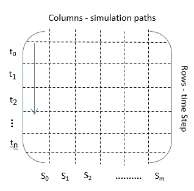

图 3-1 二维数组 - 嵌套循环

模拟未来资产路径并对其进行编码有很多替代方案，其中一些比其他的更优，另一些只是不同的思考方式。

## 3.2 可视化图形示例

为了可视化资产路径及其指示的未来价格，我们需要在图 3-2 中导入 `matplotlib` 进行图形化表示。

```python
import matplotlib
import matplotlib.pyplot as plt

plt.plot(det_model_output, 'g')
plt.title('Deterministic model output')
plt.xlabel('time step')
plt.ylabel('Asset Price')
plt.grid()
plt.show()
```

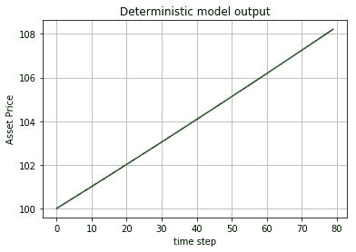

图 3-2 基于确定性模型的资产价格路径

对于常量模型输出 `const_model_output`：见图 3-3：

```python
plt.plot(const_model_output, 's')
plt.title('constant model output')
plt.xlabel('time step')
plt.ylabel('Asset Price')
plt.grid()
plt.show()
```

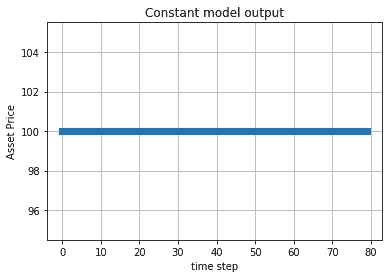

图 3-3 常量（无噪声）资产路径

为了绘制随机资产路径，我们需要一个循环和 `np.transpose()`。由于我们要沿着 x 轴绘制时间步，所以我们需要先转置输出以符合我们的图形表示：见图 3-4 用于：


```python
for i in range(0, sim_step):
    plt.plot(np.transpose(stoc_model_output)[i])

plt.plot(np.mean(stoc_model_output, axis=1), 'bs')
plt.title('stochastic model output')
plt.xlabel('time step')
plt.ylabel('Asset Price')
plt.grid()
plt.show()
```

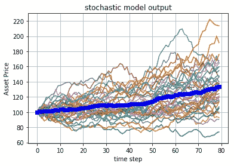

图 3-4 基于随机模型的资产价格路径

从图 3-4 可以看到，粗蓝线是每个时间步资产价格的平均（期望）。如果我们想绘制平均值，见图 3-5：

```python
plt.plot(np.mean(stoc_model_output, axis=1))
```

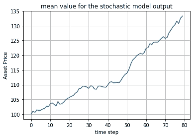

图 3-5 随机模型下的平均值

## 3.3 模型参数分析

...

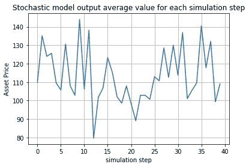

图 3-6 模拟步的平均资产价格

## 3.4 代码实现细节

随机模型的结果非常有趣，对于那些不熟悉经典几何布朗运动（GBM）模型的人来说，可能会发现输出很反常。首先，回顾函数：

```python
def stochastic_model(s_1, dt, mu, vol):
    dW = np.random.randn(1)[0] * np.sqrt(dt)
    ds = mu * s_1 * dt + vol * s_1 * dW
    s = s_1 + ds
    return s
```

我们稍微修改了主代码部分以包含随机建模输出 `ndarray`：

```python
def cal(vol):
    dt = 0.1
    r = 0.01
    mu = 0.04
    s_1 = 100
    dt = 0.1
    sim_step = 40
    time_step = 80
    stoc_model_output = np.zeros((time_step, sim_step))
    stoc_model_output[0:] = s_1  # 我们设置初始值
    for column in range(0, sim_step):
        for row in range(1, time_step):
            if column == 0:
                det_model_output[row] = deterministic_model(det_model_output[row-1], r, dt)
            stoc_model_output[row][column] = stochastic_model(stoc_model_output[row-1][column], dt, mu, vol)
    return np.mean(stoc_model_output, axis=1)
```

现在我们开始主部分，包括绘图部分和我们分析的目标变量——`volatility`。已经设置了一个不同波动率列表，使用 `for` 循环，波动率列表中的每个值都发送到函数 `cal()` 进行分析：导入 `matplotlib`。

```python
import matplotlib.pyplot as plt
import numpy as np
vol = [0.0, 0.2, 0.5, 0.8, 1.0]
mu = 0.02

fig = plt.figure()

ax = plt.subplot(111)

for j in range(len(vol)):
    vol_i = vol[j]
    x = cal(vol_i)
    ax.plot(x, label='$vol = %.1f$' % vol_i)

ax.legend()
plt.title('different asset price under different vols for mu = %.2f' % mu)
plt.xlabel('time step')
plt.ylabel('Asset Price')

plt.show()
```

总的来说，与低波动率相比，高波动率具有更多的“随机”轨迹（例如 `vol = 1.0`）：当 `vol = 0.0` 时，资产价格路径等同于确定性模型的输出。

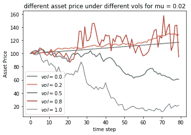

图 3-7 `mu = 0.02` 时不同波动率下的资产价格路径

一旦我们改变漂移率 `mu`（μ）值，整个情况也会发生变化。当 `μ` 较高时，向上趋势更加明显。看图 3-8。

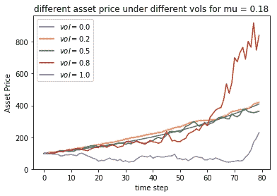

图 3-8 `mu = 0.18` 时不同波动率下的资产价格路径

如果漂移 `u` 变为负数，趋势将变为向下。看图 3-9。

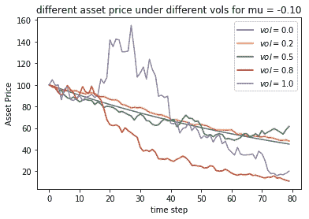

图 3-9 `mu = -0.1` 时不同波动率下的资产价格路径

现在，我们使用类似的分析机制，重点关注漂移率 `u` 而不是波动率 `σ`。我们只需保留上述示例中的 `stochastic_model()` 函数，并稍作修改 `cal()` 函数：

```python
def cal(mu):
    dt = 0.1
    r = 0.01
    s_1 = 100
    sim_step = 40
    time_step = 80
    stoc_model_output = np.zeros((time_step, sim_step))
    stoc_model_output[0][:] = s_1
    for column in range(0, sim_step):
        for row in range(1, time_step):
            stoc_model_output[row][column] = stochastic_model(
                stoc_model_output[row-1][column], dt, mu, vol
            )
    return np.mean(stoc_model_output, axis=1)
```

我们还需要修改绘图代码部分并更改全局变量 `u` 的列表。在分析示例中，我们将波动率设置为 0.2。

```python
mu = [-0.2, -0.1, 0.0, 0.2]
vol = 0.2
fig = plt.figure()

ax = plt.subplot(111)

for j in range(len(mu)):
    mu_i = mu[j]
    x = cal(mu_i)
    ax.plot(x, label='$mu = %.1f$' % mu_i)

ax.legend()
plt.title("different asset price under different drift for vol = %.2f" % vol)
plt.xlabel('time step')
plt.ylabel('Asset Price')
plt.grid()
plt.show()
```

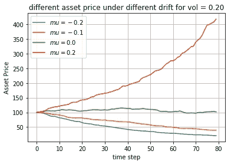

图 3-10 `vol = 0.2` 时不同漂移率下的资产价格路径

对于那些关注细节的人，`plt.grid()` 与之前相比为图表添加了网格。看图 3-10，较高的 `μ` 驱动了趋势（Higher `μ` drives the trend）。

`>>> z.calculate_price()` 97.5257618399161

每次执行上述两行代码时，输出都是不同的，因为每次在调用类函数 `Stochastic_model.calculate_price()` 时，都会调用类 `Stochastic_model` 的内部函数 `calculate_dW()` 来生成用于随机价格计算的随机数。这是一个典型的封装示例，它从外部视图“隐藏”了 `calculate_dW()` 函数及其相关数据。

你可以发现面向对象编程（OOP）的缺点：`x`、`y` 和 `z` 对象都有自己的 `calculate_price()` 函数，但在相同的输入变量下输出不同的结果。如果我们不关注每个 `calculate_price()` 函数的类层级实现，困惑和错误将不可避免地出现。

正如之前提到的，市场数据参数是为了说明目的而预定义的。代码的主要部分是：

```python
import numpy as np
vol = 0.1
dt = 0.1
r = 0.01
mu = 0.02
s_1 = 100
sim_step = 40
time_step = 80
det_model_output = np.zeros(time_step)
const_model_output = np.zeros(time_step)
stoc_model_output = np.zeros((time_step, sim_step))  # 设置常量模型输出的值，因为它不需要进行模拟
const_model_output[:] = s_1  # 第零步初始化
det_model_output[0] = s_1
stoc_model_output[0:] = s_1

for column in range(0, sim_step):
    for row in range(1, time_step):
        if column == 0:
            det_model_output[row] = Deterministic_model(
                det_model_output[row - 1], dt, r
            ).calculate_price()  # 先调用其构造函数创建一个随机模型对象
            s_model_obj = Stochastic_model(
                stoc_model_output[row - 1][column], dt, mu, vol
            )
            stoc_model_output[row][column] = s_model_obj.calculate_price()
```

我演示了两种生成类对象并调用其成员函数的方法。第一种（确定性模型对象）是使用一行代码创建对象并调用其计算价格函数——`obj.calculate_price()`。

第二种方法（随机模型对象）是先调用其构造函数创建一个中间模型对象，然后通过创建的对象调用其函数：

`obj = model_constructor()`

`obj.calculate_price()`

```python
import matplotlib
import matplotlib.pyplot as plt

for i in range(0, sim_step):
    plt.plot(np.transpose(stoc_model_output)[i])

plt.plot(np.mean(stoc_model_output, axis=1), 'bs')
plt.title('Stochastic model output')
plt.xlabel('time step')
plt.ylabel('Asset Price')
plt.grid()
plt.show()
```

对 `stoc_model_output` 使用相同的绘图代码，我们得到了随机建模资产价格路径的图 3-11，这与之前的非 OOP 实现非常相似。

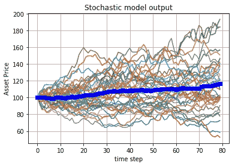

图 3-11 随机建模资产价格路径

只需将这三块紫色背景的代码复制到 Spyder 或 Jupyter Notebook 等 Python 编辑器中，你就可以获得此处演示代码相同的结果，因为这里的代码是可以执行的。

### 关于作者

2008 年 1 月抵达伦敦在摩根大通（JP Morgan）工作并不是什么平凡的事，至少对于我这个来自普通背景、与西方世界毫无联系、并由谦逊的父母支持的人来说是如此的。此外，我没有 MBA 学位，也没有来自牛津或常春藤等名校大学的金融硕士学位来换取优厚的待遇和额外的酌扣奖金。

2008 年在我的记忆中以及金融史上都是非常不寻常的一年。那是 2008 年 9 月，在雷曼兄弟倒产期间。当时我被分配到前台的 Hybrids 部门，负责信用衍生品的定价和建模。

为了简单介绍一下 Hybrids 和 Exotics（奇异产品）：我们有 CDO、CDO2、杠杆分档以及使用多名信用投资组合建模的档位期权。是的，它们听起来都既复杂又令人兴奋。

在信用衍生品交易台的日子里就像地狱，但是一个充满学习机会和让你开眼界的地狱，让你看到一个并不多人洞察的世界；那是一个有着漫长工作时间、不断的叫喊声以及需要应对贪婪和疯狂的地狱。

现在回想起来，我发现我的记忆过滤掉了糟糕和悲伤的部分，只留下了兴奋和回报。那些辛劳而狂野的日子塑造了现在这个具有韧性、坚韧不拔和决心的自我。

随着我所获得的那些金字不可求的职业技能，我现在拥有一套强大的工具箱，可以应对各种环境，尤其是恶劣的环境。将编程视为一段通往解决方案的旅程并享受这段旅程，有助于我们欣赏通往目标本身的每一个元素。
