# 数据科学统计与机器学习方法入门指南


## 基于质心的聚类（k-means 聚类）

## 用例：客户细分
## 自组织映射
## 案例研究：违约行为
## 聚类评估
## 聚类分析
## 其他主题
## 总结
## 扩展阅读

# 第 7 章：无监督模型——半结构化数据

## 章节概述
## 关联规则分析
### 市场篮子分析
### 置信度与支持度指标
### 用例：产品组合示例
### 预期置信度与提升度指标
### 关联规则分析评估
### 用例：产品获取
## 序列分析
### 用例：下一次最佳报价
## 链接分析
### 用例：产品关系
## 路径分析
### 案例研究：在线体验
## 文本分析
### 案例研究：呼呼叫中心分类
## 总结
## 扩展阅读

# 第 8 章：无监督模型的高级主题

## 章节概述
## 网络分析
### 网络子图
### 网络指标
### 用例：通过社交网络分析减少电信行业流失
## 网络优化
### 网络算法
### 用例：智慧城市——改进通勤路线
## 总结

# 第 9 章：模型评估与模型部署

## 章节概述
## 评估模型性能的方法
### 训练速度
### 评分速度
### 业务知识
### 拟合统计量
### 数据划分
### K 折交叉验证
### 拟合优度统计量
### 混淆矩阵
### ROC 曲线
### 模型评估
## 模型部署
### 模型
### 
### 模型运行
## 总结

# 关于本书

## 本书涵盖了什么？
本书介绍了数据科学项目中使用的统计和机器学习方法，重点关注其解决业务问题的适用性。书中未介绍软件，数学细节保持在最低。书中描述了与分析生命周期所有阶段相关的任务，包括数据准备与数据探索、特征工程与选择、考虑监督和无监督技术的分析建模，以及模型评估与部署。它描述了相关技术并提供了真实的案例研究来说明这些技术。

## 这本书适合你吗？
本书的读者是数据科学家、数据分析师、数据工程师、业务分析师、市场分析师或计算机科学家。然而，任何想要学习更多数据科学知识的人都能从本书中受益。

## 这本书的先决条件是什么？
本书没有先决条件。

## 我们想听听反馈
SAS Press 的书籍由 SAS 用户为 SAS 用户编写。我们欢迎您参与他们的开发，并对您正在使用的 SAS 书籍提供反馈。请访问 `sas.com/books` 执行以下操作：

* 注册书籍评审
* 推荐主题
* 请求有关成为 SAS Press 作者的信息
* 对书籍提供反馈

## 关于这些作者

![Author 1]
Carlos Pinheiro 博士是 SAS 的首席数据科学家，同时任法国数据科学学院的访问教授。自 1996 年以来，他一直在巴西一些最大的电信运营商处从事分析工作，担任过从技术到执行人员的多种职位。他曾担任巴西 EMC 的高级数据科学家，负责网络分析、优化和文本分析项目；并曾担任 Teradata 的首席数据科学家，负责机器学习项目。Pinheiro 博士拥有里约热内卢联邦大学的应用数学与计算机科学学士学位、计算科学硕士学位以及工程学博士学位。Carlos 在不同领域完成了一系列博士后研究，包括巴西 IMPA 的动态系统、爱尔兰都柏林大学的社交网络分析、法国萨瓦瓦大学的交通系统、比利时鲁汶根大学的社交网络与人类移动性，以及巴西格图利奥·瓦加斯基金会的城市移动与多模态交通。他在国际期刊和会议上发表了多篇论文，还是 `Social Network Analysis in Telecommunications` 和 `Heuristics in Analytics: A Practical Perspective of What Influence Our Analytical World` 的作者，这两本书均由 John Wiley Sons, Inc. 出版。

![Author 2]


# Michael Patetta

Michael Patetta 自 1994 年以来一直是 `SAS` 的统计学导师。他教授多种课程，包括在 `SAS^® Studio` 中`使用 SAS^® Viya® 进行监督机器学习过程`、`使用逻辑回归进行预测建模`、`数据科学统计方法简介`以及`使用 SAS Viya 进行回归方法`。在加入 `SAS` 之前，Michael 曾在卡罗来纳州州卫生部门工作了 10 年，担任健康统计学家和项目经理。自 1983 年以来，他撰写或合著了 10 篇发表的论文。Michael 拥有圣母大学的学士学位和北卡罗来纳大学教堂希山分校的硕士学位。在空闲时间，他喜欢在国家公园徒足。

访问他们的作者页面了解更多关于这些作者的信息，您可以在那里下载免费的书籍摘、访问示例代码和数据、阅读最新的评论、获取更新等：

- [`support.sas.com/pinheiro`](http://support.sas.com/pinheiro)
- [`support.sas.com/patetta`](http://support.sas.com/patetta)

献给 Daniele、Lucas 和 Maitê。

## 致谢

我于 2015 年 12 月 7 日加入 `SAS`，但许多人认为我以前曾在 `SAS` 工作过。并不是正式的。但确实，我与 `SAS` 有着很长的故事。

我从 2002 年在 `Brasil Telecom` 工作开始使用 `SAS`，当时我创建了一个非常活跃的数据挖掘小组，在整个公司开发监督和无监督模型。2008 年，我搬到了爱尔兰都柏林，在柏林市大学进行博士后研究。两年期间，我使用 `SAS` 进行社交网络分析。作为研究结果，我在 `Eircom` 部署了 `SNA` 模型。之后，我在 `SAS Ireland` 工作了六个月，使用了全新的 `OPTGRAPH` 过程。我开发了一些模型来检测汽车保险和纳税人的欺诈行为。

2010 年，我回到了巴西，有机会在 `Oi` 创建了一个分析实验室。该实验室专注于开发用于营销、欺诈、金融、收集和工程的创新分析。`SAS` 是它的大赞助者/合作伙伴。

2012 年初，我为 `SAS Turkey` 工作了几个月，为电信公司创建了一些网络分析项目，之后我搬到了法国安纳西，在法国萨伏亚大学进行博士后研究。研究侧重于交通系统，我使用 `SAS` 开发网络模型。2013 年，我搬到了比利时鲁文，在鲁文根大学（KU Leuven）进行博士后研究。研究侧重于动态网络分析，我也使用 `SAS` 进行模型开发。2014 年回到巴西后，我在 `EMC2` 和 `Teradata` 担任数据科学家，但大多数时间里仍然在使用 `SAS`，有时会配合开源软件包使用。2014/2015 年，我在 `Fundação Getúlio Vargas` 完成了博士后研究。研究侧重于人类移动性，你猜怎么着，我使用了 `SAS`。

最后，多亏 `Cat Truxillo` 的帮助，我在 `SAS` 找到了自己的位置。我加入了教育部门的高级分析小组。在这个小组工作让我学到了很多。要跟上这些才华横溢的头脑的节奏是一项巨大的挑战。我想感谢教育小组多年来教过我的每一个人，但我想特别点出其中的几位：`Chris Daman`、`Robert Blanchard`、`Jeff Thompson`、`Terry Woodfield`。

## 前言

Mike Patetta 是我 20 多年的朋友和同事。事实上，1999 年当我申请在 `SAS` 工作时，他是第一个面试我的人。Mike 在教育他人方面极具天赋。他是一个能够深入研究一个陌生的统计学领域，并将满一架的书籍和期刊文章提炼为几节易于学习者的一小时讲座的人。这两位作者之间的合作产生了一门课程——现在是一本书书——它包含了丰富的详细信息，写作风格通易舒适，并充分利用了作者自身经验中的用例。

Michael Patetta

（注：源文件中剩余的文本段似乎是上述传记信息的重复片段，已整合到主叙述结构中。）


数据科学工作的回报来自于数据被组织、清洗和安排以供分析的时刻。第一批可视化、特征工程、建模——这些正是让数据科学成为一项如此有成就感的工作。与几乎任何其他职业相比，数据科学家可以提出一个接一个的问题，而答案又会引出后续的问题。从一天到另一天，你的工作可能完全不同。你不能告诉数据该说什么——如果你有倾听的工具和好奇心，数据自然会向你倾诉。

本书（及其配套课程）提供了一个进行项目工作的框架，即分析生命周期。分析生命周期承认并涵盖了数据科学团队的所有成员——IT 部门、计算机工程师、统计学家和执行利益相关者，并明确了工作和责任在数据科学项目的整个生命周期是如何划分的。本书的重点在于理解——理解数据、理解模型以及已部署模型的结果。你可以说，这本书的理想读者是“公民数据科学家”（使用高纳的术语）或统计业务分析师。这本书并不是教你如何编写脚本来提取每小时的数据、如何如何在云托管提供商上启动虚拟机，或如何对你的应用程序进行容器化。单凭这本书并不能让你成为世界级的数据科学家。然而，它做的是将数据科学零散的线条进行组织，使得你的项目是可管理的，你的结果是可解释的。朋友们，这正是任何高效数据和分析专业人士的核心。

Catherine Truxillo，博士
高级分析教育总监
SAS
2021 年 2 月

# 第 1 章：数据科学简介

## 章节概述

本章介绍了数据科学的核心概念，数据科学是一个涉及计算机科学、数学、统计学、领域知识和交流的科学领域。本章的主要目标是：

*   解释与数据科学领域最重要的任务和角色。
*   解释如何应用数据科学来解决问题并改进业务运营。
*   将数据科学描述为不同学科的结合，例如计算机科学、数学和统计、领域知识和交流。
*   描述与数学和统计相关的技能，以及它们在通过分析建模解决业务问题中所起的作用。
*   描述与计算机科学相关的技能，以及它们通过支持分析模型的有效训练和部署来解决业务问题所起的作用。
*   描述与领域知识相关的技能，以及它们通过为数据、模型以及战术和运营行动增加价值来解决业务问题所起的作用。
*   描述与交流和可视化相关的技能，以及它们通过描述和解释解决方案、模型结果和可能的运营行动来解决业务问题所起的作用。

## 数据科学

数据科学并不是单一的学科。它包含一系列不同的专业领域和技能，将它们结合起来解决问题并改进和优化流程。在所需的若干技能中，最重要的是数学和统计、计算机科学和领域知识。

数据科学家需要数学和统计来理解业务场景中产生的数据，对这些数据进行建模以获得洞察，或对未来事件进行分类或估计。数学和统计还需要评估开发的模型，评估它们与问题的匹配程度，以及如何使用它们来解决或改进特定的流程。

`图 1.1` 中的信息图涉及三个主要领域：数学和统计、计算机科学和领域知识。在接下来的章节，我们将更深入地讨论这些领域，以及交流、可视化和硬软技能等其他重要领域。

### 图 1.1：数据科学中的专业领域

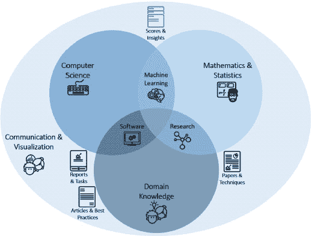

这三个主要领域的交叉点也非常重要。机器学习是数学、统计和计算机科学交叉的领域。机器学习是人工智能的一个分支，其理念是系统可以从数据中学习、识别模式、识别行为并在最少人工干预的情况下做出决策。它是一种数据分析方法，可以实现数据准备、特征工程、模型训练并最终的模型部署。机器学习允许数据科学家实现非常复杂的模型，例如神经网络或支持向量机，以及简单模型的集成，如决策树、梯度提升和随机森林。这些复杂模型可以捕捉输入（自变量）与目标（因变量）之间非常不寻的关系。

数学、统计和领域知识的交叉点是研究领域。研究技能使数据科学家能够在模型构建中应用新技术。这种组合允许开发出更复杂的模型，这些模型更准确且对函数形式的依赖较小。研究技能可以加速开发过程，特别是当对目标分布以及自因变量之间关系所需的假设较少时。

数据科学中的软件技能通常是指计算机科学与领域知识的交叉。软件技能（如对开源语言和其他世界级软件语言的熟悉）有助于数据科学家创建新模型。计算机科学技能、软件技能和领域知识的结合有助于数据科学家解决业务问题或改进特定的业务流程。

## 数学与统计

数据科学家需要具备强大的数学和统计技能来理解可用数据、准备训练模型所需的数据、在训练和验证分析模型时部署多种方法、评估模型结果，并最终解释和解读模型的结果。例如，数据科学家需要理解问题，解释目标的变异性，并进行对照测试以评估参数值对目标值变化的影响。

数据科学家需要数学和统计技能来总结数据以描述过去发生的事件（称为描述性统计）。这些技能被用于从样本结果将其推广到更大的总体中（称为推断统计）。数据科学家还需要这些技能来拟合已知响应变量的模型，并在此基础上训练模型以进行分类、预测或估计未来结果（称为监督建模）。这些预测性建模技能是数据科学中应用最广泛的技能之一。

当业务条件不需要特定事件，且没有过往行为来驱动监督模型的训练时，就需要数学和统计。学习过程基于在数据集中发现原先未知的模式（称为无监督建模）。此时没有目标变量，主要目标是提出一些洞察，以帮助公司理解客户和业务场景。


# 数学与统计学

数据科学家在优化领域需要数学和统计学。这指的是在存在约束和资源的情况下，旨在为问题寻找最优解决方案的模型。目标函数描述了可能的解决方案，这涉及到根据某些约束使用有限资源。数学和统计学在预测领域也是必需的，该领域由用于估计时间序列数据未来值的模型组成。根据过去一段时间的数值、销售额或消费量，可以根据过去的行为估计未来值。最后，数学和统计学在计量经济学领域也是需要的，该领域将统计模型应用于经济数据（通常是面板数据或纵向数据），以突出经济关系的实证结果。这些模型被用于评估和开发计量经济学方法。

数学和统计学在文本挖掘领域也必不可少。这是一个非常重要的分析领域，尤其是在现在，因为大多数可用数据都是非结构化的。想象一下所有的社交媒体应用、媒体内容、书籍、文章和新闻。在非结构化的格式化数据中存在着海量信息。分析此类数据允许数据科学家推断主题之间的相关性、识别可能的内容聚类、搜索特定术语等。通过社交媒体上的文本数据识别客户的情绪是一个被称为情感分析的热门话题。

# 计算机科学

今天可用的数据量是前所未有的。最重要的是，关于一个问题或场景的信息越多，产生良好模型的概率就越大。由于数据量巨大，数据科学家并不是手动开发模型。他们需要具备计算机科学技能来开发代码、提取、准备、转换、合并和存储数据、评估模型结果，并在生产环境中部署模型。所有这些步骤都在数字环境中执行。例如，随着云计算普及度的急剧增加，它经常被用于采集数据、创建模型并将其部署到生产环境中。

在某些时刻，数据科学家需要知道如何创建并部署模型到云端，并使用容器或其他技术允许他们将模型迁移到需要的地方。考虑使用交通摄像头的图像识别模型。捕获数据并从摄像头流式传输到中央仓库、训练模型，然后传回摄像头进行评分是不可能的。每秒都有数千张图像被捕捉，这种数据传输将使解决方案变得不可行。解决方案是根据数据样本训练模型，并将模型导出到设备本身（即摄像头）。当摄像头捕捉图像时，模型会实时对图像进行评分和识别。所有技术对于解决问题都至关重要。这不仅仅是分析模型的问题，它涉及一系列捕获和处理数据、训练模型、泛化解决方案并将结果部署到所需之处的过程。图像识别模型了容器的用处，容器将软件代码及其所有依赖项打包，以便应用程序能够从一个计算环境快速可靠地运行到另一个环境。

面对今天的挑战，数据科学家需要具备强大的计算机科学技能，通过不同的框架、语言和存储方式将模型部署在不同的环境中。有时，必须创建程序来采集数据甚至输出结果。编程和脚本语言对于完成这些步骤非常重要。有许多包允许数据科学家训练监督和无监督模型、创建预测和优化模型，或执行文本分析。用于开发非常复杂模型的新机器学习解决方案频繁创建和发布，为了保持技术更新，数据科学家需要理解并使用所有这些新解决方案。

用于收集、准备和清洗数据的软件也非常重要。任何模型都只是输入数据与要分析、分类、预测或估计的事件之间的映射。如果数据质量差或存在大量不一致之处，模型将映射出这些问题，导致结果将是不准确的。海量数据应该存储在高效的仓库中。实现这一点需要数据库，并且要求数据科学家理解数据库的工作原理。为了处理海量数据，需要分布式环境。数据科学家通常需要理解这些大规模并行处理引擎是如何工作的。除了数据库，还有许多用于分析的新型仓库结构。

总结来说，要学习和精通的技能太多了，远超一个人的处理能力。因此，在大多数情况下，数据科学家需要与其他合作完成创建分析模型所需的所有活动，例如数据工程师、应用开发人员、数据库管理员、基础设施工程师和领域专家。

# 领域知识

数据科学家需要的关键技能之一是领域知识。是的，人类仍然很重要。理解问题并评估解决问题所需的条件是非常重要的。理解如何将模型结果与实际行动联系起来是非常重要的。分析模型提供了一个方向。根据一系列信息、政策、法规、影响等如何利用结果真正解决问题，是成功的关键因素。创建分析模型的另一个关键因素是对业务问题的意识，以及它如何影响公司、社区、个人和政府。了解业务场景有助于数据科学家创建新的输入变量、转换或组合原始变量，并选择和丢弃重要或无用的信息。

领域知识的一个良好例子是电信领域。数据科学家需要知道可用什么类型的数据、交易系统是如何实现的、使用了哪种计费系统，以及如何从呼中心收集数据。

除了允许数据科学家通过结合业务概念来改进模型开发的领域知识外，数据科学家必须保持好奇心，并尝试多种方法来解决业务问题。他们需要主动预测业务问题并提出分析解决方案。在某些情况下，业务问题并不明确，但可以进行改进。数据科学家需要创新来设计和实施不同的方法来解决问题。创造力和创新包括将不同的分析模型结合起来以提高见解并丰富数据分析。


## 协作

协作是数据科学的另一个关键因素。数据科学包含许多专业领域，一个人几乎不可能精通所有领域。协作允许数据科学家在寻求业务问题的最佳解决方案时，能够与不同领域的专业人士共同工作。

例如，如果数据科学家正在开发用于预测贷款违约的模型，那么他们可能需要与财务部门的人员合作，帮助他们理解公司如何向客户收费、使用何种时间跨度来定义违约，以及公司如何处理违约。在开发数据分析和训练分析模型时，应该考虑所有这些政策。

与此问题相关的数据极可能位于具有不同基础设施的各个交易系统中。数据科学家需要与数据工程师、软件开发人员和信息技术运维人员合作，以有效的方式收集所有数据源。一旦模型完成并需要部署，数据科学家需要与应用开发人员合作，以组织预期的方式提供模型输出结果。所有这些技能的结合创建了一个有效的分析框架，可以从数据分析、模型开发和模型部署的角度来解决业务问题。

## 通信与可视化

另一项关键技能对于分析和传播数据科学取得的结果至关重要。在过程结束时，数据科学家需要对结果进行沟通。这种沟通可能涉及通过可视化来解释和解读模型。一画胜于千言。结果可以用于创建营销活动、提供客户行为的洞察、引导业务决策和行动、改进流程、避免欺诈以及降低风险等许多方面。

一旦生成了模型结果，数据科学家将与公司的业务部门沟通如何利用这些结果来改进运营流程。向决策者提供洞察是重要的，以便他们能够更好地解决开发该模型的业务问题。模型结果的每一个部分都应该分配给一个可能的业务行动。业务部门必须从模型结果理解可能的解决方案，而数据科学家可以填补这一空白。

数据科学家利用视觉呈现专业知识和叙事能力，创造一个令人兴奋且有吸引力的故事，说明模型结果如何应用于业务问题。数据分析和数据可视化有时就足够了。分析数据可以帮助数据科学家理解问题和可能的解决方案，也可以帮助通过仪表板和高级报告驱动直接的解决方案。例如，在电信行业，服务消费的下降可能与工程问题有关，而非流失行为。在这种情况下，深度数据分析可以驱动解决方案，而不是开发用于预测流失的模型。这可能是一个非常孤立的问题，不需要模型，而是需要非常具体的业务行动。

## 硬技能与软技能

硬技能包括数学、统计学、计算机科学、数据分析、编程等。另一方面，还有许多对于执行数据科学任务至关重要的软技能，如解决问题、沟通、好奇心、创新、叙事等。要找到同时具备这两套技能的人非常困难。许多招聘网站指出，对数据科学家的需求每年都在合理增长。随着廉价的大容量数据存储和日益强大的计算能力，数据科学家有更大的能力来拟合影响业务决策并改变战术和战略行动方向的模型。随着公司变得更加数据驱动，数据科学家的价值越来越高。有一个明显的趋势：业务的每一个环节正变得由数据分析和分析模型驱动。

在这个不断演变的场景中保持高效并发挥价值，数据科学家必须同时具备硬技能和软技能。同样，寻找同时具备硬技能和软技能的专业人士非常困难，因此团队协作是一个非常切实的解决方案。数据科学家与业务部门合作，结合硬软技能寻求寻求可能的分析解决方案至关重要。

例如，在欺诈检测中，数据科学家与欺诈分析师和调查人员合作几乎是强制性的，以获取他们在欺诈最频发业务场景中的视角和知识。通过这种方式，他们可以推出在生产环境中解决可行方案的分析解决方案，通常是从交易和近实时的视角。

## 数据科学应用

很难想象有一公司甚至某个行业领域不能从数据科学和高级分析中获益。如今的市场要求所有私有或公共公司在战术和运营行动上更加高效、准确。分析可以帮助组织根据数据事实而非猜测来驱动业务行动，如图图 1.2

在不同行业工作的数据科学家之间的协作是有价值的，并且增加了可行解决方案的光谱。行业可以相互学习并改进流程，以识别可能的分析解决方案并部署实用的业务行动。这种从不同领域（即使是不同行业之间）的知识传递对所有参与方都有益处。目前的若干业务问题包括欺诈检测、流失分析、坏账、损失估计、交叉销售/向上销售、风险分析、细分、收集、优化、预测、供应链和异常检测等许多。

## 数据科学生命周期与成熟度框架

分析生命周期（或数据科学流程图）包含几个步骤。然而，在这些步骤上花费时间并确保每一步都得到妥善执行是非常重要的。

### 理解问题

建模过程的第一步如图图 1.3

在此阶段需要询问的一些问题包括：

* 项目的目标是什么？我们是想预测某个未来事件，还是进行分类、估计或预测？我们是想优化特定的流程还是产生关于客户行为的洞察？我们是想创建群体或细分市场，还是进行路径分析、序列分析、网络分析等？


*   模型的具体目标是什么？它是有监督模型还是无监督模型？数据是结构化的还是非结构化的？
*   是否有足够的数据来解决这个问题？
*   根据模型结果计划了哪些行动？

例如，在流失模型中，你需要对客户流失给出一个可操作的定义。该模型是分类模型（是或否），是否可以根据流失概率触发营销活动？可以根据客户流失概率分配不同的方案或客户产品。可以记录这些响应，以为模型提供反馈，并改进后续行动的性能。

# 收集数据

数据科学流程的第二步是收集数据。很大可能，此阶段需要多个人和不同的技能。为了正确完成这一步，可能需要数据库管理、仓库、编程、数据质量包、数据集成以及许多其他技术。

此阶段的一些相关问题包括：

*   哪些数据是相关的？
*   涉及到多少数据源？
*   数据源存储在何处？
*   是否可以方便访问数据？
*   是否存在隐私问题？
*   当模型部署到生产环境中时，数据是否可用？

例如，某些变量（如 `gender` 和 `income`）可能无法使用，尽管这些预测因子可能与结果相关。此外，即使在开发模型时数据可用，当模型处于生产状态时，数据是否可用（例如对业务交易进行欺诈评分）？当模型用于评分时，是否可以访问在模型训练期间使用的所有数据？是否存在任何数据隐私法规？这是一个问题，因为评分模型中预测变量具有缺失值的观测值将导致预测结果的缺失。

# 探索数据

第三步是探索数据，并评估可用信息的质量和适用性。这一步涉及大量的数据工作。数据分析、基数分析、数据分布、多变量分析以及一些数据质量分析——所有任务对于验证开发模型所需的所有数据是否可用，以及它们的格式是否正确至关重要。例如，在数据仓库、数据市或数据湖中，客户数据随时间多次出现，这意味着数据集中存在针对同一客户的多条记录。对于分析模型来说，每个客户必须是数据中的唯一观测值。因此，所有的历史信息都应该从分析表的行转置为列。

此阶段的一些问题包括：

*   数据集中是否存在明显的异常或模式？
*   变量是否过多导致无法创建模型？
*   变量是否太少导致无法创建模型？
*   是否需要数据转换来调整用于模型训练的输入数据（如填补、替换、转换等）？
*   是否分配了创建新输入项的任务？
*   是否分配了减少输入项数量的任务？

在某些项目中，数据科学家可能拥有成千上万个输入变量，这太多了无法以合适的方式进行建模。应该使用变量选择方法来选择相关特征。当变量太少无法创建模型时，数据科学家需要从原始输入集中创建模型预测因子。数据科学家可能还有几个具有缺失值的输入变量，需要用合理值进行替换。某些模型需要这一步，某些则不需要。但即使是不需要这一步的模型也是。

# 建模

第四步是模型开发本身。这是数据科学家发挥创造力最重要的部分。这一步涉及尝试不同的算法、技术和分析方法。

此阶段需要考虑的问题有：

*   哪个模型的预测准确率最高？
*   哪个模型可以泛化到新数据？
*   是否可以对模型进行验证？
*   是否可以对模型进行测试？
*   哪个模型的可解释性最好？
*   哪个模型最能解释输入变量与目标之间的相关性？
*   哪个模型最符合业务目标？
*   哪个模型最简单？

也许分析过程中最困难的阶段之一是分析结果，并评估模型输出如何支持所需的业务行动。这一步在某种程度上与一步相关，即数据科学家训练多个模型并评估结果。

总之，这第四步包括以下任务：

*   训练不同的模型（算法/技术/分析方法）。
*   基于不同的数据集验证所有已训练的模型。
*   如果可能，在不同的数据集（与验证时使用的不同）上测试所有已训练的模型。
*   评估所有模型的结果并根据业务目标评估结果。
*   根据业务需求选择最佳模型。
*   部署并对最佳模型进行评分，以支持所需的业务行动。

# 提供答案

第五也是最后一步是对原始问题提供答案，即在第一步中提出并验证的问题。一些相关问题包括：

*   从训练的模型中学到了什么教训？
*   训练的模型是如何回答原始问题的？
*   训练的模型是如何讲述故事并支持业务决策的？


# 如何在适当的时间范围内使用并部署训练好的模型到生产环境中，以支持所需的业务决策？

例如，训练好的模型是否可以支持针对流失概率最高的客户的活动，并向他们提供激励以留住继续使用和消费公司的产品和服务？训练好的模型是否可以支持实时欺诈检测流程，以识别可能的欺诈业务交易？模型的结果可能非常准确，但为了让组织受益，模型应该在适当的时间范围内进行部署。例如，在网络安全领域，如果模型不能生成让欺诈分析师能够立即采取行动的实时警报，那么模型可能是没用的，因为数字攻击必须在几秒钟被识别，而不是几周或几个月。

一旦提供了答案，可能会产生有关该业务问题的更多问题。因此，数据科学生命周期是循环的，该过程会不断重复直到业务问题得到解决。

## 数据科学方法

整个分析过程和数据科学方法可以被视为一个动态演化的流，如图图 1.4

## 数据科学中的高级分析

数据科学和高级分析包含不仅仅是统计分析和数学模型。该领域涵盖了机器学习、预测、文本分析和优化。数据科学家必须使用所有这些技术来解决业务问题。在几种业务场景中，需要组合其中的一些模型来为特定问题提出可行的解决方案。

### 机器学习模型类型

机器学习模型基本上有两种类型：监督学习（当响应变量（也称为目标）已知并用于模型中时）和无监督学习（当目标未知或未在模型中使用时）。输入变量（在机器学习领域也称为特征，在统计领域也称为独立属性）包含了有关客户的信息，包括他们是谁、如何消费产品或服务、如何支付、成为客户的多久、从哪里来、去了哪里，以及许多其他描述性信息。

目标是所感兴趣的业务事件，例如，当客户流失、购买产品、付款或简单地使用信用卡或拨打电话时。这个事件被称为“目标”，因为这是模型将尝试预测、分类或估计的事件。这是公司想要知道的。（目标在机器学习领域也称为标签，在统计领域也称为因变量。）无监督模型不需要目标。这些模型被用于生成关于数据、市场或客户的洞察，以评估可能的趋势或更好地理解某些特定的业务场景。这些模型并不旨在对未来的业务事件进行分类、预测或估计。如表 1.1 所示，回归、决策树、随机森林、梯度提升、神经网络和支持向量机是监督模型的示例。聚类、关联规则、序列关联规则、路径分析和链路分析是无监督模型的示例。这些类型模型还有一种变体称为半监督模型。半监督模型涉及少量已知目标的数据和大量未知目标的数据。还有与强化学习相关的模型，该算法通过使用系统在模型向正确方向移动时对步骤进行奖励，在模型向错误方向移动时对步骤进行惩罚。半监督模型变得越来越流行，并通常应用于人工智能领域。例如，强化学习可以用于训练模型在自动驾驶汽车中学习并采取行动。在训练期间，如果汽车在道路上安全行驶，学习步骤将获得奖励，因为它正朝着正确的方向。另一方面，如果汽车驶离道路，学习步骤将受到惩罚，因为训练正朝着错误的方向。

当统计模型试图通过数学化方法近似现实并对未来事件做出预测时，机器学习自动化了分析模型中最重要的步骤之一——学习过程。机器学习模型根据输入数据和目标函数自动改进学习步骤。

| 表 1.1：机器学习模型 |

| --- |

| 监督模型 || 无监督模型 |
| 回归 || 聚类 |
| 决策树 || 关联规则 |
| 随机森林 || 序列关联规则 |
| 梯度提升 || 路径分析 |
| 神经网络 || 链路分析 |
| 支持向量机 ||  |


数据科学家应该能够构建统计和机器学习工作流，以访问可用数据，为监督和无监督建模准备数据，拟合不同类型的分析模型以解决业务问题，根据业务需求评估模型，并将冠军模型（基于某些标准选出的模型）和挑战者模型（通过不同方式训练的模型，例如使用不同的算法）部署到生产环境环境中，以支持计划中的业务行动。所有分析模型都是基于数据集训练的，这些数据集在特定时间范围内的描述了市场场景和业务问题。模型从输入变量中学习并创建通往目标的泛化映射，建立输入变量与目标之间的关系。该映射描述了特定时间点与目标相关的过去行为。随着时间的推移，客户行为可能会发生，描述该模式的数据随之改变。当这种情况发生时，生产中的当前模型就会发生漂移，因为它基于已不再存在的过去客户行为。该模型需要重新训练，或者需要开发新模型。这是分析领域一个非常重要的循环，机器学习领域可以通过能够自动重新训练或从经验中学习的模型做出巨大贡献。

关于何时以及如何使用机器学习模型和统计模型存在着巨大的争论。通常，机器学习模型可能更准确，并在生产环境中表现更好，以支持业务行动。但需要注意的是，大多数机器学习模型并不容易解释或说明。另一方面，统计模型可以对未来事件提供更好的泛化估计。它们通常更简单，且更容易解释和说明。在某些行业中（通常是监管最严格的行业），可解释模型是强制性的。统计模型还让输入变量及其对预测的影响变得更容易解释，允许业务部门设计更贴合客户行为的营销活动和促销活动。

## 统计分析
统计分析是收集、探索和展示大量数据以发现潜在模式、行为和趋势的科学。组织每天使用统计学和数据分析来做出明智的业务决策。随着每天收集的数据越来越多，以及存储和处理所有数据的基础设施变得越来越廉价，更多的数据分析被执行以驱动业务决策。

统计分析包括描述性统计，其中模型总结可用数据以描述过去的事件或先前的场景。另一个统计分析领域是推断统计，模型对样本结果进行推广和外推到更大的群体中。统计分析的另一个领域是预测建模，其中模型对未来结果发生的概率提供估计。这种结果可以是二分类目标、多分类目标或连续型目标。

- 一个二分类目标被分配给分类模型，例如“是”或“否”。
- 一个多分类目标被分配给一种分类，但针对多个类别，例如“高”、“中”和“低”。
- 一个连续目标被分配给估计，其中事件可以是任何连续值，例如欺诈事件中的损失或购买金额。

例如，信用评分模型可以用于确定客户未来是否会按时付款。信用评分模型还可以对风险范围进行分类，例如高违约风险、中等违约风险或低违约风险。信用评分模型最后可以估计与违约相关的价值。

最后，是规范性统计（prescriptive statistics）领域，模型量化了未来决策的影响。该领域模拟并评估几种可能的行动方案，允许公司根据这些行动评估不同的可能结果。这就像是一种“如果……会……”what-if）类型的分析。

## 预测
预测描述了一个被观测到的时间序列，以理解变化的根本原因并预测未来值。它涉及对数据形式的假设，并将时间序列数据分解为多个组成部分。

自回归整合移动平均（ARIMA）模型是一种预测模型，其预测基于过去值、过去误差以及其他时间序列的当前和过去值的线性组合。另一种类型的预测模型是因果模型，它预测受日历事件等因果因素影响的时间序列数据，以描述可能的季节性。最后，还有现代且复杂的预测模型，它们整合了水平、趋势或季节分量随时间变化的时间序列数据。它们可能包括处理平稳和非平稳数据的层次结构递归神经网络。

## 文本分析
文本分析是一个与从文本数据中发现洞察相关的领域，通常结合了自然语言处理、机器学习和语言规则。数据科学家可以使用文本分析分析非结构化文本，提取相关信息并将其转化为有业务智能。

例如，数据科学家可以使用信息检索来寻找非结构化文档的主题，例如使用搜索引擎寻找特定信息。情感分析是文本分析的另一个领域，对业务非常有用。情感分析通过非结构化数据确定认同程度，将整体信息归为积极、消极或中性情感。数据科学家还利用文本分析进行主题发现和聚类，根据这些文档之间的相似性揭示主题或聚类。

最后，文本分类是一种技术，文本分析模型为预定义的类别集合中的自然语言文本标记标签。领域专家和语言学家在该领域交互以创建并评估这些类别。

## 存活分析
存活分析是一类统计方法，其感兴趣的结果变量是事件发生的时间。时间从个人首次成为客户开始测量，直到事件发生或观测间隔结束（此时该个人变为被截失状态）。在存活分析中，分析的基础是寿命，即发生事件的风险时间。因此，不仅是事件是否发生，而是何时发生。

存活分析的目标是对事件发生的时间分布进行建模。数据科学家的工作是识别与事件发生时间相关的变量，并预测新客户或现有客户事件发生的时间。存活分析可以用于客户留存应用，其结果是取消所有产品和服务的时间。另一个例子是贷风险管理应用，其结果是贷款违约的时间。

## 优化
高级分析框架中的最后一个主题是优化。数学优化是运筹学、工业工程和管理科学的重要组成部分。优化模型搜索最优解，该解考虑了一组预定义的约束条件和有限的资源。


例如，在生产规划中，优化模型可以确定生产产品的最佳组合，以实现最高利润。在定价决策中，优化模型可以根据成本、需求和竞争价格信息确定产品的最佳价格。最后，在促销营销中，优化模型可以确定促销活动、交付渠道、活动时间以及目标客户群的最优组合，以实现营销投资回报率的最大化。

优化的另一个重要领域是网络分析和网络优化，这涉及对网络（节点和链接）的分析以及网络流的分析。例如，数据科学家可以使用网络优化来研究流量，其中节点是城市，链接的粗细表示交通流量。这些信息可以用于规划道路拓宽工程和建设新道路。

# 数据科学实践案例

数据科学和高级分析可以帮助组织解决业务问题、应对业务挑战并实现信息和知识价值。客户体验、收入优化、网络分析和数据变现等领域只是其中的例子。

## 客户体验

客户体验和互动管理允许组织更深入地理解客户体验以及客户对公司刺激的反应。一些示例包括：

*   增强客户体验——提供更具个性化和相关性的客户营销促销。
*   无偿能力与违约预测——在安全范围内长期监控费用、账单和使用情况，确保客户能够按时付款。
*   流失预测与预防——预测客户问题并防止其发生。例如，如果公用事业公司预测到将停电并向受影响的客户发送短信，这可能会提升客户体验。
*   下佳优惠（Next Best Offer）——通过结构化和非结构化数据使客户洞察运营。例如，对客户的购买历史进行建模可以预测下一个向客户提供的物品是什么。
*   目标社交影响者——识别并跟踪客户之间的关系，并针对最具影响力的人。这些在所在网络中的影响者可以帮助公司避免流失并增加产品采用率。

## 收入优化

收入优化包括更准确预测，以允许组织做出更好的业务决策。一些示例包括：

*   产品包和营销活动——改进与产品包和营销活动相关的业务决策流程。
*   收入流失——识别导致收入流失的情况，无论是由于账单和收款、网络还是欺诈问题。例如，催收机构可能对谁更有可能还债感兴趣，而不是对谁欠钱最多。
*   个性化产品和服务——根据客户随时间的使用情况个性化方案、组合、产品和服务，并允许他们为消费的内容付费。
*   资费计划和组合——使用高级分析创建新的、更有效的资费计划和组合。

## 网络分析

网络分析在通信和公用事业行业非常常见，但它几乎可以应用于任何行业，因为大多数复杂问题都可以视为网络问题。网络分析旨在提高网络性能。网络性能可以指通信网络、能源网络、计算机系统网络、政治网络或供应链网络等。一些示例包括：

*   网络容量规划——使用统计预测和详细的网络或供应链数据来准确规划容量。对 ATM 机进行预测以确保有足够的现金满足客户需求，或使用网络分析确保客户无论在何处都有良好的移动信号。
*   服务保障与优化——使用网络分析在网络或供应链问题发生之前进行预防（无论是还是还是领域）。
*   优化供应链——识别最佳路线（最便宜、最快或最短），将货物交付给正在消费或服务的客户，确保没有中断或间断。
*   非结构化数据——使用非结构化数据获取更深层的客户洞察。

## 数据变现

信息是新的黄金。数据科学可用于将其拥有的最大资产变现。数据变现是指从可用数据产生经济利益的行为。不同行业的公司对客户或普通人群拥有非常敏感且重要的数据。数据科学家可以使用跟踪客户做什么、何时以及与谁在一起的移动应用程序结果。他们还可以可以使用切切客户在寻找什么的网络搜索引擎结果。数据变现的一些示例包括：

*   基于位置的营销——开发通过移动设备向目标客户提供的特种优惠和促销活动。例如，如果你进入城市的某个特定区域，可能会收到该地区公司的优惠券。
*   微细分——创建高度详细的客户细分，可用于随时间发送特定的活动、促销活动和报价。
*   第三方合作伙伴——与不同公司合作合并客户数据，以丰富用于创建分析模型和关于业务行为数据分析的信息。
*   实时数据分析——分析来自不同类型交易的实时数据流，以保持客户消费或使用产品。

结论，数据科学家可以开发并部署一系列技术和算法来解决业务问题。今天，公司处理的信息种类和数量是前所未有的。随着数据科学家增加他们在机器学习、统计分析、预测、文本分析和优化等领域的技能，他们对公司的价值将随着时间的推移而增加。

## 总结

本章介绍了关于数据科学分析模型的一些重要概念。它考虑了硬技能（如计算机科学、数学和统计学）和软技能（如领域知识和沟通）。本章简要介绍了与分析生命周期相关的任务，以及某些数据科学分析模型如何应用于解决业务问题。在尝试解决业务问题时，不同的软技能对于数据科学项目至关重要。这些技能中的每项都对数据科学项目的各个阶段做出贡献，从准备和探索数据、训练分析模型、评估模型结果，到可能最重要的阶段——将分析模型部署到生产环境中并向业务部门汇报模型结果。这种沟通对于帮助业务部门定义活动、报价以及所有接触客户的策略非常重要。

现在你已经对数据科学领域有了了解，下一章将讨论数据准备。

延伸阅读


1. Davenport, T.H. and Patil, D.J., “Data Scientist: The Sexiest Job of the 21st Century,” Harvard Business Review, 2012 年 10 月.
2. Flowers, A., “Data Scientist: A Hot Job that Pays Well,” Indeed Hiring Lab, 2019 年 1 月.

# 第 2 章：数据探索与准备

## 章节概述
本章介绍了数据探索的核心概念，展示了数据探索为何任何数据科学项目的关键阶段，并说明了如何通过审查和探索解决业务问题所需的信息，从而解决许多业务问题。除了数据探索外，本章还介绍了与数据准备相关的许多任务，特别关注了分析建模的前期准备步骤。在数据准备过程中，可能会出现许多数据问题。你可能需要修复数据质量问题、转换原始信息，并填补和替换原始值以适应分析模型。这是任何数据科学项目中的至关重要的一步。

本章还介绍了了来自不同来源的数据合并概念，以便对业务问题建立更全面的视图，考虑了客户行为、产品和服务交易、营销场景、画像等。通常，不同的信息存储在多个系统中，将它们合并并匹配是数据准备中的一项重大挑战。你还将学习这些任务如何实质地改进结果。

本章的主要目标是：
* 解释如何审查数据集，以确定是否包含了解决业务问题所需的信息，以及这些信息是否格式正确以便用于分析模型来解决问题。
* 解释如何进行分布和基数分析，以确定数据的呈现方式，以及为了数据科学项目和分析模型需要对数据进行哪些修正。
* 解释如何处理用于训练解决业务问题的分析模型的数据中的非线性、稀疏性和离群值。
* 解释如何准备和使用非结构化数据来改进分析模型解决业务问题的能力。非结构化数据可以直接用于解决业务问题，也可以在解决业务问题时作为新特征引入分析模型。
* 解释不同的数据采样方法。描述在何时需要每种采样方法以及它们对分析建模阶段的益处。
* 解释数据划分的方法、不同类型的划分，以及划分数据以使分析模型泛化到生产环境的原因。
* 解释如何转换原始输入数据以改进分析建模的结果。
* 解释如何从原始输入数据中创建新特征以改进分析建模的结果。
* 解释如何选择一个对新数据泛化能力良好的模型。

## 数据探索引言
分析建模过程的首要步骤之一是数据探索。这一步是数据科学家熟悉其解决任何业务问题所需的数据。数据科学家需要完成许多任务，不仅是为了理解描述他们试图解决的业务问题的数据，更是为了从分析模型的角度准备这些数据以解决问题。

与数据探索相关的任务包括管理以下内容：
* 非线性
* 高基数
* 非结构化数据
* 稀疏数据
* 离群值
* 比例不正确的输入变量

### 非线性
数据探索可以说明预测变量与结果之间的非线性关联。非线性关联的一个例子是预测变量与结果之间的二次关系。在这种情况下，数据科学家必须修改模型以考虑这种二次关系。

非线性要求数据科学家探索不同的模型，以解释预测变量与目标之间复杂的关系。这里可以使用如基于树的模型和神经网络等通用近似器模型。

### 高基数
某些变量可能具有高基数，即分类变量具有许多水平。如邮政编码或产品代码可能具有高基数。高基数在回归或神经网络等分析模型中可能会产生问题，因为为每个水平都会创建一个参数。

假设你正试图寻找薪资（目标）与工作年限之间的线性关联。你有两个参数：一个截距参数和一个工作年限参数。如果加入年龄，你现在就有三个参数。然而，如果加入教育背景（高中及以下、高中学历等），你可能会增加更多参数。

### 非结构化数据
使用非结构化数据（如文本数据、网络数据、图像、音频和视频）可能有助于解释业务问题，或者简单地对于数据科学家建模的结果数据具有更强的预测能力。例如，在流失分析中，检查叫中心数据并识别不满意的客户可能会为流失提供良好的预测指标。这些数据通常是文本格式或音频格式。客户之间的关系，以及产品/服务与客户之间的关系可能具有巨大的预测价值，因为它们描述了消费和使用行为与某些特定业务事件（如流失、欺诈或购买）的相关性。这些类型的数据应该被准备好并用于分析模型中，要么直接解决业务问题，要么作为新特征添加以提高模型性能和解释性。

### 稀疏数据
数据科学家还会遇到稀疏数据，即数据中的事件极少，大多数发生情况是缺失或不完整的。一个例子是在线零售公司的评分系统。并不是所有购买公司产品的客户都会对产品评分。相反，并不是所有产品都经过客户评分。当合并所有产品和所有客户评分时，生成的矩阵是非常稀疏的。这为大多数模型捕捉输入与目标之间的关系带来了严重问题。问题之一是没有足够的数据来估计客户与产品之间的交互。

有一种专门针对此类问题的模型。分解机模型通过矩阵分解绕过稀疏矩阵的问题。这种技术通常是有效的，因为它使数据科学家能够发现客户与产品交互背后的潜在特征。因此，即使矩阵中 99% 的单元格是空的，分解机模型也能预测客户对产品的评分。

### 离群值


在此阶段也可以检测出离群值，数据科学家必须决定这些数据点是错误的，还是描述了异常情况。有时，发现离群值可能代表了某个业务问题的解决方案。离群值可以描述事务系统中的问题，促使公司改进数据质量工作；它也可能代表一种异常——一个非常特殊且出乎意料的正确值。这种离群值可以凸显潜在的欺诈事件、机械故障或财务操作中的违约。某些技术可以减少离群值在预测模型中的影响，也有其他技术可以从训练和验证过程中消除离群值。

### 比例不的输入变量

最后，数据科学家应该检查预测变量的度量。在某些建模情况下，将变量重新缩放到相同的尺度上可能会是有益的。对于某些模型，不同的尺度可能不会成为大问题，例如回归模型或基于树的模型。但对于神经网络等复杂模型，不同的尺度可能会导致模型在考虑和解释不同输入时产生偏差。薪资可能比年龄更重要，仅仅是因为它的尺度更大。因此，让所有输入变量处于相同的尺度上（`-1` 到 `1` 或 `0` 到 `1`）对神经网络非常有益。

数据探索的一个重要目标是理解基于分析报告解决业务问题时所使用的所有可能的数据源和预测变量。可以使用无监督模型（如聚类或分割）、监督模型（如回归和神经网络），甚至是基于半监督的模型（如文本分析、优化和网络分析）。至关重要的是，探索数据和分析变量的过程可能不仅在此过程中解决了业务问题，还能就某几个主题提出宝贵的业务见解。

# 数据准备简介

在数据准备阶段，数据科学家需要访问公司内部所有可用的数据源来解决业务问题。某些数据源存在于外部或由第三方公司提供，这些公司可以增加并丰富公司关于业务问题的信息。数据源可以是客户信息、账单信息和交易信息。一个常见问题是，数据通常每个客户包含多行，例如在数据仓库或数据市中。因此，必须合并所有数据以获得单一的客户版本。

与数据准备相关的任务包括：

*   代表性采样
*   基于事件的采样
*   数据分区
*   缺失值填充
*   替换错误的变量值
*   变量转换
*   特征选择

## 代表性采样

如果数据源包含许多客户，数据科学家可能想对客户进行采样。在计算机极速的时代，这似乎意义微乎其微。然而，模型拟合过程仅在漫长、枯燥且易错的数据准备过程完成后才会。采样是为了数据效率，因为数据准备通常倾向于使用较小的样本量。将数据分成多个样本使数据科学家能够评估模型对未来数据的预测泛化能力，正如我们将在数据分区中看到的那样。

图 2.1: 采样数据

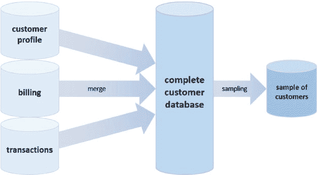

### 基于事件的采样

在许多业务情况下，我们试图建模的目标是稀缺的。例如，电信运营商的流失率可能在 `2%` 到 `5%` 之间。预测稀有事件的一种常见策略是基于包含所有事件的样本建立模型，然后合并一个包含所有非事件的样本。某些业务目标值可能与感兴趣的事件或业务目标没有关系。例如，稀有事件可能是流失事件，即客户决定离开公司或产品或服务。非事件是客户没有流失，且客户仍在公司内，消费并使用某些产品和服务。新样本可能具有 `50%` 的事件率，而不是原始的 `2%` 到 `5%` 事件率。

基于事件采样的优势是，数据科学家平均可以用较少的总案例数获得预测能力相近的模型。这种采样策略之所以有效，是因为具有分类结果的数据集中的信息量并不取决于数据集中的观测总数，而是取决于最稀有结果类别中的观测数量（通常是事件的数量）。这种采样方法允许模型同时捕获输入与感兴趣事件之间的关系，以及输入与非事件之间的关系。如果你在训练数据集中只有非事件，或者至少绝大多数是非事件，模型倾向于轻易地只捕获输入与非事件之间的关系。即使模型预测没有流失，该模型在 `99%` 的情况下也是正确的。对于该模型来说，这 `99%` 的分类率是一个非常好的分类率，但公司将错过所有事件。

图 2.2: 基于事件的采样

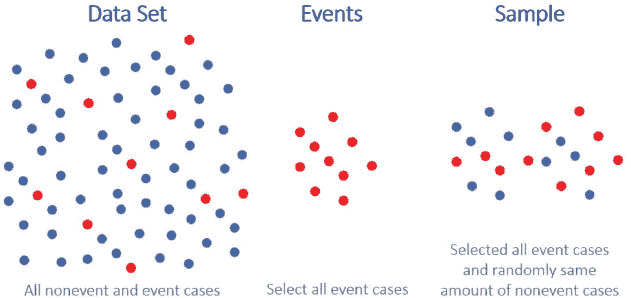

## 分区

分析模型倾向于非常快地学习并高效地捕捉输入变量与目标之间的关系。问题是它们可能会学得太多。模型可以几乎完美地捕捉输入与目标之间的相关性，但仅限于其训练的时间段。随着数据随时间变化，模型应该尽可能地泛化，以适应不同时间段数据的变异性。当模型在训练期间具有高预测准确性但对未来数据不是时，被称为模型过拟合数据。

修正过拟合的最简单策略是隔离部分数据用于评估或验证。模型拟合到数据的一部分（称为`训练数据集`），并在数据的另一部分（称为`验证数据集`）上评估性能。当使用验证数据来比较、选择和修改模型时，且所选模型在与用于比较的相同数据上进行评估时，过拟合原理仍然适用。在这种情况下，应该使用`测试数据集`进行最终评估。

在存在时间组件的情况下，`测试数据集`可以从不同的时间收集。这会进一步泛化模型，因为模型无论如何都将在不同的时间段部署到生产环境中。这意味着模型是根据目标已知的事件训练的。一旦选择了最佳模型，它将被部署到生产环境中预测目标未知的未来事件。模型需要对新数据进行良好的泛化，以考虑数据随时间变化的变异性。通过随时间变化的数据进行测试，有助于数据科学家选择最准确的模型，还能选择泛化能力最好的模型。例如，在从`1 月`到`6 月`收集的数据上拟合的模型可能无法很好地泛化到从`7 月`到`12 月`收集的数据上。


# 图 2.3：分分

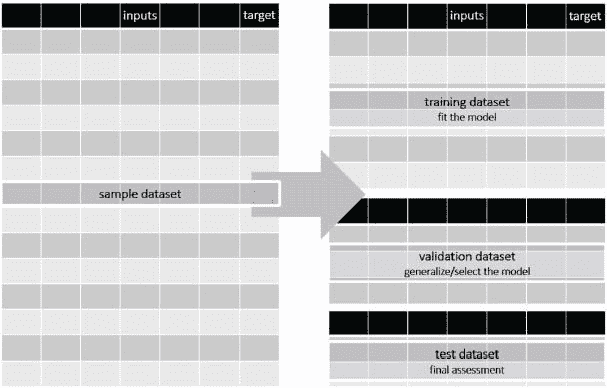

## 填补

大多数建模方法中处理缺失值的标准方法是完全案例分析（complete-case analysis），即只有那些没有任何缺失值的观测值才会被用于训练过程。这意味着用于训练模型的任何输入变量中具有缺失值的观测值都会从训练过程中排除。问题在于，在高维数据中，即使是少量的缺失值也会导致巨大的数据损失。想象一个包含 300 个变量的输入数据集。如果某个客户在这些 300 个变量中的任何一个上有缺失值，他或她就会从训练数据集中剔除。由于缺失值导致训练数据减少是一个问题，另一个问题是在未来数据中某些值缺失时如何对模型进行评分。想象生产环境中的预测模型正在对可能流失的客户进行评分。输入变量之一是`age`。在未来数据中，如果被评分的客户没有年龄值，模型无法对该客户进行评分。例如，在`logistic regression` 中，模型无法将系数乘以缺失值。当数据科学家对新客户进行评分时，具有缺失值的客户将获得缺失的预测分（例如发生事件的概率）。换句话说，数据科学家无法对预测变量中具有缺失值的客户生成预测。因此，某种类型的缺失值填补是必要的。

填补是避免在训练、验证、测试和部署过程中使用的观测值中出现缺失值的常用过程。填补意味着用合理的值填充缺失值。目前已经开发了许多填补缺失值的方法，例如`mean`、`median`、`mode` 和`midrange` 填补。这些值基于预测变量的分布。

## 图 2.4：缺失值与填补

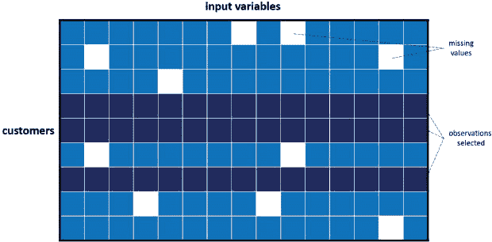

例如，回想之前提到的训练数据集中`age`缺失的客户案例。使用考虑训练数据集中所有客户的`age`平均值来填充该客户的值。数据科学家还可以创建缺失指示变量（missing indicator variables），即二元变量，用于指示该观测值的预测变量值是缺失还是已知的。这些变量可以捕捉响应变量与预测变量缺失性之间的关系。例如，收入缺失的客户可能与欺诈交易有很强的关联。如果缺失值的百分比非常高，则可能通过从分析中剔除该变量并仅使用缺失指示变量来更好地处理该预测变量。

## 图 2.5：填补与缺失值指示

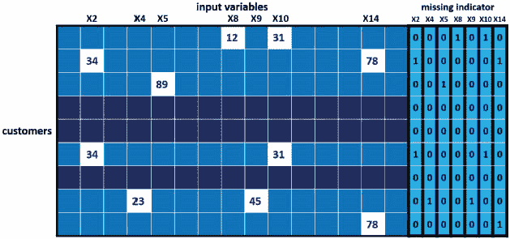

还有其他方法可以处理缺失值，例如将变量分箱（`binning`）为组，并让一组代表所有缺失值。此时预测变量在分析中被视为分类变量。另一种非常高效的方法（可能是处理缺失值最准确的方法）是根据其他输入值来估计缺失值。数据科学家将在估计目标之前，使用另一个预测模型来估计缺失值。例如，想象数据集中两个客户的`salary`缺失。通过`mean` 填补会为这两个客户添加相同的工资。然而，假设第一个客户 50 岁，公司经理，拥有一栋价值约 100 万美元的房屋。第二个客户 20 岁，还在上，不是房主。这两个客户的工资应该非常不同。然而，通过`mean` 填补会为他们填充完全相同的值。填补模型（如`decision tree`）可能会为他们中的每一个人填充非常不同的值，因为对缺失工资的估计将基于其余输入变量。

## 替换

在某些情况下，数据具有需要替换的错误值。例如，假设金融机构数据集中的客户必须至少 18 岁。如果数据显示客户小于 18 岁，一种补救方法是将这些值替换为 18。另一种补救方法是将这些值视为缺失，并如填补部分所述，根据数据中其他预测变量的值来填补值。如果一个变量的错误百分比过高，数据科学家可以决定从分析中放弃该变量。

## 转换

输入变量的转换是一项常见的数据准备任务。这些转换可以是提高模型拟合度的合理方法。数据科学家可以进行数学转换来创建一个更对称的分布，从而减少原始变量分布中离群值或重尾的影响。数据科学家还可以标准化变量，使其处于相同的尺度和范围。例如，`age`和`salary`可以处于相同的范围（例如 0 到 1 的比例），确保它们对模型拟合都有同等的贡献。变量转换还可以帮助模型捕捉输入与目标之间的非线性关系。

## 图 2.6：均值填补技术

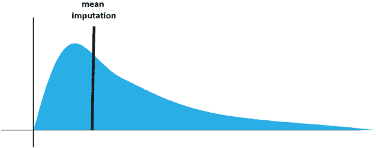

## 图 2.7：替换方法

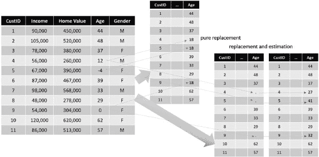

另一种转换是对输入变量值进行`bin`处理并将其视为分类变量。这也可以减少离群值的影响，并考虑到目标与输入变量之间的非线性关系。想象一个数据集，大多数客户的工资非常相似，例如都是低工资，有些人是中等工资，极少数是高工资。工资分布在直方图开始有一个巨大的观测值区块，然后是少数向下减少的区块，以及高工资情况的长尾。这样的分布使得模型难以捕捉工资与感兴趣的事件（如坏账）之间的任何相关性。

`log transformation` 转换或分位数分箱（`quantile binning`）可以更好地将观测值分布到不同的工资范围内，并更容易捕捉转换后的输入变量与目标之间可能的关联，如图 2.8 所示。

## 图 2.8：对数转换方法


## 特征提取

特征提取（也称为特征创建）通过组合原始变量，从初始变量集中创建新变量或特征。这些特征封装了多个原始变量的重要信息。换句话说，特征提取可能会减少输入的维度空间，并为模型创建更具信息的输入。这种新特征比任何其他原始变量都与目标相关。

在许多情况下，特征提取基于领域知识。例如，如果数据科学家怀疑打呼叫中心的电话次数与流失有关，他们可能会创建此类特征，例如客户在过去六个月内的电话次数，或者电话次数除以所有客户的电话总数。这些派生变量在最终模型中可能是有用的预测因子。

特征创建可以基于文本分析，将非结构化文本转换为预测变量。主成分分析（PCA）和自动编码器（autoencoder）数据转换也可用于创建新特征。

## 主成分分析


主成分是预测变量的加权线性组合，其中权重的选择是为了解释数据中最大量的变异。在这种情况下，总变异是预测变量样本方差之和。主成分根据它们对数据变异的解释程度进行编号。由于主成分之间是正交的，因此每个主成分都解释了数据变异中独特的部分。

### 图 2.9：特征提取

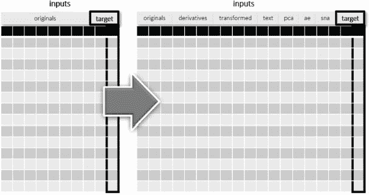

主成分分析可以用于降维，因为通常前几个主成分就能解释数据中总变异的足够比例。例如，如果数据科学家有 1,000 个变量，但前 10 个主成分解释了数据 95% 的变异，那么模型中将仅使用前 10 个主成分。它降低了输入空间（原始变量）的高维度，并为模型创建了信息量更大的变量。

图 2.10 以图形的形式展示了主成分分析。第一主成分（`PC1`）的构建方式是尽可能捕捉输入变量集中的变异。然后，第二主成分（`PC2`）与 `PC1` 正交，并尽可能捕捉被 `PC1` 未捕捉的输入数据变异。第三主成分遵循相同的规则，该过程持续进行。

# 文本挖掘

文本解析过程将文本数据处理为词-文档频率矩阵。诸如奇异值分解（`SVD`）等变换会将此矩阵转换为适用于预测建模目的的数据集。`SVD` 仅仅是一种矩阵分解方法。当它被用于“文档-词”矩阵时，会产生一组预测变量，这些变量包含了关于文本内容的信息。生成的系数集合可以用于从文档集中推导出概念或主题。例如，文档可以是呼叫中心的对话，词汇可以是愤怒的、沮丧的、不悦的、不喜欢、不满等的。这些系数可以创建表示词汇在文档中强度的变量。显示与不满意客户相关的词汇强度的变量应该是流失模型中有用的预测因子。

### 图 2.10：主成分分析

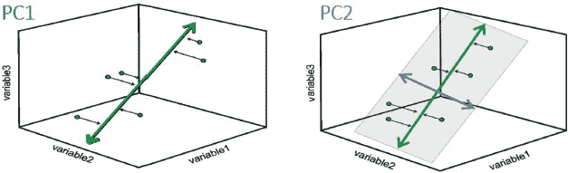

### 图 2.11：文本挖掘

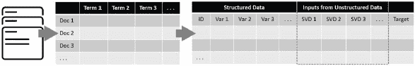

# 变量聚类

变量聚类寻找一组变量，这些变量之间尽可能相关，而与其他类中的变量尽可能不相关。这被用作一种降维技术，因为数据科学家会根据领域知识从每个类中选择一个变量。数据科学家也可以根据变量与其所属类的相关性以及与其他类的相关性，从每个类选择一个代表性变量。

# 自动编码器

自动编码器数据转换是一种算法，旨在以最小的失真将预测变量转换为派生变量。换句话说，它试图发现数据内部的结构以开发原始变量的压缩表示。第一步是编码，算法高效地压缩数据；第二步是解码，算法尝试重构原始数据。解码器用于训练编码器。

如果预测变量彼此相互独立，那么编码步骤产生的派生输入价值有限。然而，如果数据中存在某种结构（例如相关的预测变量），那么编码步骤产生的派生输入可以在重建预测变量的同时，而不保留该变量内部的冗余。

自动编码器数据转换可以像主成分分析一样用于降维。主成分分析试图发现数据中的线性关系时，而来自自动编码器的派生变量可以发现非线性关系。此外，虽然主成分之间不相关，但来自自动编码器的派生变量可能具有相关性，因为自动编码力求准确地重构变量。

### 图 2.12：变量聚类

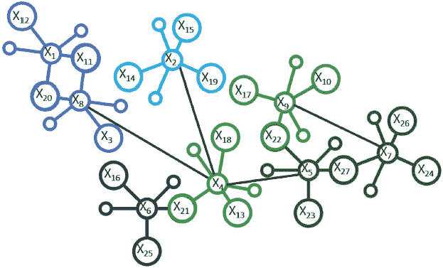

### 图 2.13：自动编码器数据转换

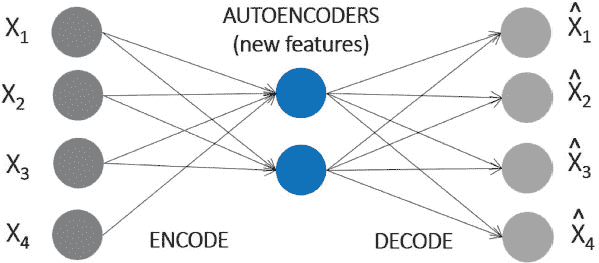

# 特征选择

数据科学家通常处理数百个预测变量。这限制了探索和建模变量之间关系的能力，随着维度的增加，数据会变得稀疏。预测变量的大数量会导致维度灾难，这意味着数据集的复杂度随着变量数量的增加而迅速增加。底是，数据科学家所需的数据量随着变量数量的增加呈指数级增长。

维度灾难的解决办法是特征选择，也称为降维。换句话说，数据科学家想要消除无关和冗余变量，同时不无意中消除重要变量。一些降维方法包括相关性分析、回归分析和变量聚类。

在创建特征时，通常的建议消除用于构建特征的原始变量，因为特征和原始变量可能是冗余的。例如，如果创建了年龄的对数，则原始年龄变量被删除了。然而，另一种观点是为降维技术保留所有变量，并查看哪些变量留在了模型中。通过这种方式，数据科学家可以查看年龄还是年龄的对数留在了最终模型中。

预测变量之间的冗余是一个无监督概念，因为它不涉及目标变量。另一方面，变量的相关性考虑了预测变量与目标变量之间的关系。在高维数据集中，识别无关变量比识别冗余变量更困难。良好的策略是首先减少冗余，然后在较低的维度空间中处理无关性。

### 图 2.14：变量选择

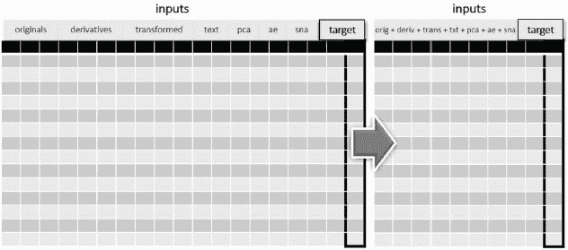

冗余变量没有提供任何未被其他变量解释的新信息。例如，知道输入家庭收入的数值通常是房屋价值的良好指标。当一个值增加时，另一个值也会之增加。

无关变量不提供关于目标的信息。例如，如果目标是您是否向慈善机构捐赠，预测会随着预测变量“对之前要求的响应”而改变，但不会随着预测变量“显示尺寸”而改变。

图 2.14 显示了一个包含许多变量的数据集，如原始变量、派生变量、变换变量、来自文本挖掘的变量、来自主成分分析的变量、来自自动编码器数据转换的变量以及来自社交网络分析的变量。目标是减少变量的数量，同时保持模型较高的预测准确性。应该注意的是，社交网络分析将在后面的章节中讨论。

# 模型选择


一旦选择了合理数量的变量，数据科学家通常可以根据复杂性对多种模型进行选择。一个常见的陷阱是对数据进行过拟合，即模型过于复杂。过度复杂的模型可能对数据中的噪声过于敏感，无法良好地泛化到新数据。一个例子是包含许多许多不必要的高阶项的模型，如 `age*age` 和 `income*income`。然而，使用过于简单的模型会导致欠拟合，使得真实的特征被忽略。

# 模型泛化

通常情况下，模型性能遵循一个直观的趋势。随着模型复杂性的增加、模型中添加更多项，或者在训练过程中引入更多交互，模型在训练数据集上的拟合程度通常也会随之提高。这种增长部分归功于模型捕捉了数据中的相关趋势，有时是输入与目标之间非常特定的相关性。然而，部分增长可能是由于对训练数据的过拟合，因为模型可能对随机噪声做出了反应。这在训练数据集上效果良好，但在验证集甚至测试集上效果可能并不理想。对于未来的数据也可能同样如此。因此，还会检查不同复杂程度模型在验证数据上的拟合情况。

模型在验证数据上的典型拟合行为是：随着复杂性的增加，拟合程度不断提高，随后进入平台期，然后性能下降。这种下降是由过拟合导致的。因此，一个常见的建议是选择与具有最高验证拟合统计量的复杂度相关的模型。一种推荐的做法是选择性能最好的简单模型。这意味着选择在验证数据下表现最好的模型，但要尽可能保持简单。如果评估误差图显示验证数据集的误差出现平台期，则选择平台期开始处最简单的模型。较简单的模型往往具有更好的泛化能力。复杂模型往往受到输入数据变化的影响，因为它们的结构更复杂。

## 图 2.15: 拟合度与复杂性

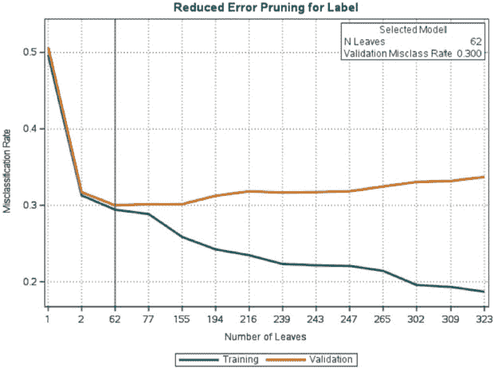

# 偏差-方差权衡

数据科学家的目标是拟合一个低偏差低方差的模型。偏差（Bias）是模型的平均预测值与试图预测的正确值之间的差异，而方差（Variance）是模型对给定数据点预测的可变性。高偏差模型会忽略预测变量与目标之间的重要关系，这是欠拟合的一个例子。然而，高方差模型会对比数据中的随机噪声进行建模，这是过拟合的一个例子。偏差-方差权衡是指数据科学家选择一个既能准确描述数据中关系，又能良好地泛化到新数据的模型的过程。

在模型拟合过的数据上评估模型通常会导致乐观的偏颇评估。例如，一个模型可能在一组数据（训练数据集）上进行拟合，模型的准确率估计为 70%。然而，当该模型应用于一组新数据（验证数据集）时，准确率估计为 47%。为什么准确率百分比差异如此大？这是一个过拟合的例子，模型对训练数据集中的特殊之处过度敏感，且未能良好地泛化到验证数据集。

## 总结

本章介绍了数据探索的核心概念、数据探索为何成为任何数据科学项目的关键阶段的原因，以及如何通过审查和探索解决业务问题所需的分析模型信息来解决许多业务问题。数据科学家需要理解在审查创建分析模型以解决业务问题所需的信息时，数据探索是有多重要。数据探索任务有助于公司修复数据质量问题，并将原始数据转换为相关的业务信息。

本章介绍了关于数据准备的特定概念。涵盖了如何合并来自不同来源的数据以创建关于客户和业务问题的更全面视图的概念。涵盖了不同的采样方法、数据划分技术、将原始输入数据转换为相关信息以增强监督和无监督模型的不同方法，以及从原始数据创建新特征以改进模型结果的技术。本章最后讨论了用于选择模型中输入的某些统计衡量标准，以及如何选择良好泛化到新数据的模型。

# 第 3 章：监督模型 – 统计方法

## 本章概述

在本章中，你将学习监督建模。“监督”一词指的是目标已知的观测或案例。根据已知事件，训练一个模型来捕捉输入与目标之间的关系。监督建模中使用了多种技术和算法，包括统计模型和机器学习模型。[第 3 章](#Chapter03.xhtml#ch03）涵盖了统计模型，包括线性回归、逻辑回归模型和决策树。[第 4 章](#Chapter04.xhtml#ch04）涵盖了机器学习模型。

本章主要目标包括：

*   解释使用统计监督模型的目的，重点线性回归、逻辑回归和决策树。
*   描述几种类型的监督模型、将要使用的不同技术或算法，以及在什么种情况下可以使用其中一种来解决业务问题。
*   解释监督模型的结果。线性回归、逻辑回归和决策树模型都是可解释的。这种可解释性可以根据模型结果驱动业务决策。

## 分类与估计

分类和估计是常见的预测模型类型。分类假设是一个类别变量。目标可以是二分类（0 或 1，是或否），也可以是多分类（如 1, 2, 3, 4 和 5，或低、中、高）。例如，此业务事件是否为欺诈交易（是或否）？估计则假设目标是一个连续数字。目标可以取从负无穷到正无穷范围内的任何值。

两种预测模型（分类和估计）都需要以下内容：

*   观测值/案例/实例：
    *   一个包含描述观测属性的真实案例。
*   输入/属性/变量：
    *   观测值的衡量标准或其属性。可以是关于客户的人口统计信息，如年龄、薪水和婚姻状况。
*   目标/类别/标签：
    *   每个观测值的标记或标签。违约或未违约就是一个例子。

用于训练监督机器学习模型的数据由过去的案例或观测值组成，这意味着目标值是已知的。核心思想是寻找预测变量与目标之间的关系。例如，查看过去六个月发生的所有流失案例，哪些输入变量可以解释流失和未流失事件的发生？如果可以根据过去的案例训练模型，并找到哪些输入变量可以解释流失和未流失，那么这个模型就可以预测未来的流失案例。


统计模型将输入变量集映射到目标。该模型试图为输入和目标创建一个简洁的表示。它尝试捕捉输入与目标之间的关系。例如，当目标是一个二元分类目标（如“流失”与“未流失”）时，模型试图根据输入变量解释客户是否愿意流失。哪些输入变量与“是”（流失）相关？取值是多少？哪些变量与“否”（未流失）相关？取值是多少？目标是需要预测的结果。案例则是进行预测的单元。

例如，想象一家公司随时间推向客户销售各种产品。可以识别出一组客户，他们具有一些重要的特征，包括：

*   年龄
*   性别
*   多年来的平均收入
*   客户在数据库中的时长
*   购买的产品数量
*   婚姻状况
*   客户是否为房主
*   客户有多少个孩子

数据科学家可以分析这个包含过去交易的样本，并寻找客户特征与购买新产品事件之间的某些相关性。例如，当客户过去购买新产品时，他们的特征是什么？当客户过去没有购买新产品时，这些特征又是什么？假设数据科学家还能发现这些解释变量与是否购买新产品事件之间存在明确的相关性。让我们说，观察过去的事件，购买新产品的客户呈现出一些独特特征，例如他们平均年龄在 46 岁到 48 岁之间。性别无关，因为男性女性购买新产品的概率相等。他们平均每月花费 270 美元，从 234 美元到 310 美元不等。他们平均是七年的客户，范围从六年到八年不等。他们平均拥有两个产品，范围从两个产品到三个产品不等。他们已婚或离婚。他们都是房主。他们都有孩子，平均有两个孩子，范围从两个孩子到三个孩子不等。数据科学家可以将这些关系视为一个数学方程，用于对新案例进行分类。

例如，如果发生了一个新事件，比如针对尚未购买过此新产品的旧客户进行促销销售活动。一位客户 49 岁，平均每月收入为 297 美元，已成为客户 5 年，已经购买了一个产品，已婚，是房主，有三个孩子。遵循该数学方程，数据科学家可以轻松地将该客户的特征与过去购买过新产品的所有客户进行比较，并推断该客户有高概率购买新产品。随后销售活动就可以针对该客户。

另一位客户呈现出一组不同的特征，例如：39 岁，平均收入 110 美元，成为客户 8 年，购买了一个产品，单身，是房主，没有孩子。根据该数学方程，数据科学家可以推断该客户购买新产品的概率较低，因此在销售活动中不针对他们。

通过这种方式，公司将只针对购买新产品有高意愿的客户。这将为公司在运营活动方面节省大量资金，并大幅提高业务事件的响应率。当然，营销活动中针对的某些客户最终不会购买新产品，而某些未在活动中针对的客户可能会购买新产品。与模型相关的内在误差。具有相似特征的客户行为大不相同。误差存在于所有模型中。

当每个案例的目标变量值已知时，就会使用“监督”（supervised）一词。已知的目标变量值用于训练模型，以寻找输入与目标之间的关系。记得我们之前观察的那个案例。我们正试图理解客户特征与购买事件之间的关系。即我们如何利用客户的所有特征来解释过去的购买事件，然后利用这些关系来预测未来事件，或者哪些客户更倾向于购买新产品？

### 图 3.1：监督模型训练方法

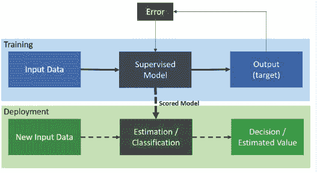

我们将在第 3 章,第 4 章和第 5 章](#Chapter05.xhtml#ch05)中看到的所有模型都使用完全相同的方法。线性回归、逻辑回归、决策树、神经网络、森林、梯度提升和支持向量机都使用过去的数据创建一个简洁的映射，以估计输入变量与目标值之间的关系。换句话说，模型估计了客户特征与购买或不购买事件之间的关系。一旦确定了关系并建立了映射，就可以使用模型来预测未来事件，或者选择哪些没有产品的客户更倾向于购买。基于该映射（可以是一个公式、方程或一组基于阈值的规则），公司可以识别出所有可能购买产品的客户，并在特定的销售活动中接触他们。所有的监督模型行为都非常相似，即使用过去已知的事件来估计预测变量与目标之间的关系。如果找到了一个良好的模型，该模型就可以用于预测未来事件。

由于监督模型的目的是预测预测的未知值，因此监督模型的主要目标是泛化到新数据或未来案例。泛化意味着在目标未知时预测新案例结果的能力。这就是为什么我们使用不同的数据集来训练模型（捕捉输入与目标之间的关系）并验证模型（泛化模型以做出良好的预测）。

泛化也涉及模型评估。模型评估是将模型拟合到训练数据集，并通过比较预测值与观测值在验证数据集上评估其性能。由于目标值是已知的，评估是直观的，即比较模型预测的目标值与观测到的目标值之间。

在本章中，我们将讨论三种不同类型的模型：

*   **线性回归 (Linear Regression)**：用于预测连续目标。线性回归模型的一个假设是输入与目标之间存在线性关系。
*   **逻辑回归 (Logistic Regression)**：用于预测离散目标，如二元、序数和命名结果。逻辑回归的一个假设是输入与对数（logits）之间存在线性关系。
*   **决策树 (Decision Trees)**：用于预测连续和类别目标。对于输入与目标之间的关系没有假设。决策树是通用近似器，因为从理论上讲，它们可以捕捉输入与目标之间的任何类型的关系。

### 线性回归

目标与输入变量之间的关系可以用方程刻画：

```
y[i] = β[0] + β[1]x[i] + ε[i], i = 1 …, n
```

| yi | 是目标变量。 |
| --- | --- |
| xi | 是输入变量。 |
| β0 | 是截距参数，对应于预测变量为 0 时目标变量的值。 |


| 参数 |  |
| :--- | :--- |
| `β1` | 是估计参数（斜率），对应于输入变量变化一个单位时，目标变量的变化幅度。 |
| `εi` | 是误差项，表示 `yi` 相对于 `β0 + β1xi` 的偏差。 |

## 线性回归概述

通过普通最小二乘法（ordinary least squares）交互地获取未知参数 `β0` 和 `β1` 的估计。该方法通过确定一条使观测值与拟合线之间垂直距离平方和最小的直线来提供估计。换句话说，拟合线或回归线尽可能地接近所有数据点。

在线性回归中，目标变量的估计是由输入的简单线性组合构成的。截距是当预测值为零时目标值的平均值，而剩余的参数估计则决定了每个输入变量与目标之间的斜率。预测估计可以看作是给定观测输入值的情况下目标期望值的线性近似。

### 线性回归的优势

线性回归模型最大的优势之一是其简单性，无论是在实现还是解释方面都是。线性回归的实现非常简单，因为它仅仅是一个线性方程。模型中的系数很容易解释，它们表示在控制其他预测变量的情况下，预测变量每增加一个单位对目标的影响。在大多数情况下，可以快速获得模型结果，并快速对新的观测值进行评分。换句话说，通过代入预测变量的新值，可以轻松地获得新案例的预测结果。

### 缺点与局限性

线性回归模型的缺点是模型受限于残差从正态分布（残差是观测值减去预测值）。如果残差显示出非正态分布（如偏态分布），那么广义线性回归模型可能会有所帮助。

另一个缺点是预测变量之间存在高度共线性会导致模型不稳定。系数的这种稳定性可能导致无法通过一个简单的模型来识别出作为目标最佳预测器的预测变量。因此，数据科学家在想使用线性回归模型时，应该先减少冗余。

如果预测变量与目标之间存在非线性关系，数据科学家将不得不添加高阶项来正确建模这些关系，或者进行变量变换。寻找适当的高阶项或变量变换可能是耗时且麻烦的。

最后，线性回归模型可能会受到离群值的影响，离群值会改变模型结果并导致糟糕的预测性能。

## 用例：客户价值

使用线性回归解决的业务问题示例是预测每个客户赚取的收入。模型的结果可以驱动销售活动，针对那些收益较低但预测支出水平高的客户进行推广。另一方面，模型可以指出接近可能最大收益收入的客户，然后可以将他们从非关键的销售活动中移除，以避免他们最终的流失。没有理由将已经达到可能最大收益收入的客户添加到某些销售活动中。通过将他们从非关键活动中移除，公司可以减少联系这些客户的运营成本，并避免向优质客户投放不必要的营销广告。

数据中的输入变量或预测变量是：

* 客户的人口统计信息
* 产品使用信息，如频率、新鲜度、产品数量、产品价值、总价值、产品收入、总收入、每个产品的使用量和总使用量
* 支付类型、日期、支付频率、支付金额等
* 支付延迟信息
* 预测变量之间的高度共线性

目标变量是：

* 每个客户的最大收益收入

## 逻辑回归

逻辑回归与线性回归密切相关。在逻辑回归中，目标值的期望值通过链接函数（link function）进行转换，将其值限制在单位区间内。通过这种方式，模型预测可以看作 0 到 1 之间的概率。logit 分数的范围是从负无穷到正无穷。对于二分类，任何将单位区间映射到实数线的单调函数都可以被视为链接。logit 链接函数是最常用的之一。

例如，如果你想使用逻辑回归对二目标进行分类，你会希望将输出范围限制在 0 到 1 之间。logit 链接函数将连续的 logit 分数转换为 0 到 1 之间的概率。连续的 logit 分数（或 `phat`）由几率对数给出，即事件概率除以非事件概率的对数。这种 logit 变换将概率尺度转换为实数线。因此，logit 可以线性组合进行建模，因为线性组合可以取任何值。

逻辑模型特别容易解释，因为每个预测变量都线性地影响 logit。系数就是斜率。对每个参数估计取指数得到几率比（odds ratios），它比较了一组事件发生的几率与另一组事件发生的几率。

几率比显示了预测变量与目标变量之间关联的强度。如果几率比为 1，则预测变量与目标之间没有关联。如果几率比大于 1，则分子组发生事件的几率更高。如果几率比在 0 到 1 之间，则分母组发生事件的几率更高。例如，3 的几率比表示分子组获得事件的几率是分母组的三倍。分子组和分母组基于输入变量的编码。例如，如果输入变量 `age` 的参数估计为 `0.97`，那么指数为 `2.66`。这意味着，`age` 每增加一个单位，几率就会增加 `166%`（`(2.66 - 1)*100`）。


通常情况下，逻辑回归的预测可以是排名、决策或估计。分析师可以对后验概率进行排序以评估观测值，从而决定采取什么行动。例如，在催收活动中可以根据后验概率的排名来联系客户。后验概率越高意味着客户更有可能付账。为了获得决策，你需要一个阈值。获取有意义阈值最简单的方法是将预测排名转换为预测估计。你可以通过对 logit 分转换获取预测估计。逻辑函数是 logit 函数的逆。你可以通过求解关于 `p` 的 logit 方程得到逻辑函数。阈值可以是随机事件的值，例如 `0.5` 或 `50%`。例如，抛掷硬币得到反面或正面的概率是 50-50。如果后验概率大于 `0.5`，则决策为该观测值可能感兴趣事件。例如，所有后验概率大于 `0.5` 的客户都可能付账。所有后验概率小于或等于 `0.5` 的客户可能不会付账。

逻辑回归中的参数估计通常通过极大似然估计法获得。这些估计值可以用于 logit 和逻辑方程以获得预测。

如果目标变量是二分的（两个类别），适当的逻辑回归模型是二分类逻辑回归。如果目标变量包含两个以上的类别（水平），则存在两种可能的逻辑回归模型：

*   如果目标变量是名名的，适当的模型是名义逻辑回归。
*   如果目标变量是序数的（排名的），适当的模型是序数逻辑回归。

二分类逻辑回归模型假设后验概率的 logit 是预测变量的线性组合。参数 `β0`、`β1`...`βk` 是未知的常数，必须从数据中估计（`k` 是预测变量的数量）。

逻辑回归模型的优点与线性模型相似。首先，该模型的实现非常简单，因为它仅仅是一个线性方程。其次，模型中的系数易于解释，它们代表了在控制其他预测变量的情况下，预测变量每增加一个单位对 logit 产生影响。当对参数估计值进行指数运算时，可以获得优势比（odds ratios），这显示了预测变量与目标之间关系的强度。此外，预测值具有良好的概率解释。第三，在大多数情况下，可以快速获得模型结果。第四，新的观测值可以快速进行评分。

逻辑回归的缺点与线性回归类似，即预测变量之间的高度共线性会导致模型不稳定。此外，如果预测变量与目标之间存在非线性关系，数据科学家将不得不添加高阶项或变量变换来正确地建模这些关系。最后，逻辑回归模型可能会受到异常值的影响，从而改变模型结果并导致预测性能不佳。

## 用例：收集预测模型

可以使用逻辑回归解决的业务问题示例是还款概率。模型的主要目标是根据偿还未付账单的概率对无能力客户进行排序。数据中的输入变量有：

*   人口统计信息
*   付款频率
*   客户年龄
*   产品
*   信用历史
*   服务
*   金额
*   天数
*   付款类型
*   违约
*   债务收入比
*   债务比例
*   未付账单

目标变量是：客户是否已付款。

## 决策树

决策树是为监督预测设计的统计模型。监督预测涵盖了预测建模、模式识别、判别分析、多元函数估计和监督学习。决策树包含以下组件：

*   内部节点是对某个属性的测试。
*   分支代表测试的结果，例如 `color=purple`。
*   叶节点代表一个类别标签或类别标签分布。
*   在每个节点上，选择一个属性将训练数据尽可能地划分为不同的类别。
*   新实例通过遵循通往叶节点的路径进行分类。

该模型被称为决策树，是因为该模型可以用树形结构表示。决策树从根节点开始从上到下读取。每个内部节点代表一个基于输入值的划分。输入可以出现在树中任何次数的划分中。案例沿着包含其输入值的分支向下移动。在具有区间输入的二叉树中，每个内部节点都是一个简单的不等式。如果不等式为真，案例向左移动，否则向右移动。树的末端节点称为叶节点。叶节点代表预测的目标。所有到达叶节点的案例都被赋予相同的预测值。叶节点给出预测的类别以及属于该类别的概率。

决策树也可以具有多路划分，将输入值划分到互不相交的范围内。

当目标是类别的时，模型被称为分类树。分类树可以被认为定义了多个多元阶跃函数。每个函数对应于目标类别的后验概率。当目标是连续的时，模型是回归树。叶节点给出目标的预测值。所有到达叶节点的案例都分配有相同的预测值。案例使用预测规则进行评分。这些预测规则定义了进行预测的输入空间区域。每个预测规则试图使输入空间区域在目标响应值方面更加纯净。

为了使用业务数据说明决策树，使用了一个包含付款信息的通用数据集，目标为违约的二分类。为了简单起见，输入变量为：

*   前期延迟：自分析时间以来的之前的延迟次数。
*   超收：账单金额差异，或账单金额除以平均账单金额。


- `Aging`: 自客户首次开始使用公司产品或服务以来经过的时间。

目标变量是：

- `Bad debt`: 客户是否发生账单违约。

决策树从根节点开始从上到下读取。在示例中，`previous delay` 是根节点，值为 `0` 的案例进入树的左侧，而值为 `1` 或更大的案例则进入树的右侧。（请参见图 3.2）。选择 `previous delay` 作为根节点是基于一种划分搜索算法，该算法能够找到能够在目标变量值之间提供最显著划分的预测变量。

每个内部节点都代表基于其中一个预测变量的值的拆分。预测变量可以出现在树中任意数量的划分中。案例沿着包含其预测变量值的分支向下移动。

叶节点表示预测的目标值。所有到达叶节点的案例都被赋予相同的预测值。该值基于训练数据中到达该叶节点的案例的目标值。在示例中，有逾期未付款记录、账单差异在 10% 及以上且客户身份不满 5 年的客户被预测为违约。

决策树的优点在于它们易于实现且非常直观。事实上，模型的结果非常容易向非技术人员解释。决策树可以非常拟拟合，并很容易地对新客户进行评分。

与`linear regression`和`logistic regression`等线性模型不同，决策树可以在不指定模型中指定关系的情况下，处理目标变量与预测变量之间的非线性关系。

缺失值得到了处理，因为它们是预测规则的一部分。例如，如果 `income` 缺失，可以将客户放入它们自己的输入空间，而不是从分析中剔除。

图 3.2：决策树建模方法

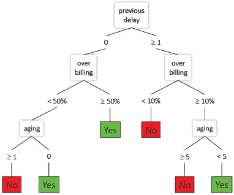

决策树对预测变量值中的离群值具有稳健性，并且可以发现相互作用。当目标与预测变量之间的关系随着另一个预测变量水平的改变时，就会发生相互作用。例如，如果男性`target`与`income`之间的关系与女性不同，决策树能够发现这一点。

决策树通过忽略无关的预测变量来应对维度灾难。然而，决策树没有内置忽略冗余预测变量的方法。由于决策树可以快速拟合且结构简单，这对于模型创建来说通常不是问题。但在模型部署方面可能会是一个问题，因为决策树可能会从一组相关的预测变量中任意选择。为了避免这个问题，建议数据科学家在拟合决策树之前减少冗余。

作为一种缺点，决策树是非常不稳定的模型，这意味着训练数据集的任何微小变化都可能导致树结构发生巨大变化。整体性能（或准确率）可能保持不变，但结构可能非常不同。如果结构不同，基于阈值的规则集也会不同。缓解不稳定问题的常用方法是创建树的集成。我们将在下一章介绍这种方法。

### 案例：订阅欺诈

决策树模型实用的业务问题是订阅欺诈。在电信领域，订阅欺诈是指欺诈者使用被盗的身份或合成身份来获取移动设备和服务。


## 监督学习机器学习模型

* 识别可能从使用监督学习机器学习模型中获益的情况。
* 识别在性能、灵活性和准确性方面的优点，以及如缺乏可解释性等缺点。
* 描述不同类型的监督学习机器学习模型及其适用场景，特别关注 `random forests`、`gradient boosting` 和 `artificial neural networks`。
* 解释监督学习机器学习模型的一些结果。

## 监督学习机器学习模型

我们将讨论三种不同的模型：

* `Random Forest` – 用于预测名义目标或估计连续值。对输入与目标之间的关系没有任何假设。随机森林模型基于多个独立的决策树模型。
* `Gradient Boosting` – 用于预测名义目标或估计连续值。对输入与目标之间的关系没有任何假设。梯度提升基于一组序列的决策树模型。
* `Neural Networks` – 用于预测名义目标或估计连续值。该模型基于非线性多元回归的线性组合。多个输入和隐藏神经元的结合使得模型能够考虑到输入与目标之间的非线性关系。

这三种模型都是都是通用的近似器，因为从理论上来说，它们可以捕捉输入与目标之间的任何类型的关系。

## 树集成

决策树是非常好的模型，易于实现、训练快速且易于解释，但它们是不稳定的。在某些情况下，一个案例的类别标签变化可能会导致树的结构完全不同，尽管其准确率几乎相同。这在部署决策树以支持业务决策时可能会问题。尽管当决策树的最终结构发生时，整体准确率可能保持相似，但基于阈值的规则集将会不同，因为它们是基于树的结构的。这可能会影响业务活动，因为活动是基于这组规则的。

决策树的不稳定性源于大量的单变量分裂和数据的碎片化。在每次分裂时，通常会在同一个预测变量上或具有相似性能的不同预测变量上进行多次分裂。例如，假设 `age` 在 `45` 处进行分裂，因为它是预测变量与目标之间最显著的分点。然而，在 `38` 或 `47` 处的其他分裂可能几乎同样重要。数据的微小变化很容易产生级联效应并创建出不同的树。输入数据的变化可能会导致在 `38` 岁处分裂。更有问题的是，输入数据的变化可能会导致另一个输入变量（如 `income`）对目标变得更加显著。那么，决策树不再根据 `age` 分割输入数据，而是根据 `income` 分割输入空间。最终的树结构将非常不同，因此规则和阈值集也将不同。

已采用多种方法来利用这种决策树的不稳定性来创建更强大的模型，特别是在最终预测模型的泛化能力方面。最流行的方法之一是创建决策树集成。

集成模型是多个模型的组合。组合可以通过以下方式形成：

* 对分类进行投票
* 使用加权投票，某些模型具有更高的权重
* 对预测值取平均值（加权或未加权）

树集成有两种类型：`random forests` 和 `gradient boosting` 模型。

## 随机森林

在 `random forest` 模型中，每个决策树的训练数据都是从所有观测中进行放回抽样的。对输入与目标之间的关系没有任何假设。随机森林模型基于多个独立的决策树模型。

（注：原文中存在大量重复段落，此处已按要求翻译核心定义内容。）


梯度提升（Gradient boosting）基于的方法与随机森林略有不同，特别是被归类为“扰动与组合”方法。提升（Boosting）是一种机器学习集成元算法，主要用于减少方差。“提升”一词指的是一类算法，它可以将弱学习器（在这种情况下是具有大残差的决策树）转换为强学习器。

自适应重采样和组合方法是提升的示例。它们根据前一个模型的结果顺序地扰动训练数据。被错误分类的案例在后续模型中会被赋予更大的权重。对于连续目标，从序列中的第二个决策树开始，目标是前一棵树的残差。目标是最小化目标函数，在该模型中该函数最小化残差。

梯度提升模型所示。

`F[M] (*x*) = F[0] + β[1]T[1] (*x*) + β[2]T[1] (*x*) + … + β[M]T[M] (*x*)`

其中 `M` 是迭代次数，或梯度提升模型中的决策树数量，`F0` 是初始估计值，`β` 是线性组合中每个决策树的权重，`T` 是每次迭代中的决策树模型。

森林模型和梯度提升模型的优势在于，这些模型具有决策树的大部分优点，而没有模型不稳定性和过拟合的问题。树模型集成具有低偏差和低方差，可以处理与目标的非线性关系，可以处理缺失值，并且对异常值具有稳健性。

图 4.2：基于树的模型：梯度提升

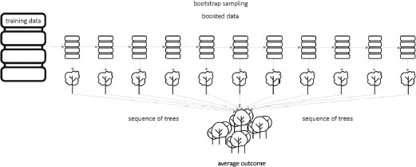

树集成模型的缺点是丢失了单个决策树的简单解释性。森林和梯度提升模型并不简单且易解释。与单个决策树相比，它们还需要更多的计算机资源。由于树是串行构建的（其中一棵树取决于之前树的结果），梯度提升模型的训练速度可能比森林慢。

## 用例：流量欺诈

森林或梯度提升模型非常有用的业务问题是流量欺诈。电信欺欺是指欺诈分子使用电信公司提供的产品和服务但没有支付意图，甚至由于欺诈分子在黑市销售或转售电信产品和服务。这是一个关键关注问题，因为有时这种欺诈与有组织犯罪和恐怖网络有关。尽管模型的主要目标是检测流量欺诈并防止故意坏账，但欺诈检测团队需要小心，避免对良好客户的客户体验产生不利影响。

流量欺诈在通话行为方面可能具有特定特征，例如拨打特定城市和国家、通话时长、通话频率和通话近期性。处理所有通话的交易系统（称为结算系统）可以为另一个处理欺诈检测的交易系统，例如欺诈管理系统（`FMS`）。该应用通常需要模型来学习和识别可疑行为并触发警报，以便欺诈分析师进一步调查案件。这种使用行为通常是随时间变化的累积行为。

不同的机器学习模型（如森林和梯度提升）可以妥善解决这一业务问题。这些模型被用于计算流量欺诈的概率。如果概率高于阈值，就可以发出警报。欺诈管理系统持续使用这些模型对数据评分以生成警报。数据科学家还可以仅选择高概率的结果传输到 `FMS`。这种方法旨在避免向欺诈分析师发送假阳性警报，以免误阻塞与良好客户相关的产品和服务。

图 4.3：欺诈事件中的信息流

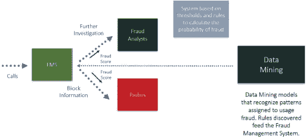

在图 4.3 中，实时交易（例如电信中的通话和短信）输入 `FMS`。这些交易被用于从近期性和频率的角度累积客户的行为。历史交易被用于数据挖掘计划（分类和估计监督模型，以及聚类和分割无监督模型），以识别所有可能的检测可疑交易的规则。这些规则经过评估并部署到 `FMS` 中。一旦发出警报，基本上有两种选择，主要取决于规则的类型及其准确性。如果发出高准确率警报，自动化系统可以使用网络系统中的探头自动挂断电话。如果发出中等准确率警报，则可以将案件发送给欺诈分析师进一步调查。

## 神经网络

如果输入变量与目标之间的关系是非线性的，但可以指定这种关系，则可以建立参数回归模型。当无法实际指定关系时，则需要非参数回归模型。

非线性回归模型比线性模型更难估计。数据科学家必须指定要建模的完整非线性表达式，以及用于高效搜索参数的优化方法。还需要提供初始参数估计值，这对于优化过程至关重要。另一个选项是没有函数形式的非参数回归模型。

传统的非线性建模技术随着输入数量的增加变得越来越难以定义。具有多个输入的参数回归模型并不常见，因为随着输入数量的增加，推导出合适的函数形式变得越来越困难。高维输入空间对非参数回归模型也是一个挑战。

神经网络的发展是为了克服这些挑战。虽然神经网络是参数非线性模型，但它们在某方面类似于非参数模型：神经网络不需要指定函数形式。这使得数据科学家可以在输入与目标之间的关系未知的情况下构建模型。

然而，与其他参数非线性模型一样，神经网络确实需要带有初始参数估计的优化过程。此外，与线性参数回归模型和非参数回归模型不同，神经网络在稀疏的高维空间中表现良好。

回归和神经网络具有相似的组件，但名称不同。神经网络使用偏置估计代替截距估计；使用权重估计代替参数估计。

尽管名称很高级，但最常见的神经网络类型——多层感知器，可以被视为回归模型的扩展。

神经网络模型按层排列。第一层称为输入层，由输入变量组成。第二层称为隐藏层，由隐藏单元或神经元组成。可以有多个隐藏层，每个隐藏层有多个隐藏单元。最后一层是目标层，由响应或目标组成。

图 4.4：神经网络结构图


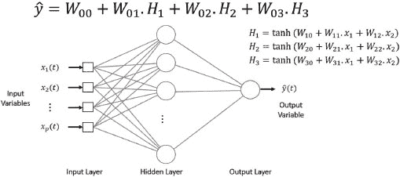

神经网络通过一个涉及输入变量值的数学方程来预测案例。输入层中的输入通过隐藏层中的隐藏单元或神经元进行加权和线性组合。隐藏单元包含一个链接函数（在神经网络中称为激活函数），用于缩放输出值。将结果与目标层中的观测值进行比较，计算出残差，并重新估计权重。

具有一个隐藏层的神经网络的输出，是隐藏单元生成的数学函数的加权线性组合。权重和偏置赋予了这些函数灵活性。通过改变这些函数方向和斜率，然后将它们组合，使得神经网络能够拟合任何目标。

生成预测公式后，获取预测值只需将预测变量的值代入隐藏单元的表达式中即可。与回归模型一样，数据科学家使用预测方程中使用适当的链接函数来获取预测估计值。

神经网络是通用近似器，可以建模预测变量与目标之间的任何关系。鉴于神经网络无限的灵活性，它们对离群值具有良好的鲁棒性。

大多数预测变量与目标之间的关系可以用一到两个隐藏层进行建模。然而，所需的隐藏单元数量是一个更主观的问题。如果神经网络的隐藏单元过多，它会将随机变异和所需的模式都进行建模。如果神经网络的隐藏单元太少，它将无法捕捉底层信号。因此，指定正确的隐藏单元数量涉及一些尝试。数据科学家可以通过使用验证集上的拟合优统计量来确定合适的隐藏单元数量。例如，他们可以拟合具有不同隐藏单元数量的模型，并选择在验证集上拟合优统计量最低的模型。

权重的合理值是通过对区间值目标使用最小二法估计以及对类别目标使用极大似然法找到的。权重的搜索涉及一个优化过程，该过程应用误差函数（或目标函数）在每次迭代中更新之前的权重。当目标变量为二元时，主神经网络回归方程接收与逻辑回归中相同的 logit 链接函数。

复杂的优化算法是神经网络建模的关键部分。停止训练的方法始于随机生成的初始权重集。训练通过以更新权重来改进所选拟合统计量值的方式进行。优化过程中的每次迭代都被视为一个独立的模型。选择在验证集上所选拟合统计量具有最佳值（某些统计量越小越好，某些则越大越好）的迭代作为最终模型。为了避免过拟合，在寻找正确的权重集期间应用了名为权重衰减的方法。观察到，每当激活函数的形状变得太陡时，神经网络就会过拟合。导致激活函数形状变得太陡的原因是权重增长过大。权重衰减方法通过正则化在权重增长过大时对其进行惩罚。正则化主要有两种类型：Lasso 或 `L1`（惩罚权重的绝对值）和 Ridge 或 `L2`（惩罚权重的平方）。另一个重要参数是学习率，它通过在每次迭代中更新权重集来控制训练发生速度。

神经网络是评分最快的非线性模型之一，因为它们可以高效地对大量数据进行评分。例如，银行使用神经网络评估其所有的信用卡交易以发现潜在的欺诈模式。神经网络也常用于对股票和期货波动提供实时评估和监控。

神经网络最适用于纯预测任务，因为很难解释预测变量如何影响目标。这对于受监管的市场（如银行的信用评分）是有利的，因为将很难解释预测变量如何影响预测的目标值。一种解决方案是使用决策树来解释神经网络的预测结果。简单地将目标定义为神经网络预测的值。请注意，决策树并不是在解释神经网络模型，而是通过预测其结果来解释神经网络提供的结果。在业务操作方面，理解预测背后的模式可能就足够了。在监管术语中，这种方法可能是不够的。

另一种解决方案是使用模型解释性图。模型解释性图的一个示例是部分依赖图，它揭示了目标预测如何随着输入值的变化而变化。这些方法并没有让神经网络直接变得可解释性，但它们允许数据科学家对其获得洞察。

尽管神经网络是评分最快的非线性模型之一，但在拟合（或训练）模型时需要大量时间。随着隐藏单元和层数的增加，情况尤为如此。

尽管神经网络具有无限的灵活性，但有时它们的性能可能不如线性回归等简单模型。这种情况发生在信噪比低的时候。

当存在一个很强的模式（称为信号）相对于变异量（称为噪声）时，信噪比很高。在这种情况下，神经网络的性能通常优于线性回归等简单模型。然而，当相对于噪声的模式较弱时，信噪比较低。线性回归和神经网络模型对数据的拟合效果可能相当，如图 4.5 所示。因此，在这种情况下使用神经网络模型并没有优势。

## 用例案例：坏账

电信领域的主要问题之一是坏账，无论是无意的还是故意的。客户产生无意坏账有许多原因，如失业、意外支出等。公司也许多许多种方法来处理这些坏账：重新协商债务、部分收回债务或部分暂停服务。对于故意的坏账，无能为力，除非能够被预防。在某些市场（如南美的许多地区），还有一个加恶化的情况。提供公用事业服务的公司在开具账单时向政府缴纳销售税。当这些客户不支付账单时，事业公司无法获得与发票相关的收入，更糟糕的是，他们无法收回已交给政府的税款。这是一个双重损失。

图 4.5：神经网络中的信噪比效应

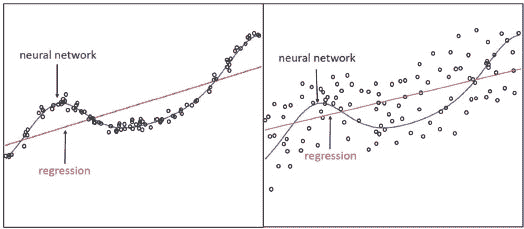


这类问题可以通过使用准确的监督模型来解决，尽管这种模型无法进行解释。可以在历史发票上训练神经网络，以捕获使用情况与意性坏账之间的关系。仅考虑预测概率最高的前几个百分比的案例，在税收方面就存在巨大的资金节省机会。该模型在账单流程之前运行，并创建一个最可能无法付款的发票列表。即使将阈值提高到前 5%，或仅针对预测概率大于 92% 的案例，税收的节省也是可观的。在这种情况下公司会怎么做？它不开具账单。这听起来很奇怪。然而，对于预测概率最高的案例，公司不开具账单，这可以节省数百万美元。当然，模型中总是存在错误，例如分类错误的案例。不幸的是，这些客户的服务将被暂时切断，直到他们联系 `Call Center` 投诉。这正是公司意识到分类错误的时刻。欺骗者通常不会向 `Call Center` 投诉。当被误分类的客户投诉服务时，公司需要立即重新激活服务并补偿客户的损失。然而，考虑到所有的损失和节省，该模型仍然可以避免数百万美元的税收。

图 4.6：使用高级分析模型在坏账方法的节省

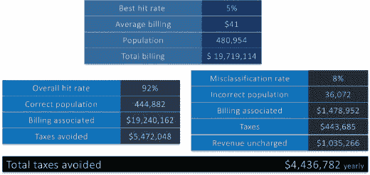

图 4.6 中的模拟显示了部署坏账模型可能的财务回报。例如，在某些市场，电信公司在开具客户账单时需要缴纳税，有时约为 33%。如果客户不支付账单，公司无法收回这些税款。这就是业务的风险。然而，部分坏账是欺诈。如果公司在开账之前识别出欺诈会怎样？欺诈造成的已经造成。但公司至少可以避免税收。预测模型在开具账单之前对其进行评估。每张账单都有一个相关的概率，用于识别该账单是否与欺诈相关风险。考虑预测概率较高的前 5% 的账单，整体准确率为 92%。这意味着模型在 8% 的案例可能会导致错误的决策。考虑到平均账单金额为 41 美元，潜在意性坏账人数（前 5%）为 480,954 人，总账单金额约为 1970 万美元。在 92% 的案例中做出正确决策可以避免 550 万美元的税收。在 8% 的案例中做出错误决策将给公司带来 100 万美元的成本。最终节省仍将超过 450 万美元。在真实的欺诈场景中，所有被识别为欺骗者的客户都不会开具账单，其服务将被切断。良好的客户（包括模型错误中的那 8%）将与公司联系以确定发生了什么。服务将恢复，账单将重新发布，从而减少由预测模型造成的损失。

## 总结

本章介绍了一些用于监督建模的机器学习算法，例如集成树（森林和梯度提升）和人工神经网络。文中描述了可能受益于使用机器学习监督模型的情况、使用机器学习监督模型的一些优点，以及一些缺点。

# 第 5 章：监督模型的高级主题

## 概述

在本章中，你将学习机器学习的高级主题。本章重点关注支持向量机和因子分解机等机器学习模型，以及集成模型和两阶段模型。

本章的主要目标是：

* 描述机器学习和人工智能与数据科学领域的关系。
* 识别可能受益于使用支持向量机和因子分解机等机器学习监督模型的情况。
* 描述依赖机器学习和人工智能的不同类型的监督模型，以及可能使用它们的情况。
* 描述基于集成和两阶段模型开发监督模型的不同类型高级方法。
* 理解何时使用集成模型和两阶段模型等高级机器学习模型方法来解决业务问题。
* 解释依赖机器学习和人工智能的支持向量机和因子分解机等高级监督模型的结果。
* 解释在解决现实问题中使用集成模型和两阶段模型等高级监督方法的结果。

## 高级机器学习模型和方法

第 5 章 涵盖了两种高级机器学习模型和两种训练监督模型的高级方法。我们将讨论的机器学习模型包括：

* 支持向量机：在 SAS 中实现的此模型目前可以处理二分类和连续目标。
* 因子分解机：该模型是线性模型的扩展，它可以处理连续目标。

我们将讨论的高级方法包括：

* 集成模型：该模型结合多个模型来预测目标值。目标可以是连续的，也可以是离散的。
* 两阶段模型：该模型允许对离散目标和连续目标进行建模。模型首先预测二分类响应，如果预测为 1，则模型预测连续响应。

### 支持向量机

支持向量机是用于解决现实问题的最新的机器学习模型之一。`SVM` 创建于 90 年代，是一种用于分类类别或连续目标的稳健模型。与神经网络一样，这些模型倾向于成为黑箱，但它们非常灵活。支持向量机会自动发现输入变量与目标之间的任何关系。数据科学家在拟合模型之前，不需要指定函数形式或输入与目标之间的关系。


支持向量机最初是为了纯分类任务而开发的，用于解决模式识别问题。换句话说，模型做出的是决策预测，而不是排序或估计。通过这种方式，`SVM` 将二分类目标的结果分为两类，例如正方形和圆形。现在，支持向量机也可以用于回归任务。在图 5.1 所示的简单示例中，目标是将深色正方形与浅色圆形进行分类。有许多分类规则或“回归线”可以用于区分正方形和圆形情况。事实上，如果数据是线性可分的（如图所示），那么有无限数量解决方案或直线，可以区分正方形、圆形或二分类目标中的任何情况。在考虑所有可能的分割正方形和圆形的直线时，是否存在一个最优解？给定两个输入变量，`SVM`是一条直线；给定三个输入变量，支持向量是一个平面；当输入变量超过三个个时，支持向量是一个超平面。

为了数学上的方便，二分类目标被定义为值 `+1` 和 `-1`，而不是逻辑回归中常用的 `1` 和 `0`。因为线性分割器等于 `0`，所以分类取决于点落在线的正侧还是负侧。换句话说，如果结果为正，则该案例属于其中一类；如果结果为负，则该案例属于另一类。

这是一个作为开始的非常简单的线性问题。寻找线性分类问题的最佳解是一个优化问题。当问题不是线性可分时，`SVM` 会变得复杂。在图 5.1 中，将向量 `W` 视为影响 `H` 斜率（能够正确分类观测值的最优直线）的机制。

`H` 的公式如下所示。偏置参数 `b` 是衡量分割线离原点（或三维空间中的平面或高维空间的超平面）偏移量的。数量 `〈w, x〉` 是向量 `w` 和 `x` 之间的点积。点积是一种相乘向量的方法，产生标量（即单个数字）作为答案。它是逐元素的相乘，然后对这些乘积求和。支持向量机算法选择 `w` 和 `b` 的值，以定义正确分类案例的最优直线。

```
H = {〈w, x〉 + b = 0}
```

`w` 和 `b` 的值是如何选择的？支持向量机试图找到最大化间隔的决策边界。间隔是直线 `H` 与离直线最近的形状之间的垂直距离。`SVM` 试图寻找在两类都被正确分类的条件下，间隔最大的超平面。

这种最大化间隔的超平面的属性由支持向量（也称为载向量）描述。这些点是距离超平面最近的点，它们决定了超平面的位置。换句话说，它们决定了 `H` 的位置。因为超平面仅取决于数据点而非预测变量，所以维度诅咒被降到了。在图 5.2 中，只有五个数据点是用于确定超平面位置的支持向量，基于参数 `w` 和 `b`。

图 5.1：支持向量机训练中的线性分割

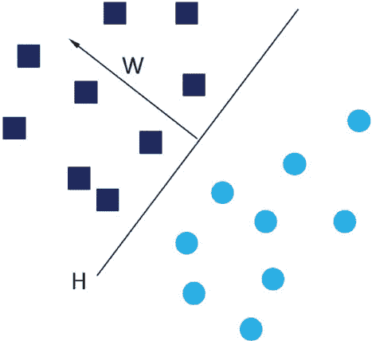

图 5.2：支持向量机中的载向量

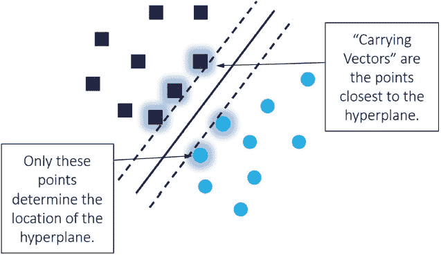

在大多数现实场景中，数据不仅不是线性可分的，而且由超平面定义的分类器会犯太多错误，导致无法成为可行的解决方案。在这种情况下，一种解决方案是应用多项式变换，将输入数据投影到更高维度，然后在高维度中寻找最大间隔超平面。例如，数据在二维空间中可能不是线性可分的，但在三维或更多维度中是可分的。这可以推广到更高维。可能是考虑到特定的输入数据，无法找到一个线性分割类别的超平面，但当将输入数据设置为更高维度时，我们可以在更高维度找到一个分割输入数据的超平面。

在更高维度中转换支持向量（如多项式）的点积计算可能极其耗费资源。为了缓解这一缺点，计算支持向量的算法使用核函数（例如二阶或三次的多项式核）来计算两个向量的点积，这的计算强度要小得多。使用多项式核函数代替使用计算密集型点积被称为“核技巧”。

`SVM` 的优势之一是数据科学家不需要指定函数形式，或知道输入变量与目标之间关系的类型。由于没有函数形式，`SVM` 对输入空间中的异常值具有稳健性。当数据点在输入空间中可分时，它们也是非常有效的分类器。此外，`SVM` 受维度诅咒的影响较小，因为与其他模型相比，它受预测变量数量的影响较小。超平面取决于数据点而非预测变量。

`SVM` 的缺点之一是模型本身是一个黑箱，没有可解释的参数估计或规则和阈值。在解释结果方面，支持向量机与神经网络以及随机森林、提升等基于树的集成模型非常相似。在预测变量与目标之间的关系对于理解结果（尤其是解释结果）至重要的监管市场中，`SVM` 的用处有限。正如之前在神经网络模型中提到的，代理模型（如回归或决策树）可以用于解释 `SVM` 的结果。然而，通过使用代理模型，数据科学家并不是在解释模型，而是从业务行动的角度来解释结果。某些监管机构可能不会接受这种方法。

图 5.3：增加维度以找到线性分割类别的超平面

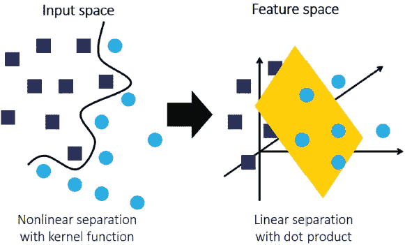

用例：预付费用户的欺诈

支持向量机适用于纯预测任务，例如欺诈检测。在这些情况下，不需要对模型结果进行完全解释，主要的兴趣在于分类结果或模型决策。这样的场景是电信公司创建了一项营销活动以促进新的手机业务。该活动向订阅者提供了预付费电话分钟，其拨打时长与从任何电话接收的分钟相同。


诈骗者立即在这种场景中识别出了机会。欺骗发生在犯罪分子获取固定线路连接到一台使用软交换机的计算机，该软交换机是电信网络中的一个呼叫交换节点。通过软交换机，犯罪分子向数百部手机拨打自动语音电话，以获取预付费分钟数。当然，犯罪分子并没有打算为固定线路付费。在这种情况下，这是对电信公司的双重欺诈。犯罪分子还可以使用经过改过的公用电话来生成这些电话，或者通过对交换机的非法扩展来实现同样的操作，即向预付费手机拨打电话并为它们产生额度。一旦这些预付费手机充满了额度，犯罪分子就会在黑市出售这些预付费手机。在许多市场，购买预付费用户识别模块（SIM 卡）时不需要向运营商提供任何信息。

欺诈检测模型的主要目标是检测接听电话的异常行为并拦截预付费分钟数。一些实用的变量包括没有拨打活跃行为、接听行为极高且持续、源号码列表非常窄，以及来自同一地点（有时是同一地址）的源号码。`SVM` 模型根据二分类目标 `0` 或 `1`（在本例中为欺诈或非欺诈）对案例进行分类。这种分类基于事件的后验概率，或预付费欺诈的可能性。根据后验概率，将后验概率最高的预付费手机号码发送到拒绝列表中，取消它们的预付费额度。欺诈检测模型每月为电信公司节省数百万美元。它们应该嵌入到事务系统中以及时监控事件。必须密切监控它们以评估其预测欺诈案件的性能。由于欺诈事件经常变化，它们通常会频繁更新。由于这些原因，欺诈检测模型的主要目标是性能而非模型的可解释性。这是神经网络、随机森林、梯度提升和支持向量机的完美案例。

## 因子分解机 (Factorization Machines)

有一类业务应用涉及估计用户会对某些物品评分。在这种业务场景下，公司通常对用户或物品的信息并不多。这类模型的主要目标是评估用户与物品之间的关系。例如，考虑一家向用户出售点播电影的流媒体公司。这家公司对其客户（用户）的信息很少，除了他们过的电影（物品）之外。用户最终可以对他们过的电影进行评分。如果我们创建一个考虑用户和电影的矩阵，考虑用户对电影给出的评分组合，这个最终矩阵将是非常稀疏的。我们可以预期，例如有数百万用户和数十万部电影。并不是所有客户都会为所有电影评分。事实上，很少有客户会对电影评分，这导致了一个包含大量缺失评分的巨大矩阵。换句话说，该矩阵中的大多数单元格都是缺失的。这里的挑战是估计用户对特定电影的评分是多少。

因子分解机是用于高维稀疏数据建模的一种新型强大工具。稀疏矩阵就是我们提到的电影公司的用户和物品的矩阵。因子分解机的主要目标是预测矩阵中的缺失项。通过估计缺失项，公司将知道考虑到所有用户的所有电影的评分。这些信息将允许公司找到用户会给出高分的物品，然后将这些物品推荐给每个用户（已对这些物品评分的用户除外）。

因子分解机模型用于推荐系统，其目标是预测用户对物品的评分。推荐系统主要有两种类型。一种类型依赖于内容过滤方法。内容过滤假设为模型估计可以获得一组关于物品的信息。这组信息通常被称为侧面信息（side information），它描述了将要推荐的物品。通过获取侧面信息，内容过滤在估计新物品评分方面没有问题。

第二类型基于协同过滤。这种方法不需要关于物品的额外信息。所需的信息是包含用户集、物品集以及用户对物品评分的矩阵。所有用户和物品的组合创建了一个包含大量缺失评分的大稀疏矩阵。协同过滤方法在估计所有用户和物品组合的评分方面运行良好。协同过滤方法的问题是无法估计没有评分的新增物品。

图 5.4 显示了协同过滤的一个示例。在这种情况下，公司拥有的所有信息都是现有评分，可以用矩阵表示。并不是所有用户都会为所有物品评分，因此某些评分将缺失。

因子分解机通过求加所有用户和物品的平均评分、一个用户给出的平均评分、给一个物品的平均评分，以及一个考虑到用户与物品之间亲性的成对交互项来估计评分。用户与物品之间的亲性被建模为两个特征向量之间的内积：一个用于用户，另一个用于物品。这些特征统称为因子（factors）。

矩阵分解技术通常是有效的，因为它们使数据科学家能够发现用户和物品之间交互背后的潜在特征。基本思想是发现两个或多个矩阵，当它们相乘时会返回原始矩阵。

图 5.4：带有缺失用户评分的用户与评分表

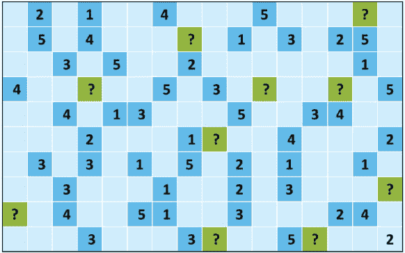

想象如图 5.5 所示的场景。有一组用户 `U` 和一组物品 `I`。大小为 `|U| X |I|` 的矩阵 `R` 包含了用户分配给物品的所有评分。因子 `K` 的数量可以任意定义。这些 `K` 因子代表用户集 `U` 和物品集 `I` 之间的潜在特征。主要目标是找到两个矩阵 `P(a|U|×K)` 和 `Q(a|I|×K)`，使得这两个矩阵的积近似 `R`：`R ~ P×Q`。

`P` 的每行代表用户与特征 `k` 之间的关联强度。同样，`Q` 的每行代表物品与特征 `k` 之间的关联强度。为了获得 `ui` 对物品 `ij` 的评分预测，我们需要计算对应 `ui` 和 `ij` 的两个向量的点积：`${r\hat{}_{ij} = p_{i}^{T}q_{j} = \sum_{k = 1}^{k}p_{ik}q_{kj}`

获取矩阵 `P` 和 `Q` 的一种方法是先为这两个矩阵初始化某些值。这些值正是现有的评分（用户评价物品）。我们计算它们的积与 `R` 之间的差异，并尝试迭代地最小这种差异。这种方法被称为 `梯度下降`，其目的是寻找局部最小值。

```
e_{ij}^{2} = {(r_{ij} - \widehat{r_{ij}})}^{2}
```

考虑平方误差是因为估计评分可能高于或低于观测评分。

用例：基于零售客户评分的推荐系统


许多行业中一个反复出现的业务问题是向合适的客户推荐合适的产品或服务。想象一家在线运动零售公司，销售针对多种运动类型的许多不同产品。例如，运动可能包括足球、棒球、篮球和自行车，产品可能包括服装和设备。

图 5.5：用于估计缺失值的矩阵因子化

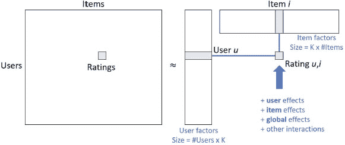

同样设想，这家公司有一项奖励计划，激励客户在购物或浏览时登录。当客户登录后，他们就可以被识别，并对随时间推移的所有交易进行匹配。客户被要求一段时间后对购买的产品进行评分，这让他们有时间体验产品，然后提供更准确的评分。

反复的促销可以识别出购买过相似产品且评分相似的客户。这些客户和物品的组合了一个巨大的矩阵。分解机模型在考虑未对产品评分的客户的情况下，估计所有缺失的评分。一个合理的场景是考虑那些购买了产品但没有评分的客户。目标营销活动会为客户选择所有估算评分高的产品。每个客户都会针对每个高估算评分的产品收到一份促销。在启动活动之前，会应用过滤器移除客户已经购买的所有物品。由于客户可能会购买产品但不评分，将为这些客户计算一个估算评分。通过移除客户已购买的产品，公司可以避免就客户已拥的产品发送信息和促销。

# 集成模型

集成模型通过组合多个模型的预测来创建新模型，这些模型由不同的建模技术或不同的建模结构（具有不同隐藏层数量和隐藏单元的多个神经网络）组成。然后使用组合模型进行评分。对于二目标，数据科学家可以将后验概率的平均值作为最终预测概率。另一种方法是得出决策（对于模型中评分的每个观测值，如果后验概率大于 50%，则分类为 1，否则为 0），并查看有多少模型预测为 1 与 0。然后对预测的类别进行多数表决。对于连续目标，通常的方法是将最终估计设为集成结构中每个模型估计值的平均值。

图 5.6：集成模型

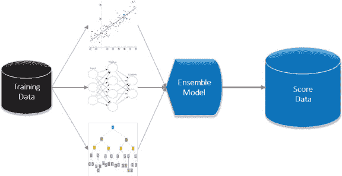

集成模型通常被观察到的优势是，组合模型通常比组成它的单个模型更好。“更好”两层含义——在泛化能力方面更好，因为最终模型考虑了从不同模型中发现的关系。这些模型的组合比单个模型能更好地考虑未来数据的变异。集成模型在准确性方面也可能更好。整体估计可能比单个模型误差更小，或者整体决策可能比单个模型有更少的分类错误。需要注意的是，如果单个模型之间意见不一致，集成模型可能比单个模型更准确。数据科学家应该始终比较集成模型与单个模型的模型性能，并评估何时部署集成模型或集成结构中的某一个单个模型。

当我们思考随机森林和梯度提升等决策树集集的益处时，我们注意到集成模型具有相同的益处。这些模型可以具有低偏置和低方差，并且对过拟合更具鲁健性。集成模型可以更好地泛化到未来数据。而且集成模型可以更准确。然而，像梯度提升和森林模型一样，集成模型缺乏可解释的参数估计。因此，如果理解输入变量与目标之间的关系是首要任务，那么集成模型就没用。由于许多模型在运行，集成模型在对新观测值评分时可能会缓慢。

如果输入变量与目标之间的关系被单个模型准确捕捉，那么集成方法没有任何益处。首先，集成模型的计算开销更大，因为正在拟合多个模型并对结果取平均值。其次，集成模型不可解释的。如果单个模型是可解释模型（如回归或决策树），这一点尤为重要。

# 案例研究：电信领域的流失模型

集成模型可能特别有用的例子是电信领域的客户流失。电信公司通常拥有数百万客户，客户可能会表现出几种不同类型的使用、支付甚至流失行为。最终，单个模型无法捕捉客户子组中输入变量与目标之间所有这些不同的关系。当然，缓解此问题的一种方法是首先创建客户细分（聚类），然后为每个簇创建一个流失模型。然而，即使在同一个簇内部，我们也可以观察到不同的客户行为。集成模型可以很好地捕捉所有这些不同行为并与目标（在这种情况下是流失事件）相关联。

尽管有了集成模型作为最终模型，但也有贡献于集成方法的单个模型。如之前所述，集成模型缺乏可解释性。然而，数据科学家可以使用集成模型作为留存活动中的决策（向客户提供优惠或否），也可以使用一些单个模型（预测概率最高的那个）来最终解释结果或与流失事件相关的特征。数据科学家需要理解，业务部门需要的不仅仅是一个概率。他们还想理解客户流失的原因、客户不付账单的原因以及客户购买产品的原因。所有这些理由有助于业务部门创建营销活动、优惠、营销信息和联系客户的渠道。为了支持完整的业务行动，需要最少的可解释性。因此，将选择客户的集成模型与解释结果的单个模型相结合，可以从分析模型中提取大部分益处。

流失模型经常使用关于客户的所有信息，并从时间角度考虑。客户在流失之前是如何改变行为的，以及这些特征如何与目标（在此情况下是流失事件）相关。如图 5.7 所示，流失模型中的常见输入变量包括：

*   人口统计学变量：客户特征，如年龄、性别和教育程度
*   使用变量：产品和服务的使用量，以及随时间变化的描述使用趋势的指标
*   产品/服务组合：客户拥有哪些捆绑和服务包以及持续多久
*   收入行为：客户产生多少收入、持续多久，以及随时间变化的关于每用户平均收入趋势的指标
*   支付行为：客户过去发生过多少次违约以及延迟长度
*   合同信息：距离合同结束还有多少时间


*   呼叫中心联系：与呼叫中心联系的频率和近期性，包括原因和解决方案。
*   报告的缺陷：客户报告缺陷的频率和近期性、类型、修复时间以及解决策略。

### 图 5.7：用于电信流失分类的集成模型

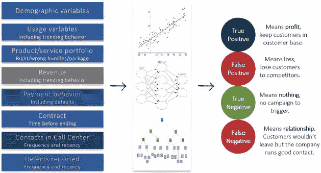

### 图 5.8：两阶段模型

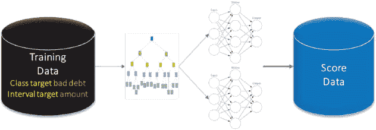

最终模型的预测概率可以用于决定哪些客户应该接收促销活动，从长远来看，可能是为他们提供某些服务以留住。

## 两阶段模型

两阶段模型允许数据科学家对一个分类目标进行建模，然后使用预测概率或决策来划分观测值，并将其输入到另一个模型中，通常用于训练一个具有连续目标的模型。这两个模型可以使用不同的算法和不同的预测变量。因此，第一个模型对二分类目标进行分类。根据第一个模型的决策（`0` 或 `1`），训练另一个模型来估计一个连续值（仅针对 `1` 的决策）。一个很好的例子是对不可管理债务的概率进行建模，如果预测类别为 `1`，则对不可管理债务的金额进行建模。

两阶段模型为数据科学家提供了事件概率和预测金额。例如，如果数据科学家正在对欺诈事件建模，他们可以在第一个模型中获取交易欺诈的概率，然后对于所有被分类为欺诈的交易，他们可以在第二个模型中估计交易涉及的欺诈金额。这两条信息可以确定欺诈金额，而不仅仅是欺诈事件的概率。

如果模型的第一阶段准确估计了预测概率，那么第二阶段预测金额的准确性可能会提高。例如，在两阶段违约模型中，违约概率预测的准确性能提高违约金额预测的准确性。

数据科学家需要注意两阶段模型使用的模型，因为任何一个阶段的模型定义不良都会影响预测的准确性，从而影响估计结果。这两个目标还需要具有相关性，否则两个独立模型就足够了。

## 用例：防流失

两阶段模型的一个良好业务案例是与客户流失相关的问题。当客户拨打公司呼叫中心进行投诉时，可以建立一个预测模型来预测如果公司不纠投诉，客户将做什么。例如，如果客户觉得他们被收了过费用，如果投诉未得到解决，客户会去消费者保护机构、监管机构，还是直接起诉？这些每一个管辖区对公司来说都有其自身的成本，如图 5.9。如果问题可以在呼叫中心层面解决，对公司来说成本更低。如果问题到达消费者保护机构，公司的成本更高。如果问题到达监管机构，成本可能会更高，因为可能会增加一些罚款。然而，如果问题进入法庭，公司的成本将是巨大的，因为除了罚款外，可能涉及一些民事赔偿。


3. Gunes, F., Wolfinger, R. and Tan, P. 2017 “Stacked Ensemble Models for Improved Prediction Accuracy”. Proceedings of the 2017 Annual SAS Users Group International Conference. Cary, NC: SAS Institute Inc.

4. Shirodkkar, G., Chaudhari, A., and Chakraborty, G. 2015. “Improving the performance of two stage model using Association node of SAS Enterprise Miner 12.3”. Proceedings of the 2015 Annual SAS Users Group International Conference. Cary, NC: SAS Institute Inc.

# 第 6 章：无监督模型——结构化数据

## 章节概述

在本章中，我们将研究无监督模型。无监督模型的特征是没有目标变量。正如我们在第 3 章、第 4 章和第 5 章中所学习到的，监督模型考虑考虑过去的事件（或历史信息）以及一个目标（即我们之前已知结果的感兴趣的结果）。相反，无监督模型没有目标。其主要目标是根据解释变量和过去的数据发现洞察或理解趋势。过去的数据可以分配给过去的事件，但这些事件不会被用作训练模型的目标。

无监督模型的示例包括聚类、关联规则、链接分析、路径分析、网络分析和文本挖掘。本章介绍聚类，这是一种根据观测值之间的相似性将观测值分组的方法。第 7 章涵盖了关联规则。理解共同发生事件的方法包括：市场购物篮分析；用于识别经常发生的步骤序列的序列分析；用于识别以某种方式相互相关的事件的链接分析；以及用于分析文本或自然语言并从中提取主题、话题和洞察的文本分析。最后，第 8 章涵盖了网络分析和网络优化。这些技术分析连接的事件或实体，并使用算法来理解和优化网络。

在本章中，我们将讨论三类聚类技术：层次聚类、质心聚类（也称为划分）和自组织映射（一种基于模型的聚类方法）。这些技术的最佳用途取决于业务目标、模型需要实现的内容，以及结果如何在业务行动中被使用。

本章的主要目标是完成以下工作：

* 解释使用统计无监督模型的目的。
* 理解与聚类相关的概念。
* 描述不同类型的统计无监督模型及其可能使用的场景。
* 描述使用所描述聚类方法训练无监督模型所需的步骤。
* 从业务目标的角度阐释聚类模型的结果。

## 聚类

无监督模型没有目标变量。因此，其目标是在数据集中搜索未知的模式。当数据集中不存在目标时，用于构建分析模型的算法被称为无监督算法。一种常见的无监督模型类型是聚类，它尝试根据输入变量的相似性对数据集中的观测值或案例分组。

数据科学家可以在许多业务应用中使用无监督模型，包括：

* **数据降维**是一种探索数据集中模式以创建原始信息更紧凑表示的方法。这与大多数寻求对观测值分组的聚类技术不同。相反，这些方法寻求减少变量。虽然数据降维的范围要得多，但它包含了诸如变量聚类之类的分析方法。这些变量簇解释了构成簇的所有所有原始属性变异的高比例百分比。数据科学家随后可以使用变量簇代替所有原始变量，或者从每个变量簇中选择一个最佳代表变量。
* **异常检测**是一种新奇检测方法，用于寻找独特或以前未观察到的数据模式。这些方法应用于业务、科学和工程。业务应用包括欺诈检测、保修索赔分析和一般的业务流程监控。小的簇或非常多样化的群体可以被视为异常，并由寻求意外事件或交易的分析师进一步调查。
* **画像分析**广泛用于聚类分析。其核心思想是创建规则来孤立簇或细分，通常基于人口统计学或行为测量。数据科学家可能会对客户数据库进行刻画，以描述公司产品和服务的消费者。

大多数聚类方法的主要目标是将数据划分为组，使得每组内的观测值彼此尽可能相似。聚类算法创建的分组也被称为簇（clusters）或细分（segments）。创建分组或细分的过程是一个训练过程。算法可以应用于其他数据集以对新案例进行分类。这个过程类似于监督模型的评分。假设根据输入变量的一组规则和阈值创建了一个簇。如果一个新的观测值遵循相同的规则和阈值，我们可以认为这个新案例是该簇的一部分。

聚类的目的通常是描述性的。例如，将现有客户分组并为每个组关联一个独特的画像，可能有助于未来的营销策略和活动行动。聚类作为预测建模的预处理步骤也是有用的。例如，可以根据客户使用产品服务的行为将客户聚类为更同质的组。然后，可以在每个簇上训练一个预测模型，以预测客户是否会流失。假设在一家电信公司，根据他们购买的产品和消费这些服务的方式，有许多不同类型的客户。然而，他们都有可能流失的风险。由于他们的行为迥异，单一模型很难捕捉输入变量与目标之间的关系。但是，如果我们创建行为更相似的客户组，为每个组建立模型就可以捕捉这些关系。

聚类通常针对数值变量进行。如果有分类变量（这是可以理解的），它们必须以数值形式表示。有时，数据科学家会创建自己的虚拟变量来表示类别。虚拟变量意味着将分类变量编码为二分类变量，例如 0-1 变量。例如，假设一个输入变量有三个类别 A、B 和 C。虚拟变量方法创建三个变量，分别将 A 表示为 0 或 1，B 表示为 0 或 1，C 表示为 0 或 1。虽然有些人喜欢创建自己虚拟变量的灵活性，但大多数统计软件都可以完成此任务。

图 6.1 显示了一个包含两个数值变量的数据集：薪资和年龄。这些变量用于创建簇。

聚类方法高度依赖于测量单位。通常，方差大的变量对簇形成的影响往往比方差小的变量大。例如，在基于薪资和年龄的聚类中，我们可以假设所有薪资的变异可能大于所有年龄的变异。


因此，确保所有输入变量处于相同的尺度非常重要。例如，考虑数据集中的所有薪资，我们可能会观察到从 `$10K` 到 `$1,000K` 的范围。观察年龄，我们可能会观察到从 21 到 79 的范围。不仅薪资的波动大于年龄，而且薪资的尺度也远大于年龄。一种很好的方法是在用于聚类之前对所有输入变量进行标准化，使得薪资范围在 0 到 1 之间，年龄范围也在 0 到 1 之间。这样做是为了为每个变量提供了相同的机会将观测值划分为不同的组。

图 6.1：根据相似观测值进行分组的聚类方法

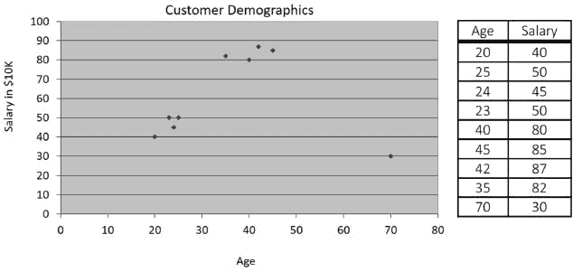

建议仅使用与业务相关的客户相关信息。对于许多公司来说，维护大量的客户信息是很常见的，但其中许多信息是外部的，与业务本身并不相关。

如果对分类变量进行虚拟编码（dummy coded），则可以使用它们。然而，如果这些变量具有许多水平，虚拟编码会产生大量的新变量，这些变量对聚类技术没有用。如之前所述，聚类通常是对少数数值输入进行的。变量过多会降低数据的整体变异性，使得聚类算法难以捕捉观测值之间的相似性。最后，最好将独立变量分配到聚类过程中。包含观测值相同信息的不同输入变量会增加输入空间的维度并减少整体变异性。

总结，聚类的一些重要要求是：

* 标准化或标准化所有属性。
* 根据业务目标考虑相关属性。
* 分类属性的水平不要过多。
* 属性具有间隔级测量水平（对分类属性进行虚拟编码）。
* 属性不要过多。
* 仅使用独立属性。

在本章中，我们将学习以下聚类方法：

* 层次聚类创建层层嵌套在较早迭代的聚类之中的聚类。凝聚聚类从每个点一个聚类开始，并不断合并邻的聚类。
* 基于质心的聚类通过尝试最小化某些指定的误差函数将数据集划分为若干聚类。`K-means` 聚类从 `k` 个聚类开始，并将数据点分配给最近的中心。算法随着时间推移质心和点，直到不再发生移动为止。
* 自组织映射根据属性的相似性将观测值分配到聚类中。自组织映射（`SOMs`）是提供从输入空间到聚类的拓扑映射的神经网络。每个分配的观测值都会影响聚类。

# 层次聚类

层次聚类是观测值数据集中递归的划分序列。如果数据具有层次结构，可以使用聚类来生成主题层次结构。例如，网络目录提供了文档的层次分类。数据科学家可以将文档的搜索限制在与主题相关的网页子集内。

层次聚类算法创建聚类的层次结构，其中每一层都定义了数据集的划分。层次聚类有两种形式：凝聚法（agglomerative），它迭代合并案例；分裂法（divisive），它迭代划分案例。

图 6.2：层次聚类

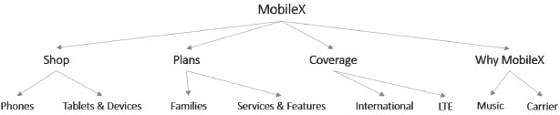

## 凝聚

1. 将每个观测值分配到自己的聚类中。
2. 合并最相似的聚类。
3. 重复步骤 2 直到只下一个聚类。

## 分裂

1. 将所有观测值分配到一个聚类中。
2. 将相似性最低的观测值划分成两个聚类。
3. 重复步骤 2 直到每个聚类中只有一个观测值。

图 6.3：凝聚算法

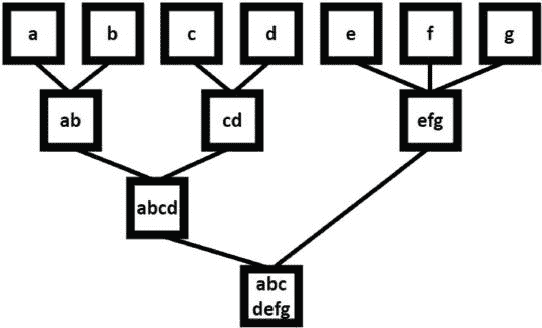

图 6.4：分裂算法

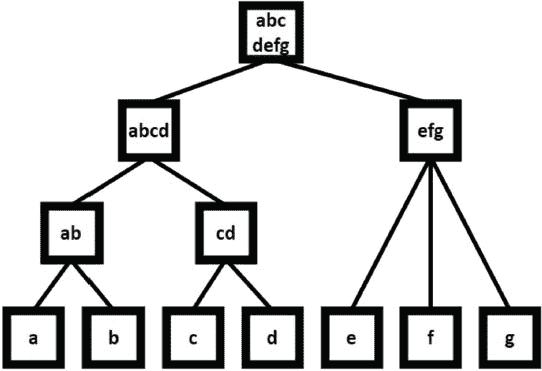

层次聚类结构由一种称为树图（dendrogram）的图表示。树图是一种显示层次聚类算法对原始数据集执行的划分序列的结构图。（参见图 6.5）。分叉代表聚类过程中所有的组融合或连接，有助于数据科学家判断在整个迭代序列中是否存在一个自然的聚类集，能够更好地将观测值分组在一起。在垂直树图中，融合水平表示为分叉从水平轴的高度。短的融合水平表示相似聚类的融合。长时间的融合水平表示异质聚类之间的融合，或者本不应该合并的观测值组之间的融合。

选择合适的聚类数量不是一项易事，它取决于业务需求。有几种技术可以评估和估计合适的聚类数量，包括间隙统计量方法（gap statistic method）和领域知识。大多数技术通过调查统计分析来评估聚类内部和外部的变异水平。间隙统计量方法通过在数据均匀分布的假设下评估不同聚类数量的类内变异性与其期望值来工作。在大多数情况下，第二种也是最好的方法是领域知识。领域专家可以与数据科学家合作，理解业务需求、聚类的目的、根据聚类结果采取的实际行动，并共同估计合适的组数以支持特定需求。想象一家公司试图根据不同的客户行为运行不同的活动。即使间隙统计量方法告诉我们最佳聚类数是 17，对于营销和销售部门来说，创建 17 个不同的活动、17 种不同的促销、呼叫中心 17 种不同的脚本等也是非常困难的。业务决策可以是四或五个聚类对于该业务就足够了。

图 6.5：树图

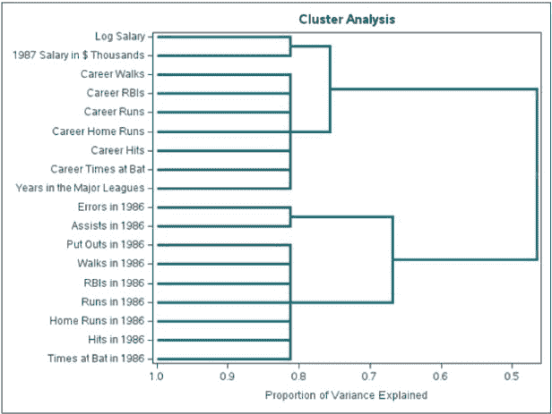

使用层次聚类的三个主要优点：

* 层次聚类易于实现且具有直观解释性。
* 生成的树图对于理解层次聚类算法的序列以及帮助数据科学家选择正确的聚类数量非常有用。
* 数据科学家不需要为算法指定所需的聚类数量。他们可以通过交互式研究树图、评估每层解释的变异性并与业务需求对比，寻找最佳聚类数量。

层次聚类的缺点是：

* 层次方法在大数据集上的扩展性不好。大多数层次方法的处理时间随观测值数量的平方甚至立方增加。随着算法中变量数量的增加，运行聚类方法的时间也会增加。如果数据科学家试图保持输入集较小，最终没有足够的信息将观测值划分为有意义的组。

* 之前的合并或划分不可撤回。例如，如果两个观测值在第一步中聚在一起，即使最后发现这种连接很糟糕，算法也无法撤销。其他方法可以在后续步骤中递归搜索更好的分布。

* 数据科学家无法使用层次聚类对新的观测值进行评分。该算法主要用于描述性目的。


## 用例：产品细分

分层聚类方法可用于产品细分。主要目标是将产品和服务归为相似的组。这些多样化的产品和服务组可以被用于创建不同的方案和捆包，以增加交叉销售和向上销售的机会。捆包通常对客户具有有吸引力的价格，同时在产品和服务方面提供了更好的选择。从长远来看，它可以留住客户并改善与他们之间的关系。捆包和方案通常提供价格折扣，但延长了合同期限，为公司提供了稳定的现金流。

例如，电信公司的数据科学家可以使用分层聚类，根据客户使用的不同产品和服务以及不同的客户行为来识别分组。他们可以利用这些簇创建不同的方案，并在多次活动中通过它们来接触客户。这些捆包预计将提高客户满意度、合同时间，最重要的是每用户平均收入（`ARPU`）。

### 图 6.6：用于产品细分的分层聚类簇描述

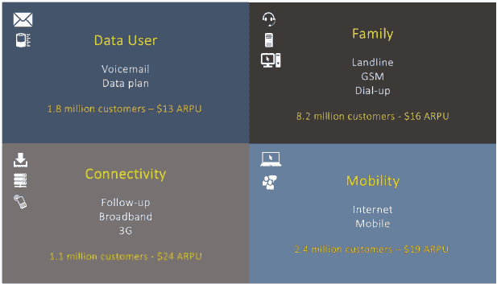

## 基于质心的聚类（k-means 聚类）

本章涵盖的第二类聚类方法是基于质心的聚类。基于质心的技术属于划分聚类，它通过尝试最小化某些指定的误差或目标函数将数据集划分为若干簇。K-means 聚类是最流行的划分聚类算法之一。K-means 试图通过最小化观测值与每个簇质心之间的欧几里距离来划分数据集中的观测值。该算法包含四个主要步骤：

1. 选择 `k` 个初始均值作为聚类中心的起始“种子”值。
2. 将每个观测值分配给距离最近的聚类中心。
3. 根据分配的观测值，为每个簇计算新的均值。
4. 迭代直到 `k` 个均值稳定稳定。

k-means 算法的第一步是选择 `k` 的值，即簇的数量。`K` 代表目标簇的数量。这里使用“目标”一词是因为在聚类过程中，质心的数量可能过多，以至于无法将所有观测值划分为 `k` 个簇。假设你有一个包含 100 个观测值的数据集，并将 `k` 设置为 `102`。质心数量多于观测值数量，因此至少有两个质心是空的。根据所有观测值输入的方差，在某些情况下，定义的某些质心是空的。例如，假设所有观测值具有相同的值。那么所有观测值将落入同一个质心。当然，这两种情况都是极端情况，但它们说明了 `k` 是目标，即所需的簇数量。我们可以认为 `k` 是簇的最大最大数量。

这些质心被称为种子，被随机选择作为最终簇均值的初步猜测。这些种子通常从样本数据中选择，尽管也可以由用户指定。

在第一步中，计算训练数据中每个案例到每个种子、质心或簇中心的欧几里距离。欧几里距离给出了 n 维空间中任意两点之间的线性距离。案例被分配给最近的质心。由于距离度量是欧几里得的，因此输入具有兼容的测量标尺非常重要。与分层聚类方法一样，所有输入应该是数值型的、独立的、相关的且标准化的（相同标尺）。

一旦所有观测值都被分配给质心，就会将质心更新为上一步分配给该簇的案例的平均值。换句话说，质心应该代表所有观测值的中心。然后，更新质心位置以满足这一规则。

现在，随着质心更新其位置，最终某些观测值可能会比其最初分配到的质心更其他质心。据此，算法将所有点重新分配到具有最近质心的簇。

随着观测值被重新分配，质心需要重新定位。随着质心的重新定位，观测值需要重新分配，该过程一直持续直到没有更多观测值的重新分配。

在图 6.7 中，我们观察到随机设置了三个质心。所有观测值随后分配给最近的质心。质心重新定位。然后有三个观测值更改了簇。重复簇的均值计算并重新定位质心。簇中心现在就是簇均值。该过程持续进行，直到没有更多观测值被重新分配。为了避免算法无限运行，成员分配和均值计算过程重复，直到簇均值的位置不再发生显著变化，或者达到指定的最大迭代次数。当过程停止时，将进行最终的簇分配。每个案例被分配到一个唯一的簇。簇定义可以应用于训练数据之外的新案例，以便新的观测值可以被分配到最终簇中。

k-means 聚类最重要的特征之一是该算法实现非常简单，可以处理大数据集，非常容易解释，可能最重要的，可以对新案例或观测值进行评分。

尽管 k-means 聚类可能是数据科学中最流行的聚类算法之一，但它存在一些缺点。该算法需要对数据中的簇数量进行猜测。大多数时候很难猜出最佳簇数量。通常会考虑多个最终簇数量进行多次尝试，以决定最佳分组数量。它还取决于业务需求以及根据最终聚类过程将采取的实际行动。k-means 算法受到种子初始位置、离群值的影响，甚至受到训练期间读取观测值顺序的影响。最后，很难对簇的形状做出假设。对簇形状的假设是它们是球形的。如果数据中真实的底层簇不是球形的，那么 k-means 算法可能会产生糟糕的簇。

### 图 6.7：k-means 聚类

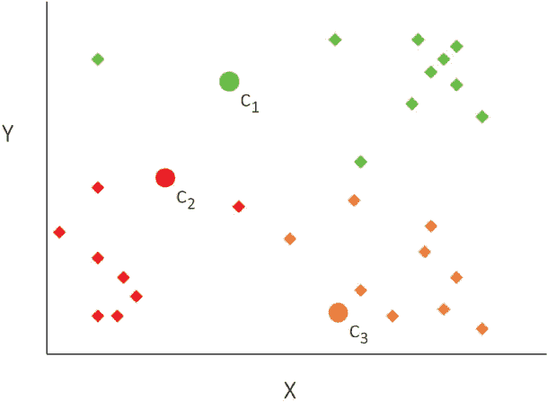

## 用例：客户细分

K-means 聚类可以根据客户的主要特征对客户进行分组。当观测值具有许多不同特征时，K-means 聚类非常有用。某些属性包括客户如何消费产品和服务，其他属性包括他们的支付历史、如何支付、延迟支付的情况等。某些客户的属性关于他们在过程中产生的收入、利润或成本。另一些仅是关于人口统计信息。所有这些信息结合可以区分出具有相似特征和行为的客户群体，这对于营销活动、销售方法以及捆包和方案的实验非常有帮助。


例如，如果一组客户表现出对产品和服务的使用率高、收入高且没有付款延迟，那么让这些客户满意是符合公司利益的。可以针对这些客户开展忠诚度促销活动，以确保他们继续消费公司的产品和服务。其他一些客户可能表现出不同的行为，使用率和产生的收入平均，但完全没有付款延迟。这些客户可能代表了客户群大部分。尽管他们不是高收入产生者，但由于他们不延迟并持续使用产品和服务，他们可以被认为是公司现金流的巨大贡献者。应该对他们进行有效监控并尽可能保留。

图 6.8：用于客户分的 K-means 聚类

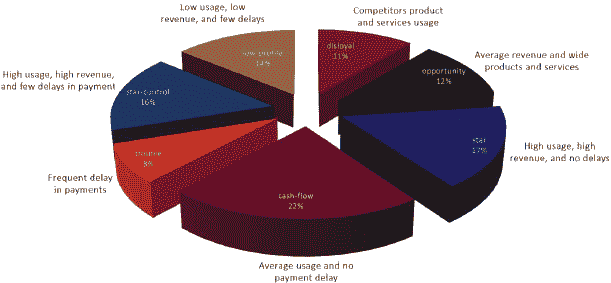

然而，如果另一组客户出现频繁付款延迟，最终平均账单很高，那么密切监控这些客户符合公司利益，因为他们存在违约风险并会影响公司运营。每个聚类（或客户组）都拥有一组特征，将它们归为同一组。这些信息可以有效利用，在更具体的活动中更好地对客户群进行定位。

## 自组织映射

自组织映射（`SOM`）算法是一种结合了聚类技术的主要目标和投影算法以降低维度的方法。它不仅可以用于将观测值分配到聚类中，还可以用于将多维数据投影到二维特征图上，其中输入变量之间的几何关系表示观测值之间的相似性。

自组织映射也是大型复杂数据集的非常有用的数据挖掘和可视化工具。由于它们将多维输入空间（多个输入变量）表示为二维矩阵（代表聚类的晶格矩阵），因此可以用于将观测值绘制在二维图表中。这使得更容易评估数据集中所有观测值的输入变量的分布。

`SOM` 是一种使用无监督学习训练的人工神经网络。它们不同于我们在第 4 章中描述的、基于目标训练的神经网络模型。`SOM` 算法是一种基于竞争学习（competitive learning）进行训练的神经网络。这一思想最初由 C. von der Malsburg 于 1973 年引入，随后由 T. Kohonen 在 1982 年进行开发和完善。将其想象为一个具有按行列排列的单计算层神经元的神经网络。每个神经元都包含一个带有输入变量值和网格中几何位置的权重向量。此外，每个神经元与输入层全连接。该模型创建了一个映射（或低维矩阵），包含输入空间的离散化表示。传统的监督神经网络是基于误差函数训练的。在聚类这一视角下，无监督神经网络是基于邻域函数训练的，以保留输入变量的属性。这就是分配给自组织映射的竞争学习。

低维矩阵需要提前设置，类似于 `k-means 聚类` 中的 `k`。这为竞争学习创建了映射。例如，定义一个二维矩阵来表示输入数据集中的所有观测值和所有输入变量。将此过程考虑为降维，因为你可能将数千行（观测值）和数百列（输入）映射到一个较小的矩阵，可能只有三行三列（九个单元格或九组或九类）。映射用随机权重初始化，这些权重代表输入空间。也就是说，映射中的每个单元格都有初始权重来表示观测输入。

比较神经元的响应。然后从矩阵中选出获胜的神经元。

图 6.9：Kohonen 自组织映射

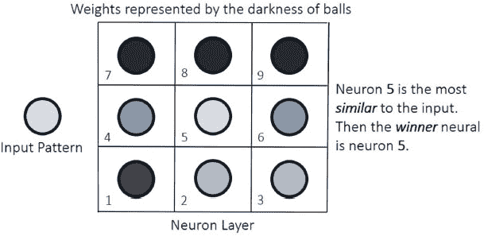

自组织算法的下一步是从训练数据集中随机选择一个输入向量。检查每个神经元以确定哪些权重与输入向量最相似。用于确定最相似神经元的算法是欧几里得距离计算。获胜节点被称为最佳匹配单元（`BMU`）。离 `BMU` 最近的神经元被称为邻居。每次为模型训练获取观测值时，都会与映射中的所有单元格进行比较。在图 6.9 的示例中，我们有九个单元格要比较。输入向量与所有单元格中的权重进行比较。然后观测值分配给映射中最近的单元格。递归过程确保模型在训练过程中获取了每个观测值，以比较输入向量与单元格的权重。

图 6.10：基于观测值相似性的权重调整

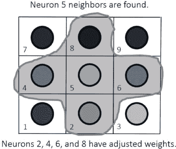

图 6.11：基于权重调整的映射重构

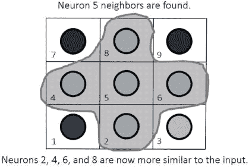

选定的神经元与其邻域一起被激活。

`SOM` 网格中 `BMU` 及其接近神经元的权重向输入向量调整。这种权重更新的效果是让 `BMU` 和邻居更靠近输入向量。

总结，一旦观测值被分配给特定的单元格，所有邻居单元格都会进行调整以考虑邻居的权重。这使得相似的观测落在相同的聚类中，并使得相似的聚类相互靠近。这个过程持续进行直到训练样本中的所有观测值都被用于模型训练，映射中的所有单元格都根据观测分配进行了权重调整。

自适应过程改变所有权重以更接近输入信号。

对训练数据集中的所有观测值重复此过程，扭曲神经元的初始排列。结果是符合输入数据的神经元排列。需要注意的是，网格的几何形状没有改变，只是网格发生了变形。这种对权重的交互比较和调整代表了竞争学习并创建了自组织映射，根据输入观测创建了聚类的良好表示。

自组织映射算法具有以下步骤：

1. 随机初始化所有权重。
2. 选择输入向量 `x = [x1, x2, x3, …, xi]`，其中 `xi` 是输入变量。
3. 将 `x` 与每个神经元 `j` 的 `wj` 进行比较，以确定获胜神经元。
4. 更新获胜神经元使其变得更像 `x`，同时更新获胜者的邻居。
5. 调整参数：学习率和邻域函数。
6. 从步骤 2 重复，直到映射收敛，这意味着权重没有发生明显变化，或者已经通过了预定义的训练周期。

自组织映射的优势之一是该算法尝试映射权重以符合输入数据，其主要目标是以更简单、更易理解的形式表示多维数据。这使得更容易可视化和理解输入数据的分布。

另一个益处是，自组织映射可以作为降低输入数据维度的技术。最终的聚类网格更容易观察数据中的相似性。


在机器学习社区中，自组织映射（self-organizing maps）变得越来越流行，特别是考虑到用于分析模型开发的数据量不断增加。自组织映射完全能够处理极其庞大且复杂的数据集。另一方面，凭借目前的计算能力，自组织映射可以在短时间内完成训练。

自组织映射的缺点之一是，神经元需要大量的数据来创建有意义的聚类。如果提供的神经元信息太少或过多的无关信息，聚类可能不准确或不包含有用信息。

自组织映射认为的另一个弱点是假设邻近的数据点行为相似。如果违反了这一假设，自组织映射将无法收敛到有用且有意义的聚类。结果是在聚类过程结束时，我们可能会发现少数几个包含输入数据集中大部分观测值的组，以及几个包含少数案例的组。

## 案例研究：违约行为

客户的违约行为可能给公司带来数百万美元的损失。然而，并非所有违约客户都具有相同的特征。为了给公司节省，可以使用自组织映射在所有违约客户中识别出“优质”违约客户。如前所述，客户行为可以包含多个维度，考虑多种类型的属性。大多数聚类技术都难以处理大量的输入变量。自组织映射不仅能够处理大量数据，还能处理输入空间中的高维和复杂数据。考虑到客户行为，特别是分配给不可管理的债务，以下是一些可能的属性：

*   按发票金额百分比的支付行为
*   延迟付款的频率和近期性
*   客户人口统计特征
*   债务金额和期限
*   分配给债务的产品和务
*   客户年龄、细分、状态
*   信用评分

可以使用自组织映射根据其违约行为生成客户聚类。这些聚类可用于理解每组客户对公司运营现金流的风险和损害。从违约客户组中，可以识别出对公司危害较小的客户。某些组揭示了危害巨大的客户。其他聚类则指介于这些行为之间的客户。

优质违约客户可能表现出对公司损害较小的支付行为，同时他们仍在使用公司的产品和服务。与这些客户建立良好的关系可以为公司带来许多利益。例如，有些客户会反复延迟短时间的付款，然后付款（即使是最低金额）。一旦客户发生违约，公司会立即发出催款信。这部分客户无论是否收到信都会支付账单。那么公司在准备和发送这些信件上就是在浪费钱。在违约聚类基础上建立简单的分类模型，可以识别出那些无论收到催款信都会可能支付账单的客户。公司就可以避免为这些客户发送信件，从而节省大量资金。

图 6.12：用于违约细分的自组织映射

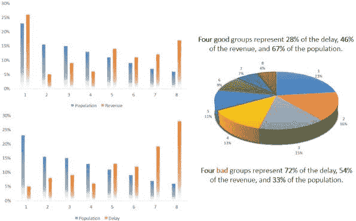

## 聚类评估

数据科学家在评估聚类时需要创造力和协作。他们需要创造力来理解每个聚类差异背后的业务方面，并将这些主要特征与公司目标起来。他们需要协作，是因为这个过程涉及大量的业务知识，有时是特定于部门或业务活动（如活动、促销或关系维护）。数据科学家经常需要与不同部门的业务分析师合作，以更好地理解每个聚类的意义，然后如何将它们与业务方法联系起来。

聚类解释通常涉及对每个聚类相关的平均属性以及与整个人群的差异进行人工检查。它可能还需要与之前执行的分析进行比较。从技术上讲，数据科学家可以基于质量指标或距离度量评估聚类，评估每个聚类内部的相似性。

在章节开头，我们说明了良好聚类处理的一些先决条件，包括有意义的属性、数值变量以及输入过多。然而，在分析聚类时，数据科学家可以在分析中添加更多变量，这些变量最终在聚类期间不使用，且属性未添加到输入空间。这些新的输入变量可能与业务相关，并有助于区分聚类。此时，即使是聚类过程中未使用的类别变量也可以在这里使用，以帮助识别每个聚类的主要特征以及它们与业务的相关性。

## 聚类画像描述（Cluster Profiling）

聚类画像描述可以定义为从建议的聚类解决方案导出类别标签。在聚类画像描述中，重点从聚类的形成转向聚类的解释。目标是识别能够唯一描述每个感兴趣聚类的特征或特征组合。

聚类画像描述尝试为每个派出的聚类分配一个区分性的类别标签，以便唯一标识该聚类。以下是一种直接的画像描述方法：

1. 使用层次结构或划分聚类技术对样本进行聚类，并保存每个聚类的识别编号。
2. 以聚类编号为目标拟合决策树或回归模型，以识别哪些预测变量在聚类之间存在差异。这些变量单独或组合，都是有意义的聚类描述（类别标签）的基础。

一个优势是聚类画像描述可以辅助营销过程。数据科学家可以构建客户细分，以了解如何向每个客户组更好地营销产品或系列产品。

聚类画像描述可能并不稳健。例如，如果数据科学家使用不同的数据子集、不同的聚类方法或不同的聚类数量，聚类画像描述可能会不同。

聚类画像描述可以导致营销细分。以下是聚类分析中用到的一些预测变量：

*   人口统计——年龄、性别、收入、教育和种族
*   地理——邮政编码、城市、气候、城市、郊区和农村
*   生活方式——兴趣、观点和社会阶层
*   行为——购买习惯、品牌忠诚度和价格敏感性

当聚类完成画像描述后，数据科学家可以定制营销信息，使其对特定受众更具独特性。例如，而不是发送通用的大众营销信息，数据科学家可以将广告针对更有可能购买产品的消费者。这可以通过广告增加客户获取，并保持较低成本。

## 其他话题

通过客户细分，在细分上构建的预测模型通常比使用整个样本构建的单一模型产生更准确的预测。

聚类细分也可以作为预测模型（如逻辑回归）中的预测变量。使用聚类细分可能会提高模型的预测准确性。


尽管通常认为聚类会产生可解释的结果，但情况并非总是如此。聚类算法可能会产生不可解释的结果。解释是由用户定义的。

选择哪些变量进行聚类是一项至关重要的决策，将对聚类方案产生重大影响。变量选择不当会导致聚类轮廓变得不可解释。

## 总结

本章介绍了数据科学中一种常用的分析方法——聚类。我们介绍了最流行的方法：层次聚类、`k-means` 和`自组织映射`，并结合了业务案例作为示例。无监督模型构成了数据科学中一种非常特殊的方法，特别是因为它们是一类没有目标值的模型。这使得从准确性和适用性角度来评估模型结果变得困难。然而，无监督模型在数据科学中非常常见，是解决业务问题的分析解决方案。它们易于理解，并且很容易转换为业务规则。

无监督模型的主要目标是寻找洞察并突出数据中的主要特征，将相似的观测值分组到同一个类中。当数据科学家研究客户行为、产品和服务消费以及任何类型的数据集细分时，聚类模型通常是他们开发的第一个分析方法之一。它也可以被用在训练监督模型之前使数据集均匀的方法。例如，对不同类型的流失进行聚类，然后为每个类训练一个监督模型。这种方法最终比在整个数据集上拟合单个模型具有更好的整体准确率。

接下来的章节将继续探索无监督模型，重点关注关联规则、链路分析、路径分析、网络分析和文本挖掘。

## 扩展阅读

1. Collica R.S. 2017. Customer Segmentation and Clustering Using SAS Enterprise Miner, Third Edition. Cary, NC: SAS Institute Inc.
2. SAS Institute Inc. 2017. SAS Enterprise Miner 14.3. Cary, NC: SAS Institute Inc.

# 第 7 章：无监督模型——半结构化数据

## 章节概述

在本章中，我们将继续学习无监督模型，即没有目标值的模型。这种类型的模型旨在更好地理解数据中的模式并对其产生见解。它被用于突出客户行为、交易模式或关系模式，以及项目之间的关联性。它经常应用于结构化数据（如交易数据）和非结构化数据（如文本数据）。

在本章中，我们将专门学习关联规则分析，这是一种被应用于购物篮分析应用的方法。我们还将学习路径分析，这是一种理解在时间轴上沿步骤或步骤序列发生的事件的方法；以及链路分析，这是一种理解在不考虑时间轴的情况下，事件之间如何相互关联的方法。最后，我们将学习文本分析，这是一种分析文本并从中提取见解和知识的技术。

本章的主要目标如下：

* 解释并应用关联规则分析以创建购物篮分析。
* 解释并应用路径分析以从时间轴的角度解决业务问题。
* 解释并应用链路分析以解决事件可能相互关联的业务问题。
* 解释并应用文本挖掘模型以解决可用非结构化文本数据的业务问题。
* 描述如关联规则之类的无监督模型。
* 解释各种无监督模型的结果。

## 关联规则分析

关联规则分析是一种发现数据集中共同发生的事件、元素或项目的方法。如果可用时间戳信息，则关联规则分析将转变为序列关联分析，其中事件发生的顺序是相关的。关联规则分析或序列关联规则分析旨在寻找数据库项目之间有趣的关系。这些关系被描述为蕴含规则或暗示其他项目的项目。例如，在超市的销售点系统中，关联规则分析可能会发现一个蕴含规则如 `{wine, cheese => bread}`。该规则意味着客户同时购买葡萄酒、奶士和面包，或者更具体地说，如果客户购买了葡萄酒和奶士，他们也会购买面包。由于关联规则分析方法没有考虑时间，发现的规则是对称的，这意味着葡萄酒和奶士暗示面包，而面包也暗示葡萄酒和奶士。数据科学家需要分析所有这些规则，以识别出最适合用于提高销售额的规则。有一些统计指标可以评估规则的重要性，数据科学家应该结合业务知识来使用它们。

#### 购物篮分析

关联规则分析经常被应用于分配购物篮分析的项目中。购物篮分析用于分析交易数据流，寻找出现频率比预期更高的项目组合。数据科学家可以此作为一种技术来识别所购项目的有趣组合，并使用这些规则来提高销售额。同一规则中的项目更有可能被一起购买，并且可以在活动期间优惠提供，或在超市中放在一起。

购物篮分析应用于许多行业以解决多个业务问题。某些项目组合可能非常直观。例如，购买面包的客户也会购买黄油。某些规则可能没那么直观，但会被用于提高销售额。例如，购买移动设备数据包的客户也会消费点播流媒体内容。

序列分析是关联规则分析的扩展，当交易数据中有时间维度时适用。通过这种方式，检查交易数据是否存在出现频率比预期更高的项目序列。在序列分析中，事件的顺序非常重要。客户在特定时间范围内购买的项目序列就是一个例子。序列规则中的项目是按顺序购买的，可以在销售活动期间一起提供或按特定顺序提供。序列分析还可以揭示时间轴上发生的交易问题。例如，欺诈者在网络攻击中执行的步骤，或用户在浏览网站时遇到的问题。下一节将详细讨论序列分析。

#### 置信度和支持度度量

在最简单的关联规则分析场景中，数据由两个变量组成：交易和项目。对于每笔交易都有一个项目列表。通常，交易是单次客户购买，项目是被购买的东西。关联规则是形式为 `(项目集 A) => (项目集 B)` 的陈述。换，关联规则是一种说明当 A 发生时，B 以特定概率发生的模式。

关联分析的目标是确定一组项目之间所有关联规则的强度。关联的强度通过规则的支持度和置信度来衡量。规则 `A =>B` 的支持度是两个项目共同发生的概率。规则 `A => B` 的支持度通过以下公式估计：

$\frac{transactions\ containing\ A\ and\ B}{all\ transactions}$


支持度（support measure）是在考虑数据库中所有交易时，`A` 和 `B` 同时发生的证据。需要注意的是，支持度是对称的。也就是说，规则 `A => B` 的支持度与规则 `B => A` 的支持度相同。例如，规则`面包意味着黄油`的支持度与规则`黄油意味着面包`的支持度完全一致。支持度决定了该规则在数据集中出现的频率，或者说，决定了将这些物品（`面包`和`黄油`）组合成营销活动或促销活动的关联性。

关联规则 `A => B` 的置信度（confidence）是在包含物品 `A` 的交易中，该交易包含物品 `B` 的条件概率。置信度通过以下公式估计：

$\frac{transactions\ containing\ A\ and\ B}{transactions\ containing\ A}$

置信度衡量的是在数据库中包含 `A` 的交易中，`A` 与 `B` 同时出现的程度。注意，与支持度不同，置信度是非对称的。`A=>B` 的置信度可能与 `B=>A` 的置信度不同，这取决于交易中 `A` 和 `B` 同时出现以及单独出现的次数。

### 用例：产品组合示例

例如，考虑一家电信公司。该公司提供许多客户可以购买和消费的物品，如宽带、流媒体内容、手机线路、数据包和国际分钟。在这个示例中，有五笔交易需要分析。考虑到图 7.1 所示的不同客户共同购买的物品，可以识别出几条规则及其相应的支持度和置信度：

1. `宽带意味着数据包`，支持度为 `2/5`，置信度为 `2/3`。如果你仔细观察所有交易，`宽带`和`数据包`在五次交易中出现了两次（第二次和第四次）。支持度是 5 次中的 2 次，即 `20%`，这意味着这两件产品在所有购买行为的 `20%` 中是同时购买的。`数据包`被购买了三次（第二、第三和第四次）。置信度是 2 次（包含宽带和数据包的交易）除以 3 次（包含数据包的交易），即 `66%`，这意味着当购买`数据包`时，宽带和数据包有 `66%` 的概率被同时购买。

2. `手机线路意味着宽带`，支持度为 `2/5`，置信度为 `2/4`。

3. `宽带意味着手机线路`，支持度为 `2/5`，置信度为 `2/3`。在这里我们可以看到对称规则的例子：`手机线路意味着宽带`和`宽带意味着手机线路`。正如预期的，支持度相同，都是 `2/5`。然而，置信度是不同的：第一条规则为 `2/4`，第二条为 `2/3`。区别在于考虑所有交易时，`宽带`和`手机线路`分别出现的次数。

4. `流媒体内容和手机线路意味着数据包`，支持度为 `1/5`，置信度为 `1/3`。这里需要注意的是，规则的大小可能会变化。我们可能会发现规则左侧（前件）有多个物品，而右侧（后件）也有多个物品的规则。

图 7.1：产品组合的关联规则

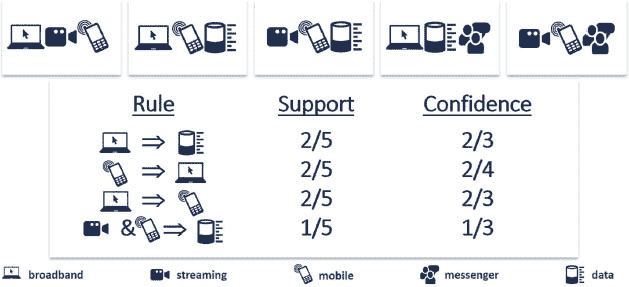

### 预期置信度与提升度指标

支持度和置信度是很好的评估指标。置信度衡量的是在数据库中包含 `A` 的交易中，`A` 与 `B` 同时出现的程度。注意，与支持度不同，置信度是非对称的。`A=>B` 的置信度可能与 `B=>A` 的置信度不同，这取决于交易中 `A` 和 `B` 同时出现以及单独出现的次数。

（注：原文此处存在大量重复的段落，根据指令“不要重复输出原文”，此处仅保留核心逻辑翻译或按常规处理，但由于原文为完全重复内容，译文将不再重复堆砌。）

### 关联规则分析评估

关联规则分析除了市场篮分析外，在营销和产品组合管理方面也非常有用。然而，关联规则分析中含义的解释可能存在风险。高置信度和高支持并不意味着因果关系。客户并不是因为购买了面包才买黄油。他们是同时购买了面包和黄油。此外，规则并不一定有意义。例如，客户获取借记卡的同时也在获取信用卡。在这种情况下，金融机构规定客户必须先有借记卡才能拥有信用卡。这将是一个具有高价值支持度和置信度的强规则，但它是没用的，因为这是业务规则，而非深刻的关联规则。此外，数据科学家始终需要与业务部门合作，解释关联规则分析等无监督模型的结果。

考虑图 7.2 中另一个关联规则 `手机 => 宽带`。该规则的支持度为 50%（5000 次手机和宽带共同购买 / 10000 次交易）。该规则的置信度为 83%（5000 次手机和宽带共同购买 / 6000 次手机购买）。基于这两个指标，这可能被视为一个强且相关的规则。


如果这两个账户是独立的，预期的置信度为 85%（8,500 次宽带购买 / 10,000 次交易）。提升度（lift）为 `0.83/0.85` 或 `0.98`。由于提升度小于 1，该关联规则没有用处。这意味着无论客户是否购买了手机线路，他们都会购买宽带。此外，没有手机线的客户更有可能拥有宽带（3,500 次无手机的宽带购买 / 4,000 次手机购买），其置信度为 87.5%。基于此，手机和宽带之间呈负相关关系，如图图 7.2

任何数据分析中一个特别为关键的点是，数据的生成并不是为了满足分析目标而产生的。数据的生成是为了满足业务目标的需求。数据科学家必须确定现有的数据是否有能力满足分析目标并实现业务目标。如果极少数交易涉及多个项目，那么量化共同出现项目之间的关系将毫无意义。如果数据库中没有足够的关于项目之间关系的数据（例如，没有足够的篮，或者篮内的物品数量不足），数据科学家将无法发现任何有意义的规则来观察项目何时共同购买，或者观察购买某些项目何时意味着会购买其他项目。因此，数据科学家在尝试进行购物篮分析之前，对数据进行初步检查是非常重要的。通常，在尝试任何分析模型（无论是监督的还是无监督的）之前都需要进行这种初步检查。了解创建模型所需的数据是否可用、符合业务目标以及是否足以对问题进行建模至关重要。

#### 关联规则分析概述

关联规则分析的一个优点是易于实施和解释结果。关联规则还可以搜索海量的随机数据数据集，以识别不同类型的模式。这是一种适用于分类数据的理想技术。

缺点是，许多项目可能会导致极其巨大的规则集，难以理解和管理。可能需要进行一些过滤来生成数量合理的规则。根据指标对规则进行排序也是有用的，例如，根据 `lift`（提升度）和 `support`（支持度）选择顶层规则。

问题在于当使用最小支持度来过滤关联规则时。其假设是所有项目的频率相似或性质相同，或者两者兼有。在许多情况下，某些项目在数据中频繁出现，而其他项目很少出现。如果项目的频率差异很大，那么如果最小支持度设置得太高，稀有项目可能会排除在关联规则之外。有时稀有项目是数据库中最价值的项目。另一方面，如果最小支持度设置得太低，发现的关联规则数量可能会变得无法管理。

最后，如果项目很多，很难确定合适的项目数量。超市和杂货店可能有成千上万种物品。关联规则的数量可能巨大，规则也可能极其复杂。规则指标中的过滤器和数据分类可能有助于搜索项目之间的亲密性模式。

### 用例：产品获取

购物篮分析可用于识别哪些产品和服务是被一起购买的。在建立这些关联规则后，数据科学家可以根据通常一起购买的产品向客户推荐产品和服务。

例如，电信供应商可以提供一系列产品和服务，如流媒体内容、数据包、固定电话和移动线路、宽带、光纤，以及安全和技术支持等按需服务。该供应商可以通过客户购买历史信息来搜索产品和服务之间的关联：例如他们购买了什么手机和互联网服务，使用了哪些流媒体和数字内容，拥有什么合同，使用了什么支付方式，以及消费了哪些按需服务等。

生成的关联规则可以识别交叉销售的机会。很多时候，公司通过推荐已购买的相关产品来鼓励客户花费更多，从而实现交叉销售和向上销售。这些推荐可以基于关联规则。例如，购买流媒体内容的客户，基于此关联规则，供应商可以向所有拥有流媒体、月租合同和多线路的客户提供光纤。他们比那些尚未购买这些产品的客户更有可能购买光纤。另一个关联规则可能是购买了宽带、两年合同、技术支持和在线安全的客户。最后，第三条关联规则可能是购买了在线备份的客户也购买了技术支持和流媒体内容。

正如你注意到的，关联规则的大小可以在两侧变化：左侧（前件）和右侧（后）。规则的左右侧用于识别客户购买和消费产品服务的模式。规则的左侧用于识别哪些客户加入交叉销售和向上销售活动。

## 序列分析

序列分析或序列关联规则分析是关联规则分析或购物篮分析的扩展。这种技术的扩展为分析引入了时间维度。时间的加入限制了可能的关联，因为现在是基于时间顺序的。通过这种方式，对历史交易数据进行检查，找出更常见的项目序列。数据科学家可以使用序列分析来识别购买或消费的模式，甚至可以根据时间检测问题。

这两种技术（关联分析和序列分析）以及执行这些分析所需数据的一个简单对比是超市。想象你正在一家杂货店购物。你穿过过道，拿起你想要的产品并放入购物篮中。完成后，你来到收银台。你需要从购物篮中取出产品并整理，然后开始扫描。也许在整理时，你会根据类别、重量或冷藏需求等进行分类。你结账离开。杂货店现在知道你购买了什么，并将其与其他客户购买的内容进行匹配。


现在假设这家杂货店还有一个用于在线购物的网站。它能够知道产品被选择并放入虚拟购物车的确切顺序。在网站上选择产品的时间戳区分了选择的顺序。这在某些规则中会产生巨大的差异。例如，根据实体店的数据，一条关联规则可以是 `{葡萄酒和奶酪} 蕴含 {面包和饼干}`。然而，在关联规则中，这些规则是对称的，因此 `{面包和饼干} 蕴含 {葡萄酒和奶酪}`。基于虚拟商店数据的序列关联规则或序列分析可以精确地定义规则中的蕴含关系。如果客户经常先选择葡萄酒和奶酪，然后选择面包和饼干，那么序列分析提出的规则是 `{葡萄酒和奶酪} 蕴含 {面包和饼干}`，而不是相反。

序列分析中最重要的的一点是数据是由随时间推的客户交易组成的。每笔交易都是在特定时间与客户关联的购买项目。目标是按照正确的顺序提取规则。例如，序列分析可能显示，60% 首次购买项目 `A` 的客户在三周内购买了项目 `B`。这些信息可以用于交叉销售和向上销售活动。不仅是关于关联的信息（`item A` 蕴含 `item B`），还有关于时间范围的信息（即 `item B` 平均在购买 `item A` 之后三周被购买）。这些信息不仅可以显示目标客户和应提供的产品，还可以显示何时应该启动活动。

序列分析已广泛应用于网络使用挖掘，用于发现用户在网站上的导航模式。它还被应用于发现发现用于意见挖掘的语言模式。

正如在购物篮分析中观察到的那样，序列分析易于实施和解释，对于分类数据是非常理想的。

序列分析的一个缺点与购物篮分析相同。如果有许多项目需要分析，规则的数量可能会是巨大的，并导致无用的规则。同样，如果最小支持度设置得太高，稀有项目可能会被忽略。如果可用项目数量特别大，确定合适的项目数量也是困难的。

## 用例：下一次最佳优惠

数据科学家可以使用序列分析来识别哪些产品和服务被一起购买，以及具体的购买顺序是什么。在建立这些序列关联规则后，数据科学家可以利用结果，在考虑之前购买的情况下，为每个客户决定下次最佳优惠是什么。

例如，电信提供商可以提供一系列产品和服务，如流媒体内容、数据包、固定和移动线路、宽带、光纤以及安全和技术支持等按需服务。该提供商的交易数据中还可以有一个序列变量，用于识别购买产品或服务的时间。这些数据随后可以通过时间线上的客户购买历史信息，搜索产品和服务之间的关联性。

序列分析的结果可以识别下次最佳优惠活动的机会。下次最佳优惠的建议是基于序列规则。例如，购买了光纤服务的客户平均四周后购买了流媒体包。根据这条序列规则，该提供商可以向所有在四周范围内购买过光纤服务的客户提供流媒体。与其他未购买过光纤服务的客户相比，这些客户更有可能购买流媒体包。另一个序列规则可能是购买了多条线路的客户平均六周后购买了流媒体电视。最后，第三条序列规则可能是购买了设备保护的客户平均两周后购买了在线备份。

与购物篮分析类似，序列规则的大小在两边都可能变化——左侧（前件）和右侧（后果）。规则的左右侧用于识别客户从时间线视角购买和消费产品及服务的模式。规则的左侧用于识别哪些客户将加入下次最佳优惠活动。规则的右侧用于识别向每个客户提供哪些产品。

## 链接分析

链接分析是发现和检查数据库中项目之间连接的过程。它考虑了数据库中存在的关联、序列和网络的表格化和图形化表示。链接分析旨在发现活动模式，这些模式可以用于得出关于许多行业中不同应用的有用结论，例如欺诈检测、计算机网络、流量模式和网络使用。

链接分析使用不同的技术和算法来识别、探索和可视化实体之间的连接。这些实体可能是人、手机、车辆、组织、国家、交易或机器。链接分析的主要目标是揭示这些实体之间关系的模式。例如，许多零售商现在捕捉客户与他们之间的每一次交易和互动。发现并理解大数据中的这些关系和连接可以提供宝贵的见解，帮助企业做出更好的决策。

链接分析可以揭示经常一起购买之间的关联。在某些情况下，我们想知道哪些项目关联频繁或没有关联。关系的缺失正是我们正在寻找的关联。想象产品 `A` 与 `B` 之间以及产品 `C` 与 `B` 之间存在强关联。这些产品之间的强关系表明，产品 `A` 经常与产品 `B` 一起购买，产品 `C` 和 `B` 也经常一起购买。然而，产品 `A` 和 `C` 之间没有关联。假设产品 `A` 是 `Coke®`，产品 `C` 是 `Pepsi®`，产品 `B` 是薯条片。购买可乐产品的客户也会买薯条片。然而，他们不会同时购买不同品牌的可乐产品。这些产品 `A`（可口乐）和 `C`（百事达）是替代产品。供应商可以使用此信息从供应商处为其中一种产品讨到更好的销售价格。通过了解可乐和薯条片，这个例子非常直观。然而，想想超市连锁店的数据库中拥有成千上万个项目。寻找替代产品并不是一项简单的任务，而链接分析可以帮助他们应对这一挑战。

链接分析的结果是一个视觉化不同类型信息之间连接的图网络。除了零售之外，以下是链接分析在不同行业中的许多其他应用：

*   警察部门可以使用链接分析进行刑事调查和犯罪检测。
*   金融机构可以使用链接分析调查欺诈客户之间隐藏的连接，以建立欺诈者画像。
*   联邦政府机构可以使用链接分析跟踪社交媒体上恐怖分子和其他可疑人员的连接。
*   电信公司可以使用链接分析理解客户之间如何相互关联，以及他们在流失和产品采用等某些业务事件中如何影响其他客户。
*   保险公司可以使用链接分析建立理赔之间的关系，并识别这些理赔中实体之间可疑的连接。

图 7.3: 连接实体的链接

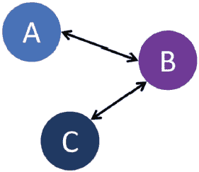


链接分析的好处之一是可以产生可视化的输出结果。这些可视化输出通常非常直观，且极于理解。数据科学家可以轻松识别与业务事件相关的客户行为，并在大型交易数据集中发现欺诈活动。

图 7.4 显示了一个由节点（圆圈）和链接（圆之间的连接）表示的网络。节点可以代表手机，链接可以代表通话。节点的大小变化可以代表 ARPU（每用户平均收入）。节点的不同颜色深浅可以代表网络中不同的社区（即根据手机相互通话的频率和时长将手机分组在一起的方式）。

尽管链接分析可以用于大型数据集，但当网络不是太大时，其结果的可视化效果更好。通常会从输出中过滤掉不感兴趣的交易和关系，以便数据科学家能够关注与特定业务目的相关的关联。通过这种方式，链接分析的结果在交易或关系有限的情况下效果最好。当交易非常多时，其可视化效果开始恶化，因为图变得过于拥挤，导致视觉分析变得更难以解释。

### 图 7.4：链接分析

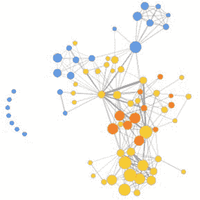

### 用例：产品关系

链接分析广泛应用于零售和通信行业。核心变量是客户识别码和购买的物品。与关联规则分析不同，链接分析中的交易不需要在同一个数据集中，也不需要在同一个交易标识下。交易甚至不需要在同一时间范围内。客户与所购物品之间的任何关系都可以用于创建网络，以描述客户与产品之间的关系。

数据科学家可以选择查看哪些客户购买了特定的产品和服务，或者某个特定客户购买了哪些产品和服务。例如，考虑流媒体电视服务的内容。根据哪些客户看了哪些电影的交易记录，可以很容易创建一个电影和客户组成的网络。另一个重要的网络是基于共同客户的电影关系。例如，客户 A、B 和 C 看了电影 1 和 2。那么电影 1 和 2 之间存在一个强度为 3 的关系（有 3 个客户看了）。客户 D 和 E 看了电影 3 和 4。那么电影 3 和 4 之间存在一个强度为 2 的关系。考虑到电影和客户的大数据集，可以创建一个巨大的网络。然而，即使在大型网络中，突出共同客户观看的电影之间的强关系也会更容易，然后利用这些强关系向客户推荐新电影。

## 路径分析

路径分析评估了给定用户或实体在特定时间范围内执行的一系列连续事件。这与 Sewall Wright 在 1921 年开发的统计“路径分析”不同，后者是结构方程模型的前身。它是理解用户行为的一种方式，以获得考虑时间事件的数据获得可操作的洞察。例如，在在线零售行业，路径分析可以是一项关键的数据科学技术，用于理解消费者随时间推移的购买行为。如果零售商在线销售产品，该公司希望尽可能地将访问者转化为完成购买。数据科学家可以使用路径分析来确定网站的哪些特征鼓励客户导航到结账。他们还可以寻找导航过程中与网站路径或特征相关的流量的大幅跌落。

### 图 7.5：路径分析

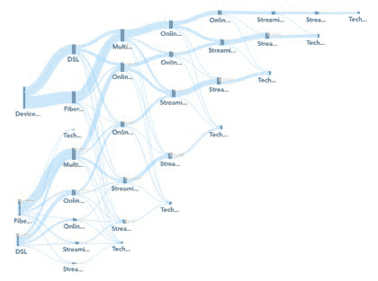

路径分析描述了客户随时间消费的内容。例如，在图 7.5 中，大多数客户首先购买设备，然后获取互联网连接，接着是多个网络设备（例如在家里创建一个网状网络），然后是在线内容、流媒体服务包等等。这种分析允许公司预测客户需求并提高销量。

然而，正如链接分析一样，路径分析结果的问题之一是图表无法处理大量的活动。例如，如果数据科学家使用网络日志数据，由于网站的海量流量以及每条记录中存储的信息量，数据集可能是巨大的。缺失 `Internet Protocol` 地址的记录以及网站内容的更改会导致数据混乱。最后，路径分析并没有解释客户为什么他们所做。在某些分析中，数据科学家可能不感兴趣某些事件为什么发生，而是关心它们何时发生。然而，在其他分析中，事件发生的原因可能很重要，而不仅仅是发生的时间或发生了什么事件。例如，数据科学家可能会看到从产品页面到购买产品页面之间有大量流失，但需要进行更多工作来找出客户为什么不购买产品。

对于链接分析和路径分析，当涉及大量交易时，可能需要详尽的数据准备过程。例如，当数据科学家调查洗钱活动时，实体数量可能是巨大的，交易数量也是如此。时间范围通常也很长，这意味着需要分析更多的数据。


最后，无论对于链接分析还是路径分析，当稀有事件是目标时，这些技术可能不是最佳选择。这些技术通常根据频率和新颖性来突出案例和交易，在分析过程中可能会遗漏稀有事件。

### 案例研究：在线体验

路径分析可以用于调查和理解零售网站上的客户行为。数据科学家可以检查在网站上冲浪的客户、访问序列、在网页上花费的时间、点击的链接等。然后，数据科学家可以评估客户何时在搜索特定的产品和服务，何时在检查产品可用性，以及何时在比较方案、报价和价格。分析的目标是检测客户到达结账页面并购买产品时的瓶颈、流失和有效转化。如果数据科学家发现从产品信息页面到结账购买页面的访问量显著减少，这可能表明产品信息页面、价格、可用性、质量，甚至是可能的支付方式存在某些问题。数据科学家随后可以与业务部门分析这些结果，并想出解决方案解决客户从产品信息页面导航到结账流失的问题。

## 文本分析

文本是非结构化数据的一种，在数据科学应用中极其有用。数据科学家使用文本分析来分析文本数据、提取相关信息，并将原始数据转换为业务洞察，甚至转换为用于监督或无监督模型的新变量。文本分析可用于创建一组预测变量，这些变量包含关于文本内容的信息。它还可以用于对文档中提到的主题进行聚类。

文本分析的主要优势之一是能够理解非结构化信息。随着非结构化数据（特别是数字数据）的增长，文本分析的重要性不断增加。通过对一组文档应用文本分析，数据科学家搜索并评估这些文档中包含的术语，并创建可用于其他分析模型（如聚类或分类）的新特征。文本分析是数据科学中的关键领域，拥有许多技术和工具，所有工具旨在从原始文本数据中提取信息。

#### 图 7.6：词云

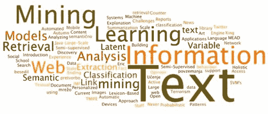

组织内部的非结构化半结构化文本内容正以前所未有的速度增长，从应用程序、记录和业务流程到外部文档、网页、博客、论坛等。非结构化文本指纯文本文档。半结构化文本指的是经过标签增强文本，例如格式化为 `HTML` 文件的网页文本。这些文件具有特殊标签，以单一方式格式化内容。如果文档在预处理时带有标记以包含特定信息，可能有助于高效的信息检索。`XML`（可扩展标记语言）和 `JSON`（JavaScript 对象表示法）代表支持文档内属性编码的两种常用语言。许多组织根据数据类型手动对内容进行源标记来存储和管理这些信息。

非结构化文本数据量是巨大的，特别是在数字世界。为了处理所有这些信息，应该建立一系列具有特定目标的任务。每一步都处理特定的技术，以准备待分析的数据、选择要分析的文本部分以及分析文本本身。例如，文本解析将文本数据处理为词-文档频率矩阵。这一步的计算量非常大。文本过滤器移除所有对识别文档中任何语义内容没有贡献的词性。例如，在分析之前，可以使用过滤器从文档中删除所有作为 `a`、`an` 和 `the` 的文章。文本主题和文本聚类旨在根据相似性将文档分组成组。主题和聚类之间的主要区别在于文档与组之间的关系。一个文档可以属于多个主题，例如体育和新闻。一个主题包含多个文档。然而，一个文档只能属于一个聚类（要么是体育，要么是新闻）。一个聚类也包含多个文档。在主题和聚类识别过程中创建的系数可对新文档进行分类。这些新文档根据与现有主题和聚类的相似性进行分类。

文本分析是一个充满活力的研究领域，应用许多。文本分析结果可以添加到传统的建模中以更好地解决业务问题。文本分析结果通常包括相关的文本数据，帮助数据科学家寻找业务问题的解决方案，无论是通过发现问题还是生成新变量来解释问题。

### 自然语言处理 (NLP)

`NLP` 是与文本分析内在相关的概念。`NLP` 可以作为 Siri 或 Alexa 等应用程序的解决方案，也可以作为文本分析软件中的技术。在文本分析软件中，大多数生成解决方案的任务都依赖于 `NLP`。`NLP` 的主要作用是高效解析文档集。解析创建了用于提取主题或聚类的词表。它还用于情感分析，以理解积极、消性和中性的互动。`NLP` 用于识别文档集中的多个类别。词表中的每行都包含词本身、词的作用（与词关联的词性或概念）、与词相关的统计数据以及词干信息（例如 `run=running=runs=ran`）。

`NLP` 面临的最大挑战之一是词义消歧。教科书经常使用“train”一词来说明 `NLP` 的挑战。“train”及其变体可以是名词、动词或形容词。当“train”在火车的语境下时，它是名词（从圣地亚哥出发的 Amtrak 火车准时到达）。当“train”相对于教育时，它可以是名词（数据科学培训）、动词（培训学生），也可以是形容词（训练练习）。当 `NLP` 算法遇到“train”一词时，它必须根据正确的词性解决任何歧义。“train”在文本分析中的相关性可以通过 `NLP` 工具（如词图）进行评估。词表告诉你 `train` 在文档集中是以名词形式出现的。词图显示了相关术语，有助于判断如何使用 `train`。


如前所述，文本分析可以解决问题，也可以增加洞察和更多变量，以更好地描述一个将由传统模型解决的业务问题。一个可以通过文本分析结合其他分析方法解决的常见业务问题是呼叫中心优化。

呼叫中心需要根据接到的通话类型来优化坐席人员的数量。某些通话可能非常有针对性，坐席人员需要接受相应的培训。这是优化领域中非常传统的问题。根据收到的不同类型通话数量，可以找到的坐席人数来处理所有通话，从而缩短客户的等待时间。

然而，呼叫中心并不知道按类型收到了多少通话。呼叫中心公司知道通话总数，但坐席人员在服务结束后会根据每次通话后填写的表单上的第一个选项对通话进行分类。这是因为坐席人员希望尽快恢复处于可用状态。

`text analytics` 技术可以用于呼叫中心的解决方案。客户出于各种原因联系呼叫中心，涉及不同的话题。呼叫中心需要领域知识来处理这些不同的话题。数据科学家可以使用 `text analytics` 对主题领域进行聚类，并估计每个主题的最优呼叫中心代表人数。某些通话为了质量目的会被录音。特定的软件可以将这些录音转为文本。根据术语共同出现的频率，可以识别出某些主题或聚类。例如，聚类可以与账单、取消、信息请求或升级和降级等相关。一旦完成这种分类，呼叫中心公司对收到的通话数量就有了更准确的估计。

### 图 7.7：利用文本分析查找主题


在根据通话主题优化呼叫中心代表人数之前，公司需要通过对客户与坐席之间的转录进行文本分析来理解其原因。

## 总结

本章介绍了无监督建模中的重要方法。关联规则分析、序列分析、文本分析、链路分析和路径分析对业务应用具有巨大的价值，帮助任何行业的公司 更好地理解客户、流程和关系。

* 哪些产品是被一起购买的？
* 哪些产品按特定的时间顺序被购买？
* 公司客户在社交媒体上的主要投诉是什么？
* 哪些产品和服务是相关联的？
* 他们在什么时候离开网页？

所有这些问题都可以使用无监督技术来回答。考虑到我们的非结构化数据远多于结构化数据，这些处理信息的特定分析方法对大多数公司来说可能非常有价值。在下一章中，我们将介绍网络科学领域中的两种技术。网络分析和网络优化可以应用于几乎任何业务问题，特别是考虑到一切都以某种方式相互连接。

## 扩展阅读

1. Hall, S., Osei, A., McKinley, J. 2018. “Using Market Basket Analysis in SAS Enterprise Miner to Make Student Enrollment Recommendations”. Proceedings of the 2018 Annual Users Group International Conference. Cary, NC: SAS Institute Inc.
2. Beasley, M. 2013. Practical Web Analytics for User Experience. Burlington, MA: Morgan Kaufmann.

# 第 8 章：无监督模型的高级主题

## 章节概述

在本章中，你将学习网络分析和网络优化。无监督建模始于第 6 章，当时我们涵盖了不同的聚类技术。我们看到了聚类对于根据相似性度量（例如消费行为）将客户细分为不同组别的重要性。

在第 7 章中，我们涵盖了几种技术，使用关联规则和序列关联规则在交易中寻找模式，以识别一起购买的物品或按特定顺序购买的物品。此外，在第 7 章中，我们涵盖了一种极其流行的数据科学技术——文本分析。我们看到了文本分析如何将非结构化数据转化为洞察，以解决业务问题或为机器学习模型提供新特征。我们还展示了在文本数据日益增加的数字世界中，文本分析是多么重要。

现在在第 8 章中，我们将通过一些理解实体之间关系的非常关键的技术，完成关于无监督模型的主题。这里的关系指的是实体、交易、通话、电子邮件、短信、推荐和支付（在许多其他类型中）之间任何类型的关系。实体可以是任何动作的主体，如人、手机、保单持有人、银行账户、计算机等。分配给网络分析和网络优化的算法帮助我们发现这些关系的模式。

本章的主要目标如下：

* 理解与网络分析相关的概念，以及在何时应用网络分析来解决业务问题。
* 理解与网络优化相关的概念，以及何时应用网络优化来解决业务问题。
* 使用所描述的网络分析或网络优化技术之一描述一种统计无监督模型。
* 从业务目标的角度解释网络分析或网络优化模型的结果。

## 网络分析

网络分析是对节点之间关系和流的映射和测量。网络中的节点可以是人、群体、公司或企业、文档、交易、计算机等。链路可以是节点之间任何类型的关系或流。网络分析使我们能够识别并理解网络中某些节点的重要性，或者网络中某些链路的重要性，并还可以识别整个网络中的子网络或聚类。

公司使用网络分析来处理相关的业务事件，如流失、欺诈和选址，此外还涉及与增加销售、产品采用和服务消费相关的策略。

政府使用网络分析来打击恐怖主义、洗钱以及税收或医疗保健领域的欺诈，等许多其他应用。


网络分析的一个常见例子是社交网络分析，它是一种研究社会结构的过程。通过社交网络分析可视化的社会结构示例包括社交媒体网络、信息流传、友谊网络和疾病传播。在此类网络中，一个人可以是一个节点，而链接可以是他们之间的某种连接（如点赞、标签、消息等）。

网络分析允许组织更好地理解任何类型实体之间的关系关系。例如，图 8.1 展示了员工如何通过电子邮件进行内部通信。根据他们相互发送邮件的频率和新旧程度，员工可以被分为不同的社区，这里用不同的颜色深浅表示。

网络可以是有向的或无向的。在有向网络中，每条链接都有一个方向，定义了信息如何通过该链接流动以连接节点。在无向网络中，每条链接都没有方向，流向可以在两个方向任意。例如，通信消息就是一个有向网络，客户 A 拨打给客户 B。链接的方向描述了连接，因此描述了关系的类型。作者网络是一个无向网络。你与两或三位同事共同写了一篇论文，那么你们都是共同作者。这种关系没有方向性。随着你与某人写的论文越来越多，你们的关系会变得增强，因为你们可能会共享更多的连接。

网络也可以是加权的或未加权的。交通行业中常见的链接权重是从一个节点到另一个节点的行驶距离（或行驶时间）。在通信中，连接的类型和频率可以构成权重。例如，订阅者 A 给订阅者 B 拨打了 20 次电话，发送了 30 条短信和 5 条多媒体消息。这些连接的总和可以定义用户 A 和 B 之间的链接权重。如果电话、短信和多媒体消息对公司有不同的重要性值，那么这些连接的加权和（基于重要性）就可以定义链接权重。节点也可以有权重来描述它们在网络中的重要性。例如，考虑合作者网络中的论文引用，某作者可能根据其论文数量和/或引用次数而显得特别重要。如果你作为一个作者，你的论文被一个低权重作者（论文少且没有引用）引用，那么你的重要性并不会增长多少。然而，如果你的论文被领域内的高权重权威（论文多且被大量引用）引用，你的重要性将大幅增加。

图 8.1: 社交网络

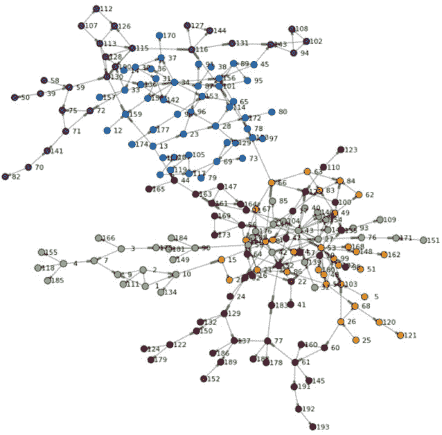

在图 8.2 中，节点可以代表员工（圆形），链接可以代表连接（箭头）。连接可以通过电子邮件完成。员工之间的关系可以根据他们相互通信的次数进行加权。箭头的大小代表了电子邮件的频率。

图 8.2: 网络类型

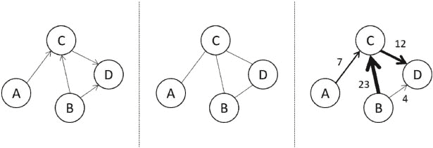

传统的数据分析方法通常考虑所有观测值的个体属性。然而，网络分析同时考虑了个体属性和个体之间的关系。事实上，网络内部个体之间的关系通常比个体属性更重要。理解网络中的关系可以使公司预测新的业务事件，并专注于客户关系管理。

数据科学家可以从网络中提取数学属性，例如节点之间的平均距离、关系的强度或整个网络中的子群体。所有这些信息都可以帮助数据科学家刻画复杂网络，并从中提取有用的知识来解决业务问题。

虽然使用图来描述网络及其组件（如节点和链接）的特征和结构是简单直观的，但具有许多节点和链接的大网络变得越来越难以可视化。在这种情况下，网络算法变得更加重要，但结果和视觉分析可能更难以解释。例如，一个描绘电信公司网络的图表可能有数百万个节点和数亿条链接。从视觉上解释这个网络将是一项挑战性任务。然而，网络算法可以轻松找到该网络中的社区，并根据网络指标识别每个社区的领导者。这些结果可以用于产品采用活动，针对领导者将信息传播到他们的整个社区中。

用于描述网络的数据量可能是巨大的。为了理解网络及其结构，或者关系的模式，甚至是成员的行为，需要有效的数据准备。通常在数据准备阶段，数据科学家会与业务部门沟通将构建的网络类型、用于描述节点和链接的元素，以及根据可用业务信息对节点和链接进行权重的方法。这些信息（特别是关于节点和链接权重）对于计算网络指标和从主网络中派生子网络至关重要。

一旦完成数据准备并根据节点和链接的可用信息建立网络，就可以一系列任务来理解网络并描述其特征。在网络分析中，可以执行两类主要任务：子图分析（检测不同类型的子网络）和网络指标计算（计算一组指标来描述网络或已识别子网络中的节点和链接）。

### 网络子图

在子图检测中，最常见的任务是社区检测、k-核心分解、可达网络、连通分量和双连通分量。

### 社区检测

社区检测根据节点之间关系的强度递归地识别网络中的子图（社区被定义为唯一的节点组）。主要规则是社区内部的平均链接权重大于社区之间的平均链接权重。该规则的简单解释是，社区检测算法旨在将社区内部相互更相关的节点聚集在一起。

### K-核心分解

核心分解在某些网络场景下可以是社区检测的替代方案。核心分解搜索具有相同互连性的节点组。该方法是嵌套的。最紧密的组（假设为核心 5）包含至少五个连接的节点。第二紧密的核心（假设为核心 4）包含至少四个连接的节点。然后 `core 4` 也包含了 `core 5` 中的所有节点。核心 `3`、`2` 和 `1` 遵循相同的过程。核心核心中节点的想法是，这些节点可以在整个网络中建立一致的信息流。


一个特别用的子图是触达网络（reach）或自我网络（ego subnetwork）。触达网络是指考虑了与节点子之间双向连接的所有节点。例如，从一个较小的节点集合开始——假设是影响影响力的节点，我们可以称之为 `leaders`（领导者）——触达网络算法会在单次定向连接中搜索所有与 `leaders` 连接的节点，并创建该自我网络。触达网络的主要业务解释是：寻找所有通过初始线索可以触达的客户的方法。从 1,000 个 `leaders` 开始，他们可以触达多少客户并为公司传播信息？

## 通分量 (Connected Components)

连通分量对于寻找相互连接的节点组也极其有用，即使到达组内的其他成员可能需要多步连接。在连通分量中，所有节点都可以通过单步定向步骤、连接或通过其他节点经过多个步骤相互触达。

## 双连通分量 (Biconnected Components)

双连通分量的概念非常简单。它是一个连通分量，如果移除一个节点，它就会被分成两个或多个连通分量。例如，想象一组人，无论到达其他人需要多少步，他们都是相互连接的。换句话说，就是我的朋友的重要性以及我的朋友与其朋友之间连接的强度。这个节点被称为 `articulation point`（割点）或 `bridge`（桥）。它在网络中的作用尤为重要。

## 网络指标 (Network Metrics)

第二组任务被用于计算网络指标。网络指标用于描述网络拓扑及其特征。它被用于理解网络中每个节点的作用及其重要性。也用于理解链接以及信息如何在整个网络中流。。有很多网络指标需要计算。

中心性（Centrality）衡量量化了网络中节点和链接的重要性。每个中心性度量都有不同的解释。其中某些可能与特定行业和目标应用更相关。这些指标用于对网络中的单个节点和链接进行排序。

### 度 (Degree)

`Degree centrality`（度中心性）计算节点拥有的连接数量。它不考虑连接的强度或其他节点的重要性。在定向网络中，这种中心性度量还考虑连接的方向，将入连接数记为 `degree-in`（入度），将出连接数记为 `degree-out`（出度）。`degree` 是 `degree-in` 和 `degree-out` 的总和。

### 影响 (Influence)

`First-order influence centrality`（一阶影响中心性）描述了有多少其他节点直接连接到特定节点。这通常被理解为节点有多少朋友或连接，并表明该节点对网络内其他节点施加影响的。然而，如果网络中的节点是有权重的，一阶影响中心性会考虑每个节点的权重以及与节点相邻的每个链接的权重。这不仅取决于你有多少连接，还取决于连接的强度以及你所关联的人的重要性。有时，连接的总数没有连接的重要性相关。例如，在通信网络中，一个出租车司机可能有很多连接，但所有连接都非常微弱。一个 `account executive`（客户经理）可能连接较少，但这些是强力连接，且很可能是特别重要的人。出租司机的 `degree centrality` 会高于 `account executive`，而 `account executive` 的 `influence centrality` 会高于出租车司机。`First-order influence centrality` 可用于理解成员之间需要强关系的业务事件的影响，例如客户流失或产品采用。

`Second-order influence centrality`（二阶影响中心性）代表节点的间接影响。它衡量一个节点的朋友有多少朋友——即朋友的朋友。它有助于说明有多少节点可以受到该节点的间接影响。二阶影响中心性考虑了节点权重、节点相邻链接的权重，以及指向相邻节点链接的权重。例如，在手机网络中，订阅者可能没有重要的朋友和连接，但他们的朋友可能有重要的朋友和良好的连接。他们的 `first-order influence centrality` 可能较低，但 `second-order influence centrality` 将会很高。二阶影响中心性捕捉了这种动态。在业务应用方面，二阶影响值高的节点可能表明该个人是传播公司信息的候选人。

### 中介性 (Betweenness)

`Betweenness centrality`（中介中心性）计算节点出现在网络中最短路径的次数。最短路径是从网络中一点到另点的最短方式。“最短”可能有不同的含义，如距离、重要性、成本等。在优化中，我们通常试图最小化成本、时间或距离。这样，从节点 A 到节点 E 的最短路径就是成本最低、耗时最短或距离最短短的路径。

假设从节点 A 到节点 E 需要通过其他节点。假设可能的路径为 `A→B→E` 和 `A→C→D→E`。这个概念在优化中尤为重要。对于第一条路径，假设 `A` 和 `B` 之间的距离为 10 单位，采取该路径的成本为 25 单位。`B` 和 `E` 之间的距离为 5，成本为 10。总距离为 15，总成本为 35。对于第二条路径，`A` 和 `C` 之间的距离为 5 单位，成本为 5 单位。`C` 和 `D` 之间的距离为 5 单位，成本为 5 单位。最后，`D` 和 `E` 之间的距离为 10 单位，成本为 10 单位。


每一个参与最短路径的节点都在某种程度上控制着网络内部的信息流。通过的最短路径越多，对信息流的控制力就越大。这类节点在网络中充当守门人。中介中心性（Betweenness centrality）计算节点参与最短路径的数量，因此决定了它能多程度上控制信息流。社交网络中的约束通常是关系的强度。因此，这是一个极大化问题。链接权重之和越高越好。因此，中介中心性越高，节点对网络内部信息流的控制越强。

## 接近性

接近性（Closeness centrality）考虑节点到网络（或子网络）中其他节点的平均最短路径。最短路径的概念与中介中心性的描述相同。如果一个节点到网络（或其子网络）中所有其他节点的平均最短路径值较小，意味着该节点接近所有其他节点。与中介中心性类似，约束是链接权重，这是一个极大化问题。连接越强越好。这种计算可以理解为最长路径，因为这里的相关性是基于关系的强度。基于此，接近性越高，节点与其网络中其他节点就越近。

接近性的业务概念被分配为节点在整个网络传播某些信息的速度。它就像是一个八卦传播。具有高接近中心性的节点比其他节点更快地在整个网络中传播消息。这些信息可以用于目标客户以传播新产品信息。他们将在产品采纳活动中成为目标对象。就像度中心性需要入度和出度标记来指示有向网络中的入连接和出连接一样，当网络是有向的时，这些标记也用于接近中心性的衡量。因此，对于有向网络，我们计算 `closeness-in` 和 `closeness-out`。整体接近性是 `closeness-in` 和 `closeness-out` 的总和。

## 中枢与权威

中枢和权威中心性（Hub and authority centrality）最初用于对网页进行排名。如果某些网页指向许多重要网页，那么它们就是重要的，这些网页被称为中枢（hubs）。其他网页因为被许多重要网页指向而也是重要的，这些网页被称为权威（author）。同样的概念可以扩展到任何类型的网络，通过与其他重要节点之间的出站或入站连接数量来排名或衡量节点的重要性。由于入站和出站连接的区别，中枢和权威仅针对有向网络计算。一个良好的中枢节点是指向许多良好权威节点的节点，一个良好的权威节点是被许多良好中枢节点指向的节点。

这个概念在应用于合著网络时很容易理解。一篇引用了许多良好权威论文的论文具有较高的中枢得分（hub score），而被许多其他高影响力论文引用的论文具有较高的权威得分（authority score）。我们也可以将权威得分视为某些主题领域的专家。许多人咨询他们并参考他们。正如我们所说的，他们就是权威。当我们考虑到机场时，中枢得分的概念也容易理解。美国达美航空的中枢是亚特兰大。大多数飞往国际或长途目的地的航班都是从亚特兰大出发的。

## 特征向量

特征向量中心性（Eigenvector centrality）考虑相邻节点连接的重要性或强度。然而，它并没有等等对待所有邻居。使用特征向量中心性，指向重要节点的连接对节点中心性得分的贡献比指向不重要节点的连接更多。特征向量衡量节点在网络内部的重要性。所有节点的相对得分根据其连接计算，同时考虑了关系的频率和强度。特征向量被分配给递归算法，该算法通过考虑网络内所有节点和所有连接的重要性来计算节点节点的重要性。

## PageRank

PageRank 中心性以 Google 联合创始人 Larry Page 命名，最初提出用于搜索引擎中的网页排名应用。`PageRank` 算法模拟了马尔可夫过程的平稳分布，假设每个节点都是网页，每个链接都是从一个页面到另一个页面的超链接。网页浏览器可能会在每个页面上选择随机链接，可能会以某种概率跳转到整个网络上的随机页面。在 PageRank 中心性中，如果一个特别重要的节点包含许多出站链接，那么被该重要节点指向的影响会被稀释。例如，如果一个特别重要的网页包含大量的 `URL`（统一资源定位符）链接，那么每个出站网页的背书价值就没像同一个重要网页仅指向少数选定的 `URL` 链接时那么大。

PageRank 中心性与其他中心性衡量之间的主要区别之一是，节点的重要性可以根据相邻节点出站链接的数量而变化。换句话说，当被其他重要节点指向时，该节点的重要性中隐含了排他性元素。由于相邻节点入站和出站链接的区别，PageRank 中心性仅针对有向网络计算。

### 用例：通过社交网络分析减少电信行业流失

一家电信公司拥有关于客户通过通话、短信和多媒体消息等多种关系何时相互连接的信息。该公司还知道客户之间连接的频率和新鲜性。基于这些信息，该电信公司可以使用连接数据构建客户网络。在 във网络（图 8.3`）中，客户是节点，他们的连接是链接。节点的权重基于其人均收入（ARPU）。链接的权重基于其连接的加权和，考虑了通话（包括频率和时长）、短信（频率）和多媒体消息（频率和大小）的不同权重或取值。

该用例网络分析的主要目标是检测整个网络中的社区，并根据识别出的社区计算网络指标。网络指标经过标准化和汇总，以创建一个单一的中心性。每个社区中中心性最高的节点是领导者。可以根据这些领导者发起留存活动，以避免他们的流失，并假设避免了他们的流失，公司也就避免了他们同伴的流失。


设置了一个对照组来评估此留存营销活动的绩效。对照组的结果还可以帮助公司在考虑客户影响因素时，估计针对准确目标客户的影响。例如，普通客户平均连接到 36 位其他订阅者，其中 29 位属于同一运营商（即同一家公司——而非竞争对手）。一旦他们决定离开，其他同伴也会随之决定离开。平均而言，这些客户中的每一个都能影响其 0.87% 的同伴。另一方面，影响力型客户平均连接到 55 位其他订阅者，其中 45 位属于同一运营商。平均而言，这些影响力型客户中的每一个都能影响其关系中的 5.94%。当他们决定流失时，这种影响力大约是普通客户的七倍。这些数据将向公司展示出优先接触影响力型客户或采取更具攻性的留存营销活动的重要性。

## 图 8.3：电信网络

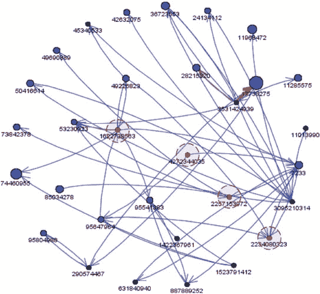

`图 8.4` 显示，一个普通客户与 36 个其他客户相关；其中 29 个属于同一运营商。平均而言，如果普通客户决定流失，他们只能影响少于 1% 的同伴离开公司。影响力型客户与 55 个其他客户相关，其中 45 个属于同一运营商。平均而言，当他们决定流失时，可以影响 6% 的同伴随之而去。

## 图 8.4：网络中的客户影响力


## 网络优化

网络或图结构的另一种分析类型是网络优化。网络优化考虑了一系列优化技术，用于评估图结构、识别子图、评估网络性能，并在网络拓扑结构中搜索最优解决方案。例如，数据科学家可以使用网络优化来研究地理区域内的交通流。在类研究中，节点是地理位置，链路是穿在这些位置之间旅行的人。位置的权重可以是人口数，链路的权重可以是旅行人数。这些信息在帮助政府机构规划公共交通系统、道路网络和应急疏散计划（以及许多其他应用场景）方面具有真正的价值。卫生机构也可以使用这套技术来研究传染疾病的载体。通信和公用事业公司可以使用这些图数据和算法来更好地规划其物理分配网络并预测用量。金融机构可以使用网络优化来打击洗钱，政府可以利用它来理解腐败的主要机制。利用网络分析和网络优化可以部署无限的应用。网络科学的重要概念是万物都是连接的，并且在某种程度上可以阐述为网络问题。

### 网络算法

网络优化考虑了图论和优化算法，这些算法可以增强和推广数学优化方法。许多优化的实际应用依赖于底层网络。例如，零售商面临着在配送网络中将货物从仓库运到商店的问题，以最低成本满足需求。通勤者在道路网络中选择路线，以最短的时间或最短的距离从家去往公司。金融机构搜索与非法交易相关的序列和路径。

## 图 8.5：网络优化：旅行推员问题——最优路径


以下网络算法旨在识别整个网络中的子图，或者在考虑网络结构的情况下执行某些活动的最佳方式。

### 团 (Clique)

团是完全图的子图。团中的每个节点都与该团中的其他所有节点连接。它是一个节点序列，使得从图中的每个节点出发，都有指向序列中下一个节点的链路。在图中寻找团在许多行业中都有应用，如生物信息学、社交网络、电气工程和化学。网络中团的一个平凡例子是一组相互连接的节点。例如，订阅者 A 连接到 B、C 和 D。订阅者 B 也连接到 C 和 D，且订阅者 C 和 D 也是连接的。团中的链路如下：`A−B`、`A−C`、`A−D`、`B−C`、`B−D`、`C−D`。团在寻找网络中的某些感兴趣组非常有用。

### 循环 (Cycle)

图中的路径是节点序列，使得从图中的每个节点出发，都有指向序列中下一个节点的链路。循环是起点和终点相同的路径。该方法针对有向图。对于无向图，每个链路代表两个有向链路。一个平凡的循环是 `A→B→C→A`。

### 线性分配 (Linear Assignment)

线性分配问题是组合优化中的一个基础问题，涉及以最低成本将工人分配给任务。在图论中，线性分配类似于在加权二部图中寻找最小权重匹配。二部图是一种节点可以分为两个不相交集 `S` 和 `T`（工人和任务）的图，其中每个链路都连接 `S` 中的节点和 `T` 中的节点。例如，一个接力游泳队有 4 名运动员，他们在不同泳姿（蝶泳、蛙泳、背泳和自由泳）各有最佳时间。组成最佳团队不仅是获得每种泳姿最快的运动员，而是组合运动员以使总时间最小。

### 最小成本网络 (Minimum-cost Network)

最小成本网络流是网络分析中的一个基础问题，涉及以最低成本在网络上发送流。这里的最小成本是目标函数。目标函数也可以是最小时间或最大数量。这取决于数据科学家研究的问题。网络基于链路或连接节点创建的。节点可以是仓库和商店。链路可以是道路。网络中的每个链路都有关联成本。它还可以关联一个最小和最大容量。

例如，为了在仓库和商店之间流动产品，某些道路可能有货物运输的最大容量。某些道路可能有过路费，代表成本。如果通过第三方公司运输，可能需要最少次数次数。商店有需求，仓库有供应能力。决策变量定义了节点之间发送的流量或仓库与商店之间运输的货物。这个问题可以建模为线性问题，目标是以最低成本优化流动的货物数量。

### 最小生成树 (Minimum Spanning Tree)

最小生成树问题旨在识别连接整个网络的最少节点数。考虑一个通用网络。该网络有多个节点和链路。考虑到可用链路节点间的节点连接，为该网络分配了可达性。最小生成树算法旨在寻找保持网络相同可达性的最小链路集合。换句话说，这个最小链路集合允许源节点通过这个较小的新连接集合到达相同的目标节点。一个图可以有多个不同的生成树。


这个问题在现实应用中非常有用，例如电信、计算机、交通系统、供水系统和电网等网络的设计。连通无向图的生成树是一个子图，它是一棵连接图中所有节点的树。在链路具有权重的情况下，最小生成树是指其权重均小于或等于任何其他生成树权重的生成树。任何无向图都有一个最小生成森林，它是最小生成树及其连通分量的并集。

## 路径枚举

图中的路径是节点序列，其中从图中的每个节点都有通向序列中下一个节点的链路。初等路径是指路径中没有节点被访问超过一次的路径。图中两个节点之间的路径是指从起始节点并结束于目的节点的路径。起始节点称为源节点，目的节点称为汇点节点。用于路径枚举的网络优化算法通常会搜索网络中的所有节点对。也就是说，它为每一对源节点和汇点节点找到所有路径。这些信息对于理解网络的可达性水平以及在考虑网络可用链路的情况下节点之间的所有路由非常有用。

## 最短路径

最短路径问题旨在寻找网络中两个节点之间的路径，使得其链路权重之和最小。换句话说，算法搜索满足目标函数的路径。目标函数可以定义为最小化时间、最小化距离、最小化成本、最大化关系强度等。最短路径可以解决的现实问题包括公共道路网络、公共交通系统、交通规划、决策中的选择序列以及电信业务中的最小延迟等。

网络中两个节点之间的最短路径是从起始节点开始并结束于目的节点且总链路权重最低的路径。这里的链路权重可以是从一个节点到另一个节点的时间、距离、成本或人与人之间的关系强度等。起始节点称为源节点，目的节点称为汇点节点。

## 传递闭包

网络的传递闭包是一个图，网络中的所有节点之间都存在链路。网络的传递闭包有助于高效地回答有关可达性的问题。假设你想在考虑网络内可用链路的情况下，找出是否可以从一个节点（起始位置）到达另一个特定节点（目的位置）。数据科学家可以使用传递闭包网络优化算法来计算网络内的所有连接（网络的现有可达性），并简单地检查特定节点对之间是否存在链路（或特定位置对——源地和目的地之间的路由）。传递闭包在现实问题中有许多应用，包括加速通常用于数据库的结构化查询语言的处理。

## 旅行商问题

旅行商问题（TSP）旨在寻找网络中的最小成本巡游。网络中的路径是相互连接的节点序列。初等循环是指起始节点和终点相同，且在该序列中没有节点被访问超过一次的路径。巡游是指每个节点都被访问过一次的初等循环。旅行商问题旨在寻找总成本最低的巡游。同样，这里的最小成本可以是实际成本、距离或时间。旅行商问题可以回答关于最优巡游的问题。例如，给定一个位置列表以及每对位置之间的距离，从一个位置开始并返回该位置，在巡游中恰好访问每个位置的最短路线是什么？旅行商问题应用于物流路由规划、制造和供应链等许多领域。

## 模式匹配

想象两个不同的网络：`G`（主网络）和 `Q`（查询网络）。子图同构是寻找 `G` 中所有与 `Q` 同构的子图的问题，这意味着所有具有与图 `Q` 相同拓扑结构的子图。模式匹配解决了在存在节点和链路属性时的类似问题。它是寻找网络 `G` 中所有与子网络 `Q` 同构的子图的问题，使得 `Q` 中定义的所有节点和链路属性在同构映射下在 `Q` 的子网络中保留。子图同构和模式匹配应用于许多领域，包括社交网络分析、欺诈检测、模式识别、数据挖掘、化学和生物学。

## 用例：智能城市 – 改进通勤路线

智能城市网络优化的极例子。数据科学家可以使用网络优化算法来理解人类移动行为，然后规划大地区的通勤路线。此类项目的关键数据源是电信公司提供的移动数据。用户的移动数据可以进行匿名化和聚合，以用于网络优化。时空信息——地理位置和时间——可以用于创建用户移动性网络。可以使用一组网络算法来描述网络拓扑结构及其主要特征，然后改进网络的某些特定方面。

该项目调查了里约热内卢工人所采取的每日通勤路线。移动数据（地理位置和时间）由移动运营商提供，并经过匿名化和聚合处理以保护客户隐私。

根据每个用户在夜间和工作期间使用最频繁的基站，数据科学家可以推断出他们假设的居住地和工作地点。

图 8.6：基于访问频率的基站


图 8.7：工作期间和夜间访问频率的基站


每当用户在特定时间范围内从一个基站移动到另一个基站时（例如每小时），就会创建一个移动向量。一个时间范围内从一个基站到另一个基站的所有移动向量可以汇总，以定义基站之间的整体位移。从地理位置来看，基站的粒度较低。移动向量可以汇总，以确定位置对之间（如社区、行政区、县、市等）的位移。可以选择主要的移动向量来估算整体通勤路线。穿越这些主要通勤路线的人数可以根据用户数量、地区移动普及率和地区人口进行推断。基于此，当地政府机构可以通过了解所有位置对之间的人数以及他们到达目的地所需的轨迹，更好地规划交通系统和交通路线。

图 8.8：最频繁的通勤路径


## 总结


本章简要介绍了关于网络分析和网络优化的概念。这两个主题属于一个名为网络科学的大型学科。网络科学研究通常分配给复杂网络的连接模式。任何事物都可以是连接实体的链路：电话、邮件、飞行、银行转账、投票、电子邮件、索赔，几乎任何事物。任何事物都可以是实体：银行账户、个人、公司、国家、手机，几乎任何事物。网络科学由了一系列算法和方法组成，用于从原始数据中创建网络、评估网络、计算指标并发现隐藏模式。网络分析算法用于评估网络内部节点和链接的作用和重要性。网络优化算法则用于根据一组约束条件和资源来提高特定网络的性能。其目标是确保实现具有最低成本结构和最大流量的最优网络设计。

# 第 9 章：模型评估与模型部署

## 章节概述

到目前，我们已经涵盖了大部分数据科学方法，包括统计方法和机器学习技术。我们还涵盖了监督模型和无监督模型。

在这一总结性章节中，我们正接近分析生命期的终点。记得在 `第 1 章` 中我们第一次介绍分析生命周期时：问题定义阶段、数据准备、模型训练、模型评估和部署。现在是时候评估模型结果并选择“冠军模型”，我们将将其投入生产环境以支持业务行动了。

我们还将学习对公司而言最重要的阶段。对于数据科学家来说，这可能不是最重要的阶段，因为他们可能更享受模型开发。然而，如果公司正在等待模型来支持某些业务行动，那么模型部署阶段可能是公司分析生命周期中最重要的阶段。

本章的主要目标如下：

* 描述用于评估模型性能的若干类拟合统计量。
* 解释如何根据业务目标使用拟合统计量评估多个模型的结果。
* 解释如何利用分析模型生成的结果创建可部署的业务行动。
* 描述将分析模型部署到生产环境中以解决业务问题的方法。
* 描述批量和实时对模型进行评分的技术。
* 描述在生产环境中管理和监控模型的方法。

## 评估模型性能的方法

分析模型（特别是监督模型）的主要目标是泛化。泛化是指模型在数据数据上的表现。当模型部署到生产阶段时，保持我们在训练和验证阶段观察到的良好模型性能至关重要。这一点很重要，因为生产环境中的模型将支持业务行动、销售活动、留存优惠或欺诈检测等。生产中的模型需要提供满意的性能、在估计或分类目标时提供合理的准确率，或在对新案例评分时提供合理的拟合度。模型是基于过去的数据进行训练和验证的，但这里的主要目标将其用于新数据，如果模型是监督的，则新观测值没有目标；如果模型是无监督的，则观测值不在用于创建洞察的数据中。例如，像流失模型这样的监督模型可以被部署以根据流失概率对客户进行评分和分类，因此如果概率超过某个阈值，客户将获得留存激励。部署中的无监督模型示例是客户细分模型，它将新客户评分并归类为之前创建的细分之一。

图 9.1：评估最佳模型的各个方面


评估模型性能的方法有很多。除了不同的拟合统计量外，还有一个关键组成部分：业务需求。根据业务场景，可以根据模型的准确性对其进行评估（例如预测新观测值结果的好坏），但该模型也可以根据训练所需的时间、对新案例评分的时间、处理数据中噪声的能力以及最后的可解释性能力进行评估。

### 训练速度

训练速度在某些欺诈检测模型中非常重要。欺诈行为的变化非常快，以至于模型可能会过早漂移。当这种情况发生时，生产中的模型可能需要重新训练。在最坏的情况下，模型可能需要重新创建。在这两种情况下，训练或重新训练的时间完全相关。

### 评分速度

评分速度在实时应用中尤为重要。例如，在信用风险评分中，客户拨打呼叫中心或直接访问公司网页申请个人贷款。业务应用（无论是呼叫中心的 `CRM` 客户关系管理系统还是网页应用程序）需要收集客户信息并在几秒钟给出响应。输入数据由业务应用收集，之前训练的模型被应用于新数据，以对该贷款申请的信誉风险评分。

有些模型训练很快，如回归和决策树。其他一些模型在大数据上训练可能需要更长的时间，如神经网络和梯度提升。另一方面，某些模型的评分速度极快，如回归和神经网络，因为评分只是将系数或权重应用到新数据。在行为变化迅速的情况下，训练速度，或者在要求响应时间低的情况下的评分速度，可能是评估和选择投入生产的最佳模型最重要的维度。

### 业务知识

根据无监督模型的类型，数据科学家可以使用一些统计衡量量来评估结果。例如，在聚类分析中，可以使用立方聚类准则（CCC）根据每组的最小方差来评估可能的聚类数量。在网络分析中，数据科学家可以使用模块性（modularity）来评估检测到的社区的最佳分布。在其他某些聚类技术中，数据科学家可以使用统计衡量量来评估变异的比例。然而，在大多数无监督模型的情况下，业务知识和数据科学家的经验可能是关键。由于无监督方法在结果方面更加开放，模型结果的评估依赖于业务知识、结果如何应用于业务行动以及公司对结果的预期。

### 拟合统计量

另一方面，对于监督模型，数据科学家拥有一个基准作为评估他们开发的模型优劣的标准。基准是用于训练模型的已知目标。所有监督模型都是基于已知数据进行训练的。一旦模型完成，数据科学家就可以根据模型在不同数据集上的结果来验证模型。这种方法的主要目标是选择能够最好泛化到不同观测值的模型。


用于评估监督模型的拟合统计量实际上取决于模型的类型。如果监督模型是分类模型且目标是类别变量，则结果是一个决策。那么，用于评估不同模型结果的拟合统计量可以是`accuracy`（准确率）、`misclassification`（误分类）、`profit`（利润）或`loss`（损失）。在新数据上误分类最低的模型为冠军模型。如果监督模型是排名模型，输出值的重要性小于这些值的顺序，则结果是一个排名。那么，用于评估不同模型结果的拟合统计量可以是`ROC index`（ROC 指数）或`Gini coefficient`（Gini 系数）。冠军模型是在新数据上泛化排名最好或 ROC 指数最高的模型。最后，如果监督模型是估计模型，目标是连续变量，则结果是一个估计值。那么，用于评估不同模型结果的拟合统计量可以是`average square error`（均方误差）、`root mean square error`（均方根误差）、`Schwartz`、`Bayesian` 或 `Akaike information criterion`（赤池信息量准则），或任何基于似然函数的统计量。在新数据上误差函数最低的模型为冠军模型。

图 9.2：预测类型与拟合统计量


## 数据拆分

在特定时间范围内针对特定数据集训练的模型，其目的是为了识别输入变量与目标变量之间的相关性。该模型将应用于新数据或未来数据，以支持公司发起的业务行动。例如，一家公司正面临流失率上升的问题。数据科学团队可以收集过去关于流失事件的数据，并训练监督模型来理解并识别与流失相关的因素。哪类客户更容易流失？在分析流失时，哪些客户的特征更相关？

一旦训练了一组模型，数据科学家就需要评估这些模型以选择最佳的一个——即他们部署到生产环境中以支持留存活动模型。然而，该留存活动将在未来的时间段运行。用于训练模型的变量是相同的，但它们的值不同。时间已经过去，这些值可能已经发生了。模型评分的数据与训练数据不同。为了评估模型是否可能在这些数据上失败，数据科学家将根据与训练模型不同的数据集来评估模型。这是为了“模拟”真实世界的场景，即冠军模型对不同于训练数据的数据进行评分。在训练期间用于评估最佳模型的这种不同数据可以是两个不同的数据集，称为`validation data`（验证集）和`test data`（测试集）。最佳模型是在验证集和测试集上表现最好的模型，而不是训练集。数据科学家可以使用模型在验证集、测试集上的结果，或者是在验证和测试数据集上的平均结果来选择冠军模型。当此冠军模型部署到生产环境中支持活动时，数据科学家可以预期模型将表现良好，因为他们使用了不同的数据集来训练和选择冠军模型，选择了泛化能力最好的模型。在某些情况下，测试数据可以是跨时间样本，以考虑未来的事件时间段，从而模拟模型对新或未来的观测值进行评分时会发生什么。

图 9.3：模型泛化：训练、验证与测试


### K 折交叉验证

将数据拆分为训练集、验证集和测试集（测试集并非真正强制，取决于业务需求和法规）是在将监督模型投入生产环境之前进行训练和泛化的非常有效的方法。数据拆分是一种简单但昂贵的技术。当数据集太小时，由于训练集和验证集之间的高变异性，性能衡量标准可能是不可靠的。缓解这种小数据集问题的良好方法是交叉验证。

图 9.4：交叉验证


K 折交叉验证将原始数据集打乱分为训练部分和验证部分。可以为这种打乱定义多次运行，或者确定多个折将原始数据集拆分为训练部分和验证部分。例如，在四折交叉验证中，数据被分成四个等份。第一次训练基于原始数据集的三四分之一数据（折 `A`、`B` 和 `C`），验证基于最后四分之一（折 `D`）。下一次运行使用折 `A`、`B` 和 `D` 进行训练，并基于 `C` 进行验证。该过程持续持续，直到所有折都已用于训练和验证步骤。然后对这四次评估取平均值。通过这种方式，所有数据都被用于训练和验证。

交叉验证中最佳模型有两种选择。第一种是每一步考虑一个单一模型。例如，在第一步中根据折 `A`、`B` 和 `C` 训练模型，并根据折 `D` 进行验证。然后将该模型应用于所有其他步骤（即其他三次打乱）。在所有折或所有步骤中表现最好的模型就是冠军。一些数据科学家使用整个数据集来拟合冠军模型，但使用交叉验证的结果作为评估统计量。

第二方法是集成模型。对于每一步，都像前面描述的第一种方法一样训练模型，例如，在 `A`、`B` 和 `C` 上训练并在 `D` 上验证。在第二步中训练另一个模型，在 `A`、`B` 和 `D` 上训练并在 `C` 上验证，以此此类推。在这种情况下，训练了四个模型：每个交叉验证的运行对应一个模型。由于结果经过了平均处理，因此这些模型是集成模型。最终模型是交叉验证期间训练的所有四个模型的集成模型。

## 拟合优统计量

评估模型性能的方法取决于目标变量的尺度。如果目标变量是类别变量，那么一些常用方法包括分类表、ROC 曲线、增益图（gains）和提升图（lift charts）。可以使用几种拟合优统计量来评估模型的性能。最常见的拟合优统计量是误分类错误率和信息准则，如 `AIC`（赤池信息量准则）和 `SBC`（施瓦茨贝叶斯信息准则）。

如果目标变量是连续的，按分位数绘制观测平均值与预测平均值的图将很有用。拟合优统计量通常基于某些误差函数，如 `average squared error`（均方误差）、`root mean square error`（均方根误差）、`log error`（对数误差）和 `adjusted R-square`（调整 R 系数）。

图 9.5：混淆矩阵


### 混淆矩阵

当目标是二分类变量时，监督分类模型最常用的评估工具之一是`confusion matrix`（混淆矩阵）。混淆矩阵是实际观测类别与预测类的交叉表。它量化了监督模型正确分类或误分类事件的情况。对于混淆矩阵，感兴趣的事件通常称为正样本，无论该事件是有利的（如欺诈、流失或违约）还是有利的（如购买、获取、交叉销售或升级销售）。非事件被称为负样本。


如果案例被预测为正性 (1)且观测为正性 (1)，则该案例为真阳性 (TP)。如果案例被预测为正性 (1)且观测为负性 (0)，则该案例为假阳性 (FP)。如果案例被预测为负性 (0)且观测为正性 (1)，则该案例为假阴性 (FN)。最后，如果案例被预测为负性 (0)且观测为负性 (0)，则该案例为真阴性 (TN)。

所有案例都根据预测概率的阈值分配到类别中。步骤包括：

1. 估计每个案例属于类别 `1` 的预测概率。
2. 选择阈值概率（通常是样本中的比例）。
3. 如果预测概率超过阈值，将案例分配给类别 `1`；否则，将案例分配给类别 `0`。

根据决策（预测概率阈值），分类表中简单的统计量是准确率。准确率可以通过以下公式计算：

$ACC = \frac{TP + TN}{TP + FP + FN + TN}$

错误率（也称为分类率）是准确率的补数：

$ERR = 1 - ACC = \frac{FP + FN}{TP + FP + TN}$

不同的阈值会产生不同的决策分配以及不同的分类表值。根据事件的分布，增加阈值可能会增加准确率或减少错误率。阈值的通用建议是事件在数据集中的比例。这一信息在分类稀有事件时极其敏感。例如，假设一名数据科学家正在训练一个检测欺诈的模型。在大多数情况下，欺诈是一种稀有事件。假设在这个案例中，欺诈占所有交易的 `1%`。如果最终模型说没有欺诈（即将所有案例预测为非欺诈），则模型在 `99%` 的案例上是正确的，整体准确率将为 `99%`。具有 `1%`分类错误的模型性能可以认为是良好的。然而，公司将漏掉所有的欺诈案例。

因此，有两个特殊指标来评估监督分类模型的性能。第一个是灵敏度，也称为召回率或真阳性率，可以通过以下公式计算：

$Sensitivity = Recall = TPR = \frac{TP}{TP + FN}$

第二个特殊指标是特异性，也称为选择率或真阴性率。特异性是预测为非事件响应的非事件比例。它可以根据以下公式计算为灵敏度的补数：

$Specificity = Selectivity = TNR = \frac{TN}{N} = \frac{TN}{TN + FP}$

问题的背景决定了数据科学家应该主要关注这些指标中的哪一个。例如，在留存活动中，数据科学家应该关注假阴性率 (`FNR` 或 `FN/TP`）。假阴性案例 (`FN`) 代表在留存活动期间未联系而流的客户数量。假阳性案例 (`FP`) 不是最糟糕的情况。公司联系了不会流失的客户，他们最终会收到留激励。这可以作为营销或关系活动。然而，在留存活动中因未识别识别为流失者而失去客户是不好的。

另一方面，在欺诈检测应用中，数据科学家应该更关注假阳性率 (`FPR`）。假阳性案例 (`FP`) 是我们误识别为可能的欺诈者的良好客户数量。当然，假阴性案例 (`FN`) 也是糟糕的。它们代表模型未识别出的可能的欺诈者。这些欺诈者不会被识别为对公司实施欺诈行为。然而，假阳性案例可能代表良好客户被误封或服务被取消。从公司形象、良好客户起诉公司或影响客户传播关于公司服务的负面信息来看，假阳性案例的负面影响可能比欺诈本身更高。

### ROC 曲线

评估分类模型性能的另一种常用方法是接收者工作特征（ROC）曲线。ROC 曲线是一种图形化显示，提供了对具有二分类响应的监督分类模型预测准确性的衡量。ROC 曲线显示了灵敏度（真阳性率）与 1-特异性（假阳性率）的关系。ROC 曲线根据一系列不同的阈值显示这种关系。

极值 `(0,0)` 和 `(1,1)` 分别代表 `1.0` 和 `0.0` 的阈值。如果数据科学家使用所有预测概率为 `1` 的观测值都分类为事件的规则，则没有事件观测被正确分类，但所有的非事件观测都被正确分类（灵敏度=0，特异性=1）。如果数据科学家使用所有预测概率为 `0` 或更高的观测值都分类为事件的规则，则所有事件都被正确分类，但没有非事件被正确分类（灵敏度=1，特异性=0）。横轴是假阳性率，即 `1-特异性`，因此 ROC 曲线从点 `(0,0)` 开始；纵轴是真阳性率，即灵敏度，因此 ROC 曲线在点 `(1,1)` 结束。

对于预测准确率高的监督分类模型，ROC 曲线迅速上升（灵敏度迅速增加，特异性保持在 1）。在这种情况下，曲线下的面积较大。相比之下，预测准确率低的监督分类模型的 ROC 曲线上升缓慢，曲线下的面积较小。曲线下的面积不像分类率和准确率那样受阈值的影响。

以 `45°` 角上升的 ROC 曲线是一个糟糕的模型。它代表了案例到类别的随机分配，是基准模型的 ROC 曲线。

图 9.6: ROC 曲线


当数据科学家将模型性能与随机事件进行比较时，他们可以观察模型的表现如何。例如，在图 9.8 中，根据事件的预测概率对人群进行排序（或者在本例中，针对购买销售活动期间提供的产品），我们可以观察到，在人群的前 5% 中，响应率达到了 21%。从模型性能角度进行简单比较如下：如果没有模型，销售活动将随机选择 5% 的人群来提供特定产品。这 5% 的人群可能是基于有限的预算来开展活动。根据该活动的平均响应率，公司可以预期响应率为 5%。换句话说，所联系的客户中仅有 5% 会购买所提供的产品。通过使用监督分类模型并仅联系总人口的 5%，同样的活动将针对预测概率最高的前 5% 的客户，或更有可能购买该产品的客户进行目标定位。通过使用模型，公司将观察到 21% 的响应率，即收到优惠的受访客户中有 21% 会购买该产品。

数据科学家可以证明该模型比随机事件好四倍。换句话说，监督分类模型可以将该销售活动的响应率提高四倍。

图 9.7：百分比累计命中率 – 随机事件


图 9.8：百分比累计命中率 - 模型与随机事件


### 提升图 (Lift Chart)

提升（Lift）的计算方法是正预测值与整体响应率的比率。因此，对于给定的深度，模型目标的响应人数比随机机会多。图显示，在第五百分位处，提升值为 4.2（使用模型的 21% 响应者除以不使用模型的 5% 响应者）（随机事件）。

图 9.9：提升图


提升图广泛应用于数据库营销，以决定公司在活动中应覆盖人群的深度。构建提升曲线最简单的方法是对预测的后验概率进行排序和分箱。提升图还可以增加收入和成本信息。

提升图还可以用于评估和选择用于支持特定活动的模型。例如，如果一家公司对销售活动的预算有限，只能联系总人口的 20%，那么数据科学家可以根据目标（购买产品）的预测概率，选择在人群前 20% 表现最好的模型，而不是选择考虑整个人群时表现最好的模型。

### 模型评估

建议数据科学家尝试多个模型，并考虑不同的方法和独特的算法。所有技术都取决于数据，因此尝试不同的技术、多种建模方法和数据准备方法总是有帮助的。根据数据的变异性和输入变量与目标之间的关系，回归可能比神经网络更拟合。通常，如果输入与目标之间的关系简单，回归模型、决策树和支持向量机就可以很好地拟合，并最终成为最佳模型。在这种情况下，如果可以使用像回归模型和决策树这样简单且可解释的模型，就没有理由使用像神经网络或像森林、梯度提升等集成模型这样的复杂模型。然而，当输入与目标之间的关系复杂时，神经网络和树集成等更复杂的模型通常拟合更好。缺点是缺乏可解释性。

### 性能

数据科学家总是根据多个维度对模型进行评估，以选择并将其投入生产。第一个维度是性能。性能可以使用不同的拟合统计量来衡量，它取决于目标的类型。目标可能是一个类别，这意味着决策、排序或估计。这些类型的每个目标都可以通过不同的拟合统计量进行评估。

数据科学家可以与业务部门合作，了解哪些拟合统计量对业务最相关。例如，最重要的拟合统计量可能是总体准确率。在这种情况下，数据科学家可以选择误分类误差最少的模型。业务事件可能极其敏感，例如欺诈，假阳性（false-positive）可能会给业务带来巨大风险。数据科学家随后可以根据最小假阳性率评估最佳模型。其他一些业务事件（如流失）可能会受到假阴性率的影响，后者会漏掉可能发生流失的客户。最后，可以通过查看模型在人群特定百分位上的准确率来评估模型。营销活动可能只针对人群的一小部分。数据科学家可以根据模型仅在与活动相关的顶部百分位上的表现来评估冠军模型（champion model）。

### 模型训练时间

数据科学家可用于评估模型的第二个维度是模型训练时间。例如，在欺诈检测中，模型可能会早期漂移，应该频繁地训练或重新训练。基于此，模型训练时间至关重要。在信贷风险中，模型需要在客户申请贷款时进行实时评分。在某些项目中，评分应嵌入到事务系统中。模型应转换为一组规则或一个方程。决策树和回归模型是此类转换的良好候选者。有时，模型评分作为应用程序编程接口 (`API`) 被另一个应用程序调用。被选为冠军的模型应该提供这种访问方式。所有这些类型的评估远超模型的准确率。

### 可解释性

可解释性对于某些业务事件也是一个至关重要的指标。特别是在信贷评分中，公司可能被要求对模型结果提供解释，例如拒绝贷款的原因。对于这些情况，可解释性是评估将投入生产的冠军模型的关键指标。

### 泛化性

泛化性对于评估将部署的模型也非常重要。基于此，可以根据诚实测试（honest test）、跨时间数据集对候选模型进行评估。有时数据科学家需要根据上述特征的组合来评估最佳模型。

## 模型部署

分析生命周期包括模型开发（包括训练多个不同的模型）、模型比较（考虑根据业务需求评估不同的模型）、模型选择（考虑业务需求——速度、解释性等）以及模型部署（考虑如何将模型投入生产——批处理、实时、`API` 等）。

图 9.10：分析模型生命周期


### 挑战模型


# 分析生命周期

分析生命周期应当包含模型的运行化。正如之前强调的，当被选定的模型作为冠军模型（champion model）以支持特定的业务行动时，它是对公司而言最重要的阶段。同时，拥有挑战模型（challenger models）也至关重要。挑战模型可以是评估期间评估过但未被选为冠军模型之一，这可能是因为整体准确率、评分耗时过长或缺乏解释性。无论未被选中的原因如何，挑战模型都是优秀的模型，在发生某些情况时可以替换冠军模型。例如，假设客户行为随着时间的推移发生了变化，模型性能发生下降。冠军模型的泛化效果未达到预期，在训练另一个模型之前，可以部署其中一个挑战模型来替换当前的冠军模型。这种模型的更换将为公司节省大量时间，同时支持业务行动运行。冠军模型和挑战模型都应该被注册并发布，以备日后部署。

注册模型意味着将模型放入中央存储库。发布模型意味着将评分代码放置在模型在生产环境中运行的地方。冠军模型和挑战模型都应该准备好在多个平台上进行部署和执行。

## 监控

分析生命周期中的一个至关重要的阶段是随时间监控模型性能。所有模型都是基于特定的数据集训练的，并考虑特定的时间范围。客户的行为随时间推移而变化，用于创建模型的数据不再相同。因此，生产环境中的模型训练数据集与用于评分的数据集不同。由于由于原因，模型的决策可能会随时间发生偏移，性能可能会大幅下降。当这种情况发生时，就是该更换模型了。目前生产中的冠军模型可以重新训练。在某些情况下，重新训练就足够了；在其他情况下，仅重新训练是不够的，应该训练一个全新的不同的模型。让公司意识到这种需求——重新训练或重建的唯一方法是监控生产环境中的当前模型，并评估模型性能下降的时机。

分析生命周期考虑多个阶段，从数据准备到模型的重新训练或重建，穿了数据探索、建模、部署和监控。数据科学家参与分析生命周期的初始阶段：数据准备、数据探索，当然还有建模。他们将参与与模型评估和部署相关的任务，包括在不同平台上注册和发布冠军及挑战模型，或以不同的格式公开它们。

## 模型运行化

各行业中的许多组织在实现分析模型运行化方面都面临困难。某些研究表明，开发的分析模型中仅有一半被投入生产环境。另一部分则根本没有为组织带来任何价值。其他研究显示，对于投入生产环境的模型，至少需要三个月才能准备好部署。这种时间和精力等同于真实的运营成本，意味着从模型中获得价值的速度变慢。在某些情况下，当业务事件具有时间敏感性（如流失、欺诈、风险和某些销售活动）时，公司完全无法获得价值。

图 9.11: DevOps


为了克服这一挑战，许多组织正在寻求更好的方法，不仅是为了有效地部署分析模型，更是为了高效地管理和监控它们。一种方法是将注册、发布、部署、监控和重新训练模型的任务进行运行化和整合。

所有模型都会下降，如果不给予定期关注，性能就会受。模型就像汽车：为了确保良好的性能，你需要进行定期维护。模型性能不仅取决于模型的构建，取决于数据质量、模型微调、模型的定期更新以及模型的重新训练。

运行这一周期意味着整合所有用于从分析模型中提取价值的步骤。这种整合过程通常被称为 `ModelOps`。`ModelOps`或模型运行化允许公司将分析模型从开发环境（包括训练、验证和测试）尽快移动到生产环境，同时确保结果质量。它使公司管理并扩展模型以满足需求，并持续监控分析模型以发现并最终修复下降的早期迹象。将模型从开发移动到生产的速度和质量对于公司充分利用分析结果至关重要。监控和重新训练对于识别模型开始下降的正确时刻至关重要，然后尝试通过仅重新训练模型来修复它们。另一种修复方法是直接尝试在生产环境中注册并发布的挑战模型。注册模型意味着将模型放入中央存储库。发布模型意味着将评分代码放置在模型在生产环境中运行的地方。

## 监控性能

`ModelOps` 的第一步是监控生产环境中模型的性能。`ModelOps` 代表一个涉及开发、测试、部署和监控的循环。然而，如果 `ModelOps` 向公司的主要目标迈进，它是有效的，这在分析方面是指提供一种可扩展的方法，持续交付准确的分析模型以支持业务行动。

在战略层面，组织需要评估 `ModelOps` 最佳实践是否得到了妥善实施，帮助这些公司在生产环境中运行分析模型以支持业务行动时实现规模和准确性。在操作层面，公司需要监控所有已部署模型的性能。

通常，有一个仪表板可以评估分配给生产环境中分析模型的拟合统计量。对于具有分类和连续目标的受监督模型，整体误分类率或均方误差就是一个例子。还可以监控一些更具体的指标，例如灵敏度或正性预测值。该仪表板还可以监控受部署模型影响的一些业务指标。例如，贷款批准或拒绝的率，或客户流失率。

最后，在指标方面，还有一些更运行化的措施需要被监控。验证（Verification）和确认（Validation）的概念在这里都很重要。验证确认模型是否已正确部署到生产环境中并按照设计运行。确认确认模型是否提供了符合预期的结果，例如，基于为分析模型定义的靶。验证和确认都是生产环境中开发和部署高质量模型的相关最佳实践。

`ModelOps` 的一个关键组件确实是监控生产环境中的分析模型。这是为了避免在生产环境中使用无用模型来支持业务行动的运营成本。正如之前所述，所有分析模型都会下降。这只是时间问题。某些模型一旦部署可能就会下降。例如，一个欺诈检测模型是根据特定类型的欺诈训练的。如前所述，许多模型至少需要三个月才能达到部署阶段。当欺诈模型部署时，欺诈者可能已经改变了行为，甚至改变了所实施的欺诈类型。那么，模型训练用于检测的欺诈类型就不再存在，这个模型就没用了。

## 数据质量


模型性能可能会受到许多情况的影响，如数据质量问题、部署时间或简单的性能退化。数据质量问题通常与用于训练和当前用于评分的数据的变化或偏移有关。数据的变化可能会实质性影响模型性能。这些变化可能发生在数据源、输入变量或数据转换任务中。

## 部署时间

部署时间在两种主要情况下会影响模型性能。第一种情况是，从模型开发到模型部署的整个过程中数据发生了显著变化，正如欺诈检测建模中所描述的那。第二种是行动时机。某些业务目标对时间非常敏感，必须在非常特定的时间范围内采取行动。如果未在该时间范围内采取行动，目标将失去意义，模型运行也可能是低效的。例如，在催收过程中，公司采取的每一步或每个行动都与一个时间范围相关。如果模型在这一时间范围之外部署，该目标对该模型将不再有效，那么模型将完全毫无用处。

## 退化

任何模型都会发生退化。然而，及时捕捉退化发生的时间，对于公司从已部署的分析模型中获得最大收益至关重要。它允许公司快速为衰减模型评估替代方案，无论是重新训练还是更换。监控还允许公司提高当前模型的性能。想象一种情况：模型需要在特定的时间范围内部署以支持某项活动。数据科学家开发了模型，但他们认为通过使用项目开始时未考虑的新数据可以增强模型。数据科学家可以部署当前模型，同时随着新数据整合到数据源，继续进行新模型的增强工作。一旦这个新模型拟合，就可以将其移动到生产环境并与当前模型并行运行，以实时评估性能。如果新模型提供了更好的结果，只要 `ModelOps` 基础设施得到了有效集成，就可以轻松地替换当前模型。

ModelOps 的巨大优势在于，它让公司能够在分析旅程中蓬勃发展。这些模型的预测能力，结合大数据的可用性和不断增长的计算能力，继续是智能组织竞争优势的来源，无论行业大小如何。ModelOps 允许这些精明的公司以有效的方式采用整个分析生命周期，改进流程的每一步，从模型开发到模型部署，再到性能监控和模型更换。ModelOps 允许公司扩展其分析工作，赋予他们真正的竞争优势，并从数据科学计划中提取最大的价值。

## 总结

本章涵盖了分析生命周期的重要方面，重点关注模型训练、模型评估和部署。模型评估是分析生命周期中的关键一步，因为根据业务问题、可解释性需求、可说明性必要性以及训练或评分的速度等许多因素，评估最佳模型有许多视角。最后，一旦选择了最佳模型，我们就会进入了对公司最重要的阶段：模型部署。部署是公司在其运营过程中通过使用分析获得主要收益的时候。活动、决策、价格和组合包都基于模型结果的事实、数字和洞察，而不再基于猜测或感觉。企业正在拥抱分析并做出数据驱动的决策。

监控生产环境中的所有模型对支持所有业务行动也至关重要。模型会随时间推漂移，客户也会改变行为，从而改变描述这些行为的数据，进而影响模型。监控生产环境中的模型允许公司识别模型何时未达到预期并对其进行更新。这种更新可能是简单的重新训练，也可能是整个模型的重新开发。重要的是，低性能模型需要被替换。这个拼图的最后一块是模型运行化。模型可能以多种方式被使用：作为报告、简单的输出，或者在复杂的应用程序中（无论是嵌入到事务系统中，还是在特定的应用程序中）。模型运行化是分析生命周期中的积极组成部分，需要良好的考虑。

## 目录

1. 关于本书
2. 关于作者
3. 致谢
4. 前序
5. 第一章：数据科学引论
    - 1. 章节概述
    - 2. 数据科学
        - 1. 数学与统计
        - 2. 计算机科学
        - 3. 领域知识
        - 4. 沟通与可视化
        - 5. 硬技能与软技能
    - 3. 数据应用
    - 4. 数据科学生命周期与成熟度框架
        - 1. 理解问题
        - 2. 收集数据
        - 3. 探索数据
        - 4. 数据处理
        - 5. 提供答案
    - 5. 数据科学中的高级分析
    - 6. 数据科学实例
        - 1. 客户体验
        - 2. 收入优化
        - 3. 网络分析
        - 4. 数据变现
    - 7. 总结
    - 8. 延伸阅读
6. 第二章：数据探索与准备
    - 1. 章节概述
    - 2. 数据探索引论
        - 1. 非线性
        - 2. 高基数
        - 3. 非结构化数据
        - 4. 稀疏数据
        - 5. 异常值
        - 6. 缩放错误的输入变量
    - 3. 数据准备引论
        - 1. 代表性采样
        - 2. 基于事件的采样
        - 3. 分区
        - 4. 填充
        - 5. 替换
        - 6. 转换
        - 7. 特征提取
        - 8. 特征选择
    - 4. 模型选择
        - 1. 模型泛化
        - 2. 偏差-方差权衡
    - 5. 总结


# 第 3 章：监督模型 – 统计方法

## 章节概述
## 分类与估计
### 线性回归
### 案例：客户价值
## 逻辑回归
### 案例：收集预测模型
## 决策树
### 案例：订阅欺诈
## 总结

# 第 4 章：监督模型 – 机器学习方法

## 章节概述
## 监督学习模型
## 树的集成
## 随机森林
### 梯度提升
### 案例：用量欺诈
## 神经网络
### 案例：呆坏账
## 总结

# 第 5 章：监督模型的高级主题

## 章节概述
## 高级机器学习模型与方法
### 支持向量机
### 案例：预付制用户欺诈
## 因子机
### 案例：零售业中基于客户评分的推荐系统
# 集成模型
### 案例研究：电信行业流失模型
## 两阶段模型
### 案例：防流失
## 总结
## 拓展阅读

# 第 6 章：无监督模型——结构化数据

## 章节概述
## 聚类
# 层次聚类
### 案例：产品细分
### 基于质心的聚类 (`k-means`）
### 案例：客户细分
## 自组织映射
### 案例：无偿能力行为
## 评估
### 聚类特征分析
### 补充主题
## 总结
## 拓展阅读

# 第 7 章：无监督模型——半结构化数据

## 章节概述
## 关联分析
### 购物篮分析
### 置信度与支持度指标
### 案例：产品组合
### 期望置信度与提升度指标
### 关联规则评估
### 案例：产品获取
## 序列分析
### 案例：下一次最佳报价
## 链路分析
### 案例：产品关系
## 路径分析
### 案例研究：在线体验
## 文本分析
### 案例研究：呼叫中心分类
## 总结
## 拓展阅读

# 第 8 章：无监督模型的高级主题

## 章节概述
## 网络分析
### 网络子图
### 网络度量指标
### 案例：通过社交网络分析降低电信流失率
## 网络优化
### 网络算法
### 案例：智慧城市 –改进通勤路线
## 总结

# 第 9 章：模型评估与模型部署

## 章节概述
## 模型性能评估方法
### 训练速度
### 评分速度
### 业务知识
### 拟合统计量
### 数据划分
### K 折交叉验证
### 拟合优度统计量
### 混淆矩阵
### ROC 曲线
### 模型评估
## 模型部署
### 挑战模型
### 监控
## 模型落地
## 总结

