# Python 时间序列预测入门指南

# 欢迎

欢迎使用《*Python 时间序列预测入门*》。你是那些决定投资于自己教育和未来的少数人之一，我很荣幸能助你一臂之力。

本书将向你展示如何使用 Python 生态系统中的标准工具对单变量时间序列问题进行预测。时间序列是应用机器学习中一个重要但服务不足的领域，Python 是机器学习和预测建模日益增长的平台，而本书则打通了 Python 中的时间序列应用。但是，你需要付出努力。我会列出所有主题、工具、代码和模板，但是由你决定如何在项目中应用它们以获得结果。

在深入内容之前，重要的是首先明确本书的目标、限制和结构，以确保你能快速、高效地从中获益，并且在这个过程中获得很多乐趣。让我们从本书的目标开始。

## 目标

本书的目标是*向你展示如何使用 Python 生态系统在单变量时间序列预测问题上取得成果*。只有当你将本书中的课程应用到自己的项目并从中获得结果时，才能实现这一目标。这是一本旨在即时使用的指南或操作手册。

## 原则

本书的开发遵循以下五个原则：

- **应用**：重点在于预测的应用，而非理论。
- **课程**：本书被分解为短小的课程，每节专注于特定主题。
- **价值**：课程关注预测项目中常用且最有用的方面。
- **成果**：每节课程都提供了一条通往可用且可复现结果的路径。
- **速度**：每节课程都旨在提供通往结果的最短路径。

这些原则塑造了本书的结构和组织。

## 先决条件

本书对读者有一些假设。它们是：

- **你是开发者**：这是一本面向开发者的书。你是某种类型的开发者。你懂得如何阅读和编写代码。你懂得如何开发和调试程序。
- **你懂 Python**：这是一本面向 Python 用户的书。你熟悉 Python 编程语言，或者你是一位技术熟练的开发者，可以边做边学。
- **你了解一些机器学习**：这是一本面向机器学习初学者的书。你了解一些基础实用机器学习，或者你可以快速弄明白它。

如果你不完全符合这些条件，不要惊慌。我会提供支持资源，包括设置 Python 环境的帮助以及更多关于机器学习的资源。

## 阅读方法

本书的设计适合三种不同的阅读风格。它们是：

- **从头到尾**：材料按顺序排列，你可以从头到尾、逐页阅读本书，了解如何着手处理时间序列预测问题。
- **分块阅读**：课程是独立的，你可以针对你的预测项目，分块阅读所需主题。
- **模板**：项目旨在提供一个模板，可以复制并用于你自己的预测项目。

选择适合你的阅读风格，以便尽快从书中获得最大收益。

## 阅读成果

如果你选择完成本书的所有课程和项目，你可以对自己新获得的能力设定一些合理的期望。它们是：

- **时间序列基础**：你将能够识别时间序列预测问题，并将其与其他预测建模问题区分开来，以及了解时间序列如何被框定为监督学习。
- **数据转换以建模**：你将能够转换、重新缩放、平滑时间序列数据并生成特征，以便最好地暴露问题的固有内在属性（信号）给用于预测的学习算法。


## 利用时间结构
您将能够分析时间序列数据，理解其中固有的时间结构（如趋势和季节性），以及在进行预测时如何处理、去除或利用这些结构。

## 评估模型
您将能够为单变量预测问题设计模型测试框架，并使用各种性能指标估计基线技能以及模型在未见过数据上的预期性能。

## 应用经典方法
您将能够为单变量时间序列预测问题选择、应用并解释来自经典线性方法的结果，例如自回归、移动平均和 ARIMA 模型。

您将成为 Python 生态系统中单变量时间序列预测问题的大致预测建模者。

## 局限性

这本书不可能适合所有人。具体来说：

- **时间序列分析**：这是一本关于时间序列预测的书，而不是时间序列分析。本书的主要关注点是利用历史数据预测未来，而不是理解过去。
- **高级时间序列**：这不是一本处理复杂时间序列问题的书。它不提供关于多步序列预测、多变量时间序列问题或时空预测问题等高级主题的教学。
- **算法教科书**：这是一本实用书，充满了应用规则和代码配方。它不是教科书，不描述算法为何有效或支配它们的方程。
- **Python 语言书籍**：这不是一本关于 Python 编程语言的处理书。它不提供 Python 代码的历史、语法或语义的简介。

将您的期望与本书旨在实现的目标和原则保持一致是很重要的。

## 结构

本书以一系列课程和项目呈现。

- **课程**：课程采用教程形式，专注于教授一个特定主题，并提供足够的背景知识以为该主题提供上下文，重点在于示例和工作代码以在实践中演示该主题。
- **项目**：项目采用教程形式，专注于应用课程中介绍的主题套件，重点是在真实世界的预测建模数据集上获得结果。

本书主要由教程课程组成。课程分为 5 个主要主题。如下所示：

- **基础**：这部分包含入门材料，例如如何设置 SciPy 环境、时间序列问题的示例以及它们与其他类型预测建模的区别，以及随机游走和白噪声等重要概念。
- **数据准备**：这部分包含有关如何准备预测数据的课程。其中包括缩放、变换和特征工程等方法，旨在更好地向建模算法展示问题的固有结构。
- **时间结构**：这部分关注预测问题的时间结构。这包括理解数据随时间的系统性变化，如趋势和季节性，以及平稳性的概念。
- **评估模型**：这部分关注如何评估预测的性能。这包括回测算法、评估模型技能、对模型的预测进行诊断以及重构问题的方法。
- **预测模型**：这部分关注时间序列预测的经典线性模型。这包括自回归、移动平均和自回归积分滑动平均或 ARIMA 模型。

本书的课程以三个项目告终。这些项目旨在展示处理预测项目的结构以及书中演示的关键技术。这些项目包括：

- **项目 1**：波士顿每月武装抢劫案。
- **项目 2**：巴尔的摩年度用水量。
- **项目 3**：法国香槟的每月销量。

## 摘要

现在您了解了书的组织结构。您还知道了课程为何激光聚焦于快速可重复的结果背后的原则，以帮助您尽快在时间序列预测项目上交付价值。

## 下一步

接下来开始基础部分以及关于时间序列预测问题的结构及其与其他类型预测建模问题如何不同的课程。第一课为您提供关于如何设置 Python 开发环境的背景。

# 第一部分

# 基础

## 第 1 章

## Python 环境

Python 生态系统正在增长，并可能成为应用机器学习的主导平台。采用 Python 进行时间序列预测的主要理由是因为它是一种通用编程语言，您可以将其用于研发和生产。在本课中，您将发现时间序列预测的 Python 生态系统。读完本课，您将了解：

- 对时间序列预测至关重要的三个标准 Python 库。
- 如何安装和设置用于开发的 Python 和 SciPy 环境。
- 如何确认您的环境工作正常并准备好进行时间序列预测。

让我们开始吧。

### 1.1 为什么选择 Python？

Python 是一种通用解释型编程语言（与 R 或 Matlab 不同）。它易于学习和使用，主要是因为该语言注重可读性。它是一种流行的语言，在 StackOverflow 的调查（例如，2015 年调查结果¹）中 consistently 出现在前 10 编程语言中。

Python 是一种动态语言，非常适合交互式开发和快速原型设计，并具备支持开发大型应用程序的能力。这是一个简单但非常重要的考虑因素。这意味着您可以在与运营中使用的相同编程语言中执行您的研发（确定使用什么模型），大大简化了从开发到运营的过渡。

Python 也因其出色的库支持而广泛用于机器学习和数据科学。它迅速成为机器学习和数据科学从业者主导的平台之一，雇主对其需求甚至超过 R 平台（见下图）。

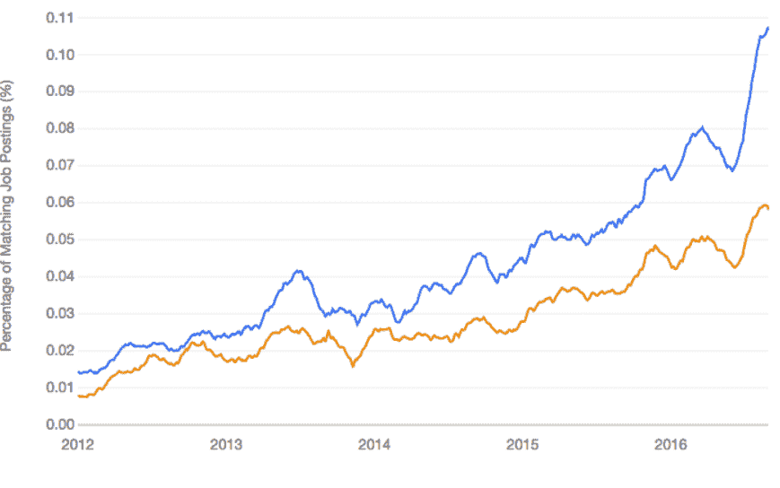

图 1.1：Python 机器学习职位（蓝色）与 R 机器学习职位的比较，数据来源：indeed.com。

### 1.2 用于时间序列的 Python 库

SciPy 是一个用于数学、科学和工程的 Python 库生态系统²。它是 Python 的一个附加组件，您在进行时间序列预测时需要它。两个 SciPy 库为大多数其他库提供基础；它们是提供高效数组操作的 NumPy³和用于绘制数据的 Matplotlib⁴。有三个更高级的 SciPy 库提供了 Python 中时间序列预测的关键功能。它们分别是用于数据处理、时间序列建模和机器学习的 Pandas、Statsmodels 和 scikit-learn。让我们逐一仔细看看。

#### 1.2.1 库：Pandas

Pandas 库提供了高性能工具，用于在 Python 中加载和处理数据。它基于 SciPy 生态系统构建并需要它，底层主要使用 NumPy 数组，但提供了方便易用的数据结构，如 `DataFrame` 和 `Series`，用于表示数据。Pandas 特别关注对时间序列数据的支持。Pandas 中与时间序列预测相关的关键功能包括：

- 用于表示单变量时间序列的 `Series` 对象。
- 对数据中日期时间索引和日期时间范围的显式处理。
- 变换，如偏移、滞后和填充。
- 重采样方法，如上采样、下采样和聚合。

有关 Pandas 的更多信息，请参见：

- Pandas 主页：`http://pandas.pydata.org/`
- Pandas 对时间序列的支持：`http://pandas.pydata.org/pandas-docs/stable/user_guide/timeseries.html`

#### 1.2.2 库：Statsmodels

Statsmodels 库提供了统计建模工具。它基于 SciPy 生态系统构建并需要它，并支持 NumPy 数组和 Pandas `Series` 对象形式的数据。它提供了一套统计测试和建模方法，以及专门用于时间序列分析的工具，也可用于预测。Statsmodels 中与时间序列预测相关的关键功能包括：

- 平稳性统计测试，如增强迪基-福勒单位根检验。
- 时间序列分析图，如自相关函数 (ACF) 和部分自相关函数 (PACF)。
- 线性时间序列模型，如自回归 (AR)、移动平均 (MA)、自回归移动平均 (ARMA) 和自回归积分滑动平均 (ARIMA)。

有关 Statsmodels 的更多信息，请参见：

- Statsmodels 主页：`http://statsmodels.sourceforge.net/`
- Statsmodels 对时间序列的支持：`http://statsmodels.sourceforge.net/stable/tsa.html`

#### 1.2.3 库：scikit-learn

scikit-learn 库是您在 Python 中开发和实践机器学习的方式。该库的重点是用于分类、回归、聚类等机器学习算法。它还提供了用于相关任务（如评估模型、调优参数和预处理数据）的工具。scikit-learn 中与时间序列预测相关的关键功能包括：

- 一套数据准备工具，例如缩放和数据插值。
- 一套可用于对数据建模并进行预测的机器学习算法。

[^2]: https://www.scipy.org
[^3]: http://www.numpy.org
[^4]: http://matplotlib.org
[^1]: https://survey.stackoverflow.co/2015/


- 用于估计模型在未见数据上表现的重新采样方法，特别是 `TimeSeriesSplit` 类（在第 16 章中介绍）。

有关 scikit-learn 的更多信息，请参见：

- Scikit-learn 主页：`http://scikit-learn.org/`

## 1.3 Python 生态系统安装

本节将为您提供有关设置用于时间序列预测的 Python 环境的通用建议。我们将涵盖：

1.  使用 Anaconda 进行自动安装。
2.  使用您平台的包管理工具进行手动安装。
3.  确认已安装的环境。

如果您已经拥有一个可正常运行的 Python 环境，请跳到确认步骤以检查您的软件库是否已更新。让我们开始吧。

### 1.3.1 自动安装

如果您不擅长在机器上安装软件，或者您使用的是 Microsoft Windows，那么有一个简单的选项适合您。有一个名为 Anaconda Python 的发行版，您可以免费下载并安装。它支持三大主要平台：Microsoft Windows、Mac OS X 和 Linux。它包含 Python、SciPy 和 scikit-learn：您学习、练习和使用 Python 环境进行时间序列预测所需的一切。

您可以从这里开始使用 Anaconda Python：

- Anaconda 安装：`https://docs.continuum.io/anaconda/install`

### 1.3.2 手动安装

有多种方法可以安装特定于您平台的 Python 生态系统。在本节中，我们介绍如何安装用于时间序列预测的 Python 生态系统。

## 如何安装 Python

第一步是安装 Python。我更喜欢使用并推荐 Python 2.7 或 Python 3.5。Python 的安装将特定于您的平台。有关说明，请参见：

- 在 Python 初学者指南中下载 Python：`https://wiki.python.org/moin/BeginnersGuide/Download`

在带有 `macports` 的 Mac OS X 上，您可以输入：

```text
sudo port install python35
sudo port select --set python python35
sudo port select --set python3 python35
```

列表 1.1：macports 在 Mac OS X 上安装 Python 3 的命令。

## 如何安装 SciPy

安装 SciPy 的方法有很多种。例如，两种流行的方法是使用您平台上的包管理工具（如 RedHat 上的 dnf 或 OS X 上的 macports），或者使用 Python 包管理工具，如 pip。SciPy 文档非常出色，并在官方 SciPy 主页上涵盖了在许多不同平台上的操作说明：

- 安装 SciPy 软件栈：[https://www.scipy.org/install.html](https://www.scipy.org/install.html)

安装 SciPy 时，请确保您至少安装了以下软件包：

- SciPy
- NumPy
- Matplotlib
- Pandas
- Statmodels

在带有 **macports** 的 Mac OS X 上，您可以输入：

```text
sudo port install py35-numpy py35-scipy py35-matplotlib py35-pandas py35-statmodels
py35-pip
sudo port select --set pip pip35
```

列表 1.2：macports 在 Mac OS X 上安装 Python 3 SciPy 库的命令。

在带有 **dnf** 的 Fedora Linux 上，您可以输入：

```text
sudo dnf install python3-numpy python3-scipy python3-pandas python3-matplotlib
python3-statmodels
```

列表 1.3：dnf 在 Fedora Linux 上安装 Python 3 SciPy 库的命令。

## 如何安装 scikit-learn

scikit-learn 库必须单独安装。我建议安装 scikit-learn 时使用与安装 SciPy 相同的方法。有关安装 scikit-learn 的说明仅限于使用 Python **pip** 包管理器。在所有支持 **pip** 的平台（Windows、OS X 和 Linux）上，我通过输入以下内容来安装 scikit-learn：

```text
sudo pip install -U scikit-learn
```

列表 1.4：pip 安装 scikit-learn 的命令。

## 1.3.3 确认您的环境

一旦您设置好环境，您必须确认其按预期工作。让我们首先检查 Python 是否安装成功。打开命令行并输入：

```
python -V
```

列表 1.5：检查 Python 版本的命令行参数。

您应该看到如下响应：

```
Python 2.7.12
```

列表 1.6：Python 2 的示例 Python 版本。

或

```
Python 3.5.3
```

列表 1.7：Python 3 的示例 Python 版本。

现在，确认库是否安装成功。创建一个名为 *versions.py* 的新文件，并将以下代码片段复制粘贴到其中，然后将文件保存为 *versions.py*。

```python
## 检查关键 Python 库的版本
# scipy
import scipy
print('scipy: %s' % scipy.__version__)
# numpy
import numpy
print('numpy: %s' % numpy.__version__)
# matplotlib
import matplotlib
print('matplotlib: %s' % matplotlib.__version__)
# pandas
import pandas
print('pandas: %s' % pandas.__version__)
# statsmodels
import statsmodels
print('statsmodels: %s' % statsmodels.__version__)
# scikit-learn
import sklearn
print('sklearn: %s' % sklearn.__version__)
```

列表 1.8：检查所需 Python 库版本的脚本。

在命令行或您喜欢的 Python 编辑器中运行该文件。例如，输入：

```
python versions.py
```

列表 1.9：运行 versions.py 脚本的命令行参数示例。

这将打印出您所需的每个关键库的版本。例如，在我撰写本文时的系统中，我得到了以下结果：

```
scipy: 1.3.1
numpy: 1.17.2
matplotlib: 3.1.1
pandas: 0.25.1
statsmodels: 0.10.1
sklearn: 0.21.3
```

列表 1.10：运行 versions.py 脚本的示例输出。

如果您遇到错误，请现在停止并修复它。您可能需要查阅特定于您平台的文档。

## 1.4 总结

在本课中，您了解了用于时间序列预测的 Python 生态系统。您学习了：

- Pandas、Statsmodels 和 scikit-learn，它们是用于时间序列预测的顶级 Python 库。
- 如何自动和手动设置 Python SciPy 环境以用于开发。
- 如何确认您的环境已正确安装，并且您已经准备好开始开发模型。
- 您还学习了如何在工作站上安装用于机器学习的 Python 生态系统。

#### 1.4.1 下一步

在下一课中，您将了解时间序列数据集以及讨论时间序列问题时使用的标准术语。

# 第 2 章

## 什么是时间序列预测？

时间序列预测是机器学习中一个重要的领域，通常被忽视。它之所以重要，是因为有许多预测问题涉及时间要素。这些问题被忽视，是因为正是这个时间要素使得时间序列问题更难以处理。在本课中，您将了解时间序列预测。读完本课后，您将知道：

- 时间序列、时间序列分析和时间序列预测的标准定义。
- 时间序列数据中需要考虑的重要组件。
- 时间序列的示例，以使您的理解具体化。

让我们开始吧。

### 2.1 时间序列

普通的机器学习数据集是观察值的集合。例如：

```
观察值 #1
观察值 #2
观察值 #3
```

列表 2.1：观察值集合的示例。

时间在普通的机器学习数据集中确实扮演着一个角色。预测是针对新数据做出的，而实际结果可能直到未来某个日期才可知。我们在预测未来，但所有先前的观察值都被同等对待。也许带有一些非常轻微的时间动态来克服*概念漂移*的想法，例如仅使用最后一年的观察值而不是所有可用数据。

时间序列数据集是不同的。时间序列在观察值之间添加了显式的顺序依赖关系：一个时间维度。这个额外的维度既是一个约束，也是一个结构，提供了额外信息的来源。

时间序列是按时间顺序依次获取的观察值序列。

> — 出自 *Time Series Analysis: Forecasting and Control*（时间序列分析：预测与控制）第 1 页。


例如：

```
Time #1, observation
Time #2, observation
Time #3, observation
```

列表 2.2：时间序列观测值示例。

## 2.2 时间序列术语

在继续之前，有必要快速建立描述时间序列数据时使用的标准术语。当前时间定义为 **t**，当前时间的观测值定义为 `obs(t)`。

我们通常关注过去时间的观测值，这些过去的时间被称为滞后时间或滞后。过去的时间相对于当前时间为负。例如，前一个时间为 **t-1**，再前一个时间为 **t-2**。这些时间的观测值分别为 `obs(t-1)` 和 `obs(t-2)`。未来时间是我们希望进行预测的对象，相对于当前时间为正。例如，下一个时间为 **t+1**，再下一个时间为 **t+2**。这些时间的观测值分别为 `obs(t+1)` 和 `obs(t+2)`。

为简化起见，我们通常省略 `obs(t)` 符号，改用 **t+1**，并假设我们在讨论的是这些时间点的观测值，而不是时间索引本身。此外，我们可以用简写方式指代滞后观测值，例如 *滞后 10* 或 `lag=10`，这等同于 **t-10**。总结如下：

- **t-n**：过去时间或滞后时间（例如 **t-1** 代表前一个时间）。
- **t**：当前时间及参考点。
- **t+n**：未来时间或预测时间（例如 **t+1** 代表下一个时间）。

## 2.3 描述与预测

根据我们是希望理解数据集还是进行预测，我们的目标会有所不同。理解数据集（称为时间序列分析）有助于做出更好的预测，但这并非必要条件，且可能在时间和专业知识上产生大量与期望结果（即预测未来）不直接相关的技术性投入。

在描述性建模或时间序列分析中，会对时间序列进行建模，以确定其在季节模式、趋势、与外部因素的关系等方面的组成部分。[...] 相比之下，时间序列预测利用时间序列中的信息（可能还包括额外信息）来预测该序列的未来值。

在使用经典统计学时，主要关注点是时间序列分析。时间序列分析涉及开发最能捕捉或描述观测时间序列的模型，以理解其潜在原因。这一研究领域寻求时间序列数据背后的 *原因*。这通常涉及对数据形式做出假设，并将时间序列分解为组成成分。描述性模型的质量取决于它对所有可用数据的描述程度以及它为更好地理解问题领域提供的解释。

时间序列分析的主要目标是开发数学模型，从样本数据中提供合理的描述。

> — 第 11 页，《*时间序列分析及其应用：R 示例*》。

## 2.3.2 时间序列预测

在对时间序列数据进行经典统计处理时，对未来进行预测被称为外推。更现代的领域关注这一主题，并将其称为时间序列预测。预测涉及基于历史数据拟合的模型，并使用它们来预测未来观测值。描述性模型可以“借用”未来信息（例如用于平滑或去噪），它们仅寻求最佳地描述数据。预测的一个重要区别在于，未来完全是未知的，必须仅基于已经发生的事情进行估计。

时间序列预测模型的技能水平由其在预测未来时的表现决定。这往往以牺牲解释能力为代价，包括解释为何做出特定预测、置信区间以及对问题背后潜在原因的更好理解。

## 2.4 时间序列的组成部分

时间序列分析提供了一系列技术来更好地理解数据集。其中最有用的技术之一可能是将时间序列分解为 4 个组成成分：

- **水平（Level）**。如果序列是一条直线，其基准值。
- **趋势（Trend）**。序列随时间变化而增加的可选且通常为线性的行为。
- **季节性（Seasonality）**。随时间重复出现的可选模式或周期。
- **噪声（Noise）**。模型无法解释的观测值中的可选变异性。

所有时间序列都有水平值，大多数都有噪声，而趋势和季节性是可选的。

许多时间序列的主要特征是趋势和季节性变化 [...] 大多数时间序列的另一个重要特征是，时间上接近的观测值往往具有相关性（序列依赖）。

这些组成成分可以认为以某种方式组合起来，提供观测到的时间序列。可以针对这些成分的行为和组合方式做出假设，从而允许使用传统统计方法对它们进行建模。这些成分也可能是预测未来值的最有效方式，但并非总是如此。在这些经典方法未能产生有效性能的情况下，这些成分可能仍然是有用的概念，甚至可以作为替代方法的输入。时间序列分解为水平、趋势、季节性和噪声在第 12 章中会有更深入的探讨。

## 2.5 预测的关注点

在进行预测时，理解你的目标非常重要。使用苏格拉底式的提问法，提出许多问题以帮助聚焦于你的预测建模问题的具体细节。例如：

1. **你有多少可用数据，并且你是否能够将它们全部收集起来？** 更多的数据通常更有用，提供了更多的探索性数据分析、模型测试和调优以及模型保真度的机会。
2. **需要的预测时间范围是什么？** 短期、中期还是长期？较短的时间范围通常更容易以更高的置信度进行预测。
3. **预测是否可以随时间频繁更新，还是必须一次做出并保持静态？** 随着新信息的出现更新预测通常能带来更准确的预测。
4. **预测所需的时间频率是多少？** 通常预测可以以更低或更高的频率进行，允许你利用数据的降采样和升采样，这反过来可以在建模时带来好处。

时间序列数据通常需要进行清洗、缩放，甚至变换。例如：

- **频率**。也许提供的数据频率太高而无法建模，或者在时间上间隔不均匀，需要重新采样才能用于某些模型。
- **异常值**。也许存在损坏或极端的异常值，需要识别和处理。
- **缺失值**。也许存在间隙或缺失数据，需要进行插补或填补。

时间序列问题往往是实时的，不断提供新的预测机会。这为时间序列预测增添了一种诚实性，迅速揭示出不良假设、建模错误以及我们可能自我欺骗的所有其他方式。

## 2.6 时间序列预测的例子

时间序列预测问题的供应几乎是无休止的。以下是来自不同行业的 10 个示例，以使时间序列分析和预测的概念更加具体。

- 预测每个州每年的玉米产量（吨）。
- 预测每秒的 EEG 信号是否表明患者正在发作癫痫。
- 预测股票每天的收盘价。
- 预测城市内所有医院每年的出生率。
- 预测商店每天的产品销售量（单位）。
- 预测火车站每天的乘客数量。
- 预测每个州每季度的失业率。
- 预测服务器每小时的利用率需求。
- 预测某州每个繁殖季节的兔子种群数量。
- 预测城市每天的平均汽油价格。

我预计你能够将其中一个或多个示例与你想要解决的时间序列预测问题联系起来。

## 2.7 摘要

在本课中，你发现了时间序列预测。具体来说，你学到了：

- 关于时间序列数据以及时间序列分析与时间序列预测之间的区别。
- 在执行分析时，时间序列可以分解成的组成成分。
- 时间序列预测问题的示例，以使这些概念更加具体。

### 2.7.1 下一步

在下一课中，你将发现如何将时间序列预测构建为一个监督学习问题。


## 第 3 章
### 将时间序列视为监督学习

时间序列预测可以被框定为监督学习问题。这种对你时间序列数据框架的重新构建，使你能够访问针对该问题的标准线性和非线性机器学习算法套件。在本课中，你将发现如何把你的时间序列问题重新框定为机器学习中的监督学习问题。

阅读完本课，你将了解：
- 什么是监督学习，以及它如何构成所有预测建模机器学习算法的基础。
- 用于构建时间序列数据集框架的滑动窗口方法，以及如何使用它。
- 如何针对多变量数据和多步预测使用滑动窗口。

让我们开始吧。

## 3.1 监督机器学习

绝大多数实用的机器学习都使用监督学习。监督学习是指你拥有输入变量 (X) 和输出变量 (y)，并使用算法学习从输入到输出的映射函数。

```
Y = f(X)                                    (3.1)
```

目标是尽可能精确地近似真实的底层映射，这样当你有新输入数据 (X) 时，你就可以预测该数据的输出变量 (y)。下面是一个监督学习数据集的构造示例，其中每一行都是一个由一个输入变量 (X) 和一个待预测的输出变量 (y) 组成的观测值。

```
X, y
5, 0.9
4, 0.8
5, 1.0
3, 0.7
4, 0.9
```

清单 3.1：一个小型构造的监督学习数据集示例。

之所以称为监督学习，是因为算法从训练数据集中学习的过程可以被视为教师监督学习过程。我们知道正确答案；算法迭代地对训练数据进行预测，并通过更新得到修正。当算法达到可接受的性能水平时，学习停止。监督学习问题可以进一步分为回归问题和分类问题。
- **分类：** 分类问题是指输出变量是类别，例如 **红色** 和 **蓝色**，或者 **疾病** 和 **无病**。
- **回归：** 回归问题是指输出变量是实数值，例如 **美元** 或 **重量**。上面提到的构造示例是一个回归问题。

## 3.2 滑动窗口

时间序列数据可以用监督学习来表述。给定时间序列数据集的数字序列，我们可以重构数据使其看起来像监督学习问题。我们可以通过使用先前时间步作为输入变量，并使用下一个时间步作为输出变量来实现这一点。让我们通过一个例子使其具体化。假设我们有如下时间序列：

```
time, measure
1,   100
2,   110
3,   108
4,   115
5,   120
```

清单 3.2：一个小型构造的时间序列数据集示例。

我们可以通过使用前一时间步的值来预测下一个时间步的值，将这种时间序列数据集重构为监督学习问题。以这种方式重新组织时间序列数据集，数据将如下所示：

```
x,    y
?,    100
100, 110
110, 108
108, 115
115, 120
120, ?
```

清单 3.3：时间序列数据集作为监督学习的示例。

请查看上述转换后的数据集并将其与原始时间序列进行比较。以下是一些观察结果：
- 我们可以看到，在前一个时间步是输入 (X)，而下一个时间步是我们监督学习问题中的输出 (y)。
- 我们可以看到，观测值之间的顺序得以保留，在使用该数据集训练监督模型时，必须继续保留这一顺序。
- 我们可以看到，我们没有可用的先前值来预测序列中的第一个值。由于我们无法使用它，我们将删除这一行。
- 我们还可以看到，对于序列中的最后一个值，我们没有已知的下一个值来进行预测。我们在训练监督模型时可能也想要删除这个值。

使用先前时间步来预测下一个时间步的方法被称为滑动窗口方法。简而言之，在一些文献中可能称为窗口方法。在统计学和时间序列分析中，这被称为滞后或滞后方法。先前时间步的数量被称为窗口宽度或滞后大小。这个滑动窗口是将任何时间序列数据集转换为监督学习问题的基础。从这个简单的例子中，我们可以注意到几点：
- 我们可以看到，对于实值或带标签的时间序列值，这可以如何工作以将时间序列转换为回归或分类监督学习问题。
- 我们可以看到，一旦时间序列数据以这种方式准备就绪，任何标准的线性和非线性机器学习算法都可以应用，只要保持行的顺序不变。
- 我们可以看到，滑动窗口的宽度可以增加，以包含更多先前时间步。
- 我们可以看到，滑动窗口方法可用于具有多个值（或所谓的多变量时间序列）的时间序列。

我们将探索滑动窗口的一些用法，接下来从使用它来处理每个时间步有多个观测值的时间序列（称为多变量时间序列）开始。

## 3.3 多变量情况下的滑动窗口

时间序列数据集中给定时间记录的观测值数量很重要。传统上，使用不同的名称：
- **单变量时间序列：** 这些是每个时间步仅观测单个变量的数据集，例如每小时温度。前一节中的示例是单变量时间序列数据集。
- **多变量时间序列：** 这些是每个时间步观测两个或更多变量的数据集。

大多数时间序列分析方法，甚至相关书籍，都专注于单变量数据。这是因为它最容易理解和处理。多变量数据通常更难处理。它更难建模，且许多经典方法表现不佳。

多变量时间序列分析同时考虑多个时间序列。[...] 一般来说，它比单变量时间序列分析复杂得多。

使用机器学习进行时间序列分析的甜点在于经典方法失效的地方。这可能出现在复杂的单变量时间序列中，而在多变量时间序列中由于额外的复杂性，这种情况更有可能发生。下面是另一个实际示例，以便将滑动窗口方法具体化用于多变量时间序列。假设我们有下面构造的包含两个观测值的多变量时间序列数据集。让我们还假设我们只关心预测 **measure2**。

```
time, measure1, measure2
1,    0.2,    88
2,    0.5,    89
3,    0.7,    87
4,    0.4,    88
5,    1.0,    90
```

清单 3.4：一个小型构造的多变量时间序列数据集示例。

我们可以使用窗口宽度为一的方法，将这个时间序列数据集重新框定为监督学习问题。这意味着我们将使用前一时间步的 **measure1** 和 **measure2** 的值。我们还可以使用下一个时间步的 **measure1** 值。然后我们将预测下一个时间步的 **measure2** 值。这将为我们提供每个训练模式下的 3 个输入特征和一个待预测的输出值。

```
X1, X2, X3, y
?, ?, 0.2, 88
0.2, 88, 0.5, 89
0.5, 89, 0.7, 87
0.7, 87, 0.4, 88
0.4, 88, 1.0, 90
1.0, 90, ?, ?
```

清单 3.5：多变量时间序列数据集作为监督学习问题的示例。

我们可以看到，如上所示的单变量时间序列示例一样，为了训练我们的监督学习模型，可能需要删除第一行和最后一行。这个例子提出了一个问题：如果我们想预测下一个时间步的 **measure1** 和 **measure2** 怎么办？滑动窗口方法在这种情况下也可以被使用。使用上面相同的时间序列数据集，我们可以将其表述为一个监督学习问题，其中我们使用相同的窗口宽度为一，同时预测 **measure1** 和 **measure2**，如下所示。

```
X1, X2, y1, y2
?, ?, 0.2, 88
0.2, 88, 0.5, 89
0.5, 89, 0.7, 87
0.7, 87, 0.4, 88
0.4, 88, 1.0, 90
1.0, 90, ?, ?
```

清单 3.6：多变量时间序列数据集作为多步或序列预测监督学习问题的示例。

没有多少监督学习方法能够在不做修改的情况下处理多个输出值的预测，但一些方法，如人工神经网络，对此几乎没有困难。我们可以将预测多个值视为预测一个序列。在这种情况下，我们预测了两个不同的输出变量，但我们可能希望预测一个输出变量的多个未来时间步。这被称为多步预测，并在下一节中涵盖。


## 3.4 多步滑动窗口

预测未来的时间步数非常重要。传统上，根据预测的时间步数不同，我们会使用不同的名称来命名问题：

- **单步预测**：预测下一个时间步（t+1）。
- **多步预测**：预测两个或更多未来的时间步。

迄今为止，我们查看的所有示例都是单步预测。将多步预测建模为监督学习问题有多种方法。目前，我们专注于使用滑动窗口方法来构建多步预测框架。考虑上述第一个滑动窗口示例中相同的单变量时间序列数据集：

```text
time, measure
1,    100
2,    110
3,    108
4,    115
5,    120
```

列表 3.7：一个小型构造时间序列数据集的示例。

我们可以将该时间序列框定为具有窗口宽度为一的双步预测数据集，用于监督学习，如下所示：

```text
X1,  y1,   y2
?,     100,  110
100,  110,  108
110,  108,  115
108,  115,  120
115,  120,  ?
120,  ?,     ?
```

列表 3.8：单变量时间序列数据集作为多步或序列预测监督学习问题的示例。

我们可以看到，第一行和最后两行不能用于训练监督模型。这也是展示输入变量负担的一个很好的例子。具体来说，监督模型只有 X1 可以使用，以同时预测 y1 和 y2。需要仔细考虑和实验，以找到能产生可接受模型性能的窗口宽度。

## 3.5 摘要

在本课中，你发现了如何将时间序列预测问题重构为监督学习问题，以便用于机器学习方法。具体而言，你学会了：

- 监督学习是将问题框定为机器学习的输入和输出的观测值集合的最流行方式。
- 滑动窗口是将时间序列数据集重构为监督学习问题的方法。
- 多变量和多步预测时间序列也可以使用滑动窗口方法框定为监督学习。

### 3.5.1 下一步

这就结束了本书的第一部分。接下来在第二部分中，你将学习时间序列的数据准备，从如何加载时间序列数据开始。

# 第二部分：数据准备

## 第 4 章：加载和探索时间序列数据

Python 中的 Pandas 库为时间序列数据提供了出色的内置支持。加载后，Pandas 还提供工具来探索并更好地理解你的数据集。在本课中，你将发现如何加载和探索你的时间序列数据集。完成本教程后，你将知道：

- 如何使用 Pandas 从 CSV 文件加载你的时间序列数据集。
- 如何查看加载的数据并使用日期时间进行查询。
- 如何计算和审查汇总统计数据。

让我们开始吧。

### 4.1 每日女性出生数据集

在本课中，我们将使用每日女性出生数据集作为示例。该数据集描述了 1959 年加利福尼亚州的每日女性出生人数。你可以在附录 A.4 中了解更多关于该数据集的信息。将数据集放置在你的当前工作目录中，文件名为 `daily-total-female-births.csv`。

### 4.2 加载时间序列数据

Pandas 将时间序列数据集表示为 Series。Series¹ 是一个一维数组，每行都有一个时间标签。Pandas 中加载 CSV 数据的主要函数是 read_csv() 函数²。我们可以使用它将时间序列加载为 Series 对象，而不是 DataFrame，如下所示：

```python
# load dataset using read_csv()
from pandas import read_csv
series = read_csv('daily-total-female-births.csv', header=0, index_col=0, parse_dates=True, squeeze=True)
print(type(series))
print(series.head())
```

¹ http://pandas.pydata.org/pandas-docs/stable/generated/pandas.Series.html  
² http://pandas.pydata.org/pandas-docs/stable/generated/pandas.read_csv.html

列表 4.1：使用 **read_csv()** 加载 CSV 的示例。

注意 **read_csv()** 函数的参数。我们提供了一些提示，以确保数据被加载为 **Series**。

- **header=0**：我们必须指定第 0 行的标题信息。
- **parse_dates=True**：我们给函数一个提示，第一列中的数据包含需要解析的日期。
- **index_col=0**：我们提示第一列包含时间序列的索引信息。
- **squeeze=True**：我们提示我们只有一个数据列，并且我们感兴趣的是一个 **Series** 而不是 **DataFrame**。

你可能需要针对自己的数据使用的另一个参数是 **date_parser**，用于指定解析日期时间值的函数。在本例中，日期格式已被推断，这在大多数情况下有效。在少数不有效的情况下，指定你自己的日期解析函数并使用 **date_parser** 参数。运行上述示例会打印相同的输出，但还会确认时间序列确实被加载为 **Series** 对象。

```text
<class 'pandas.core.series.Series'>
Date
1959-01-01    35
1959-01-02    32
1959-01-03    30
1959-01-04    31
1959-01-05    44
Name: Births, dtype: int64
```

列表 4.2：使用 **read_csv()** 加载 CSV 的输出。

### 4.3 探索时间序列数据

Pandas 还提供了工具来探索和总结你的时间序列数据。在本节中，我们将查看一些常见的操作，以探索和总结你加载的时间序列数据。

#### 4.3.1 查看数据

查看你的加载数据是一个好主意，以确认类型、日期和数据是否按预期加载。你可以使用 **head()** 函数查看前 5 条记录，或指定前 n 条记录进行审查。例如，你可以打印前 10 行数据如下。

```python
# summarize first few lines of a file
from pandas import read_csv
series = read_csv('daily-total-female-births.csv', header=0, index_col=0, parse_dates=True, squeeze=True)
print(series.head(10))
```

列表 4.3：打印时间序列前 10 行的示例。

运行该示例将打印以下内容：

```text
Date
1959-01-01    35
1959-01-02    32
1959-01-03    30
1959-01-04    31
1959-01-05    44
1959-01-06    29
1959-01-07    45
1959-01-08    43
1959-01-09    38
1959-01-10    27
Name: Births, dtype: int64
```

列表 4.4：打印数据集前 10 行的输出。

你还可以使用 tail() 函数获取数据集的最后 n 条记录。

#### 4.3.2 观测数量

对数据进行另一个快速检查是加载的观测数量。这有助于发现列标题未按预期处理的问题，并了解如何有效地分割数据供后续用于监督学习算法。你可以使用 size 参数获取 Series 的维度。

```python
# summarize the dimensions of a time series
from pandas import read_csv
series = read_csv('daily-total-female-births.csv', header=0, index_col=0, parse_dates=True, squeeze=True)
print(series.size)
```

列表 4.5：打印时间序列维度的示例。

运行此示例，我们可以看到，正如预期的那样，有 365 个观测值，1959 年每天都有一个。

```text
365
```

列表 4.6：打印数据集维度的输出。

#### 4.3.3 按时间查询

你可以使用时间索引对序列进行切片、切分和查询。例如，你可以访问一月中的所有观测值如下：

```python
# query a dataset using a date-time index
from pandas import read_csv
series = read_csv('daily-total-female-births.csv', header=0, index_col=0, parse_dates=True, squeeze=True)
print(series['1959-01'])
```

列表 4.7：按日期时间查询时间序列的示例。


运行此代码将显示 1959 年 1 月的 31 条观测记录。

| 日期 | 数值 |
| :--- | :--- |
| 1959-01-01 | 35 |
| 1959-01-02 | 32 |
| 1959-01-03 | 30 |
| 1959-01-04 | 31 |
| 1959-01-05 | 44 |
| 1959-01-06 | 29 |
| 1959-01-07 | 45 |
| 1959-01-08 | 43 |
| 1959-01-09 | 38 |
| 1959-01-10 | 27 |
| 1959-01-11 | 38 |
| 1959-01-12 | 33 |
| 1959-01-13 | 55 |
| 1959-01-14 | 47 |
| 1959-01-15 | 45 |
| 1959-01-16 | 37 |
| 1959-01-17 | 50 |
| 1959-01-18 | 43 |
| 1959-01-19 | 41 |
| 1959-01-20 | 52 |
| 1959-01-21 | 34 |
| 1959-01-22 | 53 |
| 1959-01-23 | 39 |
| 1959-01-24 | 32 |
| 1959-01-25 | 37 |
| 1959-01-26 | 43 |
| 1959-01-27 | 39 |
| 1959-01-28 | 35 |
| 1959-01-29 | 44 |
| 1959-01-30 | 38 |
| 1959-01-31 | 24 |

名称: Births，数据类型: int64

列表 4.8：查询时间序列数据集的输出。

这种基于索引的查询方式有助于在探索数据集时准备汇总统计数据和图表。

### 4.3.4 描述性统计

对你的时间序列计算描述性统计有助于了解数值的分布和离散程度。这可能有助于你后续为建模准备数据集时考虑数据缩放甚至数据清洗的想法。`describe()` 函数会创建加载的时间序列的 7 数字摘要，包括观测值的均值、标准差、中位数、最小值和最大值。

```python
# calculate descriptive statistics
from pandas import read_csv
series = read_csv('daily-total-female-births.csv', header=0, index_col=0, parse_dates=True, squeeze=True)
print(series.describe())
```

列表 4.9：打印时间序列描述性统计量的示例。

运行此示例会打印出生率数据集的摘要。

```
count    365.000000
mean     41.980822
std       7.348257
min      23.000000
25%      37.000000
50%      42.000000
75%      46.000000
max      73.000000
Name: Births, dtype: float64
```

列表 4.10：打印时间序列描述性统计量的输出。

## 4.4 总结

在本课中，你发现了如何使用 Pandas Python 库加载和处理时间序列数据。具体来说，你学会了：

-   如何将时间序列数据作为 Pandas Series 加载。
-   如何查看时间序列数据并按日期时间进行查询。
-   如何计算并查看时间序列数据的汇总统计信息。

### 4.4.1 下一步

在下一课中，你将发现如何对时间序列数据进行特征工程。

# 第 5 章

## 基础特征工程

在开始使用机器学习算法之前，必须将时间序列数据重构为监督学习数据集。时间序列中不存在输入和输出特征的概念。相反，我们必须选择要预测的变量，并使用特征工程来构建用于预测未来时间步的所有输入。在本教程中，你将发现如何使用 Python 对时间序列数据进行特征工程，以便使用机器学习算法建模你的时间序列问题。

完成本教程后，你将了解：

-   对时间序列数据进行特征工程的原理和目标。
-   如何开发基本的基于日期时间的输入特征。
-   如何开发更复杂的滞后和滑动窗口汇总统计特征。

让我们开始吧。

## 5.1 时间序列的特征工程

时间序列数据集必须被转换为监督学习问题才能进行建模。即类似这样的形式：

```
time 1, value 1
time 2, value 2
time 3, value 3
```

列表 5.1：一个人工构造的时间序列示例。

变成类似这样的形式：

```
input 1, output 1
input 2, output 2
input 3, output 3
```

列表 5.2：一个人工构造的时间序列转换为监督学习问题的示例。

这样我们就可以训练监督学习算法了。输入变量在机器学习领域也称为特征，我们面临的任务是从时间序列数据集中创建或发明新的输入特征。理想情况下，我们只需要那些最能帮助学习方法建模输入 (x) 和我们要预测的输出 (y) 之间关系的输入特征。在本教程中，我们将研究我们可以从时间序列数据集中创建的三类特征：

-   **日期时间特征 (Date Time Features)：** 这些是每个观测值本身时间步的组成部分。
-   **滞后特征 (Lag Features)：** 这些是先前时间步的值。
-   **窗口特征 (Window Features)：** 这些是先前时间步的固定窗口内值的摘要。

在深入探讨从时间序列数据创建输入特征的方法之前，让我们首先回顾一下特征工程的目标。

## 5.2 特征工程的目标

特征工程的目标是为监督学习算法提供新的输入特征与输出特征之间强烈且理想上简单的关系。从本质上讲，我们是在转移复杂性。

复杂性存在于输入数据和输出数据之间的关系中。在时间序列的情况下，没有输入和输出变量的概念；我们必须发明这些变量，并从头开始构建监督学习问题。我们可以依靠复杂模型的能力来解读问题的复杂性。如果我们能更好地揭示数据中输入和输出之间的内在关系，就可以让这些模型的工作更轻松（甚至可以使用更简单的模型）。

难点在于我们并不知道自己试图揭示的输入和输出之间的潜在内在函数关系。如果我们知道，我们可能就不需要机器学习了。相反，我们唯一的反馈是在我们创建的监督学习数据集或问题视图上开发的模型的性能。从本质上讲，最佳的默认策略是利用所有可用的知识从时间序列数据集创建许多良好的数据集，并利用模型性能（以及其他项目需求）来帮助确定什么样的特征和问题视图是好的。

为了清晰起见，我们将在示例中专注于单变量（一个变量）时间序列数据集，但这些方法同样适用于多变量时间序列问题。接下来，让我们看一下本教程中将使用的数据集。

## 5.3 最低日气温数据集

在本课中，我们将使用最低日气温数据集作为示例。该数据集描述了澳大利亚墨尔本市 10 年（1981-1990）内的最低每日气温。你可以在附录 A.2 中了解更多关于该数据集的信息。将数据集放入当前工作目录，文件名为 daily-minimum-temperatures.csv。

## 5.4 日期时间特征

让我们从一些最简单的可用特征开始。这些是每个观测值的日期/时间特征。实际上，这些可以从简单开始，进而深入到相当复杂的领域特定区域。我们可以从两个特征开始，即每个观测值的整月数和天数。我们可以想象，监督学习算法可能能够利用这些输入来揭示一年中或一个月中的季节性信息。我们提出的监督学习问题是在给定月份和日期的情况下预测每日最低气温，如下所示：

```
Month, Day, Temperature
Month, Day, Temperature
Month, Day, Temperature
```

列表 5.3：月份和日期特征的示例。

我们可以使用 Pandas 来实现这一点。首先，时间序列作为 Pandas `Series` 加载。然后为转换后的数据集创建一个新的 Pandas `DataFrame`。接下来，逐个添加每一列，其中月份和日期信息是从序列中每个观测值的时间戳信息中提取的。以下是执行此操作的 Python 代码。

```python
## create date time features of a dataset
from pandas import read_csv
from pandas import DataFrame

series = read_csv('daily-minimum-temperatures.csv', header=0, index_col=0, 
      parse_dates=True, squeeze=True)
datframe = DataFrame()
datframe['month'] = [series.index[i].month for i in range(len(series))]
datframe['day'] = [series.index[i].day for i in range(len(series))]
datframe['temperature'] = [series[i] for i in range(len(series))]
print(datframe.head(5))
```

列表 5.4：最低日气温数据集中日期时间特征的示例。

运行此示例会打印转换后数据集的前 5 行。

| month | day | temperature |
| :--- | :--- | :--- |
| 0 | 1 | 1 | 20.7 |
| 1 | 1 | 2 | 17.9 |
| 2 | 1 | 3 | 18.8 |
| 3 | 1 | 4 | 14.6 |
| 4 | 1 | 5 | 15.8 |

列表 5.5：最低日气温数据集中日期时间特征输出的示例。

仅使用月份和日期信息来预测气温并不复杂，而且很可能导致模型效果不佳。尽管如此，将此类信息与额外构建的特征相结合，最终可能会产生更好的模型。你可以列举时间戳的所有属性，并考虑哪些可能对解决问题有用，例如：

-   当天已过的小时数。
-   一天中的小时数。
-   是否为工作时间。


## 5.5 滞后特征

- 是否为周末。
- 一年中的季节。
- 一年中的商务季度。
- 是否为夏令时。
- 是否为公共假期。
- 是否为闰年。

通过这些示例，你可以看出，你并不局限于使用原始整数值。你还可以使用二进制标志特征，例如观察是否记录在公共假期。对于最低气温数据集来说，季节的相关性可能更高。正是创建这种领域特定的特征才更有可能为模型增加价值。基于日期时间的特征是一个良好的起点，但通常包含前一时间步的值会更有用。这些值被称为滞后值，我们将在下一节中查看如何添加这些特征。

滞后特征是将时间序列预测问题转化为监督学习问题的经典方法。最简单的方法是给定当前时间（t）的值，预测下一个时间（t+1）的值。具有移位值的监督学习问题如下所示：

```text
Value(t), Value(t+1)
Value(t), Value(t+1)
Value(t), Value(t+1)
```

清单 5.6：滞后特征示例。

Pandas 库提供了 shift() 函数[1]，帮助从时间序列数据集中创建这些移位或滞后特征。将数据集移位 1 会创建 t 列，并为第一行添加一个 NaN（未知）值。未移位的时间序列数据集代表 t+1。让我们通过一个示例具体说明。温度数据集的前 3 个值是 20.7、17.9 和 18.8。因此，前 3 个观察值的移位和未移位温度列表为：

```text
Shifted,  Original
NaN,     20.7
20.7,     17.9
17.9,     18.8
```

清单 5.7：手动移位行示例。

我们可以使用 concat() 函数[2]沿列轴（axis=1）将移位列拼接在一起形成一个新的 DataFrame。综合以上所有内容，以下是为每日温度数据集创建滞后特征的示例。从加载的序列中提取值，并创建这些值的移位和未移位列表。为了清晰起见，DataFrame 中的每一列也进行了命名。

```python
# create a lag feature
from pandas import read_csv
from pandas import DataFrame
from pandas import concat
series = read_csv('daily-minimum-temperatures.csv', header=0, index_col=0,
                   parse_dates=True, squeeze=True)
temps = DataFrame(series.values)
dataframe = concat([temps.shift(1), temps], axis=1)
dataframe.columns = ['t', 't+1']
print(dataframe.head(5))
```

清单 5.8：在最低每日温度数据集上创建 *lag=1* 特征的示例。

运行该示例将打印新数据集的前 5 行，包含滞后特征。

|   | t   | t+1 |
|---|-----|-----|
| 0 | NaN | 20.7|
| 1 | 20.7| 17.9|
| 2 | 17.9| 18.8|
| 3 | 18.8| 14.6|
| 4 | 14.6| 15.8|

清单 5.9：*lag=1* 特征的示例输出。

你可以看到，为了使用该数据集训练监督学习模型，我们必须丢弃第一行，因为它不包含足够的数据供使用。添加滞后特征被称为*滑动窗口*方法，在这种情况下窗口宽度为 1。就好像我们将关注点沿时间序列滑动，对于每个观察值，我们只关心窗口宽度内的内容。我们可以扩展窗口宽度并包含更多滞后特征。例如，下面是修改后的上述案例，包含最近 3 个观察值以预测下一个时间步的值。

```python
# create lag features
from pandas import read_csv
from pandas import DataFrame
from pandas import concat
series = read_csv('daily-minimum-temperatures.csv', header=0, index_col=0,
                   parse_dates=True, squeeze=True)
temps = DataFrame(series.values)
dataframe = concat([temps.shift(3), temps.shift(2), temps.shift(1), temps], axis=1)
dataframe.columns = ['t-2', 't-1', 't', 't+1']
print(dataframe.head(5))
```

清单 5.10：*lag* 特征示例。

运行此示例将打印新滞后数据集的前 5 行。

|   | t-2  | t-1  | t    | t+1  |
|---|------|------|------|------|
| 0 | NaN  | NaN  | 20.7 | 20.7 |
| 1 | NaN  | 20.7 | 17.9 | 17.9 |
| 2 | 20.7 | 17.9 | 18.8 | 18.8 |
| 3 | 17.9 | 18.8 | 14.6 | 14.6 |
| 4 | 14.6 | 15.8 | ...  | ...  |

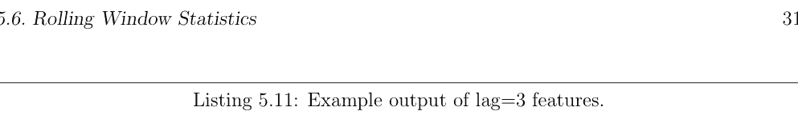

同样，你可以看到，我们必须丢弃前几行，因为它们没有足够的数据来训练监督模型。滑动窗口方法的一个难点在于如何为问题确定窗口大小。一个良好的起点可能是进行敏感性分析，尝试一系列不同的窗口宽度，从而创建一系列不同的数据集$视图$，看看哪种结果能产生表现更好的模型。会有收益递减的临界点。

此外，为什么止步于线性窗口呢？也许你需要上周、上个月或去年的滞后值。同样，这取决于特定的领域。对于温度数据集，前一年或前几年的同一天滞后值可能很有用。除了包含原始值外，我们可以使用窗口做更多事情。在下一节中，我们将查看包含总结窗口内统计信息的特征。

### 5.6 滑动窗口统计

在添加原始滞后值的基础上，进一步的做法是添加前一时间步值的摘要。我们可以计算滑动窗口内值的摘要统计量，并将它们作为特征包含在数据集中。也许最有用的是前几个值的平均值，也称为滚动均值。

我们可以计算当前值和前一个值的平均值，并用它来预测下一个值。对于温度数据，我们必须在拥有两个值之前等待 3 个时间步才能取平均值，然后才能使用该值预测第 3 个值。例如：

```text
mean(t-1, t), t+1
mean(20.7, 17.9), 18.8
19.3, 18.8
```

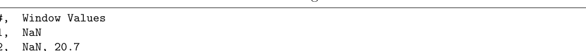

Pandas 提供了 rolling() 函数[3]，为每个时间步创建一个包含值窗口的新数据结构。然后我们可以对每个时间步收集的值窗口执行统计函数，例如计算平均值。首先，必须移位序列。然后创建滚动数据集，并计算每个包含两个值的窗口上的均值。以下是前三个滚动窗口中的值：

```text
#, Window Values
1, NaN
2, NaN, 20.7
3, 20.7, 17.9
```


这表明在第 3 行之前我们将没有可用的数据。最后，与上一节一样，我们可以使用 concat() 函数构建一个新数据集，仅包含我们的新列。以下示例展示了如何使用 Pandas 以窗口大小 2 执行此操作。

```python
# create a rolling mean feature
from pandas import read_csv
from pandas import DataFrame
from pandas import concat
series = read_csv('daily-minimum-temperatures.csv', header=0, index_col=0,
     parse_dates=True, squeeze=True)
temps = DataFrame(series.values)
shifted = temps.shift(1)
window = shifted.rolling(window=2)
means = window.mean()
dataframe = concat([means, temps], axis=1)
dataframe.columns = ['mean(t-1,t)', 't+1']
print(dataframe.head(5))
```

清单 5.14：在最低每日温度数据集上创建滚动均值特征的示例。

运行该示例将打印新数据集的前 5 行。我们可以看到前两行没有用。

- 第一个 NaN 是由序列的移位创建的。
- 第二个是因为 NaN 不能用于计算均值。
- 最后，第三行显示了预期的值 19.30（20.7 和 17.9 的均值），用于预测序列中的第 3 个值 18.8。

|   | mean(t-1,t) | t+1  |
|---|-------------|------|
| 0 | NaN         | 20.7 |
| 1 | NaN         | 17.9 |
| 2 | 19.30       | 18.8 |
| 3 | 18.35       | 14.6 |
| 4 | 16.70       | 15.8 |

清单 5.15：在最低每日温度数据集上滚动均值特征的示例输出。

我们可以计算更多统计量，甚至使用不同的数学方法计算窗口的定义。下面另一个示例显示了窗口宽度为 3，以及由更多摘要统计量组成的数据集，具体是窗口内的最小值、均值和最大值。

在代码中可以看到，我们明确指定了滑动窗口宽度作为命名变量。这使我们可以将其用于计算序列的正确移位量，并向 rolling() 函数指定窗口宽度。

在这种情况下，窗口宽度为 3 意味着我们必须将序列向前移位 2 个时间步。这使得前两行变为 NaN。接下来，我们需要计算每个窗口包含 3 个值的窗口统计量。需要 3 行，我们才能从序列中获得足够的数据开始计算统计量。前 5 个窗口中的值如下：

```text
#, Window Values
1, NaN
2, NaN, NaN
3, NaN, NaN, 20.7
4, NaN, 20.7, 17.9
```

[1] http://pandas.pydata.org/pandas-docs/stable/generated/pandas.DataFrame.shift.html
[2] http://pandas.pydata.org/pandas-docs/stable/generated/pandas.concat.html
[3] http://pandas.pydata.org/pandas-docs/stable/generated/pandas.DataFrame.rolling.html


5, 20.7, 17.9, 18.8

**清单 5.16**：手动滚动均值特征的示例。

这意味着我们预计至少要到第5行（数组索引 4）之前无法获得可用数据。

```python
# create rolling statistics features
from pandas import read_csv
from pandas import DataFrame
from pandas import concat
series = read_csv('daily-minimum-temperatures.csv', header=0, index_col=0, parse_dates=True, squeeze=True)
temps = DataFrame(series.values)
width = 3
shifted = temps.shift(width - 1)
window = shifted.rolling(window=width)
dataframe = concat([window.min(), window.mean(), window.max(), temps], axis=1)
dataframe.columns = ['min', 'mean', 'max', 't+1']
print(dataframe.head(5))
```

**清单 5.17**：在最低日温度数据集上计算滚动统计特征的示例。

运行该代码会打印新数据集的前5行。我们可以抽查第5行（数组索引 4）数值的正确性。我们可以看到，[20.7, 17.9, 18.8] 窗口内的最小值确实是 17.9，最大值是 20.7。

|   |   min |    mean |   max |   t+1 |
|---:|------:|--------:|------:|------:|
| 0 | NaN |   NaN  | NaN  | 20.7 |
| 1 | NaN |   NaN  | NaN  | 17.9 |
| 2 | NaN |   NaN  | NaN  | 18.8 |
| 3 | NaN |   NaN  | NaN  | 14.6 |
| 4 | 17.9| 19.13333| 20.7 | 15.8 |

**清单 5.18**：在最低日温度数据集上计算滚动统计特征输出的示例。

## 5.7 扩展窗口统计

另一种可能有用的窗口类型包含序列中所有之前的数据。这被称为扩展窗口，有助于跟踪可观测数据的边界。类似于 DataFrame 的 `rolling()` 函数，Pandas 提供了 `expanding()` 函数[4]，它收集每个时间步之前的所有值集合。

这些先前的数值列表可以进行汇总并作为新特征包含进来。例如，以下是序列前5个时间步中扩展窗口的数值列表：

```python
#, Window Values
1, 20.7
2, 20.7, 17.9,
3, 20.7, 17.9, 18.8
4, 20.7, 17.9, 18.8, 14.6
5, 20.7, 17.9, 18.8, 14.6, 15.8
```

**清单 5.19**：手动扩展窗口的示例。

[4] http://pandas.pydata.org/pandas-docs/stable/generated/pandas.DataFrame.expanding.html

再次说明，我们必须将序列向后移动一个时间步，以确保我们希望预测的输出值不包含在这些窗口值中。因此，输入窗口如下所示：

```python
#, Window Values
1, NaN
2, NaN, 20.7
3, NaN, 20.7, 17.9,
4, NaN, 20.7, 17.9, 18.8
5, NaN, 20.7, 17.9, 18.8, 14.6
```

**清单 5.20**：带偏移的手动扩展窗口示例。

幸运的是，统计计算会排除扩展窗口中的 NaN 值，这意味着不需要进一步的修改。下面是在每日温度数据集上计算扩展窗口最小值、均值和最大值的示例。

```python
# create expanding window features
from pandas import read_csv
from pandas import DataFrame
from pandas import concat
series = read_csv('daily-minimum-temperatures.csv', header=0, index_col=0, parse_dates=True, squeeze=True)
temps = DataFrame(series.values)
window = temps.expanding()
dataframe = concat([window.min(), window.mean(), window.max(), temps.shift(-1)], axis=1)
dataframe.columns = ['min', 'mean', 'max', 't+1']
print(dataframe.head(5))
```

**清单 5.21**：在最低日温度数据集上计算扩展统计特征的示例。

运行该示例会打印数据集的前5行。抽查扩展最小值、均值和最大值表明该示例产生了预期的效果。

|   |   min |   mean |   max |   t+1 |
|---:|------:|-------:|------:|------:|
|  0 | 20.7  | 20.7   | 20.7  | 17.9  |
|  1 | 17.9  | 19.3   | 20.7  | 18.8  |
|  2 | 17.9  | 19.133 | 20.7  | 14.6  |
|  3 | 14.6  | 18.0   | 20.7  | 15.8  |
|  4 | 14.6  | 17.56  | 20.7  | 15.8  |

**清单 5.22**：在最低日温度数据集上计算扩展统计特征输出的示例。

## 5.8 总结

在本教程中，你发现了如何使用特征工程将时间序列数据集转换为用于机器学习的监督学习数据集。具体来说，你学习了：

- 时间序列数据特征工程的重要性和目标。
- 如何开发基于日期时间和滞后特征的特征。
- 如何开发滑动窗口和扩展窗口的汇总统计特征。

### 5.8.1 下一步

在下一课中，你将发现如何使用一系列不同的图表来可视化时间序列数据。

# 第 6 章

# 数据可视化

时间序列天然适合可视化。随时间变化的观测值线图很受欢迎，但你可以使用一系列其他图表来更深入地了解你的问题。你对数据了解得越多，你就越有可能开发出更好的预测模型。在本教程中，你将发现6种你可以用来用 Python 可视化时间序列数据的图表类型。具体来说，完成本教程后，你将知道：

- 如何使用线图、滞后图和自相关图来探索时间序列的时间结构。
- 如何使用直方图和密度图来理解观测值的分布。
- 如何使用箱须图（box and whisker plots）和热力图来揭示分布随区间的变化。

让我们开始吧。

## 6.1 时间序列可视化

可视化在时间序列分析和预测中起着重要作用。原始样本数据的图表可以提供有价值的诊断信息，以识别可能影响模型选择的时间结构，如趋势、周期和季节性。一个问题是，时间序列预测领域的新手往往止步于线图。在本教程中，我们将看看你可以用于自己时间序列数据的6种不同类型的可视化。它们是：

1. 线图（Line Plots）。
2. 直方图和密度图（Histograms and Density Plots）。
3. 箱须图（Box and Whisker Plots）。
4. 热力图（Heat Maps）。
5. 滞后图或散点图（Lag Plots or Scatter Plots）。
6. 自相关图（Autocorrelation Plots）。

重点是一元时间序列，但这些技术同样适用于多元时间序列，即当每个时间步都有多个观测值时。接下来，让我们看看我们将用于在本教程中演示时间序列可视化的数据集。

## 6.2 最低日温度数据集

在本课中，我们将使用最低日温度数据集作为一个例子。该数据集描述了澳大利亚墨尔本10年（1981-1990）的每日最低温度。你可以在附录 A.2 中了解有关该数据集的更多信息。请将数据集放在当前工作目录中，文件名为 `daily-minimum-temperatures.csv`。

## 6.3 线图

第一种，也是最流行的时间序列可视化方式是线图。在此图中，时间显示在 x 轴上，观测值沿 y 轴分布。以下是直接将 Pandas `Series` 的最低日温度数据集可视化为线图的一个示例。

```python
## create a line plot
from pandas import read_csv
from matplotlib import pyplot
series = read_csv('daily-minimum-temperatures.csv', header=0, index_col=0, parse_dates=True, squeeze=True)
series.plot()
pyplot.show()
```

**清单 6.1**：最低日温度数据集中线图示例。

运行该示例会创建一个线图。

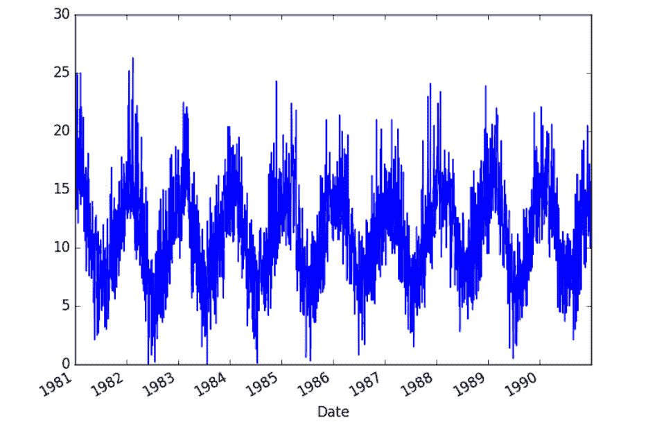

**图 6.1**：最低日温度数据集的线图。

线图相当密集。有时改变线图的样式会有帮助；例如，使用虚线或点。下面是改变线条样式为黑色点而不是连接线（`style='k,'` 参数）的示例。我们可以通过将 style 设置为 `'k-'` 来改变该示例使用虚线。

```python
## create a dot plot
from pandas import read_csv
from matplotlib import pyplot
series = read_csv('daily-minimum-temperatures.csv', header=0, index_col=0, parse_dates=True, squeeze=True)
series.plot(style='k,')
pyplot.show()
```

**清单 6.2**：最低日温度数据集中点线图示例。

运行该示例会以点代替连接线，重新创建相同的线图。


图 6.2：最低日温度数据集的点线图。

比较相同区间（如逐日、逐月或逐年）的折线图可能很有帮助。最低日温度数据集跨越了 10 年。我们可以按年份分组数据，并为每一年创建一张折线图以进行直接比较。以下示例展示了如何做到这一点。首先，观察值按年份分组（`series.groupby(Grouper(freq='A'))`）。

然后枚举这些分组，并将每年的观察值存储为新建 DataFrame 中的列。最后，绘制这个构造好的 DataFrame 的图表，其中每列作为一个子图进行可视化，并移除图例以减少杂乱。

```python
## create stacked line plots
from pandas import read_csv
from pandas import DataFrame
from pandas import Grouper
from matplotlib import pyplot

series = read_csv('daily-minimum-temperatures.csv', header=0, index_col=0, parse_dates=True, squeeze=True)
groups = series.groupby(Grouper(freq='A'))
years = DataFrame()
for name, group in groups:
    years[name.year] = group.values
years.plot(subplots=True, legend=False)
pyplot.show()
```

代码清单 6.3：最低日温度数据集上的堆叠折线图示例。

运行该示例会创建 10 张折线图，分别对应 1981 年（位于顶部）至 1990 年（位于底部）的每一年，每张折线图均包含 365 天的数据。

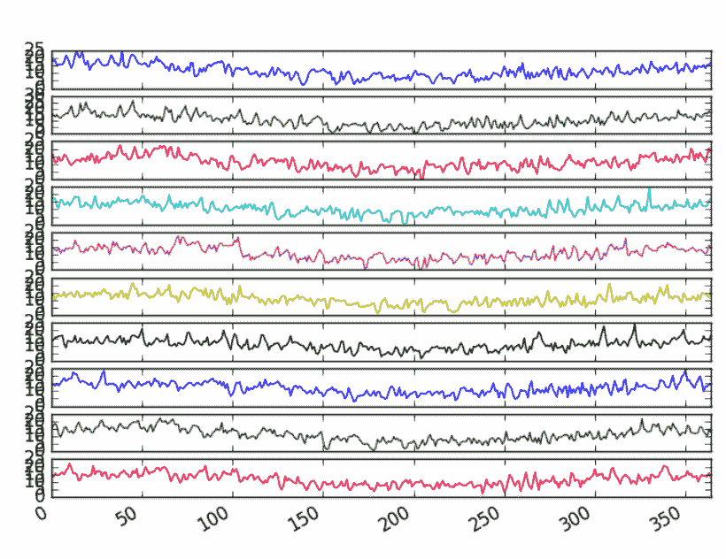

图 6.3：最低日温度数据集的堆叠折线图。

## 6.4 直方图和密度图

另一种重要的可视化方式是观察值本身的分布。这意味着绘制数值时不遵循时间顺序。一些线性时间序列预测方法假设观察值具有良好的分布特性（即钟形曲线或正态分布）。这可以通过统计假设检验等工具进行明确检查。但图表可以为观察值的分布提供有用的初步检查，无论是原始观察值还是在执行任何类型的数据变换之后。

以下示例创建了一个直方图，用于展示最低日温度数据集中的观察值。直方图将数值分组到区间（bins）中，每个区间内观察值的频率或计数可以提供对观察值底层分布的洞察。

```python
## create a histogram plot
from pandas import read_csv
from matplotlib import pyplot

series = read_csv('daily-minimum-temperatures.csv', header=0, index_col=0, parse_dates=True, squeeze=True)
series.hist()
pyplot.show()
```

代码清单 6.4：最低日温度数据集的直方图示例。

运行该示例显示了一个看起来高度呈高斯分布的特征。绘图函数会根据数据中数值的分散程度自动选择区间的大小。

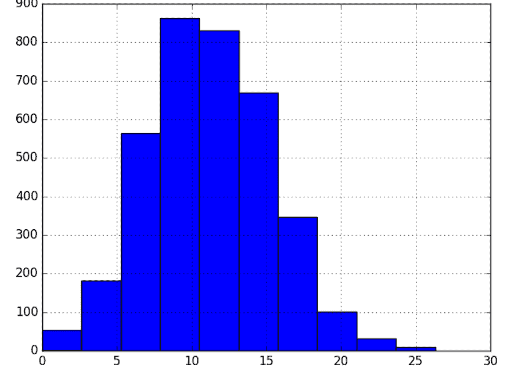

图 6.4：最低日温度数据集的直方图。

通过使用密度图，我们可以更好地理解观察值分布的形状。这与直方图类似，不同之处在于使用一个函数来拟合观察值的分布，并采用一条平滑的曲线来总结该分布。以下是最低日温度数据集密度图的一个示例。

```python
## create a density plot
from pandas import read_csv
from matplotlib import pyplot

series = read_csv('daily-minimum-temperatures.csv', header=0, index_col=0, parse_dates=True, squeeze=True)
series.plot(kind='kde')
pyplot.show()
```

代码清单 6.5：最低日温度数据集的密度图示例。

运行该示例创建了一张图表，更清晰地总结了观察值的分布。我们可以看到，分布可能略微不对称，且可能略微尖锐，不符合高斯分布的特征。看到这样的分布可能提示后续探索统计假设检验，以正式检查分布是否呈高斯分布，以及可能使用数据准备技术来重塑分布，如 Box-Cox 变换。

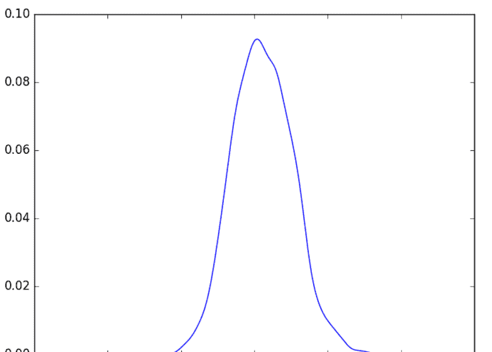

图 6.5：最低日温度数据集的密度图。

## 6.5 按区间的箱线图

直方图和密度图提供了所有观察值分布的洞察，但我们可能对按时间区间的数值分布感兴趣。另一种用于总结观察值分布的有用图表类型是箱线图（箱须图）。该图表在数据的第 25 百分位和第 75 百分位之间绘制一个框，捕捉中间 50% 的观察值。在第 50 百分位（中位数）处绘制一条线，并在框的上方和下方绘制须（whiskers）以总结观察值的大致范围。对于须或数据范围之外的离群值，绘制点。

可以为时间序列中的每个区间（如年、月或日）创建并比较箱线图。以下示例展示了如何按年份分组最低日温度数据集，如前文折线图示例中所述。然后为每一年创建一个箱线图，并并排排列以便直接比较。

```python
## create a boxplot of yearly data
from pandas import read_csv
from pandas import DataFrame
from pandas import Grouper
from matplotlib import pyplot

series = read_csv('daily-minimum-temperatures.csv', header=0, index_col=0, parse_dates=True, squeeze=True)
groups = series.groupby(Grouper(freq='A'))
years = DataFrame()
for name, group in groups:
    years[name.year] = group.values
years.boxplot()
pyplot.show()
```

代码清单 6.6：最低日温度数据集的年度箱线图示例。

按一致区间比较箱线图是一个有用的工具。在区间内，它有助于发现离群值（须上方或下方的点）。在区间之间，在本例中为年份，我们可以寻找多年趋势、季节性以及其他可建模的结构信息。

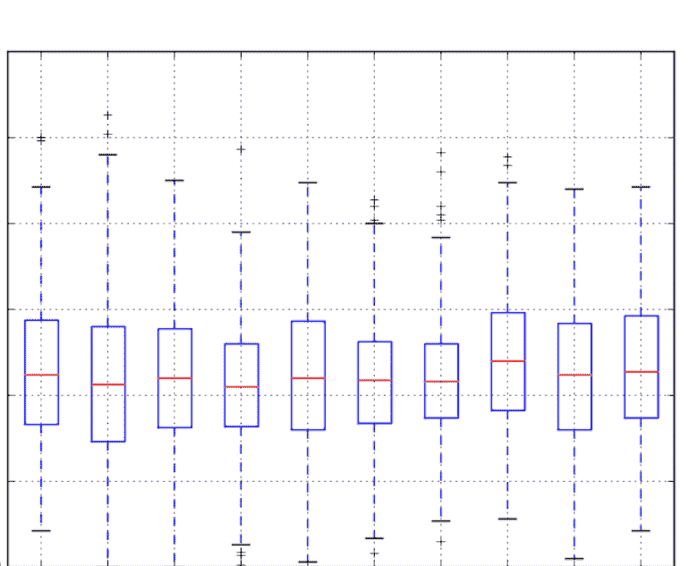

图 6.6：最低日温度数据集的年度箱线图。

我们还可能对一年内各月间的数值分布感兴趣。以下示例创建 12 张箱线图，分别对应该数据集中最后一年 1990 年的每个月。在示例中，首先仅提取 1990 年的观察值。然后，观察值按月分组，每个月作为一列添加到新的 DataFrame 中。最后，为新建 DataFrame 中的每个月列创建一个箱线图。

```python
## create a boxplot of monthly data
from pandas import read_csv
from pandas import DataFrame
from pandas import Grouper
from matplotlib import pyplot
from pandas import concat

series = read_csv('daily-minimum-temperatures.csv', header=0, index_col=0, parse_dates=True, squeeze=True)
one_year = series['1990']
groups = one_year.groupby(Grouper(freq='M'))
months = concat([DataFrame(x[1].values) for x in groups], axis=1)
months = DataFrame(months)
months.columns = range(1, 13)
months.boxplot()
pyplot.show()
```

代码清单 6.7：最低日温度数据集的月度箱线图示例。

运行该示例创建 12 张箱线图，展示了最低温度在一年各月中的显著分布变化，从南半球夏季的一月份到年中南半球的冬季，再回到夏季。

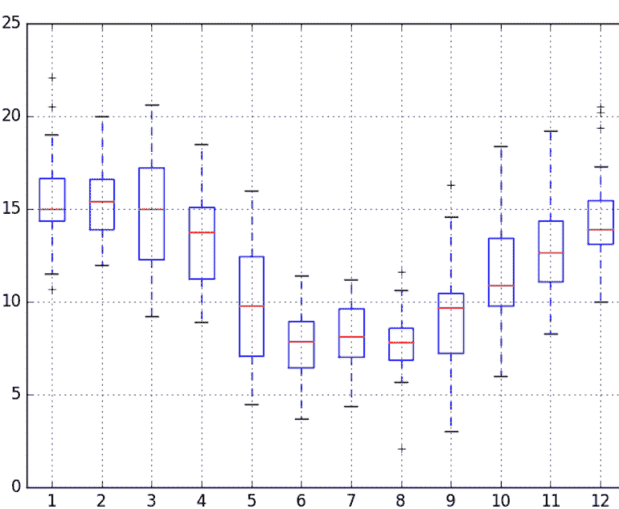

图 6.7：最低日温度数据集的月度箱线图。

## 6.6 热力图

数字矩阵可以绘制为表面，其中矩阵每个单元格的值被分配一个独特的颜色。这被称为热力图，较大的值可以用较暖的颜色（黄色和红色）绘制，较小的值可以用较冷的颜色（蓝色和绿色）绘制。与箱线图一样，我们可以使用热力图来比较不同区间之间的观察值。

对于最低日温度数据，观察值可以排列成矩阵，列为年份，行为天数，每个日期的单元格中包含最低温度。然后可以绘制该矩阵的热力图。以下是创建最低日温度数据热力图的一个示例。使用 Matplotlib 库中的 `matshow()` 函数，因为 Pandas 未直接提供热力图支持。为了方便，矩阵


## 6.6 热图

数据经过旋转（转置），使得每行代表一年，每列代表一天。这提供了一种更直观的、从左到右的数据布局。

```python
## create a heat map of yearly data
from pandas import read_csv
from pandas import DataFrame
from pandas import Grouper
from matplotlib import pyplot
series = read_csv('daily-minimum-temperatures.csv', header=0, index_col=0, parse_dates=True, squeeze=True)
groups = series.groupby(Grouper(freq='A'))
years = DataFrame()
for name, group in groups:
    years[name.year] = group.values
years = years.T
pyplot.matshow(years, interpolation=None, aspect='auto')
pyplot.show()
```

代码列表 6.8：最低日温度数据集的年度热图示例。

该图显示了年份中间日期的最低温度较低，而年份开始和结束时的最低温度较高，以及两者之间所有渐变和复杂情况。

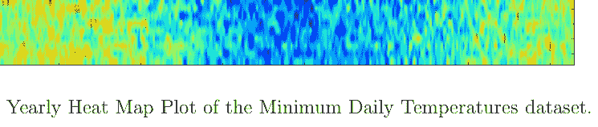

图 6.8：最低日温度数据集的年度热图。

正如上述箱须图示例一样，我们也可以比较一年中的月份。下面是一个热图示例，用于比较 1990 年各个月份。每列代表一个月，行代表该月的第 1 天到第 31 天。

```python
## create a heat map of monthly data
from pandas import read_csv
from pandas import DataFrame
from pandas import Grouper
from matplotlib import pyplot
from pandas import concat
series = read_csv('daily-minimum-temperatures.csv', header=0, index_col=0, parse_dates=True, squeeze=True)
one_year = series['1990']
groups = one_year.groupby(Grouper(freq='M'))
months = concat([DataFrame(x[1].values) for x in groups], axis=1)
months = DataFrame(months)
months.columns = range(1,13)
pyplot.matshow(months, interpolation=None, aspect='auto')
pyplot.show()
```

代码列表 6.9：最低日温度数据集的月度热图示例。

运行该示例展示了在月度层级上每年看到的相同宏观趋势。我们还可以看到图表底部有一些白色斑块。这是由于那些天数少于 31 天的月份存在缺失数据所致，其中 1990 年的 2 月只有 28 天，是一个明显的异常值。

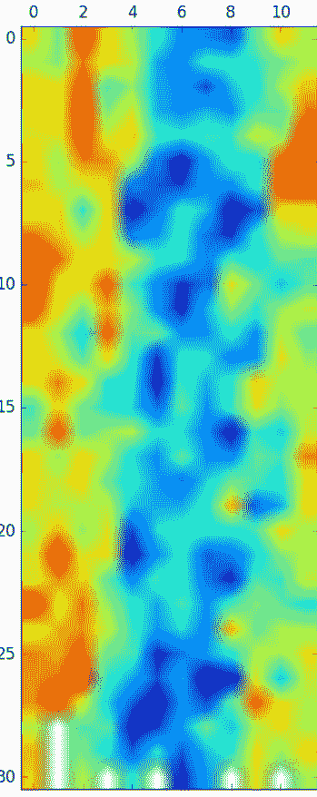

图 6.9：最低日温度数据集的月度热图。

## 6.7 滞后散点图

时间序列建模假设当前观测值与之前的观测值之间存在关系。时间序列中之前的观测值称为滞后值，其中前一个时间步的观测值称为**lag1**，两个时间步之前的观测值称为**lag=2**，依此类推。一种用于探索每个观测值与其滞后值之间关系的有用图表类型称为散点图。Pandas 有一个内置函数专门用于此目的，称为滞后图。它将时间**t**的观测值绘制在 x 轴上，将下一个时间步（**t+1**）的观测值绘制在 y 轴上。

-   如果点聚集在图表从左下到右上的对角线上，则表明存在正相关关系。
-   如果点聚集在图表从左上到右下的对角线上，则表明存在负相关关系。
-   这两种关系都是好的，因为它们都可以被建模。

点越紧密地聚集在对角线上，表明关系越强；点分布得越分散，表明关系越弱。中间的球状分布或在整个图表上的均匀分布表明关系微弱或不存在关系。下面是最低日温度数据集的滞后图示例。

```python
## create a scatter plot
from pandas import read_csv
from matplotlib import pyplot
from pandas.plotting import lag_plot
series = read_csv('daily-minimum-temperatures.csv', header=0, index_col=0, parse_dates=True, squeeze=True)
lag_plot(series)
pyplot.show()
```

代码列表 6.10：最低日温度数据集的滞后散点图示例。

运行该示例生成的图表显示，观测值与其**lag1**值之间存在较强的正相关关系。

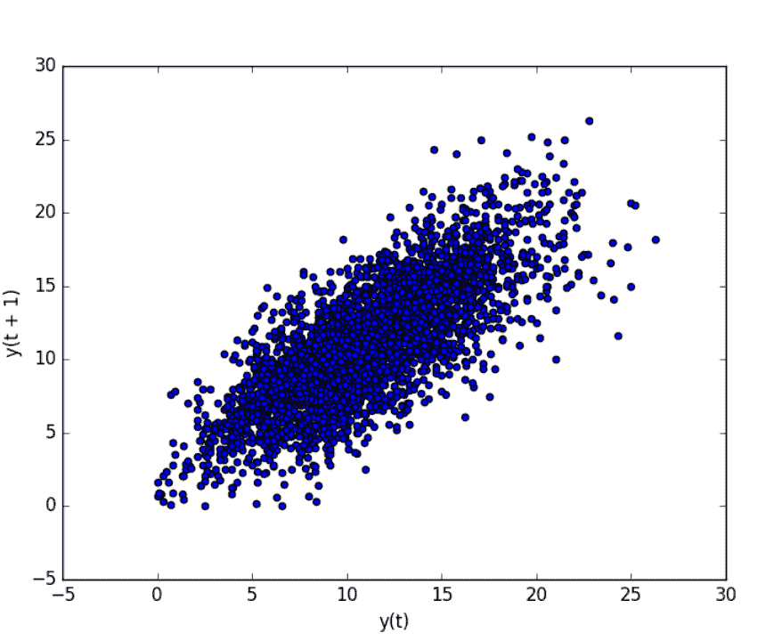

我们可以对观测值和任意滞后值重复此过程。例如，可能与上周、上月或去年的同一时间观测值，或者我们可能希望探索的任何其他领域特定知识进行比较。例如，我们可以为观测值与过去七天每个值创建一个散点图。下面是最低日温度数据集的此类示例。首先，创建一个新的**DataFrame**，将滞后值作为新列添加。列被适当地命名。然后，创建一个新的子图，将每个观测值与不同的滞后值一起绘制。

```python
## create multiple scatter plots
from pandas import read_csv
from pandas import DataFrame
from pandas import concat
from matplotlib import pyplot
series = read_csv('daily-minimum-temperatures.csv', header=0, index_col=0, parse_dates=True, squeeze=True)
values = DataFrame(series.values)
lags = 7
columns = [values]
for i in range(1, (lags + 1)):
    columns.append(values.shift(i))
dataframe = concat(columns, axis=1)
columns = ['t']
for i in range(1, (lags + 1)):
    columns.append('t^{-1}' + str(i))
dataframe.columns = columns
pyplot.figure(1)
for i in range(1, (lags + 1)):
    ax = pyplot.subplot(240 + i)
    ax.set_title('t vs t^{-1}' + str(i))
    pyplot.scatter(x=dataframe['t'].values, y=dataframe['t^{-1}' + str(i)].values)
pyplot.show()
```

代码列表 6.11：最低日温度数据集的多个滞后散点图示例。

运行该示例表明，观测值与其 lag=1 值之间的关系最强，但与上周各值通常都具有良好的正相关关系。

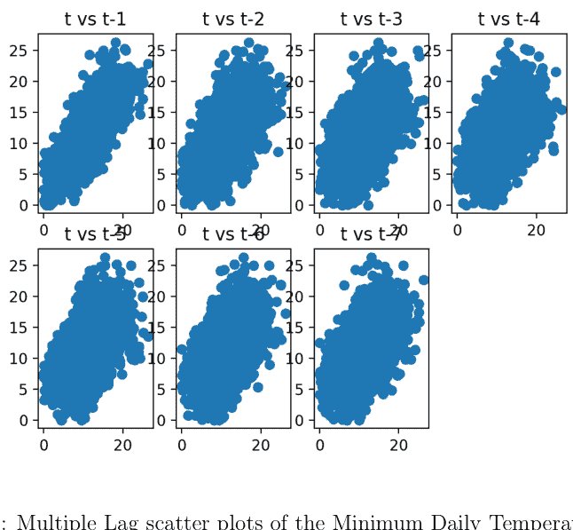

## 6.8 自相关图

我们可以量化观测值与其滞后值之间关系的强度和类型。在统计学中，这被称为相关性，当针对时间序列中的滞后值计算时，它被称为自相关（自相关）。在两组数字（例如观测值及其 lag=1 值）之间计算出的相关值结果为 -1 到 1 之间的一个数字。该数字的正负分别表示负相关或正相关。接近零的值表示相关性微弱，而更接近 -1 或 1 的值表示强相关性。

相关值，称为相关系数，可以为每个观测值和不同的滞后值进行计算。一旦计算完成，就可以创建图表来帮助更好地理解这种关系如何随滞后变化。这种类型的图称为自相关图，Pandas 内置了这种功能，称为 `autocorrelation_plot()` 函数。下面的示例为最低日温度数据集创建了一个自相关图：

```python
## create an autocorrelation plot
from pandas import read_csv
from matplotlib import pyplot
from pandas.plotting import autocorrelation_plot
series = read_csv('daily-minimum-temperatures.csv', header=0, index_col=0, parse_dates=True, squeeze=True)
autocorrelation_plot(series)
pyplot.show()
```

代码列表 6.12：最低日温度数据集的自相关图示例。

生成的图表显示 x 轴上的滞后值和 y 轴上的相关值。提供了虚线，表明高于这些线的相关值在统计上是显著的（有意义的）。我们可以看到，对于最低日温度数据集，存在强负相关和正相关的周期。这捕捉到了观测值与过去同一季节或相反季节/年中时间的观测值之间的关系。像本例中看到的正弦波是数据集中存在季节性的强烈信号。

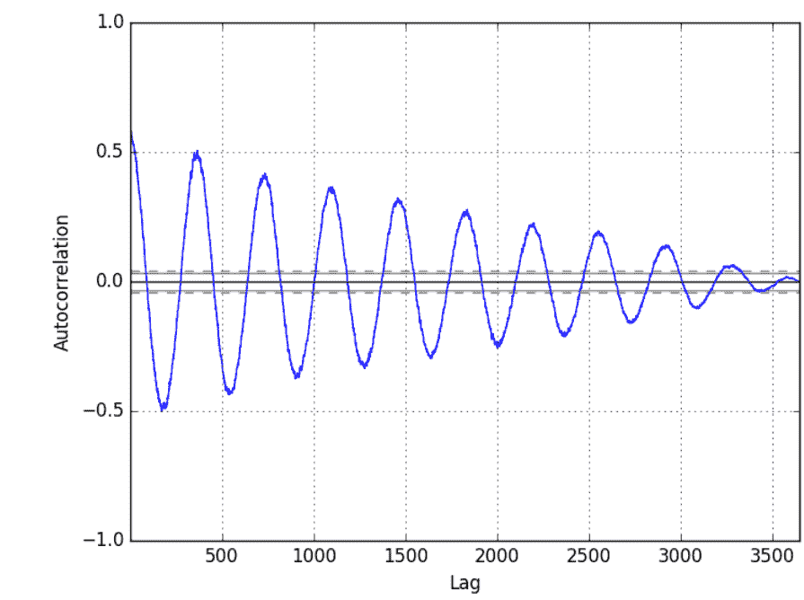

图 6.12：最低日温度数据集的自相关图。


## 6.9 小结

在本教程中，你学习了如何探索并更好地理解 Python 中的时间序列数据集。具体而言，你掌握了：

-   如何使用折线图、散点图和自相关图探索时间关系。
-   如何使用直方图和密度图探索观测值的分布。
-   如何使用箱须图（盒须图）和热图探索观测值分布的变化。

### 6.9.1 下一步

在下一课中，你将学习如何更改时间序列数据的频率。

## 第 7 章

### 重采样与插值

你的观测值可能频率不对。也许它们粒度太细，或者不够细。Python 中的 Pandas 库提供了更改时间序列数据频率的功能。在本教程中，你将学习如何在 Python 中使用 Pandas 来提高或降低时间序列数据的采样频率。完成本教程后，你将了解：

-   关于时间序列重采样、两种重采样类型，以及你需要使用它们的两个主要原因。
-   如何使用 Pandas 将时间序列数据上采样到更高频率，并对新的观测值进行插值。
-   如何使用 Pandas 将时间序列数据下采样到更低频率，并对更高频率的观测值进行汇总。

让我们开始吧。

## 7.1 重采样

重采样涉及更改时间序列观测值的频率。两种重采样类型是：

-   **上采样（Upsampling）**：增加样本的频率，例如从分钟级到秒级。
-   **下采样（Downsampling）**：降低样本的频率，例如从日级到月级。

在这两种情况下，都必须发明数据。在上采样的情况下，可能需要仔细确定如何通过插值计算细粒度观测值。在下采样的情况下，可能需要仔细选择用于计算新汇总值的汇总统计量。

你可能对重采样时间序列数据感兴趣，也许有两个主要原因：

-   **问题框架（Problem Framing）**：如果你的数据频率与你想要进行预测的频率不一致，则可能需要重采样。
-   **特征工程（Feature Engineering）**：重采样也可以用于为监督学习模型提供额外的结构或见解，以深入理解学习问题。

这两种情况之间有很多重叠。例如，你可能有每日数据，但想要预测月度问题。你可以直接使用每日数据，也可以将其下采样为月度数据并开发模型。从特征工程的角度来看，在开发模型时可能会使用来自两个时间尺度（甚至更多）的观测值及其汇总值。让我们通过查看一个真实数据集和一些示例，使重采样更加具体。

## 7.2 洗发水销售数据集

在这节课中，我们将使用洗发水销售数据集作为示例。该数据集描述了三年期间洗发水的月度销售数量。你可以在附录 [A.1](https://example.com/A.1) 中了解有关该数据集的更多信息。请将数据集以 `shampoo-sales.csv` 文件名放入当前工作目录中。

洗发水销售数据集仅指定年号和月份（例如 1–01）。自定义函数用于解析日期，并将年号基于任意年份（1900年）作为基准，以便 Pandas *Series* 能够正确解释日期时间。

## 7.3 数据上采样

洗发水销售中的观测值是月度的。假设我们想要每日销售信息。我们必须将频率从月度上采样到每日，并使用插值方案来填充新的每日频率。Pandas 库在 *Series* 和 *DataFrame* 对象上提供了一个名为 `resample()` 的函数<sup>1</sup>。在下采样和记录分组时可以使用它，并在上采样时为新的观测值留出空间。

我们可以使用此函数通过调用重采样并指定首选频率（日历日频率或 *D*）将月度数据集转换为每日数据集。Pandas 很智能，你可以同样轻松地将频率指定为 *1D*，甚至可以是特定领域的，例如 *5D*。Pandas 提供了一个内置别名表<sup>2</sup>。

```python
# upsample to daily intervals
from pandas import read_csv
from pandas import datetime

def parser(x):
    return datetime.strptime('%Y-%m' % x, '%Y-%m')

series = read_csv('shampoo-sales.csv', header=0, index_col=0, parse_dates=True, squeeze=True, date_parser=parser)
upsampled = series.resample('D').mean()
print(upsampled.head(32))
```

<sup>1</sup> [https://pandas.pydata.org/pandas-docs/stable/reference/api/pandas.Series.resample.html](https://pandas.pydata.org/pandas-docs/stable/reference/api/pandas.Series.resample.html)

<sup>2</sup> [https://pandas.pydata.org/pandas-docs/stable/user_guide/timeseries.html#timeseries-offset-aliases](https://pandas.pydata.org/pandas-docs/stable/user_guide/timeseries.html#timeseries-offset-aliases)

清单 7.1：洗发水销售数据集上采样的示例。

运行此示例将打印上采样数据集的前 32 行，显示 1 月的每一天和 2 月的第一天。

| 月份 | 销售额 |
| :--- | :--- |
| 1901-01-01 | 266.0 |
| 1901-01-02 | NaN |
| 1901-01-03 | NaN |
| 1901-01-04 | NaN |
| 1901-01-05 | NaN |
| 1901-01-06 | NaN |
| 1901-01-07 | NaN |
| 1901-01-08 | NaN |
| 1901-01-09 | NaN |
| 1901-01-10 | NaN |
| 1901-01-11 | NaN |
| 1901-01-12 | NaN |
| 1901-01-13 | NaN |
| 1901-01-14 | NaN |
| 1901-01-15 | NaN |
| 1901-01-16 | NaN |
| 1901-01-17 | NaN |
| 1901-01-18 | NaN |
| 1901-01-19 | NaN |
| 1901-01-20 | NaN |
| 1901-01-21 | NaN |
| 1901-01-22 | NaN |
| 1901-01-23 | NaN |
| 1901-01-24 | NaN |
| 1901-01-25 | NaN |
| 1901-01-26 | NaN |
| 1901-01-27 | NaN |
| 1901-01-28 | NaN |
| 1901-01-29 | NaN |
| 1901-01-30 | NaN |
| 1901-01-31 | NaN |
| 1901-02-01 | 145.9 |

Freq: D, Name: Sales, dtype: float64

清单 7.2：洗发水销售数据集上采样的示例输出。

我们可以看到，resample() 函数通过在新值中放入 NaN 值来创建了这些行。我们可以看到，原始数据中 1 月和 2 月第一天的销售量仍然存在。接下来，我们可以对这个新频率下的缺失值进行插值。Pandas 的 Series 对象提供了一个 interpolate() 函数来插值缺失值，并且有各种简单和复杂的插值函数可供选择。你可能具备领域知识来帮助选择如何插值这些数值。一个好的起点是使用线性插值。这在可用数据点之间（在本例中是每月第一天）画一条直线，并根据这条直线在选定的频率下填充数值。

```python
# upsample to daily intervals with linear interpolation
from pandas import read_csv
from pandas import datetime
from matplotlib import pyplot

def parser(x):
    return datetime.strptime(x, '%Y-%m')

series = read_csv('shampoo-sales.csv', header=0, index_col=0, parse_dates=True,
               squeeze=True, date_parser=parser)
upsampled = series.resample('D').mean()
interpolated = upsampled.interpolate(method='linear')
print(interpolated.head(32))
interpolated.plot()
pyplot.show()
```

清单 7.3：洗发水销售数据集上采样和插值的示例。

运行此示例，我们可以看到插值后的数值。

| 月份 | 销售额 |
| :--- | :--- |
| 1901-01-01 | 266.000000 |
| 1901-01-02 | 262.125806 |
| 1901-01-03 | 258.251613 |
| 1901-01-04 | 254.377419 |
| 1901-01-05 | 250.503226 |
| 1901-01-06 | 246.629032 |
| 1901-01-07 | 242.754839 |
| 1901-01-08 | 238.880645 |
| 1901-01-09 | 235.006452 |
| 1901-01-10 | 231.132258 |
| 1901-01-11 | 227.258065 |
| 1901-01-12 | 223.383871 |
| 1901-01-13 | 219.509677 |
| 1901-01-14 | 215.635484 |
| 1901-01-15 | 211.761290 |
| 1901-01-16 | 207.887097 |
| 1901-01-17 | 204.012903 |
| 1901-01-18 | 200.138710 |
| 1901-01-19 | 196.264516 |
| 1901-01-20 | 192.390323 |
| 1901-01-21 | 188.516129 |
| 1901-01-22 | 184.641935 |
| 1901-01-23 | 180.767742 |
| 1901-01-24 | 176.893548 |
| 1901-01-25 | 173.019355 |
| 1901-01-26 | 169.145161 |
| 1901-01-27 | 165.270968 |
| 1901-01-28 | 161.396774 |
| 1901-01-29 | 157.522581 |
| 1901-01-30 | 153.648387 |
| 1901-01-31 | 149.774194 |
| 1901-02-01 | 145.900000 |

Freq: D, Name: Sales, dtype: float64

清单 7.4：洗发水销售数据集上采样和插值的示例输出。

查看折线图，我们看到与绘制原始数据（参见附录）没有区别，因为该图已经对点之间的数值进行了插值以绘制线条。


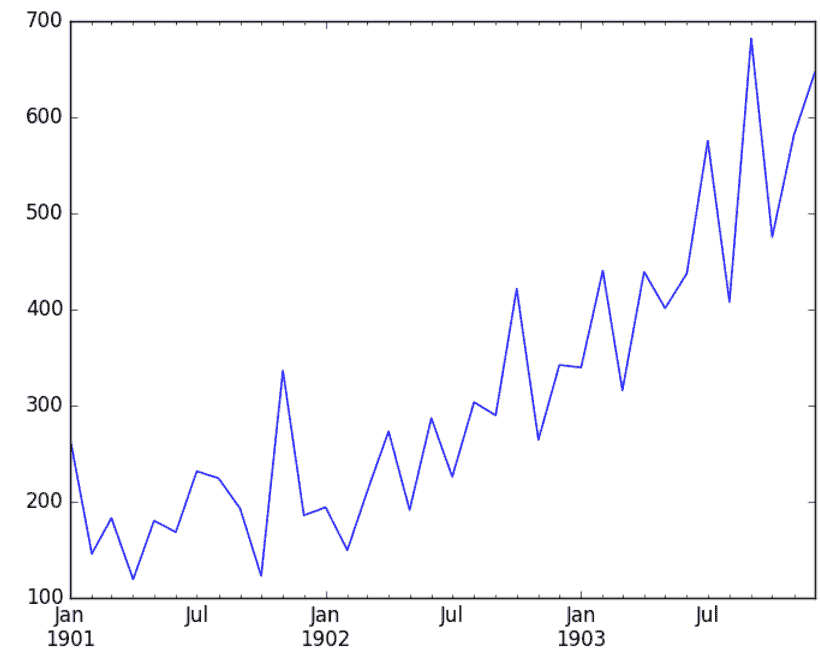

图 7.1：未采样洗发水销售数据集的折线图，采用线性插值。

另一种常见的插值方法是使用多项式或样条连接数值。这会生成更多的曲线，并且在许多数据集上看起来更自然。使用样条插值要求你指定阶数（多项式中的项数）；在这种情况下，2 阶就足够了。

```python
# upsample to daily intervals with spline interpolation
from pandas import read_csv
from pandas import datetime
from matplotlib import pyplot

def parser(x):
    return datetime.strptime('190'+x, '%Y-%m')

series = read_csv('shampoo-sales.csv', header=0, index_col=0, parse_dates=True, squeeze=True, date_parser=parser)
upsampled = series.resample('D').mean()
interpolated = upsampled.interpolate(method='spline', order=2)
print(interpolated.head(32))
interpolated.plot()
pyplot.show()
```

清单 7.5：洗发水销售数据集的上采样和样条插值示例。

运行该示例后，我们可以首先查看原始插值。

| 月份    | 销售额       |
| :------- | :---------- |
| 1901-01-01 | 266.000000  |
| 1901-01-02 | 258.630160  |
| 1901-01-03 | 251.560886  |
| 1901-01-04 | 244.720748  |
| 1901-01-05 | 238.109746  |
| 1901-01-06 | 231.727880  |
| 1901-01-07 | 225.575149  |
| 1901-01-08 | 219.651553  |
| 1901-01-09 | 213.957094  |
| 1901-01-10 | 208.491770  |
| 1901-01-11 | 203.255582  |
| 1901-01-12 | 198.248529  |
| 1901-01-13 | 193.470612  |
| 1901-01-14 | 188.921831  |
| 1901-01-15 | 184.602185  |
| 1901-01-16 | 180.511676  |
| 1901-01-17 | 176.650301  |
| 1901-01-18 | 173.018063  |
| 1901-01-19 | 169.614960  |
| 1901-01-20 | 166.440993  |
| 1901-01-21 | 163.496161  |
| 1901-01-22 | 160.780465  |
| 1901-01-23 | 158.293905  |
| 1901-01-24 | 156.036481  |
| 1901-01-25 | 154.008192  |
| 1901-01-26 | 152.209039  |
| 1901-01-27 | 150.639021  |
| 1901-01-28 | 149.298139  |
| 1901-01-29 | 148.186393  |
| 1901-01-30 | 147.303783  |
| 1901-01-31 | 146.650308  |
| 1901-02-01 | 145.900000  |

清单 7.6：洗发水销售数据集的上采样和样条插值示例输出。

查看折线图，我们可以看到插值数值上更自然的曲线。

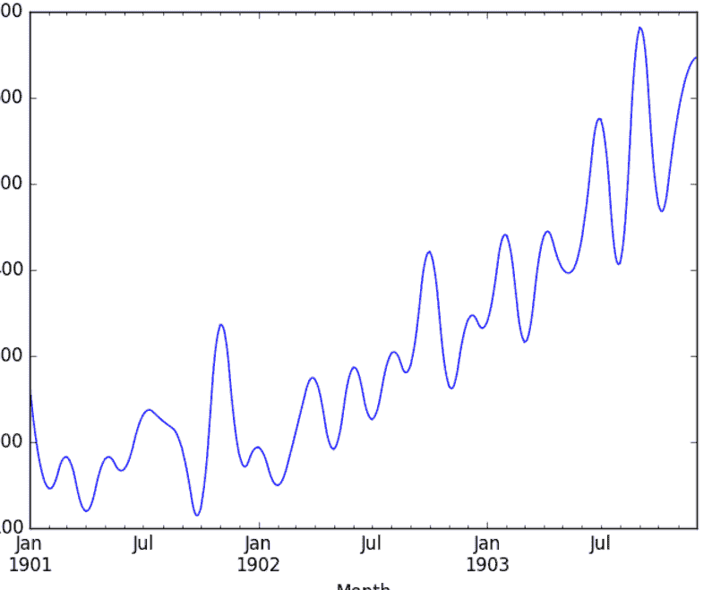

图 7.2：采用样条插值的上采样洗发水销售数据集折线图。

通常，当存在缺失观测值时，插值是一个有用的工具。接下来，我们将考虑反方向的重新采样，即降低观测频率。

### 7.4 数据降采样

销售数据是按月计的，但我们可能希望数据按季度计。一年可以分为 4 个商业季度，每个季度 3 个月。`resample()` 函数在 Pandas 中不会在现有观测值之间创建新行，而是将按新频率对所有观测值进行分组。

我们可以使用像 **3M** 这样的别名来创建 3 个月的组，但如果我们的观测值不是从一月、四月、七月或十月开始，这可能会遇到问题。Pandas 确实有一个季度感知的别名 Q，我们可以用它来此目的。我们现在必须决定如何从每组 3 条记录中创建一个新季度值。一个好的起点是计算该季度的平均月度销售额。为此，我们可以使用 `mean()` 函数。将所有这些结合起来，我们得到以下代码示例。

```python
# downsample to quarterly intervals
from pandas import read_csv
from pandas import datetime
from matplotlib import pyplot

def parser(x):
    return datetime.strptime('190'+x, '%Y-%m')

series = read_csv('shampoo-sales.csv', header=0, index_col=0, parse_dates=True, squeeze=True, date_parser=parser)
resample = series.resample('Q')
quarterly_mean_sales = resample.mean()
print(quarterly_mean_sales.head())
quarterly_mean_sales.plot()
pyplot.show()
```

清单 7.7：洗发水销售数据集降采样为季度均值的示例。

运行该示例会打印季度数据的前 5 行。

| 月份       | 销售额        |
| :---------- | :----------- |
| 1901-03-31  | 198.333333   |
| 1901-06-30  | 156.033333   |
| 1901-09-30  | 216.366667   |
| 1901-12-31  | 215.100000   |
| 1902-03-31  | 184.633333   |

Freq: Q-DEC, Name: Sales, dtype: float64

清单 7.8：洗发水销售数据集降采样为季度均值的示例输出。

我们也绘制了季度数据，展示了原始观测值 3 年间的 Q1–Q4。

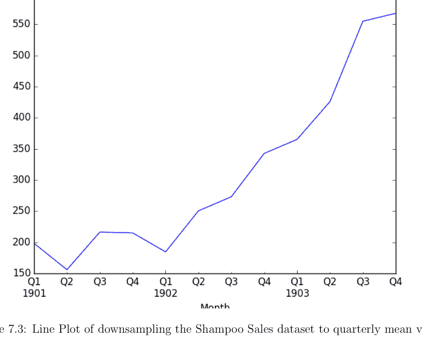

图 7.3：将洗发水销售数据集降采样为季度均值值的折线图。

也许我们想更进一步，将月度数据转换为年度数据，也许以后用它来建模下一年。我们可以使用别名 A 表示年末频率来降采样数据，这次使用 sum 计算每年的总销售额。

```python
# downsample to yearly intervals
from pandas import read_csv
from pandas import datetime
from matplotlib import pyplot

def parser(x):
    return datetime.strptime('190'+x, '%Y-%m')

series = read_csv('shampoo-sales.csv', header=0, index_col=0, parse_dates=True,
                  squeeze=True, date_parser=parser)
resample = series.resample('A')
yearly_mean_sales = resample.sum()
print(yearly_mean_sales.head())
yearly_mean_sales.plot()
pyplot.show()
```

清单 7.9：洗发水销售数据集降采样为年度总和的示例。

运行该示例显示了 3 年观测值的 3 条记录。我们还得到一个图，正确地沿 x 轴显示年份，沿 y 轴显示每年的总销售数。

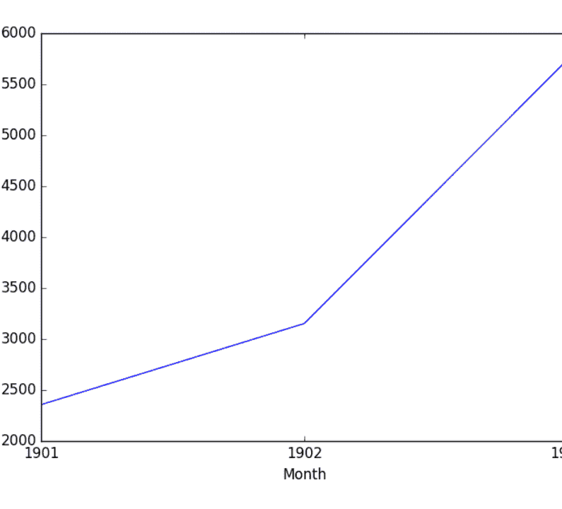

图 7.4：将洗发水销售数据集降采样为年度总和值的折线图。

## 7.5 总结

在本教程中，你了解了如何使用 Python 中的 Pandas 重新采样你的时间序列数据。具体来说，你学习了：

- 关于时间序列重采样，以及降采样和上采样观测频率之间的区别和原因。
- 如何使用 Pandas 上采样时间序列数据，以及如何使用不同的插值方案。
- 如何使用 Pandas 降采样时间序列数据，以及如何总结分组数据。

### 7.5.1 下一步

在下一课中，你将了解如何使用幂变换改变时间序列的方差。

# 第 8 章

## 幂变换

数据变换旨在去除噪声并改善时间序列预测中的信号。对于给定的预测问题，选择好的甚至最佳的变换可能非常困难。有许多变换可供选择，每个都有不同的数学直觉。在本教程中，你将了解如何探索用于时间序列预测的不同基于幂的变换。完成本教程后，你将知道：

- 如何识别何时使用以及如何探索平方根变换。
- 如何识别何时使用并探索对数变换以及对原始数据的期望。
- 如何使用 Box-Cox 变换执行平方根、对数，并自动为你的数据集发现最佳的幂变换。

让我们开始吧。

### 8.1 航空公司乘客数据集

在这节课中，我们将使用航空公司乘客数据集作为示例。该数据集描述了随时间变化的航空公司乘客总数。你可以在附录 A.5 中了解有关该数据集的更多信息。将数据集放置在你的当前工作目录中，文件名为 airline-passengers.csv。下面的示例加载并绘制该数据集。

```python
## load and plot a time series
from pandas import read_csv
from matplotlib import pyplot
series = read_csv('airline-passengers.csv', header=0, index_col=0, parse_dates=True, squeeze=True)
pyplot.figure(1)
# line plot
pyplot.subplot(211)
pyplot.plot(series)
# histogram
pyplot.subplot(212)
pyplot.hist(series)
pyplot.show()
```

清单 8.1：加载并绘制航空公司乘客数据集。


运行该示例会创建两个图表，第一个以折线图的形式显示时间序列，第二个以直方图的形式显示观测值。

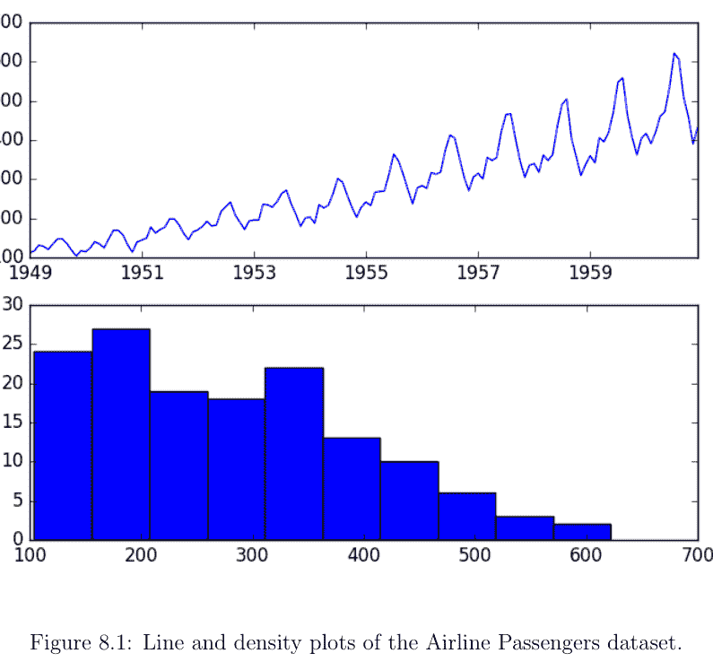

该数据集是非平稳的，这意味着观测值的均值和方差随时间变化。这使得通过经典统计方法（如 ARIMA）以及更复杂的机器学习方法（如神经网络）对其进行建模变得困难。这是由看似存在的增长趋势和季节性成分共同造成的。

此外，变化的幅度，即方差，随时间增加。当你观察季节性成分的幅度并注意到从一个周期到下一个周期，振幅（从周期的底部到顶部）在增加时，这一点就很明显了。在本教程中，我们将研究可以应用于表现出这种特性的时间序列数据集的转换方法。

## 8.2 平方根转换

具有二次增长趋势的时间序列可以通过取平方根变为线性。让我们通过一个简单的构造示例来演示这一点。考虑从 1 到 99 的数字的平方组成的序列。该序列的折线图将显示二次增长趋势，而值的直方图将显示带有长尾的指数分布。下面的代码片段创建并绘制了此序列。

```python
# contrive a quadratic time series
from matplotlib import pyplot
series = [i**2 for i in range(1,100)]
pyplot.figure(1)
# line plot
pyplot.subplot(211)
pyplot.plot(series)
# histogram
pyplot.subplot(212)
pyplot.hist(series)
pyplot.show()
```

Listing 8.2: 构造的二次序列。

运行该示例既以时间折线图的形式，又以观测值直方图的形式绘制了序列。

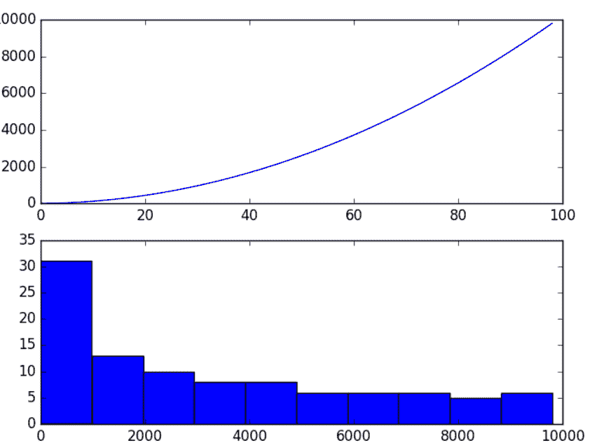

Figure 8.2: 构造的二次序列数据集的折线图和相关度图。

如果你在自己的时间序列中看到类似的结构，你可能拥有一个二次增长趋势。可以通过取平方运算的逆运算，即平方根，来消除或使其线性化。由于示例是完美的二次函数，我们预计转换后数据的折线图将显示一条直线。由于平方序列的来源是线性的，我们预计直方图将显示均匀分布。下面的示例对时间序列执行 $\sqrt{}$ 转换并绘制结果。

```python
# square root transform a contrived quadratic time series
from matplotlib import pyplot
from numpy import sqrt
series = [i**2 for i in range(1,100)]
# sqrt transform
transform = series = sqrt(series)
pyplot.figure(1)
# line plot
pyplot.subplot(211)
pyplot.plot(transform)
# histogram
pyplot.subplot(212)
pyplot.hist(transform)
pyplot.show()
```

Listing 8.3: 二次序列的平方根转换。

我们可以看到，正如预期的那样，二次趋势被线性化了。

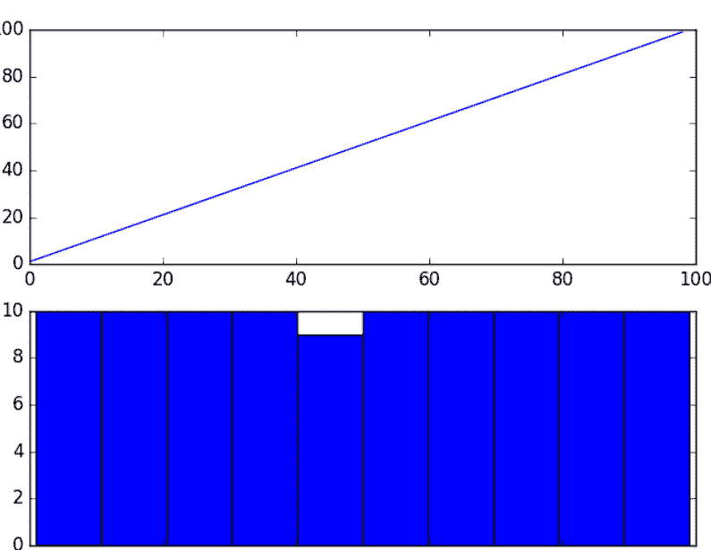

Figure 8.3: 平方根转换后的二次序列数据集的折线图和相关度图。

航空乘客数据集可能表现出二次增长。如果情况如此，那么我们可以预期平方根转换将把增长趋势减少为线性，并将观测值的分布变为近高斯分布。下面的示例对该数据集执行平方根转换并绘制结果。

```python
# square root transform a time series
from pandas import read_csv
from pandas import DataFrame
from numpy import sqrt
from matplotlib import pyplot
series = read_csv('airline-passengers.csv', header=0, index_col=0, parse_dates=True,
                 squeeze=True)
dataframe = DataFrame(series.values)
dataframe.columns = ['passengers']
dataframe['passengers'] = sqrt(dataframe['passengers'])
pyplot.figure(1)
# line plot
pyplot.subplot(211)
pyplot.plot(dataframe['passengers'])
# histogram
pyplot.subplot(212)
pyplot.hist(dataframe['passengers'])
pyplot.show()
```

Listing 8.4: 航空乘客数据集的平方根转换。

我们可以看到趋势减少了，但并未消除。折线图仍然显示从一个周期到下一个周期方差在增加。直方图仍然显示分布在右侧的长尾，暗示指数或长尾分布。

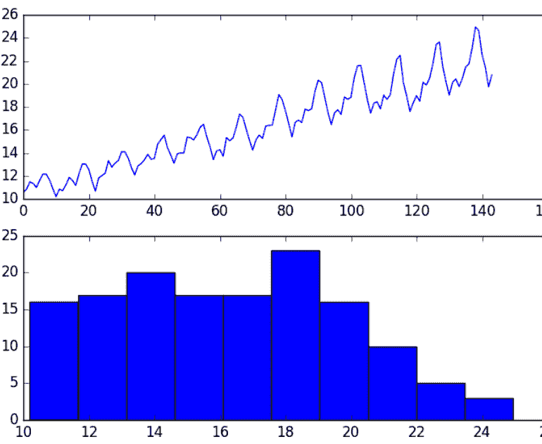

Figure 8.4: 平方根转换后的航空乘客数据集的折线图和相关度图。

## 8.3 对数转换

一类更极端的趋势是指数趋势，通常被绘制为曲棍球杆形状。具有指数分布的时间序列可以通过对值取对数变为线性。这被称为对数转换。与上面的平方和平方根情况一样，我们可以通过一个简单的示例来演示这一点。下面的代码通过将 1 到 99 的数字提升到值 $e$（即自然对数的底或欧拉数 $(2.718\dots)$[^1]）来创建一个指数分布。

```python
# create and plot an exponential time series
from matplotlib import pyplot
from math import exp
series = [exp(i) for i in range(1,100)]
pyplot.figure(1)
# line plot
pyplot.subplot(211)
pyplot.plot(series)
# histogram
pyplot.subplot(212)
pyplot.hist(series)
pyplot.show()
```

[^1]: https://en.wikipedia.org/wiki/E_(mathematical_constant)

Listing 8.5: 构造的指数序列。

运行该示例创建序列的折图和观测值分布的直方图。我们在折线图上看到了极端的增加，在直方图上看到了同样极端的长尾分布。

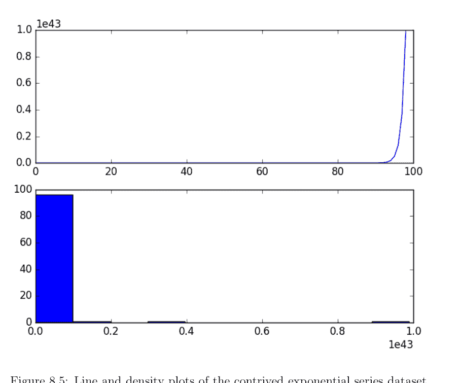

同样，我们可以通过对值取自然对数将此序列转换回线性。这将使序列线性化并使分布均匀化。下面的示例为此进行了演示以保证完整性。

```python
# log transform a contrived exponential time series
from matplotlib import pyplot
from math import exp
from numpy import log
series = [exp(i) for i in range(1,100)]
transform = log(series)
pyplot.figure(1)
# line plot
pyplot.subplot(211)
pyplot.plot(transform)
# histogram
pyplot.subplot(212)
pyplot.hist(transform)
pyplot.show()
```

Listing 8.6: 指数数据集的对数转换。

运行该示例创建图表，显示预期的线性结果。

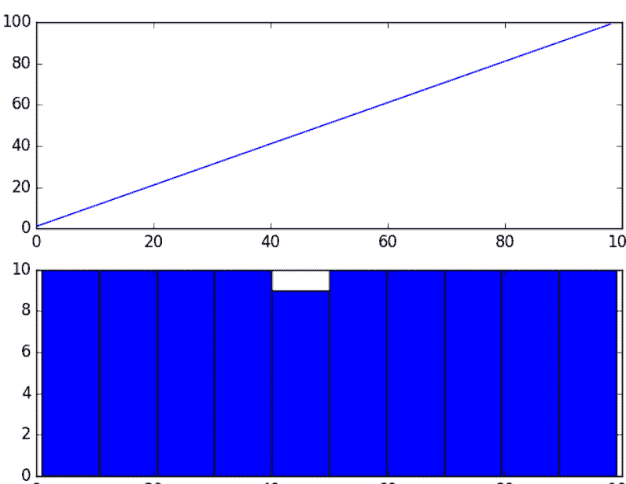

Figure 8.6: 对数转换后的指数数据集的折线图和相关度图。

我们的航空乘客数据集具有此形式的分布，但可能没有这么极端。下面的示例演示了航空乘客数据集的对数转换。

```python
# log transform a time series
from pandas import read_csv
from pandas import DataFrame
from numpy import log
from matplotlib import pyplot
series = read_csv('airline-passengers.csv', header=0, index_col=0, parse_dates=True, squeeze=True)
dataframe = DataFrame(series.values)
dataframe.columns = ['passengers']
dataframe['passengers'] = log(dataframe['passengers'])
pyplot.figure(1)
# line plot
pyplot.subplot(211)
pyplot.plot(dataframe['passengers'])
# histogram
pyplot.subplot(212)
pyplot.hist(dataframe['passengers'])
pyplot.show()
```

Listing 8.7: 航空乘客数据集的对数转换。

运行该示例得到的趋势看起来比上面的平方根转换线性得多。折线图显示看似线性的增长和方差。直方图也显示了更均匀或压扁的高斯样分布观测值。

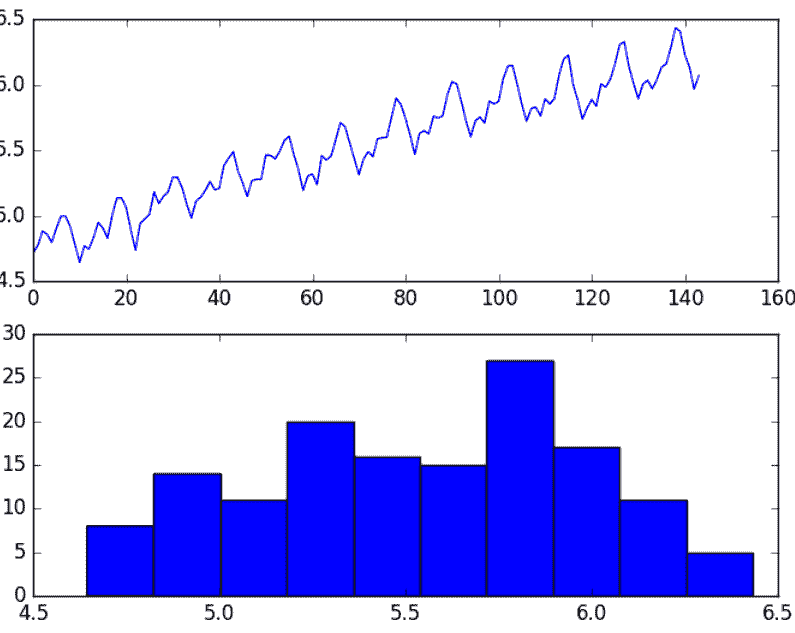

Figure 8.7: 对数转换后的航空乘客数据集的折线图和相关度图。

对数转换在时间序列数据中很受欢迎，因为它们在去除指数方差方面很有效。重要的是要注意，此操作假定值是正且非零的。通常通过添加固定常数对观测值进行转换，以确保所有输入值满足此要求。例如：

$$\begin{aligned} & \text{transform} = \log(\text{constant} + x) \\ \end{aligned}\tag{8.1}$$

其中 **log** 是自然对数，**transform** 是转换后的序列，**constant** 是将所有观测值提升至零以上的固定值，而 **x** 是时间序列。


## 8.4 博克斯-考克斯变换（Box-Cox Transform）

平方根变换和对数变换属于一类称为幂变换（power transforms）的变换方法。博克斯-考克斯变换 $^2$ 是一种可配置的数据变换方法，它既支持平方根变换和对数变换，也支持一系列相关的变换。

不仅如此，它可以被配置为自动评估一组变换并选择最佳拟合。你可以将其视为一种强大的工具，用于消除时间序列中基于幂的变化。变换后的序列可能更具线性，变换后的分布可能更接近高斯分布或均匀分布，具体取决于生成该序列的底层过程。`scipy.stats` 库提供了博克斯-考克斯变换的实现。`boxcox()` 函数 $^3$ 接受一个名为 `lambda` 的参数，该参数控制执行何种类型的变换。以下是 `lambda` 的一些常见取值：

- `lambda = -1.0` 是倒数变换。
- `lambda = -0.5` 是倒数平方根变换。
- `lambda = 0.0` 是对数变换。
- `lambda = 0.5` 是平方根变换。
- `lambda = 1.0` 是恒等变换（不进行变换）。

例如，我们可以使用 `boxcox()` 函数执行对数变换，方法如下：

```python
# manually box-cox transform a time series
from pandas import read_csv
from pandas import DataFrame
from scipy.stats import boxcox
from matplotlib import pyplot
series = read_csv('airline-passengers.csv', header=0, index_col=0, parse_dates=True, squeeze=True)
dataframe = DataFrame(series.values)
dataframe.columns = ['passengers']
dataframe['passengers'] = boxcox(dataframe['passengers'], lambda=0.0)
pyplot.figure(1)
# line plot
pyplot.subplot(211)
pyplot.plot(dataframe['passengers'])
# histogram
pyplot.subplot(212)
pyplot.hist(dataframe['passengers'])
pyplot.show()
```

清单 8.8：航空乘客数据集的博克斯-考克斯变换。

运行此示例将复现上一节中的对数变换。

> $^2$ https://en.wikipedia.org/wiki/Power_transform#Box.E2.80.93Cox_transformation  
> $^3$ https://docs.scipy.org/doc/scipy/reference/generated/scipy.stats.boxcox.html

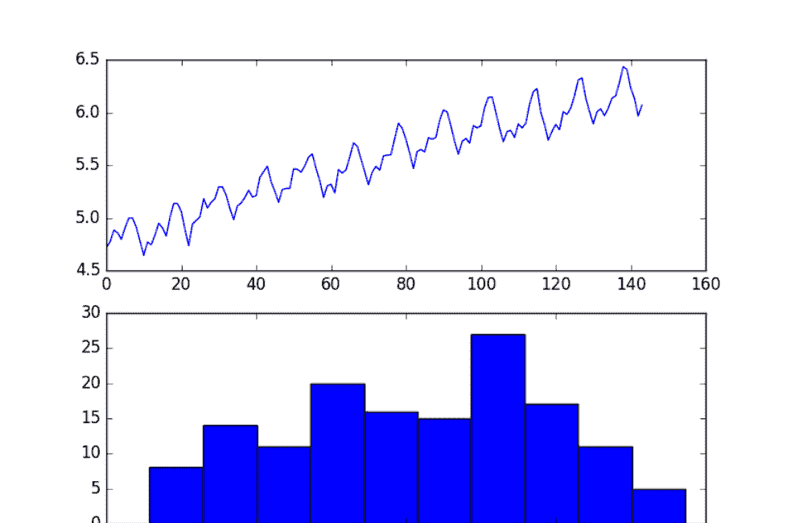

图 8.8：经博克斯-考克斯变换后的航空乘客数据集的折线图和密度图。

我们可以将 `lambda` 参数设置为 `None`（默认值），让函数自动找到统计上调整后的最佳值。以下示例演示了这种用法，返回经过变换的数据集以及选定的 `lambda` 值。

```python
# automatically box-cox transform a time series
from pandas import read_csv
from pandas import DataFrame
from scipy.stats import boxcox
from matplotlib import pyplot
series = read_csv('airline-passengers.csv', header=0, index_col=0, parse_dates=True, squeeze=True)
datframe = DataFrame(series.values)
datframe.columns = ['passengers']
datframe['passengers'], lam = boxcox(datframe['passengers'])
print('Lambda: %f' % lam)
pyplot.figure(1)
# line plot
pyplot.subplot(211)
pyplot.plot(datframe['passengers'])
# histogram
pyplot.subplot(212)
pyplot.hist(datframe['passengers'])
pyplot.show()
```

清单 8.9：航空乘客数据集的优化博克斯-考克斯变换。

运行该示例发现 **lambda** 值为 0.148023。我们可以看到，这非常接近 **lambda** 值为 0.0 的情况，这意味着其对数变换的效果强于（小于）0.5 时的平方根变换。

```
Lambda: 0.148023
```

清单 8.10：航空乘客数据集上优化博克斯-考克斯变换的输出示例。

折线图和直方图也与对数变换得到的结果非常相似。

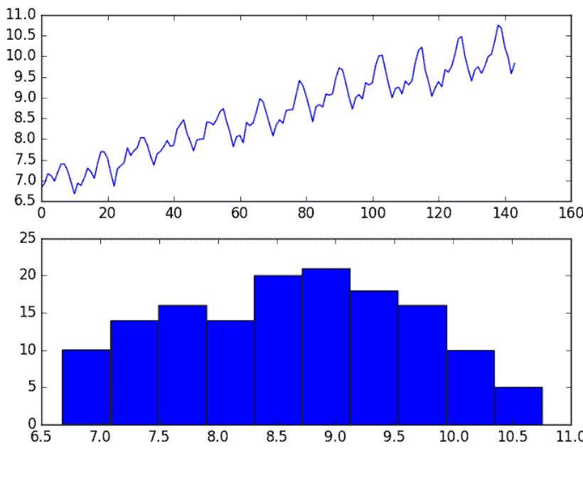

图 8.9：经优化博克斯-考克斯变换后的航空乘客数据集的折线图和密度图。

## 8.5 摘要

在本教程中，你发现了何时以及如何针对不同时间序列数据使用 Python 进行不同的幂变换。具体来说，你学到了：

- 如何识别二次变化并使用平方根变换。
- 如何识别指数变化以及如何使用对数变换。
- 如何使用博克斯-考克斯变换执行平方根变换和对数变换，并自动优化数据集的变换。

### 8.5.1 下一步

在下一课中，你将发现如何对时间序列使用平滑方法。

# 第 9 章

## 移动平均平滑

移动平均平滑是时间序列预测中一种朴素但有效的技术。它可以用于数据预处理、特征工程，甚至直接用于做出预测。在本教程中，你将发现如何使用 Python 对时间序列进行移动平均平滑。完成本教程后，你将了解：

- 移动平均平滑的工作原理，以及在使用之前对数据的一些期望。
- 如何使用移动平均平滑进行数据预处理和特征工程。
- 如何使用移动平均平滑做出预测。

让我们开始吧。

## 9.1 移动平均平滑

平滑是一种应用于时间序列的技术，用于消除时间步之间的细粒度波动。平滑的目的是去除噪声，更好地暴露潜在因果过程的信号。移动平均是时间序列分析和时间序列预测中常用的一种简单且常见的平滑类型。计算移动平均涉及创建一个新的序列，其中该序列的值由原始时间序列中原始观测值的平均值组成。

计算移动平均要求你指定一个称为窗口宽度（window width）的窗口大小。这定义了用于计算移动平均值的原始观测值的数量。移动平均中的“移动”一词指的是由窗口宽度定义的窗口沿着时间序列滑动，以计算新序列中的平均值。主要有两种类型的移动平均在使用：中心移动平均和滞后移动平均。

### 9.1.1 中心移动平均

时间 (t) 处的值计算为时间 (t) 处、之前和之后原始观测值的平均值。例如，窗口为 3 的中心移动平均计算如下：

```
center_ma(t) = mean(obs(t - 1), obs(t), obs(t + 1))    (9.1)
```

该方法需要知晓未来的值，因此常用于时间序列分析，以更好地理解数据集。中心移动平均可以用作一种通用方法，从时间序列中去除趋势和季节分量，这种方法在预测中通常无法使用。

### 9.1.2 滞后移动平均

时间 (t) 处的值计算为时间 (t) 处及之前原始观测值的平均值。例如，窗口为 3 的滞后移动平均计算如下：

```
trail_ma(t) = mean(obs(t - 2), obs(t - 1), obs(t))    (9.2)
```

滞后移动平均仅使用历史观测值，用于时间序列预测。这是我们在本教程中将重点关注的移动平均类型。

## 9.2 数据期望

计算时间序列的移动平均对数据做出了一些假设。假设趋势和季节分量已从你的时间序列中去除。这意味着你的时间序列是平稳的，或者不显示明显的趋势（长期增加或减少的移动）或季节性（一致的周期性结构）。

在预测时，有许多方法可以从时间序列数据集中去除趋势和季节性。两种很好的方法分别是使用差分方法和建模行为并从序列中显式减去它。

在使用机器学习算法解决时间序列问题时，移动平均值可以以多种方式使用。在本教程中，我们将探讨如何计算滞后移动平均值，以用于数据预处理、特征工程以及直接做出预测。在我们深入研究这些示例之前，让我们看一下将在每个示例中使用的每日女性出生数据集。

## 9.3 每日女性出生数据集

在本课中，我们将使用每日女性出生数据集作为示例。该数据集描述了 1959 年加利福尼亚州的每日女性出生人数。你可以在附录 A.4 中了解有关该数据集的更多信息。将该数据集放入当前工作目录，文件名为 `daily-total-female-births.csv`。

## 9.4 移动平均作为数据预处理

移动平均可以作为数据预处理技术，用于创建原始数据集的平滑版本。平滑作为一种数据预处理技术是有用的，因为它可以减少观测值中的随机波动，更好地暴露潜在因果过程的结构。


## 9.4. 将移动平均作为数据预处理

Pandas 对象 Series 上的 `rolling()` 函数¹ 会自动将观测值分组到一个窗口中。你可以指定窗口大小，默认情况下会创建一个滞后窗口。一旦窗口创建完成，我们就可以取均值，这就是我们的转换后数据集。

未来新的观测值也可以很容易地进行转换，只需保留最近几个观测值的原始数值，并更新一个新的平均值即可。为了具体说明，假设窗口大小为 3，那么时间 $t$ 的转换值计算为前 3 个观测值（$t-2$，$t-1$，$t$）的均值，如下所示：

$$ obs(t) = \frac{1}{3} \times (obs(t-2) + obs(t-1) + obs(t)) \quad (9.3) $$

对于每日女性出生数数据集，第一个移动平均值将在 1 月 3 日产生，如下所示：

$$
\begin{aligned}
obs(t) &= \frac{1}{3} \times (obs(t-2) + obs(t-1) + obs(t)) \\
&= \frac{1}{3} \times (35 + 32 + 30) \\
&= 32.333
\end{aligned} \quad (9.4)
$$

下面是一个示例，将每日女性出生数数据集转换为窗口大小为 3 天的移动平均值，窗口大小是任意选择的。

```python
# moving average smoothing as data preparation
from pandas import read_csv
from matplotlib import pyplot

series = read_csv('daily-total-female-births.csv', header=0, index_col=0, parse_dates=True,
                squeeze=True)
# tail-rolling average transform
rolling = series.rolling(window=3)
rolling_mean = rolling.mean()
print(rolling_mean.head(10))
# plot original and transformed dataset
series.plot()
rolling_mean.plot(color='red')
pyplot.show()
# zoomed plot original and transformed dataset
series[:100].plot()
rolling_mean[:100].plot(color='red')
pyplot.show()
```

列表 9.1：在每日女性出生数数据集上以移动平均作为数据预处理的示例。

运行该示例会打印出转换后数据集的前 10 个观测值。我们可以看到，前 2 个观测值需要被丢弃。

| 日期       | 数值        |
|:-----------|:-------------|
| 1959-01-01 | NaN          |
| 1959-01-02 | NaN          |
| 1959-01-03 | 32.333333    |
| 1959-01-04 | 31.000000    |
| 1959-01-05 | 35.000000    |
| 1959-01-06 | 34.666667    |
| 1959-01-07 | 39.333333    |
| 1959-01-08 | 39.000000    |
| 1959-01-09 | 42.000000    |
| 1959-01-10 | 36.000000    |

名称: Births，数据类型: float64

列表 9.2：在每日女性出生数数据集上以移动平均作为数据预处理的示例输出。

原始观测值被绘制出来，并叠加了移动平均变换。

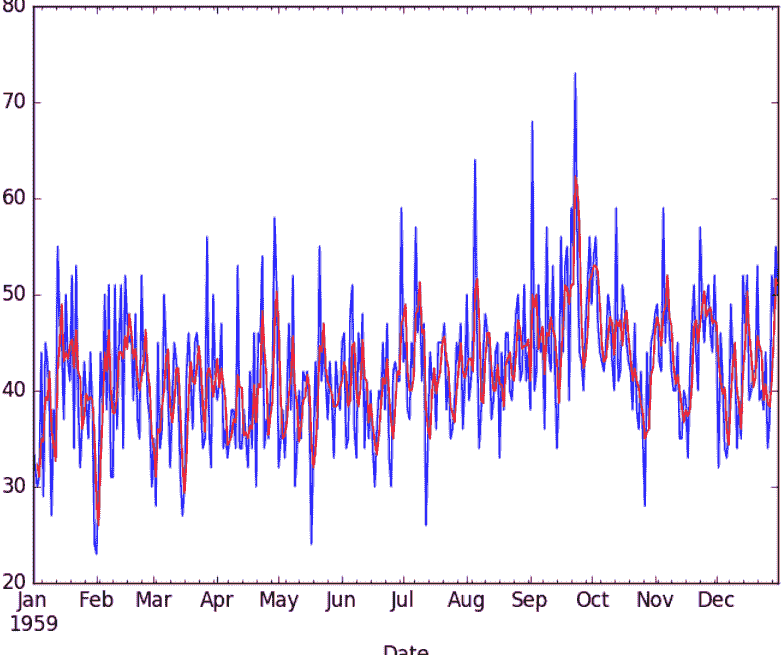

图 9.1：每日女性出生数数据集（蓝色）及其移动平均值（红色）的折线图。

为了更好地了解变换的效果，我们可以放大并绘制前 100 个观测值。

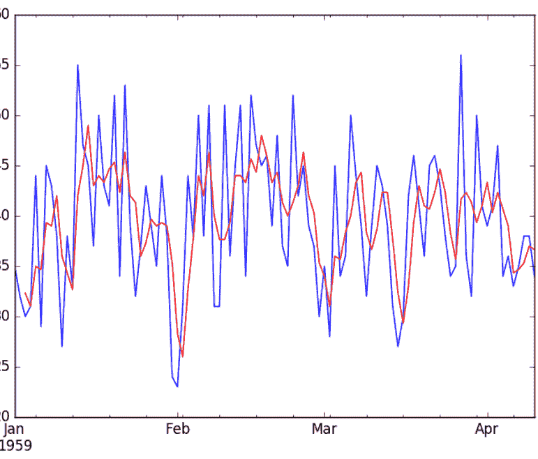

图 9.2：每日女性出生数数据集中前 100 个观测值（蓝色）及其移动平均值（红色）的折线图。

在这里，你可以清楚地看到转换后数据集中的滞后效应。接下来，让我们看看如何使用移动平均作为特征工程方法。

## 9.5 将移动平均作为特征工程

移动平均值可以用于在将时间序列预测建模为监督学习问题时作为新信息的来源。在这种情况下，计算移动平均值并将其添加为新的输入特征，用于预测下一个时间步长。首先，必须将序列复制一份并向前移动一个时间步长。这将代表我们预测问题的输入，或者说是序列的 `lag=1` 版本。这是时间序列问题的标准监督学习视角。例如：

```text
x,      y
NaN,    obs1
obs1,   obs2
obs2,   obs3
```

列表 9.3：带有滞后变量的移位时间序列的虚构示例。

接下来，序列的第二份副本需要向前移动一个时间步长，减去窗口大小。这是为了确保移动平均值仅总结最近的几个值，而不包括要预测的值，否则将是对问题的无效表述，因为输入将包含对未来预测值的知识。

例如，当窗口大小为 3 时，我们必须将序列向前移动 2 个时间步长。这是因为我们要在移动平均值中包含前两个观测值以及当前观测值，以便预测下一个值。然后我们可以从这个移位序列中计算移动平均值。以下是前 5 个移动平均值计算方法的示例。记住，数据集向前移动了 2 个时间步长，并且随着时间序列的推进，至少需要 3 个时间步长才能有足够的计算 `window=3` 移动平均值的计算数据。

| 观测值       | 均值 |
|:------------------|:-----|
| NaN               | NaN  |
| NaN, NaN          | NaN  |
| NaN, NaN, 35      | NaN  |
| NaN, 35, 32       | NaN  |
| 30, 32, 35        | 32   |

列表 9.4：带有滞后变量和移动平均值的移位时间序列的虚构示例。

下面是一个示例，展示了如何将前 3 个值的移动平均值作为新特征，以及每日女性出生数数据集的原始 `t` 输入特征。

```python
# moving average smoothing as feature engineering
from pandas import read_csv
from pandas import DataFrame
from pandas import concat
series = read_csv('daily-total-female-births.csv', header=0, index_col=0, parse_dates=True,
                  squeeze=True)
df = DataFrame(series.values)
width = 3
lag1 = df.shift(1)
lag3 = df.shift(width - 1)
window = lag3.rolling(window=width)
means = window.mean()
dataframe = concat([means, lag1, df], axis=1)
dataframe.columns = ['mean', 't', 't+1']
print(dataframe.head(10))
```

列表 9.5：在每日女性出生数数据集上以移动平均作为特征工程的示例。

运行该示例会创建新的数据集并打印前 10 行。我们可以看到，前 3 行无法使用且必须丢弃。`lag=1` 数据集的第一行无法使用，因为没有前序观测值来预测第一个观测值，因此使用了 `NaN` 值。

|    | mean       | t     | t+1 |
|----|------------|-------|-----|
| 0  | NaN        | NaN   | 35  |
| 1  | NaN        | 35.0  | 32  |
| 2  | NaN        | 32.0  | 30  |
| 3  | NaN        | 30.0  | 31  |
| 4  | 32.333333  | 31.0  | 44  |
| 5  | 31.000000  | 44.0  | 29  |
| 6  | 35.000000  | 29.0  | 45  |
| 7  | 34.666667  | 45.0  | 43  |
| 8  | 39.333333  | 43.0  | 38  |
| 9  | 39.000000  | 38.0  | 27  |

列表 9.6：在每日女性出生数数据集上以移动平均作为特征工程的示例输出。

下一节将探讨如何使用移动平均作为朴素模型来进行预测。

## 9.6 将移动平均作为预测

移动平均值也可以直接用于进行预测。它是一个朴素模型，假设时间序列的趋势和季节性成分已经被移除或调整。移动平均预测模型可以很容易地以前进式（walk-forward）方式使用。随着新观测值的可用（例如每天），模型可以更新并对下一天进行预测。我们可以用 Python 手动实现这一点。以下是以前进式方式使用移动平均模型的示例。

```python
# moving average smoothing as a forecast model
from math import sqrt
from pandas import read_csv
from numpy import mean
from sklearn.metrics import mean_squared_error
from matplotlib import pyplot
series = read_csv('daily-total-female-births.csv', header=0, index_col=0, parse_dates=True, squeeze=True)

# prepare situation
X = series.values
window = 3
history = [X[i] for i in range(window)]
test = [X[i] for i in range(window, len(X))]
predictions = list()

# walk forward over time steps in test
for t in range(len(test)):
    length = len(history)
    yhat = mean([history[i] for i in range(length-window, length)])
    obs = test[t]
    predictions.append(yhat)
    history.append(obs)
    print('predicted=%f, expected=%f' % (yhat, obs))
rmse = sqrt(mean_squared_error(test, predictions))
print('Test RMSE: %.3f' % rmse)
# plot
pyplot.plot(test)
pyplot.plot(predictions, color='red')
pyplot.show()
# zoom plot
pyplot.plot(test[:100])
pyplot.plot(predictions[:100], color='red')
pyplot.show()
```

列表 9.7：在每日女性出生数数据集上以移动平均进行预测的示例。

¹http://pandas.pydata.org/pandas-docs/stable/generated/pandas.Series.rolling.html


## 9.6. 移动平均作为预测

运行示例代码后，将从第 4 步（1959-01-04）开始，每次向前移动时打印出预测值和期望值。最后，报告所有预测的均方根误差（RMSE）（RMSE 将在第 17 章中介绍）。

```
predicted=32.333333, expected=31.000000
predicted=31.000000, expected=44.000000
predicted=35.000000, expected=29.000000
...
predicted=38.666667, expected=37.000000
predicted=38.333333, expected=52.000000
predicted=41.000000, expected=48.000000
predicted=45.666667, expected=55.000000
predicted=51.666667, expected=50.000000
Test RMSE: 7.834
```

列表 9.8：每日女性出生数据集中移动平均预测的示例输出。

结果显示每出生人数的 RMSE 接近 7.834。示例最后绘制了期望测试值与预测值的对比图。

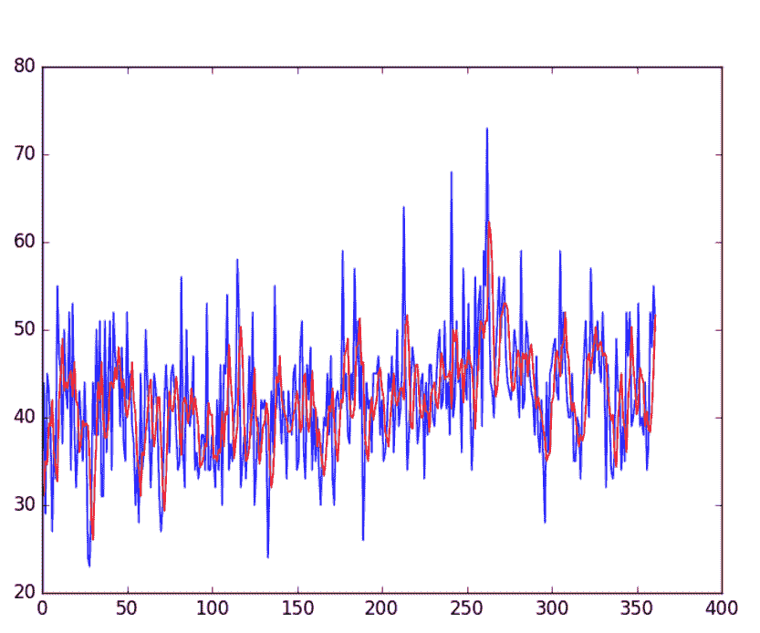

图 9.3：每日女性出生数据集（蓝色）与移动平均预测（红色）的折线图。

同样，放大查看前 100 个预测可以了解 3 天移动平均预测的效果。请注意，窗口宽度 3 是任意选择的，并未进行优化。

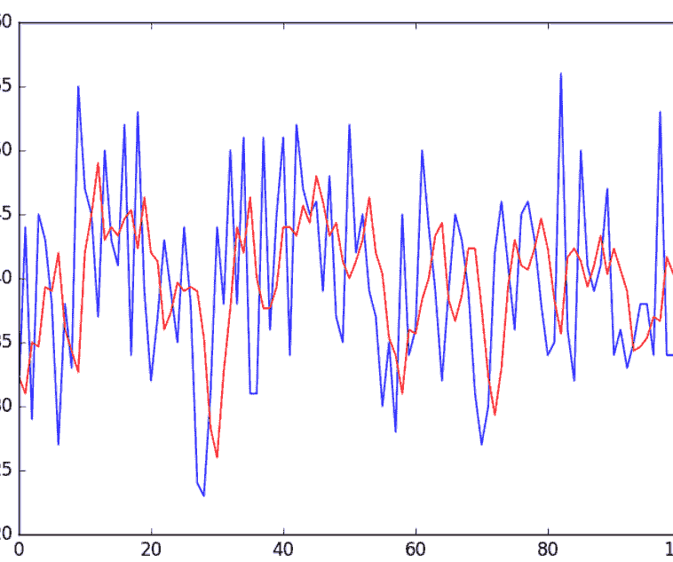

图 9.4：每日女性出生数据集的前 100 个观测值（蓝色）与移动平均预测（红色）的折线图。

### 9.7 总结

在本教程中，你发现了如何使用移动平均平滑法进行 Python 时间序列预测。具体来说，你学到了：

- 移动平均平滑法的工作原理，以及使用前时间序列数据的期望值。
- 如何在 Python 中为数据准备使用移动平均平滑法。
- 如何在 Python 中为特征工程使用移动平均平滑法。
- 如何在 Python 中使用移动平均平滑法进行预测。

### 9.7.1 下一步

这结束了第二部分。接下来，在第三部分中，你将发现如何调查时间序列数据中的时间结构，从时间序列的白噪声模型开始。

# 第三部分

## 时间结构

# 第 10 章

## 白噪声的温和介绍

白噪声是时间序列预测中的一个重要概念。如果一个时间序列是白噪声，它就是一个随机数序列，无法预测。如果预测误差序列不是白噪声，则表明预测模型可以改进。在本教程中，你将使用 Python 发现白噪声时间序列。完成本教程后，你将了解：

- 白噪声时间序列的定义及其重要性。
- 如何检查你的时间序列是否为白噪声。
- 用于在 Python 中识别白噪声的统计和诊断图。

让我们开始吧。

### 10.1 什么是白噪声？

时间序列可能是白噪声。如果变量独立且同分布，且均值为零，则时间序列为白噪声。这意味着所有变量具有相同的方差 (*sigma2*)，并且每个值与序列中所有其他值的零相关。如果序列中的变量是从高斯分布中抽取的，则该序列称为高斯白噪声。

### 10.2 为什么这很重要？

白噪声是时间序列分析和预测中的一个重要概念。它重要主要有两个原因：

- **可预测性：** 如果你的时间序列是白噪声，那么根据定义，它是随机的。你无法合理地对其进行建模并进行预测。
- **模型诊断：** 时间序列预测模型的误差序列理想情况下应该是白噪声。

模型诊断是时间序列预测的一个重要领域。时间序列数据预期在由潜在过程产生的信号之上包含一定的白噪声成分。例如：

```
$$y(t)=signal(t)+noise(t)$$
```

一旦时间序列预测模型做出了预测，就可以收集并分析它们。预测误差序列理想情况下应该是白噪声。当预测误差是白噪声时，意味着时间序列中的所有信号信息都已被模型利用以进行预测。剩下的只是无法建模的随机波动。模型预测不是白噪声的迹象表明预测模型可能可以进一步改进。

### 10.3 你的时间序列是白噪声吗？

如果以下任何条件为真，则你的时间序列不是白噪声：

- 你的序列是否有非零均值？
- 方差是否随时间变化？
- 值是否与滞后值相关？

你可以使用以下一些工具来检查你的时间序列是否为白噪声：

- **创建折线图**。检查诸如均值变化、方差或滞后变量之间明显关系等总体特征。
- **计算摘要统计量**。将序列的整体均值和方差与序列中有意义的连续值块（例如天数、月份或年份）的均值和方差进行对比。
- **创建自相关图**。检查滞后变量之间的总体相关性。

### 10.4 白噪声时间序列示例

在本节中，我们将在 Python 中创建一个高斯白噪声序列并进行一些检查。在实践中创建和审查白噪声时间序列是有帮助的。它将提供参考框架和示例图以及统计测试，用于在你自己的时间序列项目中检查它们是否为白噪声。首先，我们可以使用 `random` 模块 1 中的 `gauss()` 函数创建一个包含 1,000 个随机高斯变量的列表。我们将从一个均值为 0.0（`mu`）、标准差为 1.0（`sigma`）的高斯分布中抽取变量。创建后，我们可以将列表包装在 Pandas `Series` 中以方便使用。

```python
from random import gauss
from random import seed
from pandas import Series
from pandas.plotting import autocorrelation_plot
from matplotlib import pyplot

# seed random number generator
seed(1)

# create white noise series
series = [gauss(0.0, 1.0) for i in range(1000)]
series = Series(series)
```

列表 10.1：创建白噪声序列的示例。

接下来，我们可以计算并打印一些摘要统计量，包括序列的均值和标准差。

```python
# summary stats
print(series.describe())
```

列表 10.2：计算白噪声序列的摘要统计量。

鉴于我们在抽取随机数时定义了均值和标准差，因此不应有意外。

```
count    1000.000000
mean      -0.013222
std        1.003685
min       -2.961214
25%       -0.684192
50%       -0.010934
75%        0.703915
max        2.737260
```

列表 10.3：计算白噪声序列摘要统计量的示例输出。

我们可以看到均值接近 0.0，标准差接近 1.0。考虑到样本量较小，一些方差是可以预期的。如果我们有更多数据，可能会更有趣地将序列分为两半，分别计算并比较每个半部分的摘要统计量。我们期望看到每个子序列具有相似的均值和标准差。现在我们可以创建一些图，从序列的折线图开始。

```python
# line plot
series.plot()
pyplot.show()
```

列表 10.4：创建白噪声序列的折线图。

我们可以看到该序列似乎是随机的。

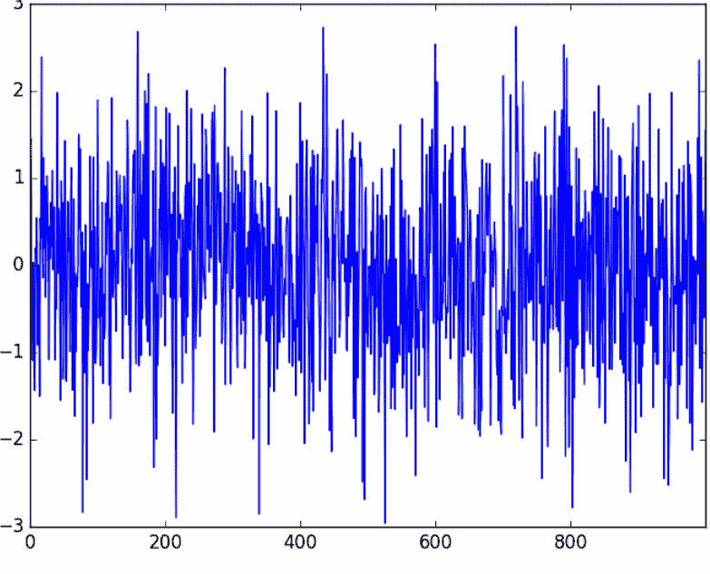

图 10.1：白噪声序列的折线图。

我们还可以创建直方图并确认分布是高斯分布。

```python
# histogram plot
series.hist()
pyplot.show()
```

列表 10.5：创建白噪声序列的直方图。

确实，直方图显示了标志性的钟形曲线形状。

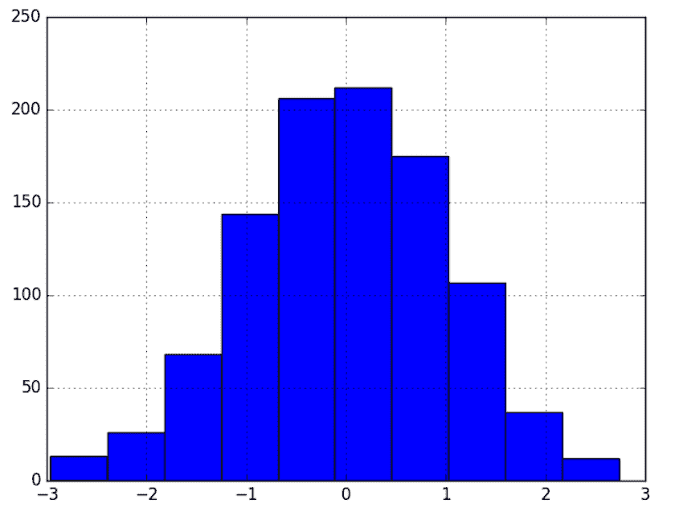

图 10.2：白噪声序列的直方图。

最后，我们可以创建一个自相关图并检查与滞后变量的任何自相关。

```python
# autocorrelation
autocorrelation_plot(series)
pyplot.show()
```

列表 10.6：白噪声序列的自相关图。

自相关图没有显示任何明显的自相关模式。有一些峰值高于 95% 和 99% 的置信水平，但这些只是统计上的偶然。


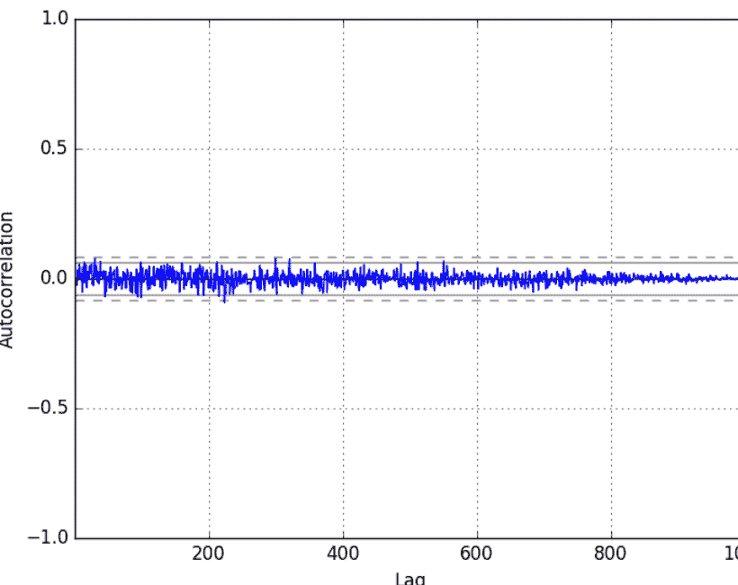

图 10.3：白噪声序列的相关图。

为了完整性，下面提供了完整的代码列表。

```python
# calculate and plot a white noise series
from random import gauss
from random import seed
from pandas import Series
from pandas.plotting import autocorrelation_plot
from matplotlib import pyplot

# seed random number generator
seed(1)
# create white noise series
series = [gauss(0.0, 1.0) for i in range(1000)]
series = Series(series)
# summary stats
print(series.describe())
# line plot
series.plot()
pyplot.show()
# histogram plot
series.hist()
pyplot.show()
# autocorrelation
autocorrelation_plot(series)
pyplot.show()
```

清单 10.7：白噪声序列及其诊断示例。

## 10.5 总结

在本教程中，您发现了 Python 中的白噪声时间序列。具体来说，您学习了：

-   白噪声时间序列由零均值、恒定方差和零相关性定义。
-   如果您的时间序列是白噪声，则无法对其进行预测；如果您的预测残差不是白噪声，则您可能可以改进您的模型。
-   您可以用于检查时间序列是否为白噪声的统计方法和诊断图。

### 10.5.1 下一步

在下一课中，您将会了解时间序列问题的可预测性以及随机游走模型。

## 第 11 章

# 随机游走的温和入门

如何知道您的时间序列问题是可预测的？这是时间序列预测中的一个难题。有一种称为随机游走的工具，可以帮助您理解时间序列预测问题的可预测性。在本教程中，您将在 Python 中发现随机游走及其特性。完成本教程后，您将了解：

-   什么是随机游走，以及如何从 Python 中从头创建一个。
-   如何分析随机游走的特性，并识别时间序列何时是或不是随机游走。
-   如何对随机游走进行预测。

让我们开始吧。

## 11.1 随机序列

Python 标准库包含 `random` 模块，该模块提供了一组用于生成随机数的函数。可以使用 `randrange()` 函数来生成 0 和上限之间的随机整数。我们可以使用 `randrange()` 函数生成 0 到 10 之间 1,000 个随机整数的列表。示例如下所示。

```python
# create and plot a random series
from random import seed
from random import randrange
from matplotlib import pyplot

seed(1)
series = [randrange(10) for i in range(1000)]
pyplot.plot(series)
pyplot.show()
```

清单 11.1：随机数序列示例。

运行示例会绘制出随机数序列。这真是一团糟。它看起来完全不像时间序列。

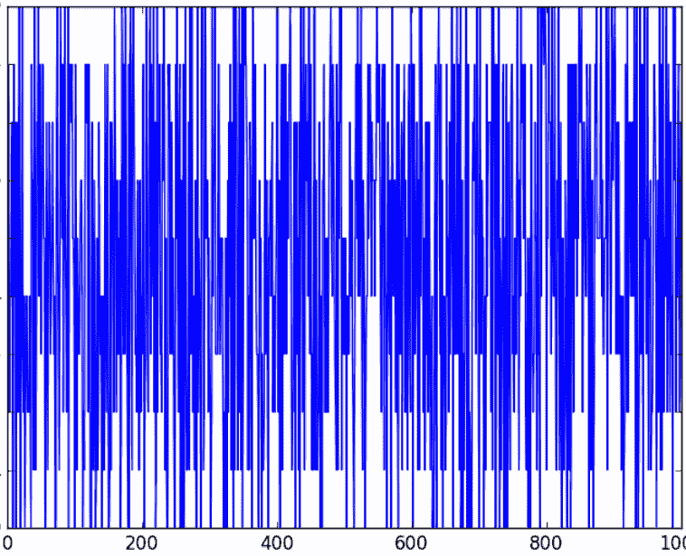

这不是随机游走。它只是一个随机数序列，也称为白噪声（参见第 10 章）。初学者常犯的一个错误是认为随机游走是随机数的列表，事实并非如此。

## 11.2 随机游走

随机游走与随机数列表不同，因为序列中的下一个值是前一个值的修改。用于生成序列的过程强制从一个时间步到下一个时间步产生依赖性。这种依赖性提供了一定的一致性，而不是由独立的随机数序列提供的巨大跳跃。正是这种依赖性使得该过程被称为随机游走或醉汉游走。一个简单的随机游走模型如下：

1.  以随机数 -1 或 1 开始。
2.  随机选择 -1 或 1，并将其加到前一个时间步的观察值上。
3.  重复步骤 2，只要您愿意。

更简洁地，我们可以将此过程描述为：

$y(t) = B_0 + B_1 \times X(t - 1) + \epsilon(t)$

(11.1)

其中 **y(t)** 是序列中的下一个值。**B0** 是一个系数，如果设置为非零值，会为随机游走添加恒定的漂移。**B1** 是用于加权前一个时间步的系数，设置为 1.0。**X(t-1)** 是前一个时间步的观察值。**e(t)** 是当时的白噪声或随机波动。我们可以通过循环此过程并构建随机游走的 1,000 个时间步列表在 Python 中实现这一点。完整示例如下所示。

```python
# create and plot a random walk
from random import seed
from random import random
from matplotlib import pyplot

seed(1)
random_walk = list()
random_walk.append(-1 if random() < 0.5 else 1)
for i in range(1, 1000):
    movement = -1 if random() < 0.5 else 1
    value = random_walk[i-1] + movement
    random_walk.append(value)

pyplot.plot(random_walk)
pyplot.show()
```

清单 11.2：随机游走示例。

运行示例创建随机游走的线图。我们可以看到它与我们上面的随机数序列看起来非常不同。事实上，其形状和移动看起来像股票市场中证券价格的现实时间序列。

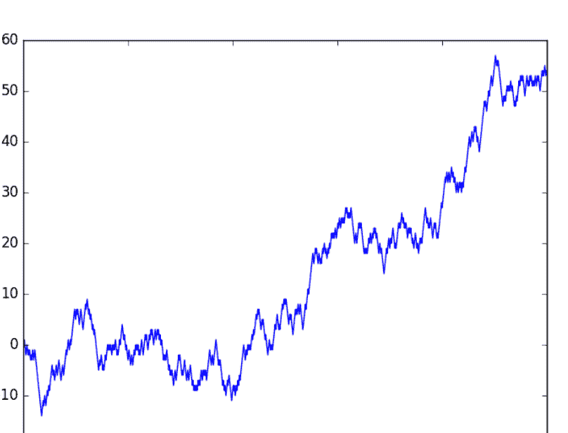

图 11.2：随机游走图。

在接下来的部分中，我们将更仔细地查看随机游走的特性。这很有帮助，因为它会为您提供背景知识，帮助识别您未来分析的时间序列是否可能是随机游走。让我们从查看自相关结构开始。

## 11.3 随机游走与自相关

我们可以计算每个观察值与前几个时间步观察值之间的相关性。这些相关性的图称为自相关图或相关图。鉴于随机游走的构造方式，我们期望与前一个观察值有很强的自相关，并且随着前一个滞后值的增加而线性衰减。我们可以使用 Pandas 中的 `autocorrelation_plot()` 函数绘制随机游走的相关图。

完整示例如下所示。请注意，在生成随机游走的每个示例中，我们使用随机数生成器的相同种子，以确保我们获得相同的随机数序列，从而获得相同的随机游走。

```python
# plot the autocorrelation of a random walk
from random import seed
from random import random
from matplotlib import pyplot
from pandas.plotting import autocorrelation_plot

seed(1)
random_walk = list()
random_walk.append(-1 if random() < 0.5 else 1)
for i in range(1, 1000):
    movement = -1 if random() < 0.5 else 1
    value = random_walk[i-1] + movement
    random_walk.append(value)

autocorrelation_plot(random_walk)
pyplot.show()
```

清单 11.3：随机游走的自相关图示例。

运行示例，我们通常会看到预期的趋势，在本例中是前几百个滞后观察值。

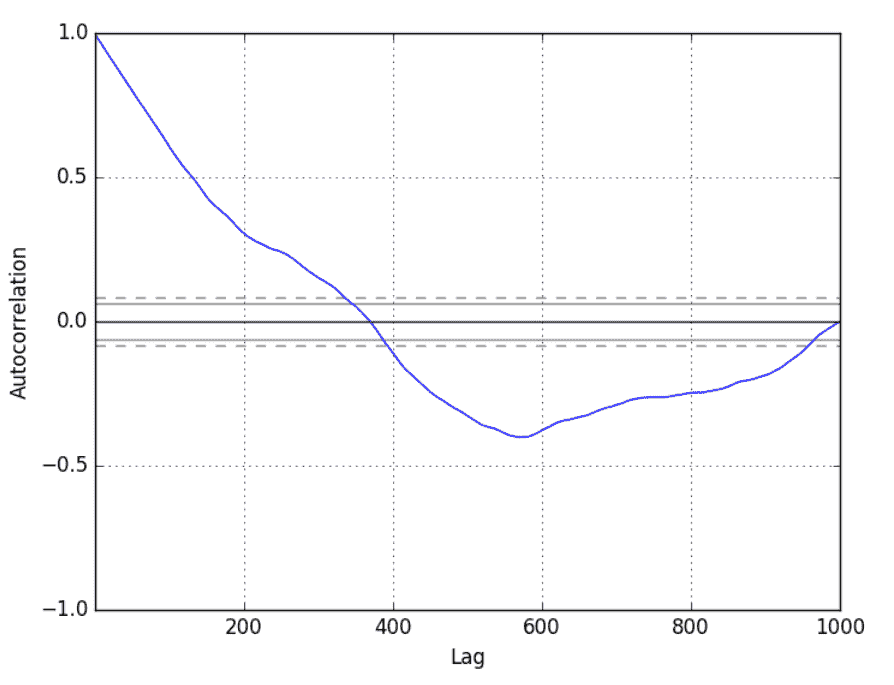

图 11.3：随机游走相关图。

## 11.4 随机游走与平稳性

平稳时间序列是指其值不是时间的函数（平稳性在第 15 章中更详细地介绍）。鉴于随机游走的构造方式和审查自相关的结果，我们知道随机游走中的观察值依赖于时间。当前观察值是前一个观察值的随机步骤。

因此，我们可以预期随机游走是非平稳的。事实上，所有随机游走过程都是非平稳的。请注意，并非所有非平稳时间序列都是随机游走。此外，非平稳时间序列在时间上不具有恒定的均值和/或方差。查看随机游走的线图可能会暗示这种情况。我们可以使用统计显著性检验来确认这一点，特别是增广 Dickey-Fuller 检验。

我们可以使用 Statsmodels 库中的 `adfuller()` 函数执行此测试。完整示例如下所示。

```python
# calculate the stationarity of a random walk
from random import seed
from random import random
from statsmodels.tsa.stattools import adfuller

# generate random walk
seed(1)
random_walk = list()
random_walk.append(-1 if random() < 0.5 else 1)
for i in range(1, 1000):
    movement = -1 if random() < 0.5 else 1
    value = random_walk[i-1] + movement
    random_walk.append(value)

# statistical test
result = adfuller(random_walk)
print('ADF Statistic: %f' % result[0])
print('p-value: %f' % result[1])
print('Critical Values:')
for key, value in result[4].items():
    print('\t%s: %.3f' % (key, value))
```

清单 11.4：计算随机游走平稳性的示例。

该检验的原假设是时间序列是非平稳的。运行示例，我们可以看到检验统计量值为 0.341605。这大于 1%、5% 和 10% 置信水平下的所有临界值。因此，我们可以说该时间序列似乎是非平稳的，并且结果只是统计巧合的可能性很低。

```text
ADF Statistic: 0.341605
p-value: 0.979175
Critical Values:
	1%: -3.437
	5%: -2.864
	10%: -2.568
```

清单 11.5：计算随机游走平稳性的输出。

我们可以通过取一阶差分使随机游走变得平稳。即用每个观察值与其前一个值的差值来替换该观察值。鉴于这种随机游走的构造方式，我们预期这将产生一个由 -1 和 1 值组成的时间序列。这正是我们所看到的。完整示例如下所示。

```python
# calculate and plot a differentiated random walk
from random import seed
from random import random
```


```python
from matplotlib import pyplot
# 创建随机游走
seed(1)
random_walk = list()
random_walk.append(-1 if random() < 0.5 else 1)
for i in range(1, 1000):
    movement = -1 if random() < 0.5 else 1
    value = random_walk[i-1] + movement
    random_walk.append(value)
# 计算差值
diff = list()
for i in range(1, len(random_walk)):
    value = random_walk[i] - random_walk[i - 1]
    diff.append(value)
# 绘制折线图
pyplot.plot(diff)
pyplot.show()
```

列表 11.6：计算随机游走差值序列的示例。

运行该示例会生成一个折线图，显示 1,000 次 -1 和 1 的移动，看起来杂乱无章。

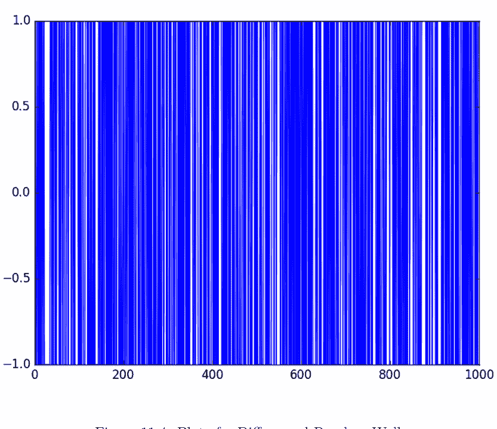

这个差异图也清楚地表明，在这里我们除了随机移动序列外没有其他信息可用。没有可供学习的结构。既然时间序列现在是平稳的，我们可以重新计算差值序列的相关图。完整示例如下所示。

```python
# 绘制差值随机游走的自相关图
from random import seed
from random import random
from matplotlib import pyplot
from pandas.plotting import autocorrelation_plot
# 创建随机游走
seed(1)
random_walk = list()
random_walk.append(-1 if random() < 0.5 else 1)
for i in range(1, 1000):
    movement = -1 if random() < 0.5 else 1
    value = random_walk[i-1] + movement
    random_walk.append(value)
# 计算差值
diff = list()
for i in range(1, len(random_walk)):
    value = random_walk[i] - random_walk[i - 1]
    diff.append(value)
# 绘制折线图
autocorrelation_plot(diff)
pyplot.show()
```

列表 11.7：计算随机游走差值序列相关图的示例。

运行该示例，我们可以看到滞后观测值之间没有显著关系，正如随机游走的生成方式所预期的那样。所有相关性都很小，接近零，且低于 95% 和 99% 的置信水平（除了少数统计巧合之外）。

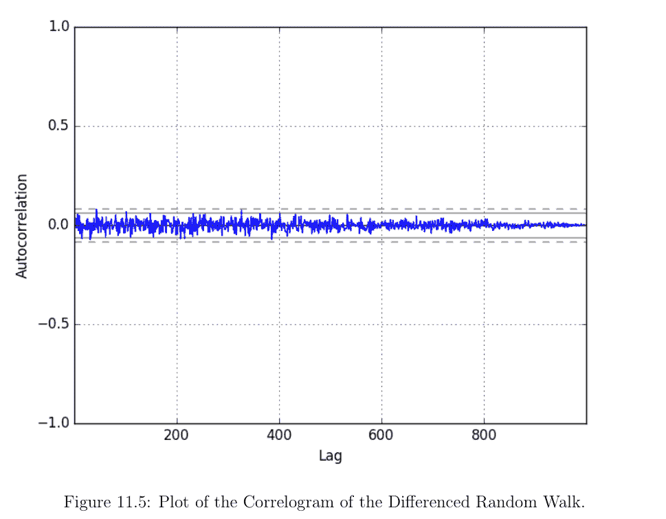

## 11.5 预测随机游走

随机游走是不可预测的；无法对其做出合理的预测。根据随机游走的构建方式，我们可以预期能做出的最佳预测是使用上一步的时间步的观测值作为下一步时间步将要发生的值。仅因为我们知道下一步时间步将是前一时间步的函数。这通常被称为朴素预测，或持久性模型（在第 18 章中介绍）。

我们可以通过首先将数据集拆分为训练集和测试集，然后使用持久性模型采用滚动预测方法来预测结果，从而在 Python 中实现这一点。一旦收集了测试集的所有预测值，即可计算均方根误差（RMSE）。

```python
# 随机游走的持久性预测
from random import seed
from random import random
from sklearn.metrics import mean_squared_error
from math import sqrt
# 生成随机游走
seed(1)
random_walk = list()
random_walk.append(-1 if random() < 0.5 else 1)
for i in range(1, 1000):
    movement = -1 if random() < 0.5 else 1
    value = random_walk[i-1] + movement
    random_walk.append(value)
# 准备数据集
train_size = int(len(random_walk) * 0.66)
train, test = random_walk[0:train_size], random_walk[train_size:]
# 持久性
predictions = list()
history = train[-1]
for i in range(len(test)):
    yhat = history
    predictions.append(yhat)
    history = test[i]
rms = sqrt(mean_squared_error(test, predictions))
print('Persistence RMSE: %.3f' % rms)
```

列表 11.8：使用持久性预测随机游走的示例。

运行该示例估算模型的 RMSE 为 1。这也是预期的，因为我们可以知道从一个时间步到下一个时间步的变化总是 1，无论是正方向还是负方向。

> 持久性 RMSE: 1.000

列表 11.9：使用持久性预测随机游走的输出。

随机游走初学者犯的另一类错误是假设如果知道误差范围（方差），那么我们就可以使用随机游走生成类型的过程来进行预测。也就是说，如果我们知道误差是 -1 或 1，那么为什么不在前一个值的基础上添加随机选择的 -1 或 1 来进行预测呢？我们可以在下面的 Python 代码中演示这种随机预测方法。

```python
# 随机游走的随机预测
from random import seed
from random import random
from sklearn.metrics import mean_squared_error
from math import sqrt
# 生成随机游走
seed(1)
random_walk = list()
random_walk.append(-1 if random() < 0.5 else 1)
for i in range(1, 1000):
    movement = -1 if random() < 0.5 else 1
    value = random_walk[i-1] + movement
    random_walk.append(value)
# 准备数据集
train_size = int(len(random_walk) * 0.66)
train, test = random_walk[0:train_size], random_walk[train_size:]
# 随机预测
predictions = list()
history = train[-1]
for i in range(len(test)):
    yhat = history + (-1 if random() < 0.5 else 1)
    predictions.append(yhat)
    history = test[i]
rms = sqrt(mean_squared_error(test, predictions))
print ('Random RMSE: %.3f' % rms)
```

列表 11.10：使用随机机会预测随机游走的示例。

运行该示例，我们可以看到，确实，该算法的性能比持久性方法更差，RMSE 为 1.328。

Random RMSE: 1.328

列表 11.11：使用随机机会预测随机游走的输出。

持久性，或朴素预测，是对随机游走时间序列所能做出的最佳预测。

## 11.6 你的时间序列是随机游走吗？

你的时间序列可能是随机游走。检查你的时间序列是否为随机游走的一些方法如下：

-   时间序列显示出强烈的时间依赖性，并且以线性或类似模式衰减。
-   时间序列是非平稳的，使其平稳化后显示数据中没有明显的可学习结构。
-   持久性模型提供了最可靠的预测来源。

最后一个观点对于时间序列预测至关重要。使用持久性模型的基线预测可以快速揭示你是否能做得更好。如果不能，你很可能正在处理一个随机游走。许多时间序列都是随机游走，特别是证券价格随时间的变化。随机游走假说是一种理论，认为股票市场价格是随机游走，无法预测⁶。

随机游走是指未来的步骤或方向不能基于过去的历史进行预测。当这个术语应用于股票市场时，它意味着股价的短期变化是不可预测的。

> — 第 26 页，《漫步华尔街》。

人类思维到处都能发现模式，我们必须警惕自己，不要自欺欺人，以免浪费时间开发针对随机游走过程的复杂模型。

## 11.7 总结

在本教程中，你发现了如何使用 Python 探索随机游走。具体来说，你学习了：

-   如何在 Python 中创建随机游走过程。
-   如何探索随机游走的自相关和非平稳结构。
-   如何对随机游走时间序列进行预测。

⁶ https://en.wikipedia.org/wiki/Random_walk_hypothesis

### 11.7.1 下一步

在下一课中，你将发现如何将时间序列分解为水平、趋势和季节性等组成部分。

# 第 12 章

# 分解时间序列数据

时间序列分解涉及将序列视为水平、趋势、季节性和噪声成分的组合。分解为思考时间序列以及更好地理解时间序列分析和预测中的问题提供了一个有用的抽象模型。在本教程中，你将发现时间序列分解以及如何使用 Python 自动将时间序列拆分为其组成部分。完成本教程后，你将知道：

-   时间序列分解的分析方法及其如何帮助预测。
-   如何在 Python 中自动分解时间序列数据。
-   如何分解加法和乘法时间序列问题并绘制结果。

让我们开始吧。

### 12.1 时间序列成分

选择预测方法的一个有用抽象是将时间序列分解为系统性和非系统性成分。

-   **系统性：** 时间序列中具有一致性或重复性并且可以描述和建模的成分。
-   **非系统性：** 时间序列中无法直接建模的成分。

给定的时间序列被认为由三个系统性成分组成，包括水平、趋势、季节性，以及一个称为噪声的非系统性成分。这些成分定义如下：

-   **水平：** 序列中的平均值。
-   **趋势：** 序列中增加或减少的值。
-   **季节性：** 序列中重复的短期周期。
-   **噪声：** 序列中的随机波动。


### 12.2 组合时间序列组件

一个时间序列被视为是这四个组件的总和或组合。所有序列都具有水平和噪声。趋势和季节性组件是可选的。将组件视为以加性或乘性方式组合是有帮助的。

### 12.2.1 加法模型

加法模型建议将组件按如下方式相加：

$$y(t)=水平+趋势+季节性+噪声\tag{12.1}$$

加法模型是线性的，即随着时间推移的变化始终由相同的数量产生。线性趋势是一条直线。线性季节性具有相同的频率（周期宽度）和振幅（周期高度）。

### 12.2.2 乘法模型

乘法模型建议将组件按如下方式相乘：

$$y(t)=水平\times 趋势\times 季节性\times 噪声\tag{12.2}$$

乘法模型是非线性的，例如二次方或指数。变化随时间增加或减少。非线性趋势是一条曲线。非线性季节性随时间具有增加或减少的频率和/或振幅。

### 12.3 分解作为工具

这是一个有用的抽象。分解主要用于时间序列分析，作为分析工具，它可以为针对您的问题构建预测模型提供参考。它提供了一种结构化的方式来思考时间序列预测问题，既可以从建模复杂性的一般角度，也可以从如何在特定模型中最佳捕获这些每个组件的具体角度。

这些组件中的每一个都是您在数据准备、模型选择和模型调优过程中可能需要考虑和处理的内容。您可以显式地通过建模趋势并从数据中减去趋势来处理它，或者隐式地通过提供足够的历史数据让算法建模可能存在的趋势来处理它。您可能无法或不一定要将特定的时间序列干净或完美地分解为加法或乘法模型。

现实世界的问题往往是混乱且充满噪声的。可能存在加法和乘法组件。可能存在先增加后减少的趋势。可能存在与重复季节性组件混合在一起的非重复循环。尽管如此，这些抽象模型提供了一个简单的框架，您可以使用它来分析数据并探索思考问题和预测的方法。

### 12.4 自动时间序列分解

有几种方法可以自动分解时间序列。Statsmodels 库通过名为 `seasonal_decompose()` 的函数提供了朴素或经典分解方法的实现。它需要您指定模型是加法型还是乘法型。

两者都会产生结果，您在解释结果时必须谨慎且保持批判性思维。审查时间序列的图表和一些摘要统计数据通常是了解您的时间序列问题看起来是加法型还是乘法型的良好起点。`seasonal_decompose()` 函数返回一个结果对象。该结果对象包含数组，用于访问分解出的四个数据部分。

例如，下面的代码片段展示了如何假设加法模型将序列分解为趋势、季节性和残差组件。结果对象提供了作为数组的趋势和季节系列访问权限。它还提供了残差的访问权限，即去除趋势和季节组件后的时间序列。最后，还存储了原始或观测数据。

```python
from statsmodels.tsa.seasonal import seasonal_decompose
series = ...
result = seasonal_decompose(series, model='additive')
print(result.trend)
print(result.seasonal)
print(result.resid)
print(result.observed)
```

代码清单 12.1：分解时间序列的示例。

这四个时间序列可以通过调用 `plot()` 函数直接从结果对象绘制。例如：

```python
from statsmodels.tsa.seasonal import seasonal_decompose
from matplotlib import pyplot
series = ...
result = seasonal_decompose(series, model='additive')
result.plot()
pyplot.show()
```

代码清单 12.2：绘制分解后的时间序列示例。

让我们看一些例子。

### 12.4.1 加法分解

我们可以创建一个由从 1 到 99 线性增加的趋势和一些随机噪声组成的时间序列，并将其作为加法模型进行分解。由于该时间序列是人为构造的，并且作为数字数组提供，我们必须指定观测的频率（`freq=1` 参数）。如果提供的是 Pandas Series 对象，则不需要此参数。

```python
# additive decompose a contrived additive time series
from random import randrange
from matplotlib import pyplot
from statsmodels.tsa.seasonal import seasonal_decompose
series = [i+randrange(10) for i in range(1,100)]
result = seasonal_decompose(series, model='additive', freq=1)
result.plot()
pyplot.show()
```

代码清单 12.3：分解人为构造的加法时间序列的示例。

运行该示例会创建序列，执行分解，并绘制 4 个结果序列。我们可以看到，整个序列被作为趋势组件，且没有季节性。

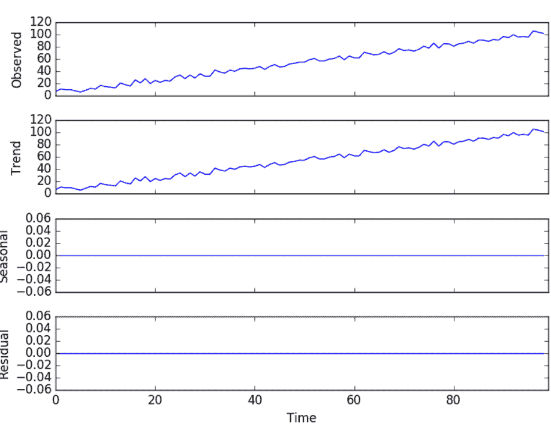

我们还可以看到，残差图显示为零。这是一个很好的例子，说明朴素或经典分解未能将从线性趋势中添加的噪声分离出来。朴素分解方法是一种简单的方法，并且有更高级的分解方法可用，例如使用 Loess 的季节性和趋势分解或 STL 分解。在使用自动分解方法时，需要谨慎和健康的怀疑态度。

### 12.4.2 乘法分解

我们可以构造一个二次方时间序列，作为时间步长从 1 到 99 的平方，然后假设乘法模型对其进行分解。

```python
# multiplicative decompose a contrived multiplicative time series
from matplotlib import pyplot
from statsmodels.tsa.seasonal import seasonal_decompose
series = [i**2.0 for i in range(1,100)]
result = seasonal_decompose(series, model='multiplicative', freq=1)
result.plot()
pyplot.show()
```

代码清单 12.4：分解人为构造的乘法时间序列的示例。

运行该示例，我们可以看到，与加法情况一样，趋势很容易被提取出来并完全刻画了时间序列。

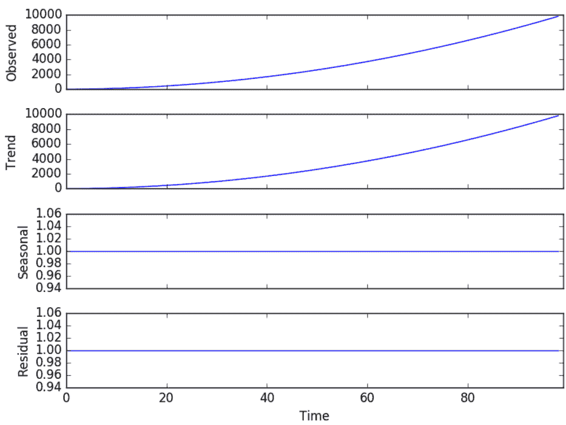

图 12.2：分解后的乘法时间序列的折线图。

指数变化可以通过数据变换使其线性化。在这种情况下，二次方趋势可以通过取平方根使其线性化。季节性中的指数增长可以通过取自然对数使其线性化。

再次强调，重要的是将分解视为一种潜在有用的分析工具，但要考虑探索它可以用于您的问题的许多不同方式，例如在数据变换后或在对残差模型误差上应用。让我们看一个真实世界的数据集。

### 12.4.3 航空乘客数据集

在本课中，我们将使用航空乘客数据集作为示例。该数据集描述了随时间变化的航空乘客总数。您可以在附录 A.5 中了解有关该数据集的更多信息。将数据集以文件名 `airline-passengers.csv` 放入当前工作目录。通过审查附录中的数据集图表，我们将假设一个乘法模型。下面的示例将航空乘客数据集作为乘法模型进行分解。

```python
# multiplicative decompose time series
from pandas import read_csv
from matplotlib import pyplot
from statsmodels.tsa.seasonal import seasonal_decompose
series = read_csv('airline-passengers.csv', header=0, index_col=0, parse_dates=True,
            squeeze=True)
result = seasonal_decompose(series, model='multiplicative')
result.plot()
pyplot.show()
```

代码清单 12.5：航空乘客数据集的乘法分解。

运行该示例绘制了观测、趋势、季节性和残差时间序列。我们可以看到，从序列中提取的趋势和季节性信息似乎很合理。残差也很有趣，显示出在序列早期和后期存在高变异期。


### 12.5 摘要

在本教程中，你了解了时间序列分解以及如何使用 Python 对时间序列数据进行分解。具体来说，你学到了：

- 将时间序列分解为水平、趋势、季节性和噪声的结构。
- 如何使用 Python 自动分解时间序列数据集。
- 如何分解加性或乘性模型并绘制结果。

### 12.5.1 下一步

在下一课中，你将了解如何识别时间序列数据中的趋势并对其进行建模。

## 第 13 章

## 使用与去除趋势

我们的时间序列数据集中可能包含趋势。趋势是指序列随时间持续增加或减少。识别、建模甚至从时间序列数据集中移除趋势信息可能会带来好处。在本教程中，你将学习如何使用 Python 对时间序列数据中的趋势信息进行建模和移除。完成本教程后，你将了解：

- 时间序列中可能存在的重要趋势类型以及如何识别它们。
- 如何使用简单的差分方法去除趋势。
- 如何为销售时间序列数据集建立线性趋势模型并将其移除。

让我们开始吧。

### 13.1 时间序列中的趋势

趋势是时间序列水平在长期内的增加或减少。

> 通常，时间序列中不表现为周期性的系统性变化被称为趋势。
>
> — 第 5 页，《*Introductory Time Series with R*》（《R 语言入门时间序列》）。

识别和理解趋势信息有助于提高模型性能，原因如下：

- **更快的建模：** 趋势或无趋势的知识可能建议采用特定的方法，从而使模型选择和评估更高效。
- **更简单的问题：** 我们可以纠正或移除趋势以简化建模并提高模型性能。
- **更多数据：** 我们可以直接使用趋势信息或其摘要，为模型提供额外信息，从而提高模型性能。

#### 13.1.1 趋势的类型

有各种各样的趋势。我们可以考虑的两类通用趋势是：

- **确定性趋势**：这些是一致增加或减少的趋势。
- **随机性趋势**：这些是增加和减少不一致的趋势。

一般来说，确定性趋势更容易识别和去除，但本教程中讨论的方法对于随机性趋势仍然有用。我们可以从观察范围的角度来思考趋势。

- **全局趋势**：这些是适用于整个时间序列的趋势。
- **局部趋势**：这些是适用于时间序列部分或子序列的趋势。

通常，全局趋势更容易识别和处理。

#### 13.1.2 识别趋势

你可以绘制时间序列数据以查看趋势是否明显。难点在于在实践中，识别时间序列中的趋势可能是一个主观过程。因此，从时间序列中提取或去除趋势也可能同样主观。创建数据的线图并检查图中是否有明显的趋势。在你的图表中添加线性和非线性趋势线，看看趋势是否明显。

#### 13.1.3 去除趋势

具有趋势的时间序列被称为非平稳的。已识别的趋势可以建模。一旦建模，就可以从时间序列数据集中将其移除。这被称为时间序列的去趋势化。如果数据集没有趋势或者我们成功去除了趋势，则该数据集被称为趋势平稳的。

#### 13.1.4 在机器学习中使用时间序列趋势

从机器学习的角度来看，你数据中的趋势代表两个机会：

- **移除信息**：移除扭曲输入和输出变量之间关系的系统性信息。
- **添加信息**：添加系统性信息以改善输入和输出变量之间的关系。

具体来说，作为数据准备和清理练习，可以从时间序列数据（以及未来的数据）中移除趋势。这在统计方法用于时间序列预测时很常见，但在使用机器学习模型时并不总是能改进结果。或者，可以将趋势直接添加或作为摘要添加，作为监督学习问题中的新输入变量，以预测输出变量。

对于你的时间序列预测问题，一种或两种方法都可能相关，并且值得探索。接下来，让我们看看一个具有趋势的数据集。

## 13.2 洗发水销售数据集

在本课中，我们将使用洗发水销售数据集作为示例。该数据集描述了 3 年期间洗发水的月度销售量。你可以在附录 **A.1** 中了解更多关于该数据集的信息。将该数据集放入当前工作目录，文件名为 `shampoo-sales.csv`。

## 13.3 通过差分去趋势

对时间序列去趋势最简单的方法可能是差分。具体来说，构建一个新序列，其中当前时间步的值计算为原始观测值与上一个时间步观测值之间的差值。

$$value(t) = observation(t) - observation(t - 1) \quad (13.1)$$

这具有从时间序列数据集中移除趋势的效果。我们可以通过直接实现这一点在 Python 中创建一个新的差分数据集。可以创建一个新的观测值列表。下面是一个创建洗发水销售数据集的差分去趋势版本的示例。

```python
# detrend a time series using differencing
from pandas import read_csv
from pandas import datetime
from matplotlib import pyplot

def parser(x):
    return datetime.strptime('190'+x, '%Y-%m')

series = read_csv('shampoo-sales.csv', header=0, index_col=0, parse_dates=True,
    squeeze=True, date_parser=parser)
X = series.values
diff = list()
for i in range(1, len(X)):
    value = X[i] - X[i - 1]
    diff.append(value)
pyplot.plot(diff)
pyplot.show()
```

**列表 13.1：** 对洗发水销售数据集进行差分。

运行示例创建新的去趋势数据集，然后绘制时间序列。因为无法为第一个观测值创建差分值（没有值可供其减去），新数据集包含少一条记录。我们可以看到，趋势确实似乎已被移除（与附录中的原始图表相比）。

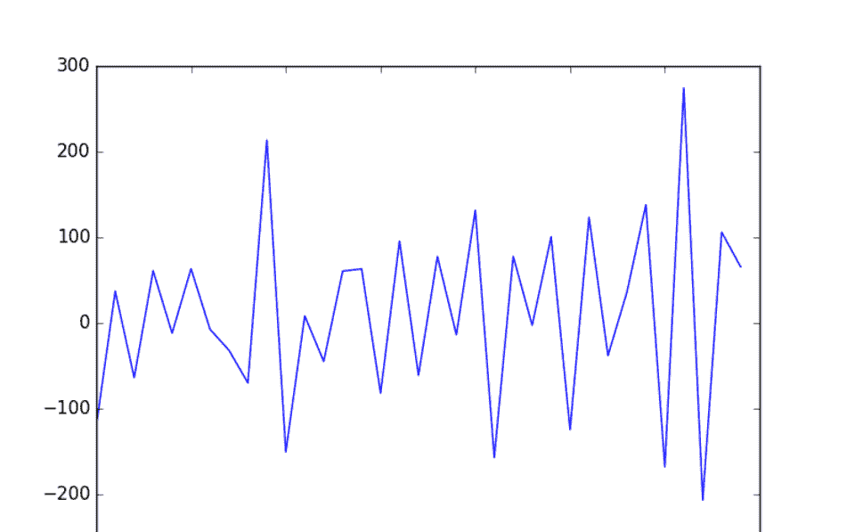

图 13.1：洗发水销售数据集的差分线图。

这种方法适用于具有线性趋势的数据。如果趋势是二次的（趋势的变化也在增加或减少），则可以对已差分的数据集进行差分，即第二级差分。如果需要，可以进一步重复此过程。由于差分仅需要上一个时间步的观测值，因此它可以轻松应用于未见过的样本外数据，以进行预处理或为监督学习提供额外的输入。接下来，我们将看看拟合一个模型来描述趋势。

## 13.4 通过模型拟合去趋势

趋势通常很容易可视化为穿过观测值的一条线。线性趋势可以通过线性模型来总结，而非线性趋势可能最好使用多项式或其他曲线拟合方法来总结。由于识别趋势具有主观性和领域特定的性质，这种方法可以帮助识别是否存在趋势。即使对明显是超线性或指数的趋势拟合线性模型也可能有帮助。

除了用作趋势识别工具外，这些拟合模型还可以用于对时间序列去趋势。例如，可以在线性模型上拟合时间索引以预测观测值。该数据集将如下所示：

| x | y |
|---|---|
| 1 | obs1 |


```
2, obs2
3, obs3
4, obs4
5, obs5
```

清单 13.2：以时间索引作为特征的数据集。

该模型的预测结果将形成一条直线，可以将其作为数据集的趋势线。这些预测值也可以从原始时间序列中减去，从而提供数据集的去趋势版本。

$value(t) = observation(t) - prediction(t)$ (13.2)

模型拟合的残差是数据集的去趋势形式。也可以使用多项式曲线拟合和其他非线性模型。我们可以通过在数据上训练 scikit-learn 的 LinearRegression 模型 1 来在 Python 中实现这一点。

```python
# use a linear model to detrend a time series
from pandas import read_csv
from pandas import datetime
from sklearn.linear_model import LinearRegression
from matplotlib import pyplot
import numpy

def parser(x):
    return datetime.strptime('190'+x, '%Y-%m')

series = read_csv('shampoo-sales.csv', header=0, index_col=0, parse_dates=True,
                  squeeze=True, date_parser=parser)
# fit linear model
X = [i for i in range(0, len(series))]
X = numpy.reshape(X, (len(X), 1))
y = series.values
model = LinearRegression()
model.fit(X, y)
# calculate trend
trend = model.predict(X)
# plot trend
pyplot.plot(y)
pyplot.plot(trend)
pyplot.show()
# detrend
detrended = [y[i]-trend[i] for i in range(0, len(series))]
# plot detrended
pyplot.plot(detrended)
pyplot.show()
```

清单 13.3：在洗发水销售数据集上拟合线性模型。

运行示例首先将线性模型拟合到整数索引的观测值，并在原始数据集上绘制趋势线。

> 1http://scikit-learn.org/stable/modules/generated/sklearn.linear_model.LinearRegression.html

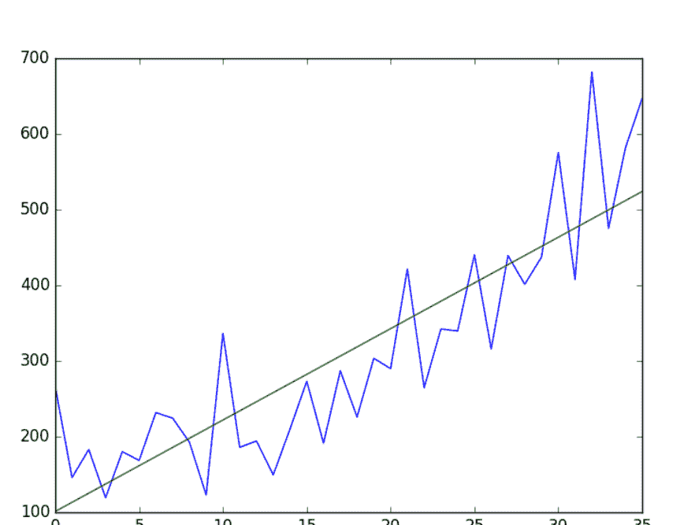

图 13.2：洗发水销售数据集（蓝色）和线性拟合（绿色）的折线图。

接下来，从原始数据集中减去趋势，并绘制得到的去趋势数据集。

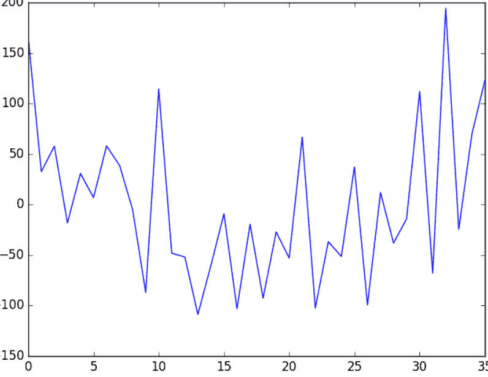

图 13.3：使用线性拟合的去趋势洗发水销售数据集的折线图。

同样，我们可以看到这种方法有效地对数据集进行了去趋势处理。残差中可能存在抛物线，这表明也许多项式拟合能做得更好。由于趋势模型仅以观测值的整数索引作为输入，因此它可以用于新数据，要么进行去趋势，要么为模型提供新的输入变量。

## 13.5 总结

在本教程中，你发现了时间序列数据中的趋势以及如何用 Python 移除它们。具体来说，你学到了：

- 了解时间序列中趋势信息的重要性，以及如何在机器学习中利用它。
- 如何使用差分法从时间序列数据中移除趋势。
- 如何对线性趋势建模并将其从时间序列数据中移除。

### 13.5.1 下一步

在下一课中，你将了解如何识别和建模时间序列数据中的季节性。

# 第 14 章

# 使用与移除季节性

时间序列数据集可以包含季节性分量。这是随时间重复的周期，例如每月或每年。这种重复的周期可能会掩盖我们在预测时希望建模的信号，反过来也可能为我们的预测模型提供强烈的信号。在本教程中，你将了解如何使用 Python 识别和校正时间序列数据中的季节性。

完成本教程后，你将了解：

- 时间序列中季节性的定义以及它如何为使用机器学习方法进行预测提供机会。
- 如何使用差分方法创建日温度数据的季节调整时间序列。
- 如何直接对季节性分量建模并明确地从观测值中减去它。

让我们开始吧。

### 14.1 时间序列中的季节性

时间序列数据可能包含季节性变化。季节性变化，即季节性，是随时间规律重复的周期。

> 每年内的重复模式被称为季节性变化，尽管该术语更普遍地应用于任何固定周期内的重复模式。
> — 第 6 页，《*Introductory Time Series with R*》。

时间序列中的周期结构可能是也可能不是季节性的。如果它以相同的频率一致重复，那么它是季节性的，否则它不是季节性的，被称为循环。

## 14.1.1 对机器学习的益处

理解时间序列中的季节性分量可以提高机器学习的建模性能。这主要通过两种方式发生：

- 更清晰的信号：从时间序列中识别并移除季节性分量可以导致输入和输出变量之间更清晰的关系。
- 更多信息：关于时间序列季节性分量的附加信息可以提供新信息以提高模型性能。

这两种方法在项目中都可能很有用。对季节性建模并将其从时间序列中移除可能发生在数据清理和准备期间。提取季节性信息并将其作为输入特征提供，无论是直接还是以摘要形式，可能发生在特征提取和特征工程活动期间。

## 14.1.2 季节性的类型

有许多类型的季节性；例如：

- 一天中的时间。
- 每日。
- 每周。
- 每月。
- 每年。

因此，确定时间序列问题中是否存在季节性分量是主观的。确定是否存在季节性方面的最简单方法是绘制并审查你的数据，可能在不同尺度下并添加趋势线。

## 14.1.3 移除季节性

一旦识别出季节性，就可以对其进行建模。季节性的模型可以从时间序列中移除。这个过程称为季节调整或去季节性化。移除了季节性分量的时间序列称为季节平稳。具有明显季节性分量的时间序列被称为非平稳。

时间序列分析领域有研究并从时间序列中提取季节性的复杂方法。由于我们主要关注预测建模和时间序列预测，我们仅限于那些可以在历史数据上开发并在对新数据进行预测时可用的方法。在本教程中，我们将研究两种对具有强加性季节性分量的经典气象学问题（日温度）进行季节调整的方法。接下来，让我们看看我们将在本教程中使用的数据集。

### 14.2 每日最低温度数据集

在本课中，我们将使用每日最低温度数据集作为例子。该数据集描述了澳大利亚墨尔本城市 10 年（1981-1990）的每日最低温度。你可以在附录 A.2 中了解更多关于数据集的信息。将数据集放在当前工作目录中，文件名为 `daily-minimum-temperatures.csv`。

### 14.3 使用差分的季节调整

校正季节性分量的简单方法是使用差分。如果存在每周级别的季节性分量，那么我们可以通过减去上周的值来移除今天的观测值中的它。在每日最低温度数据集的情况下，看起来我们每年都有一个季节性分量，显示出从夏天到冬天的波动。

我们可以通过减去去年同一天的每日最低温度来校正季节性。这需要特殊处理闰年的 2 月 29 日，并且意味着第一年的数据不可用于建模。下面是使用差分法处理 Python 中每日数据的示例。

```python
# deseasonalize a time series using differencing
from pandas import read_csv
from matplotlib import pyplot
series = read_csv('daily-minimum-temperatures.csv', header=0, index_col=0,
        parse_dates=True, squeeze=True)
X = series.values
diff = list()
days_in_year = 365
for i in range(days_in_year, len(X)):
        value = X[i] - X[i - days_in_year]
        diff.append(value)
pyplot.plot(diff)
pyplot.show()
```

清单 14.1：使用差分对每日最低温度数据集进行去季节性化。

运行这个示例创建一个新的季节调整数据集并绘制结果。


## 14.3. 使用差分法进行季节调整

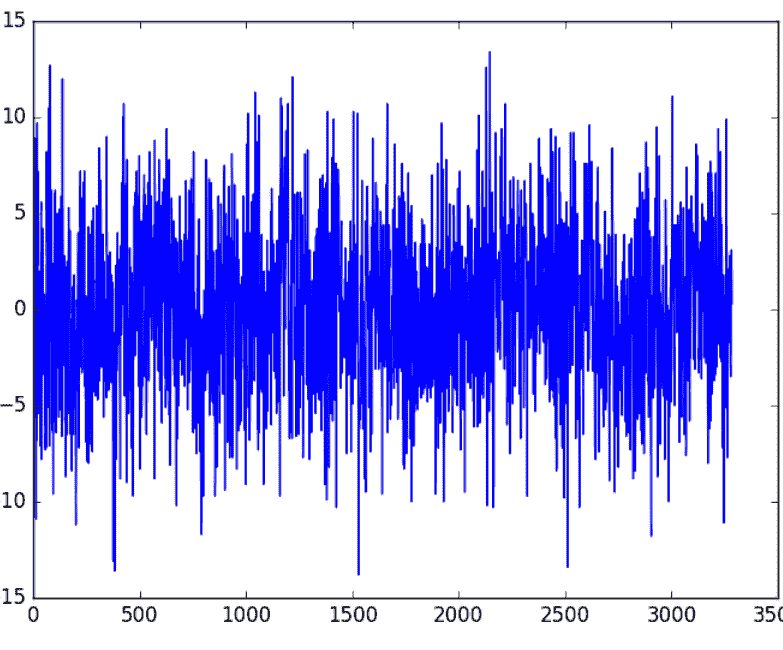

图 14.1：使用差分法对去季节化后的最低日温度数据集绘制的折线图。

我们的数据集中有两个闰年（1984 年和 1988 年）。我们没有显式处理这些问题；这意味着从 1984 年 3 月起，观测数据的偏移量误差为一天，而在 1988 年 3 月之后，偏移量误差为两天。一种选择是更新代码示例，使其支持闰日。

另一种选择是认为一年中任何特定时段内的温度可能保持稳定。也许是在几周内。我们可以简化这个想法，认为日历月份内的所有温度都是稳定的。一个改进的模型可能是减去前一年同一日历月份的平均温度，而不是同一天。我们可以开始将数据集重采样为月度平均最低温度。

```python
# calculate and plot monthly average
from pandas import read_csv
from matplotlib import pyplot
series = read_csv('daily-minimum-temperatures.csv', header=0, index_col=0, parse_dates=True, squeeze=True)
resample = series.resample('M')
monthly_mean = resample.mean()
print(monthly_mean.head(13))
monthly_mean.plot()
pyplot.show()
```

清单 14.2：将最低日温度数据集重采样为月度。

运行此示例将打印出前 13 个月的月平均最低温度。

```text
Date
1981-01-31  17.712903
1981-02-28  17.678571
1981-03-31  13.500000
1981-04-30  12.356667
1981-05-31   9.490323
1981-06-30   7.306667
1981-07-31   7.577419
1981-08-31   7.238710
1981-09-30  10.143333
1981-10-31  10.087097
1981-11-30  11.890000
1981-12-31  13.680645
1982-01-31  16.567742
```

清单 14.3：重采样后的最低日温度数据集前 13 个月的示例输出。

它还绘制了月度数据，清晰地显示了数据集的季节性。

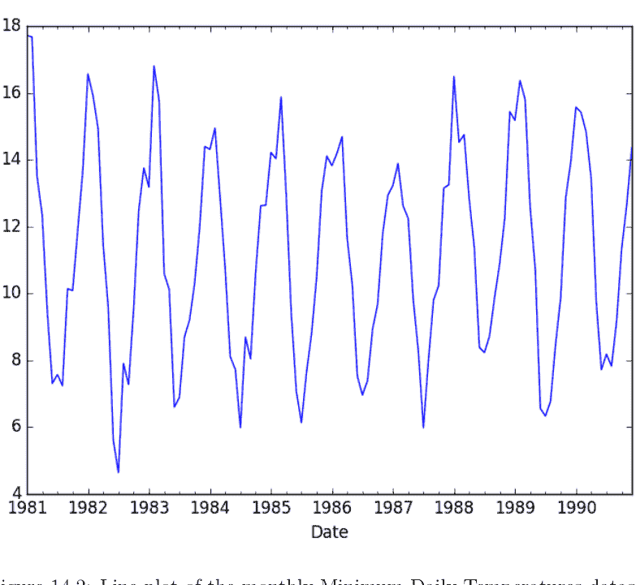

我们可以在月度数据上测试相同的差分方法，并确认去季节化的数据集确实去除了年度周期。

```python
# deseasonalize monthly data by differencing
from pandas import read_csv
from matplotlib import pyplot
series = read_csv('daily-minimum-temperatures.csv', header=0, index_col=0, parse_dates=True, squeeze=True)
resample = series.resample('M')
monthly_mean = resample.mean()
X = series.values
diff = list()
months_in_year = 12
for i in range(months_in_year, len(monthly_mean)):
    value = monthly_mean[i] - monthly_mean[i - months_in_year]
    diff.append(value)
pyplot.plot(diff)
pyplot.show()
```

清单 14.4：使用差分法对去季节化的月度最低日温度数据集。

运行该示例会创建一个新的季节调整后的月度最低温度数据集，并跳过第一年的数据以创建调整值。然后绘制调整后的数据集。

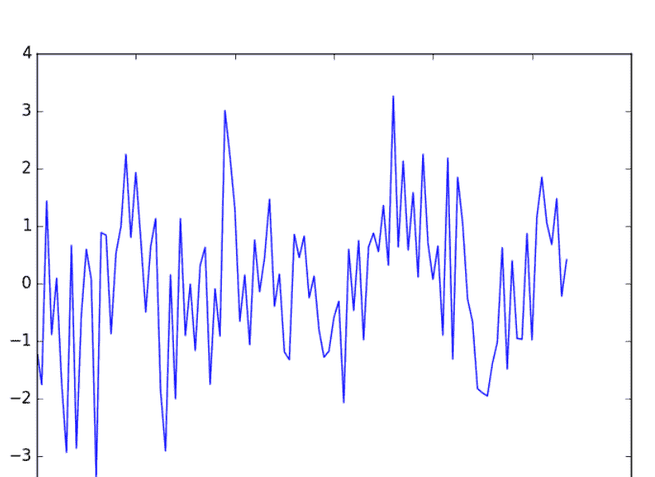

图 14.3：去季节化的月度最低日温度数据集的折线图。

接下来，我们可以使用前一年同月的月平均最低温度来调整日最低温度数据集。同样，我们只是跳过第一年的数据，但使用月度而非每日数据进行校正可能是一种更稳定的方法。

```python
# deseasonalize a time series using month-based differencing
from pandas import read_csv
from matplotlib import pyplot
series = read_csv('daily-minimum-temperatures.csv', header=0, index_col=0, parse_dates=True, squeeze=True)
X = series.values
diff = list()
days_in_year = 365
for i in range(days_in_year, len(X)):
    month_str = str(series.index[i].year-1)+'-'+str(series.index[i].month)
    month_mean_last_year = series[month_str].mean()
    value = X[i] - month_mean_last_year
    diff.append(value)
pyplot.plot(diff)
pyplot.show()
```

清单 14.5：使用月级差分法对最低日温度数据集进行去季节化。

再次运行该示例将创建季节调整后的数据集并绘制结果。此示例对前一年的每日波动以及因闰年 2 月 29 日导致的偏移误差具有鲁棒性。

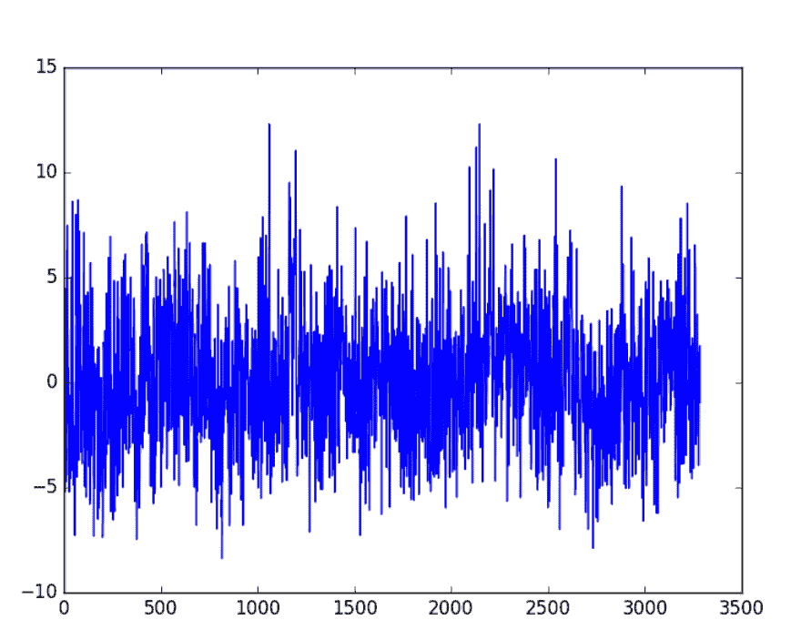

图 14.4：使用月度数据对最低日温度数据集进行去季节化的折线图。

日历月份的边缘提供了一个硬边界，这对于温度数据可能没有意义。更灵活的方法可能是取前一年相同日期前后各一周的平均值，这可能是一种更好的方法。此外，温度数据在多个尺度上可能存在季节性，可以通过直接或间接的方式进行校正，例如：

-   天级。
-   多天级别，例如一周或数周。
-   多周级别，例如一个月。
-   多月级别，例如一个季度或季节。

### 14.4 使用建模方法进行季节调整

我们可以直接对季节分量建模，然后将其从观测值中减去。给定时间序列中的季节分量很可能是具有固定周期和振幅的正弦波。这可以使用曲线拟合方法轻松近似。可以构造一个数据集，以正弦波的时间索引作为输入（或 x 轴），观测值作为输出（或 y 轴）。例如：

| 时间索引 | 观测值 |
| :--- | :--- |
| 1 | obs1 |
| 2 | obs2 |
| 3 | obs3 |
| 4 | obs4 |
| 5 | obs5 |

清单 14.6：时间索引作为特征的示例。

拟合完成后，模型可以用于计算任何时间索引的季节分量。对于温度数据，时间索引将为一年中的天数。然后我们可以估算任何历史观测值或未来任何新观测值的一年中某天的季节分量。该曲线可以作为新的输入用于监督学习算法的建模，或者从观测值中减去以创建季节调整后的序列。

让我们开始对最低日温度数据集拟合一条曲线。NumPy 库提供了 `polyfit()` 函数 [^1]，可用于将选定阶数的多项式拟合到数据集。首先，我们可以创建一个从时间索引（在这种情况下为天数）到观测值的数据集。我们可以取一年的数据或所有年的数据。理想情况下，我们会尝试两者并查看哪种模型产生更好的拟合。我们还可以使用中心于每个值的移动平均线来平滑观测值。这也可能产生拟合更好的模型。

准备好数据集后，我们可以通过调用 `polyfit()` 函数来创建拟合，传入 x 轴值（整数天数）、y 轴值（温度观测值）以及多项式的阶数。阶数控制项的数量，进而控制用于拟合数据的曲线的复杂性。理想情况下，我们希望使用能够描述数据集季节性的最简单曲线。对于一致的正弦波状季节性，4 阶或 5 阶多项式就足够了。在这种情况下，我通过试错选择了 4 阶。所得模型的形式为：

$$y = (x^{4} \times b1) + (x^{3} \times b2) + (x^{2} \times b3) + (x^{1} \times b4) + b5 \quad (14.1)$$

其中 $y$ 是拟合值，$x$ 是时间索引（一年中的天数），$b1$ 到 $b5$ 是由曲线拟合优化算法找到的系数。拟合完成后，我们将拥有一组代表我们模型的系数。然后我们可以使用此模型来计算一个观测值、一年观测值或整个数据集的曲线。完整示例如下所示。

```python
# model seasonality with a polynomial model
from pandas import read_csv
from matplotlib import pyplot
from numpy import polyfit
series = read_csv('daily-minimum-temperatures.csv', header=0, index_col=0, parse_dates=True, squeeze=True)
# fit polynomial: x^2*b1 + x*b2 + ... + bn
X = [i%365 for i in range(0, len(series))]
y = series.values
degree = 4
coef = polyfit(X, y, degree)
print('Coefficients: %s' % coef)
```

[^1]: https://docs.scipy.org/doc/numpy/reference/generated/numpy.polyfit.html


# 创建曲线
curve = list()
for i in range(len(X)):
    value = coef[-1]
    for d in range(degree):
        value += X[i]**(degree-d) * coef[d]
    curve.append(value)
# 在原始数据上绘制曲线
pyplot.plot(series.values)
pyplot.plot(curve, color='red', linewidth=3)
pyplot.show()

清单 14.7：最低日温度数据集中季节性的非线性模型。

运行该示例会创建数据集，拟合曲线，预测数据集中每一天的值，然后绘制在原始数据集上方的季节性模型结果。该模型的一个局限性是它没有考虑到闰日，这会引入一些小的偏移噪声，可以通过更新方法轻松修正。例如，我们可以简单地从数据集中移除两个 2 月 29 日的观测值来创建季节性模型。

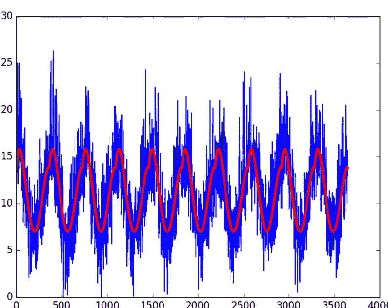

图 14.5：最低日温度数据集（蓝色）和非线性季节性模型（红色）的折线图。

该曲线似乎很好地拟合了数据集中的季节性结构。我们现在可以使用该模型来创建数据集的季节性调整版本。完整示例如下所示。

```python
# 使用多项式模型通过差分进行去季节性
from pandas import read_csv
from matplotlib import pyplot
from numpy import polyfit
series = read_csv('daily-minimum-temperatures.csv', header=0, index_col=0, parse_dates=True, squeeze=True)
# 拟合多项式：x^2*b1 + x*b2 + ... + bn
X = [i**365 for i in range(0, len(series))]
y = series.values
degree = 4
coef = polyfit(X, y, degree)
# 创建曲线
curve = list()
for i in range(len(X)):
    value = coef[-1]
    for d in range(degree):
        value += X[i]**(degree-d) * coef[d]
    curve.append(value)
# 创建季节性调整
values = series.values
diff = list()
for i in range(len(values)):
    value = values[i] - curve[i]
    diff.append(value)
pyplot.plot(diff)
pyplot.show()
```

清单 14.8：使用非线性模型对最低日温度数据集进行去季节性处理。

运行该示例会从原始观测值中减去季节性模型预测的值。然后绘制季节性调整后的数据集。

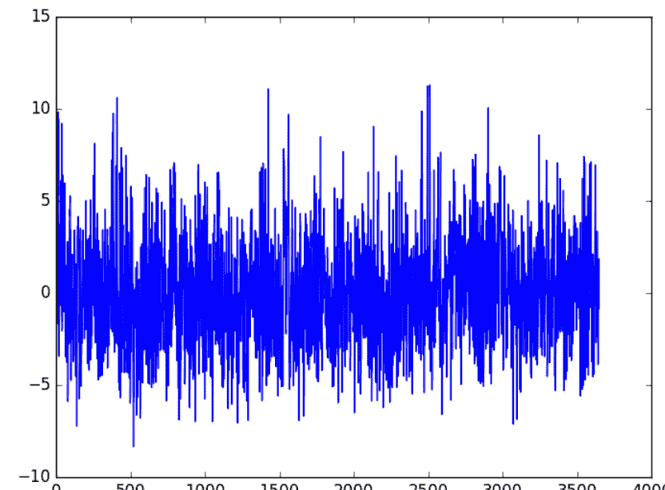

图 14.6：使用非线性模型对最低日温度数据集进行去季节性处理后的折线图。

### 14.5 总结

在本教程中，你了解了如何在 Python 中创建季节性调整的时间序列数据集。具体来说，你学习了：

- 时间序列中季节性的重要性以及它为数据准备和特征工程提供的机会。
- 如何使用差分方法创建季节性调整的时间序列。
- 如何直接建模季节分量并将其从观测值中减去。

### 14.5.1 下一步

在下一课中，你将发现如何识别和检验时间序列数据的平稳性。

# 第 15 章
## 时间序列数据的平稳性

时间序列与更传统的分类和回归预测建模问题不同。时间结构为观测值添加了一个顺序。这种强加的顺序意味着关于这些观测值一致性的关键假设需要专门处理。例如，在建模时，有关于观测值摘要统计量一致性的假设。在时间序列术语中，我们将这种期望称为时间序列是平稳的。在时间序列中，这些假设很容易因为趋势、季节性和其他时间相关结构的加入而被违反。在本教程中，你将发现如何使用 Python 检查你的时间序列是否平稳。完成本教程后，你将知道：

- 如何使用折线图识别明显的平稳和非平稳时间序列。
- 如何抽查摘要统计量（如均值和方差）随时间的变化。
- 如何使用具有统计显著性的统计检验来检查时间序列是否平稳。

让我们开始吧。

### 15.1 平稳时间序列

平稳时间序列中的观测值不依赖于时间。如果时间序列没有趋势或季节效应，则它是平稳的。在时间序列上计算的摘要统计量随时间保持一致，例如观测值的均值或方差。当时间序列平稳时，建模更容易。统计建模方法假设或要求时间序列平稳才能有效。下面是每日女性出生数数据集的示例，该数据集是平稳的。你可以在附录 A.4 中了解有关该数据集的更多信息。

```python
# 加载时间序列数据
from pandas import read_csv
from matplotlib import pyplot
series = read_csv('daily-total-female-births.csv', header=0, index_col=0, parse_dates=True, squeeze=True)
series.plot()
pyplot.show()
```

清单 15.1：加载并绘制每日女性出生数数据集。

运行该示例将创建以下绘图。


## 15.2 非平稳时间序列

非平稳时间序列的观测值显示出季节效应、趋势以及其他依赖于时间索引的结构。均值和方差等摘要统计量会随时间变化，为模型试图捕捉的概念提供漂移。经典的时间序列分析和预测方法关注通过识别和去除趋势以及移除季节效应，使非平稳时间序列数据变为平稳。下面是航空公司乘客数据集的示例，该数据集是非平稳的，显示了趋势和季节分量。你可以在附录 A.5 中了解有关该数据集的更多信息。

```python
# 加载时间序列数据
from pandas import read_csv
from matplotlib import pyplot
series = read_csv('airline-passengers.csv', header=0, index_col=0, parse_dates=True, squeeze=True)
series.plot()
pyplot.show()
```

清单 15.2：加载并绘制航空公司乘客数据集。

运行该示例将创建以下绘图。


### 15.3 平稳时间序列的类型

平稳性的概念来自时间序列的理论研究，在预测中它是一个有用的抽象。如果你深入研究这个主题，你可能会遇到一些更细致的平稳性概念。它们是：

- **平稳过程**：生成平稳观测序列的过程。
- **平稳模型**：描述平稳观测序列的模型。
- **趋势平稳**：不表现出趋势的时间序列。
- **季节平稳**：不表现出季节性的时间序列。
- **严格平稳**：平稳过程的数学定义，具体指观测值的联合分布对时间平移是不变的。

### 15.4 平稳时间序列与预测

你应该使你的时间序列平稳吗？通常是的。如果你的时间序列中有明显的趋势和季节性，那么建模这些分量，从观测值中去除它们，然后对残差进行模型训练。

如果我们拟合平稳模型到数据，我们假设我们的数据是平稳过程的实现。因此，我们在分析中的第一步应该是检查是否存在趋势或季节效应的证据，如果存在，则去除它们。

> — 引自《R 语言入门时间序列分析》第 122 页。

统计时间序列方法甚至现代机器学习方法都会从数据中更清晰的信号中受益。但是……

当经典方法失效时，我们转向机器学习方法。当我们想要更多或更好的结果时。我们无法知道如何最好地对时间序列数据中未知的非线性关系进行建模，某些方法在处理非平稳观测值或平稳与非平稳视图的混合时可能会产生更好的性能。

这里的建议是将时间序列的平稳性或非平稳性视为另一种可用于使用机器学习方法对时间序列问题进行特征工程和特征选择的信息来源。

### 15.5 平稳性检查

有许多方法可以检查时间序列（直接观测值、残差等）是平稳还是非平稳。

- **查看绘图：** 你可以回顾数据的时序图并目视检查是否存在明显的趋势或季节性。
- **摘要统计量：** 你可以回顾数据的季节或随机分区的摘要统计量，并检查是否存在明显或显著的差异。
- **统计检验：** 你可以使用统计检验来检查是否满足或违反了平稳性的期望。

上文，我们已经介绍了每日女性出生数数据集和航空公司乘客数据集，分别作为平稳和非平稳示例，并通过绘图显示了趋势和季节分量的明显缺失和存在。接下来，我们将查看一种快速而粗略的方法，计算和回顾时间序列数据集的摘要统计量，以检查其是否平稳。

### 15.6 摘要统计量

检查你的时间序列是否非平稳的一种快速而粗略的方法是回顾摘要统计量。你可以将时间序列分为两个（或更多）分区，并比较每组的均值和方差。如果它们不同且差异具有统计显著性，则时间序列很可能是非平稳的。接下来，让我们尝试在每日出生数数据集上使用这种方法。


## 15.6.1 每日出生数据集

由于我们要考察均值和方差，我们假设数据符合高斯分布（也称为钟形曲线或正态分布）。我们也可以通过直观地观察观察值的直方图来快速验证这一点。

```python
# 绘制时间序列的直方图
from pandas import read_csv
from matplotlib import pyplot
series = read_csv('daily-total-female-births.csv', header=0, index_col=0, parse_dates=True, squeeze=True)
series.hist()
pyplot.show()
```

列表 15.3：创建每日女性出生数据集的直方图。

运行该示例会绘制时间序列值值的直方图。我们可以清楚地看到高斯分布的钟形曲线形状，也许右尾稍长。


图 15.3：每日女性出生数据集的直方图。

接下来，我们可以将时间序列拆分为两个连续的序列。然后，我们可以计算每组数字的均值和方差，并比较这些值。

```python
# 计算分区时间序列数据的统计信息
from pandas import read_csv
series = read_csv('daily-total-female-births.csv', header=0, index_col=0, parse_dates=True,
squeeze=True)
X = series.values
split = int(len(X) / 2)
X1, X2 = X[0:split], X[split:]
mean1, mean2 = X1.mean(), X2.mean()
var1, var2 = X1.var(), X2.var()
print('mean1=%f, mean2=%f' % (mean1, mean2))
print('variance1=%f, variance2=%f' % (var1, var2))
```

列表 15.4：每日女性出生数据集的汇总统计信息。

运行此示例显示均值和方差值不同，但在同一量级范围内。

```
mean1=39.763736, mean2=44.185792
variance1=49.213410, variance2=48.708651
```

列表 15.5：每日女性出生数据集汇总统计信息的示例输出。

接下来，让我们对航空乘客数据集尝试同样的技巧。

## 15.6.2 航空乘客数据集

直奔主题，我们可以拆分数据集并计算每组的均值和方差。

```python
# 计算分区时间序列数据的统计信息
from pandas import read_csv
series = read_csv('airline-passengers.csv', header=0, index_col=0, parse_dates=True,
squeeze=True)
X = series.values
split = int(len(X) / 2)
X1, X2 = X[0:split], X[split:]
mean1, mean2 = X1.mean(), X2.mean()
var1, var2 = X1.var(), X2.var()
print('mean1=%f, mean2=%f' % (mean1, mean2))
print('variance1=%f, variance2=%f' % (var1, var2))
```

列表 15.6：航空乘客数据集的汇总统计信息。

运行该示例，我们可以看到均值和方差看起来非常不同。这是一个非平稳时间序列。

```
mean1=182.902778, mean2=377.694444
variance1=2244.087770, variance2=7367.962191
```

列表 15.7：航空乘客数据集汇总统计信息的示例输出。

好吧，也许吧。让我们退后一步，通过绘制时间序列值的直方图来检查在这种情况下假设高斯分布是否合理。

```python
series.hist()
pyplot.show()
```

列表 15.8：创建航空乘客数据集的直方图。

运行该示例表明，值的分布确实不像高斯分布，因此均值和方差值的意义不大。观察值这种压缩的分布可能是非平稳时间序列的另一个指标。


图 15.4：航空乘客数据集的直方图。

再次回顾时间序列的绘图，我们可以看到存在明显的季节性成分，而且季节性成分似乎在增长。这可能暗示着季节间的指数增长。可以使用对数变换将指数变化拉回线性关系，从而压平变化。下面是同一时间序列经过对数变换后的直方图。

```python
# 对数变换时间序列的直方图和折线图
from pandas import read_csv
from matplotlib import pyplot
from numpy import log
series = read_csv('airline-passengers.csv', header=0, index_col=0, parse_dates=True, squeeze=True)
X = series.values
X = log(X)
pyplot.hist(X)
pyplot.show()
pyplot.plot(X)
pyplot.show()
```

列表 15.9：创建对数变换后的航空乘客数据集的直方图。

运行该示例，我们可以看到值呈现出更熟悉的类高斯分布或类均匀分布。


图 15.5：对数变换后的航空乘客数据集的直方图。

我们还创建了数据对数变换后的折线图，可以看到指数增长似乎有所减弱（与附录中该数据集的折线图相比），但我们仍有趋势和季节性要素。


图 15.6：对数变换后的航空乘客数据集的折线图。

我们现在可以计算对数变换数据集值的均值和标准差。

```python
# 计算分区对数变换时间序列数据的统计信息
from pandas import read_csv
from numpy import log
series = read_csv('airline-passengers.csv', header=0, index_col=0, parse_dates=True, squeeze=True)
X = series.values
X = log(X)
split = int(len(X) / 2)
X1, X2 = X[0:split], X[split:]
mean1, mean2 = X1.mean(), X2.mean()
var1, var2 = X1.var(), X2.var()
print('mean1=%f, mean2=%f' % (mean1, mean2))
print('variance1=%f, variance2=%f' % (var1, var2))
```

列表 15.10：对数变换后的航空乘客数据集的汇总统计信息。

运行示例显示每组再次相似但并非完全相同的均值和标准差值。或许仅凭这些数字，我们会说该时间序列是平稳的，但从回顾折线图来看，我们坚信事实并非如此。

```
mean1=5.175146, mean2=5.909206
variance1=0.068375, variance2=0.049264
```

列表 15.11：对数变换后的航空乘客数据集汇总统计信息的示例输出。

这是一种快速且粗略的方法，很容易被误导。我们可以使用统计检验来检查两个高斯随机变量样本之间的差异是真实的还是统计上的偶然。我们可以探索统计显著性检验，如 Student’s t-test，但由于值之间的序列相关性，情况变得棘手。在下一节中，我们将使用一种专门用于评论单变量时间序列是否平稳的统计检验。

### 15.7 增广迪基-富勒检验

统计检验对数据做出了强烈的假设。它们只能用于告知在多大程度上可以拒绝（或无法拒绝）原假设。为了使结果有意义，必须针对特定问题进行解读。尽管如此，它们可以提供快速检查和确认性证据，以表明你的时间序列是平稳的还是非平稳的。

增广迪基-富勒检验（Augmented Dickey-Fuller test）是一种称为单位根检验<sup>1</sup>的统计检验。单位根检验背后的直觉在于，它确定时间序列在多大程度上由趋势定义。

有许多种单位根检验，增广迪基-富勒检验可能是其中使用最广泛的之一。它使用自回归模型并针对多个不同的滞后值优化信息准则。该检验的原假设是时间序列可以用单位根表示，即它不是平稳的（具有某种时间依赖结构）。备择假设（拒绝原假设）是时间序列是平稳的。

- **原假设 (H0)：** 无法拒绝，表明时间序列存在单位根，意味着它是非平稳的。它具有某种时间依赖结构。
- **备择假设 (H1)：** 拒绝原假设；表明时间序列不存在单位根，意味着它是平稳的。它不具有时间依赖结构。

我们使用该检验的 p 值来解读这一结果。低于阈值（如 5% 或 1%）的 p 值表明我们拒绝原假设（平稳），否则高于阈值的 p 值表明我们无法拒绝原假设（非平稳）。

- **p 值 > 0.05：** 无法拒绝原假设 (H0)，数据存在单位根且是非平稳的。
- **p 值 ≤ 0.05：** 拒绝原假设 (H0)，数据不存在单位根且是平稳的。

下面是一个在每日女性出生数据集上计算增广迪基-富勒检验的示例。Statsmodels 库提供了实现该检验的 adfuller() 函数<sup>2</sup>。


# 15.7 平稳性检验（根据内容推断的上下文）

*注：文本以平稳性检验的代码开始。根据内容流向，本节可能紧跟在通过绘图和统计量检查平稳性的讨论之后。*

## 列表 15.12：对每日女性出生数据集进行增广迪基-福勒检验（Augmented Dickey-Fuller test）。

```python
# calculate stationarity test of time series data
from pandas import read_csv
from statsmodels.tsa.stattools import adfuller

series = read_csv('daily-total-female-births.csv', header=0, index_col=0, parse_dates=True, squeeze=True)
X = series.values
result = adfuller(X)
print('ADF Statistic: %f' % result[0])
print('p-value: %f' % result[1])
print('Critical Values:')
for key, value in result[4].items():
    print('\t%s: %.3f' % (key, value))
```

运行示例会打印出检验统计量值为 -4.808291。该统计量越负，我们拒绝原假设的可能性就越大（即我们拥有平稳数据集）。作为输出的一部分，我们获得一个查找表以帮助确定 ADF 统计量。我们可以看到，我们的统计量值 -4.808291 小于 1% 显著性水平下的临界值 -3.449。

这表明我们可以在小于 1% 的显著性水平下拒绝原假设（即结果是统计巧合的概率较低）。拒绝原假设意味着该过程没有单位根，进而意味着时间序列是平稳的，或者不具有时间依赖结构。

```text
ADF Statistic: -4.808291
p-value: 0.000052
Critical Values:
	1%: -3.449
	5%: -2.870
	10%: -2.571
```

## 列表 15.13：对每日女性出生数据集进行增广迪基-福勒检验的输出示例。

我们可以对航空公司乘客数据集进行相同的检验。

```python
# calculate stationarity test of time series data
from pandas import read_csv
from statsmodels.tsa.stattools import adfuller

series = read_csv('airline-passengers.csv', header=0, index_col=0, parse_dates=True, squeeze=True)
X = series.values
result = adfuller(X)
print('ADF Statistic: %f' % result[0])
print('p-value: %f' % result[1])
print('Critical Values:')
for key, value in result[4].items():
    print('\t%s: %.3f' % (key, value))
```

## 列表 15.14：对航空公司乘客数据集进行增广迪基-福勒检验。

运行示例展示了与上述不同的情况。检验统计量为正值，这意味着我们拒绝原假设的可能性小得多（看起来是非平稳的）。将检验统计量与临界值进行比较，看起来我们必须无法拒绝原假设，即时间序列是非平稳的，且具有时间依赖结构。

```text
ADF Statistic: 0.815369
p-value: 0.991880
Critical Values:
	1%: -3.482
	5%: -2.884
	10%: -2.579
```

## 列表 15.15：对航空公司乘客数据集进行增广迪基-福勒检验的输出示例。

让我们再次对数据集进行对数变换，使数值分布更线性化，从而更好地满足该统计检验的预期。

```python
# calculate stationarity test of log transformed time series data
from pandas import read_csv
from statsmodels.tsa.stattools import adfuller
from numpy import log

series = read_csv('airline-passengers.csv', header=0, index_col=0, parse_dates=True, squeeze=True)
X = series.values
X = log(X)
result = adfuller(X)
print('ADF Statistic: %f' % result[0])
print('p-value: %f' % result[1])
for key, value in result[4].items():
    print('\t%s: %.3f' % (key, value))
```

## 列表 15.16：对对数变换后的航空公司乘客数据集进行增广迪基-福勒检验。

运行示例显示检验统计量为负值。我们可以看到该值大于临界值，再次意味着我们未能拒绝原假设，进而意味着时间序列是非平稳的。

```text
ADF Statistic: -1.717017
p-value: 0.422367
Critical Values:
	1%: -3.482
	5%: -2.884
	10%: -2.579
```

## 列表 15.17：对对数变换后的航空公司乘客数据集进行增广迪基-福勒检验的输出示例。

### 15.8 总结

在本教程中，你学习了如何使用 Python 检查你的时间序列是否平稳。具体而言，你学到了：

- 时间序列数据平稳性对于使用统计建模方法甚至某些现代机器学习方法的重要性。
- 如何使用折线图和基本描述性统计量来检查时间序列是否平稳。
- 如何计算和解释统计显著性检验以检查时间序列是否平稳。

### 15.8.1 下一步

这标志着第三部分的结束。在第四部分中，你将学习如何评估时间序列预测模型，从如何进行模型回溯测试开始。

# 第四部分

# 评估模型

# 第 16 章

## 回溯测试预测模型

时间序列预测的目标是对未来做出准确的预测。我们在机器学习中依赖的快速且强大的方法，如使用训练-测试分割和 *k*-折交叉验证，在时间序列数据中并不适用。这是因为它们忽略了问题固有的时间分量。在本教程中，你将学习如何使用 Python 在时间序列数据上评估机器学习模型。在时间序列预测领域，这被称为回溯测试（backtesting）或后验测试（hindcasting）。完成本教程后，你将了解：

- 传统机器学习模型评估方法的局限性，以及为什么需要在样本外数据上评估模型。
- 如何在 Python 中创建时间序列数据的训练-测试分割和多个训练-测试分割以用于模型评估。
- 向前验证（Walk-Forward Validation）如何提供在时间序列数据上对机器学习模型最现实的评估。

让我们开始吧。

## 16.1 模型评估

我们如何知道给定模型的表现有多好？我们可以用于训练它的数据上对其进行评估。这是无效的。这可能会提供关于所选模型工作原理的见解，甚至如何改进它。但是，基于此数据的任何性能估计都会过于乐观，基于此性能的决策将会存在偏差。为什么？

将其推向极端很有帮助：一个记住每个观测值时间戳和数值的模型将实现完美表现。我们准备的所有实际模型报告的结果都将是这种结果的苍白版本。

在为时间序列预测评估模型时，我们感兴趣的是模型在未用于训练其的数据上的表现。在机器学习中，我们将此称为未见数据或样本外数据。我们可以通过分割我们现有的数据来实现这一点。我们使用一部分数据来准备模型，保留一部分数据，并要求模型为该时段做出预测。对这些预测的评估将提供模型在操作使用中表现的良好代理指标。

在应用机器学习中，我们通常将数据分割为训练集和测试集：用于准备模型的训练集和用于评估模型的测试集。我们甚至可以使用 *k*-折交叉验证，通过系统地将数据分割成 *k* 个组来重复此过程，每个组都有机会作为保留的模型。

这些方法不能直接用于时间序列数据。这是因为它们假设观测之间没有关系，即每个观测是独立的。对于时间序列数据，这一点是不正确的，观测的时间维度意味着我们不能随机将它们分组。相反，我们必须分割数据并尊重数值观测到的时间顺序。

在时间序列预测中，这种在历史数据上评估模型的方法称为回溯测试（backtesting）。在一些时间序列领域，如气象学，这被称为后验测试（hindcasting），而非预测（forecasting）。我们将查看你可以用于在时间序列问题上回溯测试机器学习模型的三种不同方法。它们是：

1. 尊重观测时间顺序的训练-测试分割。
2. 尊重观测时间顺序的多个训练-测试分割。
3. 向前验证（Walk-Forward Validation），模型在接收到新数据时每个时间步都可能更新。

首先，让我们看一下一个小的单变量时间序列数据，我们将使用它作为背景来理解这三种回溯测试方法：太阳黑子数据集。

## 16.2 月度太阳黑子数据集

在本课中，我们将使用月度太阳黑子数据集作为示例。该数据集描述了略超过 230 年（1749–1983）每月观测到的太阳黑子数量。你可以在附录 A.3 中了解有关该数据集的更多信息。将数据集以文件名 `sunspots.csv` 放置在你的当前工作目录中。

## 16.3 训练-测试分割

你可以将数据集分割为训练子集和测试子集。你的模型可以在训练数据集上进行准备，并且可以为测试数据集进行预测和评估。这可以通过在有序观测列表中选择一个任意的分割点并创建两个新数据集来完成。根据你可用的数据量以及所需的数据量，你可以使用 50-50、70-30 和 90-10 的分割比例。在 Python 中分割数据是很简单的。

在将数据集加载为 Pandas Series 后，我们可以提取数据值的 NumPy 数组。分割点可以作为数组中的特定索引进行计算。所有直到分割点的记录被取为训练数据集，从分割点到观测列表末尾的所有记录被取为测试集。以下是使用 66-34 分割比例在 Python 中的示例。


### 计算时间序列数据集的训练-测试拆分

```python
from pandas import read_csv
series = read_csv('sunspots.csv', header=0, index_col=0, parse_dates=True, squeeze=True)
X = series.values
train_size = int(len(X) * 0.66)
train, test = X[0:train_size], X[train_size:len(X)]
print('Observations: %d' % (len(X)))
print('Training Observations: %d' % (len(train)))
print('Testing Observations: %d' % (len(test)))
```

列表 16.1：月度太阳黑子数据集的训练-测试拆分示例。

运行该示例会打印出加载数据集的大小，以及由拆分创建的训练集和测试集的大小。

```
Observations: 2820
Training Observations: 1861
Testing Observations: 959
```

列表 16.2：月度太阳黑子数据集的训练-测试拆分示例输出。

我们可以通过使用不同颜色绘制训练集和测试集来直观展示这一点。

```python
# plot train-test split of time series data
from pandas import read_csv
from matplotlib import pyplot

series = read_csv('sunspots.csv', header=0, index_col=0, parse_dates=True, squeeze=True)
X = series.values
train_size = int(len(X) * 0.66)
train, test = X[0:train_size], X[train_size:len(X)]
print('Observations: %d' % (len(X)))
print('Training Observations: %d' % (len(train)))
print('Testing Observations: %d' % (len(test)))
pyplot.plot(train)
pyplot.plot([None for i in train] + [x for x in test])
pyplot.show()
```

列表 16.3：带有绘图的月度太阳黑子数据集训练-测试拆分示例。

运行该示例会将训练数据集绘制为蓝色，将测试数据集绘制为绿色。


图 16.1：月度太阳黑子数据集的训练（蓝色）和测试（绿色）拆分的折线图。

使用训练-测试拆分方法来评估机器学习模型速度很快。准备数据的过程简单直观，并且只创建和评估一个模型。当拥有大量数据时，这使得训练集和测试集都能代表原始问题，因此非常有用。接下来，我们将查看如何重复此过程多次。

## 16.4 多次训练-测试拆分

我们可以多次重复将时间序列拆分为训练集和测试集的过程。这需要训练和评估多个模型，但这种额外的计算开销将为所选方法和配置在未见数据上的预期性能提供更稳健的估计。我们可以通过重复前一部分中描述的过程并采用不同的拆分点来手动实现这一点。

或者，scikit-learn 库通过 `TimeSeriesSplit` 对象为我们提供了这种能力。您必须指定要创建的拆分数量，并且 `TimeSeriesSplit` 将返回每个请求的拆分中训练和测试观察值的索引。每次拆分迭代（$i$）的训练和测试观察值总数计算如下：

```
training_size = i × (n_samples / (n_splits + 1)) + (n_samples mod (n_splits + 1))
test_size = n_samples / (n_splits + 1)    (16.1)
```

其中 **n_samples** 是观察值的总数，**n_splits** 是拆分的总数。让我们通过一个例子具体说明。假设我们有 100 个观察值，并希望创建 2 个拆分。对于第一个拆分，训练大小计算为：

```
train = i × (n_samples / (n_splits + 1)) + (n_samples mod (n_splits + 1))
     = 1 × (100 / (2 + 1)) + (100 mod (2 + 1))
     = 33.3
     = 33    (16.2)
```

第一个拆分的测试集大小计算为：

```
test = n_samples / (n_splits + 1)
     = 100 / (2 + 1)
     = 33.3
     = 33    (16.3)
```

即前 33 条记录用于训练，接下来的 33 条记录用于测试。第二个拆分中训练集的大小计算如下：

```
train = i × (n_samples / (n_splits + 1)) + (n_samples mod (n_splits + 1))
     = 2 × (100 / (2 + 1)) + (100 mod (2 + 1))
     = 66.6
     = 66    (16.4)
```

第二个拆分中测试集的大小计算如下：

```
test = n_samples / (n_splits + 1)
     = 100 / (2 + 1)
     = 33.3
     = 33    (16.5)
```

或者，前 67 条记录用于训练，剩余的 33 条记录用于测试。可以看到测试集的大小保持一致。这意味着在每个训练模型的预测上计算的性能统计数据将保持一致，并且可以合并和比较。这提供了“苹果对苹果”的比较。

不同的是每次拆分用于训练模型的记录数量，提供了越来越大历史数据供处理。这可能成为结果分析的一个有趣方面。或者，这也可能通过保持用于训练模型的观察值数量一致来控制，每次拆分仅使用训练数据集中相同数量的最新（最后）观察值来训练模型，在这个虚构的例子中是 33 个。

让我们看看如何将 TimeSeriesSplit 应用于我们的太阳黑子数据。该数据集有 2,820 个观察值。让我们为该数据集创建 3 个拆分。使用上述相同的算术运算，我们预计将创建以下训练和测试拆分：

- **拆分 1：** 705 个训练，705 个测试
- **拆分 2：** 1,410 个训练，705 个测试
- **拆分 3：** 2,115 个训练，705 个测试

与前面的例子一样，我们将使用不同的颜色绘制训练和测试观察值。在这种情况下，我们将有 3 个拆分，因此将有 3 个独立的数据绘图。

```python
# calculate repeated train-test splits of time series data
from pandas import read_csv
from sklearn.model_selection import TimeSeriesSplit
from matplotlib import pyplot
series = read_csv('sunspots.csv', header=0, index_col=0, parse_dates=True, squeeze=True)
X = series.values
splits = TimeSeriesSplit(n_splits=3)
pyplot.figure(1)
index = 1
for train_index, test_index in splits.split(X):
    train = X[train_index]
    test = X[test_index]
    print('Observations: %d' % (len(train) + len(test)))
    print('Training Observations: %d' % (len(train)))
    print('Testing Observations: %d' % (len(test)))
    pyplot.subplot(310 + index)
    pyplot.plot(train)
    pyplot.plot([None for i in train] + [x for x in test])
    index += 1
pyplot.show()
```

列表 16.4：月度太阳黑子数据集的多次训练-测试拆分示例。

运行该示例会打印每个拆分的训练集和测试集的数量和大小。我们可以看到每个拆分中训练集和测试集的观察值数量与使用上述简单算术运算计算出的预期值相匹配。

```
Observations: 1410
Training Observations: 705
Testing Observations: 705

Observations: 2115
Training Observations: 1410
Testing Observations: 705

Observations: 2820
Training Observations: 2115
Testing Observations: 705
```

列表 16.5：月度太阳黑子数据集的多次训练-测试拆分示例输出，间距用于提高可读性。

绘图还显示了 3 个拆分以及每个后续图中总观察值数量的增加。


图 16.2：月度太阳黑子数据集的重复训练（蓝色）和测试（绿色）拆分的折线图。

使用多次训练-测试拆分将导致训练更多的模型，进而更准确地估计模型在未见数据上的性能。训练-测试拆分方法的一个局限性是，在测试集的每次评估中，训练好的模型保持固定。这可能不现实，因为随着新的每日或每月观察值变得可用，模型可以重新训练。这种顾虑在下一节中得到解决。

## 16.5 向前验证

在实践中，我们很可能会在新数据变得可用时重新训练模型。这将给模型在每个时间步做出良好预测提供最佳机会。我们可以在这一假设下评估我们的机器学习模型。有少数几个决定需要做出：

1. **最少观察值数量。** 首先，我们必须选择训练模型所需的最少观察值数量。如果使用滑动窗口，这可以被视为窗口宽度（参见下一点）。

2. **滑动或扩展窗口。** 接下来，我们需要决定模型是在其可用的所有数据上进行训练，还是仅在最近的观察值上进行训练。这决定了是使用滑动窗口还是扩展窗口。

为您的测试设置选择了合理的配置后，可以训练和评估模型：

1. 从时间序列的开头开始，使用窗口中样本的最少数量来训练模型。
2. 模型对下一个时间步做出预测。
3. 预测被存储或与已知值进行评估。
4. 窗口扩展以包含已知值，并重复该过程（回到步骤 1）。

由于这种方法涉及沿时间序列一次一个时间步地移动，它通常被称为向前测试或向前验证。此外，由于使用滑动或扩展窗口来训练模型，这种方法也被称为滚动窗口分析或滚动预测。此功能目前不可用于 scikit-learn，尽管您可以使用精心配置的 TimeSeriesSplit 来构造相同的效果。下面是一个使用向前验证方法将数据拆分为训练集和测试集的示例。

```python
# walk forward evaluation model for time series data
from pandas import read_csv
series = read_csv('sunspots.csv', header=0, index_col=0, parse_dates=True, squeeze=True)
X = series.values
n_train = 500
n_records = len(X)
for i in range(n_train, n_records):
    train, test = X[0:i], X[i:i+1]
    print('train=%d, test=%d' % (len(train), len(test)))
```

列表 16.6：月度太阳黑子数据集的向前验证示例。

运行该示例只是打印出创建的测试集和训练集的大小。我们可以看到训练集在每个时间步扩展，而测试集固定在一个时间步之外。循环内部是训练和评估模型的地方。

```
train=500, test=1
train=501, test=1
train=502, test=1
...
train=2815, test=1
train=2816, test=1
train=2817, test=1
train=2818, test=1
train=2819, test=1
```


列表 16.7：月度太阳黑子数据集的前向验证示例输出，为简洁起见已删减。

我们可以看到，创建了许多更多的模型。这样做的好处是，它能更稳健地评估所选择的建模方法和参数在实际中的表现。这种改进后的估算以增加创建大量模型的计算成本为代价。如果建模方法简单或数据集较小（如本例所示），这种成本并不高，但在大规模应用中可能会成为一个问题。在上述情况下，将创建并评估 2,820 个模型。

因此，需要仔细关注窗口宽度和窗口类型。这些参数可以调整，从而为问题构建一个计算成本显著更低的测试框架。前向验证是模型评估的黄金标准。它是时间序列领域的 *k* 折交叉验证，推荐在你自己的项目中使用。

## 16.6 总结

在本教程中，你学习了如何使用 Python 对时间序列数据上的机器学习模型进行回测。具体来说，你学到了：

- 在未见数据或样本外数据上评估模型性能的重要性。
- 如何创建时间序列数据的训练-测试集划分，以及如何自动创建多个这样的划分。
- 如何使用前向验证来提供评估模型的最真实的测试框架。

### 16.6.1 下一步

在下一课中，你将了解用于评估预测模型技能的性能度量指标。

# 第 17 章

# 预测性能度量

时间序列预测性能度量指标提供了对所产生预测的预测模型的技能和能力进行总结。有许多不同的性能度量指标可供选择。知道使用哪个指标以及如何解释结果可能会令人困惑。在本教程中，你将了解使用 Python 评估时间序列预测的性能度量指标。时间序列通常专注于真实值的预测，这被称为回归问题。因此，本教程中的性能度量指标将专注于评估实值预测的方法。完成本教程后，你将了解：

- 预测性能的基本度量指标，包括残差预测误差和预测偏差。
- 与预期结果单位相同的时间序列预测误差计算方法，例如平均绝对误差。
- 广泛使用的惩罚大误差的误差计算方法，例如均方误差和均方根误差。

让我们开始吧。

## 17.1 预测误差（或残差预测误差）

预测误差计算为预期值减去预测值。这被称为预测的残差误差。

```
forecast_error = expected_value − predicted_value      (17.1)
```

可以为每个预测计算预测误差，从而提供预测误差的时间序列。下面的示例演示了如何计算 5 个预测值与 5 个预期值相比的预测误差。该示例是专门为演示目的而构造的。

```
# calculate forecast error
expected = [0.0, 0.5, 0.0, 0.5, 0.0]
predictions = [0.2, 0.4, 0.1, 0.6, 0.2]
forecast_errors = [expected[i]-predictions[i] for i in range(len(expected))]
print('Forecast Errors: %s' % forecast_errors)
```

列表 17.1：计算预测误差的示例。

运行示例会为 5 个预测中的每一个计算预测误差。然后打印预测误差列表。

```
Forecast Errors: [-0.2, 0.09999999999999998, -0.1, -0.09999999999999998, -0.2]
```

列表 17.2：计算预测误差的示例输出。

预测误差的单位与预测值的单位相同。预测误差为零表示没有误差，或者该预测具有完美的技能。

## 17.2 平均预测误差（或预测偏差）

平均预测误差计算为预测误差值的平均值。

```
mean_forecast_error = mean({ forecast_error })      (17.2)
```

预测误差可以是正值，也可以是负值。这意味着，当计算这些值的平均值时，理想的平均预测误差应为零。非零的平均预测误差值表明模型倾向于过度预测（负误差）或预测不足（正误差）。因此，平均预测误差也被称为预测偏差。预测误差可以直接作为预测值的均值进行计算。下面的示例演示了如何手动计算预测误差的均值。

```
# calculate mean forecast error
expected = [0.0, 0.5, 0.0, 0.5, 0.0]
predictions = [0.2, 0.4, 0.1, 0.6, 0.2]
forecast_errors = [expected[i]-predictions[i] for i in range(len(expected))]
bias = sum(forecast_errors) * 1.0/len(expected)
print('Bias: %f' % bias)
```

列表 17.3：计算平均预测误差的示例。

运行示例将打印平均预测误差，也称为预测偏差。在这种情况下，结果为负值，意味着我们进行了过度预测。

```
Bias: -0.100000
```

列表 17.4：计算平均预测误差的示例输出。

预测偏差的单位与预测值的单位相同。预测偏差为零或非常接近零的小数，表明模型是无偏的。

## 17.3 平均绝对误差

平均绝对误差（MAE）计算为预测误差值的平均值，其中所有预测值都被强制为正数。将值强制为正数称为取绝对值。这由绝对值函数 `abs( )` 表示，或在数学上表示为值周围的双竖线：|value|。

```
mean_absolute_error = mean({ abs({ forecast_error }) })      (17.3)
```

其中 abs() 使值变为正数，forecast_error 是一个或一系列预测误差，mean() 计算平均值。我们可以使用 scikit-learn 库中的 mean_absolute_error() 函数<sup>1</sup> 来计算预测列表的平均绝对误差。下面的示例演示了该函数。

```
# calculate mean absolute error
from sklearn.metrics import mean_absolute_error
expected = [0.0, 0.5, 0.0, 0.5, 0.0]
predictions = [0.2, 0.4, 0.1, 0.6, 0.2]
mae = mean_absolute_error(expected, predictions)
print('MAE: %.1f' % mae)
```

列表 17.5：计算平均绝对误差的示例。

运行示例将计算并打印 5 个预期值和预测值列表的平均绝对误差。

```
MAE: 0.140000
```

列表 17.6：计算平均绝对误差的示例输出。

这些误差值具有预测值的原始单位。平均绝对误差为零表示没有误差。

## 17.4 均方误差

均方误差（MSE）计算为平方预测误差值的平均值。对预测误差值取平方将其强制为正数；它还起到了对大误差赋予更大权重的作用。非常大的或离群的预测误差被平方，进而将平方预测误差的均值拉高，导致更大的均方误差分数。实际上，该分数对那些做出重大错误预测的模型给出了更差的性能评价。

```
mean_squared_error = mean(forecast_error²)    (17.4)
```

我们可以使用 scikit-learn 中的 mean_squared_error() 函数<sup>2</sup> 来计算预测列表的均方误差。下面的示例演示了该函数。

```
# calculate mean squared error
from sklearn.metrics import mean_squared_error
expected = [0.0, 0.5, 0.0, 0.5, 0.0]
predictions = [0.2, 0.4, 0.1, 0.6, 0.2]
mse = mean_squared_error(expected, predictions)
print('MSE: %.1f' % mse)
```

列表 17.7：计算均方误差的示例。

运行示例将计算并打印预期值和预测值列表的均方误差。


MSE：0.022000

Listing 17.8：计算均方误差的示例输出。

误差值处于预测值的平方单位中。均方误差为零表示完美的技能，或者没有误差。

## 17.5 均方根误差

上述描述的均方误差处于预测值的平方单位中。可以通过对均方误差得分取平方根，将其转换回预测值的原始单位。这被称为均方根误差，或 RMSE。

$$rmse = \sqrt{mean\ squared\ error}\ \ \ \ (17.5)$$

这可以通过使用 `sqrt()` 数学函数对使用 scikit-learn 的 `mean_squared_error()` 函数计算出的均方误差进行计算来实现。

```
# calculate root mean squared error
from sklearn.metrics import mean_squared_error
from math import sqrt
expected = [0.0, 0.5, 0.0, 0.5, 0.0]
predictions = [0.2, 0.4, 0.1, 0.6, 0.2]
mse = mean_squared_error(expected, predictions)
rmse = sqrt(mse)
print('RMSE: %f' % rmse)
```

Listing 17.9：计算均方根误差的示例。

运行该示例可以计算均方根误差。

```
RMSE: 0.148324
```

Listing 17.10：计算均方根误差的示例输出。

RMSE 误差值与预测值处于相同的单位。与均方误差一样，RMSE 为零表示没有误差。

## 17.6 总结

在本教程中，您了解了 Python 中的 5 种标准时间序列性能度量指标。具体而言，您学习了：

- 如何计算预测残差误差以及如何估计预测列表中的偏差。
- 如何计算平均绝对预测误差，以便用与预测值相同的单位来描述误差。
- 如何计算广泛使用的预测均方误差和均方根误差。

### 17.6.1 下一步

在下一课中，您将发现一种名为持续性模型的朴素预测方法。

# 第 18 章

# 用于预测的持续性模型

在任何时间序列预测问题中，建立基线都是必不可少的。性能基线可以让您大致了解其他所有模型在您的问题上实际表现如何。在本教程中，您将了解如何开发一个持续性预测模型，以便在 Python 时间序列数据集上计算基线性能水平。完成本教程后，您将知道：

- 在时间序列预测问题中计算性能基线的重要性。
- 如何在 Python 中从头开发持续性模型。
- 如何评估持续性模型的预测，并使用它来建立性能基线。

让我们开始吧。

## 18.1 预测性能基线

预测性能基线提供了一个比较点。它是您的问题上所有其他建模技术的参考点。如果模型达到或低于基线的性能，则该技术应该被修复或放弃。用于生成预测以计算基线性能的技术必须易于实现，且不依赖于问题特定的细节（即朴素）。在您能够在预测问题上建立性能基线之前，您必须开发一个测试框架。它由以下部分组成：

1. 您打算用于训练和评估模型的数据集。
2. 您打算用于估计技术性能的重采样技术（例如，训练/测试拆分）。
3. 您打算用于评估预测的性能度量指标（例如，均方根误差）。

一旦准备就绪，您需要选择一个可以用来进行预测并计算基线性能的朴素技术。目标是尽快在您的时间序列预测问题上获得基线性能，这样您就可以更好地开始理解数据集并开发更先进的模型。一个好的用于进行基线预测的技术具有三个属性：

- **简单**：需要很少或没有训练或智能的方法。
- **快速**：易于实现且计算上微不足道的方法。
- **可重复**：确定性的方法，意味着给定相同的输入会产生预期的输出。

常用于建立性能基线的算法是持续性算法。

## 18.2 持续性算法

监督机器学习中最常见的基线方法是零规则算法。在分类情况下，该算法预测多数类；在回归情况下，预测平均结果。这可以用于时间序列，但不尊重时间序列数据集中的序列相关结构。用于时间序列数据集的等效技术是持续性算法。

持续性算法使用当前时间步的值（**t**）来预测下一个时间步（**t+1**）的预期结果。这满足了上述基线预测的三个条件。为了具体说明，我们将查看如何开发一个持续性模型，并使用它来为简单的单变量时间序列问题建立基线性能。首先，让我们回顾一下洗发精销售数据集。

## 18.3 洗发精销售数据集

在本课中，我们将使用洗发精销售数据集作为示例。这个数据集描述了 3 年期间洗发精每月的销售数量。您可以在附录 A.1 中了解有关该数据集的更多信息。将数据集放置在当前工作目录中，文件名为 `shampoo-sales.csv`。

## 18.4 持续性算法步骤

持续性模型可以在 Python 中轻松实现。我们将把这个教程分解为 4 个步骤：

1. 将单变量数据集转换为监督学习问题。
2. 为测试框架建立训练集和测试集。
3. 定义持续性模型。
4. 进行预测并建立基线性能。
5. 查看完整的示例并绘制输出。

让我们深入探讨。

### 18.4.1 步骤 1：定义监督学习问题

第一步是加载数据集并创建滞后表示。也就是说，给定 t 时刻的观察值，预测 t+1 时刻的观察值。

```
# Create lagged dataset
values = DataFrame(series.values)
datframe = concat([values.shift(1), values], axis=1)
datframe.columns = ['t', 't+1']
print(datframe.head(5))
```

Listing 18.1：创建滞后数据集。

此代码段创建数据集并打印新数据集的前 5 行。我们可以看到，第一行（索引 0）将被丢弃，因为在第一观察值之前没有观察值可用于进行预测。从监督学习的角度来看，t 列是输入变量，或 X，t+1 列是输出变量，或 y。

| t    | t+1   |
| :--- | :---- |
| 0    | NaN   |
| 1    | 266.0 |
| 2    | 145.9 |
| 3    | 183.1 |
| 4    | 119.3 |

*注意：源中的 OCR 表格列未对齐。基于文本“第一行（索引 0）必须被丢弃，因为在第一观察值之前没有观察值”，t=0 行在 t 中应为 NaN，在 t+1 中应为 266.0（第一观察值）。后续行向上移动。原始 OCR 表格呈现为：`0 NaN | 266.0`，这意味着 t=0 是 NaN，t+1=266.0。`1 266.0 | 145.9` 意味着 t=1 是 266.0，t+1=145.9。这与标准的 pandas `shift(1)` 行为相符，其中第一个值变为 NaN。我将格式化表格以正确反映数据值，同时保留其意图。*

Listing 18.2：创建滞后数据集的示例输出。

### 18.4.2 步骤 2：训练集和测试集

下一步是将数据集分为训练集和测试集。我们将保留前 66% 的观察值用于训练，剩余的 34% 用于评估。在拆分过程中，我们小心地排除包含 NaN 值的第一行数据。在这种情况下不需要训练；这只是习惯。然后，训练/预测集和测试集中的每一个都被拆分为输入变量和输出变量。

```
# split into train and test sets
X = datframe.values
train_size = int(len(X) * 0.66)
train, test = X[1:train_size], X[train_size:]
train_X, train_y = train[:,0], train[:,1]
test_X, test_y = test[:,0], test[:,1]
```

Listing 18.3：拆分滞后数据集。

### 18.4.3 步骤 3：持续性算法

我们可以将我们的持续性模型定义为一个函数，该函数返回提供的输入值。例如，如果提供了 t 值 266.0，则将其作为预测值返回，而实际的真实值或预期值恰好是 145.9（取自我们滞后数据集中的第一个可用行）。

```
# persistence model
def model_persistence(x):
    return x
```

Listing 18.4：定义持续性预测。


## 18.4.4 第 4 步：生成并评估预测

现在我们可以在测试数据集上评估这个模型。我们使用滚动交叉验证（walk-forward validation）方法来实现。由于不需要进行模型训练或再训练，本质上，我们逐个时间步遍历测试数据集并获取预测值。当测试数据集中的每个时间步都完成预测后，将预测值与期望值进行比较，并计算均方根误差（RMSE）分数。

```python
# walk-forward validation
predictions = list()
for x in test_X:
    yhat = model_persistence(x)
    predictions.append(yhat)
rmse = sqrt(mean_squared_error(test_y, predictions))
print('Test RMSE: %.3f' % rmse)
```

清单 18.5：使用持续性预测的滚动交叉验证。

在这种情况下，测试数据集上的 RMSE 每月超过 133 件洗发水销售量。

```
Test RMSE: 133.156
```

清单 18.6：滚动交叉验证的示例输出。

## 18.4.5 第 5 步：完整示例

最后，绘制一个图表，以显示训练数据集以及来自测试数据集的预测值与期望值之间的发散。从持续性模型预测值的图表中可以看出，该模型落后于实际一步。销售数据中存在上升趋势和月度噪声，这凸显了持续性技术的局限性。


图 18.1：洗发水销售数据集的持续性预测折线图，显示训练集（蓝色）、测试集（绿色）和预测值（红色）。

完整的示例如下所示。

```python
# evaluate a persistence forecast model
from pandas import read_csv
from pandas import datetime
from pandas import DataFrame
from pandas import concat
from matplotlib import pyplot
from sklearn.metrics import mean_squared_error
from math import sqrt
# load dataset
def parser(x):
    return datetime.strptime('190'+x, '%Y-%m')
series = read_csv('shampoo-sales.csv', header=0, index_col=0, parse_dates=True, squeeze=True, date_parser=parser)
# create lagged dataset
values = DataFrame(series.values)
dataframe = concat([values.shift(1), values], axis=1)
dataframe.columns = ['t', 't+1']
print(dataframe.head(5))
# split into train and test sets
X = dataframe.values
train_size = int(len(X) * 0.66)
train, test = X[1:train_size], X[train_size:]
train_X, train_y = train[:,0], train[:,1]
test_X, test_y = test[:,0], test[:,1]
# persistence model
def model_persistence(x):
    return x
# walk-forward validation
predictions = list()
for x in test_X:
    yhat = model_persistence(x)
    predictions.append(yhat)
rmse = sqrt(mean_squared_error(test_y, predictions))
print('Test RMSE: %.3f' % rmse)
# plot predictions and expected results
pyplot.plot(train_y)
pyplot.plot([None for i in train_y] + [x for x in test_y])
pyplot.plot([None for i in train_y] + [x for x in predictions])
pyplot.show()
```

清单 18.7：洗发水销售数据集上持续性预测的完整示例。

我们已经看到了一个针对洗发水销售问题从头开发的持续性模型示例。持续性算法是朴素的。它通常被称为朴素预测（naive forecast）。它对所应用的时间序列问题的具体细节不做任何假设。这使得它非常容易理解，且实现和评估速度很快。作为机器学习从业者，它还可以激发大量的改进想法。请把这些想法写下来。这很有用，因为这些想法可以作为特征工程工作的输入特征，或者成为后续集成学习中可组合的简单模型。

## 18.5 总结

在本教程中，你发现了如何使用 Python 建立时间序列预测问题的基线性能。具体来说，你学到了：

-   建立基线的重要性以及你可以使用的持续性算法。
-   如何从零开始在 Python 中实现持续性算法。
-   如何评估持续性算法的预测结果，并将其用作基线。

### 18.5.1 接下来

在下一课中，你将发现如何可视化预测模型的残差误差。

# 第 19 章

# 可视化残差预测误差

在时间序列回归问题中的预测误差被称为残差或残差误差。仔细探索时间序列预测问题中的残差误差可以告诉你很多关于你的预测模型的信息，甚至可以提供改进建议。在本教程中，你将发现如何可视化时间序列预测的残差误差。完成本教程后，你将知道：

-   如何创建并审查残差误差随时间变化的折线图。
-   如何审查残差分布的摘要统计量和图表。
-   如何探索残差误差的相关结构。

让我们开始吧。

## 19.1 残差预测误差

时间序列预测问题中的预测误差被称为残差误差或残差。残差误差计算为期望结果减去预测值，例如：

residual_error = expected – forecast (19.1)

或者更简洁地，使用标准术语表示为：

e = y - yhat (19.2)

我们通常到此为止，并通过该误差的摘要来总结模型的技能。相反，我们可以收集所有这些预测中的单个残差误差，并使用它们更好地理解预测模型。通常，在探索残差误差时，我们在寻找模式或结构。模式的迹象表明误差不是随机的。

我们期望残差误差是随机的，这意味着模型已经捕获了所有结构，剩下的误差只是时间序列中无法建模的随机波动。模式或结构的迹象表明还有更多信息可以被模型捕获并用于做出更好的预测。

在我们开始探索寻找残差误差中模式的不同方法之前，我们需要上下文。在下一节中，我们将查看一个数据集和一个简单的预测方法，我们将使用该方法生成本教程中要探索的残差误差。

在本课中，我们将使用每日女性出生数据集作为示例。该数据集描述了 1959 年加利福尼亚州每日的女性出生人数。你可以在附录 A.4 中了解有关该数据集的更多信息。请将数据集放在当前工作目录中，文件名为 `daily-total-female-births.csv`。

## 19.3 持续性预测模型

我们可以做出的最简单的预测是预测上一个时间步发生的事件将与下一个时间步发生的事件相同。这被称为*朴素预测*或持续性预测模型。我们可以用 Python 实现持续性模型。

加载数据集后，将其表述为一个监督学习问题。创建一个数据集的滞后版本，其中前一个时间步 (t) 用作输入变量，下一个时间步 (t+1) 作为输出变量。

```python
# create lagged dataset
values = DataFrame(series.values)
dataframe = concat([values, values.shift(1)], axis=1)
dataframe.columns = ['t', 't+1']
```

清单 19.1：创建滞后数据集。

接下来，将数据集划分为训练集和测试集。总数据的 66% 保留用于训练，剩余的 34% 保留用于测试集。持续性模型不需要训练；这只是一个标准的测试框架方法。划分完成后，将训练集和测试集分离为其输入和输出组件。

```python
# split into train and test sets
X = dataframe.values
train_size = int(len(X) * 0.66)
train, test = X[:train_size], X[train_size:]
train_X, train_y = train[:,0], train[:,1]
test_X, test_y = test[:,0], test[:,1]
```

清单 19.2：划分滞后数据集。

持续性模型通过预测输出值 (y) 为输入值 (x) 的副本来应用。

```python
# persistence model
predictions = [x for x in test_X]
```

清单 19.3：进行持续性预测。

然后，残差误差计算为期望结果 (test_y) 与预测值 (predictions) 之间的差异。

```python
# calculate residuals
residuals = [test_y[i]-predictions[i] for i in range(len(predictions))]
```

清单 19.4：计算持续性预测的预测误差。

该示例将所有这些整合在一起，给我们一组可以在本教程中探索的残差预测误差。


## 19.4 残差线图

第一张图是以线图形式展示随时间变化的预测残差误差。我们期望该图在 0 值附近随机波动，且不显示任何趋势或周期性结构。残差误差数组可以封装在 Pandas `DataFrame` 中并直接绘制。下面的代码提供了一个示例。

```python
# calculate residuals from a persistence forecast
from pandas import read_csv
from pandas import DataFrame
from pandas import concat
series = read_csv('daily-total-female-births.csv', header=0, index_col=0, parse_dates=True, squeeze=True)
# create lagged dataset
values = DataFrame(series.values)
dataframe = concat([values.shift(1), values], axis=1)
dataframe.columns = ['t', 't+1']
# split into train and test sets
X = dataframe.values
train_size = int(len(X) * 0.66)
train, test = X[1:train_size], X[train_size:]
train_X, train_y = train[:,0], train[:,1]
test_X, test_y = test[:,0], test[:,1]
# persistence model
predictions = [x for x in test_X]
# calculate residuals
residuals = [test_y[i]-predictions[i] for i in range(len(predictions))]
residuals = DataFrame(residuals)
print(residuals.head())
```

列表 19.5：每日女性出生数据集上持续性预测（persistence forecast）的完整示例。

运行该示例会打印预测残差的前 5 行。

```
0     9.0
1    -10.0
2     3.0
3     -6.0
4    30.0
```

列表 19.6：每日女性出生数据集上持续性预测的前五个预测误差的示例输出。

第一张图是以线图形式展示随时间变化的预测残差误差。我们期望该图在 0 值附近随机波动，且不显示任何趋势或周期性结构。残差误差数组可以封装在 Pandas `DataFrame` 中并直接绘制。下面的代码提供了一个示例。

```python
# line plot of residual errors
from pandas import read_csv
from pandas import DataFrame
from pandas import concat
from matplotlib import pyplot
series = read_csv('daily-total-female-births.csv', header=0, index_col=0, parse_dates=True, squeeze=True)
# create lagged dataset
values = DataFrame(series.values)
dataframe = concat([values.shift(1), values], axis=1)
dataframe.columns = ['t', 't+1']
# split into train and test sets
X = dataframe.values
train_size = int(len(X) * 0.66)
train, test = X[1:train_size], X[train_size:]
train_X, train_y = train[:,0], train[:,1]
test_X, test_y = test[:,0], test[:,1]
# persistence model
predictions = [x for x in test_X]
# calculate residuals
residuals = [test_y[i]-predictions[i] for i in range(len(predictions))]
residuals = DataFrame(residuals)
# plot residuals
residuals.plot()
pyplot.show()
```

列表 19.7：创建每日女性出生数据集的预测残差误差线图。

运行该示例显示了一个看似随机的残差时间序列图。如果我们看到了趋势、季节性或周期性结构，我们可以回到模型中，尝试直接捕获这些元素。


图 19.1：每日女性出生数据集的预测残差误差线图。

接下来，我们查看用于观察误差如何围绕零值分布的汇总统计量。

## 19.5 残差汇总统计量

我们可以计算残差误差的汇总统计量。主要感兴趣的是残差误差的平均值。接近零的值表明预测没有偏差，而正值和负值则表明预测存在正向或负向偏差。了解预测中的偏差是很有用的，因为它可以在预测使用或评估之前直接进行校正。

下面是计算残差误差分布的汇总统计量的示例。这包括分布的平均值和标准差，以及观测到的百分位数和最小及最大误差。

```python
# summary statistics of residual errors
from pandas import read_csv
from pandas import DataFrame
from pandas import concat

series = read_csv('daily-total-female-births.csv', header=0, index_col=0, parse_dates=True, squeeze=True)
# create lagged dataset
values = DataFrame(series.values)
dataframe = concat([values.shift(1), values], axis=1)
dataframe.columns = ['t', 't+1']
# split into train and test sets
X = dataframe.values
train_size = int(len(X) * 0.66)
train, test = X[1:train_size], X[train_size:]
train_X, train_y = train[:,0], train[:,1]
test_X, test_y = test[:,0], test[:,1]
# persistence model
predictions = [x for x in test_X]
# calculate residuals
residuals = [test_y[i]-predictions[i] for i in range(len(predictions))]
residuals = DataFrame(residuals)
# summary statistics
print(residuals.describe())
```

列表 19.8：每日女性出生数据集的残差误差汇总统计量。

运行该示例显示平均误差值接近零，但可能还不够接近。这表明可能存在一些偏差，并且我们可以通过执行偏差校正来进一步改进模型。这可以通过将平均残差误差（0.064000）添加到预测值中来实现。在这种情况下这可能有效，但这是一种朴素的偏差校正形式，还有更先进的方法可用。

| 统计量 | 值 |
| :--- | :--- |
| 计数 (count) | 125.000000 |
| 平均值 (mean) | 0.064000 |
| 标准差 (std) | 9.187776 |
| 最小值 (min) | -28.000000 |
| 25% 分位数 | -6.000000 |
| 50% 分位数 | -1.000000 |
| 75% 分位数 | 5.000000 |
| 最大值 (max) | 30.000000 |

列表 19.9：每日女性出生数据集的残差误差汇总统计量的示例输出。

接下来，我们将超越汇总统计量，查看可视化残差误差分布的方法。

## 19.6 残差直方图和密度图

图表可用于更好地理解超出汇总统计量的误差分布。我们期望预测误差围绕零均值呈正态分布。图表可以帮助发现该分布中的偏斜。我们可以使用直方图和密度图来更好地理解残差误差的分布。下面是一个创建这两种图表各一个的示例。

```python
# density plots of residual errors
from pandas import read_csv
from pandas import DataFrame
from pandas import concat
from matplotlib import pyplot
series = read_csv('daily-total-female-births.csv', header=0, index_col=0, parse_dates=True, squeeze=True)
# create lagged dataset
values = DataFrame(series.values)
dataframe = concat([values.shift(1), values], axis=1)
dataframe.columns = ['t', 't+1']
# split into train and test sets
X = dataframe.values
train_size = int(len(X) * 0.66)
train, test = X[1:train_size], X[train_size:]
train_X, train_y = train[:,0], train[:,1]
test_X, test_y = test[:,0], test[:,1]
# persistence model
predictions = [x for x in test_X]
# calculate residuals
residuals = [test_y[i]-predictions[i] for i in range(len(predictions))]
residuals = DataFrame(residuals)
# histogram plot
residuals.hist()
pyplot.show()
# density plot
residuals.plot(kind='kde')
pyplot.show()
```

列表 19.10：创建每日女性出生数据集的残差误差密度图。

我们可以看到分布确实具有高斯分布的外观，但可能更尖锐，显示出带有某些不对称性的指数分布。如果图表显示了一个明显非高斯的分布，这可能会表明建模过程中做出的假设可能是不正确的，并且可能需要采用不同的建模方法。较大的偏斜可能表明有机会在建模之前对数据进行转换，例如取对数或平方根。


图 19.2：每日女性出生数据集的预测残差误差直方图。


图 19.3：每日女性出生数据集的预测残差误差密度图。

接下来，我们将查看另一种快速且可能更可靠的方法来检查残差分布是否为高斯分布。

## 19.7 残差 Q-Q 图

Q-Q 图，或分位数图，比较两种分布，可用于观察它们的相似程度或差异程度。我们可以使用 Statsmodels 库中的 `qqplot()` 函数创建 Q-Q 图。

Q-Q 图可用于快速检查残差误差分布的正态性。数值被排序并与理想的高斯分布进行比较。比较结果显示为散点图（x 轴为理论值，y 轴为观测值），其中两种分布的匹配显示为从图表左下角到右上角的对角线。

该图有助于发现对此预期的明显偏离。下面是残差误差 Q-Q 图的一个示例。x 轴显示理论分位数，y 轴显示样本分位数。


## 19.8 残差自相关图

自相关计算了观测值与之前时间步观测值之间关系的强度。我们可以计算残差误差时间序列的自相关并绘制结果，这就是自相关图。我们不会期望残差之间存在任何相关性。这表现为自相关得分低于显著性阈值（图上的虚线和点线水平线）。

残差图中显著的自相关表明，模型可以更有效地利用观测值与滞后观测值（称为自回归）之间的关系。Pandas 提供了一个用于计算自相关图的内建函数，称为 **autocorrelation_plot**()。

下面是一个可视化残差误差自相关的示例。x 轴显示滞后阶数，y 轴显示观测值与滞后变量之间的相关性，其中负相关和正相关的相关性值分别位于 -1 和 1 之间。

```python
from pandas import read_csv
from pandas import DataFrame
from pandas import concat
from matplotlib import pyplot
from pandas.plotting import autocorrelation_plot
series = read_csv('daily-total-female-births.csv', header=0, index_col=0, parse_dates=True, squeeze=True)
# create lagged dataset
values = DataFrame(series.values)
datframe = concat([values.shift(1), values], axis=1)
datframe.columns = ['t', 't+1']
# split into train and test sets
X = datframe.values
train_size = int(len(X) * 0.66)
train, test = X[1:train_size], X[train_size:]
train_X, train_y = train[:,0], train[:,1]
test_X, test_y = test[:,0], test[:,1]
# persistence model
predictions = [x for x in test_X]
# calculate residuals
residuals = [test_y[i]-predictions[i] for i in range(len(predictions))]
residuals = DataFrame(residuals)
autocorrelation_plot(residuals)
pyplot.show()
```

列表 19.12：为每日女性出生数据集创建残差误差的 ACF 图。

运行该示例会为残差误差创建自回归图。我们在图中没有看到明显的自相关趋势。在滞后 7 阶处可能存在一些值得进一步研究的正自相关，因为它看起来具有显著性。


图 19.5：每日女性出生数据集的预测残差误差的 ACF 图。

## 19.9 摘要

在本教程中，你学习了如何使用 Python 探索残差预测误差的时间序列。具体来说，你学会了：

- 如何绘制预测残差误差时间序列的折线图。
- 如何使用统计量、密度图和 Q-Q 图探索残差误差的分布。
- 如何检查残差时间序列的自相关性。

### 19.9.1 下一步

在下一课中，你将了解如何将时间序列预测问题重构为分类或回归问题。

## 第 20 章

## 重构时间序列预测问题

你不必原封不动地对时间序列预测问题进行建模。有很多方法可以重构你的预测问题，这既可以简化预测问题，又可能暴露出更多或不同的信息以供建模。重构最终可以带来更好和/或更稳健的预测。在本教程中，你将了解如何使用 Python 重构你的时间序列预测问题。完成本教程后，你将了解：

- 如何将时间序列预测问题重构为另一种回归问题。
- 如何将时间序列预测问题重构为分类预测问题。
- 如何以不同的时间地平线重构时间序列预测问题。

让我们开始吧。

## 20.1 重构问题的好处

重构问题意味着探索对预测目标的替代视角。探索时间序列预测问题的替代重构框架有两个潜在好处：

- 简化你的问题。
- 为集成预测提供基础。

这两种好处最终都会导致更高技能和/或更稳健的预测。

### 20.1.1 简化问题

预测项目中最大的收获可能来自对问题的重构。这是因为预测问题的结构和类型比数据转换的选择、模型的选择或模型超参数的选择具有更大的影响。这是项目中最大的杠杆，必须仔细考虑。

### 20.1.2 集成预测

除了改变你正在处理的问题外，重构还发挥着另一个作用：它可以提供一组不同但高度相关的问题供你建模。这样做的好处是，这些重构框架可能足够不同，从而要求不同的数据准备和建模方法。

对同一问题持有不同视角的模型可能从输入中捕获不同的信息，并因此以不同的方式产生高技能预测。这些预测可以结合在集成中以产生更高技能或更稳健的预测。在本教程中，我们将探讨你可能考虑的三种重构时间序列预测问题的方法。在我们深入探讨之前，让我们先看一下一个简单的一元时间序列问题——预测每日最低温度，以作为讨论的背景。

## 20.2 每日最低温度数据集

在本课中，我们将使用每日最低温度数据集作为示例。该数据集描述了澳大利亚墨尔本 10 年（1981-1990）的每日最低温度。你可以在附录 A.2 中了解有关该数据集的更多信息。请将数据集以文件名 `daily-minimum-temperatures.csv` 放入当前工作目录中。

## 20.3 朴素时间序列预测

朴素的方法是原封不动地预测问题。作为参考，我们将这称为朴素时间序列预测。在这种情况下，可以去除季节信息以使序列具有季节平稳性。然后，时间序列可以基于滞后观测值的某个函数进行建模。例如：

$$Temp(t + 1) = B0 + (B1 \times Temp(t)) + (B2 \times Temp(t - 1)) ... (Bn \times Temp(t - n))$$  (20.1)

其中 `Temp(t+1)` 是序列中要预测的下一个温度，`B0` 到 `Bn` 是从训练数据中学习的系数，`Temp(t)` 到 `Temp(t-n)` 是当前和滞后观测值。这对许多问题来说可能已经足够，甚至可能是必需的。风险在于，对如何构建问题的预设观念影响了数据收集，进而可能限制了结果。

## 20.4 回归重构

大多数时间序列预测问题是回归问题，需要预测实数输出值。以下是将该预测问题重新表述为替代回归问题的 5 种不同方法：

- 预测与前一日相比最低温度的变化。
- 预测相对于过去 14 天平均值的最低温度。
- 预测相对于去年同月平均值的最低温度。


- 预测最低温度，四舍五入到最接近的5摄氏度。
- 预测未来7天的平均最低温度。

将温度相对化是一种线性变换，这可能不会让问题变得更简单或更容易预测，但它可能会激发新的想法，甚至发现新的数据源供你参考。它还可以帮助你更清晰地思考预测结果的具体用途，以及对预测值的硬性要求究竟是什么。

改变预测问题的粒度确实会改变问题的难度，如果问题的要求允许这种重新定义，这可能会非常有用。下面是一个示例，展示了如何将“每日最低温度”预测问题重构为预测四舍五入到最接近5摄氏度的每日温度。

```python
# reframe precision of regression forecast
from pandas import read_csv
from pandas import DataFrame
from pandas import concat

# load data
series = read_csv('daily-minimum-temperatures.csv', header=0, index_col=0, parse_dates=True, squeeze=True)

# create lagged dataset
values = DataFrame(series.values)
dataframe = concat([values.shift(1), values], axis=1)
dataframe.columns = ['t', 't+1']

# round forecast to nearest 5
for i in range(len(dataframe['t+1'])):
    dataframe['t+1'][i] = int(dataframe['t+1'][i] / 5) * 5.0

print(dataframe.head(5))
```

Listing 20.1: “每日最低温度”数据集的回归重构。

运行该示例会输出重构后问题的前5行。该问题定义为：给定前一天以摄氏度为单位的最低温度，预测四舍五入到最接近5摄氏度的最低温度。

| t | t+1 |
|---|---|
| 0 | NaN | 20.0 |
| 1 | 20.7 | 15.0 |
| 2 | 17.9 | 15.0 |
| 3 | 18.8 | 10.0 |
| 4 | 14.6 | 15.0 |

Listing 20.2: “每日最低温度”数据集回归重构的示例输出。

## 20.5 分类框架

分类涉及预测类别或标签输出（如 `hot` 和 `cold`）。以下是将此预测问题重构为分类问题的5种不同方法：

- 预测最低温度将是寒冷、温和还是温暖。
- 预测最低温度的变化将是小的还是大的。
- 预测最低温度是否为月度最低值。
- 预测最低温度是否高于或低于上一年同期的最低温度。
- 预测未来7天内最低温度是上升还是下降。

转向分类可以简化预测问题。这种方法开放了关于标签以及二元分类框架的想法。

输出变量的原始回归表示意味着大多数分类框架可能会保留序数结构（例如：寒冷、温和、炎热）。这意味着被预测的类别之间存在有序关系，而在预测如狗和猫这样的标签时，情况可能并非如此。

序数关系既允许进行硬分类问题，也允许进行整数预测问题，后者可以事后舍入到特定类别。下面是一个示例，展示了如何将“每日最低温度”预测问题转换为一个分类问题，其中每个温度值都是寒冷、温和或炎热的序数值。这些标签被映射为整数值，定义如下：

- 0 (cold)：低于10摄氏度。
- 1 (moderate)：大于等于10且小于25摄氏度。
- 2 (hot)：大于等于25摄氏度。

```python
# reframe regression as classification

from pandas import read_csv
from pandas import DataFrame
from pandas import concat

# load data
series = read_csv('daily-minimum-temperatures.csv', header=0, index_col=0, parse_dates=True, squeeze=True)

# Create lagged dataset
values = DataFrame(series.values)
dataframe = concat([values.shift(1), values], axis=1)
dataframe.columns = ['t', 't+1']

# make discrete
for i in range(len(dataframe['t+1'])):
    value = dataframe['t+1'][i]
    if value < 10.0:
        dataframe['t+1'][i] = 0
    elif value >= 25.0:
        dataframe['t+1'][i] = 2
    else:
        dataframe['t+1'][i] = 1

print(dataframe.head(5))
```

Listing 20.3: “每日最低温度”数据集的分类重构。

运行该示例会输出重构后问题的前5行。给定前一天以摄氏度为单位的最低温度，目标是预测温度为寒冷、温和或炎热（分别对应 0, 1, 2）。


Listing 20.4: “每日最低温度”数据集分类重构的示例输出。

## 20.6 时间视野框架

另一个可以变化的轴是时间视野。时间视野是指预测未来多少时间步长。以下是将此预测问题重构为不同时间视野的5种不同方法：

- 预测未来7天的最低温度。
- 预测30天后的最低温度。
- 预测下个月的平均最低温度。
- 预测下周哪一天的最低温度最低。
- 预测一年的最低温度值。

很容易陷入认为你需要单步预测的想法中。专注于围绕时间视野重构问题会迫使你去思考单点预测与多步预测的区别，以及需要考虑到多远的未来。

你可能能够预测很长的未来，但技能水平可能会随预测距离的延伸而逐渐降低。在思考预测视野时，也要考虑预测的可接受最低性能。下面的示例将“每日最低温度”预测问题转换为预测未来7天的最低温度。

```python
# reframe time horizon of forecast
from pandas import read_csv
from pandas import DataFrame
from pandas import concat

# load data
series = read_csv('daily-minimum-temperatures.csv', header=0, index_col=0, parse_dates=True, squeeze=True)

# create lagged dataset
values = DataFrame(series.values)
dataframe = concat([values.shift(1), values, values.shift(-1), values.shift(-2), values.shift(-3), values.shift(-4), values.shift(-5), values.shift(-6)], axis=1)
dataframe.columns = ['t', 't+1', 't+2', 't+3', 't+4', 't+5', 't+6', 't+7']

print(dataframe.head(14))
```

Listing 20.5: “每日最低温度”数据集的时间视野重构。

运行该示例会输出转换后数据集的前14条记录。该问题定义为：给定前一天以摄氏度为单位的每日最低温度，预测未来7天的每日最低温度。

```
t  t+1  t+2  t+3  t+4  t+5  t+6  t+7
0 NaN  20.7  17.9  18.8  14.6  15.8  15.8  15.8
1 20.7  17.9  18.8  14.6  15.8  15.8  15.8  17.4
2 17.9  18.8  14.6  15.8  15.8  15.8  17.4  21.8
3 18.8  14.6  15.8  15.8  15.8  17.4  21.8  20.0
4 14.6  15.8  15.8  15.8  17.4  21.8  20.0  16.2
5 15.8  15.8  15.8  17.4  21.8  20.0  16.2  13.3
6 15.8  15.8  17.4  21.8  20.0  16.2  13.3  16.7
7 15.8  17.4  21.8  20.0  16.2  13.3  16.7  21.5
8 17.4  21.8  20.0  16.2  13.3  16.7  21.5  25.0
9 21.8  20.0  16.2  13.3  16.7  21.5  25.0  20.7
10 20.0  16.2  13.3  16.7  21.5  25.0  20.7  20.6
11 16.2  13.3  16.7  21.5  25.0  20.7  20.6  24.8
12 13.3  16.7  21.5  25.0  20.7  20.6  24.8  17.7
13 16.7  21.5  25.0  20.7  20.6  24.8  17.7  15.5
```

Listing 20.6: “每日最低温度”数据集时间视野重构的示例输出。

## 20.7 总结

在本教程中，你发现了如何使用 Python 重构你的时间序列预测问题。具体来说，你学习了：

- 如何为你的时间序列问题设计替代的回归表示。
- 如何将你的预测问题框定为分类问题。
- 如何为你的预测问题设计替代的时间视野。

### 20.7.1 下一步

这就结束了第四部分。在第五部分中，你将发现如何从 Box-Jenkins 方法开始，为单变量时间序列问题开发预测模型。


## 第五部分

## 预测模型

## 第21章

## Box-Jenkins方法简介

自回归积分滑动平均模型，简称 ARIMA，是用于时间序列预测和分析的标准统计模型。随着其发展，作者 Box 和 Jenkins 还提出了一种用于识别、估计和检查特定时间序列数据集模型的流程。该流程现在被称为 Box-Jenkins 方法。在本课中，你将了解 Box-Jenkins 方法以及在其时间序列预测问题中使用该方法的技巧。具体来说，你将学习：

- 关于 ARIMA 流程以及 Box-Jenkins 方法的 3 个步骤。
- 为 ARIMA 模型选择 **q**、**d** 和 **p** 模型配置的最佳实践启发式方法。
- 通过寻找过拟合和残差误差来评估模型，作为一种诊断过程。

让我们开始吧。

## 21.1 自回归积分滑动平均模型

ARIMA 模型是用于分析和预测时间序列数据的一类统计模型。ARIMA 是 AutoRegressive Integrated Moving Average（自回归积分滑动平均）的首字母缩略词。它是更简单的自回归滑动平均模型的推广，并增加了积分的概念。这个缩略词具有描述性，涵盖了模型本身的关键方面。简而言之，它们是：

- **AR: _自回归_**。使用观测值与若干滞后观测值之间的依赖关系的模型。
- **I: _积分_**。对原始观测值进行差分（即从观测值中减去前一个时间步的观测值）以使时间序列平稳。
- **MA: _滑动平均_**。使用观测值与应用于滞后观测值的滑动平均模型中的残差误差之间依赖关系的模型。

这些组件中的每一个都在模型中作为参数明确指定。使用的标准表示法是 ARIMA(p,d,q)，其中参数被替换为整数值，以快速指示所使用的特定 ARIMA 模型。ARIMA 模型的参数定义如下：

- **p**：模型中包含的滞后观测值的数量，也称为滞后阶数。
- **d**：对原始观测值进行差分的次数，也称为差分程度。
- **q**：滑动平均窗口的大小，也称为滑动平均阶数。

## 21.2 Box-Jenkins 方法

Box-Jenkins 方法由 George Box 和 Gwilym Jenkins 在他们具有开创性的1970年教科书《时间序列分析：预测与控制》[^1]中提出。该方法基于这样的假设：如果时间序列是平稳的，生成该时间序列的过程可以用 ARMA 模型近似；如果它是非平稳的，则可以用 ARIMA 模型近似。该教科书2016年第5版（第二部分，第177页）将该过程称为随机模型构建，并指出这是一种迭代方法，包含以下3个步骤：

1. **识别。** 使用数据和相关所有信息来帮助选择最能总结数据的模型子类。
2. **估计。** 使用数据训练模型的参数（即系数）。
3. **诊断检查。** 在可用数据的背景下评估拟合模型，并检查模型可能改进的领域。

这是一个迭代过程，因此在诊断过程中获得新信息后，你可以回到第1步，并将这些内容纳入新的模型类别中。让我们更详细地查看这些步骤。

## 21.3 识别

识别步骤进一步分解为：评估时间序列是否平稳，如果不是，需要多少次差分使其平稳。识别数据的 ARMA 模型参数。

#### 21.3.1 差分

以下是一些在识别期间的提示。

- **单位根检验。** 对时间序列使用单位根统计检验以确定其是否平稳。在每轮差分之后重复进行。
- **避免过度差分。** 对时间序列进行超过所需的差分可能会导致额外的序列相关性和额外的复杂性。

[^1]: http://www.amazon.com/dp/1118675029?tag=inspiredalgor-20

#### 21.3.2 配置 AR 和 MA

可以使用两个诊断图来帮助选择 ARMA 或 ARIMA 的 p 和 q 参数。它们是：

- **自相关函数（ACF）。** 该图总结了观测值与滞后值之间的相关性。x 轴显示滞后，y 轴显示 -1 到 1 之间的相关系数，分别代表负相关和正相关。
- **偏自相关函数（PACF）。** 该图总结了观测值与滞后值之间的相关性，而这些相关性未被之前的滞后观测值所解释。

这两个图都绘制为条形图，显示 95% 和 99% 置信区间作为水平线。因此，穿过这些置信区间的条形更显著，值得注意。你可能会在这些图上观察到的一些有用模式是：

- 如果 ACF 在某个滞后之后逐渐消失，并且 PACF 在某个滞后之后有硬截断，则模型为 AR。该滞后值取为 p 的值。
- 如果 PACF 在某个滞后之后逐渐消失，并且 ACF 在该滞后之后有硬截断，则模型为 MA。该滞后值取为 q 的值。
- 如果 ACF 和 PACF 都逐渐消失，则模型是 AR 和 MA 的混合。

## 21.4 估计

估计涉及使用数值方法来最小化损失或误差项。我们将不深入讨论模型参数估计的细节，因为这些细节由所选的库或工具处理。我建议参考教科书以更深入地理解 ARMA 和 ARIMA 模型要解决的优化问题以及用于解决它的优化方法（如有限内存 BFGS）。

## 21.5 诊断检查

诊断检查的思想是寻找证据表明模型不适合数据。两个有用的诊断调查领域是：

1. 过拟合。
2. 残差误差。

#### 21.5.1 过拟合

第一个检查是检查模型是否过拟合数据。通常，这意味着模型比所需的更复杂，并捕捉了训练数据中的随机噪声。这对时间序列预测是一个问题，因为它对模型的泛化能力产生负面影响，导致在样本外数据上的预测性能不佳。必须仔细关注样本内和样本外性能，这需要仔细设计用于评估模型的稳健测试框架。

#### 21.5.2 残差误差

预测残差为诊断提供了绝佳机会。审查误差的分布可以帮助发现模型中的偏差。理想模型的误差应类似于白噪声，即均值为零且方差对称的高斯分布。为此，你可以使用密度图、直方图和 Q–Q 图来比较误差分布与预期分布。非高斯分布可能表明有数据预处理的机会。分布的偏斜或均值非零可能表明预测中存在偏差，可能需要更正。

此外，理想模型会在预测残差时间序列中不留下任何时间结构。可以通过创建残差误差时间序列的 ACF 和 PACF 图来检查这些。残差误差中存在序列相关表明有机会在模型中使用这些进一步的信息。

## 21.6 摘要

在本课中，你了解了用于时间序列分析和预测的 Box-Jenkins 方法。具体来说，你学习了：

- 关于 ARIMA 模型和通用 Box-Jenkins 方法的 3 个步骤。
- 如何使用 ACF 和 PACF 图为 ARIMA 模型选择 **p** 和 **q** 参数。
- 如何使用过拟合和残差误差来诊断拟合好的 ARIMA 模型。

#### 21.6.1 下一步

在下一课中，你将了解如何开发自回归模型。


# 第 22 章

## 自回归模型用于预测

自回归（Autoregression）是一种时间序列模型，它使用前一时间步的观察值作为回归方程的输入，以预测下一时间步的值。这是一个非常简单的概念，可以在一系列时间序列问题中得出准确的预测。在本教程中，你将学习如何在 Python 中实现用于时间序列预测的自回归模型。完成本教程后，你将知道：

-   如何探索你的时间序列数据中的自相关性。
-   如何开发自相关模型并使用它进行预测。
-   如何使用已开发的自相关模型进行滚动预测。

让我们开始吧。

## 22.1 自回归

回归模型，如线性回归，根据输入值的线性组合对输出值进行建模。例如：

yhat = b0 + (b1 × X1) (22.1)

其中 yhat 是预测值，b0 和 b1 是通过在训练数据上优化模型找到的系数，X 是输入值。此技术可用于时间序列，其中输入变量取为前一时间步的观察值，称为滞后变量。例如，给定当前时间步 (t) 和前一时间步 (t-1) 的观察值，我们可以预测下一个时间步 (t+1) 的值。作为一个回归模型，其形式如下：

X(t + 1) = b0 + (b1 × X(t)) + (b2 × X(t − 1)) (22.2)

由于回归模型使用同一输入变量在前一时间步的数据，因此被称为自回归（自身的回归）。

## 22.2 自相关

自回归模型假设当前和前一时间步的观察值对于预测下一个时间步的值是有用的。这种变量之间的关系被称为相关性。如果两个变量朝相同方向变化（例如一起上升或一起下降），这被称为正相关。如果变量随着数值变化朝相反方向移动（例如一个上升而另一个下降），则称为负相关。

我们可以使用统计度量来计算输出变量与前一时间步不同滞后级别处的值之间的相关性。输出变量与特定滞后变量之间的相关性越强，自回归模型在建模时就可以给予该变量越大的权重。同样，由于相关性是在变量与其自身在前一时间步之间计算的，因此被称为自相关。由于时间序列数据的有序结构，它也被称为序列相关。

相关性统计还可以帮助选择哪些滞后变量在模型中有用，哪些没有。有趣的是，如果所有滞后变量都显示出与输出变量的低相关性或无相关性，则表明该时间序列问题可能不可预测。这在开始处理新数据集时可能非常有用。

在本教程中，我们将调查单变量时间序列的自相关性，然后开发一个自回归模型并使用它进行预测。在此之前，让我们先回顾一下将在示例中使用的每日最低温度数据。

## 22.3 每日最低温度数据集

在本课中，我们将使用每日最低温度数据集作为示例。该数据集描述了澳大利亚墨尔本在 10 年（1981-1990）间的每日最低温度。你可以在附录 A.2 中了解有关该数据集的更多信息。请将数据集放入当前工作目录，文件名为 daily-minimum-temperatures.csv。

## 22.4 自相关性快速检查

我们可以进行一种快速的视觉检查，以查看时间序列数据集中是否存在自相关性。我们可以通过散点图将当前时间步 (t) 的观察值与前一时间步 (t-1) 的观察值绘制出来。这可以通过首先创建时间序列数据集的滞后版本，然后使用 Pandas 库中的内置散点图函数手动完成。但有一种更简单的方法。

Pandas 提供了一个内置的绘图功能，正好可以做这件事，称为 `lag_plot()` 函数。下面是一个创建每日最低温度数据集滞后图的示例。

```python
# 时间序列的滞后图
from pandas import read_csv
from matplotlib import pyplot
from pandas.plotting import lag_plot
series = read_csv('daily-minimum-temperatures.csv', header=0, index_col=0,
                  parse_dates=True, squeeze=True)
lag_plot(series)
pyplot.show()
```

列表 22.1：创建每日最低温度数据集的滞后图。

运行该示例会将温度数据 (t) 绘制在 x 轴上，前一天的温度 (t-1) 绘制在 y 轴上。


图 22.1：每日最低温度数据集的滞后图。

我们可以看到图中对角线上有一大团观察值。这清楚地表明存在某种关系或相关性。这个过程可以针对任何其他滞后观察值重复，例如如果我们想要回顾与前 7 天、上个月同一天或去年同期之间的关系。我们可以做的另一个快速检查是直接计算观察值与滞后变量之间的相关性。

我们可以使用像皮尔逊相关系数这样的统计检验。这会生成一个介于 -1（负相关）和 +1（正相关）之间的数字，以总结两个变量的相关程度，接近零的小值表示低相关性，高于 0.5 或低于 -0.5 的高值表示高相关性。

使用滞后数据集的 DataFrame 的 `corr()` 函数可以轻松计算相关性。下面的示例创建每日最低温度数据集的滞后版本，并计算每列与其他列（包括自身）的相关性矩阵。

```python
# 计算 lag=1 的相关性
from pandas import read_csv
from pandas import DataFrame
from pandas import concat
series = read_csv('daily-minimum-temperatures.csv', header=0, index_col=0,
                  parse_dates=True, squeeze=True)
values = DataFrame(series.values)
dataframe = concat([values.shift(1), values], axis=1)
dataframe.columns = ['t', 't+1']
result = dataframe.corr()
print(result)
```

列表 22.2：计算每日最低温度数据集 lag=1 的相关性。

这是对上图的一个很好的确认。它显示观察值与 lag=1 值之间存在强正相关性（0.77）。

|   | t       | t+1     |
|---|---------|---------|
| t | 1.00000 | 0.77487 |
| t+1 | 0.77487 | 1.00000 |

列表 22.3：每日最低温度数据集 lag=1 相关性的示例输出。

这对于一次性检查是很好的，但如果我们想检查时间序列中大量的滞后变量，这就会很繁琐。接下来，我们将查看这种方法的放大版本。

## 22.5 自相关图

我们可以绘制每个滞后变量的相关系数。这可以很快地提供哪些滞后变量可能是预测模型的好候选项，以及观察值与其历史值之间的关系随时间如何变化。我们可以手动计算每个滞后变量的相关性值并绘制结果。幸运的是，Pandas 提供了一个内置的绘图，称为 `autocorrelation_plot()` 函数。

该图在 x 轴上提供滞后编号，在 y 轴上提供介于 -1 和 1 之间的相关系数值。该图还包括实线和虚线，指示相关值的 95% 和 99% 置信区间。高于这些线的相關值比线下的更显著，为选择更相关的滞后值提供了阈值或截断点。

```python
# 时间序列的自相关图
from pandas import read_csv
from matplotlib import pyplot
from pandas.plotting import autocorrelation_plot
series = read_csv('daily-minimum-temperatures.csv', header=0, index_col=0,
                  parse_dates=True, squeeze=True)
autocorrelation_plot(series)
pyplot.show()
```

列表 22.4：使用 pandas 创建每日最低温度数据集的自相关图。


## 22.5. 自相关图

运行示例展示了随着前一年夏季和冬季气温值的变化，正相关性和负相关性的波动。


图 22.2：使用 pandas 绘制的每日最低气温数据集的自相关图。

Statsmodels 库还提供了该图的另一个版本，以折线图形式呈现于 `plot_acf()` 函数⁴中。

```python
# 时间序列的自相关图
from pandas import read_csv
from matplotlib import pyplot
from statsmodels.graphics.tsaplots import plot_acf
series = read_csv('daily-minimum-temperatures.csv', header=0, index_col=0, parse_dates=True, squeeze=True)
plot_acf(series, lags=31)
pyplot.show()
```

清单 22.5：使用 Statsmodels 创建每日最低气温数据集的自相关图。

在此示例中，我们将评估的滞后变量限制为 31，以提高可读性。

⁴ http://statsmodels.sourceforge.net/devel/generated/statsmodels.graphics.tsaplots.plot_acf.html


图 22.3：使用 Statsmodels 绘制的每日最低气温数据集的自相关图。

现在我们知道如何审查时间序列中的自相关性，让我们来看一下如何使用自回归对其进行建模。在此之前，让我们先建立一个基线性能。

## 22.6 持续性模型

假设我们要开发一个模型，根据数据集中所有之前的观测值来预测最后 7 天的最低气温。我们可以用于进行预测的最简单的模型是持续最后一个观测值。我们可以称之为持续性模型，它为问题提供了一个性能基线，我们可以用它来与自回归模型进行比较。

我们可以通过将观测值划分为训练集和测试集来为该问题开发一个测试框架，其中数据集中最后 7 个观测值被分配给测试集，作为我们希望预测的*未见*数据。预测是使用前瞻性验证模型进行的，以便我们可以为下一天持续最近的观测值。这意味着我们并不是在进行 7 天的预测，而是在进行 7 次 1 天的预测。

```python
# 评估一个持续性模型
from pandas import read_csv
from pandas import DataFrame
from pandas import concat
from matplotlib import pyplot
from sklearn.metrics import mean_squared_error
from math import sqrt

# 加载数据集
series = read_csv('daily-minimum-temperatures.csv', header=0, index_col=0,
    parse_dates=True, squeeze=True)
# 创建滞后数据集
values = DataFrame(series.values)
dataframe = concat([values.shift(1), values], axis=1)
dataframe.columns = ['t', 't+1']
# 划分为训练集和测试集
X = dataframe.values
train, test = X[1:len(X)-7], X[len(X)-7:]
train_X, train_y = train[:,0], train[:,1]
test_X, test_y = test[:,0], test[:,1]
# 持续性模型
def model_persistence(x):
    return x
# 前瞻性验证
predictions = list()
for x in test_X:
    yhat = model_persistence(x)
    predictions.append(yhat)
rmse = sqrt(mean_squared_error(test_y, predictions))
print('测试 RMSE: %.3f' % rmse)
# 绘制预测值与期望值的对比
pyplot.plot(test_y)
pyplot.plot(predictions, color='red')
pyplot.show()
```

清单 22.6：每日最低气温数据集的持续性模型。

运行示例会打印均方根误差（RMSE）。该值提供了问题的基线性能，在此情况下为 1.850 度。

```
测试 RMSE: 1.850
```

清单 22.7：持续性模型在每日最低气温数据集上的示例输出。

下一 7 天的期望值与来自模型的预测值进行对比绘制。


图 22.4：每日最低气温数据集（蓝色）上持续性预测（红色）的折线图。

## 22.7 自回归模型

自回归模型是一种线性回归模型，使用滞后变量作为输入变量。我们可以使用 scikit-learn 中的 `LinearRegression` 类手动计算线性回归模型，并手动指定要使用的滞后输入变量。或者，Statsmodels 库提供了一个自回归模型，该模型使用统计测试自动选择适当的滞后值，并训练一个线性回归模型。它提供在 AR 类$^{5}$中。我们可以通过首先创建模型 `AR()`，然后调用 `fit()` 在数据集上进行训练来使用此模型。这将返回一个 ARResult 对象$^{6}$。一旦拟合完成，我们可以通过调用 `predict()` 函数来使用模型进行预测，预测未来若干天的观测值。这创建了一个 17 天的预测，这与上面的持续性示例不同。完整示例如下所示。

```python
# 创建和评估一个静态自回归模型
from pandas import read_csv
from matplotlib import pyplot
from statsmodels.tsa.ar_model import AR
from sklearn.metrics import mean_squared_error
from math import sqrt
# 加载数据集
series = read_csv('daily-minimum-temperatures.csv', header=0, index_col=0, parse_dates=True, squeeze=True)
# 划分数据集
X = series.values
train, test = X[1:len(X)-7], X[len(X)-7:]
# 训练自回归模型
model = AR(train)
model_fit = model.fit()
print('滞后: %s' % model_fit.k_ar)
print('系数: %s' % model_fit.params)
# 进行预测
predictions = model_fit.predict(start=len(train), end=len(train)+len(test)-1, dynamic=False)
for i in range(len(predictions)): 
    print('预测=%f, 期望=%f' % (predictions[i], test[i]))
rmse = sqrt(mean_squared_error(test, predictions))
print('测试 RMSE: %.3f' % rmse)
# 绘制结果
pyplot.plot(test)
pyplot.plot(predictions, color='red')
pyplot.show()
```

清单 22.8：每日最低气温数据集的自回归模型。

运行示例首先打印选定的最优滞后和训练好的线性回归模型中的系数列表。我们可以看到选择并训练了一个 29 滞后的模型。鉴于该滞后值与一个月中的平均天数如此接近，这很有趣。然后打印出 7 天的预测，并总结预测的均方根误差。

```
滞后: 29
系数: [  5.57543506e-01  5.88595221e-01 -9.08257090e-02  4.82615092e-02
  4.00650265e-02  3.93020055e-02  2.59463738e-02  4.46675960e-02
  1.27681498e-02  3.74362239e-02 -8.11700276e-04  4.79081949e-03
  1.84731397e-02  2.68908418e-02  5.75906178e-04  2.48096415e-02
  7.40316579e-03  9.91622149e-03  3.41599123e-02 -9.11961877e-03
  2.42127561e-02  1.87870751e-02  1.21841870e-02 -1.85634575e-02
 -1.77162867e-03  1.67319894e-02  1.97615668e-02  9.83245087e-03
  6.22710723e-03 -1.37732255e-03]
预测=11.871275, 期望=12.900000
预测=13.053794, 期望=14.600000
预测=13.532591, 期望=14.000000
预测=13.243126, 期望=13.600000
预测=13.091438, 期望=13.500000
预测=13.146989, 期望=15.700000
预测=13.176153, 期望=13.000000
测试 RMSE: 1.225
```

清单 22.9：自回归模型在每日最低气温数据集上的示例输出。

绘制期望值与预测值的对比图。预测看起来相当好（每天大约偏差 1 摄氏度），第 5 天的偏差较大。


图 22.5：每日最低气温数据集（蓝色）上 AR 模型预测（红色）的折线图。

Statsmodels API 使得在新观测值可用时更新模型变得不那么容易。一种方法是每天随着新观测值的可用重新训练 AR 模型，如果计算成本不高，这可能是一种有效的方法。另一种替代方案是使用学习到的系数并手动进行预测。这需要保留前 29 个观测值的历史记录，并且需要从模型中检索系数并将其用于回归方程中来得出新的预测。

系数以数组形式提供，首先是截距项，然后是 **t** 到 **t-n** 每个滞后变量的系数。我们只需要按照正确的顺序在观测值历史上使用它们，如下所示：

$\hat{y} = b0 + (b1 \times X1) + (b2 \times X2) \ldots (bn \times Xn)$ (22.3)

以下是完整示例。

```python
# 创建和评估一个更新的自回归模型
from pandas import read_csv
from matplotlib import pyplot
from statsmodels.tsa.ar_model import AR
from sklearn.metrics import mean_squared_error
from math import sqrt
# 加载数据集
```

5. http://statsmodels.sourceforge.net/develop/generated/statsmodels.tsa.ar_model.AR.html
6. http://statsmodels.sourceforge.net/develop/generated/statsmodels.tsa.ar_model.ARResults.html


## 22.8 总结

在本教程中，你学习了如何使用 Python 对时间序列数据进行自回归预测。具体来说，你学到了：

- 关于自相关和自回归，以及它们如何被用于更好地理解时间序列数据。
- 如何使用绘图和统计检验来探索时间序列中的自相关性。
- 如何在 Python 中训练自回归模型，并利用该模型进行短期和滚动预测。

```python
series = read_csv('daily-minimum-temperatures.csv', header=0, index_col=0,
                  parse_dates=True, squeeze=True)
# split dataset
X = series.values
train, test = X[1:len(X)-7], X[len(X)-7:]
# train autoregression
model = AR(train)
model_fit = model.fit()
window = model_fit.k_ar
coef = model_fit.params
# walk forward over time steps in test
history = train[len(train)-window:]
history = [history[i] for i in range(len(history))]
predictions = list()
for t in range(len(test)):
    length = len(history)
    lag = [history[i] for i in range(length-window, length)]
    yhat = coef[0]
    for d in range(window):
        yhat += coef[d+1] * lag[window-d-1]
    obs = test[t]
    predictions.append(yhat)
    history.append(obs)
    print('predicted=%f, expected=%f' % (yhat, obs))
rmse = sqrt(mean_squared_error(test, predictions))
print('Test RMSE: %.3f' % rmse)
# plot
pyplot.plot(test)
pyplot.plot(predictions, color='red')
pyplot.show()
```

代码清单 22.10：使用 AR 模型对最低每日温度数据集进行手动预测。

同样，运行示例程序会输出预测值和均方误差。

```
predicted=11.871275, expected=12.900000
predicted=13.659297, expected=14.600000
predicted=14.349246, expected=14.000000
predicted=13.427454, expected=13.600000
predicted=13.374877, expected=13.500000
predicted=13.479991, expected=15.700000
predicted=14.765146, expected=13.000000
Test RMSE: 1.204
```

代码清单 22.11：使用 AR 模型对最低每日温度数据集进行手动预测的示例输出。

通过比较 RMSE 分数从 1.225 降至 1.204，我们可以看到预测性能略有提升。


图 22.6：使用 AR 模型（红色）对最低每日温度数据集（蓝色）进行手动预测的折线图。

### 22.8.1 下一步

在下一课中，你将学习如何开发移动平均模型。

## 第 23 章
用于预测的移动平均模型

时间序列预测中的残差错误提供了另一个我们可以建模的信息来源。残差错误本身构成了一个具有时间结构的时间序列。针对这种结构的简单自回归模型可用于预测预测误差，进而用于修正预测。这种类型的模型称为移动平均模型（Moving Average Model），它与移动平均平滑（Moving Average Smoothing）同名但截然不同。在本教程中，你将学习如何使用 Python 对残差错误时间序列进行建模，并据此修正预测。完成本教程后，你将了解：

- 如何使用自回归模型对残差错误时间序列进行建模。
- 如何开发并评估残差错误时间序列模型。
- 如何利用残差错误模型来修正预测并提高预测能力。

让我们开始吧。

## 23.1 残差错误模型

期望值与预测值之间的差异被称为残差错误。其计算公式为：

*残差错误 = 期望值 − 预测值* (23.1)

与输入观测值本身一样，时间序列中的残差错误也可能具有时间结构，如趋势、偏差和季节性。残差预测错误时间序列中的任何时间结构都有助于诊断问题，因为它暗示了可以纳入预测模型的信息。理想的模型应在残差错误中不留下任何结构，仅剩下无法建模的随机波动。

残差错误中的结构也可以直接进行建模。残差错误中可能存在复杂的信号，难以直接整合到模型中。相反，你可以为残差错误时间序列创建一个模型，并预测你模型的预期误差。然后，可以从模型预测值中减去预测的误差，从而提供额外的性能提升。

残差错误的一个简单且有效的模型是自回归。这里使用一定数量的滞后错误值来预测下一个时间步的错误。这些滞后错误通过线性回归模型进行组合，类似于直接针对时间序列观测值的自回归模型。针对残差错误时间序列的自回归被称为移动平均（MA）模型。这很容易引起混淆，因为它与移动平均平滑过程毫无关系。将其视为自回归（AR）过程的姊妹模型，只不过它是基于滞后残差错误而非滞后原始观测值的。

在本教程中，我们将开发残差错误时间序列的自回归模型。在深入之前，让我们先看看我们将为其开发模型的单变量数据集。

## 23.2 每日女性出生数据集

在本课中，我们将使用每日女性出生数据集作为示例。该数据集描述了 1959 年加利福尼亚州每日的女性出生人数。你可以在附录 A.4 中了解更多关于该数据集的信息。请将数据集放置在当前工作目录中，文件名为 `daily-total-female-births.csv`。

## 23.3 持续性预测模型

我们能做出的最简单的预测是预测前一个时间步发生的事件与下一个时间步发生的事件相同。这被称为*朴素预测*或持续性预测模型。该模型将提供我们可以用来计算残差错误时间序列的预测值。或者，我们可以为时间序列开发一个自回归模型并将其作为我们的模型。为了简洁并专注于残差错误模型，在这种情况下我们不会开发自回归模型。

我们可以用 Python 实现持续性模型。在加载数据集后，将其表述为监督学习问题。创建一个数据集的滞后版本，其中当前时间步（**t**）用作输入变量，下一个时间步（**t+1**）作为输出变量。

```python
# create lagged dataset
values = DataFrame(series.values)
dataframe = concat([values.shift(1), values], axis=1)
dataframe.columns = ['t', 't+1']
```

代码清单 23.1：创建滞后数据集。

接下来，将数据集划分为训练集和测试集。保留总共 66% 的数据用于训练，剩下的 34% 用于测试集。持续性模型不需要训练；这只是一个标准的测试框架方法。分割后，训练集和测试集被分离为其输入和输出组件。

```python
# split into train and test sets
X = dataframe.values
train_size = int(len(X) * 0.66)
train, test = X[1:train_size], X[train_size:]
train_X, train_y = train[:,0], train[:,1]
test_X, test_y = test[:,0], test[:,1]
```

代码清单 23.2：分割滞后数据集。

```python
# persistence model
predictions = [x for x in test_X]
```

代码清单 23.3：进行持续性预测。

然后，残差错误被计算为期望结果（test_y）与预测值（predictions）之间的差值。示例将这些内容组合在一起，为我们提供了一组可以在本教程中探索的残差预测错误。

```python
# calculate residual errors for a persistence forecast model
from pandas import read_csv
from pandas import DataFrame
from pandas import concat
from sklearn.metrics import mean_squared_error
from math import sqrt
# load data
series = read_csv('daily-total-female-births.csv', header=0, index_col=0, parse_dates=True, squeeze=True)
# create lagged dataset
values = DataFrame(series.values)
datatable = concat([values.shift(1), values], axis=1)
datatable.columns = ['t', 't+1']
# split into train and test sets
X = datatable.values
train_size = int(len(X) * 0.66)
train, test = X[1:train_size], X[train_size:]
train_X, train_y = train[:,0], train[:,1]
test_X, test_y = test[:,0], test[:,1]
# persistence model
predictions = [x for x in test_X]
# skill of persistence model
rmse = sqrt(mean_squared_error(test_y, predictions))
print('Test RMSE: %.3f' % rmse)
# calculate residuals
residuals = [test_y[i]-predictions[i] for i in range(len(predictions))]
residuals = DataFrame(residuals)
print(residuals.head())
```

代码清单 23.4：每日女性出生数据集的持续性预测和残差错误。

该示例随后输出持续性预测的 RMSE 和预测残差错误的前 5 行。

```
Test RMSE: 9.151
0
0  9.0
1 -10.0
2  3.0
3 -6.0
4  30.0
```

代码清单 23.5：每日女性出生数据集的持续性预测和残差错误的示例输出。

现在我们拥有一个可以建模的残差错误时间序列。


## 23.4 残差错误的自回归

我们可以使用自回归模型对残差错误时间序列进行建模。这是一种线性回归模型，它创建滞后残差错误项的加权线性组合。例如：

$$ error(t + 1) = b_0 + (b_1 \times error(t)) + (b_2 \times error(t - 1)) \dots + (b_n \times error(t - n)) \quad (23.2) $$

我们可以使用 Statsmodels 库提供的自回归模型（AR）。基于上一节中的持续性模型，我们可以首先在训练数据集上计算的残差错误上训练该模型。这要求我们对训练数据集中的每个观测值进行持续性预测，然后创建 AR 模型，如下所示。

```python
# autoregressive model of residual errors
from pandas import read_csv
from pandas import DataFrame
from pandas import concat
from statsmodels.tsa.ar_model import AR

series = read_csv('daily-total-female-births.csv', header=0, index_col=0, parse_dates=True, squeeze=True)

# create lagged dataset
values = DataFrame(series.values)
dataframe = concat([values.shift(1), values], axis=1)
dataframe.columns = ['t', 't+1']

# split into train and test sets
X = dataframe.values
train_size = int(len(X) * 0.66)
train, test = X[1:train_size], X[train_size:]
train_X, train_y = train[:,0], train[:,1]
test_X, test_y = test[:,0], test[:,1]

# persistence model on training set
train_pred = [x for x in train_X]

# calculate residuals
train_resid = [train_y[i]-train_pred[i] for i in range(len(train_pred))]

# model the training set residuals
model = AR(train_resid)
model_fit = model.fit()
window = model_fit.k_ar
coef = model_fit.params

print('Lag=%d, Coef=%s' % (window, coef))
```

清单 23.6：每日女性出生数据集上持续性残差错误的自回归模型。

```text
Lag=15, Coef=[ 0.10120699 -0.84940615 -0.77783609 -0.73345006 -0.68902061 -0.59270551 -0.5376728 -0.42553356 -0.24861246 -0.19972102 -0.15954013 -0.11045476 -0.14045572 -0.1329964 -0.12515801 -0.03615774]
```

清单 23.7：每日女性出生数据集上持续性残差错误的自回归模型输出示例。

接下来，我们可以遍历测试数据集，对于每个时间步，我们必须：

1. 计算持续性预测（t+1 = t）。
2. 使用自回归模型预测残差错误。

自回归模型需要前 15 个时间步的残差错误。因此，我们必须方便地保留这些值。当我们按时间步遍历测试数据集进行预测和误差估计时，我们可以计算实际的残差错误，并更新残差错误时间序列的滞后值（历史值），以便我们可以计算下一个时间步的错误。

这是一个向前推进的预测，或滚动预测模型。最终，我们将得到训练数据集的残差预测错误时间序列，以及测试数据集中的预测残差错误。我们可以绘制这些结果，从而快速了解该模型在预测残差错误方面的能力。完整的示例如下所示。

```python
# forecast residual forecast error
from pandas import read_csv
from pandas import DataFrame
from pandas import concat
from statsmodels.tsa.ar_model import AR
from matplotlib import pyplot

series = read_csv('daily-total-female-births.csv', header=0, index_col=0, parse_dates=True, squeeze=True)

# create lagged dataset
values = DataFrame(series.values)
dataframe = concat([values.shift(1), values], axis=1)
dataframe.columns = ['t', 't+1']

# split into train and test sets
X = dataframe.values
train_size = int(len(X) * 0.66)
train, test = X[1:train_size], X[train_size:]
train_X, train_y = train[:,0], train[:,1]
test_X, test_y = test[:,0], test[:,1]

# persistence model on training set
train_pred = [x for x in train_X]

# calculate residuals
train_resid = [train_y[i]-train_pred[i] for i in range(len(train_pred))]

# model the training set residuals
model = AR(train_resid)
model_fit = model.fit()
window = model_fit.k_ar
coef = model_fit.params

# walk forward over time steps in test
history = train_resid[len(train_resid)-window:]
history = [history[i] for i in range(len(history))]
predictions = list()
expected_error = list()

for t in range(len(test_y)):
    # persistence
    what = test_X[t]
    error = test_y[t] - what
    expected_error.append(error)
    
    # predict error
    length = len(history)
    lag = [history[i] for i in range(length-window,length)]
    pred_error = coef[0]
    for d in range(window):
        pred_error += coef[d+1] * lag[window-d-1]
    predictions.append(pred_error)
    history.append(error)
    print('predicted error=%.f, expected error=%.f' % (pred_error, error))

# plot predicted error
pyplot.plot(expected_error)
pyplot.plot(predictions, color='red')
pyplot.show()
```

清单 23.8：预测每日女性出生数据集的残差错误。

运行示例后，首先会打印测试数据集中每个时间步的预测和预期残差错误。

```text
...
predicted error=6.675538, expected error=3.000000
predicted error=3.419129, expected error=15.000000
predicted error=-7.160046, expected error=-4.000000
predicted error=-4.179003, expected error=7.000000
predicted error=-10.425124, expected error=-5.000000
```

清单 23.9：每日女性出生数据集上预测残差错误的输出示例。

接下来，将时间序列的实际残差错误与预测的残差错误进行绘制对比。


既然我们已经知道如何对残差错误建模，接下来我们将研究如何修正预测并提高模型性能。

## 23.5 使用残差模型修正预测

预测残差错误的模型很有趣，但它也可以用于做出更好的预测。如果我们能很好地估计某个时间步的预测错误，我们就可以做出更好的预测。例如，我们可以将预期的预测错误加到预测值中以进行修正，从而提高模型的性能。

$$ improved\_forecast = forecast + estimated\_error \quad (23.3) $$

让我们通过一个例子来具体说明。假设某个时间步的预期值是 10。模型预测为 8，并估计误差为 3。修正后的预测将是：

$$
\begin{aligned}
improved\_forecast &= forecast + estimated\_error \\
&= 8 + 3 \quad (23.4) \\
&= 11
\end{aligned}
$$

这将实际预测误差从 2 个单位减少到 1 个单位。我们可以更新上一节的示例，将估计的预测误差加到持续性预测中，如下所示：

```python
# correct the prediction
yhat = yhat + pred_error
```

清单 23.10：使用预测误差修正预测。

完整的示例如下所示。

```python
# correct forecasts with a model of forecast residual errors
from pandas import read_csv
from pandas import DataFrame
from pandas import concat
from statsmodels.tsa.ar_model import AR
from matplotlib import pyplot
from sklearn.metrics import mean_squared_error
from math import sqrt

# load data
series = read_csv('daily-total-female-births.csv', header=0, index_col=0, parse_dates=True, squeeze=True)

# create lagged dataset
values = DataFrame(series.values)
dataframe = concat([values.shift(1), values], axis=1)
dataframe.columns = ['t', 't+1']

# split into train and test sets
X = dataframe.values
train_size = int(len(X) * 0.66)
train, test = X[1:train_size], X[train_size:]
train_X, train_y = train[:,0], train[:,1]
test_X, test_y = test[:,0], test[:,1]

# persistence model on training set
train_pred = [x for x in train_X]

# calculate residuals
train_resid = [train_y[i]-train_pred[i] for i in range(len(train_pred))]

# model the training set residuals
model = AR(train_resid)
model_fit = model.fit()
window = model_fit.k_ar
coef = model_fit.params

# walk forward over time steps in test
history = train_resid[len(train_resid)-window:]
history = [history[i] for i in range(len(history))]
predictions = list()

for t in range(len(test_y)):
    # persistence
    yhat = test_X[t]
    error = test_y[t] - yhat
    
    # predict error
    length = len(history)
    lag = [history[i] for i in range(length-window,length)]
    pred_error = coef[0]
    for d in range(window):
        pred_error += coef[d+1] * lag[window-d-1]
    
    # correct the prediction
    yhat = yhat + pred_error
    predictions.append(yhat)
    history.append(error)
    print('predicted=%f, expected=%f' % (yhat, test_y[t]))

# error
rmse = sqrt(mean_squared_error(test_y, predictions))
print('Test RMSE: %.3f' % rmse)

# plot predicted error
pyplot.plot(test_y)
pyplot.plot(predictions, color='red')
pyplot.show()
```

清单 23.11：使用预测误差修正每日女性出生数据集的预测。

运行示例后，会打印测试数据集中每个时间步的预测值和预期结果。修正后预测的均方根误差（RMSE）计算结果为每天 7.499 次出生，这比仅使用持续性模型的得分 9.151 要好得多。

```text
predicted=40.676538, expected=37.000000
predicted=40.419129, expected=52.000000
predicted=44.839954, expected=48.000000
predicted=43.820997, expected=55.000000
predicted=44.574876, expected=50.000000
Test RMSE: 7.499
```

清单 23.12：使用预测误差修正每日女性出生数据集预测的输出示例。

最后，将测试数据集的预期值与修正后的预测进行绘制对比。我们可以看到，持续性模型已被激进地修正回一个看起来类似移动平均数的时间序列。


图 23.2：每日女性出生数量数据集中期望值（蓝色）和修正预测值（红色）的折线图。

## 23.6 总结

在本教程中，你学习了如何建模残差误差时间序列，并使用 Python 利用其修正预测。具体而言，你学到了：

- 关于使用移动平均（MA）方法针对残差误差开发自回归模型。
- 如何开发并评估残差误差模型以预测预测误差。
- 如何使用预测误差的预测值来修正预测并提高模型技能。

### 23.6.1 下一步

在下一课中，你将了解如何开发 ARIMA 模型。

## 第 24 章

## 用于预测的 ARIMA 模型

ARIMA 模型是一种流行且广泛使用的统计方法，用于时间序列预测。ARIMA 是 AutoRegressive Integrated Moving Average（自回归积分滑动平均）的缩写。它是一类模型，能够捕捉时间序列数据中一系列不同的标准时间结构。在本教程中，你将发现如何使用 Python 为时间序列数据开发 ARIMA 模型。完成本教程后，你将知道：

- 关于 ARIMA 模型所使用的参数以及模型做出的假设。
- 如何将 ARIMA 模型拟合到数据并使用其进行预测。
- 如何针对你的时间序列问题配置 ARIMA 模型。

让我们开始吧。

## 24.1 自回归积分滑动平均模型

ARIMA 模型是一类用于分析和预测时间序列数据的统计模型。它明确针对时间序列数据中的一系列标准结构，因此提供了一种简单而强大的方法来做出具备技能的时间序列预测。ARIMA 是 AutoRegressive Integrated Moving Average（自回归积分滑动平均）的缩写。它是更简单的自回归滑动平均（ARMA）模型的推广，并增加了积分的概念。这个缩写具有描述性，捕捉了模型本身的关键方面。简而言之，它们包括：

- **AR：** *自回归（Autoregression）*。使用观测值与若干滞后观测值之间依赖关系的模型。
- **I：** *积分（Integrated）*。使用原始观测值的差分（例如，从观测值中减去前一时间步长的观测值），以使时间序列平稳化。
- **MA：** *滑动平均（Moving Average）*。使用观测值与应用于滞后观测值的滑动平均模型产生的残差误差之间依赖关系的模型。

这些组件中的每一个都在模型中作为参数明确指定。通常使用 ARIMA(p, d, q) 的表示法，其中参数被替换为整数值，以快速指示正在使用的特定 ARIMA 模型。

ARIMA 模型的参数定义如下：

- **p：** 包含在模型中的滞后观测值的数量，也称为滞后阶数。
- **d：** 原始观测值进行差分的次数，也称为差分程度。
- **q：** 滑动平均窗的大小，也称为滑动平均阶数。

构建一个线性回归模型，包含指定数量和类型的项，并通过差分程度准备数据，使其平稳化，即移除对回归模型产生负面影响的趋势和季节性结构。参数可以使用值 0，这表示不使用模型的该元素。这样，ARIMA 模型可以配置为执行 ARMA 模型的功能，甚至是简单的 AR、I 或 MA 模型。

为时间序列采用 ARIMA 模型假设生成观测值的潜在过程是一个 ARIMA 过程。这可能看起来很显而易见，但有助于激励我们在原始观测值以及模型预测的残差误差中确认模型假设的需要。接下来，让我们看看如何在 Python 中使用 ARIMA 模型。我们将从一个简单的单变量时间序列加载开始。

## 24.2 洗发水销售数据集

在这课中，我们将使用洗发水销售数据集作为示例。该数据集描述了 3 年内洗发水每月的销售数量。你可以在附录 A.1 中了解更多关于该数据集的信息。请将数据集放在当前工作目录中，文件名为 shampoo-sales.csv。下面是一个使用 Pandas 加载洗发水销售数据集的示例，其中包含一个自定义函数来解析日期时间字段。

```python
# load and plot dataset
from pandas import read_csv
from pandas import datetime
from matplotlib import pyplot
# load dataset
def parser(x):
    return datetime.strptime('190'+x, '%Y-%m')
series = read_csv('shampoo-sales.csv', header=0, index_col=0, parse_dates=True, squeeze=True, date_parser=parser)
# summarize first few rows
print(series.head())
# line plot
series.plot()
pyplot.show()
```

列表 24.1：加载并绘制洗发水销售数据集。

运行该示例会打印数据集的前 5 行。

```text
Month
1901-01-01 266.0
1901-02-01 145.9
1901-03-01 183.1
1901-04-01 119.3
1901-05-01 180.3
```

列表 24.2：洗发水销售数据集前 5 行的示例输出。数据也作为时间序列绘制，月份在 x 轴上，销售数字在 y 轴上。


我们可以看到洗发水销售数据集具有明显的趋势。这表明该时间序列不是平稳的，需要差分使其平稳，至少需要 1 阶差分。让我们也快速看一下时间序列的自相关图。这也是 Pandas 内置的功能。下面的示例绘制了时间序列中大量滞后的自相关。

```python
# autocorrelation plot of time series
from pandas import read_csv
from pandas import datetime
from matplotlib import pyplot
from pandas.plotting import autocorrelation_plot
# load dataset
def parser(x):
    return datetime.strptime('190'+x, '%Y-%m')
series = read_csv('shampoo-sales.csv', header=0, index_col=0, parse_dates=True, squeeze=True, date_parser=parser)
# autocorrelation plot
autocorrelation_plot(series)
pyplot.show()
```

列表 24.3：洗发水销售数据集的自相关图。

运行该示例，我们可以看到前 10 到 12 个滞后存在正相关，也许前 5 个滞后具有统计显著性。模型 AR 参数的一个好的起点可能是 5。


图 24.2：洗发水销售数据集的自相关图。

## 24.3 使用 Python 进行 ARIMA

Statsmodels 库提供了拟合 ARIMA 模型的功能。可以使用 Statsmodels 库按以下方式创建 ARIMA 模型：

1. 通过调用 `ARIMA()`[^1] 并传入 p、d 和 q 参数来定义模型。
2. 通过调用 `fit()` 函数[^2]在训练数据上准备模型。
3. 通过调用 `predict()` 函数[^3]并指定要预测的时间或时间点的索引来进行预测。

[^1]: http://statsmodels.sourceforge.net/devel/generated/statsmodels.tsa.arima_model.ARIMA.html
[^2]: http://statsmodels.sourceforge.net/devel/generated/statsmodels.tsa.arima_model.ARIMA.fit.html
[^3]: http://statsmodels.sourceforge.net/develop/generated/statsmodels.tsa.arima_model.ARIMA.predict.html

让我们从简单的开始。我们将拟合一个 ARIMA 模型到整个洗发水销售数据集，并审查残差误差。首先，我们拟合一个 **ARIMA(5,1,0)** 模型。这将为自回归设置滞后值为 5，使用 1 阶差分使时间序列平稳化，并使用 0 阶滑动平均模型。在拟合模型时，提供了关于线性回归模型拟合的大量调试信息。我们可以通过将 **disp** 参数设置为 0 来关闭它。

```python
# fit an ARIMA model and plot residual errors
from pandas import read_csv
from pandas import datetime
from pandas import DataFrame
from statsmodels.tsa.arima_model import ARIMA
from matplotlib import pyplot
# load dataset
def parser(x):
    return datetime.strptime('1990'+x, '%Y-%m')
series = read_csv('shampoo-sales.csv', header=0, index_col=0, parse_dates=True,
                  squeeze=True, date_parser=parser)
# fit model
model = ARIMA(series, order=(5,1,0))
model_fit = model.fit(disp=0)
# summary of fit model
print(model_fit.summary())
# line plot of residuals
residuals = DataFrame(model_fit.resid)
residuals.plot()
pyplot.show()
# density plot of residuals
residuals.plot(kind='kde')
pyplot.show()
# summary stats of residuals
print(residuals.describe())
```

列表 24.4：洗发水销售数据集的 ARIMA 模型。

运行该示例会打印拟合模型的摘要。这总结了使用的系数值以及在样本内观测值上的拟合技能。

| 因变量 | D.Sales |
| :--- | :--- |
| 观测数量 | 35 |
| 模型 | ARIMA(5, 1, 0) |
| 对数似然 | -196.170 |
| 方法 | css-mle |
| 创新标准差 | 64.241 |
| 日期 | 2017年1月20日 星期五 |
| AIC | 406.340 |
| 时间 | 15:01:24 |
| BIC | 417.227 |
| 样本 | 1901-02-01 - 1903-12-01 |
| HQIC | 410.098 |

| | 系数 | 标准误差 | z | P>|z| | [95.0% 置信区间] |
| :--- | :--- | :--- | :--- | :--- | :--- |
| | | | | | |


## ARIMA 模型系数与根

| | Coeff. | Std.Err. | z | P>\|z\| | [0.025 | 0.975 |
|---|---|---|---|---|---|---|
| const | 12.0649 | 3.652 | 3.304 | 0.003 | 4.908 | 19.222 |
| ar.L1.D.Sales | -1.1082 | 0.183 | -6.063 | 0.000 | -1.466 | -0.750 |
| ar.L2.D.Sales | -0.6203 | 0.282 | -2.203 | 0.036 | -1.172 | -0.068 |
| ar.L3.D.Sales | -0.3606 | 0.295 | -1.222 | 0.231 | -0.939 | 0.218 |
| ar.L4.D.Sales | -0.1252 | 0.280 | -0.447 | 0.658 | -0.674 | 0.424 |
| ar.L5.D.Sales | 0.1289 | 0.191 | 0.673 | 0.506 | -0.246 | 0.504 |

### 根

| Root | Real | Imaginary | Modulus | Frequency |
|---|---|---|---|---|
| AR.1 | -1.0617 | -0.5064j | 1.1763 | -0.4292 |
| AR.2 | -1.0617 | +0.5064j | 1.1763 | 0.4292 |
| AR.3 | 0.0816 | -1.3804j | 1.3828 | -0.2406 |
| AR.4 | 0.0816 | +1.3804j | 1.3828 | 0.2406 |
| AR.5 | 2.9315 | -0.0000j | 2.9315 | -0.0000 |
| AR.6 | 2.9315 | -0.0000j | 2.9315 | -0.0000 |

### 残差统计量

| | |
|---|---|
| count | 35.000000 |
| mean | -5.495213 |
| std | 68.132882 |
| min | -133.296597 |
| 25% | -42.477935 |
| 50% | -7.186584 |
| 75% | 24.748357 |
| max | 133.237980 |

> 列表 24.5：ARIMA 模型系数摘要的输出示例。

首先，我们获取残差误差的折线图，这表明模型可能仍未捕捉到一些趋势信息。


图 24.3：ARIMA 预测残差误差在洗发水销售数据集上的折线图。

接下来，我们获取残差误差值的密度图，表明误差呈高斯分布，但可能并未以零为中心。


图 24.4：ARIMA 预测残差误差在洗发水销售数据集上的密度图。

残差误差的分布已显示出来。结果表明，预测中确实存在偏差（残差的均值不为零）。

| | |
|---|---|
| count | 35.000000 |
| mean | -5.495213 |
| std | 68.132882 |
| min | -133.296597 |
| 25% | -42.477935 |
| 50% | -7.186584 |
| 75% | 24.748357 |
| max | 133.237980 |

> 列表 24.6：ARIMA 模型预测误差残差的摘要统计量输出示例。

请注意，尽管我们在上面使用了整个数据集进行时间序列分析，但理想情况下，我们在开发预测模型时，应仅对训练数据集执行此分析。接下来，让我们看看如何使用 ARIMA 模型进行预测。

## 24.4 滚动预测 ARIMA 模型

ARIMA 模型可用于预测未来的时间步。我们可以对 `ARIMAResults` 对象使用 `predict()` 函数来进行预测。该函数接受要预测的时间步索引作为参数。这些索引是相对于用于进行预测的训练数据集起点的。

如果我们使用训练数据集中的 100 个观测值来拟合模型，那么用于进行预测的下一个时间步的索引在预测函数中应指定为 `start=101`，`end=101`。这将返回一个包含一个元素的数组，其中包含预测值。我们还希望预测值处于原始尺度，以防我们对模型进行了任何差分操作（配置模型时 $d>0$）。这可以通过将 `typ` 参数设置为值 `'levels'` 来指定：`typ='levels'`。

或者，我们可以通过使用 `forecast()` 函数来避免所有这些指定操作，该函数使用模型执行单步预测。我们可以将训练数据集划分为训练集和测试集，使用训练集来拟合模型，并为测试集中的每个元素生成预测值。

鉴于差分和 AR 模型依赖于先前时间步的观测值，因此需要进行滚动预测。执行这种滚动预测的一种粗糙方法是在接收到每个新观测值后重新创建 ARIMA 模型。我们手动在一个名为 `history` 的列表中跟踪所有观测值，该列表以训练数据初始化，并在每次迭代中附加新观测值。综上所述，以下是 Python 中 ARIMA 模型滚动预测的示例。

```python
# evaluate an ARIMA model using a walk-forward validation
from pandas import read_csv
from pandas import datetime
from matplotlib import pyplot
from statsmodels.tsa.arima_model import ARIMA
from sklearn.metrics import mean_squared_error
from math import sqrt

# load dataset
def parser(x):
    return datetime.strptime('190'+x, '%Y-%m')

series = read_csv('shampoo-sales.csv', header=0, index_col=0, parse_dates=True, squeeze=True, date_parser=parser)

# split into train and test sets
X = series.values
size = int(len(X) * 0.66)
train, test = X[0:size], X[size:len(X)]
history = [x for x in train]
predictions = list()

# walk-forward validation
for t in range(len(test)):
    model = ARIMA(history, order=(5,1,0))
    model_fit = model.fit(disp=0)
    output = model_fit.forecast()
    yhat = output[0]
    predictions.append(yhat)
    obs = test[t]
    history.append(obs)
    print('predicted=%f, expected=%f' % (yhat, obs))

# evaluate forecasts
rmse = sqrt(mean_squared_error(test, predictions))
print('Test RMSE: %.3f' % rmse)

# plot forecasts against actual outcomes
pyplot.plot(test)
pyplot.plot(predictions, color='red')
pyplot.show()
```

> 列表 24.7：ARIMA 模型在洗发水销售数据集上进行滚动预测。

运行该示例会打印每次迭代的预测值和期望值。我们还可以计算预测的最终均方根误差（RMSE）分数，为与其他 ARIMA 配置进行比较提供基准。

```
...
predicted=434.915566, expected=407.600000
predicted=507.923407, expected=682.000000
predicted=435.483082, expected=475.300000
predicted=652.743772, expected=581.300000
predicted=546.343485, expected=646.900000
Test RMSE: 83.417
```

> 列表 24.8：ARIMA 模型在洗发水销售数据集上进行滚动预测的输出示例。

创建一个折线图，显示期望值与滚动预测预测值的对比。我们可以看到数值显示出一定的趋势，并且处于正确的尺度上。


图 24.5：ARIMA 模型在洗发水销售数据集上期望值（蓝色）和滚动预测（红色）的折线图。

该模型可以进一步调整 p、d 以及可能 q 参数。

## 24.5 总结

在本教程中，您学习了如何在 Python 中开发用于时间序列预测的 ARIMA 模型。具体而言，您了解了：

- 关于 ARIMA 模型，如何配置它，以及模型做出的假设。
- 如何使用 ARIMA 模型执行快速的时间序列分析。
- 如何使用 ARIMA 模型进行样本外预测。

### 24.5.1 下一步

在下一课中，您将学习如何区分 ACF 和 PACF 图以及如何解读它们。

# 第 25 章

# 自相关与偏自相关

自相关和偏自相关图在时间序列分析和预测中得到了广泛使用。这些图表以图形方式总结了时间序列中观测值与先前时间步观测值之间关系的强度。对于时间序列预测的新手来说，自相关与偏自相关之间的区别可能难以理解且令人困惑。在本教程中，您将学习如何在 Python 中计算和绘制自相关和偏自相关图。完成本教程后，您将了解：

- 如何绘制和审查时间序列的自相关函数。
- 如何绘制和审查时间序列的偏自相关函数。
- 时间序列分析中自相关与偏自相关函数的区别。

让我们开始吧。

## 25.1 每日最低温度数据集

在本课中，我们将使用每日最低温度数据集作为示例。该数据集描述了澳大利亚墨尔本 10 年（1981-1990）的每日最低温度。您可以在附录 A.2 中了解更多关于该数据集的信息。将该数据集放入当前工作目录，文件名为 `daily-minimum-temperatures.csv`。

## 25.2 相关性与自相关

统计相关性总结了两个变量之间关系的强度。我们可以假设每个变量的分布符合高斯（钟形曲线）分布。如果是这样，我们可以使用皮尔逊相关系数来总结变量之间的相关性。皮尔逊相关系数是一个介于 -1 和 1 之间的数字，分别描述负相关或正相关。值为零表示无相关性。

我们可以计算时间序列观测值与先前时间步观测值（称为滞后）之间的相关性。由于时间序列观测值的相关性是用


## 25.3 偏自相关函数

同一序列在先前时间点的数值，这被称为序列相关或自相关。时间序列的自相关按滞后绘制的图称为自相关函数，或简称 ACF。这种图有时也称为相关图或自相关图。

下面是一个使用 Statsmodels 库中的 `plot_acf()` 函数¹计算并绘制每日最低气温自相关图的示例。

```python
# ACF plot of time series
from pandas import read_csv
from matplotlib import pyplot
from statsmodels.graphics.tsapplots import plot_acf
series = read_csv('daily-minimum-temperatures.csv', header=0, index_col=0,
    parse_dates=True, squeeze=True)
plot_acf(series)
pyplot.show()
```

列表 25.1：在每日最低气温数据集上创建 ACF 图。

运行该示例会创建一个二维图，显示 x 轴上的滞后值和 y 轴上介于 -1 和 1 之间的相关性。置信区间被绘制为一个锥形。默认情况下，这被设置为 95% 的置信区间，这意味着该锥形之外的相关值极有可能是真正的相关性，而非统计上的偶然现象。

> 1 http://statsmodels.sourceforge.net/devel/generated/statsmodels.graphics.tsaplots.plot\_acf.html


图 25.1：每日最低气温数据集上的 ACF 图。

默认情况下，所有滞后值都会被打印出来，这使得图形显得杂乱无章。我们可以通过设置 `lags` 参数将 x 轴上的滞后数量限制为 50。

```python
# zoomed-in ACF plot of time series
from pandas import read_csv
from matplotlib import pyplot
from statsmodels.graphics.tsaplots import plot_acf
series = read_csv('daily-minimum-temperatures.csv', header=0, index_col=0, parse_dates=True, squeeze=True)
plot_acf(series, lags=50)
pyplot.show()
```

列表 25.2：在每日最低气温数据集上创建 ACF 图。

生成的图形更易于阅读。


图 25.2：每日最低气温数据集上 lags=50 的 ACF 图。

## 25.3 偏自相关函数

偏自相关是对时间序列中某个观测值与先前时间步长的观测值之间关系的摘要，同时移除了中间观测值带来的影响。

第 $k$ 阶偏自相关是移除了由较短滞后项引起的任何相关效应后所得到的相关性。

— 第 81 页，《Introductory Time Series with R》第 4.5.6 节“偏自相关”。

某个观测值与其先前时间步长观测值之间的自相关由直接相关和间接相关组成。这些间接相关是观测值与中间时间步长观测值之间相关的线性函数。偏自相关函数旨在移除的正是这些间接相关。不深入数学细节，这就是偏自相关的直觉理解。

下面的示例使用 Statsmodels 库中的 `plot_pacf()` 函数，计算并绘制每日最低气温数据集前 50 个滞后的偏自相关函数。

```python
# PACF plot of time series
from pandas import read_csv
from matplotlib import pyplot
from statsmodels.graphics.tsaplots import plot_pacf
series = read_csv('daily-minimum-temperatures.csv', header=0, index_col=0,
                  parse_dates=True, squeeze=True)
plot_pacf(series, lags=50)
pyplot.show()
```

列表 25.3：在每日最低气温数据集上创建 PACF 图。

运行该示例会创建一个前 50 个滞后阶数的偏自相关的二维图。


图 25.3：每日最低气温数据集上 lags=50 的 PACF 图。

> 2 http://statsmodels.sourceforge.net/devel/generated/statsmodels.graphics.tsaplots.plot_pacf.html

## 25.4 ACF 和 PACF 图的理解

时间序列的自相关函数和偏自相关函数的图讲述了非常不同的故事。我们可以利用上述关于 ACF 和 PACF 的直觉来探索一些思想实验。

### 25.4.1 自回归直觉

考虑一个由具有 k 阶滞后的自回归（AR）过程生成的时间序列。我们知道 ACF 描述了某个观测值与先前时间步长的另一个观测值之间的自相关，其中包含直接依赖和间接依赖信息。这意味着我们期望 AR(k) 时间序列的 ACF 在 k 阶滞后之前都很强，并且这种关系的惯性会延续到后续的滞后值，直到效应减弱时逐渐消失。

我们知道 PACF 仅描述观测值与其滞后之间的直接关系。这表明对于超过 k 的滞后值，将不存在相关性。这恰恰是 AR(k) 过程的 ACF 和 PACF 图的预期结果。

### 25.4.2 移动平均直觉

考虑一个由具有 k 阶滞后的移动平均（MA）过程生成的时间序列。请记住，移动平均过程是先前预测的残差误差时间序列的自回归模型。另一种理解移动平均模型的方式是，它根据近期预测中的误差来修正未来的预测。我们期望 MA(k) 过程的 ACF 显示与最近值直到 k 阶滞后存在强相关，然后急剧下降到低相关或无相关。从定义上看，这正是该过程的生成方式。

对于 PACF，我们期望图显示与滞后存在强相关，并且从该滞后开始相关性逐渐减弱。同样，这恰恰是 MA(k) 过程的 ACF 和 PACF 图的预期结果。

## 25.5 摘要

在本教程中，您了解了如何使用 Python 计算时间序列数据的自相关和偏自相关图。具体来说，您学习了：

- 如何计算并创建时间序列数据的自相关图。
- 如何计算并创建时间序列数据的偏自相关图。
- ACF 和 PACF 图之间的区别以及解释它们的直觉方法。

### 25.5.1 下一步

在下一课中，您将发现如何使用网格搜索来调整 ARIMA 模型。

# 第 26 章

# 网格搜索 ARIMA 模型超参数

用于时间序列分析和预测的 ARIMA 模型配置起来可能比较棘手。有 3 个参数需要通过反复试验来估算，这涉及审查诊断图和使用 40 年前的启发式规则。我们可以使用网格搜索过程来自动化评估 ARIMA 模型的大量超参数的过程。在本教程中，您将发现如何使用 Python 中的超参数网格搜索来调整 ARIMA 模型。完成本教程后，您将了解：

- 一种您可以用于调整滚动单步预测 ARIMA 超参数的一般程序。
- 如何在标准单变量时间序列数据集上应用 ARIMA 超参数优化。
- 用于扩展程序以处理更复杂和稳健模型的想法。

让我们开始吧。

## 26.1 网格搜索方法

时间序列的诊断图可以与启发式规则结合使用，以确定 ARIMA 模型的超参数。这在大多数情况下是好的，但也许并不适用于所有情况。我们可以自动化训练和评估具有不同模型超参数组合的 ARIMA 模型的过程。在机器学习中，这被称为网格搜索或模型调整。在本教程中，我们将开发一种用于对单步滚动预测的 ARIMA 超参数进行网格搜索的方法。该方法分为两个部分：

1. 评估 ARIMA 模型。
2. 评估 ARIMA 参数集。

本教程中的代码使用了 scikit-learn、Pandas 和 Statsmodels Python 库。


## 26.2 评估 ARIMA 模型

我们可以通过在训练数据集上准备模型，并在测试数据集上评估预测来评估 ARIMA 模型。该方法包括以下步骤：

- 1. 将数据集划分为训练集和测试集。
- 2. 遍历测试数据集中的时间步。
    - (a) 训练一个 ARIMA 模型。
    - (b) 进行单步预测。
    - (c) 存储预测值；获取并存储实际观测值。
- 3. 计算预测值与期望值的误差分数。

我们可以使用 Python 实现一个名为 `evaluate_arima_model()` 的新独立函数，该函数接受时间序列数据集作为输入，以及一个包含待评估模型 p、d 和 q 参数的元组。数据集被分为两部分：66% 用于初始训练数据集，剩余的 34% 用于测试数据集。

测试集的每个时间步都会进行迭代。仅进行一次迭代即可提供一个你可以用来对新数据进行预测的模型。这种迭代方法允许在每个时间步训练一个新的 ARIMA 模型。每次迭代都会做出一个预测并存储在列表中。这样做是为了在测试集结束时，可以将所有预测值与期望值列表进行比较，并计算误差分数。在这种情况下，计算并返回均方根误差分数。完整的函数如下所示。

```python
# evaluate an ARIMA model for a given order (p,d,q)
def evaluate_arima_model(X, arima_order):
    # prepare training dataset
    train_size = int(len(X) * 0.66)
    train, test = X[0:train_size], X[train_size:]
    history = [x for x in train]
    # make predictions
    predictions = list()
    for t in range(len(test)):
        model = ARIMA(history, order=arima_order)
        model_fit = model.fit(disp=0)
        yhat = model_fit.forecast()[0]
        predictions.append(yhat)
        history.append(test[t])
    # calculate out-of-sample error
    rmse = sqrt(mean_squared_error(test, predictions))
    return rmse
```

列表 26.1：使用样本外误差评估 ARIMA 模型的函数。

既然我们知道如何评估一组 ARIMA 超参数，让我们看看如何重复调用此函数来评估参数网格。

## 26.3 迭代 ARIMA 参数

评估一组参数相对简单。用户必须指定 p、d 和 q ARIMA 参数网格进行迭代。为每个参数创建一个模型，并通过调用上一节中描述的 `evaluate_arima_model()` 函数来评估其性能。该函数必须跟踪观察到的最低误差分数以及导致该分数的配置。这可以在函数末尾通过打印到标准输出进行总结。

我们可以将名为 `evaluate_models()` 的此函数实现为四个循环的系列。还有两个额外的考虑因素。首先是确保输入数据是浮点值（而不是整数或字符串），因为这会导致 ARIMA 过程失败。其次，Statsmodels ARIMA 过程内部使用数值优化过程来查找模型的一组系数。这些过程可能会失败，从而引发异常。我们必须捕获这些异常并跳过导致问题的配置。这种情况发生的频率比你想象的要高。此外，建议忽略此代码中的警告，以避免运行过程时产生大量噪声。可以按以下方式操作：

```python
import warnings
warnings.filterwarnings("ignore")
```

列表 26.2：禁用 Python 警告。

最后，即使有了所有这些保护措施，底层代码库仍可能向标准输出报告警告，例如：

```text
** On entry to DLASCL, parameter number 4 had an illegal value
```

列表 26.3：来自底层库的错误消息示例。

为了简明起见，这些内容已从本教程报告的RESULTS中删除。评估 ARIMA 超参数网格的完整过程如下所示。

```python
# evaluate combinations of p, d and q values for an ARIMA model
def evaluate_models(dataset, p_values, d_values, q_values):
    dataset = dataset.astype('float32')
    best_score, best_cfg = float("inf"), None
    for p in p_values:
        for d in d_values:
            for q in q_values:
                order = (p,d,q)
                try:
                    rms = evaluate_arima_model(dataset, order)
                    if rmse < best_score:
                        best_score, best_cfg = rmse, order
                        print('ARIMA%s RMSE=%.3f' % (order,rmse))
                except:
                    continue
    print('Best ARIMA%s RMSE=%.3f' % (best_cfg, best_score))
```

列表 26.4：网格搜索 ARIMA 模型配置的函数。

既然我们有了一个网格搜索 ARIMA 超参数的过程，让我们在两个单变量时间序列问题上测试该过程。我们将从洗发水销售数据集开始。

## 26.4 洗发水销售案例研究

在本节中，我们将使用洗发水销售数据集作为示例。该数据集描述了 3 年期间洗发水的月度销售数量。你可以在附录 A.1 中了解有关该数据集的更多信息。将数据集放入当前工作目录，文件名为 `shampoo-sales.csv`。时间序列中的时间戳不包含绝对年份组件。我们可以在加载数据时使用自定义日期解析函数，并将年份基准设为 1900，如下所示：

```python
# load dataset
def parser(x):
    return datetime.strptime('190'+x, '%Y-%m')
series = read_csv('shampoo-sales.csv', header=0, parse_dates=[0], index_col=0, squeeze=True, date_parser=parser)
```

列表 26.5：加载洗发水销售数据集。

加载完成后，我们可以指定 p、d 和 q 值的搜索集，并将它们传递给 `evaluate_models()` 函数。我们将尝试一组滞后值 (p)、少数几个差分迭代 (d) 和残差误差滞后值 (q)。

```python
# evaluate parameters
p_values = [0, 1, 2, 4, 6, 8, 10]
d_values = range(0, 3)
q_values = range(0, 3)
warnings.filterwarnings("ignore")
evaluate_models(series.values, p_values, d_values, q_values)
```

列表 26.6：在洗发水销售数据集上进行网格搜索的 ARIMA 配置。

将这一切与上一节定义的通用过程结合起来，我们可以在洗发水销售数据集上对 ARIMA 超参数进行网格搜索。完整的代码示例如下所示。

```python
# grid search ARIMA parameters for time series
import warnings
from math import sqrt
from pandas import read_csv
from pandas import datetime
from statsmodels.tsa.arima_model import ARIMA
from sklearn.metrics import mean_squared_error

# evaluate an ARIMA model for a given order (p,d,q)
def evaluate_arima_model(X, arima_order):
    # prepare training dataset
    train_size = int(len(X) * 0.66)
    train, test = X[0:train_size], X[train_size:]
    history = [x for x in train]
    # make predictions
    predictions = list()
    for t in range(len(test)):
        model = ARIMA(history, order=arima_order)
        model_fit = model.fit(disp=0)
        yhat = model_fit.forecast()[0]
        predictions.append(yhat)
        history.append(test[t])

# calculate out of sample error
rmse = sqrt(mean_squared_error(test, predictions))
return rmse

# evaluate combinations of p, d and q values for an ARIMA model
def evaluate_models(dataset, p_values, d_values, q_values):
    dataset = dataset.astype('float32')
    best_score, best_cfg = float("inf"), None
    for p in p_values:
        for d in d_values:
            for q in q_values:
                order = (p,d,q)
                try:
                    rmse = evaluate_arima_model(dataset, order)
                    if rmse < best_score:
                        best_score, best_cfg = rmse, order
                        print('ARIMA%s RMSE=%.3f' % (order,rmse))
                except:
                    continue
    print('Best ARIMA%s RMSE=%.3f' % (best_cfg, best_score))

# load dataset
def parser(x):
    return datetime.strptime('190'+x, '%Y-%m')
series = read_csv('shampoo-sales.csv', header=0, index_col=0, parse_dates=True, squeeze=True, date_parser=parser)

# evaluate parameters
p_values = [0, 1, 2, 4, 6, 8, 10]
d_values = range(0, 3)
q_values = range(0, 3)
warnings.filterwarnings("ignore")
evaluate_models(series.values, p_values, d_values, q_values)
```

列表 26.7：在洗发水销售数据集上网格搜索 ARIMA 配置。

运行该示例会打印每次成功评估完成的 ARIMA 参数和 RMSE。运行结束时报告最佳参数为 ARIMA(4,2,1)，其均方根误差为 68.519 销售单位。

```text
ARIMA(0, 0, 0) RMSE=228.966
ARIMA(0, 0, 1) RMSE=195.308
ARIMA(0, 0, 2) RMSE=154.886
ARIMA(0, 1, 0) RMSE=134.176
ARIMA(0, 1, 1) RMSE=97.767
ARIMA(0, 2, 0) RMSE=259.499
ARIMA(0, 2, 1) RMSE=135.363
ARIMA(1, 0, 0) RMSE=152.029
ARIMA(1, 1, 0) RMSE=84.388
ARIMA(1, 1, 1) RMSE=83.688
ARIMA(1, 2, 0) RMSE=136.411
ARIMA(2, 1, 0) RMSE=75.432
ARIMA(2, 1, 1) RMSE=88.089
ARIMA(2, 2, 0) RMSE=99.302
ARIMA(4, 1, 0) RMSE=81.545
ARIMA(4, 1, 1) RMSE=82.440
ARIMA(4, 2, 0) RMSE=87.157
```


ARIMA(4, 2, 1) RMSE=68.519
ARIMA(6, 1, 0) RMSE=82.523
ARIMA(6, 2, 0) RMSE=79.127
ARIMA(8, 0, 0) RMSE=85.182
ARIMA(8, 1, 0) RMSE=81.114

最佳 ARIMA(4, 2, 1) RMSE=68.519

清单 26.8：在洗发水销售数据集上进行 ARIMA 配置网格搜索的输出示例。

## 26.5 每日女性出生人数案例研究

在本节中，我们将使用每日女性出生人数数据集作为示例。该数据集描述了 1959 年加利福尼亚州的每日女性出生人数。你可以在附录 A.4 中了解有关该数据集的更多信息。请将数据集以文件名 `daily-total-female-births.csv` 的形式放置在你的当前工作目录中。该数据集可以轻松直接作为 Pandas Series 加载。

```
# load dataset
series = read_csv('daily-total-female-births.csv', header=0, index_col=0, parse_dates=True, squeeze=True)
```

清单 26.9：加载每日女性出生人数数据集。

为了保持简单，我们将探索与上一节相同的 ARIMA 超参数网格。

```
# evaluate parameters
p_values = [0, 1, 2, 4, 6, 8, 10]
d_values = range(0, 3)
q_values = range(0, 3)
warnings.filterwarnings("ignore")
evaluate_models(series.values, p_values, d_values, q_values)
```

清单 26.10：在每日女性出生人数数据集上进行网格搜索的 ARIMA 配置。

综合这些内容，我们可以在每日女性出生人数数据集上对 ARIMA 参数进行网格搜索。完整的代码清单如下所示。

```
# grid search ARIMA parameters for time series
import warnings
from math import sqrt
from pandas import read_csv
from statsmodels.tsa.arima_model import ARIMA
from sklearn.metrics import mean_squared_error

# evaluate an ARIMA model for a given order (p,d,q)
def evaluate_arima_model(X, arima_order):
    # prepare training dataset
    train_size = int(len(X) * 0.66)
    train, test = X[0:train_size], X[train_size:]
    history = [x for x in train]
    # make predictions
    predictions = list()

    for t in range(len(test)):
        model = ARIMA(history, order=arima_order)
        model_fit = model.fit(disp=0)
        yhat = model_fit.forecast()[0]
        predictions.append(yhat)
        history.append(test[t])
    # calculate out of sample error
    rmse = sqrt(mean_squared_error(test, predictions))
    return rmse

# evaluate combinations of p, d and q values for an ARIMA model
def evaluate_models(dataset, p_values, d_values, q_values):
    dataset = dataset.astype('float32')
    best_score, best_cfg = float("inf"), None
    for p in p_values:
        for d in d_values:
            for q in q_values:
                order = (p, d, q)
                try:
                    rmse = evaluate_arima_model(dataset, order)
                    if rmse < best_score:
                        best_score, best_cfg = rmse, order
                        print('ARIMA%s RMSE=%.3f' % (order, rmse))
                except:
                    continue
    print('Best ARIMA%s RMSE=%.3f' % (best_cfg, best_score))

# load dataset
series = read_csv('daily-total-female-births.csv', header=0, index_col=0, parse_dates=True, squeeze=True)
# evaluate parameters
p_values = [0, 1, 2, 4, 6, 8, 10]
d_values = range(0, 3)
q_values = range(0, 3)
warnings.filterwarnings("ignore")
evaluate_models(series.values, p_values, d_values, q_values)
```

清单 26.11：在每日女性出生人数数据集上进行 ARIMA 配置网格搜索。

运行该示例会打印出每个成功评估配置的 ARIMA 参数和均方根误差。报告的“最佳”参数为 ARIMA(6, 1, 0)，其均方根误差为 7.293 个出生人数。

```
ARIMA(0, 0, 0) RMSE=8.189
ARIMA(0, 0, 1) RMSE=7.884
ARIMA(0, 0, 2) RMSE=7.771
ARIMA(0, 1, 0) RMSE=9.167
ARIMA(0, 1, 1) RMSE=7.527
ARIMA(0, 1, 2) RMSE=7.434
ARIMA(0, 2, 0) RMSE=15.698
ARIMA(0, 2, 1) RMSE=9.201
ARIMA(1, 0, 0) RMSE=7.802
ARIMA(1, 1, 0) RMSE=8.120
ARIMA(1, 1, 1) RMSE=7.425
ARIMA(1, 1, 2) RMSE=7.429
ARIMA(1, 2, 0) RMSE=11.990
ARIMA(2, 0, 0) RMSE=7.697
ARIMA(2, 1, 0) RMSE=7.713
ARIMA(2, 1, 1) RMSE=7.417
ARIMA(2, 2, 0) RMSE=10.373
ARIMA(4, 0, 0) RMSE=7.693
ARIMA(4, 1, 0) RMSE=7.578
ARIMA(4, 1, 1) RMSE=7.474
ARIMA(4, 2, 0) RMSE=8.956
ARIMA(6, 0, 0) RMSE=7.666
ARIMA(6, 1, 0) RMSE=7.293
ARIMA(6, 1, 1) RMSE=7.553
ARIMA(6, 2, 0) RMSE=8.352
ARIMA(8, 0, 0) RMSE=7.549
ARIMA(8, 1, 0) RMSE=7.549
ARIMA(8, 2, 0) RMSE=8.126
ARIMA(8, 2, 1) RMSE=7.608
ARIMA(10, 0, 0) RMSE=7.581
ARIMA(10, 1, 0) RMSE=7.574
ARIMA(10, 2, 0) RMSE=8.093
ARIMA(10, 2, 1) RMSE=7.608
ARIMA(10, 2, 2) RMSE=7.636
Best ARIMA(6, 1, 0) RMSE=7.293
```

清单 26.12：在每日女性出生人数数据集上进行 ARIMA 配置网格搜索的输出示例。

## 26.6 扩展

本教程中使用的网格搜索方法很简单，可以轻松扩展。本节列出了一些扩展方法的思路，供您探索。

- **种子网格。** 经典的诊断工具 ACF 和 PACF 图仍然可以使用，其结果可用于为要搜索的 ARIMA 参数网格提供种子值。
- **替代指标。** 搜索旨在优化样本外均方根误差。这可以更改为另一种样本外统计量、样本内统计量（如 AIC 或 BIC），或两者的某种组合。您可以选择对项目最有意义的评价指标。
- **残差诊断。** 可以自动计算残差预测误差的统计量，以提供拟合质量的其他指示。示例包括统计检验，以检查残差分布是否呈高斯分布，以及残差中是否存在自相关。
- **模型更新。** ARIMA 模型在每次一步预测时都是从头创建的。通过仔细检查 API，可能可以用新观测值更新模型的内部数据，而不是从头重新创建它。
- **前置条件。** ARIMA 模型可以对时间序列数据集做出假设，例如正态性和平稳性。在训练给定模型之前，可以检查这些假设并对给定的数据集发出警告。

## 26.7 总结

在本教程中，你发现了如何在 Python 中对 ARIMA 模型的超参数进行网格搜索。具体来说，你学会了：

- 一种用于对 ARIMA 超参数进行网格搜索以进行一步滚动预测的程序。
- 如何对标准单变量时间序列数据集应用 ARIMA 超参数调优。
- 进一步改进 ARIMA 超参数网格搜索的想法。

### 26.7.1 下一步

在下一课中，你将发现如何完成模型以对新数据进行预测。

# 第 27 章

## 保存模型并进行预测

选择时间序列预测模型仅仅是开始。在实际中使用所选模型可能会带来挑战，包括数据转换和将模型参数存储到磁盘。在本教程中，你将发现如何完成时间序列预测模型，并使用它在 Python 中进行预测。完成本教程后，你将知道：

- 如何完成模型并将其及所需数据保存到文件。
- 如何从文件加载已完成的模型并使用其进行预测。
- 如何更新与已完成模型相关的数据，以便进行后续预测。

让我们开始吧。

### 27.1 进行预测的流程

有很多关于如何调整特定时间序列预测模型的内容，但很少有关于如何使用模型进行预测的帮助。一旦你能够为你的数据构建和调整预测模型，进行预测的过程包括以下步骤：

1. **模型选择**。这是你选择模型并收集证据和支持来捍卫该决策的地方。
2. **模型完成**。所选模型使用所有可用数据进行训练，并保存到文件以便日后使用。
3. **预测**。加载保存的模型并用于进行预测。
4. **模型更新**。在有新观测值的情况下更新模型的元素。

我们将在本教程中查看这些元素，重点是将模型保存到文件以及从文件加载模型，并使用加载的模型进行预测。在我们深入之前，让我们先看一下一个标准的单变量数据集，我们可以将其作为本教程的背景。


## 27.2 每日女性出生数数据集

在本课中，我们将使用每日女性出生数数据集作为示例。该数据集描述了 1959 年加利福尼亚州每日的女性出生人数。你可以在附录 A.4 中了解更多关于该数据集的信息。请将数据集以文件 `daily-total-female-births.csv` 的形式放置在你的当前工作目录中。

## 27.3 选择时间序列预测模型

你必须选择一个模型。在准备数据、执行分析以及最终选择能最好捕捉数据中关系的模型和模型超参数的过程中，大部分工作精力将花费在这里。在这种情况下，我们可以任意选择一个在差分数据集上滞后阶数为 6 的自回归模型（AR）。我们可以在下面演示这个模型。首先，通过差分对数据进行变换，每个观测值变换为：

$$value(t) = obs(t) - obs(t - 1) \tag{27.1}$$

接下来，AR(6) 模型在 66% 的历史数据上进行训练。从模型中提取学习到的回归系数，并以滚动方式在测试数据集上利用这些系数进行预测。每当测试数据集中的时间步执行时，使用系数进行预测并存储。然后，该时间步的实际观测值变得可用并被存储，以便用作未来预测的滞后变量。

```python
# fit and evaluate an AR model
from pandas import read_csv
from matplotlib import pyplot
from statsmodels.tsa.ar_model import AR
from sklearn.metrics import mean_squared_error
import numpy
from math import sqrt

# create a difference transform of the dataset
def difference(dataset):
    diff = list()
    for i in range(1, len(dataset)):
        value = dataset[i] - dataset[i - 1]
        diff.append(value)
    return numpy.array(diff)

# Make a prediction given regression coefficients and lag obs
def predict(coef, history):
    yhat = coef[0]
    for i in range(1, len(coef)):
        yhat += coef[i] * history[-i]
    return yhat

series = read_csv('daily-total-female-births.csv', header=0, index_col=0, parse_dates=True, squeeze=True)
# split dataset
X = difference(series.values)
size = int(len(X) * 0.66)
train, test = X[0:size], X[size:]

# train autoregression
model = AR(train)
model_fit = model.fit(maxlag=6, disp=False)
window = model_fit.k_ar
coef = model_fit.params
# walk forward over time steps in test
history = [train[i] for i in range(len(train))]
predictions = list()
for t in range(len(test)):
    yhat = predict(coef, history)
    obs = test[t]
    predictions.append(yhat)
    history.append(obs)
rmse = sqrt(mean_squared_error(test, predictions))
print('Test RMSE: %.3f' % rmse)
# plot
pyplot.plot(test)
pyplot.plot(predictions, color='red')
pyplot.show()
```

代码清单 27.1：在每日女性出生数数据集上的 AR 模型。

运行该示例首先打印预测的均方根误差（RMSE），平均约为 7 个出生。这是当我们使用新数据进行预测时，预计模型的平均表现水平。

```
Test RMSE: 7.259
```

代码清单 27.2：在每日女性出生数数据集上 AR 模型的示例输出。

最后，创建一个图表，展示测试数据集中实际观测值与预测值的对比。


图 27.1：每日女性出生数数据集上期望值（蓝色）和 AR 模型预测值（红色）的折线图。

这可能不是我们在这个问题上能开发的最好模型，但它合理且技能熟练。

## 27.4 确定并保存时间序列预测模型

一旦模型选定，我们必须对其进行最终处理。这意味着保存模型学习到的关键信息，以便我们不必在每次需要预测时都重新创建它。这涉及首先在可用数据上训练模型，然后将模型保存到文件。

Statsmodels 的时间序列模型实现提供了通过调用拟合后的 `ARResults` 对象上的 `save()` 和 `load()` 方法来保存和加载模型的内建能力。例如，下面的代码将在整个女性出生数数据集上训练一个 AR(6) 模型，并使用内建的 `save()` 函数将其保存，这将基本上是对 `ARResults` 对象进行序列化（pickle）。

差分的训练数据也必须保存，既用于生成预测所需的滞后变量，也用于记录已查看的观测值数量，这是 `ARResults` 对象的 `predict()` 函数所必需的。最后，我们需要能够将差分数据集转换回原始形式。为此，我们必须跟踪最后一个实际观测值。这样可以将预测的差分值加到该值上。

```python
# fit an AR model and save the whole model to file
from pandas import read_csv
from statsmodels.tsa.ar_model import AR
import numpy

# create a difference transform of the dataset
def difference(dataset):
    diff = list()
    for i in range(1, len(dataset)):
        value = dataset[i] - dataset[i - 1]
        diff.append(value)
    return numpy.array(diff)

# load dataset
series = read_csv('daily-total-female-births.csv', header=0, index_col=0, parse_dates=True, squeeze=True)
X = difference(series.values)
# fit model
model = AR(X)
model_fit = model.fit(maxlag=6, disp=False)
# save model to file
model_fit.save('ar_model.pkl')
# save the differenced dataset
numpy.save('ar_data.npy', X)
# save the last obs
numpy.save('ar_obs.npy', [series.values[-1]])
```

代码清单 27.3：保存每日女性出生数数据集的 AR 模型。

此代码将创建一个文件 **ar_model.pkl**，你可以稍后加载它并用于进行预测。完整的差分训练数据集被保存为 **ar_data.npy**，最后一个观测值被保存为包含一个项目的数组，文件名为 **ar_obs.npy**。

NumPy 的 `save()` 函数用于保存差分训练数据和观测值。`load()` 函数可用于稍后加载这些数组。下面的代码片段将加载模型、差分数据和最后一个观测值。

```python
# load the AR model from file
from statsmodels.tsa.ar_model import ARResults
import numpy
loaded = ARResults.load('ar_model.pkl')
print(loaded.params)
data = numpy.load('ar_data.npy')
last_ob = numpy.load('ar_obs.npy')
print(last_ob)
```

代码清单 27.4：加载每日女性出生数数据集的 AR 模型。

运行该示例将打印系数和最后一个观测值。

```
[ 0.12129822 -0.75275857 -0.612367 -0.51097172 -0.4176669 -0.32116469
-0.23412997]
[50]
```

代码清单 27.5：加载每日女性出生数数据集 AR 模型的示例输出。

我认为这对大多数情况来说都是好的，但也很沉重。你容易受到 Statsmodels API 变化的影响。我的偏好是直接处理模型的系数，如上例所示，使用滚动预测来评估模型。在这种情况下，你可以简单地存储模型系数，稍后加载它们并进行预测。下面的示例仅保存模型的系数，以及生成下一个预测所需的最小差分滞后值和转换下一个预测所需的最后一个观测值。

```python
# fit an AR model and manually save coefficients to file
from pandas import read_csv
from statsmodels.tsa.ar_model import AR
import numpy

# create a difference transform of the dataset
def difference(dataset):
    diff = list()
    for i in range(1, len(dataset)):
        value = dataset[i] - dataset[i - 1]
        diff.append(value)
    return numpy.array(diff)

# load dataset
series = read_csv('daily-total-female-births.csv', header=0, index_col=0, parse_dates=True, squeeze=True)
X = difference(series.values)
# fit model
window_size = 6
model = AR(X)
model_fit = model.fit(maxlag=window_size, disp=False)
# save coefficients
coef = model_fit.params
numpy.save('man_model.npy', coef)
# save lag
lag = X[:window_size:]
numpy.save('man_data.npy', lag)
# save the last obs
numpy.save('man_obs.npy', [series.values[-1]])
```

代码清单 27.6：保存每日女性出生数数据集的 AR 模型系数。

系数保存在本地文件 `man_model.npy` 中，滞后历史保存在文件 `man_data.npy` 中，最后一个观测值保存在文件 `man_obs.npy` 中。然后可以如下重新加载这些值：

```python
# load the manually saved model from file
import numpy
coef = numpy.load('man_model.npy')
print(coef)
lag = numpy.load('man_data.npy')
print(lag)
last_ob = numpy.load('man_obs.npy')
print(last_ob)
```


## 27.5 进行时间序列预测

示例 27.7：加载每日女性出生数据集的 AR 模型系数。

运行此示例会打印加载的数据以供审查。我们可以看到系数和最后一次观测值与上一个示例的输出相匹配。

```python
[ 0.12129822 -0.75275857 -0.612367 -0.51097172 -0.4176669 -0.32116469
-0.23412997]
[-10 3 15 -4 7 -5]
[50]
```

示例 27.8：加载每日女性出生数据集 AR 模型系数的输出示例。

既然我们知道如何保存最终确定的模型，我们就可以使用它进行预测。

进行预测涉及加载保存的模型并估计下一个时间步的观测值。如果 **ARResults** 对象已被序列化，我们可以使用 **predict()** 函数来预测下一个时间周期。下面的示例展示了如何预测下一个时间周期。模型、训练数据和最后一次观测值都是从文件加载的。

周期被指定为训练数据集结束后的下一个时间索引，作为 **predict()** 函数的参数。这个索引可以直接存储在文件中，而不是存储整个训练数据，这可能是一种效率上的优化。预测是在差分数据集的背景下做出的。要将预测值转换回原始单位，必须将其加到最后已知的观测值上。

```python
# 从文件加载 AR 模型并进行单步预测
from statsmodels.tsa.ar_model import ARResults
import numpy

# 加载模型
model = ARResults.load('ar_model.pkl')
data = numpy.load('ar_data.npy')
last_ob = numpy.load('ar_obs.npy')

# 进行预测
predictions = model.predict(start=len(data), end=len(data))

# 转换预测值
yhat = predictions[0] + last_ob[0]
print('Prediction: %f' % yhat)
```

示例 27.9：加载 AR 模型并对每日女性出生数据集进行预测。

运行该示例会打印出预测结果。

```
Prediction: 46.755211
```

示例 27.10：加载 AR 模型并对每日女性出生数据集进行预测的输出示例。

我们还可以使用类似的技巧来加载原始系数并进行手动预测。完整的示例如下所列。

```python
# 从文件加载系数并进行手动预测
import numpy

def predict(coef, history):
    yhat = coef[0]
    for i in range(1, len(coef)):
        yhat += coef[i] * history[-i]
    return yhat

# 加载模型
coef = numpy.load('man_model.npy')
lag = numpy.load('man_data.npy')
last_ob = numpy.load('man_obs.npy')

# 进行预测
prediction = predict(coef, lag)

# 转换预测值
yhat = prediction + last_ob[0]
print('Prediction: %f' % yhat)
```

示例 27.11：对每日女性出生数据集进行预测并更新模型的完整示例。

运行该示例，我们得到了预期的相同预测结果，因为底层的模型和预测方法是相同的。

```
Prediction: 46.755211
```

示例 27.12：对每日女性出生数据集进行预测并更新模型的输出示例。

## 27.6 更新预测模型

我们的工作还没有结束。一旦下一个实际观测值可用，我们就必须更新与模型相关的数据。具体来说，我们必须更新：

- 1. 用作输入以进行后续预测的差分训练数据集。
- 2. 最后一次观测值，为预测的差分值提供上下文。

假设该序列的下一个实际观测值为 48。新的观测值必须首先与最后一次观测值进行差分。然后，它存储在差分观测值列表中。最后，该值可以作为最后一次观测值存储。

对于存储的 AR 模型，我们可以更新 **ar_data.npy** 和 **ar_obs.npy** 文件。完整的示例如下所列：

```python
# 用新观测值更新 AR 模型的数据
import numpy

# 获取实际观测值
observation = 48

# 加载保存的数据
data = numpy.load('ar_data.npy')
last_ob = numpy.load('ar_obs.npy')

# 更新并保存差分观测值
diffed = observation - last_ob[0]
data = numpy.append(data, [diffed], axis=0)
numpy.save('ar_data.npy', data)

# 更新并保存实际观测值
last_ob[0] = observation
numpy.save('ar_obs.npy', last_ob)
```

示例 27.13：更新 AR 模型的差分数据和最后一次观测值。

我们可以对手动情况下的数据文件进行相同的更改。具体来说，我们可以分别更新 man_data.npy 和 man_obs.npy。完整的示例如下所列。

```python
# 用新观测值更新手动模型的数据
import numpy

# 获取实际观测值
observation = 48

# 更新并保存差分观测值
lag = numpy.load('man_data.npy')
last_ob = numpy.load('man_obs.npy')
diffed = observation - last_ob[0]
lag = numpy.append(lag[1:], [diffed], axis=0)
numpy.save('man_data.npy', lag)

# 更新并保存实际观测值
last_ob[0] = observation
numpy.save('man_obs.npy', last_ob)
```

示例 27.14：更新每日女性出生数据集模型观测值的完整示例。

我们重点介绍单步预测。这些方法同样适用于多步预测，通过重复使用模型，并利用前几个时间步的预测值作为输入滞后值来预测后续时间步的观测值。

## 27.7 扩展

通常，跟踪所有观测值是一个好主意。这将允许你：

- 为进一步的时间序列分析提供背景，以理解数据中的新变化。
- 在未来使用最新数据训练新模型。
- 对新的不同模型进行回测，以查看性能是否可以改进。

对于小型应用程序，也许你可以将原始观测值存储在模型旁边的文件中。为了便于审查，将模型系数、所需的滞后数据和最后一次观测值以纯文本形式存储可能也是可取的。对于大型应用程序，也许可以使用数据库系统来存储观测值。

## 27.8 总结

在本教程中，你发现了如何确定时间序列模型并使用 Python 进行预测。具体来说，你学到了：

- 如何将时间序列预测模型保存到文件。
- 如何从文件加载保存的时间序列预测并进行预测。
- 如何使用新观测值更新时间序列预测模型。

### 27.8.1 下一步

在下一课中，你将发现如何计算和审查时间序列预测的置信区间。

## 第 28 章

## 预测置信区间

时间序列预测模型不仅可以做出预测，还可以为这些预测提供置信区间。置信区间提供了对实际观测值的上下限期望。这对于评估预测的实际可能结果范围以及更好地理解模型的能力非常有用。在本教程中，你将发现如何使用 Python 计算和解释时间序列预测的置信区间。

具体来说，你将学习：

- 如何使用 ARIMA 模型进行预测并收集预测诊断信息。
- 如何解释预测的置信区间并配置不同的区间。
- 如何在最近观测值的背景下绘制置信区间。

让我们深入了解一下。

## 28.1 ARIMA 预测

Statsmodels Python 库中的 ARIMA 实现可用于拟合 ARIMA 模型。它返回一个 **ARIMAResults** 对象。该对象提供了 *forecast*() 函数，可用于预测未来的时间步，并默认预测训练数据结束后的下一个时间步的值。假设我们只预测下一个时间步，*forecast*() 方法返回三个值：

- **预测值 (Forecast)**。预测值，以训练时间序列的单位表示。
- **标准误差 (Standard error)**。模型的标准误差。
- **置信区间 (Confidence interval)**。预测的 *95%* 置信区间。

在本教程中，我们将更好地理解随 ARIMA 预测提供的置信区间。在深入之前，让我们先看看我们将用作本教程背景的每日女性出生数据集。


## 28.2 每日女性出生数数据集

在本课中，我们将以每日女性出生数数据集为例进行讲解。该数据集描述了 1959 年加利福尼亚州每日的女性出生数量。你可以在附录 A.4 中了解该数据集的更多信息。请将数据集放置在你的当前工作目录中，文件名为 **daily-total-female-births.csv**。

## 28.3 预测置信区间

在本节中，我们将训练一个 ARIMA 模型，并使用它进行预测，同时检查置信区间。首先，我们将把训练数据集划分为训练集和测试集。几乎所有的观测值都将用于训练，我们会保留最后单个观测值作为测试集，并对其进行预测。

训练了一个 ARIMA(5,1,1) 模型。这并不是该问题的最优模型，仅作为演示目的的一个良好模型。然后调用 **forecast()** 函数，利用训练好的模型进行预测。随后打印预测结果。完整示例如下所示。

```python
# summarize the confidence interval on an ARIMA forecast
from pandas import read_csv
from statsmodels.tsa.arima_model import ARIMA
# load dataset
series = read_csv('daily-total-female-births.csv', header=0, index_col=0, parse_dates=True, squeeze=True)
# split into train and test sets
X = series.values
X = X.astype('float32')
size = len(X) - 1
train, test = X[0:size], X[size:]
# fit an ARIMA model
model = ARIMA(train, order=(5,1,1))
model_fit = model.fit(disp=False)
# forecast
forecast, stderr, conf = model_fit.forecast()
# summarize forecast and confidence intervals
print('Expected: %.3f' % test[0])
print('Forecast: %.3f' % forecast)
print('Standard Error: %.3f' % stderr)
print('95%% Confidence Interval: %.3f to %.3f' % (conf[0][0], conf[0][1]))
```

**列表 28.1：计算每日女性出生数数据集中预测的置信区间。**

运行该示例会打印测试集中的期望值，随后是预测值、标准误差以及预测的置信区间。

```text
Expected: 50.000
Forecast: 45.878
Standard Error: 6.996
95% Confidence Interval: 32.167 to 59.590
```

**列表 28.2：每日女性出生数数据集上 ARIMA 预测和置信区间的示例。**

## 28.4 解释置信区间

`forecast()` 函数允许指定置信区间。`forecast()` 函数中的 `alpha` 参数指定了置信水平。它默认为 `alpha=0.05`，即 95% 置信区间。这是一个合理且广泛使用的置信区间。alpha 为 0.05 意味着 ARIMA 模型将估计预测值周围的上下限，使得真实值不在该范围内的概率仅为 5%。

换句话说，95% 的置信区间表明真实观测值落在该范围内的可能性很高。在上面的例子中，预测值为 45.878。95% 的置信区间表明真实观测值极有可能落在 32.167 到 59.590 的值范围内。实际观测值为 50.0，很好地处于此范围内。我们可以通过几种方式收紧可能值的范围：

-   我们可以要求一个更窄的范围，但这会增加真实观测值落在该范围之外的统计可能性。
-   我们可以开发一个具有更强预测力的模型，从而做出更准确的预测。

此外，置信区间还受到模型所作假设的限制，例如模型拟合的误差分布符合均值为零的高斯分布（例如白噪声）。扩展上述示例，我们可以使用 80%、90%、95% 和 99% 几种常用的置信区间来报告我们的预测。完整示例如下所示。

```python
# summarize multiple confidence intervals on an ARIMA forecast
from pandas import read_csv
from statsmodels.tsa.arima_model import ARIMA
# load data
series = read_csv('daily-total-female-births.csv', header=0, index_col=0, parse_dates=True, squeeze=True)
# split data into train and test sets
X = series.values
X = X.astype('float32')
size = len(X) - 1
train, test = X[0:size], X[size:]
# fit an ARIMA model
model = ARIMA(train, order=(5,1,1))
model_fit = model.fit(disp=False)
# summarize confidence intervals
intervals = [0.2, 0.1, 0.05, 0.01]
for a in intervals:
	forecast, stderr, conf = model_fit.forecast(alpha=a)
	print('%.1f%% Confidence Interval: %.3f between %.3f and %.3f' % ((1-a)*100, forecast, conf[0][0], conf[0][1]))
```

**列表 28.3：计算每日女性出生数数据集中预测的多个不同置信区间。**

运行该示例会打印每个 alpha 值对应的预测值和置信区间。我们可以看到，每次得到的预测值都相同，且随着我们对*更安全*区间需求的增加，区间范围也随之扩大。我们可以看到，在这种特定情况下，80% 的置信区间很好地涵盖了我们的实际值。

| 置信水平 | 预测值 | 下限 | 上限 |
| :--- | :--- | :--- | :--- |
| 80.0% | 45.878 | 36.913 | 54.844 |
| 90.0% | 45.878 | 34.371 | 57.386 |
| 95.0% | 45.878 | 32.167 | 59.590 |
| 99.0% | 45.878 | 27.858 | 63.898 |

**列表 28.4：每日女性出生数数据集中 ARIMA 预测的多个不同置信区间的示例输出。**

## 28.5 绘制置信区间

可以直接绘制置信区间。ARIMAResults 对象提供了 plot_predict() 函数，可用于进行预测并绘制结果，展示近期观测值、预测值以及置信区间。与 forecast() 函数一样，可以通过指定 alpha 参数来配置置信区间。默认值为 0.05（95% 置信度），这是一个合理的默认值。下面的示例展示了使用此函数绘制的上述相同预测。

```python
# plot the confidence intervals for an ARIMA forecast
from pandas import read_csv
from matplotlib import pyplot
from statsmodels.tsa.arima_model import ARIMA
# load data
series = read_csv('daily-total-female-births.csv', header=0, index_col=0, parse_dates=True, squeeze=True)
# split into train and test sets
X = series.values
X = X.astype('float32')
size = len(X) - 1
train, test = X[0:size], X[size:]
# fit an ARIMA model
model = ARIMA(train, order=(5,1,1))
model_fit = model.fit(disp=False)
# plot some history and the forecast with confidence intervals
model_fit.plot_predict(len(train)-10, len(train)+1)
pyplot.legend(loc= 'upper left')
pyplot.show()
```

**列表 28.5：绘制每日女性出生数数据集预测的置信区间。**

如果预测区间覆盖了训练数据，plot_predict() 函数将绘制观测到的 y 值。在这种情况下，我们预测前 10 天和后 1 天。这对于观察预测如何从样本内延续到样本外时间索引非常有用。这与过去 10 天的实际观测值形成对比。最后，我们可以看到预测值周围的灰色锥形区域表示置信区间。这对于直观感受下一个时间步观测值可能取值的范围非常有用。


**图 28.1：每日女性出生数数据集中期望值（绿色）和预测值（蓝色）的折线图，包含 95% 置信区间（灰色）。**

## 28.6 总结

在本教程中，你学会了如何使用 Python 计算和解释时间序列预测的置信区间。具体包括：

-   如何进行点预测时报告预测诊断统计量。
-   如何解释和配置时间序列预测的置信区间。
-   如何在近期观测值的背景下绘制预测和置信区间。

### 28.6.1 下一步

本部分到此结束。接下来，在第 VI 部分中，你将发现如何将所有章节的内容整合到项目中，从项目模板开始。


## 第六部分
### 项目

## 第 29 章
### 时间序列预测项目

时间序列预测流程是一组步骤或配方，引导你从定义问题开始，直到最终获得一个时间序列预测模型或一组预测结果。在本课中，你将发现一些可用于指导你完成预测项目的的时间序列预测流程。读完本课，你将了解：

- 由 Hyndman 和 Athanasopoulos 提出的 5 步预测任务，用于指导你从问题定义到使用并评估你的预测模型。
- 由 Shmueli 和 Lichtendahl 提出的迭代预测开发流程，用于指导你从定义目标到实施预测。
- 关于处理你自己的时间序列预测项目的建议和技巧。

让我们开始吧。

## 29.1 5 步预测任务

预测任务中的 5 个基本步骤由 Hyndman 和 Athanasopoulos 在其著作 *Forecasting: principles and practice*[^1] 中进行了总结。这些步骤如下：

1. **问题定义。** 仔细考虑谁需要预测以及预测将如何使用。这被描述为过程中最困难的部分，很可能是因为这完全取决于具体问题且具有主观性。
2. **收集信息。** 收集用于分析和建模的历史数据。这还包括获取领域专家的访问权限，并收集有助于最佳解读历史信息以及最终将做出的预测的信息。
3. **初步探索性分析。** 使用简单的工具，如图形和统计摘要，以更好地理解数据。审查图表，总结并记录明显的时序结构，如趋势、季节性、异常（如缺失数据、损坏和离群值）以及可能影响预测的任何其他结构。
4. **选择和调整模型。** 在问题中评估两种、三种或一系列不同类型的模型。根据模型所做的假设以及数据集是否符合这些假设来选择要评估的模型。配置模型并使其拟合历史数据。
5. **使用并评估预测模型。** 使用模型进行预测，评估这些预测的表现并估计模型的 skill（技能/能力）。这可能涉及使用历史数据进行回测，或等待新的观测值可用于比较。


**图 29.1：** 5 步预测任务。

这个 5 步流程提供了一个强有力的概述，从构思或问题陈述开始，引导至一个可用于做出预测的模型。该流程的重点在于理解问题并拟合一个好的模型。

每个模型本身都是一个人工构造物，基于一组假设（显式和隐式），通常涉及一个或多个必须使用已知历史数据进行“拟合”的参数。

> — 第 22 页，*Forecasting: principles and practice*。

## 29.2 迭代预测开发流程

Shmueli 和 Lichtendahl 在其著作 *Practical Time Series Forecasting with R: A Hands-On Guide*[^2] 中建议了一个 8 步流程。该流程超越了模型开发和预测制作，涉及迭代循环。他们的流程可以总结如下：

1. 定义目标。
2. 获取数据。
3. 探索并可视化序列。
4. 预处理数据。
5. 划分序列。
6. 应用预测方法/工具。
7. 评估并比较性能。
8. 实施预测/系统。

以下是该流程中的迭代循环：

- *探索并可视化序列* ⇒ *获取数据*。数据探索可能会引发需要访问新数据的问题。
- *评估并比较性能* ⇒ *应用预测方法/工具*。模型评估可能会引发有关尝试新方法或新模型配置的问题或想法。


该流程更侧重于对一个或多个模型在问题上的持续开发和精化，直到达到可接受的绩效水平。该流程可以继续，当新数据和新的见解变得可用时，模型将被修订和更新。

当然，一旦生成了预测，流程并不会结束，因为预测通常是一个持续的目标。因此，监控预测准确性，有时还会调整或更改预测方法以适应目标或数据随时间的变化。

> — 第 16 页，*Practical Time Series Forecasting with R: A Hands-On Guide*。

## 29.3 建议与技巧

本节列出了 10 条在你处理时间序列预测项目时应考虑的建议和技巧。这些建议的核心基于这样一个前提：你无法预先知道什么会起作用，更不用说哪些方法会在你的问题上表现良好。而在预测项目中，最好的知识来源来自于对真实历史数据的试错结果。

- 选择或设计一个量身定制的时间序列预测流程，以适应你的项目、工具、团队和专业知识水平。
- 写下你在分析和预测工作期间所有的假设和问题，然后稍后回过头来，通过历史数据上的小实验寻求解答。
- 审查大量不同时间尺度、缩放级别和观察值转换下的数据图表，以帮助使数据中可利用的结构对你变得明显。
- 开发一个健壮的测试框架，使用有意义的性能度量和可靠的测试策略（如前向验证/滚动预测）来评估模型。
- 从简单的朴素预测模型开始，为更复杂的方法提供性能基准。
- 创建大量关于时间序列数据的视角或视图，包括一系列自动转换，并使用一个或一系列模型对每个视角进行评估，以帮助自动发现非直观表示和模型组合，从而为你的问题提供良好的预测。
- 尝试一系列不同模型的类型来解决你的问题，从简单的方法到更先进的方法。
- 尝试针对给定问题的一系列配置，包括在其他问题上效果很好的配置。
- 尝试自动超参数优化方法，以挖掘一系列表现良好的模型以及你手动不会尝试的非直观模型配置。
- 设计自动测试性能和技能的方法，用于持续预测，以帮助自动确定模型何时变得过时以及需要审查或重新训练。

## 29.4 总结

在本课中，你发现了可用于处理时间序列预测问题的流程。具体来说，你学到了：

- Hyndman 和 Athanasopoulos 提出的处理时间序列预测任务的 5 个步骤。
- Shmueli 和 Lichtendahl 提出的定义目标并实施预测系统的 8 步迭代流程。
- 在处理时间序列预测项目时应考虑的 10 条建议和实践技巧。

#### 29.4.1 下一步

在接下来的项目中，你将开发模型来预测波士顿每月的武装抢劫案数量。

## 第 30 章
### 项目：波士顿每月武装抢劫案

时间序列预测是一个过程，获得良好预测的唯一方法就是练习这个过程。在本教程中，你将了解如何使用 Python 预测波士顿每月的武装抢劫案数量。通过本教程，你将获得一个框架，包含步骤和工具，用于处理你自己的时间序列预测问题。完成本教程后，你将了解：

- 如何检查你的 Python 环境并仔细定义时间序列预测问题。
- 如何创建测试框架来评估模型，开发基线预测，并利用时间序列分析工具更好地理解你的问题。
- 如何开发自回归积分滑动平均模型（ARIMA），将其保存到文件，并稍后加载它以对新的时间步骤进行预测。

让我们开始吧。

## 30.1 概述

在本教程中，我们将端到端地完成一个时间序列预测项目，从下载数据集和定义问题到训练最终模型并进行预测。该项目不是详尽无遗的，但它展示了如何通过系统地处理时间序列预测问题来快速获得良好的结果。我们将处理该项目的步骤如下：

1. 问题描述。
2. 测试框架。
3. 持续性（Persistence）。
4. 数据分析。
5. ARIMA 模型。

[^1]: http://www.amazon.com/dp/0987507109?tag=inspiredalgor-20
[^2]: http://www.amazon.com/dp/0997847913?tag=inspiredalgo-r-20


+ 6. 模型验证。

这将为解决时间序列预测问题提供一个模板，你可以将其应用于自己的数据集。

## 30.2 问题描述

问题是要预测美国波士顿每月的持械抢劫次数。该数据集提供了从 1966 年 1 月到 1975 年 10 月波士顿每月的持械抢劫次数，也就是不到 10 年的数据。数值为计数值，共有 118 个观测值。该数据集引用自 McCleary 和 Hay (1980)。以下是数据集前几行的样本。

```
"Month","Robberies"
"1966-01",41
"1966-02",39
"1966-03",50
"1966-04",40
"1966-05",43
```

Listing 30.1: 数据集前几行的样本。

以 CSV 文件形式下载数据集，并将其放置在你的当前工作目录中，文件名为 robberies.csv¹。

## 30.3 测试框架

我们必须开发一个测试框架来调查数据并评估候选模型。这涉及两个步骤：

+ 1. 定义验证数据集。
+ 2. 开发模型评估方法。

### 30.3.1 验证数据集

该数据集不是最新的。这意味着我们无法轻松收集更新的数据来验证模型。因此，我们将假设现在是 1974 年 10 月，并将最后一年数据保留出来，不用于分析和模型选择。最后一年的数据将用于验证最终模型。下面的代码将数据集加载为 Pandas 序列并拆分为两部分，一部分用于模型开发 (dataset.csv)，另一部分用于验证 (validation.csv)。

```
# split into a training and validation dataset
from pandas import read_csv
series = read_csv('robberies.csv', header=0, index_col=0, parse_dates=True, squeeze=True)
split_point = len(series) - 12
dataset, validation = series[0:split_point], series[split_point:]
print('Dataset %d, Validation %d' % (len(dataset), len(validation)))
dataset.to_csv('dataset.csv', header=False)
validation.to_csv('validation.csv', header=False)
```

Listing 30.2: 将原始数据拆分为训练数据集和验证数据集。

运行示例会创建两个文件并打印每个文件中的观测数量。

```
Dataset 106, Validation 12
```

Listing 30.3: 将原始数据拆分为训练数据集和验证数据集的输出示例。

这些文件的具体内容是：

- dataset.csv: 从 1966 年 1 月到 1974 年 10 月的观测数据（106 个观测值）
- validation.csv: 从 1974 年 11 月到 1975 年 10 月的观测数据（12 个观测值）

验证数据集占原始数据集的 10%。请注意，保存的数据集没有标题行，因此后续处理这些文件时无需考虑标题行。

### 30.3.2 模型评估

模型评估仅在上一步骤中准备的 dataset.csv 数据上进行。模型评估涉及两个要素：

+ 1. 性能度量。
+ 2. 测试策略。

## 性能度量

观测值是抢劫次数的计数。我们将使用均方根误差 (RMSE) 来评估预测的性能。这将使预测严重错误的情况获得更高的权重，并且与原始数据具有相同的单位。在计算和报告 RMSE 之前，必须逆转对数据的任何变换，以使不同方法之间的性能具有直接可比性。

我们可以使用 scikit-learn 库中的辅助函数 `mean_squared_error()` 来计算 RMSE，该函数计算期望值列表（测试集）与预测值列表之间的均方误差。然后，我们可以对该值取平方根，从而得到 RMSE 分数。例如：

```
from sklearn.metrics import mean_squared_error
from math import sqrt
...
test = ...
predictions = ...
mse = mean_squared_error(test, predictions)
rmse = sqrt(mse)
print('RMSE: %.3f' % rmse)
```

Listing 30.4: 使用 RMSE 评估预测的示例。

## 测试策略

候选模型将使用滚动验证（walk-forward validation）进行评估。这是因为问题定义要求使用滚动预测类型的模型。在这种模式下，给定所有可用数据时，需要一步预测。滚动验证将按以下方式工作：

+ 1. 数据集的前 50% 将保留用于训练模型。
+ 2. 剩余的 50% 数据集将被迭代以测试模型。
+ 3. 对于测试数据集中的每一步：
    - (a) 训练一个模型。
    - (b) 进行一步预测，并将预测结果存储起来以便后续评估。
    - (c) 将测试数据集中的实际观测值添加到下一次迭代的训练数据集中。
+ 4. 对测试数据集迭代过程中做出的预测进行评估，并报告 RMSE 分数。

鉴于数据量较小，我们将允许在每次预测之前，基于所有可用数据重新训练模型。我们可以使用简单的 NumPy 和 Python 代码来编写测试框架的代码。首先，我们可以直接将数据集拆分为训练集和测试集。我们要小心，始终将加载的数据集转换为 `float32`，以防加载的数据中仍包含一些字符串或整数数据类型。

```
# prepare data
X = series.values
X = X.astype('float32')
train_size = int(len(X) * 0.50)
train, test = X[0:train_size], X[train_size:]
```

Listing 30.5: 将数据拆分为训练集和测试集的示例。

接下来，我们可以对测试数据集中的时间步进行迭代。由于我们需要轻松地在每次迭代中添加新的观测值，而 NumPy 数组连接似乎有点大材小用，所以我们将训练数据集存储在一个 Python 列表中。模型做出的预测按照惯例称为 `ŷhat`，因为结果或观测值被称为 $y$，而 `ŷhat`（上方带记号的 $y$）是 $y$ 变量预测值的数学表示法。如果模型存在问题，每个观测值都会打印预测值和观测值，以进行预测的合理性检查。

```
# walk-forward validation
history = [x for x in train]
predictions = list()
for i in range(len(test)):
    # predict
    yhat = ...
    predictions.append(yhat)
    # observation
    obs = test[i]
    history.append(obs)
    print('>Predicted=%.3f, Expected=%.3f' % (yhat, obs))
```

Listing 30.6: 滚动验证的示例。

## 30.4 持续性预测

在深入数据分析和建模之前，第一步是建立一个性能基线。这将提供一个使用建议的测试框架评估模型的模板，以及一个性能度量标准，所有更复杂的预测模型都可以据此进行比较。时间序列预测的基线预测被称为朴素预测或持续性预测。这就是使用上一个时间步的观测值作为下一个时间步观测值的预测。我们可以直接将其代入上一节定义的测试框架。完整的代码列表如下。

```python
# evaluate a persistence model
from pandas import read_csv
from sklearn.metrics import mean_squared_error
from math import sqrt
# load data
series = read_csv('dataset.csv', header=None, index_col=0, parse_dates=True, squeeze=True)
# prepare data
X = series.values
X = X.astype('float32')
train_size = int(len(X) * 0.50)
train, test = X[0:train_size], X[train_size:]
# walk-forward validation
history = [x for x in train]
predictions = list()
for i in range(len(test)):
	# predict
	yhat = history[-1]
	predictions.append(yhat)
	# observation
	obs = test[i]
	history.append(obs)
	print('>Predicted=%.3f, Expected=%.3f' % (yhat, obs))
# report performance
rmse = sqrt(mean_squared_error(test, predictions))
print('RMSE: %.3f' % rmse)
```

Listing 30.7: 波士顿抢劫数据集上的持续性预测模型。

运行测试框架会打印测试数据集每次迭代的预测值和观测值。示例最后打印模型的 RMSE。在这种情况下，我们可以看到持续性模型实现了 51.844 的 RMSE。这意味着平均而言，模型每次预测大约错误 51 次抢劫。

```
...
>Predicted=241.000, Expected=287
>Predicted=287.000, Expected=355
>Predicted=355.000, Expected=460
>Predicted=460.000, Expected=364
>Predicted=364.000, Expected=487
RMSE: 51.844
```

Listing 30.8: 波士顿抢劫数据集上持续性预测模型的输出示例。

我们现在有了一个基线预测方法和性能指标；现在我们可以开始深入挖掘我们的数据了。

¹ https://raw.githubusercontent.com/jbrownlee/Datasets/master/monthly-robberies.csv


## 30.5 数据分析

我们可以使用数据的汇总统计量和图表来快速更多地了解预测问题的结构。在本节中，我们将从四个角度查看数据：

1.  汇总统计量。
2.  折线图。
3.  密度图。
4.  箱线图（含须）。

### 30.5.1 汇总统计量

在文本编辑器中打开数据**dataset.csv**文件和/或原始**robberies.csv**文件，查看数据。快速检查表明没有明显缺失的观察值。如果我们之前尝试将序列强制转换为浮点值，且数据中包含类似 NaN 或 ? 的值，我们可能早就注意到了这一点。汇总统计量提供了对观察值极限的工作视角。它有助于快速了解我们正在处理的是什么。下面的示例计算并打印了时间序列的汇总统计量。

```
# summary statistics of time series
from pandas import read_csv
series = read_csv('dataset.csv', header=None, index_col=0, parse_dates=True, squeeze=True)
print(series.describe())
```

列表 30.9：波士顿抢劫案数据集的汇总统计量。

运行该示例会提供一系列汇总统计量供审阅。从这些统计量中得出的一些观察结果包括：

-   观察值数量（count）符合我们的预期，意味着我们正在正确地处理数据。
-   均值约为 173，我们可以将其视为该序列的水平。
-   标准差（相对于均值的平均离散程度）相对较大，为 112 起抢劫案。
-   百分位数与标准差一起表明数据具有较大的离散度。

|       |       |
|-------|-------|
| count | 106.000000 |
| mean  | 173.103774 |
| std   | 112.231133 |
| min   | 29.000000  |
| 25%   | 74.750000  |
| 50%   | 144.500000 |
| 75%   | 271.750000 |
| max   | 487.000000 |

列表 30.10：波士顿抢劫案数据集汇总统计量的示例输出。

如果该序列中较大的离散度是由随机波动（例如非系统性）引起的，那么它可能会使高精度的预测变得困难。

### 30.5.2 折线图

时间序列的折线图可以为问题提供很多见解。下面的示例创建并显示了数据集的折线图。

```
# line plots of time series
from pandas import read_csv
from matplotlib import pyplot
series = read_csv('dataset.csv', header=None, index_col=0, parse_dates=True, squeeze=True)
series.plot()
pyplot.show()
```

列表 30.11：波士顿抢劫案数据集的折线图。

运行示例并查看图表。注意序列中任何明显的时间结构。从图表中得出的一些观察结果包括：

-   抢劫案数量随时间呈上升趋势。
-   似乎没有明显的异常值。
-   年与年之间的波动相对较大，忽高忽低。
-   后期年份的波动似乎比早期年份的波动更大。
-   这种趋势意味着该数据集几乎可以肯定是非平稳的，且表观上的波动变化可能也是导致这一结果的原因。


图 30.1：波士顿抢劫案数据集训练集的折线图。

这些简单的观察结果表明，对趋势进行建模并将其从时间序列中去除可能会带来好处。或者，我们可以使用差分使序列平稳以便建模。如果后期年份的波动存在增长趋势，我们甚至可能需要两级差分。

### 30.5.3 密度图

审阅观察值密度图的图表可以进一步了解数据的结构。下面的示例创建了一个不带任何时间结构的观察值直方图和密度图。

```
# density plots of time series
from pandas import read_csv
from matplotlib import pyplot
series = read_csv('dataset.csv', header=None, index_col=0, parse_dates=True, squeeze=True)
pyplot.figure(1)
pyplot.subplot(211)
series.hist()
pyplot.subplot(212)
series.plot(kind='kde')
pyplot.show()
```

列表 30.12：波士顿抢劫案数据集的密度图。

运行示例并查看图表。从图表中得出的一些观察结果包括：

-   分布不是高斯分布。
-   分布向左偏移，可能是指数分布或双高斯分布。


图 30.2：波士顿抢劫案数据集训练集的密度图。

我们在建模前探索数据的一些幂变换可能会看到一些好处。

### 30.5.4 箱线图

我们可以按年份对月度数据进行分组，了解每年观察值的离散程度以及这种变化趋势。我们预计会看到某种趋势（均值或中位数增加），但观察分布其余部分如何变化可能也很有趣。下面的示例按年份对观察值进行分组，并为每一年份的观察值创建一个箱线图。最后一年（1974 年）仅包含 10 个月的数据，可能无法与其他年份的 12 个月观察值进行有效比较。因此，只绘制了 1966 年至 1973 年之间的数据。

```
# boxplots of time series
from pandas import read_csv
from pandas import DataFrame
from pandas import Grouper
from matplotlib import pyplot
series = read_csv('dataset.csv', header=None, index_col=0, parse_dates=True, squeeze=True)
print(series)
groups = series['1966':'1973'].groupby(Grouper(freq='A'))
years = DataFrame()
for name, group in groups:
    years[name.year] = group.values
years.boxplot()
pyplot.show()
```

列表 30.13：波士顿抢劫案数据集的箱线图。

运行示例会并排创建 8 个箱线图，对应所选数据的 8 个年份。审阅图表得出的一些观察结果包括：

-   每年的中位数（红线）显示了一种可能不是线性的趋势。
-   离散度，或数据的中间 50%（蓝框）存在差异，但也许在时间上并不一致。
-   早期年份，也许是最初的 2 年，与数据集其余部分非常不同。


图 30.3：波士顿抢劫案数据集训练集的月度箱线图。

观察结果表明，年际波动可能不是系统性的，且难以建模。它们还表明，如果最初两年确实非常不同，从建模中剔除这两年的数据可能会带来一些好处。这种对数据的年度视角是一个有趣的途径，可以通过查看年际的汇总统计量以及汇总统计量的年际变化来进一步深入。接下来，我们可以开始查看该序列的预测模型。

## 30.6 ARIMA 模型

在本节中，我们将针对该问题开发自回归积分滑动平均（ARIMA）模型。我们将通过四个步骤来处理这个问题：

1.  开发手动配置的 ARIMA 模型。
2.  使用 ARIMA 网格搜索来寻找优化模型。
3.  分析预测残差误差以评估模型的任何偏差。
4.  探索使用幂变换改进模型。

### 30.6.1 手动配置的 ARIMA

非季节性 ARIMA(p,d,q) 需要三个参数，并且传统上是手动配置的。对时间序列数据的分析假设我们在处理平稳时间序列。该时间序列几乎可以肯定是非平稳的。我们可以通过首先对序列进行差分并使用统计检验来确认结果是平稳的，从而使其变得平稳。下面的示例创建了序列的平稳版本并将其保存到文件 *stationary.csv* 中。

```
# statistical test for the stationarity of the time series
from pandas import read_csv
from pandas import Series
from statsmodels.tsa.stattools import adf

# create a differenced time series
def difference(dataset):
	diff = list()
	for i in range(1, len(dataset)):
		value = dataset[i] - dataset[i - 1]
		diff.append(value)
	return Series(diff)

series = read_csv('dataset.csv', header=None, index_col=0, parse_dates=True, squeeze=True)
X = series.values
# difference data
stationary = difference(X)
stationary.index = series.index[1:]
# check if stationary
result = adf(stationary)
print('ADF Statistic: %f' % result[0])
print('p-value: %f' % result[1])
print('Critical Values:')
for key, value in result[4].items():
	print('\t%s: %.3f' % (key, value))
# save
stationary.to_csv('stationary.csv', header=False)
```

列表 30.14：创建波士顿抢劫案数据集的平稳版本。

运行示例会输出 1 阶差分序列是否平稳的统计显著性检验结果。具体而言，是增强型 Dickey-Fuller 检验。结果表明，检验统计量值 -3.980946 小于 5% 的临界值 -2.893。这表明我们可以以小于 5% 的显著性水平（即结果具有统计偶然性的概率很低）拒绝原假设。拒绝原假设意味着该过程没有单位根，进而意味着 1 阶差分时间序列是平稳的，或者不具有时间依赖结构。

```
ADF Statistic: -3.980946
p-value: 0.001514
Critical Values:
1%: -3.503
5%: -2.893
10%: -2.584
```

列表 30.15：差分后的波士顿抢劫案数据集平稳性检验的示例输出。


这表明至少需要执行一次差分。我们 ARIMA 模型中的 `d` 参数至少应为 1。下一步是选择自回归（AR）和移动平均（MA）参数的滞后值，即分别为 `p` 和 `q`。我们可以通过查看自相关函数（ACF）和偏自相关函数（PACF）图来完成这一步。下面的示例创建了对该序列的 ACF 和 PACF 图。

```python
# ACF and PACF plots of time series
from pandas import read_csv
from statsmodels.graphics.tsaplots import plot_acf
from statsmodels.graphics.tsaplots import plot_pacf
from matplotlib import pyplot
series = read_csv('dataset.csv', header=None, index_col=0, parse_dates=True, squeeze=True)
pyplot.figure()
pyplot.subplot(211)
plot_acf(series, lags=50, ax=pyplot.gca())
pyplot.subplot(212)
plot_pacf(series, lags=50, ax=pyplot.gca())
pyplot.show()
```

Listing 30.16: 创建波士顿抢劫案数据集的 ACF 和 PACF 图。

运行该示例并查看图表，以了解如何设置 ARIMA 模型中的 `p` 和 `q` 变量。以下是从图表中得出的一些观察结果。

- ACF 显示 10-11 个月有显著的滞后。
- PACF 显示大约 2 个月有显著的滞后。
- ACF 和 PACF 都在同一点出现下降，这可能暗示需要混合使用 AR 和 MA。

`p` 和 `q` 值的一个良好起点分别是 11 和 2。


这种快速分析表明，在原始数据上使用 ARIMA(11,1,2) 可能是一个良好的起点。实验表明，这种 ARIMA 配置无法收敛，并导致底层库报错，同样较大的 AR 值也是如此。一些实验显示，模型似乎不稳定，因为同时定义了非零的 AR 和 MA 阶数。模型可以简化为 ARIMA(0,1,2)。下面的示例演示了该 ARIMA 模型在测试框架上的性能。

```python
# evaluate manually configured ARIMA model
from pandas import read_csv
from sklearn.metrics import mean_squared_error
from statsmodels.tsa.arima_model import ARIMA
from math import sqrt
# load data
series = read_csv('dataset.csv', header=None, index_col=0, parse_dates=True, squeeze=True)
# prepare data
X = series.values
X = X.astype('float32')
train_size = int(len(X) * 0.50)
train, test = X[0:train_size], X[train_size:]
# walk-forward validation
history = [x for x in train]
predictions = list()
for i in range(len(test)):
    # predict
    model = ARIMA(history, order=(0,1,2))
    model_fit = model.fit(disp=0)
    yhat = model_fit.forecast()[0]
    predictions.append(yhat)
    # observation
    obs = test[i]
    history.append(obs)
    print('>Predicted=%.3f, Expected=%.3f' % (yhat, obs))
# report performance
rmse = sqrt(mean_squared_error(test, predictions))
print('RMSE: %.3f' % rmse)
```

Listing 30.17: 波士顿抢劫案数据集的手动 ARIMA 模型。

运行此示例得到的 RMSE 为 49.821，低于持续性模型。

```
...
>Predicted=280.614, Expected=287
>Predicted=302.079, Expected=355
>Predicted=340.210, Expected=460
>Predicted=405.172, Expected=364
>Predicted=333.755, Expected=487
RMSE: 49.821
```

Listing 30.18: 波士顿抢劫案数据集的手动 ARIMA 模型示例输出。

这是一个良好的开始，但我们可能能够通过更好地配置的 ARIMA 模型获得改进的结果。

### 30.6.2 网格搜索 ARIMA 超参数

许多 ARIMA 配置在此数据集上不稳定，但可能存在其他能产生高性能模型的超参数。在本节中，我们将搜索 `p`、`d` 和 `q` 的值，寻找那些不会导致错误的组合，并找出性能最佳的那个组合。我们将使用网格搜索来探索一组整数值范围内的所有组合。具体来说，我们将搜索以下参数的所有组合：

- `p`: 0 到 12。
- `d`: 0 到 3。
- `q`: 0 到 12。

这是 $(13 \times 4 \times 13)$，即 676 次测试框架的运行，执行需要一些时间。下面是包含网格搜索版本测试框架的完整示例。

```python
# grid search ARIMA parameters for time series
import warnings
from pandas import read_csv
from statsmodels.tsa.arima_model import ARIMA
from sklearn.metrics import mean_squared_error
from math import sqrt

# evaluate an ARIMA model for a given order (p,d,q) and return RMSE
def evaluate_arima_model(X, arima_order):
    # prepare training dataset
    X = X.astype('float32')
    train_size = int(len(X) * 0.50)
    train, test = X[0:train_size], X[train_size:]
    history = [x for x in train]
    # make predictions
    predictions = list()
    for t in range(len(test)):
        model = ARIMA(history, order=arima_order)
        model_fit = model.fit(disp=0)
        yhat = model_fit.forecast()[0]
        predictions.append(yhat)
        history.append(test[t])
    # calculate out of sample error
    rmse = sqrt(mean_squared_error(test, predictions))
    return rmse

# evaluate combinations of p, d and q values for an ARIMA model
def evaluate_models(dataset, p_values, d_values, q_values):
    dataset = dataset.astype('float32')
    best_score, best_cfg = float("inf"), None
    for p in p_values:
        for d in d_values:
            for q in q_values:
                order = (p,d,q)
                try:
                    rmse = evaluate_arima_model(dataset, order)
                    if rmse < best_score:
                        best_score, best_cfg = rmse, order
                        print('ARIMA%s RMSE=%.3f' % (order,rmse))
                except:
                    continue
    print('Best ARIMA%s RMSE=%.3f' % (best_cfg, best_score))

# load dataset
series = read_csv('dataset.csv', header=None, index_col=0, parse_dates=True, squeeze=True)
# evaluate parameters
p_values = range(0,13)
d_values = range(0, 4)
q_values = range(0, 13)
warnings.filterwarnings("ignore")
evaluate_models(series.values, p_values, d_values, q_values)
```

Listing 30.19: 波士顿抢劫案数据集的网格搜索 ARIMA 模型。

运行该示例会遍历所有组合，并报告那些无错误收敛的结果。在现代化硬件上，该示例运行时间不到 2 小时。结果显示，发现的最佳配置是 ARIMA(0,1,2)；巧合的是，这在前一节中已被证明是有效的。

```
...
ARIMA(6, 1, 0) RMSE=52.437
ARIMA(6, 2, 0) RMSE=58.307
ARIMA(7, 1, 0) RMSE=51.104
ARIMA(7, 1, 1) RMSE=52.340
ARIMA(8, 1, 0) RMSE=51.759
Best ARIMA(0, 1, 2) RMSE=49.821
```

Listing 30.20: 波士顿抢劫案数据集网格搜索 ARIMA 模型的示例输出。

### 30.6.3 审查残差误差

对模型进行良好的最终检查是审查残差预测误差。理想情况下，残差误差的分布应为一个零均值的正态分布。我们可以通过绘制残差的直方图和密度图来检查这一点。下面的示例计算了测试集预测的残差误差，并显示了这些密度图。

```python
# plot residual errors for ARIMA model
from pandas import read_csv
from pandas import DataFrame
from statsmodels.tsa.arima_model import ARIMA
from matplotlib import pyplot
# load data
series = read_csv('dataset.csv', header=None, index_col=0, parse_dates=True, squeeze=True)
# prepare data
X = series.values
X = X.astype('float32')
train_size = int(len(X) * 0.50)
train, test = X[0:train_size], X[train_size:]
# walk-forward validation
history = [x for x in train]
predictions = list()
for i in range(len(test)):
    # predict
    model = ARIMA(history, order=(0,1,2))
    model_fit = model.fit(disp=0)
    yhat = model_fit.forecast()[0]
    predictions.append(yhat)
    # observation
    obs = test[i]
    history.append(obs)
# errors
residuals = [test[i]-predictions[i] for i in range(len(test))]
residuals = DataFrame(residuals)
pyplot.figure()
pyplot.subplot(211)
residuals.hist(ax=pyplot.gca())
pyplot.subplot(212)
residuals.plot(kind='kde', ax=pyplot.gca())
pyplot.show()
```

Listing 30.21: 绘制波士顿抢劫案数据集中 ARIMA 模型残差误差的密度。

运行该示例生成两个图表。这些图表暗示了一种类似正态的分布，但具有较长的右尾。这可能是一个迹象，表明预测存在偏差，在这种情况下，在建模前对原始数据进行基于幂的变换可能有用。


检查残差的时间序列中是否存在任何形式的自相关，也是一个好主意。如果存在自相关，则表明模型仍有机会去建模数据中的时间结构。下面的示例重新计算了残差并生成了 ACF（自相关函数）和 PACF（偏自相关函数）图，以检查是否存在显著的自相关。

```python
# ACF and PACF plots of forecast residual errors
from pandas import read_csv
from pandas import DataFrame
from statsmodels.tsa.arima_model import ARIMA
from statsmodels.graphics.tsaplots import plot_acf
from statsmodels.graphics.tsaplots import plot_pacf
from matplotlib import pyplot

# load data
series = read_csv('dataset.csv', header=None, index_col=0, parse_dates=True, squeeze=True)
# prepare data
X = series.values
X = X.astype('float32')
train_size = int(len(X) * 0.50)
train, test = X[0:train_size], X[train_size:]
# walk-forward validation
history = [x for x in train]
predictions = list()
for i in range(len(test)):
    # predict
    model = ARIMA(history, order=(0,1,2))
    model_fit = model.fit(disp=0)
    yhat = model_fit.forecast()[0]
    predictions.append(yhat)
    # observation
    obs = test[i]
    history.append(obs)
# errors
residuals = [test[i]-predictions[i] for i in range(len(test))]
residuals = DataFrame(residuals)

pyplot.figure()
pyplot.subplot(211)
plot_acf(residuals, lags=25, ax=pyplot.gca())
pyplot.subplot(212)
plot_pacf(residuals, lags=25, ax=pyplot.gca())
pyplot.show()
```

列表 30.22：波士顿抢劫案数据集中 ARIMA 模型残差的 ACF 和 PACF 图。

结果表明，时间序列中存在的少量自相关已经被模型捕获。


图 30.6：波士顿抢劫案数据集中 ARIMA 模型残差的 ACF 和 PACF 图。

## 30.6.4 Box-Cox 变换后的数据集

Box-Cox 变换是一种能够评估一系列幂变换的方法，包括但不限于对数据进行对数、平方根和倒数变换。下面的示例对数据执行了对数变换，并生成了一些图表来检查对时间序列的影响。

```python
# plots of box-cox transformed dataset
from pandas import read_csv
from scipy.stats import boxcox
from matplotlib import pyplot
from statsmodels.graphics.tsaplots import qqplot
series = read_csv('dataset.csv', header=None, index_col=0, parse_dates=True, squeeze=True)
X = series.values
transformed, lam = boxcox(X)
print('Lambda: %f' % lam)
pyplot.figure(1)
# line plot
pyplot.subplot(311)
pyplot.plot(transformed)
# histogram
pyplot.subplot(312)
pyplot.hist(transformed)
# q-q plot
pyplot.subplot(313)
qqplot(transformed, line='r', ax=pyplot.gca())
pyplot.show()
```

列表 30.23：波士顿抢劫案数据集的 Box-Cox 变换及绘图。

运行该示例会生成三个图表：变换后时间序列的折线图、显示变换值分布的直方图，以及显示值分布与理想高斯分布对比的 Q-Q 图。从这些图中可以得到以下观察结果：

- 时间序列折线图中的大幅波动已被消除。
- 直方图显示值的分布更加平坦或更均匀（行为更良好）。
- Q-Q 图看起来合理，但仍然不是对高斯分布的完美拟合。


毫无疑问，Box-Cox 变换对时间序列做了一些改变，并且可能很有用。在继续使用变换后的数据测试 ARIMA 模型之前，我们必须有一种方法来逆转该变换，以便将基于变换数据训练的模型所做的预测转换回原始尺度。示例中使用的 `boxcox()` 函数通过优化一个代价函数来寻找理想的 lambda 值。lambda 用于以下函数中变换数据：

$$
\begin{align}
& \text{transform} = \log(x), \quad \text{if } \lambda = 0 \\
& \text{transform} = \frac{x^{\lambda} - 1}{\lambda}, \quad \text{if } \lambda \neq 0
\end{align}
$$

(30.1)

该变换函数可以直接逆运算，如下所示：

$$
\begin{align}
& x = \exp(\text{transform}), \quad \text{if } \lambda = 0 \\
& x = \exp\left(\frac{\log(\lambda \times \text{transform} + 1)}{\lambda}\right), \quad \text{if } \lambda \neq 0
\end{align}
$$

(30.2)

这个逆 Box-Cox 变换函数可以用 Python 实现如下：

```python
# invert Box-Cox transform
from math import log
from math import exp

def boxcox_inverse(value, lam):
    if lam == 0:
        return exp(value)
    return exp(log(lam * value + 1) / lam)
```

列表 30.24：用于逆转 Box-Cox 变换的函数。

我们可以使用 Box-Cox 变换重新评估 **ARIMA(0,1,2)** 模型。这包括首先在拟合 ARIMA 模型之前对历史数据进行变换，然后在将预测值存储以供后续与期望值比较之前，对预测值进行逆变换。**boxcox()** 函数可能会失败。在实践中，我见过这种情况，其表现为返回的 **lambda** 值小于 -5。按照惯例，**lambda** 值在 -5 和 5 之间评估。

添加了对 **lambda** 值小于 -5 的检查，如果这种情况发生，则假设 **lambda** 值为 1，并使用原始历史数据来拟合模型。**lambda** 值为 1 等同于 **无变换**，因此逆变换没有效果。完整的示例列在下方。

```python
# evaluate ARIMA models with box-cox transformed time series
from pandas import read_csv
from sklearn.metrics import mean_squared_error
from statsmodels.tsa.arima_model import ARIMA
from math import sqrt
from math import log
from math import exp
from scipy.stats import boxcox

# invert box-cox transform
def boxcox_inverse(value, lam):
    if lam == 0:
        return exp(value)
    return exp(log(lam * value + 1) / lam)

# load data
series = read_csv('dataset.csv', header=None, index_col=0, parse_dates=True, squeeze=True)
# prepare data
X = series.values
X = X.astype('float32')
train_size = int(len(X) * 0.50)
train, test = X[0:train_size], X[train_size:]
# walk-forward validation
history = [x for x in train]
predictions = list()
for i in range(len(test)):
    # transform
    transformed, lam = boxcox(history)
    if lam < -5:
        transformed, lam = history, 1
    # predict
    model = ARIMA(transformed, order=(0,1,2))
    model_fit = model.fit(disp=0)
    yhat = model_fit.forecast()[0]
    # invert transformed prediction
    yhat = boxcox_inverse(yhat, lam)
    predictions.append(yhat)
    # observation
    obs = test[i]
    history.append(obs)
    print('>Predicted=%.3f, Expected=%.3f' % (yhat, obs))
# report performance
rmse = sqrt(mean_squared_error(test, predictions))
print('RMSE: %.3f' % rmse)
```

列表 30.25：波士顿抢劫案数据集 Box-Cox 变换版本的 ARIMA 模型。

运行该示例会在每次迭代中打印预测值和期望值。请注意，在使用 `boxcox()` 变换函数时，您可能会看到警告；例如：

```
RuntimeWarning: overflow encountered in square
llf -= N / 2.0 * np.log(np.sum((y - y_mean)**2. / N, axis=0))
```

列表 30.26：在对波士顿抢劫案数据集的 Box-Cox 变换版本进行建模时打印的示例错误。

这些警告目前可以忽略。模型在变换数据上的最终 RMSE 为 49.443。这与未变换数据上的 ARIMA 模型相比误差更小，但只是略微更小，而且它可能在统计上可能存在也可能不存在显著差异。

```
...
>Predicted=276.253, Expected=287
>Predicted=299.811, Expected=355
>Predicted=338.997, Expected=460
>Predicted=404.509, Expected=364
>Predicted=349.336, Expected=487
RMSE: 49.443
```

列表 30.27：波士顿抢劫案数据集 Box-Cox 变换版本的 ARIMA 模型示例输出。

我们将使用带有 Box-Cox 变换的该模型作为最终模型。

## 30.7 模型验证

在模型开发完成并选定最终模型后，必须对其进行验证和定稿。验证是该过程的可选部分，但它提供了最后一次检查，以确保我们


## 30.7  操作模型

在本节中，我们假设我们没有自欺欺人。本节包含以下步骤：

- **最终确定模型**：训练并保存最终模型。
- **进行预测**：加载已确定的模型并进行预测。
- **验证模型**：加载并验证最终模型。

### 30.7.1  最终确定模型

最终确定模型涉及在整个数据集上拟合一个 ARIMA 模型，在本例中，是在整个数据集的转换版本上拟合。拟合完成后，可以将模型保存到文件中以便日后使用。由于对数据还执行了 Box-Cox 变换，我们需要知道选定的 `lambda`，以便将模型的任何预测值转换回原始未变换的尺度。下面的示例在 Box-Cox 转换后的数据集上拟合一个 ARIMA(0,1,2) 模型，并将完整的拟合对象和 `lambda` 值保存到文件中。

statsmodels 库的当前版本存在一个 bug，当您尝试从文件加载保存的 ARIMA 模型时会导致错误。有关此 bug 及其变通办法的更多信息，请参见附录 B。下面的示例将拟合后的模型以正确的状态保存到文件中，以便之后可以成功加载。

```python
# finalize model and save to file with workaround
from pandas import read_csv
from statsmodels.tsa.arima_model import ARIMA
from scipy.stats import boxcox
import numpy

# monkey patch around bug in ARIMA class
def __getnewargs___(self):
    return ((self.endog),(self.k_lags, self.k_diff, self.k_ma))

ARIMA.__getnewargs__ = __getnewargs__

# load data
series = read_csv('dataset.csv', header=None, index_col=0, parse_dates=True, squeeze=True)
# prepare data
X = series.values
X = X.astype('float32')
# transform data
transformed, lam = boxcox(X)
# fit model
model = ARIMA(transformed, order=(0,1,2))
model_fit = model.fit(disp=0)
# save model
model_fit.save('model.pkl')
numpy.save('model_lambda.npy', [lam])
```

Listing 30.28: 使用变通方法保存最终确定的 ARIMA 模型。

运行该示例会创建两个本地文件：

- `model.pkl`：这是调用 `ARIMA.fit()` 返回的 ARIMAresult 对象。它包括系数以及拟合模型时返回的所有其他内部数据。
- `model_lambda.npy`：这是存储为一行一列 NumPy 数组的 lambda 值。

这可能有些过度了，实际上操作使用真正需要的只是模型中的 AR 和 MA 系数、表示差分次数的 d 参数，可能还有滞后观测值和模型残差，以及用于变换的 lambda 值。

### 30.7.2  进行预测

一个自然的案例可能是加载模型并进行单次预测。这相对简单，涉及恢复保存的模型和 lambda，并调用 forecast() 函数。下面的示例加载模型，预测下一个时间步，反转 Box-Cox 变换，并打印预测值。

```python
# load the finalized model and make a prediction
from statsmodels.tsa.arima_model import ARIMAResults
from math import exp
from math import log
import numpy

# invert box-cox transform
def boxcox_inverse(value, lam):
    if lam == 0:
        return exp(value)
    return exp(log(lam * value + 1) / lam)

model_fit = ARIMAResults.load('model.pkl')
lam = numpy.load('model_lambda.npy')
yhat = model_fit.forecast()[0]
yhat = boxcox_inverse(yhat, lam)
print('Predicted: %.3f' % yhat)
```

Listing 30.29: 加载最终确定的 ARIMA 模型并进行预测。

运行该示例会打印出约为 452 的预测值。如果我们查看 validation.csv，可以看到下一个时间周期第一行的值是 452。模型完全正确，这令人印象深刻（或者说是运气好）。

```
Predicted: 452.043
```

Listing 30.30: 加载最终确定的 ARIMA 模型并进行一次预测的输出示例。

### 30.7.3  验证模型

我们可以加载模型，并以模拟操作的方式使用它。在测试框架部分，我们将原始数据集的最后 12 个月保存到一个单独的文件中，以验证最终模型。我们现在可以加载这个 validation.csv 文件，并查看我们的模型在未见数据上的实际表现。我们可能采用的两种方式如下：

- 加载模型并预测接下来的 12 个月。第一个或第二个月份之后的预测精度会迅速下降。
- 加载模型，以滚动预测的方式使用，并在每个时间步更新变换和模型。这是首选方法，因为这是实际中如何使用该模型的方式，它能取得最佳性能。

与前面章节中的模型评估一样，我们将以滚动预测的方式进行预测。这意味着我们将遍历验证数据集中的提前期，并将观测值作为历史的更新。

```python
# evaluate the finalized model on the validation dataset
from pandas import read_csv
from matplotlib import pyplot
from statsmodels.tsa.arima_model import ARIMA
from statsmodels.tsa.arima_model import ARIMAResults
from scipy.stats import boxcox
from sklearn.metrics import mean_squared_error
from math import sqrt
from math import exp
from math import log
import numpy

# invert box-cox transform
def boxcox_inverse(value, lam):
    if lam == 0:
        return exp(value)
    return exp(log(lam * value + 1) / lam)

# load and prepare datasets
dataset = read_csv('dataset.csv', header=None, index_col=0, parse_dates=True, squeeze=True)
X = dataset.values.astype('float32')
history = [x for x in X]
validation = read_csv('validation.csv', header=None, index_col=0, parse_dates=True, squeeze=True)
y = validation.values.astype('float32')
# load model
model_fit = ARIMAResults.load('model.pkl')
lam = numpy.load('model_lambda.npy')
# make first prediction
predictions = list()
yhat = model_fit.forecast()[0]
yhat = boxcox_inverse(yhat, lam)
predictions.append(yhat)
history.append(y[0])
print('>Predicted=%.3f, Expected=%.3f' % (yhat, y[0]))
# rolling forecasts
for i in range(1, len(y)):
    # transform
    transformed, lam = boxcox(history)
    if lam < -5:
        transformed, lam = history, 1
    # predict
    model = ARIMA(transformed, order=(0,1,2))
    model_fit = model.fit(disp=0)
    yhat = model_fit.forecast()[0]
    # invert transformed prediction
    yhat = boxcox_inverse(yhat, lam)
    predictions.append(yhat)
    # observation
    obs = y[i]
    history.append(obs)
    print('>Predicted=%.3f, Expected=%.3f' % (yhat, obs))
# report performance
rmse = sqrt(mean_squared_error(y, predictions))
print('RMSE: %.3f' % rmse)
pyplot.plot(y)
pyplot.plot(predictions, color='red')
pyplot.show()
```

Listing 30.31: 加载并验证最终确定的模型。

运行该示例会打印验证数据集中每个时间步的预测值和期望值。验证期间的最终 RMSE 预测为 53 起抢劫案。这与 49 的预期误差不太不同，但我预计这与简单的持久性模型也不太不同。

```
>Predicted=452.043, Expected=452
>Predicted=423.088, Expected=391
>Predicted=408.378, Expected=500
>Predicted=482.454, Expected=451
>Predicted=445.944, Expected=375
>Predicted=413.881, Expected=372
>Predicted=413.209, Expected=302
>Predicted=355.159, Expected=316
>Predicted=363.515, Expected=398
>Predicted=406.365, Expected=394
>Predicted=394.186, Expected=431
>Predicted=428.174, Expected=431
RMSE: 53.078
```

Listing 30.32: 验证最终确定模型的输出示例。

还提供了预测值与验证数据集对比的绘图。该预测具有持久性预测的特征。这表明尽管该时间序列具有明显的趋势，它仍然是一个相当困难的问题。


Figure 30.8: 期望验证值（蓝色）与预测验证值（红色）的折线图。

## 30.8  扩展

本教程并不详尽，您可能还可以做更多工作来改进结果。本节列出了一些想法。

- **统计显著性检验**。使用统计检验来检查不同模型之间结果差异是否具有统计显著性。学生 t 检验是一个不错的起点。
- **带数据变换的网格搜索**。在 Box-Cox 变换下重复 ARIMA 超参数的网格搜索，看看是否能获得不同且更好的参数集。
- **检查残差**。检查带有 Box-Cox 变换的最终模型的残差预测误差，看看是否还有可以进一步解决的偏差和/或自相关性。
- **精简模型保存**。简化模型保存，仅存储所需的系数，而不是整个 `ARIMAResults` 对象。


## 30.9 总结

在本教程中，你发现了使用 Python 进行时序预测项目的步骤和工具。我们在本教程中涉及了很多内容，具体包括：

- 如何开发一个带有性能指标和评估方法的测试框架，以及如何快速开发基线预测和技能。
- 如何使用时序分析为最佳建模预测问题提供思路。
- 如何开发 ARIMA 模型，保存它，并在以后加载它以对新数据进行预测。
- 手动处理趋势。使用线性或非线性模型直接对趋势建模，并显式地从序列中将其移除。如果趋势是非线性的且可以比线性情况更好地建模，这可能会带来更好的性能。
- 置信区间。显示验证数据集上预测的置信区间。
- 数据选择。考虑在不使用最初两年数据的情况下对问题建模，并查看这对预测技能是否有影响。

### 30.9.1 下一步

在接下来的项目中，你将开发模型来预测巴尔的摩的年用水量。

## 第 31 章

## 项目：巴尔的摩年用水量

时序预测是一个过程，而获得良好预测的唯一方法就是练习这一过程。在本教程中，你将发现如何使用 Python 预测巴尔的摩的年用水量。完成本教程将为你提供处理自身时序预测问题的步骤和工具的框架。完成本教程后，你将会知道：

- 如何确认你的 Python 环境并仔细定义时序预测问题。
- 如何创建用于评估模型的测试框架，开发基线预测，并使用时序分析工具更好地理解你的问题。
- 如何开发自回归积分滑动平均模型，将其保存到文件，并在以后加载以对新时间步进行预测。

让我们开始吧。

## 31.1 概述

在本教程中，我们将端到端地通过一个时序预测项目，从下载数据集和定义问题到训练最终模型并进行预测。该项目并非详尽无遗，但它展示了如何通过系统地处理时序预测问题快速获得良好结果。我们将依次进行的该项目步骤如下。

1.  问题描述。
2.  测试框架。
3.  持久性。
4.  数据分析。
5.  ARIMA 模型。
6.  模型验证。

这将提供一个处理时序预测问题的模板，你可以将其用于自己的数据集。

## 31.2 问题描述

问题是预测年用水量。数据集提供了 1885 年至 1963 年巴尔的摩的年用水量，即 79 年的数据。数值单位为每人每天升数，共有 79 个观测值。数据集归功于 Hipel 和 McLeod, 1994。以下是数据集前几行的样本。

```csv
"Year","Water"
"1885",356
"1886",386
"1887",397
"1888",397
"1889",413
```

清单 31.1：数据集前几行的样本。

将数据集下载为 CSV 文件，并将其放在当前工作目录中，文件名为 `water.csv`。

## 31.3 测试框架

我们必须开发一个测试框架来调查数据并评估候选模型。这包括两个步骤：

1.  定义验证数据集。
2.  开发模型评估方法。

### 31.3.1 验证数据集

数据集不是最新的。这意味着我们无法轻松收集更新的数据来验证模型。因此，我们将假设现在是 1953 年，并保留最后 10 年的数据不用于分析和模型选择。这最后的十年数据将用于验证最终模型。下面的代码将数据集加载为 Pandas Series 并拆分为两部分，一部分用于模型开发（`dataset.csv`），另一部分用于验证（`validation.csv`）。

```python
# separate out a validation dataset
from pandas import read_csv
series = read_csv('water.csv', header=0, index_col=0, parse_dates=True, squeeze=True)
split_point = len(series) - 10
dataset, validation = series[0:split_point], series[split_point:]
print('Dataset %d, Validation %d' % (len(dataset), len(validation)))
dataset.to_csv('dataset.csv', header=False)
validation.to_csv('validation.csv', header=False)
```

清单 31.2：将原始数据拆分为训练数据集和验证数据集。

运行示例会创建两个文件并打印每个文件中的观测数量。

**数据集 69, 验证集 10**

清单 31.3：将原始数据拆分为训练数据集和验证数据集的示例输出。

这些文件的具体内容是：

-   **dataset.csv**：1885 年至 1953 年的观测值（69 个观测值）。
-   **validation.csv**：1954 年至 1963 年的观测值（10 个观测值）。

验证数据集约占原始数据集的 12%。请注意，保存的数据集没有标题行，因此我们在后续处理这些文件时不需要考虑这一点。

### 31.3.2 模型评估

将使用 RMSE 性能指标和向前验证法进行模型评估，如第 30.3.2 节中针对项目 1 所述。

## 31.4 持久性

在陷入数据分析和建模的复杂细节之前，第一步是建立一个性能基线。这将提供使用拟议测试框架评估模型的模板，以及一个用于比较所有更复杂预测模型的性能指标。时序预测的基线预测称为朴素预测或持久性。

这是使用上一个时间步的观测值作为下一个时间步观测值的预测。我们可以直接将此插入到前一节定义的测试框架中。完整的代码列表提供如下。

```python
# evaluate a persistence model
from pandas import read_csv
from sklearn.metrics import mean_squared_error
from math import sqrt

# load data
series = read_csv('dataset.csv', header=None, index_col=0, parse_dates=True, squeeze=True)

# prepare data
X = series.values
X = X.astype('float32')
train_size = int(len(X) * 0.50)
train, test = X[0:train_size], X[train_size:]

# walk-forward validation
history = [x for x in train]
predictions = list()
for i in range(len(test)):
    # predict
    yhat = history[-1]
    predictions.append(yhat)
    # observation
    obs = test[i]
    history.append(obs)
    print('>Predicted=%.3f, Expected=%.3f' % (yhat, obs))

# report performance
rmse = sqrt(mean_squared_error(test, predictions))
print('RMSE: %.3f' % rmse)
```

清单 31.4：在巴尔的摩用水量数据集上的持久性模型。

运行测试框架会打印测试数据集每次迭代的预测值和观测值。示例最后打印模型的 RMSE。在这种情况下，我们可以看到持久性模型达到了 21.975 的 RMSE。这意味着平均而言，模型每次预测的错误大约为每人每天 22 升。

```text
...
>Predicted=613.000, Expected=598
>Predicted=598.000, Expected=575
>Predicted=575.000, Expected=564
>Predicted=564.000, Expected=549
>Predicted=549.000, Expected=538
RMSE: 21.975
```

清单 31.5：在巴尔的摩用水量数据集上的持久性模型的示例输出。

现在我们有了基线预测方法和性能；现在我们可以开始深入挖掘我们的数据。

## 31.5 数据分析

我们可以使用数据的摘要统计和图表来快速了解预测问题的结构。在本节中，我们将从四个角度查看数据：

1.  摘要统计。
2.  折线图。
3.  密度图。
4.  箱线图。

### 31.5.1 摘要统计

摘要统计提供了对观测值范围的快速查看。它有助于快速了解我们正在处理什么。下面的示例计算并打印时序的摘要统计。

```python
# summary statistics of time series
from pandas import read_csv
series = read_csv('dataset.csv', header=None, index_col=0, parse_dates=True, squeeze=True)
print(series.describe())
```

清单 31.6：在巴尔的摩用水量数据集上的摘要统计。


运行示例会提供若干汇总统计量以供查看。这些统计量中的一些观察结果包括：

-   观测数量（count）与我们的数据预期相符，这意味着我们正确地处理了数据。
-   均值约为 500，我们可以将其视为该序列的水平。
-   标准差和百分位数表明均值周围的分布相对紧密。

|       |        |
| ----- | ------ |
| count | 69.000000 |
| mean  | 500.478261 |
| std   | 73.901685 |
| min   | 344.000000 |
| 25%   | 458.000000 |
| 50%   | 492.000000 |
| 75%   | 538.000000 |
| max   | 662.000000 |

列表 31.7：巴尔的摩用水量数据集汇总统计量的示例输出。

### 31.5.2 折线图

时间序列数据集的折线图可以为问题提供大量见解。下面的示例创建并显示了该数据集的折线图。

```python
# line plot of time series
from pandas import read_csv
from matplotlib import pyplot
series = read_csv('dataset.csv', header=None, index_col=0, parse_dates=True, squeeze=True)
series.plot()
pyplot.show()
```

列表 31.8：创建巴尔的摩用水量数据集的折线图。

运行该示例并查看图表。注意序列中任何明显的时间结构。图表中的一些观察结果包括：

-   随着时间的推移，用水量似乎呈增加趋势。
-   似乎没有明显的异常值，尽管存在一些较大的波动。
-   序列最后几年的数据呈下降趋势。


图 31.1：巴尔的摩用水量数据集训练集的折线图。

显式地对趋势分量进行建模并将其移除可能会带来一些好处。您也可以探索使用一级或二级差分，以使序列平稳化。

### 31.5.3 密度图

查看观测值的密度图可以为数据结构提供进一步的见解。下面的示例创建了一个直方图和密度图，展示了没有明显时间结构的观测值。

```python
# density plots of time series
from pandas import read_csv
from matplotlib import pyplot
series = read_csv('dataset.csv', header=None, index_col=0, parse_dates=True, squeeze=True)
pyplot.figure(1)
pyplot.subplot(211)
series.hist()
pyplot.subplot(212)
series.plot(kind='kde')
pyplot.show()
```

列表 31.9：创建巴尔的摩用水量数据集的密度图。

运行该示例并查看图表。图表中的一些观察结果包括：

-   分布并非高斯分布，但非常接近。
-   分布具有较长的右尾，这可能暗示其服从指数分布或双高斯分布。


这表明在建模之前探索数据的一些幂变换可能是值得的。

### 31.5.4 箱线图（箱须图）

我们可以按十年对年度数据进行分组，从而了解每个十年观测值的分布范围及其可能的变化。我们确实期望看到某种趋势（均值或中位数的增加），但观察分布其余部分的变化可能也很有趣。下面的示例按十年对观测值进行分组，并为每个十年的观测值创建一个箱线图。最后一个十年仅包含 9 年的数据，与其他十年相比可能不具有太大的参考价值。因此，仅绘制了 1885 年至 1944 年之间的数据。

```python
# boxplots of time series
from pandas import read_csv
from pandas import DataFrame
from pandas import Grouper
from matplotlib import pyplot

series = read_csv('dataset.csv', header=None, index_col=0, parse_dates=True, squeeze=True)
groups = series.groupby(Grouper(freq='10YS'))
decades = DataFrame()
for name, group in groups:
    if len(group.values) is 10:
        decades[name.year] = group.values
decades.boxplot()
pyplot.show()
```

列表 31.10：创建巴尔的摩用水量数据集的箱线图。

运行该示例会并排创建 6 个箱线图，分别对应所选数据中的 6 个十年。查看图表时的一些观察结果包括：

-   每年的中位数值（红线）可能显示出一种可能并非线性的增加趋势。
-   数据分布范围，即中间 50% 的数据（蓝色方框），确实显示出一些变异性。
-   某些十年中可能存在异常值（方框和须线外面的叉号）。
-   倒数第二个十年似乎平均消费量较低，或许与第一次世界大战有关。


图 31.3：巴尔的摩用水量数据集训练集的箱线图。

这种按年查看数据的方式是一个有趣的切入点，可以通过查看十年与十年之间的汇总统计量及其变化来进一步深入探索。

## 31.6 ARIMA 模型

在本节中，我们将针对该问题开发自回归积分滑动平均模型，即 ARIMA 模型。我们将通过手动和自动配置 ARIMA 模型这两种方式来接近建模。随后，我们将通过第三步来研究所选模型的残差误差。因此，本节分为 3 个步骤：

1.  手动配置 ARIMA。
2.  自动配置 ARIMA。
3.  审查残差误差。

### 31.6.1 手动配置 ARIMA

*ARIMAp,d,q* 模型需要三个参数，传统上是手动配置的。对时间序列数据的分析假设我们要处理的是平稳时间序列。该时间序列很可能是不平稳的。我们可以通过首先对序列进行差分，并使用统计检验来确认结果是否为平稳，从而使其平稳化。下面的示例创建了序列的平稳版本并将其保存到文件 *stationary.csv* 中。

```python
# create and summarize a stationary version of the time series
from pandas import read_csv
from pandas import Series
from statsmodels.tsa.stattools import adfuller
from matplotlib import pyplot

# create a differenced series
def difference(dataset):
  diff = list()
  for i in range(1, len(dataset)):
    value = dataset[i] - dataset[i - 1]
    diff.append(value)
  return Series(diff)

series = read_csv('dataset.csv', header=None, index_col=0, parse_dates=True, squeeze=True)
X = series.values
X = X.astype('float32')
# difference data
stationary = difference(X)
stationary.index = series.index[1:]
# check if stationary
result = adfuller(stationary)
print('ADF Statistic: %f' % result[0])
print('p-value: %f' % result[1])
print('Critical Values:')
for key, value in result[4].items():
 print('\t%s: %.3f' % (key, value))
# plot differenced data
stationary.plot()
pyplot.show()
# save
stationary.to_csv('stationary.csv', header=False)
```

列表 31.11：创建数据集的平稳版本并绘制差分结果。

运行该示例将输出差分序列是否平稳的统计显著性检验结果。具体而言，是增强型迪基-富勒（Augmented Dickey-Fuller）检验。结果显示，检验统计值 -6.126719 小于 1% 显著性水平的临界值 -3.534。这表明我们可以在小于 1% 的显著性水平下拒绝原假设（即结果具有统计学偶然性的概率很低）。拒绝原假设意味着该过程不存在单位根，进而意味着时间序列是平稳的，或者不具有时间依赖性结构。

```
ADF Statistic: -6.126719
p-value: 0.000000
Critical Values:
    5%: -2.906
    10%: -2.591
    1%: -3.534
```

列表 31.12：巴尔的摩用水量数据集差分数据的统计检验示例输出。

这表明至少需要一级差分。我们 ARIMA 模型中的 $d$ 参数至少应为 1。还创建了差分数据的图表。该图表明，一级差分确实去除了增加的趋势。


## 31.6. ARIMA 模型

下一步的首要任务是选择自回归（AR）和移动平均（MA）参数的滞后阶数，分别为 **p** 和 **q**。我们可以通过查看自相关函数（ACF）和偏自相关函数（PACF）图来完成这一步。下面的示例为该时间序列创建了 ACF 和 PACF 图。

```python
# ACF and PACF plots of the time series
from pandas import read_csv
from statsmodels.graphics.tsaplots import plot_acf
from statsmodels.graphics.tsaplots import plot_pacf
from matplotlib import pyplot

series = read_csv('dataset.csv', header=None, index_col=0, parse_dates=True, squeeze=True)

pyplot.figure()
pyplot.subplot(211)
plot_acf(series, lags=20, ax=pyplot.gca())
pyplot.subplot(212)
plot_pacf(series, lags=20, ax=pyplot.gca())
pyplot.show()
```

列表 31.13：巴尔的摩用水量数据集的 ACF 和 PACF 图。

运行该示例并查看图表，以获取有关如何设置 ARIMA 模型中 p 和 q 变量的见解。以下是从图表中观察到的一些情况。

- ACF 显示在 4 个时间步长内有显著滞后。
- **PACF** 显示在 1 个时间步长内有显著滞后。

**p** 的一个良好起点是 4，**q** 是 1。


这种快速分析表明，在原始数据上使用 **ARIMA(4,1,1)** 可能是一个良好的起点。完整的手工 ARIMA 示例如下所示。

```python
# evaluate a manually configured ARIMA model
from pandas import read_csv
from sklearn.metrics import mean_squared_error
from statsmodels.tsa.arima_model import ARIMA
from math import sqrt

# load data
series = read_csv('dataset.csv', header=None, index_col=0, parse_dates=True, squeeze=True)

# prepare data
X = series.values
X = X.astype('float32')
train_size = int(len(X) * 0.50)
train, test = X[0:train_size], X[train_size:]

# walk-forward validation
history = [x for x in train]
predictions = list()

for i in range(len(test)):
    # predict
    model = ARIMA(history, order=(4, 1, 1))
    model_fit = model.fit(disp=0)
    yhat = model_fit.forecast()[0]
    predictions.append(yhat)
    # observation
    obs = test[i]
    history.append(obs)
    print('>Predicted=%.3f, Expected=%.3f' % (yhat, obs))

# report performance
rmse = sqrt(mean_squared_error(test, predictions))
print('RMSE: %.3f' % rmse)
```

列表 31.14：巴尔的摩用水量数据集上的手工 ARIMA 模型。

运行此示例的结果为 RMSE 31.097，这高于上述的持久性模型。

```
...
>Predicted=609.030, Expected=598
>Predicted=601.832, Expected=575
>Predicted=580.316, Expected=564
>Predicted=574.084, Expected=549
>Predicted=562.009, Expected=538
RMSE: 31.097
```

列表 31.15：巴尔的摩用水量数据集中手工 ARIMA 模型的示例输出。

### 31.6.2 网格搜索 ARIMA 超参数

ACF 和 PACF 图表明，对于这个数据集，我们可能无法做到比持久性模型更好。为了确认这一分析，我们可以网格搜索一系列 ARIMA 超参数，并检查是否没有任何模型能带来更好的样本外 RMSE 表现。在本节中，我们将搜索 p、d 和 q 的组合值（跳过那些未能收敛的情况），并找出性能最佳的组合。我们将使用网格搜索来探索一组整数值子集中的所有组合。具体来说，我们将搜索以下参数的所有组合：

- p：0 到 4。
- d：0 到 2。
- q：0 到 4。

这是 $(5 \times 3 \times 5)$，即测试框架的 300 种潜在运行方式，执行将花费一些时间。当调用 `fit()` 时，我们将通过设置 `trend` 参数为 `nc`（无常量）来禁用模型中趋势常量的自动添加。带有网格搜索版本测试框架的完整实际示例如下所示。

```python
# grid search ARIMA parameters for a time series
import warnings
from pandas import read_csv
from statsmodels.tsa.arima_model import ARIMA
from sklearn.metrics import mean_squared_error
from math import sqrt

# evaluate an ARIMA model for a given order (p,d,q) and return RMSE
def evaluate_arima_model(X, arima_order):
    # prepare training dataset
    X = X.astype('float32')
    train_size = int(len(X) * 0.50)
    train, test = X[0:train_size], X[train_size:]
    history = [x for x in train]
    # make predictions
    predictions = list()
    for t in range(len(test)):
        model = ARIMA(history, order=arima_order)
        # model_fit = model.fit(disp=0)
        model_fit = model.fit(trend='nc', disp=0)
        yhat = model_fit.forecast()[0]
        predictions.append(yhat)
        history.append(test[t])
    # calculate out of sample error
    rmse = sqrt(mean_squared_error(test, predictions))
    return rmse

# evaluate combinations of p, d and q values for an ARIMA model
def evaluate_models(dataset, p_values, d_values, q_values):
    dataset = dataset.astype('float32')
    best_score, best_cfg = float('inf'), None
    for p in p_values:
        for d in d_values:
            for q in q_values:
                order = (p,d,q)
                try:
                    rmse = evaluate_arima_model(dataset, order)
                    if rmse < best_score:
                        best_score, best_cfg = rmse, order
                        print('ARIMA%s RMSE=%.3f' % (order,rmse))
                except:
                    continue
    print('Best ARIMA%s RMSE=%.3f' % (best_cfg, best_score))

# load dataset
series = read_csv('dataset.csv', header=None, index_col=0, parse_dates=True, squeeze=True)

# evaluate parameters
p_values = range(0, 5)
d_values = range(0, 3)
q_values = range(0, 5)
warnings.filterwarnings('ignore')
evaluate_models(series.values, p_values, d_values, q_values)
```

列表 31.16：巴尔的摩用水量数据集上的网格搜索 ARIMA 模型。

运行示例会遍历所有组合，并报告那些无错误收敛的结果。该示例在现代硬件上运行仅需略多 2 分钟。结果显示，发现的最佳配置是 ARIMA(2,1,0)，其 RMSE 为 21.733，略低于之前测试的持久性模型，但可能并不存在显著差异。

```
ARIMA(4, 1, 0) RMSE=24.802
ARIMA(4, 1, 1) RMSE=25.103
ARIMA(4, 2, 0) RMSE=27.089
ARIMA(4, 2, 1) RMSE=25.932
ARIMA(4, 2, 2) RMSE=25.418
Best ARIMA(2, 1, 0) RMSE=21.733
```

列表 31.17：巴尔的摩用水量数据集中网格搜索 ARIMA 模型的示例输出。

我们将选择这个 ARIMA(2,1,0) 模型作为后续的基础。

### 31.6.3 检查残差误差

对模型良好的最终检查是查看残差预测误差。理想情况下，残差误差的分布应为均值为零的高斯分布。我们可以通过使用统计摘要和图表来调查 ARIMA(2,1,0) 模型的残差误差来检查这一点。下面的示例计算并总结了残差预测误差。

```python
# summarize residual errors for an ARIMA model
from pandas import read_csv
from pandas import DataFrame
from statsmodels.tsa.arima_model import ARIMA
from matplotlib import pyplot

# load data
series = read_csv('dataset.csv', header=None, index_col=0, parse_dates=True, squeeze=True)

# prepare data
X = series.values
X = X.astype('float32')
train_size = int(len(X) * 0.50)
train, test = X[0:train_size], X[train_size:]

# walk-forward validation
history = [x for x in train]
predictions = list()

for i in range(len(test)):
    # predict
    model = ARIMA(history, order=(2,1,0))
    model_fit = model.fit(trend='nc', disp=0)
    yhat = model_fit.forecast()[0]
    predictions.append(yhat)
    # observation
    obs = test[i]
    history.append(obs)

# errors
residuals = [test[i]-predictions[i] for i in range(len(test))]
residuals = DataFrame(residuals)
print(residuals.describe())

pyplot.figure()
pyplot.subplot(211)
residuals.hist(ax=pyplot.gca())
pyplot.subplot(212)
residuals.plot(kind='kde', ax=pyplot.gca())
pyplot.show()
```

列表 31.18：巴尔的摩用水量数据集上 ARIMA 模型的误差绘图与汇总。

运行示例首先描述了残差的分布。我们可以看到分布向右偏斜，且均值为非零的 1.081624。这也许是预测存在偏差的迹象。

```
count 35.000000
mean 1.081624
std 22.022566
min -52.103811
25% -16.202283
50% -0.459801
75% 12.085091
max 51.284336
```

列表 31.19：巴尔的摩用水量数据集中 ARIMA 模型残差误差统计摘要的示例输出。

残差误差的分布也绘制出来了。图表显示出一种类似高斯分布的形态，但右侧尾部较长，这提供了进一步的证据，表明或许值得探索一下幂变换。


## 31.6. ARIMA 模型

我们可以利用这些信息通过为每个预测值添加 1.081624 的平均残差误差来进行偏差校正。下面的示例执行了这种偏差校正。

```python
# summarize residual errors from bias corrected forecasts
from pandas import read_csv
from pandas import DataFrame
from sklearn.metrics import mean_squared_error
from statsmodels.tsa.arima_model import ARIMA
from math import sqrt
from matplotlib import pyplot

# load data
series = read_csv('dataset.csv', header=None, index_col=0, parse_dates=True, squeeze=True)

# prepare data
X = series.values
X = X.astype('float32')
train_size = int(len(X) * 0.50)
train, test = X[0:train_size], X[train_size:]

# walk-forward validation
history = [x for x in train]
predictions = list()
bias = 1.081624

for i in range(len(test)):
    # predict
    model = ARIMA(history, order=(2,1,0))
    model_fit = model.fit(trend='nc', disp=0)
    yhat = bias + float(model_fit.forecast()[0])
    predictions.append(yhat)
    # observation
    obs = test[i]
    history.append(obs)

# report performance
rmse = sqrt(mean_squared_error(test, predictions))
print('RMSE: %.3f' % rmse)

# summarize residual errors
residuals = [test[i]-predictions[i] for i in range(len(test))]
residuals = DataFrame(residuals)
print(residuals.describe())

# plot residual errors
pyplot.figure()
pyplot.subplot(211)
residuals.hist(ax=pyplot.gca())
pyplot.subplot(212)
residuals.plot(kind='kde', ax=pyplot.gca())
pyplot.show()
```

列表 31.20：绘制并总结 ARIMA 模型在巴尔的摩用水量数据集上的偏差校正误差。

预测性能从 21.733 略微提升到 21.706，这可能具有显著性，也可能不具有。预测残差误差的摘要显示，平均值确实移动到了非常接近零的值。

```
RMSE: 21.706

           0
count  3.500000e+01
mean  -3.537544e-07
std   2.202257e+01
min  -5.318543e+01
25%  -1.728391e+01
50%  -1.541425e+00
75%   1.100347e+01
max   5.020271e+01
```

列表 31.21：在巴尔的摩用水量数据集上对偏差校正 ARIMA 模型残差误差的摘要统计量的示例输出。

最后，残差误差的密度图确实显示了向零的小幅偏移。


图 31.7：巴尔的摩用水量数据集上偏差校正模型残差误差的密度图。

这种偏差校正是否值得商榷，但我们暂时会使用它。

## 31.7 模型验证

在模型开发完毕并选定最终模型后，必须对其进行验证并最终确定。验证是过程中的可选部分，但提供了最后一次检查，以确保我们没有被欺骗或误导。本节包括以下步骤：

- **确定模型**：训练并保存最终模型。
- **进行预测**：加载已确定的模型并进行预测。
- **验证模型**：加载并验证最终模型。

### 31.7.1 确定模型

确定模型涉及在整个数据集上拟合 ARIMA 模型，在本例中，是在整个数据集的转换版本上拟合。一旦拟合完成，模型可以保存到文件以供日后使用。下面的示例在数据集上训练一个 **ARIMA(2,1,0)** 模型，并将整个拟合对象和偏差保存到文件。当前版本的 Statsmodels 库中存在一个 bug，导致尝试从文件加载保存的 ARIMA 模型时会出现错误。请在附录 B 中了解有关此 bug 及其变通办法的更多信息。下面的示例将正确状态的拟合模型保存到文件，以便稍后能够成功加载。

```python
# save finalized model to file
from pandas import read_csv
from statsmodels.tsa.arima_model import ARIMA
import numpy

# monkey patch around bug in ARIMA class
def __getnewargs__(self):
    return ((self.endog), (self.k_lags, self.k_diff, self.k_ma))

ARIMA.__getnewargs__ = __getnewargs__

# load data
series = read_csv('dataset.csv', header=None, index_col=0, parse_dates=True, squeeze=True)

# prepare data
X = series.values
X = X.astype('float32')

# fit model
model = ARIMA(X, order=(2,1,0))
model_fit = model.fit(trend='nc', disp=0)

# bias_constant, could be calculated from in-sample mean residual
bias = 1.081624

# save model
model_fit.save('model.pkl')
numpy.save('model_bias.npy', [bias])
```

列表 31.22：为巴尔的摩用水量数据集保存已确定的 ARIMA 模型到文件。运行该示例会创建两个本地文件：

- **model.pkl**：这是调用 **ARIMA.fit()** 返回的 **ARIMAResult** 对象。其中包括系数以及拟合模型时返回的所有其他内部数据。
- **model_bias.npy**：这是存储为一行一列 NumPy 数组的偏差值。

### 31.7.2 进行预测

一种自然的情况是加载模型并进行单次预测。这相对简单，涉及恢复保存的模型和偏差，并调用 **forecast()** 函数。下面的示例加载模型，对下一个时间步进行预测，并打印该预测值。

```python
# load finalized model and make a prediction
from statsmodels.tsa.arima_model import ARIMAResults
import numpy

model_fit = ARIMAResults.load('model.pkl')
bias = numpy.load('model_bias.npy')
yhat = bias + float(model_fit.forecast()[0])
print('Predicted: %.3f' % yhat)
```

列表 31.23：加载已确定的 ARIMA 模型并在巴尔的摩用水量数据集上进行预测。

运行该示例打印出约为 540 的预测值。

```
Predicted: 540.013
```

列表 31.24：在巴尔的摩用水量数据集上加载 ARIMA 模型并进行单次预测的示例输出。

如果我们查看 validation.csv，我们可以看到下一时间段的下一行值为 568。预测值在正确的范围内。

### 31.7.3 验证模型

我们可以加载模型，并以模拟操作方式使用它。在测试框架部分，我们将原始数据集的最后 10 年数据保存到单独的文件中，以验证最终模型。我们现在可以加载这个 validation.csv 文件，并使用它来查看我们的模型在未见过数据上的实际表现。我们可能有两种前进方式：

- 加载模型并预测接下来 10 年。超出第一或两年的预测会迅速开始降低精度。
- 加载模型并以滚动预测方式使用，在每个时间步更新转换和模型。这是首选方法，因为这是在实际中如何使用该模型，并且它会获得最佳性能。

与前几节中的模型评估一样，我们将以滚动预测方式进行预测。这意味着我们将遍历验证数据集中的提前量，并将观察值作为对历史的更新。

```python
# load and evaluate the finalized model on the validation dataset
from pandas import read_csv
from matplotlib import pyplot
from statsmodels.tsa.arima_model import ARIMA
from statsmodels.tsa.arima_model import ARIMAResults
from sklearn.metrics import mean_squared_error
from math import sqrt
import numpy

# load and prepare datasets
dataset = read_csv('dataset.csv', header=None, index_col=0, parse_dates=True, squeeze=True)
X = dataset.values.astype('float32')
history = [x for x in X]

validation = read_csv('validation.csv', header=None, index_col=0, parse_dates=True, squeeze=True)
y = validation.values.astype('float32')

# load model
model_fit = ARIMAResults.load('model.pkl')
bias = numpy.load('model_bias.npy')

# make first prediction
predictions = list()
yhat = bias + float(model_fit.forecast()[0])
predictions.append(yhat)
history.append(y[0])
print('Predicted=%.3f, Expected=%.3f' % (yhat, y[0]))

# rolling forecasts
for i in range(1, len(y)):
    # predict
    model = ARIMA(history, order=(2,1,0))
    model_fit = model.fit(trend='nc', disp=0)
    yhat = bias + float(model_fit.forecast()[0])
    predictions.append(yhat)
    # observation
    obs = y[i]
    history.append(obs)
    print('Predicted=%.3f, Expected=%.3f' % (yhat, obs))

# report performance
rmse = sqrt(mean_squared_error(y, predictions))
print('RMSE: %.3f' % rmse)
pyplot.plot(y)
pyplot.plot(predictions, color='red')
pyplot.show()
```

列表 31.25：在巴尔的摩用水量数据集上加载并验证已确定的模型。

运行该示例会打印验证数据集中每个时间步的预测值和期望值。验证期的最终 RMSE 预测为每人每天 16 升。这与预期的误差 21 相差不大，但我预计它与一个简单的持续性模型也相差不大。

```
>Predicted=540.013, Expected=568
>Predicted=571.589, Expected=575
>Predicted=573.289, Expected=579
>Predicted=579.561, Expected=587
>Predicted=588.063, Expected=602
>Predicted=603.022, Expected=594
>Predicted=593.178, Expected=587
>Predicted=588.558, Expected=587
>Predicted=588.797, Expected=625
>Predicted=627.941, Expected=613
RMSE: 16.532
```

列表 31.26：在巴尔的摩用水量数据集上加载并验证已确定模型的示例输出。

还提供了预测值与验证数据集的比较图。预测确实具有持续性预测的特征。这表明，尽管该时间序列具有明显的趋势，它仍然是一个相当困难的问题。


图 31.8：验证数据集中期望值（蓝色）和预测值（红色）的折线图。

## 31.8 总结

在本教程中，你了解了使用 Python 进行时间序列预测项目的步骤和工具。本教程涵盖了许多内容；具体来说：

- 如何开发一个带有性能指标和评估方法的测试框架，以及如何快速开发一个基线预测和技能。
- 如何使用时间序列分析来提出最佳建模预测问题的思路。
- 如何开发 ARIMA 模型，保存它，并在以后加载它以对新数据进行预测。

### 31.8.1 下一步

在下一个项目中，你将开发模型来预测法国香波酒的月度销售额。

## 第 32 章

## 项目：法国香波酒的月度销售额

时间序列预测是一个过程，获得良好预测的唯一方法就是练习这个过程。在本教程中，你将发现如何使用 Python 预测法国香波酒的月度销售额。通过完成本教程，你将获得一个用于解决自己时间序列预测问题的步骤和工具的框架。完成本教程后，你将知道：

- 如何确认你的 Python 环境并仔细定义时间序列预测问题。
- 如何创建用于评估模型的测试框架，开发基线预测，并更好地使用时间序列分析工具理解你的问题。
- 如何开发自回归积分滑动平均模型（ARIMA），将其保存到文件，并在以后加载它以对新的时间步长进行预测。

让我们开始吧。

## 32.1 概述

在本教程中，我们将端到端地完成一个时间序列预测项目，从下载数据集和定义问题，到训练最终模型并进行预测。该项目并非详尽无遗，但它展示了如何通过系统地解决时间序列预测问题来快速获得良好的结果。

我们将要完成的项目步骤如下。

1. 问题描述。
2. 测试框架。
3. 持久性（Persistence）。
4. 数据分析。
5. ARIMA 模型。
6. 模型验证。

这将提供一个解决时间序列预测问题的模板，你可以将其用于自己的数据集。

## 32.2 问题描述

问题是预测 Perrin Freres 标签（以法国的一个地区命名）的香波酒月销售数量。数据集提供了从 1964 年 1 月到 1972 年 9 月的香波酒月销售数量，也就是不到 10 年的数据。数值是销售百万次的计数，共有 105 个观测值。该数据集归功于 Makridakis 和 Wheelwright，1989 年。以下是数据集前几行的样本。

```
"Month", "Sales"
"1964-01", 2815
"1964-02", 2672
"1964-03", 2755
"1964-04", 2721
"1964-05", 2946
```

列表 32.1：数据集前几行的样本。

下载该数据集作为 CSV 文件，并将其放在当前工作目录中，文件名为 champagne.csv。

## 32.3 测试框架

我们必须开发一个测试框架来调查数据并评估候选模型。这涉及两个步骤：

1. 定义验证数据集。
2. 开发一种模型评估方法。

### 32.3.1 验证数据集

该数据集不是最新的。这意味着我们无法轻松收集更新的数据来验证模型。因此，我们将假装现在是 1971 年 9 月，并从分析和模型选择中保留最后一年数据。最后一年的数据将用于验证最终模型。下面的代码将数据集加载为 Pandas 序列并分为两部分，一部分用于模型开发（dataset.csv），另一部分用于验证（validation.csv）。

```python
# separate out a validation dataset
from pandas import read_csv
series = read_csv('champagne.csv', header=0, index_col=0, parse_dates=True, squeeze=True)
split_point = len(series) - 12
dataset, validation = series[0:split_point], series[split_point:]
print('Dataset %d, Validation %d' % (len(dataset), len(validation)))
dataset.to_csv('dataset.csv', header=False)
validation.to_csv('validation.csv', header=False)
```

列表 32.2：将原始数据划分为训练数据集和验证数据集。

运行示例会创建两个文件并打印每个文件中的观测值数量。

Dataset 93, Validation 12

列表 32.3：将原始数据划分为训练数据集和验证数据集的示例输出。

这些文件的具体内容是：

- dataset.csv：从 1964 年 1 月到 1971 年 9 月的观测值（93 个观测值）。
- validation.csv：从 1971 年 10 月到 1972 年 9 月的观测值（12 个观测值）。

验证数据集约占原始数据集的 11%。注意，保存的数据集没有标题行，因此以后处理这些文件时不需要对此进行处理。

### 32.3.2 模型评估

RMSE 性能指标和向前验证将用于模型评估，如第 30.3.2 节中针对项目 1 所述。

## 32.4 持久性

在陷入数据分析和建模之前，第一步是建立一个基线性能。这将提供一个使用提议的测试框架评估模型的模板，以及一个用于比较所有更复杂的预测模型的性能指标。时间序列预测中的基线预测称为朴素预测，或持久性（Persistence）。

这是使用前一个时间步的观测值作为下一个时间步观测值的预测。我们可以直接将其插入上一节定义的测试框架中。完整的代码列表提供如下。

```python
# evaluate persistence model on time series
from pandas import read_csv
from sklearn.metrics import mean_squared_error
from math import sqrt
# load data
series = read_csv('dataset.csv', header=None, index_col=0, parse_dates=True, squeeze=True)
# prepare data
X = series.values
X = X.astype('float32')
train_size = int(len(X) * 0.50)
train, test = X[0:train_size], X[train_size:]
# walk-forward validation
history = [x for x in train]
predictions = list()
for i in range(len(test)):
    # predict
    yhat = history[-1]
    predictions.append(yhat)
    # observation
    obs = test[i]
    history.append(obs)
    print('>Predicted=%.3f, Expected=%3.f' % (yhat, obs))
# report performance
rmse = sqrt(mean_squared_error(test, predictions))
print('RMSE: %.3f' % rmse)
```

列表 32.4：香波酒销售数据集上的持久性模型。

运行测试框架会打印测试数据集中每次迭代的预测值和观测值。示例最后打印模型的 RMSE。在这种情况下，我们可以看到持久性模型实现了 3186.501 的 RMSE。这意味着平均而言，模型每次预测的误差约为 3,186 百万销售单位。

```
... >Predicted=4676.000, Expected=5010
>Predicted=5010.000, Expected=4874
>Predicted=4874.000, Expected=4633
>Predicted=4633.000, Expected=1659
>Predicted=1659.000, Expected=5951
RMSE: 3186.501
```

列表 32.5：香波酒销售数据集上持久性模型的示例输出。

我们现在有了基线预测方法和性能；现在我们可以开始深入挖掘我们的数据。

## 32.5 数据分析

我们可以使用统计摘要和数据的图形来快速了解预测问题的结构。在本节中，我们将从五个角度查看数据：

1. 统计摘要。
2. 折线图。
3. 季节性折线图。
4. 密度图。
5. 箱线图。

### 32.5.1 统计摘要

统计摘要提供了对观测值范围的快速查看。它有助于快速了解我们正在处理什么。下面的示例计算并打印时间序列的统计摘要。

```python
# summary statistics of time series
from pandas import read_csv
series = read_csv('dataset.csv', header=None, index_col=0, parse_dates=True, squeeze=True)
```


## 32.5.2 折线图

```python
print(series.describe())
```

列表 32.6：香槟销售数据集的汇总统计量。

运行该示例可得到一组需要审查的汇总统计量。根据这些统计量的一些观察结果包括：

- 观测值数量 (count) 符合我们的预期，这意味着我们正确地处理了数据。
- 均值约为 4,641，我们可以将其视为该序列的水平。
- 标准差（相对于均值的平均离散程度）相对较大，为 2,486 个销售量。
- 百分位数结合标准差表明数据的离散程度较大。

| | |
|---|---|
| count | 93.000000 |
| mean | 4641.118280 |
| std | 2486.403841 |
| min | 1573.000000 |
| 25% | 3036.000000 |
| 50% | 4016.000000 |
| 75% | 5048.000000 |
| max | 13916.000000 |

列表 32.7：香槟销售数据集汇总统计量的示例输出。

时间序列的折线图可以为问题提供大量见解。下面的示例创建并显示了该数据集的折线图。

```python
# 时间序列折线图
from pandas import read_csv
from matplotlib import pyplot
series = read_csv('dataset.csv', header=None, index_col=0, parse_dates=True, squeeze=True)
series.plot()
pyplot.show()
```

列表 32.8：创建香槟销售数据集的折线图。

运行示例并审查图表。注意序列中任何明显的时间结构。根据图表的一些观察结果包括：

- 随着时间的推移，销售量可能存在上升趋势。
- 每年的销售量似乎存在系统性的季节性。
- 季节性信号似乎随时间增长，这表明存在乘数关系（变化量增加）。
- 似乎没有明显的异常值。
- 季节性表明该序列几乎肯定是非平稳的。


图 32.1：香槟销售数据集训练集的折线图。

显式建模季节成分并将其移除可能有益。你还可以探索使用一级或两级差分以使序列平稳。季节性成分中随时间增加的上升趋势或增长可能建议采用对数或其他幂变换。

## 32.5.3 季节性折线图

我们可以通过目视检查按年份划分的折线图来确认季节性是年度周期的假设。下面的示例将 7 个完整年份的数据作为单独的组，并为每个年份创建一个折线图。这些折线图垂直对齐，以帮助发现年度间的模式。

```python
# 时间序列的多个折线图
from pandas import read_csv
from pandas import DataFrame
from pandas import Grouper
from matplotlib import pyplot
series = read_csv('dataset.csv', header=None, index_col=0, parse_dates=True, squeeze=True)
groups = series['1964':'1970'].groupby(Grouper(freq='A'))
years = DataFrame()
pyplot.figure()
i = 1
n_groups = len(groups)
for name, group in groups:
    pyplot.subplot((n_groups*100) + 10 + i)
    i += 1
    pyplot.plot(group)
pyplot.show()
```

列表 32.9：创建香槟销售数据集的多个年度折线图。

运行该示例会生成 7 个折线图的堆叠。我们可以清楚地看到每年八月都有一个低谷，从八月到十二月都有一个上升。这种模式每年看起来都相同，尽管水平不同。这将有助于后续任何显式的基于季节的建模。


图 32.2：香槟销售数据集训练集的多个年度折线图。

如果将所有季节性折线图添加到同一个图中以有助于对比各年的数据，可能会更容易些。

## 32.5.4 密度图

审查观测值密度的图表可以为数据的结构提供进一步的见解。下面的示例创建了观测值的直方图和密度图，且不包含任何时间结构。

```python
# 时间序列密度图
from pandas import read_csv
from matplotlib import pyplot
series = read_csv('dataset.csv', header=None, index_col=0, parse_dates=True, squeeze=True)
pyplot.figure(1)
pyplot.subplot(211)
series.hist()
pyplot.subplot(212)
series.plot(kind='kde')
pyplot.show()
```

列表 32.10：创建香槟销售数据集的密度图。

运行示例并审查图表。根据图表的一些观察结果包括：

- 分布不是高斯分布。
- 形状具有长右尾，这可能表明呈指数分布。


图 32.3：香槟销售数据集训练集的密度图。

这为在建模前探索数据的一些幂变换提供了更多支持。

## 32.5.5 箱须图

我们可以按年份对月度数据进行分组，以了解每年的观测值离散程度以及这种变化趋势。我们预计会看到一些趋势（均值或中位数增加），但观察分布的其他部分如何变化可能很有趣。下面的示例按年份对观测值进行分组，并为每个年份的观测值创建一个箱须图。最后一年（1971 年）仅包含 9 个月的数据，与其他年份的 12 个月观测值相比可能没有太大参考价值。因此，仅绘制了 1964 年至 1970 年之间的数据。

```python
# 时间序列箱线图
from pandas import read_csv
from pandas import DataFrame
from pandas import Grouper
from matplotlib import pyplot
series = read_csv('dataset.csv', header=None, index_col=0, parse_dates=True, squeeze=True)
groups = series['1964':'1970'].groupby(Grouper(freq='A'))
years = DataFrame()
for name, group in groups:
    years[name.year] = group.values
years.boxplot()
pyplot.show()
```

列表 32.11：创建香槟销售数据集的箱须图。

运行该示例会并排创建 7 个箱须图，每个对应于所选数据的 7 个年份。审查图表后的一些观察结果包括：

- 每年的中位值（红线）可能显示上升趋势。
- 数据的离散程度或中间 50%（蓝色方框）看起来相当稳定。
- 每年都有异常值（黑色十字）；这些可能是季节周期的高峰或低谷。
- 最后一年，即 1970 年，看起来与之前的趋势不同。


图 32.4：香槟销售数据集训练集的箱须图。

这些观察结果表明，也许存在若干年增长趋势以及可能是季节周期一部分的异常值。这种按年度查看数据的方式是一个有趣的途径，可以通过查看年度间的汇总统计量以及汇总统计量的年度间变化进一步深入探索。

## 32.6 ARIMA 模型

在本节中，我们将为问题开发自回归积分滑动平均（Autoregressive Integrated Moving Average，或称 ARIMA）模型。我们将通过手动和自动配置 ARIMA 模型的方式进行建模。之后，将进行第三步，即调查所选模型的残差误差。因此，本节分为 3 个步骤：

1. 手动配置 ARIMA。
2. 自动配置 ARIMA。
3. 审查残差误差。

## 32.6.1 手动配置的 ARIMA

ARIMA(p, d, q) 模型需要三个参数，传统上是手动配置的。时间序列数据的分析假设我们处理的是平稳时间序列。该时间序列几乎肯定是非平稳的。我们可以通过首先对序列进行差分并使用统计检验来确认结果平稳，从而使其变为平稳。

序列中的季节性似乎是逐年重复的。季节性数据可以通过从当前观测值中减去上一周期同一时间点的观测值来进行差分，在本例中即上一年的同一个月。这意味着我们将失去第一年的观测值，因为没有前一年可以进行差分。下面的示例创建了序列的去季节性化版本并将其保存为 stationary.csv 文件。

```python
# 创建并总结时间序列的平稳版本
from pandas import read_csv
from pandas import Series
from statsmodels.tsa.stattools import adfuller
from matplotlib import pyplot

# 创建差分序列
def difference(dataset, interval=1):
    diff = list()
    for i in range(interval, len(dataset)):
        value = dataset[i] - dataset[i - interval]
        diff.append(value)
    return Series(diff)

series = read_csv('dataset.csv', header=None, index_col=0, parse_dates=True, squeeze=True)
X = series.values
X = X.astype('float32')
# 数据差分
months_in_year = 12
stationary = difference(X, months_in_year)
stationary.index = series.index[months_in_year:]
# 检查是否平稳
result = adfuller(stationary)
print('ADF Statistic: %f' % result[0])
print('p-value: %f' % result[1])
print('Critical Values:')
for key, value in result[4].items():
    print('\t%s: %.3f' % (key, value))
# 保存
stationary.to_csv('stationary.csv', header=False)
# 绘图
stationary.plot()
pyplot.show()
```

列表 32.12：创建数据集的平稳版本并绘制差分结果。

运行该示例将输出差分序列是否平稳的统计显著性检验结果。具体来说，是增广 Dickey-Fuller 检验。结果显示，检验统计量值 -7.134898 小于 1% 显著性水平下的临界值 -3.515。这表明我们可以在小于 1% 的显著性水平（即结果是统计巧合的概率较低）下拒绝零假设。拒绝零假设意味着该过程没有单位根，进而意味着时间序列是平稳的或不具有

具有时间依赖的结构。

```
ADF Statistic: -7.134898
p-value: 0.000000
Critical Values:
5%: -2.898
1%: -3.515
10%: -2.586
```

列表 32.13：对差分后的香槟销售数据集进行统计检验的示例输出。

作为参考，可以通过加上前一年同一月份的观测值来反转季节性差分操作。当使用在季节性差分数据上拟合的模型进行预测时，需要执行此操作。出于完整性考虑，下方列出了用于反转季节性差分操作的函数。

```
# 反转差分后的值
def inverse_difference(history, yhat, interval=1):
    return yhat + history[-interval]
```

列表 32.14：反转差分的函数。

还绘制了差分数据集的图表。该图表没有显示出明显的季节性或趋势，这表明季节性差分数据集是建模的良好起点。我们将使用此数据集作为 ARIMA 模型的输入。这也表明可能不需要进一步的差分，d 参数可能设置为 0。


接下来的第一步是选择自回归（AR）和移动平均（MA）参数的滞后值，即 p 和 q。我们可以通过查看自相关函数（ACF）和部分自相关函数（PACF）图表来做到这一点。请注意，我们现在使用的是季节性差分的 stationary.csv 作为数据集。这是因为手动执行的季节性差分与 ARIMA 模型中由 d 参数执行的 lag=1 差分不同。下例为序列创建了 ACF 和 PACF 图表。

```
# 时间序列的 ACF 和 PACF 图表
from pandas import read_csv
from statsmodels.graphics.tsaplots import plot_acf
from statsmodels.graphics.tsaplots import plot_pacf
from matplotlib import pyplot
series = read_csv('stationary.csv', header=None, index_col=0, parse_dates=True, squeeze=True)
pyplot.figure()
pyplot.subplot(211)
plot_acf(series, lags=25, ax=pyplot.gca())
pyplot.subplot(212)
plot_pacf(series, lags=25, ax=pyplot.gca())
pyplot.show()
```

列表 32.15：香槟销售数据集的 ACF 和 PACF 图表。

运行示例并查看图表，以获得有关如何设置 ARIMA 模型中 **p** 和 **q** 变量的见解。以下是从图表中得出的一些观察结果：

-   ACF 显示 1 个月存在显著滞后。
-   PACF 显示 1 个月存在显著滞后，或许在 12 和 13 个月处也存在一些显著滞后。
-   ACF 和 PACF 都在同一点出现下降，这可能暗示 AR 和 MA 的混合。

**p** 和 **q** 值的一个良好起点也是 1。PACF 图还表明差分数据中仍然存在一些季节性。我们可以考虑一种更好的季节性模型，例如直接建模并从模型中显式移除季节性，而不是进行季节性差分。


这种快速分析表明，在平稳数据上使用 ARIMA(1, 0, 1) 可能是一个良好的起点。历史观测值将在拟合每个 ARIMA 模型之前进行季节性差分。为了使预测值能够直接与原始销售计数单位下的预期观测值进行比较，将对所有预测进行差分反转。实验表明，这种配置的 ARIMA 模型不收敛，并导致底层库出错。进一步的实验表明，对平稳数据增加一层差分使模型更加稳定。该模型可以扩展为 ARIMA(1,1,1)。

我们还将通过在调用 `fit()` 时将 `trend` 参数设置为 `nc`（表示无常数）来禁用模型中自动添加的趋势常数。通过实验，我发现这在某些问题上可以获得更好的预测性能。下例演示了该 ARIMA 模型在测试框架上的表现。

```python
# 评估手动配置的 ARIMA 模型
from pandas import read_csv
from sklearn.metrics import mean_squared_error
from statsmodels.tsa.arima_model import ARIMA
from math import sqrt

# 创建一个差分序列
def difference(dataset, interval=1):
  diff = list()
  for i in range(interval, len(dataset)):
    value = dataset[i] - dataset[i - interval]
    diff.append(value)
  return diff

# 反转差分后的值
def inverse_difference(history, yhat, interval=1):
  return yhat + history[-interval]

# 加载数据
series = read_csv('dataset.csv', header=None, index_col=0, parse_dates=True, squeeze=True)
# 准备数据
X = series.values
X = X.astype('float32')
train_size = int(len(X) * 0.50)
train, test = X[0:train_size], X[train_size:]
# 向前验证（walk-forward validation）
history = [x for x in train]
predictions = list()
for i in range(len(test)):
  # 差分数据
  months_in_year = 12
  diff = difference(history, months_in_year)
  # 预测
  model = ARIMA(diff, order=(1,1,1))
  model_fit = model.fit(trend='nc', disp=0)
  yhat = model_fit.forecast()[0]
  yhat = inverse_difference(history, yhat, months_in_year)
  predictions.append(yhat)
  # 观测值
  obs = test[i]
  history.append(obs)
  print('>Predicted=%.3f, Expected=%.3f' % (yhat, obs))
# 报告性能
rmse = sqrt(mean_squared_error(test, predictions))
print('RMSE: %.3f' % rmse)
```

列表 32.16：香槟销售数据集上的手动 ARIMA 模型。

请注意，你可能会看到来自底层线性代数库的警告信息；目前可以忽略此信息。运行此示例得到的 RMSE 为 956.942，这比持续性方法的 RMSE 3186.501 好得多。

```text
...
>Predicted=3157.018, Expected=5010
>Predicted=4615.082, Expected=4874
>Predicted=4624.998, Expected=4633
>Predicted=2044.097, Expected=1659
>Predicted=5404.428, Expected=5951
RMSE: 956.942
```

列表 32.17：香槟销售数据集上手动的 ARIMA 模型的示例输出。

这是一个很好的开端，但通过配置更好的 ARIMA 模型，我们可能会获得改进的结果。

## 32.6.2 网格搜索 ARIMA 超参数

ACF 和 PACF 图表表明，ARIMA(1, 0, 1) 或类似模型可能是我们能做到的最好水平。为了确认这一分析，我们可以对一套 ARIMA 超参数进行网格搜索，并检查是否没有模型能获得更好的样本外 RMSE 性能。在本节中，我们将搜索 p、d 和 q 值的组合（跳过那些无法收敛的组合），并找到在测试集上表现最佳的组合。我们将使用网格搜索来探索整数值的子集中的所有组合。具体来说，我们将搜索以下参数组合：

-   p：0 到 6。
-   d：0 到 2。
-   q：0 到 6。

这是 (7 × 3 × 7)，即 147，潜在的运行测试，执行将花费一些时间。评估滞后为 12 或 13 的 MA 模型可能很有趣，因为我们在查看 ACF 和 PACF 图表时注意到这些可能很有趣。实验表明，这些模型可能不稳定，导致底层数学库出错。带有网格搜索版本测试框架的完整示例如下所示。

```python
# 对时间序列进行 ARIMA 参数网格搜索
import warnings
from pandas import read_csv
from statsmodels.tsa.arima_model import ARIMA
from sklearn.metrics import mean_squared_error
from math import sqrt
import numpy

# 创建一个差分序列
def difference(dataset, interval=1):
    diff = list()
    for i in range(interval, len(dataset)):
        value = dataset[i] - dataset[i - interval]
        diff.append(value)
    return numpy.array(diff)

# 反转差分后的值
def inverse_difference(history, yhat, interval=1):
    return yhat + history[-interval]

# 评估给定阶数 (p,d,q) 的 ARIMA 模型并返回 RMSE
def evaluate_arima_model(X, arima_order):
    # 准备训练数据集
    X = X.astype('float32')
    train_size = int(len(X) * 0.50)
    train, test = X[0:train_size], X[train_size:]
    history = [x for x in train]
    # 进行预测
    predictions = list()
    for t in range(len(test)):
        # 差分数据
        months_in_year = 12
        diff = difference(history, months_in_year)
        model = ARIMA(diff, order=arima_order)
        model_fit = model.fit(trend='nc', disp=0)
        yhat = model_fit.forecast([0])
        yhat = inverse_difference(history, yhat, months_in_year)
        predictions.append(yhat)
        history.append(test[t])
    # 计算样本外误差
    rmse = sqrt(mean_squared_error(test, predictions))
    return rmse

# 评估 ARIMA 模型中 p, d 和 q 值组合
def evaluate_models(dataset, p_values, d_values, q_values):
    dataset = dataset.astype('float32')
    best_score, best_cfg = float("inf"), None
    for p in p_values:
        for d in d_values:
            for q in q_values:
                order = (p,d,q)
                try:
                    rmse = evaluate_arima_model(dataset, order)
                    if rmse < best_score:
                        best_score, best_cfg = rmse, order
                    print('ARIMA%s RMSE=%.3f' % (order,rmse))
                except:
                    continue
    print('Best ARIMA%s RMSE=%.3f' % (best_cfg, best_score))

# 加载数据集
series = read_csv('dataset.csv', header=None, index_col=0, parse_dates=True, squeeze=True)
# 评估参数
p_values = range(0, 7)
d_values = range(0, 3)
q_values = range(0, 7)
warnings.filterwarnings("ignore")
evaluate_models(series.values, p_values, d_values, q_values)
```

列表 32.18：香槟销售数据集上的网格搜索 ARIMA 模型。


运行该示例会遍历所有组合，并报告那些无错误收敛的结果。该示例在现代硬件上运行时间略多于 2 分钟。结果显示，发现的最佳配置为 `ARIMA(0,0,1)`，其 RMSE 为 939.464，略低于上一节中手动配置的 ARIMA 模型。这种差异是否具有统计显著性尚不确定。

```
ARIMA(5, 1, 2) RMSE=1003.200
ARIMA(5, 2, 1) RMSE=1053.728
ARIMA(6, 0, 0) RMSE=996.466
ARIMA(6, 1, 0) RMSE=1018.211
ARIMA(6, 1, 1) RMSE=1023.762
Best ARIMA(0, 0, 1) RMSE=939.464
```

列表 32.19：在香槟销售数据集上对 ARIMA 模型进行网格搜索的示例输出。

我们将选择这个 `ARIMA(0,0,1)` 模型用于后续步骤。

### 32.6.3 检查残差误差

对模型进行良好的最终检查是审查残差预测误差。理想情况下，残差误差的分布应为一个均值为零的高斯分布。我们可以通过使用统计摘要和图表来研究 `ARIMA(0,0,1)` 模型的残差误差以检查这一点。以下示例计算并总结了残差预测误差。

```python
# summarize ARIMA forecast residuals
from pandas import read_csv
from pandas import DataFrame
from statsmodels.tsa.arima_model import ARIMA
from matplotlib import pyplot

# create a differenced series
def difference(dataset, interval=1):
    diff = list()
    for i in range(interval, len(dataset)):
        value = dataset[i] - dataset[i - interval]
        diff.append(value)
    return diff

# invert differenced value
def inverse_difference(history, yhat, interval=1):
    return yhat + history[-interval]

# load data
series = read_csv('dataset.csv', header=None, index_col=0, parse_dates=True, squeeze=True)
# prepare data
X = series.values
X = X.astype('float32')
train_size = int(len(X) * 0.50)
train, test = X[0:train_size], X[train_size:]
# walk-forward validation
history = [x for x in train]
predictions = list()
for i in range(len(test)):
    # difference data
    months_in_year = 12
    diff = difference(history, months_in_year)
    # predict
    model = ARIMA(diff, order=(0,0,1))
    model_fit = model.fit(trend='nc', disp=0)
    yhat = model_fit.forecast()[0]
    yhat = inverse_difference(history, yhat, months_in_year)
    predictions.append(yhat)
    # observation
    obs = test[i]
    history.append(obs)
# errors
residuals = [test[i]-predictions[i] for i in range(len(test))]
residuals = DataFrame(residuals)
print(residuals.describe())
# plot
pyplot.figure()
pyplot.subplot(211)
residuals.hist(ax=pyplot.gca())
pyplot.subplot(212)
residuals.plot(kind='kde', ax=pyplot.gca())
pyplot.show()
```

列表 32.20：在香槟销售数据集上绘制并总结 ARIMA 模型误差。

运行该示例首先描述了残差的分布。我们可以看到分布向右偏移，且均值非零，为 165.904728。这可能表明预测存在偏差。

| 计数 | 47.000000 |
| :--- | :--- |
| 均值 | 165.904728 |
| 标准差 | 934.696199 |
| 最小值 | -2164.247449 |
| 25% 分位数 | -289.651596 |
| 50% 分位数 | 191.759548 |
| 75% 分位数 | 732.992187 |
| 最大值 | 2367.304748 |

列表 32.21：在香槟销售数据集上对 ARIMA 模型残差误差的统计摘要示例输出。

残差误差的分布也被绘制出来。图表显示这是一种类似高斯的分布，左侧尾部有波动，这提供了进一步的证据，表明可能值得探索幂变换。


我们可以利用此信息通过在每个预测值中加入平均残差误差 165.904728 来对预测进行偏差校正。以下示例执行了此偏差校正。

```python
# plots of residual errors of bias corrected forecasts
from pandas import read_csv
from pandas import DataFrame
from statsmodels.tsa.arima_model import ARIMA
from matplotlib import pyplot
from sklearn.metrics import mean_squared_error
from math import sqrt

# create a differenced series
def difference(dataset, interval=1):
    diff = list()
    for i in range(interval, len(dataset)):
        value = dataset[i] - dataset[i - interval]
        diff.append(value)
    return diff

# invert differenced value
def inverse_difference(history, yhat, interval=1):
    return yhat + history[-interval]

# load data
series = read_csv('dataset.csv', header=None, index_col=0, parse_dates=True, squeeze=True)
# prepare data
X = series.values
X = X.astype('float32')
train_size = int(len(X) * 0.50)
train, test = X[0:train_size], X[train_size:]
# walk-forward validation
history = [x for x in train]
predictions = list()
bias = 165.904728
for i in range(len(test)):
    # difference data
    months_in_year = 12
    diff = difference(history, months_in_year)
    # predict
    model = ARIMA(diff, order=(0,0,1))
    model_fit = model.fit(trend='nc', disp=0)
    yhat = model_fit.forecast()[0]
    yhat = bias + inverse_difference(history, yhat, months_in_year)
    predictions.append(yhat)
    # observation
    obs = test[i]
    history.append(obs)
# report performance
rmse = sqrt(mean_squared_error(test, predictions))
print('RMSE: %.3f' % rmse)
# errors
residuals = [test[i]-predictions[i] for i in range(len(test))]
residuals = DataFrame(residuals)
print(residuals.describe())
# plot
pyplot.figure()
pyplot.subplot(211)
residuals.hist(ax=pyplot.gca())
pyplot.subplot(212)
residuals.plot(kind='kde', ax=pyplot.gca())
pyplot.show()
```

列表 32.22：在香槟销售数据集上绘制并总结 ARIMA 模型偏差校正后的误差。

预测性能从 939.464 略微提升至 924.699，这种提升可能具有也可能不具有显著性。预测残差误差的摘要显示，均值确实被移动到了非常接近零的值。

```
RMSE: 924.699

              0
count 4.700000e+01
mean  4.965016e-07
std   9.346962e+02
min  -2.330152e+03
25%  -4.555563e+02
50%   2.585482e+01
75%   5.670875e+02
max   2.201400e+03
```

列表 32.23：在香槟销售数据集上对偏差校正的 ARIMA 模型残差误差统计摘要的示例输出。

最后，残差误差的密度图确实显示出向零的微小偏移。这种偏差校正是否值得尚存争议，但我们暂时会使用它。


图 32.8：香槟销售数据集上偏差校正模型残差误差的密度图。

检查残差误差的时间序列是否存在某种自相关性也是一个好主意。如果存在自相关性，则表明模型还有更多机会对数据中的时间结构进行建模。以下示例重新计算残差误差，并创建 ACF 和 PACF 图以检查是否存在显著的自相关性。

```python
# ACF and PACF plots of residual errors of bias corrected forecasts
from pandas import read_csv
from pandas import DataFrame
from statsmodels.tsa.arima_model import ARIMA
from matplotlib import pyplot
from statsmodels.graphics.tsaplots import plot_acf
from statsmodels.graphics.tsaplots import plot_pacf

# create a differenced series
def difference(dataset, interval=1):
    diff = list()
    for i in range(interval, len(dataset)):
        value = dataset[i] - dataset[i - interval]
        diff.append(value)
    return diff

# invert differenced value
def inverse_difference(history, yhat, interval=1):
    return yhat + history[-interval]

# load data
series = read_csv('dataset.csv', header=None, index_col=0, parse_dates=True, squeeze=True)
# prepare data
X = series.values
X = X.astype('float32')
train_size = int(len(X) * 0.50)
train, test = X[0:train_size], X[train_size:]
# walk-forward validation
history = [x for x in train]
predictions = list()
for i in range(len(test)):
    # difference data
    months_in_year = 12
    diff = difference(history, months_in_year)
    # predict
    model = ARIMA(diff, order=(0,0,1))
    model_fit = model.fit(trend='nc', disp=0)
    yhat = model_fit.forecast()[0]
    yhat = inverse_difference(history, yhat, months_in_year)
    predictions.append(yhat)
    # observation
    obs = test[i]
    history.append(obs)
# errors
residuals = [test[i]-predictions[i] for i in range(len(test))]
residuals = DataFrame(residuals)
print(residuals.describe())
# plot
pyplot.figure()
pyplot.subplot(211)
plot_acf(residuals, ax=pyplot.gca())
pyplot.subplot(212)
plot_pacf(residuals, ax=pyplot.gca())
pyplot.show()
```

列表 32.24：香槟销售数据集上偏差校正 ARIMA 模型预测残差的 ACF 和 PACF 图。

结果表明，时间序列中存在的少量自相关性已被模型捕获。


图 32.9：香槟销售数据集中偏差校正后的 ARIMA 模型残差误差的 ACF 和 PACF 图。

## 32.7 模型验证

在模型开发完毕并选定最终模型后，必须对其进行验证和定稿。验证是流程中的一个可选部分，但它提供了最后一次检查，以确保我们未被误导或自我欺骗。本节包含以下步骤：

- **定稿模型：** 训练并保存最终模型。
- **做出预测：** 加载定稿模型并进行预测。
- **验证模型：** 加载并验证最终模型。

## 32.7.1 定稿模型

模型定稿涉及在整个数据集上拟合 ARIMA 模型，在本例中是在整个数据集的转换版本上拟合。拟合完成后，可以将模型保存到文件中以供日后使用。下面的示例在数据集上训练了一个 ARIMA(0,0,1) 模型，并将整个拟合对象和偏差值保存到文件中。当前版本的 Statsmodels 库中存在一个 bug，导致尝试从文件加载保存的 ARIMA 模型时会出错。请在附录 B 中了解更多关于此 bug 及其变通方法的信息。下面的示例将拟合后的模型以正确的状态保存到文件中，以便稍后能成功加载。

```python
# save finalized model
from pandas import read_csv
from statsmodels.tsa.arima_model import ARIMA
import numpy

# monkey patch around bug in ARIMA class
def __getnewargs__(self):
    return ((self.endog),(self.k_lags, self.k_diff, self.k_ma))

ARIMA.__getnewargs__ = __getnewargs__

# create a differenced series
def difference(dataset, interval=1):
    diff = list()
    for i in range(interval, len(dataset)):
        value = dataset[i] - dataset[i - interval]
        diff.append(value)
    return diff

# load data
series = read_csv('dataset.csv', header=None, index_col=0, parse_dates=True, squeeze=True)
# prepare data
X = series.values
X = X.astype('float32')
# difference data
months_in_year = 12
diff = difference(X, months_in_year)
# fit model
model = ARIMA(diff, order=(0,0,1))
model_fit = model.fit(trend='nc', disp=0)
# bias constant, could be calculated from in-sample mean residual
bias = 165.904728
# save model
model_fit.save('model.pkl')
numpy.save('model_bias.npy', [bias])
```

列表 32.25：将定稿的 ARIMA 模型保存到香槟销售数据集的文件中。

运行该示例会创建两个本地文件：

- **model.pkl** 这是调用 ARIMA.fit() 后返回的 ARIMAResults 对象。它包括系数以及拟合模型时返回的所有其他内部数据。
- **model_bias.npy** 这是作为单行单列 NumPy 数组存储的偏差值。

## 32.7.2 做出预测

一种自然的情况是加载模型并进行单次预测。这相对简单，涉及恢复保存的模型和偏差值，并调用 forecast() 函数。为了反转季节性差分，还必须加载历史数据。下面的示例加载模型，对下一个时间步进行预测，并打印预测结果。

```python
# load finalized model and make a prediction
from pandas import read_csv
from statsmodels.tsa.arima_model import ARIMAResults
import numpy

# invert differenced value
def inverse_difference(history, yhat, interval=1):
    return yhat + history[-interval]

series = read_csv('dataset.csv', header=None, index_col=0, parse_dates=True, squeeze=True)
months_in_year = 12
model_fit = ARIMAResults.load('model.pkl')
bias = numpy.load('model_bias.npy')
yhat = float(model_fit.forecast() [0])
yhat = bias + inverse_difference(series.values, yhat, months_in_year)
print('Predicted: %.3f' % yhat)
```

列表 32.26：加载定稿的 ARIMA 模型，并对香槟销售数据集进行预测。

运行该示例会打印出约为 6794 的预测值。

```
Predicted: 6794.773
```

列表 32.27：加载 ARIMA 模型并对香槟销售数据集进行单次预测的示例输出。

如果我们查看 validation.csv 文件，可以看到下一时间周期的第一行值为 6981。预测值大致正确。

## 32.7.3 验证模型

我们可以加载模型，并以模拟操作的方式使用它。在测试框架部分，我们将原始数据集的最后 12 个月保存在一个单独的文件中，以验证最终模型。我们现在可以加载这个 validation.csv 文件，并查看我们的模型在未见过的数据上的实际表现。我们可能会采取以下两种方法之一：

- 加载模型并用于预测接下来的 12 个月。超过最初一两月的预测精度会迅速下降。
- 加载模型并以滚动预测的方式使用它，在每一个时间步更新转换和模型。这是推荐的方法，因为这是在实际中使用该模型的方式，并且能取得最佳性能。

与前面章节中的模型评估一样，我们将以滚动预测的方式做出预测。这意味着我们将遍历验证数据集中的领先时间（lead times），并将观测值作为历史数据的更新。

```python
# load and evaluate the finalized model on the validation dataset
from pandas import read_csv
from matplotlib import pyplot
from statsmodels.tsa.arima_model import ARIMA
from statsmodels.tsa.arima_model import ARIMAResults
from sklearn.metrics import mean_squared_error
from math import sqrt
import numpy

# create a differenced series
def difference(dataset, interval=1):
    diff = list()
    for i in range(interval, len(dataset)):
        value = dataset[i] - dataset[i - interval]
        diff.append(value)
    return diff

# invert differenced value
def inverse_difference(history, yhat, interval=1):
    return yhat + history[-interval]

# load and prepare datasets
dataset = read_csv('dataset.csv', header=None, index_col=0, parse_dates=True, squeeze=True)
X = dataset.values.astype('float32')
history = [x for x in X]
months_in_year = 12
validation = read_csv('validation.csv', header=None, index_col=0, parse_dates=True, squeeze=True)
y = validation.values.astype('float32')
# load model
model_fit = ARIMAResults.load('model.pkl')
bias = numpy.load('model_bias.npy')
# make first prediction
predictions = list()
yhat = float(model_fit.forecast()[0])
yhat = bias + inverse_difference(history, yhat, months_in_year)
predictions.append(yhat)
history.append(y[0])
print('>Predicted=%.3f, Expected=%.3f' % (yhat, y[0]))
# rolling forecasts
for i in range(1, len(y)):
    # difference data
    months_in_year = 12
    diff = difference(history, months_in_year)
    # predict
    model = ARIMA(diff, order=(0,0,1))
    model_fit = model.fit(trend='nc', disp=0)
    yhat = model_fit.forecast()[0]
    yhat = bias + inverse_difference(history, yhat, months_in_year)
    predictions.append(yhat)
    # observation
    obs = y[i]
    history.append(obs)
    print('>Predicted=%.3f, Expected=%.3f' % (yhat, obs))
# report performance
rmse = sqrt(mean_squared_error(y, predictions))
print('RMSE: %.3f' % rmse)
pyplot.plot(y)
pyplot.plot(predictions, color='red')
pyplot.show()
```

列表 32.28：在香槟销售数据集上加载并验证定稿的模型。

运行该示例会打印验证数据集中每个时间步的预测值和期望值。验证期间的最终 RMSE 预测为 361.110 百万销售额。这比每月超过 924 百万销售额的误差期望要好得多。

```
>Predicted=6794.773,  Expected=6981
>Predicted=10101.763, Expected=9851
>Predicted=13219.067, Expected=12670
>Predicted=3996.535,  Expected=4348
>Predicted=3465.934,  Expected=3564
>Predicted=4522.683,  Expected=4577
>Predicted=4901.336,  Expected=4788
>Predicted=5190.094,  Expected=4618
>Predicted=4930.190,  Expected=5312
>Predicted=4944.785,  Expected=4298
>Predicted=1699.409,  Expected=1413
>Predicted=6085.324,  Expected=5877
RMSE: 361.110
```

列表 32.29：在香槟销售数据集上加载并验证定稿模型的示例输出。

预测值与验证数据集的对比图也已提供。在该图表的比例尺下，12 个月的预测销售额看起来非常出色。


图 32.10：验证数据集的期望值（蓝色）和预测值（红色）的线图。

## 32.8 摘要

在本教程中，你发现了使用 Python 进行时间序列预测项目的步骤和工具。我们在本教程中覆盖了很多内容；具体来说：

-   如何开发包含性能度量与评估方法的测试框架，以及如何快速开发一个基准预测及其技能水平。
-   如何利用时间序列分析来提出关于如何最好地建模预测问题的想法。
-   如何开发 ARIMA 模型，保存它，并在以后加载它以对新数据进行预测。

### 32.8.1 接下来

至此，第六部分结束。在下一部分第七部分中，我们将结束本书，并介绍一些你可以用于深入研究该主题的资源。

# 第七部分
# 结论

## 第 33 章
# 你走了多远

你做到了。干得漂亮。花点时间回顾一下你走了多远。

-   **时间序列基础：** 你了解了时间序列问题，它们与其他类型的机器学习问题有何不同，以及如何将时间序列构建为监督学习问题。
-   **时间序列数据准备：** 你知道了如何加载时间序列数据，构造新特征，重采样数据的频率，可视化、转换和平滑时间序列数据。
-   **时间序列结构与动态：** 你了解了时间序列的标准分解方法，如何识别和中和趋势、季节性以及如何测试平稳性。
-   **时间序列模型评估：** 你知道了如何评估时间序列的预测模型，区分性能度量，开发持续预测模型，可视化残差错误以及重构时间序列问题。
-   **时间序列预测：** 你知道了如何使用 Box-Jenkins 方法开发线性预测模型，包括自回归、移动平均和 ARIMA 模型，以及如何调整这些模型、确定最终模型并计算预测的置信区间。
-   **结合所有课程：** 你知道了如何将所有这些技能结合到时间序列预测项目中，并交付一个可以用于对未来进行预测的最终模型。

不要轻视这一点。你在短时间内走了很长一段路。你掌握了使用 Python 实施和解决时间序列预测问题的重要且有价值的技能。这是一个大多数在职数据科学家专业人士使用的平台。潜力是无限的。

我想花点时间真诚地感谢你让我有机会帮助你开始使用 Python 的时间序列之旅。希望你继续学习并乐在其中，同时精通机器学习。

# 第 34 章
## 延伸阅读

这仅仅是你使用 Python 进行时间序列预测之旅的开始。当你开始处理某些方法或扩展你对算法的现有知识时，你可能需要帮助。本章指出了一些最好的帮助来源。

## 34.1 应用时间序列

有大量适合机器学习视角的应用时间序列好书。大多数都侧重于使用 R 平台的时间序列。尽管如此，即使代码不能直接使用，其概念、方法和描述仍然很有价值。本节列出了几本你可能可以考虑的应用时间序列有用书籍。

-   Rob J. Hyndman 和 George Athanassopoulos，《*Forecasting: principles and practice*》（预测：原则与实践），2013 年。`http://amzn.to/211n93c`
-   Galit Shmueli 和 Kenneth Lichtendahl，《*Practical Time Series Forecasting with R: A Hands-On Guide*》（使用 R 进行实用时间序列预测：实战指南），2016 年。`http://amzn.to/2k3QpuV`
-   Paul S. P. Cowpertwait 和 Andrew V. Metcalfe，《*Introductory Time Series with R*》（使用 R 入门时间序列），2009 年。`http://amzn.to/2kIQscS`

## 34.2 时间序列

时间序列分析和预测有很多教科书。大多数都旨在用于本科和研究生课程，需要统计学、微积分和概率论的知识。如果我要选择一本，我会选择 Box-Jenkins 方法开发者撰写的关于该主题的开创性书籍：

-   George E. P. Box, Gwilym M. Jenkins 等，《*Time Series Analysis: Forecasting and Control*》（时间序列分析：预测与控制），2015 年。`http://amzn.to/2kIPc9j`

## 34.3 机器学习

虽然这是一本入门级的时间序列书籍，但它为在时间序列数据上使用更先进的机器学习方法铺平了道路。本节列出了几本你可能可以考虑的使用 Python 的应用机器学习书籍，以帮助你迈出下一步。

-   Jason Brownlee，《**Machine Learning Mastery With Python**》（使用 Python 精通机器学习），2017 年。（我的书）
  <https://machinelearningmastery.com/machine-learning-with-python/>
-   Sebastian Raschka，《**Python Machine Learning**》（Python 机器学习），2015 年。
  <http://amzn.to/21piv01>

## 34.4 寻求帮助

如果你需要更多的帮助怎么办？以下是一些资源，你可以在那里提出更详细的技术问题并获得有用的技术答案：

-   **Cross Validated**：提出与时间序列预测或机器学习相关的问题。
  <http://stats.stackexchange.com>
-   **Stack Overflow**：提出与 Python 编程或库使用相关的问题。
  <http://stackoverflow.com>

这些资源既适合发布独特的问题，也适合搜索相关主题问题的答案，都是极好的资源。

## 34.5 联系作者

你并不孤单。如果你有任何关于时间序列预测或本书的问题，请直接联系我。我会尽力帮助。

**Jason Brownlee**
Jason@MachineLearningMastery.com

# 第八部分
# 附录

# 附录 A
### 标准时间序列数据集

本附录描述了本书各课程中使用的标准时间序列数据集。本附录描述了五个不同的数据集，它们是：

1.  洗发水销售数据集。
2.  每日最低温数据集。
3.  每月太阳黑子数据集。
4.  每日女婴出生数据集。
5.  航空乘客数据集。

**注意：** 所有数据集都提供在随书附带的代码目录中。

#### A.1 洗发水销售数据集

该数据集描述了三年期间每月的洗发水销售量。单位是销售计数，共有 36 个观测值。原始数据集归功于 Makridakis, Wheelwright 和 Hyndman (1998)。下面的代码加载洗发水销售数据集，打印数据的前 5 行，并将数据绘制为线图。

```python
# load the shampoo sales dataset
from matplotlib import pyplot
from pandas import read_csv
series = read_csv('shampoo-sales.csv', header=0, index_col=0, parse_dates=True, squeeze=True)
print(series.head())
series.plot()
pyplot.show()
```

列表 A.1：创建洗发水销售数据集的线图。

以下是加载数据集前 5 行的示例。

| 月份 | 销售额 |
| :--- | :--- |
| 1-01 | 266.0 |
| 1-02 | 145.9 |
| 1-03 | 183.1 |
| 1-04 | 119.3 |
| 1-05 | 180.3 |

列表 A.2：打印洗发水销售数据集前 5 行的示例输出。

以下是整个数据集的线图。


图 A.1：洗发水销售数据集的线图。

#### A.2 每日最低温数据集

该数据集描述了澳大利亚墨尔本城市 10 年（1981-1990 年）期间的每日最低温度。单位是摄氏度，共有 3650 个观测值。数据来源归功于澳大利亚气象局。下面的代码加载每日最低温数据集，打印数据的前 5 行，并将数据绘制为线图。

```python
# load the minimum temperatures dataset
from matplotlib import pyplot
from pandas import read_csv
series = read_csv('daily-minimum-temperatures.csv', header=0, index_col=0,
                  parse_dates=True, squeeze=True)
print(series.head())
series.plot()
pyplot.show()
```

列表 A.3：创建每日最低温数据集的线图。

以下是加载数据集前 5 行的示例。

| 日期 | 温度 |
| :--- | :--- |
| 1981-01-01 | 20.7 |
| 1981-01-02 | 17.9 |
| 1981-01-03 | 18.8 |
| 1981-01-04 | 14.6 |
| 1981-01-05 | 15.8 |

列表 A.4：打印每日最低温数据集前 5 行的示例输出。

以下是整个数据集的线图。


图 A.2：每日最低温数据集的线图。

#### A.3 每月太阳黑子数据集

该数据集描述了超过 230 年（1749-1983 年）每月观测到的太阳黑子数量。单位是计数，共有 2,820 个观测值。数据来源的


## A.3. *月度太阳黑子数据集*

该数据集归功于 Andrews & Herzberg (1985)。 以下代码加载了月度太阳黑子数据集，打印了数据的前 5 行，并以线图形式绘制了数据。

```python
# load the sunspots dataset
from matplotlib import pyplot
from pandas import read_csv
series = read_csv('sunspots.csv', header=0, index_col=0, parse_dates=True, squeeze=True)
print(series.head())
series.plot()
pyplot.show()
```

列表 A.5：创建月度太阳黑子数据集的线图。

以下是加载数据集的前 5 行示例。

| 月份 | 值 |
|---|---|
| 1949-01-01 | 58.0 |
| 1949-02-01 | 62.6 |
| 1949-03-01 | 70.0 |
| 1949-04-01 | 55.7 |
| 1949-05-01 | 85.0 |

列表 A.6：打印月度太阳黑子数据集前 5 行的示例输出。

以下是整个数据集的线图。


图 A.3：月度太阳黑子数据集的线图。

#### A.4 每日女婴出生数数据集

该数据集描述了 1959 年加利福尼亚州每日女婴的出生数量。 单位是计数，共有 365 个观测值。 该数据集的来源归功于 Newton (1988)。 以下代码加载了每日女婴出生数数据集，打印了数据的前 5 行，并以线图形式绘制了数据。

```python
# load the female births dataset
from matplotlib import pyplot
from pandas import read_csv
series = read_csv('daily-total-female-births.csv', header=0, index_col=0, parse_dates=True,
                  squeeze=True)
print(series.head())
series.plot()
pyplot.show()
```

列表 A.7：创建每日女婴出生数数据集的线图。

以下是加载数据集的前 5 行示例。

```
Date
1959-01-01  35
1959-01-02  32
1959-01-03  30
1959-01-04  31
1959-01-05  44
```

列表 A.8：打印每日女婴出生数数据集前 5 行的示例输出。

以下是整个数据集的线图。


#### A.5 航空乘客数据集

该数据集描述了航空乘客总数随时间的变化。 单位是航空乘客数量的计数（以千为单位）。 从 1949 年到 1960 年共有 144 个月的观测值。 以下代码加载了航空乘客数据集，打印了数据的前 5 行，并以线图形式绘制了数据。

```python
# load the airline passengers dataset
from matplotlib import pyplot
from pandas import read_csv
series = read_csv('airline-passengers.csv', header=0, index_col=0, parse_dates=True,
                   squeeze=True)
print(type(series))
print(series.head())
series.plot()
pyplot.show()
```

列表 A.9：创建航空乘客数据集的线图。

以下是加载数据集的前 5 行示例。

```
Month
1949-01-01 112
1949-02-01  118
1949-03-01  132
1949-04-01  129
1949-05-01  121
```

列表 A.10：打印航空乘客数据集前 5 行的示例输出。

以下是整个数据集的线图。


图 A.5：航空乘客数据集的线图。

### 附录 B

### 保存 ARIMA 模型的变通方法

自回归积分滑动平均模型，或称 ARIMA，是时间序列分析和预测中一种流行的线性模型。 Statsmodels 库提供了 Python 中使用的 ARIMA 实现。 可以将 ARIMA 模型保存到文件中，以便日后用于对新数据进行预测。 当前版本的 Statsmodels 库中存在一个 bug，导致无法加载已保存的模型。 在本教程中，你将发现如何诊断并解决此问题。 让我们开始吧。

#### B.1 每日女婴出生数数据集

在本课中，我们将使用每日女婴出生数数据集作为示例。 该数据集描述了 1959 年加利福尼亚州每日女婴的出生数量。 你可以在附录 A.4 中了解有关该数据集的更多信息。 将该数据集放入当前工作目录，文件名为 *daily-total-female-births.csv*。

#### B.2 Python 环境

确认你正在使用最新版本的 Statsmodels 库。 你可以通过运行以下脚本来做到这一点：

```python
# check the version of statsmodels
import statsmodels
print('statsmodels: %s' % statsmodels.__version__)
```

列表 B.1：检查 Statsmodels 版本。

运行脚本应该会显示 Statsmodels 0.6.1 或 0.8.0 的结果。

```
statsmodels: 0.8.0
```

列表 B.2：检查 Statsmodels 版本的示例输出。

你可以使用 Python 2 或 3。

#### B.3 ARIMA 模型保存 Bug

我们可以轻松地在每日女婴出生数数据集上训练一个 ARIMA 模型。 下面的代码片段在该数据集上训练了 ARIMA(1,1,1)。 model.fit() 函数返回一个 ARIMAResults 对象，我们可以调用 save() 将模型保存到文件，并调用 load() 稍后加载它。

```python
# save and load an ARIMA model that causes an error
from pandas import read_csv
from statsmodels.tsa.arima_model import ARIMA
from statsmodels.tsa.arima_model import ARIMAResults
# load data
series = read_csv('daily-total-female-births.csv', header=0, index_col=0, parse_dates=True, squeeze=True)
# prepare data
X = series.values
X = X.astype('float32')
# fit model
model = ARIMA(X, order=(1,1,1))
model_fit = model.fit()
# save model
model_fit.save('model.pkl')
# load model
loaded = ARIMAResults.load('model.pkl')
```

列表 B.3：保存并加载导致错误的 ARIMA 模型。

运行此示例将训练模型并将其保存到文件，而不会出现问题。 当你尝试从文件加载模型时，会报告一个错误。

```
Traceback (most recent call last):
  File "...", line 16, in <module>
    loaded = ARIMAResults.load('model.pkl')
  File ".../site-packages/statsmodels/base/model.py", line 1529, in load
    return load_pickle(fname)
  File ".../site-packages/statsmodels/iolib/smpickle.py", line 41, in load_pickle
    return cPickle.load(fin)
TypeError: __new__() takes at least 3 arguments (1 given)
```

列表 B.4：加载 ARIMA 模型时的示例错误消息。

具体来说，请注意这一行：

```
TypeError: __new__() takes at least 3 arguments (1 given)
```

列表 B.5：加载 ARIMA 模型时的具体错误。

或者，如果你运行的是较新版本的 Statsmodels，例如 0.8.0，你可能会遇到诸如以下的错误消息：

```
AttributeError: 'ARIMA' object has no attribute 'dates'
```

列表 B.6：加载 ARIMA 模型时的另一种错误。

到目前为止还不错，那么我们如何修复它呢？

#### B.4 ARIMA 模型保存 Bug 的变通方法

Zae Myung Kim 在 2016 年 9 月发现了这个 bug 并报告了故障。 你可以在此处阅读所有相关信息：

- BUG: Implemented `__getnewargs__()` method for unpickling.  
  https://github.com/statsmodels/statsmodels/pull/3217

该 bug 的发生原因是，pickle（用于序列化 Python 对象的库）所需的一个函数未在 Statsmodels 中定义。 必须在保存前在 ARIMA 模型中定义函数 `__getnewargs__`[^1]，该函数定义构建对象所需的参数。 我们可以变通解决此问题。 修复方法涉及两件事：

1.  定义一个适用于 ARIMA 对象的 `__getnewargs__()` 函数的实现。
2.  将新函数添加到 ARIMA。

幸运的是，Zae Myung Kim 在他的 bug 报告中提供了该函数的一个示例，因此我们可以直接使用该函数：

```python
def __getnewargs__(self):
    return ((self.endog),(self.k_lags, self.k_diff, self.k_ma))
```

列表 B.7：定义缺失的 pickle 函数的示例。

Python 允许我们对对象进行猴子补丁（monkey patch），即使是来自 Statsmodels 等库的对象。 我们可以使用赋值在现有对象上定义新函数。 我们可以对 ARIMA 对象的 `__getnewargs__()` 函数这样做，如下所示：

```python
ARIMA.__getnewargs__ = __getnewargs__
```

列表 B.8：将缺失的函数添加到 ARIMA 类的示例。

使用猴子补丁在 Python 中训练、保存和加载 ARIMA 模型的完整示例如下：

```python
# save and load an ARIMA model with a workaround
from pandas import read_csv
from statsmodels.tsa.arima_model import ARIMA
from statsmodels.tsa.arima_model import ARIMAResults

# monkey patch around bug in ARIMA class
def __getnewargs__(self):
    return ((self.endog),(self.k_lags, self.k_diff, self.k_ma))
ARIMA.__getnewargs__ = __getnewargs__

# load data
series = read_csv('daily-total-female-births.csv', header=0, index_col=0, parse_dates=True,
                  squeeze=True)
# prepare data
X = series.values
X = X.astype('float32')
```

[^1]: https://docs.python.org/2/library/pickle.html#object.__getnewargs__


```python
# fit model
model = ARIMA(X, order=(1,1,1))
model_fit = model.fit()
# save model
model_fit.save('model.pkl')
# load model
loaded = ARIMAResults.load('model.pkl')
```

列表 B.9：使用变通方法保存和加载 ARIMA 模型。

现在运行该示例，模型能够成功加载且没有错误。

#### B.5 摘要

在本课中，你了解如何变通处理 Statsmodels ARIMA 实现中的一个 bug，该 bug 阻止了将 ARIMA 模型保存和加载到文件。你学习了如何编写一个 monkey patch 来变通解决该 bug，以及如何证明该 bug 确实已经被修复。

