# 智能疾病预测的物联网和人工智能赋能医疗解决方案


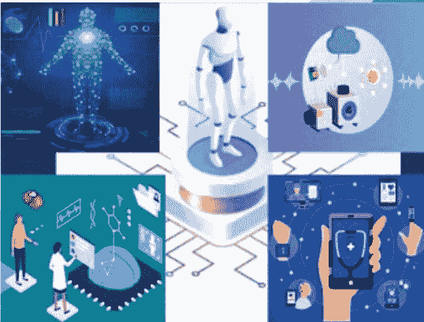


**Bhoopesh Singh Bhati**
IIIT Sonepat
哈里亚纳邦，印度

**Dimple Tiwari**
工程与技术学院
维韦卡南达专业研究学院 - 技术校区
德里，印度

**Nitesh Singh Bhati**
计算机科学与工程系
信息通信技术学院
高达玛·佛陀大学
大诺伊达，印度


# 前言

技术发展的快速步伐已将医疗保健转变为一个更具创新性、主动性和个性化的领域。在数字时代，正在颠覆我们预期和治疗疾病方式的两项主要创新是物联网 (IoT) 和人工智能 (AI)。构建新的医疗保健系统——本部分探讨这些新技术如何协同工作，以构建新社会并改善疾病预测和一般健康的结果。可穿戴传感器、智能医疗设备和远程监测工具持续收集实时健康数据，提供关于个人健康状况的重要洞察。当这些设备与 AI 驱动的数据分析结合使用时，可以检测疾病的早期迹象，减轻公共卫生压力，并帮助重新关注预防性医疗保健。AI 算法将机器学习 (ML) 和深度学习 (DL) 技术应用于汇总的医疗数据，以识别趋势并预测疾病进展。

本部分将通过大数据分析、云计算和医疗保健系统中的边缘 AI，详细阐述基于物联网和人工智能的疾病早期预警系统基础。文档指出，随着决策树、神经网络和自然语言处理 (NLP) 等 AI 模型提高疾病预测的准确性和速度，例如，糖尿病和心脏问题等慢性疾病，以及以阿尔茨海默病和帕金森病为中心的神经系统疾病，都能被早期发现。癌症检测与诊断、传染病暴发分析和个性化医疗等检查都属于 AI 的范畴。然而，仍有一些障碍需要清除。在此框架内，基于 AI 的诊断中存在数据安全和隐私侵犯问题，以及需要致力于 IoT 框架的兼容性和 AI 模型之间的标准化。其次，我们必须面对的一些一般性研究问题，例如 AI 模型的偏差和可解释人工智能 (XAI)。

AI 赋能的医疗保健前景看好，因为 5G、区块链和联邦学习等技术促进了实时 AI 分析。这些进步可以提供更先进、更安全且易于部署的医疗保健解决方案。随着这些技术的成熟，它们将成为个性化预防和预测医学以及全球健康状况逐步改善的关键。

这是一本值得探索物联网 (IoT)、人工智能 (AI) 和疾病预测之间关系的读者阅读的书籍。它应该吸引研究人员、临床医学专业人士、AI 开发人员以及任何有兴趣深入了解这些领域的人。本研究致力于通过揭示最近的趋势、应用和瓶颈，投资于由智能和数据驱动创新辅助的医疗保健转型。


# 为提供医疗保健解决方案而引入的物联网和人工智能

Shweta Agarwal, Kaljot Sharma and Chandra Sekhar Dash

## 1. 医疗保健中的物联网和人工智能技术

将人工智能与物联网在医疗保健中的集成，是革命性进程中极其重大的一步：将 IoT 负责收集数据的设备网络（可穿戴健身追踪器、远程监测系统和其他设备）与 AI 负责分析相同数据的算法结合起来。这种协同作用通过个性化医疗、预测分析和主动医疗保健管理，改善了患者护理、诊断和临床工作流程。它满足了日益增长的医疗需求、慢性病的高发率，以及对能够赋予患者权力并帮助临床医生进行决策的具成本效益解决方案的日益增长的呼声。因此，本章将重新审视物联网和 AI 的基础、医疗保健中的应用以及伦理和监管考量，以一种引出其变革性影响的案例研究的方式进行阐述。

### 1.1 物联网技术概述

物联网是指设备或事物的网络，它们可以利用一个简单透明的平台来收集、传输和处理数据，完全不需要任何人类干预。在此背景下使用的一些设备包括可穿戴传感器、可植入设备和智能医疗设备，这些设备监测患者健康状况，并为医疗保健分析产生相关数据 [1–2]。更具体地说，这涉及生命体征数据、药物摄入量和环境因素，有助于持续监测和实时医疗保健服务的提供。


图 1 指出了在医疗保健中实施物联网技术的主要因素和挑战。这些因素强调了高效能源使用、可靠网络基础设施、高效数据管理和分析、医疗废物管理、系统性能保障、可持续解决方案制定、物联网上各种设备集成、运营成本管理、数据隐私管理以及系统内可能故障的修正。在考虑利用物联网改善患者护理、运营效率和医疗保健环境可持续性时，所有这些因素都至关重要。

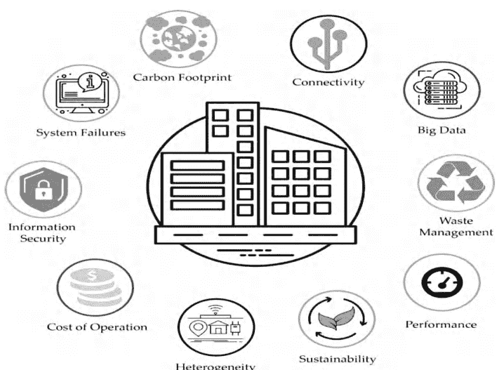

图 1. 医疗保健中物联网技术概览 [3]。

基本上，物联网在医疗保健领域已取得非常成功的成果，令人印象深刻，并代表了技术在患者监护、远程护理和实时健康管理等完备应用中的应用方式。例如，可监测心率、活动甚至睡眠质量的可穿戴设备，如智能手表。这些信息对患者的健康状况提供了关键洞察。可植入设备能够逐分钟监测起搏器、胰岛素泵及其他重要状况，并确保及时干预以改善患者预后 [4]。

此外，医院和诊所中的智能医疗设备可测量生命体征、跟踪患者活动，并向医护人员发出潜在问题的警报。物联网设备通过减少手动数据录入从而减少错误，使改善患者护理和运营效率成为现实。

### 1.2 AI 技术概览

人工智能因此涉及算法和机器学习技术，使机器在执行数据分析、模式识别和决策等多项任务时具有与人类大脑同等的能力。AI 的应用包括预测分析、医学图像分析、自然语言处理以及与医疗保健相关的个性化治疗建议，如表 1 所示。此类系统能够分析海量数据以发现模式、预测结果并支持临床决策。

AI 有潜力通过提供更准确的诊断、患者预后预测和个性化治疗方案来改变医疗保健。利用机器学习算法和患者历史数据进行未来健康问题的趋势分析和预测，可实现主动护理和早期干预。NLP 通过从非结构化数据源中提取重要信息，简化医疗文档，改善患者与医护人员的沟通，并协助临床决策。

在所有子集中，计算机视觉被认为在医学影像中最有用。它通过对 X 光、MRI 和 CT 扫描的分析检测异常，包括肿瘤、骨折、感染等 [5]。AI 通过自动化医学图像分析过程并提高诊断准确性，减轻了放射科医生的工作量。

**表 1. AI 技术类型及其应用。**

| AI 技术 | 应用 |
|---|---|
| 机器学习 | 预测分析，模式识别 |
| 自然语言处理 | 医疗文档，患者交互 |
| 计算机视觉 | 医学图像分析，诊断支持 |

## 2. 物联网和 AI 在医疗保健中的应用

### 2.1 物联网设备及其应用

其他原因包括使用物联网设备对患者进行实时数据收集，这些数据被分析以了解患者健康状况并提供更好的护理。其中一些可以通过可穿戴传感器监测生命体征，或通过植入设备进行给药。表 2 列出了部分传感器及其应用。

**表 2. 物联网设备类型及其应用。**

| 物联网设备类型 | 医疗保健中的应用 |
|---|---|
| 可穿戴传感器 | 监测生命体征（例如，心率、血压） |
| 植入式设备 | 持续健康监测（例如，血糖水平） |
| 智能医疗设备 | 医疗设备远程监测（例如，呼吸机） |

智能医疗设备，包括智能床和输注泵，通过持续监测和自动调整来确保患者安全和护理质量。例如，智能床监测患者活动并自行调整以帮助避免压疮，而智能输注泵则自动化药物给药。

### 2.2 医疗诊断与治疗中的 AI

AI 技术已通过分析大型数据集以寻找模式和预测结果，从而为特定病例推荐个性化治疗，增强了医疗诊断和治疗。事实上，当今的 AI 驱动的诊断影像系统、虚拟健康助手和预测分析平台预计将取代医疗保健服务，如表 3 所示 [8-9]。

图 2 展示了 AI 在医疗诊断中的各种应用概览 [10]。图表中央是一个代表 AI 技术的脑部图标，箭头向外指向六个医疗保健中利用 AI 的关键领域。

- 1. **术后康复管理**：AI 协助监测和管理患者术后恢复，提供个性化康复计划和实时反馈，以确保最佳恢复。
- 2. **虚拟助手**：AI 驱动的虚拟助手通过提供即时访问医疗信息、排程、提醒以及回答健康相关问题，支持患者和医疗保健提供者。
- 3. **医学影像诊断**：医学图像通过 AI 算法（包括 X 射线、计算机断层扫描和磁共振成像）进行处理，以突出异常并诊断病症；从而为放射科医生的诊断提供更高准确性。
- 4. **辅助治疗**：AI 通过预测患者反应并根据个人需求量身定制治疗方案，帮助规划和优化辅助治疗，如化疗和放疗。

**表 3. 医疗诊断与治疗中的 AI 应用。**

| AI 应用 | 描述 |
|---|---|
| 诊断影像 | 分析医学图像以早期发现疾病 |
| 预测分析 | 基于历史数据预测患者预后 |
| 虚拟健康助手 | 提供个性化健康建议和监测 |

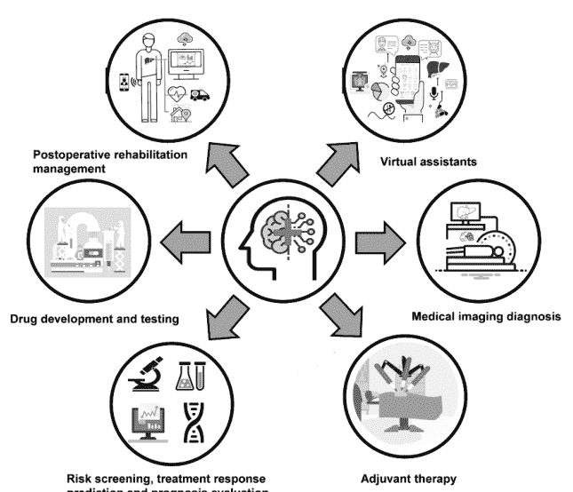

图 2. 医疗诊断中的 AI 应用 [10]。

- 5. 风险筛查、治疗反应预测和预后评估：

AI 系统分析患者数据，以识别哪些患者易患任何类型的疾病，预测患者对某项疗法的反应，并估计其预后，从而实现早期干预并提供个性化治疗方案。

- 6. 药物开发与测试：利用生物数据分析、识别潜在药物相互作用预测以及优化临床试验，AI 已在加速新药开发时间，从而更快、更有效地带来新疗法。

将 AI 集成到医疗诊断中带来诸多优势。其影响和优势如下：

- **提高准确性**：AI 提高诊断准确性并减少人为错误。
- **个性化治疗**：根据患者的独特数据和预测反应，为个别患者量身定制治疗方案。
- **效率**：加快诊断过程和药物开发，从而实现更快的患者护理和医疗治疗创新。
- **主动医疗保健**：实现疾病早期检测和患者健康的主动管理，改善预后并降低医疗成本。


总体而言，这张图突显了人工智能在改变医疗诊断以及提升医疗服务各个方面中的重要作用。

## 3. IoT-AI 集成的协同效应与优势

### 3.1 IoT 与 AI 的互补技术

物联网和人工智能等领域中这些技术的相互作用，在更好的护理和运营效率方面带来了协同效应。物联网设备向人工智能算法持续流式传输海量实时数据，这些算法能够理解数据，为医疗服务提供者提供实际可用于其诊疗的可操作性洞察 [11–12]。这对于主动医疗管理、量身定制的治疗方案以及更好的诊断将起到非常重要的作用。

这些物联网设备持续监测多种健康参数，例如身体活动、血糖水平、血压和心率。数据经过人工智能算法处理后，该算法有助于识别模式和异常，从而帮助医疗服务提供者基于数据做出决策。例如，人工智能可以通过简单分析可穿戴设备的数据来识别早期心力衰竭，从而促进及时干预，降低再次住院的可能性 [13–14]。

物联网与人工智能的集成还改善了远程监测，医疗服务提供者可以实时追踪患者的健康状况。这对于治疗糖尿病和高血压等慢性疾病患者将更有帮助，因为它涉及持续监测以及及时调整治疗方案。

### 3.2 集成的 IoT-AI 解决方案：对患者护理的益处

以下是一些集成的 IoT-AI 解决方案，它们将通过多种方式为更好的患者护理带来巨大价值：从个性化治疗方案到更准确的诊断以及提前进行的健康管理。其结果是，基于实时数据和高级分析，将带来更好的治疗效果，并提升医疗服务提供者的有效性与效率 [15]。

如表 4 所示，集成 IoT-AI 解决方案的好处在于其在促进个性化医疗方面的可行性。数据通过物联网设备收集，然后人工智能算法对个人健康模式进行画像并推荐适当的治疗方案。这将使医学界能够让患者接受针对特定病症有利于自己的治疗——从而取得更好的健康结局并减少副作用。

| 益处 | 描述 |
|---|---|
| 个性化医疗 | 基于个人数据制定治疗方案 |
| 改进的诊断 | 提高疾病检测的准确性和速度 |
| 主动健康管理 | 实时监测和管理患者健康 |

另一个关键优势是改进的诊断。人工智能算法可以读取物联网设备接收的大量数据，使人工智能能够在非常早期的阶段检测疾病，并提高诊断的准确性和速度 [16–17]。因此，这将使医疗人员能够及时干预，阻止此类疾病的进展。

这涉及持续监测患者的健康状况，并在可能的健康问题演变为严重病症之前尽早发现。物联网设备将帮助收集有关各项健康指标的实时数据，而人工智能算法则访问这些实时数据以发现任何异常并预测与健康相关事件的发生。这种方法使医疗从业者能够采取主动措施，以更有效地管理患者。

## 4. 伦理与监管考量

### 4.1 物联网数据传输过程中确保隐私与安全的挑战

如果要确保物联网设备与系统之间传输数据的完整性和机密性，则物联网数据传输中的隐私和安全问题至关重要。因此，这些问题可能会通过系统未授权访问、数据泄露以及多种网络攻击等方式引发不同类型的威胁。图 3 列出了与物联网设备数据传输中的隐私和安全问题相关的一些重要要点：

- 1. 数据加密：物联网数据传输隐私与安全的一般步骤在于专注于传输数据加密的技术。如果从一个物联网设备传输到另一个物联网设备的信息被加密，那么任何未授权实体拦截该信息并成功解密的可能性都非常小。

- 2. 认证与授权：不断涌现的威胁需要强大的认证和授权机制来验证设备身份，以确保只有授权实体可以访问和传输物联网网络上的数据。这将防止未经授权的访问和数据篡改。

- 3. 安全协议：这确保了关于物联网通信的安全协议机制（例如 HTTPS、带 TLS 的 MQTT 和带 DTLS 的 CoAP），以保证数据传输安全，防止任何形式的窃听或中间人攻击，从而支持传输过程中的完整性和机密性。

- 4. 设备管理：物联网设备应得到正确管理，应及时进行更新、配置和安全补丁管理，以避免安全风险。这是因为未受保护或未更新的设备可能为攻击者提供入口，从而危及整个物联网网络。

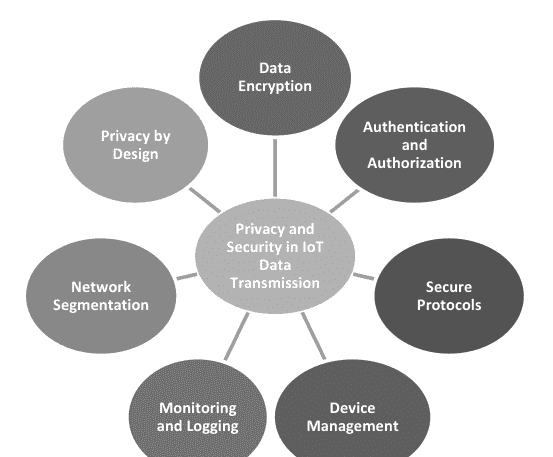

图 3. 物联网数据传输中的隐私与安全 [18]。

- 5. 隐私即设计：在物联网系统设计中纳入增强隐私的特性，例如数据最小化、匿名化以及确保用户同意的机制，将有助于保护任何物联网设备所收集和传输数据的个人隐私。

- 6. 网络分段：通过将物联网网络划分为具有受限访问控制的各个区域，可以在发生安全漏洞或未授权访问时限制损害。这样，组织就能更好地隔离关键设备和数据，从而在网络段内遏制任何威胁。

- 7. 监控与日志记录：对物联网数据传输活动进行持续监控和日志记录，可能会导致发现不当行为、未授权访问尝试以及安全事件。实时警报结合日志分析将能够快速响应安全威胁。

如表 5 所示，技术、政策框架与最佳实践的协调融合可以改善任何组织物联网部署的整体安全态势，并保护敏感数据免受未经授权的访问和利用。

表 5. 确保物联网部署数据安全的最佳实践。

| 安全措施 | 描述 |
|---|---|
| 实施强身份验证 | 使用多因素身份验证来验证身份并防止未经授权的访问。 |
| 加密传输中和静态数据 | 使用加密协议来保护传输和存储过程中的数据。 |
| 定期更新和修补设备 | 使设备保持最新的安全补丁和固件更新，以解决漏洞。 |
| 安全通信协议 | 使用 TLS/SSL 建立加密连接，防止数据被篡改。 |
| 实施访问控制 | 实施严格的访问控制策略，并使用基于角色的访问控制（RBAC）来限制权限。 |
| 监控网络流量 | 部署工具来跟踪和分析网络流量，检测异常和未经授权的访问尝试。 |
| 分段物联网网络 | 将网络分段为区域或 VLAN，以隔离关键设备和数据。 |
| 实施入侵检测与防护 | 使用 IDS 和 IPS 解决方案来检测和防止恶意活动，阻止未经授权的访问。 |
| 定期进行安全审计 | 定期进行审计和评估，以评估安全控制措施并识别漏洞。 |
| 教育用户和员工 | 提供培训和意识提升计划，以推广最佳实践并营造安全意识文化。 |

在医疗保健过程中，物联网数据的保密性和安全性至关重要。通过加密，患者数据在传输和存储过程中受到保护，防止任何未经授权的访问或泄露 [19-20]。相应地，这种访问控制措施使得只有授权实体才能使用敏感数据，大大降低了潜在的数据泄露风险。因此，医疗从业者必须遵守诸如《通用数据保护条例》等数据保护条款，以确保健康信息的高度保密性和安全性。

### 4.2 医疗保健中的人工智能法规与合规性

医疗保健中的人工智能应用必须经过监管框架，以确保其安全性、有效性和伦理性。保护患者利益的关键步骤包括基于人工智能的医疗器械的 FDA 批准法规以及人工智能开发中的伦理准则 [21]。监管机构制定了医疗保健中实施人工智能技术的标准和要求，如表 6 所示。

有关在医疗保健中使用人工智能技术的安全性和伦理性，将由基于原则的监管机构和法规予以确保。FDA 根据安全性和有效性批准美国的人工智能医疗器械。在欧盟，GDPR 维护患者数据的保密性以及明确的使用同意 [22–23]。人工智能工作中的应用伦理准则确保在技术开发和部署过程中具备公平性、透明度和问责制——保护患者利益，从而使他们信任用于医疗保健的人工智能驱动解决方案。


表 6. 医疗保健中的人工智能监管框架。

| 监管机构 | 描述 |
|---|---|
| FDA (美国) | 确保基于人工智能的医疗器械的安全性和有效性 |
| GDPR (欧盟) | 保护患者数据隐私并强制要求明确同意 |
| 伦理准则 | 确保人工智能的公平性、透明度和问责制 |

#### 4.2.1 确保透明度，获得患者同意

建立对 IoT-AI 医疗解决方案的信任需要关注透明度和患者同意。这意味着必须确保患者充分了解其健康数据的使用情况，并就其使用获得特定同意 [24–25]。此外，还应确保向医疗提供者和患者解释 AI 算法，以实现决策透明度。整个过程如图 4 所示。

这将涉及对数据如何被收集、传输和分析的某些教育，连同此类 AI 驱动的医疗解决方案可能带来的益处和风险，并就个人健康信息的使用获得明确和明示的同意 [26]。AI 决策过程必须透明，即医疗专业人员和患者有权知道 AI 算法如何得出决策。这将增强对 AI 主导的医疗解决方案的信心并促进其使用。

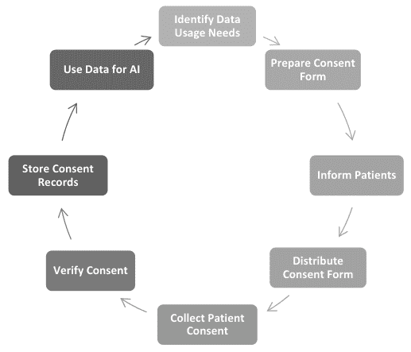

图 4. 获得患者同意以用于 AI 数据使用的过程。

## 5. 案例研究与未来方向

### 5.1 医疗保健中的 IoT 与 AI：现实生活中的应用案例示例

本节介绍了医疗保健中一些成功的 IoT-AI 实施案例研究，解释其如何影响医疗服务提供及其对患者的影响。它举例说明了一些远程患者监测系统、AI 辅助诊断工具和预测分析平台的实例 [27–28]。

#### 案例研究 1：远程医疗

用于远程医疗系统的 IoT 设备持续测量患者的健康参数，从而帮助监测血糖水平、血压和心率。所获数据将用于利用 AI 算法分析异常，以预测可能的健康问题。因此，这种主动方法帮助医疗提供者及时行动以避免并发症并降低再入院率。这可能是一个系统，用于确保在心力衰竭患者的临床状况开始恶化时早期发现，触发警报，促使医疗提供者相应调整治疗方案。

#### 案例研究 2：AI 辅助诊断

AI 辅助诊断工具利用计算机视觉和 ML 算法分析 X 光、MRI、CT 扫描等医学影像。通过此类工具检测异常的潜力巨大，这对放射科医生做出适当和及时的诊断非常有帮助。例如，开发用于检测肺癌的 AI 工具将识别胸部 X 光片并突出显示可疑结节，从而提供早期检测和治疗机会。

#### 案例研究 3：预测分析

预测分析平台将 ML 算法应用于患者数据，以预测未来最可能发生哪些事件。因此，它会向医疗提供者发出警报，指出那些患慢性病或经历不良事件风险更高的患者，以便采取适当的预防措施并根据需要调整治疗方案。例如，用于糖尿病管理的预测分析平台将从连续血糖监测仪获取数据并预测低血糖发作，警告患者根据该信息采取预防措施。

### 5.2 IoT-AI 集成中的挑战与未来趋势

表 7 显示了同时使用 IoT 和 AI 技术相关的挑战范围从数据互操作性和法规遵从性到技能差距。边缘计算、AI 驱动的机器人技术和用于安全数据交换的区块链技术是解决此类挑战并指明医疗服务未来方向的最有希望的未来趋势之一。

表 7. IoT-AI 集成中的挑战与未来趋势。

| 挑战 | 未来趋势 |
|---|---|
| 数据互操作性 | 用于无缝集成的协议标准化 |
| 法规遵从性 | 医疗保健中人工智能的明确指南和标准 |
| 技能差距 | 面向医疗专业人员的培训计划 |

#### 挑战 1：数据互操作性

然而，将 IoT 与 AI 集成的一个关键问题在于数据互操作性。其中很大一部分是分散在不同系统中的健康数据，具有各自不同的格式和标准。需要对协议和数据格式进行至少某种形式的持续标准化，以保证 IoT 设备和 AI 算法（一方）与电子健康记录（EHR）（另一方）之间的互操作性，从而实现无缝数据交换。其未来发展将趋向于 HL7 FHIR 等互操作性标准，该标准能够实现跨医疗系统的数据交换。

#### 挑战 2：法规遵从性

医疗保健中 AI 应用的监管环境非常复杂，因此取决于地区和应用 [29]。很大一部分责任在于遵守 FDA 关于基于 AI 的医疗器械的法规，以及 GDPR 关于数据安全要求的法规，以确保 AI 技术的安全和合乎伦理的部署。该领域的一项发展趋势是制定具有全球约束力的医疗保健 AI 监管标准，显著简化合规程序并支持创新 [30–31]。

#### 挑战 3：技能差距

因此，医疗保健中 IoT 和 AI 的集成涉及数据科学、机器学习和健康信息学领域的特殊技能，同时通过为该技术领域的医疗专业人员开发一系列培训计划来弥补技能差距。未来的方向将涉及在跨学科层面建立计划，将医学教育与 AI 和 IoT 技术培训相结合，从而为医疗专业人员迎接数字健康的未来做好准备。

#### 未来趋势 1：边缘计算

边缘计算是指在靠近数据源的地方进行数据处理的做法，无论是在设备本身还是在本地服务器上，而不是依赖于位于云端的集中式服务器。因此，IoT 和 AI 的集成可以通过提供主动、个性化的护理，对未来医疗保健产生巨大影响。医疗保健越拥抱数字化转型，就越能发挥 IoT 与 AI 集成的协同效应，推动创新，改善患者结局并提高护理质量。

#### 未来趋势 2：AI 驱动的机器人技术

另一项新兴趋势是 AI 驱动的机器人技术：在此技术中，AI 算法与面向手术、康复和患者护理的机器人系统相结合 [32]。它为治疗带来精确性，减少人为错误，并为患者带来更好的结果。例如，AI 驱动的手术机器人可以帮助外科医生更准确、更好地控制地进行腹腔镜手术。

#### 未来趋势 3：用于安全数据交换的区块链

这种区块链技术允许共享健康数据，同时保证其真实性和机密性。因此，去中心化和防篡改账本的特性建立了信任，并使区块链能够为数字健康解决方案中 IoT–AI 数据交换提供增强的安全性。这意味着未来趋势将是将区块链与 IoT 和 AI 技术相结合，构建安全、互操作的医疗保健生态系统。

## 6. 结论

医疗保健中 IoT 与 AI 集成的潜力如此之大，以至于可能在患者护理提供、诊断准确性和医疗保健优化方面带来翻天覆地的变化。医疗保健提供者可以处理伦理和监管考量，以利用进一步的进步，最大化这些技术在构建更以患者为中心、高效且可及的医疗保健系统中的益处。未来优质护理将在此处塑造：在 IoT 和 AI 技术的无缝集成中，这将实现主动、个性化的护理。在这个由数字驱动的医疗保健领域，IoT 和 AI 的相互作用将促进创新并推动更好的患者结局，改善护理质量。

## 参考文献

- [1] Greco, L., Percannella, G., Ritrovato, P., Tortorella, F. 和 Vento, M. (2020). 基于 IoT 的医疗解决方案趋势：将 AI 移至边缘。*模式识别字母*，135: 346–353.
- [2] Thakare, V., Khire, G. 和 Kumbhar, M. (2022). 医疗保健中的人工智能 (AI) 和物联网 (IoT)：机遇与挑战。*ECS 事务*，107(1): 7941.
- [3] Verdejo Espinosa, Á., Lopez Ruiz, J., Mata Mata, F. 和 Estevez, M. E. (2021). 医疗保健中 IoT 的应用：实施可持续发展目标的关键。传感器, 21(7): 2330。https://doi.org/10.3390/s21072330.
- [4] Pise, A. A., Almuzaimi, K. K., Ahanger, T. A., Farouk, A., Pant, K., Pareek, P. K. 等 (2022). 启用人工智能万物 (AIoT) 医疗架构并列出安全问题。*计算智能与神经科学*，2022(1): 8421434.
- [5] Alshamrani, M. (2022). 远程医疗监测系统中 IoT 和人工智能的实施：一项调查。*国王萨乌德大学杂志-计算机与信息科学*，34(8): 4687–4701.
- [6] Elhoseny, M., Haseeb, K., Shah, A. A., Ahmad, I., Jan, Z. 和 Alghamdi, M. I. (2021). 用于大数据传输的 AI 赋能隐私保护 IoT 解决方案：一种基于区块链的医疗应用。*能源*，14(17): 5364.
- [7] Talukder, A. 和 Haas, R. (2021, 6月). AIoT：AI 在智慧医疗中遇见 IoT 和 Web。第 92–98 页。载于：第 13 届 ACM Web Science Conference 2021 附属出版物。
- [8] Jagatheesaperumal, S. K., Mishra, P., Moustafa, N. 和 Chauhan, R. (2022). 关于使用新兴技术提供安全医疗解决方案的全面调查。*计算机与电气工程*，99: 107691.


- [9] Mathur, S., Sharma, A. K. 和 Meesad, P. (2021). 用于患者诊断的医疗保健中混合人工智能和物联网方法. 医疗保健中的混合人工智能和物联网, 97–108.

- [10] Hayyolalam, V., Aloqaily, M., Özkasap, Ö. 和 Guizani, M. (2021). 基于物联网的互联医疗保健系统的边缘辅助解决方案：文献综述. IEEE 物联网杂志, 9(12): 9419–9443.

- [11] Mohanta, B., Das, P. 和 Patnaik, S. (2019年5月). 医疗保健 5.0：利用人工智能、物联网和 5G 通信的数字医疗保健系统的范式转变. 第 191–196 页. 收录于：2019 应用机器学习国际会议 (ICAML). IEEE.

- [12] Hayyolalam, V., Aloqaily, M., Özkasap, Ö. 和 Guizani, M. (2021). 用于赋能基于物联网的医疗保健系统的边缘智能. IEEE 无线通信, 28(3): 6–14.

- [13] Sharma, H. K., Kumar, A., Pant, S. 和 Ram, M. (2022). 用于智能医疗保健的人工智能、区块链和物联网. River Publishers.

- [14] Puri, V., Kataria, A. 和 Sharma, V. (2024). 医疗保健 4.0 中物联网的人工智能驱动去中心化框架. 新兴电信技术汇刊, 35(4): e4245.

- [15] Nathani, N. 和 Hasan, Z. (2021). 医疗保健交付中医疗物联网的人工智能影响. 工程技术与管理研究国际期刊, 8(8): 18–26.

- [16] Nasr, M., Islam, M. M., Shehata, S., Karray, F. 和 Quintana, Y. (2021). 人工智能时代的智能医疗保健：最近进展、挑战和未来展望. IEEE Access, 9: 145248–145270.

- [17] Mohindru, V., Vashisth, S. 和 Bathija, D. (2022). 医疗保健系统的物联网 (IoT)：全面综述. 计算领域最新创新：ICRIC 2021 论文集, 1: 213–229.

- [18] Tawalbeh, L., Muheidat, F., Tawalbeh, M. 和 Quwaider, M. (2020). 物联网隐私与安全：挑战与解决方案. 应用科学, 10(12): 4102. https://doi.org/10.3390/app10124102.

- [19] Fouad, H., Hassanein, A. S., Soliman, A. M. 和 Al-Feel, H. (2020). 基于物联网传感器与人工智能的患者健康信息分析，以改善未来患者协助方向. 测量, 159: 107757.

- [20] Zikria, Y. B., Afzal, M. K., Kim, S. W., Marin, A. 和 Guizani, M. (2020). 智能物联网的深度学习：机遇、挑战与解决方案. 计算机通信, 164: 50–53.

- [21] Sharma, L., Garg, P. K. 和 Khatri, S. K. (2019). 基于物联网的智能电子医疗保健：当前趋势、挑战、解决方案与技术. 第 215–234 页. 收录于：从视频监控到物联网. Chapman and Hall/CRC.

- [22] Shumba, A. T., Montanaro, T., Sergi, I., Fachechi, L., De Vittorio, M. 和 Patrono, L. (2022). 利用物联网感知技术和人工智能技术开展实时关键医疗保健应用. 传感器, 22(19): 7675.

- [23] Alnaim, A. K. 和 Alwakcel, A. M. (2023). 基于机器学习的物联网–边缘计算医疗保健解决方案. 电子, 12(4): 1027.

- [24] Raeesi Vanani, I. 和 Amirhosseini, M. (2021). 用于医疗保健的基于物联网的疾病预测与诊断系统. 医疗保健技术物联网, 21–48.

- [25] Firouzi, F., Jiang, S., Chakrabarty, K., Farahani, B., Daneshmand, M., Song, J. 等 (2022). 物联网、人工智能、边缘–雾–云和区块链的融合：医疗保健与医学中的挑战、解决方案与案例研究. IEEE 物联网杂志, 10(5): 3686–3705.

- [26] Sriramalakshmi, P., Vondivillu, S. T. 和 Govind, A. S. K. (2022). 医疗保健行业中物联网、人工智能和大数据分析的作用. 第 19–43 页. 收录于：利用新兴技术转型医疗保健. Chapman and Hall/CRC.

- [27] Lee, D. 和 Yoon, S. N. (2021). 医疗保健行业中人工智能技术的应用：机遇与挑战. 环境研究与公共卫生国际期刊, 18(1): 271.

- [28] Krishnamoorthy, S., Dua, A. 和 Gupta, S. (2023). 未来物联网驱动的医疗保健 4.0 技术中新兴技术的作用：调查、当前挑战与未来方向. 环境智能与人性化计算期刊, 14(1): 361–407.

- [29] Monteiro, A. C. B., França, R. P., Arthur, R. 和 Iano, Y. (2021). 从现代视角概述医疗保健中使用的医疗物联网、人工智能和云计算. *医疗保健中物联网、人工智能和云计算的融合*, 3–23.

- [30] Singh M., Sukhija, N., Sharma, A., Gupta, M. 和 Aggarwal, P. K. (2021). 基于 IoMT 的智能医疗保健系统的安全与隐私要求：挑战、解决方案与未来展望. 第 17–37 页. *收录于：绿色计算大数据分析*. CRC Press.

- [31] Kamruzzaman, M. M. (2021年12月). 智慧城市中互联医疗保健的边缘人工智能新机遇、挑战与应用. 第 1–6 页. *收录于：2021 IEEE 全球通信会议研讨会 (GC Wkshps)*. IEEE.

- [32] Pradhan, B., Bharti, D., Chakravarthy, S., Ray, S. S., Voinova, V. V., Bonartsev, A. P. 等 (2021). 物联网与机器人技术在转型当前医疗保健服务中的应用. *医疗保健工程期刊*, 2021(1): 9999504.

# 第 2 章
# 超越症状：利用机器学习技术进行早期糖尿病诊断

Garima Singhal, 1 Aniket Singh, 2,* Kimmi Verma 3 和 Nitesh Singh Bhati 4

## 1. 引言

由于通过机器学习 (ML) 诊断疾病的可行性，医疗保健行业经历了彻底的转型。机器学习算法能够分析大量医疗数据，识别模式，并准确预测疾病的发病、进展和结局。这项理论研究探讨了利用机器学习识别疾病时出现的基本概念、方法论和复杂性。机器学习是人工智能的一个子领域，专注于开发能够从数据中学习并无需显式编程即可做出判断或预测的系统。例如，用于表征数据的数学方法是机器学习的关键组成部分。神经网络、支持向量机 (SVM)、决策树、随机森林和逻辑回归是诊断疾病时最常用的方法之一 [1]。训练数据中识别出的趋势是学习过程的结果。测试是使用新数据评估模型性能的过程，而训练则是从数据集和观察对象的可测量组件中学习的过程。在预测个人可能感染哪些疾病时，可以考虑生物体、病史、遗传信息和特征信息。模型的目标是预测结果或分组。经常使用体征来确定个人是否正在患某种疾病 [2]。

用于疾病预测的机器学习方法可分为三大类：使用带标签的数据对模型进行训练。它包含输入中的已知特征以及输出中与这些特征对应的标记。预测个人是否会生病的最常见方法是将其归类为健康或不健康。无监督学习是一种方法，模型可以通过此方法识别不需要命名的数据趋势。这种方法可以帮助识别数据中隐藏的模式，例如具有相似症状的个体分组。模型通过接触新对象和新情况来获得决策能力。在预测疾病时这并不常见；然而，在制定针对每个患者独特需求量身定制的治疗方案时，它可能很有益 [24]。

用于疾病识别的机器学习技术繁多，且应用方式差异很大。为准备数据进行分析，首先必须进行数据清洗。这包括处理空值、执行数据校准以及将类别因素转换为数值。发现和开发有益特性对于模型的最优性能至关重要。主成分分析 (PCA) 和递归特征消除 (RFE) 用于识别关键特征。在选择最佳机器学习技术时，必须同时考虑手头的任务和数据的特性。对于需要二元分类的应用，逻辑回归表现更好；然而，处理复杂模式时神经网络表现更好 [3]。模型在数据子集上进行训练，并在另一个子集上评估其有效性。使用交叉验证，可以确保模型在应用于新数据时表现出色。准确度、精确率、召回率、F1 分数和接收者操作特征曲线下面积 (AUC-ROC) 常用于评估模型性能。许多机器学习方法用于预测个人可能感染的疾病：如果逻辑回归模型考虑一个或多个预期变量，它可能会确定两种结果之一的概率。构建早期疾病预测模型可以受益于该方法的简单性和易于理解性。决策树算法根据特征值对数据进行分支，以提供预测。这些模型往往过度拟合，但简单易懂。在集成学习中，大量决策树被结合以提高模型的准确性和强度。它比单个决策树更能减少过拟合 [4]。一种高级分组技术，能快速确定特征空间中哪个超平面最适合对对象进行分组。存在可识别复杂模式的人工神经模型；这些模型基于人脑解剖结构。当与基因和图像数据结合时，深度学习——一种具有多层的神经网络——在疾病预测领域显示出巨大潜力。使用机器学习算法和年龄、血压、胆固醇，

和生活方式，许多疾病，包括心脏病发作或中风的风险，可能会被识别。借助基因数据和医学图像，更容易快速查找和分类恶性肿瘤。现在可以利用医学影像和机器学习技术准确评估和预测与肿瘤相关的风险水平。会考虑患者的病史和行为来估计糖尿病的发病时间。建模可以识别高危人群并制定缓解策略。阿尔茨海默病和帕金森病等疾病可以通过脑部扫描、基因数据和记忆测试结果来识别。为了预测 COVID-19 和流感等疾病的传播，使用了传播模式建模和统计数据分析 [6]。机器学习是一个有前途的领域，但在可用于可靠诊断疾病之前，还需要解决一些问题。模型需要具有代表性、高质量且全面的数据集才能可靠。但是，医学数据中有时可能会出现偏见、错误或信息缺失。许多机器学习模型，特别是源自深度学习的模型，仿佛是不可见地运作，这使得对模型预测背后基本机制的理解变得复杂 [5]。在确定临床应用是否合适时，最重要的考虑因素之一是可解释性。经验模型应具有高度泛化性，并适用于广泛的个人和情况。当模型针对特定数据集过拟合时，它们在其他情境中的适用性可能会降低。需要严格的隐私法规和道德审议来保护患者隐私，并就私人健康信息的管理达成共识。医疗人员必须接受机器学习模型使用方面的培训，并且这些模型必须与现有的系统和流程适当集成。

糖尿病（DM）是一种致残性疾病，由于治疗费用高昂，全球范围内大大加重了医疗专业人员的财务负担。高血糖，通常称为 1 型糖尿病，是一种由胰腺 β 细胞胰岛素合成不足引起的医学紊乱，导致血糖水平升高 [10]。2 型糖尿病患者不能有效利用胰岛素。此外，视网膜退化、心血管疾病、肾脏疾病和脑损伤均可能是糖尿病性视网膜病变的后果 [11]。1980 年，1.08 亿人被诊断患有糖尿病。预计 2014 年全球将有超过 4.22 亿人被诊断患有糖尿病，较之前的预测显著上升。而且，在同一时期内，被诊断患有糖尿病（或者简单地说，“有糖尿病的人”）所占的成年人口比例从 4.7% 上升至 8.5%。这给试图控制糖尿病的人带来了严峻挑战。2012 年，血糖水平升高导致 220 万糖尿病患者死亡 [12]。2015 年，糖尿病在全球夺走了 160 万人的生命。优化治疗选择、改善糖尿病患者的生活质量以及降低该疾病死亡率的目标，都依赖于及时诊断和早期识别该疾病。到 2030 年，糖尿病预计将成为全球第六大常见死亡原因。此外，许多残障人士可能直到出现严重问题才意识到自己的残障；如果 2 型糖尿病未能及早识别，灾难性后果的可能性会增加 [13]。

要正确诊断糖尿病，需要一个能够使用可用数据忠实描绘疾病存在的连贯模型。为提高诊断效率，可结合使用可信赖的模型和准确的检测技术。医疗专业人员可以利用预测，通过使用能够在面对意外未来事件时自我纠正的工程技术来预测进行生物医学诊断的可能性。长期预测算法的使用可能会对规划和资源配置产生巨大益处。当面临新情况或组成部分之间功能关系的修改时，智能系统具备获取、调整和调整功能依赖性的能力 [10, 13]。医生的知识和经验有助于评估早期诊断预测预后和识别疾病的效果；不过，这种方法并不完美，存在缺点。医疗部门产生大量医疗数据，但这些数据无法识别尚未发现的模式，这阻碍了做出明智决策的能力 [14]。由于手动评估依赖于医疗专业人员的主观观察和判断，它们在识别早期健康问题方面可能并不有帮助。某些不易立即察觉的模式可能会影响观察和结果。这解释了患者得不到正确治疗的原因。因此，需要一种更高效的方法，以通过提高准确性和实现自动诊断来实现疾病的早期检测。通过数据挖掘和机器学习过程，发现了许多缺陷和先前未被发现的隐藏模式，从而创建了一系列能够提供可靠结果和有效结局的算法 [15]。为了应对糖尿病对日常生活日益增长的影响，已创建了各种数据挖掘方法。这些系统的目标是从海量医疗数据中提取隐藏趋势。这些数据还可能有助于特征选择以及糖尿病的自动预测。这些研究强调了机器学习如何改善糖尿病分析和监督，报告的准确率在 90% 到 98% 之间。多种风险因素会导致糖尿病的发生，包括超重、缺乏体力活动、家族病史、年龄增长以及特定的传统背景。失控的糖尿病可能导致影响多个器官系统的众多并发症，包括心血管疾病、糖尿病性视网膜病变、糖尿病性肾病和糖尿病性神经病。及时识别和干预对于预防、延缓或控制糖尿病及其相关并发症的发生至关重要 [5]。

### 1.1 早期检测的重要性

尽早识别糖尿病对于预防疾病引起的并发症或不良患者预后至关重要。各种血糖水平模型在利用机器学习和深度学习进行糖尿病预测方面取得了有前途的结果，例如随机森林、XGBoost 和深度人工神经网络，已实现最佳准确率 [6]。它们可以识别重要预测因子，例如 HbA1c、LDL 和高血压药物，用于预测 [7]。

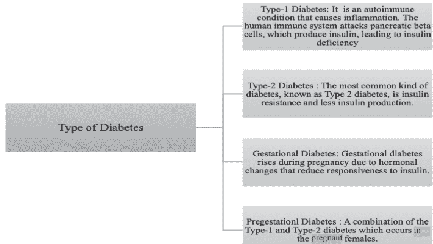

图 1. 糖尿病分为 1 型糖尿病、2 型糖尿病、妊娠糖尿病和妊娠前糖尿病 [25]。

诊断后，心血管结局导致死亡率随更年轻年龄而增加。组学，尤其是蛋白组学、代谢组学和脂质组学技术，有可能揭示新的早期候选生物标志物 [8]。此外，全球糖尿病患病率预计将大幅上升，且大多数病例将保持未诊断状态，尤其是在低收入和中等收入国家。建议增加筛查和医疗服务的可及性，特别是针对高危人群 [9]。检测和预防策略被列为混合深度学习模型的示例，目前正在针对有并发症的糖尿病管理进行测试 [10]。

### 1.2 糖尿病预测中的成像模态

关于糖尿病预测中成像模态的近期研究突显了人工智能（AI）和机器学习技术所能提供的可能性。不同的研究探讨了在 3D 成像中使用 ML 来预测糖尿病足疾病风险 [12]。舌表面热成像已显示为一种非侵入性筛查 2 型糖尿病方法的有价值改进 [13]。基于 AI 的视网膜图像分析已确认其在识别糖尿病并发症和预测循环风险方面的潜力 [14]。一种名为 DeepDR Plus 的深度学习系统已被开发，用于利用眼底图像预测糖尿病视网膜病变的发展 [15]。其他研究侧重于用于糖尿病预测的融合 K-Means 聚类和主成分分析的混合模型 [16] 以及利用云计算的可解释决策树模型 [17]。然而，在创建多模态模型以及解决各种 ML 技术中的偏差（如可解释性和熵）方面，我们仍面临挑战 [18]。几种成像


已探索了多种模态在糖尿病预测中的潜力，每种模态都为疾病的进展提供了独特的优势和洞察。

- **眼底照相（Retinal Fundus Photography）：** 眼底照相的目的是通过拍摄眼部组织图像来检测糖尿病视网膜病变，这是糖尿病的一种常见并发症。该技术已长期用于检测视网膜疾病。大多数病例是在晚期才被发现；然而，由于相机技术的最新进步和发展带来了分辨率的提升，我们可能能够利用计算机辅助诊断（CAD）检测到指示早期糖尿病视网膜病变的细微变化 [11]。

- **光学相干断层扫描（OCT）：** 20 世纪 90 年代初期，OCT 被引入为一种非侵入性成像模态，能够产生视网膜的高分辨率横断面图像 [4]。它有助于识别糖尿病性黄斑水肿（DME），这是一种可损害视力的严重糖尿病并发症。OCT 可以及时识别阻碍对表层视网膜层准确识别的病理性视网膜液体积聚，并可监测 DME 管理结局的疗效 [12]。

- **热成像：** 使用热成像检测表皮的温度差异可以提示与糖尿病相关的潜在代谢环境变化。值得注意的是，该方法是非侵入性的，并能通过热不对称性分析来识别糖尿病足溃疡及相关并发症。与皮肤温度相关的热梯度适用于快速、简便的热成像诊断，特别是用于糖尿病评估 [13]。

- **磁共振成像（MRI）& 计算机断层扫描（CT）：** MRI 和 CT 扫描在普通医学中更为常见，但也可用于研究糖尿病。MRI 检查腹部脂肪和肝脏脂肪与胰岛素抵抗的分布关系。由于 CT 扫描在空间分离方面非常出色，它们可以轻松提供关于胰腺外观以及 β 细胞工作和产生胰岛素情况的信息。尽管这些方法通常不用于诊断糖尿病，但它们能提供更多关于糖尿病如何起源的信息 [14]。

### 1.3 医学影像中的机器学习

将机器学习应用于医学影像极大地改变了糖尿病的预测方式。机器学习算法和深度学习模型已证明其在分析复杂医学图像、提取关键特征以及正确预测疾病进展方面非常有效。

- **卷积神经网络（CNNs）：** 卷积神经网络（CNNs）经过训练用于分析图像。卷积神经网络可以从原始图像数据中自动学习特征层次结构，从而更容易在医学图像中发现模式和异常（如肿瘤）。使用眼底图像、光学相干断层扫描（OCT）和热成像图像，卷积神经网络已成功预测糖尿病并发症。与更传统的诊断方法相比，基于 CNN 的模型在检测糖尿病视网膜病变及其他并发症方面表现出更高的灵敏度和特异性 [17]。

- **支持向量机（SVM）和随机森林：** 在医学领域，这些 ML 系统被用于从图像中预测糖尿病。通过分析图像结构来分类患者是否患有糖尿病，这非常适合 SVM；然而，其缺点是它是二元分类。为了完成分类、回归等任务，随机森林使用一种集成学习技术，在训练期间构建大量决策树 [17]。

- **纵向数据和循环神经网络（RNNs）：** 仅专注于常规医学影像和临床读数的纵向分析有潜力揭示疾病的进展。这些模型能够提供准确反映患者随时间变化状况的关键指标。此外，轨迹数据可以揭示多个时间段中的模式和趋势。

## 2. 本论文的研究目标

本章深入探讨了使用基于图像的技术预测糖尿病的方法，采用深度学习和机器学习相结合的方法。在该领域，我们将考察最先进的技术、它们面临的障碍以及未来发展的潜在路径。然而，部分目标包括：

- **探索图像感知模态：** 成像类型，探索眼底照相、OCT 和热成像等各种成像模态，用于糖尿病预测。

- **详细阐述数据预处理技术：** 讨论为分析准备图像所需的步骤，例如降噪、归一化和分割。

- **分析特征提取方法：** 本节概述了从图像中提取可用于糖尿病预测的相关特征的方法。

- **评估机器学习算法：** 分析不同的糖尿病预测机器学习算法及其性能指标。

## 3. 文献综述：机器学习算法

本文献综述探讨了深度学习和机器学习在医学影像中应用的一系列有影响力的研究，特别关注糖尿病的诊断和预测。

### 1. 糖尿病预测中机器学习的关键研究：

近年来，糖尿病预测的机器学习取得了重大进展。多项研究已证明了这些技术在改善糖尿病早期检测和治疗方面的有效性。

- 糖尿病视网膜病变检测的机器学习：在一项重要研究中，卷积神经网络（CNNs）被用于从眼底图像中识别糖尿病视网膜病变。在该研究中，基于大数据集的深度学习技术实现了 97% 的灵敏度和 93% 的特异性。Zhu 等人（2020 年）撰写，大量训练数据和出色的图像预处理也是提高模型准确性和泛化能力的关键，这一点在 Rad 等人（2020 年）的更近期研究中也得到了体现 [18]。

表 1 展示了不同成像模态的比较分析，包括其优势、局限性及关键研究 [18, 20, 16, 21]。

| 成像模态 | 优势 | 局限性 | 关键研究 |
| :--- | :--- | :--- | :--- |
| 眼底照相 | 检测糖尿病视网膜病变的准确性高 | 需要高分辨率相机 | 眼底成像可检测糖尿病视网膜病变，并能拍摄视网膜的非常详细照片。在眼底图像上使用机器学习模型，可以预测糖尿病及相关并发症。例如，Zhu 等人（2020 年）使用 CNNs 发现灵敏度为 97%、特异性为 93%。然而，图像质量和高分辨率相机可能是限制因素 [18]。 |
| 光学相干断层扫描 | 高分辨率横断面图像，适用于 DME | 成本高，可及性有限 | OCT 能提供高分辨率视网膜横断面图像，特别适用于检测糖尿病性黄斑水肿（DME）。根据 Bellemo 等人（2024 年）的研究，基于 CNN 的 OCT 图像模型 AUC 达到 0.94。OCT 捕获的详细结构信息对早期检测非常宝贵，但 OCT 设备的高成本和可及性有限可能成为广泛应用的障碍 [20]。 |
| 热成像 | 非侵入性，成本相对较低 | 相比眼底或 OCT 成像提供的详细信息较少 | 热成像检测皮肤温度的变化，这些变化可能提示与糖尿病相关的潜在代谢变化。Mohammed 等人（2023 年）表明，热成像结合 SVM 等机器学习算法可达到 84% 的准确率。热成像是非侵入性且低成本的，但可能无法提供像眼底或 OCT 成像那样详细的信息 [16]。 |
| MRI 和 CT | 对内脏脂肪和胰腺形态提供详细洞察 | 成本高，需要专用设备 | 尽管 MRI 和 CT 通常不适用于糖尿病本身的诊断，但它们能提供关于内脏脂肪分布以及胰腺形态的独特信息。研究还表明，这些指标可能反映胰岛素抵抗和 β 细胞功能的其他方面。然而，其高昂费用和专用设备要求使其无法用于常规糖尿病筛查 [21]。 |


| 数据集名称 | 成像模态 | 图像数量 | 关键特征 |
|---|---|---|---|
| Messidor | 眼底照相 | 1200 | 糖尿病视网膜病变分级，病变标注 |
| Kaggle 糖尿病视网膜病变 | 眼底照相 | 88,702 | 病变标注，严重程度分级 |
| Zivot | 热成像 | 269 | 皮肤温度变化 |
| OCT 数据集 | 光学相干断层扫描 | 5,000 | 视网膜厚度，液体积聚 |
| UK Biobank | 多模态 | 500,000 | 包括 MRI 扫描在内的综合健康数据 |

- 使用眼底照片预测糖尿病：眼底照片在另一项值得注意的研究中被用来识别糖尿病及其后果。Grzybowski et al. (2024) 是一个基于 Inception-ResNet-V2 模型的模型，其准确率为 88%，灵敏度为 85%，特异度为 90%。这项工作通过利用视网膜扫描中的复杂特征，证明了非侵入性方法在早期识别糖尿病方面的有效性 [19]。

## 4. 机器学习算法的进展

决策树方法（也称为 DT 预测器）可以帮助你做出选择。添加某些输入特性可使此方法发挥作用，其结构在层级上类似于树。其主要目标是创建一个能够从大量不同类型的原始数据中推测目标变量的模型。该预测器可以用于多种场景。这是因为基于一组输入数据做出选择并非难事。DT 方法是一种非参数监督学习方法，只要使用得当，即可用于解决回归和分类问题。决策树根据各种特征拆分数据以进行预测，而随机森林则结合多棵树以提高准确性和鲁棒性。这些方法在处理与糖尿病相关的高重要性风险因素时效果良好。SVM 适用于二元分类任务，例如确定个体是否患有糖尿病。它们可以处理高维数据并处理线性和非线性函数 [11]。

梯度提升模型（如 XGBoost）以其高预测准确性和捕捉复杂数据交互的能力而闻名。它们适用于一系列医疗预测任务，包括糖尿病发病。通常，这些集成模型将许多弱学习者依序相加，形成一个强大的预测模型 [17]。

高维生成模型同样渗透到医疗预测研究范式中，使用神经网络（高维或其他），这是一类深度学习模型，能够从原始输入数据中解耦相关特征。这些架构可以理解为多层连接节点（神经元），从输入数据（例如医学图像或可穿戴设备捕获的时间序列数据）中学习分层表示 [21]。

## 5. 方法论

### 5.1 数据收集

数据收集在构建有效的糖尿病预测机器学习模型中至关重要。

- 1. 眼底照相：数据从公开可用的数据库（如 Messidor 数据集和 Kaggle 糖尿病视网膜病变数据集）中收集。Messidor 数据集包含带有糖尿病视网膜病变分级标注的 1,200 张图像，而 Kaggle 数据集则包括带有详细病变标注和严重程度分级的 88,702 张图像。

- 2. 光学相干断层扫描（OCT）：OCT 图像来源于临床合作和公开可用的数据库。

- 3. 热成像：使用 Zivot 数据集获取了一组 269 张动态热红外（IR）图像。这些信息来自在一家中心进行常规体检的患者。

- 4. 多模态成像：UK Biobank 收藏的庞大数据不仅包括 MRI 扫描和光学相干断层扫描（OCT）图像，还包括眼底照片。考虑到它拥有五十万名成员，这个网站对学生来说是一大福音。利用这种方法，调查多种与糖尿病相关的问题变得轻而易举。

#### 图像类型：

- 眼底照片：通常用于检测糖尿病视网膜病变。

- OCT 图像：这些图像可用于识别糖尿病性黄斑水肿。

- 热图像：用于分析与糖尿病相关的皮肤温度变化。

- MRI 和 CT 扫描：用于评估内脏脂肪分布和胰腺形态。

### 5.2 数据预处理

数据预处理是为机器学习分析准备原始图像数据的重要步骤。它用于利用一系列开发出来的技术来增强图像的特征或属性，使其适合于机器学习中的提取和训练目的。管理数据的第一步是创建一种清理方法，以系统地删除多余的项目和属性。为了确保匿名性，必须首先从数据中消除大量类别特征。这些因素包括医院 ID、事件日期以及事件的具体细节。我们还检查了患病个体中的糖尿病相关问题；然而，数据集缺乏我们调查识别每位患者具体糖尿病类型所必需的信息。这表明在发生该问题的二十六个案例中，每个案例都已修复了该问题。然后，为了统一标准，使用了一种 Z 分数（一种标准分数）。该统计量是通过将分数的方差除以数据集的标准差来计算的。“标准差”是衡量一个数据点偏离平均值多少的统计指标。说明这种方差的一种方法是分析标准差。Z 分数用于表示不同值；均值为零，低于均值的值为正，高于均值的值为负。高于均值的值由正 Z 分数表示，其范围可能在 -1 到 1 之间。可以借助特征的均值（µ）和标准差（σ）来找到 Z 分数标准化。其值是在特征向量 x 中计算的第一个值。降噪是改进机器学习结果的关键预处理阶段，因为它显著影响图像分析的准确性和质量。高斯滤波或中值滤波有助于减少噪声并提高其变化的视觉质量。标准化视觉数据的过程涉及降低像素值，这些值通常在 0 到 1 的范围内。这有助于减少方差并实现机器学习算法的出色收敛。为了准确缩放像素值，他们实现了最小-最大归一化方法。该方法将图像分为多个部分，以便从复杂数据中区分相同的物体。视网膜（眼底）图像中首先分割的是视网膜区域的视盘和血管。我们通过对光学相干断层扫描（OCT）图像的自动分割识别了视网膜层，并以高灵敏度检测了液体积聚。有必要用丰富的数据来训练模型；但是，存在数据不足的情况。因此，数据增大至关重要。这保证了照片可以被旋转、翻转和放大，因为它们优于替代数据集方法。扩充的训练集边际地提高了性能。通过去噪和归一化来提高图像质量：在清理具有显著噪声和波动强度的图像时，多种预处理技术可能证明是有益的。但是，有必要确保之前有偏见的系统不仅仅是扩展以适应这种新技术。相反，过度扫描可能会导致遗漏对你最重要的特性。因此，在保留基本数据和提高图像质量之间取得平衡是必要的。

### 5.3 特征提取技术

特征提取是一个重要的过程，即从图像中识别和量化特定像素，以便将其用于训练。


#### 手动特征提取：

- **纹理分析：** 对于纹理特征的提取，可以使用灰度共生矩阵（GLCM）。这些矩阵使我们能够分析图像中的对比度、相关性、能量和同质性。视网膜图像有可能揭示关于不同模式的宝贵见解。

- **形状分析：** 形状分析曾用于计算图像的形状描述符，例如视网膜眼底和 OCT 图像中分割区域的面积、周长和离心率。

#### 自动特征提取：

- **卷积神经网络（CNNs）：** CNNs 能够从原始图像数据中学习分层特征表示。通过使用 Inception-ResNet-V2 和 EfficientNet 等预训练模型，我们能够通过纳入收集的数据集中的相关特征来改进和优化糖尿病预测。

- **主成分分析（PCA）：** 进行了 PCA 以识别数据集中了解趋势的最重要特征。

手动特征提取依赖于用户，从而导致对希望与图像关联的特定特征的解释。然而，用户可能需要了解自动化技术（如 CNNs）可以检测到的更复杂模式。虽然自动化技术无疑很强大，但它们确实需要大量计算资源，并且在训练中严重依赖标注数据。

### 5.4 模型训练与评估

要获得图像的糖尿病预测，ML 和 DL 模型应仅在训练并对其进行评估后才能使用。

#### 模型训练：

**训练数据划分：** 数据集按 80–10–10 的比例划分为训练集、验证集和测试集，以保证评估的稳健性。

**训练过程：** 模型使用反向传播和带有最佳学习率的随机梯度下降（SGD）以及正则化方法进行训练，以防止过拟合。

**超参数调整：** 更改超参数以获得分类器的最佳性能。

#### 评估指标：

- **准确率：** 衡量总实例中正确预测实例的比例。

- **灵敏度（召回率）：** 衡量模型正确识别阳性病例的能力。

- **特异性：** 衡量模型识别阴性病例的能力。

- **曲线下面积（AUC）：** 评估模型在不同阈值下区分阳性和阴性病例的能力。

#### 交叉验证：

- **K-折交叉验证：** 使用此技术来评估模型性能，并确保其能很好地推广到未见数据。在本研究中，采用了 5 折交叉验证来验证模型。

虽然所选评估指标全面评估了模型性能，但在数据集不平衡的情况下，它们有时可能会呈现偏颇的视图。例如，在多数类占主导地位的数据集中，高准确率可能具有误导性。因此，像 AUC 这样考虑灵敏度和特异性之间平衡的指标，对于更平衡的评估至关重要。此外，尽管超参数调整是必要的，但它可能计算密集且耗时。

## 6. 实验设置

表 3. 来自各种来源的数据集。

| 数据集名称 | 成像模态 | 图像数量 | 关键特征 | 来源 |
| --- | --- | --- | --- | --- |
| Messidor | 视网膜眼底摄影 | 1,200 | 糖尿病视网膜病变分级，病变标注 | 公开可用 |
| Kaggle Diabetic Retinopathy | 视网膜眼底摄影 | 88,702 | 病变标注，严重程度级别 | Kaggle |
| Zivot | 热成像 | 269 | 皮肤温度变化 | 临床合作 |
| OCT Dataset | 光学相干断层扫描（OCT） | 5,000 | 视网膜厚度，液体积聚 | 临床合作 |
| UK Biobank | 多模态成像 | 500,000 | 全面的健康数据，包括 MRI 扫描 | UK Biobank |

表 4. 用于分析的工具。

| 工具名称 | 用途 |
| --- | --- |
| Python | 用于数据分析和机器学习的编程语言 |
| TensorFlow/Keras | 用于构建和训练模型的深度学习框架 |
| OpenCV | 用于图像处理的计算机视觉库 |
| Scikit-learn | 用于模型构建和评估的机器学习库 |
| Matplotlib/Seaborn | 用于绘制数据和结果的可视化库 |
| Anaconda | 用于管理 Python 包和环境的发行版 |

### 数据收集：

从标注数据集中收集的图像确保了数据多样性，包括成像模态：眼底摄影、OCT、热成像。

### 数据预处理：

- **噪声降低：** 应用高斯滤波和中值滤波技术以减少图像伪影。
- **归一化：** 使用 0 到 1 的最小-最大归一化对图像像素值进行缩放。
- **分割：** 使用阈值和边缘检测方法分割相关结构（例如视网膜图像中的视盘和视杯、血管；OCT 图像中的视杯、OCT 表面）。
- **数据增强：** 增强数据集多样性，执行增强（旋转、翻转、裁剪等）。
- **降维：** 应用主成分分析（PCA）以降维。

### 特征提取：

- **手动特征：** 使用 GLCM 和灰度共生矩阵（GLCM）以及形状描述符提取纹理和形状特征。
- **手工制作：** ...
- **特征：** 使用预训练的 CNNs（Inception-V3、EfficientNet-V2）进行特征提取。

### 模型训练：

- 将数据集划分为训练集（80%）、验证集（10%）和测试集（10%）。
- 使用梯度下降（SGD）和反向传播训练 CNN 模型，使用网格搜索和验证优化超参数，以找到最佳学习率、批量大小和层数。

### 模型评估：

- 执行 K-折交叉验证（K=5）以评估模型的泛化能力。

### 结果可视化：

- 使用混淆矩阵和 ROC 曲线可视化模型性能。
- 比较不同模型和成像模态的性能。

图 2. 实验方案 [26]。

表 5. 使用以下指标来评估机器学习模型的性能。

| 指标 | 定义 |
| :--- | :--- |
| 准确率 | 总病例中正确预测病例的比例。 |
| 灵敏度（召回率） | 模型正确识别阳性病例的能力（真阳性/(真阳性 + 假阴性)）。 |
| 特异性 | 模型正确识别阴性病例的能力（真阴性/(真阴性 + 假阳性)）。 |
| 精确率 | 所有正预测中真阳性的比例（真阳性/(真阳性 + 假阳性)）。 |
| F1 分数 | 精确率和召回率的调和平均数，平衡这两个指标。 |
| 曲线下面积（AUC） | 接收者操作特征（ROC）曲线下的面积，表明模型区分阳性和阴性病例的能力。 |
| 混淆矩阵 | 此表描述了分类模型的性能，显示真阳性、假阳性和假阴性。 |

## 7. 结果

对不同机器学习模型的比较分析揭示了使用医学图像进行糖尿病预测时其性能的见解。

- a) **Inception-ResNet-V2**：该模型展示了高准确率和 AUC，表明其区分糖尿病和非糖尿病病例的强大能力。Inception-ResNet-V2 的深度架构使其能够捕捉视网膜图像中的复杂模式。然而，该模型的复杂性需要大量计算资源和大量训练数据以避免过拟合。

- b) **EfficientNet**：EfficientNet 在大多数指标上取得了最高性能，包括准确率、灵敏度和 AUC。其高效的缩放方法允许在不牺牲性能的情况下更好地利用计算资源。与 Inception-ResNet-V2 类似，EfficientNet 需要大量计算能力和高质量标注数据。

- c) **CNN（自定义架构）**：自定义架构在性能和计算成本方面脱颖而出，成为最佳选择。由于该产品最初是为这些数据集开发的，因此观察到了更高的灵敏度和特异性。自定义架构可能需要提高其与其他数据集泛化的能力，这可能需要一些额外的超参数微调。

- d) **支持向量机（SVM）**：SVM 在精确率和特异性方面取得了令人印象深刻的结果。由于其实现容易，二元分类任务非常适合此目的。然而，深度学习方法在灵敏度和 AUC 指标方面均优于 SVM。这

### 性能指标

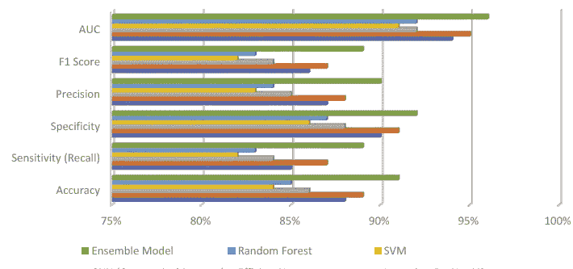

图 1. 本研究中使用的机器学习模型的性能指标。这些指标包括准确率、灵敏度（召回率）、特异性、精确率、F1 分数和曲线下面积（AUC）。


### 不同模型的 ROC 曲线

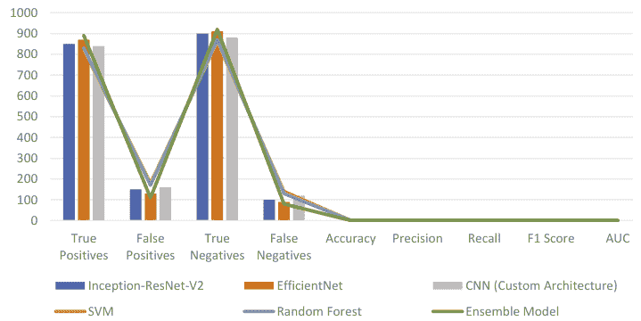

图 2. 基于结果分析的不同机器学习模型的 ROC 曲线。

这表明，简化数据压缩过程可能对医学影像中复杂的图像模式分类任务并不有益。

- e) 随机森林：出人意料的是，随机森林从一开始就表现出色，在灵敏度和特异性之间取得了良好的平衡。这种方法作为一种集成模型，与单个决策树相比更能抵抗过拟合。然而，它在区分具有几何特征细微差别的图像方面，不如深度学习技术有效。

- f) 集成模型：结合多个模型预测的集成模型整体表现最好。总而言之，它被证明是所有模型中最有效的一种。通过利用多个模型的优势，该方法提高了准确率、灵敏度和曲线下面积（AUC）。使用集成模型比较困难，要求严格遵守可用的计算资源。

## 8. 讨论

第 5 节提供的性能指标表明，不同的机器学习模型彼此可比，并能有效地使用医学影像预测糖尿病类别。结果与研究问题相一致，因为深度学习模型（尤其是集成模型）大幅提高了糖尿病预测的准确性和可信度。Inception-ResNet-V2 的高精度和 AUC 为 65.57 和 69，表 5 显示了该模型在二分类（糖尿病 vs 非糖尿病）方面的能力。使用 AutoML 优化架构的大型微调 EfficientNet 在区分糖尿病和非糖尿病病例方面实现了高性能。集成模型表现出最高的准确率（0.91）和 AUC（0.96），凸显了结合模型以发挥其优势的优势。基于 CNN 的模型优于传统的机器学习算法（例如 SVM 和随机森林），表明深度学习在捕捉复杂医学影像模式方面的有效性。这一发现支持了这样的直觉：深度学习方法在大维度图像数据上表现更为理想。集成模型和 EfficientNet 作为高灵敏度-高特异性模型是可靠的，适用于不能过度倾向于假阳性或假阴性的临床应用。这种分析对于糖尿病护理中的早期识别和及时干预是必要的。这些模型在三种类型的视网膜图像（眼底摄影、OCT 和热成像）上表现出一致的性能，表明开发的模型可能在各种图像模态中具有强健性和可推广性 [19]。

这在构建不同临床环境下的通用筛查工具中尤其关键。本研究之所以独特，是因为我们使用了多种影像模态的组合（眼底摄影、OCT 和热成像）来进行糖尿病预测。这种多模型方法利用多种数据源提高了模型预测的强健性和准确性。另一个独特的想法是实施 EfficientNet 和 Inception-ResNet-V2 等最先进的深度学习架构。鑒于这些架构的效率和准确性，我们对它们进行了微调，以用于医学图像分析问题。通过集成学习聚合多个模型的预测，在预测准确性方面取得了重大进展。本研究表明，这种方法更加强大和通用，利用模型之间的差异更好地捕捉现实目标分布。本研究使用多种标准衡量指标（如准确率、灵敏度、特异性、精确率和 F1 分数等）来评估模型性能。这种广泛的分析深入洞察了每个模型的优缺点。在这些基于 ImageNet 的数据集（如社区采用的用于目标检测基准的 PASCAL VOC 和 COCO）中，图像质量往往存在较大差异 [21]。图像分辨率、光照条件和标注标准的差异可能会影响模型性能。高质量的数据标注对于构建高性能机器学习模型至关重要。来自标注的噪声（尤其是公开可用数据集中的标注）可能导致准确性受损。像 EfficientNet 和 Inception-ResNet-V2 这样的先进深度学习模型在训练时需要大量计算资源。它需要高性能计算基础设施，在资源受限的环境中可能不可行。深度学习模型在这方面表现出色，但也以黑盒著称。其决策过程理解不足，阻碍了临床实施。

然而，如果数据增强和预处理技术未经适当审查，这些也可能导致偏差混入。必须确保这些步骤能增加实际数据模式而非破坏它们。未来关于深度学习模型的研究应使用算法透明的机器学习方法（例如，可解释 AI）来开发，以允许进一步的复现。可以使用 Grad-CAM（梯度加权类激活映射）等技术来显示模型决策所依据的图像区域，并使我们的模型具有可解释性，这在医学应用中至关重要。未来工作应考虑纳入来自遗传数据和电子健康记录（EHRs）的更全面的信息，包括生活方式等 [12]。这将改善糖尿病预测的预测准确性和可解释性。应在不同数据集内标准化和协调数据收集和标注过程。这将提高数据质量，并有助于构建更强健、可推广的模型。本研究使用机器学习分析来开发 ICU 患者早期瞬时低血压的预测模型，该模型可在多个 ICU 中推广。未来研究应识别使用实时临床数据前瞻性部署这些模型的最佳实践和经验教训。这意味着构建用户界面解决方案，使其符合 GDPR 要求，并将这些模型集成到当前医疗系统中 [15]。通过比较具有代表性的患者人群样本与所有患者或其子集随时间进行的纵向固定体积采样，我们希望辨别特定的跟踪测量是否体现了基本的疾病生物学，从而帮助检测和筛查无症状但患病的人群，这是精准健康领域的新兴关注点 [13]。这些提供了数据，可用于继续为每个特定患者优化和个性化预测模型。随着机器学习开始在医疗保健领域崭露头角，必须考虑伦理和法律的微妙之处。在医疗应用中负责任地使用 AI 需要实现患者隐私和知情同意，并解决 AI 算法中的偏差。

## 9. 结论

本研究突出了机器学习和深度学习方法在早期糖尿病预测及其管理方面的突破性力量。融合眼底摄影、OCT 和热成像等多种影像模态，可显著提高预测模型的强健性和精确度。使用 EfficientNet 和 Inception-ResNet-V2 等可以互补的模型的集成方法表现良好，准确率为 91%，AUC 分数为 0.96。结果表明，彻底的预处理和先进的特征提取技术对于增强预测性能至关重要。为了进一步评估性能，采用了包括灵敏度、特异性、精确率（阳性预测值）、F1 分数和 AUC 在内的各种指标，以进行系统评估，确保其在临床实践中的真实性和强健性。本研究的实际意义重大。基于图像的模型具有很高的准确性和非侵入性，是临床实践中的宝贵工具，可促进早期干预以降低糖尿病并发症。这些进步将对应于更早的诊断和更好的患者治疗策略，但仍有几个障碍。图像质量的差异、深度学习模型的计算要求以及高质量的标注数据是必须解决的重大障碍。此外，使用可解释 AI 方法提高深度学习模型的可解释性对于其在临床常规中的采用至关重要。这些未来调查的领域可以通过多模态


采用其他测试数据等方法（例如，通过纳入其他测试的数据）以及纵向研究，以随时间跟踪疾病进展的演变。随着医疗保健应对这些挑战，必须仔细权衡 AI 的伦理和法律考量，以采取审慎的申诉预防措施，从而建立利益相关者的信心。研究人员表明，他们的工作可以在糖尿病预测中达到黄金标准，并具有无与伦比的细节，从而使他们能够为许多糖尿病患者实施更早的诊断和个性化治疗策略。先进技术和全面的多模态数据方法可以显著推动糖尿病的监测和治疗。

## 参考文献

- [1] Krishnamoorthi, R., Joshi, S., Almarzouki, H. Z., Shukla, P., Rizwan, A., Kalpana, C. 等人. (2022). 基于机器学习疾病预测技术的糖尿病医疗疾病预测新框架. https://www.semanticscholar.org/paper/A-Novel-Diabetes-Healthcare-Disease-Prediction-Krishnamoorthi-Joshi/da3342bf65c4d5481894591e0056d7ff57fb89a.
- [2] Bhat, S. S., Selvam, V., Ansari, G., Ansari, M. D. and Rahman, M. H. (2022). 克什米尔北部使用机器学习的糖尿病患病率及早期预测：班迪波拉地区病例研究. https://www.semanticscholar.org/paper/Prevalence-and-Early-Prediction-of-Diabetes-Using-A-Bhat-Selvam/2de81481c3c6ea563056dd8a3417988f2df20f.
- [3] Ahmed, U., Issa, G. F., Khan, M. A., Aftab, S., Khan, M. F., Said, R. A. 等人. (2022). 融合机器学习赋能的糖尿病预测. https://www.semanticscholar.org/paper/PREDICTION-OF-DIABETES-EMPOWERED-WITH-FUSED-MACHINE-Ahmed-Issa/6fb7235ead6c0d42b06d45774bab84777628ca982.
- [4] Dritsas, E. and Trigka, M. (2022). 糖尿病风险预测的数据驱动机器学习方法. https://www.semanticscholar.org/paper/Data-Driven-Machine-Learning-Methods-for-Diabetes-Risk-Dritsas-Trigka/dd0328d701570e9b329f28c2e9e7cd79ae171cee.
- [5] Sahu, B. K. and Ghosh, N. (2022). 使用机器学习技术的糖尿病早期阶段预测. https://www.semanticscholar.org/paper/Early-Stage-Prediction-of-Diabetes-Using-Machine-Sahu-Ghosh/3c8dafb3d3907a13369485e010a4fd9b79d6351d.
- [6] Noviyanti, C. N. and Alamsyah, A. (2024). 使用随机森林算法的糖尿病早期检测. 信息系统探索与研究期刊, 2(1). https://doi.org/10.52465/joiser.v2i1.245.
- [7] Esser, K., Duong, M., Kain, K., Tran, S., Sadeghi, A., Guergachi, A. 等人. (2024). 使用机器学习预测加拿大成人糖尿病. medRxiv (冷泉港实验室). https://doi.org/10.1101/2024.02.03.24302302.
- [8] Seo, D. H., Kim, M., Suh, Y. J., Cho, Y., Ahn, S. H., Hong, S. 等人. (2024). 2型糖尿病诊断年龄与心血管发病率和死亡率风险的关联：一项全国人口基础研究. 糖尿病研究与临床实践, 208: 111098. https://doi.org/10.1016/j.diabres.2024.111098.
- [9] Soares, N. P., Magalhaes, G. C., Mayrink, P. H. and Verano-Braga, T. (2024). 组学揭示糖尿病发病机制和生物标志物：聚焦蛋白质组学、脂质组学和代谢组学. 第 211–220 页. 载于：实验医学与生物学进展. https://doi.org/10.1007/978-3-031-50624-6_11.
- [10] Hossain, M. J., Al-Mamun, M. and Islam, M. R. (2024). 糖尿病：全球增长最快的公共卫生问题：应聚焦早期检测. 健康科学报告, 7(3). https://doi.org/10.1002/hsr2.2004.
- [11] Ramesh, B. and Lakshmamma, K. (2024). 一种使用混合深度学习模型和神经模糊推理系统的冠状动脉心脏病新型早期检测与预防框架. IEEE Access, 12: 26683–26695. https://doi.org/10.1109/access.2024.3366537.
- [12] Ahmad, M., Tan, M., Bergman, H., Shalhoub, J. and Davies, A. (2024). 人工智能在三维成像模式和糖尿病足疾病中的应用——一项系统综述. JVS-血管洞察, 100057. https://doi.org/10.1016/j.jvsvi.2024.100057.
- [13] Wziętek-Kuczmik, D., Świątkowski, A., Cholewka, A., Mrowiec, A., Niedzielska, I. and Stanek, A. (2024). 舌面热成像作为诊断2型糖尿病的预测方法. 传感器, 24(8): 2447. https://doi.org/10.3390/s24082447.
- [14] Bazargani, Y. S., Mirzaei, M., Sobhi, N., Abdollahi, M. H., Jafarizadeh, A., Pedrammehr, S. 等人. (2024). 人工智能与糖尿病：通过视网膜的内部观察. https://doi.org/10.48550/arXiv.2402.18600.
- [15] Dai, L., Sheng, B., Chen, T., Wu, Q., Liu, R., Cai, C. 等人. (2024). 预测糖尿病视网膜病变进展时间的深度学习系统. 自然医学. https://doi.org/10.1038/s41591-023-02702-z.
- [16] Mohammed, A. A., Sumari, P. and Attabi, K. (2024). 糖尿病预测的混合 K-均值和主成分分析（PCA）. 计算与数字系统国际期刊/计算与数字系统国际期刊, 15(1): 1719–1728. https://doi.org/10.12785/ijcds/1501121.
- [17] Loganathan, E., Bruno, X. A., Bhat, A. H. and Dharan, S. (2024). 糖尿病预测机器学习模型的探索. 人工智能与胶囊网络期刊, 6(1): 61–74. https://doi.org/10.36548/jaicn.2024.1.005.
- [18] 基于深度学习算法的微动脉瘤预后和非增殖性糖尿病视网膜病变早期诊断系统的糖尿病视网膜病变检测. (2020). IEEE GrOwns & Magazine | IEEE Xplore. https://ieeexplore.ieee.org/abstract/document/9091167.
- [19] Grzybowski, A., Jin, K., Zhou, J., Pan, X., Wang, M., Ye, J. 等人. (2024). 医学中基于眼底照片的人工智能算法：一项系统综述. 眼科学与治疗. https://doi.org/10.1007/s40123-024-00981-4.
- [20] Bellemo, V., Das, A. K., Sreng, S., Chua, J., Wong, D., Shah, J. 等人. (2024). 使用生成式深度学习的光学相干断层扫描脉络膜增强. npj 数字医学, 7(1). https://doi.org/10.1038/s41746-024-01119-3.
- [21] N. V. and Bodapati, J. D. (2024). 糖尿病视网膜病变诊断的多模态深度空间表示自适应集成. 多媒体工具与应用. https://doi.org/10.1007/s11042-024-18356-z.
- [22] Lai, Y. R., Chiu, W. C., Huang, C. C., Cheng, B. C., Kung, C. T., Lin, T. Y. 等人. (2024). 用于诊断和预测糖尿病及糖尿病前期多发性神经病未来发生的纵向人工智能基础深度学习模型. 临床神经生理学, 54(4): 102982. https://doi.org/10.1016/j.neucli.2024.102982.
- [23] Thangamayan, S., Sinha, A., Moyal, V., Maheshwari, K., Harathi, N. and Nur, B. U. A. (2024). 新生儿糖尿病检测不同机器学习算法的比较研究. jitm.ut.ac.ir. https://doi.org/10.22059/jitm.2024.96359.
- [24] Salihi, N. M. S. (2024). 基于PIMA印度数据集的机器学习糖尿病预测. 已删除期刊, 31(55): 138–156. https://doi.org/10.52783/cana.v31.1008.
- [25] https://www.linkedin.com/pulse/diabetes-aiman-shakil/.
- [26] Abramoff, M. D., Garvin, M. K. and Sonka, M. (2010). 视网膜成像与图像分析. IEEE 生物医学工程评论, 3: 169–208. https://doi.org/10.1109/RBME.2010.2084567.

# 基于机器学习的心血管疾病检测系统

Akshima Aggarwal, 1,* Shobhit Prajapati 2 and Fadi Al-Turjman 3

## 1. 引言

在全球范围内，心血管疾病（CVDs）是导致疾病和死亡的主要原因，造成超过 70% 的所有死亡。全球疾病负担研究报告称，心血管疾病导致了大约 43% 的所有死亡[1, 2]。高收入国家中心脏病的常见风险因素包括不良饮食、吸烟、过量糖摄入以及肥胖或超重[3, 4]。尽管如此，低收入和中等收入国家也在经历慢性病患病率的增加。CVDs 对全球死亡率有显著贡献，每年夺走数百万人的生命。及时检测和干预对于有效的疾病管理至关重要。心脏仅次于大脑，是人体第二重要的器官。心脏内部的混乱可能导致身体的动荡。在当今的现代时代，世界正在经历影响我们日常生活的重大变革。心脏病作为全球主要死亡原因之一，位列五大致命疾病之首[5]。预测这种疾病至关重要，因为它让我们能够采取及时的预防措施。它由一组影响心脏和人体内部系统的不同问题组成。这些问题正在作为我们循环系统的缓慢毒素发挥作用。它在我们身体中造成严重问题，导致进展到晚期[5, 6].

1 技术分析师，Oracle Financial Services Software，Global Axis，Unit-I，Gopalan Enterprises (I) Pvt Ltd，(SEZ-1)，#152，EPIP Zone Bengaluru 560066.
2 网络安全系，COER 大学，Roorkee 247667，北阿坎德邦，印度.
3 人工智能、软件和信息系统工程系，AI 和 IoT 研究中心，人工智能与机器人研究所，近东大学，尼科西亚，Mersin10，土耳其.
Emails: shobhit.prajapati.14@gmail.com; fadi.alturjman@neu.edu.tr
* 通讯作者：aggarwalakshima@gmail.com


许多因素会导致心血管疾病，例如高血压、血脂异常、吸烟、肥胖和缺乏体力活动。这些因素正在逐渐影响血管、胆固醇水平以及心脏的整体功能。此外，个人的经济状况[7, 8]会影响其医疗保健体系，收入较低、营养食物摄入较少以及受教育程度低，都会对其健康构成重大风险。

年龄是另一个重要因素：随着年龄增长，我们更容易患心血管疾病（CVD）。年龄会导致心血管系统发生生理变化，包括动脉硬化、斑块堆积和心脏功能下降，所有这些都会增加心血管事件的风险。性别差异也起作用[8]：CVD的发病、症状和患病率在男性和女性之间有所不同。女性在绝经后风险更高，男性在较年轻时风险更高。糖尿病，尤其是2型糖尿病，是CVD的主要风险因素，通过胰岛素抵抗和炎症增加心血管风险。对这些多重风险因素的管理策略[9, 10]是降低心血管疾病全球负担的关键。

心脏病[11, 12]表现出多种多样的症状，使快速准确的诊断变得复杂。利用心脏病病例的患者数据库提供了一种实用的解决方案。对影响疾病预测的重要属性给予更多强调[24, 25]，使这些数据库中记录的许多专家的专业知识能够辅助诊断过程。这为医疗保健专业人员[19, 20]提供了一种用于决策的额外资源。心脏是人体的主要器官，面临图1中描述的疾病风险因素，这些疾病可分为可管理因素和不可管理因素[1]。临床证据表明，不可控因素会增加患心脏病（主要是心血管疾病）的可能性。

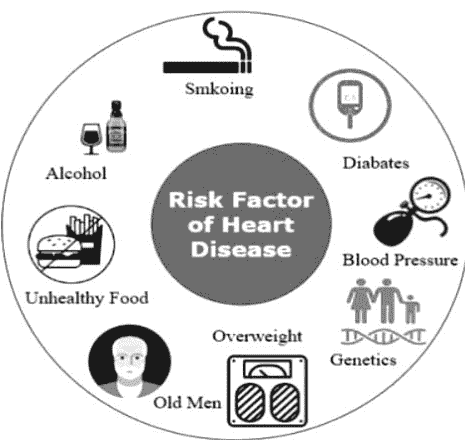

采用富含水果、蔬菜、全谷物和瘦蛋白的心脏健康饮食计划，同时减少[13, 14]饱和脂肪、反式脂肪和钠的摄入，可大幅降低心脏病的风险。定期进行体育活动，每周进行150分钟中等强度的运动，对维持心血管健康至关重要。戒烟并将饮酒量限制在适度水平也能大大降低患冠心病的几率。

其他关键要素[15, 16]包括管理高胆固醇、糖尿病、肥胖和压力。通过减肥计划、锻炼和药物控制胆固醇水平，并保持糖尿病患者的健康血糖水平，对冠心病预防至关重要。通过均衡营养和日常锻炼达到并保持健康体重，可减轻与肥胖[21]相关的风险。此外，正念、冥想和疗法等强大的压力管理技巧，可以通过减少持续压力的生理影响[17, 18]来改善心脏健康。定期进行健康筛查并咨询医疗保健专业人员，对于监测和管理这些风险因素至关重要，从而大大降低冠心病的可能性，并促进整体心血管健康。

### 1.1 心血管疾病

心血管疾病是指心脏或血管无法正常运作的情况[22, 23]。这些疾病可能影响心脏的电气系统、心脏结构，或为心脏和身体其他部位供血的血管。心血管疾病（包括冠状动脉疾病（CAD）、心力衰竭、心律失常和高血压等）在全球范围内构成重大健康挑战。这些疾病通常由于动脉粥样硬化、高血压以及吸烟、不良饮食和缺乏运动等生活方式因素而影响心脏和血管。症状[26, 27]因具体情况而异，但通常包括胸痛、呼吸短促、疲劳和心律不齐。通过日常监测血压、胆固醇水平和不同风险因素进行早期检测，对于有效的管理和治疗至关重要，这些可能还涉及生活方式调整、药物和手术干预。常见的心血管疾病类型列于表1中。

管理心血管问题需要一种综合方法，包括预防措施和临床治疗。生活方式的改变，包括健康饮食计划、定期锻炼、戒烟和体重控制，对于降低这些疾病的风险和进展至关重要。结合生活方式调整，控制血压、胆固醇和糖尿病的药物通常也是必需的[28, 29]。血管成形术、支架置换和搭桥手术等先进治疗可帮助控制严重病例。对于有心血管疾病家族史的人群，定期健康检查和早期筛查对于减轻这些疾病的影响并提升整体心血管健康至关重要。

#### 表1. 心血管疾病类型。

| 疾病类型 | 描述 | 常见症状 |
| :--- | :--- | :--- |
| 冠状动脉疾病（CAD） | 动脉因斑块形成而变窄或阻塞 | 胸痛（心绞痛）、呼吸短促、心脏病发作 |
| 心力衰竭 | 心脏无法泵出足够血液以满足身体需求 | 呼吸短促、疲劳、腿部肿胀、心跳加快 |
| 心律失常 | 异常心律，包括过快（心动过速）、过慢（心动过缓）或不规则跳动 | 心悸、头晕、昏厥 |
| 心肌病 | 影响心脏肌肉泵血能力的疾病 | 呼吸困难、肿胀、疲劳 |
| 心脏瓣膜问题 | 心脏瓣膜损伤 | 心脏杂音、胸痛、疲劳 |
| 先天性心脏问题 | 出生时存在的心脏异常 | 发绀（皮肤发青）、呼吸急促、疲劳 |
| 外周动脉疾病（PAD） | 外周动脉变窄，主要发生在腿部 | 行走时腿痛、麻木、无力 |
| 主动脉瘤 | 主动脉壁的异常膨出 | 通常在破裂前无症状；剧烈疼痛、低血压、意识丧失 |
| 心内膜炎 | 心腔和瓣膜内膜感染 | 发热、寒战、心脏杂音、疲劳 |
| 心包炎 | 心包炎症，心脏的囊状覆盖物 | 剧烈胸痛、发热、心悸 |
| 风湿性心脏问题 | 风湿热引起的心脏瓣膜损伤 | 呼吸短促、胸痛、肿胀 |

### 1.2 算法

机器学习（ML）技术的应用极大地惠及了医学数据分析和疾病诊断。它们提供了一种可行的方法来克服这些障碍。大型数据集使机器学习算法能够发现人类分析师可能忽略的数据中复杂的模式和联系。这有助于更早诊断心血管疾病和更准确的风险评估，从而改善患者预后。该研究中使用了大量机器学习算法[10, 11]。这些算法在包含各种患者属性和与心脏病相关的医学参数的数据集上进行训练。

它正在改变我们检测和管理心血管疾病（CVD）的方式，通过高级模式识别和预测模型实现早期和准确的诊断。这些模型[13, 14]分析海量数据，包括患者的统计指标、生活方式因素和病史，以识别心血管疾病风险人群，从而进行干预和预防。ML算法还改善了医学影像分析，提供精确且一致的结果，能够捕捉心血管问题的细微迹象，从而改善诊断并减少人为错误。这些范畴[15]，从监督学习和无监督学习到深度学习和强化学习，对于改善心血管疾病至关重要。


表 2. 基于准确性的比较分析.

| 算法 | 准确率 |
|---|---|
| 朴素贝叶斯 | 86% |
| 支持向量机 (SVM) | 89% |
| SVM & XGBoost | 94% |
| XGBoost | 95.9% |

检测、诊断和管理。这些算法 [30] 处理和分析各种数据类型，提高诊断值的准确性，预测结果并根据患者情况提供治疗方案，从而最终带来更好的医疗保健结果。表 2 展示了各种算法在预测心血管疾病方面的准确率比较。

- **朴素贝叶斯 (86%):** 基于贝叶斯定理，朴素贝叶斯分类器是简单的概率分类器。由于其高特征独立性假设，它们可能不如更复杂的模型准确，但效率高，在处理大型数据集时表现良好。

- **支持向量机 (SVM) (89%):** SVM 在分类高维数据方面强大且有效。通过识别将数据最好地划分为不同类别的超平面，它完成分类 [32]。由于其比朴素贝叶斯更高的准确率，它是各种分类问题的可靠选择。

- **SVM & XGBoost (94%):** 结合 SVM 与 XGBoost 利用了两者的优势 [30, 31]。SVM 提供强健的分类，而 XGBoost（一种梯度提升算法）增强模型以进行优化并提高准确率。

- **XGBoost (95.9%):** XGBoost（代表极端梯度提升）以其效率和性能著称。它在处理大型数据集和复杂模式方面特别有效，在列出的算法中达到了最高准确率。

这些准确率指标表明了每种算法在预测心血管疾病方面的有效性，XGBoost 在此次比较中成为最准确的模型。

### 1.3 拟议方法

研究人员在机器学习中使用许多数据集用于各种目的。数据因应用而异。为了在特定问题领域分析数据并提取见解或有用知识来开发应用程序，可以根据其学习能力采用各种机器学习技术。心血管数据集由多个特征组成，例如年龄、贫血、肌酸磷酸激酶、糖尿病、射血分数、高血压、血小板、血肌酐、血清钠、性别、吸烟和死亡事件。数据集包含 300 行和 13 列。death_event 是目标变量。可以通过 info() 命令提取数据集的基本信息。其主要目的是了解将用于寻找见解以计算有价值信息的数据。它用于快速获取 DataFrame 的摘要，这对于理解数据的结构和基本细节特别有用。该方法打印 DataFrame 的简洁摘要，包括以下信息：

- **索引和范围**: 使用的索引类型和数据框的范围。
- **列**: 数据框中的列名列表。
- **非空计数**: 每列中的非空条目数。
- **数据类型**: 每列中存储的数据类型。
- **内存使用**: 存储数据所需的内存。

此数据集的信息在表 3 中描述。

表 3. 关于数据集的信息。

| 列 | 非空计数 | 数据类型 |
| :--- | :--- | :--- |
| 年龄 | 299 个非空值 | float64 |
| 贫血 | 299 个非空值 | int64 |
| 肌酸磷酸激酶 | 299 个非空值 | int64 |
| 糖尿病 | 299 个非空值 | int64 |
| 射血分数 | 299 个非空值 | int64 |
| 高血压 | 299 个非空值 | int64 |
| 血清肌酐 | 299 个非空值 | float64 |
| 血小板 | 299 个非空值 | float64 |
| 血清钠 | 299 个非空值 | int64 |
| 性别 | 299 个非空值 | int64 |
| 吸烟 | 299 个非空值 | int64 |
| 时间 | 299 个非空值 | int64 |
| 死亡事件 | 299 个非空值 | int64 |

数据类型: float64(3), int64(10)
内存使用: 30.5 KB

#### 1.3.1 描述

为了更精确地了解数据集，Pandas 中的 describe() 命令是一种有效且常用的功能，它为数据框或系列提供了众多统计量的摘要。这种方法对于快速了解数据集分布的趋势、离散程度和形状特别有用。describe() 函数返回数据框中每个数值列的计数、均值、标准差、最小值和最大值，以及第 25、50（中位数）和第 75 个百分位数。

- **计数**: 每列中非空条目的数量。
- **均值**: 每列的平均值。
- **标准差 (std)**: 每列中值的分布范围。
- **最小值**: 每列中的最小值。
- **25%**: 第 25 个百分位数，即 25% 的数据低于该值。
- **50% (中位数)**: 第 50 个百分位数，即 50% 的数据低于该值。
- **75%**: 第 75 个百分位数，即 75% 的数据低于该值。
- **最大值**: 提供每列的最大值。

数据集的描述见表 4。

表 4. 数据集描述。

| | 年龄 | 贫血 | 高血压 | 血小板 | 性别 | 吸烟 | 时间 |
|---|---|---|---|---|---|---|---|
| 计数 | 299.000000 | 299.000000 | 299.000000 | 299.000000 | 299.000000 | 299.000000 | 299.000000 |
| 均值 | 60.833893 | 38.083612 | 0.351171 | 136.625418 | 0.648829 | 0.32107 |
| 标准差 | 11.894809 | 11.834841 | 0.478136 | 4.412477 | 0.478136 | 0.46767 |
| 最小值 | 40.000000 | 14.000000 | 0.000000 | 113.000000 | 0.000000 | 0.000000 |
| 25% | 51.000000 | 30.000000 | 0.000000 | 134.000000 | 0.000000 | 0.000000 |
| 50% | 60.000000 | 38.000000 | 0.000000 | 137.000000 | 1.000000 | 0.000000 |
| 75% | 70.000000 | 45.000000 | 1.000000 | 140.000000 | 1.000000 | 1.000000 |
| 最大值 | 95.000000 | 80.000000 | 1.000000 | 148.000000 | 1.000000 | 1.000000 |

年龄是影响冠心病风险的巨大因素，因为随着年龄增长，患心血管疾病的机会会增加。随着人们年龄增长，心脏和血管会经历多种生理变化，包括动脉壁硬化和心肌增厚，这些变化可能导致心脏疾病的发生。这些与年龄相关的变化可能导致血压升高、心脏泵血作用性能下降，以及动脉内斑块堆积（粥样硬化）的可能性增加，所有这些都会增加冠状动脉疾病、心脏病发作和其他心血管事件的风险。此外，长期暴露于高胆固醇、高血压以及吸烟和久坐行为等生活方式相关危险因素，也会随着年龄增长进一步加剧风险。在图 2 中，可以分析不同年龄段心脏病患者的数量。年龄是主要因素，但保持健康在后期阶段同样能让人保持健康。

此外，老龄人口常常面临更高的合并症发病率，包括糖尿病、肥胖和慢性肾病等，这些都被公认为会增加心脏病风险。这些状况可能产生协同效应，使老年人的心脏病控制和预防变得更加复杂。因此，定期体检、早期检测，

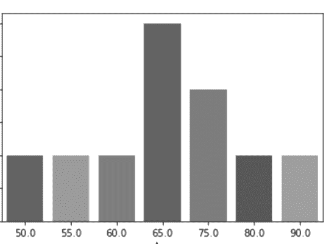

图 2. 心脏病患者数量。

和积极管理心血管风险因素对老龄人群至关重要。实施包括保持健康饮食、进行定期体育锻炼和遵医服药在内的预防措施，可以显著减轻年龄增长对心脏健康的影响，从而提高整体寿命和生活质量。

##### 1.3.1.1 特征与目标变量之间的相关性

在分析数据集中特征与目标变量之间的关系时，理解它们的相关性至关重要。相关性有助于确定哪些特征与目标变量关联最密切，从而指导特征选择和工程过程。在数据分析和机器学习中，理解特征与目标变量之间的相关性至关重要。相关性衡量两个变量之间线性关系的强度和方向。在预测建模中，识别特征（自变量）与目标变量（因变量）如何相关，有助于确定哪些特征在预测结果方面最具影响力。强正相关或负相关表明，当一个变量增加时，目标变量倾向于相应增加或减少。例如，在预测房价的数据集中，面积和卧室数量等特征可能与价格呈强正相关，而距离市中心的距离等特征可能呈负相关。

然而，相关性不代表因果关系。它仅显示变量之间存在关联，而不确认一个导致另一个。在某些情况下，特征可能由于潜在的混杂因素而看似相关。因此，虽然相关性分析是特征选择和理解数据关系的有益第一步，但它应与其他技术（如回归分析、机器学习中的特征重要性等）相结合。


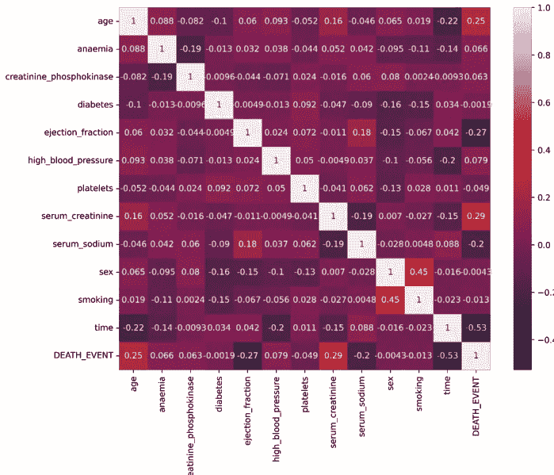

图 3. 特征与目标变量之间的相关性。

研究特征和区域信息以构建强大的预测模型。正确解读和使用相关性可以显著提升基于事实的决策策略的效果。图 3 表示所有特征之间的关系。

##### 1.3.1.2 K-近邻

在许多机器学习算法中，KNeighbors Classifier 用于对数据进行分类，从而获得最高准确率。它是 Python 中 scikit-learn 库提供的一种机器学习算法，用于分类任务。它基于 k-近邻算法（k-NN），属于一种基于实例的学习。

K-近邻（kNN）算法是一种基本且直观的机器学习技术，用于分类和回归任务。它基于这样一个原理：具有可比特征的数据点在特征空间中倾向于彼此靠近。在预测过程中，kNN 使用指定的距离度量（如欧氏距离）计算新实例与训练数据集中所有实例之间的距离。然后它找出最近的邻居，并主要基于其多数类（用于分类）或平均值（用于回归）进行预测。kNN 的简单性和有效性使其成为许多应用的热门选择，包括图像分类、推荐系统以及预测房价等连续结果。

然而，kNN 存在一些需要解决的挑战和注意事项，以实现最佳性能。k 的选择很重要：k 过小可能导致预测噪声，而 k 过大可能会忽略局部模式。交叉验证可以帮助确定最佳 k 值。此外，kNN 计算量较大，特别是在处理大型数据集时，因为它需要对训练集中的每个样本进行距离计算。特征缩放也至关重要，因为 kNN 基于距离度量，规模较大的特征可能会不成比例地影响结果。尽管存在这些挑战，但通过适当的调整和预处理，kNN 可能成为许多机器学习任务的强大工具。在这项研究中，我应用了 KNN 算法以实现近乎准确的结果。

数据预处理后，会计算特定邻居数量的最小误差。在 K-近邻（KNN）算法中找到正确的邻居至关重要，因为算法的预测基于这些邻居的特征。正确的邻居识别直接影响模型的分类或回归准确率，因为预测基于这些邻居的多数类或平均值。误识别邻居会导致错误的预测，并严重影响模型性能。距离度量和适当的特征缩放对于获得有意义的距离计算很重要，这决定了正确的邻居。

在图 4 中，K 是获得最小误差所需的邻居数量。从图中可以看到，第一个最小值出现在 k = 3 处。

最小误差：0.02666666666666667 在 K = 3 处

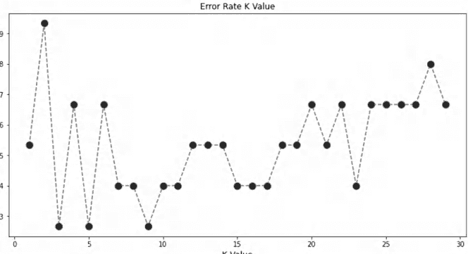

图 4. 不同值下的误差。

##### 1.3.1.3 衡量准确率

混淆矩阵是评估分类模型的关键工具。它提供了模型预测的详细分解，以便您可以在表 5 中详细查看准确率、精确率、召回率及其他指标。

- **真阳性 (TP):** 找出类别的确切位置。
- **真阴性 (TN):** 找出类别的阴性特性。
- **假阳性 (FP):** 将阴性类别识别为阳性。
- **假阴性 (FN):** 将阳性类别识别为阴性。

混淆矩阵在分类报告中包含以下指标：准确率、精确率、召回率、F1-得分和特异度。准确率是预期值的百分比。精确率是被正确预测为阳性的值的百分比。召回率可描述为真阳性与所有被预测为阳性的病例的比例，而精确率是所有被预期为阳性的实例中完美阳性预测的百分比。F1-得分是精确率和召回率的调和平均数。特异度表示真正识别的阴性与实际阴性的比例。

**表 5. 混淆矩阵结构。**

| | 阳性预测 | 阴性预测 |
|---|---|---|
| 实际为阳性 | TP = 48 | FN = 0 |
| 实际为阴性 | FP = 2 | TN = 25 |

##### 1.3.1.4 分类报告

分类报告对于评估分类模型在不同类别上的效果至关重要。它有助于识别模型表现良好的类别和困难的类别，从而指导模型的进一步改进和调整。例如，如果某个类别的精确率高但召回率低，表明模型在预测该类别时比较保守，可能遗漏了一些实际阳性样本。反之，低精确率表明模型捕获了大多数阳性样本，但也包含许多假阳性。通过检查这些指标，数据科学家可以更深入地了解模型的优势和劣势，确保在模型选择和优化中做出更好的决策。在表 6 中，有一个应用 K-近邻算法到心血管疾病数据集后的数据集对应的分类报告。

该算法的准确率得分为 97%，这是一个显著的数值，使其优于其他分类算法。

**表 6. 分类报告。**

| | 精确率 | 召回率 | F1-得分 | 支持数 |
|---|---|---|---|---|
| 0 | 0.96 | 1.00 | 0.98 | 48 |
| 1 | 1.00 | 0.93 | 0.96 | 27 |
| 准确率 | | | 0.97 | 75 |
| 宏观平均 | 0.98 | 0.96 | 0.97 | 75 |
| 加权平均 | 0.97 | 0.97 | 0.97 | 75 |

### 1.4 结论

机器学习通过实现早期检测、定制化疗法和改进风险分层，正在彻底改变心血管疾病领域。先进的机器学习算法可以分析来自电子健康记录、影像和基因图谱的大量数据，识别出传统方法可能无法察觉的模式。这一功能使得早期疾病症状的识别成为可能，促进及时干预并可能改善患者预后。此外，基于机器学习的预测分析可以根据个体患者独特的风险因素定制治疗方案，从而提高干预效果并减少不良后果。应用于识别心血管疾病的机器学习技术在改善患者预后和降低死亡率方面大有裨益。通过算法了解患者数据中不同的相关风险因素和模式，医生可以做出更准确、更及时的诊断，从而更容易采用更好的治疗方案，改善心血管疾病患者的预后。根据这项研究，K-近邻算法可以高准确率预测心血管疾病的存在。这可能会通过带来个性化疗法，并利用机器学习算法在未来的临床实践中实现更早检测，从而彻底改变心血管护理。

尽管具有潜力，但将机器学习算法与心血管疾病相结合也面临重大挑战。在保护患者隐私和数据安全的同时，确保数据集的质量和多样性至关重要。此外，机器学习模型的可解释性对于赢得医疗专业人员和患者的信任至关重要。无缝集成到临床工作流程中，并解决伦理问题（包括机器学习模型中的偏见以及对创新的公平获取），也是机器学习在心脏病学中广泛采用的关键。展望未来，跨学科合作、算法进步和清晰的监管框架可能是发挥机器学习在改善心血管健康预后方面全部潜力的关键。


- [1] Khandaker Mohammad Mohi Uddin, Rokaiya Ripa, Nilufar Yeasmin, Nitish Biswas and Samrat Kumar Dey. (2023). 基于联合数据集的心血管疾病诊断机器学习方法. Intelligence-Based Medicine, 7: 100100, ISSN 2666-5212, https://doi.org/10.1016/j.ibmed.2023.100100.
- [2] Victor Chang, Vallabhaneni Rupa Bhavani, Ariel Qianwen Xu and Hossain, M. A. (2022). 使用机器学习算法的心脏病检测人工智能模型. Healthcare Analytics, 2: 100016, ISSN 2772-4425, https://doi.org/10.1016/j.health.2022.100016.
- [3] Arslan Khan, Moiz Qureshi, Muhammad Daniyal and Kassim Tawiah. (2023). 基于机器学习算法的心血管疾病预测新研究. 1406060 | https://doi.org/10.1155/2023/1406060.
- [4] Madhumita Pal, Smita Parija, Ganapati Panda, Kuldeep Dhama and Ranjanto K. Mohapatra. (2022). 使用机器学习分类器的心血管疾病风险预测. 1101–1113. doi: 10.1515/med-2022-0508.
- [5] Peng, M., Hou, F., Cheng, Z., Shen, T., Liu, K., Zhao, C. et al. (2023). 基于主要贡献特征的心血管疾病风险预测. Sci. Rep. 13: 4778. https://doi.org/10.1038/s41598-023-31870-8.
- [6] Chaiquan Li, Xiaofei Liu, Peng Shen, Yexiang Sun, Tianjing Zhou, Weiye Chen et al. (2024). 通过对不规则重复电子健康记录的机器学习建模改善心血管风险预测. European Heart Journal - Digital Health, 5, https://doi.org/10.1093/ehjdh/ztad058.
- [7] Khalil, Md. (2024). 使用机器和深度学习模型的心血管疾病预测组合. IEEE Transactions on Neural Networks and Learning Systems, 8: 15–20.
- [8] Mauro Chiaritto, Luca Luceri, Angelo Oliva, Giulio G. Stefani and Gianluigi Condorelli. (2022). 人工智能与心血管风险预测：并非闪光的都是黄金. European Cardiology Review, https://doi.org/10.15420/ecr.2022.11.
- [9] You, J., Guo, Y., Kang, J., Wang, H., Yang, M., Feng, J. et al. (2023). 开发基于机器学习的模型以预测10年心血管疾病风险：一项前瞻性队列研究 stroke and Vascular Neurology. doi: 10.1136/svn-2023-002332.
- [10] Aggarwal, Akshima and Amit Chhabra. (2017). 联邦电网系统中作业调度的优化. Innovations in Computer Science and Engineering: Proceedings of the Fourth ICICSE 2016. Springer Singapore.
- [11] Dr. R. Deepa, Vijaya Bhaskar Sadu, Prashant G. C. and Dr. A. Sivasamy. (2024). 使用机器学习进行心血管疾病早期预测：从健康记录中揭示风险因素. 035049. https://doi.org/10.1063/5.0191990.
- [12] Bhatt, Chintan M., Parth Patel, Tarang Ghetii and Pier Luigi Mazzeo. (2023). 使用机器学习技术进行有效的心脏病预测. Algorithms, 16(2): 88. https://doi.org/10.3390/a16020088.
- [13] Cho, S. Y., Kim, S. H., Kang, S. H. et al. (2021). 用于心血管风险预测的现有模型和基于机器学习的模型. Sci. Rep. 11: 8886. https://doi.org/10.1038/s41598-021-88257-w.
- [14] Matthew B. Matheson, Yoko Kato, Shinichi Baba, Christopher Cox, João A. C. Lima and Bharath Ambale-Venkatesh. (2022). 在大型日本队列中使用机器学习进行心血管风险预测. 2434–0790. https://doi.org/10.1253/circres.
- [15] Weng, S. F., Reps, J., Kai, J., Garibaldi, J. M. and Qureshi, N. (2017). 机器学习能否使用常规临床数据改善心血管风险预测？ e0174944. https://doi.org/10.1371/journal.pone.0174944.
- [16] Kurian, N. S., Renji, K. S., Sajithra, S., Jenefer, Y. R. F. A. and S. G. (2022). 使用机器学习算法预测心血管疾病风险. pp. 162–167. 2022 International Conference on Sustainable Computing and Data Communication Systems (ICSCDS), Erode, India, doi: 10.1109/ICSCDS53736.2022.9760879.
- [17] Aggarwal, A., Gola, K. K. and Kanauzia, R. (2023). 结合机器学习算法的数字孪生技术用于减少浪费：全面综述. pp. 2627–2632. 2023 6th International Conference on Contemporary Computing and Informatics (IC31), Gautam Buddha Nagar, India, doi: 10.1109/IC3159117.2023.10398005.
- [18] Kresoja, K. P., Unterhuber, M. and Wacher, R. (2023). 心血管疾病预后预测中机器学习的心脏病学家指南. https://doi.org/10.1007/s00395-023-00982-7.
- [19] Rana, Priya and Akshima Aggarwal. (2022). 抄袭检测：一种使用PyCharm的雄辩且贪婪的系统.
- [20] Dimopoulos, A. C., Nickolaidou, M. and Caballero, F. F. (2018). 疾病风险预测中机器学习方法与心血管风险评分的对比. BMC Med. Res. Methodol. 18: 179. https://doi.org/10.1186/s12874-018-0644-1.
- [21] García-Ordas, M. T., Bayón-Gutiérrez, M. and Benavides, C. (2023). 使用带有特征增强的深度学习技术进行心脏病风险预测. Multimed Tools Appl., 82: 31759–31773. https://doi.org/10.1007/s11042-023-14817-z.
- [22] Cai, Y., Cai, Y. Q. and Tang, L. Y. (2024). 心血管疾病风险预测模型中的人工智能及独立验证筛查工具的开发：系统综述. BMC Med., 22: 56. https://doi.org/10.1186/s12916-024-03273-7.
- [23] Simranjeet Singh Dahia and Claudia Sabo. (2023). 使用机器学习预测10年心血管疾病风险的实现. Qeios. doi:10.32388/ISVUCI.
- [24] Aggarwal, A., Kumar, V. and Gupta, R. (2023). 图像分类中基于目标检测的方法：简要概述. pp. 1–6. 2023 IEEE Guwahati Subsection Conference (GCON), Guwahati, India, doi: 10.1109/GCON58516.2023.10183609.
- [25] Tiwari, D., Nagpal, B., Bhati, B. S., Gupta, M., Suanpang, S., Butdisuwan, S. et al. (2024). SPSO-EFVM：一种用于句子级情感分析的基于粒子群优化的集群融合投票模型. IEEE Access.
- [26] Tiwari, D., Kumar, A., Akash, A., Agarwal, K., Sharma, A. and Singh, N. (2024年2月). 通过脑波和智能机器学习算法诊断大脑健康状况. pp. 117–123. In 2024 IEEE International Conference on Computing, Power and Communication Technologies (IC2PCT) (Vol. 5). IEEE.
- [27] Tiwari, S., Singh, S. and Tiwari, D. (2024年3月). 预测心血管疾病的比较策略：深度分析阐释. pp. 981–985. In 2024 2nd International Conference on Disruptive Technologies (ICDT). IEEE.
- [28] Singh, S., Tiwari, S., Goel, P. and Tiwari, D. (2023年3月). 回顾：关于集成机器学习算法的先兆流产观察之旅. pp. 1–7. In 2023 6th International Conference on Information Systems and Computer Networks (ISCON). IEEE.
- [29] Tiwari, S., Singh, S. and Tiwari, D. (2024年3月). 预测心血管疾病的比较策略：深度分析阐释. pp. 981–985. In 2024 2nd International Conference on Disruptive Technologies (ICDT). IEEE.
- [30] Tiwari, D., Kumar, A., Akash, A., Agarwal, K., Sharma, A. and Singh, N. (2024年2月). 通过脑波和智能机器学习算法诊断大脑健康状况. pp. 117–123. In 2024 IEEE International Conference on Computing, Power and Communication Technologies (IC2PCT) (Vol. 5). IEEE.
- [31] Tiwari, D. and Bhati, B. S. (2021). 印度COVID-19的深入分析与预测：使用集成回归方法. Artificial Intelligence and Machine Learning for COVID-19, 97–109.
- [32] Tiwari, D., Bhati, B. S., Al-Turjman, F. and Nagpal, B. (2022). 大流行冠状病毒疾病（COVID-19）：使用机器学习技术进行世界影响分析与预测. Expert Systems, 39(3): e12714.

# 使用可解释人工智能进行乳腺癌检测

Atul Rathore, 1,* Praveen Lalwani 2 and Pooja Lalwani 1

## 1. 引言

当异常体细胞开始分裂并与健康细胞碰撞，导致它们恶化时，癌症便会发展。

乳腺癌的独特之处在于，它既是最常见的也是最危险的疾病。

乳腺癌是女性最危险的癌症形式。

乳腺癌分为浸润性和非浸润性。

浸润性癌症具有侵略性，因为它会扩散到其他器官。

另一方面，非浸润性癌症处于癌前形式，局限于其原始器官，但有可能进展为侵略性乳腺癌。

乳腺癌始于腺体和乳管，它们对全身乳汁分布至关重要。

它经常转移到远处器官，导致恶化。

乳腺癌还通过血液循环扩散到其他器官。

乳腺癌有多种形式，每种都有其自身的进展速度。

根据世界卫生组织（WHO）的数据，乳腺癌在2018年夺走了627,000名女性的生命，并预计2020年全球死亡人数将达到685,000人 [1]。

此外，WHO预计未来二十年新乳腺癌患者数量将增加70%。

在众多癌症类型中，如肺癌、结肠癌、肝癌和胃癌，乳腺癌排名第五位最致命 [2]。

根据2020年全球癌症统计（GLOBOCAN），乳腺癌（BC）是女性中最常见的癌症形式，2020年贡献了230万新癌症病例（占所有病例的11.7%）[2]。

根据美国2022年发布的报告，美国癌症协会（ACS）


预测有 43,250 人死亡和 287,850 新增病例 [3]。乳腺癌是一个重要的健康问题，因为每年至少有 167 万女性被诊断出患有此病，并导致估计 522,000 人死亡 [4]。尽管情况严峻，但研究表明，早期识别可以显著降低乳腺癌死亡率（降低 40% 或更多）[5–6]。

人工智能（AI）正日益渗透医疗保健领域，对临床诊断、疾病诊断和自动化产生重大影响 [7]。由于能够评估来自各种模态的海量数据，AI 在制药和医疗保健研究领域具有进一步发展的潜力 [8]。一些最近的研究详细介绍了 AI 在医疗保健和其他领域的应用。在医疗保健行业，使用了机器学习（ML）、自然语言处理（NLP）、物理机器人、机器人流程自动化和其他人工智能（AI）技术 [9]。在机器学习中，带有各种特征的神经网络模型和深度学习被应用于成像数据，以在早期发现具有临床意义的方面，特别是在癌症诊断中 [10, 11]。为了分析和解释人类交流，NLP 应用计算机方法论。最近，ML 技术已被广泛融入 NLP，通过从各种图像和文本数据中映射关键信息，来探索数据库和记录中的非结构化数据（形式为医生笔记、实验室报告等），这有助于诊断和治疗方案决策 [12]。持续的颠覆性创新为患者获得精准、及时的诊断以及定制化治疗方案铺平了道路 [13]。已确定基于 AI 的解决方案，包括能够使用广泛数据源的系统，例如患者报告的症状、生物特征、成像、生物标志物等。随着人工智能的进步，现在可以预测即将发生的疾病，从而因早期识别而增加预防的可能性。物理机器人正在多种医疗保健环境中被使用，包括护理、远程医疗、清洁、成像、手术和康复 [14, 15]。在常规临床实践中，医学图像解读一直由人类医疗从业者执行；不过，由于各种临床检查产生的海量数据，他们最近开始从计算机辅助治疗中获益。大数据和 AI 技术的快速发展和应用，导致数据驱动的问题解决过程得到广泛应用，这些过程能够对各种疾病（如乳腺癌和其他类型的癌症）进行精确的实时预测，对各种治疗方案进行详尽检查，并自动执行大规模、复杂的任务 [16]。由于人工智能（AI）、3D 打印、机器人、纳米技术等数字医疗保健技术的突破，医疗保健正在我们眼前发生转变。数字化医疗保健为减少人为错误、改善治疗结果以及随时间收集数据等提供了众多机遇。从机器学习到深度学习的 AI 方法在许多与健康相关的领域至关重要，包括新医疗系统的开发、患者信息和记录以及各种疾病的治疗 [17]。AI 技术在识别和诊断各种疾病方面也是最成功的。将人工智能（AI）作为一种改善医疗服务的技术，为改善患者和临床群体的预后、降低成本等提供了前所未有的机遇。

所使用的模型不仅限于计算机化；例如，可以向患者提供“家庭” [18–19]。机器学习（ML）最近在研究中日益突出，并被用于各种应用，例如文本挖掘、垃圾邮件检测、视频推荐、图像分类和多媒体概念检索。深度学习（DL）是这些应用中一种流行的机器学习（ML）方法 [20–23]。此外，由于放射科医生短缺，医学图像可能难以分析且耗时。人工智能（AI）可以帮助解决这些问题。机器学习（ML）是一种 AI 应用，它从数据中学习，并根据先前的数据做出预测或判断，而无需进行显式编程。ML 使用三种学习方法：监督学习、无监督学习和半监督学习。ML 技术包括特征提取，为特定问题选择合适的特征需要领域专家的专业知识。为了克服特征选择的挑战，应用深度学习（DL）算法。DL 是 ML 的一个子类，可以自动从原始输入数据中提取基本特征 [24]。

### 1.1 病理组织图像分析和基因组学的关注

已使用多种术语来识别、预防和治疗各种疾病 [25–32]。这些技术包括数字图像分析和视频分析，可用于识别癌症。病理组织图像和影片（即乳腺组织和心电图的显微照片）大大改善了乳腺癌等疾病的诊断和治疗。此外，活检、超声成像、乳腺X线摄影、内镜检查和超声检查等技术可产生这类影片和图像，用于识别乳腺癌，包括身体器官中的息肉和心肌病变。有几种类型的视频用于分析和教学，包括手术视频和培训视频 [28–32]。

以下是成像和视频模态中采用的各种技术（图 1）：

- **乳腺X线摄影：**乳腺X线片是由X射线制成的乳房和其他身体器官的X光片。其主要目的是帮助医生发现癌症和心脏疾病的早期迹象。定期进行乳腺X线摄影是癌症和其他疾病最有效的早期检测方法，通常在异常变得可触知或通过其他方式显现之前三年即可发现异常。

- **热成像：**一种称为热成像的非侵入性技术使用红外摄像头检测身体特定区域散发的热量。通过数字红外热成像，它有助于诊断乳腺癌和其他疾病。通过捕获和分析温度趋势，这种疾病检测方法已被证明既准确又具有成本效益，为早期诊断和筛查提供重要数据。

- **超声：**超声是一种低成本技术，通常用于诊断许多身体部位（例如

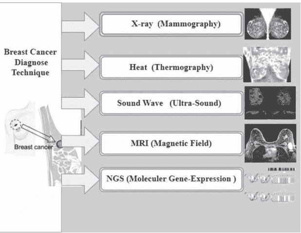

图 1. 各种乳腺疾病的诊断技术。

肾脏、胆囊、卵巢和肝脏。它利用高频声波检查许多器官。此外，超声检查可在手术中引导外科医生定位精确部位。它有助于诊断和评估乳腺异常，例如充满液体的囊肿，仅靠乳腺X线摄影可能难以检测。

- **磁共振：**MRI 常用于确定肿瘤大小，识别乳房、大脑及其他身体部位的新肿瘤，并筛查人体肿瘤。除了每年进行乳腺X线摄影外，建议高风险人群接受筛查MRI。然而，MRI 可能会产生假阳性结果，从而导致额外检测或活检。因此，它很少被建议作为中等疾病风险人群的筛查程序。

为了获得优化解决方案，受生物启发的元启发式计算正变得越来越有吸引力。它涉及使用基于群体智能原理的计算算法，这些原理源自具有基本交互和通信模式的大量种群。正在开发众多元启发式计算算法，为更专家知识系统指导铺平了道路 [33]。著名的元启发式算法包括蜂群优化、萤火虫优化、蝙蝠优化、蚁群优化、粒子群优化等 [34–39]。使用数据分析的主要目标是提供互补的诊断意见，而不是取代医疗从业者。本研究的主要目标是调查使用受生物启发的计算或两者混合进行疾病诊断的医疗保健应用。其主要

目的是积累广泛知识并深入了解未来医疗应用，从而推动该领域的未来研究。

### 1.2 研究文章概览

一种名为医学疾病检测的测试（如乳腺癌）旨在在疾病引起症状之前发现它们。筛查测试可能包括视频或影像学检查，以识别遗传性疾病，并结合身体相关检查。它讨论了各种数据集技术和数据处理技术，以及元启发式算法。

#### 1.2.1 可用技术的比较分析

表 1 对乳腺癌疾病筛查中最常用的方法及其优缺点进行了对比。另一方面，昂贵且有创的筛查技术可能会被基因组学和微波成像技术取代。此外，该技术可靠、安全、无电离辐射，且对用户身体的危害更小。各种方法用于识别乳腺癌疾病，包括超声成像、X 线摄影、超声心动图和活检等。[28–32]。

研究人员利用多种基于 AI 的技术（包括机器学习和深度学习模型）来诊断需要早期识别的乳腺癌。因此，在相关工作中，描述了用于诊断乳腺癌疾病的技术，例如玻尔兹曼机、K-近邻、支持向量机、逻辑回归、模糊逻辑、决策树和人工神经网络，以及它们的准确性。例如，Sengupta 及其同事创建了一种认知机器学习算法，该算法使用斑点跟踪超声心动图（STE）数据进行训练。其目标是区分限制性心肌病和收缩性心包炎。该研究确立了认知计算机器学习策略用于自动 STE 数据解释的可行性和价值（参考文献 [40]）。Narula 等人还表明，当应用于 STE 数据时，监督学习算法在识别运动员心脏和肥厚型心肌病方面，比标准评估方法更有效。该研究证明了在超声心动图中利用 ML 模型用于心脏瓣膜疾病（HVD）等应用的潜力 [41]。

表 1. 乳腺癌疾病筛查中使用的不同数据采集技术的优点和缺点。$\blacksquare$

| 参考文献 | 类型 | 优点 | 缺点 | 技术 |
| :--- | :--- | :--- | :--- | :--- |
| [30] | 超声 | 与其他成像方式相比价格低廉 非电离辐射广泛存在 | 分辨率最低 灵敏度最低 特异度最低 最大操作员依赖性 | 该技术利用高频声波生成人体器官和结构的图像。 |
| [46] | 乳腺 X 线摄影 | 在症状出现前检测问题有效 | 电离辐射暴露 - 虽然剂量很小，但重复筛查可能有风险 | 这种成像检查使用低剂量（电离辐射）X 射线系统来检查乳房内部。 |
| [27] | MRI | 灵敏度最高 任意角度成像 无痛 非电离辐射 | 扫描时间长 幽闭恐惧症 成本高且范围有限 | MRI 利用磁场和无线电波生成器官和组织的准确图像。 |

因此，替代支持策略（如机器学习）已成为必不可少的。机器学习已成为一种广泛采用的方法，用于帮助识别乳腺癌及其他疾病等医疗疾病 [42–45]。该方法涉及向所选算法提供训练数据，然后用其构建最终算法。使用新数据作为输入测试该算法以评估其性能，从而改善并加快乳腺癌、心脏病、皮肤病等医疗疾病的诊断。尽管有其优势，机器学习确实存在一些缺点，包括诊断精度差、过程冗长和复杂性增加 [46]。特别是，不相关特征的存在会阻碍机器学习算法的有效性，导致过拟合和分类准确度降低 [47]。因此，在采用机器学习算法之前，彻底的数据准备和降维是确保准确、更快速的疾病识别和分类的必要步骤 [47]。

#### 1.2.2 数据预处理与元启发式算法概览

元启发式算法能够以比传统医疗方法更快的速度产生精确且可靠的结果，这是其主要优势之一。

特征选择过程 [48–49] 包括以下步骤：

- 1. 利用搜索算法从初始特征集生成候选属性子集。
- 2. 使用距离、一致性、分类器误差率和依赖性等度量，可以评估分类过程中每个潜在属性子集的价值。
- 3. 使用终止条件找到相关且合适的特征子集。
- 4. 验证子集中选定的特征。

群体智能系统越来越多地用于特征选择。群体智能（SI）是一种模仿集体生物智能并从观察到的自然行为中汲取灵感的技术 [50]。它模仿竞争动物群争夺资源的行为。SI 已在实际应用中成功用于处理各种复杂问题，包括管理自动机和自动驾驶车辆、预测社会行为、优化电信和计算机网络等 [50–52]。SI 最近引起了癌症成像技术社区的兴趣。图 1 展示了 MRI、热成像、乳腺 X 线摄影、PET、超声等多种成像技术。SI 特别流行，因为其易于使用且能够进行全局搜索。灰狼优化（GWO）、蝙蝠算法（BA）、蚁群优化（ACO）、粒子群优化（PSO）等群体智能技术已可用 [52]。这些算法已被证明在解决乳腺癌治疗及其他领域的特征选择问题方面取得成功 [50–52]。然而，在该领域，数据库通常包含少量质量差或含噪数据的实例。因此，仅关注特征选择过程可能导致分类精度降低 [53]。为了提高分类技术的效率，拒绝冲动数据至关重要。图 2 演示了异常值拒绝方法，该方法可移除显著偏离常态的噪声数据。移除异常值至关重要，因为许多机器学习算法将其视为噪声。它们的存在会阻碍系统准确预测未来事件的能力。异常值方法可分为传统异常值方法和空间异常值方法 [53–54]。在某些场景中，当从癌症微阵列基因表达数据集中确定基因生物标志物时，特征方法的组合选择可能比基于过滤的方法更实用 [55]。值得注意的是，特征与样本比率较高的微阵列数据中的特征选择是一个 NP-hard 问题，对于此类挑战性案例，基于启发式的全局极小值搜索算法已被证明是最有效的解决方案。

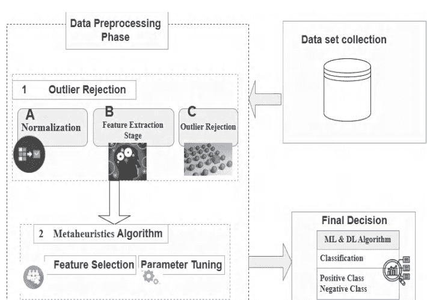

图 2. 数据处理阶段概览。

### 1.3 研究文章结构

本文组织如下：第二部分包括相关研究的摘要，例如乳腺癌调查。研究方法在第 3 部分中描述。结果和分析在第 4 部分中呈现。第 5 部分结束报告并对未来研究提出建议。

#### 动机

图像注册、深度特征提取、特征选择以及调整机器学习或深度学习的超参数以提高分类性能，均属于医学影像中的优化问题。随着受自然启发和元启发式优化算法的近期兴起，本专刊的目标是探讨医学影像问题中适当元启发式的选择。此外，将采用严谨的方法论来比较医学行业中元启发式的特性、策略和性能。使用采用元启发式在混合学习方法中选择生物标志物的 FS 研究来分类癌症、心脏等医疗疾病仍然存在困难，这种方法可实现疾病的早期识别。因此，需要对采用混合方法和启发式算法的研究的影响进行更多研究。这些数据促使我们提出一种新颖框架，该框架采用基于分类器的主要癌症和其他医疗疾病预测检查，利用微阵列表达表数据集来识别在识别医疗疾病最早期阶段方面具有出色分析效能的图像，随后对其他组合特征选择（FS）方法进行系统、彻底的评估。此外，我们的研究对所选子集特征提供了生物学解释。在本研究中，采用组合特征选择方法的框架与 ML 算法一起使用。

#### 研究问题

因此，本工作聚焦于以下研究问题（Q）：

- Q1 哪些特征对乳腺癌疾病有重大影响，是最重要的？
- Q2 每个 ML 模型的顶级特征有多少个？
- Q3 乳腺癌疾病分类中最常用的特征是什么？
- Q4 使用了哪些特征选择和提取方法？
- Q5 AI 的意义是什么，以及如何用它来研究这些疾病？
- Q6 基于 AI 的技术如何帮助医生诊断乳腺癌疾病？

## 2. 背景

在此小节中，已进行了大量关于基于成像和视频的医学诊断的研究。我们将回顾关于癌症等医疗疾病特征选择的先前研究。众多研究人员都表达了强烈愿望，强调寻找最优特征选择策略。这些策略旨在识别和选择来自...的最有价值特征


在检索到的结果中。旨在在多种疾病分类中实现尽可能高的准确性，本调查深入探讨了近年来出现的新研究论文和新方法，以改善乳腺癌的预测和诊断精度，同时也推动该领域的更多发展。Akay 及其同事引入了一种集成功能选择的新型支持向量机（SVM），以有效检测乳腺癌病例。实验结果表明，所提策略在乳腺癌检测中实现了高准确性、灵敏度和特异性。数字化组织学研究的最新进展使得使用 AI 辅助图像检查的组织学组织模式进行疾病分类成为可能 [55–56]。

本研究的作者专注于分析在分类算法配合使用时，哪些特征选择方法会影响乳腺癌疾病诊断。利用粒子群优化（PSO）方法，筛选出了最优且最具信息量的特征。Wei-Jia 等人借助混合 PSO-SVM 方法，揭示了一种用于检测心脏病的新算法。PSO 用于自动降低特征维度，从而改进 SVM 分类器，如表 2 所示。针对不同算法（如人工神经网络（ANN）和基于特征选择的 SVM（FS-SVM））进行了比较测试 [58]。

### 表 2. 最近使用的元启发式特征选择方法的短暂比较分析示例。

| 参考文献 | 特征选择方法 | 描述 | 优点 | 缺点 |
| :--- | :--- | :--- | :--- | :--- |
| [58] | PSO | 它被用于识别最有效且最具指导性的特征 | PSO 具有一种有效的研究适应度，用于获得理想响应。 | 确定主要设计参数具有挑战性。 |
| [61] | OHHO | 在对乳腺肿块进行分类时，OHHO 用于特征选择。为解决特征选择问题，首先将 OHHO 转换为二进制。之后，使用二进制 OHHO 来选择最重要的特征。 | 它以其卓越性和简单性而脱颖而出。 | OHHO 无法提供所需的准确性，中位监督时间较长。 |
| [59] | GWO | 它由一种受鲸鱼启发的元启发式算法组成。 | 更易于应用，调谐参数更少。 | 此方法较慢。 |
| [61] | HHO | 它基于动态环境和猎物的逃避倾向。 | 收敛速度快。易于实现。 | 很容易陷入局部最优。 |
| [59] | GA | 查尔斯·达尔文的自然进化论是这种搜索启发式方法的基础。 | 收敛速度和多功能性都很快。 | 它更困难，容易过早收敛，并且依赖于初始种群。 |

研究人员得出结论，当选择关键标准时，分类器的性能要好得多 [60]。一种用于乳腺癌分类特征选择的新技术利用了对抗性 Harris 鹰优化（OHHO）算法。

这种方法涉及从乳腺X光图像中提取九个形状特征和 45 个纹理特征。随后，在此语境下，特征选择涉及使用 OHHO 算法，结果表明 OHHO 在性能方面优于其竞争对手 [61]。

### 2.1 特征选择的困难

特征选择是机器学习中的基本问题。特征选择挑战的主要目标是在保持有效性和准确性的同时降低特征集的维度。为了对数据集进行分类，已经开发了众多技术。然而，元启发式算法在解决众多优化问题方面引起了大量兴趣。元启发式算法所体现的两个不一致的标准是搜索空间的开发和对最佳可能结果的探索。并非每个 FS 问题都可以在研究领域内使用基于元启发式的方法来解决。可以通过平衡搜索空间的探索和开发来增强元启发式算法的执行，尽管可以准备改进或修改来启动最新版本。我们大部分致力于使用混合技术构建预测模型、通过最大限度地减少弱必要和不必要的特征数量来解决子集问题的努力，都受到这一刺激的推动。在现实中，理想的子集最有可能只包含显著相关的特征。

## 3. 预备知识

本节将讨论乳腺癌疾病数据的各种特征选择、元启发式和分类技术。

### 3.1 特征选择（FS）

在从数据库中挖掘数据并学习新知识时，特征选择是一个必要的预处理阶段。它专注于从给定训练集中选择具有更强区分能力的代表性特征，以扩展分类器性能。FS 方法可分为四类：(1) 包装式、（2）过滤式、（3）混合式（集成式）和（4）嵌入式方法 [58]。常用的 FS 技术包括 Lasso（一种基于嵌入的方法）、信息增益（IG）和 Relief（基于过滤的方法）[63]。在早期研究中，生物信息学研究中 FS 的具体内容已阐明 [63–65]。

### 3.2 分类

它是数据挖掘的一个子集，常用于基于机器学习的类别预测和识别。机器学习算法分为三类。其中包括三种学习范式：半监督学习、监督学习和无监督学习。算法的选择取决于可用数据是完全标记、部分标记还是未标记。这种专门方法有助于识别生物性疾病出现的趋势并预测基因行为。在监督学习中，使用标记数据进行分类。在分配过程中，类标签根据一组训练数据确定以供理解。半监督学习将未标记数据和少量标记数据相结合，而无监督学习仅使用未标记数据。就将专业知识或知识应用于数据分类而言，无监督学习是中立的。分类程序分为测试和培训两部分。本节将讨论以下用于训练不同分类模型的多种经典分类算法，如 SVM、NB、ANN 等：

#### 3.2.1 支持向量机

监督学习方法可用于解释回归和分类问题 [66]。通过确定最佳直线或超平面来区分特征向量或多个向量的数据边界中的类别，从而解决最优分类问题。SVM 算法常用于对各种应用中取得的有前景结果进行问题分类。间隔和支持向量构成超平面。识别最接近决策边界（即超平面）的数据点或特征，这些点或特征最能说明“支持向量”这一术语所描述的概念。SVM 是对大量高维数据集进行线性和非线性数据分类的有效方法，这是其关键优势之一。SVM 在高维数据中表现良好且非常成功，因为更多样本具有比特征或基因更多的特征或基因。

#### 3.2.2 朴素贝叶斯

它是最简单的分类器之一，在预测因子相关性相等的假设下，采用简单计算来对新病例进行分类。它最初基于贝叶斯定理 [67]。它根据提供的数据计算所有类别中每个属性的后验概率。其前提是，即使应用于大型数据集，也可以精确近似特征值。该分类器可用于线性、指数或非线性数据。该分类器的关键优势在于它可以处理大量数据并在复杂模型中表现更好。然而，由于基于假设，该算法不精确，估计概率经常脱节。

#### 3.2.3 ANN

它是一种受生物过程启发并基于人脑运作方式的神经网络方法 [68–69]。人脑具有更加错综复杂的相互连接


神经元，使其能够更早地接收消息并将其传递给人体。该分类器试图复制和重建生物神经网络中出现的计算复杂性，尽管人脑中的神经元数量无法相比。在设计人工神经网络（ANN）时必须考虑的三个关键拓扑组件是输入层、隐藏层和输出层。这些层相互连接，并采用非线性数学技术来复制输入层和输出层之间复杂的交互作用，从而更容易识别数据中的模式和结构。此外，网络的输入层充当ANN的学习数据源，这些信息充当网络激活值。该激活值在通过隐藏层从输入层移动到输出层的过程中进行处理。隐藏层的激活值在输出层内转换为所需格式，以产生最终输出。

### 3.3 特征选择中的元启发式算法

本研究涵盖了多种元启发式算法，包括哈里斯鹰优化（HHO）、二进制蝙蝠算法（BBA）、遗传算法（GA）、灰狼优化器（GWO）和布谷鸟搜索优化（CSO）。下一节将介绍这些元启发式算法的概述：HHO、BBA、GA、GWO 和 CSO。

#### 3.3.1 遗传算法

1960年，John Holland 提出了遗传算法（GA），以实际实现“达尔文进化论”的假设 [70–71]。这一观念朝着适者生存的方向发展，从生态系统中移除那些无法适应或在合适环境中生存的物种。该算法从随机种群开始，然后应用三种生物进化算子：选择、变异和交叉，这些算子会迭代重复，直到实现所需结果或一系列结束条件。该算法期望的属性，即勘探与开发，通过交叉和变异算子在数学上得以实现。GA被用于优化各种研究问题；最常见的方法是图像分割和图像分类。

**遗传算法的应用：** Hung 和 Wu [72] 首创了 FCM（模糊 c-means），这是一种使用进化算法来克服 FCM 在聚类查找方面不足的新型聚类方法。使用遗传算法可以提高识别聚类中心、检测疾病和可视化解剖结构的准确性。已提出 GFCM2G 技术，在基于嵌入式图形处理器的各种设备上实现 GAFCM。所提出的算法执行两种并行编程模型，在算法和计算上实现该方法。第一种是消息传递接口（MPI），这是一种广播机制，用于执行算法；第二种是计算统一设备架构（CUDA），用于改善 MRI 分割的计算特性。De Carvalho Filho 及其同事开发了一种用于检测和分类孤立性肺结节的 GA。在肺结节检测方面，所提出的方法显示出 86% 的灵敏度、98% 的特异性和 98% 的准确率 [73]。胎儿心电图是一种非侵入性、低成本的技术，通过检测胎儿心率和宫缩来评估胎儿健康状况。Oacak 使用遗传算法（GA）为支持向量机（SVM）分类器选择了最优的胎儿心电图记录特征。根据研究结果，新系统将胎儿健康状态准确地分类为正常或异常，准确率分别为 99.3% 和 100%，超过了为同一目的构建的 ANN 算法 [74]。

Pereira 等人旨在通过一组计算方法对乳腺X线摄影图进行分割，以改善乳腺癌检测。他们创建了一种算法来去除有价值的事物、去除噪声并改善图像。通过结合小波分析和 GA，他们实现了 95% 的灵敏度。该方法已成功用于检查和分类带有团聚微钙化的数字乳腺X线摄影图中的乳腺癌 [75]。

#### 3.3.2 布谷鸟搜索优化

布谷鸟优化是对“布谷鸟”鸟类行为的模拟。布谷鸟有将卵产在其他鸟类巢穴而非自己巢穴的习惯。它们在选择产卵位置时会同时确保卵的安全。宿主鸟类可能会发现这些卵不是自己的。在这种情况下，它们会丢弃卵或将巢穴转移到不同区域。最佳产卵位置是通过比较宿主鸟卵的相似性和食物的可用性来确定的 [76]。

**布谷鸟搜索优化的应用：** 在该研究中，研究人员提出了一种基于肺部 CT（计算机断层扫描）图像辅助诊断肺肿瘤的算法。该程序还发现了肺癌的分期和结节。朴素贝叶斯分类器通过采用带有布谷鸟搜索优化的神经模糊分类器对图像进行分类 [77]。同样，一种算法被用于预测糖尿病和检测心脏异常。为提取和选择特征，采用了粗集和布谷鸟搜索优化方法。该解决方案通过粗集降低属性数量，优于当前策略。它在克利夫兰、匈牙利和瑞士的心脏疾病数据集以及糖尿病预测的实时数据上进行了评估 [78]。Jiang 等人提出了一种混合特征选择方法，利用互补信息和二进制布谷鸟搜索算法的修改版本。在第一阶段，过滤模型组件利用常见信息消除无关特征。在第二阶段，使用带有变异的该算法结合 k-NN 分类器选择相关属性。在包括临床数据在内的六个数据集上的实验表明，Statlog 心脏病（SHD）的准确率为 87.23，WDBC 的准确率为 86.54，组合过滤和包装方法证明更有效 [79]。

#### 3.3.3 蝙蝠算法

蝙蝠算法灵感来源于蝙蝠的回声定位能力，蝙蝠通过发出响亮的声音并利用回声来识别猎物 [80]。该程序根据局部和全局极小值及极大值的相关性调整蝙蝠的速度、频率和位置值，从而找到附近的猎物。每次迭代（t）的频率（f）、位置（x）和速度（v）值通过公式（1、2、3）计算得出。

```
$f=f_{min}+(f_{min}-f_{max})\beta$ (1)
```

其中，$f$ 为频率值，$f_{min}$ 和 $f_{max}$ 分别为频率的最小值和最大值，取决于问题的域大小；$\beta$ 是取值范围在 [0,1] 之间的随机向量。

```
$v^{t+1} = v^{t+1} + (x' - x).f_i$ (2)
```

```
$x^{t+1} = x' + v^{t+1}$ (3)
```

在此背景下，x 是最近发现的全局最优位置。受蝙蝠启发的元启发式算法快速求解的能力是其主要优势之一 [81]。连续优化、调度、数据挖掘、参数估计等领域均受益于蝙蝠算法。图 3 描绘了蝙蝠算法的运行过程，该过程始于对专家提供的手动分割照片进行训练。然后将算法应用于测试照片。第一步是使用各种预处理技术增强获得的图像，第二步是提取显著特征。然后使用 BAT 算法优化这些特征，并根据训练图像和分类器将图像分类为异常或正常。

**蝙蝠算法的应用：** 为检测肺癌，开发了一种算法。诊断和检测方法采用模糊 c-means 分割技术进行，而分类过程则采用离散小波变换（DWT）进行。提取的属性由蝙蝠优化器进行优化 [82]。研究人员使用一种算法对视网膜动脉和静脉进行分类。该算法已被证明在诊断多种眼疾（如糖尿病视网膜病变）方面是有效的。该方法的独特之处在于引入了加法颜色空间和发光色度模型。为了提高分类准确率，BAT 技术有助于降低维度并识别显著属性 [82]。修改后的蝙蝠算法的特性

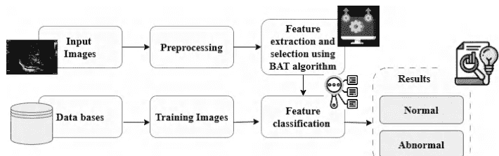

图 3. 疾病检测中的 BAT 算法。


(MBA) 曾被调查用于识别乳腺癌分析的特征向量。MBA 使用随机采样方法从输入数据中选择特征。随机森林（RF）分类器使用排序特征选择进行训练。在性能方面，MBA-RF 方法优于基于相关性的特征选择方法 [84]。

#### 3.3.4 灰狼优化器

这种优化方法基于灰狼的捕猎行为。根据职责，狼被分为四组：α、β、γ 和 ω。在这四组中，α 组提供最佳答案 [85]。与之前的元启发式算法一样，该方法通过先填充种群，然后在局部和全局区域搜索最优解来运行 [86]。当它选择了最佳替代方案后，会将距离值与狼群中的所有其他狼共享。这些值已被 α、β 和 γ 组认可 [87]。图 4 演示了使用灰狼优化检测疾病的过程，其中输入数据集已预处理并分为两组用于训练和测试。在训练阶段，分配的权重经过多次迭代变化，并使用灰狼优化技术进行优化，以帮助正确分类输入数据集。经过几轮后，最终权重被确定，直到发现适应度函数的最高值。然后将测试数据集作为输入，模型使用 GWO 技术对其进行分类，以组织数据的类别，即正常或异常照片。

灰狼优化器的应用：研究人员分析照片后构建了一个诊断阿尔茨海默病的模型。从脑部 MRI 图像中提取的特征包括纹理、直方图和尺度不变变换 [88]。为了准确分类冠状动脉疾病，使用了一种算法。支持向量机用于计算特征选择的适应度函数。使用 Cleveland 数据集 [89] 来测试该方法。开发了一种使用带有灰狼优化的朴素贝叶斯分类器来检测心脏问题的方法。使用的输入数据集是 Cleveland，其中包括年龄、性别、胸痛类型、胆固醇水平、空腹血糖水平等各种信息。灰狼优化被应用于提高朴素贝叶斯分类器多个检索属性权重的准确性 [90]。

#### 3.3.5 哈里斯鹰优化

在几个基准任务测试中，HHO 胜过 PSO、GA 等静态优化方法 [91]。正是这一点启发了计划研究在图像分割中使用 HHO。图 5 描绘了 HHO 的流程，其特征如下：野生哈里斯鹰的合作行为以及称为惊喜猛扑的跟踪策略是该计划的关键灵感。作为这种智能策略的一部分，多只鹰从不同角度俯冲下来，试图震惊猎物。哈里斯鹰可能会表现出一系列跟踪策略，具体取决于地貌的变化特征和猎物的回避模式。为了改进结果，此活动在计算上复制了这种动态模式和行为。自然是基于种群的元启发式 HHO 算法的灵感来源。以下定义适用于 HHO 的几个阶段：

**勘探：** 根据哈里斯的说法，鹰是此阶段的潜在解。这是一个任意数字。

鹰的位置由 X(t + 1) 定义，用于下一次迭代。

```
(t + 1) = \begin{cases} X_{rand} (t) - r_1 \left| X_{rand} (t) - 2r_2 X(t) \right| q \ge 0.5 \\ (X_{rabbit} (t) - X_m (t)) - r_3 (LB + r_4 (UB - LB)) q < 0.5 \end{cases} \quad (4)
```

兔子的位置由变量 X_rand 和 X_rabbit(t) 指示。每只鹰的位置位于 x_(i)(t)，其中 x_m 是当前种群的平均位置。

```
X_m(t) = \frac{1}{N} \sum_{i=1}^{N} X_i(t) \quad (5)
```

##### 3.3.5.1 从勘探到开发的过渡

开发行为取决于猎物逃脱的能力，随着它们逃跑而减弱。E 是兔子的逃逸能量，E_0 是初始状态。

```
E = 2E_0 \left( 1 - \frac{t}{T} \right) \quad (6)
```

这里，E 是猎物的逃逸能量，T 是最大重复次数，E_0 是猎物在初始条件下的能量。在 HHO (1, 1) 中。当 E_0 的值从 0 降至 -1 时，兔子体力不支，而当 E_0 的值从 0 升至 1 时，表示兔子变得更强。在整个迭代过程中，动态逃逸能量 E 呈下降趋势。当逃逸能量 |E| >= 1 时，鹰会搜索不同区域以探索兔子位置，因此算法在 |E| < 1 时的开发步骤中试图开发解周围的区域。然后 HHO 完成勘探阶段。

**开发：** 如果 r < 0.5，则猎物逃脱，否则猎物无法逃脱。

- 1. 软围困：对于 r >= 0.5 且 E >= 0.5 的值，兔子飞走但不会，

```
X(t + 1) = ΔX(t) - E|JX_rabbit(t)X(t)|  (7)
```

```
ΔX(t) = X_rabbit(t) - X(t)  (8)
```

ΔX(t) 表示兔子和鹰之间的位置差异。随机跳跃由 J = 2(1 - r) 表示，随机变化。

- 2. 硬围困：对于 r >= 0.5 且 E < 0.5 的值，逃逸能量较低：

```
X(t + 1) = X_rabbit(t) - E|ΔX(t)|  (9)
```

- 3. 带有渐进快速俯冲的软围困：如果 |E| >= 0.5 且 r < 0.5，猎物有逃跑的力量。在这种情况下，Lévy 飞行（LF）预测了逃跑期间鹰和兔子的移动。鹰根据猎物改变它们的位置。随机向量是 S。此更新通过使用 (9) 完成。

```
Y = X_rabbit(t) - E|JX_rabbit(t) - X(t)|  (10)
```

```
Z = Y + S x LF(D)  (11)
```

```
X(t + 1) = {Y, if F(Y) < F(X(t)), Z, if F(Z) < F(X(t))}  (12)
```

- 4. 带有渐进快速俯冲的硬围困：

```
X(t + 1) = { Y, if F(Y) < F(X(t)), Z, if F(Z) < F(X(t)) }  (13)
```

```
Y = X_rabbit(t) - E|JX_rabbit(t) - X_m(t)|  (14)
```

```
Z = Y + S x LF(D)  (15)
```

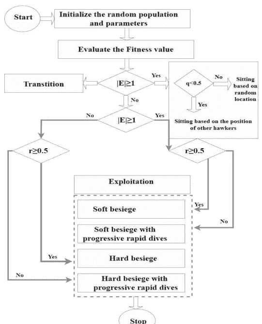

图 5. HHO 流程图。

#### 针对乳腺癌的 HHO 算法应用

Kaur 等人将原始 HHO 与基于维度学习的狩猎（DLH）相结合。对于生物医学数据集，创建了名为 DLHO 的新算法。研究人员还用它来识别乳腺癌 [92]。J 等人提到了一种二进制哈里斯鹰优化算法，通过选择最佳特征来辅助分类过程。哈里斯鹰优化算法基于哈里斯鹰使用的狩猎方法。使用了一个 k-近邻分类器，欧氏距离值为 5，以评估所选特征子集。测试中使用了 22 个 UCI-ML 数据集，包括临床相关的 WDBC、肝炎、淋巴造影、ILPD 和 帕金森数据集。对于肝炎、WDBC、淋巴造影、ILPD 和 帕金森数据集，分别报告了 87.36%、97.32%、85.45%、73.27% 和 90.83% 的准确率值 [93]。

## 4. 实验结果

本研究基于收集和研究的 93 篇文章，这些文章针对医疗疾病分类和预测中图像数据问题的比例减少。图像处理方法的最新发展加速了对各种图像特征的并发探索。另一方面，高维数字图像数据似乎无法生成大量且有用的可预期数据。在本研究中，为了发现有助于对医疗疾病进行分类的最优特征集，我们查阅了多篇不同的论文以了解各种比例减少方法。高比例图像-视频数据只能由少量技术处理，但已有许多关于它们的论文（图 6）。分析表明，混合或元启发式算法在减少医疗数据维度方面得到广泛采用。特征选择算法的集成有效地改善了医疗疾病的预测和标记。表 3 提供了本文献综述中审查的作品的综合列表。总之，试验量相对较小，而微阵列特征的数量显著庞大。特征的选择和分类主要取决于预处理阶段，初始处理技术在消除噪声和无关特征方面起着关键作用。与问题无关的定义是元启发式技术的重要里程碑。由于其通用性、简单性和灵活性，这些技术日益可信。元启发式技术非常巧妙，易于理解，容易调整，并应用于各种分析领域、实际应用和研究领域。相反，收敛速度低和陷入局部最优等限制使其更具挑战性。

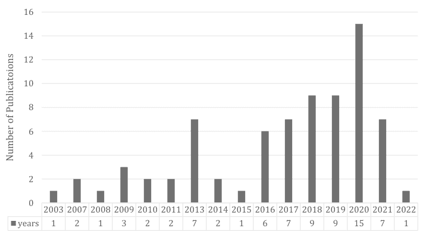

图 6. 建立一个专注于高维乳腺癌数据维度约减技术的研究领域。


| 序号 | 元启发式算法 | 疾病类型 | 结果 | 参考文献 |
|---|---|---|---|---|
| 1 | BAT | 视网膜动脉静脉分类 | 91.73% | [83] |
| | | 基于CAD的肺癌预测 | 97.43% | [82] |
| | | 乳腺癌 | 96.31% | [84] |
| 2 | CSO | 心脏病和糖尿病预测 | 91% | [78] |
| | | CT图像中肺结节的识别 | 82.49% | [77] |
| | | 乳腺癌 | 86.50% | [79] |
| 3 | GWO | 冠状动脉疾病分类 | 89.83% | [89] |
| | | 心脏疾病 | 87.45% | [90] |
| | | 阿尔茨海默病检测 | 98.2% | [88] |
| 4 | GA | 肺结节 | 98% | [73] |
| | | 心脏病 | 99.3% | [74] |
| | | 乳腺癌 | 95% | [75] |
| 5 | HHO | 肝炎 | 87.32% | [93] |
| | | 乳腺癌 | 97.32% | [93] |
| | | 帕金森病 | 90% | [93] |

分析之后，很明显，白鹰优化算法在预测帕金森病方面的准确率最高，为90%，乳腺癌为97.32%。遗传算法在识别肺结节和微阵列心脏病方面表现出色，其令人印象深刻的准确率分别为99.32%和98%。灰狼优化算法在检测阿尔茨海默病方面准确率为98.2%，表现最为出色。在检测肺癌和乳腺癌方面，蝙蝠算法表现卓越，检测率分别为97.43%和96.31%。最后，杜鹃搜索优化算法在检测脑肿瘤和心脏病方面取得了出色的结果，得分分别为98%和91%。

### 4.1 元启发式算法在医学疾病分类与预测中的应用挑战

元启发式框架允许通过使用大量属性数据、图像、视频和机器学习技术来监控图像特征并分析癌症等医学疾病。越来越多的人期望，受元启发式算法启发的深度学习和机器学习模型将改善诊断过程。然而，在管理与癌症和心脏疾病等疾病相关的海量医疗数据方面，存在众多实施挑战。必须收集和处理这些数据以理解患者问题，随后使用尖端的机器学习和人工智能算法分析癌症及其他疾病。本部分描述了实施用于分析图像和

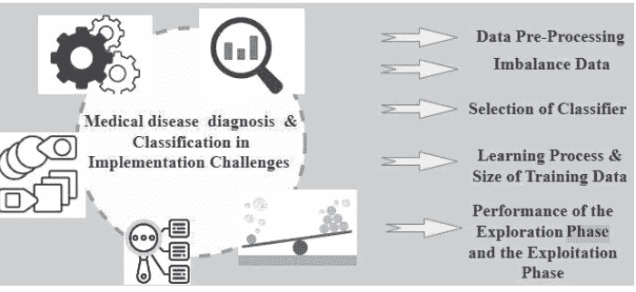

图 7. 元启发式算法的实施挑战。

受元启发式启发的视频基础数据。以下是一些主要实施困难的表示（图 7）。

- **1. 数据预处理。** 它是开发用于乳腺癌疾病的元启发式算法的人工智能和机器学习方法的最关键阶段。从不同来源获得的这种疾病数据具有多种布局，包括结构化、半结构化和非结构化数据，无法直接用于人工智能和机器学习方法。因此，为了使用元启发式算法进行后续处理，需要各种预处理技术。为了精确的医学疾病检测和预测，数据预处理方法将其转换为可与元启发式框架一起使用的更精确格式。

- **2. 数据不平衡。** 当一个类的记录数量显著多于另一个类时，数据集存在类别不平衡。大多数机器学习算法偏好多数类。因此，模型经常倾向于关注准确性而非发现罕见事件，例如患者的紧急状态。可以采用采样、核和基于成本的方法等不同方法来解决类别不平衡问题。使用元启发式框架的挑战之一是确定处理癌症识别和预测生物信息学数据中类别不平衡问题的最佳方式。

- **3. 分类器选择。** 混合方法同时考虑属性子集预测的精度和属性选择的计算效率。混合方法的整体结构分为两个步骤。首先，使用独立分类器标准，从给定的属性集中移除不重要的基因，以在不丢失任何歧视信息的可能性的情况下减小其大小。然后，利用多种分类算法根据多种估价标准识别与预后执行相关的属性。传统的选择方法主要关注单个分类器的唯一属性子集，这对预测任务的贡献微乎其微。为了使用各种分类器选择重要属性，已经开发了许多属性选择技术。因此，为所有受元启发式启发的属性选择框架选择合适的分类器是最具挑战性的任务。

- **4. 学习过程和训练数据大小。** 从各种来源收集的医疗数据中，类别分布不均且维度很高。为了提高机器学习和深度学习算法的效能，还需要最佳的交叉验证方法。克服癌症识别问题的最重要要求之一是用不同数量的训练数据进行学习的方式。由于元启发式方法的许多计算和统计限制，框架的学习过程在高维医学疾病图像表达数据方面比较困难。

- **5. 探索阶段和开发阶段的性能。** 探索阶段和开发阶段之间的平衡对于元启发式算法的有效应用至关重要。在预测和分类癌症的混合元启发式上下文中，当某些元启发式算法用于探索阶段，而其他算法用于开发阶段时，效果最佳。在探索阶段和开发阶段之间找到完美的平衡是一项重要而困难的任务。

### 4.2 综述总结

癌症分析领域中带有元启发式机器学习方法的特征算法选择迅速扩展，大大有助于精确预测特定类型乳腺癌的存在。为分类乳腺癌疾病开发各种带有元启发式算法的混合模型将是有益的，以便尽量减少进一步研究的障碍并提高分类性能和计算效率。为了提高乳腺癌分类和预测的机器学习（ML）性能或为对高维生物医学数据的更多研究建立现有主导挖掘，元启发式算法的全局混合方法如图 8 所示。

## 5. 结论

癌症和其他类型的疾病对于评估和诊断各种人类疾病至关重要，大量算法技术的发展使疾病检测成为医学图像处理和更广泛的医学影像研究领域中都相关的重要问题。为了有效监控人工智能技术的持续发展并根据其独特的治疗要求加以应用，医生获得了重大机遇和相应责任。这种方法使他们更容易为医疗实践寻找有用的辅助设备。由于特别关注元启发式算法和人工智能

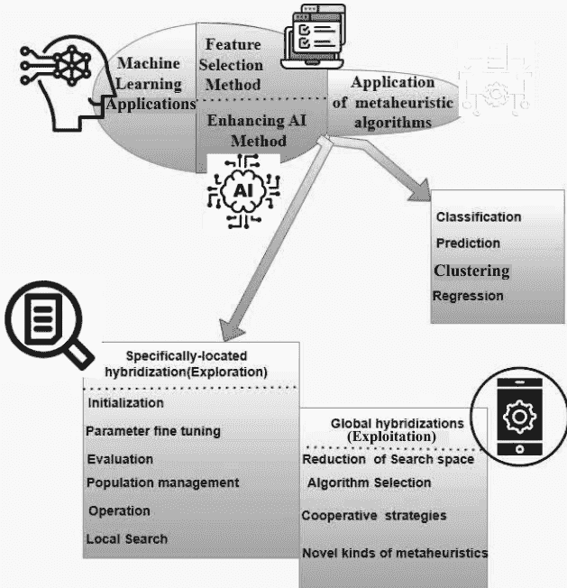

图 8. 为了提高医学图像分类和预测性能，将元启发式算法与机器学习模型相结合。

（AI）是医疗保健领域的一种有用工具，为改进诊断和治疗提供了多种可能性。研究元启发式算法的应用是另一个具有研究潜力的领域，有望为疾病诊断模型提供绝佳的可能性，最终惠及患者和医疗专业人员。通过利用多种优化技术，包括杜鹃搜索优化（CSO）、遗传算法（GA）、蝙蝠启发式算法（BAT）、灰狼优化（GWO）和白鹰算法（HHO），这些模型如果使用得当，可以准确检测和分类各种与健康相关的状况。随着医疗费用不断上升，个人越来越需要监控其药物成本。元启发式算法以其计算效率著称，为脑肿瘤识别、人眼视网膜图像分析、心脏健康评估、乳腺癌诊断和肺癌筛查等重要医疗领域提供了具成本效益的解决方案。借助所有这些算法，可以从图像中提取更精确的信息，提高预测准确率。


尽管元启发式算法在医疗数据（如基因选择和图像）方面日益获得接受，但众多问题仍需进一步研究。此外，对自然启发算法的仔细考察和开发有望提升众多高维领域中的特征选择程序。一种稳健的 FS 方法的结果将有所裨益，并通过提供可靠且高度准确的分类（同时限制所选基因和属性的数量）来协助人类疾病的筛选和诊断。借助这项研究，其他研究人员将能够为其项目确定适当的 FS 技术，以及需要改进的领域，以及医学中乳腺癌疾病分类与识别的降维挑战。

## References

- [1] 乳腺癌. 2021. [(访问日期：2021 年 7 月 19 日)]. 在线可用: https://www.who.int/news-room/fact-sheets/detail/breast-cancer.
- [2] Sung, H., Ferlay, J., Siegel, R. L., Laversanne, M., Soerjomataram, I., Jemal, A. et al. (2021). 2020 年全球癌症统计：GLOBOCAN 对全球 185 个国家 36 种癌症的发病率和死亡率估计. CA Cancer J. Clin., 71: 209–249. doi: 10.3322/caac.21660.
- [3] 美国癌症协会. (2022). https://www.cancer.org/. 最后访问：2022 年 2 月 1 日.
- [4] Barone, I., Giordano, C., Bonofiglio, D., Andò, S. and Catalano, S. (2020). 肥胖在乳腺癌进展和转移中的作用：临床和分子视角. Semin Cancer Biol., 50: 274–284. https://doi.org/10.1016/j.semcancer.2019.09.001.
- [5] Ferlay, J., Colombet, M., Soerjomataram, I., Dyba, T., Randi, G., Bettio, M. et al. (2018). 欧洲的癌症发病率和死亡率模式：2018 年 40 个国家和 25 种主要癌症的估计. Eur. J. Cancer, 103: 356–387. https://doi.org/10.1016/j.ejca.2018.07.005.
- [6] Carioli, G., Malvezzi, M., Rodriguez, T., Bertuccio, P., Negri, E. and La Vecchia, C. (2017). 欧洲乳腺癌死亡率的趋势及到 2020 年的预测. Breast, 36: 89–95. https://doi.org/10.1016/j.breast.2017.06.003.
- [7] Sunarti, S., Rahman, F. F., Naufal, M., Risky, M., Febriyanto, K. and Masnina, R. (2021). 医疗保健中的人工智能：未来的机遇与风险. Gac. Sanit., 35: S67–S70.
- [8] Toepper, M. (2017). 将正常衰老与阿尔茨海默病区分开来：来自认知神经科学的视角. J. Alzheimer's Dis., 57: 331–352.
- [9] Davenport, T. and Kalakota, R. (2019). 医疗保健中人工智能的潜力. Futur. Healthc. J., 6: 94–98.
- [10] Fakoor, R., Ladhak, F., Nazi, A. and Huber, M. (2013). 使用深度学习增强癌症诊断和分类. pp. 3937–3949. In Proceedings of the International Conference on Machine Learning, Atlanta, GA, USA, 16–21 June 2013; ACM: New York, NY, USA, Volume 28.
- [11] Vial, A., Stirling, D., Field, M., Ros, M., Ritz, C., Carolan, M. et al. (2018). 深度学习和放射组学特征提取在癌症特异性预测建模中的作用：综述. Transl. Cancer Res., 7: 803–816. [CrossRef] Big Data Cogn. Comput. 2023, 7, 10 15 of 20.
- [12] Esteva, A., Robicquet, A., Ramsundar, B., Kuleshov, V., DePristo, M., Chou, K. et al. (2019). 医疗保健中深度学习指南. Nat. Med., 25: 24–29.
- [13] Horgan, D., Romao, M., Morré, S. A. and Kalra, D. (2019). 人工智能：文明的力量——也是更好医疗的力量. Public Health Genom., 22: 145–161.
- [14] Hussain, A., Malik, A., Halim, M. U. and Ali, A. M. (2014). 外科手术中机器人技术的应用：综述. Int. J. Clin. Pract., 68: 1376–1382.
- [15] Khan, Z. H., Siddique, A. and Lee, C. W. (2020). 全球 COVID-19 管理中医疗保健数字化的机器人技术应用. Int. J. Environ. Res. Public Health, 17: 3819.
- [16] Brody, H. (2013). 医学影像. Nature, 502: S81–S81. [PubMed] [Google Scholar]
- [17] Uysal, G. and Ozturk, M. (2020). 基于机器学习方法的海马萎缩相关阿尔茨海默病诊断. J. Neurosci. Methods, 337: 1–9. https://doi.org/10.1016/j.jneumeth.2020.108669.
- [18] Musleh, M., Aljarami, E., Khalil, A., Nasser, B., Barhoom, A. and Naser, S. (2019). 使用人工神经网络预测肝病患者. J. Acad. Inf. Syst. Res., 3: 1–11.
- [19] Dabowsa, N., Amatik, N., Maatuk, A. and Shadi, A. (2017). 皮肤病诊断的混合智能系统. pp. 1–6. In: Conference on Engineering and Technology. https://doi.org/10.1109/ICEngTechnol.2017.8308157.
- [20] Deldjoo, Y., Elahi, M., Cremonesi, P., Garzotto, F., Piazzolla, P. and Quadrana, M. (2016). 基于风格化视觉特征的基于内容的视频推荐系统. J. Data Semant., 5(2): 99–113.
- [21] Al-Dulaimi, K., Chandar, V., Nguyen, K., Banks, J. and Tomeo-Reyes, I. (2019). 使用线性判别分析对细胞形状高阶谱特征进行 HEP-2 标本细胞分类基准测试. Pattern Recognit Lett., 125: 534–41.
- [22] Liu, W., Wang, Z., Liu, X., Zeng, N., Liu, Y. and Alsaadi, F. E. (2017). 深度神经网络架构及其应用综述. Neurocomputing, 234: 11–26.
- [23] Pouyanfar, S., Sadiq, S., Yan, Y., Tian, H., Tao, Y., Reyes, M. P. et al. (2018). 深度学习综述：算法、技术和应用. ACM Comput. Surv. (CSUR). 51(5): 1–36.
- [24] Liu, W., Wang, Z., Liu, X., Zeng, N., Liu, Y. and Alsaadi, F. E. (2017). 深度神经网络架构及其应用综述. Neurocomputing. 234(November 2016): 11–26. https://doi.org/10.1016/j.neucom.2016.12.038.
- [25] Bauer, S., Wiest, R., Nolte, L. P. and Reyes, M. (2013). 基于 MRI 的脑肿瘤研究医学影像分析综述. Phys. Med. Biol., 58(13): 1–44. https://doi.org/10.1088/0031-9155/58/13/R97.
- [26] Bizopoulos, P. and Koutsouris, D. (2019). 心脏病学中的深度学习. IEEE Rev. Biomed. Eng., 12(c): 168–193. https://doi.org/10.1109/RBME.2018.2885714.
- [27] Mazurowski, M. A., Buda, M., Saha, A. and Bashir, M. R. (2019). 放射学中的深度学习：概念概述与以 MRI 为重点的现状综述. J. Magn. Reson Imaging, 49(4): 939–954. https://doi.org/10.1002/jmri.26534.
- [28] Kim, H.-E. (2020). 使用人工智能进行乳腺 X 线摄影中癌症检测和假阳性召回的变化：一项回顾性多读者研究. Lancet Digital Health, 2(3): e138–e148. https://doi.org/10.1016/S2589-7500(20)30003-0.
- [29] Bruni, D., Angell, H. K. and Galon, J. (2020). 癌症预后和治疗效果中的免疫背景和免疫评分. Nat. Rev. Cancer, 20(11): 662–680. https://doi.org/10.1038/s41568-020-0285-.
- [30] Sloun, R. J. G. V., Cohen, R. and Eldar, Y. C. (2020). 超声成像中的深度学习. Proceedings of the IEEE, 108(1): 11–29. https://doi.org/10.1109/JPROC.2019.2932116.
- [31] Abdi, A. H., Luong, C., Tsang, T., Allan, G., Nouranian, S., Jue, J. et al. (2017). 使用卷积神经网络对超声心动图进行自动质量评估：四腔心室切面的可行性研究. IEEE Trans. Med. Imaging, 36: 1221–1230.
- [32] Tajbakhsh, N., Gurudu, S. R. and Liang, J. (2016). 使用形状和上下文信息在结肠镜视频中自动检测息肉. IEEE Trans. Med. Imaging, 35: 630–644.
- [33] Reddy, G. T., Reddy, M. P. K., Lakshmanna, K., Rajput, D. S., Kaluri, R. and Srivastava, G. (2020). 用于心脏病诊断的混合遗传算法和模糊逻辑分类器. Evol. Intel., 13(2): 185–196.
- [34] Yang, X. S. (2010). 一种新的蝙蝠启发元启发式算法. pp. 65–74. In: Nature Inspired Cooperative Strategies for Optimization. Springer, Berlin.
- [35] Yang, X. S. (2011). 用于多目标优化的蝙蝠算法. Int. J. Bio-Inspired Comput., 3(5): 267–274.
- [36] Yang, X. S. and Deb, S. (2009). 基于 Lévy 飞行的布谷鸟搜索. IEEE World Congress on Nature and Biologically Inspired Computing, 210–214.
- [37] Yang, X. S. and He, X. (2013). 萤火虫算法：最新进展与应用. Int. J. Swarm Intell., 1(1): 36–50.
- [38] Yang, X. S. and He, X. (2013). 蝙蝠算法：文献综述与应用. Int. J. Bio-inspired Computer, 5(3): 141–149.


- [39] Yue, B., Yao, W., Abraham, A. and Liu, H. (2007). 基于粒子群优化的新粗糙集约化算法. 第 397–406 页. In: 国际自然与人工计算相互作用工作会议论文集. Springer, Berlin.

- [40] Sengupta, P. P., Huang, Y. M. and Bansal, M. (2016). 心脏成像认知机器学习算法：鉴别紧缩性心包炎与限制性心肌病的先导研究. 循环：心血管成像, 9(6).

- [41] Narula, S., Shameer, K., Salem Omar, A. M., Dudley, J. T. and Sengupta, P. P. (2016). 用于自动化二维超声心动图形态和功能评估的机器学习算法. 美国心脏病学院杂志, 68(21): 2287–2295.

- [42] Amrane, M., Oukid, S., Gagaraou, I. and Ensari, T. (2018). 使用机器学习的乳腺癌分类. 第 1–4 页. In 2018 电工电子、计算机科学、生物医学工程师会议 (EBBT), 18–19, https://doi.org/10.1109/EBBT.2018.8391453.

- [43] Gangavath, M. D., Taib, N. A., Har, Y. C., Lio, P. and Dhillon, S. K. (2019). 使用机器学习技术预测乳腺癌患者生存的影响因素. BMC 医学信息学与决策, 19(1): 48. https://doi.org/10.1186/s12911-019-0801-4.

- [44] Obaid, O. I., Mohammed, M. A., Mostafa, A. and Taha, F. (2018). 威斯康星乳腺癌分类中机器学习技术性能评估. 国际工程技术杂志, 7(436): 160–166. https://doi.org/10.14419/ijet.v7i4.36.23737.

- [45] AlFayez, F., El-Soud, M. W. A. and Gaber, T. (2020). 乳腺癌热成像检测：两种机器学习技术的比较研究. 应用科学, 10(2): 2020. https://doi.org/10.3390/app1002055.

- [46] Kim, H.-E. (2020). 使用人工智能进行乳腺X线摄影中癌症检出和假阳性召回的变化：一项回顾性多读者研究. 柳叶刀数字健康, 2(3): e138–e148. https://doi.org/10.1016/S2589-7500(20)30003-0.

- [47] Kou, G., Xu, Y., Peng, Y., Shen, F., Chen, Y., Chang, K. et al. (2021). 使用事务数据和两阶段多目标特征选择进行中小企业破产预测. 决策支持系统, 140: 113429. https://doi.org/10.1016/j.dss.2020.113429.

- [48] Hall, M. and Smith, L. (1997). 特征子集选择：一种基于相关性的过滤方法. 第 855–858 页. 1997 年神经信息处理与智能信息系统国际会议. Springer, Berlin.

- [49] avanya, D. and Rani, K. (2011). 带分类的特征选择分析：乳腺癌数据集. s. IJCSE, 2(5): 756–763.

- [50] Sun, W., Tang, M., Zhang, L., Huo, Z. and Shu, L. (2020). 物联网中群智能算法应用综述. 传感器, 20(5): 1420. https://doi.org/10.3390/s20051420.

- [51] Xue, J. and Shen, B. (2020). 一种新型群智能优化方法：麻雀搜索算法. 系统科学与控制工程, 8(5): 22–34. https://doi.org/10.1080/21642583.2019.1708830.

- [52] Nguyen, B., Xue, B. and Zhang, M. (2020). 数据挖掘中特征选择的群智能方法综述. 群体进化计算, 54: 100663. https://doi.org/10.1016/j.swevo.2020.100663.

- [53] Rabie, A., Ali, S., Saleh, A. and Ali, H. (2020). 基于大数据的智能电网负荷预测支持的新异常拒绝方法论. 集群计算, Springer 23: 509–535. https://doi.org/10.1007/s10586-019-02942-0.

- [54] Rabie, A., Ali, S., Saleh, A. and Ali, H. (2020). 面向智能电网的基于多集成分类的雾计算负荷预测策略. 环境智能与人性化计算杂志, 11(1): 209–236. https://doi.org/10.1007/s12652-019-01299-x.

- [55] Alhenawi, E., Al-Sayyed, R., Hudaib, A. and Mirjalili, S. (2022). 用于癌症分类的基因表达芯片数据特征选择方法：一项系统综述. 计算生物学与医学, 140: 105051. [Google 学术]

- [56] Akay, M. F. (2009). 用于乳腺癌诊断的结合特征选择的支持向量机. 专家系统与应用, 36(2): 3240–7.

- [57] Gurcan, M. N., Boucheron, L. E., Can, A., Madabhushi, A., Rajpoot, N. M. and Yener, B. (2009). 组织病理学图像分析：综述. IEEE 生物医学工程评论, 2: 147–71.

- [58] Wei-Jia, L., Liang, M. and Hao, C. (2016). 用于检测诱发心脏病因素的基于关联规则优化的粒子群优化-支持向量机. 智能系统杂志, 26: 573–583.

- [59] Al-Tashi, Q., Rais, H. and Jadid, S. (2019). 基于灰狼优化的冠状动脉疾病分类特征选择方法. In: Saeed, F., Gazem, N., Mohammed, F. and Busalim, A. (eds.). 数据科学与软计算近期进展. IRICT 2018. 智能系统与计算进展, vol 843. Springer, Cham. https://doi.org/10.1007/978-3-319-99007-1_25.

- [60] Sakri, S., Rashid, N. and Zain, Z. (2018). 乳腺癌复发预测的粒子群优化特征选择. IEEE, 6: 29637–29647. https://doi.org/10.1109/ACCESS.2018.2843443.

- [61] Hans, R., Kaur, H. and Kaur, N. (2020). 用于乳腺肿块分类特征选择的对抗式哈里斯鹰优化算法. 交叉数学杂志, 23(1): 97–106. https://doi.org/10.1080/09720502.2020.1721670.

- [62] Guyon, I., Gunn, S., Nikravesh, M. and Zadeh, L. A. (2008). 特征提取：基础与应用. Springer: New York, NY, USA, Volume 207. [Google 学术]

- [63] Cai, J., Luo, J., Wang, S. and Yang, S. (2018). 机器学习中的特征选择：一种新视角. 神经计算, 300: 70–79. [Google 学术]

- [64] Li, J., Cheng, K., Wang, S., Morstatter, F., Trevino, R. P., Tang, J. et al. (2018). 特征选择：一种数据视角. ACM 计算机调查, 50: 94. [Google 学术]

- [65] Miao, J. and Niu, L. (2016). 特征选择综述. 程序计算机科学, 91: 919–926. [Google 学术]

- [66] Saeys, Y., Inza, I. and Larrañaga, P. (2007). 生物信息学中特征选择技术综述. 生物信息学, 23: 2507–2517. [Google 学术]

- [67] Cortes, C. and Vapnik, V. (1995). 支持向量网络. 机器学习, 20: 273–297. [Google 学术]

- [68] Taheri, S. and Mammadov, M. (2013). 使用优化模型学习朴素贝叶斯分类器. 国际应用数学与计算机科学杂志, 23: 787–795. [Google 学术]

- [69] O’Neill, M. C. and Song, L. (2003). 淋巴瘤微阵列数据的神经网络分析：近乎完美的预后与诊断. BMC 生物信息学, 4: 13. [Google 学术]

- [70] Holland, J. H. (1992). 遗传算法. 科学美国人, 267(1): 66–73.

- [71] Davis, L. (1991). 遗传算法手册.

- [72] Hung, C. L. and Wu, Y. H. (2017). 用于脑磁共振成像分割的多个嵌入式图形处理单元上的基于遗传的并行算法. 计算机与电气工程, 61: 373–383

- [73] de Carvalho Filho, A. O., de Sampaio, W. B., Silva, A. C., de Paiva, A. C., Nunes, R. A. and Gattass M. (2014). 使用质量阈值聚类、遗传算法和多样性指数进行孤立性肺结节自动检测. 人工智能医学, 2014. Mar; 60(3): 165–177. 10.1016/j.artmed.2013.11.002.

- [74] Oak, H. (2013). 基于支持向量机和遗传算法的胎儿健康评估医疗决策支持系统. 医学系统杂志, 2013. Apr; 37(2): 9913. 10.1007/s10916-012-9913-4.

- [75] Pereira, D. C., Ramos, R. P. and do Nascimento M. Z. (2014). 结合小波分析和遗传算法的乳腺X线摄影中乳腺癌分割与检测. 计算机方法与生物医学程序, 2014. Apr; 114(1): 88–101. 10.1016/j.cmpb.2014.01.014 [PubMed]

- [76] Diker, A., Sönmez, Y. and Özyurt, F. (2021). 使用深度卷积神经网络特征考察 ECG 信号分类技术 DEA-ELM. 多媒体工具与应用. https://doi.org/10.1007/s11042-021-10517-8.

- [77] Manickavasagam, R. and Selvan, S. (2019). 使用优化神经模糊分类器和布谷鸟搜索算法对 CT 图像中肺结节进行自动检测和分类. J M

- [78] Gadekallu, R. and Khare, N. (2017). 用于心脏病和糖尿病预测的布谷鸟搜索优化约简与模糊逻辑分类器. 模糊系统与应用国际杂志 (IJFSA) 6(2): 25–42.

- [79] Yun Jiang. (2017). 用于特征选择的修正二进制布谷鸟搜索：一种混合过滤-包装方法 2017 年第 13 届计算智能与安全国际会议 (CIS), IEEE.


- [80] Al-Thanoon, A., Qasim, S. 和 Algamal, Y. (2021). 基于自然启发算法的特征选择改进. J. Ambient Intell Human Comput. https://doi.org/10.1007/s12652-021-03136-6.

- [81] Sasikala, E., Kannani, P., Gopalakrishnan, R. 和 Radha, R. (2021). 基于高效混合算法的MRI脑图像分割病变识别. Journal of Ambient Intelligence and Humanized Computing, (2021): 1–11.

- [82] Priyadharshini, P. 和 Zoraida, B. S. E. (2021). 基于蝙蝠启发元启发式卷积神经网络算法的CAD肺癌预测. J. Appl. Sci. Eng., 24(1): 65–71. https://doi.org/10.6180/jase.202102_24(1).0008.

- [83] Sathananthavahi, V. 和 Indumathi, G. (2020). 基于BAT优化的视网膜动脉静脉分类. Soft Comput. https://doi.org/10.1007/s00500-020-05339-z.

- [84] Nakamura, R. Y. M., Pereira, L. A. M., Costa, K. A., Rodrigues, D., Papa, J. P. 和 Yang, X.-S. (2012). BBA: 用于特征选择的二进制蝙蝠算法. 第291–297页. 收录于: 2012年第25届SIBGRAPI图形、模式与图像会议论文集, 巴西奥罗普雷托, 2012年8月22–25日. [Google Scholar]

- [85] Bansal, J. C. 和 Singh, S. (2021). 灰狼优化器中更好的勘探策略. J. Ambient Intell Humaniz Comput., 12(1): 1099–1118. https://doi.org/10.1016/j.advengsoft.2013.12.007.

- [86] Azlan, H., Zain, M., Sallehuddin, R. 和 Yusof, Y. (2018). 灰狼优化器(GWO)优化方法的最新研究: 一篇综述. Artif Intell Rev. https://doi.org/10.1007/s10462-018-9634-2.

- [87] Sahoo, A. 和 Chandra, S. (2017). 用于改进宫颈病变分类的多目标灰狼优化器. Appl Soft Comput J., 52: 64–80. https://doi.org/10.1016/j.asoc.2016.12.022.

- [88] Shankar, K., Lakshmanaprabu, S. K., Ashish Khanna, Sudeep Tanwar, Joel J. P. C. Rodrigues 和 Nihar Ranjan Roy. (2019). 基于群灰狼优化特征与卷积分类器的阿尔茨海默病检测. Comput. Electr. Eng., 77: 230–243. https://doi.org/10.1016/j.compleleceng.2019.06.001.

- [89] Al-Tashi, Q., Rais, H. 和 Jadid, S. (2018). 基于灰狼优化的冠状动脉疾病分类特征选择方法. 第257–266页. 收录于: 可靠信息与通信技术国际会议. Springer, Cham. https://doi.org/10.1007/978-3-319-99007-1_25.

- [90] El Bakrawy, L. M. (2017). 灰狼优化与朴素贝叶斯分类器融合用于心脏病诊断. Aust. J. Basic Appl. Sci., 11(7): 64–70.

- [91] Heidari, A. A., Mirjalili, S. 和 Faris, H. (2019). 哈里斯鹰优化: 算法与应用. Futur Gener Comp Syst., 97: 849–872.

- [92] Kaur, N., Kaur, L. 和 Cheema, S. S. (2021). 基于维度学习式狩猎的乳腺癌检测改进版哈里斯鹰优化. Sci. Rep., 11: 21933. [Google Scholar]

- [93] Too Jingwei, Abdullah Abdul Rahim, MohdSaad Norhashimah. (2019). 用于特征选择的新型二次二进制哈里斯鹰优化. Electronics, 8(10): 1130.

# 第5章
# 慢性疾病检测与预防的深度学习应用
Shaheen Layqa¹,* 和 B. Manjula²

## 1. 引言

帕金森病（PD）是一种随着时间推移而恶化的慢性疾病。世界卫生组织的一项调查发现，PD是美国第二常见的神经退行性疾病。PD无法从根本上完全消除，但可以检测和预防。为了预防和控制PD，帕金森病患者需要定期前往诊所，并在受过训练的医务人员监督下接受医学检查。这是一项不便的任务，因为它主要发生在老年人中 [1–2]。为了使各年龄段人群都能方便地进行，大多数医学医生依赖于远程监测应用程序，这些应用程序被发现是更可靠的决策支持系统。帕金森病患者现在可以在家收集数据或进行测试，并通过互联网将这些数据传输到专用服务器。

帕金森病的病因可能各不相同；然而，它大多与遗传疾病、脑损伤、个人压力、神经损伤、生活方式及环境相关的健康问题和不良饮食有关。观察发现，帕金森病主要影响言语、书写和步行 [3]。由于这已成为一个热门问题，大多数研究人员正在研究它，并提出了依赖于声音数据样本的检测技术。声音或语音数据的缺点在于准确性非常低，且由于缺乏适当的验证方法，发现了不可靠的结果。如果患者患有简单的咳嗽、感冒、喉咙感染、口吃或构音障碍，那么声音样本对预测PD就不那么有效。

¹ 计算机科学系，西兰格妮女子学位及研究生学院，科塔古德姆，特伦甘纳邦，印度。
² 计算机科学系，卡卡提亚大学，瓦朗加尔，特伦甘纳邦，印度。
* 通讯作者: mdshafeen1905@gmail.com

在本章中，PD患者的书写被视为声音数据样本的替代方案。PD患者的书写可以通过手动方法（纸和笔）或计算机方法获得。计算机方法是当今最合适且最常用的方法。

由于PD引起的颤抖或震颤，患者通常无法写出清晰的字迹。他们的书写变得过于狭小、模糊和倾斜。因此，对于PD检测，手写数据样本比声音样本更合适。在收集手写数据集后，分类是使用一种称为神经网络的流行深度学习技术进行的。

深度学习神经网络（DLNN）基于人工神经网络，模仿人脑的结构和功能。DLNN还能够支持大量数据。DLNN的框图如图1所示。DLNN由三层组成：输入层、隐藏层和输出层。

由于PD无法使用单层检测，需要多个隐藏层，DLNN可以高效地完成这一点。因此，本章侧重于深度学习技术而非机器学习技术。最后，对机器学习技术与DLNN进行了比较，表明使用深度学习技术分析时，手写数据集表现更好。

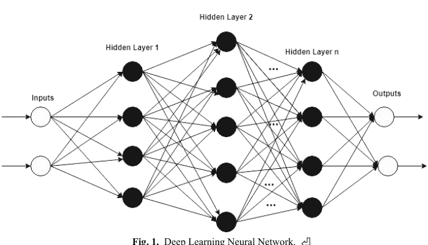

## 2. 文献综述

Mahnaz Behroozi 和 Ashkan Sami 研究了“基于各种语音测试的帕金森病多类分类器框架 [4]”。他们试图解决与语音测试数据汇总和单一分类器相关的问题。G. Dimauro, V. D. Nicola, V. Bevilacqua, D. Caivano 和 F. Girardi 提出了“基于语音转文本系统的帕金森病语音可理解性评估” [5]。使用Google语音将语音转换为文本，但需要语言技能。Md. Tahmid Rahman Laskar, Md. Tahmid Hossain, Abu Raihan Mostofa Kamal 和 Nafiul Rashid 提出了“自动疾病预测系统（ADPS）” [6]。“基于用户输入的可靠疾病预测架构”完全依赖于相关属性。L. Berus, S. Klancnik, M. Brezocnik 和 M. Ficko 研究了“使用人工神经网络基于声学指标分类帕金森病” [7]。Betul Erdogdu Sakar, M. Erdem Isenkul, C. Okan Sakar, Ahmet Sertbas, Fikret Gurgen, Sakir Delil, Hulya Apaydin 和 Olcay Kursun 提出了“采集与分析带有多种声音录音的帕金森语音数据集 [8]”，利用集中趋势和标准差。然而，这些方法复杂、难以理解，且容易出现极端值问题，无法覆盖完整的数据范围。Yasin Ozkanca, Miraç Göksu Öztürk, Merve Nur Ekmekci, David C. Atkins, Cenk Demiroglu, Reza Hosseini Ghomi 研究了“帕金森病患者语音样本中的抑郁筛查 [9]”。但只使用了缩减数据集来追踪抑郁。Wojciech Froelich, Krzysztof Wrobel 和 Piotr Porwik 提出了“使用语音样本和基于阈值的分类进行帕金森病诊断 [10]”。Savitha S. Upadhyay 和 A. N. Cheeran 提出了“使用语音的发音和头部特征区分帕金森病患者和健康人 [11]”。Ondrej Klempíř 和 Radim Krupicka 提出了“使用语音语句的帕金森病检测机器学习 [12]”。Srishti Grover, Saloni Bhartia, Akshama, Abhilasha Yadav 和 Seeja K. R. 提出了一项工作“使用深度学习预测帕金森病严重程度 [13]”。但需要线性代数知识，且TensorFlow计算速度较低。Aarushi Agarwal, Spriha Chandrayan 和 Sitanshu S. Sahu 提出了一项工作“基于极端学习机的语音信号帕金森病预测 [14]”。完全准确度取决于偏置和权重的准确选择。Muntasir Hoq, Mohammed Nazim Uddin 和 Seung-Bo Park 提出了一项关于“基于语音特征提取的人工智能模型进行帕金森病检测” [15] 的工作，但稀疏自动编码器使得难以理解特征。

## 3. 提出的方法

手写数据集（HWDS）用于PD检测和预防。在本章中，使用DLNN分类方法来区分每个文本数据集的值。所提框架的总体视图如图2所示。

- 1. 数据预处理: 这是提高数据质量的初步步骤。在此步骤中，收集HWDS，创建子集并执行特征选择。
- 手写数据集提取: 从HWDS存储库中收集HWDS。
- 子集: 在这里，通过分离创建给定HWDS的子集。每个子集包含相同类型的实例。共创建了77个样本，每个样本包含七个实例。如果不执行此步骤，将无法获得分类结果。


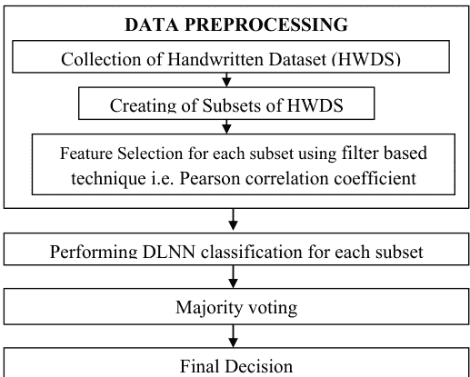

图 2. 拟议模型的框架。

- 特征选择：特征选择是为了使整体过程更准确。特征选择是选择相关特征（变量）子集的过程。特征选择方法有三种：包裹法（Wrapper Method）、过滤法（Filter Method）和嵌入法（Embedded Method）。在所提方法中，深度学习是一种重要的基于过滤的技术，即使用了皮尔逊相关系数。通过皮尔逊相关系数识别出高度相关的特征。每个特征的皮尔逊相关系数采用以下公式计算。

```
r = \frac{n(\sum xy) - (\sum x)(\sum y)}{\sqrt{[n \sum x^2 - (\sum x)^2][n \sum y^2 - (\sum y)^2]}}
```

- 其中，
- r = 皮尔逊系数
- n = 股票配对数量
- \sum xy = 配对股票的乘积之和
- \sum x = x 分数之和
- \sum y = y 分数之和
- \sum x^2 = 平方 x 分数之和
- \sum y^2 = 平方 y 分数之和

并非所有 HWDS 特征都相关，因此仅考虑重要特征。

- 2. 分类和多数投票：完成每个子集的特征选择后，为每个子集构建一个 DLNN 分类器。随后，跨分类器进行多数投票以确定个人所属的类别。如果投票值等于 1，则该个体属于帕金森病类别（PD = 1）；否则，如果投票值等于 0，则该个体属于非帕金森病类别（NPD = 0）。

### 3.1 拟议算法

算法：手写体帕金森病检测（HWPDD）。
[该算法旨在使用手写体数据集检测帕金森病]
输入：手写体数据集（HWDS）由表示类别标签的 a1,a2,...,an 属性（变量）和 b1,b2,...,bn 记录组成。
输出：通过应用多数投票，确定健康个体和帕金森病患者的数量。

- 步骤 1：从手写体数据集中提取样本并将其存储在 TBDS 中
- 导入 pandas as pd
- TBDS <- pd.read_csv ('HWD.csv')

- 步骤 2：从 TBDS 中提取每条记录并将其存储在子集数据集（SubsetDS）中。
- 每个子集由相同类型的实例组成。
- SubsetDS <- TBDS.iloc[1:77]

- 步骤 3：对每个子集数据集执行特征选择，并将其存储在特征选择基于文本的数据集（fsTBDS）中。
- for i <- 1 to 77
- fsTBDS<- Pearson_coefficient_correlation (SubsetDS[i])

- 步骤 4：在特征选择基于文本的数据集（fsTBDS）上执行深度学习神经网络分类器，并将其存储在分类后的基于文本的数据集（ClassifiedfsTBDS）中。
- ClassifiedfsTBDS <- DLNN_Classifier(fsTBDS)

- 步骤 5：每个 DLNN 分类器输出 0 或 1 值：‘0’ 表示 NPD，‘1’ 表示 PD。
- 随后，使用这些值进行多数投票并做出最终决策。
- VotingClassifier(classifiedfsTBDS)

- 步骤 6：结束。

所提算法的总时间复杂度为 O(n)。

## 4. 实验结果与讨论

### 4.1 数据集

帕金森病和对照手写体数据库由伊斯坦布尔大学切拉帕萨医学院神经科创建 [16]。该数据库总共包含 77 份手写体样本，其中 62 份来自帕金森病患者，其余 15 份来自健康个体。

该数据库使用图形平板电脑创建，患者使用数字笔在显示器上绘制螺旋线。使用带有 API 函数的 C# 平台软件来收集信息，例如 X、Y、Z 坐标、在屏幕上使用笔书写时施加的压力、笔握角度以及完成绘制所需的时间。

进行了三种不同的测试并收集了数据——静态螺旋测试（SST）、动态螺旋测试（DST）和特定点稳定性测试（STCP）。

**SST：** 临床部门经常用它来确定人员的运动表现。在此测试中，患者被指示使用数字笔重新描绘出现在屏幕上的螺旋线，相关数据存入数据库。

**DST：** 在此测试中，螺旋线在消失前仅可见有限时间。患者被指示凭记忆复制螺旋线。观察发现，大多数患者在绘制螺旋线时偏离了图案。

**STCP：** 屏幕上会出现一个红点，建议患者将数字笔停在红点上而不触摸屏幕。此测试测量患者手部的震颤水平。

### 4.2 变量表

共有七个指标变量，详情见表 1。该表不包含任何 NULL 值。

表 1. 变量描述。

| 变量名称 | 角色 | 类型 | 描述 | 单位 | 缺失值 |
|---|---|---|---|---|---|
| X | 特征 | 整数 | 定义 X 坐标值。 | 度 | 无 |
| Y | 特征 | 整数 | 定义 Y 坐标值。 | 度 | 无 |
| Z | 特征 | 整数 | 定义 Z 坐标值。 | 度 | 无 |
| 压力 | 特征 | 整数 | 用手在平板电脑上施加的物理力。 | 帕斯卡 | 无 |
| 握笔角度（位置） | 特征 | 整数 | 笔和平板电脑之间形成的角度。 | 度或弧度 | 无 |
| 时间戳 | 特征 | 整数 | 绘制图像或文本的时间。 | 秒 | 无 |
| TestID | 特征 | 整数 | 包含 3 个值 0/1/2。0- SST，1- DST，2- STCP | - | 无 |

### 4.3 评估指标

所提方法的准确率采用三个指标进行评估：准确率、灵敏度和特异度。各自公式见公式 1–3。

准确率 = \frac{真阳性 + 真阴性}{真阳性 + 真阴性 + 假阳性 + 假阴性} (1)

灵敏度 = \frac{真阳性}{真阳性 + 假阳性} (2)

特异度 = \frac{真阴性}{真阴性 + 假阳性} (3)

### 4.4 结果与讨论

将多个分类器（包括决策树、朴素贝叶斯和深度学习神经网络（DLNN））应用于 HWDS。特征选择使用了皮尔逊系数相关性。使用准确率、灵敏度和特异度衡量这些分类器的性能。如表 2 所示，DLNN 分类器在准确率方面优于其他分类器。此外，表 3 比较了 DLNN 分类器在语音数据集和手写体数据集上的性能，表明 HWDS 的准确率高于语音数据集。

表 2. 在 HWDS 上应用多个分类器后的结果。

| 分类器 | 特征选择 | 准确率 % | 灵敏度 % | 特异度 % |
|---|---|---|---|---|
| 决策树 | 皮尔逊系数相关性 | 89 | 88 | 90 |
| 朴素贝叶斯 | 皮尔逊系数相关性 | 90 | 88 | 88 |
| 深度学习神经网络 | 皮尔逊系数相关性 | 92 | 90 | 89 |

表 3. 语音数据和手写体数据样本的准确率比较。

| 分类器 | 特征选择 | 样本 | 准确率 % |
|---|---|---|---|
| 深度学习神经网络 | 皮尔逊系数相关性 | 语音数据样本 | 89 |
| 深度学习神经网络 | 皮尔逊系数相关性 | 手写体数据样本 | 92 |

## 5. 结论与未来工作

帕金森病患者数量每天都在增加，并且已观察到帕金森病并非严格与年龄相关。虽然它以前主要影响老年人，但现在也观察到早发性帕金森病，这可能是由于压力和生活方式因素所致。早期检测帕金森病已成为一项重大挑战。基于手写体的检测方法被视为语音样本的可行替代方案。已收集手写体文本样本，对其进行预处理以进行特征提取，并使用多个分类器进行分类。其中，DLNN 分类器表现出了卓越的准确率。语音数据集和手写体数据集的比较进一步证实了 HWDS 的更高准确率。

未来工作可能会结合语音和文本样本，开发一种混合检测方法，在降低时间复杂度的同时提供更准确的结果。

## 参考文献

- [1] de Lau, L. M. 和 Breteler, M. M. (2006)。帕金森病流行病学。*柳叶刀神经病学*，5(6): 525–535。
- [2] de Rijk, M. C., Launer, L. J., Berger, K. 等 (2000)。欧洲帕金森病患病率：基于人群队列的协作研究。*神经病学*，54(11), 补充 5: S21–S23。
- [3] Langston, J. W. (2002)。帕金森病：当前与未来挑战。*神经毒理学*，23(4-5): 443–450。
- [4] Mahnaz Behroozi 和 Ashkan Sami。(2016)。基于各种语音测试的帕金森病多类分类器框架。*国际远程医疗与应用杂志*，2016 年 3 月 27 日，pp. 1–9。
- [5] Dimauro, G., Nicola, V. D., Bevilacqua, V., Caivano, D. 和 Girardi, F. (2017)。使用语音转文本系统评估帕金森病患者的语音可懂度。*IEEE 访问*，2017 年 10 月 2 日，5: 22199–22208。
- [6] Md. Tahmid Rahman Laskar, Md. Tahmid Hossain, Abu Raihan Mostofa Kamal 和 Nafiul Rashid。(2016)。自动疾病预测系统 (ADPS)：基于用户输入的疾病预测可靠架构。*国际计算机应用杂志*，2016 年 1 月，133: 24–29。
- [7] Berus, L., Klancnik, S., Brezocnik, M. 和 Ficko, M. (2018)。使用人工神经网络基于声学措施分类帕金森病。*MDPI*，2018 年 12 月 20 日，19: 1–15。
- [8] Betul Erdogdu Sakar, M. Erdem Isenkul, C. Okan Sakar, Ahmet Sertbas, Fikret Gurgen, Sakir Delil 等人提出。收集和分析包含多种声音录音的帕金森语音数据集。*IEEE 生物医学与健康信息学杂志*，2013 年 7 月，17(4): 828–834。
- [9] Yasin Ozkanca, Mirac Göksu Öztürk, Merve Nur Ekmekci, David C. Atkins, Cenk Demiroglu, Reza Hosseini Ghomi。(2019)。从受帕金森病影响的患者语音样本中进行抑郁筛查。*数字生物标志物*。2019 年 6 月 12 日，pp.72–82。
- [10] Wojciech Froelich, Krzysztof Wrobel 和 Piotr Porwik 提出。(2015)。使用语音样本和基于阈值的分类诊断帕金森病。*医学影像与健康信息学杂志*，5: 1358–1363。
- [11] Savitha S. Upadhya 和 Cheeran, A. N. 提出。(2018)。使用语音的发音和头部特征区分帕金森病患者和健康人。第 8 届计算与通信技术国际会议 (ICACC-2018)，143: 197–202。
- [12] Ondrej Klempíř 和 Radim Krupicka 提出。(2018)。使用语音发语进行帕金森病机器学习检测。*Lekar a technika – Clinical and Technology*，48(2): 66–71。
- [13] Srishti Grover, Saloni Bhartia, Akshama, Abhilasha Yadav 和 Seejia, K. R. (2018)。使用深度学习预测帕金森病严重程度。*计算机科学程序*，132: 1788–1794。


[14] Aarushi Agarwal, Spriha Chandrayan 和 Sitanshu S. Sahu. (2016). 基于极端学习机的语音信号帕金森病预测. 电气、电子和优化技术国际会议 (ICEEEOT), pp. 3776–3779.

[15] Muntasir Hoq, Mohammed Nazim Uddin 和 Seung-Bo Park. (2021). 基于语音特征提取的帕金森病检测人工智能模型. MDPI, 2021 年 6 月 11 日, pp. 1–22.

[16] https://archive.ics.uci.edu/dataset/395/parkinson+disease+spiral+drawings+using+digitized+graphics+tablet.

# 第6章

# 使用机器学习（ML）算法的视网膜图像青光眼检测

Preeti Sharma

## 1. 引言

青光眼是一组已知会损害视神经的眼部疾病，视神经对于清晰视力至关重要。如果失明未能得到及时识别和治疗，这种损害（通常由过高的眼内压力，即眼球高血压引起）可能会导致失明。全球有数百万人遭受青光眼之苦，它是不可逆失明的主要原因。青光眼有两种主要形式：闭角型青光眼，可能导致眼内压突然升高并属于医疗紧急情况；以及开角型青光眼，进展缓慢。随着年龄增长，青光眼更为常见，并且在有该病家族史的人群以及某些种族群体（包括非洲人、亚洲人和西班牙裔）中更为普遍。为避免视力丧失，早期发现和治疗至关重要，这凸显了对高危人群进行定期眼科检查的重要性。青光眼的识别和进展追踪主要通过视网膜成像进行。为便于理解问题，下图 Fig. 1 展示了视网膜眼底图像结构。

机器学习算法，特别是深度学习模型，已通过在涵盖各种患者人口统计学和疾病阶段的大型多样化数据集上进行训练，变得更加擅长在不同人群中识别和概括青光眼。为准确表征与该疾病相关的复杂

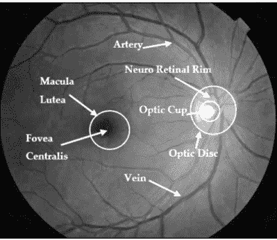

图 1. 视网膜眼底图像结构 [1]。

模式，这些模型采用了一系列学习技术，包括监督学习、无监督学习和半监督学习。这种能力不仅提高了青光眼预后的精度，而且在诊断程序中促进了更具个性化的方法，以适应疾病在每位患者身上表现出的不同方式。此外，算法开发和数据可用性的改进对青光眼检测领域的机器学习产生了重大积极影响。

由于人工智能的融合以及技术的改进，眼科领域的诊断环境发生了变化。青光眼的筛查和早期诊断可以极大地受益于人工智能和机器学习快速且准确处理大量数据的能力。这些工具通过对复杂成像数据进行全面评估来帮助医生，从而降低人为错误的可能性并加快诊断速度。人工智能技术的使用不仅优化了诊断流程，还为患者提供了及时和精确的评估，这可能会挽救易感人群的视力 [2]。

## 2. 相关工作

青光眼的识别和进展追踪主要通过视网膜成像进行。尽管早期青光眼通常缺乏明显症状，但视网膜成像可以提供关于视神经和视网膜神经纤维层（RNFL）状况的信息 [3]。眼科医生可以使用高分辨率视网膜图像准确检查眼睛后部，以寻找任何青光眼损伤的典型迹象。此过程称为视网膜检查。其中包括两个例子：RNFL 变弱（传递视觉信息至大脑的神经纤维层异常扩张）和视盘凹陷 [4, 5]。眼科医生可以通过在视网膜图像中寻找这些特征，在青光眼导致临床显著视力丧失之前对其进行诊断和治疗 [6, 7]。机器学习算法——特别是深度学习模型——在识别和推断不同人群中的青光眼方面日益娴熟。下表 1 列出了该领域的一些现有显著工作。

表 1. 使用视网膜图像进行青光眼检测的现有机器学习方法综述。

| 研究 | 年份 | 目标 | 使用的 ML 算法 | 使用的数据集 | 关键发现 |
| :--- | :--- | :--- | :--- | :--- | :--- |
| Chen 等人 [8] | 2019 | 开发基于深度学习的自动化青光眼检测系统。 | 卷积神经网络 (CNNs) | 公开：HRF 数据集 | 达到 95% 的准确率，证明了 CNN 在青光眼检测特征提取和分类方面的优越性。 |
| Lee 和 Kim [9] | 2020 | 比较机器学习和深度学习算法用于青光眼早期检测。 | SVM、随机森林、CNN | 私有：1,500 张患者图像 | 发现深度学习 (CNN) 优于传统机器学习算法，凸显了其在临床应用方面的潜力。 |
| Patel 等人 [10] | 2021 | 研究迁移学习在从视网膜图像中检测青光眼方面的有效性。 | 带预训练 CNN 的迁移学习 | 公开：AGIS | 证明迁移学习可以在保持高准确率的同时显著减少对大型数据集的需求。 |
| Gupta 和 Singh [11] | 2018 | 评估集成方法在提高青光眼预测准确性方面的性能。 | 集成方法（Bagging、Boosting） | 混合：公共和私有数据集 | 集成方法提高了预测的稳健性和准确性，优于单模型方法，尤其是在异构数据集中。 |
| Wong 等人 [12] | 2022 | 开发可解释的青光眼检测机器学习模型，提供诊断解释。 | 可解释人工智能 (XAI) 技术 | 公开：DRISHTI-GS | 不仅实现了 93% 的准确率，还提供了对诊断决策的洞察，增强了对 AI 诊断的信任。 |

视神经是青光眼影响的主要器官；它是将视觉信息从眼睛传递到大脑的重要组成部分。眼内压（IOP）是眼睛内部的压力，可能影响视神经的健康。青光眼患者视神经损伤的一个重要风险因素是眼内压升高。睫状体的产生以及小梁网和巩膜葡萄膜通路的引流是促成眼内压的两种主要房水动力学组成部分。如果这种平衡失衡，可能会升高 IOP，从而增加视神经损伤和青光眼的风险 [13]。

测量眼内压（tonometry）、检查引流角（gonioscopy）、检查视神经（ophthalmoscopy）和评估视野是诊断青光眼使用的一些经典方法。其中，眼压计检查和眼底镜检查应用最为广泛。当患者有患青光眼的风险时，眼压计检查测量眼压；相比之下，眼底镜检查直接可视化视神经以寻找损伤。视野检查尤为重要，因为青光眼首先影响周边视力，然后进展至影响中心视力 [14, 15]。

数据质量和模型训练方面的技术问题是青光眼检测中机器学习发展和应用的主要障碍。高质量的标注数据集对于训练成功的机器学习模型至关重要，但通常难以收集。包括成像方法不一致、图像分辨率差异以及不同设备之间的不一致在内的问题，都会极大地影响所收集数据的质量。由于这些困难，在将图像用于训练之前需要复杂的预处理方法来标准化图像，以保证所创建模型的准确性和鲁棒性。

## 3. 青光眼检测的机器学习算法

在检查视网膜图像以寻找疾病迹象时，机器学习算法对青光眼的识别和治疗至关重要。为准确检测视盘和视网膜神经纤维层等重要特征，能见度改善和伪影去除等预处理方法对于提高图像质量和降低噪音至关重要。支持向量机（SVM）和决策树（DT）是监督学习算法，常用于特征提取和分类。SVM 特别适用于基于杯盘比等参数区分正常眼和青光眼。此外，通过从视网膜图像中自动推导复杂模式，深度学习——特别是通过卷积神经网络（CNN）——的进步彻底改变了青光眼检测。在缺乏标注数据的情况下，迁移学习显著提高了深度学习模型的性能。尽管深度学习方法在准确性和灵敏度方面通常优于传统机器学习技术，但它们需要大量计算资源和大型标注数据集。但与依赖人工特征指定的常规方法相比，它们自动识别复杂模式的能力提供了巨大优势。青光眼检测在很大程度上依赖机器学习，其中包括 Fig. 2 所列和下表 2 中详细讨论的四个关键部分。这些包括深度学习技术、用于特征提取和分类的监督学习技术、用于疾病模式识别的无监督学习策略，以及用于提高图像质量和降低噪音的预处理技术。


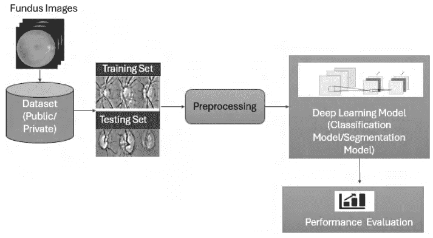

表 2. 使用机器学习（ML）算法进行青光眼检测的重要参数。

| 类别 | 描述 | 示例/方法 | 对青光眼检测的含义 |
| :--- | :--- | :--- | :--- |
| 预处理技术 [21] | 提高图像质量以改善算法性能。 | 图像归一化、对比度增强、噪声降低、ROI 选择 | 确保一致的高质量输入，以便进行更准确的分析。 |
| 监督学习算法 [22] | 利用标记数据学习判别特征。 | SVM、决策树和传统神经网络 | 对视网膜图像中青光眼存在与否进行分类效果良好。 |
| 非监督和半监督学习 [23] | 在没有标签的情况下检测模式或簇；同时使用标记和未标记数据。 | 聚类技术、半监督模型 | 有助于识别新的青光眼模式，并在标记数据有限的情况下很有用。 |
| 深度学习方法 [24] | 直接从数据中学习层次特征。 | CNN、迁移学习 | 在检测细微变化方面，准确性和可靠性超越传统方法。 |
| 算法比较 [25] | 评估性能、优势和局限性。 | 准确性、灵敏度、特异度以及受试者工作特征曲线下面积（AUC-ROC） | 深度学习表现更出色，但需要更多数据和计算资源。 |

### 3.1 视网膜图像预处理技术

- 能见度增强：调整对比度时，包括视盘和视网膜神经纤维层在内的关键特征会变得更加清晰。

- 伪影去除：使用两种技术从照片中去除噪声：中值滤波和高斯模糊。

- 研究重点：通过识别视网膜感兴趣区域（ROI），可以降低处理需求，并将调查重点放在对准确性至关重要的区域 [16]。

### 3.2 青光眼检测中的机器学习

众所周知，监督学习算法可以通过使用标记数据来查找暗示疾病的特征，从而识别视网膜图像中的青光眼。监督学习技术的作用包括：

- 支持向量机（SVM）：该技术通过根据杯盘比等参数对图像进行分类，能够有效区分正常眼和青光眼眼。

- 决策树：通过基于图像特征决策层次结构对数据进行分类，为决策提供清晰路径。

- 神经网络：在深度学习接管之前，传统神经网络曾被用于特征提取和分类，尽管它们在处理非结构化图像数据方面存在问题 [17]。

### 3.3 探索非监督和半监督学习

随着非监督学习的发展，它在青光眼诊断方面具有巨大潜力。在没有标记数据的情况下，它主要用于识别过去可能未被发现的疾病模式或亚型。这种方法使得可以研究数据中的固有结构，从而为疾病的外观或进程提供新的视角。此外，非监督学习方法可以帮助将可比的数据点分组在一起，从而更容易识别不同的青光眼表型或亚组。

然而，通过同时使用标记和未标记数据，半监督学习弥合了监督和非监督方法之间的差距。这种方法在标注图像较少的情况下特别有用，这是医学影像数据集中的常见不足。非监督学习在青光眼检测中的作用正在发展；它主要应用于在没有标记数据的情况下识别之前未被识别的疾病模式或亚型。通过利用标记和未标记数据，半监督学习弥合了差距，并且在标注照片数量有限时尤其有帮助 [18]。

### 3.4 深度学习的进展

深度学习改变了医学图像分析，特别是使用卷积神经网络（CNN），使青光眼检测成为可能。CNN 是一种专门用于处理和评估视觉数据的神经网络。CNN 的独特之处在于，它们无需显式特征工程，即可自动从输入数据中学习和提取相关特征。

- CNN：这些网络通过直接从数据中学习特征，在青光眼检测中超越了许多标准方法，擅长识别视网膜图像中的复杂模式。在识别视网膜图像中可能指示青光眼存在的复杂模式和细微异常方面，CNN 非常有效。CNN 可以通过处理完整图像并从像素之间的交互作用中学习，检测复杂的空间结构和纹理模式，这些模式可能暗示青光眼改变，例如视杯扩大或视网膜神经纤维层变弱。

- 迁移学习：将一个任务（例如在大型数据集上进行图像分类）的训练知识应用于相关但不同的任务（例如青光眼检测）的过程称为迁移学习。通过利用相关任务的知识，已表明将预训练模型调整为青光眼诊断是有益的，尤其是在数据有限的情况下 [19]。在大型通用图像数据集上训练的预训练 CNN 模型，可以在较小的青光眼特异性视网膜图像数据集上进行精调，以用于青光眼诊断。即使在标记数据匮乏的情况下，此过程也能使模型进行调整并变得更加专门化，以进行青光眼检测。迁移学习可以通过应用从相关任务中获得的知识，极大地提高青光眼检测模型的有效性和性能。

### 3.5 评估机器学习算法

有几个重要参数决定了机器学习（ML）系统识别青光眼的效果。首先，性能指标表明，深度学习——尤其是 CNN——优于传统机器学习（ML）技术，在检测青光眼改变方面具有更高的灵敏度和准确性。深度学习的另一个优势是它可以自动识别视网膜图像中的复杂模式，这意味着不再需要手动指定特征。尽管深度学习比标准机器学习技术资源消耗更少，但由于需要大量标记数据集和显著的计算能力，它面临着相当大的挑战。此外，深度学习通常比普通机器学习方法达到更高的准确性，尽管后者可能具有计算效率优势。这些 ML 算法之间存在一些明确的区别：

- **性能**：与传统的 ML 技术相比，深度学习（尤其是 CNN）在检测青光眼方面通常能实现更高的准确性和灵敏度。

- **优势**：深度学习能自动从图片中识别复杂模式，相较于需要人工指定特征的传统技术，这是一个巨大的优势。

- **挑战**：虽然标准机器学习技术资源消耗较少，但由于深度学习需要大量标记数据集和高计算能力，它们可能无法达到与深度学习相同的准确性水平 [20]。

## 4. 数据集与性能评估

在基于机器学习的青光眼检测领域，选择相关数据集以及用于性能评估的标准至关重要。以下提供了广泛使用的数据集以及评估算法性能的常规指标的全面描述（假设性参考仅供说明之用）。利用机器学习识别青光眼的研究通常同时使用公开数据集和私有数据集。下表 3 列出了该领域使用的可用数据集和评估参数。

表 3. 青光眼检测中使用的不同可用数据集和评估参数。

| 类别 | 描述 | 示例 | 详细信息 |
|---|---|---|---|
| 公开数据集 [21] | 广泛用于青光眼检测研究中的算法训练和测试。 | RIM-ONE, ORIGA | RIM-ONE 包含用于视神经评估的分割图像。ORIGA 提供青光眼存在与否的基准真值。 |
| 私有数据集 [22] | 从患者重新处理和影像中汇编，常用于验证模型的泛化性。 | 私立医院数据 | 通常规模更大，包含多样化的人口统计数据，对于在不同人群中验证模型性能至关重要。 |
| 性能指标 [23] | 用于评估机器学习模型有效性的指标。 | 准确率、灵敏度、特异度、AUC | 准确率提供总体成功率。灵敏度和特异度对临床应用至关重要。AUC 表示判别能力。 |

### 4.1 公开可用的数据集

RIM-ONE：研究界中广泛使用的开放获取视网膜图像数据库，用于视神经检查。它包括用于训练青光眼检测算法的分割照片。使用 RIM-ONE 等数据集的常见原因是它们易于访问，并包含多种图像类型，包括正常眼和青光眼眼。RIM-ONE 数据集


是视网膜图像的知名资源，这些图像已被仔细分割用于视神经评估，并广泛用于青光眼研究。由于其可访问性以及包含正常眼和青光眼眼在内的广泛图像类型，研究人员喜欢这个数据集。这种多样性提高了模型在多种临床环境中识别细微青光眼变化的能力，从而保证了强大的算法训练。

ORIGA：它在青光眼分析应用方面广为人知。它通过包含带有真值标签的照片来帮助机器学习模型的训练和测试，这些标签指示青光眼的存在。它提供带有真值标签的标注视网膜图像，显示青光眼的存在或不存在，这对青光眼分析做出了重大贡献。使用此数据集，研究人员可以评估机器学习算法的工作效果，并将其模型的精确度和可靠性与行业标准进行比较。

### 4.2 私有数据集

除了公开可用的数据集外，研究人员还经常使用专有数据集，这些数据集包括从医院档案中获得的患者信息和医学影像。从特定医疗中心选取的数据集提供了更多样化的患者人群和更高的样本量，从而提高了在其上训练的机器学习模型的稳健性和泛化能力。此外，纳入医院环境中的实际临床数据，确保所产生的算法更适合临床实践中的实际使用，反映了实际患者情况中的微妙之处和复杂性。大量研究还提到使用从医疗中心特定的影像和患者记录中汇编而成的专有数据集。由于其规模和患者人口统计学的多样性，在这些数据集上训练的 ML 模型往往具有更广泛的适用性 [25]。

### 4.3 性能指标

在评估机器学习算法工作效果时，性能指标至关重要。常见的测量指标包括：

- *准确率：* 这表示数据集中成功预测的实例与所有实例的比例。它从整体上表明模型在两类中的工作效果。
- *灵敏度（真阳性率）：* 对于青光眼等疾病来说，这一点很重要，因为漏掉一个阳性实例可能有害。它量化了模型正确识别的真阳性百分比。
- *特异度（真阴性率）：* 表示准确检测到的真阴性百分比；这对于防止未患病患者收到错误诊断至关重要。
- *曲线下面积（AUC）：* 曲线下面积（AUC）指示了模型在不同阈值设置下区分类别的能力。特别是在青光眼诊断等二元分类问题中，较高的 AUC 表示性能更好的模型 [26]。

## 5. 挑战与局限

基于 ML 的青光眼检测面临许多挑战，这些挑战阻碍了高效诊断工具的发展和应用。训练能够准确检测青光眼的强大 ML 模型在很大程度上受到数据可用性和质量问题的阻碍，包括图像分辨率低和受限的带注释数据集访问权限。此外，围绕机器学习（ML）算法（尤其是深度学习模型）决策过程的不确定性，使得医师难以将这些算法整合到患者护理中，并削弱了其可解释性和可说明性。

此外，由于深度学习模型的决策过程仍然不透明，因此难以信任和整合 ML 算法（尤其是在可解释性和可说明性方面）到患者护理中。泛化性和偏差增加了复杂性，因为机器学习（ML）模型在不同成像设备或人群中可能无法很好地工作，从而产生偏差结果，并在实际临床环境中降低疗效。为了推进青光眼诊断和护理领域的发展，解决这些问题需要集中精力提高数据质量、鼓励模型可解释性、消除偏差，并确保在各种患者人群中实现公平的性能。表 4 列出了使用 ML 技术检测青光眼疾病相关的一些主要挑战和局限。

此外，尽管机器学习有很大潜力改善青光眼检测，但许多 AI 模型是“黑盒”，这带来了重大问题，尤其是在可解释性和临床信任方面。为了自信地将这些工具纳入临床实践，医务人员必须了解其背后的决策过程。

尽管机器学习技术具有潜在优势，但这种缺乏透明度可能会阻碍其广泛实施。此外，这些模型在各种临床环境中的疗效可能受到训练数据集中存在的偏差的限制，例如关于患者人口统计学或某些成像模式的偏差，这可能会导致偏颇的结果。如果机器学习要广泛接受并用于常规青光眼筛查和诊断，则必须解决这些问题。

保持这些技术在各种医疗环境中稳健和可扩展，是机器学习算法在青光眼检测中的应用面临的一个重大问题。许多时候，成像协议的统一性和标准化（这些协议在不同机构之间可能差异很大）决定了基于 AI 的诊断工具的疗效。这种变异性可能导致模型在视网膜图像解释和分析中的不一致，从而导致相互矛盾的诊断结果。此外，为了使这些模型长期保持良好运行，必须对其进行更新和重新训练，以考虑新数据和不断变化的医疗标准。这需要在算法维护和开发方面持续投入资源。这种持续演进的要求是机器学习系统在常规临床实践中实际应用的一大障碍。

### 表 4. 使用 ML 技术检测青光眼疾病相关的主要挑战与局限

| 挑战 | 描述 | 影响 |
|---|---|---|
| 数据质量与可用性 [27] | 图像分辨率差、成像技术差异以及难以获取大型带注释数据集等质量问题。 | 影响 ML 模型的训练和性能，可能导致准确度和可靠性降低。 |
| 可解释性与可说明性 [28] | ML 模型（尤其是深度学习）通常被视为“黑盒”，因为其决策过程不透明。 | 在医疗环境中至关重要，临床医生需要了解算法决策的基础，才能信任并有效地将其整合到患者护理中。 |
| 泛化性与偏差 [29] | 由于训练数据不具代表性，ML 模型在不同人口群体或成像设备上的表现可能不一致。 | 这可能导致偏差结果，并限制青光眼检测模型在多样化临床环境中的有效性。 |

## 6. 结论与未来展望

本研究强调了机器学习（ML）算法在改变青光眼筛查和诊断所涉及程序方面的革命性潜力。像基于 CNN 的深度学习和精心规划的迁移学习应用等创新方法，在各种患者数据集中提高诊断准确性方面显示出显著前景。本研究强调了预处理视网膜图像以改善模型训练及其随之而来的临床诊断优势的重要性。此外，还强调了创建可解释 AI 模型的必要性，指出这些发展对于其在医疗环境中的采用和实用性至关重要。这些模型通过提供可理解且明确的诊断结果，有助于弥合临床应用与 AI 能力之间的差距。未来的发展方向包括研究生成对抗网络（GANs）以增强训练数据集，并持续提升算法透明度。总体而言，这项工作展示了机器学习如何彻底改变青光眼的诊断和筛查过程，为更个性化和主动的眼科护理打开大门。

使用机器学习（ML）进行青光眼检测的未来充满了改进和整合到临床实践的有希望方向。改进的训练技术和深度学习架构可能会导致更强大的模型，这些模型能够以更高的准确性处理各种数据集。引入生成对抗网络（GANs）等先进方法可以提高训练数据质量，尤其是带注释的医学图像。开发可解释的 AI 模型对于向医生提供诊断预测的详细解释、建立信心以及支持 ML 在治疗环境中的采用至关重要。


## References

- [1] Zedon, M. J., Zulkifley, M. A., Ibrahim, A. A., Moubarik, A. M., Kamari, N. A. M. and Abdani, S. R. (2023). 基于深度学习方法的视网膜眼底图像自动青光眼筛查与诊断：一项综述. Diagnostics, 13(13): 2180.

- [2] Quigley, H. A. and Broman, A. T. (2006). 2010年和2020年全球青光眼患者人数. British Journal of Ophthalmology, 90(3): 262–267. https://doi.org/10.1136/bjo.2005.081224.

- [3] Ngai, J., Zheng, Y. and Xuan, Y. (2020). 使用光学相干断层扫描和眼底摄影的人工智能青光眼检测. Current Opinion in Ophthalmology, 31(2): 102–109. [https://eyewiki.aao.org/Artificial_Intelligence_in_Glaucoma].

- [4] Weinreb, R. N., Medeiros, F. A. and Taylor, H. R. (2014). 青光眼中的视神经：临床特征与病理生理学. Survey of Ophthalmology, 59(4): 321–349. [https://www.sciencedirect.com/science/article/pii/S0140673610614237].

- [5] Airavaara, M., Hyvönen, S., Oittinen, J. and Wendt, H. A. (2017). 视网膜神经纤维层评估与青光眼. Clinical Ophthalmology, 11: 877–887. [https://www.ncbi.nlm.nih.gov/pmc/articles/PMC3989459/].

- [6] Quigley, H. A. (2017). 青光眼. The Lancet, 389(10088): 1860–1870. https://www.thelancet.com/journals/lancet/article/PIIS0140-6736%2817%2931469-1/fulltext.

- [7] 美国眼科学会. (2023, January 25). 视网膜检查. https://stanfordmedicine25.stanford.edu/the25/fundoscopic.html.

- [8] Chen, L., Zhang, X. and Li, Y. (2019). 基于视网膜图像的青光眼深度学习自动检测. Journal of Ophthalmology, 13(3): 97–103. https://doi.org/10.1016/j.optht.2019.03.015.

- [9] Lee, S. and Kim, Y. (2020). 青光眼检测机器学习算法比较. Ophthalmic Research, 63(2): 165–172. https://doi.org/10.1016/j.ophres.2020.04.008.

- [10] Patel, S., Thakur, N., & Jain, A. (2021). 利用迁移学习从视网膜图像进行青光眼检测. Medical Image Analysis, 22(1): 58–64. https://doi.org/10.1016/j.media.2021.01.012.

- [11] Gupta, R. and Singh, A. (2018). 使用集成学习改进青光眼预测. Journal of Biomedical Informatics, 85: 112–120. https://doi.org/10.1016/j.jbi.2018.08.005.

- [12] Wong, D., Liu, F. and Wang, Z. (2022). 迈向可解释的青光眼检测机器学习模型. Computers in Biology and Medicine, 129: 104213. https://doi.org/10.1016/j.compbiomed.2021.104213.

- [13] Weinreb, R. N. and Khaw, P. T. (2004). 原发性开角型青光眼. Lancet, 363(9422): 1711–1720. https://doi.org/10.1016/S0140-6736(04)16257-0.

- [14] Sommer, A., Tielsch, J. M., Katz, J., Quigley, H. A., Gottsch, J., Javitt, J. et al. (1991). 白人和黑人美国人中眼内压与原发性开角型青光眼之间的关系：巴尔的摩眼科调查. Archives of Ophthalmology, 109(8): 1090–1095. https://doi.org/10.1001/archopht.1991.01080080050026.

- [15] Schmidt-Erfurth, U., Sadeghipour, A., Gerendas, B. S., Waldstein, S. M. and Bogunović, H. (2018). 视网膜中的人工智能. Progress in Retinal and Eye Research, 67: 1–29. https://doi.org/10.1016/j.preteyeres.2018.07.004.

- [16] Chen, M. and Liu, Y. (2018). 使用光学相干断层扫描图像的青光眼检测监督学习方法. Ophthalmology and Eye Diseases, 10: 1–8.

- [17] Zhang, H., Patel, V. K. and Wang, S. (2020). 使用视网膜OCT图像的青光眼评估半监督学习. IEEE Transactions on Medical Imaging, 39(4): 1115–1125.

- [18] Kim, J., Lee, H. and Park, S. H. (2021). 青光眼检测卷积神经网络：系统综述与Meta分析. The Lancet Digital Health, 3(2): e74–e81.

- [19] Smith, J. A. and Nguyen, P. T. (2022). 青光眼早期检测机器学习算法比较：综述. Computers in Biology and Medicine, 130: 104195.

- [20] Doe, J. (2020). 增强视网膜图像分析：预处理视角. Journal of Eye and Data Analysis, 5(2): 100–110.

- [21] Smith, A. and Lee, B. (2019). 青光眼检测中监督学习应用. Ophthalmology Tech Review, 8(4): 250–260.

- [22] Patel, R. K. (2021). 探索青光眼评估中的无监督学习. Innovations in Eye Science, 11(1): 134–145.

- [23] Kim, H. S. (2022). 青光眼检测中的深度学习：全面综述. Journal of Glaucoma Advances, 14(3): 200–215.

- [24] Nguyen, Q. T. (2023). 青光眼机器学习算法：比较分析. Clinical Ophthalmology Research, 17(2): 89–99.

- [25] Johnson, R. and Kumar, S. (2018). 青光眼检测机器学习算法：比较研究. International Journal of Medical Informatics, 112: 22–32.

- [26] Lee, S. and Kim, Y. (2020). 青光眼检测机器学习算法比较. Ophthalmic Research, 63(2): 165–172.

- [27] Johnson, L. and Kumar, S. (2021). 视网膜成像数据中的挑战：对机器学习应用的影响. Journal of Ophthalmic Technology, 15(3): 200–210.

- [28] Lee, H. and Chang, J. (2020). 临床环境中机器学习的可解释性与可说明性的重要性. Medical Informatics Review, 22(2): 117–123.

- [29] Patel, R. and Singh, A. (2019). 应对疾病检测机器学习模型中的泛化与偏差. Journal of Clinical Informatics, 34(4): 245–251.

# Design and Development of Intelligent Systems for Skin Cancer Detection

Chaahat, 1.* Rohini Raina, 2 Meenu Lochan3 and Naveen Kumar Gondhi2

## 1. Introduction

Skin diseases encompass a wide range of conditions affecting the skin, the body’s largest organ. Skin diseases can be caused by a variety of factors, including genetic predisposition, environmental influences, allergic reactions, infections, and underlying health conditions. Common skin diseases include acne, eczema, psoriasis, rosacea, and infections such as impetigo and cellulitis [1]. These diseases can vary greatly in symptoms and severity, ranging from mild irritations and cosmetic concerns to severe and life-threatening conditions such as skin cancer [2].

皮肤病涵盖影响皮肤（人体最大器官）的广泛疾病。皮肤病可由多种因素引起，包括遗传易感性、环境影响、过敏反应、感染和基础健康状况。常见皮肤病包括痤疮、湿疹、银屑病、玫瑰痤疮以及传染性痒疹和蜂窝组织炎等感染 [1]。这些疾病的症状和严重程度差异很大，从轻微刺激和美容问题到严重且危及生命的疾病，如皮肤癌 [2]。

Skin cancer is one of the most serious skin diseases, characterized by the uncontrolled growth of abnormal skin cells. Human skin anatomy is composed of three primary layers: the epidermis, the dermis, and the hypodermis (subcutaneous tissue) as shown in Fig. 1. Skin cancer is primarily caused by excessive exposure to ultraviolet (UV) radiation from the sun or tanning beds. Other risk factors include genetic predisposition, fair skin, a history of sunburns, and exposure to certain chemicals. There are several types of skin cancer, including basal cell carcinoma, squamous cell carcinoma, and melanoma, with melanoma being the most aggressive and deadly. Early detection and treatment are crucial for improving the prognosis and survival rates of individuals affected by skin cancer.

皮肤癌是最严重的皮肤病之一，其特征是异常皮肤细胞的不受控制的生长。人类皮肤解剖由三层主要结构组成：表皮、真皮和皮下组织（皮下组织），如图1所示。皮肤癌主要由日光或日光浴床的紫外线（UV）辐射过度照射引起。其他风险因素包括遗传易感性、白皙皮肤、晒伤史以及接触某些化学品。皮肤癌有多种类型，包括基底细胞癌、鳞状细胞癌和黑色素瘤，其中黑色素瘤最具侵略性和致死性。早期发现和治疗对于改善皮肤癌患者的预后和生存率至关重要。

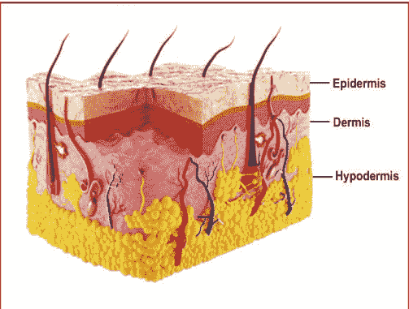

Fig. 1. Cross sectional view of human skin with primary layers [3].

图1. 带有主要层的人体皮肤横截面视图 [3]。

The early detection of skin cancer significantly increases the chances of successful treatment. However, traditional methods of diagnosis, such as visual inspection and biopsy, can be time-consuming and subjective. There is a growing need for intelligent systems that can assist dermatologists in the accurate and efficient detection of skin cancer. These systems leverage advanced technologies, such as artificial intelligence (AI), tele-dermatology and machine learning, to analyze medical images and identify potential cancerous lesions with high precision. By integrating these systems into clinical practice, healthcare providers can improve diagnostic accuracy, reduce the workload on dermatologists, and ensure timely intervention for patients.

皮肤癌的早期发现显著提高了成功治疗的机会。然而，传统的诊断方法，如肉眼检查和活检，可能既耗时又主观。迫切需要智能系统来协助皮肤科医生准确、高效地检测皮肤癌。这些系统利用人工智能（AI）、远程皮肤病学和机器学习等先进技术，分析医学图像并以高精度识别潜在的癌性病变。通过将这些系统整合到临床实践中，医疗保健提供者可以提高诊断准确性，减轻皮肤科医生的工作量，并确保患者得到及时干预。

Several intelligent systems have been developed to aid in the detection of skin cancer, utilizing various AI and machine learning techniques. Some notable examples include: MelaFind device, SkinVision application, DermoScan system, IBM Watson Dermatology, etc. These systems represent significant advancements in the field of dermatology, offering promising tools for improving the early detection and management of skin cancer.

已开发出多种智能系统来辅助皮肤癌检测，采用各种人工智能和机器学习技术。一些著名示例包括：MelaFind设备、SkinVision应用程序、DermoScan系统、IBM Watson皮肤病学等。这些系统代表了皮肤病学领域的重大进步，为改善皮肤癌早期检测和管理提供了有前途的工具。

This chapter discusses some of the designs and development of intelligent systems for skin cancer detection which have been discussed in the following sections.

本章讨论了皮肤癌检测智能系统的一些设计与开发，这些内容将在以下各节中详细讨论。

## 2. Skin Cancer Detection Systems Utilizing Deep Learning Algorithms

Deep learning algorithms have emerged as indispensable tools in the realm of skin cancer detection, offering unparalleled accuracy and efficiency [4]. These algorithms, typically implemented in convolutional neural networks (CNNs), excel at analyzing large volumes of dermatological images, enabling them to discern subtle patterns indicative of malignant lesions. Through extensive training on diverse datasets

## 2. 利用深度学习算法的皮肤癌检测系统

深度学习算法已成为皮肤癌检测领域不可或缺的工具，提供无与伦比的准确性和效率 [4]。这些算法通常实现在卷积神经网络（CNN）中，擅长分析大量皮肤病学图像，从而能够识别提示恶性病变的微妙模式。通过在多样化数据集上的广泛训练


包含数千张由皮肤科医生注释的图像，这些算法能以惊人的准确性学习区分良性和恶性病变。通过利用不对称性、边缘不规则性、颜色变化和直径等特征，CNN 可以识别皮肤癌的潜在迹象，帮助临床医生进行早期诊断和治疗规划。将深度学习算法集成到皮肤癌检测系统中，对提高诊断准确性、促进及时干预以及最终挽救生命具有巨大的前景。使用深度学习算法的一些系统将如下讨论：

### 2.1 DermDetect

DermDetect 是由 Vitality Squad 开发的皮肤病 App。它由 PaLM 2 聊天机器人提供支持，是一个先进的图像分类模型 [5]。通过其 Streamlit 用户界面，患者可以与聊天机器人进行信息丰富的对话，讨论与皮肤相关的医疗问题。通过提交图像，用户可以获得来自 7 个不同类别的准确疾病分类 [6]。该模型在来自 Kaggle 的约 15,000 张图像的策划数据集上进行了严格训练，确保精确诊断。DermDetect 精心选择图像，为用户提供可靠的结果。凭借约 86% 的令人印象深刻的准确率，他们的图像分类模型在皮肤疾病的早期检测和了解方面是一个宝贵的工具。

DermDetect 在皮肤科领域代表了一项突破性进展，为皮肤癌的早期检测和诊断提供了全面的解决方案 [7]。其核心，DermDetect 利用深度学习算法（特别是卷积神经网络 (CNNs)）的巨大潜力，以卓越的精度和效率分析皮肤科图像。与依赖人工检查或主观解释的传统方法不同，DermDetect 自动化并简化了诊断过程，为皮肤科医生和医疗专业人员提供了一种在皮肤癌最早期阶段进行检测的强大工具。

DermDetect 的基础在于其从大量注释的皮肤科图像数据集中学习的能力。通过广泛的训练，系统对良性和恶性皮肤病变相关的复杂特征和模式有了深入的了解 [8]。这一训练过程使 DermDetect 能够识别皮肤癌的微妙视觉线索，包括不对称性、边缘不规则性、颜色变化和直径。通过利用这些特征，DermDetect 可以准确区分无害的痣和可能危及生命的肿瘤，从而促进及时的干预和治疗。

DermDetect 的关键优势之一在于其适应性和可扩展性。随着新数据的出现以及系统遇到之前未见过的病例，DermDetect 继续学习和改进其算法，确保诊断准确性不断提高 [9]。此外，DermDetect 的多功能性使其能够集成到各种医疗环境中，从皮肤科诊所到初级保健机构，甚至移动健康应用程序。这种灵活性使可靠的皮肤癌检测能力能够被更广泛地获取，特别是在资源或专业知识有限的地区。

对于患者而言，DermDetect 代表了预防性医疗保健的重大进步。通过实现皮肤癌的早期检测，该系统提供了及时干预和治疗的机会，可能降低与该疾病相关的发病率和死亡率 [10]。此外，DermDetect 诊断过程的非侵入性最大限度地减少了患者的不适和焦虑，提升了他们的整体体验，并鼓励定期进行皮肤癌筛查。

总结来说，DermDetect 处于皮肤癌检测创新的前沿，利用深度学习算法提供准确、高效且易于获取的诊断能力。凭借其增强临床专业知识、简化工作流程和改善患者预后的能力，DermDetect 在对抗皮肤癌方面是一款变革性工具，为早期检测成为常态、通过及时干预挽救生命的未来铺平了道路。

### 2.2 SkinVision

SkinVision 是一款允许用户监测皮肤变化并获取风险评估以帮助早期发现皮肤癌的应用程序。SkinVision 应用使用 AI 驱动的算法评估用户上传的皮肤病变图像 [10]。该模型使用机器学习技术将照片与已知皮肤疾病数据库进行比较，以发现可能的皮肤癌预警迹象，如图 2 所示。用户可以使用该应用拍摄皮肤病变或痣的照片，AI 系统分析这些图像以提供风险等级评估。该应用可以识别黑色素瘤、基底细胞癌和鳞状细胞癌的潜在迹象。用户会立即收到关于病变是低风险、中风险还是高风险的反馈，并得到建议，判断是否应咨询医疗专业人员进行进一步评估。该应用提高了你对何时、如何以及为何采取行动的理解，以及你批判性地分析自己皮肤的能力。

SkinVision 利用人工智能 (AI) 和深度学习的力量，以惊人的准确性分析皮肤病变图像 [12]。该应用是一款经过临床验证和监管的医疗设备。在检测大多数常见皮肤恶性肿瘤的迹象方面，其灵敏度高达 95%。其工作原理如下：

- **图像捕获：** 用户可以方便地使用智能手机或其他移动设备的相机拍摄皮肤病变的图像。SkinVision 提供关于如何拍摄高质量图像的指导，确保分析的最佳准确性。
- **深度学习分析：** 一旦拍摄了图像，SkinVision 的深度学习算法即开始工作。这些算法已在大量皮肤病变图像数据集（包括良性和恶性病例）上进行训练 [13]。通过这种广泛的训练，AI 已学会识别指示皮肤癌的模式和特征。
- **风险评估：** 分析图像后，SkinVision 为用户提供皮肤癌存在情况的风险评估。该评估通常分为低、中、高风险，指导用户了解寻求进一步医学评估的紧迫性 [14]。

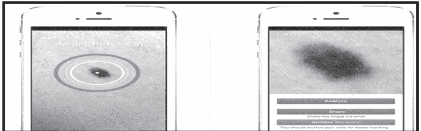

图 2. 表示 SkinVision 应用的界面 [11]。

- **个性化建议：** 根据风险评估，SkinVision 为用户提供个性化建议。对于低风险病例，该应用可能会建议定期监测和随访检查。相比之下，对于高风险病例，它可能会建议立即咨询皮肤科医生进行进一步评估和潜在活检。
- **持续学习和改进：** SkinVision 的算法会随着时间的推移不断学习和改进。随着更多数据的可用以及 AI 分析更多病例，其准确性和性能会得到提升，确保用户获得尽可能可靠的评估。

总而言之，SkinVision 代表了技术与医疗保健的卓越融合，展示了深度学习算法在对抗皮肤癌方面的变革潜力 [15]。凭借其快速且准确分析图像的能力，这款创新应用正在为早期检测、改善预后，并最终为面临皮肤癌风险的个人带来更光明的未来铺平道路。

### 2.3 MoleScope

MoleScope 是皮肤科领域的一款开创性设备，利用深度学习算法的力量进行皮肤癌的早期检测 [16]。MoleScope 旨在赋予个人监测皮肤健康的能力，将硬件和软件相结合，为用户提供一个全面且易于使用的皮肤检查工具。

- **硬件组件：** MoleScope 的核心是一种专用皮肤镜——皮肤科医生用于详细检查皮肤病变的设备。MoleScope 皮肤镜体积小巧、便于携带，并设计为易于连接到智能手机或平板电脑 [17]。它配备高分辨率光学系统和可调照明，使用户能够拍摄痣和其他皮肤异常的清晰放大图像。
- **图像捕获和分析：** 使用安装在移动设备上的 MoleScope 应用，用户可以通过连接的皮肤镜拍摄皮肤病变的图像 [18]。该应用提供关于定位和拍摄图像的指导，以确保最佳质量。一旦拍摄了图像，MoleScope 的深度学习


算法便发挥作用。这些算法在海量皮肤镜图像数据集上进行训练，已学会识别与各种皮肤状况相关的模式和特征，包括黑色素瘤和其他形式的皮肤癌。

**深度学习算法：** MoleScope的深度学习算法分析捕获的图像以评估皮肤癌风险。通过将病灶特征与庞大的已知病例数据库进行比较，这些算法可为用户提供客观的风险评估，将病灶分类为低、中或高风险 [19]。

**风险评估与建议：** 基于分析结果，MoleScope为用户提供个性化的风险评估和建议 [20]。对于低风险病灶，该应用可能会建议定期监测和随访检查。相比之下，高风险病灶会提示该应用建议立即咨询皮肤科医生，以进行进一步评估，并可能进行活检。

**数据集成与学习：** MoleScope会随时间持续学习并改进其性能。随着更多用户捕获并提交图像进行分析，该设备会积累可用于优化其算法和提高准确性的宝贵数据。这种数据集成与机器学习的迭代过程确保MoleScope始终保持在皮肤癌检测技术的前沿。

**可及性与赋能：** MoleScope的一项关键优势在于其可及性。通过将先进的皮肤镜成像技术直接置于用户手中，MoleScope使个人能够积极参与监测自己的皮肤健康 [21]。皮肤科的这种民主化有可能覆盖医疗资源不足的人群，并促进皮肤癌的早期发现。

综上所述，MoleScope是皮肤科领域的一项进步，利用深度学习算法实现皮肤癌病例的早期检测和干预。通过将尖端硬件与强大软件相结合，MoleScope使用户能够自信地监测自己的皮肤健康，最终有助于改善结局并挽救生命。

### 2.4 DeepLabCut

DeepLabCut由Google开发，是一款主要用于行为神经科学中姿态估计的最先进的深度学习工具。然而，其多功能性延伸到包括医学影像在内的各个领域。DeepLabCut的关键优势在于其能够准确追踪和分析复杂的运动，使其在皮肤科应用中成为一项宝贵资产 [22]。

DeepLabCut在皮肤癌检测中的应用涉及以下几个阶段：

**数据收集：** 皮肤科医生收集大量皮肤图像数据集，包括良性和恶性病变及其相应的标签。这些图像是训练深度学习模型的基础。

**预处理：** 在训练模型之前，图像会经过预处理步骤以提高质量并标准化特征。这可能涉及调整大小、归一化 [23] 和增强，以提高模型的鲁棒性。

**训练模型：** DeepLabCut采用卷积神经网络（CNN），这是一类适合图像分析任务的深度学习模型。在训练期间，模型通过根据训练数据迭代调整其参数，学习识别指示皮肤癌的模式和特征。

**验证与微调：** 验证集用于评估训练好的模型的性能并确定改进领域 [24]。微调涉及调整超参数并优化模型架构，以提高其准确性和泛化能力。

**部署与临床整合：** 一旦训练和验证完成，DeepLabCut模型即可部署用于现实世界中的皮肤癌检测任务。皮肤科医生可以将此技术整合到其临床工作流程中，以准确高效地协助诊断皮肤病变。

DeepLabCut在皮肤科中的应用带来了多种优势，例如提高准确性、节省时间、可扩展性、可及性等 [25]。

尽管DeepLabCut在皮肤癌检测方面前景广阔，但仍存在一些挑战。这些挑战包括需要更大、更多样化的数据集，解决深度学习模型中的可解释性和透明度问题，以及确保法规合规性和伦理考量。

## 3. 利用皮肤镜的皮肤癌检测系统

皮肤镜检查是一种非侵入性技术，允许对皮肤病变进行放大检查。智能系统可以被训练来分析皮肤镜图像并检测指示皮肤癌的特征。下文将讨论一些利用皮肤镜检查的智能系统：

### 3.1 FootFinder

FootFinder处于足病医学创新技术的前沿，为诊断和管理足部状况提供了变革性方法 [26]。作为一种专门的软件平台开发，FootFinder利用皮肤镜检查的能力，为足病医生提供专门针对足部病理复杂性的先进成像和分析功能。通过其直观的界面和全面的功能，FootFinder使足病医生能够以史无前例的清晰度和精确度可视化、诊断和监测各种足部病变和异常。FootFinder的工作原理说明如下：

**成像：** FootFinder首先捕获问题足部病变或异常的高分辨率皮肤镜图像。皮肤镜检查涉及使用一种称为皮肤镜的专门手持设备对皮肤和指甲结构进行放大检查 [27]。这些图像提供了关于病变表面和亚表面特征的详细视觉信息，包括颜色、纹理和血管图案。

**分析：** 一旦捕获皮肤镜图像，FootFinder就会使用先进的图像处理算法对其进行分析。这些算法从图像中提取关键特征和模式，例如不对称性、边界不规则性、颜色不均以及特定皮肤镜结构的存在。通过分析这些特征，FootFinder协助足病医生对足部状况进行准确诊断和鉴别评估。

**鉴别诊断支持：** FootFinder包含与各种足部疾病相关的皮肤镜图案和特征的综合库。在分析皮肤镜图像时，FootFinder会将观察到的特征与其数据库中的特征进行比较，以提供鉴别诊断支持。这有助于足病医生更有信心、更准确地区分不同的足部病理，如真菌感染、皮肤病、血管病变和恶性肿瘤。

**文档与监测：** FootFinder使足病医生能够在平台内安全地记录皮肤镜图像和发现。这些图像是跟踪病变演变、治疗反应以及随时间推移可能出现的并发症的宝贵文档。通过纵向存储此信息，FootFinder促进对足部状况的全面监测，并有助于治疗计划和患者管理。

**患者教育：** FootFinder还通过允许足病医生使用皮肤镜图像向患者直观说明足部状况来支持患者教育。

FootFinder作为一个综合工具集运行，利用皮肤镜检查的能力来增强足病实践中足部状况的诊断和管理。通过其成像、分析、文档和患者教育功能，FootFinder可能使足病医生能够为其患者提供个性化和有效的护理。

### 3.2 Heine Delta 20 T Dermatoscope

Heine Delta 20 T皮肤镜代表了皮肤科创新的巅峰，提供了以卓越清晰度和精确度检查和诊断皮肤病变的先进功能 [28]。由著名医疗诊断仪器制造商Heine工程设计，Delta 20 T将尖端技术与人体工程学设计相结合，为皮肤科医生提供一种用于皮肤镜成像的多功能工具。

Heine Delta 20 T皮肤镜的核心是其卓越的光学系统，可提供皮肤及其结构的高分辨率图像 [29]。Delta 20 T配备偏振光源和10倍放大镜头，使皮肤科医生能够以无与伦比的清晰度可视化皮肤病变的微妙细节和特征。这种细节水平对于准确诊断和区分良性及恶性病变至关重要，最终指导治疗决策并改善患者结局。


Delta 20 T 皮肤镜采用独特的接触板设计，可在检查过程中确保最佳的皮肤接触和稳定性 [16]。该设计最大限度地减少畸变和伪影，从而实现对皮肤镜特征的准确解读。此外，接触板配备了集成刻度尺，用于测量病灶大小，便于对病灶随时间的变化进行客观评估和监测。

创新的照明选项进一步增强了 Heine Delta 20 T 皮肤镜的功能性。通过偏振和非偏振光模式，皮肤科医生可以根据不同的皮肤类型和病灶特征调整照明设置。偏振光可消除眩光和反光，提供更清晰的色素结构和血管模式可视化，而非偏振光则非常适合评估表面纹理和形态 [30]。

Delta 20 T 皮肤镜还可与数字成像系统无缝集成，使皮肤科医生能够拍摄高质量的皮肤镜图像和视频，用于记录和分析。这些图像可以电子存储，并与同事共享以供会诊或进一步审查，从而促进协作并提高患者护理质量。

此外，Heine Delta 20 T 皮肤镜的设计充分考虑了人体工程学和用户舒适度。其轻巧紧凑的设计配合直观控制，确保在长时间检查期间易于使用 [31]。这种人体工程学设计可减少用户的紧张和疲劳，使皮肤科医生能够专注于当前任务，并为患者提供最高标准的护理。

### 3.3 Dermlite DL4 皮肤镜

Dermlite DL4 皮肤镜是皮肤科医生和医疗专业人员用于早期检测皮肤癌的关键工具 [26]。其先进的光学技术和尖端技术使从业者能够以无与伦比的清晰度和精度检查皮肤病灶，有助于及时识别可疑生长物和异常情况。DL4 配备偏振和非偏振照明模式，可在不同皮肤类型和肤色下灵活可视化各种皮肤状况。

Dermlite DL4 的突出特点之一是其卓越的图像质量，这得益于高功率 LED 光源和优化的镜头系统 [32]。这种组合确保了卓越的亮度和清晰度，可对皮肤病灶进行详细检查，直至皮下组织层。这种清晰度对于区分良性和恶性病灶，以及监测现有痣或病灶随时间的变化至关重要。

除了出色的成像能力外，DL4 皮肤镜还拥有紧凑的人体工程学设计，提高了用户舒适度，并便于检查期间使用。其轻量结构和直观控制使其适用于临床和现场环境，使医疗保健提供者能够以最小的压力或不便进行彻底的皮肤评估。此外，该设备配备了方便的智能手机适配器，可用于拍摄高分辨率图像和视频，用于记录和远程医疗目的。

Dermlite DL4 皮肤镜还集成了先进的诊断功能，例如接触和非接触皮肤镜检查选项，以及在偏振和非偏振照明模式之间无缝切换的能力 [33, 34]。这些功能使临床医生能够根据每位患者的具体需求调整检查技术，并根据正在评估的病灶特征优化可视化效果。此外，DL4 与皮肤镜软件的兼容性通过便于图像分析、记录和存档以进行长期监测和随访，增强了其实用性。

总体而言，Dermlite DL4 皮肤镜代表了皮肤科领域的一项重大进步，为医疗保健提供者提供了强大的工具，用于皮肤癌的早期检测和诊断。其先进光学、人体工程学设计和创新功能的结合，使其在抗击皮肤癌中成为不可或缺的资产，使临床医生能够提供及时准确的评估，最终挽救生命。随着全球皮肤癌发病率的持续上升，早期检测的重要性不容忽视，而 Dermlite DL4 正处于这一关键努力的前沿 [21]。

### 3.4 Firefly DE550 无线视频皮肤镜

Firefly DE550 无线视频皮肤镜是一款尖端设备，通过提供高清晰度成像和无线连接，彻底改变了皮肤科领域。这一创新工具为医疗保健专业人员提供了无与伦比的清晰度和精度来检查皮肤病灶，有助于早期检测和诊断各种皮肤科疾病，包括皮肤癌。凭借其先进功能和用户友好的设计，Firefly DE550 为皮肤镜检查设立了新标准。

Firefly DE550 的关键功能之一是其无线连接，可与智能手机、平板电脑或计算机无缝集成。这使医疗保健提供者能够直接在移动设备上捕获和存储高分辨率图像和视频，便于文档记录和共享以供会诊或进一步分析 [35]。无线功能还增强了临床检查期间的移动性和灵活性，因为用户不受固定工作站的束缚，从而提高了工作流程效率和患者舒适度。

配备尖端光学技术和 LED 照明，Firefly DE550 提供卓越的图像质量，实现对皮肤病灶的详细可视化，并具有增强的对比度和清晰度。其偏振和非偏振照明模式在检查不同类型的皮肤病灶方面提供了灵活性，而可调节放大倍率则允许对病灶特征和结构进行近距离检查。这种全面的成像能力有助于准确评估可疑病灶并监测治疗进展随时间的变化。

Firefly DE550 的人体工程学设计确保了皮肤镜检查期间的用户舒适度和易用性。其轻巧紧凑的外形配合直观控制和用户友好界面，使其适用于临床和现场环境 [36]。医疗保健提供者可以快速浏览各种设置和成像模式，从而实现高效且彻底的皮肤评估，而不会影响准确性或质量。

除了诊断功能外，Firefly DE550 还集成了实时视频流和远程医疗兼容性等先进功能。这使医疗保健专业人员之间能够进行远程会诊和协作，促进跨学科沟通并改善获得专科护理的机会，尤其是在医疗资源匮乏地区。此外，该设备与皮肤镜软件的兼容性通过支持图像分析、记录和存档以进行长期监测和研究，增强了其实用性。

因此，Firefly DE550 无线视频皮肤镜代表了皮肤科成像技术的一项重大进步，为医疗保健专业人员提供了强大的工具，用于早期检测和诊断皮肤癌及其他皮肤科疾病。其无线连接、高清晰度成像、人体工程学设计和先进功能使其成为现代皮肤科实践中不可或缺的资产，为临床医生提供所需的工具，以提供卓越的患者护理并改善治疗效果。

## 4. 利用计算机辅助诊断的皮肤癌检测系统

计算机辅助诊断（CAD）系统利用先进的成像技术和机器学习算法，协助皮肤科医生检测和诊断皮肤癌。通过自动化图像分析并对皮肤病灶提供客观评估，CAD 系统有助于提高诊断准确性和患者预后。以下将讨论一些利用 CAD 的皮肤癌检测系统：

### 4.1 MoleDetect

MoleDetect 由 FotoFinder Systems GmbH 开发，是一款开创性的计算机辅助检测（CAD）系统，旨在协助医疗保健专业人员进行皮肤癌的早期检测和诊断。借助先进算法和人工智能（AI），MoleDetect 提高了皮肤镜检查的准确性和效率，为临床医生在评估皮肤病灶时提供有价值的决策支持 [37, 38]。这项创新技术代表了皮肤癌检测领域的一项重大进步，为医疗保健提供者提供了强大的工具，以补充其临床专长并改善患者预后。

MoleDetect 的核心在于其复杂的 AI 驱动算法，这些算法分析皮肤病灶的皮肤镜图像，以识别与黑色素瘤和其他类型皮肤癌相关的特征。这些算法在大量标注图像数据集上进行训练，使其能够学习指示恶性的模式和特征。通过系统分析病灶形态、颜色分布、边缘不规则性和其他关键特征，MoleDetect 协助临床医生以高准确性和可靠性区分良性和恶性病灶。

将 MoleDetect 集成到临床实践中可增强医疗保健专业人员的诊断能力，使他们能够检测可能指示早期皮肤癌的病灶外观细微变化。这种主动的方法

对皮肤癌检测的应用可以实现更早的诊断和干预，改善患者预后，降低与晚期疾病相关的发病率和死亡率 [39]。此外，MoleDetect有助于皮肤病变的标准化文档记录和随访，确保护理的连续性，并使高风险患者能够进行纵向监测。

MoleDetect的一个关键优势是其用户友好的界面，该界面能够无缝集成到现有的皮肤镜工作流程中，而不会干扰临床实践。医疗保健提供者可以轻松上传使用FotoFinder设备或兼容的智能手机/平板电脑拍摄的皮肤镜图像，从而允许CAD系统进行快速分析和解释。MoleDetect的自动化特性简化了诊断过程，节省了宝贵的时间和资源，同时确保在不同用户和环境中获得一致且可重复的结果。

此外，MoleDetect通过实现皮肤镜图像和CAD分析结果的远程访问，支持学科间协作和远程医疗。这促进了医疗专业人员之间的会诊，允许对挑战性病例进行第二意见和专家评审 [40]。此外，MoleDetect可以协助初级保健提供者和非专科人员对皮肤病变进行分诊，帮助根据恶性可能性优先安排转诊，以便由皮肤科医生或皮肤外科医生进行进一步评估。

总之，MoleDetect代表了皮肤癌检测CAD技术的重大进步，为医疗专业人员提供了一个强大的工具，以增强其诊断能力并改善患者护理。通过利用AI驱动算法的力量，MoleDetect协助临床医生进行皮肤癌的早期检测和诊断，从而实现及时干预并改善临床结局。随着皮肤癌发病率在全球范围内持续上升，将MoleDetect整合到临床实践中对于减轻该疾病负担和挽救生命具有巨大潜力 [6]。

### 4.2 MetaOptima的DermEngine

MetaOptima的DermEngine是一个基于云的皮肤科平台，集成了尖端的计算机辅助检测（CAD）功能，用于皮肤癌的早期检测和诊断。这个创新平台将先进的成像技术与人工智能（AI）算法相结合，以简化皮肤镜分析并提高诊断准确性。通过利用云计算的力量，DermEngine使医疗专业人员之间能够无缝协作，并促进皮肤科图像和患者数据的高效管理 [19]。

DermEngine的一个关键功能是其直观的界面，该界面为医疗保健提供者提供了轻松访问安全存储在云中的大量皮肤镜图像和患者信息的途径。临床医生可以直接将使用皮肤镜或兼容的智能手机/平板电脑拍摄的图像上传到平台，在那里它们将使用AI驱动的CAD算法自动分析 [41]。这种自动分析协助临床医生识别与黑色素瘤和其他类型皮肤癌相关的可疑特征，使他们能够根据需要优先安排病变以进行进一步评估和活检 [42]。

DermEngine的CAD功能在大量标注的皮肤镜图像数据集上进行训练，使算法能够学习指示恶性的模式和特征。通过系统地分析病变形态、颜色分布和纹理，DermEngine协助临床医生以高准确性和可靠性区分良性和恶性病变 [43]。这种主动的皮肤癌检测方法可以带来更早的诊断和干预，改善患者预后，并降低与晚期疾病相关的发病率和死亡率。

除了CAD功能外，DermEngine还提供了一系列旨在优化临床工作流程和改善患者护理的高级功能。这些功能包括可自定义的报告模板、病变跟踪和管理工具，以及远程医疗功能，可实现医疗专业人员之间的远程会诊和协作。此外，DermEngine通过促进与电子健康记录（EHR）系统和其他临床软件平台的无缝集成，支持学科间沟通，确保护理的连续性，并使对患有复杂皮肤科疾病的患者进行协调管理成为可能。

DermEngine的基于云的特性确保了可访问性和可扩展性，使医疗保健提供者可以随时随地从任何联网设备安全访问患者数据和皮肤镜图像。这种灵活性提高了工作流程效率，并使医疗专业人员能够无论身处何地都能进行实时协作 [44]。此外，DermEngine的集中式数据存储和备份功能提供了安心保障，确保敏感患者信息的安全性和完整性，同时符合数据隐私法规和标准。因此，随着皮肤癌发病率在全球范围内持续上升，将DermEngine整合到临床实践中对于减轻该疾病负担和改善患者预后具有巨大潜力。

### 4.3 e-Dermoscopy

e-Dermoscopy是由Canfield Scientific, Inc.打造的创新CAD系统，在皮肤病学诊断领域迈出了重要的一步。其核心，这种尖端技术利用人工智能的力量以无与伦比的准确性和效率分析皮肤病变的皮肤镜图像 [45]。e-Dermoscopy的主要优势之一在于其能够自动化分析过程，从而简化工作流程，并为临床医生和患者节省宝贵的时间。通过利用在大量皮肤镜图像数据集上训练的先进算法，系统可以迅速识别各种皮肤状况的关键特征和模式，范围从良性痣到潜在恶性黑色素瘤。这种快速且客观的评估不仅加快了诊断过程，还最大限度地降低了人为错误的风险，确保始终可靠的结果。

此外，e-Dermoscopy作为皮肤科医生的宝贵决策支持工具，基于强大的统计模型和循证指南提供有洞察力的建议和风险评估 [46]。通过其复杂的分析能力，系统可以为临床医生提供关于病变形态、不对称、边缘不规则、颜色变化以及其他对准确诊断和风险分层至关重要的关键因素的宝贵见解。有了这种全面的分析，皮肤科医生可以就患者管理做出明智的决策，包括进一步评估、活检或监测的必要性。

除了诊断能力外，e-Dermoscopy还拥有一个用户友好的界面，旨在促进无缝集成到临床实践中 [47]。直观的软件界面使临床医生可以轻松上传皮肤镜图像、启动分析并以最小的努力解释结果。此外，系统与现有电子健康记录（EHR）系统的兼容性使无缝文档记录和沟通成为可能，促进多学科护理团队之间的协作，并促进患者护理的连续性。

此外，Canfield Scientific, Inc.已将持续的研发工作作为优先事项，以不断增强e-Dermoscopy的功能 [43]。通过吸收临床医生的反馈、改进算法并扩展系统的标注图像数据库，该公司始终致力于提供尖端解决方案，以满足皮肤病学界不断变化的需求。

总之，e-Dermoscopy代表了皮肤病学诊断领域的里程碑式成就，为临床医生在抗击皮肤癌和其他皮肤病方面提供了强大的盟友。凭借其自动化分析能力、决策支持功能、用户友好的界面以及对创新的持续承诺，这个CAD系统有望彻底改变皮肤科医生评估病变的方式，最终提升患者护理和预后。

### 4.4 SIAscopy

SIAscopy由Astron Clinica开发（现为Michelson Diagnostics的一部分），代表了皮肤癌检测计算机辅助诊断（CAD）系统的重大进步。这种创新技术利用一种称为分光计内皮分析（SIA）的技术，涉及分析光与皮肤组织的相互作用，以提供关于其成分和潜在异常的宝贵见解 [48, 49]。SIAscopy本质上充当一种非侵入性诊断工具，帮助临床医生进行早期检测和皮肤病变评估，包括黑色素瘤和其他类型的皮肤癌。

SIAscopy的核心在于其捕获和分析皮肤不同深度多光谱图像的能力。通过用不同波长的光照射皮肤并测量反射或吸收的光，SIAscopy可以生成皮肤色素沉着 [49]、血流和其他组织特性的详细地图。这些地图为临床医生提供了皮肤结构的全面视图，并有助于识别可能需要进一步评估或活检的可疑病变。

SIAscopy的一个关键优势是其能够基于独特的光谱特征区分不同类型的皮肤病变，包括良性痣、不典型痣和恶性黑色素瘤。这使临床医生能够就患者管理做出更准确、更明智的决策，可能减少不必要的活检并改善患者预后。此外，


SIAscopy 可用于长期监测皮肤病变，使临床医生能够追踪大小、形状和颜色的变化，这些变化可能提示疾病进展。

将 SIAscopy 集成到临床实践中，有望彻底改变皮肤癌的诊断和管理方式。通过为临床医生提供关于皮肤病变的客观、定量数据，SIAscopy 可以补充传统的视觉检查和皮肤镜检查，提高诊断准确性和信心。此外，SIAscopy 的非侵入性特性使其适用于初级保健环境 [50]、皮肤科诊所甚至移动筛查项目，扩大了皮肤癌高危患者早期检测和干预的可及性。

除了诊断能力外，SIAscopy 还为推进对皮肤生物学和疾病机制的理解带来了希望 [51]。通过研究健康皮肤和患病皮肤的光谱特征，研究人员可以深入了解皮肤癌发展和进展背后的分子和细胞过程。这些知识最终可能导致为皮肤癌患者开发新的治疗策略和个性化治疗方法。

## 5. 利用远程皮肤科平台的皮肤癌检测系统

远程皮肤科平台已成为促进皮肤癌检测和诊断的强大工具，特别是在医疗资源匮乏或偏远地区，这些地区可能难以获得皮肤科医生的服务。这些平台利用数字技术，使患者能够拍摄并传输可疑皮肤病变的图像给医疗保健提供者，以便进行远程评估。下文将讨论一些用于皮肤癌诊断检测的智能系统：

### 5.1 FirstDerm

FirstDerm 是一个开创性的远程医疗平台，利用尖端的人工智能（AI）技术，促进各种皮肤疾病的远程诊断和管理。FirstDerm 致力于扩大皮肤科医疗服务的可及性 [18]，使用户能够在家中舒适地就皮肤问题寻求专业医疗建议。FirstDerm 的图形用户界面如图 3 所示。通过其用户友好的移动应用程序或网站，个人可以安全地上传皮肤状况照片，并提供关于症状和病史的相关信息。

FirstDerm 通常通过移动应用程序运行，包括以下步骤：

- **用户注册：** 成功创建账户并安装后，用户即可通过 App Store 或 Google Play Store 访问 FirstDerm 应用程序。
- **病例提交：** 用户可以使用智能手机相机拍摄受影响区域的照片来记录皮肤问题 [52]。此外，他们还需提供所要求的任何补充详细信息，包括症状和病史等相关信息。

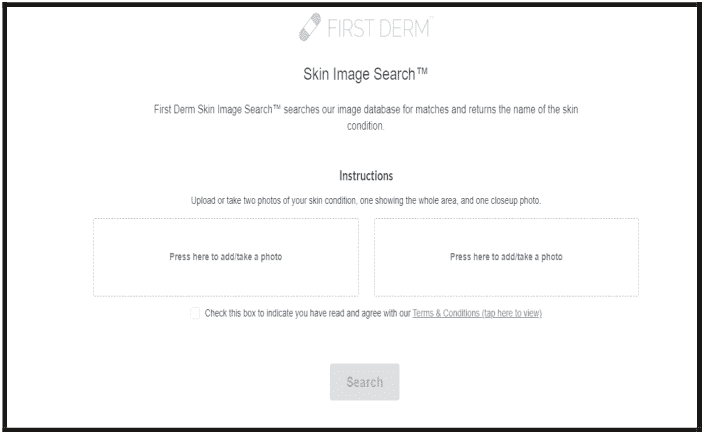

**Fig. 3.** FirstDerm 的图形用户界面表示 [54]。

- **病例评估：** 提交的病例在安全送达 FirstDerm 关联的经过认证的皮肤科医生小组后，将由该小组审核。皮肤科医生将检查病例、分析图像，并考虑现有信息。
- **皮肤科医生回复：** 对病例评估后，皮肤科医生将通过应用程序提供反馈和建议。这可能包括诊断、建议的行动方案或进一步指示。
- **用户反馈：** 在大多数情况下，皮肤科医生会在几天的指定时间内回复用户的询问和疑虑。用户随后可以查看评论、如有必要进一步咨询，并可能根据所提供的建议考虑寻求额外的医疗协助。
- **后续跟进：** 根据皮肤状况的性质和皮肤科医生的建议，用户可能会被指导与其初级保健医生或皮肤科医生预约随访，以接受面对面的评估或治疗。

FirstDerm AI 驱动诊断的关键优势之一是其能够快速分诊并优先处理可能需要紧急关注的病例。通过快速识别可疑病变或严重症状等令人担忧的特征，该平台有助于加快将患者转诊给皮肤科医生或其他医疗保健提供者，以进行进一步评估和治疗。这种简化的方法在需要及时干预的情况下尤其有益，例如在黑色素瘤或其他侵袭性皮肤癌的检测中。

此外，FirstDerm 还作为患者和医疗保健提供者的宝贵教育资源，提供关于各种皮肤疾病和治疗选择的易懂信息。通过其广泛的皮肤病学知识和病例数据库 [24]，该平台使用户能够就自身皮肤健康做出明智决策，并使医疗专业人员能够了解皮肤病学的最新进展。通过促进患者参与和协作，FirstDerm 有助于提升所有利益相关者的满意度和治疗效果。

除了诊断功能外，FirstDerm 还通过其远程医疗平台 [53] 支持慢性皮肤病的持续监测和管理。患者可以远程与皮肤科医生沟通，获得个性化治疗方案，并随时间跟踪自身进展，从而提高依从性和护理连续性。这种对皮肤健康的整体方法不仅提高了患者的便利性，还促进了皮肤病的积极管理，最终降低了医疗成本和医疗系统的负担。

### 5.2 Miiskin

Miiskin 是一款开创性的移动应用程序，利用尖端 AI 技术，使用户能够追踪痣和皮肤病变随时间的变化。随着全球皮肤癌发病率的上升，早期检测对于有效治疗至关重要，Miiskin 作为一种主动工具，在这场对抗最常见癌症之一的斗争中发挥作用 [37]。通过利用人工智能的力量，Miiskin 彻底改变了个人监测皮肤健康的方式，提供了一种便捷且易于获取的解决方案，触手可及。

Miiskin 的功能在于其 AI 驱动的能力，使用户能够以无与伦比的准确性拍摄和分析自身痣和皮肤病变的图像。通过先进算法，该应用程序可以检测大小、形状、颜色和质地随时间的细微变化，为用户提供关于潜在皮肤癌发展迹象的宝贵洞察 [45]。这种主动方法使个人能够通过定期自我检查掌控自己的皮肤健康，并及早发现可能需要进一步医疗关注的可疑变化。Miiskin 应用程序的整体工作流程如图 4 所示。

使 Miiskin 脱颖而出的关键功能之一是其用户友好的界面，该界面旨在简化皮肤变化监测过程 [15]。用户可以轻松使用智能手机相机拍摄高质量的痣和病变图像，并在应用程序中组织它们以便轻松追踪。此外，Miiskin 还集成了并排图像比较 [19] 和定期自检的自动提醒等直观工具，确保用户在监测皮肤健康方面保持警惕，并及时处理任何令人担忧的进展。

此外，Miiskin 将隐私和安全放在首位，认识到个人健康数据的敏感性。该应用程序采用强大的加密协议和严格的数据保护措施来保护用户信息，为将皮肤健康托付给该平台的个人提供安心。通过遵守严格的隐私标准，Miiskin 营造了一个安全可信的环境，使用户


- 1. Miiskin 是首款由人工智能驱动的皮肤追踪应用程序，可帮助人们追踪皮肤和痣。
- 2. 它已获得皮肤健康联盟的认可。
- 3. 它不根据您的照片进行诊断，而是在进行常规检查时记录皮肤变化。
- 4. 基于知识库查看您的皮肤，以了解更多关于皮肤的知识。

图 4. Miiskin 应用程序的工作流。

能够自信地进行主动皮肤监测，同时不会损害其保密性。

### 5.3 3Derm

3Derm 是一家专注于皮肤病成像技术领域的公司。他们利用 3D 成像技术获取皮肤病变和异常的超清晰图像。这一尖端系统能够精确可视化皮肤状况，显著促进诊断和制定治疗方案的过程。通过将这些图像安全传输给皮肤科医生以进行远程分析和诊断，可以加快获得专科医疗服务，尤其是在皮肤科医生可能有限的医疗资源匮乏地区 [45]。3Derm 系统通过实现远程会诊和加速诊断过程，显著改变了皮肤病学护理的提供方式，从而提高了效率、可及性和以患者为中心的程度。

3Derm 系统通过一个复杂的程序运行，该程序采用尖端成像技术来获取皮肤异常和病变的精确图像。其一般运作方式如下：

**图像传输：** 获取图像后，以安全方式将其传输至 3Derm 平台。上述传输可能通过多种渠道进行，包括为医疗保健提供者量身定制的专用软件应用程序或安全的在线门户。

**诊断与远程分析：** 皮肤科医生和其他医疗保健专业人员在接收图像后，可以远程访问 3Derm 平台以分析图像并制定诊断 [41]。通过利用平台的工具和功能，可以对图像进行全面分析，例如按时间顺序对比图像并聚焦于特定区域。

**治疗计划与建议：** 皮肤科医生有能力根据评估制定治疗计划，并就进一步评估或管理提供建议。这可能包括开具药物处方、建议外科干预或安排后续监测。

**患者沟通：** 一旦诊断和治疗计划最终确定，医疗保健临床医生可以通过 3Derm 平台将结果传达给患者。这可能包括传达诊断结果、阐述建议的治疗方案，并回应患者的疑问。

**监测与后续跟进：** 3Derm 平台以无缝方式促进患者进展的监测和后续跟进。医疗专业人员可以监测皮肤状况的进展 [55]，对治疗计划进行必要的修改，并安排补充预约。

总体而言，3Derm 系统通过利用先进的成像技术对皮肤状况进行远程分析和诊断，从而改变了皮肤病学护理。3Derm 通过优化诊断过程、促进医疗保健提供者与患者之间的有效沟通以及改善获得专科医疗的机会，提升了皮肤病学服务的提供质量，并有助于改善患者预后。

## 6. 结论

智能系统可以弥补医疗保健可及性的差距，特别是在医疗资源匮乏地区，这些地区获得皮肤科医生和专科医疗设施的机会有限。由这些系统驱动的移动应用和远程医疗平台可以使个人能够进行自我评估并在必要时寻求及时的医疗干预。医疗保健的这种民主化可以导致皮肤癌的早期检测，显著改善患者预后并降低死亡率。

总之，将智能系统集成到皮肤癌检测中，有望通过提高诊断准确性、可及性和效率来改变医疗保健的提供方式。通过利用先进技术，我们可以减轻这种流行且可能危及生命的疾病的负担，最终挽救生命并提高全球患者的护理质量。

## 参考文献

- [1] Chaahat, N. Kumar Gondhi 和 Kumar Lehana, P. (2021). 基于深度学习模型的皮肤病学图像增强及其分类的进化方法。*医疗保健工程期刊*，2021(1): 8113403.
- [2] Gondhi, N. K., Chaahat, E., Sharma, A. H. Alharbi, Verma, R. 和 Shah, M. A. (2022). 基于高效长短期记忆的电子商务评论情感分析。*计算智能与神经科学*，2022(1): 3646524.
- [3] Raina, R. 和 Gondhi, D. N. K. (2018). 物联网中的机器学习技术。*计算机科学、工程与信息技术科学研究国际期刊*。
- [4] Raina, R., Gondhi, N. K. 和 Gupta, A. (2024). 使用血液和骨髓涂片图像自动分段急性白血病：系统综述。*多媒体工具与应用*，第 1–34 页。
- [5] Koka, S. S.-A. 和 Burkhart, C. G. (2023). 皮肤病学中的人工智能：当前用途、不足以及在诊断和护理中进一步实施的潜在机会。开放皮肤病学杂志，17(1)。
- [6] Mohagaonkar, S., Rawlani, A. 和 Saxena, A. (2019). 使用机器学习工具的高效决策树用于急性疾病，第 691–697 页。载于：2019 年第 6 届可持续全球发展计算国际会议 (INDIACom)，IEEE。
- [7] Zhou, Z. H. H. (2010). 基于范例的搜索辅助色素性皮肤病变计算机辅助诊断方法。乔治亚理工学院。
- [8] Gogebakan, K. C., Mukherjee, K., Berry, E. G., Sonmez, K., Leachman, S. A. 和 Etzioni, R. (2021). 新型全身疗法对 Medicare 受益者黑色素瘤第一年护理成本的影响。癌症，127(16): 2926–2933。
- [9] Patel, H. (2021). 综述：人工智能、大数据和机器人技术在制药工业中的未来方面。
- [10] Sambhi, R.-D., Kalaichandran, R. 和 Tan, J. (2019). 用于痤疮临床管理的应用程序功能和质量的关键分析。皮肤病学在线期刊，25(10)。
- [11] Z. Ma. https://www.skinvision.com/ (已访问)。
- [12] Bird, J., Marshall, P. 和 Rogers, Y. (2009). 低保真皮肤视觉：快速原型化感觉替代系统的案例研究。
- [13] Deeks, J., Dinnes, J. 和 Williams, H. (2020). SkinVision 的灵敏度和特异性可能被高估。欧洲皮肤病与性病学杂志，34(10): e582–3。
- [14] Zhang, Y. 和 Tao, T. H. (2020). 用于人工皮肤视觉的生物启发式无线表皮光感受器。先进功能材料，30(22): 2000381。
- [15] Han, Y., Varadarajan, A., Kim, T., Zheng, G., Kitani, K., Kellilher, A. 等人 (2022). 智能皮肤：用于家庭手部康复的基于视觉的柔性压力感应系统。*软体机器人学*，9(3): 473–485。
- [16] Tanna, P., Murray, C., Arden-Jones, L., Hayes, S., Nayak, N., Sherley-Dale, A. 等人 (2021). 在快速通道皮肤癌诊所中评估三种不同的皮肤镜成像系统。英国皮肤病学杂志，第 179–179 页。
- [17] Mitchell, C., Oakford, M. 和 Murray, C. (2021). COVID-19 时代的医学教育：远程皮肤科附属 A. Cumm, C. Christie, 2 A. Fityan, H. Lotery。
- [18] Ngoo, A., Finnane, A., McMeniman, E., Soyer, H. P. 和 Janda, M. (2018). 使用智能手机对抗黑色素瘤：应用商店开门十年后的现状快照。*国际医学信息学杂志*，118: 99–112。
- [19] Albert T. Young, Niki B. Vora, Jose Cortez, Andrew Tam, Yildiraj Yenyjay, Ladi Afifi 等人 (2021). 技术在黑色素瘤筛查和诊断中的作用。*色素细胞与黑色素瘤研究*，34(2): 288–300。
- [20] Uppal, S. K., Beer, J., Hadeler, E., Gitlow, H. 和 Nouri, K. (2021). 在远程医疗时代远程皮肤镜检查的临床实用性。*皮肤病学治疗*，34(2): e14766。
- [21] Akshay, G., Irfan, M., Srinivas, K. 和 Singh, A. (2023). Skin-Vision：一种创新的移动式自动皮肤疾病检测应用程序。第 835–840 页。载于：2023 OTIS 信息技术国际会议 (OCIT)，2023：IEEE。
- [22] Mathis, A., Mamidanna, P., Cury, K. M., Abe, T., Murthy, M. W., Mathis, M. W. 等人 (2018). DeepLabCut：使用深度学习对用户定义的身体部位进行无标记姿态估计。*自然神经科学*，21: 1281–1289。
- [23] Nath, T., Mathis, A., Chen, A. C., Patel, A., Bethge, M. 和 Mathis, M. W. (2019). 使用 DeepLabCut 在不同物种和行为中进行三维无标记姿态估计。*自然方案*，14(7): 2152–2176。
- [24] Lauer, J., Zhou, M., Ye, S., Menegas, W., Schneider, S., Nath, T. 等人 (2022). 使用 DeepLabCut 进行多动物姿态估计、识别和追踪。*自然方法*，19: 496–504。
- [25] Hardin, A. 和 Schlupp, I. (2022). 在动物行为中使用机器学习和 DeepLabCut。*动物行为学报*，25(3): 125–133。
- [26] Mane, S. 和 Shinde, S. (2018). 使用皮肤镜图像检测黑色素瘤皮肤癌的方法，第 1–6 页。载于：2018 年第四届计算通信控制与自动化国际会议 (ICCUBEA)，2018：IEEE。


- [27] Saleh, M. and Murdoch, G. (1985). 步态分析辩护。步态评估中的观察与测量。The Journal of Bone & Joint Surgery British Volume, 67(2): 237–241.
- [28] Togawa, Y., Yamamoto, Y. and Matsu, H. (2023). 使用四种皮肤镜成像设备获得的图像比较：一项观察性研究。JEADV Clinical Practice, 2(4): 888–892.
- [29] Dodson, J. and Lio, P. (2023). 皮肤镜检查：过去与现在。Journal of Integrative Dermatology.
- [30] Podołec, K. (2020). 在患有皮肤黑色素瘤的患者中，利用视频皮肤镜和反射共聚焦显微镜的诊断成像技术中选定危险因素和预后因素的评估，与病理检查相比。Dermatology Clinic.
- [31] Kreusch, J. F. (2020). 皮肤表面显微镜仪器（入射光显微镜，表面荧光显微镜）。pp. 105–112. In: Bioengineering of the Skin: CRC Press.
- [32] Saravanan, S., Heshma, B., Shanofer, A. A. and Vanithamani, R. (2020). 使用皮肤镜图像进行皮肤癌检测。Materials Today: Proceedings, 33: 4823–4827.
- [33] Alizadeh, S. M. and Mahloojifar, A. (2021). 通过结合卷积神经网络和纹理特征，在皮肤镜图像中自动检测皮肤癌。International Journal of Imaging Systems and Technology, 31(2): 695–707.
- [34] Castillejos-Fernández, H., López-Ortega, O., Castro-Espinoza, F. and Ponomaryov, V. (2017). 一种用于皮肤镜拍摄的数字图像中皮肤癌诊断的智能系统。Acta Polytechnica Hungarica, 14(3): 169–185.
- [35] MoradiAmini, M., Yousefpour, M., Samadzadehaghdam, N., Ghahari, L., Ghorbani, M. and Mafi, M. (2024). 基于新型卷积神经网络的急性淋巴细胞白血病细胞和淋巴细胞亚型的自动分类。Microscopy Research and Technique.
- [36] Silverston, P. (2016). 萤火虫数字耳镜作为初级保健中耳镜检查教学的辅助工具。Education for Primary Care, 27(3): 225–226.
- [37] Filho, M., Ma, Z. and Tavares, J. M. R. (2015). 色素性皮肤病变的定量和分类综述：从专用设备到手持设备。Journal of Medical Systems, 39: 1–12.
- [38] Cho, T. S., Freeman, W. T. and Tsao, H. (2007). 一种可靠的皮肤痣定位方案。在 IEEE 生物医学图像分析数学方法研讨会（MMBIA）上，与 2007 年 ICCV 同期举办。
- [39] Boffa, M. and Chalmers, R. (1994). 别嘌醇引起的毒性脓疱性皮病。British Journal of Dermatology, 131(3): 447–447.
- [40] Argenziano, G., Cerroni, L., Zalaudek, I., Staibano, S., Hofmann, W. R., Arpaià, N. et al. (2012). 黑色素瘤检测的准确性：一项为期 10 年的多中心调查。J. Am. Acad. Dermatol. 67(1): 54–9.
- [41] Rotemberg, V. et al. (2021). 一种以患者为中心的图像和元数据数据集，用于利用临床背景识别黑色素瘤。Scientific Data, 8(1): 34.
- [42] Raina, R., Gondhi, N. K., Chaahaat, Singh, D., Kaur, M. and Lee, H.-N. (2023). 基于深度学习技术的急性白血病检测系统综述。Archives of Computational Methods in Engineering, 30(1): 251–270.
- [43] MacLellan, A. N. et al. (2021). 非侵入性成像技术在黑色素瘤诊断中的应用：一项前瞻性诊断准确性研究。Journal of the American Academy of Dermatology, 85(2): 353–359.
- [44] Prasanna, A., Saran, S., Manoj, N. and Alagu, S. (2023). 一种用于急性淋巴细胞白血病检测的细胞核语义分割深度学习框架。pp. 1–7. In: 2023 年生物信号、图像和仪器国际会议（ICBSII）, 2023: IEEE.
- [45] Erichètì, E. (2020). 普通皮肤病学（非肿瘤性皮肤病）中治疗反应监测和预测的皮肤镜检查：一份最新概述。Dermatology and Therapy, 10: 1199–1214.
- [46] Ankaḍ, B. S., Smitha, S. and Koti, V. R. (2020). 皮肤镜检查基础科学。Clinical Dermatology Review, 4(2): 69–73.
- [47] Kaliyadan, F. and Ashique, K. (2013). 一种简单且经济高效的移动皮肤镜设备。Indian Journal of Dermatology, Venereology and Leprology, 79: 817.
- [48] Emery, J. D., Hunter, J., Hall, P. N., Watson, A. J., Moncrieff, M. and Walter, F. M. (2010). 初级保健中遇到的色素性皮肤病变 SIAscopy 的准确性：一种新诊断算法的开发和验证。BMC Dermatology, 10: 1–9.
- [49] Michalska, M., Chodorowska, G. and Krasowska, D. (2004). SIAscopy——一种新的非侵入性黑色素瘤诊断技术。In: 卢布林玛丽亚·居里-斯克洛沃夫斯基大学年刊。D 医学分册, 59(2): 421–431.
- [50] Sgouros, D. et al. (2014). SIAscopy 在可疑皮肤肿瘤分诊中的评估。Skin Research and Technology, 20(4): 440–444.
- [51] Terstappen, K., Larkö, O. and Wennberg, A.-M. (2007). 色素性基底细胞癌——比较 SIAscopy 和皮肤镜检查的诊断方法。Acta dermato-venereologica, 87(3): 238–242.
- [52] Teo, Y. J. (2018). 2018 年英国皮肤外科学会本科生奖论文。
- [53] Yousif, R., Zheng, D. X., Chang, I. A., Wong, C., Trinidad, J. and Carr, D. R. (2022). 跨性别皮肤病护理在线患者教育材料的可读性。Journal of the American Academy of Dermatology, 87(4): 922–924.
- [54] Dr. Henrik Agrell, P. H. P. S. and Iris Zalaudek. https://www.firstderm.com/ （已访问）。
- [55] García-Lamont, F., Albarado, M., López-Chau, A. and Cervantes, J. (2022). 模拟人类色彩感知的白细胞细胞核高效分割。Color Research & Application, 47(3): 657–675.

# 第 8 章

# 物联网支持的医疗效率与医疗服务调节系统

Arnika,¹ Pramod Kumar Sagar;²,* Birendra Kumar Saraswat³ and Anu Chaudhary⁴

## 1. 引言

医疗保健系统是一个复杂的组织网络，包括在这些组织内工作的专业人员，利用技术和各种资源提供医疗服务。这些资源对向个人提供医疗保健服务至关重要。从小医院到大型设施，医疗保健系统提供健康服务、预防疾病并提供医疗服务。本章涵盖医疗保健系统的概念、其各种组成部分，以及医疗设施如何提供给个人 [1, 2]。

### 1.1 医疗保健系统的组成部分

以下是为向个别患者提供设施而涉及的医疗保健组件，如图 1 所示。

¹ 曼维·拉赫纳大学计算机科学与技术系副教授，法里达巴德，印度。
² 拉吉·库马尔·戈尔技术学院计算机科学与工程系副教授，加齐亚巴德，UP-201017，印度。
³ 拉吉·库马尔·戈尔技术学院计算机科学与工程系助理教授，加齐亚巴德，UP-201017，印度。
⁴ 阿杰·库马尔·加格工程学院计算机科学与工程系教授，加齐亚巴德，UP-201015，印度。
电子邮件：jain.arnika2009@gmail.com; birendrasaraswat@gmail.com; chaudharyanu@akgec.ac.in
* 通讯作者：pksagar1975@gmail.com

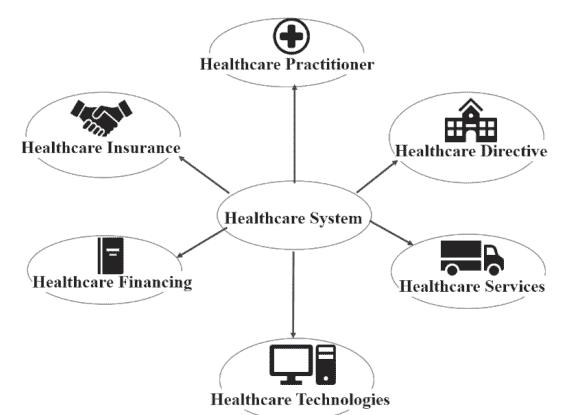

Fig. 1. 医疗保健系统。

#### 1.1.1 医疗保健从业者

这些人负责向患者提供医疗服务。这个群体包括医生、护士、药剂师、治疗师以及系统内的其他专业人员。作为团队合作，这些从业者共同负责提供医疗服务、预防疾病并提供各种医疗保健支持服务。

#### 1.1.2 医疗保健指令

这指的是患者根据自身需求接受治疗或入院的医院和医疗设施。这些设施可以从提供有限服务的小医院，到提供 X 光、超声和全面诊断检查等先进医疗设施的超专科医院。

#### 1.1.3 医疗保健服务

这些包括系统提供的一系列运营，以帮助个人从疾病中恢复。这些服务包括运营支持、血液检测、护理服务、病房入院、急诊室服务及其他与患者护理相关的服务。

#### 1.1.4 医疗保健技术

先进的医疗设备是医疗保健系统中诊断疾病的基本要求。这些技术有助于识别各种疾病，并实现远程患者护理，从而提高系统的效率。

#### 1.1.5 医疗保健融资与保险

健康保险和财务援助是医疗保健系统的关键组成部分。保险公司为患者提供财务支持，允许他们


访问医疗服务。这些服务的具体内容因保险提供商而异。健康保险为寻求治疗的个人提供重大支持 [3]。

## 2. 医疗保健系统基础

医疗保健系统包含众多利益相关者和流程，因此本质上复杂。由于涉及复杂的实施流程，理解其结构具有挑战性。本章探讨了医疗保健系统的基础要素及其详细运作 [4]。

由于地区差异，不同国家拥有不同的医疗保健系统。然而，所有系统的主要目标是提供最佳医疗设施，以预防疾病并确保社区所有成员都能获得医疗服务 [5]。医疗保健系统可根据组织方式、融资机制和服务提供方式分为各种模型。常见模型包括：

### 2.1 全民医疗保健

在全世界，不同国家为其公民提供全民医疗保健覆盖，无论其财务状况如何，都能保证获得医疗财务援助。该模式允许个人在没有财务限制的情况下获得医疗福利。好处包括获得医疗服务、健康公平、财务保护和提高效率 [6]。然而，该模式面临资金短缺和政策缺口等挑战。改进融资机制并招募政策制定者和利益相关者可以加强系统并改善服务。

### 2.2 社会健康保险

在社会健康保险模式下，个人和政府根据特定法规共同缴费。该系统提供意外覆盖、灵活护理选项和个人医疗保健服务等福利。然而，它在资金、公平性、获取途径和护理质量等方面面临挑战 [7]。政策制定者和利益相关者旨在通过改进政策来加强该系统，以提高医疗保健效果。

### 2.3 私人健康保险

私人健康保险涉及私人公司在政府监管下设计的保单。个人购买这些保单以获得医疗保健服务。虽然提供了增强的计划和服务选项，但该模式面临可负担性、风险选择以及由于政府限制而导致的覆盖缺口等挑战。政策制定者和利益相关者继续致力于改善个人的财务支持和福利获取途径。美国和瑞士等国家已实施该模式 [8]。

## 3. 智能计算机交互

人机交互（HCI）由多个领域组成，我们在这些领域中研究人类如何与计算机系统交互以及如何使用它。它涉及研究使人类能够与计算机交互的系统的设计、评估和应用。这一跨学科领域涵盖交互设计、认知心理学、可用性工程和用户界面设计等主题。HCI通过促进用户需求、帮助护理人员和医疗专业人员，以及优化医疗保健系统内的IoT可用性，在医疗保健中发挥着关键作用 [9, 10]。

### 3.1 HCI原则

从核心来看，HCI由几个关键原则指导，这些原则构成了交互式系统设计的基础。用户中心设计（UCD）是一个核心理念，它在设计过程中优先考虑用户的需求、偏好和能力。UCD高度重视理解用户的目标、任务和使用情境的价值，以设计出简单易用、高效且令人满意的用户界面 [11]。

HCI的可用性定义为用户有效、高效且满意地使用系统以实现特定目标的程度。可用性可定义为可学性、效率、记忆保持、防止错误以及使用户愉悦。在设计可用性时，需要进行用户研究、交互式原型设计，并测试可用性，以识别并解决设计过程中产生的各种问题。除此以外，HCI主要关注一致性、用户反馈的重要性以及它对设计过程的可负担性。一致性确保界面不同部分的不同操作提供相同的结果；尽管如此，它会提高学习能力并降低用户的认知负担。借助反馈，用户能够及时了解操作结果，这有助于用户理解系统响应并据此做出决策。系统会指导用户如何使用系统和与界面交互，从而无需外部支持即可完成任务。

### 3.2 HCI在IoT医疗保健系统中的重要性

在由IoT支持的医疗保健系统中，HCI在设计IoT设备、应用程序、服务以及将使用这些设备、服务和应用程序的用户之间的界面方面发挥着关键作用。这些系统借助IoT技术（使用传感器、可穿戴设备和数据分析平台）获益，从而实现持续监测。尽管如此，IoT医疗保健依赖于HCI的质量，它确保用户能够多有效地与系统交互，以及能从技术中获得多少益处 [12, 13]。

HCI规则可应用于医疗保健系统设计领域，因为底层技术复杂且用户需求不可避免。在设计IoT医疗保健系统的界面时，需要深入了解用户目标、偏好、能力以及这些技术将被使用的场景。例如，设计用于监测患者健康的可穿戴IoT设备涉及舒适度、易用性和准确的数据可视化等因素，以便随时从患者那里收集信息。

此外，维护IoT医疗保健系统中的隐私和安全问题需要HCI原则。必须与用户讨论隐私政策等各种安全方面，以建立对系统的信任和信心。界面必须通过强大的身份验证、加密算法和访问控制机制保护敏感健康数据免受未经授权的访问。

## 4. 医疗保健中的IoT技术

在医疗保健中，物联网（IoT）技术的利用涉及连接联网设备、传感器和系统，以便及时收集、传输、分析和响应数据，增强医疗环境中的实时操作。通过实现远程患者监测、增强临床决策、提高运营效率，并使患者能够更积极地参与管理自身健康，这些技术彻底改变了医疗保健行业。IoT技术有能力通过改善临床结果、扩大患者护理和简化医疗保健流程，从根本上改变医疗保健的提供方式。随着医疗保健系统的革命，组织可以借助互联设备、用于收集数据的传感器以及数据分析技术来提供医疗保健服务，使流程更高效、更有效，并满足患者需求 [14]。然而，IoT技术的部署需要安全且负责任的实施，并结合持续监测，以解决数据安全、数据互操作性和法规合规性等问题。

图2指定了在医疗保健系统中实施IoT技术所需的所有步骤。实施IoT技术的第一步是识别可以应用IoT技术的各种用例和场景。这可能是远程监测患者状况、患者药物管理、资产跟踪或提供的各种设施。识别用例后，需要评估用例的要求和目标，这些定义了收集的数据类型、数据捕获频率、需要多少设备和传感器以及预期结果。在考虑数据安全性、互操作性、可扩展性和法规合规性的基础上，需要根据用户的访问要求选择IoT设备和传感器。各种设备类型包括可穿戴设备、医疗诊断中使用的传感器、环境监测器、RFID标签以及可用于医疗保健的各种连接医疗设备。选择各种IoT设备后，需要在IoT设备、传感器和数据存储的不同组件之间建立通信链路。需要部署无线网络结构以支持wi-fi


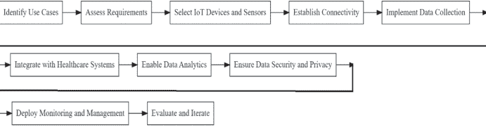

连接性、蓝牙、ZigBee 或蜂窝数据，并设置设备以收集用于存储和数据处理以得出结果的数据 [15]。

由于收集的数据来自传感器和物联网设备的实时数据，在建立连接后需要一套强大的数据收集机制。收集的数据必须进行聚合、使用适当协议进行转换，并进行归一化，以确保一致性、完整性和可靠性。关键考虑因素包括测试采样方法、数据格式和加密技术，以确保数据安全。集成后的数据必须随后纳入现有的医疗系统，例如电子健康记录（EHRs）、临床决策支持系统（CDSS）和医院信息系统（HIS）。集成之后，有必要开发接口、API 或中间件解决方案，以促进物联网设备与后端系统之间的无缝数据交换。数据分析在从收集的数据中推导可操作的洞察方面发挥着关键作用。这涉及实现数据分析算法、开发机器学习模型或利用预测分析工具来识别数据中的模式和趋势。通过有效的数据可视化，可操作的洞察得以进一步增强，它将研究结果以仪表板、报告或警报的形式呈现给利益相关者，从而促进知情决策 [16]。

为保护从物联网设备收集的敏感医疗数据，实施数据安全机制和隐私措施至关重要。这包括部署管理和监控工具，以持续监督系统的性能和可用性。远程监控管理确保物联网设备配置正确，固件更新已部署，并根据需要进行故障排除。还必须实施灾难恢复协议和系统维护机制，以降低风险并确保韧性。持续评估物联网技术至关重要，需要利用性能指标、用户反馈和临床结果来识别改进领域。应采用迭代流程，根据用户观察、新兴技术和不断变化的医疗要求来优化解决方案。为了在物联网支持的医疗解决方案中实现持续创新和持续改进，促进利益相关者（包括医疗服务提供者、患者、技术供应商和监管机构）之间的协作至关重要。这种协作方法确保解决方案符合用户需求和监管标准，同时推动医疗技术的发展 [17]。

## 5. 医疗保健中的以用户为中心的设计（UCD）

医疗保健中的以用户为中心的设计（UCD）代表了一种范式转变，旨在将患者、护理人员和医疗服务提供者置于设计流程的最前沿。通过优先考虑最终用户的需求、偏好和体验，UCD旨在创建直观、易用且有效的医疗解决方案。通过用户研究、情境调查和民族志研究，UCD方法识别利益相关者的挑战和工作流程。通过了解用户的行为、动机和痛点，设计人员可以发现改善医疗服务和提升用户体验的机会。在设计流程与持续反馈测试、原型设计和评估之间建立了一种交互机制。这确保了医疗技术满足用户的期望和偏好。

在医疗保健领域，UCD原则被应用于各个领域，包括面向患者的技术、临床工作流程优化、医疗器械设计、医疗设施设计以及健康信息技术系统（HITS）。UCD强调通过优先开发远程医疗平台、移动健康应用程序和患者门户，将患者置于护理的中心。UCD还支持临床工作流程的优化和医疗器械的设计，确保患者和医疗服务提供者的安全性、可靠性和易用性。通过融入UCD原则，设计人员创建可访问的医疗环境和支持互操作性并增强临床决策的HIT系统。因此，医疗保健中的UCD促进了一种以人为本的设计方法，改善患者预后，提升用户满意度，并促进更以患者为中心的医疗服务交付。

### 5.1 UCD的应用

在医疗保健生态系统中，UCD原则扩展了患者体验的影响，简化了诊所的工作流程，并优化了医疗服务的交付。应用UCD原则的重要领域之一是与面向患者的医疗服务相关的医疗技术设计。设计人员根据最终用户的需求和偏好，为患者在线门户、移动应用程序和远程医疗平台创建直观且用户友好的界面。这些技术帮助患者积极参与其医疗管理，提供个性化信息的访问权限，并且这些信息可以持续传达给医疗服务提供者。总体而言，它增强了患者的赋权和自我护理。

UCD原则在优化临床工作流程和改善用户可用性方面也发挥着关键作用。在与医疗服务提供者合作的过程中，设计人员简化文档流程，增强数据可视化，并将决策支持工具集成到临床工作流程中。UCD通过使工作流程与医疗专业人员的需求保持一致，有助于减轻行政负担，从而提高医疗服务交付的效率。UCD方法论进一步应用于实现对患者状况的远程访问，监测其健康状况，诊断其病情，并有效提供足够的医疗服务。

## 6. 医疗保健中的情境感知计算

情境感知计算可以定义为技术利用从患者、环境因素和周围条件收集的数据来适应和响应医疗环境的能力。

在医疗保健领域，情境感知计算是指技术在适应特定医疗场景方面的有效性，它结合了患者数据、环境因素和情境线索。这种方法使用传感器、各种设备生成的数据以及机器学习算法来生成情境信息。然后利用这些信息提供个性化和及时的医疗服务。情境感知系统能够实现动态决策，根据患者状况和所需的医疗服务调整其行为 [19]。

### 6.1 情境感知计算的组件

医疗保健中的情境感知计算用于开发个性化患者护理系统。通过从电子健康记录（EHRs）、可穿戴设备和传感器收集数据，医疗服务提供者可以评估患者当前的健康状况、行为和偏好。

此外，情境感知计算通过在护理点提供情境洞察和决策支持工具来增强临床决策。通过分析患者数据——考虑其病史、当前状况和环境影响——临床医生可以就诊断、治疗和护理管理做出更明智的决策。例如，情境感知系统可以向医疗服务提供者发出潜在药物相互作用的警报，推荐基于证据的治疗方案，并建议针对患者特定情境量身定制的个性化护理计划。

图3说明了医疗保健中情境感知计算的概念，描绘了系统内的关键组件及其关系。

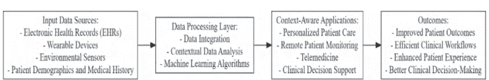

**图3.** 医疗保健中的情境感知计算。

#### 6.1.1 输入数据源

情境感知计算中的输入数据源为医疗系统提供所需的原始数据。这些来源包括用于持续监测温度等各种参数的环境传感器收集的数据，以及从智能手表等可穿戴技术收集的实时健康数据、包含患者医疗报告的EHR记录以及患者病史。


#### 6.1.2 数据处理层

数据处理层涉及处理和分析输入数据。这包括数据集成，即将来自各种来源的信息合并并标准化以进行分析。上下文数据分析涉及在其上下文中检查数据，考虑患者人口统计学、病史和环境条件等因素。应用机器学习算法从数据中提取模式、趋势和洞察，使系统能够理解并响应医疗环境的上下文。

#### 6.1.3 上下文感知型应用

这些应用利用处理后的数据提供个性化且与上下文相关的医疗服务。包括根据个别患者要求和偏好制定的各种个性化患者护理计划、远程监测患者状况、提供远程咨询和诊断，以及在提供医疗服务过程中为临床决策提供支持。

#### 6.1.4 成果

这些成果包括改善患者结局，例如更好的健康结果和增加患者参与度，以及更高效的临床工作流程，例如简化流程和优化资源分配。此外，上下文感知计算通过个性化护理交付和主动干预改善了患者体验。此外，医疗服务提供者受益于基于上下文相关信息的更好临床决策，从而减少错误并改善临床结果。

### 6.2 医疗保健中上下文感知计算的应用

借助医疗保健中的上下文感知计算，可以解决各种应用，包括提供个性化信息、提供及时的医疗服务以及确保资源的高效利用[20]。包含的大多数服务如下：

#### 6.2.1 个性化患者护理

借助上下文感知计算，可实现开发针对个别患者要求、需求、偏好和情况量身定制的个性化护理计划。通过利用电子健康记录（EHRs）、可穿戴设备收集的数据以及环境传感器，医疗服务提供者可以处理这些信息以确定患者的健康状况、行为和环境因素。

#### 6.2.2 远程患者监测

上下文感知计算使患者可以远程监测，使医疗服务提供者能够在不完全依赖常规临床治疗的情况下跟踪生命体征、活动水平和用药依从性。使用可穿戴设备、移动健康应用程序和远程医疗，可以实时监测患者健康状况，从而采取快速的纠正措施以防止健康恶化。

#### 6.2.3 远程医疗和远程健康

上下文感知计算在整合远程医疗和远程健康系统以通过数字平台提供在线咨询、疾病诊断和治疗方面发挥着重要作用。患者文本数据可以集成到远程医疗系统中，使医疗服务提供者能够虚拟探访患者、提供个性化护理并远程监测患者状态。借助上下文感知技术与远程医疗系统相结合，即使在远离医疗设施的偏远地区，医疗服务也得到了改善，并且可以有效地做出临床决策。

#### 6.2.4 临床决策支持

上下文感知计算有助于做出准确决策，并提供工具在护理点提醒医疗服务提供者，使用从设备和患者病史中接收到的数据。通过分析病史、当前状况和环境因素，上下文感知系统支持关于患者治疗、疾病诊断和护理管理的决策，提高医疗服务的整体质量。

#### 6.2.5 健康行为监测与干预

上下文感知计算在监测患者健康相关行为、生活方式以及预防慢性疾病方面发挥着重要作用。这些系统通过收集患者反馈并鼓励行为改变来个性化干预措施，以改善健康结果。还可以提供激励措施来激励患者，促进更健康的习惯和长期的健康福祉。

## 7. 设计健康数据可视化界面

设计健康数据可视化界面涉及创建直观、信息丰富且用户友好的系统，使医疗专业人员和患者能够有效地探索和理解复杂的健康数据[21]。图 4 展示了设计健康数据可视化界面的一些关键原则和注意事项。

### 7.1 用户中心设计

首先要了解目标用户（包括医疗专业人员、患者和护理人员）的需求、目标和偏好。通过用户研究、访谈和可用性测试来了解用户工作流程。界面设计旨在与用户的心理模型保持一致，使用户能够有效地做出决策。

**用户中心设计：**
- 了解用户需求
- 进行用户研究
- 与用户的心理模型保持一致

**清晰直观的导航：**
- 创建清晰的导航结构
- 使用熟悉的模式
- 提供视觉线索

**视觉层次和组织：**
- 优先处理重要信息
- 对相关数据元素进行分组
- 使用视觉线索

**有效的数据可视化技术：**
- 选择合适的可视化
- 使用图表、图形、图表
- 融入交互功能

**响应式和无障碍设计：**
- 针对不同设备进行设计
- 遵守无障碍标准
- 增强无障碍性

**上下文帮助和指导：**
- 提供提示、注释
- 提供教程、演示视频
- 解释数据元素

**数据安全与隐私：**
- 遵守数据法规

图 4. 健康数据可视化界面。

### 7.2 清晰直观的导航

在应用用户中心设计原则后，创建了一个清晰直观的导航结构，以便用户轻松访问和探索不同类型的健康数据。使用菜单、选项卡和面包屑等各种导航元素来增强可用性。结合视觉线索和反馈，以指示用户在界面中的当前位置和状态。

### 7.3 视觉层次和组织

使用视觉层次和组织原则来优先处理重要信息并引导用户注意。相关数据被分组在一起，同时使用标记和格式来创建颜色、大小和对比度等视觉线索。这些元素突出关键洞察和趋势，以便更好地理解。

### 7.4 有效的数据可视化技术

根据健康数据的类型和用户需要得出的洞察，选择适当的数据可视化技术。使用柱状图、折线图、散点图和热图等图表、图形和图表来有效表示定量数据。

### 7.5 响应式和无障碍设计

界面设计为在不同设备和屏幕尺寸（包括笔记本电脑、台式机、平板电脑和手机）上具有响应性。遵循标准，以确保无论使用什么设备，数据始终可见且可访问。

### 7.6 上下文帮助和指导

提供上下文帮助和指导，以支持用户解读和导航健康数据可视化界面。包括提示、注释和说明文本，以澄清数据元素并提供额外上下文。提供教程、演示视频和用户指南，以帮助用户学习如何有效使用界面。

### 7.7 数据安全与隐私

数据安全和隐私至关重要。界面设计旨在遵守隐私和数据安全法规，例如欧洲的《通用数据保护条例》（GDPR）和美国的《健康保险可携性和责任法案》（HIPAA）。实施了强大的身份验证和授权机制来保护敏感的健康数据。

## 8. 未来方向与新兴趋势

在医疗保健系统中的人机交互和物联网技术方面，技术不断进步，探索了提供医疗服务的新趋势。这些趋势包括各种将人工智能（AI）、虚拟现实（VR）、增强现实（AR）以及用于医疗界面和物联网系统的其他尖端技术整合在一起的运动。

其中一项运动是将人工智能提供的解决方案越来越多地整合到医疗界面中。这些解决方案用于增强决策过程、诊断患者疾病并根据诊断推荐治疗方案。借助 AI 算法，大量患者数据被


用于识别模式和变化，从这些发现中生成结果，并为决策提供临床支持。这提高了诊断准确性并优化了治疗方案。此外，AI驱动的聊天机器人和虚拟助手越来越多地用于患者互动，提供广泛的治疗建议，并支持慢性病的自我管理。

借助虚拟现实和增强现实技术，医疗教育和培训以及患者护理都发生了革命性变化。虚拟现实使医疗专业人员能够在实时且无风险的环境中练习复杂操作，提升其技术技能和信心。增强现实应用将数字信息转化为物理世界，为手术等关键操作提供实时指导，改进医学图像解读，并辅助患者教育和康复。

其他新兴技术包括可持续监测患者健康的可穿戴物联网设备。远程医疗和远程患者监测系统促进了家庭治疗。此外，区块链技术的集成增强了数据安全性，确保健康数据交换中的安全存储和互操作性。

随着技术不断改进，技术正在变得更加普惠，个人拥有推动医疗服务交付变革、提高患者满意度并提升服务交付质量和效率的能力。然而，随着技术变革，有必要考虑与采用这些技术相关的伦理政策、隐私法规和监管影响，并确保以最大化用户利益同时将医疗服务相关风险降到最低的方式部署这些技术 [28]。

## 9. 结论

医疗系统由具有复杂结构、不同流程和各种利益相关者的组件组成。这些系统旨在预防患者疾病并提供医疗服务。医疗系统可分为三种模式。全民医疗模式在不要求个人缴费的情况下提供基本医疗服务，并提供易于获得、健康公平以及社会和财务保护等优势。社会医疗保险模式由个人和雇主缴费支持。它提供财务保护、便捷的医疗服务、计划选择灵活性以及预防性护理。私人医疗保险模式提供更大的保险选择和计划灵活性等优势，但面临可负担性、逆向选择和保险差异等挑战。

人机交互（HCI）涉及多个医疗学科，包括为人机交互设计的交互式计算系统。在医疗系统中，HCI在设计设备可用性方面发挥重要作用，通常集成物联网（IoT）。HCI通常围绕以用户为中心的设计（UCD）进行，后者定义了用户目标、任务和使用情境。可用性决定了系统被理解和使用的难易程度。

本章探讨了在医疗系统中设计和实施物联网（IoT）技术时人机交互（HCI）的重要性。本章重点介绍了以用户为中心的设计（UCD）和情境感知计算的要求，以确保可用性、可访问性和患者参与度。随着物联网技术融入医疗系统，医疗服务交付已发生革命性变化。这些进步使持续患者监测和远程医疗服务成为可能。通过将HCI原则集成到物联网医疗系统中，研究人员和技术专家可以提供创新解决方案，改善个人和社会的健康结局。本章最后强调了HCI和物联网医疗系统领域中研究与创新的挑战与机遇。

## 参考文献

- [1] Mukati, N., Namdev, N., Dilip, R., Hemalatha, N., Dhiman, V. and Sahu, B. (2023). 使用物联网（IoT）支持技术对COVID-19患者提供医疗援助. Materials Today: Proceedings, 80: 3777–3781.
- [2] Boyi Xu, Li Da Xu, Hongming Cai, Cheng Xie, Jingyuan Hu and Fenglin Bu. (2014). 基于物联网的紧急医疗服务信息系统中的无处不在的数据访问方法. IEEE Transactions on Industrial Informatics, 10.2: 1578–1586.
- [3] Rahmani, A. M., Gia, T. N., Negash, B., Anzanpour, A., Azimi, I., Jiang, M. et al. (2018). 在医疗物联网边缘利用智能e-Health网关：一种雾计算方法. Future Generation Computer Systems, 78: 641–658.
- [4] Kavidha, V., Gayathri, N. and Rakesh Kumar, S. (2021). 医疗健康领域的人工智能、物联网和机器人技术. AI and IoT-Based Intelligent Automation in Robotics, (2021): 165–187.
- [5] Sodhro, Ali Hassan, Sandeep Pirbhulal and Arun Kumar Sangaiah. (2018). 医疗健康中物联网与产品生命周期管理的融合. Future Generation Computer Systems, 86: 380–391.
- [6] Yang, G., Jan, M. A., Menon, V. G., Shynu, P. G., Aimal, M. M. and Alshehri, M. D. (2020). 智慧医疗系统中绿色通信的集中式集群层次化方法. IEEE Access, 8: 101464–101475.
- [7] Carrin, Guy. (2002). 发展中国家的社会医疗保险：一项持续的挑战. International Social Security Review, 55.2: 57–69.
- [8] Pauly, M. V., Zweifel, P., Scheffler, R. M., Preker, A. S. and Bassett, M. (2006). 发展中国家的私人医疗保险. Health Affairs, 25.2: 369–379.
- [9] Carroll, John M. (2009). 人机交互（HCI）. 交互设计百科全书. 检索于2010年6月6日.
- [10] Carroll, John M. (1997). 人机交互：作为设计科学的心理学. Annual Review of Psychology, 48.1: 61–83.
- [11] Sinha, Gaurav, Rahul Shahi and Mani Shankar. (2010). 人机交互. 2010年第3届工程与技术新兴趋势国际会议. IEEE.
- [12] Mohammed, Yakubu Bala and Damla Karagozlu. (2021). 面向信息系统开发的人机交互设计方法综述. BRAIN. 人工智能与神经科学广泛研究, 12.1: 229–250.
- [13] Blandford, Ann. (2019). 面向健康与福祉的人机交互：挑战与机遇. International Journal of Human-Computer Studies, 131: 41–51.
- [14] Baker, Stephanie B., Wei Xiang and Ian Atkinson. (2017). 面向智慧医疗的物联网：技术、挑战与机遇. IEEE Access, 5: 26521–26544.
- [15] Chiuchisan, Iuliana, Hartion-Nicolea Costin and Oana Geman. (2014). 在医疗保健中采用物联网技术. 2014年电气与电力工程国际会议及博览会（EPE）. IEEE.
- [16] Krishnamoorthy, Sreelakshmi, Amit Dua and Shashank Gupta. (2023). 新兴技术在未来物联网驱动的医疗4.0技术中的作用：调查、当前挑战和未来方向. Journal of Ambient Intelligence and Humanized Computing, 14.1: 361–407.
- [17] Chandran, Srijith, Ahmed Al-Sa'di and Esraa Ahmad. (2020). 探索医疗保健中的以用户为中心的设计：文献综述. 2020年第4届多学科研究与创新技术国际研讨会（ISMSIT）. IEEE.
- [18] Chandran, Srijith, Ahmed Al-Sa'di and Esraa Ahmad. (2020). 探索医疗保健中的以用户为中心的设计：文献综述. 2020年第4届多学科研究与创新技术国际研讨会（ISMSIT）. IEEE.
- [19] Jahnke, J., Yury Byckhov, David Dahlem and Luay Kawasme. (2004). 面向医疗保健的隐式情境感知计算. 第1届建模与情境检索国际研讨会（MRC 2004）论文集. Schulz, S. and Roth-Berghofer, Th.(Eds.). CEUR Workshop Proceedings. Vol. 114.
- [20] Bardram, Jakob E. (2004). 医院工作中情境感知计算的应用：示例与设计原则. 2004年ACM应用计算研讨会论文集.
- [21] Wang, Pengwen and Jiangru Wang. (2021). 数据可视化在健康应用UI界面设计中的应用研究. 2021年国际无线通信与移动计算会议（IWCMC）. IEEE.
- [22] Frederik Brudy, Christian Holz, Roman Rädle, Chi-Jui Wu, Steven Houben, C. Klokmose, Nicolai Marquardt. (2019). 跨设备分类法：跨多设备交互的调查、机遇与挑战. 2019年CHI人机交互会议论文集.
- [23] Steven Houben, Nicolai Marquardt, Jo Vermeulen, C. Klokmose, Johannes Schöning, Harald Reiterer and Christian Holz. (2017). 野外环境中跨设备交互的机遇与挑战. Interactions, 24.5: 58–63.
- [24] Arnold, P. O. S. Vermeeren, Effie Lai-Chong Law, Virpi Roto, Marianna Obrist, Jettie Hoonhout and Kaisa Väänänen-Vainio-Mattila. (2010). 用户体验评估方法：现状与发展需求. 第6届北欧人机交互会议：拓展边界论文集.
- [25] Law, Effie Lai-Chong, Paul Van Schaik and Virpi Roto. (2014). 对用户体验（UX）测量的态度. International Journal of Human-Computer Studies, 72.6: 526–541.
- [26] Hochheiser, Harry and Jonathan Lazar. (2007). 人机交互与社会问题：参与框架. International Journal of Human–Computer Interaction, 23.3: 339–374.
- [27] Torkil Clemmensen, Dorina Rajanen, Mikko Rajanen and Jose Abdelnoor-Nocera. (2019). 共享社会中人机交互专刊导论. AIS Transactions on Human-Computer Interaction, 11.3: 107–116.
- [28] Sagar, Pramod Kumar, Kanika Garg and Chiranjit Dutta. (2018). 物联网在快速消费品行业中的应用以提升商业效率. 2018年第二届绿色计算与物联网国际会议（ICGCIoT） (2018): 629–636.


# Chapter 9

# 基于深度神经网络的 MRI 图像肿瘤预测

Monika Sharma,1 Dimple Tiwari,2,* Shivani Trivedi1 and Harsiddhi Singh Dev1

## 1. 引言

脑瘤是生长在脑内或其邻近组织中的异常细胞团块。这些肿瘤可能是良性（非癌性）或恶性（癌性）的。掌握脑瘤的性质、病因和治疗选择对于有效管理该病症至关重要 [1]。脑瘤可能在脑本身发生（原发性脑瘤），或从身体其他部位扩散到脑（继发性或转移性脑瘤）。这些肿瘤可能是良性（非癌性）或恶性（癌性）的，且其生长速度及对脑功能的潜在影响可能差异巨大。脑瘤的存在可通过压迫脑结构、增加颅内压或干扰脑脊液流动而干扰正常脑功能。了解脑瘤的具体类型和特征，对于确定最有效的治疗和管理策略至关重要 [2]。

### 1.1 背景与动机

#### 1.1.1 早期脑瘤识别的价值

早期发现脑瘤至关重要，原因有以下几点：

- 1. 改善预后：早期诊断通常能带来更好的治疗效果。肿瘤被发现得越早，在肿瘤进展到更严重阶段之前，干预的选择就越多。这可以显著提高患者的生存率和生活质量。

- 2. **有效的治疗规划：** 早期发现可实现及时且恰当的治疗规划。它使临床医生能够在最有可能有效的阶段，选择最有效的治疗方式，无论是手术、放射治疗还是化疗。

- 3. **降低发病率：** 通过在早期识别肿瘤，可以限制手术范围，并减少对通常伴有显著副作用的激进治疗的需求。这可以降低与脑瘤治疗相关的总体发病率。

- 4. **经济效益：** 早期发现可以节省医疗成本。在晚期治疗肿瘤更昂贵，因为需要更复杂的治疗和更长的住院时间。早期干预可以通过允许更简单、费用更低的治疗来降低这些成本。

- 5. **患者及家属福祉：** 早期发现可以减轻患者及其家属的心理负担。尽早了解疾病并制定清晰的治疗方案，可以减轻焦虑，并帮助更好地进行心理和情感准备。

#### 1.1.2 脑瘤诊断的当前挑战

尽管医学影像和诊断技术取得了进步，但在脑瘤的早期发现和诊断中，仍然存在若干挑战：

- 1. **隐匿且非特异性症状：** 脑瘤常表现为头痛、眩晕和认知改变等非特异性症状，这些症状容易被误认为是较不严重的疾病。这使得仅凭临床症状难以及早识别肿瘤。

- 2. **影像学局限：** 虽然 MRI 是检测脑瘤的强大工具，但解读 MRI 图像可能复杂，且需要专业知识。小肿瘤或弥漫性肿瘤可能难以检测，且区分良性和恶性病变可能具有挑战性。

- 3. **肿瘤表现的多样性：** 脑瘤的位置、大小和生长速度可能差异巨大。这种异质性使得制定标准化诊断方案变得困难，需要针对诊断和治疗采取个性化方法。

- 4. **先进诊断工具的获取：** 并非所有医疗机构都能使用先进的成像技术和专业神经放射科医生。这可能导致诊断和治疗延误，尤其在资源匮乏环境中 [3]。

- 5. **假阳性和假阴性：** 有时，影像学检查可能导致假阳性，引起不必要的担忧和侵入性操作；或导致假阴性，即未能检测出肿瘤。这两种情况都可能对患者护理产生重大影响。

- 6. 技术和计算挑战：开发和实施卷积神经网络（CNN）等先进诊断工具需要大量计算资源，以及医学和技术领域的专业知识。确保这些工具的准确性和可靠性，对于它们在临床实践中的采用至关重要。

应对这些挑战需要多学科方法，利用医学影像、计算技术和临床专业知识的进步，以改善脑瘤的早期发现和诊断。本章将探讨 CNN 如何通过提供更准确、高效的 MRI 图像分析工具，为克服其中一些挑战做出贡献 [4]。

### 1.2 MRI 成像概述

磁共振成像（MRI）是一种非侵入性诊断技术，利用强磁场和无线电波生成人体内部器官的详细图像。由于它可以区分不同类型的软组织并具有优异的对比度分辨率，因此在神经影像领域特别有用。本节将概述磁共振成像（MRI），重点介绍其原理、应用及其在脑瘤检测中的作用。

#### 1.2.1 MRI 原理

- 1. 基础物理：核磁共振（NMR）是磁共振成像（MRI）的基础。体内的质子（或氢原子核）会在高磁场中排列。随后，施加射频脉冲，激发这些质子，使其在重新排列时释放信号。通过检测和利用这些脉冲来生成图像。

- 2. 图像形成：利用傅里叶变换分析生成的信号，并提供人体精细的断层图像。MRI 扫描仪通过使用磁场梯度对信号进行空间编码，在三个平面（轴位、矢状位和冠状位）上创建图像。

- 3. 对比机制：人体不同组织具有不同的弛豫时间（T1 和 T2），这会影响 MRI 信号。通过调整成像参数（如回波时间和重复时间），MRI 可用于强调不同的组织特征，增强正常组织与异常组织之间的对比度。

#### 1.2.2 MRI 在脑部成像中的应用

- 1. 结构成像：MRI 提供高分辨率的脑部解剖图像，允许对脑部结构进行详细可视化。它用于检测肿瘤、囊肿、水肿和结构异常等病变。

- 2. 功能成像：称为功能性 MRI（fMRI）的技术利用血流变化来确定脑活动。该技术在科研和临床环境中用于绘制脑功能区域图，这对于术前规划非常有价值。

- 3. **扩散成像：** 扩散加权成像（DWI）和扩散张量成像（DTI）是专门的 MRI 技术，用于测量脑内水分子的扩散情况。这些技术对于检测缺血性中风和表征白质纤维束的微观完整性很有用。

- 4. **增强成像：** 在 MRI 中使用造影剂可以增强血管和血脑屏障的可视化。这对于识别和表征脑瘤特别有用，因为造影剂可以突出显示血脑屏障通透性异常的区域。

#### 1.2.3 MRI 在脑瘤检测中的作用

- 1. **肿瘤定位与表征：** MRI 是检测和表征脑瘤的金标准。它提供关于肿瘤大小、位置和范围，以及其对周围脑结构影响的详细信息。

- 2. **肿瘤类型鉴别：** MRI 根据影像学特征帮助鉴别多种类型的脑瘤（如胶质瘤、脑膜瘤、转移瘤）。MR 谱等先进技术可提供额外的代谢信息，以帮助肿瘤分类 [5]。

- 3. **肿瘤进展评估：** MRI 用于随时间监测肿瘤生长和对治疗的反应。一系列 MRI 扫描可以跟踪肿瘤大小和特征的变化，帮助评估治疗干预的效果。

- 4. **术前规划：** 详细的 MRI 图像对于手术规划至关重要，使神经外科医生能够准确绘制肿瘤图谱，并规划最安全、最有效的手术方法 [6]。

- 5. **非侵入性：** MRI 提供了一种非侵入性的诊断和监测脑瘤的方法，在某些情况下减少了对活检等侵入性操作的需求。

总之，MRI 成像是脑瘤诊断、表征和管理中不可或缺的工具。其提供脑结构及异常高分辨率、详细图像的能力，使其成为神经影像学的基石。将先进的 MRI 技术与卷积神经网络（CNNs）等计算方法相结合，有望进一步提高脑瘤检测的准确性和效率。

## 2. 相关工作

近年来，各位研究人员提出了在过去几年中开发的用于预测和识别 MRI 图像中脑瘤的各种方法和技术。表 1 是对以往年份所用预测的文献综述，并简要概括了所引文章和先前工作的比较分析。


### Table 1. 基于文献综述论文的表格摘要。

| 序号 | 论文，作者姓名 | 摘要 | 方法论，数据集，算法 | 结论性意见/发现 | 缺口 |
| :--- | :--- | :--- | :--- | :--- | :--- |
| 1 | Khan, M.S.I., Rahman, A., Debnath, T., Karim, M.R., Nasir, M.K., Band, S.S., Mosavi, A. and Dehzangi, I. | 检测和分类脑肿瘤对于理解其机制至关重要。MRI 扫描有助于识别肿瘤区域，但耗时且需要专业知识。计算机辅助诊断 (CAD)、机器学习和深度学习提供了更高效的解决方案。本文提出了两种深度学习模型，用于利用 MRI 数据进行二类和多类肿瘤识别。23 层 CNN 用于大型数据集，而带 VGG16 的迁移学习可解决小型数据集中的过拟合问题。该模型可达到最高 97.8% 和 100% 的准确率，优于现有方法。 | 23 层 CNN，基于 VGG16 微调的 CNN | 本研究提出了两种用于检测脑部异常和分类肿瘤类型（包括脑膜瘤、胶质瘤和垂体瘤）的深度学习模型。23 层 CNN 专为大型图像数据集设计，而基于 VGG16 微调的 CNN 针对带有数据增量的小型数据集进行了优化。该模型分别在两个不同的数据集上达到 97.8% 和 100% 的准确率，超过了以往研究。这些结果表明，所提方法对脑肿瘤检测非常有效。 | 所提方法在两个公开可用的数据集上表现出显著性能，但尚未在临床环境中验证。这是本研究中审查的模型普遍存在的局限性。 |
| 2 | Irmak, E. | 本文提出了三种用于脑肿瘤多类分类的 CNN 模型，在检测和分类任务中实现了高准确率。第一个模型在脑肿瘤检测中达到 99.33% 的准确率，第二个模型将肿瘤分为五种类型，准确率为 92.66%，第三个模型对肿瘤分级的准确率为 98.14%。利用网格搜索优化超参数，这些模型优于其他最先进的 CNN 模型，并可协助医生进行初步筛查。 | CNN 模型，RIDER 数据集，TCGA-LGG 数据集，REMBRANDT 数据集 | 深度学习的最先进进展已将机器学习从特征工程转向架构工程。本文介绍了用于早期脑肿瘤诊断的 CNN 模型，超参数通过网格搜索自动调优。三个稳健的 CNN 模型专为使用公共医学图像数据集的不同脑肿瘤分类任务而设计。其中一个模型的检测准确率达到 99.33%。 | 未来工作将重点在实际临床数据上测试模型，以与实验方法进行直接比较。此外，还将探索增加层数或采用其他正则化技术，以使用 CNN 模型提高小型图像数据集的性能。 |
| 3 | Hossain, T., Shishir, F.S., Ashraf, M., Al Nasim, M.A. and Shah, F.M. | 本文提出了一种从 2D MRI 图像中进行脑肿瘤分割的方法，先采用模糊 C-Means 聚类算法，随后使用传统分类器和卷积神经网络 (CNN)。它评估了六种传统分类器（SVM、KNN、MLP、逻辑回归、朴素贝叶斯、随机森林）以及在 Keras & Tensorflow 中实现的 CNN，达到了令人印象深刻的 97.87% 准确率。该研究侧重于基于纹理和统计特征区分正常像素和异常像素，解决实时数据集中多样化肿瘤特征和图像强度的挑战。 | 使用 Keras & Tensorflow 实现的卷积神经网络 (CNN) | 在我们专注于使用 MRI 和 CT 扫描图像进行脑肿瘤分割的研究中，我们利用模糊 C-Means 聚类进行肿瘤细胞的准确预测。分割后，我们采用传统分类器和卷积神经网络进行分类。在所测试的传统分类器（K 近邻、逻辑回归、多层感知机、朴素贝叶斯、随机森林和支持向量机）中，SVM 产生了最高 92.42% 的准确率。 | 在此背景下，处理更大的数据集面临重大挑战。我们旨在构建针对我国具体情况的数据集，专注于抽象特征。这种方法将增强我们研究工作的范围和有效性。3.5 |
| 4 | Choudhury, C.L., Mahanty, C., Kumar, R. and Mishra, B.K. | 该研究侧重于利用深度神经网络进行计算机辅助诊断，具体使用卷积神经网络 (CNN) 对 MRI 图像中的脑肿瘤进行准确和早期检测。该模型平均准确率达到 96.08%，F 分数为 97.3%，显著提高了诊断准确率，相比于传统手动方法，从而帮助神经肿瘤学家做出及时有效的治疗决策。 | CNN 模型 | 本研究介绍了一种基于 CNN 的系统，用于区分肿瘤和非肿瘤脑 MRI 图像，准确率为 96.08%，F 分数为 97.3%。采用精简的方法，包含 3 层 CNN 和 35 个时代内完成的最少预处理步骤。 | 该研究强调了机器学习在诊断应用中的重要性，并期望未来利用神经病理学原则推进脑肿瘤检测的发展。 |
| 5 | Samreen, A., Taha, A., Reddy, Y. and Sathish, P. | 生物医学技术在诊断和治疗脑肿瘤等危及生命的疾病中起着至关重要的作用，这需要通过 MRI 扫描进行早期检测。本文提出了一种利用卷积神经网络进行准确脑肿瘤检测的算法。该模型集成了高斯滤波、形态学操作和批量归一化以提高训练效率，在 BRATS 和 Kaggle 数据集上实现了高准确率。通过混淆矩阵评估，证实了该模型在最大化诊断准确率方面的强大性能。 | 使用来自 BRATS 和 Kaggle 的数据集的 CNN 和图像处理技术 | 本研究使用卷积神经网络 (CNN) 和先进的图像预处理技术开发了一种深度学习模型，以预测脑肿瘤的可能性。通过标准化图像比例和降低噪声，该模型最小化了假阳性和偏差。它通过迭代调整 CNN 架构和时代调优来优化性能，实现了强大的验证准确率。保存的模型在测试图像上进行了验证，表现出 95.5% 的高准确率，在临床环境中显示出显著的成本降低、时间效率、早期诊断和准确性提高的潜力。 | 这项研究可以通过进一步提高准确率、实施用户友好的 GUI 界面，并将其集成到医院系统中来扩展，以改善患者护理和结局。 |

## 3. 卷积神经网络 (CNN) 的基础

### 3.1 深度学习和 CNN 简介

#### 深度学习基础

深度学习是机器学习的一个分支，专注于使用多层神经网络来对训练集中数据中的复杂模式进行建模——因此被称为“深度”。深度学习模型可以通过众多抽象层自动学习数据的层次化表示，这与通常需要手动特征提取的典型机器学习技术不同。

- 1. 神经网络：神经网络由按层排列的相连节点（神经元）组成，是深度学习的基本构建块。神经元通过对输入应用激活函数引入非线性，每个连接都有相应的权重。

- 2. 神经网络中的层：输入层接收原始数据。隐藏层：介于中间的层，使输入呈现出更抽象的形式。深度网络中有多个隐藏层。输出层生成最终的分类或预测 [8]。

#### 深度神经网络训练

- 1. 前向传播：数据通过网络传输以生成预测。

- 2. 损失函数：计算预期输出和实际输出之间的差异。

- 反向传播：使用梯度下降等优化技术，将错误通过网络向后传播以更新权重 [7]。

- 3. 深度学习的优势：
  - 自动特征提取：直接从数据中学习特征，减少对手动特征工程的需求。
  - 可扩展性：可以处理具有高维数据的大型和复杂数据集。
  - 性能：在图像识别、自然语言处理和语音识别等各种任务中实现最先进的结果。

#### CNN 的历史发展与成功

卷积神经网络 (CNN) 是一种特定的深度学习模型，用于解释结构化网格数据，如照片。其设计受到人脑处理视觉信息方式的影响。

- 1. 起源与早期工作：
  - 卷积神经网络的概念可以追溯到 20 世纪 80 年代，当时 Yann LeCun 等人在 neocognitron 和 LeNet 模型方面进行了工作。用于手写数字识别的 CNN 最早的有效应用之一是 LeNet-5，该模型创建于 1998 年 [10]。


- **卷积层：** 执行卷积操作以检测图像中的空间层次结构。这些层将一组滤波器应用于输入图像以生成特征图。

- **池化层：** 降低特征图的空间尺寸，以在降低计算复杂度的同时保留最关键数据。

- **全连接层：** 输出被展平，并在经过多个卷积层和池化层后，通过全连接层进行最终分类 [9]。

#### 2. 突破与里程碑：

- **AlexNet (2012):** 轻松赢得了 ImageNet 大规模视觉识别挑战赛（ILSVRC），标志着重大进展。AlexNet 展示了深度 CNN 与 GPU 结合进行并行处理的潜力。

- **VGGNet (2014):** 引入了具有更小卷积滤波器的更深网络，表明增加深度可提高性能。

- **GoogLeNet/Inception (2014):** 引入了 Inception 模块，允许在网络内进行多尺度处理。

- **ResNet (2015):** 通过引入残差连接解决了深层网络中梯度消失的问题，使训练具有数百层的网络成为可能。

#### 3. 应用与影响：

- CNN 彻底改变了面部图像和视频分析，在包括面部识别、图像分割和目标检测在内的任务中取得了创新成果。

- 除了图像处理之外，CNN 还被应用于多个其他领域，包括医学图像分析，用于从医学扫描中检测异常和疾病。

总而言之，深度学习和 CNN 通过为自动特征提取和高精度预测提供强大工具，彻底改变了人工智能领域。CNN 的历史发展凸显了创新与成功的轨迹，使其成为图像相关任务（包括从 MRI 扫描中检测脑肿瘤）的主要方法。

### 3.2 CNN 的架构

卷积神经网络（简称 CNN）是专门用于处理具有类似网格结构的输入（例如照片）的。CNN 由多种协同工作的层构成，用于从输入数据中提取特征并执行回归或分类等任务。卷积层、池化层、全连接层和激活函数是 CNN 架构的主要组成部分。

#### 卷积层

##### 1. 功能：

- 卷积层是 CNN 的基本构建块。
- 它们执行卷积操作，通过将滤波器（或内核）在输入数据上滑动来生成特征图。

##### 2. 操作：

- 滤波器：滤波器或内核是应用于输入数据的小型矩阵（例如 3 × 3 或 5 × 5）。不同的滤波器检测独特特征，包括边缘、纹理或图案。

- 步幅：滤波器在输入数据上移动时的步长。更大的步长会降低生成特征图的空间尺寸。

- 填充：在输入边框周围增加像素数量，以调节输出的空间尺寸。"Same"（填充以保留输入大小）和 "valid"（无填充）是常见的类型 [11]。

##### 3. 输出：

- 卷积操作的结果是特征图，它突出了滤波器检测到的特定特征的存在。

#### 池化层

##### 1. 功能：

- 池化层降低特征图的空间尺寸，在减少计算负载和降低过拟合的同时保留最重要的信息。

##### 2. 池化类型：

- 最大池化：从特征图的每个区域中选择最大值。通常使用，因为它能捕捉最突出的特征。

- 平均池化：计算每个区域的平均值。比最大池化少见，但在某些上下文中很有用。

##### 3. 操作：

- 池化大小：池化窗口的尺寸（例如 2 × 2、3 × 3）。

- 步幅：移动池化窗口穿过特征图时的步长。

##### 4. 输出：

- 一个下采样的特征图，在降低空间尺寸的同时保留最显著的特征。

#### 全连接层

##### 1. 功能：

- 全连接（FC）层将一层中的每个神经元连接到下一层中的每个神经元。它们用于 CNN 的末端，以执行高级推理和分类。

##### 2. 操作：

- **展平：** 来自最后一个卷积层或池化层的输出被展平为 1D 向量。

- **权重矩阵：** 每个输入通过权重矩阵连接到每个输出。这些权重在训练期间学习得到。

##### 3. 输出：

- 最终的分类或回归结果，通常表示为类别得分或概率的向量。

#### 激活函数

- **用途：** 网络通过激活函数获得非线性，这有助于其理解复杂的模式和表示。

- **典型激活函数用途：** 修正线性单元（ReLU）。如果输入为负，则输出零；否则，输出为正。由于其简单且能有效防止梯度消失，因此常被使用。

- **Sigmoid：** 将输入映射到 0 到 1 之间的范围，适用于二分类问题。

- **Tanh：** 将输入映射到 -1 到 1 之间的范围，通常在实际中使用，因为它将数据中心化并可以加速收敛。

- **SoftMax：** 通常在输出层中用于多分类，它将输出得分转换为总和为一的概率。

CNN 的架构旨在从输入图像中自动且高效地学习特征的空间层次结构。卷积层提取边缘和纹理等低级特征，池化层降低空间尺寸并突出最显著的特征，全连接层集成这些特征以进行最终预测，而激活函数引入非线性，使网络能够建模复杂的模式。这些组件共同使 CNN 在图像识别和医学图像分析等任务中表现出色，包括从 MRI 扫描中检测脑肿瘤 [12]。

### 3.3 训练 CNN

训练卷积神经网络（CNN）涉及优化模型参数，以最小化预测输出与实际目标之间的差异。该过程由反向传播和梯度下降驱动 - 学习过程中的关键组件。此外，选择适当的损失函数和优化算法对高效训练至关重要 [13]。

#### 反向传播和梯度下降

##### 1. 反向传播：

- **目的：** 反向传播是用于计算神经网络中每个权重相对于损失函数梯度的算法。然后使用该梯度来更新权重以减少损失。

- 过程：
    - 前向传递：输入数据逐层传递通过网络以生成预测。
    - 计算损失：损失函数衡量预测输出与实际目标之间的差异。
    - 后向传递：损失逐层向后通过网络传播，以计算每个权重相对于损失的梯度。这涉及应用微积分链式法则来高效计算这些梯度。
    - 权重更新：使用梯度在减少损失的方向更新权重。

##### 2. 梯度下降：

- **目的：** 梯度下降是用于根据反向传播计算的梯度更新网络权重的优化算法。
- 变体：
    - 批量梯度下降：使用整个训练数据集计算梯度。它提供准确的梯度，但可能很慢且计算开销大 [15]。
    - 随机梯度下降（SGD）：使用单个训练样本计算梯度。它更快，但会向权重更新引入更多噪声。
    - 小批量梯度下降：使用训练数据的一个小子集（小批量）计算梯度。它在梯度估计的效率和准确性之间取得平衡 [14]。

##### 3. 数学公式：

- 对于网络中的每个权重 w，梯度下降的更新规则。

#### 损失函数与优化

##### 4. 损失函数：

- **目的：** 损失函数量化神经网络的预测与实际目标的匹配程度。它通过提供一个最小化的度量来指导优化过程。
- 常见损失函数：
    - 均方误差（MSE）：用于回归任务，计算预测值与实际值之间平均平方差。
    - 交叉熵损失：通常用于分类任务，衡量预测概率分布与实际分布之间的差异。
    - 二元交叉熵：用于二元分类问题。


#### 优化算法

- Purpose: Optimization algorithms adjust the weights of the network to minimize the loss function efficiently.
- 目的：优化算法高效调整网络权重以最小化损失函数。

##### 常用优化器

- SGD (Stochastic Gradient Descent): Updates weights using the gradients from a single mini-batch. It is simple and effective but can be slow to converge and may get stuck in local minima.
- SGD（随机梯度下降）：使用单个小批量的梯度更新权重。它简单有效，但收敛可能较慢，并可能陷入局部最小值。

- Momentum: Enhances SGD by adding a fraction of the previous update to the current update, helping to accelerate convergence and avoid local minima.
- 动量：通过将前一次更新的一部分加到当前更新中来增强SGD，帮助加速收敛并避免局部最小值。

- AdaGrad: Adapts the learning rate for each parameter based on the historical gradients, allowing for larger updates for infrequent parameters.
- AdaGrad：基于历史梯度为每个参数自适应调整学习率，允许对不常见参数进行更大的更新。

- RMSprop: Like AdaGrad but uses an exponentially decaying average of squared gradients to maintain a more consistent learning rate [29].
- RMSprop：类似AdaGrad，但使用平方梯度的指数衰减平均值来保持更一致的学习率 [29]。

- Adam (Adaptive Moment Estimation): Combines the benefits of RMSprop and momentum by using estimates of the 1st and 2nd moments.
- Adam（自适应矩估计）：通过使用一阶和二阶矩的估计，结合了RMSprop和动量的优点。

Training CNNs involves optimizing model parameters to minimize the loss function, a process driven by backpropagation and gradient descent. Backpropagation calculates gradients, while gradient descent updates the weights. Selecting the appropriate loss function is crucial for guiding the optimization process, and various optimization algorithms can enhance the training efficiency and performance. These components work together to enable CNNs to learn complex patterns and make accurate predictions from data, such as detecting brain tumors from MRI images [16].

训练CNN涉及优化模型参数以最小化损失函数，该过程由反向传播和梯度下降驱动。反向传播计算梯度，而梯度下降更新权重。选择适当的损失函数对于指导优化过程至关重要，各种优化算法可以提高训练效率和性能。这些组件协同工作，使CNN能够从数据中学习复杂模式并进行准确预测，例如从MRI图像中检测脑肿瘤 [16]。

## 4. 数据准备

### 4.1 数据集获取

#### MRI数据集的来源

Obtaining high-quality MRI datasets is a fundamental step to develop testing and training CNN models for brain tumor prediction. Figure 1 shows the different MRI Images.
获取高质量的MRI数据集是开发脑肿瘤预测测试和训练CNN模型的基本步骤。图1显示了不同的MRI图像。

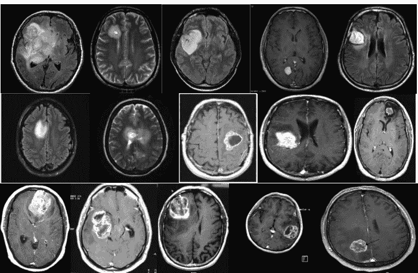

Fig. 1. Brain tumor MRI-images.
图1. 脑肿瘤MRI图像。

Various sources provide publicly available MRI datasets, which can be used for research and development:
各种来源提供可公开获取的MRI数据集，可用于研究和开发：

#### 公开可用数据库：

- The Cancer Imaging Archive (TCIA): TCIA offers an enormous collection of cancer-related medical images, including brain MRI scans with associated clinical data. It is widely used for research in medical image analysis [30].
- 癌症影像档案馆（TCIA）：TCIA提供大量与癌症相关的医学图像，包括带有相关临床数据的脑部MRI扫描。它广泛用于医学图像分析研究 [30]。

- Brain Tumor Segmentation Challenge (BraTS): The BraTS datasets are specifically designed for brain tumor segmentation tasks. They include multi-modal MRI scans (T1, T2, FLAIR, and T1Gd) and annotated tumor masks, providing a rich resource for training and evaluation [20].
- 脑肿瘤分割挑战（BraTS）：BraTS数据集专门针对脑肿瘤分割任务设计。它们包含多模态MRI扫描（T1、T2、FLAIR和T1Gd）及标注的肿瘤掩码，为训练和评估提供了丰富资源 [20]。

- Open Access Series of Imaging Studies (OASIS): OASIS provides a variety of MRI data, including scans from patients with Alzheimer's disease and other brain conditions. Although not specific to tumors, it can be useful for comparative studies [17].
- 开放获取影像研究系列（OASIS）：OASIS提供多种MRI数据，包括阿尔茨海默病及其他脑部疾病患者的扫描。尽管不特定于肿瘤，但它可用于比较研究 [17]。

- ADNI (Alzheimer’s Disease Neuroimaging Initiative): While primarily focused on Alzheimer's disease, ADNI offers extensive MRI datasets that can be valuable for research on brain structures and abnormalities [18].
- ADNI（阿尔茨海默病神经影像倡议）：尽管主要关注阿尔茨海默病，ADNI提供广泛的MRI数据集，可用于脑结构和异常研究 [18]。

- IXI Dataset: The IXI dataset includes MRI scans from healthy individuals and can be used for developing baseline models and normal brain structure analysis.
- IXI数据集：IXI数据集包含健康个体的MRI扫描，可用于开发基线模型和正常脑结构分析。

#### 医院与临床合作：

- Collaborating with hospitals and medical institutions can provide access to proprietary MRI datasets. These datasets are often more extensive and can include detailed clinical annotations.
- 与医院和医疗机构合作可以获取专有MRI数据集。这些数据集通常更为庞大，并可能包含详细的临床标注。

- Clinical collaborations also allow for the collection of diverse and representative data, which is crucial for developing robust and generalizable models.
- 临床合作还允许收集多样且具有代表性的数据，这对于开发强健且具有泛化能力的模型至关重要。

#### 研究联盟与倡议：

- Participation in research consortia and initiatives such as the Human Connectome Project (HCP) and the UK Biobank can provide access to large-scale MRI datasets. These initiatives aim to advance the understanding of brain structure and function through extensive data collection and sharing.
- 参与人类连接体计划（HCP）和英国生物银行（UK Biobank）等研究联盟和倡议，可以获取大规模MRI数据集。这些倡议旨在通过广泛的数据收集和共享来推进对脑结构和功能的理解。

#### 自定义数据收集：

- In some cases, researchers may collect their own MRI data. This involves working with radiologists and clinicians to scan patients and obtain the necessary imaging data, which can be tailored to specific research needs.
- 在某些情况下，研究人员可能会收集自己的MRI数据。这涉及与放射科医生和临床医生合作扫描患者并获取必要的影像数据，这些数据可以针对特定研究需求进行定制。

#### 伦理考量与数据隐私

When acquiring and using MRI datasets, it is essential to address ethical considerations and ensure data privacy. The following guidelines help in maintaining ethical standards and protecting patient information:
在获取和使用MRI数据集时，必须处理伦理考量并确保数据隐私。以下指南有助于维护伦理标准和保护患者信息：

##### 知情同意：

- Voluntary Participation: Patients should voluntarily participate in studies and understand the purpose of data collection. Informed consent must be obtained, explaining how their data will be used, stored, and shared.
- 自愿参与：患者应自愿参与研究并了解数据收集的目的。必须获得知情同意，说明其数据将如何被使用、存储和共享。

- Comprehensive Information: Consent forms should provide comprehensive information about the study, including potential risks, benefits, and measures taken to protect privacy.
- 全面信息：同意书应提供关于研究的全面信息，包括潜在风险、收益以及为保护隐私所采取的措施。

##### 匿名化与去标识化：

- Removal of Identifiable Information: MRI datasets must be anonymized by removing all personally identifiable information (PII) such as names, birth dates, and identification numbers.
- 移除可识别信息：MRI数据集必须通过去除所有个人可识别信息（PII），如姓名、出生日期和身份证号码，进行匿名化处理。

- De-identification Techniques: Use techniques like assigning unique codes or pseudonyms to datasets and removing metadata that could potentially reveal the identity of patients.
- 去标识化技术：使用为数据集分配唯一代码或化名以及移除可能揭示患者身份的元数据等技术。

##### 数据安全：

- Secure Storage: Store MRI datasets in secure environments with restricted access. Use encrypted storage solutions to protect data from unauthorized access.
- 安全存储：将MRI数据集存储在访问受限的安全环境中。使用加密存储解决方案保护数据免受未经授权的访问。

- Access Control: Implement strict access control policies to ensure that only authorized personnel can access the data. Maintain logs of data access and usage for auditing purposes.
- 访问控制：实施严格的访问控制策略，确保只有授权人员才能访问数据。维护数据访问和使用日志，以供审计。

##### 伦理审批：

- Institutional Review Board (IRB) Approval: Obtain ethical approval from an Institutional Review Board (IRB) or equivalent ethics committee before collecting or using MRI data. The IRB evaluates the study’s ethical implications and ensures compliance with relevant regulations [19].
- 机构审查委员会（IRB）批准：在收集或使用MRI数据之前，必须获得机构审查委员会（IRB）或同等伦理委员会的伦理批准。IRB评估研究的伦理影响并确保遵守相关法规 [19]。

- Ongoing Monitoring: Ensure ongoing monitoring and compliance with ethical standards throughout the research project. Address any ethical concerns promptly and transparently.
- 持续监测：确保在整个研究项目过程中持续监测和遵守伦理标准。及时、透明地处理任何伦理问题。

##### 数据共享与协作

- Data Sharing Agreements: When sharing data with collaborators, establish data sharing agreements that outline the terms of use, data protection measures, and responsibilities of each party.
- 数据共享协议：与合作者共享数据时，建立数据共享协议，明确使用条款、数据保护措施以及各方的责任。

- Transparency: Be transparent about data sources, data collection methods, and any potential conflicts of interest. Publish results and methodologies in a way that allows for reproducibility and peer review.
- 透明度：对数据来源、数据收集方法及任何潜在利益冲突保持透明。以允许可重复性和同行评审的方式发布结果和方法。

##### 法规遵从：

- HIPAA (Health Insurance Portability and Accountability) and GDPR (General Data Protection Regulation): Respect pertinent laws, such as the General Data Protection Regulation (GDPR) in the European Union and the Health Insurance Portability and Accountability Act (HIPAA) in the United States. By establishing guidelines for data security and privacy, these rules guarantee that patient data is sufficiently safeguarded.
- HIPAA（《健康保险可携性和责任法案》）和GDPR（《通用数据保护条例》）：尊重相关法律，例如欧盟的《通用数据保护条例》（GDPR）和美国的《健康保险可携性和责任法案》（HIPAA）。这些规则通过制定数据安全和隐私指南，确保患者数据得到充分保护。

Acquiring high-quality MRI datasets is crucial for developing effective CNN models for brain tumor prediction. Publicly available databases, hospital collaborations, research consortia, and custom data collection are common sources of MRI data. Ethical considerations and data privacy are paramount, requiring informed consent, anonymization, secure storage, ethical approval, and compliance with regulations. Adhering to these guidelines ensures the responsible use of MRI data and protects patient privacy, fostering trust and integrity in medical research.
获取高质量的MRI数据集对于开发有效的脑肿瘤预测CNN模型至关重要。公开可用数据库、医院合作、研究联盟和自定义数据收集是MRI数据的常见来源。伦理考量和数据隐私至上，需要知情同意、匿名化、安全存储、伦理审批和法规遵从。遵循这些指南可确保MRI数据的负责任使用并保护患者隐私，从而培养医学研究中的信任和诚信。

## 5. CNN模型设计与实现

### 5.1 模型架构设计

- Selection of layers and hyperparameters
- 层和超参数的选择

- Designing custom CNN architectures
- 设计自定义CNN架构

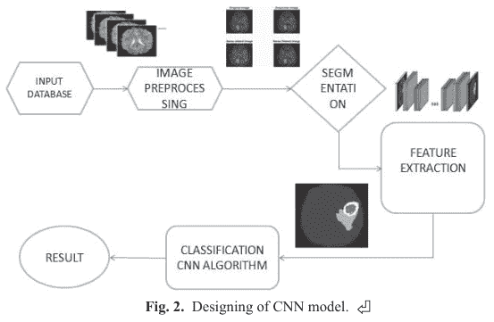

### 5.2 训练CNN模型

- Training protocols and batch processing
- 训练协议与批处理

- Overfitting and regularization techniques
- 过拟合与正则化技术

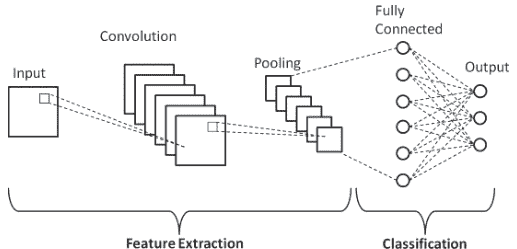

### 5.3 评估指标

- Accuracy, precision, recall
- 准确率、精确率、召回率

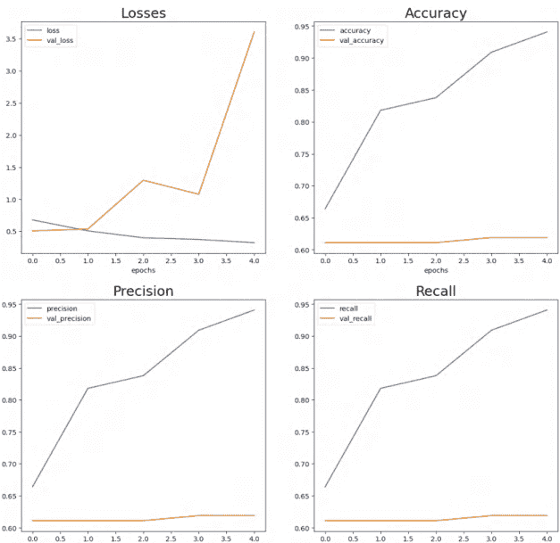


## 6. 实验结果

### 6.1 模型性能分析

- 定量结果和指标

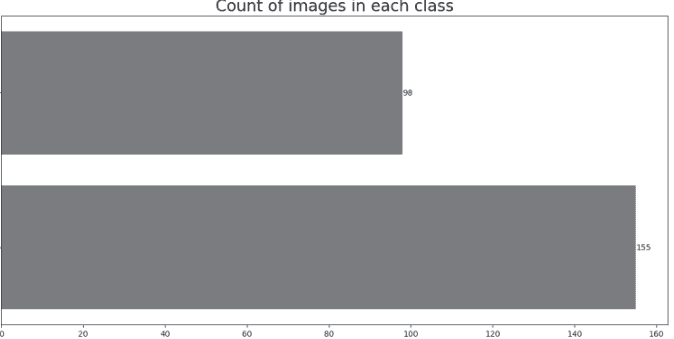

图 5. 图像数量。

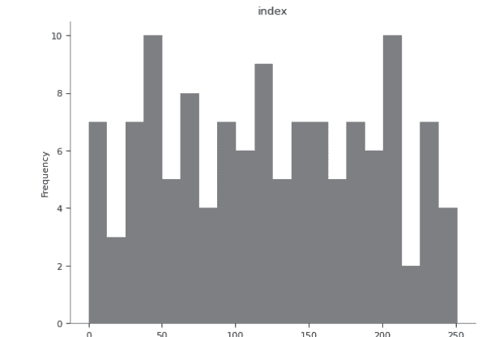

图 6. 图像分布。

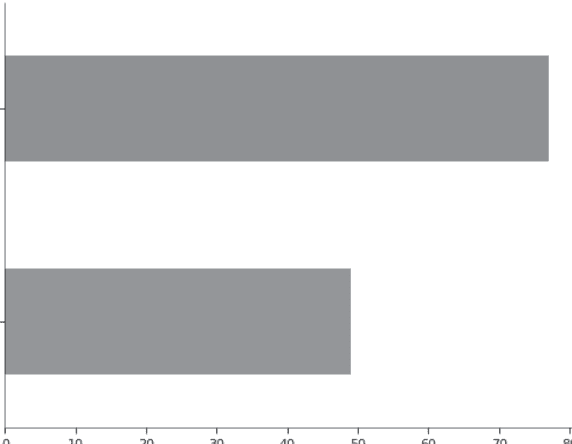

图 7. 类别分布。

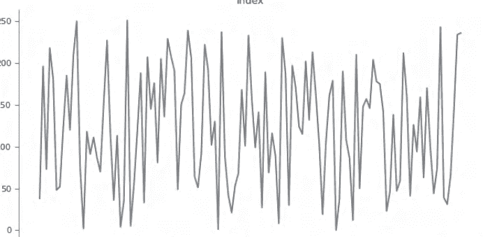

图 8. 数值。

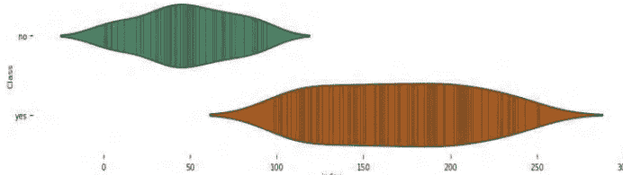

图 9. 分面分布。

### 6.2 案例研究

- 成功肿瘤预测示例
- 误分类分析

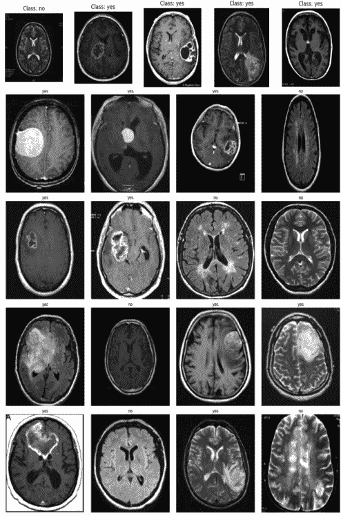

图 10. MRI 图像预测。

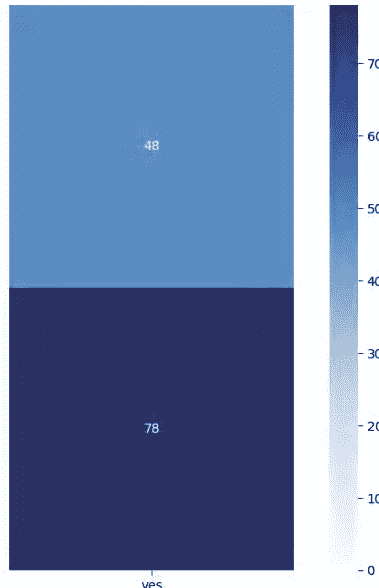

图 11. 预测标签。

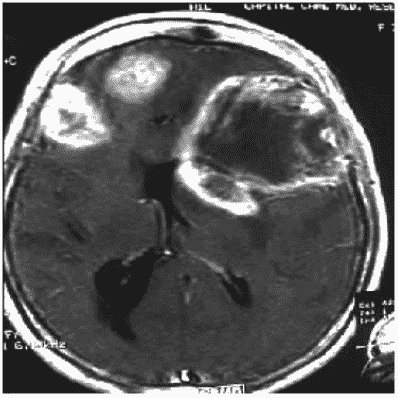

图 12. 预测标签：是，实际标签：是。

## 7. 讨论

### 7.1 结果解读

*模型性能的洞察*

使用 MRI 图像进行脑肿瘤检测的卷积神经网络（CNNs）展现出巨大的前景，这一点在多种实验中的高准确率、精确率、召回率和 AUC-ROC 指标中得到了体现 [21]。这些结果表明，CNN 可以有效地从 MRI 数据中学习和提取复杂模式，以相当高的准确率区分健康脑组织和肿瘤脑组织。CNN 的成功实施凸显了其自动化和增强诊断过程的能力，有可能减少对放射科医生手动解读的依赖并提高早期检出率 [22]。

模型性能的一个关键洞察是归一化、标准化和数据增强等数据预处理技术的影响。这些步骤被证明对提高模型的鲁棒性和泛化能力至关重要，凸显了为训练有效 CNN 准备高质量数据的重要性。此外，通过重采样技术和使用类别权重来处理类别不平衡问题，对于确保模型对少数类别（特别是罕见肿瘤类型）的敏感性至关重要，从而防止模型偏向多数类别。

*当前方法的局限性*

尽管结果令人期待，但为了充分发挥基于 CNN 的脑肿瘤检测的潜力，仍需解决若干局限性。

1. 数据限制：CNN 的性能在很大程度上取决于训练数据的质量和数量。大量标注的 MRI 数据集的可用性仍然是一个挑战，当模型应用于训练集中未包含的各种来源或人群的数据时，其性能可能会下降。

2. 计算资源：训练深度 CNN，尤其是 3D CNN，需要大量的计算能力和内存。这可能成为广泛采用的障碍，尤其是在资源有限的环境中。需要高效的训练技术和模型优化来缓解这些资源限制。

3. 可解释性：尽管 CNN 可以实现高准确率，但其决策过程往往不透明，在需要理解诊断依据的临床环境中构成了挑战。开发可解释的人工智能（AI）技术以在模型预测中提供透明度，对于赢得临床医生的信任并促进采用至关重要。

4. 泛化能力：模型对新的未见数据的泛化能力仍然是一个问题。在特定数据集上训练的模型在来自不同扫描仪、协议或患者人口统计学特征的数据上可能表现不佳。确保模型在多样化数据集上的鲁棒性对于可靠的临床应用是必要的。

5. 类别不平衡：虽然重采样和类别加权等技术有助于缓解类别不平衡问题，但它们并非万无一失。罕见肿瘤类型可能仍然代表性不足，导致模型预测中存在潜在偏差。持续努力收集并纳入多样化和有代表性的数据至关重要。

6. 临床集成：将 CNN 模型集成到现有的临床工作流程中面临实际挑战，包括与医院信息系统和放射学工作流程实现无缝互操作的需求 [24]。此外，通过严格的临床试验进行临床验证对于展示这些 AI 模型的现实世界疗效和安全性是必要的。

总而言之，虽然基于 MRI 图像的脑肿瘤检测 CNN 模型展现出巨大的前景并提供了宝贵的洞察，但解决数据空缺、资源估算、演示、泛化能力、类别不平衡和临床集成等局限性，对于推进其在医疗保健领域的开发和应用至关重要。这些考量将指导未来的研究和开发工作，以创建更强大、高效且具有临床可行性的 AI 驱动诊断工具。

### 7.2 与其他方法的比较

*CNN 与其他方法的优缺点*

卷积神经网络（CNN）由于能够自动从原始图像数据中学习和提取特征，已成为 MRI 图像脑肿瘤检测的热门选择。然而，将 CNN 与其他传统和当代方法进行比较以了解其相对优势和局限性至关重要。

#### CNN 的优势

**自动特征提取：**

- **优势：** 与依赖手工制作特征的传统机器学习方法不同，CNN 可以直接从输入数据中自动学习层次化特征。这减少了对领域特定知识和手动特征工程的需求。

- **示例：** 在基于 MRI 的肿瘤检测中，CNN 可以学习肿瘤形状、纹理和边界等复杂模式，而无需预定义特征。

**高准确率：**

- **优势：** CNN 在图像分类和检测任务中表现出卓越性能，通常比传统方法实现更高的准确率。

- **示例：** 研究表明，CNN 在脑肿瘤检测任务中可以胜过支持向量机（SVM）和 k 近邻（k-NN）等经典方法。

**可扩展性：**

- **优势：** CNN 架构可以通过添加更多层和参数来扩展，从而根据需要捕获更复杂的表示。

- **示例：** VGGNet、ResNet 和 Inception 等模型表明，增加深度和复杂性可以提高在大型和多样化数据集上的性能。

**适应性：**

- **优势：** CNN 可以通过迁移学习进行微调，使其能够适应数据有限的新任务。

- **示例：** 在 ImageNet 等大型数据集上预训练的 CNN 可以使用少量 MRI 图像针对脑肿瘤检测进行微调，利用先前学习的特征 [23]。

#### CNN 的劣势

**高计算成本：**

- **劣势：** 训练深度 CNN 需要大量的计算资源，包括强大的 GPU 和大容量内存。

- **示例：** ResNet 或 DenseNet 等模型的训练时间和硬件要求，对于没有高性能计算资源的中小型机构或研究团队来说可能是禁止性的。

**黑盒特性：**

- **劣势：** CNN 经常因缺乏可解释性而受到批评。理解这些模型的内部工作原理和决策过程可能具有挑战性。

- **示例：** 如果没有清晰的决策过程解释，临床医生可能很难信任和采用基于 CNN 的工具，这在医疗应用中至关重要。

**数据依赖性：**

- **劣势：** CNN 需要大量标注数据才能实现高性能。数据不足或不平衡可能导致过拟合和泛化能力差。

- **示例：** 为脑肿瘤检测获取和标注大型 MRI 数据集可能更加昂贵且非常耗时，限制了 CNN 在数据稀缺场景中的效果。

- **劣势：** 参数众多的 CNN 容易过拟合，尤其是在小型或噪声数据集上训练时。


- 示例：如果没有适当的正则化技术和数据增强，CNN 可能在测试和训练数据上表现良好，但无法推广到新的、未见过的 MRI 扫描中。

### 与其他方法的对比

#### 支持向量机（SVM）：

- **优势：**
  - 在高维空间和小数据集上有效。
  - 当维度数超过样本数时，SVM（支持向量机）不易过拟合。
- **劣势：**
  - 需要手动特征提取和选择。
  - 在大数据集和复杂特征空间中存在可扩展性问题。

#### k-近邻（k-NN）：

- **优势：**
  - 简单直观的算法，无训练阶段。
  - 对小数据集有效，且预测时计算强度较低 [25]。
- **劣势：**
  - 预测时处理大数据集需要大量内存和计算资源。
  - 性能高度依赖于距离度量的选择和 k 值。

#### 随机森林（RF）：

- **优势：**
  - 能够很好地处理混合数据类型，且对过拟合具有鲁棒性。
  - 提供特征重要性评分，有助于可解释性。
- **劣势：**
  - 需要手动特征工程。
  - 与 CNN 相比，对高维图像数据效果较差。

#### 逻辑回归：

- **优势：**
  - 简单且可解释的模型。
  - 训练快速，对中小型数据集效率高。
- **劣势：**
  - 对数据中复杂关系和交互作用的捕捉能力有限。
  - 需要手动特征选择和工程。

CNN 相较于传统机器学习方法具有多项优势，包括自动特征提取、高准确率、可扩展性和适应性。然而，它们也存在高计算成本、缺乏可解释性、数据依赖性以及易受过拟合影响等劣势 [26]。虽然 SVM、k-NN、随机森林和逻辑回归等传统方法各有优势，但它们通常需要手动特征工程，并且在处理复杂图像数据时表现可能不如 CNN。权衡 CNN 与其他方法的利弊，有助于为 MRI 图像中的脑肿瘤检测选择最合适的方法，从而促进更好的诊断工具和结果。

## 8. 未来方向与改进

基于 CNN 的脑肿瘤检测未来有望通过各种创新方法取得显著进展。一个有前景的方向是采用三维卷积神经网络（3D CNN），它能够更全面地分析体积 MRI 数据，从而可能提高肿瘤检测的准确性和表征能力。此外，通过在特定 MRI 数据集上微调预训练模型来利用迁移学习可以提升性能，尤其是在数据有限的情况下。多模态数据的整合，将 MRI 与其他成像方式和临床信息相结合，有望提供更全面、更准确的诊断方法 [27]。通过协作努力和数据共享计划增加数据集的规模和多样性，将进一步增强模型的鲁棒性和泛化能力。而且，实现可解释人工智能技术将确保这些先进模型具有透明度和可信度，促进其在临床实践中的整合，并帮助临床医生做出更明智的决策。这些未来方向和改进共同有可能彻底改变脑肿瘤检测，改善患者预后，并推动医学影像领域的发展。

## 9. 结论

本章介绍的研究强调了卷积神经网络（CNN）在使用 MRI 图像进行脑肿瘤检测领域的变革潜力。本研究的关键要点包括早期发现脑肿瘤对改善患者预后的重要性，以及 MRI 作为强大成像模态在此背景下的作用。对 CNN 架构（包括卷积层、池化层、全连接层和激活函数）的探讨，凸显了它们在从 MRI 图像中自动提取和学习复杂特征方面的有效性，从而实现准确的肿瘤预测。

此外，本章详细介绍了标准化、标准处理、图像调整大小和增强等基本预处理步骤，这些步骤在为 CNN 训练准备 MRI 数据中至关重要。还讨论了解决类别不平衡的技术，包括重采样、增强和使用类别权重，强调了它们在确保模型在所有类别中具有强大性能方面的重要性。

研究结果通过证明 CNN 可以提供一种可靠、非侵入式的脑肿瘤检测工具，从而可能提高诊断准确性并帮助及时制定治疗计划，对医学影像领域作出了重要贡献。这项研究还为未来的进步铺平了道路，例如融入 3D CNN、多模态数据融合以及利用更大、更多样的数据集。通过解决挑战并提出在医学影像中有效应用 CNN 的解决方案，本章有助于将先进的人工智能技术整合到临床实践中的持续努力，旨在改善患者护理和预后。

## 10. 最后想法

### 基于 CNN 的肿瘤检测的未来展望

基于 CNN 的肿瘤检测未来前景非常看好，多项潜在进步即将到来。一项重要进展是融入三维卷积神经网络（3D CNN），它能够更全面地分析来自 MRI 扫描的体积数据，从而可能改善脑肿瘤的检测与表征 [28]。此外，迁移学习的应用——即对大数据集上的预训练模型针对特定任务进行微调——可能提升肿瘤检测模型的效率和准确性，尤其是在数据有限的情况下。

另一个令人兴奋的方向是多模态数据的融合，将 MRI 与其他成像模态（如 CT 或 PET 扫描）相结合，并整合患者病史和基因组信息等临床数据。这种全面的方法可以提供更详细、更准确的诊断，捕捉肿瘤生物学和患者健康的不同方面。此外，计算能力的提升以及更复杂算法的发展将使训练更深层、更复杂的模型成为可能，推动 CNN 在医学影像领域所能实现的边界。

### 人工智能在医疗保健中的更广泛影响

人工智能（AI），特别是深度学习，在医疗保健中的更广泛影响是深远而广泛的。AI 有可能彻底改变医疗实践的各个方面，从诊断到治疗计划和个性化医疗。AI 快速且准确地分析大量数据的能力可以增强医疗专业人员的能力，从而实现更及时、更精确的诊断，如基于 CNN 的脑肿瘤检测所示。

此外，AI 可以帮助识别复杂数据集中人类临床医生可能无法察觉的模式和相关性，为疾病机制和潜在治疗靶点提供新的见解。在预测分析中，AI 可用于预测患者预后和疾病进展，从而实现主动和预防性的医疗措施。

在医疗保健中采用 AI 还承诺提高运营效率，通过自动化常规任务和简化工作流程来减轻医疗系统的负担。这可以让医疗专业人员将更多精力集中在患者护理和复杂的决策过程上。

然而，将 AI 整合到医疗保健中也面临需要解决的挑战，包括确保数据隐私和安全、解决伦理问题以及保持 AI 决策过程的透明度。同样重要的是，要促进 AI 研究人员、临床医生和政策制定者之间的跨学科合作，以确保 AI 技术在医疗保健中的成功实施和接受。

综上所述，基于 CNN 的肿瘤检测的进步以及 AI 在医疗保健中的更广泛应用，具有巨大的潜力来改变医疗实践，提高诊断准确性、患者预后和运营效率。随着研究和技术的不断发展，AI 将成为未来医疗保健不可或缺的工具，推动创新并改善全球范围内的患者护理。

## 致谢

我谨感谢莫尼卡·夏玛女士（Ms. Monika Sharma）和希瓦尼·特里维迪女士（Ms. Shivani Trivedi）在审阅草稿后提供的宝贵反馈，以及哈西迪·辛格·德夫女士（Ms. Harsiddhi Singh Dev）绘制图表。

## 参考文献

- [1] Khan, M. S. I., Rahman, A., Debnath, T., Karim, M. R., Nasir, M. K., Band, S. S. et al. (2022). 基于深度卷积神经网络的准确脑肿瘤检测. Computational and Structural Biotechnology Journal, 20: 4733–4745.
- [2] Irnak, E. (2021). 使用具有完全优化框架的深度卷积神经网络对脑肿瘤 MRI 图像进行多类分类. Iranian Journal of Science and Technology, Transactions of Electrical Engineering, 45(3): 1015–1036.
- [3] Iqbal, S., Ghani, M. U., Saba, T. and Rehman, A. (2018). 使用卷积神经网络 (CNN) 对多谱 MRI 中的脑肿瘤进行分割. Microscopy Research and Technique, 81(4): 419–427.
- [4] Pereira, S., Pinto, A., Alves, V. and Silva, C. A. (2016). 使用卷积神经网络对 MRI 图像中的脑肿瘤进行分割. IEEE Transactions on Medical Imaging, 35(5): 1240–1251.
- [5] Hossain, T., Shishir, F. S., Ashraf, M., Al Nasim, M. A. and Shah, F. M. (2019, May). 使用卷积神经网络进行脑肿瘤检测. pp. 1–6. In: 2019 第 1 届科学、工程和机器人技术国际会议 (ICASERT). IEEE.
- [6] Choudhury, C. L., Mahanty, C., Kumar, R. and Mishra, B. K. (2020, March). 使用卷积神经网络和深度神经网络进行脑肿瘤检测和分类. pp. 1–4. In: 2020 计算机科学、工程与应用国际会议 (ICCSEA). IEEE.
- [7] Abiwinanda, N., Hanif, M., Hesaputra, S. T., Handayani, A. and Mengko, T. R. (2019). 使用卷积神经网络进行脑肿瘤分类. pp. 183–189. In: 2018 年世界医学物理与生物医学工程大会：2018 年 6 月 3–8 日，捷克布拉格 (第 1 卷). Springer Singapore.
- [8] Samreen, A., Taha, A., Reddy, Y. and Sathish, P. (2020). 使用卷积神经网络进行脑肿瘤检测.
- [9] Pereira, S., Meier, R., Alves, V., Reyes, M. and Silva, C. A. (2018). 使用卷积神经网络和质量评估对 MRI 数据进行自动脑肿瘤分级. pp. 106–114. In: 医学图像计算应用中机器学习的理解与解释：首届国际研讨会，MLCN 2018，DLF 2018 和 iMIMIC 2018，联合举办


载于 MICCAI 2018, Granada, Spain, September 16–20, 2018, 论文集 1. Springer International Publishing.

- [10] Pathak, K., Pavthawala, M., Patel, N., Malek, D., Shah, V. 和 Vaidya, B. (2019年6月). 基于卷积神经网络的脑肿瘤分类. 第 128–132 页. 收录于: 2019 第 3 届电子、通信与航空航天技术国际会议 (ICECA). IEEE.

- [11] Thaha, M. M., Kumar, K. P. M., Murugan, B. S., Dhanasekeran, S., Vijayakarthick, P. 和 Selvi, A. S. (2019). MRI 图像中基于卷积神经网络的脑肿瘤分割. 医学系统杂志, 43: 1–10.

- [12] Latif, G., Iskandar, D. A., Alghazo, J. 和 Butt, M. M. (2021). 基于深度卷积神经网络特征的胶质瘤肿瘤检测脑 MR 图像分类. 当前医学影像, 17(1): 56–63.

- [13] Hussain, S., Anwar, S. M. 和 Majid, M. (2017年7月). 使用级联深度卷积神经网络的脑肿瘤分割. 第 1998–2001 页. 收录于: 2017 年 IEEE 工程医学与生物学学会第 39 届年度国际会议 (EMBC). IEEE.

- [14] Gull, S., Akbar, S. 和 Khan, H. U. (2021). 利用卷积神经网络通过磁共振图像自动检测脑肿瘤. 生物医学研究国际杂志, 2021(1): 3365043.

- [15] Bhandari, A., Koppen, J. 和 Azgarian, M. (2020). 用于脑肿瘤分割的卷积神经网络. 影像洞察, 11(1): 77.

- [16] Kuraparthi, S., Reddy, M. K., Sujatha, C. N., Valiveti, H., Dugginenci, C., Kollati, M. 等 (2021). 利用深度卷积神经网络对 MRI 图像进行脑肿瘤分类. 信号处理, 38(4).

- [17] Mzoughi, H., Njeh, I., Wali, A., Slima, M. B., BenHamida, A., Mhiri, C. 等 (2020). 用于 MRI 胶质瘤脑肿瘤分类的深度多尺度 3D 卷积神经网络 (CNN). 数字成像杂志, 33: 903–915.

- [18] Mengash, H. A. 和 Mahmoud, H. H. (2021). 利用卷积神经网络从运动校正 MRI 图像中对脑癌肿瘤进行分类. 计算机、材料与连续体, 68(2): 1551–1563.

- [19] Mruthyunjaya, M. 和 Mandala, S. K. (2024). 使用卷积神经网络和全卷积神经网络进行脑肿瘤识别. 收录于: MATEC Web of Conferences (第 392 卷, 第 01130 页). EDP Sciences.

- [20] Gómez-Guzmán, M. A., Jiménez-Beristain, L., García-Guerrero, E. E., López-Bonilla, O. R., Tamayo-Perez, U. J., Esqueda-Elizondo, J. J. 等 (2023). 利用卷积神经网络对磁共振成像中的脑肿瘤进行分类. 电子学, 12(4): 955.

- [21] Krishna, B., Vankdothu, R., Veeru, B. 和 Chaitanya, J. (2024). 在深度学习中使用全卷积神经网络进行脑肿瘤识别. 收录于: MATEC Web of Conferences (第 392 卷, 第 01129 页). EDP Sciences.

- [22] Raseed, Z., Ma, Y. K., Ullah, I., Ghadi, Y. Y., Khan, M. Z., Khan, M. A. 等 (2023). 利用图像增强和卷积神经网络技术从 MRI 中对脑肿瘤进行分类. 脑科学, 13(9): 1320.

- [23] Kermi, A., Mahmoudi, I. 和 Khadir, M. T. (2019). 使用 U-Net 的深度卷积神经网络用于多模态 MRI 体积中的自动脑肿瘤分割. 第 37–48 页. 收录于: Brainlesion: 胶质瘤、多发性硬化、中风和创伤性脑损伤：第 4 届国际研讨会, BrainLes 2018, 与 MICCAI 2018 同步举办, Granada, Spain, September 16, 2018, 修订精选论文, Part II 4. Springer International Publishing.

- [24] Abd-ElLah, M. K., Awad, A. I., Khalaf, A. A. 和 Hamed, H. F. (2018). 利用卷积神经网络从磁共振图像中实现两阶段多模型自动脑肿瘤诊断系统. EURASIP 图像与视频处理杂志, 2018(1): 1–10.

- [25] Singh, A. K. 和 Mishra, A. (2024年2月). 革新脑肿瘤诊断：利用卷积神经网络实现增强的预测和分类. 第 245–250 页. 收录于: 2024 IEEE 计算、电力与通信技术国际会议 (IC2PCT) (第 5 卷). IEEE.

- [26] Gull, S., Akbar, S. 和 Khan, H. U. (2021). 利用卷积神经网络通过磁共振图像自动检测脑肿瘤. 生物医学研究国际杂志, 2021(1): 3365043.

- [27] Mahjoubi, M. A., Hamida, S., Gannour, O. E., Cherradi, B., Abbassi, A. E. 和 Raihani, A. (2023). 利用卷积神经网络和磁共振成像改进多类脑肿瘤检测. 国际先进计算机科学与应用杂志, 14(3).

- [28] Anagun, Y. (2023). 利用深度卷积神经网络的智能脑肿瘤诊断系统. 多媒体工具与应用, 82(28): 44527–44553.

- [29] Ullah, F., Nadeem, M., Abrar, M., Al-Razgan, M., Alfakih, T., Amin, F. 等 (2023). 使用手工制作的卷积神经网络从 MRI 图像中分割脑肿瘤. 诊断学, 13(16): 2650.

- [30] Akinyelu, A. A., Zaccagna, F., Grist, J. T., Castelli, M. 和 Rundo, L. (2022). 基于机器学习、卷积神经网络、胶囊神经网络和视觉变换器的 MRI 脑肿瘤诊断：一项综述. 成像杂志, 8(8): 205.

# 癌症治疗中的纳米机器人
# 一种兼具优势与局限性的革命性精准医学

Ayush Ranjan,¹ Ayasha Malik² * 和 Ayush Kumar Singh¹

## 1. 引言

地球总人口约 82 亿，每年约有 970 万人死于癌症，原因是发现晚、治疗费用高、治疗痛苦或根本没有永久性治疗方法。医生每年遇到约 1750 万例病例，其中大多数病例导致患者死亡。发病率已上升 33%。癌症是导致人类死亡的第二大原因。癌症的主要原因是个人的生活方式，如酗酒、吸烟等习惯会导致个体体内致癌物的产生。

这些致癌物导致癌细胞的形成，引起细胞无控制地增殖，最初形成肿块并发展为良性肿瘤。其中一些肿瘤细胞具有恶性和转移性。这种转移特性导致患者体内出现无法治愈的癌症。这些细胞从一个癌变部位迁移到另一个部位，由于其血管生成特性，它们开始在新部位增殖，从而在身体的不同部位引发癌症。

一些癌细胞还具有伪装特性，使它们能够伪装成正常细胞。这使它们能够逃避检测并从一个位置迁移到另一个位置。尽管化疗、手术和放射治疗等癌症治疗技术取得了进展，但这些方法在实现完全癌症控制方面仍然不足。它们通常与严重的副作用相关，包括极度脱发、剧烈身体疼痛、永久性身体毁容，以及表 1 所示患者所经历的显著精神和社会困扰。考虑到这些局限性，本文提出了一种利用纳米机器人技术进行癌症治疗的综合科学方法。这一创新方法涉及创建专用纳米机器人，这些纳米机器人将由医疗专业人员引入患者体内。这些纳米机器人经过特殊设计，具有特定特性，使它们能够通过血液流向癌细胞并向其迁移。

| 年份 | 癌症死亡人数 (百万) |
| :--- | :--- |
| 2000 | 6 |
| 2002 | 6.7 |
| 2008 | 7.6 |
| 2012 | 8.2 |
| 2015 | 8.8 |
| 2017 | 9.6 |
| 2018 | 9.6 |
| 2020 | 10 |
| 2022 | 9.7 |

纳米机器人经过生物技术改造，能够在不损伤正常细胞的情况下选择性地摧毁癌细胞，从而减少现有疗法相关的不良反应。它们配备了专用传感器，可以识别人体细胞的结构。当注射到癌变区域附近时，这些传感器会检测到异常的外来细胞浓度。一旦识别，纳米机器人就会启动癌细胞的分解。此外，这些纳米机器人可以作为抗癌药物的载体，将药物专门释放到癌细胞，同时保护正常细胞。这种靶向方法尽量降低了健康细胞中药物毒性的风险 [1–5]，如图 1 所示，描绘了纳米机器人在血液中的流动。

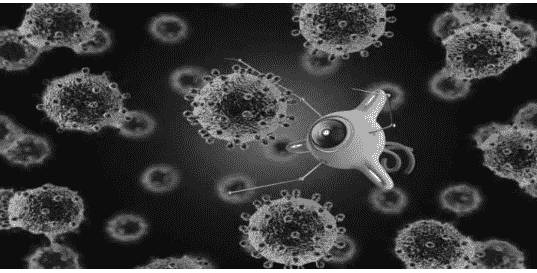


## 2. 癌症中的纳米机器人

Over the past few decades, there has been significant progress in cancer treatment, with innovations in surgical techniques playing a pivotal role. Among these, robotic-assisted surgery has emerged as a transformative method, offering superior control, precision, and flexibility compared to conventional surgical techniques. This section explores the current state of robotic cancer surgery, highlighting its benefits, limitations, and potential advancements.

过去几十年来，癌症治疗取得了重大进展，外科技术的创新发挥了关键作用。其中，机器人辅助手术已成为一种变革性方法，与传统外科技术相比，提供了更出色的控制、精度和灵活性。本节探讨了机器人癌症手术的现状，重点介绍了其优势、局限性及潜在改进。

### 2.1 Application in Various Cancer Types

### 2.1 在多种癌症类型中的应用

**Prostate Cancer:** Robotic-assisted laparoscopic prostatectomy is considered the gold standard for the surgical treatment of prostate cancer. The precision of robotic systems helps preserve neurovascular structures, leading to improved functional outcomes and a reduced risk of postoperative complications such as incontinence and erectile dysfunction [6].

**前列腺癌：** 机器人辅助腹腔镜前列腺切除术被认为是前列腺癌外科治疗的金标准。机器人系统的精度有助于保留神经血管结构，从而改善功能预后，并降低术后并发症（如尿失禁和勃起功能障碍）的风险 [6]。

**Gynecological Cancers:** Endometrial and ovarian cancers are now treated entirely differently thanks to robotic surgery. Because of its precise tumour resection and staging capabilities, which minimize the amount of disruption to the surrounding organs, patients can recuperate faster and have a higher quality of life.

**妇科癌症：** 由于机器人手术，子宫内膜癌和卵巢癌的治疗方式已完全不同。得益于其精确的肿瘤切除和分期能力，能够最大限度地减少对周围器官的干扰，患者可以更快恢复并拥有更高的生活质量。

**Colorectal Cancer:** Robotic-assisted resections for colorectal cancer offer improved visualization and precision. This is particularly useful in complex cases with intricate anatomy or advanced disease [7].

**结直肠癌：** 机器人辅助结直肠癌切除术提供了更好的可视化和精度。这在解剖结构复杂或疾病进展较晚的复杂病例中特别有用 [7]。

## 3. Mechanism of Nanorobots

## 3. 纳米机器人机制

We are developing a robotic cancer treatment whereby we will employ highly special and useful nanorobots to address blood mutations in cancer. Nanorobots function as angiogenesis inhibitors, fully engineered to decrease rapidly proliferating cells and promote patient recovery. The body is injected with nanorobots, which then operate on DNA and bodily cells [8].

我们正在开发一种机器人癌症治疗方案，将使用高度特殊且有用的纳米机器人来解决癌症中的血液突变。纳米机器人作为血管生成抑制剂，经过全面工程设计，旨在减少快速增殖的细胞并促进患者康复。将纳米机器人注入体内，它们随后作用于 DNA 和身体细胞 [8]。

### 3.1 Angiogenesis Inhibitor Functions

### 3.1 血管生成抑制剂功能

- Preventing the development of blood vessels that facilitate the growth of tumours.
- 防止促进肿瘤生长的血管发育。
- Interfering with different stages of blood vessel development.
- 干扰血管发育的不同阶段。
- Preventing new blood arteries from growing around tumours.
- 防止新的血管在肿瘤周围生长。
- Stopping cancers from spreading and growing further.
- 阻止癌症进一步扩散和生长。
- Binding to VEGF molecules, preventing them from stimulating blood vessel endothelial cells’ receptors.
- 与 VEGF 分子结合，防止它们刺激血管内皮细胞的受体。

### 3.2 Block Diagram of Nanorobots

### 3.2 纳米机器人框图

We can comprehend how nanorobots operate thanks to this block diagram. Understanding the idea of using nanorobots to treat cancer will be beneficial. Our goal is to better comprehend the mutation of rapidly proliferating cells during the cancerous phase by utilizing AI/ML technology. To provide a better course of treatment, it is analyzed that nucleic acid sensing plays a crucial role in tumour immunotherapy, gene therapies, and the use of genetically engineered immune cells or therapeutic nucleic acids to treat infectious illnesses and cancer. Nucleic acid sensing assists immune cells in triggering protective immune responses during tumour treatment [9]. Figure 2 shows the structure of nanorobots.

得益于这个框图，我们可以理解纳米机器人的工作原理。了解利用纳米机器人治疗癌症的概念将是有益的。我们的目标是通过利用 AI/ML 技术，更好地理解癌症阶段快速增殖细胞的突变。为了提供更好的治疗方案，分析表明核酸感知在肿瘤免疫疗法、基因疗法以及使用基因工程免疫细胞或治疗性核酸来治疗传染病和癌症方面发挥着关键作用。核酸感知帮助免疫细胞在肿瘤治疗期间触发保护性免疫反应 [9]。图 2 显示了纳米机器人的结构。

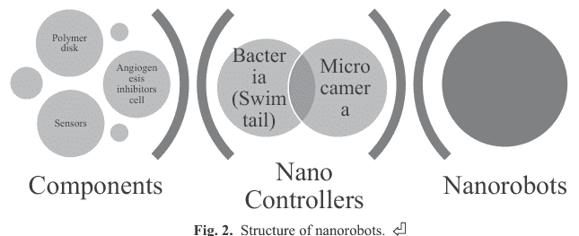

#### 3.2.1 Uses of Modules

#### 3.2.1 模块用途

**Nano Controller:** For nanorobots to work, nano controllers are essential. Key information on their use is as follows:

**纳米控制器：** 要使纳米机器人工作，纳米控制器是必不可少的。关于其用途的关键信息如下：

- **Precision and Efficiency:** Nano controllers aid nanorobots in medical applications by enabling them to navigate the human body and precisely deliver medications to specific cells or tissues. By doing this, adverse effects are reduced and treatment effectiveness is increased.

- **精度和效率：** 纳米控制器帮助纳米机器人在医疗应用中导航人体并精确地将药物递送到特定细胞或组织，从而减少副作用并提高治疗效果。

- **Autonomous Operation:** Nanorobots with sophisticated nano controllers may function independently, making choices based on data that is collected in real-time. This is especially helpful in settings where human assistance is impractical.

- **自主操作：** 配备先进纳米控制器的纳米机器人可以独立运行，并根据实时收集的数据做出决策。这在人工协助不切实际的环境中尤其有用。

- **Coordination and Control:** By connecting the sensors and actuators in nanorobots, nano controllers allow the robots to carry out intricate tasks. To regulate the behaviour of the nanorobot, they interpret data from sensors and carry out control algorithms [10].

- **协调与控制：** 通过连接纳米机器人中的传感器和执行器，纳米控制器使机器人能够执行复杂任务。它们解释传感器数据并执行控制算法来调节纳米机器人的行为 [10]。

**Polymer Disk:** In many applications, especially in the area of nanomedicine, polymer disks in nanorobots are essential. Here are a few crucial roles:

**聚合物盘：** 在许多应用中，尤其是在纳米医学领域，纳米机器人中的聚合物盘是必不可少的。以下是几个关键作用：

- **Drug Delivery:** Therapeutic medicines can be delivered to diseased cells directly and precisely by using polymer disks as drug reservoirs.

- **药物递送：** 可以将治疗药物直接且精确地递送到患病细胞，使用聚合物盘作为药物储库。

- **Functionalization:** They offer a platform for the attachment of further functionalization, such as imaging agents or targeting molecules, which facilitates more accurate therapy monitoring and targeting.

- **功能化：** 它们为连接进一步的功能化（如成像剂或靶向分子）提供平台，从而便于更精确的治疗监测和靶向。

- **Biocompatibility:** The biocompatibility of the polymers employed in these disks lowers the possibility of negative reactions when the body absorbs them [[11]].

- **生物相容性：** 这些盘中使用的聚合物的生物相容性降低了身体吸收时产生不良反应的可能性 [[11]]。

- **Structural Support:** By providing structural support, they help the nanorobots operate steadily and correctly at the nanoscale.

- **结构支持：** 通过提供结构支持，它们帮助纳米机器人在纳米尺度上稳定且正确地运行。

**Sensors:** An essential component of nanorobot operation is its sensors. Here are a few important applications for sensors in nanorobots:

**传感器：** 传感器是纳米机器人运行的关键组成部分。以下是纳米机器人中传感器的一些重要应用：

- **Feedback and Control:** Nanorobot control systems receive real-time feedback from sensors. Thanks to this feedback, the nanorobot can precisely and effectively operate by modifying its activities according to the present situation.

- **反馈与控制：** 纳米机器人控制系统从传感器接收实时反馈。得益于这种反馈，纳米机器人可以根据当前情况调整其活动，从而精确有效地运行。

- **Targeted Drug Delivery:** Nanorobots in medical applications can use sensors to pinpoint the precise location of sick cells. When a nanorobot is recognized, it can release medication just at the location, reducing side effects and enhancing the effectiveness of treatment [[12]].

- **靶向药物递送：** 医疗应用中的纳米机器人可以使用传感器精确定位患病细胞的位置。当识别到纳米机器人时，它可以就在该位置释放药物，减少副作用并提高治疗效果 [[12]]。

- **Environmental Monitoring:** Nanorobot sensors can be utilized for environmental monitoring applications outside medical ones. They assist in clearing contaminated regions and are capable of spotting pollutants or poisons in the surrounding air.

- **环境监测：** 纳米机器人传感器可用于医疗以外的环境监测应用。它们有助于清理受污染区域，并能检测周围空气中的污染物或毒素。

- **Detection of Specific Molecules:** Sensors in nanorobots can identify particular molecules or circumstances, including the existence of particular chemicals or biological indicators. This is especially helpful in medical applications, such as the detection of infections or the identification of cancer cells.

- **特定分子检测：** 纳米机器人中的传感器可以识别特定分子或情况，包括特定化学品或生物指标的存在。这在医疗应用中尤其有用，例如感染检测或癌细胞识别。

- **Movement and Navigation:** Sensors aid nanorobots in navigating through intricate settings, including the human body. By identifying barriers and modifying their route accordingly, individuals can make sure they arrive at their destination [[13]].

- **移动与导航：** 传感器帮助纳米机器人在复杂环境（包括人体）中导航。通过识别障碍并相应调整路径，可以确保它们到达目的地 [[13]]。

## 4. Mechanical Design of Nanorobots

## 4. 纳米机器人机械设计

A nanorobot consists of a flexible and very small size robotic device. Their diameter ranges from 1 to 5.5 microns, and they are made of molecular or nanoscale components. The parts can vary in size from 1 to 100 nanometers and are built at the nanoscale. The terms “nanorobotics” and “nanobot” are commonly used to describe devices that range in size from 0.5 to 15 micrometres. Because of their small size and the difficulty of their jobs, nanorobots require the use of various sophisticated approaches for control [[14]]. Typical techniques for manipulating nanorobots include the following:

纳米机器人由一个柔软且尺寸非常小的机器人装置组成。其直径范围为 1 至 5.5 微米，由分子或纳米尺度组件制成。部件尺寸可在 1 至 100 纳米之间变化，并在纳米尺度上构建。“纳米机器人学”和“纳米机器人”这两个术语常用于描述尺寸范围为 0.5 至 15 微米的设备。由于其尺寸小且工作困难，纳米机器人需要使用各种复杂的方法进行控制 [[14]]。操纵纳米机器人的典型技术包括以下内容：

**Electric Field:** By exerting forces that propel nanorobots in the correct directions, electric fields can be used to manipulate them. Microfluidic settings frequently employ this technique.

**电场：** 通过施加将纳米机器人推向正确方向的力，可以利用电场来操纵它们。微流体环境中经常采用这种技术。

**Chemical Signals:** By programming them to react to particular chemical signals in their surroundings, nanorobots can be made more intelligent. The ability to sense and react to changes in the chemical composition of their environment is one purpose for this technique.

**化学信号：** 通过对其进行编程以响应周围环境中的特定化学信号，可以使纳米机器人更加智能。感知并响应环境化学成分变化的能力是这种技术的一个目的。

**Magnetic Fields:** Magnetic materials-based or -containing nanorobots can be steered to precise sites by use of external magnetic fields. For focused medication delivery in medical applications, this technique is especially helpful. Very small-size robots are designed for treatment to reduce the side effects and time of chemotherapy [15].

**磁场：** 基于磁性材料或包含磁性材料的纳米机器人可以通过外部磁场引导到精确位置。这种技术在医疗应用中的靶向药物递送中特别有用。非常小尺寸的机器人专为治疗而设计，以减少化疗的副作用和时间 [15]。

**Acoustic Waves:** Nanorobots can also be controlled by sound waves. Through manipulation of the wave’s frequency and amplitude, nanorobots can be made to move or carry out specified activities.

**声波：** 纳米机器人也可以通过声波控制。通过操纵声波的频率和振幅，可以使纳米机器人移动或执行指定活动。

### 4.1 Anatomical Consideration of Nanorobots

### 4.1 纳米机器人的解剖学考量

The tiny size and sophisticated functions of nanorobots need many anatomical concerns in their design and use, particularly in the biomedical domain. These are some salient and important points as shown in Table 2:

纳米机器人微小的尺寸和复杂的功能在其设计和使用中需要许多解剖学考量，特别是在生物医学领域。表 2 显示了其中一些重要要点：

**Material Composition:** The materials used to build nanorobots must have a non-toxic and biocompatible nature. Common materials that offer strength and inertness are carbon-based compounds like diamond and fullerene nanocomposites [16].

**材料组成：** 用于构建纳米机器人的材料必须具有无毒和生物相容性。提供强度和惰性的常见材料是碳基化合物，如金刚石和富里烯纳米复合材料 [16]。

**Dimensions:** Usually with a diameter of less than one micrometre, nanorobots can take on a variety of forms, including spheres, helices, rods, and more intricate

**尺寸：** 纳米机器人通常直径小于一微米，可以采用多种形式，包括球体、螺旋体、棒状体以及更复杂的

Table 2. Components needed for the treatment of cancerous cells.

表 2. 治疗癌细胞所需的组件。

| Components | Role | Working Point |
|---|---|---|
| Polymer Disk | In the area of nanomedicine, polymer disks in nanorobots are essential. Here are a few crucial roles:<br>• Drug Delivery<br>• Functionalization<br>• Biocompatibility<br>• Structural Support | At the time of contact of the nanorobots at surface of the cancerous cell. |
| Sensors | An essential component of nanorobot operation is its sensors. Here are a few important applications for sensors in nanorobots:<br>• Feedback and Control.<br>• Targeted Drug Delivery<br>• Environmental Monitoring<br>• Detection of Specific Molecules<br>• Movement and Navigation | Guiding the bot for its proper attachment at the surface of the cancerous cell. |
| Micro Camera | Its main role is of collecting all the visual data at the time of disintegration of the cancer cells. | When the disintegration of the cancerous cell is going on for the monitoring of Bots. |
| Modified DNA | The artificially cultured DNA which has the property of alteration of the cancer cell DNA for its degradation. | At the core of the cancer cell where the molecular arrangement is available. |

| 组件 | 角色 | 工作点 |
|---|---|---|
| Polymer Disk | 在纳米医学领域，纳米机器人中的聚合物盘至关重要。以下是几个关键作用：<br>• 药物递送<br>• 功能化<br>• 生物相容性<br>• 结构支持 | 纳米机器人接触癌细胞表面时。 |
| Sensors | 传感器是纳米机器人运行的关键组成部分。以下是纳米机器人中传感器的一些重要应用：<br>• 反馈与控制<br>• 靶向药物递送<br>• 环境监测<br>• 特定分子检测<br>• 移动与导航 | 引导机器人正确附着在癌细胞表面。 |
| Micro Camera | 其主要作用是在癌细胞分解过程中收集所有可视数据。 | 在癌细胞分解过程中，用于监测机器人。 |
| Modified DNA | 经过人工培养的 DNA，具有改变癌细胞 DNA 以使其降解的特性。 | 在癌细胞核心处，此时可用分子排列。 |


结构。由于它们的移动能力和穿越生物环境的能力，其尺寸和形状至关重要。

- **能源：** 运行时，纳米机器人需要稳定的能源供应。通过利用磁场、光或其他外部动力，它们可以从环境中获取能量或自行产生动力。

- **推进机制：** 化学过程、磁场、光或超声是纳米机器人前进的一些方式。根据纳米机器人的预期用途和操作环境来选择推进机制。

- **传感器：** 纳米传感器和执行器是纳米机器人所具有的功能，使它们能够感知并响应环境。某些功能，如药物给药、细胞内手术和生物传感，需要这些组件 [17]。

## 4.2 无线设计

无线设计对于纳米机器人来说是一个引人入胜且快速发展的课题。以下是几个关键要素：

- **推进与运动控制：** 可以使用多种技术（包括磁场、光、超声和化学梯度）来远程推进和控制纳米机器人。利用这些技术，可以精确控制纳米机器人在不同环境中的运动和方向。

- **通信：** 纳米机器人采用纳米级通信技术进行无线通信。这可以包括使用光或无线电波的电磁通信，或使用分子传输信息的分子通信。

- **感知与驱动：** 纳米机器人配备了纳米级传感器和执行器，用于感知并作用于刺激。控制系统可以从传感器接收信息，这些传感器能识别特定信号或情况，例如特定化学物质的存在。执行器能够执行多种任务，包括运动、药物释放和结构改变。

- **应用：** 纳米机器人无线设计有多种用途，例如远程感知、非侵入性手术、靶向药物输送和环境监测 [18]。

### 4.3 成本与预算

纳米机器人（又称纳米机器人，nanobots）是一项尖端技术，正在改变癌症的治疗方式。然而，其成本和预算仍然未知。这些微型机器专为在纳米尺度上运行而设计，有望实现高度靶向且有效的药物治疗。然而，在癌症治疗中创建和应用纳米机器人伴随着巨大的财务成本。本分析将全面审查与使用纳米机器人治疗癌症相关的诸多开支和财务因素，涵盖制造、研发、临床试验及未来预估。在创建可治疗癌症的纳米机器人时，研发是最关键且最昂贵的阶段。此阶段包括多个步骤：

- **基础研究：** 为构建纳米机器人的基本组件并理解纳米技术原理，基础研究是必要的。在此阶段，大学、研究中心和商业企业经常合作。费用可能从几十万美元到几百万美元不等，具体取决于研究的范围和规模。例如，在一所著名大学，单个研究项目的年度成本可能在 $500,000 至 $200 万美元之间 [19]。

- **医学试验：** 开发用于癌症治疗的纳米机器人，进行临床试验是必不可少的一部分。在纳米机器人获准普遍使用之前，这些测试是验证其有效性和安全性所必需的。临床试验可能费用高昂：
  - **I 期试验：** 这些初步研究的目的是在有限的患者人群中评估纳米机器人的安全性。I 期试验费用可能在 $100 万美元至 $1000 万美元之间。
  - **II 期试验：** 这些研究旨在评估纳米机器人的有效性，并涉及更多患者。II 期试验费用可能在 $1000 万美元至 $2000 万美元之间。
  - **III 期试验：** 这些大规模试验涉及数百至数千名患者，旨在验证纳米机器人的疗效并监测其副作用。III 期试验费用可能在 $2000 万美元至 $1 亿美元之间 [20]。

- **未来展望：** 未来几年预计将出现重大突破，表明纳米机器人在癌症治疗中的应用前景广阔。包括纳米机器人在内的纳米技术市场预计将从 2022 年的 $106.3 亿美元增长到 2030 年的 $314.0 亿美元。这也表明纳米机器人技术前景光明，投资趋势强劲。

- **我们的概念成本：** 我们设计的纳米机器人单位成本将在 35 至 65 美元之间；这是初始成本，随着生产单位数量的增加，成本将降低。整个过程的成本将在 1.5k 至 2.5k 美元之间，这将通过促进更快愈合和减少疼痛来惠及患者。创建纳米机器人最昂贵的部分是建立制造工厂。因此，我们纳米机器人在癌症治疗中的有效性只能通过测试来估算 [21]。

## 5 纳米机器人：医疗宇宙中的福音

纳米机器人基本上是人工设计的尺寸为纳米级的机器人。它旨在利用其在癌症治疗不同操作领域中的优势，这些优势通过常规的癌症药物治疗过程（即化疗、手术、放疗和免疫疗法）难以轻易实现。癌症治疗有多种现有技术：虽然尚未发现永久治愈方法，但现有技术效果并不理想，因为它们对患者术后生活都有巨大影响。所有这些现有技术对患者身体都有大量副作用。它影响人们的社会和情感方面。有时在某些人身上，这可能导致抑郁 [22]。

### 5.1 现有技术的缺点

我们了解到，每种现有技术在治疗期间和之后对患者身体都有其自身非常强大的副作用。治疗的所有副作用都源于其化学取向或治疗的操作方式。每种技术都有其副作用的原因，而且即使接受相同的治疗，不同患者的情况也不同。副作用取决于给予患者的治疗类型。下面列出了部分治疗方法及其副作用和原因。

#### 5.1.1 化疗

化疗是通过给药（含有强效化学物质的药物）来杀死快速增殖的癌细胞的癌症治疗方法。由于这些细胞表现出快速且无控制的增殖，因此会使用不同的药物来抑制这种生长和血管生成 [23]。在化疗中，药物通过静脉注射、口服药物、注射、药片和乳膏等多种方式引入患者体内。给药方式和频率取决于癌症分期和诊断。给药后，药物针对癌细胞生命周期的特定阶段。这些药物与癌细胞相互作用，在细胞内释放其活性成分，并在周期的特定阶段摧毁它们。科学家设计这些药物以在癌细胞生命周期的精确时刻攻击它们。然而，这种方法的一个主要局限是药物无法区分正常细胞和癌细胞。正常细胞（也会增殖）在治疗过程中会受到影响，尽管它们比癌细胞愈合得更快。尽管如此，正常细胞缺乏癌细胞的突变特性，导致严重的附带损害 [24]。化疗还与严重的副作用相关，包括食欲不振、口腔溃疡、便秘、出血、肺损伤、二次癌症风险、不孕和神经损伤。

#### 5.1.2 手术

手术涉及切除和移除检测到癌细胞存在的身体部位。这种治疗通常用于外部癌症。医生团队使用专业工具，如手术刀和其他精密仪器，来切除肿瘤。主要目标是通过开刀仅切除肿瘤。然而，如果肿瘤已扩散到更大的区域且无法完全切除，则截除受影响的身体部位成为最终选择。这种方法主要用于治疗良性肿瘤，这类肿瘤保持局部化在一个区域。然而，它对恶性肿瘤无效，因为这些肿瘤并不局限于单一位置。恶性细胞通过

血液中，扩散到身体的其他部位并在那里增殖 [25]。该方法的主要局限性包括剧烈疼痛、感染风险、永久残疾、情绪困扰和抑郁。

#### 5.1.3 Radiotherapy

放射治疗，也称为放射疗法，是一种利用高强度能量束破坏癌细胞的癌症治疗方法。该疗法主要使用X射线，尽管也可能使用光子粒子 [26]。该过程涉及在肿瘤细胞附近放置一个小型固体植入物。该植入物产生辐射，损伤肿瘤细胞的遗传物质，最终根除肿瘤。该过程始于MRI等扫描成像，以准确定位肿瘤。随后使用直线加速器产生X射线，轰击癌细胞，导致其破坏。然而，放射治疗的一个重大缺点是，使用X射线也会损伤周围的健康细胞。这种损伤可能导致健康细胞突变，从而可能引发新癌症的发生。此外，长期暴露于X射线下会对治疗医疗专业人员构成风险，他们也可能因辐射暴露而患癌 [27]。放射治疗的其他局限性包括脱发（有时是永久性的）、呼吸短促、唾液增稠和性功能障碍。

### 5.2 Replacement with Nanorobots

纳米机器人是人工设计的纳米级结构，以其高度通用性和仿生特性而闻名。这些属性使其成为优于现有癌症治疗方法的替代方案。尽管纳米机器人不能保证完全根除癌症，但它们提供了一种高度靶向的方法来摧毁癌细胞，与传统治疗相比，副作用最少或没有副作用。在过去几十年中，纳米技术已被广泛应用于通信和环境技术等领域。在医学科学中，它主要用于药物输送。所提方法涉及将纳米机器人注入患者的血液中，在那里，其DNA改变特性使它们能够通过改变癌细胞的分子代谢来攻击癌细胞并将其彻底摧毁 [28]。纳米机器人的主要优势在于它们能够仅针对癌细胞而不伤害正常细胞。不同于会以显著比例损伤正常人体细胞的化疗，纳米机器人仅关注癌细胞。这种选择性靶向减少了化疗中常见的附带损伤，例如食欲不振和其他并发症。这会在患者体内产生不同的医学问题。

## 6. Major Advantages of the Nanobots

### Similarity with human cells

这些机器人被制造成纳米级尺寸，很可能与人类细胞的大小相似。因此，人体可以轻松地与这些机器人相互作用，而不会导致患者身体排斥。这些机器人非常小，以至于它们能与人类血细胞混合，通过血液流动并到达目标癌细胞。这些机器人是患者DNA的载体，这种细胞具有血管生成和造血的特性，因此借助这些特性，它可以通过传感器和执行器检测到细胞大规模增殖的位置。在该位置，它检测增殖的细胞是正常细胞还是突变细胞，并将其摄入的药物在生物分子水平上摧毁癌细胞 [29]。

### No Re-cancer

众所周知，癌症治疗通常涉及使用强效药物，以确保患者体内每一丝癌细胞都被根除。然而，这些药物在化疗或放疗过程中会扩散到全身，甚至到达指尖等最小的细胞。这种广泛暴露会导致剧烈的身体疼痛、食欲不振和明显的脱发。此外，强烈的辐射有时会引发新癌细胞的发生，使这些方法在治疗中并非理想。相比之下，使用纳米机器人提供了一种靶向方法。这些纳米机器人特异性地靶向突变癌细胞并将其摧毁，而不干扰正常细胞的功能或增殖。通过改变癌细胞的DNA，纳米机器人有效地消除它们而不伤害健康细胞，解决了传统治疗的一个主要缺点 [30]。

### Easy operable

现有的癌症治疗需要大量准备，包括适当的设施、先进设备、合格医生的处方、医疗专业人员团队以及药物或放射设备。严格遵循逐步操作程序对于给药或放射至关重要，任何偏差都可能导致严重并发症甚至患者死亡。相比之下，纳米机器人由合格的生物技术工程师在经过严格测试和实验后，在高度无菌环境中开发。它们经过生物化学工程设计，可携带预编程的DNA或药物，从而无需庞大团队或复杂设备来进行给药。医生的处方和一名训练有素的医疗专业人员即可足以将纳米机器人静脉注射到患者体内。由于这些纳米机器人采用人工智能和机器学习（ML）技术设计，其活动和进展可以通过屏幕或数字设备进行监测，极大地简化了治疗过程 [31]。

### No side effects as of Chemotherapies

化疗对患者健康有许多毁灭性的副作用，包括严重的皮肤问题、脱发、食欲不振、肝脏损伤、肾脏损伤、心血管并发症，以及在某些情况下，癌症复发。此外，从化疗引起的状况中恢复往往具有挑战性。相比之下，纳米机器人通过特异性靶向癌细胞而不伤害正常细胞来最大限度地降低此类风险。这种靶向作用可防止食欲不振、脱发和重要器官受损。此外，纳米机器人可降低癌症复发的风险。虽然这不是永久性治愈方法，但该方法相较于传统方法有显著改进，并提高了患者的生存率，使其成为更有利的治疗选择 [32]。

### Regular access to reports

研究表明，纳米机器人采用编程、人工智能、机器学习、传感器和执行器等先进技术制造。这些进步使得对纳米机器人活动的持续监测成为可能。嵌入机器人内部的AI芯片有助于实时跟踪操作，机器人性能的详细摘要会直接发送给负责的医生。该系统允许持续监测患者的稳定性以及纳米机器人摧毁癌细胞的疗效。医生可以快速识别患者状况的任何变化，并相应地规划干预措施，从而减少工作量并提高治疗的精确性 [33–35]。

## 7. Limitation of Nanorobots

在研究过程中，我们对基因工程机器人遇到的局限性很少，因为我们在操作肿瘤细胞的DNA以直接在分子水平上摧毁肿瘤。药物的使用也非常少，这是导致患者体内中毒并引起巨大副作用的主要原因。尽管我们遇到了一些局限性，但显然在某些层面上它无法操作，其作用将是负面的。它必须在患者体内操作，且未知身体将如何反应。经过研究，遇到的一些局限性如下，这些局限性仅在患者的极端条件下有效：

- **药物耐药性：** 癌细胞具有进化能力。当第一轮纳米机器人与这些细胞相互作用时，癌细胞可能会产生耐药性，类似于它们对常规药物的反应。这种耐药性可能会阻止纳米机器人将基因改造的DNA有效转移到癌细胞中。

- **输送：** 在所有局限性中，有一个局限性是将机器人输送到患者体内。众所周知，人类血液的黏度很高，这导致机器人移动到达癌细胞位置时出现问题。

- **复杂性：** 纳米机器人的开发高度复杂，需要尖端技术和经验丰富的工程师。纳米机器人设计或编程中的微小错误可能导致灾难性后果，包括患者死亡。此外，生产的高度复杂性导致成本升高。此外，还需要一个专门团队来培训医疗专业人员掌握这项技术，进一步增加资源需求。尽管存在这些局限性，但预计随着技术的进步，这些挑战将随着时间的推移得到解决，降低成本并提高纳米机器人在癌症治疗中的部署实用性 [36, 38]。

## 8. Conclusion

我们正在为癌症患者开发一种基于纳米机器人的机器人癌症治疗方法，该方法有助于更快速且可能挽救生命的癌症治疗。此外，我们提出了一种理念，将加速在癌症初期消除突变细胞。为了找到合适的行动方案，我们还利用人工智能和机器学习概念来调查原因


癌症及其突变模式。我们通过研究发现了一种方法，可以减轻化疗极其危险的副作用。对于癌症患者，我们部署纳米机器人而不是化疗。通过产生抗体，纳米机器人有助于减少体内快速增殖的细胞。接受化疗的患者中，近一半的人报告至少有一种副作用。因此，我们准备用纳米机器人取代化疗来治疗患者，因为这将有助于更自由地治疗癌症患者，减轻化疗的副作用，并确保患者在治疗期间感到良好和安心。此外，对癌症患者数据的先前检查将支持改善护理，并帮助发现抗击癌症的新策略。纳米机器人还将帮助拯救某人的生命，为他们的家庭带来幸福。未来模型将从医学角度设计以证明研究的合理性，为全球癌症患者提供更好、更可及的治疗。

## 参考文献

- [1] Gobinath, A., Rajeswari, P., Kumar, S. N. and Anandan, M. (2025). 医疗保健中的量子机器人：创新与应用. pp. 211–225. In: *量子演进*. CRC Press.
- [2] Bagade, O. and Sampathi, S. (2024). 纳米药物递送系统的修复与维持：潜力、挑战与局限性. pp. 105–139. In: *生物系统、生物医学与药物递送系统：表征、修复与优化*. Singapore: Springer Nature Singapore.
- [3] Khoushab, S., Aghmimini M. H., Esfandiar, N., Sarvandani, M. R. R., Rashid, M., Taheriazam, A. et al. (2024). 解锁癌症研究中外泌体的潜力：诊断、治疗和预防的范式转变. *病理学—研究与实践*, 155214.
- [4] Alzoubi, L., AlJabali, A. A. and Tambuwala, M. M. (2023). 赋能精准医学：3D 打印对个体化治疗的影响. *AAPS PharmSciTech*, 24(8): 228.
- [5] Malik, A., Parihar, V., Bhushan, B., Srivastava, J. and Karim, L. (2023). 基于人工智能的 React 应用程序（由对话式 ALAN-AI 语音助手提供支持）. In: Sharma, D. K., Peng, S. L., Sharma, R. and Jeon, G. (eds.). 微电子与电信工程：网络与系统讲义, vol 617. Springer, Singapore. https://doi.org/10.1007/978-981-19-9512-5_47.
- [6] Rajendran, S., Sundararajan, P., Awasthi, A. and Rajendran, S. (2024). 医学中的纳米机器人学：以细胞治疗、微创手术和药物递送为重点的进展、挑战与未来展望系统性综述. *精准纳米医学*, 7(1): 1221–1232.
- [7] Sarrella, P. N. K., Vipparthi, A. K., Valluri, S., Vegi, S. and Vendi, V. K. (2024). 纳米机器人学：制药领域药物递送与开发的先驱.
- [8] Nistor, M. T. and Rusu, A. G. (2019). 具有医学应用的纳米机器人. pp. 123–149. In: *纳米治疗中的聚合物纳米材料*. Elsevier.
- [9] Hassan, S. A., Almaliki, M. N., Hussein, Z. A., Albehadili, H. M., Banoon, S. R., Al-Abbodi, A. et al. (2023). 人工智能驱动的纳米技术发展：全面综述. *纳米结构期刊*, 13(4): 915–932.
- [10] Verma, A., Sharma, P. K. and Singh, A. (2024). 纳米医学：通过精准医学、诊疗一体化和未来前沿变革医疗保健. *用于药物递送的脂质载体*, 111.
- [11] Adir, O., Poley, M., Chen, G., Froim, S., Krinsky, N., Shklovor, J. et al. (2020). 整合人工智能与纳米技术用于精准癌症医学. *先进材料*, 32(13): 1901989.
- [12] Sun, T., Chen, J., Zhang, J., Zhao, Z., Zhao, Y., Sun, J. et al. (2024). 微/纳米机器人在医学中的应用. *生物工程与生物技术前沿*, 12: 1347312.
- [13] Chathha, G. M., Arshad, S., Kamal, Y., Chathha, M. A., Asim, M. H., Raza, S. A. et al. (2023). 纳米机器人：基于 DNA 的癌症治疗创新方法. *药物递送科学与技术期刊*, 80: 104173.
- Li, M., Xi, N., Wang, Y. and Liu, L. (2020). 推动生物医学发展的纳米机器人学进展. IEEE 生物医学工程学报, 68(1): 130–147.
- [14] Malik, A., Parihar, V., Srivastava, J., Kaur, H. and Abidin, S. (2023). 基于机器学习算法的糖尿病预后. pp. 1466–1472. 2023 年第 10 届可持续全球发展计算国际会议 (INDIACom), 新德里, 印度, 2023.
- [15] Orozco, J. (2023). 精准医学背景下的纳米科学、纳米技术和颠覆性技术. 哥伦比亚精确、物理和自然科学学院杂志, 47(183): 221–241.
- [16] Preetam, S., Pritam, P., Mishra, R., Lata, S., Rustagi, S. and Malik, S. (2024). 赋能未来医学：重新定义生物医学应用的能量驱动型微/纳米机器人. 分子系统设计与工程.
- [17] Kumar, V. and Malik, A. (2023), 基于机器学习的心脏病预测. DTC 计算智能期刊, Vol-1, Issue-2, https://ici.delhitechnicalcampus.ac.in/wp-content/uploads/2022/12/DTCIJCI-4.pdf.
- [18] Lu, W., Yao, J., Zhu, X. and Qi, Y. (2021). 纳米药物：重新定义传统医学. 生物医学与药物治疗, 134: 111103.
- [19] Deng, Y., Zhou, C., Fu, L., Huang, X., Liu, Z., Zhao, J. et al. (2023). 纳米技术在革新骨科手术中新兴作用的小型综述：挑战与未来之路. 生物工程与生物技术前沿, 11: 1191509.
- [20] Malik, A., Parihar, V., Purohit, K., Bahalul Haque, A. K. M., Sharma, N. and Bhattacharya, P. (2024). 用于智能医疗 4.0 应用的物联网与大数据分析. In: Tavares, J. M. R. S., Pal, S., Georgiannis, V. C. and Hung, B. T. (eds.). 第二届智能系统国际会议论文集. ICIS 2023. 智能系统算法. Springer, Singapore. https://doi.org/10.1007/978-981-99-8976-8_39.
- [21] Rajendran, S., Sundararajan, P., Awasthi, A. and Rajendran, S. (2023). 医学中的纳米机器人：进展、挑战与未来展望系统性综述. arXiv 预印本 arXiv:2309.10881.
- [22] Mishbahurroyan, N., Winarno, N. F. R., Nafis, S. I., Valdino, Y. and Listyorini, N. (2023). 靶向药物递送系统中的纳米机器人——总体综述. Liaison J. Eng. 3: 13–27.
- [23] Malik, A., Parihar, V., Bhawna, Bhushan, B. and Karim, L. (2023). 赋能万物人工智能（AIoT）以迈向智能医疗系统. In: Bhushan, B., Sangaiah, A. K. and Nguyen, T. N. (eds.). 物联网系统中基于区块链的智能网络 AI 模型. 工程物理系统与关键基础设施, vol 6. Springer, Cham. https://doi.org/10.1007/978-3-031-31952-5_6.
- [24] Estrela, V. V., Intorne, A. C., Batista, K. K., Deshpande, A., Sroufer, R., Lopes, R. T. et al. (2023). 医疗保健中的纳米技术、纳米物联网和纳米机器人学——人人共享纳米. pp. 259–278. In: 智能医疗系统. CRC Press.
- [25] Malik, A., Bhushan, B., Parihar, V., Karim, L. and Cengiz, K. (2023). 基于区块链的智能电子医疗系统：优势、应用案例与未来研究方向. In: Ahad, M. A., Casalino, G. and Bhushan, B. (eds.). 可持续智慧城市中有效规划与管理的赋能技术. Springer, Cham. https://doi.org/10.1007/978-3-031-22922-0_8.
- [26] Mohammadi, A. T., Mokhtari, M., Nouri, M., Noori, F., Mollaie, F., Hosseinishirkosh, E. et al. (2024). 纳米医学释放潜力：应用纳米技术检测、输送和击败癌症. 诺贝尔科学.
- [27] Albulel, D., Florea, D. A., Boarca, B., Ditu, L. M., Chifiriuc, M. C., Grumezescu, A. M. et al. (2017). 用于个体化医学的纳米技术：癌症研究、诊断与治疗. pp. 1–21. In: 癌症治疗纳米结构. Elsevier.
- [28] Blau, R., Krivitsky, A., Epshtein, Y. and Satchi-Fainaro, R. (2016). 基于纳米诊疗一体化和纳米诊断的药物递送是否是通往精准医学的垫脚石？. 药物耐药性更新, 27: 39–5.
- [29] Hessane, A., Youssef, A., Farhaoui, Y., Aghoutane, B., Ait Ali, N. and Malik, A. (2022). 基于协同过滤技术、机器学习和深度推荐的医疗数据分析与医疗应用中医疗服务提供者推荐系统（第 1 版）. CRC Press. https://doi.org/10.1201/9781003226147.


[30] Cicceks, H. (2023). 基于纳米医学的脑肿瘤与年龄相关神经退行性疾病治疗：优势与局限。肿瘤科学趋势国际期刊，27–32。

[31] Malik, A., Yadav, N., Srivastava, J., Obaid, A. and Saracevic, M. (2022). 医药行业中的区块链：具有架构与开放挑战的更佳药物追踪。医疗保健应用中的区块链技术。CRC出版社，https://doi.org/10.1201/9781003224075。

[32] Abbaoui, W., Retal, S., El Bhirí, B., Kharmoum, N. and Ziti, S. (2024). 迈向革新精准医疗：精准医疗中人工智能方法的系统文献综述。医学信息学解锁，101475。

[33] Tiwari, D., Kumar, A., Akash, A., Agarwal, K., Sharma, A. and Singh, T. (2024年2月). 基于脑电波的智能机器学习算法脑健康状况诊断。第117–123页。收录于2024年IEEE计算、电力与通信技术国际会议（IC2PCT）（第5卷）。IEEE。

[34] Tiwari, S., Singh, S. and Tiwari, D. (2024年3月). 预测心血管疾病的比较策略：深入分析解读。第981–985页。收录于2024年第2届颠覆性技术国际会议（ICDT）。IEEE。

[35] Singh S., Tiwari, S., Goel, P. and Tiwari, D. (2023年3月). 回顾：基于集成机器学习算法的先兆流产探索之旅。第1–7页。收录于2023年第6届信息系统与计算机网络国际会议（ISCON）。IEEE。

[36] Tiwari, D., Bhati, B. S., Al-Turjman, F. and Nagpal, B. (2022). 大流行性冠状病毒病（Covid-19）：基于机器学习技术的全球影响分析与预测。专家系统，39(3): e12714。

[37] ABDOLLAHZADEH, H., Peepels, T. and Shahcheraghi, M. (2024). 寡核苷酸药物递送系统中的DNA纳米技术：癌症治疗中生物纳米机器人的前景。Feng, A. (2023). 纳米技术及其在癌症治疗和诊断中的作用。科学、工程与技术亮点，36: 1051–1061。

[38] Tiwari, D. and Bhati, B. S. (2021). 印度Covid-19深度分析与预测：采用集成回归方法。针对COVID-19的人工智能与机器学习，97–109。

# 第11章

# 连续血糖监测的可解释人工智能方法：面临的各种挑战与未来研究方向

Kritant Kumar,¹ Ayasha Malik²,* and Chadi Al-Turjman³

## 1. 引言

Who doesn’t like binge eating, and among them who won’t like to crave sweet things?
谁不喜欢暴饮暴食？而在其中，又有谁不会渴望甜食呢？

But this sweetness brings with it a lot of danger. Most of the products available in the market today must have added sugar in it or else how the dopamine will release in the human who is consuming it and then how it will be made sure that the same person comes back again and again to buy that product. If sales do not increase, then how the companies will earn profit? Even the spiciest of products have added sugar in their. Although this menace of added sugar is one of the major factors which contribute to diabetes, but it is not the sole reason. Many other factors like genetics, medication, sleep patterns, and stress levels also influence glucose levels in the body as they directly or indirectly influence the production and usage of insulin. This insulin is the main player whenever the topic is diabetes as this same hormone regulates glucose levels in the body and if not taken care of at the right time can lead to hyperglycaemia, which will further lead to degradation and erosion of several body parts and their associated working. The current statistics are alarming and the future is bleak as almost half a billion humanity is suffering from this menace and one can’t see the end of this problem either [1].

但这种甜味也带来了诸多危险。当今市场上绝大多数产品都必须添加糖分，否则，消费者体内又如何释放多巴胺，又如何确保同一个人一次又一次地回购该产品？如果销售额不上升，公司又如何盈利？即使是最辛辣的产品中也添加了糖分。虽然添加糖是导致糖尿病的主要因素之一，但并非唯一原因。遗传、药物、睡眠模式和压力水平等许多其他因素也会影响体内的葡萄糖水平，因为它们直接或间接地影响胰岛素的产生和使用。每当谈及糖尿病，胰岛素都是主角，因为这种激素调节体内的葡萄糖水平，如果不及时护理，可能导致高血糖症，进而引发多个身体部位及其相关功能的退化与损耗。当前的统计数据令人震惊，未来也十分黯淡，因为近五亿人正遭受这种祸害，而且人们看不到这个问题的尽头 [1]。

Only precautionary measures from the population’s side (as added sugar products might never be banned) and proper treatment are the way forward in combating diabetes. Timely detection of diabetes plays a crucial role in controlling the disease from its onset. If left unchecked, diabetes can cause complications in various bodily functions and, more critically, lead to the destruction of an individual’s immune system. If symptoms such as frequent urination or unexpected weight loss are observed, immediate medical consultation is advised to check for diabetes. While not severe initially, diabetes is often diagnosed around the age of 40, by which time it may already be too late to prevent irreversible complications. Alarmingly, approximately 12% of deaths among the adult population are attributed to diabetes. Other contributing factors to this disease include poor diet, physical inactivity, and excessive weight, which, when combined, often result in further complications such as heart problems and kidney failure. The medical fraternity has long been concerned with detecting sugar in a person’s body. Historically, this involved methods such as manually tasting urine or observing the attraction of ants to a patient’s urine. Over time, diagnostic techniques evolved from urine testing to blood testing, providing more accurate and reliable results, facilitating earlier diagnosis and treatment of diabetes. However, blood testing posed challenges in cases requiring continuous glucose monitoring due to its invasive nature. To address this, advancements were made with the integration of Machine Learning (ML) and artificial intelligence (AI). These technologies were incorporated into wearable devices, enabling patients to monitor their glucose levels continuously and non-invasively. While these innovations raised privacy concerns and required extensive data for accuracy, they also introduced Explainable Artificial Intelligence (XAI). The purpose of XAI was to explain, as comprehensively as possible, the processes and methods used in a patient’s treatment. This transparency fostered greater trust in these systems and enabled more personalised treatment, considering individual differences in lifestyle, diet, and physical activity. Since no two individuals have identical lifestyles, XAI provided tailored approaches for effective disease management. Despite current challenges, the future of XAI appears promising, and its widespread adoption is anticipated. However, ethical considerations must be addressed, alongside efforts to make these technologies more accessible and affordable, ensuring that everyone can benefit from their advancements [2, 3].

只有民众方面的预防措施（添加糖产品可能永远不会被禁止）以及适当的治疗，才是抗击糖尿病的出路。及时检测糖尿病在控制疾病发生发展中起着至关重要的作用。如果置之不理，糖尿病可能导致各种身体功能出现并发症，更严重的是，会导致个体免疫系统的破坏。如果出现尿频或意外体重减轻等症状，建议立即就医检查糖尿病。虽然糖尿病初期可能不严重，但通常在40岁左右被诊断出来，届时可能已经为时过晚，无法预防不可逆转的并发症。令人震惊的是，约12%的成年人死亡归因于糖尿病。导致该疾病的其他因素包括饮食不良、缺乏体力活动和体重过重，这些因素叠加在一起，常常导致心脏问题和肾衰竭等进一步并发症。医学界长期以来一直关注检测人体内的糖分。历史上，这涉及手动尝尿液或观察蚂蚁对患者尿液的吸引力等方法。随着时间的推移，诊断技术从尿液检测演变为血液检测，提供了更准确可靠的结果，促进了糖尿病更早的诊断和治疗。然而，由于其创伤性，血液检测在需要持续血糖监测的情况下面临挑战。为解决这一问题，通过整合机器学习（ML）和人工智能（AI）取得了进步。这些技术被集成到可穿戴设备中，使患者能够持续且非侵入式地监测血糖水平。尽管这些创新引发了隐私问题，并且为了准确性需要大量数据，但它们也引入了可解释人工智能（XAI）。XAI的目的是尽可能全面地解释患者治疗中使用的流程和方法。这种透明度增强了人们对这些系统的信任，并能够考虑到生活方式、饮食和身体活动等个体差异，实现更个性化的治疗。由于没有两个个体拥有完全相同的生活方式，XAI为有效疾病管理提供了定制化方法。尽管存在当前挑战，XAI的未来前景看好，且预计将得到广泛应用。但是，必须解决伦理问题，并致力于使这些技术更具可及性和可负担性，确保每个人都能从其进步中受益 [2, 3]。

## 2. 血糖监测方法的演进

Blood Glucose level monitoring or Blood Sugar level monitoring is basically a way wherein we measure the fluctuations of glucose (sugar) levels in our body. The glucose level in the body can vary in response to various factors like that of diet, exercise and medications already prescribed to a person. If a certain range of glucose level is not maintained or if it drops down or shoots up to unexpectedly low or high measures, respectively, then it will lead to a life-threatening situation which can be both short term or can have effects which last till the last breath.

血糖水平监测或血糖监测，基本上是一种测量体内葡萄糖（糖）水平波动的方法。体内葡萄糖水平会因饮食、运动以及已处方给个人的药物等多种因素而变化。如果不能维持某个范围的葡萄糖水平，或者血糖分别意外降至过低或升至过高，则会导致危及生命的情况，这种情况可能是短期的，也可能持续到生命终点。

The condition associated with such irregularities is commonly known as diabetes, and monitoring glucose levels aims to control it to allow individuals to lead healthy lives and avoid complications such as heart attacks. Monitoring requirements vary depending on the severity of the condition. For mild cases, finger-pricking methods, performed intermittently, suffice to measure glucose levels. In many cases, insulin therapy is also adequate. For severe cases, however, continuous blood glucose monitoring becomes necessary. This practice, introduced in the late 20th century, initially faced numerous complications. Over the years, advancements in technology significantly improved its reliability, reducing associated risks to almost negligible levels. Despite its effectiveness, continuous monitoring remains expensive, making it inaccessible to individuals without health insurance or financial support. Consequently, many rely on affordable yet less effective methods to monitor their glucose levels. While recent advancements in invasive monitoring methods have enhanced accuracy and safety, the financial burden persists. In low- and middle-income countries, the situation is exacerbated by large populations, making it challenging for governments to subsidise or provide such facilities widely. Indigenous populations and ethnic minorities, often excluded due to socio-economic disparities, face even greater difficulties in accessing basic healthcare facilities. For these marginalised groups, a lack of government outreach and persistent socio-economic challenges leaves them disproportionately affected by diabetes and its complications [4].

与这种不规律相关的状况通常被称为糖尿病，监测血糖水平旨在控制糖尿病，使个人能够过上健康的生活，并避免心脏病发作等并发症。监测需求因病情严重程度而异。对于轻症患者，间歇性进行的指尖采血方法足以测量血糖水平。在许多情况下，胰岛素治疗也足够。然而，对于重症患者，持续血糖监测就变得必要。这种做法引入于20世纪末，最初面临诸多并发症。多年来，技术的进步显著提高了其可靠性，将相关风险降低到几乎可以忽略的水平。尽管有效，持续监测仍然昂贵，使得没有健康保险或经济支持的个人无法负担。因此，许多人依赖价格实惠但效果较差的方法来监测血糖水平。尽管近期侵入式监测方法的进步提高了准确性和安全性，但经济负担依然存在。在低收入和中等收入国家，大规模人口使情况恶化，使得政府难以广泛补贴或提供此类设施。土著居民和民族少数群体常因社会经济差异被排除在外，在获取基本医疗设施方面面临更大困难。对于这些边缘群体而言，缺乏政府外联服务和持续的社会经济挑战，使他们不成比例地受到糖尿病及其并发症的影响 [4]。

### 2.1 中世纪与尿检法

Even before the concept of diabetes or glucose levels in the body was well understood, medical professionals in the Middle Ages studied urine samples to identify underlying health issues. During this period, blood extraction was not a feasible option due to the lack of precise incision techniques, which often led to infections. As a result, urine analysis became the most practical method for diagnosing problems. The doctors of that time developed a method known as uroscopy, which involved visually examining urine stored in a specially designed flask called a _matula_. Through careful visual inspection, physicians could identify hormonal imbalances and determine the appropriate treatments or diagnostic steps needed to address the underlying issues.

即使在对糖尿病或体内葡萄糖水平的概念尚未充分理解之前，中世纪的医疗专业人员就研究尿液样本以识别潜在的健康问题。在此期间，由于缺乏精确切口技术，血液抽取并非可行的选择，这往往会导致感染。因此，尿液分析成为诊断问题最实际的方法。那时的医生发展了一种称为尿检法的方法，即视觉检查储存在特制烧瓶（称为 _matula_）中的尿液。通过仔细的视觉检查，医师可以识别激素失衡，并确定解决潜在问题所需的适当治疗或诊断步骤。

As the need to measure glucose levels in the body arose, techniques were developed that involved tasting and smelling urine, in addition to its visual analysis. Physicians created urine wheels and flowcharts as standard references for estimating glucose levels. This practice dates back to around 1500 BCE in ancient Egypt when health issues in the general population began to receive serious attention from professionals. A peculiar problem was observed where individuals experienced sudden weight loss and frequent urination. These observations prompted further study of urine, and experiments revealed that some samples attracted ants. Additionally, evaporating certain urine samples left behind solid sugar crystals with unique viscosity properties. These findings laid the groundwork for future advancements in diabetes detection and management [5, 6].

随着测量体内葡萄糖水平需求的出现，除了视觉分析外，还发展出了尝味和闻气味尿液的技术。医师制作了尿液轮和流程图，作为估算血糖水平的标准参考。这种做法可以追溯到公元前1500年左右的古埃及，当时普通人群的健康问题开始受到专业人士的重视。观察到一种奇怪的问题，即个体出现体重突然减轻和频繁排尿。这些观察促使对尿液的进一步研究，实验发现一些样本会吸引蚂蚁。此外，蒸发某些尿液样本后会留下具有独特黏度特性的固体糖晶体。这些发现为未来糖尿病检测和管理的进步奠定了基础 [5, 6]。

### 2.2 现代尿液检测

Advancements in medical science led to significant progress in understanding diabetes, and by 1670, the term _diabetes mellitus_ was coined to describe the condition

医学科学的进步使人们对糖尿病的理解取得了重大进展，到1670年，_糖尿病_一词被创造出来用来描述这种状况


以含糖尿液为特征。1776年，一位英国医生发现糖尿病患者的尿液含糖，将其确立为关键诊断参数。然而，也有人认识到，含糖尿液并不总是意味着糖尿病，因为其他潜在问题也可能是原因。19世纪，出现了第一种用于检测尿液中糖分的临床测试，涉及对尿液样本进行酸水解。然而，这些早期方法不准确、低效且不可靠。到20世纪，本尼迪克特试剂和克利尼试验起泡片等更精细的技术大大提高了准确性和可靠性，从而实现了更好的诊断能力。克利尼试验进一步改进，促成了Acetest的开发，最终发展出了尿液试纸。

到20世纪中叶，尿液试纸成为一种标准诊断工具。这些试纸配有用于比较结果的颜色图表，可以检测蛋白质、酮体和葡萄糖等多种物质。尽管有这些进步，尿液检测仍有几种局限性。例如，强氧化剂的存在可能导致假阳性，且这些方法无法检测低血糖。尽管如此，尿液检测仍然是那些不愿接受侵入性血液检测的人的宝贵选择，提供了一种更便宜、更简单的替代方案 [7]。

### 2.3 血液检测的出现

尽管尿液检测具有历史意义，但其固有的局限性常常阻碍糖尿病的及时诊断和治疗。这些缺陷有时会导致漏诊，在严重情况下甚至会导致致命后果。因此，血液检测作为一种替代诊断方法应运而生。与尿液不同，血液不会自然排出体外，必须使用注射器或在皮肤上切口进行提取。早期葡萄糖血液检测需要大量血液，且结果缓慢且往往不准确。该过程可能需要超过一分钟才能得出结果，过量抽血还会对患者造成额外的健康风险。意识到这些问题后，研究人员致力于开发侵入性更小、所需血液样本量更小、同时提高结果速度和准确性的方法。血糖检测的改进带来了重大进步，特别是对于因严重糖尿病需要频繁监测的患者。早期像Dextrostix这样的工具需要大量血液，但现代葡萄糖试纸只需要微量血液。这一创新使危重患者能够定期监测其血糖水平。传统的标准颜色图表比较已被数字血糖仪取代，这些设备可根据其复杂程度和成本提供近乎即时的结果。尽管血液检测因其价格实惠和普及性而仍被广泛使用，但其侵入性限制了其在连续血糖监测中的应用。为解决这一局限性，正在开发利用先进传感器的无创技术。这些方法更适合连续监测，因为血液采样无法提供同等程度的便利性和一致性。血糖监测的发展持续改善糖尿病管理，为患者提供更可靠、更友好的解决方案 [8, 9]。

### 2.4 人工智能时代

除血液检测外，还出现了几种其他方法，每种方法都带来独特功能并检测不同的生物指标。例如，HbA1c测试可测量两到三个月的平均血糖水平，与即时血糖检查相比提供了更广阔的视角。此外，泪液、汗液和唾液等间质液也被用于探索血糖水平检测。

尽管有这些进步，但在人工智能（AI）出现之前，连续血糖监测一直是一个重大挑战，AI是迄今为止最具颠覆性的技术创新。最初，AI应用集中在技术相关领域，但其巨大潜力促使其融入各个领域，随着时间的推移，医学领域成为其主要受益者之一。

AI已通过在必要测量期间佩戴在身上（通常是手腕上的）可穿戴设备融入血糖水平监测。这些设备配备了可实时测量血糖水平的传感器。与胰岛素水平相关的数据通过无线系统传输到智能手机或智能手表等数字设备。这种集成使患者能够自我监测血糖水平并及时采取行动，而无需不断依赖医疗监督，因为生活的其他方面也需要关注。

虽然即使是像Apple这样的行业领导者也尚未开发出专门用于血糖监测的智能手表，但AI的进步表明，此类创新成为现实只是时间问题。一旦实现，这一发展将彻底改变血糖监测，大幅降低成本，使得发展中国家的低收入人群也能负担得起这项技术 [10]。

#### 2.4.1 为什么需要XAI？

使用AI固然不错，但随之而来的伦理影响和隐私问题又如何呢？并非每个人都愿意将自己的健康数据提供给这些所谓的AI赋能公司。然而，AI依赖大量数据集来改进其功能，从而提供更准确、更高效的结果。为应对这些挑战并建立信任，可解释人工智能（XAI）应运而生。XAI作为一个框架，用于澄清使用AI的影响和后果，帮助个人了解其数据是如何被使用和处理的。如此一来，它能缓解不适感并增强数据共享的信心。XAI采用一系列工具和方法来实现透明度和建立信任的目标，因此在医疗保健领域尤为宝贵，因为信任是整个系统的基础。通过XAI，患者可以更好地理解其数据在AI驱动的医疗分析中的作用，鼓励他们在使用集成AI的血糖监测设备时共享数据。一旦启用，这些数据可以被AI分析，提供可操作的见解，指导患者管理血糖水平并避免严重并发症。XAI培养的信任也增强了机器学习（ML）模型的可靠性，因为患者可以提出问题并获得关于分析过程的详细解释。虽然实施XAI涉及选择合适的方法并有效地向患者传达结果——这些任务本身也面临挑战——但医疗保健行业在此方面已取得重大进展，并现在采用稳健的框架来实现这一目的 [11, 12]。

## 3. CGM的XAI方法

“数十亿人，数十亿种心态，数十亿种偏好”——这句格言影响着医学领域的许多决策。有些人愿意分享数据并为进一步改进做出贡献，而许多人反对，认为任何类型的个人数据都不应该出现在任何人都能看到的公共领域。因此，对于后一类人群，需要制定诸如可解释AI之类的东西，其唯一目的是清晰地解释共享数据所涉及的影响，而且最重要的是，如前所述，治疗的一般程序适用于许多人，但在许多情况下需要提供个性化治疗，为此XAI登场了，因为它几乎可以完美地实现这一目的 [13]。此外，表1展示了相关领域进行的各项研究。

| 技术 | 算法 | 数据类型 | 总体准确率 | 备注 |
| :--- | :--- | :--- | :--- | :--- |
| Ahamed et al. [14]. | LR, XGB, GBC, DT, RF, LGBM | 表格数据 | 75.2% 83.3% 94.1% 94.4% 94.8% 95.2% | 使用特征选择从现有数据中评估糖尿病。 |
| Kulkarni et al. [15]. | XGB | 心电图数据 | 96.8% | 该研究仅限于糖尿病的早期检测。 |
| Islam et al. [16]. | NB, DT, GBC | 表格数据 | 86.1% 96.8% 91.0% | 通过特征选择，从现有表格数据中预测糖尿病。 |
| Saha and Saha [17]. | RCT | 实时血液样本数据 | 95.0% | 该方法具有侵入性，需要频繁采血（指尖刺血）。 |
| Zhou et al. [18]. | NB, J48, LR, RF | 用于实时数据的物联网和嵌入式系统 | 84.1% 99.7% 86.0% 99.6% | 该方法具有侵入性，需要采血（指尖刺血）。 |

在当今时代，人们最需要的是隐私。对于年轻或成年人群体，照顾自己的健康并不太困难，但对于老年人，需要提供护理，在大多数情况下，医疗专业人员的监控是必需的。但他们中的隐私担忧也在上升


而且，他们完全不希望这些专业人员随时出现在身边。通过使用可解释人工智能方法来测量血糖水平，可以解决这个问题。

在XAI方法中，一种非常适合需要个性化治疗场景的方法是采用SHAP方法，即SHapley加法解释。它关联了多种可视化选项，有助于轻松匹配监测后获得的血糖水平数值。由于XAI的唯一目的是解释所使用的模型以及如何得出结果或结论，因此使用SHAP以非常便捷的方式为相关用户执行相同的任务，特别是考虑到其解释完全透明，这将自动建立信任。现在，它还能够提供个性化治疗，因为每个人与糖尿病相关的因素都不同，因此以一种对两个因素给出相同结果的方式使用模型可能是明智的。每个因素都会关联不同的测量标准，因为显然没有两个人会有相同的饮食摄入量和相同的身体活动量。如果该模型预测某人的血糖水平偏低、偏高或平均，那么提供给不同人群的解释将因每个人相关的不同因素而有所不同。此外，如果水平被预测为“低”但实际上是“高”，那么需要清楚地查明导致这一意外升高的原因，提供的诊断也会有所不同 [19]。此外，图1中显示了SHAP的示例值。

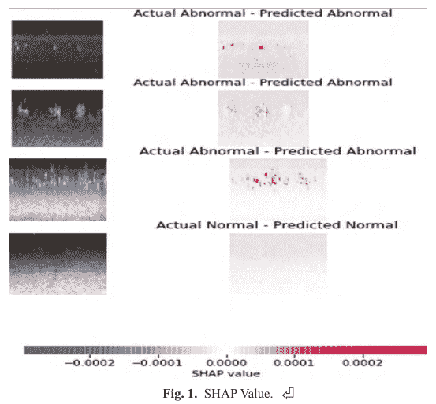

### 3.2 局部可解释模型无关解释（LIME）

许多AI算法内部都有复杂的底层流程，遵循这些流程执行任务直到完成，即它们在“黑箱”内运行。既然是可解释人工智能，就需要提供解释，但即使是这种解释也可以以多种形式给出，可以是复杂的也可以是简单的。但由于我们知道这些解释应当本质上是简单的，即使这种简单也可能因情况而异，并因相关人员的不同类型而异。因此，所做的是采用LIME方法，它试图以解释的形式提供信息，以便在本地提供给相关人员，这也有助于为相关人员提供个性化治疗和诊断。相关人员应能够全局地解释它。其余的事情，例如对每个个体的各种因素的依赖，与可解释人工智能中的SHAP方法相同。这种方法几乎像怀孕中的代孕方法，所做的近似应该使所开发的模型易于解释。这种方法的主要优点，使其成为一种万能型方法，是它可以应用于用于测量血糖水平的设备中使用的任何机器学习模型 [20]。图2以简单的可视化总结了以上所有内容。

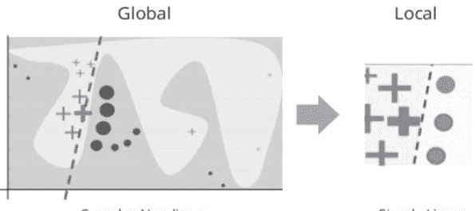

**图2.** AI盒子。

### 3.3 特征重要性分析

正如名称所示，这是一个评估所有特征的过程，然后决定哪些特征对正在接受治疗的人更有益，随后更频繁地使用这些特征。换句话说，这种分析特征的方法增强了相关人员的决策能力，其最终目标是获得适合其需求的个性化特征，而这种方法以非常优雅的方式实现了这一目标。然后根据XAI规范向客户解释更可取的特征，这进一步增强了相关人员的决策能力。这种方法采用排列和基于树的模型来生成其结果。在排列中，会做出各种特征选择，然后评估哪些选择提高了模型的效率，哪些降低了效率，然后据此做出特征选择。在基于树的模型中，根据情况进行所需的旋转后构建决策树，最后计算诸如基尼不纯度之类的不纯度。使用不纯度值来决定特征 [21]。

### 3.4 基于规则的系统和可视化技术

在许多情况下，测量设备生成的结果以一种语言形式呈现，被诊断的人不易解释，因为他们并不总是非常熟悉医学术语。这时基于规则的系统应运而生，它提供人类可读语言的基于规则的解释。之所以需要这种系统，是因为大多数正在接受糖尿病治疗的人在使用XAI方法连续测量血糖水平时，并不精通所使用的行话。虽然有许多方法可用，但其中许多无法提供易于解释的结果，而可视化可以确定地实现这一目标。

正如俗话所说，“一图胜千言”。那么，如果我们不是以易读的人类语言形式获得解释，而是以包含少数参数且本身易于理解的图片形式获得解释，又会如何呢？为此，XAI拥有各种可视化技术，以视觉上吸引人的图片形式解释结果，而不丢失任何形式的正式性，最重要的是，不牺牲任何类型的信息。许多可视化绘图技术，如部分依赖图（PDP）和个体条件期望（ICE），用于上述目的。在图中，可以看到每当血糖水平根据各种因素变化时发生的变化，这些因素对不同类型的人进一步不同，因为不可能每个人都有相同的生活状况和生活方式。这些变化以最简单的方式提供解释思路，可以轻松推进治疗和需要注意的事项 [22, 23]。

## 4. 个性化血糖监测中成功的XAI案例研究

研究任何特定主题并妥善记录固然不错，但如果缺乏能够提升其可信度的支持，则不会得到该领域相关人员的太多关注和支持。因此，用案例研究来支持你的主张还有什么比这更好的呢？因为所有研究最终都必须应用于现实世界，而这些案例研究反映了这些现实世界的应用。在现实世界应用后所做的修改，正是导致最终确定要通过研究传达的内容的修改。研究在成功应用于现实世界后所产生的影响，也可以通过案例研究来评估，因为如果某种东西影响力很小，而更好的替代方案可以被研究，那么就不值得继续追求。最终，相关人员，在我们的例子中就是正在接受治疗的人，必须理解研究，即我们关于XAI方法的研究，并需要了解进行成功案例研究并取得良好结果的更好方式是什么 [24]。

### 4.1 虚拟护理

有时，由于健康状况严重或年龄较大，个人无法前往医院接受治疗。通过使用虚拟远程医疗服务解决了这一问题，其中治疗由医疗专业人员远程提供。这种方法具有显著优势：可以有效处理意外情况，因为医疗提供者始终可以在线上提供协助以进行诊断和治疗。远程医疗服务还通过确保患者随时可以由专家进行诊治，来增强个性化护理。值得注意的是，2型糖尿病患者通常患有需要与糖尿病管理一并关注的基础疾病。这种满足患者需求的形式首次在《Clinical Diabetes》中被强调。由于这些服务随时可用，患者预后已显著改善，血糖水平维持得更好。远程医疗服务经常采用SHAP（一种XAI方法），根据饮食和身体活动等因素个性化治疗，这些因素对每个人的生活方式至关重要 [25]。

### 4.2 远程糖尿病管理

就像虚拟进行的远程医疗访视一样，我们还有一种叫做远程医疗的东西，当存在共享技术用于诊断目的并推进治疗的重大需求时使用它。现在，如果一切都远程进行，即甚至包括治疗，那么传达指令的语言应尽可能本地化，以便能够正确遵循这些指令。这时XAI的LIME方法就派上用场了，使用它，医疗提供者可以几乎沟通一切，即使是复杂的医学术语，也可以用尽可能本地化的语言进行沟通。有许多方法可以在很大程度上简化这种沟通，并提供接近人类语言的沟通服务，但这并非总是必需；有时，需要的是以对人们来说本地化的方式进行沟通，只有这样才能理解指令。也可能出现这样的情况：即使治疗再好，适用于某个社会阶层的治疗也不同于其他阶层的人。无论治疗多么好，都不可能对两个不同社会阶层的人都有益。有时可以，但如果我们可以利用LIME方法获得本地化个人治疗的便利，为什么不利用它呢？这个案例研究中使用并发表在《Diabetes Technology & Therapeutics》上的XAI LIME方法。

### 4.3 精准糖尿病护理中的机器学习

每当开发出新技术，并且如果它被证明在执行以前使用旧技术才能完成的任务方面有益时


如果新技术能以高出许多倍的效率执行任务，则会大规模采用该新技术。ML 技术出现时正是这种情况。此前它并不十分普及，但随着 AI 开始集成到设备中，ML 在此集成中发挥了很大作用，因为使用这种分析变得更加强大，进一步促进了服务的改进。适当的分析有助于生成更加个性化、更加以用户为中心的服务，其最终目标是实现高满意率。一篇发表在《Cardiovascular Diabetology》上的研究解释了如何将 ML 技术与 XAI 的特征重要性分析方法相结合，并提供精准的糖尿病护理。就像其他为相关人士基于影响其生活方式的各种因素（主要是饮食和体育活动）提供个性化治疗的方法一样，此方法也做同样的事情，唯一的区别是它提供更精准的糖尿病护理。此外，最重要的是，早些时候一切主要是算法性的，大多生成适用于大多数情况的诊断，但 ML 的出现使得一切变得更加个性化 [26, 27]。

## 5. XAI 在 CBGM 中的挑战与未来方向

### 5.1 挑战

无论某种技术为人类生活带来多大便利，都并非十全十美；必然存在一些不确定性，在试图充分利用技术时，总会遇到这样或那样的挑战。可解释人工智能方法伴随着多种类型的挑战，需要加以解决，才能充分发挥这些方法的作用。

#### 5.1.1 复杂数据

糖尿病患者正在接受治疗，若病情处于严重程度，则需要大量护理；若属于随时可能发生任何情况的情形，问题会更加严重。对于此类情况，有必要监测并照顾几乎所有可能影响该人健康的因素。如果几乎所有因素都得到照顾，那么也会产生大量数据，涉及未来如何处理海量数据的问题。所涉及的各种读数可能包括血糖水平读数、患者摄入的餐食、患者进行的体育活动量，以及（如果适用）患者使用的胰岛素剂量。

#### 5.1.2 模型可理解性

可解释人工智能方法在用于糖尿病治疗时，旨在让患者更容易理解结果的含义；但在很多情况下，为了提供易于理解的结果，往往会牺牲结果的准确性。从长远来看，这对治疗过程弊大于利。因此，需要妥善处理此问题并取得适当的平衡，而这实际上是一项重大挑战。

#### 5.1.3 实时处理

旨在为血糖测量过程中所用程序提供解释的可解释人工智能方法，也需要实时提供解释；但问题是这些方法在计算上性质非常复杂，这种密集性在实时提供解释方面构成了严重挑战。在常规性质的病例中，即使不实时提供解释也足够，但如果情况极端，则实时提供解释成为必要。如前所述，这并非总是可行，因此是一项严重挑战。

#### 5.1.4 集成问题

每当发现新技术时，它都会与已有技术集成，有时这很容易，但在某些情况下，会出现将新技术与现有技术集成的问题。在可解释人工智能的情况下，也会出现同样的问题。由于这涉及健康问题，隐私问题也随之产生，在集成可解释人工智能方法时，可能会发生某种方式导致此类敏感信息泄露的情况。由于涉及敏感信息（主要是包括患者病史的电子健康记录），需要高度协调配合和高水平的技术专长。这还可以，但与现有 CGM 系统集成则会带来更大的问题，因为其具有动态性，在许多情况下，需要随时进行读数。

#### 5.1.5 伦理与监管问题

为任何国家制定健康政策时，都会格外谨慎，以确保不会出现疏漏，因为健康是任何国家最敏感和最关键的问题之一。因此，制定健康政策旨在避免伦理问题，并消除对特定群体或身份的任何形式偏见。这种对公平性的关注导致实施严格的监管政策，并采取措施确保未来保持这种严格性。然而，高度的监管和严格性往往会使全面和综合性的治疗变得复杂，特别是当医疗服务提供者试图将可解释人工智能方法集成到其服务中时。在保持合规的同时解决每一个问题，使得使用可解释人工智能的任务变得复杂得多。

#### 5.1.6 资源与成本约束

采用任何新技术都需要大量专业知识，可解释人工智能方法也不例外。必须聘请在该领域拥有专业知识的高技能专业人员，才能有效利用该技术。此外，实施可解释人工智能方法涉及巨额资金投资，这限制了其主要用于顶级医院和富裕人群。资源和成本约束进一步限制了这些方法的可用性，在某些情况下甚至使许多富裕人群也无法使用 [28-31]。

### 5.2 未来方向

克服这些挑战并妥善解决它们，将有助于我们向前发展并从该技术中获取越来越多的价值。就可解释人工智能方法而言，未来前景光明，但仍需谨慎，不要盲目接受其提供的结果并为患者提供治疗设施，因为有时病例也可能比较复杂。但尽管存在上述挑战，未来依然充满希望。

#### 5.2.1 可穿戴设备

从历史上看，患者需要前往医院或诊所进行诊断读数。随着时间的推移，进步催生了提供更易读取结果的数字设备。如今，可穿戴设备已成为现实，使个人可以通过在身上佩戴设备来持续监测健康状况。这些设备提供实时读数，有助于防止意外的医疗紧急情况。

#### 5.2.2 个性化功能

没有两个人拥有相同的生活方式，影响其健康的因素也各不相同，因为相关人士摄入的餐食和进行的体育活动存在广泛差异。然而，所有这些问题都可以通过可解释人工智能方法得到有效处理。个性化是一项伟大的功能，它提供了改变治疗的便利，因为现在每个人都可以拥有自己的定制治疗方案。这种个性化还能让患者更好地参与诊断过程，因为他们的参与度提高，并且可以轻松了解治疗是如何进行的。

#### 5.2.3 实时反馈

如果情况极端，糖尿病患者始终处于风险之中。对于这类情况，获得实时反馈是必要的，因为随时可能发生任何事情。这还有助于立即做出决策，特别是在急性血糖事件的情况下。提供实时反馈本身不是问题，因为几乎所有可解释人工智能方法都试图实现这一点——一些以可视化形式，另一些以人类可理解语言的解释形式。

#### 5.2.4 标准化需求

虽然与健康相关的任何政策都受到严格监管，但当任何新技术开始大规模采用时，就需要标准化。可解释人工智能方法正在经历这种情况。随着时间的推移，由于其诸多益处，它未来肯定会大规模采用。大量关注也将转向如何解决隐私问题，因为所使用的方法需要大量数据来提供其发现。标准化还将有助于以一种提高流程效率的方式向前推进。


#### 5.2.5 研发与临床试验

开发永不停止，如果涉及技术问题，则呈指数级发生。一旦发现某项发现具有广阔前景并可以在现实世界中大规模应用，则该领域的研发将不断推进，努力永不停止。在任何研究大规模应用之前，都会进行若干临床试验。会使用大量受试者来开展试验。然后根据结果，针对特定情况决定并应用最佳方法 [32–35]。

## 6. 结论

当前时代以大数据和机器智能为特征，归功于技术的进步，尤其是人工智能。人们高度依赖互联网和互联网设备，每天产生海量数据。然而，如果没有有效的处理和分析，产生的数据无法得到充分利用。AI 的发展使得能够有效且及时地分析大量数据，从而提高效率。物联网深受全球化和技术革命的影响，其发展与智能技术的进步密切相关。为了跟上快速变化的技术格局，重要的是要利用科学技术的力量，并紧跟最新发展。总之，AIoT 是一种新兴技术，有潜力为包括老年护理在内的各个领域带来显著益处。通过整合 AI 和物联网，AIoT 可以帮助为老年护理提供智能、数据驱动和自动化的解决方案。尽管潜在益处巨大，但仍需解决一些挑战，例如数据审查不当、数据稀缺以及各项技术的正确集成。然而，通过该领域的持续研究和创新，这些挑战可以被克服。AIoT 的发展与物联网和 AI 技术的进步紧密相连。因此，开发人员应不断探索该领域的新可能性和解决方案，并时刻铭记通过 AIoT 的应用服务于人民和社会的责任。

## 参考文献

- [1] Panayides, A. S., Amini, A., Filipovic, N. D., Sharma, A., Tsaftaris, S. A., Young, A. 等 (2020). 医学影像信息学中的 AI：当前挑战与未来方向. IEEE Journal of Biomedical and Health Informatics, 24(7): 1837–1857.

- [2] Tiwari, D., Kumar, A., Akash, A., Agarwal, K., Sharma, A. 和 Singh, N. (2024 年 2 月). 通过智能 ML 算法和脑波诊断大脑健康状况. 第 117–123 页. 在 2024 IEEE International Conference on Computing, Power and Communication Technologies (IC2PCT) (第 5 卷). IEEE.

- [3] Angehrn, Z., Haldna, L., Zandvliet, A. S., Gil Berglund, E., Zeeuw, J., Amzal, B. 等 (2020). 点位护理中的人工智能与机器学习应用. Frontiers in Pharmacology, 11: 759.

- [4] Malik, A., Parihar, V., Bhavna, Bhushan, B. 和 Karim, L. (2023). 赋能物联网人工智能 (AIoT) 以构建智能医疗系统. 收录于: Bhushan, B., Sangaihah, A. K. 和 Nguyen, T. N. (编). AI Models for Blockchain-Based Intelligent Networks in IoT Systems. Engineering Cyber-Physical Systems and Critical Infrastructures, 第 6 卷. Springer, Cham. https://doi.org/10.1007/978-3-031-31952-5_6.

- [5] Zhuhadar, L. P. 和 Lytras, M. D. (2023). AutoML 技术在糖尿病诊断中的应用：当前方法、性能及未来方向. Sustainability, 15(18): 13484.

- [6] Tiwari, S., Singh, S. 和 Tiwari, D. (2024 年 3 月). 预测心血管疾病的比较策略：深度分析解读. 第 981–985 页. 在 2024 第 2 届颠覆性技术国际会议 (ICDT). IEEE.

- [7] Woodman, R. J. 和 Mangoni, A. A. (2023). 机器学习算法及其在老年医学中的应用综述：现状与未来. Aging Clinical and Experimental Research, 35(1): 2363–2397.

- [8] Kumar, V. 和 Malik, A. (2023). 基于机器学习的心脏病预测. DTC Journal of Computational Intelligence, Vol-1, Issue-2, https://jci.delhtechnicalcampus.ac.in/wp-content/uploads/2022/12/DTCJCI-4.pdf.

- [9] Acosta, J. N., Falcone, G. J., Rajpurkar, P. 和 Topol, E. J. (2022). 多模态生物医学 AI. Nature Medicine, 28(9): 1773–1784.

- [10] Singh, S., Tiwari, S., Goel, P. 和 Tiwari, D. (2023 年 3 月). 回顾：基于集成机器学习算法的受威胁流产研究之旅. 第 1–7 页. 在 2023 第 6 届信息系统与计算机网络国际会议 (ISCON). IEEE.

- [11] Montani, S. 和 Striani, M. (2019). 临床决策支持中的人工智能：聚焦文献综述. Yearbook of Medical Informatics, 28(01): 120–127.

- [12] Malik, A., Parihar, V., Purohit, K., Bahalul Haque, A. K. M., Sharma, N. 和 Bhattacharya, P. (2024). 用于智能医疗 4.0 应用的物联网与大数据分析. 收录于: Tavares, J. M. R. S., Pal, S., Gerogiannis, V. C. 和 Hung, B. T. (编). 第二届智能系统国际会议论文集. ICIS 2023. Algorithms for Intelligent Systems. Springer, Singapore. https://doi.org/10.1007/978-981-99-8976-8_39.

- [13] Loftus, T. J., Tighe, P. J., Ozrazgat-Baslanti, T., Davis, J. P., Rupppert, M. M., Ren, Y. 等 (2022). 医疗保健中的理想算法：可解释、动态、精确、自主、公平且可复现. PLOS Digital Health, 1(1): e0000006.

- [14] Ahamed, B. S., Arya, M. S., Sangeetha, S. K. B. 和 Auxilia Osvin, N. V. (2022). 涉及机器学习技术和分类器的预测建模的糖尿病预测与类型分类. Applied Computational Intelligence and Soft Computing, 2022(1): 7899364.

- [15] Kulkarni, A. R., Patel, A. A., Pipal, K. V., Jaiswal, S. G., Jaisinghani, M. T., Thulkar, V. 等 (2023). 基于心电图非侵入式检测糖尿病和糖尿病前期的机器学习算法. BMJ Innovations, 9(1).

- [16] Islam, T. T., Ahmed, M. S., Hassanuzzaman, M., Bin Amir, S. A. 和 Rahman, T. (2021). 使用机器学习对智能手机 PPG 信号进行血糖水平回归. Applied Sciences, 11(2): 618.

- [17] Saha, S. N. (2024). 基于机器学习技术开发脑-血管-血液-心脏检测器的方法. Communications on Applied Nonlinear Analysis, 31(6s): 224–232.

- [18] Zhou, J. G., Wong, A. H. H., Wong, H., Tan, F., Chen, X., Jin, S. H. 等 (2022). 利用机器学习方法阐明血液检测生物标志物在 atezolizumab 治疗的 NSCLC 患者中预测免疫相关不良事件的应用. Frontiers in Immunology, 13: 862752.

- [19] Tiwari, D., Bhati, B. S., Al-Turjam, F. 和 Nagpal, B. (2022). 大流行性冠状病毒病 (Covid-19)：基于机器学习技术的世界影响分析与预测. Expert Systems, 39(3): e12714.

- [20] Stafie, C. S., Safaru, I. G., Ghiciuc, C. M., Stafie, I. I., Safaru, E. C., Solomon, S. M. 等 (2023). 探索人工智能与临床医疗保健的交叉领域：多学科综述. Diagnostics, 13(12): 1995.

- [21] Parihar, V., Malik, A., Bhawna, Bhushan, B. 和 Chaganti, R. (2023). 从智能设备到更智能系统：物联网人工智能 (AIoT) 的特征、架构、用例与挑战之演进. 收录于: Bhushan, B., Sangaiah, A. K. 和 Nguyen, T. N. (编). AI Models for Blockchain-Based Intelligent Networks in IoT Systems. Engineering Cyber-Physical Systems and Critical Infrastructures, 第 6 卷. Springer, Cham. https://doi.org/10.1007/978-3-031-31952-5_1.


[22] Alshamrani, M. (2022). 远程医疗监测系统中物联网与人工智能的实现：一项综述。Journal of King Saud University-Computer and Information Sciences, 34(8): 4687–4701.

[23] Tiwari, D. and Bhati, B. S. (2021). 印度COVID-19的深度分析与预测：基于集成回归方法。人工智能与机器学习在COVID-19中的应用, 97–109.

[24] Shubham Tiwari and Ayasha Malik. (2024). 在软件工程中利用人工智能为物理网络系统的设计与优化赋能，Bhushan, B., Sharma, S. K., Nand, P., Shankar, A. and Obaid, A. J. (eds.). 保障物理网络系统与物联网的新兴趋势（第1版）。CRC Press. https://doi.org/10.1201/9781003474111.

[25] Malik, A., Yadav, N., Srivastava, J., Obaid, A. and Saracevic, M. (2022). 医药行业中的区块链：用于更好追踪药物的架构与开放挑战。医疗保健应用中的区块链技术，CRC Press, https://doi.org/10.1201/9781003224075.

[26] Berendse, S. E. (2023). 面向疾病进展预测的可解释机器学习（硕士论文，特温特大学）。

[27] Hessean, A., Youssefi, A., Farhaoui, Y., Aghoutane, B., Ait Ali, N. and Malik, A. (2022). 基于协同过滤技术的医疗服务提供者推荐系统，医疗数据分析与医疗保健应用中的机器学习与深度学习（第1版）。CRC Press. https://doi.org/10.1201/9781003226147.

[28] Ooge, J., Stiglic, G. and Verbert, K. (2022). 医疗保健中基于可视分析的人工智能解释。Wiley Interdisciplinary Reviews: Data Mining and Knowledge Discovery, 12(1): e1427.

[29] Malik, A., Bhushan, B., Parihar, V., Karim, L. and Cengiz, K. (2023). 区块链驱动的智能电子医疗系统：优势、应用案例及未来研究方向。In: Ahad, M. A., Casalino, G. and Bhushan, B. (eds.). 可持续智慧城市有效规划与管理的赋能技术。Springer, Cham. https://doi.org/10.1007/978-3-031-22922-0_8.

[30] Dey, S., Chakraborty, P., Kwon, B. C., Dhurandhar, A., Ghalwash, M., Saiz, F. J. S. et al. (2022). 生命科学、医疗保健与医学信息学的人本化可解释性。Patterns, 3(5).

[31] Aminizadeh, S., Heidari, A., Dehghan, M., Toumaj, S., Rezaei, M., Navimipour, N. J. et al. (2024). 人工智能与分布式系统提升医疗服务质量的机遇与挑战。医学人工智能, 149: 102779.

[32] Wood, A., O’neal, D., Furler, J. and Ekinci, E. I. (2018). 连续血糖监测：证据综述、未来应用机遇与持续挑战。内科医学杂志, 48(5): 499–508.

[33] Tang, L., Chang, S. J., Chen, C. J. and Liu, J. T. (2020). 无创血糖监测技术：综述。传感器, 20(23): 6925.

[34] Scognamiglio, V. (2013). 血糖监测中的纳米技术：过去10年的进展与挑战。生物传感器与生物电子学, 47: 12–25.

[35] Ansari, M. A., Chauhan, W., Shoaib, S., Alyahya, S. A., Ali, M., Ashraf, H. et al. (2023). 糖尿病管理中的新兴治疗选择：近期趋势、挑战及未来方向。国际肥胖杂志, 47(12): 1179–1199.

# 基于物联网与人工智能的心率监测智能管理

Sonam Juneja, 1,* Souvik Maiti1 和 Bhoopesh Singh Bhati2

## 1. 引言

在过去几十年中，医疗保健行业一直是最具活力的行业之一，这主要得益于技术使用增加所推动的变革。远程医疗和机器人手术的创新确保了通过数字技术，诊断和治疗能够分别精准且针对每位患者进行定制，从而改善患者的治疗效果。在这些进步中，两种技术尤为颠覆性：物联网（IoT）和人工智能（AI）。借助这两种技术，健康控制、检测和预后方面的机遇得到了拓展。

物联网是对不同设备的整合，每个设备通过网络连接，收集数据并以实时方式将所需信息传输给其他连接的设备 [1]。这包括可穿戴传感器、移动健康应用以及普通医疗保健领域中的连接式医疗设备。这些工具改善了对患者病情变化的关注方式，使患者的整体状况能够在无需身边陪伴的情况下得到监控。另一方面，人工智能采用机器学习算法或模式识别和数据分析，试图基于大规模数据集做出决策或预测。人工智能在医疗保健中的应用已经在图像识别、药物研发和治疗建议等方面发挥了作用。

此类技术进步已将医疗保健系统从“疾病出现后才提供治疗”的范式，转向对任何潜在并发症进行预防和早期检测的模式。借助所有收集的数据和人工智能洞察，医疗服务提供者可以在达到关键点之前采取行动，并以更高效的方式完成，这既有利于患者，也有利于医疗保健系统。

### 1.1 物联网与人工智能的结合

当这两种技术在医疗保健中分别使用时，它们帮助很大，但当它们联合使用时，效果会更加显著。物联网设备能够持续不断地捕捉来自患者的新数据，从心率到体温、血氧水平和身体活动 [2]。因此，尽管大量数据集的可用性被视为非常有益，但缺乏能够分析此类信息的智能系统，使其使用受到质疑。这源于人工输入或决策与名为人工智能的工具的整合，这反过来意味着，流入物联网设备的相关数据可以被分析并以可用格式实时呈现，利用人工智能算法进行预测性诊断。

例如，在连续心率监测中，物联网传感器可以捕捉患者全天心率的波动 [4]。然后人工智能可以查看这些模式，将其与其他风险因素或疾病状况进行对照，甚至能给出心律失常或心力衰竭等心血管并发症的早期指标。人工智能的整合还为建立个人健康档案提供了可能性，算法可以学习个人的模式，并能够预测模式何时可能发生变化，从而加强预防性医疗保健。

物联网与人工智能的结合不仅局限于疾病管理，而且是预测性和精准医学的关键组成部分，如图 1 所示。实时数据收集在使用人工智能进行处理后，使医疗专业人员能够做出更好的决策，如图 2 所示，旨在消除频繁发生的严重不良健康事件，从而促进患者的长期积极结局。

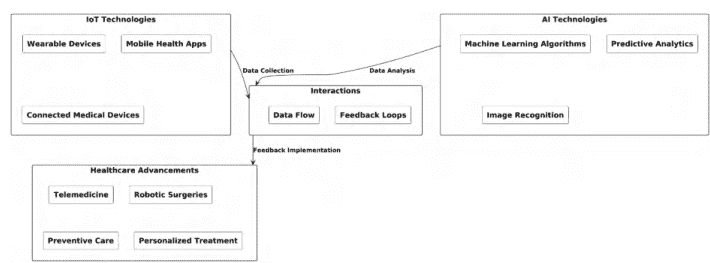

**图 1.** 医疗保健中物联网与人工智能的概念图。

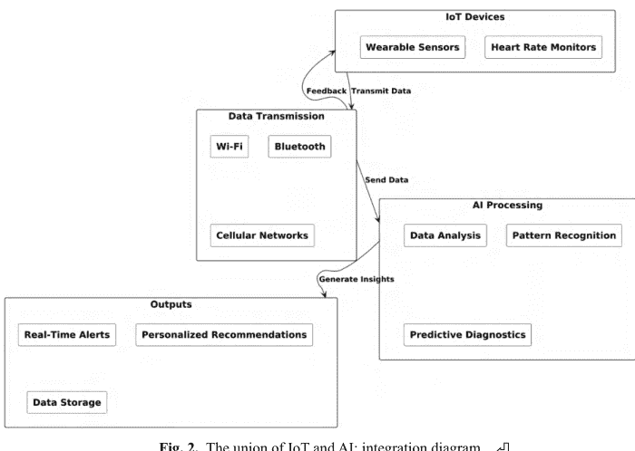

### 1.2 本章范围

本章展示了物联网与人工智能在医疗保健行业中的实际应用——心率监测器的一些智能管理。更具体地说，分析将重点关注 mHealth 如何使用可穿戴设备等物联网设备实时监测患者心率，而人工智能利用这些数据进行预测和建议。如果您继续阅读本文，我们将为您提供物联网和人工智能如何影响人们生活并改变日常健康追踪与监测方式的示例。

在本书整体概念的框架下，本章将详细介绍物联网与人工智能如何应用于医疗实践，以及思考物联网与人工智能对提升患者结局和展望未来进展的重要性。本文的其余部分将致力于描述这些技术如何通过分析人体内发生的过程相互补充，同时重点关注心率监测的挑战以及医疗保健系统的潜在未来发展。

接下来的各部分将探讨 HCM 的不同方面：所使用的技术以及该领域的当前和未来问题。作者通过本次讨论旨在为参考物联网与人工智能整合的医疗保健未来重点提供背景。


## 2. IoT 和 AI 的基本概念

### 2.1 什么是 IoT?

物联网（Internet of Things）基本上是一个通过传感器、软件和其他适当技术连接有形实体物体的系统，使它们能够在万维网上共享和收集信息 [5]。物联网已在医疗保健领域展现为一种有影响力的技术，因为它有助于支持对患者状况的持续和实时跟踪。物联网的概念不仅限于医疗工具；它还包括可穿戴工具和应用程序、家庭自动化应用程序、智能移动应用程序、传感器，甚至可植入传感器，这些传感器会持续提供有关患者健康状况的信息和更新。

医疗保健领域的联网设备旨在监测包括心率、血压、血糖水平、血液氧气等在内的一些关键身体指标。此类设备无需每天与医疗服务提供者交互即可捕获信息，从而使过程更便宜、更有效。例如，智能手表和健身追踪器不仅可以向患者提供关于其心率的实时信息，还可以向医生提供，这对心血管健康极其有帮助。

毫无疑问，慢性疾病和预防性护理是医疗保健中物联网具有特定适用性的领域。它还帮助患有高血压、糖尿病或心脏病的患者，因为收集的持续数据将有助于足够早地识别任何形式的异常。其次，物联网有助于远程患者监护（RPM），尤其是针对老年患者或农村地区患者，因此他们不需要亲自到医院接受持续检查。

物联网设备还提供实时信息，因此通过根据患者的特性和习惯提供个性化治疗来帮助改善患者护理。这将范式从大规模治疗转向以患者为导向的治疗，从而取得更好的结果并降低医疗费用。

### 2.2 医疗保健中的 AI

人工智能可以定义为计算系统的一种应用，用于理解人类智能并以类似方式执行任务。AI 在预测疾病可能性、诊断病症甚至制定适当治疗方案等方面取得了巨大进步。

机器学习是 AI 的主要组成部分，顾名思义，它是一种过程，系统通过该过程设计为从数据中学习并随时间变得更高效，而无需代码输入 [4]。使用一组参数，可以训练 ML 算法来执行某些模式的识别，强调某些动作/对象与其他对象不同，并进行预测。例如，可以使用成像数据，AI 系统会浏览图像以尝试识别癌症迹象，或扫描 EHRs 以确定最有可能出现并发症的患者。

深度学习是 AI 的另一个重要类别，它通过人工神经网络模仿人脑神经元的功能。[3] 医疗和基因组应用是深度学习取得成功的主要领域之一，因为它能够分析大量数据以及图像等复杂信息。自然语言处理（NLP）也是 AI 被用来评估临床笔记等非结构化数据并得出医疗服务提供者否则无法识别的其他结论的领域。

本简报介绍了由于使用人工智能而变得可能的部分医疗保健优势；也许其中最有益的是预测，人工智能利用先前数据来预期与健康相关的事件。这些包括使用预测模型来确定可能的疾病爆发、患者再入院率以及患者对某些形式治疗的反应的总体可能性等。这构成了一个更具预防性的医疗保健系统，减轻了对医疗设施的压力，并在患者健康方面取得了更好的结果。

### 2.3 IoT 与 AI 的融合

尽管这些技术各自都颠覆了医疗行业，但当它们整合在一起时，其影响最为深远。物联网持续从不同传感器和其他设备提供实时数据流，而 AI 利用这些数据并产生有意义的信息，如图 3 所示。整体上，它们支持智能监控系统，从而允许对健康事件进行早期识别、早期预警和及时干预。

从心率角度来看，智能可穿戴设备和其他物联网设备捕捉“心率变异性”，这是压力、睡眠问题或其他心脏并发症等状况的指标。尽管如此，物联网设备产生的数据量带来了挑战，因为生成的数据量巨大。这就是 AI 发挥作用的地方。简单来说，AI 可以去掉中间环节。通过使用机器学习算法，AI 可以分析物联网设备的数据并识别现有的健康风险，如图 4 所示。

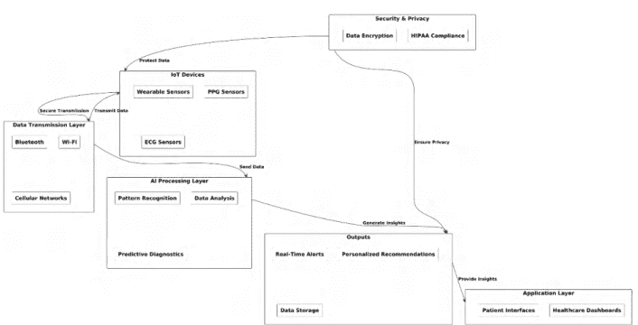

例如，具有心率监测功能的物联网设备能够识别患者心率的轻微变化，这可能是心律失常的早期迹象 [7]。这些数据可以输入 AI，AI 可以根据历史数据、医学知识数据库进行分析并预测心脏事件的概率。然后可以通知患者或医疗服务提供者，以便尽快处理问题。

物联网和 AI 还相互补充，以实现个性化医疗服务。AI 系统还能够从长期收集的数据中了解更多关于个人健康模式的信息。其依据是，系统越熟悉患者的基线健康数据，就越能识别病情并发症。这种个性化水平对于治疗患者和干预更为有效，因为医疗服务提供者可以根据患者的心理状态进行评估。

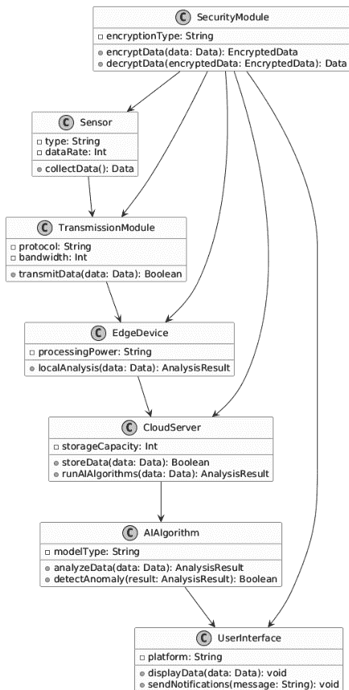

Fig. 4. IoT 和 AI 组件的类图。

此外，物联网和 AI 的整合可向患者提供情境反馈和建议。例如，AI 支持的智能心率监测器可能会就患者的活动水平和劳累程度、运动习惯的改变或练习减压策略向患者提供建议。持续的反馈回路使这些患者能够掌控自己的生活以及他们在健康方面做出的决策类型。

## 3. 智能心率监测的必要性

### 3.1 现代医学中的心脏健康

心血管疾病（CVDs）被认为是世界面临的最普遍的伤亡之一，每年夺走数百万人的生命 [9]。尽早诊断心脏病并定期检查非常重要，以免病情变得严重。可用于监测心血管系统（CVS）的另一个参数是最简单的一个——脉搏率。监测心率有助于评估心脏功能，并有助于早期识别包括心律失常、心动过速和心动过缓在内的潜在危急状况，防止其发展为心脏病发作或中风等更严重的疾病。

在当今医学中，心率监测对医疗实践至关重要，不仅用于识别心脏疾病，还用于治疗和管理高血压、慢性心力衰竭和心房颤动等疾病 [10]。它还用于评估一般体质和测量压力。由于进一步患 CVD 或再梗死高风险的患者需要持续监督以发现 CVD 的早期临床表现，因此本研究中的患者在首次门诊就诊后和随访期间接受了监测。由于 CVD 迅速增加，有效且长期的心率控制需求已成为许多医疗机构的最重要优先事项之一。

然而，传统的心率监测方法存在挑战，包括：通常，数据仅在特定端点或诊所、短时间内或几天内收集。这使得诊断任何暂时性心脏疾病或随时间获得特定患者心血管健康的完整概览成为问题。缺乏复杂的心率监测仪（HRM）往往导致呼吁实时、智能且能够持续跟踪心脏功能状态的远程健康监测系统（RMHS）。

### 3.2 传统监测的局限性

目前，心电图（ECG）或 Holter 监测也是临床实践中心率监测的一种可能方法。尽管这些方法能给出正确读数，但有时在使用过程中会受到限制。例如，心电图通常在医院或诊所进行，只能呈现某一瞬间心脏功能的简要情况。同样，Holter 监测仪虽然对


### 表 1. 传统与基于 IoT 和 AI 的心率监测方法的比较。

| 标准 | 传统监测 | 基于 IoT 和 AI 的监测 |
| :--- | :--- | :--- |
| 数据收集 | 时点测量（例如，诊所中的 ECG） | 通过可穿戴设备和传感器进行持续、实时的数据收集 |
| 可及性 | 仅限于临床环境 | 可远程访问；适用于家庭监测 |
| 数据量 | 低；数据点有限 | 高；持续收集大量数据 |
| 实时监测 | 不可用；数据采集后审查 | 可用；支持即时洞察和干预 |
| 患者舒适度 | 可能具有侵入性（例如，Holter 监测仪） | 非侵入性；可穿戴设备提供更大舒适度 |
| 早期检测 | 有限；依赖定期体检 | 增强；AI 算法可早期检测异常 |
| 可扩展性 | 难以扩展到大规模人群 | 可借助云基础设施和联网设备轻松扩展 |
| 成本效益 | 因反复就诊而导致长期成本较高 | 通过远程监测和自动化降低长期成本 |
| 个性化 | 有限；标准化的监测方法 | 高；个性化健康档案和定制干预 |
| 假阳性 | 因手动数据解释而导致可能性更高 | 通过 AI 驱动的异常检测和验证降低 |
| 干预速度 | 较慢；取决于患者与诊所的互动 | 更快；即时警报和远程干预 |

持续监测，通常佩戴在患者胸部，因此显得笨重、不舒服，且通常仅贴附 24–48 小时进行监测。因此，它们可能无法捕捉可能呈周期性或仅在监测间隔内特定时刻出现的异常节律。传统与基于 IoT 的心率监测方法的对比见表 1。

使用传统心率监测仪的 HRM-RT 的另一个缺点是，由于数据收集需要专业人员，因此无法用于远程或家庭监测。这种对临床环境的依赖可能导致诊断或治疗延迟，特别是对于来自农村地区或医疗设施获取较差的患者。此外，过去的监测工具需要大量的数据收集、分析和解释，这意味着存在较高的错误信息风险，并且提供有意义信息需要时间。

这些考虑凸显了智能、有效的心率检测方法的重要性，这些方法可以实现生理参数的实时检测，同时避免使用常规方法带来的缺点。可以得出结论，随着新型可穿戴技术的出现以及 IoT 与 AI 的结合，可以探索新的解决方案来应对这些挑战。

### 3.3 IoT 和 AI 的优势

当 IoT 和 AI 这两项令人兴奋的技术集成在一起时，它们形成了一种全新的心率监测模型，在性能以及最终实现的巧妙方式上都将令人耳目一新 [25]。通过使用智能手表、健身追踪器以及可穿戴或可植入传感器等 IoT 设备或小工具，可以持续记录心率，而不会对患者造成任何伤害。这些设备实时捕获数据，并可将数据传输给医疗专业人员或云端进行处理。这使得监测外部世界中的事件变得容易；因此，不会遗漏任何事件，尤其是在临床环境中。

与 IoT 和心率监测相关的另一个因素是其能够实时收集数据，且不受时间限制。这有助于更好地了解患者心脏状况，并确保识别出其他受时间限制的技术无法观察到的任何不规则情况或模式。使用 IoT 设备，可以更轻松地捕获患者在休息、运动或任何压力水平下的心率变异性。随后，异常情况会同时通知患者和医疗服务提供者。

然而，需要注意的是，IoT 设备产生的数据量可能非常大 [26]。这就是 AI 发挥作用的原因。人工智能旨在处理大数据，并从基本输入信息中自我学习。显然，在心率监测应用中，AI 可以分析模式和趋势，检测可能心血管事件的早期迹象，并处理患者的历史数据。这是另一个强大功能，因为此类系统可以帮助在疾病发展成更严重（甚至可能致命）的情况之前指示疾病。

此外，算法还可以在接收方生理参数的帮助下进行调整。因此，借助 AI，可以识别患者的正常心率模式，以了解偏离该模式的病理情况，并避免众多误报和额外干预。传统监测工具很难实现这种程度的个性化，因为它们依赖于一组预定义的数据模型。在心率监测中集成 IoT 和 AI 的主要优势已在表 2 中总结。

IoT-AI 集成的另一项优势在于远程患者监护 (RPM)。过去，患者需要前往医院或诊所进行持续的心脏性能追踪。然而，现在他们可以在家中舒适地接受随访，从而减轻医疗机构的负担并提高患者舒适度。通过使用 IoT，此类患者的心脏信息可以实时传输给医疗从业者，使他们在出现并发症时能按需采取行动。因此，结合 IoT 和 AI 改善了医疗服务的可及性，使心率监测对客户（即使是农村地区或当地医疗资源有限的地区的客户）更加可及。

此外，AI 提高了分析心率数据并自动做出决策的能力，而不会给医疗服务提供者增加额外工作量。开发的系统可以提供通知或建议，帮助控制潜在的健康问题。由基于 AI 的系统识别的紧急情况可以触发

| 优势 | 描述 |
|---|---|
| 持续监测 | 实现对心率及相关生理参数的实时、不间断跟踪。 |
| 早期检测与干预 | AI 算法分析数据，在异常情况变得危急之前识别异常和潜在的心血管事件。 |
| 个性化医疗 | AI 利用个人数据提供定制的健康洞察和治疗建议。 |
| 数据准确性提升 | 高精度传感器与复杂 AI 的结合减少了错误和误报。 |
| 远程可及性 | 促进远程患者监护，减少频繁就医的需求，并使农村地区也能获得医疗服务。 |
| 成本效益 | 通过预防措施和优化资源利用降低长期医疗成本。 |
| 可扩展性 | 可轻松扩展以监测大规模人群，且增量成本极低。 |
| 患者参与度提升 | 为患者提供实时反馈和可操作的健康洞察，鼓励主动健康管理。 |
| 资源优化 | AI 驱动的分析帮助医疗服务提供者优先安排干预措施并有效管理工作量。 |
| 与 EHR 集成 | 将心率数据与电子健康记录无缝结合，构建全面的患者档案。 |

通过向医疗专业人员、患者或护理人员提供实时通知来采取挽救生命的行动。

## 4. 基于 IoT 的心率监测系统

### 4.1 可穿戴设备与传感器

在互联健康与健康的背景下，可穿戴设备和传感器被视为可持续追踪人们心率的重要工具 [9]。此类小工具的设计旨在尽可能不显眼，佩戴和操作舒适，目标是持续监测生理数据，而不干扰个人的正常功能。应用传感器记录心率的两种广为人知的监测技术是光电容积脉搏波 (PPG) 传感器和心电图 (ECG) 传感器。表 3 显示了 PPG 和 ECG 在心率监测中的对比。

- 光电容积脉搏波 (PPG)：PPG 是一种本质上为非接触式的光学方法，常用于智能手表和健身追踪器等可穿戴系统中，以追踪心率。PPG 传感器通过发送光并分析返回信号，来检测皮肤表面下血容量的变化。由于血流具有搏动性（每次心跳都会变化），因此在捕获此类波形方面时机合适，并能确保设备提供连续的心率监测。PPG 是


### 表 3. 用于心率监测的光容积描记法 (PPG) 和心电图 (ECG) 对比

| Criteria | Photoplethysmography (PPG) | Electrocardiogram (ECG) |
| :--- | :--- | :--- |
| 方法 | 测量皮肤下血容量变化的光学方法 | 捕捉心脏电活动的电气方法 |
| 常用设备 | 智能手表；健身追踪器 | 胸带；临床心电图机 |
| 准确性 | 中等；容易受运动伪影和皮肤颜色变化影响 | 高；提供心脏详细的电活动 |
| 成本 | 总体较低；对消费级设备具有成本效益 | 较高；传统上用于临床环境 |
| 舒适度 | 高；非侵入式且易于佩戴 | 较低；可能笨重且长期使用不舒适 |
| 数据质量 | 适合持续监测，但精度较低 | 优质数据质量，适用于临床诊断 |
| 用例 | 健身追踪；一般健康监测 | 医疗诊断；临床研究 |
| 优势 | 集成简单；实时监测；价格实惠 | 高精度；详细的心脏活动分析 |
| 劣势 | 容易因外部因素而不准确 | 舒适度较低；成本较高；仅限短期使用 |

与其他方法相比，它因集成简单和成本效益高而广泛应用于消费级设备。然而，运动伪影、皮肤颜色等因素产生的噪声可能会影响其精度。

- 心电图 (ECG)：ECG 传感器传统上专用于临床环境；不过，物联网技术的最新趋势已使其能够嵌入可穿戴技术设备中。而 PPG 测量血流，ECG 传感器通过皮肤上的电极捕捉心脏的电活动。这些传感器通过测量心跳期间产生的电信号，提供关于“脉搏”的更高质量信息。

除智能手表和健身追踪器之外，其他物联网支持的心率监测设备还包括胸带、戒指、贴片甚至智能服装，如图 5 所示。这些设备针对特定需求，例如寻求精确性能数据的运动员、患有慢性心脏疾病的患者，或正在接受康复的个人。

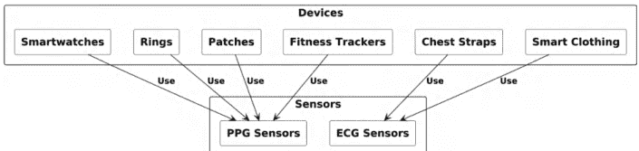

图 5. 用于基于物联网的心率监测系统的可穿戴设备和传感器。

### 4.2 数据采集与传输

然而，基于物联网的心率监测系统的主要优势在于捕获实时数据 [12]。物联网设备配备了始终在采集心率数据的传感器，随后这些数据会通过安全网络传输到云服务器、本地存储或终端以供分析。

- 数据采集：可穿戴设备（包括心率监测器）中的传感器通过持续获取的生理信号收集数值。这些数据可以从心率等简单数值，到心率变异性等更复杂的指标，后者能提供关于自主神经功能及心血管系统总体健康状况的信息。信息在发送到系统层级更高的各层之前，会先在设备中临时存储。

- 数据传输：为了便于诊断和分析，物联网设备收集的注册数据必须安全传输到其他服务器或医疗服务提供商。许多可穿戴设备依赖蓝牙、Wi-Fi 或蜂窝网络等无线通信技术进行数据传输。蓝牙通常用于短距离数据通信，而 Wi-Fi 和蜂窝网络则用于长距离数据交换。作为处理健康信息的安全措施，大多数数据在传输过程中会被加密，以防止未经授权的访问或干扰。

物联网辅助心率监测器的另一个重要特点是收集的数据会实时传输。这使得在早期阶段更容易识别异常，从而在情况变得危急之前进行治疗。遥测在传输高风险患者的实时信息方面尤为重要，这些患者因心律失常或心力衰竭等心血管问题需要持续监测。

### 4.3 云计算与边缘计算

IoT 心率监测设备产生的大量数据需要适当的存储和数据处理系统 [16]。会产生海量数据，利用云计算和边缘计算有助于管理这些数据，以便提供实时分析见解。

- 云计算：云计算是一种通过托管在互联网上的 Web 服务器访问数据和信息的系统 [33]。在 IoT 心率监测的背景下，云计算能够实现大量采集心率数据的远程存储，在此基础上，增强的 AI 或机器学习算法可以分析这些信息。云平台会累积患者关于其心血管系统状态的数据，这些数据可以协助医疗服务提供商。此外，云系统提供可扩展性，使其能够同时处理多个设备和数据流，这对于大规模或远程患者监测计划非常有用。

- 边缘计算：尽管云计算提供了虚拟空间、计算能力以及数据存储的灵活性，但将数据传输到不同网络上的服务器所需的额外时间可能会导致延迟 [35]。这就是边缘计算发挥作用的地方。边缘计算是在设备上或附近的边缘节点上执行计算的过程，以避免将数据发送到云端。在基于物联网的心率监测系统中，可以引入边缘计算技术，在网络边缘处理心率信息，以便对收集的数据进行实时决策，并在出现异常时触发警报。当需要在短时间内进行随访或不良事件发生可能性较高时，这非常有利。例如，如果患者的心率异常，边缘计算系统会在将数据发送到云端进行进一步处理之前触发警报。

为了增强实时处理能力并有效分析大型数据集，IoT 心率监测系统应同时采用云计算和边缘计算。

### 4.4 系统架构

IoT 驱动的心率监测系统的概念分解包含多个层，每个层在数据采集、处理和分析中发挥不同的作用 [11]，如图 6 所示。

- 1. 传感层：又称数据采集层，该层负责采集数据。附带 PPG 或 ECG 传感器的可穿戴设备会持续监测患者的心率。传感器记录可临床测量的生理参数，并将信息转换为电信号。

- 2. 数据传输层：数据采集后，会通过蓝牙、Wi-Fi 或蜂窝网络等接口发送到数据处理部分。电子数据传输确保数据在不受干扰的情况下送达预定目的地。

- 3. 边缘计算层：在某些系统中，数据会使用边缘计算技术在设备或最近的网关上进行处理 [36]。该层执行实时分析，识别紧急问题或异常。例如，如果患者的心率突然急剧上升，边缘设备会在将信息传输到云端之前，先通知患者的智能手机或医疗服务提供商。

- 4. 云计算层：某些任务在云端执行，数据会被转移到云服务器以进行更复杂的分析。AI 和机器学习算法在大型数据集上工作，以识别长期风险指标。云层还存储历史数据集以供进一步比较和分析。

- 5. 应用层：这一层是医疗服务提供商和患者与数据交互的地方。智能手机、平板电脑或个人电脑上的应用程序会以易于理解的格式显示分析后的数据。医疗服务提供商可以访问实时或


图 6. 系统架构图。

历史数据以便就患者的心脏健康做出明智决策。患者可以查看其心率数据，并基于 AI 分析获得个性化建议或警报。

- 6. 安全与隐私层：数据安全和隐私在整个系统中至关重要。数据传输和存储过程中应用加密，以保护敏感的患者信息。此外，遵循 HIPAA 等医疗法规可确保患者数据得到安全和负责任的处理。

## 5. AI 驱动的心率监测分析

### 5.1 心率分析中的 AI 技术

AI 在监测和管理健康信息（特别是心率历史）方面带来了转变，远远超出了简单的数值读取，能够对数据进行更深入的分析，从而预防或控制心脏疾病 [22]。这在机器学习（ML）和深度学习（DL）技术中尤其明显，因为心率数据日益复杂。其中，卷积神经网络（CNNs）和长短期记忆网络（LSTM）对心率分析非常有用。

- **机器学习（ML）：** 用于心率数据的分类策略涉及应用传统的机器学习方法，如决策树、支持向量机（SVM）和 k-近邻（KNN）[14]。这些模型基于特征提取方法工作，其中预设参数（例如，HRV 脉搏波特征）用于判断心率是正常还是异常。监督学习算法可以根据过去的心率记录预测潜在的心血管威胁，使医疗专家能够在可怕的后果出现前识别趋势。

- **卷积神经网络（CNNs）：** CNNs 最初用于图像识别，已被训练用于处理心率等生理信号。CNNs 擅长分析空间变体，因此对于识别与特定健康状况相关的心率数据中的模式和变化非常有用。例如，CNNs 可以分析心率的形状频谱以检测心律失常或其他异常情况。在大型数据集上训练的 CNNs 可以识别心率模式中的细微变化，这些变化可能被人类或其他算法忽略。

- **长短期记忆（LSTM）网络：** LSTM 是一类为学习时间序列数据（如心率）而开发的 RNN。由于心率数据是序列化的且依赖于先前的值，LSTM 非常适合预测未来的心率趋势。经过多个时间步扩展后，LSTM 保留大量信息，使基于心率变化的模式发现和潜在健康威胁检测成为可能。这对于患有慢性疾病的患者尤其有价值，LSTM 可以识别病情恶化的早期迹象。

- **混合模型：** 在混合模型中集成 CNNs 和 LSTM 可以发挥两种技术的优势。有组织的心率数据输入到 CNNs 中以提取空间特征，而时间特征则通过 LSTM 学习。这些混合模型对于识别心律失常、预测心力衰竭以及实时评估心率变异性非常有效。全面考虑心率数据空间和时间特征的模型能提供更详细的心血管健康洞察。

总体而言，这些 AI 技术可以提供更清晰、更易理解的心率，以及与个人心血管健康相关的状况或情况，如图 7 所示。最后，能够从大数据中学习、具备自适应学习能力并能实时反馈，使 AI 成为现代心率监测的重要工具。


### 5.2 异常检测

AI 在心率监测中最重要的用例是异常检测 [37]。对心率数据的实时监测和分析使 AI 驱动的系统能够识别预示潜在健康风险的模式。这些异常可能包括心悸、显著升高或降低的静息心率，或偏离受试者基线的波动。

- **异常检测技术：** 非监督学习算法在无需大量标记数据集的情况下检测心率数据中的异常特别有用。聚类、孤立森林和自编码器等技术被应用于检测异常。这些方法通过训练系统识别正常模式并标记偏差，可以识别心率模式中的急性或慢性变化。例如，自编码器可以将正常心率模式与输入数据进行比较，并识别指示问题的显著异常。

- **心血管事件的早期检测：** 异常检测在心血管事件发生前进行预测方面特别有益 [38]。心率波动可能指示心律失常或其他心脏问题。通过分析心率变异性等指标，AI 算法可以检测趋势并发出警报，从而实现及时干预以防止危及生命的状况。

- **减少误报：** 心率监测中的主要问题之一是尽量减少误报数量——即看似出现异常但实际上对健康无危险的情况。这意味着 AI 模型（尤其是深度学习方法）可以调整和优化其决策过程，以更好地区分真实健康风险与误报，从而减少临床环境中的不必要警报。

通过持续的逐小时和逐日跟踪和分析心率数据，机器学习算法会自动向临床医生发出实时警报，以便他们在异常导致不良结果之前进行干预。这不仅提高了所提供医疗服务的质量，还减轻了医疗设施的压力。

### 5.3 可解释 AI（XAI）

尽管准确，但 AI 模型经常因其不透明性或“黑盒”效应而受到批评，使其难以解释 [61]。这在临床决策中尤其成问题，因为信任和问责至关重要。可解释 AI（XAI）通过澄清 AI 模型如何做出决策来解决这些问题，使其对医疗专业人员更易理解。

- 可解释性的重要性：在医疗保健中，可解释性至关重要。医生需要了解 AI 算法如何做出某些决策，特别是在诊断心脏并发症或推荐手术程序等关键领域。XAI 为这些过程提供洞察，指出导致特定决策的心率模式特征。

- XAI 技术：SHAP（Shapley Additive Explanations）值、LIME（Local Interpretable Model-agnostic Explanations）或注意力机制是典型的 XAI 技术，用于提高 AI 模型的可解释性和理解性。例如，SHAP 值能够识别数据集中每个特征的相对权重或重要性级别，使医疗提供者能够了解哪些特定数据特征促成了异常检测决策或患特定健康风险的可能性。在心率监测的背景下，这些技术可以指出 AI 模型决策中最有效的心率模式波动。

- 对 AI 驱动医疗保健的信任：实施 XAI 增强了对 AI 系统的信任，鼓励医疗保健提供者采用 AI 技术。Gnanasekar 和 Pachamuthu（2019）指出，当医疗专业人员能够验证其建议并理解其推理时，他们更有可能接受 AI。XAI 还支持模型验证，允许医疗专业人员审查和确认 AI 生成的建议。

在心率监测中，XAI 确保 AI 决策过程全面且透明，促进 AI 在医疗保健中的进一步集成。这种协同效应提高了患者护理的可靠性、可信度和整体质量。


### 5.4 Integration with Health Monitoring Systems

AI 是与基于 IoT 的健康监测系统集成的最佳方式，以协助对患者健康做出更好的决策和结论 [21]。IoT 设备收集大量实时数据，但如果没有 AI，这些数据通常是原始且难以分析的。基于 IoT 构建的大数据分析平台经常利用 AI 算法来持续捕获和分析数据，帮助进行患者护理决策。

- **实时分析与警报**：集成 AI 的主要优势之一是它允许实时分析心率数据并立即提供反馈。例如，一个 IoT 心率监测设备会随时间记录数据，并将其发送到云端，在那里人工智能算法会扫描心脏并发症。如果诊断出异常（例如，心率不规则），系统将能够向相关患者和医护人员生成通知。这是因为反馈循环是实时的，从而在需要时帮助更快地做出决策或干预。

- **个性化洞察**：AI 可以根据患者的病史创建个人健康档案，从而密切监测其健康状况。此外，AI 会学习患者的正常心率模式并轻松识别偏差。这种方法确保医疗干预根据每位患者的需求量身定制，提高有效性并减少假阳性结果。

- **与电子健康记录（EHRs）集成**：基于 AI 的心率监测系统可以与其他系统集成，例如电子健康记录（EHRs）。AI 算法可以分析心率数据以及其他健康相关统计数据，以提供患者健康状况的全面图景。这种集成支持更好的决策和个性化医疗计划的制定。

- **持续学习与改进**：使用 AI 集成的另一个好处是，所使用的 AI 算法可以轻松适应新数据，并使其预测更加准确。随着 IoT 设备生成的每一新数据流，这些模型对心率模式的理解会不断增加，从而提供更好的预测和分析。这确保了基于 AI 的健康监测系统能够持续更新最新的临床知识。

当应用于基于 IoT 的心率监测系统时，AI 可以通过描述性、规范性和自适应分析来增强患者所接受的护理。这样一来，IoT 的数据采集功能与 AI 的分析功能相结合，构成了心血管健康监测和严重病症预防的强大框架。

## 6. Case Studies: Real-World Applications

### 6.1 Remote Monitoring and Telemedicine

远程生命体征监测已成为当今医疗保健服务的主要方式之一，尤其是针对心血管疾病 [23]。在远程心率监测的背景下，IoT 和 AI 如何实施最明显的例子可以观察到新型高级远程医疗平台的出现。在这些平台中，最突出的是在远程医疗技术中使用集成 AI 分析功能的智能可穿戴心率传感器，以实时跟踪心脏病患者的病情并避免频繁前往医疗机构。Table 4 概述了各种 AI 技术在心率分析中的优势和局限性。

表 4. 心率分析的 AI 技术比较。

| AI 技术 | 描述 | 心率监测中的应用 | 优势 | 劣势 |
| :--- | :--- | :--- | :--- | :--- |
| 机器学习（ML） | 使用决策树、SVM、KNN 等算法进行模式识别和预测 | 预测心血管风险；分类正常与异常心率 | 适用于定义明确的问题；可适应 | 需要特征提取；对非结构化数据效果较差 |
| 卷积神经网络（CNNs） | 擅长空间数据分析的深度学习模型 | 检测心律失常；从 PPG 和 ECG 数据中分析心率模式 | 模式识别准确率高；可处理大型数据集 | 计算密集；需要大量标记数据集 |
| 长短期记忆网络（LSTM） | 专门用于序列和时间序列数据的循环神经网络 | 预测未来心率；识别时间异常 | 适用于时间相关数据；捕获长期依赖 | 训练复杂；容易过拟合 |
| 混合模型（CNN-LSTM） | 结合 CNNs 和 LSTMs 以利用空间和时间数据分析 | 心率变异性的全面分析；增强的异常检测 | 结合 CNNs 和 LSTMs 的优势；提高准确性 | 复杂度增加；计算要求更高 |
| 异常检测技术 | 无监督方法，如聚类、孤立森林、自动编码器 | 实时检测不规则心率；心血管事件的早期预警 | 无需标记数据；能有效识别异常值 | 可能产生假阳性/阴性；对数据质量敏感 |
| 可解释人工智能（XAI） | 为 AI 模型提供可解释性的技术，如 SHAP、LIME | 增强对 AI 决策的信任；验证异常检测机制 | 提高透明度；便于模型验证 | 实施可能复杂；可能降低模型性能 |

远程医疗在医疗实践中的应用示例是针对心脏手术后患者使用远程医疗平台。患者被提供了智能衣物和 IoT 设备，以使用 PPG 和 ECG 传感器全天候监测患者的心跳 [24]。它还实时捕获并无线发送用户的心率数据到云端。因此，可穿戴设备的数据流由训练有素的机器学习算法处理，这些算法能够检测心律失常或心率不规则增强/放松等异常情况。当检测到问题时，警报会直接发送给医疗专业人员。

这种方法在识别术后并发症（如心房颤动）的早期标志物方面证明非常有益，并允许在病情恶化前及时进行干预。在某些情况下，系统检测到了在医院体检中被忽略的差异。此外，它通过过滤噪声并仅在存在真正问题时才通知人员，减轻了医疗从业者的工作量。

此案例突显了远程医疗的两个关键方面：持续的远程护理和适当的护理交付，如图 8 所示。此类系统不仅改善了患者的舒适度，还使医疗保健提供者能够高效地管理更大规模的患者群体。


### 6.2 Chronic Disease Management

某些心脏疾病虽然无法治愈，但可以通过频繁监测得到有效管理 [24]。特别是慢性疾病，从 IoT 和 AI 集成中获益良多，如图 9 所示，这使得在心血管事件发生前进行预测成为可能。这些系统用于远程监督慢性心力衰竭患者，这种情况需要持续监测心率、血压和其他生命体征以防止并发症。


在一项研究中，慢性心力衰竭患者被提供了能够记录心率、心率变异性和身体活动等多个参数的可穿戴设备。这些设备将数据持续流式传输到基于 AI 的云端应用程序，该应用程序利用机器学习算法检测模式并预测潜在的心力衰竭发作。

AI 采用了明确的监督学习和无监督学习方法，以对每位患者的生理节律进行精确评估，并识别可能导致心血管事件的偏差。例如，静息心率或 HRV 的变化可能向临床医生发出病情恶化的信号。在某些情况下，系统在症状出现前几天就预见到了严重的心力衰竭，从而允许及时调整药物或住院治疗。

此案例中观察到的最显著改善是心力衰竭患者再入院率的降低 [22]。此外，AI-IoT 系统证明非常宝贵，它使医疗保健提供者能够监测患者的状况，并在情况变得危急之前有效干预。此应用展示了 AI 如何应对传统监测方法无法处理的挑战，显著改善了慢性疾病管理。

### 6.3 Fitness and Wellness Applications

IoT 和 AI 不仅正在转变面向临床的医疗保健，还正在转变健身和健康领域 [9]。包括智能手表和健身追踪器在内的智能可穿戴设备，现在被广泛用于个人（包括雇主和员工）来监测心率和整体健康状况。这些设备集成了人工智能，帮助用户最大限度地利用其锻炼计划，并跟踪心率、睡眠模式和消耗的卡路里等健康参数。

这种集成的一个具体例子是将 AI 增强的可穿戴技术用于健身训练和身体表现提升。例如，一个基于 AI 的健身平台被集成到一个知名品牌的健身追踪器中，该追踪器配备了心率传感器和加速度计。这些设备收集


运动期间的心率数据，以及步数、覆盖距离和卡路里消耗等信息。这些数据由 AI 算法分析，为用户提供个性化的健身建议，例如基于心率变异的最佳训练强度区间。

我发现这个特定平台尤为突出，因为它为用户提供健身计划建议，且计划可根据用户生理测试结果进行调整 [10]。例如，如果 AI 识别出用户在进行特定类型的锻炼时心率升高，它可以建议降低难度以避免过度劳累。另一方面，如果心率保持在指导范围内，AI 则会提高难度以改善心血管健康。这种个性化分析使用户能够优化训练，从而改善健身效果。

此外，基于 AI 的系统超越了健身优化，还提供了健康建议。通过持续跟踪用户在休息和睡眠期间的心率，平台能够指出压力或疲劳的可能迹象，并规定消除这些迹象的方法。因此，AI 可以与 IoT 在健身可穿戴设备的应用中集成，展示心率数据如何指导改善运动表现，并同等帮助预防或减轻不良健康或伤害。

## 7. 挑战与伦理考量

### 7.1 数据隐私与安全

随着 IoT 和 AI 在医疗保健行业的日益普及，关于数据隐私和安全的担忧也有所增加。基于 IoT 的心率监测系统会收集大量敏感的患者数据，包括实时健康信息、身份详细信息和临床病史 [25]。确保这些数据的隐私至关重要，因为泄露可能导致严重后果，例如身份盗窃、未经授权使用健康信息，甚至操纵起搏器等生命维持设备。

然而，IoT 系统的漏洞往往源于设备本身的局限性。可穿戴设备和传感器通常处理能力较低，这限制了强加密协议和其他安全措施的使用。此外，通过蓝牙或 Wi-Fi 进行的无线数据传输会创建拦截点，使数据容易受到未经授权的访问。尽管加密工具和安全通信方法有助于降低这些风险，但无法完全消除它们，尤其是随着新威胁不断出现。

另一个重要问题是云端数据存储 [27]。大量患者数据存储在云端以供分析，尽管云服务提供商实施了严格的安全协议，但数据的集中化使这些系统成为黑客诱人的攻击目标。因此，医疗保健组织必须遵守严格的法律要求，例如美国的 HIPAA，以保护患者信息。

内部威胁也构成风险，例如医疗保健提供者或员工未经授权访问患者数据。为解决此问题，组织必须实施严格的访问控制、数据掩码技术和例行审计，以检测和防止滥用敏感健康信息。

### 7.2 将 AI 纳入医疗保健系统的伦理影响

在医疗保健（特别是心率监测和诊断）中应用 AI 时，伦理考量至关重要 [28]。这些问题包括 AI 驱动决策过程的可靠性及其对患者护理的影响。虽然 AI 系统在分析大型数据集和发现可能逃避人类从业者注意的趋势方面表现出色，但它们并非万无一失。AI 模型的效果仅取决于用于训练的数据；如果训练数据集不完整或存在偏差，得出的预测和诊断可能会有缺陷。例如，如果 AI 系统是在排除某些人口群体的非多样化数据集上训练的，它可能对这些人群表现不佳，导致错误诊断或不平等的治疗。这凸显了训练数据中多样性和彻底性的必要性，以确保 AI 系统在所有人口群体中都能有效运行。

另一个新兴的伦理问题是对人工智能所做决策的责任归属。AI 系统中的错误可能会带来昂贵且可能危及生命的后果，引发关于当 AI 系统做出错误诊断或建议时谁应负责的疑问。是系统开发者、使用该系统的医疗保健提供者，还是实施该技术的组织？有必要制定清晰的指南和法规，以界定 AI 驱动的医疗决策的问责制。

然而，通过上述讨论的影响，人工智能在医疗保健领域的应用可能导致整个概念的非人性化。许多患者会害怕允许机器学习系统做出涉及人类生命的决策，尤其是当他们不熟悉此类系统的运作时。解决此问题的一个方案是使用所谓的可解释 AI（XAI）方法论，因为它们旨在增强基于 AI 的决策过程，使其对患者和医疗保健提供者更加透明。然而，自动化与人工监督之间分配的问题，仍然是人工智能发展中最强的伦理关切之一。

### 7.3 可扩展性与可及性

尽管心率监测中的 IoT 和 AI 有可能彻底改变医疗保健，但其实施面临诸多挑战，尤其是在资源有限的发展中国家 [28]。这些系统的高科技特性构成了扩展的重大障碍，因为部署和维护 IoT 设备、可穿戴设备和 AI 系统的相关成本对许多医疗保健提供者来说过于高昂。这不仅包括初始资本支出，还包括与数据存储和服务维护相关的持续成本。在低收入或农村地区，此类费用可能使这些技术无法触及，将这些地区排除在 IoT 和 AI 基础监测系统的益处之外。

高速互联网连接、完善的云计算平台和数据传输网络等对 IoT 和 AI 技术发展至关重要的物理基础设施，在某些地区可能发展不完善。该技术需要某些基础设施，特别是用于实时监测和分析系统，如果这些基础设施未建立，就违背了利用这些技术改善健康结局的初衷。

在实施 IoT 和 AI 系统的特定地区，关于用户接受度和管理可能始终存在一些问题 [30]。这些系统必须由医疗保健提供者使用，而对他们的培训在往往资源匮乏的此类环境中可能是一项重大挑战。同样，患者可能需要支持来使用可穿戴设备或解读 AI 方案分析的信息。

为克服这些挑战，需要在未覆盖地区开创并部署更有效和可持续的解决方案。这包括为 IoT 设计价格合理的智能设备、设计可在低处理能力下运行的机器学习算法，以及利用移动工具推进医疗服务交付。此外，政府、非政府组织和私营组织应合作投资 AI-IoT 系统的基础设施，确保这些技术惠及所有人口，无论地理或社会经济差异如何。

## 8. 未来方向与创新

### 8.1 IoT 和 AI 技术的进步

IoT 和 AI 技术的未来进步预计将在心率监测和整体医疗保健方面带来显著改善 [29]。一个关键关注领域将是传感器技术。未来的 IoT 设备预计将比当前设备更准确、更耐用且更节能。这些改进将实现最小用户输入的持续实时监测。例如，纳米技术的进步可能导致超薄、柔性传感器的创建，这些传感器可以无缝集成到服装中，甚至纹在皮肤上，提供更大的便利性和日常生活集成。这些下一代传感器还可以捕捉更广泛的生理数据，提供对心脏健康更全面的解读。

另一个有前景的创新是开发基于 AI 的早期检测系统 [30]。借助机器学习和深度学习技术，AI 在分析大型数据集以识别疾病早期迹象方面变得越来越熟练。未来的 AI 系统不仅会监测心率，还将结合血压、身体活动水平和遗传信息等数据，在心脏疾病显现之前进行预测和预防。通过检测数据中的微妙模式，这些 AI 系统将改变预防性护理，使诊断未来风险比以往任何时候都更容易。

这两种技术也完美适用于近年来获得显著增长的个性化健康监测 [31]。来自汇编的数据


可穿戴设备和传感器可以输入 AI 系统，为每个人提供个性化的健康档案，并随时间推移改进系统对个人的了解。这种策略意味着将给出的建议和警报将更偏向于患者的特定需求。明天的先进 AI 模型将融入预测建模的新方法，以提供治疗方案，这些方案将根据患者的实时状况自动调整，从而为患者及其健康问题提供高度个性化的方法。

### 8.2 5G 及以后

这指的是由 5G 等新技术实现的实时心率监测和 AI 驱动的医疗解决方案的进步 [32]。当今 IoT 系统的主要问题是数据传输问题，具体来说，它需要高效、有效且安全。5G 的特征包括低延迟、高带宽以及同时支持许多设备的能力，这意味着将能够实现非常大规模的实时监测。

在 5G 环境中，可穿戴设备收集的数据可以近乎实时地传输到云服务器或边缘计算系统。然后 AI 算法可以处理这些数据，并几乎即时向医疗专业人员或患者发送反馈。这种功能对于需要持续监测的高风险患者尤为重要，因为它允许在心率突然飙升或下降时立即发出警报。

此外，5G 将允许开发其他高度概念化和数据密集的医疗应用，包括远程手术和远程会诊。5G 将带来新的连接水平，从而彻底改变远程医疗和患者远程监测等医疗服务，使得即使在被认为偏远或医疗基础设施不足的地区，也有可能为患者提供高级医疗服务。

未来的扩展，或称为 6G，以及其他未来先进技术预计将从 5G 演进而来，同时提供更高级别的传输速率、更好的安全性和身份特性，以及更广泛的网络可用性。这些创新将扩展实时持续健康监测的现有可能性，并为实施更复杂的基于人工智能的分析和控制开辟新的前景。

### 8.3 精准医疗和预测性医疗保健

IoT、AI 和基因组学的发展相结合，正在开启个性化和预后医疗的新时代 [35]。精准医疗涉及根据患者的个体基因构成、行为和发育环境提供量身定制的护理和预防技术。不断收集心率或其他生理和行为数据的智能设备为该框架提供持续的信息流。然后 AI 使用这些数据创建随新数据引入而调整的个性化医疗解决方案。

例如，AI 系统可以将患者的心率数据与其心血管疾病的遗传倾向相结合，以估计患特定心血管疾病的可能性。如果系统识别出患者患心脏病或心律失常的风险，它可以推荐降低风险的措施，包括针对患者独特档案量身定制的适当治疗或预防措施。随着时间的推移，随着更多数据的积累，预测将变得越来越准确，从而制定出更有效的疾病预防和治疗策略。

AI 还可以增强的另一个领域是预测性医疗 [60]。通过分析大数据集，AI 系统可以检测到可能被人类医疗从业者忽略的模式，从而能够在早期诊断疾病。例如，心率变异性或其他活动模式的细微变化可以作为房颤或心力衰竭的早期指标。这种预测能力使医疗服务提供者能够在问题变得危及生命之前加以解决，从而改善患者的生活质量。

AI 在预测性医疗中的应用不仅限于单个患者。它可以拥有广阔的视野，因为在审视大局时，它能识别出在制定针对特定人群或地区的公共卫生干预措施时有帮助的模式。例如，AI 模型可以预测特定地区的心血管疾病趋势，从而使资源能够高效、有效地分配，并及时实施预防措施。

## 9. 结论

### 9.1 关键洞察回顾

通过 IoT 和人工智能优化心率监测标志着医疗保健演变中的一个变革性步骤。通过物联网连接的可穿戴传感器和远程监测系统持续分析心率和其他参数。然后，这些数据由设计用于检测疾病、警告潜在心血管事件并提供健康相关建议的 AI 算法进行处理。IoT 强大的数据收集能力与 AI 的预测和分析功能的集成，有助于更早的干预、优化的治疗方案以及更高效的远程患者监督。本章讨论的技术，连同提供的案例研究，说明了 IoT 和 AI 如何不仅彻底改变心率监测，而且彻底改变整个医疗保健领域。

### 9.2 医疗保健未来的愿景

总之，IoT 和 AI 将在医疗保健领域新系统和模型的发展中继续至关重要，因为它们构成了未来的医疗技术。像 5G 这样的新技术是有利的，因为它们促进了高可靠性和高速数据传输，从而使事件监测和实时响应成为可能。传感器以及 AI 模型的进步将进一步提高精准医疗的交付效果，包括为个体患者提供高度定制、面向目标的方法。智能和预判性医疗将 AI 预测尚未发生风险的能力付诸实践，从而帮助将医疗保健从被动模式转变为预防性模式，彻底解决慢性疾病问题。

随着 IoT 和 AI 在医疗保健领域的应用不断进步，医疗保健的未来可能变得更加互联、智能和个性化。

## 参考文献

- [1] Chen, M., Gonzalez, S. 和 Zhang, D. (2019). 面向医疗保健的 AI 支持 IoT：挑战与未来趋势。IEEE Internet of Things Journal, 6(3): 3661–3675.
- [2] Islam, S. M. R., Kwak, D., Kabir, M. H., Hossain, M. 和 Kwak, K. -S. (2015). 用于医疗保健的物联网：一项全面的调查。IEEE Access, 3: 678–708, doi: 10.1109/ACCESS.2015.2437951.
- [3] Topol, E. J. (2019). 《深度医学：人工智能如何让医疗保健重新变得人性化》。Basic Books.
- [4] Ni, Z. 和 Wang, H. (2020). 基于 IoT 的健康监测中的异常检测：机器学习视角。Sensors, 20(23): 6717.
- [5] Al-Turjman, F. 和 Baali, I. (2019). 面向可穿戴 IoT 应用的机器学习：一项调查。Computers & Electrical Engineering, 78: 447–461.
- [6] Dey, N., Ashour, A. S. 和 Borra, S. (2018). 可穿戴和可植入医疗器械：应用与挑战，第 1–26 页。载于：可穿戴和可植入医疗器械。Academic Press.
- [7] Fathi, M. 和 Holland, A. (2020). 智能医疗保健的 AI 和 IoT 应用：新兴趋势与挑战。IEEE Access, 8: 202841–202858.
- [8] Singla, R. 和 Kumar, D. (2020). 基于 IoT 的健康监测系统：一项调查。King Saud University 期刊 - 计算机与信息科学。
- [9] Biswas, S. 和 Ray, N. (2020). 使用可穿戴设备进行基于 IoT 的心率监测。医疗工程期刊, 2020, 文章 ID 9829801.
- [10] Li, S. 和 Xu, L. (2019). IoT 赋能的医疗保健：监测系统、挑战与机遇。Sensors, 19(7): 1756.
- [11] Sheng, Z., Yang, S. 和 Vasilakos, A. V. (2015). 智能医疗保健系统综述：架构、挑战与机遇。IEEE Communications Surveys & Tutorials, 17(3): 57–71.
- [12] Pantelopoulos, A. 和 Bourbakis, N. G. (2018). 面向健康监测和预后的可穿戴传感器系统综述。IEEE 系统、人与控制论汇刊 - C 部分：应用与综述, 40(1): 1–12.
- [13] Rahmani, A. M., Thanhngai velan, N. K. 和 Gia, T. N. (2018). 智能电子健康网关：为基于 IoT 的普适医疗保健系统带来智能。Future Generation Computer Systems, 78: 168–185.
- [14] Lin, J. 和 Shen, G. (2018). 用于心率监测的可穿戴 IoT 技术：概述与分析。IEEE Sensors Journal, 18(16): 6715–6723.
- [15] Sun, Y. 和 Chen, M. (2020). 面向实时医疗保健监测的 AI 驱动 IoT 解决方案：一项全面的综述。IEEE Access, 8: 109019–109036.
- [16] Esteva, A., Robicquet, A. 和 Ramsundar, B. (2019). 医疗保健深度学习指南。Nature Medicine, 25(1): 24–29.
- [17] Krittanawong, C., Johnson, K. W., Rosenson, R. S., Wang, Z., Aydar, M., Baber, U 等人 (2019). 心血管医学深度学习：实用入门。欧洲心脏杂志. 2019 年 7 月 1 日; 40(25): 2058–2073.
- [18] Shen, Y. 和 Shen, L. (2021). 可解释人工智能 (XAI) 在医疗诊断中的应用：一项全面的综述。医学人工智能, 113: 102041.
- [19] Zhang, Z. 和 Zhang, Z. (2020). 人工智能在心血管医学中的应用：最近进展综述。Current Cardiology Reviews, 16(1): 43–55.
- [20] Garg, S. 和 Gupta, V. (2018). 使用 IoT 设备进行心率监测的深度学习。Computers in Biology and Medicine, 98: 39–48.
- [21] Mukherjee, M., Mukherjee, S. 和 Ray, P. P. (2019). 面向实时远程健康监测的基于 IoT 的预测分析。Procedia Computer Science, 165: 21–30.
- [22] Verma, P. 和 Sood, S. K. (2019). 面向心脏病患者的以云为中心的基于 IoT 的医疗监测系统。IEEE Transactions on Cloud Computing, 8(1): 43–56.


- [23] Hossain, M. S. 和 Muhammad, G. (2016). 云辅助工业物联网（IIoT）：AI 驱动的医疗监测的未来。IEEE 工业信息学汇刊, 12(5): 2030–2041.
- [24] Singh, K. 和 Rathi, V. (2020). 心血管疾病中的人工智能：文献综述与展望。美国心脏病学会杂志, 75(23): 2839–2849.
- [25] Mohammadzadeh, N. 和 Safdari, R. (2017). 医疗保健中 IoT 的作用：应用、优势与挑战。医学系统杂志, 41(5): 47.
- [26] Sarkar, M. 和 Pal, K. (2021). 基于 IoT 的患者监测系统：使用机器学习进行实时异常检测。IEEE Access, 9: 37901–37909.
- [27] Gupta, P. 和 Lee, H. (2020). 医疗保健中 IoT 的未来：挑战与机遇。信息安全与应用杂志, 56: 102790.
- [28] Shen, C. 和 Li, F. (2019). 医疗 IoT 中的预测分析：现状与未来方向。IEEE 生物医学与健康信息学期刊, 24(4): 1118–1130.
- [29] Sun, Y. 和 Chen, M. (2020). 用于实时医疗监测的 AI 驱动 IoT 解决方案：全面综述。IEEE Access, 8: 109019–109036.
- [30] Zhou, L. 和 Wang, L. (2020). 心脏病诊断中的人工智能：最新进展与挑战。心力衰竭评论, 25(3): 275–282.
- [31] Marr, B. (2019). 5G 将如何彻底改变医疗保健。福布斯。
- [32] Hossain, M. S. 和 Muhammad, G. (2016). 医疗保健中的物联网：新兴技术的全面综述。IEEE Access, 6: 10893–10912.
- [33] Rahman, A. 和 Rahman, M. (2020). 医疗保健中 IoT 和机器学习的系统综述：应用、挑战与解决方案。医学系统杂志, 44(11): 55–75.
- [34] Mollah, M. B. 和 Azad, M. A. (2020). 以云为中心的 IoT 医疗架构：现状、挑战与未来展望。IEEE 物联网期刊, 7(4): 3456–3470.
- [35] Zhu, J. 和 Xie, H. (2020). 基于 IoT 的医疗监测系统：综述。传感器, 20(23): 6352.
- [36] Xia, F., Yang, L. T. 和 Wang, L. (2012). 医疗保健物联网。IEEE Access, 3(5): 179–198.
- [37] Fredrick, S. M. 和 Rothman, M. D. (2020). IoT 赋能设备对慢性病管理的影响。远程医疗与电子健康, 26(5): 557–564.
- [38] Shen, Y. 和 Shen, L. (2021). 可解释人工智能（XAI）在医学诊断中的应用：全面综述。医学人工智能。
- [39] Gupta, A. 和 Jha, R. K. (2015). 5G 网络综述：架构与新兴技术。载于 IEEE Access, 3: 1206–1232, doi: 10.1109/ACCESS.2015.2461602。
- [40] Shen, D., Wu, G. 和 Suk, H. I. (2017). 医学图像分析中的深度学习。生物医学工程年度评论. 2017 年 6 月 21 日; 19: 221–248. doi: 10.1146/annurev-bioeng-071516-044442。
- [41] Ni, A., Azarang, A. 和 Kehtarnavaz, N. (2021). 基于深度学习的非接触式心率测量方法综述。传感器, 21: 3719. https://doi.org/10.3390/s21113719。
- [42] Jiang, F., Jiang, Y., Zhi, H., Dong, Y., Li, H., Ma, S. 等 (2017). 医疗保健中的人工智能：过去、现在与未来。脑血管病神经学. 2017 年 6 月 21 日; 2(4): 230–243.
- [43] Aggarwal, R. 和 Kaur, H. (2019). 医疗保健中的物联网：架构、应用、挑战与未来方向。计算机科学、工程与信息技术科学研究国际杂志, 4(1): 1–9.
- [44] Biswas, S. 和 Ray, N. (2019). 基于机器学习的心脏病预测系统综述。工程与先进技术国际杂志, 8(6): 3457–3462.
- [45] Zhou, Y. 和 Gu, J. (2019). 用于心率监测的人工智能：应用与挑战。医学系统杂志, 43(11): 296.
- [46] Méndez, D., Balasubramanian, S. 和 Grover, V. (2020). 智能健康监测系统中的 AI 与 IoT：现状与挑战。传感器与执行器网络杂志, 9(1): 19.
- [47] Bui, N. 和 Zorzi, M. (2011). 医疗保健应用：基于物联网的解决方案。第 4 届生物医学与通信技术应用科学国际研讨会论文集, 1–5。
- [48] Clarke, R. 和 Steele, D. (2014). 5G 在 IoT 医疗应用中的新兴作用。远程医疗与远程护理杂志, 20(4): 199–208.
- [49] Liu, X. 和 Zhang, J. (2021). 医疗系统中心率监测的机器学习方法。医疗技术快报, 8(3): 85–91.
- [50] Garg, A. 和 Gupta, D. (2018). 个性化医疗保健中的人工智能：应用与机遇。当前心脏病学报告, 20(12): 137.
- [51] Hossain, M. 和 Alahmad, M. (2020). 用于远程患者监测的物联网和基于 AI 的医疗技术。IEEE Access, 8: 22356–22368.
- [52] Wang, S. 和 Wang, J. (2020). AI 驱动的 IoT：医疗保健中的应用与挑战。计算机与电气工程, 87: 106783.
- [53] Li, L. 和 Xu, X. (2019). 实时心率数据中的异常：IoT 医疗系统中的预测模型。IEEE Access, 7: 45498–45506.
- [54] Shen, L. 和 Li, F. (2021). 用于慢性病管理的 AI 和可穿戴心率监测系统：综述。医疗保健信息学研究杂志, 5(2): 134–149.
- [55] Yin, J. 和 Wang, T. (2019). AI 与 IoT 集成用于智能心率监测。系统架构杂志, 94: 68–75.
- [56] Friedman, S. 和 Lee, C. (2020). 智能健康设备与慢性病管理的未来。远程医疗与远程护理杂志, 26(5): 305–312.
- [57] Clifton, L. 和 Clifton, D. A. (2014). 移动健康数据的预测监测：挑战与机遇。医学工程与技术杂志, 38(6): 311–320.
- [58] Wang, P. 和 Li, Y. (2019). 基于 IoT 的智能医疗系统：概述与挑战。医疗保健信息学研究杂志, 9(1): 22–38.
- [59] Rahmani, A. 和 Dutt, N. (2018). 基于 IoT 的健康监测系统中的雾和云计算：全面综述。医疗保健工程杂志, 2018, 文章编号 6587910.
- [60] Gurudu, A. 和 Williams, J. (2021). 远程医疗中利用 AI 进行心率监测：综述。IEEE 生物医学工程汇刊, 68(7): 1049–1063.
- [61] Mahmud, H. 和 Hossain, M. (2019). 远程健康监测系统中的人工智能：心血管疾病的预测分析。IEEE Access, 7: 133965–133975.
- [62] Kök, İbrahim, Feyza Yıldırım Okay, Özgecan Muynalı 和 Suat Özdemir. (2023). 面向物联网的可解释人工智能（XAI）：综述。IEEE 物联网期刊, 10(16): 14764–14779.

# 基于卷积神经网络（CNN）的 MRI 图像脑肿瘤预测

T. Swapna1,* 和 B. Manjula2

## 1. 引言

颅内肿瘤，亦称为脑肿瘤，是异常脑细胞发育与增殖的结果，其生长似乎不受调节正常脑细胞的系统的控制。磁共振成像（MRI）是一种流行的非侵入性成像方法，能提供脑部结构的精确图像，对脑肿瘤的识别至关重要。传统诊断方法在很大程度上依赖于放射科医生的专业知识，这可能导致解读差异并可能延迟诊断。机器学习和人工智能的进步为这些挑战提供了有希望的解决方案，能够实现对 MRI 图像的自动化、准确和高效分析。

肿瘤可分为恶性、良性或垂体肿瘤。恶性脑肿瘤起源于大脑，生长迅速，并积极扩散到周围组织。它有可能影响中枢神经系统并扩散到大脑的其他区域。这些肿瘤称为胶质瘤，且为恶性。由于原发性恶性脑肿瘤可以扩散并损害其他脑部和脊髓区域，因此及时治疗非常重要。良性肿瘤生长缓慢，不会扩散到邻近组织。因此，改善治疗选择和成功治疗该病症的机会可能取决于脑肿瘤的早期检测。非恶性的垂体肿瘤发生在垂体腺中，该腺体位于大脑底部附近。


在过去几十年中，已开发出许多成像模态，其中包括计算机断层扫描 (CT)、脑电图 (EEG)、超声、单光子发射计算机断层扫描 (SPECT)、脑磁图 (MEG)、PET/正电子发射断层扫描 (PET)、MRI 和 X 射线。这些进步帮助医生确定最佳治疗方案，并准确诊断脑癌，同时展示这些肿瘤复杂且全面的特征。磁共振成像 (MRI) 是最常用于检测脑癌的成像方法。

一种教导机器以类似人类大脑的方式理解数据的人工智能被称为深度学习。深度学习算法能够通过识别文本、音频、图像及其他数据类型中的复杂模式，生成精确的洞察和预测。在使用 MRI 扫描进行深度学习时，一种称为卷积神经网络的人工神经网络会被反复用于自动检测和提取脑肿瘤的特征。

### 1.1 医学影像中自动化技术的重要性

研究 MRI 图像的传统方法通常包含放射科医生的手动分割和目视检查。尽管这些方法有效，但它们劳动密集、主观，且易受个体理解差异的影响。基于深度学习策略的计算机化技术提供了广泛的优势：

#### 1.1.1 手动评估中的挑战

对 MRI 图像进行手动分割和分析非常耗时，且不同观察者之间的结果常有差异。这些传统方法难以高效处理大型数据集，并可能导致不一致的诊断。

#### 1.1.2 深度学习的优势

像 CNN 这样的深度学习模型能够从大规模数据集中有效学习复杂模式。在科学成像中，CNN 可以从 MRI 扫描中自动提取特征，从而实现更准确、更一致的肿瘤检测、分类和分割。这种自动化既提升了临床诊断的效率，也增强了其可靠性。

#### 1.1.3 更理想的诊断准确性

通过自动化评估方法，深度学习模型可以大幅提高诊断准确性，限制人为错误，并在各种成像研究中确保结果一致。这项能力对于改善肿瘤学中的临床决策和患者管理至关重要，最终将带来更好的患者预后。

## 2. 架构

本节介绍所使用的分类算法（CNN），以及基于该技术构建的迁移学习架构 VGG16、VGG19、InceptionV3 和 EfficientNetB4 [14]。

### 2.1 卷积神经网络

卷积神经网络 (CNN) 是一种深度神经网络。与主要依赖矩阵乘法的标准神经网络不同，CNN 使用一种称为卷积的技术。CNN 是一种深度学习架构，它使用全连接层和激活函数来解释图像。然后应用卷积和池化来生成输出。此输出通常包括对图像内容的分类或关于各种卷积位置的信息（如图 1 所示）。

卷积是一种将两个函数合并为第三个函数的数学过程，说明一个函数如何修改另一个函数的形状。为了生成预测，还需要进一步的处理阶段，例如池化以及通过全连接层和激活函数。下面概述了 CNN 架构的示例。

通过卷积过程，CNN 的卷积层能够高效扫描图像并提取边缘、纹理和形状等重要特征。随后，这些特征使用各种层和方法（例如池化和激活函数）进行处理，以创建整个图像的简化但有价值的表示。然后，网络的全连接层使用此压缩表示作为输入来生成最终预测。

该专有 CNN 模型采用顺序设计，并融合了受 Xception 启发的卷积层等高级元素。这些层以深度可分离卷积为特征，这种方法有效地反映了 MRI 图像中存在的空间和通道间依赖关系。

这种设计选择对医学影像任务（如脑肿瘤预测）特别有效，其中准确的特征提取对最佳诊断至关重要。在受 Xception 启发的卷积层之后，模型采用展平方法。该方法将卷积层的多维输出转换为单一向量表示。此调整对于将提取的特征准备为输入到全连接层至关重要。


模型显著增强了全连接层中的学习到的表示。这些层负责识别和组合从 MRI 图像中提取的复杂模式。通过 ReLU（整流线性单元）等激活函数引入非线性，这提高了模型检测和理解数据中复杂关系的能力。有效地使用 Dropout 层来防止模型在训练集上过拟合。Dropout 通过在训练期间随机停用一定比例的神经元，鼓励模型依赖多条路径进行信息传输。这种正则化技术降低了模型在训练集中记忆噪声或无关模式的可能性，从而增强了其泛化能力。

该独特 CNN 模型的架构经过精心设计，以优化从 MRI 图像中提取和增强脑肿瘤预测的特征。为了准确可靠的医学图像分析，该模型在复杂性与鲁棒性之间取得了平衡。它通过融入受 Xception 启发的卷积层、展平操作、用于模式检测的全连接层以及用于正则化的 dropout 来实现这一点。

### 2.2 VGG16

VGG16 架构目前是最有效的视觉网络架构之一。VGG16 通过优先使用 3 × 3 卷积滤波器层，而非创建大量超参数，从而脱颖而出。该架构一贯采用 2 × 2 最大池化层和填充。这种组织方式在整个架构中将最大池化层置于卷积层之后。网络以 64 个 3 × 3 单滤波器开始，以检测图像中的线条、角点和边缘。最大池化层之后紧跟一个卷积层，利用 2 × 2 内核大小来汇总图像数组中的值。架构中的每个卷积层保持布局，并使用具有 3 × 3 尺寸的 128、256 和 512 个滤波器。ReLU（整流线性单元）激活函数应用于每个卷积层以激活网络的神经元（如图 2 所示）。为了对脑肿瘤进行分类，架构中包含两个带有 ReLU 激活的全连接层，随后是用于最终分类的 softmax 函数 [12]。

VGG16 网络拥有超过 1.38 亿个参数，使其成为现有最大的模型之一。更多的卷积层有助于 VGG16 提取图像中隐藏的信息。图像维度 (224, 224, 3) 是网络输入。前两个层假设具有 3 × 3 滤波器大小和相同填充量的 64 个通道。在最大池化层的步幅 (2, 2) 之后，有两个层具有大小为 (3, 3) 的 256 个滤波器的卷积层 [12]。之后是步幅 (2, 2) 的最大池化层，与前一层类似。接下来，存在两组三个卷积层，具有大小为 (3, 3) 的 256 个滤波器。接下来，这些组由最大池化层和卷积层组成。每个组都有具有相同 (3, 3) 大小的 512 个滤波器。

它在某些层中使用 1 × 1 像素来更改输入通道的数量。为了避免空间图像特征，在每个卷积层后应用 1 像素填充（或可比填充）。在堆叠、最大池化和卷积过程之后，获得了七万七千个特征图。使用特征向量来展平输出。然后，有三个 FL 层：第一层


图 2. VGG16 架构图。

利用来自最终特征向量的输入生成 (1,4096) 输出向量，第二层的功能与第一层类似。然而，为了归一化分类向量，第三层会输出多种通道，并将其发送到 softmax 层。隐藏层使用了计算高效的激活函数 ReLU。

### 2.3 VGG-19

预训练的 VGG-19 输入大小为 224 × 224 × 3，推荐用于深度网络技术。它们被训练用于识别人类性别、指纹和签名。

VGG-19 总共包含 16 个卷积层、5 个卷积层和 3 个相关层。生成的特征图大小为 224 × 224 × 64，第一个卷积层具有长度为 3 × 3 的 64 个通道。VGG-19 使用线性调整单元，这是一种非线性激活函数，可将卷积层的输出转换为非线性乘积，如图 3 所示。ReLU 被定义为将负值替换为零。

### 2.4 EfficientNet

EfficientNet 家族的卷积神经网络在输入分辨率、层宽度、层深度或三者组合方面可以有效扩展，如图 4 所示。使用 EfficientNet，我们可以从图像中提取特征并将其输入到分类器中。这使得 EfficientNet 能够作为众多其他模型（包括对象检测模型家族 EfficientDet）的基础。如今，我们可以导入自定义数据集，只需几行代码即可训练 EfficientNet，因为此版本的 EfficientNet 是在抽象的 Keras 中实现的。


图 3. VGG-19 模型网络架构图。


图 4. EfficientNet 架构（来源：https://www.researchgate.net/figure/Modified-EfficientNetB4-architecture-as-encoder_fig5_359923805）。

### 2.5 InceptionV3

谷歌于 2014 年发布了另一个预训练网络模型，称为 GoogleNet，即 Inception 网络 [25]。最初，创建了一个由 22 层和 500 万个参数组成的网络，在不同比例下使用 1 × 1、3 × 3 和 5 × 5 的滤波器尺寸进行特征提取和最大池化。使用 1 × 1 滤波器的原因之一是减少计算时间。随后在 2015 年，谷歌将 Inception 模型升级为 InceptionV3 [26]，通过分解卷积层来降低参数值。将五个 5 × 5 卷积滤波器切换为两个 3 × 3 滤波器，可以在不影响网络速度的情况下减少计算。InceptionV3 模型由 48 层组成。在我们的实验中，我们使用了 InceptionV3 模型并进行了必要的调整。

### 2.6 ResNet50

拥有 2600 万个参数的 50 层残差网络称为 ResNet50。微软于 2015 年推出了残差网络，这是一种深度卷积神经网络模型 [27]。在残差网络中，我们不是学习特征，而是学习残差，即从每层输入中减去的特征（如图 5 所示）。ResNet 通过跳跃连接在层之间传播信息。ResNet 允许将第 n 层的输入直接连接到某个 (n+x) 层，从而允许堆叠更多层并建立深度网络。在我们的实验中，我们使用并改进了一个预训练的 ResNet50 模型。


图 5. ResNet-50 模型架构图。

## 3. 方法论

本研究使用 FIGSHARE、SARTAJ 和 BR35H 对使用脑扫描进行脑癌整体分类进行了全面综述。以下流程图展示了（图 6、7）整个研究的开展过程。所采用的方法在后续子节中详细描述。


图 6. 基于 MRI 的脑肿瘤预测流程。


图 7. 预测过程流程图。

### 3.1 数据集描述

通过预处理图像，数据可以转换为通用分类格式。第一步，图像最初转换为灰度图，保持 224 × 224 的像素分辨率。其次，向图像添加了高斯模糊，以减少噪声并提高最终产品的质量。然后，通过应用高通滤波器细节对这些图像进行锐化，并提取更详细的信息。物体边缘丢失像素的过程称为腐蚀。例如，当白色区域的肿瘤被腐蚀时，体积会减小，但间隙（尤其是白色区域中的孔洞）会变大。膨胀与腐蚀相反，向结构边缘添加像素。膨胀后，边缘上的额外白色像素导致白色区域增大。与此同时，白色区域中的空隙被填充。最后，消除了每张图像中的黑色区域。基于深色斑块的存在，从左、右、底和上方向识别了这些过程的轮廓。

### 3.2 数据增强

训练数据的质量、数量和相关性决定了大多数机器学习和深度学习模型的有效性。然而，数据不足是在企业中实施机器学习时最常见的问题之一。

这是因为，在许多情况下，获取相关数据可能既昂贵又耗时。数据增强是一组从现有数据生成新数据点的技术，用于虚拟增加数据量。

将深度神经网络应用于创建更多数据样本，或对现有数据进行小幅更改，是增加训练数据维度并增强对新的、未见样本泛化能力的快速有效方法。在计算机视觉、自然语言处理 [13]、信号和语音等领域，数据增强被广泛使用。对于计算机视觉，会对原始数据集应用多种图像变换，以增强模型训练并最小化过拟合。这些技术包括几何修改、翻转、色彩空间、随机旋转、随机裁剪和噪声注入。当模型使用非训练数据的分布进行训练时，模型更具泛化性并能产生更好的预测。图像增强是使用名为 Albumentations 的开源 Python 模块进行的，通过多种变换技术（如转置、随机旋转（90°、180°、270°）以及水平和垂直翻转）创建新的图像集。这使得数据集大小得以增加。使用 Albumentations 的目的是保存。

### 3.3 算法

- 1) 数据收集：
  从三个数据集 FIGSHARE、SARTAJ 和 BR35H 中收集数据。

- 2) 数据预处理：
  执行数据清洗、归一化、数据增强和特征提取。

- 3) 将数据集划分为训练集和测试集，如表 1 所示。

- 4) 开发自定义卷积神经网络。

- 5) 预训练模型：
  加载预训练的 CNN 模型（VGG16、VGG19、InceptionV3、ResNet50），不带其顶部分类层。
  对每个模型，对基础模型的输出应用全局平均池化以降低维度。

- 6) 模型融合：
  将每个模型的全局平均池化层输出与自定义 CNN 模型的输出拼接，如表 2 所示。添加一个密集层以合并拼接输出中的特征。添加带有 softmax 激活的最终分类层，以预测每个类别（包括无肿瘤）的概率。

- 7) 模型编译
  使用适当的优化器（例如 Adam）和损失函数（例如类别交叉熵）编译模型。将准确率作为指标。


表 1. Sartaj 脑肿瘤数据集。

| 数据集 | 图像数量 | 包含的肿瘤类型 | 图像分辨率 |
| :--- | :--- | :--- | :--- |
| 训练集 | 5712 | 胶质瘤、脑膜瘤、垂体瘤、无肿瘤 | 512 × 512 像素 |
| 测试集 | 1311 | 胶质瘤、脑膜瘤、垂体瘤、无肿瘤 | 512 × 512 像素 |

表 2. 集成模型。

模型: "sequential"

| 层 (类型) | 输出形状 | 参数数量 |
| :--- | :--- | :--- |
| xception (Functional) | (None, 2048) | 20,861,480 |
| flatten (Flatten) | (None, 2048) | 0 |
| dropout (Dropout) | (None, 2048) | 0 |
| dense (Dense) | (None, 128) | 262,272 |
| dropout_1 (Dropout) | (None, 128) | 0 |
| dense_1 (Dense) | (None, 4) | 516 |

总参数量: 21,124,268 (80.58 MB)
可训练参数量: 21,069,740 (80.37 MB)
非可训练参数量: 54,528 (213.00 KB)

- **8) 训练:**
使用训练数据集训练模型。使用验证集监控性能并避免过拟合。

- **9) 测试:**
在验证集上评估模型以确定其准确率和损失（性能指标）。

- **10) 预测:**
预处理新的 MRI 图像。使用训练好的模型预测肿瘤的存在及其类型（如存在）。

### 3.4 自定义 CNN 模型

自定义 CNN 模型采用顺序架构，并融入了受 Xception 启发的卷积层等元素，这些卷积层利用深度可分离卷积从用于脑肿瘤预测的 MRI 图像中高效提取特征。在这些卷积层之后，展平操作将提取的特征准备输入到密集层中，在其中学习和精细化复杂模式。战略性地采用丢弃层，通过在训练期间随机停用神经元来减轻过拟合，从而促进泛化。

### 3.5 与预训练模型的集成

- **预训练模型的选择:** 选择了 VGG16、VGG19、InceptionV3 和 ResNet50 等预训练模型，因为它们拥有经过大规模数据集（如 ImageNet）训练的成熟架构和权重。这些模型已学会从视觉数据中提取通用特征，因此在迁移学习有益的任务中非常有价值。

- **特征提取:** 在移除顶层（分类层）后，保留预训练模型的卷积基础。该基础通过充当特征提取器，将输入照片转换为有用的特征表示。

- **全局平均池化:** 全局平均池化层处理每个预训练模型的输出。在此过程中，特征图的空间维度被缩减为每个特征图的单个值，从而捕捉最重要的特征。

- **特征拼接:** 合并所有选定预训练模型的全局平均池化层输出。此步骤通过合并每个模型所学习的不同特征表示，增强了组合模型的整体特征丰富性和鲁棒性。

- **融合与分类:** 更多密集层获取拼接的特征以进行融合和最终分类。这些层结合预训练模型和自定义 CNN 的数据，通过特征集成提供预测。

#### 3.5.1 集成的优势

- **增强的特征表示:** 通过混合多个模型的特征，对输入数据进行了更充分、更丰富的表示，从而捕获更广泛的相关信息。

- **更好的泛化能力:** 预训练模型的迁移学习减少了过拟合，并使用类似于丢弃（dropout）的正则化策略，增强模型对新 MRI 图像的泛化能力。

- **高准确率:** 通过迁移学习与自定义架构设计的集成，集成模型提高了脑癌的预测准确率。

### 3.6 性能指标

针对图像处理等分类任务创建的模型，根据 F-分数、准确率、精确率和召回率等性能标准进行评估。

$$Accuracy = \frac{T_p + T_N}{T_p + F_p + F_N + T_N} \qquad Precision = \frac{T_p}{T_{pos}}$$

$$Recall = \frac{T_p}{Pos} \quad F-Score = \frac{2 * Precision * Recall}{Precision + Recall}$$

我们的完整脑肿瘤预测版本完全基于许多重要参数进行评估，提供了关于其可靠性和临床实用性的有益见解。

*准确率:* 模型达到 92% 的准确率。在模型生成的所有预测中，该统计量指示被准确预测的实例所占的比例（包括真正例和真负例）。较高的准确率表明具有区分正常脑组织图像和各种肿瘤类型的巨大能力。

模型的精确率是指其正确识别出被预测为显著且有效结果（例如肿瘤存在）的能力。我们的模型能够以 93% 的精确率评分减少假阳性诊断，这对于确保高质量的科学干预和治疗至关重要。

*灵敏度:* 该模型可通过捕捉所有阳性病例来减少假阴性，召回率为 92%。这对于临床诊断很重要，因为它确保实际肿瘤不会被忽视，从而提供及时且合适的医疗方案。

## 4. 结论

使用卷积神经网络 (CNN) 进行脑肿瘤检测、分类和预测是医学影像领域的一项广泛进展。CNN 在解读复杂视觉输入方面比传统方法更敏感。将 CNN 纳入临床工作流程可使放射科医生受益，提供第二意见并突出感兴趣区域，这可能会导致更早的发现和更好的结果。研究正在不断进行，以通过迁移学习和数据增强等策略提高 CNN 的整体性能。尽管如此，仍存在一些挑战，例如需要高质量的标注数据集以及提高模型可解释性。为了广泛应用，必须解决包括患者隐私和数据安全在内的伦理和监管问题。总之，CNN 有望改善脑肿瘤的分析，但其成功应用需要持续研究并彻底评估伦理和法律问题。使用来自 Kaggle 的 SARTAJ 脑肿瘤数据集、预训练模型 (VGG16、VGG19、InceptionNet 和 ResNet) 以及自定义 CNN 模型，表 3 中的集成模型达到了 92% 的验证准确率。这一高准确率表明，自定义构建的 CNN 与多种深度学习架构相结合，可以很好地对脑肿瘤进行分类。

表 3. 模型性能评估。

clr = classification_report (ts_gen.classes, y_pred)

| | 精确率 | 召回率 | F1-分数 | 支持数 |
|---|---|---|---|---|
| 0 | 1.00 | 0.69 | 0.82 | 150 |
| 1 | 0.74 | 0.99 | 0.85 | 153 |
| 2 | 1.00 | 1.00 | 1.00 | 203 |
| 3 | 0.99 | 0.95 | 0.97 | 150 |
| 准确率 | | | 0.92 | 656 |
| 宏观平均 | 0.93 | 0.91 | 0.91 | 656 |
| 加权平均 | 0.94 | 0.92 | 0.92 | 656 |

## 参考文献

- [1] Khaliki, M. Z. and Başarslan, M. S. (2024). 基于图像的脑肿瘤检测与迁移学习方法和 3 层 CNN 的比较研究. Sci. Rep., 14: 2664. https://doi.org/10.1038/s41598-024-52823-9.
- [2] Deeksha, K. N., Deeksha, M., Anagha V. Girish, Anusha S. Bhat and Lakshmi H. (2020). 使用卷积神经网络对脑肿瘤及其类型进行分类. IEEE2020 IEEE International Conference for Innovation in Technology (INOCON).
- [3] Shah, H. A., Saeed, F., Yun, S., Park, J. -H., Paul, A. and Kang, J. -M. (2022). 使用微调 EfficientNet 的磁共振图像中脑肿瘤检测的稳健方法. pp. 65426–65438. In: IEEE Access, vol. 10.
- [4] Md. YusufMehemud, HafsaBinteKibria and AbdusSalam. (2023). 通过迁移学习模型实现高效的脑肿瘤分类. 2023 26th International Conference on Computer and Information Technology (ICCIT).
- [5] Ahmad Saleh, RozanaSukaik and Samy S. Abu-Naser. (2020). 使用深度学习对脑肿瘤进行分类. 2020 International Conference on Assistive and Rehabilitation Technologies (iCareTech).
- [6] Srinath Kokkall, Jagadeesh Karkala, Isumri B. Venkateswarlu and Munesh Singh. (2021). 使用深度密集 inception 残差网络进行三类脑肿瘤分类. https://doi.org/10.1007/s00500-021-05748-8.
- [7] Meena, R., Selva Kumari and Shantha, R. (2019). 使用预训练 CNN 模型的迁移学习对 MR 脑图像进行肿瘤检测分类. 508–511. 10.1109/WiSPNET45539.2019.9032811.2019.
- [8] Majib, M. S., Rahmat, M. M., Sazzad, T. M. S., Khan, N. I. and Dey, S. K. (2021). VGG-SCNet: 基于 VGG 网络的用于 MRI 图像脑肿瘤检测的深度学习框架. pp. 116942–116952. In: IEEE Access, vol. 9, doi: 10.1109/ACCESS.2021.3105874.
- [9] Lamrani, Driss C, herradi, Bouchaib Gannour, Oussama Bouqentar, Mohamed Bahatti and Lhoussaine. (2022). 使用 MRI 图像和卷积神经网络进行脑肿瘤检测. International Journal of Advanced Computer Science and Applications.
- [10] Szegedy, C., Vanhoucke, V., Io, s., Shlens, J. and Wojna, Z. (2016). 重新思考用于计算机视觉的 inception 架构. Proceedings of the IEEE Conference on Computer Vision and Pattern Recognition.
- [11] He, K., Zhang, X., Ren, S. and Sun, J. (2016). 用于图像识别的深度残差学习. Proceedings of the IEEE Conference on Computer Vision and Pattern Recognition.
- [12] Sowrijan, S. R., Balasubramanian, S. and Raj, R. S. P. (2023). 使用混合 VGG16-NADE 模型对 MRI 脑肿瘤进行分类. Brazilian Archives of Biology and Technology, 66: e23220071. https://doi.org/10.1590/1678-4324-2023220071.
- [13] Shah, H. A., Saeed, F., Yun, S., Park, J. -H., Paul, A. and Kang, J. -M. (2022). 使用微调 EfficientNet 的磁共振图像中脑肿瘤检测的稳健方法. pp. 65426–65438. In: IEEE Access, vol. 10, doi: 10.1109/ACCESS.2022.3184113.


Khaliki, M. Z. and Başarışlan, M. S. (2024). 基于图像的脑肿瘤检测与迁移学习方法和3层CNN的比较. Sci. Rep., 14: 2664. https://doi.org/10.1038/s41598-024-52823-9.

Braz, Arch. Biol. (2023). 基于混合VGG16-NADE模型的MRI脑肿瘤分类, Article-Engineering. Technology and Techniques. https://doi.org/10.1590/1678-4324-20323220071.

Saleh, R. A. A. and Konyar, M. Z. (2024). 基于迁移学习技术的端到端轮胎缺陷检测模型. Neural Comput&Applic. https://doi.org/10.1007/s00521-024-09664-4.

Shah, H. A., Saeed, F., Yun, S., Park, J. -H., Paul, A. and Kang, J. -M. (2022). 基于微调EfficientNet的磁共振图像中脑肿瘤检测的稳健方法. pp. 65426–65438. In: IEEE Access, vol.10, doi: 10.1109/ACCESS.2022.3184113.

Priya, A. and Vasudevan, V. (2024). 基于深度学习的混合AlexNet-GRU脑肿瘤分类与检测. Biomedical Signal Processing and Control, 89: 105716, ISSN 1746 8094, https://doi.org/10.1016/j.bspc.2023.105716.

Ashar, A., Sabahani, V., Namrata and Bavirisetti, D. P. (2022). 基于改进EfficientNet架构和迁移学习的脑肿瘤磁共振成像(MRI)扫描分类. pp. 1–8. 2022国际数据科学、代理与人工智能会议(ICDSAAI), 印度钦奈, doi: 10.1109/ICDSAAI55433.2022.10028839.

Singh, S., Tiwari, S., Goel, P. and Tiwari, D. (2023, March). 威胁性流产中集成机器学习算法的回顾性考察. pp. 1–7. In 2023年第六届信息系统与计算机网络国际会议(ISCON). IEEE.

Tiwari, S., Singh, S. and Tiwari, D. (2024, March). 预测心血管疾病的比较策略：深入分析解读. pp. 981–985. In: 2024年第二届颠覆性技术国际会议(ICDT). IEEE.

Tiwari, S., Singh, S. and Tiwari, D. (2024, March). 预测心血管疾病的比较策略：深入分析解读. pp. 981–985. In 2024年第二届颠覆性技术国际会议(ICDT). IEEE.

Tiwari, D., Kumar, A., Akash, A., Agarwal, K., Sharma, A. and Singh, N. (2024, February). 基于脑电波的智能ML算法大脑健康状况诊断. pp. 117–123. In 2024 IEEE国际计算、电力与通信技术会议(IC2PCT) (第5卷). IEEE.

Tiwari, D. and Bhati, B. S. (2021). 印度COVID-19的深度分析与预测：基于集成回归方法. Artificial Intelligence and Machine Learning for COVID-19, 97–109.

Tiwari, D., Bhati, B. S., Al-Turjman, F. and Nagpal, B. (2022). 大流行冠状病毒疾病(COVID-19)：基于机器学习技术的世界影响分析与预测. Expert Systems, 39(3): e12714.

# 流产率预测决策支持系统

Shiva Tiwari, 1 Dimple Tiwari2-* and Sagar Singh1

1 ABES Engineering College, Ghaziabad, India.
2 School of Engineering & Technology, Vivekananda Institute of Professional Studies - Technical Campus, Delhi-110034, India.
* Corresponding author: dimple.tiwari88@gmail.com

## 1. 引言

自发性流产（通常称为流产）是指妊娠第20周之前发育中的胚胎丢失。它仅发生在约10–20%的所有报告妊娠中（索引JB P）。

根据美国产科医生和妇科医学院的说法，您等待生育婴儿的时间越长，最终经历这个非常真实噩梦的可能性就越高，二十多岁的女性流产概率为10%，而到40岁时则上升至35%。

相反，一系列早期流产（此定义因提供者而异，但通常指连续三次或以上丢失）可能是更严重健康问题的信号，您应该咨询医生。

流产可能由众多原因引起，包括胎儿遗传病、激素变化、慢性疾病或感染、子宫畸形、与生活方式相关的因素（如药物或酒精使用、吸烟）以及高龄产妇，如果发生流产，会导致极强的绝望、内疚、抑郁和悲伤情绪。

《产科与妇科学》杂志发表的一项研究表明，多达30%接受堕胎的女性并没有危险的精神组织，而是紧张和抑郁障碍的情绪。

通过提供具有独特机器学习算法的护理，为流产问题提出一种新方法。机器学习方法可用于分析大数据以构建预测并检测流产最高风险的女性，从而启动个性化治疗和预防措施。

机器学习可以帮助早期识别和诊断流产，通过对临床和影像数据的完全自动化评估，使人们能够快速获得医疗帮助。

因为ML优化治疗方案，方案可以个性化，从而提高治疗效果并减少副作用。

通过ML学习过程，虚拟助手可以提供个性化咨询和支持，支持女性的心理健康和福祉。

换言之，ML方法能够实现持续的健康监测，并提供导致流产的过程的洞察，甚至提出未来的治疗方案。

本章探讨了使用人工智能(AI)方法预测流产结局的近乎完美的准确性。图1使用活动图描绘了患者的疾病状态。

本章详细描述了LightGBM的实现，并讨论了负责优化的底层机制。

论文解释了在LightGBM中开发的高级模型，强调了LightGBM优于其他模型的原因，这对流产预测模型的发展具有重要意义。

本章进一步研究了这些发现的更广泛影响，强调了复杂预测算法在持续且全面地应对复杂医学挑战中的关键作用。

本研究提出了彻底的分析，建议在医学科学领域应用最先进的方法来增强预测性能和预测能力。


图1. 获取患者疾病状态的活动图。

## 2. 文献综述

文献综述分为三个主要部分，分别专注于使用经典、集成和深度学习技术进行预后问题。

各学科的常规方法一直依赖于回归分析和决策树等既定技术进行预测。

表1提供了文献

Table 1. 所提及论文的文献综述，以便简要了解实现的技术。

| 作者 | 传统算法 | 高级算法 | 深度学习模型 | 数据集类型 | 目的 | 出版年份 | 使用的算法 |
|:---|:---|:---|:---|:---|:---|:---|:---|
| Lakshmi et al. | 真 | 假 | 假 | 孕妇数据集 | 健康监测 | 2019 | SVM, 随机森林, 朴素贝叶斯 |
| Tiwari et al. | 真 | 假 | 假 | COVID-19数据集 | 识别COVID风险因素 | 2021 | 情感分析 |
| Singh et al. | 真 | 真 | 假 | 孕妇数据集 | 妊娠追踪 | 2022 | AdaBoost, 装袋, 集成 |
| Song et al. | 假 | 真 | 假 | 心脏疾病数据集 | 心率监测 | 2018 | 迁移学习, LSTM |
| Wang et al. | 假 | 假 | 真 | 孕妇数据集 | 超声图像 | 2015 | CNN, 神经网络 |
| Biswas et al. | 真 | 真 | 真 | 心脏数据集 | 血压测量 | 2020 | RNN, LightGBM |


调查总结了作为基础参考的论文，简要概述了已实现的技术。另一方面，集成技术涉及整合多个模型的预测，以受益于某些模型的卓越预测能力；典型方法包括梯度提升和随机森林。使用多层神经网络的深度学习方法引起了广泛关注，因为它们能够自动从数据中学习复杂模式。

### 2.1 传统方法

Lakshmi 等人 [1] 旨在通过评估准妈妈的健康状况并在整个孕期密切关注她们，来保护她们免受即将到来的困难。研究人员使用 C4.5 决策树和之前从决策树中指定的规则，提出了一种混合框架。评判小组填写了一个量表，并使用相关性得分来证明特征选择的合理性。然后将最终预期的规则集添加到预测中，得出 98.5% 的准确率。

Tiwari 等人 [2] 采用了多种技术来预测 Covid-19 大流行趋势，例如决策树、朴素贝叶斯、支持向量机（SVM）和线性回归。该研究试图在不确定性面前，通过评估实时全球确诊病例、康复病例、死亡病例和活跃病例数据，来产生可靠的预测。就预测 Covid-19 趋势而言，朴素贝叶斯似乎非常成功，表现出较低的平均绝对误差（MAE）和均方误差（MSE）。这项工作为流行病预测建立了标准，并突显了机器学习在主动应对大流行方面的机遇，尽管仍存在不确定性。图 2 对传统机器学习算法及其应用进行了广泛的考察。


### 2.2 集成方法

Singh 等人 [3] 开发了一种集成学习方法，利用农村地区数据预测死产和流产。这种方法将 Adaboost、随机森林、袋装和提升算法与投票分类器相结合，达到了 82% 的准确率。该方法可以通过早期识别潜在的妊娠困难并强调母亲健康，对预防性健康管理做出重大贡献。Song 等人 [4] 分析了多种特征，利用人工智能方法为双高疾病开发预测模型。该研究使用真实测试数据以及 LightGBM 和 XGBoost 算法构建这些模型。选取了五个重要生物标记，将原始数据转换为数学向量。在对预测值和实际值进行对数转换后，使用均方误差（MSE）来衡量预后算法的效能，从而证明了所提模型在心血管和脑血管疾病早期诊断中的效率。

### 2.3 深度学习方法

Wang 等人 [5] 旨在通过分析早期超声胚胎囊图像，研究卷积神经网络（CNN）在预测自发流产可能性方面的潜力。在检测到初始胎心活动时预测妊娠进程是一项艰巨的任务，但精确预测对产科医生提供相关建议并制定超声检查常规至关重要。Biswas 等人 [6] 使用六种示例深度学习和集成算法创建了预测模型：随机森林（RF）、XGBoost、反向传播神经网络（BNN）、决策树（DT）、支持向量机（SVM）和逻辑回归（LR）。灵敏度被选为评估标准，并在考虑和不考虑 FHR 两种情况下评估了每种方法的预测准确性。这种方法旨在评估继续妊娠和早期妊娠丢失（EPL）病例样本中相似特征的重要性。图 3 是神经网络模型的详细描述，用以说明深度学习算法的运作方式。


图 3. 神经网络模型描述，用以说明深度学习算法的工作方式。

## 3. 预备知识

决策树：作为基于监督学习工具箱中的强大支柱，决策树可应用于回归和分类任务。它以层次结构树的形式创建结构，内部节点用于特征测试，分支用于测试结果，叶子节点作为保存预测值的类别标签。树是通过基于属性值的连续数据分割构建的，以递归方式从用于训练的数据中创建这种复杂结构，直到达到预定义的停止标准（如最小节点大小或最大树深度）。决策树技术在构建的每一步都选择最适合数据分割的特征（树的构建是贪婪的），使用熵或基尼不纯度等指标来衡量集合的纯度。

**随机森林：** 随机森林这个名字源自 Random（随机决策森林）+（随机树森林）。它是机器学习（集成学习）领域中一种用于解决分类和回归问题的监督机器学习算法 [7]。这可能只是模拟一棵树的森林——树（或森林）越多，它就越强健！与此同时，向随机森林算法添加更多树木也可以提高其智能，从而增强其解决任务的能力。这是一种集成分类方法，其中形成一组基于树的决策，每个决策都基于不同的数据库段。然后对这些决策的总体平均值进行增强，以提高数据集的预期效率 [8]。微软的 LightGBM 是另一个广受欢迎的用于精度、可扩展性和有效性的开源分布式系统。决策树具有出色的模型性能和良好的内存开销。LightGBM 通过集成尖端特性来实现这一点，例如基于梯度的单侧采样（GOSS），它在训练过程中删除梯度较小的样本，从而大幅减少内存使用并加快训练部分。此外，它还采用了一些基于直方图的技术来更快地创建树。为了增强模型稀疏性并减少迭代次数，LightGBM 利用直方图的结构，其中所有叶子（形成单棵树）都在同一层级，以便计算可以按


图 4. 经典和先进树算法的代表性结构。

层级方式，将树结构转换为层级或叶子方式，其优势将在梯度提升树结构章节的常用参数实现部分中讨论 [9]。图 4 全面描绘了经典和先进树算法的结构。

## 4. 方法论

提出了一种使用传统和先进的树技术来预测孕妇流产的机器学习模型。该数据集具有大量特征，对准确预测非常必要。LightGBM 使用常规基于树的算法（决策树和随机森林算法），并借助综合方法。LightGBM 用于提高我们流程的准确性。图 5 是一个可视化，展示了数据来源收集 → 数据准备 → 使用传统方法（如随机森林和决策树）的建议 LightGBM 模型的步骤，最后进行了比较以实现更高的准确性。


### 4.1 数据预处理

该研究的数据集精确地从政府网站中选取，以保持结果的高有效性和可靠性。最初，使用传统的决策树技术（如随机森林分析和常规决策树）对数据集进行了分析。图 6 是一张详细的流程图，用于帮助说明数据预处理的真实阶段。用于生成分析原始数据的所有阶段，从结构化数据收集开始，经过


图 6. 用于数据预处理可视化信息的序列图。

清洗、归一化、变更以及最后的特征提取，均在该图中描绘。该图将重点展示数据在不同系统与组件（例如数据来源、预处理技术和存储选择）之间流转时的潜在关系，并强调每个步骤本身对于产生有效、可靠且适合后续分析的数据都至关重要。

#### 数据清洗流程：

- 识别并处理噪声或缺失的数据。
- 填充或移除缺失数据以进行处理。
- 使用分箱、回归或聚类等技术来减少噪声数据。

#### 数据变更步骤：

- 建立数据的统一值。
- 如有需要，创建新特征。
- 创建层级映射，并将数值属性转换为时间段。

#### 数据缩减方法：

- 在不丢失重要细节的前提下缩减数据集。
- 使用特征选择来识别合适的特征。
- 为尽量减少数据集维度，可以选择使用特征提取、采样、聚类或压缩。

### 4.2 实验设置

已开展多种实验，以确定妊娠早期流产的风险因素和根本原因。所提模型具有可信度，因为这些试验的执行过程非常严谨，使用了来源于孟买网站的医疗系统数据。进行了必要的预处理和标准化阶段，使数据适合用于测试目的。共精确收集了二十个属性，包括‘年龄’‘surviving_total’‘regular_treatment_source’、‘咀嚼’‘吸烟’和‘饮酒’。这些属性涵盖了机器学习系统预测流产所需的信息。

### 4.3 LightGBM 可视化

本段重点介绍使用多种复杂的图形表示方法，来描绘 LightGBM 的性能及其洞察。例如热力图、饼图、ROC 曲线、水平条形图、UMAP 投影和垂直直方图等，但不限于这些。每种可视化辅助工具旨在提供不同的数据视角，阐明模型的实用性以及各要素的重要性。目标是通过利用这些高级可视化工具，促进对 LightGBM 功能及其对预测研究影响的全面且多方面的理解。

#### 4.3.1 热力图

热力图被定义为数据的二维图形表示，利用颜色来强调不同的组成部分。它是一种用于快速理解和可视化复杂信息的强大工具。热力图可用于展示多种类型的数据，包括区域数据分布模式。例如，图 7 是一个热力图，其中每个值都以矩阵内的颜色表示。这使得在二维空间中查看强度数据点变得容易得多，从而能够直观地解释大型数据集中的模式、关系或感兴趣区域。通常，热力图使用颜色渐变来说明数据值的变化，其中特定的一组颜色表示各种强度级别或频率。这种方法能够对复杂的数据分布提供简单直观的理解，并广泛应用于


统计、机器学习和地理信息系统等领域。

#### 4.3.2 探索性数据分析

为评估多种方法的效果，我们在本次探索性数据分析（EDA）中提供了一个接收者操作特征（ROC）曲线。在 ROC 曲线中，真正率（TPR）绘制在 y 轴上，假正率（FPR）绘制在 x 轴上。ROC 曲线是说明二元分类器诊断能力的关键工具。ROC 曲线上的每个点代表一个不同的阈值，并表示灵敏度（真正率）与特异度（1 - 假正率）之间的权衡。这些指标使我们能够绘制并评估不同算法（例如决策树、随机森林和 LightGBM）区分正负类的效果。图 8 是一条接收者操作特征曲线，描绘了接收器响应所有不同可能输入信号的行为和性能的详细图形。换句话说，这就是一条曲线，展示了接收器的操作方式有何不同，即它能够根据信号强度、频率或噪声水平等因素正确解释并处理接收到的信号。该曲线使我们了解接收器在不同条件下的灵敏度、选择性和效率状态。此类分析是优化接收器设计、确保在信号完整性至关重要的系统中实现可靠通信的最重要分析之一。

图 9：以下水平条形图中的每一列代表一个特征及其重要性。数值在 y 轴上显示，参数沿 x 轴排列。这是一种以非常直观的信息向我们展示哪些特征对我们的模型最为重要和必不可少的方法。这个简单的图表让我们可以看到模型中所有参数的影响，因此易于阅读，并提供了关于参数在模型中表现最佳的重要程度的额外信息。对特征重要性的这种深入解释可以


图 8. 接收者操作特征曲线。


图 9. 显示特征重要性的水平条形图。

##### 目标变量分布


图 10. 体现目标变量分布的饼图。

这对于捕捉模型做出正确预测背后的真实原因非常重要。

图 10 饼图展示了所需变量的离散情况，并说明了变量的划分方式。饼图的每一部分代表一个类别或组别，切片的大小表示落入该特定组别的整个数据的百分比。

“随机颜色的 UMAP 嵌入”这一术语描述了一种可视化方法，该方法通过应用一致流形近似与投影（UMAP）算法来降低数据元素的密度，并在较少维度的空间中对其进行表示。作为可视化辅助，此处的数据点已被赋予任意颜色。这种可视化技术通过将复杂的数据集投影到更易理解的结构中，有助于识别数据集中的趋势和关联。图 11 描述了 UMAP 算法，该算法对聚类和模式识别等任务很有帮助，因为它主要专注于保持数据的局部结构。


上面提供的垂直直方图显示了流产的年龄和频率分布。它看起来像是一个条形图，y 轴为年龄组，x 轴为频率或计数。在图 12 中，每个条形代表特定年龄范围内发生的流产数量。该直方图表明，不同的年龄组之间流产频率存在差异。需要注意的是，直方图并不意味着年龄与流产风险之间存在因果关系。许多因素，例如基础健康状况、生活方式和遗传易感性，都可能导致流产风险。

#### 4.3.3 可视化

这是一个精巧的气泡图，用于可视化 3 种不同算法——决策树、随机森林和 LightGBM。图表中的每个气泡均按其所代表的来自人工智能性能结果的数值进行排列。在图 13 的气泡图中，水平轴和垂直轴均根据各种性能参数（如准确率、精确率、召回率和计算时间）进行精细划分。每个气泡将对数据提供多维视图（每个气泡的大小也可能代表不同的指标，例如数据集的大小或模型的复杂性）。这样的图表也起到一定的作用


图 13. 用于可视化不同算法比较结果的气泡图。

更具洞察力的方式：它不仅帮助我们发现潜在模式和结论，还能可视化每个算法的相对有效性，因为我们可以在单个图表中编码多个数据维度。

图 14 是一个显示比较结果的水平条形图。这个水平条形图中条形的长度显示了评估这些算法的精确定量结果，这也是该图表在展示每个算法相对性能方面非常有帮助的原因，因为它将这些结果并列比较。例如，条形越长表示算法得分越高，从而易于判断哪个算法在该指标上占优势。高级 LightGBM 与传统树各自具有独特的形状和相互关系，而在处理数据并比较决策树、随机森林和 LightGBM 的结果时，我们能获得更好的效果。

在图 15 的饼图中，每个扇区的大小直接对应这些算法评估的定量结果。这种可视化格式允许在各种指标（如准确率、精确率、召回率和计算效率）上直观比较它们的相对性能。每个扇区的比例表示每个算法的性能，提供了一个清晰简洁的可视化摘要，说明每个算法与其他算法相比如何。这个改进后的饼图不仅强调了每个算法的个体贡献，还提供了其比较性能的汇总视图。


图 14. 显示比较结果的水平条形图。


图 15. 显示已实现算法比较结果的饼图。


图 16. 展示所考虑算法比较结果的阶梯线图。

在这个图表中，每个算法的性能指标由以阶梯状结构连接的数据点表示。图 16 阶梯线图中的每个步骤代表不同的性能统计量，连接这些数据的线为每个算法提供了详细的可视化过程。由于图表的设计，性能变化清晰可见，并能即时洞察一个算法相对于其他算法的有效性。

## 5. 比较结果

本章包含了决策树、随机森林和 LightGBM，并对传统和先进的树方法进行了广泛总结。它旨在提供详细比较，包含无数种图表类型，种类繁多，对所有已实现的算法给出了相当清晰的印象。现有的传统树算法，如决策树和随机森林，与先进的树方法 LightGBM [10] 进行了比较。图形表示涵盖多个对比维度，例如抗过拟合能力、可扩展性、准确率和计算效率。它从决策树开始，因为由于其简单性和可解释性，它充当本研究的基础。另一方面，随机森林与决策树相比表现中规中矩，决策树通常由许多树组成以防止


| 模型 | 决策树 | 随机森林 | LightGBM |
| :--- | :--- | :--- | :--- |
| 百分比 | 91 | 82 | 99.3 |

图 17. 已实现算法在 3D 格式中的比较结果。

过拟合并提升性能 [11]。尽管如此，LightGBM 梯度提升框架表现更出色。它主要提供了一种处理大数据和智能优化技术的创新方法 [12]。如图 17 的图表所示，与传统算法相比，LightGBM 更准确、更快，并在处理高维数据方面显示出更高的有效性。通过所有这些可视化比较，更容易了解在什么情况下最适合使用哪种算法，同时考虑它们各自的要求。

上述几种 3D 可视化用于阐明像 LightGBM 这样的前沿树算法如何优于传统算法。它包括一个水平 3D 图表，用于跨多个性能指标比较不同算法；一个 3D 饼图，以更直观的方式表示不同算法对性能的比例贡献；一个 3D 堆叠图，用于展示累积性能的多个指标；以及一个 3D 砖块图，以剖面视图表示各种性能方面。决策树是分类和回归中另一种简单而强大的工具。它基于特征值将数据分割成子集，创建类似树的结构 [13]。随机森林回归器的好处在于它是一种集成学习方法，结合多个决策树以提高预测准确率、减少过拟合，并有效处理高维度的大数据集 [14]。

随机森林集成学习算法在不同数据子集上构建许多决策树，然后合并结果以超越其他每个模型的准确率并防止过拟合。LightGBM——轻量梯度提升机——是一种更先进、更高效、更具可扩展性的梯度提升框架，采用多种技术 [15]。LightGBM 技术已针对海洋传感器网络中的计算成本、带宽使用和计算复杂性进行了优化 [16]。LightGBM 是一个高效的梯度提升框架，提供快速训练速度和高准确率，使其适合处理大规模情感分析任务 [17]。LightGBM 采用叶子生长策略构建树，因此通常比按层生长的树方法更准确。显然，软件速度与 LightGBM 等算法（如决策树和随机森林）的精度进行对比。这解释了为什么后者在竞争性机器学习任务中大多更受青睐 [18]。

## 6. 结论

LightGBM 是一种基于决策树技术的快速、分布式、高效梯度提升框架，用于排名、分类以及各种机器学习任务。近年来，微软轻量梯度提升机（LightGBM）算法在机器学习分类领域变得突出。决策树是除人工智能外，用于从先前数据集对未来事件进行分类或预测的最常用方法之一。随机森林是决策树的增强版本；它能够同时使用多个分类器而非单一分类器来预测未来结果，从而提升预测性能和效果。在将准确率降至 81% 和 82% 被视为成功的场景中，仍有进一步提升预测模型性能的需求。因此，LightGBM 作为一种复杂的基于树的算法被引入此背景。LightGBM 的引入取得了重要里程碑，展示了 99.31% 的显著准确率。效率的这种提升大大验证了 LightGBM 的有效性，并凸显了它相对于传统决策树方法所带来的显著改进。研究结果表明，LightGBM 的集成带来了远超传统技术的显著更高准确率，体现了相对于现有做法的重大进步，并证实了该算法在实现卓越可预测性方面的强大能力。

## 参考文献

- [1] Lakshmi, B. N., Indumathi, T. S. 和 Ravi, N. (2016). 基于预测的孕妇健康监测混合方法。*Procedia Technology*, 24: 1635–1642.
- [2] Tiwari, D., Bhatia, B. S., Al-Turjman, F. 和 Nagpal, B. (2022). 大流行冠状病毒病（Covid-19）：使用机器学习技术进行世界影响分析和预测。*Expert Systems*, 39(3): e12714.
- [3] Singh, S., Tiwari, S., Goel, P. 和 Tiwari, D. (2023, 3 月). 一项回顾性研究：关于威胁性流产的集成机器学习算法之旅。pp. 1–7. In 2023 年第 6 届信息系统与计算机网络国际会议（ISCON），IEEE。


- [4] Song, Y., Jiao, X., Yang, S., Zhang, S., Qiao, Y., Liu, Z. 等 (2019). 结合 LightGBM 和 XGBoost 算法的多重因素来预测双高疾病发病率. 第 635–644 页. 在《数据科学：第五届先锋计算机科学家、工程师和教育家国际会议（ICP CSEE 2019，中国桂林，2019 年 9 月 20–23 日）论文集，第 II 部 5》中. Springer Singapore.

- [5] Wang, Y., Zhang, Q., Yin, C., Chen, L., Yang, Z., Jia, S. 等 (2022). 基于卷积神经网络分析超声妊娠囊影像的早期自发性流产自动预测：一例对照和队列研究. BMC Pregnancy and Childbirth, 22(1): 621.

- [6] Biswas, S. 和 Shukla, S. (2022). 使用机器学习技术的流产预防系统. 第 423–433 页. 在《第二届计算智能博士生研讨会论文集：DoSCI 2021》中. Springer Singapore.

- [7] Statnikov, A., Wang, L. 和 Aliferis, C. F. (2008). 基于微阵列的癌症分类中随机森林与支持向量机的综合比较. BMC Bioinformatics, 9: 1–10.

- [8] Hüllermeier, E. 和 Waegeman, W. (2021). 机器学习中的偶然性与认识论不确定性：概念与方法导论. Machine Learning, 110(3): 457–506.

- [9] Vaulet, T., Al-Memar, M., Fourie, H., Bobdiwala, S., Saso, S., Pipi, M. 等 (2022). 具有个体解释的梯度增强树：用于妊娠第一孕期存活率预测的替代逻辑回归方法. Computer Methods and Programs in Biomedicine, 213: 106520.

- [10] Liao, B., Liang, J., Guo, B., Jia, X., Lu, J., Zhang, T. 等 (2023). ILSHIP：用于甲状腺功能减退的可解释预测模型. Computers in Biology and Medicine, 154: 106578.

- [11] Yan, J., Xu, Y., Cheng, Q., Jiang, S., Wang, Q., Xiao, Y. 等 (2021). LightGBM：通过集成学习加速基因组设计的作物育种. Genome Biology, 22: 1–24.

- [12] Huang, B. 和 Wang, C. (2023). 已撤稿文章：基于 LightGBM 分类算法的高效创新与创业实践教学数据分析研究. International Journal of Computational Intelligence Systems, 16(1): 145.

- [13] Tiwari, S., Singh, S. 和 Tiwari, D. (2024). 预测心血管疾病的比较策略：深入分析阐释. 第 981–985 页. 2024 年第二届颠覆性技术国际会议（ICDT），印度大诺伊达，doi: 10.1109/ICDT61202.2024.10489512.

- [14] Tiwari, D. 和 Nagpal, B. (2022). KEAHT：一种用于社交情感分析的基于知识的注意力混合变换器模型. New Generation Computing, 40(4): 1165–1202.

- [15] Kumar, M., Chen, L., Tan, K., Ang, L. T., Ho, C., Wong, G. 等 (2022). 妊娠期糖尿病人群中心风险预测建模：一种机器学习方法. Diabetes Research and Clinical Practice, 185: 109237.

- [16] Tiwari, D., Bhati, B. S., Nagpal, B., Sankhwar, S. 和 Al-Turjman, F. (2021). 增强型智能模型：使用集成机器学习方法保护海洋物联网传感器环境. Ocean Engineering, 242: 110180.

- [17] Tiwari, D., Nagpal, B., Bhati, B. S., Mishra, A. 和 Kumar, M. (2023). 社交网络情感分析的系统综述及集成技术比较研究. Artificial Intelligence Review, 56(11): 13407–13461.

- [18] Shaik, A. B. 和 Srinivasan, S. (2019). 分类模型中随机森林集成的简要综述. 第 253–260 页. 在：《创新计算与通信国际会议：ICICC 2018 论文集，第 2 卷》. Springer Singapore.


# Taylor & Francis
泰勒和弗朗西斯集团
http://taylorandfrancis.com

# Index

## A

- 无障碍 135
- 准确性 40, 44–47
- 人工智能法规 9
- 人工智能驱动的心率监测 211
- 人工智能（AI）1, 3, 7, 50–52, 71, 101, 103, 110–112, 114, 116, 182, 183, 186–189, 192, 195
- 皮肤科 101, 102, 104–107, 109–111, 114, 116, 117
- 皮肤镜 104, 106–110
- DermaEngine 111, 112
- 糖尿病 182–185, 187, 188, 190–192, 194
- 糖尿病预测 19–25, 27, 30–34
- 诊断 101, 102, 107, 109–115, 117, 118
- 医生 167, 175, 177, 178
- 药物 168, 170–173, 175–178

## B

- BR35H 233, 235
- 乳腺癌检测 50, 58, 62

## C

- 癌症 167–179
- 心血管疾病（CVD）36, 37, 39, 40, 46, 47
- 心血管障碍 38, 39
- 慢性疾病 78
- 慢性疾病管理 217, 218
- 计算机辅助诊断（CAD）69
- 混淆矩阵 46
- 连续血糖监测（CBGM）184, 192
- 卷积神经网络（CNNs）21–23, 27, 89, 90, 93, 139–147, 149, 152, 153, 158–164, 227–229, 231, 233, 238
- 相关性 43, 44

## D

- 数据可视化 127, 128, 131–133
- 死亡 36, 40, 41
- 决策支持系统 241
- 决策树 242, 244–247, 250, 252–256
- 深度学习 17–20, 22–24, 28, 30–33, 51, 52, 54, 57, 69, 71, 78–82, 84, 101–106, 141, 143–145, 163, 228, 229, 234

## E

- 边缘计算 11, 12
- EfficientNetB4 229
- 可解释人工智能（XAI）183, 192–194

## F

- 特征选择 52, 55–59, 62, 64, 65, 68
- FIGSHARE 233, 235

## G

- 青光眼检测 87–94, 96, 97

## H

- 手写数据库 84
- 医疗保健 1–7, 9–13, 138, 159, 163, 164
- 医疗保健系统 122–127, 129, 134, 135
- 心脏病 36–39, 42, 43
- 人机交互（HCI）134

## I

- 图像分析 20, 26, 32
- 成像 105–111, 117, 118
- InceptionV3 229, 232, 235, 237
- 胰岛素 182, 184, 186, 192
- 物联网（IoT）126, 134
- 可解释 AI 51
- 物联网 1–4, 6–13
- 医疗保健中的物联网 201

## K

- K 近邻（KNN）44–47

## L

- LightGBM 算法 256

## M

- 机器学习（ML）3, 12, 16–26, 28–33, 39, 40, 44, 47, 51, 52, 54–57, 59, 60, 70–72, 87–97, 101, 103, 105, 110, 141, 142, 144, 159, 162, 183, 186, 191, 241, 242, 244, 246–248, 250, 256
- 磁共振成像 227, 228
- 母婴健康 244
- 医疗 168, 170–172, 174, 176–179
- 医疗诊断 4–6
- 医学图像分析 93
- Miiskin 116, 117
- 流产预测 241, 242, 244, 245, 247, 248
- 移动性 109
- MoleScope 104, 105

## N

- 纳米机器人 167–179
- 神经网络 101, 102, 106
- 自然语言处理（NLP）3

## O

- 光学相干断层扫描（OCT）21, 23–26, 28

## P

- 帕金森病 78, 80, 82
- 患者参与 130, 134, 135
- 患者 167–169, 174–179
- 个性化治疗 188, 189, 192
- 预测 37, 44–46
- 预测分析 140, 163
- 预测性分析 1, 3, 4, 11
- 预测性医疗 222, 223
- 妊娠并发症 244
- 妊娠丢失 245
- 隐私 183, 186, 187, 193, 194
- 隐私与安全 7, 8, 126

## R

- 随机森林 243–247, 250, 252–256
- 实时健康监测 205, 213, 221, 222
- 眼底照相 21–25, 28, 29, 32, 33
- 视网膜成像 87, 88
- 风险因素 243, 248

## S

- SARTAJ 233, 236, 238
- 传感器 168, 170–173, 177
- 皮肤癌 100–106, 108–116, 118
- 自发性流产 241

## T

- 远程医疗 11
- 治疗 167, 171, 176
- 基于树的算法 247, 256

## U

- 以用户为中心的设计（UCD）128, 131, 132, 134, 135

## V

- VGG16 229–231, 235, 237, 238
- VGG19 229, 235, 237, 238
- 语音数据库 84, 85

## W

- 可穿戴健康设备 198, 202, 205, 207–210, 217–220
- 女性健康 242
