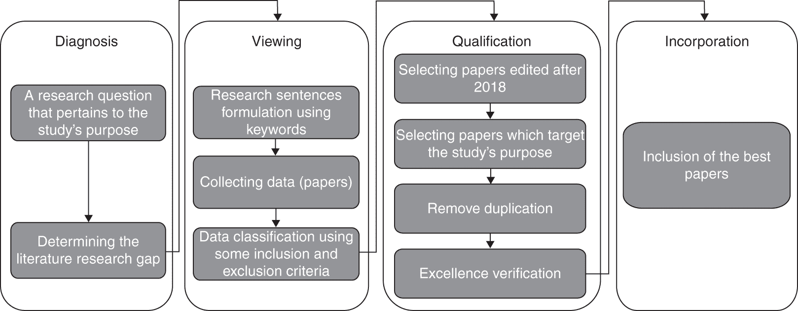
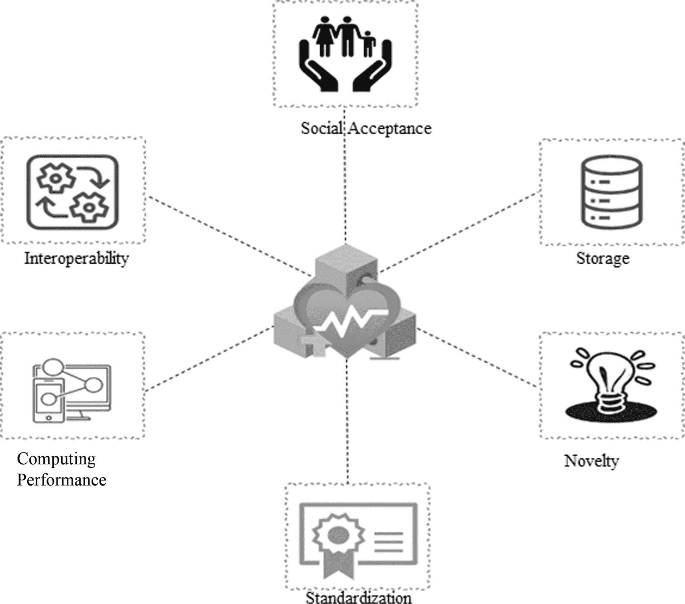
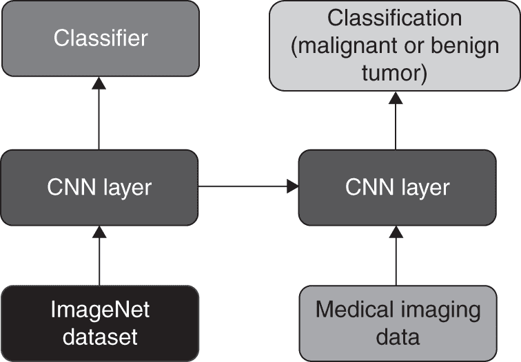
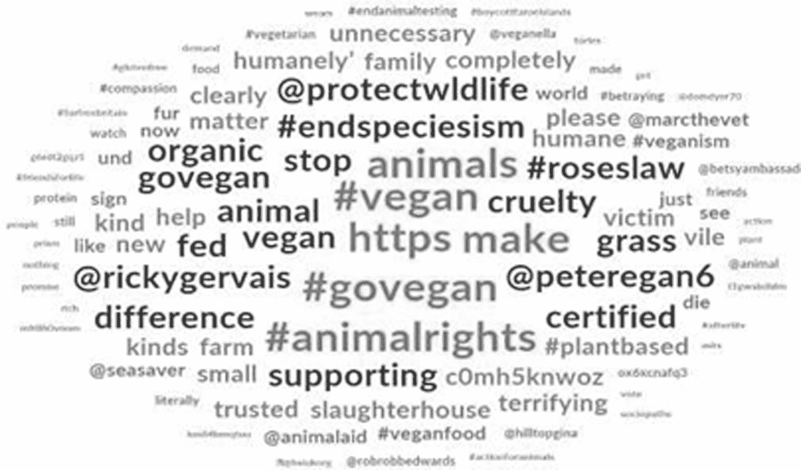
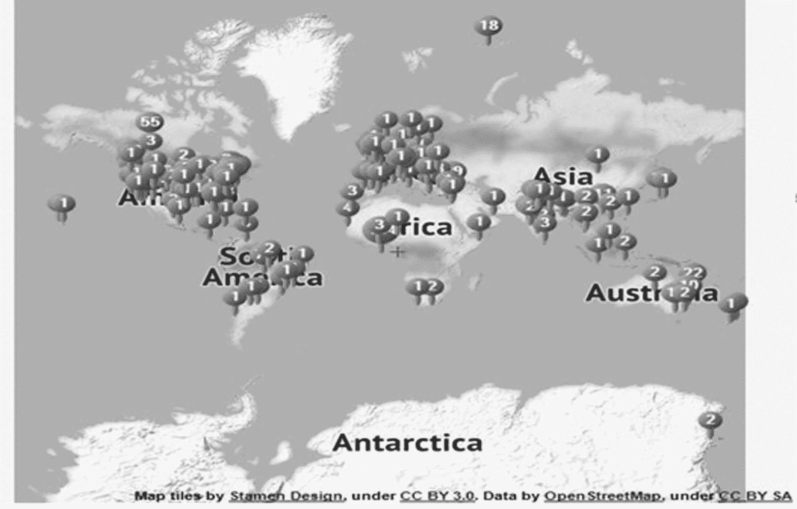
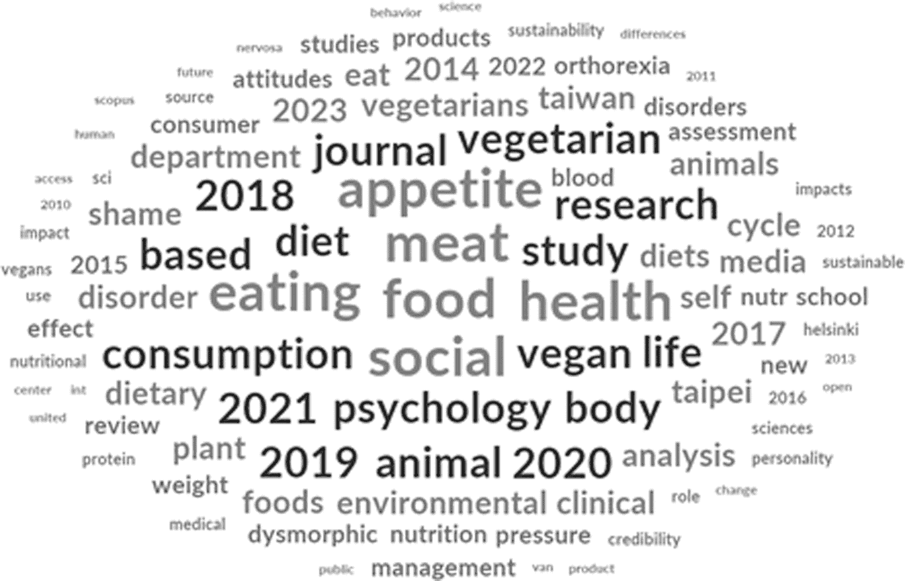
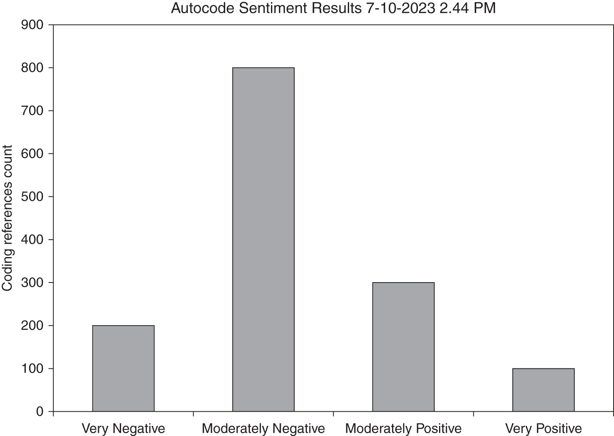
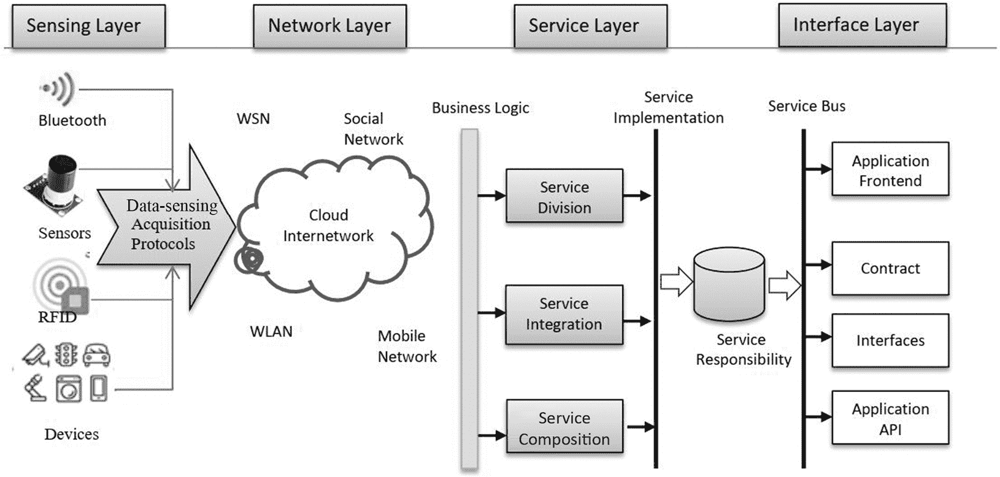
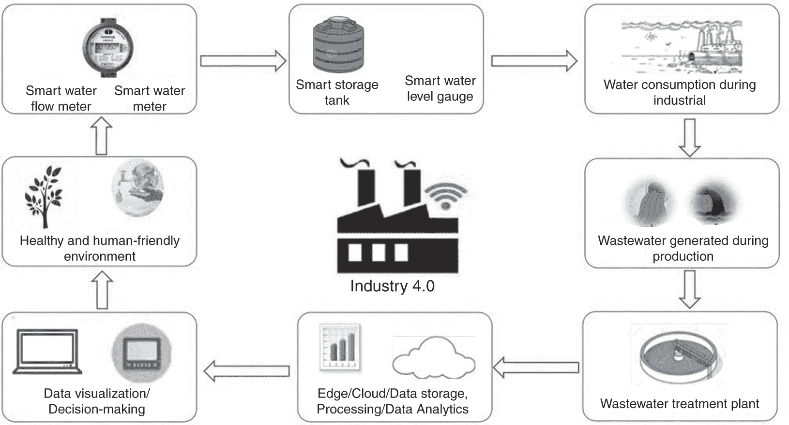
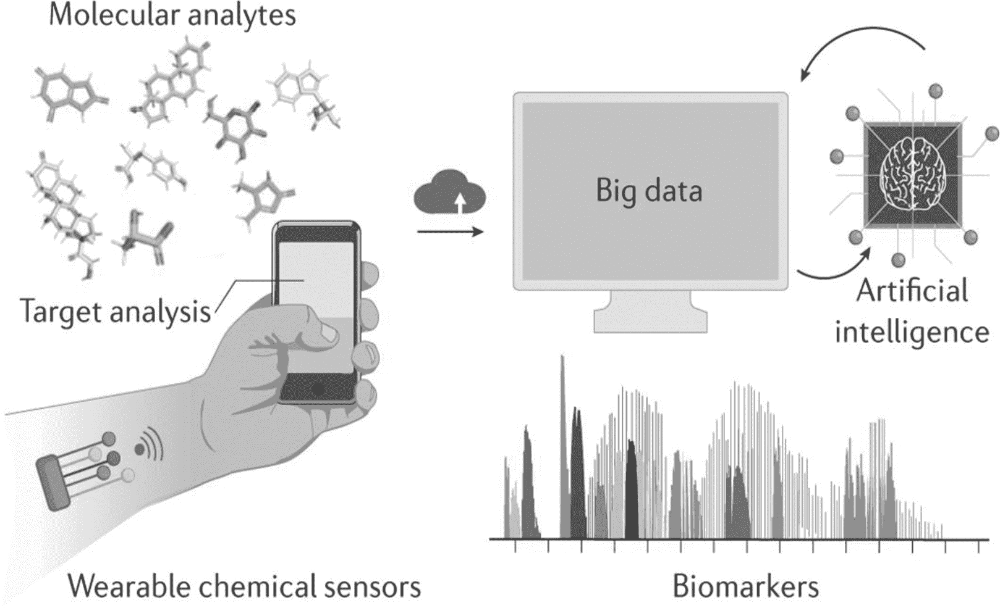

# 智能医疗中的物联网、机器学习与数据分析

献我亲爱的女儿 AZROUR Israe；

我希望你明天拥有今天所没有的。

# 贡献者

**Abdulatif Alabdulatif**

沙特阿拉伯布赖达，卡西姆大学计算机学院计算机科学系

**Ahmad El Allaoui**

STI 实验室，IDMS 团队，科学技术学院

**Fatima Amounas**

科学技术学院计算机科学系

**Mourade Azrour**

STI 实验室，IDMS 团队，科学技术学院

**Said Benkirane**

埃萨维尔高等学院

**Shikha Bhagat**

放射科系

**Amit Pratap Singh Chouhan**

博加普尔放射科系

**Souhayla Darga**

STI 实验室，IDMS 团队，科学技术学院

**Azidine Guezzaz**

埃萨维尔高等学院

**Jamal Mabrouki**

拉巴特，分子建模中心

**Swapna Patil**

VIT 博加普尔

**Rashmi Rai**

商学院

**Joyce Prabhudas**

护理学系

**Shilpa Sarvani**

商学院

**Anam Saleem**

护理学系

**Vandana Singh**

护理学系

**Ankush Verma**

放射科系

# 第一章 块链在医疗保健中的应用

## 1.1 引言

医疗保健是一个基础领域之一，对整个国际具有重大影响，并与每个国家的发展水平密切相关。

高效安全地管理和收集日常运营产生的海量患者数据是一项巨大的挑战。此外，基于物联网（`IoT`）的医疗系统（包括手持设备）正在产生大量的隐私数据。这些数据通常难以访问、缺乏标准且难以理解、部署和共享。此外，这些数据源自多个来源并存储在中心化系统中，使得管理和交换变得困难。

区块链是一个极具吸引力的研究课题，各个学科在过去几年中一直在利用其优势。因此，学术界、设计人员和专业人士产生了日益强烈和强大的热情。相应的，新的结构、新的系统和多个项目脱颖而出。比特币、以太坊和 `Hyperledger` 处于这些进展的前沿，它们都为区块链的各种问题做出了贡献。

本章其余部分的结构如下：在第二节中，我们提供了关于传统医疗系统和区块链的背景信息。在第三节中，介绍了已发表的相关。在第四节中，我们描述了本章采用的研究方法。第五节用于展示获得的结果及其讨论。最后一节对本章进行总结。

## 1.2 背景

### 1.2.1 传统医疗系统

健康数据处理是保护和处理患者登记的基本要素，旨在提供更有效的护理、高效追踪病理及其起源、为研究提供足够的医疗数据、开发新型且更有效的药物，并最终建立完善的预防体系。医院和医疗机构目前使用基于客户端/服务器架构的本地管理应用程序来管理患者医疗数据。然而，这些应用程序之间不共享数据，导致当专业人士和患者需要获取连贯的病史时，难以建立准确诊断。为了解决这个问题，研究人员和工业界设计了云端应用程序。虽然这些应用程序允许患者在云数据库中存储重要的医疗记录，但也带来了安全、数据丢失和隐私问题[28]–[31]。

### 1.2.2 区块链

区块链概念最早由比特币（第一种加密货币）的创造者 `Satoshi Nakamoto` 提出[19]。区块链是一种同时存储和传输交易的技术。它允许将一组数据块存储在交易账中。每个区块都与其前身关联，以形成一系列区块。在这种背景下，点对点网络保证了信息的通信。因此，区块链技术指的是分布式账本，它是安全且去中心化的共享。在过去的几年里，区块链在金融和银领域经历了异常增长。它现在正进入保证、能源、工业和医疗等其他领域。因此，区块链可用于各种应用，如在线投票系统、电子商务、社交网络、电子游戏、消息传递和在线学习。由于其去中心化、分布式和安全的特性，区块链在几乎每个领域都变得流行。事实上，由于系统是去中心化的，它不需要中央管理机构来治理。数据存储基于各个节点之间通过共识算法达成共同协议的过程。区块链为云计算中集中安全数据救援和共享的不同解决方案所带来的问题提供了答案。

## 1.3 相关工作

区块链是一项关键发明，在当今商业世界具有重要意义。它指的是在网络中扩散的重复交易数字记录。它可以作为一种难以被更改或黑客攻击的数据存储共享系统。最近，区块链技术已广泛应用于多个领域；使用该技术最具吸引力的领域之一是医疗保健。关于应用场景，智能医疗系统中存在三种区块链用例。第一种是数据记录和安全。第二种是 `IoMT` 与区块链的结合。第三种方案是使用区块链代替联邦学习的中央机构。在过去的几年，发表了许多关于区块链在医疗领域应用的综述研究。在 [23] 中，`Pranto Kumar Ghosh` 等对考虑区块链技术在医疗行业应用的论文进行了综述。该综述总结了 144 篇研究论文，说明了该技术在该领域的重要性，并强调了其局限性。首先，作者介绍了区块链及其特性的详尽背景。然后，他们专注于对指定的论文进行文献综述，这些论文突出了区块链支持的智能医疗中的当前主题。此外，他们介绍了区块链在几个应用领域提供的解决方案。最后，作者提出了问题和未来的研究方向。

同样，`Sadia Ramzan` [32] 等人介绍了基于区块链的医疗服务的概述。首先，介绍了广泛的介绍、历史、背景和区块链类型。然后，涵盖了该技术的动机以及使用它完成的医疗服务。该论文展示了区块链的潜力，识别了其挑战并强调了未来的研究方向。为了检查该领域的最新研究，`Valeria Merlo` 等人也提供了一份侧重于区块链在实际中应用的综述[33]。他们证明开放的研究问题是数据安全以及电子健康记录和诊断系统的实现。

`Suruchi Singh` 等提供了一份综述[34]，解释了区块链技术如何促进医疗记录管理并维护患者数据的完整性和隐私性。他们展示了使用这种技术的广泛应用，强调了其实施益处，特别是在医疗数据管理方面。然后，他们讨论了延迟这种技术在这些领域应用的各种重大挑战。最后，他们建议了许多其他待研究点。在 [35] 中，`Mohammad Salar Arbabi` 等利用系统分类和分析框架，对区块链支持的医疗解决方案的现状进行了深入概述。作者检查了 40 多个提供的解决方案，并根据功能组件、优势和问题对每个方案进行了分类。有许多研究综述了基于区块链的医疗解决方案的最新进展[36]–[40]。

## 1.4 研究方法

在本节中，我们概述了收集本次调查所需文献所遵循的步骤（图 1.1）。

```

```

图 1.1 文献综述遵循的步骤。

作为综述研究的第一步，根据要实现的目标，我们确定了要解决的三个问题，即确定区块链技术在医疗服务应用的研究现状。相应的，用于识别符合本研究目标的问题如下：

*   关于区块链在医疗主题应用的最新发表作品有哪些？

*   区块链应用在医疗管理中的不同目的是什么？

*   区块链应用在医疗管理中的挑战和问题有哪些？

为了产生理想的搜索查询，[41]–[43] 建议了一些措施来细分搜索查询，即通过区分某些标准（包括搜索分组、缩写和变体拼写），并通过布尔运算符进行组合。实现流程最终结果的各个步骤在以下章节中概述：

*   选择论文中的摘要和相关词。

*   基于逻辑运算符 `OR`、`AND` 或 `NOT` 构建搜索查询。

*   查找关键词、术语、缩写和同义词。

得益于详尽的检索序列，我们审查了大量的研究文章。为了实现这一目标，我们仅咨询了包含科学出版物的数据库，例如 `IEEE XPLORE`、`Science Direct`、`Springer`、`Taylor & Francis` 和 `MDPI`。以这些不同的来源为起点，我们特别筛选了 15 份研究文档。

## 1.5 结果与讨论

- 关于区块链在医疗领域应用的最新发表作品有哪些？

- 区块链在医疗管理中的不同目的是什么？

在本小节中，我们讨论了促使医疗领域使用区块链进行数据管理的原因；同时也介绍了区块链在该领域应用的各种目的。

如今，许多方面都支持在数据管理中使用区块链技术。首先，得益于物联网（`IoT`），特别是医疗物联网（`IoMT`），设备基本上通过传感器收集信息[[44]]。因此，传感器数量呈指数级增长，为创建需要新的高性能数据管理系统的全球传感器网络开辟了道路[[45]]。此外，这种基础设施瞬间产生高度异构的数据集，导致了所谓的“大数据”的发展。然而，传统的数据处理方法在处理海量数据时适应性不足，需要开发更严谨的数据处理系统。最后，基于客户端/服务器交换的遗留数据管理工具（目前用于医疗和物联网领域）极易发生偶发故障。此外，分布式网络的架构、协议和程序无法应对新的限制并满足不断变化的服务预期。再者，存储在不同服务器上的信息通常未加密，这构成了真正的安全风险，而基于区块链的系统采用了使用多种加密模式的数据存储机制。最后，在支持物联网的系统中，会进行在线和离线交易，传统的数据管理方法难以解决这些[[46]]。因此，有必要设计一种能够保证小数据包数据通信且不需要高带宽的新型数据管理模型。

### 1.5.1 患者数据存储

患者数据是指给定患者医疗记录的内容。此类数据可能包括与过去和现在的健康状况或疾病、治疗历史、生活方式习惯和遗传特征的相关信息[[47]]。它还可能包括生物识别数据，即任何可以通过机器或计算机测量的物理特征。因此，私有生成的数据量日益增长，如何以安全的方式存储它们成为一个新问题。因此，医疗服务提供者诉诸使用区块链。此外，区块链能够构建可靠且安全的存储基础设施。医疗档案记录管理仅仅是添加、删除、修改和查询的基础过程。然而，通过区块链，删除和修改这两个核心档案信息处理操作不再必要，从而减少了需要处理的信息量。区块链的技术设计提供了不可篡改性和数据安全的保障。此外，在区块链内部，每个信息块都记录了创建时间和上一个区块的哈希值[[48]]。

### 1.5.2 医疗图像共享

医疗图像共享涉及医院、诊所和患者群体之间医疗图像的电子交换。与传统媒体（特别是 `CD` 或 `DVD`，患者通常随身携带或邮寄接收）不同，新技术目前通过云计算促进了这些图像的交换[[49]]。

得益于区块链的图像共享可以通过公共共享或私有共享来实现。在公共区块链中，患者的交易详情被添加到区块链中，允许其他医疗系统可视化该患者的医疗图像[[50]]。然而，在私有区块链中，个人成员以及组织团体被授权查看患者的医疗图像。通过区块链，提供者之间的交易可以独立于任何第三方进行。允许医疗服务提供者和患者分别使用区块链网络传输和上传其数据，每个成员都可以访问一个通用、安全、实时的数据集。区块链提供了一种协作疾病诊断解决方案，可以完全访问患者的所有医疗影像数据[[51]]–53]]。这绝对允许对疾病进行更准确的检测和治疗[[54]]。

### 1.5.3 患者监测

区块链技术让医疗服务经理能够根据其需求定制设备[[55]]–[57]]。同时，医生可能会花费更多时间监测患者进展，并在出现任何健康问题时进行远程干预。区块链技术和医疗系统提供了随时监测温度状况，以及检查床位利用率和药物正确可用性的可能性。区块链维护着一个医疗服务网络，旨在为医疗机构和医疗服务提供者实施一致的数字识别。区块链与物联网技术的结合提高了响应速度和供应链透明度，使医疗物流运行更顺畅，并确保有效的患者监测[[58], [59]]。

### 1.5.4 区块链应用的挑战

区块链技术正在整合到医疗领域，这必须考虑特别的困难。医疗机构实施这种先进技术的主要障碍在于缺乏专业知识。事实上，区块链应用的发展仍然非常近期，研究和实施新技术需要付出巨大的努力。然而，该系统适用于医疗机构以及满足监管机构的要求。因此，医学和医疗保健可能会面临标准化问题。国际标准机构确实需要提供一组经过良好验证和认证的标准。医疗保健部门进行改进的时机已经到来。未来区块链在医疗领域的使用很可能会普及。这种技术创新将有助于医疗应用的发展，至少能够使人们更容易地解释治疗方案的效果和进展。

管理存储容量是使用区块链面临的挑战之一。事实上，区块链最初专门用于存储和利用交易数据，其范围受到限制，因此其存储不需要大量数据。然而，随着它扩展到医疗服务，存储问题显然出现了。

区块链正面临着与`互操作性`相关的挑战，换句话说，让由不同运营者或服务提供商设计的各种区块链应用程序能够以透明且适当的方式相互通信是非常的。因此，这一挑战影响了数据交换能力。

区块链技术仍在演进中，因此除了上述技术挑战外，还面临着`社会挑战`，包括文化挑战。事实上，一种与旧工作方式完全不同的技术永远无法被轻易接受和采用。即使医疗行业正在逐渐向数字化转型，但在完全采用这项技术之前还有很长一段路要走，特别是对于区块链这样一种临床标准尚未有效的技术。



图 1.2 区块链医疗应用的挑战。

## 1.6 结论与未来工作

如今，医疗领域正经历着巨大的演变。事实上，它利用了近期开发的`IoT`、`Machine Learning`、`blockchain`等技术。因此，医疗服务为医生和医疗服务提供者提供了远程且实时追踪患者的能力。此类技术的部署产生了大量且多样的患者数据，这些数据必须安全地存储和共享。随后，本章重点介绍了区块链在医疗领域的不同应用，并展示了该技术的优势与挑战。

## 参考文献

*   A. Clim, R. D. Zota, and G. Tinica, “居家医疗中的大数据：个性化医学的新前沿。医疗急救服务与高血压风险预测，”`International Journal of Healthcare Management`, vol. 12, no. 3, pp. 241–249, 2019.

*   M. Azrour, M. Ouanan, Y. Farhaoui, and A. Guezzaz, “Ye 等提出的物联网身份验证协议的安全分析，”in `Big Data and Smart Digital Environment`, `Springer`, 2019, pp. 67–74.

*   C. Hazman, A. Guezzaz, S. Benkirane, and M. Azrour, “lIDS-SIoEL: 使用集成学习的基于物联网智能环境安全入侵检测框架，”`Cluster Computing`, vol. 26, pp. 4069–4083, 2023.

*   M. Douiba, S. Benkirane, A. Guezzaz, and M. Azrour, “基于梯度提升和决策树的物联网环境安全异常检测模型，”`Journal of Reliable Intelligent Environments`, pp. 1–12, 2022. [`doi.org/10.1007/s40860-022-00184-3`](https://doi.org/10.1007/s40860-022-00184-3)

*   A. Guezzaz, M. Azrour, S. Benkirane, M. Mohyeddine, H. Attou, and M. Douiba, “一种基于机器学习的边缘 IIoT 轻量级入侵检测框架，”`International Arab Journal of Information Technology`, vol. 19, no. 5, pp. 822–830, 2022.

*   M. Douiba, S. Benkirane, A. Guezzaz, and M. Azrour, “一种使用决策树和梯度提升的改进物联网安全异常检测模型，”`Journal of Supercomputing`, pp. 1–20, 2022.

*   F. Subhan et al., “医疗保健中 AI 驱动的可穿戴医疗物联网：综述，”`Applied Sciences`, vol. 13, no. 3, pp. 1394, 2023.

*   N. Y. Philip, J. Rodrigues, H. Wang, S. Fong, and J. Chen, “用于家庭监控系统的物联网：当前进展与未来方向，”`IEEE Journal on Selected Areas in Communications`, vol. 39, no. 2, pp. 300–310, 2021.

*   H. H. Alshammari, “基于`MQTT`的物联网监控系统，”`Alexandria Engineering Journal`, vol. 69, pp. 275–287, 2023.

*   J. Srivastava, S. Routray, S. Ahmad, and M. Waris, “基于医疗物联网(IoMT)的智能医疗：趋势与进展，”`Computational Intelligence and Neuroscience`, vol. 20, pp. 1–17, 2022.

*   N. M. Kumar and P. K. Mallick, “用于物联网安全问题与挑战的区块链技术，”`Procedia Computer Science`, vol. 132, pp. 1815–1823.

*   D. Miller , “用于物联网安全问题与挑战的区块链技术，”`Procedia Computer Science`, vol. 132, pp. 1815–1823. (注：此处原文逻辑可能重复，已按格式保留)

*   C. Hazman , “什么是区块链？”`Health Informatics`, vol. 19, no. 2018.

*   M. Douiba, S. Benkirane, A. Guezzaz, and M. Azrour, “一种使用决策树和梯度提升的改进物联网安全异常检测模型，”`Journal of Supercomputing`, pp. 1–20, 2022.

*   A. Guezzaz, M. Azrour, S. Benkirane, M. Mohyeddine, H. Attou, and M. Douiba, “一种基于机器学习的边缘 IIoT 轻量级入侵检测框架，”`International Arab Journal of Information Technology`, vol. 19, no. 5, pp. 822–830, 2022.

*   M. Douiba, S. Benkirane, A. Guezzaz, and M. Azrour, “一种使用决策树和梯度提升的改进物联网安全异常检测模型，”`Journal of Supercomputing`, pp. 1–20, 2022.


F. Subhan 等，“AI 驱动的可穿戴医疗物联网：综述”，*Applied Sciences*，第 13 卷，第 3 期，页码 1394，2023 年。

N. Y. Philip, J. Rodrigues, H. Wang, S. Fong 和 J. Chen，“用于家庭监控系统的物联网：当前进展与未来方向”，*IEEE Journal on Selected Areas in Communications*，第 39 卷，第 2 期，页码 300–310，2021 年。

H. H. Alshammari，“基于`MQTT`的物联网监控系统”，*Alexandria Engineering Journal*，第 69 卷，页码 275–287，2023 年。

J. Srivastava, S. Routray, S. Ahmad 和 M. Waris，“基于医疗物联网(IoMT)的智能医疗：趋势与进展”，*Computational Intelligence and Neuroscience*，第 20 卷，页码 1–17，2022 年。

N. M. Kumar 和 P. K. Mallick，“用于物联网安全问题与挑战的区块链技术”，*Procedia Computer Science*，第 132 卷，页码 1815–1823。

M. Attaran，“医疗保健领域的区块链技术：挑战与机遇”，*国际医疗管理杂志*，第 15 卷，第 1 期，第 70–83 页，2022 年 1 月。DOI: [10.1080/20479700.2020.1843887](http://dx.doi.org/10.1080/20479700.2020.1843887)

E. M. Adere，“医疗保健与物联网中的区块链：系统文献综述”，*Array*，第 14 卷，页码 100139，2022 年 7 月。DOI: [10.1016/j.array.2022.100139](http://dx.doi.org/10.1016/j.array.2022.100139)

K. Abouelmehdi, A. Beni-Hessane 和 H. Khaloufi，“医疗大数据：维护安全与隐私”，*大数据杂志*，第 5 卷，第 1 期，第 1–18 页，2018 年。

M. Azrour, J. Mabrouki 和 R. Chaganti，“云-物联网中远程医疗系统的新型高效安全认证身份验证协议”，*安全与通信网络*，第 2021 卷，第 1–12 页，2021 年 5 月。DOI: [10.1155/2021/5546334](http://dx.doi.org/10.1155/2021/5546334)

R. Chaganti, M. Azrour, R. Vinayakumar, V. Naga, A. Dua 和 B. Bhushan，“一种用于医疗物联网入侵检测系统的粒子群优化和深度学习方法”，*可持续性*，第 14 卷，页码 12828，2022 年。

M. Azrour 和 J. Mabrouki，“用于评估冠病毒肺炎爆发的数据分析：机遇与挑战”，收录于*流行病学数据的智能建模、预测与诊断*，第 1 版。Boca Raton: Chapman and Hall/CRC，2021 年，第 47–62 页。DOI: [10.1201/9781003158684-3](http://dx.doi.org/10.1201/9781003158684-3)

S. Ramzan, A. Aqdus, V. Ravi, D. Koundal, R. Amin 和 M. A. Al Ghamdi，“使用区块链技术的医疗保健应用：动机与挑战”，*IEEE 工程管理汇*，页码 2874–2890，2022 年。

V. Merlo, G. Pio, F. Giusto 和 M. Bilancia，“关于医疗保健领域区块链技术的利用：系统性综述”，*专家系统与应用*，第 213 卷，页码 118897，2023 年。

S. Singh, S. K. Sharma, P. Mehrotra, P. Bhatt 和 M. Kaurav，“用于医疗保健系统高效数据管理的区块链技术：机遇、挑战与未来展望”，*材料今日：进展*，第 62 卷，页码 5042–5046，2022 年。

M. S. Arbabi, C. Lal, N. R. Veeraragavan, D. Marijan, J. F. Nygård 和 R. Vitenberg，“医疗保健区块链综述：挑战、收益与未来方向”，*IEEE 通信调查与教程*，第 25 卷，页码 386–424，2022 年。

P. Tagde 等，“电子健康中的区块链与人工智能”，*环境科学与污染研究*，第 28 卷，页码 52810–52831。

B. Farahani, F. Firouzi 和 M. Luecking，“物联网与分布式账技术的融合：机遇与解决方案”，*网络与计算机应用杂志*，第 177 卷，页码 10296，2021 年。

A. Haleem, M. Javaid, R. Singh 和 S. Rab，“医疗保健中的区块链应用：概述”，*智能网络杂志*，第 2 卷，页码 130–139，2021 年。

E. Chukwu 和 L. Garg，“医疗保健区块链的系统综述：框架与实现”，*IEEE Access*，第 8 卷，页码 21196–21214，2020 年。

A. H. Mayer, C. da Costa 和 R. daighi，“区块链中的电子健康记录：系统综述”，*健康信息杂志*，第 26 卷，第 2 期，页码 1273–1288，2020 年。

J. Khan 等，“通过余弦变换对智能医疗进行高效监控”，*智能与模糊系统*，第 40 卷，第 1 期，页码 1417–1442，2021 年。

C. Khan, E. Rutland, C. Wan 和 C. Thompson，“协作创新的分布式账本联盟”，*计算机*，第 50 卷，第 9 期，页码 29–37，2017 年。

S. Ahmad 等，“深度学习支持的安全医疗物联网”，*计算机与持续性*，第 73 卷，第 1 期，页码 965–979，2022 年。

S. Ahmad, M. Hasan, M. Shahabuddin, T. Tabassum 和 M. Allvi，“基于物联网的提醒与监控系统”，*计算机科学与网络杂志*，第 20 卷，第 7 期，页码 152–158，2020 年。

S. Nazir 等，“医疗大数据管理、分析与科学编程的综合分析”，*IEEE Access*，第 8 卷，页码 95714–95733，2020 年。

S. Ahmad, A. Alharbi, A. Zamani 和 M. Yousuddin，“物联网数据处理中的融合技术：智能医疗案例研究”，*计算机科学与网络杂志 (IJCSNS)*，第 20 卷，第 12 期，页码 131–137，2020 年。

M. El Khatib, S. Hamidi, I. Al Ameeri, H. Al Zaabi 和 R. Al Marqab，“医疗的数字化转型与大数据：机遇与挑战”，*临床与结果*，页码 563–574，2022 年。

Z. Sun, D. Han, D. Li, X. Wang, C.-C. Chang 和 Z. Wu，“基于区块链的医疗信息安全存储方案”，*EURASIP 无线通信与网络杂志*，第 2022 卷，第 1 期，页码 40，2022 年 4 月。DOI: [10.1186/s13638-022-02122-6](http://dx.doi.org/10.1186/s13638-022-02122-6)

M. Adnan, S. Kalra, J. C. Cresswell, G. W. Taylor 和 H. R. Tizhoosh，“医学图像分析的联邦学习与差异隐私”，*科学报告*，第 12 卷，第 1 期，页码 1953，2022 年。

R. Xu, S. Chen, L. Yang, Y. Chen 和 G. Chen，“使用区块链的去中心化自主影像处理”，收录于*多模态生物医学影像*，SPIE，2019 年 2 月，页码 72–82。DOI: [10.1117/12.2513243](http://dx.doi.org/10.1117/12.2513243)

J. Randolph 等，“基于区块链的医学图像共享与关键结果通知：一种新型框架”，收录于 2022 IEEE 第 46 届计算机、软件与应用会议 (COMPSAC)，美国加州洛斯阿米托斯：IEEE，2022 年 6 月，页码 1756–1761。DOI: [10.1109/COMPSAC54236.2022.00279](http://dx.doi.org/10.1109/COMPSAC54236.2022.00279)。

A. S. Tagliafico 等，“放射学研究与临床实践中的区块链：当前趋势与未来方向”，*放射学杂志*，第 127 卷，第 4 期，页码 391–397，2022 年。DOI: [10.1007/s11547-022-0460-1](http://dx.doi.org/10.1007/s11547-022-0460-1)

M. P. McBee 和 C. Wilcox，“区块链技术：医学影像中的原理与应用”，*数字影像杂志*，第 33 卷，第 3 期，页码 726–734，2020 年 6 月。DOI: [10.1007/s10278-019-0310-3](http://dx.doi.org/10.1007/s10278-019-0310-3)

H. Loukili 等，“结合多元回归和主成分分析评估空气污染对儿童呼吸道疾病的影响”，*国际信息技术杂志*，第 14 卷，第 3 期，页码 1305–1310，2022 年 5 月。DOI: [10.1007/s41870-022-00906-z](http://dx.doi.org/10.1007/s41870-022-00906-z)

Yoon, Hyung-Jin，“区块链技术与医疗保健”，*医疗信息研究*，第 25 卷，第 2 期，页码 59–60，2019 年。

O. Cheikhrouhou, K. Mershad, F. Jamil, R. Mahmud, A. Koubaa 和 S. R. Moosavi，“一种轻量级区块链与雾加密的安全远程患者监控系统”，*物联网*，第 22 卷，页码 100691，2023 年。

J. Hathaliya, P. Sharma, S. Tanwar 和 R. Gupta，“医疗 4.0 中基于区块链的远程患者监控”，见 2019 IEEE 9th International Conference on Advanced Computing (IACC), IEEE, 2019, pp. 87–91.

M. J. H. Faruk, H. Shahriar, M. Valero, S. Sneha, S. I. Ahamed 和 M. Rahman，“面向基于区块链的远程患者监控安全数据管理”，见 2021 IEEE International Conference on Digital Health (ICDH), IEEE, 2021, pp. 299–308.

P. Mamoshina 等人，“融合区块链与下一代人工智能技术以去中心化并加速生物医学研究与医疗保健”，*Oncotarget*，第 9 卷，第 5 期，页码 5665–5690，2018 年 1 月。DOI: [10.18632/oncotarget.22345](http://dx.doi.org/10.18632/oncotarget.22345)

# 第 2 章 用于医疗管理的深度学习

Ankush Verma, Amit Pratap Singh Chouhan, Vandana Singh, Sanjana Koranga 和 Mourade Azrour

DOI: [10.1201/9781003430735-2](http://doi.org/10.1201/9781003430735-2)

## 2.1 引言

人工智能（AI）是指模拟人类行为或思维的机器智能，这些机器可以通过专门编程和训练来解决某些挑战[[1]–[[4]]。AI 是机器学习和深度学习技术的强大结合。AI 模型基于海量数据集构建，能够生成智能决策。多年来，人工智能已应用于各个领域，如医疗[[5]–[[8]]，能量[[9]–[[12]]，农业[[13]–[[15]]，安全[[16]–[[20]]，营销[[21]]，交通[[22]]，水资源管理[[23]–[[27]]等。

在医疗领域，AI 正在通过对大量数据进行感知、处理和分析来迅速改变该行业，以改善患者效果、降低成本并加速流程。AI 已被应用于医疗管理的多个领域，从临床决策到行政任务。AI 正在被利用在该领域实施高性能、可靠的创新，这将有助于妥善管理为患有慢性疾病（特别是糖尿病、癌症、进食障碍或心脏病）的患者提供的护理。事实上，在分析和做出某些临床决策方面，AI 与传统方法相比具有许多优势。得益于 AI 算法，随着训练数据的吸收，设备变得更加准确，帮助人类更好地理解治疗、护理过程、诊断以及临床结果的多样性。

AI 正在快速应用于医疗管理，在改善患者护理的同时降低费用。AI 系统可以分析海量数据、发现趋势并生成预测，协助医疗提供人员做出智能决策。电子健康记录（EHR）是最应用之一。EHR 可用于患者进展、预测结果并提供个性化治疗方案。通过分析 EHR 数据，医疗提供人员可以识别风险患者并进行早期干预。此外，AI 驱动的 EHR 系统可以自动化调度和账单等行政任务，减轻医疗人员的负担。这使得人员能够更加关注患者护理，提高医疗服务的整体质量。

人工智能与医疗管理的整合具有改变医疗交付方式的潜力。随着技术的不断演进，AI 的作用可能会不断扩大，从而带来更高效、有效的医疗系统。本章将探讨 AI 在医疗管理中的各种应用，以及面临的挑战与机遇。

- 行政任务：预约调度、账单处理和保险理赔处理只是 AI 可以自动化的行政事务中的少数几项。这些任务可能耗时较长且容易出错，从而增加成本并降低效率。医疗机构通过自动化行政活动，可以降低成本、提高生产力，并释放人员以专注于患者护理[43]–[45]。

- 药物发现：AI 可以分析海量数据集以发现潜在的候选药物，并加速药物发现过程。AI 系统可以分析基因组和蛋白质组学数据以寻找新的药物靶点。AI 还可以预测新候选药物的疗效和毒性，减少临床前测试所需的时间和资金[46]–[48]。

- 患者监控：AI 可以通过穿戴技术远程监控患者的生命体征、活动水平和药物依从性。通过使用 AI 算法识别患者数据中的趋势和异常，医疗专业人员可以在问题严重化之前收到警报。远程患者监控的使用通过最大限度地减少住院和急诊室访问，可以降低医疗费用[49]–[52]。

### 表 2.1 AI 的某些医疗应用

| 应用 | 描述 | 参考文献 |
| --- | --- | --- |
| 医学影像 | AI 算法可以分析 X 光、MRI 和 CT 扫描等医学图像，以协助诊断疾病、发现异常，甚至预判疾病的进展。 | [36]–[39] |
| 电子健康记录 (EHRs) | AI 有潜力在患者数据录入、分类和组织等领域提高 EHR 的准确性和效率。它还可以帮助决策支持、预测临床结果和制定个性化治疗计划。 | [53]–[55] |
| 药物发现与开发 | AI 通过分析海量数据来寻找潜在的治疗靶点、预测药物疗效并创建新化合物，有助于加速药物发现过程。 | [46]–[48] |
| 远程患者监控 | AI 可以通过穿戴设备和其他传感器远程监控患者，告知医疗人员患者状况的任何变化并协助早期诊断和干预。 | [49]–[52] |
| 临床决策 | AI 可以协助医疗提供者做出临床决策，包括诊断、治疗计划制定和结果预测。这有助于改善患者预后并减少错误。 | [32]–[35] |

人工智能 (AI) 正在彻底改变医疗部门的运作方式，通过帮助增强和改进与医疗相关的一切方面，包括例行任务、数据分析和药物开发。由于医疗领域不断发展，它总是在寻找改进机会。因此，医疗提供者和企业都采用机器学习和 AI 并不意外。AI 在医疗领域应用的一些优势包括：

- 改善患者预后：AI 可以协助医疗专业人员在诊断和治疗方面做出更科学的决策，改善患者预后[49]。

- 降低医疗成本：通过提高效率、减少错误和消除不必要的治疗，AI 可以降低医疗开支。

- 个性化医疗：AI 可以分析患者数据，根据个人特征创建个性化治疗计划，从而实现更有针对性和更成功的治疗。

- 更快的药物发现：AI 可以通过识别潜在治疗靶点、预测药物疗效和毒性来协助药物发现过程。

虽然 AI 在医疗管理中潜力巨大，但必须克服各种障碍，包括：

- 数据隐私与安全：AI 需要访问大量患者数据，这引发了隐私和安全问题[56]。

- 伦理考量：AI 的应用可能会引发与医疗管理应用相关的伦理问题[57]。

- 缺乏标准化：AI 算法可能会产生偏见，引发与医疗管理应用相关的伦理问题[58]。

- 实施挑战：AI 在医疗管理中的应用可以带来患者预后改善、成本节省和效率提高等主要利益，但在实施方面存在各种困难[59]。

## 2.3 医疗人工智能中的伦理考量


AI 具有改变医疗管理的潜力，但其实施带来了基础性的伦理问题。数据隐私与安全、偏见与公平、开放与可解释性、问责与责任、知情同意以及监管都是医疗管理中重要的伦理考量[60]。医疗机构和 AI 开发者必须考虑到这些因素，以确保患者的安全、隐私和公平。这包括实施稳健的数据隐私和安全措施、监控并处理 AI 算法中的偏见、确保 AI 的透明度、对结果负责、获得患者知情同意并建立的监管框架和治理结构。解决医疗管理中的这些伦理问题对于发挥 AI 潜力同时最大限度减少对患者的风险至关重要[61]。

除了上述伦理考量外，在医疗管理中使用 AI 还存在几个更严重的问题。其中一个问题是由于 AI 系统自动化了传统人类的工作，可能会导致职业流失。这引发了关于医疗机构重新培训或帮助员工责任的问题。另一个问题是 AI 可能会放大目前医疗获取和结果方面的差距[62]。例如，如果 AI 系统的训练数据主要反映了某些人口群体的经验，那么它们对其他群体可能就无效。这强调了在数据收集和 AI 开发中确保多样性和包容性的重要性。

## 2.4 医疗管理中人工智能的未来

人工智能 (AI) 在医疗管理方面前景光明，许多可能的应用可能会改善患者预后并提高效率。预计 AI 将产生影响的主要领域包括：

- **诊断与治疗**：人工智能系统可以通过训练海量医疗数据来识别趋势并提供可靠的诊断。根据患者数据，AI 可能被用于建议药物并预测结果[63]。
- **患者监控**：AI 驱动的技术可以实时监控患者的健康状况，在问题变得严重之前向医疗提供者发出警报。
- **药物发现**：通过分析海量的医疗数据，AI 可以发现潜在的药物候选药物并简化药物开发流程。
- **医学影像**：AI 可以分析医学图像以识别潜在问题，或协助放射科医生进行诊断。
- **运营效率**：通过使用 AI，患者流转和人员配置等医院运营工作可以运行得更有效，成本也更低[64]。
- **个性化医疗**：AI 可以评估患者数据，根据遗传学、生活方式和病史等独特特征，制定定制化的治疗方案。

AI 在医疗管理中的未来也将面临重重困难，包括保护数据安全和隐私、解决 AI 算法中的偏差，以及确保 AI 决策的问责制和透明度。此外，随着 AI 在医疗管理中的普及，确保患者对其数据利用方式感到放心并知情这一点将至关重要[65]。

总而言之，AI 在医疗管理中的应用具有光明的前景，因为它拥有广泛的可能场景，可能会彻底改变医疗服务的提供方式。但为了充分利用 AI 的潜在优势，解决其应用带来的道德和现实问题将至关重要[66]。

## 2.5 案例研究：人工智能在医疗管理中的成功实施

在医疗管理中，成功部署人工智能（AI）的案例有很多。以下是几个案例研究示例：

- **IBM Watson 肿瘤科（IBM Watson for Oncology）**：这是一个名为`IBM Watson for Oncology`的 AI 驱动系统，通过分析医学数据为癌症患者提供个性化的治疗建议。在经过海量医学文献和实际患者数据的训练后，该系统可以根据患者的个人诊断和病史提供替代治疗方案。全球已有许多医院实施了`IBM Watson for Oncology`，研究表明该系统可以改善癌症患者的治疗决策和预后[67]。
- **Deep Mind 健康（Deep Mind Health）**：Deep Mind Health 是 Google Deep Mind 的部门，专注于开发用于医疗管理的 AI 系统。一个例子是`Streams`应用，它利用 AI 帮助医生检测急性肾损伤（AKI）患者。该应用对患者数据进行实时分析，并在检测到 AKI 迹象时警报医生，从而实现早期干预和更好的患者预后[68]。
- **斯坦福医学医学影像人工智能中心（The Stanford Medicine Centre for AI in Medicine & Imaging）**：斯坦福医学医学影像人工智能中心已将开发医疗管理的 AI 工具列为优先。例如，考虑`ChestX-ray14`算法，它可以分析胸部 X 光以发现 14 种常见的胸部疾病。该算法是在经过超过 10 万张照片训练后开发的，证明在识别肺炎和肺癌等疾病方面极其有效[69]。
- **马诸塞总医院（Massachusetts General Hospital）**：为了使手术室效率最大化，马诸塞总医院部署了一套由 AI 驱动的系统。为了更有效的排程和缩短患者等待时间，该系统使用机器学习预测手术时长，并估计准备和清理所需的时间[70]。

这些案例研究展示了 AI 如何通过多种方式改进医疗管理，包括更具针对性的治疗建议和提高运营效率。这些成就表明，尽管面临数据安全和隐私担忧以及决策透明化等挑战，AI 仍是改善患者预后和医疗交付现代化的强大工具。

## 2.6 结论

人工智能通过提高效率、准确性和患者预后，具有从根本上改变医疗管理方式的潜力。从临床决策支持到医学影像分析，AI 正日益应用于医疗的各个方面。AI 为医疗管理带来了许多优势，如增强准确性和精确度、提高效率、改善患者预后等。然而，为了充分实现 AI 在医疗管理中的潜力，还需要克服某些额外挑战。这些挑战包括确保患者数据的隐私和安全、解决 AI 算法中可能存在的偏差并确保问责制。总而言之，AI 在改变医疗管理方面具有巨大潜力，通过优先考虑数据隐私、解决偏差并与医疗专业人员合作，我们可以确保这些 AI 驱动的工具和系统在维护高标准安全和伦理实践的同时，改善患者预后。

## 参考文献

- B. Zhang, J. Zhu, and H. Su, "走向第三代人工智能," Science China Information Sciences, vol. 66, no. 2, pp. 121101, Jan. 2023. DOI: [10.1007/s11432-021-3449-x](http://dx.doi.org/10.1007/s11432-021-3449-x)
- N. Meenigea and V. R. K. Kolla, "探索医疗领域的人工智能现状," 持续发展期刊
- M. Azrour, "基于 K-Means 算法和特征选择的智能网络入侵检测," 计算机科学进展报告, 2019. DOI: [10.1016/procs.2019.027](http://dx.doi.org/10.1016/procs.2019.027)
- M. Mohy-edd, "用于物联网安全的高效新型认证协议," 多媒体工具与应用, 2023.
- J. Mabrouki, "基于云物联网系统的新型高效安全认证协议," 安全与通信网络, vol. 2021, pp. 1–12. DOI: [10.1155/2021/5546334](http://dx.doi.org/10.1155/2021/5546334)
- R. Sriranjani, M. D. Saleem, N. Hemavathi, and A. Parvathy, "基于机器学习的智能电网重放攻击检测方案," 发表于 2023 年 IEEE 国际学生电力、电气、电子与计算机科学会议 (SCEECS), IEEE, 2023, pp. 1–5。
- M. K. Boutahir, Y. Farhaoui, and M. Azrour, "用于太阳辐射预测的机器学习与深度学习应用综述：以摩洛哥为例的研究," 发表于 数字经济、业务分析与大数据分析应用，Springer, 2022, pp. 55–67。
- M. Mohy-eddine, A. Guezzaz, S. Benkirane, and M. Azrour, "物联网驱动的智能农业：安全问题与应用," 发表于人工智能与智能环境：ICAISE'2022, Springer, 2023, pp. 566–571。
- J. Mabrouki *et al*., "基于物联网的农业生产监测与控制智能系统," 发表于可持续环境的物联网与智能设备，Springer, 2022, pp. 103–115。
- J. Mabrouki, M. Benbouzid, D. Dhiba, and S. El Hajjaji, "用于农业生产监测与检测的物联网," 发表于 大数据、语义网与机器学习智能系统，Springer, 2021, pp. 271–282。
- A. Guezzaz, A. Asimi, A. Mourade, Z. Tbatou, and Y. Asimi, "用于监控网络流量的多层感知器分类器," 发表于 大数据与网络技术 3, Springer, 2020, pp. 262–270。
- A. Guezzaz, M. Azrour, S. Benkirane, M. Mohyeddine, H. Attou, and M. Douiba, "一种用于边缘工业物联网安全的机器学习轻量级混合入侵检测框架," 发表于 国际阿拉伯信息技术期刊, vol. 19, no. 5, 2022。
- A. Guezzaz, S. Benkirane, and M. Azrour, "用于物联网安全的新型异常网络入侵检测系统," 发表于可持续环境的物联网与智能设备，Springer, 2022, pp. 129–138。
- M. Douiba, S. Benkirane, A. Guezzaz, and M. Azrour, "基于梯度提升和决策树的物联网环境异常检测模型," 发表于可靠智能环境期刊，pp. 1–12, 2022. DOI: `https://doi.org/10.007/s40860-022-0184`
- H. Attou, A. Guezzaz, S. Benkirane, M. Azrour, and Y. Farhaoui, "基于机器学习的云端入侵检测," 发表于 数据挖掘与分析, vol. 6, no. 3, pp. 311–320。
- M. J. Castillo and H. Taherost, "人工智能技术对电子商务的影响," 发表于 百科书, vol. 3, no. 1, pp. 107–121。
- J. N. Njoku, C. I. Nwakanma, G. Amaizu, and D.-S. Kim, "元宇宙应用在数据驱动交通系统中的前景与挑战," 发表于 IET 交通系统, vol. 17, no. 1, pp. 1–21。
- J. Mabrouki, G. Fattah, S. Kherraf, Y. Abrouki, and S. El Hajjaji, "用于水处理监测与管理的人工智能系统," 发表于 物联网的新兴现实应用，CRC Press, 2022, pp. 69–87。
- M. Azrour, J. Mabrouki, G. Fattah, A. Guezzaz, and F. Aziz, "用于高效水质的机器学习算法," 发表于 地球系统与环境, vol. 8, no. 2, pp. 2793–2801, 2022。
- J. Mabrouki, M. Azrour, and S. E. Hajjaji, "利用物联网监测和评估水质：比较研究," 发表于 国际云计算期刊, vol. 10, no. 5–6, pp. 633–644, 2021。
- M. Mohy-Eddine, M. Azrour, J. Mabrouki, F. Amounas, A. Guezzaz, and S. Benkirane, "用于实时水监测的嵌入式 Web 服务器实现," 发表于 智能环境与能源先进技术，J. Mabrouki, A. Mourade, A. Irshad, and S. A. Chaudhry 编选，环境科学与工程。Cham: Springer Publishing, 2023, pp. 301–311. DOI: `10.1007/978-3-031-25662_24`
- J. Mabrouki *et al.*, "用于研究摩洛哥摩罕梅迪亚 chaâba el hamra 水资源的地理信息系统," 发表于 人工智能与智能环境：ICAISE'2022, Springer, 2023, pp. 469–474。
- W.-C. Lin, J. S. Chen, M. F. Chiang, and M. R. Hribar, "人工智能在眼科电子健康记录数据中的应用," 发表于 视觉科学与技术, vol. 9, no. 2, pp. 13–13, 2020。
- B. Wang *et al.*, "用于 COVID-19 筛查的 AI 辅助 CT 图像分析：构建与部署医疗 AI 系统," 发表于 应用软计算, vol. 98, pp. 106897, Jan. 2021. DOI: `10.1016/j.asoc.2020.106897`
- M. R. King, "人工智能在医学中的未来：来自聊天机器视角," 发表于 生物医学工程杂志, vol. 51, no. 2, pp. 291–295.
- M. Chen and M. Decary, "医疗保健中的人工智能：健康者的指南," 发表于 健康管理论坛, Los Angeles: SAGE, 2020。
- S. Romero-Brufau, K. Wyatt, P. Moore, "用于临床成像的人工智能," 发表于 医学信息期刊, vol. 137, 10472, 2020。
- F. Mabrouki *et al*., T. N. Hanna, "放射科中的人工智能：实践意义," 发表于 医学信息杂志, vol. 28, no. 1, pp. 128–134, 2019。
- S. Montani and M. Striani, "临床支持的人工智能：重点文献," 发表于 医学信息杂志, vol. 28, no. 1, pp. 120–127, 2019。
- H. Haick, N. Tang, "医学传感器的人工智能," 发表于 ACS Nano, vol. 15, no. 3, pp. 3557–3567, 2021。
- S. Tripathi, T. H. Musiol, "基于人工智能成像的公平性与伦理," 发表于 改进成像技术的研究论文，IGI Global, 2023, pp. 79–90.
- D. Zheng, X. He, and J. Jing, "乳腺癌影像人工智能概述," 发表于 临床医学杂志, vol. 12, no. 2, pp. 419, 2023.
- N. V. Salastekar, C. Maxfield, E. A. Krupinski, D. Heitkamp, and L. J. Grimm, "美国放射科医师的人工智能/机器学习教育多中心调查," 发表于 学术放射学, vol. 30, pp. 1481–1487, 2023.
- C. Mello-Thoms and C. A. Mello, "放射学中的临床应用," 发表于 英国放射杂志, vol. 96, 20221031, 2023.
- N. J. Schork, "人工智能与个性化医学," 发表于 癌症精准治疗, vol. 178, pp. 265–283, 2019.
- H. Sotoudeh *et al.*, "胶质瘤管理中的人工智能：个性化医学时代," 发表于 前沿肿瘤学, vol. 9, 768, 2019.
- J. Potočnik, S. Foley, and E. Thomas, "人工智能在医学影像实践中的当前与潜在应用：叙述性回顾," Journal of Medical Imaging and Radiation Sciences, vol. 54, no. 2, pp. 376–385, 2023.
- C. Vendrami, G. Gatineau, E. Shevroja, O. Lamy, and D. Hans, "人工智能在骨质疏松症管理中有作用吗," Revue Medicale Suisse, vol. 19, no. 823, pp. 752–755, 2023.
- Y. Y. Aung, D. C. Wong, and D. S. Ting, "人工智能的承诺：医疗领域人工智能机遇与挑战回顾," British Medical Bulletin, vol. 139, no. 1, pp. 4–15, 2021.
- R. S. K. Vijayan, J. Kihlberg, J. B. Cross, and V. Poongavanam, "用人工智能增强临床前药物发现," Drug Discovery Today, vol. 27, no. 4, pp. 967–984, 2022.
- J. Jiménez-Luna, F. Grisoni, N. Weskamp, and G. Schneider, "药物发现中的人工智能：近期进展与未来展望," Expert Opinion on Drug Discovery, vol. 16, no. 9, pp. 949–959, 2021.
- J. Jiménez-Luna, F. Grisoni, and G. Schneider, "可解释人工智能辅助药物发现," Nature Machine Intelligence, vol. 2, no. 10, pp. 573–584, 2020.
- T. Shaik *et al.*., "利用人工智能进行远程患者监测：现状、应用与挑战," Wiley Interdisciplinary Reviews: Data Mining and Knowledge Discovery, vol. 13, no. 2, pp. e1485, 2023.
- A. Sujith, G. S. Sajja, V. Mahalakshmi, S. Nuhmani, and B. Prasanalakshmi, "基于深度学习和人工智能的智能健康监测系统性回顾," Neuroscience Informatics, vol. 2, no. 3, pp. 100028, 2022.
- P. N. Ramkumar *et al*., "利用移动健康进行全膝关节置换术远程患者监测：基于可穿设备和机器学习的监测平台验证," The Journal of Arthroplasty, vol. 34, no. 10, pp. 2253–2259, 2019.


* J. Hathaliya, P. Sharma, S. Tanwar, and R. Gupta, “医疗 4.0 中基于区块链的远程患者监测，”in 2019 IEEE 第 9 次国际高级计算会议 (IACC), IEEE, 2019, pp. 87–91.
* Y. Mintz and R. Brodie, “医学中的人工智能导论，”Minimally Invasive Therapy & Allied Technologies, vol. 28, no. 2, pp. 73–81, 2019.
* Y. Zhou, F. Wang, J. Tang, R. Nussinov, and F. Cheng, “人工智能在 COVID-19 药物重用中的应用，”The Lancet Digital Health, vol. 2, no. 12, pp. e667–e676, 2020.
* S. M. Lauritsen *et al.*., “用于从电子健康记录预测急性危重病的可解释人工智能模型，”Nature Communications, vol. 11, no. 1, pp. 3852, 2020.
* H. Alami *et al.*., “医疗保健领域人工智能的组织准备工作：决策与实践的启示，”Journal of Health Organization and Management, vol. 35, no. 1, pp. 106–114, 2021.
* J. S. Lim *et al.*., “眼科领域人工智能的新型技术与隐私保护技术，”Current Opinion in Ophthalmology, vol. 33, no. 3, pp. 174–187, 2022.
* T. A. D’Antonoli, “人工智能的伦理考量，”Diagnostic and Interventional Radiology, vol. 26, no. 5.
* Z. Alami and D. Jones, “新冠肺炎（COVID-19）爆发与智能城市的通用数据，”Healthcare, 2020.
* A. Khan, S. Iezadi, M. Goettler, and J. Wise, “医疗保健中人工智能的组织、专业和患者相关特征，”Health Policy and Technology, vol. 11, no. 1.
* S. M. Carter, E. Frazer, and N. Shami, “人工智能在乳腺癌治疗中的伦理、法律和社会影响，”The Breast, vol. 49, pp. 25–32, 2021. 2021.
* D. Shah, M. Watson, E. Holloway, “在医疗保健中实施机器学习：，”New England of Medicine, vol. 378, no. 11, pp. 981–983, 2018.
* E. Strickland, L. Bezak, and C. Holloway, “人工智能从驾驶辅助到患者安全，”Engineering, vol. 56, no. 4, 2019.
* G. Rong, A. Mendez, and B. Sawan, “算法时代的人工智能，”Health and Technology, vol. 7, no. 4, pp. 351–367, 2017.
* S. Dash, M. Sharma, and S. Kaushik, “医疗保健中的大数据，”Journal of Data, vol. 6, no. 1, pp. 1–25, 2020.
* J. Powles, H. Hodson, “Google DeepMind 与算法时代的医疗，”Bulletin of the World Organization, vol. 98, no. 4, 2020.
* S. Yeung, N. Downing, L. Fei-Fei, and A. Milstein, “从驾驶辅助到患者安全，”New England of Medicine, vol. 378, no. 14, pp. 1271–1273, 2018.
* J. A. Álvarez López, “人工智能应用的案例研究，”Artificial Intelligence for Business: Innovation, Tools and Practices, Springer, 2022, pp. 141–157.

# 第 3 章 使用深度学习技术探索肺癌病理

Swapnali Patil 和 D. Lakshmi

DOI: 10.1201/978103430735-3

## 3.1 引言

在全球，主要的公共健康问题是癌症。历史上，癌症是一种致命性疾病。即使在今天技术进步的时代，如果不能早发现，癌症仍然是毁灭性的。如果及早发现，可以挽救许多生命。癌症有许多不同类型，但肺癌是死亡率最高的癌症（癌症统计）。早期发现肺癌对提高生存率很有帮助。它还能节省生命、时间和资金。85%的肺癌病例是由长期使用烟草引起的。每五分之一到十分之一的病例包括从不吸烟的人（WHO 世界卫生组织数据库，2023）。

肺癌主要分为小细胞肺癌（SCLC）和非小细胞肺癌（NSCLC）。NSCLC 占肺癌病例的 85%。NSCLC 还可进一步主要分为腺癌（ADC）、鳞状细胞癌（SCC）和大细胞癌（LCC），分别约占 40%、30%和 15%（肺癌类型）。

在过去的二十十年里，人工智能（AI）和机器学习（ML）算法已变得日益重要，能够帮助人们并提高他们分析不稳定数据以及对其做出稳定判断的能力。使用这些最新技术，可以在肺癌早期阶段发现它。大多数针对非小细胞肺癌（NSCLC，Wu & Zhao 2017）的研究论文发明了一种新型基于神经网络的算法——熵退化法（`EDM`）来检测小细胞肺癌（SCLC）。输入的 CT 图像由国家癌症研究所提供。该算法实现的准确率为 77.6%。通过大量的训练数据和更深的网络结合 `CNN`，可以改进所提出的方法。

肺癌诊断涉及临床专家使用的三种不同方法：成像技术、生物标志物分析以及细胞病学或组织病理学分析。

### 成像诊断方法

利用多种成像诊断方法来识别肺癌。这些技术包括胸部射线（`CXR`）、计算机断层扫描（`CT`）、磁共振成像（`MRI`）和正电子发射层扫描（`PET`）。传统的 `CXR` 成像对于检测肺部异常（如肿瘤或结节）有效。`CT` 扫描提供详细的肺部横断面图像，能够识别和表征肺肿瘤。`MRI` 扫描利用强大的磁铁和无线电波产生详细的肺部图像，有助于评估肺癌及其扩散。`PET` 扫描使用放射性示踪剂来突出代谢活动异常的区域，辅助肺癌的检测和分期（McLoud 2002）。

### 生物标志物分析

生物标志物衡量疾病的进展或存在。生物标志物分析在检测和诊断癌症（包括肺癌）中起着重要作用。它涉及两种生物标志物：遗传生物标志物和血液生物标志物。可以使用聚合酶链反应（`PCR`）或二代测序（`NGS`）等技术分析 `EGFR` 或 `ALK` 突变等遗传突变，以检测肺癌并指导治疗决策。此外，还可以分析血液中的生物标志物（如循环肿瘤细胞和循环肿瘤 DNA），以检测肺癌并监测治疗反应（Issaq et al. 2011）。

### 细胞病学和组织病理学分析

可以通过细胞病学或组织病理学图像进行肺癌诊断。细胞病学诊断可以通过细胞病学或组织病理学图像完成。

深度卷积网络（`DCNN`）使用了`convolution layers`、`pooling layers` 和全连接层。`DCNN` 用于分类各种癌症。`DCNN` 用于识别`benign`和`malignant`特征。`DCNN` 用于`image augmentation`。`DCNN` 用于分类各种癌症。`DCNN` 用于识别 `SCC` 和 `SCLC`。

对抗网络（`GAN`）用于创建合成图像。渐进增长 GAN（`PGGAN`）用于高分辨率图像。`GAN` 用于分类。

卷积神经网络（`CNN`）和 `Swin transformers` 用于肺癌。`mask R-CNN` 用于识别肺细胞。`Swin transformers` 模型用于分类。

组织病理学涵盖多种技术，包括组织活检和分子……样本用于……`Resnet50` 用于分类。

免疫组化学（`IHC`）染色用于检测特定蛋白。`... 荧光原位杂交（`FISH`）或多基因面板可识别遗传变异（Coudray et al. 2018）。

组织病理学分析在检测和诊断癌症中起着重要作用。然而，它也面临一些影响结果准确性和可靠性的挑战。为了应对这些挑战，引入 `AI` 和 `DL` 可能有助于病理学家做出更精确、更一致的诊断（Lindquist et al. 2022）。

## 肺部 PET/CT 诊断

数据集中包含肺癌患者的 CT 和 PET/CT 图像（DICOM 格式），以及指定肿瘤位置的文件（XML 标注）。这些图像获取自怀疑患有肺癌的患者，这些患者随后接受了肺部活检和 PET/CT 扫描。带有字母“A”的患者被诊断为腺癌（ADC），“B”为小细胞肺癌（SCLC），“E”为大细胞肺癌（LCC），“G”为鳞鳞细胞肺癌（SCC），并附有他们的姓名/ID。（Wiki）

## 肺癌数据集

可以获取用于识别肺癌的诊断信息，包括基因特征、基因表达模式和唾液基因中的生物标志物指示，以及非小细胞肺癌（NSLC）和小细胞肺癌（SCLC）之间的区别。（BioGPS）

## 肺部病理图像

该数据集包含 25,000 张病理图像，分为五类不同的类别，即：肺 ADC 良性组织、肺 SCC、肺 ADC、结肠 ADC、结肠良性组织（Kaggle）

## LIDC-IDRI

它包含低剂量 CT（LDCT）肺癌筛查。（LIDC）

## NLST

它提供肺癌的 LDCT 筛查。（NLST）

## TCIA

它提供各种肺癌数据集，包括 CT 扫描、PET 扫描和病理图像。（癌症影像存档）

## LIDC/IDRI

它提供肺结节的 CT 扫描以及放射学家提供的相关标注。（LUNA 16 大挑战赛）

## 3.3 方法论

尽可能检测肺癌的传统机器学习（ML）和深度学习（DL）系统包括数据获取、预处理、分割、特征提取和构建分类模型等步骤，如图图 3.1

图 3.1 基于机器学习的肺癌检测系统。

### 3.3.1 预处理

数据预处理是机器学习工作流中的关键步骤。执行了各种数据预处理步骤，如数据归一化、数据清洗、调整大小和肺图像分割，以提取感兴趣区域（ROI）（Bandyopadhyay 2019）。高斯滤波和 Gabor 滤波、自适应高斯滤波、Wiener 滤波和 CLAHE 等各种后处理技术广泛用于图像数据分析。文本数据集的预处理将包含缺失值、不一致值和重复值的原始数据转换为清洗数据集。数据清洗技术列在图 3.2

图 3.2 数据清洗技术。

在运行分类算法之前有效利用预处理技术可以提高分类模型的精度。为了实现这一改进，使用预处理方法创建了 9 个数据集，并应用了种机器学习分类方法。根据结果，在精度方面，K-近邻（`KNN`）方法优于 `RF`（随机森林）、`NB`（朴素贝叶）、逻辑回归、`DT`（决策树）和 `SVM`（支持向量机）。使用与肺癌相关的数据评估了预处理方法的性能。最佳预处理方法是：归一化方法使用 `Z-score` 准确率为 83%，降维方法使用主成分分析准确率为 87%，特征选择方法使用信息增益准确率为 71%（Gültepe 2021）。

### 3.3.2 不平衡数据

不平衡分类数据是指类别大小倾斜的数据。占据数据大部分的类别是多数类，而占人口比例较小的类别是少数类。在医学决策中，经常观察到数据不平衡问题。如果在不平衡数据集上训练模型效果良好，那么工作就完成了。如果没有，则为了处理不平衡数据，会使用下采样或上采样技术。

用于解决不平衡数据问题使用了增强型 `SVM`。该技术将使用多个分类器的优点与针对非均匀数据的代价敏感 `SVM` 结合起来。此外，为了获得决策规则，从增强型 `SVM` 中描述了一种基于 Oracle 的方法。然后通过将其性能与其他处理不平衡数据的算法进行比较，评估该方法的质量。最后，增强型 `SVM` 用于医学领域，以估计肺癌患者术后的预期寿命（Zięba et al. 2014）。

为了提高机器学习模型的预测性能，作者建议了一种用于处理不平衡数据的工程化上采样策略（`ENUS`）。实验结果证明，当少数类与多数类的比例小于 20% 时，使用 `ENUS` 训练模型可以提高准确率、敏感度和 F1 分。研究还发现使用 `ENUS` 的 `XGBoost Tree`（XGBTree）性能最佳（Tran et al. 2022）。

由于患者隐私、疾病稀有性和手动收集数据等原因，构建医学图像数据集是一项辛苦且困难的任务。通过增强解决了数据不足和数据不平衡的问题。它通过数据扭曲或过采样人为增加数据集的大小。在保留标签的同时转换图像。这包括图像混合、特征空间增强和神经风格迁移。生成对抗网络（`GANs`）（Shorten & Khoshgoaar 2019）。

### 3.3.3 分割

分割是图像处理中最重要的部分。将完整图像分为许多部分使其更具相关性且更容易理解。当这些不同部分连接时，它们将覆盖整个图像。图像的许多属性也可能对分割产生影响，可能是颜色或纹理。在去噪之前进行分割以恢复原始图像。分割的主要目标是减少信息以便分析。通常，它分为基于区域、基于边缘、阈值、基于特征聚类和基于模型的分割（Yogamangalam & Karthikeyan 2013）。

通过特殊技术，特征可以从信号或图像中自动提取。算法或深度网络（`DN`）的使用消除了人工交互自动特征提取的需求。当你需要快速从收集原始数据过渡到开发`ML`算法时，这种方法非常有用。

随着 `DL` 的兴起，`DN` 的前层很大程度上承担了特征提取的角色，尽管主要用于图像数据。

图像分析技术被用于肺癌的特征提取和肺癌肿瘤检测。为了提取特征，使用了图像处理技术。所采用的方法包括获取 CT 肺图像，然后对 CT 肺图像进行预处理（重缩、图像增强、背景去除、中值滤波）。图像分割使用边缘检测技术完成。特征提取使用了灰度级共共生矩阵（`GLCM`）。分析了基于纹理的特征。提取的特征支持肺部组织异常的诊断（Alayue et al. 2022）。

作者推荐了一种主要分五个步骤进行的方法。

* **步骤 1**：从肺癌数据库中收集图像。
* **步骤 2**：在第二步中使用中值滤波技术进行预处理。中值滤波保留了边缘，即保留了锐利特征。
* **步骤 3**：使用模糊 C 均值对目标进行分割，因为它比 `K-means` 聚类性能更好。
* **步骤 4**：使用 `GLCM` 提取特征。`GLCM` 具有高判别准确率，但计算速度慢（自相关、对比度、相关性、簇显著性、簇阴影、差异、能量、熵和同质性）。
* **步骤 5**：将提取的特征交给 `SVM` 分类器进行肺癌分类。`SVM` 分类器在检测肺癌类型方面达到了 96.7% 的准确率（Ankita et al. 2019）。

研究针对 CT 图像进行了早期肺癌检测。使用了一种新型的加速封装二进制人工蜜蜂算法（`AWB-ABC`）结合特征提取和改进的 `NB` 分类器。最初，使用 `MMSE` 技术消除背景噪声，以获得改进的肺结节视觉图像。使用 `AWB-ABC` 算法对肺癌结节进行特征选择，随后使用改进的 `NB` 分类器进行有效分类（Karthiga & Rekha 2020）。

大多数专家认为 DNA 甲基化是哺乳动物基因组癌症发育过程中最重要的表观遗传标志物。由于 DNA 甲基化数据存在大量噪声，预测准确性受到影响。通过利用依赖属性选择和提取技术的混合方法得到了解决方案。它利用过滤属性选择方法（`F-score`）并引入了提取模型。该模型采用平均甲基化密度峰、快速傅里叶变换算法以及样本甲基化密度对称性作为特征提取方法。使用多种 `ML` 算法（如 `NB`、`RF` 和 `SVM`）在混合和不混合的情况下进行分类。所提方法提高了分类准确率（Raweh et al. 2018）。

### 3.3.5 迁移学习

在没有足够的训练数据时，使用迁移学习方法可以提高模型效率并缩短训练时间。由于模型已经过预训练，使用迁移学习可以用较少的训练数据生成良好的 `ML` 模型。在使用少量训练数据的迁移学习中，由于很难获得大量的训练数据，因此通过预训练模型创建高效的 `ML` 模型。图 3.3 展示了带有迁移学习模型的通用流程。



图 3.3 带有迁移学习模型的通用流程。

`GoogleNet` —— 视觉图像分析中最先进的 `CNNs` 之一 —— 经过精确调整并应用于肿瘤恶性分类领域。之前的研究训练了简单的特定任务的 `CNNs` 或过时的预训练网络，而该系统增加了收敛率和其性能指标。换句话说，更短的训练时间产生了更好的预测结果。此外，应用 `MIPs` 将 3D CT 扫描的多视图信息组合成 RGB 图像，这与微调后的 `GoogleNet` 相似。`MIPs` 使系统能够完整学习恶性特征的特征（Fang 2018）。

为了加速处理，研究人员建议使用带有丢弃层的深度神经网络（`DNN`）。通过比较预训练架构 `AlexNet`、`GoogleNet` 和 `ResNet50`，`ResNet50` 产生了最好的准确率（Sajja et al. 2019）。

### 3.3.6 使用 ML 和 DL 技术进行肺癌分类

`ML` 技术如 `NB` 分类器、`DT` 分类器、逻辑回归、`RF` 和 `SVM` 用于肺癌的分类。`DL` 技术如多层感知器（`MLP`）、人工神经网络（`ANN`）、`CNN`、反向传播神经网络、概率神经网络、`SVM` 和循环神经网络（`RNN`）用于识别和分类。`ML` 和 `DL` 技术的使用可以克服病学家短缺的局限性，具有高准确率并节省了时间。从肺癌数据集使用 `ML` 预测侧重于为消费者提供早期预警，使他们节省金钱和时间。从肺癌数据集优化检测过程的 `SVM` 算法被高效使用（Anil Kumar et al. 2022）。


多种方法被用于诊断早期的癌症。`ML` 算法在这项工作中检测肺癌结节时进行了比较。为了发现异常，作者使用了主成分分析、K-近邻（`KNN`）、`SVM`、`NB`、`DT` 和 `ANN` 等 `ML` 方法。所有方法都在预处理前后进行了比较。测试结果显示，`ANN` 在图像处理后表现最好，准确率为 82.43%，`DT` 在不预处理的情况下表现最好，准确率为 93.24%（Günaydin et al. 2019）。

该研究论文提供了关于使用 `CNN` 对三种最常见的肺癌类型进行分类的信息。为了分类，训练并优化了多种 `CNN` 架构，如 `VGG16`、`InceptionV3` 和 `InceptionResNetV2`。在各种架构中，`InceptionV3` 在训练集上给出了更优分类准确率，因此它被用于测试集。论文中的结果强调了 `CNN` 图像分类模型的局限性（Kriegsmann et al. 2020）。

提出了一种用于早期检测肺癌肺结节的新型 `CADe` 系统。该方法包括原始数据的预处理、特征提取、提取特征的优化，以及最后基于优化后的特征向量进行分类。对于相关的特征选择，它使用了迁移学习技术。该新型 `CADe` 系统的准确性已通过测试，结果在肺癌早期检测中显示出良好的前景（Hekal et al. 2021）。

进行了代谢组学研究以识别用于肺癌诊断的代谢物生物标志物。使用快速相关滤波（`FCBF`）技术确定代谢生物标志物特征的重要性。将六种不同的 `ML` 算法应用于生物标志物特征以早期检测肺癌。在六种不同的 `ML` 算法中，`NB` 显示出更高的准确率（Xie et al. 2021）。

### 3.3.7 混合模型

混合模型或融合模型是多种组合以改进结果，而集成模型是多种方法的结合。混合 `ML` 和 `DL` 模型可以作为支持临床决策的工具。混合模型可以整合成像和非成像数据，并分别应用 `DL` 和 `ML` 模型。

研究目的是对 CT 图像进行新的定量特征分析。然后研究了其在预测术后 I 期非小细胞肺癌（NSCLC）患者复发风险中的作用，结合两个基因生物标志物，即切除交叉互补 1 基因的蛋白表达和核糖磷酸还原酶亚基（`RRM1`）。使用计算机辅助检测（`CAD`）技术分离肺肿瘤。在胸部 CT 图像上计算的肿瘤相关图像属性、基于图像特征的朴素贝叶斯网络分类器以及利用基因生物标志物的 `MLP` 分类器经过训练，以预测术后癌症复发。两个分类器提供的预测分融合极大提升了预测性能（Emaminejad et al. 2015）。

提供了一个 `DNN` 模型和使用云系统收集的数据用于划分肺病阶段，以分类肺肿瘤进展的不同阶段。作为 PET/CT 图像的融合方法，建议系统使用了托管在云端的肺肿瘤检测器和阶段分类器（`Cloud-LTDSC`）。建议的 `Cloud-LTDSC` 使用主动轮廓模型进行肺肿瘤分割，并设计且验证了多层卷积神经网络（`M-CNN`）用于识别不同肺癌阶段，使用了标准基准图像（Kasinathan & Jayakumar 2022）。

在该研究中，使用了 `DCNN` 模型如 `AlexNet`、`GoogLeNet`、`VGG16` 和 `ResNet50` 来分类 `ADC`、`SCLC` 和 `SCC`。应用了 `SVM`、`RF` 和 `NN` 等 `ML` 模型。`DCNN` 模型的准确率分别为 74.0%、66.8% 和 74.0%。`DCNN` 模型将准确率提高到 75.1%、77.5%、78.2% 和 78.9%（Tsukamoto et al. 2022）。

### 3.3.8 评估指标

为了评估 `ML` 和 `DL` 模型，考虑了 `accuracy`（准确率）、`precision`（精确率）、`recall`（召回率）、`F-measure`（F 值）和 `AUC`（Dritsas & Trigka 2022）。混淆矩阵。它包含真阳性（`TP`）、真阴性（`TN`）、假阳性（`FP`）和假阴性（`FN`）的值。

```
accuracy = (TP + TN) / (TP + TN + FP + FN)
precision = TP / (TP + FP)
recall = TP / (TP + FN)
specificity = TN / (TN + FP)
F-measure = 2 * (precision * recall) / (precision + recall)
AUC = 0 到 1 之间的值。
```

`accuracy` 作为一种评估指标，衡量了正确预测实例的比例。`recall` 也称为真阳性率，衡量模型识别样本的能力。`precision` 是衡量质量的指标，而 `recall` 评估了正确预测样本的数量。`F-measure` 是 `precision` 和 `recall` 的调和平均数。`AUC` 衡量模型区分类别的性能。

表 3.2 总结了 2022 年和 2023 年发表论文的方法论、数据集、性能指标和未来范围。

**表 3.2 2022 年、2023 年发表论文的比较**

| 作者 | 数据集 | 模型 | 性能指标 | 未来范围 | 结果 |
| :--- | :--- | :--- | :--- | :--- | :--- |
| `Dritsas & Trigka (2022)` | 309 名参与者的共 15 个属性 | 监督 `ML` 模型（如 `NB`、`BayesNet`、`SGD`、`SVM`、`LR`、`ANN`、`KNN`、`RotF`、`AdaBoostM`） | `RotF` 提供了更好的准确率、精确率、召回率和 F 值 97.1%，`AUC` 为 99.3% | 研究中使用 `LSTM` 和 `CNN` 模型 | 二分类分类 |
| `Xu et al. (2022)` | 河北大学附属医院和公共数据集（90 名患者，619 张 CT 图像） | `ISANET` 使用了基于 `InceptionV3` 的通道注意空间注意力机制 | 对于两个数据集，`ISANET` 的准确率分别为 95.24% 和 98.14%，优于其他 `CNN` 模型 | 分类为 `SCC` 和 `ADC` |
| `Dwivedi et al. (2023)` | 使用 `tcga_dataset` | 可解释人工智能 (`XAI`) 基的 `DL` 框架（`IntegratedGradients`、`GradientsSHAP` 和 `DeepLIFT`）、自动编码器、前馈神经网络和生物标志物发现模块 | 准确率 95.75% | 需要分析多组学数据 | 发现了 52 个 NSCLC 生物标志物 |
| `Nageswaran et al. (2022)` | 70 名患者 83 张 CT 图像 | 图像处理和 `ML` 技术：用于分类的 `ANN`、`KNN` 和 `RF` | `ANN` 提供了更好的分类性能 | 在更多患者身上进行分类 | 二分类 - 正常或恶性 |
| `Pandian et al. (2022)` | 来自钦奈买 Sathybama 医院的 CT 图像 | 使用 `GoogleNet` 和 `VGG-16` CNN 模型 | 准确率- 98% 特异性- 99% F1 分数 98% 敏感性- 99% | 用于分类的其他成像技术 | 二分类 正常或异常 |
| `Kasinathan& Jayakumar (2022)` | 94 个个人的 PET/CT 扫描 | LC-Cloud 系统框架；用于分类的多层卷积神经网络 (M-CNN) | 准确率: 97% | 目标是在考虑成本和安全问题的同时，并发分析超过 65 名用户 | 癌症分期分类 |
| `Alshmrani et al. (2023)` | 来自公共数据集的 80,000 张胸部 X 光 (CXR) 图像 | `VGG19` + `CNN` 模型 | 损失- 0.1792 准确率- 96.48 精确率- 97.56 AUC- 99.82 F1- 95.62 召回率- 93.75 | 两种方法-1. CT 扫描图像与 CXR 图像的结合，2. 严重程度分类 | 五种不同类型肺疾病的多分类分类 |
| `Bishnoi & Goel (2023)` | 三类数据集：1. 1009 名患者 TCGA 数据集 2. 来自 LC25000 的 5000 张图像 3. CPTAC 组织病理图像 | 基于颜色的膨胀卷积神经网络 (CD-CNN) | 准确率 – 0.988，AUC- 0.974 | 提出的模型可以在其他模态图像上训练 | 多类分类 |
| `Manju et al. (2023)` | 153 个人的 MRI 扫描 | 深度波自动编码器 (DWAE-DNN) | 精确率 – 98.42 敏感性- 100 | 执行多类分类 | 二分类- 恶性或正常 |
| `Said et al. (2023)` | 3D CT 扫描数据 | 基于 `UNETR` 网络的分割；使用自监督神经网络进行分类 | 分割准确率- 97.83%，分类准确率- 98.77% | 提出的模型计算密集型，因此可以部署在云系统或本地系统上 | 二分类 良性或恶性 |
| `Humayun et al. (2022)` | 110 例病例的 CT 扫描 | `CNN` | 准确率 `VGG 16` – 98.83% `VGG 19` – 98.05% `Xception` – 97.4 % | 将 CT 扫描数据与其他临床数据整合以获得更高的清晰度 | 正常、良性、恶性 |
| `Wankhade & Vigneshwari (2023)` | 来自 LIDC/IDRI 数据集的 LUNA 16 CT 扫描图像 | 混合神经网络 (RNN + 3D – CNN) | 选择性- 90% 敏感性- 87% 准确率 – 95% | 使用大数据分析和级联分类器以提高效率 | 良性和恶性 |

## 3.4 讨论

癌症是身体少数细胞发生破坏性增殖并扩散到其他器官的疾病。细胞通常通过细胞分裂生长和延伸，产生新细胞以修复旧的和受损的细胞。然而，这种机制会被破坏，导致异常细胞不受控地生长，形成可能是恶性的肿瘤。肺癌是一个大问题，因为其存活率低，而且通常在后期才发现。尽管技术取得了许多进步，使用机器学习 (ML) 和深度学习 (DL) 早期检测肺癌仍然是一个活跃的研究领域。在本文中，我们回顾了用于肺癌早期检测 ML 和 DL 模型。DL 算法在分析大量数据具有巨大潜力。DL 和 ML 模型的融合显示出更高的准确性。

DL 模型协助病理学家和医生通过缩短将肿瘤分类为恶性或良性的时间，并为扩展性提供更好的支持来提高效率。**我们需要考虑的问题是：** 模型性能取决于数据的可用性和质量。这些肺癌的自动预测系统容易产生假阴性结果，这在医学领域是一个大问题。在医学诊断中使用 DL 带来了关于患者隐私和数据安全的伦理关注。技术的更好选择取决于几个因素：收集收集的数据类型、数据样本的数量以及时间限制。根据许多研究人员的发现，总结是：多维异构数据的整合，结合特征选择和分类的不同方法，为肺癌疾病的推断提供了宝贵的工具。

## 3.5 结论

DL 在探索肺癌诊断和早期预测方面发挥着重要作用。数据被接受了……

## 参考文献

*   Pandian et al. (2022) | 来自钦奈买 Sathybama 医院的 CT 图像 | 使用 `GoogleNet` 和 `VGG-16` CNN 模型 |
*   Kasinathan& Jayakumar (2022) | 94 个个人的 PET/CT 扫描 | LC-Cloud 系统框架；用于分类的多层卷积神经网络 (M-CNN) |
*   Alshmrani et al. (2023) | 来自公共数据集的 80,000 张胸部 X 光 (CXR) 图像 | `VGG19` + `CNN` 模型 |
*   Bishnoi & Goel (2023) | 三类数据集：1. 1009 名患者 TCGA 数据集 2. 来自 LC25000 的 5000 张图像 3. CPTAC 组织病理图像 |
*   Manju et al. (2023) | 153 个人的 MRI 扫描 | 深度波自动编码器 (DWAE-DNN) |
*   Said et al. (2023) | 3D CT 扫描数据 | 基于 `UNETR` 网络的分割；使用自监督神经网络进行分类 |
*   Humayun et al. (2022) | 110 例病例的 CT 扫描 | `CNN` |
*   Wankhade & Vigneshwari (2023) | 来自 LIDC/IDRI 数据集的 LUNA 16 CT 扫描图像 | 混合神经网络 (RNN + 3D – CNN) |
*   [Alay, Y. (2022)] | 来自肺的分类和突变预测
*   [Alshmrani, G. M. (2023)] | 胸部 X 光的检测和分类
*   [Ankita, R. (2019)] | 使用 GLCM 和 `SVM` 的肺癌图像
*   [Bandyopadhyay, S. K. (2019)] | 脑图像的预处理和分割
*   [Chen, Y. (2022)] | 使用 `swin transformer` 的肺细胞检测和分类
*   [Chui, K. T. (2023)] | 多轮迁移学习和改进的生成对抗网络
*   [Coudray, N. (2018)] | 使用深度学习从非小细胞肺癌病理图像进行分类和突变预测
*   Deepapriya, B. S., Kumar, P., Nandakumar, G., Gnanavel, S., Padmanaban, R., Anbarasan, A. K., & Meena, K. (2023). 用于肺癌预测的深度学习技术性能。Soft Computing, *27*(13), 9191–9198.
*   Dritsas, E., & Trigka, M. (2022). 基于机器学习模型的肺癌风险预测。Big Data and Cognitive Computing, *6*(4), 139.
*   Dwivedi, K., Rajpal, A., Rajpal, S., Agarwal, M., Kumar, V., & Kumar, N. (2023). 一种非小细胞肺癌分类的解释性 AI 驱动生物标志物发现框架。Computers in Biology and Medicine, *153*, 106544.
*   Emaminejad, N., Qian, W., Guan, Y., Tan, M., Qiu, Y., Liu, H., & Zheng, B. (2015). 融合定量图像和基因生物标志物以改进早期肺癌患者的预后评估。IEEE Transactions on Biomedical Engineering, *63*(5), 1034–1043.
*   Fang, T. (2018, August).一种基于 `GoogLeNet` 迁移学习和中值强度投影的新型计算机辅助肺癌检测方法。2018 IEEE 计算机与通信技术国际会议 (CCET) (pp. 286–290). IEEE.
*   Gültepe, Y. (2021). 使用不同分类算法的肺癌预测方法的性能。Computers, Materials & Continua, *67*(2), 2015–2028.
*   Günaydin, Ö., Günay, M., & Şengel, Ö. (2019, April). 肺癌检测算法的比较。2019 电子-电子与生物医学工程与计算机科学科学会议 (EBBT) (pp. 1–4). IEEE.
*   Hekal, A. A., Elnakib, A., & Moustafa, H. E. D. (2021). 自动化早期乳癌检测与分类系统。Signal, Image and Video Processing, *15*, 1497–1505..
*   Huang, H., Zheng, D., Chen, H., Wang, Y., Chen, C., Xu, L., & Li, W. (2022). 基于深度学习的 CT 图像与临床变量融合用于预测 I 期肺腺癌的浸润风险。Medical Physics, *49*(10), 6384–6394.
*   Humayun, M., Sujatha, R., Almuayqil, S. N., & Jhanjhi, N. Z. (2022, June). 一种用于肺癌分类的卷积神经网络迁移方法。Healthcare, 10(6), 1058. MDPI.
*   Issaq, H. J., Waybright, T. J., & Veenstra, T. D. (2011). 癌症生物标志物发现：分析方法中的机会与陷阱。Electrophoresis, *32*(9), 967–975.
*   Karthiga, B., & Rekha, M. (2020). 用于早期肺癌检测的 CT 图像特征提取和 I-NB 分类。Materials Today: Proceedings, *33*, 3334–3341.
*   Kasinathan, G., & Jayakumar, S. (2022). 使用深度学习技术的云端肺肿瘤检测和分期分类。BioMed Research International, *2022*, 1–17.
*   Kriegsmann, M., Haag, C., Weis, C. A., Steinbuss, G., Warth, A., Zgorzelski, C., & Kriegsmann, K. (2020). 用于小细胞和非小细胞肺癌分类的深度学习。Cancers, *12*(6), 1604.
*   Lindquist, K. E., Ciornei, C., Westbom-Fremer, S., Gudinavici, I., Ehinger, A., Mylona, N., & Brunnström, H. (2022). 活检肺肿瘤的困难：病理学家之间的一致性研究。Journal of Clinical Pathology, *75*(5), 302–309.


## 参考文献

*   Manju, A., Kaladevi, R., Hariharan, S., Chen, S., Kukreja, V., Sharma, P., Wang, J. (2023). 使用深度神经网络的早期早期诊断。Computers, Materials and Continua, *76*, 993–1007.
*   McLoud, T. (2002). 肺癌诊断和分期的影像技术。Clinics in Medicine, *23*(1), 123–136.
*   Nageswaran, S., Arunkumar, G., Bisht, A., Mewada, S., Kumar, J., Jawarneh, M., Asenso, E. (2022). 机器学习肺癌分类。
*   Pandian, R., Vedanarayanan, V., Kumar, D., Rajakumar, R. (2022). 使用`CNN`进行肺癌检测和分类。Sensors, *24*, 1058.
*   Raweh, A., Nassef, M., Badr, A. (2018). 基于 DNA 甲基化的癌症预测混合特征选择与提取。IEEE Access, *6*, 1521–1523.
*   Said, Y., Alsheikhy, A., Shawly, T., Lahza, H. (2023). 基于深度学习架构的肺癌医学影像。Diagnostics, *13*(3), 546.
*   Sajja, T., Devarapalli, R., Kalluri, H. (2019). 使用深度学习进行`ct`扫描肺癌检测。Traitement du Signal, *36*(4), 339–344.
*   Shorten, C., & Khoshgoaar, T. M. (2019). 深度学习数据增强综述。Journal of Big Data, *6*(1), 1–48.
*   Teramoto, A., Tsukamoto, T., Kiriyama, Y., Fujita, H. (2017). 使用深度卷积网络自动分类肺癌类型。BioMed Research International, 2017, 1–6.
*   Teramoto, A., Yamada, A., Kiriyama, Y., Tsukamoto, T., Yan, K., Zhang, L., Fujita, H. (2019). 使用深度卷积网络自动分类良性和恶性性细胞。Informatics in Medicine Unlocked, *16*, 100205.
*   Teramoto, A., Tsukamoto, T., Yamada, A., Kiriyama, Y., Imaizumi, K., Saito, K., Fujita, H. (2020). 肺细胞学分类的深度学习方法：通过生成网络对实际和合成图像进行两步训练。PloS One, *15*(3), e022951.
*   Tran, T., Le, U., Shi, Y. (2022). 用于不平衡数据癌症预测的有效上采样方法：基于机器学习的比较分析。Plos One, *17*(5), e0269135.
*   Tripathi, P., Tyagi, S., Nath, M. (2019). 肺癌检测分割技术的比较分析。Pattern Recognition and Image Analysis, *29*, 167–173.
*   Tsukamoto, T., Teramoto, A., Yamada, A., Kiriyama, Y., Sakurai, E., Michiba, A., Fujita, H. (2022). 额外分类器的微调深度卷积神经网络肺癌细胞学图像自动分类比较。Asian Pacific Journal of Cancer Prevention: APJCP, *23*(4), 1315.
*   Wankhade, S., & Vigneshwari, S. (2023). 使用神经网络早期肺癌的新型混合深度学习方法。Healthcare Analytics, *3*, 100195.
*   WHO Database (2023): `www.who.int/news-room/fact-sheets/detail/lung-cancer`
*   Wu, Q., & Zhao, W. (2017, October). 使用监督机器学习算法检测小细胞肺癌。2017 计算机科学与智能控制国际会议 (ISCSIC) (pp. 88–91). IEEE.
*   Xie, Y., Meng, W. Y., Li, R. Z., Wang, Y. W., Qian, X., Chan, C., & Leung, E. L. H. (2021). 机器学习方法发现早期肺癌诊断生物标志物。Translational Oncology, *14*(1), 100907.
*   Xu, Z., Ren, H., Zhou, W., & Liu, Z. (2022). ISANET：基于 CNN 和注意力机制的非小细胞肺癌分类与检测。Biomedical Signal Processing and Control, *77*, 103773.
*   Yogamangalam, R., & Karthikeyan, B. (2013). 图像处理中的分割技术比较。*工程与技术国际期刊 (IJET)*, *5*(1), 307–313.
*   Zięba, M., Tomczak, J. M., Lubicz, M., & Świątek, J. (2014). 应用于肺癌患者术后预期寿命预测的从不平衡数据中提取规则的增强 SVM。*应用软计算*, *14*, 99–108.

# 第 4 章 智能医疗中的工智能

Ankush Verma, Anam Mohamed Saleem, Joyce Prabhudas Ranadive, Amit Pratap Singh Chouhan 和 Vandana Singh

## 4.1 引言

人工智能（AI）已经影响了多个领域，其进入智能医疗领域为未来医疗服务的交付留了巨大潜力。通过将尖端技术引入医疗保健行业，智能医疗寻求改善患者的治疗效果、优化治疗方案并加速行政流程。AI 驱动的算法能够快速、准确地处理海量医疗数据，例如患者信息、医学影像和研究文章。通过在早期阶段识别疾病并提供个性化的治疗方案，人工智能（AI）有助于实现更快速、更有效的治疗，可能拯救无数生命。AI 在有效管理医疗资源方面已证明了其价值[1––2]。AI 系统可以使用预测性分析估计患者需求，改进医院运营并战略性地分配资源，确保患者获得及时且有效的护理。这不仅提高了整体医疗服务的质量，还减轻了医疗机构和医疗人员的压力。得益于基于 AI 驱动的可穿戴设备和物联网（IoT）技术的结合，可以实时监测患者的生命体征和健康指标[3]。因此，通过允许远程患者监测，可以进行及时干预并避免医疗危机 4–[5]。此外，AI 驱动的虚拟助手和聊天机器人通过解决问题、提供医疗指导和组织预约，为患者提供全天候的帮助，提高了医疗服务的可用性和易及性。随着智能医疗领域 AI 的和成熟，数据保护、法律合规性和伦理等问题必须得到解决。AI 驱动的智能医疗的成功将很大程度上依赖于维护患者隐私以及确保伦理且透明的 AI 实践[6––7]。慢性疾病的预测模型已经开发出来，这是 AI 驱动的智能医疗的重要进展之一。AI 可以通过跟踪患者的健康数据并将其与生活方式信息融合，预测患者患某种疾病的概率。通过这种主动方法，医疗专业人员可以……

智能医疗代表了由人工智能（AI）力量推动的颠覆性转变。这种模式转变利用了 AI 快速有效分析海量医疗数据的能力，从而改进了诊断结果、实现了个性化治疗方案以及主动的疾病预防[22–24]。智能医疗领域已准备好提供更有效、更负担负担且以患者为中心的解决方案，从预见疾病爆发的预测性分析到持续记录生命体征的可穿戴技术。随着 AI 的进一步发展，将其整合到医疗系统中有望通过使患者护理更加个性化、准确化且易于获取，从而彻底改变医疗行业。

一场由智能医疗领首的技术革命正由人工智能（AI）驱动，它具有无与伦比的潜力。通过利用 AI 快速分析和解释海量医疗数据的能力，这种革命性的变化正在彻底改变医疗保健的面貌[25–27]。先进的算法和机器学习使得 AI 驱动的智能医疗系统能够提供快速精准的诊断，发现人类执业者可能会遗漏的趋势，并简化个性化治疗路径的创建。通过可穿戴技术和远程监控工具，患者可以在诊所之外积极参与到健康管理中。技术与医疗的融合具有改进预防措施、优化医疗人员工作流，并最终以前所未有的规模改善患者效果的可能性。

智能医疗是医疗行业的一种范式转变，得到了人工智能（AI）革命性潜力的支持。这场革命涉及医疗流程的重塑以及技术的深度整合[28–31]。AI 在快速处理数据方面的惊人能力使得疾病早期诊断、准确诊断以及个性化治疗计划的制定均成为可能。AI 与医疗的融合也适用于远程医疗，其中带有 AI 驱动虚拟健康咨询的聊天机器人提供了易于获取且快速的医学建议。此外，预测性分析有助于健康机构提前规划流行病、有效分配资源并开发预防措施。得益于可穿戴技术的出现，患者现在可以主动监测自己的健康参数，这促进了预防性护理文化。尽管仍然存在数据隐私和伦理关注等问题，但由 AI 驱动的智能医疗时代为变革医疗程序、改善患者体验并最终提高全球健康水平提供了无与伦比的前景[32–33]。

## 4.3 利用 AI 实现高效医疗成像与诊断

医疗领域的一个重大进展是使用 AI 进行有效的医疗成像和诊断。通过利用人工智能，医疗成像程序获得了无与伦比的精度和速度。在 X 光、MRI 和 CT 扫描等成像检查中，AI 系统可以快速分析细微细节，发现人类肉眼可能会忽略的微小异常[34–36]。这不仅加速了诊断过程，还降低了人为错误的概率。由 AI 驱动的医疗成像系统可以从海量数据集中学习，逐渐提高其诊断准确性。通过利用增强的洞察力，这项技术使放射科医生和能够做出做出判断并提供详细的治疗建议。

随着 AI 的发展，它转型医疗成像和诊断的潜力是无限的，能够提供更快速的诊断、更低的医疗成本以及最终更好的患者效果。医疗领域的一个重大进展是将 AI 应用于医疗成像和诊断[37–39]。这种结合为医疗执业者实现了无与伦比的准确性和效率。例如，`MRI`、`CT` 和 `PET scan` 图片可以被 AI 算法快速有效地分析，从而实现疾病的早期。深度学习使 AI 系统能够不断提高对图像中模式的理解，从而导致更准确的诊断。这项改变游戏的技术不仅加速了诊断，允许更早地开始治疗，还将放射科医生和医生从繁琐的工作中解放出来。通过提供深度见解，AI 充了有益的第二意见[41–41]。

AI 的计算能力可用于快速准确地分析和解释医学图像。AI 算法非常擅长识别复杂模式，有助于早期诊断传统技术难以发现的异常。这减少了遗漏的可能性，同时也加快了诊断过程。AI 驱动的系统不断从海量数据集中学习，随着时间的推移提高诊断准确性[42–43]。在 AI 的帮助下，医疗执业者可以提供个性化的治疗计划、合理分配资源并优化其工作流。随着 AI 技术的发展，它具有重塑医疗成像和诊断的无限潜力，提供更好的患者护理、高效资源利用以及解决医疗问题的新策略。

## 4.4 AI 驱动的预防性医疗预测性分析

AI 驱动的预测性分析通过利用先进算法和大数据的力量，在健康风险恶变为严重病情之前进行预测和缓解，正在彻底改变预防医疗的格局[44]。这种领先的方法利用人工智能、机器学习和预测建模的结合来识别模式、检测异常并预测人群和个体的健康趋势。通过分析广泛的医疗记录、生活数据、遗传信息和环境因素，AI 驱动的预测性分析有望将医疗保健从响应系统转变为主动系统，关注早期干预和维持健康的个性化策略。

AI 驱动的预测性分析在预防性医疗中最大的优势之一，是其利用历史患者数据预测未来健康结果的能力。传统的医疗系统通常依赖于病史的回顾性分析，导致检测潜在健康风险的延迟。然而，AI 算法可以检查海量数据，以识别人类临床医生可能无法察觉的微妙关联。例如，个人的电子健康记录结合来自可穿戴设备和生活习惯的数据，可用于预测糖尿病、心血管问题甚至心理健康障碍等疾病的概率。通过识别指示疾病早期阶段的模式，医疗提供者可以定制干预措施和治疗计划，以防止疾病恶化[45–47]。

AI 驱动的预测性分析促进了个性化医疗策略，这种策略承认每个人都是独特的，他们的健康之旅也各不相同。通过分析基因信息、家族史和生活方式选择，AI 算法可以为患者制定个性化的风险概况。这使得医疗专业人员能够提供针对性的建议，涵盖饮食调整、运动计划以及根据个人特定易感性定制的筛查。例如，如果算法识别出对某种类型癌症的遗传倾向，它可以提示进行定期筛查并采取预防性措施，从而显著提高早期发现和成功治疗的几率。

AI 驱动的预测性分析有助于优化医疗系统内部资源配置。通过识别高风险个体，医院和医疗服务者可以更高效地分配资源，重点关注那些最需要医疗关注的人群。这不仅增强了患者护理，还减轻了医疗机构的压力，使其能够更好地应对潜在的需求激增。因此，这种方法有助于建立更可持续且具有成本效益的医疗体系。

在预防性医疗中实施 AI 驱动的预测性分析确实引发了伦理和隐私担忧。对海个人健康数据的访问和利用需要严格的安全措施来保护患者隐私。在数据可访问性和隐私之间取得平衡至关重要，以确保这项技术的潜在收益不会被信任破坏或敏感信息的滥用所掩盖。必须密切关注伦理考量，以维护患者的隐私和信任。随着这一领域的不断发展，技术专家、医疗专业人员和政策制定者之间的协作对于充分利用 AI 驱动的预测性分析的潜力以改善全球医疗至关重要。

## 4.5 通过 AI 驱动的洞察实现个性化治疗方案

在医疗领域，人工智能（AI）的出现开启了精准和个性化的新纪元，彻底改变了医疗治疗的概念化和执行方式。AI 驱动的洞察现在正赋能医疗专业人员，让他们根据每个人的独特特征和需求制定精细的个性化治疗方案。这种范式转变具有巨大的前景，不仅能提高治疗疗效，还能减少副作用并改善患者的整体预后。AI 算法能够以惊人的速度和准确性分析海量且复杂的数据。通过整合患者的病史、基因信息、生活方式选择甚至实时生理数据，AI 系统可以发现通过传统方法无法察觉的细微模式和相关性[48–50]。这些宝贵的洞察使临床能够做出与每个患者独特生物学特征相符的明智决策。AI 可以识别影响个体代谢某些药物方式的遗传倾向，允许医生开具可能有效且产生不良反应较小的药物。

预测分析模型可以根据个人的概况和行为预测潜在的健康问题，从而实现早期干预以减轻疾病进展。AI 算法可以检测出细微的标记，表明患有心脏病家族史的中年人患心血管问题的风险增加。医疗服务者可以设计一个包含生活方式调整和监测策略在内的个性化方案，以预防或延迟严重状况的发生。需要注意的是，虽然 AI 驱动的个性化治疗方案具有巨大的前景，但它们并非旨在取代医学中的人文关怀。相反，它们作为一种强大的工具，补充了医疗专业人员的专业知识。医生的角色从基于有限信息做出决策，转变为与 AI 系统协作，以对患者健康状况提供全面且细致的理解[51–52]。技术进步是必须解决的挑战。主要的关注点之一是患者数据的伦理使用。AI 驱动的个性化治疗方案的成功取决于广泛且多样的数据集的可用性。保护患者隐私和确保数据安全对于建立和维护公众对这些信任至关重要。在数据利用和患者隐私之间取得平衡是一项复杂的任务，需要严格的法规和透明的做法。

医学教育必须适应，纳入对 AI 概念和应用的培训，以确保临床医生能够有效解释和利用这些系统提供的洞察[53–54]。弥补这一知识鸿沟对于充分利用 AI 驱动的个性化治疗方案的潜力并确保其在临床实践中无缝整合至关重要。

AI 驱动洞察支持的个性化治疗方案时代正在重塑医疗格局。先进数据分析、机器学习和医学专业知识的汇聚预示着一个量身定制治疗的未来，最大化疗效并最小化风险。随着医疗 AI 领域的不断发展，利益相关者必须合作应对挑战，确保这些变革性技术以伦理、有效的方式部署，并造福全球健康[56–58]。

## 4.6 通过 AI 的远程监测增强患者护理

利用 AI 驱动的远程监控增强患者护理，标志着医疗行业发生着重大的范式转变，开启了个性化、主动且以患者为中心的医疗治疗新纪元。这种新方法利用人工智能弥合地理差距，充分利用医疗资源，并对患者的健康状况提供持续、实时的洞察。医疗提供人员可以使用可穿戴技术、智能传感器和尖端算法远程收集大量的生理数据，包括心率、血压和氧饱和度等生命体征，以及睡眠模式、活动水平甚至心电图（ECG）读数等更复杂的指标。AI 驱动远程监控的主要优势在于支持早期识别和干预，这改变了慢性疾病的管理方式[59]。通过持续监测和分析数据，可以快速发现其他可能被忽略的异常和模式，使医疗从业人员能够在小问题演变成严重健康紧急情况之前采取行动。降低住院率和急诊率不仅改善了患者预后，还减轻了医疗机构的需求。AI 驱动远程监控通过用户友好应用程序或网络平台让人们实时访问健康数据，增强了他们的赋权感和责任感。患者可以更好地了解自己的身体状况和趋势，并就生活方式、药物依从性和整体治疗做出更理性的决策。AI 和远程监控的结合具有完全改变医疗保健的力量。这种策略代表了一种以患者为中心的医疗范式，通过提供患者健康的全方位视角、实现早期治疗并鼓励患者参与，具有改善结果、提高生活质量和改变医疗格局的潜力[60]。

## 4.7 医疗保健中的机器人助手：AI 对手术流程的影响


# 人工智能驱动的机器人助手在医疗保健中的整合

人工智能驱动的机器人助手正在整合到医疗保健中，这改变了手术并推向了精度、有效性和患者预后的极限。作为经验外科医生的延伸，这些尖端 AI 驱动机器人设备在复杂手术期间提供了更好的灵活性、精度和控制力。这些机器人助手配备了复杂的传感器、摄像头和 AI 算法，可以提供实时反馈、3D 可视化预测性洞察，使外科医生能够以与伦比的精度处理复杂的解剖系统。

AI 驱动的机器人助手显著改变了微创手术，这种手术涉及更小的切口、更少的不适和更快的患者康复。这些手术机器人可以在 AI 算法的帮助下读取影像数据，构建患者解剖结构的精确 3D 表征，甚至可以对手术期间发生的变化进行实时调整。除了简化手术流程外，这种自适应能力还减少了人为失误带来的风险[61]。由于这些系统可以分析海量的既往手术数据并模拟多种场景以帮助决策，将 AI 引入手术操作缩短了外科医生的学习曲线。通过虚拟练习和指导，外科医生可以磨练技能并促进专业知识的持续进步。

得益于人类医生与 AI 驱动机器人助手之间的共生关系，手术治疗正变得更安全、更标准且更普及。然而，AI 驱动机器人助手的开发也带来了伦理、法律和财务问题。必须仔细考虑的方面包括确保患者安全、防范技术问题和管理责任问题。此外，由于此类尖端技术在各种医疗环境（包括资源有限的环境）中的可及性问题，还存在价格、集成和培训方面的问题。

AI 和机器人在医疗保健中的整合（特别是在手术操作中）标志着医疗史上的转折点。得益于其精度、灵活性以及对改善患者预后的承诺，AI 驱动的机器人助手正在重新定义手术操作中可以完成的极限[62]。人类知识与 AI 驱动机器人的协同效应预示着未来，随着技术的不断进步和医疗系统的适应，手术将不再仅仅是程序，而是优化康复和健康的精细调节艺术。

## 4.8 克服在医疗环境中实施 AI 面临的挑战

人工智能（AI）在医疗环境中的应用无疑已成为一种颠覆性策略，具有改善患者护理、诊断、治疗和行政程序的能力。最大的障碍之一是医疗数据的敏感性和复杂性，包括患者记录、影像数据和基因数据[63]。AI 应用无缝集成到当前的医疗流程中可能会受到技术阻碍，例如互操作性问题。创建可解释并提供清晰决策支持的 AI 模型至关重要。AI 训练和验证可能会由于缺乏高质量的标注数据集而受到限制。为了患者的安全和有效性，建立考虑到 AI 动态性的验证框架至关重要。

弥合临床从业人员与 AI 开发人员之间的知识差距也很重要。临床医生通常缺乏正确理解 AI 系统的技术知识，因此良好的跨学科沟通和培训计划是必要的。另一个困难是财务限制[64]。在医疗领域实施 AI 的长期优势是鼓舞的，但基础设施、软件和员工培训需要巨大的前期成本。医疗机构需要制定投资回报的长期财务计划。

AI 整合到医疗环境的道路充满了跨技术、政府、文化和财务领域的巨大障碍。这需要医疗从业人员、研究人员、政客和技术专家之间的协作。通过解决数据保护、透明度、验证和跨学科协作挑战，医疗部门可以充分利用 AI 来改善患者结果、加速流程并改变医学未来[65]。

AI 算法的责任和透明度提供了进一步的伦理考量。由于其“黑箱”性质，理解某些 AI 模型结论背后的逻辑可能困难，这在涉及患者安全的情况下尤为不利。透明度是建立对人工智能驱动系统信任的关键，因为患者和医疗专业人员有权了解给定诊断或建议治疗方案的依据。AI 在医疗领域的潜在应用非常广阔，但也受到严重的隐私和伦理问题的复杂。医疗执业者、技术人员、伦理学家和政治家必须跨学科合作，以解决诸如平衡创新与患者隐私、开放性、减少偏见以及在医疗交付中保持人文关怀等困难。在维护医学伦理和患者福祉基本原则的同时，充分利用 AI 的潜力，需要一种审慎、包容且以人为中心的方法[6]。

## 4.10 智能医疗中 AI 的未来：趋势与潜在创新

智能医疗领域中人工智能的未来具有巨大的前景，这得益于尖端技术与对个性化、高效和以患者为中心的医疗解决方案日益的关注。随着时间的推移，许多重要主题将定义医疗领域 AI 的未来。最重要的进展之一是使用 AI 驱动的预测分析，这使得医疗专业人员能够以惊人的精度预测疾病爆发、病情恶化和治疗反应。这不仅改善了患者护理，还让医疗机构能够更好地分配资源。

医学专科使用 AI 驱动的决策支持系统是另一个重要发展。为了向医生提供有证据的建议，这些系统会筛选海量的患者数据、科学文献和临床指南[7]。因此，医生能够很好地做出快速且准确的判断。人工智能在变革药物研究方面的潜力令人惊叹。AI 算法可以模拟分子相互作用，预测药物相互作用，并加速可能候选药物的鉴定，极大地缩短了新药上市所需的时间费用[8]。AI 分析个人基因组成并将其与定制治疗选择匹配的能力，可以将副作用降至最低并使治疗效益最大化，这使得个性化医疗变得日益可行。AI 在未来改变医疗业务的潜力（从诊断和治疗到患者参与和运营效率）是巨大的[69]。

## 4.11 结论

最后，人工智能（AI）与医疗保健的结合为医疗实践的改革和患者预后提供了一个令人振奋的前景。AI 技术在医疗保健的不同方面（如诊断、治疗、药物开发和患者管理）的应用，已经证明了变革医疗人员工作模式和患者获取护理的巨大潜力。基于现代机器学习算法的 AI 诊断系统已证明在通过医学影像诊断各种疾病方面具有卓越的准确性，允许早期干预并大大提高了治疗成功率。

AI 驱动的医疗系统还在促进预测分析，这可能预测疾病爆发和健康趋势，为公共卫生组织提供用于战略应对的及时信息。药物发现传统上是一个耗时且昂贵的过程，正受益于 AI 快速分析大数据和预测可能候选药物的能力，大幅降低了研发所需的时间资金。AI 驱动的虚拟健康助手和聊天机器人通过提供个性化信息和协助提高了患者参与度和依性，显著增加了医疗服务的覆盖。

为了防止 AI 技术无意中加剧当前的医疗不平等或损害患者信任，需要仔细考虑与数据隐私、算法偏见和决策过程开放相关的伦理问题。为了跟上 AI 的快速突破，监管框架必须具有灵活适应性，以确保患者安全和医疗干预的有效性。AI 支持的医疗转型的光明未来有望通过带来更精确的诊断、个体化的疗法、主动的疾病管理和加速药物开发程序来改变医疗行业。我们正处于一个新时代的边缘，技术与医学在此交汇，提供更易获得、更有效且以患者为中心的护理。这一时代将通过应对困难并利用 AI 在医疗领域的优势而被开启。

## 参考文献

- [1]. Tariq A, Gill AY, Hussain HK. Evaluating the potential of artificial intelligence in orthopedic surgery for value-based healthcare. International Journal of Multidisciplinary Sciences and Arts. 2023 Jun 9;2(1):27–35.
- [Patil S], Shankar H. Transforming healthcare: Harnessing the power of AI in the modern era. International Journal of Multidisciplinary Sciences and Arts. 2023 Jul 10;2(1):60–70.
- [Rejeb A], Rejeb K, Treiblmaier H, Appolloni A, Alghamdi S, Alhasawi Y, Iranmanesh M. The Internet of Things (IoT) in healthcare: Taking stock and moving forward. Internet of Things. 2023 Feb 14:100721.
- Tagde P, Tagde S, Bhattacharya T, Tagde P, Chopra H, Akter R, Kaushik D, Rahman MH. Blockchain and artificial intelligence technology in e-Health. Environmental Science and Pollution Research. 2021 Oct 28;52:810–31.
- [Harry A]. The future of medicine: Harnessing the power of AI for revolutionizing healthcare. International Journal of Multidisciplinary Sciences and Arts. 2023 Jun 9;2(1):36–47.
- [Gerke S], Minssen T, Cohen G. Ethical and legal challenges of artificial intelligence-driven healthcare. In Artificial Intelligence in Healthcare. 2020 Jan 1 (pp. 295–336). Academic Press.
- [Chauhan C], Gullapalli RR. Ethics of AI in pathology: Current paradigms and emerging issues. The American Journal of Pathology. 2021 Oct 1;191(10):1673–83.
- [Jadczyk T], Wojakowski W, Tendera M, Henry TD, Egnac G, Shreenivas S. Artificial intelligence can improve patient management at the time of a pandemic: The role of voice technology. Journal of Medical Internet Research. 2021 May 25;23(5):e22959.
- Aggarwal N, Ahmed M, Basu S, Curtin JJ, Evans BJ, Matheny ME, Nundy S, Sendak MP, Shachar C, Shah RU, Thadaney-Israni S. Advancing artificial intelligence in health settings outside the hospital and clinic. NAM Perspectives. 2020;2020:1–26.
- [El-Miedany Y]. Telehealth and telemedicine: How the digital era is changing standard health care. Smart Homecare Technology and Telehealth. 2017 Jun 20:43–51.
- [Panesar A]. Machine Learning and AI for Healthcare. Coventry, UK: Apress, 2019.
- [Panesar A], Panesar H. Artificial intelligence and machine learning in global healthcare. In Handbook of Global Health. 2021 May 12 (pp. 1775–1813). Cham: Springer International Publishing.
- Cobianchi L, Verde JM, Loftus TJ, Piccolo D, Dal Mas F, Mascagni P, Vazquez AG, Ansaloni L, Marseglia GR, Massaro M, Gallix B. 人工智能与手术：伦理困境与开放性问题。美国外科医学院杂志。2022 年 8 月 1 日;235(2):268–75。
- Albahri AS, Duhaim AM, Fadhel MA, Alnoor A, Baqer NS, Alzubaidi L, Albahri OS, Alamoodi AH, Bai J, Salhi A, Santamaría J. 医疗领域可信且可解释人工智能的系统综述：质量、偏见风险和数据融合评估。信息融合。2023 年 8 月;96:156–191。
- Dara R, Hazrati Fard SM, Kaur J. 数字农业中伦理且负责任使用人工智能的建议。人工智能前沿。2022 年 7 月 29 日;5:884192。
- Aggarwal R, Sounderajah V, Martin G, Ting DS, Karthikesalingam A, King D, Ashrafian H, Darzi A. 深度学习在医学影像中的诊断准确性：系统综述与元分析。NPJ 数字医学。2021 年 4 月 7 日;4(1):65。
- Tadiboina SN。AI 在先进医学影像中的应用。积极心理学杂志。2022 年 11 月 25 日;6(11):1939–46。
- Dawoodbhoy FM, Delaney J, Cecula P, Yu J, Peacock I, Tan J, Cox B. 患者流中的 AI：人工智能在改善 NHS 急性精神健康住院部门患者流的应用。Heliyon。2021 年 5 月 1 日;7(5):e06993。
- Dash S, Shakyawar SK, Sharma M, Kaushik S. 医疗保健中的大数据：管理、分析与未来前景。大数据杂志。2019 年 12 月;6(1):1–25。
- Lee EE, Torous J, De Choudhury M, Depp CA, Graham SA, Kim HC, Paulus MP, Krystal JH, Jeste DV. 用于心理健康的人工智能：临床应用、障碍、促进因素和人工智能智慧。生物精神学：认知神经科学与神经影像。2021 年 9 月 1 日;6(9):856–64。
- Chan CY, Petrikat D. 人工智能在医疗和医学中的战略应用。医学与健康杂志。2023 年 6 月 8 日;4(3):58–68。
- M. Bublitz F, Oetomo A, Sahu K, Kuang A, Dahiya V. 可持续发展中的智能技术。2019。
- Concepcion RS, Bedruz RA, Culaba AB, Dadios EP, Pascua AR. 菲律宾人工智能的技术采纳与治理。2019 IEEE 第 11 届机器人、纳米技术、信息技术、通信与管理会议(HNICEM)。2019 年 11 月 29 日 (第 1-10 页)。
- Bajwa J, Nori A, Williams B. 医疗人工智能：变革医疗实践。未来医疗杂志。2021 年 7 月;8(2):e188。
- Kalhotra SK. 可持续发展的智能技术。2023。
- Marcus G, Davis E. 重启可持续发展的 AI。2019。
- McQuillan D](#ch10.xhtml#r202b). 医疗领域可信且可解释人工智能的系统综述。2022。
- Ismail S](#ch10.xhtml#r203b). 指数级组织：为什么比你快十倍、更便宜。2019。
- Ahmad Z. 医疗保健人工智能：现状应用与未来前景。2021。
- Alhasan S. AI 驱动的临床决策支持：增强疾病诊断。2022。
- Arvindhan. 医疗领域挑战与机遇的综述。2023。
- Soferman R. 人工智能对医疗结果的转型性影响。2019。
- Joshi S. 临床 AI 决策支持系统的伦理导论。2021。
- Edison G. 变革医疗决策：人工智能对诊断和治疗影响的综合综述。2023。
- van Boven JF. 增强呼吸药物依从性：医疗保健专业人员的作用与成本效益考量。2016。
- Dogheim GM, Hussain A. 通过 AI 驱动的远程监控进行护理：分析预测模型和智能警报在预防医学中的作用。2023。
- Javaid M, Haleem A, Singh RP, Suman R, Rab S. 机器学习在医疗保健中的意义：特征、支柱与应用。国际智能网络杂志。2022 年 1 月 1;3:58–73。
- Sreedevi AG, Harshitha TN, Sugumaran V, Shankar P. 认知计算在医疗、网络安全、大数据和物联网中的应用：文献综述。Information Processing & Management. 2022 年 3 月 1;59(2):102888.
- Zekos GI, Zekos GI. AI 风险管理。人工智能的经济与法律：金融、经济影响、风险管理与治理。2021:233–88.
- Castaneda C, Nalley K, Mannion C, Bhattacharyya P, Blake P, Pecora A, Goy A, Suh KS. 用于提高诊断准确性和实现精准医疗的临床决策支持系统。Journal of Clinical Bioinformatics. 2015 年 12 月;5(1):1–6.
- Kumar P, Dwivedi YK, Anand A. 医疗保健中价值形成和市场表现的负责任人工智能 (ai)：患者认知脑参与的中介作用。Information Systems Frontiers. 2021 年 4 月 29:1–24.
- Miyachi K, Mackey TK. hOCBS: 一种利用链上和链下系统设计的医疗数据隐私保护区块链框架。Information Processing & Management. 2021 年 5 月 1;58(3):102535.
- Lobo MD. 远程放射中的人工智能：教育和专业贡献的快速综述。健康教育与相关学科教学技术研究手册。2023:80–104.
- Pizzolla I, Aro R, Duez P, De Lièvre B, Briganti G. 将人工智能整合到医学教育中：来自比利倡议的教训。Journal of Interactive Learning Research. 2023;34(2):401–24.


# 参考文献

- Bajwa J, Munir U, Nori A, Williams B. 医疗中的人工智能：转型医学实践。Future Healthcare Journal. 2021 年 7 月;8(2):e188.

- Mbunge E, Muchemwa B, Batani J. 传感器与医疗 5.0：新兴数字健康技术带来的虚拟护理变革性转变。Global Health Journal. 2021 年 12 月 1;5(4):169–77.

- Albahri AS, Duhaim AM, Fadhel MA, Alnoor A, Baqer NS, Alzubaidi L, Albahri OS, Alamoodi AH, Bai J, Salhi A, Santamaría J. 医疗领域可信且可解释人工智能的系统综述：质量、偏差风险和数据融合评估。Information Fusion. 2023 年 3 月 15.

- Ali O, Abdelbaki W, Shrestha A, Elbasi E, Alryalat MA, Dwivedi YK. 医疗领域人工智能的系统文献综述：优势、挑战、方法论和功能。Journal of Innovation & Knowledge. 2023 年 1 月 1;8(1):100333.

- Salmond SW, Echevarria M. 医疗转型与护理角色的转变。Orthopedic Nursing. 2017 年 1 月;36(1):12.

- Barrett M, Boyne J, Brandts J, Brunner-La Rocca HP, De Maesschalck L, De Wit K, Dixon L, Eurlings C, Fitzsimons D, Golubnitschaja O, Hageman A. 慢性心力衰竭人工智能支持的患者自我护理：从反应性预测、预防和个性化护理的范式转变。Epma Journal. 2019 年 12 月;10:445–64.

- Pandya A. 用于图像引导和机器人手术的医学增强现实系统：开发与外科医生因素分析。Wayne State University; 2004.

- Qin Y. 机器人辅助手术期间自主时间理解与状态估计。博士论文，加州理工学院.

- Liu R, Gupta S, Patel P. 负责任人工智能在社交媒体健康中的应用。Information Systems Frontiers. 2021:1–25

- Edison G. 转型医疗决策：一项综合综述。BULLET: Jurnal Multisiplin. 2023 年 8 月;2(4).

- Xie Y, Lu L, Gao F, He SJ, Yang Z, Dong Z. 人工智能、区块链与可穿戴技术在慢性病管理中的整合：新范式。Current Medical Science. 2021 年 12 月;4:33

- Javaid M, Haleem A, Singh RP, Suman R. 机器学习在医疗中的重要性：特征、支柱和应用。International Journal of Intelligent Networks. 2022 年 1 月;3:73

- Srivathsa AV, Sadashiv NM, Hegde AK, Radha S, Ammunje DN, Sen D, Pavadai P. 药物发现中人工智能方法与理性方法的综述。Current Pharmaceutical Design. 2023 年 4 月;29(15):1180–92

- Lee D, Yoon SN. 人工智能基础技术在医疗行业中的应用：机遇与挑战。International Journal of Environmental Research and Public Health. 2021 年 1 月;18(1):271

# 生物识别与数据智能医疗系统

Ankush Verma, Anam Mohamed Saleem, Joyce Prabhudas Ranive, Amit Pratap Singh Chouhan 和 Vandana Singh

## 5.1 引言

### 5.1.1 定义生物识别及其在医疗保健中的作用

生物识别是指对物理和个人特征的使用和区分。指纹、面部、虹膜图案、声纹，甚至像打字或有节奏的走路等习惯都是这些良好特征的例子。生物识别数据用于识别个人，因为没有两个人的生物识别特征是相同的。生物识别在提高医疗行业安全、准确性和效率方面起着重要作用。通过增加生物认证方法，医疗系统可以提供准确的患者识别，防止医疗错误、误诊以及对敏感医疗信息的未经授权访问。生物认证还减少了信息泄露和欺骗的可能性。生物识别可以实现个性化治疗。医疗人员通过持续分析生物识别数据来早期发现异常并快速响应，从而了解患者的健康状况。生物识别还可以根据患者独特的生物识别特征和病史帮助制定个性化治疗方案。

### 5.1.2 数据智能医疗系统概述

信息智能医疗正推动着医疗管理和交付的重大变革，利用信息技术的力量来改善患者护理、康复并优化结果。这些系统利用大数据分析、人工智能（`AI`）、物联网（`IoT`）和机器学习等新兴技术来收集、分析和解释大量的患者和医疗数据[10–13]。数据智能健康系统有能力从多个数据源（包括医疗设备和患者记录）收集并整合数据。通过收集详细信息，医生可以了解患者的健康状况、治疗结果和疾病模式[14–16]。数据智能医疗系统通过根据患者的特定特征定制治疗方案，帮助实现个性化医疗。它们使得发现基因标记物、生物标志物以及影响个人对各种治疗反应的因素成为可能。这种个性化治疗增加了治疗的有效性并减少了负面副作用。得益于技术输出和智能手机应用程序，患者可以积极参与自己的健康管理，遵循治疗计划并获取健康信息。这种实时连接弥合了患者与医生之间的鸿沟，促进了医疗管理中的协作[17–20]。

### 5.1.3 整合生物识别与数据以改进医疗的重要性

生物识别与数据的整合对于支持许多领域医疗的改进至关重要：

- **准确的患者识别**：指纹、虹膜扫描和人脸识别等生物识别标识提供了一种可靠且唯一的患者识别方式，并确保其与医疗数据/记录匹配。这防止了由于指令错误导致的误治，并通过提供正确的治疗和药物提高了患者的安全性[21]。

- **增强数据安全**：为了进一步保护健康信息，使用了生物识别认证。使用生物识别访问电子病历和其他医疗系统将保护患者信息免受未经授权的访问和泄露[22–24]。

- **个性化治疗计划**：通过将生物识别数据与其医疗史连接，可以更好地了解患者。它可以协助制定考虑患者特定特征、病史和基因标记物的个体化治疗方案，从而产生更优的结果。

- **早期检测与预防**：通过使用可穿戴设备或传感器对生物识别数据进行持续监测，可以早期发现健康问题和风险。通过这种策略，医疗专业人员可以在病情恶化之前采取行动，改善结果并降低护理成本。

- **数据驱动的洞察**：通过将生物识别数据与复杂的分析相结合，可以更好地了解患者和人口健康趋势以及治疗对结果的影响。研究规划、预算分配和公共卫生倡议可以从这些知识中获益[25–26]。

- **远程监控与远程医疗**：通过从可穿戴设备收集生物识别数据，可以远程监控患者的健康状况。通过基于真实的生物数据提供虚拟咨询，医生可以改善医疗服务的获取性，特别是在偏远或服务不足的地区[27–28]。

- **减少欺诈与身份盗用**：生物识别认证防止医疗欺诈和身份盗用，仅允许个人访问医疗服务和服务。

## 5.2 医疗保健中的生物识别数据类型

各种生物识别数据被用于医疗保健，以提高患者护理、安全效率。这些包括物理生物识别，如指纹、虹膜图案和脸，是准确识别患者和访问医疗记录的唯一标识符。行为生物识别（包括节拍和音乐等属性）增加了额外的认证层，以确保只有授权的人员才能访问编辑过程。此外，可穿戴设备和传感器持续收集生物识别数据，如心率、体温和活动水平，这使得发现基因标记对各种治疗的反应成为可能[29–30]。

### 5.2.1 指纹识别及其应用

物理生物识别包括用于识别和认证的指纹。由于准确性、易用性和非侵入性，指纹识别广泛应用于各个领域，包括医疗保健[31–33]。指纹在医学中的应用具有多种优势：

- **患者识别**：使用指纹识别患者并将其与医疗记录关联，有助于确保正确的人接受治疗。此外，它提高了安全性并避免了医疗错误。

- **访问健康记录**：通过指纹认证，安全访问电子健康记录（`EHRs`）和隐私患者数据成为可能，并符合 HIPAA 等法律。

- **时间与考勤跟踪**：在医疗机构中，指纹设备可监测员工考勤并记录工作时间，用于调度和支付。

- **血液与给药**：指纹可用于改进血液检查，确保抽血正确。它也可用于成瘾治疗。

- **患者监测**：可穿戴设备的指纹可以对患者进行持续监测，帮助管理偏远地区的患者，并在早期发现健康问题。

- **访问控制**：指纹认证用于医疗设施的限制区域，防止进入手术室、诊断设施和医疗设施等敏感区域。

### 5.2.2 虹膜和视膜扫描用于患者识别

虹膜和视膜扫描是先进的生物识别技术，在医疗患者识别方面取得了重大进展。虹膜扫描使用近红外光检测眼睛颜色的特殊图案。同样，视膜扫描侧重于视网膜血管的特定图案。

### 5.2.3 医疗保健中的语音识别与语音分析

语音分析和识别现在已成为关键的医疗技术，在改善患者护理和诊断方面有广泛用途。通过这项技术，语音现在可以转换为数字数据，方便患者、医疗记录甚至其他医疗记录之间的通信。通过识别声音、语调和语音模式的变化，语音扫描工具可以协助对神经系统疾病和精神疾病进行早期检测[37–38]。

### 5.2.4 用于患者身份认证的面部识别

作为一种安全且可靠的患者识别方法，面部识别技术对医疗保健行业具有多优势。这项技术使医疗机构能够提高患者识别程序的准确性和效率，降低滥用风险，并确保提供正确的护理。它是通过识别独特的面部和模式来实现的[39]。通过使用面部识别和生物特征识别等生物识别技术，医生可以快速准确地将患者的电子病历、药物和手术与医疗状况计划相匹配。技术还可以简化运营管理，减少医疗机构的盗窃或欺诈案件。

### 5.2.5 心率变异性与生物特征监测

心率变异性（`HRV`）作为监测和评估人类脑功能及整体健康的重要生物识别参数，已引起广泛关注。`HRV` 指连续心率的短期变异，反映了心血管系统应对不同生理和环境压力源时的变化和活动。使用 `HRV` 分析的生物特征监测在许多领域都有应用，包括医疗、运动和压力管理[40]。通过捕捉心率模式的变化，`HRV` 可以为心脏病、压力甚至精神疾病等状况提供见解[41]。由于配备了先进的可穿戴设备和 `HRV` 传感器，移动应用程序有助于实时监测和分析，让人们追踪自己的健康并建立有意识的生活方式。

## 5.3 生物识别在医疗保健中的优势

生物识别在医疗保健中的应用日益增长，因为它具有多项增强患者护理、安全有效性的优势。可以使用生物识别技术提供的生理或行为信号（如指纹、虹膜扫描和面部识别）进行患者识别、身份验证和访问控制。患者数据、医疗记录和敏感医院安全性的提高是一项重大优势，有助于防止未经授权的访问和潜在的暴露[42]。生物识别认证还简化了患者入组程序，进一步缩短了等待时间和行政工作。这提升了患者的整体满意度和体验[43]。

### 5.3.1 增强患者身份识别与安全

由于患者隐私和安全是现代医疗保健的核心组成部分，提高患者身份的安全性是一个至关重要的问题。目前的患者识别系统经常使用手动输入个人信息，这会导致错误和不稳定[44]。生物识别技术可以帮助解决这些问题，因为它提供了关于患者的精确且独无二的信息。包括指纹、脸部和虹膜模式的生物识别技术提高了患者识别和验证的准确性[55]。医疗机构利用生物识别技术可以开发强大且可靠的患者识别系统，帮助减少医疗错误、未经授权的访问和医疗信息泄露。

减少医疗错误和误诊已成为现代医学中最紧迫的问题。在患者识别操作中经常使用数据输入和识别；这是一个导致医疗错误的错误。生物识别已成为解决这一问题的潜在可行方案[46]。这些统计数据使临床医生能够提供正确的医疗信息、治疗方案和药物，降低不必要的管理或干预的可能性。通过减少误诊率，医疗机构可以提高患者安全、治疗质量和整体护理水平[47]。

## 5.4 挑战与考量

在医疗保健中使用生物识别和电子健康记录（`EHR`）等技术面临着需要仔细处理的挑战和问题[48]。一个关键挑战是在安全和隐私考量与改进患者识别及获取信息的益处之间取得平衡。虽然生物识别提供了更好的身份验证，但对数据泄露和生物识别数据滥用的担忧仍需仔细管理[49]。新技术的整合需要对医生进行良好的培训，以确保它们被有效使用且不出现错误。

### 5.4.1 隐私担忧与数据保护

隐私担忧源于对信息的滥用、未经授权的访问或破坏。在生物识别背景下，某些生理或行为特征可能被窃取的风险，以及用于识别身份的生物识别数据引发了这些指标长期稳定性的问题。通过优先考虑隐私担忧并执行强有力的数据保护政策，医疗机构可以在利用技术的同时保护患者隐私和数据安全[50–51]。

### 5.4.2 生物识别准确性

指纹识别、虹膜扫描和面部识别等生物识别技术在提高医疗系统中患者身份识别和安全性方面具有巨大前景。一个主要担忧是生物识别测量的准确性和错误率。生物识别系统也受到缺陷和漏洞的影响。当系统未能正确识别某人为授权用户时，会发生误报，导致未经授权的访问。提高生物识别准确性的努力包括技术进步、先进成像技术和机器学习算法[52–53]。

这些措施旨在加强生物识别系统并减少错误。医疗机构将生物识别解决方案与其他身份验证和安全措施结合使用，以创建有效的安全性至关重要。

### 5.4.3 生物识别数据使用的伦理影响

在医疗保健中使用生物识别数据具有需要仔细评估的重要影响。指纹和脸部扫描等生物识别技术自然捕捉人的物理或行为特征。同意是一个重要的伦理问题。

另一个伦理考量是潜在的负面后果，例如数据泄露或未经授权访问信息[54–55]。医疗机构负责实施安全措施，保护生物识别数据免受网络攻击和未经授权的使用。

## 5.5 生物识别与数据智能医疗系统的集成

生物识别与数据智能医疗保健的结合对于改善患者护理、安全和效率具有巨大前景。数据智能医疗保健利用先进分析技术和人工智能来处理和分析大量的患者数据，从而做出更明智的决策、医疗决策和个性化治疗方案。通过将生物识别与数据智能相结合，医疗提供者可以帮助患者获得更好的效果，同时提供更好、更安全的患者体验[56–57]。

利用技术增强患者健康和福祉的一种突破性方法是利用生物识别进行实时监测和健康预测。通过持续监测，医生可以了解患者的健康状况、追踪变化并发现异常。机器学习算法可以实时分析生物识别数据，预测潜在的疾病或问题并提醒医疗专业人员[58–59]。例如，生物标志物的变化可能表明心血管疾病或慢性疾病的风险增加。

## 5.6 数据安全与隐私措施

在将生物识别整合到医疗保健领域时，数据安全和隐私至关重要。为了解决这些问题，医疗机构应该实施安全措施、加密程序和访问控制，以确保生物数据的机密性、完整性和可用性[60–61]。

加密和安全存储生物识别数据是医疗系统中维护患者隐私和数据完整性的重要部分。为了保护这些数据免受未经授权访问和破坏，在数据传输和存储期间会使用强加密[62–63]。

## 5.7 智能医疗应用

由物联网（`IoT`）、人工智能（`AI`）和数据分析等创新驱动的智能医疗应用正在改变健康状况和患者结果。这些应用包括多种改善患者护理、诊断、监测和生产力的解决方案。支持物联网的设备（如可穿戴健身追踪器和远程患者监测仪）收集实时健康数据，允许医生监测患者的生命体征和慢性疾病。这些智能医疗应用具有许多优势。它让患者能够在健康管理中发挥重要作用，增加了患者的参与度，并允许早期干预[64–65]。这些技术的整合可以通过简化流程、减轻行政负担和优化资源配置来改善健康。

### 5.7.1 基于生物识别传感器的远程患者监测

利用生物识别传感器的远程患者监测彻底改变了利用技术改善患者护理和管理的医疗模式。这些传感器可以捕捉生命体征、心率、血压以及与更好地了解患者健康相关的生物识别数据。将生物识别传感器与远程患者监测相结合具有许多好处。医生可以护理慢性疾病患者，诊断健康状况不良或疾病状态，并可能通过及时干预预防住院或问题的发生。当患者收到基于生物识别数据的反馈和警报时，他们从更深入健康管理中受益，增加了对支持的理解和对治疗方案的遵循性[66–67]。

### 5.7.2 生物识别药物传输系统

生物识别药物传输系统提供了一种增强医学患者安全的方法。为了确保正确的患者获得药物，这些系统采用了生物识别验证，例如`fingerprint`（指纹）或`face recognition`（脸识别）。在医学中使用生物识别有许多好处。首先，确保只有授权的患者才接受注射消除了错误、盗窃或误用的可能[68]。此外，系统可以记录监测情况并实现透明。

### 5.7.3 远程医疗和电子健康平台的生物识别认证

远程医疗和电子健康平台现在可以使用生物识别进行安全保护和认证。这些技术，如`voice`（语音）、`face`（脸部）和`fingerprint`（指纹）识别提供了可靠的手段。将生物识别与远程医疗相结合可以解决许多困难。首先，身份识别的便利性使患者能够轻松访问医疗记录并参加虚拟预约。其次，通过消除记忆复杂密码或共享凭据的需求，生物识别改善了患者隐私。最后，它执行了虚拟护理，提供了用户体验以促进患者参与，并规范了患者护理标准[69]。

## 5.8 未来趋势与创新

### 5.8.1 医疗生物识别的进展

生物识别技术的进步正在通过为患者识别、数据安全和个性化治疗提供新方法来彻底改变医疗保健。`fingerprint`、`iris`（虹膜）和`face`识别系统正变得更智能、更精确、更易用。智能健康记录（`EHR`）和智能手机日益连接，实现了安全的患者就诊并将患者连接到医疗信息。

### 5.8.2 用于持续监测的可穿戴生物识别设备

可穿戴生物识别设备通过为人们提供疾病状况信息，已成为持续监测的关键工具。这些设备包括智能手表、健身健康追踪器血氧监测仪，允许用户监测心率、睡眠、运动甚至血氧水平等事件。生物识别设备通过结合传感器和分析数据，帮助人们对健康、福祉和生活方式做出更明智的决定。可穿戴生物识别设备允许持续监测，这对于检测健康变化特别有用。该技术向用户和服务人员提醒潜在问题，以便他们尽快做出反应。

这些可穿戴设备产生的数据可管理慢性疾病、监测健康并促进有利于环境的行为变化[70]。


# 5.8.3 基于生物识别和遗传数据的个性化医学

可穿戴生物识别传感器可以提供个人状况和疼痛信息，已发展为持续治疗的关键工具。智能手表、健身追踪器和健康追踪器是一些使用户能够监测心率、睡眠、运动甚至血氧水平等内容的设备。通过结合尖端传感器和分析数据，生物识别设备可以对个人健康提供更全面的理解，赋予用户对自己的健康、福祉和生活方式做出决策。对于早期发现健康变化，可穿戴生物识别设备提供的持续监测特别有用。该技术提醒消费者和服务提供者可能的问题，以便他们能够迅速反应并采取预防措施。这些可穿戴设备的数据可用于治疗疾病、追踪健康以及鼓励性行为的改进[71]。

## 5.9 公正与正当性

### 5.9.1 生物识别数据收集与使用的同意公

同意在医疗保健领域生物数据的收集和使用中起着重要作用。患者签署同意书以确认他们知道自己的生物数据将如何被收集、存储、利用和共享。患者应该理解数据收集的目标、任何可能的优势以及任何风险或隐私问题[72]。应该以简单明了的方式告知患者正在使用的生物识别、收集的精确数据、访问数据的人员以及隐私保护措施。向患者解释撤回同意的程序以及他们的相应权利。

### 5.9.2 评估生物识别的收益与患者自主权

医疗保健的核心部分是评估生物识别的优势和患者自主权。物理或行为数据的收集和利用是生物识别解决方案的组成部分，它们增强了临床流程、患者身份、数据安全和临床工作。通过权衡生物识别的优势与患者控制数据的权利，可以尊重患者隐私。挑战在于确保生物技术的使用不违反患者权利和隐私[73]。医生应向患者清晰解释收集和使用生物识别数据的目的、潜力和影响，以便患者对参与做出知情决策。

### 5.9.3 监管医疗保健生物识别数据的法律框架

法律框架在监管医疗保健生物识别数据的收集、存储和使用方面起着重要作用。生物信息是敏感且独特的；需要良好的控制来保护患者隐私、确保数据安全并维持伦理标准。在医疗保健领域，如美国的《健康保险流通与责任法案》（`HIPAA`）、欧盟的《通用数据保护条例》（`GDPR`）以及许多其他国家数据保护法包含了关于使用生物识别的法律规定[74]。该法律框架概述了同意、泄露披露、访问控制和信息共享的要求。

## 5.10 结论

因此，生物识别与数据智能医疗系统的整合对于改进医疗保健和患者管理至关重要。尖端生物识别与数据分析、人工智能和物联网的无缝集成，使精准医疗、尖端患者护理和生产力提高成为可能。生物识别技术（如指纹、人脸识别和心率监测）提供了精确安全的患者识别，减少了医疗错误并提升了患者体验。通过可穿戴设备，这项技术还可以提供持续医疗保健和实时监测，吸引患者参与健康管理、健康饮食和早期健康异常检测。临床判断、个性化治疗方案和预防措施都能受益于生物识别和认知数据的整合。通过从生物识别数据中得出价值结论，数据分析过程有助于监测和风险评估。生物识别认证还增加了远程医疗和电子健康平台的安全性，确保患者信息保持私密，仅供获得适当授权的人员使用。然而，理解和处理包括患者自主权、数据隐私在内的伦理问题至关重要。生物识别与数据的结合将彻底改变医疗实践、治疗和诊断的未来应用。

## 参考文献

（此处原文为参考文献列表，根据要求保留格式并翻译）

*   Manogaran G, Thota C, Lopez D, Sundarasekar R. 医疗健康行业 4.0 大数据安全智能。In: Thames, L., Schaefer, D. (eds) 工业 4.0 网络安全。Springer 高级制造系列。2017 (pp. 103–1026). Cham: Springer. [`doi.org/10.1007/978-3-319-50660-9_5`](https://doi.org/10.1007/978-3-319-50660-9_5)

*   Dwivedi R, Mehrotra D, Chandra S. 医疗医疗（`IoMT`）应用在构建智能医疗系统中的潜力：系统性综述。口腔生物学与颅面部研究杂志。2022 年 3 月 1;12(2):302–18。

*   Cai Q, Wang H, Li Z, Liu X. 多模态数据驱动的智能医疗系统综述：方法与应用。`IEEE Access`。2019 年 9 月 13;7:133583–99.

*   Srivastava J, Routray S, Ahmad S, Waris M. M. 基于医疗医疗物联网（`IoMT`）的智能医疗系统：趋势与进展。计算智能与神经科学。2022 年 7 月 16;2022.

*   Rani S, Chauhan M, Kataria A, Khang A. 用于智能医疗系统的 `IoT` 备智能分布式框架。`arXiv` 预印本 `arXiv:2110.04997`。2021 年 10 月 11。

*   Vaiyapuri T, Binbusayyis A, Varadarajan V. `IoMT` 赋能智能医疗系统中的安全、隐私与信任：当前及未来趋势的系统性综述。国际高级计算机科学与应用。2021;12(2):731–737.

*   Sahu M. L, Atulkar M, Ahirwal M. K. 基于 `IoT` 的智能医疗系统：组成技术的综述。电路、系统与计算机杂志。2021 年 9 月 15;30(11):2130008.

*   Nigam D, Patel S. N, Raj Vincent P. M, Srinivasan K, Arunmozhi S. 智能和隐私保护医疗系统的生物识别身份验证。医疗工程杂志。2022 年 3 月 24;2022.

*   Karunarathne S. M, Saxena N, Khan M. K. `IoT` 智能医疗中的安全与隐私。`IEEE` 互联网计算。2021 年 1 月 18;25(4):37–48.

*   Shi S, He D, Li L, Kumar N, Khan M. K, Choo K. K. 区块链在确保电子健康记录系统安全隐私方面的应用：综述。计算机与安全。2020 年 10 月 1;97:101966.

*   Pussewalage H. S, Oleshchuk V. A. 电子健康解决方案中执行安全和隐私要求的隐私保护机制。国际信息管理杂志。2016 年 12 月 1;36(6):1161–73.

*   Pramanik P. K, Pal S, Mukhopadhyay M. 医疗大数据：全面概述。大数据分析、架构与应用研究合集。2022:119–47.

*   Morgan V, Birtus M, Zauskova A. 基于医疗物联网的医疗系统、可穿戴生物识别传感器以及远程监测和护理确诊或疑似 `COVID-19` 患者的个性化临床护理。美国医学研究杂志。2021;8(1):81–90.

*   Kalid N, Zaidan A. A, Zaidan B. B, Salman O. H, Hashim M, Muzammil H. J. 基于实时的远程健康监测系统：利用人体传感器信息和通信技术对患者分级及相关“大数据”的综述。医疗系统杂志。2018 年 2 月;42:1–30.

*   Letafati M, Otoum S. 元宇宙中电子健康服务的隐私与安全：概述。杂散网络。2023 年 8 月 2;150:103262.

*   Mathew P. S, Pillai A. S, Palade V. `IoT` 在医疗保健中的应用。In: Sangaiah, A., Thangavelu, A., Meenakshi Sundaram, V. (eds) 基于 `IoT` 的大数据系统认知计算。数据工程与通信技术讲义。2018;14:263–288. Cham: Springer, `https://doi.org/10.1007/978-3-319-70688-7_11`

*   Dunn J, Runge R, Snyder M. 可穿戴设备与医疗革命。个性化医学。2018 年 9 月;15(5):429–48.

*   Sharif M, Raza M, Shah J. H, Yasmin M, Fernandes SL. 生物识别概述。多媒体安全手册：技术与应用。2019:15–35.

*   Hamidi H. 一种利用物联网和基于生物识别技术的身份验证开发智能健康的方法。未来代计算机系统。2019 年 2 月;91:434–49.

*   Buciu I, Gacsadi A. 生物识别系统与技术：综述。国际计算机杂志。

*   Sabhanagam T, Venkatesan V. 基于 `IoT` 的智能医疗系统：组成技术的综述。电路、系统与计算机杂志。

*   Hung T. C. 基于 `IoT` 的智能医疗系统：组成技术的综述。电路、系统与计算机杂志。

*   Esteva A. 深度学习的医学视觉。`NPJ Digital Medicine`。

*   Chou K. K. 抑郁症状的客观评估。`IEEE` 声学、语音及信号处理会议 (`ICASSP`)。

*   Smith, A. 帕金森病的声学特征。语音、语言与听力。

*   Johnson, L. 医疗环境中的面部识别身份验证。医疗系统杂志。

*   Thayer, J. F. 自律神经失衡与心血管风险的关系。国际心脏病杂志。

*   Quintana, D. S. 关于报告报告的指南。未来代医学。

*   Ali, S. 医疗中的生物识别数据：综述。`IEEE Access`。

*   Haq, T. U. 基于生物识别的医疗系统框架：问题、挑战。`IEEE Access`。

*   Yoo, S. K., `Kim, J. W.`, `Kim, H. E.` 基于生物识别的电子健康记录系统的安全性增强。医疗信息化研究。2019;25(2):123–129。

*   Mandel, J. C., `Kreda, D. A.`, `Mandl, K. D.`, `Kohane, I. S.` 《21 世纪治愈法案》对临床研究和患者护理的影响。`JAMA`。2020;323(11):1021–1022。

*   Kuo, T. T., `Ohno-Machado, L.`, `Ohno-Machado, L.` 健康数据系统的模型驱动隐私工程。`JAMA`。2020;323(22):2239–2240。

*   Yoo, S. K., `Kim, J. W.`, `Kim, H. E.` 基于生物识别的电子健康记录系统的安全性增强。医疗信息化研究。2019;25(2):123–129。

*   Jain, A. K., `Ross, A.`, `Prabhakar, S.` 生物识别导论。`IEEE` 视频技术电路与系统汇。2004;14(1):4–20。

*   Marasco, E., `Roli, F.`, `Campisi, P.` 虚假生物识别检测的图像质量评估：在虹膜、指纹和人脸识别中的。`IEEE` 信息取证与安全汇。2016;11(10):2235–2250。

*   Hall, J. W., `Goss, J. R.`, `Giordano, J.` 生物识别、伦理与医学实践。欧洲临床调查杂志。2017;47(1):3–10。

*   Yoo, S. K., `Kim, J. W.`, `Kim, H. E.` 基于生物识别的电子健康记录系统的安全性增强。医疗信息化研究。2019;25(2):123–129。

*   Khan, N. A., `Qureshi, K. N.`, `Raza, N. A.` 医疗保健中的生物识别数据：近期趋势和尖端应用的调查。`IEEE Access`。2020;8:186992–187020。

*   Topalovic, D., `Seifert, C. M.`, `Perera, C.` 生物识别数据分析：通过建模、预测和决策从数据中理解健康。`IEEE` 医学与生物工程杂志。2019;38(6):45–51。

*   Kharazzi, H., `Anzaldi, L. J.`, `Hernandez, L.`, `Davison, A.`, `Boyd, C. M.`, `Leff, B.`, `Kim, H.` 非结构化电子健康记录数据在老年综合征病例识别中的价值。美国老年医学杂志。2019;67(11):2312–2319。

*   `Khan, N. A.`, `Qureshi, K. N.`, `Raza, N. A.` 医疗保健中的生物识别数据：近期趋势和尖端应用的调查。`IEEE Access`。2020;8:186992–187020。

*   Batko K, `Ślęzak A.` 大数据分析在医疗保健中的应用。大数据杂志。2022;9(1):3–24. DOI: [10.1186/s40537-021-00553-4. 2022 年 1 月 6 日发布. PMID: 35013701; PMCID: PMC8733917](https://doi.org/10.1186/s40537-021-00553-4)。

*   Yoo, S. K., `Kim, J. W.`, `Kim, H. E.` 基于生物识别的电子健康记录系统的安全性增强。医疗信息化研究。2019;25(2):123–129。

*   Yoo, S. K., `Kim, J. W.`, `Kim, H. E.` 基于生物识别的电子健康记录系统的安全性增强。医疗信息化研究。2019;25(2):123–129。

*   Akinyelu, A., `Awodele, O.` 医疗信息系统加密技术：综述。`Heliyon`。2021;7。

*   Baker, Stephanie, `Xiang, Wei.` 用于智能健康的物联网：技术、挑战。`IEEE Access`。2017;5。

*   Choi, E., `Stewart, W.` 循环神经网络用于早期检测。新英格兰医学杂志。

*   `Khan, N. A.`, `Qureshi, K. N.`, `Raza, N. A.` 医疗保健中的生物识别数据：近期趋势和尖端应用的调查。`IEEE Access`。2020;8。

*   `Prakash, P.`, `Gaur, A.`, `Meenakshi, S.` 移动健康的双因素身份验证。新英格兰医学杂志。2011;3。

*   `Islam, J.`, `Islam, R.`, `Ayon, M.`, `Alkhaldi, A.`, `Alsufayan, B.` 基于生物识别的电子健康记录系统的安全性增强。医疗信息化研究。2019;25。

*   `Hu, J.`, `Wang, X.`, `Goldstein, M.` 《21 世纪治愈法案》对临床研究和患者护理的影响。`JAMA`。2020;323。

*   `Jiang, X.`, `Wu, Z.`, `Bavasso, M.` `Collins, A.`, `Gaur, F.`, `Kumar, S.` 生物识别隐私法：现状发展。国际数据隐私。2020;10。

# 第 6 章 分析素食主义的上升趋势：可持续选择的全面研究

Shikha Bhagat, Shilpa Sarvani, Ravi Rai

## 6.1 引言

素食主义者通常避免动物制品，不食用任何由动物制成的食品，这通常出于伦理、精神或健康考虑。素食主义者甚至不使用皮革、羽毛等产品。素食主义已成为一种备受关注的社会运动，其根源深植于伦理考量、环境关怀和个人健康，代表了一种旨在从各方面排除动物产品的使用和消费的生活方式。

人们决定成为素食主义者的原因有很多：

*   停止资助肉类行业，让他们继续残酷地屠杀我们的农场动物。

*   为了健康（吃肉类会导致心脏病、糖尿病和高胆固醇）。

*   保护环境（工厂化养殖是全球变暖的主要原因之一）。

此外，总会有人因为某种做法而采取某种行为。

素食饮食对全性植物食物的强调也促进了纤维摄入的增加并降低了饱和脂肪的摄入，有助于提高整体健康（Fresán & Sabaté, 2019）。定量研究解释了人们以何种频率或何种方式进行行为。定性研究则不可替代，因为它拓宽或深化了研究对于社会世界中事物如何变成如今的理解。

`Twitter`（现称为 `X`）是一个广为人知的社交网络平台，可以通过发送名为“推文”的简短信息与其粉丝互动。对于企业、个人和组织而言，它是与其受众互动以及参与重要话题讨论的很有用的工具。它全球每月有超过 3.3 亿活跃用户。由于 `Twitter` 具有标签和转推等独特功能，用户可以快速发现并加入各种话题的对话。因此，该平台上现在有了活跃的社区，用户可以在那里与志趣相投的人互动并交流想法。对于试图开发品牌并与目标受众互动的公司和组织来说，`Twitter` 是一个强大的工具（Twitter, 2021）。企业可以通过发布相关材料、回答客户问题以及参与相关对话，在平台上培养忠实的粉丝，并推销自己为所在领域的思想领袖。因此，`Twitter` 可被视为一个极具影响力的平台，并为每个用户提供了表达想法的机会。以此作为 `Twitter` 的核心优势，可以使用主题分析、情感分析和词云分析进行探索性研究。通过 `NVivo` 可以准确地识别、获取和衡量这些用户的潜在观点。`NVivo` 由 `QSR International` 开发，用于定性数据分析，以检查内容和叙述分析（QSR International, 2021）。

`Scopus` 是全球最大的摘要索引数据库。需要注意的是，该数据库以约 8% 的复合年增长率（`CAGR`）持续增长（Elsevier, 2021）。目前，该数据库包含超过 810 万条记录。调查 `Scopus` 数据文件可以研究研究趋势和发表论文的结果，并作为探索性定性研究。

### 6.1.1 素食主义的演变

素食主义的演变是一个迷人的课题，展示了素食运动随时间的发展和转型。以下是素食主义演变的关键阶段和里程碑的概述：

- **起源与早期影响：** 素食主义的根源可以追溯到古代文明，某些宗教和哲学传统提倡素食或植物性饮食。1945 年，“vegan”（素食）一词首次由 `Donald Watson` 和一组在英国成立素食协会的素食者使用。他们采用了一种禁止使用任何动物产品（如乳制品和蛋）的生活方式，以与素食者区分开来。

- **伦理基础与动物权利：** 动物权利意识和伦理问题长期以来一直是素食主义的核心。`Singer` (1975) 的著作《动物解放》和 `Adams` (1990) 的著作《肉类的性政治》等具有影响力的出版物激发了人们对素食主义作为一种改善动物福利策略的更广泛意识和行动，这进一步推进了反对剥削动物的伦理论证。


### 环境关切

由于公众对气候变化和资源枯竭等环境挑战的意识日益增加，素食主义的环境优势近年来获得了更多关注（`Scarborough et al., 2014; Aleksandrowicz et al., 2016`）。素食主义在减少温室气体排放、森林砍伐和水污染方面的贡献在畜牧业环境影响的研究中得到了关注，特别是联合国《畜牧业的阴影》（2008）报告。

### 健康与福祉

与计划良好的素食饮食相关的健康益处对素食主义的演变也发挥了重要作用（`Dinu et al., 2017; Tuso et al., 2013`）。根据科学研究，均衡的素食饮食可以提供所有必需营养，同时降低患心脏病、肥胖和二型糖尿病等慢性病的概率（`Bhagat and Ravi, 2018`）。由于这些证据，植物性饮食在想要增强健康的人中变得越来越流行（`Craig & Mangels, 2009; Huang et al., 2016`）。

### 主流认可与行业反应

主流文化对素食主义变得有了更多的意识和接纳。由于消费者需求的增长和市场趋势，素食选择和商品现在在杂货店、餐厅和快餐连锁店变得更加容易获得（`Harrison et al., 2018; Mintel, 2021`）。社交媒体和在线网络的发展也通过允许人们交流信息、支持和食谱，帮助了素食主义的传播（`Bryant & Barnett, 2019; Ruby et al., 2018`）。

### 交叉性与社会正义

鉴于多种压迫的交叉性，素食主义近期与更大的社会正义运动交织在一起。通过强调动物权利、人权和环境正义之间的联系，活动人士推动了一种更具包容性和公平性的素食主义，考虑了结构性问题（`Adams, 2010; Harper, 2018`）。

### 技术进步

技术发展也促进了素食主义的发展。`Beyond Meat` 和 `Impossible Foods` 等植物肉类的引入获得了关注，并增加了转向素食饮食的人的选择。由于这些进步，传统的动物产品与其植物替代品之间的区别变得更加模糊（`Saxena, 2020; Sze et al., 2020`）。创新是素食产品增长的重要因素。公司不断寻找新方法来开发传统动物源产品的植物替代品，以模仿其味道、口感和营养特性。这包括新成分的创造、复杂的工艺以及科学发现与烹饪知识的结合。创新的植物性零食、会流血的植物肉堡以及具有丰富味道和奶油口感的无奶替代品，只是该领域取得的一些创新进步的例子（`Krzywonos & Piwowar, 2022`）。

## 6.2 理论基础

纯素主义是一种放弃使用动物制品的生活方式，在学术界和大众辩论中都受到了广泛关注（`Dagnelie, 2003`）。这篇关于纯素主义文献综述旨在审查与其伦理基础、环境影响、健康影响以及影响其普及的社会因素相关的重大主题和发现（`Ruby, 2012`）。伦理论证强调了动物福利的道德重要性、无伤害行为以及反对物种歧视。`Pimentel & Pimentel (2003)` 探索了感知、道德关怀和非动物权利的观点，以评估纯素主义的哲学和道德论证。动物畜牧业大幅增加了温室气体排放、森林砍伐和水污染（`Mottet, 2017`）。

比较基于动物的饮食和基于植物的饮食可以发现，转变为纯素生活方式可能会大大减少个人的生态影响。许多研究考察了纯素饮食在健康影响方面与非纯素饮食的对比，这为与植物性饮食模式相关的潜在健康效益提供了宝贵的见解（`Tilman & Clark, 2014; Tuso et al., 2013`）。

根据 `Giaginis et al. (2023)` 的研究，计划良好的纯素饮食可以提供适当的营养，包括蛋白质、维生素、矿物质和必需脂肪酸。近年来，对研究纯素主义健康效益的兴趣日益增加。许多研究调查了纯素饮食者的营养状况以及他们的饮食如何影响其健康。该综述研究了纯素饮食的潜在优缺点，以及宏量营养素、维生素、矿物质的摄入和可能的营养缺乏风险。它还研究了纯素如何影响包括癌症、糖尿病和心脏病在内的慢性疾病的发展（`Dixon et al., 2023`）。

### 6.2.1 作为可持续饮食策略的纯素主义

纯素主义通常被视为一种基于否认动物商品地位的政治哲学（`Pedersen & Staescu, 2014`），或一种环境可持续理念的组成部分（`Buttny & Kinefuchi, 2020; Hudepohl, 2021`）。尽管许多人认为吃纯素是激进的，但它不仅在西方社会，在世界其他文化中也变得越来越流行（`Forgrieve, 2018; Jones, 2020`）。然而，纯素主义的政治、集体和社会运动侧面很少受到学术界的关注。为了理解和实践一种环境可持续的生活方式，在意识形态和社会层面广泛掌握纯素主义至关重要。

纯素主义因为其具有有利的环境、伦理和健康影响的潜力，经常被视为一种可持续饮食计划。纯素主义通过减少养殖业对抗生素的需求，有助于对抗抗生素耐药性（这是一个全球性健康问题）。消除动物畜牧业可以促进植物性食品行业的发展并推动可持续经济增长（`Leach et al., 2020`）。

### 6.2.2 纯素作为可持续选择的主要原因

- **减少温室气体排放：** 尤其是甲烷和氧化二氮是与畜牧业相关的主要的温室气体排放。纯素者的碳足迹通常比非纯素者低，这有助于缓解气候变化（`Judge et al., 2022`）。

- **减少森林砍伐：** 畜牧业的发展经常导致砍伐，阻碍了地球吸收二氧化碳的能力并加剧了栖息地的丧失。纯素主义鼓励保护森林（`Tajfel & Turner, 1979`）。

- **保护生物多样性：** 密集动物生产经常导致生物多样性下降。纯素者通过放弃动物制品可以保护濒危动物并维持生态系统（`Dhont et al., 2014`）。

- **健康益处：** 均衡时，纯素饮食可以改善健康并减轻医疗系统的负担。通过降低医疗费用，这间接贡献了长期可持续性（`Cramer et al., 2017`）。

- **创新和替代蛋白源：** 纯素主义引发了对实验室培养和植物肉替代品的研究，这些产品未来可能通过减少传统肉类生产的环境影响来提供可持续的解决方案（`Cruwys et al., 2020`）。

- **对文化和世界的影响：** 纯素主义的普及鼓励更多的人在全球范围内采取可持续的饮食习惯，并改变他们的食物选择和行为（`Buttny and Kinefuchi, 2020`）。

虽然吃纯素是一种可持续的饮食计划，但可持续水平可能会根据个人饮食偏好和食物来源而异。并非所有纯素产品都是一样的，可持续性仍然可能受到运输、包装和耕作方法等不同方面的影响。归根结底，转变为纯素饮食只是人们为减少对环境的影响和伦理问题可以采取的许多替代方案之一。选择可持续饮食并在农业和食品系统中做出更广泛的努力，对于解决与全球可持续性相关的问题都非常有帮助（`Drury et al., 2012`）。纯素主义通过支持植物性饮食，促进了更多多样化和可持续食品系统的增长，这些系统优先考虑植物营养来源。

### 6.2.3 纯素产品的挑战与局限性

然而，对潜在的负面影响也存在担忧，例如特定生命阶段的潜在营养缺乏、特定环境下的食物选择有限以及营养挑战。虽然计划良好的纯素饮食可以满足营养需求，但计划不当或对健康饮食习惯的无知会导致营养缺乏，特别是维生素 `B12`、铁、钙和欧米 `3` 脂肪酸（`Craig, 2009`）。为了确保在特定生命阶段（如怀孕、哺乳、婴儿期或老年人）获得最佳营养摄入，可能需要额外的考虑（`Marsh et al., 2020`）指出，采用纯素生活方式可能会带来社会挑战，包括应对社交场合、外出用餐以及在旅行时寻找合适的选择。某些个人可能面临批评、社会污名或来自朋友、家人或社区的支持。`Nobari (2023)` 调查发现，纯素主义并不是一种一成不变的方法，个人有不同的饮食偏好、口味和文化背景。对某些个人来说，坚持严格的纯素饮食可能是挑战性的，他们可能会选择遵循更灵活的“弹性素食”（`flexitarian`）方法。针对纯素饮食的有限营养教育和指导，对于寻求可靠信息以满足营养需求并在遵循纯素生活方式的同时维持整体健康的人来说，可能是一个挑战（`Kothe et al., 2020; Melina et al., 2016`）。

## 6.3 研究方法

本研究使用 `NVivo 12` 定性软件对次级数据进行分析。本章分为三个部分：第一部分涉及收集信息（数据、研究论文和其他因素），以评估素食主义对消费者健康的影响，并评估用户面临的各种困难和限制。第二阶段的主要主题是素食主义和素食产品的采纳、用户感知和见解。作为该阶段数据收集的一部分，使用 `NVivo` 工具提取并分析了 17216 条推文，这些数据是在 `Twitter` 上通过 `#vegan` 和 `#veganism` 标签收集的，直到 2023 年 5 月 1 日。第三阶段从 1686 篇在 `Scopus` 发表的研究中提取了关键词为“`vegan and veganism`”的 `CSV` 文件，并对数据进行检查以评估全球公众对素食主义的观点。

## 6.4 数据分析

使用 `NVivo 12` 定性软件工具对提取的数据进行了评估。调查发现，用户通过多项标准，同时考虑了素食产品的潜在优势和劣势。

### 6.4.1 通过 Twitter 分析识别出的主题

`NVivo 12` 软件应用程序使得基于文本的数据集进行自动主题建模和主题识别成为可能。研究利用 `NVivo` 从素食主义主题中提取出的主要主题包括（如表 6.1 所示）因素：社会动态和家庭偏好、对传统巧克力味道和口感的复制、农民的转型挑战、营养考量、由于皮草具有象征或历史价值的文化传统意义，以及皮草的使用可能深植于他们的文化实践中。

**表 6.1 在素食主义下识别出的各种主题**

| 序号 | 识别的主题 | 1: Files\#Veganism –Twitter Search ~ Twitter |
| --- | --- | --- |
| 1 | A: action | 93 |
| 2 | B: animal | 71 |
| 3 | C: chocolate | 57 |
| 4 | D: family | 185 |
| 5 | E: farm | 251 |
| 6 | F: food | 77 |
| 7 | G: fur | 52 |
| 8 | H: humane towards animals | 256 |

这种主题分析的解释说明，`Twitter` 用户关注素食主义，特别是在“人道对待动物”的背景下，其次是农场的热爱和家庭关注。前八大主题在表 6.1 中进行了解释。对动物的意识正倾向于向可持续环境的选择转变。

### 6.4.2 Twitter 平台上的情感分析

近年来，`Twitter` 情感分析领域已有大量研究。起初，它集中在在二元尺度上将意见分类为积极或负面。然而，通过 `NVivo 12` 可以从基于文本的数据集中提取最多四种态度。可以使用自动方法提取文本和推文的情感。通过对海量数据进行自动检查并提取观点，情感分析可以帮助企业和客户实现其目标。

**表 6.2 通过 Twitter 进行情感分析**

| 情感类别 | 1: Files\#vegan – Twitter Search ~ Twitter |
| --- | --- |
| A: Very negative | 800 |
| B: Moderately negative | 720 |
| C: Moderately positive | 646 |
| D: Very positive | 212 |

基于推文的个人情感分析如表 6.2 所示。观察到人们对素食主义的积极和非常积极的态度有所增加，这在近期变得越来越重要。通过分析用户对素食主义或素食产品推文的回应情感，显示了对整体感知的主要见解；根据表 6.2，通过 `Twitter` 分析，素食主义已增长到总计约 36.1%。

### 6.4.3 用于 Twitter 分析的词云和世界地图

一种称为词云的技术创建了词汇和短语使用频率的视觉描述。这在分析数据时确定需要解决的重点非常有帮助。在这项研究中，使用词云检查了与素食主义相关的推文。根据图 6.1，“`Vegan`”一词位于词云中心，周围环绕着有机食品和动物权利的术语。这表明推文的主要焦点是动物福利、无残忍实践和对特殊主义的拒绝。`NVivo` 的词地图分析显示，它具有广泛的用户和应用，并被全球的人和组织所接受。这说明素食饮食选择高度倾向于动物和可持续生活文化。根据图 6.2，在 `Twitter` 上关于素食主义的大多数意见来自美国、欧洲、中东和南亚国家，这清楚地表明这是一个全球性现象。



**图 6.1** `Twitter` 分析的词云。



**图 6.2** `Twitter` 分析中的词地图。

### 6.4.4 使用 Scopus 数据文件的主题分析

该研究论文的第三部分重点关注 `Scopus` 发表的研究分析。从 `Scopus` 数据库中提取了一个 `CSV` 文件，并开展了主题、情感和词云研究的探索性工作。表 6.3 展示了 `Scopus` 中十二个主要研究领域，这些领域以“`Vegan and Veganism`”为关键词。该研究将食物、研究、饮食和肉类视为识别关键词的核心主题。这表明，过去关于素食主义的研究论文高度倾向于饮食中的营养、健康和食物，如表 6.3 所示。

**表 6.3 主题分析**

| 识别的主题 | Files\#VeganismScopus search |
| --- | --- |
| Food | 1851 |
| Study | 1637 |
| Diet | 1436 |
| Meat | 1334 |
| Vegan | 1325 |
| Eating | 1224 |
| Dietary | 1022 |
| Health | 922 |
| Consumption | 920 |
| Nutritional | 919 |
| Animal | 918 |
| Sustainable | 915 |

### 6.4.5 Scopus 数据库的词云

词云分析解释表明，对素食主义的关注自 2018 年以来大幅增加，并倾向于可持续目标、营养食品和对动物的责任。图 6.3 词云选出的最相关词是动物福利、肉类、健康、环境和素食主义。



**图 6.3** `Scopus` 数据库研究的词云。

### 6.4.6 Scopus 数据库的情感分析

利用 `NVivo` 对 `Scopus` 数据库进行的探索性情感分析反映了公众的素食恐惧情绪。素食恐惧是指对素食主义者和素食者的歧视。所谓的肉类困境可以作为素食恐惧的理由之一。许多肉食者不喜欢虐待动物。对素食者维持偏见有助于肉食者克服这种认知失调，因为素食者提醒了他们这一点。素食者可能并不由于意识形态原因而被攻击。根据图 6.4 的正确解释，约有 36.3% 的公众更有意识地对素食主义和健康问题持有积极态度，并表现出他们对环境问题的责任感。



**图 6.4** `Scopus` 数据库的情感分析。

## 6.5 结论

素食主义已成为一种全球性现象。虽然还没有成群的人排队等待成为素食主义者，但在过去的十年里，它已经变得越来越流行。2023 年的统计数据显示，全球约有 8800 万素食主义者。尽管这在人口总数中占比很小，但声明实行素食的人口比例正在上升，这引发了受 `Twitter` 数据世界地图分析支持的全球趋势。印度是一个庞大的国家，素食者人口几乎占 13%，其次是美国和英国，其中美国有四分之一的女性是素食主义者（`Jen, 2023`）。本研究通过使用 `NVivo` 软件作为工具，将对素食主义的消费者洞察可视化，强调了素食主义的消费者洞察。`Ncapture` 软件研究识别了 17216 条与素食相关的推文，并将“素食”识别为全球第九热门的话题，这说明了世界上对素食主义的接受现象。本研究还考虑了 1686 篇关于素食主义的专属 `Scopus` 研究论文进行定性分析，这本身可以被视为社会科学消费者研究中巨大的一部分。本章融合了对 `Twitter` 社交媒体的情感分析、主题分析；`Scopus` 数据库得出了人们对素食主义的意识正在提高。这些结果强调了素食生产者在与肉类消费相比时，探索消费者产品新市场的重要性。

## 参考文献

- `Adams, C. J. (1990)`. 肉类的性政治学：女性主义-素食主义批判理论。Bloomsbury Publishing。
- `Adams, C. J. (2010)`. 肉类的性政治学：女性主义-素食主义批判理论。Bloomsbury Publishing。
- `Aleksandrowicz, L., Green, R., Joy, E. J., Smith, P., & Haines, A. (2016)`. 饮食变化对温室气体排放、土地利用、水资源利用和健康的影响：系统述。PLoS One, 11(11), e0165797。
- `Bhagat, S., & Ravi, S. S. (2018)`. 健康饮料的分析：什么满足了消费者的口渴？印度营销杂志, 48(9), 40–54。
- `Brown, M., & Jones, P., 2021`. “减少环境足迹：素食饮食的作用。”可持续性, 13(4), 210。
- `Bryant, C. J., & Barnett, J. C. (2019)`. 英国素食食品的消费者行为和营销。食物, 8(6), 251。
- `Buttny, R., & Kinefuchi, E. (2020)`. 素食者的困难故事：在与杂食者交往中协商素食身份。Discourse & Society 31, 565–583. DOI: [10.1177/0957926520939689](http://dx.doi.org/10.1177/0957926520939689)


# 参考文献

* Craig, W. J (2009). 素食饮食的健康影响。美国临床营养杂志, 89(5), 1627S–1633S。
* Craig, W. J., & Mangels, A. R. (2009). 美国营养协会的立场：素食饮食。美国营养协会杂志, 109(7), 1266–1282。
* Cramer, H., Kessler, C. S., Sundberg, T., Leach, M. J., Schumann, D., Adams, J., et al. (2017). 出健康原因选择素和素食饮食的美国人特征。营养教育与行为杂志 49, 561–567.e1. DOI: [10.1016/j.jneb.2017.04.011](http://dx.doi.org/10.1016/j.jneb.2017.04.011)
* Cruwys, T., Norwood, R., Chachay, V. S., Ntontis, E., & Sheffield, J. (2020). “我身份的重要部分”：减肥、素食、素食主义、原始饮食和无麸质饮食组饮食依从性的预测因素。营养 12, 970. DOI: [10.3390/nu12040970](http://dx.doi.org/10.3390/nu12040970)
* Dagnelie, P. (2003). 营养与健康——饮食行为与各种健康之间的关联：荷兰研究。营养杂志, 2(1), 9。
* Dhont, K., Hodson, G., Costello, K., & MacInIn, G. (2014). 饮食行为与健康关系的关联。营养教育与行为杂志 61, 105–108. DOI: 10.1016/j.jneb.2013.020
* Dixon, K., Abbate, R., Gensini, G., Casini, A. (2017). 素食饮食对多种健康的影响：系统综述。食物科学与营养, 57(17), 3640.
* Dixon, K. (2023). 素食主义意识的提高。营养 15(3), 692。
* Drury, J. (2012). Twitter 社交媒体的情感分析、主题分析。Scopus 数据库。
* [Elsevier]. 21 解决方案。
* Jones, L. (2020). 为什么素食主义正在兴起？BBC 新闻。
* Forgrieve, J. (2021). 为什么素食是对环境最好的选择之一。Forks Over Knives。
* Fox, N. (2018). 素食主义的接受现象。福布斯。
* Giaginis, C. (2019). 素食饮食与健康的对齐。营养, 10(4), S380。
* Harper, A. (2018). 黑人素食主义者对食物、健康和社会的见解。
* Harrison, K. (2018). 探索伊甸：素食市场的扩张。营销管理杂志, 34(13–14), 1227–1250。
* Huang, R. Y. (2016). 素食饮食与体重减轻：随机对照试验荟萃分析。一般医学杂志, 31(1), 109–116。
* Hudepohl, D. (2021). 为什么素食是对环境最好的可以做的事情之一。Forks Over Knives。
* Jen Flatt Osborn. (2023, 5 月 29). 全世界上有多少素食主义者？世界动物基金会。
* Jones, L. (2020). 为什么素食主义正在兴起？BBC 新闻。
* Judge, M. (2022). 饮食行为作为集体行动的形式：素食行动主义的社会认同模型。食欲, 168, 105730。
* Kothe, E. J., Mullan, B. A., & Butow, P. (2020). 促进成年人的健康饮食和身体活动：多种健康行为干预措施的回顾。《国际行为营养与身体活动学杂志》， 17(1), 1–14.
* Krzywonos, M., & Piwowar-Sulej, K. (2022). 面向可持续性转型的植物基创新：文献计量学与深度内容分析。《食物》， 11(19), 3137.
* Kwiatkowska, I., Olszak, J., Formanowicz, P., & Formanowicz, D. (2022). 纯素食者、奶蛋素食者、鱼类素食者和传统饮食者的营养状况和习惯。《营养学》， 14(21), 4591.
* Leach, S., Sutton, R. M., Dhont, K., & Douglas, K. M. (2020). 什么时候吃动物是错误的？不同动物特征和行为的相关性。《欧洲社会心理学杂志》 51, 113–123. DOI: [10.1002/ejsp.2718](http://dx.doi.org/10.1002/ejsp.2718)
* Marsh, K. A., Munn, E. A., Baines, S. K., Smith, M., Long, S., & Milross, C. G. (2020). 纯素饮食的健康影响：回顾。《营养学》， 12(11), 3400.
* Mayerfeld, D. (2023). 素食主义的局限性。收于《我们的碳足迹：肉类与气候之间的复杂关系》中。夏姆：Springer 国际出版，57–83.
* Melina, V., Craig, W., & Levin, S. (2016). 营养与饮食学学会的立场：素食饮食。《营养与饮食学杂志》，116(12), 1970–1980.
* Miller, A. (2022). 纯素食主义的增长趋势：综合分析。《社会与文化研究杂志》，40(3), 315–330.
* Mintel. (2021). 植物基蛋白 – 美国。获取自 [`store.mintel.com/report/plant-based-proteins-us-february-2021`](https://store.mintel.com/report/plant-based-proteins-us-february-2021)
* Mottet, A., de Haan, C., Falcucci, A., Tempio, G., Opio, C., & Gerber, P. (2017). 牲畜：在我们的盘子里还是餐桌上？全球粮食安全，14.
* Nobari, N. (2023). 会见新世界。收于《压迫性解放：性别主义》中。夏姆：Springer 国际出版，275–287.
* Pedersen, H., & Staescu, V. (2014). “结论：动物研究的未来”，从边缘到中心。Twine，纽约：262–276.
* Pimentel, D., & Pimentel, M. (2003). 肉类和植物基饮食的可持续性环境。《美国临床营养杂志》，78(3), 660–663.
* QSR International. (2021). NVivo: 定性数据分析。获取自 [www.qsternational.com/nvivo-qualitative-data-analysis](http://www.qsternational.com/nvivo-qualitative-data-analysis)
* Ruby, M. B. (2012). 素食主义：一个蓬勃发展的领域。《欲望》，58(1), 141–150.
* Ruby, M. B., Heine, S. J., Kamble, S., Cheng, T., & Waddar, M. (2018). 素食主义中的慈悲与文化差异。《欲望》，71, 340–348.
* Saxena, J. (2020). 植物基肉类替代：效益与机遇。《食物》，9(5), 686.
* Scarborough, P., Appleby, P. N., Mizdrak, A., Briggs, A., Travis, R. C., Bradbury, K. E., & Key, T. J. (2014). 英国食肉者、食鱼者和纯素食者的饮食温室气体排放。《气候变化》，125(2), 179–192.
* Singer, P. (1975). 动物解放。HarperCollins.
* Smith, J. (2020). “纯素食主义的激增：趋势与影响。《环境伦理》，48(3), 315–330.
* Sze, Y. Y., Zhou, Y., Wallin, S., & Shepon, A. (2020). 植物基饮食在全球粮食安全中的作用。《全球粮食安全》，26, 100410.
* Tajfel, H., & Turner, J. C. (1979). 群体冲突的整合理论。收于《群体关系的社会心理学》，W. G. Austin & S. Worchel, Monterey, CA：Brooks, Cole Pub，33–47.
* Tilman, D., & Clark, M. (2014). 全球饮食连接了环境可持续性与人类健康。《自然》，515(7528), 518–522.
* Tuso, P. J., Ismail, M. H., Ha, B. P., & Bartolotto, C. (2013). 医师的营养更新：植物基饮食。《The Permanente Journal》，17(2), 61–66.
* Tuso, P. J., Ismail, M. H., Ha, B. P., & Bartolotto, C. (2013). 医师的营养更新：植物基饮食。《The Permanente Journal》，17(2), 61–66.
* Twitter. (2021). 关于 Twitter。获取自 [`about.twitter.com/`](https://about.twitter.com)
* Watson, D. (1945). 营养的各个方面。《家庭经济学》，37(6), 513–519.

# 第 7 章 通过物联网监测水毒性以保护健康

Khadija El-Moustaqim, Jamal Mabrouki 和 Mourade Azrour

DOI: [10.1002/ejsp.2718-57](http://doi.org/10.1002/ejsp.27188-57)

## 7.1 引言

水不仅仅是人类的需求，它是维持生命持续的不可或缺的元素 1。然而，它也可能是疾病的来源。根据文献，每年有数百万儿童因受污染的食物或饮用水而死亡。饮用水是预防疾病的关键。事实上，饮用水不应含有对健康有害的物质或病原体 2。这就是为什么水行业的所有从业者必须不断监测地下水质，因为它决定了饮用水的安全性和可靠性，并持续恢复每个区域的地表水质 3–8。此外，公共开放井和未受保护个人井的使用，结合卫生设施的不完善以及对基本卫生知识的缺乏，促进了口粪途径疾病的传播。气候变化、生态系统枯竭、再生资源利用不当以及生态压力，与地下流量减少导致的河流萎缩密不可分 3, 9。

在本文中，我们介绍了物联网（IoT）在废水颗粒监测系统中的通用研究。在论文的第二部分，我们将以文献综述的形式，探讨基于物联网的系统中用于检测各种物质的技术演变。

## 7.2 物联网与废水

近年来，科技领域经历了真正的演变。此外，它已成为我们日常生活中不可或缺的工具。在这些近期技术中，`IoT`不断不断改进并吸引了越来越多的人。这种增长对许多领域产生了积极影响，包括家庭安全、智能电网等[[10]–[15]]。因此，联网设备的数量每天日益增加。作为一种用于水质监测和管理的无线传感器网络，`IoT`网络安装中的无线传感器改进了目前的集中式系统和传统人工方法，使得分布式智能水质系统能够适应城市动态和异质水水分布基础设施[16]–[20]]。

`IoT`指的是一种新的广域网，允许任何物体连接到互联网以交换数据并进行远程控制。这种通信技术通过无线信道将数据从实体传输到带有智能分析工具的设备[21]，旨在提高废水处理的保护和质量。`IoT`依赖于将物理环境连接到互联网以监测和管理废水。`IoT`技术通过传感器实现对连接环境中水的监测。使用`IoT`进行水监测可以克服有效水管理的关键障碍[22]–[24]]。

传统的监测技术可以满足用水、效率、定量检测和处理的需求。因此，可以在污水和废水处理厂建立存储和状况指标。此外，它有效地控制了水体、污染物、水数据、土地利用、资源和排水系统的无线连接和远程监测。`IoT`水管理具有提供海量处理方案的巨大能力；各种形式介质的环境、结构和生态属性[25], [26]。因此，它对将传感技术（包括传感器、遥感等）纳入主要决策的创造具有催化作用，并将通过开发新技术来保护人类投入，在控制水性能评价方面具有优势。

为了更好地理解`IoT`的架构（图 7.1），其基本要求之一是网络中的物体必须相互连接。这保证了连接物理世界和虚拟世界的`IoT`系统架构的运行。在设计`IoT`架构时，应该考虑设备的扩展性、可伸性和操作性。



图 7.1IoT 的架构层。

现有的`IoT`架构可用于废水管理，但更适用于风险影响因素较低的用户应用。`IoT`可以促进许多交易的准确演变，带来更好的工业废物管理，并帮助在没有数据篡改风险的情况下追踪废物流（图 7.2）。



图 7.2 用于工业废水管理的工业 4.0。

## 7.3 有毒化学品的影响

我们社会的发展导致具有潜在毒性的化学分子产量增加，这些分子偶然或无意泄漏到环境中。早在 20 世纪 30 年代，空气污染与呼吸系统疾病之间的联系就已经建立，但直到 20 世纪 50 年代初才出现了关于食品化学污染的第一批科学报告。频繁发生的健康丑闻提高了公众和卫生部门的警惕性。许多食品污染物对人类细胞和器官的毒性现在有更充分的记录[27]–[29]]。化学污染物对海洋生物的毒性取决于生物可用性和持久性、生物累积和代谢污染物的能力，以及污染物对生态、代谢或特定过程的干扰。近年来，开发了广泛的毒性测试，以便对化学品的毒性进行快速准确的筛选（图 7.3）。毒性也存在于生物降解的塑料中。它们通常在不同的工艺和自然条件下被分解成大量的宏观、微观和纳米颗粒，这使得它们成为环境中无处不在且危险的污染物[30]。



图 7.3 化学传感器阵列。

## 7.4 水传感技术的演变

L. Campanella 等人 31 提出了一种用于河口水域毒性演变的藻类生物传感器。该传感器通过将经过的藻类生物受体（螺旋藻`spirulina subsalsa`）耦合到带有气体扩散的安培电极上获得。分析允许我们追踪光合`O2`的演变，并检测由于环境中存在的环境污染物引起的毒性作用引起的变化。使用标准天然水作为实验介质，对三类主要污染物（重金属、三嗪除草剂、氨甲酸盐杀虫剂）的四种代表化学物质进行了不同浓度测试。在所有情况下，都检测到了毒性反应；即记录了具有良好重复性的与剂量相关的光合活性抑制。本研究中开发的自动化系统监测了在没有毒性剂和预存在毒性剂的情况下适当生物受体的光合活性，记录了寿命至少两天的产生的氧气。在存在毒性剂的情况下，检测到了可重复的剂量依赖性反应。所提的生物传感器对草甘津高度敏感，并对氨威灵表现出中等灵敏化，而重金属情况下的毒性检测较慢。这可能是由于与细胞壁吸附特性相关的生物因素，以及所用藻类植物特定的隔离、代谢和释放途径有关。

在线水质管理系统（OWQMS）由 Shumei Wang 等人[32]提出，是环境物联网（IoT）的主要组件之一。该系统通过实施数字数据传输子系统和数据处理元件来管理城市旅游河流。其输入包括回回的生活废水和来自星林通道（Xinglin channel）的新鲜地表水，以维持河流水位，并通过景观水循环来稳定经检测的水质。随后，他们证明了整个期间内没有检测到任何水质恶化，这证明了 OWQMS 系统在过去四年中管理风景河流和保持景观水质稳定方面是有效的。处理性能表明，校园污水处理厂在降解有机碳方面是有效的；对于氨氮，由于与实验室废水混合，进水与废水浓度保持在较低水平（浓度范围在 1.27–12.33 mg L^-1 之间）。这使得作者发现 OWQMS 系统在管理风景河流和维持水质稳定方面非常有效。观察到水体对污染物（尤其是氮和磷酸盐）的降解具有很强的自净化能力，且整个期间未检测到水质恶化。回水在进入校园河流观测之前应先在湿地进行处理。结果显示，湿地处理后的各项水质参数达到了标准需求，这表明水资源循环是未来稳定河流水质的有效方法。

由于人口增长、农村地区城市化以及为了提取盐分过度利用海洋资源，水资源的枯竭变得严峻，促使 Varcha Lakchmikantha 等人[33]提出了一种监测水质的智能系统。该系统由传感器组成，可以实时测量值，并配备 `Arduino ATMEGA 328` 软件，可以将模拟值转换为数字值，通过 `LCD` 屏幕显示传感器的输出。硬件与软件之间的连接由 `Wi-Fi` 模块确保。他们表明，在对三个水样进行测试并根据结果后，能够将水分类为可饮或不可饮，因此他们推荐使用这些传感器来检测各种质量参数，使用无线通信标准进行更好的通信，并利用物联网通过即时响应来创建一个更安全的监测系统。

Marielle Thomas 在她的研究论文中了一种了一种生物检测流程。其原理基于热带鱼对电信号的自动表征。这项工作处理了几个物理化学参数（温度、`pH`、电导率和溶解氧）对研究六种污染物质特征的影响。这一新流程的实施使得能够在 35 分钟内完成检测[34]。

## 7.5 结论

目前的研究基于水污染，水污染被视为对世界的高威胁，因为它影响健康和经济并破坏生物多样性。因此，在这项工作中，通过对采用不同水监测技术的文献进行回顾，讨论了水污染产生产生的影响，并阐述了基于物联网的水质监测方法。尽管已经有很多优秀的智能水质监测系统，但该研究领域仍然充满挑战。这项工作展示了研究人员近期开展的工作示例，旨在使水质监测系统智能化，并且在检测毒性方面更具效率。这些系统的特点是低功耗，因此监测是持续的，并会向相关部门发送警报/通知以进行进一步处理。这些系统在水质检测方面表现出高效率。

## 参考文献


* `M. Azrour`#ch13.xhtml#r37b, J. Mabrouki, G. Fattah, A. Guezzaz, et F. Aziz, 用于高效水质预测的机器学习算法。`Earth Syst. Environ.`, 第 8 卷。

* `J. Mabrouki`#ch13.xhtml#r374, 基于物联网的水质监测使用。`Int. J. Comput.`, 第 10 卷。

* `T. Bian`#ch13.xhtml#r375, 使用机器学习评估越南中部高地地下水脆弱性。`Earth Sci. Inform.`, 第 16 卷。

* `H. Attou, M. Mohy-eddine, A. Guezzaz`, 机器学习模型预测硝酸盐污染。`Chemosphere`, 第 314 页。

* `M. Azrour`#ch13.xhtml#r38, 多传感器系统和物联网（IoT）技术用于空气污染监测，在`Futuristic Research Trends and Applications of Internet of Things`, CRC Press, 2022.

* `D. Singh`#ch13.xhtml#r38b, 基于统计学和机器学习人工智能模型的地下水潜力和补给区制图，在`2023 Somaiya International Conference on Technology and Information Management (SICT)`, IEEE, 2023。

* `M. Mohy-eddine, A. Guezzaz, S. Benkirane, et M. Azrour`, 检测云计算恶意活动的智能入侵检测系统。`Appl. Sci.`, 第 13 卷，第 17 期，第 9588 页，2023。

* `C. Hazman, S. Benkirane, A. Guezzaz, et M. Azrour`, 物联网的智能农业：安全问题与应用，在`Artificial Intelligence and Smart Environment: ICAISE’2022`, Springer, 2023.

* `C. Hazman, A. Guezzaz, S. Benkirane, et`, 使用集成学习的物联网智能环境安全入侵检测框架。`Clust. Comput.`, 第 1-15 页，2022。

* `L. Zhang`#ch13.xhtml#r380, 使用可解释机器学习识别切萨皮克湾土地利用与水质之间的非线性关系。`Ecol. Indic.`, 第 140 页，第 10897 号，2022。

* `L. Zhang`#ch13.xhtml#r38b, CH3NH3Pb3 膜的机器学习和第一性原理见解。`Appl. Surf. Sci.`, 第 593 卷，第 15348 号，2022。

* `M. Azrour, J. Mabrouki, A. Guezzaz`, 等 A. Kanwal, 物联网安全：挑战与关键问题，`Secur. Commun. Netw.`, vol. 2021, p. 1–11, 2021 年 9 月. doi: [10.1155/2021/5533843](http://dx.doi.org/10.1155/2021/5533843)

* `K. S. Adu-Manu, F. A. Katsriku, J.-D. Abdulai`, 等 F. Engmann, 基于无线传感器网络的智能河流监控，`Wirel. Commun. Mob. Comput.`, vol. 2020, p. e8897126, 2020 年 9 月. DOI: [10.1155/2020/8897126](http://dx.doi.org/10.1155/2020/8897126)

* `T. Anuradha, Bhakti, R. Chaitra`, 等 D. Pooja, 用于实时水质监测的 IoT 低成本系统，`Int. Res. J. Eng. Technol. IRJET`, vol. 5, n^o 5, p. 1658–1663, 2018 年 5 月.

* `J. Mabrouki, A. El Yadini, I. Bencheikh, K. Azoulay, A. Moufti`, 等 S. El Hajjaji, 摩洛哥穆迪亚受控垃圾填场附近桌布状地下水的水质与水化学研究，收于*可持续发展的的先进智能系统 (AI2SD’2018)* 第 3 卷：应用于环境的先进智能系统，Springer, 2019, p. 22–33.

* `J. Mabrouki` *等*，用于摩洛哥穆迪亚 Chaâba El Hamra 水资源研究的地理信息系统，收于人工智能与智能环境：ICAISE’2022，Springer, 2023, p. 469–474.

* `M. Mohy-Eddine, M. Azrour, J. Mabrouki, F. Amounas, A. Guezzaz`, 等 S. Benkirane, 用于实时水质监测的嵌入式网络服务器实现，收于智能环境与能源先进技术，J. Mabrouki, A. Mourade, A. Irshad, 等 S. A. Chaudhry 编，，《环境科学与工程》。Cham: Springer International Publishing, 2023, p. 301–311. DOI: [10.1007/978-3-031-25662-2\_24](http://dx.doi.org/10.1007/978-3-031-25662-2_24)

* `Y. Li, G. Huang, Y. Huang`, 等 X. Qin, 水质、水量的与可持续性的建模，`J. Appl. Math.`, vol. 2014, p. e135905, 2014 年 8 月 DOI: [10.1155/2014/135905](http://dx.doi.org/10.1155/2014/135905)

* `A. N. Afif, F. Noviyanto, S. Sunardi, S. A. Akbar`, 等 E. Aribowo, 应用瀑布模型过程实现基于计划的灌溉分配与监控集成应用，`Bull. Electr. Eng. Inform.`, vol. 9, n^o 1, 2020 年 2 月. DOI: [10.11591/eei.v9i1.1368](http://dx.doi.org/10.11591/eei.v9i1.1368)

* `T. Dang` 和 J. Liu, 基于物联网的渭河域陕西段水质监控系统设计，`Comput. Intell. Neurosci.`, vol. 2022, p. e3543937, 2022 年 7 月. DOI: [10.1155/2022/3543937](http://dx.doi.org/10.1155/2022/3543937)

* `D. Li` 等 S. Liu, 水质评估，收于*水质监控与管理》，Elsevier, 2019, p. 113–159. DOI: [10.1016/B978-0-12-811330-1.00004-1](http://dx.doi.org/10.1016/B978-0-12-811330-1.00004-1)

* `S. A. H. AlMetally, M. K. Hassan`, 等 M. H. Mourad, 实时物联网（IoT）水质管理系统，`Procedia CIRP`, vol. 91, p. 478–485, 2020. DOI: [10.1016/j.procir.2020.03107](http://dx.doi.org/10.1016/j.procir.2020.03107)

* `R. Ullah` *等*, EEWMP: 基于 IoT 的高效灌溉管理平台，`Sci. Program.`, vol. 2021, p. e553684, 2021 年 4 月. DOI: [10.1155/2021/553684](http://dx.doi.org/10.1155/2021/553684)

* `M. Boukandou Mounanga, L. Mewono`, 等 S. Abougone, 撒哈拉以南非洲药用的毒性，`J. Ethnopharmacol.`, vol. 174, p. 618–627, 2015 年 11 月. DOI: [10.1016/j.jep.2015.0605](http://dx.doi.org/10.1016/j.jep.2015.0605)

* `I. Saadi, Y. Laor, M. Raviv`, 等 S. Medina, 橄榄油土地对土壤微生物活动和潜在植物毒性的影响，`Chemosphere`, vol. 66, n^o 1, p. 75–83, 2007 年 1 月. DOI: [10.1016/j.chemosphere.2006.0519](http://dx.doi.org/10.1016/j.chemosphere.2006.0519)

* `R. Altenburger` *等*, 未来水质监控：改善真实世界混合污染物暴露与毒性之间的平衡，`Environ. Sci. Eur.`, vol. 31, n^o 1, p. 12, 2019 年 2 月. DOI: [10.1186/s12302-019-1](http://dx.doi.org/10.1186/s12302-019-1)

* `W. Zhang, Q. X. Liu, Z. Guo`, 等 S. Lin, 适配体传感器在检测源头低浓度污染物中的实际应用，`Molecules`, vol. 23, n^o 2, p. 344, 2018.

* `L. Campanella, F. Cubadda, M. Sammart`, 等 A. Saonc, 用于监测河口环境水毒性的生物传感器，`Water Res.`, vol. 35, n^o 1, p. 69–76, 2001 年 1 月. DOI: [10.1016/S0043-1354(00)0223-2](http://dx.doi.org/10.1016/S0043-1354(00)0223-2)

* `S. Wang, Z. Zhang, Y. Ye, X. Lin`, 等 S. Chen, 环境物联网应用于河流水质管理，`Int. J. Sustain. World Ecol.`, vol. 20, n^o 3, p. 216–222, 2013 年 6 月. DOI: [10.1080/13504509.2013.78540](http://dx.doi.org/10.1080/13504509.2013.78540)

* `V. Lakshmikantha, A. Hiriyannowda, A. Manjunath, J. Basavaiah`, 等 A. Anthony, 基于 IoT 的智能水质监控系统，`Glob. Transit. Proc.`, vol. 2, no 2, p. 181–186, 2021 年 11 月. DOI: [10.1016/j.gltp.2021.0862](http://dx.doi.org/10.1016/j.gltp.2021.0862)

* `V. Lakshmikantha, A. Hiriyannowda, A. Manjunath, A. Patted`, 等 A. Anthony, 基于 IoT 的智能水质监控系统，`Glob. Transit. Proc.`, vol. 2, p. 181–186, 2021 年 11 月. DOI: [10.1016/j.gltp.2021.0862](http://dx.doi.org/10.1016/j.gltp.2021.0862)

- A

- 访问

- 空气

- 人工智能

- 癌症

- 化学物质

- 胸部摄影

- 慢性疾病

- 分类

- B

- 行为

- 生物利用性

- 生物标志物

- 生物质

- 生物数据

- 生物毒性

- 生物监测

- 活检

- 比特币

- 血液

- C

- 癌症

* 临床 8, 13, 14, 16, 19, 34, 44, 48, 49, 51, 65, 66

* 云 2, 3, 6, 34, 37, 78, 80

* 计算机层扫描 26

* 保密性 1, 46, 47, 63

* 污染食品 85

* 污染 87, 88

* 新冠病毒 1

* 细胞病学的 26

* D

* 危险 85, 88

* 数据安全 3, 6, 18, 19, 38, 47, 62, 63, 64

* 决策制定 13, 18, 19, 29, 34, 43, 49, 51

* 发展 1, 2, 5, 7, 16, 18, 43, 45, 49–51, 73–5, 87

* 诊断结果 13, 15, 18, 26, 27, 43, 44, 45, 51

* 诊断 1, 2, 14–16, 26, 27, 31, 33, 38, 43–5, 49–51, 60, 61, 63

* DNA 26, 31

* 医生 6, 8, 19, 38, 43, 45, 47, 51, 58, 60–3

* 饮用水 85

* 药物 13–18, 43, 47, 51, 52, 59, 61, 63, 64

* E

* 饮食障碍 13

* 生态 74, 85, 86, 88

* 电子健康 64, 66

* 环境 43, 44, 46, 50, 64, 71–3, 77, 80, 86–9

* 以太坊 1

* F

* 面部识别 58, 60, 62, 66

* 农业 72, 76

* 指纹 57, 59, 61, 62, 64, 66

* G

* 遗传数据 49, 64

* 温室 73

* 地下水 85

* H

* 卫生当局 88

* 健康记录 3, 14, 16, 49, 50, 59, 61, 64

* 医疗机构 2, 6, 50, 60–3

* 心脏病 13, 47, 62, 71–4

* 心率变异 60

* 病理组织学 27

* 医院 2, 6, 16, 18, 19, 36, 42, 44, 46, 48, 61, 63

* 超账本 1

* I

* 工业 4.0 87

* 智能决策 13

* 医疗物联网 1, 42, 57, 63, 66, 85, 86, 89

* 鸢笠花 57–62, 64

* K

* K-最近邻 29, 33, 36

* L

* 生活方式 5, 43, 46–8, 64, 65, 71, 73, 74, 76

* 肺癌 19, 25–35

* M

* 地图 78, 79, 81

* 肉类消费 81

* 医疗错误 14, 57, 59, 61

* 医疗影像 6, 14, 18, 19, 30, 45

* 医学 7, 14, 20, 30, 47, 51, 52, 58, 59, 63

* 代谢 26, 34, 88

* 误诊 61

* 国家 29, 32–4, 36

* 神经网络 25

* P

* 病理学 2, 12

* 预测分析 42, 44–6, 67, 51

* 预处理 28–31

* 隐私 1–3, 17–19, 38, 43, 46, 47, 50, 51, 61–3, 65, 66

* 随机森林 29, 32–4, 36

* 实时 6, 58, 62, 89

* 远程监控 44, 48, 58, 86

* 远程遥感 86

* 视网膜扫描 60

* 机器人 44, 48, 49

* S

- `security` 1–3, 5, 17, 19, 38, 47, 58, 59, 61–4, 66, 86

- `sensors` 5, 16, 48, 49, 58, 59, 60, 63, 64, 89

- `sentiment analysis` 77, 80

- `smoking` 25, 27

- `speech analysis` 60

- `stress` 60, 85

- `support vector machines` 29, 31–3, 36, 38

- `surgical` 30, 48, 49

- `T`

- `technology` 1–3, 5, 6, 31, 42, 44–6, 49–51, 58, 60, 62, 64, 67

- `telemedicine` 43, 44, 58, 64, 66

- `tobacco` 25

- `toxic` 87–9

- `toxicity` 85, 88–90

- `traditional healthcare` 2, 46

- `trustworthy` 18, 61

- `tumor` 26, 28, 31, 32, 34, 35, 38, 45

- `twitter` 72, 76–8, 81

- `U`

- `unauthorized access` 50, 57, 58, 61–3

- `V`

- `veganism` 71, 73–8, 80, 81

- `vigilance` 88

- `voice recognition` 60

- `vulnerable` 5, 62

- `W`

- `wastewater` 85–7, 89

- `water pollution` 73, 74, 90

- `water quality` 86, 89, 90

- `wearable device` 58, 59, 66

- `wireless` 86

- `X`

- `XGBoost Tree` 30

- `X-ray` 14, 16, 19, 43, 45
